# Java 设计模式实用指南

## 学习能够构建大型软件架构的设计模式

> 献给 IBB，我的生死之交，以及我们永远的小狗们 Muzz 和 Java。
>
> — Ed

## mapt.io

Mapt 是一个在线数字图书馆，让你充分访问超过 5,000 本书籍和视频，以及行业领先的工具，帮助你规划个人发展并提升职业生涯。更多信息，请访问我们的网站。

## 为什么要订阅？

- 通过来自 4000 多名行业人士的实用电子书和视频，减少花费时间，增加编码时间
- 通过专为你定制的技能计划（Skill Plans）提高学习效率
- 每月获得一本免费电子书或视频
- Mapt 支持全文搜索
- 复制粘贴、打印和书签内容

## Packt.com

你知道 Packt 为出版的每本书都提供电子书版本吗？提供 PDF 和 ePub 文件。可以在`www.packt.com`升级到电子书版本，作为纸质客户，你有权获得电子书版本的折扣。请通过`customercare@packtpub.com`与我们联系获取详情。

在`www.packt.com`，你还可以阅读免费技术文章集，订阅一系列免费新闻邮件，并接收 Packt 图书和电子书的专属折扣和优惠。

## 贡献者

## 关于作者

Edward Lavieri 博士是一位资深软件工程师和开发者，拥有深厚的学术背景。他在科罗拉多技术大学获得计算机科学博士学位，并在管理信息系统硕士学位（鲍伊州立大学）、教育硕士学位（卡佩拉大学）以及运营管理硕士学位（阿肯色大学）。自 2002 年以来，他一直在创建和教授计算机科学课程。Edward 在美国海军服役 25 年后以一级军士（Command Master Chief）身份退役。他是`three19`软件设计与开发工作室的创始人兼创意总监。Edward 编写了十多本技术书籍，其中几本关于 Java。

## 关于评审员

Aristides Villarreal Bravo 是 Java 开发者、NetBeans Dream 团队成员以及 Java 用户小组领袖。他住在巴拿。他组织并参加了与 Java、JavaEE、NetBeans、NetBeans 平台、自由软件和移动设备相关的各种会议和研讨会。他是`jmoord`框架以及 Java、NetBeans 和 Web 开发教程和博客的作者。他参加了多个关于 NetBeans、NetBeans DZone 和 JavaHispano 等主题的采访。他是 NetBeans 插件的开发者。

## Packt 正在寻找像你这样的作者

如果你有兴趣成为 Packt 的作者，请访问`authors.packtpub.com`并在今天申请。我们与数千名像你这样的开发者和技术专业人员合作过，帮助他们向全球技术社区分享自己的见解。你可以提交通用申请、申请我们正在招募作者的特定热门话题，或提交自己的想法。

## 目录

- 前言 1
- 探索工厂方法设计模式 121
- 你可能喜欢的其他书籍 323
- 索引 326

# 前言

编写这本书的目的是为软件工程师、系统架构师和软件开发者提供关于 60 多种设计模式的永恒参考和指南。虽然示例使用 Java 提供，但解释和示例是不依赖编程语言的。

除了涵盖行为性、创建性、结构性、架构性、函数式和响应式设计模式外，本书还为读者介绍了统一建模语言（UML）和面向对象编程（OOP）。对 UML 的介绍将重点关注行为图和结构图，因为这些图贯穿全书，用于对所介绍的设计模式实现有更深入的理解。OOP 的介绍将根据读者的经验提供概述或复习。理解 OOP 原理是学习 Java 编程的关键。

## 本书适合读者

本书适用于软件工程师、系统架构师和软件开发者，他们希望理解不同的设计模式以及如何使用它们创建更高效、更有韧性的系统。读者需要熟悉 Java 语言的基础知识。

## 本书涵盖内容

第 1 章“统一建模语言入门”介绍了 UML，并解释了如何使用它来通信类结构、对象和交互。解释了四种行为图和六种结构图，并辅以示例帮助巩对这些设计中重要组件的理解，以及它们在书中设计模式中的适用性。

第 2 章“面向对象设计模式”探索了 OOP 的基础、中级和高级概念及方法及其设计模式的适用性。解释了 OOP 方法，并提供了一个完整的 OOP 类作为如何实现 OOP 概念的示例。探讨了设计模式的原理，这将为你深入研究书中后续的设计模式做好准备。

## 后续章节

第 3 章“行为设计模式”探讨了行为设计模式，特别关注责任链、命令、解释器、中介、备备、空对象、观察者、状态、策略、模板方法和访问者设计模式。本章展示了行为设计模式如何关注系统组件之间的交互以形成系统。

第 4 章“创建设计模式”详细研究了抽象工厂、构建器、工厂方法、原型、简单工厂和单例设计模式。对这六种创建设计模式的探索展示了它们如何被用于管理实例化时的对象。

第 5 章“结构设计模式”提供了关于适配器、桥接、组合、装饰器、外观、重量级和代理结构设计模式的详细信息。这些模式具有对象范围或类范围，用于联系对象和类如何组合成一个系统。

第 6 章“架构设计模式——第一部分”考察了黑板、代理人、客户端-服务器、事件驱动、转换加载、分层、主从和微内核架构设计模式。本章解释了这些设计模式，并说明了它们在系统级设计中的适用性。

第 7 章“架构设计模式——第二部分”继续对架构设计模式进行覆盖，特别关注了微服务、模型-视图-控制器、裸对象、点对点、管道-过滤器、无服务器、面向服务和基于空间的设计模式。

第 8 章“函数式设计模式”介绍了函数式设计和函数式编程。考察了执行环、Lambda、MapReduce、记忆化、流和尾递归模式。本章回顾了函数式设计模式如何利用函数式编程来解决计算问题和系统设计挑战。

第 9 章“响应式设计模式”考察了响应式设计模式的响应性、弹性、弹性和消息驱动特性。本章涵盖的具体设计模式包括异步通信、自动扩展、边界队列、舱壁、缓存、断路器、事件驱动通信、快速失败、故障处理、扇出和快速回复、幂等性、监控、发布者-订阅者、自包含和无状态模式。

## 如何利用本书

读者应该熟悉 Java 并能够编写、编译和执行 Java。为了执行本书中的示例，读者应拥有 64 位版本的 Windows 7（SP1）、8 或 10；运行 macOS 10.11 或更高版本的 Mac；或者运行 Linux GNOME 或 KDE 桌面的电脑。

## 下载示例代码文件

你可以通过`www.packt.com`账户下载本书的示例代码文件。如果你是在其他地方购买的手本书，可以访问`www.packt.com/support`并注册，以便文件直接通过电子邮件发送给你。

你可以按照以下步骤下载代码文件：

1. 在`www.packt.com`登录或注册。
2. 选择 SUPPORT（支持）选项卡。
3. 点击 Code Downloads & Erratum（代码下载与勘误）。
4. 在搜索框中输入书名并按照屏幕上的说明操作。

文件下载完成后，请确保使用以下最新版本的解压或提取文件夹：

- Windows 版的 WinRAR/7-Zip
- Mac 版的 Zipeg/iZip/UnRaX
- Linux 版的 7-Zip/Peazip

本书的代码包也托管在 GitHub 上，地址为`https://github.com/PacktPublishing/Hands-On-Design-Patterns-with-Java`。如果代码更新，将在现有的 GitHub 仓库中更新。

我们还在丰富的书籍和视频目录中提供了其他代码包，位于`https://github.com/PacktPublishing/`。快去看看吧！

## 下载彩色图片

我们还提供了一个包含书中使用的截图/图表彩色图像的 PDF 文件。你可以在此处下载：`https://www.packtpub.com/sites/default/files/downloads/9781789097700_ColorImages.pdf`。

## 使用的规范

本书中使用了多种文本规范。

**CodeIn**：表示文本中的代码词。

代码块显示如下：

```java
Mother() {
    System.out.println("Mother constructor executed.");
}
```

当我们希望你注意代码块的特定部分时，相关的行或项目将以粗体设置：

```java
public abstract class MotorHomeAbstractFactory {
    public abstract Frame createFrame();
    public abstract Style createStyle();
    public abstract Engine createEngine();
    public abstract Kitchen createKitchen();
}
```

**粗体**：表示新术语、重要词汇或你在屏幕上看到的词。例如，菜单或对话框中的单词……在 **Receive Order**（接收订单）节点下方有一个黑色横条，称为 **fork**（分叉）。

警告或重要注释显示如下所示。

提示和技巧显示如下所示。

## 联系我们

我们随时欢迎读者的反馈。

**一般反馈**：如果你对本书的任何方面有疑问，请在邮件主题中注明书名，并发送邮件至我们的邮箱`customercare@packpub.com`。

**勘误**：尽管我们尽力确保内容的准确性，但错误是不可避免的。如果你在书中发现错误，向向我们报告我们将不胜感激。请访问`www.pack.com/submit-errata`，选择你的书籍，点击 Errata Submission Form（勘误提交表）链接并输入详情。

**盗版**：如果你发现我们作品的任何非法复制，如果你能提供位置或网站名称，我们将不胜感激。

**如果你感兴趣成为作者**：如果你对某个领域有专业知识并兴趣编写书籍，请访问`authors.packpub.com`。

### 请评价

在你阅读并使用本书后，为什么不在购买的网站上留评价呢？潜在读者可以看到你的真实想法，我们也可以了解你对产品的看法。谢谢！

关于 Packt 的更多信息，请访问`pack.com`。

# 第一节：设计模式简介

在本节中，你将理解设计模式的概念和意义，学习建模语言构造，并学习如何对设计模式进行分类。

本节涵盖以下章节：

- 第 1 章 统一建模语言基础
- 第 2 章 面对象设计模式

## 统一建模语言基础

本书介绍了多种设计模式并涵盖了它们的 Java 实现。我们使用统一建模语言（UML）来帮助交流类结构、对象和交互。本章提供了 UML 的概述，并特别关注适用于书中实践活动的图表。

本章将涵盖以下主题：

- 介绍 UML
- 行为图（注：原文为 Behavior diagrams，此处笔误）
- 结构图（原文为 Structural diagrams）

### 技术要求

本章没有特殊的技术要求。为了创建 UML 图，推荐使用以下开源软件工具：

- Modelio，地址为`https://www.modelio.org`

Modelio 可以在运行以下操作系统的电脑上运行：

- Debian/Ubuntu
- macOS X
- RedHat/CentOS
- Windows 7
- Windows 8
- Windows 10

### 介绍 UML

UML 开发于 1994 年，用于记录面向对象的系统。从那时起，UML 已成为软件工程师、开发人员和业务的标准工具。UML 用于设计软件，并在编程后为系统提供一份视觉记录，可以作为正式软件文档的一部分包含其中。

UML 图分为两种：行为图和结构图。两者都将在随后的章节中进行描述。

## 理解行为 UML 图

行为图展示了系统组件如何通过交互形成一个系统。这里列出的四种图都是行为图，将在接下来的小节中简要描述：

- 活动图
- 交互图
- 状态机图
- 用例图

## 活动图（Activity diagrams）

活动图说明了系统中流程的流向。这种图用于可视化地记录系统内部的活动，也称为系统的过程或动态组件。

接下来的活动图展示了咖啡店顾客下单时涉及的活动。起点是顶部的黑色圆圈。从那里开始，接收到一个订单。在“接收订单”（Receive Order）节点下方是一个水平的黑条，称为分叉（fork）。分叉之后有三个并行活动：制作饮料（Make Drink）、取饮料（Get Drink）和收集费用（Collect Payment）。这些活动随后汇聚到第二个黑条，称为汇聚（join）。当所有活动完成后，订单在底部的黑色圆圈结束。


## 交互图（Interaction diagrams）

交互图可视化地展示了系统组件如何相互作用。在下面的交互图中，你可以看到一个菱形表示决策，用于判断是新的订单还是已有的订单。


## 交互图的类型

交互图有多种类型。这里列出了几种主要的类型：

- 时序图（Sequence diagrams）
- 通信图（Communication diagrams）
- 时间图（Timing diagrams）

## 时序图（Sequence diagrams）

时序图用于描述特定用例的行为。在接下来的时序图中，我们可以看到用例的执行过程。时序图展示了系统对象之间的消息传递。当所有消息完成后，用例执行结束。


## 通信图（Communication diagrams）

通信图关注系统对象之间的组织关系。在接下来的示例图中，我们可以看到系统组件的组织方式。


## 时间图（Timing diagrams）

时间图提供了系统随时间变化的约束描述。在接下来的示例图中，展示了系统在不同状态之间切换的时间限制。


## 状态机图（State machine）

状态机图用于描述对象的行为。在接下来的示例图中，展示了对象在不同状态之间的转换。实心圆圈表示初始状态，空心圆圈表示结束状态。状态转换由特定条件时触发。


## 用例图（Use case diagrams）

用例图展示了用户与系统之间的交互。在接下来的示例图中，我们可以看到参与者（Actor）与用例（Use Case）之间的关系。用例通常用椭圆表示，而参与者用小人图标表示。


## 结构图（Structural diagrams）

结构图说明了系统的组件。这里列出的六种结构图将在文中简要介绍：

- 类图（Class diagrams）
- 组件图（Component diagrams）
- 复合结构图（Composite structure diagrams）
- 部署图（Deployment diagrams）
- 对象图（Object diagrams）
- 包图（Package diagrams）

我们也可以用矩形框来表示复合结构，如下例所示：

```text
<< provided interfaces >>
Lighting API
<< required interfaces >>
Display API
Power UI
Timer UI
```

一个文本形式的复合结构图

## 部署图

部署图提供了系统硬件和软件的可视化表示。它阐述了物理硬件组件，以及运行在上面的特定软件组件。硬件组件被表示为节点（nodes），软件被表示为执行环境。

节点被绘制成三维矩形，代表软件对象的硬件，例如数据库。如下例所示，关联关系用线标注，并标记了所使用的通信协议类型。我们的示例显示 TCP/IP 为通信类型：

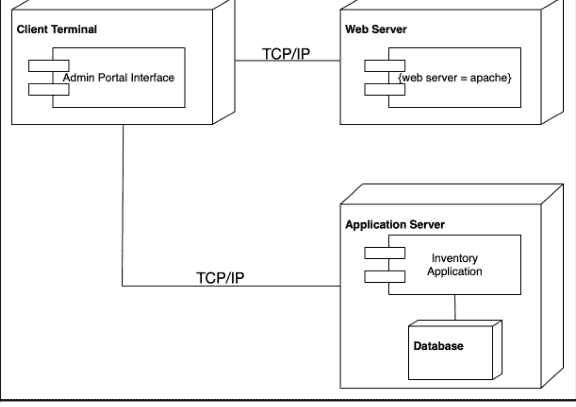

部署图可能比这里提供的示例更复杂。然而，我们的示例已经提供了足够的见解，让你能够继续后续的章节。

## 对象图

对象图的名字可能不尽如意，因为它并没有恰当地描述这种 UML 图的用途。对象图在视觉上通信了一组类实例。事实上，这些实例大多数具有可选组件，且通常只被部分描述。因此，这种图更恰切的名字可能是松散定义的实例 UML 图。

下面的示例描绘了四个对象及其层次结构。因为每个对象都是类的实例，所以它们由冒号和类名加下划线表示：

| College of Computer Science :OrgUnit | CS Research Unit :OrgUnit |
| --- | --- |
| building = "Grace Hopper Hall" | building = "Bruce Lee Memorial Center" |
| parent |  |
| VR Lab :OrgUnit | building = "Innovation Center" |

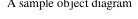

## 包图

包图用于为大型系统提供高层的可视化描述。这些图非常简单，仅显示了系统组件是如何分组的。接下来的示例说明了嵌套包，从 Java 开始深入到 ArrayList：

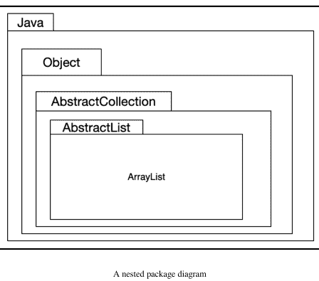

## 总结

统一建模语言（UML）用于创建系统的可视化文档。这既可以用于设计系统，也可以用于记录系统。UML 被软件工程师、软件开发人员和其他专业人士广泛使用。


14 种 UML 图中的两种是行为图和结构图。

行为图说明了系统组件如何相互作用形成一个系统，包括活动图、交互图、状态机图和用例图。交互 UML 图有多种类型，包括序列图、通信图和时序图。

结构图说明了系统的组件，包括类图、组件图、复合结构图、部署图、对象图和包图。

在下一章——面向对象的设计模式中，我们将探索面向对象编程的中、高级概念、方法，以及它们在设计模式中的适用性。回顾面向对象编程的基本概念有助于确保对面向对象编程有深入的概念理解。还将提供面向对象编程设计模式原则的概述。

## 问题

1. UML 图的两种基本类型是什么？
2. 最初创建 UML 的目的是什么？
3. 列出四种行为 UML 图。
4. 哪种 UML 图提供了系统的流程图？
5. 哪种 UML 图记录了系统与其用户之间的交互？
6. 什么是 UML 角色（actor）？
7. 哪种类型的 UML 图说明系统组件？
8. 最常用的 UML 图是什么？
9. 哪种 UML 图显示系统的运行时结构？
10. 哪种 UML 图视化地记录了系统的硬件和软件？

## 延伸阅读

- [UML 2.0 in Action: A project-based-tutorial](https://www.packtpub.com/hardware-and-creative/uml-20-action-project-based-tutorial)

# 面向对象的设计模式

在本章中，我们将探索面向对象编程（OOP）的中高级概念方法以及它们对设计模式的适用性。我们将回顾 OOP 的基本概念以促进深入的概念理解。本章还涵盖了 OOP 设计模式的原则。

具体而言，本章将涵盖以下主题：

- 面向对象编程简介
- 面向对象编程方法
- 设计模式原则
- 完整的 OOP 类

## 技术要求

本章的代码可以在 `https://github.com/PacktPublishing/Hands-On-Design-Patterns-with-Java/tree/master/Chapter02` 找到。

## 面向对象编程简介

面向对象编程（OOP）已经存在了几十年，大多数软件开发人员至少熟悉一种 OOP 语言，如 C 或 Java。OOP 的引入代表了从主流过程化编程技术的重大编程范式转变。在 OOP 编程中，重点是对象，而过程化编程的重点是过程。

例如，一种自行车管理系统的过程化编程方法将关注它可能执行的步骤。而 OOP 方法将关注自行车，并将其建模为一个对象。通过将物理自行车表示为对象，我们可以定义该对象的特征以及相对于它可以采取的行为。

在本节中，我们将涵盖 OOP 的基础知识，并使用自行车对象作为共同参考。本节细分为：

- OOP 的主要优点
- 示例 OOP 类
- 实例变量
- 此引用

## 封装

封装指的是对象数据组件的隐藏性。我们知道数据存在那里，但无法直接访问它，因为外部实体无法直接与该数据交互：

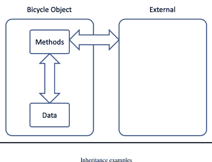

上面的图演示了 `Bicycle` 类如何保护其数据不受外部方法和函数的影响。对象自己的方法是查看或更改其数据的机制。

## 多态

多态是一个 OOP 程序员可能熟悉的词汇。该术通常被定义为出现多种形式。在 OOP 中，多态意味着不同类型的对象可以通过公共接口进行访问。这可以通过编写重载构造函数和方法来实现，也可以通过子类重写父类方法来实现。

让我们通过 `instanceof` 关键字简单查看：

1. 首先，我们创建一个 `Vehicle` 类，它继承 `Object` 类。
2. 接下来，我们创建一个 `TwoWheled` 类，它继承 `Vehicle` 类。
3. 然后，我们创建一个 `Bicycle` 类，它继承 `TwoWheled` 类。
4. 最后，我们创建一个 `Driver` 类，它创建 `Bicycle` 类的实例。

```java
public class Vehicle {
}
public class TwoWheled extends Vehicle {
}
public class Bicycle extends TwoWheled {
}
public class Driver {
  public static void main(String[] args) {
    Bicycle myBike = new Bicycle();
    System.out.println("\nInstanceof Checks:");
    if (myBike instanceof Bicycle) {
      System.out.println("Instance of Bicycle: True");
    } else {
      System.out.println("Instance of Bicycle: False");
    }
    if (myBike instanceof TwoWheled) {
      System.out.println("Instance of TwoWheled: True");
    } else {
      System.out.println("Instance of TwoWheled: False");
    }
    if (myBike instanceof Vehicle) {
      System.out.println("Instance of Vehicle: True");
    } else {
      System.out.println("Instance of Vehicle: False");
    }
    if (myBike instanceof Object) {
      System.out.println("Instance of Object: True");
    } else {
      System.out.println("Instance of Object: False");
    }
  }
}
```

输出如下：

| Instanceof Checks |
| :--- |
| Instance of Bicycle: True |
| Instance of TwoWheled: True |
| Instance of Vehicle: True |
| Instance of Object: True |

如前面所示，`Bicycle` 类的实例也是 `TwoWheled`、`Vehicle` 和 `Object` 的实例。这使得 `myBike` 对象具有多态性。

## OOP 类

让我们通过添加属性和行为进一步开发 `Bicycle` 类。属性将是齿轮数量、价格、重量和颜色。以下是源码：

```java
public class Bicycle extends TwoWheled {
    // 实例变量声明
    private int gears = 0;
    private double cost = 0.0;
    private double weight = 0.0;
    private String color = "";

    // 输出信息的方法
    public void outputData() {
        System.out.println("Bicycle Details: " + this.gears);
        System.out.println("Cost : " + this.cost);
        System.out.println("Weight : " + this.weight + " lbs");
        System.out.println("Color : " + this.color);
    }
```

以下是 Setter（set 方法）的代码：

```java
public void setGears(int nbr) {
    this.gears = nbr;
}
public void setCost(double amt) {
    this.cost = amt;
}
public void setWeight(double lbs) {
    this.weight = lbs;
}
public void setColor(String theColor) {
    this.color = theColor;
}
```

我们将在后续章节中查看 `Bicycle` 类的所有组件。现在关注 `public void outputData()` 方法。我们将使用 `Driver` 类来调用该方法。以下是更新后的 `Driver` 类：

```java
public class Driver {
    public static void main(String[] args) {
        Bicycle myBike = new Bicycle();

        myBike.setGears(24);
        myBike.setCost(319.99);
        myBike.setWeight(13.5);
        myBike.setColor("Purple");

        myBike.outputData();
    }
}
```

在前面的 `Driver` 类中，我们创建了 `Bicycle` 实例，为其属性赋值，然后调用了 `outputData()` 方法。以下是输出结果：

| Bicycle Details |
| :--- |
| Gears : 24 |
| Cost : 319.99 |
| Weight : 13.5 lbs |
| Color : Purple |


## 实例变量

属性将是齿轮数量、价格、重量和颜色。以下是源码：

```java
private int gears = 0;
private double cost = 0.0;
private double weight = 0.0;
private String color = "";
```

## `this` 引用

在 Java 中，我们使用 `this` 代表当前对象。以下代码接收一个参数并将其赋值给：

```java
public void setColor(String theColor) {
    this.color = theColor;
}
```

## 面对象编程

OOP 代表了一种开发应用程序高效方法。它们包括：

- 访问器和修改器
- 构造函数--

这些方法每种将在后续章节中介绍。

## 访问器和修改器

访问器方法（Accessor）是允许访问数据的，也被称为 Getter。修改器方法（Mutator）也称为 Setter，允许更改数据。

这里是一组：

```java
// 访问器 (Getters)
public int getGears() {
    return gears;
}
public double getCost() {
    return cost;
}
public double getWeight() {
    return weight;
}
public String getColor() {
    return color;
}

// 修改器 (Setters)
public void setGears(int nbr) {
    gears = nbr;
}
public void setCost(double amt) {
    cost = amt;
}
public void setWeight(double lbs) {
    weight = lbs;
}
public void setColor(String theColor) {
    color = theColor;
}
```

### `Driver` 类

虽然 `Driver` 类并非特定于 OOP 语言，但它们是一种最佳实践方法。

## 构造函数

构造函数是一种在对象初始化时运行的特殊方法。我们使用构造函数为对象设置默认值。让我们看看 `Bicycle` 类的构造函数是什么样的。以下代码应该放在 `Bicycle` 类的实例变量部分：

```java
// 构造函数
Bicycle() {
    this.color = "Navy Blue";
}
```

如前面所示，构造函数将新实例对象的颜色设置为 Navy Blue。当我们运行以下 `Driver` 类时，会实例化 `Bicycle` 类，并运行 `Bicycle` 类的构造函数，然后调用 `outputData()` 方法：

```java
public class Driver {

    public static void main(String[] args) {
        Bicycle myBike = new Bicycle();

        myBike.outputData();
    }
}
```

# 面向对象的设计模式

# 第 2 章

前面的代码展示了 `Driver` 类。以下是调用 `outputData()` 方法后的输出。

| 自行车详情： |
| :--- |
| 齿轮 : 0 |
| 价格 : 0.0 lbs |
| 重量 : 0.0 lbs |
| 颜色 : 海军蓝 |

`outputData()` 执行结果

## 重载构造函数和方法

在声明构造函数和方法时，我们会包含预期的参数。例如，我们的 `Bicycle()` 构造函数不接受任何参数。我们可以通过创建一个或多个不同版本来重载构造函数，每个版本都具有不同的参数集。让我们看看 `Bicycle` 类中的四个构造函数：

```java
// 构造函数 -默认
Bicycle() {
}

// 构造函数 - String 参数
Bicycle(String aColor) {
    this.color = aColor;
}

// 构造函数 - int 参数
Bicycle(int nbrOfGears) {
    this.gears = nbrOfGears;
}

// 构造函数 - int, double, double, String 参数
Bicycle(int nbrOfGears, double theCost, double theWeight, String aColor) {
    this.gears = nbrOfGears;
    this.cost = theCost;
    this.weight = theWeight;
    this.color = aColor;
}
```

当在没有任何参数的情况下创建对象实例时，使用默认构造函数。我们将使用以下代码：

```java
Bicycle myBike1 = new Bicycle();
```

在创建 `Bicycle` 对象时，我们只需根据重载方法预期的参数传递适当的参数，就可以使用重载方法之一。接下来的 `Driver` 类展示了四个 `Bicycle` 对象的创建，其中一个使用了不同的构造函数：

```java
public class Driver {

    public static void main(String[] args) {
        Bicycle myBike1 = new Bicycle();
        Bicycle myBike2 = new Bicycle("Brown");
        Bicycle myBike3 = new Bicycle(22);
        Bicycle myBike4 = new Bicycle(22, 319.99, 13.5, "White");

        myBike1.outputData();
        myBike2.outputData();
        myBike3.outputData();
        myBike4.outputData();

    }
}
```

如从提供的提供的输出所示，每个 `Bicycle` 对象都是用不同的构造函数创建的。重载构造函数增加了对象创建的灵活性：

| 自行车详情： |
| :--- |
| 齿轮 : 0 |
| 价格 : 0.0 |
| 重量 : 0.0 lbs |
| 颜色 : |

自行车车详情：

齿轮 : 0

价格 : 0.0

重量 : 0.0 lbs

颜色 : Brown

自行车车详情：

齿轮 : 22

价格 : 0.0

重量 : 0.0 lbs

颜色 : |

自行车车详情：

齿轮 : 22

价格 : 319.99

重量 : 13.5 lbs

颜色 : White

我们还可以重载方法。例如，我们已经在 `Bicycle` 类中多次使用了 `outputData()` 方法。让我们重载该方法，以便我们可以向输出传递额外的要打印的文本。以下是该方法的两个版本：

```java
// 输出 Bicycle 信息
public void outputData() {
    System.out.println("Bicycle Details:");
    System.out.println("Gears : " + this.gears);
    System.out.println("Cost : " + this.cost);
    System.out.println("Weight : " + this.weight + " lbs");
    System.out.println("Color : " + this.color);
}
```


```java
// 输出 Bicycle 信息 - 重载
public void outputData(String text) {
    System.out.println("Bicycle " + text + " Details:");
    System.out.println("Gears : " + this.gears);
    System.out.println("Cost : " + this.cost);
    System.out.println("Weight : " + this.weight + " lbs");
    System.out.println("Color : " + this.color);
}
```

正如前面的代码所示，我们的重载方法接受一个 `String` 参数并将其整合在打印行中。我们可以如下代码所示修改 `Driver` 类：

```java
myBike1.outputData("Nbr 1");
myBike2.outputData("Nbr 2");
myBike3.outputData("Nbr 3");
myBike4.outputData("Nbr 4");
```

此处呈现输出说明了如何轻松地创建和使用重载方法：

| Bicycle Nbr 1 详情 |
| :--- |
| 齿轮 : 0 |
| 价格 : 0.0 |
| 重量 : 0.0 lbs |
| 颜色 : |
| Bicycle Nbr 2 详情 |
| :--- |
| 齿轮 : 0 |
| 价格 : 0.0 |
| 重量 : 0.0 lbs |
| 颜色 : Brown |
| Bicycle Nbr 3 详情 |
| :--- |
| 齿轮 : 22 |
| 价格 : 0.0 |
| 重量 : 0.0 lbs |
| 颜色 : |
| Bicycle Nbr 4 详情 |
| :--- |
| 齿轮 : 22 |
| 价格 : 319.99 |
| 重量 : 13.5 lbs |
| 颜色 : White |

## 方法链调用

OOP 为我们提供了使用方法链的机会，即在单个语句中进行多次方法调用的过程。语法如下：

```java
object.method1().method2().method3();
```

使用提供的语法，我们可以演示方法链的过程。第一个对象调用 `method1()`，返回调用对象。接下来，该返回的对象调用 `method2()`，返回调用对象。在这里可以看到该过程。它是从左到右工作的。因此，我们可以像这里所示在 `Driver` 类中实现它：

```java
// 使用方法链的示例
Bicycle myBike5 = new Bicycle(418.5, 17.2, "Green");
myBike5.setColor("Peach").setGears(32).outputData("Number ");
```

在此代码之前，我们需要对想要在方法链中使用的每个方法进行两个更改：

- 为方法添加返回类型。
- 为每个方法添加 `return this;`。

以下是修改后的示例：

```java
public Bicycle setGears(int nbr) {
    this.gears = nbr;
    return this;
}
```

一旦完成了这些更改，我们就可以运行 `Driver` 类：

| 自行车数字 5 详情： |
| :--- |
| 齿轮 : 32 |
| 价格 : 418.5 |
| 重量 : 17.2 lbs |
| 颜色 : Peach |

前面的截图显示了最终结果。

## 设计模式原则

到为止，我们讨论了采用多类方法来设计面向对象的程序。我们还使用示例演示了访问器（accessors）、修改（mutators）、构造函数和驱动类的使用。在学习本书介绍的设计模式时，有三个关键原则需要记住：

- 创建简洁的对象。
- 封装以保护。
- 有目的地地使用继承。

这些原则将在后续章节中探讨。

## 创建简洁的对象

对象是 OOP 的核心。这一原则旨在提醒设计师和开发者将对象隔离到特定的模型。以我们的 `Bicycle` 类为例，我们将创建包含适当属性和行为的 `Bicycle` 对象。自行车属性使用了齿轮、价格和颜色。我们为这些属性的每一个一个创建了访问器和修改。我们还创建一个回属性到输出控制台的方法。`Bicycle` 对象没有添加行为，但我们可以包含如 `upgrade()` 等行为。

我们没有在 `Bicycle` 类中包含的是与 `Bicycle` 对象附属的属性和行为。这些示例包括所有者的地址、假期详情等。虽然这些数据可能与特定的自行车有关，但它们并不是我们需要建模的真实自行车的一部分。

遵循这一原则有助于确保我们的代码简洁、易于维护且具有移植性。

## 封装以保护

在本章的早些时候，我们将封装定义为对象数据的隐藏性。通过对象自身的访问器和修改授予对对象数据的访问是数据保护的一种极方法。我们在 OOP 中使用封装作为一种数据保护方法。将过多的数据封装到类中是一种反模式——是应该避免的。通过简洁的方法，我们应该识别对象的所有数据拷贝所共有的部分，并仅封装那些数据元素。其他数据可能更适用于附属类。

## 有目的地地使用继承

继承是一种强大的 OOP 结构。我们可以有效地建模对象，正如自行车所示。我们知道存在以下关系：

- 自行车是双轮的。
- 自行车是车辆。
- 自行车是一个对象。

当我们编写继承时，应该使用以下伪代码逻辑执行“IS A”检查：

```text
如果 <子对象> 是 <父对象> 则关系 = True;
否则关系 = False
```

如果我们的“IS A”检查失败，则应该避免继承。这是一个重要的测试，通过专门使用，可以帮助确保对象之间的继承线是有效的。

让我们为 `Bicycle` 类创建“IS A”检查。我们将使用 Java 的 `instanceof` 运算符来实现。这里代码分为三个部分。第一部分对 `myBicycle6` 进行检查，查看它是否是 `Bicycle`、`TwoWheeled`、`Vehicle` 和 `Object` 的实例：

```java
// IS A 检查
System.out.println("\nIS A CHECKS");

// 关注 myBicycle6
Bicycle myBicycle6 = new Bicycle();

if (myBicycle6 instanceof Bicycle)
    System.out.println("myBicycle6 Instance of Bicycle: True");
else
    System.out.println("myBicycle6 Instance of Bicycle: False");

if (myBicycle6 instanceof TwoWheled)
    System.out.println("myBicycle6 Instance of TwoWheled: True");
else
    System.out.println("myBicycle6 Instance of TwoWheled: False");
```

## 面对象设计模式

```java
if (myBike6 instanceof Vehicle)
    System.out.println("myBike6 Instance of Vehicle: True");
else
    System.out.println("myBike6 Instance of Vehicle: False");

if (myBike6 instanceof Object)
    System.out.println("myBike6 Instance of Object: True");
else
    System.out.println("myBike6 Instance of Object: False");
```

第二部分对 `myTwoWheeled` 执行检查，并检查它是否是 `Bicycle`、`TwoWheeled`、`Vehicle` 和 `Object` 的实例：

```java
// focus on TwoWheeled
TwoWheeled myTwoWheeled = new TwoWheeled();

if (myTwoWheeled instanceof Bicycle)
    System.out.println("\nmyTwoWheeled Instance of Bicycle: True");
else
    System.out.println("\nmyTwoWheeled Instance of Bicycle: False");

if (myTwoWheeled instanceof TwoWheeled)
    System.out.println("myTwoWheeled Instance of TwoWheeled: True");
else
    System.out.println("myTwoWheeled Instance of TwoWheeled: False");

if (myTwoWheeled instanceof Vehicle)
    System.out.println("myTwoWheeled Instance of Vehicle: True");
else
    System.out.println("myTwoWheeled Instance of Vehicle: False");

if (myTwoWheeled instanceof Object)
    System.out.println("myTwoWheeled Instance of Object: True");
else
    System.out.println("myTwoWheeled Instance of Object: False");
```

第三部分也是最后一部分对 `myVehicle` 执行检查，并检查它是否是 `Bicycle`、`TwoWheeled`、`Vehicle` 和 `Object` 的实例：

```java
// focus on Vehicle
Vehicle myVehicle = new Vehicle();

if (myVehicle instanceof Bicycle)
    System.out.println("\nmyVehicle Instance of Bicycle: True");
else
    System.out.println("\nmyVehicle Instance of Bicycle: False");

if (myVehicle instanceof TwoWheeled)
    System.out.println("myVehicle Instance of TwoWheeled: True");
else
    System.out.println("myVehicle Instance of TwoWheeled: False");

if (myVehicle instanceof Vehicle)
    System.out.println("myVehicle Instance of Vehicle: True");
else
    System.out.println("myVehicle Instance of Vehicle: False");

if (myVehicle instanceof Object)
    System.out.println("myVehicle Instance of Object: True");
else
    System.out.println("myVehicle Instance of Object: False");
```

这三个部分的输出是此处提供的代码。如你所示，`myBike6` 是 `Bicycle`、`TwoWheeled`、`Vehicle` 和 `Object` 的实例；`myTwoWheeled` 对象是 `TwoWheeled`、`Vehicle` 和 `Object` 的实例；而 `myVehicle` 对象是 `Vehicle` 和 `Object` 的实例。我们可以看到 `myTwoWheeled` 对象不是 `Vehicle` 或 `Object` 的实例；`myVehicle` 对象不是 `Bicycle` 或 `TwoWheeled` 的实例：

| "IS A" 检查结果 |
| :--- |
| `myBike6` Instance of `Bicycle`: True |
| `myBike6` Instance of `TwoWheeled`: True |
| `myBike6` Instance of `Vehicle`: True |
| `myBike6` Instance of `Object`: True |
| `myTwoWheeled` Instance of `Bicycle`: False |
| `myTwoWheeled` Instance of `TwoWheeled`: True |
| `myTwoWheeled` Instance of `Vehicle`: True |
| `myTwoWheeled` Instance of `Object`: True |
| `myVehicle` Instance of `Bicycle`: False |
| `myVehicle` Instance of `TwoWheeled`: False |
| `myVehicle` Instance of `Vehicle`: True |
| `myVehicle` Instance of `Object`: True |

"IS A" 检查结果

之前的截图描述了此示例。

## 学习完整的 OOP 类

在本章中，我们使用了一个 `Bicycle` 类。如下所示，我们创建了一个继承层次结构来演示 OOP 的一个核心特性。在 Java 中，所有对象都继承自 `Object` 类。我们的层次结构是 `Bicycle` 继承自 `TwoWheeled`，`TwoWheeled` 继承自 `Vehicle`，`Vehicle` 继承自 `Object`：


为了让 `Bicycle` 类按照预期的层次结构工作，我们为 `Vehicle` 和 `TwoWheeled` 创建了类。以下是类：

```java
public class Vehicle {
}

public class TwoWheeled extends Vehicle {
}
```

`Vehicle` 和 `TwoWheeled` 类没有向 `Bicycle` 类提供任何内容。通常，每个类都会有与其相关的属性和行为。

在本章中不断完善的完整 `Bicycle` 类在后续章节中提供。第一部分包含类定义和四个实例变量：

```java
public class Bicycle extends TwoWheeled {
    // 实例变量声明
    private int gears = 0;
    private double cost = 0.0;
    private double weight = 0.0;
    private String color = "";
}
```

## 面对象设计模式

`Bicycle` 类的下一部分包含构造函数。第一个构造函数不接受任何参数，是默认构造函数。第二个构造函数接受一个 `String` 参数。第三个构造函数接受一个 `int` 参数。最后一个构造函数接受四个参数：

```java
// constructor - default
Bicycle() {
}

// constructor - String parameter
Bicycle(String aColor) {
    this.color = aColor;
}

// constructor - int parameter
Bicycle(int nbr) {
    this.gears = nbr;
}

// constructor - int, double, String parameters
Bicycle(int nbrGears, double theCost, String aColor) {
    this.gears = nbrGears;
    this.cost = theCost;
    this.color = aColor;
}
```

在重载构造函数之后，我们有了方法。`outputData()` 方法被重载，因此可以使用任何参数：

```java
// method to output
public void outputData() {
    System.out.println("\nBicycle Details:");
    System.out.println("Gears: " + gears);
    System.out.println("Cost: " + cost);
    System.out.println("Weight: " + weight);
}

// method chaining enabled
public void outputData(String bikeText) {
    System.out.println("\nBicycle Details: " + bikeText);
    System.out.println("Gears: " + gears);
    System.out.println("Cost: " + cost);
    System.out.println("Weight: " + weight);
}
```

## 面对象设计模式 第二章

`Bicycle` 类的下一部分包含每个实例变量的访问器方法（Accessor）：

```java
// Accessors (Getters)
public int getGears() {
    return gears;
}

public double getCost() {
    return cost;
}

public double getWeight() {
    return weight;
}

public String getColor() {
    return color;
}
```


我们类的最后部分包含每个实例变量的变器方法（Mutator）：

```java
// Mutators (Setters)
public void setGears(int nbr) {
    this.gears = nbr;
}

public void setCost(double amt) {
    this.cost = amt;
}

public void setWeight(double lbs) {
    this.weight = lbs;
}

public void setColor(String theColor) {
    this.color = theColor;
}
```

我们对 `Driver` 类进行了一些更改。该类在多个连续章节中提供。代码包含了用于组织和标识每个代码块的注释：

1. 代码块定义了类，包含了 `main` 方法，创建了 `Bicycle` 实例并提供了变器的示例调用。然后提供了一个示例输出语句，调用了 `getColor()` 访问器方法：

```java
public class Driver {
    public static void main(String[] args) {
        // 变器的示例调用
        Bicycle myBike = new Bicycle();
        myBike.setGears(24);
        myBike.setCost(319.99);
        myBike.setWeight(13.5);
        myBike.setColor("Purple");
        System.out.println("\nmyBike's color is " + myBike.getColor());
    }
}
```

2. 代码块提供了重载构造函数的示例调用。创建了四个 `Bicycle` 对象实例，每个使用不同的重载构造函数：

```java
// 重载构造函数的示例调用
Bicycle myBike1 = new Bicycle();
Bicycle myBike2 = new Bicycle("Brown");
Bicycle myBike3 = new Bicycle(22);
Bicycle myBike4 = new Bicycle(22, 319.99, 13.5, "White");
```

3. 第三个代码块对重载的 `outputData()` 方法进行了调用：

```java
myBike1.outputData("Nbr 1");
myBike2.outputData("Nbr 2");
myBike3.outputData("Nbr 3");
myBike4.outputData("Nbr 4");
```

# 面向对象设计模式

## 第 2 章

4. 第四个代码块提供了一个方法链调用的示例：

```java
// Example using method call chaining
Bicycle myBike5 = new Bicycle(24, 418.50, 17.2, "Green");
myBike5.setColor("Peach").getGears(32).outputData("Number 5");
```

5. 第五个代码块提供了针对 `Bicycle` 类的“是关系”（IS A）检查。我们首先创建一个 `Bicycle` 实例，然后对新创建的 `myBike6` 对象进行检查：

```java
// "IS A" Checks
System.out.println("\nIS A \nCHECKS");

// focus on myBike6
Bicycle myBike6 = new Bicycle();

if (myBike6 instanceof Bicycle) {
    System.out.println("myBike6 Instance of Bicycle: True");
} else {
    System.out.println("myBike6 Instance of Bicycle: False");
}

if (myBike6 instanceof TwoWheled) {
    System.out.println("myBike6 Instance of TwoWheled: True");
} else {
    System.out.println("myBike6 Instance of TwoWheled: False");
}

if (myBike6 instanceof Vehicle) {
    System.out.println("myBike6 Instance of Vehicle: True");
} else {
    System.out.println("myBike6 Instance of Vehicle: False");
}

if (myBike6 instanceof Object) {
    System.out.println("myBike6 Instance of Object: True");
} else {
    System.out.println("myBike6 Instance of Object: False");
}
```

6. 第六个代码块提供了针对 `TwoWheled` 类的“是关系”检查。我们首先创建一个 `TwoWheled` 实例，然后对新创建的 `myTwoWheled` 对象进行检查：

```java
// focus on TwoWheled
TwoWheled myTwoWheled = new TwoWheled();

if (myTwoWheled instanceof Bicycle) {
    System.out.println("\nmyTwoWheled Instance of Bicycle: True");
} else {
    System.out.println("\nmyTwoWheled Instance of Bicycle: False");
}
```

```java
if (myTwoWheled instanceof TwoWheled)
    System.out.println("myTwoWheeled Instance of TwoWheled: True");
else
    System.out.println("myTwoWheeled Instance of TwoWheled: False");
```

```java
if (myTwoWheled instanceof Vehicle)
    System.out.println("myTwoWheeled Instance of Vehicle: True");
else
    System.out.println("myTwoWheeled Instance of Vehicle: False");
```

```java
if (myTwoWheled instanceof Object)
    System.out.println("myTwoWheeled Instance of Object: True");
else
    System.out.println("myTwoWheeled Instance of Object: False");
```

7. 第七也是最后一个代码块提供了针对 `Vehicle` 类的“是关系”检查。我们首先创建一个 `Vehicle` 实例，然后对新创建的 `myVehicle` 对象进行检查：

```java
// focus on Vehicle
Vehicle myVehicle = new Vehicle();
```

```java
if (myVehicle instanceof Bicycle)
    System.out.println("\nmyVehicle Instance of Bicycle: True");
else
    System.out.println("\nmyVehicle Instance of Bicycle: False");
```

```java
if (myVehicle instanceof TwoWheled)
    System.out.println("\nmyVehicle Instance of TwoWheled: True");
else
    System.out.println("\nmyVehicle Instance of TwoWheled: False");
```

```java
if (myVehicle instanceof Vehicle)
    System.out.println("\nmyVehicle Instance of Vehicle: True");
else
    System.out.println("\nmyVehicle Instance of Vehicle: False");
```

```java
if (myVehicle instanceof Object)
    System.out.println("myVehicle Instance of Object: True");
else
    System.out.println("myVehicle Instance of Object: False");
}
```

`Driver` 类的完整输出如下：

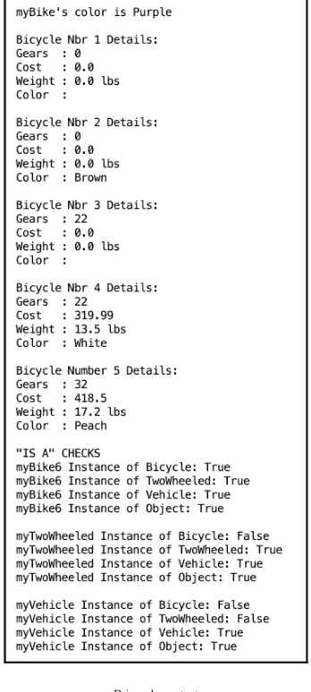

在本节中，我们通过一个完整的 OOP 应用程序演示了面向对象编程。

## 总结

本章从 OOP 的介绍开始。可移植性、继承、封装和多态被认为是 OOP 的主要优势，并对其进行了探讨。我们详细检查了一个示例 OOP 类。该类即 `Bicycle` 类被用于演示关键的 OOP 概念，包括实例变量、`this` 引用、访问器、修改器、驱动类、构造函数和方法链。本章以关键的 OOP 原则结束：创建简洁的对象、为了保护而进行封装，以及有目的的继承。

在下一章“行为设计模式”中，我们将探索行为设计分类及其各个具体的模式，包括责任链、中介者、备忘录、空对象、观察者、状态、策略、模板方法和访问者。我们将研究解决这些挑战的编程问题和相应的设计模式。

## 问题

1. OOP 语言的主要优势是什么？

2. 哪些可移植性、继承、封装和多态被认为是 OOP 的主要优势？

3. 详细检查了一个示例 OOP 类？

4. 该类（`Bicycle` 类）用于演示哪些关键的 OOP 概念，包括实例变量、`this` 引用、访问器、修改器、驱动类、构造函数和方法链？

5. 本章以哪些关键 OOP 原则结束——创建简洁的对象、为了保护而进行封装以及有目的的继承？

6. 在下一章“行为设计模式”中，我们将探索行为设计分类及其各个具体的模式，包括责任链、中介者、备忘录、空对象、观察者、状态、策略、模板方法和访问者？

7. 我们将研究解决这些挑战的编程问题和相应的设计模式？

# 行为型模式

## 第 3 章

- **命令模式 (Command pattern)**：允许在不知道接收者细节甚至不知道请求具体内容的情况下发送请求。
- **解释器模式 (Interpreter pattern)**：用于建立语法表示以及一个解释该语言的解释器。
- **迭代器模式 (Iterator pattern)**：允许在不共享封装的数据结构的情况下对对象的成员进行访问。
- **中介者模式 (Mediator pattern)**：用于在没有显式对象引用的情况下允许对象交互。
- **备忘模式 (Memento pattern)**：将对象的当前内部状态保存为备忘录，以便以后引用和恢复。
- **空对象模式 (Null pattern)**：消除了对空条件的判断需要。
- **观察者模式 (Observer pattern)**：当发布者对象的状态发生变化时更新订阅者对象。
- **状态模式 (State pattern)**：允许对象根据内部状态改变其行为。
- **策略模式 (Strategy pattern)**：允许我们单独封装一组可替换的算法。
- **模板方法模式 (Template method pattern)**：涉及创建一个算法模板，并将处理步骤交给子类。
- **访问者模式 (Visitor pattern)**：在不改变对象结构的情况下对对象执行操作。

## 理解责任链模式

责任链设计模式的目的涉及发送者和接收者。具体来说，责任链设计模式要求将发送者和接收者解耦。对象可以被发送给一系列接收者，而发送者无需担心由哪个接收者处理该请求。请求沿着接收者链发送，只有其中一个会处理该请求。让我们来看一些相关的例子。

考虑一个每天处理数千封入站邮件的大型客户服务机构。我们不需要让某人逐一查看每封邮件以确定由哪个部门处理该邮件，而是可以使用责任链设计模式编写一个 Java 程序，将邮件沿着链发送，以便它们由相应的部门进行处理。

另一个例子是呼叫中心。许多呼叫中心现在要求呼叫者简述来电目的，然后将呼叫者置于队列中。呼叫者的简短描述会被记录并对关键词进行分析。电话将沿着链路传递，然后由相应的代理处理。如果代理接到的电话不符合其职责（例如，是关于账单的，而该代理负责货运），则可以将呼叫者发送到链的更下游。

我们将进一步探讨第三个示例，涉及大学的入站邮件。该大学有几个功能区域，并希望确保邮件被路由到相应的团队。我们将查看用于该场景的用例、UML 类图以及实现责任链设计模式所需的源码。

### 用例

为了演示责任链设计模式，我们将使用上一节中简要提到的大学邮件场景。在我们的示例中，我们设计了一个系统，它接收入站邮件并搜索特定关键词，以帮助确定邮件应该路由到大学的哪个团队。我们将考虑以下因素：

| 关键词 | 大学团队 | Java 处理器 |
| :--- | :--- | :--- |
| academic | 学术团队 | `AcademicEmailHandler()` |
| alumni, transcript | 校友事务 | `AlumniEmailHandler()` |
| advising, schedule, course | 学业指导 | `AdvisingEmailHandler()` |
| financial, student, tuition | 财务人员 | `FinanceEmailHandler()` |
| career, job, faculty | 人力资源 | `HREmailHandler()` |
| other | 管理团队 | `AdminEmailHandler()` |

如表所示，我们识别了处理器类。从表中可以看出，我们识别了处理器类。

在演示责任链设计模式之前，我们将查看该场景的用例、UML 类图以及实现该设计模式所需的源码。

```java
// 我们不需要在 admin 之后设置下一个邮件处理器
// 因为它是责任链的末端

// 这一行将启动责任链
academic.processEmailHandler(String emailText);
protected abstract String[] keywords();
protected abstract void processEmailFinal(String emailText);
```

提供的 `MainHandler()` 代码是主处理器，包含 `processEmailHandler()` 方法，该方法在邮件文本中搜索为每个邮件处理器分配的关键词。

### 学术邮件处理器

`AcademicEmailHandler` 类继承自 `MainHandler` 类。它分配了学术邮件处理器的特定关键词，并包含 `processEmailFinal()` 方法：

```java
public class AcademicEmailHandler extends MainHandler {

    protected String[] keywords() {
        // 为接收者处理器设置关键词
        return new String[] {"academic"};
    }

    protected void processEmailFinal(String emailText) {
        System.out.println("The Academic Team processed the email.");
    }

    @Override
    public void setNextEmailHandler(UniversityEmailHandler emailHandler) {

    }
}
```

所示 `AcademicEmailHandler` 类的 `processEmailFinal()` 方法通知用户学术邮件处理器已处理了收到的邮件。

### 校友邮件处理器

`AlumniEmailHandler` 类继承自 `MainEmailHandler` 类。它分配了校友邮件处理器的特定关键词，并包含 `processEmailFinal()` 方法：

```java
public class AlumniEmailHandler extends MainEmailHandler {

    protected String[] keywords() {
        // 为接收者团队设置关键词
        return new String[]{"alumni", "transcript"};
    }

    protected void processEmailFinal(String emailText) {
        System.out.println("The Alumni processed the email.");
    }

    @Override
    public void setNextEmailHandler(UniversityEmailHandler emailHandler) {

    }
}
```


`processEmailFinal()` 方法仅通知用户校友处理器已处理了收到的邮件。

### 咨询邮件处理器

`AdvisingEmailHandler` 类继承自 `MainEmailHandler` 类。它分配了导师咨询邮件处理器的特定关键词，并包含了 `processEmailFinal()` 方法：

```java
public class AdvisingEmailHandler extends MainEmailHandler {

    protected String[] keywords() {
        // 为接收者团队设置关键词
        return new String[]{"advising", "schedule", "course"};
    }

    protected void processEmailFinal(String emailText) {
        System.out.println("The Advising Team processed the email.");
    }

    @Override
    public void setNextEmailHandler(UniversityEmailHandler emailHandler) {

    }
}
```

所示的 `processEmailFinal()` 方法仅通知用户咨询邮件处理器已处理了收到的邮件。

### 财务邮件处理器

`FinanceEmailHandler` 类继承自 `MainEmailHandler` 类。它分配了邮件处理器的特定关键词，并包含了 `processEmailFinal()` 方法：

```java
public class FinanceEmailHandler extends MainEmailHandler {

    protected String[] keyWords() {
        // 为接收者团队设置关键词
        return new String[]{"financial", "student aid", "tuition"};
    }

    protected void processEmailFinal(String emailText) {
        System.out.println("The Finance Team processed the email.");
    }

    @Override
    public void setNextEmailHandler(UniversityEmailHandler emailHandler) {
    }
}
```

所示的 `processEmailFinal()` 方法通知用户财务处理器已处理了收到的邮件。

### HR 邮件处理器

`HREmailHandler` 类继承自 `MainEmailHandler` 类。它分配了 HR 邮件处理器的特定关键词，并包含了 `processEmailFinal()` 方法：

```java
public class HREmailHandler extends MainEmailHandler {

    protected String[] assignedKeywords() {
        // 为接收者团队设置关键词
        return new String[]{"career", "job", "faculty"};
    }

    @Override
    protected void processEmailFinal(String emailText) {
        System.out.println("The Human Resources Team processed the email.");
    }

    @Override
    public void setNextEmailHandler(UniversityEmailHandler emailHandler) {
    }
}
```

所示的 `processEmailFinal()` 方法通知用户 HR 邮件处理器已处理了收到的邮件。

## 管理邮件处理器

`AdminHandler` 类继承自 `MainErrorHandler` 类。与其他类不同，它没有分配任何特定于管理员邮件处理器的关键词。如果邮件发送到此处理器（责任链中的最后一个），它将处理该邮件并通过 `processEmailFinal()` 方法通知用户：

```java
public class AdminEmailHandler extends MainErrorHandler {
    protected String[] keyWords() {
        // 这里关键词是什么并不重要
        return new String[0];
    }

    protected void processFinalFinal(String emailText) {
        System.out.println("The Admin Team processed the email.");
    }

    @Override
    public void setNextEmailHandler(UniversityEmailHandler emailHandler) {
    }
}
```

所示的 `processEmailFinal()` 方法通知用户管理员邮件处理器已处理了收到的邮件。

本节展示了大学邮件系统的源代码，演示了责任链设计模式。

## 探索命令模式

命令模式的目的是将请求作为对象发送。这种模式也被称为事务。

# 行为设计模式

# 第3章

# 行为设计模式

```java
public boolean hasPower () {
    return poweredOn;
}
```

刚刚显示的访问器方法也可以称为 getter 方法（get 方法）。

## 与电源相关的方法

管理电源需要两个方法——`powerOn()` 和 `powerOff()`：

```java
// 开启电源的方法
public void powerOn() {
    poweredOn = true;
}
```

```java
// 关闭电源的方法
public void powerOff() {
    poweredOn = false;
}
```

前面的方法充当 `poweredOn` 变量的开关。

## 与滑块相关的方法

ControlBox 类的最后一部分提供了增加或减少滑块值的方法。在调整滑块值时，检查两点非常重要。首先，我们需要确保电源是开启的。我们可以通过调用 `hasPower()` 方法来检查这一点。其次是确保我们没有超出最小最大范围，如下：

```java
// 增加滑块的方法 sliderIncrease()
public void sliderIncrease() {
    if (hasPower()) {
        if (getSliderValue() < SLIDER_MAX) {
            sliderValue++;
            System.out.println(sliderValue); // 模拟发送值到数字显示
        }
    }
}
```

```java
// 减少滑块的方法 sliderDecrease()
public void sliderDecrease() {
    if (hasPower()) {
        if (getSliderValue() > SLIDER_MIN) {
            sliderValue--;
            System.out.println(sliderValue); // 模拟发送值
            to digital display
        }
    }
}
}
```

# 行为设计模式

第 3 章

滑块值可以根据控制盒集成的系统来管理温度、音量、数量或其他值。这演示了命令设计模式。

本节展示了演示命令设计模式的源代码。

## 使用解释器模式

解释器设计模式用于建立语法表示法以及用于解释语言的解释器。这听起来可能有点复杂，尽管其概念很简单，但它们的实现往往并不简单。这种设计模式可以用于解释执行型编程语言，或者编译为字节码或其他中间语言（如微软中间语言 MSIL）的语言。

我们将查看一个用例案例、一个 UML 类图以及实现该场景解释器设计模式所需的源码。

### 用例

我们将通过一个简单的数字转字符场景来演示解释器设计模式。我们的代码解释器（Code Interpreter）程序将接受数字输入并将其翻译为一系列字符。例如，输入 319 可能会返回值 YES。我们将使用一个表达式接口和三个类来演示这个相对简单的案例。

行为设计模式

第 3 章

下面的截图显示了在用户输入的情况下示例程序的输出：

```
CODE INTERPRETER
Enter your code: 319
Your code: 319
Decrypted Message: YES
```

代码解释器输出

前面的截图显示用户输入为 319。

## UML 类图

如下所示的 UML 类图，我们的代码解释器示例由一个接口和三个类组成。这四个组件都将在下一节中进行描述，并介绍它们在 Java 中的实现：

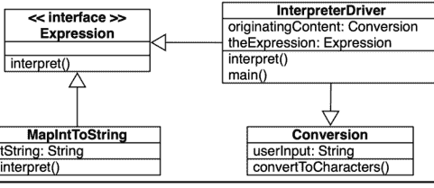

UML 类图——代码解释器示例

所示，`MapIntToCharacters` 类实现了 `Expression` 接口。

## 编写设计模式

代码解释器应用程序是解释器设计模式的一个示例实现。我们的应用程序由以下组件组成：

- Expression 接口

- MapIntToCharacters 类

- Conversion 类

- InterpreterDriver 类

## Expression 接口

`Expression` 接口声明了 `interpret()` 方法，该方法接收一个 `Conversion` 对象作为参数：

```java
interface Expression {
    void interpret (Conversion orginalContent);
}
```

所示，`Expression` 接口包含一个 `interpret()` 方法。

## MapIntToCharacters 类

`MapIntToCharacters` 类包含一个 String 变量和一个构造方法。构造方法接受一个 String 参数：

```java
public class MapIntToCharacters implements Expression {
    // 类变量
    private String tString;

    // 构造方法
    public MapIntToCharacters(String tString) {
        this.tString = tString;
    }

    @Override
    public void interpret (Conversion orginalContent) {
        orginalContent.convertToCharacters(tString);
    }
}
```

`MapIntToCharacters` 类重写了 `interpret()` 方法。

## Conversion 类

当从数字到字母（int 到 char）进行转换时，会使用 `Conversion` 类。该类有一个 String 类变量和一个传递给用户输入的构造方法。该类还有一个有一个额外方法——`convertToCharacters()` 方法。该方法将用户的输入转换为字符数组，然后逐个字符地处理该数组。处理是通过简单的 `switch` 语句实现的。从 0 到 9 的每一个数值都有一个对应的字符。字符会一次性打印，直到整个字符数组处理完毕。

我们 `Conversion` 类的第一部分如下：

```java
public class Conversion {

    // 类变量
    public String userInput;

    // 构造方法
    public Conversion(String userInput) {
        this.userInput = userInput;
    }

    public void convertToCharacters(String userInput) {
        char[] answer = userInput.toCharArray();
        System.out.print("Decrypted Message: ");
        for (int i=0; i < answer.length; i++) {
            switch (answer[i]) {
                case '0': System.out.print('A'); break;
                case '1': System.out.print('E'); break;
                case '2': System.out.print('I'); break;
                case '3': System.out.print('Y'); break;
                case '4': System.out.print('O'); break;
                case '5': System.out.print('L'); break;
                case '6': System.out.print('R'); break;
                case '7': System.out.print('T'); break;
                case '8': System.out.print('C'); break;
                case '9': System.out.print('S'); break;
            }
        }
    }
}
```

行为设计模式

第 3 章

前面的代码实现了整数的十位映射。

## InterpreterDriver 类

`InterpreterDriver` 类是驱动应用程序的类，因此包含了 `main()` 方法。有两个类变量 `originatingContent` 和 `theExpression`，它们最初都被设为 `null`。

除了构造方法外，还有一个 `interpret()` 方法执行以下操作：

1. 使用 `Scanner` 类

2. 实例化一个新的 `Expression` 实例

3. 在新的 `Expression` 上调用 `interpret()` 方法

```java
import java.util.Scanner;

public class InterpreterDriver {

    // 类变量
    public Conversion originatingContent = null;
    public Expression theExpression = null;

    public InterpreterDriver(Conversion content) {
        originatingContent = content;
    }

    public void interpret(String tString) {
        Scanner in = new Scanner(System.in);
        theExpression = new MapIntToCharacters(tString);
        theExpression.interpret(originatingContent);
    }

    public static void main(String[] args) {
        System.out.println("\nCODE INTERPRETER\n");
        System.out.println("Enter your code: ");
        Scanner in = new Scanner(System.in);
        String userInput = in.nextLine();
        System.out.println("You code: " + userInput);
        Conversion conversion = new Conversion(userInput);
        InterpreterDriver userCode = new InterpreterDriver(conversion);
        userCode.interpret(userInput);
        System.out.println("\n\n");
    }
}
```

行为设计模式

第 3 章

程序的输出在此处：

```
CODE INTERPRETER
Enter your code: 319
Your code: 319
Decrypted Message: YES
```

代码解释器程序--控制台输出

本节介绍了源代码，展示了迭代器设计模式。

## 使用迭代器模式

迭代器设计模式的目的是在不共享封装的数据结构的情况下，允许对对象的成员进行访问。使用迭代器模式有两个主要动机。首先，并不是所有数据都以相同的方式存储。例如，一个聚合其他供应商内容的在线商店可能有一个供应商使用数组（array），另一个供应商使用列表（list），而第三个则使用 `ArrayList`。第二个原因是避免暴露数据结构。存储方式的可变性和数据安全都可以通过迭代器模式来解决。


迭代器模式通过使用`java.util`包中的`Iterator`接口来实现。

我们将查看一个简单的用例、UML 类图以及实现该场景下迭代器模式所需的源码。

### 用例

实现迭代器模式本质上是利用了 Java 的`Iterator`接口。我们将使用一个单类示例，创建一个字符串的`ArrayList`并使用迭代器遍历该列表，打印每个元素。

## UML 类图

Java 的`Iterator`接口是`java.util`包的一部分，也是 Java 集合框架的成员。如你在 UML 类图中所示，该接口包含了四个方法：

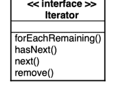

`forEachRemaining()`方法遍历对象的元素。`hasNext()`方法根据是否还有更多迭代需要来返回一个布尔值。`next()`方法简单地返回下一个顺序迭代元素。`remove()`方法从对象中删除最后一个迭代的元素。

## 编写设计模式

我们源码的第一部分包含了`ArrayList`和`Iterator`的导入语句。在`main()`方法中，我们创建了一个字符串的`colonies ArrayList`。然后我们向`ArrayList`中填充了 12 个元素：

```java
import java.util.ArrayList;
import java.util.Iterator;

public class IteratorExample {

    public static void main(String[] args) {

        ArrayList<String> colonies = new ArrayList<>();

        colonies.add("Aerlion");
        colonies.add("Aquaria");
        colonies.add("Canceron");
        colonies.add("Caprica");
        colonies.add("Gemonon");
        colonies.add("Leonis");
        colonies.add("Libran");
        colonies.add("Picon");
        colonies.add("Sagittaron");
        colonies.add("Scorpia");
        colonies.add("Tauron");
        colonies.add("Virgo");
    }
}
```

源码的后半部分做了三件事。首先，实例化了一个迭代器`myIterator`。接下来，向控制台打印了一个简单的文本头。最后，代码遍历`ArrayList`并打印每个元素：

```java
// 实例化迭代器

Iterator myIterator = colonies.iterator();

// 控制台输出

System.out.println("\t\nOriginal Colonies of Kobol:");

// 遍历列表

while (myIterator.hasNext()) {

    System.out.println("\t\t" + myIterator.next());

}
```

迭代能够进行，无需知道`colonies`对象将其数据存储在`ArrayList`中。

我们示例应用程序的输出所示：

| Original Colonies of Kobol: |
| --- |
| Aerlion |
| Aquaria |
| Canceron |
| Caprica |
| Gemonon |
| Leonis |
| Libran |
| Picon |
| Sagittaron |
| Scorpia |
| Tauron |
| Virgo |

迭代器应用输出。

本节介绍了源码和输出，展示了迭代器设计模式。

## 理解示例用于允许中介者交互

中介设计模式用于在不使用显式对象引用的情况下允许中介者交互。这是面向对象编程封装概念的高级用法。中介者管理两个或多个对象之间的交互。现实世界中的例子是法律调解员，诉讼双方都与调解员沟通，而不是直接相互沟通。

我们将查看一个用案例、UML 类图以及实现该场景下中介设计模式所需的源码。

### 用例

为了演示中介设计模式，我们将模拟一个组件生产系统，该系统包含一个用于零件的料斗、一个启动系统的启动器、一个组合料斗组件的组配系统、一个加速器以及一个管理系统速度的紧急制动。

各个组件之间存在相互关系，供中介者管理。这些相互关系详细列在此：

| 左列的组件对第二列到第六列的组件有以下影响： |
| --- |
| Starter | Assembly System | Hopper | Accelerator | Decelerator |
| Starter | N/A | 为此组件供电 | 为此组件供电 | 为此组件供电 | 为此组件供电 |
| Assembly System | Starter 必须开启组配系统才能工作 | N/A | 接入料斗 | N/A | N/A |
| Hopper | Starter 必须开启料斗才能工作 | Hopper 必须开启组配系统才能工作 | N/A | N/A | N/A |
| Accelerator | Starter 必须开启加速器才能工作 | N/A | N/A | N/A | 组件不可用 |

行为设计模式

第 3 章

| Emergency Break | Starter 必须开启组配系统才能工作 | Hopper 必须开启组配系统才能工作 | N/A | N/A |
| --- | --- | --- | --- |
| Emergency Break | Starter 必须开启加速器才能工作 | N/A | N/A | N/A | 组件不可用 |

系统相互关系。

如表所示，有五个组件供中介者管理。接下来的 UML 图：

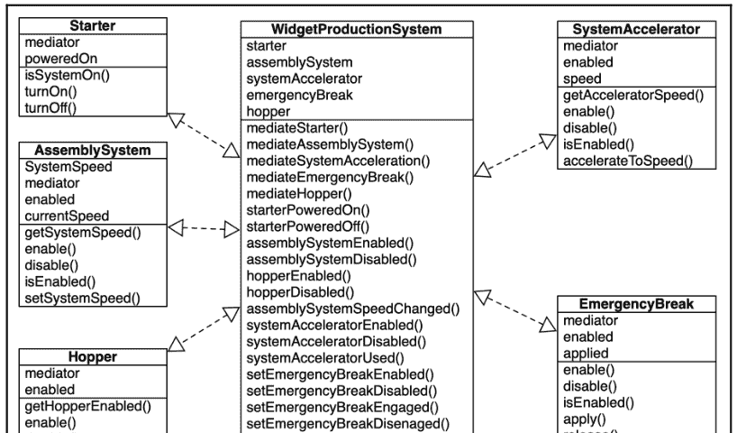

中介设计模式实现。

## 编写设计模式

`WidgetProductionSystem`需要以下类：

- `Starter`
- `AssemblySystem`
- `Hopper`
- `Accelerator`
- `EmergencyBreak`

## Starter

`Starter`类包含了两个类变量、一个构造方法、一个访问方法以及两个用于开启和关闭启动的方法。构造方法用于实例化类。访问方法简单地返回`poweredOn`变量的值：

```java
public class Starter {

    private WidgetProductionSystem mediator;

    private boolean poweredOn;

    // 构造方法

    public Starter(WidgetProductionSystem mediator) {

        this.mediator = mediator;

        poweredOn = false;

        mediator.mediateStarter(this);

    }

    // 访问方法

    public boolean isOn() {

        return poweredOn;

    }

    public void turnOn() {

        poweredOn = true;

        mediator.starterPoweredOn();

        System.out.println("Mediated Event: Started Powered On");

    }

    public void turnOff() {

        poweredOn = false;

        mediator.starterPoweredOff();

        System.out.println("Mediated Event: Starter Powered Off");

    }

}
```

## AssemblySystem

`AssemblySystem`类在此分两个部分呈现，如下：

1. 第一部分包含了`SystemSpeed`枚举的创建、类变量和构造方法。对于`currentSpeed`变量还包含了访问和修改方法：

```java
public class AssemblySystem {

    public enum SystemSpeed {
        ZERO, ONE, TWO, THREE, FOUR, FIVE,
        SIX, SEVEN, EIGHT, NINE, TEN
    };

    private WidgetProductionSystem mediator;

    private boolean enabled;

    private SystemSpeed currentSpeed;

    // 构造方法

    public AssemblySystem(WidgetProductionSystem mediator) {

        this.mediator = mediator;

        enabled = false;

        currentSpeed = SystemSpeed.ZERO;

        mediator.mediateAssemblySystem(this);

    }

    // 访问方法

    public SystemSpeed getSystemSpeed() {

        return currentSpeed;

    }

    // 修改方法

    public void setSystemSpeed(SystemSpeed speed) {

        if ((isEnabled()) && (getSystemSpeed() != speed)) {

            currentSpeed = speed;

            mediator.assemblySystemSpeedChanged();

            System.out.println("Mediated Event: System Speed\n Changed to " + currentSpeed + ".");

        }

    }
}
```

2. `AssemblySystem`类的第二部分包含了启用和禁用系统的方法，以及一个检查当前是否已启用的方法：

```java
// additional methods

public void enable() {

    enabled = true;

    mediator.assemblySystemEnabled();

    System.out.println("Mediated Event: System Initialized.");

}
```

```java
public void disable() {

    enabled = false;

    mediator.assemblySystemDisabled();

    System.out.println("Mediated Event: System Deinitialized.");

}
```

```java
public boolean isEnabled() {

    return enabled;

}
```

最后显示的方法返回`Enabled`的布尔值。

## Hopper

`Hopper`类包含两个类变量、一个构造方法和一个访问器方法，用于判断`Hopper`当前是否处于启用状态。类代码如下：

```java
public class Hopper {

    private WidgetProductionSystem mediator;

    private boolean enabled;

    // constructor

    public Hopper(WidgetProductionSystem mediator) {

        this.mediator = mediator;

        enabled = false;

        mediator.mediateHopper(this);

    }

    // accessor

    public boolean getHopperEnabled() {

        return enabled;

    }

    public void enable() {

        enabled = true;

        mediator.HopperEnabled(); // 根据 mediator 的上下文已修复

        System.out.println("Mediated Event: Initialized.");

    }

    public void disable() {

        enabled = false;

        mediator.hopperDisabled();

        System.out.println("Mediated Event: Deinitialized.");

    }

}
```

最后显示的两个方法`enable()`和`disable()`切换了`enabled`变量的布尔值。

## SystemAccelerator 类

`SystemAccelerator`类在这里分为两个部分。第一部分建立了类变量、构造方法、一个返回速度的访问器方法，以及一个返回`enabled`变量值的`isEnabled()`方法：

```java
public class SystemAccelerator {

    // class variables

    private WidgetProductionSystem mediator;

    private boolean enabled;

    private int speed;

    // constructor

    public SystemAccelerator(WidgetProductionSystem mediator) {

        this.mediator = mediator;

        enabled = false;

        speed = 0;

        mediator.mediateSystemAcceleration(this);

    }

    // accessor

    public int getAcceleratorSpeed() {

        return speed;

    }

    public boolean isEnabled() {

        return enabled;

    }

}
```

`SystemAccelerator`类的第二部分包含了三个方法。`enable()`和`disable()`方法切换`enabled`变量的值：

```java
public void enable() {

    enabled = true;

    mediator.systemAcceleratorEnabled();

    System.out.println("Mediated Event: System Accelerator Enabled.");

}
```

```java
public void disable() {

    enabled = false;

    mediator.systemAcceleratorDisabled();

    System.out.println("Mediated Event: System Accelerator Disabled.");

}
```

```java
public void accelerateToSpeed(int speed) {

    if (isEnabled()) {

        this.speed = speed;

        mediator.systemAcceleratorUsed();

        System.out.println("Mediated Event: System Accelerator Set to " + speed + ".");

    }

}
```

`SystemAccelerator`类中的第三个方法是`accelerateToSpeed()`方法，它处理速度的变化。

## EmergencyBreak

`EmergencyBreak`类分为两个部分。第一部分定义了类变量、构造方法以及`enable()`和`disable()`方法：

```java
public class EmergencyBreak {

    // class variables

    private WidgetProductionSystem mediator;

    private boolean enabled;

    private boolean applied;

    // constructor

    public EmergencyBreak(WidgetProductionSystem mediator) {

        this.mediator = mediator;

        enabled = false;

        applied = false;

        mediator.mediateEmergencyBreak(this);

    }

    public void enable() {

        enabled = true;

    }

}
```


```java
mediator.setEmergencyEnabled();

System.out.println("Mediated Event: System Decelerator Enabled.");

}

public void disable() {

enabled = false;

mediator.setEmergencyBreak();

System.out.println("Mediated Event: System Disabled.");

}

}
```

`EmergencyBreak` 剩余部分包含了 `isEnabled()`、`apply()` 和 `release()` 方法：

```java
public boolean isEnabled() {

return enabled;

}

public void apply() {

if (isEnabled()) {

applied = true;

mediator.setEmergencyBreakEngaged();

System.out.println("Mediated Event: Break Engaged.");

}

}

public void release() {

if (isEnabled()) {

applied = false;

mediator.setEmergencyBreakDisengaged();

System.out.println("Mediated Event: Break Disengaged.");

}

}
```

如所示，`isEnabled()` 方法返回 `enabled` 的布尔值。`apply()` 和 `release()` 方法模拟了这种状态。

## WidgetProductionSystem

我们的 `WidgetProductionSystem` 类管理其他类。`WidgetProductionSystem` 的第一部分定义了类变量和构造方法：

```java
public class WidgetProductionSystem {

    // class variables

    private Starter starter;

    private AssemblySystem assemblySystem;

    private SystemAccelerator accelerator;

    private EmergencyBreak emergencyBreak;

    private Hopper hopper;

    private int currentSpeed;

    // constructor

    public WidgetProductionSystem() {

        currentSpeed = 0;

    }

}
```

`WidgetProductionSystem` 的第二部分是 `Starter` 类：

```java
public class Starter {

    private WidgetProductionSystem mediator;

    private boolean enabled;

    public Starter(WidgetProductionSystem mediator) {

        this.mediator = mediator;

        enabled = false;

    }

    public void enable() {

        enabled = true;

        mediator.assemblySystemEnabled();

    }

    public void disable() {

        enabled = false;

        mediator.assemblySystemDisabled();

    }

}
```

`WidgetProductionSystem` 的第三部分是 `AssemblySystem` 类：

```java
public class AssemblySystem {

    private WidgetProductionSystem mediator;

    private boolean enabled;

    public AssemblySystem(WidgetProductionSystem mediator) {

        this.mediator = mediator;

        enabled = false;

    }

    public void enable() {

        enabled = true;

        mediator.assemblySystemSpeedChanged();

    }

    public void disable() {

        enabled = false;

        mediator.assemblySystemSpeedChanged();

    }

}
```

`WidgetProductionSystem` 的第四部分是 `Hopper` 类：

```java
public class Hopper {

    private WidgetProductionSystem mediator;

    private boolean enabled;

    public Hopper(WidgetProductionSystem mediator) {

        this.mediator = mediator;

        enabled = false;

    }

    public void enable() {

        enabled = true;

        mediator.HopperEnabled();

    }

    public void disable() {

        enabled = false;

        mediator.hopperDisabled();

    }

}
```

`WidgetProductionSystem` 的第五部分是 `SystemAccelerator` 类：

```java
public class SystemAccelerator {

    private WidgetProductionSystem mediator;

    private boolean enabled;

    private int speed;

    public SystemAccelerator(WidgetProductionSystem mediator) {

        this.mediator = mediator;

        enabled = false;

        speed = 0;

    }

}
```

# 行为设计模式

接下来，`WidgetProductionSystem` 类包含了四个交互方法：

```java
public void setEmergencyBreakEnabled() {

    System.out.println("调解决策: 系统加速器已禁用.");

}
```

```java
public void setEmergencyBreakDisabled() {

    System.out.println("调解决策: 系统加速器已启用.");

}
```

```java
public void setEmergencyBreakEngaged() {

    systemAccelerator.disable(0);

    currentSpeed = 0;

}
```

```java
public void setEmergencyBreakDisengaged() {

    assemblySystem.setSystemSpeed(AssemblySystem.SystemSpeed.ZERO);

    currentSpeed = 0;

}
```

本节通过源代码，演示了备忘模式（memento design pattern）。

## 检查备忘模式

备忘设计模式将对象的内部状态保存为备忘（memento），以便能够引用和恢复。如果你曾经使用过 `Ctrl + Z`（Windows）或 `Cmd + Z`（Mac）来撤销操作，那么你正在使用备忘设计模式恢复到之前的状态。使用这种设计模式的好处是它尊重了封装性，提供了数据保护。

我们将查看一个用例、UML 类图，以及为该场景实现备忘设计模式所需的源代码。

### 用例

备忘设计模式的一个用例是视频游戏进度。当玩家任务失败且游戏结束时，分数和其他值将重置为较早的存档点。我们将使用一个简单的游戏任务示例来演示备忘设计模式。

## UML 类图

我们对备忘设计模式的实现涉及两个类——`GameMission` 和 `GameMissionMemento`。所有这些类的详细信息及其源代码将在本章的下一节中列出：

| GameMission | GameMissionMemento |
|---|---|
| percentageCompleted | gameMission |
| previousPercentageCompleted | copyOfCurrentCompletionProgress |
| setPercentageCompleted() | copyOfPreviousCompletionProgress |
| getPercentageCompleted() | resetMission(Status status) |

*UML 类图——备忘设计模式实现*

如 UML 类图所示，这两个类之间不共享继承关系。

## 编写设计模式

我们示例中的第一个类是 `GameMission` 类。如你所见，我们有两个类变量。`getPercentageCompleted()` 访问器方法是私有的，用于获取变量的值。第二个类变量是 `previousPercentageCompleted`。假设该变量对当前 Java 包是私有的；该变量没有关联的访问器方法：

```java
public class GameMission {

    // 类变量

    private int percentageCompleted;

    int previousPercentageCompleted;

    // 构造函数

    public GameMission() {

        percentageCompleted = 0;

        previousPercentageCompleted = 0;

    }

    // 修改器

    public void setPercentageCompeted(int percentage) {

        previousPercentageCompleted = percentageCompleted;

        percentageCompleted = percentage;

    }
```

# 行为设计模式

# 第 3 章

```java
// 访问器

public int getPercentageCompleted() {

    return percentageCompleted;

}
```

`GameMissionMemento` 类包含了三个类变量、一个构造方法和一个 `resetStatus()` 方法。回顾构造方法可以发现获取 `GameMission` 数据的不同方法。`gameMission.getPercentageCompleted()` 方法调用了 `GameMission` 类中的访问器方法。`gameMission.previousPercentageCompleted` 语句直接访问数据。以下代码展示了这一点：

```java
public class GameMissionMemento {

    // 类变量

    private GameMission gameMission;

    private int copyOfCurrentCompletionProgress;

    private int copyOfPreviousCompletionProgress;

    // 构造函数

    public GameMissionMemento(GameMission gameMission) {

        this.gameMission = gameMission;

        copyOfCurrentCompletionProgress =

            gameMission.getPercentageCompleted();

        copyOfPreviousCompletionProgress =

            gameMission.previousPercentageCompleted;

    }

    public void resetStatus(Status status) {

        // 逻辑实现

    }

}
```

## 编写设计模式

`StudentDashboard` 类继承自 `Observable` 类，并有一个类变量 `unreadMessages`，类型为 `int`。该类中有三个方法：构造函数、`setter`（修改器）方法和 `getter`（访问器）方法：

```java
public class StudentDashboard extends Observable {

    private int unreadMessages;

    // constructor

    public StudentDashboard() {

        unreadMessages = 0;

    }

    public void setUnreadMessages(int messages) {

        unreadMessages = messages;

    }

    /*
        在此处添加方法以通知观察者状态变化
    */

    public int getUnreadMessages() {

        return unreadMessages;

    }

}
```

`ForumMonitor` 类实现了 `Observer` 接口。它包含一个最终变量 `UNREAD_ALERT_LEVEL`，用作告警阈值。在我们的示例中，如果未读消息大于零，观察者将收到告警：

```java
public class ForumMonitor implements Observer {

    public static final int UNREAD_ALERT_LEVEL = 0;

    public void update(Observable observable, Object object) {

        StudentDashboard messages = (StudentDashboard) observable;

        if (messages.getUnreadMessages() > UNREAD_ALERT_LEVEL) {

            System.out.println("You have " + messages.getUnreadMessages() + " unread messages.");

        } else {

            System.out.println("No unread messages found.");

        }

    }

}
```

为了完成这个示例应用程序，需要编写 `Observer` 接口和 `Observable` 类。

本节展示了源代码，演示了观察者设计模式。

## 理解状态模式

状态设计模式允许对象根据内部状态的变化来改变其行为。效果是该对象似乎改变了它的类。我们将使用一个打印任务队列来演示状态设计模式。

我们将查看一个示例用例、UML 类图以及实现该场景状态设计模式所需的源码。

### 用例

我们的状态模式实现示例是一个打印任务应用程序。该应用程序接收打印请求，并要么处理该请求，要么将任务挂起。在我们的示例中，打印任务应用程序一次只能打印一个任务。

## UML 类图

状态模式实现的解决方案需要一个抽象的 `PrinterController` 类，该类会被 `PrinterOnLine` 和 `PrinterOffLine` 类共同扩展。

# 行为设计模式

# 第 3 章

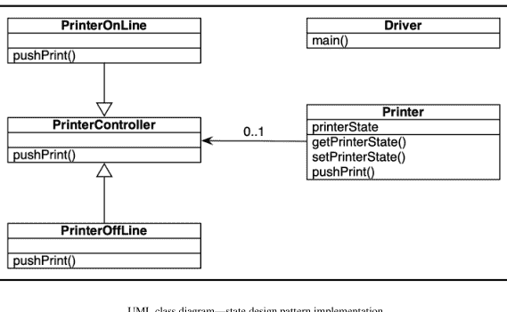

UML 类图中还指示 `Printer` 和 `Driver` 类。

## 编写设计模式

状态模式的实现示例由以下类组成：

- `PrinterOnLine`
- `PrinterOff`
- `Printer`
- `PrinterController`
- `Driver`

## PrinterOnLine

`PrinterOnLine` 扩展 `PrinterController` 类并重写了 `pushPrint()` 方法。调用时，该方法会清空打印机缓冲区并关闭。代码如下：

```java


```java
public class PrinterOnLine extends PrinterController {

    @Override
    public void pushPrint(Printer printJob) {
        System.out.println("\nclearing buffer and shutting down. . . ");
        printJob.setPrinterState(new PrinterOffLine());
    }
}
```

# 行为设计模式

正如代码所示，`PrinterOnline` 类中的 `pushPrint()` 方法会导致打印机从在线变为离线。

## PrinterOffLine

`PrinterOffLine` 类扩展 `PrinterController` 类并重写了 `pushPrint()` 方法。调用时，该方法会开启打印机。打印机从离线变为在线。

```java
public class PrinterOffLine extends PrinterController {

    @Override
    public void pushPrint(Printer printerJob) {
        System.out.println("\nPowering printer on wait. . . .");
        printerJob.setPrinterState(new PrinterOnline());
    }
}
```

如前面的代码所示，`PrinterOffLine` 类中的 `pushPrint()` 方法会导致打印机从离线变为在线。

## Printer

`Printer` 类有一个变量 `printerState`。它包含构造函数、访问器和修改方法。以下是 `Printer` 类源码：

```java
public class Printer {

    // class variable
    private PrinterController printerState;

    // constructor
    public Printer(PrinterController pState) {
        this.printerState = pState;
    }

    // accessor / getter
    public PrinterController getPrinterState() {
        return printerState;
    }

    // mutator / setter
    public void setPrinterState(PrinterController pState) {
        this.printerState = pState;
    }
}
```

行为设计模式

第 3 章

```java
public void pushPrint() {
    printerState.pushPrint(this);
}
```

`Printer` 类还包含 `pushPrint()` 方法，该方法模拟按下打印机的电源按钮。

## PrinterController

`PrinterController` 类包含一个抽象的 `pushPrint()` 方法：

```java
abstract class PrinterController {

    public abstract void pushPrint(Printer printJob);
}
```

所示 `pushPrint()` 抽象方法接收一个 `Printer` 对象作为参数。

## Driver

创建 `Driver` 类是为了测试状态模式实现的功能：

```java
public class Driver {

    public static void main(String[] args) {
        PrinterOffline initialState = new PrinterOffline();
        Printer printer = new Printer(initialState);

        System.out.println("\n");

        printer.pushPrint();
        printer.pushPrint();
        printer.pushPrint();

        System.out.println("\n");
    }
}
```

行为设计模式

第 3 章

## 输出

完成的应用程序生成了以下输出。`Driver` 类包含了三次 `pushPrint()` 调用。如所示，控制台输出为：

```text
Powering printer on wait. . . .
Clearing buffer and shutting down. . .
No messages found.
```

状态模式实现——应用程序输出

本节展示了源代码，演示了状态模式。

## 使用策略模式进行策略

策略设计模式允许你单独封装一组算法。结果是根据客户端产生算法的变化。这类似于方法重载，方法重载允许一个类拥有多个同名方法。同名方法的区别在于参数列表。

策略模式与方法重载示例的区别在于每个算法都是单独封装的。

下一节提供了一个示例 UML 类图。

## UML 类图

从 UML 类图中可以看出，同一个算法有多种选择，这里用 `sampleAlgorithm()` 方法表示：

## 97

行为设计模式

第 3 章

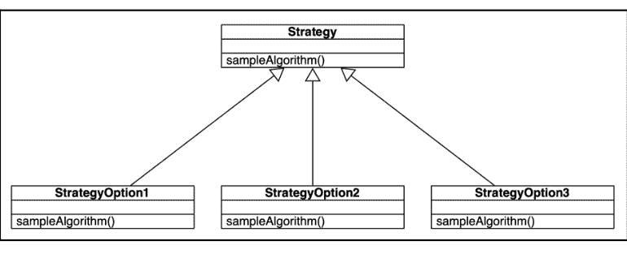

UML 类图——策略设计模式

正如 UML 类图所示，策略设计模式允许你单独封装一组可交换的算法。

## 理解模板方法模式

方法设计模式涉及创建一个算法模板，并将处理步骤交给子类。其目的是赋予子类指定自身步骤的能力，同时保持算法结构的真实。

正如设计模式的名字所示，我们创建一个可供子类遵循的模板。例子是一个食谱模板，烘焙遵循步骤制作壳，然后根据喜好添加自己的馅。另一个例子是创建教学大或简历模板。模板的每次使用都可以用于独特的内容且不改变模板。

## 理解访问者模式

访问者设计模式允许我们在不改变结构的情况下对对象执行操作。本质上，我们可以在不改变原始对象结构的情况下为对象添加功能。一个例子是去理发店要求剪头发。坐在椅子上，所需的参数发生了变化。这并没有改变操作的结构；它只是增加了新的功能，如同时染发、剪发和造型。

# 行为设计模式

## 第3章

通过面向对象编程，我们可以扩展访问者设计模式，使其影响继承机制。我们可以扩展一个类，然后在子类中为其添加功能。

## 总结

在本章中，我们学习了行为图如何说明系统组件之间如何交互以形成一个系统。我们还学习了行为设计模式关注的是系统中对象和类之间的交互。我们探索了行为设计模式类别以及列出的 12 种独立设计模式。我们还查看了编程挑战以及解决这些挑战的行为设计模式。

在下一章“创建型设计模式”中，我们将探索创建型设计模式类别及其具体的设计模式——抽象工厂、构建器、工厂方法、原型、简单工厂和单例。我们将研究编程挑战以及解决这些挑战的创建型设计模式。

## 思考

1. 哪种设计模式可能被用于根据之前的设置恢复系统？
2. 空对象模式属于哪种设计模式类别？
3. 观察者设计模式中对象依赖的目的是？
4. 哪种设计模式允许对象根据内部状态的变化来改变其行为？
5. 哪种设计模式允许你单独封装一组可交换的算法？
6. 哪种设计模式涉及为被分配到子类的处理步骤创建一个算法模板？
7. 哪种设计模式允许将对象发送给系列接收者，而发送者无需担心由哪个接收者处理请求？
8. 命令设计模式还有什么其他名称？
9. 解释器设计模式是做什么用的？
10. 迭代器设计模式依赖于哪个 Java 接口？

## 扩展阅读

- Java EE 8 设计模式与最佳实践 (https://www.packtpub.com/application-development/java-ee-8-design-patterns-and-best-practices)
- 用 Java 学习设计模式 [视频] (https://www.packtpub.com/application-development/learn-design-patterns-java-video)
- Java 设计模式与最佳实践 (https://www.packtpub.com/application-development/design-patterns-and-best-practices-java)

# 4 创建型设计模式

在上一章“行为设计模式”中，我们学习了行为图如何说明系统组件之间如何交互以形成一个系统。我们还学习了行为设计模式关注的是系统中对象和类之间的交互。我们探索了行为设计模式类别以及 12 种独立设计模式（责任链、命令、解释器、迭代器、中介者、备备、空、对象、观察者、状态、策略、模板方法和访问者）。我们的内容涵盖了编程挑战以及解决这些挑战的行为设计模式。

在本章“创建型设计模式”中，我们将探索创建型设计模式类别及其具体的设计模式。我们将研究编程挑战以及解决这些挑战的创建型设计模式：

- 介绍创建型设计模式
- 抽象工厂
- 构建器
- 工厂方法
- 原型
- 简单工厂
- 单例

## 技术要求

本章的代码可以在本书的 GitHub 仓库中找到：<https://github.com/PacktPublishing/Hands-On-Design-Patterns-with-Java/tree/master/Chapter04>。

## 介绍创建型设计模式

创建型设计模式用于在对象实例化（创建）时管理它们。在 Java 中，有两种基本的创建模式。当我们创建类时，我们使用继承。在创建对象时，我们可以将创建任务分配给其他对象。

创建型设计模式的如下：

- 将对象创建与系统分离
- 支持通过对象创建而非继承视图
- 封装有关系统使用哪些类的信息
- 保护对象创建细节

本章介绍的 6 种创建型设计模式可以分为两个子类——关注类的和关注对象的。下表详细说明了这些子类：

| 对象作用域 | 类作用域 |
| :--- | :--- |
| 抽象工厂模式 | 工厂模式 |
| 构建器模式 | 简单工厂模式 |
| 原型模式 | 单例模式 |

上表列出的创建型设计模式将在本章的剩余部分中详细介绍。它们按字母顺序排列，以说明其中任何一个都不比其他的更重要。

## 理解抽象工厂设计模式

在查看抽象工厂设计模式之前，让我们先回顾 `abstract`（抽象）一词以及它如何应用于 Java 类和我们开发的程序。

`abstract` 一词指的是某种没有确定的存在形式。在 Java 中，抽象类不能被实例化，但可以被继承。考虑一个抽象的 `Grandmother`（奶奶）类，它被 `Mother`（妈妈）类扩展。第三个类 `Daughter`（女儿）用于包含 `main()` 方法。以下是 `Grandmother` 类的代码：

```java
abstract class Grandmother {

    // 构造函数
}
```

## 创建型设计模式

## 第4章

```java
Grandmother() {
    System.out.println("Grandmother constructor executed.");
}
```

接下来，我们有 `Mother` 类，它继承自 `Grandmother` 并有自己的构造器方法：

```java
public class Mother extends Grandmother {

    // 构造函数
    Mother() {
        System.out.println("Mother constructor executed.");
    }
}
```

此示例中的最后一个类是 `Daughter` 类。以下是代码：

```java
public class Daughter {

    public static void main(String[] args) {
        Mother mom = new Mother();
    }
}
```

当应用程序运行时，控制台将提供以下结果：

```text
Grandmother constructor executed.
Mother constructor executed.
```

正如你在下面的截图所示，如果我们尝试实例化 `Grandmother` 类，将会收到该类是抽象的且无法实例化的错误：

## 创建型设计模式

## 第4章

抽象工厂设计模式创建了一个接口，用于在不了解具体类的情况下创建多个对象。Java 中的具体类是非抽象类，它实现了其层次结构中的所有方法。这是对封装的一种强大演示。这种设计模式允许我们在不更改源代码的情况下更改实现。

我们将查看一个示例用例、UML 类图以及实现该场景的抽象工厂设计模式所需的源码。

### 用例

我们将使用一个房车制造示例来演示抽象工厂设计模式。在制造房车时，有很多细节必须确定。在高层面上，制造商必须决定类型（A 型、B 型或 C 型）、样式（例如露营车、巴士、卡车）、框架、引擎和厨房。我们的示例将支持 A 型、B 型和 C 型房车，所有这些都需要样式、框架、引擎和厨房。

抽象工厂设计模式将用于创建对象集，每种房车类型一组。

## UML 类图

下面的 UML 类图显示了用于抽象工厂设计模式实现的接口和类之间的关系：

如 UML 类图所示，我们的实现方案将需要 5 个接口和 17 个类。

## 编程设计模式

我们的解决方案实现包含了五个接口（`Type`、`Style`、`Frame`、`Engine` 和 `Kitchen`）、一个 `MotorHomeAbstractFactory` 类、一个 `MotorHomeDriver` 类以及 15 个额外的类（每种类型 5 个）。以下是接口和类的完整列表：

| 接口 | 通用类 | TypeA 类 | TypeB 类 | TypeC 类 |
|---|---|---|---|---|
| `Type` | `MotorHomeAbstractFactory` | `TypeAFactory` | `TypeBFactory` | `TypeCFactory` |
| `Style` | `MotorHomeDriver` | `TypeAStyle` | `TypeBStyle` | `TypeCStyle` |
| `Frame` | | `TypeAFrame` | `TypeBFrame` | `TypeCFrame` |
| `Engine` | | `TypeAEngine` | `TypeBEngine` | `TypeCEngine` |
| `Kitchen` | | `TypeAKitchen` | `TypeBKitchen` | `TypeCKitchen` |

上表整理了解决方案中使用的 Java 类型。针对每种类型的类彼此非常相似。

### 接口

在我们抽象工厂设计模式实现中，五个接口中的每一个都包含一个访问器方法。它们的源代码列在此：

```java
public interface Type {
    public String getType();
}

public interface Style {
    public String getStyle();
}

public interface Frame {
    public String getFrame();
}

public interface Engine {
    public String getEngine();
}

public interface Kitchen {
    public String getKitchen();
}
```

如你所见，每个接口都返回一个 `String` 值。

## 抽象工厂类

`MotorHomeAbstractFactory` 定义了四个抽象方法。代码如下：

```java
public abstract class MotorHomeAbstractFactory {

    public abstract Frame createFrame();

    public abstract Style createStyle();

    public abstract Engine createEngine();

    public abstract Kitchen createKitchen();
}
```

上述代码中定义的抽象方法对应于后续章节中定义的 Factory 类。

## TypeA 类

我们的解决方案为三种类型的房车（A 型、B 型和 C 型）每种都包含一个 Factory 类。以下代码所示的 `TypeAFactory` 类继承了 `MotorHomeAbstractFactory` 类：

```java
public class TypeAFactory extends MotorHomeAbstractFactory {

    public Frame createFrame() {
        return new TypeAFrame();
    }

    public Style createStyle() {
        return new TypeAStyle();
    }

    public Engine createEngine() {
        return new TypeAEngine();
    }

    public Kitchen createKitchen() {
        return new TypeAKitchen();
    }
}
```

除了 Factory 类之外，我们还需要一个类来实现类层次结构。在这里，我们可以看到每个实现的接口：

```java
public class TypeAStyle implements Style {

    public String getStyle() {
        return "[Type A] Style:\tOff the Grid";
    }
}

public class TypeAEngine implements Engine {
```


# TypeA 类

以下代码定义了四个类，分别实现了相应的访问器方法并返回一个上下文 `String`：

```java
public class TypeAEngine implements Engine {

    public String getEngine() {

        return "[Type A] Engine:\tFord V10";

    }

}
```

```java
public class TypeAFrame implements Frame {

    public String getFrame() {

        return "[Type A] Frame:\tBus";

    }

}
```

```java
public class TypeAKKitchen implements Kitchen {

    public String getKitchen() {

        return "[Type A] Kitchen:\tFull";

    }

}
```

# TypeB 类

我们的解决方案为三种类型的房车（A 型、B 型和 C 型）每种都包含一个 `Factory` 类。这里所示的 `TypeBFactory` 类继承了 `MotorHomeAbstractFactory` 类：

```java
public class TypeBFactory extends MotorHomeAbstractFactory {

    public Frame createFrame() {

        return new TypeBFrame();

    }

    public Style createStyle() {

        return new TypeBStyle();

    }

    public Engine createEngine() {

        return new TypeBEngine();

    }

    public Kitchen createKitchen() {

        return new TypeBKitchen();

    }

}
```

除了 `Factory` 类之外，我们还需要一个类来实现类层次结构。在这里，我们可以看到每个类：

```java
public class TypeBStyle implements Style {

    public String getStyle() {

        return "[Type B] Style:\tWeekender";

    }

}
```

```java
public class TypeBEngine implements Engine {

    public String getEngine() {

        return "[Type B] Engine:\tFord Transit 350 HD";

    }

}
```

```java
public class TypeBFrame implements Frame {

    public String getFrame() {

        return "[Type B] Frame:\tCamper Van";

    }

}
```

```java
public class TypeBKitchen implements Kitchen {

    public String getKitchen() {

        return "[Type B] Kitchen:\tCompact";

    }

}
```

定义的四个类实现了相应的访问器方法并返回一个上下文 `String`。

# Type-C 类

我们的解决方案为三种类型的房车（A 型、B 型和 C 型）每种都包含一个 `Factory` 类。以下代码所示的 `TypeCFactory` 继承了 `MotorHomeAbstractFactory` 类：

```java
public class TypeCFactory extends MotorHomeAbstractFactory {

    public Frame createFrame() {

        return new TypeCFrame();

    }

    public Style createStyle() {

        return new TypeCStyle();

    }

    public Engine createEngine() {

        return new TypeCEngine();

    }

    public Kitchen createKitchen() {

        return new TypeCKitchen();

    }

}
```

除了 `Factory` 类之外，我们还需要一个类来实现类层次结构。在这里，我们可以看到每个实现的接口：

```java
public class TypeCStyle implements Style {

    public String getStyle() {

        return "[Type C] Style:\tExtended Trip";

    }

}
```

```java
public class TypeCEngine implements Engine {

    public String getEngine() {

        return "[Type C] Engine:\tFord E-450";

    }

}
```

```java
public class TypeCFrame implements Frame {

    public String getFrame() {

        return "[Type C] Frame:\tTruck";

    }

}
```

```java
public class TypeCKitchen implements Kitchen {

    public String getKitchen() {

        return "[Type C] Kitchen:\tFull";

    }

}
```

## Driver 类

抽象工厂设计模式实现的 `Driver` 类在后续章节给出：

```java
public class MotorHomeDriver {

    public static void main(String[] args) {

        MotorHomeAbstractFactory mFactory = null;

        String nextMotorHome = "TypeA"; // 模拟用户输入

        if (nextMotorHome.equals("TypeA")) {

            mFactory = new TypeAFactory();

            System.out.println("A motor home selected");

        } else if (nextMotorHome.equals("TypeB")) {

            mFactory = new TypeBFactory();

            System.out.println("B motor home selected");

        } else if (nextMotorHome.equals("TypeC")) {

            mFactory = new TypeCFactory();

            System.out.println("C motor home selected");

        } else {

            System.out.println("Invalid motor home type.");

        }

        System.out.println("\nComponent list for " + nextMotorHome + " motor home");

        System.out.println(mFactory.createStyle().getStyle());

        System.out.println(mFactory.createFrame().getFrame());

        System.out.println(mFactory.createEngine().getEngine());

        System.out.println(mFactory.createKitchen().getKitchen());

    }

}
```

# 使用构建器模式构建

构建者设计模式用于在对象的实例化和表示之间创建分离。其目的是允许在相同的实例化过程中产生不同的表示形式。

在此语境下，表示指的是对对象的描述。


这种设计模式通常只用于复杂对象。使用构建者模式，复杂对象是通过分不同的步骤创建的。这允许我们根据所采取的构建步骤来构建出不同的对象。

我们将查看一个用例场景、UML 类图，以及实现该场景下构建器设计模式所需的源代码。

## 用例场景

为了演示构建者设计模式，我们将实现一个咖啡烘豆机制造应用程序。该程序将辅助两种不同型号咖啡烘豆机的创建：个人型和商用型。总共有八个组件；某些组件用于两种烘豆机模型，而标记为特定的组件在每个烘豆机模型中是不同的。此外，平台组件仅商用烘豆机模型需要。下表提供了这些组件的概述：

| 组件 | 个人型烘豆机 | 商用烘豆机 |
|---|---|---|
| 冷却盘 | 型号特定 | 型号特定 |
| 排气系统 | 型号特定 | 型号特定 |
| 燃气炉 | 型号特定 | 型号特定 |
| 内筒 | 型号特定 | 型号特定 |
| 主体 | 型号特定 | 型号特定 |
| 电机 | 标准 | 标准 |
| 平台 | 不需要 | 标准 |
| 热电偶 | 标准 | 标准 |

如前面的表格所示，五个组件是烘豆机模型特有的，三个是标准的。其中一个组件（平台）在个人型烘豆机的构建中是不需要的。

## UML 类图

我们的咖啡烘豆机制造实现的 UML 类图如下所示：

| | RoasterDirector | |
|---|---|---|
| | personalRoasterBuilder | |
| | commercialRoasterBuilder | |
| | main() | |

| RoasterDirector | << interface >> Builder | |
|---|---|---|
| currentBuilder buildRoaster() | buildCoolingTray() buildExhaustSystem() buildGasBurner() buildPlatform() buildMotor() buildThermocouples() buildDrum() buildMainBody() getRoaster() | |

| PersonalRoaster | CommercialRoaster | |
|---|---|---|
| roaster buildCoolingTray() buildExhaustSystem() buildGasBurner() buildPlatform() buildMotor() buildThermocouples() buildDrum() buildMainBody() getRoaster() | roaster buildCoolingTray() buildExhaustSystem() buildGasBurner() buildPlatform() buildMotor() buildThermocouples() buildDrum() buildMainBody() getRoaster() | |

| | Roaster | |
|---|---|---|
| | components add() display() |


如 UML 类图所示，我们的解决方案包含一个 `Builder` 接口和五个类。

## 设计模式的编程

我们咖啡烘豆机制造构建器设计模式的编程解决方案由一个 `Roaster` 类、一个接口、一个 `Driver` 类和四个额外类组成。每个类在本节中详细介绍。

### Roaster 类

我们解决方案中的第一个类是 `Roaster` 类。该类允许实例化多个 `Roaster` 对象。该类包含一个构造方法、一个用于向烘豆机添加组件的 `add()` 方法，以及一个用于显示烘豆机组件的 `display()` 方法：

```java
import java.util.LinkedList;

public class Roaster {

    private LinkedList<String> components;

    public Roaster() {

        components = new LinkedList<>();

    }

    public void add(String component) {

        components.addLast(component);

    }

    public void display() {

        System.out.println("\nROASTER BUILD:");

        for (int i=0; i<components.size(); i++) {

            System.out.println(components.get(i));

        }

    }

}
```

如前面的代码所示，导入了 `java.util.LinkedList` 包是因为 `Roaster` 类使用了 `LinkedList` 对象。

### 接口

`Builder` 接口在下面的代码提供，由八个方法组成，每个方法对应一个烘豆机组件：

```java
public interface Builder {

    void buildCoolingTray();

    void buildExhaustSystem();

    void buildGasBurner();

    void buildPlatform();

    void buildMotor();

    void buildThermocouples();

    void buildInnerDrum();

    void buildMainBody();

    Roaster getRoaster();

}
```

`Builder` 接口还包含一个返回 `Roaster` 对象的 `getRoaster()` 方法。

### 构建器类

我们的解决方案涉及两个构建器类——`PersonalRoaster` 和 `CommercialRoaster`。下面的代码是 `PersonalRoaster` 类的前半部分。它实现了 `Builder` 接口并实例化了一个 `Roaster` 对象。

在这段代码中，有四个用于构建特定组件的方法，每个方法都使用了 `add()` 方法：

```java
public class PersonalRoaster implements Builder {

    private Roaster roaster = new Roaster();

    @Override

    public void buildCoolingTray() {

        roaster.add("Personal Roaster Cooling Tray added");

    }

    @Override

    public void buildExhaustSystem() {

        roaster.add("Personal Roaster Exhaust System added");

    }

    @Override

    public void buildGasBurner() {

        roaster.add("Personal Roaster Gas Burner added");

    }

    @Override

    public void buildPlatform() {

        // not applicable for personal roaster

    }

    @Override

    public void buildMotor() {

        roaster.add("Personal Roaster Motor added");

    }

    @Override

    public void buildThermocouples() {

        roaster.add("Personal Roaster Thermocouples added");

    }

    @Override

    public void buildInnerDrum() {

        roaster.add("Personal Roaster Inner Drum added");

    }

    @Override

    public void buildMainBody() {

        roaster.add("Personal Roaster Main Body added");

    }

    @Override

    public Roaster getRoaster() {

        return roaster;

    }

}
```


对于`CommercialRoaster`类，下面的代码是其前半部分。它同样实现了`Builder`接口并实例化了一个`Roaster`对象。

```java
public class CommercialRoaster implements Builder {

    private Roaster roaster = new Roaster();

    @Override
    public void buildCoolingTray() {
        roaster.add("Commercial Roaster Cooling Tray added");
    }

    @Override
    public void buildExhaustSystem() {
        roaster.add("Commercial Roaster Exhaust System added");
    }

    @Override
    public void buildGasBurner() {
        roaster.add("Commercial Roaster Gas Burner added");
    }

    @Override
    public void buildPlatform() {
        roaster.add("Commercial Roaster Platform added");
    }

    @Override
    public void buildMotor() {
        roaster.add("Commercial Roaster Motor added");
    }

    @Override
    public void buildThermocouples() {
        roaster.add("Commercial Roaster Thermocouples added");
    }

    @Override
    public void buildInnerDrum() {
        roaster.add("Commercial Roaster Inner Drum added");
    }

    @Override
    public void buildMainBody() {
        roaster.add("Commercial Roaster Main Body added");
    }

    @Override
    public Roaster getRoaster() {
        return roaster;
    }
}
```

### Director 类

`RoasterDirector`类创建一个`Builder`实例，然后使用一系列步骤来构建烘豆机。`RoasterDirector`类不知道正在创建的烘豆机是个人型还是商用型：

```java
public class RoasterDirector {

    Builder currentBuilder;

    // 烘豆步骤
    public void buildRoaster(Builder builder) {
        currentBuilder = builder;

        currentBuilder.buildCoolingTray();
        currentBuilder.buildExhaustSystem();
        currentBuilder.buildGasBurner();
        currentBuilder.buildInnerDrum();
        currentBuilder.buildMainBody();
        currentBuilder.buildMotor();
        currentBuilder.buildPlatform();
        currentBuilder.buildThermocouples();
    }
}
```

### Driver 类

`RoasterDriver`类包含程序的`main()`方法并驱动应用程序。它通过创建`RoasterDirector`实例和两个`Builder`实例来实现功能。接下来，分别为个人烘豆机和商用烘豆机各调用一次构建序列：

```java
public class RoasterDriver {

    public static void main(String[] args) {
        RoasterDirector director = new RoasterDirector();

        Builder personalRoaster = new PersonalRoaster();
        director.buildRoaster(personalRoaster);
        personalRoaster.getRoaster().display();

        Builder commercialRoaster = new CommercialRoaster();
        director.buildRoaster(commercialRoaster);
        commercialRoaster.getRoaster().display();
    }
}
```

# 创建型模式

## 第 4 章

```java
RoasterDirector roasterDirector = new RoasterDirector();

Builder personalRoasterBuilder = new PersonalRoaster();

Builder commercialRoasterBuilder = new CommercialRoaster();

// 构建一台家用烘焙机
roasterDirector.buildRoaster(personalRoasterBuilder);

Roaster unit1 = personalRoasterBuilder.getRoaster();

unit1.display();

// 构建一台商用烘焙机
roasterDirector.buildRoaster(commercialRoasterBuilder);

Roaster unit2 = commercialRoasterBuilder.getRoaster();

unit2.display();
```

在每个构建序列完成后都会调用`display()`方法。如下所示，每个烘焙机模型的组件都是不同的：

| 烘焙机构建： |
| --- |
| 添加了家用烘焙机冷却盘 |
| 添加了家用烘焙机排气系统 |
| 添加了家用烘焙机燃炉 |
| 添加了家用烘焙机内筒 |
| 添加了家用烘焙机主体 |
| 添加了标准电机 |
| 添加了标准热电偶 |

| 烘焙机构建： |
| --- |
| 添加了烘焙机冷却盘 |
| 添加了商用烘焙机排气系统 |
| 添加了商用烘焙机燃炉 |
| 添加了商用烘焙机内筒 |
| 添加了商用烘焙机主体 |
| 添加了标准电机 |
| 添加了标准平台 |
| 添加了标准热电偶 |

### 建造设计模式实现——控制台输出

本节提供了我们咖啡烘焙机制造中建造设计模式的源码和控制台输出。

## 探索工厂方法设计模式

工厂方法设计模式允许子类决定创建哪种类。这是通过从框架中移除关于创建哪种类的细节来实现的。相反，它将对象创建的责任交给了子类。当框架不知道要实例化什么对象时，这种设计模式非常有用。

我们将查看一个用例、UML类图以及实现该场景下工厂方法设计模式所需的源码。

### 用例

为了演示工厂方法设计模式，我们将创建一个割草机选择助手（Mower Selection Helper）实现。系统将提供有用信息，帮助用户选择割草机类型。支持的类型包括乘载式（riding）和推式（push）。我们将创建一个抽象工厂类，其中包含一个获取割草机类型的方法。我们还为具体类创建了一个工厂方法，用于实例化特定的割草机对象。

### UML 类图

工厂方法设计模式的割草机选择助手实现的UML类图由一个被两个类实现的接口组成。

创建型模式

第4章

`ConcreteMowerFactory`类是发生对象实例化的地方：

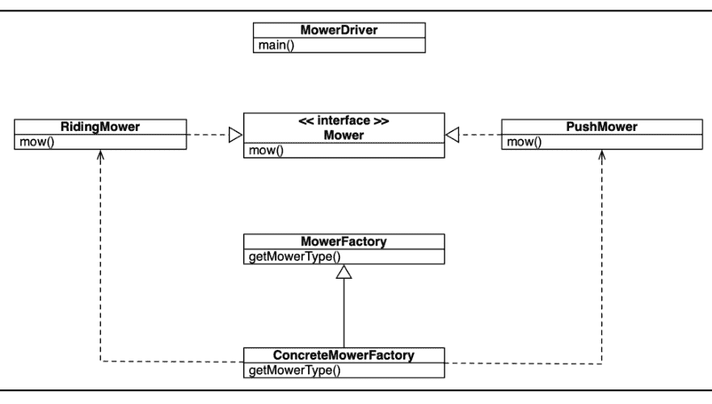

UML类图——工厂方法设计模式实现

如UML类图所示，`RidingMower`和`PushMower`类实现了`Mower`接口，而`MowerFactory`类已从对象创建过程中移除。

## 编写模式的编程

我们的实现从一个`Mower`接口开始。它有一个`mow()`方法：

```java
public interface Mower {
    void mow();
}
```

接下来的代码段是`MowerFactory`抽象类。在那里，我们将有一个`ConcreteMowerFactory`子类：

```java
abstract class MowerFactory {
    public abstract Mower getMowerType(String mowerType);
}
```

# 创建型模式

## 第 4 章

`Riding`类代表这种类型割草机的类对象。它实现了`Mower`接口。它重写了`mow()`方法并输出特定此类型割草机的文本：

```java
public class Riding implements Mower {

    @Override
    public void mow() {
        System.out.println("Riding mowers provide safety and comfort.");
    }
}
```

`Push`类代表推式割草机类型的类对象。它实现了`Mower`接口。`Push`类重写了`mow()`方法并输出特定此类型割草机的文本：

```java
public class Push implements Mower {

    @Override
    public void mow() {
        System.out.println("Push mowers are good for small yards.");
    }
}
```

后续代码所示`ConcreteMowerFactory`类继承自`MowerFactory`类。该类用于根据字符串参数确定实例化哪种类型的割草机：

```java
public class ConcreteMowerFactory extends MowerFactory {

    @Override
    public Mower getMowerType(String mowerType) {
        if (mowerType.equals("Riding")) {
            return new Riding();
        } else if (mowerType.equals("Push")) {
            return new Push();
        } else {
            System.out.println("Invalid mower type selected.");
            return null;
        }
    }
}
```

# 创建型模式

## 第 4 章

我们实现中的最后一个类是`MowerDriver`类。该类包含`main()`方法并驱动应用程序。`main()`方法从打印一个简单的输出头开始。然后，为每个割草机类型创建两个割草机实例：

```java
public class MowerDriver {

    public static void main(String[] args) {
        // 输出头
        System.out.println("\nMOWER SELECTION HELPER");

        // 创建第一个割草机
        MowerFactory mowerFactory = new ConcreteMowerFactory();

        Mower rideIt = mowerFactory.getMowerType("Riding");
        rideIt.mov();

        // 创建第二个割草机
        Mower pushIt = mowerFactory.getMowerType("Push");
        pushIt.mov();
    }
}
```

如下所示，割草机选择助手实现打印了`MowerDriver`类`main`方法的输出头，然后是每个实例化对象的`mov()`方法：

```text
MOWER SELECTION HELPER
Riding mowers provide safety and comfort.
Push mowers are good for small yards.
```

### 工厂模式实现——控制台输出

本节提供了我们选择实现中建造模式的源码和控制台输出。

## 使用原型设计模式

对象的创建需要时间，减少创建对象的时间是原型模式的目标。原型设计模式允许我们使用原型实例来指定对象类别。通过复制该实例来创建新对象。原型设计模式适用于希望创建与系统无关的情况。例如，我们可能正在开发一个包含多个关卡的游戏。每个关卡基于一个核心关卡并进行修改。我们可以克隆原型关卡来创建后续关卡，避免从零开始。

创建型模式

第4章

我们将使用游戏关卡创建系统作为实现原型模式的示例应用程序。我们将有一个`BaseLevel`原型类和三个具体原型类，每个对应不同类型的关卡。这些具体原型类将实现`BaseLevel`的`clone()`方法。不同的关卡属性将分别应用于这三个关卡。

## UML 类图

如下所示的UML类图展示了我们游戏关卡创建系统的实现。我们的实现有一个`BaseLevel`类，包含`clone()`方法。该方法被三个子类（`Dungeon`、`Forest`和`City`）重写：

| LevelDriver |
| --- |
| `main()` |
| BaseLevel |
| `levelName` \| `numberOfNPCs` \| `numberOfTokens` |
| `getLevelName()` \| `getNumberOfs()` \| `getNumberOf()` |
| `setLevelName()` \| `setNumberOfs()` \| `setNumberOf()` \| `clone()` |
| Dungeon (`clone()`) \| Forest (`clone()`) \| City (`clone()`) |

原型设计实现

# 创建型模式

## 第 4 章

如UML类图所示，`LevelDriver`类包含应用程序的`main()`方法，并用于驱动程序的功能。

## 编写设计模式

我们的游戏关卡创建系统从抽象类`BaseLevel`开始。该类实现了Java的`Cloneable`接口。每个创建的游戏关卡将包含三个类变量：`levelName`、`numberOfPCs`和`numberOfTokens`。紧随类之后的是访问器方法，每个变量对应一个方法：

```java
public abstract BaseLevel implements Cloneable {

    public String levelName;

    public int numberOfPCs;

    public int numberOfTokens;

    // accessor methods
    public String getLevelName() {
        return levelName;
    }

    public int getNumberOfPCs() {
        return numberOfPCs;
    }

    public int getNumberOfTokens() {
        return numberOfTokens;
    }
}
```

`BaseLevel`类的后半部分包含了类变量的修改器方法。类的底部是`clone()`方法，它用于创建`BaseLevel`类的副本：

```java
// mutator methods
public void setLevelName(String levelName) {
    this.levelName = levelName;
}

public void setNumberOfPCs(int npc) {
    this.numberOfPCs = npc;
}

public void setNumberOfTokens(int tokens) {
    this.numberOfTokens = tokens;
}

// level clone method
public BaseLevel clone() throws CloneNotSupportedException {
    return (BaseLevel) super.clone();
}
```

我们的实现包含了三个扩展`BaseLevel`的类。以下是`Dungeon`类的代码。该类包含一个构造函数并重写了`BaseLevel`类的`clone()`方法：

```java
public class Dungeon extends BaseLevel {

    public Dungeon(String name) {
        levelName = name;
    }

    @Override
```


# 创建设计模式

## 第4章

如下所示，`Forest` 类扩展了`BaseLevel`类。该类包含一个构造函数并重写了`BaseLevel`类的`clone()`方法：

```java
public class Forest extends BaseLevel {

    public Forest(String name) {

        levelName = name;

    }

    @Override

    public BaseLevel clone() throws CloneNotSupportedException {

        return (Forest)super.clone();

    }

}
```

与`Dungeon`和`Forest`类一样，如下所示的`City`类也扩展了`BaseLevel`类。该类包含一个构造函数并重写了`BaseLevel`类的`clone()`方法：

```java
public class City extends BaseLevel {

    public City(String name) {

        levelName = name;

    }

    @Override

    public BaseLevel clone() throws CloneNotSupportedException {

        return (City)super.clone();

    }

}
```

实现游戏关卡创建系统的最后一个类是`LevelDriver`。该类只包含一个`main()`方法。正如后续代码所示，该方法分为两个部分。第一部分以输出头开始，并创建一个`Dungeon`对象、一个`Forest`对象和一个`City`对象。在创建每个对象时，提供了游戏关卡名称、NPC 数量和 Token 数量：

```java
public class LevelDriver {

    public static void main(String[] args) throws CloneNotSupportedException {

        System.out.println("\n\GAME LEVEL CREATION\n");

        // Create Dungeon Level

        BaseLevel dungeon = new Dungeon("Slasher's Dungeon Level 1");

        dungeon.numberOfPCs = 500;

        dungeon.numberOfTokens = 80;

        // Create Forest Game Level

        BaseLevel forest = new Forest("Acid Rain Forest Level");

        forest.numberOfPCs = 250;

        forest.numberOfTokens = 120;

        // Create City Game Level

        BaseLevel city = new City("Industrial City Level");

        city.numberOfPCs = 319;

        city.numberOfTokens = 600;
```

`levelDriver` `main()`方法的第二部分做了两件事。首先，它创建了已存在的`Dungeon`对象的副本，并命名为`levelClone`。为关卡名称、NPC 数量和 Token 设置了新值。此代码执行的第二个任务是显示输出以验证应用程序的功能：

```java
// Clone Dungeon Object

BaseLevel levelClone1;

levelClone1 = dungeon.clone();

levelClone1.setLevelName("Slasher's Dungeon Level 2");

levelClone1.setNumberOfPCs(1000);

levelClone1.setNumberOfTokens(40);

// Display output for functionality verification

System.out.println("Dungeon Level information");

System.out.println("Level Name : " + dungeon.getLevelName());

System.out.println("Number of NPCs : " + dungeon.getNumberOfPCs());

System.out.println("Number of Tokens : " + dungeon.getNumberOfTokens());

System.out.println("\nCloned Level information\n");
```

该应用程序的输出如下：

```
GAME LEVEL CREATION

Dungeon Level information

Level Name : Slasher's Dungeon Level 1

Number of NPCs : 500

Number of Tokens : 80

Cloned Level information

Level Name : Slasher's Dungeon Level 2

Number of NPCs : 1000

Number of Tokens : 40
```

我们解决方案中的最后一个类是`LawnMowerSeatDriver`类。该类包含`main`方法并调用`Factory`类来创建对象：

```java
public class LawnMowerSeatDriver {

    public static void main(String[] args) {

        System.out.println("\n\n");

        // 创建一个家用割草机座椅

        LawnMowerSeat residential =

        LawnMowerSeatFactory.create(LawnMowerSeatFactory.LawnMowerType.RESIDENTIAL);

        // 创建一个商用割草机座椅

        LawnMowerSeat commercial =

        LawnMowerSeatFactory.create(LawnMowerSeatFactory.LawnMowerType.COMMERCIAL);

    }

}
```

在创建每个对象后，控制台会打印上下文文本。此处显示的输出如下：

| 已创建座椅的家用割草机座椅。 |
| --- |
| 已创建带防滚架的商用割草机座椅。 |

简单工厂设计模式实现——控制台输出

本节提供了我们割草机座椅创建系统实现简单工厂设计模式的源代码和控制台输出。

## 实现单例设计模式

单例模式可能是所有创建设计模式中最容易理解和实现的一种。该设计模式的目的是确保一个类只有一个实例，并且该实例可以从外部访问。基于安全的系统通常会实现单例模式。例如，创建一个新账户的银行系统。确保这些账户仅由单个系统生成是至关重要的。

我们将通过将单例类的构造函数设置为私有来简单地实现单例模式。

我们将查看一个用例案例、UML 类图以及实现该场景下单例设计模式所需的源代码。

### 用例

为了演示单例模式，我们将创建一个银行账户生成系统。该系统将由一个只能实例化一次的单例类组成。我们的系统将尝试创建多个单例类实例，以验证应用程序的功能。

## UML 类图

如 UML 类图所示，需要两个类来演示我们的单例模式实现：

| AccountDriver | CreateBankAccount |
| --- | --- |
| main() | newAccount |
| | CreateBankAccount() |

UML 类图——单例模式实现

UML 类图恰恰指示了`AccountDriver`类包含`main()`方法，并将被用于驱动程序的执行。

## 编写设计模式

`CreateBankAccount`类包含一个私有构造函数，这将防止尝试实例化多个`CreateBankAccount`对象的实例。`getNewAccount()`方法检查`newAccount`是否已经存在，并向用户提供上下文反馈：

```java
public class CreateBankAccount {

    private static CreateBankAccount newAccount;

    // 构造函数

    private CreateBankAccount() {

    }

    public static CreateBankAccount getNewAccount() {

        if (newAccount == null) {

            newAccount = new CreateBankAccount();

            System.out.println("New Account created.");

        } else {

            System.out.println("Account already opened.");

        }

        return newAccount;

    }

}
```

驱动类`AccountDriver`打印一个标题标签，然后尝试创建两个`CreateBankAccount`对象的实例，如下所示：

```java
public class AccountDriver {

    public static void main(String[] args) {

        System.out.println("\n\nAccount Number Generation System");

        // 创建新账户

        BankAccount account1 = CreateBankAccount.getNewAccount();

        // 创建第二个账户

        BankAccount account2 = CreateBankAccount.getNewAccount();

    }

}
```

如下面的控制台输出所示，第一次尝试创建对象成功，随后的尝试失败了。这说明单例模式已正确实现：

| 银行账户生成系统 |
| --- |
| 已创建账户。 |
| 账户已开启。 |

构建器设计模式实现——控制台输出

本节提供了我们银行账户系统实现单例模式的源代码和控制台输出。

## 总结

在这一章“创建设计模式”中，我们探索了创建设计模式类别及其各个具体的模式：抽象工厂、构建器、工厂方法、原型、简单工厂和单例。我们学习到创建设计模式被用于管理对象的实例化。创建设计模式的目的是将对象创建与系统分离，支持通过继承依赖对象创建，封装有关系统使用的类信息，并保护对象创建细节。

在下一章“结构设计模式”中，我们将探索结构设计模式类别及其各个具体的模式：适配器、桥接、组合、Facade、享元和代理。

## 思考题

1. 创建设计模式的四个目的是什么？
2. 六种创建设计模式有哪些？
3. 创建设计模式分为哪两类？
4. Java 中的抽象类有什么独特之处？
5. 哪种设计模式创建一个接口，用于在未知具体类的情况下创建多个对象？
6. 哪种设计模式用于创建对象实例化和表示之间的分离？
7. 哪种设计模式允许子类确定要创建哪个类？
8. 哪种设计模式允许我们使用原型实例指定一个对象的类别？
9. 哪种设计模式用于将对象创建委托给特定的类？
10. 哪种设计模式确保类只有一个实例？

## 扩展阅读

- [Java EE 设计模式与最佳实践](https://www.packpub.com/application-development/java-ee-8-design-patterns-best-practices)
- [使用 Java 设计模式](https://www.packpub.com/application-development/learn-design-patterns-java)
- [Java 设计模式与最佳实践](https://www.packpub.com/application-development/design-patterns-and-best-practices)

# 结构设计模式

在上一章“创建设计模式”中，我们探索了创建设计模式类别及其各个具体的模式：抽象工厂、构建器、工厂方法、原型、简单工厂和单例。我们学习到创建设计模式被用于管理对象实例化与系统，支持通过继承依赖对象创建，封装有关系统使用的类信息，并保护对象创建细节。

在本章“结构设计模式”中，我们将探索结构设计模式类别。结构设计模式用于识别系统组件之间的关系。本章将涵盖以下七种结构设计模式：

- 结构设计模式简介
- 适配器
- 桥接
- 组合
- 装饰器
- Facade
- 享元
- 代理

## 技术要求

本章的代码可以在 https://github.com/PacktPublishing/Hands-On-Design-Patterns-with-Java/tree/Chapter05 找到。

## 结构设计模式简介

结构设计模式关注如何组合对象和类来形成系统。结构设计模式分为两类：

- **对象设计模式**：结构对象模式用于描述如何创建具有新功能的
- **类设计模式**：结构类模式利用继承创建接口并组合多个类形成更大的结构

本章介绍了这两种方法的示例。

本章介绍的七种结构设计模式都具有对象范围，适配器设计模式除外。适配器设计模式具有对象和类范围，如下表所示：

| 对象范围 | 类范围 |
| --- | --- |
| 适配器对象模式 | 适配器类模式 |
| 桥接模式 | |
| 组合模式 | |
| 装饰器模式 | |
| Facade 模式 | |
| 享元模式 | |
| 代理模式 | |

上表中的结构设计模式将在本章剩余章节中详细介绍。它们按字母顺序排列，以说明没有哪个比另一个更重要。

## 理解适配器设计模式

适配器设计模式用于将一个类的接口转换为系统预期的接口。这种设计模式使类无论接口是否兼容都能能够协同工作。

考虑一个露营车的真实世界案例。一根电线插在露营车上。电线的另一端插在电源插座上。如果电源插座与插头不匹配，就需要一个适配器。我们可以说露营车和电源插座都是类，拥有它们自己的接口。

### 用例

我们将使用一个房地产土地面积计算程序来演示如何实现适配器设计模式。有两个相似的类，它们没有继承自同一个基类，且在没有适配器的情况下无法直接相互通信。`Lot`类仅包含长度和宽度，以便以平方英尺计算面积。这假设地块面积较小。`Estate`类的面积将以亩为单位计算，因为那些地块要大得多。

## UML 类图

如下面的 UML 类图所示，`AcreageDeterminatorAdapter`类促进了`Lot`和`Estate`类之间的通信：

| AcreageDeterminatorAdapter | Estate |
| :--- | :--- |
| determinator | length |
| estate | width |
| determineAcreage() | Estate() |
| AcreageDeterminator | AdapterDriver |
| lot | acreageFormat |
| determineAcreage() | main() |
| Lot | |
| length | |
| width | |

UML 类图——适配器设计模式实现

如图所示，`AdapterDriver`类用于驱动应用程序并包含`main()`方法。

## 编写设计模式

这里显示的`Lot`类仅包含两个变量，可用于计算`Lot`类实例的平方英尺面积：

```java
public class Lot {

    // 类变量

    public double length;

    public double width;

}
```

`Estate`类包含与`Lot`类相同的两个变量，并且包含一个构造方法：

```java
public class Estate {

    // 类变量

    public double length;

    public double width;

    // 构造方法

    public Estate(int length, int width) {

        this.length = length;

        this.width = width;

    }

}
```

`AcreageDeterminator`类用于计算`Lot`实例的平方英尺：

```java
public class AcreageDeterminator {

    Lot lot;
```


# 结构型设计模式

## 第 5 章

`AcreageDeterminator` 类是允许 `Lot` 和 `Estate` 类之间通信的适配器类。`AcreageDeterminator` 和 `Estate` 的实例决定面积。`determineAcreage()` 方法创建了 `Lot` 和 `Estate` 类的实例。`Estate` 实例的值赋值给 `Lot` 实例的值。然后，该方法执行针对 `Estate` 实例的计算并返回该值，如下所示：

```java
public class AcreageDeterminatorAdapter {

    AcreageDeterminator determinator;

    Estate estate;

    public double determineAcreage(Estate tEstate) {

        determinator = new AcreageDeterminator();

        estate = tEstate;

        Lot tLot = new Lot();

        tLot.length = estate.length;

        tLot.width = estate.width;

        return (determinator.determineAcreage(tLot) / 43560);

    }

}
```

`AdapterDriver` 是包含 `main()` 方法的应用类。该方法包含一些清理功能，包括输出表头以及允许将输出格式化为两位小数。`main()` 方法中的核心功能是创建 `AcreageDeterminatorAdapter` 和 `Estate` 实例。创建 `Estate` 实例时，长度和宽采样值分别为 2300 和 6325。调用 `AcreageDeterminatorAdapter` 实例的 `determineAcreage()` 方法，并将 `Estate` 实例作为方法调用的参数。以下代码展示了这一点：

```java
import java.text.DecimalFormat;

public class AdapterDriver {

    private static DecimalFormat acreFormat = new DecimalFormat(".##");

    public static void main(String[] args) {

        System.out.println("\n房地产土地面积计算");

        AcreageDeterminatorAdapter adAdapter = new AcreageDeterminatorAdapter();

        Estate estate = new Estate(2300, 6325);

        System.out.print("Estate Acreage: ");

        System.out.print(acreFormat.format(adAdapter.determineAcreage(estate)));

    }

}
```

应用程序的控制台输出在此：

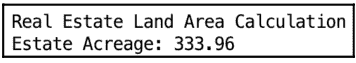

适配器设计模式实现——控制台输出

本节提供了我们使用适配器模式实现房地产土地面积计算计划的源码和控制台输出。

## 桥接设计模式

桥接设计模式简单地将抽象与实现分离。这种设计模式涉及在抽象和实现之间建立一座桥梁。在进一步探索这种设计模式之前，彻底理解 Java 中抽象如何工作是非常重要的。

### 学习抽象

抽象是面向对象编程 (OOP) 的原则之一，用于隐藏实现细节。理解抽象对于支持正确的实现至关重要。

抽象的一个示例当我们有一个抽象的 `User` 类和多个继承自它的子类时。例如，我们可能有一个学习管理系统 (LMS) `User` 类以及三个子类——学生（Student）、教师（Teacher）和管理员（Administrator）。我们可以通过重写继承的方法来隐藏原本会暴露实现细节。具体来说，父类定义方法，而子类实现这些方法。

如下面的 UML 图所示，`Student`、`Teacher` 和 `Administrator` 类都继承自 `User` 类并重写了 `computeCredits()` 方法：

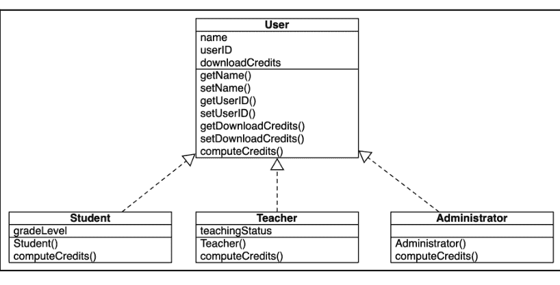

上述抽象说明了 `Student`、`Teacher` 和 `Administrator` 类都继承自 `User` 类并重写 `computeCredits()` 方法。

`User` 类是抽象的，没有方法体。

```java
public abstract class User {

    // 类变量
    protected String name;

    protected String userID;

    protected int downloadCredits;

    // 构造方法
    public User(String name, String userID, int downloadCredits) {

        this.name = name;

        this.userID = userID;

        this.downloadCredits = downloadCredits;

    }

    // 访问方法
    public String getName() {

        return name;

    }

    public String getUserID() {

        return userID;

    }

    public int getDownloadCredits() {

        return downloadCredits;

    }

    // 变器方法
    public void setName(String name) {

        this.name = name;

    }

    public void setID(String userID) {

        this.userID = userID;

    }

    public void setDownloadCredits(int downloadCredits) {

        this.downloadCredits = downloadCredits;

    }

    // 抽象方法
    public abstract int computeCredits();

}
```

`Student` 类继承自 `User` 类，并包含一个 `gradeLevel` 变量和一个构造方法。它调用了父类的构造方法并设置了自己的属性。它重写了 `computeCredits()` 方法如下：

```java
public class Student extends User {

    private int gradeLevel;

    public Student(String name, String userID, int downloadCredits, int gradeLevel) {

        super(name, userID, downloadCredits);

        this.gradeLevel = gradeLevel;

    }

    @Override
    public int computeCredits() {

        return getDownloadCredits() * gradeLevel;

    }

}
```

`Teacher` 类继承自 `User` 类，并包含一个 `teachingStatus` 变量和一个构造方法。它调用了父类的构造方法并设置了自己的属性。它重写了 `computeCredits()` 方法如下：

```java
public class Teacher extends User {

    private int teachingStatus;

    public Teacher(String name, String userID, int downloadCredits, int teachingStatus) {

        super(name, userID, downloadCredits);

        this.teachingStatus = teachingStatus;

    }

    @Override
    public int computeCredits() {

        return getDownloadCredits() * teachingStatus;

    }

}
```

`Administrator` 类继承自 `User` 类。它在不做修改实现了 `User` 构造方法。它重写了 `computeCredits()` 方法。由于管理员用户不允许下载学分，因此返回 0：

```java
public class Administrator extends User {

    public Administrator(String name, String userID, int downloadCredits) {

        super(name, userID, downloadCredits);

    }

    @Override
    public int computeCredits() {

        return 0;

    }

}
```

### 用用例

为了演示桥接设计模式以及如何高效解耦抽象与实现，我们将使用一个“药物给药系统”。该系统将支持为成年和儿童患者提供特定的药物。剂量是可变的。通过桥接设计模式，我们将在 `Medicine` 接口和 `Patient` 超类之间建立一个桥接。

#### UML 类图

此处提供的 UML 类图显示了药物给药系统中涉及的七类。`Antibiotic` 和 `PainRelief` 类实现了 `Medicine` 接口。`Adult` 和 `Child` 类扩展了 `Patient` 类。系统的桥接位于 `Medicine` 接口和 `Patient` 类之间：

| BridgeDriver | |
| :--- | :--- |
| main() | |
| << interface >> Medicine | Patient |
| medicine Patient() | selectPatient() modifyMedication() |
| administerMedication() | |
| Antibiotic | Adult |
| administerMedication() | selectPatient() modifyMedication() |
| PainRelief | Child |
| administerMedication() | selectPatient() modifyMedication() |

如上一图所示，`BridgeDriver` 类用于驱动应用程序并包含 `main()` 方法。

## 结构设计模式

### 第 5 章

#### 设计模式的实现

药物给药系统从一个 `Medicine` 接口开始。让我们看看它是如何工作的：

1. 如图所示，接口包含一个 `administerMedication()` 方法：

```java
public interface Medicine {

    void administerMedication(int amount);

}
```

2. `Antibiotic` 类是实现 `Medicine` 接口的两个类之一。该类重写了 `administerMedication()` 方法：

```java
public class Antibiotic implements Medicine {

    @Override

    public void administerMedication(int amount) {

        System.out.print(amount + " antibiotic pills administered.");

    }

}
```

3. `PainRelief` 类是实现 `Medicine` 接口的两个类中的第二个。该类重写了 `administerMedication()` 方法并使用了定制的输出文本：

```java
public class PainRelief implements Medicine {

    @Override

    public void administerMedication(int amount) {

        System.out.print(amount + " pain relief pills administered.");

    }

}
```

4. `Patient` 类是 `Adult` 和 `Child` 类的超类。它包含了两个抽象方法：`selectPatient()` 和 `modifyMedication()`。这些抽象方法必须由 `Adult` 和 `Child` 类实现：

```java
abstract class Patient {

    protected Medicine medicine;

    protected Patient(Medicine med) {

        this.medicine = med;

    }

    abstract void selectPatient(int dose);

    abstract void modifyMedication(int dose, int increment);

}
```

5. `Adult` 类扩展了 `Patient` 超类并写了 `selectPatient()` 和 `modifyMedication()` 抽象方法。`selectPatient()` 方法用于发布新的医生剂量订单。`modifyMedication()` 方法用于修改已处方药物的剂量：

```java
public class Adult extends Patient {

    protected Adult(Medicine med) {

        super(med);

    }

    @Override

    void selectPatient(int dose) {

        System.out.print("\t's Order: ");

        medicine.administerMedication(dose);

    }

    @Override

    void modifyMedication(int dose, int increment) {

        String message = "";

        if (increment < 0) {

            dose = dose - Math.abs(increment);

            message = "minus ";

        } else {

            dose = dose + increment;

            message = "plus ";

        }

        System.out.println("\n\t-ordered dosage change: " + message + Math.abs(increment) + " pills.");

        selectPatient(dose);

    }

}
```

6. `Child` 类扩展了 `Patient` 超类并写了 `selectPatient()` 和 `modifyMedication()` 抽象方法。与 `Adult` 类一样，`selectPatient()` 方法用于发布新的剂量订单。`modifyMedication()` 方法用于修改已处方药物的剂量：

```java
public class Child extends Patient {

    public Child(Medicine med) {

        super(med);

    }

    @Override

    void selectPatient(int dose) {

        System.out.println("\t's Order: ");

        medicine.administerMedication(dose);

    }

    @Override

    void modifyMedication(int dose, int increment) {

        String message = "";

        if (increment < 0) {

            dose = dose - Math.abs(increment);

            message = "minus ";

        } else {

            dose = dose + increment;
```


`message = "plus ";`

`System.out.println("\n\t-ordered dosage change: " + message + Math.abs(increment) + " pills.");`

`selectPatient(dose);`

7. 我们系统的最后一个类是`BridgeDriver`类，它包含`main()`方法。`main()`方法中有两个代码块：一个用于向成年患者给药抗生素片，另一个用于向儿童患者给药止痛片：

```java
public class BridgeDriver {

    public static void main(String[] args) {

        System.out.println("\n\nMedication Administering

        // administer antibiotic pills to adult

        System.out.println("Adult Patient:");

        Medicine antibiotic = new Antibiotic();

        Patient adultPatient = new Adult(antibiotic);

        adultPatient.selectPatient(2);

        adultPatient.modifyMedication(2);

        // administer pain relief to child

        System.out.println("\nChild Patient:");

        Medicine painrelief = new PainRelief();

        Patient childPatient = new Child(painrelief);

        childPatient.selectPatient(4);

        childPatient.modifyMedication(4, 2);

        System.out.println("\n\n");

    }

}
```

控制台输出如下：

| Medication Administering System |
| :--- |
| Adult Patient: 's Order: 2 antibiotic pills administered. -ordered dosage change: plus 2 pills. |
| Child Patient: 's Order: 4 pain relief pills administered. -ordered dosage change: minus 2 pills. |

本节提供了使用桥接模式实现药物给药系统的源代码和控制台输出。

# 组合设计模式

## 模式

### 使用组合模式组合对象

组合模式允许我们创建一个对象树。然后我们可以以处理单个对象的方式处理对象和树结构。如果没有这种设计模式，我们在从多个对象创建结构时会遇到问题。这些问题源于需要对原始对象和组合对象进行不同的处理。

为了实现组合模式，我们首先创建一个抽象类来表示原始对象和树结构。

#### 用例

为了实现组合模式，我们将创建一个厨房员工管理系统，其中包含一个`KitchenStaff`接口和一个`Chef`类。我们将在实现中使用以下厨师层级——执行厨师、主厨、副厨、线厨师和助理厨师。通过组合模式，我们能够将厨师树结构视为单个对象。

## 设计模式的实现

我们的程序从一个`KitchenStaff`接口开始，它包含一个空的`getDetails()`方法：

```java
public interface KitchenStaff {

    public String getDetails();

}
```

所示的`Chef`类实现了`KitchenStaff`类。它包含了三个类变量以及一个构造函数：

```java
import java.util.ArrayList;

import java.util.List;
```

## 结构设计模式

```java
public class Chef implements KitchenStaff {

    private String name;

    private String role;

    private List<KitchenStaff> staffList;

    Chef(String name, String role) {

        this.name = name;

        this.role = role;

        staffList = new ArrayList<KitchenStaff>();

    }

}
```

`Chef`类的下一部分包含了三个方法——`add()`、`fire()`和`getStaffList()`：

```java
public void add(Chef chef) {

    staffList.add(chef);

}

public void fire(Chef chef) {

    staffList.remove(chef);

}

public List<KitchenStaff> getStaffList() {

    return staffList;

}
```

`Chef`类的最后一部分包含了三个访问器方法——从`KitchenStaff`接口重写的`getDetails()`、`getName()`和`getRole()`：

```java
@Override

public String getDetails() {

    return (name + " is assigned the role of " + role);

}

public String getName() {

    return name;

}

public String getRole() {

    return role;

}
```

## 结构设计模式

# 第5章

我们程序的 Driver 类是`KitchenStaffDriver`类。该类的第一部分（此处所示）实例化了几个`Chef`对象。这些对象的目的是为了说明：

```java
import java.util.List;

public class KitchenStaffDriver {

    public static void main(String[] args) {

        // 创建示例数据

        Chef execChef = new Chef("Gamma Patron", "执行厨");

        Chef headChef = new Chef("Tiksha Century", "主厨");

        Chef sousChef1 = new Chef("Tilly Poe", "副厨");

        Chef sousChef2 = new Chef("Pat String", "副厨");

        Chef lineChef1 = new Chef("Seth Arpage", "档线厨");

        Chef lineChef2 = new Chef("Diego Salazar", "档线厨");

        Chef lineChef3 = new Chef("Cersei Butrix", "档线厨");

        Chef lineChef4 = new Chef("Marissa Parth", "档线厨");

        Chef commis1 = new Chef("Johnny Ferd", "帮厨");

        Chef commis2 = new Chef("Kay Fleming", "帮厨");
```

`KitchenStaffDriver`类的第二部分将主厨隶属于执行厨，副厨隶属于主厨，档线厨隶属于副厨，帮厨隶属于档线厨：

```java
// 在树形结构顶端建立执行厨

execChef.add(headChef);

// 使主厨隶属于执行厨

headChef.add(sousChef1);

headChef.add(sousChef2);

// 使副厨隶属于主厨

sousChef1.add(lineChef1);

sousChef1.add(lineChef2);

sousChef1.add(lineChef3);

sousChef1.add(lineChef4);

// 使帮厨隶于 1 号档线厨下

lineChef1.add(commis1);

lineChef1.add(commis2);
```

# 结构设计模式 第5章

在下一部分代码中，我们使用`null`来表示没有下属。这确立了树形结构的结束：

```java
// 其他档线厨没有下属

lineChef2.add(null);

lineChef3.add(null);

lineChef4.add(null);

// 帮厨没有下属

commis1.add(null);

commis2.add(null);
```

`Driver`类还根据示例数据提供控制台输出。`getDetails()`方法用于从执行厨获取详细信息。接下来，使用`getStaffList()`和`getDetails()`方法为副厨、档线厨和帮厨提供详细信息。输出格式格式化以指示树形结构：

```java
// 提供控制台输出

System.out.println("\n厨房工作人员管理系统\n");

System.out.println(execChef.getDetails());

List<KitchenStaff> head = execChef.getStaffList();

for (int i=0; i < head.size(); i++) {

    System.out.println("\t" + head.get(i).getDetails());

}

List<KitchenStaff> sous = sousChef1.getStaffList();

for (int i=0; i < sous.size(); i++) {

    System.out.println("\t\t" + sous.get(i).getDetails());

}

List<KitchenStaff> line = lineChef1.getStaffList();

for (int i=0; i < line.size(); i++) {

    System.out.println("\t\t\t" + line.get(i).getDetails());

}
```

`KitchenStaffDriver`的最后部分处理了一个档线厨的解雇事件。`fire()`方法用于从员工列表中移除该厨。最后，提供了一个更新后的档线厨列表用于代码的可视化验证：

```java
// 解雇一名档线厨

System.out.println("\n厨房工作人员更新\n");
```

```java
System.out.println("\t" + lineChef1.getName() +

      ", " + lineChef1.getRole() + ", 已解雇.");

sousChef1.fire(lineChef1);

System.out.println("\n这里是更新后的档线厨列表:");

List<KitchenStaff> newLine = sousChef1.getStaffList();

for (int i=0; i < newLine.size(); i++) {

  System.out.println("\t" + newLine.get(i).getDetails());

}
```

| 厨房工作人员管理系统 |
| --- |
| 执行厨被分配的角色为主厨 |
| 主厨被分配的角色为主厨 |
| 副厨被分配的角色为副厨 |
| 副厨被分配的角色为副厨 |
| 档线厨被分配的角色为档线厨 |
| 档线厨被分配的角色为档线厨 |
| 档线厨被分配的角色为档线厨 |
| 档线厨被分配的角色为档线厨 |
| 帮厨被分配的角色为帮厨 |
| 帮厨被分配的角色为帮厨 |
| 厨房工作人员更新 |
| Seth Arpage, Line Chef, 已解雇。 |
| 这里是更新后的档线厨列表: |
| 档线厨被分配的角色为档线厨 |
| 档线厨被分配的角色为档线厨 |

| 装饰器模式允许我们在不影响类的情况下动态地为对象分配职责。我们也可以通过继承来分配职责。 |
| 执行厨被分配的角色为执行厨 |
| 主厨被分配的角色为主厨 |
| 副厨被分配的角色为副厨 |
| 副厨被分配的角色为副厨 |
| 档线厨被分配的角色为档线厨 |
| 档线厨被分配的角色为档线厨 |
| 档线厨被分配的角色为档线厨 |
| 档线厨被分配的角色为档线厨 |
| 帮厨被分配的角色为帮厨 |
| 帮厨被分配的角色为帮厨 |

| 理解装饰器模式 |
| 装饰器模式通常用于具有分层特性的图形软件。例如，构建图形用户界面 (GUI) 或为游戏创建平视显示 (HUD)。 |
| 装饰器模式有时被称为包装器模式，因为装饰器包装了对象及其动态创建的职责。 |

| 用例 |
| 我们将创建一个 Buffer Flusher 应用程序来演示如何实现装饰器模式。我们有一个不会修改的`flushBuffer()`方法。功能将通过装饰器添加。如你所见，新功能不会影响原始的`flushBuffer()`。 |

| UML 类图 |
| 以下 UML 类图显示我们的 Buffer Flusher 应用程序包含一个`Printer`类和一个继承自`Printer`类的`ConcretePrinter`类。还有具体的装饰器类（`ConcreteDecorator1`和`ConcreteDecorator2`）继承自`AbstractDecorator`类： |

# 结构设计模式 |

# 第5章

| 如图所示，`DecoratorDriver`类用于驱动程序并包含`main()`方法。 |

# 编写设计模式 |

| Buffer Flusher 应用程序从一个抽象的`Printer`类开始，该类有一个空的`flushBuffer()`方法。由于它是抽象方法，不能有方法体。以下代码所示： |

```java
abstract class Printer {

    public abstract void flushBuffer();

}
```

接下来，我们有一个继承`Printer`类的`ConcretePrinter`。`flushBuffer()`方法被重写，并包含了打印到控制台的上下文消息：

```java
public class ConcretePrinter extends Printer {

    @Override

    public void flushBuffer() {

        System.out.println("来自具体打印机的消息：打印缓冲区已刷新");

    }

}
```

`AbstractDecorator`类是抽象的并继承自`Printer`类。该类实例化了一个`Printer`对象，有一个`selectPrinterToFlush()`方法和`flushBuffer()`方法：

```java
abstract class AbstractDecorator extends Printer {

    protected Printer printer;

    public void selectPrinterToFlush(Printer ptr) {

        printer = ptr;

    }

    public void flushBuffer() {

        if (printer != null) {

            printer.flushBuffer();

        }

    }

}
```

## 结构设计模式 第 5 章

第一个具体的装饰器类`ConcreteDecorator1`继承了抽象类`AbstractDecorator`。它实现了`flushBuffer()`方法，并包含了用于控制台输出的上下文文本：

```java
public class ConcreteDecorator1 extends AbstractDecorator {

    public void flushBuffer() {

        super.flushBuffer();

        System.out.println("Message from Concrete Decorator 1: " + 

        "Printer Buffer Flushed");

    }

}
```

第二个具体的装饰器类`ConcreteDecorator2`继承了抽象类`AbstractDecorator`。它实现了`flushBuffer()`方法并包含了用于控制台输出的上下文文本。为了说明，此输出与第一个具体的装饰器类不同：

```java
public class ConcreteDecorator2 extends AbstractDecorator {

    public void flushBuffer() {

        System.out.println("\n START ] Concrete Decorator 2 Wrapper [ \nSTART ]\n");

    }

}
```


# 第 5 章 结构设计模式

## 装饰器设计模式实现——控制台输出

在装饰器设计模式的 Printer Flusher Demo 实现中，最后一个类是应用程序的 Driver 类，包含了 `main()` 方法。在打印完装饰性头部后，创建了一个 `ConcretePrinter` 实例，然后创建了两个装饰器：

```java
public class DecoratorDriver {

    public static void main(String[] args) {

        System.out.println("\n====================================================================\n===");

        System.out.println("\t\tPrinter Buffer Flusher Demo");

        System.out.println("==================================================================");

        ConcretePrinter concreteFlush = new ConcretePrinter();

    }

}
```

```java
// 创建具体的装饰器

ConcreteDecorator1 cd1 = new ConcreteDecorator1();

// 装饰 cd1

cd1.selectPrinterToFlush(concreteFlush);

cd1.flushBuffer();

// 创建具体的装饰器

ConcreteDecorator2 cd2 = new ConcreteDecorator2();

// 装饰 cd2

cd2.selectPrinterToFlush(cd1);

cd2.flushBuffer();
```

应用程序的控制台输出如下：

```
Printer Buffer Flusher Demo

Message from Concrete Printer: Printer Buffer Flushed

Message from Concrete Decorator 1: Printer Buffer Flushed

[ START ] Concrete Decorator 2 Wrapper [ START ]

Message from Concrete Printer: Printer Buffer Flushed

Message from Concrete Decorator 1: Printer Buffer Flushed

Message from Concrete Decorator 2: Printer Buffer Flushed

[ END ] Concrete Decorator 2 Wrapper [ END ]
```

本节提供了我们 Printer Buffer Flusher Demo 装饰器模式实现的源码和控制台输出。

## 实现外观设计模式

外观设计模式（Facade design pattern）创建了一个接口，作为系统或子系统中其他接口的接口。使用这种设计模式的处处是降低了子系统的复杂性、减少了组件的依赖，并减少了系统组件之间的通信。

请考虑以下插图。左图显示了没有外观接口的系统和子系统的组织结构。右图显示了在主类和子系统之间分层的外观接口：

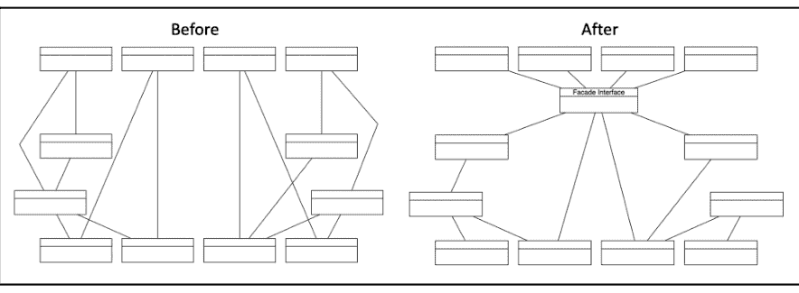

如图所示，外观接口作为系统与子系统之间的接口。也可以正确推断出，外观接口将防止细节向系统进行不必要的暴露。

### 用例

为了演示外观设计模式，我们将创建一个餐点组装应用程序。该程序将组装包含蛋白质、蔬菜和淀粉的餐点。我们的类将组织在多个 Java 项目中以保护信息细节。以下是包结构的概述：

| CH5Facade |
| :--- |
| FacadeDriver |
| MealComponents |
| MealProtein |
| MealVegetable |
| MealStarch |
| MealFacade |

如之前的图片所示，餐点组装应用程序中有三个 Java 包和五个类。

## UML 类图

UML 类图显示 `MealFacade` 类作为 `MealProtein`、`MealVegetable` 和 `MealStarch` 类的外观。

| FacadeDriver |
| :--- |
| main() |

| MealProtein | MealFacade | MealStarch |
| :--- | :--- | :--- |
| protein<br>setProtein() | newProtein<br>newVegetable()<br>newStarch()<br>MealFacade()<br>AssembleMeal() | starch<br>setStarch() |

| MealVegetable |
| :--- |
| vegetable<br>setVegetable() |

UML 类图——外观设计模式实现

如图所示，`FacadeDriver` 类被用于驱动应用程序并包含 `main()` 方法。

## 编写设计模式

`MealProtein` 类是餐点的三个组件类之一。让我们看看它是如何工作的：

1. 它包含一个蛋白质类变量和一个变变器方法，用于将提供的输入赋值给该类变量：

```java
package CH5Facade.MealComponents;

public class MealProtein {

    private String protein;

    public void setProtein(String protein) {

        this.protein = protein;

        System.out.println("\tProtein (" + this.protein + ") added to meal");

    }

}
```

2. `MealVegetable` 类与 `MealProtein` 类相似，它是餐点的三个组件之一。它包含一个蔬菜变量和一个变变器方法，用于将提供的输入赋值给类变量：

```java
package CH5Facade.MealComponents;

public class MealVegetable {

    private String vegetable;

    public void setVegetable(String vegetable) {

        this.vegetable = vegetable;

        System.out.println("\tVegetable (" + this.vegetable + ") added to meal");

    }

}
```

3. `MealStarch` 类是餐点的第三个组件类。它包含一个淀粉变量和一个变变器方法，将提供的输入赋值给类变量：

```java
package CH5Facade.MealComponents;

public class MealStarch {

    private String starch;

    public void setStarch(String starch) {

        this.starch = starch;

        System.out.println("\tStarch (" + this.starch + ") added to meal");

    }

}
```

4. `MealFacade` 类位于自己的包中导入了 `MealProtein`、`MealVegetable` 和 `MealStarch` 类。这里提供了 `MealFacade` 类的第一部分。这段代码定义了三个类变量并包含了构造函数：

```java
package CH5Facade.MealFacade;

import CH5Facade.MealComponents.MealProtein;

import CH5Facade.MealComponents.MealVegetable;

import CH5Facade.MealComponents.MealStarch;

public class MealFacade {

    MealProtein newProtein;

    MealVegetable newVegetable;

    MealStarch newStarch;

    public MealFacade() {

        newProtein = new MealProtein();

        newVegetable = new MealVegetable();

        newStarch = new MealStarch();

    }

}
```

5. `MealFacade` 类的最后部分（代码块所示）包含了 `assembleMeal()` 方法。该方法提供餐点组装过程开始和结束的控制台输出。它调用了 `setProtein()`、`setVegetable()` 和 `setStarch()` 方法：

```java
public void assembleMeal(String protein, String vegetable, String starch) {

    System.out.println("\n\tMeal assembly process initiated.\n");

    newProtein.setProtein(protein);

    newVegetable.setVegetable(vegetable);

    newStarch.setStarch(starch);

    System.out.println("\tMeal assembly process completed.\n\n");

}
```

6. 我们的应用程序类 `FacadeDriver` 包含了 `main()` 方法。该方法首先向控制台打印装饰性头部。接下来，通过实例化 `MealFacade` 对象并调用对象的 `assembleMeal()` 方法，创建了三份餐点：

```java
package CH5Facade;

import CH5Facade.MealFacade.MealFacade;

public class FacadeDriver {

    public static void main(String[] args) {

        System.out.println("\n\n=================================================");

        MealFacade factory = new MealFacade();

        factory.assembleMeal("Beef", "Carrot", "Potato");

        factory.assembleMeal("Chicken", "Broccoli", "Rice");

        factory.assembleMeal("Tofu", "Asparagus", "Quinoa");

        System.out.println("=================================================");

    }

}
```

# 第 5 章 结构设计模式

```java
System.out.println("\t\tMeal Assembly Service Demo");

System.out.println("====================================");
```

```java
//组装三顿餐

MealFacade meal1 = new MealFacade();

meal1.assembleMeal("Steak", "Asparagus", "Wild Rice");

MealFacade meal2 = new MealFacade();

meal2.assembleMeal("Chicken", "Green Beans", "Potato Wedges");

MealFacade meal3 = new MealFacade();

meal3.assembleMeal("Meatloaf", "Brussel Sprouts", "Mashed Potatoes");
```

应用程序的控制台输出在此：

| 餐点组装服务演示 |
|---|---|
| 餐点组装过程启动. . 蛋白质（牛排）加入餐点。蔬菜（芦笋）加入餐点。淀粉（野生米）加入餐点。餐点组装过程完成. . . |
| 餐点组装过程启动. . 蛋白质（鸡肉）加入餐点。蔬菜（四季豆）加入餐点。淀粉（薯条）加入餐点。餐点组装过程完成. . . |
| 餐点组装过程启动. . 蛋白质（肉饼）加入餐点。蔬菜（抱甘蓝）加入餐点。淀粉（土豆泥）加入餐点。餐点组装过程完成. . . |
| 外外观设计模式实现——控制台输出 |

本节提供了我们使用外外观设计模式实现餐点组装服务的源代码和控制台输出。

# 享量模式设计模式的飞跃

享量模式设计模式在处理大量相似对象时提供了极高的效率和改进的处理性能。该模式使用了相同对象组件的共享。考虑编写一个视频游戏，其中有数千个用于构建建筑结构的瓷砖对象。由于这些瓷砖对象可能仅有一个颜色属性。因此，重复 1000 次 `tile = new Tiles("beige")` 这行代码是不高效的，特别是因为所有对象都包含相同的属性值。享量模式设计模式通过允许引用相同状态的许多相同类型对象解决了这个问题。

### 用例

我们将创建一个床垫制造工厂演示应用程序，来实现享量模式设计模式。我们将创建一个接口、一个 `Mattress` 类、一个 `MattressFactory` 类和一个 `Driver` 类。我们的应用程序将具备创建婴儿床、双人床和大号尺寸床垫的能力。如果 `Mattress` 已经存在，则不会创建新对象；相反，`MattressFactory` 将提供尺寸，然后确定床垫硬度。

## UML 类图

下面的 UML 类图详细展示了享量模式设计模式实现床垫制造工厂应用程序的类关系：

| MattressDriver |
| main() |

| Mattress | << interface >> | MattressFactory |
| mattressSize | MattressInterface | size |
| mattressFirmness | | numberOfMattresses( |
| Mattress() | | getFactoryMattress() |
| setMattressFirmness() | |
| print() | | |

如图所示，`MattressDriver` 类——享量模式设计模式实现被用于驱动应用程序，并包含 `main()` 方法。

# 第 5 章 结构设计模式

## 编写设计模式

我们将考虑以下案例来理解编程设计模式：

1. 我们的床垫制造工厂演示从一个 `MattressInterface` 接口开始。该接口包含一个没有主体的 `print()` 方法：

```java
public interface MattressInterface {

    void print();

}
```

2. `Mattress` 类实现了 `MattressInterface`。它包含两个类变量（`mattressSize` 和 `mattressFirmness`）。该类还包含 `setMattressFirmness()` 修改器方法并重写了接口的 `print()` 方法：

```java
public class Mattress implements MattressInterface {

    // 类变量

    String mattressSize;

    String mattressFirmness;

    // 构造函数

    public Mattress(String mattressSize) {

        this.mattressSize = mattressSize;

    }

    // 修改器方法

    public void setMattressFirmness(String mattressFirmness) {

        this.mattressFirmness = mattressFirmness;

    }

    @Override

    public void print() {

        System.out.println("\tThis is a " + mattressFirmness + " \t" + mattressSize + " mattress.");

    }

}
```

3. `MattressFactory` 类在此分为两个部分，依赖于 Java 的 `HashMap` 和 `Map` 包：

```java
import java.util.HashMap;

import java.util.Map;
```

```java
public class MattressFactory {

    Map<String, MattressInterface> sizes = new HashMap<String, MattressInterface>();

    public int numberOfMattresses() {

        return sizes.size();

    }

}
```


## 4. `MattressFactory` 类的第二部分

`MattressFactory` 类的第二部分包含异常处理和 `getFactoryMattress()` 方法。该方法包含一个根据床垫尺寸构建的 `switch`。这里是该方法的第一个部分：

```java
public MattressInterface getFactoryMattress(String mSize) throws Exception {

    MattressInterface mattressSize = null;

    if (sizes.containsKey(mSize)) {

        mattressSize = sizes.get(mSize);

    } else {

        switch (mSize) {

            // switch 语句在这里

        }

    }

    return mattressSize;

}
```

## 5. `getFactoryMattress()` 方法的 `switch()` 代码块

```java
switch (mSize) {

    case "Crib":

        System.out.println("A Crib Mattress did not exist, but now");

        mattressSize = new Mattress("Crib");

        sizes.put("Crib", mattressSize);

        break;

    case "Twin":

        System.out.println("A Twin Mattress did not exist, but now");

        mattressSize = new Mattress("Twin");

        sizes.put("Twin", mattressSize);

        break;

    case "Full":

        System.out.println("A Full Mattress did not exist, but now");

        mattressSize = new Mattress("Full");

        sizes.put("Full", mattressSize);

        break;

    default:

        throw new Exception("Mattress Creation Error: invalid size.");

}
```

## 6. `MattressDriver` 类

最后的类是 `MattressDriver`，它包含 `main()` 方法。在向控制台打印装饰性头部后，有几个循环，每个循环对应一个不同的尺寸。我们的实现每个支持一个：

```java
public class MattressDriver {

    public static void main(String[] args) throws Exception {

        MattressFactory theFactory = new MattressFactory();

        System.out.println("\n\n=================================="

        System.out.println("\t\tMattress Manufacturing Factory Demo");

        System.out.println("========================================\n");

        Mattress newMattress;

        for (int i = 0; i < 5; i++) {

            newMattress = (Mattress)theFactory.getFactoryMattress("Crib");

            newMattress.setMattressFirmness("Firm");

            newMattress.print();

        }

        for (int i = 0; i < 5; i++) {

            newMattress = (Mattress)theFactory.getFactoryMattress("Twin");

            newMattress.setMattressFirmness("Soft");

            newMattress.print();

        }

        for (int i = 0; i < 5; i++) {

            newMattress = (Mattress)theFactory.getFactoryMattress("Full");

            newMattress.setMattressFirmness("Extra Firm");

            newMattress.print();

        }

    }

}
```

## 实现代理设计模式

代理在 Java 语言中被定义为具有代表另一个对象的权限。代理设计模式名副其实，因为它建立了一个占位符，以便自己以外的对象可以控制访问。指针对象引用缺乏复杂性。代理引用相对于对象引用可以完成以下操作：

- 使用智能指针，可以计算给定对象的引用次数。这支持垃圾回收。
- 对象锁定，使其无法被其他对象修改。
- 内存加载增强。

## 结构设计模式

# 第 5 章

使用代理模式的主要理由是为了节省创建复杂对象所需的巨大内存和处理时间。

### 用例

我们将创建一个代理天气预报应用，以演示代理模式的实现。我们将创建一个抽象类并用一个具体类来扩展它。接下来，我们将为 `Driver` 类创建一个 `Proxy` 类供其引用。我们将类组织在两个包中，一个用于存放主类，另一个用于存放代理类。

## UML 类图

我们的天气预报应用由四个类组成——`Weather`、`ConcreteWeather`、`Proxy` 和 `ProxyDriver`：

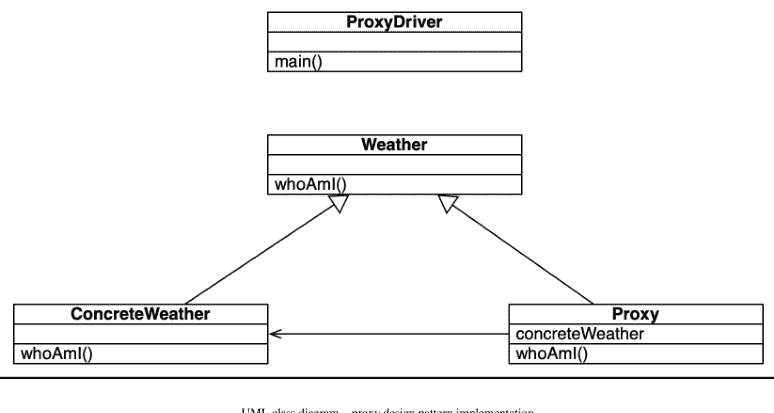

如图所示，`ProxyDriver` 类被用于驱动应用程序，并包含 `main()` 方法。

## 结构设计模式

## 模式模式编程

我们解决方案中的第一个类是抽象的 `Weather` 类。它包含一个空的 `whoAMI()` 方法：

```java
package Proxy.MasterClasses;

public abstract class Weather {

    public abstract void whoAMI();

}
```

`ConcreteWeather` 类继承自 `Weather` 类。它是一个具体类，因为它实现了所有的层次结构方法。具体来说，`ConcreteWeather` 类重写了 `whoAMI()` 方法。该方法简单地输出到控制台，告知用户方法的来源并提供天气预报：

```java
public class ConcreteWeather extends Weather {

    @Override

    public void whoAMI() {

        System.out.println("\tMethod Call from " + this.getClass().getSimpleName() + " class");

        System.out.println("\tWeather forecast is sunny\n");

    }

}
```

`Proxy` 类也继承自 `Weather` 类。该类重写了 `whoAMI()` 方法。该方法简单地输出到控制台，告知用户方法的来源并提供天气预报：

```java
package Proxy.ProxyClasses;

import Proxy.MasterClasses.ConcreteWeather;

import Proxy.MasterClasses.Weather;

public class Proxy extends Weather {

    ConcreteWeather concreteWeather;

    @Override

    public void whoAMI() {

        System.out.println("\tMethod Call from " + this.getClass().getSimpleName() + " class");

        System.out.println("\tWeather forecast is overcast and rain\n");

    }

}
```

```java
if (concreteWeather == null) {

    concreteWeather = new ConcreteWeather();

}

concreteWeather.whoAMI();
```

我们解决方案中的最后一个类是 `ProxyDriver` 类，它包含 `main` 方法。该方法产生装饰性的控制台输出，创建一个新的 `Proxy` 实例，然后对新对象调用 `whoAMI()` 方法：

```java
package ProxyDriver {

public class ProxyDriver {

    public static void main(String[] args) {

        System.out.println("\n\n");

        System.out.println("\t\t\tProxy Weather Forecast Demo");

        Proxy proxyCall = new Proxy();

        proxyCall.whoAMI();

    }

}
```


应用程序的控制台输出如下：

```
| Proxy Weather Forecast Demo |
| :--- |
| Method Call from Proxy class |
| Weather forecast is overcast and rain |
| Method Call from ConcreteWeather class |
| Weather forecast is sunny |
```

**代理模式实现——控制台输出**

本节提供了我们代理模式实现天气预报的源代码和控制台输出。

## 总结

在本章中，我们回顾了七种结构设计模式，这些模式关注对象和类如何组合成一个系统。结构设计模式被归类为对象设计模式和类设计模式。结构性对象设计模式用于描述如何创建具有新功能的对象。结构类设计模式利用继承来创建接口并组合多个类以形成更大的结构。本章通过多种设计模式的实现提供了这两种方法的示例。

在下一章中，我们将重点转向架构设计模式。该章节将从架构设计模式的概述开始，涵盖应用、分层和微服务设计模式。

## 问题

1. 结构设计模式的重点是什么？
2. 七种结构设计模式有哪些？
3. 哪种结构设计模式既有类范围又有对象范围？
4. 哪种结构设计模式分类用于描述如何创建具有新功能的对象？
5. 哪种设计模式用于将一个类的接口转换为系统所需的另一个接口？
6. 哪种设计模式允许我们创建对象树，并以相同的方式处理对象和树结构？
7. 哪种设计模式常用于包含对象叠加的图形化软件？
8. 哪种设计模式创建一个接口，作为系统或子系统内其他接口的接口？
9. 哪种设计模式在实现中使用相同对象组件的共享？
10. 哪种设计模式的目的是节省创建复杂对象所需的内存和处理时间？

## 扩展阅读

- [Java EE 8 Design Patterns and Best Practices](https://www.packtpub.com/application-development/java-ee-8-design-patterns-and-best-practices)
- [Learn Design Patterns with Java](https://www.packtpub.com/application-development/learn-design-patterns-java)
- [Design Patterns and Best Practices in Java](https://www.packtpub.com/application-development/design-patterns-and-practices)

# 架构模式 - 第 1 部分

# 第 6 章

- 洗碗具、杯子等
- 库存、订单、收货和入货系统
- 咖啡店的开与休息
- 夜间深度清洁

为了让机器人执行其功能，它需要访问确认系统。它还需要能够从与环境以及咖啡店顾客的互动中学习。这里是系统的顶层视图：

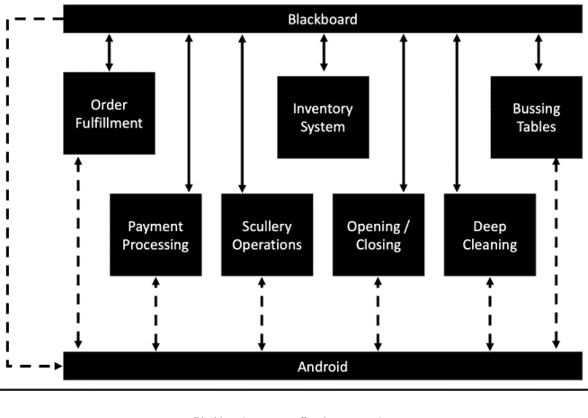

正如黑板模式（`blackboard pattern`）图所示，机器人可以访问七个不同的知识源。这种访问用双箭头表示，意味着知识系统将从机器人与客户及环境的互动中学习。示例可能包括学习定制饮品、记住老客的订单、了解如何清洗马克杯等。

在黑板架构模式的实现中，黑板存储在内存中，并对知识系统具有读写权限。

以下 UML 类图展示了知识源在黑板模式中的重要性：

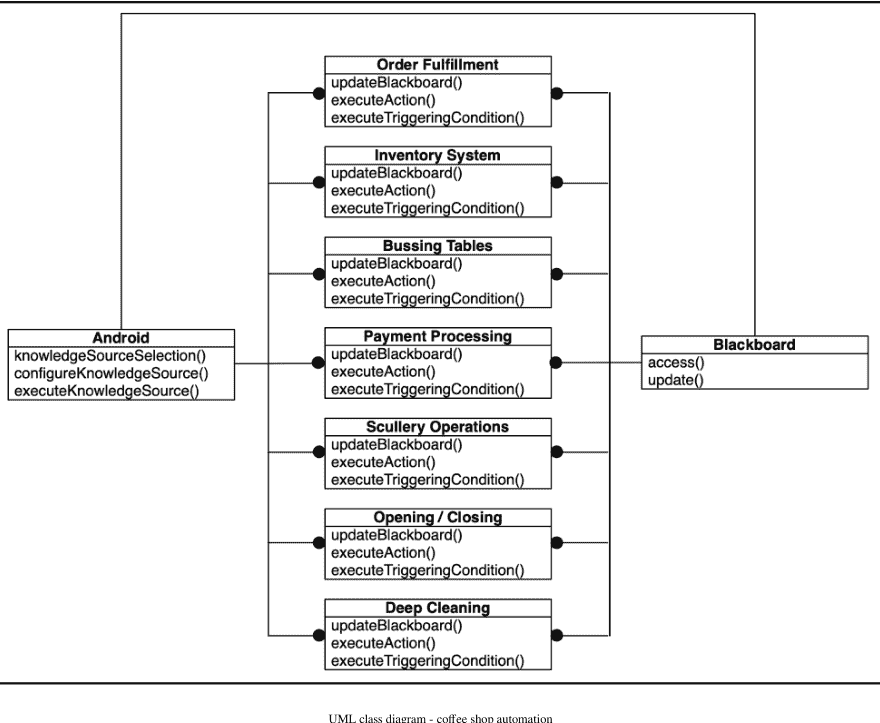

UML 类图中所示的 Android 组件在黑板架构模式中被称为控制组件（`control component`）。

## 仓库安全机器人示例

在黑板架构模式的示例中，我们将考虑一个自动化仓库安全机器人。该机器人将使用电击枪射击入侵者。我们的机器人将承担三个职责：

- 正确识别入侵者和获得授权的仓库工作人员
- 在仓库内导航
- 移动到电击枪的有效范围内

这些职责中的每一个都可以被视为系统中的一个组件。这些组件将是**入侵者识别、导航和弹道学**。以下 UML 类图说明了机器人（`Bot`）、控制组件与系统其他部分之间的关系：

| 入侵者识别 | 导航 | 弹道学 |
| :--- | :--- | :--- |
| `updateBlackboard()` `executeAction()` `executeTriggeringCondition()` | `updateBlackboard()` `executeAction()` `executeTriggeringCondition()` | `updateBlackboard()` `executeAction()` `executeTriggeringCondition()` |
| Blackboard | | Bot |
| `access()` `update()` | | `knowledgeSourcesSelection()` `configureKnowledgeSource()` `executeKnowledgeSource()` |

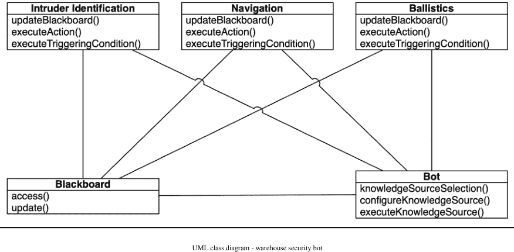

UML 类图中的**入侵者识别、导航和弹道学**组件是仓库安全机器人实现中的知识源。

本节提供了黑板架构模式的两个实现示例。

## 理解代理人模式（`broker pattern`）

代理人模式（`broker architectural pattern`）用于构建分布式系统。这些系统利用中间人组件来协调组件之间的通信。这种组件的解耦消除了依赖，并可以提高整个系统的效率。

中间人组件的任务意味着它能够接收请求并代理适当的服务或请求至关重要。如下图所示，中间人代理了来自服务器（`Server`）和客户端（`Client`）的请求：

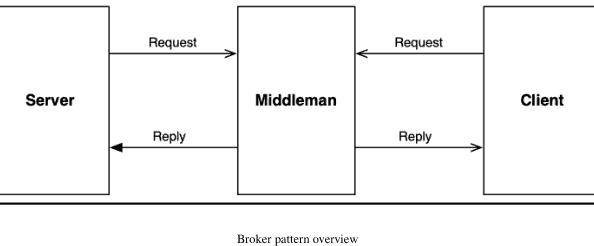

代理人模式与第 5 章介绍的结构设计模式中的外观模式（`facade design pattern`）类似。外观模式建立了一个接口，作为系统与其子系统之间的介质。

代理人模式中有一种选项，允许中间人许可客户端和服务器之间直接通信。如下图所示，中间人仍然管理通信，但两个组件（客户端和服务器）直接通信：

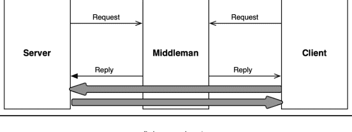

我们将查看代理人架构模式的以下实现：

- 大学企业信息系统
- 豪华邮轮预订系统

## 大学企业信息系统示例

让我们考虑一个使用代理人模式设计的大学企业信息系统示例。该大学运营两个校区，每个校区都有自己的服务器。所有服务器都可以发送和接收请求。桥接（`Bridge`）用于封装多个代理人（通常是本地和远程）之间的过程。这种设置如图所示：

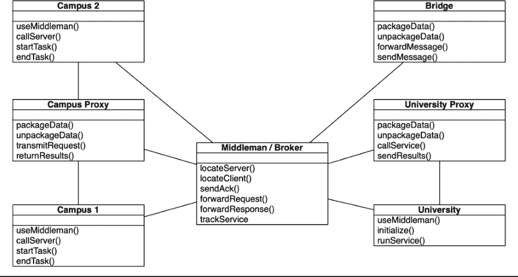

正如你在前面的图中看到的，代理（`proxies`）被用于保护实现细节、内存地址和其他信息免受其他系统组件的影响。

## 豪华邮轮预订系统示例

代理模式的另一个实现是豪华邮轮预订系统。在这个示例中，每条邮轮线都有自己的服务器，并有一个**邮轮线代理（`Cruise Line Proxy`）**。**中间人/代理人（`Middleman / Broker`）**组件根据客户端的请求和邮轮公司的响应来代理预订。下图提供了预订系统的概述，并突出了互连组件：

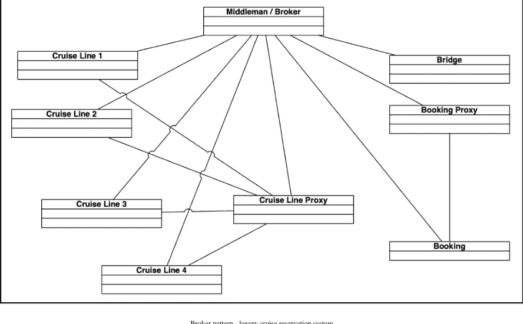

本节提供了代理模式的两个实现示例。

## 理解客户端-服务器模式（`client-server pattern`）

客户端-服务器模式（`client-server pattern`）是广为人知的架构模式之一，它由两种类型的组件组成：客户端组件和服务器组件。简单来说，服务器监听请求并提供请求的服务。下图提供了客户端-服务器模式的顶层视图，特别是网络架构：

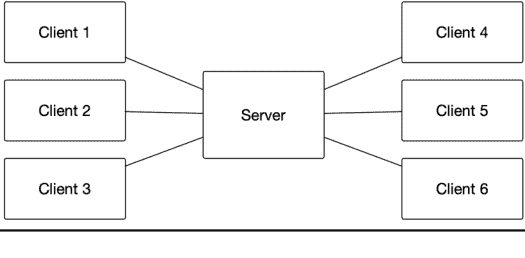

我们将查看客户端-服务器模式的以下实现：

- 咖啡店
- 三层网络

## 咖啡店示例

下图描绘了一个简单的咖啡店架构来演示客户端-服务器模式。**客户端**与他们的 **POS**（销售点）系统和库存系统有本地连接。**客户端**与**服务器**通信，服务器拥有自己的连接。该架构突出了系统组件的连接性，特别是客户端如何通过服务器访问数据库：

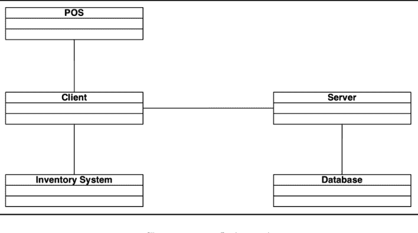

在前面的图中，客户端和服务器可能会通过 `TCP/IP` 通信。

## 三层示例

在网络中，有多种客户端-服务器架构。接下来所示的是三层客户端-服务器架构。第一层是客户端，它与两个应用服务器直接通信。这些应用服务器与数据库服务器直接通信。给出的示例展示了一个典型的客户端-服务器结构，使用了三层方法：

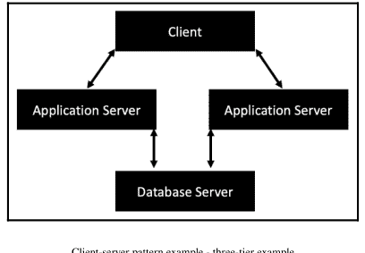

本节提供了客户端-服务器模式的两个实现示例。

## 理解事件驱动模式（`event-driven pattern`）

事件驱动架构模式（`event-driven pattern`）适用于高度灵活的分布式系统。它被用于实现在去中心系统中传输事件的应用。在这种模式下，事件有发布者和消费者。使用这种模式可以更高效地开发大型分布式系统。

事件可以是按钮点击、流输入、自动分析结果、游戏内条件（如碰撞检测）等。

事件驱动架构模式有两种形式——代理和调介。我们接下来的章节中查看这两种模式形式。

## 事件驱动模式 - 代理

事件驱动模式的代理形式使用一系列调介的事件，而不是中央调介。这种形式涉及一个初始事件以及一系列处理步骤。

如下图所示，没有中介者来控制“启动事件”（`Initiating Event`）。每个“事件处理器”（`Event Processors`）分别负责处理事件，并在处理完成后启动新事件：

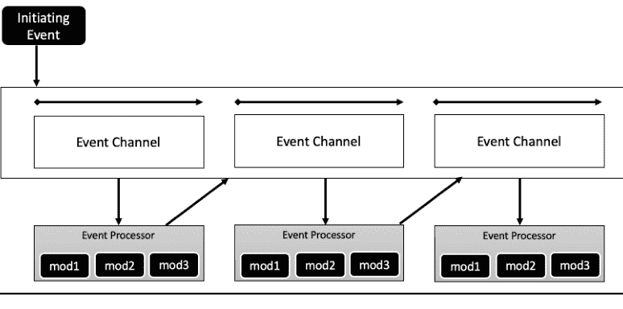

启动事件触发整个流程，事件链持续进行，直到没有针对该特定启动事件的已发布事件。

## 事件驱动架构模式 – 中介者

事件驱动架构模式的中介形式通常用于多步骤事件，其中每个步骤都需要协调。

下图显示了事件驱动架构模式的中介形式。启动事件是流程开始的触发因素。在“事件中介者”（`Event Mediator`）部分列出的事件是完成给定过程必须采取的步骤。指向事件 2 和事件 3 左侧的实线表示这些步骤可以同时发生。事件中介者为每个初始事件步骤创建一个“处理事件”（`Processing Event`）：

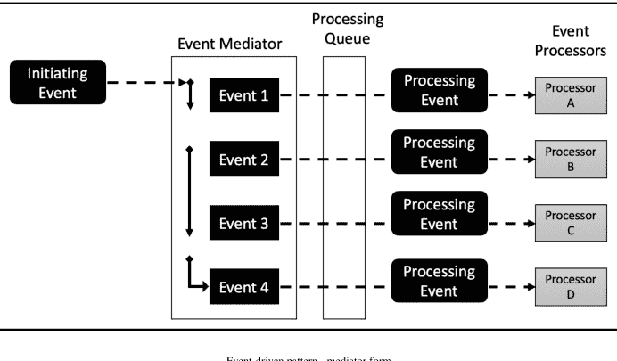

处理事件被发送到事件队列，等待事件处理器进行处理。

本节提供了事件驱动架构模式的两种形式。

## 理解提取-转换-加载（`ETL`）模式

提取-转换-加载架构模式正如其名所示，它包含以下三个阶段：

1. 从外部源提取数据
2. 根据需要对提取的数据进行转换
3. 将转换后的新数据加载到当前系统的仓库中

提取-转换-加载模式最常见的用途是商业智能、数据仓库、知识管理系统和客户关系管理系统。

我们将在接下来的章节中查看提取、转换和加载步骤，以及这些步骤如何应用于与之同名的架构模式中。我们将使用一个销售工具的示例，该工具挖掘各种来源的客户潜在线索（`customer leads`），将数据转换为通用格式，然后将数据加载到中央数据库中。

## 提取（`Extract`）

对于我们的销售工具示例，让我们从两个格式不同的数据源获取数据。

我们的第一个数据源来自关联保险公司销售部门提供的 `XML` 文件。该文件具有以下编码：

```
<CUSTID>35032</CUSTID>
<POLICY_TYPE>term</POLICY_TYPE>
<NAME>Neo Anderson</NAME>
<STREET>1 White Rabbit Trail</STREET>
<CITY>Zion</CITY>
<STATE>MD</STATE>
<ZIP>00000</ZIP>
<EMAIL>neo.anderson@matrix.net</EMAIL>
<PHONE>000-000-0000</PHONE>
```

如省略号所示，`XML` 文档中的每条记录将会有许多数据元素。

次要数据源可能来自一份购买的销售线索列表。这可能以逗号分隔值（`CSV`）的格式出现，如下代码所示：

```
35032,term, Neo Anderson, Zion, MZ,00000,neo.anderson@matrix.net,000-000-0000,. . .
```

对于我们的示例，我们可以假设已经从定义的每个数据源中捕获了数千个名称。我们的下一步是将这些数据转换为与我们的系统以及已实现的数据存储解决方案兼容的通用格式。

## 转换（`Transform`）

现在我们已经获取了提取出的数据，可以实施第二步，将数据转换为我们所需的格式。现实世界中的实现将包含转换数据的源代码。转换过程将包括以下顺序步骤：

1. 确定如何分块处理数据。
2. 获取数据块。
3. 处理记录：
    - 根据需要转换字段。
    - 根据需要添加默认值。
    - 标记不完全的记录。
4. 继续执行步骤 3，直到当前块中的所有记录均完成。
5. 重复步骤 2，直到所有数据块都处理完毕。

第一步确定如何分块数据非常重要，因为数据集非常大，服务器端脚本肯定会超时。例如，你可以一次处理 100 条记录。以此为例，步骤 2 将仅涉及读取前 100 条记录。

第三步是单次处理一组记录。我们将根据需要转换数据字段。例如，假设提供的名称是 `Neo Anderson`，我们希望将其转换为 `Anderson, Neo`，或者将数据拆分为姓和名的两个独立字段。此外，在步骤三中，我们将为任何空白字段分配默认值。这将由我们的策略决定。步骤三中的另一个重要处理步骤是标记需要电话号码的线索，然后对没有电话号码的记录进行标记。在一种情况下，如果提供了电子邮箱地址，它们可能会被标记为“通过电子邮件咨询”。如果电话号码和电子邮件地址均未提供，该记录可能会被标记为删除。

例如，将 `CSV` 数据转换为 `MySQL` 数据库是相当复杂的。例如，需要编写一个方法来逐行处理 `CSV` 文件并处理每条记录，完成后，这将生成一个 `SQL` 查询。你将使用该查询作为“加载”（`Load`）步骤的运行时，该部分将在下一节中介绍。

## 加载（`Load`）

加载过程通常是简单的。具体细节将取决于系统以及所选的核心数据库或其他数据仓库。通常，这会涉及以下步骤：

1. 打开数据库
2. 写入新记录
3. 关闭数据库

以下是步骤 1“打开数据库”的示例语句：

```
Connection con = null;
con = csvParser.getConnection("jdbc:oracle:thin:PACKET/localhost:1500:leadsDB");
```

写入新记录涉及将数据插入数据库，如下：

```
INSERT INTO Leads (leadName, leadPhone, leadEmail, leadAddress, leadCity,
leadState, leadZip) VALUES ('Neo Anderson', '000-000-0000',
neo.anderson@matrix.net', '1 White Rabbit Trail', 'Zion', 'MZ', '00000');
```

关闭数据库将涉及如下语句：

```
con.close();
if (con.isConnected()) {
System.out.println("Database successfully closed.");
}
```


本节详细介绍了实施提取-转换-加载模式的步骤。

## 理解分层模式

分层模式将系统分解为分层任务。系统的每一层都有定义的职责，具体取决于实现。这是一种广泛使用的模式，存在于大多数健壮系统中，特别是那些利用分布式计算（如云计算或云存储）的系统。

该模式是现代计算基础设施的核心。国际标准组织（ISO）开放系统连接（OSI）有一个七层模型。该 OSI 模型被广泛应用并在现代软件架构中仍然具有意义。

你可以通过微软的在线文档了解更多关于 OSI 七层模型的信息：`https://docs.microsoft.com/en-us/windows-hardware/drivers/network/windows-network-architecture-and-the-osi-model`。

七层模型由两个并行栈组成，每个栈有七层。最底层是物理层，两个栈之间进行直接通信。列表中的栈从上到下的顺序代表了两台计算机之间的通信：

- 应用
- 表示
- 会话
- 应用
- 网络
- 数据链路
- 物理

关于这些层的一些关键概念如下：

- 某层的更改不会影响其他层
- 各层可以具有不同的协议
- 每层都有独特的职责
- 层与之间的调用向下流动

我们将查看以下分层架构模式的实现：

- 传统操作系统层
- 移动操作系统层
- 业务应用层

## 传统操作系统层示例

分层架构模式的一个巨大优点是，某一个层不会对其他层产生负面影响。例如，如果你为电脑购买了一台新的彩色打印机，你只需要通过添加新驱动程序来更新“硬件设备驱动程序”层。操作系统的层级如图所示：

| 用户界面 |
| 应用程序 |
| 中间件 |
| 操作系统接口 |
| 操作系统内核 |
| 硬件设备驱动程序 |
| 硬件 |

传统的操作系统层

此操作系统层图描述了分层架构模式的使用。正如你将在下一个示例中看到的，实现这种架构模式并不一定需要七层。

## 移动操作系统层示例

现代移动操作系统具有不同的架构模式。我们将以 iOS 的层为例。如下所示，iOS 的五层包含一个用户与之交互的触控层：

| Cocoa Touch 层 |
| 媒体层 |
| 核心服务层 |
| 核心 OS 层 |
| 硬件 |

移动操作系统层

让我们详细查看：

- 通信路径是向下的，一直流动到硬件层。
- 硬件层正上方是核心 OS 层。该层承担多项职责，包括内存管理、蓝牙、安全服务、本地认证等。
- 这包括如 iCloud 存储、HealthKit、HomeKit、通讯录、账户、社交媒体接口、点对点服务和文件共享等职责。
- 媒体层被分为三个框架：
  - 图形（Graphics）：图形框架包括 UI 图形、核心图形、动画优化、高级图像支持和图形渲染。
  - 音频（Audio）：音频框架包含一个访问 iTunes 的框架，并处理音频和视频的录制与播放。它还有一个高级音频框架。
  - 视频（Video）：视频框架提供视频的录制和播放、视频展示以及各种视频数据类型的接口。

顶层 Cocoa Touch 层是用户看到的触控用户界面。Cocoa Touch 层包含许多框架，包括 Event UI Kit、Game Kit、iAD、Map Kit、Push Kit 和 UI Kit。

## 业务应用层示例

我们使用分层架构模式来隔离功能。当在某层启动事件或请求时，可能会发生以下三种情况之一：

- 请求被传递到下一层
- 请求被处理后传递到下一层
- 请求被处理后直接关闭，而不传递到下一层

下面的截图显示了每一层如何拥有一个或多个组件，并具有关闭请求的能力，以免其不必要地传递给额外的层：

| 表现层 | 组件 | 已关闭 |
|---|---|---|
| 业务层 | 组件 | 已关闭 |
| 服务层 | 组件 | 已关闭 |
| 数据库层 | 组件 | 已关闭 |

业务应用层

本节提供了分层架构模式的三个实现示例。

## 理解主从模式

主从架构模式通过在主组件（master）和从组件（slave）之间分配工作来提高系统的可靠性和性能。每个组件都有明确的职责。所有从组件的工作是相同或至少相似，且这些工作必须在运行之前定义。这种模式不是一种分而治的架构方法；而是一种从组件工作被预先定义且必须经过协调的模式。主从架构模式的目标是提高软件效率。

下图提供了主从模式工作原理的概述。存在一个或多个客户端（Clients），可以向主节点提交请求或启动事件：

``

主节点执行以下功能：

- 维护从节点列表
- 分配工作
- 为从节点分配任务
- 接收从节点完成的工作
- 汇总结果
- 向客户端提供反馈

在多个从节点之间分配工作负载本质上会导致更高的效率。同时处理多个工作负载被称为并行处理。这种模式的另一个优点是，对从节点的更改不会影响主节点。当主节点需要更新时也是如此——从节点不受影响。

我们现在来看以下主从架构模式的实现方案：

- 单客户端示例
- 云存储示例

## 单客户端示例

主节点与客户端之间有着特殊的关系。它们接收来自客户端的请求，并将工作分配给从节点。如下所示，从节点的结果被合并并提供给客户端：

``

主节点必须决定如何在从节点之间分配工作。有几种方法可以实现，以确保将组件数量和内存大小考虑在内。在系统从节点之间分配工作时，处理时间通常是需要考虑的额外因素。

## 云存储示例

现代应用程序使用云存储作为数据库和其他数据源。复杂的系统通常包含数据复制，以便更快的访问速度并防止数据丢失或单点故障。下图描述了一个使用主从模式并包含冗余存储的系统架构：

``

前面的图显示了包含一个主节点三个从节点的主从模式。数据库被复制，因此有多个访问点。这种方案将产生更高的效率。

本节提供了主从模式的两个实现示例。

## 理解微内核模式

微内核架构模式也称为插件模式（plug-in pattern）。当我们创建具有可交换组件的系统时，通常会使用这种模式，如下图中插件的形式所示：

``

微内核模式的通用框架在前图中所示。微内核包含系统的核心逻辑和功能。每个插件都有特定的功能，并包含供微内核引用的编程接口（APIs）。

微内核涉及五个组件，如下列表所示：

- **微内核（The microkernel）**：微内核是这种模式的核心。它提供核心处理并充当其他部分之间的中间人。所有资源由微内核管理，内核还管理与系统剩余组件的通信。
- **一个或多个客户端（One or more clients）**：客户端代表使用系统的实体。可以是人或系统。客户端使用外部插件与微内核进行交互。
- **内部插件（Internal plug-ins）**：微内核在需要特定服务时调用内部插件。它们位于微内核内部，因此由微内核控制访问。
- **外部插件（External plug-ins）**：外部插件位于微内核外部，这意味着客户端可以直接访问。微内核 API 赋予外部插件处理客户端的能力。
- **适配器（Adapters）**：适配器用于在客户端和外部插件之间创建接口。

这种模式带来了巨大的扩展性和灵活性。类似于面向对象的编程，每个插件可以由不同的开发团队开发，从而缩短了整体开发时间。

## 建筑报价示例

假设我们有一个自动化建筑报价系统，微内核接收所有必要的输入并调用各种插件，每个插件都有专门的报价功能。这种模式在图中所示，并指示了微内核的输入：

``

微内核模式 - 建筑报价系统

上一个图显示了专门的插件，每个插件都执行一系列复杂的规则、逻辑和计算。微内核架构模式的优点之一是，如果电气模块（Electrical Module）因为新的状态和本地代码而发生更改，系统的其他部分就不需要更改。相关的 API 仍将用于访问电气模块，并且不会感知到更改的发生。

## 光盘播放器示例

现代光盘播放器由硬件和软件组成。软件嵌入在硬件组件中。这些播放器可以接受音频 CD、视频 CD、DVD 和蓝光光盘，如下图所示。由于在光盘上写入数据的技术不同，每种光盘介质的处理方式也不同：

``

如图所示，该图显示了音频 CD 模块、视频 CD 模块、DVD 模块和蓝光模块的外部插件。该系统还包括用于处理许多的内部插件，例如音量控制、音频视频输出、电源设置等。

本节提供了微内核架构模式的两个实现示例。

## 总结

在本章中，我们查看了八种架构模式——黑板、代理、客户端-服务器、事件驱动、提取转换-加载（ETL）、分层、主从和微内核。我们学习到架构模式描述的是整个系统或一组系统组件的设计。本章解释了架构模式如何从整体角度看待系统，并为了说明目的对组件进行分组。此外，架构模式的视觉描绘并不使用 UML 类图（就像行为、创建和结构设计模式那样），相反，它采用了一种非强制性的方法对架构模式进行视觉化记录。理解如何选择和实现这些模式将增强你设计和开发高效系统的能力。

在下一章中，我们将继续对架构模式的探索。具体来说，我们将回顾微服务、模型-视图-控制器（MVC）、裸对象、点对点、管道-过滤器、无服务器、面向服务和基于空间的模式。

## 问题

1. 架构模式的适用范围是什么？
2. 视觉化记录架构模式采用了什么方法？
3. 哪种模式用于没有确定解决方案的大型系统？
4. 哪种模式使用中间人组件来协调组件之间的通信？
5. 哪种模式由两种组件类型组成——客户端组件和服务器组件？
6. 哪种模式同时具有代理和中介者形式？
7. 哪种模式涉及来自外部源的数据转换？
8. 哪种模式基于 ISO 的 OSI 标准？
9. 哪种模式通过分工工作来提高系统的可靠性和性能？
10. 哪种模式也被称为插件架构模式？

## 进阶阅读

- [Java EE 8 设计模式与最佳实践](https://www.packtpub.com/application-development/java-ee-8-design-patterns-and-best-practices)
- [使用 Java 学习设计模式 [视频]](https://www.packtpub.com/application-development/learn-design-patterns-java-video)
- [Java 中的设计模式与最佳实践](https://www.packtpub.com/application-development/design-patterns-and-best-practices-java)

# 架构模式 - 第二部分

在上一章“架构模式 - 第一部分”中，我们探索了架构模式类别以及八种特定模式——黑板、代理、客户端-服务器、事件驱动、提取转换-加载、分层、主从和微内核。这八种架构模式中的每一种都结合图表进行了解释。

在本章中，我们将继续对架构模式的探索。具体来说，我们将回顾列出的架构模式，并对编程挑战以及解决这些挑战的模式进行检查：

- 微服务模式
- 模型-视图-控制器模式
- 裸对象模式
- 点对点 (P2P) 模式
- 管道-过滤器模式
- 无服务器模式
- 面向服务模式
- 基于空间的模式

我们将在本章中介绍这八种架构模式。它们按照字母顺序排列，因为没有重要性之分。

## 技术要求

本章的代码可以在 `https://github.com/PacktPublishing/Hands-On-Design-Patterns-with-Java/tree/master/Chapter07` 找到。

## 理解微服务模式

微服务架构模式用于将系统拆分为较小的服务（或微服务），这些服务之间的相互依赖非常有限。该模式的优点包括：

- 模式的模块化特性允许单个微服务被用于其他地方
- 处理效率
- 易于维护的代码

如下所示，有一个与组成系统的微服务交互的中心点。在这个示例中，中心点是系统接口（System Interface）：

``

上一个图还指示了某些微服务如何与其他微服务通信。这种架构模式要求微服务是松耦合的，因此真正的相互依赖应该是通过通信。

使用微服务模式的软件开发包括单独开发每个微服务，这是一种首选方法，特别是对于大型系统。这还允许不同的团队同时开发多个微服务，从而加速交付时间。使用此模式设计的系统也具有良好的扩展性。

在接下来的章节中，我们将探索微服务模式的以下实现：

- 物流示例
- 电子商务示例

## 物流示例

接下来的图说明了物流公司微服务模式的实现。有两个接口，移动接口和网络接口，作为系统的网关。这两个接口都可以访问微服务：

``

## 电子商务示例

上一个图还指示了某些微服务与其他微服务有通信链路。例如，调度服务与路由系统有链路，库存系统与会计微服务有链路。

电子商务的实现与物流示例不同；在此，有一个通用网关接收各种来源的请求，图中所示为移动操作系统和网络浏览器：

``

### 微服务模式

通用网关在各种微服务之间进行交互，每个微服务都有自己的数据库。这些微服务可以与其他隔离运行。

本节提供了微服务模式的实现示例。

## 理解模型-视图-控制器模式

模型-视图-控制器架构模式是现代软件设计和开发中最常用的模式之一。它用于桌面和移动应用程序。该模式将系统划分为模型、视图和控制器组件。模型组件用于存储应用程序数据和逻辑。视图是向用户提供视觉元素的地方。控制器处理输入并根据情况与模型和视图组件进行通信。

模型-视图-控制器模式在整个软件行业通常被称为 MVC。

视图用于向用户展示数据。这使用户能够与控制器交互或使用控制器。控制器操作模型，模型更新视图：

``

如图所示，用户被认为是该模式最重要的部分，尽管它并不是 MVC 模式的正式组成部分。

与其他划分系统的模式一样，MVC 模式设计允许不同的团队同时处理不同的核心组件——模型（model）、视图（view）和控制器（controller）。这使得系统具有可维护性，因为每个组件的更新都不会影响到其他组件。

在下一节中，我们将探索 MVC 架构模式的 Book MVC 示例实现。

## Book 模型-视图-控制器示例实现

为了演示这种架构模式，我们将使用一个类示例。我们的示例将包含一个 `Book` 类、一个 `BookView` 类、一个 `BookController` 类以及一个 `MVCArchitecturalPattern` 类。让我们来看这些类，以及后续程序的输出。

## Book 类

`Book` 类通过三个类变量建立了类结构：`isbn`、`title` 和 `year`。为每个类变量都提供了访问器（getters）和变异器（setters）方法：

```java
public class Book {

    private String isbn;

    private String title;

    private int year;

    // accessor methods

    public String getISBN() {

        return isbn;

    }

    public String getTitle() {

        return title;

    }

    public int getYear() {

        return year;

    }

    // mutator methods

    public void setISBN(String isbn) {

        this.isbn = isbn;

    }

    public void setTitle(String title) {

        this.title = title;

    }

    public void setYear(int year) {

        this.year = year;

    }

}
```

之前定义的 `Book` 类代表了我们 MVC 架构模式中的模型组件。

## BookView 类

`BookView` 类包含一个方法，用于向控制台打印书籍详情：

```java
public class BookView {

    public void printBookData(String bookTitle, String bookISBN, int bookYear) {

        System.out.println("\nBook Title : " + bookTitle);

        System.out.println("ISBN-13 : " + bookISBN);

        System.out.println("Pub. Year : " + bookYear + "\n");

    }

}
```

刚刚显示的 `BookView` 类包含 `printBookData()` 方法，用于向用户提供输出，代表了我们 MVC 架构模式中的视图组件。

## BookController 类

`BookController` 类将分为三个部分介绍。第一部分包含两个私有变量：`model` 和 `view`。还提供了构造方法：

```java
public class BookController {

    private Book model;

    private Book view;

    // constructor
```


`public BookController(Book model, BookView view) { this.model = model; this.view = view; }`

`BookController` 类的第二部分由三个访问器方法和三个变异器方法组成：

```java
// accessor methods
public String getBookTitle() {
    return model.getTitle();
}

public String getBookISBN() {
    return model.getISBN();
}

public int getBookYear() {
    return model.getYear();
}

// mutator methods
public void setBookTitle(String title) {
    model.setTitle(title);
}

public void setBookISBN(String isbn) {
    model.setISBN(isbn);
}

public void setBookYear(int year) {
    model.setYear(year);
}
```

`BookController` 类的最后一部分包含 `updateView()` 方法。你可以看到，该方法不接受参数，并调用视图对象的 `printBookData()` 方法，如下：

```java
// update view method
public void updateView() {
    view.printBookData(model.getTitle(), model.getISBN(), model.getYear());
}
```

如前面的三个代码部分所示，`BookController` 类包含了 MVC 架构模式的控制器组件。

## MVCArchitecturalPattern 类

`MVCArchitecturalPattern` 类包含驱动程序的 `main()` 方法。该类还包含 `pullBookDetails()` 方法，用于从 `Book` 实例中获取详情：

```java
public class MVCArchitecturalPattern {
    public static void main(String[] args) {
        Book model = pullBookDetails();
        BookView view = new BookView();
        BookController con = new BookController(model, view);
        con.updateView();
        con.setBookTitle("Mastering Java 11");
        con.setISBN("978-1789137613");
        con.setBookYear(2018);
        con.updateView();
    }

    private static Book pullBookDetails() {
        Book book = new Book();
        book.setTitle("Mastering Java 9");
        book.setISBN("978-1786468734");
        book.setYear(2017);
        return book;
    }
}
```

这里有两组输出，分别由 `updateView()` 方法生成：

| 字段 | 值 |
| :--- | :--- |
| 书名 | Mastering Java 9 |
| ISBN-13 | 978-1786468734 |
| 出版年份 | 2017 |
| 书名 | Mastering Java 11 |
| ISBN-13 | 978-1789137613 |
| 出版年份 | 2018 |

如下文所示，P2P 网络允许每个节点直接与所有其他节点进行通信：

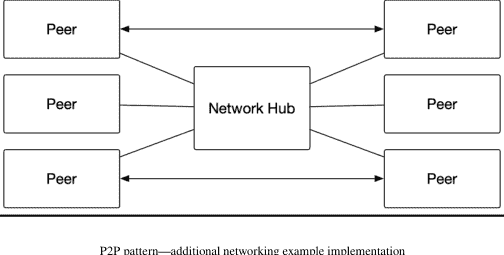

本节提供了 P2P 架构模式的示例实现。

## 理解管道-过滤器模式

管道-过滤器（pipe-filter）或管道与过滤器架构是一种稳健的架构，可以包含任意数量的过滤器。该模式首先从多个源获取数据，然后将其通过顺序过滤器，将数据从一种格式转换为另一种格式。过滤器通过管道连接。接下来的图显示了带有三个顺序过滤器的管道-过滤器模式概览：

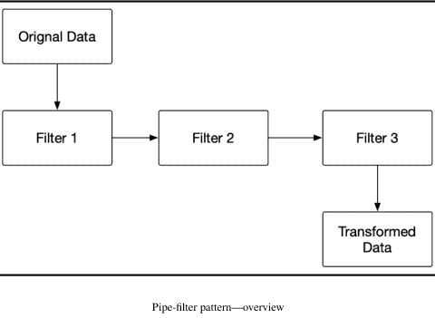

# 架构模式 - 第二部分

我们可以通过 UML 序图来深入观察这种模式。该图说明了数据流以及连接过滤器的管道的用途：

| 原始数据 | 过滤器 1 | 管道 | 过滤器 2 | 管道 | 过滤器 3 | 转换数据 |
| :--- | :--- | :--- | :--- | :--- | :--- | :--- |
| | 读取数据 | | 写入数据 | | 读取数据 | 写入过滤器 |

管道-过滤器模式——UML 序图

在接下来的章节中，我们将探索管道-过滤器架构模式的以下示例实现：

- 简单转换
- 复杂转换

## 简单转换示例实现

数据的简单转换可能包括从各种源收集数据（每个源格式不同），在数据被视为最终结果之前将其通过两个过滤器。例如，来自不同系统或不同语言的数据源。为了让任何业务逻辑处理这些数据，必须首先将其转换为系统期望的通用标准格式。

架构模式 - 第二部分

第 7 章

接下来的图提供了该过程的高级视图：

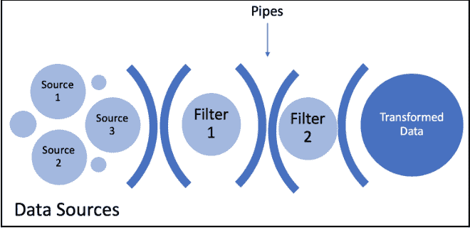

管道-过滤器模式——简单转换示例实现

下一节将提供更复杂的转换过程。

## 复杂转换示例实现

接下来的图说明了管道-过滤器模式的复杂转换示例。有三个数据源，其中两个可以被过滤器 1 处理。过滤器 1 和过滤器 2 之间有一条管道，作为数据的传输通道。数据通过过滤器 2 后，转换后的数据就可以由系统逻辑处理了。数据源 3 被过滤器 A 读取并管道到过滤器 B，后者会转换数据以供系统逻辑处理：

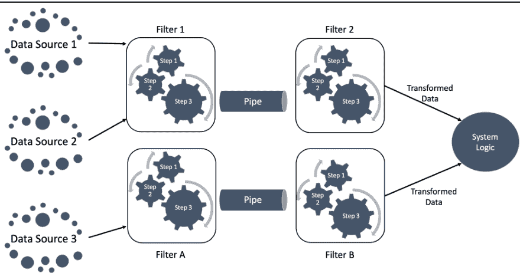

如前一个图所示，每个过滤器都有多个进程。

本节提供了管道-过滤器架构模式的示例实现。

## 理解无服务器模式

由于基础设施即服务（IaaS）、平台即服务（PaaS）、软件即服务（SaaS）、后端即服务（BaaS）、移动后端即服务（MBaaS）和函数即服务（FaaS）云端产品的出现，无服务器架构模式的实现变得越来越流行。无服务器架构模式简单来说是不包含专用本地服务器的模式。

> “本地”（on-premises）一词是指物理上位于组织实际地点的组件。

# 架构模式 - 第二部分

第 7 章

这并不意味着典型的服务器端脚本，该功能并不存在；相反，这些组件是由云端服务等第三方服务管理的。这些服务最大的提供商是 Amazon、Google、Microsoft、IBM 和 Oracle。

实现无服务器架构模式的优点包括以下：

- 成本效益
- 高可扩展性
- 高灵活性
- 更快的升级、更改和部署
- 受益于运行在靠近终端用户区域的应用程序

某些缺点包括：

- 产生失去控制的感觉
- 无法在云服务解决方案之间轻松进行切换（例如从 AWS 切换到 Microsoft Azure）
- 潜在的性能问题（即多延迟）

在接下来的章节中，我们将探索无服务器架构模式的以下示例实现。

## IaaS 实现

典型的基础设施即服务（IaaS）实现涉及本地组织与 IaaS 提供者之间职责的清晰划分：

| 本地管理 | IaaS 提供者管理 |
| :--- | :--- |
| 应用程序 | 数据 |
| 服务器 | 网络 |
| 操作系统 | 中间件 |
| 虚拟化 | 存储 |

无服务器模式——IaaS 实现示例

为了职责的适当划分，服务器和网络由 IaaS 提供者负责是非常关重要的。

## PaaS 实现

无服务器架构模式的平台即服务（PaaS）实现与 IaaS 实现相比，云服务提供者承担了更多的职责：

| 本地管理 | PaaS 提供者管理 |
| :--- | :--- |
| 数据 | 操作系统 |
| 服务器 | 网络 |
| 应用程序 | 中间件 |
| 虚拟化 | 存储 |

无服务器模式——PaaS 实现示例

如图所示，PaaS 实现仅要求本地人员管理数据和应用程序。

## SaaS 实现

无服务器架构模式的软件即服务（SaaS）实现涉及对 SaaS 的完全责任：

| 本地管理 | SaaS 提供者管理 |
| :--- | :--- |
| 数据 | 操作系统 |
| 服务器 | 网络 |
| 应用程序 | 中间件 |
| 虚拟化 | 存储 |

无服务器模式——SaaS 实现示例

如图所示，SaaS 实现仅要求本地使用浏览器访问服务。

## BaaS 实现

无服务器架构模式的后端即服务（BaaS）实现涉及通过浏览器进行客户端本地访问：

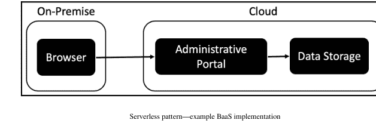

如图所示，BaaS 实现仅要求本地使用浏览器访问管理服务。

## MBaaS 实现

无服务器架构模式的移动后端即服务（MBaaS）实现涉及通过移动设备和浏览器从客户端访问服务。移动应用连接到后端服务，并使用浏览器界面进行监控、报告和管理是常见的：

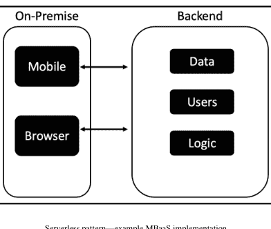

MBaaS 实现通常用于企业级移动应用程序。

## FaaS 实现

无服务器架构模式的函数即服务（FaaS）实现允许按需运行隔离函数。使用这种模式开发可以实现快速构建，因为开发者专注于功能，而其他人专注于运行环境。这种方法的主要优势是处理速度快：

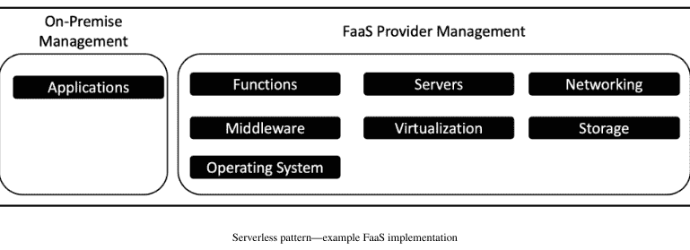

本节提供了无服务器架构模式的示例实现。

## 理解面向服务的模式

面向服务的架构模式，也称为面向服务的架构（SOA），通过方法论和规则建立互操作的服务。Web 服务通常使用 SOA 模式设计。这些互操作的服务由组织良好的、可部署的服务组成，具有以下特点：

- 独立于其他服务运行
- 处理特定的计算任务
- 访问其他服务

可以使用 SOA 模式设计一组组织良好的服务提供一组一致的服务。采用这种模式有几个优点，列如下：

- 由于架构由多个服务组成，每个服务都可以在不影响其他服务的情况下进行修改
- 增加了系统的灵活性和适应性
- 由于具有模块化，系统更容易维护
- 单个服务可以在多个系统中使用

# 架构模式 - 第二部分

下图概述了如何实现面向服务的架构模式（SOA）。所提供的示例从 Web 接口（Web Interface）开始，它是该模式中获取服务的入口点。使用 Web 接口是为了突出该架构模式在 Web 服务中的适用性：

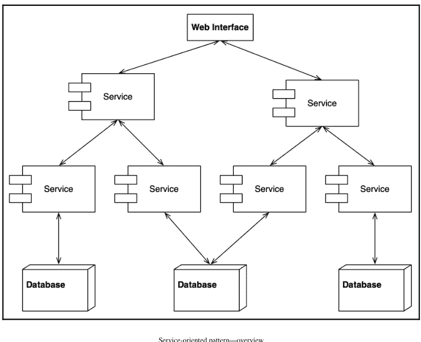

所示，服务可以作为其他服务和数据库的网关，其他资源可以在多个服务之间共享。

下一张图说明了在面向服务的架构模式实现中，单个服务可能的复杂性。单个服务可能包含多个步骤和业务逻辑：

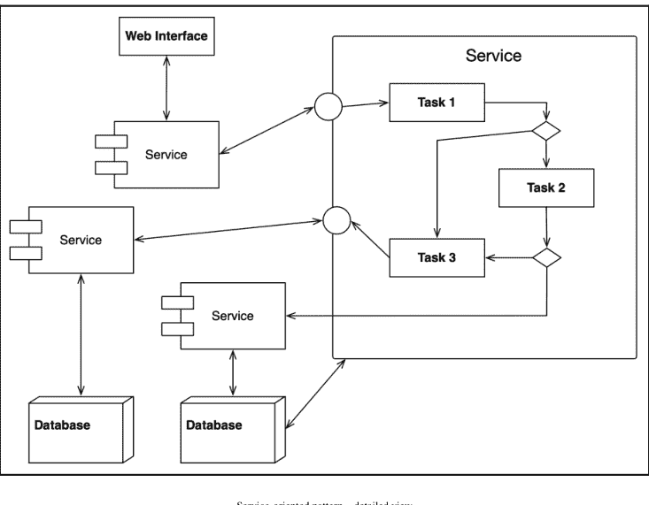

本节详细介绍了面向服务的架构模式，并提供了一个概述图和一个服务级别的详细插图。

## 理解空间基模式（Space-based pattern）

空间基架构模式的设计是为了在高负载下避免功能崩溃并最大化扩展性。基于云的架构通常实现空间基架构模式。该模式成功的关键在于使用分布式共享内存。

这种复杂的方法涉及以下内容：

- 消除中央数据库限制
- 实现数据网格（Data grids）
- 在内存中复制数据网格
- 在复制的内存中维护应用程序数据

通过这种方法，数据会在每个正在使用的处理器中进行内存级复制。下一张图提供了空间基架构模式的概述。每个处理单元（Processing Unit）都与其他处理单元具有连接，并与架构网格中间件有链接：

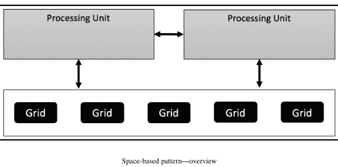

处理单元可以是复杂的，并将包含一个或多个逻辑模块、数据以及复制引擎。

## 总结

在本章中，我们探索了八种架构模式（第 6 章涵盖的八种架构模式之后）。本章涵盖的模式包括微服务、模型视图控制器（MVC）、裸对象、P2P、管道过滤器（pipe-filter）、无服务器（serverless）、面向服务以及空间基。这些架构模式中的每一种都结合图进行了解释。坚固地理解这些 16 种模式将扩展你设计和开发软件的能力。

在下一章“函数设计模式”中，我们将探索函数设计模式类别及其具体的设计模式。具体来说，我们将涵盖执行周围、lambda、MapReduce、记忆化（memoization）和尾调用模式。我们将检查挑战以及解决这些挑战的设计模式。

## 问题

1. 微服务的模式三个优点是什么？
2. 空间基模式如何实现其目标？
3. 在将系统分解为较小服务时使用的是哪种模式？
4. 哪种模式将系统分为不同的组件？
5. 哪种模式需要功能完整的对象？
6. 哪种模式由一组执行函数组成？
7. 哪种模式通过顺序过滤器转换数据？
8. 哪种模式包含了 MBaaS 方法？
9. 哪种模式通过方法和规则建立了可操作的服务？
10. 哪种模式的设计是为了避免高负载下的崩溃？

## 扩展阅读

- Java EE 设计模式与最佳实践 (https://www.packtub.com/application-development/java-ee-8-design-patterns-and-best-practices)
- 使用 Java 学习设计模式 [视频] (https://www.packpub.com/application-development/learn-design-patterns-video)
- Java 中的设计模式与最佳实践 (https://www.packpub.com/application-development/design-patterns-and-best-practices)

# 8 函数设计模式

在上一章“架构模式 - 第二部分”中，我们结束了架构模式的介绍。除了第 6 章涵盖的八种架构模式外，第 7 章涵盖的模式包括微服务、模型视图控制器、裸对象、对等网络、管道过滤器、无服务器、面向服务以及空间基。这些架构模式中的每一种都结合图进行了解释。

在本章中，我们将探索函数设计模式类别及其列出的具体设计模式。我们将检查挑战以及解决这些挑战的设计模式：

- 介绍函数设计模式
- 理解执行周围模式
- 理解 lambda 设计模式
- 理解 loan模式
- 理解 MapReduce 设计模式
- 理解记忆化模式
- 理解流模式
- 理解尾调用模式

这些设计模式对于设计使用函数式编程的系统非常重要。

## 技术要求

本章的代码可以在此处找到：https://github.com/PacktPublishing/Hands-On-Design-Patterns-with-Java/tree/master/Chapter08。

## 介绍函数设计模式

函数设计模式不等同于函数式编程。虽然它们都可以被视为编程范式，但函数式编程可以定义为一种将计算功能建模为数学函数的程序结构方法。函数设计模式术语是指使用函数式编程解决计算问题。

下表概述了函数式编程如何融入整体，特别是与面向对象相比：

| 编程方法 | 描述 |
| :--- | :--- |
| 函数式编程 | 使用与数学函数类似的风格。 |
| 面向对象 | 使用以对象为中心的方法。对象包含属性和行为。 |
| 并行编程 | 使用共享内存。进程可以同时执行。 |


函数设计的一个核心概念是单个函数有一组规则。例如，函数方法方法遵循：

- 它们不改变任何数据
- 在给定相同参数的情况下，它们提供一致的结果
- 它们的存在是为了提供返回值

让我们看两个短示例。第一个示例显示了变量是如何被修改的：

```java
void calculateAge(int years) {
  years = years + 1;
}
```

下一个示例接受与上一个相同的参数，但没有修改它。相反，它根据参数返回一个值：

```java
int calculateAge(int years) {
  return years + 1;
}
```


# 函数设计模式

## 第 8 章

使用方法的优点包括更容易调试以及将函数作为参数传递的能力。你将在“理解 lambda 设计模式”部分探索后者的优点。额外的优点包括对数学、统计、并发和并行应用的高适用性。

实现函数设计模式的通用缺点包括代码复杂性、代码可读性和应用程序性能。

你刚刚看到的表格中列出的函数设计模式在本章的剩余部分中进行了详细介绍。它们按字母顺序排列，以说明没有哪一个比其他的更重要。

## 理解执行周围（execute around）设计模式

执行周围函数设计模式用于过程总是发生预处理和后处理的场景。这允许我们关注核心函数，而不是在之前或之后的处理。预处理和后处理代码可以存在一次，而不是作为每个代码过程的一部分。

考虑一个具有数百个独立类的系统，这些类根据业务逻辑随机运行。与其让数百个过程中的每一个都包含预和后处理代码，不如将这些代码位于一个类中。预和后处理操作成对并包含在需要这些操作的对象中。这样做而不是在使用对象的类中包含这些操作。因此，我们是在使用对象的类中包含这些操作。

### 实现演示

在高级，我们可以考虑以下通用操作的常规流程。我们从`preProcessing()`方法开始，后面是`commonTask()`方法，最后是`postProcessing()`方法：

```java
preProcessing();

commonTask();

postProcessing();
```

## 泛式设计模式（Functional）

考虑一个处理电子文件的系统，可能是用于银行应用程序。这些文件每一个代表一笔交易。存在大量不同类型的交易，每种交易都由系统中一个独立的类管理。每小时处理数千个这样的文件。将`preProcessing()`和`postProcessing()`作为单个类的一部分是浪费资源的，应该尽量避免。为了实现这一点，我们可以使用此处显示的语法来实现我们的银行交易系统：

```
Transaction preProcessDuring: [this performBankingOperation: Transaction]
```

我们可以使用`execute`（执行）设计模式在需要执行动作的实际对象中封装这对动作，而不是在使用该对象的代码中封装这些动作。该设计模式的目标是避免类中的重复代码。

本节提供了`execute`泛式设计模式的概述，并附带了具有代表性的示例实现代码。

## 理解 lambda 设计模式

Lambda 功能在 Java 8 中被引入，它从根本上改变了 Java 编程的格局。Lambda 泛式设计模式使用了 Lambda 函数，也称为匿名函数。这些函数作为参数传递给其他函数。

Lambda 函数包含三个部分：

- 单个参数：`(argument)`
- 箭头操作符：`->`
- 主体：`(body)`

与 Java 中的其他任何内容一样，即使是这个看似简单的特性，也有许多相关规则：

- 如果左侧的参数被显式声明，则参数必须封装在括号中，例如，`(String a)`
- 主体只能调用单个方法
- 主体必须返回一个结果
- 对于只有一个参数的主体，你不需要大括号或分号
- 对于具有多个一个参数的主体，你需要大括号和分号
- 你不能重新声明局部变量

### 泛式设计模式（Functional）

Lambda 函数的语法如下：

```
(argument) -> (body)
```

该语法的一个示例是：

```
// 示例 1
a->a.canHop();
```

上一行代码的作用与下行代码相同：

```
// 示例 2
(Animal a)->{return a.canHop();};
```

比较这两个示例时，我们看到了以下差异：

- 只有一个没有显式声明类型的参数；此时可以省略括号
- 当我们只有一个陈述时，可以省略大括号

### 访问变量

以下语法说明了如何通过 lambda 表达式访问变量：

```
boolean varName = false;
doSomething(objectName, obj -> obj.methodName() == varName);
```

需要注意的是，当通过 lambda 表达式访问局部变量时，你不能更改它们的值。

### 使用单参数实现 lambda

为了演示 lambda 设计模式的使用，我们将创建一个泛式接口和一个主`Driver`类。该泛式接口将包含一个带有单个`int`参数的抽象方法。该接口如下：

```
public interface FunctionalGift {
    void abstractMethod(int number);
}
```

## 泛式设计模式（Functional）

## 第 8 章

`FunctionalGift`接口是一个泛式接口，因为它只有一个抽象方法。

> 注意的是，我们可以使用`@FunctionalInterface`注解来提高代码的可读性。

接下来提供的`Driver`类包含了我们程序的`main()`方法。该方法包含一个实现`FunctionalGift`接口的 lambda 表达式。该接口默认实现了`abstractMethod()`方法。我们的`myObject.abstractMethod()`调用了 lambda 表达式：

```
public class Driver {
    public static void main(String[] args) {
        System.out.println();
        FunctionalGift myObject = (int number)->System.out.println(number + " squared is " + (number*number));
        myObject.abstractMethod(1);
        myObject.abstractMethod(2);
        myObject.abstractMethod(3);
        myObject.abstractMethod(4);
        myObject.abstractMethod(5);
    }
}
```

上一个程序的输出如下：

| |
| --- |
| 1 squared is 1 |
| 2 squared is 4 |
| 3 squared is 9 |
| 4 squared is 16 |
| 5 squared is 25 |

单参数 lambda 设计模式--控制台输出

在下一节中，我们将使用相同的`FunctionalGift`接口并创建一个新的`Driver`类，以演示带有多个参数的 lambda 表达式。

### 使用多参数实现 lambda

我们关于多个参数 lambda 的示例实现将由接下来提供的`FunctionalGift`接口组成。我们还将会有一个`Driver`类，它接受两种类型令牌（蓝色和红色）的用户输入，实现基础数学运算，并为提交令牌的用户提供随机礼物。以下是`FunctionalGift`接口：

```
public interface FunctionalGift {
    void abstractMethod(int number);
}
```

我们实现的`Driver`类分五个连续部分展示。第一部分（如下所示）包含了两个导入——`java.util.Random`和`java.util.Scanner`。我们将在代码的第二部分使用`Scanner`，在第五部分使用`Random`类。第一部分还包含两个接口：一个接收`int`参数，另一个接收单个`String`参数：

```
import java.util.Random;
import java.util.Scanner;

public class Driver {
    interface FirstFunctionalInterface {
        int calculation(int a, int b);
    }

    interface SecondFunctionalInterface {
        void displayResults(String message);
    }

    private int calculate(int a, int b, FirstFunctionalInterface firstObject) {
        return firstObject.calculation(a, b);
    }
}
```

`Driver`类的第二部分是`main()`方法的开始。该方法从获取用户输入开始提示蓝色和红色令牌的数量。我们利用`Scanner`获取这些输入。在接收到输入后，我们显示装饰性头部：

```java
public static void main(String[] args) {
    // 获取用户输入
    System.out.println();
    Scanner in = new Scanner(System.in);
    System.out.println("How many blue tokens do you have to exchange: ");
    int blueTokens = in.nextInt();
    System.out.println("How many red tokens do you have to exchange: ");
    int redTokens = in.nextInt();

    // 显示系统头部
    System.out.println("=================");
    System.out.println("TOKEN-TO-GIFT EXCHANGE");
    System.out.println("=================");
```

`Driver`类的第三部分是`main`方法的第二部分。这段代码从计算用户令牌的 lambda 表达式开始。接下来，使用第二个 lambda 表达式计算平方和。最后，我们实例化`firstObject`对象来测试我们的 lambda 表达式：

```java
// 添加蓝色和红色令牌
FirstFunctionalInterface sum = (int nbr1, int nbr2) -> nbr1 + nbr2;
FirstFunctionalInterface superSquare = (int nbr1, int nbr2) ->
    (nbr1 * nbr1) + (nbr2 * nbr2);
Driver firstObject = new Driver();
```

`Driver`类的第四部分是`main`方法的第三也是最后一部分。在这一部分中，我们向用户生成了六行输出：

- 前两行回显用户输入的蓝色和红色令牌数量。
- 第三行使用 lambda 表达式提供令牌总和。
- 第四行也使用了 lambda 表达式，并提供单个令牌值的平方和。
- 最后行的输出仅是装饰性分隔符。
- 最后的输出行提供了`displayResults()`方法的结果：

```java
// 生成输出
System.out.println(blueTokens + " + blue tokens submitted");
System.out.println(redTokens + " + red tokens submitted");
System.out.println(firstObject.calculate(blueTokens, redTokens, sum) +
    " + total tokens submitted");
System.out.println(firstObject.calculate(blueTokens, redTokens,
    superSquare) +
    " + total squared tokens submitted");
```

## 功能性设计模式

## 第 8 章

```java
"SuperSquare number result";
System.out.println("===");
FunctionalInterface secondObject = message ->
    System.out.println("Your gift is a pound of " + message);
secondObject.displayResults(selectGift());
```

我们的`Driver`类中的第五也是最后一个数字包含了`selectGift()`方法。该方法创建了一个包含五种贵金属类型的数组，并生成一个 0 到 4 之间的随机数。该随机数被用作`giftArray`的索引。返回数组该索引处的值：

```java
public static String selectGift() {
    String[] giftArray = new String[]{"Gold", "Silver", "Platinum", "Titanium", "Copper"};
    Random giftNumber = new Random();
    int giftToGive = giftNumber.nextInt(4);
    return giftArray[giftToGive];
}
```

这是我们程序的输出：

| 你有多少个蓝色代币需要兑换： |
| :--- |
| 4 |
| 你有多少个红色代币需要兑换： |
| 5 |
| =============== |
| 代币换礼物交换 |
| =============== |
| 已提交了 4 个蓝色代币 |
| 已提交了 5 个红色代币 |
| 总共提交了 9 个代币 |
| 41 SuperSquare 结果 |
| =============== |
| 你的礼物是一磅银子 |

多参数 Lambda 设计模式——控制台输出

本节提供了 lambda 功能设计模式两种实现的源代码和控制台输出。

## 理解贷款模式（Loan Design Pattern）

贷款功能设计模式可用于创建资源感知应用程序。通过这种模式，我们并不是在创建必须管理内存等资源的代码；相反，我们想要控制资源如何使用。具有关键意义的是确保垃圾回收按照我们的约定进行，而不是等待 Java 的默认垃圾回收系统启动。在本节中，我们将查看有关文件处理的实现。我们的示例将包含在实现贷款模式之前的文件处理的处理，然后我们将修改代码。

### 实现文件处理

为了理解贷款设计模式的威力，我们将实现一个文件处理应用程序，展示贷款设计模式前后的源代码。我们的应用程序将模拟文件的打开和关闭，并带有额外的处理步骤。工作流如所示所示：`(img/diagram.png)`

## 设计模式

## 第 8 章

我们的实现将由一个`FileToProcess`类和一个`Driver`类组成。接下来提供了`FileToProcess`类。该类包含一个默认构造函数和六个公共方法，提供控制台输出以指示方法的被调用。本节包含了类头、构造函数和`openFile()`方法。如你所见，`openFile()`方法只是向控制台输出一条语句来模拟打开文件。此应用程序用于演示，并不会实际打开或处理任何文件：

```java
public class FileToProcess {
    // 构造函数
    public FileToProcess() {
    }

    public FileToProcess openFile() {
        System.out.println("\nFile opened for processing");
        return this;
    }
}
```

`FileToProcess`类的第二部分包含了`processMetadata()`、`analyzeHeader()`、`checkSpelling()`、`checkGrammar()`和`closeFile()`方法。这些方法都只是向控制台输出文本：

```java
public FileToProcess processMetadata() {
    System.out.println("\t正在处理元数据. . . ");
    return this;
}
```

```java
public FileToProcess analyzeHeader() {
    System.out.println("\t正在分析头部. . . ");
    return this;
}
```

```java
public FileToProcess checkSpelling() {
    System.out.println("\t正在检查拼写. . . ");
    return this;
}
```

```java
public FileToProcess checkGrammar() {
    System.out.println("\t正在检查语法. . . ");
    return this;
}
```

```java
public void closeFile() {
    System.out.println("文件已关闭");
}
```

## 设计模式

我们应用程序的`Driver`类包含了`main()`方法。该方法（接下来提供）开始创建一个名为`myFile`的`FileToProcess`类实例。然后我们使用方法链式来调用`FileToProcess`类中的每个方法。这六个链式方法调用按照之前提供的工作流中所指定的特定顺序被调用并执行：

```java
public class Driver {
    public static void main(String[] args) {
        FileToProcess myFile = new FileToProcess();
```


`myFile.openFile().processMetaData().analyzeHeader().checkSpelling().checkGrammar().closeFile();`

这是我们应用程序的输出：

| 文件已打开处理 |
| :--- |
| 正在处理元数据. . . |
| 正在分析头部. . . |
| 正在检查拼写. . . |
| 正在检查语法. . . |
| 文件已关闭 |

贷款模式-文件处理实现控制台输出

我们的应用程序运行良好，但没有实现贷款模式。目前编写的应用程序的问题在于，我们将责任交给了开发者，以确保这六个方法按照工作流预期的特定顺序被调用。如果应用程序的程序逻辑不当（例如在打开文件之前关闭文件），我们将遇到问题。这些潜在问题可以通过大量代码测试在开始之前检查过程是否已完成来克服。这将是繁琐的，并且不会为应用程序带来整洁的代码库。

让我们使用设计模式来强制此功能。首先，我们将更新之前示例中的 `FileToProcess` 类并将其重命名为 `FileTo2`。这是该类的第一部分：

```java
import java.util.function.Consumer;

public class FileTo2 {

    // 构造函数
    protected FileTo2() {
        openFile();
    }

    public static void processFile(final Consumer<FileTo2> block) {
        final FileTo2 theFile = new FileTo2();
        block.accept(theFile);
        theFile.closeFile();
    }
}
```

我们更改了构造函数，以便在实例化 `FileTo2` 对象时调用 `openFile()` 方法。`FileTo2` 类的剩余部分包含了单独的处理方法，每个方法为控制台提供输出。以下是这些代码：

```java
public FileTo2 openFile() {
    System.out.println("\nFile opened for processing by constructor");
    return this;
}
```

```java
public FileTo2 processMetaData() {
    System.out.println("\t正在处理元数据. . . ");
    return this;
}
```

```java
public FileTo2 analyzeHeader() {
    System.out.println("\t正在分析头部. . . ");
    return this;
}
```

```java
public FileTo2 checkSpelling() {
    System.out.println("\t正在检查拼写. . . ");
    return this;
}
```

```java
public FileTo2 checkGrammar() {
    System.out.println("\t正在检查语法. . . ");
    return this;
}
```

```java
public void closeFile() {
    System.out.println("文件已关闭");
}
```

接下来，我们可以修改之前示例中的 `Driver` 类并将其重命名为 `Driver2`。这是更新后的 `Driver` 类源代码：

```java
public class Driver2 {
    public static void main(String[] args) {
        FileTo2.processFile(theFile -> theFile.processMetaData()
            .analyzeHeader().checkSpelling().checkGrammar());
    }
}
```

更新后的应用程序输出：

| 文件已通过构造函数打开处理 |
| :--- |
| 正在处理元数据. . . |
| 正在分析头部. . . |
| 正在检查拼写. . . |
| 正在检查语法. . . |
| 文件已关闭 |

# 理解 MapReduce 设计模式

MapReduce 功能设计模式用于大规模并行编程。Google 开发这种功能设计模式是为了将大型任务分解成较小任务。这些较小任务随后并行运行并产生合并的结果。MapReduce 功能设计模式的目标是在处理大型数据集时获得性能提升，也称为大数据。

## 功能性设计模式

## 第 8 章

MapReduce 功能性设计模式的大规模数据处理和详细分析是复杂的概念，超出了本章的范畴。为了理解 MapReduce 设计模式，我们将简要介绍以下实现方法：

- 输入-映射-输出 (Input-Map-Output)
- 输入-映射-还原-输出 (Input-Map-Reduce-Output)
- 输入-多映射-还原-输出 (Input-Multiple Maps-Reduce-Output)
- 输入-映射-合并器-还原-输出 (Input-Map-Combiner-Reduce-Output)

## 输入-映射-输出

MapReduce 功能性设计模式的输入-映射-输出形式可以在没有 reduce 组件的情况下使用。当更改数据格式且不进行聚合计算时，可以使用它。下图提供了该流程的概述：

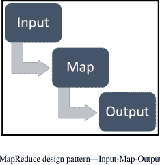

为了演示这种方法，我们将使用一个正在清理的教师注册系统场景。将在接下来的章节中处理该模式中的每一步。

### 输入

对于我们的示例，假设我们有一个包含某非特定大学 4,000 多名全职和兼职教师的注册表。多年来，注册表中的名称已经损坏，主要是由于数据录入控制不当。例如，这里是当前教师条目的几种不同形式（此处显示单个成员以供比较）。接接列出的教师成员全名为 Thomas A. Anderson，昵称为 Neo：

```
Thomas Anderson\Thomas A. Anderson
```

```
Anderson, Thomas
Anderson, T. A.
Anderson, Thomas A.
Neo Anderson
Anderson, Neo
N. Anderson
T. Anderson
T. A. Anderson
```

拥有这么多可能的变体使得教师的查找和问题搜索变得困难。除了不同的形式外，大小写也可能不一致。

### 映射

`map` 组件可能包括根据姓氏创建键。根据我们的场景，我们可能需要引用额外的数据字段以确保我们正确识别姓氏。

我们对名字也进行同样的操作。对于中间名，我们可能允许中间字母缩写以及中间名，因为可能很难获取任何缺失的数据。

## 输出

我们最终的输出将是正确格式的名称列表，包含大小写。我们选择的格式可能是这样的：

```
Last name, First Name <Middle initial OR Middle name>
```

最终结果将是一个更新后的教师注册表，每个条目具有相同的格式。

## 输入-映射-还原-输出

为了说明 MapReduce 功能性设计模式的输入-映射-还原-输出形式，我们将使用按年级划分的学生平均分场景。下图提供了该流程的概述：

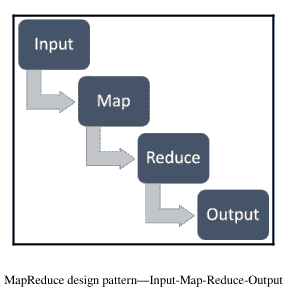

将在后续章节中处理该模式的每一步。

### 输入

以下是用于输入-映射-输出场景的数据：

| 学生 | 年级 | 平均学分 |
|---|---|---|
| Tom Zarek | Freshman | 3.8 |
| William Adama | Senior | 4.0 |
| Galen Tyrol | Senior | 2.7 |
| Gaius Baltar | Sophomore | 3.1 |
| D'Anna Biers | Junior | 3.9 |
| Kara Thrace | Junior | 2.6 |
| Sharon Valeri | Sophomore | 3.2 |
| Laura Roslin | Senior | 3.9 |
| Saul Tigh | Freshman | 3.3 |
| Felix Gaeta | Freshman | 3.4 |
| Tory Foster | Junior | 2.8 |
| Anastasia Dualla | Sophomore | 3.0 |

如你所见，每个年级类别中都有几个学生。

### 映射

查看上一节中的代表性数据，我们知道创建一个数据等级键和键值对。根据我们之前的数据集，它如下：

```
(Freshman, 3.8), (Senior, 4.0), (Senior, 2.7),
(Sophomore, 3.1), (Junior, 3.9), (Junior, 2.6),
(Sophomore, 3.2), (Senior, 3.9), (Freshman, 3.3),
(Freshman, 3.4), (Junior, 2.8), (Sophomore, 3.0)
```

下一步将是 `reduce`。

### 还原

给出你的键值对映射；我们可以按照所示将这些数据还原为中间形式：

```
{
 Freshman [3.8, 3.3, 3.4],
 Sophomore [3.1, 3.2, 3.0],
 Junior [3.9, 2.6, 2.8],
 Senior [ 4.0, 2.7, 3.9]
}
```

我们的最后一步是还原过程的输出。

## 输出

输入-映射-还原实现的最终输出在此：

```
{
 Freshman, 3.5,
 Sophomore, 3.1,
 Junior, 3.1,
 Senior, 3.5
}
```

提供的结果是基于学年的聚合平均学分。

## 输入-映射-还原-输出

MapReduce 功能性设计模式的输入-映射-还原-输出形式将使用按年级划分的学生平均分场景。该提供了该流程的概述：


我们将在后续章节中处理该模式的每一步。

### 输入

以下是用于输入-映射-输出场景的数据：

| 学生 | 年级 | 平均学分 |
|---|---|---|
| Tom Zarek | Freshman | 3.8 |
| William Adama | Senior | 4.0 |
| Galen Tyrol | Senior | 2.7 |
| Gaius Baltar | Sophomore | 3.1 |
| D'Anna Biers | Junior | 3.9 |
| Kara Thrace | Junior | 2.6 |
| Sharon Valeri | Sophomore | 3.2 |
| Laura Roslin | Senior | 3.9 |
| Saul Tigh | Freshman | 3.3 |
| Felix Gaeta | Freshman | 3.4 |
| Tory Foster | Junior | 2.8 |
| Anastasia Dualla | Sophomore | 3.0 |

如你所见，每个年级类别中都有几个学生。

### 映射

查看上一节中的代表性数据，我们知道创建一个数据等级键和键值对。根据我们之前的数据集，它如下：

```
(Freshman, 3.8), (Senior, 4.0), (Senior, 2.7),
(Sophomore, 3.1), (Junior, 3.9), (Junior, 2.6),
(Sophomore, 3.2), (Senior, 3.9), (Freshman, 3.3),
(Freshman, 3.4), (Junior, 2.8), (Sophomore, 3.0)
```

下一步将是 `reduce`。

### 还原

给出你的键值对映射；我们可以将这些数据还原为中间形式：

```
{
 Freshman [3.8, 3.3, 3.4],
 Sophomore [3.1, 3.2, 3.0],
 Junior [3.9, 2.6, 2.8],
 Senior [ 4.0, 2.7, 3.9]
}
```

我们的最后一步是还原过程的输出。

## 输出

输入-映射-还原实现的最终输出在此：

```
{
 Freshman, 3.5,
 Sophomore, 3.1,
 Junior, 3.1,
 Senior, 3.5
}
```

提供的结果是基于学年的聚合平均学分。

## 输入-映射-还原-输出

MapReduce 功能性设计模式的输入-映射-还原-输出形式将使用按年级划分的学生平均分场景。该图提供了该流程的概述：


### 输入

以下是用于输入-映射-输出场景的数据：

| 学生 | 年级 | 平均学分 |
|---|---|---|
| Tom Zarek | Freshman | 3.8 |
| William Adama | Senior | 4.0 |
| Galen Tyrol | Senior | 2.7 |
| Gaius Baltar | Sophomore | 3.1 |
| D'Anna Biers | Junior | 3.9 |
| Kara Thrace | Junior | 2.6 |
| Sharon Valeri | Sophomore | 3.2 |
| Laura Roslin | Senior | 3.9 |
| Saul Tigh | Freshman | 3.3 |
| Felix Gaeta | Freshman | 3.4 |
| Tory Foster | Junior | 2.8 |
| Anastasia Dualla | Sophomore | 3.0 |

如你所见，每个年级类别中都有几个学生。

### 映射

查看上一节中的代表性数据，我们知道创建一个数据等级键和键值对。根据我们之前的数据集，它如下：

```
(Freshman, 3.8), (Senior, 4.0), (Senior, 2.7),
(Sophomore, 3.1), (Junior, 3.9), (Junior, 2.6),
(Sophomore, 3.2), (Senior, 3.9), (Freshman, 3.3),
(Freshman, 3.4), (Junior, 2.8), (Sophomore, 3.0)
```

下一步将是 `reduce`。

### 还原

给出你的键值对映射；我们可以将这些数据还原为中间形式：

```
{
 Freshman [3.8, 3.3, 3.4],
 Sophomore [3.1, 3.2, 3.0],
 Junior [3.9, 2.6, 2.8],
 Senior [ 4.0, 2.7, 3.9]
}
```


我们的最后一步是还原过程的输出。

## 输出

输入-映射-还原实现的最终输出在此：

```
{
  Freshman, 3.5,
  Sophomore, 3.1,
  Junior, 3.1,
  Senior, 3.5
}
```

# 函数式设计模式

## 第8章

如你所看到的，存在大量的处理浪费。如果我们从一个更大的数字开始，浪费的数量将急剧增加。例如，如果我们从`computeFibonacciNumber(300)`开始，总将会有24,72行输出。如接下来的表格所示，`computeFibonacciNumber(int 3)`会被处理5,757次，而`computeFibonacciNumber(int 2)`会被处理9,315次：

| 方法 | 处理次数 |
|---|---|
| `computeFibonacciNumber(int 7)` | 839 |
| `computeFibonacciNumber(int 6)` | 1,358 |
| `computeFibonacciNumber(int 5)` | 2,198 |
| `computeFibonacciNumber(int 4)` | 3,558 |
| `computeFibonacciNumber(int 3)` | 5,757 |
| `computeFibonacciNumber(int 2)` | 9,315 |

上一个表格为了代表性和简洁性进行了简化，仅显示了8及以下的`int`值。

> 如果你在我们的计算机上运行此测试，请注意处理大大的斐波那契数可能需要很长时间。


现在让我们尝试使用备录设计模式（memoization design pattern）运行此应用程序。接下来显示我们`FibonacciTest2`类的第一部分。该类导入两个类（`java.util.Map`和`java.util.HashMap`）以实现`HashMap`实例。`computeFibonacciNumber()`方法的开头也在此部分，并检查该数字是否等于斐波那契基数之一（0或1）：

```
import java.util.Map;
import java.util.HashMap;

class FibonacciTest2 {
    private static Map<Integer, Integer> memoization = new HashMap<>();

    public static int computeFibonacciNumber(int number) {
        // 此处检查斐波那契基数 0 和 1
        if ((number == 0) || (number == 1)) {
            return number;
        }
    }
}
```

我们`FibonacciTest2`类的第二部分是`computeFibonacciNumber()`方法的最后部分，显示了三个步骤。第一步是检查是否已经进行了计算。如果已经计算，我们则从`HashMap`中检索结果，而不是执行计算。第二步是在尚未计算过时执行计算。第三步是在第一次执行计算时，将结果添加到`HashMap`中：

```
// 步骤 1: 检查是否已经进行过计算
if (memoization.containsKey(number)) {
    System.out.println("First time computing memoization " + number);
    return memoization.get(number);
}

// 步骤 2: 如果未计算则进行计算
System.out.println("Computing computeFibonacciNumber(" + number + ")...");
int fibonacciResult = (computeFibonacciNumber(number - 1)) + 
(computeFibonacciNumber(number - 2));

// 步骤 3: 将结果加入 Map
memoization.put(number, fibonacciResult);
return fibonacciResult;
```

我们`FibonacciTest2`类的最后部分是`main()`方法，它打印一个空行，然后调用`computeFibonacciNumber()`方法并传入7作为参数：

```java
public static void main(String[] args) {
    System.out.println();
    computeFibonacciNumber(7);
}
```

应用程序的结果如在下面的控制台输出截图中：

| |
|---|
| `computeFibonacciNumber(int 7)`... |
| `computeFibonacciNumber(int 6)`... |
| `computeFibonacciNumber(int 5)`... |
| `computeFibonacciNumber(int 4)`... |
| `computeFibonacciNumber(int 2)`... |
| First time computing memoization 2 |
| First time computing memoization 3 |
| First time computing memoization 4 |
| First time computing memoization 5 |

斐波那契处理输出——使用备录设计模式

本节提供了我们实现备录函数式模式的源代码和控制台输出。

## 理解流式设计模式

流式函数式设计模式提供了一种用于转换数据的流水线功能。从这个意义上说，转换数据与变异数据是不同的。数据在流中被转换，但没有被变异。为了获得转换后的数据，必须调用终端操作（terminal operation）。一旦流关闭，就无法再次访问，转换后的数据也是是。

下表提供了与流式函数式设计模式相关的术语表：

| 术语 | 说明 |
|---|---|
| Stream (流) | 功能的流水线。 |
| Transform (转换) | 改变流中的数据。 |
| Mutation (变异) | 永久改变数据。 |
| Creator (创建者) | 创建流生成一个无限顺序无序流。 |
| Intermediate operation (中间操作) | 返回流并在执行终端操作时支持查询。 |
| Terminal operation (终端操作) | 提供非流的结果。 |

下面的图描述了流式函数式设计模式工作流是如何实现的：

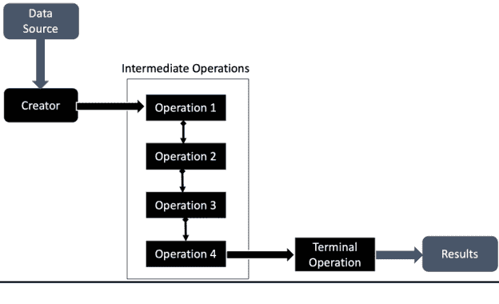

我们将仔细查看中间操作，然后是终端操作。

## 流的中间操作

流有八种中间操作。这些操作是方法，并按其返回类型在下方列出：

| Stream | IntStream | LongStream | DoubleStream |
|---|---|---|---|
| `distinct()` | `flatMapToInt()` | `flatMapToLong()` | `flatMapToDouble()` |
| `filter()` | `mapToInt()` | `mapToLong()` | `mapToDouble()` |
| `flatMap()` | | | |
| `limit()` | | | |
| `map()` | | | |
| `peek()` | | | |
| `skip()` | | | |
| `sorted()` | | | |

理解这些流操作的返回类型将有助于它们的实现。

## 流的终端操作

流有13种终端操作。这些操作是方法，并按字母顺序在下方列出：

- `allMatch()`
- `anyMatch()`
- `collect()`
- `count()`
- `findAny()`
- `findFirst()`
- `forEach()`
- `findOrdered()`
- `max()`
- `min()`
- `noneMatch()`
- `reduce()`
- `toArray()`

## 编写流式模式

接下来提供的`StreamExample`类演示了流式设计模式。包含了对`java.util.stream`的调用。

```java
import java.util.stream;

public class StreamExample {
    public static void main(String[] args) {
        System.out.println();
        Stream.iterate(0, x -> x + 3)
            .peek(x -> System.out.println("Peeked at: " + x))
            .limit(7)
            .forEach(System.out::println);
    }
}
```

`StreamExample`类的输出如下：

| |
|---|
| Peeked at: 0 |
| Peeked at: 3 |
| Peeked at: 6 |
| Peeked at: 9 |
| Peeked at: 12 |
| Peeked at: 15 |
| Peeked at: 18 |

流模式实现——控制台

# 函数设计模式

## 第8章

`TailCallExample`类的下一个部分是`executeThisMethod()`方法。在下一个代码块中，你会看到该方法有一个本地`funWithNumbers`变量。该方法还按顺序调用以下方法：`operation1()`、`operation2()`、`operation3()`、`operation4()`和`operation5()`。最后执行`return(funWithNumbers)`语句。`operation5()`方法是`executeThisMethod()`方法调用的最后一个方法，使其成为尾调用。你可能会认为返回语句是尾调用，但它并不是一个方法，因此它不能是该方法或任何方法的尾调用：

```java
private static int executeThisMethod(int theNumber) {
    int funWithNumbers;
    funWithNumbers = operation1(theNumber);
    funWithNumbers = operation2(funWithNumbers);
    funWithNumbers = operation3(funWithNumbers);
    funWithNumbers = operation4(funWithNumbers);
    funWithNumbers = operation5(funWithNumbers); // tail call
    return(funWithNumbers);
}
```

`TailCallExample`类的最后一部分在下文中提供，包含了`operation1()`、`operation2()`、`operation3()`、`operation4()`和`operation(5)`方法。这些方法中的每一个都调用了`println()`方法，在每种情况下，该方法都是这些方法的尾调用：

```java
private static int operation1(int theNbr) {
    System.out.println("\t9 = " + (theNbr + 9)); // tail call
    return theNbr + 9;
}

private static int operation2(int theNbr) {
    System.out.println("\t2 = " + (theNbr * 2)); // tail call
    return theNbr * 2;
}

private static int operation3(int theNbr) {
    System.out.println("\t-4 = " + (theNbr - 4)); // tail call
    return theNbr - 4;
}

private static int operation4(int theNbr) {
    System.out.println("\t/2 = " + (theNbr / 2)); // tail call
    return theNbr / 2;
}
```

```java
private static int operation5(int theNbr) {
    System.out.println("\t- initial number = " + (theNbr - theInitialNumber)); // tail call
    return (theNbr) - theInitialNumber;
}
```


我们的应用程序输出在此提供：

| 初始数字: 4500 |
| :--- |
| + 9 = 4509 |
| * 2 = 9018 |
| - 4 = 9014 |
| / 2 = 4507 |
| - 初始数字 = 7 |
| 尾调用发送此结果: 7 |

## 尾设计模式实现——控制台输出

本节提供了我们实现“幸运7”尾式函数设计模式的源代码和控制台输出。

## 总结

在本章中，我们研究了函数设计模式类别和八种特定的设计模式。我们学习到函数设计模式不等同于函数式编程，而且它们都被视为编程范式。函数设计模式一术是指使用函数式编程来解决计算问题。本章涵盖的函数设计模式包括执行器模式（execute around pattern）、lambda 模式、贷款模式（loan pattern）、MapReduce 模式、备忘录模式（memoization pattern）、流模式（streams pattern）和尾调用模式（tail call pattern）。

在接下来的章节“响应式设计模式”中，我们将探索响应式设计模式类别及其各个设计模式，包括异步通信、自动伸缩、边界队列、隔舱隔离、缓存、断路器、事件驱动通信、快速失败故障处理、扇出和最快响应、幂等性、监控、发布者-订阅者、自包含和无状态。

## 问题

1. 使用函数设计方法函数遵循的三个规则是什么？
2. 列出七种函数设计模式。
3. 函数式编程使用哪种函数模型？
4. 哪种设计模式将一对动作封装在需要该对动作的实际对象中？
5. 哪种设计模式使用匿名函数？
6. 哪种设计模式可以创建资源感知应用程序？
7. 哪种设计模式用于大规模并行编程？
8. 哪种设计模式存储关键函数的结果以提高整体处理效率？
9. 哪种设计模式呈现用于转换数据的流水线功能？
10. 哪种设计模式是在过程末尾执行的子程序？

## 扩展阅读

- [Java EE 8 Design Patterns and Best Practices](https://www.packpub.com/application-development/java-ee-8-design-patterns-and-best-practices)
- [Learn Design Patterns with Java [Video]](https://www.packpub.com/application-development/learn-design-patterns-java-video)
- [Design Patterns and Best Practices in Java](https://www.packpub.com/application-development/design-patterns-and-best-practices-java)
- [Learning Big Data with Amazon Elastic MapReduce](https://www.packpub.com/virtualization-and-cloud/learning-big-data-amazon-elastic-mapreduce)

# 响应式设计模式

在上一章“函数设计模式”中，我们研究了函数设计模式类别和八种特定的设计模式。我们学习到函数设计模式不等同于函数式编程，而且它们都被视为编程范式。函数设计模式一术是指使用函数式编程来解决计算问题。函数设计模式涵盖的包括执行器模式、lambda 模式、贷款模式、MapReduce 模式、备忘录模式、流模式和尾调用模式。

在接下来的章节“响应式设计模式”中，我们将探索响应式设计模式类别及其各个设计模式，包括异步通信、自动伸缩、边界队列、隔舱隔离、缓存、断路器、事件驱动通信、快速失败故障处理、扇出和最快响应、幂等性、监控、发布者-订阅者、自包含和无状态。

## 第 9 章

- 发布者-订阅者
- 自包含
- 无状态

## 技术要求

本章的代码可以在`https://github.com/PacktPublishing/Hands-On-Design-Patterns-with-Java/tree/master/Chapter9`找到。

## 介绍响应式设计模式

响应式设计模式是为了让系统架构师、工程师和开发者能够创建响应且可扩展的系统。响应式设计模式源于响应式编程，并以响应宣言的形式记录。该宣言确立了四个特性：

- 响应式（Responsive）
- 韧性（Resilient）
- 弹性（Elastic）
- 消息驱动（Message-driven）

这些特性将在后续章节中进行解释。

## 响应式

当一个系统是响应式的时，被认为它能够快速响应事件。这不仅仅是指处理数据或对象；它意义重大。预期的响应水平包括快速识别问题、确定所需的响应类型，然后执行实际响应。

## 韧性

韧性系统是具有极高运行时间且对错误免疫的系统。设计韧性系统涉及广泛的错误处理、数据冗余、分布式处理以及其他我们本章中进一步探讨的概念。韧性——韧性系统没有单点故障。例如，与其使用单个数据库，韧性系统可能会采用数据库复制。将系统标记为韧性不仅意味着整个系统具有韧性，而且其组件和子组件也是如此。

## 弹性

弹性系统具有根据需要进行扩展和缩小规模的能力。一个例子可能是电子商务网站在假日期间由于访问量指数级增长时，需要额外的服务器、网关和其他系统组件。

重要的是，系统的弹性包括扩展和缩小系统资源的能力。根据所用系统的不同，这种弹性可以通过预测性分析和特殊算法来控制，以检测特定的系统组件何时达到特定的高低水平。

## 消息驱动

响应式设计模式的第四个特征是它们是消息驱动。这一特征意味着响应式设计系统依赖于系统组件之间传递的消息。这种消息传递是异步的，并允许系统隔离故障。对消息传递的强力依赖实现了弹性、节点控制和处理负载控制。

我们将重点介绍本章介绍的响应式设计模式中消息驱动的特性。

> 响应式设计模式的四个特征（响应式、韧性、弹性和消息驱动）也是响应式编程和响应式设计模式的四个原则。

本章中的每种响应式设计模式都可以分配到之前定义的四个特征中的一个或多个。

下表提供了这种分类：

| 响应式 (Responsive) | 韧性 (Resilient) | 弹性 (Elastic) | 消息驱动 (Message-driven) |
| :--- | :--- | :--- | :--- |
| 异步通信 | 有界队列 | 自动伸缩容 | 事件驱动通信 |
| 缓存 | 隔板隔离 | 自包含 | 幂等性 |
| 快速失败 | 熔断器 | 无状态 | 发布者-订阅者 |
| 扇出与最快响应 | 故障处理、监控 | | |

### 响应式设计模式分组

本章剩余部分的响应式设计特性按字母顺序排列，以说明没有哪一个比其他一个重要。

## 理解异步通信设计模式

在本章的前面部分，我们确定了响应式设计原则之一是异步消息驱动通信。该原则是异步通信设计模式的核心：

1. 首先，客户端向服务器发送请求消息。
2. 接下来，服务器立即向客户端发送确认消息，然后花费所需的时间处理请求。
3. 一旦请求被完全处理，响应消息将从服务器发送到客户端。

此图阐释了异步通信的三个组件：

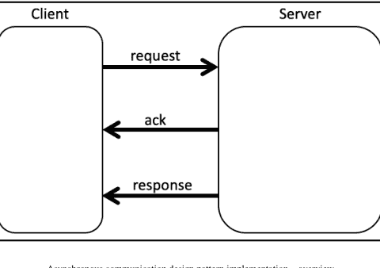

这种通信方法是高效高效的，因为它允许客户端向服务器发送多条请求消息，而无需专门投入处理资源来等待服务器的响应消息。客户端理解服务器最终会发送响应消息，它可以在那个时候分配处理资源。

## 实现异步通信设计模式

实现异步通信响应式设计模式最常用的方法是使用异步回调。接下来是实现异步回调的基本过程。该过程从客户端向服务器身份验证开始。客户端向服务器发送请求消息并订阅服务器。服务器发送立即确认消息，处理请求，然后发送响应消息。客户端接收响应并进行任何后续处理：

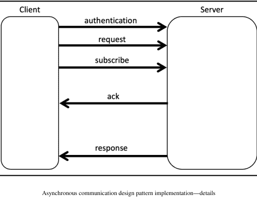

下一个 UML 图描述了实现示例的类结构。该解决方案包含一个`CallbackListener`接口以及`CallerOne`和`CallerTwo`类。只有`CallerOne`类实现了`CallbackListener`接口：

| << interface >> |
| :--- |
| `CallbackListener` |
| `processCallback()` |

| `CallerOne` | `CallerTwo` |
| :--- | :--- |
| `processCallback()` | `callbackListener` |
| `doSomething1(1)` | `registerCallbackListener()` |
| `doSomething2(2)` | `processCallback()` |
| | `main()` |

UML 类图——异步通信设计模式实现

让我们来看看该设计模式的代码示例。第一段代码是监听器接口。它包含一个简单的`processCallback()`方法，`CallerOne`类将重写该方法。`CallerTwo`类不会重写该方法，但仍然包含它自己的`processCallback()`方法，因为它没有实现`CallbackListener`接口：

```java
package CH9AsynchronousCommunication;

public interface CallbackListener {

    void processCallback();

}
```

接下来提供了`CallerOne`类的四个连续部分。提供的第一部分包含包声明以及四个导入语句。导入的类将支持`doSomething2()`方法：

```java
package CH9AsynchronousCommunication;

import java.util.ArrayList;
import java.util.Collections;
import java.util.List;
import java.util.ListIterator;
```

```java
public class CallerOne implements CallbackListener {
```

接下来提供了`CallerOne`类的第二部分。`CallerOne`类有三个方法；其中第一个方法`processCallback()`显示在此。当被调用时，该方法会将内容打印到控制台窗口以模拟处理消息。进行了两次方法调用，分别调用`doSomething1()`和`doSomething2()`，用于进一步模拟消息：

```java
@Override
public void processCallback()
{
    System.out.println("\nAsynchronous Task Completed Followed by Callback.");
    System.out.println("\tSimulated processing from Caller One . . \t");
    doSomething1(34, 12);
    System.out.println("\tSimulated processing from Caller Two . . \t");
    doSomething2("nretppa ngiseD noitacinummoC suornhcnysA");
    System.out.println("\t");
}
```

`CallerOne`类的第三部分包含`doSomething1()`方法并随后提供。该方法简单确定两个`int`参数中的较大值，并向控制台窗口输出。`doSomething1()`方法包含在异步响应式设计模式的示例实现中：

```java
public void doSomething1(int x, int y) {

    // determine max value

    System.out.println("\ttlargest is " + Math.max(x, y));

}
```

`CallerOne`类的第四部分也是最后一部分已提供，包含`doSomething2()`方法。该方法简单地接收`String`参数并反序输出到控制台窗口。这是使用`ArrayList`和`ListIterator`完成的。`doSomething2()`方法包含在示例中以模拟异步模式的设计模式：

```java
public void doSomething2(String backwardsPhrase) {

    // reverse a string

    char[] phrase = backwardsPhrase.toCharArray();

    List<Character> newPhrase = new ArrayList<>();

    for (char character: phrase) {

        newPhrase.add(character);

    }

    Collections.reverse(newPhrase);

    ListIterator myIterator = newPhrase.listIterator();

    System.out.print("\t\tResultant Phrase: ");

    while (myIterator.hasNext())

        System.out.print(myIterator.next());

}
```

`CallerTwo`类分三个部分。提供的第一部分创建一个`callbackListener`对象。此类的下一个操作是注册`callbackListener`。这是通过`registerCallbackListener()`方法实现的：

```java
package CH9AsynchronousCommunication;

public class CallerTwo {

    // create callbackListener object

    private CallbackListener callbackListener;

    // setting up the callbacklistener

    public void registerCallbackListener(CallbackListener callbackListener)
    {
        this.callbackListener = callbackListener;
    }

}
```

`CallerTwo`类的第二部分包含了`processCallback()`方法。这是`CallerTwo`类的异步操作。我们通过为操作创建一个新线程并使用 lambda 表达式来实现它。

> 关于 lambda 表达式的更多信息可以在第 8 章函数式设计模式中找到。

如下代码所示，我们必须检查`callbackListener`是否已注册。如果不存在，我们调用`CallerOne`类的`processCallback()`方法：

```java
// asynchronous operation for CallerTwo

public void processCallback()
{
    // a new thread for the asynchronous operations using lambda

    new Thread(() -> {

        if (callbackListener != null) {

            callbackListener.processCallback();

        }

    });
}
```

```java
// simulated processing
System.out.println("\nasynchronous operations taking place . . ");
System.out.println("	Simulated processing from Caller Two. . ");
```

```java
// check if callbackListener exists
if (callbackListener != null) {
```

```java
// use processCallback() method of CallerOne
callbackListener.processCallback();
}
).start();
```

`CallerTwo`类的最后部分是`main()`方法。如如下代码所示，只有四行代码。第一行创建了一个名为`asynchronousMessage`的`CallerTwo`实例。第二行创建了一个`CallbackListener`实例并命名为`callbacklistener`。第三行将第二行创建的`callbackListener`作为参数调用。第四行调用`asynchronousMessage`对象的`processCallback()`方法：

```java
public static void main(String[] args) {
    CallerTwo asynchronousMessage = new CallerTwo(); // line 1
    CallbackListener callbackListener = new CallbackOne(); // line 2
    asynchronousMessage.registerCallbackListener(callbackListener); // line 3
    asynchronousMessage.processCallback(); // line 4
}
```

## 响应式设计模式

### 第 9 章

使用`CallerTwo`类作为驱动类时，我们的程序输出如下：

| 正在进行异步操作 . . . |
| :--- |


| 来自 Caller Two 的模拟处理…… |
|---|
| 异步任务完成，随后触发回调。 |
| 来自 Caller One 的模拟处理…… |
| 最大数字是 34 |
| 来自 Caller Two 的模拟处理…… |
| 结果语句：异步通信设计模式 |


本节提供了我们实现的异步通信响应式设计模式的源代码和控制台输出。

## 理解自动伸缩模式

自动伸缩模式通常指的是通过增加和减少资源来自动伸缩处理和存储容量的能力。这是使用基于云的基础即服务（IaaS）的最大优势之一。该概念非常简单：当你需要额外容量时，系统会自动缩缩。使用自动伸缩响应式设计模式，我们的系统可以自动响应系统事件的增减，例如网页访问量的增加或减少、交易数量、更大的数据集集等。

例如，我们可能设计了一个能够支持 100 个并发客户的在线商店。但如果在假日期间，我们收到了 1,000 个并发用户查询我们的产品目录并处理订单，会怎样？我们的系统可能无法处理。因此，让我们为 1,000 个并发用户做计划。如果我们的网站达到了 10,000 个并发用户，我们仍然面临问题。如果我们决定为 100,000 个并发用户做计划，我们的在线商店可能会运行良好。但这种方法的缺点是，我们不希望浪费容量，因为那是昂贵的。

## 响应式设计模式

### 第 9 章

理想的解决方案是设计一个可以自动伸缩且按需波动的系统。下图显示了给定系统在低使用率和高使用率之间的巨大差异。如你所见，如果我们的系统是为低使用率甚至略高使用率设计的（例如 2000 万或 3000 万并发用户），系统在一年中仍会有至少四个月处于不足状态。如果我们为高使用率（1 亿并发用户）设计系统，我们的系统将运行良好，但在 12 个月中的 11 个月都会有多余容量：

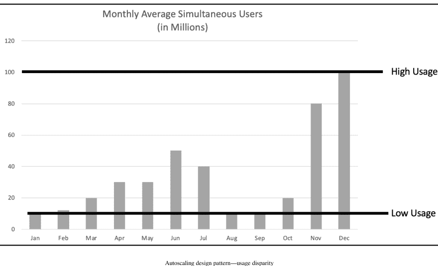

让我们看看同一张图，但带有显示基于使用率的理想容量图表。在这里你可以看到容量略高于使用率。当我们采用自动伸缩时，我们总是希望容量比正在使用的多一点，以防止出现与访问器系统相关的问题：


现在我们有了一些关于自动伸缩的知识，让我们来看看两种自动伸缩：

- 水平伸缩（`Horizontal scaling`）
- 垂直伸缩（`Vertical scaling`）

我们将在接两个节中回顾这两种自动伸缩类型。

## 水平伸缩

水平伸缩的一个示例是增加或减少处理负载，例如通过更多的服务器或数据库服务器。由于我们只在系统需要时才伸缩，因此我们只为使用的部分付费。这强调了永远不要过多或过少处理能力的重要性。

当我们进行水平伸缩时，我们是在向外扩展（`scaling out`）。一个容易记忆的方法是，你需要缩小系统图表的视图，以便看到在同一水平面上的额外服务器。

## 垂直伸缩

垂直伸缩也称为向心扩展（`scaling up`），涉及通过增加额外的硬件来增加容量。示例包括更快或更多的处理器以及增加内存容量。垂直伸缩的另一个例子是增加具有更大 RAM 分配的数据库实例。

## 实现自动伸缩

要实现自动伸缩，我们需要咨询云服务的操作说明，例如 Amazon Web Services (AWS)、Microsoft Azure、Google Cloud Platform、IBM Cloud、Oracle Cloud 等。

本节提供了自动伸缩的概述。

## 理解有界队列

为了实现有界队列，我们需要一个有界队列。有界队列是具有固定容量的队列。这段代码是有界队列。有界队列是 `java.util.concurrent` 包中的。

```java
package CH9BoundedQueue;

import java.util.concurrent.BlockingQueue;

import java.util.concurrent.ArrayBlockingQueue;

public class Bounded extends Thread {

  private BlockingQueue<Integer> inputValue;

  Bounded(BlockingQueue<Integer> queue) {
    inputValue = queue;
  }

  public void run() {
    try {
      while (true) {
        Integer myInteger = inputValue.take();

        if (myInteger == null) {
          break;
        }
        System.out.println(myInteger + " squared is " + (myInteger * myInteger));
      }
    } catch (InterruptedException e) {
      System.out.println("Interrupted Encountered.");
    }
  }
}
```

接下来的两个代码段构成了 `Driver` 类。第一部分导入了 `ArrayQueue` 和 `BlockingQueue`。`main()` 方法被定义，如所示，它抛出了 `InterruptedException` 异常。最后，`boundedSize` 变量被设置为 10：

```java
package CH9BoundedQueue;

import java.util.concurrent.ArrayBlockingQueue;
import java.util.concurrent.BlockingQueue;

public class Driver {
  public static void main(String[] args) throws InterruptedException {
    int boundedSize = 10;
```

我们 `main()` 方法的第二部分创建一个名为 `blockingQueue` 的 `BlockingQueue`。`boundedThread` 整数也被创建了，同样的 `Bounded` 类型的数组。在向控制台打印空行后，我们有两个 `for` 循环。第一个循环填充边界数组并调用线程 `start` 方法。第二个循环将元素放入 `blockingQueue`：

```java
BlockingQueue<Integer> blockingQueue = new ArrayBlockingQueue<>(boundedSize);

int boundedThread = 2;

Bounded[] bounded = new Bounded[boundedThread];

System.out.println();

for (int i=0; i < bounded.length; i++) {
  bounded[i] = new Bounded(blockingQueue);
  bounded[i].start();
}

for (int i=1; i < 11; i++) {
  blockingQueue.put(i);
}
```

我们实现的输出如下所示：

| 输出 |
|---|
| 1 squared is 1 |
| 2 squared is 4 |
| 3 squared is 9 |
| 4 squared is 16 |
| 5 squared is 25 |
| 6 squared is 36 |
| 7 squared is 49 |
| 8 squared is 64 |
| 9 squared is 81 |
| 10 squared is 100 |

# 理解隔舱设计模式（`Bulkhead design pattern`）

船上的隔舱有助于隔离船的各个区域，使得进水、火灾或爆炸等损坏只会影响船的一个部分，而不会扩散到其他部分。隔舱还建立了整艘船的稳定性。隔舱设计模式是基于船只的示例。我们现在保护的不是船只，而是系统。

大多数非平凡系统都涉及多个组件。当这些组件以相互依赖的方式实现时，系统可能会崩溃。例如，查看接图所示的系统设计。如你所见，存在多个故障点。如果服务器故障，任何内容都无法访问。此外，如果三个模块中的一个故障，连接的数据库将无法访问。这些场景将导致整个系统无法使用：

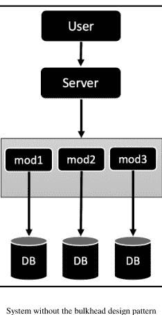

# 响应式设计模式（`Reactive Design Patterns`）

## 第 9 章

现在让我们看看实现隔舱设计模式的系统应该是什么样。在这里，你可以看到负载均衡器之间有一个模拟隔舱。这些负载均衡器将决定哪些服务器请求被路由。这提供了与服务器错误的隔离；当其中一个服务器宕机时，另一个仍然可以使用。此外，在动态云计算环境中，你可能会有一个故障保护机制，在某一个服务器宕机后自动启动一个新的服务器实例。这将有助于确保一致的运行时间：

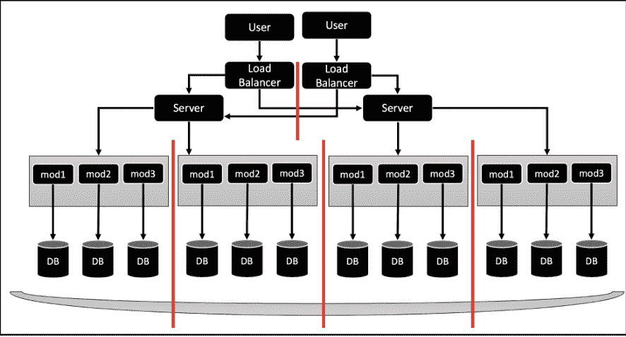

带有隔舱设计模式的系统。

前面的图还描绘了隔舱如何分离复制的处理模型。

隔舱响应式设计模式应用于架构层面，最常见于实现云端解决方案时。

本节提供了隔舱响应式设计模式的概述。

# 理解缓存设计模式（`Caching design pattern`）

缓存的概念是临时存储数据以加快访问速度。缓存被用于帮助节省资源的使用。当我们检索数据时，应该使其对未来对相同数据的请求可用。实现这种机制可以节省持续检索相同数据所需的处理时间。

接下来的图提供了缓存如何被架构到系统中的概念视图。如你所见，有多个缓存以及一个控制缓存内容及其访问方式的缓存管理系统。该图说明了如何在此缓存系统中构建冗余：

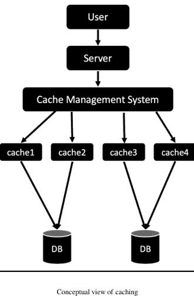

在 Java 中实现缓存没有单一的方法。在下一节中，我们将回顾实现这种设计模式的一种可能。

# 在 Java 中实现缓存设计模式

我们将通过一个简单的示例演示缓存设计模式的实现。我们将创建一个 `Player` 类，用于记录历史最高得分者。我们将创建球衣号码和总分。我们还需要一个 `ExampleCache` 类和 `CacheDriver` 类。

接下来是 `Player` 类。它四个变量和一个构造函数：

```java
public class Player {
    int playerJersey;
    int playerPoints;
    Player before;
    Player next;

    //构造函数
    public Player(int jersey, int points) {
        this.playerJersey = jersey;
        this.playerPoints = points;
    }
}
```

`ExampleCache` 类分五个部分给出。第一部分包含 `HashMap` 的导入语句和变量：

```java
import java.util.HashMap;

public class ExampleCache {
    //类变量
    private HashMap<Integer, Player> map;
    private int cacheCapacity;
    private int cacheCount;
    private Player playerHead;
    private Player playerTail;
```

`ExampleCache` 的第二部分包含构造方法。在这里，你可以看到我们将缓存的容量作为参数：

```java
//构造函数
public ExampleCache(int cacheCapacity) {
    this.cacheCapacity = cacheCapacity;
    map = new HashMap<>();
    playerHead = new Player(0);
    playerTail = new Player(0);
    playerHead.next = playerTail;
    playerTail.before = playerHead;
    playerHead.before = null;
    cacheCount = 0;
}
```

接下来是 `ExampleCache` 的第三部分。在这里，我们有 `addToPlayerHead()` 和 `deletePlayer()` 方法，每个方法接受一个 `Player` 对象作为参数：

```java
public void addToPlayerHead(Player player) {
    player.next = playerHead.next;
    player.next.before = player;
    playerHead.next = player;
    player.before = playerHead;
}

public void deletePlayer(Player player) {
    player.next = player.next;
    player.before = player.before;
}
```

后续代码是 `ExampleCache` 类的第四部分。它包含 `retrieve()` 方法。该方法通过接收球衣号码来工作。如果在缓存中找到了该球衣号码，则提供匹配的总分；否则，在控制台上显示适当的消息：

```java
public int retrieve(int playerJersey) {
    if (map.get(playerJersey) != null) {
        Player player = map.get(playerJersey);
        int result = player.playerPoints;
        deletePlayer(player);
        addToPlayerHead(player);
        System.out.println("\t\t\t\tRETRIEV: jersey -> " + playerJersey + "\tPoints-> " + result);
        return result;
    } else {
        System.out.println("\t\t\t\tRETRIEV: jersey -> " + playerJersey + "\tPoints no value");
        return -1;
    }
```

`ExampleCache` 类的第五部分（也是最后部分）给出。它用于设置球衣号码和总分以便添加到缓存：

```java
public void put(int jersey, int points) {
    System.out.println("SETTING: " + jersey + " (jersey)\n" + points + " (points)");
    if (map.get(jersey) == null) {
        Player player = new Player(jersey, points);
        map.put(jersey, player);
        if (cacheCount < cacheCapacity) {
            cacheCount++;
            addToPlayerHead(player);
        } else {
            map.remove(playerTail.before.playerJersey);
            deletePlayer(playerTail.before);
        }
    }
}
```

`CacheDriver` 类分为部分。第一部分是 `main` 方法。它创建 `ExampleCache` 实例并将六组号码对放入缓存：

```java
public class CacheDriver {
    public static void main(String[] args) {
        System.out.println("Chapter 9 Caching System.");

        ExampleCache myCache = new ExampleCache(5);

        myCache.put(8, 33643);
        myCache.put(14, 25192);
        myCache.put(22, 23149);
        myCache.put(24, 33643);
        myCache.put(32, 17707);
        myCache.put(33, 24176);
    }
}
```

`main` 方法的第二部分给出。在这里，我们简单地为每个玩家打印内容。此输出包含了 `retrieve(id)` 调用的结果：


```java
System.out.println("\t\t\t\tRETRIEV: jersey -> 8\tPoints-> 33643");
System.out.println("\t\t\t\tRETRIEV: jersey -> 14\tPoints-> 25192");
System.out.println("\t\t\t\tRETRIEV: jersey -> 22\tPoints-> 23149");
System.out.println("\t\t\t\tRETRIEV: jersey -> 24\tPoints-> 33643");
System.out.println("\t\t\t\tRETRIEV: jersey -> 32\tPoints-> 17707");
System.out.println("\t\t\t\tRETRIEV: jersey -> 33\tPoints-> 24176");
```

程序的输出最后给出。如你所见，对 `put()` 方法的调用显示了球衣号码是如何被配对到缓存的。接下来是由 `main` 方法中的 `retrieve(id)` 调用引起的行。如你所见，尽管我们有六组数据，但只有五组存储在缓存中。这是因为我们的缓存对于数据来说太小：

Chapter 9 Caching System.

```
SETTING: 8 (jersey)
33643 (points)

SETTING: 14 (jersey)
25192 (points)

SETTING: 22 (jersey)
23149 (points)

SETTING: 24 (jersey)
33643 (points)

SETTING: 32 (jersey)
17707 (points)

SETTING: 33 (jersey)
24176 (points)

From Cache Driver: jersey -> 8 Points no value
RETRIEV: jersey -> 8 Points-> 33643

From Cache Driver: jersey -> 14 Points no value
RETRIEV: jersey -> 14 Points-> 25192

From Cache Driver: jersey -> 22 Points no value
RETRIEV: jersey -> 22 Points-> 23149

From Cache Driver: jersey -> 24 Points no value
RETRIEV: jersey -> 24 Points-> 33643

From Cache Driver: jersey -> 32 Points no value
RETRIEV: jersey -> 32 Points-> 17707

From Cache Driver: jersey -> 33 Points no value
RETRIEV: jersey -> 33 Points-> 24176
```

本节提供了我们实现缓存响应设计模式的源代码和控制台输出。

# 理解断路器设计模式

断路器设计模式基于与电路相同的概念。如接图所示，当电路断开（open）时，电流流受阻，无法在两点之间流动——在我们的示例中是电源和灯泡之间。当电路闭合（closed）时，电流是畅通，灯泡可以接收电源。

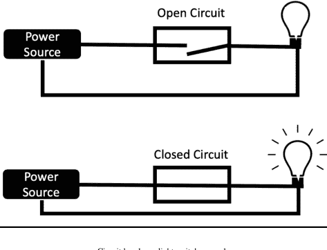

断路器设计模式模仿了电气电路。该设计模式有三种可能的状态：

- **开启（Open）**：如果状态为开启，将返回一个错误。
- **关闭（Closed）**：这是首选状态，允许功能运行。
- **半开（Half-Open）**：该状态在开启状态错误和等待一段时间后使用。该函数将允许一次使用作为测试。

如果测试成功，电路将关闭并恢复处理。如果测试失败，则电路将保持开启状态。

## 用例

对于具有大量且易失败方法调用的系统，可以从断路器设计模式中受益。这些失败可能由间歇访问、超时等引起。为了实现断路器模式，我们将一个方法或一组功能封装在断路器中。接下来的图说明了这种方法：

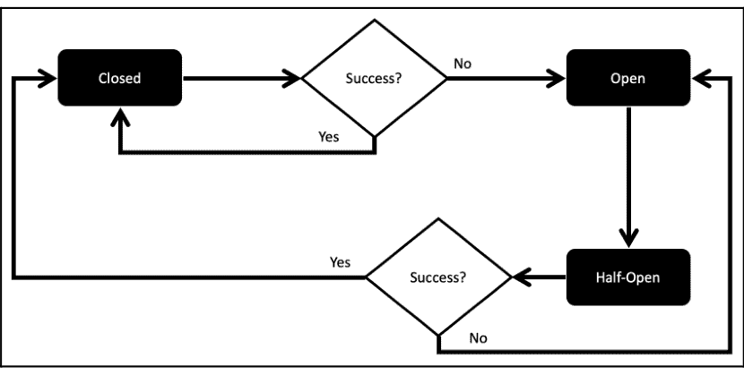

这种设计模式可以帮助系统实现响应式设计模式中的弹性组件。

本节提供了断路器响应式设计模式的概述。

# 理解事件驱动通信设计模式

事件驱动通信设计模式基于启动查询或请求请求事件。此事件启动多个组件之间的通信。系统组件之间的通信可以作为消息进行管理。

# 响应式设计模式

# 第9 章

为了管理这些消息，我们实现了一个调度器来监听启动事件，然后通过处理器处理必要的通信。如下所示，调度器在整个通信管理系统中起着关键作用，因此应该小心确保它能捕获异常并妥善处理：

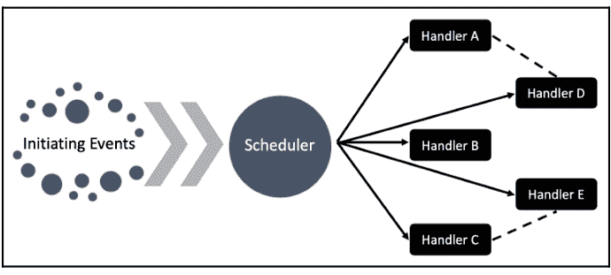

## 事件驱动通信设计模式实现——概述

前图所示的处理器代表一个代码模块，就其提供的功能而言，它通常很短。因此，你可以看到系统中有很多处理器。此外，可能会同时发生大量的启动事件。这强调了确保异常被处理的重要性，以防止进程失败。

本节提供了事件驱动通信响应式设计模式的概述。

# 理解快速失败（fail-fast）设计模式

快速失败响应式设计模式规定，如果某些将会失败，就让它尽快发生。其意图不是因为某些将失败而执行任何不必要的处理。我们应该注意浪费时间。一种场景是：用户被机会完成一份问卷并在完成后获得礼品卡。如果用户回答了前25个问题，然后问卷显示该用户不符合调查或礼品卡的资格，那么结果将是糟糕的。在这种情况下，取消资格的判断应该做得得多。

## 编写设计模式

让我们来看一个示例。接下来分部分给出 `FailFastImplementation` 类代码。该类演示了如何使用 `Iterator` 来捕获异常。代码的第一部分由导入语句和 `main()` 方法的开始组成。`main()` 方法从打印一个空行开始，并创建一个包含姓和名的 `HashMap`。使用 `put()` 方法添加四个键值对：

```java
package CH9FailFast;
import java.util.ConcurrentModificationException;
import java.util.HashMap;
import java.util.Iterator;
import java.util.Map;

public class FailFastImplementation {

  public static void main(String[] args) throws ConcurrentModificationException {

    System.out.println();

    Map<String, String> firstLast = new HashMap<String, String>();
  firstLast.put("Kay", "Brentwood");
  firstLast.put("Daisy", "Jinsen");
  firstLast.put("Frank", "Corsack");
  firstLast.put("Hugo", "Trepleton");
```

下一部分代码完成了 `main()` 方法和 `FailFastImplementation()` 类。在这里，我们创建了一个 `Iterator` 实例并使用 `while` 循环，使用 `hasNext()` 方法检查迭代器是否有下一个元素。在 `while` 循环内部，我们使用 `try-catch` 块来捕获 `ConcurrentModificationException` 错误：

```java
Iterator iterator = firstLast.keySet().iterator();

  while (iterator.hasNext()) {
    try {
      System.out.println(firstLast.get(iterator.next()));
    } catch (ConcurrentModificationException e) {
      System.out.println("Encountered Exception: Failing Fast!");
      return;
    }
  }
```

程序的输出如下所示。没有发现异常，程序没有失败：

```
Brentwood
Jinsen
Corsack
Trepleton
```

## 快速失败设计模式实现——概述

程序的输出如下所示。没有发现异常，程序没有失败：

```
Brentwood
Jinsen
Corsack
Trepleton
```

## 快速失败模式实现——概述

下一部分代码完成了 `main()` 方法和 `FailFastImplementation()` 类。在这里，我们创建了一个 `Iterator` 实例并使用 `while` 循环，使用 `hasNext()` 方法检查迭代器是否有下一个元素。在 `while` 循环内部，我们使用 `try-catch` 块来捕获 `ConcurrentModificationException` 错误：

```java
Iterator iterator = firstLast.keySet().iterator();

  while (iterator.hasNext()) {
    try {
      System.out.println(firstLast.get(iterator.next()));
    } catch (ConcurrentModificationException e) {
      System.out.println("Encountered Exception: Failing Fast!");
      return;
    }
  }
```

## 快速失败模式实现——概述

程序的输出如下所示。没有发现异常，程序没有失败：

```
Brentwood
Jinsen
Corsack
Trepleton
```

## 快速失败模式实现——概述

程序的输出如下所示。没有发现异常，程序没有失败：

```
Brentwood
Jinsen
Corsack
Trepleton
```

## 快速失败模式实现——概述

程序的输出如下所示。没有发现异常，程序没有失败：

本节提供了我们实现缓存响应设计模式的源代码和控制台输出。

# 理解断路器设计模式

断路器设计模式基于与电路相同的概念。如接图所示，当电路断开时，电流流受阻，无法在两点之间流动——在我们的示例中是电源和灯泡之间。当电路闭合时，电流是畅通，灯泡可以接收电源。


断路器设计模式模仿了电气电路。该设计模式有三种可能的状态：

- **开启（Open）**：如果状态为开启，将返回一个错误。
- **关闭（Closed）**：这是首选状态，允许功能运行。
- **半开（Half-Open）**：该状态在开启状态错误和等待一段时间后使用。该函数将允许一次使用作为测试。

如果测试成功，电路将关闭并恢复处理。如果测试失败，则电路将保持开启状态。

## 用例

对于具有大量且易失败方法调用的系统，可以从断路器设计模式中受益。这些失败可能由间歇访问、超时等引起。为了实现断路器模式，我们将一个方法或一组功能封装在断路器中。接下来的图说明了这种方法：


这种设计模式可以帮助系统实现响应式设计模式中的弹性组件。

本节提供了断路器响应式设计模式的概述。

# 理解事件驱动通信设计模式

事件驱动通信设计模式基于启动查询或节点请求事件。此事件启动多个组件之间的通信。系统组件之间的通信可以作为消息进行管理。

# 响应式设计模式

# 第9 章

为了管理这些消息，我们实现了一个调度器来监听启动事件，然后通过处理器处理必要的通信。如下所示，调度器在整个通信管理系统中起着关键作用，因此应该小心确保它能捕获异常并妥善处理：


## 事件驱动通信设计模式实现——概述

前图所示的处理器代表一个代码模块，就其提供的功能而言，它通常很短。因此，你可以看到系统中有很多处理器。此外，可能会同时发生大量的启动事件。这强调了确保异常被处理的重要性，以防止进程失败。

本节提供了事件驱动通信响应式设计模式的概述。

# 理解快速失败（fail-fast）设计模式

快速失败响应式设计模式规定，如果某些将会失败，就让它尽快发生。其意图不是因为某些将失败而执行任何不必要的处理。我们应该注意浪费时间。一种场景是：用户被机会完成一份问卷并在完成后获得礼品卡。如果用户回答了前25个问题，然后问卷显示该用户不符合调查或礼品卡的资格，那么结果将是糟糕的。在这种情况下，取消资格的判断应该做得得多。

## 编写设计模式

让我们来看一个示例。接下来分部分给出 `FailFastImplementation` 类代码。该类演示了如何使用 `Iterator` 来捕获异常。代码的第一部分由导入语句和 `main()` 方法的开始组成。`main()` 方法从打印一个空行开始，并创建一个包含姓和名的 `HashMap`。使用 `put()` 方法添加四个键值对：

```java
package CH9FailFast;
import java.util.ConcurrentModificationException;
import java.util.HashMap;
import java.util.Iterator;
import java.util.Map;

public class FailFastImplementation {

  public static void main(String[] args) throws ConcurrentModificationException {

    System.out.println();

    Map<String, String> firstLast = new HashMap<String, String>();
  firstLast.put("Kay", "Brentwood");
  firstLast.put("Daisy", "Jinsen");
  firstLast.put("Frank", "Corsack");
  firstLast.put("Hugo", "Trepleton");
```

下一部分代码完成了 `main()` 方法和 `FailFastImplementation()` 类。在这里，我们创建了一个 `Iterator` 实例并使用 `while` 循环，使用 `hasNext()` 方法检查迭代器是否有下一个元素。在 `while` 循环内部，我们使用 `try-catch` 块来捕获 `ConcurrentModificationException` 错误：

```java
Iterator iterator = firstLast.keySet().iterator();

  while (iterator.hasNext()) {
    try {
      System.out.println(firstLast.get(iterator.next()));
    } catch (ConcurrentModificationException e) {
      System.out.println("Encountered Exception: Failing Fast!");
      return;
    }
  }
```

在下一节中，我们将继续汽车经销商场景，并关注控制故障。

## 控制故障

接下来的图显示了我们的汽车经销商信息系统架构的更改。我们将支付网关 API 移动到了“零件采购”和“服务订单”组件，这些组件现在被标记为“本地服务”。当支付网关离线时，这两个服务不再会停止：

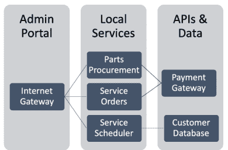

故障处理——良好的隔离示例

既然我们的结构已经为了更好的隔离进行了调整，我们就可以控制故障。我们将在单个 `ControlledFailure` 类中演示这一点。该类将在接下来的三个部分提供。第一部分包含 `checkStatus()` 方法。该方法检查某个状态当前是否在线。我们引入了除以零的错误来模拟系统状态：

```java
package CH9FailureHandling;

public class ControlledFailure {
    static int checkStatus(String component, int port) {
        System.out.println("\nChecking status of : " + component);
        // 人为引入除以零的错误
        int result = (port / 0);
        return result;
    }
}
```

## 响应式设计模式

`ControlledFailure` 第二部分包含 `processServiceOrder()` 方法。该方法将作为服务订单处理的一部分。在将信息提交到支付网关之前，我们可以检查它是否离线。这将允许我们优雅地处理错误，而不是让用户直接从 JVM 接收到严重的运行时错误。


```java
static int processServiceOrder(String process, int serviceOrderNbr) {
    int gatewayStatus = 0;

    try {
        gatewayStatus = checkStatus(process, serviceOrderNbr);
    } catch (NumberFormatException ex) {
        System.out.println("Error detected: " + ex.getMessage());
    }
    return gatewayStatus;
}
```

`ControlledFailure` 类最后的部分包含 `main()` 方法，它包含一个 `try-catch` 块来捕获并处理异常：

```java
public static void main(String args[]) {
    String processToCheck = "Payment Gateway";
    int orderServiceNumber = 319;

    try {
        System.out.println("\nService order processing . . . ");
        int orderService = processServiceOrder(processToCheck, orderServiceNumber);
    } catch (ArithmeticException ex) {
        System.out.println("\n\nPayment Gateway is offline. Your orders " + "\n\ntwill be automatically processed via batch " + "\n\ntwhen the gateway is back online.");
    }
    System.out.println("\nn. . . continue processing service orderService.");
}
```

## 响应式设计模式

# 第 9 章

这是我们程序的输出。你可以看到我们告知用户他们的服务订单正在处理中，当收到错误时，我们向用户提供信息。此时，尽管支付网关离线，他们也可以继续使用系统。

```
Service order processing . . .

Checking status of : Payment Gateway

Payment Gateway is offline. Your orders will be automatically processed via batch when the gateway is back online.

. . . continue processing service order.
```

这一节为我们汽车经销商信息系统的故障处理响应式设计模式的实现提供了源代码和控制台输出。

## 理解扇出（fan-out）和快速响应（quickest-reply）设计模式

扇出和快速响应响应式设计模式强调快速处理。提供实时或近实时股票信息的金融软件实例就使用了这种设计模式。该概念是提供足够的处理实例，以便请求被处理而无需在队列中等待。

## 响应式设计模式

# 第 9 章

为了实现扇出和快速响应设计模式，我们将每个请求发送到多个处理模块。这些模块中的每一个都会处理请求并将结果返回给请求者。请求者将使用最快的响应（即第一个收到的），并简单地忽略其他的：


扇出和快速响应设计模式

正如你预期的，额外的处理可能会导致资源的高昂成本使用，因此这种方法只应在快速响应至关重要时使用。

这一节提供了对扇出和快速响应设计模式的概述。

## 理解等幂性（idempotency）设计模式

在计算机科学中，“等幂性”这一术语是指一个元素在重复计算后其值保持不变。考虑一个医院信息系统的示例，它为患者记录的住院时长增加一天。系统在第一次执行加法操作，并忽略该日历日内的其他请求，这一点是非常重要的。

为了提供该设计模式的示例，我们将创建一个维护患者记录的医院信息系统。每当患者身上发生事件时，就会发送一条消息来更新患者住院的天数。点是，我们不能在同一天内计算患者住院超过一次，以避免过度收费。

## 响应式设计模式

第 9 章

等幂性设计模式实现的源代码将在下一节提供。

## 编写设计模式

我们医院信息系统等幂性响应式设计模式的实现将由 `Patient` 类和 `IdempotencyDriver` 类组成。`Patient` 类分三个部分提供，第一部分将在接下来出现。

在 `Patient` 类的第一部分，我们定义了三个类变量并创建了构造函数。构造函数只有一个参数，用于 `patientID`。当创建 `Patient` 实例时，`lengthOfStay` 被设置为 0，`dayCounted` 被设置为 false：

```java
package CH9IdempotencyExample;

public class Patient {

    String patientID;
    int lengthOfStay;
    boolean dayCounted;

    // constructor
    public Patient (String patientID) {
        this.patientID = patientID;
        this.lengthOfStay = 0;
        this.dayCounted = false;
    }
}
```

`Patient` 类的第二部分包含访问方法（accessor methods）。这些方法用于获取类变量的值：

```java
// accessor methods
public String getPatientID() {
    return patientID;
}

public int getLengthOfStay() {
    return lengthOfStay;
}

public boolean getDayCounted() {
    return dayCounted;
}
```

## 响应式模式

`Patient` 类的最后部分包含修改方法（mutator methods）。`setPatientID()` 和 `setCounted()` 修改方法是简单的。`setLengthOf()` 方法包含一个逻辑检查，判断 `dayCounted` 变量当前的值是 true 还是 false。如果当天已经计算过，则为 true；否则为 false。如果当天还没有计算过，`lengthOfStay` 将增加，`dayCounted` 将更改为：

```java
// mutator methods
public void setPatientID(String patientID) {
    this.patientID = patientID;
}

public void setLengthOfStay(int lengthOfStay) {
    if (this.dayCounted) {
        System.out.println("\tIdempotency Implemented: Length of Stay\nalready computed.");
    } else {
        this.lengthOfStay += lengthOfStay;
        this.dayCounted = true;
    }
}

public void setDayCounted(boolean counted) {
    this.dayCounted = counted;
}
```

`IdempotencyDriver` 类是医院信息系统的驱动类。该代码的第一部分将在接下来提供并包含 `main()` 方法。该方法包含一个用于控制台输出的装饰性标题和一个本地 `tid` String 类型变量：

```java
package CH9IdempotencyExample;
public class IdempotencyDriver {
    public static void main(String[] args) {
        System.out.println("\n ==========================================");
        System.out.println("\tHOSPITAL INFORMATION SYSTEM\t=");
        System.out.println(" ==========================================");

        String tID = "XP330019";
    }
}
```

## 响应式设计模式

### 第 9 章

接下来提供了 `IdempotencyDriver` 类的第二也是最后一部分。这段代码分为三个部分，每部分之间用内联注释分隔。第一部分“入院”（Admission），创建一个 `Patient` 实例并调用 `setLengthOfStay()` 方法。第二部分“实验室检查”（Lab Work），尝试修改 `lengthOfStay` 变量的值。第三部分“次日”（Next Day），首先将 `dayCounted` 值设为 `false`。然后调用了 `setLengthOfStay()`：

```java
// Admission
Patient patient = new Patient(tID);
System.out.println("\nPatient " + patient.getPatientID() + " admitted.");
patient.setLengthOfStay(1);
System.out.println("\tlength of stay: " + patient.getLengthOfStay());
```

```java
// Lab Work
System.out.println("\nPatient " + patient.getPatientID() + " received work.");
patient.setLengthOfStay(1);
System.out.println("\tlength of stay: " + patient.getLengthOfStay());
```

```java
// Next Day
patient.setDayCounted(false);
System.out.println("\nPatient " + patient.getPatientID() + " received surgery.");
patient.setLengthOfStay(1);
System.out.println("\tlength of stay: " + patient.getLengthOfStay());
```

接下来是程序的控制台输出。如你所见，对于在患者第一天更新其住院时间的第二次尝试，我们已经实现了等幂性处理：

| 医院信息系统 |

| :--- |

| 患者 XP330019 入院。住院时长: 1 |

| 患者 XP330019 接收了实验室检查。已实现等幂性：住院时长已计算。住院时长: 1 |

| 患者 XP330019 接受了手术。住院时长: 2 |

等幂性设计模式实现——控制台输出

本节提供了我们医院信息系统实现等幂性响应式设计模式的源代码和控制台输出。

## 了解监控设计模式

监控设计模式是不言自明的。为了确保我们的系统是响应式的，特别是具有弹性的，我们需要对它们进行监控。现代大规模系统通常托管在云系统中，如 AWS、Google Compute、IBM Cloud 和 Oracle Cloud。这些服务中的都提供了图形化仪表板和告报系统。

警报可以根据系统管理员的确定以及每个服务和系统的上下阈值进行自定义。

本节提供了监控响应式设计模式的简要概述。

## 了解发布者-订阅者设计模式

发布者-订阅者模式建立了两个实体：根据事件发送消息的发布者，以及订阅这些事件的订阅者。通过这种设计模式，发布者传输消息，订阅者监听这些消息，然后采取适当的行动或不采取行动。

如下所示，**发布者**发布事件。**订阅者**订阅这些事件。一旦听到事件，**订阅者**将根据事件的需要提供相应的计算或处理：

这种设计模式是事件驱动的，可以通过事件驱动架构、观察者模式和消息代理模式来实现，这些内容在本书之前的章节中已介绍。

本节提供了发布者-订阅者设计模式的简要概述。

## 了解自包含设计模式

采用自包含响应式设计模式的系统不依赖于非系统组件。这种设计模式也可以应用于系统组件级。例如，一个系统组件将是自包含的，不依赖其他系统组件。

为了研究自包含响应式设计模式，让我们首先考虑一个描述缺乏自包含性的系统图。如下图所示，Financial Services API 是唯一能够访问支付网关和相关数据库的系统组件。Service Dept Sales 节点所示的新车销售和售后部门销售都依赖于 Financial Services API 来访问其子组件。

这种架构是不被建议的，因为 New Vehicle Sales 和 Service Dept Sales 组件对 Financial Services API 的依赖可能会导致瓶颈、数据冲突和业务中断。

接下来，让我们检查相同系统的修改版本，这次实现了自包含设计模式。在接后的图中，New Vehicle Sales 和 Service Dept Sales 组件直接访问支付网关和相关数据库。这使得它们自包含，不再依赖于其他系统组件。

本节提供了自包含响应式设计模式的概述。

## 了解无状态设计模式

当我们实现无状态设计模式时，我们创建不保留状态变化的类和对象。在这种方法中，例如每次使用对象时都使用其原始形式。在我们的上下文中，*状态*指的是对象变量的值。因此，没有确定的状态列表。

# 响应式设计模式

# 第 9 章

```java
@Override
public void sit() {
    state.sit();
    setState(getCorgiSit());
}
```

- 4. 我们 `Corgi` 类的第四部分包含了 `CorgiState` 接口中剩余三个重写方法：

```java
@Override
public void eat() {
    state.eat();
    setState(getCorgiSit());
}
```

```java
@Override
public void play() {
    state.play();
    setState(getCorgiSit());
}
```

```java
@Override
public void sleep() {
    state.sleep();
}
```

- 5. `Corgi` 类的第五部分包含了类变量的前三个访问器方法（accessor methods）：

```java
// accessor methods
public CorgiState getCorgiAwake() {
    return corgiAwake;
}
```

```java
public CorgiState getCorgiEat() {
    return corgiEat;
}
```

```java
public CorgiState getCorgiPlay() {
    return corgiPlay;
}
```

- 6. `Corgi` 类的第六部分包含了类变量剩余的访问器方法：

```java
public CorgiState getCorgiSleep() {
    return corgiSleep;
}
public CorgiState getState() {
    return state;
}
public CorgiState getCorgiSit() {
    return corgiSit;
}
```

- 7. `Corgi` 类的第七部分包含了类变量的前三个变器方法（mutator methods）：

```java
// mutator methods
public void setCorgiState(CorgiState state) {
    this.state = state;
}
public void setCorgiAwake(CorgiState corgiAwake) {
    this.corgiAwake = corgiAwake;
}
public void setCorgiEat(CorgiState corgiEat) {
    this.corgiEat = corgiEat;
}
```

- 8. `Corgi` 类的第八也是最后一部分包含了类变量剩余的变器方法：

```java
public void setCorgiPlay(CorgiState corgiPlay) {
    this.corgiPlay = corgiPlay;
}
public void setCorgiSleep(CorgiState corgiSleep) {
    this.corgiSleep = corgiSleep;
}
public void setState(CorgiState state) {
    this.state = state;
}
public void setCorgiSit(CorgiState corgiSit) {
    this.corgiSit = corgiSit;
}
```

# 响应式设计模式

现在我们的 `CorgiState` 接口和 `Corgi` 类已经完成，我们需要为四种状态（清醒、吃、玩、睡和坐下）中的每一个状态创建一个类。我们还需要一个 `Driver` 类。这六个类将在接下来提供。


我们的下一个类是`CorgAwake`类，在接下来的两个部分中提供。该类实现了`CorgiState`接口，并提供了`CorgAwake`的具体状态。接下来的部分包含了构造方法以及对`CorgiState`接口的前三个重写方法：

```java
package CH9Stateless;

public class CorgAwake implements CorgiState{
    private final Corgi corgi;

    public CorgAwake(Corgi corgi) {
        this.corgi = corgi;
    }

    @Override
    public void awake() {
        System.out.println("The Corgi is AWAKE.");
    }

    @Override
    public void walk() {
        System.out.println("The Corgi is WALKING.");
    }

    @Override
    public void sit() {
        System.out.println("The Corgi is SITTING.");
    }
}
```

`CorgAwake`类的后半将在提供，包含了`CorgiState`接口剩余的重写方法：

```java
    @Override
    public void eat() {
        System.out.println("The Corgi is EATING.");
        corgi.setCorgiState(corgi.getCorgiEat());
    }

    @Override
    public void play() {
        System.out.println("The Corgi is PLAYING.");
        corgi.setCorgiState(corgi.getCorgiPlay());
    }

    @Override
    public void sleep() {
        corgi.setState(corgi.getCorgiSleep());
        System.out.println("The Corgi is SLEEPING.");
    }
```

我们的下一个类是`CorgiEat`类，将在接下来的两个部分提供。该类实现了`CorgiState`接口，并提供了`CorgiEat`的具体状态。下一部分包含了构造方法以及对`CorgiState`接口的前三个重写方法：

```java
public class CorgiEat implements CorgiState {
    private final Corgi corgi;
    public CorgiEat(Corgi corgi) {
        this.corgi = corgi;
    }

    @Override
    public void awake() {
        System.out.println("The Corgi is AWAKE.");
    }

    @Override
    public void walk() {
        System.out.println("The Corgi is WALKING.");
    }

    @Override
    public void sit() {
        System.out.println("The Corgi is SITTING.");
    }
}
```

`CorgiEat`类的后半将在提供，包含了`CorgiState`接口剩余的重写方法：

```java
    @Override
    public void eat() {
        System.out.println("The Corgi is EATING.");
        corgi.setState(corgi.getCorgiSleep());
    }

    @Override
    public void play() {
        System.out.println("The Corgi is PLAYING.");
    }

    @Override
    public void sleep() {
        System.out.println("The Corgi is SLEEPING.");
    }
```

我们的下一个类是`CorgiPlay`类，将在两个部分提供。该类实现了`CorgiState`接口，并提供了`CorgiPlay`的具体状态。接下来的部分包含了构造方法以及对`CorgiState`接口的前三个重写方法：

```java
package CH9Stateless;
public class CorgiPlay implements CorgiState {
    private final Corgi corgi;

    public CorgiPlay(Corgi corgi) {
        this.corgi = corgi;
    }

    @Override
    public void awake() {
        System.out.println("The Corgi is AWAKE.");
    }

    @Override
    public void walk() {
        System.out.println("The Corgi is WALKING.");
    }

    @Override
    public void sit() {
        System.out.println("The Corgi is SITTING.");
    }
}
```

`CorgiPlay`类的后半将在提供，包含了`CorgiState`接口剩余的重写方法：

```java
    @Override
    public void eat() {
        System.out.println("The Corgi is EATING.");
    }

    @Override
    public void play() {
        System.out.println("The Corgi is PLAYING.");
    }

.    @Override
    public void sleep() {
        System.out.println("The Corgi is SLEEPING.");
    }
```

## 响应式设计模式 - 第 9 章

接下来提供了`CorgiSit`类的后半部分，包含了`CorgiState`接口中剩余的重写方法：

```java
@Override
public void eat() {
    System.out.println("The Corgi is SITTING and waiting for action...");
    corgi.setCorgiState(corgi.getCorgiEat());
    System.out.println("\tThe Corgi is now EATING.");
}
```

```java
@Override
public void play() {
    System.out.println("The Corgi is SITTING and waiting for action...");
    corgi.setCorgiState(corgi.getCorgiPlay());
    System.out.println("\tThe Corgi is now PLAYING.");
}
```

```java
@Override
public void sleep() {
    System.out.println("Shhh; The Corgi is sleeping.");
    corgi.setState(corgi.getCorgiSleep());
    System.out.println("\tThe Corgi is now SLEEPING.");
}
```

我们的下一个类是`CorgiWalk`类，将在接下来两个部分提供。该类实现了`CorgiState`接口，并为`CorgiWalk`的具体状态提供了支持。下一部分包含了构造方法以及`CorgiState`接口的前三个重写方法：

```java
package CH9Stateless;

public class CorgiWalk implements CorgiState {

    private final Corgi corgi;

    public CorgiWalk(Corgi corgi) {
        this.corgi = corgi;
    }

    @Override
    public void awake() {
    System.out.println("The Corgi is AWAKE.");
    }
```

## 响应式设计模式 - 第 9 章

```java
@Override
public void walk() {
    System.out.println("The Corgi is WALKING.");
}
```

```java
@Override
public void sit() {
    System.out.println("The Corgi is SITTING.");
}
```

`CorgiWalk`类的后半部分接下来提供，包含了`CorgiState`接口中剩余的重写方法：

```java
@Override
public void eat() {
    System.out.println("The Corgi is EATING.");
    corgi.setCorgiState(corgi.getCorgiSleep());
}
```

```java
@Override
public void play() {
    System.out.println("The Corgi is PLAYING.");
}
```

```java
@Override
public void sleep() {
    System.out.println("The Corgi is SLEEPING.");
}
```

我们用于无状态设计模式的 CORGI STATES SYSTEM 实现的最后一个类是`StatelessDriver`类。该类包含了`main()`方法并驱动应用程序：

```java
package CH9Stateless;

public class StatelessDriver {

    public static void main(String[] args) {

        System.out.println("\n" + "--------------------------------------" + "=");
        System.out.println("\tCORGI STATELESS SYSTEM" + "--------------------------------------");
        System.out.println("\n" + "--------------------------------------" + "=\n");

        Corgi corgi = new Corgi();

        corgi.awake();
        corgi.walk();
    }
}
```

```java
corgi.play();
corgi.eat();
corgi.walk();
corgi.sleep();
```

```java
corgi.play();
corgi.sleep();
corgi.eat();
}
```

我们应用程序的输出如下。如你所见，我们没有允许除了 AWAKE 之外的任何操作：

==== == == ==== == == ====

CORGI STATELESS SYSTEM

==== == == ==== == == ====

The Corgi is AWAKE.

The Corgi is SITTING and waiting for action...

The Corgi is now WALKING

The Corgi is SITTING and waiting for action...

The Corgi is now PLAYING.

The Corgi is SITTING and waiting for action...

The Corgi is now EATING.

The Corgi is SITTING and waiting for action...

The Corgi is now WALKING

Shhh; The Corgi is sleeping.

The Corgi is now SLEEPING.

The Corgi cannot PLAY when it is SLEEPING.

Shhh; the Corgi is sleeping.

The Corgi is now SLEEPING.

The Corgi cannot EAT when it is SLEEPING.

静态设计模式实现——控制台输出

本节提供了我们 CORGI STATELESS SYSTEM 的无状态响应式设计模式实现的源代码和控制台输出。

## 总结

在本章中，我们探索了响应式设计模式类别及其各个具体的设计模式，包括异步通信、自动伸缩、边界队列、舱板、缓存、断路器、事件驱动通信、快速失败、故障处理、扇出、最快响应、幂等性、监控、发布者-订阅者、自包含和无状态。我们还回顾了这些设计模式的用例，以及它们如何有助于构建对内部和外部变化有响应且设计良好的系统。

你现在掌握了通用建模语言 (UML)、面向对象编程 (OOP) 以及各种响应式设计模式的必要知识，帮助你构建设计良好的系统。

## 问题

1. 什么是异步通信？

2. 什么是自动伸缩？

3. 什么是边界队列？

4. 什么是舱板？

5. 什么是缓存？

6. 什么是断路器？

7. 什么是事件驱动通信？

8. 什么是快速失败？

9. 什么是故障处理？

10. 什么是扇出？

11. 什么是最快响应？

12. 什么是幂等性？

13. 什么是监控？

14. 什么是发布者-订阅者模式？

15. 什么是自包含？

16. 什么是无状态？

17. 这些设计模式的用例是什么？

18. 它们如何有助于构建对内部和外部变化有响应且设计良好的系统？

19. 什么是通用建模语言 (UML)？

20. 什么是面向对象编程 (OOP)？

21. 各种响应式设计模式有哪些？

22. 掌握这些知识如何帮助你构建设计良好的系统？

1. 什么是设计模式的目的是什么？

2. 响应式设计模式的特征是什么？

3. 响应式设计模式的类型有哪些？

4. 在响应式系统中，如何实现自动伸缩？

5. 什么设计模式使用了边界队列？

6. 什么设计模式采用了舱板策略？

7. 什么设计模式包含了故障处理？

8. 什么设计模式提供了最快响应？

9. 什么设计模式使用了发布者-订阅者模式？

10. 什么设计模式包含了自包含？

## 延伸阅读

- [Java 8 Design Patterns and Best Practices](https://www.packt.com/application-development/java-8-design-patterns)

- [Learning Design Patterns with Java](https://www.packt.com/application-development/learn-design-patterns)

- [Design Patterns and Best Practices in Java](https://www.packt.com/application-development/design-patterns)

- [What is the Reactive Manifesto?](https://reactivemanifest.org/whatis/)

## 测评

### 第 1 章

1. 行为和结构？

2. UML 最初是为了可视化化系统而创建的？

3. 活动图、交互图、状态机图和用例图？

4. 活动图说明了系统中的什么流程？

5. 用例图记录了用户与系统之间的什么交互？

6. Actor 是系统的什么？

7. 结构图说明了系统的什么组件？

8. 类图

9. 组合结构图显示了系统的运行时结构？

10. 部署图提供了硬件和软件的视觉表示？

# 第 2 章

1. 可移植性、继承、封装和多态？

2. 类结构非常适合可移植性？

3. 封装？

4. 在 OOP 中，多态意味着可以通过公共接口访问不同类型的对象？

5. 在 Java 中，我们可以使用`this`关键字作为当前对象的引用？

6. 访问方法是允许访问对象的什么？

7. 修改方法允许对象的实例变量被改变？

8. 构造方法是一种特殊的方法，在对象初始化时运行？

9. 它们的定义有一组独特的参数？

10. 从左到右

# 第 5 章

+ 1. 对象和类如何组合形成一个系统

2. 适配器、桥接、组合、装饰器、外观、享约、代理

3. 适配器设计模式

4. 结构性类设计模式

5. 适配器设计模式

6. 组合设计模式

7. 装饰器设计模式

8. 外观设计模式

9. 享约设计模式

10. 代理设计模式

# 第 6 章

+ 1. 架构模式从系统的整体视角对组件进行分组

2. 采用非规范的方法来视觉化架构模式

3. 黑板模式


# 第 7 章

+ 1. 模块化、处理效率和可维护的代码

2. 通过在多个服务器之间拆分处理和存储

3. 微服务模式

4. 模型-视图-控制器模式 (MVC)

5. 裸对象模式

6. 点对点模式

7. 管道-过滤器模式

8. 无服务器模式

9. 服务导向模式

10. 基于空间的模式

# 第 8 章

+ 1. 函数式规则：

    - 它们不修改任何数据

    - 在给定相同参数的情况下，它们提供一致的结果

    - 它们存在是为了返回一个返回值

+ 2. 执行环、Lambda、贷款、MapReduce、记忆化、流 (Streams)、尾递归调用

3. 数学函数

4. 执行环

5. Lambda

6. 贷款

7. MapReduce

8. 记忆化

9. 流

10. 尾递归调用

# 第 9 章

+ 1. 响应式设计模式的目的是为系统架构师、工程师和开发者提供创建核心具有响应和可扩展性系统的能力

2. 响应式、韧性、弹性和消息驱动

3. 异步通信设计模式

4. 垂直扩展和水平伸缩

5. 边界队列

6. 断路器设计模式

7. 故障处理设计模式

8. 等幂性设计模式

9. 发布者-订阅者设计模式

10. 自包含性设计模式

# 你可能喜欢的其他书籍

如果你喜欢这本书，你可能对 Packt 出版的其他书籍感兴趣：

# Java 11 食谱指南 - 第二版

Nick Samoylov, Mohamed Sanaulla

ISBN: 9781789132359

- 安装 JDK 并了解 JDK 11 安装中的新特性

- 使用类和接口实现面向对象的设计

- 管理操作系统进程

- 创建具有清晰依赖关系的模块化应用程序

- 使用 JavaFX 构建图形用户界面

- 使用新的 HTTP Client API

- 探索 Java 11 中新的诊断功能

- 发现如何使用新的 JShell REPL 工具

# 你可能喜欢的其他书籍

# 精通 Java 11 - 第二版

Dr. Edward Lavieri

ISBN: 9781789137613

- 编写模块化的 Java 应用程序

- 将现有 Java 应用程序迁移到模块化

- 理解默认的 G1 垃圾收集器的工作原理

- 利用新引入的 Java Shell 提供的可能性

- 使用 JVM 框架有效对对应用程序进行性能测试

- 学习 Java 如何支持 HTTP 2.0 标准

- 了解如何使用新的 Process API

- 探索 Java 9, 10 和 11 的额外增强和功能

# 留下评论 - 让其他读者知道你的想法

请在购买书籍的网站上发表评论与其他分享你对这本书的看法。如果你是从 Amazon 购买的，请在该书的 Amazon 页面上给我们留下诚实的评论。这至关重要，因为其他潜在读者可以看到并利用你的无偏意见做出购买决策，我们可以了解客户对我们产品的看法，我们的作者也可以看到他们与 Packt 合作创作的作品的反馈。这只需要你几分钟的时间，但对其他潜在客户、我们的作者和 Packt 来说非常有价值。谢谢！

# 索引

# A

+ 抽象工厂设计模式

关于 102, 104

抽象工厂类 107

驱动类 111

接口 106

编程 106

type-C 类 110

typeA 类 107

typeI 类 108

UML 类图 104

用例 104

抽象

关于 142

示例，实现 123

活动图 9

适配器设计模式

关于 138

编程 140, 142

UML 类图 139

用例 139

亚马逊云服务 (AWS) 275

方法，OOP

访问器 30

构造函数 31

构造函数，重载 32, 34

驱动类 31

方法调用链过程 35, 36

方法，重载 32, 34

变异器 30

架构模式 278

异步通信设计模式

关于 266

实现 267, 268, 269, 270, 272

自动伸缩设计模式

关于 272, 273

水平伸缩 274

实现 275

# B

+ 后端即服务 (BaaS) 221, 224

行为设计模式

关于 51

责任链模式 51, 52

命令模式 52, 61

解释器模式 52, 65

迭代器模式 52, 71

中介者模式 52, 74

备忘模式 52

备忘模式，检查 85, 88

空对象模式 52

空对象模式，使用 88

观察者模式 52

观察者模式，观察 91, 92

状态模式 52

策略模式 97

模板方法模式 98

访问者模式 98

行为 UML 图

活动图 9

交互图 10, 11

状态机图 13

用例图 14, 15

封装，OOP

多态 25, 27

可移植性 23

黑板模式

关于 178, 180

咖啡店自动化 178

仓库安全示例 181

HR 邮件处理器 59

模型-视图-控制器示例示例

实现，MVC 模式 54

UML 类图 54

Book 类 210

University 邮件处理器接口，使用 55

Book 类 210

断路器设计模式

关于 285

架构模式 213

用例 286

边界队列设计模式 275

客户端-服务器模式 183

桥接模式

关于 185

抽象 142

抽象，实现 143, 145

三层示例 186

交叉 142

云存储自动化 178, 179, 180

编程 147, 149, 150

咖啡店示例 185

UML 类图 146

命令模式

用例 146

访问器方法 63

代理人模式

类变量 63

构造函数 63

豪华预订系统 184

探索 61

大学信息系统

电力相关方法 64, 183

编程 62

构建设计模式

滑块相关方法 64

构建类 116, 117, 119

UML 类图 62

Builder 接口 115

用例 61

Director 类 119

交互图 12

驱动类 119

组件图 17

组合模式

roaster 类 115

编程 152, 155, 156, 158, 160

UML 类图 114

UML 类图 151

用例 113

用例 151

用于构建对象 113

组合结构图 17, 18

舱壁设计模式 278, 279

构造示例 201

业务应用层 195

创建设计模式 102

# C

缓存设计模式

关于 280

实现，在 Java 中 281, 282, 284

# D

责任链模式

学术邮件处理器，使用 57

管理员邮件处理器 60

装饰器设计模式

AtomicEmailHandler 类 58

关于 156

邮件处理器，建议 58

用例 157

财务邮件处理器 59

部署图 18

设计模式原则

关于 37

简洁对象，创建 37

封装 37

实例 38, 39

# E

事件驱动架构模式

关于 187

代理人形式 187, 188

中介者形式 188

事件驱动通信设计模式 286, 287

执行环设计模式

关于 232

实现 232

提取-转换-加载模式

关于 189

数据，转换 290

提取 190

加载过程 191

扇出设计模式 294

享约设计模式

编程 167, 170

使用 166

ML/ML 类图 166

用例 166

分叉 9

函数式设计模式 231

函数即服务 (FaaS) 222, 225

# G

图形用户界面 (GUI) 157

# H

抬头显示器 (HUD) 157

水平伸缩 274

# I

等幂性设计模式

关于 295

编程 296, 297

基础设施即服务 (IaaS) 221, 222, 272

交互图

关于 10, 11

通信图 12

序列图 11

时图 67

国际标准组织 (ISO) 863

解释器模式

转换类 68

Expression 接口 67

InterpreterDriver 类 69, 71

MapInToToClasses 类 67

编程 66

ML 类图 66

用例 65

使用 65

ISO 七层模型

参考 193

迭代器模式

编程 72

ML 类图 72

用例 71

使用 71

# F

外观设计模式

实现 160

编程 162, 165

ML 类图 162

用例 161

工厂设计模式

检查 129

编程 131, 132

ML 类图 130

用例 130

工厂方法设计模式

探索 121

编程 122, 123, 124, 126, 127, 129

ML 类图 121, 125

用例 121, 125

使用 124

快速失败设计模式

关于 287

失败事件 290

编程 288, 289

故障处理设计模式

关于 291

控制故障 292, 294

故障隔离 291

# J

- Java 缓存设计模式，实现于 281, 282, 284

# L

- lambda 设计模式

    - 关于 233

    - lambda，使用多种模式实现 236, 238

    - lambda，使用单一模式实现 234 233

- 分层模式

    - 关于 192, 193

    - 业务应用层示例 195

    - 移动操作系统层 194

    - 传统操作系统层示例 194

- 学习管理系统 (LMS) 142

- 负载载设计模式

    - 关于 239

    - 文件处理实现 239, 241, 243

    - 豪华邮轮预订系统 184

# M

- MapReduce 设计模式

    - 关于 243

    - 输入-组合器-减少-输出形式 249

    - 输入-映射-减少-输出形式 244, 245

    - 输入-映射-减少-输出形式 245, 246, 247

    - 输入-多映射-减少-输出形式 248, 249

- 主从架构模式

    - 关于 196

    - 云存储示例 199

    - 单一客户端示例 198

- 中介者模式

    - 关于 74

    - AssemblySystem 类 78

    - EmergencyBreak 类 80

    - Hopper 类 77

    - 编程 76

    - starter 类 76

    - SystemAccelerator 类 79

    - UML 类图 75

# N

- 用用例 74

- WidgetProductionSystem 类 82, 84, 85

- 备忘模式

    - 编程 86

    - UML 类图 86

    - 用用例 85

- 记忆设计模式 250, 252, 254

- 微内核架构模式

    - 关于 200

    - 适配器 201

    - 构建示例 201

    - 外部插件 201

    - 内部插件 201

    - 微内核 200

    - 一个或多个客户端 200

    - 光盘播放器 202

- 微服务模式

    - 关于 206

    - 电子商务示例实现 208

    - 物流示例 207

    - 移动接口 207

    - Web 接口 207

- 微软中间译语言 (MSIL) 65

- 移动后端即服务 (MaaS) 221, 224

- 移动操作系统层 194

- 视图-控制器模式 (MVC)

    - 关于 209, 210

    - 书-视图-控制器示例实现 210

    - Controller 209

- 监控设计模式 299

- 裸对象模式

    - 关于 214, 215

    - Apache Isis，参考 215

    - Naked Objects，参考 215

- 空对象模式

    - 编程 89

    - UML 类图 89

    - 用用例 88

    - 使用 88

# O

- 对象图 19

- 面对象编程 (OOP) 23

# Q

- 快速回复响应式设计模式 294

# R

- 方法 29

- 响应式设计模式

    - 优势 23

    - 关于 263

    - 继承 24

    - 弹性 264

    - 实例变量 29

    - 消息驱动 265

    - 示例类 27, 28

    - 韧性 264

    - 此参考 29

- 响应式模式

- 观察者模式 91

# S

- 编程 92, 93

- 自包含设计模式 301

- UML 类图 91

- 序序图 11

- 用用例 91

- 无服务器模式

    - 观察者 91

    - 关于 221

    - BaaS 实现 224

    - OOP 类

    - FaaS 实现 225

    - 探索 41, 42, 44, 46

    - IaaS 实现 222

    - 实现，优势 222

- 开放系统互连 (OSI) 193

- 光盘播放器模式 202

- MaaS 实现 223

- SaaS 实现 223

- 服务面向架构 (SOA) 225

- 点对点模式 (P2P)

- 服务面向模式 225

    - 关于 215

    - 单一客户端示例 198

    - 优势 215

- 单例设计模式

    - 缺点 215

    - 实现 133

    - 文件共享示例实现 216

    - 编程 134, 135

    - 网络示例实现 217

    - UML 类图 133

- 管道-过滤器模式

    - 用用例 133

    - 关于 218

- 软件即服务 (SaaS) 221, 223, 220

- 基于空间的模式 227

- 复杂转换实现

    - 关于 93

- 状态机图 13

- 网络示例实现 219

- 简单转换实现

    - 应用输出 97

    - Driver 类 96

- 平台即服务 (PaaS) 221, 223

- Printer 类 95

- 代理设计模式

    - PrinterOffline 类 95

    - 实现 170

    - PrinterOnline 类 94

    - 编程 172, 173

    - 编程 94

    - UML 类图 171

    - UML 类图 93

    - 用用例 171

    - 用用例 93

- 发布者-订阅者设计模式 300

- 无状态设计模式

    - 关于 302

    - 编程 304, 306, 307, 309, 311, 312, 313, 315

    - UML 类图 303

    - 用用例 303

- 策略模式

    - UML 类图 97

    - 用于设计模式 97

- 流设计模式

    - 关于 254

    - 编程 256

    - 流间接操作 255

    - 流终端操作 256

- 结构性设计模式

    - 类设计模式 138

    - 对象设计模式 318

- 结构性 UML 图 15

    - 类设计图 16

    - 组件图 17

    - 组合结构图 17, 18

    - 部署图 19

    - 对象图 19

    - 包类图 20

# T

- 尾递归设计模式

    - 关于 257

    - 编程 257, 260

- 尾递归优化 (TCO) 257

- 模板模式 98

- 三层示例 12

- 时序图

- 传统操作系统层示例 194

# U

- 统一建模语言 (UML) 7, 8

- 大学企业信息系统示例 183

- 用用例图 14,15

# V

- 垂直扩展 275

- 访问者模式 98

# W

- 仓库安全机器人示例，组件

    - 弹道 181

    - 入侵者识别 181

    - 导航 181

- 仓库安全机器人示例

    - 关于 181

    - 职责 181

- Web 接口 226
