# MuleSoft Anypoint Platform 实用指南卷 3：实现包括数据库、文件、SOAP、电子邮件在内的多种连接器

## 献给

Rathi Shravanti Shashank

## 关于作者

Nanda Nachimuthu 毕业于泰米尔纳德邦农业大学（泰米尔纳德邦哥姆拜伊尔），并在印度理工学院拉格普尔获得了 Java 和互联网计算领域的高级文凭。他还在德里印度国际贸易学院完成了高级文凭，该学院专门从事国际业务战略。此外，他还是计算机科学领域的 WHRPC 荣誉博士。

他拥有25年涵盖银行、医疗、政府和航空等多个领域的经验。他精通 Java、大数据、云、ESB、安全和物联网等技术。他曾担任技术架构师、解决方案架构师、云架构师和企业集成架构师等多种角色，并一直希望能拥有实战编码经验的个人贡献者角色。

他对社会创业以及信息技术、制造业、贸易、农业和物联网等领域的公益咨询充满热情。

他是一些社交平台的创始人，并拥有旗下的几个商标。

目前，他专注于像 MuleSoft 这样的集成技术平台，他认为数字营销和机器间通信（M2M）在未来有广阔的前景。

## 关于评审员

Vinoth Kumar 在 IT 行业拥有24多年的经验，是一位专攻云、AI/ML、机器人、区块链、SOA 和 Web 技术的企业架构师。他是 IBM 认证的 Websphere 集成开发人员，为 IBM、Oracle 和 Mule SOA 平台产品提供解决方案。Vinoth Kumar 在云迁移、企业应用集成、使用人工智能/机器学习进行数据分析以及使用 Web3、以太坊和 Hyperledger 的区块链解决方案方面拥有经验。凭借他在云、物联网、人工智能机器人领域的丰富经验，他专注于构建智能工厂的工业4.0 框架。

Arul ChristhruRaj Alphonse 是一位集成架构师、顾问和集成开发人员，对与集成、云和 API 相关的所有主题都特别感兴趣。他曾多次获得 Udemy 上关于 MuleSoft 和 SoftwareAG webMethods 课程的畅销导师。

他被认可为 MuleSoft 导师，是 MuleSoft 认证开发人员 - Level1、MuleSoft 认证集成架构师以及 MuleSoft 认证平台架构师。他热爱教授 MuleSoft，帮助学习者准备参加 MuleSoft 认证，最重要的是解决现实中的问题。他连续五次被评为 MuleSoft 社区顶级贡献者。

他对 SoftwareAG webMethods 也充满热情。他自2006年以来一直致力于 webMethods。他还是 webMethods 技术社区的活跃成员，在他在 YouTube 的 Techlightning 频道上分享技术视频。

在空闲时间，他喜欢烹饪、看电视节目和去很棒的地方旅行！

## 致谢

尽管我也拥有深厚的技术背景，并且从 MuleSoft 成立之初就在其中，但当 API 驱动的连接性范式转移开始时，我发现很难跟上整个平台架构的使命和愿景。我也曾努力理解 MuleSoft 团队未来的实现方法。

然后，我开始深入研究整个 MuleSoft 生态系统，寻找 MuleSoft 的一些关键技术方面。我才意识到，由于销售发票等信息在 SAP 和 Financial Force 等 SaaS 系统之间流动的，对于许多初学者来说，获得机会参与这些应用程序设置是非常困难或在实际上是不可能的。特别是当大多数基于云的 SaaS 都是安全部署、授权并基于社区的。

因此，系统集成和企业架构对于许多新手和经验中等的候选人来说仍然是新的领域。如果你想进入 API 设计师和 API 开发人员等角色，接触许多此类 SaaS 应用并理解它们的 API 模型将在未来发挥重要作用。

在尝试阅读 SaaS 系统暴露的 API 之前，了解 Web 服务等概念非常重要。我们需要深入理解 REST 和 SOAP 等 Web 服务，因为未来作为 API 设计师，我们将定义 Web 规范。此外，对于对企业集成实践不太熟悉但只要有机会（且具备一些基础知识）就可以成为 API 设计师或业务分析师的读者来说，这一点是重要的。

所以，此时，在开始《精通 MuleSoft》系列之际，我想感谢活跃的 MuleSoft 社区，无论是聚会活动、博客、LinkedIn 资料、独立教程提供者以及许多其他 MuleSoft 活动家。

没有他们的贡献和网络存在，对我来说设计和编写这个《精通 MuleSoft》系列实际上是非常困难的。

再次感谢各位 Muleys！

## 前言

在我看来，对于一个新兴的技术或业务候选人来说，要获得参与高级系统集成场景的机会并不容易。想象一个财务集成场景，销售发票等信息在 SAP 和 Financial Force 等 SaaS 系统之间流动。对于许多新人来说，获得机会处理这些应用程序设置是非常困难或实际上是不可能的。特别是当大多数基于云的 SaaS 应用都是安全部署、授权并基于社区的。

因此，系统集成和企业架构对于许多新手和经验中等的候选人来说仍然是新的。如果你想进入 API 设计师和 API 开发人员等角色，接触许多此类 SaaS 应用并理解它们的 API 模型将在未来发挥重要作用。

在尝试阅读 SaaS 系统暴露的 API 之前，了解 Web 服务等概念是非常重要的。我们需要深入理解 REST 和 SOAP 等 Web 服务，因为未来作为 API 设计师，我们将定义 Web 服务规范。此外，我们团队开发的 API 规范将用于 SaaS 应用、遗留应用程序、移动设备、机器间通信等。

因此，对于本书的读者来说，理解他们将成为大型企业架构不可或缺的一部分，而不是致力于某个特定的项目、产品或服务层是非常重要的。

在书中十章中，你将学习到：

- 第一章应用 API 详情、MuleSoft 连接器、通过 Anypoint 平台提供的连接器、将连接器添加到项目。
- 第二章 Apache Netbeans、Derby、数据库连接器、数据库操作、DDL、缓存、按表行。
- 第三章文件连接器模块、文件连接器配置、文件读取组件、文件写入组件、文件列表组件、文件属性、删除组件、移动组件、复制组件、创建目录组件、重命名组件、新或更新的文件。
- 第四章基础 Web 项目、服务器设置、从 Anypoint Studio 获取 Netbeans 响应、HTML5 应用、Netbeans Web 服务、Web 服务项目、WSDL、Web 服务组件、调用 WSDL、输入参数、调用 Web 服务、多个 Web 服务操作。
- 第五章电子邮件 SMTP、启用 SMTP 启动 TLS、Gmail 设置中的低安全性选项、文件附件、启用 IMAP 和 POP3 访问、SMTP IMAP 和 POP3 配置、Mozilla ThunderBird 配置，SSL IMAP 和 POP3 设置，非 SSL IMAP 和 POP3 设置，IMAP 实战。
- 第 6 章 VM 队列、发布与消费组件、监听器，以及消费与监听。
- 第 7 章 ApacheMQ、ActiveMQ Web 界面、队列创建、ApacheMQ 连接器、发布与消费组件，以及监听器组件。
- 第 8 章 脚本引擎与 Groovy。
- 第 9 章 RabbitMQ 安装、启用管理插件、RabbitMQ Web 管理界面、AMQP 连接器，以及发布与监听器组件。
- 第 10 章 SFTP 连接器。
- 第 11 章 LDAP 连接器、LDAP 操作、ApacheDS、通过 LDAP Studio 建立新的 LDAP 连接、身份验证详情、Anypoint Studio LDAP 连接器、LDAP 目录对象详情、LDAP 查找组件、Apache DS LDAP 目录详情。
- 第 12 章 Java 程序的静态方法、Java 程序的公共方法以及 new 和 invoke 组件。
- 第 13 章 ObjectStore 连接器，基础知识与 DB 缓存场景。

## 代码包与彩色图片

请点击链接下载书籍的**代码包**和**彩色图片**：

https://rebrand.ly/6ca4e1

书籍的代码包也托管在 GitHub 上。如果代码有更新，将在现有的 GitHub 仓库中更新。

我们从丰富的书籍和视频目录中提供代码包，欢迎此处查看！

## 勘误

我们对 BPB Publications 的工作感到非常自豪，并遵循最佳实践以确保内容的准确性，为订阅者提供极致的阅读体验。我们的读者是我们的镜子，我们利用他们的反馈来反映并改进出版过程中可能出现的人为错误（如果有）。为了让我们保持质量并帮助我们联系可能因意外错误而遇到困难的读者，请通过邮件联系我们：

errata@bpbononline.com

BPB Publications 全体非常感谢您的支持、建议和反馈。

您知道吗？BPB 为出版的每本书都提供 eBook 版本，并提供 PDF 和 ePub 文件。您可以在 www.bpbonline.com 升级到 eBook 版本，作为纸质书客户，您有权获得 eBook 版的折扣。更多详情请联系我们：business@bpbonline.com。

在处，您还可以阅读免费技术文章集，订阅一系列免费新闻邮件，并获取 BPB 书籍和 eBook 的专属折扣和优惠。

如果您在互联网上发现我们作品任何形式的非法盗版，如果您能提供位置地址或网站名称，我们将不胜感激。请通过 business@bpbonline.com 联系我们并提供材料链接。

## 如果您成为作者

如果您在某个领域拥有专长，并且对编写或为书籍贡献感兴趣，请访问。我们已经与成千上万像您这样的开发者和技术专家合作，帮助他们与全球技术社区分享见解。您可以提交通用申请、申请我们正在招募作者的特定热门话题，或提交自己的想法。

请留下评价。在您阅读并使用此书后，为什么不在购买的网站上留评价呢？潜在读者可以查看并参考您的中立意见做出购买决策。BPB 可以了解您对我们产品的看法，我们的作者也可以看到您对书的反馈。谢谢！

欲了解更多关于 BPB 的信息，请访问

- 结论
- 需探索的关键术语
- 注意要点
- 注意要点
- 结构
- 注意要点
- 目标
- 结论
- 需探索的关键术语
- 执行 Groovy、Python 和 Ruby 脚本
- 注意要点
- 注意要点
- 注意重点
- 需探索的关键术语
- 需探索的关键术语

## 索引

# MuleSoft 连接器简介

## 结构

在本章中，我们将涵盖以下主题：

RAML 和 Anypoint Studio 概念

理解业务领域与应用程序

云端 SaaS 应用暴露的 API

开发 mock project 框架图和端点设计

## 目标

学习本单元后，你将能够：

Mock 项目需求采集

端点设计

SaaS 应用 API

基础连接器概念

## 简介

在学习了卷 1 和卷 2 之后，我们现在到了卷 3。接下来的页面将讨论我们在卷 1 和卷 2 中涵盖的内容，以及卷 3 的意图。卷 3 主要处理应用程序连接器，如数据库、文件、电子邮件等。通过这些连接器，开发者可以访问企业系统并处理安全数据。让我们来看看这些概念。

业务环境以理解完整的业务生态系统。

## 业务领域与应用

到为止，我们已经涵盖了 RAML API 设计、Anypoint Studio 组件等概念。此时，你将已经熟悉 MuleSoft 的生态系统。下一个要探索的重要领域是“API 驱动的连接架构”（API-led connectivity architecture），只有当我们拥有针对数据库、JMS、文件等各种应用程序的连接器时，这种架构才可行。可用连接器列表可以在此链接查看。

在此链接中，你可以看到针对行业热门应用程序的现成认证连接器。当应用程序通过 API、原生库、JAR 包暴露数据时，像 MuleSoft 这样的集成平台就可以通过连接器访问这些数据。

我们必须了解不同领域提供的应用程序类型；例如，Workday 是一种托管在云端的流行的人力资本管理应用。

此外，你应该了解这些应用程序是如何开发的、使用了什么技术、它们是如何部署的、其许可模式等。对于新入职人员或非技术团队成员来说，要理解所有应用程序的所有内部原理在实际上是不可能的。但在互联网上对应用程序开发、公司、许可模式、涉及的技术进行简单的搜索，最重要的是，你应该了解应用程序领域和业务需求。

让我们在互联网上进行简单的研究，假设我们想了解一种支出分析软件。请尝试使用关键词在互联网上搜索。同样，尝试使用关键词 Capital 进行搜索，然后你可能会发现一个名为 Workday 的流行 HCM 应用。参考图示


图 1.1：流行的 HCM 应用 Workday

## 云端 SaaS 应用暴露的 API

你现在必须理解，有许多是为了解决各种业务需求而开发的。因此，理解行业业务领域至关重要，这意味着对于管理业务流程具有重要的业务领域。下面给出了业务领域列表；尝试尽可能进行搜索以理解现有的应用程序。你可以搜索 5 个业务领域以寻找各种可用领域，以及这些领域中使用的前 5 或 10 个应用程序。

现在，我们已经了解到 HR 部门使用着一个名为 Workday 的 HCM 应用，并且我们发现了一个连接器（另见图示），该可用于 MuleSoft 集成。如果任何应用程序想要通过 API 安全地向世界其他部分共享信息，那么它们必须为所有操作实现 REST 或 SOAP 等 Web 服务。因此，下一个问题是我们如何探索像 Workday 这样的应用程序所提供的 API。答案很简单，再次使用关键词 API 进行搜索，你可以到达 Workday 提供所有 API 信息的页面。

## Workday Web Services (WWS) 目录 (v34.2 / 2020R1)

以下目录为我们基于 SOAP 的 Web 服务提供了 (v34.2) WWS API 文档以及相应的 WSDL 和 XML。点击“Version Directory”（版本目录）访问其他版本。

- 点击此图标显示服务的 Web 服务描述语言 (WSDL)。
- 点击此图标显示服务的 XML 架构 (XSD)。

点击 Web 服务以查看该服务中的操作目录。

| 服务 | 描述 |
|---|---|
| Absence_Management | 缺勤管理 Web 服务包含暴露缺勤相关数据的操作，包括 Workday 人力资本管理业务服务中的包含、覆盖以及请假请求。 |
| Academic_Advising | 用于检索与学术咨询相关的对象的 Web 服务，例如学生学术要求。 |
| Academic_Foundation | 用于创建、编辑和检索学生系统跨模块使用的基础对象的公共 Web 服务。 |
| Admissions | 用于创建、编辑和检索与录取相关的对象的 Web 服务，例如申请人。 |
| Adoption | 领养 Web 服务操作。 |
| Benefits_Administration | 福利管理 Web 服务包含暴露 Workday 人力资本管理的操作。 |

图 1.2：HCM 应用 Workday API 详情

尝试使用应用程序名称搜索其他 API 文档；例如，搜索 API

## API 文档 - SAP Help

### 目录

- 什么是 SAP Cloud Platform, Neo 环境
- 获取企业帐户
- 获取试用帐户
- 入门，Neo 环境
- 开发。Neo 环境
  - 在 Neo 环境中部署业务应用程序
  - 在 Neo 环境中开发 Java
  - 在 Neo 中开发 SAP HANA

## iOS 的 SAP Cloud Platform SDK

### REST APIs

- 生命周期管理 API
- 告警通道 API
- 监控 API v2
- Neo 环境的审计日志检索 API
- Neo 环境的审计日志保留 API
- Cloud Foundry 环境的审计日志检索 API
- 权限管理 API

图 1.3：ERP 应用 SAP API 详情

## 模拟项目原型和端点设计

在详细研究连接器之前，让我们尝试模拟一个虚拟的银行应用程序。假设我们有一家虚拟银行作为客户；银行根据客户的信用分为其提供贷款。项目的原型通常会显示贷款发放涉及的过程。

让我们列出银行贷款申请涉及的流程如下：

- 客户通过提供个人/财务等详情申请贷款。
- 银行应核实其个人细节和财务细节，并应根据验证的细节计算其信用分。
- 如果验证成功，贷款审批人员可以确定贷款的审批额度。
- 如果客户同意银行的条件，下一步将是发放流程。
- 一旦发放金额，该贷款将开始还款计划。
- 如果还款未按照银行标准进行，将启动催收流程。
- 如果催收流程也失败，将启动法律程序。
- 启动法律程序后，可能会发生财务结算。这种结算导致整个贷款流程的结束。

接下来的框图显示了涉及流程的视图。下一步将为该贷款设计端点

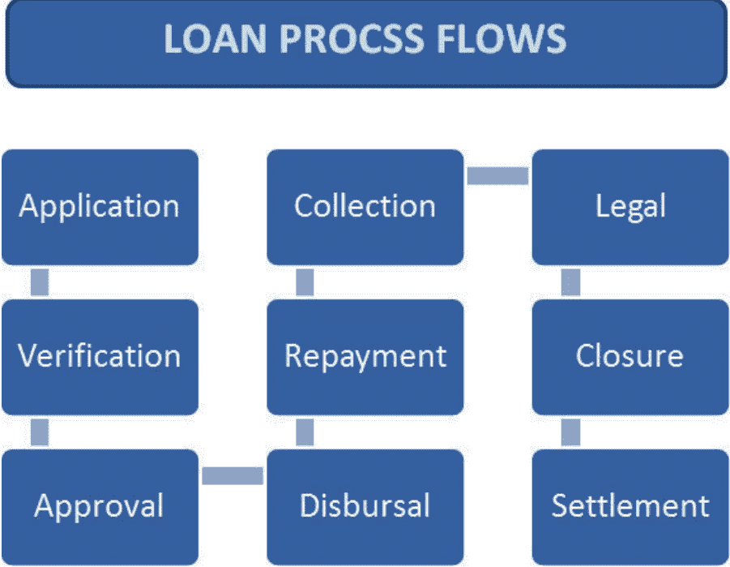

图 1.4：银行贷款流程

这里是为满足银行流程设计的的一些端点。RAML 团队负责为这些端点设计 RAML 规范。

- 客户使用此端点输入个人信息
- 财务细节——输入数据——所以是 post 方法

https://mybank.com/homeloan/approve/verify

https://mybank.com/homeloan/approve/creditscore

https://mybank.com/homeloan/coreapis/creditscorelogic

https://mybank.com/homeloan/approve/loanlimit

https://mybank.com/homeloan/coreapis/loanlimitAPI

https://mybank.com/homeloan/disbursal/banks

https://mybank.com/homeloan/disbursal/release

https://mybank.com/homeloan/repayment/checkhistory

https://mybank.com/homeloan/collection/bucket

https://mybank.com/homeloan/legal/action

https://mybank.com/homeloan/settlement/agreement


`https://mybank.com/homeloan/closure/closed`

`https://mybank.com/customer/financial`

但我们的目标不是进入 RAML 规范的设计部分，而是希望更多地集中在连接器的配置上。

例如，个人详情可能从 CRM 系统中存储和检索，财务信息将存储在金融系统中，以此此类推。我们可能还需要调用各种 API 进行信用分计算和贷款额度。有了这些理解，让我们继续探索 MuleSoft 提供的实时连接器。

访问`https://docs.mulesoft.com/connectors/_`页面探索 MuleSoft 提供的多种现成连接器。

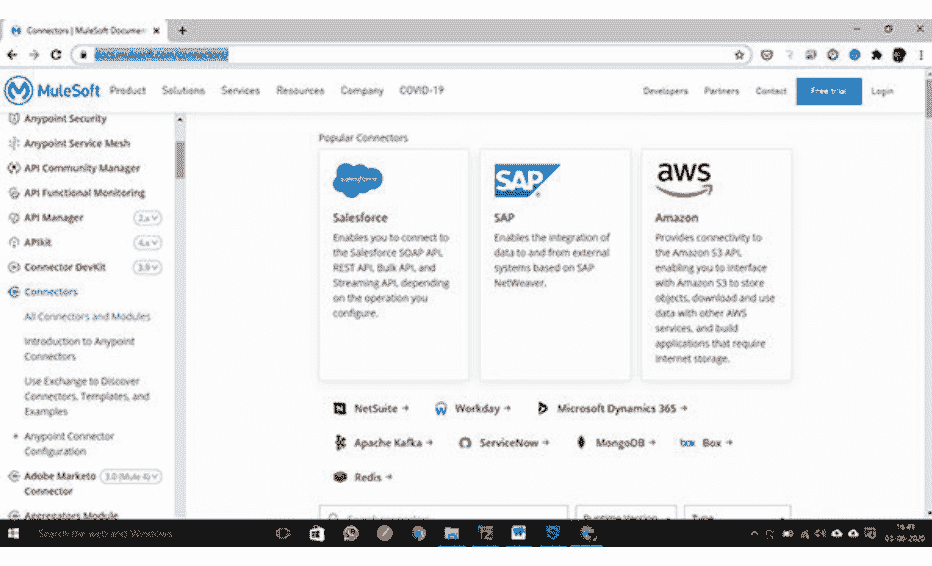

图 1.5：MuleSoft 连接器

打开 Anypoint Studio，创建一个示例项目，在 Mule Palette 中，你可以看到已添加的默认模块以及适用于项目的其他可用模块。你可以从特色模块列表中将所需的模块拖入你的项目中。

以下截图显示我们已经添加了等连接器。

### 图 1.7：向项目添加连接器

以下截图显示了可用包管理器中已添加的连接器。

### 图 1.8：检查已添加的连接器

除了特色模块外，你还可以从 Anypoint Exchange 引入许多模块和连接器。为此，点击 Search in Exchange 选项并提供你的 Anypoint Exchange 凭据。

登录后，你可以输入 LDAP、SharePoint、SalesForce、Box 等所需的连接器关键词，这样就会列出可用连接器，你可以将其引入项目中。

### 图 1.9：从 Anypoint Exchange 添加连接器

登录你的 Anypoint Platform，可以找到如图所示 Assets 选项，点击它即可浏览 MuleSoft 提供的所有资产；你可以通过选择 Connectors 选项过滤资产。

### 图 1.10：通过 Anypoint Platform MuleSoft 提供的连接器

访问`https://docs.mulesoft.com/anypoint-platform/anypoint-connector`了解更多关于自定义连接器的知识；这在目前并不是强制性的。

## Anypoint 连接器开发

本文将快速带你了解启动 Anypoint Connector 的步骤、使连接器工作以及使用功能对其增强。你可以将其作为连接器开发的路线图。

## 前提条件

本文假设你熟悉 Anypoint Connector，并按照“设置你的环境”中的指定安装了相应版本的 Maven。

## 连接器开发流程概述

当你使用 SDK 开发连接器时，需要对连接器将做什么、它如何向外部应用程序或资源接收和发送数据做出一系列决策。本文提供了帮助你做出决策的信息，并提供了流程详情的链接。

为不同的领域开发业务流程、流程图和端点设计等。

## 总结

在本章中，我们学习了连接器和业务流程的基础知识。探索了数据库等 MuleSoft 应用。我们还尝试定义了业务流程图并为每个流程设计了相应的端点。在接下来的章节中，我们将实现数据库等核心应用，并将如何通过 MuleSoft 连接器与它们连接。在下一章节中，我们将开始探索 MuleSoft 的可用连接器。我们的第一个连接器将是数据库连接器，我们可以从 MuleSoft 应用执行数据库操作。

## 注意事项

连接器可能来自 MuleSoft 应用本身，也可能来自第三方连接器开发或开发者社区。

## 探索的关键术语

- MuleSoft 连接器
- 自定义连接器
- 业务流程定义
- 业务流程图
- 端点设计

## 结构

在本章中，我们将涵盖以下主题：

- 数据库（DB）设置和 DB 连接属性
- 下载 Apache Derby
- 理解数据库
- 向项目添加数据库模块
- 添加 Select 组件
- 配置 Derby 数据库属性
- 检查本地系统中的 DB 安装
- 安装外部 Derby jar
- 通过 Workbench 检查 Derby 表
- 从 Anypoint Studio 测试 Derby 连接性
- 理解 MuleSoft 连接器配置和基础 DB 操作
- 检查 Config XML 条目
- 引入 transformer 组件
- 运行项目并在控制台中检查 DB 表
- 模块和连接器回顾
- 从 Exchange 获取列出的模块
- 选择并下载所需模块
- 检查项目结构中已添加的模块
- 在 Palette 中检查已添加的模块
- 最终的 Config XML 内容
- 向 SQL 查询传递动态参数并迭代结果
- 用于 HTTP listener 的 Config XML 文件
- 通过 Postman 通过 HTTP listener 获取记录
- 向 SQL 脚本发布动态参数
- 通过发布动态值调用 Postman
- 设置动态值后的 Config XML
- 使用 transformer 迭代特定值
- 使用 for 组件进行迭代记录的 Config 文件
- 理解 cache scope 实现
- 创建缓存策略
- 参考缓存策略后完成流程
- 在控制台输出中检查 cache scope 结果
- 使缓存策略失效
- 检查失效缓存结果
- DB 操作，如 insert、update、DDL 脚本和存储过程
- 通过 Workbench 添加行
- 从 Workbench 获取 insert 脚本
- 通过 Flow 执行 insert 脚本并检查结果
- 检查表中的插入值
- 在 Workbench 中执行 update 语句
- 通过 Flow 更新记录
- 在 Workbench 中执行 DDL 数据定义语言
- 通过 Flow 执行 DDL
- 执行脚本示例
- 脚本文件
- 在 Workbench 中检查通过 Flow 插入的批量行
- 在 Derby DB 中创建伪存储过程
- 从 Flow 调用伪存储过程
- 使用 Workbench 创建示例表
- 从 Flow 插入批量数据
- 从 Flow 更新批量数据
- 从 Flow 删除批量记录
- 记录批量插入的结果和 OnTableRow 监听器
- OnTableRow 最终查看

## 目标

学习本单元后，你将能够：

- 执行 DB 连接并调用 DB 操作
- 针对重复或冲突的 DB 调用实现 cache scope
- 调用表监听器

## 简介

在本章中，我们可以看到在本地机器上设置数据库、在该数据库中创建表、通过 MuleSoft 数据库连接器连接 DB 以及执行基础 select 操作步骤。

## 数据库设置和 DB connection_properties

搜索 NetBeans 下载并下载 NetBeans 套件，使用所有基本设置值进行安装。我们倾向于使用 Workbench IDE，因为它内置了默认的 Derby 数据库。

## 下载 Apache NetBeans 12.0

- Apache NetBeans 12.0 于 2020 年 6 月 4 日发布。查看 Apache NetBeans 12.0 Features 获取完整功能列表。
- Apache NetBeans 12.0 可从你最近的镜像站点下载。
- 二进制文件：`netbeans-12.0-bin.zip`（SHA-512, PGP ASC）
- 源码：`netbeans-12.0-source.zip`（SHA-512, PGP ASC）
- 安装程序：
  - `ApacheNetBeans-12.0-bin-windows-x64.exe`（SHA-512, PGP ASC）
  - `ApacheNetBeans-12.0-bin-linux-x64.sh`（SHA-512, PGP ASC）
  - `ApacheNetBeans-12.0-macos.dmg`（SHA-512, PGP ASC）
- 此版本的 Javadoc 位于：`https://bits.netbeans.org/12.0/javadoc`

> 官方上，使用 PGP 签名（`.asc` 文件）验证下载文件的完整性是非常关重要的。PGP 签名应与包含用于签名的 PGP 密钥的 KEYS 文件进行匹配。Apache NetBeans 也可以在 Linux 上作为自包含的 snap 包安装。

`Product NetBeans IDE 8.2 (Build 201610071157)`

NetBeans IDE 已更新至版本 NetBeans 8.2 Patch 2。

`1.8.0_181; Java HotSpot(TM) 64-Bit Server VM 25.181-b13`

`Java (TM) SE Runtime Environment 1.8.0_181-b13`

`Windows 10 version 10.0 running on amd64; Cp1252; en_IN (nb)`

用户路径：`C:\Users\Admin\AppData\Roaming\NetBeans\8.2`

缓存：`C:\Users\Admin\AppData\Local\NetBeans\Cache\8.2`

## 理解 Derby_database

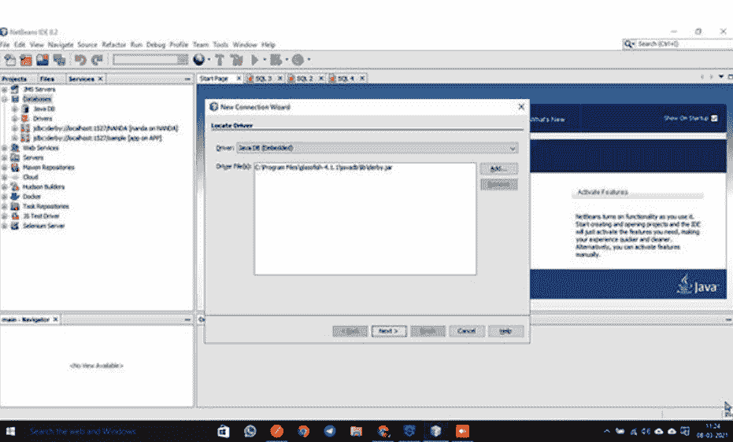

图 2.2：理解 Derby 数据库

现在进入“服务”（Services）选项卡，如图所示，并检查你的 NetBeans 安装中是否预装了任何 Derby。

如果没有，你可以单独安装并提供 Derby 的安装路径。

完成后，你将看到 Derby DB 运行在`localhost:1527`上，并有一个名为`sample`的默认模式（schema），其中预置了带有示例数据的表。

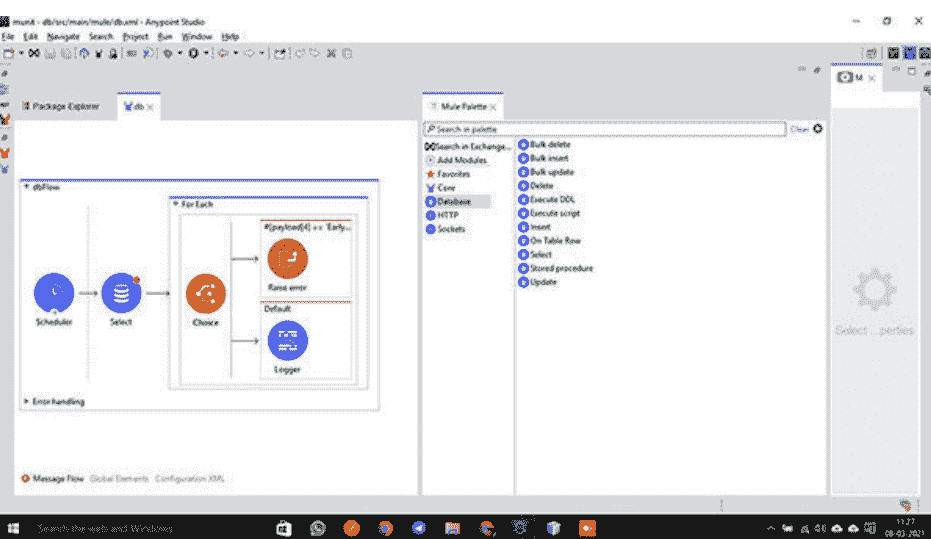

创建一个新的 MuleSoft 项目并进入“调色板”（Palette）检查可用的 DB 连接器。

点击位于核心（core）和收藏（favorite）按钮上方的“添加模块”（Add modules）按钮。你可以在其中看到所有可用的收藏模块和数据库模块。

将其拖入你的模块面板，你会看到调色板和项目中添加了一个名为`database`的模块。

你可以看到所有与 DB 相关的操作，如插入（insert）、查询（select）、更新（update）等。


创建一个带有基本参数的调度器（scheduler），并在旁边拖入一个 Select 组件。

在 Select 组件属性中，你可以看到一个用于输入要执行的查询的文本区域；提供如下内容：

```sql
SELECT * FROM APP.CUSTOMER FETCH FIRST 1000 ROWS ONLY
```

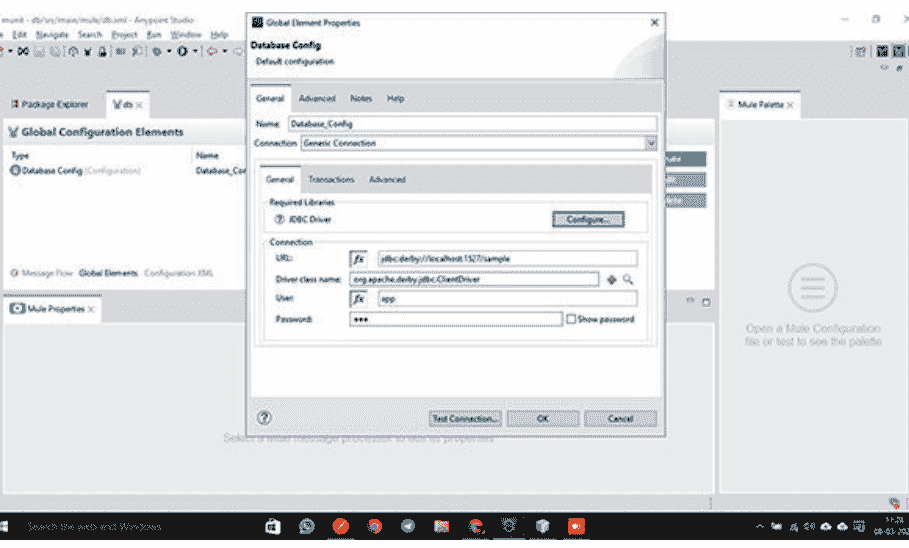

### 图 2.5：配置 Derby 数据库属性

点击连接配置添加按钮查看之前的数据库配置对话框，并提供以下值：

`url="jdbc:derby://localhost:1527/sample" driverClassName="org.apache.derby.jdbc.ClientDriver" user="app" password="app"`

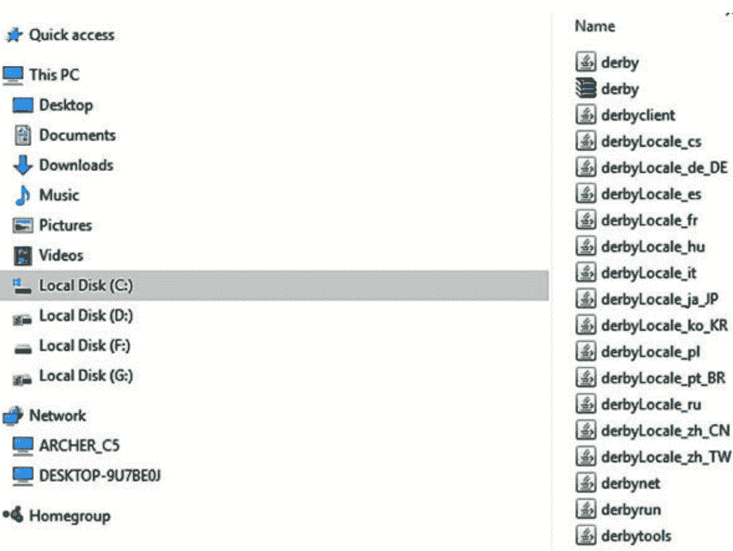

### 图 2.6：检查本地系统的 Derby DB 安装

还有最后一步是为项目设置提供所需的 JDBC 驱动程序。检查你的文件系统，如图所示，以了解我们的 Derby Client jar 文件的位置。

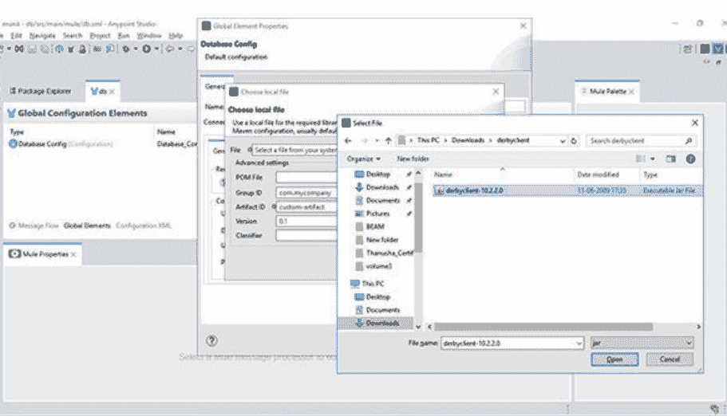

即使你找不到 derby client jar，也可以在网上搜索并下载到本地文件夹，然后提供它。

在数据库配置对话框中，进入“常规”（general）选项卡，选择所需的库，配置并选择本地文件选项提供此 Derby client jar 文件。

在点击“测试连接”按钮检查 DB 可用性之前，我们可能需要验证 DB 是否正在运行。

### 图 2.8：通过 NetBeans 检查 Derby 表

进入`NetBeans -> services -> databases -> jdbc_derby_localhost`，然后右键点击选择“连接”（connect）选项。

一旦连接，你就可以看到该模式中的所有可用示例表。

右键点击`customers`表并选择“查看”（view），你可以在右侧面板看到带有所有可用数据的表结构，现在你的数据库已启动且窗口正在运行。

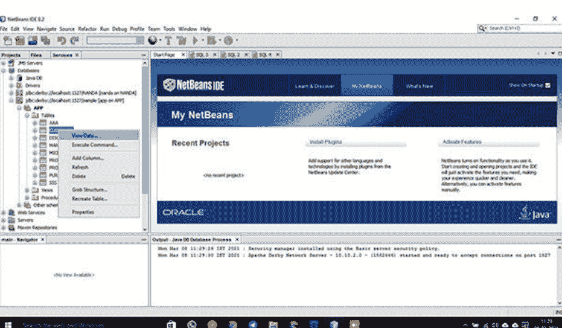

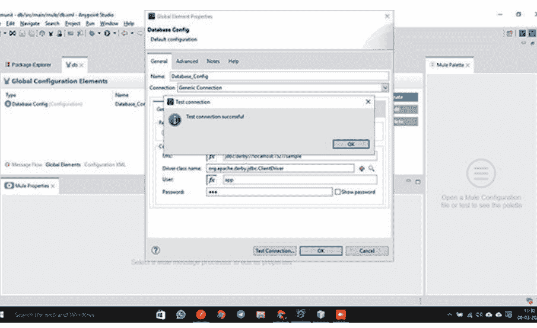

回到 Anypoint Studio 并点击“测试连接”按钮，你会发现连接已建立。

## 理解 MuleSoft 连接器配置和基础 DB 操作

让我们尝试理解连接器是如何设计以从相应应用程序获取连接的，并从一个基础的 DB 操作开始。

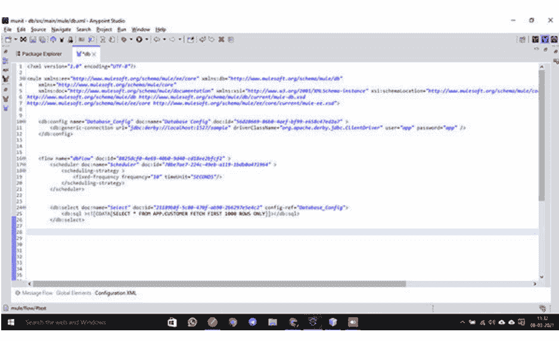

图 2.10：检查配置 XML 条目

检查配置 XML 文件，你可以看到上述条目。

```xml
name="dbSelectFlow" doc:id="c1560de2-3f36-422a-8aa3-4409fec31be"
doc:name="Scheduler" doc:id="1b146f79-443c-4e57-8f14-8b7a7f8baad"
frequency="10"/>
SELECT * FROM APP.CUSTOMER FETCH FIRST 1000 ROWS
```

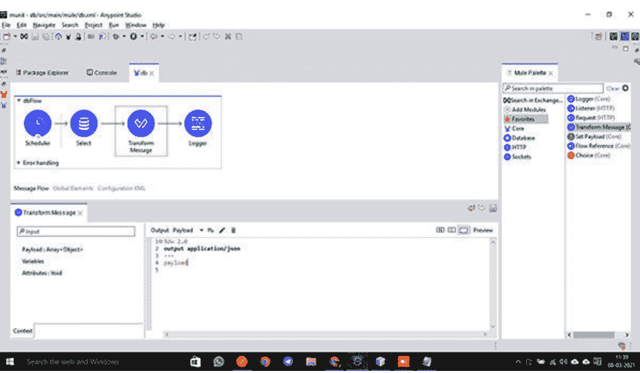

### 图 2.11：包含转换组件

引入转换组件以 JSON 格式读取结果，如图所示：

`doc:name="Transform Message" doc:id="1f286513-6beb-4f47-a585-82326e8a7a"`

```dw
2.0
output application/json
payload
```


### 图 2.12：运行项目并在控制台检查值

确保你已设置好调度器、select 组件和日志记录（logger），运行项目并如所示查看结果。

## 模块和连接器

在理解连接器配置后，让我们重新查看可用的连接器以及如何浏览。我们还可以尝试检查操作和连接器配置。

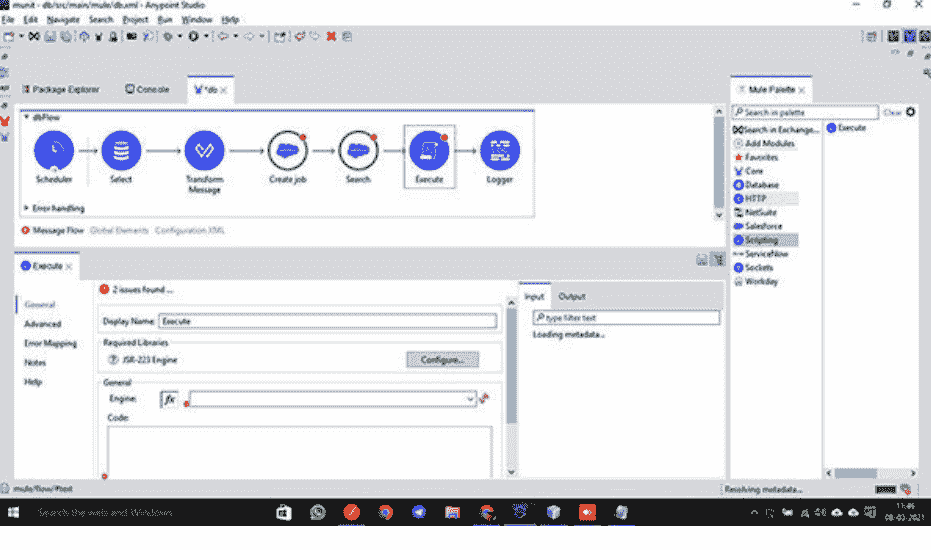

### 图 2.13：理解其他模块

浏览多个模块并添加到项目，将操作拖入流（flows）以理解它们是如何设计的。检查你的项目结构和 POM 文件。

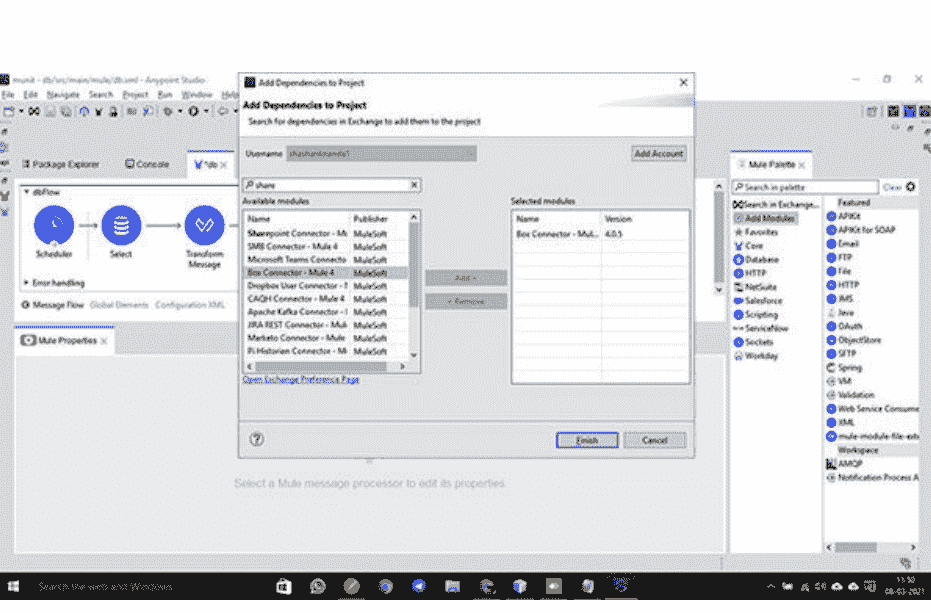

点击交换浏览默认未提供的模块。你需要提供 Anypoint 凭据。

### 图 2.15：选择并下载模块

你可以看到连接器状态，如图所示。

### 图 2.16：检查项目中已添加的模块

从之前的屏幕选择文件，为了测试目的添加了 Salesforce、Workday 等连接器，并在项目资源管理器中找到这些依赖。

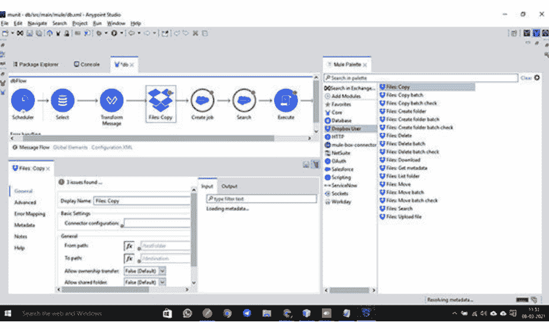

### 图 2.17：检查已添加的模块

你可以选择模块将其添加到画布，并检查该组件的属性。

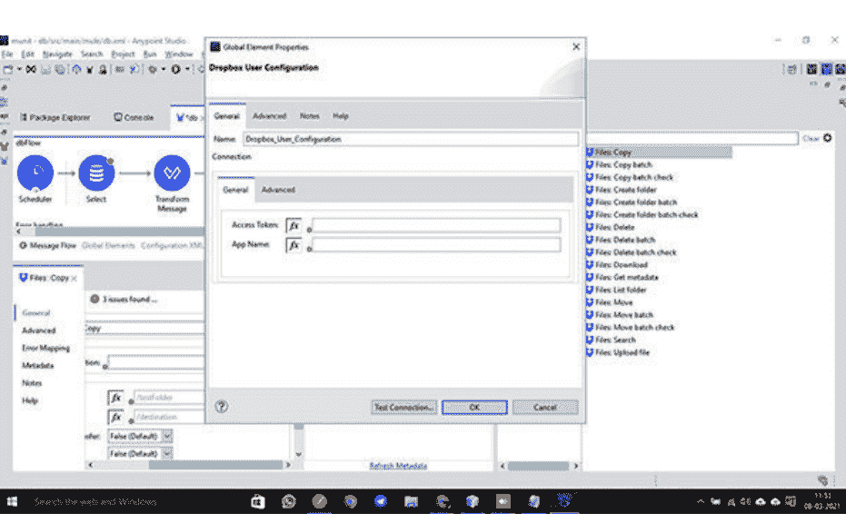

### 图 2.18：检查详情

必须提供 Access Token 与应用程序建立连接。这些连接参数在其他应用之间有所不同。

```xml
<scheduler doc:name="Scheduler" doc:id="78be7e4c-724c-4a9b-a119-bd0a471964">
  <strategy frequency="10" timeUnit="SECONDS"/>
</scheduler>
<dbselect doc:name="Select" doc:id="21189b0f-5c80-470f-ab90-2b62975e4c2" config-ref="Database_Config">
  <dbsql><![CDATA[SELECT * FROM APP_CUSTOMER FETCH FIRST 100 ROWS]]></dbsql>
</dbselect>
<ee:transform doc:name="Transform Message" doc:id="c323b4be-2880-4c93-ad83-f29fa0848ee">
  <ee:message>
    <ee:set-payload><![CDATA[2.0
output application/json
payload]]></ee:set-payload>
  </ee:message>
</ee:transform>
<logger level="INFO" name="Logger" doc:id="ad8ce11-ccf0-4e47-9272-81f47b44d34" message="${payload}"/>
```

### 图 2.19：配置 XML

查看你的配置文件。此选择是使用动态调度器完成的。

## 向 SQL 查询传递动态参数并迭代结果

我们需要使用查询参数或 POST 方法将值传递给流，因此让我们此流转换为 HTTP 监听器。


以下是一个 MuleSoft 配置文件的示例，展示了如何配置数据库连接、HTTP 监听器以及相关的数据流处理：

```
<dbconfig name="Database_Config" docname="Database_Config" docid="d0938818-e513-4a76-9253-b8da064294d7">
  <dbjdbcconnection url="jdbc:derby://localhost:3306/client" classname="org.apache.db.jdbc.ClientDriver" user="app" password="app"/>
  <config name="HTTP_listener_Config" docname="HTTP_listener_Config" docid="62f910d3-f9d3-48f5-b8f5-a45ed9b4a9">
    <listener connectionUrl="http://localhost:8085"/>
    <flow name="DBInload" docid="52f7b0d0-e6e4-4256-b536-72f9732777" config-ref="HTTP_listener_Config" path="/db">
      <db:select name="Select_City" docname="Select_City" docid="c7a1a3b0-3075-4ef1-92d1-c63541b2c7" config-ref="Database_Config">
        <query>SELECT CITY, EMAIL FROM APP_CUSTOMER FETCH 100 ROWS ONLY</query>
      </db:select>
    </flow>
  </config>
  <db:sets>
    <messages>
      <transform name="JSON_Transform" docid="d57a00b2-3675-4788-a821-e3d4f516394">
        <payload>application/json</payload>
        <output>application/json</output>
      </transform>
      <set-payload>
        <content><![CDATA[{"payload":$message.payload[0]]}]]></content>
      </set-payload>
    </messages>
    <logger>
      <logger level="INFO" name="Logger" docid="ad8ce11-ccf0-4e47-9272-81f47b44d34" message="${payload}"/>
    </logger>
  </db:sets>
</dbconfig>
```

### 图 2.20：HTTP 监听器的配置 XML

我们引入了一个端口号为 `8085` 的 HTTP 监听器，端点为 `DB`。

此外，我们只获取两个值，如城市和电子邮件。

运行此项目并从 Postman 调用端点。

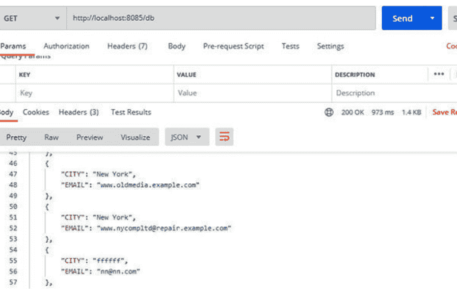

**图 2.21：** 通过 PostMan 通过 HTTP 监听器获取记录

以下是通过 PostMan 调用 `select` 语句执行的结果。

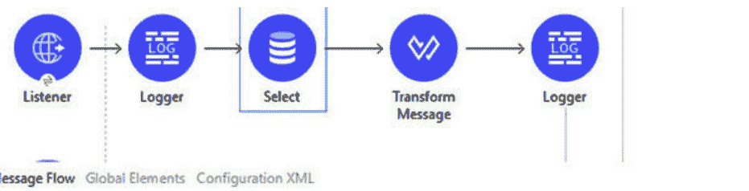

### 图 2.22：向 SQL 脚本发布动态参数

下一个重要要求是从 HTTP 调用动态地将 `where` 条件值传递到 MuleSoft 工作流中。

上一个屏幕显示了如何为 SQL 查询分配动态值。

在输入参数中，我们必须按照如下方式定义 `payload` 变量和查询变量赋值：

> * FROM APP.CUSTOMER where customer_id=:payload_id

### `#{{'payload_id' : payload.id/db}}`

| POST | http://localhost:8081/ | 预请求脚本 | 测试 | 设置 |
|---|---|---|---|---|
| 参数 | 授权 | 请求头 (9) | 主体 | |
| 无 | form-data | x-www-form-urlencoded | 原始 | 二进制 | GraphQL JSON |

```json
Body Cookies (3) Test Results
Pretty Raw Preview Visualize JSON
{
  "firstName": [
    "N"
  ],
  "lastName": [
    "95117"
  ],
  "age": [
    100000
  ]
}
```

**图 2.23：** 通过发布动态值的 PostMan 调用

通过 HTTP 调用传递动态值的结果如图所示。

### 图 2.24：设置动态值后的 Config XML 文件

为 SQL 脚本设置动态值的完整配置文件如图所示。

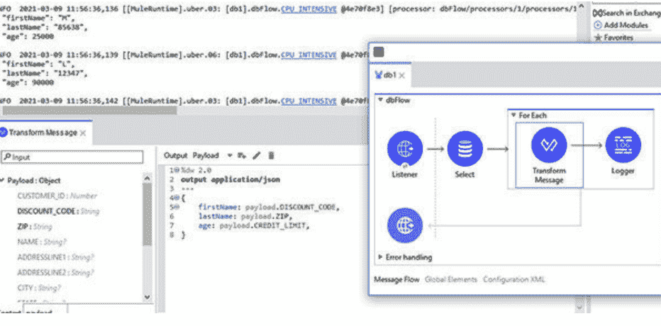

你也可以为从 `select` 查询中获取的每个 `payload` 引入 `for-each-scope`，并可以如图所示遍历每一行：

```xml
<dbconfig name="Database_Config" docname="DatabaseConfig" id="cd91018-e13d-4a76-9fb3-0bd6d4d2e947">
  <dbgeneric-listener name="HTTP_listener" listenerconfig="Database_Config" url="jdbc:postgresql://localhost:5432/sample" driverClassName="postgresql.ClientDriver" user="pass">
    <http:listener name="HTTP_listener" listenerconfig="Database_Config" driverClassName="org.apache.commons.dbcp4" id="d1899-dc64-4040-89f5-a4b15b6394d">
      <http:connection-pool name="HTTP_pool" dbname="5d2f08b2-a06e-4a56-b2d9-e2109772727">
        <listener:config name="listener" docid="e3d60db5-f315-4a00-82ce-f93112b8" config-ref="HTTP_config" path="/db">
          <db:sql id="CODATA">SELECT * FROM APP_CUSTOMER_FETCH FIRST 1000 ROWS ONLY</db:sql>
        </listener:config>
        <ee:foreach name="For Each" docid="c52e7780-b5f1-41d0-ae71-c75261526c3" collection="#payload">
            <ee:process name="Transform Message" docid="5d60a5b3-81e8-4097-ae81-c35b4892c2">
              <ee:message>
                <output application/json>
                  <ee:set payload="{
                    firstname: payload.DISCOUNT_CODE,
                    lastname: payload.ZIP,
                    age: payload.CRED_LIMIT
                  }"/>
                </output>
              </ee:message>
            </ee:process>
          </ee:foreach>
        </ee:message>
        <logger level="INFO" docname="logger" docid="057a00b2-5075-4a78-a01-e228bf6516394" message="#payload" />
      </http:listener>
```

图 2.26：使用 for each 迭代记录的配置文件

图中 `for-each` 组件的完整配置文件。

## 深入 cache scope 的实现

在我们之前的卷册中，我们没有讨论过 `cache scope`（缓存范围），因为可以使用单个 `array list` 来理解 `cache scope`，或者通过适当的 DB 调用来更好地理解它。此外，在实际场景中，`cache scope` 将紧密依赖 `object store`（对象存储）组件。因此，结合实时数据库示例来理解缓存行为更好。

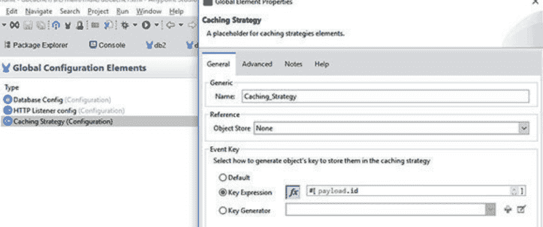

图 2.27：创建缓存策略

现在让我们通过指定 `payload id` 为要缓存的键来创建一个缓存策略。

当给出一个键表达式时，缓存机制将为所有具有相同 `payload id` 的查询直接从数据库获取值。让我们将此缓存策略分配到我们的 `select` 工作流中。

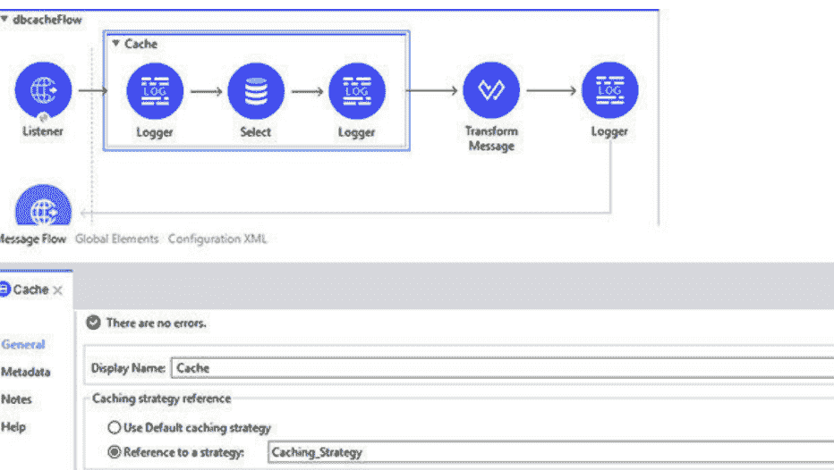

图 2.28：参考缓存策略后的完成工作流

现在，在之前的画布中，你可以看到 `cache` 内部有两个 `logger` 组件和一个 `select` 语句。这意味着如果你第一次传递 `payload id`，它将在 `cache` 内部处理，且控制台中看不到 `logger` 输出。而如果你再次使用相同的 `payload id` 再次调用 `select` 查询，查询将不会通过访问数据库来执行；相反，值将从缓存中打印。你可以参考以下截图来检查缓存操作：

```
INFO 2021-03-09 12:25:43,119 [MuleRuntime.uber:01:cachingStrategy-7693046] [processor: dbcacheFlow/processors/0]
INFO 2021-03-09 12:25:43,269 [MuleRuntime.uber:01:cachingStrategy-7693046] [processor: dbcacheFlow/processors/0]
```

2021-03-09 12:25:43,119 [MuleRuntime.uber:01:cachingStrategy-7693046] [processor: dbcacheFlow/processors/0]

2021-03-09 12:25:43,269 [MuleRuntime.uber:01:cachingStrategy-7693046] [processor: dbcacheFlow/processors/0]

（注：此处根据上下文逻辑对日志内容进行了对齐并保持格式一致）

**图 2.23：通过发布动态值的 PostMan 调用**

通过 HTTP 调用传递动态值的结果如图所示。

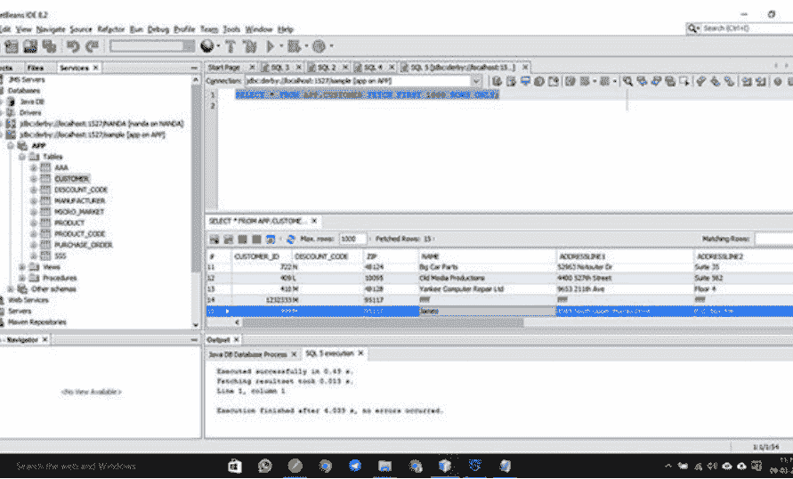

图 2.24：设置动态值后的 Config XML 文件

为 SQL 脚本设置动态值的完整配置文件如图所示。


你也可以为从 `select` 查询中获取的每个 `payload` 引入 `for-each-scope`，并可以如图所示遍历每一行：

（代码块保持不变）

图 2.26：使用 for each 迭代记录的配置文件

图中 `for-each` 组件的完整配置文件


图 2.27：创建缓存策略

现在让我们通过指定 `payload id` 为要缓存的键来创建一个缓存策略。

当给出一个键表达式时，缓存机制将为所有具有相同 `payload id` 的查询直接从数据库获取值。让我们将此缓存策略分配到我们的 `select` 工作流中。


图 2.28：参考缓存策略后的完成工作流

现在，在之前的画布中，你可以看到 `cache` 内部有两个 `logger` 组件和一个 `select` 语句。这意味着如果你第一次传递 `payload id`，它将在 `cache` 内部处理，且控制台中看不到 `logger` 输出。而如果你再次使用相同的 `payload id` 再次调用 `select` 查询，查询将不会通过访问数据库来执行；相反，值将从缓存中打印。你可以参考以下截图来检查缓存操作：

（代码块保持不变）

**图 2.29：缓存范围的作用**

在之前的屏幕图中，你可以看到对于每一个重复的 `payload id`；数据库都会被调用，因为我们使用了特定的缓存失效。请记住，缓存设计并未此结束；我们还有与 `ObjectStore` 组件配合的更复杂的缓存功能，很快就会探讨。


### 图 2.30：失效策略

此外，你必须理解如何失效缓存。在工作流末尾引入失效缓存组件，如图所示。现在根据某些条件失效策略；这里我们没有应用任何条件，只是想解释失效缓存是如何工作的。

（代码块保持不变）

图 2.31：检查失效缓存结果

在之前的截图中，你可以看到对于每一个重复的 `payload id`；数据库都会被调用，因为我们使用了特定的缓存失效。

## 数据库操作，如插入、更新、DDL、脚本和存储过程

让我们快速浏览可用的数据库操作，以及如何调用它们并返回数据库中检查结果。

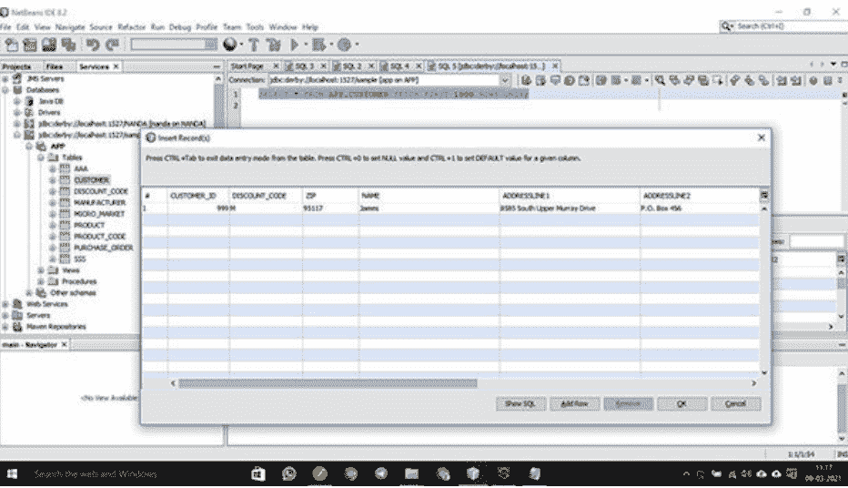

图 2.32：通过 NetBeans IDE 添加行

让我们从 NetBeans IDE 插入一行。你可以找到加号按钮，使用表单对话插入记录。你可以输入你选择的值并点击 Show

### 图 2.23：从 NetBeans IDE 中获取插入脚本

添加条目所需的插入脚本将如插图所示。

你可以复制 SQL 脚本并添加一些示例行进行检查。

```
INFO 2023-08-09 11:20:46,117 [MuleRuntime].user.03: [db].dbInsertFlow.CPU_INTENSIVE [@lc48Sca7] [processor:dbInsertFlow/processors/2]: ev@AffectedConnection:

ERROR 2023-08-09 11:22:55,789 [MuleRuntime]... 
Message:
The statement failed:
dbInsertFlow ->
INSERT INTO APP_CUSTOMER (CUSTOMER_ID, DISCOUNT_CODE, ZIP, "NAME", ADDRESS1,ADDRESS2, CITY, "STATE", PHONE, FAX)
VALUES (9823, 'M', '95117', '2555 South Upper Murphy Drive', 'P.O. Box 456', 'Atlanta', '555-555-017')
```

图 2.34：通过 MuleFlow 执行插入脚本并检查结果

引入一个插入组件，并提供从 NetBeans IDE 复制的 SQL 查询文本，同时带有一些唯一值。

```
INSERT INTO APP.CUSTOMER (CUSTOMER_ID,
DISCOUNT_CODE, ZIP, "NAME", ADDRESSLINE1, ADDRESSLINE2,
CITY, "STATE", PHONE, FAX, EMAIL, CREDIT_LIMIT)
VALUES (88888, 'M', '95117', 'James', '8585 South Upper Murray
Drive, 'P.O. Box 456', 'Atlanta', 'FL', '555-555-0175', '555-555-0176',
'www.smallbill.example.com', NULL)
```

你可以提供所需的连接配置详情并测试连接。

一旦建立连接，你就可以运行项目。

你可以在控制台中看到成功消息的行。


### 图 2.35：检查表中插入的值

你可以回到 NetBeans 并检查唯一值是否反映在数据网格中。

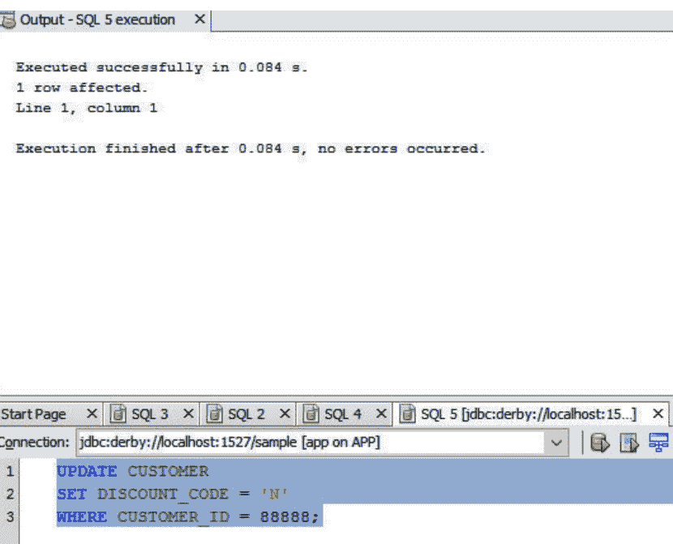

图 2.36：在 NetBeans IDE 中执行更新语句

尝试按所示更新某些行，以确保更新语句能够正常工作。

你一定能看到成功消息行

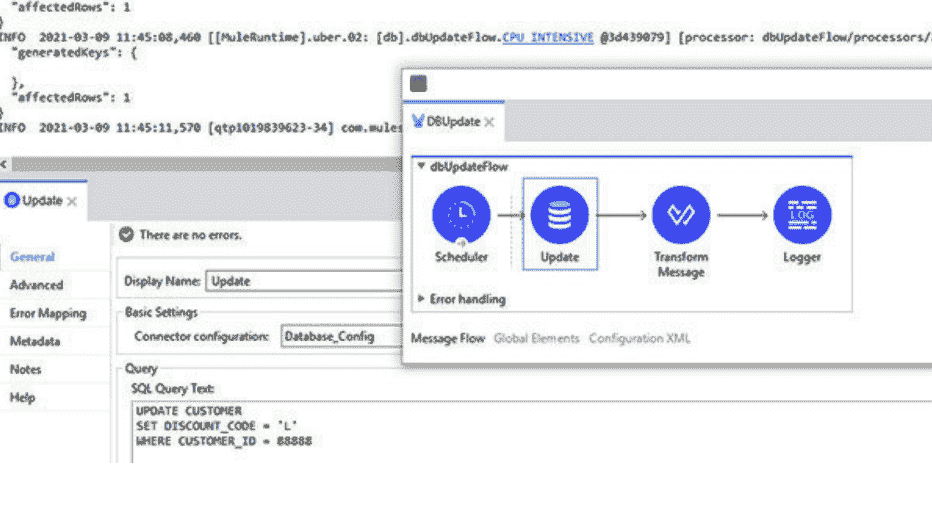

### 图 2.37：通过 MuleSoft 更新记录

同样，来到 Anypoint Studio 画布并引入一个更新组件。

按照之前的说明，提供连接详情检查连通性，并提供你在 NetBeans 中使用的相同的更新语句，如下所示：

```
UPDATE CUSTOMER
SET DISCOUNT_CODE = 'L'
WHERE CUSTOMER_ID = 88888
```


运行项目后，你将获得一个成功消息。

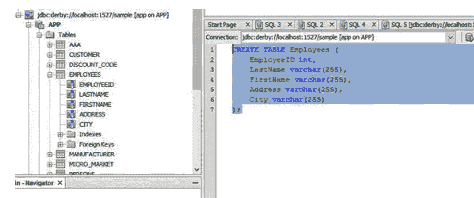

**图 2.38：NetBeans IDE 中的 DDL 数据定义语言执行**

`DDL` 用于定义创建和修改表及其他核心功能的命令。

为了测试目的，你尝试使用 `create table` DDL 在 Derby 中创建一个表。

你应该能看到新创建的表。

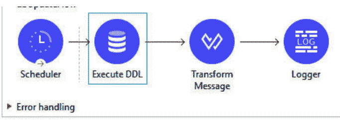

消息流全局元素配置 XML

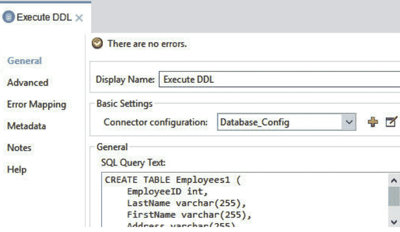

**图 2.39：通过 MuleFlow 执行 DDL**

回到 Studio 画布并引入已执行的 `DDL` 组件，提供所需的连接详情，并通过提供 `DDL` 命令再创建一个表，如下所示：

```
CREATE TABLE Employees (
EmployeeID int,
LastName varchar(255),
FirstName varchar(255),
Address varchar(255),
City varchar(255));
```

你可以在 NetBeans IDE 中验证表的创建。

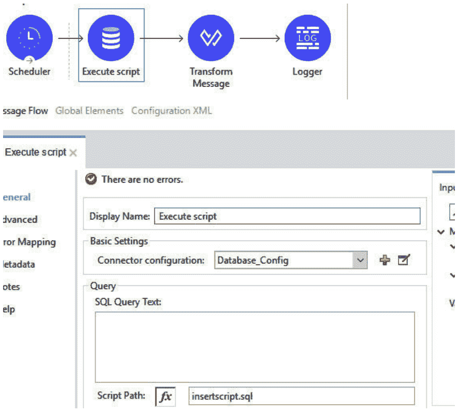

图 2.40：执行脚本示例

在 `resources` 目录下，根目录创建一个名为的文件。

脚本内容示例如下所示。

引入一个 `execute script` 组件并提供 `dbconfig` 和脚本路径。

运行项目并检查控制台结果。

```
INSERT INTO APP.CUSTOMER (CUSTOMER_ID,
DISCOUNT_CODE, ZIP, "NAME", ADDRESSLINE1, ADDRESSLINE2,
CITY, "STATE", PHONE, FAX, EMAIL, CREDIT_LIMIT)
VALUES (111, 'M', '95117', 'James', '8585 South Upper Murray
Drive, 'P.O. Box 456', 'Atlanta', 'FL', '555-555-0175', '555-555-0176,
www.smallbill.example.com', NULL)

INSERT INTO APP.CUSTOMER (CUSTOMER_ID,
DISCOUNT_CODE, ZIP, "NAME", ADDRESSLINE1, ADDRESSLINE2,
CITY, "STATE", PHONE, FAX, EMAIL, CREDIT_LIMIT)
VALUES (222, 'M', '95117', 'James', '8585 South Upper Murray
Drive, 'P.O. Box 456', 'Atlanta', 'FL', '555-555-0175', '555-555-0176,
www.smallbill.example.com', NULL)

INSERT INTO APP.CUSTOMER (CUSTOMER_ID,
DISCOUNT_CODE, ZIP, "NAME", ADDRESSLINE1, ADDRESSLINE2,
CITY, "STATE", PHONE, FAX, EMAIL, CREDIT_LIMIT)
VALUES (333, 'M', '95117', 'James', '8585 South Upper Murray
Drive, 'P.O. Box 456', 'Atlanta', 'FL', '555-555-0175', '555-555-0176,
www.smallbill.example.com', NULL)
```

插入脚本视图

## 表格行监听器 (On table row listener)

`On-table-row` 监听器用于监听表格并在插入新行时触发处理流程。

要实现这一点，请创建一个名为 `map` 的简单表，并创建一个名为 `map_id` 的主键。

将 `map_id` 列设置为水线列（watermark column），并完成相关配置的配置。

现在，我们已经有一个批量插入行的流程，修改脚本以将批量行插入到 `map` 表中。

你可以运行项目，现在就可以看到表格行监听器正在运行。

```
cessor: ************record inserted through bulk insert flow***
essor: ************New record identified by OnTableRowListener
essor: ************record inserted through bulk insert flow***
essor: ************New record identified by OnTableRowListener
essor: ************record inserted through bulk insert flow***
essor: ************New record identified by OnTableRowListener
essor: ************record inserted through bulk insert flow***
essor: ************New record identified by OnTableRowListener
essor: ************record inserted through bulk insert flow***
essor: ************New record identified by OnTableRowListener
essor: ************record inserted through bulk insert flow***
essor: ************New record identified by OnTableRowListener
essor: ************record inserted through bulk insert flow***
essor: ************New record identified by OnTableRowListener
essor: ************record inserted through bulk insert flow***
essor: ************New record identified by OnTableRowListener
```

在控制台中，你可以看到由批量行调度器插入的每一行；当插入新行时，表格行监听器会发送一条日志消息。

## 总结

我们使用第三方工具 NetBeans 涵盖了基本的数据库概念，并能够使用 NetBeans 提供的虚拟表数据；我们还创建了自己的数据并测试了所有的数据库操作。在接下来的章节中，我们将探索文件连接器。谢谢。

## 注意事项

- 从 MuleSoft 创建多个表并执行数据库操作。

- 理解一对一、一对多等关系类型，并将它们应用到你的项目中。

## 待探索的关键术语

- Apache NetBeans

- Derby 数据库

- Derby client jar

- 插入脚本 (Insert script)

- 更新语句 (Update statement)

- DDL 数据定义语言

- 执行脚本 (Execute script)

- 存储过程 (Stored procedure)

- 批量插入数据 (Inserting bulk data)

- 批量更新数据 (Updating bulk data)

- 批量删除记录 (Deleting bulk records)

- 批量插入 (Bulk insertion)

- OnTableRow 监听器

## 结构

在本章中，我们将讨论以下主题：

- 为项目添加文件连接器模块

- 文件连接器配置

- 文件读取组件

- 文件写入组件

- 文件列表组件

- 在调试模式下检查可用文件属性

- 删除组件

- 移动组件

- 复制组件

- 创建目录组件

- 重命名组件

- 新文件或更新文件时触发

## 目标

学习本章后，你将能够：

- 处理文件相关操作

- 将文件操作与调度器及数据库结合

- 设计并创建基于文件的 MuleSoft 流程

## 介绍

MuleSoft 文件连接器非常简单，它涵盖了所有文件相关操作，如读取、写入、复制、删除等。它还提供了关于文件元数据（Metadata）的信息。让我们浏览本章中的文件操作。

以下截图和步骤将帮助你理解 MuleSoft 文件连接器的用法。

进入“添加模块 (Add modules)”并寻找文件连接器 (File connector)，将其拖到项目模块面板中，你就可以看到支持的文件操作，如等。

图 3.1：为项目添加文件连接器模块

配置文件连接器无非指定工作目录，从你的本地文件系统中指定从何处读取文件。

图 3.2：文件连接器配置

指定要读取的文件，并在日志记录器（logger）中使用 `payload` 作为消息来查看文件内容。

图 3.3：使用文件读取组件

指定要写入的文件，在 `content` 字段中提供内容。

图 3.4：使用文件写入组件

创建父目录，目录将按照你的指定的进行创建。

写入模式有三个选项：覆盖（overwrite）——将删除所有之前的内容；追加（append）——将添加到之前的内容；以及新建（create new）——将创建一个新文件。

### 图 3.5：使用文件列表组件

列表组件（List component）将提供特定特定目录下所有可用文件的数组。先前的匹配器（matchers）是不言自明的。你必须熟悉 Java 中的正则表达式才能有效地使用这些匹配器。

## 变量 (Variables)

```
Choice =
  attributes = LocalFileAttributes[lastModifiedTime=2021-03-10T12:38:20.177898,lastAccessTime=2021-03-10T13:15:34.375990,...
  mediaType =
    creationTime = 2021-03-10T13:15:34.375990
  directory = file
    fileName = "test - Copy (2).txt"
    lastAccessTime = 2021-03-10T13:15:34.375990
    MAX = 999999999-12-31T23:59:59.999999999
    MIN = 999999999-01-01T00:00:00.000
    date = 2021-03-10
    serialVersionID = 602766400453656
    time = 13:15:34.375990
  lastModifiedTime = 2021-03-10T12:38:20.177898
    MAX = 999999999-12-31T23:59:59.999999999
    MIN = 999999999-01-01T00:00:00.000
  path = "C:\FileConnector\test - Copy (2).txt"
  regularFile = true
  serialVersionID = 324978073227598
  size = 0
  symbolicLink = false
  correlationId = "2c56e10b-8175-11eb-b2d2-3d821a1a5816"
  ItemSequenceInfo = ItemSequenceInfo(position=0, sequenceSize=<not set>)
```

图 3.6：在调试模式下检查可用文件属性

如果你在调试模式下运行之前的示例，你可以看到每个文件的可用属性，如图所示

图 3.7：使用删除组件

添加一个删除组件并提供要删除的文件名，运行项目；你可以看到文件被删除，要删除的文件名也可以动态传递。

图 3.8：使用移动组件

移动组件需要源路径和目标路径。此外，移动组件具有创建父目录、覆盖和重命名的选项。

图 3.9：使用复制组件

复制组件同样需要源路径和目标路径。此外，复制组件具有创建父目录、覆盖和重命名的选项。

图 3.10：使用创建目录组件

如果你想去创建一个新目录，可以使用创建目录组件。

图 3.11：使用重命名组件

为了备份文件或重命名文件，我们可以使用重命名组件。

当目录获得新文件或工作文件被修改时，可以使用新文件或更新文件组件触发新流程。一旦我们处理了文件，我们可以将文件移动到存档目录，也可以根据后处理操作配置从源位置删除文件。

## 结论

在本章中，我们涵盖了所有文件相关的连接器操作；请尝试不同业务场景的所有示例。在下一章中，我们将探索 SOAP 连接器。

## 记忆要点

- 尝试理解 Java 的正则表达式并实现文件规则。

- 尝试读取和写入不同类型的文件，如 Excel 和 JSON。

- 尝试使用数据库特性；例如，读取脚本文件并执行批量插入。

## 待探索的关键术语

- 文件连接器模块

- 文件连接器配置

- 文件读取组件

- 文件写入组件

- 文件列表组件

- 文件属性

- 删除组件

- 移动组件

- 复制组件

- 创建目录组件

- 重命名组件

- 当有新或更新文件时

## SOAP WebService 连接器

## 结构

在本章中，我们将讨论以下主题：

- Web 应用程序的基础是什么

- 在 NetBeans 中创建新项目

- 选择基础 Web 应用程序项目

- 项目名称和位置

- 服务器设置

- 默认索引页

- 在浏览器中运行索引页

- 在 PostMan 中检查响应

- 从 Anypoint Studio 获取 NetBeans 响应

- 使用 NetBeans 创建 HTML5 应用

- 运行 HTML 5 应用

## 探索应用

- Web 服务的基础

- 从 NetBeans 创建 Web 服务

- 探索 Web 服务项目

- 运行 Web 服务

- 探索 WSDL

- WebServices 和 MuleSoft

- 使用 Web 服务消费者组件

- 探索 WSDL

- 在无输入参数的情况下调用 WSDL

- 向 WebServices 提交输入参数

- 通过 PostMan 获取响应

- 调用本地开发的 NetBeans Web 服务

- 通过转换器组件向 Web 服务发送值

- 在 PostMan 中检查 Web 服务响应

- 调用托管在  上的 Web 服务

- 检查可用的多个 Web 服务操作

- 转换组件设置

## 目标

学习本章后，你将能够：

- 区分 SOAP 和 REST Web 服务

- 使用 NetBeans IDE 了解 SOAP 的基础

- 通过 MuleSoft SOAP Web 连接器调用 SOAP Web 服务

## 引言

如果你学习过第 1 卷和第 2 卷，你对 RESTful API 服务有了相当的了解。现在我们将介绍另一种 Web 服务模型，即简单对象访问协议（Simple Object Access Protocol），它用于通过 Web 服务调用进行复杂对象的传输。

Web 服务无非是通过 RESTful 和 SOAP 等标准协议在 Web 上提供特定功能的服务；在这里，REST 被用作一种架构模式而不是像 SOAP 那样的协议；因此，它变得轻量级并且可以通过简单的 URL/URIs 轻松访问。而 SOAP 本身是一种协议，它需要一个符合 XML 格式的 Web 服务接口。

## SOAP Web 服务基础

首先，让我们使用 NetBeans 创建一些 Web 项目并理解 SOAP Web 服务的知识。

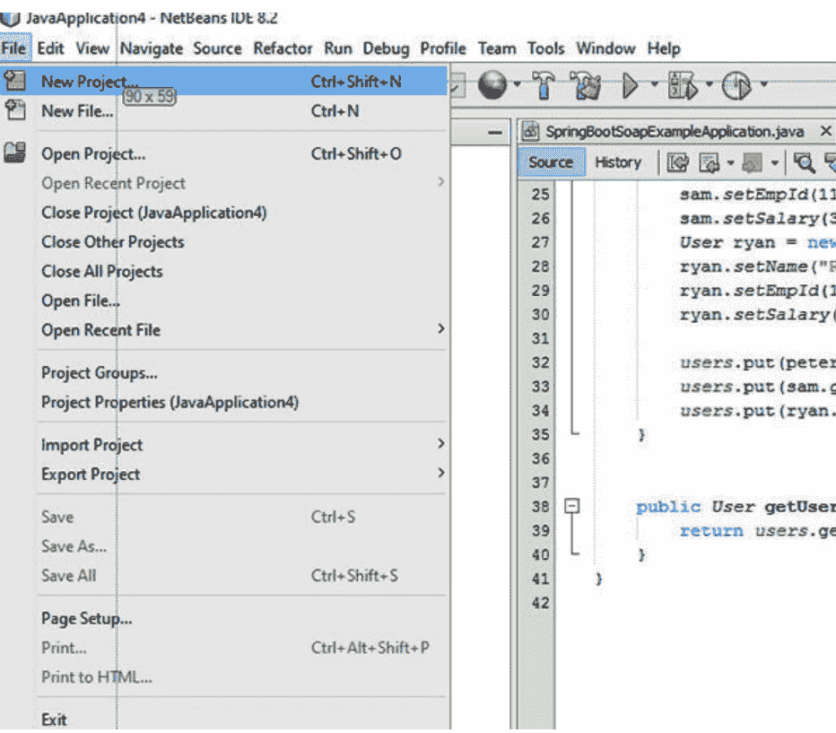

图 4.1：在 NetBeans 中创建新项目

进入 NetBeans 并创建一个新项目。

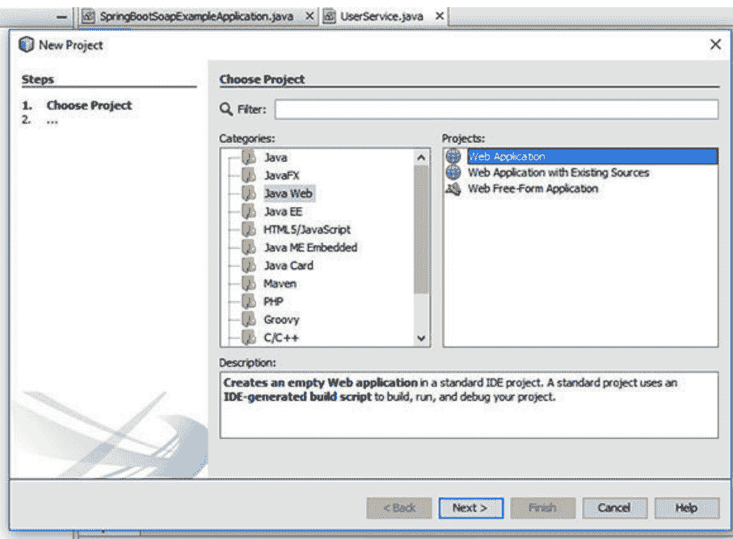

图 4.2：选择基础 Web 应用程序项目

在“Choose Project”（选择项目）对话框中，选择 Java Web 类别并选择“Web Application”（Web 应用程序）项目，然后点击


**图 4-3：**项目名称和位置

如前面的截图所示，提供项目名称、位置和文件夹：

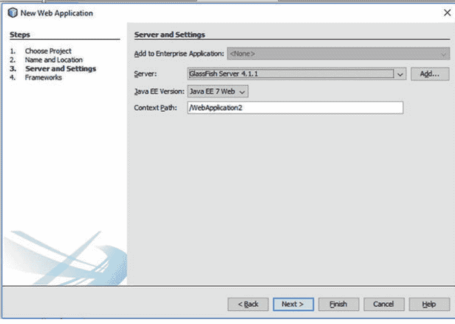

图 4.4：服务器设置

在**Server setting**（服务器设置）中，对话框选择了服务器为 **GlassFish** 并提供了一个上下文路径。

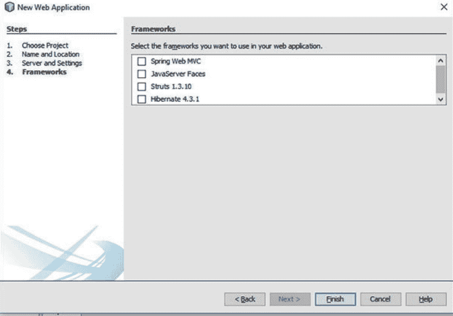

图 4.5：框架选择界面

你可以选择 Spring Web MVC 作为你的框架。

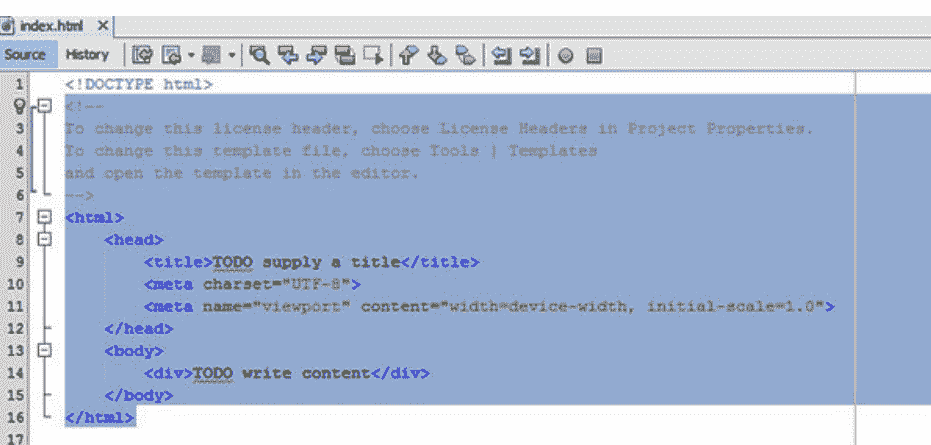

图 4.6：默认索引页

现在，你应该能看到一个 Web 项目正在创建，并且显示了默认索引页。


图 4.7：在浏览器中运行索引页

右键点击项目并运行（run），查看部署了 Web 应用程序的 Web 服务器，并默认调用索引文件。

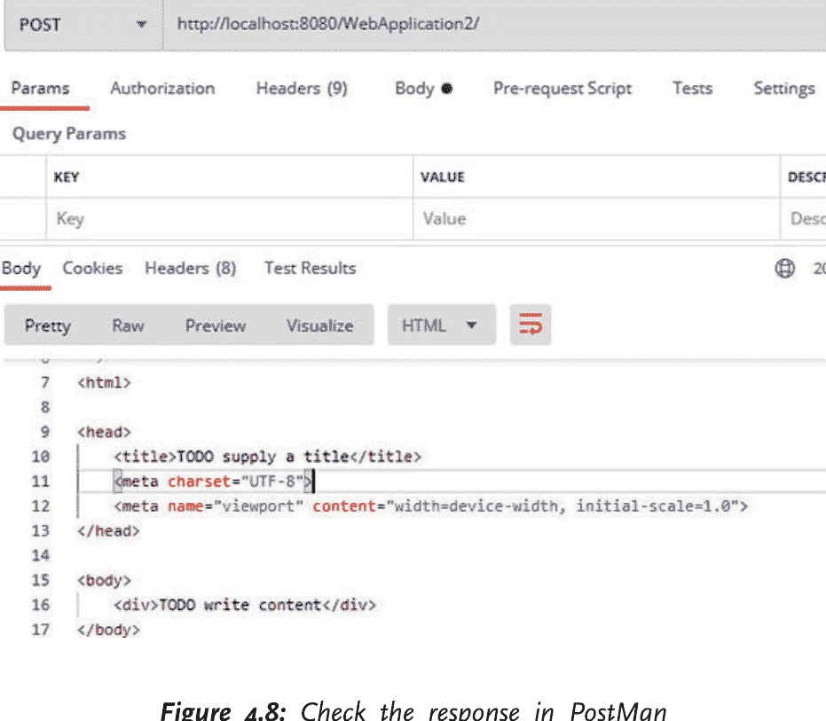

你可以在 PostMan 中使用相同的 URL 并检查响应。

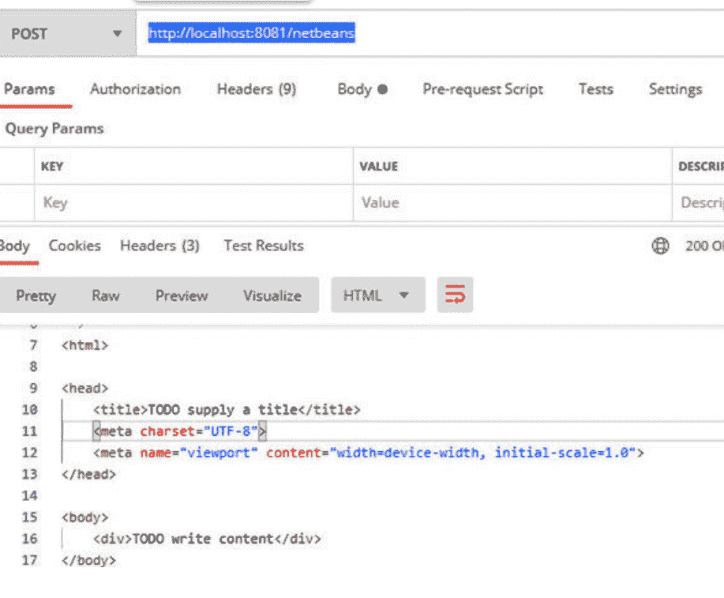


# 图 4.9：从 Anypoint Studio 获取 NetBeans 响应

同样，在 Anypoint Studio 中创建一个项目，你可以通过 HTTP 请求组件调用在 NetBeans 中运行的 Web 服务并在 PostMan 中显示负载。

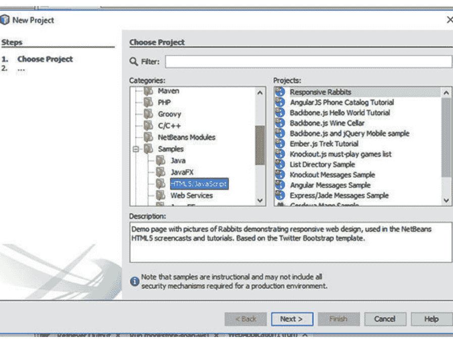

# 图 4.10：使用 NetBeans 创建 HTML5 应用

# 图 4.11：运行 HTML 5 应用

## 探索应用

- Web 服务的基础
- 从 NetBeans 创建 Web 服务
- 探索 Web 服务项目
- 运行 Web 服务
- 探索 WSDL
- WebServices 和 MuleSoft
- 使用 Web 服务消费者组件
- 探索 WSDL
- 在无输入参数的情况下调用 WSDL
- 向 WebServices 提交输入参数
- 通过 PostMan 获取响应
- 调用本地开发的 NetBeans Web 服务
- 通过转换器组件向 Web 服务发送值
- 在 PostMan 中检查 Web 服务响应
- 调用托管在 Internet 上的 Web 服务
- 检查可用的多个 Web 服务操作
- 转换组件设置

## 目标

学习本章后，你将能够：

- 区分 SOAP 和 REST Web 服务
- 使用 NetBeans IDE 了解 SOAP 的基础
- 通过 MuleSoft SOAP Web 连接器调用 SOAP Web 服务

## 引言

如果你学习过第 1 卷和第 2 卷，你对 RESTful API 服务有了相当的了解。现在我们将介绍另一种 Web 服务模型，即简单对象访问协议（Simple Object Access Protocol），它用于通过 Web 服务调用进行复杂对象的传输。

Web 服务无非是通过 RESTful 和 SOAP 等标准协议在 Web 上提供特定功能的服务；在这里，REST 被用作一种架构模式而不是像 SOAP 那样的协议；因此，它变得轻量级并且可以通过简单的 URL/URIs 轻松访问。而 SOAP 本身是一种协议，它需要一个符合 XML 格式的 Web 服务接口。

## SOAP Web 服务基础

首先，让我们使用 NetBeans 创建一些 Web 项目并理解 SOAP Web 服务的知识。


# 图 4.1：在 NetBeans 中创建新项目

进入 NetBeans 并创建一个新项目。


# 图 4.2：选择基础 Web 应用程序项目

在“Choose Project”（选择项目）对话框中，选择 Java Web 类别并选择“Web Application”（Web 应用程序）项目，然后点击


# 图 4-3：项目名称和位置

如前面的截图所示，提供项目名称、位置和文件夹：


# 图 4.4：服务器设置

在`Server setting`（服务器设置）中，对话框选择了服务器为 `GlassFish` 并提供了一个上下文路径。


# 图 4.5：框架选择界面

你可以选择 `Spring Web MVC` 作为你的框架。


# 图 4.6：默认索引页

现在，你应该能看到一个 Web 项目正在创建，并且显示了默认索引页。


# 图 4.7：在浏览器中运行索引页

右键点击项目并运行（run），查看部署了 Web 应用程序的 Web 服务器，并默认调用索引文件。


你可以在 PostMan 中使用相同的 URL 并检查响应。


# 图 4.9：从 Anypoint Studio 获取 NetBeans 响应

同样，在 Anypoint Studio 中创建一个项目，你可以通过 HTTP 请求组件调用在 NetBeans 中运行的 Web 服务并在 PostMan 中显示负载。


# 图 4.10：使用 NetBeans 创建 HTML5 应用

# 图 4.11：运行 HTML 5 应用

## 探索应用

- Web 服务的基础
- 从 NetBeans 创建 Web 服务
- 探索 Web 服务项目
- 运行 Web 服务
- 探索 WSDL
- WebServices 和 MuleSoft
- 使用 Web 服务消费者组件
- 探索 WSDL
- 在无输入参数的情况下调用 WSDL
- 向 WebServices 提交输入参数
- 通过 PostMan 获取响应
- 调用本地开发的 NetBeans Web 服务
- 通过转换器组件向 Web 服务发送值
- 在 PostMan 中检查 Web 服务响应
- 调用托管在 Internet 上的 Web 服务
- 检查可用的多个 Web 服务操作
- 转换组件设置

## 目标

学习本章后，你将能够：

- 区分 SOAP 和 REST Web 服务
- 使用 NetBeans IDE 了解 SOAP 的基础
- 通过 MuleSoft SOAP Web 连接器调用 SOAP Web 服务

## 引言

如果你学习过第 1 卷和第 2 卷，你对 RESTful API 服务有了相当的了解。现在我们将介绍另一种 Web 服务模型，即简单对象访问协议（Simple Object Access Protocol），它用于通过 Web 服务调用进行复杂对象的传输。

Web 服务无非是通过 RESTful 和 SOAP 等标准协议在 Web 上提供特定功能的服务；在这里，REST 被用作一种架构模式而不是像 SOAP 那样的协议；因此，它变得轻量级并且可以通过简单的 URL/URIs 轻松访问。而 SOAP 本身是一种协议，它需要一个符合 XML 格式的 Web 服务接口。

## SOAP Web 服务基础

首先，让我们使用 NetBeans 创建一些 Web 项目并理解 SOAP Web 服务的知识。


# 图 4.1：在 NetBeans 中创建新项目

进入 NetBeans 并创建一个新项目。


# 图 4.2：选择基础 Web 应用程序项目

在“Choose Project”（选择项目）对话框中，选择 Java Web 类别并选择“Web Application”（Web 应用程序）项目，然后点击


# 图 4-3：项目名称和位置

如前面的截图所示，提供项目名称、位置和文件夹：


# 图 4.4：服务器设置

在`Server setting`（服务器设置）中，对话框选择了服务器为 `GlassFish` 并提供了一个上下文路径。


# 图 4.5：框架选择界面

你可以选择 `Spring Web MVC` 作为你的框架。


# 图 4.6：默认索引页

现在，你应该能看到一个 Web 项目正在创建，并且显示了默认索引页。


# 图 4.7：在浏览器中运行索引页

右键点击项目并运行（run），查看部署了 Web 应用程序的 Web 服务器，并默认调用索引文件。


你可以在 PostMan 中使用相同的 URL 并检查响应。


# 图 4.9：从 Anypoint Studio 获取 NetBeans 响应

同样，在 Anypoint Studio 中创建一个项目，你可以通过 HTTP 请求组件调用在 NetBeans 中运行的 Web 服务并在 PostMan 中显示负载。


# 图 4.10：使用 NetBeans 创建 HTML5 应用

# 图 4.11：运行 HTML 5 应用

## 探索应用

- Web 服务的基础
- 从 NetBeans 创建 Web 服务
- 探索 Web 服务项目
- 运行 Web 服务
- 探索 WSDL
- WebServices 和 MuleSoft
- 使用 Web 服务消费者组件
- 探索 WSDL
- 在无输入参数的情况下调用 WSDL
- 向 WebServices 提交输入参数
- 通过 PostMan 获取响应
- 调用本地开发的 NetBeans Web 服务
- 通过转换器组件向 Web 服务发送值
- 在 PostMan 中检查 Web 服务响应
- 调用托管在 Internet 上的 Web 服务
- 检查可用的多个 Web 服务操作
- 转换组件设置

## 目标

学习本章后，你将能够：

- 区分 SOAP 和 REST Web 服务
- 使用 NetBeans IDE 了解 SOAP 的基础
- 通过 MuleSoft SOAP Web 连接器调用 SOAP Web 服务

## 引言

如果你学习过第 1 卷和第 2 卷，你对 RESTful API 服务有了相当的了解。现在我们将介绍另一种 Web 服务模型，即简单对象访问协议（Simple Object Access Protocol），它用于通过 Web 服务调用进行复杂对象的传输。

Web 服务无非是通过 RESTful 和 SOAP 等标准协议在 Web 上提供特定功能的服务；在这里，REST 被用作一种架构模式而不是像 SOAP 那样的协议；因此，它变得轻量级并且可以通过简单的 URL/URIs 轻松访问。而 SOAP 本身是一种协议，它需要一个符合 XML 格式的 Web 服务接口。

## SOAP Web 服务基础

首先，让我们使用 NetBeans 创建一些 Web 项目并理解 SOAP Web 服务的知识。


# 图 4.1：在 NetBeans 中创建新项目

进入 NetBeans 并创建一个新项目。


# 图 4.2：选择基础 Web 应用程序项目

在“Choose Project”（选择项目）对话框中，选择 Java Web 类别并选择“Web Application”（Web 应用程序）项目，然后点击


# 图 4-3：项目名称和位置

如前面的截图所示，提供项目名称、位置和文件夹：


# 图 4.4：服务器设置

在`Server setting`（服务器设置）中，对话框选择了服务器为 `GlassFish` 并提供了一个上下文路径。


# 图 4.5：框架选择界面

你可以选择 `Spring Web MVC` 作为你的框架。


# 图 4.6：默认索引页

现在，你应该能看到一个 Web 项目正在创建，并且显示了默认索引页。


# 图 4.7：在浏览器中运行索引页

右键点击项目并运行（run），查看部署了 Web 应用程序的 Web 服务器，并默认调用索引文件。


你可以在 PostMan 中使用相同的 URL 并检查响应。


图 4.9：从 `Anypoint Studio` 获取 `NetBeans` 响应

同样，在 `Anypoint Studio` 中创建一个项目，你可以通过 `HTTP` 请求组件调用在 `NetBeans` 中运行的 `Web` 服务并在 `PostMan` 中显示负载。


图 4.10：使用 `NetBeans` 创建 `HTML5` 应用

图 4.11：运行 `HTML 5` 应用

## 探索应用

- `Web` 服务的基础
- 从 `NetBeans` 创建 `Web` 服务
- 探索 `Web` 服务项目
- 运行 `Web` 服务
- 探索 `WSDL`
- `WebServices` 和 `MuleSoft`
- 使用 `Web` 服务消费者组件
- 探索 `WSDL`
- 在无输入参数的情况下调用 `WSDL`
- 向 `WebServices` 提交输入参数
- 通过 `PostMan` 获取响应
- 调用本地开发的 `NetBeans` `Web` 服务
- 通过转换器组件向 `Web` 服务发送值
- 在 `PostMan` 中检查 `Web` 服务响应
- 调用托管在 `Internet` 上的 `Web` 服务
- 检查可用的多个 `Web` 服务操作
- 转换组件设置

## 目标

学习本章后，你将能够：

- 区分 `SOAP` 和 `REST` `Web` 服务
- 使用 `NetBeans IDE` 了解 `SOAP` 的基础
- 通过 `MuleSoft SOAP Web` 连接器调用 `SOAP Web` 服务

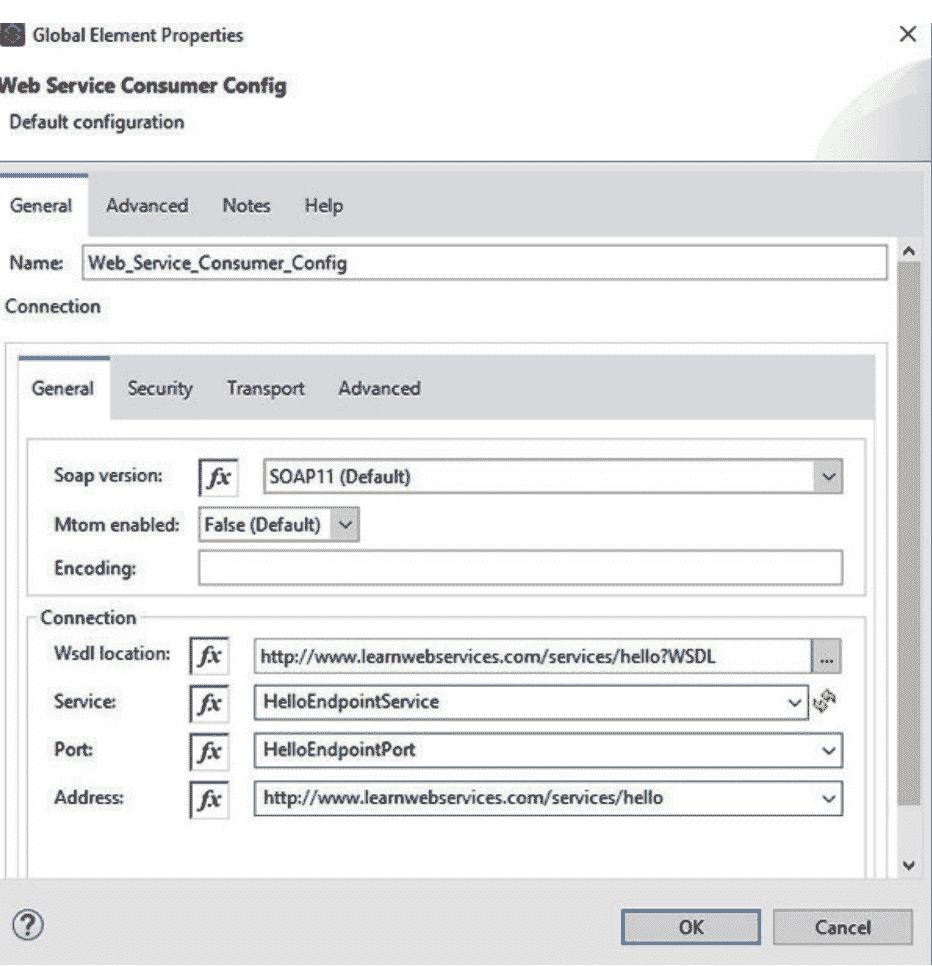

图 4-17：使用 `Web` 服务消费者组件

创建一个简单的调度器项目并引入 `Web` 服务消费者组件。

让我们尝试调用一个可用于测试的 `SOAP Web` 服务。我们首先需要提供 `WSDL` 位置，在 `WSDL` 位置字段中填入以下 `WSDL` 地址。

`http://learnwebsservices.com/services/hello?WSDL`

你可以看到地址（`Address`）被自动填充了，这意味着 `Web` 服务消费者组件可以从 `WSDL` 动态地获取这些值。

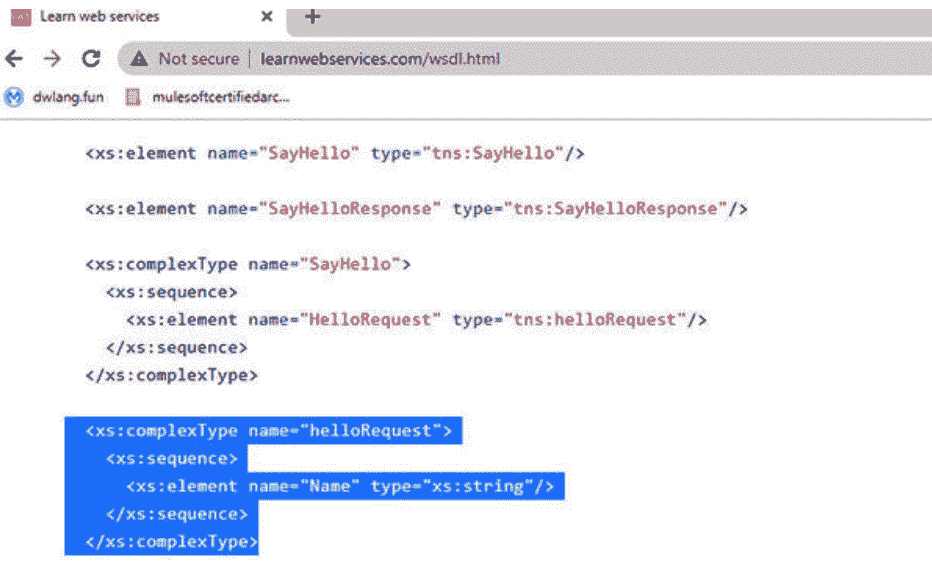

```xml
<xs:element name="SayHello" type="tns:SayHello"/>

<xs:element name="SayHelloResponse" type="tns:SayHelloResponse"/>

<xs:complexType name="SayHello">
  <xs:sequence>
    <xs:element name="HelloRequest" type="tns:helloRequest"/>
  </xs:sequence>
</xs:complexType>

<xs:complexType name="helloRequest">
  <xs:sequence>
    <xs:element name="Name" type="xs:string"/>
  </xs:sequence>
</xs:complexType>

<xs:complexType name="SayHelloResponse">
  <xs:sequence>
    <xs:element name="HelloResponse" type="tns:helloResponse"/>
  </xs:sequence>
</xs:complexType>
```

图 4.18：探索 `WSDL`

探索 `WSDL`，它可以通过以下路径访问。

`http://learnwebservices.com/wsdl.html`

你可以看到 `Web` 服务的点以及输入和输出参数。

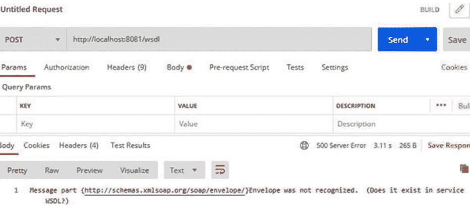

### 图 4.19：在没有输入参数的情况下调用 `WSDL`

如果你按原样调用 `SOAP Web` 服务，将收到一个错误消息，显示没有输入参数的 `hello` 服务不存在，因此我们需要向 `SOAP Web` 服务传递所需的参数。

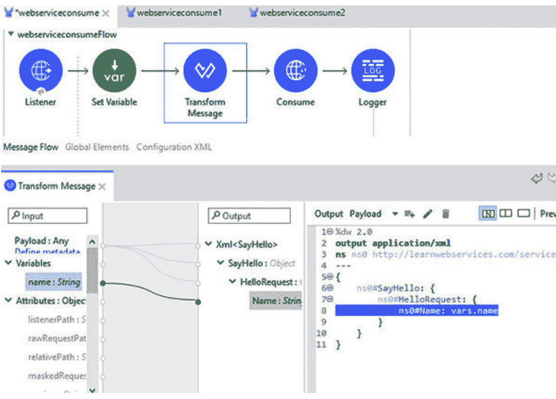

### 图 4.20：向 `Web` 服务提交输入参数

需要为 `SOAP Web` 服务提供以下转换代码作为输入：

```dw
%dw 2.0
output application/xml
ns nso http://learnwebservices.com/services/hello
---
{
nso#SayHello : {
nso#HelloRequest : {
nso#Name: "James"
}
}
}
```

```json
{
  body:<SayHelloResponse xmlns="http://learnwebservices.com/services/hello"><HelloResponse><Message>Hello James!</Message></SayHelloResponse>
  headers: [],
  attachments: []
}
```

图 4.21：通过 `PostMan` 获取响应

现在你可以看到 `Web` 服务正在连同你的输入参数返回响应。


图 4.22：调用本地开发的 `NetBeans` `Web` 服务

现在，你已经知道如何调用 `SOAP Web` 服务以及如何传递输入参数了。

让我们调用在 `NetBeans IDE` 中运行的本地计算器 `Web` 服务。

在 `WSDL` 位置字段中提供 `localhost 8080 calculatorapp calculatorwservice wsdl` 地址。

你可以看到服务和端口地址已自动填充。

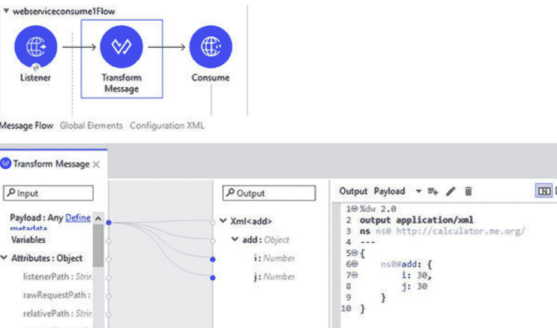

> 图 4.23：通过转换器发送值到 `Web` 服务

如上一个截图所示，传递输入参数。


### 图 4.24：在 `PostMan` 中检查 `Web` 服务响应

你必须能够在 `PostMan` 中看到响应，这样我们成功地从本地环境调用了 `SOAP Web` 服务。


让我们尝试从 `dneonline` 站点调用另一个模拟 `Web` 服务。

此 `WSDL` 有一个或多个操作。


图 4.26：检查用的 `Web` 服务操作

在完成连接器配置后，你可以在属性中检查可用的操作。如上一个截图所示。选择你的操作。


### 图 4.27：转换器设置

如上一个截图所示提供输入参数并调用 `Web` 服务。

## 结论

在本章中，我们学习了 `Web` 应用的基础知识；我们使用 `NetBeans` 从零开始开发了一些 `Web` 应用和 `Web` 服务。我们连接了公共 `SOAP Web` 服务以及本地开发的 `SOAP Web` 服务，并能够通过 `MuleSoft` 服务进行调用。在接下来的章节中，我们将探索电子邮件连接器。

## 注意事项

- 尝试调用更多模拟 `SOAP Web` 服务。
- 详细了解 `WSDL` 元素。

## 探索的关键术语

- 选择基础 `Web` 应用项目
- 服务器设置
- 从 `Anypoint Studio` 获取 `NetBeans` 响应
- `HTML5` 应用
- 从 `NetBeans` 获取 `Web` 服务
- `Web` 服务项目
- `WSDL`
- `Web` 服务消费者组件
- 调用 `WSDL`
- 输入参数
- 调用 `Web` 服务
- 多 `Web` 服务操作

## 结构

在本章中，我们将讨论以下主题：

- 为测试目的创建一个电子邮件账户
- 电子邮件 `SMTP` 设置
- 启用电子邮件 `SMTP StartTLS`
- 电子邮件字段
- `Gmail` 设置中开启低安全性选项
- 附件
- 启用 `IMAP` 和 `POP3` 访问
- `SMTP IMAP` 和 `POP3` 配置
- `Mozilla Thunderbird` 配置
- `SSL IMAP` 和 `POP3` 设置
- 非 `SSL IMAP` 和 `POP3` 设置

## IMAP 应用

## 目标

学习本章后，你将能够：

- 使用 `MuleSoft` 连接器发送电子邮件
- 使用 `IMAP` 和 `POP3` 协议
- 发送附件

## 引言

在完成任何流程后发送电子邮件是不可避免的。电子邮件可能包含敏感信息。在本章中，让我们看看如何使用 `MuleSoft` 连接器。

## 电子邮件连接器用法

让我们逐一查看涉及的步骤。通过 `Gmail` 等免费服务器发送电子邮件。如图 5.1 所示，为测试目的创建一个电子邮件账户。


| 名字 | 姓 |
| --- | --- |
| `mulesofttest` | `mulesoft` |
| 用户名 | |
| `mulesofttest` | `@gmail.com` |
| 密码 | 确认 |
| --- | --- |
| `Mypass#123` | `Mypass!@123` |

请选择更强的密码。尝试字母和符号的组合。

图 5.1：为测试目的创建一个电子邮件账户

我们已经为测试目的创建了上述电子邮件 `ID`。

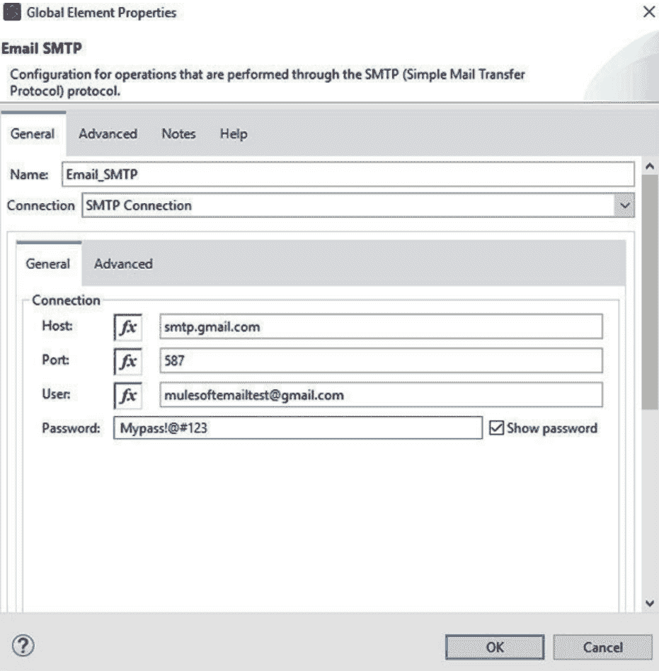

### 图 5.2：电子邮件设置

然后在 `Anypoint Studio` 中创建一个 `EMailDemo` `Mule` 项目。创建一个监听触发器并添加发送电子邮件组件。

在连接器配置中，你必须提供以下值：

```
name="Email_SMTP"
```

## Email SMTP

通过 `SMTP`（简单邮件传输协议）执行的操作配置。

```
name="Email_SMTP"
host="smtp.mail.com",
user="mulesofttest@gmail.com",
password="Mypass!@123"
port="587"
```

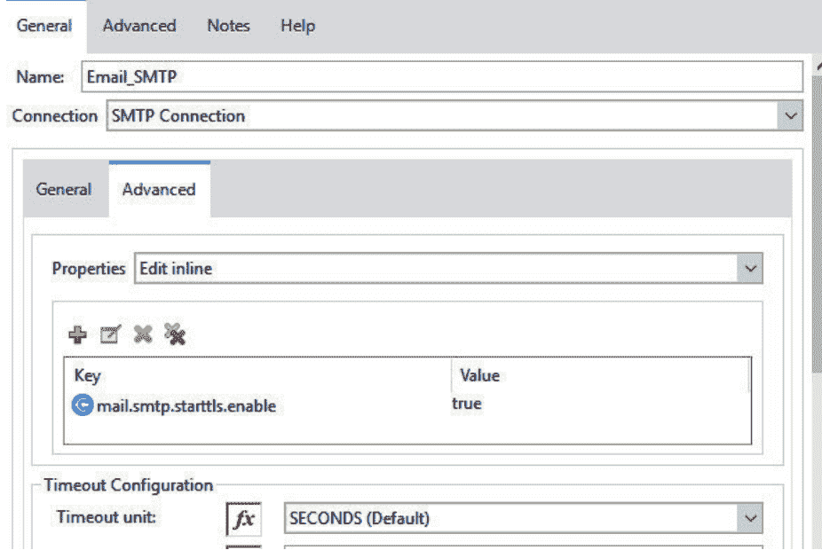

### 图 5.3：启用电子邮件 `SMTP StartTLS`

现在，如图所示进入高级（`Advanced`）选项卡，使用属性编辑选项添加新的电子邮件属性并将值设置为

最终的配置 `XML` 如下：

```xml
name="Email_SMTP" doc:name="Email SMTP" doc:id="a6ae9968-5a6c-4104-aec7-" >
host="smtp.mail.com" user="mulesofttest@gmail.com"
password="Mypass!@123" port="587">
>key="mail.smtp.starttls.enable" value="true" /
```

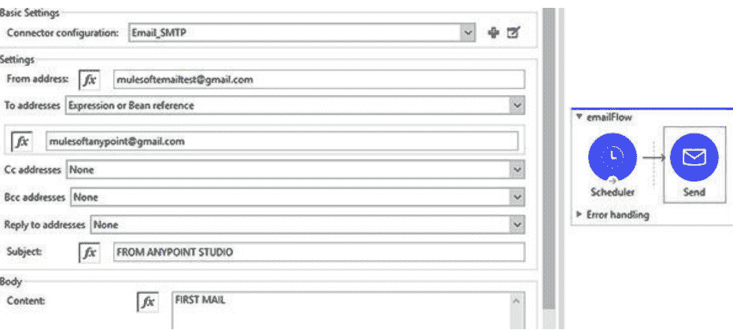

### 图 5.4：电子邮件字段

让我们设置发送电子邮件所需的值。如图所示设置以下值：

```
doc:name="Send"
```

`config-ref="Email_SMTP"`

`fromAddress="mulesoftemailtest@gmail.com"`

`subject="FROM ANYPOINT STUDIO"`

`email:to-address value="mulesoftanypoint@gmail.com" />`

`>MAIL]]>`

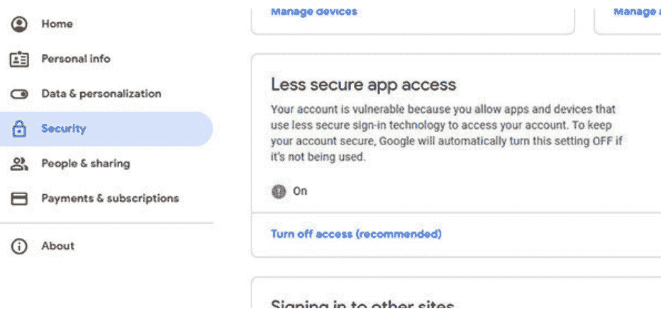

图 5.5：在 `Gmail` 设置中开启“低安全性”选项

项目现在已准备就绪，只需完成最后一步：在 `Gmail` 设置中开启“低安全性的应用访问”。

进入 `Gmail` 设置，点击“安全（`Security`）”选项并开启“低安全性的应用”。

现在，你已经完全准备好使用 `Anypoint Studio` 电子邮件连接器发送电子邮件了。

运行项目，并检查目标邮箱的收件箱和源邮箱的发送邮件箱。

尝试在不启用“低安全性的应用访问”的情况下运行项目，查看控制台中的错误信息。

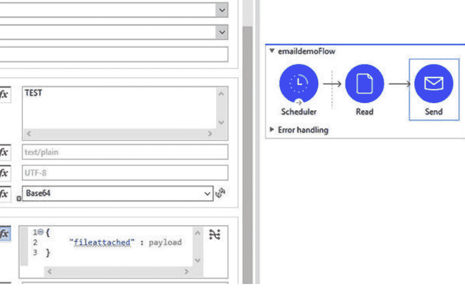

图 5.6：文件附件

指定要读取的文件，并在日志记录器（`logger`）中使用 `payload` 作为消息以查看文件内容。

## 设置

通用 标签 收件箱 账户和导入过滤器以及屏蔽地址 转发和 `POP/IMAP` 插件

聊天和会议 高级 离线 主题

转发：

了解更多

```
添加转发地址
```

提示：你也可以通过创建过滤器来只转发部分邮件！

`POP` 下载：

了解更多

+ 1. 状态：`POP` 已禁用
   - 为所有邮件启用 `POP`
   - 为从现在起收到的邮件启用 `POP`
+ 2. 当使用 `POP` 访问邮件时，在收件箱中保留 `Gmail` 副本
  3. 配置你的电子邮件客户端（例如 `Outlook`、`Eudora`、`Netscape Mail`）
  配置说明

`IMAP` 访问：

（使用 `IMAP` 从其他客户端访问 `Gmail`）

+ 状态：`IMAP` 已启用
   - 启用 `IMAP`
   - 禁用 `IMAP`


让我们尝试 `Gmail` 设置中“转发和 `POP/IMAP`”部分提供的 `POP` 和 `IMAP`。

默认情况下，这些必须先禁用再启用，如图所示：

```
<email:smtp-config name="Email_SMTP" docname="Email SMTP"
doc:id="5d755f9b-b2ef-47a1-8fb0-20c146915d8">
<email:smtp-connection host="smtp.gmail.com" user="mulesoftemailtest@"
password="Mypass@123" port="587">
<email:properties>
<email:property key="mail.smtp.starttls.enable" value="true" />
</email:properties>
</email:smtp-connection>
</email:smtp-config>
<email:imap-config name="Email_IMAP" docname="Email IMAP"
doc:id="84bd552a-b785-41d9-9460-6635c6931397">
<email:imap-connection host="smtp.gmail.com" user="mulesoftemailtest@"
password="Mypass@123" port="993">
<email:properties>
<email:property key="mail.imap.ssl.enable" value="true" />
</email:properties>
</email:imap-connection>
</email:imap-config>
<email:pop3-config name="Email_POP3" docname="Email POP3"
doc:id="5d00be99-77f4-4b8f-a2b0-2740b77d579">
<email:pop3-connection host="smtp.gmail.com" user="mulesoftemailtest@"
password="Mypass@123" port="995">
<email:properties>
<email:property key="mail.pop3.ssl.enable" value="true" />
</email:properties>
</email:pop3-connection>
</email:pop3-config>
```

图 5.8：`SMTP`、`IMAP` 和 `POP3` 配置

你的 `SMTP`、`POP3` 和 `IMAP` 配置已完成。

但如果你尝试使用 `POP` 和 `IMAP`，将会收到错误信息，因为 `POP` 和 `IMAP` 是用于读取特定文件夹中的邮件的，你可以根据关键字删除邮件或将邮件转发到其他邮箱。这意味着你需要 `SMTP` 来传输简单邮件并管理整个邮箱箱。像 `Gmail` 这样的公共邮件服务器不允许你使用 `POP` 和 `IMAP`。

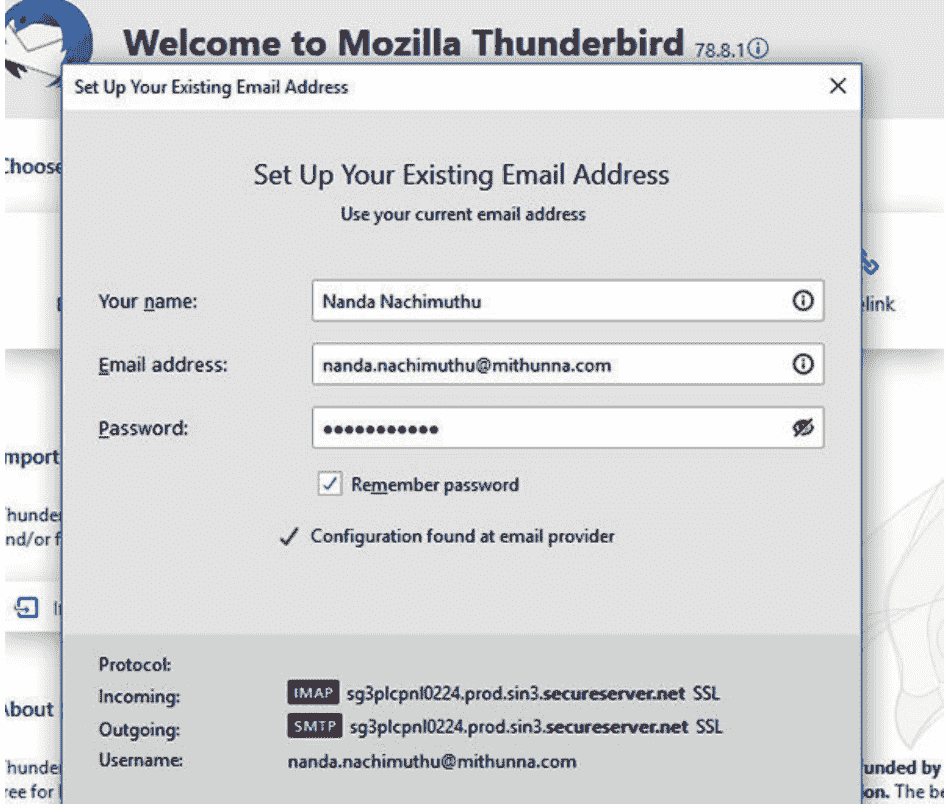

图 5.9：`Mozilla Thunderbird` 配置

因此，为了使用 `POP` 和 `IMAP`，你需要具有所有 `POP` 和 `IMAP` 管理权限的私有邮件服务器。在这里，我们使用私有邮件服务器来完成 `IMAP` 和 `POP` 功能测试。当我们尝试设置 `Thunderbird` 私有账户时，它们提到了入站和出站协议。

| `SSL/TLS` 设置（推荐） |
|--- |
| 用户名：`nanda.nachimuthu@mithunna.com` |
| 密码：使用电子邮件账户密码 |
| 入站服务器：`sg3plcpn0224.prod.sin3.secureserver.net` `IMAP`端口：`993` `POP3`端口：`995` |
| 出站服务器：`sg3plcpn0224.prod.sin3.secureserver.net` `SMTP`端口：`465` |
| `IMAP`、`POP3` 和 `SMTP` 需要身份验证 |

图 5.10：`SSL IMAP` 和 `POP3` 设置

在电子邮件设置中，你可以看到针对 `SMTP`、`IMAP` 和 `POP` 推荐的 `SSL/TLS` 设置。

| 非 `SSL` 设置（不推荐） |
|--- |


| 用户名：`nanda.nachimuthu@mithunna.com` |
|---|
| 密码：使用电子邮件账户密码 |
| 入站服务器：`sg3plcpn0224.prod.sin3.secureserver.net`，IMAP 端口：`993`，POP3 端口：`995` |
| 出站服务器：`sg3plcpn0224.prod.sin3.secureserver.net`，SMTP 端口：`465` |
| IMAP、POP3 和 SMTP 需要身份验证 |

图 5.11：SSL IMAP 和 POP3 设置

让我们尝试 Gmail 设置中“转发和 POP/IMAP”部分提供的 POP 和 IMAP。

默认情况下，这些必须先禁用再启用，如图：


图 5.12：非 IMAP 设置

在电子邮件设置中，你可以看到针对 SMTP、IMAP 和 POP 推荐的 SSL/TLS 设置。

| 非 SSL 设置（不推荐） |
|---|
| 用户名：`nanda.nachimuthu@mithunna.com` |
| 密码：使用电子邮件账户密码 |
| 入站服务器：`sg3plcpn0224.prod.sin3.secureserver.net`，IMAP 端口：`993`，POP3 端口：`995` |
| 出站服务器：`sg3plcpn0224.prod.sin3.secureserver.net`，SMTP 端口：`465` |
| IMAP、POP3 和 SMTP 需要身份验证 |

图 5.13：非 IMAP 设置

## 结论

在本章中，我们探索了诸如发送电子邮件等电邮操作。在接下来的章节中，我们将学习 VM 队列。

## 注意点

尝试获取你的私有邮件服务器。

## 待探索的关键术语

- 邮件 SMTP
- 邮件 SMTP
- Gmail 设置中的“低安全性”选项
- 文件附件
- IMAP 和 POP3 访问
- SMTP、IMAP 和 POP3 配置
- Mozilla Thunderbird 配置
- SSL IMAP 和 POP3 设置
- 非 IMAP 设置
- IMAP 应用

## 结构

在本章中，我们将讨论以下主题：

- VM 队列配置
- 集成发布和消费组件
- 检查日志结果以理解发布-消费模式
- 更改消费者后检查发布-消费模式
- 在同一队列中引入监听器
- 从不同的发布者进行消费和监听

## 目标

学习本单元后，你将学习虚拟队列配置以及如何使用它们。

## 简介

**虚拟机队列（Virtual Machine Queue）**为开发者提供了存储数据的方法，可以通过引用队列详情在 MuleSoft 流的任何地方使用数据。让我们看看涉及的步骤。

## 开始实现 VM 队列

让我们通过配置 VM 并使用发布和消费者为 MuleSoft 项目实现 VM 队列。步骤如下：

### VM 配置

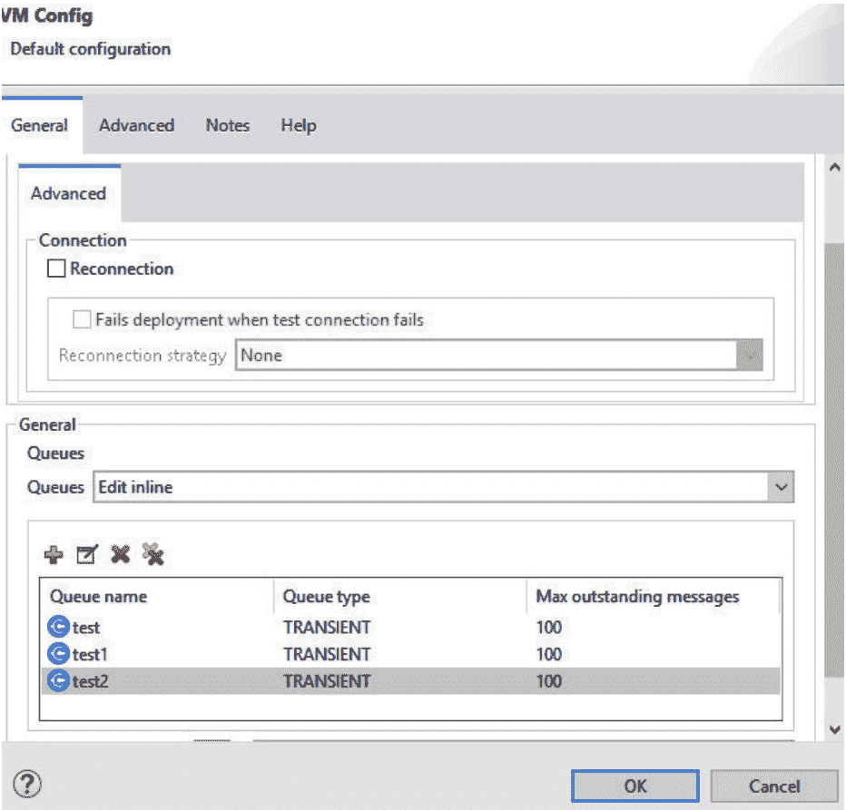

图 6.1：VM 队列配置

创建一个项目并引入调度器，然后将 VM 模块添加到项目中并添加一个发布组件。

在连接器配置中，选择通用、队列、内联编辑。

输入新的队列名称，瞬态（transient）是队列类型的默认选项；保持默认即可。

最大堆积消息数可以是 `100`。

```xml
name="VM_Config" doc:name="VM Config" doc:id="78001dfe-41d7-43c2-9fod-7f6c6fb6do6" />
queueName="test" maxOutstandingMessages="100" />
queueName="test1" maxOutstandingMessages="100" />
queueName="test2" maxOutstandingMessages="100" />
```

### 图 6.2：集成发布者和消费者组件

添加一个新的调度器并引入一个消费者组件，并指定发布者使用的队列名称。

### 图 6.3：检查日志结果以理解发布和消费模式

你可以运行项目并可以看到之前的输出。

```xml
name="vmconnectorFlow" doc:id="5683ab6-dce7-41ba-9b82-bf958ceo16eg" >
doc:name="Scheduler" doc:id="9634a62f-7744-4a6e-9115-6da169428a6e" >
frequency="2" timeUnit="SECONDS"
value="#[random() * 789]" doc:name="Set Payload"
doc:id="d1f6aa32-d646-439d-92af-486a822403cb" />
doc:name="Publish" doc:id="dba7ec07-6164-4a6f-9911-9c569f17d88
config-ref="VM_Config" queueName="test"
sendCorrelationId="ALWAYS" correlationId="#[correlationId]"/>
```

```xml
level="INFO" doc:name="Logger" doc:id="79c1a7e7-f616-4e11-a980-3c8a9b3a0199" message="#[' published to test---- ++ payload']"
name="vmconnectorFlow" doc:id="b7d27470-c4ba-479f-afcb-b366addff4f54 >
doc:name="Scheduler" doc:id="104d3dac-5a6a-48e1-92e6-3aa6e7748c8a >
frequency="4" timeUnit="SECONDS"/>
queueName="test2" doc:name="Consume" doc:id="0oc45548-2a05-451b-bc44-a717866d02f5 config-ref="VM_Config"/>
level="INFO" doc:name="Logger" doc:id="995d745-b277-4269-9bfb8-ab871910d97e" message="#['consumed---- ++ payload']"/>
```

```text
ore.internal.processor.LoggerMessageProcessor: published---625.50990123441
ore.internal.processor.LoggerMessageProcessor: published---734.18852456111
ore.internal.processor.LoggerMessageProcessor: consumed---625.685586742664
ore.internal.processor.LoggerMessageProcessor: published---781.45762742621
ore.internal.processor.LoggerMessageProcessor: consumed---734.18852456111
ore.internal.processor.LoggerMessageProcessor: published---415.188538752267
ore.internal.processor.LoggerMessageProcessor: consumed---131.39773314452
ore.internal.processor.LoggerMessageProcessor: consumed---270.65038833333
ore.internal.processor.LoggerMessageProcessor: published---445.24811574353
ore.internal.processor.LoggerMessageProcessor: consumed---781.45762742621
ore.internal.processor.LoggerMessageProcessor: consumed---680.89425188284
ore.internal.processor.LoggerMessageProcessor: consumed---546.538232170863
ore.internal.processor.LoggerMessageProcessor: published---415.188538752967
ore.internal.processor.LoggerMessageProcessor: published---409.020886188284
ore.internal.processor.LoggerMessageProcessor: published---412.994588331327
ore.internal.processor.LoggerMessageProcessor: consumed---131.39773314452
ore.internal.processor.LoggerMessageProcessor: consumed---133.90425842649
ore.internal.processor.LoggerMessageProcessor: published---756.698556431703
ore.internal.processor.LoggerMessageProcessor: consumed---342.180745826552
ore.internal.processor.LoggerMessageProcessor: consumed---238.63435933333
ore.internal.processor.LoggerMessageProcessor: consumed---260.301762267931
ore.internal.processor.LoggerMessageProcessor: consumed---445.24811574353
ore.internal.processor.LoggerMessageProcessor: published---770.364365935964
ore.internal.processor.LoggerMessageProcessor: published---471.92393232
ore.internal.processor.LoggerMessageProcessor: consumed---283.58971124
ore.internal.processor.LoggerMessageProcessor: published---546.53823217
ore.internal.processor.LoggerMessageProcessor: consumed---678.95711284
ore.internal.processor.LoggerMessageProcessor: published---337.63401785
```

### 图 6.4：更改发布者频率以理解发布和消费

你可以修改发布者的频率来理解这种模式。

### 图 6.5：在队列中引入监听器

在队列中引入监听器。

### 图 6.6：通过监听发布

最后显示了如何进行监听。

## 引言

ActiveMQ 是一个流行的 Java 消息服务器。在 ActiveMQ 中，可以创建队列和主题，发布者和消费者可以发布和消费消息。

## 开始使用 ApacheMQ

对消息系统有一定的基本了解。按照步骤安装 ApacheMQ 并与 MuleSoft 集成。

## 目标

学习本单元后，你将能够：

- 在本地机器安装 ApacheMQ
- 创建队列和主题
- 通过 MuleSoft 发布和消费

## 结构

在本章中，我们将讨论：

- 下载 ApacheMQ
- 检查 ApacheMQ 安装情况
- 检查创建的队列
- 检查创建的主题
- 理解监听器组件

## 术语

- 注意事项
- 结构
- 流程结果
- 监听器结果

## 结论

本章学习了 VM 连接器。在接下来的章节中，我们将学习 JMS。

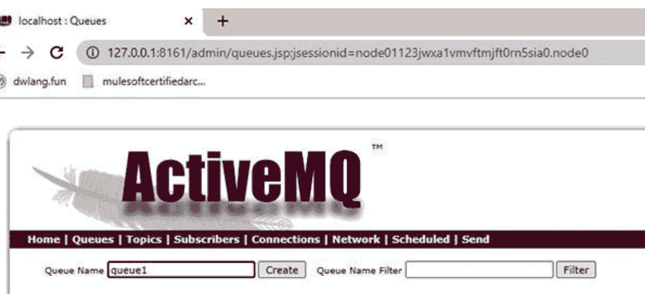

### 图 7.4：队列创建

点击管理 ActiveMQ broker 链接，可以到达管理员主页。

你可以看到创建队列（queue）、主题（topics）等选项。

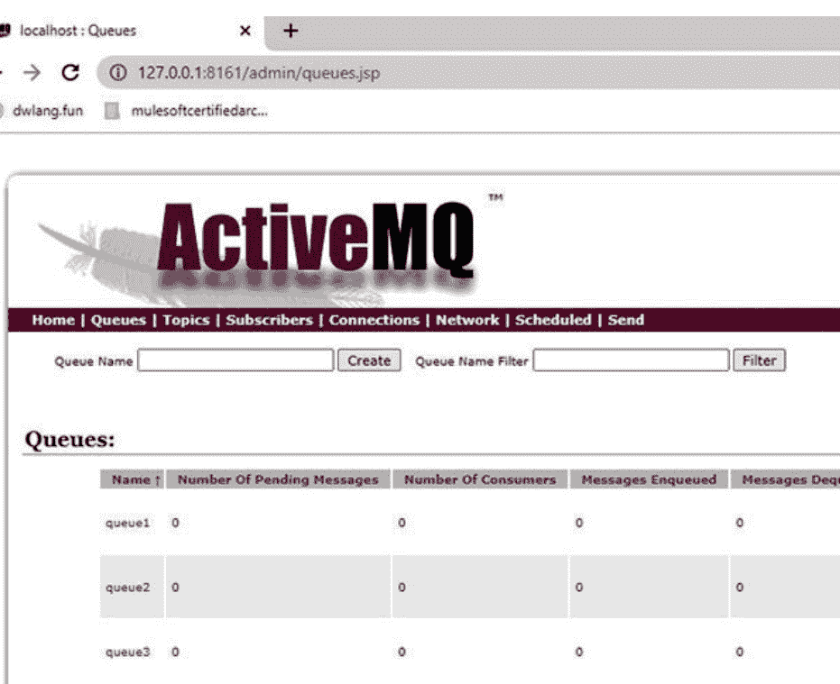

### 图 7.5：检查已创建的队列

创建所需的队列名称并进行检查。

## ActiveMQ

首页 | 队列 | 主题 | 订阅者 | 连接 | 网络 | 调度 | 发送

主题名称 [ ] 创建

## 主题

| 名称 | 消费者数量 | 入队消息数 | Mer |
|---|---:|---:|---:|
| ActiveMQ.Advisory.MasterBroker | 0 | 1 | 0 |
| ActiveMQ.Advisory.Queue | 0 | 3 | 0 |
| ActiveMQ.Advisory.Topic | 0 | 2 | 0 |
| topic1 | 0 | 0 | 0 |
| topic2 | 0 | 0 | 0 |

### 图 7.6：检查已创建的主题

创建一个主题题名称并进行检查。


在向项目添加通用 JMS 模块后，创建一个新流程以引入调度器，并在其旁边添加一个发布（publish）组件。

在连接器中，配置添加一个新的连接器，选择连接为 ActiveMQ 连接。

对于所需的库，点击 **Configure** 按钮并选择添加推荐库的选项。

然后在和 **Client id** 字段中，分别提供 admin、admin 和相应的值。

你的测试连接现在必须是成功了。


### 图 7.8：使用发布和消费组件

在发布组件的终点中，指定你在 ActiveMQ Web 控制台中创建的队列名称。

终点类型必须是队列。

在消息正文中，提供函数值为 `* 1789"`；这将为你生成随机数。

在发布组件旁边添加一个 `Consumer` 组件，然后选择 `JMS_config` 和队列。

接下来添加一个 `Logger` 并使用负载（有效负载）作为消息。

现在，你可以运行项目了。


```text
.core.internal.processor.LoggerMessageProcessor: ****message consumed****751.882116405329
.core.internal.processor.LoggerMessageProcessor: ****message consumed****650.139860500953
.core.internal.processor.LoggerMessageProcessor: ****message consumed****102.735542452181
.core.internal.processor.LoggerMessageProcessor: ****message consumed****898.2559336117087
.core.internal.processor.LoggerMessageProcessor: ****message consumed****117.2418246859161
.core.internal.processor.LoggerMessageProcessor: ****message consumed****141.2834333333338
.core.internal.processor.LoggerMessageProcessor: ****message consumed****139.8069411495904
.core.internal.processor.LoggerMessageProcessor: ****message consumed****192.4576322133595
.core.internal.processor.LoggerMessageProcessor: ****message consumed****1816.790273521017
.core.internal.processor.LoggerMessageProcessor: ****message consumed****1169.297035847672
.core.internal.processor.LoggerMessageProcessor: ****message consumed****27.3847022923614
.core.internal.processor.LoggerMessageProcessor: ****message consumed****356.9305513333333
.core.internal.processor.LoggerMessageProcessor: ****message consumed****17.0266533755437
.core.internal.processor.LoggerMessageProcessor: ****message consumed****134.894724020123
.core.internal.processor.LoggerMessageProcessor: ****message consumed****150.3333333333333
.core.internal.processor.LoggerMessageProcessor: ****message consumed****829.904273908777
.core.internal.processor.LoggerMessageProcessor: ****message consumed****146.1415558716415
.core.internal.processor.LoggerMessageProcessor: ****message consumed****160.5333333333333
.core.internal.processor.LoggerMessageProcessor: ****message consumed****133.016183106216
.core.internal.processor.LoggerMessageProcessor: ****message consumed****222.14277206826
.core.internal.processor.LoggerMessageProcessor: ****message consumed****184.53333333333
.core.internal.processor.LoggerMessageProcessor: ****message consumed****557.03782449568
.core.internal.processor.LoggerMessageProcessor: ****message consumed****1655.0483525128
.core.internal.processor.LoggerMessageProcessor: ****message consumed****560.5333333333
.core.internal.processor.LoggerMessageProcessor: ****message consumed****1024.90704112026
.core.internal.processor.LoggerMessageProcessor: ****message consumed****1189.0085609517
.core.internal.processor.LoggerMessageProcessor: ****message consumed****1298.193333333
.core.internal.processor.LoggerMessageProcessor: ****message consumed****1181.9834885095
.core.internal.processor.LoggerMessageProcessor: ****message consumed****82.479416354
.core.internal.processor.LoggerMessageProcessor: ****message consumed****188.7711235609
```

### 图 7.9：发布和消费的结果

发布到队列的每条消息，消费者都会消费，日志记录会在控制台中打印，如图所示。


### 图 7.10：监听器

在同一画布中，引入一个 `On Message` 监听器，并在结尾提供队列名称作为发布者并传递消息到项目，监听器将记录发布的消息。

```text
.core.internal.processor.LoggerMessageProcessor: ****message arrived****659.6884160532
.core.internal.processor.LoggerMessageProcessor: ****message consumed****514.4501442319
.core.internal.processor.LoggerMessageProcessor: ****message arrived****
.core.internal.processor.LoggerMessageProcessor: ****message consumed****1991.7271046498
.core.internal.processor.LoggerMessageProcessor: ****message arrived****1586.1438237218
.core.internal.processor.LoggerMessageProcessor: ****message consumed****401.7822275862
.core.internal.processor.LoggerMessageProcessor: ****message arrived****342.2286637852
.core.internal.processor.LoggerMessageProcessor: ****message consumed****1114.1697312746
.core.internal.processor.LoggerMessageProcessor: ****message arrived****090.1186286508
.core.internal.processor.LoggerMessageProcessor: ****message consumed****1748.3910252805
.core.internal.processor.LoggerMessageProcessor: ****message arrived****104.6165573631
.core.internal.processor.LoggerMessageProcessor: ****message consumed****001.8383761132
.core.internal.processor.LoggerMessageProcessor: ****message arrived****
.core.internal.processor.LoggerMessageProcessor: ****message consumed****429.9505923466
.core.internal.processor.LoggerMessageProcessor: ****message arrived****402.6537982058
.core.internal.processor.LoggerMessageProcessor: ****message consumed****313.8775927663
```


这是引入 `On Message` 组件的结果；在监听新消息后，过程可以是任何形式。

### 图 7.12：监听器和消费者的组合

在这里，我们通过消费者和监听器放入负载。

整个配置 XML 内容如下：

```xml
<flow name="JMS_Config" doc:name="JMS Config" doc:id="31fc8b44-7156-4ab1-aff30-fo436530f16" username="admin" password="admin" clientID="127.0.0.1:8161"/>

</flow>

<flow name="jmsFlow" doc:id="7bcaceee7-b823-4876-847a-7bod9902b632" doc:name="Scheduler" doc:id="2016c222-d8d7-46c3-9314-f61bo0811c4f7">

    <set value="#[random() * 2000]" doc:name="Set Payload" doc:id="f76718d5-4200-45a0-72d9d51a1910"/>

    <publish doc:id="f3701dc-6a60-4be-97a9-1d2f99cff90" config-ref="JMS_Config" destination="queue1"/>

    <consume doc:id="aade19c4-3965-4fb-ba24-4fsea24cdf2" config-ref="JMS_Config" destination="queue1"/>

    <logger level="INFO" doc:id="626f7f70-f7a3-4a07-94e5-e6c6c851cba8" message="#['*****message consumed*****'] ++ payload"/>

</flow>
```

## 需要记住的点

尝试与其他 JMS 提供商进行 JMS 连接；你也可以尝试一些云端 JMS 提供商。

## 需要探索的关键术语

- `ApacheMQ`
- `ActiveMQ Web 界面`
- 队列创建
- `ApacheMQ` 连接器
- 发布和消费组件
- 监听器组件

## 结构

在本章中，我们将讨论以下主题：

- RabbitMQ 的安装、启用管理插件及运行
- 访问 RabbitMQ Web 管理界面
- AMQP 连接器配置
- 使用发布和监听器组件
- 发布和监听器组件的实际应用

## 目标

学习完本单元后，你将能够：

- 安装并运行 RabbitMQ
- 访问 RabbitMQ Web 管理界面
- 将 AMQP 与 MuleSoft 连接
- 发布和消费消息

## 介绍

在之前的章节中，我们已经看到了 VM 队列，它是 MuleSoft 自带的一个组件内置消息平台。然后我们看到了一个名为 Apache MQ 的 Java 消息平台，它将作为外部 JMS 平台。在本章中，让我们探索另一个名为 RabbitMQ 的消息中间件，它支持 AMQ 协议，即高级消息队列协议。我们并不打算探索 AMQP 特有的功能，这并不是我们的意图；相反，我们将理解软件安装以及使用 MuleSoft AMQP 连接器连接 AMQP 服务器。让我们来看看完成这些操作的步骤。

## 安装并运行 RabbitMQ

```text
C:\Windows\System32\cmd.exe - rabbitmq-server

Microsoft Windows [Version 10.0.19045]

(C)2015 Microsoft Corporation. All rights reserved.

C:\Program Files\RabbitMQ\Server\rabbitmq-server-3.8.14\bin\rabbitmq-plugins enable rabbitmq_management

(enabled all plugins for rabbit@DESKTOP-9U7EE0:)

The following plugins have been configured:

rabbitmq_management

rabbitmq_agent

rabbitmq_web_dispatch

-configuration to rabbit@DESKTOP-9U7EE0:

Plugin configuration unchanged.

C:\Program Files\RabbitMQ\Server\rabbitmq-server-3.8.14\bin\rabbitmq-plugins

Configuring logger redirection

11:21:36.770 (warning) Using RABBITMQ_ADVANCED_CONFIG_FILE: C:/Users/Admin/AppData/Roaming/RabbitMQ/advanced.config
```

**图 8.1：** RabbitMQ 安装、启用管理插件及运行

下载 `rabbitmq_server-3.8.14` 二进制文件并将文件解压到本地目录。

进入 `sbin` 目录并执行以下命令。

```bash
rabbitmq-plugins enable rabbitmq_management

rabbitmq-server
```

这些步骤将启用 RabbitMQ 管理控制台并启动服务器。

# 访问 RabbitMQ Web 管理界面

访问以下 URL，并分别使用 `guest`、`guest` 作为用户名和密码。

`http://localhost:15672/`

你可以访问 RabbitMQ 管理控制台，如图所示：


图 8.2：访问 RabbitMQ Web 管理界面

## 将 AMQP 与 MuleSoft 连接

创建一个 Mule 项目，并引入一个调度器（scheduler）组件。

向项目添加 AMQP 模块，并在调度器旁边添加一个发布（Publish）组件。

在发布组件的属性面板中，你可以看到创建 AMQP 连接器的选项。

打开连接器配置，并如图所示提供服务器、用户名和密码详情。

你在配置 XML 文件中的连接器配置必须看起来如下：

```xml
name="AMQP_Config" docname="AMQP Config" doc:id="5c39b16-81a6-41d7-a293-fe470971e2c7"
host="localhost" username="guest" password="guest" />
```

## AMQP Config

`AmqpConnector` 的基础配置。

| 通用 | 消费者 | 发布者 | 服务质量 | 高级 | 备注 | 帮助 |
| :--- | :--- | :--- | :--- | :--- | :--- | :--- |
| 名称：AMQP_Config | | | | | | |

| 通用 | 套接字配置 | TLS | 高级 | 连接 | | |
| :--- | :--- | :--- | :--- | :--- | :--- | :--- |
| 主机：localhost | | | | | | |
| 端口：/ | | | | | | |

| 虚拟主机： | | | | | | | |
| 用户名：guest | | | | | | | |
| 密码：guest [显示密码] | | | | | | | |
| - 使用 TLS | | | | | | | |
| - 使用 SNII | | | | | | | |
| 心跳超时：60 | | | | | | | |
| 备用地址：无 | | | | | | | |
| 通用 | 测试连接... OK 取消 | | | | | | |

图 8.3：AMQP 连接器配置

# 发布和消费消息

在调度器的第一个流中创建一个发布组件，提供队列详情并将负载（payload）传递给队列。完成后，你的配置文件流将如下：

```xml
doc-name="Publish" doc:id="91e07840-3249-4efa-8da6-c02116855826"
```


`config-ref="AMQP_Config"` `exchangeName="amq.topic"`

```
{
  signment_number: randomInt(10000),
  items: "Cosmetics"
}
```

`priority="3"`

现在引入一个 AMQP 监听器（listener）并将其指向发布的队列。这样你的 AMQP 监听器配置 XML 将如下：

```
doc-name="Listener" config-ref="AMQP_Config"
queueName="test"//>
doc-name="Transform Message" >
>2.0
output application/xml
---
{
  items: payload
}
]]>
level="INFO" docName="Logger" message="#[payload.items]" />
```


**图 8.4：** 使用发布和监听器组件

这里是带有发布和监听器组件的完整 AMQP 流。

运行项目时，可以获得以下图示的日志结果。

```
INFO 2023-03-12 15:46:27,042 [[MuleRuntime].uber.28: [sftp].sftpFlow.BLOCKING @67f24050
org.mule.runtime.core.internal.processor.LoggerProcessor: message
INFO 2023-03-12 15:46:27,042 [[MuleRuntime].uber.28: [sftp].sftpFlow.BLOCKING @67f24050
org.mule.runtime.core.internal.processor.LoggerProcessor: message {
  signment_number: 5576,
  items: "Cosmetics"
}
INFO 2023-03-12 15:46:27,042 [[MuleRuntime].uber.28: [sftp].sftpFlow.BLOCKING @67f24050
org.mule.runtime.core.internal.processor.LoggerProcessor: message {
  signment_number: 8144,
  items: "Cosmetics"
}
INFO 2023-03-12 15:46:27,042 [[MuleRuntime].uber.28: [sftp].sftpFlow.BLOCKING @67f24050
org.mule.runtime.core.internal.processor.LoggerProcessor: message {
  signment_number: 1560,
  items: "Cosmetics"
}
INFO 2023-03-12 15:46:27,042 [[MuleRuntime].uber.28: [sftp].sftpFlow.BLOCKING @67f24050
org.mule.runtime.core.internal.processor.LoggerProcessor: message {
  signment_number: 9321,
  items: "Cosmetics"
}
INFO 2023-03-12 15:46:27,042 [[MuleRuntime].uber.28: [sftp].sftpFlow.BLOCKING @67f24050
org.mule.runtime.core.internal.processor.LoggerProcessor: message {
  signment_number: 4022,
  items: "Cosmetics"
}
INFO 2023-03-12 15:46:27,042 [[MuleRuntime].uber.28: [sftp].sftpFlow.BLOCKING @67f24050
org.mule.runtime.core.internal.processor.LoggerProcessor: message {
  signment_number: 6781,
  items: "Cosmetics"
}
```

图 8.5: 发布和监听器组件

## 总结

在本章中，我们安装、运行并测试了 RabbitMQ AMQP 消息代理。我们将 AMQP 服务器与我们的 MuleSoft AMQP 服务器连接起来，并从服务器发布和消费了消息。在接下来的章节中，我们将学习脚本引擎连接器，以便从 MuleSoft 脚本连接器连接并执行 Groovy 和 Python 等脚本程序。

## 目标

学习本单元后，你将能够学习：

- 什么是脚本引擎
- 如何与脚本引擎集成
- 如何在 MuleSoft 中执行 Groovy、Python、Ruby 和 ECMAScript 引擎

## 简介

除了常规的 MuleSoft 编程外，根据各种业务需求，可能需要通过不同的脚本引擎创建自定义代码，例如大型批处理作业的异步执行、文件读取、日志记录监控、MuleSoft 目录访问等。MuleSoft 提供了一个脚本组件（scripting component），通过它，我们可以将脚本引擎（如 Groovy、Python、Ruby 和 ECMAScript）连通到我们的工作流（flow）中，以实现特定的业务范式。让我们看看如何从 MuleSoft 流中执行此类脚本代码。

## 脚本引擎

编程语言与脚本语言在编写方式、执行方式以及它们解决的问题上存在许多差异。例如，JavaScript 语言不需要编译器；你编写了一系列命令，嵌入到浏览器中的内置 JavaScript 引擎就可以开始执行你编写的命令。Jython、Groovy 和 Ruby 等脚本语言也是如此的。而像 Java 这样的编程语言则需要编译器和解释器来编译和执行二进制文件。

在用法方面，脚本语言将用于较大的非事务性活动，这些活动不需要投入大量精力进行内存管理、对象存储、事务、确认、持久化对象状态等。

想象一个实际场景：一个项目处理大型文件集合，这意味着从世界各地产生并向大量丢到文件系统中的文件，例如每秒百万个小文件。在这种情况下，项目的架构设计不需要维护事务细节，例如文件是从哪里写入系统的，或者文件是否应该带有某个事务 ID，以便在读取文件时事务 ID 必须携带在数据库中。

相反，设计可能仅要求读取文件、将内容插入数据库并删除文件。在这种情况下，没有需要使用面向对象或消耗内存和资源的编程语言，因为该语言的堆内存可能会被耗尽。因此，在这种情况下，如果该编程语言将此类“只完不顾”的任务委托给脚本程序，那么效率也将提高，并且可以避免复杂的事务和内存相关问题。

## 执行 ECMA 脚本

Oracle Nashhorn ECMA 脚本随 MuleSoft 默认，因此不需要任何额外的设置；让我们来看执行 ECMA 脚本的步骤。


**图 9.1:** 创建 MuleSoft 流并引入脚本组件

如图所示创建一个 Mule 流，并添加 **Scripting** 模块，将其所示拖入画布。


图 9.2: 配置 ECMA 脚本引擎

在属性面板中从画布上选择 **Engine**，将引擎选择为 **Oracle Nashorn**，并如图所示提供 **print** 语句。

你完成的流代码必须看起来像。从浏览器或 Postman 使用端点 `localhost:8081/Nashorn` 访问它，你可以看到引擎被触发，相应的值在浏览器和控制台中打印出来。

```xml
name="nashornFlow" doc:id="af7474c9-b833-4482-93d1-acoe2752c5b4"
doc:name="Listener" doc:id="05452d74-b3be-402a-be3c-4bb9da5287b2" config-ref="HTTP_Listener_config" path="nashorn"/engine="ECMAScript" doc:name="Execute" doc:id="cb698e1e-64fe-4064-8e30-99908eb2f89" >ORACLE NASHORN ECMASCRIPT SCRIPTING ENGINE******value="ORACLE NASHORN ECMASCRIPT ENGINE CALLED"doc:name="Set Payload" doc:id="e55334d-442d-4a5b-bda6-ac21df115 />
```

## Groovy, Python 和 Ruby

对于 Groovy、Python 和 Ruby，我们需要在 POM 文件执行以下操作。

在你的 POM dependency 部分中添加以下项：

```xml
<dependency>
  <groupId>org.codehaus.groovy</groupId>
  <artifactId>groovy-all</artifactId>
  <version>2.4.16</version>
</dependency>
<dependency>
  <groupId>org.ruby</groupId>
  <artifactId>ruby-core</artifactId>
  <version>9.2.11</version>
</dependency>
<dependency>
  <groupId>org.python</groupId>
  <artifactId>jython-standalone</artifactId>
  <version>2.7.2</version>
</dependency>
```

图 9.3: Groovy、Python 和 Ruby 的 POM 项

打开 POM 文件并在 design 标签中检查；你的项必须如图所示。

在你的 POM build 部分添加以下共享库：

```xml
<plugin>
  <groupId>org.apache.maven.plugins</groupId>
  <artifactId>maven-clean-plugin</artifactId>
  <version>3.0.0</version>
</plugin>
<plugin>
  <groupId>org.mule.tools</groupId>
  <artifactId>mule-maven-plugin</artifactId>
  <version>${mule.plugin.version}</version>
</plugin>
<dependency>
  <groupId>org.codehaus.groovy</groupId>
  <artifactId>groovy-all</artifactId>
</dependency>
<dependency>
  <groupId>org.python</groupId>
  <artifactId>jython-standalone</artifactId>
</dependency>
<dependency>
  <groupId>org.jruby</groupId>
  <artifactId>jruby-core</artifactId>
</dependency>
```


图 9.4: Groovy、Python 和 Ruby 的共享项

添加库项后，你的 POM 应如图所示。进入项目创建另一个流并遵循我们用于 ECMA 脚本的相同步骤。

```xml
<listener name="Listener" config-ref="HTTP_Listener_config" path="nashorn"/engine="ECMAScript" doc:name="Execute" doc:id="cb698e1e-64fe-4064-8e30-99908eb2f89" >ORACLE NASHORN ECMASCRIPT SCRIPTING ENGINE******value="ORACLE NASHORN ECMASCRIPT ENGINE CALLED"doc:name="Set Payload" doc:id="e55334d-442d-4a5b-bda6-ac21df115 />

<flow name="Groovy">
  <listener name="Listener" config-ref="HTTP_Listener_config" path="groovy"/>
  <execute engine="Groovy" doc:name="Execute">
    <script><![CDATA[println('FROM GROOVY SCRIPTING ENGINE')]]></script>
  </execute>
  <set-payload value="GROOVY ENGINE CALLED" doc:name="Set Payload" />
</flow>

<flow name="Python">
  <listener name="Listener" config-ref="HTTP_Listener_config" path="python"/>
  <execute engine="python" doc:name="Execute">
    <script><![CDATA[print('FROM PYTHON SCRIPTING ENGINE')]]></script>
  </execute>
  <set-payload value="PYTHON ENGINE CALLED" doc:name="Set Payload" />
</flow>

<flow name="Ruby">
  <listener name="Listener" config-ref="HTTP_Listener_config" path="ruby"/>
  <execute engine="ruby" doc:name="Execute">
    <script><![CDATA[puts('FROM Ruby SCRIPTING ENGINE')]]></script>
  </execute>
  <set-payload value="RUBY ENGINE CALLED" doc:name="Set Payload" />
</flow>
```

图 9.5: 为 Groovy、Python 和 Ruby 设置 MuleSoft 流

在为 Groovy、Python 和 Ruby 创建另外三个不同的流后，你的脚本将像这样。现在调用所有引擎并触发以下端点并在浏览器和控制台中检查结果。结果显示在：

- `http://localhost:8081/groovy`
- `http://localhost:8081/nashorn`
- `http://localhost:8081/jyton`
- `http://localhost:8081/ruby`

```
****From GROOVY SCRIPTING ENGINE******
INFO 2021-05-09 21:13:18,123 [http-03 SelectorRunner] org.mule.service.impl.util.DefaultReque:
INFO 2021-05-09 21:13:18,245 [http-03 SelectorRunner] org.mule.service.impl.util.DefaultReque:
***From ORACLE NASHORN ECMASCRIPT SCRIPTING ENGINE***
***From PYTHON JYTHON SCRIPTING ENGINE***
***From RUBY SCRIPTING ENGINE***
```


图 9.6：调用所有 ECMA Groovy、Python 和 Ruby 脚本的结果

## 结论

我们已经涵盖了脚本引擎的基础知识，并能够使用 MuleSoft 脚本组件集成并执行 ECMAScript、Groovy、Python 和 Ruby 脚本。在本章中，我们介绍了 MuleSoft 的核心概念，例如它是如何启动的、背景以及供您深入研究的资源。我们还涵盖了 ESB 和系统集成等概念。接下来的章节将向您解释 MuleSoft 的内部机制，例如它是如何设计以满足不同技术领域和受众需求的。

## 重点回顾

我们不会深入探讨脚本的编程方面，因为在实际场景中，MuleSoft 开发人员将是调用现有脚本，而不是重新开发它们。

尝试探索更多的脚本引擎，并理解异步编程模型的各种用法。

## 待探索的关键术语

- 脚本引擎
- Groovy
- ECMA 脚本
- Python
- Ruby

## 结构

在本章中，我们将讨论以下主题：

- SFTP 连接器

## 引言

在 MuleSoft 连接器中，使用 File、FTP 和 SFTP 连接器执行的操作是相同的。因此，在本章中，我们将仅连接到一个基于 Web 的 SFTP 演示服务器，以确保 SFTP 连接已建立。在此之前，FTP 和 SFTP 的区别在于，出于安全考虑，**安全文件传输协议（Secured File Transfer Protocol）**使用了一种名为 SSH 的机制。市场上有很多开源的 SFTP 服务器，目前我们的目标不是深入研究 SFTP 概念，因此让我们快速查看使用 SFTP 连接器涉及的步骤。这意味着在工作中，您将获得所有的 SFTP 服务器详情、用户名和密码，这样您可以简单地建立连接并使用我们在第 3 章 File 中过的过的文件相关操作。

## SFTP 连接器

让我们通过一些实际示例开始探索安全文件传输协议。

### SFTP 配置

默认配置


图 10.1：SFTP 连接器

请按照以下步骤配置 SFTP 服务器。

- 创建一个基础 Mule 项目并引入一个调度器（scheduler）端点。
- 向项目中添加 SFTP 连接器，您将看到所有的文件操作。
- 添加文件读取组件并检查 SFTP 连接器配置。
- 它将要求 SFTP 服务器详情、用户名、密码以及要访问的文件路径。
- 提供如上所示的详情。

您的 SFTP 配置 XML 看起来如下：

```xml
<name="SFTP_Config" doc:name="SFTP Config" workingDir="#[/pub/example/']" host="test.rebex.net" username="demo" password="password" />
```


图 10.2：SFTP MuleSoft 流

在输入 SFTP 连接器详情后，在路径字段中提供 `readme.txt` 演示文件。

您完成后的流看起来如下：

```xml
<name="sftpFlow" > docname="Listener" config-ref="HTTP_Listener_config" path="sftp://"/>
<read docname="Read" config-ref="SFTP_Config" path="readme.txt"/>
<logger level="INFO" docname="Logger" message="#[payload]"/>
```

```
INFO 2021-04-25 14:49:56,983 [FullRuntime]:u.ber.071: [ssss]ssssFlow-BLOCKING @i56d570a] [processor: sssflow/processors/1]: event:
org.module.runtime.core.internal.processor.LoggerMessageProcessor: Welcome,

您正在使用由 Reex FTP for .NET 和 Reex FTP/SSL for .NET 示例代码提供的 FTP 账户进行测试连接。
仅允许读取访问，下载速度限制为 16kb/s。

有关 Reex FTP、Reex FTP/SSL 以及其他 Reex .NET 组件的信息，请访问我们的网站 http://www.reex.net/

如需反馈和支持，请联系 support@reex.cz

INFO 2021-04-25 14:49:56,220 [FullRuntime]:u.ber.071: [ssss]ssssFlow-BLOCKING @i56d570a] [processor: sssflow/processors/1]: event:
org.module.runtime.core.internal.processor.LoggerMessageProcessor: Welcome,

您正在使用由 Reex FTP for .NET 和 Reex FTP/SSL for .NET 示例代码提供的 FTP 账户进行测试连接。
仅允许读取访问，下载速度限制为 16kb/s。

有关 Reex FTP、Reex FTP/SSL 以及其他 Reex .NET 组件的信息，请访问我们的网站 http://www.reex.net/

如需反馈和支持，请联系 support@reex.cz

感谢！
```

图 10.3：运行中的 SFTP

在运行项目并触发端点时，您可以看到 SFTP 服务器获取了文件，且内容打印在控制台中。

## 结论

在本章中，我们简单地接触了 SFTP 连接器，以查看连接是如何建立的。接下来的章节将向您解释 LDAP 连接器的详情。

## 重点回顾

如果您愿意，请在本地机器上安装开源 SFTP 服务器并尝试所有的文件操作。

您也可以尝试一些其他的云端 SFTP 服务器进行测试。

## 待探索的关键术语

- SFTP 连接器
- FTP 连接器
- 云端 SFTP
- 文件操作

# 第 11 章

## LDAP 连接器

## 结构

在本章中，我们将涵盖以下主题：

- 从 Anypoint Exchange 下载 LDAP 连接器
- 检查 LDAP 操作
- 安装并运行 ApacheDS
- 通过 LDAP Studio 创建新的 LDAP 连接
- 提供身份验证详情
- 为 LDAP Studio 建立 LDAP 连接
- 为 Anypoint Studio LDAP 连接器提供 LDAP 服务器详情
- 检查 LDAP 目录的对象详情
- 使用 LDAP 查找（lookup）组件
- 从 MuleFlow 获取 Apache DS LDAP 目录详情

## 目标

学习本章后，您将理解：

- LDAP 基础
- 安装并连接 LDAP 服务器
- MuleSoft LDAP 连接器配置
- 从 MuleSoft 流中调用 LDAP 操作

## 引言

关于企业用户、密码、系统和网络的信息将存储在分布式目录服务中。这些目录服务必须遵循名为轻量级目录访问协议（LDAP）的行业标准协议。开源 LDAP 有 OpenLDAP、Apache-DS 和 389 Directory Server。专有 LDAP 有 IBM Tivoli、Oracle Directory Server 和 PingDirectory。任何企业可以使用上述一种 LDAP 服务。在本章中，我们将探索 ApacheDS 开源 LDAP 服务器、ApacheDS Studio 以及 MuleSoft LDAP 连接器。

## 来自 Anypoint Exchange 的 LDAP 连接器

MuleSoft 自带了可在 Anypoint Exchange 获取的默认 LDAP 连接器。让我们查看下载和探索该连接器。按照以下步骤操作并参考截图配置 LDAP 服务器：


图 11.1：从 Anypoint Exchange 下载 LDAP 连接器

使用您的 Anypoint 凭据通过面板选项访问 Exchange。

通过输入关键词，会出现 LDAP 连接器 3.3.0，如图所示


图 11.2：检查 LDAP 操作

向模块添加 LDAP 连接器后，您可以进一步探索从 MuleFlow 触发的操作。

上述截图显示了可用的 LDAP 操作，悬停在操作上，它会提供该操作的描述以便更好地理解。


图 11.3：安装并运行 ApacheDS

访问 URL，您可以看到适用于操作系统的各种 ApacheDS 安装包。

选择所需的安装包并将其解压到本地文件夹。

在命令行提示符中使用 `apacheds` 命令，如图所示。

您可以看到默认的 ApacheDS 实例已启动，如之前的截图所示。


图 11.4：通过 LDAP Studio 创建新的 LDAP 连接

同样，访问 https://directory.apache.org/studio/downloads.html 并下载 ApacheDS Studio。

主机名必须为 `localhost`，端口必须为 `10389`。


图 11.5：提供验证详情

你必须按照如下方式提供验证详情。

`BindDN` 或 `Bind secret`

你可以检查验证并获取成功消息。


图 11.6：已建立到 LDAP studio 的 LDAP 连接

验证成功后，ApacheDS studio 允许访问所有目录信息。


图 11.7：向 Anypoint studio LDAP 连接器提供 LDAP 服务器详情

从调色板（Palette）中拖放 LDAP LookUp 元素并提供 LDAP 连接器配置。

`authPassword="secret" url="ldap://localhost:10389" />`

测试连接并点击


连接成功后，你可以看到由 LDAP 服务器提供的各种查询详情。

```xml
<xml version="1.0" encoding="UTF-8"?>

<mule xmlns="http://www.mulesoft.org/schema/ldap" xmlns:doc="http://www.mulesoft.org/schema/core" xmlns:xsi="http://www.w3.org/2001/XMLSchema-instance" xmlns:configuration="http://www.mulesoft.org/schema/ldap" xsi:schemaLocation="http://www.mulesoft.org/schema/ldap http://www.mulesoft.org/schema/ldap/current/ldap.xsd">

<config name="LDAP Configuration" doc:id="6d73d049-b6e8-416b-b87d-c733acf54c5">

<flow name="ldapLookup" doc:id="53bc684a-92e4-4af7-b911-da3368804c7">

<scheduler name="scheduler" doc:id="a5e66470-9954-47f6-b899-266558299002" />

</scheduler>

<ldap:lookup docname="lookup" doc:id="d7f5c9c3-b7f1-456d-a568-22f752c1c2a" config-ref="LDAP Configuration" d="uid=admin,ou=system" />

<logger level="INFO" name="logger" doc:id="627098a4-80c5-4981-9771-efc75231c2ca message="#[payload]" />

</flow>

</mule>
```


最终配置输出如前面的截图所示。

```
Mule Server 4.1.0 (Terminated 14 May 2021 11:13:17 AM)

ni: Connection to http://localhost:10389/ldap-Directory-objectClass=[top, person, organizational] closed.

ni: TLS has been set to null after connection closed

error: (id=[localhost],assertion=000083df03fc7,e2)

ni: Bounded to ldap://localhost:10389 with simple authentication as uid=admin,ou=system

ni: Connection to http://localhost:10389/ldap-Directory-objectClass=[top, person, organizational] closed.

ni: TLS has been set to null after connection closed

error: (id=[localhost],assertion=000083df03fc7,e2)

ni: Bounded to ldap://localhost:10389 with simple authentication as uid=admin,ou=system

ni: Connection to http://localhost:10389/ldap-Directory-objectClass=[top, person, organizational] closed.

ni: TLS has been set to null after connection closed

error: (id=[localhost],assertion=000083df03fc7,e2)

ni: Bounded to ldap://localhost:10389 with simple authentication as uid=admin,ou=system

ni: TLS has been set to null after connection closed

ni: Bounded to ldap://localhost:10389 with simple authentication as uid=admin,ou=system closed.

ni: Connection to http://localhost:10389/ldap-Directory-objectClass=[top, person, organizational] closed.

ni: TLS has been set to null after connection closed

error: (id=[localhost],assertion=000083df03fc7,e2)

ni: Bounded to ldap://localhost:10389 with simple authentication as uid=admin,ou=system

ni: Connection to http://localhost:10389/ldap-Directory-objectClass=[top, person, organizational] closed.

ni: TLS has been set to null after connection closed

error: (id=[localhost],assertion=000083df03fc7,e2)

ni: Bounded to ldap://localhost:10389 with simple authentication as uid=admin,ou=system

ni: Connection to http://localhost:10389/ldap-Directory-objectClass=[top, person, organizational] closed.

ni: TLS has been set to null after connection closed

error: (id=[localhost],assertion=000083df03fc7,e2)

ni: Bounded to ldap://localhost:10389 with simple authentication as uid=admin,ou=system

ni: TLS has been set to null after connection closed

ni: Bounded to ldap://localhost:10389 with simple authentication as uid=admin,ou=system closed.
```


# 图 11.20：从 MuleFlow 获取 Apache DS LDAP 目录详情

从结构化对象类列表中选择详情并执行 LDAP 流。

对象类详情将从 LDAP 中提取并记录到控制台中。

完整的代码如下供参考：

```xml
<ldap:config name="LDAP_Configuration" doc:name="LDAP Configuration"
doc:id="dfd73b40-06b8-45b7-baoc-c873ac9af5ac" >
  <ldap:connection AuthDn="uid=admin,ou=system" password="secret"
  url="ldap://localhost:10389" />
</ldap:config>
```

```xml
<flow name="IdapFlow" doc:id="2b8c6484-9244-471c-a1d7-oc943060d47c">
  <scheduler doc:name="Scheduler" doc:id="41ee6487-9954-4706-bf89-026655029502" />
</flow>
```

```xml
<ldap:lookup doc:name="lookup" doc:id="d7f5c9c3-b7f1-456d-a568-22f752c1c2a" config-ref="LDAP Configuration" d="uid=admin,ou=system" />
<ldap:connection authPassword="secret" url="ldap://localhost:10389" />
```

## 结论

在本章中，我们学习了 ApacheDS 并将其集成到 ApacheDS。我们通过 LDAP 连接器测试了基本操作，并取得了结果。在接下来的章节中，我们可以学习更多关于 Java 连接。

## 注意事项

- 尝试理解开源和专有的 LDAP 服务器。
- 研究用于实际目的的 LDAP 操作。

## 关键术语探索

- LDAP 连接器
- ApacheDS
- New
- 验证详情
- LDAP 查询
- 对象详情

# 第12 章

## Java 连接器

## 结构

在本章中，我们将讨论以下主题：

- 调用 Java 程序的静态方法
- 使用 `invoke-static` 调用非静态方法
- 使用 `new` 调用公有方法

## 目标

学习本章后，你将能够：

- 通过连接器连接你的 Java 程序
- 将复杂的业务逻辑移动到 Java 程序

## 引言

在许多场景下，我们需要在独立的 Java 程序中执行某些业务逻辑。这时，我们必须将负载传递给该 Java 程序以完成具有复杂逻辑的业务处理，这在 MuleSoft 流中可能非常困难。此外，因为 Java 是许多切面功能（如日志以及日期格式、验证等工具）的更好的解决方案。在已有 Java 实现的企业项目中，MuleSoft 开发者必须知道如何将现有的 Java 程序与新的 MuleSoft 流集成。

## 调用 Java 程序的静态方法

让我们通过调用带有静态和非静态方法的 Java 程序的步骤；尝试在本地机器上重复这些过程。

首先，创建一个带有 HTTP 监听器的 Mule 项目，并向你的项目添加 Java 模块。你可以看到 `invoke-static`、`new` 和 `invoke` 等可用操作。

在项目文件夹中，按照如下代码段所示创建一个 Java 程序：

```java
package com.invokestaticjavamethod;

public class InvokeStaticDemo {

  // TODO 自动生成的构造函数存根

  public int getResult(int num1, int num2) // 声明非静态方法
  {
    int result = num1 + num2;
    return result;
  }

  public void sayHello() {
    System.out.println("HELLO MULESOFT");
  }
}
```

在 Listener 之后引入一个 Invoke Static 方法，并提供要使用的类和要调用的方法，同时传递两个参数，如下所示：


图 12.1：调用 Java 程序的静态方法

在调试模式下运行时，你可以看到错误信息，提示未找到具有静态签名的方法（参见图表）。

现在为方法添加 `static` 关键字并通过 `invoke static` 组件进行调用，这样就可以正常运行（参见图表）。

## 变量与方法

- `attributes (HttpRequestAttributes) org.mule.utils`
- `Invoke static static`
- `correlationId "d8b4bc00-9682-11eb-b72c-34de61a1"`
- `description "No public static method found wi"`
- `detailedDescription "No public static method f"`
- `type (UnmodifiableRandomAccessList) size = =`
- `errors (UnmodifiableRandomAccessList) size = =`
- `exception (NoSuchMethodModuleException) t =`

> "No public static Method with signature 'getResult(int,int)'
> `Class.invokest` 中没有声明公共静态方法。
> 公共实例方法声明为 `{getResult(int,int), watt(long), hashCode(), getClassName(), notify(Object), notifyAll(Object)"`


```
Console X
invokestaticjavamethod [Mule
INFO 2021-04-08 21:25:
************************
* Mule is up and kicking!
INFO 2021-04-08 21:25:
************************
* + DC
* default
```

图 12.2：对 Java 程序的非静态方法使用 `invoke static`

在同一个程序中，我们有一个非静态方法，我们需要创建一个实例来调用该方法，操作方法如下：

- 使用 `New` 组件并指定类名。
- 使用 `invoke` 组件来调用该方法。

在接下来的图中你可以看到我们已成功调用了非静态方法。以下是代码参考：

```xml
<new doc:name="New" class="com.invokestaticjavamethod.InvokeStaticDemo" constructor="InvokeStaticDemo()" target="a"/>
```

```xml
<invoke doc:name="Invoke" class="com.invokestaticjavamethod.InvokeStaticDemo" method="sayHello()" instance="#[vars.a]" />
```


图 12.3：使用 `new` 和 `invoke` 组件调用 Java 程序的公共方法

## 结论

在本章中，我们使用 MuleSoft Java 连接器连接到了外部 Java 程序。连接成功后，我们使用了 `invoke-static` 组件调用静态 Java 方法，并使用 `new` 和 `invoke` 组件调用非静态方法。本卷的最后一章将是对象存储（Object Store）。

## 重点

- 在你自己的 Java 程序中创建不同的静态和非静态方法并尝试调用它们。
- 尝试用 Java 开发一个邮件发送程序并集成到 MuleSoft 流中，并观察为什么要引入单独的 Java 邮件程序，以及使用 MuleSoft 提供的邮件连接器时有哪些局限性。
- 尝试在本地系统中实现一些 Groovy 脚本，并创建一个 Java 程序以多线程方式执行它们，看看它是如何解决某些 ETL 相关的性能问题的。

## 关键术语探索

- Java 程序的静态方法
- Java 程序的公共方法
- `New` 和 `invoke` 组件

# 第13 章

## 对象存储

## 结构

在本章中，我们将讨论以下主题：

- 对象存储配置
- 向对象存储添加键值对的操作
- 从对象存储中获取值的操作
- 从对象存储中获取所有值的操作
- 从对象存储中移除特定值
- 从对象存储中获取所有键
- 检查对象存储中是否存在某个键
- 清空对象存储内容

## 目标

学习本单元后，你将能够：

- 缓存和对象存储的使用模式
- 在 MuleFlow 中实现对象存储

## 配置对象存储

对象存储通过实现键值对机制用于存储大型的集中分布式集群环境负载，而缓存作用域（cache scope）仅用于存储可重复的静态负载请求（如 SQL 查询或文件请求）。对象存储是随 MuleSoft 一带的模块，并在 CloudHub 中以 SaaS 版本可用。这意味着对象存储可以被视为独立的云端负载分配存储，企业的所有应用程序都可以通过 CloudHub 对象存储版本 2 获取共享负载。

让我们看看对象存储模块提供的集成方面和操作。

- 创建 HTTP listener 端节点并向项目添加对象存储模块。
- 引入 `store` 组件并在对象存储连接器中提供前面的细节。

在下面的配置中，如图所示，我们配置了 100 条记录，有效期为一天。


### 图 13.1：对象存储配置

持久（persistent）复选框用于表示对象存储条目的本地驱动器存储；取消选中将导致内存存储，这意味着存储的数据在重启后将不可用。

```xml
<http:listener-config name="BankLoan_HTTP_Listener_config" doc:name="HTTP Listener config" host="o.o.o.o" port="8081" />
```

```xml
<os:object-store name="BankLoanStore" doc:name="Object store" entryTtl="1" entryTtlUnit="DAYS" maxEntries="50" />
```

一旦完成配置，如图所示提供键（Key）和值（Value）


### 图 13.2：向对象存储添加键值的操作

监听配置将产生如下 URL：

```xml
<flow name="loanStoreFlow" >
  <http:listener doc:name="Listener" config-ref="BankLoan_HTTP_Listener_config" path="store"/>
  <os:store doc:name="BankLoanStore" key="#[attributes.queryParams.loanID]" objectStore="Object_store"/>
</flow>
```

创建一个名为 `loanRetrieval` 的新流，并带有一个路径的 http listener，从对象存储模块引入 `Retrieve` 组件，如图所示。key 可以是：

```xml
<flow name="loanRetrieveFlow">
  <http:listener doc:name="Listener" config-ref="BankLoan_HTTP_Listener_config" path="retrieve"/>
  <os:retrieve doc:name="Retrieve" key="#[attributes.queryParams.loanID]" objectStore="BankLoanStore"/>
  <ee:transform doc:name="Transform Message">
    <ee:message>
      <ee:set-payload><![CDATA[
        %dw 2.0
        output application/json
        ---
        payload
      ]]></ee:set-payload>
    </ee:message>
  </ee:transform>
  <set-payload value="#[payload]" doc:name="Set Payload" />
</flow>
```


### 图 13.3：从对象存储获取值的操作

创建 `allLoanFlow`，添加 `Retrieve all` 组件并选择相应的对象存储，如图所示：

```xml
<flow name="allLoanFlow" >
  <http:listener doc:name="Listener" config-ref="BankLoan_HTTP_Listener_config" path="retrieval"/>
  <os:retrieve-all doc:name="Retrieve all" objectStore="BankLoanStore"/>
  <ee:transform doc:name="Transform Message">
    <ee:message>
      <ee:set-payload><![CDATA[
        %dw 2.0
        output application/json
        ---
        payload
      ]]></ee:set-payload>
    </ee:message>
  </ee:transform>
  <set-payload value="#[payload]" doc:name="Set Payload" />
</flow>
```


### 图 13.4：从对象存储获取所有值的操作

创建 `loanRemoveFlow`，添加路径为 `remove`，并添加 `Remove` 组件并选择相应的对象存储，如图所示：

```xml
<flow name="loanRemoveFlow" >
  <http:listener doc:name="Listener" config-ref="BankLoan_HTTP_Listener_config" path="remove"/>
  <os:remove doc:name="Remove" key="#[attributes.queryParams.loanID]" objectStore="BankLoanStore"/>
</flow>
```


### 图 13.5：从对象存储中移除特定值

```xml
<set-payload value="#[payload]" doc:name="Set Payload" />
```


### 图 13.6：从对象存储中获取所有键

创建一个路径名称为 `contains` 的 `loanContainsFlow`，添加 `contains` 组件并选择相应的对象存储，如图所示。键可以是：

```xml
<flow name="loanContainsFlow">
  <http:listener doc:name="Listener" config-ref="BankLoan_HTTP_Listener_config" path="contains" />
  <os:contains doc:name="Contains" key="#[attributes.queryParams.loanID]" objectStore="BankLoanStore" />
  <ee:transform doc:name="Transform Message">
    <ee:message>
      <ee:set-payload><![CDATA[
        %dw 2.0
        output application/json
        ---
        payload
      ]]></ee:set-payload>
    </ee:message>
  </ee:transform>
</flow>
```

```xml
<set-payload value="#[payload]" doc:name="Set Payload" />
```


### 图 13.7：检查对象存储中的特定键

创建一个路径名称为 `clear` 的 `clearLoansFlow`，添加 `Clear` 组件并选择相应的对象存储，如图所示：

```xml
<flow name="clearLoansFlow">
  <http:listener doc:name="Listener" config-ref="BankLoan_HTTP_Listener_config" path="clear"/>
  <os:clear doc:name="Clear" objectStore="BankLoanStore"/>
</flow>
```


图 13.8：清除对象存储内容

## 对象存储测试

按照这些指令测试我们开发的银行贷款对象存储项目。现在运行该项目。

访问以下 URL：

- `http://localhost:8081/store?loanID=1234&&loanStatus=Success`
- `http://localhost:8081/store?loanID=1235&&loanStatus=Pending`
- `http://localhost:8081/store?loanID=1236&&loanStatus=Success`
- `http://localhost:8081/store?loanID=1237&&loanStatus=Processing`
- `http://localhost:8081/store?loanID=1238&&loanStatus=Rejected`

这些键和值将被添加到对象存储中。

- `http://localhost:8081/retrieve?loanID=1234` — 获取贷款 ID 的状态。
- `http://localhost:8081/retrieveall` — 获取所有键和值。
- `http://localhost:8081/remove?loanID=1238` — 移除键 1238。
- `http://localhost:8081/contains?loanID=1236` — 你将得到 yes 或 no。
- `http://localhost:8081/clear` — 移除对象存储中的所有值。

## 结论

在本章中，我们学习所有与对象存储相关的操作。这是我们《Hands-on MuleSoft Anypoint Platform Volume-III》的最后一章。我们即将推出的第四卷将讨论 MuleSoft 的 SaaS 连接器，例如 Google Drive、Google Sheets、Google Calendar、Google Maps、Google Analytics、Google Ad Manager、Box、FB、Linkedin、Twitter、Slack、Stripe、Quartz、PayPal、Hadoop、MongoDB、Cassandra、Kafka 等。完成第四卷的任务后，你将深入了解所有类型的 MuleSoft 连接器。

## 重点回顾

重复我们在第 2 章数据库连接器中讨论过的缓存解决方案，并尝试理解缓存范围（cache scope）和对象存储（object store）之间的区别。

尝试重新查看或探索 Mule Palette，以获取更多书中未涵盖的应用程序连接器。

尝试在单个流或子流中使用多个连接器，并创建不同的业务场景。

## 待探索的关键术语

- 对象存储
- 存储
- 获取
- 获取全部
- 所有键
- 清除对象存储

# 索引

# A

- ActiveMQ 连接器：配置 104
- AMQP 连接器：配置 114，发布和消费消息 115，发布和监听组件，使用 116
- MuleSoft 中的 ActiveMQ: 113
- Anypoint Studio 概念：2
- Apache ActiveMQ：安装、检查 101，安装 101，队列创建 102，队列，检查 103，主题，检查 103，Web 界面 102

# B

- 银行应用程序：端点、设计 7，流程 6，线框图 5
- 业务域：应用程序 3

# C

- 缓存范围实现：连接器 3

# D

- 数据库操作：35
- 批量删除：47，批量插入 44，批量更新 46
- DDL：40
- 插入：脚本 42，存储过程 43，更新 39
- Derby 数据库：配置 19，连接性，测试 21，外部客户端 jar，安装 20，安装 17，select 组件，添加 18
- 动态参数：传递给 SQL 查询

# E

- ECMA 脚本引擎：配置 122
- ECMA 脚本：执行 121
- 电子邮件连接器：虚拟电子邮件账户，为测试目的而创建 80，电子邮件字段 83，电子邮件 SMTP 设置 81

# F

- ECMA 脚本引擎：配置 122
- ECMA 脚本：执行 121
- 电子邮件连接器：虚拟电子邮件账户，为测试目的而创建 80，电子邮件字段 83，电子邮件 SMTP 设置 81

# G

- ECMA 脚本引擎：配置 122
- ECMA 脚本：执行 121
- 电子邮件连接器：虚拟电子邮件账户，为测试目的而创建 80，电子邮件字段 83，电子邮件 SMTP 设置 81

# H

- ECMA 脚本引擎：配置 122
- ECMA 脚本：执行 121
- 电子邮件连接器：虚拟电子邮件账户，为测试目的而创建 80，电子邮件字段 83，电子邮件 SMTP 设置 81

# J

- ECMA 脚本引擎：配置 122
- ECMA 脚本：执行 121
- 电子邮件连接器：虚拟电子邮件账户，为测试目的而创建 80，电子邮件字段 83，电子邮件 SMTP 设置 81

# K

- ActiveMQ 连接器：配置 10 104
- AMQP 连接器：配置 114，发布和消费消息 115，发布和监听组件，使用 116
- MuleSoft 中的 ActiveMQ: 113
- Anypoint Studio 概念：2
- Apache ActiveMQ：安装、检查 101，安装 101，队列创建 102，队列，检查 103，主题，检查 103，Web 界面 102

# L

- 银行应用程序：端点、设计 7，流程 6，线框图 5
- 业务域：应用程序 3

# M

- 缓存范围实现：连接器 3

# N

- 数据库操作：35
- 批量删除：47，批量插入 44，批量更新 46
- DDL：40
- 插入：脚本 42，存储过程 43，更新 39
- Derby 数据库：配置 19，连接性，测试 21，外部客户端 jar，安装 20，安装 17，select 组件，添加 18
- 动态参数：传递给 SQL 查询

# O

- ECMA 脚本引擎：配置 122
- ECMA 脚本：执行 121
- 电子邮件连接器：虚拟电子邮件账户，为测试目的而创建 80，电子邮件字段 83，电子邮件 SMTP 设置 81

# P

- POM 文件项：用于 Groovy 123
- Python：123 执行

# R

- RabbitMQ：112，安装 112，Web 管理界面
- RAML 概念：2
- REST：61
- Ruby 脚本：执行

# S

- 脚本引擎：执行
- 安全文件传输协议 (SFTP):129
- SFTP 连接器：配置
- 简单对象访问协议 (SOAP):61
- SOAP Web 服务：应用，探索 67，基础：61，基础 Web 项目，选择 62，默认索引页：64，框架选择屏幕：63，HTML 应用程序，在 NetBeans 中创建 66，HTML 应用程序，运行 66，索引页运行，浏览器 64，NetBeans 响应，从 Anypoint Studio 获得 65，新项目，在 NetBeans 中创建 61，项目名称和位置：62，响应，在 PostMan 中检查 65，服务器设置：63
- 转换组件设置：76
- 值，通过转换组件发送到 Web 服务 74

# V

- 虚拟机队列 (VMQ):92
- VM 连接器：消费，从不同的发布者 96，监听器，在同一队列中引入 96，监听，从不同的发布者 96，日志结果，检查 94，发布消费组件，集成 93，发布消费模式，更改时长后检查 94，VM 队列配置：93，VM 队列实现：92

# W

- Web 服务：61，创建，从 NetBeans 67，项目，探索 68，运行 68
- WSDL，探索：69, WSDL，无输入参数调用：71
