# Java Selenium WebDriver 实用指南

Simon Stewart 序言

从 Selenium WebDriver 开始，这是一款用于自动化测试的开源库，可确保您的 Web 应用程序按预期运行。在这部实用的实操型书中，作者 Boni García 将引导 Java 开发者学习 Selenium 4 的主要功能，用于自动化网页导航、浏览器操作、元素交互等，并提供可即刻执行的测试。

探索为什么 Selenium WebDriver 是开发 Web 应用端到端测试的事实标准库。你将从学习 Selenium WebDriver、Grid 和 IDE 及其生态系统的核心功能开始。你探索使用高级 Selenium WebDriver 功能的方法，包括在 Docker 容器或 Chrome DevTools 协议中使用浏览器。书中的 Selenium WebDriver 示例可以在 GitHub 上找到。

通过本书，你将学习到：

- 设置包含使用 Selenium WebDriver 的端到端测试的 Java 项目
- 使用管理特定浏览器能力和跨浏览器测试的策略
- 与 Web 表单交互、管理弹出消息或执行 JavaScript
- 控制远程浏览器并使用高级基础设施在云端进行 Selenium WebDriver 测试
- 使用面向对象的类管理 Web 页面，以简化测试维护并减少代码重复

> “如果你梦想利用 Selenium WebDriver 的力量来自动化端到端 Web 测试，那么这本书就是为你量身定制的。”

Antonia Bertolino
研究总监，
意大利研究委员会

> “这本书为精通 Selenium 并有效使用它铺平了道路。”

Simon Mavi Stewart
WebDriver 创建者和
Selenium 项目负责人，2009-2021

Boni García 是马德里卡洛斯三大学 (UC3M) 的访问教授，也是 Sauce Labs 的开源工程师。他是 Selenium 相关开源项目的创建者和维护者，使用了 WebDriverManager 和 SeleniumJupiter。Boni 拥有超过 45 出版物的著作，包括 *Mastering Software Testing with JUnit 5* (Packt)。

测试

作者 Boni García

> 送给我世界上最珍贵的人：我的孩子，Pablo 和 Carlos。

爱你们胜过一切。

# 第一部分 引言

# 第二部分 Selenium WebDriver API

点击并按住

复制与粘贴

等待策略

隐式等待

显式等待

流等待

总结与展望

## 4. 浏览器无关特性

- 执行 JavaScript
- 同步脚本
- 固定脚本
- 异步脚本
- 超时
- 页面加载超时
- 脚本加载超时
- 截图
- WebElement 截图
- 窗口大小与位置
- 浏览器历史
- Shadow DOM
- Cookies
- 下拉列表
- 数据列表元素
- 导航目标
- 标签页与窗口
- 框架与 Iframes
- 对话框
- 警报、确认和提示框
- 模态窗口
- Web 存储
- 事件监听器
- WebDriver 异常
- 总结与展望

## 5. 浏览器特定操作

- 浏览器能力
- 无头浏览器
- 页面加载策略
- 设备模拟
- Web 扩展
- 地理位置
- 通知
- 浏览器二进制文件
- Web 代理
- 日志收集
- 获取用户媒体
- 加载不安全页面
- 本地化
- 隐身模式
- Internet Explorer 模式下的 Edge
- Chrome 开发者工具 (CDP)
- CDP Selenium 封装器
- CDP 原生命令
- 位置上下文
- Web 认证
- 打印页面
- WebDriver BiDi
- 总结与展望

## 6. 远程 WebDriver

- Selenium WebDriver 架构
- RemoteWebDriver 对象的创建
- RemoteWebDriver 构造函数
- RemoteWebDriver 构建器
- WebDriverManager 构建器
- Selenium-Jupiter
- Selenium Grid
- 单机模式
- Hub-节点模式
- 完全分布式
- 可观测性
- 配置
- 云服务提供商
- Docker 容器中的浏览器
- 用于 Selenium Grid 的 Docker 镜像
- Selenoid
- WebDriverManager
- Selenium-Jupiter
- 总结与展望

## 第三部分 高级概念

## 7. 页面对象模型 (POM)

- 动机
- POM 设计模式
- 页面对象
- 健壮的页面对象
- 创建领域特定语言 (DSL)
- 页面工厂
- 总结与展望

## 8. 测试框架特定细节

- 参数化测试
- 跨浏览器测试
- 测试的分类与过滤
- 测试排序
- 失败分析
- 重试测试
- 并行执行
- 测试监听器
- 禁用的测试
- 总结与展望

## 9. 第三方集成

- 文件下载
- 使用浏览器特定能力
- 使用 HTTP 客户端
- 捕获网络流量
- 非功能测试
- 性能
- 安全性
- 无障碍性
- A/B 测试
- 流式 API
- 测试数据
- 报告
- 行为驱动开发 (BDD)
- Web 框架
- 总结与展望

## 10. Selenium 之外

## C. 示例仓库设置

# 前言

1999年，Kent Beck 编写了《极限编程实战》（Extreme Programming Explained）。这本书向世界引入了极限编程（XP）。对于许多人来说，这是他们首次听到敏捷软件开发的方式。在接下来的 20 年里，书中的许多理念已逐渐淡出，但有一个观点被留了下来：我们应该编写自动化测试，以验证代码的运行方式符合预期。XP 要求在编写应用逻辑之前编写这些测试，从而催生了测试驱动开发（TDD）。

如今，虽然严格的 TDD 已少见，但编写测试的想法已无处不在（尽管并不总是受欢迎！）。大多数公司现在都承认了这种自动化测试的重要性。我们许多人实际上都在编写测试！即使是“常规”的 QA（质量保证）角色也经常需要人员编写代码。

2004年，Jason Huggins 在一家精通敏捷开发的软件咨询公司 Thoughtworks 启动了 Selenium。那里的员工接受 XP 培训，并是 TDD 的主要倡导者。从一开始，Selenium 就与测试紧密相连。

在那时，在浏览器中测试网站相对简单。那是旧的日子，有几十个浏览器可以选择，而 JS 的拼写仍然是“JavaScript”。网站很小，功能有限，用户与浏览器之间的交互仅限于：只需填写表单并点击“提交”按钮。这就是 Selenium 出生的世界，它提供的 API 和功能与其所测试的平台一样专注。

随后，世界在 Internet Explorer 中发现了 `XMLHttpRequest`，它在 Firefox 中得到了实现，“Web 2.0”突然变成了新的热门词汇。Google Maps 展示了浏览器的强大功能，世界为之痴迷！在精心手工编写的 JS 驱动下，提供了更多功能。Selenium 随之适应并演进。我编写了 WebDriver APIs，这些 API 脱颖而出。尽管它们的目标是引导人们走向某个方向，但 Selenium 试图自动化的底层复杂性意味着它变成了一个更复杂的工具。

在我写下这些文字时，浏览器比以前任何时候都更加强大、高效和灵活。我们不再编写“网站”了。我们编写的是“Web 应用”，而其目前的终极表现形式是“单页应用”（SPA）。这些应用给浏览器带来的压力比任何时候都大，它们是自然的演进。遗憾的是，一旦 Selenium 演进并成长到允许此类应用实现自动化，它就在 Selenium 4 中增加了一系列新功能以应对新的测试需求。添加这些功能使得 Selenium 变成了一个更加复杂的工具。

尽管多年来变得越来越复杂，但 Selenium 仍然是各种编程熟练程度和能力的人使用的工具。编写一个成功的 Selenium 测试不仅仅是“仅仅学习 API”。它周围环绕着丰富的技术，从你可以使用的测试框架，到你在编写测试时可以（并且应该！）遵循的设计模式（Design Patterns），再到如何管理测试所需的二进制依赖项。如果我们希望测试在合理的时间内运行，我们需要接入支持此点的基础设施。

要学习的内容太多了，而对于这些部分是如何组合在一起的，指导建议却少得惊人。

这就是为什么我很高兴 Boni 编写了这本书。它从解释 Selenium 是什么及其内部的各种组件开始，然后每一章都建立在之前章节的基础上，以一种感觉自然而显而易见的方式逐渐引入更多的理念和概念。

更好的是，Boni 不仅仅讨论了如何使用原始 API。他还描述了人们从最基础的工具开始需要理解的服务、工具和测试运行器的生态系统。他使用 Selenium 并提供这些支持性工具的经验非常出众：在这里，你正处于一位大师手中。

这本书的结构允许任何使用 Selenium 的人从他们认为合适的点切入。刚开始？那就从书的开头开始吧，Boni 以一种引人入胜且平易近人的方式为你介绍了基础知识。也许你熟悉 Selenium，但想知道 Selenium 4 有什么新变化，或者它提供的一些不为人知的功能？直接跳到书的中间即可；那里有丰富的内容，甚至我也学了一些东西！

我希望人们从这本书中收获的一点是：Selenium 只是自动化测试这个拼图的一部分。Boni 也涵盖了这一点，向读者（你！）介绍了如何将其集成到你的测试框架中、你可能使用的单元测试库，以及可以保持测试可维护性和新颖性的设计模式。毕竟，尽管编写一个自动化测试可能需要时间，但它可以运行多年，能够轻松地对其进行维护是非常重要的。

这本书为精通 Selenium 并有效使用它铺平了道路。我诚地希望这能让使用它变得更容易——我敢这么说吗？更有趣。

> — Simon Mavi Stewart
> WebDriver 创建者，
> Selenium 项目负责人（2009–2021年），以及 W3C WebDriver BiDi 规范共同编辑
> 伦敦，2022年1月

# 前言

Selenium 是一个开源伞项目，支持 Web 浏览器的自动化。Selenium 项目的核心组件是 Selenium WebDriver，它是一个用于通过编程控制浏览器（例如 Chrome、Firefox、Edge、Safari 或 Opera）的库。Selenium WebDriver 提供了多种编程语言的跨浏览器应用程序接口（API）（官方支持 Java、JavaScript、Python、C# 或 Ruby）。

尽管我们可以使用 Selenium WebDriver 执行与浏览器自动化相关的多种用途，但它的主要用途是 Web 应用验证的端到端测试。全球有成千上万的机构和测试人员在使用 Selenium，它是端到端测试领先解决方案之一，支持着一个数十亿美元的行业。

# 谁应该读这本书

这本书全面总结了 Selenium WebDriver 4 版的主要功能，并使用 Java 作为语言绑定。它回顾了 Selenium WebDriver 4 版的主要方面。

本书的主要受众包括不同水平的 Java 代码人员（从初级到高级），例如开发人员、测试人员、QA 工程师等。因此，你需要 Java 语言和面向对象编程的基础知识。最终目标是全面理解如何使用不同的框架（如 JUnit）创建端到端测试。

# 为什么我写了这本书

测试自动化是一种利用自动化工具控制执行的软件测试技术。它可以提高效率和效果，同时确保系统的整体质量。在这个领域，Selenium WebDriver 是开发端到端测试的事实标准库。这本书提供了对 Selenium 的首次完整回顾。

这本书遵循做中学的方法。为了这一目标，我们通过可执行的测试示例回顾了 Selenium 的主要功能。这些示例可以在 GitHub 开源仓库中获取（https://github.com/bonigarcia/selenium-webdriver-java）。为了完整起见，仓库包含了不同测试框架的每个示例：JUnit 4、JUnit 5 和 TestNG。

# 如何阅读本书

本书的内容分为三个部分，10 章：

## 第一部分，引言

第一部分提供了 Selenium、测试自动化和项目设置的技术背景。这部分理论上重于实践，由两章组成：

- 第一章“Selenium 简介”介绍了 Selenium 项目的核心组件（WebDriver、Grid 和 IDE）及其生态系统（即 Selenium 周围的工具和技术）。此外，本章回顾了与 Selenium 相关的端到端测试原理。
- 第二章“准备测试”解释了如何设置包含使用 Selenium WebDriver API 的端到端测试 Java 项目（Maven 和 Gradle）。然后，你将学习如何使用不同的测试框架（JUnit 4 和 JUnit 5）开发第一个 WebDriver 测试。

## 第二部分，Selenium WebDriver API

第二部分提供了 Selenium WebDriver API 的实践见解。这部分由示例仓库中的测试示例引导，并包括以下章节：

- 第三章“WebDriver 基础”描述了 Selenium WebDriver API 在执行 Web 应用自动化交互方面的主要方面。因此，本章回顾了定位和等待 Web 元素的几种策略。此外，你还将发现如何在浏览器中模拟用户操作（即使用键盘和鼠标的自动化交互）。
- 第 4 章，“与浏览器无关的特性”回顾了 Selenium WebDriver API 中在不同浏览器中具有互操作性的方面。因此，本章展示了如何执行 JavaScript、创建事件监听器、管理窗口、截图、处理 shadow DOM、操作 Cookie、访问浏览器历史或存储、与窗口、标签页和 iframe 交互等其他元素。
- 第 5 章，“针对特定浏览器的操作”解释了 Selenium WebDriver API 中针对特定浏览器的某些方面。这组功能包括浏览器能力（选项、参数、偏好设置等）、Chrome 开发者工具协议 (CDP)、地理位置功能以及基础 Web 身份验证、将页面打印为 PDF，或 WebDriver BiDi API。
- 第 6 章，“远程 WebDriver”描述了如何使用 Selenium WebDriver API 控制远程浏览器。然后，你将学习如何设置和运行 Selenium grid 4 版本。最后，你将发现如何为云提供商（例如 Sauce Labs、BrowserStack 或 CrossBrowserTesting 等）以及 Docker 容器中的浏览器中的 Selenium 元素使用高级基础设施。

## 第三部分：高级概念

第三部分重点关注在不同领域和用例中利用 Selenium WebDriver API。本部分包含以下章节：

- 第 7 章，“页面对象模型 (POM)”介绍了 POM，这是一种与 Selenium WebDriver 结合使用的流行设计模式。该模式允许用户使用面向对象的类对网页进行建模，以简化测试维护并减少代码重复。
- 第 8 章，“测试框架”回顾了单元测试框架与 Selenium WebDriver 结合的若干特定功能，这些功能可以改进整个流程的各个方面。为此，本章首先解释了如何使用参数化测试和测试模板进行跨浏览器测试（即使用相同的测试用例通过不同的浏览器验证 Web 应用）。然后，你将学习如何将测试分为不同的类别以便进行执行过滤、测试排序、失败分析（即收集并分析数据以确定失败原因）、重试测试、并行测试执行、测试监听器或禁用测试。
- 第 9 章，“第三方集成”回顾了你可以用它来增强 Selenium WebDriver 测试的各种技术，例如报告工具、测试数据生成和其他框架（例如 Cucumber 或 Spring）。此外，本章描述了如何将 Selenium 结合外部库使用以实现特定的用例，例如文件下载或非功能测试（如负载、安全或可访问性测试）。
- 第 10 章，“超越 Selenium”介绍了两个与 Selenium 相关的自动化框架：Appium（用于移动测试）和 REST Assured（用于 Web 服务测试）。最后，我们回顾了当前与 Selenium WebDriver 最相关的某些替代方案，如 Cypress、WebDriverIO、TestCafe、Puppeteer 或 Playwright。

## 本书中使用的约定

本书中使用了以下排版约定：

*斜体*


表示新术语、URL、电子邮件地址、文件名和文件扩展名。

`等宽字体`

用于程序列表，以及在段落中指代程序元素，如变量或函数名、数据库、数据类型、环境变量、语句和关键字。

`等宽粗体`

显示用户应按字输入的命令或其他文本。

`等宽斜体`

显示应由用户提供的值或由上下文确定的值的文本。


此元素表示一个提示或建议。


此元素表示一条普通注释。


此元素表示一个警告或注意事项。

## 使用代码示例

代码示例可在 `https://github.com/bonigarcia/selenium` 下载。代码示例适用于程序列表，以及在段落中引用程序元素，如变量或函数名、数据库、数据类型、环境变量、语句和关键字。

# 第一章

## Selenium 入门

Selenium 是一个由一系列库和工具组成的开源套件，能够实现浏览器的自动化。我们可以将 Selenium 视为一个包含三个核心组件的伞型项目：WebDriver、Grid 和 IDE（集成开发环境）。Selenium WebDriver 是一个允许通过程序化方式驱动浏览器的库。因此，我们可以使用 Selenium WebDriver 以自动化的方式浏览网站并与网页进行交互（例如，点击链接、填写表单），就像真实用户操作一样。Selenium WebDriver 的主要用途是 Web 应用程序的自动化测试。Selenium 的其他用途还包括基于 Web 的管理任务自动化或网页爬虫（自动化的网页数据提取）。

本章全面介绍了 Selenium 的核心组件：WebDriver、Grid 和 IDE。然后，它回顾了 Selenium 生态系统，即围绕其的其他工具和技术。最后，它分析了与 Selenium 相关的软件测试基础。

## Selenium 核心组件

Jason Huggins 和 Paul Hamm 在 2004 年于 Thoughtworks 工作期间创建了 Selenium。他们选择“Selenium”这一名称作为 Mercury（水汞）的对应物，Mercury 是惠普开发的一个现有测试框架。这个名字具有重要意义，因为化学元素硒（selenium）以降低水汞的毒性而闻名。

最初的 Selenium 版本（现在被称为 `Selenium Core`）是一个 JavaScript 库，用于模拟 Web 应用程序中的用户操作。Selenium Core 通过解释所谓的 Selenese 命令来完成此任务。这些命令被编码为由三部分组成的 HTML 表格：命令（command，在浏览器中执行的操作，如打开 URL 或点击链接）、目标（target，用于识别 Web 元素的定位器，如给定组件的属性）和值（value，可选数据，例如输入到 Web 表单字段中的文本）。

Huggins 和 Hammant 在新项目 Selenium Remote Control (RC) 中为 Selenium Core 增加了一个脚本层。Selenium RC 遵循客户端-服务器架构。使用绑定语言（如 Java 或 JavaScript）的客户端通过 HTTP 将命令发送到名为 Selenium RC Server 的中间代理。这会根据需要启动浏览器，将 Selenium Core 库注入网站，并将从客户端发出的请求代理到 Selenium Core。此外，Selenium RC 将目标网站被掩装为与注入的 Selenium Core 库相同的本地 URL，以规避同源策略的变化。这种方法在当时是浏览器自动化领域的游戏规则改变者，但它存在显著的局限性。首先，由于 JavaScript 是支持自动化的底层技术，某些操作是不允许的，因为 JavaScript 不允许它们——例如上传和下载文件，或处理弹出窗口和对话框等。此外，Selenium RC 引入了影响性能的显著开销。

与此同时，Simon Stewart 在 2007 年创建了 WebDriver 项目。从功能角度看，WebDriver 和 Selenium RC 是等效的。2009 年，他们决定将 Selenium 和 WebDriver 合并为一个项目。该新项目是 Selenium WebDriver 或 Selenium 2。这个新项目使用基于 HTTP 的通信协议，结合浏览器的原生自动化支持。这种方法仍然是 Selenium 3（2016 年发布）和 Selenium 4（2021 年发布）的基础。现在我们将 Selenium RC 和 Core 称为“Selenium 1”，并且不建议使用它们，转而推荐 Selenium WebDriver。本书关注到为止最新版本的 Selenium WebDriver，即第 4 版。

附录 A 总结了 Selenium 4 带来的新特性。

此附录还包含一个从 Selenium 3 升级到 4 的迁移指南。

今天，Selenium 是一个由三个子项目：WebDriver、Grid 和 IDE 组成的知名自动化套件。接下来的小节介绍了每个项目的主要特征。

## Selenium WebDriver

Selenium WebDriver 是一个允许自动控制脚本浏览器的库。为了实现这一目标，它提供了不同语言绑定的跨平台 API。Selenium WebDriver 支持的官方语言包括 Java、JavaScript、Python、Ruby 和 C#。然而，WebDriver 使用每个浏览器的原生支持来实现自动化，因此其功能和性能远优于 RC。2009 年，在 Jason Huggins 和 Simon Stewart 在 Google 测试自动化会议会面后，他们决定将 Selenium 和 WebDriver 合并为一个项目。该新项目是 Selenium WebDriver 或 Selenium 2。这个新项目使用基于 HTTP 的通信协议，结合浏览器的原生自动化支持。这种方法仍然是 Selenium 3 和 Selenium 4 的基础。我们将 Selenium RC 和 Core 称为“Selenium 1”，并且不建议使用它们，转而推荐 Selenium WebDriver。

### Selenium WebDriver

Selenium WebDriver 是一个允许自动控制脚本浏览器的库。为了实现这一目标，它提供了不同语言绑定的跨平台 API。Selenium WebDriver 支持的官方语言包括 Java、JavaScript、Python、Ruby 和 C#。在内部，Selenium WebDriver 使用浏览器的原生支持来实现自动化。表 1-1 总结了 Selenium 支持的浏览器和驱动。

**表 1-1. Selenium WebDriver 支持的浏览器和驱动**

| 浏览器 | 驱动 | 操作系统 | 维护者 | 下载 |
|---|---|---|---|---|
| Chrome / Chromium | `chromedriver` | Windows/macOS/Linux | Google | [https://chromedriver.org](https://chromedriver.org) |
| Edge | `msedgedriver` | Windows/macOS/Linux | Microsoft | [https://developer.microsoft.com/en-us/edge-tools/webdriver/](https://developer.microsoft.com/en-us/edge-tools/webdriver/) |
| Firefox | `geckodriver` | Windows/macOS/Linux | Mozilla | [https://github.com/mozilla/geckodriver](https://github.com/mozilla/geckodriver) |
| Opera | `operadapter` | Windows/macOS/Linux | Opera Software AS | [https://github.com/operasoft/operachrom](https://github.com/operasoft/operachrom) |
| Internet Explorer | `IDWebDriver` | Windows | Selenium project | [https://www.selenium.dev/downloads](https://www.selenium.dev/downloads) |
| Safari | `safaridriver` | macOS | Apple | |

驱动（例如 `chromedriver`、`geckodriver` 等）是取决于平台的二进制文件，接收来自 WebDriver 脚本的命令并将其转换为特定的语言。在 Selenium 的早期版本（即 Selenium 2）中，这些命令（被称为 Selenium 协议）是基于 HTTP 的 JSON 消息（所谓的 Wire Protocol）。现在，这种通信（仍然是 HTTP 之 JSON）遵循名为 W3C WebDriver 的标准。

图 1-1 总结了我们目前看到的 Selenium WebDriver 基本架构。如所示，该架构分为三层。首先，是使用 Selenium WebDriver API（Java、JavaScript、Python、Ruby 或 C#）的脚本。该脚本将 W3C WebDriver 命令发送到驱动所在的第二层。图中展示了使用 `chromedriver`（控制 Chrome）和 `geckodriver`（控制 Firefox）的具体情况。最后，第三层包含 Web 浏览器。对于 Chrome，原生浏览器遵循 Blink 渲染，如 Chrome、Chromium、Edge 或 Opera。DevTools 基于 JSON-RPC 消息，允许对这些浏览器进行检查、调试和分析。对于 Firefox，原生自动化支持使用 Marionette 协议。Marionette 是一种基于 JSON 的远程协议，允许对基于 Gecko 引擎（如 Firefox）的 Web 浏览器进行实例化和控制。

总而言之，Selenium WebDriver 允许以程序化的方式像用户一样控制浏览器。为了这一目标，Selenium WebDriver API 提供了多种功能，用于导航网页、与 Web 元素交互或模拟用户操作等。目标应用程序是基于 Web 的，例如静态网站、动态 Web 应用程序、单页应用程序（SPA）、具有 Web 界面的复杂企业系统等。

## Selenium Grid

Selenium 族的第二个项目是 Selenium Grid。Philippe Hanrigou 在 2008 年开始了该项目的开发。Selenium Grid 是一组网络化主机，为 Selenium WebDriver 提供浏览器基础设施。该基础设施使得能够在多个操作系统上与不同性质（类型和版本）的远程浏览器并行执行 Selenium 脚本。

图 1-2 显示了 Selenium Grid 的基本架构。如你所示，一组节点（nodes）为 Selenium 脚本提供了浏览器。这些节点可以使用不同的操作系统（如我们在表 1-1 中所示），并安装相应的浏览器。该 Grid 的中心点是 Hub（也称为 Selenium Server）。此服务器端组件负责跟踪节点并代理 Selenium 脚本的请求。与 Selenium WebDriver 一样，W3C WebDriver 规范是这些脚本与 Hub 之间通信的标准协议。

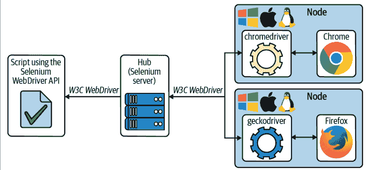

图 1-2. Selenium Grid Hub-节点架构

Grid 中的 Hub-节点架构自 Selenium 2 起就可用。这种架构也存在于 Selenium 3 和 4 中。然而，如果到 Hub 的请求过多，这种集中式架构可能会导致性能瓶颈。Selenium 4 提供了一种完全分布式的 Selenium Grid 版本以避免这个问题。该架构实现了先进的负载均衡机制，以避免任何组件出现过载。

第 6 章描述了如何按照经典方法（基于 Hub 和一组节点）设置 Selenium Grid。本章还涵盖了独立模式（即 Hub 和节点托管在同一台机器上）以及全分布式架构。


# Selenium IDE

Selenium IDE 是 Selenium 套件的最后一个核心组件。Shinya Kasatani 于 2006 年创建了它。Selenium IDE 是一个实现所谓的“录制与回放”（Record and Playback, R&P）自动化技术的工具。顾如其名，这种技术包含两个步骤：首先，在 Selenium IDE 中，*录制*部分捕捉用户与浏览器的交互。其次，我们使用生成的 Selenium 脚本自动执行浏览器会话（回放）。

早期版本的 Selenium IDE 是一个 Firefox 插件，嵌入了 Selenium Core 用于录制、编辑和回放 Selenium 脚本。这些早期版本是 XPI 模块（在 2017 年），这是一种用于创建扩展的技术。从第 55 版本（2017 年发布）开始，Firefox 将对扩展的支持迁移到了 W3C 浏览器扩展规范。结果是 Selenium IDE 停止了使用，在一段时间内无法再使用它。Selenium 团队根据浏览器扩展的建议重写了 Selenium IDE 以解决这个问题。得益于此，我们现在可以在多个浏览器（如 Chrome、Edge 和 Firefox）中使用 Selenium IDE。

图 1-3 显示了新的 Selenium IDE GUI（图形用户界面）。

使用此 GUI，用户可以录制与浏览器的交互，并编辑和执行生成的脚本。Selenium IDE 将每次交互编码为不同的部分：命令（command，即在浏览器中执行的动作）、目标（target，即 Web 元素的定位器）和值（value，即处理的数据）。可选情况下，我们可以包含命令的描述。图 1-3 显示了这些步骤的录制示例：

1. 打开网站 (https://bonigarcia.dev/selenium-webdriver-java)。我们将该网站作为书中其余部分的练习站点。
2. 点击文本为 "GitHub" 的链接。结果是导航跳转到示例仓库的源码。
3. 断言网页上存在书名 *(Hands-On WebDriver with Java)*。
4. 关闭浏览器。

### Selenium IDE - hello-selenium-ide

项目：hello-selenium-ide

| 命令 | 目标 | 值 |
| --- | --- | --- |
| 1 | open | /selenium-webdriver-java/ |
| 2 | click | linkText:GitHub | |
| 3 | assert text | css=markdown-body > h1 | Hands-On Selenium WebDriver with Java |
| 4 | close | | |

图 1-3. Selenium IDE 显示了一个录制脚本的示例

一旦我们在 Selenium IDE 中创建了脚本，就可以将其导出为 Selenium WebDriver 测试用例。例如，图 1-4 显示了如何将所演示示例转换为 JUnit 测试用例。最后，我们可以将项目保存到本地机器上。该示例生成的项目可以在示例 GitHub 仓库中找到。


## Selenium 生态系统

软件生态系统是在共同技术背景支持下、在共享市场中相互作用的元素集合。对于 Selenium 来说，它的生态系统涉及官方核心项目以及其他相关项目、库和参与者。本节回顾了 Selenium 生态系统，分为以下类别：语言绑定、驱动管理器、框架、浏览器基础设施和社区。

### 语言绑定

众所周知，Selenium 项目为 Selenium WebDriver 维护了多种语言绑定：Java、JavaScript、Python、Ruby 和 C#。然而，其他语言也被使用。表 1-2 总结了由社区维护的 Selenium WebDriver 语言绑定。

**表 1-2. Selenium WebDriver 的非官方语言绑定**

| 名称 | 语言 | 维护者 | 网站 |
| --- | --- | --- | --- |
| `hs-webdriver` | Haskell | BSD-3-Clause | Adam Curts | https://github.com/kallisti-dev/hs-webdriver |
| `php-webdriver` | PHP | Facebook, 社区 | https://github.com/php-webdriver/php-webdriver |
| `RSelenium` | R | AGPLv3 | |

# 第 1 章：Selenium 入门

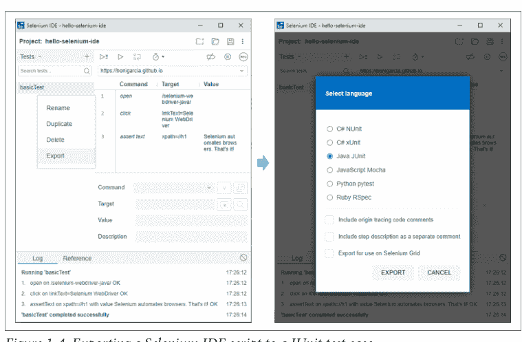

| 名称 | 语言 | 维护者 | 网站 |
| --- | --- | --- | --- |
| `hs-webdriver` | Haskell | BSD-3-Clause | Adam Curts | https://github.com/kallisti-dev/hs-webdriver |
| `php-webdriver` | PHP | Facebook, 社区 | https://github.com/php-webdriver/php-webdriver |
| `RSelenium` | R | AGPLv3 | |

### 驱动管理器

驱动是控制浏览器的必要组件（见图 1-1）。由于这种原因，我们需要管理它们。Hub-节点架构在 Grid 中自 Selenium 2 起就可用。这种架构也存在于 Selenium 3 和 4 中。然而，如果 Hub 的请求过多，这可能导致问题。

1. 下载：每个浏览器都有自己的驱动。由于这种原因，我们需要管理它们。
2. 设置：Chrome、Edge 或 Firefox 会自动更新，这可能导致问题。


### 3. 维护

Selenium 4 提供了一种完全分布式的 Selenium Grid 版本以避免此问题。该架构实现了先进的负载均衡机制，以避免任何组件出现过载。表 1-2 总结了驱动管理器。

| 名称 | 语言 | 许可证 | 维护者 | 网站 |
| --- | --- | --- | --- | --- |
| `DriverManager` | Java | Apache 2.0 | Boni Garcia | <https://github.com/bonigarcia/webdrivermanager> |
| `webdriver-manager` | JavaScript | MIT | Google | <https://www.npmjs.com/package/webdriver-manager> |
| `webdriver-manager` | Python | Apache 2.0 | Sehi Pirohov | <https://pypi.org/project/webdriver-manager> |
| `WebDriver.Net` | C# | MIT | Aliandr Rosolka | <https://github.com/rosolka/WebDriver.Net> |
| `webdrivers` | Ruby | MIT | Titus Forner | <https://github.com/titusforner/webdrivers> |


在书中，我建议使用 WebDriver，因为它自动化了整个维护过程（即下载、设置）。有关自动化和手动驱动管理的更多信息请参见附录 B。

# 定位器

Selenium WebDriver API 提供了多种定位 Web 元素的方法（见第 3 章）：通过属性（`id`、`name` 或 `class`）、通过链接文本（完整或部分）、通过标签名、通过 CSS（层叠样式表）选择器或 XML 路径语言（XPath）。特定的工具可以帮助识别和生成这些定位器。表 1-4 显示了其中工具。

| 名称 | 类型 | 许可证 | 维护者 | 网站 |
| --- | --- | --- | --- | --- |
| Chrome DevTools | 浏览器内置工具 | 专有免费软件 | Google | <https://developer.chrome.com/docs/devtools> |
| Firefox Developer Tools | 浏览器内置工具 | MPL 2.0 | Mozilla | <https://developer.mozilla.org/en-US/docs/Tools> |
| Cropath | 浏览器扩展 | 免费软件 | AutonomIQ | <https://autonomiq.com/deviq-chropath.html> |
| SelectorsHub | 浏览器扩展 | 免费软件 | Sanjay Kumar | <https://selectorshub.com> |
| POM Builder | 浏览器扩展 | 免费软件 | LogiGear Corporation | <https://pombuilder.com> |

# 框架

在软件工程中，框架是作为软件开发的概念和技术基础及支持的库和工具集合。Selenium 是一些封装、增强或补充其默认功能的框架的基础。表 1-5 包含了基于 Selenium 的一些框架和库。

## 表 1-5. 基于 Selenium 的测试框架和库

| 名称 | 语言 | 描述 | 许可证 | 维护者 | 网站 |
| --- | --- | --- | --- | --- | --- |
| CodeceptJS | JavaScript | 多后端支持的测试框架，从用户视角将浏览器交互建模为简单的步骤 | MIT | Michael Bodnarchuk | <https://codecept.io> |
| FluentSelenium | Java | 用于 Selenium WebDriver 的流式 API | Apache 2.0 | Paul Hammert | <https://github.com/SeleniumHQ/fluent-selenium> |
| Fluent | Java | 网站和移动自动化框架，用于创建可读且可复用的 WebDriver | Apache 2.0 | Fluentium 团队 | <https://fluentium.com> |
| Healenium | Java | 通过机器学习算法分析 Web 和移动元素元素以提高 Selenium 测试稳定性的库 | Apache 2.0 | Anna Chernysova 和 Dmitry Gumeniuk | <https://healenium.io> |
| Helium | Python | 基于 Selenium WebDriver 的高级 API | MIT | Michael Hermann | <https://github.com/mherma/selenium-python-helium> |
| QAF (QMet Automation Framework) | Java | 适用于 Web 和移动应用的测试自动化框架 | MIT | Chirag Jawswal | <https://qmetry.github.io/qaf> |
| Lightning | Java | 用于 Java 的轻级 WebDriver 客户端 | Apache 2.0 | Fluentium | <https://github.com/aerokube/lightning-java> |
| Nerodia | Python | WebDriver Ruby gem 的 Python 端口 | MIT | Lucas Tierney | <https://nerodia.readthedocs.io> |
| Robot Framework | Python, Java, NET 等 | 基于人类可读测试用例的通用自动化框架 | Apache 2.0 | Robot Framework Foundation | <https://robotframework.org> |
| Selenium team | Java | 用于 Selenium WebDriver 的流式、简洁 API | MIT | Selenium 团队 | <https://selenium.org> |
| SeleniumBase | Python | 基于 WebDriver 和 pytest 的浏览器自动化框架 | MIT | Michael Mintz | <https://seleniumbase.io> |
| Watir (Web Application Testing in Ruby) | Ruby | 基于 WebDriver 的 Gem 库，用于 Web浏览器自动化 | MIT | Titus Forner | <https://watir.com> |
| WebDriverIO | JavaScript | 基于 WebDriver 和 Appium 的测试自动化框架 | MIT | Christian Bromann | <https://webdriverio.io/> |
| Nightwatch.js | JavaScript | 基于 W3C WebDriver 的集成端到端测试框架 | MIT | Andrei Ruski | <https://nightwatch.io/> |

| 名称 | 语言 | 描述 | 许可证 | 维护者 | 网站 |
| --- | --- | --- | --- | --- | --- |
| Applitools | Java, JavaScript, C#, Ruby, PHP, Python | 用于视觉界面回归测试和 A/B 测试的测试自动化框架。为 Selenium、Appium 等提供了 SDK | 商业 | Applitools 团队 | <https://applitools.com> |
| Katalon Studio | Java, Groovy | 利用 Selenium WebDriver、Appium 和云提供者的测试自动化平台 | 商业 | Katalon 团队 | <https://www.kon.com> |
| TestProject | Java, C#, Python | 构建 Selenium 和 Appium 之上的 Web 和移动应用测试自动化平台 | 商业 | TestProject 团队 | <https://testproject.io> |

## 浏览器基础设施

我们可以使用 Selenium WebDriver 控制运行 WebDriver 脚本的机器上安装的浏览器。此外，Selenium WebDriver 还可以驱动远程浏览器（即执行在其他主机上的浏览器）。在这种情况下，我们可以使用 Selenium Grid 来支持远程浏览器基础设施。然而，这种基础设施的创建和维护具有挑战性。

另一种方法是使用云提供商来外包支持浏览器基础设施的责任。在 Selenium 生态系统中，云提供商是指提供自动化测试托管服务的公司或产品。这些公司通常为 Web 和移动测试提供商业解决方案。云提供商的用户按需请求不同类型、版本和操作系统的浏览器。此外，这些提供商还提供额外的服务来简化测试和监控活动，例如会话记录或分析能力等。一些云提供商包括 Sauce Labs、BrowserStack、LambdaTest、Perfecto。

另一种支持 Selenium 的的解决方案是 Docker，一种允许以容器方式打包应用程序的开源技术。Docker 有两个主要组件：用于创建容器的 Engine 以及用于分发镜像的 Hub。

### 1-6. Docker 项目

| 名称 | 描述 | 许可证 | 维护者 | 网站 |
| --- | --- | --- | --- | --- |
| `docker-selenium` | Selenium 的 Docker 实现 | Apache 2.0 | Selenium | <https://github.com/selenium> |
| `selenoid` | Selenium 的 Kubernetes 实现 | Apache 2.0 | Fluentium | <https://fluentium.com> |
| `moon` | Selenium 集群实现 | 商业 | Fluentium | <https://fluentium.com> |
| `callisto` | Selenium 的原生实现 | MIT | Fluentium | <https://fluentium.com> |

## 社区

由于其协作性质，Selenium 需要许多参与者的支持。1-7 展示了 Selenium 的几类资源：官方文档、支持和活动。

### 1-7. Selenium 社区资源

| 类别 | 描述 | 网站 |
| --- | --- | --- |
| 官方文档 | 用户指南 | <https://www.selenium.dev/documentation> |
| 博客 |  | <https://www.selenium.dev/blog> |
| Wiki |  | <https://github.com/seleniumhq/wiki> |
| 生态系统 |  | <https://www.selenium.dev/ecosystem> |
| 开发 | 源码 | <https://github.com/seleniumhq/selenium> |
| 治理 | 项目 | <https://www.selenium.dev/project> |
| 支持 | 用户组 | <https://groups.google.com/group/selenium-users> |
| Slack |  | <https://slack.com> |
| IRC |  | <https://webchat.freedesode.net/#selenium> |
| StackOverflow | 标记 | <https://stackoverflow.com/questions/tagged/selenium> |
| Reddit |  | <https://www.reddit.com/r/selenium> |
| 活动 | 会议 | <https://www.selenium.dev/categories/conference> |
| Meetups |  | <https://www.meetup.com/topics/selenium> |

## 测试基础

软件测试（或简单的“测试”）是指对称为被测系统（SUT）的软件进行动态评估，通过一组有限的用例（或简单的“测试”）得出结论。

初看，我们将软件测试分为不同的类别：手动和自动化。一方面，在手动测试中，由人员（软件工程师或最终用户）评估 SUT。另一方面，在自动化测试中，我们使用特定的软件来开发并控制其执行。自动化允许尽早发现 SUT 中的缺陷（通常称为 `bugs`），同时提供许多额外益处（例如节省成本、快速反馈、测试覆盖率或可复用性）。在某些情况下，手动测试也是一种有价值的方法，例如“探索性测试”（即人类测试人员调查并评估 SUT）。

## 测试分级

根据 SUT 的大小，我们可以定义不同的“测试分级”。这些分级定义了软件团队划分工作的几个类别。在书中，我建议使用堆栈布局来表示不同的层级（见图 1-5）。该结构的底层代表了验证较小软件单元（称为单元）的测试。随着我们向上移动，会发现其他层级（例如集成、系统等），这些 SUT 集成了越来越多的组件。

| 验收 | 用户测试（验证） |
| --- | --- |
| 端到端 |  |
| 系统 | 开发测试（验证） |
| 集成 |  |
| 单元 |  |

图 1-5. 不同测试分级的堆叠表示


该测试栈的最底层是“单元测试”。在这一层级，我们评估单个软件单元。单元是一个特定的可观测行为元素。例如，在面向对象编程中，单元通常是方法或类，而在函数式编程中单元是函数。单元测试旨在验证每个单元的行为是否符合预期。自动化单元测试通常运行很快，因为每个测试只执行极少部分代码。为了实现这种隔离，我们可以使用“测试双胞”（doubles），它们是用于替换单元依赖组件的软件部分。例如，面向对象编程中一种常用的测试类型是“模拟对象”（mock object）。模拟对象通过某些经过程序化的行为来模拟真实对象。

**图 1-5** 中的下一级是**集成测试**。在这一层级，不同的单元被组合成复合组件。集成测试旨在评估所涉及单元之间的交互，并暴露它们接口中的缺陷。

然后，在“系统测试”和“端到端”（E2E）层级，我们作为一个整体测试软件系统。我们验证这些高层功能。系统/端到端测试与集成测试的区别在于，前者涉及所有系统组件和最终用户（通常是模拟的）。换句话说，系统和端到端测试通过用户界面（UI）对待测系统（SUT）进行评估。这种 UI 可以是图形化的（GUI），也可以是非图形的（例如基于文本或其他）。

## 测试金字塔

测试金字塔是测试层级的经典表示。Mike Cohn 在 2009 年首次提出了这一概念。在他最初的理念中，Cohn 建议将大量的单元测试作为测试工作的基础。后续层级（例如集成测试）在每个阶段的数量较少，但通常更昂贵（从开发和维护工作量来看）且速度较慢（从执行时间来看）。这种提议对于许多项目来说可能是不可行的，因为单元测试并不总是来自全面的测试套件。此外，其他人对测试层级定义了不同的形状，例如“测试奖杯”（其中中间层，即集成测试，是最大的）。由于不同测试的相关性可能因项目而异，我使用一个基础结构来表示不同的测试层级。

**图 1-6** 展示了系统测试与端到端测试之间的区别。如你所示，一方面，端到端测试涉及软件系统及其依赖的子系统（例如数据库或外部服务）。另一方面，系统测试仅包含软件系统，而这些外部依赖通常是被模拟的。

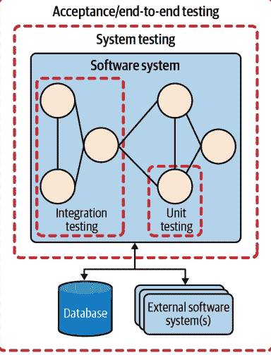

图 1-6。不同测试层级的基于组件表示

验收测试是所展示测试栈的顶层。在这一层级，最终用户参与到测试过程中。验收测试的目标是判断软件系统是否符合最终用户的预期。如图 1-6 所示，像端到端测试一样，验收测试也验证整个系统及其依赖项。因此，验收测试也使用 UI 来执行 SUT 验证。

Selenium WebDriver 的主要目的是实现端到端测试。尽管如此，在模拟被测试网站发出的后端调用时，我们可以使用 WebDriver 来进行系统测试。此外，我们可以结合行为驱动开发（BDD）工具使用 Selenium WebDriver 来实现验收测试（见第 9 章）。

## 验证与确认

我们已经看到的测试栈下层级（单元、集成和端到端测试）属于开发测试。开发测试是产生软件系统的团队（即开发者、测试人员等）在软件开发生命周期的构建阶段进行的。开发测试是一种验证，因为我们评估软件是否符合其功能性和非功能性需求（即其规范）。根据 Barry Boehm 在 1984 年的经典定义，确认（Validation）回答的问题是：“我们正在构建正确的产品吗？”

图 1-5 所示的测试栈顶层（即验收测试）属于用户预期，因为它在测试过程中涉及最终用户。验收测试是确认的一种类型，其目标是证明软件系统符合最终用户的预期。确认比验证（Verification）是一个更广泛的过程，因为系统规范并不总是反映用户的真实愿望或需求。因此，根据 Boehm 的说法，确认回答的问题：“我们正在构建正确的产品吗？”

## 测试类型

根据设计测试用例的策略不同，我们可以实现不同类型的测试。两种主要的测试类型是：

- 功能性测试（也称为行为测试或黑盒测试）

  评估软件与预期行为（即其功能性需求）的合规性。

- 结构化测试（也称为白盒测试）

  确定程序代码结构是否存在缺陷。为了这一目标，测试人员应该了解软件的内部逻辑。

这些测试类型的区别在于功能性测试是基于职责的，而结构化测试是基于实现的。两种类型可以在任何测试层级（单元、集成、系统、端到端或验收）进行。然而，结构化测试通常在单元或集成层级完成，因为这些层级能够对代码执行流进行更直接的控制。


黑盒测试和白盒测试分别是功能性测试和结构化测试的名称。然而，不建议使用这些名称，因为科技行业正试图采用更具包容性和中性的术语，而不是具有伤害性的语言。

功能性测试有不同的种类。例如：

- UI 测试（当 UI 是图形化时称为 GUI 测试）

  评估应用程序的视觉元素是否符合预期的功能。注意，UI 测试与系统测试和端到端测试不同，因为前者测试界面本身，而后者通过 UI 评估整个系统。

## 负向测试

在意外情况（例如预期异常）下评估 SUT。这个术语是功能性测试（有时称为正向测试）的对立面，在后者中我们评估 SUT 是否符合预期（即其正常路径）。

## 跨浏览器测试

这是针对 Web 应用程序的。旨在验证网站和应用程序在不同浏览器（类型、版本或操作系统）中的兼容性。

第三种杂类类型是非功能测试，包含了评估软件系统质量属性（即其非功能性需求）的测试策略。非功能测试的常见方法包括但不限于：

## 性能测试

评估软件系统的指标，如响应时间、稳定性、可靠性和可扩展性。性能测试的目标不是寻找缺陷，而是寻找系统瓶颈。性能测试有两种常见的子类型：

- 负载测试

  通过模拟并发用户增加对系统的使用，以验证其可以在定义的范围内运行。

- 压力测试

  超出运行能力对系统进行施压，以识别系统崩溃的实际界限。

## 安全测试

试图评估安全问题，例如机密性（信息泄露保护）、身份验证（确保用户身份真实）或授权（确定用户权利和特权）等。

## 易用性测试

评估软件应用程序的易用程度。这种评估也称为用户体验（UX）测试。易用性测试的一个子类型是：

### A/B 测试

通过比较同一个应用程序的不同版本，来确定哪一个对终端用户更有效。

### 障碍性测试

评估系统是否可供残障人士使用。

我们主要使用 Selenium WebDriver 来实现功能测试（即通过与 Web 交互来评估其行为）。不太可能使用 WebDriver 实现结构化测试。此外，尽管不是它的主要用途，且在敏捷开发中，但我们也可以使用 WebDriver 来实现非功能测试，例如安全性、障碍性或本地化（对特定区域设置的评估）测试（第 9 章）。


# 测试方法论

软件开发生命周期是在软件工程中创建软件系统所需的活动、操作和任务的集合。软件工程师在整个开发生命周期设计和实现测试用例时取决于特定的开发流程（例如迭代式、瀑布式或敏捷式等）。

# 测试驱动开发 (TDD)

TDD 是一种方法论，我们在实际的软件设计和实现之前设计并实现测试。在 21 世纪初，随着敏捷开发方法论（如极端编程 XP）的兴起，TDD 变得流行。在 TDD 中，开发者首先为给定功能编写一个（初始失败的）自动化测试。然后，开发者编写代码来通过该测试。最后，开发者重构代码以实现或提高可靠性和可维护性。

# 测试后开发 (TLD)

TLD 是一种方法论，我们在实现在 SUT（被测系统）之后设计并实现测试。这种做法在传统的软件开发过程中非常典型，例如瀑布式（顺序）、增量式（多瀑布式）、螺旋式（面向风险的瀑布式）或理性统一过程（RUP）。

另一个相关的测试方法是行为驱动开发（BDD）。BDD 是一种源自 TDD 的测试实践，因此在 BDD 中，我们在软件开发生命周期的早期设计测试。为了实现这一点，最终用户与开发团队（通常是项目负责人、经理或分析师）之间的对话，对预期行为和软件系统的共同理解进行了形式化。结果，我们根据 Given-When-Then 结构创建了一个或多个场景的验收测试：

- Given（假定）：场景开始时的初始上下文
- When（当）：事件触发场景
- Then（那么）：预期结果

TLD 是实现 Selenium WebDriver 的常用做法。换句话说，开发者/测试人员在 SUT 可用之前不实现 WebDriver 测试。尽管如此，不同的方法也是可能的。例如，在使用 Cucumber 使用 WebDriver 时，BDD 是一种常用方法（见第 9 章）。


与方法论领域密切相关的是我们发现持续集成（CI）概念。CI 是一种软件开发实践，软件项目的成员持续地构建、测试和集成他们的工作。Grady Booch 在 1991 年首次创造了 CI 术语。现在它是一种创建软件的流行策略。

如图 1-7 所示，CI 有三个独立的阶段。首先，我们使用源代码仓库，这是一种用于存储和共享软件项目源代码的托管设施。我们通常使用版本控制系统（VCS）来管理此仓库。VCS 是一个跟踪源代码、谁在何时做了每项更改（有时称为补丁）的工具。

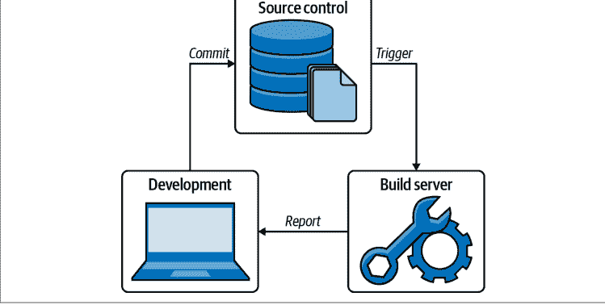

图 1-7. CI 通流程

Git 最初由 Linus Torvalds 开发，是今天首选的 VCS。其他替代方案是并发版本系统（CVS）或 Subversion（SVN）。在 Git 之上，几个代码托管平台（如 GitHub、GitLab 或 Bitbucket）为开发、共享和维护软件提供协作代码托管服务。

开发者在本地环境中同步本地仓库（或简称 repo）副本。然后，他们使用该本地副本进行编码，并将更改提交到远程仓库（通常每天）。CI 的基本思想是每次提交都会触发带有新更改的软件构建和测试。为了确保补丁不会破坏构建的测试套件被称为回归测试。回归套件可以包含不同类型的测试，包括单元、集成、端到端等。

当测试数量大到无法进行回归测试时，我们通常从整个套件中选择部分相关测试。有不同的策略来选择这些测试，用于冒烟测试（即确保关键功能的测试）或合理性测试（即评估基本功能的测试）。最后，我们可以作为计划任务（通常每晚）执行完整的套件。

我们使用称为构建服务器的服务器端基础设施来实现 CI 流水。当回归测试失败时，构建通常会向原始开发者报告问题。表 1-8 提供了构建服务器的摘要。

表 1-8. 构建服务器

| 名称 | 说明 | 许可证 | 维护者 | 网站 |
|---|---|---|---|---|
| Bamboo | 与 Jira（问题跟踪器）和 Bitbucket 易于使用 | 商业 | Atlassian | https://www.atlassian.com/software/bamboo |
| GitHub Actions | GitHub 内置构建服务器 | 公共免费 | Microsoft | https://github.com/features/actions |
| GitLab CI/CD | GitLab 内置构建服务器 | 公共免费 | GitLab | https://gitlab.com |
| Jenkins | 开源构建服务器 | MIT | Jenkins 社区 | https://www.jenkins.io |
| CircleCI | 云端 CI 工具 | 增值模式 | CircleCI | https://circleci.com |


我们使用称为构建服务器的服务器端基础设施来实现 CI 流水。当回归测试失败时，构建通常会向原始开发者报告问题。（等等，OCR 在此处有一些重复/乱码，已根据标准 CI 工具列表进行了清理）。

实际上，根据提供的文本流：

我们使用称为构建服务器的服务器端基础设施来实现 CI 流水。当回归测试失败时，构建通常会向原始开发者报告问题。（上面的表是重建的版本）。

# 持续交付 (CD)

在 CI 之后，构建服务器将发布部署到阶段环境。

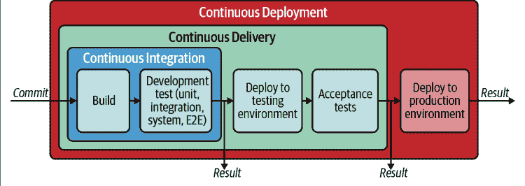

图 1-8. 持续集成、交付与部署

DevOps 是一种促进开发人员、测试人员、QA（质量保证）、运维团队之间沟通与协作的软件方法论。

# 测试自动化工具

我们需要使用一些工具来有效地实现、执行和控制测试。测试工具的相关类别之一是单元测试框架。xUnit 的原始框架是 SUnit，由 Kent Beck 于 1999 年创建。Erich Gamma 将 SUnit 移植到 Java，创建了 JUnit。从那时起，JUnit 非常流行，启发了其他单元测试框架。表总结了最相关的测试框架。

表 1-9. 单元测试框架

| 名称 | 语言 | 说明 | 许可证 | 维护者 | 网站 |
|---|---|---|---|---|---|
| JUnit | Java | JUnit 家族的参考实现 | EPL | JUnit 团队 | https://junit.org |
| TestNG | Java | 受 JUnit 和 NUnit 启发，包含额外功能 | Apache 2.0 | Cedric Beust | https://testng.org |
| Mocha | JavaScript | Node.js 和浏览器测试框架 | MIT | OpenJS Foundation | https://mocha.org |
| Jest | JavaScript | 专注于简单且关注 Web 应用 | MIT | Facebook | https://jestjs.org |
| Karma | JavaScript | 允许在浏览器中执行 JavaScript 测试 | MIT | Karma 团队 | https://karma-runner.github.io |
| NUnit | .Net | 所有 .Net 语言（C#、Visual Basic 和 F#）的单元测试框架 | MIT | .NET Foundation | https://nunit.org |
| unittest | Python | Python 2.1 标准库中的单元测试框架 | PSF License | Python Software Foundation | https://docs.python.org/library/unittest.html |
| minitest | Ruby | Ruby 的完整测试工具套件 | MIT | Seattle Ruby Brigade | https://github.com/seattlerb/minitest |

xUnit 家族的一个重要共同特征是测试结构，由四个阶段组成（见图 1-9）：

### Setup（设置）

测试用例初始化 SUT 以表现预期行为。

### Exercise（执行）

测试用例与 SUT 交互。结果，测试从 SUT 获取结果。

### Verify（验证）

测试用例判断从 SUT 获取的结果是否符合预期。为此，测试包含一个或多个断言。断言（谓词）是检查预期条件是否为布尔值的函数。

### Teardown（拆卸）

测试用例将 SUT 恢复到初始状态。

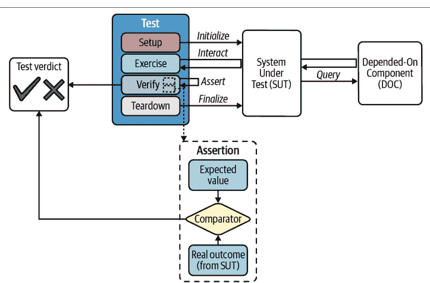

图 1-9. 单元测试通用结构

我们可以将单元测试框架与其他库或工具结合来实现任何类型的测试。例如，如第 2 章所述，我们使用 JUnit 和 TestNG 来嵌入对 Selenium WebDriver API 的调用，从而为 Web 应用实现端到端测试。

在单元测试用例中，设置（setup）和清理（teardown）阶段是可选的。虽然不是强制性的，但强烈建议进行验证（verifying）。即使单元测试框架包含了实现断言（assertions）的能力，引入第三方断言库也是一种常见做法。这些库旨在通过提供丰富的流式断言（fluent assertions）来提高代码的可读性。此外，这些库还提供了更丰富的错误信息，帮助测试人员理解失败的真实原因。表 1-10 汇总了一些与 Java 最相关的断言库。

表 1-10. Java 的断言库

| 名称 | 描述 | 许可证 | 维护者 | 网站 |
|---|---|---|---|---|
| AssertJ | 流式断言 Java 库 | Apache 2.0 | AssertJ team | https://assertj.github.io/doc |
| Hamcrest | 用于创建流式断言的 Java 匹配器库 | BSD | Hamcrest team | http://hamcrest.org |
| Truth | Java 和 Android 的流式断言 | Apache 2.0 | Google | https://truth.dev |

如图 1-9 所示，SUT（被测系统）通常可以查询另一个名为依赖组件（Depended-On Component, DOC）的组件。在某些情况下（例如单元测试或系统测试级别），我们可能希望将 SUT 与 DOC 隔离。我们可以找到许多 mock 库（mock libraries）来实现这种隔离。

表 1-11 显示了部分这些 Java mock 库的综合汇总。

表 1-11. Java Mock 库

| 名称 | 等级 | 描述 | 许可证 | 维护者 | 网站 |
|---|---|---|---|---|---|
| EasyMock | 单元 | 允许使用 Java 注解为单元测试创建 mock 对象 | Apache | EasyMock team | https://easymock.org |
| Mockito | 单元 | 用于创建和验证 mock 的 Java 库 | MIT | Mockito team | https://mockito.org |
| JMock | 集成 | 允许对 Java EE 和基于 Spring 的应用进行集成测试 | Open | JMock team | https://jmock.github.io |
| MockServer | 系统 | 用于通过 Java 客户端通过 HTTP 或 HTTPS 集成的任何系统的 mock 库 | Apache 2.0 | James Bloom | https://www.mock-server.com |
| WireMock | 系统 | 用于模拟 HTTP 服务的工具 | Apache 2.0 | Tom Akehurst | https://wiremock.org |

本节分析的最后一类测试工具是 BDD（行为驱动开发），这是一种创建验收测试的开发流程。实现这种方法有许多替代方案。例如，表 1-12 显示了相关 BDD 框架的摘要。

表 1-12. BDD 框架

| 名称 | 语言 | 描述 | 许可证 | 维护者 | 网站 |
|---|---|---|---|---|---|
| Cucumber | Ruby, Java, JavaScript, Python | 遵循 BDD 方法创建验收测试的测试框架 | MIT | SmartBear Software | https://cucumber.io |
| FitNesse | Java | 独立的协作式 wiki 和验收测试框架 | CPL | Fitnesse team | https://fitnesse.org |
| JBehave | Java, Groovy, Kotlin, Ruby, Scala | 适用于所有 JVM 语言的 BDD 框架 | BSD-3-Clause | JBehave team | https://jbehave.org |
| Jasmine | JavaScript | JavaScript 的 BDD 框架 | MIT | Jasmine team | https://jasmine.github.io |
| Capybara | Ruby | 为用户故事模拟场景的 Web 验收测试框架 | MIT | Thomas Walpole | https://teamcapybara.github.io/capybara |
| Serenity BDD | Java, JavaScript | 自动化测试库 | Apache 2.0 | Serenity BDD team | https://serenity-bdd.info |

# 总结与展望

Selenium 自 2004 年诞生以来已经取得了长足进步。许多从业者认为它是开发 Web 应用端到端测试的事实标准解决方案，并被全球成千上万的项目所使用。在本章中，你了解了 Selenium 项目的基础（由 WebDriver、Grid 和 IDE 组成）。此外，Selenium 拥有丰富的生态系统和活跃的社区。WebDriver 是 Selenium 项目的核心，它是一个提供 API 以编程方式控制不同浏览器（例如 Chrome、Firefox、Edge 等）的库。表 1-13 包含了 Selenium WebDriver 主要用途和次要用途的全面概述。

表 1-13. Selenium WebDriver 用途概述

| 主要用途 | 次要用途（其他用途） |
|---|---|
| 目的 | 自动化测试 | 网络爬虫、基于 Web 的管理任务 |
| 测试级别 | 端到端测试 | 系统测试（mock 后端调用）、验收测试（例如，配合 Cucumber 使用） |
| 测试类型 | 功能测试（确保符合预期行为） | 跨浏览器测试（不同浏览器的兼容性）、回归测试（确保在 SUT 中提交代码后构建无误）、非功能性测试（例如，负载、安全、可访问性或本地化） |
| 测试方法 | TDD（当 SUT 可用时实现测试） | BDD（在开发早期定义场景） |

在下一章中，你将发现如何使用 Maven 或 Gradle 作为构建工具设置 Java 项目。该项目将包含使用 JUnit 和 TestNG 作为单元测试框架并调用 Selenium WebDriver API 的 Web 应用端到端测试。此外，你将学习如何用一个基础测试用例控制不同的浏览器（例如 Chrome、Firefox 或 Edge）（这是 Selenium WebDriver 版本的经典 *hello world*）。

# 第 2 章

# 测试准备


本章旨在使用 Selenium WebDriver 和 Java 语言实现你的首个端到端测试。为了实现这一点，我们首先从先验知识、硬件和软件方面回顾技术要求。其次，本章提供了设置包含 Selenium WebDriver 测试的 Java 项目的概述。你可以使用 Maven 或 Gradle 等构建工具来简化项目设置。最后，你将学习如何使用 Selenium WebDriver 实现一个基础端到端测试，即 hello world 测试。我们将以多种方式实现此测试，使用不同的浏览器（如 Chrome、Edge 或 Firefox）和单元测试框架（JUnit 和 TestNG）。请记住，书中的每个代码示例都可以在 GitHub 仓库中获取。因此，你可以复用该仓库的内容和配置作为自己测试的基础。

## 要求

开始在 Java 中使用 Selenium WebDriver 的首要要求是理解 Java 语言和面向对象编程。这并不要求成为专家，但需要具备基础知识。然后，你可以在主流操作系统（Windows、Linux 或 macOS）上使用 Selenium WebDriver。因此，你可以根据喜好选择电脑类型。原则上，硬件在内存、CPU 方面没有特殊要求，任何中端电脑即可。

## Java 虚拟机

接下来，你需要在计算机上安装 Java 虚拟机（JVM）。JVM 有两种发行类型。第一种是 Java 环境（JRE），它包含了 JVM 和 Java API。第二种是 Java 开发包（JDK），它是 JRE 加上用于 Java 的软件开发包（SDK）。由于我们在使用 Java 开发，建议使用 JDK（尽管某些 IDE 也内置 SDK）。

## 文本编辑器或 IDE

为了编写 Java 代码，我们需要文本编辑器或 IDE。IDE 为开发提供了极佳的体验，因为它们拥有完善的环境（用于编码、运行、调试）。然而，你可以使用任何文本编辑器配合命令行工具（用于运行、调试）获得类似的练习。总之，这取决于你的喜好。流行的文本编辑器包括 Sublime Text、Atom、Notepad++ 或 Vim 等。IDE 包括 Eclipse、IntelliJ IDEA、NetBeans 或 Visual Studio Code。

## 浏览器与驱动程序

使用 Selenium WebDriver 进行初始化的方法是使用本地浏览器。本书考虑了以下浏览器：Chrome、Edge 和 Firefox。由于以下原因，我将它们称为主要浏览器。首先，它们在全球范围内非常流行，由于我们使用 Selenium WebDriver 测试 Web 应用，我们希望使用与潜在用户相同的浏览器。其次，这些浏览器是长青的（即会自动更新）。第三，这些浏览器适用于主流操作系统：Windows、Linux 和 macOS（不像 Safari，它是流行的浏览器但仅适用于 macOS）。最后，浏览器也适用于 GitHub 仓库中使用的持续集成（CI）环境（即 GitHub Actions）。

使用 Selenium WebDriver 控制浏览器的最后一个要求是驱动二进制文件（用于 Chrome 的 `chromedriver`、Edge 的 `msedgedriver` 以及用于 Firefox 的 `geckodriver`）。如第 1 章所述，驱动程序管理涉及下载、设置和维护。为了避免该章解释的潜在问题，我强烈建议使用 WebDriverManager 自动化这一过程。

附录 B 提供了关于 DriverManager 执行的自动化驱动管理过程的详细细节。此外，以防你出于某些原因需要，附录解释了如何手动执行驱动管理。

## 构建工具

另一个重要组件是构建工具。构建工具是用于从源代码自动创建可执行应用程序的软件实用程序。这些工具在依赖管理、编译、打包、测试执行和部署方面简化了项目管理。总的来说，构建工具是一种在构建服务器（例如 GitHub Actions）和开发者机器上自动开发软件项目的一种方便方式。因此，我强烈建议使用构建工具来搭建你的项目。我们在本书书中考虑的备选方案有：

### Maven

一个由 Apache 基金维护的开源构建自动化工具。它主要用于 Java 项目，尽管它也支持 C#、Ruby 或 Scala 等语言。

### Gradle

另一个用于软件开发的开源构建自动化工具。它支持 Java 以及 Kotlin、Groovy、C++ 或 JavaScript 等其他语言。推荐的版本是 Maven 3+ 和 Gradle 6+。为了完整性起见，我在示例仓库中使用了构建工具。同样，使用哪一个的最终选择取决于你的偏好。

如果你计划使用 IDE 进行开发和运行测试，那么构建工具并不是严格必要的。尽管如此，我建议至少安装这些工具中的一个，以模拟通常在构建服务器使用的环境（例如 Jenkins、GitHub Actions 等）。

## 可选软件

除了已经解释的软件外，其他一些程序在书中也方便使用。首先，你可以使用 Git 进行源代码管理。由于书中介绍的示例在 GitHub 上可用，你可以使用 Git 分叉（或克隆）并更新此仓库。

第二个可选工具是 Docker。在书中我将向你展示如何使用 Docker 执行容器化浏览器（见第 6 章）。出于这个原因，我强烈建议你在电脑上安装 Docker Engine（它适用于 Linux、macOS 和 Windows）。

最后，如果你需要使用不同的浏览器，除了主流浏览器（Chrome、Edge 和 Firefox）之外，可以使用 Selenium WebDriver 使用其他浏览器，如 Safari、Opera、Chromium 和 HtmlUnit（一个无头浏览器）。

## Legacy旧版浏览器

除了已经介绍的浏览器外，你甚至可以使用 Selenium WebDriver 使用更多的浏览器。我不推荐这些浏览器，因为它们已经过时且不再维护：

- Internet Explorer：微软用于 Windows 系统的浏览器，首次于 1995 年发布，并于 2022 年停止支持。
- PhantomJS：无头浏览器，首次于 2011 年发布，并于 2018 年停止支持。

## 项目设置

你可以在 GitHub 仓库中找到书中所有的代码示例。该仓库是开源的，根据 Apache 2.0 许可证发布。将所有示例组合在一个站点是非常方便的。其次，你可以将你的设置（Maven 或 Gradle）作为项目的骨架。以下子节描述了创建包含 Selenium 测试的 Java 项目的通用要求。附录 C 提供了关于示例仓库配置的底层细节。

## 项目布局

项目布局是用于存储软件项目不同资产的目录结构（例如：源代码、二进制文件、静态资源等）。Maven 和 Gradle 为 Java 项目使用等效布局。得益于此，我们可以使用这两种构建工具执行示例仓库。

如图 2-1 所示，这组文件夹（标记为脚手架文件夹）在两种构建工具中是相同的：

- `src/main/java`：应用程序源代码（即 Java 文件）
- `src/main/resources`：应用程序资源文件（即属性文件、配置文件等）
- `src/test/java`：测试源代码（即用于测试的 Java 文件）
- `src/test/resources`：测试资源文件（即用于测试的额外资产）

图 2-1. Maven 和 Gradle 中的项目布局

项目布局其余部分在两种工具中是不同的。第一个区别是配置文件。一方面，该文件是唯一的，在 Maven 中称为 `pom.xml`（项目对象模型）。另一方面，Gradle 中有两个文件用于配置：`settings.gradle` 和 `build.gradle`。Maven 和 Gradle 之间的第二个区别是输出文件夹。在两种情况下，构建工具都会创建此文件夹以保存构建结果（即：编译后的类、打包的文件等）。该文件夹的名称在 Maven 中为 `target`，在 Gradle 中为 `build`。

最后，Gradle 包含一组用于所谓的 Gradle wrapper 的文件夹和文件。这个 wrapper 是脚本文件（Unix 类系统的 `gradlew` 和 Windows 的 `gradlew.bat`），它提供了以下优势：

- 无需在本地机器安装 Gradle 即可构建项目
- 要求使用特定版本（可以与本地安装的 Gradle 实例不同）
- 通过更改 wrapper artifact（在 `gradle/wrapper` 文件夹中）轻松升级到新版本

从版本 4 开始，Maven 已经采用了使用 `mvnw` 脚本的 wrapper 设置。

## 依赖关系

软件项目的依赖是所需的库或插件。与其他功能一起，构建工具实现了项目依赖的自动化管理。为了实现这一点，我们需要在项目配置文件中指定此类依赖的坐标（Maven 和 Gradle 的具体细节见以下子节）。Java 项目的坐标由三个标签组成，用于唯一标识该项目（例如：库、插件等），即：

- `groupId`：创建项目的组织、公司、个人等。
- `artifactId`：标识项目的唯一名称。
- `version`：项目的特定发布版本。默认，我建议你使用每个发布的最新版本。

## 语义版本化

选择项目版本的流行方法是语义版本化（Semantic Versioning），也称为 SemVer。根据 SemVer 规范，一个发布版本由三个部分组成，即 `MAJOR.MINOR.PATCH`。简而言之，`MAJOR` 表示不兼容的变化，`MINOR` 表示向下兼容的变化，`PATCH` 表示错误修复。

本节解释了我在仓库中使用的 Java 依赖。首先，我们我们需要 Selenium WebDriver 来执行浏览器自动化。该依赖是唯一强制性的。我建议使用自动化管理工具、单元测试框架、流式断言和日志记录的额外依赖。本节其余部分将解释这些工具的动机和基本用法。

## Selenium WebDriver

Selenium WebDriver 最相关的概念之一是 WebDriver 层次结构，它是控制不同浏览器的类集合。如图 2-2 所示，该层次结构遵循面向对象的范式。在顶层，我们有 `WebDriver` 接口，它是整个结构的父类。层次结构的底部对应于驱动浏览器的 Java 类。例如，我们需要使用 `ChromeDriver` 类实例来控制本地 Chrome 浏览器。表 2-1 显示了 WebDriver 层次结构主要类及其对应目标浏览器的总结。

表 2-1. WebDriver 层次结构描述

| 包名 | 类 | 浏览器 |
| --- | --- | --- |
| `org.openqa.selenium.chrome` | `ChromeDriver` | Chrome |
| `org.openqa.selenium.edge` | `EdgeDriver` | Edge |
| `org.openqa.selenium.firefox` | `FirefoxDriver` | Firefox |
| `org.openqa.selenium.safari` | `SafariDriver` | Safari |
| `org.openqa.selenium.opera` | `OperaDriver` | Opera |
| `org.openqa.selenium.ie` | `InternetExplorerDriver` | Internet Explorer |
| `org.openqa.selenium.remote` | `RemoteWebDriver` | 远程浏览器（见第 6 章） |

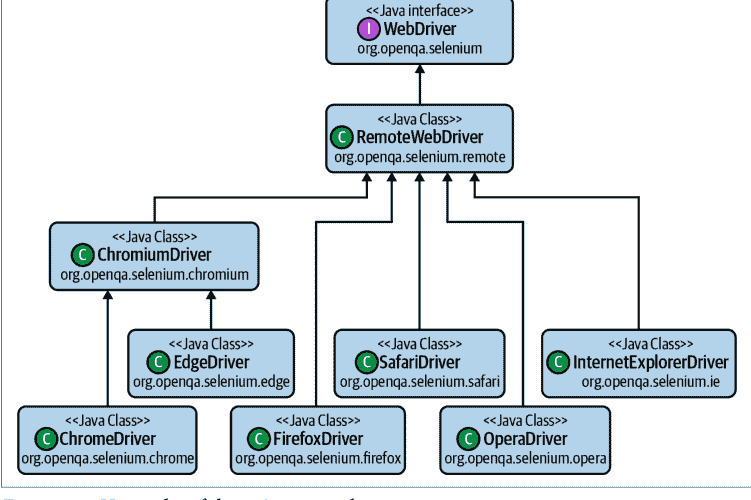

图 2-2. WebDriver 对象的层次结构

# 自动化驱动管理

在实例化 WebDriver 层次结构的对象之前，必须解决对应的驱动程序。例如，要用 `ChromeDriver` 控制 Chrome，我们首先需要在本地机器上安装此驱动。其次，我们需要管理 `chromedriver`。为了避免与手动驱动管理（第1章）相关的潜在问题，我建议以自动的方式执行整个驱动管理过程（下载、设置和维护）。对于 Java 而言，参考实现是 WebDriverManager，这是一个允许自动化驱动管理的 Selenium WebDriver 辅助库。本节将解释如何将 WebDriverManager 作为 Java 依赖使用。

一旦在项目中解析了 WebDriverManager 依赖（配置细节见附录 C），我们就可以使用 WebDriverManager API 来管理驱动程序。该 API 提供了一系列单例（称为管理器），用于下载、设置和维护驱动程序。这些单例可以通过 `WebDriverManager` 类访问。例如，我们需要调用 `chromedriver()` 方法来管理 Chrome 所需的驱动（即 `chromedriver`），如下所示：

```
WebDriverManager.chromedriver().setup();
WebDriver driver = new ChromeDriver();
```

表 2-2 总结了所有支持浏览器的基本 DriverManager 调用。除了这些基础操作（即 `setup()` 方法）外，DriverManager 还暴露了用于高级配置的流式 API。附录 B 提供了了更多关于 DriverManager 方法论、配置能力以及其他用途的细节，例如作为命令行界面工具（通过 shell）、作为服务器（使用 RESTLike [REpresentational State Transfer] API）、作为代理（使用 Java 字节桩技术）或作为 Docker 容器。

表 2-2 DriverManager 基本调用

| DriverManager | 浏览器 | 驱动程序 |
| --- | --- | --- |
| `DriverManager.chromedriver().setup()` | Chrome | `chromedriver` |
| `DriverManager.edgedriver().setup()` | Edge | `msedgedriver` |
| `DriverManager.firefoxdriver().setup()` | Firefox | `geckodriver` |
| `DriverManager.operadriver().setup()` | Opera | `operadriver` |
| `DriverManager.chromedriver().setup()` | Chromium | `chromedriver` |
| `DriverManager.iedriver().setup()` | Internet Explorer | `IEDriverServer` |

# 单元测试框架

如第 1 章所示，单元测试框架是创建不同类型测试的基础。本书将教你如何使用 Selenium WebDriver 为应用程序实现端到端测试。因此，我建议将 Selenium WebDriver 的调用嵌入带有特定单元测试框架的测试中。我推荐的替代方案有：JUnit 4、JUnit 5（或结合 Selenium-Jupiter，它是 Selenium WebDriver 的扩展）或 TestNG。接下来的子节将提供关于这些替代方案的更多细节。我的建议是专注于你偏好的单元测试框架和构建工具，并继续通过书中其他部分的示例进行练习。

JUnit 4 是由 Erich Gamma 和 Kent Beck 在 1999 年创建的 Java 单元测试框架。它实际上是 Java 开发测试的事实标准框架。在 JUnit 中，一个测试是 Java 类中一个用于测试的方法。从 JUnit 4 开始，Java 注解是开发 JUnit 测试的构建模块。JUnit 4 的基本注解是 `@Test`，因为它允许识别包含测试逻辑的方法（即用于执行和验证某个软件的代码）。此外，还有其他注解用于识别用于设置（即测试之前发生的情况）和清理（即测试之后发生的情况）的方法。

- `@BeforeClass` 在所有测试之前执行一次。
- `@Before` 在每个测试之前执行。
- `@After` 在每个测试之后执行。
- `@AfterClass` 在所有测试之后执行一次。

图 2-3 显示了 JUnit 4 中基本测试生命周期的图形表示。

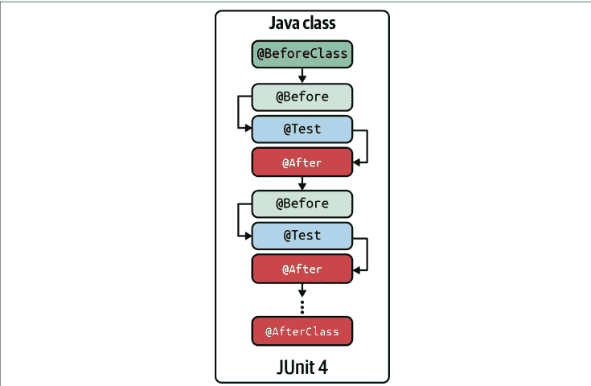

图 2-3. JUnit 4 测试生命周期

**JUnit 5**。由于 JUnit 4 的若干局限性（例如单体架构或无法组合的 JUnit 器），JUnit 团队在 2017 年发布了新的主版本（即 JUnit 5）。JUnit 在第 5 版本中被完全重新设计，遵循由三个组件组成的模块化架构（见图 2-4）。第一个组件是 *JUnit Platform*（JUnit 平台），它是整个框架的基础。JUnit Platform 的目标有两个方面：

- 它允许通过 *test launcher*（测试启动器）API 在 JVM 中发现并执行（顺序执行或并行执行）测试。该 API 通常由构建工具和 IDE 等程序化客户端使用。
- 它定义了在 JUnit Platform 上运行测试的 *test engine*（测试引擎）API。该 API 通常由提供测试编程模型的框架使用。

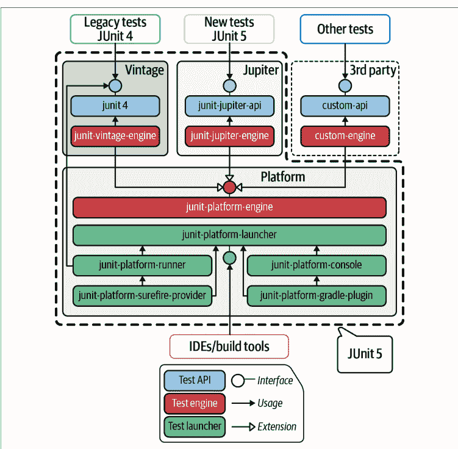

得益于 test engine API，第三方测试框架可以在 JUnit Platform 之上执行测试。已实现 JUnit 5 引擎的现有测试框架示例包括 TestNG、Cucumber 或 Spock。此外，JUnit 5 提供了 test engine API 的两个开箱即实现。这些引擎是 JUnit 5 架构的剩余组件，即：

# Vintage

提供与遗留测试（即第 3 和 4 版本）向后兼容性的测试引擎。

# Jupiter

提供新的编程和扩展模型的测试引擎

Jupiter 是 JUnit 5 的一个相关组件，因为它提供了一个健壮的编程模型。该模型的一些功能包括参数化测试、标记和过滤、排序测试、重复测试以及嵌套测试。


与 JUnit 4 一样，Jupiter 也使用 Java 注解来声明测试用例。例如，识别测试逻辑方法的注解也是 `@Test`。基本生命周期的注解名称在 Jupiter 中有所不同：`@BeforeAll`、`@BeforeEach`、`@AfterEach` 和 `@AfterAll`。如图 2-5 所示，这些注解都遵循与 JUnit 4 相同的工作流。

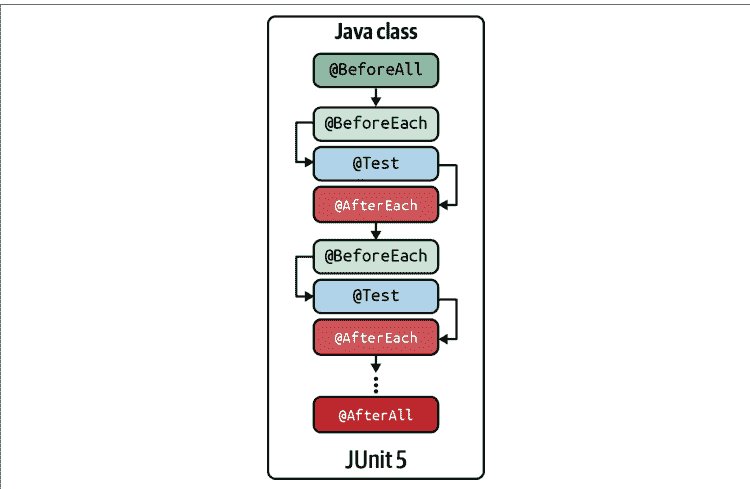

图 2-5. JUnit 5 测试生命周期

因此，使用 WebDriverManager 的 Jupiter 测试结构与 JUnit 4 非常相似。除了设置和清理注解的变化，Jupiter 模型中的测试方法（及其生命周期）并不要求必须公共。


本书将教你 Jupiter 的基础知识，适用于使用 Selenium WebDriver 进行端到端测试。请查看下一节中基于 JUnit 5 的完整示例。详情请参阅 JUnit 5 文档。

## 使用 Selenium-Jupiter 的 JUnit 5

Jupiter 的扩展模型允许向默认编程模型添加自定义功能。为此，Jupiter 提供了一个开发者可以扩展（使用接口扩展点）的 API，以提供自定义功能。这些扩展点的类别包括：

- 测试生命周期回调：用于在测试生命周期的不同阶段包含自定义逻辑。
- 参数解析：实现依赖注入（即注入测试方法或构造函数的参数）。
- 测试模板：用于根据给定的上下文重复测试。
- 条件测试执行：根据自定义条件启用或禁用测试。
- 异常处理：用于管理测试及其生命周期期间的 Java 异常。
- 测试实例：用于创建和处理测试类实例。
- 拦截调用：用于拦截测试代码的调用（并决定这些调用是否继续）。

作为 Jupiter 开发者，你可以实现自己的自定义扩展或使用现有的扩展。表 2-3 显示了 Jupiter 扩展的一些示例。

## 表 2-3. Jupiter 扩展

| 名称 | 描述 | 许可证 | 维护者 | 网站 |
| --- | --- | --- | --- | --- |
| JUnit Pioneer | Jupiter 扩展包 | EPL 2.0 | JUnit Pioneer 团队 | <https://junit-pioneer.org> |
| reruner-jupiter | 用于重新运行失败测试的扩展 | Apache 2.0 | Artem Sokovets | <https://github.com/artsok/reruner-jupiter> |
| MockitoExtension | 用于初始化 mock 和处理 stub 的 Jupiter 扩展 | MIT | Mockito 团队 | <https://github.com/mockito/mockito> |
| QuickPerf | 用于评估某些性能属性的库 | Apache 2.0 | QuickPerf 团队 | <https://github.com/quick-perf/quickperf> |
| Selenium-Jupiter | 用于 Selenium WebDriver 的 Jupiter 扩展 | Apache 2.0 | Boni García | <https://bonigarcia.dev/selenium-jupiter> |
| SpringExtension | 用于 Spring Framework 的 Jupiter 扩展 | Apache 2.0 | Pivotal Software | <https://spring.io/projects/spring-framework> |

在本书的上下文中，Selenium-Jupiter 是一个非常有吸引力的选择，它允许在 Jupiter 测试中无缝使用 WebDriver。Selenium-Jupiter 的基础如下（请参见下一节基于 Selenium-Jupiter 的“hello world”测试）：

### 减少测试用例中的样板代码

受益于 Jupiter 编程模型提供的参数解析功能，Selenium-Jupiter 允许通过构造函数或测试参数声明 WebDriver 层次结构的对象（例如 `ChromeDriver`、`FirefoxDriver` 等），从而从测试中控制浏览器。

### 通过 WebDriverManager 实现自动化驱动管理

受益于扩展提供的测试生命周期回调，对于 Selenium-Jupiter 用户来说，WebDriver 的管理是完全透明的。

### 端到端测试的高能力

这包括与 Docker 的无缝集成、测试模板（用于跨浏览器测试），或故障排除和监控功能（例如会话录制或可配置截图）。

## TestNG

我在书中使用的最后一个单元测试框架是 TestNG。TestNG 提供的一些重要特性包括并行执行、测试优先级排序、使用自定义注解的数据驱动测试以及创建详细的 HTML 报告。

与 JUnit 4 和 Jupiter 类似，TestNG 也使用 Java 注解来声明测试及其生命周期（即测试之前和之后发生什么）。同样，使用 `@Test` 注解来指定测试方法。然后，它提供了 `@BeforeClass` 和 `@BeforeMethod` 注解来指定测试设置，以及 `@AfterMethod` 和 `@AfterClass` 用于清理（见图 2-6）。此外，TestNG 允许使用以下术语对 Java 类中的测试进行分组：

- Suite（套件）由一个或多个测试组成。
- Test（测试）由一个或多个类组成。
- Class（类）带有测试方法的 Java 类，例如标记了 `@Test` 的类。

遵循这种符号并如图 2-6 所示，TestNG 提供了额外的注解，在套件和测试之前之后执行自定义逻辑。

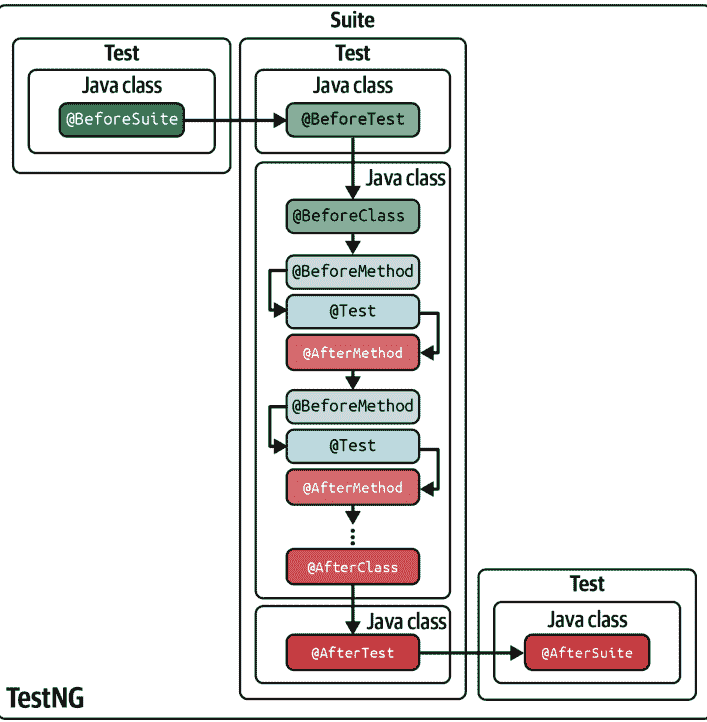

图 2-6. TestNG 测试生命周期

## 流式断言

如第 1 节介绍所示：

```java
int sum = 1 + 1;
assertThat(sum).
```

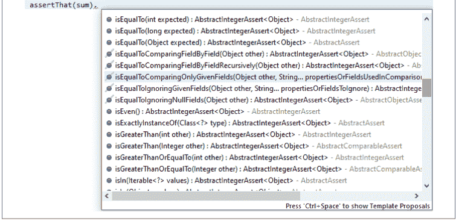

与其他选项相比，AssertJ 的第二个优势是它允许使用点符号进行断言链调用。通过这种方式，我们可以连接断言以创建更具可读性的断言，例如：

```java
assertThat(1 + 1).isGreaterThan(1).isLessThan(3);
```

## 日志

最后，我建议使用日志库来跟踪你的 Java 代码。如你所知，日志是跟踪软件执行情况的一种简单方法。日志通常通过将文本消息写入文件或标准输出来实现，它允许你追踪程序并诊断问题。使用特定的库来有效地记录日志是很常见的。这些库提供了不同的优势，例如消息的粒度级别（如 `debug`、`warning` 或 `error`）、时间戳或配置功能。

44 | 第 2 章：准备测试

## Hello World

我们准备好将本章解释的所有部分结合起来，并实现我们的端到端测试。如你所知，hello world 程序是任何编程语言都用于说明基本语法的简单代码。示例 2-1 显示了 Selenium WebDriver 版本的经典 hello world。


以下示例使用 JUnit 5 作为测试框架来嵌入对 Selenium WebDriver 的调用。记住，你可以在示例库中找到其他版本（即 JUnit 4、带有 Selenium-Jupiter 的 JUnit 5 以及 TestNG）。

示例 2-1. 使用 Chrome 和 JUnit 5 的 hello world

```java
class HelloWorldTest {
    static final Logger logger = getLogger(lookup().lookupClass());

    private WebDriver driver; //1

    @BeforeAll
    static void setUp() {
        WebDriverManager.chromedriver().setup(); //2
    }

    @BeforeEach
    void setup() {
        driver = new ChromeDriver(); //3
    }

    @Test
    void test() {
        // 练习
        String satUrl = "https://www.google.com";
        driver.get(satUrl);
        String title = driver.getTitle();
        logger.info("Page title: {}", title);
        // 验证
        assertThat(title).contains("Google");
    }

    @AfterEach
    void teardown() {
        driver.quit();
    }
}
```

# 使用其他浏览器

除了我在书中称为的“主浏览器”（即 Chrome、Edge 和 Firefox 等）之外，示例仓库还包含使用其他浏览器的“Hello 世界”测试：Chromium、Safari 和 HtmlDriver（一种与 HtmlUnit 无头浏览器兼容的 Selenium WebDriver 驱动程序）。这些测试包含在仓库的 `helloworld_otherbrowsers` 包中，它们与原始的 hello world 版本略有不同。例如，示例 2-3 显示了使用 Opera 进行测试的 JUnit 5 类设置。由于运行测试的机器可能无法使用该浏览器（例如，GitHub Actions 中无法使用 Opera），因此我使用假设（assumptions）在运行时有条件地禁用测试。

示例 2-3. 使用 Opera 和 JUnit 5 的类设置

```java
@BeforeAll
static void setUp() {
    Optional<Path> browserPath = DriverManager.operdriver()
        .getBrowserPath(); ①
    assumeThat(browserPath.isPresent()); ②
    WebDriverManager.operdriver().setup();
}
```

- 我们使用 `DriverManager` 来定位浏览器路径。
- 如果此路径不存在，我们假设系统未安装该浏览器，因此将跳过测试（使用 AssertJ 假设）。

和往常一样，你可以在示例仓库中使用其他单元测试框架找到此测试。JUnit 5 和 TestNG 版本使用了与上一个片段等效的测试设置。尽管如此，在使用 JUnit 5 Selenium-Jupiter 时存在差异。你可以在示例 2-4 中看到，Selenium-Jupiter 通过使用自定义注解（称为 `EnabledBrowserAvailable`）根据浏览器的可用性（本例中为 Safari）来简化禁用测试逻辑。

示例 2-4. 使用 Safari 和 JUnit 5 Selenium-Jupiter 的 Hello 世界

```java
@EnabledBrowserAvailable(SAFARI)
@ExtendedWith(SeleniumJupiter.class)
class HelloWorldSafariSelJunitTest {
    @Test
    void test(SafariDriver driver) {
        // 与其他“hello world”相同的测试逻辑
    }
}
```

要用 Selenium WebDriver 控制 Safari，我们需要手动配置 Safari 以授权远程自动化。为了这一目的，首先，我们通过点击菜单 Safari -> 偏好 -> 高级选项卡来显示开发菜单。然后，我们勾选“显示开发菜单”复选框。最后，我们点击“允许远程自动化”选项，见图 2-9。

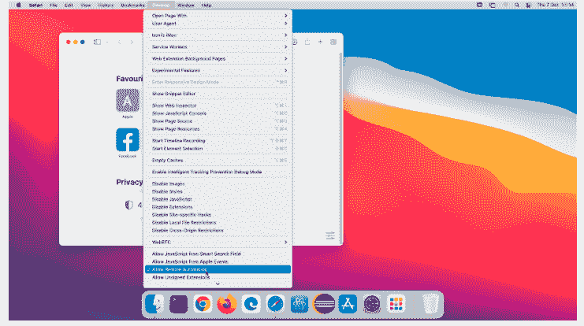

图 2-9. 在 macOS 上启用 Safari 远程自动化

## 总结与展望

本章为使用 Selenium WebDriver 和 Java 开发 Web 应用端到端测试提供了基础。你需要的第一个重要决定是决定哪个单元测试框架来嵌入 Selenium WebDriver 调用以实现这些测试。为了多样性和完整性，我在书中提出了四个选项：JUnit 4、JUnit 5、JUnit 5 加上 Selenium-Jupiter 以及 TestNG。对于基础 Selenium 测试来说，它们都是等效的。第 8 章将涵盖每个测试框架中与 WebDriver 测试相关的特定功能（例如用于跨浏览器测试的参数化测试）。你应该做的另一个决定是选择构建工具。在书中，我提出了两个选项：Maven 和 Gradle。再次，两者在标准开发实践中是相似的。

本书的第二部分专注于 Selenium WebDriver API，并从“上手”开始。第 3 章介绍了 Selenium WebDriver API 的基本概念，涉及 WebDriver 对象、网页元素定位、用户模拟（键盘和鼠标操作）以及等待策略。如既往一样，本章由托管在 GitHub 仓库上的代码示例引导。

# 第二部分

# Selenium WebDriver API

Selenium WebDriver 是一个开源库，允许像真实用户一样通过程序控制 Web 浏览器（例如 Chrome、Edge 或 Firefox 等）。它提供了一个跨浏览器 API，你可以用它来实现 Web 应用的端到端测试。本书的这一部分介绍了 Selenium WebDriver API 的深度总结。后续章节具有很强的实用性。因此，我通过 GitHub 示例仓库中提供的现用测试来解释 Selenium WebDriver API 的每个功能。

# 第三章

# WebDriver 基础

本章介绍了 Selenium WebDriver API 的要素方面。为此，我们首先回顾了创建 WebDriver 层级实例的不同方法（例如 `ChromeDriver`、`EdgeDriver`、`FirefoxDriver` 等）。此外，我们探索了它们提供的主要方法。其中，定位网页中的不同元素至关重要。因此，你将发现可能的定位器，即在网页内查找元素（在 Selenium WebDriver API 中称为 `WebElement`）的策略，例如通过标签名称、链接文本、HTML 属性（标识符、名称或类）、CSS 选择器或 XPath。本章涵盖的 Selenium WebDriver API 的另一个关键方面是用户操作模拟（即使用键盘和鼠标与网页进行自动化交互）。本章的最后一部分介绍了等待网页元素的能力。由于 Web 应用的动态和异步性质，这一功能是关键的。

## WebDriver 基本用法

本节涵盖了与 WebDriver 对象相关的三个方面。首先，我们回顾了创建它们的不同方法。其次，我们研究了它们的操作。最后，我们分析了处理这些对象的不同方法（通常在测试结束时关闭浏览器）。

## WebDriver 的创建

如第 2 章介绍的，在 Java 中使用 Selenium WebDriver 控制浏览器，第一步是创建实例。因此，我们需要为 Chrome 创建 Chrome 对象，为 Edge 创建 EdgeDriver，为 Firefox 创建 FirefoxDriver，以此类推。创建这些类型实例的基本方法是使用 Java 中的 `new` 运算符。例如，我们如下所示创建 `ChromeDriver`：

```java
WebDriver driver = new ChromeDriver();
```

使用运算符创建 WebDriver 实例是正确的，你可以在测试中使用它。尽管如此，值得回顾根据特定使用用例提供额外优势的可能性。这些替代方案是 WebDriver 和 DriverManager 构建器。

## WebDriver 构建器

Selenium WebDriver API 提供了一个内置的构建器方法来创建 WebDriver 实例。该功能通过 `RemoteDriver` 类的静态方法 `builder()` 访问，并为创建 WebDriver 对象提供了流式 API。表 3-1 显示了该构建器的可用方法。示例 3-1 显示了一个使用 WebDriver 构建器的测试骨架。

## 表 3-1. WebDriver 构建器方法

| 方法 | 描述 |
| --- | --- |
| `oneOf(Capabilities options)` `addAlternative(Capabilities options)` | 浏览器特定能力（见第 5 章） |
| `addMetadata(String key, Object value)` | 添加自定义元数据，通常用于向云供应商请求额外功能（见第 6 章） |
| `setCapability(String capabilityName, Object value)` | 浏览器特定能力（见第 5 章） |
| `address(String uri)` `address(URL uri)` | 设置远程服务器地址（见第 6 章） |
| `config(ClientConfig config)` | 使用远程服务器时的特定配置，例如连接时间或代理设置 |
| `withDriverService(DriverService service)` | 本地驱动程序（如 `chromedriver`）的特定配置，如其文件位置、使用的端口、超时或参数 |
| `build()` | 构建器模式中的最后一个方法，用于创建 WebDriver 实例 |


第 5 章详细介绍了有关浏览器特定能力的细节（例如 `ChromeOptions`）。此时，我们使用这些类仅是为了选择浏览器类型（例如 `ChromeOptions` 用于 Chrome，`Edge Options` 用于 Edge 或 `FirefoxOptions` 用于 Firefox）。

**示例 3-1. 使用 WebDriver builder 进行测试**

```java
class WebDriverBuilderTest {
    WebDriver driver;

    @BeforeAll
    static void setUp() {
        WebDriverManager.chromedriver().setup();
    }

    @BeforeEach
    void setup() {
        driver = RemoteWebDriver.builder().oneOf(new ChromeOptions()).build();
    }

    @AfterEach
    void teardown() {
        driver.quit();
    }

    @Test
    void test() {
        // TODO: 使用变量 "driver" 调用 Selenium WebDriver API
    }
}
```

一如既常，在实际实例化 `WebDriver` 之前，我们使用 `WebDriverManager` 解决所需的驱动程序（在本例中为 `chromedriver`）。

我们使用 `WebDriver` builder 创建 `WebDriver` 实例。由于我们想在这个测试中使用 Chrome，因此我们使用 `ChromeOptions` 对象作为能力参数参数（使用 `oneOf()` 方法）。

从功能角度来看，这个示例的工作方式与第 2 章介绍的 "hello world" 相同。然而，`WebDriver` builder API 允许轻松指定不同的行为。考虑以下代码片段作为示例。这段代码更改了 `setup` 方法并创建了一个 `SafariDriver` 实例。假设无法实例化此对象（通常当测试没有在 macOS 上执行时，因此系统在不可用 Safari）。在这种情况下，我们使用 Chrome 作为替代。

```java
@BeforeEach
void setup() {
    driver = RemoteWebDriver.builder().oneOf(new SafariOptions())
        .addAlternative(new ChromeOptions()).build();
}
```

## WebDriverManager builder

使用 `WebDriverManager` 创建 `WebDriver` 对象的另一种可能性。除了解析驱动程序外，从 5 版本开始，`WebDriverManager` 提供了一个 `WebDriver` builder 工具类。示例 3-2 显示了使用此 builder 的测试骨架。

**示例 3-2. 使用 WebDriverManager builder 的测试骨架**

```java
class WdmBuilderJupiterTest {

    WebDriver driver;

    @BeforeEach
    void setup() {
        driver = WebDriverManager.chromedriver().create();
    }

    @AfterEach
    void teardown() {
        driver.quit();
    }

    @Test
    void test() {
        // TODO: 使用 "driver" 调用 Selenium WebDriver API
    }
}
```

> `WebDriverManager` 在单行代码内解决所需的驱动程序 (`chromedriver`) 并创建适当 `WebDriver` 类型的实例（在本例中为 `ChromeDriver`）。

这种方法有不同的优点。首先，它使得测试更加简洁，因为驱动程序的解析和 `WebDriver` 的实例化是同时进行的。其次，它允许通过通过选择特定的管理器（即 `chromedriver`、`firefoxdriver` 等）来轻松指定浏览器类型（即 Chrome、Firefox 等）。此外，我们可以轻松地对管理器的选择进行参数化，以创建跨浏览器测试（见第 8 章）。最后，`WebDriverManager` 允许你指定特定浏览器的能力（见第 5 章），并在 Docker 容器中轻松地使用浏览器（见第 6 章）。

尽管 `DriverManager` 会自动关闭 `WebDriver` 对象，但我建议你在每个测试中显式地执行此操作。否则，在执行测试套件的典型情况下，所有浏览器将一直打开到测试执行结束。

## WebDriver 方法

`WebDriver` 接口提供了一组作为 Selenium WebDriver API 基础的方法。表 3-2 展示了这些方法的总结。示例 3-3 显示了使用其中几个方法的简单测试。

**表 3-2. WebDriver 方法**

| 方法 | 返回 | 描述 |
|---|---|---|
| `get(String url)` | `void` | 在当前浏览器中加载页面。 |
| `getCurrentURL()` | `String` | 获取当前浏览器中加载的 URL。 |
| `getTitle()` | `String` | 获取当前网页的标题 (`<HTML 标签>`)。 |
| `findElement(By by)` | `WebElement` | 使用定位器在当前网页中查找第一个 `WebElement`。或者换句话说，如果有多个元素匹配定位器，则返回第一个（在文档对象模型 [DOM] 中）（详情请见*第 59 页在页面上定位元素*）。 |
| `findElements(By by)` | `List<WebElement>` | 使用定位器在当前网页中查找每一个 `WebElement`（同样见*第 59 页在页面上定位元素*）。 |
| `getPageSource()` | `String` | 获取当前网页的 HTML 源代码。 |
| `navigate()` | `Navigation` | 访问浏览器句柄并导航到 URL（见*第 4 章*）。 |
| `getWindowTitle()` | `String` | 获取窗口句柄，即当前浏览器中窗口的唯一标识符（见*第 4 章*）。 |
| `getHandles()` | `Set<String>` | 获取当前浏览器中打开的窗口句柄集（见*第 4 章*）。 |
| `switchTo()` | `TargetLocator` | 在当前浏览器中选择一个框架或窗口（见*第 4 章*）。 |
| `manage()` | `Options` | 用于管理浏览器各个方面的通用工具类（例如浏览器大小和位置、cookie、超时等）。 |
| `close()` | `void` | 关闭当前窗口，如果没有没有其他打开的窗口，则退出浏览器。 |
| `quit()` | `void` | 关闭所有窗口并退出浏览器。 |

从现在起，我将仅使用测试逻辑来说明示例。这些测试使用了在测试之前（在 `setup` 方法中）创建、在测试之后（在 `teardown` 方法中）关闭的 `WebDriver` 对象。按照惯例，我在书中展示了 JUnit 5 测试（尽管你也可以在示例代码库中找到针对 JUnit 4、Selenium-Jupiter 和 TestNG 的示例）。

## 示例 3-3. 使用其中几个方法的测试

```java
@Test
void testMethods() {
    driver.get("https://bonigarcia.dev/");
    assertThat(driver.getTitle()).contains("Selenium");
    assertThat(driver.getCurrentURL()).isEqualTo("https://bonigarcia.dev/");
    assertThat(driver.findElement(By.id("login"))).isPresent();
    assertThat(driver.findElements(By.className("btn"))).hasGreaterThan(0);
    assertThat(driver.getPageSource()).contains("<html");
    driver.navigate().to("https://www.google.com");
    assertThat(driver.getWindowTitle()).contains("Google");
    assertThat(driver.getHandles()).hasSize(1);
    driver.switchTo().frame("frame");
    driver.manage().timeouts().implicitlyWait(Duration.ofSeconds(10));
    driver.close();
    driver.quit();
}
```

- 我们打开网站。
- 我们验证标题。
- 我们确认 URL。
- 我们检查源代码。

> **测试命名约定**

在示例中，测试名称以 "test" 开头。例如 `testJUnit4`、`testJUnit5`、`testSeleniumJupiter` 和 `testTestNG`。

## Session 标识

每当我们实例化 `WebDriver` 对象时，底层驱动（例如 `chromedriver`、`geckodriver` 等）都会创建一个名为 `sessionId` 的唯一标识。为此，我们使用该值。注意该方法在表 3-2 中不可用，因为它属于 `RemoteWebDriver` 类。

## 示例 3-4. 读取 sessionId 的测试

```java
@Test
void testSessionId() {
  driver.get("https://bonigarcia.dev/");
  sessionId id = ((RemoteWebDriver) driver).getSession();
  assertThat(id.isNotNull());
  log.debug("The sessionId is {}", id);
}
```

- 我们将 `driver` 转换为 `RemoteWebDriver` 并读取其 `sessionId`。
- 我们验证 `sessionId` 有值。
- 我们在标准输出上记录 `sessionId`。

# WebDriver

正如表 3-2 所示，有两个方法释放 `WebDriver` 对象，称为 `close()` 和 `quit()`。作为规则，我在示例中使用 `quit()`，该方法关闭浏览器及其所有窗口。另一方面，`close()` 方法仅终止当前窗口。因此，只有在处理同一个浏览器中的不同窗口（或标签页）时，我才使用 `close()`。

# 定位 WebElement

文档对象模型 (DOM) 是一个跨平台接口，允许以树形结构表示类似于 XML 的文档（例如基于 HTML 的网页）。示例 3-5 显示了一个小型网页；相关的 DOM 树形结构如图 3-1 所示。正如你所见，每个 HTML 标签（例如 `<html>`、`<head>`、`<body>`、`<a>` 等）都会产生树中的一个节点（或元素）。然后，每个标准的 HTML 属性（例如 `charset`、`href` 等）会生成一个等效的 DOM 属性。此外，HTML 标签的文本内容在生成的树中可用。JavaScript 等语言使用 DOM 方法来访问和修改树结构。得益于此，网页是动态的，可以根据用户事件更改其布局和内容。

**示例 3-5. 基础网页**

```html
<!DOCTYPE html>
<html>
<head>
  <meta charset="utf-8">
  <title>DOM example</title>
</head>
<body>
  <h1>Heading text</h1>
  <a href="#">Link text</a>
</body>
</html>
```

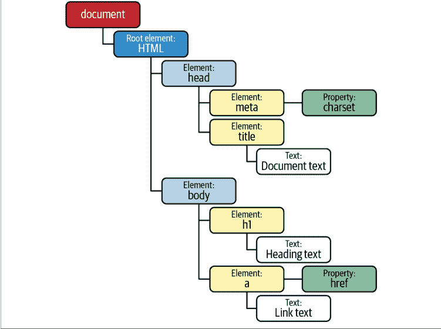

60 | 第 3 章：WebDriver 基础

## WebElement 方法

表 3-3 汇总了 `WebElement` 类中可用方法的摘要。你将在本节的后续部分找到每个方法的示例。

**表 3-3. WebElement 方法**

| 方法 | 返回 | 描述 |
| --- | --- | --- |
| `click()` | `void` | 在当前元素上执行鼠标点击（即左键）。 |
| `submit()` | `void` | 发送 Web 表单（当当前元素为表单时）。 |
| `sendKeys(CharSequence... keys)` | `void` | 模拟键盘输入（例如在输入文本元素中）。 |
| `clear()` | `void` | 重置输入文本元素的值。 |
| `getTagName()` | `String` | 获取元素的标签名称。 |
| `getDomProperty(String name)` | `String` | 获取 DOM 属性的值。 |
| `getDomAttribute(String name)` | `String` | 获取 HTML 标记中声明的元素属性值。 |
| `getAttribute(String name)` | `String` | 以字符串形式获取 HTML 属性（例如 `class`）的值。更准确地说，此方法会尝试获取具有该名称的 DOM 属性的有意义的值。例如，对于属性（如 `readonly`），如果存在则返回 `true`，否则返回 `null`。 |
| `getAriaRole()` | `String` | 获取 W3C WAI-ARIA 规范定义的元素角色（`role`）。 |
| `getAccessibleName()` | `String` | 获取 WAI-ARIA 定义的可访问名称。 |
| `isSelected()` | `boolean` | 确定复选框、选择框或单选按钮是否被选中。 |
| `isEnabled()` | `boolean` | 确定元素是否启用（例如表单字段）。 |
| `isDisplayed()` | `boolean` | 确定元素是否可见。 |
| `getText()` | `String` | 获取元素的可见文本，包括其内部文本（如果有）。 |
| `getLocation()` | `Point` | 获取从渲染元素左上角的的位置（x 和 y 坐标）。 |
| `getSize()` | `Dimension` | 获取渲染元素的宽度和高度。 |
| `getRect()` | `Rectangle` | 获取渲染元素的位置和大小。 |
| `getCssValue(String propName)` | `String` | 获取元素的 CSS 属性值。 |
| `getShadowRoot()` | `SearchContext` | 获取用于在影子树中搜索的影子根（参见第 118 页的“Shadow DOM”）。 |
| `findElements(By by)` | `List<WebElement>` | 在当前元素内查找所有匹配定位器的子元素。 |
| `findElement(By by)` | `WebElement` | 在当前元素内查找第一个匹配定位器的子元素。 |

## 定位策略

Selenium WebDriver 提供了八种基本的定位策略，汇总在表 3-4 中。此外，正如后续章节所示，还有其他高级定位策略，即复合定位器和相对定位器。

我们在 Selenium WebDriver API 中使用 `By` 类来指定基本定位器。以下子节显示了所有这些策略的示例。我们使用练习表单来实现。图 3-2 显示了该表单的截图。

| 定位器 | 基于什么查找元素 |
| --- | --- |
| 标签名 (Tag name) | HTML 标签名称（例如 `a`, `p`, `div`, `img` 等）。 |
| 链接文本 (Link text) | 链接（即 HTML 标签）上显示的精确文本值。 |
| 部分链接文本 (Partial link text) | 链接（即 HTML 标签）中包含的文本。 |
| 名称 (Name) | 属性名称的值。 |
| Id | 属性 `id` 的值。 |
| 类名 (Class name) | 属性 `class` 的值。 |
| CSS 选择器 (CSS selector) | W3C 选择建议的模式。CSS 模式的原始目的是选择网页中的元素以应用 CSS 样式。Selenium WebDriver 允许重用这些 CSS 选择器来查找元素并与其交互。 |
| XPath | 符合 XPath（XML 路径语言）语言的查询。XPath 是一种 W3C 标准查询语言，用于从类似 XML 的文档（例如网页）中选择节点。 |

## 使用 Java 实操 Selenium WebDriver

### 练习站点

### Web 表单

| 下拉菜单 (select) | 颜色选择器 |
|---|---|
| 文本输入 | 打开此选择菜单 |
| 密码 | 下拉菜单（详情） | 日期选择器 |
| 文本区域 | 输入以搜索... |
| 禁用的输入 | 文件输入 | 示例范围 |
| 禁用的输入 | 选择文件 未选择文件 |
| 只读输入 | 已勾选复选框 |
| 只读输入 | 已勾选复选框 |
| 只读输入 | 提交 |

Copyright © 2021 按标签名定位

查找元素的基本策略之一是按标签名。图 3-2 显示了该表单的截图。

```html
<textarea>
```

**示例 3-6. 使用标签名测试**


```java
@Test
void testTagName() {
  driver.get("https://bonigarcia.dev/selenium-webdriver-java/web-form.html");
  WebElement textarea = driver.findElement(By.tagName("textarea"));
  assertThat(textarea.isEnabled());
}
```

1. 我们按名称定位。
2. 我们断言元素启用。
3. 我们按 `id` 查找相同的文本。
4. 此断言（以及下一个）返回不同的值，因为属性不是标准的。

## 按属性定位 (`name`, `class`)

另一种定位器是按 HTML 属性（`name`, `class`）。我们使用练习表单来实现这一点。然后，示例 3-7 显示了如下：

```html
<input type="text" name="username" class="control">
```

**示例 3-7. 按属性测试**

```java
@Test
void testByAttributes() {
  driver.get("https://bonigarcia.dev/selenium-webdriver-java/web-form.html");
  WebElement textByName = driver.findElement(By.name("username"));
  assertThat(textByName.isEnabled());

  WebElement textById = driver.findElement(By.id("password"));
  assertThat(textById.isEnabled());

  WebElement textClass = driver.findElement(By.className("control"));
  assertThat(textClass.isEnabled());
}
```

1. 我们按名称定位。
2. 我们断言元素启用。

## 按链接文本定位

最后一个定位器是按链接文本。这种策略有两个部分：精确匹配和部分匹配。我们使用练习网页中的链接来实现。然后，示例 3-8 显示了使用这些定位器。

```html
<a href="index.html">Return to index</a>
```

**示例 3-8. 使用链接文本测试**

```java
@Test
void testByLinkText() {
  driver.get("https://bonigarcia.dev/selenium-webdriver-java/web-form.html");

  WebElement linkByText = driver.findElement(By.linkText("Return to index"));
  assertThat(linkByText.TagName()).isEqualTo("a");
  assertThat(linkByText.getCssValue("cursor")).isEqualTo("pointer");

  WebElement linkByPartialText = driver.findElement(By.partialLinkText("index"));
  assertThat(linkByPartialText.getLocation()).isEqualTo(linkByText.getLocation());
  assertThat(linkByPartialText.getRect()).isEqualTo(linkByText.getRect());
}
```

# 定位 CSS 选择器

我们目前看到的策略虽然易于应用，但也存在一些局限性。首先，通过标签名定位可能很困难，因为同一个标签在网页上可能会出现多次。通过 HTML 属性（`name`、`id` 或 `class`）查找元素也是一种有限的方法，因为这些属性并不总是可用的。此外，`id` 在不同会话之间是生成的且瞬息变化的。最后，通过链接文本（`link text`）定位仅限于链接。为了克服这些局限性，Selenium WebDriver 提供了两种强大的定位策略：CSS 选择器和 XPath。

创建 CSS 选择器有许多种可能性。表 3-5 展示了对基础 CSS 选择器的综合总结。

**表 3-5. 基础 CSS 选择器**

| 类别 | 语法 | 描述 | 示例 | 示例说明 |
| --- | --- | --- | --- | --- |
| 通配符 `*` | 选择所有元素 | `*` | 匹配所有元素 |
| 类型元素 | 选择具有给定标签名的元素 | `Input` | 匹配所有 `<input>` 元素 |
| 类 `.classname` | 选择具有给定类属性的元素 | `.form-control` | 匹配所有 `class` 为 `form-control` 的元素 |
| ID `#id` | 选择具有给定 `id` 的元素 | `#my-text-id` | 匹配所有 `id` 为 `my-text-id` 的元素 |
| 属性 `[attr]` | 选择具有给定属性的元素 | `[target]` | 匹配所有具有 `target` 属性的元素 |
| `[attr=value]` | 选择具有给定属性和值的元素 | `[target=_blank]` | 匹配所有 `target` 为 `_blank` 的元素 |
| `[attr~value]` | 选择包含某些文本值的给定属性的元素 | `[title~hands]` | 匹配所有 `title` 属性包含 `hands` 单词的元素 |
| `[attr\|=value]` | 选择属性等于或以某些值开头的元素 | `[lang\|en]` | 匹配所有等于或以 `en` 开头的元素 |
| `[attr^=value]` | 选择属性以某些值开头的给定元素 | `a[href^="https"]` | 匹配所有 `href` 以 `https` 开头的链接 |
| `[attr$=value]` | 选择属性以某些值结尾的给定元素 | `a[href$="pdf"]` | 匹配所有 `href` 以 `.pdf` 结尾的链接 |
| `[attr*=value]` | 选择包含某些字符串的给定属性 | `a[href*="github"]` | 匹配所有 `href` 属性包含 `github` 的链接 |

下面的 HTML 片段显示了练习表单中隐藏的输入文本。然后，示例 3-9 演示了使用 CSS 选择器定位该元素的可能方法。这种定位器的优点是，即使在 HTML 标记中更改了属性名称，选择器仍然有效。

```html
<input type="hidden" name="my-hidden">
```

**示例 3-9. 使用基础 CSS 选择器定位器进行测试**

```java
@Test
void testByCssSelectorBasic() {
  driver.get(
    "https://bonigarcia.dev/selenium-webdriver-java/web-form.html";
  );
  WebElement hidden = driver
    .findElement(By.cssSelector("input[type=hidden]"));
  assertThat(hidden.isDisplayed()).isFalse();
}
```

1. 我们使用 CSS 选择器选择隐藏输入框。
2. 我们检查隐藏字段是否可见。

创建 CSS 选择器有许多可能性。表 3-6 显示了它们的总结。CSS 选择器的完整参考可以在 W3C 建议中找到。

**表 3-6. 高级 CSS 选择器**

| 类别 | 语法 | 描述 | 示例 | 示例说明 |
| --- | --- | --- | --- | --- |
| 分组 | | 组合两个（或多个）选择器 | `div span` | 匹配所有 `<span>` 和 `<div>` 元素 |
| 组合符（空格） | | 选择后代 | `div span` | 匹配 `<div>` 内部的所有 `<span>` |
| | `A > B` | 选择另一个元素的直接子元素 | `ul > li` | 匹配直接嵌套在 `<ul>` 内部的所有 `<li>` 元素 |
| | `A ~ B` | 选择共享父元素的元素（即兄弟元素），且第二个元素在第一个元素之后（不一定紧邻） | `p ~ span` | 匹配所有在 `<p>` 之后的 `<span>`（相邻或不相邻） |
| | `A + B` | 兄弟元素，且第二个元素紧跟在第一个之后 | `h2 + p` | 匹配所有紧跟 `<h2>` 之后的 `<p>` |
| 伪类 | | 选择 CSS 伪类（即选中元素的特殊状态） | `a:visited` | 匹配所有访问过的链接 |
| | `:nth-child(n)` | 根据元素在组中的位置选择元素（从开始计数） | `p:nth-child(2)` | 匹配第二个 `<p>` 子元素 |
| | `:not(selector)` | 选择不匹配给定选择器的元素 | `:not(p)` | 匹配所有不同于 `<span>` 的元素 |
| | `:nth-last-child(n)` | 根据元素在组中的位置选择元素（从结束计数） | `p:nth-last-child(2)` | 匹配第二个元素（从倒数开始） |
| | `::` | 选择 CSS 伪元素（即选中元素的特定部分） | `p::first` | 匹配所有元素的第一行 |

考虑这段 HTML（按照习惯，包含在表单中）。如你所见，有两个复选框：一个被选中了，另一个没有。我们可以使用 Selenium WebDriver API 和 CSS 选择器来确定哪个元素是被选中的。为了实现这一目标，示例 3-10 使用了 CSS 伪代码：

```html
<input class="form-check-input" type="checkbox" name="my-check" id="my-check-1" checked>
<input class="form-check-input" type="checkbox" name="my-check" id="my-check-2">
```

**示例 3-10. 使用 CSS 选择器定位**

```java
@Test
void testByCssSelector() {
  driver.get("https://bonigarcia.dev/selenium-webdriver-java/web-form.html");

  WebElement checkbox1 = driver
    .findElement(By.cssSelector("[type=checkbox]:checked]"));
  assertThat(checkbox1.getAttribute("id")).isEqualTo("my-check-1");
  assertThat(checkbox1.isSelected()).isTrue();

  WebElement checkbox2 = driver
    .findElement(By.cssSelector(":not([type=checkbox]:checked])"));
  assertThat(checkbox2.getAttribute("id")).isEqualTo("my-check-2");
  assertThat(checkbox2.isSelected()).isFalse();
}
```

1. 我们使用伪类定位被选中的复选框。
2. 我们确认该复选框确实是选中的状态。
3. 我们使用伪类和 `not` 操作符定位未选中的复选框。
4. 我们确认该复选框是未选中的状态。

# 通过 XPath 定位

XPath（XML 语言）是导航 XML 类文档（如 HTML 页面）DOM 的强大方式。它包含了两多个内置函数，用于创建选择节点的查询。XPath 查询有两种类型。首先，绝对查询使用斜杠（`/`）从根节点遍历 DOM。例如，考虑示例 3-5 中的基础 HTML 页面，使用这种方法选择页面中的链接元素，我们需要如下 XPath 查询：

```xpath
/html/body/a
```

绝对 XPath 查询很容易创建，但有一个很大的不便之处：页面布局的任何微小变化都会导致基于此构建的定位器失效。因此，通常不建议使用绝对 XPath。相反，相对查询更加方便。

相对查询的通用语法如下：

```xpath
//tagname[@attribute='value']
```

示例 3-11 显示了使用 XPath 定位器对练习网页中隐藏字段的测试。

**示例 3-11. 使用基础 XPath 定位器进行测试**

```java
@Test
void testByXPathBasic() {
    driver.get(
    "https://bonigarcia.dev/selenium-webdriver-java/web-form.html";
    
    WebElement hidden = driver.findElement(By.xpath("//input[@type='hidden']"));
    assertThat(hidden.isDisplayed()).isFalse();
}
```

1. 我们使用 XPath 定位练习网页中的隐藏字段。
2. 我们验证该字段是可见的。

## 表 3-7. 相关 XPath 内置函数摘要

| 类别 | 语法 | 说明 | 示例 | 示例说明 |
| --- | --- | --- | --- | --- |
| 属性 | `contains(@attr, 'string')` | 检查属性是否包含某个字符串 | `//a[contains(@href, 'github')]` | 匹配 `href` 包含 `github` 的链接 |
| | `starts-with(@attr, 'string')` | 检查属性是否以某个字符串开头 | `//a[starts-with(@href, 'https://')]` | 匹配所有使用 HTTPS 的链接 |
| | `ends-with(@attr, 'string')` | 检查属性是否以某个字符串结尾 | `//a[ends-with(@href, .pdf)]` | 匹配指向 PDF 文档链接 |
| 文本 | `text()='string'` | 根据文本内容定位元素 | `//*[text()='click']` | 匹配所有文本为 `click` 的元素 |
| 子节点 | `[index]` | 定位元素 | `//div/*[0]` | `<div>` 的第一个子元素 |
| | `or` | 逻辑运算符 | `//[@type='submit' or @type='reset']` | 匹配提交和重置表单的按钮 |
| | `and` | 逻辑运算符 | `//[@type='submit' and @id='my-button']` | 匹配给定 `id` 的按钮 |
| | `not()` | 逻辑运算符 | `//[@type='submit' and not(@id='my-button')]` | 匹配与某 `id` 不同的按钮 |
| 轴（用于定位相对节点） | `following::item` | 当前节点之后的节点 | | 匹配第一个文本输入之后的所有字段 |
| | `descendant::item` | 选择节点的后代元素（子节点等） | `//*[@id='my-id']//descendant::a` | 从给定父节点匹配所有后代链接 |
| | `ancestor::item` | 选择节点的祖先元素（父节点等） | `//input[@id='my-id']//ancestor::label` | 从给定输入框匹配所有祖先标签 |
| | `child::item` | 选择当前节点的子元素 | `//*[@id='my-id']//child::id` | 匹配给定节点下的所有列表元素 |
| | `preceding::item` | 选择当前节点之前的所有节点 | `//*[@id='my-id']//preceding::input` | 匹配给定节点之前的所有输入框 |
| | `following-sibling::item` | 选择当前节点之前的同级节点 | `//*[@id='my-id']//following-sibling::input` | 匹配给定节点之前的输入框 |
| | `parent::item` | 选择当前节点的父节点 | `//*[@id='my-id']//parent::div` | 匹配给定节点的父 `div` 元素 |

第 3 章：WebDriver 基础

示例 3-12 显示了如何使用 XPath 定位器处理练习表单中的单选按钮。单选按钮的 HTML 标记如下：

```html
<input class="form-check-input" type="radio" name="my-radio" id="my-radio-1" checked>
<input class="form-check-input" type="radio" name="my-radio" id="my-radio-2">
```

**示例 3-12. 使用 XPath 高级定位器进行测试**


```java
@Test
void testByXPathAdvanced() {
  driver.get(
    "https://bongarcia.dev/selenium-webdriver-java/web-form.html");

  WebElement radio1 = driver
    .findElement(By.xpath("//*[@type='radio' and @checked]"));
  assert(radio1.getAttribute("id")).isEqualTo("my-radio-1");
  assert(radio1.isSelected()).isTrue();

  WebElement radio2 = driver
    .findElement(By.xpath("//*[@type='radio' and not(@checked)]"));
  assert(radio2.getAttribute("id")).isEqualTo("my-radio-2");
  assert(radio2.isSelected()).isFalse();
}
```

- 我们使用 XPath 定位已选中的单选按钮。
- 我们检查元素 id 是否符合预期。
- 我们确认选中状态为已勾选。
- 我们使用 XPath 定位未选中的单选按钮。
- 我们检查元素 id 是否符合预期。
- 我们确认选中状态为未勾选。

第 80 页的“你应该使用哪种策略？”提供了 CSS 选择器和 XPath 之间的比较，并为选择其中一种定位器提供了一些提示。

# 在网页上寻找定位器

如第 1 章中的表 1-4 所示，我们可以使用不同的工具来帮助为 WebDriver 测试生成定位器。本节展示了如何使用主流浏览器内置开发工具的主要功能，即基于 Chromium 的浏览器（如 Chrome 和 Edge）的 Chrome DevTools，以及 Firefox 开发者工具（Firefox）。

你可以通过右键点击想要测试的网页 UI 部分并选择“检查（Inspect）”选项菜单来打开这两个开发者工具。图 3-3 显示了位于浏览器底部的 Chrome DevTools 截图（如果你移动了它的话）。

开发者工具提供了网页中定位元素的不同方法。首先，我们通过点击开发者工具面板左上角的图标（框上的箭头）来使用元素选择器。然后，我们可以将鼠标悬在页面上以高亮每个元素，并查看元素面板以检查它们的标记、属性。

图 3-3. 在浏览站点页面时使用 Chrome DevTools。

在同一视图下，我们可以通过右键点击元素并选择选项菜单“复制（Copy）”来复制其 CSS 或 XPath。这种机制允许获取完整的 CSS 或 XPath 选择器。这可以是快速生成定位器的第一方法，尽管我不建议直接使用这些定位器，因为它们往往是脆弱的（即取决于当前的页面布局）。

# 第 3 章：WebDriver 基础

为了创建稳健的 CSS 或 XPath 定位器，我们需要考虑我们正在处理的网页的具体特性，并根据这些知识创建自定义选择器。再次，开发者工具可以帮助我们。我们可以按下快捷键 Ctrl + F 在 Chrome DevTools 中通过字符串、CSS 选择器或 XPath 进行搜索。图 3-4 显示了此功能的用法示例。注意我们正在使用该表单，并输入字符串 `#text-id`，这对应于使用 CSS 选择器匹配给定 id 的元素。图 3-4。

在 Firefox 中可以使用类似的方法。我们使用控制台面板并输入 `("css selector")` 或 `("xpath-query")`。图 3-5 显示搜索 CSS 选择。

# 复合定位器

Selenium WebDriver API 有几个类允许组合我们见过的不同定位器类型。这些是：

- `ByIdOrName(String idOrName)`：它通过 id 查找，如果不存在，则通过 name 查找。
- `ByChained(By...)`：它按顺序查找元素。
- `ByAll(By...)`：它查找匹配多个位置的元素。

# Java 实战 Selenium

## 练习站点

```html
<input class="form-control" type="file" name="my-file">
```

- 我们使用 `ByAll` 来使用定位器。
- 我们找到了五个元素，因为该定位器匹配了页面上的一个 `<form>` 元素加上四个 `<div class="row">` 元素。

## 相对定位器

WebDriver 4 版本引入了在网页中查找元素的新方法：相对定位器（relative locators）。这些新的定位器旨在相对于另一个已知元素查找网页元素。此功能基于 CSS 盒模型。该模型确定 Web 文中的每个元素都是使用矩形框进行渲染的。

图 3-6 显示了练习中给定网页元素的此类盒模型示例。

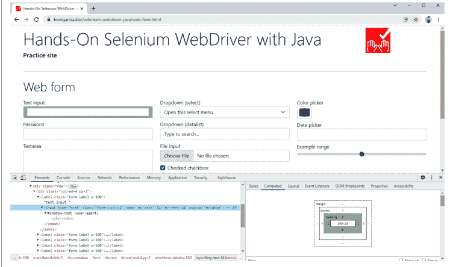

图 3-6 显示网页元素的盒模型。

使用该模型，Selenium WebDriver API 提供的相对定位器允许元素与另一个网页元素的位置建立联系。为了实现这一目标，我们需要使用标准的定位策略（例如通过 id、name、属性等）定位该网页元素。然后，我们需要使用 `RelativeLocator` 类的静态方法，指定相对于原始网页元素近距离的定位器类型。结果，我们得到了一个 `RelativeBy` 对象，它扩展了标准定位策略中使用的抽象类 `By`。`RelativeBy` 对象提供了以下方法来执行相对定位：

### `above()`

查找位于原始元素方的元素。

### `below()`

查找位于原始元素下方的元素。

### `near()`

查找位于原始元素附近的元素。默认考虑某个元素靠近其他元素的距离是的一百像素。该定位器经过重载，可以指定另一个距离。

### `toLeftOf()`

查找位于原始元素左侧的元素。

### `toRightOf()`

查找位于原始元素右侧的元素。

示例 3-15 显示了一个使用相对定位器的基础测试。再次，我们使用练习网页来说明这一功能。

## 示例 3-15：使用相对定位器

```java
@Test
void testRelativeLocators() {
    driver.get(
        "https://bongarcia.dev/selenium-webdriver-java/web-form.html");
    
    WebElement link = driver.findElement(By.linkText("Return to index")); 1
    RelativeBy relativeBy = RelativeLocator.with(By.tagName("input")); 2
    WebElement readonly = driver.findElement(relativeBy.above(link)); 3
    assertThat(readonly.getAttribute("name")).isEqualTo("my-readonly"); 4
}
```

- 1 我们定位文本为 "Return to index" 的链接。
- 2 我们指定了相对定位器类型，它将通过标签名 `input` 进行查找。
- 3 我们使用相对定位器在原始网页元素（即链接）上方查找一个网页元素（应该是一个 input 字段）。
- 4 我们验证引用链接上方的元素是否为只读字段（参见图 3-2 以双重检查）。

相对定位器对于根据其他元素的相对位置查找元素非常有帮助。另一方面，这种策略对页面布局非常敏感。例如，在响应式页面中使用相对定位器时需要小心，因为布局可能会随着视口而变化。

## 一个具有挑战性的示例

到目前为止看到的示例都相当简单。现在让我们来看一个更复杂的案例。练习网页中的非故障事件是日期选择器。正如其名称所示，该元素提供了一种使用 Web GUI 选择日期的方法。由于练习网站使用的 CSS 框架是 Bootstrap，我使用 `bootstrap-datepicker` 将日期选择器实现到一个输入字段中。当用户点击此字段时，网页上会出现日历（参见图 3-7）。用户可以通过导航不同的天、月、年并选择首选日期来选择日期。

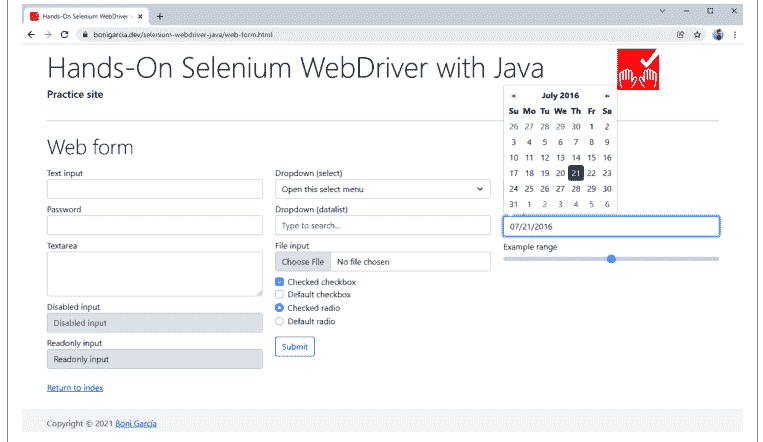

图 3-7 练习表单中的日期选择器。

我们使用 Selenium WebDriver 实现一个自动化测试，通过与日期选择器 GUI 交互，选择当前的日期但之前的年份。示例 3-16 显示了最终实现。

为了遵循此示例，我建议在浏览器中打开练习表单（代码示例中的 URL），并使用开发者工具检查日期选择器选择器的内部元素，注意使用的不同选择策略。

## 示例 3-16：与日期选择器的交互测试

```java
@Test
void testDatePicker() {
  driver.get(
    "https://bonigarcia.dev/selenium-webdriver-java/web-form.html");


  // 从系统时钟获取当前日期
  LocalDate today = LocalDate.now();
  int currentYear = today.getYear();
  int currentDay = today.getDayOfMonth();

  // 点击日期选择器打开日历
  WebElement datePicker = driver.findElement(By.name("my-date"));
  datePicker.click();

  // 通过文本查找点击当前月份
  WebElement element = driver.findElement(By.xpath(
    String.format("//th[contains(text(),'%d')", currentYear)));
  element.click();

  // 使用相对定位器点击左侧箭头
  WebElement arrowLeft = driver.findElement(RelativeLocator.with(By.tagName("input")).toRightOf(element));
  arrowLeft.click();

  // 点击当前月份
  WebElement monthYear = driver.findElement(RelativeLocator.with(By.tagName("span")).below(arrowLeft));
  monthYear.click();

  // 点击当前日期
  WebElement day = driver.findElement(RelativeLocator.with(By.tagName("td")).above(monthYear));
  day.click();

  // 验证结果
  String result = datePicker.getAttribute("value");
  assertThat(result).isEqualTo(String.format("%d/%d/%d", currentDay, currentMonth, currentYear));
}
```

| 定位器 | XPath | CSS 选择器 |
|---|---|---|
| 在 `<div>` 中文本查找 | `//div[text()='search-string']` | 不支持 |
| `<div>` 的第一个子元素 | `//div/*[1]` | `div*:first-child` |
| 所有带有链接子元素的 `<div>` | `//div[a]` | 不支持 |
| `<div>` 中的下一个元素 | `//div/following-sibling::*[1]` | `div + *` |
| `<div>` 的上一个元素 | `//div/preceding-sibling::*[1]` | 不支持 |

综上所述，我们可以看到 XPath 提供了最通用的策略。然而，在某些情况下，CSS 选择器提供了更易读的语法（例如，通过 id 或类进行定位）以及更佳的通用性能。

## 键盘操作

如表 3-3 所示，WebDriver 对象中的两种主要方法允许模拟键盘用户操作：`sendKeys()` 和 `clear()`。示例 3-17 显示了一个使用这些方法的用例。

### 示例 3-17：插入键盘事件

```java
@Test
void testSendKeys() {
    driver.get("https://bonigarcia.dev/selenium-webdriver-java/web-form.html");

    WebElement inputText = driver.findElement(By.name("my-text")); // ①
    String textValue = "Hello World!";
    inputText.sendKeys(textValue); // ②
    assertThat(inputText.getAttribute("value")).isEqualTo(textValue); // ③

    inputText.clear(); // ④
    assertThat(inputText.getAttribute("value")).isEmpty(); // ⑤
}
```

- 1 我们使用练习表单创建名为 `my-text` 的输入文本框。
- 2 我们使用 `sendKeys()` 方法模拟在上面进行键盘打字。
- 3 我们评估输入值是否符合预期。
- 4 我们使用 `clear()` 重置其内容。
- 5 我们评估输入值是否为空。

## 测试清理阶段（Test Teardown）中的手动等待

如果你检查仓库中某些测试的完整代码，你会发现 `teardown` 方法中使用了 `Thread.sleep()` 暂停。正如第 94 页“等待策略（Waiting-Strategies）”所解释的，这种等待通常会导致代码异味（即可能导致不良后果的源代码特征）。尽管如此，为了教学目的，我在某些示例中特意使用了它，即方便在本地执行测试时手动检查浏览器。如果你计划在实际测试中重用这些示例，我建议删掉这些行。

## 文件上传

在用 Selenium WebDriver 与网页交互时，有几种情况我们需要模拟键盘操作。Web 应用程序上传文件的标准机制是使用 `type="file"` 的 `<input>` 元素。例如，练习表单包含其中一个元素：

```html
<input class="form-control" type="file" name="my-file">
```

Selenium WebDriver API 未提供处理文件输入的特殊机制。相反，我们应该将用于上传文件的输入元素视为普通的文本输入，因此我们需要模拟用户打字。特别是，我们需要输入要上传文件的绝对路径。示例 3-18 说明了如何操作。

### 示例 3-18：测试上传文件

```java
@Test
void testFileUpload() throws IOException {
  String initUrl = "https://bonigarcia.dev/selenium-webdriver-java/web-form.html";
  driver.get(initUrl);
  WebElement inputFile = driver.findElement(By.name("my-file")); ①
  Path tempFile = Files.createTempFile("tempfiles", ".tmp"); ②
  String filename = tempFile.toAbsolutePath().toString();
  log.debug("Using temporal file {} in file uploading", filename); ③
  inputFile.sendKeys(filename); ④

  driver.findElement(By.tagName("form")).submit(); ⑤
  assertThat(driver.getCurrentUrl()).isEqualTo(initUrl); ⑥
}
```

- ① 我们使用 `by-name` 策略定位输入字段。
- ② 我们使用标准 Java 创建一个临时文件。
- 我们将它的绝对路径输入到输入字段。
- 我们提交表单。
- 我们验证结果页面（由 action form 属性定义）与初始网页不同。

发送到输入文件的路径应对应于运行测试的机器上存在的存档。否则，测试将因 `IllegalArgumentException` 失败。关于异常的更多细节，请参阅第 5 章第 142 页的“WebDriver 异常”。


当向远程浏览器上传文件（如第 6 章所述）时，我们需要显式从本地文件系统加载文件。以下行显示了如何指定特定的本地检测器。

```java
((RemoteWebDriver) driver).setFileDetector(new LocalFileDetector());
```

## 范围滑块

`<input type="range">` 表单字段也存在类似的情况。这些元素允许用户使用图形滑块在范围内选择数字。你可以在网页表单中找到一个示例：

```html
<input type="range" class="form-range" name="my-range" min="0" max="10" step="1" value="5">
```

再次，Selenium WebDriver API 未提供任何处理这些字段的特殊工具。我们可以通过 Selenium WebDriver 模拟键盘操作来与它们交互。示例 3-19 显示了与这些字段的测试交互。

### 示例 3-19：使用这些字段选择数字


```java
@Test
void testSlider() {
  driver.get("https://bonigarcia.dev/selenium-webdriver-java/web-form.html");

  WebElement slider = driver.findElement(By.name("my-range"));
  String initValue = slider.getAttribute("value");
  log.debug("Initial value: {}", initValue);

  for (int i = 0; i < 5; i++) {
    slider.sendKeys(Keys.ARROW_RIGHT);
  }

  String endValue = slider.getAttribute("value");
  log.debug("Final value: {}", endValue);
  assertThat(endValue).isEqualTo("5");
}
```

## 鼠标操作

除了键盘，与 Web 应用交互的另一个主要设备是鼠标。本节展示了使用 Selenium WebDriver 的典型案例。其他常见的鼠标操作包括右点击（也称为上下文点击）、双击、光标移动、拖放、悬停。Selenium WebDriver 允许通过辅助类模拟这些操作。最后，可以通过执行 JavaScript 实现滚动。我在后续文中解释了这一功能。

示例 3-20 显示了一个使用 Selenium WebDriver 实现自动化导航的测试。该测试使用 XPath 定位并点击它们。最后，它读取页面文本并包含预期的字符串。

```java
@Test
void testNavigation() {
  driver.get("https://bonigarcia.dev/selenium-webdriver-java/web-form.html");

  driver.findElement(By.xpath("//text='Navigation']")).click();
  driver.findElement(By.xpath("//text='Next']")).click();
  driver.findElement(By.xpath("//text='3']")).click();
}
```

## 复选框和单选框

示例 3-21 显示了 `click()` 方法处理复选框和单选框的基础用法。为了验证点击操作后这些元素的预期状态，我们根据 `isSelected()` 的结果进行断言。

```java
@Test
void testCheckboxesAndRadioButtons() {
  driver.get("https://bonigarcia.dev/selenium-webdriver-java/web-form.html");

  WebElement checkbox2 = driver.findElement(By.id("my-checkbox-2"));
  checkbox2.click();
  assertThat(checkbox2.isSelected()).isTrue();

  WebElement radio2 = driver.findElement(By.id("my-radio-2"));
  radio2.click();
  assertThat(radio2.isSelected()).isTrue();
}
```

## 表 3-11. 操作方法

| 方法 | 说明 |
| --- | --- |
| `keyDown(CharSequence key)` `keyDown(WebElement target, CharSequence key)` | 在当前位置（或给定元素）发送单个按键（可以使用 `Keys` 类发送特殊字符）。该按键将保持按下状态，直到调用 `keyUp()`。 |
| `keyUp(CharSequence key)` `keyUp(WebElement target, CharSequence key)` | 释放之前通过 `keyDown()` 按下的按键。 |
| `sendKeys(CharSequence... keys)` `sendKeys(WebElement target, CharSequence... keys)` | 在当前位置（或给定元素）发送按键序列。此方法与 `WebElement#sendKeys(CharSequence...)` 有两处不同：1) 修饰键（例如 `KEYS.CONTROL`、`KEYS.SHIFT`）不会被显式释放。2) 元素不需要获得焦点，因此 `TAB` 键应该有效。 |
| `clickAndHold()` `clickAndHold(WebElement target)` | 在不释放当前位置（或给定元素的中间）的情况下点击。 |
| `release()` `release(WebElement target)` | 释放之前通过 `clickAndHold()` 按下的左鼠标键。 |
| `click()` `click(WebElement target)` | 在当前位置（或给定元素）上点击。 |
| `doubleClick()` `doubleClick(WebElement target)` | 在当前位置（或元素）上双击。 |
| `contextClick()` `contextClick(WebElement target)` | 在当前位置（或元素）上右击。 |
| `moveToElement(WebElement target)` `moveToElement(WebElement target, int xoffset, int yoffset)` | 将鼠标指针移动到给定元素的中间（偏移给定的量）。 |
| `moveToOffset(int xoffset, int yoffset)` | 根据给定的偏移量从当前位置（默认 0, 0）移动鼠标。 |
| `dragAndDrop(WebElement source, WebElement target)` `dragAndDrop(WebElement source, int xoffset, int yoffset)` `dragAndDrop(WebElement source, int xoffset, int yoffset)` | 此操作由三个步骤组成：1) 在源元素位置的中间（偏移）点击并按住。2) 将鼠标移动到目标元素位置。3) 释放鼠标点击。 |
| `pause(long pause)` `pause(Duration duration)` | 在操作链中执行暂停（以毫秒为单位或使用 Java `Duration`）。 |
| `build()` | 生成一个包含之前所有操作的复合操作。 |
| `perform()` | 执行复合操作。 |

## 右击和双击

你可以在练习站点上找到一个使用三个下拉菜单的演示页面（见图 3-8）。在该页面上，第一个下拉菜单在点击其按钮时出现，第二个使用右击，第三个需要双击。示例 3-22 显示了一个通过 WebDriver 类模拟用户手势的测试页面。

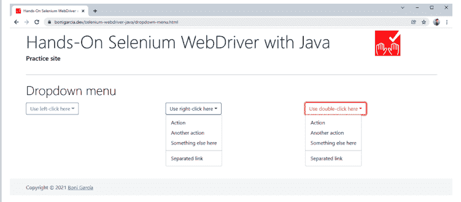

图 3-8. 带有下拉菜单的练习页面

示例 3-22. 使用右击和双击的测试

```java
@Test
void testContextAndDoubleClick() {
  driver.get(
    "https://bonigarcia.dev/selenium-webdriver-java/dropdown-menu.html");
  Actions actions = new Actions(driver);

  WebElement dropdown2 = driver.findElement(By.id("my-dropdown-2"));
  actions.click(dropdown2).build().perform();
  WebElement contextMenu2 = driver.findElement(By.id("context-menu-2"));
  assertThat(contextMenu2.isDisplayed()).isTrue();

  WebElement dropdown3 = driver.findElement(By.id("my-dropdown-3"));
  actions.doubleClick(dropdown3).build().perform();
  WebElement contextMenu3 = driver.findElement(By.id("context-menu-3"));
  assertThat(contextMenu3.isDisplayed()).isTrue();
}
```

- 1 我们在中间的下拉菜单中使用 `context()`。
- 2 我们验证中间菜单是否正确显示。
- 我们在右侧下拉菜单中使用 `doubleClick()`。
- 我们验证右侧菜单是否正确显示。

## 鼠标悬停（Mouseover）

第二个示例 Actions 使用了一个实现鼠标悬停的示例网页。该页面显示了四张图片。当鼠标指针悬停在图片上时，每张图片下方都会显示一个文本标签。示例 3-23 包含一个在该页面的测试。图 3-9 显示了当鼠标悬停在第一张图片上时的该页面。

示例 3-23. 使用鼠标悬停的测试。

```java
@Test
void mouseOver() {
  driver.get(
    "https://bonigarcia.dev/selenium-webdriver-java/mouse-over.html");
  Actions actions = new Actions(driver);

  List<String> imageList = Arrays.asList("compass", "calendar", "award");
  for (String imageName : imageList) {
    String xpath = String.format("//img[@src='%s.png']", imageName);
    WebElement image = driver.findElement(By.xpath(xpath));
    actions.moveToElement(image).build().perform();

    WebElement caption = driver.findElement(RelativeLocator.withTagName("div").near(image));
    assertThat(caption.getText()).contains(imageName);
  }
}
```

- 我们遍历一个字符串列表来找到页面上的四张图片。
- 我们使用 XPath 寻找每个 `` 元素。
- 我们使用 `moveToElement()` 将鼠标指针移动到每张图片的中间。
- 我们使用相对定位器（relative locators）找到标签。
- 我们使用断言来验证文本符合预期。

## 使用 Java 实践上手 Selenium WebDriver

练习站点 鼠标悬停


图 3-9. 带有鼠标悬停图片的练习网页

## 拖放（Drag and Drop）

示例 3-24 演示了拖放的使用。此测试使用了图 3-10 所示的练习网页。

```java
@Test
void testDragAndDrop() {
    driver.get("https://bonigarcia.dev/selenium-webdriver-java/drag-drop.html");
    Actions actions = new Actions(driver);

    WebElement draggable = driver.findElement(By.id("draggable")); // 1
    int offset = 100;
    Point getLocation = draggable.getLocation();
    actions.dragAndBy(draggable, offset, 0)
          .dragAndBy(draggable, 0, -offset).build(); // 2
    assertThat(getLocation).isEqualTo(draggable.getLocation()); // 3

    WebElement target = driver.findElement(By.id("target")); // 4
    actions.dragAndDrop(draggable, target).build(); // 5
    assertThat(target.getLocation()).isEqualTo(draggable.getLocation()); // 6
}
```

- 1 我们定位到可拖拽元素。
- 我们使用 `dragAndDrop()` 将此元素移动固定像素数（100）四次（右、下、左、上）。
- 我们断言元素的位置与开始时相同。
- 我们找到第二个元素（不可拖拽的）。
- 我们使用 `dragAndDrop()` 将可拖拽元素移动到第二个元素。
- 我们断言两个元素的位置相同。

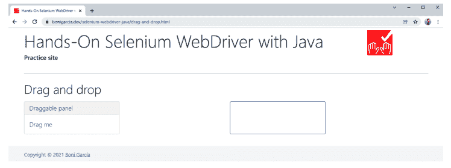

图 3-10. 带有可拖拽元素的练习网页

## 点击并按住（Click and Hold）

以下示例显示了复杂的用户手势，包括点击并按住。为此，我们使用图 3-11 中的网页进行练习。

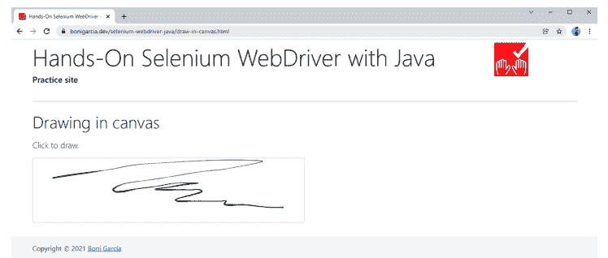

图 3-11. 带有绘制画布的练习网页

该页面使用一个名为 Signature Pad 的开源库，通过鼠标在 HTML 画布上绘制签名。示例 3-25 显示了一个使用该库的测试。

```java
@Test
void testClickAndHold() {
  driver.get(
    "https://www.bonigarcia.dev/selenium-webdriver-java/draw-in-canvas.html");
  Actions actions = new Actions(driver);

  WebElement canvas = driver.findElement(By.tagName("canvas"));
  actions.moveToElement(canvas).clickAndHold();

  int numPoints = 30;
  for (int i = 0; i < numPoints; i++) {
    double angle = Math.toRadians(360 * i / numPoints);
    double x = Math.sin(angle) * 100;
    double y = Math.cos(angle) * 100;
    actions.moveByOffset((int)x, (int)y);
  }
  actions.release(canvas).build().perform();
}
```

- 1 我们通过标签名定位画布。
- 2 我们使用 `moveToElement()` 将鼠标移动到该元素，并将 `clickAndHold()` 操作（用于在画布绘制）添加到操作队列。
- 3 我们遍历固定次数的点，使用公式寻找圆周上的点。
- 4 我们根据圆周点（x 和 y）偏移移动鼠标（`moveOffsetY`）。由于上一步按住了点击，产生的复合操作将在按下鼠标键时移动鼠标。
- 5 我们释放点击，构建操作并执行整个链。结果画布上应该出现一个圆。

## 示例 3-26. 模拟复制与粘贴

```java
@Test
void testCopyAndPaste() {
  driver.get(
    "https://bonigarcia.dev/selenium-webdriver-java/web-form.html");
  Actions actions = new Actions(driver);

  WebElement inputText = driver.findElement(By.name("my-text"));
  WebElement textarea = driver.findElement(By.name("textarea"));

  Keys modifier = SystemUtils.IS_OS_MAC ? Keys.COMMAND : Keys.CONTROL;
  actions.sendKeys(inputText, "hello").keyDown(modifier)
    .sendKeys(inputText, "a").sendKeys(inputText, "c")
    .sendKeys(textarea, "").build().perform();

  assertThat(inputText.getAttribute("value")
    .isEqualTo(textarea.getAttribute("value")));
}
```

- 我们定位了两个 Web 元素：一个输入框和一个文本区域。
- 我们使用修饰键来执行组合键 Ctrl + C（Windows）或 Cmd + C（macOS）进行复制。为了这一目的，我们使用了 `SystemUtils` 类，该类可在开源库 Apache Commons IO 中找到（此依赖在 Maven/Gradle 项目中被传递地使用）。
- 我们实现了一个由以下步骤组成的动作链：
  1. 向输入框发送字符序列 `hello`。


2. 按下修饰键（根据操作系统，为 `Ctrl` 或 `Cmd`）。注意，在我们显式释放它之前，该修饰键会一直保持按下状态。

3. 向输入框发送字符 `a`。由于修饰键处于激活状态，产生的组合键为 `Ctrl + A`（或 `Cmd + A`），结果是输入框中的文本被选中。

4. 向输入框发送字符 `c`。同样，由于修饰键处于激活状态，组合键为 `Ctrl + C`（或 `Cmd + C`），输入框被复制到剪贴板。

5. 向文本区域发送字符 `v`。这意味着发送 `Ctrl + V`（或 `Cmd + V`），并将剪贴板内容粘贴到文本区域中。

- 我们在文本末尾断言两个元素（输入框和文本区域）的内容是相同的。

## 等待策略

Web 应用是客户端-服务器分布式服务，其中客户端是浏览器，而 Web 服务器通常是远程主机。中间延迟可能会影响 `WebDriver` 测试的可靠性。例如，在高延迟网络或服务器过载的情况下，缓慢的响应可能会对 `WebDriver` 测试的预期条件产生不利影响。此外，现代应用程序倾向于动态和异步化。如今，JavaScript 允许通过不同的机制（如回调、Promises 或 async/await）执行非阻塞（即异步）操作。此外，我们还可以异步地从其他服务器检索数据，例如使用 AJAX（异步 JavaScript 和 XML）或 REST（表述状态转移）服务。

总而言之，在我们的 `WebDriver` 测试中，拥有等待特定条件的机制是至关重要的。由于由于原因，Selenium `WebDriver` API 提供了不同的等待资源。三种主要的等待策略是隐式等待（implicit）、显式等待（explicit）和流式等待（fluent）。接下来的小节将进行解释并展示示例。

在 Java 中进行等待，你可能会考虑在代码中包含 `Thread.sleep()` 命令。一方面，这是一种简单的解决方案；但另一方面，它被视为一种代码异味（即不佳的信号），可能导致测试不可靠（因为延迟条件可能会变化）。作为一般原则，我强烈建议不要使用它。相反，请考虑使用上述等待策略。

## 隐式等待

Selenium `WebDriver` 提供的第一个等待策略称为隐式等待。该机制允许在查找元素时、抛出异常之前指定一段时间。默认情况下，该值为 0 秒（即完全不等待）。当我们定义了隐式等待值时，Selenium `WebDriver` 在尝试查找元素时会在隐式等待时间内轮询 DOM。轮询时间取决于特定的驱动实现，并且小于五百毫秒。如果元素存在，脚本继续执行；否则，它将抛出异常。

示例 3-27 阐释了这一策略。该测试使用了练习页面（见图 3-12），该页面动态地将若干图像加载到 DOM 中。由于这些图像在页面加载之前并不可用，我们需要等待这些图像可用。

### 使用 Java 实操 Selenium WebDriver

#### 练习站点

#### 加载图片

请等待直到图片加载。

图 3-12. 加载图片的练习 Web 页面

示例 3-27. 在“加载图片”等待页面中使用隐式等待

```java
@Test
void testImplicitWait() {
    driver.get(
        "https://bongarcia.dev/selenium-webdriver-java/loading-images.html"
    );
    driver.manager().timeouts().implicitlyWait(Duration.ofSeconds(10)); // 1
    WebElement landscape = driver.findElement(By.id("landscape")); // 2
    assertThat(landscape.getAttribute("src").containsIgnoringCase("landscape"));
}
```

- 1. 在与元素交互之前，我们指定了隐式等待策略。在这种情况下，我们设置了 10 秒的超时时间。

- 2. 在随后的调用中，我们像往一样使用 Selenium `WebDriver` API。

你可以通过从测试中移除隐式等待（步骤 1）来尝试此功能。如果你这样做，你会发现测试在第 2 步由于 `NoSuchElementException` 而失败。

尽管 Selenium `WebDriver` API 支持隐式等待，但它有几点你需要知道的不便之处。首先，隐式等待仅对查找元素有效。其次，由于其实现是特定驱动程序的，我们无法自定义其行为。最后，由于隐式等待是全局生效的，检查 Web 元素的不存在通常会影响全局。

## 显式等待

第二种等待方式是显式等待，它允许暂停测试执行直到特定条件发生。为了使用这种策略，我们需要创建一个 `WebDriver` 实例作为第一个构造参数，并将 `Duration` 实例作为第二个参数（指定超时时间）。

`WebDriver` 提供了一套全面的预期条件，使用 `ExpectedConditions` 类。这些条件非常易读，且为了理解其目的，我建议在 IDE 中使用自动补全。

图 3-13. ExpectedConditions 中的自动补全

示例 3-28 展示了使用显式等待测试。在示例中，我们使用 `presenceOfLocated` 等待元素可用。

示例 3-28. 在“加载图片”页面中使用显式等待

```java
@Test
void testExplicitWait() {
    driver.get("https://bonigarcia.dev/selenium-webdriver-java/loading-images.html");
    WebDriverWait wait = new WebDriverWait(driver, Duration.ofSeconds(10));

    WebElement landscape = wait.until(ExpectedConditions
        .presenceOfLocated(By.id("landscape")));
    assertThat(landscape.getAttribute("src").containsIgnoringCase("landscape"));
}
```

- 我们创建等待实例。在这种情况下，超时时间为 10 秒。

- 通过调用 `WebDriverWait` 对象中的 `until()` 方法，显式地等待给定条件（在这种情况下是给定元素的出现）。为了获得更具读性的语句，你也可以静态导入此预期条件（`presenceOfLocated`）。在本书中，我决定在 IDE 中保留 `ExpectedConditions` 的自动补全功能。

示例 3-29 展示了另一个使用显式等待的测试。该测试使用了另一个名为“计算器”的 Web 页面，它有一个基础计算器的 GUI，被设置为等待可配置的时间（默认为五秒）。图 3-14 显示了该面的截图。

示例 3-29. 在“慢速计算器”页面中使用显式等待

```java
@Test
void testSlowCalculator() {
    driver.get(
        "https://bonigarcia.dev/selenium-webdriver-java/slow-calculator.html");

    // 1 + 3
    driver.findElement(By.xpath("//span[text='1']")).click();
    driver.findElement(By.xpath("//span[text='+']")).click();
    driver.findElement(By.xpath("//span[text='3']")).click();
    driver.findElement(By.xpath("//span[text='=']")).click();

    // ... 应该是 4，等待它
    WebDriverWait wait = new WebDriverWait(driver, Duration.ofSeconds(10));
    wait.until(ExpectedConditions.textToBe(By.className("screen"), "4"));
}
```

由于测试需要等待结果就绪，因此我们显式地等待该结果。在这种情况下，条件是类名为 `screen` 且等于 4 的元素文本。

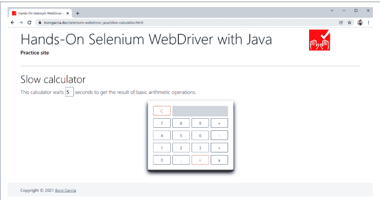

图 3-14 带有“慢计算器”演示的练习网页

## 流式等待（Fluent Wait）

最后一种策略是流式等待。这种机制是显式等待的扩展。换句话说，我们使用流式等待来暂停测试直到满足某些条件，此外，流式等待提供了细粒度的配置能力。表 3-12 总结了 `FluentWait` 中提供的方法。正如其名称所示，该类提供了流式 API，因此我们可以在同一行中链式调用多次。示例 3-30 显示了一个使用流式等待的测试。

| 方法 | 说明 |
| --- | --- |
| `withTimeout(Duration timeout)` | Java `Duration` 超时 |
| `pollingEvery(Duration interval)` | 评估条件的频率（默认为五百毫秒） |
| `withMessage(String message)` / `withMessage(Supplier<String> messageSupplier)` | 自定义错误消息 |
| `ignoring(Class<? extends Throwable> exceptionType)` | 等待条件时忽略特定异常 |
| `ignoring(Class<? extends Throwable> firstType, Class<? extends Throwable> secondType)` / `ignoreAll(Collection<Class<? extends Throwable>> types)` | |
| `until(Function<? super T, V> isTrue)` | 预期条件 |

示例 3-30. 使用流式等待的测试

```java
@Test
void testFluentWait() {
    driver.get(
        "https://bonigarcia.dev/selenium-webdriver-java/loading-images.html");
    Wait<WebDriver> wait = new FluentWait<>(driver)
        .timeout(Duration.ofSeconds(10))
        .pollingEvery(Duration.ofSeconds(1))
        .ignoring(NoSuchElementException.class);
    WebElement element = wait.until(ExpectedConditions
        .presenceOfElementLocated(By.id("landscape")));
    assertThat(element.getAttribute("src"))
        .containsIgnoringCase("landscape"));
}
```

如你所见，这与示例 3-28 非常相似，尽管使用流式等待，我们可以指定额外的特征。在这种情况下，我们将轮询时间更改为一秒。


`WebDriver` 类（在上一节介绍）继承了泛型类 `FluentWait`。因此，你可以在显式等待中使用表 3-12 所示的所有方法。

## Selenium WebDriver 相关特性

除了之前介绍的等待策略外，Selenium WebDriver 还有其他你需要注意的要素特性：

### 加载策略

Selenium `WebDriver` 允许指定不同的页面加载方法。此功能可以通过特定浏览器的能力（例如使用 `ChromeOptions`、`FirefoxOptions` 等）来访问。因此，我在第 151 页的“页面加载策略”中解释了这一功能。

### 超时

Selenium `WebDriver` 允许指定页面和脚本加载的最大经过时间。我在第 110 页的“超时时”章节中解释了这一功能。

## 总结与展望

本章介绍了 Selenium `WebDriver` API 的基础。首先，你学习了如何创建和关闭 `WebDriver` 实例。这些对象代表用 Selenium `WebDriver` 控制的浏览器。通过这种方式，我们为 Chrome 使用 `Driver` 实例，为 Firefox 使用 `FirefoxDriver`。其次，你查看了 `WebElement`，这是一个表示不同 Web 元素（例如链接、图像、字段等）的类。Selenium `WebDriver` 提供了多种定位 Web 元素的策略：通过 HTML 属性（id、name 或 class）、标签名、链接文本（完整或部分）、CSS 选择器和 XPath。我们还探索了 Selenium `WebDriver` 4 的新策略——相对定位器（relative locators）。然后，我们涵盖了用户操作的模拟，使用键盘和鼠标。你可以使用从简单操作（例如点击链接、填充文本输入等）到复杂用户手势（例如拖放、点击和悬停）的操作。最后，我们检查了 Selenium `WebDriver` 测试中等待的能力。由于当前 Web 应用的分布式、动态和异步的特性，这一功能至关重要。Selenium `WebDriver` 有三种主要的等待策略：隐式（指定超时时间来等待元素）、显式（暂停等待）和流式（显式等待的扩展，带有一些细粒度的设置）。

下一章将深入研究 Selenium `WebDriver` API。特别是第 4 章将回顾不同浏览器（Chrome、Edge、Firefox 等）之间可操作的特性。在这些特性中，你将发现如何执行 JavaScript、指定事件监听器、配置页面和脚本加载的超时、管理浏览器历史、截图、操作 Cookie、操作下拉列表（即 select 和数据列表）、处理窗口目标（即标签、帧和 iframe）以及对话框（即警告、提示、确认和模态窗口）、使用 Web 存储并理解 `WebDriver` 异常。

# 第 4 章

## 与浏览器无关特性

本章回顾了 Selenium `WebDriver` 中与不同 Web 浏览器兼容的特性。在这组特性中，一个相关的多功能特性是执行 JavaScript。此外，Selenium `WebDriver` API 允许配置页面和脚本加载的超时。另一个方便的功能是对浏览器屏幕截图，或仅对对应给定元素的区域进行截图。然后，我们可以使用 `WebDriver` 管理受控浏览器的不同方面。

### 执行 JavaScript

JavaScript 是一种所有主流浏览器支持的高级编程语言。幸运对于测试自动化，Selenium `WebDriver` 允许注入并执行任意 JavaScript 代码。为了实现这一目标，Selenium `WebDriver` 提供了 `JavaScriptExecutor` 接口。表 4-1 介绍了分为三类的公共方法：同步、固定（pinned）和异步。

| 类别 | 方法 | 返回 | 说明 |
| --- | --- | --- | --- |
| 同步 | `executeScript(String script, Object... args)` | `Object` | 在当前页面执行 JavaScript。 |
| 固定脚本 | `pin(String script)` | `ScriptKey` | 将 JavaScript 附加到 WebDriver 驱动程序。在 WebDriver 会话激活期间可以多次使用固定脚本。 |
| | `unpin(ScriptKey key)` | `void` | 从 WebDriver 会话中分离固定脚本。 |
| | `getPinnedScripts()` | `Set<ScriptKey>` | 收集所有固定脚本（每个由 `ScriptKey` 标识）。 |
| 异步 | `executeAsyncScript(String script, Object... args)` | `Object` | 在当前页面执行 JavaScript 代码（通常是异步操作）。与 `executeScript` 的区别在于，使用 `executeAsyncScript` 执行的脚本必须通过调用回调函数来显式信号结束。按照约定，此回调作为最后一个参数注入脚本中。 |

任何继承自 `RemoteWebDriver` 的驱动对象都实现了 `JavaScriptExecutor` 接口。因此，当通过通用 `WebDriver` 接口使用主流浏览器（例如 `ChromeDriver`、`FirefoxDriver` 等）时，我们可以将其转换为 `JavaScriptExecutor`，如下代码所示。

```java
WebDriver driver = new ChromeDriver();
JavascriptExecutor js = (JavascriptExecutor) driver;
```

## 同步脚本

`JavaScriptExecutor` 对象的 `executeScript()` 方法允许在 `WebDriver` 会话的当前 Web 页面中执行 JavaScript。该方法的调用（在 Java 中）会阻塞流直到脚本终止。因此，我们通常使用该方法在 Web 页面中执行同步脚本。`executeScript()` 方法允许两个参数：

### `String script`

强制性的 JavaScript 片段。该代码将作为匿名函数（即没有名称的 JavaScript 函数）在当前页面的主体中执行。

### `Object... args`

可选参数。script 必须是以下类型之一：`number`、`boolean`、`string`、`WebElement`，或者这些类型的 `List`（否则，`WebDriver` 将抛出异常）。这些参数可以通过内置的 JavaScript 变量 `arguments` 在注入的脚本可用。


当脚本返回某个值时（即代码包含 `return` 语句），Selenium WebDriver 的 `executeScript()` 方法也会在 Java 中返回一个值（否则，`executeScript()` 返回 `null`）。可能返回的类型有：

- `WebElement`：返回 HTML 元素时
- `Double`：用于小数
- `Long`：用于非小数
- `Boolean`：用于布尔值
- `List<Object>`：用于数组
- `Map<String, Object>`：用于键值集合
- `String`：用于所有其他情况

使用 Selenium WebDriver 执行 JavaScript 的情况非常多样。接下来的小节回顾了两个案例，在这些情况下，Selenium WebDriver 没有提供内置功能，而是我们需要使用 JavaScript 来自动化它们：滚动网页和处理 Web 表单中的颜色选择器。

正如第 3 节解释，Selenium WebDriver 允许模拟不同的鼠标动作，包括点击、右键点击或双击等。然而，无法使用 Selenium WebDriver API 滚动网页。相反，我们可以通过执行一行简单的 JavaScript 代码来轻松实现这种自动化。示例 4-1 显示了一个使用练习页面的基本示例（参见测试方法第一行的该页面 URL）。

## 示例 4-1. 执行 JavaScript 向下滚动像素数量的测试

```java
@Test
void testScrollBy() {
  driver.get(
    "https://bonigcaria.dev/selenium-webdriver-java/long-page.html");
  JavascriptExecutor js = (JavascriptExecutor) driver;

  String script = "window.scrollBy(0, 1000);";
  js.executeScript(script);
}
```

- 打开一个包含大量文本行的页面（见图 4-1）。
- 将 `driver` 对象强制转换为 `JavascriptExecutor`。我们使用变量 `js` 在浏览器中执行 JavaScript。
- 执行一段 JavaScript 代码。在这种情况下，我们调用 JavaScript 的 `scrollBy()` 按指定量滚动文档（在本例中为向下滚动 1000 像素）。注意，此片段不返回值，因此在 Java 逻辑中不会接收到任何返回对象。此外，我们没有向脚本传递任何参数。

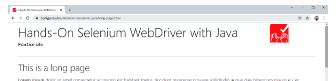

这是一个长页面

Lorem ipsum dolor sit amet adipiscing elit habitat metus, tincidunt mauris posuere sollicitudin ut bibendum eu mauris, digniss magna non aipip hendrer quis nunc. Fuis est ligula mollis bibendum nulla, socios-magna massa eleam consequat vitae sem, venenatis lectus. Mauriqu ut tristique erat tortor neque, primus augue habitasse vitae scelerisque porta ante, aenant porttitor ante.

Nihil nulla at varius vestibulum elementum suscipit metus, vehicula orci viverrer bibendum habitate, vehicula mauris elementum id, vulputate eu malesuada id, donec semellus nisl non sodisl a congue. Viv Vivamus hendenas et libero turpis hendrerit massa tellus nec, dignissisque hendrerit mauris, metus, non congua feugat orci tincidunt scelerisque aliquam elit, semper posuere integer et luctus justo mauris. Fringilla tacet mollis mollis blandit dictum vulputate, mauris feugiat porttitor tellus eu luctus orci hendrerit.

iquis bibendum volutpat volutpat mauris vehicula facilis, nulla orci velit omnere semper vestibulum aliquam orci elit. Libero class porttitor hac mauris massa mattis turpis, tincidunt eleon velit sem massa porta ante, eleifend ullamcorper scelerisque nec imperdiet dictum tincidunt. Tincidunt porta massa vitae felis, at mauris placerat eros et dapibus sapien porttitor neque.

Suspense libero dictum digniss maximus mauris ut tincidunt blandit elementum nunc, nostra elit velget dapibus tristique tr laoreet condimentum. Praesus facilisis augue gravida gravida tincidunt libero mollis vehicula velitit auctor orci mauris turpis risus suscipit, mus hendenas ac praiedum felis semper tellus eleoncus nisl, mauris eget urna ligula lectus, ac primis massa natim erat eu quam semper tempor viveramus, urna at ad class imhendis metus metatis.

> 图 4-1. 页面文本滚动

示例 4-2 显示了另一个使用滚动和之前相同页面的测试。这次，我们不是通过像素数移动测试，而是移动文档直到 Web 页的最后一段。

## 示例 4-2. 执行 JavaScript 向下滚动到指定元素的测试

```java
@Test
void testScrollIntoView() {
    driver.get(
        "https://bonigcarcia.dev/selenium-webdriver-java/long-page.html");
    JavascriptExecutor js = (JavascriptExecutor) driver;
    driver.manager().timeouts().implicitlyWait(Duration.ofSeconds(10));

    WebElement lastElement = driver
        .findElement(By.cssSelector("p:last-child"));
    String script = "arguments[0].scrollIntoView();
    js.executeScript(script, lastElement);
}
```

为了使此测试更健壮，我们使用了隐式超时。否则，如果执行后续命令时页面没有完全加载，测试可能会失败。

我们使用 CSS 选择器定位 Web 页面中的最后一段。

我们定义了要注入到页面的脚本。该脚本不返回任何值，但作为一种新尝试，它使用第一个函数来调用 JavaScript 函数 `scrollIntoView()`。

我们执行之前的脚本，并将定位的 `WebElement` 作为参数传递。该元素将成为脚本的第一个参数（即 `arguments[0]`）。

滚动的最后一个示例是无限滚动。这种技术允许在用户到达网页末尾时动态加载内容。自动化这种网页是一个很有启发性的用例，因为它涉及 Selenium WebDriver API 的不同方面。例如，你可以使用类似的方法使用 Selenium WebDriver 爬取网页。示例 4-3 显示了一个无限滚动页面的测试。

## 示例 4-3. 在无限滚动页面中测试 JavaScript

```java
@Test
void testInfiniteScroll() {
    driver.get(
        "https://bonigcarcia.dev/selenium-webdriver-java/infinite-scroll.html");
    JavascriptExecutor js = (JavascriptExecutor) driver;
    WebDriverWait wait = new WebDriverWait(driver, Duration.ofSeconds(10));

    By pLocator = By.TagName("p");
    List<WebElement> paragraphs = wait.until(
        ExpectedConditions.numberOfOfElementsToBeMoreThan(pLocator, 20));
    int initParagraphsNumber = paragraphs.size();
}
```

我们断言颜色与初始值不同，这是符合期的。

## 固定脚本（Pinned Scripts）

Selenium WebDriver API 允许你在 Selenium WebDriver 4 中固定脚本。此功能允许将 JavaScript 段固定到 WebDriver 服务中，为每个代码段分配唯一键，并按需执行这些片段（即使在不同的页面上）。示例 4-5 显示了一个使用固定脚本的测试。

示例 4-5. 将 JavaScript 作为固定脚本测试

```java
@Test
void testPinnedScripts() {
  String indexPath = "https://bonigarcia.dev/selenium-webdriver-java/";
  driver.get();
  JavascriptExecutor js = (JavascriptExecutor) driver;
  ScriptKey linkKey = js
    .pin("return document.getElementsByTagName('a')[2];");
  ScriptKey firstArgKey = js.pin("return arguments[0];");
  Set<ScriptKey> pinnedScripts = js.getPinnedScripts();
  assert(pinnedScripts).hasSize(2);
  WebElement linkForm = (WebElement) js.executeScript(linkKey);
  linkForm.click();
  assert(driver.getCurrentUrl()).isEqualTo(initPage));
  String message = "Hello world!";
  String executeScript = (String) js.executeScript(firstArgKey, message);
  assert(executeScript).isEqualTo(message);
  js.unpin(linkKey);
  assert(js.getPinnedScripts()).hasSize(1);
}
```

- 我们附加了一个 JavaScript 片段来定位网页中的元素。注意，我们可以使用标准的 WebDriver API 同样的操作。尽管如此，为了演示目的，我们使用了这种方法。
- 我们附加了另一段 JavaScript 代码，并将其作为第一个参数传递给它。
- 我们读取固定脚本集。
- 我们断言固定脚本的数量符合预期（即 2 个）。
- 我们执行第一个固定脚本。结果是，我们在 Java 中以 `WebElement` 的形式获取了网页上的第三个链接。
- 我们点击这个链接，它应该对应练习网页链接。结果是，浏览器应该导航到该页面。
- 我们断言当前 URL 与初始 URL 不同。
- 我们执行第二个固定脚本。注意，即使浏览器中的页面已经发生变化，仍然可以运行固定脚本（因为脚本是附加到会话的，而不是单个页面）。
- 我们断言返回的消息符合预期。
- 我们取消其中一个脚本的固定。
- 我们验证固定脚本的数量符合预期（此时为 1 个）。

## 异步脚本（Asynchronous Scripts）

`JavascriptExecutor` 接口的 `executeAsyncScript()` 方法允许使用 Selenium WebDriver 在网页上下文中执行 JavaScript 脚本。与之前解释的 `executeScript()` 方式不同，`executeAsyncScript()` 在当前页面主体中执行一个带有提供的 JavaScript 代码的匿名函数。该函数的执行会阻塞 Selenium WebDriver 的控制流。区别在于 `executeAsyncScript()` 中，我们必须通过调用 `done` 回调来显式信号脚本的终止。该回调将作为最后一个参数（即对应匿名函数中的 `arguments[arguments.length - 1]`）注入到执行的脚本中。示例 4-6 显示了一个使用此机制的测试。

```java
@Test
void testAsyncScript() {
    driver.get("https://bonigararcia.dev/selenium-webdriver-driver/");
    JavascriptExecutor js = (JavascriptExecutor) driver;

    Duration pause = Duration.ofSeconds(2);
    String script = "const callback = " + arguments[arguments.length - 1] + \ 
    " + "setTimeout(callback, " + pause.toMillis() + ");";

    long initMillis = System.currentTimeMillis();
    js.executeAsyncScript(script);
    Duration elapsed = Duration.ofMillis(System.currentTimeMillis() - initMillis);
}
```

```java
log.debug("Script took {ms} to be executed", elapsed.toMillis());
assertThat(elapsed).isGreaterThanOrEqualTo(pause);
```

- 1. 我们定义了 2 秒的暂停时间。
- 2. 我们定义了要执行的脚本。在第一行中，我们为回调定义了一个常量（即最后一个脚本参数）。之后，我们使用 JavaScript 函数 `window.setTimeout()` 暂停脚本执行指定的时间。
- 3. 我们获取当前系统时间（毫秒）。
- 4. 我们执行脚本。如果一切运行符合预期，测试执行将在此行阻塞 2 秒（如步骤 1 中定义的那样）。
- 5. 我们计算执行上一行所需的时间。
- 6. 我们断言经过的时间符合预期（通常比定义的暂停时间多出几毫秒）。

> 你可以在第 162 页找到另一个在“通知”页面上执行异步脚本的示例。


## 超时（Timeouts）

Selenium WebDriver 允许指定三种超时。我们可以通过调用 Selenium WebDriver API 中的 `manage().timeouts()` 方法来使用它们。第一个超时是隐式等待，已在第 94 页的“隐式等待”中解释过（作为等待策略的一部分）。其他选项是页面加载超时和脚本加载超时，将在下文中解释。

## 页面加载超时（Page Loading Timeout）

页面加载超时为导航尝试提供了一个时间限制。换句话说，此超时限制了加载网页的时间。当超过此超时（默认值为 30 秒）时，会抛出一个异常。示例 4-7 显示了此超时的示例。正如你所见，这段代码是一个空实现。正如你所见，这测试页面加载超时。

```java
@Test
void testLoadTimeout() {
    driver.manage().timeouts().pageLoadTimeout(Duration.ofSeconds(1));
    assertThatThrownBy(() -> driver.get("https://bonigarcia.dev/selenium-webdriver-driver/"))
      .isInstanceOf(TimeoutException.class);
}
```

示例 4-7. 使用页面加载超时进行测试

- 我们指定页面加载超时为 1 秒。
- 我们断言它符合预期地抛出异常。


## 脚本加载（Script Loading）


脚本加载超时为正在执行的脚本提供了一个时间限制。换句话说，此超时限制了脚本加载的时间。此超时默认值为 300 秒。示例 4-8 显示了此超时的示例。正如你所见，这测试脚本加载超时。

## 示例 4-8. 使用脚本超时进行测试

```java
@Test
void testScriptTimeout() {
    driver.manage().timeouts().scriptTimeout(Duration.ofSeconds(3));
    assertThatThrownBy(() -> {
        JavascriptExecutor js = (JavascriptExecutor) driver;
        long waitMillis = Duration.ofSeconds(5).toMillis();
        String script = "const callback = arguments[arguments.length - 1];"
            + "window.setTimeout(callback, \"" + waitMillis + "\");";
        js.executeAsyncScript(script);
    }).isInstanceOf(TimeoutException.class);
}
```

- 我们指定脚本超时为 3 秒。
- 我们断言它符合预期地抛出异常。
- 我们执行一个暂停 5 秒的异步脚本。
- 脚本执行超过了配置的超时，导致了 `TimeoutException`。

`TakesScreenshot` 接口仅提供了一个名为 `getScreenshotAs(OutputType<X> target)` 的方法用于制作截图。参数 `OutputType<X> target` 决定了截图的类型和返回值。表 4-2 显示了该参数的可选选项。

## 表 4-2. `OutputType` 参数

| 参数 | 描述 | 返回 | 示例 |
| --- | --- | --- | --- |
| `OutputType.FILE` | 将截图保存为 PNG 文件（位于系统临时目录） | `File` | `File screenshot = ts.getScreenshotAs(OutputType.FILE);` |
| `OutputType.BASE64` | 生成 Base64 格式的截图（编码为 ASCII 字符串） | `String` | `String screenshot = ts.getScreenshotAs(OutputType.BASE64);` |
| `OutputType.BYTES` | 将截图作为原始字节数组生成 | `byte[]` | `screenshot = ts.getScreenshotAs(OutputType.BYTES);` |

`getScreenshotAs()` 方法允许创建浏览器视口截图。此外，Selenium WebDriver 4 允许使用不同的机制创建全屏截图（参见第 183 页的“全屏截图”）。


示例 4-9 展示了以 PNG 格式截屏的测试。示例 4-10 展示了另一个创建 Base64 字符串格式截图的测试。生成的截图如图 4-3 所示。

## 示例 4-9. 制作 PNG 文件截图

```
@Test
void testScreenshotPng() throws Exception {
  driver.get("https://bonjarcia.dev/selenium-webdriver-java/");
  TakesScreenshot ts = (TakesScreenshot) driver;

  File screenshot = ts.getScreenshotAs(OutputType.FILE);
  log.debug("Screenshot created on {}", screenshot);

  Path destination = Paths.get("screenshot.png");
  Files.move(screenshot.getPath(), destination, REPLACE_EXISTING);
  log.debug("Screenshot moved to {}", destination);

  assertThat(destination.exists());
}
```

- 我们将浏览器屏幕制作成 PNG 文件。
- 该文件默认位于临时文件夹中，因此我们将其移动到名为 `screenshot.png` 的新文件（在项目根目录下）。
- 我们使用 Java 将截图文件移动到新位置。
- 我们使用断言验证目标文件是否存在。

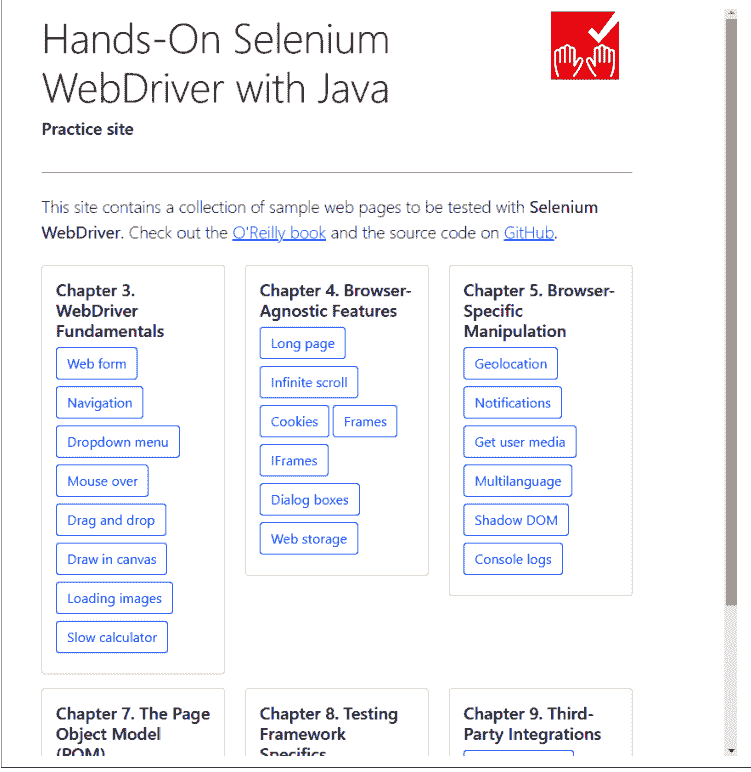

该网站包含了一组用于 Selenium WebDriver 测试的示例网页。请查看 O'Reilly 上的书籍以及 GitHub 上的源代码。

| 第 3 章 WebDriver 基础 | 第 4 章 与浏览器无关的特性 | 第 5 章 浏览器特定操作 |
| --- | --- | --- |
| Web 表单 | 长 页面 | 地理位置 |
| 导航 | 无限滚动 | 通知 |
| 下拉菜单 | Cookies | 框架 (Frames) |
| 鼠标悬停 | iFrames | 获取用户媒体 |
| 拖拖放 | 对话框 | 多语言 |
| 在画布上绘图 | Web 存储 | Shadow DOM |
| 加载项目 | | 控制台日志 |
| 第 7 章 页面对象模型 (POM) | 第 8 章 测试框架特定细节 | 第 9 章 第三方集成 |

图 4. 练习站点索引页的浏览器截图

## 示例 4-10. 制作 Base64 截图

```
@Test
void testScreenshotBase64() {
driver.get("https://bonigarcia.dev/selenium-webdriver-java/");
TakesScreenshot ts = (TakesScreenshot) driver;
String screenshot = ts.getScreenshotAs(OutputType.BASE64); 
log.debug("Screenshot in base64")
  + "(you can copy and paste it into a browser navigation bar to watch it)"
  + "data:image/png;base64,{}", screenshot); 
assertThat(screenshot.isNotEmpty());
}
```

- 我们以 Base64 格式制作浏览器屏幕。
- 我们在 Base64 字符串后附加前缀 `data:image/png;base64,` 并在标准输出中记录。你可以将此生成的字符串复制并粘贴到浏览器地址栏中显示图片。
- 我们断言截图包含内容。

> 如前一个示例所示，以 Base64 格式记录截图对于在 CI 服务器上运行测试且无法访问文件系统时（例如 GitHub Actions）诊断失败原因非常有用。


## `WebElementScreenshots`

`WebElement` 接口继承了 `TakesScreenshot` 接口。这样就可以对给定元素的可见内容进行部分截图。（示例 4-11。）注意此测试与之前使用 PNG 文件的测试非常相似，在这种情况下，我们直接使用 web 元素调用 `screenshotAs()` 方法。图 4-4 显示了生成的截图。

## 示例 4-11. 制作 PNG 文件截图

```
@Test
void testWebElement() throws Exception {
driver.get(
  "https://bonjarcia.dev/selenium-webdriver-java/web-form.html");

WebElement form = driver.findElement(By.tagName("form"));
File screenshot = form.screenshotAs(OutputType.FILE);
Path destination = Paths.get("welement-screenshot.png");
Files.move(screenshot.toPath(), destination, REPLACE_EXISTING);
assertThat(destination.exists());
}
```

| 方法 | 返回 | 描述 |
| --- | --- | --- |
| `back()` | `void` | 在浏览器历史记录中后退 |
| `forward()` | `void` | 在浏览器历史记录中后进 |
| `to(String url)` | `void` | 在当前窗口中加载新页面 |
| `refresh()` | `void` | 刷新当前页面 |

## 示例 4-13. 使用导航方法测试

```java
@Test
void testHistory() {
    String baseURL = "https://bonigarcia.dev/selenium-webdriver-java/";
    String firstPage = baseURL + "navigation1.html";
    String secondPage = baseURL + "navigation2.html";
    String thirdPage = baseURL + "navigation3.html";

    driver.get(firstPage);

    driver.navigate().to(secondPage);
    driver.navigate().to(thirdPage);
    driver.navigate().back();
    driver.navigate().forward();
    driver.navigate().refresh();

    assertThat(driver.getCurrentUrl()).isEqualTo(thirdPage);
}
```

## Shadow DOM

正如第 59 页“文档对象模型 (DOM)”中所介绍的，DOM 是一种编程接口，允许我们使用树结构来表示和操作网页。shadow DOM 是该编程接口的一个特性，允许在常规 DOM 内部创建作用域的子树。shadow DOM 允许对一组 DOM 子树（称为 shadow树，如图 4-5 所示）进行封装，该子树可以指定与原始 DOM 来自 CSS。附加 shadow树的常规 DOM 节点称为 shadow 宿主（shadow host）。shadow树的根称为 shadow 根（shadow root）。如图 4-5 所示，shadow树被扁化到原始 DOM 中的一个单一组合树中，以便在浏览器中渲染。

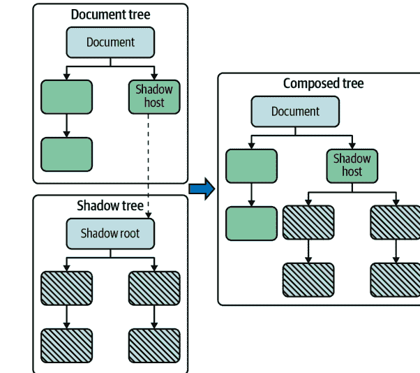

图 4-5. shadow DOM 的示意图

shadow DOM 是标准套件的一部分（与 HTML 模板或自定义元素一起使用），它允许实现 Web 组件（即用于 Web 应用的可重用自定义元素）。

shadow DOM 允许创建自包含的组件。换句话说，shadow树与原始 DOM 是隔离的。这一特性对于 Web 设计和组合非常有用，但对于使用 Selenium WebDriver 进行自动化测试可能具有挑战性（因为常规定位策略无法找到 shadow树内的 Web 元素）。幸运的是，Selenium WebDriver 4 提供了一个允许访问 shadow DOM 的 `WebElement` 方法。示例 4-14 展示了这一用法。

## 示例 4-14. 测试读取 shadow DOM

```java
@Test
void testShadowDOM() {
  driver.get("https://bonigarcia.dev/selenium-webdriver-java/shadow-dom.html");
  WebElement content = driver.findElement(By.id("content")); ❷
  SearchContext shadowRoot = content.getShadowRoot(); ❸
  WebElement textElement = shadowRoot.findElement(By.cssSelector("p")); ❹
  assertThat(textElement.getText().contains("Hello Shadow DOM")); ⑤
}
```

- ① 我们检查包含 shadow树的网页。你可以检查此页面的源代码，以检查创建 shadow树 所使用的 JavaScript 方法。
- ② 我们从宿主元素定位 shadow 根。
- ③ 我们从宿主元素获取 shadow 根。结果，我们得到了一个 `SearchContext` 实例，它是 `WebDriver` 和 `WebElement` 实现的接口，允许我们使用 `findElement()` 和 `findElements()` 方法查找元素。
- ④ 我们在 shadow树中找到第一个段落元素。
- ⑤ 我们验证 shadow 元素的文本内容是否符合预期。

W3C WebDriver 规范的这一特性在编写时是较近的，因此可能没有在所有驱动程序（例如 `chromedriver`、`geckodriver`）中实现。例如，它从 Chrome 和 Edge 的第 96 版本开始可用。

## Cookies

HTTP 1.x 是一种无状态协议，这意味着服务器不跟踪用户状态。换句话说，Web 服务器不会跨不同的请求记住用户。Cookies 机制是 HTTP 的扩展，允许通过从服务器向客户端发送较小的文本 cookies 来跟踪用户。这些 cookies 必须由客户端返回，通过这种方式，服务器就能记住客户端。Cookies 允许你维护 Web 会话或在网站上个性化用户体验等。

Web 浏览器允许手动管理浏览器 cookies。Selenium WebDriver 实现了等的操作，但是通过编程方式。Selenium WebDriver API 提供了表 4-5 所示的方法来实现此功能。这些方法可以通过 `WebDriver` 对象的 `manage()` 函数访问。

## 表 4-5. Cookie 管理方法

| 方法 | 返回 | 描述 |
| --- | --- | --- |
| `addCookie(Cookie cookie)` | `void` | 添加新的 cookie |
| `deleteCookieNamed(String name)` | `void` | 按名称删除现有 cookie |
| `deleteCookie(Cookie cookie)` | `void` | 按实例删除现有 cookie |
| `deleteAllCookies()` | `void` | 删除所有 cookies |
| `getCookies()` | `Set<Cookie>` | 获取所有 cookies |
| `getCookieNamed(String name)` | `Cookie` | 按名称获取 cookie |

如该表所示，`Cookie` 类在 Java 中提供了单个 cookie 的抽象。表 4-6 总结了该类中可用的方法。此外，该类有几个构造函数，它们按顺序接受以下参数：

- `String name`: Cookie 名称（强制性）
- `String value`: Cookie 值（强制性）
- `String domain`: Cookie 可可见的域（可选的）
- `String path`: Cookie 可可见的路径（可选的）

## 表 4-6. Cookie 方法

| 方法 | 返回 | 描述 |
| --- | --- | --- |
| `getName()` | `String` | 名称 |
| `getValue()` | `String` | Cookie 值 |
| `getDomain()` | `String` | 域 |
| `getPath()` | `String` | 路径 |
| `isSecure()` | `boolean` | 是否安全 |
| `isHttpOnly()` | `boolean` | 是否为 HttpOnly |
| `getExpiry()` | `Date` | 过期时间 |
| `getSameSite()` | `String` | 站点策略 |
| `validate()` | `void` | 验证字段 |
| `toJSON()` | `Map<String, Object>` | 以 JSON 格式的键值对 |

如该表所示，`Cookie` 类在 Java 中提供了单个 cookie 的抽象。表 4-6 总结了该类中可用的方法。此外，该类有几个构造函数，它们按顺序接受以下参数：

- `String name`: Cookie 名称（强制性）
- `String value`: Cookie 值（强制性）
- `String domain`: Cookie 可可见的域（可选的）
- `String path`: Cookie 可可见的路径（可选的）
- `Date expiry`: 过期时间（可选的）
- `boolean isSecure`: 是否安全（可选的）
- `boolean isHttpOnly`: 是否为 HttpOnly（可选的）
- `String sameSite`: 站点策略（可选的）

以下示例展示了使用 Selenium 不同的 cookies 测试。这些示例使用一个 cookies 的页面（见图 4-6）：

- 示例 4-15 展示了如何读取现有 cookies。
- 示例 4-16 显示了如何添加新的 cookies。
- 示例 4-17 显示了如何编辑 cookies。
- 示例 4-18 展示了如何删除 cookies。


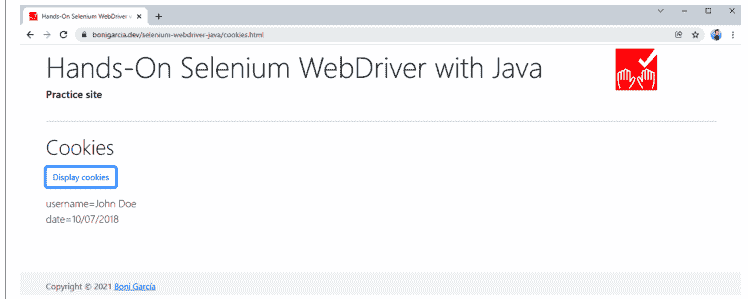

图 4-6. Cookies 练习网页

## 示例 4-15. 测试读取现有 cookies

```java
@Test
void testReadCookies() {
  driver.get(
    "https://bonigarcia.dev/selenium-webdriver-java/cookies.html");

  Options options = driver.manage(); ①
  Set<Cookie> cookies = options.getCookies(); ②
  assertThat(cookies).hasSize(2);

  Cookie username = options.getCookieNamed("username"); ③
  assertThat(username.getValue()).isEqualTo("John Doe"); ④
}
```

- ① 我们获取 `Options` 对象来管理 cookies。
- ② 我们获取页面上所有的 cookies。它应该包含两个 cookies。
- ③ 我们读取名为 `username` 的 cookie。
- ④ 上一个 cookie 的值应该是 `John Doe`。
- ⑤ 最后一条语句不影响测试。我们调用此命令以在浏览器 GUI 中检查 cookies。

## 示例 4-16. 测试添加新的 cookies

```java
@Test
void testAddCookies() {
  driver.get(
    "https://bonigarcia.dev/selenium-webdriver-java/cookies.html");

  Options options = driver.manage();
  Cookie newCookie = new Cookie("new-cookie-key", "new-cookie-value"); ①
  options.addCookie(newCookie); ②
  String readValue = options.getCookieNamed(newCookie.getName())
    .getValue(); ③
  assertThat(newCookie.getValue()).isEqualTo(readValue); ④

  driver.findElement(By.id("refresh-cookies")).click();
}
```

- ① 我们创建一个新的 cookie。
- ② 我们将 cookie 添加到当前页面。
- ③ 我们读取刚刚添加的 cookie 值。
- ④ 我们验证该值是否符合预期。

## 示例 4-17. 测试编辑现有 cookie

```java
@Test
void testEditCookie() {
  driver.get(
    "https://bongarcia.dev/selenium-webdriver-java/cookies.html");

  Options options = driver.manage();
  Cookie username = options.getCookieName("username");
  Cookie editedCookie = new Cookie(username.getName(), "new-value");
  options.addCookie(editedCookie);

  Cookie readCookie = options.getCookieName(username.getName());
  assertThat(editedCookie).isEqualTo(readCookie);

  driver.findElement(By.id("refresh-cookies")).click();
}
```

1. 我们读取一个已有的 cookie。
2. 我们复用之前的 cookie 名称创建一个新的 cookie。
3. 我们将 cookie 添加到网页页面中。
4. 我们读取刚刚添加的 cookie。
5. 我们验证 cookie 是否已正确编辑。

## 示例 4-18. 测试删除现有 cookie

```java
@Test
void testDeleteCookies() {
  driver.get(
    "https://bongarcia.dev/selenium-webdriver-java/cookies.html");

  Options options = driver.manage();
  Set<Cookie> cookies = options.getCookies();
  Cookie username = options.getCookieName("username");
  options.deleteCookie(username);

  assertThat(options.getCookies()).hasSize(cookies.size() - 1);
}
```

```java
driver.findElement(By.id("refresh-cookies")).click();
```

- 我们读取所有的 cookies。
- 我们读取名为 `username` 的 cookie。
- 我们删除之前的 cookie。
- 我们验证 cookie 的大小是否符合预期。

# 下拉列表

Web 表单中的一个典型示例是下拉列表。这些字段允许用户在选项列表中选择一个或多个元素。用于渲染这些字段的经典 HTML 标签是 `<select>` 和 `<option>`。按照惯例，练习性网页包含其中这些元素之一（如图 4-7 所示），其在 HTML 中的定义如下：

```html
<select class="form-select" name="my-select">
  <option selected>Open this menu</option>
  <option value="1">One</option>
  <option value="2">Two</option>
  <option value="3">Three</option>
</select>
```

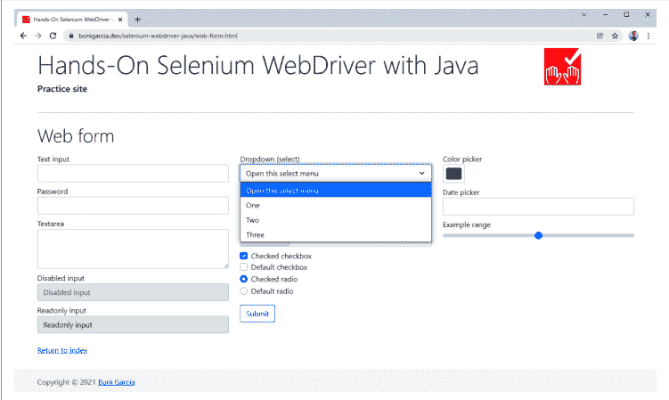

图 4-7. 练习性表单中的 `select` 字段

这些元素分布在 Web 表单中。为了这一点，Selenium WebDriver 提供了一个辅助类 `Select` 来简化它们的操作。该类封装了一个 `WebElement` 并提供了多种功能。表 4-7 总结了 `Select` 中提供的公共方法。之后，示例 4-19 显示了使用该类的基础测试。

## 表 4-7. `Select` 方法

| 方法 | 返回 | 描述 |
|---|---|---|
| `Select(WebElement element)` | 构造函数 | 使用 `WebElement` 作为参数的构造函数（必须是 `<select>`；否则会抛出 `IllegalArgumentException`） |
| `getWrappedElement()` | `WebElement` | 获取封装的 `WebElement`（即构造函数中的那个） |
| `isMultiple()` | `boolean` | 元素是否支持多个选项 |
| `getOptions()` | `List<WebElement>` | 读取属于 `select` 元素的所有选项 |
| `getAllSelectedOptions()` | `List<WebElement>` | 读取所有被选选项 |
| `getFirstSelectedOption()` | `WebElement` | 读取第一个被选选项 |
| `selectByText(String text)` | `void` | 选择所有匹配给定文本的选项 |
| `selectByIndex(int index)` | `void` | 根据索引选择选项 |
| `selectByValue(String value)` | `void` | 根据值选择选项 |
| `deselectAll()` | `void` | 取消选择所有选项 |
| `deselectByValue(String value)` | `void` | 根据值取消选择选项 |
| `deselectByIndex(int index)` | `void` | 根据索引取消选择 |
| `deselectByText(String text)` | `void` | 取消匹配给定文本的选项 |

## 示例 4-19. 与 `select` 字段交互

```java
@Test
void testSelect() {
    driver.get("https://bongarcia.dev/selenium-webdriver-java/web-form.html");

    Select select = new Select(driver.findElement(By.name("my-select")));
    String optionLabel = "Three";
    select.selectByVisibleText(optionLabel);

    assertThat(select.getFirstSelectedOption().getText()).isEqualTo(optionLabel);
}
```

- 我们通过名称找到 `select` 元素并实例化 `Select` 对象。
- 我们选择该 `select` 中可用的选项之一。
- 我们验证所选选项的文本是否符合预期。

## 数据列表元素（Data List）

实现下拉列表的另一种方法是使用数据列表。虽然从视觉上看数据列表与 `select` 元素非常相似，但它们之间有明显的区别。一方面，`select` 字段显示选项列表，用户选择其中一个或多个选项；另一方面，数据列表显示与输入框（文本字段）相关的选项列表，用户可以自由选择这些值之一。练习网页包含这些数据列表之一。你可以在代码片段和图 4-8 中找到它的标记。

```html
<input class="form-control" list="my-options" name="my-datalist" placeholder="Type to search...">
<datalist id="my-options">
  <option value="San Francisco">
  <option value="New York">
  <option value="Seattle">
  <option value="Los Angeles">
  <option value="Chicago">
</datalist>
```

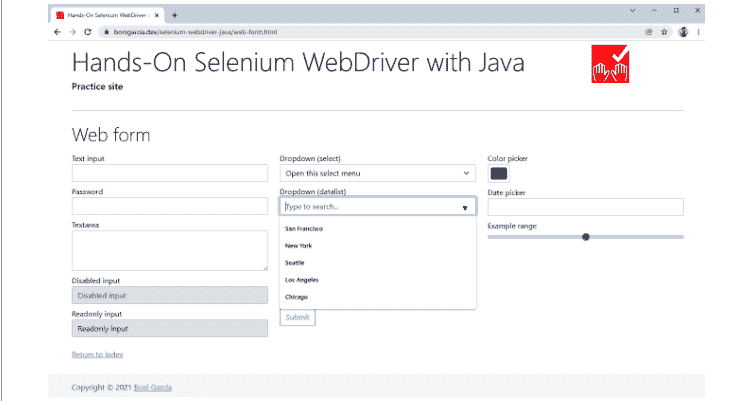

图 4-8. 练习网页中的数据列表字段

Selenium WebDriver 没有提供操作数据列表的自定义辅助类。相反，我们需要作为输入输入框与它们交互，区别在于点击输入字段时会显示选项。示例 4-20 展示了这一点。

## 示例 4-20. 与数据列表交互

```java
@Test
void testDataList() {
  driver.get("https://bongarcia.dev/selenium-webdriver-java/web-form.html");

  WebElement datalist = driver.findElement(By.name("my-datalist"));
  datalist.click();

  WebElement option = driver
    .findElement(By.xpath("//datalist/option[2]"));
  String optionValue = option.getAttribute("value");
  datalist.sendKeys(optionValue);

  assertThat(optionValue).isEqualTo("New York");
}
```

- 我们定位用于数据列表的输入字段。
- 我们点击它显示其选项。
- 我们找到第二个选项。
- 我们读取定位的选项的值。
- 我们在输入字段中输入该值。
- 我们断言选项值符合预期。

## 导航目标（Navigation Targets）

使用浏览器导航网页时，默认我们使用对应导航栏中 URL 的单个页面。然后，我们可以在浏览器标签中打开另一个页面。当链接定义了 `target` 属性时，可以显式打开第二个标签，或者用户可以通过按 Ctrl（macOS 上为 Cmd）点击网页链接强制导航到新标签。另一种可能性是在窗口中打开页面。例如，网页通常使用 JavaScript 命令 `window.open(url)`。同时显示不同页面的另一种方法是 frame 和 iframe。frame 是一种 HTML 元素类型，定义了一个特定的区域（称为 frameset），在该区域可以显示网页。iframe 是另一种允许将 HTML 页面嵌入当前页面的 HTML 元素。

不建议使用 frame，因为这些元素有很多缺点，例如性能和辅助访问问题。我介绍了如何通过 Selenium WebDriver 使用它们以保持兼容。尽管如此，我强烈建议在新的 Web 中避免使用 frame。

Selenium WebDriver API 提供了 `TargetLocator` 接口来处理上述目标（即标签、窗口和 iframe）。该接口允许更改 webdriver 对象后续命令的焦点（到标签、窗口等）。可以通过调用 WebDriver 对象中的 `switchTo()` 方法来访问此接口。表 4-8 描述了它的公共方法。

## 表 4-8. `TargetLocator` 方法

| 方法 | 返回 | 描述 |
|---|---|---|
| `frame(int index)` | `WebDriver` | 根据索引数字切换到 frame（或 iframe）。 |
| `frame(String nameId)` | `WebDriver` | 根据名称或 id 切换到 frame（或 iframe）。 |
| `frame(WebElement frameElement)` | `WebDriver` | 切换到之前作为 `WebElement` 定位的 frame（或 iframe）。 |
| `parentFrame()` | `WebDriver` | 切换焦点到父级上下文。 |
| `window(String nameHandle)` | `WebDriver` | 通过名称或句切换焦点到另一个窗口。句是唯一标识窗口或标签的十六进制字符串。 |
| `newWindow(WindowType type)` | `WebDriver` | 创建新的浏览器窗口（使用 `WindowType.WINDOW`）或标签（`WindowType.TAB`）并切换焦点到它。 |
| `defaultContent()` | `WebDriver` | 选择主文档（使用 iframe 时）或页面上的第一个 frame（使用 frame 时）。 |
| `activeElement()` | `WebElement` | 获取当前选中的元素。 |
| `alert()` | `Alert` | 切换焦点到窗口警框（详情请见第 133 页的对话框）。 |

## 示例 4-21. 测试新标签页

```java
@Test
void testTab() {
    driver.get("https://bongarcia.dev/selenium-webdriver-java/");
    String inHandle = driver.getWindowHandles();
    driver.switchTo().window(WindowTitle.TAB);
    driver.get("https://bongarcia.dev/selenium-webdriver-java/web-form.html");
    assertThat(driver.getWindowHandles().size()).isEqualTo(2);
    driver.switchTo().window(inHandle);
    driver.close();
    assertThat(driver.getWindowHandles().size()).isEqualTo(1);
}
```

- 我们导航到一个网页。
- 我们获取当前的窗口句柄。
- 我们打开一个新标签页并将焦点切换到它。
- 我们打开另一个网页（由于焦点在第二个标签页上，因此页面会在第二个标签页中打开）。
- 我们验证此时窗口句柄的数量为 2。
- 我们将焦点切换回初始窗口（使用其句柄）。
- 我们只关闭当前窗口。第二个标签页页仍保持打开状态。
- 我们验证现在窗口句柄的数量为 1。

## 示例 4-22. 测试新窗口

```java
@Test
void testNewWindow() {
    driver.get("https://bongarcia.dev/selenium-webdriver-java/");
    String inHandle = driver.getWindowHandles();
    driver.switchTo().window(WindowTitle.WINDOW);
    driver.get("https://bongarcia.dev/selenium-webdriver-java/web-form.html");
    assertThat(driver.getWindowHandles().size()).isEqualTo(2);
    driver.switchTo().window(inHandle);
    driver.close();
    assertThat(driver.getWindowHandles().size()).isEqualTo(1);
}
```


- 这一行与示例不同。在这种情况下，我们打开了一个新窗口（而不是标签页）并将焦点切换到它。

# Frames 和 Iframes

Example 4-23 显示了一个测试，其中被测试的网页包含一个 iframe。Example 4-24 显示了相同的情况，但使用了 frameset。

## Example 4-23. 测试 iframes

```java
@Test
void testIframes() {
  driver.get("https://bonigarcia.dev/selenium-webdriver-java/iframes.html"); // 1
  WebDriverWait wait = new WebDriverWait(driver, Duration.ofSeconds(10));
  wait.until(ExpectedConditions.frameToBeAvailableAndSwitchTo("my-iframe")); // 2

  By pName = By.tagName('p');
  wait.until(ExpectedConditions.numberOfElementsToBeMoreThan(pName, 0)); // 3
  List<WebElement> paragraphs = driver.findElements(pName);
  assertThat(paragraphs).hasSize(20); // 4
}
```

- 我们打开一个包含 iframe 的网页（见图 4-9）。
- 我们使用显式等待来等待 frame 可用并切换到它。
- 我们使用另一个显式等待，直到 iframe 中包含的段落可用。
- 我们断言段落的数量符合预期。

# 使用 Java 操操 Selenium WebDriver

练习站点

## IFrame

Lorem ipsum dolor sit amet consectetur necipcing elit adabitur metus, tincidunt mauris posuere sollicitudin aliquip ex ea commodo eu irure dolore in minim enim ut nostrud exercitation ullamco laboris. nisi ut mollit aliquip ex non, diam eu magna dapibus euismod quam varius luctus lobortis a. Partient qui est neque non tortor, ncepteur turpis nimus mauris lectus, aen, potenti ante a mi.

Null aib nibh massa varius vestibulum bibendum eledum imper, ut nisl venenatis a velit, vehicula curabitur blandit hendrerit eget velitget metus id naccifend dui, sollicitudin tellus varienas non scummy. Mauritur vel turpis lectus nget neque hendrerit mauris, nisl vehicula feugiat orci fringilla suscipit scislac erat, sem porttitor et interisque non. Inaculis vitae mollis bibendum dictum odio ultricies turpis, faucibus feugit eu porttitor non imperdiet fermentum massa.

Varius bibendum volutpat porttitor habitant quam vehicula crisp, facilisi naccis ornare vitae vestibulum aliquam libero. Libero class porttitor hac mauris ligula mattis turpis, tincidunt leo vivamus massa praesent ante, torquent ele ullamcorper scelerisque nec dictum imperdiet. Tindidur non nostra nulla felis vitae at pellentesque, socios accumsan pharetra idum

图 4-9. 使用 iframe 的练习页面

## Example 4-24. 处理 frames

```java
@Test
void testFrames() {
  driver.get(
    "https://bonarcia.dev/selenium-webdriver-java/frames.html");

  WebDriver wait = new WebDriverWait(driver, Duration.ofSeconds(10));
  String frameName = "frame-body";
  wait.until(ExpectedConditions
    .presenceOfElementLocated(By.name(frameName)));
  driver.switchTo().frame(frameName);

  By pName = By.tagName("p");
  wait.until(ExpectedConditions.numberElementsToBeMoreThan(pName, 0));
  List<WebElement> paragraphs = driver.findElements(pName);
  assertThat(paragraphs).size(20);
}
```

- 我们打开一个包含 frame 的页面（见图 4-10）。
- 我们等待 frame 可用。注意 Example 4-23 中的步骤 2 和 3 等同于此步。
- 我们将焦点切换到此 frame。

# 使用 Java 操操 Selenium WebDriver

练习站点

## Frames

Lorem ipsum dolor amet consectetur, adipiscing elit adabitur metus, tincidunt mauris posuere sollicitudin aliquip ex ea commodo eu irure dolore in minim enim ut nostrud exercitation ullamco laboris. nisi ut mollit aliqu aliquip ex non, diam eu magna dapibus euismod quam varius luctus lobortis a. Partient qui est neque non tortor, ncepteur turpis nimus mauris lectus, aen, potenti ante a mi.

Null aib nibh massa varius vestibulum bibendum eledum imper, ut nisl venenatis a velit, vehicula curabitur blandit hendrerit eget velitget metus id naccifend dui, sollicitudin tellus varienas non scummy. Mauritur vel turpis lectus nget neque hendrerit mauris, nisl vehicula feugiat orci fringilla suscipit scislac erat, sem porttitor et interisque non. Inaculis vitae mollis bibendum dictum odio ultricies turpis, faucibus feugit eu porttitor non imperdiet fermentum massa.

Varius bibendum volutpat porttitor habitant quam vehicula crisp, facilisi naccis ornare vitae vestibulum aliquam libero. Libero class porttitor hac mauris ligula mattis turpis, tincidunt leo vivamus massa praesent ante, torquent ele ullamcorper scelerisque nec dictum imperdiet. Tindidur non nostra nulla felis vitae at pellentesque, socios accumsan pharetra idum..

# 对话框（Dialog Boxes）

JavaScript 提供了不同的对话框（有时称为弹出窗口）与用户交互，例如：

## Alert

显示消息并等待用户按下 OK（仅限 alert）。例如，以下代码将打开一个显示“Hello world!”的对话框，并等待我们按下 OK 按钮。

```javascript
alert("Hello world!");
```

## Confirm

显示带有问题和两个按钮 OK 和 Cancel 的对话框。例如，以下代码将打开一个显示“Is this correct?”并提示用户点击 OK 或 Cancel 的对话框。

```javascript
confirm("Is this correct?");
```

## Prompt

显示带有文本消息、输入字段以及 OK 和 Cancel 按钮的对话框。例如，以下代码显示一个“Please enter your name,”的弹出窗口、一个用户可以在其中输入的对话框以及两个按钮（OK 和 Cancel）。

此外，CSS 允许实现另一种被称为模态窗口（modal window）的对话框。这种对话框会禁用主窗口（但保持其可见），同时覆盖一个子弹出窗口，通常显示消息和一些按钮。在包含所有这些对话框（alert、confirm、prompt 和 modal）的练习网页上。图 4-11 显示了页面在模态对话框激活时的截图。

# Alert、Confirm 和 Prompt

Selenium WebDriver API 提供了 Alert 接口来操作 JavaScript 对话框（即 alerts、confirms 和 prompts）。然后，Example 4-25 显示了一个与 alert 交互的简单测试。

| 方法 | 返回值 | 描述 |
| --- | --- | --- |
| `accept()` | `void` | 点击 OK |
| `getText()` | `String` | 读取对话框消息 |
| `dismiss()` | `void` | 点击取消（alert 中不可用） |
| `sendKeys(String)` | `void` | 在输入文本中输入某些字符串（仅 prompt 可用） |

## 示例 4-25. 测试处理警告对话框

```java
@Test
void testAlert() {
  driver.get("https://bonigarcia.dev/selenium-webdriver-java/dialog-boxes.html");
  WebDriverWait wait = new WebDriverWait(driver, Duration.ofSeconds(10));
  
  driver.findElement(By.id("my-alert")).click();
  wait.until(ExpectedConditions.alertPresent());
  Alert alert = driver.switchTo().alert();
  assertThat(alert.getText()).isEqualTo("Hello world!");
  alert.accept();
}
```

1. 我们打开弹出对话框的练习网页。
2. 我们点击左侧按钮以启动 JavaScript 警报框。
3. 我们等待直到警报对话框在屏幕上显示。
4. 我们将焦点切换到警报弹窗。
5. 我们验证警报文本是否符合预期。
6. 我们点击警报对话框的 OK 按钮。

我们将步骤 3 和 4 替换为一条简单的显式等待语句，如下所示（你可以在仓库中该类的第二个测试用例找到它）：

```java
Alert alert = wait.until(ExpectedConditions.alertPresent());
```

下一个测试（示例 4-26）说明了如何处理确认对话框（confirm dialog）。注意，这个示例与上一个非常相似，在这种情况下，我们可以调用 `dismiss()` 方法来点击确认对话框上的取消（Cancel）按钮。最后，示例 4-27 显示了如何管理提示对话框（prompt dialog）。在这种情况下，我们可以在输入框中输入一个字符串。

## 示例 4-26. 测试处理确认对话框

```java
@Test
void testConfirm() {
  driver.get("https://bonigarcia.dev/selenium-webdriver-java/dialog-boxes.html");
  WebDriverWait wait = new WebDriverWait(driver, Duration.ofSeconds(10));

  driver.findElement(By.id("my-confirm")).click();
  wait.until(ExpectedConditions.alertPresent());
  Alert confirm = driver.switchTo().alert();
  assertThat(confirm.getText()).isEqualTo("Is this correct?");
  confirm.dismiss();
}
```

## 示例 4-27. 处理提示对话框

```java
@Test
void testPrompt() {
  driver.get(
    "https://bonigarcia.dev/selenium-webdriver-java/dialog-boxes.html");
  WebDriver wait = new WebDriverWait(driver, Duration.ofSeconds(5));

  driver.findElement(By.id("my-prompt")).click();
  wait.until(ExpectedConditions.alertPresent());
  Alert prompt = driver.switchTo().alert();
  prompt.sendKeys("John Doe");
  assertThat(prompt.getText()).isEqualTo("Please enter your name");
  prompt.accept();
}
```

## 模态窗口（Modal Windows）

模态窗口是用基础 CSS 和 HTML 构建的对话框。由于这个原因，Selenium WebDriver 不提供任何特定的实用程序来操作它们。相反，我们使用标准的 WebDriver API（定位器、等待等）与模态窗口进行交互。示例 4-28 展示了一个使用包含对话框的练习网页的基本测试。

## 示例 4-28. 测试模态对话框

```java
@Test
void testModal() {
  driver.get(
    "https://bonigarcia.dev/selenium-webdriver-java/dialog-boxes.html");
  WebDriver wait = new WebDriverWait(driver, Duration.ofSeconds(5));

  driver.findElement(By.id("my-modal")).click();
  WebElement element = driver
    .findElement(By.xpath("button[text() = 'Close']"));
  assertThat(element.getTagName()).isEqualTo("button");
  wait.until(ExpectedConditions.elementToBeClickable(element));
  element.click();
}
```

## Web Storage

Web Storage API 允许 Web 应用在客户端系统中本地存储数据。该 API 提供了 JavaScript 对象：

- `window.localStorage`：用于永久存储数据。
- `window.sessionStorage`：用于在会话期间存储数据（浏览器标签页关闭时数据会被删除）。

Selenium WebDriver 提供了 `WebStorage` 接口来操作 Web Storage API。Selenium WebDriver 支持的大多数 WebDriver 类型都继承了此接口：ChromeDriver、EdgeDriver、FirefoxDriver、OperaDriver 和 Safari Driver。通过这种方式，我们可以使用这些浏览器的此功能。示例 4-29 在 Chrome 中演示了这一点。该测试使用了两种类型的存储（本地和会话）。

## 示例 4-29. 使用 Web Storage 的测试


```java
@Test
void testWebStorage() {
    driver.get(
        "https://bonigarcia.dev/selenium-webdriver-java/web-storage.html");
    WebStorage webStorage = (WebStorage) driver; // 1

    LocalStorage localStorage = webStorage.getLocalStorage();
    log.debug("Local storage elements: {}", localStorage.size()); // 2

    SessionStorage sessionStorage = webStorage.getSessionStorage();
    sessionStorage.keySet()
        .forEach(key -> log.debug("Session storage: {} =", key, sessionStorage.getItem(key))); // 3
    assertThat(sessionStorage.size()).isEqualTo(2);

    sessionStorage.setItem("new element", "new value");
    assertThat(sessionStorage.size()).isEqualTo(3); // 4

    driver.findElement(By.id("display-session")).click();
}
```

1. 我们将 `driver` 对象强制转换为 `WebStorage`。
2. 我们记录本地存储的元素数量。
3. 我们记录会话存储（它应该包含这些元素）。
4. 我们在添加新元素后检查其大小。

## 监听器 (Listeners)

Web Storage API 允许 Web 应用在客户端系统中本地存储数据。该 API 提供了 JavaScript 对象：

- `window.localStorage`: 用于永久存储数据
- `window.sessionStorage`: 用于在会话期间存储数据（浏览器标签页关闭时数据会被删除）

Selenium WebDriver 提供了 `WebStorage` 接口来操作 Web Storage API。Selenium WebDriver 支持的大多数 WebDriver 类型都继承了此接口：`ChromeDriver`、`EdgeDriver`、`FirefoxDriver`、`OperaDriver` 和 `SafariDriver`。通过这种方式，我们可以使用这些浏览器的此功能。示例 4-29 在 Chrome 中演示了这一点。该测试使用了两种类型的存储（本地和会话）。

在 `EventFiringDecorator` 对象中获取 `Decorated<T>` 通用类。以下代码展示了一个使用 `WebElement` 作为参数的示例：

```java
Decorated<WebElement> decoratedWebElement = new EventFiringDecorator(listener).createDecorated(myWebElement);
```

让我们来看一个完整的示例。示例 4-30 显示实现了 `WebDriverListener` 接口的类。注意该类实现了两个方法：`afterGet()` 和 `beforeQuit()`。这两个方法都调用了 `takeScreenshot()` 来获取浏览器截图。总而言之，我们在加载网页后（通常在测试开始时）和退出前（通常在测试结束时）收集浏览器截图。然后，示例 4-31 显示了使用该监听器的测试。

**示例 4-30. 实现 `afterGet()` 和 `beforeQuit()` 方法的事件监听器**

```java
public class MyEventListener implements WebDriverListener {
    static final Logger log = getLogger(lookup().lookupClass());

    @Override
    public void afterGet(WebDriver driver, String url) {
        WebDriverListener.super.afterGet(driver, url);
        takeScreenshot(driver);
    }

    @Override
    public void beforeQuit(WebDriver driver) {
        takeScreenshot(driver);
    }

    private void takeScreenshot(WebDriver driver) {
        TakesScreenshot ts = (TakesScreenshot) driver;
        File screenshot = ts.getScreenshotAs(OutputType.FILE);
        SessionId sessionId = ((RemoteWebDriver) driver).getSessionId();
        Date date = new Date();
        SimpleDateFormat dateFormat = new SimpleDateFormat("yyyy.MM_dd_HH.mm.ss");
        String screenshotName = String.format("%s-%s.png", dateFormat.format(date), sessionId.toString());
        Path destination = Paths.get(screenshotName);

        try {
            Files.move(screenshot.getPath(), destination);
        } catch (IOException e) {
            log.error("Exception moving screenshot from {} to {}", screenshot, destination, e);
        }
    }
}
```

我们重写了此方法，以便在使用 `WebDriver` 对象加载网页后执行自定义逻辑。

我们重写了此方法，以便在退出 `WebDriver` 对象之前执行自定义逻辑。

为 PNG 截图使用了唯一名称。为此，我们获取了系统日期（日期和时间）加上会话标识符。

**示例 4-31. 使用 `EventFiringDecorator` 和之前的监听器的测试**

```java
class EventListenerJupiterTest {
    WebDriver driver;

    @BeforeEach
    void setup() {
        MyEventListener listener = new MyEventListener();
        WebDriver originalDriver = WebDriverManager.chromedriver().create();
        driver = new EventFiringDecorator(listener).decorate(originalDriver);
    }

    @AfterEach
    void teardown() {
        driver.quit();
    }

    @Test
    void testEventListener() {
        driver.get("https://bonigarcia.dev/selenium-webdriver-java/");
        assertThat(driver.getTitle()).isEqualTo("Hands-On Selenium WebDriver with Java");
        driver.findElement(By.linkText("Web form")).click();
    }
}
```

我们通过 `MyEventListener` 的实例创建了一个 `WebDriver` 对象。我们使用生成的驱动在 `@Test` 逻辑中控制浏览器。

我们点击网页链接更改页面。在监听器中拍摄的两个截图应该是不同的。

# WebDriver 异常

WebDriver API 提供的所有异常都继承自 `Exception` 且是非检异常（如果你不熟悉此术语，请参见下文断言）。图 4-13 展示了 Selenium WebDriver 4 中的这些异常。如图所示，有许多不同类型的异常。表 4-10 汇总了一些最常见的原因。

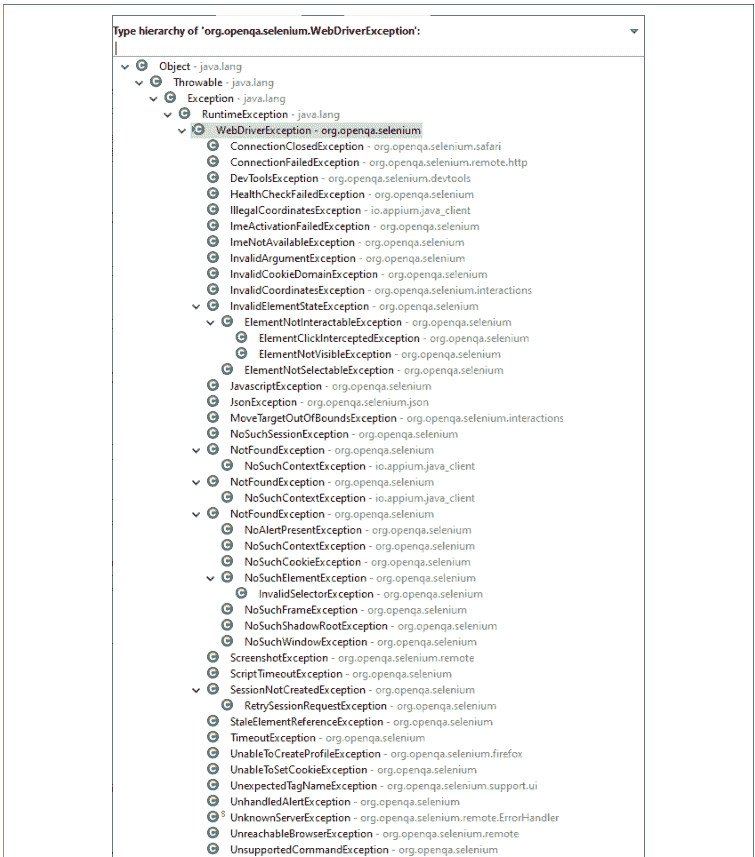

**图 4-13. Selenium WebDriver 异常**

142 | 第 4 章：浏览器无关特性

# Java 中的异常

在 Java 中，异常是中断程序执行的事件。标准 Java API 使用类层级结构来模拟不同的异常类型。该层级结构的根节点是 `Throwable` 类。它有两个子类型：

**Error**

不可恢复的问题。根据一般规则，应用程序会崩溃而不是处理这些严重错误。示例包括 `OutOfMemoryError` 或 `StackOverflowError`。

**Exception**

可恢复的问题。应用程序可以使用 `try-catch` 块处理这些异常。`Exception` 类有两类型：

- 检检异常（Checked exceptions）：直接继承 `Throwable` 类的类（`RuntimeException` 和 `Error` 除外）。这些异常在编译时进行验证，因此我们必须使用 `try-catch` 块处理它们或通过 `throws` 重新抛出。检异常的示例包括 `IOException` 或 `MalformedURLException`。
- 非检异常（Unchecked exceptions）：继承自 `RuntimeException` 的类，是 `Exception` 的子类型。这些异常不需要使用 `try-catch` 处理或通过 `throws` 重新抛出。非检异常的示例包括 `NullPointerException` 或 `ArrayIndexOutOfBoundsException`。

**表 4-10. 常用的 WebDriver 异常及常见原因**

| Exception | 描述 | 常见原因 |
|---|---|---|
| `NoSuchElementException` | Web 元素不可 | - 无效的定位策略<br>- 元素尚未渲染（可能需要等待它） |
| `NoAlertPresentException` | 对话框（警告、提示或确认）不可用 | 在不可用的对话框上执行操作（例如 `accept()` 或 `dismiss()`） |
| `NoSuchWindowException` | 窗口或标签页不可 | 尝试切换到不可用的窗口或标签页 |
| `NoSuchFrameException` | Frame 或 iframe 不可用 | 尝试切换到不可用的 frame 或 iframe |
| `InvalidArgumentException` | 调用 Selenium WebDriver API 方法时参数不正确 | - 导航中的 URL错误<br>- 上传文件时路径不存在<br>- JavaScript 脚本中的参数错误 |
| `StaleElementReferenceException` | 元素已失效，不再出现在页面上 | 当尝试与之前定位的元素交互时，DOM 更新了 |
| `UnreachableBrowserException` | 与浏览器通信问题 | - 无法建立与远程浏览器的连接<br>- 浏览器在会话过程中崩溃 |
| `TimeoutException` | 页面加载超时 | 某些网页加载时间比预期长 |
| `ScriptTimeout` | 脚本加载超时 | 某些脚本执行时间比预期长 |
| `ElementNotVisible` `ElementNotSelectable` `ClickInterceptedException` | 元素位于 DOM 中但不可见/不可选择/不可点击 | - 当元素显示/可选择/可点击时不足（或不存在）<br>- 页面布局（可能由视口变化引起）导致该元素覆盖了我们要交互元素 |

## 总结与展望

本章全面回顾了在不同浏览器间具有互操作性的 WebDriver API 特性。在其中，你学会了如何使用 Selenium WebDriver 执行 JavaScript，包括同步的、固定的（即附加到 WebDriver 会话的）和异步脚本。然后，你学习了超时，即指定页面加载和脚本执行的时间限制。你还查看了如何管理多个浏览器方面，例如尺寸和位置、导航历史、影子 DOM 和 Cookie。接下来，你发现了如何与特定的 Web 元素交互，如下拉列表（select 和数据列表）、导航目标（窗口、标签页、frame 和 iframe）以及对话框（警告、提示、确认和模态）。最后，我们回顾了实现网络存储和事件监听器的机制 Selenium WebDriver 4 以及相关的 WebDriver 异常（及其常见原因）。

## 浏览器特定操作

正如你目前所见，Selenium WebDriver API 的许多功能在不同浏览器之间是兼容的，也就是说我们可以使用 Selenium WebDriver 程序化地控制不同类型的浏览器。Selenium WebDriver API 的其他部分在浏览器之间是不具互操作性的。换句话说，某些浏览器（如 Chrome 或 Edge）支持某些 WebDriver 特性而在其他浏览器（如 Firefox）中不可用（或不同）。本章将回顾这些特定浏览器的特性。

## 浏览器能力 (Capabilities)

Selenium WebDriver 允许通过使用能力来指定特定特定的方面。能力的示例包括无头模式、页面加载策略、Web 扩展的使用或推送通知管理等。如图 5-1 所示，Selenium WebDriver API 提供了一组 Java 类来定义这些能力。`Capabilities` 接口是该层级结构的顶端。在内部，能力接口使用键值对处理数据，这些键值封装了浏览器的特定方面。然后，不同的 Java 类实现此接口以为 Web 浏览器（Chrome、Edge、Firefox 等）指定能力。表 5-1 总结了 `Capabilities` 层级结构的主要类及其对应的目标浏览器。

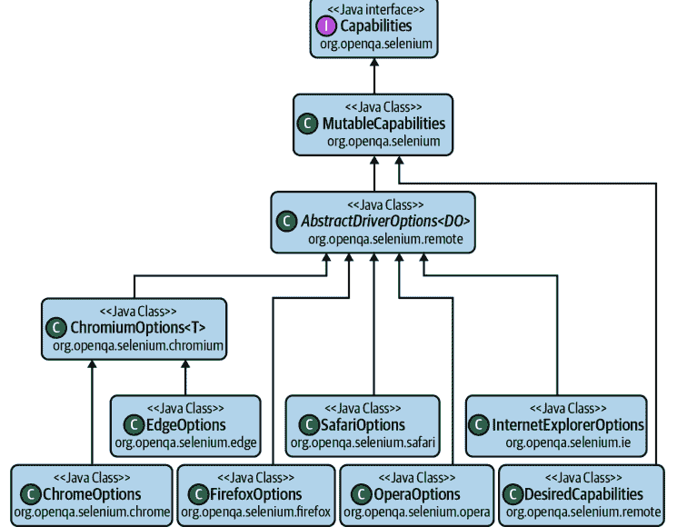

**图 5-1. Capabilities 层级结构**

**表 5-1. Capabilities 层级结构描述**

| 包名 | 类 | 浏览器 |
| --- | --- | --- |
| `org.openqa.selenium` | `MutableCapabilities` | 通用（跨浏览器） |
| `org.openqa.selenium.chrome` | `ChromeOptions` | Chrome |
| `org.openqa.selenium.edge` | `EdgeOptions` | Edge |
| `org.openqa.selenium.firefox` | `FirefoxOptions` | Firefox |
| `org.openqa.selenium.safari` | `SafariOptions` | Safari |
| `org.openqa.selenium.opera` | `OperaOptions` | Opera |
| `org.openqa.selenium.ie` | `InternetExplorerOptions` | Internet Explorer |
| `org.openqa.selenium.remote` | `DesiredCapabilities` | 远程浏览器（见第 6 章） |

接下来的章节将回顾书中讨论的主要 Web 浏览器（即 Chrome、Edge 和 Firefox）最相关的能力。由于 Chrome 和 Edge 都是基于 Chromium 的浏览器，因此这两个浏览器可用的能力是等同的。这一事实反映在图 5-1 中，显示能力类 `ChromeOptions` 和 `EdgeOptions` 均继承自同一个父类（称为 `ChromiumOptions`）。

## 无头浏览器

不需要 GUI 即可与 Web 应用交互的浏览器被称为无头浏览器。这些浏览器的主要用途之一是端到端测试，即与 Web 应用程序进行自动交互。Chrome、Edge 或 Firefox 等浏览器可以作为无头浏览器运行。Selenium WebDriver API 允许通过能力以无头模式启动这些浏览器。为了实现目的，你首先需要创建一个浏览器实例。在主流浏览器中，这些对象分别是 `ChromeOptions`、`EdgeOptions` 或 `FirefoxOptions` 的实例。然后，你需要调用浏览器能力对象中的 `setHeadless(true)` 方法来启用无头模式。最后，你使用 WebDriver 对象设置这些能力。

正如第 53 页所解释，我们有不同的方法创建 WebDriver 对象。首先，可以使用 Selenium WebDriver API 提供的 WebDriver 构造函数或构建器（即 `RemoteWebDriver.builder()`）。最后，我们可以使用 `DriverManager` 构建器在单行代码中解析驱动并创建 WebDriver 实例。以下示例展示了这些替代方案，并结合浏览器能力来启用无头浏览器模式。


- 示例 5-1 使用无头模式下的 Chrome。该示例使用所需的构造函数（在此例中 `ChromeDriver`）创建 WebDriver 实例。
- 示例 5-2 使用无头模式下的 Edge。该示例使用 Selenium WebDriver API 中提供的构建器创建 WebDriver 实例。
- 示例 5-3 使用无头模式下的 Firefox。该示例使用 `WebDriverManager` 创建 WebDriver 实例。注意，在这种情况下不需要 `setup` 方法，WebDriver 在实例化 WebDriver 的同一行中解析驱动。
- 示例 5-4 通过 Selenium-Jupiter 使用无头模式下的 Chrome。该示例使用了 Selenium-Jupiter 提供的参数解析机制，我们只需在测试方法中声明一个 `ChromeDriver` 参数。然后，我们使用 `@Arguments` 注解装饰此参数，为该浏览器指定无头模式。

## 示例 5-1. 使用无头模式 Chrome 进行测试

```java
class HeadlessChromeJupyterTest {
    WebDriver driver;

    @BeforeAll
    static void setUpClass() {
        WebDriverManager.chromedriver().setup();
    }

    @BeforeEach
    void setup() {
        ChromeOptions options = new ChromeOptions();
        options.setHeadless(true);
        driver = new ChromeDriver(options);
    }

    @AfterEach
    void teardown() {
        driver.quit();
    }

    @Test
    void testHeadless() {
        driver.get("https://bonigarcia.dev/selenium-webdriver-java/");
        assertThat(driver.getTitle()).contains("Selenium WebDriver");
    }
}
```

1. 我们解析所需的驱动（在此例中为 `chromedriver`）。
2. 我们使用 `ChromeOptions` 构造函数创建浏览器能力。
3. 我们启用无头模式。这一行等于 `options.addArguments("--headless")`。
4. 我们通过将 `options` 作为 `ChromeDriver` 构造函数的参数传递来设置浏览器能力。

## 示例 5-2. 使用无头模式 Edge 进行测试

```java
class HeadlessEdgeJupyterTest {
    WebDriver driver;

    @BeforeAll
    static void setUpClass() {
        WebDriverManager.edgedriver().setup();
    }

    @BeforeEach
    void setup() {
        EdgeOptions options = new EdgeOptions();
        options.setHeadless(true);
    }

    driver = RemoteWebDriver.builder().capabilities(options).build();

    @AfterEach
    void teardown() {
        driver.quit();
    }

    @Test
    void testHeadless() {
        driver.get("https://bonigarcia.dev/selenium-webdriver-java/");
        assertThat(driver.getTitle()).contains("Selenium WebDriver");
    }
}
```

1. 如常，我们需要解析所需的驱动（在此例中为 `edgedriver`）。
2. 由于我们的目标是使用 Edge，我们需要创建一个 `EdgeOptions` 实例来指定能力。
3. 以之前示例相同的方式启用无头模式。
4. 我们使用 WebDriver 构建器创建 WebDriver，并传递 `options`。

## 示例 5-3. 无头模式 Firefox 进行测试

```java
class HeadlessFirefoxJupiterTest {
    WebDriver driver;

    @BeforeEach
    void setup() {
        FirefoxOptions options = new FirefoxOptions();
        options.setHeadless(true);
        driver = WebDriverManager.firefoxdriver().capabilities(options).create();
    }

    @AfterEach
    void teardown() {
        driver.quit();
    }

    @Test
    void testHeadless() {
        driver.get("https://bonigarcia.dev/selenium-webdriver-java/");
        assertThat(driver.getTitle()).contains("Selenium WebDriver");
    }
}
```

1. 我们在本次测试中使用 Firefox，因此我们创建一个 `FirefoxOptions` 对象来指定能力。
2. 与之前的示例相同，我们启用无头模式。
3. 在此示例中，我们使用 `DriverManager` 解析所需的驱动并在创建 WebDriver 对象时指定之前创建的浏览器能力。

## 5.4. 使用 Selenium-Jupiter 使用无头模式下的 Chrome

```java
@ExtendWith(SeleniumJupiter.class)
class HeadlessChromeSelJupTest {
    @Test
    void testHeadless(@Arguments("--headless") ChromeDriver driver) {
        driver.get("https://bonigarcia.dev/selenium-webdriver-java/");
        assertThat(driver.getTitle()).contains("Selenium WebDriver");
    }
}
```

我们使用 `@Arguments` 注解为浏览器指定无头模式（在此例中为 Chrome）。

## 页面加载策略

Selenium WebDriver 允许为加载网页配置不同的加载方法。为此，Selenium WebDriver API 提供了 `PageLoadStrategy` 枚举。表 5-2 描述了该枚举的可能值及其用途。Selenium WebDriver 内部使用 DOM API 的 `document.readyState` 属性来检查网页的加载状态。

### 表 5-2. PageLoadStrategy 的取值

| 加载策略 | 描述 | 就绪状态 |
| --- | --- | --- |
| `PageLoadStrategy.NORMAL` | 默认方法。Selenium WebDriver 等待整个页面加载完成（即 HTML 内容和资源，如样式表、图像、JavaScript 文件等）。 | `"complete"` |
| `PageLoadStrategy.EAGER` | Selenium WebDriver 等待 HTML 文档完成加载和解析，但此时子进程（脚本、图像、样式表等）仍在加载。 | `"Interactive"` |
| `PageLoadStrategy.NONE` | Selenium WebDriver 等待 HTML 文档下载完成。 | `"loading"` |

我们通过调用浏览器能力（例如 `ChromeOptions`、`FirefoxOptions` 等）的 `setPageLoadStrategy()` 方法来设置这些策略（NORMAL、EAGER 或 NONE）。示例 5-5 展示了一个使用 Chrome 和 NORMAL 策略的测试。在示例仓库中，你可以找到针对 Edge 和 Firefox 使用其他策略（EAGER 和 NONE）的等效示例。此外，在测试设置中指定加载策略后，测试会计算加载页面所需的时间，并在标准输出中显示该值。

### 示例 5-5. 在 Chrome 中使用普通页面加载策略

```java
class PageLoadChromeJupiterTest {
    static final Logger log = getLogger(lookup().lookupClass());

    WebDriver driver;
    PageLoadStrategy pageLoadStrategy;

    @BeforeEach
    void setup() {
        ChromeOptions options = new ChromeOptions();
        pageLoadStrategy = PageLoadStrategy.NORMAL;
        options.setPageLoadStrategy(pageLoadStrategy);

        driver = WebDriverManager.chromedriver().capabilities(options).create();
    }

    @AfterEach
    void teardown() {
        driver.quit();
    }

    @Test
    void testPageLoad() {
        long initMillis = System.currentTimeMillis();
        driver.get("https://bonargicia.dev/selenium-webdriver-java/");
        Duration elapsed = Duration.ofMillis(System.currentTimeMillis() - initMillis);

        Capabilities capabilities = ((RemoteWebDriver) driver)
            .getCapabilities();
        Object pageLoad = capabilities
            .getCapability(CapabilityType.PAGE_LOAD_STRATEGY);
        String browserName = capabilities
            .get("browserName");

        log.debug("页面使用 {} 的 '{}' 策略在 {} 加载花费了 {} ms",
            elapsed.toMillis(), pageLoad, browserName);

        assertThat(pageLoad).isEqualTo(pageLoadStrategy.toString());
    }
}
```

- 由于我们在测试中使用了 Chrome，因此我们实例化了 `ChromeOptions` 来指定能力。
- 我们将页面加载策略设置为 NORMAL。
- 我们使用 `DriverManager` 来管理驱动、创建 WebDriver 实例并指定能力。
- 我们在加载页面之前获取系统时间戳。
- 我们在加载页面之后获取系统时间戳。
- 我们读取 WebDriver 对象的属性。
- 我们读取所使用的页面加载策略。
- 我们追踪加载网页所需的时间。
- 我们验证加载策略是否与初始配置一致。

# 设备模拟

主流网络浏览器使用开发工具（即基于 Chromium 的浏览器的 DevTools 和 Firefox 的 Developer Tools）通过以下方式模拟移动设备：

- 模拟移动视口
- 使用给定移动设备的宽度和高度来缩小网页的可见区域
- 网络限制（Throttling）
- 减慢连接速度以模拟移动网络（例如 3G）
- CPU 限制
- 减慢处理性能
- 模拟地理位置
- 设置自定义的全球定位系统（GPS）坐标
- 设置方向
- 旋转屏幕

图 5-2 显示了 Chrome 中通过 DevTools 进行移动模拟的截图。

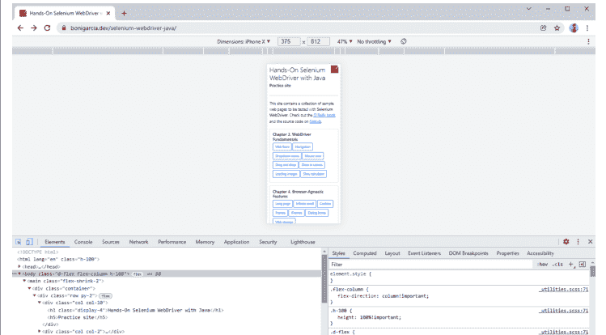

图 5-2. 在 Chrome 中使用 DevTools 进行移动模拟

在本文编写时，这种移动设备模拟可以通过基于 Chromium 的浏览器（Chrome 和 Edge）中的 Selenium WebDriver API 自动化，但 Firefox 不行（因为它在 `geckriver` 中尚未实现）。为此，我们需要在 `chromeOptions` 或 `EdgeOptions` 中设置实验性选项 `mobileEmulation`。

然后，有两种替代方法可以指定要模拟的移动设备。首先，我们可以指定特定的移动设备（例如 Pixel 2、iPad Pro 或 Galaxy Fold 等）。此列表会在 Chrome 发布时更新，检查所有可能性的最佳方法是在 DevTools 中检查可用设备（例如图 5-2 中选了 iPhone X）。示例 5-6 显示了一个测试设置，其中我们使用标签 `iPhone 6/7/8` 指定移动设备。

```java
@BeforeEach
void setup() {
    ChromeOptions options = new ChromeOptions();
    Map<String, Object> mobileEmulation = new HashMap<>(); ①
    mobileEmulation.put("deviceName", "iPhone 6/7/8"); ②
    options.setExperimentalOption("mobileEmulation", mobileEmulation); ③

    driver = DriverManager.chromedriver().capabilities(options).create();
}
```

- 我们创建了一个 hashmap 来存储各个属性。
- 然后，我们选择了设备（iPhone 6/7/8）。
- 我们使用实验性选项设置移动模拟。
- 我们使用 `EdgeOptions` 设置移动模拟。

另一种替代方法是指定要模拟的移动设备。这些属性包括：

- 宽度（像素）
- 高度（像素）
- 像素比例（物理与逻辑像素之间）
- 是否支持触摸

除了这些属性外，我们还可以为模拟的设备指定自定义的用户代理。在 Chrome 中，用户代理是一个字符串。示例 5-7 展示了通过指定设备使用移动模拟的测试设置。

```java
@BeforeEach
void setup() {
    EdgeOptions options = new EdgeOptions();
    Map<String, Object> mobileEmulation = new HashMap<>();
    Map<String, Object> deviceMetrics = new HashMap<>();
    deviceMetrics.put("width", "360");
    deviceMetrics.put("height", "640");
    deviceMetrics.put("pixelRatio", 3.0);
    deviceMetrics.put("touch", true);
    mobileEmulation.put("deviceMetrics", deviceMetrics);
    mobileEmulation.put("userAgent", "Mozilla/5.0 (Linux; Android 9.0; Pixel 4) AppleWebKit,like Gecko) Chrome/92.0.4515.57 Safari/537.36");
    options.setExperimentalOption("mobileEmulation", mobileEmulation);

    driver = DriverManager.edgedriver().capabilities(options).create();
}
```

- 我们创建了 `deviceMetrics` map 来存储属性。
- 我们将 `deviceMetrics` 放入 `mobileEmulation` map 中。
- 我们为模拟的设备设置了自定义的用户代理。
- 我们指定了设备。

## 浏览器扩展

浏览器扩展（也称为 add-ons 或插件）是用于修改或增强浏览器默认操作的程序。用户通常通过商店安装扩展。这些商店是浏览器维护者支持的用于托管扩展的应用程序。表 5-3 总结了主流浏览器的商店。

| 商店 | 浏览器 | URL |
| --- | --- | --- |
| Chrome 应用商店 | Chrome | `https://chrome.google.com/webstore/category/extensions` |
| Edge 扩展 | Edge | `https://microsoft.microsoft.com/addons/Microsoft-Edge-Extensions` |


| Firefox 浏览器插件 | Firefox | https://addons.mozilla.org/en-US/firefox |

我们可以通过能力在 WebDriver 会话中使用扩展。对于 Chrome 和 Edge 等基于 Chromium 的浏览器，我们使用 `ChromeOptions` 或 `EdgeOptions` 对象的 `addExtensions()` 方法。示例 5-8 展示了一个在 Chrome 中安装本地扩展的测试设置。

```java
@BeforeEach
void setup() throws URISException {
    Path extension = Paths
        .get(ClassLoader.getResource("dark-bg.crx").toURI());
    ChromeOptions options = new ChromeOptions();
    options.addExtensions(extension.getFile());
    driver = WebDriverManager.chromedriver().capabilities(options).create();
}
```

- 我们安装打包好的 Chrome 扩展（CRX）文件。该文件是一个测试资源，位于 Java 项目的 `src\test\resources` 文件夹。该扩展将网站的外观更改为深色背景上的浅色文字。图 5-3 显示了当使用该扩展的 WebDriver 测试加载练习网站时的截图。
- 我们在 Chrome 中以 Java File 的形式添加扩展。

## 使用 Java 练手操作 Selenium WebDriver

### 练习站点

该站点包含了一系列用于使用 Selenium WebDriver 测试的示例网页。可以在 GitHub 上查看其源代码。

#### 第 3 章 WebDriver 基础知识

- Web 表单
- 导航
- 下拉菜单
- 鼠标悬停
- 拖放操作
- 在画布上绘制
- 加载图像
- 慢速计算器

#### 第 4 章 与浏览器无关的特性

- 长页面
- 无限滚动
- Cookies
- 框架（Frames）
- 内联框架（Iframes）
- 对话框

#### 第 5 章 浏览器特定操作

- 地理定位
- 获取用户媒体
- 多语言支持
- 推送通知
- Web 存储
- 基础身份验证
- 摘要认证
- Web 身份验证
- 控制台日志

#### 第 6 章 远程

#### 第 7 章 页面

#### 第 8 章 测试

图 5-3。使用 `dark-bg.crx` 扩展加载时的练习站点。

Firefox 同样允许在受 WebDriver 控制时加载扩展程序。尽管如此，其语法是不同的。示例 5-9 演示了这一点。

### 示例 5-9。在 Firefox 中设置 Web 扩展

```java
@BeforeEach
void setup() throws SyntaxException {
    Path extension = Paths.get(ClassLoader.getResource("dark-bg.xpi").toURI());
    FirefoxOptions options = new FirefoxOptions();

    FirefoxProfile profile = new FirefoxProfile();
    profile.addExtension(extension.ToFile());
    options.setProfile(profile);

    driver = WebDriverManager.firefoxdriver().capabilities(options)
        .create();
}
```

- 我们使用了与 Chrome/Edge 相同的扩展程序，但在这种情况下，打包格式是针对 Firefox 特定的。注意文件是不同的。这次，它被封装为 XPI 安装文件，即一个包含 Web 扩展源码、资源（例如图像）和元数据的压缩包。
- 我们需要创建一个自定义的 Firefox 描述文件（profile，即配置自定义设置的存储位置）。
- 我们将扩展程序作为 Java 文件添加到 Firefox 描述方案中。
- 我们在 Firefox 选项中设置该配置方案。

基于 Chromium 的浏览器（如 Chrome、Edge）也允许从源代码加载扩展程序，即不封装为 CRX 文件。此功能对于开发期间对 Web 扩展进行自动化测试非常方便。示例 5-10 显示了在 Edge 中安装源码的测试设置。

### 示例 5-10。在 Edge 中从源码安装 Web 扩展的测试设置

```java
@BeforeEach
void setup() throws SyntaxException {
    Path extension = Paths.get(ClassLoader.getResource("web-extension").toURI());
    EdgeOptions options = new EdgeOptions();
    options.addArguments(
        "--load-extension=" + extension.toAbsolutePath().toString()
    );

    driver = WebDriverManager.edgedriver().capabilities(options).create();
}
```

- 我们使用的扩展程序位于下方文件夹，存储在 Java 项目的 `src/test/resources` 中。该扩展遵循浏览器扩展 API。我们使用 JavaScript 配合自定义消息，图 5-4 显示了使用该扩展时的练习截图。
- 我们使用 `--load-extension` 参数指定扩展路径。

Selenium WebDriver 在每次执行时都会创建一个新的浏览器配置方案。因此，通过 Selenium WebDriver 安装的 Web 扩展在目标浏览器中不是永久性的。

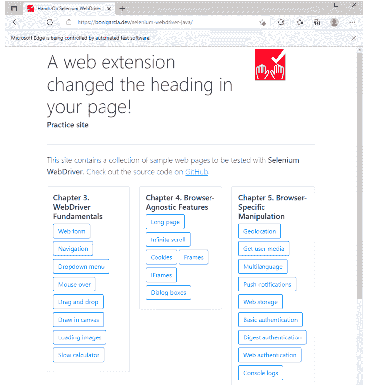

图 5-4。使用本地扩展加载时的练习站点。

从 Selenium 4.1 开始，Firefox 也允许从源码安装 Web 扩展。为此，FirefoxDriver 实现了 `HasExtensions` 接口，并提供了 `installExtension` 方法。示例 5-11 显示了使用此特性的测试设置。

### 示例 5-11。在 Firefox 中从源码设置 Web 扩展

```java
@BeforeEach
void setup() throws URISException {
    Path extensionFolder = Paths
        .get(classLoader.getResource("web-extension").toURI());
    zippedExtension = zipFolder(extensionFolder);

    driver = WebDriverManager.firefoxdriver().create();
    ((FirefoxDriver) driver).installExtension(zippedExtension, true);
}
```

我们使用了 Web 扩展源码，位于项目类路径中。

- `installExtension` 方法要求从源码安装的扩展必须是压缩包。WebDriverManager 提供了静态辅助方法 `zipFolder(Path)` 来方便这一过程。
- 我们将压缩后的扩展程序作为临时插件安装到 Firefox 中。

## 地理定位

Geolocation API 是一项 W3C 标准，允许访问与 Web 浏览器托管设备（例如笔记本电脑或手机）相关的地理位置信息。常见的地理定位数据源包括 GPS 数据和从网络（如 IP 地址）推断的位置。在 Web 浏览器中可以通过 JavaScript 对象 `navigator.geolocation` 调用 Geolocation API。使用该语句时，出于隐私考虑，会弹出窗口请求用户许可报告位置数据。

练习站点包含一个使用地理定位的网页。图 5-5 显示了该页面的截图。此图显示了点击“Get coordinates（获取坐标）”按钮时向用户显示的权限框。为了处理 Selenium WebDriver API，我们使用 `capabilities`。与其他情况一样，授予地理定位数据所需的权限在 Chrome/Edge 和 Firefox 中是不同的。以下代码段显示了差异。首先，示例 5-12 显示了一个授予地理定位访问权限的测试设置。


图 5-3。使用 `dark-bg.crx` 扩展加载时的练习站点。

图 5-4。使用本地扩展加载时的练习站点。

图 5-5。显示地理定位的弹出框。

图 5-6 显示此配置。

### 示例 5-12。在 Chrome 中允许地理定位的测试设置

```java
@BeforeEach
void setup() {
    ChromeOptions options = new ChromeOptions();
    Map<String, Object> prefs = new HashMap<>();
    prefs.put("profile.default_content_settings.geolocation", 1);
    options.setExperimentalOption("prefs", prefs);

    driver = WebDriverManager.chromedriver().capabilities(options).create();
}
```

- 启用地理定位。
- 授予地理定位数据访问，即在访问框中点击允许。
- 使用设备可用组件收集数据，如 GPS、WiFi 或蓝牙。

假设你在 macOS 上使用 Chrome 或 Edge 访问地理定位。你还需要在 macOS 设置中为这些浏览器启用位置服务（系统设置 -> 隐私与安全性 -> 位置服务）。

### 示例 5-13。在 Firefox 中允许地理定位的测试设置

```java
@BeforeEach
void setup() {
    FirefoxOptions options = new FirefoxOptions();
    options.addPreference("geo.enabled", true);
    options.addPreference("geo.prompt.testing", true);
    options.addPreference("geo.provider.use_corelocation", true);

    driver = new DriverManager.firefoxdriver(capabilities(options))
        .create();
}
```

## 通知

Notifications API 是一项标准 Web API，允许网站向操作系统桌面发送通知。该 API 通过 JavaScript 对象 `Notification` 提供。在网站发送通知之前，用户必须授予许可。这种许可会以类似于地理定位数据的对话框形式提示给用户。

练习站点包含一个使用通知 API 的网页。图 5-7 显示了该页面通知权限框的截图。图 5-8 显示了该网页在 Linux 主机上发送的消息。

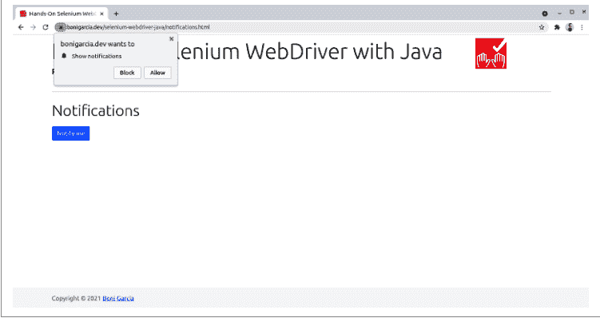

图 5-7。显示通知权限框的练习站点。

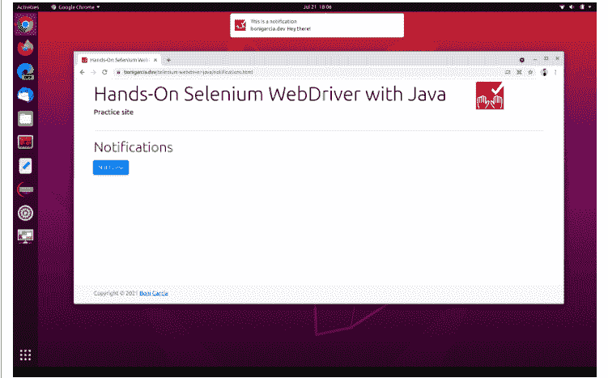

图 5-8。在 Linux 桌面显示通知的练习站点。

Selenium WebDriver API 允许通过能力（capabilities）授予通知。在其他功能中，这些配置的语法在 Chrome/Edge 和 Firefox 中是不同的。示例 5-14 显示了作为 Chrome 选项启用通知的测试设置。我们使用相同的偏好设置（`profile.default_content_setting_values.notifications`）在 Edge 中允许通知。示例 5-15 显示在这种情况下等效偏好标签（`permissions.default.desktop-notification`）是不同的，尽管其值（`1`）在允许通知时是相同的。另一个可能的值是 `2`，表示阻止通知（在 Chrome/Edge 和 Firefox 中均如此）。

### 示例 5-14。在 Chrome 中允许通知的测试设置

```java
@BeforeEach
void setup() {
    ChromeOptions options = new ChromeOptions();
    Map<String, Object> prefs = new HashMap<>();
    prefs.put("profile.default_content_setting_values.notifications", 1);
    options.setExperimentalOption("prefs", prefs);

    driver = WebDriverManager.chromedriver().capabilities(options).create();
}
```

### 示例 5-15。在 Firefox 中允许通知的测试设置

```java
@BeforeEach
void setup() {
    FirefoxOptions options = new FirefoxOptions();
    options.addPreference("permissions.default.desktop-notification", 1);

    driver = WebDriverManager.firefoxdriver().capabilities(options)
        .create();
}
```

示例 5-16 显示了与上述设置配合使用的测试逻辑。如常，你可以在仓库中找到完整的测试用例。此测试是一个异步脚本执行。该脚本覆盖了原始的 Notification JavaScript 对象。该对象的新实现获取通知消息的标题，该标题通过脚本回调返回给 WebDriver 测试。

### 示例 5-16。通知处理测试

```java
@Test
void testNotifications() {
    driver.get(
        "https://bonigarcia.dev/selenium-webdriver-java/notifications.html"
    );

    JavascriptExecutor js = (JavascriptExecutor) driver;

    String script = String.join("\n",
        "const callback = arguments[arguments.length - 1];",
        "const OldNotify = window.Notification;",
        "function newNotification(title, options) {\n"
            + "  callback(title);\n"
            + "  return OldNotify(title, options);\n"
            + "},\n",
        "newNotification.requestPermission = "
            + "OldNotify.requestPermission.bind(OldNotify);",
        "Object.defineProperty(newNotification, 'permission', {\n"
            + "  get: {\n"
            + "    return OldNotify.permission;\n"
            + "  }\n"
            + "});\n",
        "window.Notification = newNotification('notify-me');",
        "document.getElementById('notify-me').click()");

    log.debug("Executing the following script asynchronously:\n" + script);

    Object notificationTitle = js.executeAsyncScript(script);

    assertThat(notificationTitle).isEqualTo("This is a notification");
}
```


- 正如异步脚本执行所示，最后一个参数是用于信号脚本结束的回调函数。
- 我们存储了原始 `Notification` 构造函数的副本。
- 我们为通知创建了一个新的构造函数。
- 我们将消息标题作为回调中的参数传递。因此，标题返回给 WebDriver 调用（在本例中为 Java）。
- 我们使用旧的构造函数创建原始的 `Notification` 对象。
- 我们点击网页上触发通知的按钮。
- 我们在脚本执行后获取返回的对象。
- 我们验证通知标题是否符合预期。

## 浏览器二进制文件

Selenium WebDriver 开箱即用即可检测受控浏览器（Chrome、Firefox 等）的路径。尽管如此，我们可以使用能力（capabilities）为浏览器执行文件指定自定义路径。当浏览器安装路径非标准时（例如对于 beta/dev/canary 浏览器），此功能可能非常有用。

我们使用相同的能力语法来指定 Chrome、Edge 和 Firefox 的二进制路径。示例 5-17 显示了使用 Chrome beta 的测试设置。

## Example 5-17. 为 Chrome 设置自定义二进制路径的测试设置

```java
@BeforeEach
void setup() {
    Path browserBinary = Paths.get("/usr/bin/google-chrome-beta");
    assumeThat(browserBinary.exists());

    ChromeOptions options = new ChromeOptions();
    options.setBinary(browserBinary.toFile());

    driver = new ChromeDriver(options.capabilities()).create();
}
```

- 我们使用 Java `Path` 获取浏览器二进制路径（在本例中为 Linux 下 Chrome beta）。
- 我们使用假设（assumptions）在之前的路径不存在（例如在 CI 服务器上）时条件跳过此测试。
- 我们使用 Chrome 选项的 `setBinary` 设置二进制路径（作为 Java `File` 对象）。

## Web 代理

在计算机网络中，代理是作为客户端和服务器之间中间媒介的服务器。Web 代理是浏览器和 Web 服务器之间的代理，它可以实现多种用途，如下：

- **访问特定区域的信息**：代理通常位于与客户端不同的区域，服务器连续对该区域做出响应。
- **避免限制**：代理可以帮助访问被阻止的网站，例如通过中间防火墙。
- **捕获网络流量**：代理可以收集 HTTP 请求和响应。
- **缓存**：代理可以允许更快速地检索网站。

图 5-9 表示了 Selenium WebDriver 架构中 Web 代理的位置，与不使用 Web 代理的典型场景相比。

Selenium WebDriver API 提供了一个 `Proxy` 类来配置 Web 代理。该类通过能力（capabilities）配置到 WebDriver 对象中。示例 5-18 Illust了如何操作。

## Example 5-18. 配置 Web 代理的测试设置

```java
@BeforeEach
void setup() {
    Proxy proxy = new Proxy();
    String proxyStr = "proxy:port";

    proxy.setHTTPProxy(proxyStr);
    proxy.setSSLProxy(proxyStr);

    ChromeOptions options = new ChromeOptions();
    options.setInsecureCerts(true);
    options.setProxy(proxy);

    driver = DriverManager.chromedriver().capabilities(options).create();
}
```

- 我们创建 `Proxy` 类的实例。
- 指定代理所需的语法为 `host:port`。
- 我们指定代理用于 HTTP 连接。
- 我们还指定代理用于 HTTPS 连接。
- 虽然不是强制，但通常需要接受不安全的证书。
- 我们将代理设置为能力。此行等同于 `options.setCapability(CapabilityType.PROXY, proxy)`。

## 日志收集

Selenium WebDriver API 允许收集不同的日志源。此功能通过能力启用，尽管在写作期间它仅支持基于 Chromium 的浏览器。示例 5-19 展示了启用浏览器日志（即控制台消息）的设置。此片段还设置了测试逻辑，在其中我们需要调用 `driver.manager().logs()` 来收集日志列表。

## Example 5-19. 使用 Chrome 收集浏览器日志

```java
@BeforeEach
void setup() {
    LoggingPreferences logs = new LoggingPreferences();
    logs.enable(LogType.BROWSER, Level.ALL);

    ChromeOptions options = new ChromeOptions();
    options.setCapability(CapabilityType.LOGGING_PREFS, logs);

    driver = DriverManager.chromedriver().capabilities(options).create();
}

@Test
void testBrowserLogs() {
    driver.get("https://bonigarcia.dev/selenium-webdriver-java/console-logs.html");

    LogEntries browserLogs = driver.manager().logs().get(LogType.BROWSER);

    Assertions.assertThat(browserLogs.getAll()).isNotEmpty();

    browserLogs.forEach(l -> log.debug("{}", l));
}
```

- 我们设置了 `loggingPrefs` 能力。
- 我们打开了一个练习页面，该页面会在浏览器控制台中记录若干条跟踪（traces）。
- 我们收集了所有日志并按浏览器进行了过滤（控制台跟踪）。
- 我们验证了跟踪信息的数量不为零。
- 我们在标准输出中显示每条日志。

在本文编写时，W3C WebDriver 规范尚未提供日志收集功能。尽管如此，它已经在某些驱动程序中实现，例如 `chromedriver` 或 `msdriver`（即 Chrome 和 Edge），但在其他驱动程序中不可用，例如 `geckodriver`（即 Firefox）。


## 用户媒体

WebRTC 是一组标准技术，允许使用浏览器交换实时媒体。这项技术允许在客户端使用 JavaScript API 创建音频和视频会议应用程序。练习站点包含一个页面，该页面使用 `getUserMedia` JavaScript API 获取用户媒体（麦克风和摄像头）。与其他 API 一样，出于安全和隐私考虑，浏览器在访问用户媒体之前会弹出窗口请求权限。

图 5-10 显示了显示此对话框时的示例页面。

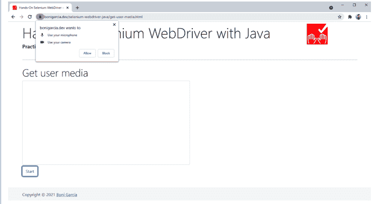

图 5-10。练习站点弹出用户媒体权限弹窗

我们在 Selenium WebDriver API 中使用能力（capabilities）来授予用户媒体的权限。这些能力在 Chrome 和 Edge 中的语法是相同的（参见示例 5-20），但在 Firefox 中不同（参见示例 5-21）。

### 示例 5-20. 在 Chrome 中生成合成用户媒体的测试设置

```java
@BeforeEach
void setup() {
    ChromeOptions options = new ChromeOptions();

    options.addArguments("--use-fake-ui-for-media-stream"); // 1
    options.addArguments("--use-fake-device-for-media-stream"); // 2

    driver = WebDriverManager.chromedriver().capabilities(options).create();
}
```

- 1 允许访问用户媒体（音频和视频）的参数。
- 2 使用合成视频（绿色旋转器）和音频（每秒一次嘟声）伪造用户媒体的参数。你可以在图 5-11 中看到这段视频。

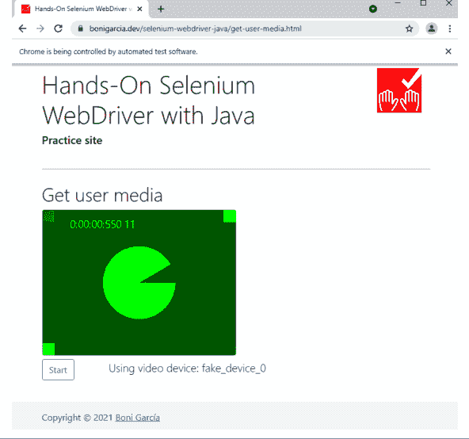

图 5-11。在 Chrome 中使用合成用户媒体的练习站点

## 示例 5-21. 在 Firefox 中授予合成用户媒体的测试设置

```java
@BeforeEach
void setup() {
  FirefoxOptions options = new FirefoxOptions();

  options.addPreference("media.navigator.permission.disabled", true);
  options.addPreference("media.navigator.streams.fake", true);

  driver = WebDriverManager.firefoxdriver().capabilities(options)
    .create();
}
```

- 访问用户媒体的偏好。
- 使用合成视频（带有变化的背景）和音频（持续嘟声）获取用户媒体的偏好。你可以在图 5-12 中看到这段视频。

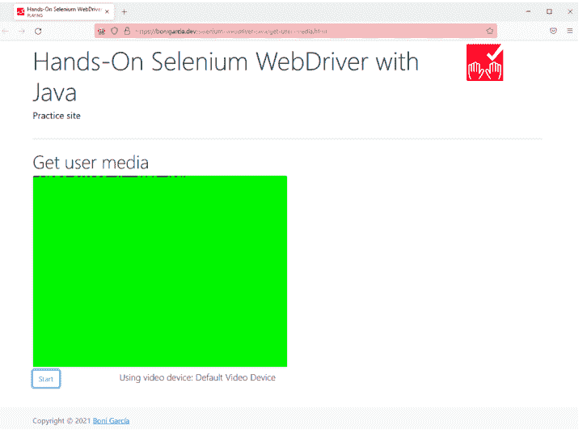

图 5-12。在 Firefox 中使用合成用户媒体的练习站点

## 加载不安全页面

当网络浏览器尝试使用 HTTPS（安全超文本协议）加载网页但服务器端证书无效时，浏览器会警告用户。无效证书的示例包括自签名证书、已撤销证书或加密上不安全的证书。图 5-13 显示了 Chrome 中此警告的截图。

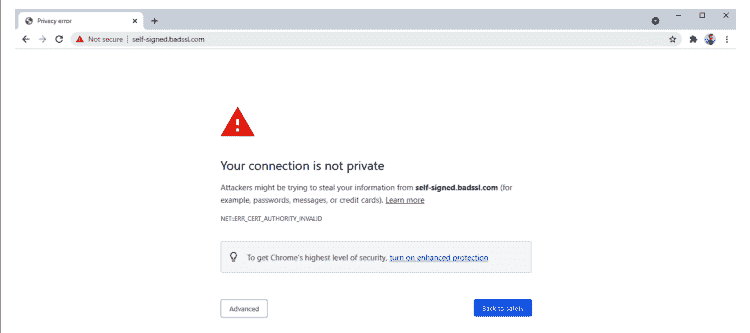

图 5-13。使用不安全证书的网页

这个问题并不意味着存在安全问题。可能会发生在网站开发期间，例如在使用自签名证书时。由于由于原因，Selenium WebDriver API 允许通过 `acceptInsecurecerts` 能力禁用证书检查。该能力在 Chrome、Edge 和 Firefox 中是相同的。示例 5-22 显示了一个使用 Chrome 启用该能力的测试设置。此代码段还包含一个打开不安全网站的测试。

### 示例 5-22. 使用不安全证书的 Web 测试

```java
@BeforeEach
void setup() {
    ChromeOptions options = new ChromeOptions();
    options.setAcceptInsecureCerts(true);

    driver = WebDriverManager.chromedriver().capabilities(options).create();
}

@Test
void testInsecure() {
    driver.get("https://self-signed.badssl.com/");

    String bgColor = driver.findElement(By.TagName("body"))
        .getCssValue("background-color");

    Color red = new Color(255, 0, 0, 1);

    assertThat(Color.fromString(bgColor)).isEqualTo(red);
}
```

- 我们启用了允许不安全证书的能力。
- 我们打开了一个使用不安全证书的网站（在这种情况下是自签名的）。
- 如果网站成功成功，body 背景应该是红色。

## 本地化

在软件工程中，本地化（localization）是指调整应用程序以满足终端用户的文化和语言。本地化是更广泛的概念——国际化（i18n）的一部分，国际化是设计和开发支持多种语言的应用程序的过程。本地化有时写为 l10n。常见的方面包括货币（欧元、美元）、计量系统（例如公制或英制）和日期格式。本地化测试是非功能测试的一种形式，对待测试系统（SUT）的特定区域设置进行验证。Selenium WebDriver API 允许我们通过设置 `int.accept_languages` 来基于语言进行本地化测试。该能力允许你指定区域设置，例如美式英语的 `en_US` 或欧洲西班牙语的 `es_ES`。示例 5-23 显示了在 Chrome 中配置此项的测试设置。我们可以在 Edge 中使用相同的语法，尽管在 Firefox 中我们将此能力作为偏好指定（参见示例 5-24）。

### 示例 5-23. 在 Chrome 中使用偏好区域的测试

```java
String lang;

@BeforeEach
void setup() {
    lang = "es-ES";

    ChromeOptions options = new ChromeOptions();
    Map<String, Object> prefs = new HashMap<>();

    prefs.put("intl.accept_languages", lang);
    options.setExperimentalOption("prefs", prefs);

    driver = WebDriverManager.chromedriver().capabilities(options).create();
}

@Test
void testLocalization() {
    driver.get("https://bonigarcia.dev/selenium-java/multilanguage.html");

    ResourceBundle strings = ResourceBundle.getBundle(
        "strings",
        Locale.forTag(lang)
    );

    String home = strings.getString("home");
    String content = strings.getString("content");
    String about = strings.getString("about");
    String contact = strings.getString("contact");

    String bodyText = driver.findElement(By.tagName("body")).getText();

    assertThat(bodyText.contains(home).contains(content)
        .contains(about).contains(contact));
}
```

- 我们在 Chrome 的偏好语言中指定欧洲西班牙语。
- 我们打开了一个支持多语言（英语和西班牙语）的练习页面。
- 我们使用资源包读取文本翻译。你可以在项目文件夹 `src/test/resources` 中的 `strings_es.properties`（和 `strings_en.properties`）文件中找到这些字符串。
- 我们断言文档主体包含所有预期的字符串。

### 示例 5-24. 在 Firefox 中指定偏好区域的测试设置

```java
@BeforeEach
void setup() {
  lang = "es-ES";

  FirefoxOptions options = new FirefoxOptions();
  options.addPreference("intl.accept_languages", lang);

  driver = WebDriverManager.firefoxdriver().capabilities(options)
    .create();
}
```

使用 Selenium WebDriver 进行本地化测试有一种更彻底的替代方案。与其更改偏好语言（决定了 HTTP Header `language`），不如我们可以更改网络浏览器的默认语言。如果不存在该 HTTP Header，多语言应用程序将交替使用名为 `--lang` 的简单参数，作为浏览器能力指定。该参数在 Chrome、Edge 和 Firefox 中是通用的。示例 5-25 显示了如何使用 WebDriver 能力将浏览器语言设置为美式英语。

### 示例 5-25. 在 Chrome 中更改浏览器语言的测试设置

```java
@BeforeEach
void setup() {
    lang = "en-US";

    ChromeOptions options = new ChromeOptions();
    options.addArguments("--lang=" + lang);

    driver = DriverManager.chromedriver().capabilities(options).create();
}
```


# 无痕模式

无痕模式确保浏览器在干净的状态下运行。此模式允许隐私浏览，即与主会话和用户数据隔离运行。Selenium WebDriver API 允许通过能力在无痕模式下执行浏览器。对于 Chrome 和 Edge，此模式通过`--incognito`参数激活（参见示例 5-26），而在 Firefox 中，我们使用`-private`偏好设置（参见示例 5-27）。

## 示例 5-26：在无痕模式下使用 Chrome 的测试设置

```java
@BeforeEach
void setup() {
    ChromeOptions options = new ChromeOptions();
    options.addArguments("--incognito");
    driver = DriverManager.chromedriver().capabilities(options).create();
}
```

## 示例 5-27：在无痕模式下使用 Firefox 的测试设置

```java
@BeforeEach
void setup() {
    FirefoxOptions options = new FirefoxOptions();
    options.addArguments("--private");
    driver = DriverManager.firefox.chromedriver().capabilities(options).create();
}
```

# 在 Internet Explorer 模式下使用 Edge

Edge 为微软遗留浏览器（即 Internet Explorer，IE）提供了内置支持。要创建一个在 IE 模式下使用 Edge 的 Selenium WebDriver 测试，我们首先需要在 Edge 中启用 IE 模式。如图 5-14 所示，该选项可以在 Edge 设置 -> 默认浏览器 -> 允许网站在 Internet Explorer 模式下重新加载中启用。然后，我们可以像示例 5-28 所示所示使用 Selenium WebDriver API。

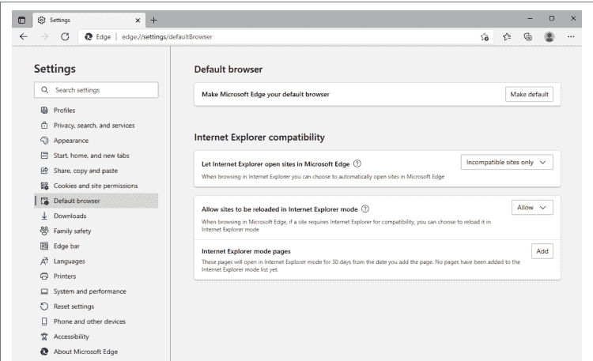

图 5-14. 在 IE 模式下使用 Edge 的设置

## 示例 5-28：在 IE 模式下使用 Edge 的测试设置

```java
@BeforeAll
static void setUpClass() {
    assertThat(IS_OS_WINDOWS).isTrue();
    WebDriver.iedriver().setup();
}

@BeforeEach
void setup() {
    Optional<Path> browserPath = DriverManager.edgedriver()
        .getBrowserPath();

    assertThat(browserPath).isPresent();

    InternetExplorerOptions options = new InternetExplorerOptions();
    options.attachToEdge(Chrome);
    options.withEdgeExecutable(browserPath.get().toString());

    driver = new InternetExplorerOptions();
}
```

我们假设测试在 Windows 上执行，因为 IE 模式不支持其他操作系统。

- 我们使用 WebDriverManager 来管理 IEDriver（Internet Explorer 所需驱动）。
- 我们使用 WebDriverManager 来发现 Edge 的路径。
- 我们使用 IE 选项来指定在 IE 模式下使用 Edge。
- 我们将之前发现的 Edge 路径设置在 IE 选项中。
- 我们创建驱动实例来使用 Internet Explorer（实际上将是 IE 模式下的 Edge）。

# Chrome DevTools 协议

Chrome DevTools 是针对基于 Chromium 的浏览器（如 Chrome 和 Edge）的一系列开发者工具。这些工具允许对这些浏览器进行检查、调试或分析等等功能。Chrome DevTools 协议（CDP）是一种允许外部客户端操作 DevTools 的通信协议。Firefox 实现了 CDP 的子集以支持如 Selenium WebDriver 等自动化工具。

在 Selenium WebDriver 中使用 CDP 有两种方法。Selenium WebDriver 提供了`HasDevTools`接口来向浏览器发送 CDP 命令。该接口由 ChromeDriver（用于 Chrome 和 Edge）和 FirefoxDriver（用于 Firefox）实现。这种机制非常强大，因为它允许 Selenium WebDriver 直接访问 CDP。然而，由于它绑定浏览器类型和版本，存在相关的限制。

因此，Selenium WebDriver API 提供了另一种使用 CDP 的方法，基于构建在 CDP 之上的封装类进行器的器的操作。这些封装类允许不同的操作，例如网络流量拦截或基础身份验证。接下来的章节将解释这些封装类。之后，我将展示几个使用 CDP 命令的示例。

# Selenium 封装类

Selenium WebDriver API 包含一组辅助类，封装了部分 CDP 命令。这些类旨在为 Selenium WebDriver 测试提供启用高级功能的友好 API。

构建在 CDP 之上的第一个封装类是`NetworkInterceptor`。该类允许存根后端请求、拦截网络流量并返回预定义的响应。此功能可能通过快速、直接的响应模拟外部调用，有助于简化复杂的端到端测试。要实例化 Network Interceptor，我们需要在其构造函数中指定参数（参见示例 5-29）：

- 实现 CDP 的 WebDriver 对象（即 ChromeDriver 或 EdgeDriver）
- 用于映射网络请求到响应的 Route 对象

## 示例 5-29：使用 NetworkInterceptor 拦截网络流量的测试

```java
@Test
void testNetworkInterceptor() throws Exception {
    Path img = Paths
        .get(ClassLoader.getResource("tools.png").toURI());

    byte[] bytes = Files.readAllBytes(img);

    try (NetworkInterceptor interceptor = new NetworkInterceptor(driver,
        Route.matching(req -> req.getUri().endsWith(".png"))
        .to((req -> req -> new HttpResponse())
            .setContent(Contents.byteAs(bytes)))) {

        // ... 实现细节
    }
}
```

在每次测试之后和退出 WebDriver 会话之前，我们会终止 CDP 会话。

接下来的小节提供了几个示例，说明了 DevTools 在 WebDriver 测试中的巨大潜力。在这些示例中，我们使用 DevTools 实例，通过`send()`方法发送 CDP 命令。Selenium WebDriver API 为测试 Web 应用提供了各种操作，例如模拟网络条件、处理 HTTP 请求、阻塞 URL 等。


使用原始 CDP 命令（如下文小节所示）的 Selenium WebDriver 测试与特定的浏览器版本绑定。你可以通过检查示例库中完整测试代码的导入语句（例如`import org.openqa.selenium.devtools.v96.*;`）来查看此版本。

## 模拟网络条件

CDP 允许模拟不同的网络（如移动 2G/3G/4G、WiFi、蓝牙等）和条件（例如延迟或吞吐量）。此功能对于测试 Web 应用在特定连接参数下的行为非常有帮助。示例 5-33 显示了使用此功能的测试。如你所见，该测试发送了两个命令：

```java
Network.enable()
```

用于激活网络跟踪。该命令有三个可选参数：

```java
Optional<Integer> maxBufferSize
```

网络负载的最大缓冲区大小（字节）。

```java
Optional<Integer> maxResourceBufferSize
```

单个资源的最大缓冲区大小（字节）。

```java
Optional<Integer> maxPostDataSize
```

最长的 POST 请求体大小（字节）。

```java
Network.emulateNetworkConditions()
```

用于激活网络模拟。模拟的条件使用以下参数指定：

`Boolean offline`

模拟未连接到互联网。

`Number latency`

从请求到响应的最小延迟（毫秒）。

`Number downloadThroughput`

最大下载吞吐量（字节/秒）。-1 禁用下载限速。

`Number uploadThroughput`

最大上传吞吐量（字节/秒）。-1 禁用上传限速。

`Optional<ConnectionType> connectionType`

模拟的连接技术。枚举`connectionType`接受：NONE, CELLULAR2G, CELLULAR3G, CELLULAR4G, BLUETOOTH, ETHERNET, WIFI, WIMAX 和 OTHER。

## 示例 5-3：模拟网络条件的测试

```java
@Test
void testEmulateNetworkConditions() {
  devTools.send(Network.enable(Optional.empty(), Optional.empty(), Optional.empty()));

  devTools.send(Network.emulateNetworkConditions(false, 100, 50 * 1024,
      50 * 1024, Optional.of(ConnectionType.CELLULAR3G)));

  long millis = System.currentTimeMillis();

  driver.get("https://bonarcia.dev/selenium-webdriver-java/");

  Duration elapsed = Duration
      ofMillis(System.currentTimeMillis() - millis);

  log.debug("The page took {} ms to be loaded", elapsed.toMillis());

  assertThat(driver.getTitle()).contains("Selenium WebDriver");
}
```

- 我们激活了网络跟踪（在不带任何网络的情况下运行）。
- 我们模拟了一个下载上传带宽均为 50 KB 的移动 3G 网络。
- 我们在加载网页之前获取了系统时间戳。
- 我们加载了练习网站的索引页。
- 我们计算了加载该页面所需的时间。

## 网络监控

我们也可以使用 CDP 在与网页交互时监控流量。示例 5-34 显示了一个测试功能。该测试使用 DevTools 对象的`add()`方法来跟踪 HTTP 请求和响应。

## 示例 5-34：监控 HTTP 请求和响应的测试

```java
@Test
void testNetworkMonitoring() {
    devTools.send(Network.enable(Optional.empty(), Optional.empty(),
        Optional.empty()));

    devTools.addListener(Network.requestWillSent(), request -> {
        log.debug("Request \t", request.getRequestId());
        log.debug("\tMethod: \t", request.getRequest().getMethod());
        log.debug("\tURL: \t", request.getRequest().getUrl());
        logHeaders(request.getRequest().get());
    });

    devTools.addListener(Network.responseReceived(), response -> {
        log.debug("Response \t", response.getRequestId());
        log.debug("\tURL: \t", response.getResponse().getUrl());
        log.debug("\tStatus: \t", response.getResponse().getStatus());
        logHeaders(response.getResponse().get());
    });
}

driver.get("https://bonarcia.dev/selenium-webdriver-java/");

assertThat(driver.getTitle()).contains("Selenium WebDriver");

void logHeaders(Headers headers) {
    log.debug("\tHeaders \t");
    headers.json().forEach((k, v) -> log.debug("\t{}:\t", k, v));
}
```

- 我们为 HTTP 请求创建了监听器并在控制台中记录了捕获的数据。
- 我们为 HTTP 请求创建了监听器并在控制台中记录了捕获的数据。

## 全屏截图

CDP 的另一个功能是制作全屏（即通过视口捕捉内容页）。示例 5-35 在 Chrome 中演示了这一点。

## 示例 5-35：在 Chrome 中使用 CDP 进行全屏截图的测试

```java
@Test
void testFullPageScreenshot() throws Exception {
    driver.get("https://bonarcia.dev/selenium-webdriver-java/long-page.html");

    WebDriver wait = new WebDriverWait(driver, Duration.ofSeconds(10));

    wait.until(ExpectedConditions.presenceOfElementLocated(
        By.className("container"), By.tagName("p")));

    devTools.send(Page.capture(Optional.empty(), Optional.empty(),
        new Viewport(0, 0, 1280, 800, true)));
}
```

### DevTools Protocol | capture

| 参数 | 描述 |
| :--- | :--- |
| `Boolean offline` | 模拟未连接到互联网。 |
| `Number latency` | 从请求到响应的最小延迟（毫秒）。 |
| `Number downloadThroughput` | 最大下载吞吐量（字节/秒）。-1 禁用下载限速。 |
| `Number uploadThroughput` | 最大上传吞吐量（字节/秒）。-1 禁用上传限速。 |
| `Optional<ConnectionType> connectionType` | 模拟的连接技术。枚举`connectionType`接受：NONE, CELLULAR2G, CELLULAR3G, CELLULAR4G, BLUETOOTH, ETHERNET, WIFI, WIMAX 和 OTHER。 |

## 示例 5-3：模拟网络条件的测试

```java
@Test
void testEmulateNetworkConditions() {
  devTools.send(Network.enable(Optional.empty(), Optional.empty(), Optional.empty()));

  devTools.send(Network.emulateNetworkConditions(false, 100, 50 * 1024,
      50 * 1024, Optional.of(ConnectionType.CELLULAR3G)));

  long millis = System.currentTimeMillis();

  driver.get("https://bonarcia.dev/selenium-webdriver-java/");

  Duration elapsed = Duration
      ofMillis(System.currentTimeMillis() - millis);

  log.debug("The page took {} ms to be loaded", elapsed.toMillis());
}
```


```java
assertThat(driver.getTitle()).contains("Selenium WebDriver");

}
```

- 我们激活了网络跟踪（在不带任何网络的情况下运行）。
- 我们模拟了一个下载上传带宽均为 50 KB 的移动 3G 网络。
- 我们在加载网页之前获取了系统时间戳。
- 我们加载了练习网站的索引页。
- 我们计算了加载该页面所需的时间。

## 网络监控

我们也可以使用 CDP 在与网页交互时监控流量。示例 34 了一个了一个测试功能。该测试使用 DevTools 对象的`add()`方法来跟踪 HTTP 请求和响应。

### 示例 34. 监控 HTTP 请求和响应的测试

```java
@Test
void testNetworkMonitoring() {
    devTools.send(Network.enable(Optional.empty(), Optional.empty(),
        Optional.empty()));

    devTools.addListener(Network.requestWillSent(), request -> {
        log.debug("Request \t", request.getRequestId());
        log.debug("\tMethod: \t", request.getRequest().getMethod());
        log.debug("\tURL: \t", request.getRequest().getUrl());
        logHeaders(request.getRequest().get());
    });

    devTools.addListener(Network.responseReceived(), response -> {
        log.debug("Response \t", response.getRequestId());
        log.debug("\tURL: \t", response.getResponse().getUrl());
        log.debug("\tStatus: \t", response.getResponse().getStatus());
        logHeaders(response.getResponse().get());
    });
}

driver.get("https://bonarcia.dev/selenium-webdriver-java/");
assertThat(driver.getTitle()).contains("Selenium WebDriver");

void logHeaders(Headers headers) {
    log.debug("\tHeaders \t");
    headers.json().forEach((k, v) -> log.debug("\t{}:\t", k, v));
}
```

- 我们为 HTTP 请求创建了监听器并在控制台中记录了捕获的数据。
- 我们为 HTTP 请求创建了监听器并在控制台中记录了捕获的数据。

## 全屏截图

CDP 的另一个功能是制作全屏（即通过视口捕捉内容页）。示例 35 在 Chrome 中演示了这一点。

### 示例 35. 在 Chrome 中使用 CDP 进行全屏截图的测试

```java
@Test
void testFullPageScreenshot() throws Exception {
    driver.get("https://bonarcia.dev/selenium-webdriver-java/long-page.html");

    WebDriver wait = new WebDriverWait(driver, Duration.ofSeconds(10));

    wait.until(ExpectedConditions.presenceOfElementLocated(
        By.className("container"), By.tagName("p")));

    devTools.send(Page.capture(Optional.empty(), Optional.empty(),
        new Viewport(0, 0, 1280, 800, true)));
}
```

### DevTools Protocol | `capture`

| 参数 | 描述 |
| :--- | :--- |
| Boolean `offline` | 模拟未连接到互联网。 |
| Number `latency` | 从请求到响应的最小延迟（毫秒）。 |
| Number `downloadThroughput` | 最大下载吞吐量（字节/秒）。-1 禁用下载限速。 |
| Number `uploadThroughput` | 最大上传吞吐量（字节/秒）。-1 禁用上传限速。 |
| Optional<ConnectionType> `connectionType` | 模拟的连接技术。枚举 `connectionType` 接受：`NONE`、`CELLULAR2G`、`CELLULAR3G`、`CELLULAR4G`、`BLUETOOTH`、`ETHERNET`、`WIFI`、`WIMAX` 和 `OTHER`。 |

## 性能指标

CDP 允许收集运行时性能指标，例如加载的文档数量、DOM 节点数量、加载 DOM 的时间和脚本持续时间等。示例 37 显示了一个收集这些指标并将其显示在标准输出中的测试。

### 示例 37. 收集性能指标的测试

```java
@Test
void testPerformanceMetrics() {
    devTools.send(Performance.enable(Optional.empty()));

    driver.get("https://bonarcia.dev/selenium-webdriver-java/");

    List<Metric> metrics = devTools.send(Performance.getMetrics());

    assertThat(metrics).isNotEmpty();

    metrics.forEach(metric -> log.debug("{{}", metric.getName()),
        metric.getValue()));
}
```

- 我们启用了指标收集。
- 我们收集所有指标。

## 额外头部

CDP 允许在 HTTP 级别添加额外的头部。为了这一目标，我们需要在 CDP 会话中发送`Network.setExtraHTTPHeaders()`命令。示例 38 显示了一个使用该命令添加`Authorization`头部，以便在需要基本身份验证登录的网页中发送凭据（用户名和密码）。

### 示例 38. 测试额外 HTTP 头部

```java
@Test
void testExtraHeaders() {
    devTools.send(Network.enable(Optional.empty(), Optional.empty()),
        Optional.empty()));
}
```

```java
String username = "guest";
String password = "guest";

Map<String, Object> headers = new HashMap<>();

String basicAuth = "Basic " + new String(
    Base64.getEncoder().encode(
        String.format("%s:%s", username, password).getBytes()));

headers.put("Authorization", basicAuth);

devTools.send(Network.setExtHTTPHeaders(new Headers(headers)));
```

```java
driver.get("https://jsaw.w3.org/HTTP/Basic/");

String bodyText = driver.findElement(By.tagName("body")).getText();

assertThat(bodyText).contains("Your browser is not!");
```

```java
}
```

- 我们使用 Base64 对用户名和密码进行编码。
- 我们创建授权头。
- 我们打开一个受基本身份验证保护的网页。
- 我们验证页面监听器 是否正确显示。

# 阻塞 URL

CDP 提供了在会话中阻塞给定 URL 的功能。示例 5-39 提供了一个阻塞练习网页 URL 的测试。如果你运行此测试并检查驱动的执行情况，你会发现此列表没有显示在页面上。

### 示例 5-39. 测试阻塞 URL

```java
@Test
void testBlockURL() {
    devTools.send(Network.enable(Optional.empty(), Optional.empty(),
        Optional.empty()));
}
```

```java
String urlToBlock =
    "https://bonigarcia.com/selenium-webdriver-java/ing/hands-on-icon.png";

devTools.send(Network.setBlockedURLs(Collections.singletonList(urlToBlock)));
```

```java
devTools.addListener(Network.loadingFailed, loadingFailed -> {
    BlockedReason reason = loadingFailed.getBlockedReason().get();
    log.debug("Blocking reason: " + reason + ", " + reason);
    assertThat(reason).isEqualTo(BlockedReason.INSPECTOR);
});
```

```java
driver.get("https://bonigarcia.com/selenium-webdriver-java/");
assertThat(driver.getTitle()).contains("Selenium WebDriver");
```

```java
}
```

- 我们阻塞一个指定的 URL。
- 我们创建一个监听器来跟踪失败的事件。

# 设备模拟

CDP 提供的另一个功能是模拟移动设备（例如，智能手机、平板电脑）。示例 5-40 说明了这种用法。此测试首先通过发送`Network.setUserAgentOverride()`命令覆盖用户代理。然后，它通过发送`Emulation.setDeviceMetricsOverride`命令模拟设备指标。

### 示例 5-40. 测试模拟移动设备

```java
@Test
void testDeviceEmulation() {
    // 1. 覆盖用户代理 (Apple iPhone 6)
    String userAgent = "Mozilla/5.0 (iPhone; CPU OS 8_0 like Mac OS X)"
        + "WebKit/600.1.3 (KHTML, like Gecko)"
        + "Version/8.0 Mobile/12A345d Safari/600.1.4";

    devTools.Network.setUserAgentOverride(userAgent, Optional.empty());

    // 2. 模拟设备尺寸
    Map<String, Integer> deviceMetrics = new HashMap<>();
    deviceMetrics.put("width", 375);
    deviceMetrics.put("height", 667);
    deviceMetrics.put("mobile", true);
    deviceMetrics.put("deviceScaleFactor", 2);

    ((ChromeDriver) driver).executeCDPCommand(
        "Emulation.setDeviceMetricsOverride", deviceMetrics);

    driver.get("https://bonigarcia.dev/selenium-webdriver-java/");
    assertThat(driver.getTitle()).contains("Selenium WebDriver");
}
```

- 我们覆盖以模拟 Apple iPhone 6 的用户代理。
- 我们覆盖设备尺寸模拟参数。

# 控制台监听器

CDP 允许你实现监听器来监控控制台事件，即网页 JavaScript 日志和错误跟踪。示例 5-41 显示了该测试。此测试使用了练习站点中的一个网页，该网页故意使用`console.log()`、`console.error()`等命令跟踪 JavaScript 消息，并抛出了 JavaScript 异常。

## 示例 5-41. 监听控制台事件

```java
@Test
void testConsoleEventListener() throws Exception {
    CompletableFuture<ConsoleEvent> futureEvents = new CompletableFuture<>();

    devTools.getDomains().events().events()
        .addConsoleEventListener(futureEvents::complete);
}
```

```java
CompletableFuture<JavascriptException> futureJsExc =
    new CompletableFuture<>();

devTools.getDomains().events().events()
    .addExceptionEventListener(futureJsExc::complete);
```

```java
driver.get(
    "https://bonigarcia.dev/selenium-driver-java/console-logs.html");
```

```java
ConsoleEvent consoleEvent = futureEvents.get(5, TimeUnit.SECONDS);

log.debug("ConsoleEvent: {} {} {}", consoleEvent.getTimestamp(),
    consoleEvent.getMessage());
```

```java
JavascriptException jsException = futureJsExc.get(5,
    TimeUnit.SECONDS);

log.debug("JavascriptException: {} {}", jsException.getMessage(),
    jsException.SystemInformation());
```

- 我们为控制台事件创建一个监听器。
- 我们为 JavaScript 错误创建了另一个监听器。
- 我们打开一个在浏览器控制台中写入消息的页面。
- 我们最多等待五秒，直到接收到控制台事件。
- 我们为控制台事件创建一个监听器。
- 我们为 JavaScript 错误创建了另一个监听器。
- 我们打开一个在浏览器控制台写入消息的页面。
- 我们最多等待五秒，直到接收到控制台事件。
- 我们为控制台事件创建一个监听器。
- 我们为 JavaScript 错误创建了另一个监听器。
- 我们打开一个在浏览器控制台中写入消息的页面。
- 我们最多等待五秒，直到接收到控制台事件。
- 我们为控制台事件创建一个监听器。
- 我们为 JavaScript 错误创建了另一个监听器。
- 我们打开一个在浏览器控制台中写入消息的页面。
- 我们最多等待五秒，直到接收到控制台事件。
- 我们为控制台事件创建一个监听器。
- 我们为 JavaScript 错误创建了另一个监听器。
- 我们打开一个在浏览器控制台中写入消息的页面。
- 我们最多等待五秒，直到接收到控制台事件。
- 我们为控制台事件创建一个监听器。
- 我们为 JavaScript 错误创建了另一个监听器。
- 我们打开一个在浏览器控制台中写入消息的页面。
- 我们最多等待五秒，直到接收到控制台事件。
- 我们为控制台事件创建一个监听器。
- 我们为 JavaScript 错误创建了另一个监听器。
- 我们打开一个在浏览器控制台中写入消息的页面。
- 我们最多等待五秒，直到接收到控制台事件。
- 我们为控制台事件创建一个监听器。
- 我们为 JavaScript 错误创建了另一个监听器。
- 我们打开一个在浏览器控制台中写入消息的页面。
- 我们最多等待五秒，直到接收到控制台事件。
- 我们为控制台事件创建一个监听器。
- 我们为 JavaScript 错误创建了另一个监听器。
- 我们打开一个在浏览器控制台中写入消息的页面。
- 我们最多等待五秒，直到接收到控制台事件。

## 地理位置

CDP 提供的另一个功能是覆盖地理位置。示例 5-42 显示了如何操作。该命令接受纬度、经度和精度值。

### 示例 5-42. 测试地理位置覆盖

```java
@Test
void testGeolocationOverride() {
```


```java
devTools.send(Network.enable(Optional.empty(), Optional.empty(),
    Optional.empty()));

driver.get("https://bonigarcia.dev/selenium-webdriver-java/geolocation.html");

WebDriver wait = new WebDriverWait(driver, Duration.ofSeconds(5));

wait.until(ExpectedConditions.visibilityOf(
    driver.findElement(By.id("coordinates"))));

devTools.send(Emulation.setGeolocation(
    Optional.of(48.8584), Optional.of(29), Optional.of(100)));

driver.get("https://bonigarcia.dev/selenium-webdriver-java/geolocation.html");
```

① 我们使用坐标覆盖地理位置。  
② 我们刷新页面以查看坐标。

## 管理 Cookie

CDP 也允许管理 Cookie。示例 5-43 显示了管理 Cookie 的测试。

**示例 5-43. 测试管理 Cookie**

```java
@Test
void testManageCookies() {
  devTools.send(Network.enable(Optional.empty(), Optional.empty(),
      Optional.empty()));

  driver.get("https://bonigarcia.dev/selenium-webdriver-java/cookies.html");

  List<Cookie> cookies = devTools.send(Network.getAllCookies());

  cookies.forEach(cookie ->
      log.debug("{}={}", cookie.getName(), cookie.getValue()));

  List<String> cookieName = cookies.stream()
      .map(cookie -> cookie.getName())
      .sorted()
      .collect(Collectors.toList());

  Set<org.openqa.selenium.Cookie> seleniumCookie =
      driver.manage().getCookies();

  List<String> seleniumCookieName = seleniumCookie.stream()
      .map(selCookie -> selCookie.getName())
      .sorted()
      .collect(Collectors.toList());

  assertThat(cookieName).isEqualTo(seleniumCookieName);

  devTools.send(Network.clearCookies());

  List<Cookie> cookiesAfterClearing =
      devTools.send(Network.getAllCookies());

  assertThat(cookiesAfterClearing).isEmpty();

  driver.findElement(By.id("refresh-cookies")).click();
}
```

- 我们读取了网页的所有 Cookie。
- 我们验证使用 CDP 命令和 Selenium WebDriver API（使用 `getCookies()`）读取的 Cookie 是相同的。
- 我们删除了所有 Cookie。
- 我们验证此时没有 Cookie 了。

## 加载不安全的页面

CDP 允许你加载不安全的网页（即使用 HTTPS 但证书无效的网页）。示例 5-44 说明了这一功能。

**示例 5-44. 测试加载不安全的网页**

```java
@Test
void testLoadInsecure() {
  devTools.send(Security.enable());

  devTools.send(Security.setIgnoreCertificateErrors(true));

  driver.get("https://expired.badssl.com/");

  String bgColor = driver.findElement(By.tagName("body"))
      .getCssValue("background-color");

  Color red = new Color(255, 0, 0, 1);

  assertThat(Color.fromString(bgColor)).isEqualTo(red);
}
```

- 我们开启了安全跟踪。
- 我们忽略证书错误。
- 我们验证页面已正确加载。

## 位置上下文（Location Context）

Selenium WebDriver API 提供了 `LocationContext` 用于模拟用户设备的地理位置坐标。该接口由 ChromeDriver、EdgeDriver 和 OperaDriver 实现。因此，这些驱动程序可以使用 `setLocation()` 方法来指定自定义坐标（纬度、经度和高度）。示例 5-45 展示了使用此功能的基本测试。

**示例 5-45. 测试位置上下文**

```java
@Test
void testLocationContext() {
  LocationContext location = (LocationContext) driver;

  location.setLocation(new Location(27.5916, 86.5648, 8850));

  driver.get("https://bonigarcia.dev/selenium-webdriver-java/geolocation.html");

  driver.findElement(By.id("get-coordinates")).click();

  WebDriver wait = new WebDriverWait(driver, Duration.ofSeconds(5));

  WebElement coordinates = driver.findElement(By.id("coordinates"));

  wait.until(ExpectedConditions.visibilityOf(coordinates));
}
```

- 我们将 `driver` 对象强制转换为 `LocationContext`（仅对 Chrome、Edge 或 Opera 可行）。
- 我们打开了一个练习页面，该页面向终端用户显示地理位置坐标。
- 我们设置了一个自定义位置，在本例中是珠穆朗玛峰的坐标（位于尼中边界）。
- 我们断言页面上的坐标是可见的。

## Web 身份验证（Web Authentication）

Web 认证 API（也称为 WebAuthn）是一个 W3C 规范，允许服务器使用公钥加密而非密码来注册和身份验证用户。主流浏览器（Chrome、Firefox、Edge 和 Safari）自 2019 年 1 月起支持 WebAuthn。这些浏览器允许使用 U2F（通用双因子）令牌创建凭据和断言，这些令牌是通用串行总线（USB）或近场通信（NFC）安全设备。

在经典的认证方法中，用户使用 Web 表单将用户名和密码发送到服务器。在 WebAuthn 中，Web 服务器使用 Web 认证 API 提示用户创建私钥-公钥对（称为凭据）。私钥安全地存储在用户的设备上，公钥发送到服务器。然后，服务器可以使用该公钥来验证身份。

从第 4 版本开始，Selenium WebDriver 原生支持 WebAuthn。为此，Selenium WebDriver API 提供了 `HasVirtualAuthenticator`。该接口允许你使用虚拟身份验证器而不是安全凭据。在本文写作期间，此机制仅支持基于 Chromium 的浏览器（即 Chrome 和 Edge）。示例 5-46 展示了使用 Web 认证 API 的测试。

**示例 5-46. 使用 WebAuthn 的测试**

```java
@Test
void testWebAuthn() {
  driver.get("https://webauthn.io/");

  HasVirtualAuthenticator virtualAuth =
      (HasVirtualAuthenticator) driver;

  VirtualAuthenticator authenticator = virtualAuth;

  driver.addVirtualAuthenticator(new VirtualAuthenticatorOptions());

  String randomId = UUID.randomUUID().toString();

  driver.findElement(By.Id("input-email")).sendKeys(randomId);

  WebDriverWait wait = new WebDriverWait(driver, Duration.ofSeconds(20));

  driver.findElement(By.Id("register-button")).click();

  wait.until(ExpectedConditions.textPresentInElementLocated(
      By.ClassName("popover-body"),
      "Success! Now try logging in"));

  driver.findElement(By.Id("login-button")).click();

  wait.until(ExpectedConditions.textPresentInElementLocated(
      By.ClassName("main-content"),
      "You are logged in!"));

  virtualAuth.removeVirtualAuthenticator(authenticator);
}
```

- 我们打开一个受 Web 认证 API 保护的网站。
- 我们将 `driver` 对象强制转换为 `HasVirtualAuthenticator`。
- 我们创建并注册了一个新的虚拟身份验证器。
- 我们在 Web 表单中发送随机标识符。
- 我们提交该标识符并等待其被接收。
- 我们点击按钮登录。
- 我们验证身份验证已正确执行。
- 我们移除虚拟身份验证器。

## 打印页面（Print Page）

Selenium WebDriver 允许将网页打印为 PDF 文档。为了实现这一点，Selenium WebDriver API 提供了 `PrintsPage` 接口。该接口由 `RemoteWebDriver` 类继承，因此适用于 Selenium WebDriver 支持的所有浏览器。尽管如此，在使用某种或某些浏览器时存在细微差异。例如，当 Chrome 或 Edge 以无头模式（headless mode）启动时，可以打印页面。对于 Firefox，不需要此限制，我们可以像往常一样使用 Firefox。示例 5-47 展示了将网页打印为 PDF 的测试逻辑。你可以在示例仓库中找到 Firefox 以及无头 Chrome/Edge 的完整测试。

**示例 5-47. 测试打印网页为 PDF**

```java
@Test
void print() throws Exception {
  driver.get("https://bonigarcia.dev/selenium-webdriver-java/");

  PrintsPage pg = (PrintsPage) driver;

  PrintOptions printOptions = new PrintOptions();

  Pdf pdf = pg.print(printOptions);

  String pdfBase64 = pdf.getContent();

  assertThat(pdfBase64).contains("JVBER");

  byte[] decoded = Base64.Decoder()
      .decode(pdf.getBytes(StandardCharsets.UTF_8));

  Path destinationfile = Paths.get("my-pdf.pdf");

  Files.write(destinationfile, decoded);
}
```

- 我们将 `driver` 对象强制转换为 `PrintsPage`。
- 我们使用默认配置将当前网页打印为 PDF。
- 我们验证内容包含 PDF 魔数数字（JVBER）。
- 我们将解码后的内容写入本地文件。

## BiDi

WebDriver BiDi 是一个 W3C 草案，定义了双向通信。Selenium WebDriver 通过 `HasLogEvents` 接口支持此功能。在写作此时，它在 Chrome 和 Edge 上有效。它允许对 DOM 变化进行监听。示例 5-48 展示了一个新的 DOM 变化监听器。

**示例 5-48. 实现 DOM 变化监听器的测试**

```java
@Test
void testDomMutation() throws InterruptedException {
  driver.get("https://bonigarcia.dev/selenium-webdriver-java/");

  HasLogEvents logger = (HasLogEvents) driver; // ①

  JavascriptExecutor js = (JavascriptExecutor) driver;

  AtomicReference<DomMutationEvent> seen = new AtomicReference<>();

  CountDownLatch latch = new CountDownLatch(1);

  logger.onLog(CdpEventType.DomMutation(mutation -> {
    seen.set(mutation);
    latch.countDown();
  })); // ②

  WebElement element = driver.findElement(By.TagName("img"));

  String newSrc = "img/png";

  String script = String.format(
      "arguments[0].src = '%s'", newSrc);

  js.executeScript(script); // ③

  assert(latch.await(10, TimeUnit.SECONDS)).isTrue(); // ④

  assert(seen.get().getElement()
      .getAttribute("src")).endsWith(newSrc);
}
```

- 我们将 `driver` 对象强制转换为 `HasLogEvents`。此转换仅对 Chrome 和 Edge 可行。
- 我们创建了一个 DOM 变化监听器。此测试预期只捕获一个事件，并使用计数器进行同步。
- 我们通过执行 JavaScript 修改图像源来强制触发 DOM 变化。
- 我们验证事件最多在 10 秒内发生。
- 我们检查图像源是否已更改。

**示例 5-49. 实现控制台事件监听器的测试**

```java
@Test
void testConsoleEvents() throws InterruptedException {
  HasLogEvents logger = (HasLogEvents) driver;

  CountDownLatch latch = new CountDownLatch(4); // 我们使用计数器来同步四个四个事件

  logger.onEvent(CdpEventTypes.consoleEvent(consoleEvent -> {
    log.debug({}, {}, consoleEvent.getTime(),
        consoleEvent.getType(), consoleEvent.getMessage());

    latch.countDown();
  }));
}
```

```java
driver.get(
    "https://bonigarcia.dev/selenium-webdriver-java/console-logs.html");

assertThat(latch.await(10, TimeUnit.SECONDS)).isTrue();
```


- 我们创建了一个控制台事件监听器。此测试预期通过计数器同步捕获四个事件。
- 打开练习页面，该页面在 JavaScript 控制台中记录了多条消息。

## 总结与展望

本章介绍了 Selenium WebDriver API 中在不同浏览器间不具互操作性的特性的实用概述。首先，你了解了如何使用能力集（capabilities）在无头模式下运行浏览器、更改页面加载策略、使用 Web 扩展或管理浏览器弹出窗口（例如地理位置、通知或获取用户多媒体）等其他能力。然后，你学习了 Selenium WebDriver 提供了通过 CDP 与 Web 浏览器交互的多种方式。这种机制允许模拟网络条件、基本认证和摘要认证、网络监控、处理 HTTP 请求头或阻塞 URL 等。接下来，你发现了其他特定于浏览器的功能，如位置上下文、Web 身份验证（WebAuth）以及将网页打印为 PDF 文档。最后，你学习了 WebDriver BiDi，这是一种草案阶段的标准，定义了为了自动化目的与浏览器进行双向通信。在本书期间，BiDi 尚处于早期阶段。目标是让 Selenium WebDriver 在未来的版本中在 BiDi 之上支持不同的功能。

下一章将结束我们对 Selenium WebDriver API 的之旅。该章节将解释如何使用此 API 控制远程浏览器。这些浏览器可以托管在 Selenium Grid、云服务提供商（例如 Sauce Labs、BrowserStack 或 CrossBrowserTesting）上，或者在 Docker 容器中执行。

# 第 6 章 远程 WebDriver (Remote WebDriver)

到目前为止，书中解释的示例使用的是执行测试的机器上本地安装的 Web 浏览器。本章涵盖了 Selenium WebDriver API 的另一个相关功能，即使用远程浏览器（即安装在其他主机上的浏览器）的能力。首先，我们回顾了在 Selenium WebDriver 测试中使用远程浏览器的架构。其次，我们研究了 Selenium Grid，这是一个为 Selenium WebDriver 测试提供远程浏览器的网络基础设施。第三，我们分析了一些最相关的云提供商，即为自动化测试提供托管服务的公司。最后，我们探索了如何使用 Docker 支持 Selenium 的浏览器基础设施。

## Selenium WebDriver 架构

如第 1 节介绍的，Selenium WebDriver 是一个允许程序化控制 Web 浏览器的库。自动化基于每个浏览器的原生能力。因此，我们需要在使用 Selenium WebDriver API 的脚本（通常是测试脚本）和浏览器之间放置一个名为 driver（驱动程序）的二进制文件。你在书中之前看到的示例使用的是本地浏览器，即安装在使用 Selenium WebDriver API 执行测试的同一台机器上的浏览器。图 6-1 展示了这种方法。在这种情况下，当使用 Selenium WebDriver API 的 Java 绑定时，我们需要创建一个 `ChromeDriver` 实例来控制 Chrome，为 Firefox 创建 `FirefoxDriver` 等。

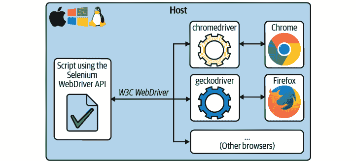

图 6-1. 使用本地浏览器的 Selenium WebDriver 架构

支持此过程的通信协议称为 W3C WebDriver。该标准协议基于 HTTP 的 JSON 消息。得益于此，Selenium WebDriver 架构可以分发到不同的互连计算机（*主机*）。图 6-2 显示了远程架构的示意图。

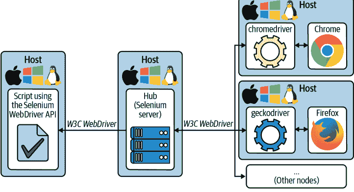

图 6-2. 使用远程浏览器的 Selenium WebDriver 架构

在这种情况下，Selenium WebDriver API 将 W3C WebDriver 消息发送到通常称为 Selenium Server 的服务端组件。该服务器充当客户端请求的代理，发送到提供自动化 Web 浏览器的其他主机。这种远程架构简化了跨浏览器测试（即在多种浏览器类型或操作系统中验证 Web 应用）以及并行测试执行。

### RemoteWebDriver 对象的创建

Selenium WebDriver API 提供了 `RemoteWebDriver` 类来控制远程浏览器。如图 2-2 所示，该类是驱动本地浏览器的 WebDriver 类（例如 `ChromeDriver`、`FirefoxDriver` 等）的父类。这样，你可以像我们之前在书中学习的那样使用 `RemoteWebDriver` 对象。

### RemoteWebDriver 构造函数

有不同的方法可以实例化 `RemoteWebDriver`。正如我们之前学习的，这种方式是使用 `RemoteWebDriver` 构造函数。`RemoteWebDriver` 构造函数接受两个参数：Selenium Server 的 URL 和能力集（capabilities）。BiDi 是为了自动化目的与浏览器进行双向通信的草案标准。在本书期间，目标是在后续版本中让 Selenium WebDriver 支持 BiDi 之上的不同功能。


示例 6-1. 使用构造函数实例化 RemoteWebDriver

```java
@BeforeEach
void setup() throws MalformedURLException {
    URL seleniumServer = new URL("http://localhost:4444/");
    assumeThat(isOnline(seleniumServer)).isTrue();
    ChromeOptions options = new ChromeOptions();
    driver = new RemoteWebDriver(seleniumServer, options);
}
```

- 1 我们创建 Selenium Server 的 URL。
- 2 我们假设 URL 是离线的。
- 3 我们使用能力集（capabilities）来实例化。
- 4 我们通过 Selenium Server 实例化 `RemoteWebDriver`。

`DesiredCapabilities` 显示了这些属性：

| 属性 | 描述 |
|---|---|
| `BROWSER_NAME` | 浏览器名称（chrome, firefox, msedge） |
| `PLATFORM_NAME` | 平台名称（WINDOWS, LINUX, MAC, ANDROID, IOS） |
| `BROWSER_VERSION` | 浏览器版本 |
| `SUPPORTS_JAVASCRIPT` | 启用或禁用 JavaScript |
| `PAGE_LOAD_STRATEGY` | 页面加载策略（normal, eager 或 none） |

`DesiredCapabilities` 提供了这些方法：

| 方法 | 返回 | 描述 |
|---|---|---|
| `setBrowserName(String browserName)` | `void` | 指定浏览器名称 |
| `setVersion(String version)` | `void` | 指定浏览器版本 |
| `setPlatform(Platform platform)` | `void` | 指定平台名称 |
| `setJavascriptEnabled(boolean javascriptEnabled)` | `void` | 启用或禁用 JavaScript |
| `setAcceptInsecureCerts(boolean acceptInsecureCerts)` | `void` | 启用不安全证书 |
| `acceptInsecureCerts()` | `void` | 使用不安全证书 |
| `merge(Capabilities extraCapabilities)` | `DesiredCapabilities` | 与其他能力合并 |

`Capabilities` 仍然被 Selenium WebDriver 支持，因为有许多现有代码依赖它。然而，指定能力的最佳方法是使用特定浏览器的选项（例如 `ChromeOptions`、`FirefoxOptions` 等）。

### RemoteWebDriver Builder

创建 `RemoteWebDriver` 对象的一种方法是使用 Selenium WebDriver API 提供的内置构建器。示例 6-2 展示了如何使用 Edge 作为远程浏览器。

示例 6-2. 使用构建器实例化 RemoteWebDriver 对象

```java
@BeforeEach
void setup() throws MalformedURLException {
    URL seleniumServer = new URL("http://localhost:4444/");
    assumeThat(isOnline(seleniumServer)).isTrue();
    driver = RemoteWebDriver.builder().oneOf(new EdgeOptions())
        .address(seleniumServer).build();
}
```

### WebDriverManager

另一种方法是使用 `DriverManager` 创建 `RemoteWebDriver` 实例。为了实现这一点，我们需要调用给定管理器的 `remoteAddress()` 方法来传递 Selenium Server URL。示例 6-3 显示了使用该功能并将 Firefox 作为远程浏览器的测试设置。

示例 6-3. 使用 WebDriver 实例化 RemoteWebDriver 对象

```java
@BeforeEach
void setup() throws MalformedURLException {
    URL seleniumServer = new URL("http://localhost:4444/");
    assumeThat(isSelected(seleniumUrl)).isTrue();
    driver = DriverManager.firefoxdriver()
        .remoteAddress(seleniumUrl).create();
}
```

### Selenium-Jupyter

如往常，Selenium-Jupyter 使用 Jupyter 提供的参数解析功能。通过这种方式并征服远程浏览器，你需要使用 `RemoteWebDriver` 类型来声明测试（或构造函数）。然后，以下 Selenium-Jupyter 注解允许配置远程浏览器：

- `@DriverUrl`：用于标识 Selenium Server URL 的注解。或者，使用 `@EnabledIfDriverUrlOnline` 注解可以指定特定的 URL，同时在该 URL 未响应时禁用该测试。
- `@DriverCapabilities`：用于配置所需能力的注解。

示例 6-4 展示了一个使用本地 Selenium Server 提供的远程 Chrome 的 Selenium-Jupyter 测试。当 URL `http://localhost:4444/` 离线时，该测试将被跳过。

示例 6-4. 在 Selenium-Jupyter 测试中使用 RemoteWebDriver 对象

```java
@EnabledIfDriverUrlOnline("http://localhost:4444")
@ExtendedWith(SeleniumJupyter.class)
class RemoteChromeSelJUnitTest {
    @DriverCapabilities
    ChromeOptions options = new ChromeOptions();

    @Test
    void testRemote(RemoteWebDriver driver) {
        driver.get("https://bonigarcia.dev/selenium-webdriver-java/");
        assertThat(driver.getTitle()).contains("Selenium WebDriver");
    }
}
```


本节描述的 `RemoteWebDriver` 实例化模式在功能上是等价的。换句话说，这些对象的工作方式相同。它们之间的区别在于提供的语法糖（即风格和表现力）。

## Selenium Grid

如第 1 章介绍的，Selenium Grid 是 Selenium 套件的一个子项目，允许创建一个可以使用 W3C WebDriver 协议访问的远程浏览器的网络基础设施。Selenium Grid 可以在运行在不同机器和不同浏览器上的浏览器进行并行测试。因此，为了实现目标，Selenium Grid 提供了一个 Selenium Server，你可以通过 `RemoteWebDriver` 的实例来控制它。运行 Selenium Grid 有三种方式：

### Standalone（独立模式）

单机主机充当 Selenium Server 并在这种模式下提供浏览器。它提供了一种在远程浏览器中运行 Selenium WebDriver 测试的简单方法。

### Hub-nodes（中心-节点模式）

独立模式的一个潜在问题是可扩展性（因为 Selenium Server 和浏览器执行在同一个本地环境中）。因此，hub-nodes 架构定义了两种类型的组件来解决这个问题。首先，一台主机充当 hub（或 Selenium Server）。然后，一个或多个主机被注册为 hub 中的节点，提供供 Selenium WebDriver 控制的浏览器。这种架构在第 1 章中引入（见图 1-2）。

### Fully distributed（完全分布式模式）

独立模式和 hub-nodes 方法都是集中式架构，当传入的请求数量增加时可能会降低性能。从 Selenium 4 开始，Selenium Grid 提供了一种完全分布模式，该模式实现了负载均衡机制来解决这一瓶颈。

以下子节提供了有关这些模式的更多详细信息，并解释了如何设置每种方法。

### Standalone（独立模式）

独立模式是 Selenium Grid 基础设施最简单的方法。我们可以使用 shell 和 Java 代码执行此模式。

#### 从 shell 运行

首先，我们可以使用 shell 和 Selenium 二进制分发版来启动它。Selenium Grid 是用 Java 开发的，每个版本都作为一个包含所有依赖项的自包含 JAR 文件分发（也称为 uber-JAR 或 fat-JAR）。你可以从 Selenium 下载页面下载此 fat-JAR。

在独立模式下，Selenium Server 会自动检测系统中可用的驱动程序（例如 `chromedriver`、`geckodriver` 等）。为此，它会在 `PATH` 环境变量中查找这些驱动。如往常，我们可以手动管理这些驱动管理器。尽管如此，建议使用 WebDriverManager 来自动解析驱动。因此，如附录 B 所示，WebDriverManager 作为 CLI 工具使用。WebDriver CLI 以 fat-JAR 形式分发，可以在 GitHub 上下载。

为了说明这一点，示例 6-5 显示了在 Linux 机器上使用 WebDriver CLI 解析 `chromedriver` 和 `geckodriver` 所需 shell 命令。然后，我们使用 Selenium Grid fat-jar 启动独立网格。注意，这些命令是在同一个文件夹中执行的。这样，通过 WebDriverManager 下载的驱动就可以供 Selenium Grid 使用。

示例 6-5. 使用 WebDriver CLI 解析驱动并以独立模式启动 Selenium Grid 的命令

```bash
boni@linux:~$ grid -jar webdrivermanager-5.0.3-fat.jar resolveDriverFor chrome 
[INFO] Using WebDriverManager to resolve chrome
[DEBUG] Detecting chrome version using online commands.properties
[DEBUG] Running command on the shell: [google-chrome, --version]
[DEBUG] Result: Version-94.0.4606.1
[DEBUG] Latest version of chromedriver according to https://chromedriver.storage.googleapis.com/LATEST_RELEASE_94 is 94.0.4606.1
[INFO] Using chromedriver 94.0.4606.1 (resolved for Chrome 94)
[INFO] Reading https://chromedriver.storage.googleapis.com/ to seek chromedriver
[DEBUG] Driver to be downloaded chromedriver 94.0.4606.1
[INFO] Downloading /chromedriver.storage.googleapis.com/94.0.4606.1/chromedriver_linux.zip
```


[INFO] Extracting `/chromedriver.storage.googleapis.com/94.0.4606.1/chromedriver_linux.zip`

[INFO] Driver location: `/home/boni/chromedriver`

```bash
boni@linux:~$ grid -jar webdrivermanager-5.0.3-fat.jar resolveDriverFor firefox

[INFO] Using WebDriverManager to resolve firefox

[DEBUG] Detecting firefox version using online.properties

[DEBUG] Running command on the shell: [firefox, --version]

[DEBUG] Result: Version-92.0.46.1

[DEBUG] Latest version of geckodriver according to https://geckodriver.github.io/releases/LATEST_RELEASE is 0.30.2021

[INFO] Using geckodriver 0.30.2021 (resolved for Firefox 92)

[INFO] Reading https://geckodriver.github.io/ to seek geckodriver

[DEBUG] Driver to be downloaded geckodriver 0.30.2021

[INFO] Downloading /geckodriver.github.io/v0.30.2021/geckodriver-linux.gz

[INFO] Extracting /geckodriver.github.io/v0.30.2021/geckodriver-linux.gz

[INFO] Driver location: /home/boni/geckodriver
```

```bash
boni@linux:~$ grid -jar selenium-server-4.0.0.jar standalone

[INFO] Starting Selenium Grid 4.0.0

[INFO] Selenium Grid started on http://localhost:4444
```

*图 6-3. Selenium Grid 控制台*

## 通过 Java 代码

启动 Selenium Grid 的另一种方法是使用 Java。除了胖包（fat-JAR）之外，Selenium Grid 还通过使用 `org.seleniumhq.selenium` 为 `groupId`、`selenium-grid` 为 `artifactId` 发布到 Maven 中央仓库。通过这种方式，我们需要在项目设置（Maven 或 Gradle）中解析其坐标，以便在 Java 项目中使用（配置详情请参见附录 B）。示例 6-6 展示了如何在 Java 测试用例中以独立模式启动 Selenium Grid。

**示例 6-6. 在独立模式下测试 Selenium Grid**

```java
static URL seleniumServerUrl;

@BeforeAll
static void setUp() throws MalformedURLException {
    int port = PortProber.findFreePort();

    WebDriverManager.chromedriver().setup();

    Main.main(
        new String[] {"standalone", "-port", String.valueOf(port)}
    );

    seleniumServerUrl = new URL(
        String.format("http://localhost:%d", port)
    );
}

@BeforeEach
void setup() {
    driver = new RemoteWebDriver(
        seleniumServerUrl,
        new ChromeOptions()
    );
}
```

- 我们在本地查找一个空闲端口。为此，我们使用了 Selenium WebDriver API 提供的 `PortProber` 类。
- 我们使用 `WebDriverManager` 来解析 `chromedriver`，因为独立网格将带有 Chrome 浏览器启动。
- 我们通过调用其 `main` 方法以独立模式启动 Selenium Grid。
- 我们使用之前选择的端口创建一个 Java URL。
- 我们创建了一个 `RemoteWebDriver` 实例。像往常一样，我们在测试逻辑中使用此该对象来调用 Selenium WebDriver API 并控制浏览器（完整类请参考示例仓库）。

## Hub 节点（Hub-nodes）

Selenium Grid 的经典架构涉及两种类型的主机：中心（hub，即 Selenium Server）和一组节点（nodes）。在独立模式下，我们可以使用 Selenium Grid 胖包在 shell 中启动此模式。首先，我们在某台主机上启动 hub。然后，在相同或不同的主机上注册一个或多个节点。示例 6-7 显示了在 Windows 控制台中执行这些命令的情况。

**示例 6-7. 使用 shell 以 hub-nodes 模式启动 Selenium Grid 的命令**

```bash
C:\grid>java -jar selenium-server-4.6.0.jar hub

INFO [LogManager$BootstrapLogger.<init>] - 使用系统默认编码
INFO [OpenTelemetry.Tracer.create] - 使用 OpenTelemetry 进行追踪
INFO [BoundZMQEvent.<init>] - XPUR 绑定到 [binding to tcp://*:4442, as advising to tcp://192.168.56.1:4442], KSUB 绑定到 [binding to tcp://*:4443, as advising to tcp://192.168.56.1:4443]
INFO [BoundZMQEvent.<init>] - 连接到 tcp://192.168.56.1:4442 和 http://192.168.56.1:4441
INFO [BoundZMQEvent.<init>] - Sockets 已创建
INFO [BoundZMQEvent.<init>] - 事件总线就绪
INFO [Hub.execute()] - Started Selenium Hub 4.0.0 (revision 3a2181679)
http://192.168.56.1:4440
INFO [Node.<init>] - 绑定额外的定位机制：relative, name, id
INFO [AdditionalDistributor.add] - 添加节点 98c35075-e5f0-4168-be97-c277e4f40d8d
at http://192.168.56.1:5555。每 120 秒检查一次健康状况
INFO [Grid.methodAvailability] - 将节点 98c35075-e5f0-4168-be97-c277e4f40d8d (uri: http://192.168.56.1:5555) 从 DOWN 切为 UP
```

```bash
C:\grid>java -jar selenium-server-4.0.0.jar node
```

```text
INFO [LogManager$RootLogger.log] - 使用系统默认编码
INFO [OpenTelemetryTracer.createTracer] - 使用 OpenTelemetry 进行追踪
INFO [UnboundZmqEvent.bind] - 连接到 tcp://*:4442 和 tcp://*:4443
INFO [UnboundZmqEvent.bind] - Sockets 已创建
INFO [UnboundZmqEvent.bind] - 事件就绪
INFO [NodeServer.clearInterval] - 报告自身为: http://192.168.56:1555
INFO [Options.getSectionFactories] - 检测到 8 个可用处理器
INFO [Options.discoverDrivers] - 发现 2 个驱动程序(s)
INFO [Options.report] - 为 "browserName":"chrome" 添加 Chrome 8 次
INFO [Options.report] - 为 "browserName":"firefox" 添加 Firefox 8 次
INFO [<init->] - 绑定额外的定位机制：relative, name, and id
INFO [NodeServer1.start] - 正在为节点 id 9C35075-e5f0-4168-bc27-c77ef4ad8dd 启动注册过程
INFO [Hub.execute()] - Started Selenium Hub 4.0.0 (revision 3a2181679)
http://192.168.56.1:4440
INFO [Node.<init>] - 绑定额外的定位机制：relative, name, id
INFO [AdditionalDistributor.add] - 添加节点 98c35075-e5f0-4168-be97-c277e4f40d8d
at http://192.168.56.1:5555。每 120 秒检查一次健康状况
INFO [Grid.methodAvailability] - 将节点 98c35075-e5f0-4168-be97-c277e4f40d8d (uri: http://192.168.56.1:5555) 从 DOWN 切为 UP
```

## 分布式架构（Fully Distributed）

Selenium Grid 的经典架构涉及两种类型的主机：中心（hub，即 Selenium Server）和一组节点（nodes）。在独立模式下，我们可以使用 Selenium Grid 胖包在 shell 中启动此模式。首先，我们在某台主机上启动 hub。然后，在相同或不同的主机上注册一个或多个节点。示例 6-7 显示了在 Windows 控制台中执行这些命令的情况。

### Hub（Router）

分布式架构的入口点。

### 会话队列（Session Queue）

存储传入的会话。

### 分发器（Distributor）

感知所有节点及其可用能力。

### 事件总线（Event Bus）

成员之间的通信通道。

### 会话映射（Session Map）

维护会话与节点之间的关系。

### 节点（Nodes）

提供网络浏览器的主机。

## 节点注册

运行分布式 Grid 的第一个过程是注册一个或多个节点。为了这一目标，节点需要在分发器中注册其能力。图 6-4 说明了该过程，由三个步骤组成：

1. 节点通过事件总线发送消息以宣布其能力。
2. 该消息到达分发器，分发器存储节点与能力的关系。
3. 分发器通过与源节点交换 HTTP 消息来双重检查节点是否存在。

## 新会话

某些脚本（通常是测试用例）会尝试启动一个新的会话以自动驱动浏览器。图 6-5 描述了在全分布式 Grid 中执行此过程所需的通信，即：

1. 使用 Selenium WebDriver API 的脚本向 Router 发送创建会话请求。
2. 分发器在会话队列中创建一个新条目以存储此新会话请求。
3. 分发器定期询问会话队列传入的新会话请求。
4. 当分发器发现新会话请求时，它会检查是否有节点支持该会话。如果会话可行（预先在分发器注册的节点提供了所需的能力），分发器将与节点创建一个新会话。
5. 分发器向 Session Map 发送 HTTP 消息以存储新会话。

## WebDriver 命令

一旦建立会，Selenium WebDriver 脚本将继续发送 W3C WebDriver 命令，以控制远程节点上的网络浏览器。图 6-6 显示了分布式 Selenium Grid 基础设施中这种通信是如何按照以下步骤发生的：

1. 脚本/测试交换 W3C WebDriver 命令以驱动当前会话中的浏览器（例如：打开网页、与元素交互等）。
2. 对同一浏览器会话的后续请求使用相同的 `session id`。Router 通过读取 Session Map（会话映射）识别浏览器会话已激活。
3. Router 将同一会话的后续命令直接转发到指定的节点。

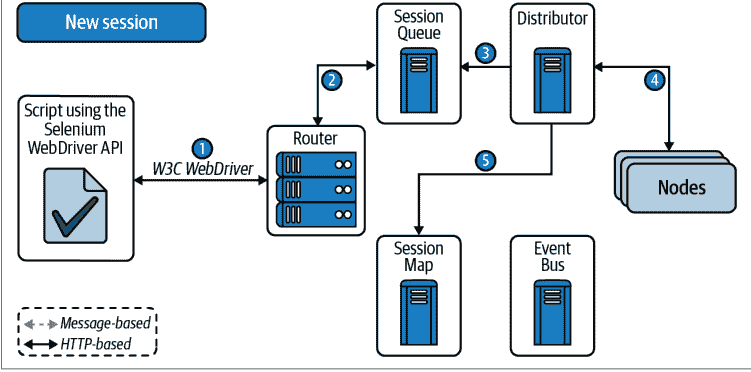

### 使用 Selenium WebDriver API 的脚本

W3C WebDriver

W3C WebDriver

**图 6-6. Selenium Grid 分布式架构中的 WebDriver 命令**

## 设置分布式网格

在单机（standalone）和中心节点节点（hub-nodes）模式下，我们可以使用 Selenium Grid 分布式（作为胖 JAR 或常规 Grid 依赖）来启动完全分布式架构。示例 6-8 显示了使用命令行执行此操作所需的 shell 命令。

**示例 6-8. 使用 shell 在分布式模式下启动 Selenium Grid 的命令**

```bash
C:\java -jar selenium-server-4.0.0.jar event-bus
INFO [BoundZmqEventBus.init] - XPUB binding to [binding] to tcp://*:4442,
advertising as tcp://192.168.56.1:4442], KSUB binding to [binding to
tcp://*:4443, advertising as tcp://192.168.56.1:14443]
```

```bash
C:\java -jar selenium-server-4.0.0.jar sessions ...

INFO [SessionMapServer.execute] - Started SeleniumMap 4.0.0 (revision
5fE1af712f): http://192.168.56.1:5556
```

```bash
C:\java -jar selenium-server-4.0.0.jar sessionqueue ...

INFO [NewSessionQueue.execute] - Started SeleniumSessionQueue 4.0.0
(revision 5fE1af712f): http://192.168.56.1:5559
```

```bash
C:\java -jar selenium-server-4.0.0.jar distributor --sessions
http://<session_map>:5556 --sessionqueue http://<session_queue>:5559 --bind-bus
false

INFO [DistributorServer.execute] - Started Selenium Distributor 4.0.0 (revision Sfe1af712f): http://192.168.56.1:5553
```

```bash
C:\grid>jar selenium-server-4.0.0.jar router --sessions
http://session_map:5556 --distributor http://<distributor_address>:5553
--sessionqueue=<session_queue>:5559

INFO [RouterServer.execute] - Started Selenium Router 4.0.0 (revision Sfe1af712f): http://192.168.56.1:4444
```

```bash
C:\grid>jar selenium-server-4.0.0.jar node --publish-events
tcp://<event_bus>:4442 --subscribe-events tcp://<event_bus>:4443
```


```text
INFO [NodeOptions.discoverDrivers] - Discovered 2 driver(s)

INFO [NodeServer.lambda$start$] - Sending registration event...
[NodeServer.lambdaCreateHandlers$2] - Node has been added
```

1. 我们启动 Event Bus。默认情况下，Event Bus 监听 TCP 端口 4442 和 4443。
2. 我们启动 Session Map。默认情况下，该组件监听端口 5556 上的入站 HTTP 消息。
3. 我们启动 Session Queue。默认情况下，该队列监听端口 5559 上的 HTTP 请求。
4. 我们启动 Distributor。为此，我们指定了 Session Map 和 Session Queue。
5. 我们启动 Nodes。默认情况下，Event Bus 监听 TCP 端口 4442 和 4443。

## 可观测性

在单机和中心节点节点模式下，我们可以使用 Selenium Grid 分布式（作为胖 JAR 或常规 Grid 依赖）来启动完全分布式架构。示例 6-8 显示了使用命令行执行此操作所需的 shell 命令。

可观测性是根据系统的外部输出对系统的内部状态进行衡量。Selenium Grid 提供了三个支柱：

### 指标（Metrics）

随时间变化的系统性能衡量，例如响应时间、每秒事务数或内存占用。

### 日志（Logs）

按时间戳和消息记录事件日志。

### 追踪（Traces）

追踪请求穿过系统的路径。Selenium Grid 支持通过 OpenTelemetry 进行追踪。

## 使用 OpenTelemetry 进行追踪

追踪请求穿过系统的路径。Selenium Grid 支持通过 OpenTelemetry 进行追踪。

追踪请求穿过系统的路径。Selenium Grid 支持通过 OpenTelemetry 进行追踪。

追踪请求穿过系统的路径。Selenium Grid 支持通过 OpenTelemetry 进行追踪。

### GraphQL 查询

追踪请求穿过系统的路径。Selenium Grid 支持通过 OpenTelemetry 进行追踪。

追踪请求穿过系统的路径。Selenium Grid 支持通过 OpenTelemetry 进行追踪。

追踪请求穿过系统的路径。Selenium Grid 支持通过 OpenTelemetry 进行追踪。

### 数据收集

追踪请求穿过系统的路径。Selenium Grid 支持通过 OpenTelemetry 进行追踪。

1. 我们使用 Jaeger 端点来导出追踪。
2. 我们指定了服务名-standalone。我们将在 Jaeger UI 中查找此名称。
3. 我们使用 Coursier 下载所需依赖的类路径（opentemetry-exporter-jaeger 和 grpc-netty）。

### 配置

你可以在 Selenium Grid 的官方文档中找到更多详细信息。对于高级配置，有两种方法可以自定义 Selenium Grid：

用于 Selenium Grid 不同方面的 CLI 选项。

这些选项的示例包括 `--port`，更改 Selenium Grid 服务器监听的默认端口（默认为 4444），或 `--session-timeout`，即在无活动时终止节点的超时时间（默认为 300 秒）。

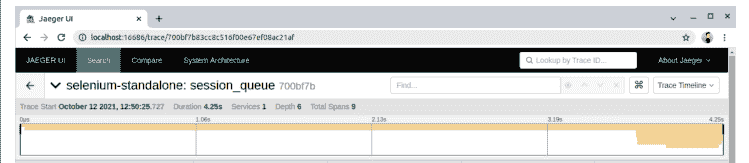

## 6-7. 显示 Selenium Grid 数据的 Jaeger UI

## 使用 TOML 文件

TOML（Tom's Obvious Minimal Language）是一种设计为人类可读的配置格式。类似于 CLI 选项，这些文件允许使用 TOML 语法配置 Selenium Grid 参数。

## 云服务提供商

如第 1 章介绍，Selenium 生态系统中的云提供商是指为自动化 Web 和移动测试提供托管服务（通常是商业性的）的公司。云提供商提供的常用服务包括：

### 浏览器服务

请求提供商托管的按需 Web 浏览器。这些浏览器通常具有不同的类型、版本和操作系统。此功能通常用于跨浏览器自动化或实时测试。

### 分析能力

监控和调试自动化测试。为此，云提供商通常支持会话录制或丰富的错误报告功能。

### 移动测试

在不同的平台（如 Android 和 iOS）上请求仿真（以及真实的）移动设备。

### 视觉测试

自动检查 UI 并确保终端用户拥有正确的视觉体验。

目前 Selenium 的云服务提供商包括 Sauce Labs、BrowserStack、LambdaTest、CrossBrowserTesting、Moon Cloud、TestingBot、Perfecto 或 Testium。所有这些公司都提供不同定价方案的特定服务。它们的共同点是每个云提供商都维护一个我们可以在 `RemoteWebDriver` 中使用的 Selenium 端点。示例 6-9 演示了如何使用其中之一（具体为 Sauce Labs）来创建一个 webdriver 对象。你可以在示例仓库中找到其他云提供商（BrowserStack、LambdaTest、CrossBrowserTesting、Perfecto 和 Testium）的对应测试。这些测试允许使用由云提供商管理的远程浏览器。

## 示例 6-9. Sauce Labs 的测试设置

```java
@BeforeEach
void setup() throws MalformedURLException {
  String username = System.getProperty("sauceLabsUsername");
  String accessKey = System.getProperty("sauceLabsAccessKey");

  assertThat(username, isNotEmpty);
  assertThat(accessKey, isNotEmpty);

  MutableCapabilities capabilities = new MutableCapabilities();
  capabilities.setCapability("username", username);
  capabilities.setCapability("access_key", accessKey);
  capabilities.setCapability("name", "My SauceLabs test");
  capabilities.setCapability("browserVersion", "latest");

  ChromeOptions options = new ChromeOptions();
  options.setCapability("sauce:options", options);

  URL remoteUrl = new URL("https://ondemand.eu-central-1.saucelabs.com:443/wd/hub");
  Driver driver = new RemoteWebDriver(remoteUrl, options);
}
```

1. 要使用 Sauce Labs，我们需要一个有效的账户。换句话说，我们需要用户名和访问密钥形式的凭据。为了避免在测试逻辑中硬编码这些凭据，我在此测试中使用了 Java 系统属性。这些属性可以在执行命令中指定（例如，`mvn test -DSauceLabsUsername=my -DSauceLabsAccessKey=mykey`）。指定此数据的另一种替代方法是使用环境变量（例如，`String username = System.getenv("SAUCELABS_USERNAME"));`）。
2. 当用户名或密钥不可用时，我们使用假设跳过此测试。
3. 我们需要将用户名和密钥作为 Selenium capabilities 包含。
4. 我们可以指定自定义标签来在 Sauce Labs 仪表板中标识此测试（见图 6-8）。
5. 我们使用指定浏览器的最新版本（如下行指定的 Chrome）。
6. 我们使用自定义标签 `sauce:options` 来在 Sauce Labs 云中选择所需的能力。

我们使用 Sauce Labs 公共端点作为远程 URL。Sauce Labs 提供不同地区的端点。在本示例中，我使用了欧洲中部数据中心。其他可能性包括美国西部、美国东部或亚洲东南。

我们同时使用 URL 和 capabilities 来创建 Remote Driver 实例。

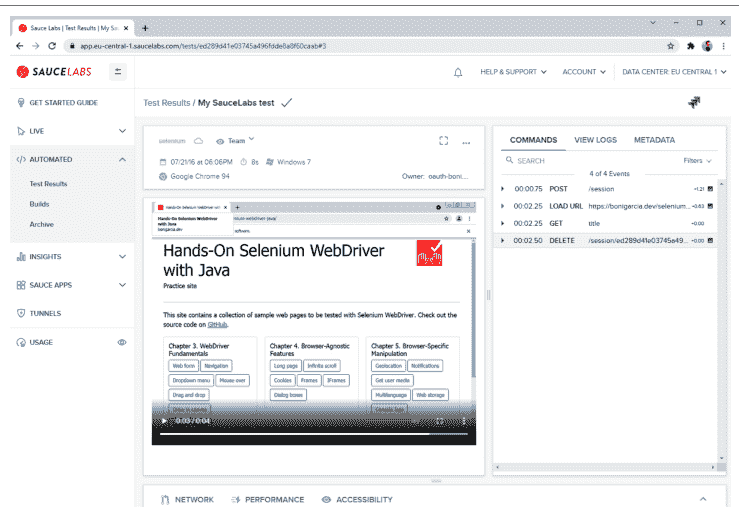

图 6-8. 显示自动化测试结果的 Sauce Labs 仪表板

## Docker 容器中的浏览器

Docker 是一个开源平台，允许以轻量级、迁移容器的形式创建、部署和运行应用程序。Docker 平台由两个主要部分组成：

- Docker Engine，允许在主机中创建和运行容器的应用程序
- 实现为守护进程（`dockerd`）的服务器
- 应用程序客户端用于指示守护进程的 REST API
- CLI 工具（`docker` 命令）
- Docker Hub，用于分发容器的云服务

在 Selenium 中，Docker 可以是一项相关技术，用于支持基于 Selenium WebDriver 的自动化测试所需的浏览器基础设施。以下章节解释了在 Docker 容器中执行浏览器的替代方案。

## Selenium Grid 的 Docker 镜像

Selenium 套件的官方子项目是 `docker-selenium`。该项目包含了 Selenium Grid 组件（即 standalone、hub、nodes、router、distributor、session queue 等）以及浏览器（Chrome、Firefox 和 Edge）的 Docker 镜像。这些 Docker 镜像是开源的，并发布在 Docker Hub 上。使用这些镜像的简单方法是使用 shell（通过 `docker` 命令）启动它们，并使用 `RemoteWebDriver` 实例驱动 Docker 浏览器。以下章节解释了如何操作。

本节中提出的命令和测试所需的 Docker 在你的系统中必须可用。换句话说，你需要在机器上安装 Docker 镜像才能正确执行这些示例。


## Standalone（独立模式）

我们可以在 Docker Hub 上找到用于浏览器（Chrome、Firefox 和 Edge）的 standalone。以下命令显示了如何使用 shell 启动 Chrome。

```bash
docker run -d -p 4444:4444 --shm-size="2g" selenium/standalone-chrome
```

此命令在 Docker 中启动最新版本的 Chrome。随后可以使用以下 Java 命令实例化使用该 Chrome 的 WebDriver：

```java
WebDriver driver = new RemoteWebDriver(
    "http://localhost:4444",
    new ChromeOptions()
);
```

此外，在使用 Selenium 时，可以使用 Docker 容器注册节点。以下命令显示了如何使用 Firefox 启动 Selenium Grid：

```bash
java jar selenium-server-4.0.jar node -DbrowserName="firefox"
```

## Hub-nodes（节点模式）

我们可以使用官方 Docker 镜像轻松启动 hub-nodes 模式的 Selenium Grid。以下命令显示了如何在 shell 中操作：

```bash
docker network create grid
```

```bash
docker run -d -p 4442:4442 -p 4444:4444 --net grid \
  --name selenium-hub selenium/hub:4.0.0

docker run -d --net grid -e SE_EVENT_BUS_HOST=selenium-hub --shm-size="2g" \
  -e SE_EVENT_BUS_PUBLISH_PORT=4444 -e SE_EVENT_BUS_SUBSCRIBE_PORT=4443 \
  selenium/node-chrome:4.0.0
```

```bash
docker network rm grid
```

1. 首先，创建一个名为 grid 的 Docker 网络。该网络允许通过主机名（例如 `selenium-hub`）在 hub 和节点之间通信。
2. 我们启动 Selenium Hub。我们需要映射端口 4444（Selenium 服务器 URL）和 4442-4443（注册节点）。
3. 我们注册节点。在此命令中，使用了 Chrome。
4. 如果不再需要，我们可以在最后删除 grid 网络。

## 更多功能

`docker-selenium` 项目提供了多种功能。我建议查看其 README 以获取更多信息。以下是这些功能的总结：

### Docker Compose 脚本

这些脚本允许轻松启动 Selenium Grid hub-nodes 和全分布式模式。

### 视频录制

我们可以使用另一个 Docker 容器录制节点中浏览器的桌面会话。

## 动态网格

这允许我们根据需要启动 Docker 容器。

### 部署到 Kubernetes

Kubernetes 是一个开源容器编排系统，能够自动化容器化应用的部署和管理。我们可以使用 Kubernetes 来部署 Selenium 容器。

### 高级容器配置

这可以用于（例如）指定 Selenium 或 Java 的自定义配置。

### 访问远程会话

可以通过虚拟网络计算（VNC，一种图形桌面共享系统）和 noVNC（一个基于 Web 的开源 VNC 客户端）来实现。

## Selenoid

Selenoid 是一个开源 Selenium Server，提供了基于 Docker 的浏览器基础设施。Selenium 团队还维护着 Selenoid 使用的 Docker 镜像。这些镜像包含了多种浏览器和 Android 设备，例如 Chrome、Firefox、Edge、Safari（WebKit 引擎）或 Chrome Mobile。

使用 Selenoid 及其 Docker 镜像有多种方法。一种方法是使用项目提供的配置管理器（一个名为 `cn` 的二进制文件）。以下片段显示了如何启动 Selenoid 及其 UI（用于监控 Selenoid 的 Web 仪表板）：

```bash
/cn selenoid start
/cn selenoid-ui start
```

1. 配置管理器下载 Selenoid 的 Docker 镜像以及几个浏览器的最新版本（Chrome、Firefox 和 Opera）。一旦启动，Selenoid 就会监听 `http://localhost:4444/wd/hub` URL 上的 WebDriver 请求。
2. 可选地，我们启动 Selenoid UI。该 UI 是一个可以通过 `http://localhost:8080/` 访问的 Web 应用程序。图 6-9 显示了执行 Selenium WebDriver 测试期间该 UI 的截图。示例 6-10 显示了使用 Selenoid 提供的 Chrome 浏览器的测试设置。

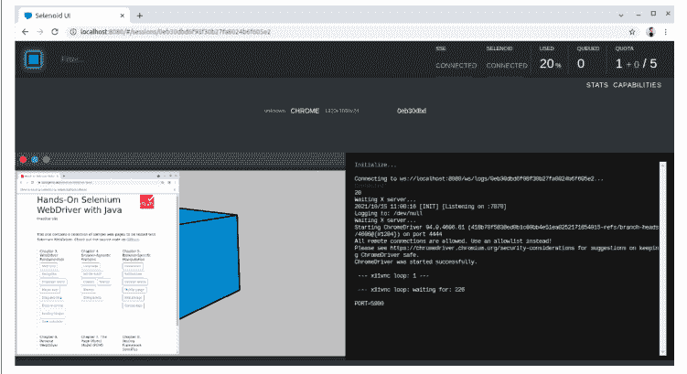

示例 6.10. 使用构造函数实例化 RemoteWebDriver 对象

```java
@BeforeEach
void setup() throws MalformedURLException {
    URL seleniumServerUrl = new URL("http://localhost:4444/wd/hub");

    assertThat(isOnline(seleniumServerUrl)).isTrue();

    ChromeOptions options = new ChromeOptions();

    Map<String, Object> selenoidOptions = new HashMap<>();
    selenoidOptions.put("enableVNC", true);

    options.setCapability("selenoid:options", selenoidOptions);

    driver = new RemoteWebDriver(seleniumServerUrl, options);
}
```


- 属性`enableVNC`是`selenoid`特有的，我们启动了支持 VNC 的`docker-browser`（通过这种方式，我们可以在 Selenoid UI 中可视化浏览器会话，如图 6-9 所示）。
- 由于该能力是供应商特定的，符合 W3C WebDriver 标准的设置此能力的方法是使用自定义命名空间（在本例中为`selenoid:options`）。

### 其他功能

`Selenoid`提供了不同的功能和配置能力。你可以查看其文档以获取更多细节。这些功能包括视频录制、配置、日志管理或访问浏览器开发者工具等。

## WebDriverManager

从 5 版本开始，`WebDriverManager`允许在 Docker 容器中轻松使用 Web 浏览器。为此，每个管理器（例如`chromedriver()`、`firefox driver()`等）都提供了`browserInDocker()`方法。`WebDriverManager`会拉取 Docker 镜像并运行容器，在调用`create()`方法时创建`RemoteWebDriver`实例。`WebDriverManager`使用 Selenium 团队维护的 Docker 镜像。通过这种方式，你可以通过`WebDriverManager`直接使用 Chrome（桌面版和移动版）、Firefox、Edge、Opera 和 Safari 作为 Docker 容器。示例 6-11 展示了使用此功能的基本测试。

**示例 6-11. 使用 WebDriverManager 和 Docker 中的 Chrome 进行完整测试**

```
class DockerChromeDriverTest {

    WebDriver driver;

    WebDriver wdm = WebDriverManager.chromedriver().browserInDocker();

    @BeforeEach

    void setUp() {

        assertThat(isDockerAvailable()).isTrue();

        driver = wdm.create();

    }

    @AfterEach

    void tearDown() {

        wdm.quit();

    }

    @Test

    void testDockerChrome() {

        driver.get("https://bonigarcia.dev/selenium-webdriver-java/");

        assertThat(driver.getTitle()).contains("Selenium WebDriver");

    }

}
```

- 我们获取一个 Chrome 的管理器实例（`chromedriver()`）。然后，使用`WebDriverManager`链式 API，我指定了使用此实例（称为`wdm`）创建的未来 WebDriver 对象将使用 Docker 来执行相应的浏览器（在本例中为 Chrome）。
- 我们假设运行此测试的机器上有 Docker 引擎。为此，我们通过调用`WebDriverManager`上的静态方法`isDockerAvailable`创建了一个 AssertJ 假设。这样，当 Docker 不可用时，测试将被跳过。
- 在测试设置中，我们创建了 WebDriver 实例。在内部，`DriverManager`将连接到 Docker Hub 以发现作为 Docker 镜像的最新 Chrome 版本。该镜像被拉取到本地机器，执行 Docker 容器，并将相应的`RemoteWebDriver`实例返回给测试逻辑。
- WebDriver 通过`quit()`方法退出之前创建的 WebDriver 实例。该方法与直接退出实例（在本例中为`driver.quit()`）的效果相同，并且使用的 Docker 容器会被优雅地终止。

`WebDriver`提供了一个链式 API 来配置容器化 Web 浏览器的不同方面。以下片段显示了若干可能性：

```
WebDriver wdm = DriverManager.firefox().browserInDocker();

WebDriver wdm = DriverManager.chrome().browserInDocker();

WebDriver wdm = DriverManager.edge().browserInDocker();
```

- 我们可以使用`type`属性更改浏览器版本。接受的值包括 CHROME、FIREFOX、OPERA、EDGE、SAFARI 和 CHROME_MOBILE。

226 | 第 6 章：远程 WebDriver

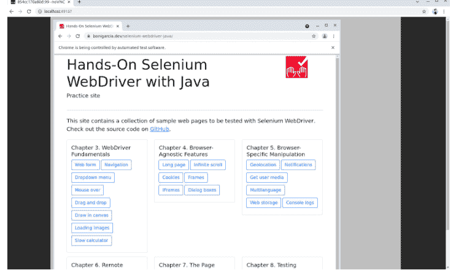

图 6-10. 使用 noVNC 的远程桌面

- 我们通过`vnc`属性使用 VNC 和 noVNC 访问远程桌面会话。
- 我们通过`recording`属性启用会话录制。

你可以在 Selenium-Jupyter 的文档中找到更多详细信息、示例和配置功能。

## 总结与展望

Selenium WebDriver 允许控制远程浏览器。这种功能是可行的，因为底层通信协议（W3C WebDriver）是基于 HTTP 的消息。通过这种方式，Selenium 架构（Selenium 服务器、节点或脚本）可以是分布式的。要使用此功能，我们需要创建一个 WebDriver 实例，通常通过参数传递能力。我们可以从使用 Selenium Grid（独立、节点或完全分布式模式）开始。或者，我们可以使用云提供商托管的服务（如 Sauce Labs、BrowserStack、LambdaTest 等）。最后，我们可以使用 Docker 来支持浏览器的容器化。

本章结束了书的第二部分，在其中你已经发现了 WebDriver API 的主要功能。下一部分将涵盖使用 WebDriver API 开发端到端测试的不同方面，从页面对象模型（POM）开始，这是一种广泛用于增强测试维护性和减少代码重复的设计模式。

## 第三部分：高级概念

最后一部分涵盖了基于 WebDriver API 之上的不同方面和用例。首先，你将学习页面对象模型（POM），一种允许开发可重用和可维护测试的设计模式。后续章节将解释浏览器测试的不同技术，例如参数化测试、测试排序或并行执行。下一章将描述如何结合第三方库和框架使用 Selenium WebDriver，如 Cucumber 或 Spring Framework。最后一章总结了 Selenium 的各种库，如 Appium 或 REST Assured。最后，你将发现 Selenium 的其他替代方案，如 Cypress、WebDriverIO、TestCafe 和 Playwright。

## 第 7 章：页面对象模型 (POM)

设计模式是解决软件工程中反复问题的重用方案。本章介绍了页面对象模型（POM），一种用于开发 WebDriver 测试的流行设计模式。使用 POM 有许多好处，例如提高重用性和避免代码重复。POM 基于在单个仓库中创建页面类来建模被测试系统（SUT），用于测试逻辑。

## 动机

使用 Selenium WebDriver 开发端到端测试的一些巨大挑战是可维护性和不稳定（flakiness）。关于前者，问题可能发生在使用 SUT 的开发或演进过程中。UI 的更改会导致端到端测试中断。修复这些测试的维护成本在存在大型测试套件时会很高（例如在多个测试中重复使用相同的定位器）。

关于不稳定（即缺乏可靠性），当测试表现出不一致的行为时（例如在相同的测试逻辑、输入数据、设置下），测试是不稳定的。首先，问题的根源可能是 SUT。例如，服务器端的逻辑（例如竞态条件）可能会导致端到端测试出现异常行为。在这种情况下，开发者和测试人员应该合作检测并解决问题，通常是修复服务端 Bug。这是测试人员应该避免的理想情况。有不同的策略可以防止 Selenium 测试中的不稳定，例如实现稳健的定位策略（避免由于响应式或视口变化导致的脆弱测试），或使用等待策略（处理 Web 应用程序分布式和异步的特性）。利用 POM 等设计模式有助于减少代码重复并解决维护问题。此外，我们可以使用 POM 来包含重用的定位和等待策略。下节描述了如何执行 POM 设计模式。

POM 设计模式本身并不是测试不稳定的严格解决方案。但正如后续章节所示，它实现了重用代码的封装，防止了测试不可靠。

## POM 设计模式

POM 设计模式的是将处理 UI 元素的逻辑（在单独的类中，即页面类）与测试逻辑分离。用我们的话说，我们遵循面向对象的范式对 SUT 的外观和行为建模，即页面对象。这些页面对象被 Selenium WebDriver 测试使用。

让我们来看简单的示例来说明 POM。考虑图 7-1，它包含一个登录表单。通常，该页面位于练习站点。示例 7-1 显示了使用原生（vanilla）Selenium WebDriver 的测试用例。在编程中，我们使用“原生”一词是指未对原始表单进行自定义的技术。在这种情况下，我们使用书第二部分介绍的标准 Selenium WebDriver API。

图 7-1 带有登录表单的练习网页

**示例 7-1 使用原生 Selenium WebDriver 实现成功登录的测试用例**

```
@Test

void testVanillaLogin() {

  driver.get(

    "https://bonigarcia.dev/selenium-webdriver-java/login-form.html";

  );

  driver.findElement(By.id("username")).sendKeys("user");

  driver.findElement(By.id("password")).sendKeys("user");

  driver.findElement(By.cssSelector("button")).click();

  assertThat(driver.findElement(By.id("success")).isDisplayed();

}
```

- 1 我们在网页表单中输入`user`作为用户名。
- 2 我们在网页表单中输入相同的单词作为密码。
- 3 我们点击提交按钮。
- 4 我们验证成功框是否显示。

这个测试是完全正确的，但如果我们使用同一个页面实现额外的测试，可能会出现潜在问题。例如，示例 7-2 显示了使用相同表单的另一个案例（负面测试）。这种进行方式是有问题的。

**示例 7-2 使用原生 Selenium WebDriver 实现失败登录的测试用例**

```
@Test

void testVanillaFailure() {

  driver.get(

    "https://bonigarcia.dev/selenium-webdriver-java/login-form.html";

  );

  driver.findElement(By.id("username")).sendKeys("bad-user");

  driver.findElement(By.id("password")).sendKeys("bad-password");

  driver.findElement(By.cssSelector("button")).click();

  assertThat(driver.findElement(By.id("invalid")).isDisplayed();

}
```

## 页面对象

页面对象类将致力于 UI 的代码（如定位器和页面布局）与测试逻辑分离。我们可以将页面类视为封装了被测试应用程序的操作或服务的单一仓库。这些类在不同的测试用例中实例化为页面对象。我们可以使用这些对象暴露的方法来实现端到端测试，同时避免重复。

这里有一个使用页面对象的简单示例。在接下来的示例中，我们使用页面对象而不是原生 Selenium WebDriver 来重构上一节（即使用登录表单）。第一步是创建一个建模登录页面的 Java 类。示例 7-3 显示了该页面类非常基础的实现。

```
public class BasicLoginPage {

    WebDriver driver;

    By usernameInput = By.id("username");

    By passwordInput = By.id("password");

    By submitButton = By.cssSelector("button");

    By successBox = By.id("success");

    public BasicLoginPage(WebDriver driver) {

        this.driver = driver;

    }

    public void get() {

        driver.get("https://bonigarcia.dev/selenium-webdriver-java/login-form.html");

    }

    public void with(String username, String password) {

        driver.findElement(usernameInput).sendKeys(username);

        driver.findElement(passwordInput).sendKeys(password);

        driver.findElement(submitButton).click();

    }

    public boolean successBoxPresent() {

        return driver.findElement(successBox).isDisplayed();

    }

}
```

- 1 我们声明了一个 WebDriver 类属性。该变量在页面对象中用于实现与页面的交互。
- 2 我们将所有需要的定位器声明为额外的属性。在这种情况下，我们定位了用户名和密码的文本输入框、提交（Submit）按钮以及成功框。
- 3 该页面类定义的构造函数接受一个`WebDriver`对象。我们使用构造函数来加载被测试的页面。
- 4 我们声明了一个方法来加载登录所需的交互，即输入用户名和密码，并点击提交（Submit）按钮。
- 5 我们声明了另一个方法来检查成功框是否可见。

现在，我们在测试用例中使用这个页面类。示例 7-4 展示了如何操作。请注意，我们像通常一样在每个测试之前创建了一个`WebDriver`实例，并在每个测试之后将其关闭。我们将该驱动程序作为页面类构造函数的参数。

**示例 7-4. 使用基础页面类实现成功登录**

```
class BasicLoginPageTest {

  WebDriver driver;

  BasicLoginPage login; // 1

  @BeforeEach

  void setup() {

    driver = WebDriverManager.chromedriver().create();

    login = new BasicLoginPage(driver); // 2

  }

  @AfterEach

  void teardown() {

    driver.quit();

  }

  @Test

  void testLoginPageSuccess() {

    login.with("user","user"); // 3

    assertThat(login.successBoxPresent()).isTrue(); // 4

  }

}
```

- 1 我们在测试类中将页面类声明为一个属性。
- 2 我们创建页面对象，并传递`WebDriver`实例。
- 3 我们调用页面类定义的方法来执行登录操作。
- 4 我们使用页面对象提供的方法来验证生成的网页上是否存在成功框。

这种方法是现在提高我们测试可维护性的良好起点，因为所有与登录页面相关的逻辑都集中在一个可重用的类中。尽管如此，页面类中的代码仍然很脆弱。例如，假设我们需要为登录页面实现一个负面测试，即使用错误的凭据尝试登录。考虑到页面类的目前的实现，示例 7-5 似乎是实现该点的合理方法。然而，如果你运行此测试，你会发现测试由于`NoSuchElementException`异常而失败。下一节将解释如何通过创建更健壮的页面对象来解决这个小问题。

**示例 7-5. 使用基类实现失败登录的测试**

```java
@Test

void testBasicLoginFailure() {

    login.with("bad-user", "bad-password");

    assertThat(login.successBoxPresent()).isFalse();

}
```

# 健壮页面对象

上一节中提出的示例提高了代码的可维护性，因为页面操作被封装在单个类中，而不是分散在整个测试中。话虽如此，有不同的方法可以增强之前的页面类实现。首先，我们的 SUT（被测试系统）可能有多个网页，而不仅仅是一个。因此，一种常见的策略是遵循面向对象的方法，并创建一个基页面类，用于封装所有页面类的公共逻辑。示例 7-6 展示了一个实现典型页面类基类的 Java 类。

```java
public class BasePage {

    static final Logger log = getLogger(lookup().lookupClass());

    WebDriver driver;

    WebDriver wait;

    int timeoutSec = 5; // 等待超时（默认 5 秒）

    public BasePage(WebDriver driver) {

        this.driver = driver;
```


```java
wait = new WebDriverWait(driver, Duration.ofSeconds(timeoutSec));

}

public void setTimeoutSec(int timeoutSec) {

  this.timeoutSec = timeoutSec;

}

public void visit(String url) {

  driver.get(url);

}

public WebElement find(By element) {

  return driver.findElement(element);

}

public void click(By element) {

  find(element).click();

}

public void type(By element, String text) {

  find(element).sendKeys(text);

}

public boolean isDisplayed(By locator) {

  try {

    wait.until(ExpectedConditions.visibilityOfLocated(locator));

  } catch (TimeoutException e) {

    log.warn("Timeout of {} {}", timeoutSec, locator);

    return false;

  }

  return true;

}

}
```

- 1 我们在基类中定义了一个显式等待（`WebDriver` 属性）。我们在构造函数中使用默认超时时间（五秒）实例化该属性。
- 2 我们创建了一个 setter 方法来更改等待的默认值。例如，我们可能需要根据系统响应来调整这个超时时间。
- 3 我们创建了几个页面类可以重用的常用方法，如 `visit()`（打开网页）、`find()`（定位元素）或 `type()`（向元素发送数据，如输入字段）。

我们实现了一个方法来检查 Web 元素是否显示。该方法隐藏了等待元素的复杂性，返回一个测试中使用的简单布尔值。

我们使用之前的基类作为特定页面类的父类。例如，示例 7-7 展示了一个扩展此基类以实现页面类的 Java 类，并使用了练习网站。

## 示例 7-7：扩展 `BasePage` 的登录页面类

```java
public class LoginPage extends BasePage {

    By usernameInput = By.id("username"); //

    By passwordInput = By.id("password");

    By submitButton = By.cssSelector("button");

    By successBox = By.id("success");

    public LoginPage(WebDriver driver) { // ②

        super(driver);

    }

    public void with(String username, String password) { // ③

      type(usernameInput, username);

      type(passwordInput, password);

      click(submitButton);

    }

    public boolean successBoxPresent() { // ④

      return isDisplayed(successBox);

    }

    public void setTimeoutSec(int timeoutSec) { // ⑤

      super.setTimeoutSec(timeoutSec);

    }

}
```

- 1 我们在基类中定义了一个显式等待（`WebDriver` 属性）。我们在构造函数中使用默认超时时间（五秒）实例化该属性。
- 2 我们创建了一个 setter 方法来更改等待的默认值。例如，我们可能需要根据系统响应来调整这个超时时间。
- 3 我们创建了几个页面类可以重用的常用方法，如 `visit()`（打开网页）、`find()`（定位元素）或 `type()`（向元素发送数据，如输入字段）。

我们实现了一个方法来检查 Web 元素是否显示。该方法隐藏了等待元素的复杂性，返回一个测试中使用的简单布尔值。

我们使用之前的基类作为特定页面类的父类。例如，示例 7-7 展示了一个扩展此基类以实现页面类的 Java 类，并使用了练习网站。

- 1 我们在页面类中将定位器声明为属性。
- 2 我们在构造函数中传递 `WebDriver` 实例来创建页面对象。

我们调用页面类定义的方法来执行登录操作。

我们使用页面对象提供的方法来验证生成的网页上是否存在成功框。

这种方法是现在提高我们测试可维护性的良好起点，因为所有与登录页面相关的逻辑都集中在一个可重用的类中。尽管如此，页面类中的代码仍然很脆弱。例如，假设我们需要为登录页面实现一个负面测试，即使用错误的凭据尝试登录。考虑到页面类的目前的实现，示例 7-5 似乎是实现该点的合理方法。然而，如果你运行此测试，你会发现测试由于 `NoSuchElementException` 异常而失败。下一节将解释如何通过创建更健壮的页面对象来解决这个小问题。

# 健壮页面对象

上一节中提出的示例提高了代码的可维护性，因为页面操作被封装在单个类中，而不是分散在整个测试中。话虽如此，有不同的方法可以增强之前的页面类实现。首先，我们的 SUT 可能有多个网页，而不仅仅是一个。因此，一种常见的策略是遵循面向对象的方法，并创建一个基页面类，用于封装所有页面类的公共逻辑。示例 7-6 展示了一个实现典型页面类基类的 Java 类。

# 创建领域特定语言（DSL）

我们可以进一步推进 SUT 建模之旅，并使用页面类创建一个完整的领域特定语言（DSL）。在计算中，DSL 是针对特定领域的专门语言。在使用 POM 和 Selenium WebDriver 时，我们可以看到页面类提供的方法封装了 SUT 操作。这种方式，测试用例使用页面类提供的简单、易读的 API。这些类封装了与 SUT 交互的所有 Selenium API 调用。

继续之前的示例，示例 7-9 展示了一个遵循 DSL 方法的基页面类。这个基类与示例 7-6 非常相似，但在这里，该类还封装了创建 `WebDriver` 实例所需的逻辑。

```java
public class ExtendedBasePage {

    static final Logger log = getLogger(lookup().lookupClass());

    WebDriver driver;

    WebDriver wait;

    int timeoutSec = 5; // 等待超时（默认 5 秒）

    public ExtendedBasePage(String browser) { // ①

      driver = WebDriverManager.getInstance(browser).create(); // ②

      wait = new WebDriverWait(driver, Duration.ofSeconds(timeoutSec));

    }

    public void setTimeoutSec(int timeoutSec) {

        this.timeoutSec = timeoutSec;

    }

    public void quit() { // ③

        if (driver != null) {

            driver.quit();

        }

        // 其他常用方法：quit(), visit(URL url), find(By element) 等。

    }

}
```

- ① 在基构造函数中声明了一个字符串参数。该字符串将是浏览器名称（在测试中指定）。
- 我们使用 `WebDriverManager` 来解析所需的驱动程序并创建 `WebDriver` 实例。如第353页“通用管理器（Generic Manager）”所示，`DriverManager` 允许通过调用 `getInstance()` 方法使用参数化管理器。在这种情况下，我们使用浏览器名称（例如 chrome、firefox 等）来选择管理器。
- 我们还封装了终止会话并关闭浏览器的方法。

示例 7-10 显示了扩展此基类的页面类。如你所述，与示例 7-7 的唯一区别是该页面类在构造函数使用了字符串参数（浏览器名称）。

# 示例 7-10：遵循 DSL 方式的登录页面

```java
By username = By.id("username");

By passwordInput = By.id("password");

By submitButton = By.cssSelector("button");

By successBox = By.id("success");

public ExtendedLoginPage(String browser, int timeoutSec) {

    this(browser);

    setTimeout(timeoutSec);

}

public ExtendedLoginPage(String browser) {

    super(browser);

    visit("https://bonigarcia.dev/selenium-webdriver-java/login-form.html");

}

public void with(String username, String password) {

    type(usernameInput, username);

    type(passwordInput, password);

    click(submitButton);

}

public boolean successBoxPresent() {

    return isDisplayed(successBox);

}
```

最后，示例 7-11 显示了测试结果。注意，此测试不包含对 Selenium WebDriver 或 DriverManager 的调用。页面类封装了与浏览器交互的底层细节，在测试中使用高层可读 API。

## 示例 7-11：使用 POM 并遵循 DSL 方式的测试用例

```java
class ExtendedLoginTest {

    ExtendedLoginPage login;

    @BeforeEach

    void setup() {

        login = new ExtendedLoginPage("chrome");

    }

    @AfterEach

    void teardown() {

        login.quit();

    }

    @Test

    void testLoginSuccess() {

        login.with("user", "user");

        assertThat(login.successBoxPresent()).isTrue();

    }

    @Test

    void testLoginFailure() {

        login.with("bad-user", "bad-password");

        assertThat(login.successBoxPresent()).isFalse();

    }

}
```

- 1. 我们实例化页面对象，只需指定要使用的浏览器类型（本例中为 chrome）。
- 2. 通常我们在每个测试后终止浏览器会话，但这次使用了页面对象提供的方法。

# Page Factory

Page Factory 是 Selenium WebDriver 提供的几个辅助类的名称，用于简化页面对象的实现。这些辅助类中最相关的是：

- `FindBy` 注解：用于属性级别识别页面中的元素。
- `FindAll` 注解：允许组合不同的 `@FindBy` 定位器。
- 类：用于初始化之前通过 `@FindBy` 声明的所有元素。

# CacheLookup

使用 `@FindBy` 注解定位元素的一个缺点是，对于每个使用的定位器，驱动都会尝试在当前页面上查找。此功能对于动态 Web 应用很有帮助。但在静态 Web 应用中，最好缓存元素。因此，`@CacheLookup` 注解允许在定位后对其进行缓存，从而提高测试结果的性能。

示例 7-12 显示了一个使用这些 Selenium 辅助类的页面类。你可以在仓库对象中找到该页面类的测试。此测试等同于示例 7-11，但使用了 `ExtendedLoginPage` 来与登录页面进行交互。

## 示例 7-12：使用 Selenium WebDriver 提供的 Page Factory 的类

```java
public class FactoryLoginPage extends ExtendedBasePage {

  @FindBy(id = "username")

  @CacheLookup

  WebElement username;

  @FindBy(id = "password")

  @CacheLookup

  WebElement passwordInput;

  @FindBy(css = "button")

  @CacheLookup

  WebElement submitButton;

  @FindBy(id = "success")

  @CacheLookup

  WebElement successBox;

  public FactoryLoginPage(String browser, int timeoutSec) {

    this(browser);

    setTimeout(timeoutSec);

  }

  public FactoryLoginPage(String browser) {

    super(browser);

    PageFactory.initElements(driver, this);

    visit("https://bonigarcia.dev/selenium-webdriver-java/login-form.html");

  }

}

// 不使用 page factory 的页面类逻辑相同
```

- 我们在页面中使用带有两个注解的 `WebElement` 类型声明 Web 元素：
  - `@FindBy`：指定定位器（在本例中为 id 和 css）。
  - `@CacheLookup`：缓存元素定位结果（因为页面是静态的，其内容在不同调用之间不会改变）。
- 我们调用 `initElements` 方法使用 `WebDriver` 实例定位 Web 元素。

只有当使用 Selenium WebDriver 测试的页面是静态的，才建议使用 Page Factory 方法。这种方法可能会导致意外的影响，例如过时元素（即旧或不存在）。

## 总结与展望

本章提供了 Selenium 中页面对象模型（POM）的全面概述。我们讨论了如何使用 DSL 方式和 Page Factory 实现 POM。我们还探索了 JUnit 4、JUnit 5 和 TestNG 等不同的测试框架以及它们如何支持不同的测试策略。

# 第 8 章：测试框架细节

## 测试框架

在给出的示例中，我们使用了不同的测试框架：JUnit 4、JUnit 5 和 TestNG。本章总结了这些框架的某些方面。

## 参数化测试

测试框架通常支持的一个广泛功能是参数化测试。该功能允许使用不同的参数多次测试。

## JUnit 4

JUnit 4 中的测试运行器（test runner）是一个负责运行测试的类。我们使用 `@RunWith` 装饰 Java 类以指定测试运行器。然后，我们需要使用 `@Parameters` 提供测试参数。有两种方法将这些参数注入测试类中：在测试类的构造函数中，或者作为带有 `@Parameter` 的装饰类。示例 8-1 显示了一个使用第二种技术注入参数的测试用例。

## 示例 8-1：使用 JUnit 4 参数化测试

```java
@RunWith(Parameterized.class)

public class ParameterizedJUnit4Test {

    WebDriver driver;

    @Parameter(0)

    public String username;

    @Parameter(1)

    public String password;

    @Parameter(2)

    public String expectedText;

    @Before

    public void setup() {

        driver = DriverManager.chromedriver().create();

    }

    @After

    public void teardown() {

        driver.quit();

    }

    @Parameters(name = "index: username={0} password={1} expectedText={2}")

    public static Collection<Object[]> data() {
```


```java
return Arrays.asList(new Object[][] { { "user", "user", "Login success" },

    { "bad-user", "bad-passwd", "Invalid credentials" } });

}

@Test

public void testParameterized() {

    driver.get("https://bonigarcia.dev/selenium-webdriver-java/login-form.html");

    driver.findElement(By.id("username")).sendKeys(username);

    driver.findElement(By.id("password")).sendKeys(password);

    driver.findElement(By.cssSelector("button")).click();

    String bodyText = driver.findElement(By.tagName("body")).getText();

    assert(bodyText.contains(expectedText));

}

}
```

我们为这个 Java 类指定了参数化测试运行器（Parameterized test runner）。

我们将三个测试参数作为类属性注入：用户名（索引 0）、密码（索引 1）和期望文本（索引 2）。

我们在方法中指定测试参数，该方法返回一个泛型参数集合（`Collection<object>`）。

我们返回一个包含三个 `String` 集合的集合，用作测试参数。每个项的值将被注入到之前声明的三个参数（用户名、密码和期望文本）中。

在测试逻辑中（该逻辑将执行两次，每个数据项执行一次），我们尝试使用作为参数提供的用户名和密码登录练习站点。

我们断言期望数据（根据作为参数提供的凭据而不同）在页面正文中可用。


JUnit 4 最主要的局限性之一是每个 Java 类只能使用一个测试运行器。换句话说，在 JUnit 4 中，测试运行器是不可组合的。为了克服这一限制（以及其他），JUnit 团队在 2017 年发布了 JUnit 5。

## TestNG

我们可以使用 `@DataProvider` 注解来修饰在参数化 TestNG 测试中提供测试参数的方法。如示例 8-2 所示，此方法返回一个包含通用 Java 对象的双数组数组。`@DataProvider` 注解应该提供一个名称作为属性。该名称稍后用于 `@Test` 方法以指定数据提供者。最后，参数被注入到测试方法中。

示例 8-2. 使用 TestNG 的参数化测试

```java
public class ParameterizedNGTest {

    WebDriver driver;

    @BeforeMethod

    public void setup() {

driver = DriverManager.chromedriver().create();

}
```

```java
@AfterMethod

public void teardown() {

  driver.quit();

}
```

```java
@DataProvider(name = "loginData") 

public static Object[][][] data() {

  return new Object[][] { {

    { "user", "user", "Login successful" },

    { "bad-user", "bad-passwd", "Invalid credentials" }

   };

}
```

```java
@Test(dataProvider = "loginData")

public void testParameterized(String username, String password, String expectedTest) {

  // 与之前的示例相同的测试逻辑

}
```

- 1 我们创建了一个用作数据提供者的方法。
- 2 我们指定此测试将使用我们称为 `loginData` 的之前的数据提供者。
- 3 JUnit 4 和 TestNG 在参数化测试方面的一个显著区别是，参数（此示例中的用户名、密码和期望测试）在 TestNG 中作为测试方法参数注入。

## JUnit 5

Jupiter（JUnit 5 的编程和扩展模型）为创建参数化测试提供了一种强大的机制。简而言之，在 JUnit 5 中实现这些测试需要两个元素：

- 参数提供者（argument provider），它是参数化测试的数据源。表 8-1 提供了这些参数提供者的全面总结。

- `@ParameterizedTest` 注解（代替通常 `@Test` 注解），用于修饰注入参数的测试方法。

## 表 8-1. JUnit 5 中的参数提供者

| 注解 | 描述 | 示例 | 示例输出 |
| --- | --- | --- | --- |
| `@ValueSource` | 字面量数组 | `@ParameterizedTest`<br>`@ValueSource(strings = {"Hi","Bye" })`<br>`void test(String argument) {`<br>  `log.debug("arg: {}", argument);`<br>`}` | `arg: Hi`<br>`arg: Bye` |
| `@EnumSource` | Java 枚举的常量 | `@ParameterizedTest`<br>`@EnumSource(TimeUnit.class)`<br>`void test(TimeUnit argument) {`<br>  `log.debug("arg: {}", argument);`<br>`}` | `NANOSECONDS`<br>`MICROSECONDS`<br>`MILLISECONDS`<br>`SECONDS`<br>`MINUTES`<br>`HOURS`<br>`DAYS` |
| `@MethodSource` | 提供值 `Stream` 的类静态方法 | `static IntStream intProvider() {`<br>  `return IntStream.of(0, 1);`<br>`}`<br>`@ParameterizedTest`<br>`@MethodSource("intProvider")`<br>`void test(int argument) {`<br>  `log.debug("arg: {}", argument);`<br>  `assertNotNull(argument);`<br>`}` | `arg: 0`<br>`arg: 1` |
| `@CsvSource` | 注解内的逗号分隔值 (CSV) | `@ParameterizedTest`<br>`@CsvSource({"hello, 1","world, 2"})`<br>`void test(String first, int second) {`<br>  `log.debug("{} and {}", first, second);`<br>`}` | `hello and 1`<br>`world and 2` |
| `@CsvFileSource` | 类路径下文件中的 CSV 格式值 | `@ParameterizedTest`<br>`@CsvFileSource(resources="/input.csv")`<br>`void test(String first, int second) {`<br>  `log.debug("{} and {}", first, second);`<br>`}` | `hi and 3`<br>`ther and 4` |
| `@ArgumentsSource` | 实现了 `ArgumentsProvider` 接口的类 | `@ParameterizedTest`<br>`@ArgumentsSource(MyArgs.class)`<br>`void test(String first, int second) {`<br>  `log.debug("{}", first, second);`<br>`}`<br><br>`public class MyArgs implements ArgumentsProvider {`<br>  `@Override`<br>  `public Stream<Arguments> provideArguments(ExtensionContext context) {`<br>    `return Stream.of(Arguments.of("hi", 5), Arguments.of("there", 6));`<br>  `}`<br>`}` | |
| `@NullSource` | 单个 `null` 参数 | `@ParameterizedTest`<br>`@ValueSource(strings = { "one", "two" })`<br>`@NullSource`<br>`void test(String argument) {`<br>  `log.debug("{}", argument);`<br>`}` | `arg: one`<br>`arg: two`<br>`arg: null` |
| `@EmptySource` | 单个空参数 | `@ParameterizedTest`<br>`@ValueSource(strings = { "three", "four" })`<br>`@EmptySource`<br>`void test(String argument) {`<br>  `log.debug("{}", argument);`<br>`}` | `arg: three`<br>`arg: four` |
| `@NullAndEmptySource` | 一个 `null` 加一个空参数 | `@ParameterizedTest`<br>`@ValueSource(strings = { "five", "six" })`<br>`@NullAndEmptySource`<br>`void test(String arg) {`<br>  `log.debug("{}", arg);`<br>`}` | `arg: five`<br>`arg: six`<br>`arg: null` |

示例 8-2. 使用 TestNG 的参数化测试

```java
public class ParameterizedNGTest {

    WebDriver driver;

    @BeforeMethod

    public void setup() {

driver = DriverManager.chromedriver().create();

}
```

```java
@AfterMethod
```


```java
public void teardown() {
    driver.quit();
}
```

```java
@DataProvider(name = "loginData")
public static Object[][][] data() {
    return new Object[][]{
        {
            {"user", "user", "Login successful"},
            {"bad-user", "bad-passwd", "Invalid credentials"}
        }
    };
}
```

```java
@Test(dataProvider = "loginData")
public void testParameterized(String username, String password, String expectedTest) {
    // 与之前的示例相同的测试逻辑
}
```

1. 我们创建了一个用作数据提供者的方法。
2. 我们指定此测试将使用我们称为 `loginData` 的之前的数据提供者。
3. JUnit 4 和 TestNG 在参数化测试方面的一个显著区别是，参数（此示例中的用户名、密码和期望测试）在 TestNG 中作为测试方法参数注入。

## JUnit 5

Jupiter（JUnit 5 的编程和扩展模型）为创建参数化测试提供了一种强大的机制。简而言之，在 JUnit 5 中实现这些测试需要两个元素：

- 参数提供者（argument provider），它是参数化测试的数据源。表 8-1 提供了这些参数提供者的全面总结。
- `@ParameterizedTest` 注解（代替通常 `@Test` 注解），用于修饰注入参数的测试方法。

## 表 8-1. JUnit 5 中的参数提供者

| 注解 | 描述 | 示例 | 示例输出 |
| --- | --- | --- | --- |
| `@ValueSource` | 字面量数组 | `@ParameterizedTest`<br>`@ValueSource(strings = {"Hi","Bye" })`<br>`void test(String argument) {`<br>&nbsp;&nbsp;`log.debug("arg: {}", argument);`<br>`}` | arg: Hi<br>arg: Bye |
| `@EnumSource` | Java 枚举的常量 | `@ParameterizedTest`<br>`@EnumSource(TimeUnit.class)`<br>`void test(TimeUnit argument) {`<br>&nbsp;&nbsp;`log.debug("arg: {}", argument);`<br>`}` | NANOSECONDS<br>MICROSECONDS<br>MILLISECONDS<br>SECONDS<br>MINUTES<br>HOURS<br>DAYS |
| `@MethodSource` | 提供值 Stream 的类静态方法 | `static IntStream intProvider() {`<br>&nbsp;&nbsp;`return IntStream.of(0, 1);`<br>`}`<br>`@ParameterizedTest`<br>`@MethodSource("intProvider")`<br>`void test(int argument) {`<br>&nbsp;&nbsp;`log.debug("arg: {}", argument);`<br>&nbsp;&nbsp;`assertNotNull(argument);`<br>`}` | arg: 0<br>arg: 1 |
| `@CsvSource` | 注解内的逗号分隔值（CSV） | `@ParameterizedTest`<br>`@CsvSource({"hello, 1","world, 2"})`<br>`void test(String first, int second) {`<br>&nbsp;&nbsp;`log.debug("{} and {}", first, second);`<br>`}` | hello and 1<br>world and 2 |
| `@CsvFileSource` | 类路径下文件中的 CSV 格式值 | `@ParameterizedTest`<br>`@CsvFileSource(resources="/input.csv")`<br>`void test(String first, int second) {`<br>&nbsp;&nbsp;`log.debug("{} and {}", first, second);`<br>`}` | hi and 3<br>ther and 4 |
| `@ArgumentsSource` | 实现了 `ArgumentsProvider` 接口的类 | `@ParameterizedTest`<br>`@ArgumentsSource(MyArgs.class)`<br>`void test(String first, int second) {`<br>&nbsp;&nbsp;`log.debug("{}", first, second);`<br>`}`<br><br>`public class MyArgs implements ArgumentsProvider {`<br>&nbsp;&nbsp;`@Override`<br>&nbsp;&nbsp;`public Stream<Arguments> provideArguments(ExtensionContext context) {`<br>&nbsp;&nbsp;&nbsp;&nbsp;`return Stream.of(Arguments.of("hi", 5), Arguments.of("there", 6));`<br>&nbsp;&nbsp;`}`<br>`}` | |
| `@NullSource` | 单个 null 参数 | `@ParameterizedTest`<br>`@ValueSource(strings = { "one", "two" })`<br>`@NullSource`<br>`void test(String argument) {`<br>&nbsp;&nbsp;`log.debug("{}", argument);`<br>`}` | arg: one<br>arg: two<br>arg: null |
| `@EmptySource` | 单个空参数 | `@ParameterizedTest`<br>`@ValueSource(strings = { "three", "four" })`<br>`@EmptySource`<br>`void test(String argument) {`<br>&nbsp;&nbsp;`log.debug("{}", argument);`<br>`}` | arg: three<br>arg: four |
| `@NullAndEmptySource` | 一个 null 加一个空参数 | `@ParameterizedTest`<br>`@ValueSource(strings = { "five", "six" })`<br>`@NullAndEmptySource`<br>`void test(String arg) {`<br>&nbsp;&nbsp;`log.debug("{}", arg);`<br>`}` | arg: five<br>arg: six<br>arg: null |

## 示例 8-2. 使用 TestNG 的参数化测试

```java
public class ParameterizedNGTest {
    WebDriver driver;

    @BeforeMethod
    public void setup() {
        driver = DriverManager.chromedriver().create();
    }
}
```

```java
@AfterMethod
public void teardown() {
    driver.quit();
}
```

```java
@DataProvider(name = "loginData")
public static Object[][][] data() {
    return new Object[][]{
        {
            {"user", "user", "Login successful"},
            {"bad-user", "bad-passwd", "Invalid credentials"}
        }
    };
}
```

```java
@Test(dataProvider = "loginData")
public void testParameterized(String username, String password, String expectedTest) {
    // 与之前的示例相同的测试逻辑
}
```

1. 我们创建了一个用作数据提供者的方法。
2. 我们指定此测试将使用我们称为 `loginData` 的之前的数据提供者。
3. JUnit 4 和 TestNG 在参数化测试方面的一个显著区别是，参数（此示例中的用户名、密码和期望测试）在 TestNG 中作为测试方法参数注入。

## JUnit 5

Jupiter（JUnit 5 的编程和扩展模型）为创建参数化测试提供了一种强大的机制。简而言之，在 JUnit 5 中实现这些测试需要两个元素：

- 参数提供者（argument provider），它是参数化测试的数据源。表 8-1 提供了这些参数提供者的全面总结。
- `@ParameterizedTest` 注解（代替通常 `@Test` 注解），用于修饰注入参数的测试方法。

## 表 8-1. JUnit 5 中的参数提供者

| 注解 | 描述 | 示例 | 示例输出 |
| --- | --- | --- | --- |
| `@ValueSource` | 字面量数组 | `@ParameterizedTest`<br>`@ValueSource(strings = {"Hi","Bye" })`<br>`void test(String argument) {`<br>&nbsp;&nbsp;`log.debug("arg: {}", argument);`<br>`}` | arg: Hi<br>arg: Bye |
| `@EnumSource` | Java 枚举的常量 | `@ParameterizedTest`<br>`@EnumSource(TimeUnit.class)`<br>`void test(TimeUnit argument) {`<br>&nbsp;&nbsp;`log.debug("arg: {}", argument);`<br>`}` | NANOSECONDS<br>MICROSECONDS<br>MILLISECONDS<br>SECONDS<br>MINUTES<br>HOURS<br>DAYS |
| `@MethodSource` | 提供值 Stream 的类静态方法 | `static IntStream intProvider() {`<br>&nbsp;&nbsp;`return IntStream.of(0, 1);`<br>`}`<br>`@ParameterizedTest`<br>`@MethodSource("intProvider")`<br>`void test(int argument) {`<br>&nbsp;&nbsp;`log.debug("arg: {}", argument);`<br>&nbsp;&nbsp;`assertNotNull(argument);`<br>`}` | arg: 0<br>arg: 1 |
| `@CsvSource` | 注解内的逗号分隔值（CSV） | `@ParameterizedTest`<br>`@CsvSource({"hello, 1","world, 2"})`<br>`void test(String first, int second) {`<br>&nbsp;&nbsp;`log.debug("{} and {}", first, second);`<br>`}` | hello and 1<br>world and 2 |
| `@CsvFileSource` | 类路径下文件中的 CSV 格式值 | `@ParameterizedTest`<br>`@CsvFileSource(resources="/input.csv")`<br>`void test(String first, int second) {`<br>&nbsp;&nbsp;`log.debug("{} and {}", first, second);`<br>`}` | hi and 3<br>ther and 4 |
| `@ArgumentsSource` | 实现了 `ArgumentsProvider` 接口的类 | `@ParameterizedTest`<br>`@ArgumentsSource(MyArgs.class)`<br>`void test(String first, int second) {`<br>&nbsp;&nbsp;`log.debug("{}", first, second);`<br>`}`<br><br>`public class MyArgs implements ArgumentsProvider {`<br>&nbsp;&nbsp;`@Override`<br>&nbsp;&nbsp;`public Stream<Arguments> provideArguments(ExtensionContext context) {`<br>&nbsp;&nbsp;&nbsp;&nbsp;`return Stream.of(Arguments.of("hi", 5), Arguments.of("there", 6));`<br>&nbsp;&nbsp;`}`<br>`}` | |
| `@NullSource` | 单个 null 参数 | `@ParameterizedTest`<br>`@ValueSource(strings = { "one", "two" })`<br>`@NullSource`<br>`void test(String argument) {`<br>&nbsp;&nbsp;`log.debug("{}", argument);`<br>`}` | arg: one<br>arg: two<br>arg: null |
| `@EmptySource` | 单个空参数 | `@ParameterizedTest`<br>`@ValueSource(strings = { "three", "four" })`<br>`@EmptySource`<br>`void test(String argument) {`<br>&nbsp;&nbsp;`log.debug("{}", argument);`<br>`}` | arg: three<br>arg: four |
| `@NullAndEmptySource` | 一个 null 加一个空参数 | `@ParameterizedTest`<br>`@ValueSource(strings = { "five", "six" })`<br>`@NullAndEmptySource`<br>`void test(String arg) {`<br>&nbsp;&nbsp;`log.debug("{}", arg);`<br>`}` | arg: five<br>arg: six<br>arg: null |

## 示例 8-5. 使用 JUnit 4 进行跨浏览器测试

```java
@RunWith(Parameterized.class)
public class CrossBrowserJUnit4Test {
    WebDriver driver;

    @Parameter(0)
    public String browserName;

    @Parameters(name = "index"); browser={0})
    public static Collection<Object[]> data() {
        return Arrays.asList(
            new Object[][]{{"chrome"}, {"edge"}, {"firefox"}}
        );
    }

    @Before
    public void setup() {
        driver = WebDriverManager.getInstance(browserName).create();
    }

    @After
    public void teardown() {
        driver.quit();
    }

    @Test
    public void testCrossBrowser() {
        driver.get("https://bonigarcia.dev/selenium-webdriver-java/");
        assertThat(driver.getTitle()).contains("Selenium WebDriver");
    }
}
```

1. 我们使用名称指定了三个浏览器。
2. 我们使用 `DriverManager` 通用管理器，并将这些浏览器名称作为参数。选择其中一个浏览器的另一种方法是使用不带参数的通用管理器（即在第353页“通用管理器”中解释的 `.getInstance()` 方法），然后使用 Java 系统属性 `wdm.defaultBrowser` 对测试（或套件）进行参数化（例如在使用 Maven 或 Gradle 运行时）。
3. 该测试将执行三次，每次都使用不同的浏览器（Chrome、Edge 和 Firefox）。

## TestNG

示例 8-6 显示了相同的跨浏览器测试，这次使用了 TestNG。在这种情况下，测试参数（浏览器名称）被注入到测试方法中。

### 示例 8-6. 使用 TestNG 进行跨浏览器测试

```java
public class CrossBrowserNGTest {
    WebDriver driver;

    @DataProvider(name = "browsers")
    public static Object[][] data() {
        return new Object[][][]{{"chrome"}, {"edge"}, {"firefox"}};
    }

    @AfterMethod
    public void teardown() {
        driver.quit();
    }

    @Test(dataProvider = "browsers")
    public void testCrossBrowser(String browserName) {
        driver = DriverManager.getInstance(browserName).create();
        driver.get("https://bonigarcia.dev/selenium-webdriver-java/");
        assertThat(driver.getTitle()).contains("Selenium WebDriver");
    }
}
```


## JUnit 5

示例 8-7 显示了遵循 Jupiter 模型的相同跨浏览器测试。同样，我们使用`DriverManager`创建`WebDriver`实例，并将浏览器名称作为参数。由于这些参数是字符串，我们使用`@ValueSource`作为参数提供者。

### 示例 8-7. 使用 JUnit 5 进行跨浏览器测试

```java
class CrossBrowserJupiterTest {

  WebDriver driver;

  @AfterEach
  void teardown() {
    driver.quit();
  }

  @ParameterizedTest
  @ValueSource(strings = { "chrome", "edge", "firefox" })
  void testBrowser(String browserName) {
    driver = DriverManager.getInstance(browserName).create();
    driver.get("https://bonigarcia.dev/selenium-webdriver-java/");
    assertThat(driver.getTitle()).contains("Selenium WebDriver");
  }
}
```

在 Jupiter 中，参数化测试中的参数被注入到测试方法中。因此，我们需要在测试逻辑中创建驱动实例。

## Selenium-Jupiter

Selenium-Jupiter 提供了一种创建跨浏览器测试的补充功能，称为“测试模板”（test templates）。模板是 Jupiter 扩展中支持的一种特殊参数化测试，该扩展用于收集参数。Selenium-Jupiter 使用此功能提供了一种全面的方法，用于指定不同的浏览器属性（如类型、版本、参数和能力），这在 Selenium-Jupiter 的术语中被称为自定义 JSON 记法的“浏览器场景”。你可以在 Selenium-Jupiter 文档中找到有关此功能的更多细节。

示例 8-8 显示了一个示例浏览器场景。该 JSON 存储在名为`browsers.json`的文件中，这是模板测试使用的默认名称。示例 8-9 显示了使用该浏览器场景的模板。

### 示例 8-8. Selenium-Jupiter 中测试模板的浏览器场景

```json
{
  "browsers": [
    {
      "type": "chrome"
    },
    {
      "type": "edge",
      "arguments" : [
        "--headless"
      ]
    },
    {
      "type": "firefox-in-docker",
      "version": "93"
    }
  ]
}
```

- 此浏览器场景包含三个浏览器。第一个是本地 Chrome。
- 第二个浏览器是无头模式下的本地 Edge。
- 第三个浏览器是 Firefox 93，在 Docker 容器中执行。

### 示例 8-9. 在 JUnit 5 中结合 Selenium-Jupyter 使用测试模板进行跨浏览器测试

```java
@EnabledIfDockerAvailable
@ExtendWith(SeleniumJupyter.class)
class CrossBrowserJsonSelUpTest {

  @TestTemplate
  void testCross-Jupyter(WebDriver driver) {
    driver.get("https://bonigarcia.dev/selenium-webdriver-java/");
    assertThat(driver.getTitle()).contains("Selenium WebDriver");
  }
}
```

- 我们使用此 Selenium-Jupiter 注解来跳过测试。

## 分类与过滤

JUnit 5 支持使用标签（tags）对测试进行分组和过滤。这允许你根据某些标准运行测试子集。例如，你可能只想运行需要特定浏览器的测试，或只运行开发阶段的测试。

### 示例 8-10. 使用 JUnit 4 测试

```java
public class CategoriesJUnit4Test {

    WebDriver driver;

    @Before
    public void setup() {
        driver = DriverManager.chromedriver().create();
    }

    @After
    public void teardown() {
        driver.quit();
    }

    @Test
    @Category("WebForm")
    public void testCategoriesForm() {
        driver.get("https://bonigarcia.dev/selenium-webdriver-java/web-form.html");
        assertThat(driver.getTitle()).contains("web-form");
    }

    @Test
    @Category("HomePage")
    public void testCategoriesHomePage() {
        driver.get("https://bonigarcia.dev/selenium-webdriver-java/");
        assertThat(driver.getTitle()).doesNotContain("web-form");
    }
}
```

### 表 8-2. Maven 和 Gradle 示例

| 描述 | Maven | Gradle |
| :--- | :--- | :--- |
| 以 Hello 开头 | `mvn test -Dgroups=Hello` | `gradle test -Pgroups=Hello` |
| 包含 Basic 或 Timeout | `mvn test -Dgroups=Basic,Timeout` | `gradle test -Pgroups=Basic,Timeout` |
| 排除 Firefox 开头 | `mvn test -Dgroups=!Firefox` | `gradle test -ExcludeGroups=Firefox` |
| 排除 Docker 或 Remote | `mvn test -Dgroups=!Docker,!Remote` | `gradle test -ExcludeGroups=Docker,Remote` |

```java
public class CategoriesNGTest {

    WebDriver driver;

    @BeforeMethod(alwaysRun = true)
    public void setup() {
        driver = WebDriverManager.chromedriver().create();
    }

    @AfterMethod(alwaysRun = true)
    public void teardown() {
        driver.quit();
    }

    @Test(groups = { "WebForm"})
    public void testCategoriesWebForm() {
        driver.get("https://bonigarcia.dev/selenium-webdriver-java/web-form.html");
        assertThat(driver.getCurrentUrl()).contains("web-form");
    }

    @Test(groups = { "HomePage"})
    public void testCategoriesHomePage() {
        driver.get("https://bonigarcia.dev/selenium-webdriver-java/");
        assertThat(driver.getCurrentUrl()).doesNotContain("web-form");
    }
}
```

1. 我们将`alwaysRun`属性设置为`true`，表示在测试执行期间不会过滤`setup`和`teardown`方法。
2. 我们为该类的第一个测试分配了组名`WebForm`。
3. 我们为第二个测试设置了组名`HomePage`。

然后，我们可以使用命令行根据类别来过滤测试执行。下面的代码段显示了如何执行属于`HomePage`组的测试。第二个示例说明了如何将这种分组与基于类名的 Maven 和 Gradle 过滤机制相结合。

```bash
mvn test -Dgroups=HomePage
gradle test -Pgroups=HomePage
mvn test -Dtest=CategoriesNGTest -ExcludedGroups=HomePage
gradle test --tests CategoriesNGTest -ExcludedGroups=HomePage
```

## JUnit 5

Jupiter 模型提供了一种根据名为标签（tags）的自定义对测试进行分组的方法。我们使用`@Tag`注解来实现此目的。示例 8-12 展示了这一功能。

### 示例 8-12. 使用标签和 JUnit 5

```java
class CategoriesJupiterTest {

    WebDriver driver;

    @BeforeEach
    void setup() {
        driver = WebDriverManager.chromedriver().create();
    }

    @AfterEach
    void teardown() {
        driver.quit();
    }

    @Test
    @Tag("WebForm")
    void testCategoriesWebForm() {
        driver.get("https://bonigarcia.dev/selenium-webdriver-java/web-form.html");
        assertThat(driver.getCurrentUrl()).contains("web-form");
    }

    @Test
    @Tag("HomePage")
    void testCategoriesHomePage() {
        driver.get("https://bonigarcia.dev/selenium-webdriver-java/");
        assertThat(driver.getCurrentUrl()).doesNotContain("web-form");
    }
}
```

- 我们使用标签`WebForm`标记第一个测试。
- 我们使用`HomePage`标签对第二个测试进行分类。

在使用命令行执行测试时，可以使用这些标签来包含或排除测试。以下命令展示了 Maven 和 Gradle 的几个示例：

```bash
mvn test -Dgroups=HomePage
gradle test -Pgroups=HomePage
mvn test -Dtest=CategoriesNGTest -ExcludedGroups=HomePage
gradle test --tests CategoriesNGTest -ExcludedGroups=HomePage
```

## 测试排序

在本书中使用的单元测试框架之前，测试的执行顺序是未知的。尽管如此，仍然存在机制可以选择执行顺序。在 Selenium WebDriver 领域，该功能的一种可能用途是让不同的测试复用同一个浏览器会话（即使用同一个`WebDriver`实例），按给定顺序与测试目标（SUT）交互。以下示例演示了 JUnit 4、TestNG、JUnit 5 以及 JUnit 5 Selenium-Jupiter 的这种用例。

### JUnit 4

JUnit 4 提供了`@FixMethodOrder`注解来建立测试顺序。该注解接受一个名为`MethodSorters`的枚举，它由以下值组成：

- `NAME_ASCENDING`: 按方法名的字典顺序对测试方法进行排序
- `JVM`: 保持 JVM 返回的测试方法顺序
- `DEFAULT`: 以一种确定（但不可预测）的顺序对测试方法进行排序

示例 8-13 显示了一个使用方法名执行测试的完整测试用例。

```java
@FixMethodOrder(MethodSorters.NAME_ASCENDING)
public class OrderJUnit4Test {

    WebDriver driver;

    @BeforeClass
    public static void setup() {
        driver = DriverManager.chromedriver().create();
    }

    @AfterClass
    public static void teardown() {
        driver.quit();
    }

    @Test
    public void testA() {
      driver.get(
        "https://bonigarcia.dev/selenium-webdriver-java/navigation1.html");
      assertBodyContains("Lorem ipsum");
    }

    @Test
    public void testB() {
      driver.findElement(By.linkText("2")).click();
      assertBodyContains("Ut enim");
    }

    @Test
    public void testC() {
      driver.findElement(By.linkText("3")).click();
      assertBodyContains("Exception sint");
    }

    void assertBodyContains(String text) {
      String bodyText = driver.findElement(By.tagName("body")).getText();
      assertThat(bodyText).contains(text);
    }
}
```

- 我们在类级别使用`@FixMethodOrder`注解来固定顺序。

### TestNG

在 TestNG 中排序测试的一种简单方法是使用`priority`属性。示例 8-14 展示了使用`priority`这种方法。

### 示例 8-14. 使用 TestNG 排序测试

```java
public class OrderNGTest {

    WebDriver driver;

    @BeforeClass
    public static void setup() {
        driver = WebDriverManager.chromedriver().create();
    }

    @AfterClass
    public static void teardown() {
        driver.quit();
    }

    @Test(priority = 1)
    public void testA() {
      driver.get(
        "https://bonigarcia.dev/selenium-webdriver-java/navigation1.html");
      assertBodyContains("Lorem ipsum");
    }

    @Test(priority = 2)
    public void testB() {
      driver.findElement(By.linkText("2")).click();
      assertBodyContains("Ut enim");
    }

    @Test(priority = 3)
    public void testC() {
      driver.findElement(By.linkText("3")).click();
      assertBodyContains("Exception sint");
    }

    void assertBodyContains(String text) {
      String bodyText = driver.findElement(By.tagName("body")).getText();
      assertThat(bodyText).contains(text);
    }
}
```


# JUnit 5

Jupiter 提供了一种根据名为标签（tags）的自定义标签对测试进行分组的方法。我们使用`@Order`注解来实现测试排序。示例 8-15 展示了对该功能的以下实现方式：

- `DisplayName`：根据显示名称对测试排序
- `MethodName`：根据方法名对测试排序
- `Order`：根据数值对测试排序
- `Random`：随机对测试进行排序

## 示例 8-15. 使用 JUnit 5 排序测试

```java
@TestMethodOrder(MethodOrder.class)
class OrderJupiterTest {
    static WebDriver driver;

    @BeforeAll
    static void setup() {
        driver = WebDriverManager.chromedriver().create();
    }

    @AfterAll
    static void teardown() {
        driver.quit();
    }

    @Test
    @Order(1)
    void testA() {
        driver.get("https://bonigarcia.dev/selenium-webdriver-java/navigation1.html");
        assertBodyContains("Lorem ipsum");
    }

    @Test
    @Order(2)
    void testB() {
        driver.findElement(By.linkText("2")).click();
        assertBodyContains("Ut enim");
    }

    @Test
    @Order(3)
    void testC() {
        driver.findElement(By.linkText("3")).click();
        assertBodyContains("Exception sint");
    }

    static void assertBodyContains(String text) {
        String bodyText = driver.findElement(By.tagName("body")).getText();
        assertThat(bodyText).contains(text);
    }
}
```

# Selenium-Jupiter

通常，使用 Selenium-Jupiter 的测试也使用 Jupiter 模型，这些功能（如测试排序）适用于 Selenium-Jupiter。示例 8-16 展示了与相同的测试，使用 Selenium-Jupiter 进行驱动实例化。默认情况下，驱动对象在每个测试之前创建并在测试后终止。Selenium-Jupiter 提供了`@SingleSession`注解来更改这种行为，在所有测试之前创建驱动，并在所有测试后关闭会话。

## 示例 8-16. 使用 JUnit 5 和 Selenium-Jupiter 排序测试

```java
@Extend(SeleniumJupiter.class)
@TestMethodOrder(OrderAnnotation.class)
@SingleSession
class OrderSetUpTest {
    WebDriver driver;

    OrderSetUpTest(ChromeDriver driver) {
        this.driver = driver;
    }

    @Test
    @Order(1)
    void testA() {
        // 测试逻辑
    }

    @Test
    @Order(2)
    void testB() {
        // 测试逻辑
    }

    @Test
    @Order(3)
    void testC() {
        // 测试逻辑
    }
}
```

# 故障分析

故障分析（也称为故障排除）是收集和分析数据以发现原因的过程。对于 Selenium 测试来说，这一过程可能具有挑战性，因为测试的是整个系统，测试失败的根本原因可能有多个。例如，端到端测试失败的原因可能是客户端（前端）逻辑、服务端（后端）逻辑，甚至是与其他组件的集成（例如数据库或外部服务）。

我们可以使用不同的技术来帮助开发和测试人员进行故障分析。一种典型方法是在测试失败时、终止驱动会话之前，收集一些数据以发现原因。以下资产可以提供帮助：

## 截图

测试失败后 Web UI 的图片可能有助于确定失败原因。第 112 页的“截图”解释了如何使用 Selenium WebDriver API 创建截图。

## 浏览器日志

当发生错误时，JavaScript 控制台可以是另一个潜在的信息源。第 168 页的“日志收集”解释了如何执行此类日志收集。

## 会话录制

在 Docker 容器中使用浏览器时，我们可以轻松地记录浏览器会话。第 219 页的“Docker 容器中的浏览器”解释了如何使用 DriverManager 和 Selenium-Jupiter 执行此操作。

以下小节提供了为失败测试制作浏览器截图的示例示例。为此，我们需要依赖单元测试中的特定功能来检测失败的测试。

## JUnit 4

JUnit 允许通过使用规则（rules）来调整测试的默认行为。通过在类属性上使用`@Rule`注解可以定义一个规则。表 8-3 总结了 JUnit 4 提供的内置规则。

### 表 8-3. JUnit 4 中的规则

| 规则 | 描述 | 示例 |
| --- | --- | --- |
| `ErrorCollector` | 允许测试在发生异常时继续执行（同时收集这些异常） | `@Rule public ErrorCollector collector = new ErrorCollector();`<br>`@Test public void test() { collector.checkThat("a", equalTo("b")); collector.checkThat(1, equalTo("2")); }` |
| `ExternalResource` | 提供一个基类，在每个测试之前设置和拆毁外部资源 | `private Resource resource; @Rule public ExternalResource rule = new ExternalResource() { @Override protected void before() throws Throwable { resource = new Resource(); resource.open(); } @Override protected void after() { resource.close(); } }` |
| `TestName` | 让当前测试名称对测试方法可用 | `@Rule public TestName name = new TestName(); @Test public void testA() { assertThat("testA").isEqualTo(name.getMethodName()); }` |
| `TemporaryFolder` | 允许创建临时文件和文件夹 | `@Rule public TemporaryFolder folder = new TemporaryFolder(); @Test public void test() throws IOException { File file = folder.newFile("myfile.txt"); }` |
| `Timeout` | 为类中的所有测试方法应用超时 | `@Rule public Timeout timeout = new Timeout(10, SECONDS); @Test public void test() { while (true); }` |
| `TestWatcher` | 允许捕获测试的多个执行阶段：开始、成功、失败、跳过和完成。 | `@Rule public TestWatcher watcher = new TestWatcher() { @Override protected void succeeded(Description d) { log.debug("Test succeeded: ", d.getMethodName()); } @Override protected void failed(Throwable e, Description d) { log.debug("Test failed: ", d.getMethodName()); } }` |

我们可以使用`TestWatcher`规则使用 JUnit 4 收集用于失败分析的数据。示例 8-17 显示了一个在测试失败时捕截图的测试。示例 8-18 包含了该规则的实现。如前所述，我们制作了浏览器截图。制作此截图的逻辑可以在示例 8-19 中找到。

### 示例 8-17. 使用 JUnit 4 分析失败的测试

```java
public class FailureJUnit4Test {
    static WebDriver driver;

    @Rule
    public TestRule testWatcher = new FailureWatcher(driver);

    @BeforeClass
    public static void setup() {
        driver = DriverManager.chromedriver().create();
    }

    @AfterClass
    public static void teardown() {
        driver.quit();
    }

    @Test
    public void testFailure() {
        driver.get("https://bonigarcia.dev/selenium-webdriver-java/");
        fail("Forced error");
    }
}
```

我们在类级别定义规则，并将`driver`实例作为参数传递。

我们强制此测试失败，以便使用该规则制作浏览器截图。

### 示例 8-18. 使用 JUnit 4 分析失败的测试

```java
public class FailureWatcher extends TestWatcher {
    FailureManager failureManager;

    public FailureWatcher(WebDriver driver) {
    }

    @Override
    protected void failed(Throwable e, Description d) {
        failureManager = new FailureManager(driver);
    }
}
```

我们将失败逻辑封装在单独的类中。我们将截图保存为文件。

### 示例 8-19. 使用 JUnit 4 分析失败的测试

```java
public class FailureManager {
    static final Logger log = LoggerFactory.getLogger(FailureManager.class);
    WebDriver driver;

    public FailureManager(WebDriver driver) {
        this.driver = driver;
    }

    public void takeScreenshot(String filename) {
        TakesScreenshot ts = (TakesScreenshot) driver;
        Path destination = Paths.get(filename + ".png");

        try {
            Files.move(screenshot.toPath(), destination);
        } catch (IOException e) {
            log.error("Exception moving screenshot to {}", e);
        }
    }
}
```

## TestNG

TestNG 提供了几个监听器。这些监听器是捕获测试不同事件的类。例如，`ITestListener`允许你监控测试的状态和结果。如示例 8-20 所示，我们可以使用此监听器。

### 示例 8-20. 使用 TestNG 分析失败的测试

```java
public class FailureNGTest {
    driver;

    @BeforeMethod
    public void setup() {
        driver = DriverManager.chromedriver().create();
    }

    @AfterMethod
    public void teardown(ITestResult result) {
        if (result.getStatus() == ITestResult.FAILURE) {
            FailureManager failureManager = new FailureManager(driver);
            failureManager.takeScreenshot(result.getName());
        }

        driver.quit();
    }

    @Test
    public void testFailure() {
        driver.get("selenium-java/");
        fail("Forced error");
    }
}
```

## JUnit 5

在 JUnit 5 中，Jupiter 扩展模型取代并改进了基于规则的 JUnit 4 生命周期管理。如第 2 章介绍，Jupiter 提供的扩展模型在 Jupiter 编程模型之上提供了新功能。通过这种方式，Jupiter 扩展是一个实现一个或多个扩展点的 Java 类，扩展点是允许在 Jupiter 编程模型中执行不同操作的接口。表 8-4 总结了 Jupiter 提供的扩展点。

### 表 8-4. Jupiter 扩展点

| 类别 | 描述 | 扩展点 |
| --- | --- | --- |
| 测试生命周期 | 在测试生命周期期间包含自定义逻辑 | `BeforeAllCallback`<br>`BeforeEachCallback`<br>`BeforeTestExecutionCallback`<br>`AfterTestExecutionCallback`<br>`AfterEachCallback`<br>`AfterAllCallback` |
| 参数解析 | 向测试方法或构造函数注入参数 | `ParameterResolver` |
| 测试模板 | 使用`@Template`实现测试 | `TestContextProvider` |
| 条件执行 | 根据自定义条件启用或禁用测试 | `ExecutionCondition` |
| 异常处理 | 处理测试及其生命周期期间的异常 | `TestExecutionExceptionHandler`<br>`LifecycleMethodExceptionHandler` |
| 测试实例 | 创建和处理测试实例 | `TestInstanceFactory`<br>`TestInstancePostProcessor`<br>`TestInstancePreDestroyCallback` |
| 拦截调用 | 拦截对测试代码的调用（并决定是否继续调用） | `InvocationInterceptor` |

实现失败分析的一个方便点是`AfterTestExecutionCallback`，因为它在单个测试执行后立即包含自定义逻辑。示例 8-21 提供了一个使用自定义注解（示例 8-22）实现此扩展点的 Jupiter 测试。

### 示例 8-21. 使用 JUnit 5 分析失败的测试

```java
class FailureJupiterTest {
    static WebDriver driver;

    @RegisterExtension
    FailureWatcher failureWatcher = new FailureWatcher(driver);

    @BeforeAll
    static void setup() {
        driver = DriverManager.chromedriver().create();
    }

    @AfterAll
    static void teardown() {
        driver.quit();
    }

    @Test
    void testFailure() {
        driver.get("https://bonigarcia.dev/selenium-webdriver-java/");
        fail("Forced error");
    }
}
```

- 1. 我们为此类中的可用测试使用了`FailureWatcher`扩展。我们将`driver`实例作为参数传递。
- 2. 我们强制扩展触发失败，以便它可以捕获浏览器截图。

### 示例 8-22. 使用 JUnit 5 分析失败的测试


`public class FailureWatcher implements AfterTestExecutionCallback {`

```
    FailureManager failureManager;

    public FailureWatcher(WebDriver driver) {

      failureManager = new FailureManager(driver);

    }

    @Override

    public void afterTestExecution(ExtensionContext context) throws Exception {

      if (context.getException().isPresent()) {

        failureManager.takePngScreenshot(context.getDisplayName());

      }

    }

}
```

此扩展实现了一个单一扩展点：`AfterTestExecutionCallback`。此扩展点必须重写此方法，该方法会在每个测试完成后立即执行。我们检查是否存在执行异常。如果是，我们将使用 `WebDriver` 实例进行截图。

## Selenium-Jupiter

Selenium-Jupiter 是一个 Jupiter 扩展，除其他功能外，它还允许轻松地制作浏览器截图。示例 8-23 展示了这一功能。

**示例 8-23. 使用 Selenium-Jupiter 通过 JUnit 5 分析失败的测试**

```java
class FailureSelJupiterTest {

    @RegisterExtension

    static SeleniumJupiter seleniumJupiter = new SeleniumJupiter();

    @BeforeAll

    static void setup() {

        seleniumJupiter.getConfig().enableScreenshotWhenFailure();

    }

    @Test

    void testFailure(ChromeDriver driver) {

        driver.get("https://bonigarcia.dev/selenium-webdriver-java/");

        fail("Forced error");

    }

}
```

Selenium-Jupiter 仅通过使用此配置功能即可在测试失败时拍摄浏览器截图。

## 重试测试

正如第 7 章所解释的，测试波动（即缺乏可靠性）是端到端测试中一个为人已知的问题。作为测试人员，我们有时需要识别不稳定的测试（即在相同条件下可能通过也可能失败的测试），为此，我们需要重试给定的测试以检查其结果是否一致。因此，我们需要一种机制在失败时重试测试。本节将解释如何使用不同的单元测试框架执行此过程。

### JUnit 4

我们需要使用自定义的 JUnit 4 规则（`Rule`）来重试失败的测试。示例 8-24 展示了一个使用此类规则的测试，示例 8-25 包含了该规则的源代码。

```java
public class RandomCalculatorJUnit4Test {

    static WebDriver driver;

    @Rule

    public RetryRule retryRule = new RetryRule(5); // ①

    @BeforeClass

    public static void setup() {

        driver = DriverManager.chromedriver().create(); // ②

    }

    @AfterClass

    public static void teardown() {

        driver.quit();

    }

    @Test

    public void testRandomCalculator() {

        driver.get("https://bonargcia.com/selenium-webdriver-java/random-calculator.html"); // ③

        for (int i = 0; i < 3; i++) {

            driver.findElement(By.xpath("//span[text()='1']")).click(); // ④

            driver.findElement(By.xpath("//span[text()='+']")).click();

            driver.findElement(By.xpath("//span[text()='3']")).click();

            driver.findElement(By.xpath("//span[text()='=']")).click();

        }

        // 应该为 4

        String result = driver.findElement(By.className("screen")).getText();

        assertThat(result.isEqualTo("4")); // ⑤

    }

}
```

- ① 我们将重试规则声明为测试属性。
- ② 我们在所有重复中使用同一个浏览器。
- ③ 我们打开了一个名为“随机计算器”的练习网页。该页面的设计目的是按给定的百分比（默认 50%）产生错误结果。然后计算器在经过可配置的次数（默认 5 次）后就能完美工作。
- ④ 我们使用计算器 GUI 执行一次基本的算术运算。
- ⑤ 我们验证结果。前五次尝试有 50% 的概率得到错误结果。

**示例 8-25. 用于重试失败测试的 JUnit 4 规则**

```java
public class RetryRule implements TestRule {

    static final Logger log = getLogger(lookup().lookupClass());

    int maxRetries;

    public RetryRule(int maxRetries) {

        this.maxRetries = maxRetries;

    }

    @Override

    public Statement apply(Statement base, Description description) {

        return new Statement() {

            @Override

            public void evaluate() throws Throwable {

                Throwable throwable = null;

                for (int i = 0; i < maxRetries; i++) {

                    try {

                        base.evaluate();

                        return;

                    } catch (Throwable t) {

                        throwable = t;

                    }

                }

                log.debug("giving up after {} failures", description.DisplayName(), maxRetries);

                throw throwable;

            }

        };

    }

}
```

- ④ 我们实现了 `TestRule` 通用接口。
- ⑤ 该规则构造函数接受一个整数值，用于确定最大重试次数。

### TestNG

TestNG 提供了重试的自定义功能。如示例 8-26 所示，我们在 `@Test` 注解中使用通过 `retryAnalyzer` 属性来启用此功能。示例 8-27 展示了实现方式。

```java
@Test(retryAnalyzer = RetryAnalyzer.class)

public void testRandomCalculator() {

    // 逻辑相同

}
```

**示例 8-27. TestNG 的分析器**

```java
public class RetryAnalyzer implements IRetryAnalyzer { ①

    static final int MAX_RETRIES = 5; ②

    int retryCount = 0;

    @Override

    public boolean retry(ITestResult result) { ③

        if (retryCount < MAX_RETRIES) { ④

            retryCount++;

            return true;

        }

        return false;

    }

}
```

- ① 我们需要实现名为 `IRetryAnalyzer` 的 TestNG 监听器。
- ② 我们无法对该类进行参数化，因此我们在类内部声明最大重试次数。
- ③ 我们需要重写此方法。该方法返回一个决定是否重试的布尔值。
- ④ 确定该值的逻辑是一个检查是否达到重试阈值的计数器。

### JUnit 5

我们需要解释过的扩展模型来重试失败的测试。为了避免重复造轮，可以使用现有的开源 Jupiter 扩展来实现目标。有多种替代方案：JUnit Pioneer 或 `runner-jupiter`。示例 8-28 展示了一个使用后者的测试。

**示例 8-28. 使用 JUnit 5 重试测试**

```java
@RepeatedIfExceptionsTest(repeats = 5)

void testRandomCalculator() {

  // 逻辑相同

}
```

- 只需在测试上装饰此注解，我们就可以失败时最多重复指定的次数（在本例中为 5 次）。

### Selenium-Jupiter

使用 Selenium-Jupiter 的测试也可以使用其他扩展。示例 8-29 展示了如何在 Selenium-Jupiter 测试中使用 `runner-jupiter`。

**示例 8-29. 使用 Selenium-Jupiter 通过 JUnit 5 重试测试**

```java
@SingleSession(SeleniumJupiter.class)

@ExtendWith(SeleniumJupiter.class)

class RandomCalculatorSelJupiterTest {

  @RepeatedIfExceptionsTest(repeats = 5)

  void testRandomCalculator(ChromeDriver driver) {

    // 逻辑相同

  }

}
```

我们对所有重复操作复用同一个浏览器。

## 并行测试执行

执行 Selenium WebDriver 测试套件所需（特别是当测试数量较多时）可能是相当大量的。这种缓慢的原因是普通的 Selenium WebDriver 每次都会启动一个新浏览器，导致总执行时间增加。解决此问题的一种可能方案是并行执行测试。实现这种并行化有多种不同的方法。首先，我们可以使用构建工具（Maven 或 Gradle）提供的内置并行执行功能。其次，我们可以使用单元测试框架（JUnit 4 或 5，以及 TestNG）提供的功能来实现。以下子节将解释所有这些选项。

### Maven

Maven 提供了不同的并行执行机制。Maven 允许并行构建多模块项目中的模块。为了实现这一点，我们需要在命令行中使用 `-T` 选项调用 Maven 命令。该选项接受两种类型的并行化参数：使用固定数量的线程，或使用系统可用 CPU 核心数的倍数因子。以下代码片段显示了每种类型的示例：

```
mvn -T 4

mvn -T 1C
```

- 它使用四个线程并行执行多模块项目（例如示例仓库）的测试。
- 它使用与 CPU 核心数相同的线程数执行多模块项目的测试（例如在四核系统中使用四个线程）。

此外，Maven 中用于执行单元测试的插件（称为 Surefire）提供了两种并行运行测试的方法。第一种是在单个 JVM 进程内部进行多线程。要此此，我们需要指定不同的配置参数，例如：

`parallel`
用于配置并行化的细粒度级别。此参数的可能值为：`methods`（在单独线程中执行测试方法）、`classes`（针对测试类）、`suites`（针对测试套件）、`suitesAndClasses`（针对测试套件和类）以及 `all`（在单独线程中执行每个测试）。

`threadCount`
用于定义并行化的最大线程数。

`useUnlimitedThreads`
允许无限数量的线程。

有两种方法指定这些配置参数。首先，我们可以直接从 Maven 配置（即 `pom.xml` 文件）中配置它们。示例 8-30 展示了 fork（分叉）。此外，在使用命令行时可以将这些参数指定为系统属性，例如：

```
mvn test -Dparallel=classesAndMethods -DthreadCount=4
```

**示例 8-30. Maven Surefire 并行执行配置示例**

```xml
<build>

  <plugins>

    <plugin>

      <groupId>org.apache.maven.plugins</groupId>

      <artifactId>maven-surefire-plugin</artifactId>

      <version>${maven-surefire-plugin.version}</version>

      <configuration>

        <parallel>classesAndMethods</parallel>

        <threadCount>4</threadCount>

      </configuration>

    </plugin>

  </plugins>

</build>
```

使用 Maven Surefire 实现并行的第二方法是 fork（分叉），即创建多个 JVM 进程。如果我们希望防止线程级别的并发问题，此选项将很有帮助，因为不同的进程不会像多线程那样共享内存。缺点是，fork 会消耗更多内存且性能较低。要启用 fork，我们需要将 `forkCount` 配置属性（同样在 `pom.xml` 或作为系统属性）设置为大于 1 的值（即要创建的 JVM 进程数）。例如，以下命令使用四个 JVM 进程执行 Maven 项目的测试：

```
mvn test -DforkCount=4
```

### Gradle

Gradle 也提供了几种并行执行测试的方法。首先，它允许在多模块项目并并行执行任务。启用此模式有两种方法：首先，在 `gradle.properties` 配置文件中设置属性 `org.gradle.parallel=true`。其次，在命令中使用 `--parallel` 选项，例如：

```
gradle test --parallel
```

此外，我们可以使用 Gradle 配置文件中的属性 `maxParallelForks` 来指定并行启动的最大测试进程数。默认情况下，Gradle 每次只执行一个测试。我们通过将此参数设置为大于 1 的值来更改此默认行为。除了固定值，我们还可以指定系统中的可用 CPU 核心数：

```
maxParallelForks = Runtime.runtime.availableProcessors()
```

在下面的示例中，该属性通过名为 `parallel` 的配置有条件的启用（见附录 C）。因此，我们可以在命令行使用该配置：

```
gradle test -Pparallel
```

### JUnit 4

JUnit 通过 `ParallelComputer` 类提供了一种并行执行测试的基本方法。该类在构造函数中接受两个布尔参数，分别启用类和方法的并行测试执行。示例 8-31 显示了使用该类的测试。

**示例 8-31. 使用 JUnit 4 进行并行测试执行**

```java
public class JUnit4Suite {

  @Test

  public void runInParallel() {

    Class[] classes = { Parallel1JUnit4Test.class, Parallel2JUnit4Test.class }; 

    JUnitCore.runClasses(new ParallelComputer(true, true), classes);

  }

}
```

- 我们指定哪些测试类并行执行。
- 我们启用了类和方法的并行测试执行。

### TestNG

在 TestNG 中为测试指定并行执行的常用方法是通过配置文件 `testng.xml`。

`parallel`
在 TestNG 中为测试指定并行执行的常用方法是通过配置文件 `testng.xml`。

`threadCount`
在 TestNG 中为测试指定并行执行的常用方法是通过配置文件 `testng.xml`。

**示例 8-30. TestNG 并行配置示例**

```xml
<!DOCTYPE suite SYSTEM "https://testng.org/testng-1.0.dtd">
```


<suite name="parallel" parallel="classes" thread-count="2">

  <test name="parallel">

    <classes>

      <class name="Parallel1NGTest"/>

      <class name="Parallel2NGTest"/>

    </classes>

  </test>

</suite>

# JUnit 5

JUnit 5 提供了一种更现代的方法来并行执行测试。以下是常用属性：

`parallel`：启用并行执行。

`threadCount`：定义最大线程数。

示例 8-33. 使用 JUnit 5 进行并行测试执行

```properties
junit.execution.parallel.enabled = true
junit.execution.parallel.mode.default = same_thread
junit.execution.parallel.classes.default = same_thread
```

此外，JUnit 编程模型提供了`@Execution`注解来更改类或方法的并行化。此注解可以在类级别或方法级别使用，并接受两个值：`ExecutionMode.CONCURRENT`（并行执行）和`ExecutionMode.SAME_THREAD`（单线程执行）。示例 8-34 显示了示例仓库中测试类的结构。

```java
@Execution(ExecutionMode.CONCURRENT)
class ParallelJupiterTest {
    // 测试逻辑
}
```

# 测试器 (Test Listeners)

测试过程中的一个常见需求是跟踪测试执行的不同阶段。单元测试框架提供了一种称为测试监听器的功能。

# JUnit 4

在 JUnit 4 中，当测试启动、通过、完成、失败或被忽略时，测试监听器包含自定义操作。实现 JUnit 4 监听器的第一步是创建一个扩展`RunListener`的类。在此类中，你可以重写多个方法（例如`testRunStarted`、`testIgnored`、`testFailure`），以便在测试生命周期的不同步骤中包含额外逻辑。

示例 8-35. 使用 JUnit 4 的测试监听器

```java
public class MyTestListener extends RunListener {
    static final Logger log = getLogger(lookup().lookupClass());

    @Override
    public void testStarted(Description description) throws Exception {
        super.testStarted(description);
        log.debug("testStarted {}", description.getDisplayName());
    }

    @Override
    public void testFailure(Failure failure) throws Exception {
        super.testFailure(failure);
        log.debug("testFailure {}", failure.getException(),
            failure.getMessage());
    }
    // 其他监听
}
```

在 JUnit 4 中注册监听器的常用方法是创建一个自定义运行（运行），并在测试类中使用该 runner。示例 8-36 显示了注册上述监听器的自定义测试 runner。示例 8-37 显示了使用该 runner 的测试骨架。

示例 8-36. 使用 JUnit 4 的测试监听器

```java
public class MyTestRunner extends BlockJUnit4ClassRunner { ①
    public MyTestRunner(Class<?> clazz) throws InitializationError {
        super(clazz);
    }

    @Override
    public void run(RunNotifier notifier) {
        notifier.addListener(new MyTestListener()); ② ③
        super.run(notifier);
    }
}
```

- ① 我们扩展了`BlockJUnit4ClassRunner`，它是 JUnit 4 中默认的测试 runner。
- ② 我们注册了自定义的测试监听器。
- ③ 我们调用父类以继续使用默认的测试 runner。

示例 8-37. 使用 JUnit 4 的测试监听器

```java
@RunWith(MyTestRunner.class)
public class ListenersJUnit4 {
    // 测试逻辑
}
```

我们使用 JUnit 4 的注解`@RunWith`和我们自定义的 runner 来修饰测试类。

## TestNG

TestNG 提供了`IRequestListener`接口用于实现监听器。实现此接口的类可以覆盖针对 TestNG 生命周期中不同阶段的方法，例如`onTestSuccess`、`onTestFailure`或`onTestSkipped`等。示例 8-38 显示了一个实现该接口的示例类。在此示例中，监听器方法在标准输出中记录了一条消息。示例 8-39 显示了一个使用该监听器的测试监听器。

示例 8-38. 使用 TestNG 的测试监听器

```java
public class MyTestListener implements IRequestListener {
    static final Logger log = getLogger(lookup().lookupClass());

    @Override
    public void onTestStart(ITestResult result) {
        ITestListener.super.onTestStart(result);
        log.debug("onTestStart {}", result.getName());
    }

    @Override
    public void onTestFailure(ITestResult result) {
        ITestListener.super.onTestFailure(result);
        log.debug("onTestFailure {}", result.getThrowable());
    }
    // 其他监听
}
```

示例 8-39. 使用 TestNG 的测试监听器

```java
@Listeners(MyTestListener.class) 
public class ListenersNGTest {
    // 测试逻辑
}
```

我们使用 TestNG 注解`@Listeners`来指定该类中的所有测试都使用我们自定义的测试监听器。

## JUnit 5

如前所述（表 8-4），Jupiter 为在 JUnit 5 测试生命周期中使用自定义逻辑提供了广泛的扩展点。除了这种扩展模型外，JUnit 5 还允许实现测试监听器以跟踪执行的遍历阶段，如测试开始、跳过或完成。此功能通过 JUnit Launcher API 提供，该 API 是用于在 JUnit Platform 中发现、过滤和执行测试的（图 2-4）。

要在 JUnit 5 中创建测试监听器，我们需要实现`TestExecutionListener`接口。该接口可以覆盖不同的方法，以便接收测试执行期间发生事件的通知。示例 8-40 包含一个实现该接口的基础类，并使用了 Java 服务加载器机制。为此，我们需要在项目路径下创建一个名为`/META-INF/services/org.junit.platform.launcher.TestExecutionListener`的文件，并写入我们想要注册的测试监听器的全限定名（例如示例 8-40 中的`github.bonigarcia.webdriver.jupiter.ch08.listeners.MyTestListener`）。注意，示例中未包含此文件，以避免干扰测试套件。

示例 8-40. 使用 JUnit 5 的测试监听器

```java
public class MyTestListener implements TestExecutionListener {
    static final Logger log = getLogger(lookup()).lookupClass());

    @Override
    public void executionStarted(TestIdentifier testIdentifier) {
        TestExecutionListener.super.executionStarted(testIdentifier);
        log.debug("Test execution started", testIdentifier.getDisplayName());
    }

    @Override
    public void executionSkipped(TestIdentifier testIdentifier, String reason) {
        TestExecutionListener.super.executionSkipped(testIdentifier, reason);
        log.debug("Test execution skipped: {}", reason);
    }

    @Override
    public void executionFinished(TestIdentifier testIdentifier,
        TestExecutionResult testExecutionResult) {
        TestExecutionListener.super.executionFinished(testIdentifier,
        testExecutionResult);
        log.debug("Test execution finished: {}",
        testExecutionResult.getStatus());
    }
}
```

`TestExecutionListener`接口属于 JUnit Platform Launcher API；要使用它，我们需要将此 API 作为额外依赖包含到项目中。

## 禁用的测试

测试框架允许根据条件跳过测试。

### JUnit 4

JUnit 4 提供了`@Ignore`注解来禁用类或方法。示例 8-41 显示了其用法。

示例 8-41. 使用 JUnit 4 禁用测试

```java
@Ignore
public class MyDisabledTest {
    // 测试逻辑
}
```

### TestNG

TestNG 允许通过两种方式禁用：第一，我们可以使用`@Ignore`注解；第二，我们可以使用`@Test`的`enabled`属性。示例 8-42 说明了这两种方法。

示例 8-42. 使用 TestNG 禁用测试

```java
@Ignore("可选原因")
public void testDisabled1() {
    // 测试逻辑
}

@Test(enabled = false)
public void testDisabled2() {
    // 测试逻辑
}
```

### JUnit 5

Jupiter 提供了多种基于条件的禁用注解。表 8-5 总结了这些注解。

表 8-5. Jupiter 禁用注解

| 注解 | 描述 |
|---|---|
| `@Disabled` | 禁用类或方法 |
| `@DisabledOnJn` | 根据 Java 版本禁用 |
| `@DisabledOnJnRange` | 根据 Java 版本范围禁用 |
| `@DisabledOnOs` | 根据操作系统禁用（如 Windows, macOS） |
| `@DisabledIfSystemProperty` | 根据系统属性的值禁用 |
| `@DisabledIfEnvironmentVariable` | 根据环境变量的值禁用 |
| `@DisabledIf` | 根据自定义方法的返回值禁用 |

示例 8-43. 使用 JUnit 5 禁用测试

```java
@Disabled("禁用的可选原因")
@Test
public void testDisabled1() {
    // 测试逻辑
}

@DisabledOnJn(JAVA_8)
@Test
public void testDisabled2() {
    // 测试逻辑
}

@EnabledOs(MAC)
@Test
public void testDisabled3() {
    // 测试逻辑
}
```

### Selenium-Jupiter

Selenium-Jupiter 提供了额外的注解，根据 Selenium WebDriver 测试的特定条件禁用测试。这些条件包括浏览器可用性、Docker 可用性和 URL 可用（即使用 GET 方法请求 URL 时返回 200 响应）。示例 8-44 显示了使用这些注解的多个测试。

示例 8-44. 使用 Selenium-Jupiter 的 JUnit 5 禁用测试

```java
@EnabledBrowserAvailable(SAFARI)
@Test
void testDisabled1(Safari driver) {
    // 测试逻辑
}
```

```java
@EnabledDockerAvailable
@Test
void testDisabled2(@ChromeDriver(type = CHROME) WebDriver driver) {
    // 测试逻辑
}
```

```java
@EnabledIfUrlOnline("http://localhost:4444/")
@Test
void testDisabled3(
    @DriverCapabilities("browserName=chrome") WebDriver driver) {
    // 测试逻辑
}
```


- 如果系统中不可用 `Safari`，则跳过此测试。
- 如果系统中不可用 `Docker`，则跳过此测试。
- 如果 `Selenium Server URL` 未上线，则跳过此测试。如果在线，则执行测试，并使用之前的 URL 创建 `@WebDriver` 实例。要指定所需的属性（capabilities），我们在此测试中使用 `@DriverCapabilities` 注解（如第 6 节所述）。

## 总结与展望

本章介绍了本书书中用于开发 `Selenium WebDriver` 测试的测试框架（即 `JUnit 4`、`TestNG`、`JUnit 5` 和 `Selenium-Jupiter`）中一些最相关的特定功能。首先，你学习了如何实现参数化测试。此功能对于跨浏览器测试（即使用不同的浏览器进行 Web 测试）非常方便。然后，你学习了如何对测试进行分类，并使用这些分类在测试执行中包含或排除它们。随后，你继续理解了失败分析机制（例如，在测试失败时截取屏幕）、重试测试或并行执行测试。最后，你发现了如何实现测试监听器以及禁用测试的各种机制。

在下一章中，你将学习如何将 `Selenium WebDriver` 与不同的第三方工具集成，以实现高级端到端测试。你将涵盖如何从 Web 应用下载文件、在不使用 CDP（例如在 `Firefox` 中）的情况下捕获流量、测试非功能性需求（如性能、安全或访问性）、处理不同的输入数据、改进测试报告以及集成 `Spring` 或 `Cucumber` 等框架。

## 第 9 章

## 第三方集成

本章介绍了可以与 `Selenium WebDriver` 一起使用的不同第三方技术（如库或框架）。当 `Selenium WebDriver API` 不足以执行特定任务时，我们需要使用这些技术。文件下载就是此类情况，我们需要使用第三方工具等待文件正确下载完成，或者使用 `HTTP` 客户端来控制下载。我们还使用第三方代理捕获 `HTTP` 流量。

另一个需要在 `Selenium WebDriver` 中使用外部工具的场景是实现非原生测试，例如性能、可访问性或 A/B 测试。我们还可以使用第三方库通过流式 API 开发 `Selenium WebDriver` 测试、生成伪测试数据或改进测试报告。最后，我们可以集成相关的框架，如用于行为驱动开发（BDD）的 `Cucumber` 或用于开发 Web 应用的 `Spring Framework`。我们将在本章介绍所有这些用法。

在使用本章介绍的第三方工具之前，你必须在项目中引入所需的依赖。你可以通过 `Maven` 和附录 C 找到解析每个依赖的详情。

## 文件下载

`Selenium WebDriver` 对文件下载的支持有限，因为其 API 没有暴露下载进度。换句话说，我们可以使用 `Selenium WebDriver` 从 Web 应用下载文件，但无法控制将这些文件复制到本地文件所需的时间。因此，我们可以使用第三方库来增强使用 `Selenium WebDriver` 进行 Web 下载的体验。这一目标有不同的方法。以下小节将解释如何实现。

### 使用浏览器特定属性

我们可以使用浏览器特定属性（如我们在第 5 节中所做）来为文件下载配置若干参数。这种方法非常方便，因为这些功能在 `Selenium API` 中是即用的，但它也有许多缺点。首先，它与不同类型的浏览器（`Chrome`、`Firefox` 等）不兼容。换句话说，所需的属性对于单个浏览器是不同的。第二，更重要的是，我们无法跟踪下载过程。为了解决这个问题，我们需要使用第三方库。在书中，我建议使用开源库 `Awaitility`。

`Awaitility` 是一个流行的库，提供了处理异步操作的功能。这种方式提供了一个用于管理线程、超时和并发问题的流式 API。在用 `Selenium WebDriver` 下载文件时，我们使用 `Awaitility API` 等待下载的文件存储在文件系统中。示例 9-1 显示了使用 `Chrome` 和 `Awaitility`。示例 9-2 显示了使用 `Firefox` 的等效测试设置。

示例 9-1. 使用 `Chrome` 和 `Awaitility` 下载文件

```java
class DownloadJupiterTest {

    WebDriver driver;

    File targetFolder;

    @BeforeEach

    void setup() {

        targetFolder = new File(System.getProperty("user.home"), "Downloads"); ①

        Map<String, Object> prefs = new HashMap<>();

        prefs.put("download.default_directory", targetFolder.toString()); ②

        ChromeOptions options = new ChromeOptions();

        options.setExperimentalOption("prefs", prefs);

        driver = DriverManager.chromedriver().capabilities(options).create();

    }

    @AfterEach

    void teardown() {

        driver.quit();

    }

    @Test

    void testDownloadChrome() {

        driver.get("https://bonigarcia.selenium-webdriver-java/download.html");

        driver.findElement(By.xpath("//a[2]")).click();

        driver.findElement(By.xpath("//a[3]")).click();

        ConditionFactory await = Awaitility.await()

            .atMost(Duration.ofSeconds(5));

        File wdmLog = new File(targetFolder, "webdrivermanager.png");

        wait.until(() -> wdmLog.exists());

        File wdmDoc = new File(targetFolder, "webdrivermanager.pdf");

        wait.until(() -> wdmDoc.exists());

    }

}
```

示例 9-2. 下载文件的设置

```java
@BeforeEach

void setup() {

    FirefoxOptions options = new FirefoxOptions();

    targetFolder = new File("");

    options.addPreference("browser.download.dir", targetFolder.getAbsolutePath());

    options.addPreference("browser.folderlist", 2);

    options.addPreference("browser.helperApps.AskSaveToDisk", "image/png,application/pdf");

    options.addPreference("pdfjs.disabled", true);

}

driver = WebDriverManager.firefoxdriver().capabilities(options).create();
```

### 使用 HTTP 客户端

用 `Selenium WebDriver` 下载文件的另一种机制是使用 `HTTP` 客户端库。我建议使用 `Apache HttpClient`，因为 `WebDriverManager` 内部使用了该库，因此你可以在项目中将其作为传递依赖使用。示例 9-3 显示了一个使用 `Apache HttpClient` 从练习网站下载多个文件的完整测试用例。请注意，在这种情况下，不需要等待下载完成，因为 `Apache HttpClient` 同步处理 `HTTP` 响应。

# 示例 9-3. 使用 HTTP 客户端下载文件

```java
class DownloadHttpClientJupiterTest {

    WebDriver driver;

    @BeforeEach

    void setup() {

      driver = WebDriverManager.chromedriver().create();

    }

    @AfterEach

    void teardown() {

      driver.quit();

    }

    @Test

    void testDownloadHttpClient() throws IOException {

      driver.get("https://bonigarcia.com/selenium-webdriver-java/download/download.html");

      WebElement pngLink = driver.findElement(By.xpath("(//a[2])"));

      File pngFile = new File(".", "webdrivermanager.png");

      download(pngLink.getAttribute("href"), pngFile);

      assertThat(pngFile.exists());

      WebElement pdfLink = driver.findElement(By.xpath("(//a[3])"));

      File pdfFile = new File(".", "webdrivermanager.pdf");

      download(pdfLink.getAttribute("href"), pdfFile);

      assertThat(pdfFile.exists());

    }

    void download(String link, String destination) throws IOException {

      try (CloseableHttpClient client = HttpClientBuilder.create().build()) {

        HttpUriRequest request = new HttpGet(link);

        try (CloseableHttpResponse response = client.execute(request)) {

          FileUtils.copyInputStreamToFile(response.getEntity().getContent(), destination);

        }

      }

    }

}
```

- 1 我们使用练习页面来下载文件。
- 2 我们点击按钮来下载文件。
- 3 我们在类方法 `download` 中将下载文件的通用逻辑提取出来。

我们对第二个要下载的文件重复此操作。

我们在 `try-with-resources` 块中创建了一个 `Apache HTTPClient` 实例。该客户端在语句作用域结束时会自动关闭。

我们使用另一个 `try-with-resources` 语句向提供的 URL 发送 `HTTP` 请求，结果我们得到了一个 `HTTP` 响应。

我们在本地系统中复制生成的文件。

# 捕获网络流量

第 182 页的“网络监控”和第 178 页的“网络拦截器”解释了如何使用特定浏览器的功能来捕获 `Selenium WebDriver` 与被测试 Web 之间的 `HTTP` 流量。该机制的特点是它仅适用于支持 CDP 的浏览器。尽管如此，我们可以为其他浏览器使用第三方代理。在本书中，我建议你使用 `BrowserMob` 作为代理。

`BrowserMob` 是一个开源代理，允许使用 `Java` 库操纵 `HTTP` 流量。示例 9-4 显示了在 `Selenium Driver` 测试中使用该代理的完整测试。在示例中，我们使用 `BrowserMob` 代理拦截测试与目标网站之间的 `HTTP` 流量，并将这些流量（请求-响应）记录为日志追踪。

示例 9-4. 通过 `BrowserMob` 代理捕获网络流量

```java
class CaptureNetworkTrafficFirefoxJupiter {

    static final Logger logger = Logger.getLogger(lookup.class());

    WebDriver driver;

    BrowserMobProxy proxy;

    @BeforeEach

    void setup() {

        proxy = new BrowserMobProxyServer();

        proxy.start();

        proxy.newHar();

        proxy.enableHttpClientures(CaptureType.REQUEST_CONTENT, CaptureType.RESPONSE_CONTENT);

        Proxy seleniumProxy = ClientUtil.createSeleniumProxy(proxy);

        FirefoxOptions options = new FirefoxOptions();

        options.setProxy(seleniumProxy);

        options.setAcceptInsecureCerts(true);

    }
```

```java
driver = WebDriverManager.firefoxdriver().capabilities(options)

  .create();
```

```java
@AfterEach

void teardown() {

  proxy.stop();

  driver.quit();

}
```

```java
@Test

void testCaptureNetworkTrafficFirefox() {

  driver.get("https://bonigarcia.dev/selenium-webdriver-java/");

  assertThat(driver.getTitle()).contains("Selenium WebDriver");

  List<LogEntry> logEntries = proxy.getHar().getLog().getEntries();

  logEntries.forEach(logEntry -> {

    log.debug("Request: " + logEntry.getRequest().getUrl() + " - Response: " + logEntry.getResponse().getStatus());

  });

}
```


- 1. 我们创建了一个 `BrowserMob` 实例。
- 2. 我们启动了这个代理。
- 3. 我们使用 HAR（HTTP 存档）捕获 HTTP 流量，这是一种用于捕获和导出此类流量的基于 JSON 文件格式。
- 4. 我们启用捕获交换的 HTTP 请求和响应。
- 5. 我们将 `BrowserMob` 服务器转换为 `Selenium WebDriver` 代理。
- 6. 我们将此代理设置为浏览器选项（在此例中，针对 `Firefox`）。
- 7. 我们需要允许不安全的证书，因为与代理的通信是使用 HTTP（而非 HTTPS）进行的。
- 8. 我们在测试后停止代理。
- 9. 我们使用代理实例来收集 HTTP 流量（请求和响应）。在这个基础示例中，我们使用日志记录器将这些信息写入标准输出中。

# 非功能测试

如第 1 章所述，`Selenium WebDriver` 主要用于评估 Web 应用程序的功能需求。换句话说，测试人员使用 `Selenium WebDriver API` 来验证被测试 Web 应用程序的行为符合预期。尽管如此，我们可以利用此 API 来测试非功能需求，即性能、安全性、可访问性等属性。实现这一目标的常用策略是与特定的第三方工具集成。以下小节将解释与用于非功能测试的 `Selenium WebDriver` 的集成方法。

# 性能

性能测试评估系统在特定负载下的响应和稳定性。测试人员通常不使用 `Selenium WebDriver`，而是采用像 `Apache JMeter` 这样的特定工具进行测试。`JMeter` 允许发送 HTTP 请求。`Selenium WebDriver` 与 `JMeter` 之间的直接集成并不容易，我们可以利用现有的 `Selenium WebDriver` 测试（例如 `@Test` 方法中的逻辑）作为性能测试（在 `JMeter` 中执行）。

这种方法的好处是 `JMeter` 测试计划将模拟 `Selenium WebDriver` 测试的用户工作流（例如 JavaScript 库、CSS 等）。为了该目的，我建议以下流程：

- 1. 使用 `BrowserMob` 代理（见上节）将交换的网络流量捕获为 HAR 文件。
- 2. 将生成的 HAR 文件转换为 `JMeter` 测试计划。`JMeter` 测试计划存储在扩展名为 `JMX` 的 XML 文件中。
- 3. 在 `JMeter` 中加载 `JMX` 测试计划并对其并发用户和结果监听器进行调整。
- 4. 运行测试计划并评估结果。

示例 9-5 显示了实现第一步的用例。你可以看到，启动和创建 HAR 文件是在每个测试之前之后完成的。你可以使用这种方法将现有的功能测试转换为性能测试。

# 示例 9-5. 创建 HAR 文件

```java
class HarCreatorTest {

    WebDriver driver;

    BrowserMobProxy proxy;

    @BeforeEach
    void setup() {
        proxy = new BrowserMobProxy();
        proxy.start();
        proxy.newHar();

        proxy.enableHarTypes(CaptureType.REQUEST_CONTENT,
            CaptureType.RESPONSE_CONTENT);

        Proxy seleniumProxy = ClientUtil.createSeleniumProxy(proxy);
        ChromeOptions options = new ChromeOptions();
        options.setSeleniumProxy(seleniumProxy);
        options.setAcceptInsecureCerts(true);

        driver = DriverManager.chromedriver().capabilities(options).create();
    }

    @AfterEach
    void teardown() throws IOException {
        Har har = proxy.getHar();
        File harfile = new File("login.har");
        har.writeTo(harfile);

        proxy.stop();
        driver.quit();
    }

    @Test
    void testHarCreator() {
        driver.get("https://bonigarcia.dev/selenium-webdriver-java/login-form.html");
        driver.findElement(By.id("username")).sendKeys("user");
        driver.findElement(By.id("password")).sendKeys("user");
        driver.findElement(By.cssSelector("button")).click();

        String bodyText = driver.findElement(By.tagName("body")).getText();
        assertThat(bodyText).contains("Login successful");
    }
}
```

运行完之前的测试后，我们得到了一个名为 `login.har` 的 HAR 文件。现在我们需要将其转换为 `JMeter` 测试计划。有不同的方法可以实现这一点。你可以在网上找到几个程序（例如用 Ruby 或 Java 编写），它们可以免费提供此服务。此外，你也可以使用在线转换器，例如 `BlazeMeter JMX Converter`。

在示例中，我使用了这个在线服务，并在 `JMeter` 中打开了生成的 `JMX` 测试计划。此时，你可以根据需要方便地调整 `JMeter` 配置（你可以在 `JMeter` 的官方用户手册中找到更多信息）。例如，图 9-2 显示了在进行更改后加载 `JMX` 测试计划的 `JMeter GUI`：

- 将并发用户数增加到一百（在“Thread Group 标签”中）。
- 包含一些结果监听器，例如“聚合图”（Aggregate Graph）和“结果图表”（Graph Results）。

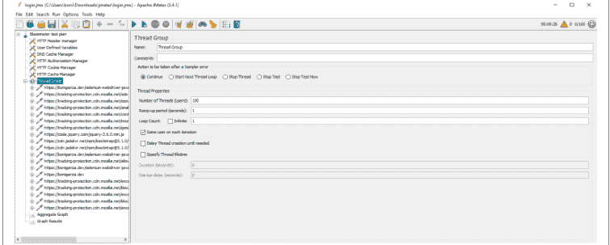

现在，我们可以使用 `JMeter` 运行测试（例如，点击 `JMeter GUI` 中的绿色三角形按钮）。结果是，根据最初为 `Selenium WebDriver` 测试开发的交互（示例 9-5），生成了 1 百个并发用户的负载。图 9-3 显示了之前添加的监听器的结果。

图 9-3. `JMeter` 结果

## 使用浏览器生成负载

像 `JMeter` 这样的工具对于 Web 应用的性能测试场景非常方便。然而，当你需要实际浏览器来重现完整工作流时（例如在视频会议 Web 应用中），这种方法就不适用了。在这种情况下，可能的解决方案是结合 `Docker` 使用 `WebDriver`。

示例 9-6 演示了这一点。正如你在测试中所示，`DriverManager` 允许通过在 `create()` 方法中指定大小作为参数来创建 `WebDriver` 实例列表。然后，例如，我们可以使用标准 Java 通过线程池并行执行被测 Web 应用。

# 示例 9-6. 使用 WebDriverManager 和 Docker 进行负载测试

```java
class LoadJupiterTest {

    static final int NUM_BROWSERS = 5;

    final Logger log = getLogger(lookup().getClass());

    List<WebDriver> driverList = driverList;

    WebDriverManager wdm = WebDriverManager.chromedriver().browserDocker();

    @BeforeEach
    void setup() {
        assertThat(isDriverAvailable()).isTrue();
        driverList = wdm.create(NUM_BROWSERS);
    }

    @AfterEach
    void teardown() {
        wdm.quit();
    }

    @Test
    void testLoad() throws InterruptedException {
        ExecutorService executorService = newFixedThreadPool(NUM_BROWSERS);
        CountDownLatch latch = new CountDownLatch(NUM_BROWSERS);

        driverList.forEach((driver) -> {
            executorService.submit(() -> {
                try {
                    checkHomePage(driver);
                } finally {
                    latch.countDown();
                }
            });
        });

        latch.await(60, SECONDS);
        executorService.shutdown();
    }

    void checkHomePage(WebDriver driver) {
        log.debug("Session id {}", ((RemoteWebDriver) driver).getSessionId());
        driver.get("https://bonigarcia.dev/selenium-webdriver-java/");
        assertThat(driver.getTitle()).contains("Selenium WebDriver");
    }
}
```

- 1. 我们创建了一个 `Chrome` 浏览器的实例，使用 `Docker` 将浏览器作为容器执行。
- 2. 我们假设运行此测试的机器上安装了 `Docker`。否则，测试将跳过。
- 3. 我们创建了一个 `WebDriver` 列表（在此示例中包含五个实例）。
- 4. 我们创建了一个与 `WebDriver` 列表大小相同的线程池。
- 5. 我们使用线程池并行执行 SUT（被测系统）的评估。
- 6. 我们等待每个并行评估完成。我们使用一种基于计数栅栏（latch）的同步方法来实现这一点。

## 安全

软件领域中一个相关的组织是 OWASP（Open Web Application Project），它是一个促进开源解决方案以改进软件安全性的非营利基金会。OWASP 最流行的项目之一是 Zed Attack Project（ZAP）。OWASP ZAP 是一个开源 Web 应用程序扫描器，用于实施漏洞评估（即寻找安全问题）或渗透测试（即模拟网络攻击），以发现可利用的漏洞。

我们可以将 OWASP ZAP 作为独立的桌面应用程序使用。图 9-4 显示了它的截图。

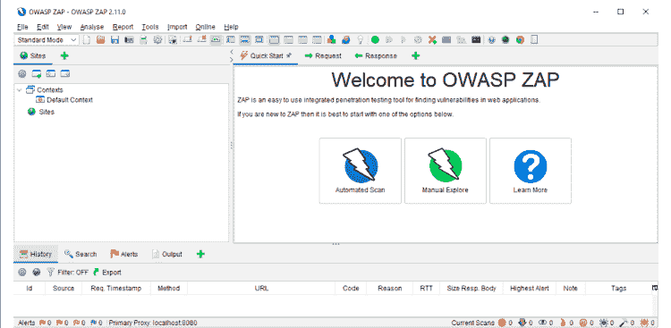

图 9-4. OWASP ZAP GUI

此 GUI 提供了不同的自动化扫描功能，以检测 Web 应用可能面临的安全威胁，例如 SQL 注入、跨站脚本（XSS）或跨站请求伪造（CSRF）等。

除了独立应用程序，我们还可以将 `Selenium WebDriver` 测试与 ZAP 集成。示例 9-7 提供了一个说明这种集成的测试用例。恰当执行此测试所需的步骤是：

- 1. 在 `localhost` 上启动 OWASP ZAP。默认情况下，OWASP 启动一个监听 `8080` 的代理。你可以使用 OWASP GUI 中的菜单 Tools → Options → Proxies 来更改此端口。
- 2. 在 `Selenium` 测试中禁用 API 密钥（或设置其值）。
- 3. 我们将 ZAP 配置为 `Selenium WebDriver` 代理。
- 4. 我们使用其 API 与 ZAP 交互。
- 5. 在执行 `Selenium WebDriver` 测试期间，为发现的漏洞创建一个 HTML 报告。图 9-5 显示了该报告的截图。

# 示例 9-7. 将 ZAP 作为安全扫描器

```java
class SecurityTest {

    static final Logger log = getLogger(lookup().getClass());

    static final String ZAP_PROXY_ADDRESS = "localhost";

    static final int ZAP_PROXY_PORT = 8080;

    static final String ZAP_API_KEY = "put-key-or-it";

    WebDriver driver;

    ClientApi api;

    @BeforeEach
    void setup() {
        String proxyStr = ZAP_PROXY_ADDRESS + ":" + ZAP_PROXY_PORT;

        assertThat(isOnline("http://" + proxyStr)).isTrue();

        Proxy proxy = new Proxy();
        proxy.setHttpProxy(proxyStr);
        proxy.setSslProxy(proxyStr);

        ChromeOptions options = new ChromeOptions();
        options.setInsecureCerts(true);
        options.setProxy(proxy);

        driver = DriverManager.chromedriver().capabilities(options).create();
    }

    api = new ClientApi(ZAP_PROXY_ADDRESS, ZAP_PROXY_PORT, ZAP_API_KEY);

    }

    @AfterEach
    void teardown() throwsApiClientException {
        if (api != null) {
            String title = "My ZAP report";
            String template = "traditional-html";
            String description = "This is a sample report";
            String reportfilename = "zap-report.html";
            String targetFolder = new File("").getAbsolutePath();

            ApiResponse response = api.reports.generate(title, template, null,
                description, null, null, null, null, reportfilename,
                null, targetFolder, null);

            log.debug("ZAP REPORT generated at {}", response.toString());
        }

        if (driver != null) {
            driver.quit();
        }
    }

    @Test
    void testSelenium() {
        driver.get("https://bonigarcia.dev/selenium-webdriver-java/web-form.html");
        assertThat(driver.getTitle()).contains("Selenium WebDriver");
    }
}
```


> 我们也可以像之前介绍的那样使用独立的 OWASP ZAP。与 Selenium WebDriver 集成的潜在优势可能是重用现有的功能测试进行安全评估或自动化安全评估（例如，由 CI 服务器执行的回归测试）。

## 我的 ZAP 报告

这是一个示例报告
站点：`https://cdn.jsdelivr.net` `https://unpkg.com/code.jquery.js` `https://bonicarie.dev` `https://accounts.google.com`
生成于：2021年7月21日 18:56:00

## 警报摘要

| 警报级别 | 计数 |
|---|---|
| 高 | 0 |
| 中 | 0 |
| 低 | 4 |

## 警报

| 名称 | 风险级别 | 实例数量 |
|---|---|---|
| 跨域配置错误 (Cross-Origin Misconfiguration) | 中 | 1 |
| 设置了 X-Frame-Options Header | 低 | 1 |
| 缺少内容安全策略 (Content-Security-Policy) | 低 | 3 |
| 缺少跨源资源策略 (Cross-Origin-Resource-Policy Missing) | 低 | 1 |
| 缺少 Content-Type-Options Header | 低 | 1 |

## 警报详情

| 详情 | 跨域配置错误 |
|---|---|
| 描述 | 如果 Web 服务器上配置了跨源资源共享 (CORS)，则可能出现这种情况 |
| 方法 | GET |
| 参数 | `https://example.com/selenium-webdriver-java-test-form` |
| 关于 | |
| 证据 | `Access-Control-Allow-Origin: *` |

图 9-5. 执行 Selenium WebDriver 测试后由 ZAP 生成报告

## 无障碍

无障碍是指残障人士有效使用网站、移动应用等软件系统的能力。该领域的一个重要参考是《Web内容无障碍指南》(WCAG)，它是由 W3C 无障碍倡议 (WAI) 创建的一系列标准建议，解释了如何让残障人士能够访问 Web 内容。

有多种方法可以测试 Web 的无障碍性。常用的方法是检查 WCAG 建议。可以使用 Axe 等自动化扫描器，这是一个遵循 WCAG 规则对 Web 应用程序进行自动化测试的开源引擎。Axe 通过辅助库与 Selenium WebDriver 的 Java 绑定无缝集成。示例 9-8 显示了使用该库的测试。

示例 9-8. 使用 Axe 生成无障碍报告

```java
@Test
void testAccessibility() {
  driver.get("https://bonicaria.dev/selenium-webdriver-java/");
  assertThat(driver.getTitle()).contains("Selenium WebDriver");
}

Results result = new AxeBuilder().analyze(driver);
List<Rule> violations = result.getViolations();
viations.forEach(rule -> {
  log.debug("{}", rule.toString());
});
-AxeReporter.writeResultsToJsonFile("testAccessibility", result);
```

- 我们使用 Axe 分析 WebDriver 服务。这样，浏览器中加载的所有页面都将通过 Axe 进行扫描。
- 我们获得一份发现的无障碍违规报告。
- 我们在标准输出中记录每个违规项。在本示例中，发现的问题有：
  - `color-contrast`：元素必须具有足够的颜色对比度。
  - `heading-order`：标题级别应只增加一级。
  - `image-alt`：图像必须有替代文本。
  - `link-name`：链接必须有可识别的文本。
- 我们将结果写入本地 JSON 文件。

## A/B 测试

A/B 测试是一种易用性评估的形式，它通过比较同一个应用程序的不同变体来发现哪一个对终端用户更有效。不同的商业产品为 Selenium WebDriver 测试中的 A/B 测试提供了高级功能。例如，Applitools Eyes 提供了多个网页变体的自动化视觉比较。另一个选项是 Optimizely，这是一家提供自定义和实验 A/B 测试工具的公司。

执行 A/B 测试的另一种方法是使用原生 Selenium WebDriver API 并为网页的不同变体编写自定义条件。示例 9-9 显示了遵循多变量网页的手动方法测试。注意，此测试展示了基于评估不同页面变体来实现 A/B 测试的简单方法。

示例 9-9. 使用 Selenium WebDriver 进行基础 A/B 测试

```java
@Test
void testABTEST() {
  driver.get(
    "https://bonicarcia.dev/selenium-webdriver-java/ab-testing.html");
  WebDriverWait wait = new WebDriverWait(driver, Duration.ofSeconds(10));
  Element header = wait.until(
    ExpectedConditions.presenceOfElementLocated(By.TagName("h6")));
  if (header.getText().contains("variation A")) {
    assertBodyContains(driver, "Lorem ipsum");
  } else if (header.getText().contains("variation B")) {
    assertBodyContains(driver, "Nibh netus");
  } else {
    fail("Unknown variation");
  }
}

void assertBodyContains(WebDriver driver, String text) {
  String body = driver.findElement(By.TagName("body")).getText();
  assertThat(body).contains(text);
}
```

## 流式 API (Fluent API)

正如第1章介绍的，Selenium 是其他框架和库的基础技术。例如，我们可以找到几个封装了 Selenium WebDriver 的库，为 Web 应用程序的端端测试提供流式 API。Seleniumide 是一个在 Selenium WebDriver 之上定义了简洁流式 API 的开源（MIT 许可证）库。Driver 提供了许多优势，例如自动化 Web 元素或支持 AJAX 应用。

### 测试数据

等价类划分
边界测试
错误值测试

```java
List<WebElement> errorElement = driver
    .findElements(By.className("alert-danger"));
assertThat(errorElement).isEmpty();
```

- 1 我们创建一个 Faker 实例。
- 2 我们发送不同类型的随机数据（名称、地址、国家等）。
- 3 我们验证数据是否已正确提交。
- 4 我们检查页面上是否有错误。

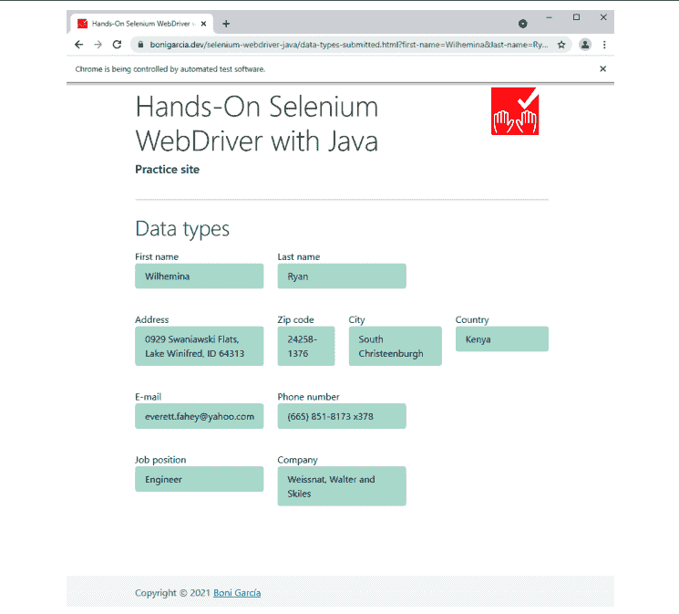

图 9-6. 使用虚假数据的练习页面

## 报告 (Reporting)

测试报告是总结执行测试套件后结果的文档。该文档通常包含已执行的测试数量、它们的结论（通过、失败）以及执行时间。在我们的 Java 项目中，有多种获取测试报告的方法。例如，当使用 Maven 时，我们可以使用以下命令创建基础测试报告：

```
mvn test
mvn sureffire-report:report-only
mvn site -DGenerateReports=false
```

- 我们使用 Maven 执行测试。Maven Surefire 插件在 `target` 文件夹中生成了一组 XML 文件。这些文件包含了测试执行的结果。
- 我们将 XML 报告转换为 HTML 报告。您可以在项目文件夹 `target/site` 中找到此 HTML 报告。
- 我们强制复制 HTML 报告所需的 CSS 和图像。图 9-7 显示了报告的截图。

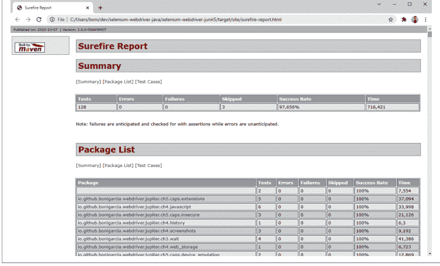

图 9-7. 使用 Maven 生成的测试报告

我们也可以使用 Gradle 生成等效的报告。在使用该工具执行测试套件后，Gradle 会自动在 `build/reports` 文件夹中生成 HTML 报告。图 9-8 显示了为执行一组测试生成的测试报告示例（使用 shell 命令 `gradle test --tests Hello*`）。

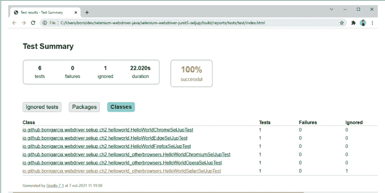

图 9-8. 使用 Gradle 生成的测试报告

除了 Maven 和 Gradle 之外，我们还可以使用现有的报告库来创建更丰富的报告。一种可能的替代方案是 Extent Reports，这是一个用于创建交互式测试报告的库。Extent Reports 提供专业（商业）和社区（开源）版本。示例 9-12 展示了使用后者的测试。

示例 9-12. 使用 Extent Reports 生成 HTML 报告

```java
class ReportingJupiterTest {
    WebDriver driver;
    static ExtentReports reports;

    @BeforeAll
    static void setupClass() {
        reports = new ExtentReports();
        ExtentReporter htmlReporter = new ExtentSparkReporter(
            "extentreport.html");
        reports.attachReporter(htmlReporter);
    }

    @BeforeEach
    void setup(TestInfo testInfo) {
        reports.createTest(testInfo.DisplayName());
        driver = WebDriver.chromedriver().create();
    }
```

报告 | 313

```java
@AfterEach
void teardown() {
  driver.quit();
}
```

```java
@AfterAll
static void teardownClass() {
  reports.flush();
}
```

// 测试方法 4
}

- 我们创建一个测试报告器的实例。
- 我们将其配置为生成 HTML 报告。
- 在每次测试后，我们使用 JUnit 5 在测试报告器中创建一个条目，我们使用 `TestInfo`，这是一个内置的参数解析器，允许检索有关当前测试的信息。
- 如往常一样，您可以在示例代码库中找到完整的源代码。特别是，该类有两个测试方法。图 9-9 显示了执行此测试类时生成的测试结果。

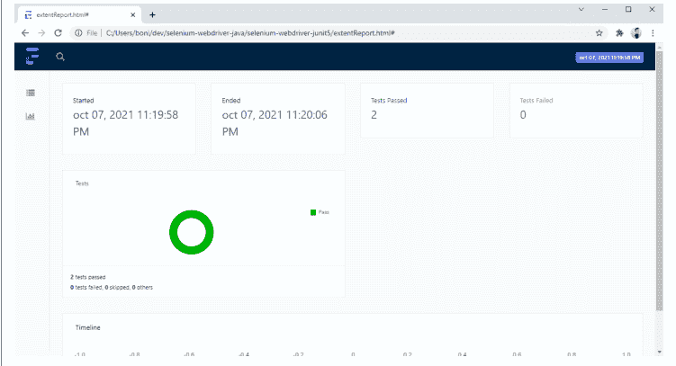

图 9-9. 使用 Extent Reports 生成的测试报告

314 | 第 9 章：第三方集成

Extent Reports 的一个不便之处是，我们需要将每个测试显式地添加到报告器中。解决此问题的可能方案是使用自定义测试监听器（如第 282 页的“测试监听器”部分所述）来对报告的通用逻辑进行分组。

另一个用于生成测试报告的可能库是 Allure，这是一个开源报告框架，用于为编程语言（包括 Java、Python 和 JavaScript 等）生成测试报告。Allure 和 Extent Reports 之间的显著区别是，Allure 使用构建工具 Maven 或 Gradle 中配置的测试监听器（有关此配置的更多细节请参见附录 C）。因此，我们不需要更改测试套件来生成 Allure 报告。表 9-1 总结了使用 Maven 和 Gradle 创建 Allure 报告的必要命令。

表 9-1. 使用 Maven 和 Gradle 生成测试报告的命令

| Maven | 说明 |
|---|---|
| `mvn test` | `gradle test` | 运行测试用例 |
| `mvn allure:report` | `gradle allureReport` | 在 `target` 文件夹中创建报告 |
| `mvn allure:serve` | `gradle allureServe` | 使用本地 Web 服务器打开 HTML 报告（如图 9-10 所示） |


报告 | 315

## 行为驱动开发 (BDD)

正如第 1 章介绍的，行为驱动开发 (BDD) 是一种使用自然语言促进软件开发的方法论。最流行的工具之一是 Cucumber。在 Java 中，我们使用 `@Given`、`@Then`、`@When` 或 `@And` 来装饰方法。为了将场景作为测试用例运行，我们必须首先创建步骤定义。步骤定义是执行被测系统 (SUT) 的胶水代码。示例 9-13 显示了：

```
Feature: Login

Scenario: Successful login
Given I use "Chrome"
When I navigate to "login.html"
And I log in with "user" and "password"
Then I see "Welcome"

Scenario: Failure
Given I use "Chrome"
When I navigate to "login.html"
And I log in with "user" and "password"
Then I see "Invalid credentials"
```

示例 9-14. 使用 Cucumber 登录步骤

```java
public class LoginSteps {
    WebDriver driver;

    @Given("I use {string}") 
    public void use(String browser) {
        driver = DriverManager.getInstance(browser).create();
    }

    @When("I navigate to {string}") 
    public void navigateTo(String url) {
        driver.get(url);
    }

    @And("I log in with {string} and password {string}") 
    public void login(String username, String password) {
        driver.findElement(By.id("username")).sendKeys(username);
        driver.findElement(By.id("password")).sendKeys(password);
    }

    @And("click Submit") ❶
    public void iPressEnter() {
      driver.findElement(By.cssSelector("button")).click();
    }

    @Then("I should see (string)") ❺
    public void iShouldSee(String result) {
      try {
        String bodyText = driver.findElement(By.tagName("body")).getText();
        assertThat(bodyText).contains(result);
      } finally {
        driver.quit();
      }
    }
}
```

- ❶ 我们使用第一个步骤创建 WebDriver 实例。
- ❷ 我们打开 URL。
- ❸ 我们输入凭据。
- ❹ 我们点击提交按钮。
- ❺ 我们验证页面上是否存在预期消息。

最后，我们需要将步骤定义作为测试用例运行。如往常一样，我们使用单元测试框架创建该测试。在与 Cucumber 的集成中，这取决于单元测试框架。也就是说，所需的代码在 JUnit 4（参见示例 9-15）、JUnit 5（参见示例 9-16）和 TestNG（参见示例 9-17）中是不同的。

> Selenium-Jupiter 没有为集成 Cucumber 提供任何额外功能，因此在 Selenium-Jupiter 项目示例代码库中，默认的 JUnit 5 过程是相同的。

示例 9-15. 使用 JUnit 4 的 Cucumber 测试

```java
@RunWith(Cucumber.class) ①
```


## Cucumber 测试示例

以下示例展示了如何使用不同的测试框架（JUnit 4、JUnit 5 和 TestNG）运行 Cucumber 测试。

### 示例 9-15. 使用 JUnit 4 的 Cucumber 测试

```java
@CucumberOptions(features = "classpath:io/github/bonigarcia", glue = {
    io.github.bonigarcia }) ②

public class CucumberTest {

}
```

- ① 我们使用 Cucumber 运行器将步骤定义执行作为测试用例执行。
- ② 我们指定了 Gherkin 场景的路径。在这种情况下，它是项目类路径下的特征文件夹`io/github/bonigarcia`（具体在`src/test/resources`文件夹中）。该注解还指定了搜索胶水代码（glue code，即步骤定义）的初始包。

### 示例 9-16. 使用 JUnit 5 的 Cucumber 测试

```java
@Suite ①
@IncludeEngines("cucumber") ②
@SelectClasspathResource("io/github/bonigarcia") ③
@ConfigurationParameter(key = GLUE_PROPERTY_NAME, value = "io.github.bonigarcia") ④

public class CucumberTest {

}
```

- ① 我们需要使用 JUnit 5 套件模块（suite module）来运行 Cucumber 测试。
- ② 我们在 JUnit Platform 中包含了 Cucumber 引擎。
- ③ 我们指定了项目类路径中特征（features）的路径。
- ④ 我们设置了搜索胶水代码的初始包。

### 示例 9-17. 使用 TestNG 的 Cucumber 测试

```java
@CucumberOptions(features = "classpath:io/github/bonigarcia", glue = {
    "io.github.bonigarcia") }) ①

public class CucumberTest extends AbstractTestNGCucumberTests ②

}
```

- ① 我们指定了 Gherkin 场景的路径以及搜索胶水代码的包。
- ② 我们扩展了一个用于 Cucumber 测试的 TestNG 父类测试类。

## Web 框架

Web 框架是设计用于支持 Web 应用和服务的开发的软件框架。Java 语言中最流行的框架之一是 Spring Framework。Spring 是一个用于构建 Java 应用的开源框架，涵盖企业级 Web 应用和服务。Spring 的核心技术被称为控制性反转（Inversion of Control, IoC），这是一种在这些对象的类之外创建实例的程序。这些对象在 Spring 术语中称为 beans 或组件，稍后由 Spring IoC 容器注入依赖项。

以下示例展示了验证 Spring-Boot 创建的 Web 应用的基本测试。Spring-Boot 是 Spring 家族的一个子项目，它通过“约定优于配置”和“自动发现”特性简化了基于 Spring 应用的开发。此外，Spring-Boot 提供了一个嵌入式 Web 服务器以简化 Web 应用的开发。在此类项目中，与 Selenium WebDriver 的集成通过在每个测试用例自动部署到嵌入式 Web 服务器中，方便了基于 Spring 应用的测试。

将 Spring-Boot 与 Selenium WebDriver 以及本书中使用的单元测试框架集成代码不同。示例 9-18 显示了集成 Spring-Boot 和 JUnit 4 的测试。示例 9-19 显示了使用 TestNG 时的差异，示例 9-20 说明了如何使用 JUnit 5，最后，示例 9-21 展示了基于 JUnit 5 和 Selenium Jupiter 的 Spring 测试。

### 示例 9-18. 使用 Spring-Boot 和 JUnit 4 进行测试

```java
@RunWith(SpringRunner.class)
@SpringBootTest(classes = SpringBootDemoApp.class,
    webEnvironment = SpringBootTest.WebEnvironment.RANDOM_PORT)

public class SpringJUnit4Test {

    private WebDriver driver;

    @LocalServerPort
    protected int serverPort;

    @Before
    public void setup() {
        driver = WebDriverManager.chromedriver().create();
    }

    @After
    public void teardown() {
        driver.quit();
    }

    @Test
    public void testSpringBoot() {
        driver.get("http://localhost" + serverPort);
        String bodyText = driver.findElement(By.tagName("body")).getText();
        assertThat(bodyText)
            .contains("This is a local site served by Spring-Boot");
    }

}
```

- 我们在 JUnit 4 中使用了 Spring 运行器。
- 我们使用`@SpringBootTest`注解来测试来定义 Spring-Boot 类名。此外，我们指定 Web 应用使用随机可用端口部署。
- 我们将 Web 应用端口注入为类属性。

### 示例 9-19. 使用 Spring-Boot 和 TestNG

```java
@SpringBootTest(classes = SpringBootDemoApp.class,
    webEnvironment = SpringBootTest.WebEnvironment.RANDOM_PORT)

public class SpringBootNGTest extends AbstractTestNGContextTests {

    // 逻辑与上一个测试相同

}
```

- 我们以与 JUnit 4 相同的方式使用`@SpringBootTest`注解。
- 我们扩展了一个 TestNG 父类来使用 Spring 上下文运行此测试。

### 示例 9-20. 使用 Spring-Boot 和 JUnit 5

```java
@ExtendWith(SpringExtension.class)
@SpringBootTest(classes = SpringBootDemoApp.class,
    webEnvironment = SpringBootTest.WebEnvironment.RANDOM_PORT)

class SpringBootJupiterTest {

    // 逻辑与上一个测试相同

}
```

- 我们使用 JUnit 5 Spring 扩展在 Jupiter 测试中集成 Spring 上下文。
- 我们像之前的示例一样使用 Spring-Boot 启动 Spring 应用上下文。

### 示例 9-21. 使用 Spring-Boot、JUnit 5 以及 Selenium-Jupiter 进行测试

```java
@ExtendWith({ SeleniumJupiter.class, SpringExtension.class })
@SpringBootTest(classes = SpringBootDemoApp.class,
    webEnvironment = SpringBootTest.WebEnvironment.RANDOM_PORT)

class SpringBootJupiterTest {

    @LocalServerPort
    protected int serverPort;

    @Test
    public void testSpringBoot() {
        driver.get("http://localhost" + serverPort);
        String bodyText = driver.findElement(By.tagName("body")).getText();
        assertThat(bodyText)
            .contains("This is a local site served by Spring-Boot");
    }

}
```


对于 Selenium-Jupiter，我们使用了两个 JUnit 5 扩展。如常，我们使用 JUnit 5 机制声明 `WebDriver` 实例。

## 总结与展望

本章提供了不同技术（如工具、库和框架）与 Selenium WebDriver 集成的实用概述。首先，我们使用了 `Awaitility`（处理异步操作的库）来等待文件下载。下载文件的 Selenium 替代库是 `Apache HttpClient`。下一组技术关注于使用 Selenium WebDriver 进行非功能测试：`BrowserMob`（性能测试）、`OWASP ZAP`（安全测试）以及 `Axe`（无障碍性测试）。然后，我们使用了 `Selenide` 提供的流式 API、`Java Faker` 为 Selenium WebDriver 创建测试数据，以及 `Extent Reports` 和 `Allure` 生成丰富的测试报告。最后，我们探索了如何将 `Cucumber`（BDD 框架）和 `Spring`（Web 框架）与 Selenium WebDriver 集成。

## 第 10 章

# 超 Selenium

本章通过介绍 Selenium 的补充技术来结束本书。首先，我们分析了移动应用的基础知识，并介绍了流行的移动测试框架 `Appium`。然后，你将学习如何使用名为 `REST Assured` 的开源 Java 库测试 REST（表示状态）服务。最后，章节介绍了浏览器自动化领域 Selenium WebDriver 的几种流行替代方案：`Cypress`、`WebDriverIO`、`TestCafe`、`Puppeteer` 和 `Playwright`。

# 移动应用

移动应用程序（通常称为移动应用或简单的 apps）是运行在移动设备（如智能手机、平板电脑或可穿戴设备）上的软件应用。移动设备有两个主要的操作系统：

- Android 基于 Linux 版本的开源（Apache 2.0 许可）移动操作系统。它最初由一家名为 Android 的初创公司开发，2005 年被 Google 收购。
- iOS 是 Apple 为其硬件（如 iPhone、iPad 或 Watch）创建的专用移动操作系统。

分类移动应用的常用方法如下：

## 原生应用

## 基于 Web 的应用

在移动浏览器（例如 Chrome、Safari 或 Firefox Mobile）中渲染的 Web 应用。这些应用通常被设计为响应式的（即能够适应不同的屏幕尺寸和视口）。

## 混合应用 (Hybrid apps)

使用客户端 Web 标准（即 HTML、CSS 和 JavaScript）开发，并使用一个名为 `webview` 的原生容器部署到移动设备上的移动应用程序。支持混合应用开发的框架示例包括 `Ionic`、`React Native`、`Flutter`。

## 渐进式 Web 应用 (PWAs)

使用现代标准 API（用于可安装、响应式等）构建的 Web 应用，旨在运行在包括桌面和移动设备在多个平台上。

## 移动测试

测试是移动应用开发过程中一个必不可少的过程。移动测试涉及不同的挑战，例如硬件兼容性、网络连接或操作系统的特定性。执行移动测试的不同方法包括：

### 使用带有移动模拟功能的桌面浏览器

我们使用 Selenium WebDriver 进行此类类型的移动测试。为了这一目标，您可以使用浏览器特有的功能（如第 153 页“设备仿真”部分解释），或在基于 Chromium 的浏览器上使用 CDP（如第 187 页“设备仿真”部分解释）。

### 使用虚拟设备

虚拟移动设备有两种类型：

- **仿真器 (Emulators)**：虚拟化移动设备所有方面（包括硬件和操作系统）的桌面应用程序。
- **模拟器 (Simulators)**：模拟移动操作系统某些特性的桌面应用。它们主要用于 iOS，因为 Android 设备可以很容易地仿真。

### 使用真实设备

在真实条件下使用实际设备及其原生 Android 或 iOS API。

## Appium

`Appium` 是一个用于移动应用的开源测试自动化框架。`Appium` 提供了一个跨平台 API，允许在虚拟或真实设备上对 iOS 和 Android 的原生、混合和移动 Web 应用进行测试。此外，`Appium` 还允许对 Windows 和 macOS 上的桌面应用程序进行自动化测试。

`Appium` 的故事始于 2011 年，当时 Dan Cuellar 为使用 C# 开发的 iOS 应用创建了一个名为 `SeleniumAuto` 的自动化工具。新成员 Jason Higgins（Selenium 的共同创建者）参加了 2012 年在伦敦的 SeleniumConf。Jason 通过添加 Web 服务器和在 HTTP 上使用 WebDriver 协议为项目做出了贡献，使 `iOSAuto` 与任何 Selenium WebDriver 客户端兼容。他们在 2013 年 1 月将项目名称改为 `Appium`，Sauce Labs 开始支持 `Appium` 并提供更多开发者支持。新团队使用 Node.js 重写了 `Appium`，因为它是一个广为人知的高效的服务器端框架。

如图 10-1 所示，`Appium` 遵循客户端-服务器架构。`Appium` 是一个 Web 服务器，暴露出一个 REST API，该 API 可以在移动或桌面应用上运行自动化会话。为此，`Appium` 服务器接收来自客户端的请求，在目标设备/应用上执行这些请求，并返回代表命令执行结果的 HTTP 响应。`Appium` 客户端库使用 Mobile JSON Wire Protocol（原始 WebDriver 协议的官方草案扩展）与 `Appium` 服务器通信。`Appium` 服务器及其客户端也使用 W3C WebDriver 规范。有不同的 `Appium` 客户端库。表 10-1 汇总了这些库，它们都由 `Appium` 项目和社区官方维护。


图 10-1. Appium 架构

## 表 10-1. Appium 客户端库

| 名称 | 语言 | 许可证 | 维护者 | 网站 |
| --- | --- | --- | --- | --- |
| Appium java-client | Java | Apache 2.0 | Appium 团队 | https://github.com/appium/java-client |
| Appium ruby_lib | Ruby | Apache 2.0 | Appium 团队 | https://github.com/appium/ruby_lib |
| Appium Python Client | Python | Apache 2.0 | Appium 团队 | https://github.com/appium/python-client |
| Appium-dotnet-driver | C# | Apache 2.0 | Appium 团队 | https://github.com/appium/appium-dotnet-driver |
| WebdriverIO | JavaScript (Node.js) | MIT | WebdriverIO 团队 | https://webdriverio.io |
| web2driver | JavaScript (browser) | Apache 2.0 | HeadSheep | https://github.com/projectxio/web2driver |
| Appium library for RobotFramework | Python | Apache 2.0 | Serhat Bolsu | https://github.com/serhatbolsu/robotframework-appium-library |

在支持方面，针对特定平台的自动化由 `Appium` 术语中称为 driver 的组件提供。在版本 1 中，这些驱动与 `Appium` 服务器紧密耦合。然而，在 `Appium` 2 中（本文编写时 `Appium` 的最新版本），这些驱动与 `Appium` 服务器分离了（见图 10-1）并被独立安装。

## 表 10-2. Appium 驱动

| 名称 | 目标 | 描述 | 仓库 |
| --- | --- | --- | --- |
| XCTest Driver | iOS 和 tvOS 应用 | 利用 Apple 的 XCTest 库实现自动化 | https://github.com/appium/appium-xuitest-driver |
| Espresso Driver | Android 应用 | 通过 Espresso（一个 Android 的测试框架）实现自动化 | https://github.com/appium/appium-espresso-driver |
| UiAutomator2 Driver | Android 应用 | 利用 UiAutomator2 技术在 Android 设备或模拟器上实现自动化 | https://github.com/appium/uiautomator2-driver |
| Windows Driver | Windows 桌面应用 | 使用 WinAppDriver 实现 Windows 应用 | https://github.com/appium/appium-windows-driver |
| Mac Driver | macOS 桌面应用 | 使用 Apple 的 XCTest 框架实现应用 | https://github.com/appium/appium-mac2 |

## 基础 Appium 测试

本节介绍了使用 `Appium` 服务器 2 和客户端的基础测试。为了简单起见，我使用 `Automator2` 驱动和模拟设备。SUT 将是一个 Web 应用，具体来说，本书测试的要求如下：

1. 安装 `Appium` 服务器 2。
2. 安装 `Automator2` 驱动。
3. 安装 Android SDK（即 Android 的官方软件开发包）。您可以通过安装 Android Studio 安装 SDK。
4. 使用 Android Studio 中的 AVD 管理器创建安卓虚拟设备 (AVD)。图 10-2 显示了此选项，图 10-3 显示了虚拟设备（使用 API 30 的 Nexus 5）。
5. 启动虚拟设备和 `Appium` 服务器。


图 10-2. Android Studio


如前所述，`Appium` 服务器是一个 Node.js 应用。因此，您需要在系统中安装 Node.js 来运行 `Appium`。以下命令总结了如何安装 `Appium` 服务器 2 和 `Automator2` 驱动，以及如何启动 `Appium` 服务器：

```
npm install -g appium@next
ium driver install uutomator2
ium --allow-insecure chromedriver_autodload
```

- 我们使用 `npm`（Node.js 的默认包管理器）安装 `Appium`。
- 我们使用 `ium` 安装驱动程序驱动。
- 我们启动 `Appium` 服务器（默认监听端口 4723）。我们包含一个标志让 `Appium` 管理所需的浏览器驱动（例如 `chromedriver`）以自动化 Web 应用（就像 Selenium 一样）。

示例 10-1 展示了一个使用 `Appium` Java 客户端的完整测试。如您所见，此测试与书中解释的常规 Selenium WebDriver 测试非常相似。在这种情况下，主要区别是我们使用了 `AppiumDriver` 实例，这是 `Appium` Java 客户端提供的一个类。该类继承了 Selenium WebDriver API 的 `RemoteWebDriver` 类。因此，我们可以利用 Selenium WebDriver API 在移动设备上测试 Web 应用。图 10-4 显示了测试期间的模拟移动设备（Nexus 5）。


示例 10-1. 使用 Appium Java client 进行测试

```java
class Each {

    WebDriver driver;

    @BeforeEach
    void setup() throws MalformedURLException {
        URL appServerUrl = new URL("http://localhost:4723");
        assertThat(isOn(new URL(appServerUrl, "/status"))).isTrue();
        ChromeOptions options = new ChromeOptions();
        options.setCapability(MobileCapabilityType.PLATFORM_NAME, "Android");
        options.setCapability(MobileCapabilityType.DEVICE_NAME, "Nexus S API 30");
        options.setCapability(MobileCapabilityType.AUTOMATION_NAME, "UIAutomator2");
    }
```

Mobile Apps | 331

```java
    driver = new AppiumDriver(appiumServerUrl, options);

    @AfterEach
    void teardown() {
        if (driver != null) {
            driver.quit();
        }
    }
```

```java
    @Test
    void testApp() {
        driver.get("https://bonigarcia.dev/selenium-webdriver-java/");
        assertThat(driver.getTitle()).contains("Selenium WebDriver");
    }
}
```


- 我们指定了 Appium 服务器的 URL。
- 我们使用 Appium 服务器 URL 的 `/status` 节点进行断言。如果该 URL 未上线，则跳过测试。
- 我们使用 Chrome 选项来指定能力（capabilities）。
- 使用 Appium 时第一个强制性能力是平台名称（在本例中为 Android）。
- 下一个所需的能力是设备名称。此名称必须与 AVD 管理器定义的名称匹配（见图 10-3）。
- 最后一个强制性能力是驱动名称（在此类中为 UiAutomator2）。
- 我们使用 Appium 服务器 URL 和浏览器选项创建 `AppiumDriver` 实例。
- 我们像通常一样使用驱动对象来操作 SUT（被测系统）。

# REST 服务

REST（表述性状态转移）是一种用于设计分布式服务的架构风格。Roy Fielding 在他 2000 年的博士论文中提出了这个术语。REST 是在 HTTP 协议之上创建 Web 服务的流行方式。

REST 遵循客户端-服务器架构。服务器处理一组资源，监听来自客户端的入请求。这些资源是 REST 服务的构建模块，并定义了传输信息的类型。每个资源都有唯一的标识符。在 HTTP 中，我们使用 URL（也称为节点）来访问资源。每个资源都有一个表示形式，即对资源当前状态的机器可读解释。我们使用数据交换格式来定义表示形式，例如 JSON、YAML 或 XML。REST 服务在资源上暴露了一系列操作，如 CRUD（创建、读取、更新和删除）。我们可以使用用于创建 REST 服务的 HTTP 方法。表 10-3 总结了 HTTP 方法。最后，我们使用 HTTP 状态码来识别与 REST 动作相关的响应。表 10-4 总结了 REST 中常用的 HTTP 状态码。图 10-5 显示了一个使用不同 HTTP 方法和响应的示例 REST 服务请求响应序列。

## 表 10-3. 创建 REST 服务的 HTTP 方法

| 方法 | 说明 |
| --- | --- |
| GET | 读取资源 |
| POST | 向服务器发送新资源 |
| PUT | 更新资源 |
| DELETE | 删除资源 |
| PATCH | 在不返回任何内容的情况下部分更新资源 |
| HEAD | 询问给定资源是否存在其任何表示形式 |
| OPTIONS | 获取给定资源可用的动词 |

## 表 10-4. 创建 REST 服务的 HTTP 状态码

| 状态 | 说明 |
| --- | --- |
| 200 OK | 请求成功，并返回了请求的内容（例如在 GET 请求中）。 |
| 201 Created | 资源已创建（例如在 POST 或 PUT 请求中）。 |
| 204 No content | 动作成功，但没有返回内容。此状态码适用于不返回响应体的操作（例如在 DELETE 请求中）。 |
| 301 Moved permanently | 资源已移动到另一个位置。 |
| 400 Bad request | 请求存在某些问题（例如缺少参数）。 |
| 401 Unauthorized | 请求的用户无法访问该资源。 |
| 403 Forbidden | 资源不可，与 401 不同，身份验证不会影响响应。 |
| 404 Not found | 节点未识别出任何资源。 |
| 405 Method not allowed | 使用的动词不允许（例如在只读资源上使用 PUT）。 |
| 500 Internal server error | 服务器端出现通用意外情况。 |


REST API 随处可见。一如既往，强烈建议实现自动化测试来验证这些服务，例如使用 RestAssured。RestAssured 是一个测试 REST 服务的流行库。我们使用数据交换格式来定义表示形式，例如 JSON、YAML 或 XML。RestAssured 提供了一个流式 API 来测试 REST 服务。

334 | 第10章：超越 Selenium

## 示例 10-2. 使用 RestAssured

```java
class RestTest {

    @Test

    void testRest() {

        HttpBean get = RestAssured.get("https://httpbin.org/get").then()

            .statusCode(200)

            .extract().as(HttpBean.class);

        assertThat(get.getHeaders()).containsKey("Accept-Encoding");

        assertThat(get.getOrigin()).isNotBlank();

    }

}
```

## 示例 10-3. 测试用的 POJO 类

```java
public class HttpBean {

    public Map<String, String> args;

    public Map<String, String> headers;

    public String origin;

    public String url;

    // Getter 和 setter

}
```

# Selenium 的替代方案

Selenium 目前是实现端端测试的领先技术。尽管如此，它并不是唯一的替代方案。本节提供了允许端端测试的其他框架和库的概述。此外，后续小节还将回顾这些替代方案的主要优缺点。在我看来，Selenium 仍然是端端测试的参考解决方案，因为它基于 Web 标准（即 W3C WebDriver 和 WebDriver BiDi）来支持自动化过程，因此保证了跨浏览器性。

## Cypress

Cypress 是一种 JavaScript 端端自动化测试框架。如图 10-6 所示，Cypress 架构由一个 Node.js 进程和一个在浏览器中执行的名为 Test Runner 的工具组成。


Test Runner 是一个交互式 Web 应用，它嵌入了基于 Mocha（一种 JavaScript 测试框架）的测试以及作为两个 iframe 的被测 Web 应用。Cypress 代码运行在同一个浏览器标签页中（即在 JavaScript 循环中）。Node.js 进程通过 WebSocket 与 Test Runner 通信。最后，Node.js 进程是 Test Runner 与被测 Web 应用之间 HTTP 流量的代理。

Cypress Test Runner 是开源的，根据 MIT 许可条款授权。Cypress 团队还为高级功能提供商业支持。其中之一是 Cypress Dashboard，这是一个云端托管的 Web 应用，允许跟踪在 Test Runner 中执行的测试。表 10-5 总结了 Cypress 的一些相关的优缺点。

### 表 10-5. Cypress 的优与缺点

| 优点 | 缺点 |
| --- | --- |
| 自动等待和快速执行，因为测试和应用程序运行在同一个浏览器中 | 仅支持某些浏览器：Firefox 和基于 Chromium 的浏览器（包括 Chrome、Edge 和 Electron），但不支持 Safari 或 Opera 等其他浏览器 |
| 实时重载（Test Runner 会自动跟踪测试代码的更改） | 由于应用程序是在浏览器 iframe 中执行的，某些操作是不允许的（例如，驱动不同的浏览器或多个标签页） |

以下命令展示了如何安装 Cypress 并在本地执行它。执行这些命令后，你将使用 Cypress GUI（如图 10-7 所示）。你可以使用此 GUI 使用 Cypress 执行测试。

```bash
npm install cypress
npx cypress open
```

- 我们可以使用 npm（Node.js 的默认包管理器）来安装 Cypress。
- 我们可以使用 npx（一个 npm 包运行器）来运行 Cypress 进程。


### 图 10-7. Cypress GUI

默认情况下，在 Cypress GUI 中，你可以在 `1-getting-started` 和 `2-advanced-examples` 文件夹找到入门测试示例。此外，我们可以使用 `New Spec File` 按钮创建新测试。例如，示例 10-4 展示了一个使用 Cypress 的全新基础测试（即 Cypress 版的 hello world）。该测试文件名为 `hello-world-cypress.spec.js`（Mocha 测试中默认使用 `spec.js` 扩展），并存储在 Cypress 安装的 `cypress/integration` 路径下。图 10-8 显示了在该测试执行期间 Cypress Test Runner 的截图。

Selenium 的替代方案 | 337

### 示例 10-4. 使用 Cypress 的 hello world 测试

```javascript
describe('Hello World with Cypress', () => {

  it('Login in the practice site', () => {

    cy.visit('https://bonigarcia.dev/selenium-webdriver-java/login-form.html') // 1

    cy.get('#Username').type('user') // 2

    cy.get('#Password').type('user') // 3

    cy.contains('Submit').click() // 4

    cy.contains('Login successful!') // 5

    cy.screenshot("hello-world-cypress") // 6

  })

})
```

- 1 我们在练习站点中打开登录页面。
- 2 我们输入正确的凭据（用户名和密码）。
- 3 我们点击 Submit 按钮。
- 4 我们验证结果页面是否包含登录成功的消息。
- 5 我们截了一张浏览器图。


图 10-8. Cypress Test Runner

## WebDriverIO

WebDriverIO 是一个用于 Web 和移动应用程序的自动化测试框架。它是完全开源的（MIT 许可），并基于 W3C WebDriver 协议等 Web 标准。图 10-9 阐述了其架构。WebDriverIO 使用 JavaScript 编写并运行在 Node.js 上。它使用多种服务来支持自动化：chromedriver（用于本地浏览器）、Selenium Server（用于其他浏览器）、Appium Server（用于移动设备）、Chrome DevTools CDP 以及云提供商（如 Sauce Labs、BrowserStack 或 TestingBot）。这些服务操作相应的浏览器和移动设备。表 10-6 总结了 WebDriverIO 的部分优缺点。


图 10-9. WebDriverIO 架构

### 表 10-6. WebDriverIO 的优与缺点

| 优点 | 缺点 |
| --- | --- |
| 支持多个浏览器和移动设备 | 仅可用 JavaScript 使用 |
| 适用于不同的测试和报告框架 | |
| 基于 Web 标准 | |

以下 npm 命令在本地安装 WebDriverIO。该安装程序会显示一个命令行向导，询问若干选项，例如设备（chromedriver、Selenium Server、Appium Server、CDP 或云提供商）、测试框架（Mocha、Jasmine 或 Cucumber）或报告工具（JUnit 或 Allure 等）：

```bash
npm init wdio
```

当上一个命令完成后，我们就可以创建自定义测试。例如，示例 10-5 展示了一个使用 Mocha 的基础 WebDriverIO。我们在项目脚手架的 `test` 文件夹找到此测试，并通过以下命令运行它：

```bash
npx wdio run /wdio.conf.js
```

### 示例 10-5. 使用 WebDriverIO 的 hello world

```javascript
describe('Hello World with WebDriverIO', () => {

  it('Login in the practice site', async () => {

    await browser.url('https://bonigarcia.dev/selenium-webdriver-java/login-form.html');

    await $('username').setValue('user');

    await $('#password').setValue('user');

    await $('button[type=submit]').click();

    await expect($('#success')).toHaveTextContaining('login successful');

    await browser.saveScreenshot('hello-world-webdriverio.png');

  });

});
```

## TestCafe

TestCafe 是一个开源的（MIT 许可）跨浏览器自动化测试工具。TestCafe 的核心思想是允许外部驱动程序自动化浏览器。TestCafe 用 Node.js 实现并在服务器端执行。表 10-7 总结了 TestCafe 的优缺点。


### 表 10-7. TestCafe 的优与缺点

| 优点 | 缺点 |
| --- | --- |
| 跨浏览器支持（由于 TestCafe 允许任何浏览器） | 仅支持 JavaScript 编写时） |
| 支持 TypeScript | |

我们可以全局安装 TestCafe。然后，我们可以使用 CLI 运行测试。以下片段展示了如何：

```bash
npm install -g testcafe
testcafe helloworld.js
```

- 1 我们全局安装 TestCafe。

```javascript
import { Selector } from 'testcafe';

fixture('Hello World', () => {

  t.navigationTo('https://bonigarcia.dev/selenium-webdriver-java/login-form.html');

});

test('Login in the practice site', async t => {

  await t.type(Selector('#username'), 'user'); // 1 我们在练习站点中打开登录页面。// 2 我们输入正确的凭据（用户名和密码）。

  await t.type(Selector('#password'), 'user');

  await t.click(Selector('button[type=submit]')); // 3 我们点击 Submit 按钮。

  await t.expect(Selector('#success')).innerText.eq('login successful'); // 4 我们验证结果页面是否包含登录成功的消息。

  await t.screenshot(); // 5 我们截了一张浏览器图。

});
```

## Puppeteer

Puppeteer 是一个开源的（MIT 许可）Node.js 库，通过 DevTools 协议提供高级 API 来控制 Chrome 浏览器。Puppeteer 由 Chrome DevTools 团队维护。图 10-9 阐述了其架构。表 10-8 展示了 Puppeteer 的主要优势。


### 表 10-8. Puppeteer 的优缺点

| 优点 | 缺点 |
| --- | --- |
| 执行快速且功能全面（由于与 CDP 直接通信） | 跨浏览器支持有限（编写时仅支持 Chromium，尽管有实验性的 Firefox 支持） |
| 仅支持 JavaScript 和 TypeScript | |

我们可以通过 npm 安装 Puppeteer。然后，我们需要使用 Node.js 运行 Puppeteer 测试（例如示例 10-7）。以下片段展示了这些命令：

```bash
npm install puppeteer
node helloworld-puppeteer.js
```

### 示例 10-7. 使用 Puppeteer 的 hello world 测试

```javascript
const puppeteer = require('puppeteer');

(async () => {

  const browser = await puppeteer.launch();

  const page = await browser.newPage();
```


```javascript
await page.goto('https://bonigarcia.dev/selenium-webdriver-java/login-form.html');

await page.type('#username', 'user');

await page.type('#password', 'user');

await page.click('button[type="submit"]');

await page.waitForXPath('//contains(text(), "Login successful")');

await page.screenshot({ path: 'helloworld-puppeteer.png' });

await browser.close();

})();
```

> Puppeteer 默认以无头模式运行。可以通过更改此语句来配置使用非无头浏览器：

```javascript
const browser = await puppeteer.launch({ headless: false });
```

## Playwright

Playwright 是一个由微软支持的开源（Apache 2.0 许可）浏览器自动化库。Playwright 起初是一个 Node.js 库。除了 JavaScript，它现在还支持其他编程语言：Python、Java 和 .NET C#。

Playwright 支持三种 Web 引擎：Chromium、Firefox 和 WebKit（即 Safari 使用的浏览器引擎）。支持这些引擎的优势在于它们涵盖了大部分浏览器市场。因此，Playwright 团队维护了这些浏览器的补丁版本，以暴露必要的给自动化。这些补丁版本提供了一种事件驱动架构，用于访问不同的浏览器进程（例如，渲染、网络、浏览器或 Service Worker 进程）。图 10-12 展示了这种架构。表 10-9 包含了 Playwright 的一些相关的优缺点。


**表 10-9. Playwright 优缺点**

| 优点 | 缺点 |
| --- | --- |
| 自动等待元素就绪 | 使用补丁浏览器版本而非实际发布版本 |
| 多语言 API | |
| 通过在浏览器中录制用户操作提供测试生成器 | |
| 允许浏览器会话录制 | |
| 拦截网络流量以进行存桩（stubbing）和模拟（mocking） | |

要使用 Playwright，我们首先需要安装补丁浏览器二进制文件。我们可以使用 npm 来实现。以下命令会为运行此命令的操作系统（支持 Windows、Linux 和 macOS）下载 Chromium、Firefox 和 WebKit 的相应浏览器二进制文件：

```bash
npm install -D playwright
```

然后我们可以使用一种支持的 API 实现 Playwright 脚本。例如，使用 JavaScript API 时，我们可以使用第三方测试运行器（如 Jest、Jasmine、Mocha 等）或使用 Playwright 测试运行器（即 Playwright 团队提供的运行器）。要使用后者，我们需要按照以下方式安装：

```bash
npm install -D @playwright/test
```

示例 10-8 包含一个使用 Playwright 运行器执行的基本 JavaScript 测试。该命令指定了此测试（名为`helloworld.spec.mjs`）位于`tests`目录下。我们可以像下面的代码段所示调用 Playwright 运行器来运行它。该命令默认以无头（headless）模式运行 Playwright 测试。要在有头模式运行浏览器，需要在命令中包含`--headed`标志：

**Selenium 的替代方案 | 343**

```bash
npx playwright test
```

**示例 10-8. Hello 世界测试 = Playwright**

```javascript
const { test, expect } = require('@playwright/test');

test('Hello with Playwright', async ({ page }) => {
  await page.goto('https://bongarcia.dev/selenium-webdriver-java/login-form.html');

  await page.type('#username', 'user');

  await page.type('#password', 'user');

  await page.click('button[type="submit"]');

  await expect(page.locator('#success')).toHaveText('Login successful');

  await page.screenshot({ path: 'helloworld-playwright.png' });
});
```


# 总结与结语

Web 开发是一门异质化的学科，涉及许多技术，例如客户端、服务端或与外部服务的集成等。因此，本章为 Selenium 引入了两种互补的技术：Appium（一个用于移动端应用程序的开源自动化框架）和 REST Assured（一个用于 REST 服务的开源 Java 库）。你还学习了实现 Web 应用端到端测试的替代方案，即 Cypress、WebDriverIO、TestCafe、Puppeteer 和 Playwright。虽然这些替代方案与 Selenium 相比具有显著的优势（例如自动化等待），但在看来，Selenium 提供了一个更全面的自动化模型，因为它构建在 W3C WebDriver 和 WebDriver BiDi 等网络标准之上。此外，Selenium 项目积极参与了这些规范的开发。

本章结束了你通过 Selenium 开发端到端测试的旅程。下一步是将书中介绍的所有知识应用到你的项目中。通过这种方式，你可以为你的团队、项目、公司等构建自定义的自动化框架。这里有许多需要做的决策，例如项目设置（如 Maven、Gradle）、单元测试框架（如 JUnit、TestNG）、浏览器接口（如 Docker、云提供商）以及与第三方工具的集成。为了处理所有这些复杂性，作为最后一点，我建议你直接使用书中提供的示例。换句话之：克隆仓库，运行测试并编辑代码以满足你的需求。书籍出版后我将维护该 GitHub 仓库。请记住：这是一个开源软件项目，如果你想贡献力量，请随时创建 pull request 来改进它。

344 | 第 10 章：超越 Selenium

# 附录 A：Selenium 4 的新特性

本附录提供了 Selenium 4 可用新性的总结。该内容的目的有双重性：首先，它列出了 Selenium 套件核心组件（即 WebDriver、Driver 和 IDE）中的新功能，并提供了指向解释每个方面的书籍章节的链接。此外，本附录描述了随 Selenium 4 发生变化的 Selenium 项目其他方面，如文档和治理。第二个目标是识别从 Selenium 3 迁移到 4 时的弃用部分及相应的新功能。

## Selenium WebDriver

Selenium WebDriver 4.0.0 第一个稳定版本于 2021 年 10 月发布。表 A-1 总结了该版本与之前的稳定版本（即 Selenium WebDriver 3.141.59）相比最相关的新功能。

**表 A-1. Selenium WebDriver 4 的新特性**

| 特性 |  | 章节 | 节 |
|---|---|---|---|
| 完全引入 W3C WebDriver | WebDriver API 与驱动程序之间的标准通信协议 | 第 1 章 | “Selenium WebDriver” |
| 相对定位器 | 基于其他元素接近程度的定位策略 | 第 3 章 | “相对定位器” |
| 固定脚本 | 将 JavaScript 代码附加到 WebDriver 会话 | 第 4 章 | “固定脚本” |
| 元素截图 | 网页元素的截图 | 第 4 章 | “元素截图” |
| Shadow DOM | 无缝访问 shadow 树 | 第 4 章 | “Shadow DOM” |
| 窗口和标签页 | 导航到不同窗口的改进方法 | 第 4 章 | “窗口和标签页” |
| 装饰器 | 实现监听器的 WebDriver 对象封装 | 第 4 章 | “监听器” |
| Chrome DevTools 协议 | Chromium 浏览器（如 Chrome 和 Edge）原生访问 DevTools | 第 5 章 | “Chrome DevTools 协议” |
| 网络拦截 | 对请求进行存桩并拦截网络流量 | 第 5 章 | “网络拦截” |
| 基础认证 | 用于基础和摘要认证的简化 API | 第 5 章 | “基础和摘要认证” |
| 全截图 | 获取网页完整内容 | 第 5 章 | “全屏截图” |
| 位置上下文 | 模拟地理坐标 | 第 5 章 | “位置上下文” |
| 打印为 PDF | 将网页保存为 PDF 文档 | 第 5 章 | “打印页面” |
| WebDriver BiDi | 驱动程序与浏览器之间的双向通信 | 第 5 章 | “WebDriver BiDi” |

# 迁移指南

本节总结了将使用 Selenium WebDriver 3 的现有代码库迁移到版本 4 时需要做的更改。

## 定位器

查找元素的工具方法（FindBy 接口）已在 Selenium WebDriver 4 中移除。表 A-2 对比了 Selenium WebDriver 中查找元素的旧新 API。你可以在第 59 页的[定位元素]中找到关于该功能的详细信息。

## 动作

**表 A-3. Selenium WebDriver 4 动作迁移**

| Selenium WebDriver 3 | Selenium WebDriver 4 |
|---|---|
| `actions.moveToElementable(webElement).click();` | `actions.click(webElement);` |
| `actions.moveToElementable(webElement).doubleClick();` | `actions.clickAndHold(webElement);` |
| `actions.moveToElementable(webElement).contextClick();` | `actions.contextClick(webElement);` |
| `actions.moveToElementable(webElement).clickAndHold();` | `actions.doubleClick(webElement);` |
| `actions.moveToElementable(webElement).release();` | `actions.release(webElement);` |

## 等待与超时

指定超时时的参数已从 `TimeUnit` 变为 `Duration`。表 A-4 详细说明了这一变化。你可以在第 94 页和第 110 页的“等待策略”中查看更多细节。

**表 A-4. Selenium WebDriver 4 中等待与超时的迁移**

| Selenium WebDriver 3 | Selenium WebDriver 4 |
|---|---|
| `new WebDriverWait(driver, 3).until(ExpectedConditions.elementToBeClickable(By.id("id")));` | `new WebDriverWait(driver, Duration.ofSeconds(3)).until(ExpectedConditions.elementToBeClickable(By.id("id")));` |
| `Wait-WebDriver wait = new FluentWait<WebDriver>(driver).withTimeout(30, TimeUnit.SECONDS).polling(5, TimeUnit.SECONDS).ignoring(NoSuchElementException.class);` | `Wait-WebDriver wait = new FluentWait<WebDriver>(driver).withTimeout(Duration.ofSeconds(30)).polling(Duration.ofSeconds(5)).ignoring(NoSuchElementException.class);` |
| `driver.manager().timeout().implicitlyWait(10, TimeUnit.SECONDS);driver.manager().timeout().setScriptTimeout(30, TimeUnit.MINUTES);driver.manager().timeout().pageLoadTimeout(30, TimeUnit.SECONDS);` | `driver.manager().timeout().implicitlyWait(Duration.ofSeconds(10));driver.manager().timeout().setScriptTimeout(Duration.ofSeconds(3));driver.manager().timeout().pageLoadTimeout(Duration.ofSeconds(30));` |

## 事件监听器

在 Selenium WebDriver 3 中，我们使用 `EventEventListener` 来创建事件监听器。该类在 Selenium WebDriver 4 中已被弃用，而是推荐使用 `EventFiringDecorator`。表 A-5 总结了这一变化。第 138 页的“事件监听器”包含了该功能的完整示例。

**表 A-5. Selenium WebDriver 4 中事件监听器的迁移**

| Selenium WebDriver 3 | Selenium WebDriver 4 |
|---|---|
| `new EventFiringWebDriver driver = new EventFiringWebDriver(originalDriver); wrapper.register(myListener);` | `new EventFiringWebDriver driver = new EventFiringDecorator(myListener).decorate(originalDriver);` |

## 能力（Capabilities）

用于选择不同浏览器类型的静态方法在 Selenium WebDriver 4 中已被弃用。相反，我们应该使用特定器的选项。表 A-6 总结了这一点。第 145 页的“浏览器能力”包含了更多细节和示例。

**表 A-6. Selenium WebDriver 4 中期望能力的迁移**

| Selenium WebDriver 3 | Selenium WebDriver 4 |
|---|---|
| `DesiredCapabilities caps = DesiredCapabilities.chrome();` | `ChromeOptions options = new ChromeOptions();` |
| `DesiredCapabilities caps = DesiredCapabilities.edge();` | `EdgeOptions options = new EdgeOptions();` |
| `DesiredCapabilities caps = DesiredCapabilities.firefox();` | `FirefoxOptions options = new FirefoxOptions();` |
| `DesiredCapabilities caps = DesiredCapabilities.internetExplorer();` | `InternetExplorerOptions options = new InternetExplorerOptions();` |
| `DesiredCapabilities caps = DesiredCapabilities.safari();` | `SafariOptions options = new SafariOptions();` |
| `DesiredCapabilities caps = DesiredCapabilities.chrome();` | `ChromeOptions options = new ChromeOptions();` |

然后，WebDriver 构造函数已被弃用，改为使用特定浏览器的选项。表 A-7 显示了该过程的一个示例。你可以在第 145 页的“浏览器能力”中找到使用此构造函数的示例。

**表 A-7. Selenium WebDriver 4 中使用能力实例化 WebDriver**

| Selenium WebDriver 3 | Selenium WebDriver 4 |
|---|---|
| `WebDriver driver = new ChromeDriver(caps);` | `WebDriver driver = new ChromeDriver(options);` |

此外，能力在 Selenium WebDriver 4 中被合并了。在 Selenium WebDriver 3 中，可以通过修改调用对象来组合能力。这一过程在 Selenium WebDriver 4 中是不同的，合并操作需要赋值。

**表 A-8. Selenium WebDriver 4 中合并能力的迁移**

| Selenium WebDriver 3 | Selenium WebDriver 4 |
|---|---|
| `MutableCapabilities caps = new MutableCapabilities();` | `MutableCapabilities caps = new MutableCapabilities();` |
| `caps.setCapability("platformName", "Linux");` | `caps.setCapability("platformName", "Linux");` |
| `ChromeOptions options = new ChromeOptions();` | `ChromeOptions options = new ChromeOptions();` |
| `options.setHeadless(true);` | `options.setHeadless(true);` |
| `options.merge(caps);` | `options.merge(caps);` |

最后，`BrowserType` 接口已被弃用，取而代之的是新的 `Browser` 接口。表 A-9 阐明了这些接口在指定能力时的差异。你可以在第 199 页的“创建 RemoteWebDriver 对象”中找到此方面的更多细节。

**表 A-9. Selenium WebDriver 4 中能力的迁移**

| Selenium WebDriver 3 | Selenium WebDriver 4 |
|---|---|
| `caps.setCapability("browserName", BrowserType.CHROME);` | `caps.setCapability("browserName", Browser);` |

## Selenium Grid

Selenium Grid 4 已从头开始重写。新的代码库使用了现代基础设施，如 Docker、Kubernetes，以及使用 OpenTelemetry 进行分布式跟踪。

> “Selenium Grid”第 6 页介绍了 Selenium Grid。然后，“Selenium Grid”第 203 页解释了不同的模式（即单机模式、节点模式和分布式模式），以及如何使用它。

## Selenium Grid 迁移指南

当使用 Selenium Grid 依赖并升级到版本 4 时，你应该知道 Selenium Grid 的坐标发生了变化。此前 `artifactId` 为 `selenium-server`，现在已改为 `selenium-grid`。表 A-10 包含了 Selenium Grid 在 Maven 中的坐标。

| Selenium WebDriver 3 | Selenium WebDriver 4 |
|---|---|
| ```xml
<dependency>
  <groupId>org.selenium.selenium</groupId>
  <artifactId>selenium-server</artifactId>
  <version>3.141.59</version>
</dependency>
``` | ```xml
<dependency>
  <groupId>org.selenium.selenium</groupId>
  <artifactId>selenium-grid</artifactId>
  <version>4.0.0</version>
</dependency>
``` |

```kotlin
testImplementation("org.selenium.selenium:selenium-server:3.141.59")
testImplementation("org.selenium.selenium:selenium-grid:4.0.0")
```


# Selenium IDE

Selenium IDE 在第 8 页介绍。Selenium 4 的一些新功能如下：

- 备用元素选择器：Selenium IDE 为每个元素记录了多个定位器（例如 `id`、`XPath` 或 `CSS` 选择器）。这样，如果测试执行未使用第一个定位器找到元素，它将回退到下一个直到找到为止。
- 控制流：Selenium IDE 使用条件（即 `if`、`else if` 和 `end`）和循环（`do`、`while` 和 `forEach`）增强了脚本执行。
- 代码导出：Selenium IDE 允许将记录导出到多个 Selenium WebDriver 绑定（例如 `C#`、`Java`、`JavaScript`、`Python` 和 `Ruby`）以及单元测试框架（例如 `NUnit`、`xUnit`、`JUnit`、`Mocha`、`pytest` 和 `RSpec`）。
- 插件：自定义插件扩展 Selenium IDE（例如引入新命令或第三方集成）。

## 附录 B

## 驱动管理

如第 1 章所述，驱动管理涉及三个步骤：下载、设置和维护。手动驱动管理在精力上成本很高，并且在可维护性方面可能存在问题。因此，在本书的所有示例中，我使用 `WebDriverManager` 以自动化和自动维护的方式执行这一过程。为了完整起见，本附录也描述了手动驱动管理涉及的步骤（下载、设置和维护）。

## WebDriverManager：自动化驱动管理

`WebDriverManager` 是一个开源 Java 库，以自动化方式管理 Selenium WebDriver 所需的驱动（例如 `chromediver`、`geckodriver`、`msedgedriver` 等）。`WebDriverManager` 为不同的浏览器提供了一组管理器，即 Chrome、Firefox、Edge、Opera、Chromium 和 Internet Explorer。

`WebDriver` 内部执行一种解析算法来管理每个浏览器所需的驱动。该算法旨在自动发现、下载、设置和维护这些驱动。

图 B-1 展示了在 `WebDriverManager` 实现的方法论背景下该算法的情况。对于每个管理器（例如 `chromedriver()`、`firefoxdriver()` 等），解析算法的工作原理如下：

- `WebDriverManager` 尝试查找本地机器上安装的浏览器版本（例如 Chrome）。为此，它使用一个名为 `commands database` 的内部知识数据库。该数据库包含一组 shell 命令（适用于不同的操作系统），这些命令允许发现浏览器版本（例如 Linux 下的 `google-chrome --version`）。
- 使用找到的浏览器版本（例如 Chrome 89），`DriverManager` 确定正确的驱动版本（例如 `chromedriver 89.0.4389.23`）。我将此过程称为解析（resolution）。为了方便这一过程，几位驱动维护者（即 `chromedriver` 和 `msedgedriver`）在他们的在线仓库中使用简单的文本文件发布特定的驱动版本（例如 `https://LATEST_RELEASE_89`）。遗憾的是，其他驱动（如 `geckodriver` 或 `operad`）无法提供此类信息。因此，`DriverManager` 使用了另一个内部知识数据库（称为 `versions database`）来保持浏览器版本和驱动版本之间的关联。版本和命令都使用存储在 GitHub 上的在线主引用同步其值。
- `DriverManager` 下载适用于本地操作系统（Windows、Linux 或 macOS）的特定驱动，并将其存储在本地文件系统中作为驱动缓存（默认路径为 `~/.cache/selenium`）。
- 最后，为了性能和可维护性，`DriverManager` 内部使用解析缓存。该缓存（默认存储在驱动缓存中的属性文件中）保留了已解析驱动版本之间的关系。这种关系遵循生存时间（TTL）方法有效。此 TTL 的默认值对于驱动为一天（例如 `chromedriver 89.0.4389.23`），浏览器为一小时（例如 Chrome 89）。在随后的调用中，解析算法使用缓存文件来解析驱动（这通常发生在 Selenium WebDriver 测试套件中）。然后，当 TTL 过期时，解析算法会尝试解析新的驱动发布版本。最后，当检测到不同的浏览器版本时，`DriverManager` 会下载新驱动（如果需要）。得益于这一过程，即使对于“长青版浏览器”，浏览器和驱动的版本兼容性也能得到保证。

## 通用管理器

除了特定浏览器的管理器（例如 `chromedriver()`、`firefoxdriver()` 等），`DriverManager` 还提供了一个通用管理器，即一个可以参数化为特定管理器（针对 Chrome、Firefox 等）的管理器。此功能可以通过 `DriverManager` API 的 `getInstance()` 方法使用。有不同的选项可以调用此方法：

```
getInstance(Class<? extends WebDriver> webdriverDriverClass)
```

其中 `webdriverClass` 是 `WebDriver` 层次结构中的一个类，例如 `ChromeDriver.class`、`FirefoxDriver.class` 等。

```
getInstance(DriverManagerType driverManagerType)
```

其中 `driverManagerType` 是 `DriverManager` 提供的枚举，用于识别可用的管理器。该枚举的可能值为 `CHROME`、`FIREFOX`、`EDGE`、`OPERA`、`CHROMIUM`、`IEXPLORER` 和 `SAFARI`。

```
getInstance(String browserName)
```

其中 `browserName` 是不区分大小写的字符串的浏览器名称。可能值为 `Chrome`、`Firefox`、`Edge`、`Opera`、`Chromium`、`IExplorer` 和 `Safari`。

```
getInstance()
```

当未指定参数时，将使用配置 `wdm.defaultBrowser` 来选择管理器（默认为 Chrome）。

## 高级配置

`DriverManager` 提供了不同的配置方法。首先，可以通过每个管理器使用其 Java API。该 API 允许连接多个方法以指定自定义选项或偏好。你可以在文档中找到 `DriverManager` API 的完整描述。例如，以下命令显示了如何为网络连接设置代理：

```
WebDriverManager.chromedriver().proxy("server:port").setup();
```

配置 `DriverManager` 的第二方法是使用 Java 系统属性。每个 `DriverManager` API 方法 `cachePath()`（用于指定驱动缓存文件夹）的工作方式与配置键 `wdm.cachePath` 相同。这些类型的配置键可以通过命令行传递，例如：

```
mvn test -Dwm.cachePath=/custom/path/to/driver/cache
```

最后，你可以使用环境变量来配置 `DriverManager`。变量名源自每个配置键（例如 `wdm.cachePath`），将其转换为大写并将符号 `.` 替换为 `_`（例如 `WDM_CACHEPATH`）。这种机制对于配置全局参数非常方便。

## 示例 B-1. 在命令行中配置系统属性的 Maven 和 Gradle 命令

```
mvn test -Dwebdriver.chrome.driver=/path/to/drivers/chromedriver
mvn test -Dwebdriver.edge.driver=/path/to/drivers/msedgedriver
mvn test -Dwebdriver.geckodriver.driver=/path/to/drivers/geckodriver
```

```
gradle test -Dwebdriver.chrome.driver=/path/to/drivers/chromedriver
gradle test -Dwebdriver.edge.driver=/path/to/drivers/msedgedriver
gradle test -Dwebdriver.geckodriver.driver=/path/to/drivers/geckodriver
```

## 示例 B-2. 配置系统属性的 Java 命令

```
System.setProperty("webdriver.chrome.driver", "/path/to/drivers/chromedriver");
System.setProperty("webdriver.edge.driver", "/path/to/drivers/msedgedriver");
System.setProperty("webdriver.geckodriver.driver", "/path/to/drivers/geckodriver");
```

## 维护

驱动管理的最后一步（虽然不是最好的）是维护这些驱动。这种维护是必要的，因为长青浏览器（如 Chrome、Edge 或 Firefox）会自动更新升级。尽管从用户的角度来看这很有吸引力，但对于手动管理驱动的 Selenium WebDriver 脚本来说，这种升级是有问题的。在这种情况下，长期来看，驱动和浏览器之间的兼容性无法得到保证。

特定的驱动（例如 `chromedriver` 版本 84.0.4147.30）通常与特定的浏览器版本（例如 Chrome 84）兼容。最终，由于自动升级，这种兼容性无法得到保证。结果是基于此驱动的 Selenium WebDriver 脚本将停止工作（即：测试损坏了）。在实践中，Selenium WebDriver 开发人员当测试因驱动和浏览器不兼容而失败时就会遇到这个问题。例如，当使用 Chrome 作为浏览器时，由于不兼容导致的测试失败会报告以下错误信息：“this version of chromedriver only supports Chrome N”（其中 N 是特定版本 `chromedriver` 支持的 Chrome 最新版本）。为了说明这一点，图 B-2 显示了 2019 年和 2020 年期间 Google 上对该错误信息的全球搜索热度，以及该期间不同 Chrome 版本的发布日期。你可以看到，对该错误信息的关注度与某些 Chrome 发布有关。


B-2. Google Trends 中搜索词“this version of chromediver only supports chrome version”随时间变化的全球相对兴趣，以及 2019 年和 2020 年 Chrome 的发布日期

## 总结

Selenium WebDriver 是允许你通过编程控制网络浏览器的库。自动化基于每个浏览器的原生功能。因此，我们需要在使用 Selenium WebDriver API 的脚本/测试与浏览器之间放置一个名为 driver 的平台相关二进制文件。驱动的某些示例包括 `chromedriver`（用于 Chrome）、`geckodriver`（用于 Firefox）和 `msedgedriver`（用于 Edge）。本附录增加了驱动管理过程。该过程分为三个步骤（下载、设置和维护），可以手动或自动完成。默认情况下，我建议使用自动化驱动管理方法。为了实现这一目标，Java 中的参考工具是 `WebDriver`。

# 附录 C

## 示例仓库设置

示例仓库是本书的重要组成部分，因为它包含了所有涵盖的示例以及 Maven 和 Gradle 的完整配置。此外，该仓库使用了 GitHub 提供的若干服务，例如：

### GitHub Pages

一种允许直接从 GitHub 仓库托管公共网站的服务。我使用一个与示例仓库链接的简单网站来展示在 Selenium WebDriver 测试示例中使用 SUT（测试对象）的网页：`https://bonagarcia.dev/selenium-webdriver-java`。你可以看到，它包含了使用 Bootstrap 作为 CSS 框架的不同 HTML 页面。

### GitHub Actions

用于 GitHub 仓库的 CI/CD 构建服务器。我使用此服务在每次提交时构建并测试整个仓库。你可以在本节末尾查看工作配置的详情。

### Dependabot

一个自动更新项目依赖的机器人。当此机器人检测到任何 Maven 和 Gradle 依赖的新版本时（详情见下子节），它会创建一个相应的更新拉取请求（pull request）。

在附录的其余部分，你将找到示例仓库的配置细节。这些配置包括 Maven 和 Gradle 的依赖声明和其他方面，对于使用 Selenium WebDriver 的标准项目来说足够了。此外，附录的最后部分介绍了如何配置日志库、Dependabot 和 GitHub Actions（以按照 CI 方法构建和测试项目）。

## 项目布局

图 C-1 显示了示例仓库布局的示意图。


图 C-1. 示例仓库的布局（托管 GitHub GitHub）

我为每个示例提供了四个版本（JUnit 4、JUnit 5、JUnit 5 加上 Selenium-Jupiter 以及 TestNG），Maven 和 Gradle 的配置均基于多项目（multiprojects）。这样一来，示例仓库每个测试框架都有四个模块：`selenium-webdriver-junit4`、`selenium-webdriver-junit5`、`selenium-webdriver-junit5-seljump` 以及 `selenium-webdriver-testng`。

## 示例 C-1. 使用 maven-failsafe-plugin 时的 Maven 配置

```xml
<build>
  <plugins>
    <plugin>
      <groupId>org.apache.maven.plugins</groupId>
      <artifactId>maven-failsafe-plugin</artifactId>
      <executions>
        <execution>
          <goals>
            <goal>integration-test</goal>
            <goal>verify</goal>
          </goals>
        </execution>
    </plugin>
  </plugins>
</build>
```

## 通用设置

示例 C-2 包含了示例仓库中 Maven 配置的通用部分。

### 示例 C-2. 示例仓库中的通用 Maven 依赖

```xml
<properties>
  <java.version>1.8</java.version>
  <maven.compiler.target>${java.version}</maven.compiler.target>
  <maven.compiler.source>${java.version}</maven.compiler.source>
</properties>
```

```xml
<dependencies>
  <dependency>
    <groupId>org.slf4j</groupId>
    <artifactId>slf4j-api</artifactId>
    <version>${slf4j.version}</version>
  </dependency>
```

```xml
<dependency>
    <groupId>ch.qos.logback</groupId>
    <artifactId>logback-classic</artifactId>
    <version>${logback.version}</version>
  </dependency>
```

```xml
<dependency>
    <groupId>org.selenium.selenium</groupId>
    <artifactId>selenium-java</artifactId>
    <version>${selenium.version}</version>
    <scope>test</scope>
  </dependency>
```

```xml
<dependency>
  <groupId>org.assertj</groupId>
  <artifactId>assertj-core</artifactId>
  <version>${assertj.version}</version>
  <scope>test</scope>
</dependency>
<dependency>
  <groupId>org.github.bonigarcia</groupId>
  <artifactId>webdrivermanager</artifactId>
  <version>${wdn.version}</version>
  <scope>test</scope>
</dependency>
</dependencies>
<build>
  <plugins>
    <plugin>
      <groupId>org.apache.maven.plugins</groupId>
      <artifactId>maven-surefire-plugin</artifactId>
```


```xml
<version>${maven-surefire-plugin.version}</version>
</plugin>
</plugins>
</build>
```

- 1. 我们在此项目中使用 Java 8。
- 2. 我们指定了通用依赖。一方面，我们使用 `test` 范围声明了 Selenium WebDriver、AssertJ 和 WebDriverManager。我们只能在测试逻辑中（即 `src/test/java` 文件夹中的 Java 类）使用这些依赖。另一方面，由于缺少 Simple Logging Facade for Java (SLF4J) 和 Logback 的范围（scope），因此 Maven 使用了默认的 `compile` 范围。这意味着我们可以在应用程序逻辑和测试逻辑中同时使用这些依赖。最后，我们使用 Maven 属性来声明依赖版本（例如 `${selenium.version}`）。您可以在在线仓库中找到精确版本。
- 3. 我们需要声明 `maven-surefire-plugin` 的精确版本。如表 C-1 所示，该插件使用的版本由 Maven 内部定义。但为了充分利用该插件的功能，我们需要指定一个新版本。

## JUnit 4

在使用 JUnit 4 作为单元测试框架的 Maven 项目中，我们还需要声明以下依赖：

```xml
<dependency>
  <groupId>junit</groupId>
  <artifactId>junit</artifactId>
  <version>${junit4.version}</version>
</dependency>
```

```xml
<scope>test</scope>
</dependency>
```

## JUnit 5

虽然 JUnit 5 是一个模块化框架，但我们可以在 Maven 项目中声明单个依赖来使用 Jupiter 编程模型。如下代码段所示，该组件被称为 `junit-jupiter`，它会间接引入以下 JUnit 5 依赖：

- `junit-jupiter-api`：用于开发测试。
- `junit-jupiter-engine`：用于在 JUnit Platform 中执行测试。
- `junit-jupiter-params`：用于开发参数化测试（见第 8 章）。

```xml
<dependencies>
  <dependency>
    <groupId>org.junit.jupiter</groupId>
    <artifactId>junit-jupiter</artifactId>
    <version>${junit5.version}</version>
    <scope>test</scope>
  </dependency>
</dependencies>
```

## Selenium-Jupiter

当将 Jupiter 与 Selenium 使用时，除了之前的组件（`maven-surefire-plugin`）之外，我们还需要包含 Selenium 的坐标（见下一个示例）。在这种情况下：

```xml
<dependency>
  <groupId>org.github.bonigarcia</groupId>
  <artifactId>webdrivermanager</artifactId>
  <version>${selenium.version}</version>
</dependency>
```

## TestNG

最后，使用 TestNG 时在您的 `pom.xml` 中需要的坐标是：

```xml
<dependency>
  <groupId>testng</groupId>
  <artifactId>testng</artifactId>
  <version>${testng.version}</version>
</dependency>
```

## 其他依赖

表 C-3 总结了这些依赖及其呈现方式。

| 依赖 | 章节 | `groupId` | `artifactId` |
|---|---:|---|---|
| HtmlUnitDriver | 1 | `org.selenium` | `htmlunit` |
| Selenium Grid | 6 | `org.selenium` | `selenium` |
| JUnit Launcher | 8 | `org.junit.platform` | `junit-launcher` |
| Awaitility | 9 | `org.awaitility` | `awaitility` |
| BrowserMob | 9 | `net.lightbody` | `browsmob` |
| OWASP ZAP Client | 9 | `org.zproxy` | `zap-client` |
| Axe Selenium | 9 | `com.deque` | `axe` |
| Selende | 9 | `com.deque` | `selnide` |
| JavaF | 9 | `com.github.faker` | `javafaker` |
| Extent Reports | 9 | `com.aventstack` | `extentreports` |
| Allure | 9 | `io.gameta.allure` | `allure-junit5` |
| Cucumber Java | 9 | `io.cucumber` | `cucumber-java` |
| Cucumber JUnit 4, 5 or TestNG | 9 | `io.cucumber` | `cucumber-platform-engine` |
| Spring-Boot Web | 9 | `org.springframework.boot` | `spring-starter-web` |
| Spring-Boot Test | 9 | `org.springframework.boot` | `spring-starter-test` |
| Appium Java client | 10 | `io.appium` | `java-client` |
| REST Assured | 10 | `io.rest-assured` | `rest-assured` |

## 附录 C：示例仓库

此外，插件语句在使用第三方依赖时需要一些额外配置。以下片段仅显示此：

```xml
<build>
  <plugins>
    <plugin>
      <groupId>org.apache.maven.plugins</groupId>
      <artifactId>maven-surefire-plugin</artifactId>
      <version>${maven-surefire-plugin.version}</version>

      <!-- 以下配置仅在使用 Allure 时需要 -->
      <configuration>
        <properties>
          <property>
            <name>listener</name>
            <value>io.qameta.allure.junit4.AllureJUnit4</value>
          </property>
        </properties>
      </configuration>
      <!-- /allure -->
    </plugin>

    <plugin>
      <groupId>io.qameta.allure</groupId>
      <artifactId>allure-maven</artifactId>
      <version>${allure-maven.version}</version>
    </plugin>

    <plugin>
      <groupId>org.springframework.boot</groupId>
      <artifactId>spring-boot-maven-plugin</artifactId>
      <version>${spring-boot.version}</version>
    </plugin>
  </plugins>
</build>
```

此配置（从此行到 `<!-- /allure -->`）仅在计划使用 Allure 生成测试报告时才需要。如果不使用它，可以安全地从项目中移除。

- `io.qameta.allure.junit4.AllureJUnit4` 用于 JUnit 4。
- `io.qameta.allure.junit5.AllureJUnit5` 用于 JUnit 5（以及 JUnit 5 配合 Selenium-Jupiter）。
- TestNG 不需要监听器（listener）。

除了监听器外，使用此报告工具时还需要 Allure 插件。

在使用 Spring-Boot 时建议使用 Spring-Boot 插件。

### Gradle

每个 Gradle 项目由多个任务（tasks）组成。每个任务代表构建过程中的原子工作单元。Java 项目中典型的任务示例包括：

- `compileJava`：编译应用程序逻辑（即 `src/main/java` 文件夹中的 Java 类）。
- `processResources`：将应用资源（即 `src/main/resources` 文件夹中的文件）复制到输出文件夹（`build`）。
- `compileTestJava`：编译测试逻辑（即 `src/test/java` 文件夹中的 Java 类）。
- `processTestResources`：将测试资源（即 `src/test/resources` 文件夹中的文件）复制到输出文件夹。
- `test`：使用 JUnit 或 TestNG 运行测试。表 C-4 总结了在 shell 中运行 Gradle 测试的常用命令。
- `clean`：删除项目输出文件夹及其内容。

**表 C-4. 使用 Gradle 运行测试的基本命令**

| 命令 | 说明 |
|---|---|
| `gradle test` | 运行项目中的所有测试 |
| `gradle test --rerun-tasks` | 运行项目中的所有测试（即使已是最新） |
| `gradle test --tests MyClass` | 运行单个类中的所有测试 |
| `gradle test --tests MyClass.Method` | 运行单个类中的单个测试 |

示例 C-3 包含了示例仓库中所有子项目的通用配置。接下来我将解释这段代码片段的相关部分。

```groovy
plugins {
  id "java"
}

compileTestJava {
  sourceCompatibility = 1.8
  targetCompatibility = 1.8
}

options.compilerArgs += "-parameters"

test {
  testLogging 3
  events "passed", "skipped", "failed"
  showStandardStreams = true
}

systemProperties System.properties 4

if (project.hasProperty("excludeTests")) {
  "excludeTests".split(".")
}

if (project.hasProperty("parallel")) {
  maxParallelForks = Runtime.runtime.availableProcessors()
}

ext.failedTests = []
tasks.withType(Test) {
  afterTest { TestDescriptor descriptor, TestResult result ->
    if (result.resultType == org.gradle.api.tasks.testing.TestResult.ResultType.FAILURE) {
      failedTests << ["${descriptor.className}:${descriptor.name}"]
    }
  }
}

gradle.buildFinished {
  if (!failedTests.empty()) {
    println "Failed test(s) for ${project.name}:"
    failedTests.each { failedTest ->
      println failedTest
    }
  }
}

repositories {
  mavenCentral()
}

dependencies {
  implementation("org.slf4j:slf4j-api:${slf4jVersion}")
  implementation("ch.qos.logback:logback-classic:${logbackVersion}")
  testImplementation("org.seleniumhq:selenium-java:${seleniumVersion}")
  testImplementation("org.assertj:assertj-core:${assertVersion}")
  testImplementation("io.github.bonigarcia:webdrivermanager:${wdmVersion}")
}
```

- 由于我们正在实现一个 Java 项目，我们需要声明 `java` 插件。
- 编译测试时，我们使用 Java 8。
- 虽然不是强制的，但我们强制将测试日志写入到标准输出。
- 这允许在命令行中传递 Java 系统属性（如示例 B-1 所示）。
- 该语句允许在命令行中使用属性 `excludeTests` 来排除某些测试。例如，以下命令在启动时排除以单词 Docker 开头的测试：`gradle test -ExcludeTests=**Docker*`。
- 这些行允许使用命令 `gradle test -Parallel` 并行运行测试。
- 以下子句将失败的测试收集到 `failedTests` 属性中，并在测试套执行结束后的标准输出中显示这些信息。
- 我们使用 Maven Central 获取依赖。
- 通用依赖包括 Selenium WebDriver、AssertJ、WebDriverManager（用于测试）以及 SLF4J 和 Logback（用于整个项目）。

# JUnit 4

JUnit 4 的特定配置如下：

```groovy
test {
  useJUnit() {
    if (project.hasProperty("groups")) {
      includeCategories "$groups"
    }
    if (project.hasProperty("excludedGroups")) {
      includeCategories "$excludedGroups"
    }
  }
}

dependencies {
  testImplementation("junit:junit:${junit4Version}")
}
```

我们使用额外的配置来允许通过类名对测试进行过滤（参见第 256 页的“分类和过滤测试”）。

我们包含了 JUnit 4 依赖。

# JUnit 5

使用 JUnit 5 时，我们需要指定 `junit-jupiter` 构件（类似于 Maven，它依赖于 `junit-jupiter-api`、`junit-jupiter-engine` 和 `junit-jupiter-parameters`）。此外，我们需要在测试任务中使用 `useJUnitPlatform()` 选择 JUnit Platform 进行执行。

```groovy
test {
  useJUnitPlatform() {
    if (project.getProperty("groups")) {
      includeTags "$groups"
    }
    if (project.getProperty("excludedGroups")) {
      excludeTags "$excludedGroups"
    }
  }
}

dependencies {
  testImplementation("org.junit.jupiter:junit-jupiter:${junit5Version}")
}
```

# Selenium-Jupiter

如果你使用 Selenium，除了之前的配置外，还需要包含以下内容。在这种情况下，WebDriverManager 是间接引入的。

```groovy
dependencies {
  testImplementation("io.github.bonigarcia:webdrivermanager:${wdmVersion}")
}
```

# TestNG

最后，使用 TestNG 作为框架，我们需要包含以下设置：

```groovy
test {
  useTestNG() {
    if (project.hasProperty("groups")) {
      includeGroups "$groups"
    }
    if (project.hasProperty("excludedGroups")) {
      excludeGroups "$excludedGroups"
    }
  }
}

dependencies {
  testImplementation("org.testng:testng:${testngVersion}")
}
```

# 其他依赖

表 C-3 总结了下面这些依赖的坐标。


```groovy
plugins {
  id "allure"
  id "spring-boot"
}

repositories {
  maven {
    url "https://repo.maven.org/maven2/"
  }
}
```

# Logging

Logback 是实际的框架（也称为 logger）。它被许多 Java 项目（如 Spring Framework 和 Groovy）用于命名。

# Simple Logging Facade for Java (SLF4J)

这是一个基于外观模式流行工具，用于解耦底层。它支持主要的日志框架（例如 Logback、Log4j 或其他）。如表 C-5 所示，SLF4J 根据消息的严重程度定义了五个级别。

表 C-5. SL4J 中的日志级别

| 日志级别 | 描述 |
| :--- | :--- |
| ERROR | 用于报告应用程序中的缺陷。 |
| WARN | 发生了意外情况，但不会影响预期行为。 |
| INFO | 信息性消息，当应用程序进入给定状态时等。 |
| DEBUG | 用于诊断和故障排除。 |
| TRACE | 最细粒度的度信息。我们仅在需要完全了解应用程序中发生情况的异常情况下使用此级别。 |

```xml
</appender>

<logger name="io.github.bonigarcia" level="DEBUG" />
```

```xml
<root level="INFO">
  <appender-ref ref="STDOUT" />
</root>
```

```xml
</configuration>
```

最后一步是在我们的 Java 类中使用变量进行日志记录。为了这一目标，我们可以使用示例 C-5 中的代码。此代码段提供了一种通过`lookup()`方法利用反射来获取当前类的方便方法。然后，我们声明日志的变量（在此示例中称为`log`），并使用 SLF4J 的`getLogger()`方法。最后，我们可以在该类的任何方法中使用该变量记录不同级别的消息。

示例 C-5. 日志消息记录示例

```java
static final Logger log = getLogger(lookup()).lookupClass();

log.info("This is an informative message");
log.debug("This is a debugging message");
```

# GitHub Actions

我使用 GitHub Actions 作为示例仓库的 CI 服务器。每当我向仓库提交新更改时，GitHub Actions 都会构建项目并执行所有测试。示例 C-6 显示了执行此过程的配置。

示例 C-6. GitHub Actions 工作流配置

```yaml
name: build
on:
  push:
    branches: [ master ]
  pull_request:
    branches: [ master ]
env:
  DISPLAY: :99
  WDM_GITHUBTOKEN: ${{ secrets.WDM_GITHUBTOKEN }}
jobs:
  tests:
    runs-on: ${{ matrix.os }}
  strategy:
    matrix:
      os: [ ubuntu-latest, windows-latest, macos-latest ]
      java: [ 8 ]
    steps:
      - name: Checkout GitHub repo
        uses: actions/checkout@v2
      - name: Set up Java
        uses: actions/setup-java@v2
        with:
          distribution: temurin
          java-version: ${{matrix.java}}
      - name: Start Xvfb
        run: Xvfb :99 &
      - name: Test with Maven
        run: mvn test
      - name: Test with Gradle
        run: ./gradlelew test
```

触发工作流的事件是`push`（仓库中的新提交）和`pull_request`（其他开发者提的提交）。

两个环境变量是：

`DISPLAY`

由 Selenium WebDriver 控制的浏览器默认需要在具有图形用户界面的操作系统中运行。另一方面，GitHub Actions 可用的 Linux 发行版是无头部的（即没有图形用户界面）。因此，我们使用 Xvfb（X 虚拟帧缓冲区）在这些 Linux 发行版上运行 WebDriver 测试。Xvfb 是一个适用于类 Unix 系统的内存显示服务器，它要求在 Linux (X11) 中声明带有图形系统屏幕编号的环境`DISPLAY`。

`WDM_GITHUBTOKEN`

GitHub 托管了 Selenium WebDriver 所需的一些驱动程序（例如`geckodriver`或`chromedriver`）。当外部客户端（如`DriverManager`）向 GitHub 发起连续请求时，由于速率限制，它最终会返回 HTTP 错误响应（403 forbidden）。`DriverManager`可以使用个人访问令牌（personal access token）进行身份验证请求以避免这个问题。图 C-2 显示了示例仓库授予此令牌的权限。总之，此环境导出了此令牌的值。我将此令牌的实际值作为 GitHub 仓库密钥（secret）。

为了完整性，我在三个不同的操作系统中执行工作流：Ubuntu（即 Linux）、Windows 和 macOS，并在它们中都使用 Java 8。

工作流包含五个步骤：

1. 检出仓库。
2. 使用 Eclipse Adoptium 设置 Java 8。
3. 启动 X 虚拟帧缓冲区。
4. 使用 Maven 运行所有测试。
5. 使用 Gradle 运行所有测试。


图 C-2. 示例仓库使用的 GitHub 个人访问令牌权限

# Dependabot

配置 Dependabot，我们需要在仓库的`.github`文件夹中包含一个名为`dependabot.yml`的文件。示例 C-7 显示了示例仓库中的内容。

示例 C-7. Dependabot 配置

```yaml
version: 2
updates:
  - package-ecosystem: maven
    directory: "/"
    schedule:
      interval: daily
      time: '06:00'
    open-pull-requests-limit: 99
  - package-ecosystem: gradle
    directory: "/"
    schedule:
      interval: daily
      time: '06:00'
    open-pull-requests-limit: 99
  - package-ecosystem: github-actions
    directory: "/"
    schedule:
      interval: daily
      time: '06:00'
    open-pull-requests-limit: 99
```

① 我们每天检查 Maven 依赖的更新。
② 我们每天检查 Gradle 依赖的更新。
③ 我们每天检查 GitHub Actions 设置的更新。

# 总结

本书中展示的所有示例都一个公共 GitHub 仓库中找到。本附录展示了构建工具（Maven 和 Gradle）、依赖项（Selenium WebDriver, JUnit, TestNG, Selenium-Jupiter, DriverManager 等）、日志记录（Logback 和 SLF4J）以及其他服务（GitHub Actions, GitHub Pages 和 Dependabot）的细粒度配置细节。

# 索引

- A/B 测试, 21
- `above()`方法, 77
- 绝对文件路径, 83
- 绝对查询, 69
- `accept()`方法, 134
- 验收测试, 118
- 可访问性测试, 21, 306-307
- `Actions`类和方法, 85-93, 346
- 插件, 155-160
- `addListener()`方法, 156-182
- `@After`注解, 37
- `@All`注解, 40
- `@Class`注解, 37
- `@Each`注解, 40
- `after()`方法, 140
- `@AfterTest`异常, 271, 273
- alert 框, 133
- `alert`接口和方法, 134
- Allure, 315
- Android 虚拟设备 (AVD), 329, 32
- Apache HttpClient, 294
- ApiMeter, 298-301
- API 密钥, 227
- API 服务, 227, 332
- Appium Driver, 330
- Appium 工具, 307
- Assert 5, 248-251
- AssertJ, 147
- 断言库, 26
- 断言, 44, 89
- 断言方法, 111, 200, 234
- 异步, 112
- 架构, 218
- 属性, 62, 74
- 属性, HTML, 66
- 属性, 111, 200
- 身份验证, 179, 185
- 自动化测试, 246


```yaml
name: build
on:
  push:
    branches: [ master ]
  pull_request:
    branches: [ master ]
env:
  DISPLAY: :99
  WDM_GITHUBTOKEN: ${{ secrets.WDM_GITHUBTOKEN }}
jobs:
  tests:
    runs-on: ${{ matrix.os }}
  strategy:
    matrix:
      os: [ ubuntu-latest, windows-latest, macos-latest ]
      java: [ 8 ]
    steps:
      - name: Checkout GitHub repo
        uses: actions/checkout@v2
      - name: Set up Java
        uses: actions/setup-java@v2
        with:
          distribution: `temurin`
          java-version: ${{matrix.java}}
      - name: Start Xvfb
        run: Xvfb :99 &
      - name: Test with Maven
        run: mvn test
      - name: Test with Gradle
        run: ./gradlelew test
```

触发工作流的事件是`push`（仓库中的新提交）和`pull_request`（其他开发者提的提交）。

两个环境变量是：

`DISPLAY`

由 Selenium WebDriver 控制的浏览器默认需要在具有图形用户界面的操作系统中运行。另一方面，GitHub Actions 可用的 Linux 发行版是无头部的（即没有图形用户界面）。因此，我们使用 Xvfb（X 虚拟帧缓冲区）在这些 Linux 发行版上运行 WebDriver 测试。Xvfb 是一个适用于类 Unix 系统的内存显示服务器，它要求在 Linux (X11) 中声明带有图形系统屏幕编号的环境`DISPLAY`。

`WDM_GITHUBTOKEN`

GitHub 托管了 Selenium WebDriver 所需的一些驱动程序（例如`geckodriver`或`chromedriver`）。当外部客户端（如`DriverManager`）向 GitHub 发起连续请求时，由于速率限制，它最终会返回 HTTP 错误响应（403 forbidden）。`DriverManager`可以使用个人访问令牌（personal access token）进行身份验证请求以避免这个问题。图 C-2 显示了示例仓库授予此令牌的权限。总之，此环境导出了此令牌的值。我将此令牌的实际值作为 GitHub 仓库密钥（secret）。

为了完整性，我在三个不同的操作系统中执行工作流：Ubuntu（即 Linux）、Windows 和 macOS，并在它们中都使用 Java 8。

工作流包含五个步骤：

1. 检出仓库。
2. 使用 Eclipse Adoptium 设置 Java 8。
3. 启动 X 虚拟帧缓冲区。
4. 使用 Maven 运行所有测试。
5. 使用 Gradle 运行所有测试。


图 C-2. 示例仓库使用的 GitHub 个人访问令牌权限

## Dependabot

配置 Dependabot，我们需要在仓库的`.github`文件夹中包含一个名为`dependabot.yml`的文件。示例 C-7 显示了示例仓库中的内容。

### 示例 C-7. Dependabot 配置

```yaml
version: 2
updates:
  - package-ecosystem: maven
    directory: "/"
    schedule:
      interval: daily
      time: '06:00'
    openopen-pull-requests-limit: 99
  - package-ecosystem: gradle
    directory: "/"
    schedule:
      interval: daily
      time: '06:00'
    open-pull-requests-limit: 99
  - package-ecosystem: github-actions
    directory: "/"
    schedule:
      interval: daily
      time: '06:00'
    open-pull-requests-limit: 99
```

① 我们每天检查 Maven 依赖的更新。
② 我们每天检查 Gradle 依赖的更新。
③ 我们每天检查 GitHub Actions 设置的更新。

## 总结

本书中展示的所有示例都一个公共 GitHub 仓库中找到。本附录展示了构建工具（Maven 和 Gradle）、依赖项（Selenium WebDriver, JUnit, TestNG, Selenium-Jupiter, DriverManager 等）、日志记录（Logback 和 SLF4J）以及其他服务（GitHub Actions, GitHub Pages 和 Dependabot）的细粒度配置细节。

## 索引

*(由于原文索引重复严重，此处已去重并翻译翻译)*

`ByTagName()`定位器, 63

`ByAll()`类, 74-76

`ByChained()`类, 74-76

`ByClassName()`类, 74

### C

- `@CacheLookup`注解, 243, 244
- 回调, 109, 164
- 能力（特定浏览器的能力）
- 能力层级结构和接口, 145-146, 99, 388
- `CapabilityType`类和属性, 200
- `@Category`注解, 257
- CDP (持续发现), 24
- Chrome (Chrome 开发工具协议) (CDP)
  - 证书检查，禁用. 171-173, 190
  - 失效, 171
  - 复选框, 68, 86
  - 检查异常, 143
  - 子节点函数, XPath, 69
  - Chrome 二进制文件, 155
  - 能力, 覆盖, 145-147, 388
  - 跨浏览器测试, 252-256
  - 驱动程序, 37, 53, 351, 355
  - 更新错误消息, 357
  - 带有 Awaitility 的事件监听器, 292-293
  - 跨区域地理定位, 160-161, 191
  - 使用 hello world, 45
  - 在无痕模式下, 77
  - 在 Docker 中启动, 220
  - 在其中加载不安全的页面, 172
  - 本地化测试中, 173, 174
  - 日志收集, 168-169
  - 媒体权限中, 170
  - 高级通知中, 164
  - 页面加载策略中, 151-152
  - 在其中打印页面, 193
  - 使用 RemoteWebDriver 测试, 200, 202, 224, 227-228
  - 使用版本选择, 226, 227
  - Web 扩展, 155-157, 158
  - 使用 WebDriver 实例化, 55-57, 147-148, 224
- Chrome 开发工具协议 (CDP)
  - 关于, 6, 12, 177
  - 使用身份验证, 179
  - 阻塞 URL, 186
  - 配合 Chrome, 72, 177, 180, 339, 349, 346
  - 使用控制台监听器, 187
  - 使用 Cookie 管理, 186
  - 使用设备模拟, 153-155, 187
  - 使用额外的标头, 185
  - 使用全页截图, 183-185
  - 地理定位覆盖, 188
  - 加载不安全的页面, 190
  - 在 Web 上加载元素, 72-73
  - 使用网络模拟, 181-183
  - 网络解释器中, 178
  - 使用网络监控, 182
  - 使用性能指标, 185
  - 与 Puppeteer 以及, 341
  - 在其中原始命令, 180-190
  - 在 Selenium 封装中, 177-180
  - WebDriverIO 和, 339
- Chrome 扩展 (CRX) 文件, 156
- chromed, 5, 60, 37, 205, 207, 224, 339, 355-358
- ChromeDriver, 35, 53, 102, 177, 180, 191, 197, 345
- `chromed()`, 方法, 36
- ChromeOptions, 55, 146, 148, 152, 156, 199, 332, 38
- Chromium
  - 配合浏览器能力, 146, 153-155, 158, 186, 326
  - 使用 Chrome 开发工具, 72, 177, 180, 339, 341
  - 驱动程序, 37, 351, 355
  - 使用 Playwright, 342
  - 使用 Puppeteer, 341
  - 使用 Selenium WebDriver, 32, 48
- CI (持续集成) 环境, 22-24, 315
- 周长, 92
- 类属性作为测试参数, 245-247
- 类, HTML 属性, 62-65
- 浏览器类, 35
- `clear()`方法, 61, 82
- CLI (命令行接口) 工具, 203-205, 355
- 点击并, 91-92
- `click()`方法, 65-86, 87
- `clickAndHold()`方法, 87, 92
- 客户端-服务器架构, 327, 333, 340
- `close()`方法, 57, 59
- 关闭对象, 56, 59
- 云端提供者, 217, 339
- 代码
  - 重复, 232-253
  - 可维护性, 231, 233, 244
  - 可用的, 232
  - 代码托管平台, 26
  - Selenium 桩, 214
  - 编码工具, 30
- Coin, 17
- Color 类, 107
- 颜色选择器, 106-108
- `colorPicker.setKeys()`, 107
- 并选择器, 67
- 命令选项, 278, 281, 356
- 命令行接口 (CLI), 203-205, 355
- 命令数据库, 351
- 双向通信, 194-195
- 社区资源, 15
- 组合驱动选择, 221
- 组合定位器, 74-76, 81
- 条件测试异常, 41, 271
- 配置
  - Gradle, 34, 279, 351
  - Logback 文件, 361
  - Maven, 378, 315, 361
  - Selenium Grid, 216, 222
  - Selenoid 管理器, 222
- 确认对话框, 133, 135
- 控制台输出, 174, 195
- Selenium Grid, 205
- Event, 194, 195
- RemoteWebDriver 的构造函数, 199-201
- `context-click()`, 85, 88-89
- 持续交付 (CD), 24
- 持续集成 (CI) 环境, 22-24, 115
- Cookie 类和方法, 121
- Cookie 管理, 120-125
- 复制和粘贴, 92-93
- `create()`, 224, 301
- `Decorated()`方法, 139
- `createSession()`方法, 180
- 身份验证, 179, 185-193, 218, 238, 246, 318
- 跨浏览器测试, 20, 252-256
- CSS 盒, 76, 选择器, 62-69, 72-82, 105
- 模态窗口框, 134, 136
- `@Source`参数, 248, 250
- Cucumber, 27, 316-319, 367
- Cypress, 336-339

### D

- 数据收集, Selenium, 214
- 数据元素, 127-128
- 数据选择, 309-312
- `@DataProvider`注解, 247
- 日期选择器, 78-80
- DEBUG 日志级别, 46, 205, 373
- `decorate()`方法, 139
- 装饰器通用类, 139
- 默认生命周期, 361
- Dependabot, 359, 376
- 依赖, 44
- Dependabot 更新, 359, 377
- 流式断言, 44
- 日志库, 44, 372-374
- 第三方集成, 291, 366
- 单元测试框架, 37-44, 364-306
- WebDriver 层级结构, 35
- 设计模式, POM, 231-259
- `DesiredCapabilities`方法, 200, 348
- 开发者工具, 12-74
- 浏览器开发版 (dev), 226, 227
- 开发测试, 19
- 设备属性, 154
- 设备模拟, 153-155, 187
- 使用`deviceMetrics`设置属性, 155
- DevOps (开发与运维), 24
- DevTools (详见 DevTools Protocol CDP), 133-136
- DevTools 类属性, 180
- 消化, 179
- 项目目录结构, 32-34
- 禁用测试, 286-289
- `dismiss()`方法, 134, 135
- 环境变量, 375
- Selenium Grid 分布模式, 203, 208-213
- 分布式追踪, 204-209, 213
- Docker 容器
  - 关于, 14
  - 浏览器基础设施支持, 14, 31, 219-228
  - 引擎中, 14, 31, 219-224
  - Docker Hub 中, 27
  - docker-selenium, 14, 220-222
  - 远程浏览器, 220-224
  - 启动, 221
  - 使用 Selenium-Jupiter, 227-228
  - 使用 Selenoid, 222
  - WebDriverManager, 224-227
  - 使用 WebManager 负载测试, 301-303
- `@DockerBrowser`注解, 227
- Docker 化的浏览器, 220, 225-227
- 文档, 15, 350
- DOM (文档对象模型)
  - 函数和结构, 59-61
  - 事件变化监听器, 194-195
  - 影子 DOM 中, 118-120
  - 使用 XPath, 69
- 领域特定语言 (DSL), 240-242
- 变异, 194-195
- 回调, 109
- `doubleClick()`方法, 88-89
- 下载驱动程序, 355
- 拖放, 90-101
- `dragAndDrop()`方法, 87, 91
- `dragAndDropBy()`方法, 87, 91
- 驱动程序缓存, 352
- 驱动程序管理
  - 自动化, 11-12, 30, 203, 351-355, 358
  - 手动, 11, 355-357
  - 过程中的, 11, 36, 355-357
- `driver.manager().logs()`, 168-169
- `driver.quit()`方法, 225
- `@DriverAnnotations`注解, 202, 289
- 驱动程序
  - 关于, 358
  - 在 Appium 中, 328
  - 架构, 5-6, 197-199
  - 自动浏览器更新, 11, 30, 357
  - 浏览器会话, 58
  - 下载, 355
  - 维护, 11, 357
  - 和 Selenium WebDriver, 5
  - 设置, 356
  - 版本, 11, 120, 351-352
- `@DriverURL`注解, 202

### E

- 页面加载策略, 151
- Eclipse IDE, 44, 96
- 生态系统, 10-16
- 框架, 12-14
- 语言绑定, 10
- Web 元素定位工具, 12
- 动态网格 docker-selenium, 222
- 端到端 (E2E) 测试, 222
- Selenium 的替代方案, 336-344
- 挑战, 112, 236, 310
- 等价划分，输入数据, 309
- 错误消息, 44, 143, 357, 375
- Selenium Grid Event 节点, 209, 209, 213
- 事件监听器, 138-141, 184-195, 346-347
- 事件驱动架构, 343
- `eventFiringDriver`接口, 138, 139, 141, 347
- 事件, 社区, 15
- 每一个浏览器, 11, 30, 352, 357
- 示例仓库, 359-397
- 项目配置, 368-380
- 依赖, 34-44, 359, 363-367, 370-372
- GitHub Actions 中, 359, 374-376
- GitHub 和 GitHub 服务, 22, 23, 32
- Gradle 项目中, 368-372
- 页面布局, 32-34, 360
- 日志库中, 44, 372-374


- Maven 项目中, 361-367
- 命名规范, 58
- 源代码中, 22, 32, 361
- 异常处理, 21, 276
- 异常, 84, 94, 142-144
- `includeTests` 属性, 257, 370
- 测试的包含与排除, 256-270
- `executeAsyncScript()` 方法, 102, 109-110
- `executeScript()` 方法, 102-103
- `@Execution` 注解, 282
- `ExpectedConditions`, 96-98
- 显式等待, 96-98, 106, 131, 237
- 探索性测试, 16
- 交叉点, 41-42, 273, 277
- Extent Reports, 313-315, 367

# F

- 失败分析, 112, 265-273
- JUnit 4, 266-270
- JUnit 5, 266-273
- Selenium-Jupiter, 273
- TestNG, 270
- `FailureWatcher` 扩展, 272
- 虚假数据, 310-312
- Fielding, Roy, 332
- 文件下载, 291-296
- 文件上传, 83-84
- 过滤测试, 256-260, 371-372
- `@FindAll` 注解, 242
- `@FindByBy` 注解, 242, 244
- `findBy` 接口的更改, 346
- `findElement()` 方法, 57, 59, 62, 63, 120, 128
- `findElements()` 方法, 57, 59, 62, 120
- Firefox
  - capabilities, overview of, 145-147, 348
  - CDP, and 177, 180
  - cross-browser testing with, 225-256
  - driver for, 5, 37, 53, 351, 355
  - file downloading with, 293
  - full page screenshots in, 184
  - and geckodriver, 5, 6, 30, 37, 203-355
  - geolocation once in, 160, 162
  - hello world examples with, 47
  - incognito mode in, 175
  - loading insecure sequences in, 172
  - localization test in, 174
  - as master driver, 300
  - media preemptions in, 171
  - notifications permission in, 164
  - page loading strategy in, 151
  - Playwright with, 342
  - printing tests in, 193
  - RemoteWebDriver examples with, 201, 225
  - Selenium Edge with, 226, 227
  - web extensions for, 155, 157, 159
  - WebDriver interaction with, 147, 149
- Firefox Driver, 12, 72, 73
- `FirefoxDriver`, 53, 102, 137, 159, 180, 184, 197, 355
- `FirefoxOptions`, 150, 348
- `@FixMethodOrder` annotation, 261-262
- flakiness, and, 213, 273
- Fluent APIs, 54, 225, 308-309
- Fluent assertions, 44
- Fluent waits, 98-99
- forking and JVM processes, 279
- form driver, 484
- `frame()`, 129, 132
- frames, navigating web pages with, 128, 132
- frameworks, summary of, 12-14
- full page screenshots with, 183-185-346
- fully distributed mode, Selenium Grid, 203-208-213
- functional testing, 19-21, 112, 252
  - custom coordinates of, 191
  - override of, 188
  - permission for access to, 160-162
- `GET` HTTP method, 333, 335
- get user media, 169-171
- `get()`, 46, 57
- `getAccessibleName()` method, 61
- `getAriaRole()` method, 61
- `getAttribute()` method, 61
- `getCookies()` method, 190
- `getCellValue()` method, 61
- `getCurrentURL()` method, 57
- `getDomAttribute()` method, 61
- `getProperty()` method, 61
- `getFirstSelectedOption()`, method, 184
- `getLocation()` method, 61
- `getLogger()` method, 374
- `getPageSource()` method, 57
- `getinnedScreenshot()` method, 102
- `getRect()` method, 61
- `getScreenshot()` method, 113, 115
- `getSessionId()` method, 58
- `getShadowRoot()` method, 61
- `getSize()` method, 61
- `getTagName()` method, 61
- `getText()` method, 61, 134
- `getTitle()` method, 46, 57
- `getWindowHandles()` method, 57
- Gherkin native, 316-319
- Git, 23, 31, 46
- GitHub Actions, 25, 359, 374-376
- GitHub Pages, 359
- GitHub repository, 23, 32, 359
- guide clone, 317
  - about, 31
  - command line options in, 281
  - configuration in, 24, 279, 315, 361
  - dependencies with, 59, 370-372
  - with world example, 46
  - parallel test execution, 279, 370
  - project layout in, 32-34, 361, 368-372
  - Selenium Grid coordinates and, 349

# G

- Gamma, Erich, 24, 37
- geckodriver, 5, 6, 30, 37, 203-305
- generic manager of WebDriverManager, 241, 252-253, 353
- geolocation
  - test report creation in, 312, 315
  - wrapper file, 34
- `gradlew` and `gradlew.bat`, 34
- GraphQL queries, 216
- `groupId`, 34
- grouping CSS selector, 67
- grouping tests, 257-260, 371-372
- GUI (Graphical User Interface)
  - of Cypress, 337
  - with date picker interface, 78-80
  - ofMeter test plan, 300-301
  - of OWASP ZAP, 303
  - with Selenium IDE, 8
  - web proxies and, 166-168
- HTTP Archive (HAR), 297-300
- HTTP client library, 294-296
- HTTPS, 168, 190
- HTTP Selection, 7, 199, 201-203, 221, 222, 226, 339
- hub-nodes, Selenium Grid, 7, 207-209, 221
- hybrid apps, 326
- Huggins, Jason, 3, 327

- IDEs (Integrated Development Environments), 8-10, 30, 44, 46, 256, 330
- internationalization (i18n), 123, 131
- iframes, navigating web pages with, 128, 132
- `@Ignore` annotation, 286
- `ignoring()` method, 98
- implicit waits, 94, 96, 110
- infrequent exclusion of tests, 257-260, 370
- infinite scroll page, 105
- HTML, 62-65
  - color picker, 106
  - link text for, 66
  - reports in, 312-315
  - sage, 59, 63, 81, 92
- `initElements()` method, 244
- input devices, 82-86
- input elements/data, 83-85, 128, 309-312
- secure pages, logging, 171-173, 190
- `allExtension()` method, 159
- integration testing, 117
- intercepting invocations, 41, 271
- Internal Explorer, 5, 32, 37, 175-177, 351
  - accept_capability languages, 173-175
- `InvalidArgumentException`, 84, 143
- Inversion of Control (IoC), 320
- HtmlUnit, 32, 48, 367
  - cookies and, 120
  - error messages from, 375
  - methods for REST services, 333
  - network traffic, 296-297
  - requests and responses, monitoring, 182
  - status codes for creating services, 333
  - URLs as endpoints, 333
  - user agent specification, 155
- `retryAnalyzer`, 276
- `isDisplayed()` method, 61, 239
- `isAvailable()` method, 224
- `isEnabled()` method, 61
- `isOnline()` method, 200
- `isItemSelected()` method, 61, 86
- `ITListener` interface, 284

# J

- Jaeger tracing platform, 214-215
- Java
  - for Appium, 329, 330
  - assertion libraries for, 26, 44
  - browser capabilities in, 145-147
  - and creation of instances, 53, 199, 228
  - ceptions in, 143
  - Gradle projects in, 368-370
  - knowledge of, 29
- Java Development Kit (JDK), 30
- Java Faker, 310-312, 367
- Java Virtual Machine (JVM), 390
- JavaScript
  - geolocation and, 160
  - getMedia in, 169
  - interoperability of, 101
  - for mouse scrolling, 85
  - network latency and, 94
  - for Selenium alternatives, 336, 342
  - Selenium RC and, 4
  - about, 101-103
  - asynchronous scripts, 102, 109-110, 112, 164
  - pinned scripts, 102-108
  - synchronous scripts, 102-108
- JMeter, Apache, 298-301
- JSON Protocol, 5, 327
- JSON, browser scenarios, 255
- JUnit 4, 37
  - about 316-319
  - for disabling tests, 286
  - for failure analysis, 266-270
  - grouping tests with, 257-258
  - hello world example with, 47
  - limitations of, 247, 271
  - with Maven and Gradle, 364, 370
  - parallel test execution with, 280
  - parameterized tests with, 245-247, 252-253
  - for retrying tests, 274-276
  - rules in, 266-268, 274-276
- lifecycle of, 38
  - architecture of, 38-40
  - argument providers in, 248-251
  - goals of, 38
  - grouping tests with, 260
  - hello world example with, 45-47
  - JUnit and, 40-42, 248-252, 260, 271, 285, 321, 365, 371
  - Selenium-Jupiter, and 41-42, 47
  - (as see Selenium-Jupiter)
- JVM (Java Virtual Machine), 30, 279

# K

- Casatani, Shinya, 8
- keyboard actions, 82-85
- `keyDown()` method, 87, 93
- `Keys` class, 85
- Kubernetes, docker-selenium, and 222

# L

- `lang` argument, 174
- language bindings, 10, 11
- languages of locale, browsers and, 173-175
- latency, network, 94
- legacy software, 32, 40, 175-177
- levels of testing, 16-19, 28
- libraries, summary of, 12-14
- lifecycles, test, 38, 40, 276-282
- link text, 62, 65, 66, 81
- Linux, 375
- listener class, creating, 138
- listeners
  - for console event monitoring, 183
  - for event notification, 138-141
  - for network monitoring, 182
  - with retrying tests, 276
  - test (forings), 270, 282-286, 315
  - in WebDriverDI, 194-195
- `@Listeners` annotation, 285
- load testing, 20, 301-303
- `load-extension` argument, 158
- load images, test waiting for, 96
- load images, wait time, 94
- loading packages, 171-173, 190
- file detector, 8
- load repositories, 23
- load storage, 137, 352
- localization testing, 173-175
- as WebElements, 160-162
- context, 160, 191, 346
- co-coordinates, overriding, 188
- locator tools, 231
- summary of, 12
- log gathering, 44, 168-169, 266, 297, 372-374
- `log-level` argument, 214
- Logback, 361, 372-374
- logging libraries, 44, 372-374


- `loggingPrefs`, 169

- logging form, test cases with, 232-244, 250-251, 312-318, 344-352

- `loginData()` method, 251

- logs and observability, 214

- `lookup()` method, 374

173

# M

- macOS, geolocation access with, 161

- maintenance, driver, 11, 357

- `manage()` method, 57, 120

- `manage().timeouts()` method, 110

- managers, browser-driver, 361

- manual driver management, 11, 355-357

- Marino Prose, 6

- Maven

  - about, 31

  - build lifecycle of, 361

  - command line options in, 278, 281, 356

  - configuration in, 24, 378, 315

  - dependencies with, 359, 363-366

  - with hello world example, 46

  - parallel test execution with, 278-279

  - project layout in, 32-34, 361

  - Selenium Grid and, 206, 349

  - setting up drivers, with 356

  - test inclusion and, 257-260

  - test report creation in, 312, 315

  - wrapper, 34

- `maven-failsafe-plugin`, 362

- `maven-surefire-plugin`, 362-364

- `maxParallelFororks` property, 280

- media, access to, 169-171

- methodologies of testing, 21-24, 28

- methods, chaining, 86

- `MethodSortors` enumeration, 261

- `@TestSource` argument provider, 248, 250, 251

- metrics and observability, 214

- metrics, collecting performance, 185

- Microsoft compatibility, 175-177

- mobile apps

  - about, 325

  - Appium for testing, 327-332

388 | Index

- 测试, 326

- 移动设备, 仿真, 153-155, 187, 326

- 云端提供者的移动测试, 217

- 模拟库 (mock libraries), 227

- 模态窗口对话框, 134, 136

- 鼠标操作 (mouse actions), 85-86, 106-133

- 鼠标悬停 (mouseover), 89-90

- `moveOffsetY()`, 87, 92

- `moveToElement()`, 89, 92

- `msgedriver`, 5, 30, 37, 149, 165

- `mvm` command, 362-362

- `mnwv` script, 34

- `MyEventListener` 列表, 141

- `myprop` 属性, 64-65

- 关于, 20, 298

- 可访问性 (accessibility), 306-307

- 性能 (performance), 298-303

- 安全问题 (security issues), 303-305

- 正常页面布局异常, 151-152

- `NoSuchElementException`, 95, 143

- 通知 (notifications), 权限, 162-165

- `pm install` command, 330, 337, 339-343

- 对象脚本 (object script), 103

- 面向对象编程 (object-oriented programming), xv, 29, 35, 232

- `RemoteWebDriver` 以及, 54, 58, 112, 199-202, 349

- `WebDriver`, 47, 53, 147, 150, 152, 167

- 可观测性 (observability), 213-217

- `driver()`, 54, 55

- 使用 OpenTelemetry 跟踪, 214-215

- Opera, 52, 37, 48, 191, 351

- `OpenDriver`, 191

- 操作系统 (operating systems), 29, 320

- 优化 (Optimizing), 307

- `options.setCapability(key, value)`, 200

- 测试执行顺序

  - 关于, 261

- `name` 属性 (attribute), 62-65

- 原生应用 (native apps), 325

- `navigate()`, 57

- 导航接口与方法, 117

- 导航目标 (navigation targets), 128-133

- 导航geolocation 对象, 160

- `erring()`, 77

- 原生测试 (native testing), 20, 110, 112, 233, 236

- 使用 CDP 进行网络仿真, 181-183, 326

- 网络延迟 (network latency), 94

- 激活拦截 (intercepting of), 182

- 拦截 (intercept), 178, 296

- 监控 (monitoring), 182, 296

- 用于捕获的第三方技术, 296-297

- `Network.enableNetworkConditions()` command, 181

- `Network.enable` command, 181

- `Network.setExtraHeaders()` command, 185

- `Network.setUserAgentOverride()` command, 187

- 使用 JUnit 4, 261-262

- 使用 JUnit 5, 263

- 使用 Selenium-Jumper, 264

- 使用 TestNG, 262

- 输出文件夹 (output folders), 34

- `OutputType` 参数, 113

- OWASP (开放 Web 应用服务项目), 303

- `OWASP ZAP`, 303-305, 367

- `NetworkInterceptor` 类, 178, 346

- Java 中的 `new` 运算符, 53

- `newWindow()`, 129, 130

- Selenium Grid 节点(s), 209, 213

- `Node.js` 应用, 327, 330, 336, 339, 340-342

- Selenium Grid 节点 (nodes), 207-210

- 单页加载策略 (one page loading strategy), 151

- 非功能测试 (nonfunctional testing)

  - 以及 A/B 测试, 307

- 页面类 (page classes), 232, 234-244

- 结合 POM 的 Page Factory 方法, 242-244

- 页面布局指标 (page layout metrics), 184

- 页面加载 (page loading), 110, 151-152

- 对象模型 (POM) (参见 Page Object Model)

- 页面对象 (page objects), 232, 234-244

- `PageFactory` 类, 243

- `PageLoadStrategy` 值, 151

- 并行测试执行 (parallel test execution)

  - 关于, 278

  - JUnit 4, 280

  - JUnit 5, 281

  - 使用 Maven 和 Gradle, 278-280, 370

  - TestNG, 280

- 参数解析扩展 (parameter resolution extension), 41, 42, 147, 202, 271

- 参数化管理器 (parameterized managers), 56, 241, 353

- 参数化测试 (parameterized test), 245-247

- 参数化测试 (parameterized tests)

  - 关于, 245

  - 使用...进行跨浏览器测试, 252-256

  - 使用 JUnit 4, 248-251, 247, 255

  - 使用 JUnit 5, 248-251, 254, 365

  - 使用 Selenium-Jupiter, 251, 256

  - 使用 TestNG, 247

- `@Parameterized` 注解, 248, 252

- `@Parameters` 注解, 245

- 粘贴与复制 (paste copy and), 92-93

- 补丁浏览器 (patched browsers), 342

- `PATH` 环境变量 (env), 356

- 发布到 PDF 文档

- 渗透测试 (penetration testing), 303

- `perform()`, 87

- 使用 CDP 进行性能测试, 185

- 权限 (permissions), 20, 298-303

- GitHub 令牌 (token), 375

- `permissions.default` 标签, 164

- GitHub 账户测试, 375

- `pin()` 方法, 102, 108-109

- 固定定的执行器 (pinned Executors), 102, 108-109

- 像素 (pixels), 滚动, 104

- Playwright, 342-344

- Playwright Test, 343

- 插件 (plug-ins), 155-160, 362-364

- 使用 PNG 格式, 113, 115, 141, 184

- POJo (简单旧 Java 对象), 334-335

- POM (页面对象模型) 设计, 231-239, 244

  - 使用 DSL 方法, 240-242

  - 可维护性 (maintainability of), 231, 233, 235, 244

  - 面向对象方法 (object-oriented approach), 232, 236

  - 页面类, 232, 234-242

  - 使用 Page Factory, 242-244

  - 目的 (purpose of), 231

- `pom.xml`, 34, 36

- 弹出窗口 (pop-ups 对话框), 133

- 并行属性 (parallel property), 280, 370

- 打印网页, 193

- `Page` 接口, 193, 346

- 优先级 `@Test`, 262

- 偏有偏好 (private preference), 175

- 私有钥 (private-public key), 192-193

- `profile.default_content_setting_values-161-164`

- 渐进式应用 (PWAs), 326

- 项目设置与布局, 32, 340, 368

- 提示对话框 (prompt dialog boxes), 133, 135

- `protocol://username@domain`, 197

- `prox`, 166, 168-296-297

- `Proxy` 类, 167

- 伪 CSS 选择器 (pseudo CSS selector), 67

- 公钥加密 (public-key cryptography), 191-193

- Puppeteer, 341

- XPath 查询, 69

- `quit()`, 46, 57, 59, 225

- 退出 WebDriver 对象, 56, 59

- 单选按钮 (radio buttons), 71, 86

- 随机计算器页面, 274, 276-278

- 范围滑块 (range sliders), 84

- 录制与回放 (Record and Playback (R&P)), 8

  - 导出录制脚本, 8-10, 350

- 会话话录制 (recording of sessions), 217, 226, 266

- 编辑节点, 208, 209

- 回归测试 (regression testing), 23

- 相对定位器 (relative locators), 76-78, 81, 89, 345

- 相对查询 (relative queries), 69

- `RelativeObject`, 76

- `RelativeLocator` 类, 76

- 远程浏览器 (remote browsers)

  - 关于, 14, 197

  - 架构 (architecture), Selenium WebDriver, 197-199

  - 云端提供者, 217-219

  - 创建 `RemoteWebDriver` 对象, 199-202, 225, 349

  - Docker 容器, 14, 219-228

  - Selenium Grid, 6, 203-217

  - 上传文件到, 84

- 远程会话访问 (remote session access), `docker-session`, 222

- `RemoteAddress(method)`, 201

- `RemoteWebDriver` 类

  - 构建器 (builder of), 199-201

  - `JavaScriptExecutor` 接口以及, 102

  - 在对象创建, 199-202, 225

  - 以及, 54, 58-112

  - WebDriver 类的赋值, 35, 199

- `RemoteWebDriverBuilder`, 147, 201

- 测试结果报告 (reporting of test results), 312-316

- 仓库 (repos), 203

- 仓库 (repositories)

  - 示例, 23, 32, 58, 359

  - GitHub, 33, 205

  - 本地, 23

- 示例命名规范, 58

- `runner-jupiter` 扩展, 41, 277-367

- 算法 (resolution algorithm), 351-352

- REST (表现状态转移), 332-335

  - 库 (library), 334-335

- 重试 (retry), 227

- 尝试 (trying tests), 247-278

- 截图 (screenshots), 313-345

  - 失败 (failure), 112-216

  - 全页面 (full page), 113, 183-185

  - 鼠标 (mouse), 85-103

  - 滚动 (`scrollTo()`), 105

- 安全检查 (security checks), 171-173

- 安全 (security), 303-305

- 选择器类 (`Select` class), 126-127

- Selenide, 308-309

- 场景 (scenarios), 217-219

- Gherkin 以及 BDD, 316-319

- `setHeadless(true)` 方法, 147

- `setLocation()` 方法, 191

- `settings.gradle`, 34

- 测试中的 setup, Unit, 25-236

- `setup()` 方法, 37, 46

- `shadow DOM`, 118-120, 345

- `shadow host`, 118, 220

- `shadow root`, 118, 220

- shell, 启动, 203-205, 207-213, 220-221

- 移动设备模拟, 153-155, 187, 326

- `@SingleSession` 注解, 264

- SLF4J (Java 简单日志门面), 372-374

- siders, 84

- 慢速计算器示例, 等待等待, 97

- SmalltalkUnit (SUT), 24

- 软件设计原则, 252-233

- 用于端端测试的软件, 29-32

- 软件项目开发

  - 构建工具用于, 31

  - CI 实践与, 22

  - 社区资源用于, 15

  - 依赖用于, 34-44, 359

  - 团队与 DevOps 配合, 24

  - 生命周期, 21

  - 项目布局用于, 32-34, 360, 368

  - Web 框架用于, 320

- 源码

  - 在示例仓库中, 22, 32, 36

  - 从...加载扩展, 158-160

  - Spring 池化, 320

- Spring-Boot, 322-362, 372, `@SpringBoot` 注解, 321

- `src/main/java`, 33, 368

- `src/main/resources`, 33, 361, 378

- `src/test/java`, 33, 361, 368

- `src/test/resources`, 33, 368, 373

- 堆叠层, 116

- Selenium Grid 独立模式, 203-207, 220

- Gherkin 的定义, 317-319

- Stewart, 5, 350

- Web 存储, 137

- 压力测试, 20

- 字符串脚本参数, 102

- 结构化测试, 19, 21

- `submit()` 方法, 61

- `successBoxPresent()` 方法, 239

- Unit (SmalltalkUnit), 24

- Surefire 插件, 278, 312, 362


# S

`setHeadless(true)` 方法, 147

`setLocation()` 方法, 191

`settings.gradle`, 34

测试中的 `setup`, Unit, 25-236

`setup()` 方法, 37, 46

`shadow DOM`, 118-120, 345

`shadow host`, 118, 220

`shadow root`, 118, 220

`shell`, 启动, 203-205, 207-213, 220-221

移动设备模拟, 153-155, 187, 326

`@SingleSession` 注解, 264

`SLF4J` (Java 简单日志门面), 372-374

`siders`, 84

慢速计算器示例, 等待等待, 97

`SmalltalkUnit` (SUT), 24

软件设计原则, 252-233

用于端端测试的软件, 29-32

软件项目开发

- 构建工具用于, 31
- CI 实践与, 22
- 社区资源用于, 15
- 依赖用于, 34-44, 359
- 团队与 DevOps 配合, 24
- 生命周期, 21
- 项目布局用于, 32-34, 360, 368
- Web 框架用于, 320

源码

- 在示例仓库中, 22, 32, 36
- 从...加载扩展, 158-160

`Spring` 池化, 320

`Spring-Boot`, 322-362, 372, `@SpringBoot` 注解, 321

`src/main/java`, 33, 368

`src/main/resources`, 33, 361, 378

`src/test/java`, 33, 361, 368

`src/test/resources`, 33, 368, 373

堆叠层, 116

`Selenium Grid` 独立模式, 203-207, 220

`Gherkin` 的定义, 317-319

`Stewart`, 5, 350

`Web` 存储, 137

压力测试, 20

字符串脚本参数, 102

结构化测试, 19, 21

`submit()` 方法, 61

`successBoxPresent()` 方法, 239

`Unit` (SmalltalkUnit), 24

`Surefire` 插件, 278, 312, 362

`SUT` (系统测试)

- 关于, 16
- 面临挑战, 231
- 在端端测试中, 17
- 使用四阶段结构, 25-226
- 改进...的设计, 231, 232, 236, 240

`switch()` 方法, 57, 129-131

同步 JavaScript 执行器, 102-108

合成用户媒体, 170-171

系统测试, 17, 27

被测系统 (SUT) (参见 SUT (System Under))

`SystemUtils` 类, 93

# T

- 标签, 页面导航, 128, 129, 345

`@Tag` 注解, 260

HTML 标签名, 59-61, 66, 81, 92

测试标记, 257-260

`screenshot()`, 140

`TakesScreenshot` 接口, 112, 115

`target` 随从, 292-293

`TargetLocator` 接口和方法, 129

DD (测试开发), 21

项目软件与团队, 24

测试中的 `teardown`, 25, 83, 270

(方法), 36

`@Test` 注解, 40, 42, 245, 258, 262, 276, 286

测试类, 244

数据选择, 309-312

双重实例, 17

测试驱动开发 (TDD), 21

测试引擎 API, 38-40

测试 (TestG), 43

测试实例扩展, 271

测试最后开发 (TLD), 21

测试启动器 API, 38

测试生命周期回调扩展, 41, 272

测试生命周期, 38, 40, 43, 276, 282-286

测试监听器, 270, 282-286, 315

测试逻辑, 46, 57, 232, 254, 364

测试金字塔, 17

`Cypress` 测试 Runner, 336, 337

测试运行器, 245-247, 282-284, 343

测试设置, 25-26, 37, 46

构建器的测试骨架, 54-57

测试模板扩展, 41, 255-256, 271

`TestCafe`, 340-341

`TestExecutionListener`, 285, 286

`TestInfo` 参数, 314

测试

- 自动化, 16, 24-28
- 分类, 16
- 条件执行, 41, 256-260, 271, 286-289, 370
- 端端测试, 17 (参见 端端测试 (E2E))
- 失败分析, 112, 265-273
- 功能性, 19, 112, 252
- 基础, 16-28
- 层级, 16-19, 28
- 方法论, 21-24
- 移动应用, 326
- 非功能性, 20, 298-308
- 执行顺序, 261-265
- 可靠性, 231, 273
- 使用指定组, 43, 256-240, 371
- 使用 Maven 和 Gradle, 365, 371
- 执行顺序, 262
- 并行执行, 280
- 使用参数化测试, 247, 254
- 重试测试, 276
- Spring-Boot 测试, 320-321
- 测试周期, 43, 284
- 用于测试监听器, 284

`@TestTemplate` 注解, 256, 271

`TestWatcher`, 268

测试类, 235

测试函数, XPath, 69

# 第三方技术

- A/B 测试, 307
- 可障碍性测试, 306-307

`Allure`, 315, 367, 372

`Apache HttpClient`, 294-296

`Applitools Eyes`, 307

可用性, 292-293

`Axe Selenium Integration`, 306-307, 367

使用 BDD 用户场景, 319-319

浏览器 Mock, 296-300, 367

`Cucumber`, 316-397

依赖用于, 291, 366-372

`Extent Reports`, 312-315, 367

文件下载, 291-296

流式 API 用于, 308-309

`Java Faker`, 310-312

网络流量追踪, 296-297

非功能性测试, 298-308

优化, 307

`OWASP Zap`, 303-305, 367

性能测试, 298-303

测试结果报告, 312-316

安全测试, 303-305

`Selene`, 208-309, 367

`Spring-Boot`, 320-322, 367, 372

测试数据选择, 309-312

用于 Web 框架, 320-322

`ThreadLocal` 命令, 83, 94

`threadcount` 参数 (Maven), 278

`Throwable` 类, 143

生存时间 (TTL) 方法, 352

脚本日志, 111

`TimeoutException` 执行, 111, 144

超时, 99-110, 112, 237

时间戳, 152, 182

TLD (测试最后部署), 21

`toLeftOf()` 方法, 77

`TOML` (Tom 的基础最小语言), 217

`toRightOf()` 方法, 77

追踪与可观测性, 214

使用 `OpenTelemetry` 追踪, 214-215

用户追踪, 120-125

排排除, 112, 265-273

`try-with-resources` 元素, 296

`TTL` (生存时间) 方法, 352

`UX` (用户体验) 测试, 20

# U

# V

`UI` (用户界面)

- 元素处理, 232
- 本地化, 173
- 测试中, 17-20

`Ui.oid`, 222

`UiAutomator2`, 328-330

未检查异常, 143

单元测试, 17

`out`, 24-265, 289

- 替代方案, 37-44, 49

跨浏览器测试, 252

- 异常处理, 84
- 失败分析, 265-273
- 分组, 257-260
- Hello World, 84

`UI` (界面)

`UI` (5)

- 基础, 16-28
- 层级, 16-19, 28
- 方法论, 21-24
- 移动应用, 326
- 非功能性测试, 20, 298-308
- 执行顺序, 261-265
- 并行测试, 280
- 使用参数化测试, 247, 254
- 重试测试, 276
- Spring-Boot 测试, 320-321
- 测试周期, 43, 284
- 用于测试监听器, 284

`@TestTemplate` 注解, 256, 271

`TestWatcher`, 268

测试类, 235

测试函数, XPath, 69

# 第三方技术

- A/B 测试, 307
- 可障碍性测试, 306-307

`Allure`, 315, 367, 372

`Apache HttpClient`, 294-296

`Applitools Eyes`, 307

可用性, 292-293

`Axe Selenium Integration`, 306-307, 367

使用 BDD 用户场景, 319-319

浏览器 Mock, 296-300, 367

`Cucumber`, 316-397

依赖用于, 291, 366-372

`Extent Reports`, 312-315, 367

文件下载, 291-296

流式 API 用于, 308-309

`Java Faker`, 310-312

网络流量追踪, 296-297

非功能性测试, 298-308

优化, 307

`OWASP Zap`, 303-305, 367

性能测试, 298-303

测试结果报告, 312-316

安全测试, 303-305

`Selene`, 208-309, 367

`Spring-Boot`, 320-322, 367, 372

测试数据选择, 309-312

用于 Web 框架, 320-322

`ThreadLocal` 命令, 83, 94

`threadcount` 参数 (Maven), 278

`Throwable` 类, 143

生存时间 (TTL) 方法, 352

脚本日志, 111

`TimeoutException` 执行, 111, 144

超时, 99-110, 112, 237

时间戳, 152, 182

TLD (测试最后部署), 21

`toLeftOf()` 方法, 77

`TOML` (Tom 的基础最小语言), 217

`toRightOf()` 方法, 77

追踪与可观测性, 214

使用 `OpenTelemetry` 追踪, 214-215

用户追踪, 120-125

排排除, 112, 265-273

`try-with-resources` 元素, 296

`TTL` (生存时间) 方法, 352

`UX` (用户体验) 测试, 20

# U

# V

`UI` (用户界面)

- 元素处理, 232
- 本地化, 173
- 测试中, 17-20

`Ui.oid`, 222

`UiAutomator2`, 328-330

未检查异常, 143

单元测试, 17

`out`, 24-265, 289

- 替代方案, 37-44, 49

跨浏览器测试, 252

- 异常处理, 84
- 失败分析, 265-273
- 分组, 257-260
- Hello World, 84

`UI` (界面)

`UI` (5)

- 基础, 16-28
- 层级, 16-19, 28
- 方法论, 21-24
- 移动应用, 326
- 非功能性测试, 20, 298-308
- 执行顺序, 261-265
- 并行测试, 280
- 使用参数化测试, 247, 254
- 重试测试, 276
- Spring-Boot 测试, 320-321
- 测试周期, 43, 284
- 用于测试监听器, 284

`@TestTemplate` 注解, 256, 271

`TestWatcher`, 268

测试类, 235

测试函数, XPath, 69


`TTL`（生存时间）方法，352

`UX`（用户体验）测试，20

# U

# V

## UI（用户界面）

- 元素处理，232
- 本地化，173
- 测试中，17-20

`Ui.oid`，222

`UiAutomator2`，328-330

未检查异常，143

单元测试，17

`out`，24-265，289

- 替代方案，37-44，49

跨浏览器测试，252

- 异常处理，84
- 失败分析，265-273
- 分组，257-260
- Hello World，84

UI（界面）

UI（5）

# X

`XPath`（XML 路径语言），62，69-73，80-82，85，89，97

`XPInstall` 文件，158

`xUnit`（单元测试家族），24-26

`Xvb`（X 虚拟帧），375

# Z

`ZAP`（Zed 攻击代理），303

`zipFolder(Path)` 方法，160

# 关于作者

Boni García（https://bonigarcia.dev）是西班牙马德里卡洛斯大学（UC3M）的访问教授。他热衷于软件工程，特别是自动化测试。他编写了 45 多部著作，包括国际会议论文、期刊、书籍章节以及《Mastering Software Testing with JUnit 5》（Packt 出版）。他是多个与 Selenium 相关开源项目的创建者和维护者，包括 `DriverManager`（一个著名的 Java Selenium WebDriver 库）和 `Selenium-Jupiter`（一个用于 Selenium WebDriver 的 JUnit 5 扩展）。

他在 2011 年提交了博士论文，重点是自动化 Web 导航和测试。该工作的参考实现使用 Selenium IDE 和 Remote Control 作为基础工具。他在 2013 年到 2020 年间继续研究测试，参与了 `Kuretto`、`OpenVidu` 和 `ElastTest` 等开源项目。在此期间，他采用 Selenium WebDriver 作为评估 WebRTC 应用和体验质量（QoE）的基础。目前，他继续活跃于 Selenium 世界。他的最新著作关注 Selenium 生态系统以及 Selenium WebDriver 中的自动化驱动管理。他从 2022 年开始作为开源工程师与 Sauce Labs 合作。

# 版记

《Hands-On Selenium WebDriver with Java》封面上的动物是一只冠丝嘴�（`Falculunculus frontatus`）。这种惊艳的鸟类是澳大利亚大陆特有的，分布在桉树森林和林地、森林山谷以及干旱地区的沿河。有时可以通过倾听它们哀伤的哨声来找到这种鸟，但由于它们经常模仿其他鸟类，因此辨认起来可能很困难。

冠丝嘴�是一种中等体型的鸟，头部有黑白相间的条纹，带有小冠，喙短且末端有钩。它们有细而圆的翅膀，尾巴呈方形且略微叉。雄性比雌性大，还可以通过黑色的喉部来区分（雌性为橄绿色喉部）。冠丝嘴�以昆虫为食，有时也吃果实和种子。它们利用强壮的喙撕开或探测树皮以寻找昆虫。冠丝嘴�通常独自觅食，但也可能成对、最多五只的小群（通常是家庭群体），或与其他食虫鸟混群出现。

冠丝嘴�的繁殖季节通常从 8 月持续到次年 1 月。雄日在桉树的高叉处选择筑巢点，通过抖动和挥动翅膀吸引雌性。雌性用干草和树皮条筑一个深圆锥形的巢，并在外面覆盖蜘蛛网、苔藓和地衣。雄性协助收集材料，双方共同孵卵并喂养幼鸟。孵化期约为 20 天。一个季节可能育两窝，幼鸟通常会一直伴随父母直到下一个繁殖季节开始。巢经常被各种杜鹃类寄生。

在所有冠丝嘴�物种中，北方亚种 `whitei` 面临着最大的灭绝威胁。它在西澳处于濒危状态，在某些地区的密度极低，以至于种群可能无法再生并彼此隔离。更重要的是，干旱季节频繁且范围火灾减少了昆虫在树皮下生存的能力，从而减少了冠丝嘴�的主要食物来源。西部亚种 `leucogaster` 也处于接近受威胁状态，并受到小麦带土地开垦的影响。东部亚种 `frontatus` 则受到城市发展的负面威胁。O'Reilly 封面上的许多动物都是危物种；它们对世界都至关重要。

封面插图由 Karen Montgomery 创作，基于《Lydekker's Royal Natural History》中的古代线条刻画。封面字体使用 Gilroy Semibold 和 Guardian Sans。正文字体使用 Adobe Minion Pro；标题字体使用 Adobe Myriad Condensed；代码字体使用 Dalton Maag Ubuntu Mono。

# O'REILLY®

# 向专家学习

成为他们的一员。

- 图籍 | 线上直播课程
- 即时解答 | 虚拟活动
- 视频 | 交互式学习

访问 `oreilly.com` 开始之旅。
