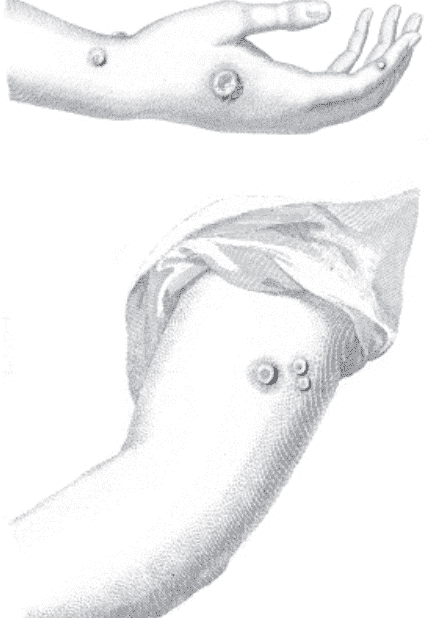
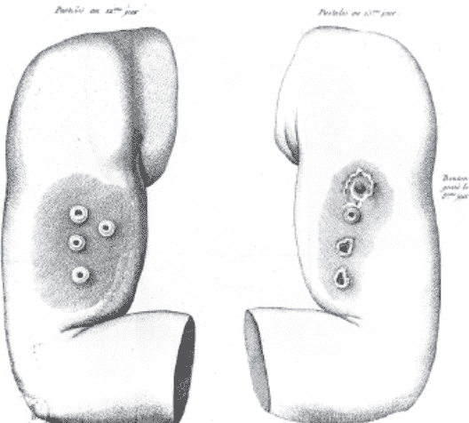
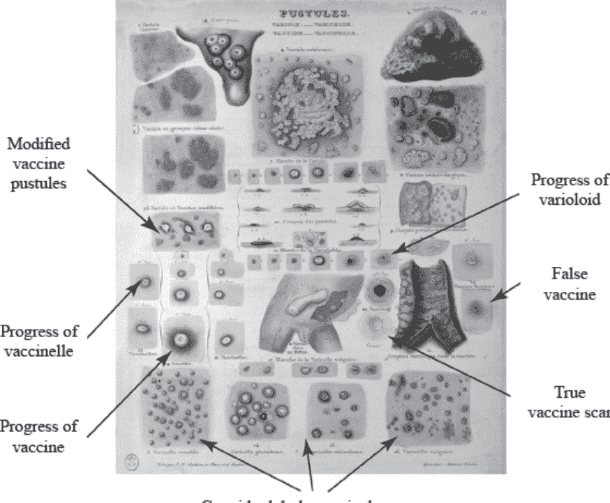
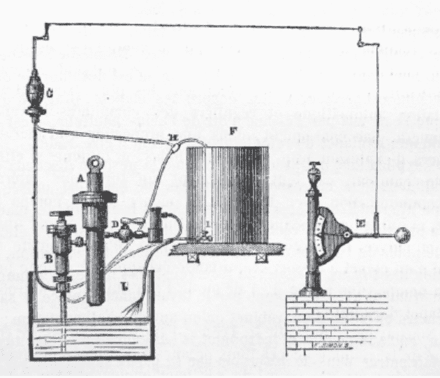
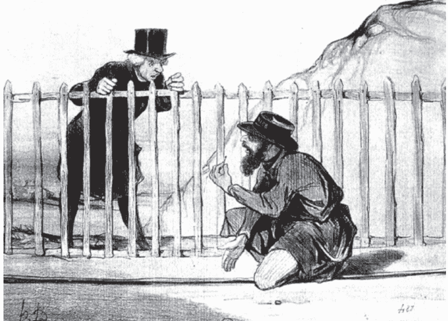

# 快乐的末日：技术风险史

## 快乐的启示

## 引言：现代的微小去抑制

本书审视了当代环境危机的历史根源。它调查了技术过去的记录。在1855年，当人们涌入世界博览会时，出现了一本引人注目的书：《快乐的启示录》（*Apocalypse joyuse*），它由一位律师——让-巴普蒂·弗雷索瓦（Jean-Baptiste Fresson）撰写。其独特性在于，他对进步提出了质问。弗雷索瓦既不是进步的浪漫主义批评者，也不是旧守派，他热爱他那个时代的科学和技术，但根据他的观点，由于科学是后验性的，无法预见未来。这种预示了某种形式的危机。这项研究剖析了权力的微妙形式。这种研究审视了当代环境危机的历史根源。弗雷索瓦认为在18和19世纪，这种思想引导了我们通往深渊的道路。他认为，技术能力与人类预见之间的鸿沟将不可避免地走向启示录。谁能预言河流会改变海洋？谁能预言工业化会引发毁灭性的洪水？谁能预言接种会带来更严重的疾病？在两百年间，被铁路和蒸汽船覆盖的世界，工厂和磨坊产生的二氧化碳是否会破坏和谐？弗雷索瓦认为，由于森林被破坏，这些二氧化碳将导致灾难。在对工业发展的拥抱中，人们认为技术最多在地球上留下痕迹。弗雷索瓦提出了一个全球性的治理，以延迟最终的危机。这种书所讲述的历史，是现代的微小去抑制。

曾经局部的，但已演变为全球性的不确定性；它们不再是进步的副作用，而是我们社会面临的首要挑战。因此，人们说现代性已变得具有反思性——换句话说，它现在正在质疑自身的动态。⁵

这种叙述的问题不在于它是错误的，而在于它过于具体。它声称揭示了其病因的深源，这使其在知识上具有吸引力，在政治上又具有攻击性。因为它对一切提出质疑，它并没有针对任何具体的行动。它所依赖的人类学范畴缺乏任何政治力度——事实上，它们掩盖了在19世纪末将我们引入深渊的生产、权力和思想形式。要建立一种严肃的政治生态学，关键在于不要将环境危机的逻辑与现代性的逻辑混淆。

至于认为我们直到今天才看到生态觉醒的观点，这也产生了一种政治僵局。因为它抹除了过去社会中存在的反思性，它将环境退化的漫长历史政治化。相反，它通过强调我们的当代意识，倾向于将生态关注自然化，并忽视了其背后的社会冲突。通过将一种很大程度上是假设性的反思性呈现为当代的规范，“风险社会”论模糊了过去与现在的联系，并用抽象的分类法取代了历史分析。本书旨在反对这种对过去的抽象化。

随着历史学家们日益关注这些问题，他们发现现代性从未有过一种单面的机械论世界观，也从未共享过一个统一的技术支配计划。相反，出现了各种宇宙观，在这些宇宙观中，主宰自然并不意味着对它的蔑视，而是对其法则的理解，并愿意服从这些法则以便以高效且可持续的方式行动。

例如，“气候”的概念对于理解现代社会的反思性至关重要。在16世纪，气候的概念获得了一定的塑性；虽然它在很大程度上取决于人们各自的地理位置，但自然哲学家开始对它的局部变异、转化以及人类活动在改善或恶化气候方面的作用产生兴趣。由于气候保留了决定人类和政治构造的能力，气候成为了思考技术行动对环境产生后果的场域。健康和社会组织的决定因素不再仅仅取决于一个人在地球上的位置，而是取决于看似平凡的现实（大气、森林、城市形态等），这些现实可以通过某种方式或另一种方式受到影响。⁶

历史学家还展示了从化学学科产生的环保思维的重要性，这种思维关注人类社会与自然之间的物质交换。19世纪充满了对城乡之间“代谢裂隙”的深切忧虑：城市化——换句话说人口及其泄物的聚集——阻止了对土地肥力至重要的矿物质回到土地。从朱斯图·冯·李比希到卡尔·马克思，所有的伟大思想家以及农学家、卫生学家和化学家，都警告过土壤枯竭和空气污染的危险。在《资本论》第三卷中，马克思批评了资本主义农业广阔荒地的环境后果，这些地破坏了社会与自然之间的物质循环。根据马克思的，不存在“逃离”自然：无论生产模式如何，社会仍然依赖于一个历史决定性的体制；资本主义代谢的特殊之处在于其不可持续性。⁷

没有理由看这些理论，视为一种原始环保主义，认为它们预示了我们现在对环境的关注。毕竟，它们决定的生产模式比我们现在的要尊重环境得多。

例如，历史学家也开始理解过去回收的根本重要性。“旧物收集”（Chiffonnage），即对废弃物品和材料的收集，在19世纪60年代的法国雇用了近10万人。骨头、碎片、金属——一切都被转售和重复利用。直到19世纪末，城市排泄物被系统地回收用于农业。⁸ 旧政时期的城市警察提供了另一个例子。由于他们的工作植根于新希波克拉底医学观念（这种观念认为“空气、水和地方”是健康的决定因素），他们密切关注城市环境的变化。同样，对森林和渔业的规定（让·巴蒂斯特·科尔贝尔关于水和森林的法令、1681年的《海洋条例》提醒了我们国家对保护资源的参与，以及附在这些环境规则上的严厉处罚（罚金、监禁和肉刑）。最后，“无悲剧的公地”的存在——即社区成功保护了自然资源（渔场、森林、牧场）几个世纪这一重大事实——证明了过去社会的生态智慧。⁹

因此，当涉及到撰写历史时，讲述一个工业革命的故事，说社会在无意识中改变了环境和生活方式，直到后来才理解到这带来的危险和他们所犯的错误，是误导性的。过去的社会并非无意中造成环境破坏，也并非在没有考虑其决策后果的情况下。对未来的信心不是理所当然的，在现代性的每一个战略点、每一个冲突点，无知和/或被抑制的知识必须以经过计算的方式产生。

从其效应来看，本书所遵循的历史中的这些“去抑制”（disinhibitions），通常包括各种设备，使得身体、环境或生产模式的技术转型变得可能、可接受且日益向往。对于任何具有真正意义的创新要立足，它必须克服道德上的克制、社会反对、既得利益、怀疑，以及对其物质和环境后果的批评。主导世界技术转型的信心需要模糊其意义并缓冲其创伤性影响。在灾难之后，需要话语和道德倾向来中和其影响，淡化其伦理维度，以确保技术计划的持续。

“去抑制”一词概括了技术行动的两个不同阶段：反思与忽视，考量危险并将其常态化。现代性是一个反思性去抑制的过程：我们将看到，那些声称理解并控制风险的规定、咨询、安全标准、授权程序和健康调查，通常具有赋予技术成就合法性的效果。

最后，坚持这些去抑制的微小性和临时性（ad hoc），旨在指出现代性并非哲学家们声称的种种宏伟且精神性的运动。相反，我想将其视为一系列政变（coups de force）、强加的处境和常态化的例外。现代性是一项必须实现的努力。那些实现这一切的人产生了知识与无知、法律规范与话语，旨在建立新的感官和构想我们生活、身体以及与环境和物体关系的新方式。

本书还对所谓的“工业革命”采取了全新的视角。关注欧洲（或确切说是英国）例外论原因的历史学家将其与各种历史事件联系起来。它与工业转型有关，或与农业的缓慢转型以及高效市场的存在有关，与私有和知识产权的保护有关，与需求增长和工作强化有关，与对新能源开发有关，或与从新世界汲取的生态援助有关¹。通过这些关注，1750年至1850年间发生转型的技术维度在很大程度上离开了史学的中心舞台。本书将焦点转回创新——不是为了使其成为原因，而是为了将其作为一个问题。技术的接受是如何实现的？如何创造出技术爱好者和对现实的新理解，从而使世界能够适应工业革命的需求？

当创新的历史将其研究对象自然化时，它也可以在政治上具有解放意义。它不再将反对还原为简单的抵抗（被想象成自私或非理性的，且无法提出任何替代方案），相反，它可以展示过去技术选择中往往犹豫不决且有时具有偶然性的本质。我在本书中采取的第一种方法是重新审视医学和工业革命的标志性技术——天花的接种和疫苗、化学工业和煤气照明、蒸汽和铁路技术——作为案例，从词义的个案和道德意义上来说。我想证明，这些技术在它们所在的时代也是争议、疑虑和困惑的对象，正如当代神经科学所可能处于的那样。为了传达这些争议最初的不确定性，我认真对待了其中的每一个参与者——所有人都，包括那些看起来最明显错误的人。这种方法具有给历史输家重新发声的优点，它也是一种启发式的选择。因为理解非寻常的论点也迫使我们重建那些因其失败而变得不可见的认知框架。由此，可以清楚地看出，这些项目的反对者并不是反对

……并非为了创新，而是为了他们的环境、安全、工作，以及为了保护他们认为有价值的生命形式。

当我们深入研究这些争议的复杂性时，“创新”与“抵抗”的概念变得相当模糊，我们对单一技术时间线的观念也变得混乱。¹¹ 例如，1819年，在气灯照明初期，化学家尼古·克莱门特-德莫斯（Nicolas Clément-Desmos）解释说，由创新断点的时间轴并非价值稳步上升的轴。气灯拥有密集的地下管道，仅仅是对油灯那种奇妙简单性的昂贵模仿，而油灯还具有便携、使用可再生资源和保护个人自主性的优点。克莱门特-德莫斯颠覆了创新的概念本身：“假设气灯是第一项[技术]，它无处不在，而某个天才向我们展示了一盏阿尔尔刚灯（Argand lamp）或一根简单的点燃蜡烛。对于这种惊人的简化，我们会有多大的赞叹！¹² 事实上，与其讨论创新与抵抗，不如说不同技术项目之间的竞争：是选择改进的油灯而非气灯；是选择动物牵引系统而非蒸汽机；是选择隔离和卫生措施而非接种和疫苗；是选择植物材料而非化学品；以此类推。

尽管如此，我所研究的技术最终走上了前台（尽管在大规模上直到如9世纪末才出现）。偏离轨道并关注这些争议的不确定性，其优势在于：通过相对化所涉创新的内在优越性，我们能够思考权力及其运作的手段。本书详细阐述了导致这些技术系统取得胜利的因素，尽管它们存在危险，尽管它们面临反对，尽管人们已经意识到了它们的危险。我试图理解，为什么那些引发了我们现代和当代环境危机的技术是如何产生的——为了谁、反对谁、基于什么知识，并尽管面临了……

本书的第二个目标是从技术发展路径的角度重新审视风险问题。上世纪末“预防性原则”的出现以及对技术科学民主治理的希望，促使社会学家在决策框架内提出风险问题。在这种观点下，关键问题将是技术选择、风险评估，以及为了引导这种选择和这些评估而需要建立的（民主且透明的）程序。问题在于，从历史角度看，技术从未是共同选择的主体。某些行动者积极地创造了它，然后必须对其进行监管。与社会学受控技术科学的梦想相反，技术史是一个创新被强制推行的历史，以及随后对这些既成事实（faits accomplis）进行规范化的努力。通过采取长期视角，风险问题可以以完全不同的方式被理解。相关问题不再仅仅关于选择和做出正确选择的正确程序，而是技术发展的路径以及影响它的各种方式。我建议利用历史从长期视角考虑技术形式的能力。这使我能够撰写一部比较史，记录风险如何通过技术标准、诉讼、行政监督、保险受到监管的不同方式，以及它们对知识和技术发展路径的影响。

第一章回顾了围绕天花接种的著名争议，以描述风险出现的历史背景。¹⁴风险在这里被理解为概率在人类身上的应用，产生于18世纪20年代，目的是说服个人接种。特别是，我解释了证明这种将概率几何学延伸到生命本身之神学和政治框架。但接种问题仍然具有不可分割的道德、宗教、政治和身体属性，统计学论证未能一一批为了保护生命而愿意冒险的勇敢受试者。

相比之下，天花接种的案例（下一章将成功的案例）为研究确保1800年代帝国政策成功的证明技术提供了机会。拿破仑政府认为公众无法制定风险最小化策略，旨在证明疫苗是完全安全的。人体实验、临床、对疾病的图解定义以及对医学信息的统计管理，使得强加一种不可能的定义——非毒性病毒成为可能，即一种完全良性的、能让天花永远远离的病毒。政府在医学领域进行了有理智的干预，以传播其认为对国家利益具有战略意义的陈述。在这种情况下，现代的去抑制（disinhibition）确实是某种操纵和强加感知的形式，旨在根据新技术的要求来捕捉、动员和对齐行为。在这里，科学主要是某种纪律性事业，而非探索现实的方法。

接下来的章节也关于身体，但这次与环境有关。与通常假设相反，环境完全不是近期的关注点。它有着很长的谱系，其中一部分我通过“circumfusa”（拉丁语，意为“周围的事物”）的概念对其进行刻画。这种18世纪卫生的范畴影响极其广泛：它包含了所有决定身体健康甚至形状的自然和人工实体（水、气候、手工艺气味和烟雾……）。那么，悖论在于，工业化以及随之而来的污染环境改变，并非发生在一个思想真空之中，而是尽管当时占据地位的医学理论认为环境是塑造人类健康和体质的决定性力量。

在法国，1800年代再次至关重要。我们将看到化学资本如何主导了环境监管的彻底变革。旧政政的城市警察（他们曾关注健康保护，并可以轻易查阅或惩罚工匠）被拿破仑政府建立的调节冲突的自由框架取代，基于对环境损害的简单财务赔偿。与此同时，环境正在被商品化，卫生学正在重塑医学理论：现在是社会因素决定人口健康，而非环境因素。因此，在增加社会财富的过程中，工业化的最终目标是产生更健康的人口。

最后两章致力于工业风险及其管理。与社会学家的假设相反，工业时代的风险从一开始就是主要的。将风险外化并将其管理委托给保险公司一直是不可能的。风险始终是一个关于空间和社交分布的政治问题。通过对巴黎气灯初期的案例研究，我展示了安全规范——即，通过定义正确的技术形式使生产世界安全的新方案——是为了使气灯的风险合法化，尽管居民一直在抱怨。这种规范对于维护技术社会中的个人责任原则也至关重要：它们被认为使技术的失败可以完全归于人为错误。

我们用一个轶事来结束引言，这个故事展示了历史叙述对于我们理解创新的重要性。每个人都知道（或以为知道）祖先害怕火车的著名故事。这个寓言经常被用来反驳对科学的非理性恐惧。2004年，在法国转基因争议的高峰，一家生物技术创业公司的首席执行官在《世界报》（Le Monde）上解释道，“那些为了恐吓公众而写的文章可以与铁路刚出现时的水平相比”。¹⁵ 前一年，科学哲学家多米尼克·勒昆（Dominique Lecunc）通过提到早期铁路引发的非理性恐惧来谴责“生物灾难”：“1835年，里昂科学院的成员曾严正警告：我们在高速下面临着视网膜损伤和呼吸问题，孕妇在颠簸中难道不会流产吗？”¹⁶ 这一论点所具有的重要性显而易见。事实上，它是一个神话。1863年，19世纪著名的科学普及者路易·菲耶（Louis Figier）评论了皮埃拉·圣塔（Pietra Santa）关于铁路健康后果的论文。¹⁷ 菲耶借此写了一本虚假信息的汇编。他在没有提供参考文献的情况下，提到了据博博医生提出的指控：据说铁路会损害视力、导致流产和神经疾病。确实，1850年代的医生质疑铁路对健康的影响。产科学教科书中简要提到了孕妇长途旅行（乘马车或火车）和剧烈震动的危险。¹⁸

铁路对视力的所谓影响更为神秘。皮埃特拉·圣塔（Pietra Santa）建议读者经常休息眼睛，但并未对铁路做出任何具体主张。无论费格尔（Figuer）的来源如何，无论如何，多米尼克·勒库尔（Dominique Lecourt）提到的由里昂医学学院发布的报告——顺便说，该机构从未存在过。

这种神话的构建在德国仍在继续。1889年，海因希·冯·特罗奇克（Heinrich von Troitschke）在没有提供任何参考文献的情况下，引用了巴伐利亚医学院1835年的一份报告（与所谓的里昂报告为同年），该报告建议禁止铁路，因为其不可置信的速度会导致乘客产生“狂躁性妄想”（delirium furioso）。这个轶事取得了非凡的成功。它出现在1912年的一部铁路史中，出现在1925年的《我的战》中（希特勒用它来嘲笑专家），随后出现在20世纪60年代到80年代关于工业革命的各种历史著作中，每次提到都与“对进步的阻抗”有关。当然，巴伐利亚报告和它的里昂报告一样，从未存在。¹⁹

在法国，在特罗奇克想象力的渲染下，这个故事大为盛行。1906年，皮埃尔·查尔斯·洛伦特·德维尔德伊（Pierre-Charles Laurent de Villedeuil）在他的《铁路目录》（Bibliographie des chemins de fer）序言中增加了火车旅行的假设医学后果：震动引起的“圣吉舞蹈”（danse de Saint-Guy，即亨廷顿舞蹈症）。他还用一个过时的医学术语提到失明：据说由于图像的快速连续，铁路会“点燃视网膜”。然而，尽管这部文献汇编 boasted 有826页，但并没有提供任何参考文献。²⁰ 1957年，《快递》（L’Express）的一篇纪念巴黎-圣日曼线开通120周年的文章解释道，19世纪40年代，“可怕的预言者”曾宣布铁路将“导致疾病，如癫痫和亨廷顿舞蹈症”，并且会“点燃视网膜导致孕妇流产”。作者补充道：“这些不是产士婆的呢喃，而是公开传给医学学院的预言。”²¹ 这个故事后来在普及性著作甚至大学历史教科书中被转述。这一神话成了“常识”的一部分。直到今天，当出现任何关于创新的辩论时，政治家们仍惯常引用它。²²

总之，我们可以注意到，在1860年，当疯狂与铁路之间关联的传言正形成规模时，医学界和法庭开始研究（并补偿）铁路事故造成的神经创伤，而这与亨廷顿舞蹈症无关。²³ 事实上，无数的投诉、诉讼和请愿并不是反对铁路本身，而是与它们引发的事故以及被怀疑以牺牲乘客安全为代价偷工减料的公司有关。当今铁路系统的安全是这些抗议的欢迎果实。

# 1 风险的接种

风险——将概率应用于生命、死亡和健康事宜——是引导个人行为最通用的工具。例如，在面临是否接种疫苗的问题时，我们必须依赖简单的分数，并将我们的生命和身体纳入统计数据中。风险计算告诉我们要像理性的个人一样，寻求预期寿命的最大化。

很久以来，风险的使用一直局限于商业和保险领域。12世纪中叶，比萨和热那亚的商人借用阿拉伯语单词 `rizq`（上帝分配给每个人的份额），在他们的合同中指代与不可预测事件相关的损失和利润。风险与账目记录和海上保险共同促进了商人资本主义的增长。它也促进了其道德上的合法化：商业利润，即商人通过转售未改变的商品获得的收益，在神学术语上通过引用“风险价格”得到了正当化。在17世纪，随着统计学（或政治算术）和保险（火灾和人寿）的发展，风险成为了一种对世界危险进行财务补偿的工具。

但什么样的历史过程让这个根于商业和保险的概念变成了治理各种行为的通用当代工具呢？天花接种这种18世纪出现在欧洲的医学技术，为将概率理性扩展到生命管理提供了决定性的机会。

接种是一种极简主义的医学技术：一些天痘脓、一个切口、几天的发烧，以及最终免受某种可怕疾病的希望。通过交换几个水疱，一个人可以逃避天花——这种疾病通常会导致死亡，或让人声名扫地，有时致盲、耳聋、虚弱，或这一切兼有。尽管接种是低技术的，但它仍然是那个时代最重要的创新之一：不仅因为它在人口革命中起了某种作用，更重要的是因为它预示了一种与病毒共处的新方式。人类没有采取禁运策略（隔离、封闭、消毒），而是与宿敌达成协议：以免疫为交换，他们为几个足够友好而不伤害宿主的病毒提供了庇护。

接种在启蒙运动追求理性引导的自主个体项目中发挥了关键作用：它是一种重视理性自我治理的道德哲学的标志性技术。¹ 接种过的人或犹豫不接种的人必须面对同样的疑问：故意冒死亡的风险或让自己的孩子这样做是合法的吗？以免疫为交换，他们为几个足够友好而不伤害宿主的病毒提供了庇护。（等等，重新检查文本流）。

准备好付出高价来保护生命免受这种可怕疾病的侵害了吗？⁵ 在1721年11月14日，一枚炸弹被扔进了他的房子。装置被包裹在里面，上面有一张字条：“马瑟，你这个狗东西，该死你，我要让你和这颗天花一起陪葬。”⁶ 在这种背景下，牧师们最好表现得特别有说服力。

接种支持者所克服的主要障碍是对这种做法的本能排斥。对毒性天花的厌恶感、对纯洁和危险的常识认知、甚至是那些“知道如何利用自然事物”且自身未曾接种的动物的本能——这些难道不说明了对这种做法存在普遍且神圣的禁令吗？这印证了圣奥古斯丁所写过的：那种“无形的光芒”，上帝刻在我们人类心中的善，通过它，我们的心灵在某种程度上受到了照射，使我们对所有这些事情做出正确的判断。⁷ 接种推广者面临的困难在于，如何将一种看似显然违背自然的身体新行为呈现为自然秩序本身的一部分。

风险恰恰是为了这一目的而服务的。为了消除疑虑并证明接种的性，牧师们改变了自然与道德之间的关系。他们通过将这两个元素联系起来，但不是通过上帝在受造物中设定的普遍情感，而是通过必须在世界中发现的概率法则。

根据自然神学的逻辑，既然世界是由天命安排的，唯有通过研究它的法则，才可能理解神圣的旨意并采取道德行动。1700年，马瑟发表了一本名为《理性宗教》的论文，证明了“任何行事虔诚的人……”。马瑟所提出的道德问题是拓扑学的：他想将道德判断的场所从主体的内在生活转移到对掌握世界规律的理性行使上。采取道德行为意味着拒绝自发性，并按照外部的、自然的且神圣的法律行事。⁸ 在堕落之前，马瑟能够遵循自己的倾向，因为神圣的法律“刻在他的心上”。堕落之后，他必须诉诸上帝赐给他的理性来解读自然的“象形”。良心的真正引导者是自然。许多事物虽然保持沉默，却在对我们发出控诉。⁹ 虔诚的基督徒理解上帝的意图，这些意图通过世界的秩序闪烁出来。

波士顿牧师们提出的接种辩护是这种自然神学的应用。马瑟拒绝了无论是支持还是反对接种的理论和圣经论点：“经验！马瑟终究必须向经验诉求。”¹¹⁰ 针对一位担心自己灵魂救赎的接种候选人的疑虑，科尔曼牧师回答道：“如果有人因接种而去世，他是通过他所知的拯救生命最可能的方式死去的；他是以履行责任的方式死的，因此是按照上帝的方式死的。”¹¹ 道德上的怀疑可以通过比较自然天花和接种的风险来得到缓解。

如果说1721年的波士顿利用风险来证明接种的性，那是因为定量信息易于获取：与欧洲不同，天花在新英格兰并非流行病，而且一旦由于一艘船进入波士顿港而引发流行病，当局就采取了严格的隔离措施。为了组织这些规定，不仅统计了死亡人数，还统计了患天花的人数。死亡与患病的比例被用来计算自然天花的风险，然后将其与接种的结果进行比较。马瑟和科尔曼因此提出了首批支持这种做法的定量论证：在波士顿流行病期间，在7,989名患者中有844人死亡——比例为九分之一一；而在286名接种者中，仅6人死亡——比例为四十八分之一一。这两个死亡率之间巨大且持续的差异证明了接种中存在神圣的秩序。

风险的故事仍在继续。17世纪20年代，马瑟和科尔曼与皇家学会秘书医生詹姆斯·朱林通了信件。¹² 朱林从1723年起着手在英国推广接种。由于天花在伦敦是地方性的，量化危险更加困难。朱林利用了教区死亡简报，这些简报从17世纪初开始详细列出了死亡病例（这是法国缺乏的一种重要资源）。他还按家庭进行了小规模普查，以估计诊断出天花后的死亡风险。¹³ 最后，他在报纸上刊登了广告，邀请医生向他发送接种结果。1724年，一份广为流的小册报道了这项研究。¹⁴

在伦敦和波士顿一样，得益于自然神学，概率变得有了意义。对于朱林来说，风险的差异揭示了创新的神圣起源。大卫·萨姆牧在他的布道中加入了简单的算术论证。在他看来，承担接种的风险并非不虔诚的表现，而是对人类依赖上帝的提醒。¹⁵ 对生命的量化也是一场理性化慈善运动的一部分。1752年，伍彻斯特主教在伦敦创立了天花与接种医院，提供免费接种。为了鼓励捐赠者的慷慨，他在一场布道中计算了如果这种做法得到普及，英国将增加的人口数量。几年后，另一位牧师甚至计算了每向医院捐赠一英镑所能拯救的人数。¹⁶

1754年，概率论证出现在两篇用法语撰写的关于接种的论文中：查尔斯·蔡写的《接种辩护论》（`L’Essai apologétique sur l’inoculation`）和萨缪埃尔·蒂索写的《证明接种的正当性》（`L’Inoculation justifiée`）。蒂索已因其神学著作而闻名，是一位居住在海牙的日内瓦籍牧师。后来成为医学界人物的蒂索还是罗桑内的一位年轻医生。《证明接种的正当性》让他声名大噪。这并不是简单的医学论文，正如标题所指出的，是一篇辩护性的论文。作品献给了他的叔叔，一位罗桑内附近村庄的牧师。

两位作者各提出了一种货币比喻，以使风险与收益之间的等效性更加具体。这就像把生命视为“上帝的礼物”。我的生命不属于我。它仅仅是上帝托付给我的“宝贵存款”，我对此“负责任”。这种表达应当从字面意思理解：在最后的审判日，我必须向伟大的主人对我的决定做出“交代”。不选择最好的风险等同于损害上帝的利益。¹⁷

新教的接种辩解术描述了一个没有明显自然法则的世界，没有告诉我们是非错的内在声音。人被“遗弃去自生自灭……没有无不胜的神谕”。唯一可以采取的路线是那种“看起来最可能的……我们随后就可以说，天命正号召我们走向那里”。¹⁸ 接种的道德基于内在的信念：信徒会冥想风险及其神学意义，最终意识到概率论证并非披着自然外衣的简单投机主义。因为概率理性同时，且最重要的是，是神学理性。

接种及其概率辩护是一个更广泛的历史过程的一部分，该过程将正确行为的定义从上帝的话语转向了对自然法则的理解。约翰·洛克的自然神学和快乐伦理学对这一转变至关重要。因为自然遵循上帝选择的法则，因为上帝遵循他在造物中植入的自我保存愿望，而且因为违反自然法则会导致惩罚，我们对幸福的优化使我们与神圣计划产生了协作。这种推理构成了新教护护者的基础。蒂索写道：

> 当上帝创造宇宙时，他确立了一定的物理法则，这些法则……是最可能的。当他思考时，他将道德法则刻在根基上。由于这些法则的第一条是他们应该爱自己并追求自己的幸福，他意欲让……作为这种幸福的器官应当产生他们的福祉。¹⁹

接种者如马瑟（`Mather`）、提索（`Tissot`）、梅内罗德尚博和比维尔（`Bienville`）也写过关于手淫危害的主要文献。23 在两种情况下，医学都试图通过将最小风险视为道德准则来引导行为：手淫的所谓危险证明了罪恶的巨大，而接种则通过最小风险的论证了其合理性。

通过将本性的道德反对去自然化，风险实现了一种道德政变，其意义无论如何强调都不为过。根据波士顿医生威廉·道格拉斯（`William Douglass`）的说法，创造一个基于概率并因此脱离集体规范的内在空间，会对宗教和政治社区产生风险。牧师们对自然秩序的诉诸，与十七世纪清教徒狂热者的做法相似，后者声称自己直接且个人地受到了上帝的启示。风险开启了对身体进行预防性且问心无良得行动的可能性。因此，这似乎是此类倡议的序曲，而这一次关乎政治体（`body polity`）。24

在巴黎，接种和新的自主性似乎挑战了基于绝对君主制的社会秩序。一位大学医生解释说，在权衡对身体的伤害时，个人效用原则破坏了“君主作为上帝仆人对人类生命拥有的权力”；“假设个人与其身体的关系完全任其随心所欲……这与良好政府的理念格格不入。”25

## 2. 风险与自主性的治理

法国的接种宣传人士确实利用概率来重新排列政治体内部的权威。24 1754年4月24日几何学家查尔斯·马丽·德·拉孔明（`Charles-Marie de La Condamine`）读了一篇主张接种的论文。它取得了巨大的成功：所有期刊都报道了它，其中大多数首次涉及这一主题。格林（`Grimm`）评论道：“拉孔明带来了一场革命。”26 医学技术的概率论有什么革命性呢？

首先，风险使得绕过医学学院成为可能，该学院（理论上而非实践上）对定义合法疗法拥有垄断权。27 拉孔明回接种并不属于他们的管辖：这是一个“只能通过衡量最大概率来解决的复杂问题……我们知道计算风险是几何学的问题……医生更有可能混淆而非澄清问题$^{28}$”。通过将接种设定为“纯粹概率问题”，拉孔明还利用了他自己作为几何学家的专长。$^{29}$ 从南美长途地质考察回来后，他在公众眼中赢得了英雄科学家的声誉，在异域且危险的气候下成功实现了欧洲科学精密理想的胜利。

其次，风险通过将公众本身确立为接种的适当裁判者，使医学学院边缘化。20世纪50年代，医学是“文学共和国”的一个分支。医学辩论属于文学或政治范构的文本宇宙：在1755年《医学杂志》（`Journal de médecine`）成立之前，没有专门期刊的医生在普通报刊上发表文章。尽管医学院声称要实施规定，但是公共领域——报纸、海报和广告——定义了疗法的商业成功。$30 得益于风险，舆论法庭不再仅仅是一个比喻：通过让人们在不了解医学的情况下评估特定医疗程序的价值，它确立了公众作为该问题的真正判官。

最后，使用概率的优点在于筛选出值得坐在这个法庭上的个人。正如拉孔明所见，理性并不是世界上最广泛共享的属性：有必要排除“几乎所有女性”和“大多数没有受过教育的男性”$^{31}$ 这部分人口在判断来源上被彻底剥夺了合法性：“他们天生的无能或缺乏行理性的习惯，使他们无法将两个推理联系起来，在他们的生活中[他们]从未得过第三个结论。”此外，“在一百个女性、一百个母亲中，没有一个能清醒地看到必须为心爱的儿子接种。”$^{32}$ 在女性日益被描述为情感主于理性能力的时代，风险增加了他们在儿童健康这一尽管能力曾被认可的领域的排除。因此，风险创造了一个狭窄且具有性别歧视的公共领域，可以被作为最高判断来源。

拉孔明论文的发表标志着18世纪法国最大争议之一的开始。33 从1754年起，关于接种的论文、小册和文章接踵而至。医生、数学家、牧师、道德主义者和哲学家各执一，导致了错综复杂的辩论和日益复杂的论点。对于接种的防御者和启蒙运动哲学家来说（这些群体很大程度上重叠），这一过程是他们“良好讨论”理念的障碍。《百科全书》（`Encyclopédie`）区分了争议（同于徒劳且无休止的宗教争端）与讨论。后者表达了净化一个主题中所有与其无关的元素，以便清晰地呈现并清除所有困扰它的困难$^{34$ 接种争议的焦点正在于这种“脱钩哲学”的合法性。导致自然主义者、哲学家、医生和数学家争斗一个代的问题是复杂的：风险的道德和神学价值是什么？医学能否超越治愈？治愈意味着什么？对改善身体的愿望应该被赋予什么样的意义？对政治体会产生什么后果？

让我们来看一个具体的例子。接种经常被批评为“以恶行善”或“在健康的身体内植入疾病”。这一伦理问题引发了对天花本质的理论讨论：它的普遍存在是否可以通过先天原体的存在来解释，还是像梅毒一样是一种纯粹的传染疾病？先天原体理论认为天花像青春期一样是人性固有的危机，这种理论在17世纪50年代就被医生们放弃了。关于传染论并没有共识。然而，随着接种争议，医学界似乎在退后一步。35 先天原体理论让道德上的反对变得消失了：根据这种解读，接种并没有引入疾病，而是破坏了身体内已经存在的恶习；如果有人因接种去世，可以归咎于一种特别毒的原体，接种者迟早都会死于它。先天原体理论将事故归因于接种者的身体，而非接种者的柳针。对于许多宣传人士来说，诉诸这种拙劣的理论比陷入伦理的闲谈要简单得多。36 但因为这似乎是纯粹的死亡或生存，先天原体理论在法国也具有不安的神学内涵。基于在杨义派问题上深陷分裂的医学学院，接种的宣传者和反对者互相加速发表关于预性的非正统言论。$^{37

接种像一个莫比乌斯环，产生了一种双面的幻象：一个医学的，一个伦理的，但检查发现，它们形成了一个连续的问题和论点表面。用当时的话说，“无法将道德与物理分离”。1763年6月，巴黎议会（法国的一个主要司法管辖区）仅就该问题的“物理方面”咨询了医学学院，将道德问题留给索邦大学的神学家。$^{38$ 但在1768年，随着辩论僵持，一位反对接种的医生提出改变策略：既然学院无法对这一创新的医学价值达成共识，就应该根据医学的道德法则对其进行判断。这些法则基于治疗学与卫生的区分。前者的目标是病态身体，可以使用“非自然手段”（下泻、放血、截肢），因为它使身体处于“必要状态”。后者针对健康身体，通过使用“自然手段”（休息、饮食、环境等）来维持其这种状态。接种在这一二元法中没有位置，因为它是对健康身体的非自然手段。授权接种将承认第三类医学的存在，即基于人体“可转化性”或“易变性”的医学。医生将被引导进入一条干预路径，根据患者的要求不断改善人体。$^{39

上帝在基督身上的化身，证明了神学上对健康身体作为绝对完美结构的赞同。对其进行任何蓄意的改动似乎都是亵渎的。41

风险的恰恰是为了纯化辩论，将接种从道德和医学争端的不确定性中解放出来，以便将其“清晰且不杂乱”地呈现给理性的公众及其判断。根据拉孔达明（`La Condamine`）的观点，接种不再是一个道德或神学问题，而是一个计算问题：“让我们不要把一个算术问题变成良心问题”。.42 几何学家用定理来回应道德上的疑虑——“父亲是否应该自愿让他的儿子暴露危险？是的，我证明了这一点”——并以“因此，在术语的范围内已得到充分证明”作为推理结论。证毕（`QED`）。通过将个人从道德和神学的限制中解放出来，并将计算作为行为的唯一决定因素，风险旨在建立一种单一的可接受的接种方式。这产生了激远的后果：在一个理性的社会中，理应产生一个自由且理性的个体社会：自由选择风险，而且因为他们是理性的，实际上有义务承担风险。它还为人类行为脱离道德标准的自主性，以及一种控制这种行为的内部纪律提供了保障。

## 3. 从病毒契约到社会契约

计算主体的产生是一个政治计划的核心。这似乎是由主权个体组成的社会得以运作的必要条件：与不可还原的多元且相互矛盾的道德和宗教原则不同，也与美德、怜悯或仁慈不同，计算能力似乎是唯一被充分共享的、足以形成广泛政治共同体和法律共识的机能。一旦基于绝对君主制的社会秩序的超验基础被撤销，只要个体能够成为计算主体，这些自主的个体似乎是可以被治理的。43

接种以及对风险概念的新关注，可能在功利主义哲学的发展中发挥了重要作用。“最大多数人的最大幸福”在杰里米·边沁（`Jeremy Bentham`）将其作为所有立法的准则之前，就已经是接种者的格言了。1754年，蒂索（`Tissot`）通过以下方式证明了接种造成的损失是合理的：“我们行为中的一切必须经过计算……那些受托管理人类命运的人，将他们的计算简化为总和。”.42 根据克劳德·阿德里安·埃尔维泰绪（`Claude Adrien Helvétius`）另一位接种支持者的观点，任何法律都必须符合“公共利益，即大多数人的利益”的要求。在接种争议的高潮时期，几部关键著作相继出现：埃尔维泰绪的《精神论》（1758）、卢梭的《社会契约论》（（762）以及切萨雷·贝卡里亚（`Cesare Becaria`）的《犯罪与惩罚》（1764）。这并非偶然：这场争论专门涉及到当时形成中的功利主义哲学的核心问题，即将个人风险和收益的计算作为公共道德基础的可能性。⁵

在《犯罪与惩罚》中，贝卡里亚以一个考虑误导风险的潜在犯罪分子为起点。为了使惩罚有效，罚金只需略大于犯罪带来的收益即可。在贝卡里亚开发这一理论时，他正为米兰杂志《咖啡馆》（`Caffè`）做贡献，该杂志发表了一篇关于接种的长文章，将风险与希望的关系描述为决策的动机。⁶ 在接种争议期间发明的权力类型（贝卡里亚是首批对其反思的人之一），其目标并非行为本身，而是行为的动机：主权者必须通过教育和法律直接作用于决策动机，从而产生主体并引导他们的个人计算朝向公共利益的最大化。同样，根据另一位接种支持者霍尔巴赫男爵（`Baron d’Holbach`）的观点，明智的主权者应满足于启蒙公民，并“通过温柔的方式让他们回到他们所忽视的理性”。这种软实力方法实际上允许个人进行自我治理，它取决于概率化和敏感化主体的形成，这些主体受过教育，能够察觉微小的风险并据此行动。

接种是这种温和、间接治理方式的象征。直到18世纪末，向个人强加接种在政治和道德上似乎仍是不可能的。1764年，在巴黎医学院，安东·珀蒂博士（`Dr Antoine Petit`）在结束他那份支持接种的报告时，以一种无能为心的声明结尾：“生命和健康属于……明智政府交给个人裁量的事情……对自身保护的兴趣是所有法律中最强大的，因此公众必须留给自己制定法律。”.¹47 既然接种似乎对公共利益至关重要，又处于政府行动的范畴之外，它不能通过制定实性规范来普及，而必须通过说服来实现。1802年，边沁使用了温和政府的例子：“接种应该通过直接法律建立吗？不，毫无疑问……证明温和政府的有效性将带给无数家庭。这种做法通过对其优势的公共讨论在英国变得普遍。”.¹48 这种对身体的温和且间接的自由政府依赖于个体的内在信念，因此依赖于“公众判断”；其有效性取决于其将公共辩论为其项目服务的能力。

风险的概念也让卢梭解决了社会契约理论中死刑惩罚的问题：“人们说，那些没有权利处置自己生命的人如何将这种他们并不拥有的权利传递给主权者呢？”⁴9 在1756年的手稿中，卢梭反思了危险（`peril`）、危险（`danger`）和风险（`risk`）之间的区别。风险指的是“一种人们自愿且带有某种逃脱希望而面对的危险，以获得比危险恐惧我们更吸引我们的东西”。⁵⁰ 死刑悖论的解决方案在于，没有人会同意被杀死，但人们会为了人口的生存而同意冒死亡风险。社会契约的编写与接种辩论同时进行。然而，为了证明死亡风险是合理的，接种的倡导者还使用了不幸平等的理念。斯特拉斯堡的一位医生解释说，接种并不道德，因为每个人都自愿接受了风险；每个人都可以告诉自己，他的死亡风险只是一个人。⁵² 像死刑一样，接种是合法的，因为每个契约方共享了损益。

## 4. 国家理性与奴隶的实践

看待接种的第二种方式不是手术候选者的观点，而是来自主权者增加人口的观点。在七年战争和法英持续竞争的背景下，从人口角度提出的论点使接种与国家利益相符：根据医学院接种支持者领袖安东·珀蒂来说，任何拒绝接种的欧洲国家都将在几个世纪内不可被征服。⁵³

1760年，巴塞尔数学家丹尼尔·伯努利（Daniel Bernoulli）开发了一个数学模型，模拟了系统性接种新生婴儿对人口的影响。其目的是证明主权者可以优化人口、增加其数量并改变其世代结构。风险问题变得微不足道：如果所有孩子在出生时接受接种，新生人口将立即减少（1/200的死亡风险），但“这种扣除非常微小，为了整体可以被忽略，只有整体才值得君主的关注”。接种的主要优势在于，免疫成本被转嫁到了婴儿身上：“损失只落在那些对社会无用的儿童身上，而所有的收益都传递给了育龄群体”。⁵⁴ 在二十五岁时（这个年龄段对需要士兵、工人和后代的国家来说已经没有用处），接种使得1300名儿童中产生了79.3名士兵的增益。在一个明确的农业比喻中，主权者像农艺师一样照顾他的作物产量：他必须密切关注“收获的季节”。⁵⁵ 这篇论文是新政治理性的萌芽，这种理性在米歇尔·福柯（Michel Foucault）之后被称为“生命权力”。在18世纪，随着人口学的出现，王国的臣民被重新构想为人口：一个可以被计数的统计实体。

经过计算和预测，哲学家、经济学家和医生们呼吁对这一新对象进行积极管理：必须研究主宰它的规律（出生率、死亡率、预期寿命），并确定影响其发展的杠杆（政治经济学、税收、继承法、健康和环境状况），这一切都是为了在国家财富和权力范围内实现人口最大化。权力的对象发生了转移：它不再是一群需要被“约束和惩罚”的臣民，而是一群受主权者无法改变的自然法则支配的人口，需要通过政治经济学进行间接管理。自由管理饥饿就是这种新权力模式。根据17世纪60年代重农学派看来，在歉收的情况下，主权者必须接受粮价上涨和粮食短缺的风险，以释放农民的预期，让他们增加产量。通过允许短缺发生，主权者可以减少整体上的饥荒风险。伯努利在文章中的君主理性也是类似的：他不应该通过隔离来控制天花，而应该接受接种和个人意外的风险，以控制流行病现象并减少其对整体人口的影响。

这种概率性人口管理在18世纪的公共卫生领域尚未应用。然而，它是两个领域资本主义生命管理的核心：终寿年金和奴隶人口。

让我们从终寿年金开始。年金通常由政府发行，以资本换取定期收入。其高收益率（约10%）假设在20年后摊销（即年金领取者的死亡），这略低于18世纪法国出生时的预期寿命。然而，从1770年起，日内瓦银行家开始优化法国政府大规模发布的终寿年金收入。他们挑选身体状况良好的儿童（通常是七八岁的女孩），并为数百万个生命购买了这些年金。为了获得资金，他们将这些年金进行整合，向客户出售一种风险更低的金融产品——这种产品不是基于个人的生命，而是基于三十个女孩的生命，被称为“日内瓦三十长寿者”。因此，年金失去了原本的个人属性，可以在所有欧洲市场（特别是荷兰）转售。

“三十长寿者”的生命完全隶从于长寿这一指令。为了避免分娩风险，她们被要求独身。日内瓦医生、欧洲最有声誉的接种者西奥多·龙松（Thodore Tronchin）负责挑选、维护她们的健康并为她们接种。得益于这些措施，在1772年挑选的第一批“三十长寿者”中，二十年后仍有28人健在。这种金融与医学创新的结合直接导致了法国王室的财政崩溃：1789年，在53亿法法收入中，有16.2亿流向了日内瓦以支付年金领取者！

虽然没有主权者执行过伯努利的计划，但他的文章确实有一个具体的模型：奴隶主。至少从17世纪起，接种在北非、几内亚和苏丹沿岸就已经流行；奴隶贸易者借用了这种本土技术来保护他们的商品。早在1723年，皇家非洲公司就已在其奴隶贸易站雇佣了一名接种者。接种在三个方面是有利润的：它增加了市场价值；减少了跨海期间的损失；并避免了奴隶在糖产岛被强制隔离。接种让奴隶贸易更加顺畅，降低了风险并增加了产量。

在殖民地，接种的规模与法国本土完全不同：1756年，当巴黎只有少数人接受接种时，法国岛和波旁岛（毛里求岛和留西尼岛）的总督已有400名黑人接受了接种。在圣多明种植园，首批接种发生在1745年；而在路易斯安那，1772年流行病期间，短短几个月就有3000多名奴隶接了种。

概率理性可以应用于没有任何限制的人口。在西印度群岛，医生让-巴蒂斯特·勒布兰（Jean-Baptiste Lebland）通过向主主提出一种保险方案，为数百名奴隶接了种：手术费用为“每人20法郎”，医生承诺在发生死亡时支付1000法郎。奴隶接种在法国的辩论中完全缺席：它没有引起丑闻，也没有提供证据。因为黑人身体被认为过于特殊，无法从中得出任何医学结论。

## 5. 风险的道德失败

区分了两种法律：实用行动的主观法则与道德准则，即前者是决定潜在利益的法律，后者是禁止为了获得某些利益而造成伤害的法律。⁷¹ 此外，那位推崇大胆的哲学家——那位将启蒙定义为人类走向成年的人——在面对自主理性的身体后果时，最终退缩了。对于启蒙运动而言，接种构成了一个问题，因为它似乎抵消了其价值观并将其转化为恶。这种渴望在健康的身体上行动、在效用的借口下进行改造的欲望，说明了在征服自主性时倾向于过度的个人主义伦理的危险。

## 6. 风险与感性

风险的概念在心理层面也失败了：它似乎描述的是一种过于贫乏的理性愿景，远远离感性的理想和那种勇于壮举的贵族特质精神。首批接受接种的人几乎全是年轻的贵族，这一事实证明了概率论证的失败：接种的危险并没有被解释为需要理性决策的小概率风险，而是被视为一种贵族式的壮举。接种的寓言见证了这一点：纪念碑上刻着一个带翅的“胜利女神”，以纪念丹麦第一位接受接种的女性，而丹麦王子正在这座纪念碑的阴影下接受了接种。

致伯恩斯托法腓夫人（原姓德·布查尔德）。

致皇家王子。

为了让这种药剂

发挥得更清晰、更有价值

确实比这种能力更有价值

一位慷慨的人士为了他的国王慷慨地为其接种

绝非自私，而是出于友谊

这种对高尚艺术的看重，

远比他坚决地看重自己的慈悲

阿蒙公爵夫人因其三个孩子同时接受接种（`tres liberi simul inoculati`）而获得了一枚带有桂冠勋章，这被认为是一个伟大的胆略。

1756年在巴黎，特龙（Tronchin）对奥尔良公爵孩子进行的接种被视为一项英雄事迹。路易·普辛（Louis Poinsinn）以史诗风格创作了一首《致奥尔良公爵阁下》，赞美了他的保护者的勇气。⁷² 当接种过的人再次出现在歌剧院时，受到了观众的掌声。当吉索尔公爵（Duc de Gisors）请求父亲许可让他接种时，他的父亲拒绝了，理由是自愿的危险，“其中既无法获得荣誉也无法获得荣耀”。⁷³

根据新教派的接种案例法，源自自然法则的理性应当主人类情感。在18世纪60年代的巴黎，这一指令与对“感性”的新强调发生了冲突：小说和美学道德论文反而邀请读者进行内省，探索内在自我并发现未知的感能力。情感的道德学破坏了基于自然秩序的案例法辩护，转而重新激活了奥古斯丁式的“内在之光”道德形象。谢夫斯伯爵（Earl of Shaftesbury）和弗朗西斯·哈切森（Francis Hutcheson）假设存在一种“内在之眼”；存在仁、怜悯和爱的天赋，这些情感使我们能够感知道德上的善。感性的主题是接种者努力的特殊阻碍，因为它主要涉及家庭和儿童教育。18世纪中期，唤起伦理关系的方式发生了变化：随着合法教育理论的激增，温柔和爱的情感成为赋予当母亲或父亲价值的方式。家庭被日益构想为一个基于情感的亲密领域，这种情感应当与统治经济领域的计算关系隔离开来。⁷⁴

接种的反对者利用情感话语来拒绝上流社会的观点，并敦促人们自行做出判断。《自然的辩述者》（`Deseveu de la nature`）注意到一个显著的区别……平民，或者我们所说的好心人，只有一种情感，那就是反对。权贵，或者说那些制定基调和随波逐流的人，只有一个声音，那就是支持接种。⁷⁵ 泪水在反对这一做法的传播中也起了重要作用。《自然的辩述者》是一首泪水的诗，讲述了父母因儿子因接种去世而陷入的绝望。几年后，来自里昂的一位学院成员为他的女儿写了一首哀歌，他的女儿在手术后去世了。根据《文学通信报》（`Correspondance littéraire`）“这让整个法国都流下了泪水”。⁷⁶ 在情感道德学中，通过接种失去孩子变成了一种灾难，使父母失去了生命的全部意义。

对愧疚的恐惧无疑是接种最持久的障碍。尽管知道胜率对自己有利，罗兰夫人（Madame Rolland）仍然犹豫是否让女儿接种，因为她想尽量减少潜在的遗憾：“我很容易为了一个对我无关的姿态做出决定，因为有很多有利的概率；但我会一生自怪自己，让我的孩子暴露在这些如此美好的例外中，我宁愿让自然杀死她，也不愿由我来这样做。”⁷⁷ 上流社会的心理学证明，比康达民（La Condamine）所要求的“权衡风险”要复杂得多。

丹伯朗（D’Alembert）表明，像康达民那样做不足以强迫个人做出决定。最后，丹伯朗将国家利益与个人分离开，并清空了伯努利（Bernoulli）人口主义论点的规范性实质。伯努利计算出，接种将使寿命延长四年。丹伯朗显示这不足以强迫个人做出决定。考虑一个想象的世界，长寿是唯一的致命疾病；每年它杀死相同数量的男性。平均寿命为五十岁。接种可以预防天花，因此接种者确定能活到百岁——但接种本身对五分之一的人来说是致命的。如果所有孩子在“哺乳奶时”接受接种，那么平均寿命将变为八十岁。虽然国家获得了（生命的总和增加了），但“可能没有足够勇敢或鲁莽的去让自己面临一个可能失去生命的机会”。⁸¹ 人口论证仅适用于“无视所有公民的国家”，但它是“政治幻象”，因为它无法强迫任何人。丹伯朗完美地解释了为什么风险概念无法产生任何普遍的共识。由于个体并非统一，风险感知并不直观：“每个人的评估都会非常不同，取决于他的年龄、思维和情感方式，以及家庭、朋友、公民对他需要的……可能不会有两个个人以相同的方式来评估。”⁸² 这不仅没有标准化判断，反而让不同人的良知产生了冲突。

将他们的失败归因于某种广泛的流行病或受试者的隐藏缺陷。这种概率论依据具有误导性：由于接种者只接受健康个体，这等同于将普通天花的死亡率与精选精英的死亡率进行比较。更糟糕的是，通过选取健康的受试者，接种者系统地增加了自然天花的死亡率，这简直是“遭了天了”⁸⁸⁴。无论如何，通过夸大成功并分发操作清单，他们的行为就像那些在圣新桥（Pont-Neuf）周围展示其“治疗”表格的“骗子”（那些没有获得学位的治疗师）。一位接种的反对者调侃道：“只有经验主义者和接种者才会列出他们康复的患者名单。”⁸⁸⁵。

第三，对接种的评估不仅关乎生死，它还体现在身体表面，取决于预期中的不适感和疤痕。天花有许多面貌。某些所谓的离散型形式是良性的。与水痘相似，它们不会留疤痕。在光谱的另一端，愈结性、化脓性或出血性形式通常是致命的。介于之间的是一系列各种病例、症状和疤痕的连续体，其本身对治疗的反应糟糕。然而，问题在于确定接种后的天花落在这一光谱的什么位置。理想情况下，最好的方法是检查接种者的面部，或者在无果的情况下，通过听取和阅读对接种身体的描述。

最后，风险缺乏特异性。接受其逻辑需要考虑身体，尽管年龄、体质、“体液”和病史存在差异。社会精英阶层倾向于利用他们的人脉网络做出自己的判断，而不是依赖那些表面上客观、实则掩盖了主观、自利医学意见的清单。社会关系在产生信任中的作用，在接种的这种如网状的传播中显而可见。例如，来自皮萨的接种者安杰洛·加蒂（Angelo Gatti）经常访问奥尔巴沙龙（`salon d’Holbach`），他在那里找到了他的第一批客户⁸⁸⁶。接种者与朋友群体合作，一次接种导致另一次接种。贵族对信息的追求更多是深度的而非广度的：与其说了解操作的一般效果，不如获取关于特定接种者实践的可靠信息，且这些信息涉及人们可以认同的身体。个人医疗记录而非风险，为社交人士提供了说服他们所需的信息。我们将看到他们的社会世界是如何产生这种知识的。

首先，民间医学写作发挥了至关重要的作用。与19世纪医生将患者的故事转为口头叙述不同，在18世纪中期，患者的常见做法是报告他们的病床情况、描述症状，并将所有内容写在一张纸上寄给朋友或医生⁸⁸⁷。这种在富裕阶层中广泛的“信函医疗”使得患者叙述被认为是可靠的。

由于接种是一项典型的医学事件，而且是一项必须记录的事件，其历史往往由多只手书写：亲属和朋友保留自己的“接种日记”，记录患者从一小时到一小时的状况和水疱情况。在发生事故时，这些日记成为反对接种者强有力的证据。例如，拉孔达明（La Condamine）承认的反对接种者的少数罕见事故之一就涉及拉·佩里埃侯爵（Marquis de La Perrière）的孩子们。此案产生了巨大影响，促使四本小册和几篇文章的出版。1765年，在贝桑松附近，拉·佩里埃侯爵的两个儿子接受了阿顿（Acton）医生的接种。手术结果很：小儿子去世了，而长儿子活了下来（当然，梅毒是每个人心中的顾虑），而且孩子的健康状况很差。愤怒的父亲写了一部“接种史”，对操作进行了极其详尽的描述，在医学文献中几乎没有类比记录：

“A***先生用剪刀割开了他们肘部的脂肪肉。他在每条手臂上切开一个口，剥去皮肤和一块肉露出血管，在每个伤口上放上一根浸过天花脓液的细布线、一整块天花结痂、一块浸泡并饱和了上述脓液的肌肉、一小块像豌豆一样打结并同样饱和了脓液的棉花，最后盖上一上干棉絮和一张贴片。操作非常痛苦，以至于我大儿子疼得厉害，小儿子也叫了起来。”⁸⁸⁸。

这份备忘录被寄给了英国声誉卓着的接种者和《学院杂志》（`*Journal d’Académie*`）的编辑。他们都批评了接种者的“野蛮”方法⁸⁸⁹。拉·佩里埃侯爵还批评了弗朗索瓦·德佐特克斯（François Dezoteux），这是一位野心勃勃的年轻外科医生刚从伦敦回来，他在那里学习了接种。不幸降临侯爵儿子身上，为他提升声誉提供了绝佳机会：他以“安抚公众”为借口，出版了一份小册，批评阿顿，并将自己的接种方法推广为现代的、英国的且安全的。通常来说，事故报告往往是由接种者自己产生的：接种是医生争夺贵族赞助竞争的一部分，由于接种市场虽小但利润丰厚，通过公开对手的事故来损害声誉具有诱惑力。这种做法的危险因此通过接种者之间（相当自杀的）竞争显露了出来⁸⁸⁰。

其次，接种事故与社交界世界特征的新闻文化非常契合。这些新闻以简短且有趣的轶事形式出现，必须是令人且前所未有的⁸⁹¹¹。权贵的疾病如此吸引了公众的注意力，以至于某些期刊专门为它们开辟专栏。例如，《巴黎日报》（`*Le Journal de Paris*`）提议提供“公众感兴趣的人士疾病简报”。1765年，奥尔良公爵夫人（Duchess of Orléans）引起了公众的注意力……（注：此处原文已中断）。

因此，在那些选择接种接种的贵族小世界里，医学能力是广泛分布的。这种情况并非专家医生与被动患者的对立，而是个人主动在自己或孩子身上进行实验，并付钱给与其有赞助关系的医生来执行实验。患者充分参与了这一过程：他们与亲属和医生讨论不同的使用方法，编写接种日记，派遣医生调查事故，订购解剖，甚至要求进行实验。得益于丰富的社会结构以及私人身体与其公共呈现之间微妙的界限，接种信息在这个网络内自由流动。通过许多细微的触角，描绘了一幅关于这种创新危险性的画面，而这与接种者的统计数据大然不同。

贵族社会对这种基于风险的治理计划仍然保持抵触。接种从未有过一种单一的、基于概率的方法，而是存在多种对待身体的方式。通过表演、展现自己的勇气、将自己视为榜范以及主张自我控制，都是考量接种的合法方式。相反，对愧疚的恐惧、对道德违规以及商业理性扭曲伦理关系的恐惧，构成了拒绝接种的体面理由。

对身体及其呈现的重视产生了日益增多的医学叙事、书面记录和口头描述，并增加了它们的流通。这种对身体的泛化叙述过程证明了天花的形式和接种的效果是多么变化，也证明了关于接种的统计知识在多大程度上是一种可疑且教条的简化。身体和案例的不可还原性优先于风险。接种的后果在一个多部的公共空间内被探索，在那里，知识和权威的分配是常态。

数学家和哲学家构想的通过风险治理的行为计划正显示出其局限性。风险，这一从18世纪20年代新教偶然性论中借来的个人教化旧工具，显然不足以治理在与其身体关系中自主的个人。要实现19世纪初的接种社会，需要完全不同的证明技术和权力力量。

## 2

## 慈善病毒

法国大革命使生命成为一项新政治计划不可或缺的一部分。通过建立国家主权（源自拉丁语 `nascor`，意为出生），它使`出生`成为权威的基础：如果说国王是上帝在世的代表，那么革命政府则是`国家`主权的守护者——即一个由出生和血缘定义的生物单位的主权。生命也是共和契约的货币：为了分得主权的一份，也必须愿意牺牲它。卢梭号召公民立下以下誓言：“我在身体、财产和意志上与国家结合……我发誓为它生而死。¹”

共和国家既是肉欲的实体，也是政治的实体——被革命者构想为一个以国民议会为首的有机体。人口不再是简单的臣民集合。相反，它构成了一个可以选择改进自身性能的政治实体。“国家再生”这一基本的革命主题就包含了这种生物自我完善的努力²。

这种生命政治赋予了身体新的权力，尤其是对穷人的身体权力。1793年6月的一项法令就说明了这一点，该法令规定所有父母接受公共救济的儿童必须接种天花疫苗。这项规定（在欧洲是独一二二的；没有其执行的迹象）被作为政治交易的果实呈给国民议会。作为对私有财产承认承认，穷人有权要求国家提供援助。而且，当国家主权的代表们等待共和国塑造出能够识别自身利益的启蒙公民时，他们有权强加诸如接种之类的措施，以确保人民最大的幸福。正如1793年辩护强制接种天花疫苗的议员所说的：“社会永远不能忘记那些与其缔约的人。它必须在每个人出生时就接纳他，直到坟墓都不放弃他。³³”

最后，这种对生命的新共和权力与当时的战争转型并行不悖。虽然18世纪的战争是一种局限的、反复的且准常的现象，但在革命和拿破仑帝国时期，它被重塑为一个国家及其生命力与欧洲列强联盟之间的末世论对决。⁴ 在这种“总战”中，生命的优化发挥了至关重要的作用。

正在此背景下，1798年英国医生爱德华·詹纳发现了牛疾病——牛痘的存在，它能保护人类免受天花的侵害。欧洲国家立即将这一创新掌握在手中。19世纪，“接种”（源自拉丁语 `vacca`，牛）在英国、普鲁士和法国的军队中成为强制性。⁵ 法内政部长让·东万·夏佩尔刚刚建立省长制度，就将接种任务托付给其首要任务：“没有其他课题比这更需要你的关注；这事乎国家利益，以及一种增加人口的可靠方法。⁶” 第一批接种运动的活力（至少1805年法国有40万人接种）处于战争动员的背景之下。首批接种者将他们的行动类比为战争：目标是“消灭”天花，或至少从国家领土上将其“根除”。接种被呈现为对大自然的“艺术征服”⁷，是利用一种病毒来消除同类的的马基雅维式的权术。⁸ 在拿破仑时期，这种新的接种形式被认为能产生“一个伟大的人……能够赢得[法国]国家的尊重”。它还将无痛地完成革命曾通过火焰和愤怒试图完成的事情：人的再生。”⁹

尽管有这些宏大的目标，但直到1902年，还没有通用的接种义务。拿破仑本人也拒绝了接种者的诉求¹⁰。他的民法典与牛痘疫苗同时代，旨在恢复父权，而强制接种看起来更像是削弱这种权力的革命运动¹¹。1808年，内政部长福煦拒绝了一份接种者的报告：“他们提议的强制措施并非都经过法律授权，温和与说服是取得成功的有效手段。”²

接种是一个经典的研究对象。历史学家研究了接种运动的组织、其在全球的传播、对人口的影响以及反接种运动。本章的重点不同：它拒绝将牛痘疫苗视为一种固定的本质。它提出了一种疫苗的历史本体论，即关于其效果的定义、呈现以及围绕其产生的社会共识的历史。在1800年，疫苗仅仅是一个新词。它是一个神秘的实体，几乎没有存在，没有本质，却具有不的能力。首批接种者深知接种的失败。他们深知说服人们为了保护自己而冒险生命的困难。因此，他们说要通过固定疫苗的特征来消除任何顾虑。杰米·边沁写道：“超越性立法”通过丝线引导人们，缠绕在他们的情感上，让他们永远属于法律。”¹³。1800年的疫苗正是权力的丝线之一。

为了建立一种新的自然存在，医生们寻求不再通过约束，而是间接地、通过引导感知来管理身体。权力的柔性与其相对，在证据和真理领域表现出其强硬性。

## 1. 慈善家的客观性

医生的形象、他们的自信以及他们所赢得的信任，是接种成功的关键。《疫苗的益处》（`Le Bienfait de la vaccine`）反映了医生们希望为自己建立的形象。画面左侧，一位农妇带着婴儿来到城堡，以便一位女士能让自己的孩子接种疫苗。圣路易医院的医生阿利伯特（`Alibert`）轻轻地从婴儿手臂上的牛痘疱上抽取疫苗液，甚至没有吵醒他。父亲在旁监视整个过程，而母亲则安慰着即将接种的孩子。这幅画描绘了一个和平的社会，农民和资产阶级和谐相处，被接种带来的利益联系在一起。中心位置阿利伯特面带慷慨且智慧的面容，象征着医学希望在革命后社会中占据的关键地位，作为社会阶层之间的中介。种痘痘法是一种精英化的实践，而牛痘接种则是一个连接富人的界面：国家将负责人民的健康，作为交换，人们将使疫苗的传播成为可能。所有人的健康取决于每个人的合作，而启蒙的慈善将不是通过贫困，而是通过创新来缓解它。

慈善运动是接种运动背后的推动力。甚至在发现牛痘疫苗之前，慈善家们就希望推广天花人痘接种法¹¹⁵。在英国，教区支付费用给接种者，为贫穷人口提供免疫。在弗兰什孔芒（`Franche-Comté`），由督守（`intendant`，旧制度下的省级行政官员）资助的医生在农村免费为儿童接种¹¹⁶。然而，这些成功只是特例：在任何地方，特别是在城市，风险（死亡和传染的风险）使得任何接种计划都变得不可行。例如，当医生提议免费接种里尔孤儿院时，医院管理层强调了此类行动的危险：这些孩子的健康命悬一线，接种可能会导致流行病的再次发¹¹⁷。1790年，罗谢福-利安库尔（La Rochefaucald-Liancourt）——慈善运动领军人物、国民议会乞丐委员会主席——提议在巴黎建立一家公共接种医院，但未获成功。在国民公政府期间，强制接种的计划完全没有执行。最后，在1799年，在疫苗到达前仅的一年前，接痘仍被指责引发了巴黎的流行病¹¹⁸。

因此，牛痘疫苗对慈善家来说具有即时意义：如果用合适的术语定义——即非传染且无害——那么它将缓解局面，最终使他们对贫民进行普遍免疫的旧计划成为可能。1800年2月15日，罗谢福-利安库尔从流亡归来后，在《巴黎日报》（`Journal de Paris`）上发起了一项公共认捐，以资助一个“疫苗委员会”，该委员会负责对这项已经在英国引起轰动的创新进行评判。

由显赫的望族们（著名的慈善家、部长、议员、银行家等……）资助“疫苗委员会”，使这项创新从药物市场中剥离出来，并营造出一种公正评估的印象。慈善运动让接种者能够塑造出一种全新的、某种矛盾的社会角色：一个狂热且无私的技术倡导者，这两种宣传者赋予了接种者一种无私的形象：他们可以作为“人类之友”说话，将牛痘疫苗推为本世纪最伟发明，实际上是一个能够重造人类的发明，同时将自己呈现为中立、冷静的法官，“毫无感性”。¹⁹。四十年前，人痘法的倡导者并未声称凌于争议之上。那时，双方发生冲突并向某些医学议会或公众诉求——但无论是宣传者还是反对者，都没有声称自己占据了法官席。

要具有慈善性，疫苗必须符合一系列精确的标准。首先，它必须是完全无害的。接种需要医生的专业知识来选择和准备受种者；相反，牛痘疫苗被呈现为绝对安全，无论患者的健康状况如何。这是它可以由普通的卫生官员、助产甚至神父实施的前提。慈善事业寻求所有人（无论贫富、健康或虚弱、新生婴儿或卧病）的接种；它必须产生一种无风险的疫苗²⁰。

其次，疫苗必须是免费的。因此，疫苗委员会系统地拒绝了试图从创新中获利的医生。为了推销他们的脓液更有效、更安全或直接来自伦敦，他们暗示了脓液存在不同的质量差异，这可能会损害每个人疫苗的信誉²¹。问题的问题在于，在拒绝这些具有营利色彩但合理的尝试时，委员会阻碍了对风险的承认以及对更安全的疫苗技术的探索。

## 2. 不确定性与灾难论

当1800年春天，一种被称为牛痘的新接种法在巴黎引起关注时，医生们有一定的理由怀疑²²。这种牛痘的本质是什么？人们能确定自己接种的是真正的牛痘吗？当从英国进口的材料经过数百个易受各种疾病的身体时，又如何回答这个问题呢？

1800年5月，委员会从伦敦取来疫苗。威廉·伍德维尔医生（`Dr William Woodville`）在天花医院进行接种，他将脓液装在一个充满氢气的瓶中，用汞密封，盖上皮囊，并放在带垫盒子里²³。一月后，委员会稀释了干燥的脓液并接种了三十个孤儿：只有七个孩子长了脓疱；一个名叫布隆多（`Blondeau`）的小男孩拥有最好的脓疱，随后接种了天花并导致了疾病。巴黎的接种者聚集在一起寻求解释，他们获得的皮疹没有规律，他们无法识别牛痘。为了消除不确定性，委员会邀请了伍德维尔本人来到巴黎。1800年10月，他接种了150个孩子²⁴。争议爆发了。

一些医生认为，伍德维尔带来的牛痘实际上是天花。事实上，在伦敦天花医院的首次接种期间，大多数患者出现的是全身性皮疹而非脓疱。伍德维尔最初推测詹纳的脓液只是天花，随后承认医院的空气可能导致了其接种病例中出现流行病⁵。事实上，牛痘最初被视为天花的轻微形式。18世纪后期，医生曾尝试用热水、稀酸或各种气体浸泡天痘²⁶。但到1800年10月，疫苗的症状似乎与天花的症状没有任何共同点，医生们同意这实际上是一种完全不同的疾病。问题在于，如果疫苗最终不是天花的轻微形式，那么它是什么——更重要的是，什么能解释其有效性？接种系统从理论上来说很容易批评的。一个局部的

几乎无热症状的运动破坏了使个体易感天花的体质特征。在患了牛痘后，天花是如何发生的呢？奇怪的是，牛痘疫苗似乎能防止未来所有的天花，却无法防止当下的这一发。反对者利用医学中常见的化学类比来凸显这种延迟效应的荒谬：就好像疫苗在接触天花时无力中和它，但一旦离开身体，又变得有效了。接种等同于通过故意引起天花来预判某种自然现象；而接种未知物质似乎是一项更鲁莽的行为。

牛痘的问题所在，与其说它具有风险性（即接种给个体带来死亡风险），不如说是其潜在危险的性质是未知的。与天花不同，牛痘罕见且不具传染性。因此，它必须在不断延伸的链中从手臂到手臂、从接种者到受种者之间进行传播。这种接种相当于引入了一种在数百个可能受到各种疾病影响的体内爆发的病毒。由于它可以传播梅毒或淋巴结（遗传性疾病），牛痘将“所有后代”甚至“人类种的体质”置于风险之中。27。通过杂交，牛痘还可能产生新疾病：“病毒……相互融合并形成更可怕的复合病毒：它们通过代际遗传和传染传播。它们腐蚀了民族的体质。”28。

灾难发生的可能性为在人群中传播新病毒以继续实验提供了坚实的理由。德国医生马库斯·赫尔茨（`Marcus Herz`）强调有必要推迟疫苗的任何普及。对数百名接种者进行的天花控制测试，以及数千名其他人的健康状况，并没有证明任何问题：问题不在于实验的次数，而在于持续时间：“5,000 次试验不足以完成实验，100,000 次也无法进一步证明任何。”问题在于判断这项创新的长期后果。因此，必须停止使用牛痘接种，并密切关注已接种者的命运。十年后，可以将结果传给公众和医生进行讨论。如果看起来是显而见的成功，就可以对另外 50,000 个人进行同样的程序。如果代人之后，疫苗仍然良好，最终可以在整个人群中传播。这是在面对关乎巨大的利益——欧洲人口的健康和后代的健康——时，采取其严谨性要求的行动的唯一方式。29。

## 3. 试管人体

接种的起源是人类人体医学实验角色发生的一个深刻变化。定义这种变化是困难的，因为人体实验并不是一个边界清晰的范畴：临床证据的艺术恰恰在于将实验附着在治疗计划上，使其更接近简单的观察。但如果以治疗为目的的观察试验与以纯粹证据为目标的人体实验之间存在一个连续体，那么巴黎国家接种委员会在1800年至1803年间进行的试验就是典型的——因为他们让大量儿童接受了完全没有治疗目的的实验。在这一特殊尝试中，医学在利用人体方面获得了极大的自由度。

在十八世纪，实验对象要么是医生自己，要么是被判处死刑的人。30。在这种情况下，对人体进行实验在道德上与解剖没有区别，因为接受实验的身体已经是死的了。由于依赖于主权的惩罚权力，人体实验并不是收集医学证据的正常方法。在关于接种的争议期间，少数人体实验案例并非医生的作品，而是贵族的作品，他们让他们仆人的孩子接种脓液，以便在用给自己的后代之前测试其好劣。31。但牛痘疫苗突破了这些限制性框架。接受实验的人体数量增加了几个数量级：不再仅仅是

在1800年，疫苗是一种新事物。它是什么以及它能做什么尚不确定，许多接种都失败了。32。疫苗也既稀有又脆弱：它的存在取决于传播；如果医生没有了更多接种对象，它就会消失。尝试保存活体脓液——在玻璃板、毛细管、真空瓶或装满氮气的小瓶中——都是徒劳的。疫苗在用从手臂到手臂传递的新鲜材料进行接种时非常成功。因此，为了保存和运输这种保护性病毒，医生必须组织接种链。在整个十九世纪，弃儿儿童提供了这条链中不可或缺的环节。

让我们举个例子。1800年10月，国家接种委员会的秘书兼核心人物赫森博士带着珍贵的淋巴液到达兰斯，并在那里为他的家人和朋友接种。回到巴黎后，他发表了一篇乐观的文章：“牛痘疫苗之火被留住了。”33。这个比喻从史前的意义上来说是明智的：第一批接种者努力维持持久的传播链。他们永远在寻找可以接种的孩子以维持病毒；但很少有父母愿意将自己的孩子交给柳叶刀，尤其是当冬季临近时。34。兰斯的医生有迫切需求接种弃儿，但孤儿院管理机构拒绝了。在私人信函中，赫森表达了他的怀疑：“我担心疫苗很快就会消失。”35。

1800年11月7日，沙帕担任内政部长改变了围绕疫苗的政治格局。皮内尔（`Pinel`）曾在1770年代在蒙彼埃医学院与他见面，并说这项创新使消灭天花成为可能。36。从1801年开始，权力平衡发生了变化。当县长拒绝时，医院开放了。相反，市长会被告知告知接种者的到来。这节省了接种者的徒劳奔波，并让疫苗有了适当的法律依据：证书（入学和获得公共救济所需的）通常由市长签署。40。贫困的工具化本身并没有引起父母的恐慌。最重要的是，他们对弃儿的健康表示怀疑：他们担心这些堕落产物弃儿会传播梅毒；他们要求能够检查这些身体，并倾向于使用亲生孩子的脓液。他们指责这个制度危险，但从不认为它不人道。

身体：如果一个之前接种过疫苗的人发生了皮疹疾病，委员会就会将致病脓液接种给孤儿院的孩子，以检查是否为天花。41。

当时还进行了试验，旨在反驳关于牛痘疫苗会导致感染的说法：阿利伯特（`Alibert`）通过将脓液从一个人传给另一个人给患有麻风、疥疮和癣病的受试者，没有观察到任何交叉感染。库里尔（`Culler`）和里尚德（`Richander`）将疫苗从梅毒儿童转移给健康儿童，并未感染他们。这些危险且饱受批评的实验仅在少数儿童身上进行。42。然而，在整个19世纪，它们对梅毒污染的假设性病例产生了重要影响：寻求洗清牛痘疫苗罪名的医生们援引了委员会据称在19世纪80年代初进行的这些“伟大的实验”。简而言之，得益于对弃儿儿童的实验，委员会探索并定义了疫苗的效力。一种可以接种给每个人的病毒的慈善计划开始成形。

问题不在于接种者的行为是否无人道，而在于什么样的法律和意识形态机制允许他们这样做。孤儿院的孩子并非随心所欲。事实上，许多医生对首批接种者的试验感到愤怒。43。1800年4月，孤儿院的行政人员随后是内政部长拒绝了疫苗委员会为其首次实验所要求的弃儿。44。在南特，见证了这些努力的慈善仁女女会对此表示了异议。45。对于马库斯·赫尔茨（`Marcus Herz`）来说，接种者的实验是不可接受的：牛痘疫苗的效果应该通过类比推理来证明，或者至少应该稍微增加剂量，否则就在那些无可失去的受试者身上进行实验。46。

杜沙农医生（`Dr Duchanon`）作为孤儿院管理层的成员，向内政部长提出了一个简单的法律解决方案：将相信疫苗益处的医生安置在孤儿院内即可。医生“事实上是处理此类问题时应咨询的自然评判者”，只要他们预期实验对患者有治疗益处，实验就是合法的。人体实验已经失去了其早期清晰的道德轮廓；它以前依赖于主权者决定生死的权利，而现在变成了医生的特权。47。孤儿院转变为“疫苗仓库”以及将弃儿作为生物工具，是使公共救济更具盈利能力的一部分。处理被遗弃儿童的历史学家描述了18世纪后期从慈善逻辑向功利主义逻辑的转变。这一庞大的人口（1800年有60,000名儿童）、他们悲惨的命运以及对社会的潜在用途，使其成为寻求既缓解痛苦又寻找其社会功能的慈善实践的典范。48。在那一刻，法国海军获得了在国家监管下登记这些儿童的权利，“他们属于国家”。49。与特拉法加海战相比，疫苗孤儿院似乎是一个较小的恶。

## 4. 这种对照试验证明了什么？

在18世纪，医学中适应实验证明的困难在本质上是统计性的：与物理现象不同，医学因果关系始终处于变化之中，仅利用主权者赋予的少数受试者来证明疗法的有效性似乎并不严谨。50。孤儿院中可用的儿童让接种者克服了这一障碍，并将关键实验的认识论和话语引入了医学。

1801年11月，疫苗委员会在巴黎组织了一场大规模公共实验：102名之前接种过疫苗的弃儿接受了接种。邀请了多位名士见证实验的成功，即确认没有天花。根据科学院的说法，“这一结果是任何人所梦寐以求的最决性的实验证明”。51。英国议会也对此感兴趣：詹纳（`Jenner`）进行过对照试验，但仅在少数受试者身上进行。52。身体现象的概率维度随着关键实验的话语而出现：“这不是一个确定概率程度的问题，而是这种新模式的不可错错性：它要么能预防天花，要么不能。”53。在整个法国，这种完全相同的关于实验证明的行政仪式被重复着。到1803年，疫苗委员会的赌注得到了回报：内政部长、省长和名士们都被对照试验说服了。

然而与此同时，一些医生仍然持怀疑态度。首先，即使牛痘疫苗保护了接部位，当病毒被吸入或摄入时，它可能无法防止性天花。其次，接种是在接种后不超过十八个月内进行的，但真正的问题是保护力能持续多久。第三，孤儿院的儿童提供了方便的实验材料，但也是一种缺陷的材料，因为他们缺乏父母意味着他们的病史未知：他们的免疫力并非源于疫苗，而是由于某些未知的天花病例。54。最后，即使天花是一种肉眼可见的疾病，诊断并没有许多想象中那么容易。判断一个孩子是否患有天花是一个微妙的问题，行政人员邀请的证人者并没有资质。由于天花接种的目的恰恰是为了避免全身皮疹并将天花局限于局部系统，因此102名实验受试者没有出现全身皮疹本身并不足以证明。55。真正的问题更为微妙：接种后的局部症状与单纯接种的症状在性质上是否存在差异？

当对照试验受到专家批判时，它失去了决定性特征，转变为另一个待解决的问题。仅仅观察并见证它是不够的——必须学会如何正确解读，在没有患过天花的人身上区分什么是局部反应。因此，定义测试成功的标准本身就是争议的对象。56。其推论是，测试越有说服力——在缺乏对皮疹真实知识的情况下——对照试验对行政人员就越有说服力。

由于这种争议，归因于病毒的能力被翻译成了更模糊的术语。“牛痘预防天花是因为没有皮疹”这一命题，反过来翻译成了“存在接种后”。

## 5. 疫苗力量的形象化特征

故事始于詹纳《探讨》（`Inquiry`）第七页上一个特别狡猾的脚注。57。在提出支持牛痘感染者免受天花侵害的案例之前，詹纳提到了一种神秘的牛类疾病——牛痘，它能传染给人类，但不能对天花产生免疫力：假牛痘。这为詹纳的理论提供了程度的保护：他的同事报告的大量病例可以归因于假牛痘。假牛痘的概念最初微不足到可以被放在脚注中，很快变成了为了使该理论不可反驳的粗劣手段。

他们希望在没有皮疹的情况下患上天花，即没有症状的疾病。临床视角的的新颖之处在于它消除了疾病与症状之间的界限：不再存在所谓的病理本质，而疾病仅仅是其具象化的症状总和。58。因此，当1800年的医生们观察到疫苗脓疱时，他们看到的是疾病本身。脓疱不是牛痘的迹象；它本身就是牛痘。其临床描述使其能够归类为发疹性疾病：

在受过教育的人眼中，牛痘将通过其显著特征被完全区分，即：

1. 中央凹陷；
2. 环晕；
3. 皮下肿；
4. 液体的透明度；
5. 它在孤立结节或细胞中的沉积；
6. 脓疱的银色调；以及
7. 最后，其非常规则的形状。59。

临床定义也使得牛接接失败变得合理：如果脓疱没有出现这一系列可见现象，那么它就不是真正的疫苗，无法预防天花。60。这也解释了委员会在19世纪40年代之前拒绝加强接种的原因：在第二次接种中很难获得“真正的牛痘”脓疱，而这种脓疱又是其保护效果的标准，委员会坚持良好首次接种的重要性，并拒绝了第二次接种产生的异常脓疱。

临床定义的缺陷在于，它基于了那些本身就难以描述的细微差别。关于牛痘论文的色调尤为丰富：“浅红”、“灰白”、“乳白色”、“粉色调”、“微紫色调”、“黄色”、“类麦芽糖的褐色”、“红木色”等。61。颜色，这些在自然哲学、植物学系统和医学分类中被视为次要的因素，在这些临床描述中，它们成为了新世纪最核心疾病的最本质标准。62。例如，于松（`Husson`）强调必须是亮红色且带有白色光泽的炎症环晕；1803年的报告将凸起处的银色视为真牛痘的判定标准，并将其颜色与按压下的指甲尖颜色进行比较。63。

这正是接种者的伟大创新之处：牛痘的图形化定义。从工作开始，委员会就请了医学院附属画家和素描师尼塞·勒莫尼（`Anicet Lemonnier`）。64。他的参与经常被提到：“由于他有许多机会观察牛痘的所有细微差别、变体和退化，他借助绘图和绘画的帮助，忠实地传了其在人和牛身上发展的图像……以及在真牛痘或假牛痘各种状态下的。”65。脓疱表征的快速进展表明，接种者确实在发明一种新的图形代码。

科学社会学已经表明，科学图像通过选择被感知的内容来增强自然的可见性，并定义了什么因此变得可认知。66 在1800年，画家和临床医生同时出现在同一个牛痘脓疱周围，有助于稳定这些现象，使观察标准化并使脓疱成为一个顺从的知识客体。接种者丰富的色调是他们与画家合作的结果。牛痘疫苗的疾病学将细微差别转化为本质，将颜色转化为类别，在影像词汇的丰富性中繁荣。通过选择颜色、阴影、浮凸和纹理，画家和医生共同定义了真牛痘的特征：医生引导画家的视线并控制他的画笔，而后者将现实建立在稳定的基础上，并帮助医生对其命名。疾病的描述和图像是相互构成的：真牛痘的临床和图形定义是通过从绘画到临床的词汇转换构建的，处于一个由图像重构的临床经验所构成的奇异认知空间。

通过研究这些图像的构成和使用，我们洞察了医学权力的核心——即这种权力在沉默中行使之处，那是语言尚未给出定论命名的时刻。疫苗图像不是自然的复制品，而是基于自然的解释；它不是脓疱外观的静物画渲染，而是一个强调定义牛痘特征的典型图像。当艺术家复制无关紧要的细节时，医生会进行纠正。典型的牛痘也被理解为完美的标本，它放大了通过临床经验发现的规律性。杜尼尔医生（Dr Fournier）在根据审美标准选择刻画哪一个模型时毫不犹豫：“在我接种过的四百多名男女中，有一个六岁的、美貌出众的女孩……她给了我见过最明亮的环晕。”67 被认为重要的细节被了极其精确的描述。事实上，上述的图像展示了大量的细节。颜色是至关重要的，时间也是如此。牛痘的序列表征：仅仅产生一个类似于特征脓疱的病变是不够的，病变还需要随着时间的推移表现出相同的现象序列。在建立理想主体与自然等等关系时，医学表征文化产生了一种权力效应。因为通过纯化、合成和放大某些接种现象，它将不同的牛痘变成了多种假痘。保护牛痘免受批评的疾病学随着时间的推移而完善。除了假牛痘，在1830-1840年的参考皮肤图中，皮埃尔·莱耶（Pierre Rayer）提出了“疫苗性”（vaccinine）类别：病毒已入侵，脓疱显示出特征（特别是中央凹陷），但其经历的各个阶段比真牛痘快得多。而且，它无法预防天花。68

在一张没有任何注释的矩形板上，他将那些尽管如此极具争议的范畴归自然化。毕竟，脓疱性疾病领域分类学上的复杂性，直接源于围绕牛痘及其保护性属性的激烈斗争。通过假定病理状态是完全可见的，临床皮肤学产生了其自身并发症的可能性，并允许通过恰恰整合其自身的功能来精炼疫苗理论。

| 修改后 |
| :--- |
| 疫苗 |
| 脓疱 |
| 天体样疹的进展 |
| 种痘的进展 |
| 假疫苗 |
| 疫苗进展 |
| 真牛痘疤 |

> Pierre François Olive Rayer, ‘Traité théorique et pratique des maladies de la peau’, Atlas, 1835, © BNF

图像的力量在于其巨大的传播能力。版画是疫苗在全球范围内传播的关键因素。例如，1803年在广州，外科医生亚历山大·皮尔逊（Alexander Pearson）邀请中国医生从东印度公司的商店购买脓液并指导他们的实践，他印刷了一张描绘脓液为“真脓疱”的板图。⁷⁰ 牛痘因此通过描绘被定义，因为著作在书架上落灰，而版画却畅销良好。例如，于松（Husson）的著作很少有人问津：兰斯的一个书商不想要它，“因为担心自己会被压在手里”。另一方面，他对版画却非常感兴趣。71 公众已经下了定论：牛痘的精髓可以记录在纸上。意识到图像的主导地位，一些医生放弃了出版著作，转而与当时最大的版刻家合作，印出代表牛痘不同阶段的板图。72

为了保护疫苗免受批评者攻击而建立的分类法很大程度上发表于医学院之外。各省长指示民众了解假疫苗的存在以及可以与天花区分开来的天体样皮疹。⁷3 推广此类理论让父母们对疫苗未能预防天花的失败做好了准备，它说服了他们：在程序的简单背后，是着不可反驳的专家诊断。

接种者们完成了一场政变，其历史意义几乎无法估量。医学从未用过图像来定义一种疾病。⁷4 解剖学图谱长期以来被用于描绘健康的身体。而病理学表现旨在记录特殊病例，而非定义类型。18世纪末对疾病分类的尝试（由弗朗索瓦·波瓦·德·索瓦日、威廉·库伦或菲利普·皮内尔进行）是在没有图像的情况下进行的，因为疾病不断变化的现实——它因人而异，在体内循环并可能在不同地点表现出来——阻碍了对疾病的任何视觉化定义。1800年，没有人被要求接受“病理状态由一组线条和色块来识别”的假设。乔尔斯·库维叶（Georges Cuvier）解释了接种者所推动的图形分类学（graphic nosology）的新颖性，并解释了其局限性：“因为没有一个人的病状是与另一个人完全一样的，我们只能对我们的虚弱提供个人肖像，而在正常的个体中，个体代表了物种。”⁷5 戈策茨博士（Dr Goetz）嘲笑接种者模仿植物学家：“杜内福特（Turnefort）和于叙叶（Jussieu）他们的植物学术系统并没有设计得更好，目前全用他们自己的名字命名……而即使是最华丽的花朵，也没有给那些灰色、白色、红色和迷人的粉红色的牛痘痘芽在着迷者眼中呈现出更令人悦目的景象。”⁷6 在1800年，牛痘这一特定病例所关乎的是利用图形定义一种典型疾病的可能性。第一批皮肤病学图谱（由罗伯特·威兰和让-路易·阿利伯特编写）于1805年出现，随后是19世纪30年代的解剖病理图谱。19世纪医学的视觉文化是其表达疫苗效能的偏好分类学手段的继承者。

## 6. 统计学乌托邦，信息反乌托邦

当法国政府在1804年支持这种完全无害的疫苗理论时，公众的争论立即结束了。内政部规定，任何关于牛痘的文章在出版前必须获得疫苗委员会的批准。⁷7 在1802年和1803年发表过事故和复发报道的普通报刊被封口了。慈善委员会变成了中央疫苗委员会，受内政部管辖。其成员是巴黎最有影响力的医生——包括卫生学校院长米歇尔尔·奥古斯丁·叙雷特（Michel-Augustin Thuret）、比塞特医院主任医生菲利普·皮内（Philippe Pinel）以及孤儿院主任医生蒙根（Mongen），他们由政府发放工资。每个省（*département*）也建立了疫苗委员会，以与巴黎的中央委员会相对应。1804年，有人将牛痘称为“政府科学成就完美的结果”。⁷⁸

最重要的是，行政当局允许接种者彻底重新组织医学信息的流流。1804年引入接种服务的通告有两个目的：让疫苗的益处显而易见；并通过记录接种结果来证明其保护作用。推广此类理论，让父母们对疫苗未能预防天花的失败做好了准备，它说服了他们：在程序的简单背后，站立着不可反驳的专家诊断。

接种者们完成了一场政变，其历史意义几乎无法估量。医学从未用过图像来定义一种疾病。⁷4 解剖学图谱长期以来被用于描绘健康的身体。而病理学表现旨在记录特殊病例，而非定义类型。18世纪末对疾病分类的尝试（由弗朗索瓦·波瓦·德·索瓦日、威廉·库伦或菲利普·皮内进行）是在没有图像的情况下进行的，因为疾病不断变化的现实——它因人而异，在体内循环并可能在不同地点表现出来——阻碍了对疾病的任何视觉化定义。1800年，没有人被要求接受“病理状态由一组线条和色块来识别”的假设。乔尔斯·库维叶解释了接种者所推动的图形分类学的新颖性，并解释了其局限性：“因为没有一个人的病状是与另一个人完全一样的，我们只能对我们的虚弱提供个人肖像，而在正常的个体中，个体代表了物种。”⁷5 在1800年，牛痘这一特定病例所关乎的是利用图形定义一种典型疾病的可能性。第一批皮肤病学图谱（由罗伯特·威兰和让-路易·阿利伯特编写）于1805年出现，随后是19世纪30年代的解剖病理图谱。19世纪医学的视觉文化是其表达疫苗效能的偏好分类学手段的继承者。

当法国政府在1804年支持这种完全无害的疫苗理论时，公众的争论立即结束了。内政部规定，任何关于牛痘的文章在出版前必须获得疫苗委员会的批准。⁷7 在1802年和1803年发表过事故和复发报道的普通报刊被封口了。慈善委员会变成了中央疫苗委员会，受内政部管辖。其成员是巴黎最有影响力的医生——包括卫生学校院长米歇尔尔·奥古斯丁·叙雷特（Michel-Augustin Thuret）、比塞特医院主任医生菲利普·皮内（Philippe Pinel）以及孤儿院主任医生蒙根（Mongen），他们由政府发放工资。每个省（*département*）也建立了疫苗委员会，以与巴黎的中央委员会相对应。1804年，有人将牛痘称为“政府科学成就完美的结果”。⁷⁸

最重要的是，行政当局允许接种者彻底重新组织医学信息的流转。1804年引入接种服务的通告有两个目的：让疫苗的益处显而易见；并通过记录接种结果来证明其保护作用。推广此类理论，让父母们对疫苗未能预防天花的失败做好了准备，它说服了他们：在程序的简单背后，站立着不可反驳的专家诊断。

已经执行。与18世纪60年代的接接种者不同，他们对揭露竞争对手的事故并不感兴趣。除非他们特别固执，否则与其冒着被视为反疫苗接种者并遭受疫苗委员会和知县攻击的风险，将自己的观察结果隐藏起来、并将疑虑留存在心中要容易得多。统计学也具有道德功能：为了国家更大的利益，对保持事故沉默的责任、反驳患者投诉并为临床传播的疫苗辩护的工作，贯穿于整个疫苗系统。每个层级都有各自的事故、顾虑和屈辱。

疫苗委员会通过组织和主导医疗信息网络，控制了事故叙述的传播和负面影响。统计系统将此前一个去中心化的、拥有众多与公共领域接入点的网络中，分散的线索汇聚到一个单一中心。信息向上和向流流动，并在每个传输点都经过了（自发的）审查。鉴于其拥有发布、审查、奖励和惩罚的权力，中央委员会引导了金字塔底端接种者的判断。这种对信息的管理使得疫苗委员会——他们声称自己看得更清楚，事实上是在定量上如此——实际上只能看到他们想看到的。

为了证实疫苗系统的这一特性（它成功地将委员会孤立在一个虚拟但又具有说服力的世界中），让我们来看看疫苗的治疗效果。与事故不同，对疾病的描述（瘰瘤、结痂、癫痫）得到了中央委员会的明确赞扬，委员会在年度报告中也提到了它们。1807年，委员会邀请医生寻找奇迹般的治愈并发送报告。结果很快就出现了：接种者们模仿了令巴黎医学精英感兴趣的病例，尽管他们并不确信疫苗与治愈之间存在因果关系。在各省级疫苗委员会以及随后的中央委员会中，成千上万的类似案例不断积聚，似乎为这种明确的先天性病毒赋予了进一步的作用。

统计学产生了一个极强有力的论点：在很大程度上，疫苗接种——也就是说，在那些带有空空观察列的海量表格中报告的绝大多数病例中——是绝对安全的。

少数成功闯过委员会重重（自发）审查和细致核实关卡而进入视野的事故报告——简而言之，就是少数无法解释并被迫进入中央委员会桌的事故或复发病例——随后与数十万次无问题的疫苗接种进行了权衡。显然，这些事故并没有多少分量，而且在任何情况下都无法质疑这种完全无害且完全保护的疫苗。

临床医学和统计学是理解常的两种方式，是在不同尺度上定义“典型性”的两种方式。疫苗接种通过引入“本质”与“偶然”之间的形而上学区分，从而免受批评。它们让接种者能够构思出相互矛盾的命题，例如1807年报告的这一结论：“人们不相信，新接种的过程没有受到过几次风波、几次并发症，甚至是几次事故的困扰。但这些总和是如此微小，以至于得出任何反对疫苗的普遍结论。”牛痘病毒不再被简单地定义为对一群身体的影响总和（正如18世纪接种者所提议的那样）。相反，它是通过其影响的一个子集定义的，呈现出更大的一致性（由临床医学和统计学建立），构成了类似于其本质的东西。

从19世纪20年代开始，疫苗经历了了长期的危机。在缺乏加强针（1840年）和动物生产疫苗淋清（1880年）的情况下，接种后的天花和传染病倍增。公众的不信任感在整个19世纪持续存在甚至加剧。公众因对身体污染、血液改变和遗传污染的恐惧而退缩。与基于清洁与肮脏严格分离的卫生准则相反，牛痘似乎消融了自身与他人之间、健康与病理之间、人类与动物之间那些令人安心的边界。

尽管有这种氛围，法国反疫苗接种者未能成功获得官方支持。反疫苗接种者未能成功说服任何人，由于他们因对身体污染、血液改变和遗传污染的恐惧而退缩，他们与医学官方说说对立。他们没有尝试收集并发布事故，而是试图证明疫苗与人口退化之间的联系。由于其展示了太多，他们并没有说服任何人，而是通过关联出生率、疾病统计等数据制造了大量的混乱，却很少引起动员。

疫苗接种导致了医生和公众之间巨大的分歧。因为当这种做法导致数百人死亡和数千起事故时，父母向接种者控诉，而接种者则通过临床专家提出的统计数据和反驳来回击；当官方学说在一方被重复而在另一方被拒绝时，公众本身发生了变化。公众从一个能够做出判断和产生信息的权威中心、一个必须被硬数据说服的理性主体，变成了一个受医学和行政权威支配的惰性群体，显露了自身的无能。医学文献中出现了一种新体裁：关于“大众错误与偏见”的论文。

对污染的最初意识来自于那些只想从牛痘中获利的医生。为了这一点，他们需要在委员会提供的免费疫苗之外，推广更纯净、更安全的淋清。对牛痘的早期实验早在1803年就与名绅们拒绝人痘疫苗的需求联系在一起。19世纪20年代末，詹姆斯博士创立了国家疫苗协会以传播牛痘。根据医学学院的，詹姆斯博士通过推广牛痘，在所有人眼中败坏了牛痘病毒。由于动物疫苗的生产困难且昂贵，法国接种者一贯否认人痘疫苗会带来污染。

导致官方接受风险的过程是缓慢的，这很好地说明了疫苗系统的韧性。直到1864年，医学学院才接受了梅毒传播的可能性。而并不是接种者在争论污染风险时研究梅毒；而是在争议这种疾病通过血液传播的可能性时，他们的注意力转向了疫苗接种，使其成为他们论战的主题。

# 3 旧制度时期与环境

现代环境的破坏并非发生在一个自然环境并不重要的世界中，而是发生在一个主导理论认为环境是产生人类本身之基础的世界中。要理解这一悖论，我们需要脱离“先天身体与通过环境后天习得”的二元对立，转而进入一个已经消失的认知空间进行思考。这意味着要从一种气候理论的角度来思考，在这种理论中，人类活动、环境与身体是交织在一起的。

孟德斯鸠在《法精神》中普及的候概念并不能完全体现这一概念的丰富性。在18世纪，气候不仅仅是指根据纬度位置定义的、受人类控制较少的大尺度空间。相反，这一概念涵盖了更广泛的内容：它包含了希波克拉底式启发的“空气、水和场所”，更广义地说，包含了所有影响健康并塑造身体的周环境（circumfusa）或“周围环境”¹。在这方面，让-巴普蒂·杜波依斯的《对诗歌与绘画的反思》（1719年）是气候决定论的一部开创性著作：在这里，决定人们身体和智力特征的气候是由人类活动改变的局部环境产生的。作者在解释为何罗马人自古以来发生退化时，引用了野蛮人对下水道系统（*cloaca maxima*）的破坏以及铝矿矿的扩张，这些都影响了城市的空气²。同样，在1731年，医生约翰·阿伯特农在其极具影响力的《论空气对人体的影响》中，将空气描述为自然与人工呼出的混合物，这种混合物决定了人类的健康³。

人类社会被认为是相对于大气周围环境而演化的，而这些环境本身又塑造了社会。气候构成了所有可能的环境变化的总和；技术活动呼应气候，而气候反过来改变了人类自身的体质。

在18世纪，环境首先是一个生物政治问题：由于周环境对健康具有决定性影响，政府可以利用它们来影响其臣民的数量和强度。例如，让-巴普蒂·M·安托万·蒙提翁关于人口学和政治经济学的论文教导君主如何增加人口（通过关于贸易、税收和继承的合理法律），其结论是一个兼顾环境、人口主义和人类技术的计划：“君主不仅可以通过……有用的机构……来促进人口；整个生理秩序似乎仍然掌握在他们手中。”而且，由于“不同的气候形成了新的物种”，一个能够妥善管理周环境的君主就可以控制其人口的健康、规模甚至形状⁴。理查德神父（十卷本《空气自然史》的作者）解释说，研究这个主题“并非仅仅是推测”，而是“对治理人类的伟大艺术很有用”⁵。1776年，法国王室创立了皇家医学会以指导其医疗-环境政策。在学会的要求下，医生们绘制了“医学地形图”，详尽描述了各个地点的周围环境及其对居民的影响⁶。在18世纪，关于空气及其卫生状况和成分（空气化学、气动学、听力学、气象学和医学地形学）的多种知识汇聚在这种大气的生物政治中⁷。

周环境的力量也是担忧的来源。因为人类在改变周围环境时，也面临着改变自身的风险。看似无害的环境变化可能导致可怕的后果。根据理查德的，荷兰马鲁古群岛的一场流行疫是由丁香树的破坏引起的，丁香的香气颗粒在此之前抵消了火山喷发导致的空气腐败⁸。新疾病可能是人类活动的产物：梅毒被认为起源于圣多明尼哥的矿山，西班牙人在那里印第人（indios）遭受了如此可怕的工作条件，以至于改变了他们的体质⁹。工作坊的烟雾引起了城市中产阶级的类似担忧：在18世纪，城市是极不健康的场所，就像沼泽、监狱和船一样⁰。

随着工业的进步，随之而来的污染和对自然资源大量使用从根本上改变了周围环境。这一切发生在气候医学的理论框架内。历史学家面临的问题并不是要理解所谓的“环境意识”最终是如何产生的。恰相反：问题在于理解工业现代性的分裂性本质——这种现代性在继续将人视为周围环境产物的同时，又允许人类改变并破坏这些环境。

在法国，化学资本主义的兴起是环境工业化的决定性因素。19世纪，化学工业为大规模污染、新生产方法、大量的资本以及革命后涌出的科学和行政精英提供了一个历史性的汇点。这种创新与权力的结合使得根据化学资本主义的要求来转变环境法规成为可能。为了阐明18世纪的情况，本章概述了旧制度（Ancient Régime）。

## 艺术与空气的治理

在当时，警察力量远比当今维持秩序的机构要得多；在在旧制度时期，它完全名得其实。根据它颁布的法规、实施的监视以及施加的惩罚，即米歇尔·福柯所说的那样的“包含一切”的警察，旧制度的警察力量恰恰是对人类所有周围环境的治理：正是周环境及其对公共健康的重要性证明了它对城市的控制¹¹²。根据里昂警察副总长普罗斯·德·罗伊（Prost de Roy）的说法，他的部队可以限制建筑的高度并定义街道的宽度，因为“通过空气保护公共健康无疑赋予了它这种权利”¹³。其风险很高：人口的健康、数量甚至形状都取决于环境的妥善管理。鲁昂医生勒克尔克·拉洛特（Leclerc de La Clôt）将巴黎糟糕的健康状况归于警察的疏忽，他们“煽动并延续了传染疾病”：巴黎居民已成为地球上最虚弱、最不健康的人¹⁴。巴黎警察局德拉马尔（Delamare）解释说，他机构的宗旨超越了个人健康，涵盖了“其肢体的完整性和完美构型”¹⁵。

警察还通过其管理建筑、人员和活动密集所产生风险的能力，证明了其对城市的权力。*迫在危险*（`imminent danger`）的概念是基础性的，因为它要求在所有地点和时刻进行监视、即时治理，以及只有警察才能自称拥有的预测和预防能力。1729年委托巴黎警察负责公共道路安全的皇家法令加强了监视，并将精简程序正式化。警察治理必须迅速：

- I. 专员将特别关注每个辖区，以便了解存在危险的房屋和建筑。
- II. 一旦获此消息，他们将前往现场，并对他们观察到的可能违反公共安全的现象编写报告。
- III. 他们将根据我们巴黎刑事法院（`Châtelet`）检察官的要求，在警察听证的第一天不迟传唤所有者。

在巴黎，分布在二十个社区的四八名警察局划分了整个城市空间¹⁷。他们的大部分工作涉及清洁和遵守城市规定（清扫门前街道、将垃圾交给负责运的承包商）。

（前文接……扔掉，不要在窗户上悬挂任何东西，晚上锁门等等）。每天，警察专长必须巡视他执业的社区（他也必须住在那里），穿着一件独特的长袍，并由一名执达员陪同.^18 尽管有这种司法上的排场，但似乎没有任何琐事对警察来说是太小或微不足道的。警察专长勒马尔写道：

1768年7月17日的警察，在穆菲塔街（`rue Mouffetard`）进入博尔德街（`rue Bordet`）：一名女子正在剥豌豆，并将壳留在她居住右侧商店前的人行道上，传唤；奥尔良街（`rue d'Orleans`）大量的泥土和花园垃圾堆在公共道路上，第二次传唤；钟楼广场（`quai de l'Horloge du Palais`），夹层楼上方一楼窗户以及写有“`Sauvage bijouterier`”字样的商店上的花盆，第三次传唤，等等.^19

反复的指令、对规定的提醒、传唤至夏特勒法院（`Le Châtelet`）以及罚款的发布，旨在使城市变得整洁安全。警察持续的工作通过将个人行为与公共利益相结合，塑造了个人行为和文明的城市习俗。对于勒马尔来说，“警察是……治理人和行善的科学，是尽可能让人们成为符合社会整体利益所应成为的样子的方法。”^20

工匠人在市中心的存在受到这种对城市微观风险进行治安管理的监管：工作坊、它们的烟雾和蒸汽、其过热的炉火以及其废水，都受到类似于针对“迫在危险”的警察程序的约束。这种通过警察监督进行的监管非常适合工匠人世界：由于他们的生产活动被视为一系列行业手艺和门道，其可能产生的骚扰既无法通过制定一种可以预判此类骚扰的技术标准来规范，也无法通过规定正确操作流程的工作坊规则来解决。这种默契的知识、生产秘密以及每个工作坊中不同的处理问题的方法，解释了警察对这些体系的漠不关心：生产性基础设施并不是警察可以控制、修改或治理的对象，因此它并不是解决环境问题的着点。相反，监控生产效果是核心：环境监管是通过对行业持续的治安产生的，而非通过对技术形式或生产过程任何特定的定义。

一个例子是蒸馏“绿矾油”（浓硫酸或硝酸）的工作坊，得益于药剂雅克·弗朗索·德马基（`Jacques-François Demachy`）的精确描述，这已有详尽。由于化学是17世纪60年代蓬勃发展的织业的瓶颈，而且它是如此稀缺，德马基对工匠的工作、他们的技能以及制造良好产品时的感受（油的气味、烟雾的味道）投入了严谨的关注。图版显示工人处拥挤且孤独，在巨大的工作坊中显得有些迷失，而在文中，他不断在行动。他的动作不受分析理性的限制：没有固定的程序，只有长班，在长班期间工人必须采取各种主动措施。蒸馏绿矾生产绿矾油需要12小时。工人必须不断堵住石制蒸馏瓶的裂缝，并闻气味以决定是否让那些不是绿矾油的逸出。浪费是常态，泄漏只有多亏工人的持续警惕才能被防止：“在蒸馏过程中，看到圆顶裂开再正常不过了……这让工人有大量工作来堵住裂缝，因为它们会排出红色的蒸汽。”^2 对于德马基来说，这种技术本质上是有危险的。使用的材料（砂岩、粘土、壤土、粪便）多多的且易碎，蒸馏瓶磨损、破裂和裂纹——这些不便是这种技术的常态。在某种意义上，工匠技能与工具之间的区别是无关的：这种几乎无法捕捉的技术，是由不断堵住裂缝、密封泄漏、平整蒸馏瓶并修理炉子的工人不断生产和再生产的。^3

在18世纪50年代和60年代的巴黎，六个绿酸工作坊分散在圣丹尼门（`Porte Saint-Denis`）和莫贝尔广场（`Place Maubert`）周围。它们受到社区专员的日常监督，专员在巡视期间检查烟雾是否过量。虽然没有规定绿矾油蒸馏者的警察规定，但专员经常援用公共健康的一般原则对他们起诉。24 对空气和内在危险的治安为预防性治理开辟了道路：他们证明了惩罚一种没有导致事故、并非源于伤害意图且不违反任何形式化规范的行为（或无作为）是合理的。

针对某机构的警察程序的目的是将其移出城墙。专员们没有要求对工作流程提供专家意见，也没有考虑改进它们的可能性。重要警察字典的作者德·埃斯塔（`Des Essarts`）认为浓硫酸工作坊的排放是不可避免的，并逻辑上地主张将其禁止在市内。25 1678年，巴黎高等法院命令位于莫贝尔区的蒸馏师雅克（`Jacquet`）摧毁炉子$^{26}$ 1786年，巴黎总督（`intendant`）授权了一个绿矾制造坊，条件是它位于郊区。

在化学贸易中，由于其资本并不密集且高度依赖技术秘密（`know-how`），工人拥有相当大的权力。根据旧制度时期民法规定的 *`louage d’ouvrage`*（劳务承揽）原则——即出售某种特定的服务，而非特定期限的雇佣——他们承诺获得某些结果，而并不意味着必须服从老板的命令。工人仅承诺在规定日期前交付产品，并对自己所使用的方法负责。这种手艺人在工作中拥有的自由，在法律上将他们与家仆区分了开来。³35 在化学贸易领域，工人很大程度上决定了生产方法，从而决定了他们同意承担的风险。皮尔·马蒂厄（`Pyre Mathieu`）是一位亚美尼亚裔的工匠，他知晓“塞浦路斯绿矾之秘密”，他的经历证明了技术秘密赋予的力量。1762年，他的雇主埃蒂昂·德·里昂（`Étienne de Lyon`）被指控杀人并送往奴隶船.³36 两位企业家为了争夺他的服务而发生冲突。第一个偿清了他的债务，并试图为他争取一份年金；后者由于得不到他的帮助，从埃蒂昂·德·里昂妻子处购买了绿矾秘密，但未能获得高质量的绿矾。由于失去了懂得如何使用秘密的工人，这个秘密变得一文不值。对于企业家而言，掌握秘密的工人的背离或背叛代表着巨大的经济风险。旨在确保这群价值且难以驯服的工人忠诚的策略包括：让他们签署忠诚合同、获得各种特权（如免除民兵兵役）甚至为他们提供年金.³37

这也解释了为什么人们对行业内疾病的关注日益增加。1760年，亚琛的一位医生为自己治愈了一名工人感到自豪，“如果他的离开将对我们整个城市产生损害”。对于特农（`Tenon`）来说，手艺人之间的疾病“贸易和公共财富 . . . . 有时会剥夺难以重新发现的工艺。”³38

## 3. 邻居的监督：健康与地役权

除了警察和行会，市民也发挥了至关重要的作用：对工匠的监督很大程度上取决于邻居的警惕。在建筑、街道或社区层面，人们会结盟并针对某个工作坊采取行动。警察的工作正是基于这些投诉。1750年，圣马丁区（`Faubourg Saint-Martin`）的专员接待了沙蒂永领夫人，她在该地区拥有一栋建筑。她投诉一家胶水制造商给“所有邻居带来了困扰，无论是头部还是胃部”。³39 这位贵妇“要求”专员（*`commissaire`*）访问，专员的报告是根据投诉人的请求，由投诉人带领他穿社区观察造成的损害。

根据投诉和报告，皇家检察官可以启动司法诉讼。*`commissaire`* 执行的是 *`information`*（调查或咨询），这与民事诉讼不同——在后者中，双方都必须向法院书记员“提供证据”（并支付费用）；而在涉及工业干扰的案件中，调查由 *`commissaire`* 进行，由他传唤证人。对于警察来说，工作坊的邻居们并非在维护自己的特定利益，而是在对有关秩序和公共利益的事实作证。这一时期，警察力量在社会中的地位与19世纪的省行政和民法院不同：它不将自己视为冲突个人利益的仲裁者，而是公共利益的保护者，而邻居正处于这一保护的前沿。

以1750年由巴黎警察 *`commissaire`* 编写关于绿矾油工作坊的调查为例。该文件列出了来自四位身份不同的证人的证言：丝带大师、工人、市民、餐饮供应商以及一位国王顾问。描述污染的词汇是非常标准化的。无论证人的身份如何，无论报告内容如何，相同的主题总是出现：充足的烟雾、难闻的气味以及其引发的疾病。由于这些证词的主要目的是触发法律诉讼，如果不参考18世纪法学如何界定我们现在归类为污染的各种现象，就无法理解它们。

首先是公共卫生问题：证人们系统地提到了他们自己以及邻居的疾病。根据当时流行的环境病因，他们强调了工作坊与他们之间在时间或空间上的关联。第二个论点涉及烟雾侵入私人空间，这有利于落入古老且成熟的地役法（`easement`）范畴。对于18世纪的法学家来说，工作坊的烟雾是一种非法施加在所有主身上的非自然地役权（例如穿越庄园的水道）。^{40} 虽然地役权可以购买和转让，但旧制度的法学谨慎地规定，手艺人造成的干扰是这些私人之间安排的例外。^{41}

我们应该记住这一点：根据警察程序，邻居们证明了污染的存在。根据旧制度下司法证明的准则，基于证词的数量和质量，市民们众多且一致的证词具有证据权重。社区警察专员协助他们完成了这项任务。虽然无意要质疑他们的诚实性，但他们的利益很可能与正规租户的利益重合，而非工匠的利益。事实上，*`commissaire`* 职位的有效性促进了警察家族王朝的形成，这些家族根植于受到工匠扩张威胁的地区。^{42}

## 4. 显贵的权力与公共利益冲突咨询

对于警察力量和高等议院（`parlements`）来说，原则上空间的利用方式由当地显贵决定。*`commodo information`*（利益冲突调查）程序正是这种权力的证明。在18世纪，这种预先咨询是非常普遍的。任何机构（包括国王、警察力量、高等议院、市政官和渔业当局）都可以下令进行调查，以“阐明其宗旨”。这种程序的独特特征是预见性的。其说明目标是识别受影响的特定利益，并将其与预期的公共利益进行权衡。公共利益领域包括：典型的征用、排水和教区资产。^{43} *`Commodo`* 是城市管理的共同特征。市政府开始负责城市。

在巴黎，整个18世纪，对于越来越多的有害设施，需要对居民进行预先咨询：炼蜡厂、制革厂、淀粉厂、胶水厂等。这并非走过场：保存下来的调查记录包含了邻居的支持信或拒绝信。44 为了授权一个简单的肉铺摊，专员必须咨询至少十二位市民和社区成员。45 申请皇家特权的工厂也必须受 *`commodo`* 的限制。事实上，在注册特权之前，高等议院要检查对一般法律的违背是否可能损害私人利益。讽刺的是，正是因为皇室鼓励并保护某家工厂，它才会被引入高等议院审判。46 在罗昂，1760年至1770年间针对首批化学工厂的咨询分为两个阶段。第一阶段非常开放：罗昂的所有居民都受邀向高等议院书记员提交意见。第二阶段由由高等议院任命的十二位“利益冲突证人”的证言，他们对第一阶段调查的提交进行裁决。这两个层次的证人（显贵、神父和知名工匠）证明了旧制度咨询的间接性和精英化本质。47 利益调查的特殊之处在于将工厂置于其领土背景中。与企业家的重商主义论点或强调特权工厂对国家利益重要的皇家委员会相比，对于居民来说，这一程序的挑战在于确保地方利益得到认可——即国家利益与自身利益之间的中介。

房屋和葡萄园是这48号领土的主要产。鉴于便利服务（`convenience service`）涵盖的问题范围广泛，该程序演变成了一场对场地未来可能性的预测。在埃皮奈（`Épinay`），市民们解释说，工厂会让空气变得不健康，迫使他们离开镇。此外，工厂雇用的劳动力将流失到田，高工资将使葡萄藤的种植变得昂贵到无法负担，葡萄种植者也必须离开村庄。但一旦市民和葡萄种植者离开，日工也将发现自己穷困潦生，因为工厂永远无法为所有人提供工作。在18世纪的不便报告（`incommodo reports`）中，所有论点都是可接受的：环境退化、自然资源和人力的匮乏；也包括产品对当地活动毫无用处、商业销路不足，以及由于过度竞争导致劣质产品盛行的风险。

便利调查随后的发展极具启示意义。在不过过早预判下一章的情况下，应当指出，尽管1810年的法令规定某些列出的机构获得许可时必须强制进行此类调查，但它们现在仅涉及扰民问题。工业与公共利益之间的协调性不再能够逐案进行辩护。对于政府来说，工业已成为一种即便不是目的本身、至少也是公共利益的明显手段。自由理论，特别是让-巴普蒂斯特·赛定律（产品的生产创造了另一种产品的需求），使得对过度生产的恐惧变得过时。从19世纪30年代起，当局与其担心将工人从农业转移，不如担心让危险阶层完全失业。工业自然的积极益处只需要从不便之处中扣除，例如它在当地可能产生的烟和恶臭。在18世纪，便利调查的全方位性质使得名流能够定义他们所居住之地的用途。但在19世纪，随着对感官关注的缩小，它最主要是将邻居的声音引入了主观和私人损害的领域。

## 5. 受束缚的专业知识

回顾监管扰民行为的警察制度，医学或技术专业知识的缺失显而易见。在巴黎，直到18世纪末，随着警察副长勒努瓦（`Lenoir`）对“启蒙警察”的雄心，药剂师、化学家和医生才在卫生事务上定期接受警察的咨询。勒努瓦在1780年为药剂师卡德·德·沃（`Cadet de Vaux`）创造了一个永久职位（“公路总委员兼健康物品检查员”），这既是一个新奇也是一个例外。49

在18世纪，专业知识是一个纯粹的司法范畴：专家由法院为特定案件指定的。巴黎的习惯是不分青红地谈论陪审员或“知情人士”，这凸显了专家地位的局部性和情境性。专家的意见受到抗辩制司法程序的严格监管，始终处于“受束缚（`corseted`）”的状态。双方可以选择专家并可以解雇他们。专家在双方的控制下工作：他们不允许进入任何一方的场所，也不允许进行任何在要求专家鉴定的判书中规定的调查或实验。50 专家的角色更接近仲裁员：如果双方对事实无法达成一致，他们至少可以对谁来定义协议条款达成一致。

在涉及工业引起干扰的案件中，专家意见似乎并没有任何明显的合法性：鉴于它由一次性访问组成，专家几乎无法知道住在工作坊附近的意味着什么。让我们举个例子。1782年，贝维尔（`Béville`）在鲁昂的一个郊区建立了一家硫酸厂。他的邻居们立即前往诺曼迪高等法院（`parlement`）要求将其禁止。在他们看来，没有必要进行专家鉴定：“应该依靠居民的声明和陈述……医生和化学家无法正确判断工厂的危险。”事实上，即使是最明智的自然学家也完全无法识别它们，因为工厂的火光是可以随心所欲引导的。51 商业秘密、材料或强度的细微变化以及引导火源的各种手段，都让制造商能够欺骗即使是最警觉的专家。手工艺本身的不一致性使得专家鉴定毫无意义。根据当地人的说法，警察的监督和他们一致的证词是最好的判官。相反，制造商要求通过化学家进行的技术实验来证明其操作的无害性（在那个时代，“技术”一词在工业背景下非常罕见）。诺曼迪高等法院命令的专家鉴定是社区意见法庭与化学家自身判断之间的妥协。专家（两个医生、两个药剂师和两个园艺师）由一方任命。他们没有写报告：他们的陈述由高等法院的一员像其他证人一样记录在笔录中。52 每项实验都必须得到双方批准。如果实验超出规定专家鉴定的命令范围，则必须提交法院进行进一步裁决。以这种方式进行的对贝维尔工作坊的专家鉴定花了大约六个月。

由司法系统选取的科学家发现很难接受成为争论双方的专家，尤其是当他们担任显赫的职位时。例如，1774年，勒努瓦请求医学院任命三位医生参加一次专家鉴定，这次鉴定特别敏感，因为涉及著名的巴黎药剂师夏尔德（`Charlard`）的硫酸蒸馏工作坊。在提交报告后，医生们对警察的专家审查做法发起了严厉攻击：“如果我们推迟了这么久回答，你们必须将其归咎于这些障碍、事件、陈述和法庭建议提出的反陈述。53 最困难的是必须忍受双方律师的‘反对、骚扰和困难’。”鉴定被不愿扮演专家的科学家破坏了。对他们来说，抗辩过程已变成了一场争吵。

## 6. 环境的习惯管理

警察力量和高等法院属于一种尚未被关键实验和事实发现的认识论所转化的鉴定模式。54 在他们看来，合理的决定不应基于特定的专家鉴定，而应基于法学、先例和经过证明的行业做法。对围绕采集海藻（一种生长在潮汐滩的海藻植物，其灰分用于制造玻璃制造不可少的碱）的争议的研究，让我们识别了一种对我们来说陌生的鉴定模式，但在18世纪生产背景下它是完全自洽的。

自17世纪20年代以来，旺代、布塔尼和诺曼迪的沿海社区指责烧藻者（`soudiers`）剥夺农田的肥料（海藻被用作肥料）、产生有害烟雾、引发瘟疫、破坏收成甚至抽空海洋的鱼类。55 1755年，布塔尼的督办（`intendant`）授权在洛里尔附近建立玻璃厂，条件是他们进口碱；1766年，萨布勒奥隆（`Sables-d'Olonne`）海军法院禁止焚烧海藻，其决定基于“教区牧师、市政官和社区居民”的无数诉求。56 在诺曼迪，鲁昂皇家农业学会领导了抗议，并要求高等法院介入。1769年3月10日，诺曼迪高等法院对采集和焚烧海藻实施了限制，理由是采集海藻威胁了鱼类资源，且藻炉的烟雾会导致瘟疫和破坏收成。58

烧藻57

对于现代读者来说，议会裁决中最引人注目之处在于完全没有提到任何当前的科学认知：尽管该裁决揭示了一个遭受瘟疫肆延、颗粒歉收和无鱼之海困扰的省份，但议会并未提供关于所有这些苦难与纯碱制造之间联系的任何事实证据。议会提供的证据性质截然不同。在引用了处理海藻（`kelp`）的法令和规章（包括1681年的《海军条例》、1726年和1731年的《王室宣言》，后者未能提供任何证明）后，文本从这些其他文献中推断出纯碱的危险性。在议员们看来，他们所做的并不是一项简单的法律程序，即一种“演示”。他们对先例的诉诸并不意味着脱离现实，因为涉及的不同因素（鱼类、海藻、烟雾、瘟疫、植物病害）之间的关系在上个世纪就已经被承认。因此，专家评估是没有意义的。毕竟，与司法机构在近一个世纪里反复认可的意见相比，由孤独的自然学家所写的文本能有多分量呢？

然而，自然学家在其辩护中的缺席并不意味着知识的缺失。事实上，通过法理学角度的辩护，该裁决利用了管理资源的实践知识和惯例规则。至少从17世纪起，诺曼迪海岸的社区就发展出了处理海藻使用冲突的制度。遵循一种相当一致的方法，当地人会在1月第一个星期日的弥撒后聚集在一起，设定海藻的采收日期（通常在3月到4月之间），在家庭之间分配区域，并指派一名“受尊敬且公正”的人员来监督采收。这种集体管理旨在同时保护海藻和鱼类：禁止根除植物（必须小心切割），且采收只能在资源丰富的区域进行。鱼类的采收日期被设定在幼鱼离开海藻林之后。⁵⁰

这种管理海藻供应的方式基于对环境的密切了解。沿海社区的居民通常进行“小规模捕鱼”；高潮时，他们在潮汐的泥滩上漫步，手持铲子、叉子来收集贝类、蛤蜊和沙虫。他们还收集在沿岸线战略位置的网中捕获的海藻。这些特定技术取决于收获物的种类、时间和潮汐，需要大量关于猎物行为、合适海底以及产卵和迁徙日期的丰富知识。渔民代表写给议会的一份备忘录解释说，鱼类来到海藻中产卵是因为植物能固定鱼卵，保护它们免受潮汐和洋流的影响，并增加产卵密度和受精机会。幼鱼在海藻中发现了它们赖以生存的微生物，并免受回流和捕食者的侵害。这种对环境的知识大部分被忙于分类死鱼的18世纪自然学家所忽视，但对于捕捉活鱼的渔民来说至关重要。最终，这种知识形成了集体管理的基础，被习俗采纳，并影响了皇家法令和议会的裁决。

## 7. 植物学与政治

在旧制度末，由于行政集权过程以及政府对自然学家知识的使用，警察、行会对环境的监管变得不稳定。让我们继续海藻案例。直到1772年，这些草类属于一个模糊的群体，尚未拥有自己的植物学。它们的名称继承自诺曼迪的习惯，该习惯将海藻定义为受“海藻权”约束的所有事物，即受规定海滩所有权的规则约束。在议会裁决后，一支由巴黎科学院耗费巨资派往诺曼迪海岸的植物学家探险队提出了一种海洋植物的分类法。每种物种都在一篇插图丰富的学术论文中得到了详尽描述。

这门植物学背后的政治是什么？1769年，当诺曼迪议会发布限制焚烧海藻的裁决时，它是在对当时鼓励玻璃生产的权威进行反对。玻璃制造者立即引起了商业局的注意。1770年2月，一位匿名行政人员写了一份超过一百页的草案，解释了鱼类与海藻之间的危机。他通过一步步推论论证了委托专家的意见。这种过程在几十年后看起来是完全自然的，在这里被慢动作捕捉到。

作者通过拒绝咨询相关利益方的传统做法开始，这种对海藻的关注被海藻焚烧者、农民和渔民的各种利益所困扰。监管人员的报告对局势没有产生任何作用：“难道这些利益方已经咨询过意见吗？法官（只咨询了自己）。”行政人员建议商业局改变其方法，借鉴自然学家的专业知识。通过重新定义海藻在鱼类保护中的作用，调和了看似冲突的利益，并达到了“真正的决定性”。这种新的专家权力并非显而易见的，作者通过引用重农学自然法则对其进行辩护。根据弗朗索瓦·奎奈（`François Quesnay`）的观点，法律仅仅是“关于自然秩序的调节规则”，好的立法者建议不要制定法律，而满足于了解并公布自然法则。这种法律应当顺应自然的观点为自然学家的立法权奠定了基础。

应政府要求，科学院派遣了两名自然学家——奥古斯特·富热鲁克斯（`Auguste Fougeroux`）和马蒂俄·蒂莱（`Mathieu Tillet`）前往诺曼迪海岸，研究当地社区提出的指控——这一切都是为了反驳它们。此时他们对海藻的知识为零：甚至有人问它是一种植物还是微生物的聚集体。最微妙的点涉及海藻与鱼类丰富之间的联系。渔民详细描述了滩涂上植物与鱼类生命周期之间的关系，但对分类（什么鱼，什么海藻？）却很少述。自然学家则产生了相反的描述：对生物的解剖非常丰富，但对它们之间的关系却少之无几。为了证明采收海藻不会耗尽这一资源，他们采用了实验。一片海藻林被分为三个连续区域：在第一个区域海藻被拔起；第二个区域被切割；第三个区域保持原状。一年后，第一个区域的海藻最多。为了解释这个谜团，蒂莱和富热鲁克斯研究了海藻的繁殖方式，并引用了他们正在引入的新植物学。制造纯碱的植物（通常被称为海藻）实际上属于八种墨藻（`fucus`），它们具有两个共同特征：它们是一年生或二年生植物，没有真正的根，而是一种足，有时形状像爪子，通过它附着在岩石、落石上，简而言之在无法提供任何食物的物体上。⁶²

1772年10月30日，一项皇家法令批准了富热古鲁和蒂莱的报告：诺曼迪高等法院（`parlement`）于1769年的裁决被推翻了；海藻可以被拔起，沿海居民必须允许海藻焚烧者在他们的岸边工作。因此，对海藻集体管理的破坏是以间接方式实现的——并非通过实证法，而是通过对自然的描述。

植物学知识抵消了对自然的惯用用法以及对海藻采集的限制。它使得对该资源进行密集型利用成为可能，而这种利用受到日益增长的玻璃需求的支配。

这一案例也证明了关键实验的政治功能。将其应用于环境问题时，其认识论深刻地改变了我们与自然关系的历史性（`historicity`）：由蒂莱和富热古鲁进行的关于海藻采收的一次性实验似乎证明了这种资源未来的韧性，即使在面对新的用途时也是如此。资源的正确使用方式不再是那种证明了其可持续性并载入数百年习俗的做法；而是现在可以随时根据自然学家的实验被重新定义。自由开发海藻的影响很快显现出来。早在1881年，在经过多次请愿后，政府赋予了长官限制采收的权力。最后，现代科学承认海草在海洋生态系统中的关键作用。

旧政王朝末期的行政集权过程与环境法规的转型之间存在着紧密的联系。在海藻案例中，通过沉默诺曼迪高等法院，君主制剥夺了贵族对冲突结果的决定性政治影响。另一个来自诺曼迪的案例（这次在鲁昂）将说明这一点，正如我们看到废除高等法院如何使建立法国第一家大型化工厂成为可能。

1768年，英国制造商约翰·霍尔克（`John Holker`）在鲁昂的圣塞维尔区（`Faubourg Saint-Sever`）建立了一个巨大的硝酸（硫酸）工厂，旨在供应整个国家的纺织业。该项目由商业和制造业局权权局长鲁德·德·蒙塔尼（`Trud de Montigny`）负责并鼓励。工厂并没有蒸馏白铜，而是使用了一种法国以前从未使用过的英国技术：在密闭容器中燃烧硫磺和硝石。工厂规模巨大：400个直径三英尺的玻璃瓶被放置在一个长110米的机库内，耗资90,000里弗。霍尔克从商业制造业局获得了许多特权，包括免税以及每生产一千千克酸获得十里弗的奖金。他每年收到3,000到5,000里弗的补贴。^65

该工厂还产生了特别的负面影响。一位警察专员指出：“工厂不仅对植物有害，对人类的情绪和健康也有害。”66 它的反对者人数众多且有影响力：对农耕学和植物学充满热情的贵族；高等法院成员；法学家；由于邻近鲁昂而具有价值的蔬菜种植者；以及织物被酸蒸气损坏的染织师。1770年，支持诺曼迪高等法院的反对者正处于胜利的边缘。

法官莫波索（`Maupeaux`）于1771年废除高等法院，并用由君主制控制的高级委员会取代它，这完全改变了权力平衡。普鲁丹·德·蒙塔尼（`Prudaine de Montigny`）在霍尔克的请求下，让政府对高级委员会的程序做出规定；为了确保万无一失，案件被提交给了皇家委员会。1774年的一项裁决禁止反对者“干扰其活动”，否则将处以1,000里弗罚款。霍尔克的胜利是完全的。裁决一个月后收到的无名信强调了它的工业成功：“化学已向他揭示了白铜油成分的秘密，他现在能够为我们的王国提供原料。”67

霍尔克事件确立了一个基础性的先例：法国第一家大型化学制造商的生存取决于高等法院的废除。在政府眼中，工厂不应取决于司法裁决的反复变化。莫波索解释说，废除诺曼迪高等法院的目的是“结束那种经常榨取[并]将其所能的一切都付诸[项活动]的化学精神。”68 霍尔克的审判是这一工业主义和反司法政策的一部分。普鲁丹·德·蒙塔尼通过指出涉及的资本规模来证明其在该案件中干预的合理性：“涉案工厂耗费巨资建立，它值得……我们不能不对那些经营者表示考虑。”69

霍尔克案还凸显了不便与不健康、感官与健康之间的差距——这种差距使得卫生学者的权力在19世纪后期蓬勃发展。1773年，当霍尔克案在皇家委员会审理期间时，化学家路易·伯尔纳德·盖顿·德·莫尔沃（`Louis Bernard Guyton de Morveau`）彻底改革了“空气净化”过程：盐和硫酸混合物释放出的蒸气瞬间让迪容大教堂摆脱了墓室的臭味。⁰ 该技术得到了学院的批准，霍尔克将一篇关于该实验的文章发送给了皇家委员会。这对于化学工业来说是一个非凡的恩赐：现在，它完全不再是不健康的东西，而是治理了空气中的污染。

铅室是这一早期控制与不渗透性工业乌托邦中的一项关键创新。从1772年的鲁昂开始，以及随后的巴黎、利尔和蒙彼利埃，酸工厂配备了巨大的金属容器，用于燃烧大量的硫磺和硝石。与德马希（`Demachy`）描述的工匠小规模生产硫酸油相比，这种设备将生产过程集中在一个单一的技术对象上，并降低了工人的努力程度以及工艺和材料的无限变性。铅室不仅限制了物质，也是一种社会禁锢的手段：生产与行业诀窍和规则隔离开来。一个新的专家阶层现在可以声称完善了生产过程。铅室使得设环境问题的技术解决方案成为可能。人们不再需要控制无数手工手势，也不再需要确保用粪便密封的数百个陶器容器不渗透。相反，只需控制一个单一金属密闭对象的运行即可。这种新方法寄出了通过完善生产过程来解决环境冲突的希望。

1774年，鲁昂一位安装了铅室的染师收到了邻居关于蒸气的投诉。鲁昂学院成员、化学家拉富利（`La Follie`）来帮助他，并提出了一项被所有制造商采纳的改进：通过向铅室喷水来冷凝硫蒸气并防止其外逸。拉富利强调了一个基本观点，利润与环境并不矛盾，可以通过技术进行调和：“制造商的损失越少，邻居遭受的不便就越少。”⁷⁶ 1781年，利尔，由市政员派往报告铅室情况的医生也提出了一项技术改进。由于酸蒸气从铅室的单一开口逸出，此时只需要在该点将其吸收到即时水箱中即可。铅室和类似的工业设备转变了可以设想的监管类型。它们对于理解技术（即对技术的研究和改进）是如何在19世纪初突然在生产管理中承担起自然角色的至关重要。

技术和技术改进的概念稳定了旧法政时期（`Ancient Régime`）的环境监管。警察部门和议会的规范性文本曾将贸易和生产活动视为稳定的实体，其法律地位不需要进一步修订。例如，自中世纪以来接连不断的关于制皮匠的法令将他们驱逐到河流下游，认为制皮是一项非演进的活动。其过程、使用的和废弃的物质（警察法令中永恒的“阅读与刻痕”）被认为是不可改变的。⁷⁷ 同样，在1769年诺曼迪高等法院（`parlement`）的裁决中，“碱工厂”被认为是不变的，从而证明了旧文本的永恒有效性。对于旧法政时期的政治和司法机构来说，先例是经验和典范的载体，当代规范的制定必须在此基础上可靠。治安基于经过考验的先例。这使得过去的法官对即使是最古老的文本也给予了非凡的关注。德拉马（`Delamar`）的《警察论》（`Traité de la police`，1705）大部分是追溯到中世纪的法令汇编。为了证明将“引起感染的牲畜”排除在城外的必要，德拉马挖掘了路易九世的《大法令》，这些法令比当代关于该主题的中世纪文献老了半世纪。⁷⁸ 旧法政时期的警察和议会认为，自然和生产活动的历史性与我们今天通过科学专业知识和行政实践所习惯的历史性是不同的。行会法学、习惯法、司法先例和过去的典范性质为有关生产世界、自然利用及其持续性的决策提供了历史的一致性。79

在18世纪末和19世纪初，一个新政体建立起来了。现在，技术创新和自然主义知识将优先于体现在行业习俗和社区中的知识。1810年，分类机构基础性法令的起草者声称，他们必须制定一部新的骚扰法典，以准确考虑到18世纪后期的许多技术创新。1810年的法令标志着与旧法政时期堆砌文本权威（或如18世纪法学家所言，利用整合的知识）的实践的断裂。相反，它提供了一张白纸（`tabula rasa`），引入了基于当代学术专业知识而非过去司法经验的规范性实践。专家意见在定义良好的生产实践、自然的恰当用途以及什么是危险不健康的事物方面日益增加的作用，是治理实践历史性更广泛变化的一部分。从现在起，真理将来自现在。⁸0

## 4. 污染者付费原则的诞生

从19世纪开始，污染性企业的账簿上出现了一行新项目：损害赔偿、补偿或法律费用。这些术语封装了18世纪和19世纪交界处环境发生的变化。环境从在旧法政时期作为决定人类健康并需要管理的公共物品，变成了金融交易的主体，以补偿工业家邻居所抱怨的损害。

为了理解这一点，我们可以以1855年在尼姆（`Nîmes`）附近的萨兰德（`Salindres`）建立的大型化工厂为例。从成立起，该公司就向半径三公里内的农民支付年度补偿金。直到1871年工业家拒绝支付时，政府才被迫派遣专家。尽管当局的干预非常少且谨慎，但正是这种通过共同协议定期支付的补偿，或通过民事法院仲裁的补偿的存在，防止了工业革命期间的环境冲突加剧。

政府和民事法院代表了一个自由体系的两个方面：通过根据1810年法令规定的程序（`commodo incommodo`，不利调查和专家评估）授权分类机构，当局无论邻居如何反对都保证其存在。由于邻居无法希望工厂关闭，他们只能转向民事法院寻求赔偿。

污染是如何成为会计问题的？通过怎样的历史过程，环境——旧法政时期关注的核心以及健康和人口管理的本质对象——被置简单的财务补偿和私人安排的之下？

## 1. 1810年法令的政治经济

历史学家已经研究了法国革命后分类机构的监管。¹ 有人将分析集中在塑造风险感知的嗅史上，另一些则集中在化学工业作为“法官和陪审员”——强调最大的污染者启发了该法令。然而，在每种情况下，他们都忽略了一个基本方面：即新的监管法首先是环境的自由化和商品化，适应了工业资本的兴起。这是卡尔·波兰尼（Karl Polanyi）所描述的伟大变革的一部分：“商业社会中的机器生产实际上涉及的变革，与自然和社会社会变为商品的变化不相上下。”²

革命后的环境监管始于对警察部门的批判。在1804年关于不健康工厂的开创性报告中，夏普尔（Chaptal）和吉顿·德·莫沃（Guyton de Morveau）表述非常明确：“只要工厂的命运还没有得到保证……只要制造商的财富或败败掌握在一个简单的治安法官手中，他又怎么可能认为从事此类活动是不谨慎的呢？”³

夏普尔是工业资本主义的大力倡导者。早在1798年，在一部雄心远超其谦逊标题书中，他提出了一种以企业家为中心的新政治秩序。旧法政时期反复无常政策阻碍了投资；相反，资本家必须获得防范“意外事件”的保障，其财产和供应必须得到保护，并且必须有稳定的海关和关税政策。⁴ 恰帕尔（Chaptal）梦想中的社会是一个工业既成事实的社会，工业应当独立于政治之外。保护它是至关重要的：“无论建立了何种手制造业，政府都有义务对其提供保护：一旦它存在，就不再存在考虑引入它是否有利的问题。”如果政府必须在保护制造业和农业之间做出选择，它必须选择前者，因为“农民在经营中可能会遭遇挫折，但他们的资本仍然，而对生产者来说，一切都会化为乌。”⁵

1804年的报告完全符合这一计划。旧政时期的环境监管被指责导致了不确定的状态，他们应该免受警察的控制；行政当局必须“设定界限，不再让任何事情留给法官任意裁量，并划定生产者可以自由且放心地从事其工业的范围”。1810年的法令赋予了这一项目实质性的力量：行政部门（内政部、国议会和省政府）对工厂实施了严格的授权程序，作为交换，保证了工厂的持续存在。1819年，恰帕尔满意地回顾了他曾协助实施的这项立法：

> 自从这些变革取得进展以来……各方四面な诉求，法院正以任意的方式做出裁决……工厂的命运，可以说是完全取决于焦虑的邻居的怜悯……在这方面必须建立固定规则：1810年10月15日的法令包含了关于该问题的相当合理的立法。⁶

新的环境法规随后是对法国化学工业需求的调适。在1790年至1810年间，受革命战争和大陆封锁的影响，该行业在规模上发生了根本性的变化。1789年只有十家硫酸工厂，而在革命和帝国时期，在所有主要城市中心（包括巴黎、里昂、鲁昂、马赛赛、蒙特彼埃、内特、穆尔斯、南锡、斯特拉斯堡、亚眠斯）都建立了四十多家，而且完全没有考虑它们应该位于城市的何处。⁷ 事情也发生了变化，因为新的人工造碱厂（19世纪末建立了约50家，主要在巴黎、鲁昂和马赛赛）产生了前所未有的污染。使用勒布兰工艺（基于盐和硫酸）生产两吨纯碱会产生一吨氯化氢气体，这会腐蚀周围的一切东西。1818年，马赛赛的后地区每年生产15,000吨纯碱。传统监管形式的革命性中断（废除行会和*议会/parlements*）以及工业化学的大规模发展，是新环境监管制度出现之前的两个主要驱动力。

## 2. 化学市场的国家性建设

在革命和帝国时期，化学家们紧随由于战争和封锁的蔓延而席卷欧洲的短缺和价格上涨。1794年，恰帕尔因为蒙特彼埃工厂的关闭和*法币（assignats）*的贬值而破产。他通过向加泰罗尼亚的工厂出售酸重新积累了财富，那些工厂因为战争失去了英国产品：*由于我没有对手，所以我给我的产品定了一个非常高的价格。一年内我赚了35万法郎。*1808年对西班牙的战争导致了天然纯碱进口禁运，这让化学家们赚了巨额利润。在巴黎，一担植物碱根的价格在几周内从60法郎升到280法郎。1809年，在马赛赛，肥皂制造商每担支付的价格超过了300法郎。短短几个月内就发了大财：“高提尔先生和巴拉拉先生已经制造[纯碱]超过一年了，他们赚了数百万。天然纯碱卖160，人工纯碱卖80。愿求上帝价格不要变。”

但与此同时，人工纯碱并没有市场。它的销售渠道取决于海关法和税收政策：随着1806年重新引入盐税（每担20法郎），生产人工纯碱所用盐的价格比西班牙纯碱**高**。因此，从1806年起，化学家不断游说以获得免税。恰帕尔在*国议会（Conseil d’État）*，克劳德·安塞尔梅·科斯塔（Claude-Anthelme Costaz）在*制造局（Bureau des manufactures）*为纯碱制造商发声，1809年8月13日，拿破仑同意了他们的请求。立即，巴黎、鲁昂和马赛赛的纯碱厂增加了产量以利用有利的价格。¹³ 可惜的是，1810年与西班牙贸易的恢复和天然纯碱的回归让这一新行业面临威胁。除了极其有利的海关政策外，当局及其专家还帮助创造了对人工纯碱的需求。在18世纪末，纯碱有多种类型，取决于其来源和用途：诺曼底的纯碱被玻璃制造者保留，因为它含有对玻璃化有用的土壤物质；而阿利坎蒂的纯碱则用于染料。¹⁵ 使用勒布兰工艺制造的人工纯碱破坏了这种经济：肥皂制造商抱怨硫酸盐让他们的产品产生恶心的气味，染料损坏了织物，玻璃制造者无法获得白玻璃。对于手工艺者来说，人工纯碱只是替代品，一旦欧洲贸易恢复它就会消失。1810年，他们向商会请求结束对天然纯碱的进口限制。

化学家德克罗齐尔（Descroizilles）发明的碱量剂量技术在教手工艺如何使用新化学产品方面起了基础性作用。碱度的测量（并发明）了一个此前手工艺者世界中不存在的概念，即纯碱的强度。它将所有品质各异的天然纯碱简化为单一标准。它为市场设定了一个新标准，市场不再基于产地和品质，而是基于浓度和强度。最后，它提供了一个关键的商业理由，因为人工纯碱的碱含量似乎总是天然纯碱高。

为了说服手工艺者放弃天然纯碱，受政治当局委托的化学家们解释说，他们只需要添加各种物质来重建天然纯碱的特性。在鲁昂，与恰帕尔关系亲近的省长监督了化学工业的发展。1803年，他开设了一门贸易应用化学课程，教授鲁昂的染整师如何使用人工纯碱。政府还向玻璃制造者发布了一份使用化学碱的官方手册，必须通过添加来软化。对于肥皂制造商来说，过程是相反的：在这种情况下，必须去除人工碱中的硫化物。¹⁶

根据纯碱制造者的说法，这些微小的麻烦很容易被化学产品的均匀性所抵消。选择具有隐藏特性的天然纯碱是一个微妙的问题。例如，选择错误可能会毁掉染缸。相反，人工纯碱被认为是“持续成功的”，允许“工艺和剂量的具有规律性”。¹⁷ 在英国，伟大的剂量专家正是安德鲁·尤尔（Andrew Ure），他因在《制造业哲学》（1835年）中阐述了工厂制度的首要理论以及机器对手知识的剥离而闻名。¹⁸

## 3. 资本污染

拿破仑的当局如何管理其工业政策产生的环境后果？我们需要区分两种情况：硫酸工厂和纯碱厂。每种都需要不同的策略。前者占用大量资金：一个铅室需要5吨金属，成本约为3万法郎。¹⁹ 在1840年，一家破产的化学工厂价值40万法郎，其中铅室价值20万法郎。²⁰ 在马赛赛附近的恰帕尔父（Chaptal fils）和贝尔托莱父（Bertholet fils）化学厂资本为12万法郎。前者是据称会散发出“平淡无味、臭臭熏鼻且对呼吸非常危险的瘴气”，因此必然会被远离房屋。相比之下，后者完全无害，甚至可以净化大气。内政部长立即引用了这份报告，命令维护圣塞维尔（Saint-Sever）地区的硫酸酸工厂，尽管居民们一致表示反对：“由于缺乏更好的启蒙，[他们]才声称酸工厂的排放对人类健康和植物植被有害。这是研究所（Institut）的观点。”

第二个解决方案是技术改进，或者说是这种改进的想法。在本世纪初，铅室产量的快速增加（用相同量的硫和硝酸盐生产更多的酸）让人们对一种完美工业的出现寄希望，这种工业不会向大气中流失氮气或硫气。根据夏普塔尔（Chaptal）的说法，酸工业“已经达到了完美，因为对所得酸的已知分析证明，过程中没有损失任何一个硫原子。”这种将工厂视为输入/输出系统的概念，构成了自由监管体系的逻辑基础；因为现在材料的损失意味着财务损失，企业家自然会自己减少污染。

巴黎卫生委员会（Conseil de salubrité de Paris，名不副实）成立于1802年，旨在鼓励工业，帮助警察局长授权工作坊并反驳邻居的反对。它公开推崇技术自由主义形态。例如，其创始人查尔斯·路易·卡德·德加西库尔（Charles-Louis Cadet de Gassicicourt）就夏普塔尔在内伊（Neuilly）建立的情况进行了一项报告：“鉴于不损失任何蒸汽符合企业主的利益，工厂……无法给出任何合理的投诉。如果邻近业主随后因此受到不便，这完全是工人的错。”泄漏是18世纪化学工业的正常现象，现在被视为工人失误导致的事故，他们需要受到纪律。

这种技术自由主义的话语遭到了许多反驳。首先，硫向硫酸的转化仍然是一个不被理解的过程：19世纪10年代至1830年代的制造商根据其效能称为“软铅室”或“硬铅室”，甚至提到一种防止硫酸形成的神秘“铅室病”。其次，蒸气的冷凝构成了重大的技术问题，最重要的是减慢了生产。高昂的固定成本（占用资金和工资）导致企业家以惊人的速度进行大量生产，即使这意味着牺牲产出。

最后，政府对“完善”工业流程的愿望遭遇了制造机密的问题：产量最高（因此污染最少）的制造商有兴趣泄露他们的方法。一个性能良好的铅室提供了巨大的竞争优势。1820年，在巴黎勒特尔纳（Les Ternes）工厂产量最好的夏帕尔（Chapal）与Plan d’Aren公司签署了一项协议：他将交出铅室秘密，以换三分之一的利润。硫和硝石的节省每年相当于约30,000法郎。Plan d’Aren公司竭尽全力保护这一优势：铅室被工人锁在一个名为“秘密”的棚屋里。它被锁起来，除了受信赖的员工外禁止进入。

对于酸工厂的反对者来说，污染是化学资本主义的内在属性。夏帕尔在勒特尔纳的邻居抱怨道：“不溶解不是一种偶然的不便……那些关于科学进步、工艺完美和防腐剂不可错错的华丽辞藻，再也无法说服任何人。”

当涉及到使用布兰法（Leblanc process）的人造碱厂时，工业家的防御努力是徒劳的。凡是建立此类设施的地方，投诉立即涌入。从炉炉中升起的浓厚盐酸云产生了巨大且破坏性的污染，使得上述的征收策略显得荒不可笑。碱厂的邻居们看着自己的作物被毁、树木枯萎或金属生锈，又怎么能被说服窒息的氯酸烟雾真的让空气变得更健康呢？

1809年秋季，碱生产者为了利用高价，迅速生产了大量苏打。他们非常清楚自己正在造成的破坏，但他们视而不见：他们必须让他们昂贵的铅室收回成本。虽然酸不值钱，但苏打的价值连城。一位在开始生产前等待警察局长授权的制造商要求“及时的答复：在制造事务上，你比任何人都清楚时间成本（cost of time）”。这些第一批仓忙建造的工作坊会根据投诉和警察局长的决定而搬。

在靠近科尔马（Colmar）的贝尔格姆（Bergheim），市长要求关闭一个由两个“旧木板做的小屋”组成的工作坊。在巴黎，查尔斯·马克（Charles Marc）和科斯特尔（Costel）在仅生产几周后就被迫离开——他们提议在蒙陶康（Montaucon）公路附近建立工作坊。巴黎卫生委员会的成员尼古拉·德科沃（Nicolas Decaux）批准了项目：“马克和科斯特尔会很好地完成某种烟熏式的工作。”运营几个月后，投诉如此激烈，导致卫生委员会被迫退缩。

在一次访问期间，其成员被困在盐酸云中：“所有浸泡在这种酸性大气中都患了顽固性咳嗽，几乎无法呼吸。”警察局长关闭了工厂。高蒂尔（Gauthier）、巴雷拉（Barrera）和达尔塞（Darcet）谨慎行事，在拉富利（La Folie）建立了他们的工作坊。警察局长关闭了工厂。

早在1809年就引入了基于损害的规定，这与投入的资金有关。通过吹泡来冷凝蒸汽是可能的，但将需要在闭式容器中缓慢且小量地进行。为了让投入的资本回回，有必要快速且大量生产。根据萨沃耶-罗林（Savoye-Rollin）的说法，如果碱生产者“能够自由运营”，这是唯一的解决方案。而在18世纪，在果实或收获期间，或者当风从海上吹来时，资本的逻辑现在与这种精细管理背道而驰。

1810年10月15日的决定性法令是在碱工业引发的动下制定的。内政部长米瓦莱（Molivalet）首先向研究所委托了一份报告。其紧迫性显而易见：报告于1809年10月2日提出，到23日部长已经不耐烦了。报告于30日交付。德约（Deyeux）是报告的主要起草人（与夏帕尔、瓦凯林Vauquelin和福克鲁Fourcroy一起，他们自己都拥有化学制造能力），他解释道：“在所有工厂中……碱厂……”引起了强烈的需求，不幸的是，这些需求完全是有根据的。¹⁴¹

随后，蒙塔利（Montalivet）委托制造局局长科斯塔（Costaz）起草法令，后者曾支持取消盐税。部长对于他想要引入的规定已经有了明确的想法，这些规定既具有权威性又具有自由性，基于省长的授权和对民事司法的依赖。1810年4月，他建议埃尔部省长授权一家工厂，并将“对该工厂可能引起的任何诉求提交法院处理”。¹⁴² 他解释说，这就是当时国务委员会（Conseil d’État）审查的法令草案的内容。罗讷河口省省长也收到了同样的指令。¹⁴³

该法令于1810年10月15日公布，确认了这些规定。政府负责向工厂颁发授权，而法院负责裁定赔偿。大部分权力集中在省长手中。尽管法令维持了“便利性调查”作为授权的前决条件，但这不再是一项代表地方名流的行径，而是一个简单的行政咨询程序。与旧制度下开展的相比，19世纪的调查范围更为有限。它们不再反思特定地区最合适的经济活动，而仅仅列出所有者为了维护其财产价值而提出的陈述。最后，调查结果由省长委员会（Conseil de prefecture）判定——即由内政部长（而非省长）任命的五个人——而不是代表地方名流的地区委员会（Conseil général）。

授权程序是法令的核心；毕竟，是这些程序保证了工业企业的生存，无论邻居随后可能提出任何诉求。一级工厂（危害最大的，如碱类工厂）必须位于居住区之外。它们由部长通过国务委员会颁发的法令进行授权，并对位于五公里内的所有市镇进行“利弊权衡调查”（commodo incommmodo inquiry）。二级工厂可以位于居住区附近，并在进行“利弊权衡调查”后由省长授权。三级工厂则由副省长授权，他们只需只需听取市长的建议。

这种分类似乎没有引起任何问题，硫酸酸制造商除外。1809年10月30日的报告原件显示，迪厄（Dyeux）最初将他们归为第一类（他甚至把他们放在这一列的首位），然后将其划掉并归为第二类。¹⁴⁴ 作为交换，他在二级定义后增加了一条注释，说明工厂可以继续位于居住区附近：“理想情况下，大型矿酸工厂应位于城市边缘的人稀稀地区。”⁴⁴⁵ 最终，国务委员会否决了学院（Académie）的意见，将硫酸工厂列为第一类。然而，第11条谨慎地规定该法令不溯及既往，“所有工厂将继续被使用”——而与前一条相矛盾的第12条补充道：“然而，在公共健康、农业或一般利益受到严重不便的情况下，可以根据本国务委员会颁发的法令生产一级工厂。”¹⁴⁶ 所有的反复都是由于勒特尔纳（Les Ternes）夏帕塔尔（Chaptal）工厂这一敏感案例导致的。当国务委员会讨论该法令时，很难忘记作为该委员会成员的夏帕塔尔拥有巴黎郊区最大的硫酸工厂，而且他还是霍尔克（Holker）的合伙人，后者拥有内鲁昂最大的工厂。

这些针对一两家工厂的辩论产生了一种奇怪的局面：那些在革命期间植根于城市、并成为抗议和法令源头的酸工厂，最终获得了合法性！更好的是，鉴于法令的不溯及既往，首批创业者利用了他们在工业城市边缘的地理位置，靠近市场和劳动力。他们还节省了精细运输沉重硫酸瓶的某些开销。这些商业优势解释了为什么化学工业遗址直到19世纪末一直存在于城镇和城市中心。与1810年法令的经典辩护（该理由解释说地方政策的多样化扭曲了竞争）相反，新规则反而维持了市场的扭曲。

## 5. 污染权

环境警察的终结以及行政部门与民事司法系统之间的分工，导致了对惩罚行为的重新定义。在旧制度下，环境监管依赖法院颁发的罚款，污染之所以受法律惩罚是因为它对公共利益造成了损害。得益于1810年10月的法令，主要的污染工业被从刑法中移除。

让我们回到海藻的案例。在18世纪，市镇被授予了大量的镇压手段：任何在无权的情况下、在授权期限之外或在夜间采集海藻，或者拔起海藻而非剪断它的人，将被处以300法利的罚款——惯犯者处以体刑。同样的处罚也适用于在夏季或有海风时焚烧海藻的人。渔民经理（syndics）负责监督违规行为。海军的一名官员强调了他们履行职责的彻底：“起草正式报告、发布警告并关闭在逆风中点燃的炉。定罪和罚款立即执行。”¹⁴⁷ 相反，1810年后，一家获得正式授权的化工厂即使可能破坏河流鱼类，也不会承担任何风险。1810年的法令将工业污染从刑法管辖范围内移除。

当我们考虑到已生效的刑法典时，1810年10月的法令具有了完整意义。第471条涵盖了广泛的犯罪，包括：

- 未维护建筑
- 阻塞公共道路
- 非法捡拾
- 在建筑前投放或暴露具有此类损害性质的物品⁵¹

但与此同时，在革命后对合法与非法的重新编码中，工业家们创建了一种为自己提供便利的新法律秩序。⁵²

## 6. “卫生主义”，一个亲工业的议程

早期卫生主义（1850年以前）在推动工业化方面发挥了基础性作用，尽管它随之带来一系列污染。⁵³ 化学是其社会和理论基础。巴黎卫生委员会（Conseil de salubrité）的四名成员中有三位是化学家：安托万·帕梅耶（Antoine Parmentier）、迪厄（Dyeux）和卡德德加西库尔（Cadet de Gassicourt）。他们都参与了工业倡议。1794年，迪厄和帕梅耶合作在索姆省生产碱。⁵⁴ 卡德德加西库尔在巴黎拥有一间药店，他看中了重化工。⁵⁵ 另外两个工业家让-皮埃尔·达克（Jean-Pierre Darc）和查尔斯·马克（Charles Marc）随后加入了董事会。我们已经看到，在1809年，马克试图利用碱热潮但失败了。至于达克，他是工业和化学网络中的核心人物。在与莱布朗（Leblanc）在巴黎货币局合作研究人工碱工艺后，他在1804年成立了一家硫酸碱公司。随后，他与霍尔克和夏帕塔尔在特尔纳纳合作。他还与化学家雅克马（Jacmart）在一家肥皂和碱工厂合作。通过他的侄子，他在巴黎右岸中心的夏庞街（Chapon）建立了一家硫酸炼制厂，这引发了大量的投诉。1819年，他在 Plan d’Aren 的 Chaptal 化学产品公司投资了 20,000 法郎。⁵⁶

对于这些化学家来说，根据马克（Marc）的说法，“它是治愈自身所造成伤口的阿喀琉斯之剑。”57 他们的目标是消除具有财务利润的污染。优秀的企业家通过优化物质和价值的流动，减少了自身的损失和污染。他们效仿的榜范是一位名叫巴黎的企业家让-巴蒂斯特·佩延（Jean-Baptiste Payen），他将巴黎北部某些街道堆积的大堆骨头转化成了氨气。58 在他的公司里，佩延除了财务账目外，还对消耗、生产或废弃材料的化学成分进行记录，以监测其潜在价值。59

因此，卫生学家研究了整个城市生产结构，将其视为一个物质交换系统，在工业转型的每个阶段都产生价值。他们的目标是在不同制造分部门之间建立新的联系，并指导工业家如何将他们的活动整合到城市代谢中。19世纪初巴黎工业的循环经济特征，完美契合了卫生学者的自由计划，即寻求工业利润与城市健康的兼顾。60

更通俗地说，卫生事业对他们也有直接利益，因为它是基于所制造的化学产品：酸、漂白剂和氯化钙。例如，动物脂肪炼油厂（用动物脂肪制作蜡烛）属于第一类，即污染最严重的设施。尽管如此，卫生委员会（Conseil de salubrité）仍允许它们设立在住宅附近，条件是使用达尔塞（Darcet）专利技术的硫酸酸。所有处理大量有机物质的行业（包括胶水制造商、肠绳制造厂、脂肪提取厂、炼糖厂、淀粉制造商）都被促使使用酸来加速操作、去味并进行消毒。这项政策为矿物化学开辟了广阔的市场前景。61

在实践中，卫生委员会似乎更多是省行政部门内部工业圈的延伸，作为一个控制机构存在。在这方面，它相当类似于普通制造业总委员会（Conseil général des manufactures）或艺术与制造业咨询局（Bureau consultatif des arts et manufactures），这些机构由企业家组成，负责就其自身事务向内政部长提供建议和游说。革命后取代旧行会的工业监管是一场欺骗性的改革，因为行政部门建立了一套由最富的企业家运行的全国性新自我监管体系。在19世纪上半叶，卫生学者的工业偏见导致了极高的授权率。1811年至1835年间，塞纳卫生委员会批准了四分之三的第一类设施。在22份化学工厂申请中，仅有1份被拒绝。62 在1816年至1850年间，罗讷湾省批准了17家酸酸工厂和9家苏打碱工厂的建立，仅拒绝了3个项目（全部在马赛锡）。在下塞纳省（鲁昂），1818年至1850年间，850份申请中有777份（91%，此处原文为91%）获得接受。63

对于反对者来说，这种伪卫生主义和伪监管——以科学之名使工业化合法化，并结合行政部门的新权力——代表了对正义的否定。城市居民对工业家与本应监管他们的专家之间的冲突感到愤愤。在鲁昂，他们谴责省长任命的两名专家“在个人利益上维护酸工厂”。64 Les Ternes 的居民幽默地揭露了夏帕尔（Chaptal）然的利益冲突：

> 他们的投诉提交给了内政部长，而这位部长是谁？夏帕尔先生。投诉再次被提出……新部长咨询了学院（Institut），学院采纳了一份报告，宣布酸工厂并不健康。这份报告的作者是谁？夏帕尔伯爵先生。咨询了当地警察。当地警察法官是谁？又是夏帕尔伯爵，或者说等同的男爵先生，他的儿子。所以，在这种情况下，违规者、专家、高级法官和检查员都是同一个人。65

根据另一个化学工厂的反对者的说法，卫生委员会的纪要“充斥着欺诈、伪造、荒谬、谎言和江湖骗术”。66

# 7. 从环境到社会：病因学的卫生学重构

卫生学家不仅仅是为环境争端提出技术解决方案。他们还帮助重新定义了什么是环境，或者更准确地说，定义了环境能做什么。为了建立一套补偿环境损害的财务体系，仍需要绕过一种认为环境是健康和疾病决定性原因的医学教条。

1810年的法令将工作坊分为三类：危险的，存在火灾或爆炸风险；不健康的，涉及健康；以及不宜的，问题仅在于邻居的嗅觉或听觉舒适度。在19世纪初的行政词汇中，“不宜”（inconveniences）的概念并非舒适的对立面，而是指未达到（否定了不健康的真实存在）的状态。定义“不宜”与“不健康”之间的边界至关重要，因为这使得当地居民的投诉变得无力；虽然任何人都可以对他们认为不方便的地方发表意见，但只有当局和卫生专家才能定义什么是不健康。这仅与申诉者有关，而不健康是卫生科学所研究区域的客观属性。

19世纪初，新希波克拉底框架在医学中仍占据主导。环境是理解流行病健康状况的关键。1805年，伟大的医生卡西恩（Cassian）解释说，“医学气候学”的目标是研究“人与周围物体之间的物理类比”。67 在鲁昂，医生们处于反对化学工厂的前线。一份由42位医生签名的请愿被送给了省长，警告其烟雾的危险。68 在马赛，福德（Fodé）医生公开批评苏打碱制造者并拒绝了1810年的法令：“在这个最野蛮的国家里，哪页写着最自然的权利——对纯净空气的享受是可以被剥夺的”69 在1934年的巴黎，医学精英、学院教授和首席临床医生反对一项由卫生委员会支持的“健康屠宰”项目（即化学产品）。70

1829年由巴黎卫生委员会成员创立的《公共卫生与法医学杂志》（Annales d’hygiène publique et de médecine légale）正源于这一背景，旨在反驳新希波克拉底对环境的担忧。他们的明确目标是创建一个新的医学分支，声称对定义环境风险拥有垄断权，并重构社会感知这些风险的方式。根据委员会成员亚历山德·佩尔-叙特（Alexandre Pere-UCHâte）的说法，卫生学应该“首先从其对个人思想的道德作用以及对公众意见的影响来看”；它应该“证明在许多地区，不宜的设施实际上并没有害”⁷¹

为了反驳环境病因学，卫生学家将目光转向了18世纪对职业疾病的研究。对于遵循新希波克拉底范式的人来说，工艺人是迷人的研究对象：他们使用的物质和周围产生的蒸汽产生了许多不同的微气候，对这些进行比较研究旨在阐明疾病的起源。1776年，皇家医学会要求其成员研究“工人使用的工具、使用的材料、产生的烟雾……以及这些过程对流行的流行病有何影响”。⁷² 继承自意大利医生拉马齐尼（Ramazzini, 1699）《职业病》（Morbus artificium）的长传统认为，工艺人的身体是由其工作环境塑造的。直到1822年，医生帕蒂西埃（Patissier）更新了拉马齐尼的著作，将工业革命产生的新行业纳入了他的新希波克拉底方法中⁷³

《杂志》中关于职业卫生的首批文章呈现了一个引人注目且令人的观点：他们并没有关注不健康的工厂，而是在研究工人的健康状况！目标是向居民证明工厂没有造成伤害。帕伦-杜沙泰（Parent-Duchâtelet）和达尔塞（Darc）解释说，他们应该“以同样的精力研究那些没有影响的职业，[因为]我们证明工厂的无害需要收集的事实比证明其缺点要多得多……通过这种方式，我们为许多在巴黎内部进行生产的制造商提供了最大的服务”⁷⁴

为了打破地点与健康之间的任何联系，卫生学家比较了不同地区或职业之间的风险。例如，通过研究死亡率，帕伦-杜沙泰证明了巴黎北部的蒙康（Montmaucon，一个垃圾填埋场）和南部的比夫河（Bièvre，一条因工业活动而被牺牲的小河）的环境并不健康，⁷⁵ 职业统计也被广泛使用。

十八世纪医生们的偏见认为，酸性大气降低了结核病的发生风险。76 医学拓扑学（Medical topography），即与健康状况相关的地点描述，曾是18世纪后期医学界的一大主要流派，正逐渐让位于根据职业和收入对人群健康进行的统计学描述。得益于对大型工厂工人的医疗监测（烟草行业就是一个教科书级的案例），卫生学家拥有了统计来源（例如“工人”病假日的记录），这使他们能够排除环境因素。

《卫生纪事》（Annales d’hygiène）的首批文章将行当人员的疾病转化为由于某种道德或物质缺陷导致的苦难。巴黎码头工人的疾病并非源于塞纳河两岸的污浊，而是源于“他们的习惯和生活方式”。77 贝诺瓦（Benoit）指出，女性由于收入问题更容易患上结核病，“因此处于一种导致毁灭和疾病的不适状态”。

路易·雷内·维莱梅（Louis-René Villémé）的作品是医学史上的里程碑，因为他证明了生活条件和财富是影响寿命的主要原因。维莱梅还因启发了恩格斯创作《英国工人阶级状况》而闻名。但在19世纪30年代，这种对社会条件的关注实际上是上述维莱梅所处的卫生学和工业环境产。1831年，他加入了巴黎健康委员会（Conseil de santé de Paris），并积极反驳居民的投诉以及基于这些投诉的环境病因学。他在1830年写的开创性文章将巴黎社区的死亡率与环境（如街道的狭窄或救济院的存在）联系起来，而是将其与那里居民的财富联系起来，参与了健康委员会创始一代的计划：利用统计数据来驳斥工业污染的卫生影响。78

更广泛地说，职业病对19世纪初的自由政治经济构成了问题，因为它们直接威胁了经济活动。有必要将令18世纪医生着迷的各种手工业“气候”简化为经济学家可以考虑的唯一指标，而亚当·斯密已经为此铺平了道路。在《国富论》中，他在引用拉马齐尼的话后，完全歪曲了这位意大利作者的观点：手工艺人的疾病并非源于工作环境，而是源于过度劳动。工人们在高工资的诱惑下工作过死，他们太累了。因此，根据斯密的观点，解决方案应该是限制工资！79

维莱梅的社会卫生学发挥了类似的、尽管是倒置的理论作用：导致工人痛苦的并非其本身，而是他们低廉收入。1840年，在《工人身体道德状况表》（Tableau de l’état physique moral des ouvriers）中，维莱梅不再担心工业环境：如果将疾病归因于工业环境，就极大地误解了它们；这些疾病主要是由强制劳动、缺乏休息、缺乏照料、食物不足、缺乏远见的习惯、酗酒、荒淫，简而言之，低于实际需求的工资造成的。80

将工人的健康问题归结为道德和财务问题，为温和的经济自由主义提供了辩护。工业化——其原则本身被居民的环境投诉所挑战——变成了一种可以接受的历史转型。这只需要进行几项调整：控制工人的坏习惯；将工资提高到“实际需求”水平；废除童工；以及为卫生学提供资金，卫生学被认为是自由资本主义的生物政治，即维持工业劳动力所需的最低社会条件。81 在证明了身高与财富之间的相关性后，维莱梅解释说政府可以“随心所欲地改善物种……通过追求普遍幸福”。政府的任务是建立一个良性循环，在这个循环中，经济繁荣将创造一个强大、更有生产力的民族。政治经济学取代了环境成为生物政治手段。

从医学拓扑学向卫生调查的转变——换句话说是从环境病因转向社会病因——使工业与人类健康的进步联系起来成为可能。面对对工业化带来的骚扰感到愤怒的城市资产阶级，卫生学家们反复证明，工厂尽管带来了不便，不仅不健康，而且将带来繁荣的社会更健康的人口。当然，病因学的重构既不是即时的，也不是单一的。在整个19世纪，当地居民继续成为工厂的疾病受害者。在省份卫生委员会上，医生有时会公开反对其巴黎同事的理论。83 但关键点在于别处：对分类机构的许可拥有最终决定权的当局，现在掌握了他们所需的医学理论和大量证据，以推翻所有对人类环境的引用。当19世纪中叶，一本字典将“工厂”定义为“危险的邻居”时，它出现在福楼雅的《流行观念词典》（Dictionnaire des idées reçues）中——这是一本嘲讽陈词的字典。得益于卫生学，工业主义征服了环境。84

## 8. 环境值多少钱？

对环境损害的经济赔偿成为一种绝对普遍的现象。法律显示，这涉及了19世纪整个法国所有类型的业务活动。85 此外，民事诉讼仅占少数案件，因为大多数财务交易都是通过共同协议进行的。化学工厂受影响尤为严重。企业家通常倾向于赔偿而不是排放污染。在整个世纪中，关于这一主题发展出一套复杂且不断变化的判例：应该为财产价值贬值、非物质损害付费，还是仅为物质损失付费？有必要对风险、未来或潜在损害（考虑到与危险邻居相关的保费增加）进行赔偿，还是仅对损害本身？这种通过安排实现的监管形式是1810年的基本目标。这是因为，与19世纪初的环境冲突相比，它引发了由司法系统组织的大规模反对。

马赛附近的碱业工业案例对赔偿研究具有决定性意义。这是因为，与19世纪初的环境冲突相比，它引发了由司法系统组织的大规模反对。88

下令拆毁工厂并将制造商入狱。两项事件导致了这种期望的破灭：1815年，一项法令允许进口天然纯碱，但对每公担征收15法元的惩罚性关税；1816年5月，省长宣布进行一项“利弊权衡（commodo incommodo）”调查，以便在塞泰姆（Septèmes）授权一家新工厂。愤怒的居民们成群结队来到长官邸。律师罗米约（Romieux）对他们慷慨道：“这都没用！如果省长不给你们理由，你们就自己采取法律行动吧！”1816年8月4日，一封来自内政部长的信在马赛港和塞泰姆张贴：信中称，省长是工厂存在的保证者，必要时将使用武力。复辟后的政府延续了其对帝国政策的延续。尽管遭到农村人口以及马赛港和艾克斯-普罗旺斯精英阶层的普遍反对，政府依然保证了工厂的持续存在。

中央政府拒绝了居民的诉求，也拒绝了当地和省级当局（马赛市政委员会和罗讷河省省议会）的诉求。因此，反对工厂的斗争进入了法律领域。从1816年起，越来越多的要求赔偿的诉讼提交法庭。起初，制造商们对此并不在意。马莱（Mallez）任命了一个代理来处理这场“小小的法律战争”。但从1817年起，他们对初级司法机关（治安法官）的裁决提出挑战，并决定系统性地进行上诉。他们的目的是阻止那些付不起预付款而将案件诉至民事法院的小农。这种策略最初似乎取得了成效：在1817年和1818年，达成了数十起庭外和。从事后看，这是一个巨大的错误。

约六十名农民继续了他们的法律斗争。他们令人惊讶的毅力得益于一些决定加入反对纯碱工厂斗争的律师。塞塞伊特尔（Seytres）和罗米约尤为活跃。根据检察官的一份报告，他们派遣使者去农村说服农民使用这些制造商的产品，并预付了诉讼费用，承诺从获得的赔偿中扣除。据报道，1823年，他们在工业污染诉讼中获得了50,000法元的巨额收入。

对于法律专家来说，工业污染案件主要是是普罗旺斯法院与拿破仑建立的集权行政诉讼体系之间的管辖冲突。1815年，艾克斯皇家法院的法官们（其中许多是普罗旺斯高等法院的老兵）试图维护他们的自主权，对抗破产法院和国务委员会。在他们看来，至少委婉地说，一项司法裁决竟然不能推翻省长的授权，这是极其奇怪的。毕竟，后者取代了旧政的警察措施，而那是规范体系中最低级别的文本。从18世纪的角度来看，这等同于说警察命令优先于议会的裁决。省长的决定没有遵循任何司法形式；它是基于调查和报告的，而这些调查报告既不是基于辩论程序，甚至不是公开的。最后，省长对工厂的授权“最多构成对邻地区不会受到该设施影响的假定”。这仅仅是一个预期，而且结果可能是错误的。损害的真实存在——正如专家报告充分确立且法院确认的那样——自然应当使错误的行政措施失效。禁止法院挑战行政行为，简直是荒谬的。在19世纪上半叶，行政部门与精英阶层之间的权力分立主要意味着地方司法权的削弱。换句话说，司法法院对现状的评估不能反驳基于预测的行政授权。这种悖论是19世纪早期行政革命不可或的一部分，使得保护投资免受法律无常变得可能，并迫使他们建立新工厂，即使是违背当地精英的意愿。

立法者已经极大地限制了司法权，使其现在既无法禁止工厂也无法判定其不健康，马赛民事法院和艾克斯皇家法院不得不创新。在剥夺了取消工厂许可证的权力后，他们充分利用了仲裁争议和判定赔偿的权力。为了让制造商为污染付费，甚至更多，普罗旺斯法院使用了“精神损害”的概念。这种弹性的类别使得以“生活质量”的形式赋予环境法律地位：景观的美感、空气和水的纯净以及乡村生活的舒适变得可以货币化。

短短几起诉讼就让碱业企业花费了大量资金。塞泰姆有四个庄园。1822年，法布雷古尔（Fabregoule）索赔了10万法元的损害赔偿。他因土地价值损失获得了24,000法元的赔偿，并因收成减少获得了每年4,000法元的年金。其他几位土地主也收到了超过10,000法元的赔偿。对于小房产，物质损失几乎惊人地少：最多只有几十甚至几百法元。然而，由于寻求专家鉴定产生的费用，这些案件对制造商来说仍然是毁灭性的。

评估酸蒸气对作物的损害是一项棘手的工作。因为必须建立因果关系。制造商要求专家探索各种替代假设：作物维护不当、土壤耗竭、植物疾病、来自海洋的咸风（pouvare）的影响，甚至是普罗旺斯气候的恶化。随后，在1828年，一名农民抱怨他再无法使用他的洗衣房。专家们必须估计损害。问题在于如何界定损害。马赛民事法院和艾克斯皇家法院裁定，纯碱制造商必须向邻居进行三次赔偿：物质损害（作物损失）、精神损害（财产价值下降）以及“享受权受损”（即非物质损害）。

精神损害基于一种与拥有乡村财产相关的生活方式逻辑：别墅（bastide）。对于马赛商人来说，住所标志着他们是社会精英阶层的成员，并证明了他们管理庄园的能力。1816年，一位所有者因不得不离开庄园而索要赔偿，放弃继承是一种耻辱。他还应该就城市里居住的种种不便（邻居、噪音、空气不好）获得赔偿。享受美丽的乡村景观是一个因素：大海、马赛或森林覆盖的山谷的开阔视野是有价值的。相反，鲁克（Rouqs）夫妇拥有的峡湾（calanque，马赛附近的石湾）的请求是没有根据的，因为“一片布满悬崖和隐藏岩石的干旱岩石区能什么乐趣呢？”

反对工厂的斗争与一个发明普罗旺斯传统的运动相交，这一运动发生在革命和帝国集权化之后。例如，反对者包括《普罗旺斯蜂巢》（La Ruche Provençale，1819年）的创始人，这是一份文学和学术期刊，包含了大多数普罗旺斯浪漫主义的主题（吟游诗人、牧羊人、仁慈国王）；以及对纯碱制造商的攻击。19世纪20年代也见证了普罗旺斯作为美丽风景理想的文化发展。位于艾克斯到马赛路上的塞泰姆因其如画般的山谷和港口景观而出现在旅游指南中。当地贵族伯尔刚·德法布雷古尔（Bourgogne de Fabregoules）与著名画家让-安托万·康斯坦丁（Jean-Antoine Constantin）和弗朗索瓦·马里乌·格拉内特（François-Marius Granet）联系在一起。

他们最喜欢的主题是马赛周的风景和防御镇。100

通过强制手段，碱液制造者打开了潘多拉魔盒。被考虑的不再仅仅是作物损失、民事诉讼，还包括所有形式的环境破坏。无论健康专家如何说，要平息那些在酸性烟雾中养家的人的恐惧是不可能的。因此，反对者要求赔偿的不是为了疾病，而是为了对疾病的恐惧。101 赔偿标准发生了变化：除了作物外，碱业农民还必须补偿财产贬值（高达其价值的30%），并为受损的乐趣支付巨额年金（每年占价值的5至10%）。

这种让民事法院重新回到监管核心的法学仅持续了短时间，即1822年至1827年之间。在最后一年里，律师路易·安托万·马卡雷（Louis-Antoine Macarel）在破审法院为碱液制造者辩护。他利用罗马法来区分物质损害与非物质损害，即**预期损害**（`damnum infectum`，尚未发生的损害）：“此类损害的评估不能属于法院的职责范围，因为它引发了国家普通警察力量的预防性行动。”102 通过强化预防与赔偿之间的区别，马卡雷的学说使民事法院变得无能为力。由于财产损失属于**预期损害**（在出售时可以实现），因此它属于民事法院的管辖范围。在巴黎和马赛的几个案件中，破审法院遵循了这一原则。103 尽管辩护艾克斯皇家法院判决的律师持相反意见，但这一先例立即被热兰多（de Gérando）在其《行政法学院》中采纳，这是革命后第一本行政法手册，也是关于危险经营场所的第一部法律论著。104 1830年，马卡雷成为国务会议委员。他是法国行政法最伟大的理论家之一，他的《行政法课程》不断出版和更新，成为19世纪行政判例法的基础。民法中损害学说的胜利具有基础性意义，因为它阻止了对土地价值损失的赔偿。它突然使环境贬值，并完成了1810年法令的计划。目前，工业与环境的共同管理（几乎完全）归属于行政部门的范围。105

## 9. 塑造技术，或被技术塑造

环境商品化带来了影响是什么？

从技术角度上说，这些影响几乎不存在，政府不得不干预。1823年，内政部长命令碱业工业者冷凝他们的氯化氢蒸气。他们有一年的时间遵守。如果失败，他们将关闭工厂。情况确实非常危，因为在此之前所有冷凝蒸气的尝试都失败了。106 来自塞普泰姆（Septèmes）的碱液制造者鲁耶（Rouier）实验了一种粗旷、宏大且相对有效的系统：他在工厂上石灰岩山丘上挖掘了深1米、长600米的深沟，并用石灰岩碎砌成的拱顶覆盖。水流和蒸汽在内部循环。池收集冷凝的氯化酸。

事实上，问题既是技术性的，也是政治性的。石灰岩轮廓被侵蚀，每年必须重建；生产率降低，产量被削减。107 因此，鲁耶的设备只有在土地所有者准备采取民事诉讼的地方和期限内才能有效。与关于此案的技术主义者描述相反，它并没有结束诉讼，只是让诉讼变得更罕见了。108 虽然一些制造商（在塞普泰姆）选择了冷凝，但其他位于人口较少栖息地或敌劣环境的制造商继续支付冷凝费用。109 技术使得在生产成本与造成的损害之间达成微妙平衡成为可能；它是制造商与土地所有者妥协的场所。我们应当将这种去污染视为一个动态过程：设计正确的技术并进行当地动员，从而迫使工业者使用它。

如果在塞普泰姆，动员的力量强大足以塑造技术，那么在其他地方——伊斯特尔（Istres）附近的池塘、萨林德雷（Salindres）、迪兹（Dieuze）、塔恩（Thann），或者英国的威德内斯（Widnes）和圣海伦斯（St Helens）——是碱厂塑造了环境和社会。在这里，企业家通过建立小型工业殖民地并控制依赖于他们的城镇来保护自己。

以`Plan d'Aren`公司为例。它位于福斯（Fos）和圣米特（Saint-Mitre）之间池塘中间的位置，并没有让严格冷凝成为强制性选择，公司选择发放赔偿而非维护冷凝器。在一份秘密笔记中，经理解释道：“如果有必要为了阻止任何异议而谈论冷凝器，我们可以制造一个装置模型，其价值相当于它能发挥的作用。”¹¹⁰ 解决方案更多取决于对工厂周围社会环境的控制。公司收购了几外的草地（这些草地在其他情况下毫无意义），以此创建一个赞助网络。1821年，伊斯特尔的一位主要市长达成了一项交易：他撤回了诉讼，作为交换，公司授予他使用其广阔牧场的权利。¹¹¹ 其他交易交易也是可能的：授予牧场使用权、允许农民使用水井或烤炉、在歉收之年减少土地租金，或雇佣农民的孩子。¹¹² 公司变成了该地区的主要雇主。1824年，它宣布自己雇佣了400人，每年花费30万法郎。当时，伊斯特尔的人口少于3000人，该地区的橄榄油贸易估计为10万法郎。许多因污染导致产量下降的小农在盐沼中染料工作，而他们的孩子在工厂工作。19世纪50年代，接管工厂的南方化学产品公司（`Compagnie générale des produits chimiques du Midi`）为工人开了一所学校和一个教堂。一家杂货店以成本价向工人出售商品。也向村民开放。¹¹³

农业利益。每个家族都有自己的教会、学校和商店。当地政治生活由工厂结构化。1830年，来自普鲁维诺（Plouvino）的土地主让·夏普尔肖（Jean Chapelau）失去了市长之位交给奥古斯特·普拉特（Auguste Pratt），后者的儿子是南方化学产品公司的经理，他本人在1854年也成为了伊斯特尔市长。当一封信寄给参议院要求关闭工厂时，政府拒绝干预，理由是地方名士之间的琐事斗争。¹¹⁴ 所以在这里，环境影响了地方政治斗争，而反过来使得环境投诉变得不可接受。

在所有发现化公司的城镇，环境恶化和使其可能的社会过程都是相似的。从19世纪50年代起，铁路使得远离城镇建立成为可能，该行业变得更加集中：萨林德雷、迪兹、塔恩和马赛是法国所有产量的所在地。在英国，生产集中在利物浦附近的圣海伦斯和威德内斯。在英国，生产肥皂的勒兰法出现得比法国晚，是1823年穆普拉特和甘布在利物浦北部建立了一家工厂之后。

离开城市搬到圣赫伦斯（St Helens）。对于这个位于曼彻斯特和利物浦铁路线上的小集镇的老主来说，它的优势在于“规模足够大可以容纳他的工人，又足够小以至于没有任何可能限制工厂增长的组织化地方政府”；120碱工业还蔓到了威德斯（Widnes），那是圣赫伦斯附近的一个乡村，在1830年完全是农业区。二十年后，这些村庄已成为世界碱生产中心：15家工厂每年产量达12万吨。根据许多目击者的描述，这种破坏是超乎想象的。《泰晤斯报》描述了一幅末日般的景象，周围几里内没有一棵活着的树。1862年，贵族院发起了一项调查。居民们作证了环境的动荡：这片疏林地地的果园和树篱消失了，导致无法饲养牲畜；废物如山填满了大气；碱生产的残渣有时被用作运河的填料，渗出的黄色液体填满了鱼类。水域酸性之强，导致蒸汽船抱怨其船体被迅速腐蚀；121

1862年，接手此问题的贵族院强调了现有污染法律的无效性：《公共卫生法》、《地方改良法》和《防烟法》虽然赋予了地方当局权力，但后者并没有义务行使这些权力。122在威德斯和圣赫伦斯这样的小工业中心，在政治上处于主导地位的工业家受到了保护。另一个困难源于英国法院的特点。在法国，法律允许个人起诉特定区域内的所有碱类生产者，并按产量比例支付赔偿；123相比之下，英国的土地所有者必须证明损害与某一特定工厂之间的因果关系。当此类设施像在圣赫伦斯和威德斯那样聚集在一起时，由于建造了巨大的烟囱（有些高达100米），要证明这种因果关系是不可能的。；124

来自威德斯的制造商威廉·戈萨奇（William Gossage）开发了一种冷凝技术，但在英国和法国一样，其有效性取决于其使用的社会条件。规模较小的工业家拒绝冷凝，认为这是一种让制造商对市场实施控制的诡计。此外，由于工人按生产的碱吨数付费，而冷凝塔降低了他们的工作速度和产量，他们没有兴趣使用它们。特别是在晚上，他们直接通过烟囱排放蒸汽。1125

## 10. 隐形工人

1893年7月28日，在利物浦的一家酒店房间里，英国内政部委员会对威德斯和圣赫伦斯碱厂的七名工人举行了听证。大多数工人拒绝了作证的邀请，担心这会给自己带来麻烦。委员会主席安慰他们：“老板们现在对你们的证词一无所知。”11他们都描述了工作的耻辱：呼吸困难、中隔穿孔以及嗅觉和味觉的丧失。威德斯的大多数工人因为酸雾而掉了牙。制造商没有提供任何保护设备。在进入铅室之前，工人们嘴里塞一个法绒圆筒，用报纸覆盖衣服，并在脸上涂油脂以保护自己免受烟雾侵害。127大部分是自制的防护护镜，但这不足以防止酸液经常溅到眼睛里。

以下是圣赫伦斯工人罗伯特·汉基森（Robert Hankison）的证词，他在硫酸罐之间工作了十五年。他询问当工人的眼睛里进了酸时，工人是怎么做的。

- 我想你们的方法是让那个人嘴里满水，然后吐进眼睛里；

- 是的，当然，但如果里水不多，就让他的舌头伸进眼睛里舔掉。

- 这种溅射频繁吗？

- 不，我的完全是一次意外。可能一百百年才发生一次。

- 你什么时候看到有人被溅到的？

- 大约两天前。

- 这种情况发生的频率是多少？

- 取决于他们的疏忽程度。

- 一周一次或两次？

- 噢不，先生，那个人几天是因为疏忽才被溅到的。他说他以后不再那样了，但那时太晚了，他被溅到了。

- 关于这些罐子，你有进一步的经验。我相信你父亲就是在这些罐旁去世的，不是吗？

- 是的，先生。

- 你能告诉我们是怎么发生的吗？[汉基森描述了他的父亲的轻率]…… 的，如果他的罐没有像原来那样满，就不会发生那次事故了。129

这里有两点值得注意。首先是工人自己不断淡化风险（那场本应几百年才发生一次的事故恰恰在两天前发生）。其次，工人认为自己对事故负有责任。他们的受伤归因于疏忽、注意力不集中、鲁莽以及对凡事都急于求成的愿望。其中一个被酸液溅伤的工人解释说，他被烧碱罐“惩罚”了。130在1881年，实施安全措施的《碱法》促使工业家发布了工厂规章，工人违反规章会被罚款。1893年，工人抱怨道，因为他们是承担额外安全成本的人：规章迫使他们放慢速度，降低了他们的收入。通过计件工资，企业家使工人屈从于产出最大化的资本主义逻辑。直到19世纪末，这种非凡痛苦几乎完全隐形，这是特定劳动力管理手段的结果：进口外国工人、对工人进行医疗筛选以及高人员流动率。

例如，在普罗旺斯的碱厂，危险工作交给了意大利工人——通常是单身汉，他们的疾病和死亡对当地社区影响很小。11在火柴工业中，由于磷会导致颌骨坏死，非常危险，工人定期接受医生检查。如果稍有疑虑，就会被解雇。直到19世纪末，工业卫生的目标是清理行业以筛选合适的人员。32在英国的工厂，人们认为死亡率没有意义，因为健康状况不佳的人在去世之前就被解雇了。一位医生证实：“我私下告诉管理层……那个人活不了两年了……他们直接把他踢出工厂，他最后作为一名瓦匠去世了。”133在白铅工厂，工人全都遭受着痛苦的绞痛。工业家别无雇佣囚犯或组织劳动力的快速流动。在巴黎附近的克里希（Clichy）工厂：“工人每两周换一次人。他们离开工厂去做其他事情，这样就避免了如果留得久就会染上的疾病。”14诗人查尔斯·吉尔（Charles Gille，1820–56）在1848年成为共和国卫队中尉之前曾是一名白铅工人，他表达了这种无产阶级的无奈：

> 尽管我们的命运迥异

> 我们被不幸推向深渊

> 在酒馆里，兄弟们

> 我们可以倾诉我们的哀愁

> 无需忧虑或医药，让我们醉吧，朋友们

> 明天工作中，我们将面临致命的终结15

化学工业需要这种贫困：寻找愿意承担这种风险的劳动力并不容易。早在1798年，夏普塔尔（Chaptal）就解释说，废除协会后的劳动力市场自由要求重新平衡，而化学工业在

这种约束的必要形式。由于工人“往往倾向于拒绝困难或令人厌恶的操作”，因此需要一种强制力量来约束他们[去做]这些事。然而，这种力量仅存在于将他们与车间束缚的纽带中，并*使他们听命老板*。¹³⁶

直到19世纪80年代以及围绕火柴制造者和白铅工人命运的公众争议出现之前，法国的卫生学家很少关注职业健康。例如，在19世纪，《卫生纪》（`Annales d'hygiène`）仅发表了一篇关于酸碱工厂的文章。该杂志以传闻的形式提到了工人健康状况的恶化：“我们收到报告，工人掉了牙，患了脓性眼炎和肺部问题。”¹³⁷ 法由一名南西医学生进行的针对碱类工人的首项职业卫生研究可以追溯到1881年.¹¹¹³⁸

即使在那些坚持环境医学范式的医生中，也存在淡化风险的努力。习惯和适应的概念在这里起了至关重要的作用：车间被构想为一个工人必须适应的微气候。弗朗索瓦·梅利埃医生（Dr François Mélier）提出了一个生动的类比：

工人第一次进入某些车间的状态，在某种程度上类似于一个发现自己置于一个新的、不同的天空下的旅行者；他……他必须在其他元素的作用下调整自己；简而言之，要经历一种适应过程的测试和改造。¹¹³⁹

卫生学家阿尔方斯·杜帕斯奎尔（Alphonse Dupasquier）提到磷层时解释道，尽管初印象很糟糕，“工人很快学会了使用它，*适应了它*，并在这些出的物中生活而不受其影响，仿佛处在最纯净的大气中。”¹⁴⁰ 职业病可以被构想并委婉地称为仅仅是瞬时性的病变，与适应的需求相钩。

从这种气候视角来看，卫生学家对工厂人工气候产生的“身体变化”感兴趣。例如，几年后，铜矿工人的皮肤和骨骼变成了“绿色或蓝色”。¹⁴¹ 一位医生注意到，白铅工人的“皮肤被染成了红色，以便在一年后还能认出他们”。¹⁴² 从逻辑上讲，19世纪60年代的法医研究了这些身体变化（特别是手的形变），以识别因各种职业而改变的尸体。

1810年法令的唯一目的是管理工业家与房地产所有者之间的冲突；工人的健康问题被小心地置之边缘。或者说，那种主导环境损害财务赔偿的自由主义逻辑也适用于工人身体。19世纪前半部分的法学依赖于旧的斯密补偿性工资理论（高工资补偿了更大的风险），来拒绝向患病或受伤的工人支付赔偿。因此，根据1836年里昂上诉法院的一项裁决，工人无权要求赔偿，因为“他们的工作可能带来的风险已通过针对其职业种的特殊工资得到了补偿……”。14⁴ 通过劳动合同，工人据认为已经承认并接受了工作的风险。在当时的技术自由主义逻辑中，人们假设这种通过工资对风险进行的补偿将鼓励企业家提高安全性：根据工程师弗雷辛（Freycin）的，更安全的条件是自给自足，因为承担更大风险的工人要求更高的工资。14⁵ 直到19世纪，还没有法律能够阻挡这种逻辑。

马克西姆·韦尔诺瓦（Maxime Vernois），《工人与手工艺人的手》（`De la main des ouvriers et des artisans`）14³

我们在思考现代对环境的破坏时，无法离开权力的历史。1800年至1830年间发生的化学工业化是通过法国大革命后的政治转型所实现的。这些极具污染性的工厂以及它们所引发的新环境法规，是政府以国家繁荣的名义，违背居民利益并为了少数接近权势者的小股东集团的利益而强加的。规范正是诞生于例外，当时传统的监管形式被暂停，而投入的资本似乎使得无法“倒转时钟”。

在1810年法令的最初冲击之后，两种不同的逻辑发生了冲突：一种是行政逻辑，它根据全国工业计划批准工厂；另一种是民事法院逻辑，它对该计划造成的当地损害价值进行仲裁。

一方面，通过法令宣布某工厂是无害的，当局做出了对未来具有约束力的决定。另一方面，民事法院在事后对行政决定的后果进行监管。技术被卷入这些权力关系之中；它的形式密切依赖于社会动员的能力，以确保污染的代价得到支付。

当然，19世纪就已经建立了财务形式的污染监管这一事实，使当前方法的合理性受到了质疑。新古典经济学形式化了自然界有价格的想法，或者说必须为其设定价格以达到最佳点。显而易见，这种环境监管模式并没有阻止污染；相反，它在历史上伴随并正当了环境的恶化。事实上，这种监管有一种内在逻辑，其后果从19世纪20年代起就显而易见。补偿损害的原则与经济利润的必要性相结合产生了三个结果：首先，在最危险的任务中雇佣最脆弱的群体，这使得苦难在社会上保持隐形状态。我们只能得出结论，这种逻辑在今天依然有效，而且由于经济全球化，它无疑变得更加突出。

# 5 滑铁卢战役后点亮法国

技术安全标准的想法旨在通过定义必须遵守的技术形式来使世界安全。然而，这种标准预设了对各种物体进行纪律和控制的能力。如果在今天这种做法已成为常态，它也需要惩戒。更具体地说，它是19世纪20年代法国行政与学术界的交汇处发明的，以应对英国技术在工业革命期间取得的突破。1823年，法国政府规定蒸汽机和煤气灯（它们在法国尚未导致过任何事故）必须遵守科学学院定义的特殊形式。这是一项新颖的激进政治行为：政府认为科学可以通过预定义激进的技术形式来使生产世界变得安全。

18世纪，警察或行会规定的安全标准是基于行业社区的经验的。它们适用于局部，因为它们与特定城镇的制度和习俗有关；它们通过判例法发展，以应对事故或对违规操作的惩戒。这些规定明确了不应该做什么，而不是基于事物应当如何的理论。风险，此前此前

曾由警察的城市实践管理，现在属于科学机构的领域。如果说警察对安全问题提供的是日常监管，那么革命后的政府则寻求建立先进保障，以确保新型且不为人知的技术能够以完全可靠的方式运行。

科学标准化的之所以可能，是因为它出现在了行会受到压制以及超出既有行业知识范围的新技术兴起所造成的真空地带。这种不连续性允许政府推行继承自其他世界的做法：行政人员对产品进行控制（例如法国检查员或英国消费税部门的质量规范），或由试图从数学上定义最佳解决方案的工程师进行控制.¹ 这种确实存在技术最优解的观点至关重要，因为它为政府在全国范围内推行单一标准的借口提供了支撑。

19 世纪 20 年代的标准化也与当时的科技概念密切契合。这一理念在当时实际上是全新的，它认为（通过图纸和文字）可以将技术设备设定在纸上，并对其提供充分的表征，以确保其正常运行。在这一方面，这种观念与专利有某些相似之处。在旧政权时期，所谓的“发明特权”要求提交物体（向君主或学术机构），并且必须进行操作演示。然而，1791 年的专利法和专利属于同一个政治项目，其目的是从技术中提取出“*想法*”并将其流传以造更大的公共利益。³ 随着科学安全标准的建立，法国政府还寻求提高全国的工业水平。

这些标准最终是为了应对一场重大冲突而出现的，这场冲突将工业资本主义与那些从财产中获取租金的人对立。在巴黎，煤气照明是主要的战场之一。由于气炉存在爆炸威胁危及某些地区，这些地区的居民非常恐惧工业家。第一批安全标准的目标是达成一种依赖技术修复的妥协。得助于这些标准，风险既得到了控制也得到了合法化。

最后，标准是一种典型的法国式的殖民未来。英国虽然对气体和锅炉爆炸的危险了熟悉，但并没有选择标准化。1817 年，英国政府拒绝了一项试图标准化蒸汽船锅炉的法案。尽管发生了灾难，但直到 1852 年，海洋锅炉才得到监管。 19 世纪，陆地锅炉和储气器都没有标准化。相比之下，法国从 1823 年起，海洋和陆地锅炉以及储气器就受到了精确安全标准的约束。英国工业家、工程师和议员认为这种做法是相当武断的。在他们看来，技术设备的安全性最终取决于创新，与其让利润驱动的工程师充分发挥创造力，不如放手那些一发布就会过时的标准。

## 1. 公共空间的技术

煤气照明是工业革命中最具争议的创新之一。在取代私有领域的象征——壁炉——通过巨大的技术网与工业相连的煤气嘴，以及在巴黎建造含有数百万升易燃气体的巨型气炉，争议是不可避免的。早在天花种疫苗时期，由于报纸文章、小册、科学、广告、戏剧、甚至一部歌剧都是为了支持或批评煤气照明而写的，还没有哪项创新在法国引起过如此激情。⁷ 与被放逐到边缘工业区的蒸汽机或化学工厂不同，煤气照明征服了从剧院到歌剧院、餐厅、咖啡馆和阅室的时尚场所。这场争议引发了关于煤炭选择、工程基础设施需求以及风险集中的问题——几乎完全是从工业史的角度讲述的。换句话说，它在讲述时对发生的辩论以及那些反对这一发展的人很少关注。对争议的连续描述建立了一个反动且不理性的反对者形象。早在在 1843 年，巴黎卫生委员会的成员 `Adolphe Trébuchet` 解释说，尽管巴黎人陷入恐慌，该机构已成功捍卫了煤气。⁴ 1872 年，`Louis Figuer` 长篇大论地抨击煤气反对者的“奇异怪态”，称他们“冒犯了理性”⁵；即使在一个世纪后，经济史也变得相对仁慈一些。⁶ 奇怪的是，所有这些描述都忽略了实际争论的内容：批评者主要反对在居住区中心安装储气炉，尽管工业家和专家们否认，但他们坚持认为这有爆炸风险。由于储气炉在不久后确实发生了爆炸，必须说反对者被证明是正确的。

煤气照明争议之所以格外引人注目，首先是因为它占据了公共领域。从天花种疫苗开始，还没有哪项创新在法国引起过如此激情：报纸文章、小册、科学、广告、戏剧、甚至一部歌剧都是为了支持或批评煤气照明而写的。⁷ 与被放逐到边缘工业区的蒸汽机或化学工厂不同，煤气照明征服了从剧院到歌剧院、餐厅、咖啡馆和阅室的时尚场所。`Frederick Wins`（也写作 `Winzer`）是一位 1809 年在伦敦建立第一家照明公司（随后破产）的德国商人，他决定通过免费照明阳光廊（`Passage des Panoramas`）来推广煤气。这条位于王宫和格兰大大道之间的拱廊街象征着一种商业、舒适且优雅的城市现代性。`Windsor` 布置了一个小型展厅，公众可以在那里获得最新的手册，并将煤气的照明光强度与油灯进行比较。⁸

19 世纪 20 年代初，创新仍然是公共领域的一部分。自 1798 年以来在巴黎定期举办的工业展览是模仿巴黎每年举办的绘画展而设立的；它们旨在给公众一个发挥批判性思维的机会。⁹ 1819 年展览的组织者之一解释其目标是将最新的发明汇聚在一起，以便公众进行比较和判断。¹⁰ 许多关于煤气的小册子遵循了这种重视公众判断的传统。`Clément-Desormes` 是少数反对煤气的人之一。在他看来，由于创新的后果影响了整个社会，必须通过广泛的公众来进行评估：除非有大量公众参与辩论，否则无法做出判断。¹¹

## 2. 作为评估手段的争议

在争议期间，煤气的五个方面受到了讨论：其经济后果、光线的丑陋、不可溶解、个人依赖以及爆炸危险。

起初，争议是纯经济性的。像任何创新一样，煤气似乎威胁了整个经济领域。在伦敦，反对者认为这将导致照明油商的破产，进而影响捕鲸业。考虑到捕鲸者被誉为王国最好的海员，这项创新似乎威胁到了英国的海权和国家安全¹²

116 年在巴黎出版的一份小册批评煤气是一种“反国家”的技术。¹³ 作者预测了菜油种植者、炼油者和灯制造商的灭亡——这种灭亡可能会加剧民众不满并导致法国发生新的革命。在更严肃的，`Nicolas Clément-Desormes` 考察了创新的经济背景：虽然它在伦敦和曼彻斯特是盈利的，但在法国，由于煤炭及其运输成本要贵三倍，它并不适用。¹⁴

煤气照明引发了关于理想经济发展模式的问题。法国能够、应该遵循与其相同的路径？根据学术者的观点，煤气的主要优势是它将促进煤炭行业的发展：需求将创造供给，煤价将下降，挖掘运河，法国也将遵循煤基工业化的道路¹⁵ 这种辩论与自然资源的管理并行的进行：为了照明而燃烧煤炭真的合理吗？考虑到煤炭用于生产钢铁——一种对国防更有用的产品——煤气照明是否意味着为了当下的舒适而牺牲后代的安全？`Clément-Desormes` 区分了可再生和不可再生资源；从长远来看，为了发展法国工业，必须节省煤炭，因为它不像菜油那样“无法无限再生”。¹⁶ `Chapt` 同意最好利用国家煤炭储备生产钢铁¹⁷

1823年，浪漫主义作家查尔·诺迪埃（`Charles Nodier`）和医生阿梅德·皮肖（`Amédée Pichot`）发表了《反对氢气体的批判性文章》。这项创新被指责通过消除阴影及其神秘感让世界变得更加丑陋，并通过交换空气污染了巴黎。从喷嘴流出的气体，难道不与产生鬼火和瘟疫热的物质相似吗？蒸馏煤炭——即积累了几个世纪的有机残留物——将把掩埋在保护性土壤之下的古老腐臭物重新引入首都的心脏。¹⁹ 自从煤气厂建立以来，沿线树木的枯萎和伦敦燕子的消失，都充分证明了这种危险是真实的。²⁰ 气体中还含有攻击肺部的硫化物。`皮肖` 详细研究了这一过程，以证明气体无法被完全纯化：如果气体与洗涤水接触时间过长，最终虽然会被净化，但不再产生光亮。蒸馏过程同样棘手：不同质量、不同含硫量的煤炭使得硫性气体的存在变得不可避免。

另一种完全层面的危险来自于对控制照明的失去，因为照明现在依赖于庞大的工程基础设施网络。人们对这种依赖持有极大的抵触情绪。²¹ 相反，1823年的一则广告试图证明气体能让人掌控自己的家庭：得益于气体，勇敢的丈夫可以瞬间从床上跳起来，点亮灯，并用枪指向劫匪，从而保护婚姻床。

“不要把我误认为任何以前出现过的东西”（卡纳瓦莱博物馆，版画，© PMVP/Cliché: Joffre）

# 在公共场所，突然的黑暗甚至更具威胁性。诺迪埃和皮肖想象了剧院突然失去照明后的恐慌局面：

突然，照明设备……熄灭了，让观众陷入深重的黑暗之中。我一手按着手表，另一手紧握钱包，躲开了惊恐的尖叫声，佩服警察高超的本能，他们竟然将公共安全的命运交付给了多名副官的变幻无常。²²

1820年2月，贝里公爵（其潜在后代是波旁王朝系延续的最后希望）在离开歌剧院时被刺杀的事件仍记忆在每个人的记忆中。气体的反对者暗示，这项创新可能是君主制反对者阴谋的开端：“假设歌剧院所有的王室成员都承认煤气罐工人的疏忽，并假设在黑暗中人群中出现了一个洛韦尔（`Louvel`）！！！……那么某个组织为了获得这种疏忽需要付出什么代价。”²³

将气体用于叛乱目的被严肃对待：在伦敦，下议院的一个特别委员会详细讨论了叛乱分子是否能炸毁煤气罐。²⁴ 在19世纪20年代的巴黎，由于针对国王的反复攻击和阴谋（1820年至1823年间有不少于十次此类尝试被告破），这种带有地下管道输送不可爆炸物质的新照明方法，似乎让警察的监视技术失效了。²⁵ 即使这些恐惧被利用来损害自由党——该党在贝里公爵被刺杀后已因指责放纵无忌——但事实依然是，对于一个尚未完全平定的巴黎，煤气照明似乎构成了巨大的政治和技术风险。

# 3. 法国工业的一座荣誉纪念碑

直到1823年，爆炸问题一直局限于行政圈子：内政委员会（`Conseil de salrité`）和内部省。但争议突然爆发了。问题的焦点在于一个巨大的20,000立方英尺煤气罐，它是安托万·鲍威尔（`Antoine Pauwels`）和他的法国照明气体公司（`Compagnie française du gaz d'éclairage`）安装在波旁-普瓦涅尔街（`rue du Faubourg-Poissonnière`）的，那里当时是右岸的一片靠近大道和拱廊的时尚区。²⁶

1823年，这个煤气罐是一个完全异常的技术和政治实体。从技术上说，它非常怪异。在巴黎，煤气照明仍处于婴儿阶段：温莎为参议院照明建立的小型工厂面临了挫折，而学者盖吕拉斯、吉拉德和达尔泰在圣路易斯医院安装的设备也不过是一个原型。鲍威尔的煤气罐比英国最大的罐还要大十倍，是由经验得多的工程师建造的。在下议院关于气体安全的听证会上，一位工程师称这种设备几乎是不可能实现的。²⁷

煤气罐在政治上同样具有爆炸性。1821年，国务委员会（`Conseil d'État`）批准了鲍威尔的请求，承认这是一个通过简单的省长令即可做出的重大决定。责任被交给了政府，政府必须决定1810级煤气罐应归为哪一类。如果是第一类，鲍威尔就必须拆除他的工厂，并在巴黎以外、远离任何居住的地方重新重建。为了解决这个问题，政府委托科学院（`Académie des sciences`）起草了一份“庄严报告”。

媒体报道的煤气爆炸（1819年至1823年间伦敦七次，巴黎两次）似乎表明此类事故并非不可能。对鲍威尔的反对由极具影响力的阿塔纳塞·德·沃尔肯纳尔男爵（`Baron Athanase de Walckenaer`）领导，他是理工学院的成员、国务委员会的主调查官以及学院的成员。在立场中，他提出了一种类似于预防原则的微妙论点：煤气罐爆炸确实不太可能，但其后果将如此严重以至于无法容忍任何不确定性。因此，禁止煤气罐是必要的。诺迪埃和皮肖将赌注推向了顶点，他们想象巴黎被夷为平地：鲍威尔是一个“将六十万公民的生命任由错误的操纵者”。他们非常愤怒，政府“竟敢将百万人的生命任由一个疯狂的行为或绝望的冲动”。³⁰ 学者们的初步报告承认“爆炸对整个社区来说将是一场灾难性的事件”，但认为这“绝对是不可能的”，甚至是一个“幻象”。³¹ 相反，反对者坚持认为事故发生的概率未知，因此保险公司拒绝为该煤气罐或他们的房屋投保。他们挑战国务委员会的成员对不可避免的科学怀疑承担道德责任：“学者们告诉过你们：‘爆炸是可能的，但如果我们采取谨慎和科学建议的手段，它是不可能的。’我们想问你们，先生们，如果这些手段证明不足，你们是否愿意在良心上承担这样的责任。”³²

1823年9月10日，英国委员会（`Conseil d'Anglais`）曾在1821年批准了鲍威尔的请求，承认这是一个通过简单的省长令即可做出的重大决定。责任被交给了政府，政府必须决定1810级煤气罐应归为哪一类。如果是第一类，鲍威尔就必须拆除他的工厂，并在巴黎以外、远离任何居住的地方重新重建。为了解决这个问题，政府委托科学院（`Académie des sciences`）起草了一份“庄严报告”。

## 4. 法国科学院院士与英国专家证人

燃气为比较法英两国的专家评估实践提供了一个理想的案例研究。在这两个案例中，两种截然不同的专家评估形式在同一时期针对同一主题同时进行：英海峡的一侧是学术报告，而另一侧则是议会听证会。

1823年底，法国科学院关于燃气的报告目标有两个：结束一场正变得政治上尴尬的争议，以及挽救波威尔斯储气罐。商业与制造业主管卡斯泰尔巴雅克给科学院给出了详细的指示。销毁储气罐从未被认为是一种严重的可能性。他只要求采取安全措施——“你们将考虑燃气照明及其危险和补救措施”——仿佛两者缺一不可。³³

被任命编写报告的院士盖·吕萨克、`Girard`、`Darcet`、`Héron de Villeosse` 和 `Thénard` 采取分析方法。在系列段落中，他们描述了燃气储存、生产、净化、储存以及通过管道分配燃气所涉及的风险，但没有考虑各种因素之间的交叉影响（例如在储气罐旁进行煤炭蒸馏）。储气罐被简化为一个简单的物理模型，其安全性可以从物理定律的确定性中推断出来。例如，燃气只有在与四到十二倍体积的空气充分混合时才会爆炸。但在储气罐中，燃气处于压力之下，因此空气无法进入容器。燃气比空气轻得多，因此容器需要几个小时才能混合。此外不需要担心闪电：考虑到燃气不是导导体，放电将通过储气罐的钟罩导到充满水的箱中。最后，燃气管道不会传播火焰并将火焰带到任何距离；因为科学家们已经证明，火焰无法通过超过自身直径的管道。院士们根据概率论进行推理。“储气罐爆炸”被构想为一系列子事件的组合，即：储气罐减压、容器破裂、长时间无人监管导致混合物未充分混合，以及最后混合物中出现火焰。由于这些每个子事件都被认为极不可能发生，所有事件的组合被认为是“绝对不可能的”或“幻影”。³⁴

英国专家并没有遵循类似的逻辑。例如，领先的炸药专家威廉·康格里并没有提供实验，而是调查了已经发生的事故；例如，威斯敏斯特大彼特街燃气厂的一次爆炸是由靠近储气罐的蒸馏炉的热量造成的³⁵。在每个案例中，实验的地位非常不同。特别委员会质询的英国专家往往由于缺乏实验证据而拒绝回答。实验室实验似乎与现实情况太遥远了。正如化学家汉弗里·戴维所说：“从小规模实验得出的结论，在规模扩大100,000倍时是无法完全自信地应用的。”³⁶ 实验室与工业之间的这种尺度差异极其令人担忧，因为担心燃气的爆炸威力可能会呈指数级增长。实验实践本身也大不同。英国人更加务实：当委员会询问附近的储气罐是否会爆炸时，戴维建议建造一个工厂的比例模型并引爆一个微型储气罐。康格里为了确定燃气爆炸的影响，制造了一门燃气炮：从其射程中，他可以推断出燃气与火药爆炸威力之间的等效性。

但当在在科学院调查同一问题时，它变成了一个经典的实验物理问题。安培尔建议研究燃气的爆炸威力，因为“我们同时可以解决一个极具意义的物理问题：确定各种可燃气体燃烧产生的热量”。他随后解释了如何从燃烧气体的温度完全推断出爆炸的危险。响应安培尔建议的`Peletan`给科学院寄了一封信，列出了他的结果。最初的问题——储气罐爆炸——不再被提及。专家的方法已变成一个纯粹的物理问题，使用了经典的实验方案，并没有产生任何具体的成果。³⁷

由于两国不同的司法传统，英法专家之间主观性、怀疑和矛盾证据的地位差异很大：英国采用口头和对抗程序，而法国采用书面和审问程序。在法国，政府委托编写书面报告，该报告可以保持保密。在英国，专家作为证人接受质询，其证词是口头的并接受反驳。

英国燃气特别委员会组织了涵盖广泛人士的听证会：科学家、燃气工程师、伦敦公司董事甚至一些工厂的反对者。通常，专家所谓的客观性会演变为其个人意见的表达。例如，化学家汉弗里·戴维并没有就他对储气罐的专业知识接受质询：他承认在听证会当天早上之前从未见过这种东西。³⁸ 特别委员会对戴维的期望是他对风险的主观和个人评估：

- 有十四个储气罐离得非常近；你认为彼特街最大的储气罐之一爆炸后，对其他储气罐会产生什么影响？

- 它们极有可能被撞翻、粉碎并整体爆炸，但这是一个实验研究的问题…… . . . 没有能预测准确的结果。

当委员会坚持要求给出答案时，他给出了个人意见：

- 总体来说，难道你们不希望它们离得更远吗？

- 当然，如果我住在附近，我当然更愿意住在离它们更远的地方社区。

- 如果你住在附近，你会因为它们的位置感到不安吗？

- 我觉得我会。

- 你已经陈述，如果你行使选择权，你不会居住在燃气厂的附近？

- 毫无疑问不会。

塞缪尔·克莱格是一位著名的燃气照明专家，他试图通过断言来消除这一表述带来的坏印象，声称“对将他的床放在储气罐顶部没有意见；[他]应该像睡在其他地方一样睡在那里”。至于储气罐爆炸，“他认为这完全是不可能的，与其防范地震导致沃特卢桥倒塌，不如防范任何此类爆炸”。

当像克莱格的情况那样，当一个专家看起来很有把握时，交叉询问可以引入怀疑。圣潘克拉斯工厂的一位邻居设法让克莱格退缩：

- 委员会问过你圣潘克拉斯的储气罐安全吗？

- 是的。

- 你看过它们吗？

- 它们还没有建造，但我看过图纸了。

- 你知道要建造的储气罐有多大吗？

- 不知道。

- 你知道储气罐之间的距离吗？

- 不准确。

- 你知道有几个吗？

- 我不知道，我想是三个。

- 你知道现在储气罐离房子的距离有多远吗？

- 我不知道。

法国院士遵循的程序以一种完全不同的方式管理风险。首先，与口头的、矛盾的听证会不同，他们的书面报告使他们能够呈现看起来完全统一的单一意见。我们位于科学档案馆的报告草案显示，在整个过程中确实存在分歧。这是一场彻底的战场，由多手、多种颜笔书写。粘贴在一起的纸显示了不同版本之间的演变。起草技术（擦除、粘贴、划线、添加、删除）抹去了专家的思维轨迹，这种轨迹充满了曲折、反对和不确定性。相反，在伦敦，详细发表辩论的《证词记录》揭开了这一准备阶段的面纱。

演讲稿表明，在辩论现场的沃尔肯纳（`Walckenaer`）发表了“一些杂杂意见”。³⁹ 最后，反对多数报告的赞成票数并未公布。简而言之，学院的程序完全是为了掩盖分歧、制造统一意见而设计的，并为政府授权帕韦尔斯（`Pauwels`）巨型储气罐奠定了坚实基础。

然而，由学院体系构建的科学之声远非中立、无私或客观。回首看来，报告的结论是显而易见的，因为许多学者出于财务、知识、甚至是爱国的原因而参与了其中。1823年，盖吕萨（`Gay-Lussac`）是 `Manby` 和 `Wilson` 公司的顾问化学家，他们刚刚在库塞尔闸门（`Barrière de Courcelles`）建立了一家煤气厂。早在1817年，他就陪同其他学者一起前往伦敦研究新的照明方法，希望建立一家公司。他甚至提议为议院提供照明，但该项目转而被委托给了温莎（`Windsor`）。⁴⁰ 他与达凯（`Darcet`）和吉拉德（`Girard`，两人也是报告员）一起参与了圣路易医院（`Hôpital Saint-Louis`）照明装置的建造。吉拉德成为路易十六世为歌剧院创立的皇家照明公司（`Compagnie royale d’éclairage par le gas`）的总工程师。1822年，该公司由夏帕尔父子（`Chapal fils`）与达凯合作接管。⁴¹

煤气照明也具有巨大的科学价值：吉拉德和纳维尔（`Navier`）进行了实验，并构建了复杂的微分方程来描述气体通过长管的流动。这种科学参与是水铁卢战后法国科学的典型：学者们认为他们的社会角色是帮助法国追上英国的技术进步。他们认为那个时期来自英国的每项技术都可以通过应用数学进行“改进”和“完善”，⁴² 这种通过科学专业知识获得的、可能完美的科技理念，也驱动了学者对煤气照明风险的这种乐观主义。

最后，文章强调了这些截然不同的专长实践产生了不均衡的结果。通过访谈每天操作储气罐的工程师，下院委员会收集了关于实际困难的具体信息。工程师们担心蒸馏炉中的热量，这会导致储气罐中的气体膨胀甚至燃烧；用于净化气体的石灰水可能会蒸发，导致气体泄漏；而风可能会导致气体容器摇晃甚至倒塌。

当学院成员造访帕韦尔斯工厂时，他们没有发现上述任何一个问题。幸运的是，在起草关于储气罐分类的报告之前，他们能够查阅英国专门委员会的听证会记录并抄袭其提议。1824年8月28日的皇家法令批准了他们的报告：煤气厂被列为二等，且储气罐的大小不受限制。作为回报，企业家必须遵守学院成员规定的安全措施。⁴³

# 规范与风险的法律化

1824年的法令确立了帕韦尔斯的胜利，他的巨型储气罐依然保持授权状态。更好的是，他成功建立了一个先例：适用于全法国的法律是为他定制的。由于不需要规定距离，且储气罐的大小未设，该法令允许在法国的每个城镇中心建造巨型储气罐。安全标准是根据一个被许多专家认为是怪物的技术目标制定的。那么，我们该如何解释这一悖论呢？

比起所有的学术推理，技术基础设施网络确保了它的胜利。巨型金属结构的建造和地下管道的埋使得任何随后的变更都变得极其昂贵。例如，仅仅将这些结构移到城镇之外就意味着改变整个网络，因为管道直径从储气罐到居民家逐渐减小。44 随着国务委员会（Conseil d'État）决定撤销行政许可，《商业杂志》（Journal du commerce）挑战当局不仅要补偿相关的工业家，还要补偿那些预期煤气到来而进行投资的店主和餐厅所有者。

投资煤气的人太多了：那些已经安装好设施的消费者、所用设备的制造商、财务资助者、行政人员以及支持这项技术的专家。例如，法兰西学院（Académie des sciences）投入得太深而无法退缩。一份匿名笔记回忆道，在18世纪末，它曾鼓励煤气照明的发明者菲利普·勒封（Philippe Lebon）开展他的项目，它几乎无法收回自己的言，尤其是现在英国人已经将这项法国发明变成了一项利润丰厚的行业。国王本人也拥有歌剧院照明公司的股份。45 帕韦尔斯的命运与行政部门和学院过去的决定、与国王、与英国的竞争以及与国家和进步本身紧密相关。

所有投资与法律普遍性原则之间也存在一种反常的互动。1823年，在学院，帕韦尔斯工厂是每个人的关注。根据亨（Héron）和泰纳（Thénard）的说法，帕韦尔斯储气罐应被视为特例，未来的工厂被禁止出现在法国的城镇。学院成员拒绝了这种妥协，恰恰是以法律的普遍适用之名：

> 公司因政府的过错损失了六百万。显而易见，政府的行为不能具有溯及力。这将允许现存机构生存，但从此以后将成为这些机构的特权，因此会有两条法律管理同一个行业；这就是考虑不周的意见将带我们走向的局面。46

帕韦尔斯储气罐的命运被决定，与其煤气厂通用规则是巨型储气罐遍布法国城镇的这一事实是一致的，这种损害工业之瑰的行为获得了授权。与旧政时期的地方规定不同，规范本应在法国范围内统一。这一事后颁布的法令使这种最危险形式的工业成就合法化了。

# 6. 不可预测性的统治

凭借事后之见，专家、储气罐的支持者和反对者的预测有多有效？占据主导的是不确定性。煤气的案例凸显了复杂技术投入现实世界时预测其行为的困难甚至不可能性。

多久之后，储气罐确实发生了爆炸，但都没有达到反对者所预测的规模。1865年，在伦敦，Three Elms工厂储气罐的爆炸导致了戏剧性的后果：十二人死亡，许多人受伤，约一百栋房屋被毁。这场灾难引发了伦敦人的情感波动。政府撒谎了：“他们已经

他们被教导相信爆炸是不可能发生的。他们认为在煤气厂附近就像在其他任何地方一样安全；然而，他们一直生活在持续的危险之中。¹⁵¹ 灾难发生后，媒体统一了口径，要求将煤气池赶出市中心：“目前显而易见，每一座煤气池都是一个药库”；“那种认为煤气池不会破裂的舒适理论，现在必须被视为由于事故完全爆炸的易爆材料”；“与其梦想积聚足够足以炸毁[伦敦]中心装甲舰心脏的易爆材料，我们不如梦想在牛津街进行炮兵演习是不现实的。”⁵²

反对者在指责气体的毒性时也是正确的。这种危险比他们想象的要大得多：在1823年，人们担心它不健康并会导致窒息。然而，首批煤气中毒病例表明，即使是极小剂量也能致命：煤气不仅无法呼吸，而且是有毒的。⁵⁴ 在首批中毒病例后，研究照明用气成分的法医科学家发现了一种由乙烯、丙烯和一氧化碳组成的恐怖混合物。在19世纪80年代，巴黎的煤气含有5至13%的一氧化碳⁵⁵

正如反对者所预测的那样，气体的提纯总是不完美的：20世纪初，消费者仍在抱怨由煤气引起的臭味、头痛和呕吐。整个世纪发明的各种提纯工艺，加上当局为解决英国报纸所谓的“硫问题”所付出的努力，清楚地说明了这项任务的艰巨。1860年，《伦敦煤气法》对硫含量设定了限制，并对不合规的公司处以巨额罚款。由于公司未能遵守规定，煤气委员会不得不反复上调这些标准。

最后，突如其来的黑暗并没夺走任何一位法国君主的生命，但煤气间接导致了数百人死亡。1858年，在伦敦维多利亚剧院，由于一次小规模煤气爆炸引发恐慌，有15个人被踩死。更糟糕的是，1881年尼斯歌剧院的一场煤气爆炸点燃了布景，在黑暗中发生了惨烈的踩踏，堵塞了出口。超过200人死于挤压、窒息或火灾。同年，维也纳的环形剧院发生火灾，

## 三榆树煤气池爆炸⁵³

出于安全考虑关闭了煤气，但这导致了致命的后果：“通道狭窄而复杂，在黑暗中，它们被四处奔逃的人群堵塞，他们在为了生存的疯狂斗争中互相踩踏、挤死。”59 总共发现了609具尸体。回溯起来，诺迪埃和皮肖对黑暗剧院内发生恐慌的警告似乎具有预言性。尼斯灾难之后，油灯重新在法国流行，以便在煤气中断时引导观众走向出口。

更多的事故超出了反对者或专家的预期。事实上，技术系统产生了完全无法预料的影响。例如，19世纪80年代之后，某些煤气爆炸仍然无法解释，因为它们发生在没有任何火焰的情况下。令人惊讶的发现是，融合良好的煤气可能含有乙烯，它与管道中的铜反应形成乙炔铜，这种物质在受到撞击时就会爆炸⁶⁰ 必须禁止使用铜管，并监控煤气中的乙烯含量。

现实世界的发展也可能改变技术的表现。例如，在1841年1月的斯特拉斯堡，极度低温让煤气变得比平时干燥得多。煤气没有沉积在放置于网络低洼处的虹管中，而是被干干了。由于地面结冰，煤气无法散发到空气中，而是储存在房屋的地下室里。一个家庭因中毒死亡。即使是对煤气最精明或最偏执的反对者，也难以想象这样一连串的情况⁶¹

不同代的技术也可能产生不可预知的影响。1841年7月12日，在斯特拉斯堡，极端寒冷让煤气比预想的干燥得多。煤气没有沉积在为此目的而放置于网络低洼处的虹管中，而是干干了。由于地面结冰，煤气无法散发到空气中，而是储存在房屋的地下室里。一个家庭因中毒死亡。即使是对煤气最精明或最偏执的反对者，也难以想象这样一连串的情况⁶¹

从19世纪50年代年代开始，出现了大量的社论、诉讼、请愿和拟议法案。这场由当地居民、消费者和卫生学家发起的运动被报纸称为“燃气动员运动”，在1865年三榆树工厂的储气器爆炸后得到了加强。1872年，伦敦最终成立了燃气委员会，负责监督工厂安全和燃气质量。

历史的讽刺之处在于，在法国，尽管该行业处于婴儿阶段且缺乏专业知识，但针对安全的社会行政动员早在半个世纪前就已经发生了。这是通过公共争议、引入英国专业知识以及政府监管该行业的意愿共同实现的。

燃气的历史告诉我们许多事情。首先，它告诉我们，人们对工业化的后果存在一种反思性。19世纪20年代的巴黎人对气体给他们的自主性、休闲、安全、空气、夜晚、世界美感、煤炭储备和经济带来的诸多变革表示质疑。对于诺迪埃（Nodier）和皮肖（Pichot）来说，当时面临的主要挑战不再是对自然的掌控，而是对这种掌控本身的掌控：

> 在社会的任何地方，人类都通过新仪器获得了力量的极大发展……他必须避免过度高估自己的力量、滥用力量，并使其反过来伤害自己。71

其次，燃气的历史证明了将专家程序向更广泛的参与者和能力领域的必要性。法国对燃气的专业知识由少数由化学家和工程师组成的小圈垄断，他们希望自己能帮助法国在数学造诣上追赶潮流。采取这种方法，他们的专业知识类似于基于理想气体储气器的思想实验，其行为可以根据物理定律进行计算。得益于学院的一项程序（该程序使科学产生一种关于世界本质真理的单一声音），分歧被压制了。相比之下，下议院的专家评估涉及了各种参与者。每天处理储气器的工程师和工头可以作证他们遇到的问题。当专家们表示怀疑或相互矛盾时，特别委员会力求阐明这种不确定性的原因。显然，这些截然不同的实践导致了质量参不齐的结果。

第三，燃气的历史标志着技术极端的不可预知性。燃气灯的影响依然伴随着我们。尽管人造气已经从我们的城市中消失，但土壤已被焦油污染，现代医学已将其识别为致癌物。另一个惊喜是气候方面的。18世纪末和19世纪初，煤炭经常被呈现为“绿色技术”，因为它能减少木材消耗并保护森林。这一观点在1823年的科学学院报告中被明确指出：燃气将保护法国免受森林砍伐之苦，从而对抗气候恶化。在19世纪20年代每年消耗10万吨木材的巴黎，二十十年后消耗量仅为7万吨。与此同时，煤炭消耗量已从5万吨增加到18万吨，其中近三分之一投入了首都的燃气厂。⁷² 燃气似乎将能量从森林的束缚中解放出来，抑制了能源消耗，并在很大程度上加剧了我们的气候困境。

指责19世纪20年代的专家未能预见到这些危险是毫无意义的。但通过对他们所预言与实际发生的情况进行历史比较，可以让我们理解当我们以抽离的方式谈论当代技术时，“不确定性”一词意味着什么。技术及其环境——换句话说，即世界的复杂性——系统地阻碍了所有预测。这场争论中唯一的赢家是不可预知性本身。

# 6. 故障机制

技术安全标准响应了两个不同的政治需求。其一，正如我们在燃气灯中看到的，是通过限制风险并将其建立在稳定的法律基础上来保护工业资本。第二个关注点（将是本章的重点）是将工业革命的新产品整合到一种自由的法律人类学中，这种人类学基于责任个人与被动客体之间的区分。

1804年的法国民法典源于一个减少政府权的项目：立法者试图将社会建构为一群个人，他们的行为通过司法互动来协调。在这种背景下，事故被构想为责任方和受害者的私事。这些是受法律约束的错误行为，必须通过提供赔偿义务来予以解决。根据长期的法律传统，《民法典》第1382条定义的准侵权责任使得赔偿取决于过错的存在。但，为了让这个自调节系统运作，仍然能够识别过错，即为每场事故分配人类归因。这要求能够清楚地区分两种本体论秩序：可以分配责任的个体，以及被动客体。¹

在18世纪，没有理由认为这种区分是显而易见的，而且正义规则已被设计出来以解决棘手问题。当物体产生暴力影响时，法律通常将责任归于其所有者。根据多马特（Domat）的观点：

> 社会中约束人们在一起的秩序……迫使每个人保持其所拥有的物品处于一种无人从中受到伤害或损害的状态。²

在许多情况下，过错是如此轻微以至于只是推定的：动物所有主对造成的任何损害始终负责，其兔子导致邻近农田受损的森林所有者如此，使用机械起重机吊运材料的建筑者也是如此。“过失致人死亡”与“意外死亡”之间的区别确实是一种法律建构：如果一个理发师在店里被推撞并割破了客户的脖子，他是无罪的；但如果同样的事故发生在他户外工作时，他可能被认为有不审慎行为的行为。³

从19世纪20年代开始，工业革命的技术进一步模糊了分配责任的标准。法官和工程师面对的不再是一个暗示某个可能误用物品的人的单一原因，而是处理各种模糊的原因组合——将错误、不注意、无知、不可预见的技术故障、磨损、材料脆弱性、使用和维护条件等混杂在一起。在这种情况下，事故的原因分散在整个人和物的混合物中，这使得无法分配责任并因此无法赔偿。这种人类与非人类之间的对称性，当代科学社会学视为一种研究发现，但对于立法者来说，这是一个起点和一个必须面对的问题。⁴ 将物体和人放在相同的问责水平上并没有解决任何正义问题；而承认暴力可能源于物体而非仅仅是人类，意味着剥夺了社会强大的自我纪律手段；即对违规行为及其受惩罚的持续恐惧。

在这种背景下，技术标准发挥了基础性的政治作用。通过生产（包括戏剧性的“舞台化”感）自身不会引起事故的可预测物体，标准使得系统性地将责任指向人类成为可能。通过构想完美技术的概念——事实上其完美性由政府行政保障——标准旨在产生对事故负责的人类主体。

许多历史学家分析了19世纪末社会管理事故的方式如何发生着变革。关于场所事故的立法（德国为1884年，法国为1898年）引入了“无过错责任”制度：工人不再需要向法院证明其雇主有过错才能获得赔偿。正如弗朗索·埃瓦尔（François Ewald）所解释的那样，事故从司法逻辑中被移除，转而受到职业风险的不同逻辑支配；它们不再是人为错误的产，而是全社会共同受益的工业生产中不可避免的副作用。如果这些是进步的内在成本，那么由整个社会通过保险机制买单是理所应当的。在这种解读下，法律的“社会化”在于其对生产世界发展及其机械化的适应。

这种叙述的问题在于，它将职业风险的社会化（在法国，指1898年的法律）描述得就好像是以牺牲工人为代价创造了一种放任自的监管。通过这样做，它忽视了整个19世纪为了维护“责任原则”所付出的巨大法律和技术努力。值得注意的是，正当工业革命技术使得责任原则的应用成为不公之源时，过错责任被确立为民法的基本原则。因此，需要历史解释的，不仅是19世纪末对职业风险的承认，还包括此之前对责任原则的法律应用。

考虑到法国《民法典》允许某种程度的灵活性，这一点尤为真实。虽然第1382条和第1383条强调了过错与赔偿之间的联系，但随后的条款承认了在完全推定过错情况下的责任情形。因此，动物所有者对造成的任何损害负责。军队、民用海军和公共工程中的事故会导致罚金的支付，而无需证明过错。最后，《民法典》引入了对因“某人占有的器物”所造成损害的责任。法院本可以将机器等同于被其取代的马，或援用“物品占有”原则来让所有者付费。这确实是他们所做的，但直到19世纪60年代末。在此之前，只有在证明有过错的情况下才会获得赔偿。原因不明的事故被视为偶然事件，即与自然灾害处于同一水平，并不意味着要赔偿。

因此，本章有两个目标。第一个是通过关注蒸汽机，确定法律自由主义的物质基础设施；即那些使维持“有责任个体”假象成为可能的技术设备。第二个是证明职业风险和强制保险理论远非自由主义经济原则的断裂，相反，它们遵循了夏普尔（Chaptal）为工业资本提供安全的旧计划。

## 1. 标准、责任与自律

责任基于可预测性：只要法官能够分配责任，并能证明某人未能预见到其行为的后果，那么事故就成了赔偿的理由。为了培养出负责任的人，技术必须变得像自然规律一样变得具有可预测性。乍看，在19世纪20年代的技术背景下，这似乎并不困难。蒸汽遵循线性数学定律（`PV = nRT`），似乎是一个可预测且可控技术系统的象征。

然而，在整个世纪中，蒸汽实际上会引发可以解决的问题。虽然大多数爆炸可以通过阀门过载或金属板破损来解释，但另一些仍然完全是谜团。例如，锅炉有时在阀门打开时爆炸。工程师给出的解释是：金属板积聚了热量而压力下的水没有沸腾。当阀门打开时，压力下降，沸腾的水击中过热的金属并蒸发，从而导致爆炸。水的球形状态理论解释了锅炉冷却时发生的爆炸：悬浮在过热蒸汽垫子上的水突然掉落在炽热的金属板上。其他被引用的假设包括水与金属接触时产生氢气、由于水中缺乏气体导致沸腾延迟，亦或是电学现象。在当时的技术文献中，关于突然爆炸的理论如此之，以至于它们自成了一个流派。

如果说“蒸汽时代”推崇进步，这绝不是因为他们没有意识到可能的危险。当高压锅炉（1815年压力在大气压两倍以上）出现在法国时，工业家实际上对使用这种不可预测的设备感到犹豫，特别是在航运领域。1822年，国家工业促进学会（Société d'Encouragement pour l'Industrie Nationale）发表了一份关于蒸汽的赞美报告，那是关于南特建造的一艘用桨轮取代马力蒸汽机的船。

1822年3月，在巴黎媒体报道了美国和英国的一系列爆炸后，内政部长雅克·约瑟夫·科比埃尔（Jacques-Joseph Corbière）禁止在住宅七米内使用高压锅炉，实际上禁止了在城镇使用。作为工业利益的热烈维护者，卫生委员会（Conseil de salutubrité）拒绝执行这一决定。在他们看来，由于只需过载安全阀就能将低压锅炉变成高压锅炉，这一措施威胁变为对蒸汽的有效禁令。无论如何，高压锅炉效率更高，至少是标准锅炉的两倍。煤炭消耗的节省是可观的，与其燃烧相关的压力减少也是如此。卫生委员会公开批评部长的决定，认为其“没有通过对该问题原则的适当讨论而获得证明”。⁸

蒸汽在政策层面上带来了双重问题。首先，增加压力提高了发动机的功率以及生产率，因此提高了产量。对利润的追求显然带来了更大的风险。其次，主要的危险并非源于技术的缺陷，而是源于误用。1822年7月，卫生委员会允许使用锅炉，条件是所有者承诺压力不超过两个大气压。警察局长拒绝了这种妥协：“安全必须通过设备本身来实现。”⁹ 面对卫生委员会的批评，内政部长取消了决定，并委托科学院提交了一份报告。1823年4月，拉普拉斯、吉拉德、杜宾、普鲁尼和阿彼尔提出了一个技术解决方案。增加了两个安全设备：一个“放置在工人触及不到的地方”的安全阀，以及两个由合金制成的、在相应温度下熔化的“自熔片”。¹¹ 在每情况下，目标都是限制被假定为事故原因的司机的自由。

1823年10月，一项法令规定了矿业管理部门监控这两种安全设备和锅炉。在内政部的支持下成立了一个中央蒸汽机委员会。在各省，矿业工程师需要检查锅炉是否符合规定，进行压力测试，每年检查一次，并在阀门和熔断垫片上盖上官方章¹²

由于学术界士的严谨与勇气，基于数学法则的法国技术将与英国或美国的经验主义区分开来。新的工业设备以及政府确保其安全的决心，使得物理实验能够达到前所未有的规模。二十年后，即在1836年，伟大的实验家维克多·雷诺尔（Victor Regnault）从公共工程部获得了大量资金，以准确确定极高压下的蒸汽定律。他利用这一机会对沸腾延迟和固定点进行了热学研究¹¹⁴。

与压力不同，金属板的阻力很难测量，因为会随着使用材料的质量和温度而变化。由于无法得出明确的数学规律，学术界人士将这项工作委托给了工程师。由于这种不确定性，管理部门被迫规定了巨大的安全余量：锅炉的厚度被计算为承受测试压力的两倍，而测试压力本身被设置为工作压力的五倍，从而提供了十倍的安全系数¹¹⁵。锅炉制造商对涉及的金属浪费和额外费用感到愤怒。英国工程师对这一切也持怀疑态度。在他们看来，安全更多取决于锅炉制造者所用板材的质量。尽管英国没有官方标准，但在19世纪50年代，曼彻斯特蒸汽用户协会建议五倍的安全系数。

事实上，安全余量对于标准化项目至关重要。试图通过技术规范从“上游”预防事故的管理部门，也必须预判会削弱金属的磨损。这就是矿业工程师为额外支出辩护的理由：“制造商将适应这些厚度，并只销售尽管经过长期使用后仍能承受测试压力的锅炉。”¹¹⁷

在1828年，法国锅炉的关键参数实现了标准化：板材厚度、熔断垫圈的熔点以及阀门的直径可以根据工作压力和直径计算出来。这可能是第一次方程定义了技术对象的法律形式。

当其中一个法国锅炉爆炸时会发生什么？标准、安全余量和行政认证对责任分配方式产生了什么影响？

确定爆炸原因是一项艰巨的任务：锅炉操作员往往丧生，车间被毁。省一的矿业工程师会寻找线索，收集证人陈词并分析金属样本。事故的模糊性可能导致问题产生巨大的解释空间——如果没有矿业团（Corps des Mines）认可的四种预设理论，这些理论无疑为他的报告提供了框架。这四种理论是：安全阀过载、水位过低、结构缺陷以及板材的磨损。这些现成的解释为事故报告提供了标准的叙述，并使得为可能的因果链设定清晰的边界成为可能。

这产生了两个后果。首先，通过设定原因并赋予这些解释科学合法性，管理局为法官提供了具有法律责任的个人。在1827年至1848年间，在58起锅炉爆炸中，只有四起剩余¹¹⁸。司法机关通常更为谨慎，检察官不愿根据工程师的报告进行起诉。对他们来说，不符合标准不足以构成定罪¹¹⁹。

其次，矿业管理部门经常将事故归咎于工人：三分之一的爆炸是由于他们的错误、不注意或粗心导致的（未能及时供水或阀门过载）。其余三分之二被归咎于所有者的施工或维护故障。然而，在19世纪50年代，英国的保险公司认为工人仅对十分之一的爆炸负责任¹¹⁰。什么能解释这种差异？在法国，当锅炉爆炸时，矿业工程师被指责未能监控其省份内的锅炉并保持其良好状态。因此，在向巴黎上级的报告中，寻找工人的过错比发现锅炉维护状况糟糕更符合他的利益。此外，中央锅炉委员会有时会拒绝指责工人的结论，并批评矿业工程师过于复杂的解释¹¹¹。

工程师的报告同样关注发动机的缺陷和工人的过错。他们方便地发现，在事故发生时，火工醉了并睡着了——或者甚至在过着“放荡的生活”¹¹²。1824年的指南解释说，锅炉操作员必须“不仅专注、活跃、清洁和清醒，而且没有任何可能损害服务正常性的缺陷。工作期间没有太多事情会打扰他们的注意力；否则工厂将不安全”¹¹³。至于阀门重叠，说明警告说“它们是危险的……工人必须意识到，爆炸的主要影响之一是释放大量的燃烧蒸汽，这将导致他们惨死”²³。工人所面临的危险促进了纪律，从而提高了安全性。如果有必要，一台完全可以预见的蒸汽机也可以作为一种良好的惩罚机制。

## 2. 缺陷与改进

在工程师眼中，如果工人不对事故负责，那么这种结果必然反映了技术本身的某种瞬时状态。在这方面使用的两个概念——“结构缺陷”和“完美”——设定了一个由完美机器和负责任的人类组成的简单世界的视角。

对“结构缺陷”的关注预设了将技术本质与其缺陷的现实实现区分开来的可能性。例如，当锅炉爆炸时，如果是铸铁发动机制成的，建造者会归咎于材料；如果是用铆接的锻铁制成的（按照他们的建议），他们会归咎于施工不良——也许是铆钉排得太密、太远、对齐不当、太深、椭圆形、没有倒斜口等等。建造铆钉的方法有一千种，而不是蒸汽动力的内在危险。对于矿业工程师来说，结构缺陷的优势在于它是隐藏的：因为只有在实际发生后才能被发现，所以它不会对其监控工作的勤勉产生任何怀疑。

安慰也可以从“完善”（perfectionnement）这一核心概念中找到，因为它暗示了技术完美状态的存在。1829年由国家工业促进学会（Société d’Encouragement pour l’Industrie Nationale）发起的竞争对此明确表示：两个奖项将颁给任何“完善并完成安全手段”或发现“能够防止或消除任何爆炸危险的锅炉形状和结构”的人。

在19世纪30年代，完善机器首先意味着对工人进行约束：对于每一个错误或疏忽产生，都必须找到一种机制来控制或取代锅炉工的角色。人们提出了各种阀的模型，改进了1823年规定的设备：锅炉内部的阀门（工人无法触及）、带有封闭轴承的阀门以及排气阀门。其他设备旨在向工人警告危险或因其不注意而警报：例如，压力过高时压力表敲响铃声，或者水位过低时浮子让蒸汽通过哨笛通过²⁴。其他发明者则寻求用自动机制取代工人：一种在下降时打开供水阀的浮子；一种在压力超过阈值时打开阀门的仪表。19世纪中期，预防爆炸是系统自动化互联的关键领域之一。发明者试图通过连接锅炉的不同参数来建立负反馈回路：如何获取压力信息并将其与炉炉的空气供应连接起来？还有测量水位并相应调节水龙头如何？凭借19世纪现有的机械手段，这并非一项简单的任务。

通过自动化——实际上是通过绕过工人角色来确保安全的理念，为18世纪哲学家们推进的生产乌托邦提供了物质证据。这一想法是将工人隶属于工程师的知识和创造。1767年，哲学家亚当·弗格森（Adam Ferguson）写道工厂，解释说它们的“完美在于不需要大脑……使得……车间可以被视为一台由人组成部分的机器”¹¹⁵。五年后，出于安全目的的自动化仍然是用这些术语来解释的。在蒸汽机主题上，法国百科全书赞叹：“这些改进……完成了将该设备变成一种自动人的任务，能够说话，并在不受监督的情况下执行要求的服务。”¹²⁷ 伦敦医生赫伯特·梅约（Herbert Mayo）大胆地将人类的新陈代谢与机器进行比较，因为后者也是自我调节的有机体：“在目前的完美状态下，蒸汽机……调节工作的蒸汽量、火的剧烈程度、水的供应……它以绝对精确的开启和关闭阀……当出现问题时，它会警告其操作员。”¹²⁸ 在《经济学稿》（Grundisse）中，卡尔·马克思对劳动的机械化和机械的人化也感兴趣，这种差异的消除在他看来并非进步，而是资本主义混乱的征兆，资本主义将工人变成了“仅仅是机器的活附件”²⁹。

在19世纪20年代，工人被视为一种比机器更不规则的生物，而且更难被完善。因此，似乎通过将人类行为嵌入技术本身就可以实现安全。在19世纪，这种对人与机器的等同，以及他们特征与行动能力之间的交换，是思考技术并将其整合进自由主义社会秩序的主导思维方式。

## 3. 英国的责任市场

保险和责任通常被视为管理事故的两种对立方式。前者是基于统计和预测的集体化技术，后者则具有个人性质，并对事进行事后（a posteriori）处理。这两种技术的社会影响似乎也大不同：一方是保费支付者和受益者组成的群体；另一方则是所谓责任方与受害者之间的法律对峙。这些立场——以19世纪90年代“占有风险”学说的提倡者所提出的论述为模型——倾向于将保险实践简化为保险原则。但是，如果我们更仔细地观察19世纪50年代英国蒸汽机保险的现实，这两个不同世界之间的对立就被放在了一个相对视角之下。这种保险非但将事故与责任制度分离，反而倾向于将原因和错误的范畴强加于沉默的法律体系。保险公司的目标是向工业家出售保单。为了实现这一目标，他们必须让企业家负责，鼓励他们购买提供的保单。

在1830年至1846年间，为了在不判定个人责任的情况下补偿技术事故受害者，英国陪审团转向“赎罚金”（deodand）——这是一种中世纪法律手段，允许当局没收伤害或杀死某人的物体（或动物）³⁰。被没收的物体被出售，所得资金用于补偿受害者。通过“赎罚金”，所有者可能在没有过错的情况下受到惩罚，因为这被归于一种拥有物品的“拟意图”。赎罚金挑战了人与物的区别，这对于18世纪的英国陪审团来说已经是过时的。然而，从1830年起，面对技术事故，英国陪审团面临这一系统来补偿锅炉爆炸或铁路事故的受害者³¹。

要理解这种古老法律现象的复兴，我们需要比较英法陪审团如何处理事故。在英国，没有对锅炉的行政监管。议会调查接踵而至（1817、1819、1832、1844、1870），但固定锅炉的首项法规直到1902年才出现³²。在缺乏关于锅炉适当技术功能的法律标准的情况下，陪审团必须根据其可接受的使用方式或正确的维护来评估所有者的责任。“赎罚金”与定义爆炸原因和责任的困难有关。举一个例子，1838年，维多利亚号（Victoria）蒸汽轮的锅炉在伦敦爆炸了³³。陪审团主要由店主、资质锅炉机械师和制造商组成。证人有多少，解释就有多少种。制造商强调锅炉的质量，而他的竞争对手则指责材料劣质；一位科学家声称爆炸归因于氢气的形成；幸存者怀疑是过载；依此类推。调查未能发现过错，陪审团不确定应该给出何种裁决³⁴。相比之下，法国的矿业工程师会重构一个爆炸的故事，使其在相互竞争的版本中胜出，并提供一个原因和一个元凶。法国法官也可以根据违反标准来判定有罪。英国陪审团则不得不诉诸于更灵活的概念，如“缺乏关注”、“合理的预防”或“常识”。在这个责任模糊的世界里，他们无法因过失杀罪起诉所有者，通常满足于判定为意外死亡并同时处以赎罚金。

在约十五年的时间里，这种惩罚有罪物体的世纪手段让工业家为现代技术的后果买单。英国陪审团有时判处巨额赎罚金：维多利亚号爆炸判了1500英镑，1841年的某铁路事故判了2000英镑。赎罚金成为了一种法律武器，足以威胁小型铁路和蒸汽轮公司。陪审团被指控让资本家处于被动地位，1846年，英国议会在公司的压力下最终废除了赎罚金制度³⁵。

1854年，面对不断增加的爆炸，由著名工程师威廉·费尔伯（William Fairbairn）领导的曼彻斯特工业家创立了曼彻斯特蒸汽轮使用者协会。费尔伯认为，工业家应该自己处理事故问题，而不是冒险政府干预。在1844年《工厂法》（对机械运动部件施加了保护）和1852年《海洋蒸汽锅炉条例》之后，内政部威胁要将工业锅炉标准化。但人们担心法国式的监管会增加机械成本并阻碍技术创新³⁶。费尔伯拒绝了保险制度，理由是理赔的前景会鼓励所有者降低警惕。因此，蒸汽轮使用者协会为其成员提供由工程师进行的年度锅炉检查，以及如何减少煤炭消耗的建议。其目标是将风险降至零，因此无需进行补偿。但该协会失败了：19世纪60年代，其控制的锅炉数量停滞在2000台以下。

1859年，协会的首席工程师隆福德（Longford）与一家伦敦保险公司创立了蒸汽锅炉保险公司。

检查且保险仅需3个令士。简而言之，保险公司的工作与法国矿业当局相同，但拥有的资源远得多。我们从年度爆炸率中可以看出这一点：与英国和法国平均每10,000台锅炉发生6次爆炸相比，接受过保险公司检查的锅炉，其爆炸率仅为每10,000台2或3次。

保险在责任分配方面的影响也与法国矿业管理部门完全不同。保险公司的目标是向工业家出售保单。因此，他们有动力让工业家对爆炸承担法律责任。因此，他们非常积极地针对验尸法官和立法者进行沟通，谴责对工人施加的不公对待，并指出雇主有维护锅炉的责任。从成立之初，曼彻斯特蒸汽用户协会（Manchester Steam Users' Association）就向每次爆炸现场派遣一名工程师，以便其研究原因并协助法医调查⁴¹。蒸汽锅炉保险公司的董事表达得非常清楚：“只要锅炉爆炸仍被视为无人负责的事故，许多蒸汽用户宁愿承担风险，也不愿投保。”⁴²

根据保险公司的说法，在大多数情况下，工人是不负责任的⁴³。1880年，蒸汽锅炉保险公司进行了实验，以反驳一项基于供水故障、归罪于司炉工的爆炸理论。事实上，注入红热锅炉的水会导致锻铁板产生裂纹，但并不会导致剧烈爆炸。保险商还批评了验尸法官的无能、陪审团的组成，以及制造商雇佣的那些虚假专家，这些专家提供了关于突发性爆炸的最新且往往是虚幻的理论⁴⁴。保险业极有力地游说要改革司法质讯调查程序。1882年，曼彻斯特蒸汽用户协会副主席兼英国议会议员休伊·梅森（Hugh Mason）通过与工会合作最终赢得了诉讼：《蒸汽锅炉法案》规定，每次爆炸都必须有官方工程师的报告⁴⁴⁵。

## 4. 人类责任的技术危机

在法国，19世纪40年代事故监管的监管制度发生了一场危机。这首先是因为在制造业领域，故障的机械化生产在任何时候都是存在争议的。蒸汽工程师对矿业当局强加的安全机制毫无信心。穆尔豪斯工业协会（Société Industrielle de Mulhouse）拒绝执行1823年的法令，因为他们认为它是危险的：例如，锁定阀门将导致人们无法检查盘片是否粘附在锅炉上⁴⁶。

1830年，由中央艺术与制造学院（École Centrale des Arts et Manufactures）出版的一本锅炉操作员手册说明，矿主们“对引擎知之甚少”，而且他们的指示是适得其反的：遵守安全标准为所有主提供了法律保护，但事故却归因于他们负责的机器维护不当。作者描述了“蒸汽机所需的照料、它们遭受的病症以及应采取的补救措施”。遵守标准并不能保证安全。与其监控司炉工，不如培养他们更有道德的态度：“整洁的习惯让工人变得专注，通过照看……一台做工良好的机器，他们会对它产生依恋：可以说，它变成了他们的财产，他们最终会出于情感和自尊（而不仅仅是出于责任）去呵护它”⁴⁷。工人的卫生状况与锅炉的状况相匹配：一台一尘不染的机器是优秀技工的名片。

与此同时，优秀工人的素质正在发生变化，仅仅“清醒”、“警觉”和“恒心”已经不够了。他们现在必须具备推理能力、主动性甚至勇气。1865年，另一本手册指出，锅炉操作员具备“大量的冷静和头脑”是至关重要的⁴⁸。

如果19世纪20年代的技术法规已经预见到了完美之间的纪律关系，那么，从工程师和司炉工的角度来看，事故问题无法通过技术来解决，正如从来源中可以确定的那样。随着爆炸数量的增加，我们将增加压力表、温度计、阀门、冲洗器、汽笛、湿度计、电流量计、细管……由于混乱导致的爆炸⁵⁹。

同样，19世纪40年代中期“材料疲劳”概念的出现，动摇了通过规范来确保安全的计划。这一术语源于18世纪的冶金术，被工程师们用来解释在承受反复应力的金属部件中近乎可见的裂纹。这项研究最初关注悬索桥和铁路轴承，也改变了人们对爆炸的解释方式⁵⁵。接受了这些新理论训练的矿业工程师对符合标准的情况下锅炉的使用和磨损更感兴趣。例如，1866年的一份报告解释道：“金属板因膨胀和收缩的影响而疲劳，最终导致了金属的受损。”⁵⁶。这里使用的技术词汇让机器听起来像是不可预测的生物。

这种新知识的一个结果是，它让工人在防止事故中发挥了更重要的作用。19世纪40年代的规定并不是为了控制工人并限制他们的积极性，而是试图改善他们与机器的交互。1843年，法国公共工程部命令使用水银压力计，即通过一个浮子和一个玻璃管来指示水位。1847年，一项指令增加了第二个玻璃管和指示阀。工程师被鼓励比较这些不同设备提供的信息。重新设计这些设备标志着他们承认这些设备是有缺陷的。测量高压和水位远非易事：泡沫会干扰浮子，玻璃压力计会变得浑浊，管道会堵塞等等。19世纪50年代，几十种型号的压力计和液位计获得了专利，制造商之间互相指责导致了爆炸。在工业世界部署精密科学实践非但没有产生责任感，反而模糊了指责的界限。

最后，责任危机与事故统计表的出现有关，这种表征将事故从个体事实的框架中抽离出来。例如，1881年，当下议院辩论工人强制保险时，一位律师证明大英国锅炉爆炸的次数与商业繁荣密切相关⁵⁷。事故变成了可以与社会现象相衡量的标准。

因此，法国的技术安全标准成为日益增长的批评的焦点，当局施加的安全系数限制了制造商自身的积极性。根据1828年规范设定的公式，带有内部炉炉的大型锅炉需要极厚的金属板。该标准被指责减慢了工业化进程：在19世纪60年代，法国有23,000台锅炉，而英国估计有90,000台。因此，在工业家的压力下，1865年1月的一项法令通过取消锅炉的法定厚度，“消除了工业不必要的障碍”。留下的只有法律测试、第二个阀门和指示器⁵⁸。

这项法令是具有决定性的，因为它开启了一种风险监管的新形式：国家将监控和确保安全的任务委托给了制造商。穆尔海工业协会（该协会在1827年就批评过行政标准化）立即效仿曼彻斯特蒸汽用户协会，成立了“蒸汽设备所有者协会”⁵⁰。在1870年至1900年间，成立了11个类似的协会。20世纪初，法国10万台锅炉中有25%进入了私人检查体系⁶⁰。法国的监管已追上了英国的自律监管体系。这种自我监控的形式随后被广泛扩展到其他类型的机器：1867年，穆尔海工业协会成立了首个预防机器事故的工业协会，随后在全法国得到效仿。

## 5. 铁路与事后监管

铁路因其复杂性，也导致了对安全标准有效性的怀疑。与工厂不同，修建铁路的土地仅仅是让给公司使用的，仍归国家所有，因此国家有能力施加诸多限制。路线必须由法国桥路署（Administration des Ponts et Chaussées）的工程师批准，且技术规范规定了路堤、交叉口、轨道的最大坡度和曲线等要求⁶¹。

然而，铁路系统的不可预测性以及影响其安全的无数情况，使得人们无法像对锅炉或几何图形那样对其进行标准化。并没有被认为对安全至关重要的参数或设备（如铁板的厚度或安全阀）。因此，法规并没有提出标准化，而是将铁路公司置于特殊的警察力量之下。早在1827年，长官就里昂与圣埃蒂昂之间的线路发布了法令，这是法国的第一条铁路。19世纪30年代末，长官任命了监督专员，负责每条新线的“维护秩序”。

警察与铁路公司之间的关系通常非常糟糕。违规和事故接接不断地发生。警察警员对机械师和工程师发出警告；他们有时会以安全为由禁止车队出发，或强迫公司进行立即维修。考虑到投入的资本和延误的财务后果，公司拒绝服从一个普通警察的命令，正如蒙彼利埃-塞特线经理所说，这个人“对发动机运行一无所知，完全一都不懂”。1838年，里昂-圣埃蒂昂线线的经理告诉部长：“这表明公司的权力比部门当局大。”就像1810年的重化工业一样，铁路资本也需要摆脱警察的干预。随后，铁路引入了一套特定的法规。

首先，1845年7月15日的法律使铁路受到例外警察监管。鉴于危险可能来自任何部分，监控必须是永久的且“严厉的”。轨道也由警察保护。公共工程部引用“令人恐惧的灾难”来证明这些惩罚的合理性，并认为仅靠支付是不够的。1845年的法律体现了这一点：疏忽、不心将受到监禁。

其次，1846年11月的法令规定了铁路的规范。与学院建立的锅炉和几何图形标准化不同，该法令是公司、公共工程部与由桥路署工程师组成的委员会长期谈判的结果。准备工作显示，公司的主要关注点是维护其自由。例如，草案第57条要求规范公示并分发给所有员工。公司拒绝这种公示方式，因为“根据这些规定，下属将极大拒绝服从上级。”同样，一家公司对第78条表示反对，该条款重申了监督原则：“如果没有对服务最严厉的，公共人员无法从被动监督者转变为主动指挥。”

对于工程师而言，普遍的问题在于铁路系统处于起步阶段，他们既没有权利也没有能力对其制定规范。例如，虽然草案法规要求所有公司采用统一的信号系统（以避免员工混乱），但委员会认为应该让企业随其是，以免阻碍“经验可能带来的进步”。第一步是维持现状，并实施一种显现出来的“最佳系统”。此外，工程师担心如果制定了太多规范，当局自身也会承担法律责任。结果，1846年的法令并未定义任何具体的规格形式。例如，第2条写道：“铁路和工程必须始终处于良好状态，”第12条写道：“客运车应结构坚固。”事实上，铁路监管是事后的：公司提出轨道布局、设备、运营、时间表、信号、障碍等，然后由公共工程部批准。严厉惩罚和模糊法规的结合产生了一种基于判例的监管形式。在事故发生后，司法系统负责定义“良好状态”和“坚固”的具体含义，并确定适用何处罚。

- 嘿，那列即将到站的火车躲过一劫！如果不是我一直盯着它，整列车队都会化为灰烬……
- 什么——到底发生了什么？
- 老天爷啊……一个钉子的的头正好掉在了铁轨上！幸好我及时发现了它^{69}

# 6. 随机灾难

在19世纪40年代，铁路上的灾难改变了公众对技术的认知。灾难的反复发生反映了现代性的一个意料之外的方面：通过技术对自然的掌控，转变为对技术本身控制的丧失。当公众发现自己将生命交给了行为完全违背所有预测的复杂系统时，他们深感忧虑。一本关于铁路的热门书籍解释道，由于“铁路服务要素的复杂性”，灾难“由于系统内在的原因产生，其影响是任何人无法预见和避免的。”^{70} 一位工程师将铁路比作“一种不稳定的平衡，即使是最微小的震动也会将其扰乱。”^{71} 杜米埃在《戏弄者》杂志上的漫画幽默地描绘了由于混乱技术导致的死亡人数激增，在这种技术中，微小的起因就能引发最大的灾难。

当事故发生时，将铁路等同于混沌系统对公司来说具有巨大的财务优势，它们试图通过声称自己是“天灾”性事件的受害者来规避责任。以历史上第一场重大铁路灾难后的辩论为例。1842年5月8日，巴黎—凡尔赛线的机车的前轴发生断裂。锅炉溅出燃烧的煤炭，前五节车厢翻入火海。乘客被安全措施本身反锁在车厢内，无法逃生。死亡人数为55人，约有百人受伤。这场灾难产生了巨大影响，占据了报纸专栏数周。

媒体要求报复；随后，调查小组将找到责任方，法院将对其进行惩罚，当局将颁布法规以防止未来发生此类灾难。评论人士认为，这项创新本身的存亡危在旦旦：“如果错误可以归咎于人，那么铁路事业虽然暂时受到损害，但终将赢得胜利；如果类似的事故可能反复发生，就有必要放弃使用铁路。”即使对于《工业汇编》（Recueil industriel），铁路也必须发布说明，这将“消除哪怕是一丝疑虑或不信任……如果没有它，我们将对文明感到绝望。”

1842年12月，总监、首席工程师和站长被传到法庭被告席。从公司的角度来看，应该承认技术的不可预测性，因为其资本不足以支付赔偿。决定性原因，即断裂的轴，并未被归咎于公司。事实上，这在19世纪40年代的火车上确实是一种常见的事故类型。但这不足以辩称这仅仅是一个偶发事件，因为通常情况下这种变化并不会导致致命灾难。相反，公司的职责应该是控制住这类事故。因此，他们提出了一个基于两种不幸结合的对“偶然”的重新定义。在在巴黎—凡尔赛线工作的采矿工程师Perdonnet向科学院解释说，轴的断裂是因为情况发生了“极其寻常的巧合”才导致了灾难。“如果我们必须哀悼这种不幸，就需要一种几乎前所未闻的巧合”，即“轴两端同时断裂，而那个轴又是前轴，事件发生在一个距离平交铁路路口不远的地方，最后锅炉喷出的火恰好发生在车厢汇合之处。”⁷⁷⁷

民事方拒绝了这种对“偶然事件”的定义。如果说Perdonnet提到的是非寻常的巧合，这很容易根据事故的情况来解释。凡尔赛的喷泉表演是为1842年5月8日准备的——而铁路公司预计会有大量观众参加。这要求比比常更大的车队，首席工程师在车头放置了两台机车，其中包括一台老旧的四轮型号。为了利用大量客户，经理还鼓励机务加快速度。机车破旧的状态——尤其是将乘客锁在车厢里的荒谬想法——将一起小事故演变成了一场彻底的灾难。令公众大惊的是，法院接受了“偶然事件”理论，并判决受害者支付费用：“这场灾难必须归因于命运……每个人都必须承担，以及这种不可逾越且无法预见也无法驯服的巨大暴力。”⁷⁸

“随机灾难”的概念为风险赋予了新的意义。它不再仅仅是人类错误的反映。技术进步中固有的风险，源于浪漫主义作家那种平庸且舒适的唯主义，而这种主义曾试图限制它⁷⁹。灾难不再代表对进步的指责，而是为了救赎它。它要求技术进步被赋予更高的目标：即作为推动文明本身发展的必要牺牲。

当公司律师Eugienne Bethmont进行结案陈述时，他将铁路描述为十九世纪的战场。“我们的父辈死在战场上，他们死得光荣，为了领土而死……而我们在工业中寻求我们的荣耀和征服；我们为了我们的荣耀，为了我们伟大的命运而寻求它。”1842年5月8日的灾难发生在议会辩论铁路法案的时刻。情况极其尴尬：巴黎—凡尔赛公司无法被起诉，因为这会吓跑佩雷尔兄弟、罗斯柴家族、霍廷格和拉菲特，政府正依靠这些人来资助新兴的网络。因此，立法机构维持了他们“镇定不迫的冷静”，这种冷静本身也遭了许多批评。⁸⁰1842年5月11日，在众议院，拉马丁用英雄式的语言解释了这场灾难：我们必须付出上帝对其恩赐和青待所设的代价；我们必须用泪水支付，但我们也必须用顺从和勇气支付。先生们，让我们面对现实吧！¹进步已成为一部英雄史诗。

# 7. 受保的身体，付钱的身体

在法国，十九世纪后半叶的判例法向着有利于害者的方向发展。1842年后，大多数铁路灾难被归咎于公司，公司被命令支付赔偿。这一案例基于三个原则：(1) 任何对法规的违反，无论多小，在法律上都等同于过错；(ii) 即使公司遵守了所有法令，如果事故在其范围内可以避免，它仍须承担责任（例如雇用更好的设备或更有经验的员工）；以及(iii) 在无法确定责任的情况下，脱轨或碰撞本身就构成了判定公司有罪的充分理由。³ 铁路公司很快就将职业事故的成本纳入财务计划。但成本很低：1842年，巴黎—罗昂铁路的经理将其估计为营业额的0.5%。⁸⁴

一种判例被应用于蒸汽锅。1853年，一起由于供煤故障导致的爆炸被归咎于所有者。1869年，破法院确立了这一理论，其基础是《民法典》中规定的“物之保管人”的责任：工业机器引发的事故（如爆炸的蒸汽机），推定是由于所有者的过错造成的。⁸⁵ 在1850年至1880年间，基于生产者应当承担事故责任的信念，法院发展了一套……

雇主确保安全的责任。这使得赔偿金得以发放，除非存在重大过失。⁸⁶ 1880年5月，由社会主义议员、前瓦匠马纳杜（Martin Nadaud）提交了法国首部工作事故责任法案，旨在将这种判例法扩大到所有行业：“先生们，我们提议反转举证责任；现在是工人的责任；将来，我们希望它成为雇主的责任。”马纳杜指出，现实中这显然是一种创新：因为蒸汽机和机器已将工人简化为“机器的附属品”，他们仅仅要求新的举证认定。⁸⁷

1882年2月，温和派的菲利克斯·法乌尔（Félix Faure）提出了一项基于职业风险概念的反向建议。他的激进解决方案是承认大多数事故并非源于雇主的过错，而是由于环境的“必然性”。⁸⁸ 作为回报，雇主应对无过错负责，并为工人购买集体保险。

工业家们支持这一新原则；难怪现有的判例法已经开始损害他们的利益。他们担心，一项反转举证责任的法律将证实并扩大这种趋势。铁路和钢铁公司是职业风险新理论最大的支持者。社会主义者和工会人士则强烈反对法乌尔的计划。根据朱尔·盖斯（Jules Guesde）领导的法国工人党（Parti ouvrier）的计划，由于职业风险保证了某些赔偿，对赔偿的恐惧是雇主的远见，是对工人剥削的终结。⁸⁹

1890年代见证了一种强有力论调的兴起，这种论调将事故视为技术的固有属性。这确实是一种“趋势”，因为与此同时，保险公司的数据显示事故正在大幅减少；1880年，锅炉爆炸导致每万人3人死亡，到1900年，这一比例已下降到每万人1人。⁰ 然而，保险业通过强调现代生活的危险来推销其服务：蒸汽、铁路和燃气的崛起创造了中产阶级无法防御的新必然危险；只有购买保险才能让他们在技术社会中安心生活。¹¹ 1894年，工程师兼经济学家埃米·谢松（Emile Cheysson）在政治自由学院（École libre des sciences politiques）的开学演讲中，重申了保险商关于机械化必然性的论点。¹²

从1889年起定期举行的工作事故国际会议将工业家、保险商、精算师和工程师（而非工会）聚集在一起。他们的目标是说服立法者基于职业风险的法律具有社会效益，这种法律在德国已经实施。专攻保险法的律师埃恩斯特·塔布奇希（Ernst Tarbouchie）解释说，鉴于责任法的发展方向，这项立法实际上是有工业家利益的。为了能够赔偿工人，法院实际上建立了一种不公正的司法判例：雇主不仅要为事故的常见原因负责，还要为可能的原因负责，“接受工业进步带来的所有变化，无论代价如何”，预见到“工人的普通疏忽使习惯了危险”。¹³ 谢松确认道：“通过一种人道主义的虚构，法院试图寻找过错，甚至在不存在过错的情况下创造它，以补偿受害者。”¹⁴

雇主们对法律诉讼以及成为民事被告的前景感到反感。最重要的是，他们认为赔偿过高且不可预测。根据个人化和全额赔偿的司法原则，支付金额根据事故情况、工龄和受供养人数而有很大差异。这产生了巨大的财务不确定性。¹⁵ 更糟糕的是，一些律师鼓励工人拒绝和解，推动他们上庭，并承担所有法律费用以换取赔偿金的分之一。根据纺织业主的代表，制造商完全准备接受一次性赔偿制度，以换将其责任扩大到意外事件¹⁶ 工人自己也将受益，因为职业风险保证了某些赔偿，尽管水平较低。

最后，保险公司不断游说该法律通过。从1860年代以来，他们一直试图向工人阶级出售保单，但有两个障碍阻碍了他们：首先，由于保费很低，上门销售的成本高得离谱；其次，工人互助会（兼罢工基金）为他们提供了替代保护形式。保险商是1898年法律的大推动者和获胜者：通过强制雇主为工人集体保险，法律最终为他们打开了大众安全市场。⁷ 既然强制保险使得坚持雇主责任在商业上毫无意义，保险商现在能够将事故呈现为必然，并凸显他们分配进步固有成本的特殊能力。

与其推动者提出的愿景——以及弗朗索瓦·埃瓦尔（François Ewald）的解释相反——1898年法律并非仅仅是一部风险社会化的法律。相反在这一社会项目背后，工业家成功实现了两个基本的政治目标。第一，法律确立了工厂内单方面的权力观念：老板被默地承认为生产的唯一组织者，在这个过程中，每个人都承担了工业风险。这是劳动演变的一部分，承认了员工对雇主的从属关系。¹⁸

其次，职业风险学说是夏普尔（Chaptal）老项目的巅峰，即为提供一个稳定的立足点。工业家支持这一新原则，并不意外，职业风险的核心功能是使事故变得可以接受。在1897年的工业事故国际会议上，一位工程师指出，职业风险的优势在于消除了不可预见的法律成本：“先生们，我们提议一种可能不公平，但无疑更实用的方案，即反转举证责任；现在是工人的责任；将来，我们希望它成为雇主的责任。”¹⁹ 通过精算表，他得出了每年82,978万法郎的数字，这与法国的产值相比是一个巨大的数字。因此，法律的价值不仅可以从法律或伦理角度来衡量，还可以从国家竞争的角度来衡量。⁰ 那么，将职业风险视为一种基于安全标准的、更具约束力的监管形式将是错误的。1860年代对技术完美的追求导致了工业家认为与工业竞争不兼容的限制。然而，为了实现公正，法院发展了一种基于完美老板的责任理论，这完全是工程师们的想象。⁰¹

相反，通过承认事故是技术的内在属性，风险理论使得技术形式化成为可能并并进行更有效地管理。经济现在可以被视为一个整体，通过一次性赔偿进行优化管理。由保险商、法官共同制定的标准，根据职业定义了工人身体的每个部分的价值。⁰²

8881年，菲利克斯·法乌尔的提议在议会引起了丑闻，因为这似乎将工人简化为了单纯的生产要素。一名议员拒绝了它，认为这等同于“将工人视为一件物品”。矿业工程师也反对这种保险方案，他们认为这是对工人安全的廉价放弃。但这种方案确实获胜了。一种关于事故的流行的、经济的、保险的以及“改革性的”论调成功地让事故的常态化和工人身体进入公司计算变得完全可以接受。⁰³

在其财务补偿的逻辑中。与埃瓦德（Ewald）的假设相反，职业风险指向的并非“福利国家”的诞生，而是指向了一种新形式的放任主义，这种形式因为抛弃了道德而更加有效。

根据沃尔特·本雅明（Walter Benjamin）的观点，进步的概念必须建立在灾难的基础上：“灾难是事物依然在继续”¹⁰⁴。灾难确实是进步话语的基质，这种话语在19世纪下半叶成为文化上的主导，恰恰是为了补偿对技术完美理想的丧失，并尽管在反复发生的灾难面前能够“照常进行”。这种推崇人类宏大思想的进步话语，也发挥了引发新的且巨大的焦虑的作用。未来的承诺证明了沿途中随机损失的牺牲品是合理的。在这方面，进步话语是资本主义转向保险的文化表达。

儒尔·凡（Jules Verne）的小说为技术话语的演变提供了良好的例证，而基于保险的事故解释反映了从19世纪70年代以来这种解释的成功。在《热气球五周游》（1863）中，热气球被描述为一个完美的物体，这意味着事故的所有责任都应归于飞行员。它属于一个决定论宇宙：“这个世界上发生的一切事情都是自然的；现在，任何事情都可能发生，所以我们必须能够预见到一切。”安全基于物理定律：凡给出了船上人物和物体的重量；凭借阿基米德原理，这只热气球可以完全放心地飞越非洲；“没有任何一个可以提出的异议；一切都已被预见并解决”¹⁰⁵。凡的作品中的悖论——即一系列奇幻机器的展示及其最终的毁灭——如果我们将其置于“负责任的人”的话语体系内来考虑，就会变得更加清晰：小说家想象出完美的技术是为了创造悲剧英雄，他们是自己命运的主人；尼摩随着他发射攻击战舰的鹦鹉螺号一同沉没。

相比之下，年后出版的《八十天环游》是一部关于概率的小说。菲利亚·福格（Phileas Fogg）是一个“统计型”的人：“他经常用几个简洁的词句纠正俱乐部成员提出的千种推测……指出真实的概率，看起来仿佛被赋予了某种第二视力。”¹¹⁰⁷ 概率主题贯穿整个小说，如菲利亚·福格擅长的纸牌游戏玩法，以及作为整场冒险主题的赌注。在尽全力时，福格并没有指于现代交通工具的完美：“是的，八十天内！”斯图特呼喊道……但这没有考虑到坏天气、逆风、船毁、铁路事故等等。”“全在内，”菲利亚·福格回答道，尽管在讨论仍在继续玩。¹¹⁰⁸ 在凡后后的小说中，事故不再指向错误或傲慢，而是技术不可或缺的一部分¹⁰⁹ 风险具有救赎属性：它赋予了进步英雄主义，将技术变成了冒险，并将其从任何纯粹的物质主义色彩中解放出来。

但是，如果风险现在被接受了，仍然需要证明它是值得承担的。因此产生了对非洲和亚洲的文学兼并：这些前技术和野蛮之地的危险作为工业文明危险的对照。技术孤立是《奇异旅行记》中的一个核心主题。《热气球五周游》和《八十天环游》讲述了欧洲人在安全技术泡的保护下免受野蛮危险的冒险。在《八十天环游》中，是火车让“穿着白衣”的欧洲人穿越了充满野兽的印度和充满水牛与苏族人的美国。同样，《热气球五周游》中完美的气球让他们翱翔在非洲的危险之上。

野蛮且危险世界中的技术安全泡^{¹¹⁰}

凡的小说是对当时主导西方的一种新世界表观的简单反映。地理学、卫生学、殖民医学，以及冒险和探险小说，都帮助营造了这样一种形象：在野蛮且危险的世界中，存在一个安全的、技术化的欧洲，从而证明了现代性风险的合理性。

在技术和医学期刊上，关于接种、脱轨、爆炸和污染的文章与关于非洲和亚洲危险的描述并列。《卫生纪事》（*Annales d'hygiène*）的读者会在相同的页面上发现关于殖民医学、东方人口死亡率、在非洲发现的惊人疾病、关于阿尔及利亚士兵健康和巴黎死亡率的统计数据，以及关于某些工厂不守法的报告。风险将东方、欧洲和工业气候置于同一个统计宇宙中，并证明了死亡率的下降与文明的进步同步同步。这种全球性的风险核算为工业文明提供了最可能的辩护。

# 结论

自由主义资本主义标志着一种奇特的矛盾。一方面，它宣称社会是不可能改变的；另一方面，它乐然继续对自然进行激进的转型。它将对人类目标和社会组织现状的一种看似现实主义的接受，与一个掌控和改造世界的深层乌托邦计划结合在一起。这个宇宙由个人组成，他们追求财富的驱动被认为是不变的，并且他们处于一个无限技术适应的世界中。当乔治·布什老乔在1992年里约地球高峰上宣布“美国的生活方式是不可谈判的”时，他暗示自然及其保护是可以谈判的。最后，我想展示这种破坏性的反转是如何从18世纪末以来一直盛行的。

我们在书中研究的去抑制采取两种形式：一种基于道德态度，另一种基于描述。前者试图产生准备好违背其道德顾虑的技术崇拜者主体，后者则具有激发现代生活所需勇气的函数。以创造一个健康且合理的社会的名义。涉及的风险体现了个人是如何以技术行动需要的方式被重塑的。这种接种具有标志意义。

在19世纪，进步修辞也具有激发现代生活所需勇气的功能。为了应对事故带来的冲击，那种本应通过理性主主权的接种惨遭失败了。至于进步的思想，早在1932年刘易斯·曼福德（Lewis Mumford）就写道：“最致命的思想”。从解构主义到后现代主义，进步话语一直在退出舞台，这表明它可能并不是现代主义项目中一个战略性的决定性因素。

在20世纪70年代到990年代的高技术崇拜时期，哲学家和社会学家同意再次宣布它（并对此表示欢迎），这完全没有阻止世界的加速。这个术语失去光彩仅仅反映了人们对其逻辑的普遍接受：今天所谓的知识型社会对创新和技术掌控着痴迷。进步失去政治意义仅仅是因为缺乏真正的敌人。

洛克的观点，即赫切森所谓的“对财富的冷静渴望”，或是康斯当所说的“私人享乐的安全感”。康德在《永久和平草案》中解释道，优秀的宪法甚至可以平息“一个恶魔的民族”。自由主义为人类富足目标的不可改变性背书：如果一个政府打算将法律建立在个人道德的基础上，或者更糟糕的是，想要培养更优秀、更勇敢、更利他、更节俭的个人，它将面临严峻的失望。

但这种放弃治理个人目标的政治观念，却触及了物质丰富的界限。因此，唯一可以想象的解决方案就是增加生产和财富：社会和谐必须通过物质进步来实现。

## 技术与经济发展的根本性作用

由于自由政府的成功取决于物质繁荣，技术成为了一种国家理由。在1800年左右，对于那些统治人口的人来说，进行能够最大限度提高其生物学和物质性生产率的干预是至关重要的。

书中的故事表明，权力在启动大型技术项目方面一贯起着决定性作用：

- 对孤儿的赤裸权力将他们变成了实验对象者和疫苗储备库；
- 对挑战工业化引起的环境混乱的农民的权力；
- 将技术风险强加于城市居民的权力。

任何重要性的创新都会因其产生的新问题和不可预见的局面而令社会困惑：引发流行病的接种技术；摧毁作物的化学工业；以及随机杀人的蒸汽机或铁路。

1690年，安托万·富雷雷特将创新定义为“改变一种长期建立的习俗。在政治中，所有创新都是危险的”。¹ 本书研究的创新无法轻易归入于先前的法律规则。它们定义了“例外状态”，悬置了管理健康、财产、环境以及损害和责任归属的传统规范。

因此，十九世纪经历了持续的技术例外状态。每当一项重大创新出现时，它就收割了实验对象和接种者，满足了消费者并残害了工人。

与所谓技术民主的乌托邦观点相反，技术的收益与风险从未在抽象中被讨论；从未有过个人在虚缥缈的点上发生冲突的对话时刻。根本的历史点在于，技术对其规制模式的影响远大于反向的塑造。

对技术的讨论确实存在，因此它发生在第一次投诉或事故之后，也就是说发生在技术成为既成事实并已经屈从于国家理由之后。它的规制发生在通常的规范实践被悬置之时，通常导致了例外状态的常态化。

如果1810年的程度不是批准化学工业所代表的环境例外，它还能做什么？技术标准化如果不合法化那些最初被认为不可接受的对象，它又意味着什么？

但是，在技术强制性出现的同时，软实力的乌托邦也正在出现。这一主题在18世纪末政治思想中的重要性怎么都不为过。

一个优秀的统治者是不推搡他的人民的。通过顺应臣民的倾向，他增加了人口、王国的财富，从而增加了他的权力。他的温和方法并没有助长不服，因为它产生了温顺的臣民：根据孟德斯鸠的观点，“监禁八天或小额罚款，就会影响一个在温和环境下长大的欧洲人的思想，而失去一条手臂则恐吓一个亚洲人”。² 他的温和产生了更敏感、因此更容易管理的臣民。

因此，权力有了新目标：不是通过强迫身体来行动，而是通过理性的显现来引导臣民的心灵。正如达霍尔巴克贴切地指出的，温和治理在于“将软弱的心灵变为服从的心灵”。康多尔也强调，人类思想的进步是不可避免的，而运用理性是确保这一点的唯一途径。权力的新目标是引导臣民。

以及工业化。技术变得如此重要，以至于对其影响的定义不再是一个可以争论的话题。

## 社会与技术治理

社会也被从一个截然不同的视角来看待：它不再是一组具有不同利益和知识的建制实体，而是一群必须调节其冲突的个体总和。

这不再是决定分歧的利益和知识的问题，而是为冲突创造正确的框架：冲突的适当水平、处理方式、目标，以及最重要的是它们发生的认知顺序。

例如，通过将环绕航行的变化重新定义为一种细微的不便，卫生管理部门将个人之间的细微分歧交给了法院去裁决。真正的对立关系已经通过对环境与健康之间关系的科学定义得到了提前解决。

同样，因为爆炸的锅炉已经由一个博学的行政机构进行了标准化和完善，因此注定有人会被指责并索要赔偿。因此，卫生或安全标准使得将现代性冲突作为个人纠纷来解决成为可能。

慈善家定义的完美疫苗、科学院标准化的煤气压缩器、矿业管理部门管理的蒸汽机——这些都属于同一个历史构型，从19世纪80年代起，它声称要在一种无风险且不涉及任何政治问题的情况下改变我们的生活方式。

历史学家已经表明，自由主义哲学最终是一个人类学工程，旨在创造一个自私的、精于计算的主体，以对抗传统的礼物、牺牲和荣誉价值观。

我们还可以补充一点，他们没有看到这种“经济人”（`homo economicus`）要求一个按照其自身标准定制的世界——经过重新思考、重构和重新定义，以便最大的效用能够被自由发挥。

19世纪初，科学和技术调整了本体论和对象，目标是创建一个“经济世界”：一个经济世界（`mundus economicus`）。

在本书中，我并没有掩盖工业革命时期的社会在生态关注方面缺乏应有的审慎。其目的并不是要说我们一直处于风险社会或反思性社会中。当然，那些引发了我们经济和大气碳化进程并给工人带来巨大痛苦的社会并不是反思性的。

但当代社会是否真的具有反思性这一点。。本书挑战之一是指出风险社会学中的某些弱点，并用历史叙事取代其主要的历时性对立，从而消除那种“我们是例外”的令人宽慰的幻觉。如果这段历史得以延伸，它可以被呈现为现代去抑制模式的连续演变。

## 消费社会与生产的去物质化

在19世纪末结束以及基于保险的资本主义建立，以保护技术现代性免受过错和责任的法律威胁之后，20世纪20年代到50年代是一个基础性阶段，其标志是美国发明了后来所谓的“消费社会”。

历史学家已经清楚地展示了这种资本主义转型的程序化、战略性本质。政治家、经济学家、工业家和广告商的明确共同目标，是创建一个能够吸收泰勒制工厂新生产能力的市场。

为了实现这一目标，价值观必须发生转型：修理、节约和储蓄被呈现为对国家经济有害的过时习惯，而反复且显眼的消费、时尚和产品过时则变成了受人尊敬的目标。

广告业的革命（从产品广告到将消费崇高为一种生活方式和社会规范的标志）、工资的增加，尤其是消费信贷的引入，构成了新社会控制的支柱。作为消费的交换，个体必须接受其对消费依赖性的日益常态化。

“消费社会”一词指的是与物体和环境的新型关系，以及一种使这种关系变得令人向往的新社会控制形式。纪律性享乐主义在接受大规模生产及其灾难性环境后果方面发挥了（并在继续发挥）基础作用。

与此同时，几种现象使得这些有害影响在社会上变得隐形。

首先，得益于石油和运输的发展，矿产和能源资源的开采——事实上是所有最有害的生产过程——能够被转移到遥远地区。作为直接结果，郊化运动允许居住区与生产地之间产生更大的分离。对于一个正在经历第三产业化（服务业化）过程的社会来说，工业生产及其环境影响呈现出更加抽象的特征。

知识界也逐渐对生产的物质条件失去了兴趣。经济纪律的案例成为培养社会精英的主导模式，在这一方面具有典型性。

边际主义理论背离了对生产要素（劳动力、资本和土地）的研究，转而关注消费者和生产者在寻求个人效用最大化时的主观性条件。这产生了一个新的思维对象：`经济`，被理解为一组被定义为与经济相关的关系，并且与自然限制保持着微弱的关系。

`增长`（`growth`）的理念是这种转型的结果。在20世纪30年代之前，这一概念必然与物质扩张过程紧密相关：增加某些材料的产量，或者向经济开放新的资源或领土。

随着20世纪30年代生产过剩危机，增长被重新思考，不再从物质角度，而是作为货币关系网络的强化。20世纪30年代废除金本位（即钞票代表黄金时代的终结）以及国家会计制度对GDP的发明，完成了经济思维的去物质化。

约翰·马纳德·凯恩斯（John Maynard Keynes）完美地描述了这一点。在19世纪下半叶，许多经济学家（包括斯坦利·杰文斯）曾担心煤炭储备的枯，凯恩斯解释说煤炭用完没有任何后果：为了确保就业和经济繁荣，英国财政部只需要埋币并让矿工去取即可！

由于这种去物质化，经济终于可以被构想为无限增长而没有物理限制，这一切都归功于专家监督。

## 国家、市场与生物技术

在这些间接治理模式旁边，那个最了解什么是公共利益并能强加于人们之头的现代国家形象被新自由主义者和技术民主主义者共同削弱了。

在20世纪80年代，这一项目依然持续。二战后淹没阿尔卑斯山谷的法国水电计划就是一个例子。同样，在1974年，法国电力公司（EDF）和原子能委员会（CEA）决定尽可能建造发电厂，竭尽一切手段：绕过授权程序，对抗议者实施警察暴力。

现代化的核心转向了市场。美国基因技术的历史是企业强加意志的历史。

在意识形态上，生物技术标志了一个重要的转折点。因为它们证明了人类与其他自然生物、实际上是对生命本身单方面关系的胜利，这种生命必须像简单的生产技术一样被优化。

后现代主义关于超越自然与文化界限的论述，以及20世纪80-90年代哲学特征的混合审美（如唐娜·哈拉维或布鲁诺·拉图尔提出的观点），仅仅证实了一个不断深化的现代主义主宰自然工程。

当代社会不仅没有反思性，反而比以往任何时候都崇拜创新。它们将创新等同于增长，左右政党都将其作为国家议程。

自20世纪80年代以来，所有的金融监管都经历了转型，以使经济更加灵活、更具竞争力和更具创新性。私营部门在产生创新方面的重要性日益增加、科学研究对经济利润需求的顺从，以及公司不断推出新产品的需求，增加了资本主义在定义我们技术命运方面的权力，损害了由国家和公共研究调解的民主控制。

比以往任何时候都，科学本身已变成了一门生意。

这种现象受到违背预防原则的财务优先事项的驱动。生物技术公司的经济成功以及纳米产品的扩散证明了（如果需要证明）通过纳斯达克和风险投资实现的财务盈利与世界人工化的现代主义项目之间存在内在联系。¹¹¹

上世纪末的第二个基本发展——经济全球化——使富裕国家能够将工业生产的部分风险外包。

发达社会并非对技术感到恐惧；他们只是成功地将技术最负面的后果外部化到了西方之外。由于跨国公司为了寻求更低的工资成本，不仅迁移了工业生产，还迁移了研发，因此进步或其控制不再是长期工业化国家的特权。

全球化让那些如今被边缘化的欧洲哲学家和社会学家提出的“反思性理论”显得近乎幼稚地天真。

## 监管工具与环境治理

最后，这一双重过程还伴随着一系列监管工具、意识形态和幻象。我将仅举几个例子。

新自由主义对环境法的影响是众为人知的：里根总统时期见证了过去十年进步的瓦解，而布什总统时期则放宽了石油和天然气的开发条件。

总来说，我们已经从20世纪70年代的监管方法（禁令、罚款）转向了由经济和市场工具引导的治理方法（污染风险和企业的自我规管）。²

以致癌物质的阈值概念为例。20世纪40年代末，毒物理学家警告政府，无论剂量大小，合成化学产生的某些分子都会增加癌症风险。

当时形成了一个共识，认为此类分子应该从食物供应中移除。1958年，美国的《德兰尼条款》禁止食品中存在农药残留。

但最终在20世纪70年代监管机构中胜出的原则是成本/效益分析（风险的容忍取决于物质的经济利益）以及阈值的定义。

新的国际标准，例如食品中的每日允许摄入量（ADIs）和空气质量中的最大允许浓度（MPCs），起到了一种微妙的伪装。由于不存在阈值效应，这些标准实际上出于经济原因确立了对可接受癌症率的容忍。13

“可持续”一词在日益密集的自然资源开发中扮演着类似的角色。渔业史在这方面具有典型性。

二战后在国际条约中引入（1955年联合国粮农组织会议）的最持续可持续产量原则，确立了这样一个原则：可以放心地按最佳数量进行捕鱼，从而保护这一资源。

简单的生态模型支持捕鱼量急激增加，从1970年的2000万吨增加到8000万吨。定义鱼类可持续使用的模型没有考虑种群结构或海洋生态系统退化等因素——在几十年内，它们导致了鱼类资源的广泛崩溃。14

最近，“可持续性”的概念已变成一种针对良知消费者的强抗焦虑剂。公司迅速抓住了这一灵活范畴和环境认证的益处，因为总能找到或创建一个证明其生产实践可持续性的标签。15

尽管这种做法很粗浅，这种消费主义的释放迅速占领了市场份额。可持续性概念的主要问题在于，它产生了一种环境必要性与经济效率有效调和的幻觉，对增长的控制，以及自然置于公司和认证机构良好治理之下的幻觉。

随着气候问题的兴起，整个地球都受到了这种同样的乐观自然原则的影响。经济学家重新将气候视为大气资源，他们通过定义最佳二氧化碳排放曲线来最大化其净值。

因此，全球变化被转化为一个在气候限制下经济增长最大化的问题。建立于2007年的碳信用曾经历崩溃又回升；它们无疑将继续波动和流转，而不会对其物质参考点进行充分的质疑，部分是因为那些估计所谓“清洁开发项目”二氧化碳减排量的环境审计公司没有兴趣对它们进行过于严厉的评判。

但没关系：它们的存在和交易就足以构造出一个经济最终实现生态化的愿景。16 人可能会担心，这些优化自然的技术无非是一个诱饵，取而代之的是自然中真正受控的人类存在。

## 风险社会学与技术民主

20世纪90年代的风险社会学在将公众参与科学技术选择的理念自然化方面值得赞誉。

它对不确定性的强调、对将决策程序向各种利益相关者开放的重要性，以及对强有力民主的理想及其在技术选择领域的应用，使得一个三十年前看起来很奇怪的想法变得自然了。

也就是说，理解到公众应该拥有发言权，存在情境知识、外行知识以及从经验中汲取的有用知识，并且在涉及技术的决策时应当考虑这些因素。¹¹⁷

但是，虽然这种技术民主的愿景确实需要捍卫，我们也必须注意它不要溢出到我们当代社会的分析和描述中。

由于关注技术民主的前提，社会理论正在舍本求末，忽视了对其他空间、机构和逻辑（专家委员会、跨国公司、风险投资公司）的研究，那里正在发生更具决定性的发展。

新的参与空间的政治可见性可能对应于权力的变异，即政府向治理的转型，为了自身目的而将其工具化。

因此，对于生态运动以及整个社会而言，对科技科学过去的经验拥有清晰的历史洞察至关重要。

当代的挑战或许不在于定义其反思性、不在于考虑其过去、识别它们仍剩下什么以及筛选这些沉重的遗产。唯有如此，我们才能从当前这种欢快迈向末日的氛围中脱出来。

# 后记：历史作为烟雾报警

沃尔特·本雅明将历史比作“火报警器”：对威胁的历史预感应该有助于“在火花到达炸药之前切断点燃的引信”。

面对人类世，历史的角色是什么？当既没有引信也没有炸药，只有普遍的大火灾时，它有什么用？《快乐的末日》没有提供灭火水带，没有哲学，更没有乌托邦：它提供的只是一个简单的烟雾报警器。

2002年在巴黎，当我开始导致这本书的研究时，知识辩论仍停留在柏林墙的废墟之中。尽管经历了9·11袭击，情绪仍是乐观的：“可持续发展”出现在每个人的口边，“预防原则”被激烈辩论，人们对联合国气候峰会充满热情。

主流的情绪是环境觉醒。因此，这些捕捉时代精神的作品是：乌尔里希·贝克宣布进入“反思现代性”，或者布鲁诺·拉图尔——他在科学社会学方面对我来说很重要——预言了现代括号的结束`()`。

这种略显宏大的论说仅仅是重新命名了“环境意识”这一普通概念。它认可了我们已经最近经历了一场巨大的社会与知识革命，这场革命使得风险、环境和地球成为了关注和顾虑的对象，并且所有其他革命都将源于此。

《快乐的末日》（`Happy Apocalypse`）这一标题意在传达一种在突然顿然开悟时那种令人欣慰且安心的感觉。

## 反思性与现代抑制

反思性（Reflexivity）是一个历史性的，或者说是反历史的命题：过去仅在负面层面被动用，以凸显我们自身的卓越。关于这一点，贝克（Beck）非常明确。正如他所写的，“将刚刚开始成型的未来推向与仍然占据主导的过去的对立。”

我的计划很简单：将贝克的论点反过来使用，即利用“风险社会”的范畴来分析争议和斗争——除了接种案例外，这些在史学中很大程度上是缺失的。

还有一个问题仍然存在：尽管技术存在风险且人们意识这些风险，技术本身是如何怎样的？针对这个问题，我引入了“现代抑制”（`modern disinhibitions`）的概念。

并不是我们突然失去了所谓的19世纪对进步的信仰，而是通过局部且相对离散的机制使得技术进步成为可能：令人放心的统计数据、便利的疾病分类、卫生理论、标准、责任和保险制度、财务赔偿等。

这些并非与过去某种宏大的哲学断裂，或某种西方特有的“自然主义本体论”（菲利普··德斯科拉，Philippe Descola），而是嵌入在技术现代化战略点上的微小机制。

对这种抑制机制微小性的强调，也使得理解这一悖论成为可能：我们如何能忘记自己已经在风险中生活了两个世纪，却又声称现在才发现它呢？

如果说反思性似乎是新的，那是因为技术现代性从起初就以一种既有效又离散的方式内化了它的批判；它已经习惯了处理忧虑、灾难和斗争；简而言之，它有时间磨炼它的抑制装置。

现在宣称反思性的新颖性，本质上是在助长技术教师们的后盾：通过声称当前的现代化是在一个已经变得反思的社会的焦虑警惕下进行的，那么这种现代化将变得更加容易被接受。

我关于反思性的主要论点很少受到挑战。社会学家和哲学家已经退回到顺从的位置，同时更新了关于近期断裂的观点。

例如，社会学家雅尼克·巴尔斯（Yannick Barth）在一篇评论中通过提出反思性梯度的概念来维护贝克的立场。^3

在《面对盖亚》（`Facing Gaia`）中，布鲁诺·拉图尔（Bruno Latour）接受了我的反对意见，并指出了他对“抑制”概念的兴趣，同时将詹姆斯·洛夫洛克（James Lovelock）视为新的伽利略，并将“地球进入政治”视为新的反思性启示。^4

人类世（`the Anthropocene`）这一概念的成功也复活了宇宙革命的幻象。我的书《天空混沌》（`Chaos in the Heavens`，与法比安·洛歇尔 Fabien Locher 合著）可能会消除这种误解。

在历史学家中，这种睁大眼睛实现的技术现代性观点被几位同事采纳并进行了重大的修改。在他们的工作中，反思性通常被认为是特定群体——先驱者、浪漫主义者、“技术官僚”——的特权。^5 例如，塞尔日·奥迪耶（Serge Audier）在其书《生态社会及其敌人》（*La Société écologique et ses ennemis*）中，通过将“环境意识”归为被自由主义者和生产者主义左翼边缘化的19世纪社会思想者的属性，将红色与（在我看来是强迫地）结合在一起。^6 通常，近期的环境史（查尔斯·弗朗索瓦·马蒂斯、雷米·卢格利亚、卡罗莱琳·福德和保罗·沃德的例子）更倾向于从与工业化及其损害实现的相关的普遍性兴起、科学进步、管理资源的国家的形成或浪漫主义运动的角度来审视反思性问题。^7 然而，在我的书中，反思性是面对技术变革的社会的“默认设置”。这个问题与其说是“意识”的问题——这会产生目的论叙事或知识谱系——不如说是相反的：一种现代性无意识的产生。

因此，我的项目更接近“无知学”（agnology），这是历史学家罗伯特·普拉克特（Robert Proctor）创造的一个新词，用来代无知的生产。在我的工作中，这些内容虽然有趣且丰富——我想起了罗伯特·普拉克特那部令人敬畏的《黄金大屠杀》（*Golden Holocaust*），书中详述了烟草行业的策略——它们赋予了无知太重要的角色，反之，它们又对科学和理的力量过于自信了。^8 在19世纪，对工业化重要的与其说是无知的生产或虚假的争议，不如说是制造新的知识、安心装置或社会工程（例如将风险限制在某些人群中）。与其说是围绕技术事故的沉默，不如说是安全规范随后的职业保险。与其说是对化学工业危险的无知，不如说是这些工厂雇用了无产阶级，以及认为财富的增加最终会改善健康的信念。在气候变化方面，不再是大量的气候怀疑论，而是归因化过程的复兴：碳信贷、可持续发展、绿色金融、能源转型等。

第三个更尖锐的辩论涉及19世纪法国工业污染监管的本质。我研究的最初方面之一是利用民事法院档案来解决工业污染问题。与该主题的现有工作（安德烈·吉列尔莫、热内维夫·马萨尔德-吉尔鲍以及当时进行中的托马斯·勒·鲁瓦的工作）相比，后者关注行政行为，而这种档案转向使我强调了1810年后新法规的自由主义性质。^9 这种自由不是广义意义上的支持工业家（19世纪20年代掌权的极端王室者并不有利于某个派系），而是精确意义上的，这些规定赋予了法院和赔偿基础性的作用。

这一论点基于对19世纪早期工业化学的精确研究，值得在其他领域进行更深入的考察。具有洞察力的话，他们将会质疑我的基本前提——这一前提从未明确，但一直存在于背景中——即第一波工业化加剧了环境破坏，它基本上是通向当代深渊的第一步。然而，当时的参与者可能真诚地认为煤炭将帮助拯救森林并拯救气候，简而言之这是一种“生态”解决方案。或者以纯碱的案例为例，基于海盐和硫酸的布兰奇工艺取代了数量惊人的植物灰。碱类工厂确实产生了巨大的污染，但那是因为它们靠近建筑的定居区。它们确实损害了作物，但也减轻了波罗的海森林以及诺曼迪和西班牙海藻场的压力，因此也减轻了野生动物和鱼类的压力。

《快乐的末日》深受科学史和福柯式权力分析的影响。它并不是一部真正的工业化物质史，后者很大程度上有待撰写。

最后，还有阅读此书另一种方式：忘记史学、论点和反论点，简单地认识充斥书页的人。1770年代的诺曼底渔民向巴黎科学院成员介绍了什么是海藻，以及鱼类如何在其中生存。维德内斯和圣海伦斯的碱性水舔舐了那些被酸喷溅的同伴的角膜。父母们充满了恐惧——一种合理的恐惧——对给孩子接种或打疫苗的想法。或者是那些孤儿寡母的孤儿，遭受了第一批接种者肮脏的实验，或者被运往各个村庄作为疫苗淋液的来源。

还有少数怀疑的现代主义者：化学家克莱曼特·德扎姆（Clément-Desarmes），他（正确地）赞扬蜡烛优于气灯；以及亨利·马里·胡松医生（Dr Henri-Marie Husson），这个比任何其他人人都致力于在法国推广疫苗接种的人，他在1803年的私人信件中解释说，这种医学创新注定失败。

涉及到技术时，没有什么是永远确定的，这也许是从书中得出的唯一乐观的结论。本杰雅明也说过历史使我们能够“在危险时刻抓住一段闪现的记忆”。我希望《快乐的末日》能在这些危险的时代照亮一些有用的记忆。

巴黎，2019年10月

# 参考文献

## 1. 天痘人种法

- Blake, John, *The Inoculation Controversy in Boston: 1721–1722*, *The England Quarterly*, 1952, vol. 25, pp. 489–506.
- Breen, Eugenia, and Cotton Mather, ‘The “Angelical Ministry”, and Inoculation’, *Journal of the History of Medicine and Allied Sciences*, 1991, vol. 46, pp. 333–57.
- Herbert, ‘Smallpox inoculation in Africa’, *The Journal of African History*, 1975, vol. 16, no. 4, pp. 539–9.
- Hopkins, Donald, *The Greatest Killer: Smallpox in History*, Chicago: University of Chicago Press, 2002.
- Miller, Geneviève, *The Adoption of Smallpox Inoculation, in England and France*, Philadelphia: University of Pennsylvania, 1957.
- Miller, Perry, *The New England Mind*, Cambridge, MA: Harvard University Press, 1954.
- Raymond, Jean-François, *La Querelle de l’inoculation: préhistorique de la vaccination*, Paris: Vrin, 1982.
- Razzell, Peter, *The Conquest of Smallpox*, London: Caliban, 1977.
- Seth, Catriona, *Les rois aussi en mouraient. Les Lumières en lutte contre la petite vérole*, Paris: Desjonières, 2008.
- Shuttleton, David, *Smallpox and the Literary Imagination, 1660–1820*, Cambridge: Cambridge University Press, 2007.
- Van de Wetering, Maxine, ‘A reconsideration of the inoculation controversy’, *The New England Quarterly*, vol. 58, 1985, pp. 46–67.

## 2. 天种接种

- Baldwin, Peter, *Contagion and the State*, Cambridge: Cambridge University Press, 1999.
- Bercé, Yves-Marie, *Le Chaudron et la lancette*, Paris: Presses de la Renaissance, 1984.
- Brunton, Deborah, *The Politics of Vaccination: Practice and Policy in England, Wales, Ireland, and Scotland, 1800–1874*, Rochester, NY: University of Rochester Press, 2008.
- Darmon, Pierre, *La Longue Traque de la variole*, Paris: Perrin, 1985.
- Hardy, Anne, ‘Smallpox in London: for the decline of the disease in the nineteenth century’, *Medical History*, 1983, vol. 27, pp. 111–38.
- Mercer, A. J., ‘Smallpox and epidemiological-demographic change in Europe: the role of vaccination’, *Population Studies*, 1985, vol. 39, pp. 287–307.
- Rusock, Andrea, ‘Catching cowpox: the early spread of smallpox vaccination, 1798–1810’, *Bulletin of the History of Medicine*, 2009, vol. 83, pp. 17–36.
- Sköld, Peter, ‘From inoculation to vaccination: smallpox in Sweden in the eighteenth and nineteenth centuries’, *Population Studies*, 1996, vol. 50, pp. 247–62.

## 3. 反接种运动

- Durbach, Nadja, *Bodily Matters: The Anti-Vaccination Movement in England, 1853–1907*, Durham, NC: Duke University Press, 2005.
- Faure, Olivier, ‘La Vaccination dans la région lyonnaise au début du XIX siècle: résistances ou revendications’, *Cahiers d’histoire*, 1984, vol. 29, pp. 191–209.
- Porter, Dorothy and Roy Porter, ‘The politics of prevention: anti-vaccinationism and public health in nineteenth-century England’, *Medical History*, 1988, vol. 32, pp. 231–52.

## 4. 天种疫苗的全球传播

- *Bulletin of the History of Medicine*, 2009, vol. 83.
- Arnold, David, *Colonizing the Body: State Medicine and Epidemic Disease in Nineteenth-Century India*, Berkeley: University of California, 1993.
- Brimmes, Niels, ‘Variation, vaccination and popular resistance in early colonial India’, *Medical History*, 2004, vol. 48, pp. 191–228.
- Jannetta, Ann, *The Vaccators: Smallpox, Medical Knowledge, and the Opening of Japan*, Redwood City, CA: Stanford University Press, 2007.
- Moulin, Anne-Marie, ‘La Vaccine d’Europe, Ombres et lumières d’une victoire’, *Bulletin de l'Académie nationale de médecine*, 2001, vol. 185, pp. 785–95.
- Perigüell, Emilio Balaguer, *En el nombre de los niños. Realición de la vacuna, 1803–1806*, Asociación Española de Pediatría, 2003.

## 5. 身体史

- Baecque, Antoine, *Le Corps de l’histoire, métaphores et politiques, 1770–1800*, Paris: Calmann-Lévy, 1993.
- Corbin, Alain, Jean-Jacques Courtine and Georges Vigarello (eds), *Histoire du corps. De la Renaissance aux Lumières*, vol. 1, Paris: Seuil, 2005.
- Elias, Norbert, *La Civilisation des mœurs*, Paris: Seuil, 1974.
- Foucault, Michel, *Territoire, sécurité, population. au France*, 1977–1978, Paris: Gallimard/Seuil.
- Jahan, Sébastien, *Le Corps des Lumières*, Paris: Belin, 2006.
- Laqueur, Thomas, *La Fabrique du sexe*, Paris: Gallimard, 1992.
- ____, *Le Sexe en solitaire*, Paris: Gallimard, 2005.
- Outram, Dorinda, *The Body and the French Revolution: Sex, Political Culture*, New Haven: Yale University Press, 1989.
- Pick, Daniel, *Faces of Degeneration: A European Disorder (c. 1848–1918)*, Cambridge: Cambridge University Press, 1989.

## 6. 人体实验史

- Bonus, Christian, *L’Expérience humaine. Discours et pratiques en France, 1990–1940*, Paris: Belles Lettres, 2007.
- Chamayou, Grégoire, *Les Corps. Expérimenter sur les corps aux XVIIIe et XIX siècles*, Paris: La Découverte, 2008.
- Marks, Harry, *La Médecine des preuves. Histoire et anthropologie des essais cliniques (1900–1990)*, Paris: La Découverte.
- Shaffer, Simon, ‘Self’, *Critical Inquiry*, 1992, vol. 18, pp. 327–62.
- Schiebinger, Londa, ‘Human experimentation in the eighteenth century: natural boundaries’, in Lorraine Daston & Fernando Vidal (eds), *The Moral Order of Nature*, Chicago: University Chicago Press, 2004, pp. 385–408.

## 7. 十八世纪医学史

- Barras, Vincent and Philip Ried, *Corps et subjectivité à l’époque des Lumières*, Dixième siècle, vol. 37, pp. 211–33.
- Brockliss, Laurence and Colin Jones, *The Medical World of Early Modern France*, Oxford: Oxford University Press, 1997.
- Jensen, Nicholas, ‘Medical knowledge and the patronage system in eighteenth-century England’, *Sociology*, 1974, vol. 8, pp. 369–85.
- ‘The disappearance of the sick from medical cosmology, 1770–1870’, *Sociology*, 1976, vol. 10, pp. 225–44.
- Jones, Colin, ‘The great chain of being: bourgeois public sphere, and the origins of the French revolution’, *The American Historical Review*, 1996, vol. 101, pp. 13–40.
- Pilloud, Sévrine, ‘Consulter par lettre au XVIIIe siècle’, *Gesner*, 2004, vol. 61, pp. 232–53.
- Porter, Dorothy and Roy Porter, *Patient’s Progress: Doctors and Doctoring in Eighteenth-Century England*, Cambridge: Polity Press, 1989.

- Porter, Roy, ‘The patient’s view: doing medical history from below’, *Theory and Society*, 1995, vol. 14, pp. 17–98.

- *Patients and Practitioners: Lay Perceptions of Medicine in Pre-industrial Society*, Cambridge: Cambridge University Press, 1986.

- Rosenberg, Charles, *Explaining Epidemics and Other Studies in the History of Medicine*, Cambridge: Cambridge University Press, 1992.

- Vila, Anne, *Enlightenment and Pathology: Sensibility in the Literature and Medicine of Eighteenth-Century France*, Baltimore: John University Press, 1998.

- Wild, Wayne, *Medicine-by-post: The Changing Voice of Illness in Eighteenth-Century Consultation Letters and Literature*, Amsterdam: Rodopi, 2006.

## 8. 十九世纪医学史

- Ackerknecht, Erwin, *La Médecine hospitalière à Paris*, Paris: Payot, 1986.

- Faure, Olivier, *Histoire sociale de la médecine, XVIIIe–XXe siècles*, Paris: Economica, 1994.

- Foucault, Michel, *Naissance de la clinique. Une archéologie du savoir médical*, Paris: PUF, 1963.

- Foucault, Michel (ed.), *Les Machines à guérir. Aux origines de l’hôpital moderne*, Paris: Mardaga, 1979.

- Gaudillière, Jean-Paul, *La Médecine et les sciences, XIXe–XXe siècles*, Paris: La Découverte, 2006.

- Léonard, Jacques, *La Médecine entre les savoirs et les pouvoirs, histoire intellectuelle et politique de la médecine française au XIXe siècle*, Paris: Aubier, 1981.

- Mountz, Russell, *Morbid Appearances: The Anatomy Pathology in the Early Nineteenth Century*, Cambridge: Cambridge University Press, 1987.

- Ramsey, Matthew, *Professional and Popular Medicine in France, 1770–1830*, Cambridge: Cambridge University Press, 1988.

- Simon, Jonathan, *Chemistry, Pharmacy and Revolution in France, 1777–1809*, Aldershot: Ashgate, 2005.

- Weiner, Dora, *The Citizen-Patient in Revolutionary and Imperial Paris*, Baltimore: John Hopkins University Press, 2002.

魏兹，乔治（Weisz, George），医学权威：19世纪和20世纪初的法国医学学院》，Oxford：牛津大学出版社，1995年。

《分而治之：医学专业化的比较史》，Oxford：牛津大学出版社，2005年。

## 9. 统计学史

布尔盖，玛丽-诺埃尔（Bourguet, Marie-Noëlle），破解法国：拿破仑时期的部门统计》，巴黎：当代档案馆，1989年。

科特，埃内斯特（Comet, Ernest），〈偶然理论是偶然产生的吗？〉，1970年，《年纪》，第25卷，第57-98页。

达斯顿，洛岚（Daston, Lorraine），《启蒙运动中的古典概率》，普林顿：普林顿大学出版社，1988年。

德罗斯西耶尔，阿兰（Desrosières, Alain），《大数字政治：统计理性史》，巴黎：发现出版社，1993年。

哈金，伊恩（Hacking, Ian），《概率的兴起》，剑桥：剑桥大学出版社，1975年。

凯瓦纳，托马斯（Kavanagh, Thomas），《启蒙与机遇的阴影：18世纪法国的小说与赌博文化》，巴尔的摩：约翰·霍普金斯大学出版社，1993年。

莱布拉斯，埃尔维（Lbras, Hervé），《死亡的诞生：人口学与统计学的政治起源》，巴黎：加里马德/塞尔尔出版社，2000年。

罗尔巴塞尔，让-马尔（Rohrbasser, Jean-Marc），《上帝、秩序与数字》，巴黎：PUF出版社，2001年。

鲁斯尼克，安德鲁（Rusnick, Andrew），《生命账户：18世纪英国和法国的健康与人口量化》，剑桥：剑桥大学出版社，2002年。

## 10. 新希波克拉底主义史

阿诺德，大卫（Arnold, David），《自然的问题：历史视角下的环境与文化》，纽约：Wiley，威利出版社，1996年。

巴尔斯，萨宾娜（Barles, Sabine），《有害城市：18-19世纪城市空间内的医生与工程师》，塞尔-瓦隆（Seysel Vallon），1999年。

坎托，大卫（Cantor, David）（编），《重塑希波克拉底》，伯灵顿：Ashgate出版社，2002年。

格拉肯，克拉伦斯（Glacken, Clarence），《罗德海岸的足迹：从古代到18世纪末西方思想中的自然与文化》，伯克利：加州大学出版社，1967年。

格罗夫，理查德（Grove, Richard），《绿色帝国主义、殖民扩张、热带岛屿甸园与环保主义的起源，1600–1800》，剑桥：剑桥大学出版社，1999年。

里利，詹姆斯（Riley, James），《18世纪的防病运动》，伦敦：麦克伦，1987年。

## 11. 城市警察史

卡尔瓦，罗伯特（Carvais, Robert），《皇家建筑署：旧制度时期巴黎的职业管辖权与建筑法》，论文，巴黎第二大学，2001年。

米利奥，万森特（Milliot, Vincent），〈什么是开明的警察？根据巴黎总警长让-夏尔·皮埃尔·诺瓦（1775–1785）的改进意见〉，《18世纪》，2005年，第37期，第117–30页。

纳波利，保罗（Napoli, Paolo），《现代警察的诞生：权力、规范、社会》，巴黎：发现出版社，2003年。

皮亚森扎，保罗（Piasenza, Paolo），〈17、18世纪巴黎的法官、警察副长与市民〉，《年纪》，1990年，第45卷第5期，第1189–215页。

威廉姆斯，艾兰（Williams, Alan），《巴黎警察，1718–1789》，巴顿红治：路易斯安州立大学，1979年。

## 12. 19世纪初化学工业史

本索德-文森特，贝纳迪特（Bensaude-Vincent）与伊莎贝尔·斯滕格尔（Isabelle Stengers），《化学史》，巴黎：发现出版社，1992年。

夏萨涅，塞尔日（Chassagne, Serge），《棉花及其老板》，巴黎：高等社会科学学院（EHESS），1991年。

克罗斯兰，莫里斯（Crosland, Maurice），《受控：法国科学院（1795–1914）》，剑桥：剑桥大学出版社，1992年。

道马林，哈维尔（Daumalin, Xavier），《从盐到石油》，马赛赛：Tacussel出版社，2003年。

杜封斯，让（Dhombres）与尼科尔·杜封斯（Nicole Dhombres），《新权力的诞生：1793–1824年的法国科学与学者》，巴黎：Payot出版社，1989年。

盖尔拉克，亨利（Guerlac Henri），《关键的一年：1772年首次燃烧实验的背景与起源》，伊塔卡：康奈尔大学出版社，1961年。

米纳达，菲利普（Minard, Philippe），《柯贝尔主义的命运：启蒙运动时期法国的国家与工业》，巴黎：Fayard出版社，1998年。

史密，约翰·格拉姆（Smith, John Graham），《法国重化工的起源与早期发展》，Oxford：牛津大学出版社，1979年。

维林，海伦娜（Vérin, Hélène），《企业家，企业：一个理念的历史》，巴黎：PUF出版社，1982年。

沃罗诺夫，丹尼斯（Woronoff, Denis），《法国工业史》，巴黎：塞尔尔出版社，1994年。

## 13. 法国污染史

鲍，让-皮埃尔（Baud, Jean-Pierre），〈保护环境的邻居，《环境法律杂志》，1978年，第1卷，第1–33页。

柯宾，阿兰（Corbin, Alain），《19世纪上半叶面对工业污染的观点与政治，《环境法律杂志》，1981年，第3卷，第205–20页。

弗马若，热罗姆（Fromageau, Jérôme），《1666年至1789年的巴黎水质》，论文，1989年。

吉约姆，安德烈（Guillaume, André），《1750–1800年的自然》，收于安德烈·科沃尔（Andrée Corvol）（编），巴黎：Harmattan出版社，1993年，第59–67页。

格拉伯，弗雷德里克（Graber, Frédéric），巴黎郊区的工业景观，《企业与历史》，2008年，第50卷，第119–33页。

勒·卢，托马斯（Le Roux, Thomas），《1770–1830年的工业污染实验室》，巴黎：Albin Michel出版社，2011年。

马萨-吉尔博德，热内维夫（Massard-Guilbaud, Geneviève），《法国污染史，1789–1914年》，巴黎：高等社会科学学院（EHESS），2010年。

纳雅尔，皮埃尔-克洛德（Reynard, Pierre-Claude），《公共秩序：污染权力的起源，《环境》，2002年，第43卷，第1。

## 14. 英国污染史

阿什比，埃里克（Ashby, Eric）与玛丽（Mary），《污染的空气》，Oxford：牛津出版社，1981年。

丁格尔，A.（Dingle, A.），〈1828–1864年的碱工业与空气污染，《经济史》，1982年，第25卷，第4期，第529–71页。

豪斯，理查德（Hawes, Richard），《生命力：18世纪的污染控制》，阿德斯顿：Mass出版社，1986年。

拉克金，比尔（Luckin, Bill），《需要健康的社会：19世纪的卫生运动》，伦敦：Mass出版社。

麦克伦，约翰（MacLeod, John），〈维多利亚时代的污染与自然理论，《法律研究》，1965年，第9卷，第155–21页。

马蒂斯，夏尔斯（Mathis, Charles），《工业时代的恶臭：法国公共卫生》，巴黎：Mass出版社，2010年。

莫斯利，史蒂芬（Mosley, Stephen），《烟囱：维多利亚时代的曼彻斯特》，剑桥：Mass出版社，2001年。

罗森，克里斯汀（Rosen, Christine），〈1860–1884年的污染法，《环境》，2003年，第8卷，第4期，第56–97页。

## 15. 卫生史

巴特里普，彼特（Bartrip, Peter），《维多利亚与爱德华时代的英国污染》，阿姆斯特丹：Rodopi出版社，2002年。

科尔，威廉（Coleman, William），《死亡是疾病：早期法国的卫生与政治经济》，麦迪逊：威斯康星大学出版社，1982年。

柯宾，阿兰（Corbin, Alain），《瘴气与社会想象》，巴黎：Aubier出版社，1982年。

哈姆林，克里斯托弗（Hamlin, Christopher），〈天命与腐败：卫生者的自然理论，《维多利亚研究》，1985年，第28卷第3期，第381–411页。

查德威克，威廉（Chadwick, William），《公共卫生与社会正义：英国，1800–1854》，剑桥大学出版社，1998年。

约尔兰，热尔尔（Jorland, Gérard），《需要治疗的社会：19世纪法国公共卫生》，巴黎：加里马德出版社，2010年。

拉贝尔，安（La Berge, Ann），《使命与方法：19世纪法国卫生运动》，剑桥：剑桥大学出版社，1992年。

莫塞，卡罗琳（Moriceau, Caroline），《工业的痛苦：1860–1914年的法国卫生主义》，巴黎：高等社会科学学院（EHESS），2009年。

穆拉德，让（Murad, Lyon）与帕特里克·齐尔伯曼（Patrick Zylberman），《共和国的卫生：一个受阻的乌托邦，1870–1918》，巴黎：Fayard出版社，1986年。

## 16. 工作史

阿尔德，肯（Alder, Ken），〈使事物相同：法国旧制度终结时的表征与宽容，《科学研究》，1998年，第20卷，第499–545页。

尔梅，雅克（Guillerme, Jacques）与让·塞贝斯蒂克（Jan Sebestik），〈技术的开端，《Thal》，1966年，第12卷，第1–72页。

雅里，弗朗索瓦（Jarrige, François），《杀手时代：工业机器的时代（1780–1860）》，雷恩：雷恩大学出版社，2009年。

卡普兰，史蒂文（Kaplan, Steven）（编），《法国的工作：表征、意义、组织与实践》，伊塔卡：康奈尔大学出版社，1986年。

克纳基斯，埃达（Kranakis, Eda），《建造一座桥：19世纪法国与美国工程文化的探索》，剑桥：MIT出版社。

出版社，1997年。

Pannabecker, John R., 《狄德罗〈百科全书》中的机械艺术表征》，《技术与文化》，1998年，第39卷，第1期，第33–73页。

Schaffer, Simon, 《启蒙时代的自动机器》，载于《启蒙时代欧洲的科学》，芝加哥：芝加哥大学出版社，第126–65页。

Sewell, William, 《手工业者的人与革命：从旧制度到1848年的劳动语言》，巴黎：Aubier出版社，1983年。

Sonenscher, Michael, 《工作与薪资：自然法、政治与18世纪的法国行会》，剑桥：剑桥大学出版社，1989年。

Vérin, Hélène, 《工程师的荣光》，巴黎：Albin Michel出版社，1998年。

Wise, Norton M. (编), 《精确的价值》，普林斯顿：普林斯顿大学出版社，1995年。

## 17. 燃气灯的历史

Delattre, Simone, 《十二个黑暗时刻：19世纪的巴黎之夜》，巴黎：Albin Michel出版社，2000年。

Falkus, M., 《英国燃气行业的早期发展，1790–1815年》，《经济历史评论》，1982年，第35卷，第217–74页。

Hunt, Charles, 《燃气灯引入的历史》，伦敦：Walter King出版社，1907年。

Matthews, Derek, 《自由放任与19世纪的伦敦燃气行业：另一个视角的审视》，《经济历史评论》，1986年，第39卷，第244–63页。

Nead, Lynda, 《维多利亚时代的巴比伦：19世纪伦敦的人们、街道与图像》，新黑文：耶鲁大学出版社，2000年。

Schivelbuch, Wolfgang, 《被去幻魅的夜晚：论19世纪人工照明史》，巴黎：Gallimard出版社，1993年。

Tomory, Leslie, 《进步主义的启蒙：燃气行业的起源，1780–1820年》，博士论文，多伦多大学，2010年。

Williot, Jean-Pierre, 《公共服务的诞生：巴黎的燃气》，巴黎：Rive Dette出版社，1999年。

## 18. 19世纪的工业风险

Aldrich, Mark, 《死亡在铁轨上：美国铁路事故与安全，1828–1965年》，巴尔的摩：约翰霍普金斯大学出版社，2006年。

Bartrip, Peter, 《19世纪英国的国家与蒸汽锅》，《国际社会历史评论》，1980年，第25卷，第77–105页。

Bartrip, Peter and Sandra Burman, 《工业的伤兵：工业补偿政策，1833–1897年》，牛津：牛津大学出版社，1983年。

Brockmann, John, 《爆炸的蒸汽轮、参院辩论与技术报告》，阿米蒂维尔：Baywood出版社，2002年。

Bronstein, Jamie, 《深陷机器：19世纪英国的职场事故与受伤工人》，加利福尼亚州斯坦福福：大学出版社，2007年。

Burke, John, 《锅炉爆炸与联邦权力》，《技术与文化》，1966年，第7卷，第1–23页。

Caron, François, 《法国铁路史，1740–1883年》，第1卷，巴黎：Fayard出版社，1997年。

Chapuis, Christine, 《19世纪蒸汽机的风险与安全》，1982年，《技术文化》，第11期，第203–17页。

Defert, Daniel, 《大众生活与精算技术》，载于Burchell, Gordon (编), 《福柯效应：治理性研究》，伦敦：Harvester出版社，1991年，第211–33页。

Donzelot, Jacques, 《社会的发明：关于政治激情衰落的尝试》，巴黎：Seuil出版社，1994年。

Ewald, François, 《福利国家：责任的历史》，巴黎：Grasset出版社，1986年。

Payen, Jacques, 《19世纪上半叶的蒸汽技术》，巴黎：CHS出版社，1985年。

Schivelbusch, Wolfgang, 《铁路旅行：19世纪时空的工业化》，伯克利：加利福尼亚大学出版社，1986年。

Stone, Judith, 《对社会和平的探寻：1890–1914年的法国改革与立法》，奥 Albany：SUNY出版社，1985年。

# 19. 证明与客观性的历史

Collins, Harry, *不断变化的秩序：科学实践中的复制与归纳》，芝加哥：芝加哥大学出版社，1985年。

Daston, Lorraine and Peter Galison, *客观性》，纽约：Zone Books出版社，2007年。

Pestre, Dominique, *科学研究导论》，巴黎：La Découverte出版社，2006年。

Porter, Theodore, *对数字的信任：科学与公共生活中对客观性的追求》，普林斯顿：普林斯顿大学出版社，1995年。

Schaffer, Simon and Steven Shapin, *利维坦与空气泵》，巴黎：La Découverte出版社，1993年。

Shapin, Steven, *真性的社会史》，芝加哥：大学出版社，1994年。

## 引言：小现代性

### 注

1 Jean-Baptiste Fressoz, 《Eugène Huzar 与风险社会的起源》，载于 Eugène Huzar, 《科学世界的终结》，巴黎：Découverte出版社，2008年。

2 同上，第138页。

3 同上，第106页。

4 Lynn White Jr., 《我们生态危机的历史根源》，《科学》，1967年，第120页；Carolyn Merchant, 《自然的死亡》，旧金山：Harper出版社，1980年；Philippe Descola, 《自然与文化》，巴黎：Gallard出版社，2005年。根据 Latour 的观点，17世纪拥有事实垄断权的实验社区的发展导致了自然与政治之间的“巨大鸿沟”（Latour, 《我们从未现代》，巴黎：Découverte，1991年；英文版，哈佛大学出版社，1993年）。

5 Ulrich Beck, 《风险社会：迈向现代性》，伦敦：SAGE出版社，1992年；Anthony Giddens, 《现代性的后果》，牛津：Blackwell出版社，1990年。关于批判，见 Jean-Baptiste Fressoz, 《灾难的教训：对后现代性的批判》，2011年5月27日。

6 Richard Grove, 《绿色帝国主义：扩张、热带岛屿与环保主义的起源，1600–1800年》，剑桥：剑桥大学出版社，1995年；Jean-Baptiste Fressoz and Fabian Loch, 《天空的混沌：气候史》，伦敦：Verso出版社，2023年。

7 John Bellamy Foster, 《马克思生态学》，纽约：Monthly Review Press，2000年。

8 Sabine Barles, 《城市垃圾的发明：法国1790–1970》，巴黎：Champ Vallon出版社，2007年。

9 Elinor Ostrom, 《治理公共事务：集体行动的演变》，剑桥：剑桥大学出版社，1990年。

10 概述见 Kenneth Pomeranz, 《大分流：中国、欧洲与现代世界的形成》，普林斯顿：普林斯顿大学出版社，2000年，第29–68页；Jan de Vries, 《工业革命：1650年至今的消费与家庭经济》，剑桥：剑桥大学出版社，2008年。

11 David Edgerton, 《旧物的冲击：1900年来的全球史》，伦敦：Profile Books出版社，2006年。

12 Nicolas Clément-Doremy, 《卫生：煤气照明法的评价》，巴黎：Delunay出版社，1819年，第33–41页。

13 Michel Callion, Pierre Lascoumes and Yannick Barth, 《在不确定的世界中行动：技术民主论》，巴黎：Seuil出版社，2001年。

14 历史学家估计，对于18世纪欧洲的天花患者来说（通常在婴儿期），接种法是将这种疾病产生的脓液植入以希望。这种技术在中国11世纪就广为人知，但在17世纪20年代出现在欧洲。疫苗是英国医生 Edward Jenner在1798年发现的一种牛痘疾病。接种涉及注射这种疾病的脓液以预防天花。

15 Michel Desbaird, 《拯救转基因生物！》，《世界报》，2004年9月8日。

16 Dominique Lecourt, 《应该对克隆牛进行克隆吗？》，《Chronic’art》，第10期，2003年。

17 Louis Figuig, 《卫生与铁路，《科学工业年度》，巴黎：Hachette出版社，1863年，第38–99页。

18 Amédée Deschambre, 《医学科学百科辞典》，巴黎：Masson出版社，1886年，47页，条目“严重错误”。

19 Bernard Jojgers, 《专业知识：慈善评估的早期案例》，《科学社会研究》，第24卷，1994年，第96–104页。

20 Pierre-Charles Laurent de Villedeuil, 《铁路书目》，巴黎：Librairie générale出版社，1906年，第46页。

21 Georges Ketman, 《那天：从800年至今的经济和社会事实》，巴黎：Aubier出版社，1963年，第94页（Dalloz于2000年重版）；Simon de Beauvoir, 《速度》，巴黎：Gallimard出版社，1970年，第2卷，第416页；Henri Vincentcin, 《19世纪铁路中的日常生活》，巴黎：Hachette出版社，1975年，第13页。

23 Wolfgang Schivelbusch, 《铁路旅行：时空的工业化》，伯克利：加利福尼亚大学出版社，1986年，第134–49页；Ralph Harrington, 《铁路旅行与现代性的噪音》，载于Richard Wrigley and George Revill (编), 《旅行的病理》，阿姆斯特丹：Rodopi出版社，2000年，第229–59页。

……所代表。参见安德鲁·鲁索（Andrew Russo），《生命账户：18世纪英法的健康与人口量化》，剑桥：剑桥大学出版社，2002年。关于接种的一般情况，请参见本卷末的指示性书目。

5 母亲·马特（Mater）给波士顿医生的信，1721年6月6日，载于《对波士顿牧师的辩护》，波士顿：Green，1722年5月5日。在1696年至1721年间，英国成立了五十多个保险计划。参见克拉克（Clark），《赌注生命》（Betting on Lives），第33页。

6 棉·马特（Cotton Mater），《棉·马特日记（1709-1724）》，波士顿：皮博迪学会，1912年，第2卷，第658页。

7 圣奥古斯丁（Saint Augustine），《上帝之城》，引自查尔斯·泰勒（Charles Taylor），《自我的形成：现代身份》，马萨诸塞州：哈佛大学出版社，第136页。

8 关于新教徒对内在声音的拒绝，参见马克斯克斯·韦伯（Max Weber），《新教伦理与资本精神》，伦敦：乔治·艾伦与安尼林出版社，1930年。

9 棉·马特（Cotton Mater），《理性的理由：或基督教真理的证明》，伦敦：克里福德与杰逊，1713年，第39页。自然神学或物理哲学，18世纪早期自然哲学的基础，参见雅克琳·萨吉尔（Jacqueline Saagier），《自然理性》（La Raison naturelle），巴黎：PUF，2001年；让·马里·罗尔鲍齐（Jean-Marie Rohrbausier），《l'ordre et la nature》，巴黎：PUF，2001年；玛格丽特·J·奥斯本（Margaret J. Osborne），《早期自然哲学中的奥斯勒著作》，《奥西里斯》（Osiris），2001年，第151-68页。

10 棉·马特（Cotton Mater），《新英格兰接种天花的方法与成功报告》，伦敦：J. Peele，1725年。

11 柯尔曼牧（Reverend Colman）给一位乡下朋友的信，试图针对反对接受天花新方法而提出的宗教或自然性质的问题进行解决，波士顿：Kendall。

12 ARS, mr 245，“关于马特尊敬的牧师从波士顿寄往天堂纽曼的信件报告”，1722年3月8日；詹姆斯·朱（James June），“致学者科莱茨沃斯（Coletesworth）……包含了天花风险与接种风险的比较”，《哲学学报》（Philosophical Transactions），第172卷，第215页，这是马特写的一封信。

13 AR, mr 245，安东尼·法耶（Anthony Faye），“一份关于……1722年有多少人患有天花，在此有多少人患过……有多少人去世的报告”。

14 詹姆斯·朱（James June），《大不列颠接种天花的成功报告》，伦敦：Peele，1724年，该书立即被翻译成法语。该作品的贡献之一是试图调和量化与医学叙述。文本的大大部分致力于致命性接种的记录，以便读者可以判断接种与死亡之间的因果关系。根据读者的评估，接种导致的死亡风险差异很大，从1/64到1/42不等。关于朱（June）的更多信息，参见孙鲁克（Sunrook），《生命账户》（Vital Accounts），第49-70页。

15 艾萨克·索姆（Isaac Some），《接种接受天花的案例》，1725年，伦敦：Buckland，1750年，第27页。

16 斯奎尔（Squire），在格雷斯教堂、马尔伯勒公爵面前发表的布道——1760年3月27日；伦敦：Woodland。

17 查尔斯·蔡斯（Charles Chais），《关于接种的哲学论文》（Essai philosophique sur l'inoculation），海牙：De Hond，1754年，第89, 96页。

18 同上书，第91页。

19 塞缪尔·蒂索特（Samuel Tissot），《接种》（L'Inoculation），洛桑内：Bousquet，1754年，第107页。

20 托马斯·拉格（Thomas Lager），《制造性：从希腊到弗洛伊德的身体与性别》，马萨诸塞州：哈佛大学出版社，1990年；《性：手淫的文化史》，纽约：Zone Books，2004年。

21 丹尼·狄德罗（Denis Diderot）和让·勒·德·内阿姆伯特（Jean Le de Ne'Alembert）（编），《百科全书，或艺术与工艺的理性字典》，内沙夏尔：Samuel Faucle,1765年，第11卷，“动物经济”（Economie animale）条目，第360页。

22 塞缪尔·蒂索索（Samuel Tissot），《手淫或关于手淫引起的危害的论述》（L'Onanisme ou dissertation sur les mal produits par la masturbation），洛桑内：Chapuis,1760年，ix页。

23 棉·马特（Cotton Mater），《纯粹的本质：给一个急躁年轻人的建议》，T. Fleet,1723年；M. D. 德·比维尔（M. D. de Bienville），《欲症或……论述》，阿姆斯特丹：1771年；阿尔伯特圆桌（Le Rond d'Almbert）（编），《百科全书》，第10卷，第40页。

24 威廉·道格拉斯（William Douglas），《在波士顿实施的天花接种》，波士顿：Franklin，1722年，第12页。

25 《关于接种事实的记忆》（Mémoire sur le fait de l'inoculation），巴黎：1768年。

26 《格姆（Grimm）与狄德罗（Diderot）的文学、哲学与批判书信》，巴黎：1829年，第1卷，第45页。参考科林·琼斯（Colin Jones），《早期现代法国的医学世界》，牛津：Clarendon Press,1997年。

27 查尔斯·马里·德·康达民（Charles-Marie de Condamine），《天痘接种史（Histoire de l'inoculation de la petiteiole）或关于痘痘记忆、文本及其他》，阿姆斯特丹：字体印刷协会，1773年，第492页。

28 “康达民先生给丹尼尔·伯努利的信”，《法国信报》（Mercure de France），1760年4月。参考科林·琼斯（Colin Jones），“大买卖的宏大链条：中产阶级公共领域与法国革命的起源》，《美国历史评论》（American Historical Review），第101卷，第1期，1996年，第13–20页。

29 《接种聚集地》（La Condémie de l'inoculation），第305页。

30 查尔斯·马里·德·康达民（Charles-Marie de Condamine），“康达民先生给‘道道’的信”，1755年，第17页。蒂索特提出了一种天花的社会接种。通过一系列危机（否定治愈是牛奶内部的，但它只表现为来自外部的病菌，接种过的人将不会得天花），参见蒂索特，《接种辩护》（Inoculation, justified），第33页；查尔斯·罗森伯格（Charles Rosenberg），《接种》（Inoculating），医学史研究。

31 狄德罗（Diderot）和阿姆伯特（d'Alembert）（编），《百科全书》，第4卷，第103页。

32 J. 德·内维尔（J. de Neville），关于秩序与接种的报告（L'ordre et la nature），巴黎，1764年。

33 纪尧（Guillaume），接种的报告，在医学学院会议中，1764年，第23页。

34 “关于接种的决议”（Arrêt de...），1763年。

35 《关于接种事实的记忆》（Mémoire sur le fait de l'inoculation），第46页。

36 雅克·盖尔（Jacques Gell），《教会与神圣》，科学史研究，巴黎：Seuil,2005年，第69-75页。

37 查尔斯·马里·德·康达民（Charles-Marie de Condamine），关于痘痘的记忆。

38 哈莱米（Halemy），《激进主义》，1901年。

39 蒂索特（Tissot），《接种》，第94-95页。

40 皮埃特罗·维里（Pietro Verri），“痘痘的宇宙”，在《咖啡馆》（Il Caffè），第2卷，1764年，第45-523页。

41 安东尼·皮特（Antoine Petit），支持接种的首份报告，在巴黎医学学院会议中，1766年。

42 杰里米·边沁（Jeremy Bentham），《民法与刑法立法》，1802年第3卷，第144页。

43 让-雅克·卢梭（Jean-Jacques Rousseau），《社会契约与第一、二论》，纽哈文：耶鲁大学出版社，2002年。

70 沃尔泰尔先生致关于“小美德历史的波莱”的信，《法国水水报》（Mercure de France），1768年7月，第149页。

71 伊曼努尔·康德，《关于接种的反思，《身体与心灵写作》（Écrits sur le corps et l'esprit），巴黎：Flammarion, 2007。

72 Louis Poinsinet，《接种：献给奥尔良公爵下下的诗》，巴黎，1756年。

73 莱恩公爵关于路易十五世宫廷的回忆（Mémoires du Duc de Laynes sur la cour de Louis XV），巴黎：Firmin-Didot, 1864年，第15卷，第21页。

74 Daniel Monet，《18世纪的法国思想》，巴黎：Armand Colin, 1926年；Philippe Ariès，《旧制度时期的儿童与家庭生活》，巴黎：Seuil, 1975年。

75 Gabriel de Saint-Aubin，《对自然的否认（Le Désaveau de la nature）：新诗体信书》，巴黎：Fetillo, 1770年，第2–3页。关于情感的民主功能：William Reddy，《情感的航行：情感史的框架》（The Navigation of Feeling: A Framework for the History of Emotions），剑桥：剑桥大学出版社（University Press）, 2001年。

76 François Métra，《秘书、政治与文学信函集》，伦敦：J. Adamson, 1877年，第14卷，1873年5月。

77 Manor Roland，《罗兰夫人信集》，巴黎：Impériale nationale, 1902年，第2卷，罗兰夫人与布斯克先生，1788年4月4日。

78 Lorraine Daston，《启蒙运动时期的古典概率》（Classical Probability in the Enlightenment），新泽西州普林斯顿：普林斯顿大学出版社（Princeton University Press）, 1988年，第82–99页；Hervé Le Bras，《死亡的诞生：统计学与哲学的起源》（Naissance de la mortalité, l’origine de la statistique et de la philosophie），EHESS, 2000年，第330页。

79 让·勒·达尔伯特，《将概率应用于接种小美德的哲学与数学运算》（Opérations philosophiques et mathématiques sur l’application des probabilités à l’inoculation de la petite vertu），《历史与哲学论文集》（Mélanges d’histoire, et de philosophie），阿姆斯特丹：Chatealety, 1767年，第5卷，第325页。

80 让·勒·达尔伯特，《数学运算》（Opérations mathématiques），巴黎：Briasson, 1768年，第2卷，第35–8页。

81 达尔伯特，《哲学思考》，第325页。

82. 例如，《维达尔之影的大游戏，或接种的胜利》（`le grand jeu de l’Ombre d’Vidal ou le triomphe de l’inoculation`），巴黎，1774年，描述了两个“有腿的渔夫”之间的对决。针对弗朗松支持接种路易十四的概率论论点，马戈特指出：“那么真是太极了 / 只要百万人中只有一人死于此 / 这就足以保护 / 我们昂贵的生命免受尝试 / 这项操作的风险 / 因为我们的人性价值超过百万 / 因为他让整个法国人都感到幸福。”

84. De L’Epe，《接种报告》（`Rapport sur l’inoculation`），第65页。

85. 加雅尔先生之子的信，回复插入1760年3月备录的de la C 先生的信（`Lettre de M. Gaillard fils, pour réponse à...`），巴黎，1760年，第37页。

86. 其他还包括：赫尔维修斯的孩子、雅尔库德伯爵以及杜泰的其他人。第一项见于 Angelo Gatti，《加蒂先生致巴黎医学学院博士鲁斯先生的信》（`Letter de M. Gatti, à M. Roux...`），1763年，第4–6页，该信与 Alan C. Cors 描述的协会有关，《霍尔拉克圈子（D’Holchac’s Coterie）：巴黎的启蒙运动》，巴黎：新泽西州普林斯顿：普林斯顿大学出版社，1976年。

88. Wayne Wilde，《邮寄医疗：18世纪英国咨询信函与文学中疾病变化的之声》（`Medicine-by-Post`），阿姆斯特丹：Rodelpi, 2006年；Severine Pinull，《18世纪的信函咨询》（`Consulter par lettre au XVIIIe siècle`），Gersnus, 61, 2004年，第232–53页；Vincent Barras 和 Philippe Rieder，《启蒙时期的身体与主观性》（`Corps et subjectivité à l’époque des Lumières`），《18世纪》（`XVIIIième siècle`），37, 2005年，第211–33页。

89. François Detozeux，《关于接种的各种杂信件》（`Pièces diverses des lettres concernant l’inoculation`），龙松勒索尼耶（Lons-le-Saunier），1765年。

90. François Detozeux，《关于接种的信件》（`Lettres concernant l’inoculation`），贝桑松（Besançon）：Charmet, 1765年。

91. 参见带有 James 医生名字引用的案例：尼古拉（《接种日志》，`Journal des inoculations`，阿维尼翁：Chambeau, 1766年）和 J. Razoux（从丹佩谷写出的关于接种小美德的信，《`Lettre sur l’inoculation de la petite vertu écrite de la vallée de Tempé`》，科隆，1765年）。

92. Antoine Liliit，《天痘之世界》（`Le Monde des saols`），巴黎：Fayard, 2006年，第320–3页。

93. Guillaume, J. de l'Épine，《针对医学学院反对接种报告的补充报告》（`Supplément au rapport fait à la faculté de médecine contre l'innoculation`），巴黎：Quillau, 1767年，第75页。

94. 霍拉斯·沃尔波尔信集（`Horace Walpole's Correspondence`），康涅狄格州新亥文：耶尔大学出版社，1961年，31卷，第93页。

95. Guillaume, I. de l'Épine，《关于接种事实的报告》（`Rapport sur le fait de l'innoculation`），巴黎：Quillau, 1767年，第40页。

96. 皮鲁凯利先生致 A 的信，1764年10月18日，对一份关于接种的小册的回复（`Réponse à une brochure intitulée concernant l'innoculation`），贝桑松：Daclin, 1765年，第33页。

97. Steven Shapin，《真理的历史：17世纪英国的政治与科学》（`A History of Truth: Politics and Science in Seventeenth-Century England`），芝加哥：芝加哥大学出版社，1994年，第125页。Maine 的证词表明：“这种地位和性格的人除了真理没有动机，公众将乐然信任他的证词”（《文学报》，`Gazette littéraire`, 6, 1765年）。

98. De l'Épine，《补充报告》（`Supplément au rapport`），1767年，第65页。

## 斑疹危机

- 引用自 Pierre 在 Fouret 和 Mona（编）的《自然》（`Pierre's 'Nature'`）中，《革命的批判词典》（`Dictionnaire critique de la Révolution`），巴黎：Flammarion, 1984年。
- Immanuel Kant，《关于接种，《身体与心灵写作》（`Écrits sur le corps et l'esprit`），巴黎：Flammarion, 2007年。
- Louis Poinsinet，《接种诗》，巴黎，1756年。
- 莱恩公爵关于路易十五世宫廷的回忆（`Mémoires du Duc de Laynes sur la cour de Louis XV`），巴黎：Firmin-Didot, 1864年，第15卷，第21页。
- Daniel Monet，《18世纪的法国思想》（`La Pensée française au XVIIIe siècle`），巴黎：Armand Colin, 1926年；Philippe Ariès，《旧制度时期的儿童与家庭生活》（`L’Enfant et la vie familiale sous l’Ancien Régime`），巴黎：Seuil, 1975年。
- Gabriel de Saint-Aubin，《对自然的否认（`Le Désaveau de la nature`）：新诗体信书》，巴黎：Fetillo, 1770年，第2–3页。关于情感的民主功能：William Reddy，《情感的航行》（`The Navigation of Feeling: A Framework for the History of Emotions`），剑桥：剑桥大学出版社, 2001年。
- François Métra，《秘书、政治与文学信函集》（`Correspondance secrétaire, politique et littéraire`），伦敦：J. Adamson, 1877年，第14卷，1873年5月。
- Manor Roland，《罗兰夫人信集》（`Lettres de Mme Roland`），巴黎：Impériale nationale, 1902年，第2卷，罗兰夫人与布斯克先生，1788年4月4日。
- Lorraine Daston，《启蒙运动时期的古典概率》（`Classical Probability in the Enlightenment`），新泽西州普林斯顿：普林斯顿大学出版社, 1988年，第82–99页；Hervé Le Bras，《死亡的诞生：统计学与哲学的起源》（`Naissance de la mortalité, l’origine de la statistique et de la philosophie`），EHESS, 2000年，第330页。
- 让·勒·达尔伯特，《将概率应用于接种小美德的哲学与数学运算》（`Opérations philosophiques et mathématiques sur l’application des probabilités à l’inoculation de la petite vertu`），《历史与哲学论文集》（`Mélanges d’histoire, et de philosophie`），阿姆斯特丹：Chatealety, 1767年，第5卷，第325页。
- 让·勒·达尔伯特，《数学运算》（`Opérations mathématiques`），巴黎：Briasson, 1768年，第2卷，第35–8页。
- 达尔伯特，《哲学思考》（`Réflexions philosophiques`），第325页。
- 例如，《维达之影的大游戏，或接种的胜利》（`le grand jeu de l’Ombre d’Vidal ou le triomphe de l’inoculation`），巴黎，1774年，描述了两个“有腿的渔夫”之间的对决。针对弗朗松支持接种路易十四的概率论论点，马戈特指出：“那么真是太极了 / 只要百万人中只有一人死于此 / 这就足以保护 / 我们昂贵的生命免受尝试 / 这项操作的风险 / 因为我们的人性价值超过百万 / 因为他让整个法国人都感到幸福。”
- De L’Epe，《接种报告》（`Rapport sur l’inoculation`），第65页。
- 加雅尔先生之子的信，回复插入1760年3月备录的de la C 先生的信（`Lettre de M. Gaillard fils, pour réponse à...`），巴黎，1760年，第37页。
- 其他还包括：赫尔维修斯的孩子、雅尔库德伯爵以及杜泰的其他人。第一项见于 Angelo Gatti，《加蒂先生致巴黎医学学院博士鲁斯先生的信》（`Letter de M. Gatti, à M. Roux...`），1763年，第4–6页，该信与 Alan C. Cors 描述的协会有关，《霍尔拉克圈子（D’Holchac’s Coterie）：巴黎的启蒙运动》，巴黎：新泽西州普林斯顿：普林斯顿大学出版社，1976年。
- Wayne Wilde，《邮寄医疗：18世纪英国咨询信函与文学中疾病变化的之声》（`Medicine-by-Post`），阿姆斯特丹：Rodelpi, 2006年；Severine Pinull，《18世纪的信函咨询》（`Consulter par lettre au XVIIIe siècle`），Gersnus, 61, 2004年，第232–53页；Vincent Barras 和 Philippe Rieder，《启蒙时期的身体与主观性》（`Corps et subjectivité à l’époque des Lumières`），《18世纪》（`XVIIIième siècle`），37, 2005年，第211–33页。
- François Detozeux，《关于接种的各种杂信件》（`Pièces diverses des lettres concernant l’inoculation`），龙松勒索尼耶，1765年。
- François Detozeux，《关于接种的信件》（`Lettres concernant l’inoculation`），贝桑松：Charmet, 1765年。
- 参见带有 James 医生名字引用的案例：尼古拉（《接种日志》，`Journal des inoculations`，阿维尼翁：Chambeau, 1766年）和 J. Razoux（从丹佩谷写出的关于接种小美德的信，《`Lettre sur l’inoculation de la petite vertu écrite de la vallée de Tempé`》，科隆，1765年）。
- Antoine Liliit，《天痘之世界》（`Le Monde des saols`），巴黎：Fayard, 2006年，第320–3页。
- Guillaume, J. de l'Épine，《针对医学学院反对接种报告的补充报告》（`Supplément au rapport fait à la faculté de médecine contre l'innoculation`），巴黎：Quillau, 1767年，第75页。
- 霍拉斯·沃尔波尔信集（`Horace Walpole's Correspondence`），康涅狄格州新亥文：耶尔大学出版社，1961年，31卷，第93页。
- Guillaume, I. de l'Épine，《关于接种事实的报告》（`Rapport sur le fait de l'innoculation`），巴黎：Quillau, 1767年，第40页。
- 皮鲁凯利先生致 A 的信，1764年10月18日，对一份关于接种的小册的回复（`Réponse à une brochure intitulée concernant l'innoculation`），贝桑松：Daclin, 1765年，第33页。
- Steven Shapin，《真理的历史：17世纪英国的政治与科学》（`A History of Truth: Politics and Science in Seventeenth-Century England`），芝加哥：芝加哥大学出版社，1994年，第125页。Maine 的证词表明：“这种地位和性格的人除了真理没有动机，公众将乐然信任他的证词”（《文学报》，`Gazette littéraire`, 6, 1765年）。
- De l'Épine，《补充报告》（`Supplément au rapport`），1767年，第65页。

## 斑疹危机

- 引用自 Pierre 在 Fouret 和 Mona（编）的《自然》（`Pierre's 'Nature'`）中，《革命的批判词典》（`Dictionnaire critique de la Révolution`），巴黎：Flammarion, 1984年。

31. De l'Épine, 报告补充，第 120 页。

32. Chappon，《疫苗危险的历史论》，随后附有对中央疫苗接种委员会报告的观察与反思，巴黎：Demonville 出版社，1803年，列出了 33 例接种后的 207 例天花病例、33 例死亡和 115 例各类的事故。在 AAM v30 d2 中，我们发现了写给 Husson 的信，叙述了事故和疾病复发的病例。

33. 《医学杂志》，1800年1月1日，周五，艾克斯（AIX），第266 页。

34. AAM V7，写给 Husson，共和九年尼维月21日（1801年1月11日）。

35. 同上。Husson 写给 Caqué，共和九年尼维月6日（1801年1月6日）。

36. Jean-Antoine Chapital，《我关于拿破仑的回忆》，巴黎：Plon 出版社，1893年，19页；Jean Pigeire，《Chapital 的生平与（1756–1832）》，巴黎：Domat 出版社，1931年。AAM V1，Chapital 委员会，15（1900年12月6日）。

37. 同上。来自 8 月给马赛医院 Thouret 的信，共和九年广热月月18日（1801年4月8日）。

38. Yves-Marie Berc，《铜锅与柳刺》，巴黎：Presses de la Renaissance 出版社，1984年，第 70 页。

39. AN 8125，签名人 Bernardin Piania 的接种疫苗人员名单，1812年。

40. AN 8100，省长给市的通报，第 97, 117, 203, 230–59 页。

41. P.-L. Delaubais，《关于疫苗接种对一年疾病或不孕等待期及皮肤感染的影响的研究》。这种流体会是微小而无害的吗？，巴黎医学院讨论，1805年，Richardson 经常被认为证明了疾病的传播，似乎进行过一次此类实验。Anneville。

42. Richardson，“关于疫苗的观察”，《医学杂志》，共和九年第2，第 114 页。

43. 关于疫苗接种委员会：一次尝试用疫苗治疗蠕虫的试验，Chappon 的这是一次“关键实验”。《疫苗危险的历史论》，第 279–81 页。

44. AN FB 97，在巴黎成立的接种协会医学委员会成员写给内政部长，1807年长月旬。

45. AD Loire 1464，Lamant 代表疫苗委员会写给下卢瓦尔（Loire-Inférieure）委员会的信，1807年2月21日。

46. Herz，“关于原始接种”：AAM V1，“原始接种（`Inoculation`）”。

47. AN FB 97，Duchany 写给 Lucien Bonaparte，共和九年广热月29日（1800年4月19日）。

48. Jehananne Courrier，《儿童教育》，雷恩大学出版社，1967年；Morel Joegerer，“被发现的孩子——被遗弃的孩子”，“历史、经济、社会》，1968年，第 373–86 页。

人造接种，人工喂养是 18 世纪的一项伟大实验。参见 France-Marie-Morel，“谁救了接种疫苗的孩子？18 世纪法国的医生与遗弃问题》，收录于 Jean-Pierre Bardet（编），《欧洲儿童与社会，17-19世纪》。

49. 共和十三年的特权法（1805年2月3日）。参见 A. and Dalloz，《学说与判例的方法论与字母顺序索引》，普通判法学局，1855年，第 32 卷，第 241 页。

50. François Dubois，《百科全书》中的“实践经验”条目。医学，巴黎：Panckouteche 出社，1793年，第 6 卷，第 180 页。

51. Antoine Portal, Jean-Noël Hall, Antoine-François Fourcry，《由数学与物理学院任命的委员会关于通过疫苗接种预防天花方法的审查报告》，巴黎：Baudin 出版社，共和十一年长月（1803年）。

52. Jenner 为他的发现向疫苗委员会做了演示，以论证该发现的益处。参见如前所述的《广泛证据》，向下议院委员会提交的《关于詹纳发现疫苗性炎症的报告》，伦敦：Murray 出版社，1805年，第 172–4 页。

53. Louis Valentin，《默尔（Meurte）、梅斯（Meuse）、孚日山（Vosges）和上阿尔萨省疫苗接种的结果》，南锡：Haener et Delahaye 出社，1802年，第 32 页。

54. François-Ignace Goetz，“致编辑”，“通用公报（`Le Moniteur universel`）》，共和九年雾月月10日（1800年11月）。

55 François-Ignace Goetz，《天花与接种论》，巴黎：Crulebois 出版社，1798年，第 59 页；M. A. Salmade，《天花接种指南》，巴黎：Merlin 出版社，1799年。

56 人从不孤立地检验假设，而是处于一个非显性的或信念网中。Harry Collins，《Changing Order: Induction in Scientific Practice》，芝加哥：芝加哥大学出版社，1985年。

57 Edward Jenner，《关于天花成本与影响的研究》，伦敦：Sampson 出版社，1798年。

58 Michel Foucault，《临床的诞生：医学感知的考古学》，伦敦：Routledge 出版社，1973年，第 88–106 页。

59 疫苗委员会的报告，1803年。

60 同上。

61 疫苗委员会的报告，1803年。

62 Linnaeus（一位植物学家）考虑了接种的特征。同样见 Michel Foucault，《医学感知的考古学》，伦敦：Routledge 出版社，1966，第 44–53 页。

63 Jean-Baptiste Fresson，《接种的历史性研究》，共和九年雾月月25日（1801年3月16日）。

64 Lemonnier（1743–1824）是一位著名的画家。

65 疫苗委员会的报告，1803年。

66 Michel Young，《接种的物质》，巴黎：科学学社，1985年，第 37–66 页。

67 François Fournier，《关于接种的历史与实践尝试》，1802年，第 19 页。

68 Pierre Olivier，《关于接种的理论与1111818年，第 421 页。

69 疫苗委员会的报告，1810年。

70 疫苗委员会的报告，1803年。

71 疫苗委员会的报告，1803年。

72 疫苗委员会的报告，1803年。

73 1800年。

74 Barbara Stafford，《身体与医学的视觉》，1891年。

75 疫苗委员会的报告，1803年。

76 《通用晚报（Le Journal du soir）》第1025期，1809年7月25日。

77 1802年。

78 1806年。

79 1810年。

80 1803年。

81 1811年。

82 1808年。

83 1831年8月21日。

84 圣路易医院（Lariboisière）的皮肤科蜡像。

85 疫苗委员会的信。

86 1807年3月3日的行政备忘录。

87 Nadja Doch，《身体议题：英国的反疫苗运动（1853-1907）》，英国德姆：杜克大学出版社，2005年。

88 反疫苗运动是退化医学、社会和种族主题的早期症状。见 Hector，《疫苗小论》，巴黎：Moquet 出版社，1849年，1857年；Armand Bayou，“疫苗对退化伟大理论家的影响”，Bénédict Morel 将其理论与反疫苗理论区分开来（人类物种身体、智力和道德退化论》，巴黎：1857年，第 560 页）。

89 疫苗委员会的报告，第 379 页。

90 见 Jean-Baptiste Fresson，“疫苗及其同类（1800-1865）”，《Tracés：人文科学期刊》，2011年，第 77–108 页。

Clarence J. Glacken，《罗德斯亚的：从古代到18世纪末的自然与西方思想》，伯克利：加利福尼亚大学出版社，1967年；James Riley，《18世纪的规避疾病运动》，伦敦：麦克米伦出版社，1987年。

关于“环散性物质”（circumfusa），Louis Macquart，见《医学百科全书》中“气候”（Climat）条目；巴黎：Plancke出版社，1792年，第4卷，第878页。“环散性物质”在18世纪由医生 Jean-Noël Hall 及其对卫生学的研究而广普及，将其分为环散性物质、摄入物、确定性物质和行为。塞内尔·吉拉德 著，《一个需要护理的社会：18世纪法国的公共卫生与整洁》，巴黎：Gallimard出版社，2010年。

- 2 Jean-Baptiste Dubois 著，《对诗歌与绘画的批判性反思》，乌得勒支：Éthème Normale出版社，1732年，第2卷，第152-157页。

- 3 John Arbutnot 著，《铁对人体影响之论》，伦敦：Dobson出版社，1731年，第10页。

- 4 Jean-Baptiste Boeau 与 Antoine Monton 著，《关于法国人口的研究与考量》，巴黎：Moutard出版社，1778年。

- 5 Gérôme Richard 著，《空气与气象现象的自然史》，巴黎：Saillant出版社，1770年，第1卷，第2页。

- 6 Jean Meyer，《医学科学院对流行病的调查，1774–1794》，《ESC学院年报》（Annales ESC），第21卷，第4期，1966年，第729–749页。

- 7 Simon Schaffer，《衡量美德：幸福测量学与气性医学》，载于 Andrew Cunningham 和 Roger Finch（编），《18世纪的启蒙运动》，剑桥：剑桥大学出版社，2090年，第281–318页。Richard，《空气与气象现象的自然史》，第2卷，第4页。

- 8 Jean-Bannerman Voss 著，《印示群岛新之旅》

- 9 Jean-Bannerman Voss 著，《西印度群岛之新之旅》，阿姆斯特丹：Changuquon出版社，1769年。

- 10 Jean Corbin 著，《梅因与水仙花》，巴黎：Aubier出版社，1882年；Sabine Larve 著，《小黄花：旧Verbeay的医生与工程师》，Champ Vall，1999年。

- 11 参阅 Thomas Le Roux 对巴黎的主题研究，《1770–1830工业实验室》（Le Laboratoire des industries），巴黎：Albin Michel出版社，2021年；Jérôme Fromageau，《1666年至1789年的警察政策》，《Pol, Law II》，1989年。

- 12 Michel Foucault，《整体与个体：对政治理性的批判》，载于《坦纳的人类价值》（The Tanner Human Values），剑桥：剑桥大学出版社，1981年，第2卷，第223–254页。

- 13 Antoine-François Prost de Roy 著，《法学与法令词典》，里昂：Roch出版社，1783年，第3卷，第746页。

- 14 Louis Lepouc de la Clouère 著，《流行性疾病与体质观察集》，特许印刷书局，巴黎-Pierre-Cierot，1705年，第26页。

- 15 Nicolas Delamare 著，《警察特征的性质》，巴黎：Héraissant出版社，1738年，第4卷，第21页。

- 16 Nicolas Delamare 著，《警察特征的延续》，巴黎：Héraissant出版社，1738年。

- 17 Alan Williams，《17、18世纪的法官、警察副长与市民》，《纪年报》（Annales），第45卷，第5期，1990年。

- 18 Jean-Baptiste Lemaire，《关于法国警察管理的报告（1771）》，《巴黎与法兰西岛历史学会学报》，1788年，第5卷，第29、58页。

- 19 AN 97 Y 41，Lemaire 专员，小粮官，1768年7月16日–8月4日。

- 20 Lemaire，《关于法国警察管理的报告（1771）》，第28页。

- 21 Neuchâtell, 印刷字协会，1780年。

- 22 Jacques-François Demançy 著，《蚀刻画艺术描述》，巴黎，1773年，第19–21页。

- 23 历史学家已经展示了《百科全书》（*Encyclopédie*）的物理维度，它为了暴露艺术家的专长而违反了商业秘密；见 George Forest，《百科全书与人类劳动》，《历史、艺术与科学》，2083年，第5页，53–68页；William H Howell Jr 著，《法国的劳动与革命：从旧制度到 1848 年的劳动力语言》，剑桥：剑桥大学出版社，1980年。但对于化学工业而言，这一项目仍不完整：默会知识规避了学术努力，无论政治还是认知手段都无法实现它们的雄心。

- 24 Delacoste 于1750年（AN Y 533），Jacquet 于1768年（AN Y 471），Charlard 于1773年（AN F 1289）。

- 25 Toussaint Le Moigne, Desaites，《警察词典》，巴黎：Moutard出版社，1786年，第6卷，第1–2页。

- 26 AN F 8179, 27 AN F 1507，致艾克斯的信，1786年。

- 28 Le Roux，《政治家的实验室，议会施加的限制》，在每一项中他们只是简单地复制了规定。例如，在1774年，为了将淀粉从首都境外运入，巴黎高等增加了一条款要求他们必须留在首都境外。《现代百科全书》（Encyclopédie moderne）。艺术与机械；巴黎：1782年，第1–20页。关于“内部警察”的角色，见 Napoli，《警察的诞生》，社会，2003年。

- 29 [此处缺失原文编号或内容，根据上下文推断为第29-30条之间] 见33的条目。

- 31 Joseph-Nicolas Guillot，《通用民事与刑事法汇编》，1783年，第6卷。

- 32 Robert Carvais，《司法制度》，1718年。

- 33 Michael Schneider，《旧制度的法律》，剑桥：剑桥大学出版社，1987年。，《关于警察管理的报告》，1776年，，第98–116页。

- 34 Magnan，《关于事故的报告》，第18页。

- 35 1776年，关于警察官。

- 36 Pierre-Claude Renaud，《城市空间：18世纪的根源》，《技术与文化》，第43，11，第54–80页。

- 37 AN F 1506，1772年。

- 38，《关于海草的观察》，《皇家科学院历史报告》，第40页。

- 39 AN Y 533。

- 40，《关于疾病的报告》，1787年。

- 41 1789年。

- 42 1740年至1789年间，君主制支付了550万法利的补贴。参见 Philippe Minard，《柯尔贝尔主义的财富：启蒙运动时期的法国国家与工业》（ des Lumières），巴黎：Fayard, 1998，第7章。

66 AN F 812, 879。

67 AD Seine-Maritime, C2312 fol. 174–5。

68 引用自 Jules Flammermont，《Le Chancelier Maupeau et les parlements》，巴黎：Picard, 1883，第460页。

69 AN F 812, 879，Trudaine 写给 M. de Perchel（鲁昂上层委员会总检察官），1773年3月23日。

70 Louis Bernard Guyon de Morveau，《促进残疾、预防无知和接受进步的方法论》，巴黎：Picard, 1801。

71 AN F 812, 879，“提交给夫人 Bellot、La Rivière 和 Dessartur 先生的报告，用于检查 charles 的实验室”，1774年，第16页。这涉及 Jacquet 的作坊。

72 BNF ms. 1206, Macquer 通信，fol. 123–4。

73 Antoine Lavoisier，《有机与化学物理》，巴黎：Durand, 1774，轨迹。

74 Bernadette Benaude-Vincent，《Lavoisier》，巴黎：Flammarion, 1993，第56–77页；Frederick Holmes，《Antoine Lavoisier: 关键的一年》，新泽西州普林斯顿：普林斯顿大学出版社，1998。

75 B. Rouger，《纺织工业制造回忆》，马赛学术学院回忆，第10卷，1812年，第117页。

76 La Folie，《关于一种大量提取糖酸而不损害其同类物质的新方法的观察，《关于物理、自然史和艺术的观察》，巴黎：Chevault, 1774，第4页, 336页。

77 Delèbre，《警察法论》，第1卷，第553–7页。

78 同上，第539页。

79 Alice Indigo，《将历史化或利用自然：19世纪欧洲的人类社区与行政国家》，法国历史研究（French Historical Studies），第32卷，第3期，2009年，第385–417页。

80 Reinh Koseleck，《过去的未来：关于历史时间的语义》，纽约：哥伦比亚大学出版社，2004年。

# 4 污染者付费原则（Poll Pays Principle）的诞生

- 有关1810年法令的概述，请参见本章第4节：“欺骗性的监管”。

- 2 Karl Polanyi，《大转型：我们这个时代的政治与经济起源》，波士顿：Beacon Press, 2001年。

- 3 Jean-Antoine Chapel，Louis-Bernard Guyon de Morveau，《关于邻近工厂可能损害健康的报告；学院科学会议纪要》，昂代伊：Abbadia 学院印刷厂，第4卷，1804年12月17日。

- 4 Jean-Antoine Chapel，《化学艺术完美性论文》，巴黎：Crapelet, 1798年，第51页；以及《法国工业》，巴黎：Renouardard, 1819，第2卷，第443页。

- 5 同上，第418页。

- 6 同上，第369页。

- 7 John Graham Smith，《法国重型化工工业的起源与早期发展》，牛津：Clarendon Press, 1979年；Xavier Daumin，《从石油到市场》，马赛：Tacussel, 2003年。

- 8 Leblanc 产生了大量的废物：在19世纪20年代，生产一单位纯碱需要1.5单位煤炭、1单位石灰、0.7单位硫酸和0.7单位海盐。Saint Christophe de Ville-Neuve，《罗讷河省统计》，马赛：Ricard, 1824年，第787–95页。1862年，英国上议院的一份报告显示，英国每生产28万吨碱，就会排放3,873,000吨废物（盐酸和碱渣）。

- 9 Jean-Antoine Chapel，《关于拿破仑的回忆》，Plon, 1892年，第52页。

- 10 Smith，《重型化工工业的起源与早期发展》，被 Daumain 引用自《从石油》，第31页。

- 11 1809年 Philippe Girard 的信，被 Daumain 引用。

- 12 AN 12 2245，国务委员会会议摘录，1806年6月13日。

- 13 为了防止免费发放的盐被损坏，每个地区都有一位税务局员工。他被要求监督他们的运营并检查盐中是否加入了酸。然而，污染问题的无法控制并非由于缺乏行政监督。参见 C. F. Saint-Gems，《马赛工厂的建立与监管》，马赛，1829年。

- 14 AD Seine-Maritime, M 316，鲁昂市制造商写给省长的的信。

- 15 M 766，鲁昂学院关于碱的的报告，1805年6月12日。

- 16 Cajot-Dehmars，《在玻璃制造业中使用当地酸的说明》，1810年。在马赛，化学家 Laurens 发明了一种脱硫工艺，以鼓励肥皂制造者放弃碱。马赛科学学院档案馆，《关于破坏溶液的一些观察研究》，1811年。

- 17 Pelletan，《碱的报告》。Andrew，《化学工业辞典》，xx–v。发明的不是“碱计”（alkalimeter），而是“酸计”（acidometer）以及一种和“漂白计”（bleachometer）。

- 19 Moineau 向国务委员会提交关于奥德省居民的化学产品制造商的报告，1840年。当时，工人的工资在1到3之间波动。

- 20 AD Bouches-du-Rhône 510，专家关于饥荒的报告，1840年5月。

- 21 Guyton，《消毒技术的方法论》，1801年到1805年间。

- 22 AD Seine-Maritime, M 763，内政部写给塞纳-下维尔省省长的信。

- 23 Chapal，《法国工业》，第2卷，第6页。

- 24 APP, RCS，1811年9月16日。参见 Alvers，《塞纳-下维尔省酸工厂的报告》，鲁昂出版协会，1811年6月9日。

- 25 AD Seine-Maritime, 5 M 316，提交给 Vitalatus 的报告，1820年7月12日；Alexandre Badminton 等，《制造业、商业与农业辞典》，巴黎：Baillon, 1833，1卷，第125页。

- 26 AD Seine-Maritime，《在住宅附近建立硫酸工厂的报告》。

- 27 AN F 12 6728，1820年7月5日的报告。

- 28 ASM 向国务委员会提交反对 Castellan 领主的报告，1829年。

- 29 Moineau 向国务委员会提交关于泰尔居民的参议员 Chapait，1811年，第39–57页。

- 30 AD Seine-Maritime, M 6 766，Lefrançois 写给省长的信，1809年10月。

- 31 AD Haut-Rin，1809年9月3日和1810年12月4日。

- 32 APP, RCS，1808年12月26日，1809年9月30日和1810年5月4日。

- 33 AN F 12 2245，“马赛的碱作坊”，1810年6月。

- 35 医学协会在博物馆主厅举行的公开会议，1810年11月25日。

- 36 François-Emmanuel Fodré，《法医学与公共卫生或卫生警察论》，巴黎：Marie, 1813，第6卷，第323页。

- 37 AD Hérault, 5 M 1014，Nogaret 的信，1809年12月29日。

- 38 AD Seine-Maritime, 5 M 763，关于化学工厂的报告，1810年1月11日。

- 39 同上，5 M 316。

- 40 AN F 12 2443，马赛制造商对奥德省部分居民诉求的驳斥备述，1824年，第27页。

# 41 科学学院会议记录，第4卷，1809年10月30日。

# 42 AD Hérault, 5 M 1014，Molinalet 写给 Nogaret，1810年。

# 43 同上，1810年5月3日。

# 44 AAS，2月会议，1809年10月30日。

# 45 科学学院会议记录，第4卷，1809年10月30日，第272页。

# 46 1810年10月15日法令。

# 47 AD Seine-Maritime, 1 B 5504。

# 48 Massard-Gilbaud，《工业污染史》，第4章。

# 49 AM 马赛，Pierre-Joachim Dreyux，1816年。

# 50 刑法典第471条。

# 51 在这些情况下可能会产生惩罚，这些热油和焦油会导致有害物质的扩散

# 52 Thomas Lestel，《化学时事》，收录 Le Roux, Flammar, 1994。

# 53 Massard-Gilbaud，《工业污染史》。

在某些情况下，可能含有热解叶和来自蒸馏油的焦油；AHPML, 2, 1830, pp. 16–41.

# 61 Le Roux，《工业污染实验室》(Le Laboratoire des pollutions industrielles), pp. 337–57.

# 62 公共工程、农业和贸易部统计档案，1837, vol. 1, pp. 240–3.

# 63 塞纳马蒂姆档案馆 (AD Seine-Maritimes), M 5 318.

# 64 同上，5 M 763，圣塞尔维尔郊区居民的记忆，1806年7月30日。

# 65 提交国议院的关于 Chapal 参议员居民的报告，1811, p. 62.

# 66 Bourgain 先生的结论，Label 先生诉巴黎及 Gondraine 案中担任国王检察官助理，1827年听证会，p. 18。

# 67 Pierre Jean Georges Cabanis，《人类物理与道德状况的报告》，巴黎: Caprat, Clet et Ravier, pp. 105.

# 68 Henri Pillilla，《新型硫酸工厂和人造碱的危险性》，卢昂，1805年；塞纳马蒂姆档案馆 (AD Seine-Maritimes), M 5 763.

# 69 Fondéry，《地方医学论》(Traité de médecine locale), vol. 6, p. 302.

# 70 Alexandre Parent-Duchâtelet，“医学进步为城市卫生和工厂建立带来的某些情况下障碍”，AHPML, 13, 1835, pp. 286.

# 71 Alexandre Parent-Duchâtelet，“关于清理委员会的某些建议”，AHPML, 9, 1830, pp. 250)，这是19世纪20年代迈向医学专业化运动的一部分；George Weiss，《分而治之：医学专业化的比较史》，Oxford: Oxford University Press, 2005.

# 72 1776年12月的会议，引自《巴黎日报》(Journal of Paris), 1995, 1778年10月22日。

# 73 Bernard-Lécur，《公共卫生与地方医学纪事中的职业病：对工作场所使用的初步探讨》。《社会运动》(Le mouvement social), 1924, pp. 46–69; Adam West，《19世纪初法国健康运动》，Cambridge: Cambridge University Press, 1992, pp. 148–83; Julien Vincent，《Bernardino Martini，人类疾病史学家与社会记忆》，Julien Vincent and Christophe Charles (法国与英国，1870–1914)，Rennes: Presses Universitaires de Rennes, 2011; Thomas Le Roux，《工人身体的消亡：法国第一次工业化期间的职业健康（1770–1840）》、《社会运动》(Leouvement social), 234, 2011, pp. 103–19.

# 74 Alexandre Parent-Duchâtelet 及其 Jean-Pierre Cadet，《关于烟草对工人健康可能产生的危害的记忆》，AHPML, 1, 1829, pp. 17–3.

# 75 Parent-Duchâtelet，《比耶夫河的研究与统计》，公共卫生(Hygiène publique)，巴黎: Bailliard, 1836, p. 19.

# 76 所有职业的合并风险为每1000人1人，而使用酸的职业（制帽师或镀金师）风险为每1000人76人。Louis-François Benoiston de Chateauneuf，《职业对物理发展的影响》(Influence des professions sur le développement de la physique)，AHPML, 6, 1831, pp. 5–60.

# 77 Alexandre Parent-Duchâtelet，《巴黎搬运工的记忆》，AHPML, 2, 1830, p. 265.

# 78 Louis-René Villermé，《巴黎不同街区的死亡率》，AHPML, 3, 1830, pp. 294–339。关于 Villermé 和社会卫生的创立，参见 William Coleman，《疾病是一种社会疾病：早期工业法国的公共卫生与政治经济》，Madison, WI: University of Wisconsin Press, 1982.

# 79 Adam Smith，《国富论》(The Wealth of Nations)，London: Strahan, 1776, vol. 1, ch. 8.

# 80 Louis-René Villermé，《棉纺、羊毛和丝绸工厂工人的身体状况表》：Renouard, 1840, p. 2, 209.

# 81 Villermé 的矛盾性：一方面，他在起草1841年限制童工的法律中发挥了决定性作用；另一方面在1848年血腥镇压之后，他写了《工人协会》(Des associations ouvriers)，这是由 Cavagnac 委托的的作品之一，旨在为工人阶级辩护。

# 82 Louis-Ré Villermé，“人的身高”(La taille de l'homme)，AHPML, 1, 1829, pp. 38–91.

# 83 Fodrait 特别对卫生学提出了批评，但也展示了他在这一方面的观点。Des Fodrait，《法律医学》(Traité de médecine legale), vol. 1 和 vol. 6, p. 303.

# 84 法国卫生学可以与英国公共卫生进行对比。Villermé 对社会背景的强调与 Chadwick 对1834年《贫民法》(Poor Laws) 的改革是为了证明死亡本质上并非与贫困或饥荒有关，而是与卫生有关。法国卫生学家像英国医生一样建立了行政权威。参见 Christopher Hamlin，《 Chadwick时代的公共卫生与社会正义》(Public Health and Social Justice in the Age of Chadwick,1800–1854)，Cambridge: Cambridge University Press, 1998.

# 85 法国法律总汇(Répertoire général du droit français)：vol. 20, pp. 80–87.

# 86 RCS，1820年5月。

# 87 AN F 743，1823年1月。

# 88 Xavier Daumlin，《帝国与复辟时期的普罗旺斯地区的工业与环境》(Industrie et environnement en Provence sous l'Empire et la Restauration)，2006, pp. 27–46.

# 89 艾克斯罗讷档案馆 (AD Aix-en-Rhône)，1818年；CCI Marseille，《Mallez 兄弟的记忆》（针对 Sèvres 的化学产品制造商），1818年。

# 90 塞纳马蒂姆档案馆 (AD Bouches-du-Rhône)，1819年（来自 Gardanne 区）。

# 91 同上，CCI Marseille，1820年，“水务总监报告”(Rapport du directeur général des Eaux)，6月28日。

# 92 Louis Cateau，《法律与森林法规》(Traité de réglementation légale et forestière)，Marseille: Ricard, 1823, vol. 1, p. 396.

# 93 ASM，“致圣米市长”(À monsieur le maire de Saint-M)，1824。1817年夏天异常干燥，1821年冬天橄榄树被冻死了。工厂经理指出根据这些气候事故要求了赔偿。他还提到了导致作物结盐的风(pouvel)。参见 32，Foucard Bertrand，1822.

# 94 塞纳马蒂姆档案馆 (AD Bouches-du-Rhône)，1828年，Pierre Quon, Rogier, 10。

# 95 当医学科学院(Académie de médecine)于1823年出版时，预算为每年4万法郎。

# 96 AM Marseille，“给 Pierre-Joseph Duroux 的备忘录》(Memorandum pour Pierre-Joseph Duroux)，1816.

# 97 塞纳马蒂姆档案馆 (AD Bouches-du-Rhône)，Roux Daniel et Cieff。

# 98 Laurent Taud，《关于马林的第六封信》(Sixième lettre sur Marseille)，La Roche provençale, no. 2, 1820.

# 99 Guy Cogev 和 Marie-Paul Vial，《阳光下》(Sous Le Soleil)，准确地。《普罗旺斯从古典主义到现代的景观》(1750–1920)。Gneoc: 2005.

# 100 给 Pierre-Joseph Duroux 的记忆 (Mémoire pour Pierre-Joseph Duroux)。

# 101 Louis-Antoine Mauret，“申请书”(Requête)，Armand et Cie，Gesson 地区（Auriol 公社），塞纳马蒂姆省 (Bouches-du-Rhône)，1826年.

# 102 Alphonse-Honoré Taillandier，《关于危险、不可持续且不便工厂的法律论》(Traité de légion concernant les manufactures dangereux, insolubles et incommodes)，Paris: Nice, 1827, pp. 46–56, 193.

# 103 Joseph-Marie de Gérando，《行政法学院或行政法要素》(Institutes du droit administratif ou éléments du droit administratif)，Paris: Nice, 1829, vol. 3, p. 308。对比 Jean-François Fournel，《司法秩序中的邻里关系》(le voisinage considéré dans l'ordre judiciaire)；F. Barée, 1827, vol. 2, p. 50.

# 104 注意，1850年破诉法院裁定支持抵消资本损失。《法国法律字母顺序总汇》(Répertoire général alphabétique du droit français)，vol. 20, p. 802.

# 105 Clément-Desormes，艺工学院教授兼巴黎化学家，曾被马里纳斯（Marinais）碱类制造商请，但徒劳无功；参见 H. Villemaine，《碱工厂的冷凝器》(Les condenseateurs des manufactures de soda)，Annales de l'Industrie du Sud, 2, 1832, pp. 29–44.

# 106. 1832年.

# 107. 1818年.

# 108. 1818年.

# 109. 1823年.

# 110. 1820年，Bérard 碱厂的72名工人中有34人是热那亚人和皮蒙特人；他们年龄在18至55岁之间，4人已婚。

132 Caroline Morineau, Les Douleurs de l’industrie. L’hygiénisme industriel en France, 1860–1914, Paris: EHESS, 2009, ch. 2.

133 ‘上议院特别委员会关于有害蒸气伤害的报告’，问题 598。

134 Brechot, ‘Mémoire sur les accidents résultant de la fabrication de ceruse’, AHPML, 12, 1834, pp. 72–5.

135 Edmond Thomas et Jean-Marie Petit, Voix d’bas: la poésie ouvrière du XIXe siècle, Paris: Maspero, 1979.

136 Chaptal, Essay sur le perfection des arts chimiques, p. 9–10.

137 Henri Braconit et Francois Simonin, ‘Note sur les émanations’（关于排放）.

138 Albert Olivier, Des accidents ou inconviens professionnels et de la fabrication de la soude, Nancy, 1881.

139 François Mélier, ‘De la santé des ouvriers employés dans les manufactures de tabac’, AHPML, 34, 1845, pp. 241–300.

140 Alphonse Dupasquier, ‘Mémoire relatif aux effets des manufactures phosphatées sur les ouvriers employés de la phosphore’, AHPML, 36, 1846, pp. 342–56.

141 Ambroise Tardieu, ‘Mémoire sur les modifications physiques et chimiques qui déterminent certaines parties du corps l’exercice des professions pour servir à la recherche médico-légale de l’identité’, AHPML, 42, 1849, pp. 388–423.

142 Brechot, ‘Mémoire sur les accidents’, p. 77.

143 AHPML, 2nd series, 1782.

144 Journal du Palais, Paris, 1836, 1836年12月29日裁决。

145 Charles Freycin, Traité d’assissement industriel, Paris: Dunod, 1870, p. 6.

# 5 滑铁卢之后的点亮

- 1 Robert Carvais, La Chambre royale des bâtiments. Juridiction professionnelle et droit de construction à Paris l’Ancien Régime. 法学博士，巴黎, 2001.

- 2 Philippe Minas, La Fortune du cobaltèse. État et industrie dans la France des Lumières; Paris: Fayard, 1998; William J Ashworth, ‘Quality and results of manufacturing in eighteenth-century Britain’, Osiris, vol. 25, no. 1, 2010, pp. 231–54; Ken Alder, ‘Making things the same: representation, tolerance and the end of the Ancient Regime in France’, Social Sciences of History, vol. 28, no. 4, 1998, pp. 49–65; Eds Kanastri, Constructing a Building: An Exploration of Living Culture in Nineteenth-Century France, Cambridge: MIT Press, 1997. 关于“优化含义”的不同观点，请见 Frédéric Graber, Paris beau d’beau, Paris: CNRS, 2010, 362; “实践中的‘最佳’，仅包含一个项目：最终项目将是最好的，因为它是唯一的一个。”

- 3 Jacques Guillaume and Jean Sebest, ‘The consequences of management’, Thalès, 2006; pp. 1–72; Liliane Hilaire Pierre, L’Invention au siècle des Lumières; Paris: Alain Michel, 2000; Mario Biagioli, ‘Patents republic: representing inventions, constructing rights and authors’, Social Research, vol. 73, 2020, 119–72.

- 4 Adolphe Trebuchet, Recherches sur l’éclairage de public de Paris, Baillière, 1843, p. 9.

- 5 Louis Fauquier, Les Merveilles d’un service public, Paris: Cie, 1872, vol. 4, p. 130.

- 6 Jean-Pierre Willait, Naissance d’un service public, le gaz à Paris, Paris: Riotte, 1999

- 7 Ferdinand Léon, Le Magasin de lumière, scènes à propos de l’éclairage par le gas, Mme Huet, 1823; Aladin ou la lampe merveilleuse, Paris: Roulette, 1822.

- 8 Frederick Wiener, Résumé historique et démontatif de l’éclairage par le gaz hydrogène, Paris: Didier, 1824, p. 10.

- 9 译者注：沙龙（The Salon）是皇家绘画和雕塑学院（后来的美术学院）长期举办的展览。从17世纪起，它一直是巴黎艺术日历中的中心活动，展示学院毕业生的的作品；从1737年起向公众开放。

- 10 Victor de Moléon, 'Discours préliminaire', Annales de l'industrie nationale et étrangère, Paris: Bachelier, 1820, p. 43.

- 11 Clément-Démoros, Appréciation du procédé d'éclairage par le gaz hydrogène de charbon de terre, Paris: Delaunay, 1819, p. 2.

- 12 Frederick Windsor, Plain Questions and Answering Possible Objection against the Benefit of Coke and Gas, London: G. Sidney, 1807.

- 13 Clément-Démoros, l'invention par contrôle du gaz hydrogène de l'éclairage des rues et des marais, Paris: Locard, 1817.

- 14 Procès-verbes des séances de l'académie (des sciences), vol. 8 February 1824.

- 15 Clément-Démoros, Appréciation du procédé d'éclairage, p. 38–40.

- 16 Jean-Antoine Chapel, Quelques réflexions sur l'industrie en général, à l'occasion de l'exposition des produits de l'industrie française, 1819, Paris: Corard, 1819, p. 16.

- 17 （同上，见科学学院会议录）。

- 18 Charles Napier and Pichot, Essai critique sur le gaz hydrogène; Paris: Gosselin, 1823, p. 31.

- 19 APP, RCS, 1923; Des l'existence des gazomètres en villes, 1823, p. 3–6.

- 20 Notier and Pichot, Essai critique sur le gaz hydrogène; Paris: Durand-Dupré, 1823.

- 21 Report of the select committee on gas-light establishments, House of Commons, Reports of the Committees, 1823, vol. 5, p. 7, 13, 32.

- 22 Berthier de Sauvigny, La Restauration (1955); Paris: Flammarion, 1999, p. 188–3.

- 23 Pascal Etienne, Le Faubourg Poissonnière; Paris: DAEP, 1896.

- 24 Report of the select committee on gas-light establishments, p. 26.

- 25 Des l'existence des gazomètres en villes. Antoine Pauwel, Sur le gazomètre de la rue du Faubourg-Poissonnière, Paris, 1823, p. 33; Journal du commerce, 23 September 1823. 因为这篇文章，该报纸编辑被关了三个月。

- 26 Notier and Pichot, Essai critique sur le gaz hydrogène, p. 4, 97.

- 27 AD Seine, Rapport de Cordier, Thannard-Lussac de Pauwel.

- 28 Des l'existence des gazomètres en villes, p. 7.

- 29 AAS, poste de séance, 9 February 1824. Castelblac 给 Corbières 的信，在 Cuvier 寄出。

- 30 Procès-verbes des séances de l'académie (des sciences), vol. 8, 2 February 1824.

- 31 Report of the select committee on gas-light establishments, p. 61.

- 32 （同上），p. 7., and 1 March 1824.

- 33 AAS, poste de séance, 1 and 8 March 1824.

- 34 Report of the select committee on gas-light establishments, p. 9.

- 35 AAS, poste de séance, 9 February 1824.

- 36 APP, RCS, 17 November 1817.

- 37 AN F12 2269, AN OA 01588; AN F12 192 bis, 12 February 1824, 'Avis du Conseil général des manufactures sur le gaz'; AAS, Didier Girard. 我们已经看到了 Neuilly 工厂的 Chapital 与 Darcet 以及 Istres 的 Paris d'Aren 之间的业务关系。

- 38 Simon Girard, L'Écoulement uniforme de l'air atmosphérique et du gaz hydrogène carboné dans des tuyaux de conduite, Paris: Feugier, 1819; Claude Louis-Marie Navier 'Sur l'écoulement des fluides aériques dans les vases et les tuyaux de conduite', Annales des mines, 6, 1829, pp. 371–442.

- 39 Jean-Baptiste Fossress, 'The gas-lighting controversy: Technological risk, expertise and regulation in nineteenth-century Paris and London', Journal of Urban History, 33, no. 5, 2007, pp. 72–95.

- 40 Report of the secret committee on gas-light establishments, p. 49.

- 41 AAS, pochette de séance, 9 February 1823.

- 42 （同上）。

- 43 APP, DA, 50.

- 44 Le Journal de l'éclairage au gaz, 20 April 1855.

- 45 APP, DA 50, circulaire du Ministère du commerce.

- 46 AD Sense, Athen, 1007.

- 47 Thomas B. Simpson, Gas-Works: The Evil Inseparable from Their Existence in Populous Places, and the Necessity for Removing Them from the Metropolis, as Been Done in Paris, London: Freedom, 1866.

- 48 The Times, 6 November 1865; London Review, 1815.

- 49 Illustrated Times, 11 November 1865.

- 50 Morning Herald, 1865.

- 51 Alphonse Devorgue, 'Asphyxie par le gas', AHPML, 3, 1830, pp. 45–77.

- 52 Robert Hough, Purification in London, London: Blackwood, 1873.

- 53 The Times, 28 December 1858.

- 54 Le Figaro, 25 March 1881.

- 55 The Times, 10 December 1881.

- 56 Alexandre Layet, 'Le gaz d'éclairage de l'hygiène', Revue d'hygiene et de politique sanitaire, 2, 1880, p. 951.

- 57 Gabriel Tourdes, Relation médicale des asphy occasionnées à Strasbourg par le gaz d'éclairage, Baillière, 1841, p. 78.

- 58 APP, DB, 152.

- 59 （同上）， RCS, 4 October 1821.

- 60 Report of the secret committee on gas-light establishments, p. 72.

- 61 'Description des perfectionnements par M. Pauwels', BSEIN, January–March 1849.

- 62 Charles Combs, 'Un air imaginé par M. Pauwels', Journal de l'éclairage au gaz, 4, 1852.

# 6 故障的力学

- 1 参见 Paul Ricœur, Le concept de responsabilité. Essai d’analyse sémantique », Le Juste, Paris: Seuil, 1995, vol. 1, pp. 41–70。

- 2 Jean Domat, Les Lois civiles dans l'ordre naturel; Paris: Coignard, 1961, vol. 2, pp. 113–37。

- 3 Daniel Jousse, Traité de la justice criminelle, Paris: Debure, 1771, pp. 59–27.

- 4 Michel Callon, « Elements pour une sociologie de la traduction. La domestication des coqs Saint-Jacques dans la baie de Saint-Brieuc », L’Année sociologique, 36, 1986; Diane Vaughan, The Challenger Launch Decision: Risk Technology, and Deviance at NASA, Chicago: University Chicago Press; Peter Gaston, « An accident of history », Atmospheric Flight in the Twentieth Century, Dorkat, 2000, pp. 33–4.

- 5 François Ewald, Histoire de l’État provincial. Les origines de la solidarité, Paris: Grasset, 1986. 另一个故障对于民用工业生活仍然至关重要的问题。French Chateaurenay, La faute du travail. Une sociologie des conflits de responsabilité, Paris: Métaillé, 1991。

- 6 Philippe-Jean Heves, « Les accidents du travail et de responsabilité au XIXe siècle », Histoire des travaux, 6, 1979, pp. 1–57.

- 7 Jacob Perkins, « Sur les causes des explosions les plus dangereuses de machine à vapeur », Annnales annuelles de l'industrie manufacturière, 2, 1827, pp. 286; Pierre-Hippolyte Boutigny, Études sur les cours à l'été sphéral, Ordire: Librairie scientifique, 1847; François Argo, « Explosions des machines à vapeur », Œuvres classiques, Paris: 1855, vol. 5, pp. 118–80.

- 8 APP, RCS, 1822年8月23日和9月19日。

- 9 APP, RCS, 1822年7月12日。

- 10 德国博物馆，慕尼黑。

- 11 学院会议录（Procès-verbaux），vol. 7, 1823年4月14日。

- 12 这些证据是推断性的。蒸汽机被归类为1810年代的类别。

- 13 Mémoires de l'Académie des sciences de l'Institut de France, Paris: Gauthier-Villiard, 1831, vol. 10, pp. 23. 费城的富兰克林学院使用了一种完全不同的方法。爆炸问题未被视为一种线性现象——从压力与材料抵抗之间的斗争来看——而是被视为一种不可预见的因素。美国工程师并没有试图通过物理定律来解释，而是试图复制机器所引发的神秘爆炸。他们建造了一个装有厚玻璃板的锅炉，以便观察发生了什么。参见 Report of the Committee of the Franklin Institute of the State of Pennsylvania on the Explosions of Steam Boilers, Philadelphia, 1836。

- 14 Victor Regnault, Les expériences pour déterminer les principes lois et les données numériques dans le calcul des machines à vapeur, Paris: Firmin Dodat, 1847, pp. 2–5.

- 15 « Troisième instruction relative à l’éducation des ordonnances sur les machines à vapeur’, Annales des mines, second series, 3, 1828, pp. 490–531.

- 16 AN, F14 4217.

- 17 同上，p. 316.

- 18 « Tableau des accidents des usagers dans l'emploi des appareils à vapeur », Annales des mines, 15, 1849, pp. 22–45.

- 19 `AN F14 4215`，1830年在Beleuf的爆炸；`AN F14 4217`，1868年在Re姆斯的爆炸。1827年，上莱茵矿业工程师报告，在其部门的20台锅炉中，只有4台安装了熔断垫圈（`AD Haut-Rhin, 5 M 47, Rapport de l'ingénieur sur les machines à haute pression`）。

- 20 `Association for the Prevention of Steam Boiler Explos, Reports of the Proceedings`, 1864.

- 21 `AN F14 4217`，1867年在Augvil的爆炸。

- 22 `Charles Combes, 'Sur les explosions de chaudières à vapeur depuis 1827', Annales des mines second series, 20, 1841, p. 130–9`.

- 23 `Instruction sur les mesures habituelles à observer dans l'emploi des machines à vapeur à haute pression`, 1824年4月19日.

- 24 `' Rapport sur le relatif aux moyens de sûreté contre les explosions', BSEIN, 1832, pp. 452–70`，以及 `BSEIN, 1833, pp. 108–300`。

- 25 `Histoire de la société civile, Paris: Desaint, 1783, v. 2, p. 109; Simon Schaffer, 'Enlightened automata', The Sciences in Enlightened Europe, University of Chicago Press, p. 125–66`.

- 26 `Les Mondes, Revue hebdomadaire des sciences, Paris: Rothschild, 1866, vol. 10, p. 539`.

- 27 `Encyclopopédie moderne, ou dictionnaire abrégé des arts et métiers: Bruxelles: Lejeune, 1832, xvii, p. 293`.

- 28 `Herbert Mayo, The Philosophy of Living, London: Parker, 1838, p. 21`.

- 29 引用自 `André Gorz, Métamorphoses du travail. Critique de la raison économique, Paris: Galilee, 1988, p. 94` [马克思《手稿》的英文译本，`London: Macmillan, 1980, p. 143`]。

- 30 出自 `Deomand`：“那必须献给神。”“`Deondand`”只能是指移动的或装饰性的物品：马、马车、轮子等等。

- 31 `Harry Smith, 'From Deondand to Derry', American Journal of History, 11, 1977, pp. 389–403; Elizabeth Cawthon, 'New Life for the Deondor: Conquerors and Occupational Deaths in England, 1830–1846', American Journal of History, 33, 1989, pp. 17`.

- 32 `Peter Batter, 'The state and the boiler in nineteenth-century Britain', International Review of Social History, 25, 1980, pp. 77–105`.

- 33 “19世纪英国的国家与锅炉”，`International Review of Social History, 25, 1980, pp. 77–105`.

- 34 “蒸汽锅炉爆炸”，`International Review of Social History, 29, 1838`.

- 35 “蒸汽机的爆炸”，时代报（`The Times`），1838年。

- 36 35“用户使用蒸汽设备时的事故表”，矿业纪（`Annales des mines`），15, 1849, pp. 22–45。

- 37 `AN F14 4215`，1830年在Beleuf的爆炸；`AN F14 4217`，1868年在Re姆斯的爆炸。1827年，上莱茵矿业工程师报告，在其部门的20台锅炉中，只有4台安装了熔断垫圈（`AD Haut-Rhin, 5 M 47, Rapport de l'ingénieur sur les machines à haute pression`）。

- 38 蒸汽锅炉爆炸预防协会，会议报告，1864。

- 39 `AN F14 4217`，1867年在Augvil的爆炸。

- 40 `Charles Combes, '1827年以来蒸汽锅炉的爆炸',矿业纪第二系列，20, 1841, p. 130–9`.

- 41 关于在高压蒸汽机中使用应遵守的常规措施的说明，1824年4月19日。

- 42 “关于爆炸安全手段的报告”，`BSEIN, 1832, pp. 452–70`，以及`BSEIN, 1833, pp. 108–300`。

- 43 《民事史》，巴黎: `Desaint`, 1783, v. 2, p. 109; `Simon Schaffer, '启蒙自动机', 《启蒙欧洲的科学》，芝加哥大学出版社, p. 125–66`.

- 44 《`Les Mondes`》，科学周刊杂志，巴黎: `Rothschild`, 1866, vol. 10, p. 539.

- 45 《现代百科全书或艺术与简明字典》，布鲁塞尔: `Lejeune`, 1832, xvii, p. 293.

- 46 `Herbert Mayo`, 《生活的哲学》，伦敦: `Parker`, 1838, p. 21.

- 47 引用自 `André Gorz`, 《工作的变迁：经济理性的批判》，巴黎: `Galilee`, 1988, p. 94 [马克思《手稿》的英文译本，伦敦: `Macmillan`, 1980, p. 143]。

- 48 出自 `Deomand`：“那必须献给神。”“`Deondand`”只能是指移动的或装饰性的物品：马、马车、轮子等等。

- 49 `Harry Smith, '从Deondand到Derry',美国历史杂志，11, 1977, pp. 389–403; Elizabeth Cawthon, 'Deondor的新生：1830-1846年英国的征服者与职业死亡',美国历史杂志，33, 1989, pp. 17`.

- 50 `Peter Batter, '19世纪英国的国家与锅炉',国际社会历史评论，25, 1980, pp. 77–105`.

- 51 “19世纪英国的国家与锅炉”，国际社会历史评论，25, 1980, pp. 77–105.

- 52 “蒸汽锅炉爆炸”，国际社会历史评论，29, 1838.

- 53 “蒸汽机的爆炸”，时代报（`The Times`），1838年。

- 54 35“用户使用蒸汽设备时的事故表”，矿业纪（`Annales des mines`），15, 1849, pp. 22–45。

- 55 `AN F14 4215`，1830年在Beleuf的爆炸；`AN F14 4217`，1868年在Re姆斯的爆炸。1827年，上莱茵矿业工程师报告，在其部门的20台锅炉中，只有4台安装了熔断垫圈（`AD Haut-Rhin, 5 M 47, Rapport de l'ingénieur sur les machines à haute pression`）。

- 56 蒸汽锅炉爆炸预防协会，会议报告，1864。

- 57 `AN F14 4217`，1867年在Augvil的爆炸。

- 58 `Charles Combes, '1827年以来蒸汽锅炉的爆炸',矿业纪第二系列，20, 1841, p. 130–9`.

- 59 关于在高压蒸汽机中使用应遵守的常规措施的说明，1824年4月19日。

- 60 “关于爆炸安全手段的报告”，`BSEIN, 1832, pp. 452–70`，以及`BSEIN, 1833, pp. 108–300`。

67 《辩论杂志》(`Le Journal des débats`)，1842年5月10日。

68 `AN F14 10041`。

69 《热装装》(`Le Charivari`)，1843年。

70 `Arthur Mangin`，《工业奇迹：蒸汽机、蒸汽船、铁路》，图尔：`Marne & Cie`，1858年，第216–217页。

71 `Félix Tourneux`，《铁路与蒸汽机百科书》，巴黎：`Renouard`，1844年，第3页。

72 `Hélène Stemmel`，《通过铁道杂志看19世纪的科技灾难》。《时代报》(`Le Temps`)，1983年9月，第11期，第30–15页。

73 《时代报》(`Le Temps`)，1842年5月10日。

74 《时事》(`L'Actuel`)第9期，1842年。

75 《工业收集》(`Recueil industriel`)，1842年，第18卷。

76 当时提出了许多理论：磁力、金属的氧化或结晶，或是导致交叉的震动。《科学院周报公报》，第14期，1842年，第319, 375, 671, 673, 796, 818页。1842年5月8日的灾难为材料事实的研究注入了新动力。内政部长要求公司建立轴销登记，显示其进入日期以及承载的载荷/距离。见《1842年6月19日公共工程部法令》，《铁路报》，1842年6月1日，第67页》。

77 《科学院周报公报》，1842年，第707页。`奥古斯汀·库尔蒙特（Augustin Courmont）`将偶然定义为独立因果链的相遇，这确实灵感于关于“偶然案件”性质的司法辩论（《关于我们的知识及哲学批判特征的》，巴黎：`Hachette`，1851年），第52页。

78 巴黎至凡尔赛铁路公司关于1842年5月8日事故诉讼的备录。

79 `Michael Lowy` 和 `Robert Sayre`，《以及忧郁：反现代性潮流的浪漫主义》，巴黎：`Payot`，1992年。

80 `Alexandre Guillement`，《1842年5月8日凡尔赛铁路灾难的哀歌》，巴黎：`Gauss`，1842年。

81 `Georges Schemas` 和 `Henri Bonheur`，《铁路历史文献汇集》，巴黎：`Dunod`，1882年。

82 `Jules Lanfranc`，《从诞生之日起的法国铁路》，巴黎：`Lacroix`，1867年。员工（包括工程师在内）经常被被移交囚犯服役。

83 `Marcel Lacombe`，《铁路公司在乘客事故中的法律责任》，图卢兹，1908年。

84 `Bartrip and Burman`，《工业的伤兵》，第70–702页。爱尔兰大众科普作家`狄奥尼西乌斯·拉德纳（Dionysius Ladner）`计算了因乘客里程旅行死亡的工人人数，这一计算被认为是令人放心的；见`狄奥尼西乌斯·拉德纳，《铁路经济：交通新时代的论文》，伦敦：1850年，第30–20页`。

85 法国议会文件第1334号，1882年；以及《法律与判决通用集》`S-171`，高等法院1869年11月23日裁决，第10页。

86 根据`埃尔内斯特·塔拜克斯（Ernest Tarbaix）`的说法，“过失没有必要正式确立，隐含的足矣”（《火车事故保险》，巴黎：`Marchillard`，1889年，第207页），`E瓦尔德，《省份国家史》，第191–220页`。

87 `Martin Nadaud`，《关于工人因从事工作受害的事故责任的提议》，议会文件第2660号，1880年，第2页；议会文件第1334号，1882年，第12页。

88 `Georges Cornu`，《“民粹主义”的语言》(`Brousse et Almane`)，巴黎：`Thorin`，1895年，第236页。

89 最具改革性的“民粹主义者”，“火车事故保险》，第298页；`Yvon Gall`，《1898年准备学说，《工伤史》，1981年，第10和第11期。

90 《法国矿业工业与蒸汽设备统计》，第105页。

91 参见，例如，《保护者报》(`La Préservatrice`) 的招股书：车厢。事故-保险。关于重大铁路灾难的说明，巴黎，1891年。

92 `Janet Horne`，《社会博物馆：临时国家的起源》，柏林，2004年，第235页。

93 `Tourneux`，《反对工伤的档案》，第215页。

94 `Edouard Gour`，《国际工伤大会》，巴黎：巴黎学院书店，1890年，第2卷。

95 `Tourneux` 举了两个锅炉的例子。第一个在马尼瓦（`Marnival`）位于厄尔省（`Eure`），声称有受害者，公司被命令赔偿18000法郎。在瓦尔谢安（`Valenciennes`），发生类似事故后，锻造厂不得不赔偿15000法郎以补偿死亡。正如第一种情况，该公司将破产。

96 参见 `C. Jaurourme`，《工伤问题的状态，《工伤与社会保险大会》，布鲁塞尔：`Weissenbruck`，1897年。

97 `Daniel Fine`，“大众生活”，在 `Burchell` 和 `Gordon`（编），《福柯效应：治理研究》，伦敦：`Routledge`，1991年，第1–33页。

98 这种基于产品的翻译没有规定任何工人从属关系——`Courterre`，“法律与正义”，在`Comil`。

99 `Granger`，《国际工伤大会，《工人工作中的事故责任》，巴黎：1899年，第115页。

100 `Tourneux` 在蒸汽世界中，民用工程师和承包商反对1865年后仍生效的少数行政规定。他们希望政府承担全部责任。`Hervier`，《锅炉爆炸，《预防措施批判》，巴黎，1894年，第21页。

101 `A. Dauchilet`，《工伤，《调解手册》，巴黎：`Baillière`，1905年。

102 引用自 `Tourneux`，《工人工作中的事故责任》，第111页。

103 `Walter Benjamin`，《波德莱尔：高资本时代的抒情诗》，巴黎：1982年，第342页。

104 `Jules Verne`，《热气球游》，巴黎：`Hetzel`，1865年，第69页。

105 `Jacques Noiray`，《小说家与机器，《法国小说中的机器形象 (1850–1900)》，`Verne`，`Villers-sur-Ile`，`José Corti`，1982年。

106 `Jules Verne`，《八日环游》，伦敦：`Marlow & Irving`，1876年，第3页。

107 同上，第18页。

108 《股市五百万》以“神秘的分子作用”导致外壳爆炸结束。

109 由 `Edouard Roux` 和 `Henri de Montaut` 插图，《热气球游》，`Alphonse de Neuville` 和 `Léon Bennet`，《八十环游》。

# 结论

- 1 `Antoine Furetière`，《字典》，海牙，1690年，“创新”。

- 2 孟德斯鸠，《波斯书信》，80。根据这位作者的说法，政府的温和极大有助于物种的传播（同上，第122页）。

- 3 `D'Holbach`，《基于道德的伦理，《前言》。

- 4 `Marie Jean Antoine de Condorcet`，《应用于政治和道德科学的科学总表，《社会教学杂志》，第1卷，第4期，1793年，第109页。

- 5 `Carl Schmitt`，《国际法中的帝国主义形式》(1932)，《政治。合法性、合法当与失效》，巴黎，1990年，第99页（英文译本，“国际法中的现代帝国主义形式”，见空间性、主权与 `Carl Schmitt`，`Stephen Glenn` 编，伦敦：`Routledge`，2011）。

- 6 `Albert O Hirschman`，《激情与利益：资本主义胜利前的政治论证》，普林斯顿：普林斯顿大学，1977年；`Christophe Laval`，《经济人：新自由主义的根源》，巴黎：`Gallmard`，2007年。

- 7 `Stuart Ewart`，《意识觉醒：消费文化的社会根源》，纽约：`Macrow`，1997年；伦敦 `Calder`，《寻找美国梦：消费贷文化》，普林斯顿，新泽西：普林斯顿大学出版社，1999年；`Slade`，《为破碎而生：美国的过时》，剑桥市：哈佛大学出版社。

- 8 `Daniel Briel`，《经济中的经济：数学、统计与模型》，理论与社会，《文化研究》，第32卷，第3期，2003年，第379–441页。

- 9 `Timothy Mitchell`，“指尖经济，《文化研究》，第12卷，第1期，1998年，第82–101页。

- 10 `Hervé Kemp`，《转基因战争》，巴黎：`Seuil`，2003年；`Christophe Bonneuil` et `Frédéric Thomas`，《权力与利润》，凡尔赛：`Quae`，2009年；`Jean Boyer`，《这是一场革命》，巴黎：`PUF`，2009年。

- 11 `Michel Chillon, Pierre Lascoumes and Yannick Barth`，《不确定世界中的敏捷：技术民主的论文》，巴黎：`Seuil`，2001年。

- 12 `Neil Cunningham`，《环境、法律与治理：转型架构，《环境法杂志》，第21卷，第2期，2009年，第179–212页。

- 13 `Soraya Boudiah and Natalie Jass`，《无力的科学？：世纪毒性的制造》，牛津：`Bergh Books`，2014年。

- 14 `Philippe Cury and Yves Miserey`，《无重海》，巴黎：`Calmann-Lévy`，2008年。

- 15 一个极端例子：在塔斯马尼亚被棕榈油破坏森林后建立的林木场获得了生态标签。参见 `amseislide.org/IMGpdf/Certifying-the-consultants.pdf`；见《森林管理不善，《世界报》，2011年4月8日，关于麦肯锡在 `REDDING` 项目中的作用。

- 16 Amy Dayan-Fahmoud（编），《未来模型：气候变化与经济方案：政治与经济影响》，巴黎：La Découverte，2007年；Aurélien Bernier，《气候被金融人质》，巴黎：Mille et une nuits，2008年。

1 我的研究始于法国社会科学高等学院（l'École des hautes études en sciences sociales）和欧洲大学，在`Dominique Pester`和`Frederic Becker`的指导下进行。

2 `Ulrich Beck`，《风险社会：迈向新现代性》，加利福尼亚州千橡市：Sage 出版，1992年，第9页。

3 `https://laviedesides.fr/Aux-risques-du-passe.html`。

4 `Bruno Latour`，《面对盖亚：关于新气候机制的八场讲座》，剑桥：Polity 出社，2017年。

5 `François Garrige`，《技术技艺：从对机器的拒绝到对技术科学的抗议》，巴黎：La Découverte 出社，2014年。

6 `Serge Audier`，《生态与种子社会：一种关于解放的替代性历史》，巴黎：La Découverte 出社，2017年。

7 `Charles-François Mathis`，《我们信赖你：工业时代的英国风景》，巴黎：巴黎-索尔邦大学出版社，2010年；`Rémi Luglia`，《为了保护自然的学者：适应社会（1854-1960）》，雷恩：PUR 出社；`Caroline Ford`，《自然兴趣：沃德园，可持续性的发明：自然与命运，约1500-1870年》，剑桥：剑桥大学出版社，2018年。

8 `Robert Proctor`，《黄金大屠杀：香烟灾难的起源与废除主张》（伯克利：加利福尼亚大学出版社，2012年）。

9 `André Guillemette` 等人，《危险、不健康与不便：巴黎郊区的工业国家，19-20世纪》（塞塞尔：Champ Vallon 出社，2004年）；`Geneviève Massard-Gubaud`，《法国工业污染史，1789–1914》（巴黎：EHESS，2010年）；`Thomas Le Roux`，《工业污染实验室，1770–1830年》（巴黎：Albin Michel 出社，2011年）。

# 索引

**粗体**页码指图表

- 亚琛 89
- 绝对君主制 23
- 医学科学院 76
- 科学院 23–5, 61, 100, 151, 167, 175, 203
- 行政控制 181–4
- 煤气灯具 161–6
- 每日允许摄入量 226
- 事故调查 184–6
- 事故死亡 178
- 事故 144–5, 178–80, 194–6
- 法 205–11
- 责任危机 196–9
- 铁路 202–5, 202
- 统计代表 198
- 问责制 178
- 天灾事件 202–3
- 桥路局 (Administration des Ponts et Chaussées) 199
- 物之管理 220
- 广告 222
- 空气污染 2, 81
- 警察监管 82–7, 85
- 烟雾 91
- 空气质量 80
- 阿蒙公夫人 37
- 原子图谱 70
- 公共卫生与法医学公报 127–8, 128–9, 142, 147, 213
- 人世的 229
- 反疫苗接者 75–6
- 阿伯斯特，约翰 80
- 损益信息程序 91–4
- 地权调查 92–4
- 地役权法 91
- 警察监管 84–7, 85
- 安全标准 87–9
- 监控 90–1
- 阿尔萨斯蒸汽机主协会 199
- 奥迪耶，塞尔日 231
- 圣奥古斯丁 18
- 自主安全 187–9, 188
- 治理自主 23–8
- 库塞尔煤气厂 165
- 贝特，雅尼克 231
- 巴伐利亚医学院 12
- 贝卡里亚，切萨尔 28, 29
- 贝克，乌尔里希 3, 4, 229, 231
- 本雅明，沃尔特 211, 229, 233
- 贝努斯特·沙特纳肖，路易-弗朗索瓦 129
- 贝尔塞尔，伊夫·马里埃 57
- 伯努利，丹尼尔 31, 33, 40
- 贝里，杜，暗杀 157
- 贝特蒙，于斯塔 205
- 比济尔 118
- 生物灾难 11–12
- 生物政治 80–1, 131, 220
- 生物权力 31–2
- 生技术 224
- 责备 177–80, 219
- 分摊 178, 184–6
- 边界 198
- 结构缺陷 186
- 政治体 47
- 波士顿 17–19
- 植物学 99–102, 219
- 布夫勒尔，夫人 44
- 艺术与制造局 125, 133
- 布什，乔治 215
- 卡德·德加斯库，查尔斯路易 116, 123–4
- 康东 69
- 资本（马克思） 5
- 刑罚 30
- 资本主义 214, 222, 224
- 资本代谢 5
- 卡佩，让让 141
- 二氧化碳排放 2, 227
- 致癌物质 225–6
- 灾难 211
- 中央化 138
- 查德威尔克，埃德温 132
- 蔡，查尔斯 20–1
- 建筑 88
- 几何 16–17
- 偶然事件 180
- 卡普，皮埃尔 56
- 克拉普，让-安托万 48, 57, 71–2, 110–111, 115, 116, 124, 126, 133, 147, 156
- 出现 81–2
- 污染 117
- 化学工业 2, 89, 102–106
- 化学资本主义 12–14
- 化学市场 104–5
- 化学调节 5
- 化学 5
- 谢诺，阿德里安 195
- 谢松，埃米尔 208
- 鸡痘 68
- 惩罚 5–6
- 童工 131
- 烟囱 143
- 基督教 3
- 民法典 49, 137, 177, 179–80, 206
- 洁洁 195
- 克莱格，萨缪尔 164, 174
- 克莱曼-德索尔梅，尼古拉 8–9, 154–5, 155–6, 233
- 概念塑性 5
- 概念化 79
- 气候变化 175, 226–7, 232
- 气候决定论 79–80
- 气候医学 81
- 气候视角 148
- 气候观察 63–4
- CO2 排放 2, 227
- 煤炭 175
- 工业化 155–6
- 柯尔贝尔，让-巴蒂 6
- 巴黎亨四学院 183
- 科尔曼，阿斯托 19–20
- 损益信息程序 120–1, 134
- Common识 190
- 无悲剧的 6
- 南部化学产品公司 141
- 补偿工资 148–9
- 冷凝 139–41, 144
- 康多塞，玛丽·安托万 217
- 康格里，威廉 162, 174
- 良心消费者 226
- 督长委员会 120
- 巴黎卫生委员会 116, 123, 125–6, 130, 132–3, 181
- 总制造局 125
- 后果 1–2
- 建筑社区 88
- 结构缺陷 186
- 消费者信贷 222
- 消费者社会 222
- 消费 222
- 便利调查 92–4
- 科比尔，雅克-约瑟夫 181
- 柯宾，阿兰 123
- 体刑 122
- 矿务局 185
- 宇宙论 4
- 斯塔兹，克洛德-安特梅 113
- 宗教改革 27
- 破法法院 135, 139, 206
- 鸡痘 48, 49–50
- 临床描述 64
- 图形定义 63–71, 65, 66
- 假鸡痘 63, 64, 68
- 传播 55
- 典型 67
- 种痘疫苗和接种 48, 50
- 反疫苗者 75–6
- 益处 72
- 对照测试 61–2
- 争议 53–5
- 危险 72–4, 73, 76
- 效果 54–5, 68
- 实验证明 61–62
- 人体实验 56–62
- 信息管理 73
- 奇效 74
- 官方教义 76
- 慈善运动 50
- 保留 55
- 风险 71
- 统计系统 72
- 疫苗 58
- 达朗贝尔，让 39
- 德加斯库尔 12
- 佩里埃侯爵 30
- 死刑 181
- 德马夏基 27
- 人口学 24
- 德马夏基，雅克 82
- 德斯博尔德，康斯坦·内 85
- 德兹，弗朗索瓦 43
- 霍尔巴男爵 29
- 狄更斯，威廉 2
- 杜布瓦，让 18
- 多马，让 19
- 奥尔良公 37
- 怀疑的现代主义者 23
- 波士顿 17
- 杜帕斯凯，阿尔封 148
- 贫困 15
- 恶化 18
- 决定论宇宙 22
- 职业疾病 33
- 疾病，定义 64
- 1810年10月15日法令 110–12, 119–21, 122–3, 127, 132–3, 150 以及卫生主义 123–32
- 霍克事件 102–5
- 海藻采收与燃烧 96–102, 97, 101
- 警察治安 82–7
- 政治经济学 110–12
- 诉先例 97–8
- 政权更迭 102–8, 106
- 镇压措施 122
- 资源管理 96–102
- 专家与专业知识的角色 94–6, 96–8, 99–102
- 安全标准 87–9
- sp 解决方案 90–1
- 监控 86–7
- 技术解决方案 106–7, 106
- 环境风险，定义 128
- 环境思维，重要性 5–7
- 环境转型 80, 81
- 流行病 17
- 埃皮奈 93
- 永恒的不确定性 111
- 快乐伦理学 21–2
- 欧洲例外主义 7
- 埃瓦尔，弗朗索瓦 (Ewald, François) 179, 209, 211
- 实验，集中 5
- 实验实践与实验 1–2, 99–102, 162–3, 218
- 专家与专业知识 175–6
- 事故调查 185
- 煤气评估 161–6, 173
- 作用 94–6, 96–9, 99–102
- 极端巧合 204
- 医学院 95, 104
- 费尔伯恩，威廉 (Fairbairn, William) 191
- 错误 222
- 扭曲 178, 184–6
- 结构缺陷 186 以及安全标准 177–80
- 福尔，费利克斯 (Faure, Félix) 207, 210–11
- 情感，道德性 38–9
- 费格森，亚当 (Ferguson, Adam) 187
- 费盖尔，路易 (Figuer, Louis) 12, 153
- 金融监管 224
- 福鲁德，古斯塔 (Flaubert, Gustave) 2
- 远见与技术能力 2
- 福柯，米歇尔 (Foucault, Michel) 17, 31, 82, 123
- 福谢，约瑟夫 (Fouché, Joseph) 49
- 傅日鲁，奥斯特 (Fougeroux, Auguste) 100–2, 219
- 福尼叶，弗朗索瓦 (Fournier, François) 67
- 富兰克林学院 183n13
- 法国大革命 47, 110
- 英法竞争 31
- 傅尔蒂埃，安托万 (Furetière, Antoine) 217
- 未来，殖民化 153
- 信心 6
- 储气罐 151
- 煤气灯 8, 151–2
- 争议评估 155–8
- 争议 153–8, 157
- 英国 154, 155
- 专家评估 161–6, 173
- 大不 162
- 基础设施 156–7
- 《全景画通过》 154
- 风险 11, 154, 155–8, 161
- 安全标准 172–4
- 煤气中毒 169–71
- 煤气补偿器 172–4
- 煤气炉 157, 159, 174
- 分类 166
- 争议 158–61
- 危险 151–2, 160, 161–3
- 爆炸 168–72, 169, 170
- 大不 158
- 法合法化 166–8
- 政治争议 159–61
- 风险 154
- 安全标准 172–3
- 传播 168
- 加蒂，安内洛 (Gatti, Angelo) 42, 44
- GDP 223
- 细菌学 25–6
- 德国 12–13
- 吉登斯，安东尼 (Giddens, Anthony) 3
- 吉尔，查尔斯 (Gille, Charles) 147
- 吉拉尔，皮埃尔·西蒙 (Girard, Pierre Simon) 166
- 希索尔公爵 (Gisors, Duc de) 38
- 全球风险核算 213–14
- 全球化 150, 225
- GMO 争议 11, 224
- 上 18–19, 19, 21–2, 27
- 戈采，弗朗索瓦·伊格纳 (Goetz, François-Ignace) 70–1
- 金本位废除 223
- 戈萨奇，威廉 (Gossage, William) 144
- 治理 9, 23–8
- 大不 141–2, 142–3, 144–6
- 碱类法 146
- 专家与专业知识 162–4, 166, 173
- 煤气灯 154, 155, 162, 173–4
- 煤气炉 158
- 责任市场 189–94
- 地方改良法 143
- 伦敦煤气法 170
- 公共卫生法 143
- 风险管理 173–4
- 预防烟雾法 143
- 蒸汽锅法 194
- 大彼得街煤气厂厂爆炸 162
- 希腊科学 3
- 重大过失 206
- 增长 223
- 盖德，何塞 (Gued, Jose) 207
- 公会与卫队 87–9, 108, 151–2
- 盖顿·德莫尔诺，路易·贝尔纳·德 (Guyton de Morneau, Louis Bernard de) 104, 110, 115
- 汉考克，罗伯特 (Hancock, Robert) 144–6
- 哈拉维，唐娜 (Haraway, Donna) 224
- 健康决定因素 6
- 以及环境 10–11, 79–80, 221
- 以及社会因素 11
- 赫修，克劳德·艾德连 (Heius, Claude Adrien) 28
- 赫兹，马库斯 (Herz, Marcus) 55, 60
- 历史叙事，重要性 11–13
- 历史，角色 229
- 希特勒 12
- 霍克，约翰 (Holker, John) 102–5
- 家庭经济学 219
- 希望，以及风险 29
- 人体，可变性 27
- 人类设备 211
- 人类实验 101
- 人类社会，以及自然 5
- 人物种，退化 2
- 耻辱 137
- 饥饿管理 32
- 赫森，亨利·马里 (Husson, Henri-Marie) 64, 66, 69, 233
- 亨钦森，弗朗西斯 (Hutchinson, Francis) 38, 216
- 扎，尤金 (Huzar, Eugène) 《科学终结世界》(La Fin du monde par la science)* 1–3
- 水力计划 223
- 卫生 10–11, 75
- 卫生主义 11, 123–32, 147, 148, 219
- 无知 232
- 疾病，补偿 138
- 迫在危险 83, 85
- 工业发展 2
- 工业革命 3, 6, 109, 133, 151, 178
- 工业风险 11
- 工业化 10–11, 81, 131, 174–5, 198–9, 220
- 以及卫生主义 23–32
- 不可避免的危险 208
- 信息管理 73–35
- 先天理论 26
- 创新 153, 154–5
- 接受 4–8
- 争议评估 155–8
- 定义 217
- 以及私人部门 224
- 以及抵抗 8–9
- 例外状态 218
- 接种 36–40
- 事故 44
- 寓言 37
- 争议 25–8
- 人口统计效应 17
- 道德问题 25–6
- 道德问题 16
- 以及自治治理 23–8
- 道德失败 34–6
- 道德性 3
- 以及国家利益 31–33
- 反对 17–18
- 以及人口管理 31, 40
- 实际说服 41–6
- 概率论证 2, 41
- 新教者 21–3
- 心理失败 36–40
- 以及公共死亡率 28–30
- 风险重新分配 35
- 奴隶人口 33–4
- 技术 16
- 功利主义哲学 28–9
- 行政学院 (Gérando) 138–9
- 工具性理性 21–2
- 保险 189, 191–4, 207–11, 211, 222
- 内政部 158
- 工业事故国际会议 209–10
- 伊斯特 140–1
- 日本 224
- 詹纳，爱德华 (Jenner, Edward) 48, 54, 61–2, 63, 65
- 约利·德弗里，约瑟夫·奥梅 (Joly de Fleury, Joseph Omer) 34–5
- 英国杂志 43
- 煤气灯杂志 168
- 马赛杂志 118
- 医医学杂志 24
- 巴黎杂志 52
- 商业杂志 167
- 司法疾病 17
- 陪审团 190
- 瑞林，詹姆斯 20
- 司法体系，专家与专业知识 94–6
- 康德，伊曼努尔 (Kant, Immanuel) 36, 216
- 海藻采收与燃烧 96–102, 97, 101, 122
- 切斯特，查尔斯 (Chester, Charles) 142
- 凯恩斯，约翰·梅纳德 (Keynes, John Maynard) 223
- 知识，来源 220
- 康达姆，查尔斯·马里 (La Condamne, Charles-Marie) 23–5, 27, 34, 39–40, 43
- 《科学终结世界》(La Fin du monde par la science) (扎) 1–3
- 普罗旺斯蜂杂志 138
- 拉丁，阿尔封·德 (Lamartine, Alphonse de) 2
- 工人阶级杂志 196
- 拉图尔，布鲁诺 (Latour, Bruno) 4, 224, 229, 231
- 拉伏夏，安托万 (Lavoisier, Antoine) 104–55

# 索引

## A

- 疫苗的好处 (Le Bienfait de la vaccine) (Descartes) 50, 51

## B

- 巴黎杂志 44
- 勒鲁，托马斯 (Le Roux, Thomas) 123
- 铅室 106–7, 106, 117, 119
- 勒布朗工艺 112, 113, 142–3, 233
- 勒邦，让·巴蒂斯特 (Lebond, Jean-Baptiste) 33–4
- 勒封，菲利普 (Lephon, Philippe) 167
- 勒库尔，多米尼克 (Lecourt, Dominique) 1–12
- 法人类学 177
- 勒莫尼，安托万 (Lemonnier, Antoine) 65
- 责任 175–80, 180, 222
- 分配 184–6, 191
- 结构缺陷 186
- 案例 205
- 自由主义 216
- 李比希，尤斯图·冯 (Liebig, Justus von) 5
- 寿金 32
- 预期寿命 130
- 人寿险 18
- 里尔尔 107
- 洛克，约翰 (Locke, John) 2–2
- 伦敦 53
- 煤气爆炸 169, 170, 171, 174
- 天花接种 20
- 伦敦煤气法 170
- 长期视角 9
- 路易·大工程 89
- 路易十六世，国王 35, 41
- 路易十八世，国王 165, 167
- 洛夫拉克，詹姆斯 (Lovelock, James) 231
- 洛耶，亨利 (Loyer, Henri) 196
- 里昂，埃蒂昂·德 (Lyon, Étienne de) 89

## C

- 马卡雷尔，路易·安托万 (Macarell, Louis-Antoine) 138–9
- 曼彻斯特 174
- 曼彻斯特蒸汽协会 183, 191, 192
- 芒仁，亚瑟 (Mangin, Arthur) 202
- 人类，独特性 3
- 杀人罪 178
- 马克，查尔斯 124
- 生态系统 88–9, 112, 146
- 马斯，卡尔 (Mars, Karl) 5, 188
- 桑森，亨利 (Mason, Hugh) 194
- 纳达德，马丁 (Nadaud, Martin) 206–7
- 内泰 118
- 南特 59
- 拿破仑 49
- 拿破仑战争 112
- 国会 47–8, 52
- 国家重建 47, 49
- 国家主权 47
- 民族疫苗委员会 56, 57, 58, 61, 63, 71
- 自然法 21–2, 100
- 自然哲学家 5, 218
- 自然神学 18–19, 19, 21–2, 27
- 自然 3
- 以及文化 224
- 描述 99–102, 101
- 以及人类社会 5
- 法律的 21–3, 38
- 以及道德性 18–19
- 纳维尔，克劳德·路易·马里 (Navier, Claude Louis-Marie) 166
- 负反馈循环 187
- 过失 187
- 新希波克拉框架 127–8
- 新自由主义与环境法 225–7
- 新英格兰 19
- 尼斯 171
- 诺迪尔，查尔斯 (Nodier, Charles) 156, 157, 160, 171, 174–53
- 无过错责任 179
- 职业健康 147–9, 149
- 职业卫生 128–32
- 油灯 8–9
- 孤岛感 (onism) 22–3
- 东方主义 216
- 过剩生产，危机 223

## P

- 全景监狱原则 172
- 帕伦-达谢莱，Alexandre 128, 128–9
- 巴黎 61, 118
- 工艺设备 84–7, 85
- 亨四学院 183
- 损益相抵信息程序 (commodo in incommodo information procedure) 92
- 建筑社区 88
- 气体爆炸 168–9, 169, 172
- 燃气照明 154, 158
- 气体流量计 158–61
- 维莱特煤气厂 168–9, 169
- 医学地理学 129
- 幻影廊 (Passage des Panoramas) 154
- 警察条例 82–4
- 将污染转移至城外 86–7
- 硫酸酸工厂 86
- 巴黎议会 (Parislement) 26, 34
- 帕尔曼捷，Antoine 123–4
- 开放法国党 (Parti ouvrir franc) 207
- 过去，回收 5–6
- 专利法 151–2
- 父权 49
- 赞助网络 140–1
- 帕乌莱，Jean-Jacques 35, 36
- 帕维尔，Antoine 158–61, 166, 167, 168, 172–3
- 帕延，Jean-Baptiste 124
- 皮尔逊，Alexander 69
- 刑法典 123
- 完美 196–7
- 完善 (perfectionnement) 186–9
- 农药 225–6
- 珀蒂，Antoine 29, 31
- 慈善运动 50–3
- 慈善协会 51n15
- 毕肖，Amédée 156, 157, 160, 171, 174–5
- 皮皮尔，Philippe 57, 70, 71
- 阿伦公司 (Plan d’Aren company) 117, 141–2
- 普瓦斯内，Louis 38
- 波兰尼，Karl 110
- 警察条例 111, 122
- 损益相抵信息程序 91–4
- 刑事诉讼 90–1
- 环境法规 82–7, 85
- 铁路 200–2
- 政权更替 107–8
- 专家与专业知识的作用 94–6, 96–8
- 安全标准 151
- 监控 90–1
- 政治生态学 4
- 政治经济学 218
- 政治合法性 218
- 污染者原则 109–10, 232–3
- 判例法 132–9
- 补偿 119, 127, 132, 150
- 损害评估 135–9
- 1810年10月15日法令 110–12, 119–21, 122–3, 127, 123–3
- 意识形态的卫生重构 126–32
- 以及卫生主义 123–32
- 引入 119
- 马赛苏打水制造商 133–8
- 政治经济学 110–12
- 权力关系 149–50
- 权力 10–11
- 以及化学资本主义 117
- 补偿 119, 127, 132–9
- 司法证明 91
- 回收 125n60
- 从刑法中删除 122–3
- 苏打水制造厂工厂 117–19
- 硫酸工厂 115–17
- 另见污染者付费原则
- 大众偏见 77
- 政治管理 31–4, 40, 80, 217
- 实体法 100
- 后现代话语 224
- 贫困的生物工具化 58
- 权力与权力关系 17, 149–50, 209, 217, 218–19, 233
- 普特，Auguste 141
- 预防原则 9, 160, 225, 229
- 可预测性 180
- 私有财产与公共利益 92
- 私有部门与创新 224
- 概率理性的扩展 16
- 概率 20–2, 23–5, 41
- 概率 212
- 普罗特，Robert 232
- 生产率 217
- 职业病 128–32
- 职业风险 179
- 利润率 225
- 进步 205, 207–11
- ……的话语 211–14, 216
- 胡扎尔关于 1–3
- 证明，推定 207
- 罗耶的普罗斯特，Antoine-François 82
- 缺乏保护设备 144
- 伪卫生 125–6
- 伪监管 125–6
- 公共卫生 16, 91, 132n84
- 公共利益与私财产 92
- 公共道德 28–30
- 公共参与，技术选择 227
- 公共领域，政治化 25n33
- 皮凯里，Marquis de 44
- 奎内，François 100
- 事故 202–5
- 判例法 201–2
- 混乱系统 202–3
- 首次灾难 200, 203–5
- 以及健康 11–13
- 安全条例 199–202
- 拉马齐，Bernardo 128
- 朗克，Hugues Félix 66
- 理性与风险 27–8
- 莱耶，Pierre 68
- 罗塞尔，Peter 54n25
- 合理实践 190
- 合理宗教 (Matter) 18–19
- 工业手册 (Recueil) 203
- 回收 5–6, 124–5
- 反思抑制 7
- 反思现代性 3, 4, 229–30
- 反思性 174–5, 229–30, 231
- 监管干预 173
- 雷纳尔，Victor 183
- 文字共和国 24
- 抵抗与创新 8–9
- 资源管理 6, 96–102
- 责任原则，危机 196–9
- 理查，Abbé 80, 81
- 里谢，Anthelme 58n42
- 里约峰 215
- 风险 4
- 地震突发 17–23
- 概念化 15–16
- 决策框架 9
- 淡化 146
- 工业化 166–8
- 神化
- 金钱比喻 21
- 道德失败 34–6
- 道德哲学 17
- 实践性说服 41–6
- 心理失败 36–40
- 救赎属性 212
- 以及感性 36–40
- 以及技术选择 9
- 价值 25
- 风险评估 161–6
- 计算 15, 24, 27–8, 36–40, 44
- 风险管理 11, 83, 172–4
- 风险感知 110, 115
- 风险社会论文 4
- 鲁埃，Guillaume-François 105
- 鲁昂 92, 102–5, 106–7, 114, 118–19, 126, 127–8
- 卢梭，Jean-Jacques 28, 30, 47
- 阿克斯王室 135, 138–9
- 皇家医学学会 80, 128
- 安全，社会构建，渴望 172–4
- 安全余量 183n13
- 安全标准 87–9, 151–3, 210, 219, 221
- 以及故障 177–80
- 警察条例 151
- 政治角色 178–9
- 蒸汽机 181–4, 182, 190, 194, 198
- 圣奥宾，Gabriel de 38
- 圣海伦斯 142–3, 144–6
- 萨林德 125
- 卫生 109
- 圣塔，Pietra 12
- 萨伊，Jean-Baptiste 94
- 科学合法性 185
- 科学革命 3
- 科学家的作用 218
- 苏格兰 68n69
- 安全，渴望 18
- 自治 16
- 自保 22
- 分权 135
- 七年战争 31
- 谢夫伯斯伯，伯爵 38
- 奴隶人口，接种 33–4
- 天花 68–9
- 天花接种 8, 10, 15–46, 215
- 事故 44
- 寓言 37
- 反疫苗反对者 75–6
- 益处 72
- 加针疫苗 75
- 接种后病例 56n32
- 强制性 48–9
- 控制实验 61–2
- 争议辩论 25–8
- 危险 72–4, 73, 76
- 人口影响 17
- 厌恶 18
- 免疫时长 68n69
- 有效性 68n69
- 伦理问题 16, 25–6
- 实验证明 61–2
- 以及自主权的治理 23–8
- 人体实验 56–62
- 影响 18
- 信息管理 73–5
- 正当化 17–23
- 奇迹性 74
- 道德失败 34–6
- 道德哲学 16
- 死亡率 19
- 以及国家利益 31
- 反对 76
- 以及慈善运动 50–3, 51

## T

- 真理生产 220
- 结核病 129

## U

- 美国
- 生物技术 224
- 德拉尼 225–6
- 1885年世界博览会 1
- 不可预测的，168–72, 175, 176
- 不理性的科学 1–2
- 城市环境 6
- 城市管理 92
- 城市污染 5
- 城市化 5
- 功利主义哲学 28–9

## V

- 接种，2，见牛痘；天花
- 接种运动 49, 49–50
- 慈善运动 50–3, 51
- 疫苗委员会 52
- 疫苗医院 58–60, 61–2
- 凡尔·朱尔 2, 211–13, 213
- 维尔诺·马克西姆 149
- 维多利亚号（轮船） 190
- 维也纳 171
- 沃克斯坦 142
- 维尔代尔，皮埃尔·夏洛尔·洛朗·德 13
- 维尔梅，路易·雷内 130–1, 132n84
- 硫酸作坊 84–6, 85, 90, 95–6, 102–7, 106
- 伏尔泰 34, 36
- 工资 131, 140–1, 146, 148–9
- 沃尔肯纳尔，男爵，查尔斯·阿塔纳塞 160
- 沃尔波尔，霍拉斯 44
- 战争 48
- 威德内斯 142–3, 144–6
- 温西索，弗雷德里克 154, 158

## W

- 女性
  - 推理能力 24–5
  - 职业病 129
- 伍德维尔，威廉 53–4
- 工人
  - 自主性 196
  - 责备 185–6, 219
  - 纪律 187
  - 隐形性 144–9
  - 责任 193
  - 风险 114–9, 145, 149
  - 污名 144
  - 劳动力流动率 146–7
