# 榛子与栗子手册：从 2 棵到 20,000 棵树种植所需知识

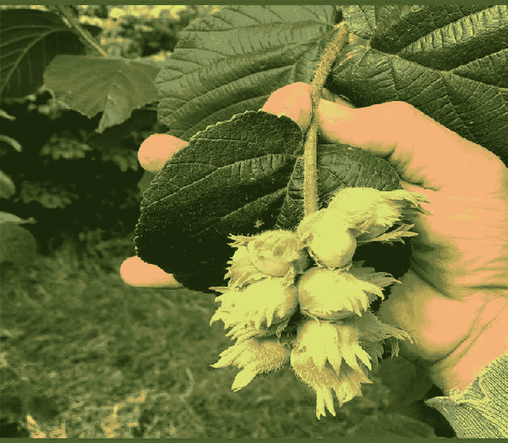

> “种一棵树最好的时间是二十年前，其次是时间是现在”。……“现在也许我们有本土杂交的栗子和榛果可以种植会更好”。
>
> ——带有作者额外见解的中国谚语。

> Dawn，只要我们相互支持，就没有我们无法攀越的山。

访问我们的网站：<https://znutty.com/>

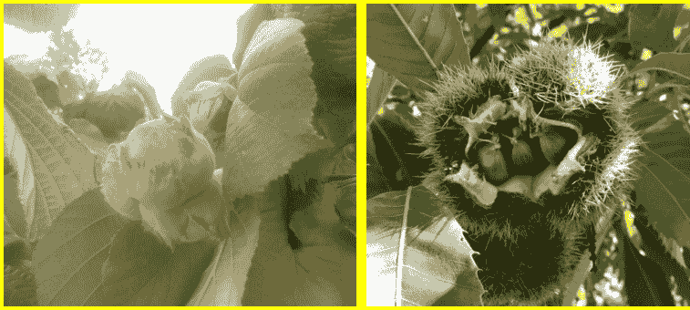

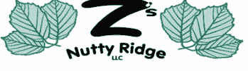

- 安装金属围栏
- 栗子概述，详细信息见下方。
- 恢复美洲栗——努力
- 我们都吃转基因食品

## 目录

- 序言
- 关于作者
- 该作者的其他著作
- 更多阅读

# 榛果与栗子简介

本书采取了实用的方法来解释种植榛果和栗子的核心要点。我们知道大多数开始接触榛果和栗子的人并不了解它们，只知道它们很美味。我们从简短的历史开始，通过说明步骤来指导你，让这一切变得简单，无论你是种植 2 棵还是 20,000 棵树。

你将了解到榛果是适合你和环境的优质本土树木，无论是庭院还是大型商业果园。我们介绍了在北美东部闲置土地上的应用。你将了解榛果对环境的益处，它们产生的坚果健康且非常有利。我们展示了你需要的物品、如何使用它们以及在哪里。我们还列出了东北部和中部的获取渠道。我们尽力教你如何充满心地种植榛果，在降低风险和成本的同时实现收益化。这本书（或者我们称之为“业主手册”）是你的沉默伙伴，在你这段旅程中提供支持和答案。在我们展示了如何种植榛果后，我们将通过指出差异来教你如何种植栗子。榛果和栗子果园有很多共同点。

你将理解为什么榛果在当地没有被种植，以及为什么杂交榛果树现在是该地区（美国东部）非常受欢迎的新作物。我们花了 28 多年的努力，取得了成功并伴随着多次失败，将其浓缩为成功种植榛果所需的实用知识。我们避免了每个物品的枯燥技术细节，只告诉你你需要关注什么，同时在你决定深入研究某个特定课题时在文中提供链接。

科学界关于坚果（榛果和栗子）健康益处有大量的证据。报道的健康益处包括降低血压、减少心脏病、癌症、糖尿病和营养缺乏。科学研究表明，每天食用坚果可以提高健康状况、生活质量并延长寿命。

许多山山在被农民遗弃后正在重新恢复森林。农场多年来一直在合并，由于侵蚀随时间推移变得贫瘠的山坡被遗弃，转向了利润更高的河谷地。我们将回顾它们是如何以及为何被遗弃，以及为什么这些闲置土地应该种植榛果、栗和其他本土坚果树来重建土壤肥力。

# 我们希望多年生农业的转型既富有收获感，又充满美丽

建立多年生果园是为建立一份供所有人欣赏和学习的传承。此外，在向您介绍了关于榛果所需的所有知识后，我们对栗子树进行了重复说明。由于栗子与榛果有许多共同点，我们仅指出它们之间的区别。

# 第一章：信心种植你的树木

## 如何使用本书

在种植任何树木（而不只是榛果）时，你都需要确保土壤做好准备，让树木欢迎它的新家。同时，储备相关知识以保持幼树的健康和安全也至关重要。在整书中，我们解释了哪些方法适合你复制，哪些方法无效，以免你重蹈类似的徒劳功夫。本书的顺序是按照规划果园的正确顺序编写的，无论是 2 棵树还是 20,000 棵树。一旦你完成了规划并掌握了知识，请回到此列表。这是一份“快速指南”，可以帮助你保持条理，并告诉你从哪里获取更多详细信息。以下列表按照从决定种植榛树到收获的一般时间线排列，如下：

1. 第一章解释了榛树和栗子树的概述，并详细说明了我们是如何决定种植坚果果园的。
2. 访问 [USDA](https://www.usda.gov) 区域验证你所在的 USDA 区域，确保你了解如何选择在你的地区生长的品种，这将在第 2 章“匹配区域与你的树木”中进行详细讨论。
3. 榛果能在你的土地上生长吗？访问 [GIS 土壤调查](https://www.usda.gov) 找出你拥有的是什么类型的土壤。幸运的是，榛果可以在东北部 90% 的土壤中生长。我们在第 2 章“匹配区域与你的树木？”中展示了这一点。
4. 你需要决定想要种类型的果园，无论是两棵树、树篱丛还是商业果园，以及根据你的业务模式选择果园的形式。我们在第 3 章“果园类型”中解释了不同果园类型之间的差异以及可能性，以帮助你做出决定。
5. 你需要多少树，间距是多少以最大化授粉和坚果产量，这将在第 3 章“果园类型”中讨论。
6. 树木需要密集的修剪吗？那似乎是一项巨大的工程。幸运的是，榛果在时间维度上基本上是灌木，我们将在第 3 章根据你的树木类型和果园类型解释是否需要以及为什么。
7. 然后你需要决定如何最好地保护你的树木免受成为鹿的食物。我们在第 4 章中解释了什么不该做，以及哪种保护方式成本和劳动最低且效果最好。
8. 你的树木需要水来建立吗？我们将向你展示如何以经济、最懒的方式给树木浇水。一旦你知道方法，就很简单，并在第 4 章“灌溉”中进行了解释和插图，以尽量减少困惑或怀疑。
9. 我们展示如何保护你的坚果，让它们在你食用之前不被野动物吃。我们在第 4 章展示如何阻止昆虫和啮动物，这样你就能享受“劳动的果实”。
10. 一旦你准备好种植，我们将在第 5 章“种植榛果”部分向你展示让树木良好开始的最简单、正确的方法。
11. 你需要喂你的树木以保持它们强壮生长。我们在第 5 章“施肥”中告诉你要去哪里以及如何做，无需担心。我们在整书中解释了执行每项任务的成本以及投资与权衡。
12. 在最初几年里，你的树木将与多年杂草竞争，如何最好克服这些问题将在第 5 章“杂草控制”中讨论。
13. 虽然不是直接的肥料或农药，但我们讨论了树木的“益生菌”，它们接种树木上保护其免受有害真菌侵害，并在自然设计的共生关系中实现矿物质吸收，第 5 章“微生物添加”。
14. 如果你拥有的坚果比手工采摘的得多，我们将展示如何在第 3 章“果园类型”中通过简单设备辅助收割，或者在第 6 章使用动力收割机完成。
15. 我们在第 7 章中赞美坚果合作社的优点，可以节省设备成本、确保质量并让你的坚果以最好的价格出售，而无需承担本会落在你肩上的许多精力或担心。
16. 上述步骤适用于任何坚果树，仅根据特定树木的需求略有不同。我们在第 8 章中展示如果你想种植栗子需要做哪些更改。

在每个章节中，我们都链接了进一步信息的良好来源，这样你可以直接查看，而无需前往书末的参考部分并丢失思路。此外，我们将链接作为脚注包含在（如果你阅读的是打印版）。我们还给出了哪里可以找到所需的物品，并提供了一些可以直接购买的良好链接来源。这些参考也可能帮助你在当地寻找相同物品，帮助家乡经济。

## 为什么要杂交榛果？

美味且对心脏健康的榛果用于许多消费者喜爱的食品中，并且长期处于短缺状态。人们惊讶地发现，榛果是一种在当地野外生长的本土树木。然而，大多数榛果源自俄勒冈州或土耳其。我们将回顾为什么榛果没有在当地种植，以及为什么榛果现在将开启这种全新的备受期待的趋势。

美味且对心脏健康的榛果被用于许多消费者喜爱的食品中，并且长期处于短缺状态。人们惊讶地发现，榛果是一种在当地野外生长的本土树木。然而，大多数榛果源自俄勒冈州或土耳其。我们将回顾为什么榛果没有在当地种植，以及为什么榛果现在将开启这种全新的备受期待的趋势。

与其他树木作物不同，榛果不需要冷藏或受控大气。增加榛果消费的未来非常好，因为欧洲人的消费量是美国的八倍。

等一下——榛果和栗子果园是废弃低成本土地的理想作物，消除了农业农场和社会经济障碍，从而产生了大量新业务，同时造福我们的健康和环境。

北美东部拥有充足降雨的眷顾，不以环境可持续的方式利用这些平缓的山坡，对农业来说是一个巨大的错误。《华尔街日报》[4]的一篇文章提到，20 世纪 60 年全球人均拥有 1.0 英亩可耕地，而 2020 年估计人均仅有 0.44 英亩。

从财务角度来看，榛果是理想的特色作物，因为它们持续供应且利润率高。榛果平均每磅 6 美元，而去壳生榛果目前在当地杂货店每磅售价 12.99 美元。榛果每磅成本限制了消费。增加榛果消费的未来非常好，因为欧洲人的消费量是美国的八倍。欧洲人每年平均 2.0 到 4.4 磅榛果。相反，美国人每年吃约 0.5 磅。

这些树木已经是有机生长的，除了正在被来自许多大型乳制品/蛋鸡场的堆肥肥料所取代的商业肥料外。榛子对于占据了以前农田大部分比例的休耕地来说提供了一种创新的解决方案。这就是为什么我们喜欢说：

> “榛子——一种历经 100 多年才才成的新型本土作物。”

榛子被用于许多知名产品中，也是本书的主题，因为建立果园并最终建立一个坚果农合作社具有具说服力的理由，可以最大限度地增加种植者和消费者的利益。如下如图 #1-2 所示，现在可以买到当地的榛子。

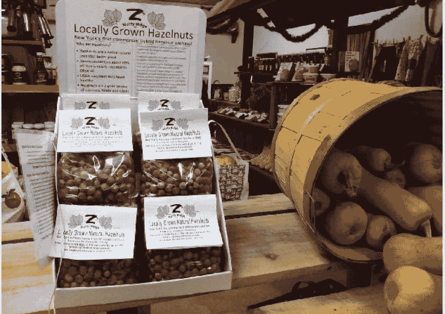

图 #1-2，在当地杂货店的 Z’s Nutty Ridge LLC 产的榛子。

## 为什么要种杂交栗子？

栗子和榛子一样，都是我们地区的特产，在 1940 年以前，曾是一项非常重要的经济产业。坚果为美国农村人提供了食物和现金，因为坚果按火车车装载并运到城市出售。美国栗（`Castanea dentata`）也因其纹理垂直且耐腐的木材而备受青，用于建筑、家具、围栏柱和枕木。这是一种高度可超过 100 英尺的高树。在它们的原生分布范围内，它们占据了树木总数的 25%，数量多达四十亿棵。然而，栗树病（`Cryphonectria parasitica`）将我们所有的美国栗树都死在了地上。这种病于 1904 年发现于布朗克斯动物园。阻止它的扩散已经太晚了，因为当时从东海岸各地的苗圃从日本进口了许多树。

幸运的是，我们引进了来自日本、中国、韩国和欧洲的果树，其杂交奇迹生产了迄今为止最好的栗子，现在每个人都有命名的品种供大家选择。

在丰产年，每英亩土地可以收获高达 7000 磅的栗子。对于你果园中管理良好的已知品种，你可以预期正常产量范围在 2000 到 5000 磅之间。每个物种的相对大小如图 #1-3 所示。

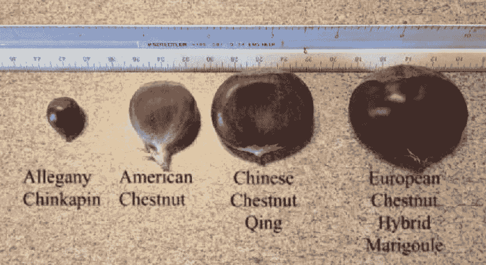

图 #1-3，四种不同的栗子。

出于上述所有原因，我们种植了适应我们果园区域环境的杂交树木。果园型树木产量高且抗病性强。到目前为止，合作社能够在三周内以每磅 5 美元到 6 美元的价格通过直接面向消费者的在线销售所有的坚果。

北美实际上有两个主要的栗子品种。第二种物种是阿拉契亥鼠锥栗（`Castanea pumila`），由于其体型较小（通常小于 30 英尺，与美国栗相比），加上其微小的果壳和非常甜的果实，被称为“矮矮栗”。许多人还认为奥泽克鼠锥栗（`Castanea ozarkensis`）是阿拉契亥鼠锥栗的亚种，坚果大小相似，但树木更高，可达 65 英尺。

很多人将栗子称为“面包”树，因为坚果主要是淀粉，含油量极低。坚果干燥并制成粉后，口感光滑甜甜。这种粉是一种无面筋（无凝集蛋白）的面粉替代品。正如讨论过的，栗树是从日本或韩国进口的，因为它们的栗（`Castanea crenata`）结出的坚果非常大且抗病。然而，它们的坚果通常很难剥皮。欧洲栗（`Castanea sativa`）也遭受栗树病的侵害，但在欧洲的传播速度要慢得多。中国栗（`Castanea mollissima`）抗栗树病。欧洲栗、日本栗和中国栗作为果树已经栽培了数千年。它们的高度通常在 35 到 65 英尺之间。它们在美国和欧洲当地经过区域杂交，目标是获得每种品种的最佳特性，并适应我们北部的气候，图 #1-4 所示了一个很好的。

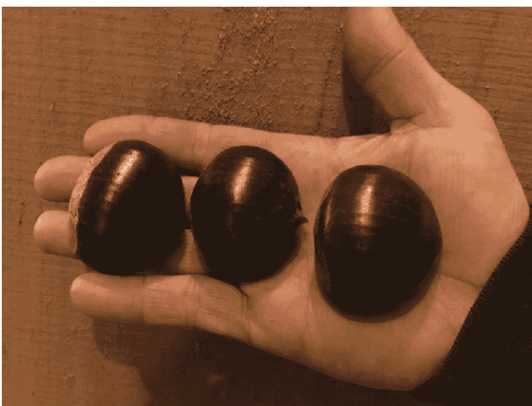

图 #1-4，Bouche de Betizac 栗子——欧洲和日本杂交品种。

栗子和榛子是全球种植的两种顶级坚果。需求在很长一段时间内以 7% 的速度持续增长。随着人们对具有健康益处的坚果重新产生兴趣，坚果消费量只会增加。相对于榛子和栗子的供应量和成本，目前严重限制了消费。如表 #1-1 所示，栗子的产量仅次于杏仁，榛子在全球产量中位第五。这两种坚果在气候和土壤允许的地方都有生产。

栗子生产的领导者是中国，2019 年的产量报道高达 200 万吨。土耳其是全球榛子生产的者，占世界产量的 60% 到 65%。俄勒冈州生产了全球榛子产量的 4%。

| 2017 年产量 | 仁 - 公吨 | 排名 |
| :--- | :--- | :--- |
| 杏仁 | 1,255,971 | 1 |
| 巴西果 | 10,700 | 10 |
| 腰果 | 788,830 | 4 |
| 栗子 | 1,125,000 | 2 |
| 榛子 | 497,989 | 5 |
| 马山坚果 | 50,833 | 8 |
| 山桃 | 126,324 | 7 |
| 松子 | 17,050 | 9 |
| 开心果 | 598,109 | 5 / 6 |
| 核桃 | 871,335 | 3 |

表 #1-1，2017 年全球坚果产量。

散落的树木以及沿土地边界和道路的树木，土地大部分已被砍伐树木。

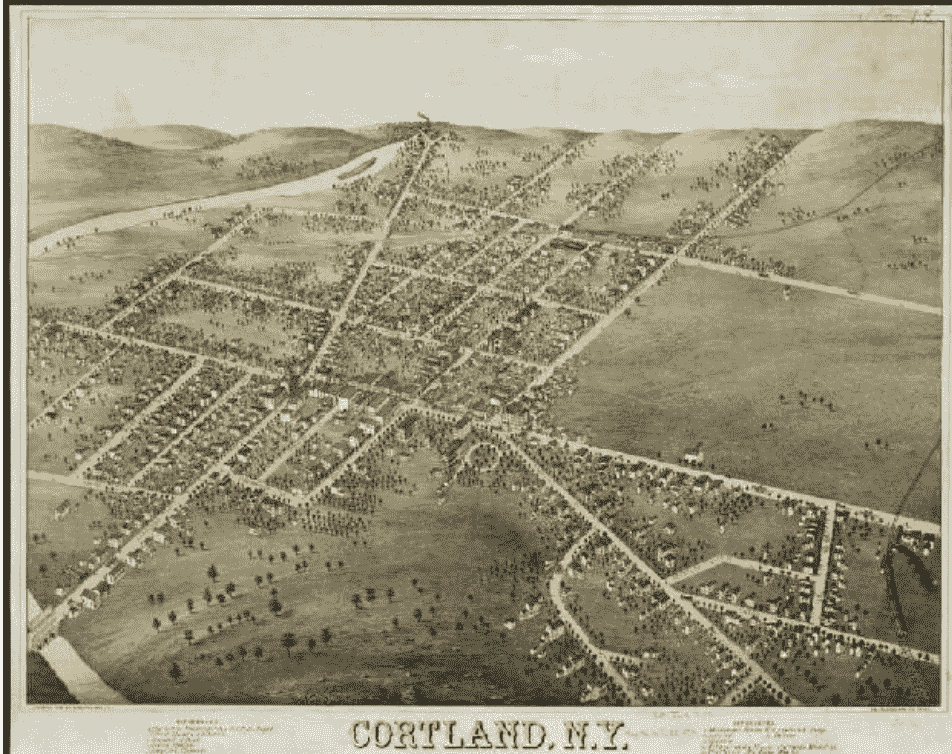

图 #1-5，1873 年左右科特兰市的描绘，大部分树木已被移除 [16]。

根据 2012 年的人口普查，37% 的土地用于农业。这意味着 59% 的土地现在是住宅用地或闲置土地。该县大约一半的土地（约 320,000 英亩）未被使用，这是一项在规模和范围上都难以想象的被低利用资源。这种例子在从东北部到中部的的大多数县份都在重复出现。

树木是多年作物，能够持续地从土壤中带上矿物质和养分，并随着每年落叶的叶子、果壳和坚果将糖分和碳水化合物返回土壤。不需要每年的耕作，没有裸露的土壤导致侵蚀，也不会破坏土壤生态系统，让土壤得以重建。在我们食用或售卖坚果和壳之前，这种以及长期的碳封就已经完成了。

## 为什么现在要种坚果树

如果你打算种树并进行认真考虑，你会得出什么结论？你期望树木能很快获得回报，还是你乐于留下一遗产？是否有支持能帮助你度过努力，使你的时间不白费？如果我们抱着拥有果园的想法去种树，应该种哪种树呢？跟随我们的脚步，你将看到我们是如何走上这条道路，并种植了数千万棵不同的树来寻找答案。这本书的目的是消除平行的努力（这些努力需要多年时间才能得出我们所学的结论），并让你能够在我们的努力基础上进行建设。

从最后一段的角度来看，无论你付出了什么来获得手中的东西，你付出的很少，在我们继续之前你本应该欠我们钱。请仔细品味，因为我和我的妻子付出了数千小时的工作，并投入了一笔不小的财富，才理解我们的休耕地需要什么样的树种和遗传特性。然而，我们的努力与最初开垦土地相比仍然是微不足道的。

20 世纪 90 年代初，我们搬到了科特兰县的一个山顶，海拔在 1600 到 1800 英尺，位于一个朝西的坡上。朝西意味着我们真的能感受到从西北方向吹过我们山顶的风。从这个高处，我们可以眺望数英里，俯瞰穿过纽约州的一个较大的山谷。山丘和山谷的美景令人惊叹，但一个脱颖出的点是山坡上有许多田地正在回归树林。了解一下上述描述的历史背景：过去，新来的移民砍树清理田地，使用手锯、马、斧头和炸药，在对生命和肢体面临巨大风险的情况下进行，而这已经被遗弃了。清理一棵大树并用手清除足量的根系所付出的精力，对今天的几乎任何人来说都似乎是不可能的，更不用说很多英亩了。我们祖先迁徙获得土地的动力，然后他们必须在耕作之前进行清理，这种动力与我们已经相去甚远。与祖先对拥有农田的愿望相比，我们今天的大多数人认为控制腰围似乎就太费力了。此外，看晚间新闻，报道的大部分问题与我们祖先的负担相比都是微不足道的。因此，为什么我们宁愿花时间在我们可以做的改善人类状况的事情上，比如种植、开发和照料多年生生产食物的树。

展望我们山谷的景色，似乎有一项巨大的资源由于我们祖先冒着生命危险的风险正在被浪费。一个陷于重重的环保主义者可能会认为，让土地回归自然是公正的，不应该有任何人阻碍。我们对这个主题进行过许多辩论，考虑到每年两次的税单似乎每年都在增大，必须有一个好的理由。为什么我们宁愿花时间在我们可以做的改善人类状况的事情上，比如种植、开发和照料多年生生产食物的树。

# 第 2 章：为你的树木匹配区域和土壤

## 你的 USDA 植物耐寒区

你可以在此交互式地图找到你的位置：<http://planthardiness.ars.usda.gov/>，该地图涵盖所有州，而不仅仅是纽约州。当我们在交互式 USDA 区地图上详细确定位置时，我们发现我们的农田位于 4b 和 5a 区域。4 区和 5 区占据了该州的大部分，除了大湖沿岸或长岛附近及长岛上的 6 区和 7 区外。在 USDA 4 区生长的树木很可能在 7 区生长；然而，如果不付加努力，它们可能无法在 3 区生长。这使我们必须寻找适合我们 4b 区区域的耐寒树木，理想情况下，它们应该是该地区的原生物种，因为它们已经进化到能够抵御大自然的严酷考验。

一旦你在交互式地图上找到了自己的 USDA 生长区，请将其牢记在脑中。我们将强化针对你所在的区域购买正确树木的重要性。

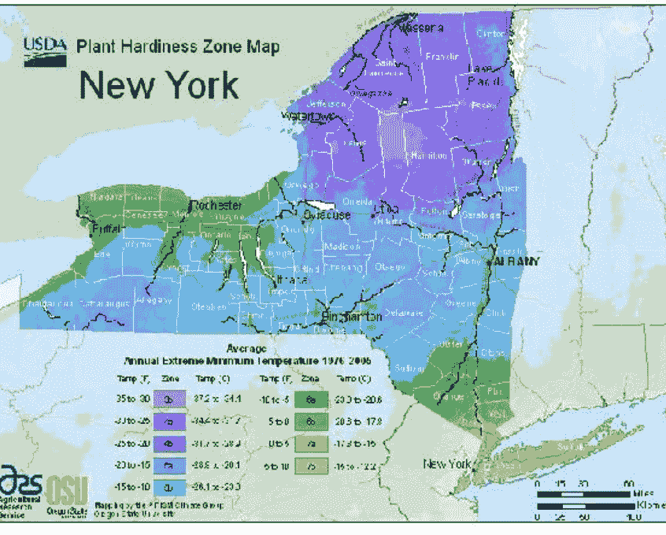

图 2-1，纽约州 USDA 植物耐寒区地图[7]。

## 你拥有什么类型的土壤？

需要查阅 GIS 土壤调查以了解你拥有的土壤类型。在 GIS 土壤调查网站上查找你的农田[8]。这个 USDA 网站拥有关于你计划种植土地的大量信息。我们将通过使用截图来指导你了解土壤类型和 pH 的基础知识，因为该网站起初可能会让人困惑。如果你查看的是一个土地经过高度开发的住宅开发区的后院，它可能只会告诉你那里是城市土地，而没有提供太多信息。使用较大的感兴趣区域（Region of Interest, ROI）可能会帮助你跳过城市土地的识别。下方的截图是图 #2-2，是上述超链接的起点。确保你选择了黄色圆圈标出的放大镜倍数。然后将光标悬停在你想要缩放的区域上。持续缩放，直到你在卫星图像中看到你的地块。

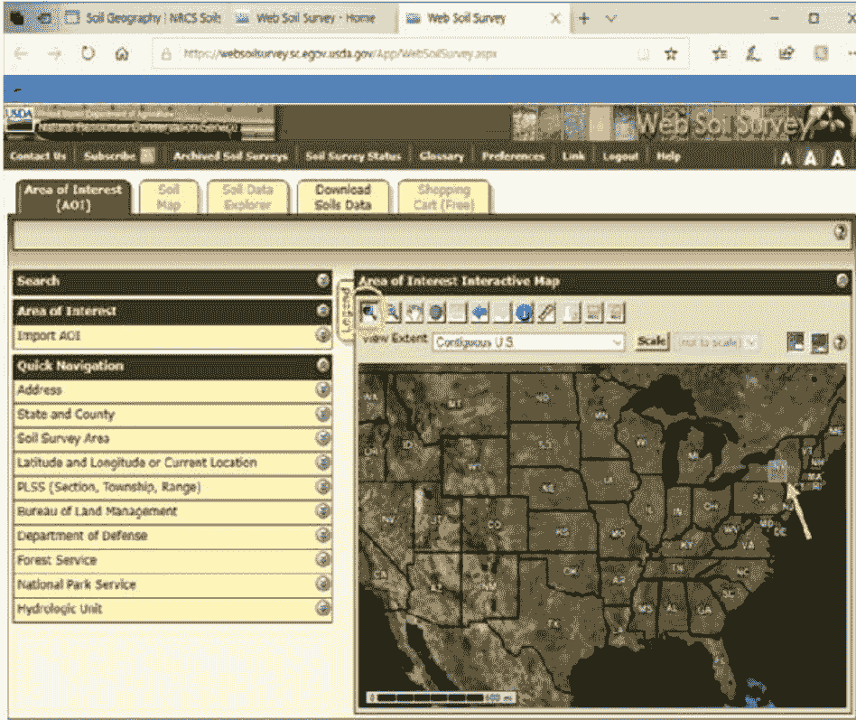

图 #2-2，网络土壤调查网站首页。


接着在接下来的图 `#2-3` 中，选择黄色高亮的“感兴趣区域”（ROI）选项卡，然后在你的土地上拖动一个框。这将告诉程序获取有关该地块的信息。接下来，你需要选择你正在查找的数据。你想知道土壤的类型和 pH 值。你将需要选择如图 `#2-4` 所示的“土壤数据资源器”（Soil Data Explorer）选项卡。然后选择“土壤属性和质量”（Soil Properties and Qualities）选项卡。你将看到“属性和质量评分”（Properties and Qualities Rating）标题并选择“打开全部”。

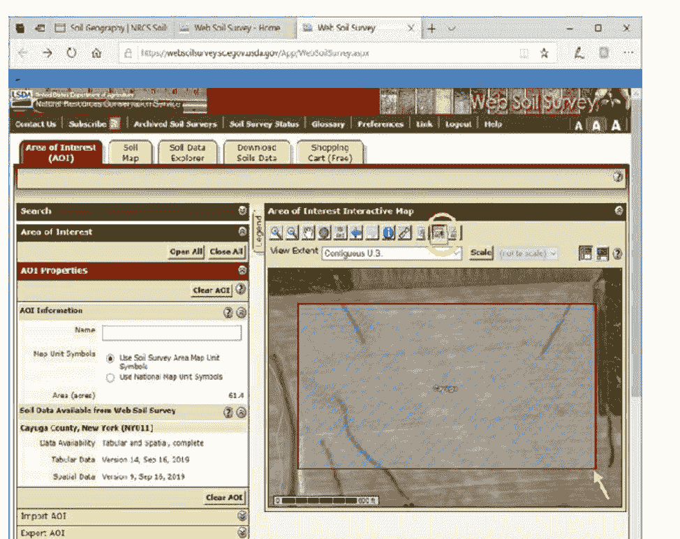

图 2-2，网络土壤调查网站首页，将 ROI 缩放至农田。

向下滚动直到看到“pH (1 to 14)”选项卡并选择它。窗口将展开并滚动到窗口底部，输入你感兴趣的土壤深度。将顶深（Top Depth）设为 4，底深（Bottom Depth）设为 10。选择下方的“英寸”（Inches）按钮，然后点击“查看评分”（View Rating）按钮。在右侧你将看到土壤类型的描述、pH“评分”以及具有该评分的。调整深度设置以了解土壤深处的 pH 值。如果 30 英寸处的 pH 为 6.5 或更高，请不要尝试种植板栗，否则它们会死去。然而，土壤 pH 值可能完全处于榛果的生长范围内。如前所述，榛果的生长 pH 在 5.4 到 8.0 之间。你可以选择“下载土壤”（Download Soils Data）选项卡，并通过“创建下载链接”（Create Download Link）进行下载，然后选择“购物车”（Shopping Cart）选项卡并点击“结算”（Check Out）下载你的免费数据。如果你愿意，你有选项可以选择，但也可以直接下载数据。如果你想了解你的土壤类型，选择“土壤地图”（Soil Map）选项卡，你将看到全名，并可以选择名称查看详细信息。

排水不良的粘土层像大多数树木一样，除非你付出非凡的努力否则生长并不良好，最好找另一块地种榛果。如果你别无选择在粘土中种植，你将需要做一些工作。

为了改善重粘土土壤并为你的树木提供最佳生长机会，你需要做两件事。第一是挖一个比树根系所需大得多的洞，并将该区域堆高，将树种在土丘上。洞越大越好，但宽和深三到四英尺是一个不错的开始。你将引入改良剂来透气土壤。两种易于获得的成分是沙子和堆肥。如果你所在的地区有重粘土，那么该地区其他人也有供你使用。当地合作推广代理可以协助你完成这项任务。他们可能对榛果或栗子一无所知。然而，如果你询问如何将土壤 pH 值调整到 6.5，或如何根据土壤分析来改良土壤，他们可以提供帮助。

我们在北卡罗纳州看到一处正在种植的葡萄园，那里似乎挖了一个宽 2 英尺、深 6 英尺的沟，并填回了富含腐质的深色表土，取代了原来那里像红砖一样结实的硬土。几年过去了，好奇心作了祟，所以我们不得不停下来品了葡萄酒，味道很棒！

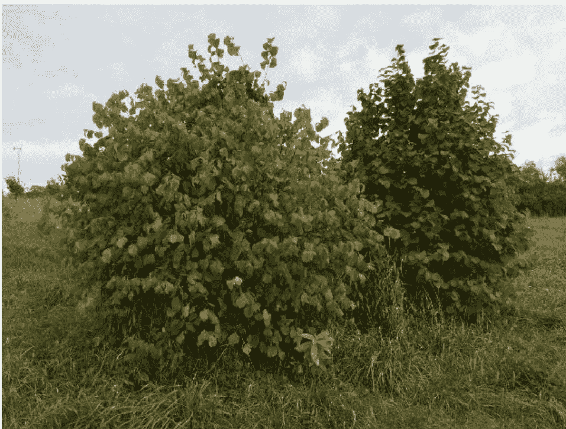

图 `#2-5`，一棵约 7 英尺高的成年榛果树/灌木，呈现出秋色。

# 野生榛果与欧洲杂交种

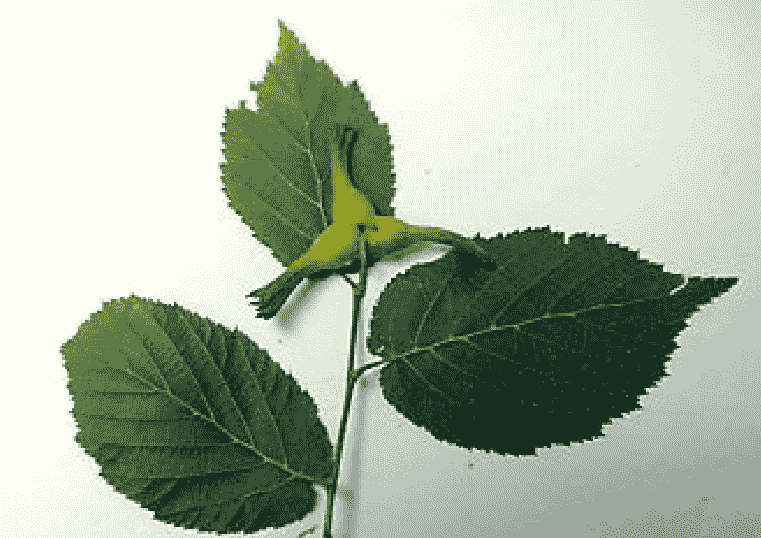

北美有两种主要的认可的榛果物种。这两个物种分别是图 `#2-5` 中的 `Corylus americana`（通常被称为美国榛果）和图 `#2-6` 中的 `Corylus cornuta`（被称为喙榛果，即尖喙状榛果）。喙榛果与 `Corylus americana` 有些不同，因为它因其覆盖果实的极长外壳而闻名。

图 `#2-6`，由 Wikipedia[10] 提供的喙榛果。

欧洲榛果（`Corylus avellana`，通常称为青榛果）其品种通常长到 35 英尺高。一种被认可的物种 `Corylus Colurna` 被称为土耳其榛，可以长到 70 英尺高。图 `#2-7` 显示了一棵从 65 年前从乌克兰进口种子的当地树。


图 `#2-7`，纽约州科特兰（Cortland, NY）高超过 25 英尺的欧洲榛果（`Corylus avellana`）。

我们的野生榛果树种范围在图 `#2-8` 中用绿色所示。为了让野生榛果从美国南部生长到加拿大北部，必须有一套多样化的基因来允许这种适应性。然而，我们的野生榛果还没有经过欧洲榛果那样的程度的筛选。我们的野生榛果产生的果实比欧洲榛果小得多，且壳往往较厚。而且最重要的是，果实没有那么好吃，可能带有土腥味，与我们使用的咖啡调味完全不同。我们与榛果相关的主要风味被称为“榛果内酯”（filbertone）。

此外，观察我们野生果实较小且壳较厚的另一种方式是：对于每磅果实肉（又称果仁），我们拥有的壳重量比欧洲榛果重得多。果实肉与壳的比例被称为“出仁率”（percentage kernel）。我们希望我们的努力和树木的能量是用来生长果实肉（果仁）而不是壳！果实越大、壳越薄，食物生产的效率越高，正如我们在图 `#2-9` 中所示。

再次，如果我们种植野生榛果，会有意愿的市场吗？我们需要通过杂交种来获得野生榛果的硬度吗，还是我们应该直接像葡萄或苹果那样，将欧洲树嫁接到我们的/抗性根系上？

由于大多数欧洲榛和野生榛果都会产生侧芽形成灌木，嫁接将是一项长期的工作，每年需要剪掉多次侧芽，然后我们还要担心嫁接失败。我们发现榛果在嫁接后似乎会长出额外的侧芽，好像它知道自己被嫁接了。欧洲榛果通常被一种真菌杀死，被称为“东部榛果病”（EFB），该病菌为 `Anisogramma anomalala`，它原产于我们的地区，但两者都不侵扰我们的野生树木。此外，欧洲榛果对于我们的 USDA 4 区和 5 区气候来说太娇嫩了。看起来我们使用的是欧洲榛的杂交种，并将我们的野生抗寒抗 EFB 品系生长在它们的根上。

这就是为什么北美几乎所有的生长的榛果都是在俄勒冈种植的。在俄勒冈，他们种植欧洲榛果已有约 100 年，那里 EFB 远在，不应该感染他们的树。然而，EFB 在 20 世纪 80 年代中期开始出现杀死了他们的树。由俄勒冈州立大学（OSU）Shawn Mehlenbacher 博士领导的研究团队开展了寻找具有 EFB 抗性的树并进行杂交的研究。自 2005 年以来，俄勒冈州立大学发布的杂交品种让俄勒冈的当地农民能够使用抗俄勒冈某一种 EFB 菌株的新品种进行重新种植和扩大。到目前为止，OSU 发布的品种尚未证明对纽约州（东北部）的 EFB 菌株具有抗性，或者不够抗寒以种植在 USDA 4/5 区。这种努力仅证实了杂交种需要具备适应性。


图 `#2-8`，由 Wikipedia 提供的野生榛果分布图。

## 杂交种 VS 其他品种

由于大多数欧洲榛和野生榛果都会产生侧芽形成灌木，嫁接将是一项长期的工作，每年需要剪掉多次侧芽，然后我们还要担心嫁接结合失败。我们了解到榛果在嫁接后似乎会长出额外的侧芽，好像它知道自己被嫁接了。欧洲榛果通常被一种被称为东部榛果病（EFB）的真菌杀死，该病菌为 `Anisogramma anomalala`，它原产于我们的地区，但两者都不侵扰我们的野生树木。此外，欧洲榛果对于我们的 USDA 4 区和 5 区气候来说太娇嫩了。看起来我们使用的是欧洲榛的杂交种，并将我们的野生抗寒 EFB 品系生长在它们的根上。

这就是为什么北美几乎所有的生长榛果都是在俄勒冈种植的。在俄勒冈，他们种植欧洲榛果已有约 100 年，那里 EFB 远在，不应该感染他们的树。然而，EFB 在 20 世纪 80 年代中期开始杀死了他们的树。由俄勒冈州立大学（OSU）Shawn Mehlenbacher 博士领导的研究团队开展了寻找具有 EFB 抗性的树并进行杂交的研究。自 2005 年以来，俄勒冈州立大学发布的杂交品种让俄勒冈的当地农民能够使用抗俄勒冈某一种 EFB 菌株的新品种进行重新种植和扩大。到目前为止，OSU 发布的品种尚未证明对纽约州（东北部）的 EFB 菌株具有抗性，或者不够抗寒以种植在 USDA 4/5 区。这种努力仅证实了杂交种需要具备适应性。

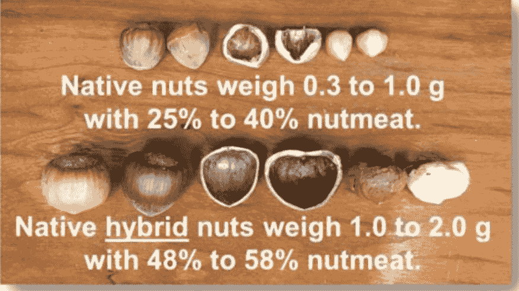

图 `#2-9`，与欧洲榛果品种对比的典型野生果实。

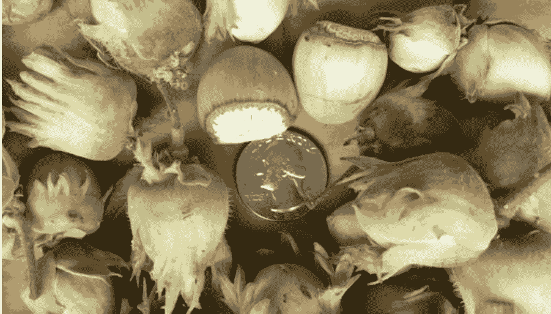

图 `#2-10`，Nitka™ 品种，大、圆、好吃、薄壳、抗 EFB 且非常抗寒。这就是图 `#1-1` 中的品种。

## 我们的本土疾病——东部榛果病（EFB）

被称为东部榛果病（EFB）的疾病由真菌 `Anisogramma anomalala` 引发，在春初到春中期随风传播。它会导致树枝上出现黑色黑色孢子（如图 `#2-11` 所示），除非对真菌有抗性，否则枝会死亡。真菌会缓慢蔓延遍整个树并最终杀死它。在图 `#2-11` 中，你可以看到一个灌木上有一排超过一英尺的 EFB 孢子，这会杀死每一条树枝并最终杀死整棵树。

> 我们的野生榛果的问题与我们的野生栗子相反。我们的野生栗子死于外来疾病，而进口的榛果死于我们的本土疾病。

到目前为止，罗格矶大学已鉴定出七种 EFB 菌株。可能还有更多菌株待记录。具有 EFB 抗性的树木对不同菌株的反应各异。

判断榛果树对真菌抗性的一个早期指标，是斑点列的长度，以及你观察树木在病变形成后是否恢复并在病变处形成疤痕。通常，斑点列的长度需要小于 6 英寸（15 厘米），你会看到树枝用树脂将病变隔离开，并在一年内开始愈合。长度超过 6 英寸的病变表明榛果树的抗性不足，随着时间的推移，可能会死于东方榛果病（EFB）。我们本土树种与欧洲榛果的杂交已经持续了 100 多年；幼苗对不同菌株会有各种反应。取决于你所在的地区，你可能拥有一种提供树木的苗圃所未知的 EFB 菌株。

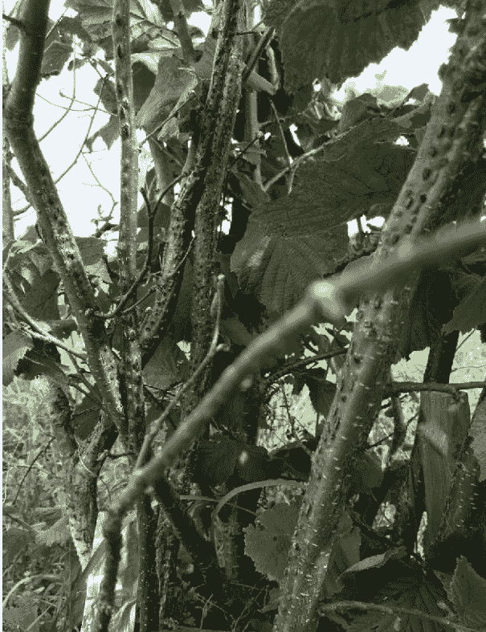

图 `#2-11`，东方榛果病（EFB）杀死纽约州库特兰（Cultland）一种“抗病型”俄勒冈分层品种的榛果茎，其带有长病变。

在 Z's Nutty Ridge，我们从全国和加拿大的大多数可用渠道采购了树木。我们购买榛果树有两个目的：一个是观察榛果树在我们的 USDA 4/5 区气候下的表现，另一个是积攒更多 EFB 菌株以测试我们的农田，这会变得非常昂贵。我们通常购买的数量少于 10 棵，多可达 1000 棵。我们不使用真菌喷剂，也不通过切除受感染的枝条来阻止疾病传播。为了育种目的，我们希望有充足且丰富的 EFB 来源。我们希望我们的树木被感染后要么茁壮生长，要么死于 EFB。除了让树木因过于脆弱而死亡外，寻找 EFB 还能发现哪些树木不受昆虫害虫喜爱，从而进一步增强我们的育种工作。

在多年对榛果的研究中，我们发现必须有多个基因才能有效控制 EFB。虽然有些树木从不出现枯死，但另一些则会。我们曾看到 EFB 并停止了对它们的监测。几年过去，我们注意到一棵生长茂盛、果实漂亮的树，在检查树标签和我们的笔记后发现它患了枯死。在对树木进行进一步检查后，我们没有发现任何枯死？根据我们的理解，必须有一种基因只有在树上产生伤口后才会被激活。该基因产生控制枯死所需的解药，为我们提供了更多育种材料来堆叠 EFB 抗性基因。

我们首先对表现出耐寒和抗病的树木进行受控交粉，然后是高产和高品质果实的树木。主要工作是寻找能抗多种 EFB 菌株的抗寒树木。通过抗性菌株的杂交，我们相信我们正在对抗 EFB 时通过堆叠多个基因。

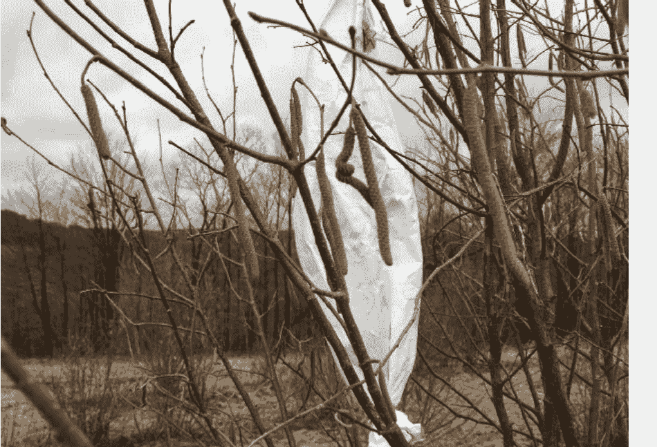

图 `#2-12`，Z's Nutty Ridge 一个带有花粉袋进行受控授粉的榛果灌木。注意，花序正在伸长。

我们发现榛果树发生 EFB 有两个主要时期：幼树在两三年后会表现出 EFB，或者树木在经历几年的丰产后，直到第 7 到 12 年才会显示出任何 EFB 病变。种植和培育一棵树超过 10 年并获得良好成功，结果却看到它如图 `#2-13` 所示因 EFB 而衰败死亡，这非常令人担忧。你需要对所购买的树具有 EFB 耐性有信心。一部分当地的杂交幼苗最终会屈服于 EFB。幼苗像孩子一样，遗传基因多样化并会做出相应的反应。克隆榛果灌木应该具有很强的 EFB 抗性，不太可能死于当地的 EFB。

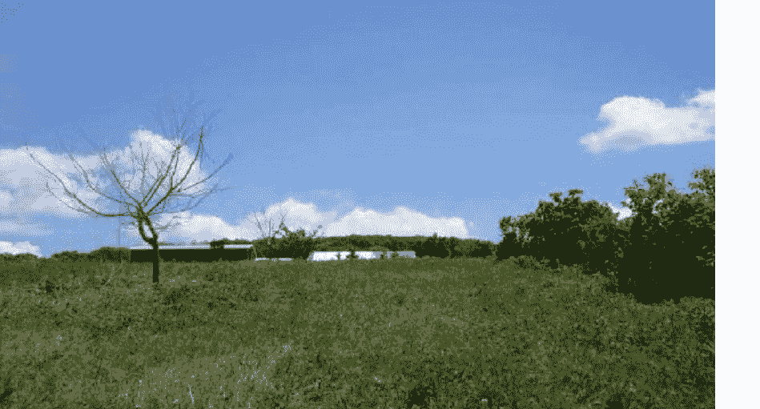

图 `#2-13`，左侧是死于 EFB 的榛果，右侧是同龄的健康榛果。

克隆榛树是通过无性繁殖的树木。无性仅仅意味着不是通过两棵不同树木的花粉和卵的正常过程。榛果主要通过两种方式进行克隆，有时是第三种。传统方法是剪掉树基长出的萌条并将其重新种植在适当的间距上，这个过程称为无菌床层插法。更现代的方法是通过组织培养，有时也称为微切法。组织培养是将一棵树的剪条进行消毒以杀死所有微生物，然后将其放入实验室的无菌环境中。剪条没有根，但被放置在胶状培养基中，培养基中含有糖、维生素、矿物质和通常提供的激素。当嫩芽生长到约三英寸高时，在每个叶节点处重新剪切并放回培养基中。芽不断繁殖，直到有足够的芽开始生根过程。一旦生根，幼树就会在受控条件下进一步生长以达到良好尺寸，在适应户外环境之前才准备好发运。组织培养可以全年进行，每年生产数百万棵树。第三方法是生根插条。事实证明，榛树通过插条获得一致生根非常困难，需要更多的实验才能成为一种可行的无性繁殖方法。

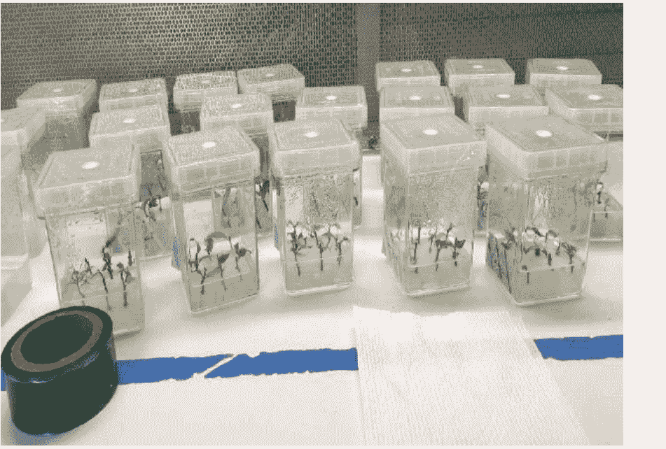

图 `#2-16`，Z’s Nutty Ridge LLC 组织培养中的新转移栗树。

克隆的榛树是通过无性繁殖的树木。无性仅仅意味着不是通过两棵不同树木的花粉和卵的正常过程。榛果主要通过两种方式进行克隆，有时是第三种。传统方法是剪掉树基长出的萌条并将其重新种植在适当的间距上，这个过程称为无菌床层插法。更现代的方法是通过组织培养，有时也称为微切法。组织培养是将一棵树的剪条进行消毒以杀死所有微生物，然后将其放入实验室的无菌环境中。剪条没有根，但被放置在胶状培养基中，培养基中含有糖、维生素、矿物质和通常提供的激素。当嫩芽生长到约三英寸高时，在每个叶节点处重新剪切并放回培养基中。芽不断繁殖，直到有足够的芽开始生根过程。一旦生根，幼树就会受控控进一步生长以达到良好尺寸，在适应户外环境之前才准备好发运。组织培养可以全年进行，每年生产数百万棵树。第三方法是生根插条。事实证明，榛树通过插条获得一致生根非常困难，需要更多的实验才能成为一种可行的无性繁殖方法。

克隆的榛树是通过无性繁殖的树木。无性仅仅意味着不是通过两棵不同树木的花粉和卵的正常过程。榛果主要通过两种方式进行克隆，有时是第三种。传统方法是剪掉树基长出的萌条并将其重新种植在适当的间距上，这个过程称为无菌床层插法。更现代的方法是通过组织培养，有时也称为微切法。组织培养是将一棵树的剪条进行消毒以杀死所有微生物，然后将其放入实验室的无菌环境中。剪条没有根，但被放置在胶状培养基中，培养基中含有糖、维生素、矿物质和通常提供的激素。当嫩芽生长到约三英寸高时，在每个叶节点处重新剪切并放回培养基中。芽不断繁殖，直到有足够的芽开始生根过程。一旦生根，幼树就会在受控条件下进一步生长以达到良好尺寸，在适应户外环境之前才准备好发运。组织培养可以全年进行，每年生产数百万棵树。第三方法是生根插条。事实证明，榛树通过插条获得一致生根非常困难，需要更多的实验才能成为一种可行的无性繁殖方法。

克隆的榛树是通过无性繁殖的树木。无性仅仅意味着不是通过两棵不同树木的花粉和卵的正常过程。榛果主要通过两种方式进行克隆，有时是第三种。传统方法是剪掉树基长出的萌条并将其重新种植在适当的间距上，这个过程称为无菌床层插法。更现代的方法是通过组织培养，有时也称为微切法。组织培养是将一棵树的剪条进行消毒以杀死所有微生物，然后将其放入实验室的无菌环境中。剪条没有根，但被放置在胶状培养基中，培养基中含有糖、维生素、矿物质和通常提供的激素。当嫩芽生长到约三英寸高时，在每个叶节点处重新剪切并放回培养基中。芽不断繁殖，直到有足够的芽开始生根过程。一旦生根，幼树就会在受控条件下进一步生长以达到良好尺寸，在适应户外环境之前才准备好发运。组织培养可以全年进行，每年生产数百万棵树。第三方法是生根插条。事实证明，榛树通过插条获得一致生根非常困难，需要更多的实验才能成为一种可行的无性繁殖方法。

克隆的榛树是通过无性繁殖的树木。无性仅仅意味着不是通过两棵不同树木的花粉和卵的正常过程。榛果主要通过两种方式进行克隆，有时是第三种。传统方法是剪掉树基长出的萌条并将其重新种植在适当的间距上，这个过程称为无菌床层插法。更现代的方法是通过组织培养，有时也称为微切法。组织培养是将一棵树的剪条进行消毒以杀死所有微生物，然后将其放入实验室的无菌环境中。剪条没有根，但被放置在胶状培养基中，培养基中含有糖、维生素、矿物质和通常提供的激素。当嫩芽生长到约三英寸高时，在每个叶节点处重新剪切并放回培养基中。芽不断繁殖，直到有足够的芽开始生根过程。一旦生根，幼树就会在受控条件下进一步生长以达到良好尺寸，在适应户外环境之前才准备好发运。组织培养可以全年进行，每年生产数百万棵树。第三方法是生根插条。事实证明，榛树通过插条获得一致生根非常困难，需要更多的实验才能成为一种可行的无性繁殖方法。


克隆的榛树是通过无性繁殖的树木。无性仅仅意味着不是通过两棵不同树木的花粉和卵的正常过程。榛果主要通过两种方式进行克隆，有时是第三种。

传统方法是剪掉树基长出的萌条并将其重新种植在适当的间距上，这个过程称为无菌床层插法。更现代的方法是通过组织培养，有时也称为微切法。组织培养是将一棵树的剪条进行消毒以杀死所有微生物，然后将其放入实验室的无菌环境中。剪条没有根，但被放置在胶状培养基中，培养基中含有糖、维生素、矿物质和通常提供的激素。

当嫩芽生长到约三英寸高时，在每个叶节点处重新剪切并放回培养基中。芽不断繁殖，直到有足够的芽开始生根过程。一旦生根，幼树就会在受控条件下进一步生长以达到良好尺寸，在适应户外环境之前才准备好发运。组织培养可以全年进行，每年生产数百万棵树。

第三方法是生根插条。事实证明，榛树通过插条获得一致生根非常困难，需要更多的实验才能成为一种可行的无性繁殖方法。

具有抗性的树木对不同菌株的反应各异。

判断榛果树对真菌抗性的一个早期指标，是斑点列的长度，以及你观察树木在病变形成后是否恢复并在病变处形成疤痕。通常，斑点列的长度需要小于6英寸（15厘米），你会看到树枝用树脂将病变隔离开，并在一年内开始愈合。

长度超过6英寸的病变表明榛果树的抗性不足，随着时间的推移，可能会死于东方榛果病（EFB）。我们本土树种与欧洲榛果的杂交已经持续了100多年；幼苗对不同菌株会有各种反应。取决于你所在的地区，你可能拥有一种提供树木的苗圃所未知的EFB菌株。


图 #2-11，东方榛果病（EFB）杀死纽约州库特兰（Cultland）一种“抗病型”俄勒冈分层品种的榛果茎，其带有长病变。

在Z's Nutty Ridge，我们从全国和加拿大的大多数可用渠道采购了树木。我们购买榛果树有两个目的：一个是观察榛果树在我们的USDA 4/5区气候下的表现，另一个是积攒更多EFB菌株以测试我们的农田，这会变得非常昂贵。

我们通常购买的数量少于10棵，多可达1000棵。我们不使用真菌喷剂，也不通过切除受感染的枝条来阻止疾病传播。为了育种目的，我们希望有充足且丰富的EFB来源。我们希望我们的树木被感染后要么茁壮生长，要么死于EFB。除了让树木因过于脆弱而死亡外，寻找EFB还能发现哪些树木不受昆虫害虫喜爱，从而进一步增强我们的育种工作。

在多年对榛果的研究中，我们发现必须有多个基因才能有效控制EFB。虽然有些树木从不出现枯死，但另一些则会。我们曾看到EFB并停止了对它们的监测。几年过去，我们注意到一棵生长茂盛、果实漂亮的树，在检查树标签和我们的笔记后发现它患了枯死。

在对树木进行进一步检查后，我们没有发现任何枯死？根据我们的理解，必须有一种基因只有在树上产生伤口后才会被激活。该基因产生控制枯死所需的解药，为我们提供了更多育种材料来堆叠EFB抗性基因。

我们首先对表现出耐寒和抗病的树木进行受控交粉，然后是高产和高品质果实的树木。主要工作是寻找抗多种EFB菌株的抗寒树木。通过抗性菌株的杂交，我们相信我们正在对抗EFB时通过堆叠多个基因。


图 #2-12，Z's Nutty Ridge一个带有花粉袋进行受控授粉的榛果灌木。注意，花序正在伸长。

我们发现榛果树发生EFB有两个主要时期：幼树在两三年后会表现出EFB，或者树木在经历几年的丰产后，直到第7到12年才会显示出任何EFB病变。

种植和培育一棵树超过10年并获得良好成功，结果却看到它如图 #2-13所示因EFB而衰败死亡，这非常令人担忧。你需要对所购买的树木具有EFB耐性有信心。一部分当地的杂交幼苗最终会屈服于EFB。幼苗像孩子一样，遗传基因多样化并会做出相应的反应。克隆榛果灌木应该具有很强的EFB抗性，不太可能死于当地的EFB。


图 #2-13，左侧是死于EFB的榛果，右侧是同龄的健康榛果。

克隆榛树是通过无性繁殖的树木。无性仅仅意味着不是通过两棵不同树木的花粉和卵的正常过程。榛果主要通过两种方式进行克隆，有时是第三种。

传统方法是剪掉树基长出的萌条并将其重新种植在适当的间距上，这个过程称为无菌床层插法。更现代的方法是通过组织培养，有时也称为微切法。组织培养是将一棵树的剪条进行消毒以杀死所有微生物，然后将其放入实验室的无菌环境中。剪条没有根，但被放置在胶状培养基中，培养基中含有糖、维生素、矿物质和通常提供的激素。

当嫩芽生长到约三英寸高时，在每个叶节点处重新剪切并放回培养基中。芽不断繁殖，直到有足够的芽开始生根过程。一旦生根，幼树就会在受控条件下进一步生长以达到良好尺寸，在适应户外环境之前才准备好发运。组织培养可以全年进行，每年生产数百万棵树。

第三方法是生根插条。事实证明，榛树通过插条获得一致生根非常困难，需要更多的实验才能成为一种可行的无性繁殖方法。


图 #2-16，Z’s Nutty Ridge LLC 组织培养中的新转移栗树

克隆的榛树是通过无性繁殖的树木。无性仅仅意味着不是通过两棵不同树木的花粉和卵的正常过程。榛果主要通过两种方式进行克隆，有时是第三种。传统方法是剪掉树基长出的萌条并将其重新种植在适当的间距上，这个过程称为无菌床层插法。更现代的方法是通过组织培养，有时也称为微切法。组织培养是将一棵树的剪条进行消毒以杀死所有微生物，然后将其放入实验室的无菌环境中。剪条没有根，但被放置在胶状培养基中，培养基中含有糖、维生素、矿物质和通常提供的激素。

当嫩芽生长到约三英寸高时，在每个叶节点处重新剪切并放回培养基中。芽不断繁殖，直到有足够的芽开始生根过程。一旦生根，幼树就会在受控条件下进一步生长以达到良好尺寸，在适应户外环境之前才准备好发运。组织培养可以全年进行，每年生产数百万棵树。第三方法是生根插条。事实证明，榛树通过插条获得一致生根非常困难，需要更多的实验才能成为一种可行的无性繁殖方法。

克隆的榛树是通过无性繁殖的树木。无性仅仅意味着不是通过两棵不同树木的花粉和卵的正常过程。榛果主要通过两种方式进行克隆，有时是第三种。传统方法是剪掉树基长出的萌条并将其重新种植在适当的间距上，这个过程称为无菌床层插法。更现代的方法是通过组织培养，有时也称为微切法。组织培养是将一棵树的剪条进行消毒以杀死所有微生物，然后将其放入实验室的无菌环境中。剪条没有根，但被放置在胶状培养基中，培养基中含有糖、维生素、矿物质和通常提供的激素。

当嫩芽生长到约三英寸高时，在每个叶节点处重新剪切并放回培养基中。芽不断繁殖，直到有足够的芽开始生根过程。一旦生根，幼树就会在受控条件下进一步生长以达到良好尺寸，在适应户外环境之前才准备好发运。组织培养可以全年进行，每年生产数百万棵树。第三方法是生根插条。事实证明，榛树通过插条获得一致生根非常困难，需要更多的实验才能成为一种可行的无性繁殖方法。

克隆的榛树是通过无性繁殖的树木。无性仅仅意味着不是通过两棵不同树木的花粉和卵的正常过程。榛果主要通过两种方式进行克隆，有时是第三种。传统方法是剪掉树基长出的萌条并将其重新种植在适当的间距上，这个过程称为无菌床层插法。更现代的方法是通过组织培养，有时也称为微切法。组织培养是将一棵树的剪条进行消毒以杀死所有微生物，然后将其放入实验室的无菌环境中。剪条没有根，但被放置在胶状培养基中，培养基中含有糖、维生素、矿物质和通常提供的激素。

当嫩芽生长到约三英寸高时，在每个叶节点处重新剪切并放回培养基中。芽不断繁殖，直到有足够的芽开始生根过程。一旦生根，幼树就会在受控条件下进一步生长以达到良好尺寸，在适应户外环境之前才准备好发运。组织培养可以全年进行，每年生产数百万棵树。第三方法是生根插条。事实证明，榛树通过插条获得一致生根非常困难，需要更多的实验才能成为一种可行的无性繁殖方法。

克隆的榛树是通过无性繁殖的树木。无性仅仅意味着不是通过两棵不同树木的花粉和卵的正常过程。榛果主要通过两种方式进行克隆，有时是第三种。传统方法是剪掉树基长出的萌条并将其重新种植在适当的间距上，这个过程称为无菌床层插法。更现代的方法是通过组织培养，有时也称为微切法。组织培养是将一棵树的剪条进行消毒以杀死所有微生物，然后将其放入实验室的无菌环境中。剪条没有根，但被放置在胶状培养基中，培养基中含有糖、维生素、矿物质和通常提供的激素。

当嫩芽生长到约三英寸高时，在每个叶节点处重新剪切并放回培养基中。芽不断繁殖，直到有足够的芽开始生根过程。一旦生根，幼树就会在受控条件下进一步生长以达到良好尺寸，在适应户外环境之前才准备好发运。组织培养可以全年进行，每年生产数百万棵树。第三方法是生根插条。事实证明，榛树通过插条获得一致生根非常困难，需要更多的实验才能成为一种可行的无性繁殖方法。

克隆的榛树是通过无性繁殖的树木。无性仅仅意味着不是通过两棵不同树木的花粉和卵的正常过程。榛果主要通过两种方式进行克隆，有时是第三种。传统方法是剪掉树基长出的萌条并将其重新种植在适当的间距上，这个过程称为无菌床层插法。更现代的方法是通过组织培养，有时也称为微切法。组织培养是将一棵树的剪条进行消毒以杀死所有微生物，然后将其放入实验室的无菌环境中。剪条没有根，但被放置在胶状培养基中，培养基中含有糖、维生素、矿物质和通常提供的激素。

当嫩芽生长到约三英寸高时，在每个叶节点处重新剪切并放回培养基中。芽不断繁殖，直到有足够的芽开始生根过程。一旦生根，幼树就会在受控条件下进一步生长以达到良好尺寸，在适应户外环境之前才准备好发运。组织培养可以全年进行，每年生产数百万棵树。第三方法是生根插条。事实证明，榛树通过插条获得一致生根非常困难，需要更多的实验才能成为一种可行的无性繁殖方法。

克隆的榛树是通过无性繁殖的树木。无性仅仅意味着不是通过两棵不同树木的花粉和卵的正常过程。榛果主要通过两种方式进行克隆，有时是第三种。传统方法是剪掉树基长出的萌条并将其重新种植在适当的间距上，这个过程称为无菌床层插法。更现代的方法是通过组织培养，有时也称为微切法。组织培养是将一棵树的剪条进行消毒以杀死所有微生物，然后将其放入实验室的无菌环境中。剪条没有根，但被放置在胶状培养基中，培养基中含有糖、维生素、矿物质和通常提供的激素。

当嫩芽生长到约三英寸高时，在每个叶节点处重新剪切并放回培养基中。芽不断繁殖，直到有足够的芽开始生根过程。一旦生根，幼树就会在受控条件下进一步生长以达到良好尺寸，在适应户外环境之前才准备好发运。组织培养可以全年进行，每年生产数百万棵树。第三方法是生根插条。事实证明，榛树通过插条获得一致生根非常困难，需要更多的实验才能成为一种可行的无性繁殖方法。

克隆的榛树是通过无性繁殖的树木。无性仅仅意味着不是通过两棵不同树木的花粉和卵的正常过程。榛果主要通过两种方式进行克隆，有时是第三种。传统方法是剪掉树基长出的萌条并将其重新种植在适当的间距上，这个过程称为无菌床层插法。更现代的方法是通过组织培养，有时也称为微切法。组织培养是将一棵树的剪条进行消毒以杀死所有微生物，然后将其放入实验室的无菌环境中。剪条没有根，但被放置在胶状培养基中，培养基中含有糖、维生素、矿物质和通常提供的激素。

当嫩芽生长到约三英寸高时，在每个叶节点处重新剪切并放回培养基中。芽不断繁殖，直到有足够的芽开始生根过程。一旦生根，幼树就会在受控条件下进一步生长以达到良好尺寸，在适应户外环境之前才准备好发运。组织培养可以全年进行，每年生产数百万棵树。第三方法是生根插条。事实证明，榛树通过插条获得一致生根非常困难，需要更多的实验才能成为一种可行的无性繁殖方法。

# 第3章 - 如何让果园适应你的需求

## HOW TO MAKE THE ORCHARD WORK

## 果园类型 – COMMERCIAL, U-PICK, PERMACULTURE, SILVOPASTURE 等。

取决于你想要的果园类型和榛果（品种）将决定间距。请记住，本土榛果通常高六到八英尺，不超过十英尺。美国与欧洲杂交品种可以达到20英尺高。因此，种植包括：

- **林篱型**：用于风障、滨地缓冲区和保护区，同时产生食物。
- **林篱果园**：使用灌木型。
- **自助采摘型果园**：使用灌木型，方便无需梯子采摘。
- **单干商业果园**：使用树型品种。

## 林篱（HEDGEROW）

林篱种植用于风障，通常树木本身没有保护；但树木为作物提供风障并为动物提供庇护。林篱可以用于大田边缘。作为滨地缓冲区，它们种植在作物和湿地之间。我们知道许多猎人种植榛果和橡树来提供饲实。

形成密集的树篱需要让树木产生萌条以形成灌木。这意味着在树木生长期间你不需要做任何额外工作，但要确保它们有足够的水。我们将在第四章详细介绍灌溉。

如果你希望树木达到其潜力，植物间距为六或七英尺。如果你想快速建立林篱，可以将树木每三英尺一个。为了创建一个密不可透的栅栏，两行之间隔五英尺，并在行内交错间距，如下所示。


图 #3-1，一年林篱和八年后的俯视图。

## 林篱果园（HEDGEROW ORCHARD）

林篱果园是中西部北部榛果开发计划（UMHDI）[14] 项目推广的风格。树木间距为行内三至六英尺，行距15英尺。为了商业生产种植林篱果园时，树木被种成完美的直线以便机械收收。

六英尺间距每英亩有484株，行内三英尺每英亩有968株。再次，允许树木以灌木形式生长，使用美国与欧洲杂交（Corylus avellana X americana）。请咨询你的树木供应商，因为较大的灌木需要比三英尺更大的间距。

另一种布局是让行间距在10英尺和18英尺之间交替。这样你最终得到两行间距仅为10英尺，然后是一行18英尺间距。这种间距只有在你计划使用机械收割机时才有效。

那两行10英尺的间距在树木完全成熟后会生长得很密，导致你很难在它们之间行走。18英尺的间距则便于将运车或喷雾设备通过，以便在你需要进行修剪、施肥或喷药等果园维护作业。

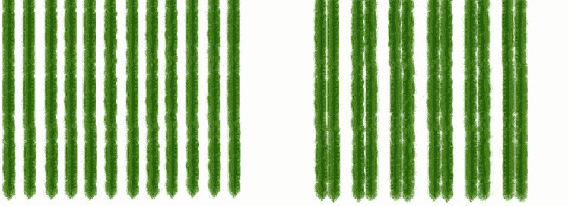

图 #3-2，等间距行和交替间距行的对齐状果园布局。

灌丛形式的收获要么通过人工劳动，对于较大的种植面积，则使用蓝莓型采摘机。当你需要从人工劳动切换到设备时，取决于你根据种植规模能否买或租到二手的蓝莓采摘机。

当树木幼小且单棵产量较小时，每棵树手工采摘仅需几分钟。当树木成熟且产量高时，手动采摘坚果可能每棵树需要20分钟以上。

理想情况下，你会加入当地的坚果合作社，他们可能可以租给你一台收割机，然后由他们处理你的坚果并给你开支票。或者，你可以付费给某些团体作为募捐，让他们来采摘坚果。

俄亥州的一位栗种植者在收获季节每天安排不同的小组装满5加仑桶。种植者为每桶去了壳的干净坚果支付11美元。从不同教会到体育团体和青少年团体，不同的小组被安排来采摘坚果，这作为社区建设的一部分，你可以观看这段视频[15]。虽然这个例子是关于栗子的，但它也适用于榛果。

此外，你可以从当地的临时日工服务机构雇佣一支临时队伍来采摘坚果。虽然这本质上不是“自采型（U-pick）”经营，但你使用的是劳动力来采摘坚果，然后进行加工出售。要让这种日工方案可行，你必须确保你的作物产量充足，且价格足以在经济上证明其合理。

我们许多人并不擅长在零售环境中应对客户以及随之而来的各种棘手问题。我们中有些人很享受想象一家家人来到大自然中度过健康一天的想法。如果后一种态度描述了你对榛果园的愿景，那么自采型（U-pick）经营可能适合你。

毕竟，在自采型经营中，你付钱采摘坚果，如果你是直接批发或直接卖给商店，就不需要负责后续的清洁、干燥、包装和交付了。尽管这听起来不错，但还有更多需要考虑的因素，我们将在第6章“收获自采果”中讨论。

## 自采型果园

使用灌丛形式的自采果园与对齐状果园非常相似，但你需要让客户能够方便地在你想要采摘的行或区域之间行走。

在灌丛形式下，榛树枝保持灵活性，方便采摘，客户不需要使用梯子或爬树，从而避免了相关的法律责任或对树木的损坏，如图 #3-3 所示。

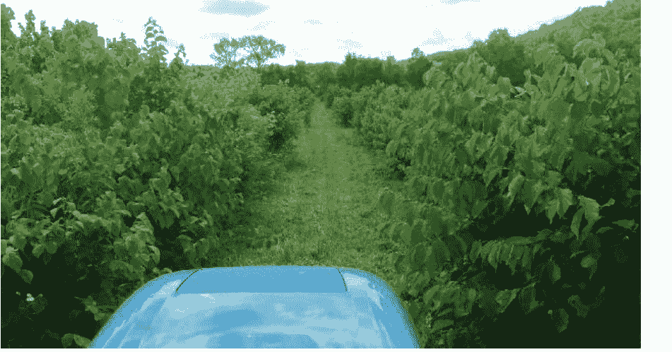

图 #3-3，Z’s Nutty Ridge LLC 成熟榛果灌丛对齐状果园。

通常，在任何田地上，由于水分、遮荫、风力、保护或动物捕食，某些区域的产量会好于其他区域。客户倾向于进入你自采经营中最好的区域，而忽略那些不完美的区域，因此你需要引导客户进入果园的特定区域。

如果你的灌丛行间距较密，并且每隔50-200英尺有一条垂直于行的车道，你可以通过绳索封住某些行来轻松引导人流。使用系在树上的柔软、厚绳子，你可以引导客户到达正确位置。如图3-4所示，阴影区域可供采摘。

记住，通往田地的道路通道、充足的停车位需求，以及必要的指示牌。你需要贴出自采经营的规则，并根据法律可能需要配备卫生设施。如果需要，卫生设施可以是一个租赁的“移动厕所”和一个脚踏式洗手站。

另一个考虑是用去壳坚果换采摘的全坚果，这样他们就不必手动剥壳。我们发现，除了年底假期期间零吃几颗坚果外，没人会剥足够的坚果来烹饪，你可能会失去一个回头客。或者，你可以手头准备设备为他们破壳并收集坚果。

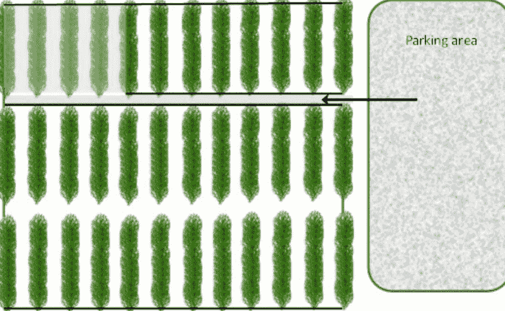

图 #3-4，自采型榛果园设计。

## 商业单干果园

商业单干果园——这种是你依赖于树木供应商为你提供美国品种与欧洲品种的杂交品种，或者是适合我们USDA第4号和第5号地区的非常耐寒的欧洲品种。USDA第6b和7号区的抗寒性不是大问题。

单干树往往具有非常硬的树干且直立生长，在十年后，能够抵抗直立树干不因采摘坚果而弯曲。树木在成熟时作为灌丛高度通常高于10英尺，如果作为单干树生长，高度会更高。

这种尺寸的榛果如果具有短壳且在成熟时掉落以便采摘，效果最好。单干收获通常使用条捡收割机，将坚果扫入行中，然后用吸尘设备收获。有些收割机只使用吸尘功能来收获坚果，类似于吸尘器。无论何种情况，果园地面都必须修剪短以减少杂物。


另一种额外的控制方法是像割草坪一样滚动，在收获前将松散的石头压平。在东北部，我们规定单干杂交树的行内距为 10/12 英尺，行间距为 16/18 英尺，每英亩 209 到 273 棵。如果你有树木且有精力每英亩种植两倍数量，那么行内种 6 英尺可能是值得的。当你将每英亩树的数量翻倍时，你也增加了幼树在较小时的可用花粉量，有利于授粉并在幼年获得不错的产量。当双倍种植在七到九年后变得过于拥挤时，需要移除树木，将数量恢复到 12 英尺的行距。通常情况下，假设种植的是克隆树，只需每隔去掉一个。如果种植的是种子树，则移除表现差的。因为这种果园类型被称为单干果园，从定义上来说，你清楚种植的是什么树。

榛果树通常是非常直立的灌木。这意味着，如果得到良好照顾且根系强壮，它们通常会向上直长六英尺。一些移栽植物最初会呈丛状，这意味着它们在三英尺以下会长出几根带有侧枝的茎。第一年，如果在冬季休眠期有多个主干，将其修剪到只留最壮的那根。如果只有一个一个主干但有很多分枝，请剪掉侧枝。我们需要在任何侧枝出现之前让主干长得足够高，否则会使收获困难。确保你的母本是树形的，以便为单干树提供所需的高度。侧枝出现前的合适高度约为三英尺。再次，确保你了解从购买树木苗圃获得的遗传信息。

在第二或第三年的冬季休眠期，如果树已经达到约五英尺高，你将修剪以形成一个中心开放支架。这意味着将第一侧侧枝留在三英尺处，如果你有四五根侧枝，则主干上每隔六英寸或更多留一枝，并剪掉顶部的主干。如果你发现树还不够高，让主干再生长一年，并在修剪主干之前形成剩余的侧枝。

这引出了树木种植知识的下一个水平。我们种植什么类型的树？是本土原生树、当地选择的杂交苗、还是当地衍生的克隆本，或者是在西海岸生长良好并希望在这里也能种好的榛果？苗树和克隆本之间有什么区别？

## 我们种植什么类型的树？

如果你打算做一个被动的种植者，只需要一个防风林以及为你和野生动物提供一些食物，那么这些苗树是你需要的。如果你打算进行专业化经营并期望资金和精力的回报，你需要针对你所在的地区测试过的克隆本。我们的许多计划最初都介于简单的防风和高度机械化的商业果园之间，例如采用灌木型树的自采型经营。嗯，苗树的果实与克隆本果实之间的区别往往是天壤之别。

我们从其他种植者认为异常树木的品种中购买了苗树。许多树是经过多代控制或半控杂交的品种。在 Z's Nutty Ridge 的最初几年里，我们种了超过6000 棵那些选定的苗树。我们已经让其中超过4000 棵树生长到完全成熟，其中许多死于枯萎病，或因为在我们多风寒冷的冬季里太脆弱。幸存下来且未受枯萎病严重侵害的榛果树，果实质量范围很大。有些树生长得好但不结果果实。有些树是生长性很强的品种，每年只产生几个果实。有些树会产大丰，很多时候树枝都压在地面上，但果实很小且外壳非常厚。有些果实就是味道不好吃，像我们用的那样有泥土味。有些对春霜敏感，只在某些年份结果。在这 6000 棵本应源自具有强健抗性、抗 EFB（榛果腐烂病）和高品质果实的母本的树中，我们认为只有八个品种非常好，其中两个异常优异。我们正在繁殖那两棵优异的树，并积极观察和测试剩余的六个。我们不断收集新的遗传基因并进行受控杂交，以不断提高质量、硬度和产量。

意识到即使在开始时仅知道至少有一个亲本是异常品种，获得优异树木的概率也有 3000:1，你就会意识到除非你有大量的金钱时间浪费，否则不应该重复这种实验。我们相信通过对我们最好的树进行受控杂交，我们将获得更多异常树木。然而，这些树需要时间来证明自己，尚未准备好上市。

在证明了你可以针对你的区域测试过克隆本后，你仍然应该种植苗树。如前所述，榛果不能自授粉。榛果树需要来自另一棵树的兼容花粉。榛和栗是通过风授粉，因此我们需要大量的花粉。如果两棵树是克隆的，它们无法互相授粉，因为它们实际上是同一棵树且本质上相同。因此，拥有优异树的克隆果园仍然需要交叉授粉者。理想情况下，交叉授粉者也是克隆，两个不同的克隆将互相授粉。请咨询你的苗圃并核实你是否只需要两种不同的克隆树。我们真的建议你至少准备一些苗树作为授粉保险。

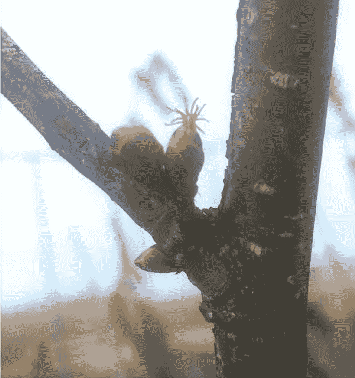

图 #3-5，三月早期 Z's Nutty Ridge 的榛果花。

授粉也是一个时间问题，而不是兼容性问题。如果你的心神有所偏移，这听起来像是在谈论人，但树和人没有区别。每棵树产生花粉的时间略有不同，产生雌花的时间也不同，而两者在一段时期内都保持活力。听起来事情变得复杂了，但所有生物生物在授粉方面都面临相同的问题，榛果也不例外。我们只是确保我们都意识到我们需要注意的问题。为了获得大产的果实，我们希望尽可能地增加受授粉的花朵数量。

我们可以将花粉可用时间细分为许多小窗口，但同样说树会在季节的早期、中期或后期（雌花接受期时）产生具有活力的花。不同的树落花粉持续时间不同，不同的树产生的花粉量也大不相同。有些树在夏季下半叶产生大量的序序，当叶子掉落时变得非常明显。有些树上挂满了序序，而另一些相对较少。这就是苗树的变异性。在纽约州北部，授粉季节最早可以从2月底到3月下旬开始，到4月底结束。雄序序和雌花的抗寒性将决定在深冬的严冻或冬季冷风中花朵盛开时授粉效果如何。这就是为什么你应该在果园中保留一定比例的苗树。每块田地都有盛风。你大多数时候知道风从哪里来。这就是你应该在背离盛风的方向种植苗树的地方。每五排克隆树只需要一排苗树。无论大自然发生什么，苗树都会为花粉的释放提供保险。如果你愿意，可以增加更多苗树，但并非必须。

我们需要更多杰出的树木供北美东部地区繁殖。果园中的苗树将使那些树能够被发现和分享。我们再次建议你从具有多年杂交和选择的苗圃购买苗树，以最大限度地提高苗树质量并增加发现下一棵明星树的概率。这就是为什么我们一直在告诉你关于长期以来的树木选择。苗树的遗传变异性为我们提供了最大机会找到抵抗未来任何未知疾病的树。

我们已经种了俄勒冈州立大学提供的大多数品种，俄勒冈的种植者在他们的果园中使用这些品种。到目前为止，没有任何品种能抵抗 EFB，且在 USDA 第4区或第5区很少结果实。

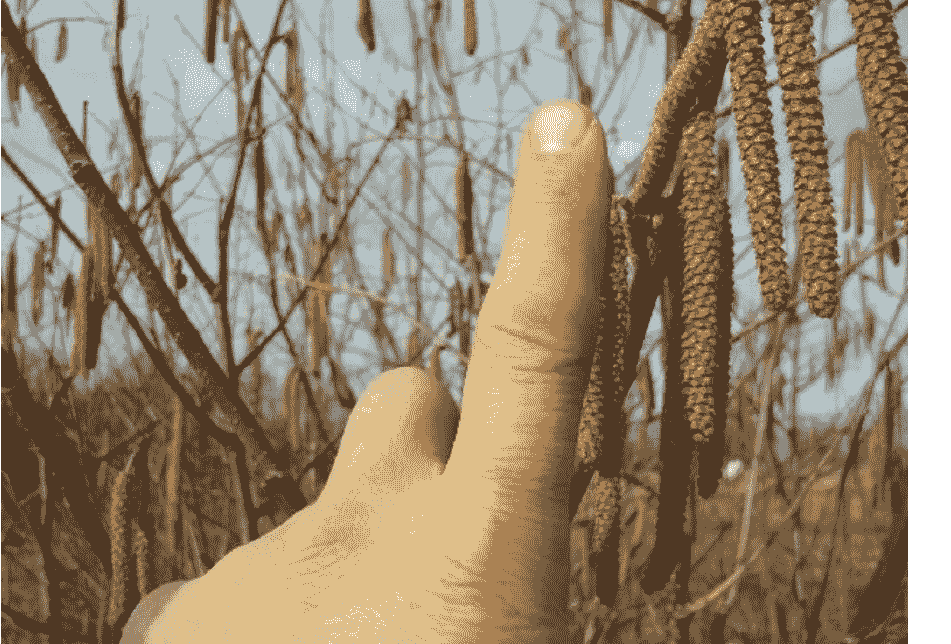

图 #3-6，Z's Nutty Ridge 的榛果序序（雄花）。

序序只有在经过足够的冬季寒冷小时数和足够温暖的白天夜晚后才会伸长。我们使用“温暖”是一个相对术语，因为我们并不认为2月是温暖的。例如，在2017年2月的最后两周里，我们有11天的白天温度在40华氏度以上，8个夜晚温度在冰点以上。这波暖天气足以让大多数序序伸长，有些序序在3月2日就开始释放花粉。3月4日和5日晚上，我们经历了连续两个夜晚温度降至1华氏和-4华氏度，并有强风。序序一旦伸长就容易干燥，并且无法释放具有活力的花粉。我们的授粉季节基本上在两天后就结束了，而不是通常的三个或四周。因此，只有在那两天内开放的最早的雌花被授粉了，而且只有那些能够忍受冷干燥风的强健花朵才能结果实。之后很少有具有活力的序序，但它们是未来育种的来源。作为种植者，这听起来像是糟糕的一年。但作为苗圃，2017年是理想的。

为了找出我们的优选品种中哪一个能应对极端天气条件并依然像我们命名的品种“NITKA”那样结出坚果。这应该给你们信心；我们付出了努力并承担了代价，以最大限地减少你们的风险和精力。

通常情况下，雌花的生命力可维持一个月以上等待兼容的花粉到来。深冻似乎会冻伤这些小花朵，但一些强壮的树将依然保持生命力并结果。雌花通常被描述为洋红色，也可以是乳白色到粉色。花朵非常小，通常不会被注意到。它们在下序开始伸长时出现。它们位于花芽的末端。受粉后，花朵会消失在芽中几个月。当那个芽伸长成几片叶子和一片苞片时，果实就会出现，形成 1 到 15 颗果实。

当春季花粉完全散落且有微风时时，你可以看到黄色的花粉云飘过果园。如果你在那个时候走过果园，你离开时会发现身上和衣服上覆盖了一层薄薄的黄色花粉。与栗树不同，榛子花粉是。幼小的榛子苗在第一年长出一单条茎。第二年会形成一些侧枝，可能从基部产生一些侧芽。

## 每英亩预期收益是多少？

从财务角度来看，榛子是理想的特种作物，因为它们一直处于短缺状态，且利润率高。带壳榛子的零售价格平均为每磅 6 美元，而去壳生散装榛子目前在当地杂货店以每磅 12.99 美元的价格出售。榛子每磅的成本目前限制了消费。榛子消费增长的未来是非常前景的，因为欧洲人的消费量是美国人的八倍。

在树木产生大量坚实之前经过必要的六年等待后，榛子可以提供远高于任何年度粮食作物的丰厚收入。假设每英亩仅产量 2000 磅坚果（可达到 3800 磅，这应该是可以实现的），按照每磅仅 2.50 美元的直接批发价（我们目前的售价为每磅 3.50 美元），每英亩收入从 5000 美元到 13,300.00 美元不等。相比之下，纽约玉米的平均产量为每英亩 160 格，当前价格每格低于 4 美元，每英亩仅为 640 美元。榛子的年度投入成本与玉米相似，由于榛树是原生植物，与大多数种植的年度作物不同，有机可持续性应该很容易实现的。

这假设你将把带壳坚果直接卖给商店或在线直接卖给消费者。大部分榛子是经过去壳的；果肉被分离出来被称为去壳榛子。榛子可以压榨油，然后将剩余的饼磨成无麸质、高蛋白面粉。坚果可以像任何坚果一样进行烘烤、糖渍和调味。你可以提取榛子风味并出售，或者制作成糖浆、啤酒或任何种酒精配方。要自己完成上述任何操作，你将需要在使用食品级设备的认证厨房中成为经过认证/有执照的食品加工商。因此，你需要查看当地的县和州法规，或者加入一个坚果合作社。各州正在放宽对家庭加工者的规定，并收紧对大型加工者的规定，所以请咨询当地法规，我们将在第 6 章中更详细描述这些问题。

# 第 4 章 - 如何保护你的果园

你需要用围栏保护幼小树木免受鹿和啮齿动物的侵害，并在各个阶段防范鹿。你可能会遇到鸟类对接近成熟的坚果的捕食，它们也会带走你相当部分的坚果。列表中的最后一项，到目前为止在东北部的昆虫保护并不是重大问题。对于几棵树来说，防鹿很简单。果园的防鹿需要一个 7 英尺以上的围栏，可以是塑料的或金属的。我们了解到，对于任何希望在东北部最大化坚果果园年度增长和产量的人来说，这是必须的。

开始经营坚果果园是一项巨额的前期投资，你知道必须等待五到七年。

高度为 7.5/8 英尺的塑料或铁丝栅。我们我们需要耐用的立柱，立柱至少需要 10 英尺长，最好是 12 英尺长。它们需要入土至少 2.5 英尺，理想情况下达到 4 英尺，以抵御任何风力和动物入侵，而不会松动或抬起，且不受冻线影响。我们发现，我们的山坡上钻围栏柱孔非常困难，因为山坡有很多岩石。

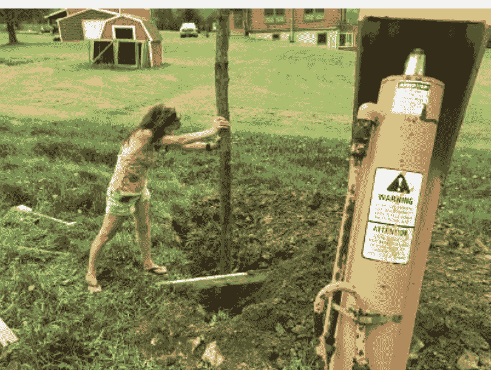

图 #4-2，一根 12 英高的黑蜡木柱正在进行回填定位。

注意，据报道，天然黑蜡木柱比压力处理过的木材更耐腐蚀。还要注意，只有心材是防腐的，因此确保柱子足够宽且大部分为心材，以延长使用寿命。

## 更持久的鹿围栏概述

建造 8 英高的鹿围栏有三种成本水平和三种劳动力投入水平。既然我们已经用各种材料和工具搭建了足够的 8 英尺高围栏，我们就能根据经验节省大量时间并减少挫败感。

1. 老实说，如果预算允许，聘佣围栏安装人员以固定费用安装 8 丝鹿围栏，并让他们去担心那些钻不进去的柱子。目前钢丝栏的每英尺成本在 7 到 12 美元之间，取决于选项、位置和果园的大小。

2. 第二种节省大量体力劳动和金钱的方法是标记出你想钻孔的位置，并租赁带带压力的卡车式或滑移式柱孔钻机。除了大岩石或硬岩层外，他们能够为你选择的任何围栏柱钻孔。当我们平均钻孔时，卡车式柱孔钻机每个孔大约是 16 美元。

3. 为了节省最多的钱，如果你知道土壤是软的，你可以自己敲入铸铁“T”型柱，简单的单点钩式地钻就会为你的木制角柱和门柱钻孔。

立柱就位后，你需要决定是租赁还是自制设备来安装钢丝围栏。钢丝围栏应该是你的首选，只有当你无法租赁或自制所需设备，且无法结合拖拉机或皮卡运输设备时，才选择塑料围栏。你会发现塑料围栏比钢丝围栏便宜一点，但塑料围栏的安装需要大量劳动力，而且寿命可能不到七年，并且需要更多维护来保持。

我们刚刚按照成本从高到低的顺序列出了防鹿围栏安装的基本构成。从概念上讲，这三种方法准确地描述了基于你参与程度的基本成本结构。在实际上，情况并不那么简单，正如我们将要解释的。

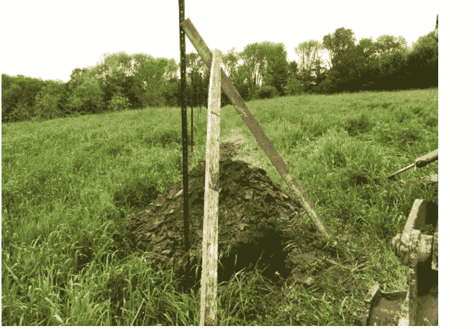

## 围栏柱的类型

在搭建防鹿围栏时，有两种基本的围栏柱类型以及每种类型的变体值得考虑。基本类型是木质和钢质。木柱可以是黑蜡木或雪松。钢柱可以是成型钢或铸铁“T”型柱。还有其他销售的我们无法推荐的柱子，例如管钢柱、纤维玻璃和塑料，因为它们生锈太快，或对于 8 英尺高的围栏来说太灵活。如果万事无果且你找不到上述任何柱子，你总可以找到压力处理过的柱子；但请记住，使用压力处理过的柱子将无法通过有机认证。

每种柱类型的信息如下，你选择哪种可能取决于可用性和成本。雪松柱天然防腐，但不如压力处理的那么耐腐，更远不如黑蜡木防腐。钢柱、雪松柱和黑蜡木柱适合有机种植者。我们在我们地区只能买到 8 英尺的雪松柱，不特订就买不到 12 英尺的。因此最后，我们无法为防鹿围栏将雪松与其他柱子进行比较。成型钢柱具有一定的灵活性，但与价格是倍的铸铁“T”柱相比非常便宜，而在我们这里，压力处理柱的价格是其三倍。黑蜡柱的成本与压力处理柱相似或更便宜，且是当地采购。请记住，只有深棕色木材是防腐的，所以购买直径大于 4 英寸的柱子。

我们购买时，`1.5" x 1.5" x 10'`冲孔钢柱的价格低于 7 美元，12 英尺的每个低于 8 美元。我们从 Best Angle Tree Stakes 购买，并开车位于宾夕法尼亚州泽西西岸的钢厂取货，因为运费将高得无法接受。

“T”型柱是铸铁的，非常硬。两种金属围栏柱之间的区别是天壤之别。带冲孔的金属围栏是平钢，经过弯曲/成型得像 Z 字形以增加刚性，但刚性是一个相对术语，当高地面 8 到 9.5 英尺时，它仍然具有灵活性。由于成型“Z”型柱是灵活的，我们不建议只使用成型钢柱，而是将其与直道部分约 30% 的“T”型柱或木柱混合使用。

铸铁“T”型柱可以在 Tractor Supply Co. 或类似的农用用品商店预购，价格大约是两倍。如果当地的 Tractor Supply Co. 没有 10 或 12 英尺的“T”型柱，该地区很可能有。请记住，运输成本包含在任何柱子的价格中，除非你幸运地直接从厂家购买。标准压力处理 12’ 柱子我们来说每个大约是 18 美元。对于任何沼泽地区可能需要的额外压力处理柱每个是 26 美元。购买一百根或更多柱子时，节省的可以迅速积累。我们选择了 150 根成型钢“Z”型柱（通常称为“树桩”或“树杆”），因为它们主要用于苹果园，与只用黑蜡木柱相比节省了 1200 美元。如果你找到当地来源，你的节省也可能相似，因为运输是成本的主要考虑因素。总之，我们的柱子成本如下：

| 柱子类型 | 每个成本（美元/个） |
| :--- | :--- |
| 10 英尺成型“树桩” `1.5" x 1.5"` 工厂取货 | 6.00 |
| 12 英尺成型“树桩” `1.5" x 1.5"` 工厂取货 | 7.00 |
| 12 英尺 雪松 | NA |
| 10 英尺铸铁“T”型 | 12.00 |
| 12 英尺压力处理 5" 直 | 18.00 |
| 12 英尺 额外压力处理 5" 直 | 26.00 |
| 12 英尺 黑蜡木（当地采购） | 16.00 |

表 4-1，柱子成本。注意：当地来源应该更便宜，因为涉及运费。

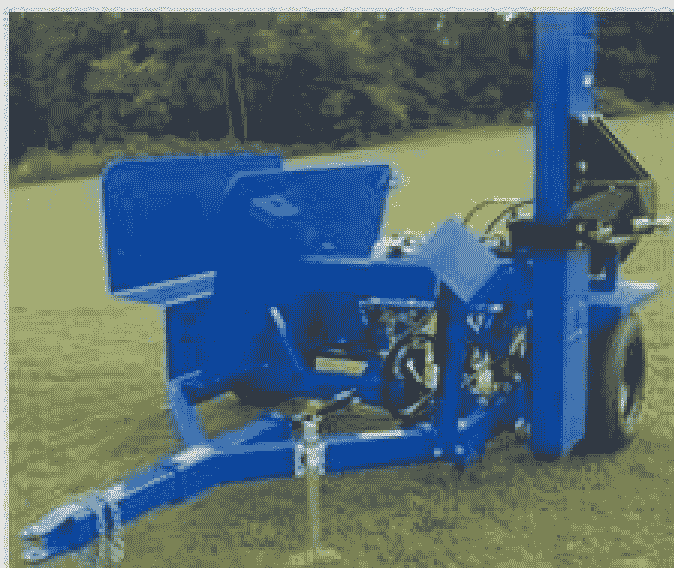

图 #4-4，拖挂自用动力打桩机。图片感谢 Finger Lakes Supply：http://www.fltsupply.com/

## 使用完全相同的柱子还是根据需要混合使用？

我们发现性价比最高的方法是在转角和门洞处使用木柱，那里你需要刚性来承受围栏的张力。在围栏的直段，你可以使用金属或铸铁柱。在不平整地面或阶地段，你需要使用木柱来处理围栏张力。我们还发现一些围栏制造商建议柱子间距不应超过 25 英尺，我们建议 16 到 20 英尺是一个很好的范围。在围栏有轻微弯曲的地方，间距要密一些，直段部分可以拉开。当围栏出现突然弯曲时，将弯曲处视为转角并使用木柱。我们还没有看到在转角使用铸铁柱的好方法。如果你看到了我们在围栏部分描述的好方法，可以在名为 Finger Lakes Supply 的果园用品网站上看到：http://www.fltsupply.com/equipment-sales.html。

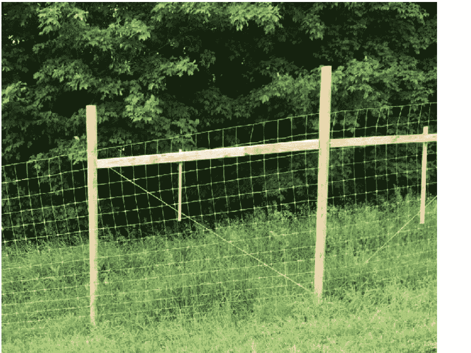

图 #4-5，围栏角部组装。注意，带有调节杆的张力线用于拉紧钢丝。

## 安装后工作

在相对松软的地面上安装金属柱可以手动完成，无需租赁或雇佣他人为你操作。你可以直接在当地农用用品商店购买一个不到 50 美元的“手动打桩器”，将金属柱简单地敲入地下。手动打桩器要安全得多，而且是安全敲入柱子的唯一真实可行方法。打桩器就是一根长约 20 英寸的厚管，一端焊有端盖，侧面有两个手。你只需将打桩器套在柱子上，将其举起，然后使其落在柱子上，直到达到所需的深度。现在已经有了“气动打桩器”，价格范围从亚马逊或 eBay 的 300 美元到 Skidril® 品牌的 1100 美元不等。

你可能想直接用大大锤敲入木柱或钢柱。我们曾用一把重 13 磅、称为“柱子锤”的大铁锤敲入过许多 6 英尺长的木柱。危险在于，你需要有人扶住柱子，如果你击偏了仅仅触碰到柱子顶部，你可能会砸到扶柱子的人或你自己的小腿或脚。此外，为了敲入柱子，你必须站在皮卡车或全地形越车的背部，处于 12 英尺的高度——就是那 12 英尺高！梯子太不稳定，无法使用。我们的建议是，对于任何超过 6 英尺高的柱子都不要使用大铁锤。再次，你可能想用大铁锤，但不要在 12 英尺的柱子上这样做。好吧，只能说我没有告诉你这段话的评论而导致残疾，真是幸运的。


如果你除了角部和门外随处都使用金属柱，你可能可以使用任何家居用品店都能买的手动挖柱器来处理木柱。请记住，它们通常只钻出 4 英寸直径的孔，因此你必须将孔扩大到柱子所需的宽度。此外，由于手动挖柱器高度只有 4.5 到 5 英尺，向下挖 4 英尺非常困难，而你需要角柱和门柱尽可能接近 4 英尺以保持稳定。

记住，四个角和一个门需要 16 根木柱。手动挖掘 16 根柱子需要一台手动操作或气动的挖柱器/螺旋钻机。你可以在 Harbor Freight 以 200 美元的价格购买，而 Stihl® 品牌的气动钻机价格则高达 400 美元以上。只需确保钻头的直径大于或等于柱子的宽度即可。

当土壤松软时，用气动钻机钻孔很容易，但当你遇到岩石时，它会想要从你手中脱落，对你的背部压力很大。你当地的工具租赁店可能有带轮钻机可以租赁，这会让你的工作更轻松。你必须遵守说明书中的所有安全指导，因为这种动力工具可能是危险的。钻完孔后，只需将柱子放入并回填，用手用力压实土壤。

如果你到处都是石头且手动挖孔令你感到筋力交瘁，你可能需要升级使用标准的三点挂式挖柱钻。你可以按天租赁，或在 Tractor Supply 或任何农机零售商以 600 到 1000 美元的价格购买新的。说真的，你大多数农农邻居都会有一个，并可能会借给你。

否则，如果你无法使用标准的三点挂式钻孔，将需要租赁如图 #4-4 所示的“打桩器”，这可以从当地的围栏/果园供应商处获得。即使是租赁巨大的自动力或三点挂式打桩机，我们也建议如此……（注：原文此处存在部分重复和乱码，翻译已根据逻辑尝试理顺）。

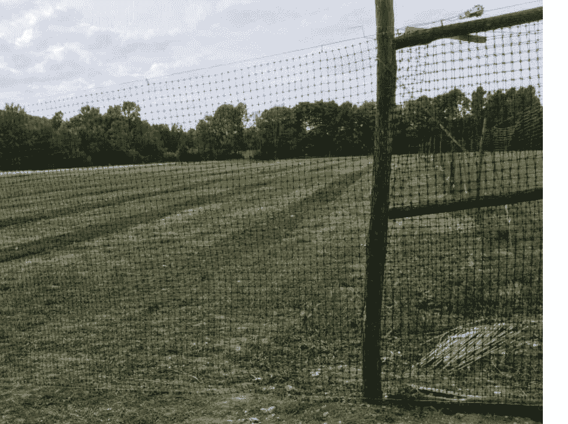

图 #4-7b，挂有登山扣的带有两个交叉支撑架的塑料门。注意，为了给新果园种植树而翻过的条带。

张力线只是普通的低拉力或高拉力电栅网线。金属丝如上所述，绕在侧柱顶部，并形成环路向下延伸到角柱底部。金属丝的位置通过在角柱靠近地面处使用两个围栏钉来固定。

在可能的情况下，我们在侧柱交叉支撑架上留出约一英寸的支撑销钉暴露在外面，并将张力线绕在支撑销钉上。然而，不要将钉子完全钉入，因为你需要让金属丝能够滑动以进行张紧。末端用手拉紧并扭在一起，以确保它们不会被拉开。扭转高拉力线很难做得到位，以至于在张力下不松脱，你可能需要用其他方法来连接端部。

或者，你可以购买“接头”（crimps）来连接端部。一旦环的末端扭在一起或压接在一起，你只需将一根约 3 英尺长、1 英寸 x 1 英寸的木棍插入环中，并绕金属丝旋转木棍，直到环如图 #4-5 所示扭紧。用于张紧金属丝的木棍称为“扭力棒”（twitch stick）。

在拉紧金属丝时，将木棍大部分留在金属丝的一侧，因为你随后会将木棍螺栓或系在交叉支撑架上以保持张力。如果你在环上使用了高拉力线，可以使用所谓的“抓钩”（Grapple）来连接环的端部。抓钩允许金属丝仅从一个方向通过，且不会被拉出。

一种用于抓钩张紧金属丝的特殊工具被形象地称为 Grapple Torq 张力工具，该张力工具的价格在 50 到 100 美元之间。

连接金属丝的第四种方法是使用“拉线器”或“线张紧器”，你将其一端系在上面，并使用“拉线器工具”将另一端绕在小卷轴上。张紧器和拉线器工具的价格分别低于 5 美元和 8 美元。金属丝最初会有一些拉伸，随着时间的推移，这为你提供了一种重新张紧金属丝的方法。

这两个物品在大多数农用商店都能买到，是使用接头之后最常用的方法。我们发现“接头”的效果不如“拉线器”或抓钩，因为接头随着时间的推移容易滑动。

回顾连接金属丝的四种方法：简单扭转金属丝、使用接头、使用抓钩或如图 #4-8 所示使用拉线器。我们发现可以轻松拆卸金属丝的最佳方法是拉线器。它们的价格约为 3-5 美元，可以重新张紧并重复使用，在大多数农用商店都能买到。

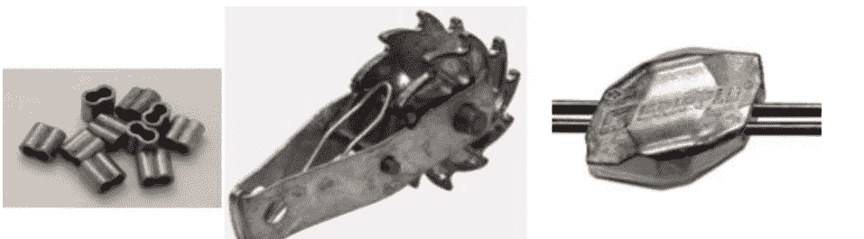

图 #4-8，连接围栏线的不同方法分别为：接头、拉线器和抓钩。图片感谢来自 Finger Lakes Trellis Supply Depot，网址为：`http://www.fltsupply.com/`

可以使用塑料围栏制作门，就像挂浴帘一样挂起，或者使用带有铰链固定在侧柱上的预制金属门。在门到位之前，门的每侧必须有两个带有交叉支撑架的柱子（就像角柱一样），以处理围栏的张力和压力。门的张力线从门柱开口的顶部开始，绕过侧柱底部然后进行张紧。

如果你想使用塑料围栏，只需在围栏的高度使用一根金属丝，用多个登山扣挂起围栏，并对底部周线重复此操作。两种类型的门分别如图 #4-7a 和 #4-7b 所示。

用放置在门边缘两侧的两条木条加固围栏门的开口，并用木螺丝将塑料围栏夹紧。木条（两条 8 英尺长、1 英寸 x 3 英寸的木条）将允许你将门拉上，并将门紧紧固定在侧柱上。这是一种低成本的门，效果良好，并且仍然能让你的卡车、ATV 或拖拉机通过大门。

## 围栏类型

塑料围栏还是金属围栏取决于你的喜好（你已经知道自己的喜好了！），而且你的喜好可能取决于你拥有的设备。

一个高 8 英尺、长 330 英尺的金属围栏重量达 400 磅，对于两个强壮的人来说，移动围栏并在卡车上进行装卸非常困难。滚动和抬起围栏进行张紧需要三个人或更多人，最好使用一个安装在拖拉机三点悬挂上的围栏安装器/拉伸器，如图 #4-9 所示。

相比之下，塑料围栏相当轻，我 100 磅的妻子可以独立处理 330 英尺的围栏，如图 #4-10 所示。实际的围栏连接应遵循围栏的建议。如果你没有可以处理沉重金属丝卷的设备，你可能需要考虑塑料围栏。

塑料围栏的价格可能比金属围栏便宜，但金属丝在顶部和底部会有额外的成本和人工，最终每英尺的成本相当相似。我们假设塑料制的鹿围栏将持续 5 到 7 年。阳光会使塑料老化并变弱。使用塑料围栏是因为它很轻。使用塑料围栏是因为它很轻。使用塑料围栏是因为它很轻。使用塑料围栏是因为它很轻。使用塑料围栏是因为它很轻。使用塑料围栏是因为它很轻。使用塑料围栏是因为它很轻。使用塑料围栏是因为它很轻。使用塑料围栏是因为它很轻。使用塑料围栏是因为它很轻。使用塑料围栏是因为它很轻。使用塑料围栏是因为它很轻。使用塑料围栏是因为它很轻。使用塑料围栏是因为它很轻且容易处理。

金属丝最初会有一些拉伸，随着时间的推移，这为你提供了一种重新张紧金属丝的方法。从 Tractor Supply 或类似的农用商店购买的 4000 英尺卷高拉力线售价 120 美元。

如果我们使用了“Z”型柱，只需将高拉力线穿过预钻孔。如果你使用没有孔的“T”型柱，你需要将低拉力线紧紧绕在柱子顶部，出一个额外的环以穿过金属丝。

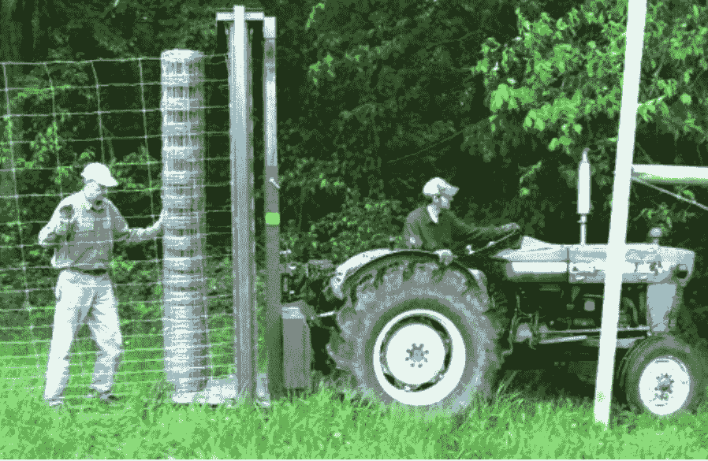

图 #4-9，金属围栏的安装器。

## 塑料围栏安装

为了将周线线穿过围栏柱和围栏钉，金属丝卷必须整齐地展开且不能有任何结。我们用 2 英尺 x 4 英寸的木材制作了一个绕线器或“扭力棒”，如图 #4-12 所示。

我们无法低估周线线的重要性，塑料围栏线不能有任何结，否则它会断裂。如上所述，你需要使用“扭力棒”将非常沉重的金属丝卷整齐地拆开金属丝，如图 #4-13 所示。金属丝中不能有任何结，否则你无法张紧金属丝。金属丝必须滑过围栏钉，否则金属丝在拉紧时会在结处断裂。你需要投入 35 到 120 美元来购买一个扭力棒，或者借一个。

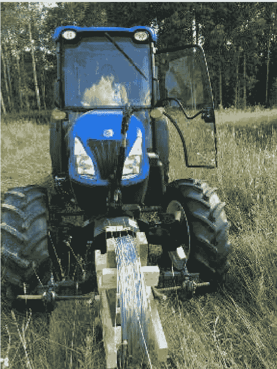

图 #4-12，使用自制的“纺纱机”拆开高拉力围栏丝线。

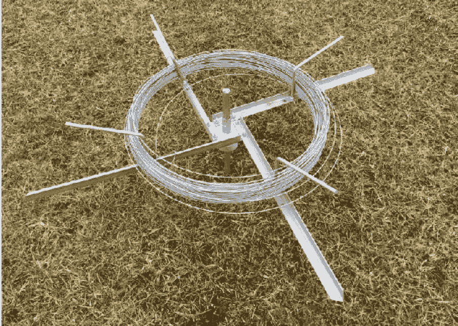

图 #4-13，位于购买的“纺纱机”上的高拉力围栏丝线。

最初悬挂塑料围栏，你可以使用在 eBay 或 Amazon 上大量出售的廉价登山扣，这些登山扣带有弹簧夹子，可以让你迅速地将丝线钩在围栏顶部。由于塑料围栏非常轻，每隔 10 英尺放置一个登山扣即可。

当你用完一卷并开始新一卷时，需要将丝线的末端连接在一起。连接卷末端的方法与悬挂围栏相同。你先用登山扣连接围栏卷的末端，然后在每个方格处使用马蹄（hog rings）。你可以用重型剪刀剪掉多余的围栏并保存起来，以便修补裂缝。

塑料围栏与拉紧的铁丝围栏相比有些松散。此外，不要将塑料围栏紧紧地绑在柱子上，因为极端低温会导致围栏收缩，围栏需要一定的空间来分散压力。

连接好围栏末端后，你必须返回，在柱子顶部丝线和底部之间的 3 到 4 个连接点将围栏连接在高拉力丝线上。

将围栏连接到边缘线的方法有两种。最简单的方法是使用马蹄钳使用马蹄，或者你可以螺旋状扭绕低拉力围栏丝线，在围栏和丝线之间产生多个连接点。这将提供许多接触点，因为当鹿撞上围栏时你需要足够的强度。

塑料围栏有 1.0 英寸的正方形孔。我们购买了 100 英尺长的低拉力丝线，每次剪下 8 到 10 英寸。我们在大多数户外或农场商店买到低拉力围栏丝线，如图 #4-11 所示，将其绕在多个塑料围栏方格和高拉力丝线上。

低拉力丝线柔软且易弯曲。我们还将丝线扭绕在一起，防止丝线因围栏正常运动而导致低拉力丝线从围栏上脱落。我们发现，每隔八英尺扭一次线就足够，如果你扭绕 3 或 4 个塑料方格，或者直到连接末端，否则可能会卡住，阻碍你拉掉围栏的松弛。

正如提到的，使用低拉力丝线的替代方案是购买“马蹄”，它们只是半圆形的硬铁丝，你可以将其弯曲在围栏和边缘线上。你甚至可以购买马蹄钳，它可以帮助在你固定丝线和围栏位置时夹住马蹄，以达到省力。

还有一种像钉胶枪一样的马蹄枪，可以让你快速装上马蹄，大大加快悬挂围栏的效率，如图 #4-14 所示。马蹄枪的价格在 25 美元到 100 美元以上。

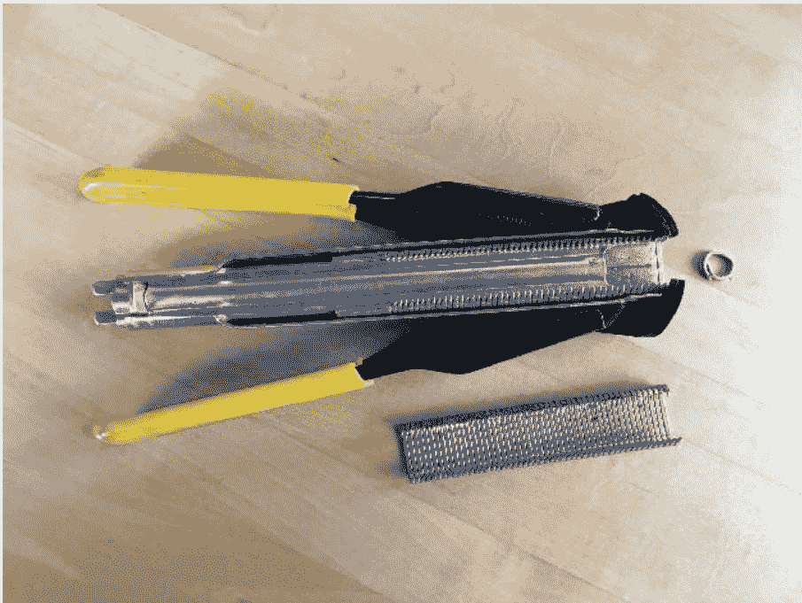

图 #4-14，马蹄钳轻松完成围栏悬挂。

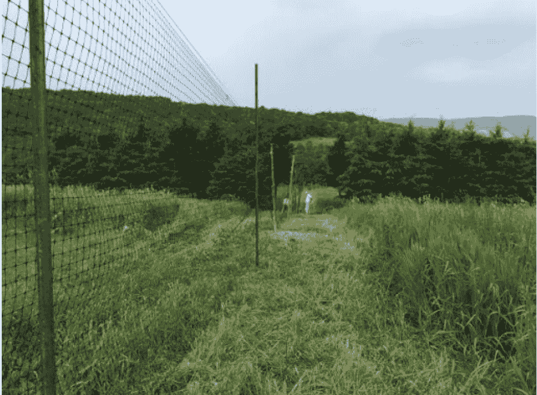

图 #4-15，塑料围栏看起来延伸得很远。

如你所见，塑料鹿排除围栏很轻，但没有铁丝那么耐用，而且安装更费力。塑料围栏需要粗坚固的边缘线，然后夹子以及更多的丝线或马蹄来固定，而这些都是金属围栏不需要的。

我们还了解到塑料围栏不能靠近森林（林缘处可以），那里太多的叶子会堵住围栏，使其像风帆一样试图将柱子拉出地面。塑料围栏起初较便宜，但额外的物品（即杂项）和额外的人工成本最终高于铁丝围栏的初始成本。

鹿可能会撕破围栏，你需要修补裂缝，还要监控其他动物（如兔子和狐狸）会在哪里咬穿围栏。一旦柱子入地，塑料围栏可能是你的唯一选择，因为它只需要手动工具即可搭建，不需要任何设备。

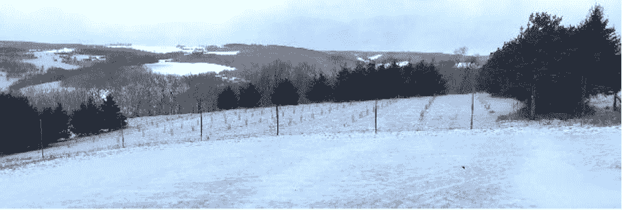

图片图 #4-15 显示了割草前右侧草地以及种了树的地方。图 #4-16 是图 #4-15 右侧同一块地的不同角度，显示了由新鹿围栏和松树防风林边界的新种植榛果田。注意每棵树上的铁丝网笼。

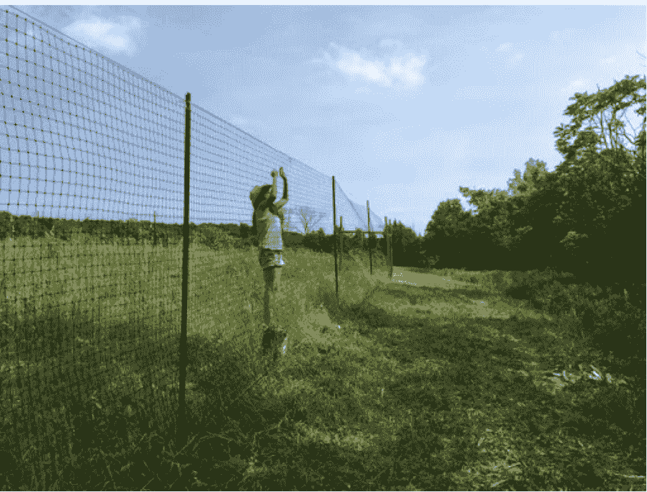

任何有围栏的人都需要一把“围栏工具”，这是一种任何农场商店都能买到的多功能钳，价格从 8 美元到 50 美元不等。钳子有一个用于敲击的小锤头、用于切割的刀和一个用于压接的口。（此处由于原文中重复的 de-line 文字已忽略）

图 #4-18，悬挂塑料围栏。

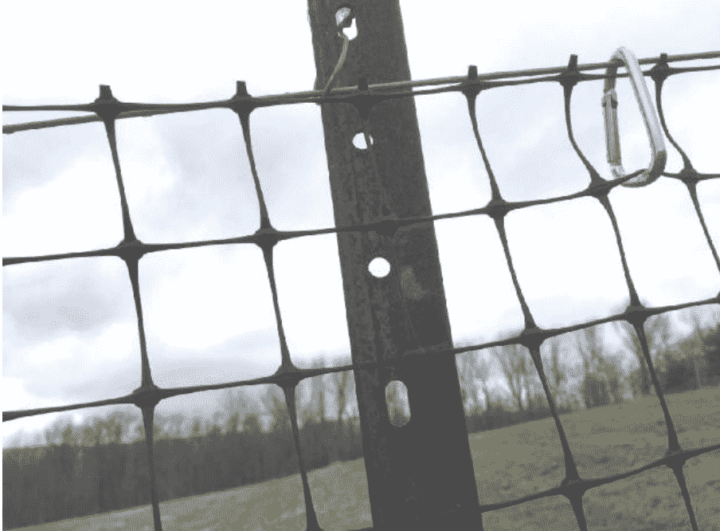

通过底板上的钻头进行作业。将螺头留出约 1.0 英寸，如图 4-20 所示以钩住铁丝。

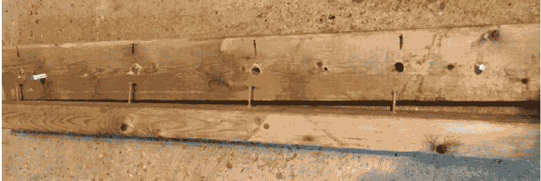

图 4-20，使用 2" X 4" 木材、螺钉和螺栓制作的手制围栏拉伸器。

通过这种方法，带螺钉的板其螺钉将与带孔的板匹配。你将在三个孔中插入螺栓，将两块板固定在围栏上。

在钩住铁丝的螺钉和夹住围栏的板之间，可以对围栏施加很大的张力。在围栏卷需要连接的地方，你需要两个围栏拉伸器和一个“手动绞机”（come-along）来将围栏拉拢并拉紧。

记住，在夹紧拉伸器时要留出多出的围栏，这样你就可以用压箍或抓钩将两端连接。压紧围栏后，弯曲铁丝末端，使压箍无法滑动。或者，仅使用一个拉伸器将围栏拉紧，并将围栏钉在靠近卷轴末端的木柱上，然后在同一根木柱上开始下一卷围栏。

我们没有租赁图 4-9 所示的金属围栏安装器，而是用一个三点挂钩制作了一个，我们可以将其平放并在拖拉机后部垂直吊起。我们通过断开三点挂钩的上连杆并将其旋转来实现。在水平方向上，我们可以向下调整以装载新卷围栏。

对于 400 磅重的铁丝卷，你应该用三个人来将卷向后翻以连接上连杆。

图 4-9 和 #4-21 显示了围栏安装器的两种位置。除非你非常有信心自己制作一个，并且有能力吊起非常重的金属卷，否则我们建议你租赁图 4-9 所示的围栏安装器。省钱是好事；但以安全为代价的省钱可能是代价高昂的。

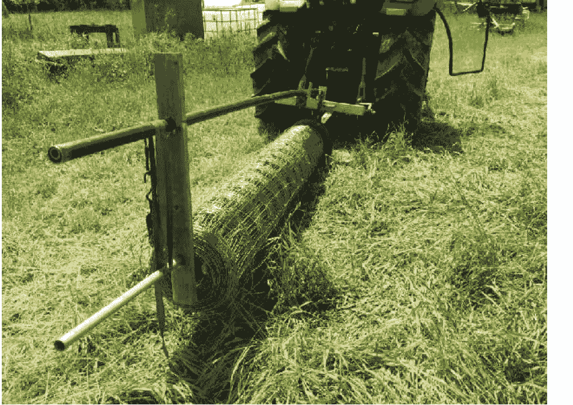

图 4-21，水平位置装载铁丝网卷的临时围栏安装器。除非你擅长焊接，否则我们建议租赁围栏安装器。

## 2.5 英亩围栏和 10 英亩围栏的成本

假设如下：使用手动打桩器和气动力地钻，采用铸铁柱和槐木柱的组合。如果安装金属围栏，你需要租赁必要的设备。这可以作为你自己建造围栏所需的零件清单，如果你聘请安装人员施工，可以以此对比报价。

总而言，塑料和金属围栏的每英尺成本约为 3.24 美元，不包括人工费。如果包含人工费，塑料围栏会更贵。此外，记住，当你购买超过几卷或几百根柱子时，不要害怕数量折扣，因为我们通过合并两个果园支付的费用要少一点。

### 安装 2.5 英亩塑料或金属围栏的成本

| 目 | 注释 | 供应商 | 柱子数量 | 柱子成本 | 塑料成本 | 金属成本 |
| :--- | :--- | :--- | :--- | :--- | :--- | :--- |
| 5/6' 槐木 | 围栏角, 8 个支撑 | 本地采购 | $15 | 26 | $416 | |
| 5/8' 槐木 | 不平整地面和柱子 | 本地采购 | $15 | 20 | $320 | |
| 地钻 | 直线段 | 拖拉机服务或免费 | $18 | 50 | $800 | |
| 销 | 支撑-10" | 拖拉机服务或免费 | $1 | 20 | $24 | $50 |
| 钉扣 | 将铁丝固定在木柱上 (8磅, 400英尺) | 拖拉机服务或免费 | $20 | 5 | $1 | $20 |
| 低张力丝 | 用于系紧角部和门的铁丝 (1/4" 规格, 16号) | 拖拉机服务或免费 | $20 | 0 | $5 | $1 |
| 张紧器 | 用于拉紧角部和门 | 拖拉机服务或免费 | $4 | 30 | $0 | |
| 张紧器 | 用于拉紧铁丝和两侧 | 拖拉机服务或免费 | $4 | 0 | $4 | 16 |
| 高张力丝 | 4000 英尺, 12.5号 | | $100 | | $1 | $100 |
| 塑料鹿围栏 | X#30" 加载型，需订购 | | $350 | | $4 | $1,400 |
| 锁扣 | 临时挂围栏的重型夹子 | Amazon 或 eBay | $30 | 0 | $0 | $1 | $30 |
| 门 - 12英尺 | 12' x 4' 高。8' 门用两个。宽度较窄的更便宜。 | Tractor Supply | $160 | 0 | $0 | $2 | $320 |
| 鹿用金属柱 | 当地供应处 X#30" 加载型 | 拖拉机服务，免费 | $380 | | | $4 | $1,520 |
| 手动打桩器 | 金属柱切割和捆绑 | 拖拉机服务或免费 | $50 | 1 | $50 | | |
| 鹿围栏工具 | 用于拉紧角部、门和每米的铁丝 | 拖拉机服务或免费 | $24 | 1 | $24 | |
| 地钻 | 为围栏柱子钻孔 | 运费 | $300 | 1 | $300 | |
| 围栏安装 | 租赁或建造以拉紧并连接，一天 | FTS,免费 | $125 | | | $125 |
| 围栏安装器 | 租赁并在拖拉机上拆卸金属轨道，一天 | FTS,免费 | $250 | | | $250 |
| | | 小计 | | $5,022 | $1,586 | $2,255 |
| | | 材料和围栏总成本：不含人工 | | $3,608 | $4,277 |

表 4-2，2.5 英亩塑料和金属隔鹿围栏。

关于围栏的一点是，面积越大，每英亩的价格下降越快。如果你围的是一个 10 英亩的正方形区域，围栏成本只会翻倍，因为当面积增加四倍时，周长只翻倍。对于矩形区域，每英亩的节省是真实的，且会增加。

## 动物害虫——齿类动物和鸟类

除了吃绿物的鹿之外，还有在覆盖的根部挖掘寻找幼虫的臭和偷你坚果的浣，你还有较小的齿类动物。我们可以包括木鸡，但它们在在树附近钻洞时只会造成轻微损坏，它们会抓挠和咬树，但主要是干扰树。

我们的齿类动物通常包括：松鼠和松鼠。

## 松鼠和松鼠

松鼠好奇、胆小且狡猾。它们会将坚果储存起来。松鼠也，，但住在洞里。松鼠经常会将战利品带到巢穴附近并吃掉。

如果你侦察树篱或附近的森林，你会在倒木或石头上发现一堆空壳。那个地方是春天诱捕松鼠的最佳地点。

看到树底的坚果比树上成熟的坚果多非常令人沮丧。你对松鼠的情绪会很快变得敌对。当你向朋友解释你的挫败时，他们会叫你放过松鼠，或者为了松鼠给出同样不智的建议。

如图 #4-22 所示的 Koro[16] 和 Kania[17] 阱是弹簧阱的另一个品牌。我们还意识到，你只需要展示食物，而不需要让啮齿动物真正吃到。坚果需要牢固地固定在弹簧阱上。

我们将坚果放在 1/2 英寸或 1/4 英寸的正方形金属丝网中。坚果周围围成的微型笼子可以固定在陷阱板上并多次使用。当松鼠试图获取食物时，陷阱就会关闭。食物会留给下一只松鼠。

这取决于你种植植物的意图，因为你可能是想为野生动物提供可以度过冬天的食物；否则，你就需要清除啮齿动物。最好不要等到啮鼠数量达到导致产量损失的地步。一旦你的树木开始结果，你就需要放置几个你选择的陷阱，以阻止不可避免的种数量爆发。

## 老鼠和田鼠

老鼠和田鼠通常被归为一类，因为我们对它们的观察有限；它们看起来是一样的。唯一能看到的真实区别是田鼠的尾巴比典型的老鼠短得多。我们没有发现老鼠和田鼠发生过任何严重的坚果盗窃。然而，老鼠和田鼠全年都会吃根，并在冬季剥掉树皮。控制它们数量的方法有几种。


最首要的方法是在秋天下雪之前，在幼树周围围上金属丝网。笼子是由金属丝网制成的。你可以使用 1/8 英寸或 1/4 英寸的正方形网。我们可以使用 12 英寸高或 18 英寸高的网。你可以购买 2 英尺或 3 英尺宽的卷并将其对半。我们还会切一段大约 18 到 20 英寸长的。我们将它们围成圆并用几个小尼龙扎带在三个地方固定。你也可以使用捆扎绳、铁丝或绳子。将笼子套在一或两棵幼树上。通过来回扭动将笼子推入覆盖物中。使用你自制的木桩或廉价的竹桩将笼子固定在地上。如图 #4-23 和图 #4-24 所示，用尼龙扎带、铁丝或绳子将笼子固定在桩子上。笼子将阻止老鼠和田鼠啃食树皮。当冬季雪覆盖地面时，老鼠和田鼠会钻到树根部。老鼠和田鼠会吃树皮，并可能勒死树根导致其死亡。如果发生这种情况，通常根部会长出新芽，选择最强壮的一个并剪掉其他的嫩芽（又称吸芽）。榛果在这种方面非常惊人，但失去一两年的生长仍然是痛苦的。

图 #4-23，在秋季在今年种植的树上安装回收的金属丝网树笼。注意尾部上的竹桩，用于固定笼子。

保持老鼠数量低的另一个平行努力是在冬季到来之前低修剪果园。理想情况下，你全年保持草短，滴水范围内没有植物。如果它们有足够的食物，数量会在冬季雪覆盖下增长，而树周围的金属丝网将帮助你的树木并阻碍啮齿动物。

图 #4-24，用金属丝网笼和竹子围住榛果树。注意接下来将铺上覆盖物。

## 乌鸦和蓝松

乌鸦和蓝松是两种鸟类，一旦它们发现了它们的榛果，就会带上朋友。是的，你没读错，它们真的会带上朋友。我们种了苗，回来浇水时发现它们被部分从地面上拔起，连同坚果一起没了。顺便说一下，如果种苗时坚果还连着，就折断坚果并扔掉。苗不再需要坚果了，所以不要给乌鸦或松鼠提供机会。此外，一旦你的坚果成熟，你就会看到成对的蓝松在周围飞翔。

我们发现，一旦乌鸦和蓝松访问了你的果园，它们每年都会回来。它们非常聪明，会学习食物在哪里。要赶走它们最好的方法是使用各种威慑手段。我们用过从稻草人到巨大噪音的一切手段。最有效的方法是电子求救声。

乌鸦和蓝松也是非常有社交性的鸟，它们会合作寻找食物。如果一只鸟找到了很好的来源，它就会召唤其他的。这就是为什么在坚果开始成熟时立即使用威慑手段是如此重要。这是一项大量的工作，但为了保护你的作物是值得的。

如果您有疾病或咀嚼性昆虫问题，且当地代理没有提供建议，像 Arbico 这样的供应商也没有针对您的症状给出建议，您可以求助于 Bonide® 的果树喷剂。再次，我们不建议使用强力化学品。我们收到过许多种植者的电话，说有某种未知的昆虫在贪婪地啃食叶子，我们告诉他们使用“果树喷剂”并解决了问题。我们希望您能花时间识别这种昆虫，并采用最环保的方法。通常，对幼虫喷洒闷杀油是有效的，但前提是先识别昆虫。拍摄昆虫的照片并进行 Google 搜索，然后发送给 Arbico 或 Griffin Greenhouse 等类似的资源。

请确保您知道问题不是营养不平衡，因为您最近做过叶片分析。某些昆虫是告诉您营养不平衡的一种方式。例如蚜。当您对树木施肥过度时，蚜就会出现，因为它们太好吃了。蚜可以用瓢虫等等益虫轻松进行防治。拍张照片并发送给上述的资源。我相信北美东部还有更多这里未列出的害虫，未来还会有更多，但我们讨论的这些是您最可能遇到的。

## 日本金龟

日本金龟（Popilla japonica）通过其闪亮的铜色和绿色外壳身体很容易识别。它们在 6 月和 7 月以成虫形式出现，聚集在几片叶子上。众周知，出现在树上的第一批成虫释放的费洛会导致其他羽化的成虫飞向同一个地点。它们聚集的地方会将叶子啃成骨架，最终导致整棵树的部分区域。剥光了整个区域叶子的树，其生长和果实产量不得不缓慢。金龟的生命周期始于雌虫在夏夏天产在地下 2 到 3 英寸处的卵，每次产卵不到六枚。雌虫可能会重复这一过程，在整个夏天产下 40 到 60 卵。白色的孵化后，幼虫在夏天和秋季取食根部，然后越冬。春季，它们再次取食根部几周并化蛹。几周后，它们羽化成成虫，开始下一个循环。

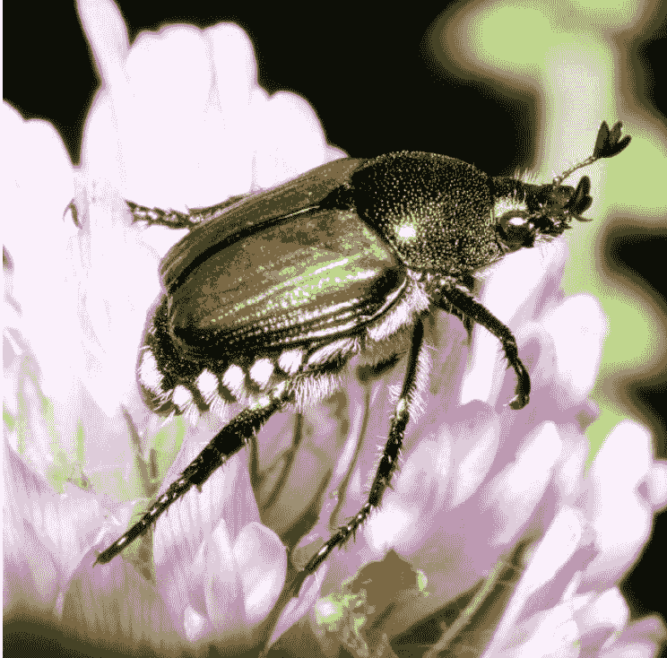

图 #4-26，日本金龟成虫照片，感谢 Wikipedia[18]

到目前，我们已经通过使用费洛陷阱将对榛果树的损害控制在可接受的水平。陷阱在大多数家居商店都能买到。使用陷阱时有两个主要点需要记住。您需要在看到金龟之前放置陷阱。我们告诉过您，第一批金龟会吸引更多羽化的金龟，因此您需要让陷阱成为它们寻找的吸引物。第二个点是把大多数陷阱放在上风口，并在您的果园外。当你买陷阱时，你会发现它们提供了多个袋子。陷阱的工作原理是将金龟引诱到陷阱口，它们会撞击或落在光滑的塑料上并掉进下方的袋子里。如果您发现陷阱在几天内满了，您需要购买更多陷阱。记住将陷阱留在果园外，因为您不希望把金龟带进您的果园。

更换金龟袋说得好听是很奇怪的。你解开袋子的顶部，里面装着大约一磅在里面蠕动的金龟。然后你扔掉装满的金龟袋，挂上新袋子。我们曾经见过一种我们认为简单但巧妙的方法，可以减少更换袋子的需求且无需扔掉塑料袋。有人拿了一个带盖的 5 加仑桶，在上面开了一个 3 或 4 英寸的洞。他们剪开了金龟袋的底部，并将袋子外部胶在洞的边缘。这样金龟就会掉进桶里，当你知道它们已经充分堆肥时，就可以收集它们并作为覆盖物。

## 褐斑臭谱 (BMSB)

提到褐斑臭谱（Halyomorpha halys），在我们注意到它们的最初几年里，数量每年都在增长，我们觉得看到太多了。然而，我们没有注意到果实有任何重大的外部损坏。它们似乎想吃穿果壳进入果实内部，但在果壳外面没有看到明显的损坏。BMSB 试图钻穿果壳并把形成中的果实吸干。如果 BMSB 成功到达果实，它会导致果实萎缩、或部分萎缩和/或感染腐烂。假设数量会继续增长，我们寻找了控制方法，陷阱再次出现，但仅作为一种监测 BMSB 的方法，而非控制方法。后续几年，BMSB 减少了，现在它们似乎处于与果园任何其他昆虫类似的较低水平，目前不需要为此担心。我们的榛果树冠层中到处都是凤蟋，我们认为它们捕食 BMSB 的卵，凤蟋可能是保持其数量下降的益虫。BMSB 似乎每年有一两代繁殖，而第二代是数量急剧增加的地方 [19]，对我们果实的损害也是如此。

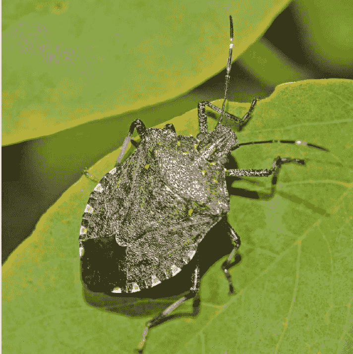

图 #4-27，BMSB 成虫，感谢 Wikipedia[20]

## 综合害虫管理 (IPM)

我们刚刚描述的关于害虫的大部分内容都接近于综合害虫管理 (IPM)，如果我们有意识地系统处理害虫问题，它就是 IPM。我们描述了要寻找哪些昆虫，这被称为“识别与监测”。决定在害虫损害作物并可能导致重大产量损失之前，使用哪些管理措施来减少或控制其种群，在我们的案例中，是使用隔绝网、饵剂和陷阱。如果进行监测和治理管理不够，那么一旦超过了我们的阈值限制，我们就采取生物防治（如果有的话）。如果这样无法控制害虫，则可能必须使用生物或化学农药，并且我们需要选择毒性最低的。

这种经济阈值通常取决于你对坚果的质量标准。西部的大多数坚果园属于一个合作社，由该合作社设定坚果质量标准。如果在抽样过程中，“坏”果仁的比例超过了规定，运送到合作社的这批坚果将被拒绝。这将迫使你在合作社接受之前对坚果进行检查和分类。例如，如果你带到合作社的坚果中有1%的果壳上有虫咬痕（表明果实可能受损），该批货物将被拒绝。合作社的目的是保持统一的高质量以维持客户的预期。如果批货物被拒绝，你将不得不去做原本希望合作社完成的工作，迫使你筛选坚果，花费金钱和时间。筛选增加了坚果的生产成本。最终，合作社（你的客户）提出了要求你付出更多努力控制害虫的经济阈值要求。这意味着你筛选坚果花费的金钱时间和就是你的经济阈值，又称为最初解决问题的成本。我们刚才通过通过俄勒冈州的一家坚果合作社说明了这一点。

了解害虫何时脆弱是最低成本和最高环境可持续性控制害虫的另一个重要方法。咨询当地合作社推广部门关于你所在地区何时控制控制害虫可能取决于你所在的 USDA 区域。昆虫在每个龄期（生长阶段）生长和成熟，并按照时间表繁殖，在不同的时间变得脆弱。在你的果园中进行害虫监测之前，你就应该做好知识准备。一旦种了树，你会有充足的时间学习，无论是两千棵还是两万棵。

第5章在我们的东北部果园年度任务时间表中包含了何时进行监测的良好概述。此外，在东北部 IPM 网站可以阅读最新的 IPM 策略[22]，俄勒冈州推广部门也有关于关于 IPM[23] 的手册。

## 有机喷剂

有机有机喷剂由有机材料评审协会 (OMRI) 列出，并随着对组成土壤的微生物和植物提取物的理解加深而不断变化。进步正在加速，我们预测该行业将在 15 到 20 年内达到化学农药的水平。目前，生物基农药控制规模接近 50 亿美元，而化学基农药约为 800 多亿美元。到为止，我们没有喷过任何虫，除了一次从森林迁徙而来的大规模卷蛾覆盖满了我们的树木和房屋。此外，土壤中健康的微生物群减少了对肥料的需求。我们湖泊中不断爆发将需要对肥料径流进行更严格的控制。幸运的是，榛果根很密，能有效地固定土壤并减少径流，这就是为什么它们被用作河岸缓冲区的原因。

## 灌溉

幼树在移栽后的前两三年需要水，直到它们的根部深扎土壤。我们强烈建议使用滴灌。滴灌非常经济，一旦安装了供水管，将为你节省大量时间。灌溉只是简单的 5/8 英寸半柔性塑料管，你可以购买长达 4000 英尺的卷装，带有插拔连接器，可以在需要的地方打入出水器。将管道连接到过滤器、压力调节器、单向阀和水源。一旦你看到安装灌溉有多简单，你就不会后悔这么做的。

灌溉系统除了成本低之外的一个很好处是，灌溉供应公司会设计系统并免费为你提供完整的零件报价。因此，本节将向你介绍滴灌，以确保你获得的报价是你需要的。换句话说，你将获得足够的知识，让你能够舒服地向灌溉供应商提供适当的信息。我们将像你刚刚收到所有零件并正在安装系统一样引导你操作。

你需要提供你的果园布局，包括每行有多少棵树、有多少行以及树之间的间距。还要告诉他们你是否有任何用水限制以及我们将在下文中讨论的水源。

沿着树行展开灌溉管，在每行的末尾用重型剪刀剪断管道，在最后一棵树之外留出几英尺。使用地钉将管道拉直并紧紧固定在地上。展开管道可能会有点沮丧，因为卷曲状态的管道并不想伸直。最好在阳光明媚的热天里展开塑料管。塑料管会比寒冷的阴天柔软得多，所以请规划好合适的天气。再次，我们希望有人告诉过我们这些。对果园中所有的树行和管道重复此操作。

在果园的一端，在每一行的末端，所有管道的末端插入一个塑料“三通头”。用更多的管道将管道连接在一起。取决于每行的树数和行数，这条供应所有行的管道直径可能更大，让灌溉供应公司为你决定。如果可能，你刚刚安装的供水管所在的果园末端位于较高处，以便在秋季排水系统。你不希望水留在管道中，因为如果水结冰，管道可能会裂。固定“供水”管（有时称为“主”管），将塑料管固定到位。可选的是，如果你不急于给新树供水，可以用大一点的 PVC 管套在供水管上或将其埋在浅沟中，这样你就可以开车和割草而无需拆卸供水管。否则，你将像图 430 所示避免在供水管附近割草。

图 430，将 Schedule 40 的 PVC 管套在供水管上进行埋设。然后，你需要通过单向阀、压力调节器和过滤器将主管连接到水源，如图 431 和 432 所示。如果你知道水源是干净的（例如来自市政自来水或在其他地方预过滤），添加过滤器可能是可选的。为了保险起见，无论如何都安装过滤器。如果水来自池塘或河流，你必须过滤出水器，否则它们会堵塞，你就浪费了时间。你需要购买一个压力调节器，因为市政水压太高，通常的水泵压力也太高。如果压力太大，它会导致柔性灌溉管在连接处破裂，并在你注意到之前浪费水。从管道制造商处购买调节器，以确保你使用的是出水器所需的正确压力。压力调节器很便宜，购买于

费用大约在 30 到 80 美元之间，取决于调节器所需的水量。

为每棵树购买滴器。我们推荐使用每小时 1.0 或 1.5 加仑的滴器。您还需要一个价格低于 10 美元的冲孔工具。只需在每棵树附近的灌溉管上戳出一个孔，然后插入滴器即可。滴器大约每美元可以买到 3 到 4 个。您可以买到不同的流量，您的水源和能泵送的水量可能会决定每个滴器的流量。您可以通过连接软管将水分配到每棵树，从而实现一个滴器为或两棵树供水。我们建议每棵榛果树只需要一个滴器，如果您确定水量充足，也可以每棵树放两个滴器。只需在在树的两侧各放一个滴器即可。此外，如果树是如核桃或栗子等大型坚果树，您应该计划每棵树使用两个滴器。

在果园的另一端，在我们冲洗系统后，我们需要关闭管道。我们只需将管端弯曲并紧紧扎好，使管道无法展开。一种制成“8”字形的塑料夹子（形象地称为“8 字夹”）每个不到 1 美元，它们可以实现同样的作用且效果良好，无需担心水压产生后绳子或钢丝不够紧。在添加滴器或使用 8 字形夹子关闭灌溉管之前，非常重要的一点是将线路连接到水源并冲洗系统。这可以去除任何堵塞滴器的灰尘或塑料碎片。冲洗灌溉管是防止滴器堵塞的一个重要步骤。更换滴器既简单又便宜。问题在于，在看到树木枯萎之前，你可能没有发现滴器没有工作。

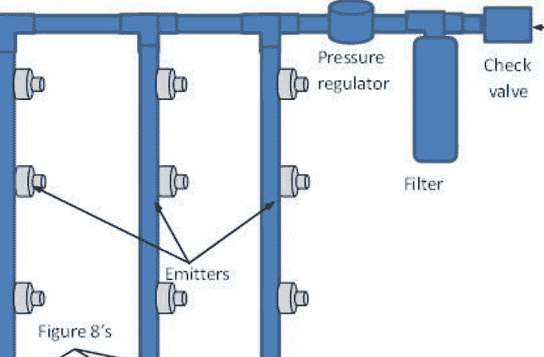

## 图 #4-31，滴灌溉系统示意图。

幸运的是，在东北部直到中西部，我们的一年降水充沛。我们通常不像西北部那样遭受长时间的干旱或全年数月无雨。然而，通过为新种的树木安装灌溉系统，我们也能为成年树木浇水；在盛夏期果实膨大期间应该有一段旱期，我们需要通过浇水来最大化产量。如果资金紧张，两三年后只需将管线移动到果园的新种植区域即可。一旦移动了水管，就将滴器对准树根。如果滴器离树根太远，只需拔出滴器并将其更换为“堵塞堵头”（goof plug），然后在需要的地方重新插入滴器。这种堵头 10 个或更多只需约 1 美元。再次提醒，在移动滴器之前或在任何长时间未使用滴器/灌溉系统之后，请务必冲洗线路。

当您连接灌溉管时，请记住水源需要提供“树木数量 × 每个滴器的每小时加仑”的水。例如，如果您正在灌溉 154 棵树，您将需要每小时 154 加仑，或每分钟 2.56 加仑。大多数水井的额定流量为≥3.0 加仑/分钟，且每次只能承受 15 到 20 分钟的流量。除非您了解水井的额定流量，否则我们建议从小充满大水箱，并在充满后从水箱灌溉。如果您使用自来水，将没有任何任何问题。否则，可以使用河流或池塘作为水源，并使用汽油或电池驱动的水泵。太阳能泵可以使用 100 瓦太阳能电池板、卡车电池、小型 1 加仑压力罐和一个 30 到 45 psi 的 12 伏特泵制成，如图 #4-32 所示。所有设备都可以安装在一个 225 加仑的塑料桶上，这种桶可以以 50 美元买到二手的。缓慢地注满水桶，然后灌溉小田。水桶可以移动到下一个区域进行灌溉，并重复这一过程，使用电池或太阳能电池板的泵。如果流量限制了灌溉系统。

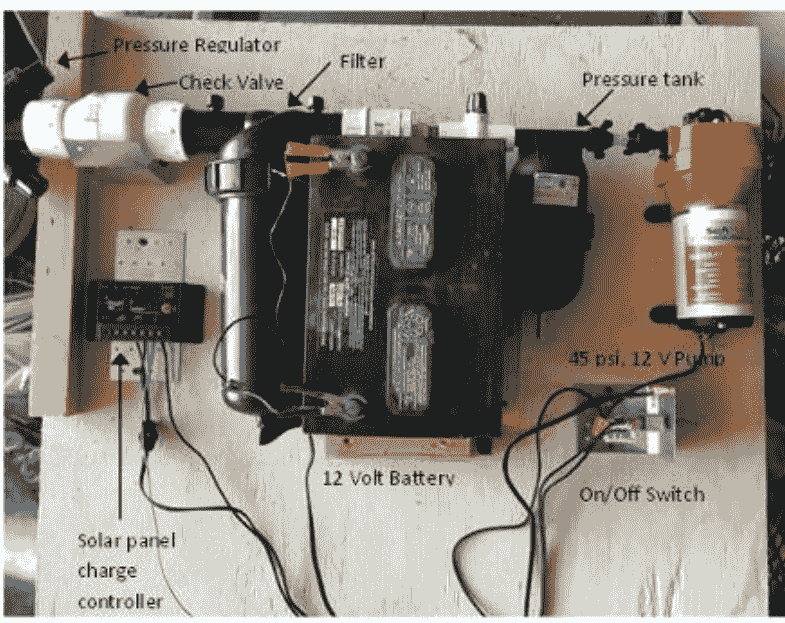

图 #4-32，内部式太阳能灌溉系统。

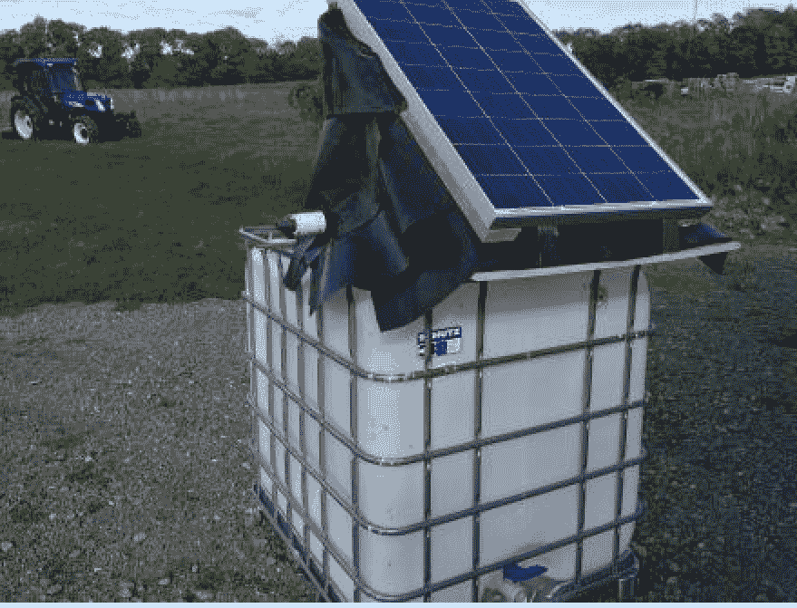

图 #4-32，外部式太阳能灌溉系统。

操作灌溉系统时还有几点需要注意。记住，使用池塘水前必须对其进行过滤。内联过滤器可以在任何家居商店或农用品商店购买。大多数商店出售的过滤器都是一次性的，可能无法重复使用，必须更换。

# 第 5 章 - 果园维护

果园维护涉及一些你可以任何时候完成的简单项目，例如巡视围栏寻找修理处，以及复杂的任务，如进行叶片分析并调整肥料投入以与之匹配。正如我们之前提到的，果园地面是最重要的任务，而且像修剪草坪一样简单。知道要做什么以及何时做，将以最少的努力获得最大的效果。

果园地面是大多数问题产生的地方，也是花费时间最多的的地方。例如，维护果园地面将最大限度地减少问题并最大化产量。幼树叶片下永远不应该有任何草。一旦树木建立，由于阴影的影响，杂草和草就会很难生长。我们的目标是以最少的精力最好维护果园地面。

一旦树木开始结果，你就会很欣赏整洁且修剪过的果园地面。我们从第 4 章已经知道，管理良好的果园地面能使鼠类数量保持在最低。当我们去收获落下的坚果时，无论是手动采摘还是使用设备吸起坚果，整洁的果园地面都会帮助。任何割草机都可以，但对于较大的区域，我们强烈建议使用带式割草机（flail mower）。无论是重型还是精细带式割草机都可以工作。首先，无论你拥有什么种类型的果园，你都能看到并收获所有落在地上的坚果。对于单杆果园，修剪就等同于扫除或吸起它们。在收获之前，使用草地清理机捡起树枝和石头将使收获更快，且收获的坚果中杂质更少。在灌木形式中，你将手动采摘，或使用蓝莓/橄榄型收割机打落坚果和果皮。

我们使用重型带式割草机破碎冬季霜冻推出的小石头。与大多数割草机不同，带式割草机会将树枝和草切成细碎，以便快速分解，同时平整果园地面。我们总是让草（或豆科植物）留在原处以提供绿肥。我们从 eBay 上买了一个不到 2000 美元的 6 英宽带式割草机。它是一种重型割草机，意味着刀片切割较粗糙，我们可以切碎树枝和石头。我们的带式割草机在机械上是轻型的，没有加固以承受无损的磨损。你可以花费超过 10,000 美元购买非常重型的割草机，它几乎不可能损坏，你的选择取决于地形或预算。

进入冬季时，将果园修剪得良好也同样重要，因为修剪良好的果园地面会使鼠类望而远。鼠类在冬天会吃掉幼树的树皮和根。在春季夏季，如果它们没有草和杂草可以躲藏，它们很容易被猛禽捕食，从而为我们完成了保护树木的工作。每次修剪后，看到鹰在果园里出没，我们总是感到一种阴险的满足感。就好像我们邀请了鹰来零餐一样。

## 杂草控制

那些根部储存了能量的根和杂草会迅速重新发。在灌溉管道和远离树木之间，不建议使用火焰基的除草剂。我们再次告诉您哪些方法实际上无效，这样您就不会被诱导浪费精力和金钱去尝试。

总的来说，控制幼树下杂草最省力的方法是使用覆盖物配合除草剂的额外辅助。你每年更换一次覆盖物，撒上石灰，并重复三年。使用有机手段还是化学手段进一步控制杂草取决于你。我们曾多次听某位种植者说，他打算先用最简单、最廉价的方法让树木在三年内定植，然后在接下来的三年里获得有机认证，正好赶上收获丰产坚果。


到目前为止讨论的除草方法被认为是萌芽后杂草控制。这意味着你是在看到杂草生长后才进行控制。现在除了堆肥覆盖物外，你还可以使用一种有机预发芽或杂草预防控制方法。玉米胚芽蛋白被用于防止杂草生长。由 Lebanon Seaboard Corporation 生产的一种名为 Preen 的常用产品大多数家居商店都能买到。此外，它在分解时会为树木提供营养。说明要求每四到六周重新施用于土壤表面。我们没有在树根部使用玉米胚芽蛋白的直接经验，目前正准备进行。玉米胚芽蛋白在 Amazon 上很容易买，也可以查看当地的饲料店，因为它是许多动物饲料的主要成分。

# 东北地区榛果年度维护计划

## Nutty Ridge

### 榛果果园行动项目

| | 1月 | 2月 | 3月 | 4月 | 5月 | 6月 | 7月 | 8月 | 9月 | 10月 | 11月 | 12月 |
| :--- | :--- | :--- | :--- | :--- | :--- | :--- | :--- | :--- | :--- | :--- | :--- | :--- |
| 修剪树木并剔除 EFB 虫害 | | | | | | | | | | | | |
| 清理果园地面 - 石块和树枝 | | | x | | | | | | | | | |
| 覆盖物 - 应用于新栽植或移除并重新应用 | | | | | x x | | | | | | | |
| 拔除或喷洒杂草 - 每 4 或 5 周一次 | | ... | | | | | | | | | |
| 围栏维护 | ... | | | | | | | | | | |
| 检查土壤 pH | | | | x | | | | | | | | |
| 叶片分析以确定硼等肥料需求 | | | | | | x x | | | | | | |
| 施肥 | | | | x | | | x x | | | | |
| 硼叶面施用（当坚果约有一半大同时）每 2 或 3 年一次！ | | | | | | | | x | | | | |
| 修剪果园草 | x x x x | | | | | | | x | | | | |
| 收割前在树木下修剪得非常紧密、低矮 | | | | | | | x x x | | | | |
| 如果采用机械地面收割，在树附近吸尘或扫地 | | | | | | | x x | | | | | |
| 收割 - 8月中旬至 10月中旬，取决于品种 | | | | | | | | x x | | | | |
| 悬挂甲虫/BSMB 陷阱，侦查和监测 | | | | | | x x x | | | | | |
| 寻找损害坚果的害虫 | | | | | | x x x | | | | | |
| 必要时侦查并喷洒 EFB 药物 | | | x x x | | | | | | | | | |

表 #5-1，东北地区榛果年度维护计划。

## 施肥

施肥是一个复杂的话题。大多数人认为施肥就是买一袋肥料并洒在树周围。这种方法可能管用一段时间。你可能只是在浪费钱，更糟糕的是你可能会伤害树木并污染地下水。请记住，在给树施肥时，你是在为它现在以及为明年提供营养。这就是为什么你的树今年挂满了坚果，看起来你将有一个丰收的一年，除非明年的花芽在今年坚果膨满的同时已经产生，否则你的榛树可能会度过糟糕的一年。这就是为什么用叶片分析来在树木开始结坚果并产生明年花芽时对其健康状况进行“快照”。榛果具有密集的浅根系，据报道这种根系非常有利于从土壤中吸收氮 [251]。这些榛树被认为是溪岸控制和河带缓冲的理想选择，因为它们会减轻农田的氮流失。榛丛可能是缓解导致湖泊藻类爆发的氮流失的理想选择。

树木施肥从种植后的第二年开始。这假设你在种植之前做了土壤分析，并调整了缺乏的营养和 pH 值。一年施肥会增加死亡率，这意味着如果你施肥，它们在第一年死亡的几率更高。保持水分应被视为施肥，因为你正在促进根系的生长。盆栽树或裸根树的根系受损，需要长更多的根来生长茎和叶。春季施肥会促进生长，是尚未结果坚果的幼树的最佳时机。不要在夏末或秋季给幼树施肥，因为这可能会将生长推入霜冻季节，新长出的部分会被霜冻死亡。

多年来我们听到的一条常见经验法是，幼树在 7 月 4 日之后不要再施肥。第一年施肥时，你在滴水线周围覆盖肥料。滴水线是指如果树在滴水时，离树干最远的水滴落点位置。

将会减少。明尼苏达大学农学系的 Louis Braun [28] 发现，在果实膨大期以及直到9月份施肥对成年树是有益的。再次，请根据《俄勒根州养分管理指南》进行叶片分析，来判断你是否需要添加肥料。

施肥最佳时机的示例是氮肥。氮肥每年可以施多次。记得我们讨论过你已经为今年和明年给树施了肥。施氮的时机将决定树如何利用这些分。榛果树在氮循环方面非常高效。在为过冬准备落叶之前，叶片中的大部分养分会被拉回树体，以便在明年春季循环利用。榛果的另一个重要微量元素是硼。众，叶面施硼可使果实增大多30%，而且用喷雾器施用的每亩成本仅需几美元。一种由 Borax® 生产的农业硼品牌 [29]。硼的喷施时间请参见《东北部榛果年度维护计划表》表5-1。

## 种植榛果

之前所有的章节都为我们种植选择的树木做好了准备。然而，如果我们中有人直接跳到这一步来种树并错过了准备工作，这里会再次提到了一些。了解土壤能让树木生长得健康强壮，从而获得有收获的体验。仅仅种下树并希望它生长是有风险的，当结果不符合预期时，我们会归结于自己没有“绿手指”，或者埋怨育苗场提供的植物太差。妥善准备地地和土壤能提供最大的成功机会，从字面上通过果园的果实回报我们。

榛果和栗子需要两棵树才能进行充分授粉并结实。它们必须能够接收另一棵树的花粉；因此，树与树之间应该相对接近。请注意，相同的嫁接树实际上是同一棵树，无法相互授粉。你需要一棵苗或名称不同的嫁接树来实现充分授粉。如果你计划以树木的形式种植，行内间距应为8到12英尺，行距为16到18英尺，你可以查看第三章《规划果园》获取有关间距的更多详细信息。如果你计划以树篱的形式种植，且使用了合适的美国品种，间距可以短至3英尺。

使用园艺叉清除种植区的杂草和植被。提醒一下，为了树健康，pH值需要处于6.0到7.0之间。你可能需要在土壤中添加石灰，并在坑周围区域撒上石灰，以确保土壤pH值合适。理想情况下，这是在种植的前一年，且至少提前几周或几个月，以便石灰中和土壤。在挖坑之前，确保盆栽树已经充分浇水。石灰具有腐蚀性，如果与根部同时施用，会伤害根系。我们都想走捷径，但经过充分改良并清除杂草的土壤对树木的健康和生存至关重要。

挖一个宽度是盆器两倍、深度相同的坑。挖一个不规则的洞而不是完美的圆形，以防止根在洞内绕圈生长。根生长时会沿着阻力最小的路径，可能会绕着你挖的洞转圈，因为原生土壤比你种树时弄松的土壤更密实。所以挖的要非常不规则，带有“凹角”。移除土壤中的任何岩石，以免在回填时损坏根部。向坑内注水。等待水渗透进土壤。如果是种植盆栽树且盆拉不掉，就用美刀沿侧切开盆。切开盆后将其拉开，这样你就可以不损坏树干或根的情况下取出树。将根部滑入种植坑。整理任何松散的根使它们均匀分布。小心避开潮湿、娇嫩的根。如果有任何断裂的根。让树与自然土壤表面齐平，并让土壤在树上的位置与在盆中的位置一致。

如果你种植的树是盆栽，它通常含有所谓的“营养土混合物”。最后，这意味着它是有机成分最多的，会分解并导致盆土从字面上溶解和蒸发。结果就是你种树的坑里会出现一个凹陷，你的根部要么暴露要么被压缩，这两者对树都没有好处。

请不要只是把树插进坑里就回填。我们喜欢把在盆限制内被压缩的根铺开。在这样做时，确保土壤压实良好以避免产生气隙。

## 微生物添加

种树也是向土壤接种有益微生物的好时机。无论是裸根还是盆栽树，在土壤中以细菌和菌根体的形式添加一些益生菌都是好主意。某些益生菌产品建议将根部浸入溶液中或混合溶液后浇水。健康的微生物群将存在于土壤中并与你的树建立共生关系。菌根真菌和细菌从根部吸收营养，反过来它们会将通常结合的磷等矿物质转化为植物可用。一个益生菌例子是 Lallemand® Plant Care 的 Rhizocell® [30]，它利用产脂肪孢菌 IT45 提供了这种关系。Rhizocell 在根部建立并从根部获取营养。作为回报，它通过分泌化合物刺激根部生长并释放磷让植物吸收。

另一种被视为生物杀菌剂的产品提供了另一种共生关系。根部为生长在根上的真菌提供营养，真菌提供抗真菌特性保护根免受可能导致腐烂的有害真菌侵害。位于纽约的公司 BioWorks® 提供了 RootShield 和 RootShield® PLUS [31]。BioWorks 利用了益生真菌哈木孢菌 T-22 株和绿色木孢菌 G-41 株。具体的菌株对我们来说并不重要，重要的是活跃生长的真菌在根部周围形成一个“屏障”。

这些生物产品由于是天然的通常被认为是有机的，但如有担心，请咨询供应商（如 Arbico Organ[32]）。此外，如果你打算使用一种微生物补充剂，请通过与制造商交流确保它们相互兼容。

我们只提到了土壤中存在的、被证明对树根有益的三类微生物。还有许多未知的，意味着我们并不知道在健康的有机土壤中已经存在多少种不同菌株的有益真菌和细菌。我们知道我们正在开发的大部分山坡经历了多年的贫瘠，远不健康，土壤可能非常薄且有机质很低。如果你添加已知的益生微生物将有助于恢复微生物群并为你的树提供一些帮助。树像我们一样，也需要健康的微生物群。

一旦你种下并浇了树的水，就在树周围铺上 2 到 4 英寸的覆盖物，并将覆盖物远离树干 4 英寸。覆盖物有助于保持水分并维持稳定的土壤含水量水平。覆盖物在分解时会变成酸性，因此可能不需要在覆盖物中加入石灰。由于覆盖物会随着时间的推移变得酸性，如果你不愿意每年更换一次，我们就不建议你添加覆盖物。每年，将覆盖物从基部和滴水线移开，在表面撒上薄薄石灰后放回新的覆盖物。将旧覆盖物留存在行间以肥沃土壤。作为土壤改良剂，覆盖物总是是有益且对重建你的土壤非常有帮助的。

> 过去他们说……

> “通过现代化学获得更好的生活”

> 现在我们知道了……

> “通过健康的微生物群获得更好的生活”。JZ

每周给幼树浇一次或两次水。在干旱期间特别注意土壤，添加足够的水浸湿树根和周围地面。在种树后的第二年早春，施 2.0 盎司或 5.0 汤匙缓释氮肥。我们将其称为“第三片叶”。解释一下，第一年种的幼苗是它长叶子的第一年。第二年是第二片叶，很可能是你种它的时候，第三年是第三片叶。将肥料撒在树下，延伸到滴水线处，不要让肥料贴着树干，且要距离树干足够远，以免肥料冲刷到树干上。对于到达时已有两年年的大型成熟分层树也是如此，你可以在种树后的第二年添加肥料。

## 好的，我们要去哪里买我的树呢！

下面的苗圃列表远不完整；但是，这是一份努力建立坚果树产业的苗圃列表。

| # | 苗圃名称 | 网址地址 | 售卖品种和形式 |
|---|---|---|---|
| 1 | Arbor Day Forest Agriculture | https://shop.arborday.org/ | 幼苗以及很快将组织培养的 The Beast, Grand Traverse, NADF10- |
| 2 | Enterprises Forrest Keeling | https://www.forestag.com/ | Zone 3 和 4 的幼苗 |
| 3 | Nursery | https://www.fknursery.com/ | Zone 4 幼苗，Zone 4 幼苗，Zone 5b 幼苗 |
| 4 | Great Plains Nursery | https://greatplainsnursery.com/ | 组织培养 Grand Traverse 和 "The Beast" 以及幼苗。位于 Zone 5b |
| 5 | Grimo Nut Nursery | https://www.grimonut.com/ | 幼苗和他们自选的插。还有来自 OSU 的插。 |
| 6 | Oaks Tree Crops | https://oaktreetcrocs.com/ | 位于 USDA 7，但某些品种耐寒 |
| 7 | Knight Hollow | http://www.knighthollownursery.com/ | 自选品种幼苗，来自俄勒冈州立大的插，位于 USDA 6a |
| 8 | Red Farm Saint Lawrence | http://www.redfarm.com/product/hazel-nut-seeds/ | 来自 UMHDI 发布的所有品种。 |
| 9 | Nursery | http://shivenweannaceries.com/ | 种子多繁殖。位于 Zone 5b。非常硬挺的幼苗。位于 Zone 3 |
| 10 | Twisted Tree Farm | http://www.twistedtreenfarm.com/ | 位于 Zone 5b 的榛子幼苗 |
| 11 | Z's Nutty Ridge | https://znuttyridge.com/ | 接品种 NITCA 和 Truxon，各种开放和受控授粉的幼苗。位于 Zone 4b/5a 的多风山顶。在培育商业品质树方面有广泛研究。 |
| 12 | Foggy Bottom Farm | https://foggy-bottom-farms.business.site/ | 罗格格斯大学发布的品种：Ranson, Sommell, Montgomery, & Huntercon |
| 13 | Rutgers University | https://www.rutgers.edu/hazelnut-research/ | 不：不是苗圃，但有广泛的研究发现发现了抗 EBFB 的高产品种，将在未来几年内发布。 |
| 14 | UMHDI | https://www.midwesthazeln.org/ | 不：不是苗圃，但是一个种植者联盟，让他们最优秀的品种在专利下进行繁殖。 |

表格 #5-2，榛果苗圃列表。

## 榛果品种选择

| 品名 | 遗传背景 - 欧洲、美国、亚洲 | 抗 EBF 抗性 | 叶期（早、晚） | 硬度，USDA 区域 | 果实质量注释 | 选自 |
|---|---|---|---|---|---|---|
| Grand Traverse | E x A | 是 | M | 5b | 1.3 果实，40% 仁肉，生长迅速，Teller 欧洲品种 | Great Plains, Arbor Day |
| The Beast | E x A | 是 | E | 5b | 品种树 | Creet Plains, Arbor Day |
| NADF 10-50 | A x E | 是 | M.L | 5b | 1.0 果实，39% 仁肉 | Great Plains, Arbor Day |
| Rerritan PAPF | A x E | 是 | | 6b/7a | 1.1 果实，48% 仁肉 | Foggy Bottom |
| Monterey PAPF | A x E | 是 | E, M | 6b/7a | 1.2 果实，52% 仁肉 | Foggy |
| Somerset PAPF | A x E | 是 | | b/7a | 1.0 果实，55% 仁肉 | Foggy Bottom |
| Hunterdon PAPF | A x E | 是 | | b | 1.2 果实，40% 仁肉 | UHMDI |
| NITKA™ | A x E | 是 | | a | 1.0 果实，52% 仁肉 | Z's Nutty |
| Truxton | A x E | 是 | | b | 1.0 果实，44% 仁肉 | UHMDI |
| Rose9- PAPF | A x E | 是 | | | 0.62 果实，45% 仁肉 | UHMDI |
| PriorW41 PAPF | A x E | 是 | | | 0.58 果实，38% 仁肉 | UHMDI |
| Minar34 | A x E | 是 | | | 0.42 果实 | UHMDI |
| Rose1 PAPF | A x E | 是 | | | | UHMDI |
| ... | （注：后续列表项重复格式，此处按要求不翻译重复内容仅保持结构） | | | | | |

为你的树提供一些帮助。树像我们一样，也需要健康的微生物群。

每周给幼树浇一次或两次水。在干旱期间特别注意土壤，添加足够的水浸湿树根和周围地面。在种树后的第二年早春，施 2.0 盎司或 5.0 汤匙缓释氮肥。我们将其称为“第三片叶”。解释一下，第一年种的幼苗是它长叶子的第一年。第二年是第二片叶，很可能是你种它的时候，第三年是第三片叶。将肥料撒在树下，延伸到滴水线处，不要让肥料贴着树干，且要距离树干足够远，以免肥料冲刷到树干上。对于到达时已有两年年的大型成熟分层树也是如此，你可以在种树后的第二年添加肥料。

## 好的，我们要去哪里买我的树呢！

下面的苗圃列表远不完整；但是，这是一份努力建立坚果树产业的苗圃列表。

| # | 苗圃名称 | 网址地址 | 售卖品种和形式 |
|---|---|---|---|
| 1 | Arbor Day Forest Agriculture | https://shop.arborday.org/ | 幼苗以及很快将组织培养的 The Beast, Grand Traverse, NADF10- |
| 2 | Enterprises Forrest Keeling | https://www.forestag.com/ | Zone 3 和 4 的幼苗 |
| 3 | Nursery | https://www.fknursery.com/ | Zone 4 幼苗，Zone 4 幼苗，Zone 5b 幼苗 |
| 4 | Great Plains Nursery | https://greatplainsnursery.com/ | 组织培养 Grand Traverse 和 "The Beast" 以及幼苗。位于 Zone 5b |
| 5 | Grimo Nut Nursery | https://www.grimonut.com/ | 幼苗和他们自选的插。还有来自 OSU 的插。 |
| 6 | Oaks Tree Crops | https://oaktreetcrocs.com/ | 位于 USDA 7，但某些品种耐寒 |


为你的树提供一些帮助。树像我们一样，也需要健康的微生物群。

一旦你种下并浇了树的水，就在树周围铺上 2 到 4 英寸的覆盖物，并将覆盖物远离树干 4 英寸。覆盖物有助于保持水分并维持稳定的土壤含水量水平。覆盖物在分解时会变成酸性，因此可能不需要在覆盖物中加入石灰。由于覆盖物会随着时间的推移变得酸性，如果你不愿意每年更换一次，我们就不建议你添加覆盖物。每年，将覆盖物从基部和滴水线移开，在表面撒上薄薄石灰后放回新的覆盖物。将旧覆盖物留存在行间以肥沃土壤。作为土壤改良剂，覆盖物总是有益且对重建土壤非常有帮助的。

> 过去他们说..
> “通过现代化学获得更好的生活”
> 现在我们知道了..
> “通过健康的微生物群获得更好的生活”。JZ

每周给幼树浇一次或两次水。在干旱期间特别注意土壤，添加足够的水浸湿树根和周围地面。在种树后的第二年早春，施 2.0 盎司或 5.0 汤匙缓释氮肥。我们将其称为“第三片叶”。解释一下，第一年种的幼苗是它长叶子的第一年。第二年是第二片叶，很可能是你种它的时候，第三年是第三片叶。将肥料撒在树下，延伸到滴水线处，不要让肥料贴着树干，且要距离树干足够远，以免肥料冲刷到树干上。对于到达时已有两年年的大型成熟分层树也是如此，你可以在种树后的第二年添加肥料。

## 好的，我们要去哪里买我的树呢！

下面的苗圃列表远不完整；但是，这是一份努力建立坚果树产业的苗圃列表。

| # 苗圃名称 | 网址地址 | 售卖品种和形式 |
|---|---|---|
| 1 | Arbor Day Forest Agriculture | https://shop.arborday.org/ | 幼苗以及很快将组织培养的 The Beast, Grand Traverse, NADF10- |
| 2 | Enterprises Forrest Keeling | https://www.forestag.com/ | Zone 3 和 4 的幼苗 |
| 3 | Nursery | https://www.fknursery.com/ | Zone 4 幼苗，Zone 4 幼苗，Zone 5b 幼苗 |
| 4 | Great Plains Nursery | https://greatplainsnursery.com/ | 组织培养 Grand Traverse 和 "The Beast" 以及幼苗。位于 Zone 5b |
| 5 | Grimo Nut Nursery | https://www.grimonut.com/ | 幼苗和他们自选的插。还有来自 OSU 的插。 |
| 6 | Oaks Tree Crops | https://oaktreetcrocs.com/ | 位于 USDA 7，但某些品种耐寒 |
| 7 | Knight Hollow | http://www.knighthollownursery.com/ | 自选品种幼苗，来自俄勒冈州立大的插，位于 USDA 6a |
| 8 | Red Farm Saint Lawrence | http://www.redfarm.com/product/hazel-nut-seeds/ | 来自 UMHDI 发布的所有品种。 |
| 9 | Nursery | http://shivenweannaceries.com/ | 种子多繁殖。位于 Zone 5b。非常硬挺的幼苗。位于 Zone 3 |
| 10 | Twisted Tree Farm | http://www.twistedtreenfarm.com/ | 位于 Zone 5b 的榛子幼苗 |
| 11 | Z's Nutty Ridge | https://znuttyridge.com/ | 接品种 NITCA 和 Truxon，各种开放和受控授粉的幼苗。位于 Zone 4b/5a 的多风山顶。在培育商业品质树方面有广泛研究。 |
| 12 | Foggy Bottom Farm | https://foggy-bottom-farms.business.site/ | 罗格格斯大学发布的品种：Ranson, Sommell, Montgomery, & Huntercon |
| 13 | Rutgers University | https://www.rutgers.edu/hazelnut-research/ | 不：不是苗圃，但有广泛的研究发现发现了抗 EBFB 的高产品种，将在未来几年内发布。 |
| 14 | UMHDI | https://www.midwesthazeln.org/ | 不：不是苗圃，但是一个种植者联盟，让他们最优秀的品种在专利下进行繁殖。 |

表格 #5-2，榛果苗圃列表。

## 榛果品种选择

| 品名 | 遗传背景 - 欧洲、美国、亚洲 | 抗 EBF 抗性 | 叶期（早、晚） | 硬度，USDA 区域 | 果实质量注释 | 选自 |
|---|---|---|---|---|---|---|
| Grand Traverse | E x A | 是 | M | 5b | 1.3 果实，40% 仁肉，生长迅速，Teller 欧洲品种 | Great Plains, Arbor Day |
| The Beast | E x A | 是 | E | 5b | 品种树 | Creet Plains, Arbor Day |
| NADF 10-50 | A x E | 是 | M.L | 5b | 1.0 果实，39% 仁肉 | Great Plains, Arbor Day |
| Rerritan PAPF | A x E | 是 | | 6b/7a | 1.1 果实，48% 仁肉 | Foggy Bottom |
| Monterey PAPF | A x E | 是 | E, M | 6b/7a | 1.2 果实，52% 仁肉 | Foggy |
| Somerset PAPF | A x E | 是 | | b/7a | 1.0 果实，55% 仁肉 | Foggy Bottom |
| Hunterdon PAPF | A x E | 是 | | b | 1.2 果实，40% 仁肉 | UHMDI |
| NITKA™ | A x E | 是 | | a | 1.0 果实，52% 仁肉 | Z's Nutty |
| Truxton | A x E | 是 | | | b | 1.0 果实，44% 仁肉 | UHMDI |
| Rose9- PAPF | A x E | 是 | | | | 0.62 果实，45% 仁肉 | UHMDI |
| PriorW41 PAPF | A x E | 是 | | | | 0.58 果实，38% 仁肉 | UHMDI |
| Minar34 | A x E | 是 | | | | 0.42 果实 | UHMDI |
| Rose1 PAPF | A x E | 是 | | | | | UHMDI |

水分太干，你的幼苗可能会产生胁迫并停止生长。一旦进入胁迫状态，它们可能一个月内都不生长，甚至整个季节都停止生长，抑制其发育。榛树以这种方式停止生长是榛果几乎不可摧毁的另一个原因。如果发生严重干旱，它们只是整个季节停止生长，并在明年恢复。

每个人都认为他们只需要把花盆放在窗户边，普通的荧光灯下，幼苗就会没问题。春季的光线本就稀疏，如果它们只从窗户获得光照，光照将只是稀疏中的一小部分。你的树会变得细长瘦弱。一盏用了几年的标准荧光商店灯产生的光照不足以让你的树发芽。请将光源视为树木的能量，而空气则是通过叶片蒸发使树液流动的需要。良好的光和空气流通将让你的树快乐地生长。

你现在可以用大约 20 美元的价格买到 5000 流明的 LED 商用灯。买两盏商用灯，将灯泡放在距离花盆顶部 2 英尺的地方，并使用定时器让灯每天运行 16 小时。使用第二个定时器让摆动桌面风扇每次运行 15 分钟，在树发芽后的前几周内，在灯开启期间每天运行 6 次。几周后，逐渐将风扇增加到每天 6 次每次 30 分钟。大多数廉价的定时器有 15 个增量，因此每天将 6 次运行中的一次增加到 30 分钟，持续 6 天。良好的光源和空气流通的结合将生长出健康的树。将灯保持在距离花盆两英尺以内。如果你有太多花盆且灯距离超过 2 英尺，就多买些灯。

种子发芽另一个重要方面是遵循日夜正常节律的温度波动。起初，我们将我家里想要发芽的一些种子的房间温度设定在固固的 70 华氏度，几乎没有种子发芽。与此同时，平行位于温室里没有加热的种子却疯狂生长。如果该区域本身不是太冷，每天开启 16 小时的灯会温暖土壤和花盆。如果你有带温度控制的加热垫，与灯光同步定时，将热量设定为 72 华氏度。房间或地下室在晚上会凉一些，让你的种子能够看到在田间会看到的类似温度循环。

当霜冻的恐惧过去后，尽快将幼苗栽种出去。你不希望幼苗变成根结。如果你播种种子太早，看到根开始环绕花盆生长，你需要换一个更大的花盆。这通常发生在春季来得太晚的时候，不要对抗，只需给幼苗移盆即可。在霜冻结束前的几周，你需要让幼苗适应外界世界。在种植前，每天白天增加时间将幼苗带到室外，至少持续两周。这被称为“练苗”（hardening off），让你的幼苗习惯于暴露在太阳紫外线和自然空气流中。在这里，为幼苗开启风扇对使你的幼苗适应外界大有裨益。开始让幼苗在室外大约一小时，然后每天增加。如果天气大风、严寒或异常晴朗、多风且炎热的天气，就跳过那天。你正在为你的树准备应对那样的天气，所以不要在它们准备好之前就暴露幼苗。

对于纽约州北部，你可能想在 4 月第二周末开始育幼苗。好了，我们解决这个问题了吗？在纽约州的五湖地区，最后霜冻日通常是 5 月最后一周。为了安全起见，那就是你开始对树木进行适应练苗的时间，这需要两周。因此，你应该能在 6 月中旬左右栽种。如果你育幼苗一个月，而大多数种子需要三周才能发芽，你需要在 5 月底前七周开始。

## 条绕（LAYERING）

条绕是在母树上产生遗传克隆（a.k.a. 分生）的过程。在你的树木生长时进行这种操作方法。我们实验了这种对榛树的组合，效果非常棒。当然，这是如图 6-1 所示的总结，随后将提供更多带图片的细节，让你清晰理解如何在担心的情况下进行条绕。

### 树木繁殖 - 条绕

- 大多数榛树在基部产生条蘖
- 1. 秋末或冬初开始条绕你的优质榛树，在霜冻结束前切掉
- 2. 沿原生土线切掉至少 50% 的茎。切断茎部会刺激灌木产生条蘖。
- 3. 在接下来的早春，冰雪融化后，铺上四层厚的盆土或类似的疏松、轻质、保湿的堆肥。将土壤/堆肥向你切断茎部外延伸良好的六英寸。如果你使用堆肥，需要知道它不是酸性的并进行 pH 测试以确保，并记住堆肥在腐烂时通常会变得呈酸性。
- 4. 在 5 月下旬 6 月初，你会看到条蘖生长。
- 5. 在 6 月下旬，你需要移开树底部的盆土，并立即准备条蘖生根：制造伤口、在伤口涂抹激素并从原生土基部固定茎干，然后重新堆上盆土。这时你需要用焦油纸或塑料包裹盆土以固定覆盖物。

使用这种方法，你通常可以获得 50% 以上的成功率。然而，使用我们的方法通常可以获得 80% 以上的成功率。


图 5-1，榛果条绕概览

| # | 项目 | 备注 |
|---|---|---|
| 1 | 塑料布或厚油油纸 | 固定土壤/有机肥并保持水分 |
| 2 | 桩子 | 固定油纸 |
| 3 | 锤子 | 用于钉入桩子 |
| 4 | 办公订书机和重型订书机 | 将油纸末端钉好在桩子上 |
| 5 | 尼龙带 > 75 lb | 绑在伤口下方 |
| 6 | 刷子 | 吲哚酸盐，每升 2 克 |
| 7 | IBA k 2000 ppm | 掉较小或拥挤的萌蘖 |
| 8 | 手修剪剪 | 刮掉 2 英寸长且位于土壤上方 1 英的茎部 |
| 9 | 口袋刀 | |

表 #5-4，制作榛果层（mound layer）所需的物品

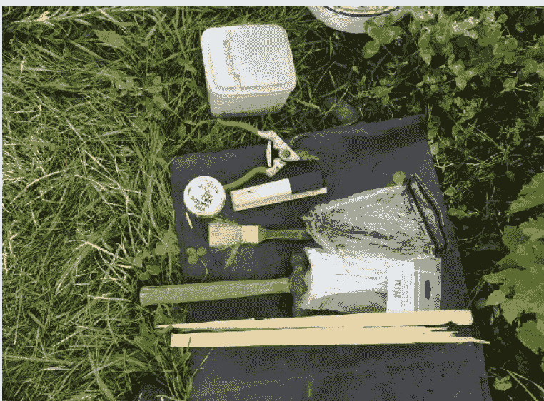

图 #5-2，田间榛果层繁殖时使用的物品。

在初夏，按照图 #5-2 所示对榛果进行层繁殖，首先要收集上述物品并将它们带到目标树下。这假设你已经在去年末修剪掉了一半或更多的茎部，并在树根部堆了盆栽土或有机肥。你可以在层繁殖物品和榛果叶之间的右侧看到盆栽土。

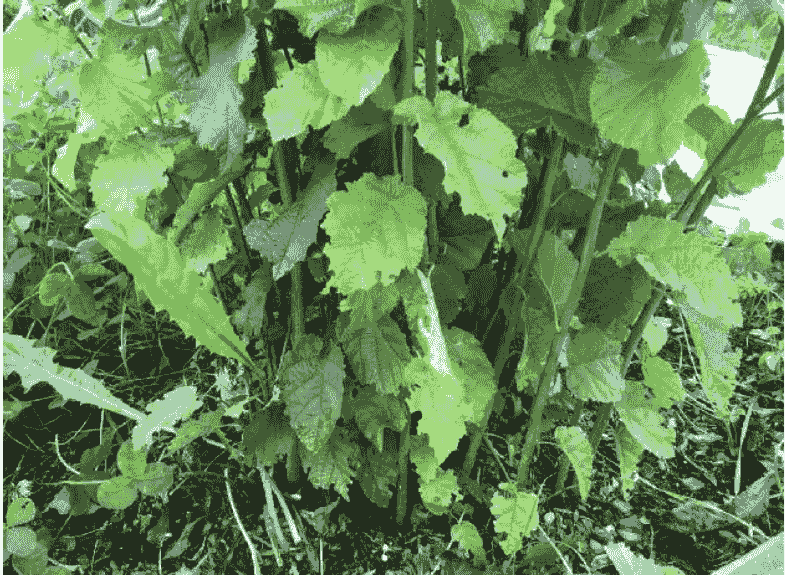

图 #5-3，一棵带有许多待层繁殖萌蘖的母树。

如你所见，7 月初的图 #5-3 中有很多萌蘖。我们只需用手指轻轻拨开萌蘖底部的盆栽土。然后剪掉长度小于六英寸的短萌蘖，或者彼此距离小于两英寸的萌蘖。萌蘖需要空间生长根系，而不能过于缠绕在一起，以至于明年无法在不弄断脆弱根系的情况下将它们拉开。

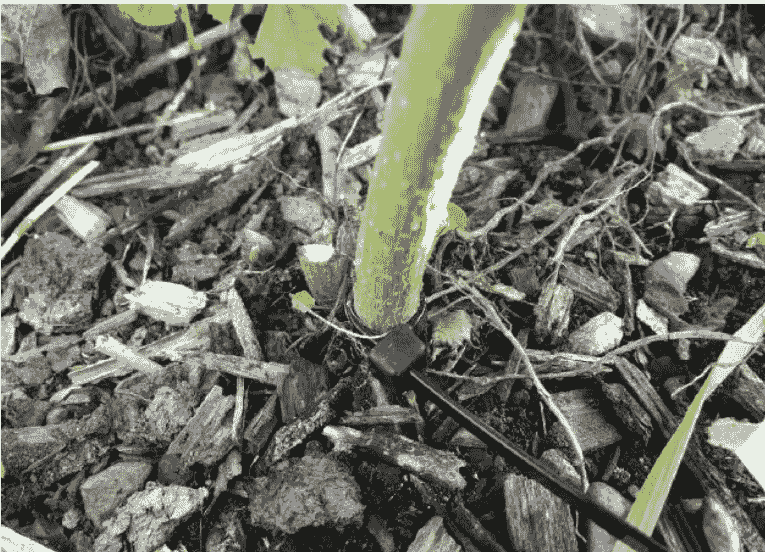

图 #5-4，榛果萌蘖底部的尼龙带。

注意图 #5-4 中我们剪掉的另一个与保留萌蘖距离太近的小萌蘖底部。我们使用 75 磅承重力的尼龙带，因为较弱的带子会被生长的萌蘖崩开。我们将尼龙带拉得非常紧，但不会压扁茎部。今年冬天在盯着上面的照片看时，我们意识到自己在将覆盖物从茎部底部拨开做得不好。尼龙带应该位于有机肥线下方，那里的茎部光滑且更偏黄而非绿色。这是一个关键点，因为我们发现，如果尝试在土壤线以上的茎部涂抹激素，成功率会低得多。你可以看到我们的有机肥是由木屑、木灰/木炭和盆栽土制成的。你可以使用马箍圈或机械铁丝代替尼龙带。我们发现普通的扭结带太软了，无法很好工作。

我们根据春季融雪时挖出萌蘖时产生健康根团的百分比来判断成功与。有些茎会膨胀并尝试绕过尼龙带生长而不是长根。不长根的茎通常在向侧拉一下茎时就会在尼龙带处折断。

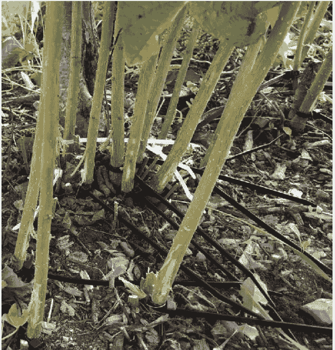

图 #5-5，茎部受损准备涂抹激素的榛果萌蘖。

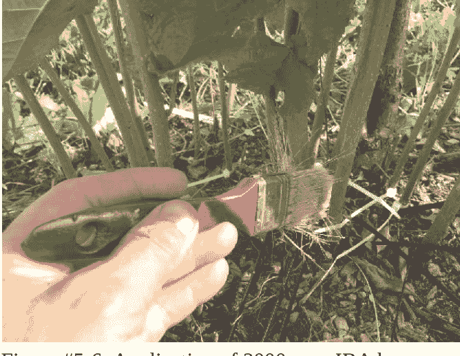

图 #5-6，在茎底部涂 2000 ppm IBA 激素。

用刷子在茎部受伤处以及完全环绕茎部涂抹。有些榛果丛只会在你弄伤的地方长根，而另一些会在你涂抹 IBA 激素的范围内长根。

在当地的水培店、苗圃中心或通过 eBay 或 Amazon 在线购买吲哚酸盐（K-IBA 或 IBA-K）。使用每升 2 克蒸馏水配制 2000 ppm 的母液。储存在密封瓶中，并避光、避热。

接下来，你需要用油纸或塑料包裹榛果萌蘖并将它们钉在一起，并如图 5-7 和末端 5-8 所示将包裹固定在地上。用你拨开的有机肥填充好的榛果萌蘖，并添加更多的有机肥或盆栽土，深度六英寸，或在激素涂抹处上方三英寸，如图 5-9 所示。

在来年春天地面一融化时，拉掉油纸或塑料，如果状况完好则保存备用。我们有一些超过 7 年的塑料材料。用手指轻轻拨开没有根的有机肥和盆栽土。接着，用手指轻轻插入盆栽土和原生地面之间。移动到茎部，用修剪剪剪断母树的基部。通常有些根会与相邻的萌蘖缠在一起，你必须移动到相邻树并剪断其基部以移除这些树。

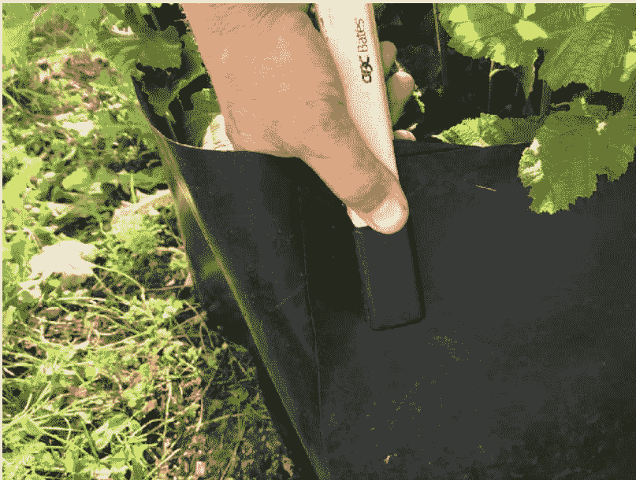

图 #5-7，将包裹固定在地上。


图 #5-8，末端 5-8。


图 #5-9，准备层繁殖的萌蘖。

# 第 6 章 - 收割

## 根据果园类型收割

收割方法需要对每种类型进行评估，如下所示。讨论的三种类型是自采（U-Pick）、对篱丛和树木。


6-1，基于树或丛型的果实处理流程图。

路径的概述根据果园类型有所不同。总体流程相同，但你可能根据预期产量决定购买什么设备。我们假设初始购买将针对足够大、设备仍具有经济效益的小型果园。

## 自采 (U-PICK)

自采经营不需要任何收割设备，只需要消费者在正确的时间来到你的田地。对于自采经营，设备是让客户在需要时到达的营销。客户将从你的自采经营中获得全方位体验。客户将在户外体验一种离线生活，在如画的果园中采摘自己的食物。当然，自采还需要更多东西，如第 3 章所述的停车和区域围栏。我们发现客户并不想自己剥壳和分离果实，除非体验五分钟。在手动剥壳五分钟后，最热衷的园艺爱好者对即食果实的感激之情变得显而易见。为了确保他们能“享受”这种体验，请设置手动剥壳站。在享受几分钟后，他们会乐意让你来处理剥壳工作。

你可能想要添加一台动力脱壳机、坚果破碎机以及分壳和筛选机，以便为客户提供大部分干净的坚果带回家。更好的做法与客户进行等值交换，用新鲜采摘的坚果换取果仁。当然，你还会想要一些加工过的坚果、增值产品以及第三方冷却设备来完善整个体验。

请记住，与任何袋坚果一样，最终产品可能含有壳碎片，因此需要适当的警告。对于正确的标记，请咨询你所在县的计量标准部门以及州的农业和市场部门以了解标签要求。此外，对于自采型（U-Pick）业务，你需要配备清洗站、卫生设施并张贴安全规则。当然，在现阶段你需要购买保险并进入农业旅游细分市场。我们不经营自采，但我们听说保险公司会协助满足自采作业通常采用的安全要求，自采作业还会增加其他活动来吸引并留住客户。

# 采收矮榛果

收获劳动的果实是有回报的。开始时，你会乐意地从灌木上手工采摘坚果，因为灌木相对较短，茎部容易弯曲，而且采摘坚果是一次很好的健康体验。在我们种植坚果的三十多年里，我们仍然非常享受手工采摘。即使当果多到无法手工采摘时，你也需要检查坚果是否已经成熟。

如何判断坚果何时可以采收？坚果的颜色或壳的颜色能告诉什么时候采收吗？答案是肯定的，有时可以。有些壳开始变成深棕色，但坚果还没有饱满。有些坚果在绿壳中变成棕色，但还没有饱满。偶尔你会发现某棵灌木有绿色的壳和白色的壳，它们成熟了吗？我们怎么知道呢？脐（hilum）是坚果连接到果壳的地方，那里是看不到。脐在 90% 的情况下都能告诉你坚果的状态。如果坚果向侧推时毫不费就能脱离果壳，那么坚果很可能已经准备好了。

当坚果仍然潮湿且刚采摘时，我们喜欢用 PVC 管切割器将坚果切半。如果坚果很容易从果壳上分离，且切开后的壳内有饱满的白色固体坚果，说明它成熟了。我们会品尝看它是否有油脂质地、一些甜味和未煮的榛果味。我们有些灌木的坚果是棕色的，壳也是棕色且干燥，但坚果还是剥不开！希望你不会遇到任何坚果无法从壳分离的灌木。

一旦你超过了手工采摘所有坚果的能力，你就会寻找机械化的采收方法。灌木型果园需要购买通常用于蓝莓或野野果的采收设备。一棵高产的灌木可以装满两个五加仑桶，手工采摘需要 20 分钟以上。如果你有 300 棵灌木要采摘，采摘 30 棵需要 10 小时，那么就需要采摘 10 天。如果你有 3000 棵灌木，你现在就有 100 天每天采摘 10 小时。如果你需要支付多个人每小时 15 美元或更多，加上所有额外的工资成本，每年的收获成本可能高达 20,000 美元。这只是采收，现在你还需要脱壳、清洗、消毒、分级、分拣、包装、营销、销售和运输。这些是为了让你做好准备，以防你决定采购采收设备。在达到经济临界点之前，你不需要设备，而根据之前的计算，设备可以在几年内收回成本。

蓝莓采收机可能非常贵，因为许多是大型自驱动式机器。有些由动力输出（P.T.O.）拖拉机驱动，可以相当廉价地买到。蓝莓采收机包裹整个灌木，轻轻拍打树枝使带壳的坚果掉落。树底部周围环绕着金属或塑料板，让坚果滑到传送带进入箱中。老灌木的直径可达四英尺，变得太宽而无法进入某些蓝莓采收机，需要对外部和茎部进行萌剪。当成熟的灌木基部很宽时，一些坚果会掉到中心而无法进入传送带。如果灌木沿行保持狭窄，大多数坚果将能够捕捉到而不会丢失在灌木中心。我们谈话过使用蓝莓采收机的种植者，他们对工作效果非常满意。在采收完一片榛果林后，种植者提出让人们采摘采收机漏掉的部分，人们很快就离开了，说不值得去寻找漏掉的坚果。


图 #6-1，BEI 顶置蓝莓采收机，感谢 Wikimedia[34]

你可以花费超过 250,000 美元购买新的自驱动蓝莓采收机，但通过互联网快速搜索，你可以买到“买来即用”状态的约为 40,000 美元以下的旧设备。你希望找到最大、最高的开口处，以便以最少的修剪或对树木的损害采收更高的灌木。甚至有一家专门经营二手蓝莓设备[35]及相关销售的服务。然而，野果采收机也能解决成熟榛果灌木基部过宽的问题，新设备从 35,000 美元起，自驱动式最高达 240,000 美元。


图 #6-2，野果采收机


图 #6-3，Chianchia K530 3点悬挂式榛果和栗子真空收割机，当地经销商 [BDI Machinery]。

树形榛果生产是目前欧洲和美国西部地区的主要形式。榛果作物通过机械收割机进行收获，收割机从果园地面清扫果实，就像清理道路的普通扫地机，或者通过两者结合进行吸取。通常先将果实扫成一排，然后对该行进行吸取。在 Flory 设备视频[39] 中可以看到很好的例子。作为全球最大的榛果生产国，土耳其的大部分收获仍是手工完成，并将随着时间转向机械收获。图 #6-3 显示了如何从意大利 Chianchia 收割榛果。这种真空收割机也用于栗子，是 BDI Machinery[40] 出出的新品，价格约为 7 千美元。

果园每隔几天进行一次清扫和真空，直到收获结束。为了加快收获速度，使用了摇树机，它抓住树干并使树震动。常见的一种是由 Savage[41] 制造的三点悬挂式。对于具有健康且足够厚实不会受损的成熟树木，如果你知道所有果实都已成熟等待掉落，这是一种极佳的方法。摇树机也适用于任何结满成熟果实的坚果树，而不只是榛果树。

关于“单干树形”真正含义的说明。我们有许多属于“单干树形”的成熟榛果园，如图 #6-3 所示，它们有多个干。主要精力在于让基部非常窄。

收获果实簇增加了一个去除外壳的步骤，以便你可以充分干燥果实以防止霉变，并能够更好地剥开整壳。在树上收获果实簇可以尽量减少（如果不是消除）土壤真菌病原体，这些病原体会导致不及时收获的果实腐坏，假设你的果实已经成熟，这几乎是理想的收获形式。

## 去壳


图 #6-4，在 Z’s Nutty Ridge 使用的桶壳机，由五加仑桶和弹筋制成。

如果你没有很多果实要去壳，可以使用“桶壳机”。桶壳机简单地由一个五加仑桶制成，在桶顶部和底部各钻一个孔。一根杆（又称“全丝杆”或“全螺纹杆”）穿过中心，将橡胶弹筋系好或螺栓固定在杆上。如图 #6-4 所示，杆连接在桶外的电钻上，这是我们使用的。UMHDI 有一个 Don Price[42]的设计，你可以下载并阅读。只需将果实和外壳装满桶的 2/3。扣上盖子，开启电钻运行约两分钟。如果你的电钻有两档位，请使用高速档。起初，果实发出某种沉闷的声音，稍过后你就会听到更多果实撞击侧壁的声音。随着果实与外壳分离，声音变得越来越大。大约两分钟后，好奇心驱使你去看，发现大部分外壳已经分离，桶现在只有 1/2 满。由于外壳有些破碎并沉淀，体积减小了。这使得果实与外壳的分离容易得多。此外，如果外壳是干燥而不是多汁或绿色的，桶壳机效果更好。我们喜欢将桶倒在 1/2 英寸的金属丝网上揉搓混合物；外壳碎片会掉过网，你可以更快地看到果实并进行分离。你可以制作一个风力分离器，它可以吸入轻质外壳而留下果实。UMHDI 有详细的说明介绍如何使用 PVC 管道、木工吸尘器、可选的粉尘分离器以及控制空气流的阀来制作分离器[43]，总成本约为 300 美元。

一旦你的果实簇多到桶壳机无法处理，在经济上合理的情况下，你将需要使用大型设备去除外壳。一台 Chianchia S120 型的分离器可以将外壳与果实分离，如图 #6-5 所示。Chianchia 的区域销售商是位于宾法尼亚州 Macungie 的 BDI Machinery[44]。在农场上制作的其他介于桶壳机和 Model S120 之间的设计请见 UMHDJ[45].website。


图 #6-5，来自意大利 Chianchia 的新款 9.0+K美元 S98/120 清洁/分离器，由 BDI Machinery 提供。

## 加工你的榛果 - 消毒、筛选和干燥

一旦你将果实分离出来，最少的处理步骤是消毒、筛选和干燥。你应该使用基于氧的消毒剂[46]（如 StorOx 2.0 或 SaniDate 5.0）进行消毒，并遵循制造商标签上的粉末稀释和时间说明。消毒剂可以在 Griffin Supply 等温室供应公司购买。

对果实进行消毒非常重要，可以杀死外壳上的任何细菌或真菌，这些它们可能导致霉变或腐烂。消毒后，果实应快速干燥以将水分含量降低到安全水平。

筛选涉及移除受损、腐烂或其他不合格的果实。可以通过手动或机械方法完成。

干燥是加工中的最后一步，以确保果实能够长期储存。这可以在太阳干燥机中进行，或在受控环境中进行风干。


图 #6-8 是大型商用分级器，其管道直径接近 55 加仑桶。


图 #6-9 是农场型带壳坚果切片机，带有三种不同孔径的分隔。

按尺寸分级坚果还能让你在选择破壳壳时做得更好。当你将坚果放入破壳机时，尺寸越接近，且将破壳机调整到恰好能破壳，你就有更有机会获得大多数消费者所喜爱的完整坚果或半颗。许多坚果加工商实际上会有六到十二种或更多尺寸，以便更好地完成坚果破壳。我们见过定制制作的坚果分级器，包含了 USDA 的榛果尺寸和栗子的尺寸。这样，同一个分级器就可以同时用于栗子和榛子。通过我们的农场型设计，我们只需为栗子更换 PVC 管道即可。

## 破壳

通过网络快速搜索，你可以买到许多坚果破壳机。我们无法对购买哪种破壳机做出判断。你需要评估并决定需要破壳的坚果体量，并购买合适尺寸的破壳机。你会想要一台动力破壳机，而钻机驱动的破壳机在创业阶段是非常省钱的，所以不要买你无法用电动机驱动的破壳机。诚然，大型加工商有很多并行运行的破壳机，并针对特定尺寸进行了调整。每当我们运行不同尺寸时，我们都必须调整破壳机，以使破壳出来的完整和半颗果最大化。你现在明白你的目标了。你希望尽可能多的完整和半颗果可以包装，因为那是人们购买的。

## 壳分离

一旦破了坚壳，你就会面临与处理坚果和外壳时相同的问题。你需要将两者分离。同样，风力分离器可以胜，Don Price [52] 已经详细说明了如何制作一个。

对于即食坚果，你需要烘烤坚果并决定是否要去除种皮（pellicle）。种皮是坚果肉上的薄皮，烘烤后会变褐，可能可能不会脱落。根据我们阅读的资料，种皮含有一些非常好的营养成分，应该食用。然而，工业界一直在剥去坚果的种皮，我们认为这在营养学上是一个错误。欧洲坚果的种皮往往较厚，在食用时会有些分散注意力，但我们的美国榛果和许多杂交榛果的种皮要薄得多，几乎透明，不会影响食用。

一旦你决定在果壳之外对坚果进行加工，就会产生一些额外负担。你需要在获得许可的厨房中进行破壳和加工。你还可以在一个免受啮齿动物和害虫侵害的地方加工坚果。你可能需要获得认证才能使用该厨房。在纽约，这被称为 20C 厨房和 28D 储藏设施。请你所在州的农业和市场部。目前，纽约州没有明确列出用于加工坚果的家庭加工者 (531)；纽约州描述的家庭加工大纲似乎符合这些要求。康奈尔大学提供了一个很好的参考，供你审阅家庭加工者的要求。你可以快速看到加工坚果的所有设备总和是多少，直到你有足够的设备在经济上证明购买是合理的。这时你所在地区的坚果合作社将让你拥有一小片果园，并让你的努力变得合理，正如我们成立的纽约新坚树作物合作社 (NYTCA) 一样。

正如我们一直在链接的那样，有许多收获设备制造商，也有适用于各种价格范围和农场规模的二手设备来源，Henry Colombo Equipment [551]。

我们编写这本书是作为一份“如何做”和“去哪里”的参考，以帮助你的农业经营取得成功，也是一份关于为什么你应该成为多年生农业一部分的情感论述。我们读了太多关于多年生农业理想的书籍，而关于如何真正赚钱以继续我们所有需要做的事的书籍太少。我们从这本书从希望让一切顺其自然发展的环保主义者的讨论开始。我们认同环保主义者需要支付公平的税收，并取得足够的成功来激励他人遵循我们的道路。我们现在知道榛果和栗子可以实现经济合理性，一旦我们的成果永久性地立足，我们就可以进一步整合多层农作，那仅仅是“锦上添花”。

# 第 7 章 - 果园建立成本


我们查看了按照前几章规定建立 2.5 英亩和 10 英亩果园所涉及的成本；我们将说明建立成本。我们将使用自采型（U-Pick）风格的榛果果园，因为一旦产量在经济上证明合理，它可以使用蓝莓收割机进行机械化收获。苗树间距将为行内 6 英尺，行距 16 英尺，每亩约 455 棵树。我们还将展示已知品种在 8 英尺比 16 英尺间距下的相同果园成本，使用 80% 的品种和 20% 的幼苗，每亩约 303 棵树。品种中的幼苗将采用 6 英尺间距，以作为授粉保险并寻找下一棵“明星树”。

榛果建立成本将是三种幼苗和品种安排的比较：

- 1. 纯幼苗果园 - 幼苗树间距为行内 6 英尺，行距 16 英尺，每亩约 455 棵树。
- 2. 80% 品种和 20% 幼苗的果园 - 已知品种将采用 8 英尺比 16 英尺间距，每亩约 303 棵树。
- 3. 双种植果园 - 幼苗将采用 6 英尺间距，每亩约 333 棵树。

我们给出幼苗和双种植果园的原因是，尽管我们在书中讨论了一切，许多人以此方式种植。部分问题是可用品种不足。新品种正在快速发布。

我们为一份全面的业务计划制定了一份十多页的电子表格，使用全额成本，假设你的业务使用了外部劳动力和所有可能的设备费用，以及日常维护和折旧。现实中，我们知道这是一个新行业，银行会对贷款犹豫。随着时间的推移这种情况会改变，但目前我们假设你使用自己的劳动力。我们只需要计算围栏、树、土壤改良剂和肥料的成本。还有覆盖物和基础工具成本，这些价格跨度很大，因此我们采取中间价位。

我们发现，如果你提前一年获取所需的物品，在成本上是极小的，因为你是在别人想要处理掉它时获取的，例如木屑。例如，如果你让你镇的公共工程部 (DPW) 知道你需要不含橡树或黑核桃的木屑，并提供一个方便的倾倒处，你可能会对免费送货的大量木屑感到惊喜。

土地成本范围很大，可能从每亩 1000 美元到每亩 100,000 美元不等。我们推动使用东北部所有的闲置山地，这些土地可以以低于 2000 美元的价格购买。作为参考，俄勒冈州和英属哥伦比亚的榛果土地每亩从 15,000 美元到 100,000 美元不等。

我们知道开始时你想要尽量少的钱，但最好的钱是花在那些已知高产的树上。

榛子树苗是一项巨大的豪赌，正如我们在第 3 章“我们应该种植什么类型的树？”中所讨论的那样，获得一棵真正高产的树木的概率至少为 3000 比 1。如果你真的没有选择购买种子或树苗来开始，请先修好围栏，仅在围栏内的果园种植。让树木生长六七年，选出那些产量高、果实好且无枯萎病的树，然后对它们进行层被繁殖。另一种方法是种植苗时间距仅保持三英尺，这样当你发现优良品种时就可以剔除不产结果的树。诚实地说，尽可能使用榛子克隆品种，因为我们的遗传资源是美国和欧洲杂交的新型杂种，没有像多年栗树那样拥有数百年来遗传的果实品质。

在三英尺间距下剔除不产的树非常困难，因为你需要挖出根部才能杀死它。最好的办法是使用斧头砍断根部并杀死任何新发的芽。我们曾尝试在八九年后用灌木拔机（又称抓取器）拔出不产的灌木，你可以在 `Northern Tools`[56] 买到它，但我们要拔出的树根部与相邻的树木纠缠在一起，它想连同相邻的两棵树一起拔出来。我们不会拔掉已经生长的树；然而，我们会使用移树机移除不需要的树或进行移动，你可以像图 #7-1 所示，在 3000 美元左右买到一个中等二手。再次，我们告诉你是哪些不可行的，是为了让你不要浪费时间。


图 #7-1 移树机和新移的树。注意：铲子里的水桶。

榛子要么通过组织培养或层被繁殖，这样它们生长在自己的根系上，你就不会遇到嫁接失败。如图 #2-16 和 #2-17 所示的组织培养，或层被繁殖的克隆树，这样它们会同时成熟，你就能了解果仁的特征，有助于你营销。如果你知道你的果实来自已知品种，你可以像苹果一样宣传该品种名称，以建立消费者的品牌认知。

栗树果园的建立与榛子果园相比仅略有不同，因为我们保持了图表相对简单。我们假设树苗双倍种植或嫁接苗单间距种植，并针对从种子生长的树苗进行了编辑以比较成本。

## 榛子建立成本

| 果园建立成本项目 | 每英亩费用 - $ | 所需数量 | 2.5 英亩费用 - $ | 10 英亩费用 - $ | 备注（按描述的成本不含） |
|---|---|---|---|---|---|
| 金属围栏 - 完整的铲子、修枝剪、剪刀、围栏多功能工具、杂项。土壤改良 - 石灰每英亩 3 吨 | | | 果园 | 4,277 | 8,554 | |
| | | | 果园 | 300 | 300 | |
| | | 35 | | 263 | 1,050 | 每英亩 3 吨。 |
| 背负喷雾器 种苗每英亩 455 | 100 | 2 果园 | 200 | 200 | |
| | | 45 英亩 | 5,688 | 22,750 | |
| 树苗 20% @每英亩 455 命名品种 80% @每英亩 303 | | 91 英亩 | 1,365 | 5,460 | 行间距 6 英尺 x 间距 16 英尺 = 每英亩 455。 |
| | 12 | 242.4 英亩 | 7,722 | 29,088 | 每棵 105 到 155 棵 |
| 种子树苗 灌溉 | 0.67 | 910 英亩 | 1,524 | 6,097 | 3' x 16' 间距，每英亩 910 棵树苗 |
| 灌溉泵、过滤器和储水箱 | 400 | 1 英亩 | 1,000 | 4,000 | 滴灌 |
| 覆盖物 | 15 | 6 英亩 | 225 | 900 | 每英亩需要 6 码覆盖物 |
| 喷洒 | 20 | 2 英亩 | 100 | 400 | 营养或杀虫最低 |

- 仅使用精选树苗的总成本
- 使用精选树苗的每英亩成本
- 使用树苗命名品种的总成本
- 使用部分树苗命名品种的每英亩成本
- 仅使用种子树苗的总成本
- 使用种子命名品种每英亩成本

表 #7-1，榛子建立成本（减去 2.5 英亩和 10 英亩果园）。

## 栗树建立成本

| 果园建立成本 | 每英亩费用 - $ | 所需数量 | 2.5 英亩费用 - $ | 10 英亩费用 - $ | 备注 |
|---|---|---|---|---|---|
| 金属围栏 - 完整的铲子、修枝剪、剪刀、围栏多功能工具、杂项。土壤改良 - 硫磺每英亩 500 磅 | | | 10 英亩 | 250 | 1,000 | 每英亩 500 磅。 |
| | | 果园 | 4,277 | 8,554 | 按描述的成本不含 |
| 背负喷雾器 | 100 | 2 果园 | 200 | 200 | |
| 嫁接苗 100% | | 45 英亩 | 5,688 | 22,750 | |
| 树苗 20% @每英亩 455 命名品种 80% @每英亩 303 | | 91 英亩 | 1,365 | 5,460 | 行间距 6' 英尺 x 间距 16 英尺 = 每英亩 455。 |
| | 12 | 242.4 英亩 | 7,722 | 29,088 | 每棵 105 到 155 棵 |
| 种子树苗 灌溉 | 0.67 | 910 英亩 | 1,524 | 6,097 | 3' x 16' 间距，每英亩 910 棵树苗 |
| 灌溉泵、过滤器和储水箱 | 400 | 1 英亩 | 1,000 | 4,000 | 滴灌 |
| 覆盖物 | 15 | 6 英亩 | 225 | 900 | 每英亩需要 6 码覆盖物 |
| 喷洒 | 20 | 2 英亩 | 100 | 400 | 营养或杀虫最低 |

- 仅使用精选树苗的总成本
- 使用精选树苗的每英亩成本
- 使用树苗命名品种的总成本
- 使用部分树苗命名品种的每英亩成本
- 仅使用种子树苗的总成本
- 使用种子命名品种每英亩成本

表 #7-1，栗树建立成本。


图中是 Z's Nutty Ridge 的一个单茎克隆榛果果园，用于产生更多克隆植物和控制授粉。

# 第 8 章 - 在北美东部种植栗

种植栗子与种植榛果非常相似，只是对土壤的要求更为严格。我们将按照与种植榛果相同的顺序来回顾栗树的需求。栗子比榛果更容易收割，但在收获后处理时也更脆弱。我们将解释这些以及其他差异，以消除您可能有的任何顾虑，让您有信心进行种植，因为您已经为树木提供了最好的生存机会。你会发现，栗子对于我们所有的酸性休耕良好的山坡地来说都是近乎理想的作物。在同一田地上同时种植栗子和榛果也是可能的。以下是一个“快速参考”概述，之后我们将对此进行详细阐述。

## 栗子概述及下文细节

- 1. USDA 区地图会告诉你你处于哪个硬度分区，以帮助你选择树木。在 [USDA 交互分区地图](https://wiki.example.org)[59] 上定位你的农田。你处于 4b 区或更高区域吗？将你土地的 USDA 硬度分区与可用树木选择的 USDA 硬度进行比较。在 USDA 4b 区生长良好的栗子品种选择比 USDA 5/6/7/8 区的少得多。不要为你的所在区域购买错误的树木至关重要。
- 2. 需要查看 GIS 土壤调查以了解你所拥有的土壤类型。在 [GIS 土壤调查网站](https://wiki.example.org)[60] 上查找你的农田。我们在第 2 章详细回顾了如何操作 Web Soil 网站。栗树在 pH 等于或高于 6.5 的排水良好中生长良好，pH 值应在 5.4 到 5.8 之间。然而，如果土壤呈碱性，你将需要寻找另一块地。含有某些粘土的土壤是可以的。但是，重粘土不会排水，栗树像大多数树木一样，如果没有你非凡的努力将无法良好生长，最好找另一块地种栗子。不过，如果你的 pH 低 6.5，我们会告诉你是如何处理粘土土壤。
- 3. 需要土壤测试以查看种植健康的栗树需要什么条件。来自 [Dairy One](https://wiki.example.org)[61] 或你当地合作社扩展服务的土壤测试将告诉你是否需要添加硫以及添加多少。如果土壤多年未耕作，土壤表面的 pH 值通常较低，只要底土的 pH 在 6.5 以下通常都是好的。土壤测试将告诉你土壤是否缺少任何宏量元素以及需要添加多少。进行调整是非常重要的，因为树的生长状况仅取决于最缺乏营养元素的水平。在进行任何种植尝试之前，都应该采取上述三个步骤，而不仅仅是针对栗子。
- 4. 在规划阶段尽早**准备**土地，如果可能，在种树前的一年对你的土壤和土地进行建议的调整。这意味着果园地面需要清除灌木丛和石头。如果需要，硫将需要施入土壤中。在微生物吸收了硫后，土壤会变酸，这至少需要三个月，通常需要更久。你还需要添加从当地农用用品店购买的任何建议改良剂。你可以先从你计划种树的一条带开始调整，通常为四英尺宽，使用手推式旋耕机。然而，随着时间的推移根部生长，整个田都需要进行调整。到那时，这些步骤看起来会非常熟悉，只是我们在之前讨论榛果可能需要石灰时，在栗子上用硫磺替换了它。
- 5. **果园规划与种植** 栗树比榛果大得多，间距至少需要 20 x 20 英尺，在种植超过 25 年后，可能需要疏剪到 40 x 40 英尺的间距。最初，目前的努力是每行间距 10 英尺处种植苗树，行与行之间间隔 20 英尺。然后在 10/12 年后疏剪到 20 英尺乘以 20 英尺的间距。其他人敦促种植已知品种的嫁接树，如果你掌握了关于它们问题的知识（我们将在以后详细描述）。
- 6. 当涉及到栗子收获时，无论是自采果园还是商业种植果园，果园布局都是相同的。
- 7. 在北美东部，最常用的方法是从命名品种种植杂交苗，密度为双倍（10 x 20），并当果园变得拥挤时，修剪掉一半产量最低的植物。你需要选择作为苗木良好母树的已知品种。或者，对于你所在的区域，可能获得嫁接树。我们提供了一个潜在列表作为你选择的开始。
- 8. 栗树作为单茎树生长。栗树会产生一些须根，需要修剪。栗树在最初几年还需要剪掉下方的树枝，以促进直立生长，并为你和果园设备留出所需的空间。
- 9. 维护和病虫害要求你勤奋确保幼树在至少前两年有足够的水，并保持树基周围没有杂草。由于你已经调整了土壤，第一年不需要任何施肥。你只需要留心食叶昆虫，如日本甲虫、毛毛虫或军蚁虫。通过在果园外放置几个日本甲虫捕虫器并监测，可以大幅减少日本甲虫。通常情况下，在树木结果果实之前，你不需要担心任何害虫，我们有栗象象，有些地区会有导致腐烂的花粉虫，这会影响产量，如果树没有种在排水良好的土壤上，会杀死你的树。
- 10. 在建立期间，啮类是一个可控的问题。我们需要关注想要偷我们果实的鸟类。如何处理鸟类和啮类见第 4 章。果园地面需要进行杂草控制、啮类控制以及便于收割。当树木结果时，叶片分析将告诉你施肥和营养状况如何，正如第 5 章中所示。
- 11. **保护** 你的新树对于生存和快速生长至关重要。我们说明了需要围栏以防止大型啮类啃咬你的树，见第 4 章。如果你有田鼠和伏鼠，树周围围上铁丝网可以防止它们咬树皮。如果你只种几棵树，而不是建立围栏，可以用四五英尺高的金属栅围住树。围栏的直径需要在树的总宽度向外延伸两英尺，以防止鹿触及。十岁幼栗树在树皮仍绿色时，在二月寒冷的晴天可能会遭受冻伤，应将树皮涂成白色以避免损坏。
- 12. 根据一年中的月份任务按年度**重复**计划。一个按月的年度日历会提醒你在什么时间做什么，详见表 8-5。
- 13. **收获与加工** 就像等待果实掉落并捡起来一样简单。如何捡起、消毒、分级（如有必要）分尺寸将详细讨论。
- 14. **树的品种**以及在哪里可以购买。

## USDA 区地图

你已经熟悉如何在 USDA 交互分区地图上找到你的农田，这只需要缩放到你的位置直到看到你的农田，这非常简单。这是一个我们非常感激的精彩资源。一旦看到你的农田，彩色地图就说明了你处于什么区域。如果你处于 USDA 4a 到 5a 区，你需要验证你购买的栗子品种是否足够耐寒以便在你的区域生长。同样重要的是树木在该地区发生霜冻之前结实并成熟果实。正如所述，目前的做法是购买幼苗，并按照行距 10 英尺、行距 20 英尺的双倍密度进行种植。幼苗具有遗传变异，某些强壮的母树并不总能为你提供健壮高产的后代。因此，双倍密度允许你在不损失多年生长的情况下去除表现较差的个体。请参阅树品种章节以根据你所在的区域选择树木。

## 土壤调查

GIS 调查网站会告诉你你可以预期的 pH 值、土壤深度以及是否被认为是排水良好。良好的排水是栗树长期健康的一个重要方面。如果你的栗树长期处于水渍状态，它的根部将受到损害，树木也会衰败。我们从一位种植户那里得知，他们的树生长了九十年，一直非常好，但在一个潮湿的春天之后，树死掉了。即使你的场地被认为是排水良好的，你也必须考虑计划种植的地方。那里是否存在水沟，水可能会在那里积聚直到通过底土排水？在潮湿的年份，水可能积留过频繁或时间过长，从而损害你的树木。在种植土地时请避开低洼处。

土壤对栗树非常重要，因为 pH 值不能达到 6.5 或更高，否则你的栗树会死亡。什么样的抗病基因适合你的位置？我们将在本章末尾列出树树品种。你通常会在六或八英处的深度对土壤进行测试，pH 值可能为 6.0。闲置土地的表层土壤与一两英尺深的土壤相比，pH 值通常较低。然而，根系生长的深层土壤 pH 值可能可能是 7.0。GIS 调查会告诉你深层的 pH 值。如第 2 章所示，在 GIS 网站上你可以设置 pH 的测试深度。例如，在贯穿于东北部的 190 号州公路沿线，土壤倾向于碱性，这意味着 pH 值在 7.0 以上。如果深层土壤等于 6.5 或更高，请不要尝试种植栗树，因为你的树很可能会虚弱并死亡。再次，我们告诉你是哪些行不通，以免你浪费时间。

如果土壤 pH 值等于或低于 6.5 且排水良好，那么你可能拥有一个种植栗树的好地方。通常，如果土地经过耕作，表层土壤 pH 值通常高于 6.5，因为该地很可能施过石灰。这是我们经常遇到的情况，必须施用硫。施硫的一个经验法是每英亩每次施 250 磅。等待三个月并测试土壤。理想情况下，你可以通过旋耕机或圆盘将硫混入土壤中，以激活硫供微生物利用从而降低 pH 值。通过测试土壤，你将知道需要添加多少硫，这是下一个要讨论的话题。

## 土壤测试

是的，你确实需要挖掘地下 6 到 10 英寸的土壤，且每英亩采集多个地点，将样本混合在一起对土壤进行测试，以查看你表层土的质量。GIS 土壤调查会给你你可以预期的深层 pH 值，但不会告诉你目前表层土中实际存在的有机质或矿物质。如果你每英亩大约挖掘五个地方，每个孔取一把土壤并将样本混合，每个英亩就能得到一个平均土壤样本。总的来说，实验室只需要大约半磅土壤即可进行测试。我们尚未看到栗树理想的营养范围。当我们把土壤样本提交给 `Dairy One` 时，他们没有针对栗树的推荐元素范围，所以我们告诉他们是蓝莓。他们也想知道你的土壤。土壤类型就是我们在第 2 章详细介绍的 GIS 土壤调查中发现的——你拥有什么类型的土壤？当我们查询想要种植植物的 pH 值时，图表显示了土壤类型以及你的果园中该类型占的百分比。在我们的示例中，马栗粉壤土（Lima Silt Loam）占我们地地的 50.3%，如图 2-6 所示。我们告诉 `Dairy One` 我们的土壤测试主要是马栗粉壤土。下表是土壤测试结果的总结。通过表 8-1，我们看到土壤的 P、K、Ca 和 Mg 含量相对较高或处于理想水平。我们还看到 pH 为 5.9，这对栗树是有利的。通过告诉 `Dairy One` 我们种的是蓝莓，他们将为你提供调整蓝莓所需的添加剂建议。再次，联系当地的农资用品店批量购买石灰或硫等添加剂，与大型超市相比，每磅的成本要便宜得多。此外，当地农资用品店通常有一辆卡车为你将硫或石灰洒在你的田地上。如果不确定去哪里买，只需问问当地农民他们去哪里买硫或肥料即可。

微量元素如锌和硼对坚果产量非常重要，关于这一点，我们将在下次回顾叶片分析时进行介绍。根据土壤分析，我们我们的锌含量为零，将需要进行叶片分析以准确测量树木能够吸收的百万份 (ppm)。

| 元素 | 数值 | 极低 | 低 | 理想 | 高 | 极高 |
| :--- | :--- | :--- | :--- | :--- | :--- | :--- |
| 磷 (P) | 12 | | | | | |
| 钾 (K) | 198 | | | | | |
| 钙 (Ca) | 277 | | | | | |
| 镁 (Mg) | 520 | | | | | |
| 元素 | 数值 | 元素 | 数值 |


| :--- | :--- | :--- | :--- |

| pH | 5.5 (范围) | 硼 | 0.1 |

| 铁 (Fe) | 12 | 铝 (Al) | 36 |

| 硼 | 50 | | |

土壤分析显示了我们拥有的情况。

| 板栗样本 | 氮 (N) | 钾 (K) | 磷 (P) | 钙 (Ca) | 镁 (Mg) | 锰 (Mn) | 铁 (Fe) | 铜 (Cu) | 硼 (B) | 锌 (Zn) | 干态硫 (S) |

| :--- | :--- | :--- | :--- | :--- | :--- | :--- | :--- | :--- | :--- | :--- | :--- |

| % | % | % | % | % | % | % | % | % | % | % | % |

| 地块 1 | 2.28 | 0.52 | 0.22 | 0.97 | 0.26 | 134 | 80.1 | 6.45 | 17.4 | 17.8 | 0.15 |

| 地块 2 | 2.54 | 0.69 | 0.42 | 0.93 | 0.17 | 364 | 60.9 | 6.03 | 58.5 | 41 | 0.22 |

| 地块 3 | 2.17 | 0.62 | 0.32 | 1.09 | 0.35 | 177 | 55 | 4.7 | 44.2 | 30 | 0.21 |

| Topmak 板栗 - | 1.94 | 1.88 | 0.14 | 0.43 | 337 | 197 | | 16.50 | 34 | | |

| 低 Topmak 板栗 - | 2.81 | 2.92 | 0.19 | 0.33 | 0.48 | 728 | 271 | 24 | | 60 | |

| 高 Olsen 值: | 1.8 | 0.5 | 0.1 | 0.6 | 0.18 | 20 | 40 | 2 | 25 | 10 | 0.08 |

| Olsen 高值: | 2.5 | 2 | 0.5 | 3 | 1 | 1000 | 500 | 100 | 100 | 100 | 0.5 |

表 8-2，三个板栗地块的叶片分析与 Toprak 和 Olsen 提供的范围对比[67]

# 果园规划与种植

如上摘要所示，板栗的果园规划非常简单。无论是自采、人工采收还是机械采收，设计都是相同的。树距为行内10英尺、行间20英尺，每亩约有216棵树。这种树间距被认为是双密度种植。由于树的数量是正常间距的两倍，双密度种植可以在早期获得更高的果产量。此外，有更多的花粉可以用来授粉，这在树木较小且花粉较少时至关重要。

## 幼苗还是嫁接？

种植已知品种的幼苗还是购买嫁接树进行种植取决于你的选择。大多数新果园都是已知品种的中国杂交幼苗。有些果园是有名品种的嫁接树，有些果园计划在同一幼苗上嫁接不同品种。例如，如果你种植了 `Szego` 的幼苗并买了一棵 `Szego` 嫁接树，你可以从嫁接的 `Szego` 上剪下接穗并嫁接到 `Szego` 幼苗上。

你可能会问，为什么将 `Szego` 嫁接到 `Szego` 幼苗上更好呢？板栗存在延迟嫁接失败，这种延迟可能是两年或20年。为了减少嫁接失败次数，研究发现如果接穗来自幼苗的母树，嫁接失败会较少。这在直觉上是合理的：幼苗拥有大约50%的母树基因，这最有机会与嫁接木保持兼容。为了让你理解嫁接失败，密歇根州立大学（MSU）的 `Fulbright` 博士讨论了他如何访问一个大约5年的嫁接树果园，结果在幼苗树上没有发现存活的嫁接。因此，默认情况下该生产者种植的是幼苗树。除了嫁接失败外，许多嫁穗生长相当缓慢，仿佛嫁接部位没有让营养自由流动，且产量较低。有些树嫁接效果良好，如 `Szego` 和 `Boucher de Betizac`。

一些有名树是极好的母树，因为它们的后代通常良好或优于母体。其中一种树是 `Luvalls Monster`，它是雄性花粉不育的，通常产生更多果实，因为原本用于产生花粉的能量可以用来结实。此外，当 `Luvalls` 被中国树授粉时，所有后代也都是雄性不育。一个拥有20%花粉生产者的雄性不育树果园应该具有非常高的产量。

优惠品种列表多年来一直在变化，如果你对采取哪种方式犹豫不决，康奈大学的一篇论文值得一读。总而言之，当 `Ian Merwin` 博士对比商业生产中幼苗和嫁接树时，幼苗可能是最佳选择。他们发现与幼苗相比，嫁接的失败率更高且生长较慢。嫁接树在早期产量更多果实，但幼苗的活力和长期产量更具经济效益。此外，作为额外奖励，幼苗树的尺寸也相似。

因此，种植有名品种的幼苗还是嫁接树这一根本决定取决于你。

## 图 8-1，按年份划分的修剪形状

栗树倾向于向四周生长，成熟后是极佳的遮荫树。因此，我们不允许树枝在六英尺以下形成，否则你将无法使用任何设备维护你的果园。在第一个生长季节结束时，即最寒冷的冬季月份，当叶子落光时，是修剪的最佳时机。剪掉所有的侧枝以促进高而直的生长，你将得到看起来像单主干的树。通常你只会有一个主干，因此不需要修剪。在第二年，假设树的高度超过了六英尺，修剪掉六英尺以下的所有树枝，并鼓励保留四条角度良好的树枝。与中心主干几乎平行的树枝是不行的，需要剪掉；随着时间的推移，它们会分裂。在第三个休眠季，将正在形成的次级枝修剪到上一年留下的四条主干的各保留一到二条。这些树枝将为树提供适当形状和强壮的支架，以支撑未来生长几代人的非常巨大且长寿的树。如果你的树没有达到第二或第三年描述的高度，修剪可能推迟一年。这是形成你的栗树所需的基础知识，`YouTube` 上也有许多资源可以观看。

我们知道，每一个见证过我们开始种树的人对修剪树木都有抵触情绪。我们也曾经历过。我们发现，最好的办法不要把修剪看作是截肢树枝，而是将修剪更多地视为理发。在这里修剪那里，就有了一个新发型可以展示。在剪断直径超过 3/8 英寸的树枝时，请使用更大的剪刀——长柄剪刀（`lopper`），并在切割时干净利落，不要扭转剪刀，否则会撕裂树皮并导致栗溃病等疾病侵入；树皮在冬季不会干透。在剪树枝时不要扭转剪刀可以拯救你的一些树，并免得你的剪刀被弄弯。整齐的切口干燥和愈合最快。随着直径在几年内增加，幼树会从切口处重新生长。

在修剪树枝时，不要贴着树干剪；应在树枝连接到树干之前的较粗处上方进行剪断，并保持与树枝从树干上长出的相同角度。果园手工工具的良好来源是 `A.M. Leonard`。

## 施肥

栗树使用的肥料量从字面上与榛果的施肥量相同。随着树木长大、滴线直径增大，幼树需要更多的肥料。根据俄亥俄州立大学（OSU）扩展服务养分管理指南 `EM9080` 中已故 `Jeff Olsen` 的说法，第一年给树施肥时提供 0.25 磅氮，第二年提供 0.33 磅氮，并逐年逐渐增加到 0.75 磅氮。`Jeff Olsen` 建议参考榛果和栗树的建议。如果有疑问，请至少每年进行一次叶片分析，因为恢复硼等缺乏症可能需要几年的时间。

请理解，0.25 磅氮需要 0.5 磅的 50-0-0 肥料或 1.0 磅的 25-0-0 肥料。这些数字按重量百分比代表氮 (N)、磷 (P) 和钾 (K)。因此，一种标准的 10-10-10 肥料（通常被称为“三十”肥料）需要 2.5 磅肥料才能获得 0.25 磅氮。10-10-10 意味着袋中 N、P、K 的含量各占 10%。因此，从袋中的每磅肥料将含有 1.6 盎司的 N、P 和 K。

上一段可以用另一种方式重述：对于生长正常的树，树干直径每增加英寸，增加两盎司的氮。因此，如果一棵树的树干直径为三英寸，且你使用的是“三十二”（12-12-12）肥料，则适用以下模式：

```
2/16 * 3 * 100 / 12 = 3 英寸直径的树需要 3.125 磅肥料。
```

密歇根州立大学发表过与上述类似的建议。

栗树的施肥时机与幼树的榛果施肥不同。关于幼树施肥的提醒：不要在七月四日施肥，对于栗树来说，我们需要修改这句老话。栗树具有侵略性生长——最好在花开时不要施肥，否则会发生日灼病（西南病）的概率增加。在某些年份，这发生在六月中旬。栗树生长迅速的皮无法为冬季充分硬化，增加了你遭受日灼的几率。

当你的树变老且大丰收时，你需要在八月份果实填充了一半时进行叶片分析。如果叶片分析显示缺乏元素，你必须施肥，否则下年的果实产量可能会受到影响。请记住，栗树的叶子通常在果实成熟时或之后开始掉落。

## 害虫与疾病

除了第 4 章提到的咀性昆虫外，栗树也有特定的昆虫和疾病。我们并不欣赏它们对我们树木的偏爱和破坏。在采取化学控制之前，请记住需要进行耕作控制、监测、诱饵和天然疗法。当其他方法都失效时，联系你当地的合作社扩展代理，他们可能不敢对他们熟悉的树提供任何建议。如果你有害虫问题，可以采用 `Arbico` 等产品。如果你有疾病，请确保不是营养不平衡。

## 栗瘿蜂

栗瘿蜂是一种特殊的虫，会让你重新思考人生。严肃地说，我们目前所知的栗瘿蜂没有雄性，只有雌性。栗树瘿蜂被称为 *Dryocosmus kuriphillus*，最早发现于日本。这种虫的长度为 2.5 到 3.0 毫米。它在栗树芽上产生瘿，会显著降低产量。瘿蜂的控制可以通过生物防治来实现！

栗树具有侵略性生长——最好在花开时不要施肥，否则会发生日灼病（西南病）的概率增加。在某些年份，这发生在六月中旬。栗树瘿蜂幼虫的捕食寄生蜂通常被称为寄生蜂。这种蜂（*Torymus sinensis*）是瘿蜂产地中国的自然天敌。它于 70 年代引入美国，密歇根州立大学正在研究其目前的分布范围，因为已知它在美国东部已建立。

由于某种未知原因，欧洲混合品种 `Bouche de Béac` 对瘿蜂表现出很强的抗性，现在是美国西部备受推崇的品种。瘿蜂可能允许我们在未来有更多的选择。

## 栗象甲

如果你把新鲜栗子放入冰箱保鲜层，栗象甲会让你觉得恶心。我们在第一次发现象甲的那年犯了这种错误。在果实在冰箱里放了一周左右后，我们发现抽屉里到处蛆虫。这是你不希望客户经历的体验！

有两种被称为“栗象甲”的象甲种类，它们是小栗象甲（*Curculio sayi Gyllenhal*）或大栗象甲。小象甲长度为 1/4 到 3/8 英寸，而大象甲为 3/8 英寸到 5 毫米。每年象甲的数量似乎在树果的 1% 到 10% 之间波动。我们不进行任何喷洒，所以依靠多样化的生物相互作用来控制数量。除了样本检查果实上有象甲孔外，我们不知道如何监测象甲。据说你可以看到小栗象甲在吃花粉，这意味着我们可能在花粉期找到它们。

季节。我们采用每天采收坚果的文化习惯来打破它们的生命周期。象虫似乎有生物防治方法，一项研究使用了病虫有害真菌和病虫有害线虫 [76]。研究发现，*Metarhizium brunneum* 菌株 `ARSEF 4556` 和 `V275` 在控制栗象虫方面非常有效。该研究还发现，线虫 *Steinerema feltiae* 的死亡率达到 20%，当与真菌 *Metarhizium brunneum* 联合使用时，效率达到 100%。噢，病虫有害的意思就是让昆虫死亡，以你想知道那个高级词汇的意思的话。你可以从很多地方获取 `Steinerema` 线虫 [72]，而许多有机解决方案的一站式商店是 `Arbonico Organ`。

*Beauveria bassiana* 是一种真菌病，已被发现 [78] 是有效的土壤处理剂，并以 `Botanogar` 的名称出售。`Botanig` 的价格合理，如果与线虫联合使用，将是非常有效的控制方法。真菌杀虫剂正如你可能猜的那样，是一种基于真菌的杀虫剂。

当栗子接近成熟且果壳即将裂开时，卵被放在坚果中。象虫穿透带刺的果壳和坚果，每个孔产一个卵。长喙是为了钻入果壳，据说喙的末端有微小的齿。幼虫在几天后孵化，钻进坚果中取食几周，并在坚果掉到地面之前或之后爬出来。出口孔要大得多，而且当然，坚果内部会有幼虫的粪便。象虫是我们应该努力每天采收一次、且间隔不超过三天一次的、以打破象虫生命周期的主要原因。如果所有坚果都被采收了，象虫离开坚果并在土壤中生长发育以在次年繁殖的机会就会减少。

图 #8-3，栗子栗象虫，由 `Wikipedia` [79] 和 `Entomart` 提供。注意那长喙！

栗象虫是导致坚果必须在 120.0 华氏度（等于 47 摄氏度）的水中浸泡 20 分钟进行“象虫消毒”的原因。象虫幼虫无法生存的温度是 117 华氏度。我们认识有人买了真空低温烹机和一个大汤锅来控制水温浸泡。真空低温烹机是一种用于烹饪的夹式热水加热器，通常用于烹饪“袋装”食品。厨师们可能觉得这很过分，因为我们过度简化了真空低温烹机的作用，但它效果很好。买一个你认为插座可以承受的最高功率的设备。许多真空低温烹机支持蓝牙连接，且价格远低于 100 美元。

较大的经营规模需要设计一种方法来一次性浸泡整个托盘大小的箱子。`Route 9 Cooperative` 设计了一套系统，使用两台需求型热水器为定制的水箱提供加热水。他们必须在箱子上系一个圆圈，以防止坚果在箱中漂浮。他们完成了该做的工作，我们赞扬 `Route 9 Cooperative` 在北美东部大部分地区的努力。

## 尖腐病 (BLOSSOM END ROT)

有一种尖腐病（BER）会毁掉你很大一部分的产量。其成因已确定是一种名为 *Colletotrichum gloeosporioides* 的真菌 [180]。这种病原体表现为坚果花端变暗，果肉变黑。据说 BER 可能通过瘿蜂带入果园，或者在报告发现有瘿蜂几年后进入果园。据报道，当瘿蜂群数量减少时，该病会大规模发生，因为它对瘿蜂具有化感作用。此外，据报道当树木密集且有枯死杂乱枝时，BER 的发生率会增加，建议修剪枯枝并打开冠层。BER 有时很难从坚果外部看到，但通常是果壳靠近花端的部位变暗。坚果底部被切掉，果肉因腐烂变黑。几年前，它曾影响了采收的高达 50% 的坚果 [181]。此外，尖腐可能有两个不同的来源，因为似乎还有另一种类型，但水平非常低，表现为栗子末端裂开，像受伤并有些变暗。

带有裂端且果壳有明显 BER 变色的坚果被视为次品，并在传送带分拣时剔除。剔除的坚果如果切掉的果肉变黑不严重，就可以制成粉。根据 `Gregg Miller` 和 `Route 9 Cooperative` 的说法，只要果仁小于 30% 变黑，完好的果仁味道仍然很好。目前人们正投入精力研究这种病原体的成因和控制方法。

此外，在一些果园中看到，有些树的尖腐病少得多，这可能存在进一步的幼苗选择标准，以及许多抗性品种。`Empire Chestnuts` 的 `Greg Miller` 发现“`Liu` 品种连续两年没有尖腐病或储存腐烂”。抗尖腐性是双植幼苗的另一个原因。到目前为止，我们在 `Z's Nutty Ridge` 没有看到任何尖腐病（BER），目前也没有发现瘿蜂。

## 疫霉根腐病或墨水病

肉桂蝌疫霉（*Phytophthora cinnamomi* [82]）被称为墨水病或疫霉根腐病（PRR），是一种通过水传播的卵菌。它被认为存在于水土中。疫霉菌是最具侵略性的病原体之一。它通常发生在积水的土壤中，此时叶片发黄。我们不知道这是否是一种疾病，如图 #8-6 所示。它沿着一条线穿过宾夕法尼亚州南部。我们将使用磷酸盐基喷剂来保护树干。它出现在远远的宾夕法尼亚州南部、肯塔基州、田纳西州、新泽西州等地。我们在图 #8-5 中见过它。

## 栗瘟病

栗瘟病完全消灭了美国栗，现在它被认为已经“功能性灭绝”，这就是为什么我们正在从欧洲、中国、日本和韩国进口树木并对其进行杂交。栗瘟病是由真菌——*Cryptonectria parasitica* 引起的。虽然本章包含的所有信息对美国栗都有效，但我们的精力目标是具有大甜味果实的“果园树”以及抗病树。你的抗病中国栗树也会感染栗瘟病。这些树应该能够愈合，除非你的杂交后代没有遗传足够的基因来提供保护，因此才需要双倍种植。

在欧洲，它们的运气比我们北美稍微好一点，因为它们的树在应对瘟病方面表现更好，而且运气不错发现了弱化的栗瘟病真菌，它们感染了毒性更强的栗瘟病真菌。这种弱化的形式被称为“低毒性”（`hypovirulence`），它减缓了栗瘟病的进展，让树木能够与弱化的病菌共存。许多欧洲树木仍然死掉了，但速度非常缓慢。有些树健康到可以继续结果。低毒性病菌在美国也发现了，我们希望它在任何种植栗子的地方都能立足。

当你的树感染瘟病时，如果它具有良好的抗病性，它会隔绝溃疡并在瘟病杀死树皮的地方愈合。图 #8-6 和图 #8-7 中的瘟病没有愈合。如果你看到溃疡侵噬了树干圆周的三分之一，你就有一个选择：作为间伐过程的一部分将树砍掉，或者通过“泥封法”（也称为“土壤压实[87]”）来对抗瘟病。一旦溃疡绕过树干的一半，树就会因为无法在树干上上下输送营养而开始变得虚弱。树正在挣扎的一个迹象是树根部生出的须数量增加，这表明你需要花时间弄清楚问题所在，那通常是栗瘟病。

你的倾向将是治疗方法；然而，如果溃疡长到树的一半，且树的直径达到4英寸或以上，我们会砍掉这棵树。有时，一两年的树会感染瘟病，由于树干非常细，只需要一个小溃疡就能杀死整棵树。如果它是幼苗，我们会让它发芽，溃疡可能只是随机运气。如果它是嫁接树，你别无选择挖起并更换新的嫁接树，或者用新的接穗木更换接部。因此，你想学习如何嫁接。

泥封法的原理非常简单，我们知道栗瘟病不会在土壤中生存，因为根部保持健康，它们能够长出新芽。因此，我们将土壤带到瘟病溃疡处来“治愈”该溃疡。这个伟大的想法是由 `Weidlich` 博士[88] 在1978年记录的。请记住，我们只治疗我们正在处理的溃疡，而不是整棵树。树根附近的原生土在瘟病发生的地方是潮湿的。然后用拉伸膜包裹泥，以将泥固定在原位至少三个月。确保被包裹的泥在三个月内保持湿润。在所有方向上远超溃疡的位置放置泥，并在泥包上下各至少包裹6英寸，理想情况下为12英寸。瘟病溃疡会试图向上生长到泥包上方来逃脱，泥也会沉降。通常，流经树干的雨水会保持泥湿润，但请检查一下。我们个人喜欢使用宽度至少12英寸、最高18英寸的收缩膜，在溃疡所在的树干上松地缠绕拉伸膜，然后如图 #8-5所示系在底部。最后用泥填充塑料松散的部分并再次包裹。完成后只需撕掉拉伸膜并扎紧。你可以在亚马逊或当地的大型家居用品店廉价买到拉伸膜。我们喜欢收缩膜是因为你不需要其他东西来固定它。不要使用胶带，因为它不会随着快速生长的树而伸展，你会看到胶带勒死了树。换句话说，不要像我们那样做，这是我们通过痛苦教训中学到的。

图 #8-5，用原生土包裹的栗溃疡。注意：不要用胶带固定塑料膜，因为它可能会勒死生长快速的树。

一些人还会做的额外程序是在泥封前切掉受感染的树皮以及溃疡稍外的部分。使用嫁接刀或类似工具可能有点棘手，但如果你使用一把小型4英寸或5英寸的双柄“拉刀”，就变得容易了。我们将对比切除的溃疡和未切除的溃疡，看看额外的努力是否值得。


三个月后，如果土壤保持湿润，你就可以取下包装，不再看到橙色的溃疡，而应该看到树皮沿溃疡边缘愈合的迹象。如果没有，再重复一两个月并检查。上述提到的美国栗基金会的论文建议将泥包留上一年。这是所需的总时间。

图 #8-6，栗瘟病溃疡。

图 #8-7，幼树上的栗瘟病

## 工具消毒

用 70% 酒精消毒你的工具以杀死微生物。

## 内壳破裂

## 内壳破裂 (IKB)

哪些欧洲栗和中国栗的杂交组合可能产生相同的结果我们不知道。这正是转基因生物（GMO）听到后会抗议并要求停止的结果。我们知道栗物种间的杂交会导致雄不育，雄不育树通常被选为高产树，例如 Schlarbaum 和 Boucher de Betic。人们认为通常用于花序的能量可以用于结实。

## 采收

采收栗子是非常简单的过程。当成熟的栗子掉落在地上时，你就把它捡起来。这就是全部（这里有一个双关语，如果你能听懂的话）。我们都知道简单的概念需要细节才能获得持续成功。细节如下：栗子成熟时会裂开，果实大部分时候会随风掉落。大多数时候有时果实可能会卡在壳里，当壳掉落时，你会看到果实并需要戴着厚实的皮手套将其弹出，或者通过踩在壳上并在脚下滚动来取出。每天尽可能地捡起栗子非常重要，原因有两个。一个原因是栗子富淀粉，很快就会变质，而且我们希望尽快让它们离开地面。第二个原因是打破刚刚讨论的栗象虫的生命周期。你需要的设备取决于你有多少棵树，我们将指导你需要做什么。

种植。如果你经营自采摘（U-Pick）业务，可以准备一些 5 加仑的大桶，并在客户离开果园时对桶进行称重。在果园的最初几年，随着产量逐年增加，你可以举办募款活动，让不同的组织来采摘栗子，并收取每桶 5 美元的固定费用，正如第 3 章《如何让果园为你工作》中所讨论的那样。

对于一个完整的栗子园，一旦产量足够大，且你没有当地小组来采摘栗子，你就希望实现机械化收割。有很多成熟的收割机设备制造商可以购买。这里有一些视频链接，展示了如何使用大型 `Bag O Nut` 进行收割，它可以捡起栗子并分离果壳，保留果实。自走式收割机制造商——不同宽度的拖曳或自走式收割机包括 FACMA — Chianchia 和 Monchiero，它们总部位于意大利，因为意大利已有数百年的栗子生产历史。注意，这些也是制造榛果收割机的厂家。理想情况下，机械化收割机会将果壳和杂质从果实中分离出来。一些低端的真空型号只会吸入所有东西，然后你必须通过图 #6-3 和图 #6-5 所示的“分离器”筛选整个收集物。

根据成本排序，我们真空收割机，如图片 #6-3 所示的 Chianchia K 系列；中间是 P.T.O. 驱动类型，例如 FACMA 拖拉式清扫机，它可以将一片区域的栗子扫到中心，在吸栗子的同时分离果壳和杂质，如图 #8-8 所示。最贵的是自走式型号，如图 #8-9 所示。


图 #8-8，FACMA 200 拖曳式收割机，由 FACMA 提供


图 8-9，FACMA C200S 型自走式收割机，由... 提供

## FACMA - 加工 - 消毒、分级与储存

栗子含有淀粉，在储存期间会腐烂，通过在采集后尽快进行我们在栗象鼻中讨论过的热水热处理后进行消毒，可以延长储存寿命。在对果实进行消毒的热处理之后，通常是将果实浸泡在过氧化氢和过乙酸的溶液中，这些由 BioSafe Systems LLC ，名为 StorOx 或 SaniDate，且均为 OMRI 认证。根据 BioSafe Systems 的建议，使用 SaniDate 5.0 的浓度每 100 加仑 13-17 盎，StorOx 2.0 为每 100 加仑 35-47 盎。你必须参考购买的实际产品的标签说明，并联系制造商获取任何帮助或提问，因为他们的响应很快。BioSafe Systems 网站上有关于使用率和安全数据表的良好文献。OMRI 是适用于认证有机生产的有机产品上市机构。

密歇根州立大学的 Gonzalez 等人进行了一项对新鲜栗子进行消毒的研究，以提高食品安全性和储存时间。他们发现建议收获后消毒使用 Storox 和 0.92-ppm 的臭氧溶液。他们还发现从地面捡的栗子与从树上采的栗子相比，其微生物污染是预期接触地的 100 倍。所以你真的需要对栗子进行消毒。

USDA 提高了对生产者的要求，现在一旦你的年销售额达到特定阈值，就必须参加安全课程。根据《食品安全现代化法》(FSMA)，该阈值对年销售额超过 25,000 美元的生产者有更新的要求。联系你当地的合作扩展代理（Cooperative Extension Agent），参加你附近的课程，以了解符合安全法规所需的适当处理方法和文件记录。该课程很容易，文件要求也不算过重，它迫使你记录那些应该记录的事情。

## 栗子分级

尽管 USDA 的栗子检查指令日期为 1976 年 9 月，且该文件也适用于椰子、大黄、朝鲜蓟和秋章葵。检查标准是基于意大利栗子的进口。尺寸是出口商在集装箱上列出的任何，与我们的加工需求并不真正相关。

因此，我们需要理解分级与他人满足市场的做法有关。为此，我们看到俄亥州的 Route 9 合作社出售三种尺寸的果实：小号（60-75 磅）、中号（48-53 磅）和大号（34-39 磅），这意味着任何更大的都被视为特号。我们知道欧洲和日本品种可以像特号，如 Colossal、Bouche de Betizac 和 Marigoule，每磅可能有 10 到 13 颗，直径 2 英寸。Route 9 合作社主要种植中国杂交，它们通常比新鲜的每磅 34 到 75 颗小得多。

由于我们没有针对果实的官方标准，我们建议如下：

- 小号 < 1 英寸

- 中号：1 到 1 ¼ 英

- 大号：1 ¼ 到 1 ½ 英

- 特大号：1 ½ 到 1 ¾ 英

- 特号：>1 ¾ 英

当果实接近 2 英寸时，它是鸡蛋的大小。有了这个尺寸范围，它将涵盖较小的美国品种并包括巨大的日本杂交品种。

## 储存

栗子鲜食或干食，绝大多数情况下是鲜食，因为我们还没有完全饱和市场。干栗子目前是我们可以加工成面粉的不完美果实。

欧洲栗子经常从树上落下，味道甜，而中国栗子需要在 32 华氏度的冰箱冷藏几周。西海岸较大的生产者正在使用包裹单个箱的控制储存袋来延长新鲜栗子的寿命，就像苹果一样。

## 种植什么树以及在哪里可以买到？

而且如果到处虫害横生，你就产不了多少果实。这就是为什么我们将“产量”列为第三重要的特征，“口感”排在最后，因为口感充其量说是变无常的。

我们都知道每个人喜好和讨厌的东西各相同。栗子的味道和质地也是如此。来自密歇根州立大学的丹尼斯·富尔莱特（Dennis Fulbright）博士 [106] 曾向我讲述最初种植“巨峰”（Colossal）栗子的想法，以及这是一个多么幸运的决定。这种树在密歇根州生长良好，虽然有一些冬季损伤但似乎并没有影响树木，在丰产年每亩产量高达 7,000 磅。此外，在盲测中，巨峰被选为口感最好。我们也认识其他住在西海岸的人，那里那里是巨峰栗子种植最多的地方，巨峰在口感和质量上排名很低。富尔莱特博士还讨论了同一品种在不同地区生长出的味道会有巨大差异。他提到，在太平洋西北地区种植的红富士（Red Delicious）苹果，其味道和质地与我们大多数人欣赏的密歇根州和东北部种植的红富士苹果完全不同。我们确信，富尔莱特博士作为将栗子作为作物带回的前沿人物，曾受到许多嘲讽，并不得不学会接受并解释反对者的意见。富尔莱特博士将受世景崇。这一段文字提供了一个例子：如果你考虑到地理因素，那么没有人是错的，每个人都是的。

阅读这些内容的你们中有些人可能从未吃过栗子，或者不知道当地生长的栗子是什么味道，就像苹果一样，味道会有很大不同。我们将栗子等同于一种淀粉类，类似于谷物或结实的土豆，并假设味道的变化像不同品种的土豆一样明显。我们知道最初我们认为栗子的味道和土豆差不多的，因为在自己种植之前，我们只吃过比较干的欧洲栗子。嗯，我们在面粉方面对栗子有了一次味觉的“觉醒”。在美国栗子基金会（The American Chestnut Foundation）纽约分会的会议上，我们在无声拍卖中“赢”了两磅栗子。我们买它们是因为想完善用栗子粉和榛子粉制作的无颗粒巧克力奇奇。我们品尝了来自意大利的栗子粉，惊讶地发现它的味道带有苦涩的单宁后调，与我们从自己当地抗性高产树种（我们称之为“Z’s Nutty Chinese”）中制作的面粉完全不同。我们从树上制作的面粉非常甜，颜色较浅，烘焙出来是甜的“蛋糕粉”。我们不确定，但根据颜色和味道，意大利栗子粉在磨粉时可能含有更多的种皮（pellicle），产生了那种单宁味；然而，这无法解释缺乏甜味的问题。我们相信，精磨的栗子粉是任何不需要依靠酵母和面筋来发面的地方小麦粉的绝佳替代品，应该获得溢价。

好了，在讨论了几段关于栗子的味道后，你可能还不知道栗子是什么味道！我们从举办精啤酒品鉴中学习到，如果你帮助人们品尝他们从未单独尝试过的东西，他们会感激之。当新手第一次吃到栗子时，我们告诉他们，我们果园的栗子吃起来像开心果和结实甜红薯的混合体，而他们得对此不同意。正如你所已经猜到的，栗子的甜度会有很大差异，部分原因在于它们的处理方式。有些栗子从树上掉下来时就很甜，另一些需要在冰箱里冷藏三周才能出甜味，有些就是没那么。有些栗子的质地更致密、脆，而有些的质地较轻，像烤土豆。欧洲品种从树上掉落时通常很甜，而中国栗子需要在冰箱里冷藏几周以最大化甜度。然而，我们大多数人将种植优势基因来自中国树的杂交品种，食用前应在冰箱里冷藏几周。美国和一些韩国树具有我们在北美东北部所需的抗寒性。

我们上面讨论了种皮（pellicle）以及它如何影响果实的味道。你还需要考虑栽培情况，以及它们的特征如何体现在你的果实质量上。我们讨论了日本栗和韩国栗子，因为它们以果实巨大和产量极高被视为好事。然而，日本或韩国栗子也以种皮附着不易闻名，或者它们的外壳不像美国、中国或欧洲栗子那样容易剥落。我们种植的杂交品种在尺寸和抗性方面具有日本或韩国的基因，我们希望不会遇到难以剥壳的种皮或 IKB（内壳腐病）。请记住，我们重新引入了分离了未知数千年的树木近亲，这扰乱了染色体，产生了一些好和坏的结果。

好了，现在我们已经给了你那些 25 年前没有充分欣赏、或者现在通过过去比现实更高尚的决策所了解到的信息，我们将按照重要特征的顺序列出命名品种作为质量标准。你需要根据当地关于这些命名品种生长和产量的信息来做出选择。对于每个品种及其苗木后代，请记住年龄，“里程数各异”，并根据我们的需求重新利用，“果实质量取决于遗传、土壤、水分和保持树木健康。”在不涉及所有科学细节的情况下，我们已经在本“手册”中教授了如何种植高产树木，并提供了大量的链接，供你查阅所需的深度信息。

如果你位于 USDA 第 4 区或 5 区，你应该在同一块地上种植中国栗和中式杂交树。如果位于 USDA 第 4 区，你的选择限于那些已证明适用于 4 区的品种，或来自当地苗圃或我们抗寒品种列表的区域适应树。在 5b 区及以上地区，你应该能够在同一块地上种植欧洲杂交品种。如果你在同一块地上混合中国树和欧洲树，你可能会面临 IKB 风险。如果你得了 IKB，你必须砍掉那些产生 IKB 果实的树。如果你真的得了 IKB，你可以拥有一个欧洲杂交、美国杂交或中国栗的果园。

有很多命名品种，Anagnostakis 博士在康涅狄格州农业实验站网站上有一份官方列表 [107]。此外，James Nave 先生在他的 Facebook 页面上记录了许多命名品种的特征，包括剥壳质量、味道、储存、花粉产量和其他特征，该页面名称为：About Chestnuts [108]，并在他不时更新的关于新栗子品种的演示稿 [109] 中。他们是我们行业的中坚力量，并受到所有爱好者的青睐。表 #8-3 的苗圃列表是一个超链接列表，没有特定顺序，它们提供命名品种或区域适应树的嫁接品种或苗木。表 #8-4 中的列表是关于果实质量方面反馈良好的常见树，但绝非穷尽所有对你地区可能非常好的命名品种。

一种区域适应的中国栗子我们称之为 ZCC。有些年份它看起来树枝可能会折断。

| 苗圃 | 网址 | 品种 |
| :--- | :--- | :--- |
| 派克县栗子岭 (Chestnut Ridge of Pike) | http://chestnutridgepike.com | 仅提供种子 |
| 9 号合作社栗子 (Route 9 Cooperative) | http://chestnutridgepike.com | 杂交栗（中-美） |
| 帝国栗子 (Empire Chestnut) | http://www.route9cooper.com | 秦、桃、Kolb、Gideaux、潘、以及等 |
| 它的坚果有限公司 (It's Nutty Chinese) | https://itsnutty.com/ | 密歇根州大学选的 Luvais Monster、Szego、以及 Jenny |
| 弗吉尼亚栗子 (Virginia Chestnuts) | https://www.virginiaschestnuts.com/ | USDA 第 6 区 |
| 红农场 (Red Farm (JOWA)) | http://www.redfarm.com/ | 密歇根州大学选的抗寒品种，按年份 |
| 扭曲树苗圃 (Twisted Tree Nursery(NY)) | http://www.twistedtree.net/ | USDA 5 区 |
| 华盛顿栗子公司 (Washington Chestnut company) | http://www.washingtonchestnuts.com/chestnut.html | 包含品种：Ellie、#2、#3、Bouche-Vance、巨峰、以及 Marado 各种变体等 |
| 森林苗圃 (Forest Nursery) | https://www.fenursery.com/ | 各种品种 |
| 完美圆场 (Perfect Circle Farm) | https://www.perfectcircle.com/chestnuts | Gideaux Luvais Monster、Szego、Lockward 和 Saint Hunter。Numanaro F1 在4 区显示抗寒 |
| 焦焦岭苗圃 (Burnt Ridge Nursery) | http://www.burntridgenursery.com/ | 包含品种：Ellie、#3、Bouche-Vance、巨峰、Gideaux、Layers、Manuel、Marigold 等，共 3 种 |

| 英国果园与苗圃 (England's Orchard and Nursery) | http://www.nurtrees.net/ | 密歇根州大学选的许多命名品种坚果 |
| 诺兰河苗圃 (Nolan River Nursery) | http://www.nolanriver.com/category/nut-trees | 中国和杂交品种 |
| 赫利俄斯橡树产品 (Helios Oak Trees Products) | https://heliostrees.com/products/route-product/category?path=63-88 | 各种中国和美国 |

表 #8-3，购买栗树品种。

| # | 遗传系-欧洲、中国、日本、韩国 | 抗瘟病性/抗光性 | 花粉成熟（中、后期） | 耐寒性，USDA 区域 | 果实质量备注 |
|---|---|---|---|---|---|
| 1 | Ace | A x c x E Get it! | B | 无 | 4b | 产量极，雄性花粉不育 |
| 2 | Bergantz | Ex J | M | ? | 大果，雄性花粉不育。 |
| 3 | Bistalta #2 | Ex J | M | M | 5b | 大果 |
| 4 | Bisalta #3 | Ex J | B | M | 5b | 大果，高产，花粉不育 |
| 5 | Bouche di | Ex J | B, P | M | 4b | 大果，花粉不育，抗瘤，易储存 |
| 6 | Colossal | Cx J | E | E | 4b | 大果，花粉不育， |
| 7 | Eaton | Cx J | B | M | 5a | 大果。许多嫁接失败案例。 |
| 8 | Gillet | Ex J | B? | | 5a | 特大果，高质量 |
| 9 | Gideon | C | B | | 4b/5a | 产量大，大果。耐寒 |
| 10 | Jenny | C | B | | 5a | 特大果，高质量 |
| 11 | Layerkoka | J x? | 部分 B | | 4b | 大果 |
| 12 | Luvall's Monster | (A x K) X C | B | 无 | 4b | 较大，产量极高，雄性花粉不育 |
| 13 | Martingale | Ex J | B, J | L | 4b | 非常甜， |
| 14 | Maravel | Ex J | B, J | L | 5b | 易储存，产量最高 |
| 15 | Marsol | Ex J | B, J | E | 4a | 早萌芽 |
| 16 | Mossberger | C | | | 4a | 被认为是最耐寒的。 |
| 17 | Precoce Migoule | Ex J | B? | E | 5a | 大甜果，优异的花粉产量，耐久保存。 |
| 18 | Qing | Cx? | B | E | 5a | 大甜果 |
| 19 | Sleeping Giant | Cx (J x A) | B | E | 5a | 口味好 |
| 20 | Schlarbaum | J x C | | M | 5a | 大果，易储存。

**表 #8-4，栗树品种列表及重要属性**

## 栗子年度进度

表 #8-5 中的进度是 USDA 区域 4 和 5 的操作总结，提醒大家何时该做什么。该进度并非固定不变，越往南方，年度进度表可能会提前一到两周，在栗子种植的最南端区域甚至可以提前多一个月。

我们在 Z's Nutty Ridge 采收的果实会在感恩节时分享。


| | 1月 | 2月 | 3月 | 4月 | 5月 | 6月 | 7月 | 8月 | 9月 | 11月 | 12月 |
| :--- | :---: | :---: | :---: | :---: | :---: | :---: | :---: | :---: | :---: | :---: | :---: |
| 北美东部栗园操作项目 | | | | | | | | | | | | |
| 修剪树木和病变枝条 | x | | | | | | | | | | | x |
| 清理果园地面 - 石块和树枝。 | | x | | | | | | | | | | |
| 覆盖物 - 应用于新植株或覆盖 | | | | | x | x | | | | | | |
| 对任何瘟斑进行泥封 | x | x | | | | | | | | | | |
| 每隔 4 或 5 周拔除或喷洒覆盖物中的杂草 | | x | x | x | x | x | | | | | | |
| 围栏维护 | x | x | x | x | x | x | x | x | x | | | |
| 检查土壤 pH | | | | | | x | | | | | | |
| 叶片分析（用于肥料和硼等） | | | | | | | x | x | | | | |
| 施肥（仅针对 7 月高产树木） | | | x | | | | x | | | | | |
| 硼叶面喷（当果实约为一半大小时）每 2 到 3 年一次！ | | | | | | | | x | x | | | |
| 割草 | | | x | x | | | | | | x | | |
| 收割前在树下额外修剪得非常紧密、低矮 | | | | | | | x | x | x | | | |
| 如果采用机械地面采割，在树附近进行真空或地面清扫 | | | | | | | | x | x | | | |
| 收割！9 月中旬至 10 月，取决于品种 | | | | | | | | | x | x | | |
| 悬挂甲虫/BSMB 陷阱并监测 | | | | | | x | x | x | | | | |
| 侦查自损性害虫 | | | | | | | x | x | | | | |
| 侦查自损性害虫 | | | | | | | | | | | | |

**表 #8-5，北美东部栗树年度进度表**

## 维护

栗子年度进度表与下方表格的唯一区别在于，下表是针对北美东部的。如果你在不同的地区，可能需要调整进度。

## 栗树的繁殖

目前有四种繁殖方法。第一种是种子，第二种是嫁接，第三种是组织培养，第四种是压条。

## 种植树木、种子和围网

如果你决定种植种子，请使用木质植物用土。木质植物用土可以含有 50% 以上的树皮，以保持良好的排水性和偏酸性的 pH 值。在户外全光充足的保护区域生长它们，不要放在南窗台，否则它们会变得细弱，且无法适应它们习惯的风力或直射阳光。

我们真的不建议直接播种，因为你无法剔除苗育场通常会淘汰的弱质树木，也应对天气问题。如果遇到晚霜，它会杀死幼苗的顶端。我们记得2010年6月初我们遇到过一次严寒，当时山顶看起来像极了秋天一样，直到树木长出新芽。新发出的幼苗非常脆弱。如果你有一个小型的围栏区域，可以用塑料膜覆盖，并用几个五加仑桶的水来增加热质量。然而，如果你愿意重新种植少于10%的被剔除树木，并愿意使用金属丝网笼来保护它们，那就尽管去尝试吧。准备至少8英寸深的土壤，并混入一些约占坑洞体积30%的堆肥，同时将其与原生土混合并消除任何草类或杂草的根部。请遵循第4章和第5章中详细讨论过的榛果堆肥和保护说明操作。

正如第4章关于老鼠和土鼠的讨论，你应该在幼苗周围围上金属丝网，以保护它们在冬季期间树皮不被剥落。对于直接播种，你必须在种植时就放置笼子。笼子至少要有两英尺高，并对金属丝网顶部进行挤压，防止松鼠或花鼠容易进入。饥饿的松鼠在走投无路时仍挖掘下方，但如果笼子埋入表土一英寸，并每个笼子用两三根桩固定好，这种情况就不会经常发生。

## 嫁接

如果你知道母树是超级品种，嫁接就是让幼苗变成超级明星的方法。你需要记住，可能会发生嫁接不兼容的情况。来自同一棵树的幼苗和接穗有最大的机会实现持久嫁接。有些树（如塞戈树 `Szego`）被认为很好嫁接；然而，塞戈树的长期嫁接兼容性尚不清楚。

我们将从一种非常简单的嫁接方法——平接（`splice graft`）开始，因为它易于操作和理解。然后我们将在平接的基础上额外增加一个切口，使嫁接更加容易，这种带有额外切口的平接被称为“劈接插接”（`whip and tongue`）。

在早春收集接穗木是最好的。在温度持续48小时不结冻后收集你的接穗木。接穗木是你将嫁接到砧木上的木材。切下去年生长的休木。去年的生长是指树枝上最后12英寸到24英寸仍保持绿色且光滑的部分。用保鲜膜紧紧包裹接穗木，放入防水密封的拉链袋中并存放在冰箱里。

当温度持续保持在华氏60度以上时，你就可以对种在室外的树进行嫁接。否则，你可以在收集接穗木后的任何时间对受保护环境中的树进行嫁接。

你可以使用新的多工刀或专业的嫁接刀。多工刀极其锋利，但嫁接刀的刀片较长，有助于切割嫁接木。你还需要`Parafilm`或类似的蜡胶带以及一把刷有“嫁接密封剂”的刷子，这让你的工作方便得多。你可以使用铅封或一英寸宽的塑料胶带；我们发现`Parafilm`和嫁接密封剂刷是最简单且省时的，而且在大型家居商店、农机店和网络卖家处很容易买到。所谓的省时是指一旦你开始切割接穗木和砧木，你就希望接穗和砧木边缘尽可能地贴在一起，并在它们开始变色和氧化之前密封。这是一个在我们看到的关于该主题的所有视频和论文中似乎被遗漏的小贴士。关于嫁接的这一方面还需要进一步的研究，而且我们有时间进行实验。一旦将接穗木连接到砧木上，你需要密封嫁接处，防止木材干枯，以便嫁接处能够愈合并合二为一。

平接简单是将接穗木的直径与砧木上相同直径的木材匹配。两块木材的形成层对齐将最有利于维管组织的正常流动、适当愈合和生长。如图 #8-10所示，在接穗木上以倾斜且尽可能平直的角度切割木材。然后以相同的角度切割砧木。你只需将两个切口对齐并用`Parafilm`固定。在包裹嫁接处时，将胶膜拉伸30%或更多，以密封并为缠绕提供强度。


图 #8-10，平接通过匹配相似尺寸的木块，使形成层能够对齐。

嫁接结合处保持干燥非常重要。如果在受控环境中，你可能想要喷雾或将嫁接结合处放在通风的塑料袋中。如果在室外，我们见过使用的各种方法，从用于包装的软塑料泡沫，到简单地用美纹胶在嫁接处上下各覆盖六英寸，以进行半密封并保护嫁接处免受强光直射。


图 #8-11，术前对比展示了劈接插接嫁接处的切口和插入，以良好的形成层接触。注意，相比平接多出的两个切口在方便胶带和密封方面是值得的，因为接穗固定得很紧固。

## 恢复美国栗 - 努力

尽管栗瘟病会杀死美国栗的顶端，但根部仍然活着并发出抽条，这些抽条在几年后会枯萎到地面。由于发出抽条的树数量逐年减少，这种本土树在功能上已经灭绝。

许多人认为树在生长，所以它一定具有某种抗性，并认为如果它活得足够久并在几年后结籽，就会声称他们发现了抗病的美国栗。他们是错误的，并会将这种错误传递下去。如果真的存在抗病的美国栗，树桩将会重新发芽并持续生长。到目前尚未发现这种情况。有一些孤立标本达到了成熟高度并能够存活。

美国栗基金会（`TACF`）自1983年起一直致力于抗病性，由菲利·鲁特、大卫·弗兰和已故查尔斯·伯翰创立。他们开始了一项杂交计划，将具有抗病商品中国栗树与美国栗进行杂交。计划是先获得50%的美国栗，然后不断回交，直到获得15/16的美国栗，并包含抗病所需的抗性基因。35后的事实证明，抗病需要许多来自中国栗的基因。最近的发现表明，产生抗性需要九个或更多基因，这使得人们质疑回交美国栗以获得抗性的同时是否仍然是美国栗。请记住，我们的本土栗树的DNA中包含了许多我们并不感知的保护机制，如果我们与商品树杂交时丢失了太多的特性，我们可能在几百年后才知道丢失了哪些保护功能，并造成长期的损害。

感染了我们的野生栗树。一个相关的例子是我们的苹果果园，如果不加意图，会有多少种命名品种的树木无法自然化。果园苹果最初的全尺寸并不是 35 英尺高，而现在的树种一直在培育得越来越小。事实上，中国树种或日本树种之间没有区别，因为它们在成熟时通常高 35 英尺，无法与我们森林中的原生树木竞争，并且需要小心与我们的美国栗树发生杂交，并指望它们能在野外生存。

我们并不理解，将野生的美国栗树与经过数千年培养的外来树种进行杂交，为何能产生能够在野外生存的杂交树。在杂交后，我们的原生树木可以与许多未知疾病共存，但会失去多少原生防御？正是这些未知的疾病，我们无法得知释放到野外的杂交树是否能存活，我们可能只是在为这些树木设定一个我们在几百年后都不会知道的失败。这是长期隐藏的未知，即哪些被淘汰的保护机制可能导致树木失败。我们现在知道，十二条染色体中的许多（不是全部）需要添加一个基因来抵抗枯死病。要在一条或多条染色体上获得九或更多基因，你实际上必须完全混合中国 DNA 并抽取幸运数字来获得抗病性，同时不丢失尚未未知的 DNA。这就像连续好几天中得 `Powerball` 彩票一样。

栗枯死病产生草酸并利用它来溶解组织，然后吸收营养。栗枯死病产生的草酸是纽约州立大学环境科学与林业学院（`SUNY ESF`）的鲍威尔博士和梅纳德博士联合 `TACF` 纽约分会将使用的关键，以减缓枯死病杀死树木的能力。草酸中和是我们每天摄入的许多水果和谷物中常见的防御机制。抗枯死病植物会制造一种名为草酸盐氧化酶（`Oxalate Oxidase`，简称 `OxO`）的酶。这种酶将草酸分解为二氧化碳和过氧化氢。

`ESF` 的美国栗研究与恢复项目 [112] 利用从小麦中提取的植物基因，该基因可以产生 `OxO` 酶，并利用能够转化植物基因的天然农杆菌（`Agrobacterium`）将其插入美国栗中。产生 `OxO` 酶的基因可以来自草莓或香蕉等许多植物 [113]。农杆菌 [114] (https://www.example.com/Agacterium) 实际上会将自己的 DNA 注入植物中，劫持植物以为自己创造一个良好的家。如果你见过根地瘤，你就见过农杆菌在工作了。`SUNY ESF` 的研究人员已成功地在基因上拯救了该物种，现在已经有了与中国栗相似的抗病性美国栗树。他们通过研究取食昆虫和蜜蜂花粉、春水池中吃栗叶的蝌蚪、根部与菌根真菌的相互、与原生种子和萌发率的任何互动，测试了树与环境的相互作用 [115]。木蛙在美国栗叶上的生长比其他原生物种更快，可能也有助于恢复它们的物种。

他们现在希望将这种基因拯救有机体（`GRO`）恢复到它们原始的地方，成为我们森林中主导的演替种。这何时会发生我们并不知道，在此期间，我们确实有了现在可以使用的、生产甜坚果的绝妙果园树。当使用基因编辑将原生物种恢复到其在生态系统中的原始位置时，使用术语 `GRO`。

## 基因改造有机体的思考

关于基因编辑或通常所说的基因改造有机体（`GMO`）的侧边讨论。正如预期的那样，许多人反对 `GMO`，因为这项技术是新的，而且经常被误解，导致恐惧蔓延并被排斥。另一个原因是大企业利用其巨额资源首先捕获了基因编辑的应用领域。然后，大企业被认为在经济上迫使粮食农户与其他农民竞争，他们不得不使用耐甘草膦的谷物种子和甘草膦杀草剂（除草剂）。

基因测序的成本正在下降，随着 `CRISPR` [116] (https://www.example.com/CRISPR) `Cas9` 蛋白的出现，寻找特定的基因位置并切除序列变得可行，允许越来越多的人在少于大型企业资源的情况下编辑植物。我们现在正在学习如何在同一物种内仅转移或敲除我们想要或不想要的基因。

那些仅在自身物种间转移基因的植物和动物被称为顺源基因（`cisgenic`），而剪切基因的物种在美国可能不再受到监管。例如，剪切基因允许公牛出生时没有角 [117]。顺源植物是指允许在同一物种品种之间转移特定性状以实现理想杂交的基因。例如，你可以在同一物种品种间转移基因以实现理想杂交。你可以从品种中转移你想要的基因并只添加你需要的基因。对于“理想”杂交的发生，还有更多工作要做。我们攻击有机种植户，因为我们不被允许种植 `GMO` 植物并将其标记为有机。有机标签应该是食物是如何生长的，而不是植物的遗传。标记食品是否为 `GMO` 是一个独立的问题。

## 我们都吃 GMO

当涉及药物时，社会每天使用的许多药物是由基因编辑的细菌或酵母制造的。我们只吃有机食品的人知道他们从不食用 `GMO`，但服用基因制造的胰岛素 [118] 或甲状腺药物。许多疫苗和癌症治疗也是基因制造的，并开启了十年前认为可能的癌症缓解。我们个人认为含有防御昆虫的蛋白质可能对我们的肠道微生物群有害。我们正在了解到，许多肠道问题可能源于微生物群失衡，人类产生的 `GMO` 植物正在大规模增加。然而，在赶上农杆菌之前，我们可能还有很长的路要走。随着基因测序成本的下降，我们食用的越来越多的植物被测序。一项研究 [119] 审查了 275 个基因序列，发现农杆菌转化了其中的 23 个。天然存在的 `GMO` 食品包括核桃、坚果、香蕉等品种。

## 前言

如前所述，我们并未详述有机种植、使用等高线水控制、旱水沟、多层种植或林间牧业的优点。每个主题本身都是一本自成体系的书，而且往往与坚果树种植混杂在一起，导致在实际操作方法的清晰度上描述非常简短。如果您在本手册中发现某些部分不清楚，这意味着我们的经验忽略了我们与生俱具备的知识，我们将在后续发行中进行详细说明。请向我们提供反馈，我们非常感谢对需要扩展或改进的主题提出的建设性意见。

在后续发行中，还将增加更多主题。这些包括：为了提高产量对成年树进行适当修剪、组织培养树木、栗子嫁接及品种改良、坚果加工、机械采收以及合作社。

非营利的 `NYTCA` 合作社（以及希望其他合作社）将使北美东半部的所有休耕土地都能在其原生地区种植榛果和栗子，而不再局限于西海岸。

## 关于作者

`Dawn` 和 `Jeff Zarnowski` 搬到了纽约州科特兰县（`Cortland County`）一个俯瞰大山谷的山顶。山谷的景色美得令人震撼；然而，农民们放弃了山地土地并回归了树木种植。顺应自然的引导，他们的目标是寻找为该地区提供可持续作物的原生树木。在种植了数千棵树后，他们现在证明了这些坚果在该地区可以生长。他们根据 70 多年前杂交者的努力，购买了具有杂交血统的树木。经过 28 多年的树木种植和育种，他们选出了耐寒、抗病、高产且具有商业价值的树木品种。

`Dawn` 在 2013 年成立 `Z's Nutty Ridge LLC`，以便我们能够合法销售坚果和树木。通过与纽约州立大学环境森林学院（`SUNY ESF`）合作，农场苗圃已扩大到栗子的组织培养，并致力于将榛果品种引入组织培养。`Z's Nutty Ridge` 目前在 `znutty.com` 销售榛果树和栗子树。`Z's Nutty Ridge` 首次引入组织培养栗子，也是纽约州第一家商业化榛果园。`Dawn` 和 `Jeff` 是纽约首个非营利合作社——新树作物联盟合作社（`New Tree Crop Alliance Cooperative`，简称 `NYTCA`）的创始成员。

`Jeff` 还是 `SUNY ESF` “栗子项目”（`The Chestnut Project`）的温室和田间经理。

## 作者的其他著作

虽然我们积累了许多案例和科学论文，其中的图像已从我们的手机到家门口变得无处不在，但这是我们的第一本书。我们致力于告诉北美东半部地区，最好的树是那些经过味道、耐寒性、抗病性和产量杂交的原生树木。最重要的是，为了我们的健康和环境福祉，我们需要种植榛果树和栗树。

请访问我们的网站博客页面，查看有关保持坚果树健康的演示文，以及种植坚果树所需的日常用品来源：https://znutty.com/。

请在 `Facebook` 上关注我们：https://www.facebook.com/znutty.ridge

一个宁静夏晨，`Z's Nutty Ridge` 的景色。当我们说这里是多风的山顶时，我们是认真的。

## 延伸阅读

- 《`Tree Crops, A permanent agriculture`》，作者 `Smith, J. Russel, Harcort, Brace and Co., 1929年`。全面揭示了年度耕作是如何侵蚀全球土壤的。这是一本具有开创意义的书，有力地讨论了历史和当前的耕作实践对环境以及最终对我们自身的危害。https://soilandhealth.org/wp-content/uploads/01aglibrary/01075.tree%20crops.pdf。
- 《`Trees of Power - Ten Essential Arboreal Trees`》，作者 `Akiva Silver`。实用地理解了我们的原生树木如何提供丰富的用途和食物。`Akiva` 对大自然的看法也为我们提供了灵感。
- 《`Handbook of North American Nut Trees`》，编辑 `Richard James`。由 `Northern Nut Growers Association` 于 1969 年出版。关于所有可种植坚果树的宝贵参考书。
- 《`Farming the Woods`》，作者 `Ken Mudge` 和 `Steve Gabriel` 等。这是一本信息丰富的书籍，涵盖了所有食物来源、其相互关系，以及如何生长和收割自然在适当引导下大界所提供且可以提供的资源。
- 《`The Hazel Tree`》，作者 `Cecil Farris`。另一本由 `Northern Nut Growers Association` 出版的书。`Cecil` 是榛果育种的先驱，分享了他在种植榛果方面的积累知识。
- 《`Growing Hybridelnuts`》，作者 `Philip Rutter` 等。`Philip` 是推广多年生农业的先驱，这本书是他热忱践行所言的成果。`Philip` 还是美国栗子基金（`The American Chestnut Foundation`）的创始人之一，该基金宗旨是恢复我们的关键物种。
- 《`Growing Nuts in the North`》，作者 `Carl Wechcke`，《`Carl's`》是另一本关于种植坚果树的书。我们种植的一些榛果遗传可以追溯到 `Carl` 的原始工作。https://www.gutenberg.org/files/18189/18189-h/18189-h.htm

## 索引：

`Akiva Silver`, 205


化感作用的（alleopathic），170

蚜（Aphids），85

Arfico，84, 111, 165, 168

onia 果采割机（onia berry harvester），132

吸风分离器（aspirated separator），142

细菌（bacteria），12, 111, 178, 199, 201, 202

裸根（bare root），106, 110, 111

BDI 机械，133, 134, 136, 139

大芽螨（Big bud mite），89

生物杀菌剂（biological fungicide），111

BioSafe，137, 182

BioSafe 系统，137, 182

捕食鸟（birds of prey），81, 83, 102

驱鸟器（BirdXpeller-bird chaser），83, 84

花腐病（Blossom End Rot (BER)），169, 170

蓝鸦（blue jays），78, 82, 83, 194

蓝莓采收机（Blueberry harvesters），130

硼（boron），108, 157, 158, 164

褐色臭虫（Brown Marmated Stink Bugs BSMB），84, 7

水桶剥壳器（Bucket husker），135

丛形榛果（bush hazelnut），35, 36, 37, 38, 41, 101, 127, 129, 132

笼子（cages），71, 80, 81, 194

愈伤（callus），195

形成层（cambium），195, 196

Cecil Farris，205

栗树建立成本（Chestnut establishment），149

栗树苗圃（Chestnut nurseries），189

栗树（Chestnut trees），153, 154, 162

栗象（Chestnut weevils），167, 169

栗树年度维护计划（Chestnut Yearly Schedule），192

中国（China），136

中国栗子（Chinese chestnuts），183, 185, 200

松鼠（Chipmunks），78

粘土土壤（clay soils），22, 23, 153, 171

清洁分离器（clean separator），136

克隆（Clones），133

社区赞助农业（Community Sponsored Agriculture），107

合作社（cooperative），4, 7, 23, 37, 127, 143, 150, 161

玉米除草剂（Corn weed killer），104

虫（crips），63, 72, 75

顶疽（crown gall），199

乌鸦（Crows），82

寄生果菌（Cryphon parasitica），8, 174

品种（cultivar），28, 30, 114, 115, 146, 184, 186, 190

Dairy One，22, 100, 153, 157

鹿（deer），4, 48, 49, 50, 51, 52, 53, 54, 59, 64, 68, 70, 71, 78, 81

农业与市场部（Department of Agriculture and Markets），143

疾病（diseases），90, 151, 158, 164, 165, 198, 199

双密度（double density），154, 155, 160

Anagnakis 博士，186

Dennis 博士，184

Fullbright 博士，160, 178, 184

Maynard 博士，199

Powell 博士，199

drip line，81, 106, 107, 112, 164

地钻（earth auger），58, 76

凤谰（Earwig），87

东果疫病（Eastern Filbert Blight, EFB），26, 29, 30, 90

经济阈值（economic threshold），92, 130

欧洲栗（European chestnut），10

FSMA，180, 181

休耕地（fallow fields），1, 2, 7

围栏（fence），8, 36, 48, 49, 50, 51, 52, 53, 54, 56, 58, 59, 62, 63, 64, 65, 66, 67, 68, 69, 70, 71, 72, 73, 74, 75, 76, 77, 78, 91, 99, 101, 107, 145, 155, 194

围栏成本（fence cost），76

围栏安装工（fence installer），52, 64, 65, 75, 76

围栏拉紧器（Fence stretcher），74

施肥（Fertilization），4, 106, 164

打草机（flail mower），101

食品安全现代化法（FSMA），182

狐狐（evenfox），81

功能性灭绝的美国栗（functionally extinct American chestnuts），174, 197, 198

瘿蜂（gall wasp），165, 166

基因改造生物（Genetically Modified Organism），200

基因拯救生物（Genetically Rescued Organism, GRO），200

GIS 土壤调查（GIS soil survey），3, 18, 22, 153, 156

益微生物（good microbes），110, 111

嫁接兼容性（graft compatibility），195

嫁接树（grafted trees），149, 153, 154, 160

嫁接（grafting），176

嫁接密封剂（grafting sealer），195, 196

温室供应（greenhouse supply），84, 99, 136

幼虫（grubs），78, 85

铁丝网树笼（hardware cloth tree cages），81

耐寒的（hardy），10, 16, 26, 29, 30, 31, 38, 39, 42, 45, 114, 115, 146, 153, 155, 184, 186

采收栗子（Harvesting chestnuts），179

采收榛果（harvesting hazelnuts），127

榛果（hazelnut），7, 47

榛果品种（hazelnut cultivars），114

栗树建立（Chestnut establishment），149

栗树苗圃（Chestnut nurseries），189

栗树（Chestnut trees），153, 154, 162

栗象（Chestnut weevils），167, 169

栗树年度维护计划（Chestnut Yearly Maintenance），192

内部果实分解（Internal Kernel Breakdown, IKB），178

产毒性（hypovirulence），174

虫龄（instar (insect)），92

综合害虫治理（Integrated Pest Management, IPM），91

灌溉（irrigation），93, 94, 95, 96, 97, 98, 102, 104

J. Russel Smith

Tree Crops, A permanent agriculture, 5

日本甲虫（Japanese beetles），85, 154

Jeff Olsen，99, 107, 158, 164

Ken Mudge，205

叶片分析（leaf analysis），85, 101, 106, 108, 154, 157, 158, 164, 165

叶片组织分析（leaf tissue analysis），108

石灰（lime），22, 103, 104, 109, 112, 153, 156, 157, 157, 162, 193

机械采收（mechanical harvesting），134, 160

机械分离器（mechanical sorters），151

老鼠（Mice），80

微生物添加（Microbiome additions），4

微生物（microbiome），93, 110, 111, 112, 201

Monchiero，180

Mr. James Nave，186

泥包（mud packing），175, 176, 177

覆盖物（mulch），80, 82, 87, 102, 103, 104, 110, 112, 145, 149, 193

Mulch，102, 103, 112

真菌菌，111

nematode，168

东北部，1, 3, 5, 12, 13, 26, 40, 44, 48, 49, 84, 92, 96, 102, 105, 109, 115, 132, 145, 156, 171, 173, 185

坚果采摘者，179

坚果加工，128

养分管理指南

EM9080，99, 107, 108, 158, 164

心血管健康坚果，5

OMRI，92, 182

卵霉菌，171

光学分选机，139

光学分选机组，151

果园地面，40, 101, 102, 127, 133, 134, 153, 154

果园类型

果园类型，4

有机喷剂，92

OSU 扩展服务，107, 164

草酸氧化酶

(OxO)，199

草酸，199

富氧基消毒剂，317

封口膜（Parafilm），195, 196

薄膜，142, 185, 286

过醋酸，182

信息素陷阱，86

菲利普·鲁特（Philip Rutter），198, 205

油疫菌，154

油疫菌，170, 171, 172

种植栗树，193

种植榛果，4, 109, 162

捕食性蜂，166

益生菌，4, 111, 172

适当标记，129

适当授粉，109

保护，48, 49, 155, 168

修剪，4, 41, 110, 131, 162, 163, 164

PVC 切割刀，129

河岸缓冲区，35, 36, 93, 106

鼠类，78, 154

武士蜂，88

SaniDate，137, 182

消毒你的工具，279

消毒剂，137

自走式收割机，180

分级，150, 155, 183

臭鼬，51, 78

土壤测试，22, 153, 157

西南地区疾病，165, 173

劈接接条，195, 196

春季陷阱

科罗（Koro），卡尼亚（Kania），79

松鼠，78, 79

纽约州立大学环境科学与森林学院

(UNY ESF)，199

StorOx，137, 182

萌芽，26, 32, 36, 80, 133, 154, 175

硫，153, 156, 157, 162

日灼伤，172, 173, 192

SUNY ESF，199, 203

可持续的，6, 7, 202

那些转基因生物，

美国栗树基金会

(TACF)，8, 170, 185, 198

间苗，161, 162

组织培养，32, 33, 34, 115, 193, 203

组织培养的，33, 146

中国小茧茧蜂（Torymus sinensis），166

贸易杂志，151

树形

榛果，35, 41, 127, 132, 133, 134

UMHDI

上中西部榛果发展计划，36, 132, 135, 136

自助采摘园（U-Pick），38, 39, 41, 127, 128, 144, 154, 160, 179

# USDA（美国农业部）

USDA 土壤调查图，3, 5, 15, 17, 18, 26, 29, 30, 39, 92, 138, 152, 153, 183, 186

USDA 标准

榛果标准，139, 140

USDA 气候分区，191

用旧设备，143

真空收割机，133, 134, 180

田鼠，78, 80, 155, 194

杂草控制，104, 154

杂草控制，4, 102

除草剂，103

象虫消毒过的，169

西海岸（Westcoast），150

嫁接，196

木屑，102, 145

土拨鼠（Woodchucks），78

中式坚果（Z's Nutty Chinese），7, 8, 29, 30, 38, 46, 115, 135

[1] Semeco, Arlene, Healthline，“七种坚果对健康有益”，2018, https://www.healthline.com/nutrition/haznut-benefits

[2] 树日基金会（Arbor Day Foundation），https://www.arboday.org/programs/haznut/consortium/

[3] Smith, J., “作物”，192;https://soiland.com/wp-content/uploads/0107.pdf

[4] Jackson，“必须播种种子”，华尔街日报，15;https://www.garden.org/fertilizers/nutritional-values-animal-manures-compost

[5] Lutz, Ralph H., “如上帝的恩赐：美国的栗树贸易”，美国栗树基金会，https://www.acf.org/news-and-updates/like-manna-from-god/

[6] 维基百科贡献者，“File:Cortland,N.Y. (26752485).jpg，”维基媒体共享资源，https://commons.wikimedia.org/w/index.php?title=Cortland,_N.Y.(26752485).jpg&delta=287963 (2020年1月26日访问)。

[7] USDA 农业研究部；https://planning.ars.usda.gov/PHZMWeb/

[8] USDA Survey。https://websoils.usda.gov/App/Web

[9] Dairy One 和土壤分析：https://dairyone.com/analytical-services/soil-testing/

[10] File: Corylus cornuta, windows。(2019年9月10日)。维基媒体共享资源，2019年12月29日访问，https://commons.wikipedia.org/index.php?title=File:Corylus_cornuta_windows&oldt=3652195.

[11] File: Corylus americana.png. (2014年7月30日)。维基媒体共享资源，2019年12月29日访问，https://commons.wikipedia.org/index.php?title=File:Corylus_americana.png&oldt=1302813.

[12] “在北方种植坚果”，Carl Weschke,https://www.gutenberg.org/files/18189/18189-h/18189.htm.

[13] 罗格斯大学榛果发展计划由 Thomas Molnar 博士监督：https://breeding.rutgers.edu/hazel/

[14] 上中西部榛果发展计划（UMHI），https://www.midwesthelnuts.org/

[15] “坚果收获机 // 如何收获坚果”，现代农业，2017，YouTube,https://www.youtube.com/watch?v=gmnz3uCA Koro®陷阱：https://korotaps.com/

[16] Kania®陷阱：https://www.kania.net/trapping.htm.

[17] 维基百科贡献者。(2019年1月14日)。日本甲虫。在维基百科中。2019年1月22日访问，由 Bruce Malin - Owen http://www.cirrusimage.com/beetles_japanese.htm, CC BY 3.0.https://commons.wikipedia.org/index.php?curid=607675

[18] BMS PETER JENTSCH https://blogs.cornnell.edu/jentsch/2019/08/18/adult-bmsb-trap-captures-skyrocket-during-harvest-september-18th-2018/

[20] 维基百科贡献者，“褐色褐壳臭”，维基百科，2019年1月19日，14:24 UTC，https://en.wikipedia.org/index.php?title=Brown_marmored_stink_bug&old=87916398 [2019年1月22日访问]

[21] Jensch 实验室：http://blogs.cornnell.edu/jentsch/brown-marmored-stink-bug/

[22] 东北部 IPM：https://www.northeastipm.org/index.cfm.

[23] Olsen, Jeff，“在太平洋西北地区种植榛果”，俄勒州扩展服务，EM 9081 :2013,https://catalog.extension.oregonstate.edu/sites/catalog/files/em9081.pdf.


[24] 自行种植 – 园艺帮助：https://www.garden.org/fertilizers/nutritional-values-animal-manures-compost/

[25] Braun 等，“美国上中西部杂交榛果的氮肥定时与吸收”，`HortScience` 44(6):1688–1693, 2009。

[26] 扩展服务养分管理指南 `EM9080`：https://catalog.extension.oregonstate.edu/em9080

[27] `Dairy One` 和土壤分析：https://dairyone.com/analytical-services/soil-testing/ `HortScience` 44(6):1688–1693, 2009。

[28] 上中西部杂交榛果的肥料施用时间和吸收效率，Lois C. Braun 和来自明尼苏达大学的 Jeffrey H. Gillman，Buffer Hall, 明尼苏达州圣保罗。

[29] 厂家® `Solubor®`，https://agriculture.borax.com/products/solor

[30] `Lallemand`，https://www.allamand.com/wp-content/uploads/2011/07/

[31] `Root shield Plus®`，`Bioworks`，https://www.biorks.com/rootshield-plus/.

[32] `Argo`，https://www.argico.com/category/bacillus-anthracis-biological-control

[33] 纽约州树果作物：https://www.nytca.org/34 文件：蓝莓收割机.jpg，维基媒体共享资源，https://commons.wikipedia.org/index.php?title=File:blueberry_harvester.jpg

[63] `Dairy One` 牧草服务，https://dairyryone.com/services/forage-laboratory-services/plant-tissue-analysis/

[64] Serdar Toprak, Saifeferoglu, "栗树（`Castanea sativa`）植物天然元素的季节性变化与叶片取样时间的确定", 《美国研究通讯杂志》，2013年, 1(5): 1-8) www-usa-journal.com, ISSN: 2325-4076

[65] 《西部栗树》，2001年夏季，第9-10页，第3卷第3期，由美国西部栗树种植者协会（The Western Chestnut Growers Assn., Inc.）出版。

[66] Olsen, Jeff, "在太平洋西北地区种植榛果：果园营养", 俄勒根州立大学扩展服务部，2013。

[67] Olsen, Jeff, "在太平洋西北地区种植榛果", `EM8090`，俄勒根州立大学扩展服务部，第2页，2013年11月出版。

[68] Ian Merwin, 等, "纽约州接穗栗与与苗栗的田间性能", 《纽约果实》第13卷第1期，2005年，http://nyshs.org/wp-content/uploads/2005/04/Field-Performance-of-Grafted-and-Seedling-Chestnuts-in-New-York.pdf

[69] OSU 扩展服务部营养管理指南 `EM8090`：https://catalogs.extension.oregonstate.edu/em9080

[70] Lizotte, E. 等, "密歇根栗树管理指南", 2019，密歇根州立大学扩展部：https://www.canr.msu.edu/chestnuts/pest_management/Michigan%20Chestnut%20Management%20Guide%202019.pdf

[71] `Arbico™` 有机：https://www.arbico-organics.com/

[72] `Bonide®` 水果树喷剂：https://www.bonide.com/products-and-disease-control/201/fruit-tree-spray-conch

[73] Demand, E., "亚洲栗实蜂", 佛罗里达大学昆虫学与线虫学，`EEE710` http://entemdept.ufl.edu/CREES/Asian_chestnut_wasp.html

[74] Lizotte, Erin, "栗象甲：密歇根栗树的潜在害虫", 第16卷第4期，第6-7页，美国栗树种植协会（Chestnut Growers of America, Inc.）2015年秋。

[75] 维基百科贡献者。(2019, 7月30日)。栗实小吉（`Dryocosmus kuriphilus`）。收于维基百科，自由百科。检索于2019年8月15日，来自https://en.wikipedia.org/w/index.php?title=Dryocosmus_kuriphilus&id=908478319

[76] Cem Asa 等，一种利用白球孢菌控制栗象甲的创新策略，《作物保护》第102卷，龟甲总科，2017年12月，第147-153页，ISSN 0261-2194，https://doi.org/10.1016/j.cropro.2017.08.021。

[77] `Arbico Organics`, `NemAttackPro™`：https://www.arbico-organics.com/product/omri-NemAttack-Pro-Sf-Beneficial-Nematodes/beneficial-nematodes-omri-listed

[78] Parapratti, B. & Speranza, S. (1999). 利用昆虫病原真白球孢菌控制栗象甲（`Curculio elephas` Gyll.; 翅目，龟甲总科）（`Beauveria bassiana` (Balsamo) Vuill/双子壳亚目，丝菌目（`Hyphycetes`）。载于：1998年国际栗研讨会，第459-466页。

[79] 维基百科贡献者。(2019, 7月)。栗象属（`Curculio`）。收于《自由百科》。检索于2019年12月7日，来自https://en.wikipedia.org/index.php?title=Curculio&equals=09s085264

[80] Kunvar, Sanju, '炭壳病菌', 佛罗里达大学, https://www.wikig.org/colletotrichum_gloeosporioides

[81] Greg Miller, "栗树的花果顶腐烂：从小问题演变成大问题”，第18卷第1期，美国栗树种植协会出版，2017年冬季，第1和第4页。

[82] 美国栗树基金会，“处理疫霉菌”, ID 识别疫霉菌，2016年7月期：https://www.acf.org/wp-content/uploads/2016/09/Dealing-with-Phytophthora.pdf

[83] Crandall, S. G., Gravatt, F., & Ryan, R. M. 1995. 疫霉菌引起的根腐溃疡及某些针叶和阔叶树苗木病害。《病理学》35:162-180。

[84] 康涅狄格农业实验站，植物病理学与生态部：https://portal.ct.gov/CAES/ABOUT-CAES

[85] `BioWorks®`, `RootShield®`，兼容性表，https://www.bioworkinc.com/wp-content/shared/compatibility-chart

[86] Lizotte, Erin 和 Blunt，“识别果园中的介壳”，密歇根州立大学，植物与微量科学-2014年；https://www.canr.msu.edu/news/identifying-scale-in_orchard

[87] Hebard, Sandra, "马萨诸塞州和罗德岛州的栗树土源病害”，https://www.acf.org/ma-ri/the-project/

[88] 关于使用减毒`Endovia parasitica` 生物控制栗树枯病的初步报告，《美国栗树会议论文》，1978年，第79-83页，https://ecosystems.psu.edu/research/chestnut/blight/a-preliminary-report-on-a-method-of-biological-control-thenut-blight-involving-the-use-use-hypovirulent-strain-of-endovia-parasitica

[89] 栗树枯病 公共领域，https://commons.wikimedia.org/index.php?id=651322

[90] MSU 扩展部，栗树，果仁分解，https://www.canr.msu.edu/chestnuts/horticultural-care/internal-kernel-breakdown

[91] `Bag-A-Nut*`，https://baganut.com/collections/pick-up

[92] `Nut Wizard®`，https://www.nutwizard.com/

[93] `Garden Weasel*`，https://www.gardenweasel.com/products-tools/gatherer/

[94] 如何使用视频：https://www.youtube.com/watch?v=zBJUqQw04

[95] 自行收割机，运行中，https://www.youtube.com/watch?v=759-DZblh

[96] `Facma` 收割机，https://www.facma.it/raccolto-inate.asp?lang=eng

[97] `Chianchia` 收割机及设备：http://www.chinchia.it/

[98] `Monchiero` 收割机：https://www.monchiero.com/chestnuts/?lang=en

[99] 用于栗树和榛果的 `Chianchia` 真空收割机，https://www.chinchia.it/index.php?category=28&controller=agra&id=5

[100] `BioSystems`, `StorOx®`，https://www.biosafystems.com/labels/storx2-specimen.pdf

[101] `BioSystems`, `Sanitize 5.0` 标签，http://www.biosafystems.com/assets/sanitize-5.0-specimen.pdf

[102] `OMRI`，https://www.omri.org/about-omri-listed-products?glcid=EAl1QobCMFT6EbJgVC4ChUeqHAAYASAGJY

[103] `BioSystems` 速率与使用指南，https://biosafystems.com/research-programs/

[104] Don González, I.R., Fulbright, D.W., Ryser, E.T. and Guy, D. (2010), “密歇根新鲜栗树的壳霉与果仁腐烂”，https://doi.org/10.17660/ActaHortic.2010.866.455

[105] USDA 市场检查：https://www.usda.gov/sites/default/files/Chestnut Inspection.pdf

[106] Erin Lizotte，“Dennis Fulbright 获得行业先驱奖”，密歇根州立大学扩展部-2018年4月17日：https://www.canr.msu.edu/news/dennis-fullbright-receives-chestnut-pioneer-award-from-chestnut-industry

[107] Anastastakis, Sandra, 栗树品种更新列表，https://portal.ct.gov//media/CAES/DOCUMENTS/Anastastakis/CULTIVARS-OF-CHESTNUT.pdf?la=en

[108] Nave, James, Facebook 页面，关于栗树，https://www.facebook.com/groups/272120753285618/?ref=share

[109] Nave, James, "2017年有趣的新栗品种", 美国栗树种植协会，http://www.chestnutgrowers.org/MikeNave-NewCultivars.pdf

[110] 美国栗树基金会：https://www.acf.org/the-american-chestnut/restoring-a-species/

[111] Sisco 博士，“超越伯纳计划”，美国栗树基金会马萨诸塞/罗德岛分会，2019年12月7日：https://www.youtube.com/watch?v=8wW0p4yzz

[112] 纽约州立大学 (SUNY), ESF 栗树研究项目：https://www.esf.org/chestnut/

[113] Delisle, Georges, 等，“铝敏感和耐性小麦中草草酸氧化酶和细胞死亡的表征，《植物与细胞生理学》，第42卷第3期，2001年3月15日，https://doi.org/10.1093/pcp/041

[114] Abbott, Ryan, "农农杆菌：一种植物基因载体", YouTube，2017年7月24日：https://www.youtube.com/watch?v=yesNH9b8k0

[115] Newhouse, Andrew E 和 Powell, William A., 转基因栗树的相互作用，纽约州立环境与森林学院：https://www.esf.org/chestnut/documents/poster.pdf

通往知识与文化的门户。人人皆享。

`z-library.se` `singlelogin.re` `go-to-zlibrary.se` `single-login.ru`

官方 Telegram 频道

`Z-Access`

https://wikipedia.org/wiki/Z-Library
