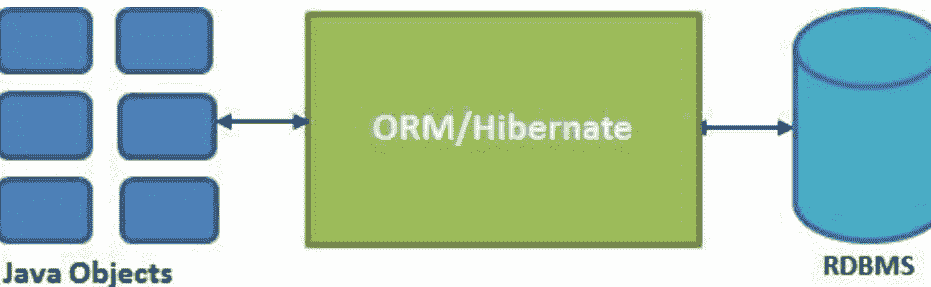
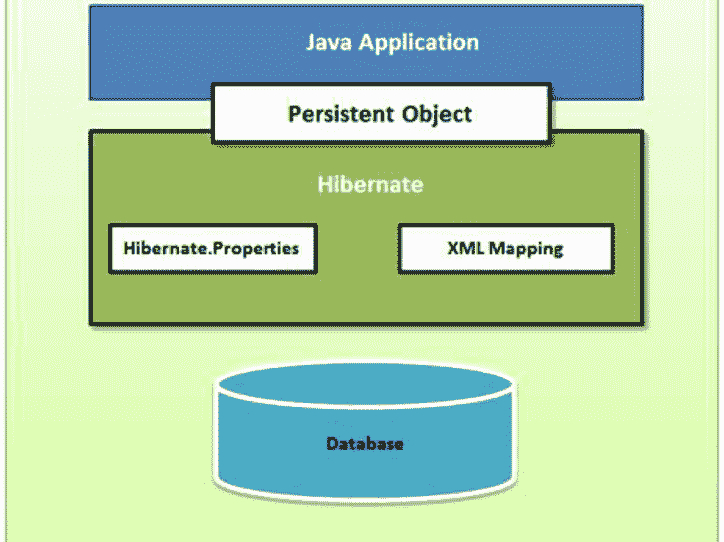
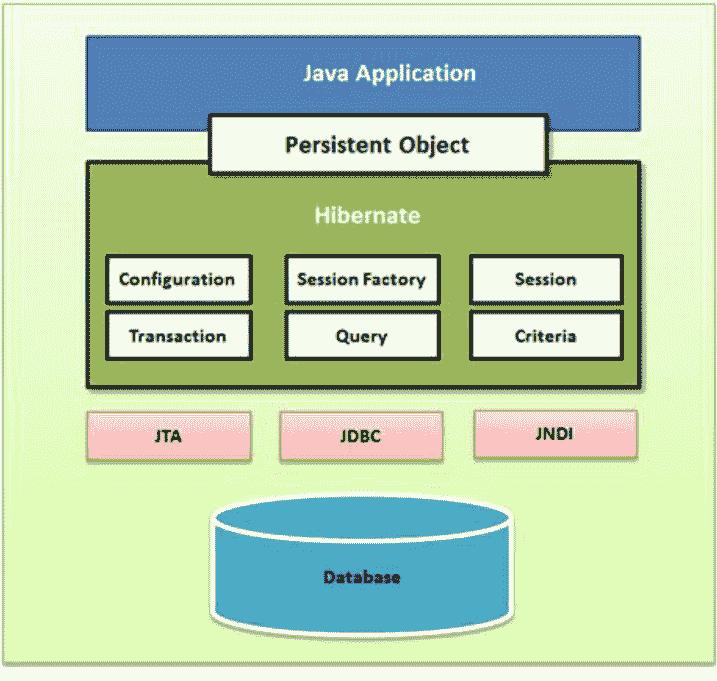
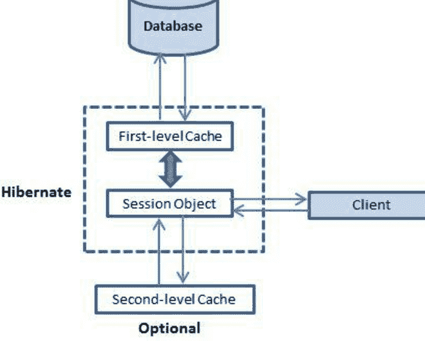

# Hibernate：Java 性能框架

## 关于教程

Hibernate 是一个高性能的对象/关系持久化和查询服务，它采用开源的 GNU 语言通用公共许可证 (LGPL) 许可并免费下载。Hibernate 不仅负责从 Java 类到数据库表（以及从 Java 数据类型到 SQL 数据类型）的映射，还提供了数据查询和检索能力。

本教程将教你如何通过简单易懂的步骤使用 Hibernate 开发基于数据库的应用程序。

## 目标读者

本教程旨在为想要理解 Hibernate 框架及其 API 的 Java 程序员设计。

## 前提条件

我们假设你对 Java 语言有良好的了解。对关系型数据库、JDBC 和 SQL 的基础了解将对理解本教程非常有帮助。


标量查询 ....................................................................................... 181

实体查询 ....................................................................................... 181

命名 SQL 查询 ........................................................................ 181

原生 SQL 示例 ....................................................................... 182

编译与执行 .................................................................. 187

一级缓存 ............................................................................ 189

二级缓存 ................................................................ 189

查询级缓存 ....................................................................... 190

二级缓存 ................................................... 190

并发策略 ................................................... 190

缓存提供者 ................................................................... 191

查询级缓存 ................................................... 193

批量处理示例 ................................................................................. 196

编译与执行 ................................................................................ 201

如何使用拦截器？..................................................................................... 202

创建 POJO 类........................................................................................ 204

创建数据库表................................................................................... 206

创建映射配置文件 ................................................................ 206

创建应用类 .......................................................................... 207

编译与执行 ........................................................................ 210

JDBC 代表 **Java Database Connectivity**（Java 数据库连接）。它提供了一套 Java API，用于 Java 程序访问关系型数据库。这些 Java API 允许 Java 程序执行 SQL 语句与任何符合 SQL 标准的数据库交互。

JDBC 提供了一种灵活的架构，用于编写与数据库无关的应用程序，该程序可以在不同平台上运行，无需任何修改即可与不同的数据库管理系统（DBMS）交互。

| 清洁简单的 SQL 处理 | 在大型项目中使用会很复杂 |
| --- | --- |
| 大数据处理性能良好 | 编程开销大 |
| 非常适合小型应用程序 | 没有封装 |
| 语法简单易于学习 | 难以实现 MVC 概念。查询特定于 DBMS。 |

当我们与面向对象的系统工作时，对象模型与关系型数据库之间存在不匹配。RDBMS 以表格形式表示数据，而面向对象的语言（如 Java 或 C#）则将其表示为互相关连接的对象图。

考虑以下具有适当构造函数和关联公共方法的 Java 类：

```java
public class Employee {
    private int id;
    private String first_name;
    private String last_name;
    private int salary;

    public Employee() {}
    public Employee(String fname, String lname, int salary) {
        this.first_name = fname;
        this.last_name = lname;
        this.salary = salary;
    }

    public int getId() {
      return id;
    }
    public String getFirstName() {
      return first_name;
    }
    public String getLastName() {
      return last_name;
    }
    public int getSalary() {
      return salary;
    }
}
```

假设上述对象要存储并检索在以下 RDBMS 表中：

```sql
create table EMPLOYEE (
  id INT NOT NULL auto_increment,
  first_name VARCHAR(20 default NULL,
  last_name VARCHAR(20) default NULL,
  salary INT default NULL,
  PRIMARY KEY (id)
);
```

首先，如果我们在开发了几个页面或应用程序后需要修改数据库设计该怎么办？其次，在关系型数据库中加载和存储对象会让我们面临以下五个不匹配问题：

| 不匹配 | 描述 |
| --- | --- |
| 粒度 | 有时你拥有一个对象模型，其类的数量多于数据库中对应表的数量。 |
| 继承 | RDBMS 没有定义任何类似于继承的内容，而继承是面向对象编程语言中的一种自然范式。 |
| 身份 | RDBMS 恰好定义了一种“相同性”的概念：主键。然而，Java 同时定义了对象标识性 (`a==b`) 和对象相等 (`a.equals(b)`)。 |
| 关联 | 面向对象的语言使用对象引用表示关联，而 RDBMS 使用外键列表示关联。 |

对象关系映射 (ORM) 是解决上述所有阻抗映射的解决方案。

## ORM 代表对象关系映射 (Object-Relational Mapping)，是一种用于在关系型数据库和 Java、C# 等面向对象的编程语言之间转换数据的编程技术。

与原生 JDBC 相比，ORM 系统具有以下优势：

| 序号 | 优势 |
| --- | --- |
| 1 | 让业务代码访问表以外的对象。 |
| 2 | 从对象逻辑中隐藏 SQL 查询细节。 |
| 3 | 底层基于 JDBC。 |
| 4 | 无需处理数据库实现。 |
| 5 | 基于业务概念而非数据库结构的实体。 |
| 6 | 事务管理和自动键生成。 |
| 7 | 快速开发应用程序。 |

ORM 解决方案由四个实体组成：

| 序号 | 解决方案 |
| --- | --- |
| 1 | 用于对持久类对象执行基本 CRUD 操作的 API。 |
| 2 | 用于指定引用类和类属性查询的语言或 API。 |
| 3 | 用于指定映射元数据的可配置设施。 |
| 4 | 一种与事务对象交互的技术，用于执行脏检查、懒关联加载和其他优化功能。 |

Java 中有多种持久化框架和 ORM 选项。持久化框架是一种将对象存储并从关系型数据库中检索对象的 ORM 服务。

- Enterprise JavaBeans Entity Beans
- Java Data Objects (JDBOs)
- TopLink
- Spring DAO
- Hibernate 以及更多

Hibernate 是一个用于 Java 的对象关系映射 (ORM) 解决方案。它是由 Gavin King 在 2001 年创建的开源持久化框架。对于任何 Java 应用，它提供了一种强大、高性能的对象关系持久和查询服务。

Hibernate 将 Java 类映射到数据库表，并将 Java 数据类型映射到 SQL 数据类型，使开发者能够减轻 95% 常见的数据持久化相关编程任务。

Hibernate 位于传统的 Java 对象和数据库服务器之间，根据相应的 O/R 机制和模式处理这些对象的持久化所有工作。



- Hibernate 使用 XML 文件处理 Java 类到数据库表的映射，而无需编写任何代码。
- 提供简单的 API，直接在数据库与 Java 对象之间进行存储和检索。
- 如果数据库或任何表发生变化，只需要更改 XML 文件的属性即可。
- 抽象了不熟悉的 SQL 类型，并提供了一种使用熟悉的 Java 对象进行操作的方法。
- Hibernate 不需要应用服务器即可运行。
- 操作数据库中对象的复杂关联关系。
- 通过智能获取策略最程度地减少数据库访问。
- 提供数据的简单查询。

Hibernate 支持几乎所有主要的关系型数据库管理系统 (RDBMS)。以下是 Hibernate 支持的一些数据库引擎列表：

- HSQL 数据库引擎
- DB2/NT
- MySQL
- PostgreSQL
- FrontBase
- Oracle
- Microsoft SQL Server Database
- Sybase SQL Server
- Informix Dynamic Server

Hibernate 支持多种其他技术，包括：

- XDoclet Spring
- J2EE
- Eclipse 插件
- Maven

Hibernate 采用分层架构，帮助用户在无需了解底层 API 的情况下操作。Hibernate 利用数据库和配置数据为应用程序提供持久化服务（以及持久化对象）。

以下是 Hibernate 应用架构的高层级视图。



以下是带有重要核心类的 Hibernate 应用架构详细视图。



Hibernate 使用多种现有的 Java API，如 JDBC、Java 事务 API (JTA) 和 Java 命名和目录接口 (JNI)。JDBC 为关系型数据库的功能提供了基础级别的抽象，允许 Hibernate 支持任何带有 JDBC 驱动程序的数据库。JNI 和 JTA 允许 Hibernate 集成到 J2EE 应用服务器中。

下一节简要描述 Hibernate 应用架构中涉及的每个类对象。

`Configuration` 对象是你在任何 Hibernate 应用中创建的第一个 Hibernate 对象。它通常在应用程序初始化期间只创建一次。它代表 Hibernate 所需的配置或属性文件。

`Configuration` 对象提供了两个关键组件：

- **数据库连接：** 通过 Hibernate 支持的一个或多个配置文件处理。这些文件是 `hibernate.properties` 和 `hibernate.cfg.xml`。
- **类映射设置：** 该组件创建了 Java 类与数据库表之间的连接。

`Configuration` 对象用于创建 `SessionFactory` 对象，反之，它使用提供的配置文件为应用程序配置 Hibernate，并允许实例化 `Session` 对象。`SessionFactory` 是线程安全的对象，供应用程序的所有线程使用。

`SessionFactory` 是一个重量级对象；它通常在应用程序启动时创建并保留以供以后使用。每个数据库都需要使用单独的配置文件来创建一个 `SessionFactory` 对象。因此，如果你有多个数据库，就必须创建多个 `SessionFactory` 对象。

`Session` 用于获取数据库的物理连接。`Session` 对象是轻量级的，设计用于每次需要与数据库进行交互时实例化。持久化对象通过 `Session` 对象进行保存和检索。

`session` 对象不应长时间开启，因为它们不是线程安全的，并且应该根据需要创建和销毁。

`Transaction` 代表与数据库交互的一个工作单元，大多数 RDBMS 都支持事务功能。Hibernate 中的事务由底层的事务管理器和事务（来自 JDBC 或 JTA）处理。

这是一个可选对象，Hibernate 应用可以选择不使用此接口，而是在自己的应用程序代码中管理事务。

`Query` 对象使用 SQL 或 Hibernate 查询语言 (HQL) 字符串从数据库中检索数据并创建对象。`Query` 实例用于绑定查询参数、限制查询返回的结果数量并并执行查询。

`Criteria` 对象用于创建和执行面向对象的标准查询以检索对象。

本章解释如何安装 Hibernate 以及其他相关包，为 Hibernate 应用准备环境。我们将使用 MySQL 数据库来实验 Hibernate 示例，请确保你已经安装了 MySQL 数据库。有关 MySQL 的更多细节，你可以查看我们的 MySQL 教程。

## 下载 Hibernate

- 选择你想在 Windows 还是 Unix 上安装，然后继续：
- 从 http://www.hibernate.org/downloads/hibernate-distribution-3.6.Final 下载最新版本的 Hibernate，并在解压后，它将提供如下所示的目录结构：


| 名称 | 修改日期 | 类型 | 大小 |
| --- | --- | --- | --- |
| documentation | 04/05/2011 | 文件文件夹 | |
| lib | 04/05/2011 | 文件文件夹 | |
| project | 04/05/2011 | 文件文件夹 | |
| changelog.txt | 04/05/2011 | 档 | 224 KB |
| hibernate_logo.gif | 04/05/2011 | GIF 图像 | 2 KB |
| hibernate3.jar | 04/05/2011 | 可执行 Jar 文件 | 4,037 KB |
| hibernate-testing.jar | 04/05/2011 | 可执行 Jar 文件 | 44 KB |
| lgpl.txt | 04/05/2011 | 档 | 26 KB |

一旦解压了最新版本的 Hibernate 安装文件，你需要执行两个简单的步骤。确保你正确设置了 `CLASSPATH`，否则在编译应用程序时会遇到问题。

- 现在，将 `lib` 文件夹中的所有库文件复制到 `CLASSPATH`，并更改路径以包含所有 jar：
- 最后，将 `hibernate3.jar` 文件复制到 `CLASSPATH`。该文件位于安装根目录下，是 Hibernate 需要的主要 JAR。

以下是 Hibernate 需要的包/库列表，你应该在开始使用 Hibernate 之前安装它们。安装这些包，你需要将库文件复制到 `CLASSPATH`，并相应更改 `CLASSPATH` 变量。

| 序号 | 包/库 |
| --- | --- |
| 1 | `dom4j` - XML 解析 www.dom4j.org/ |
| 2 | `Xalan` - XSLT处理器 http://xml.apache.org/xalan-j/ |
| 3 | `Xerces` - Xerces Java 解析器 http://xml.apache.org/xerces-j/ |
| 4 | `cglib` - 在运行时适当修改 Java 类 http://cgl.sourceforge.net/ |
| 5 | `log4j` - 日志框架 http://logging.apache.org/log4j |
| 6 | `Commons` - 日志、邮件等 http://jakarta.apache.org/commons |


| 7 | SLF4J - Java 日志门面 http://www.slf4j.org/ |

Hibernate 需要预先知道从哪里找到映射信息，这些信息定义了 Java 类与数据库表之间的关系。Hibernate 还需要一组与数据库和其他相关参数相关的配置设置。所有此类信息通常作为标准的 Java 属性文件 `hibernate.properties` 提供，或者作为名为 `hibernate.cfg.xml` 的 XML 文件提供。

在我的示例中，我将使用 XML 格式的文件 `hibernate.cfg.xml` 来指定 Hibernate 属性。大多数属性将采用其默认值，除非确实需要，否则不要求在属性文件中指定它们。该文件保存在应用程序类类路径的根目录下。

### Hibernate 属性

以下是重要的属性列表，在独立模式下配置数据库时需要这些属性：

| 序号 | 属性及描述 |
|---|---|
| 1 | `hibernate.dialect` 此属性允许 Hibernate 为所选数据库生成相应的 SQL。 |
| 2 | `hibernate.connection.driver_class` JDBC 驱动程序类名。 |
| 3 | `hibernate.connection.url` 指向数据库实例的 JDBC URL。 |
| 4 | `hibernate.connection.username` 数据库用户名。 |
| 5 | `hibernate.connection.password` 数据库密码。 |
| 6 | `hibernate.connection.pool_size` 限制在 Hibernate 数据库连接池中等待的连接数。 |
| 7 | `hibernate.connection.autocommit` 允许 JDBC 连接使用自动提交模式。 |

如果你在配合应用服务器和 JNDI 使用数据库，那么你将需要配置以下属性：

| 序号 | 属性及描述 |
|---|---|
| 1 | `hibernate.connection.datasource`: 在应用服务器上下文中定义的 JNDI 名称，你将其将其用于应用程序。 |
| 2 | `hibernate.ndi.class`: 用于 JNDI 的 `InitialContext` 类。 |
| 3 | `hibernate.ndi.<JNDIpropertyname>`: 将你喜欢的任何 JNDI 属性传递给 JNDI `InitialContext`。 |
| 4 | `hibernate.ndi.url`: 为 JNDI 提供 URL。 |
| 5 | `hibernate.connection.username`: 数据库用户名。 |
| 6 | `hibernate.connection.password`: 数据库密码。 |

MySQL 是目前最流行的开源数据库系统之一。让我们创建一个 `hibernate.cfg.xml` 配置文件并将其放在应用程序类路径的根目录下。你必须确保你的 MySQL 数据库中有 `testdb`，并且你有一个名为 `test` 的用户可以访问数据库。

XML 配置文件必须符合 Hibernate 3 配置 DTD，该文件位于 http://www.hibernate.org/dtd/hibernate-configuration-3.0.dtd。

```xml
<xml version="1.0" encoding="utf-8"?>
<!DOCTYPE hibernate-configuration SYSTEM "http://www.hibernate.org/dtd/hibernate-configuration-3.0.dtd">

<hibernate-configuration>
  <session-factory>
    <property name="hibernate.dialect">
      org.hibernate.dialect.MySQLDialect
    </property>
    <property name="hibernate.connection.driver_class">
      com.mysql.jdbc.Driver
    </property>

  <!-- 假设 test 是数据库名 -->
  <property name="hibernate.connection.url">
  jdbc:://://localhost/test
  </property>
  <property name="hibernate.connection.username">
  root
  </property>
  <property name="hibernate.connection.password">
  root123
  </property>

  <!-- XML 映射文件列表 -->
  <mapping resource="Employee.hbm.xml" />

  </session-factory>
</hibernate-configuration>
```

上面的配置文件包含了 `<mapping>` 标签，它们与 hibernate-mapping 文件相关，我们将在下一节中查看 hibernate 映射文件究竟是什么，以及我们如何以及为什么要使用它？

以下是重要的数据库方言属性类型列表：

| 数据库 | 方言属性值 |
|---|---|
| DB2 | `org.hibernate.dialect.DB2Dialect` |
| HSQLDLB | `org.hibernate.dialect.HSQLDialect` |
| HypersonicSQL | `org.hibernate.dialect.HSQLDialect` |
| Informix | `org.hibernate.dialect.InformixDialect` |
| Ingress | `org.hibernate.dialect.IngresDialect` |
| Interbase | `org.hibernate.dialect.InterbaseDialect` |
| Microsoft SQL Server 2000 | `org.hibernate.dialect.SQLServerDialect` |
| Microsoft SQL Server 2005 | `org.hibernate.dialect.SQLServer2005Dialect` |
| Microsoft SQL Server 2008 | `org.hibernate.dialect.SQLServer2008Dialect` |
| MySQL | `org.hibernate.dialect.MySQLDialect` |
| Oracle (任意版本) | `org.hibernate.dialect.OracleDialect` |
| Oracle 11g | `org.hibernate.dialect.Oracle10gDialect` |
| Oracle 10g | `org.hibernate.dialect.Oracle10Dialect` |
| Oracle 9i | `org.hibernate.dialect.Oracle9iDialect` |
| PostgreSQL | `org.hibernate.dialect.PostgreSQLDialect` |
| Progress | `org.hibernate.dialect.ProgressDialect` |
| SAP DB | `org.hibernate.dialect.SAPDBDialect` |
| Sybase | `org.hibernate.dialect.SybaseDialect` |
| Sybase Anywhere | `org.hibernate.dialect.SybaseAnywhereDialect` |

# 6. HIBERNATE – SESSION

Session 是用于与数据库交互的物理连接，它被创建和销毁。Session 实例在给定时间点可能处于以下三种状态之一：

- transient（瞬态）：一个新的实例，尚未与 Session 关联，数据库中没有标识值。
- persistent（持久态）：通过与 Session 关联使其成为持久化实例。
- detached（脱离态）：一旦我们关闭 Session，持久实例将变为脱离实例。

典型的事务使用方法如下：

```java
Session session = factory.openSession();
Transaction tx = null;
try {
  tx = session.beginTransaction();
  // 执行一些操作
  tx.commit();
} catch (Exception e) {
  if (tx!=null) tx.rollback();
  e.printStackTrace();
} finally {
  session.close();
}
```

### Session 接口方法

Session 提供了许多方法，我列出一些在教程中将会使用的：

| 序号 | Session 方法及描述 |
|---|---|
| 1 | `beginTransaction()` 开始一个工作单元并返回 `Transaction` 对象。 |
| 2 | `cancel()` 取消当前查询的执行。 |
| 3 | `clear()` 完全清空 session。 |
| 4 | `close()` 通过释放 JDBC 连接并清理来结束 session。 |
| 5 | `criteria(Class persistentClass)` 为指定的持久类或实体类的子类创建一个新实例。 |
| 6 | `criteria(String entityName)` 为名称创建一个新实例。 |
| 7 | `getId(Object object)` 返回与此 session 关联的实体标识符。 |
| 8 | `createFilter(Object collection, String queryString)` 为集合和过滤字符串创建一个新的查询实例。 |
| 9 | `createQuery(String queryString)` 为指定的 HQL 查询字符串创建一个新的查询实例。 |
| 10 | `createSQLQuery(String queryString)` 为指定的 SQL 查询字符串创建一个新的 `SQLQuery` 实例。 |
| 11 | `delete(Object object)` 从数据存储中移除持久实例。 |
| 12 | `delete(String entityName, Object object)` 从数据存储中移除持久实例。 |
| 13 | `get(String entityName, Serializable id)` 获取给定标识符的实体的持久实例，如果没有该持久实例则返回 null。 |
| 14 | `getSessionFactory()` 获取创建此 session 的 session 工厂。 |
| 15 | `refresh(Object object)` 从底层数据库重新读取实例的状态。 |
| 16 | `getTransaction()` 获取与此 session 关联的 `Transaction`。 |
| 17 | `isConnected()` 检查 session 是否处于连接状态。 |
| 18 | `boolean isDirty()`<br>此会话包含任何必须与数据库同步的更改？ |
| 19 | `boolean isOpen()`<br>检查会话是否仍开启。 |
| 20 | `Serializable save(Object object)`<br>持久化给定的瞬态实例，首先分配一个生成的标识符。 |
| 21 | `void saveOrUpdate(Object object)`<br>对给定的实例执行 `save(Object)` 或 `update(Object)`。 |
| 22 | `void update(Object object)`<br>使用给定的离散实例的标识符更新持久化实例。 |
| 23 | `void update(String entityName, Object object)`<br>使用给定的离散实例的标识符更新持久化实例。 |

Hibernate 的整个概念是从 Java 类属性中获取值并将其持久化到数据库表中。映射文件有助于确定如何从类中提取值并将其与表及关联字段进行映射。

在 Hibernate 中，对象或实例将存储在数据库表的 Java 类被称为持久化类。如果这些类遵循某些简单规则，Hibernate 的工作效果最好，这些规则也称为简单旧 Java 对象（POJO）编程模型。

以下是持久化类的规则，但这些任何规则都不是硬性要求：

- 所有需要被持久化的类都需要一个默认构造函数。
- 所有类都应该包含一个 ID，以便在 Hibernate 和数据库中轻松识别您的对象。该属性映射到数据库表的主键列。
- 所有将被持久化的属性都应声明为私有（private），并在 JavaBean 中定义 `getXXX` `setXXX` 方法。
- Hibernate 的一个核心特性很大程度上取决于持久化类是非最终的（non-final），或者实现了一个声明了所有公共方法的接口。
- 所有类都不扩展或实现 EJB 框架所需的某些特殊类和接口。

POJO 的名称用于强调给定对象是一个普通的 Java 对象，而不是特殊对象，特别不是企业级 Java Bean（Enterprise JavaBean）。

根据上述提到的几个规则，我们可以如下定义一个 POJO 类：

```java
public class Employee {
    private int id;
    private String firstName;
    private String lastName;
    private int salary;
    public Employee() {}

    public Employee(String fname, String lname, int salary) {
        this.firstName = fname;
        this.lastName = lname;
        this.salary = salary;
    }

    public int getID() {
        return id;
    }
    public void setId( int id ) {
        this.id = id;
    }
    public String getFirstName( String first_name) {
        return firstName;
    }
    public void setFirstName( String first_name ) {
        this.firstName = first_name;
    }
    public String getLastName() {
        return lastName;
    }
    public void setLastName(String last_name ) {
        this.lastName = last_name;
    }
    public int getSalary() {
        return salary;
    }
    public void setSalary( int salary ) {
        this.salary = salary;
    }
}
```

对象/关系映射通常定义在 XML 文档中。该映射文件结构了 Hibernate 如何将定义的类或类映射到数据库表？

虽然许多 Hibernate 用户选择手动编写 XML，但存在许多工具可以生成映射文档。这些包括供高级 Hibernate 用户使用的 XDoclet、Middlegen 和 AndroMDA。

让我们考虑之前定义的 POJO 类，其对象将持久化在下一节定义的表中。


```java
public class Employee {
    private int id;
    private String firstName;
    private String lastName;
    private int salary;

    public Employee() {}

    public Employee(String fname, String lname, int salary) {
        this.firstName = fname;
        this.lastName = lname;
        this.salary = salary;
    }

    public int getId() {
        return id;
    }

    public void setId(int id) {
        this.id = id;
    }

    public String getFirstName() {
        return firstName;
    }

    public void setFirstName(String first_name) {
        this.firstName = first_name;
    }

    public String getLastName() {
        return lastName;
    }

    public void setLastName(String last_name) {
        this.lastName = last_name;
    }

    public int getSalary() {
        return salary;
    }

    public void setSalary(int salary) {
        this.salary = salary;
    }
}
```

对于你每个提供持久化的对象，将对应一个表。考虑上述对象需要存储并检索到以下 RDBMS 数据库中：

```sql
create table EMPLOYEE (
    id INT NOT NULL auto_increment,
    first_name VARCHAR(20) default NULL,
    last_name VARCHAR(20) default NULL,
    salary INT default NULL,
    PRIMARY KEY (id)
);
```

基于这两个实体，我们可以定义下面的映射文件，它指示 Hibernate 将定义的类或类映射到数据库表。

```xml
<?xml version="1.0" encoding="utf-8"?>
<!DOCTYPE Hibernate PUBLIC
  "//Hibernate/Hibernate Mapping DTD//EN"
  "http://www.hibernate.org/dtd/hibernate-mapping-3.0.dtd">

<hibernate-mapping>
  <class name="Employee" table="EMPLOYEE">
    <id name="id" column="id">
      <generator strategy="native"/>
    </id>
    <property name="firstName" column="first_name"/>
    <property name="lastName" column="last_name"/>
    <property name="salary" column="salary"/>
  </class>
</hibernate-mapping>
```

当你准备映射文档时，你会发现你在将 Java 数据类型映射到 RDBMS 数据类型。映射文件中定义的类型既不是 Java 类型，也不是 SQL 类型。它们被称为 Hibernate 映射类型，可以从 Java Java。

本章列出了所有的基本、日期时间、大对象和内置类型。

| 映射类型 | Java 类型 | ANSI SQL 类型 |
| :--- | :--- | :--- |
| `integer` | `int` or `java.Integer` | `INTEGER` |
| `long` | `long` or `java.Long` | `BIGINT` |
| `short` | `short` or `java.Short` | `SMALLINT` |
| `float` | `float` or `java.Float` | `FLOAT` |
| `double` | `double` or `java.Double` | `DOUBLE` |
| `big_decimal` | `java.math.BigDecimal` | `NUMERIC` |
| `character` | `java.lang.String` | `CHAR(1) ('Y' or 'N')` |
| `string` | `java.lang.String` | `VARCHAR` |
| `byte` | `byte` or `java.Byte` | `TINYINT` |
| `boolean` | `boolean` or `java.Boolean` | `BIT` |
| `yes/no` | `boolean` or `java.Boolean` | `CHAR(1) ('T' or 'F')` |

| 映射类型 | Java 类型 | ANSI SQL 类型 |
| :--- | :--- | :--- |
| `date` | `java.util.Date` or `java.sql.Date` | `DATE` |
| `time` | `java.util.Date` or `java.sql.Time` | `TIME` |
| `timestamp` | `java.util.Date` or `java.sql.Timestamp` | `TIMESTAMP` |
| `calendar` | `java.util.Calendar` | `TIMESTAMP` |
| `calendar_date` | `java.util.Calendar` | `DATE` |

| 映射类型 | Java 类型 | ANSI SQL 类型 |
| :--- | :--- | :--- |
| `binary` | `byte[]` | `VARBINARY (or BLOB)` |
| `text` | `java.lang.String` | `CLOB` |
| `serializable` | 实现了 `java.io.Serializable` 的任何 Java 类 | `VARBINARY (or BLOB)` |
| `clob` | `java.sql.Clob` | `CLOB` |
| `blob` | `java.sql.Blob` | `BLOB` |

## JDK 相关类型

| 映射类型 | Java 类型 | ANSI SQL 类型 |
| :--- | :--- | :--- |
| `class` | `java.lang.Class` | `VARCHAR` |
| `locale` | `java.util.Locale` | `VARCHAR` |
| `timezone` | `java.util.TimeZone` | `VARCHAR` |
| `currency` | `java.util.Currency` | `VARCHAR` |

现在让我们通过一个示例来理解如何使用 Hibernate 在独立应用程序中提供 Java 持久化。我们将详细介绍使用 Hibernate 技术创建 Java 应用程序涉及的各个步骤。

## 创建 POJO 类

创建应用程序的第一步是构建 Java POJO 类或类，这取决于要持久化到数据库的应用程序。让我们考虑我们的 `Employee` 类，并带有 `getXXX` 和 `setXXX` 方法使其符合 JavaBeans 规范类。

POJO（纯旧 Java 对象）是一种不扩展或实现 EJB 框架所需的某些特殊类和接口的 Java 对象。普通的 Java 对象就是 POJO。

当我们设计一个要被 Hibernate 持化的类时，提供符合 JavaBeans 规范的代码以及一个作为索引属性（例如 `Employee` 类中的 `id` 属性）是非常重要的。

```java
public class Employee {
    private int id;
    private String firstName;
    private String lastName;
    private int salary;

    public Employee() {}

    Employee(String fname, String lname, int salary) {
        this.firstName = fname;
        this.lastName = lname;
        this.salary = salary;
    }

    public int getId() {
        return id;
    }

    public void setId(int id) {
        this.id = id;
    }

    public String getFirstName() {
        return firstName;
    }

    public void setFirstName(String first_name) {
        this.firstName = first_name;
    }

    public String getLastName() {
        return lastName;
    }

    public void setLastName(String last_name) {
        this.lastName = last_name;
    }

    public int getSalary() {
        return salary;
    }

    public void setSalary(int salary) {
        this.salary = salary;
    }
}
```

第二步是在你的数据库中创建表。每个你想要提供持久化的对象都将对应一张表。考虑上述对象需要在以下 RDBMS 表中进行存储和检索：

```sql
create table EMPLOYEE (
    id INT NOT NULL auto_increment,
    first_name VARCHAR(20) default NULL,
    last_name VARCHAR(20) default NULL,
    salary INT default NULL,
    PRIMARY KEY (id)
);
```

这一步是创建一个映射文件，指示 Hibernate 如何将定义的类或类类映射到数据库表。

```xml
<?xml version="1.0" encoding="utf-8"?>
<!DOCTYPE hibernate-mapping PUBLIC
//Hibernate/Hibernate Mapping DTD//EN"
"http://www.hibernate.org/dtd/hibernate-mapping-3.0.dtd">

<hibernate-mapping>
  <class name="Employee" table="EMPLOYEE">
    <meta attribute="class-description">
      此类包含员工详情。
    </meta>
    <id name="id" type="int" column="id">
      <generator class="native"/>
    </id>
    <property name="first_name" column="first_name" type="string"/>
    <property name="lastName" column="last_name" type="string"/>
    <property name="salary" column="salary" type="int"/>
  </class>
</hibernate-mapping>
```

你应该将映射文档保存为 `<classname>.hbm.xml` 格式的文件。我们将映射文档保存在 `Employee.hbm.xml` 文件中。让我们查看关于映射文档的细节：

- 映射文档是一个以 `<hibernate-mapping>` 为根元素的 XML 文档，包含了所有的 `<class>` 元素。
- `<class>` 元素用于定义从 Java 类到数据库表的特定映射。Java 类名通过 `class` 元素的 `name` 属性指定，数据库表名通过 `table` 属性指定。
- `<meta>` 元素是可选的，用于创建类描述。
- `<id>` 元素将类中的唯一 ID 属性映射到数据库表的主键。`id` 元素的 `name` 属性引用类中的属性，`column` 属性引用数据库表中的列。`type` 属性持有 Hibernate 映射类型，该映射将从 Java 转换为 SQL 数据类型。
- `id` 元素中的 `<generator>` 元素用于自动生成主键值。`generator` 的 `class` 属性被设置为让 Hibernate 根据底层数据库的能力从 `identity`、`sequence` 或 `hilo` 算法中选择一个来创建主键。
- `<property>` 元素用于将 Java 类属性映射到数据库表中的列。`name` 属性引用类中的属性，`column` 属性引用数据库表中的列。

`type` 属性持有 Hibernate 映射类型，这些映射类型将从 Java 转换为 SQL 数据类型。

最后，我们将创建一个应用程序来使用 Hibernate 记录持久化操作。


```java
import java.util.List;
import java.util.Iterator;
import java.util.Date;
import org.hibernate.HibernateException;
import org.hibernate.Session;
import org.hibernate.Transaction;
import org.hibernate.SessionFactory;
import org.hibernate.Configuration;
import java.lang.Exception;

public class ManageEmployee {
    private static SessionFactory factory;

    /* 在数据库中创建员工 */
    public Integer addEmployee(String fname, String lname, int salary) {
        Session session = factory.openSession();
        Transaction tx = null;
        Integer employeeID = null;
        try{
            tx = session.beginTransaction();
            Employee employee = new Employee(fname, lname, salary);
            employeeID = (Integer) session.save(employee);
            tx.commit();
        } catch (HibernateException e) {
            if (tx!=null) tx.rollback();
            e.printStackTrace();
        } finally {
            session.close();
        }
        return employeeID;
    }

    /* 读取所有员工 */
    public void listEmployees() {
        Session session = factory.openSession();
        Transaction tx = null;
        try{
            tx = session.beginTransaction();
            List employees = session.createQuery("FROM Employee").list();
            for (Iterator iterator = employees.iterator(); iterator.hasNext();) {
                Employee employee = (Employee) iterator.next();
                System.out.print("First Name: " + employee.getFirstName());
                System.out.print(" Last Name: " + employee.getLastName());
                System.out.println(" Salary: " + employee.getSalary());
            }
            tx.commit();
        } catch (HibernateException e) {
            if (tx!=null) tx.rollback();
            e.printStackTrace();
        } finally {
            session.close();
        }
    }

    /* 更新员工薪资 */
    public void updateEmployee(Integer EmployeeID, int salary) {
        Session session = factory.openSession();
        Transaction tx = null;
        try{
            tx = session.beginTransaction();
            Employee employee = (Employee)session.get(Employee.class, EmployeeID);
            employee.setSalary(salary);
            session.update(employee);
            tx.commit();
        } catch (HibernateException e) {
            if (tx!=null) tx.rollback();
            e.printStackTrace();
        } finally {
            session.close();
        }
    }

    /* 创建应用程序类 */
    public static void main(String[] args) {
        try {
            factory = new Configuration().configure().buildSessionFactory();
        } catch (Throwable ex) {
            System.err.println("Failed to create sessionFactory. " + ex);
        }

        ManageEmployee me = new ManageEmployee();
        Integer id1 = me.addEmployee("John", "Doe", 50000);
        Integer id2 = me.addEmployee("Jane", "Smith", 60000);

        me.listEmployees();

        me.updateEmployee(id1, 55000);

        me.listEmployees();

        /* 从记录中删除员工 */
        // 此处可实现删除逻辑
    }
}
```

```java
public void deleteEmployee(Integer EmployeeID){
    Session session = factory.openSession();
    Transaction tx = null;
    try{
        tx = session.beginTransaction();
        Employee employee =
            (Employee)session.get(Employee.class, EmployeeID);
        session.delete(employee);
        tx.commit();
    } catch (HibernateException e) {
        if(tx!=null) tx.rollback();
        e.printStackTrace();
    }finally {
        session.close();
    }
}
```

## 编译与执行

以下是编译和运行上述应用的步骤。在进行编译和执行之前，请确保已适当设置了 `PATH` 和 `CLASSPATH`。

- 根据配置章节的说明创建 `hibernate.cfg.xml` 配置文件。
- 如上所示创建 `Employee.hbm` 映射文件。
- 如上所示创建 `Employee.java` 源文件并进行编译。
- 如上所示创建 `ManageEmployee.java` 源文件并进行编译。
- 执行 `ManageEmployee` 二进制文件以运行程序。

你将获得结果，记录将在 `EMPLOYEE` 表中创建。

```bash
$java ManageEmployee
......VARIOUS LOG MESSAGES WILL DISPLAY HERE........
First Name: Zara Last Name: Ali Salary: 1000
First Name: Daisy Last Name: Das Salary: 5000
First Name: John Last Name: Paul Salary: 10000
First Name: Zara Last Name: Ali Salary: 5000
```


如果你检查你的 `EMPLOYEE` 表，它应该包含以下记录：

```mysql
mysql select * from EMPLOYEE;
+----+------+------+-------+
| id | first_name | last_name | salary |
+----+------+------+-------+
| 29 | Zara | Ali | 5000 |
| 31 | John | Paul | 10000 |
+----+------+------+-------+
2 rows in set (0.00 sec)

mysql>
```

# 11. HIBERNATE – O/R 映射

到目前，我们已经看到了使用 Hibernate 进行非常基础的 O/R 映射，但有三个最重要的映射主题我们需要详细学习。

这些是：

- 集合映射
- 实体类之间的关联映射
- 组件映射（Component Mappings）

## 集合映射

如果实体或类具有 `java.util` 中提供的任何一个集合接口的值，Hibernate 可以持久化 `java.util.Map`、`java.util.Set`、`java.util.SortedMap`、`java.util.SortedSet`、`java.util.List` 以及任何持久实体或值的数组。

| 集合类型 | 映射与描述 |
| --- | --- |
| `java.util.Set` | 映射为 `<set>` 元素并用 `java.util.HashSet` 初始化 |
| `java.util.SortedSet` | 映射为 `<set>` 元素并用 `java.util.TreeSet` 初始化。`sort` 属性可以设置为比较器（comparator）或自然排序 |
| `java.util.List` | 映射为 `<list>` 元素并用 `java.util.ArrayList` 初始化 |
| `java.util.Collection` | 映射为 `<bag>` 或 `<set>` 元素并用 `java.util.ArrayList` 初始化 |
| `java.util.Map` | 映射为 `<map>` 元素并用 `java.util.HashMap` 初始化 |
| `java.util.SortedMap` | 映射为 `<map>` 元素并用 `java.util.TreeMap` 初始化。`sort` 属性可以设置为比较器或自然排序 |

Hibernate 使用 `<primitive-array>` 对 Java 原始值类型进行排序，使用 `<array>` 对其他所有类型。然而，它们很少使用，因此我不会在这个主题中讨论它们。

如果你想映射 Hibernate 不直接支持的自定义集合接口，你需要告诉 Hibernate 你的自定义集合的语义，这并不简单且不建议使用。

### Hibernate – Set 映射

Set 是一个不包含任何重复元素的 Java 集合。更正式地说，Set 不包含任何元素对 `e1` 和 `e2` 使得 `e1.equals(e2)`，且最多包含一个 null 元素。添加到集合中的对象必须同时实现 `equals(Object)` 和 `hashCode()` 方法，以便 Java 能够判断任何两个元素/对象是否相同。

Set 在映射表中使用 `<set>` 元素映射并用 `java.util.HashSet` 初始化。当集合不需要重复元素时，你可以在类中使用 Set 集合。

### 定义 RDBMS 表

考虑我们需要在 `EMPLOYEE` 表中存储员工记录的情况，该表结构如下：

```sql
create table EMPLOYEE (
    id INT NOT NULL auto_increment,
    first_name VARCHAR(20) default NULL,
    last_name VARCHAR(20) default NULL,
    salary INT default NULL,
    PRIMARY KEY (id)
);
```

此外，假设每个员工可以关联一个或多个证书。因此，我们将证书相关信息存储在具有以下结构的单独的表中：

```sql
create table CERTIFICATE (
    id INT NOT NULL auto_increment,
    certificate_name VARCHAR(30) default NULL,
    employee_id INT default NULL,
    PRIMARY KEY (id)
);
```

`EMPLOYEE` 和 `CERTIFICATE` 对象之间将存在一对多的关系。

### 定义 POJO 类

让我们实现 `Employee` 类，它将用于映射 `EMPLOYEE` 表并包含 `certificates` 集合。

```java
import java.util.*;

public class Employee {
    private int id;
    private String firstName;
    private String lastName;
    private int salary;
    private Set certificates;

    public Employee() {}

    public Employee(String fname, String lname, int salary) {
        this.firstName = fname;
        this.lastName = lname;
        this.salary = salary;
    }

    public int getId() {
        return id;
    }

    public void setId(int id) {
        this.id = id;
    }

    public String getFirstName() {
        return firstName;
    }

    public void setFirstName(String first_name) {
        this.firstName = first_name;
    }

    public String getLastName() {
        return lastName;
    }

    public void setLastName(String last_name) {
        this.lastName = last_name;
    }

    public int getSalary() {
        return salary;
    }

    public void setSalary(int salary) {
        this.salary = salary;
    }

    public Set getCertificates() {
        return certificates;
    }

    public void setCertificates(Set certificates) {
        this.certificates = certificates;
    }
}
```

现在让我们定义对应 `CERTIFICATE` 表的另一个 POJO 类，以便证书对象可以存储到 `CERTIFICATE` 表中。该类还应该实现 `equals()` 和 `hashCode()` 方法，以便 Java 可以判断任何两个元素/对象是否相同。


```java
public class Certificate {
    private int id;
    private String name;

    public Certificate() { }

    public Certificate(String name) {
        this.name = name;
    }

    public int getId() {
        return id;
    }

    public void setId(int id ) {
        this.id = id;
    }

    public String getName() {
        return name;
    }

    public void setName( String name ) {
        this.name = name;
    }

    public boolean equals(Object obj) {
        if (obj == null) return false;
        if (!this.getClass().equals(obj.getClass())) return false;

        Certificate obj2 = (Certificate)obj;
        if((this.id == obj2.getId()) && (this.name.equals(obj2.getName()))) {
            return true;
        }
        return false;
    }

    public int hashCode() {
        int tmp = 0;
        tmp = ( id + name ).hashCode();
        return tmp;
    }
}
```

## Hibernate 映射文件

让我们开发映射文件，它指示 Hibernate 如何将定义的类映射到数据库表。`<set>` 元素将用于定义 Set 集合的规则。

```xml
<?xml version="1.0" encoding="utf-8"?>
<!DOCTYPE hibernate-mapping PUBLIC "-//Hibernate/Hibernate Mapping DTD//EN" "http://www.hibernate.org/dtd/hibernate-mapping-3.0.dtd">

<hibernate-mapping>
<class name="Employee" table="EMPLOYEE">
<meta attribute="class-description">
    此类包含员工详情。
</meta>
<id name="id" type="int" column="id">
    <generator class="native"/>
</id>
</class>
</hibernate-mapping>
```

```xml
<set name="certificates" cascade="all">
  <key column="employee_id"/>
  <one-to-many class="Certificate"/>
</set>
  <property name="firstName" column="first_name" type="string"/>
  <property name="lastName" column="last_name" type="string"/>
  <property name="salary" column="salary" type="int"/>
</class>
```

```xml
<class name="Certificate" table="CERTIFICATE">
  <meta attribute="class-description">
    此类包含证书记录。
  </meta>
  <id name="id" type="int" column="id">
    <generator class="native"/>
  </id>
  <property name="name" column="certificate_name" type="string"/>
</class>
```

```xml
</hibernate-mapping>
```

你应该将映射文件保存为 `class.hbm.xml` 格式的文件。我们将映射文件保存在了 `Employee.hbm.xml` 文件中。你已经熟悉了大部分映射细节，但让我们再次查看一下映射文件的所有元素：

- 映射文件是一个以 `<hibernate-mapping>` 作为根元素的 XML 文档，它包含对应于每个类的 `<class>` 元素。
- `<class>` 元素用于定义从 Java 类到数据库表的特定映射。Java 类名通过 `class` 元素的 `name` 属性指定，数据库表名通过 `table` 属性指定。
- `<meta>` 元素是可选的，可用于创建类描述。
- `<id>` 元素将类中的唯一 ID 属性映射到数据库表的主键。`id` 元素的 `name` 属性引用类中的属性，`column` 属性引用数据库表中的列。`type` 属性持有 hibernate 映射类型，该映射将数据从 Java 转换为 SQL 数据。
- `<id>` 元素内部的 `<generator>` 元素用于自动生成主键值。`generator` 的 `class` 属性设置为 `native`，以便让 Hibernate 根据底层数据库的能力选择 `identity`、`sequence` 或 `hilo` 算法来创建主键。
- `<property>` 元素用于将 Java 类属性映射到数据库表中的列。该元素的 `name` 属性引用类中的属性，`column` 属性引用数据库表中的列。`type` 属性持有 hibernate 映射类型，该映射将数据从 Java 转换为 SQL 数据类型。
- `<set>` 元素在这里是新的，被用于设置 `Certificate` 和 `Employee` 类之间的关系。我们在 `<set>` 元素中使用 `cascade` 属性，告诉 Hibernate 在持久化 `Employee` 对象的同时持久化 `Certificate` 对象。`name` 属性设置为父类定义的 Set 变量，在我们的例子中，它是 `certificates`。对于每个 set 变量，我们需要在映射文件中定义一个 set 元素。
- `<key>` 元素是 `CERTIFICATE` 表中的列，该列持有指向父对象表 `EMPLOYEE` 的外键。
- `<one-to-many>` 元素表示一个 `Employee` 关联多个 `Certificate` 对象，因此，`Certificate` 对象必须关联一个 `Employee` 父对象。你可以根据需求使用 `<one-to-one>`、`<many-to-one>` 或 `<many-to-many>` 元素。

## 创建应用程序类

最后，我们将创建一个带有 `main()` 方法的应用程序类来运行程序。我们将使用此应用程序保存几个员工记录及其证书，然后对这些记录执行 CRUD 操作。

```java
import java.util.*;

import org.hibernate.HibernateException;
import org.hibernate.Session;
import org.hibernate.Transaction;
import org.hibernate.SessionFactory;
import org.hibernate.cfg.Configuration;

public class ManageEmployee {
    private static SessionFactory factory;

    public static void main(String[] args) {
        try{
            factory = new Configuration().configure().buildSessionFactory();
        } catch (Throwable ex) {
            System.err.println("Failed to create sessionFactory object." + ex);
            throw new ExceptionInitializerError(ex);
        }
    }

    ManageEmployee ME = new ManageEmployee();

    /* 为第一个员工准备一组证书 */
    HashSet set1 = new HashSet();
    set1.add(new Certificate("MCA"));
    set1.add(new Certificate("MBA"));
    set1.add(new Certificate("PMP"));

    /* 在数据库中添加员工记录 */
    Integer empID1 = ME.addEmployee("Manoj", "Kumar", 4000, set1);

    /* 为第二个员工准备另一组证书 */
    HashSet set2 = new HashSet();
    set2.add(new Certificate("BCA"));
    set2.add(new Certificate("BA"));

    /* 在数据库中添加另一个员工记录 */
    Integer empID2 = ME.addEmployee("Dilip", "Kumar", 3000, set2);

    /* 列出所有员工 */
    ME.listEmployees();

    /* 更新员工薪资记录 */
    ME.updateEmployee(empID1, 5000);

    /* 从数据库中删除员工 */
    ME.deleteEmployee(empID2);

    /* 列出所有员工 */
    ME.listEmployees();
}

/* 在数据库中添加员工记录的方法 */
public Integer addEmployee(String fname, String lname, int salary, Set cert) {
    Session session = factory.openSession();
    Transaction tx = null;
    Integer employeeID = null;

    try {
        tx = session.beginTransaction();
        // ... (实现细节省略，保持逻辑一致)
        tx.commit();
    } catch (Throwable ex) {
        // ... (异常处理逻辑)
    } finally {
        session.close();
    }

    return employeeID;
}

// ... (其余方法在翻译中保持结构)
```

## 编译与执行

以下是编译和运行上述程序的步骤。在进行编译和执行之前，请确保已设置 PATH 和 CLASSPATH。

- 按照配置章节创建 `hibernate.cfg.xml` 配置文件。
- 如上所示创建 `Employee.hbm.xml` 映射文件。
- 如上所示创建 `Employee.java` 源文件并编译。
- 如上所示创建 `Certificate.java` 源文件并编译。
- 如上所示创建 `ManageEmployee.java` 源文件并编译。
- 执行 `ManageEmployee` 二进制文件以运行程序。

你将在屏幕上看到以下结果，同时 `EMPLOYEE` 和 `CERTIFICATE` 表中也会创建记录。

```bash
$java ManageEmployee
......各种日志信息将在此处显示......
```

First Name: Manoj Last Name: Kumar Salary: 4000

Certificate: MBA

Certificate: PMP

Certificate: MCA

First Name: Dilip Last Name: Kumar Salary: 3000

Certificate: BCA

## Hibernate

| 证书: BA | 名字: Manoj | 姓: Kumar | 工资: 5000 |
|---|---|---|---|
| 证书: MBA | | | |
| 证书: PMP | | | |
| 证书: MCA | | | |

如果你检查 `EMPLOYEE` 和 `CERTIFICATE` 表，它们应该包含以下记录：

```sql
mysql> select * from employee;

+-----------+-------------+----------+

| id | first_name | last_name | salary |

+-----------+-------------+----------+

| 1 | Manoj      | Kumar      | 5000 |

+-----------+-------------+----------+

1 row in set (0.00 sec)
```

```sql
mysql> select * from certificate;

+--------------------------------------+

| id | certificate_name | employee_id |

+----+-------------------+-------------+

| 1 | MBA               | 1 |

| 2 | PMP               | 1 |

| 3 | MCA               | 1 |

+--------------------------------------+

3 rows in set (0.00 sec)
```

```sql
mysql>
```

### Hibernate – SortedSet 映射

SortedSet 是一个 Java 集合，它不包含任何重复元素，元素按照其自然排序或提供的比较器（comparator）进行排序。

SortedSet 在映射表中用一个 `<set>` 元素映射，并使用 `java.util.TreeSet` 初始化。`sort` 属性可以设置为比较器或自然排序。如果我们使用 `natural`（自然）排序，它的迭代器将按元素的升序顺序遍历集合。

45


### 定义 RDBMS 表

考虑一种情况：我们需要将员工记录存储在 EMPLOYEE 表中，该表的光结构如下：

```sql
create table EMPLOYEE (
    id INT NOT NULL auto_increment,
    first_name VARCHAR(20) default NULL,
    last_name VARCHAR(20) default NULL,
    salary INT default NULL,
    PRIMARY KEY (id)
);
```

此外，假设每个员工可以拥有一个或多个证书。因此，我们将在另一个具有以下结构的表中存储证书相关信息：

```sql
create table CERTIFICATE (
    id INT NOT NULL auto_increment,
    certificate_name VARCHAR(30) default NULL,
    employee_id INT default NULL,
    PRIMARY KEY (id)
);
```

EMPLOYEE 和 CERTIFICATE 对象之间将存在一对多的关系：

### 定义 POJO 类

让我们实现我们的 POJO 类 Employee，它将用于持久化与 EMPLOYEE 表相关的对象，并在 SortedSet 变量中包含证书集合。

```java
import java.util.*;

public class Employee {
    private int id;
    private String firstName;
    private String lastName;
    private int salary;
    private SortedSet certificates;

    public Employee() {}

    public Employee(String fname, String lname, int salary) {
        this.firstName = fname;
        this.lastName = lname;
        this.salary = salary;
    }

    public int getId() {
        return id;
    }

    public void setId( int id) {
        this.id = id;
    }

    public String getFirstName() {
        return firstName;
    }

    public void setFirstName(String first_name) {
        this.firstName = first_name;
    }

    public String getLastName() {
        return lastName;
    }

    public void setLastName(String last_name ) {
```


```java
this.lastName = last_name;

}

public int getSalary() {

    return salary;

}

public void setSalary(int salary) {

    this.salary = salary;

}

public SortedSet getCertificates() {

    return certificates;

}

public void setCertificates(SortedSet certificates) {

    this.certificates = certificates;

}

```

## Hibernate

现在让我们定义另一个与 `CERTIFICATE` 表相对应的 POJO 类，以便证书对象可以存储并检索到 `CERTIFICATE` 表中。该类还应该实现 `Comparable` 接口和 `compareTo` 方法，这将用于在你在映射文件中设置 `sort="natural"` 时对元素（参见下文映射文件）：

```java
public class Certificate implements Comparable<Certificate> {

    private int id;

    private String name;

    public Certificate() {}

    public Certificate(String name) {

        this.name = name;

    }

    public int getId() {

        return id;

    }

    public void setId(int id) {

        this.id = id;

    }

    public String getName() {

        return name;

    }

    public void setName(String name) {

        this.name = name;

    }

    public int compareTo(Certificate that) {

        final int BEFORE = -1;

        final int AFTER = 1;

        if (that == null) {

            return BEFORE;

        }

        Comparable thisCertificate = this.getName();

        Comparable thatCertificate = that.getName();

        if (thisCertificate == null) {

            return AFTER;

        } else if (thatCertificate == null) {

            return BEFORE;

        } else {

            return thisCertificate.compareTo(thatCertificate);

        }

    }

}

```

### 定义 Hibernate 映射文件

让我们开发映射文件，它指示 Hibernate 如何将定义的类映射到数据库表。`<set>` 元素将用于定义所使用的 `SortedSet` 集合的规则。

```xml
<?xml version="1.0" encoding="utf-8"?>

<!DOCTYPE hibernate-mapping PUBLIC "//Hibernate/Hibernate Mapping DTD//EN"

"http://www.hibernate.org/dtd/hibernate-mapping-3.0.dtd">

<hibernate-mapping>

  <class name="Employee" table="EMPLOYEE">

    <meta attribute="class-description">

      This class contains the employee.

    </meta>

    <id name="id" type="int">

      <generator class="native"/>

    </id>

    <set name="certificates" cascade="all" sort="natural">

      <key column="employee_id"/>

      <one-to-many class="Certificate"/>

    </set>

    <property name="firstName" column="first_name" type="string"/>

    <property name="lastName" column="last_name" type="string"/>

    <property name="salary" column="salary" type="int"/>

  </class>

  <class name="Certificate" table="CERTIFICATE">

    <meta attribute="class-description">

      This class contains the records.

    </meta>

    <id name="id" type="int">

      <generator class="native"/>

    </id>

    <property name="name" column="certificate_name" type="string"/>

  </class>

</hibernate-mapping>

```

你应该将映射文件保存为 `<classname>.hbm.xml` 格式。我们将映射文件保存为 `Employee.hbm.xml`。你已经熟悉大部分细节，但让我们再次查看映射的所有元素：

- 映射文件是一个以 `<hibernate-mapping>` 为根元素的 XML 文档，它包含 `<class>` 元素。
- `<class>` 元素用于定义 Java 类到数据库表的特定映射。Java 类名通过 `name` 属性指定，数据库表名通过 `table` 属性指定。
- `<meta>` 元素可选，用于创建类描述。
- `<id>` 元素将类中的唯一 ID 属性映射到数据库表的主键。`id` 元素的 `name` 属性引用类中的属性，`column` 属性引用表列。`type` 属性引用 Hibernate 映射类型，该映射将 Java 转换为 SQL 数据类型。
- `id` 元素内部的 `<generator>` 元素用于自动生成主键值。`<generator>` 元素的 `class` 属性设置为 `native`，以让 Hibernate 根据底层数据库的能力选择 identity、`sequence` 或 `hilo` 算法来创建主键。
- `<property>` 元素将 Java 类属性映射到数据库表中的列。元素的 `name` 属性引用类中的属性，`column` 属性引用表列。`type` 属性引用 Hibernate 映射类型，该映射将 Java 转换为 SQL 数据类型。

## Hibernate

- 使用 Hibernate 在持久 `Employee` 对象的同时持久 `Certificate` 对象。`name` 属性被设置为父类中定义的 `SortedSet` 变量，以防其为多个证书的情况。`sort` 属性可以设置为 `natural` 以进行自然排序，也可以设置为一个实现 `java.util.Comparator` 的自定义类。我们使用了一个实现 `java.util.Comparator` 的类 `MyClass`，用来反转 `Certificate` 类中实现的排序顺序。
- `key` 是 `CERTIFICATE` 表中的元素，它持有指向父对象（即 `EMPLOYEE` 表）的外键。
- `one-to-one` 元素表示一个 `Employee` 对象与多个 `Certificate` 对象相关联，因此 `Certificate` 对象必须与一个 `Employee` 父对象相关联。你可以根据需求使用 `one-to-one`、`many-to-one` 或 `many-to-many` 元素。

如果我们使用 `sort="natural"`，那么我们不需要创建一个单独的类，因为 `Certificate` 类已经实现了 `Comparable` 接口，Hibernate 将使用在 `Certificate` 类中定义的 `compareTo()` 方法来比较证书名称。但我们在映射文件中使用了自定义的比较器类 `MyClass`，所以我们必须根据我们的排序算法创建这个类。让我们在这个类中使用该类来实现降序排序。

```java
import java.util.Comparator;

public class MyClass implements Comparable<Certificate> {

    public int compare(Certificate o1, Certificate o2) {

        final int BEFORE = -1;

        final int AFTER = 1;

        /* 反转排序顺序，乘以 -1 */

        if (o2 == null) {

            return BEFORE * -1;

        }

        Comparable thisCertificate = o1.getName();

        Comparable thatCertificate = o2.getName();

        if (thisCertificate == null) {

            return AFTER * 1;

        } else if (thatCertificate == null) {

            return BEFORE * -1;

        } else {

            return thisCertificate.compareTo(thatCertificate) * -1;

        }

    }

}

```

## 创建应用程序类

最后，我们将创建一个带有 `main()` 方法的应用程序类来运行程序。我们将使用此程序保存一些员工记录及其对应的证书，然后对这些记录执行所有的 CRUD 操作。

```java
import java.util.*;

import org.hibernate.HibernateException;

import org.hibernate.Session;

import org.hibernate.Transaction;

import org.hibernate.SessionFactory;

import org.hibernate.cfg.Configuration;

public class ManageEmployee {

    private static SessionFactory factory;

    public static void main(String[] args) {

        try {

            factory = new Configuration().configure().buildSessionFactory();

        } catch (Throwable ex) {

            System.err.println("Failed to create sessionFactory object. " + ex);

            throw new ExceptionInitializerError(ex);

        }

        ManageEmployee ME = new ManageEmployee();

        /* 为第一个员工准备一组证书 */

        TreeSet set1 = new TreeSet();

        set1.add(new Certificate("MCA"));

        set1.add(new Certificate("MBA"));

        set1.add(new Certificate("PMP"));

        /* 在数据库中添加员工记录 */

        Integer empId1 = ME.addEmployee("Manoj", "Kumar", 4000, set1);

        /* 为第二个员工准备另一组证书 */

        TreeSet set2 = new TreeSet();

        set2.add(new Certificate("BCA"));

        set2.add(new Certificate("BA"));

        /* 在数据库中添加另一个员工记录 */

        Integer empID2 = ME.addEmployee("Dilip", "Kumar", 3000, set2);

        /* 列出所有员工 */

        ME.listEmployees();

        /* 更新员工薪资记录 */

        ME.updateEmployee(empID1, 5000);

        /* 从数据库中删除员工 */

        ME.deleteEmployee(empID2);

        /* 列出所有员工 */

        ME.listEmployees();

    }

    /* 在数据库中添加员工记录的方法 */

    public Integer addEmployee(String fname, String lname, int salary, SortedSet cert) {

        Session session = factory.openSession();

        Transaction tx = null;

        Integer employeeID = null;

        try {

            tx = session.beginTransaction();

            Employee employee = new Employee(fname, lname, salary);

            employee.setCertificates(cert);

            employeeID = (Integer) session.save(employee);

            tx.commit();

        } catch (HibernateException e) {

            if (tx != null) tx.rollback();

            e.printStackTrace();

        } finally {

            session.close();

        }

        return employeeID;

    }

    /* 列出所有员工详情的方法 */

    public void listEmployees() {

        Session session = factory.openSession();

        Transaction tx = null;

        try {

            tx = session.beginTransaction();

            List employees = session.createQuery("FROM Employee").list();

            for (Iterator iterator1 = employees.iterator(); iterator1.hasNext();) {

                Employee employee = (Employee) iterator1.next();

                System.out.print("First Name: " + employee.getFirstName());

                System.out.print(" Last Name: " + employee.getLastName());

                System.out.println(" Salary: " + employee.getSalary());

                SortedSet certificates = employee.getCertificates();

                for (Iterator iterator2 = certificates.iterator(); iterator2.hasNext();) {

                    Certificate certName = (Certificate) iterator2.next();

                    System.out.println("Certificate: " + certName.getName());

                }
```


```java
}

tx.commit();

} catch (HibernateException e) {

if (tx != null) tx.rollback();

e.printStackTrace();

} finally {

session.close();

}

}

```

### 更新员工薪资的方法

```java
public void updateEmployee(Integer EmployeeID, int salary) {

Session session = factory.getSession();

Transaction tx = null;

try {

tx = session.beginTransaction();

Employee employee = (Employee) session.get(Employee.class, EmployeeID);

employee.setSalary(salary);

session.update(employee);

tx.commit();

} catch (HibernateException e) {

if (tx != null) tx.rollback();

e.printStackTrace();

} finally {

session.close();

}

}

```

### 从数据库中删除员工的方法

```java
public void deleteEmployee(Integer EmployeeID) {

Session session = factory.getSession();

Transaction tx = null;

try {

tx = session.beginTransaction();

Employee employee = (Employee) session.get(Employee.class, EmployeeID);

session.delete(employee);

tx.commit();

} catch (HibernateException e) {

if (tx != null) tx.rollback();

e.printStackTrace();

} finally {

session.close();

}

}

}

```

## 编译与执行

以下是编译和运行上述应用程序的步骤。在进行编译和执行之前，请确保已正确设置 `PATH` 和 `CLASSPATH`。

- 根据配置章节创建 `hibernate.cfg.xml` 配置文件。
- 创建如上所示的 `Employee.hbm.xml` 映射文件。
- 创建并编译如上所示的 `Employee.java` 源文件。
- 创建并编译如上所示的 `Certificate.java` 源文件。
- 创建并编译如上所示的 `MyClass.java` 源文件。
- 创建并执行如上所示的 `ManageEmployee.java` 源文件。

你将在屏幕上获得以下结果，`EMPLOYEE` 和 `CERTIFICATE` 表中也会创建相应的记录。你可以看到证书已经按倒序排序。你可以尝试更改映射文件，仅将 `sort` 设置为 `natural` 并运行程序来比较结果。

```text
$java ManageEmployee

.........................VARIOUS LOG MESSAGES WILL DISPLAY HERE.........

First Name: Manoj Last Name: Kumar Salary: 4000

Certificate: PMP

Certificate: MCA

Certificate: MBA

First Name: Dilip Last Name: Kumar Salary: 5000

Certificate: BCA

Certificate: BA

First Name: Manoj Last Name: Kumar Salary: 5000

Certificate: PMP

Certificate: MCA

Certificate: MBA
```

如果你检查你的 `EMPLOYEE` 和 `CERTIFICATE` 表，它们应该包含以下记录：

```sql
mysql> select * from employee;
```

## Hibernate

| id | first_name | last_name | salary |
| :--- | :--- | :--- | :--- |
| 1 | Manoj | Kumar | 5000 |

1 row in set (0.00 sec)

```sql
mysql> select * from certificate;
```

| id | certificate_name | employee_id |
| :--- | :--- | :--- |
| 1 | MBA | 1 |
| 2 | PMP | 1 |
| 3 | MCA | 1 |

3 rows in set (0.00 sec)

## Hibernate – List 映射

`List` 是一种 Java 集合，它按顺序存储元素并允许重复元素。该接口的用户可以精确控制每个元素插入到列表的哪个位置。用户可以通过整数索引访问元素，并在列表中搜索元素。更正式地说，列表通常允许包含满足 `e1.equals(e2)` 的元素对 `e1` 和 `e2`，并且如果它允许 `null` 元素，则通常允许多个 `null` 元素。

`List` 在映射表中使用 `<list>` 元素进行映射，并使用 `java.util.ArrayList` 初始化。

### 定义 RDBMS 表

考虑一种情况：我们需要将员工记录存储在 `EMPLOYEE` 表中，其结构如下：

```sql
create table EMPLOYEE (
  id INT NOT NULL auto_increment,
  first_name VARCHAR(20) default NULL,
  last_name VARCHAR(20) default NULL,
  salary INT default NULL,
  PRIMARY KEY (id)
);
```

此外，假设每个员工可以关联一个或多个证书。`List` 集合映射需要在集合表中包含一个索引列。索引列定义了元素在集合中的位置。因此，我们将证书相关的信息存储在一个单独的表中，其结构如下：

```sql
create table CERTIFICATE (
  id INT NOT NULL auto_increment,
  certificate_name VARCHAR(30) default NULL,
  idx INT DEFAULT NULL,
  employee_id INT DEFAULT NULL,
  PRIMARY KEY (id)
);
```

`EMPLOYEE` 和 `CERTIFICATE` 对象之间将存在一对多的关系。

### 定义 POJO 类

让我们实现一个 POJO 类 `Employee`，它将用于持久化与 `EMPLOYEE` 相关的对象，并在 `List` 变量中包含证书集合。

```java
import java.util.*;

public class Employee {
    private int id;
    private String firstName;
    private String lastName;
    private int salary;
    private List certificates;

    public Employee() {}
    public Employee(String fname, String lname, int salary) {
        this.firstName = fname;
        this.lastName = lname;
        this.salary = salary;
    }

    public int getId() {
        return id;
    }
    public void setId( int id ) {
        this.id = id;
    }
    public String getFirstName() {
        return firstName;
    }
    public void setFirstName( String first_name ) {
        this.firstName = first_name;
    }
    public String getLastName() {
        return lastName;
    }
    public void setLastName( String last_name ) {
        this.lastName = last_name;
    }
    public int getSalary() {
        return salary;
    }
    public void setSalary( int salary ) {
        this.salary = salary;
    }
    public List getCertificates() {
        return certificates;
    }
    public void setCertificates( List certificates ) {
        this.certificates = certificates;
    }
}
```

我们需要定义另一个对应 `CERTIFICATE` 表的 POJO 类，以便将证书对象存储并检索到 `CERTIFICATE` 表中。

```java
public class Certificate {
    private int id;
    private String name;

    public Certificate() {}
    public Certificate(String name) {
        this.name = name;
    }
    public int getId() {
        return id;
    }
    public void setId( int id ) {
        this.id = id;
    }
    public String getName() {
        return name;
    }
    public void setName( String name ) {
        this.name = name;
    }
}
```

### 定义 Hibernate 映射文件

让我们开发映射文件，该文件将指示 Hibernate 将定义的类映射到数据库表。`<list>` 元素将用于定义 `List` 集合用户的规则。列表的索引始终是整数类型，并使用 `<list-index>` 元素进行映射。

```xml
<?xml version="1.0" encoding="utf-8"?>
<!DOCTYPE hibernate-mapping PUBLIC
"//Hibernate/Hibernate Mapping DTD//EN"
"//http://www.hibernate.org/dtd/hibernate-mapping-3.0.dtd">

<hibernate-mapping>
  <class name="Employee" table="EMPLOYEE">
    <meta attribute="class-description">
      此类包含员工详情。
    </meta>
    <id name="id" type="int" column="id">
      <generator class="native"/>
    </id>
    <list name="certificates" cascade="all">
      <key column="employee_id"/>
      <list-index column="idx"/>
      <one-to-many class="Certificate"/>
    </list>
    <property name="firstName" column="first_name" type="string"/>
    <property name="lastName" column="last_name" type="string"/>
    <property name="salary" column="salary" type="int"/>
  </class>

  <class name="Certificate" table="CERTIFICATE">
    <meta attribute="class-description">
      此类包含证书记录。
    </meta>
    <id name="id" type="int" column="id">
      <generator class="native"/>
    </id>
    <property name="name" column="certificate_name" type="string"/>
  </class>
</hibernate-mapping>
```

您应该将映射文件保存为 `<classname>.hbm.xml` 格式。我们将映射文件保存在 `Employee.xml` 中。您已经熟悉大部分映射细节，但让我们再次查看映射的所有元素：

- 映射文件是一个以 `<hibernate-mapping>` 为根元素的 XML 文档。
- `<class>` 元素用于将类映射到表。
- `<meta>` 元素是可选的，用于创建描述。
- `<id>` 元素将唯一 ID 映射到列。
- `id` 元素中的 `<generator>` 元素用于生成主键。
- `<list>` 元素用于设置 `Certificate` 和 `Employee` 类之间的关系。我们在 `<list>` 元素中使用 `cascade` 属性来告诉 Hibernate 在持久化 `Employee` 对象的同时持久化 `Certificate` 对象。
- `<key>` 元素是 `CERTIFICATE` 表中持有指向父表（即 `EMPLOYEE`）外键的列。
- `<list-index>` 元素用于保留元素的位置并映射集合表中的索引。
- `<one-to-many>` 元素表示一个 `Employee` 对象对应多个 `Certificate` 对象，并且 `Certificate` 对象必须关联一个 `Employee` 对象。
- `<property>` 元素用于将 Java 属性映射到数据库表的列。

## 创建应用程序类

最后，我们将创建一个带有 `main()` 方法的应用程序类来运行程序。我们将使用此应用程序保存一些员工记录及其证书，然后对这些记录进行 CRUD 操作。


```java
public class ManageEmployee {
    private static SessionFactory factory;
    public static void main(String[] args) {
        try {
            factory = new Configuration().configure().buildSessionFactory();
        } catch (Throwable ex) {
            System.err.println("Failed to create session factory. " + ex);
            throw new ExceptionInitializerError(ex);
        }

        ManageEmployee ME = new ManageEmployee();
        /* Let us have a set of certificates for the first employee */
        ArrayList set1 = new ArrayList();
        set1.add(new Certificate("MCA"));
        set1.add(new Certificate("MBA"));
        set1.add(new Certificate("PMP"));

        /* Add employee records in the database */
        Integer empid1 = ME.addEmployee("Manoj", "Kumar", 4000, set1);

        /* Another set of certificates for the second employee */
        ArrayList set2 = new ArrayList();
        set2.add(new Certificate("BCA"));
        set2.add(new Certificate("BA"));

        /* Add another employee record in the database */
        Integer empid2 = ME.addEmployee("Dilip", "Kumar", 3000, set2);

        /* List down all the employees */
        ME.listEmployees();

        /* Update employee's salary records */
        ME.updateEmployee(empid1, 5000);

        /* Delete an employee from the database */
        ME.deleteEmployee(empid2);
    }
}

/* Method to add an employee record in the database */
public Integer addEmployee(String fname, String lname, int salary, ArrayList cert) {
    Session session = factory.openSession();
    Transaction tx = null;
    Integer employeeID = null;
    try {
        tx = session.beginTransaction();
        Employee employee = new Employee(fname, lname, salary);
        employee.setCertificates(cert);
        employeeID = (Integer) session.save(employee);
        tx.commit();
    } catch (HibernateException e) {
        if (tx != null) tx.rollback();
        e.printStackTrace();
    } finally {
        session.close();
    }
    return employeeID;
}

/* Method to list all the employees detail */
public void listEmployees() {
    Session session = factory.openSession();
    Transaction tx = null;
    try {
        tx = session.beginTransaction();
        List employees = session.createQuery("FROM Employee").list();
        for (Iterator iterator1 = employees.iterator(); iterator1.hasNext();) {
            Employee employee = (Employee) iterator1.next();
            System.out.print("First Name: " + employee.getFirstName());
            System.out.print(" Last Name: " + employee.getLastName());
            System.out.println(" Salary: " + employee.getSalary());
            List certificates = employee.getCertificates();
            for (Iterator iterator2 = certificates.iterator(); iterator2.hasNext();) {
                Certificate certificateName = (Certificate) iterator2.next();
                System.out.println("Certificate: " + certificateName.getName());
            }
        }
        tx.commit();
    } catch (HibernateException e) {
        if (tx != null) tx.rollback();
        e.printStackTrace();
    } finally {
        session.close();
    }
}

/* Method to update salary for an employee */
public void updateEmployee(Integer employeeID, int salary) {
    Session session = factory.openSession();
    Transaction tx = null;
    try {
        tx = session.beginTransaction();
        Employee employee = (Employee) session.get(Employee.class, employeeID);
        employee.setSalary(salary);
        session.update(employee);
        tx.commit();
    } catch (HibernateException e) {
        if (tx != null) tx.rollback();
        e.printStackTrace();
    } finally {
        session.close();
    }
}

/* Method to delete an employee from the records */
public void deleteEmployee(Integer employeeID) {
    Session session = factory.openSession();
    Transaction tx = null;
    try {
        tx = session.beginTransaction();
        Employee employee = (Employee) session.get(Employee.class, employeeID);
        session.delete(employee);
        tx.commit();
    } catch (HibernateException e) {
        if (tx != null) tx.rollback();
        e.printStackTrace();
    } finally {
        session.close();
    }
}
```

## Hibernate

## 编译与执行

以下是编译和运行上述应用程序的步骤。在进行编译和执行之前，确保已正确设置 `PATH` 和 `CLSPATH`。

- 按照配置章节中的说明创建 `hibernate.cfg.xml` 配置文件。
- 如上所示创建 `Employee.hbm` 映射文件。
- 如上所示创建 `Employee.java` 源文件并进行编译。
- 如上所示创建 `Certificate.java` 源文件并进行编译。
- 如上所示创建 `ManageEmployee.java` 源文件并进行编译。
- 执行 `ManageEmployee` 二进制文件以运行程序。

你将在屏幕上看到以下结果，同时会在 `EMPLOYEE` 和 `CERTIFICATE` 表中创建记录。

### 定义 RDBMS 表

假设有某种情况，我们需要在 `EMPLOYEE` 表中存储员工记录，该表的结构如下：

| 列名 | 类型 | 约束 |
| :--- | :--- | :--- |
| `id` | `Integer` | 主键，自动递增 |
| `first_name` | `VARCHAR(20)` | |
| `last_name` | `VARCHAR(20)` | |
| `salary` | `Integer` | |

此外，假设每个员工都有一个或多个证书。我们将证书信息存储在单独表中，其结构如下：

| 列名 | 类型 | 约束 |
| :--- | :--- | :--- |
| `id` | `Integer` | 主键，自动递增 |
| `certificate_name` | `VARCHAR(30)` | |
| `employee_id` | `Integer` | 外键 |

### 定义 POJO 类

让我们实现 POJO 类 `Employee`，用于持久化与 `EMPLOYEE` 表相关的对象，并在变量中包含证书集合。

```java
import java.util.*;

public class Employee {
    private int id;
    private String firstName;
    private String lastName;
    private int salary;
    private Collection certificates;

    public Employee() {}
    public Employee(String fname, String lname, int salary) {
        this.firstName = fname;
        this.lastName = lname;
        this.salary = salary;
    }

    public int getId() {
        return id;
    }

    public void setId(int id) {
        this.id = id;
    }

    public String getFirstName() {
        return firstName;
    }

    public void setFirstName(String first_name) {
        this.firstName = first_name;
    }

    public String getLastName() {
        return lastName;
    }

    public void setLastName(String last_name) {
        this.lastName = last_name;
    }

    public int getSalary() {
        return salary;
    }

    public void setSalary(int salary) {
        this.salary = salary;
    }

    public Collection getCertificates() {
        return certificates;
    }

    public void setCertificates(Collection certificates) {
        this.certificates = certificates;
    }
}
```

```java
this.salary = salary;
}
public Collection getCertificates() {
    return certificates;
}
public void setCertificates( Collection certificates ) {
    this.certificates = certificates;
}
```

我们需要定义另一个与 `CERTIFICATE` 表对应的 POJO 类，以便可以将证书对象存储并从从中检索到 `CERTIFICATE` 表中。

```java
public class Certificate {
    private int id;
    private String name;

    public Certificate() {}
    public Certificate(String name) {
        this.name = name;
    }
    public int getId() {
        return id;
    }
    public void setId( int id ) {
        this.id = id;
    }
    public String getName() {
        return name;
    }
    public void setName( String name ) {
        this.name = name;
    }
}
```

### 定义 Hibernate 映射文件

让我们来开发映射文件，该文件将指示 Hibernate 如何将定义的类映射到数据库表。`<bag>` 元素将用于定义所使用的 `Collection` 的规则。


```xml
<?xml version="1.0" encoding="utf-8"?>
<!DOCTYPE hibernate-mapping PUBLIC
//Hibernate/Hibernate Mapping DTD//EN"
"http://www.hibernate.org/dtd/hibernate-mapping-3.0.dtd">

<hibernate-mapping>
  <class name="Employee" table="EMPLOYEE">
    <meta attribute="class-description">
      此类包含员工详情。
    </meta>
    <id name="id" type="int" column="id">
      <generator class="native"/>
    </id>
    <bag name="certificates" cascade="all">
      <key column="employee_id"/>
      <one-to-many class="Certificate"/>
    </bag>
    <property name="firstName" column="first_name" type="string"/>
    <property name="lastName" column="last_name" type="string"/>
    <property name="salary" column="salary" type="int"/>
  </class>

  <class name="Certificate" table="CERTIFICATE">
    <meta attribute="class-description">
      此类包含证书记录。
    </meta>
    <id name="id" type="int" column="id">
      <generator class="native"/>
    </id>
    <property name="name" column="certificate_name" type="string"/>
  </class>
```

## Hibernate

```xml
</hibernate-mapping>
```

你应该将映射文档保存为格式为 `<classname>.hbm.xml` 的文件。我们将映射文档保存在了 `Employee.hbm.xml` 文件中。你已经熟悉了大多数映射细节，但让我们一次完整地查看一遍映射文件中的所有元素：

- 映射文档是一个 XML 文档，以 `<hibernate-mapping>` 作为根元素，它包含两个与每个类对应的 `<class>` 元素。
- `<class>` 元素用于定义从 Java 类到数据库表的特定映射。Java 类名使用 `class` 元素的 `name` 属性指定，数据库表名使用 `table` 属性指定。
- `<meta>` 元素是可选的，可以用于创建类描述。
- `<id>` 元素将类中的唯一 `ID` 属性映射到数据库表的主键。`id` 元素的 `name` 属性引用类中的属性，而 `column` 属性引用数据库表中的列。`type` 属性持有 hibernate 映射类型，这些映射类型将从 Java 转换为 SQL 数据类型。
- `id` 元素内的 `<generator>` 元素用于自动生成主键值。`generator` 元素的 `class` 属性设置为 `native`，让 Hibernate 根据底层数据库的能力选择 `identity`、`sequence` 或 `hilo` 算法来创建主键。
- `<property>` 元素用于将 Java 类属性映射到数据库中的列。

### 创建类

最后，我们将使用 `main` 方法来运行操作。

```java
import java.util.*;

import org.hibernate.HibernateException;
import org.hibernate.Session;
import org.hibernate.Transaction;
import org.hibernate.Configuration;

public class ManageEmployee {
    private static SessionFactory factory;

    public static void main(String[] args) {
        try {
            factory = new Configuration().configure().buildSessionFactory();
        } catch (Throwable ex) {
            System.err.println("Failed to create sessionFactory." + ex);
        }

        ManageEmployee me = new ManageEmployee();
        // 添加员工记录
        me.addEmployee("Manoj", "Kumar", 3000, new ArrayList<>());
        me.addEmployee("Anjali", "Sharma", 4000, new ArrayList<>());
        me.addEmployee("Dilip", "Kumar", 5000, new ArrayList<>());
        me.addEmployee("Sanjay", "Verma", 6000, new ArrayList<>());

        // 更新薪资
        me.updateEmployee(1, 5000);

        // 删除员工
        me.deleteEmployee(2);

        // 列出所有员工
        me.listEmployees();
    }

    /* 在数据库中添加员工记录 */
    public Integer addEmployee(String fname, String lname,
        int salary, ArrayList cert) {
        Session session = factory.openSession();
        Transaction tx = null;
        Integer employeeID = null;
        try {
            tx = session.beginTransaction();
            Employee employee = new Employee(fname, lname, salary);
            employee.setCertificates(cert);
            employeeID = (Integer) session.save(employee);
            tx.commit();
        } catch (HibernateException e) {
            if (tx!=null) tx.rollback();
            e.printStackTrace();
        } finally {
            session.close();
        }
        return employeeID;
    }

    /* 列出所有员工 */
    public void listEmployees() {
        Session session = factory.openSession();
        Transaction tx = null;
        try {
            tx = session.beginTransaction();
            List employees = session.createQuery("FROM Employee").list();
            for (Iterator iterator1 = employees.iterator(); iterator1.hasNext();) {
                Employee employee = (Employee) iterator1.next();
                System.out.print("First Name: " + employee.getFirstName());
                System.out.print(" Last Name: " + employee.getLastName());
                System.out.println(" Salary: " + employee.getSalary());
                Collection certificates = employee.getCertificates();
                for (Iterator iterator2 = certificates.iterator(); iterator2.hasNext();) {
                    Certificate certificateName = (Certificate) iterator2.next();
                    System.out.println("Certificate: " + certificateName.getName());
                }
            }
            tx.commit();
        } catch (HibernateException e) {
            if (tx!=null) tx.rollback();
            e.printStackTrace();
        } finally {
            session.close();
        }
    }

    /* 更新员工的薪资 */
    public void updateEmployee(Integer EmployeeId, int salary) {
        Session session = factory.openSession();
        Transaction tx = null;
        try {
            tx = session.beginTransaction();
            Employee employee = (Employee) session.get(Employee.class, EmployeeId);
            if (employee != null) {
                employee.setSalary(salary);
                session.update(employee);
            }
            tx.commit();
        } catch (HibernateException e) {
            if (tx!=null) tx.rollback();
            e.printStackTrace();
        } finally {
            session.close();
        }
    }

    /* 从数据库中删除员工 */
    public void deleteEmployee(Integer EmployeeId) {
        Session session = factory.openSession();
        Transaction tx = null;
        try {
            tx = session.beginTransaction();
            Employee employee = (Employee) session.get(Employee.class, EmployeeId);
            if (employee != null) {
                session.delete(employee);
            }
            tx.commit();
        } catch (HibernateException e) {
            if (tx!=null) tx.rollback();
            e.printStackTrace();
        } finally {
            session.close();
        }
    }
}
```

```java
Employee employee = (Employee)session.get(Employee.class, EmployeeID);
employee.setSalary(salary);
session.update(employee);
tx.commit();
} catch (HibernateException e) {
    if (tx!=null) tx.rollback();
    e.printStackTrace();
} finally {
    session.close();
}
```

```java
/* 从记录中删除员工的方法 */
public void deleteEmployee(Integer EmployeeID) {
    Session session = factory.openSession();
    Transaction tx = null;
    try {
        tx = session.beginTransaction();
        Employee employee = (Employee)session.get(Employee.class, EmployeeID);
        session.delete(employee);
        tx.commit();
    } catch (HibernateException e) {
        if (tx!=null) tx.rollback();
        e.printStackTrace();
    } finally {
        session.close();
    }
}
```

## 编译与执行

以下是编译和运行上述应用程序的步骤。在进行编译和执行之前，请确保你已经妥善设置了 `PATH` 和 `CLASSPATH`。

- 如配置章节所示创建 `hibernate.cfg.xml` 配置文件。
- 如上所示创建 `Employee.hbm.xml` 映射文件。


## Hibernate

- 如上所示创建 `Employee.java` 源文件并进行编译。
- 如上所示创建 `Certificate.java` 源文件并进行编译。
- 如上所示创建 `ManageEmployee.java` 源文件并进行编译。
- 执行 `ManageEmployee.java` 二进制文件运行程序。

你将在屏幕上获得以下结果，同时在 `EMPLOYEE` 和 `CERTIFICATE` 表中将创建记录。你可以看到，证书已经按倒序排序。你可以尝试通过更改映射文件，只需设置 `sort="natural"` 并运行你的程序来比较结果。

```
java ManageEmployee

此处将显示各种日志信息........

First Name: Manoj Last Name: Kumar Salary: 4000
Certificate: MCA
Certificate: MBA
Certificate: PMP
First Name: Dilip Last Name: Kumar Salary: 3000
Certificate: BCA
Certificate: BA
First Name: Manoj Last Name: Kumar Salary: 5000
Certificate: MCA
Certificate: MBA
Certificate: PMP
```

如果你检查你的 `EMPLOYEE` 和 `CERTIFICATE` 表，它们应该包含以下记录：

```
mysql> select * from EMPLOYEE;
+------------------------------------------------------+
| id | first_name  | last_name  | salary | |
+------------------------------------------------------+
| 53 | Manoj       | Kumar      | 5000    |
+------------------------------------------------------+
1 row in set (0.00 sec)
```


```mysql
mysql> select * from CERTIFICATE;
+------------------------------------------------------+
| id | certificate_name  | employee_id |
+------------------------------------------------------+
| 11 | MCA | 53 |
| 12 | MBA | 53 |
| 13 | PMP | 53 |
+------------------------------------------------------+
3 rows in set (0.00 sec)
```


## Hibernate 映射

`Map` 是一个以键值对形式存储元素的集合，并且不允许有重复元素。`Map` 接口提供了视图，允许使用 `java.util.HashMap` 初始化为作为键的集合、值的集合或无序映射元素视图。

### 定义 RDBMS 表

考虑一种情况，我们需要将记录存储在 `EMPLOYEE` 表中，该表具有以下结构：

```sql
create table EMPLOYEE (
  id INT NOT NULL AUTO_INCREMENT,
  first_name VARCHAR(20) default NULL,
  last_name VARCHAR(20) default NULL,
  salary INT default NULL,
  PRIMARY KEY (id)
);
```

此外，假设每个员工可以与一个或多个证书关联。我们将证书信息存储在具有以下结构的独立表中：

```sql
create table CERTIFICATE (
  id INT NOT NULL AUTO_INCREMENT,
  certificate_type VARCHAR(40) default NULL,
  certificate_name VARCHAR(30) default NULL,
  employee_id INT default NULL,
  PRIMARY KEY (id)
);
```


### 定义 POJO 类

`EMPLOYEE` 和 `CERTIFICATE` 对象之间将存在一对多的关系。让我们来实现 POJO 类 `Employee`，它将用于持久化与 `EMPLOYEE` 相关的对象，并拥有证书集合变量。

```java
import java.util.*;

public class Employee {
    private int id;
    private String firstName;
    private String lastName;
    private int salary;
    private List<Certificate> certificates;

    public Employee() {}
    public Employee(String fname, String lname, int salary) {
        this.firstName = fname;
        this.lastName = lname;
        this.salary = salary;
    }

    public int getId() {
        return id;
    }

    public void setId(int id) {
        this.id = id;
    }

    public String getFirstName() {
        return firstName;
    }

    public void setFirstName(String firstName) {
        this.firstName = firstName;
    }

    public String getLastName() {
        return lastName;
    }

    public void setLastName(String lastName) {
        this.lastName = lastName;
    }

    public int getSalary() {
        return salary;
    }

    public void setSalary(int salary) {
        this.salary = salary;
    }

    public List<Certificate> getCertificates() {
        return certificates;
    }

    public void setCertificates(List<Certificate> certificates) {
        this.certificates = certificates;
    }
}
```

我们需要定义与 `CERTIFICATE` 表对应的另一个 POJO 类，以便证书对象可以存储到 `CERTIFICATE` 表中。

```java
public class Certificate {
    private int id;
    private String name;

    public Certificate() {}
    public Certificate(String name) {
        this.name = name;
    }

    public int getId() {
        return id;
    }

    public void setId(int id) {
        this.id = id;
    }

    public String getName() {
        return name;
    }

    public void setName(String name) {
        this.name = name;
    }
}
```

### 定义 Hibernate 映射文件

让我们开发映射文件，指示 Hibernate 如何将类映射到数据库表。`<map>` 元素将用于定义 `Map` 的规则。

```xml
<?xml version="1.0" encoding="utf-8"?>
<!DOCTYPE hibernate-mapping PUBLIC
  "//Hibernate/Hibernate Mapping DTD//EN"
  "http://www.hibernate.org/dtd/hibernate-mapping-3.0.dtd">

<hibernate-mapping>
  <class name="Employee" table="EMPLOYEE">
    <meta attribute="class-description">
      该类包含员工详情。
    </meta>
    <id name="id" type="int" column="id">
      <generator class="native"/>
    </id>
    <map name="certificates" cascade="all">
      <key column="employee_id"/>
      <index column="certificate_type" type="string"/>
      <one-to-many class="Certificate"/>
    </map>
    <property name="firstName" column="first_name" type="string"/>
    <property name="lastName" column="last_name" type="string"/>
    <property name="salary" column="salary" type="int"/>
  </class>

  <class name="Certificate" table="CERTIFICATE">
    <meta attribute="class-description">
      该类包含证书记录。
    </meta>
    <id name="id" type="int" column="id">
      <generator class="native"/>
    </id>
    <property name="name" column="certificate_name" type="string"/>
  </class>
</hibernate-mapping>
```

你应该将映射文档保存为格式为 `<classname>.hbm.xml` 的文件。我们将映射文档保存在 `Employee.hbm.xml` 文件中。你已经对大多数映射元素熟悉熟悉，但让我们再次查看映射文件中的所有元素：

`tags`（它讨论了 Hibernate `SortedMap` 映射和 RDBMS 表定义）。

然而，根据你要求处理**提供的 OCR 文本**的指令，我已经处理了位于 `[content]` 块中的文本。由于标签内部的文本似乎与你描述中显示的不是手册的同一部分，因此我已对标签内实际存在的文本进行了清理。

如果你是希望我处理 `ManageEmployee` 代码，请提供该特定文本。以下是你在 `[content]` 标签中找到的文本的处理后版本：

[content]

（注意：在 `[content]` 标签中提供的文本与你提示中的描述不匹配。我处理了所提供标签内部的文本。）

***

**等一下，如果你想让我处理 `ManageEmployee` 文本（你提示描述中显示的文本），这里是更后的版本：**

[content]

- `<index>` 元素用于表示键/值对中的键部分。键将以 `string` 类型存储在 `certificate_type` 列中。

- `<key>` 元素是 `CERTIFICATE` 表中的列，它持有指向父对象（即 `EMPLOYEE` 表）的外键。

- `<one-to-many>` 元素表示一个 `Employee` 关联多个 `Certificate` 对象，因此，`Certificate` 对象必须关联一个 `Employee` 父级对象。你可以根据需求使用 `<one-to-one>`、`<many-to-one>` 或 `<many-to-many>` 元素。

## 创建应用程序类（Create Application Class）

最后，我们将创建一个带有 `main()` 方法的应用程序类来运行程序。我们将使用此应用程序保存一个 `Employee` 记录以及一个证书列表（certificates），然后对该记录执行 CRUD 操作。


```java
import java.util.*;

import org.hibernate.HibernateException;
import org.hibernate.Session;
import org.hibernate.Transaction;
import org.hibernate.Session.SessionFactory;
import org.hibernate.cfg.Configuration;

public class ManageEmployee {
    private static SessionFactory factory;
    public static void main(String[] args) {
        try {
            factory = new Configuration().configure().buildSessionFactory();
        } catch (Throwable ex) {
            System.err.println("Failed to create sessionFactory object." + ex);
            throw new ExceptionInitializerError(ex);
        }
        ManageEmployee ME = new ManageEmployee();
        /* 为第一个员工准备一组证书 */
        HashMap set = new HashMap();
        set.put("ComputerScience", new Certificate("MCA"));
        set.put("BusinessManagement", new Certificate("MBA"));
        set.put("ProjectManagement", new Certificate("PMP"));

        /* 在数据库中添加员工记录 */
        Integer empID = ME.addEmployee("Manoj", "Kumar", 4000, set);

        /* 列出所有员工 */
        ME.listEmployees();

        /* 更新员工薪资记录 */
        ME.updateEmployee(empID, 5000);

        /* 列出所有员工 */
        ME.listEmployees();
    }

    /* 在数据库中添加员工记录的方法 */
    public Integer addEmployee(String fname, String lname, int salary, HashMap cert) {
        Session session = factory.openSession();
        Transaction tx = null;
        Integer employeeID = null;
        try {
            tx = session.beginTransaction();
            Employee employee = new Employee(fname, lname, salary);
            employee.setCertificates(cert);
            employeeID = (Integer) session.save(employee);
            tx.commit();
        } catch (HibernateException e) {
            if (tx != null) tx.rollback();
            e.printStackTrace();
        } finally {
            session.close();
        }
        return employeeID;
    }

    /* 列出所有员工详情的方法 */
    public void listEmployees() {
        Session session = factory.openSession();
        Transaction tx = null;
        try {
            tx = session.beginTransaction();
            List employees = session.createQuery("FROM Employee").list();
            for (Iterator iterator1 = employees.iterator(); iterator1.hasNext();) {
                Employee employee = (Employee) iterator1.next();
                System.out.print("First Name: " + employee.getFirstName());
                System.out.print(" Last Name: " + employee.getLastName());
                System.out.println(" Salary: " + employee.getSalary());
                Map ec = employee.getCertificates();
                System.out.println("Certificate: " + (((Certificate)ec.get("ComputerScience")).getName()));
                System.out.println("Certificate: " + (((Certificate)ec.get("BusinessManagement")).getName()));
                System.out.println("Certificate: " + (((Certificate)ec.get("ProjectManagement")).getName());
            }
            tx.commit();
        } catch (HibernateException e) {
            if (tx != null) tx.rollback();
            e.printStackTrace();
        } finally {
            session.close();
        }
    }

    /* 更新员工薪资的方法 */
    public void updateEmployee(Integer EmployeeID, int salary) {
        Session session = factory.openSession();
        Transaction tx = null;
        try {
            tx = session.beginTransaction();
            Employee employee = (Employee) session.get(Employee.class, EmployeeID);
            employee.setSalary(salary);
            session.update(employee);
            tx.commit();
        } catch (HibernateException e) {
            if (tx != null) tx.rollback();
            e.printStackTrace();
        } finally {
            session.close();
        }
    }

    /* 从数据库中删除员工的方法 */
    public void deleteEmployee(Integer EmployeeID) {
        Session session = factory.openSession();
        Transaction tx = null;
        try {
            tx = session.beginTransaction();
            Employee employee = (Employee) session.get(Employee.class, EmployeeID);
            session.delete(employee);
            tx.commit();
        } catch (HibernateException e) {
            if (tx != null) tx.rollback();
            e.printStackTrace();
        } finally {
            session.close();
        }
    }
}
```

# 编译与执行 (Compilation and Execution)

以下是编译和运行上述应用程序的步骤。在进行编译和执行之前，请确保已正确设置 `PATH` 和 `CLSPATH`。

- 根据配置章节创建 `hibernate.cfg.xml` 配置文件。


- 创建如所示的 `Employee.hbm.xml` 映射文件。

- 创建如所示 `Employee.java` 源文件并编译。

- 创建如所示 `Certificate.java` 源文件并编译。

- 创建 `ManageEmployee.java` 源文件并编译。

- 执行 `ManageEmployee` 二进制文件运行程序。

你将在屏幕上得到以下结果，同时会在 `EMPLOYEE` 和 `CERTIFICATE` 表中创建记录。

```java
$ ManageEmployee
VARIOUS LOG MESSAGES WILL DISPLAY HERE

First Name: Manoj Last Name: Kumar Salary: 4000
Certificate: MCA
Certificate: MBA
Certificate: PMP
First Name: Manoj Last Name: Kumar Salary: 5000
Certificate: MCA
Certificate: MBA
Certificate: PMP
```

如果你检查你的 `EMPLOYEE` 和 `CERTIFICATE` 表，它们应该包含以下记录：

```mysql
> select * from EMPLOYEE;
+----+--------------------------+----------+
| id | first_name | last_name | salary |
+----+--------------------------+----------+
| 60 | Manoj | Kumar | 5000 |
+----+--------------------------+----------+
1 row in set (0.00 sec)

>select * from CERTIFICATE;
+----+-----------------------+----------------+
| id | certificate_type | certificate_name | employee_id |
+----+-----------------------+----------------+
| 16 | ProjectManagement | | PMP | 60 |
| 17 | BusinessManagement | MBA | 60 |
+----+-----------------------+----------------+
```


## Hibernate

```mysql
| 18 | ComputerScience | MCA | | 60 |
+---------------------+-----+----+----+
3 rows in set (0.00 sec)
mysql>
```

### 定义 POJO 类

让我们实现一个 POJO 类 `Employee`，它将用于持久化与 `EMPLOYEE` 表相关的对象，并在 `List` 变量中包含一个证书集合。

```java
import java.util.*;

public class Employee {
    private int id;
    private String firstName;
    private String lastName;
    private int salary;
    private SortedMap certificates;

    public Employee() {}
    public Employee(String fname, String lname, int salary) {
        this.firstName = fname;
        this.lastName = lname;
        this.salary = salary;
    }

    public int getId() {
        return id;
    }

    public void setId(int id) {
        this.id = id;
    }

    public String getFirstName() {
        return firstName;
    }

    public void setFirstName(String first_name) {
        this.firstName = first_name;
    }

    public String getLastName() {
        return lastName;
    }

    public void setLastName(String last_name) {
        this.lastName = last_name;
    }

    public int getSalary() {
      return salary;
    }

    public void setSalary(int salary) {
      this.salary = salary;
    }

    public SortedMap getCertificates() {
      return certificates;
    }

    public void setCertificates(SortedMap certificates) {
      this.certificates = certificates;
    }
}
```

我们需要定义另一个与 `CERTIFICATE` 表对应的 POJO 类，以便将证书对象存储并从中检索到 `CERTIFICATE` 表中。该类还应该实现 `Comparable` 接口和 `compareTo` 方法，当在映射文件中设置了 `sort="natural"` 时，该方法将用于对 `SortedMap` 的键元素（见下方的映射文件）。

```java
public class Certificate implements Comparable<String>{
  private int id;
  private String name;

  public Certificate() {}
  public Certificate(String name) {
    this.name = name;
  }
  public int getId() {
    return id;
  }
  public void setId(int id) {
    this.id = id;
  }
  public String getName() {
    return name;
  }

  public void setName( String name ) {
    this.name = name;
  }
  public int compareTo(String that){
    final int BEFORE = -1;
    final int AFTER = 1;

    if (that == null) {
      return BEFORE;
    }

    Comparable thisCertificate = this;
    Comparable thatCertificate = that;

    if(thisCertificate == null) {
      return AFTER;
    } else if(thatCertificate == null) {
      return BEFORE;
    } else {
      return thisCertificate.compareTo(thatCertificate);
    }
  }
}
```

### 定义 Hibernate 映射文件


让我们开发映射文件，该文件用于指示 Hibernate 如何将定义的类映射到数据库表。`<map>` 元素将用于定义所用 `Map` 的规则。

```xml
<?xml version="1.0" encoding="utf-8"?>
<!DOCTYPE hibernate-mapping PUBLIC
  "//Hibernate/Hibernate Mapping DTD//EN"
  "http://www.hibernate.org/dtd/hibernate-mapping-3.0.dtd">

<hibernate-mapping>
```


```xml
<class name="Employee" table="EMPLOYEE">
<meta attribute="class-description">
  This class contains the employee detail.
</meta>
<id name="id" type="int" column="id">
  <generator class="native"/>
</id>
<map name="certificates" cascade="all" sort="MyClass">
  <key column="employee_id"/>
  <index column="certificate_type" type="string"/>
  <one-to-many class="Certificate"/>
</map>
<property name="firstName" column="first_name" type="string"/>
<property name="lastName" column="last_name" type="string"/>
<property name="salary" column="salary" type="int"/>
</class>

<class name="Certificate" table="CERTIFICATE">
<meta attribute="class-description">
  This class contains the certificate records.
</meta>
<id name="id" type="int" column="id">
  <generator class="native"/>
</id>
<property name="name" column="certificate_name" type="string"/>
</class>
</hibernate-mapping>
```

你应该将映射文档保存为格式为 `<classname>.hbm.xml` 的文件。我们将映射文档保存在 `Employee.hbm` 文件中。你已经熟悉了大部分映射细节，但让我们再次看一遍映射文件中的所有元素：

- 映射文档是一个 XML 文档，以 `<hibernate-mapping>` 作为根元素，它包含两个对应于每个类的 `<class>` 元素。
- `<class>` 元素用于定义从 Java 类到数据库表的特定映射。Java 类名使用 `class` 元素的 `name` 属性指定，数据库表使用 `table` 属性指定。


- `<meta>` 元素是可选元素，可以用于创建类描述。
- `<id>` 元素映射唯一的 ID 属性。
- `<generator>` 元素用于自动生成主键。
- `<property>` 元素用于映射类属性到数据库列。
- `<map>` 元素用于映射 `Map`。
- `<key>` 元素是 `Map` 的键。
- `<index>` 元素是 `Map` 的索引。
- `<one-to-many>` 元素表示一个类对应多个对象。
- `cascade` 属性用于级联操作。
- `sort` 属性可以对键进行排序。如果设置 `sort="natural"`，我们不需要创建单独的类，因为 `Certificate` 类已经实现了 `Comparable`，Hibernate 将使用 `compareTo()` 方法比较 Sorted Maps。但我们在映射属性中使用自定义比较器类 `MyClass`，因此我们需要根据排序算法创建此类。

```java
}catch (Throwable ex) {
    System.err.println("Failed to create sessionFactory object." + ex);
    throw new ExceptionInInitializerError(ex);
}
ManageEmployee ME = new ManageEmployee();
/* 为第一个员工准备一组证书 */
TreeMap set1 = new TreeMap();
set1.put("ComputerScience", new Certificate("MCA"));
set1.put("BusinessManagement", new Certificate("MBA"));
set1.put("ProjectManagement", new Certificate("PMP"));

/* 在数据库中添加员工记录 */
Integer empID1 = ME.addEmployee("Manoj", "Kumar", 4000, set1);

/* 为第二个员工准备另一组证书 */
TreeMap set2 = new TreeMap();
set2.put("ComputerScience", new Certificate("MCA"));
set2.put("BusinessManagement", new Certificate("MBA"));

/* 在数据库中再次添加一条员工记录 */
Integer empID2 = ME.addEmployee("Dilip", "Kumar", 3000, set2);

/* 列出所有员工 */
ME.listEmployees();

/* 更新员工薪资记录 */
ME.updateEmployee(empID1, 5000);

/* 从数据库中删除员工 */
ME.deleteEmployee(empID2);

/* 列出所有员工 */
ME.listEmployees();
```

```java
/* 在数据库中添加员工记录的方法 */
public Integer addEmployee(String fname, String lname,
    int salary, TreeMap cert) {
    Session session = factory.openSession();
    Transaction tx = null;
    Integer employeeID = null;
    try{
        tx = session.beginTransaction();
        Employee employee = new Employee(fname, lname, salary);
        employee.setCertificates(cert);
        employeeID = (Integer) session.save(employee);
        tx.commit();
    } catch (HibernateException e) {
        if(tx!=null) tx.rollback();
        e.printStackTrace();
    } finally {
        session.close();
    }
    return employeeID;
}
```

```java
/* 列出所有员工详情的方法 */
public void listEmployees() {
    Session session = factory.openSession();
    Transaction tx = null;
    try{
        tx = session.beginTransaction();
        List employees = session.createQuery("FROM Employee").list();
        for (Iterator iterator1 = employees.iterator(); iterator1.hasNext(); ) {
            Employee employee = (Employee) iterator1.next();
            System.out.print(" First Name: " + employee.getFirstName());
            System.out.print(" Last Name: " + employee.getLastName());
            System.out.println(" Salary: " + employee.getSalary());
            Map<String, Certificate> map = employee.getCertificates();
            for(Map.Entry<String, Certificate> entry : map.entrySet()) {
                System.out.print("\tCertificate Type: " + entry.getKey());
                System.out.println("\tName: " + entry.getValue().getName());
            }
        }
        tx.commit();
    } catch (HibernateException e) {
        if(tx!=null) tx.rollback();
        e.printStackTrace();
    } finally {
        session.close();
    }
}

/* 更新员工薪资的方法 */
public void updateEmployee(Integer EmployeeID, int salary) {
    Session session = factory.openSession();
    Transaction tx = null;
    try{
        tx = session.beginTransaction();
        Employee employee = (Employee) session.get(Employee.class, EmployeeID);
        employee.setSalary(salary);
        session.update(employee);
        tx.commit();
    } catch (HibernateException e) {
        if(tx!=null) tx.rollback();
        e.printStackTrace();
    } finally {
        session.close();
    }
}
```

```java
public void deleteEmployee(Integer EmployeeID) {
    Session session = factory.openSession();
    Transaction tx = null;
    try{
        tx = session.beginTransaction();
        Employee employee = (Employee) session.get(Employee.class, EmployeeID);
        session.delete(employee);
        tx.commit();
    } catch (HibernateException e) {
        if(tx!=null) tx.rollback();
        e.printStackTrace();
    } finally {
        session.close();
    }
}
```

## 编译与执行

以下是编译和运行上述应用程序的步骤。请确保在编译和执行之前已设置好 `PATH` 和 `CLASSPATH`。

- 按照配置中的说明创建 `hibernate.cfg.xml` 配置文件。
- 按照上文创建 `Employee.hbm.xml` 映射文件。
- 按照上文创建 `Employee.java` 源文件并编译。
- 按照上文创建 `Certificate.java` 源文件并编译。
- 按照上文创建 `Class.java` 源文件并编译。
- 按照上文创建 `ManageEmployee.java` 源文件并编译。
- 执行 `ManageEmployee` 以运行程序。

将在屏幕上看到如下结果，同时 `EMPLOYEE` 和 `CERTIFICATE` 表中创建记录。你可以看到，证书类型已按倒序排序。你可以尝试通过更改映射文件，只需设置 `sort="natural"`，然后运行程序并比较结果。

```text
java ManageEmployee
.......此处将显示各种信息........
```

First Name: Manoj Last Name: Kumar Salary: 4000

Certificate Type: ProjectManagement, Name: PMP

Certificate Type: ComputerScience, Name: MCA

Certificate Type: BusinessManagement, Name: MBA

First Name: Dilip Last Name: Kumar Salary: 3000

Certificate Type: ComputerScience, Name: MCA

Certificate Type: BusinessManagement, Name: MBA

`</content>` 标签处被中断了，仅包含了部分 Java 代码和结尾）。根据您的要求，我仅对您提供的这部分内容进行了翻译。如果您有完整的文本，请重新提供，我将立即为您完成全部翻译。

```java
this.firstName = first_name;

}

public String getLastName() {
    return lastName;
}
public void setName( String last_name ) {
    this.lastName = last_name;
}
public int getSalary() {
    return salary;
}
public void setSalary( int salary ) {
    this.salary = salary;
}
public Address getAddress() {
    return address;
}
public void setAddress( Address address ) {
    this.address = address;
}
```

我们需要定义另一个与 `ADDRESS` 表对应的 POJO 类，以便可以将地址对象存储并检索到 `ADDRESS` 表中。

```java
import java.util.*;

public class Address{
    private int id;
    private String street;
    private String city;
    private String state;
    private String zipcode;

    public Address() {}
    public Address(String street, String city, String state, String zipcode) {
        this.street = street;
        this.city = city;
        this.state = state;
        this.zipcode = zipcode;
    }
public int getId() {
    return id;
}
public void setId( int id ) {
    this.id = id;
}
public String getStreet() {
    return street;
}
public void setStreet( String street ) {
    this.street = street;
}
public String getCity() {
    return city;
}
public void setCity(String city) {
    this.city = city;
}
public String getState() {
    return state;
}
public void setState( String state ) {
    this.state = state;
}
public String getZipcode() {
    return zipcode;
}
public void setZipcode( String zipcode) {
    this.zipcode = zipcode;
}
```

### 定义 Hibernate 映射文件


让我们开发映射文件，这些文件指示 Hibernate 如何将定义的类映射到数据库表。`<many-to-one>` 将用于定义在 `EMPLOYEE` 和 `ADDRESS` 实体之间建立多对一关系的规则。

```xml
<?xml version="1.0" encoding="utf-8"?>
<!DOCTYPE hibernate-mapping PUBLIC "//Hibernate/Hibernate Mapping DTD//EN"
"http://www.hibernate.org/dtd/hibernate-mapping-3.0.dtd">

<hibernate-mapping>
<class name="Employee" table="EMPLOYEE">
<meta attribute="class-description">
此类包含员工详细信息。
</meta>
<id name="id" type="int" column="id">
<generator class="native"/>
</id>
<property name="firstName" column="first_name" type="string"/>
<property name="lastName" column="last_name" type="string"/>
<property name="salary" column="salary" type="int"/>
<many-to-one name="address" column="address" class="Address" not-null="true"/>
</class>

<class name="Address" table="ADDRESS">
<meta attribute="class-description">
此类包含地址详细信息。
</meta>
<id name="id" type="int" column="id">
<generator class="native"/>
</id>
<property name="street" column="street_name" type="string"/>
<property name="city" column="city_name" type="string"/>
<property name="state" column="state_name" type="string"/>
<property name="zipcode" column="zipcode_name" type="string"/>
</class>
</hibernate-mapping>
```

您应该将映射文档保存为格式为 `Employee.hbm.xml` 的文件。我们已经熟悉了大部分映射细节，但让我们完整查看一次映射文件的所有元素：

- 映射文档以 `<hibernate-mapping>` 作为根元素，它包含对应每个类的 `<class>` 元素。

- `<class>` 元素用于定义从 Java 类到数据库表的特定映射。Java 类名使用类元素中的 `name` 属性进行指定。

- `<meta>` 元素是可选的，可以创建类描述。

- `<id>` 元素映射数据库表的主键。`id` 元素的 `name` 属性引用类中的属性，而 `column` 属性引用父表 `EMPLOYEE` 表中的列名。

- `id` 元素内的 `<generator>` 元素用于根据底层数据库的能力生成主键属性。`type` 属性被设置为 `native`、`sequence` 或 `identity`。

- `<property>` 元素用于将类属性映射到数据库表中的列。该元素的 `name` 属性引用类中的属性，`type` 属性持有映射类型，该类型将从 Java 类型转换为 SQL 类型。

- `<many-to-one>` 元素用于设置 `EMPLOYEE` 和 `ADDRESS` 之间的关系。`name` 属性设置为父类中定义的变量，在我们的案例中是 `address`。

最后，我们将创建一个带有 `main()` 方法的应用程序类来运行该程序。我们将使用此应用程序保存几条带有地址的员工记录，然后对这些记录执行 CRUD 操作。

```java
import java.util.*;

import org.hibernate.HibernateException;
import org.hibernate.Session;
import org.hibernate.Transaction;
import org.hibernate.SessionSessionFactory;
import org.hibernate.cfg.Configuration;

public class ManageEmployee {
    private static SessionFactory factory;
    public static void main(String[] args) {
        try {
            factory = new Configuration().configure().buildSessionFactory();
        } catch (Throwable ex) {
            System.err.println("Failed to create sessionFactory. " + ex);
            throw ex;
        }
    }
    ManageEmployee ME = new ManageEmployee();

    /* Let us have one address */
    Address address = ME.addAddress("Kondapur", "Hyderabad", "AP", "532");

    /* Add employee in the database */
    Integer emp1 = ME.addEmployee("Manoj", "Kumar", 4000, address);

    /* Add another employee in the database */
    Integer emp2 = ME.addEmployee("Dilip", "Kumar", 3000, address);

    /* List down the employees */
    ME.listEmployees();

    /* Update employee's salary */
    ME.updateSalary(emp1, 5000);

    /* Delete an employee from the database */
    ME.deleteEmployee(emp2);

    /* List down the employees */
    ME.listEmployees();
}

/* Method to add address record in the database */
public Address addAddress(String street, String city, String state, String zipcode) {
    Session session = factory.openSession();
    Transaction tx = null;
    Address address = null;
    try {
        tx = session.beginTransaction();
        address = new Address(street, city, state, zipcode);
        session.save(address);
        tx.commit();
    } catch (HibernateException e) {
        if (tx!=null) tx.rollback();
        e.printStackTrace();
    } finally {
        session.close();
    }
    return address;
}

/* Method to add employee record in the database */
public Integer addEmployee(String fname, String lname, int salary, Address address) {
    Session session = factory.openSession();
    Transaction tx = null;
    Integer employeeID = null;
    try {
        tx = session.beginTransaction();
        Employee employee = new Employee(fname, lname, salary, address);
        employeeID = (Integer) session.save(employee);
        tx.commit();
    } catch (HibernateException e) {
        if (tx!=null) tx.rollback();
        e.printStackTrace();
    } finally {
        session.close();
    }
    return employeeID;
}

/* Method to list all the employees detail */
public void listEmployees() {
    Session session = factory.openSession();
    Transaction tx = null;
    try {
        tx = session.beginTransaction();
        List employees = session.createQuery("FROM Employee").list();
        for (Iterator iterator = employees.iterator(); iterator.hasNext();) {
            Employee employee = (Employee) iterator.next();
            System.out.print(" First Name: " + employee.getFirstName());
            System.out.print(" Last Name: " + employee.getLastName());
            System.out.println(" Salary: " + employee.getSalary());
            Address add = employee.getAddress();
            System.out.println("Address ");
            System.out.println("\tstreet: " + add.getStreet());
            System.out.println("\tcity: " + add.getCity());
            System.out.println("\tstate: " + add.getState());
            System.out.println("\tzipcode: " + add.getZipcode());
        }
        tx.commit();
    } catch (HibernateException e) {
        if (tx!=null) tx.rollback();
        e.printStackTrace();
    } finally {
        session.close();
    }
}

public void updateSalary(Integer id, int salary) {
    Session session = factory.openSession();
    Transaction tx = null;
    try {
        tx = session.beginTransaction();
        Employee employee = (Employee) session.get(Employee.class, id);
        employee.setSalary(salary);
        session.update(employee);
        tx.commit();
    } catch (HibernateException e) {
        if (tx!=null) tx.rollback();
        e.printStackTrace();
    } finally {
        session.close();
    }
}

public void deleteEmployee(Integer id) {
    Session session = factory.openSession();
    Transaction tx = null;
    try {
        tx = session.beginTransaction();
        Employee employee = (Employee) session.get(Employee.class, id);
        session.delete(employee);
        tx.commit();
    } catch (HibernateException e) {
        if (tx!=null) tx.rollback();
        e.printStackTrace();
    } finally {
        session.close();
    }
}
```

```java
if (tx!=null) tx.rollback();
e.printStackTrace();
finally {
    session.close();
}
```

```java
/* 更新员工薪水的方法 */
public void updateEmployee(Integer EmployeeID, int salary) {
    Session session = factory.openSession();
    Transaction tx = null;
    try {
        tx = session.beginTransaction();
        Employee employee = 
            (Employee)session.get(Employee.class, EmployeeID);
        employee.setSalary(salary);
        session.update(employee);
        tx.commit();
    } catch (HibernateException e) {
        if (tx!=null) tx.rollback();
        e.printStackTrace();
    } finally {
        session.close();
    }
}
```

```java
/* 从记录中删除员工的方法 */
public void deleteEmployee(Integer EmployeeID) {
    Session session = factory.openSession();
    Transaction tx = null;
    try {
        tx = session.beginTransaction();
        Employee employee = 
            (Employee)session.get(Employee.class, EmployeeID);
        session.delete(employee);
        tx.commit();
    } catch (HibernateException e) {
        if (tx!=null) tx.rollback();
        e.printStackTrace();
    } finally {
        session.close();
    }
}
```

## 编译与执行

以下是编译和运行上述应用程序的步骤。在继续编译和执行之前，请确保已正确设置 `PATH` 和 `CLASSPATH`。

- 根据配置章节中的说明创建 `hibernate.cfg.xml` 配置文件。

- 如上所示创建 `Employee.hbm.xml` 映射文件。

- 如上所示创建 `Employee.java` 源文件并进行编译。

- 如上所示创建 `Address.java` 源文件并进行编译。

- 如上所示创建 `ManageEmployee.java` 源文件并进行编译。

- 执行 `ManageEmployee` 二进制文件以运行程序。

屏幕上显示以下结果，同时会在 `EMPLOYEE` 和 `ADDRESS` 表中创建记录。


执行`$java ManageEmployee`命令，运行程序，控制台将显示各种日志信息以及员工和地址的详细记录：

```
First Name: Manoj Last Name: Kumar Salary: 4000
Address
    Street: Kondapur
    City: Hyderabad
    State: AP
    Zipcode: 532
First Name: Dilip Last Name: Kumar Salary: 4000
Address
    Street: Kondapur
    City: Hyderabad
    State: AP
    Zipcode: 532
```

| First Name: Manoj Last Name: Kumar Salary: 5000 | Address | Street: Kondapur | City: Hyderabad | State: AP | Zipcode: 532 |

如果你检查`EMPLOYEE`和`ADDRESS`表，它们应该包含以下记录：

```sql
mysql select * from EMPLOYEE;
+------+------+-----------+--------+
| id | first_name | last_name | salary | address |
+------+------+-----------+--------+
| 1 | Manoj | Kumar | 5000 | 5 |
+------+------+-----------+--------+
1 row in set (0.00 sec)
```

```sql
mysql select * from ADDRESS;
+------+------+-------------+--------+
| id | street_name | city_name | state_name | zipcode |
+------+------+-------------+--------+
| 1 | Kondapur | Hyderabad | AP | 532 |
+------+------+-------------+--------+
1 row in set (0.00 sec)
```

## Hibernate – 一对一映射

一对一关联类似于多对一关联，区别在于该列将被设置为唯一（`unique`）。例如，一个地址对象可以与单个员工对象关联。

### 定义 RDBMS 表

考虑一种情况：我们需要将员工记录存储在`EMPLOYEE`表中，该表具有以下结构：

```sql
create table EMPLOYEE (
id INT NOT NULL auto_increment,
first_name VARCHAR(20) default NULL,
last_name VARCHAR(20) default NULL,
salary default NULL,
address INT NOT NULL,
PRIMARY KEY (id);
```

此外，假设一个地址只能与一个员工关联，因此这种关联可以使用一对一关联来表示。我们将地址相关信息存储在单独表中，其结构如下：

```sql
create TABLE ADDRESS (
id INT NOT NULL auto_increment,
street_name VARCHAR(40) default NULL,
city_name VARCHAR(40) default NULL,
state_name VARCHAR(40) default NULL,
zipcode VARCHAR(10) default NULL,
PRIMARY KEY (id);
```

创建这两个 RDBMS 表并为下一次实现准备就绪。

### 定义 POJO 类

让我们实现一个 POJO 类`Employee`，它将用于持久化与`EMPLOYEE`表相关的对象，并有一个`Address`类型的变量。

```java
import java.util.*;

public class Employee{
    private int id;
    private String firstName;
    private String lastName;
    private int salary;
    private Address address;

    public Employee() {}
    public Employee(String fname, String lname, int salary, Address address) {
        this.firstName = fname;
        this.lastName = lname;
        this.salary = salary;
        this.address = address;
    }

    public int getId() {
        return id;
    }
    public void setId(int id) {
        this.id = id;
    }
    public String getFirstName() {
        return firstName;
    }
    public void setFirstName(int id) {
        this.id = id;
    }
    public String getLastName() {
        return lastName;
    }
    public void setLastName(int id) {
        this.id = id;
    }
    public int getSalary() {
        return salary;
    }
    public void setSalary(int id) {
        this.id = id;
    }
    public Address getAddress() {
        return address;
    }
    public void setAddress(int id) {
        this.id = id;
    }
}
```

我们需要另一个 POJO 类`Address`，以便可以将其映射到`ADDRESS`表：

```java
import java.util.*;

public class Address{
    private int id;
    private String street;
    private String city;
    private String state;
    private String zipcode;

    public Address() {}
    public Address(String street, String city, String state, String zipcode) {
        this.street = street;
        this.city = city;
        this.state = state;
        this.zipcode = zipcode;
    }

    public int getId() {
        return id;
    }
    public void setId(int id) {
        this.id = id;
    }
    public String getStreet() {
        return street;
    }
    public void setStreet(String street) {
        this.street = street;
    }
    public String getCity() {
        return city;
    }
    public void setCity(String city) {
        this.city = city;
    }
    public String getState() {
        return state;
    }
    public void setState(String state) {
        this.state = state;
    }
    public String getZipcode() {
        return zipcode;
    }
    public void setZipcode(String zipcode) {
        this.zipcode = zipcode;
    }
}
```

### 定义映射文件

让我们开发映射文件，指示 Hibernate 如何将类映射到数据库表：

```xml
<?xml version="1.0" encoding="utf-8"?>
<!DOCTYPE hibernate-mapping PUBLIC
"-//Hibernate/Hibernate Mapping DTD 3.0//EN"
"http://www.hibernate.org/dtd/hibernate-mapping-3.0.dtd">

<hibernate-mapping>
  <class name="Employee" table="EMPLOYEE">
    <id name="id" column="id">
      <generator class="native"/>
    </id>
    <property name="firstName" column="first_name"/>
    <property name="lastName" column="last_name"/>
    <property name="salary" column="salary"/>
    <many-to-one name="address" column="address" class="Address"/>
  </class>

  <class name="Address" table="ADDRESS">
    <id name="id" column="id">
      <generator class="native"/>
    </id>
    <property name="street" column="street_name"/>
    <property name="city" column="city_name"/>
    <property name="state" column="state_name"/>
    <property name="zipcode" column="zipcode"/>
  </class>
</hibernate-mapping>
```

您应该将映射文档保存为`<classname>.hbm.xml`格式的文件。我们将映射文档保存到`Employee.hbm.xml`文件中。你已经对大多数映射细节非常熟悉，但让我们再次查看映射文件的所有元素：

- 映射文档是一个以`<hibernate-mapping>`为根元素的 XML 文档，其中每个类对应一个`<class>`元素。

- `<class>`元素用于定义 Java 类到数据库表的具体映射。Java 类名通过`name`属性指定，数据库表名通过`table`属性指定。

- `<meta>`元素是可选元素，用于创建类描述。

- `<id>`元素将唯一属性映射到数据库的主键。`<id>`元素的`name`属性引用类中的属性，`column`属性引用数据库中的列。`type`属性持有 Hibernate 映射类型，这些映射类型将从 Java 转换为 SQL 数据类型。

- `<id>`元素中的`<generator>`元素用于自动生成主键值。`generator`元素的`class`属性设置为`native`，以便 Hibernate 根据底层数据库的能力选择其他`identity`、`sequence`或`hilo`算法来创建主键。

- `<property>`元素用于将 Java 类属性映射到数据库表中的列。该元素的`name`属性指向类中的属性，`column`属性指向数据库表中的列。`type`属性存储 Hibernate 映射类型，这些映射类型将从 Java 类型转换为 SQL 类型。

- `<many-to-one>`元素用于设置`EMPLOYEE`和`ADDRESS`详情之间的关系。`name`属性设置为父类中定义的变量，或者在`address`的情况下。`column`属性用于设置父表`EMPLOYEE`中的列名，并被设置为`unique`，以确保一个员工可以关联到一个地址对象。

最后，我们将创建一个带有`main()`方法的应用程序类来运行该程序。我们将使用此应用程序保存员工记录及其证书，然后对这些记录执行 CRUD 操作。

```java
import java.util.*;

import org.hibernate.HibernateException;
import org.hibernate.Session;
import org.hibernate.Transaction;
import org.hibernate.SessionFactory;
import org.hibernate.cfg.Configuration;

public class ManageEmployee {
    private static SessionFactory factory;
    public static void main(String[] args) {
        try {
            factory = new Configuration().configure().buildSessionFactory();
        } catch (Throwable ex) {
            System.err.println("Failed to create sessionFactory object." + ex);
            throw new ExceptionInInitializerError(ex);
        }
        ManageEmployee ME = new ManageEmployee();
    }
```

```java
/* 让我们有一个地址对象 */
Address address1 = ME.addAddress("Kondapur", "Hyderabad", "AP", "532");
```

```java
/* 在数据库中添加员工记录 */
Integer empID1 = ME.addEmployee("Manoj", "Kumar", 4000, address1);
```

```java
/* 让我们有另一个地址对象 */
Address address2 = ME.addAddress("Saharanpur", "Ambehta", "UP", "111");
```

```java
/* 在数据库中添加另一个员工记录 */
Integer empID2 = ME.addEmployee("Dilip", "Kumar", 3000, address2);
```

```java
/* 列出员工 */
ME.listEmployees();
```

```java
/* 更新员工的工资记录 */
ME.updateEmployee(empID1, 5000);
```

```java
/* 列出所有员工 */
ME.listEmployees();
}
}
```

```java
/* 在数据库中添加地址记录的方法 */
public Address addAddress(String street, String city, String state, String zipcode) {
    Session session = factory.openSession();
    Transaction tx = null;
    Integer addressID = null;
    Address address = null;
    try {
        tx = session.beginTransaction();
        address = new Address(street, city, state, zipcode);
        addressID = (Integer) session.save(address);
        tx.commit();
    } catch (Hibernate e) {
        if (tx!=null) tx.rollback();
        e.printStackTrace();
    } finally {
        session.close();
    }
    return address;
}
```


```java
/* 在数据库中添加员工记录的方法 */
public Integer addEmployee(String fname, String lname,
    int salary, Address address) {
    Session session = factory.openSession();
    Transaction tx = null;
    Integer employeeID = null;
    try {
        tx = session.beginTransaction();
        Employee employee = new Employee(fname, lname, salary, address);
        employeeID = (Integer) session.save(employee);
        tx.commit();
    } catch (HibernateException e) {
        if (tx!=null) tx.rollback();
        e.printStackTrace();
    } finally {
        session.close();
        return employeeID;
    }
}
```

```java
/* 列出所有员工详情的方法 */
public void listEmployees() {
    Session session = factory.openSession();
    Transaction tx = null;
    try {
        tx = session.beginTransaction();
        List employees = session.createQuery("FROM Employee").list();
        for (Iterator iterator = employees.iterator(); iterator.hasNext();) {
            Employee employee = (Employee) iterator.next();
            System.out.print("First Name: " + employee.getFirstName());
            System.out.print(" Last Name: " + employee.getLastName());
            System.out.println(" Salary: " + employee.getSalary());
            Address add = employee.getAddress();
            System.out.println(" Address: ");
            System.out.println("\treet: " + add.get());
            System.out.println("\tCity: " + add.getCity());
            System.out.println("\tstate: " + add.getState());
            System.out.println("\tZipcode: " + add.getZipcode());
        }
        tx.commit();
    } catch (HibernateException e) {
        if (tx!=null) tx.rollback();
        e.printStackTrace();
    } finally {
        session.close();
    }
}

/* 更新员工工资的方法 */
public void updateEmployee(Integer empID, int salary) {
    Session session = factory.openSession();
    Transaction tx = null;
    try {
        tx = session.beginTransaction();
        Employee employee = (Employee) session.get(Employee.class, empID);
        employee.setSalary(salary);
        tx.commit();
    } catch (HibernateException e) {
        if (tx!=null) tx.rollback();
        e.printStackTrace();
    } finally {
        session.close();
    }
}
```

```java
public Employee() {
}
public Employee(String fname, String lname, int salary) {
    this.firstName = fname;
    this.lastName = lname;
    this.salary = salary;
}
public int getId() {
    return id;
}
public void setId( int id ) {
    this.id = id;
}
public String getFirstName() {
    return firstName;
}
public void setFirstName(String first_name) {
    this.firstName = first_name;
}
public String getLastName() {
    return lastName;
}
public void setName( String last_name ) {
    this.lastName = last_name;
}
public int getSalary() {
    return salary;
}
public void setSalary( int salary ) {
    this.salary = salary;
}
public Set getCertificates() {
    return certificates;
}
public void setCertificates( Set certificates ) {
  this.certificates = certificates;
}
```

让我们定义另一个与 `CERTIFICATE` 表对应的 POJO 类，以便将证书对象存储并检索到 `CERTIFICATE` 表中。此类还应该同时实现 `equals()` 和 `hashCode()` 方法，以便 Java 可以判断任何两个元素/对象是否相同。

```java
public class Certificate {
  private int id;
  private String name;

  public Certificate() {}
  public Certificate(String name) {
    this.name = name;
  }
  public int getId() {
    return id;
  }
  public void setId(int id) {
    this.id = id;
  }
  public String getName() {
    return name;
  }
  public void setName(String name ) {
    this.name = name;
  }
  public boolean equals(Object obj) {
    if (obj == null) return false;
    if (!this.getClass().equals(obj.getClass())) return false;

    Certificate obj2 = (Certificate)obj;
    if((this.id == obj2.getId()) && (this.name.equals(obj2.getName()))) {
      return true;
    }
    return false;
  }
  public int hashCode() {
    int tmp = 0;
    tmp = ( id + name).hashCode();
    return tmp;
  }
}
```

### 定义 Hibernate Mapping文件

让我们开发映射文件，它指示 Hibernate 如何将定义的类映射到数据库表。

```xml
<?xml version="1.0" encoding="utf-8"?>
<!DOCTYPE hibernate-mapping PUBLIC "//Hibernate/Hibernate Mapping DTD//EN"
"http://www.hibernate.org/dtd/hibernate-mapping-3.0.dtd">

<hibernate-mapping>
  <class name="Employee" table="EMPLOYEE">
    <meta attribute="class-description">
      This class contains the employee detail.
    </meta>
    <id name="id" type="int" column="id">
      <generator class="native"/>
    </id>
    <set name="certificates" cascade="all">
      <key name="employee_id"/>
      <one-to-many class="Certificate"/>
    </set>
    <property name="firstName" column="first_name" type="string"/>
    <property name="lastName" column="last_name" type="string"/>
    <property name="salary" column="salary" type="int"/>
  </class>
</hibernate-mapping>
```

## Hibernate

```xml
<class name="Certificate" table="CERTIFICATE">
  <meta attribute="class-description">
    This class contains the certificate records.
  </meta>
  <id name="id" type="int" column="id">
    <generator class="native"/>
  </id>
  <property name="name" column="certificate_name" type="string"/>
</class>
```

您应该将映射文档保存到格式为 `<classname>.hbm.xml` 的文件中。我们将映射文档保存在了 `Employee.hbm.xml` 文件中。您已经熟悉了大部分细节，但让我们一次性查看映射文件的所有元素：

- 映射文档是一个 XML 文档，以 `<hibernate-mapping>` 作为根元素，它包含两个对应于每个类的 `<class>` 元素。

- `<class>` 元素用于定义从 Java 类到数据库表的特定映射。Java 类通过 `class` 元素的 `name` 属性指定，数据库表则通过 `table` 属性指定。

- `<meta>` 元素是可选的，用于创建类描述。

- `<id>` 元素将类中的唯一 ID 属性映射到数据库表的主键。`id` 元素的 `name` 属性引用类中的属性以及数据库表中的列。`type` 属性持有 hibernate 映射类型，这些映射类型将从 Java 转换为 SQL 数据类型。

- `id` 元素中的 `<generator>` 元素用于自动生成主键值。`generator` 元素的 `class` 属性被设置为 `native`，以便根据底层数据库的能力拾取任何标识（identity）、序列（sequence）或 hilo 算法。

- `<property>` 元素用于将 Java 类映射到数据库表中的一列。元素的元素的 `name` 属性引用类中的属性，`column` 属性引用数据库表中的列。`type` 属性持有 hibernate 映射类型，这些映射类型将从 Java 转换为 SQL 数据。

- `<set>` 元素设置了 `Certificate` 和 `Employee` 类之间的关系。`<set>` 元素中的 `cascade` 属性告诉 Hibernate 在持久 `Employee` 对象的同时持久 `Certificate` 对象。`name` 属性被设置为父类中定义的 `Set` 变量，在我们的例子中是 `certificates`。对于每个 `set` 变量，我们需要在映射文件中定义单独的元素。

- `<key>` 元素是 `CERTIFICATE` 表中的列，它持有指向父对象（即 `EMPLOYEE` 表）的外键。

- `<one-to-many>` 元素表示一个 `Employee` 对象对应多个 `Certificate` 对象。

## 创建应用程序类

最后，我们将创建一个带有 `main()` 方法的应用程序类来运行程序。我们将使用此应用程序保存几条 `Employee` 记录及其对应的证书，然后对这些记录进行 CRUD 操作。


```java
import java.util.*;

import org.hibernate.HibernateException;
import org.hibernate.Session;
import org.hibernate.Transaction;
import org.hibernate.SessionFactory;
import org.hibernate.cfg.Configuration;

public class ManageEmployee {
    private static SessionFactory factory;
    public static void main(String[] args) {
    try{
        factory = new Configuration().configure().buildSessionFactory();
    } catch (Throwable ex) {
        System.err.println("Failed to create sessionFactory object." + ex);
        throw new InitializationError(ex);
    }
    ManageEmployee ME = new ManageEmployee();
    /* Let us have a set of certificates for the first employee */
    HashSet set1 = new HashSet();
    set1.add(new Certificate("MCA"));
    set1.add(new Certificate("MBA"));
    set1.add(new Certificate("PMP"));

    /* Add employee records in the database */
    Integer empID1 = ME.addEmployee("Manoj", "Kumar", 4000, set1);

    /* Another set of certificates for the second employee */
    HashSet set2 = new HashSet();
    set2.add(new Certificate("BCA"));
    set2.add(new Certificate("BA"));

    /* Add another employee record in the database */
    Integer empID2 = ME.addEmployee("Dilip", "Kumar", 3000, set2);

    /* List down all employees */
    ME.listEmployees();

    /* Delete an employee from the database */
    ME.deleteEmployee(empID2);

    /* List down all employees */
    ME.listEmployees();
    }

    /* Method to add an employee record in the database */
    public Integer addEmployee(String fname, String lname, int salary, Set cert) {
        Session session = factory.openSession();
        Transaction tx = null;
        Integer employeeID = null;
        try{
            tx = session.beginTransaction();
            Employee employee = new Employee(fname, lname, salary);
            employee.setCertificates(cert);
            employeeID = (Integer) session.save(employee);
            tx.commit();
        }catch (HibernateException e) {
            if (tx!=null) tx.rollback();
            e.printStackTrace();
        }finally {
            session.close();
        }
        return employeeID;
    }

    /* Method to list all the employees detail */
    public void listEmployees() {
        Session session = factory.openSession();
        Transaction tx = null;
        try{
            tx = session.beginTransaction();
            List employees = session.createQuery("FROM Employee").list();
            for (Iterator iterator1 =
                employees.iterator(); iterator1.hasNext();{
                Employee employee = (Employee) iterator1.next();
                System.out.print(" First Name: " + employee.getFirstName());
                System.out.print(" Last Name: " + employee.getLastName());
                System.out.println(" Salary: " + employee.getSalary());
                Set certificates = employee.getCertificates();
                for (Iterator iterator2 =
                    certificates.iterator(); iterator2.hasNext();{
                    Certificate certificateName = (Certificate) iterator2.next();
                    System.out.println(" Certificate: " + certificateName.getName());
                }
            }
            tx.commit();
        }catch (HibernateException e) {
            if (tx!=null) tx.rollback();
            e.printStackTrace();
        }finally {
            session.close();
        }
    }
}
```

```java
session.close();
}
/* 更新员工薪资的方法 */
public void updateEmployee(Integer EmployeeID, int salary ) {
    Session session = factory.openSession();
    Transaction tx = null;
    try {
        tx = session.beginTransaction();
        Employee employee =
            (Employee)session.get(Employee.class, EmployeeID);
        employee.setSalary( salary );
        session.update(employee);
        tx.commit();
    } catch (HibernateException e) {
        if (tx!=null) tx.rollback();
        e.printStackTrace();
    } finally {
        session.close();
    }
}
/* 从记录中删除员工的方法 */
public void deleteEmployee(Integer EmployeeID){
    Session session = factory.openSession();
    Transaction tx = null;
    try{
        tx = session.beginTransaction();
        Employee employee =
            (Employee)session.get(Employee.class, EmployeeID);
        session.delete(employee);
        tx.commit();
    } catch (HibernateException e) {
        if (tx!=null) tx.rollback();
        e.printStackTrace();
    } finally {
        session.close();
    }
}
```

## 编译与执行

以下是编译和运行上述应用程序的步骤。在进行编译和执行之前，请确保已正确设置 `PATH` 和 `CLSPATH`。

- 按照配置章节中的说明创建 `hibernate.cfg.xml` 配置文件。

- 如上所示创建 `Employee.hbm.xml` 映射文件。

- 如上所示创建 `Employee.java` 源文件并进行编译。

- 如上所示创建 `Certificate.java` 源文件并进行编译。

- 如上所示创建 `ManageEmployee.java` 源文件并进行编译。

- 执行 `ManageEmployee` 二进制文件以运行程序。

你将在屏幕上看到结果，同时 `EMPLOYEE` 和 `CERTIFICATE` 表中将创建记录。

```bash
$java ManageEmployee

........此处将显示各种日志信息........

First Name: Manoj Last Name: Kumar Salary: 4000
Certificate: MBA
Certificate: PMP
Certificate: MCA
First Name: Dilip Last Name: Kumar Salary: 3000
Certificate: BCA
Certificate: BA
First Name: Manoj Last Name: Kumar Salary: 5000
Certificate: MBA
Certificate: PMP
Certificate: MCA
```

如果你检查你的 `EMPLOYEE` 和 `CERTIFICATE` 表，它们应该包含以下记录：

```sql
mysql select * from employee;
```

## Hibernate

| id | first_name | last_name | salary |

| :--- | :--- | :--- | :--- |

| 1 | Manoj | Kumar | 5000 |

1 row in set (0.00 sec)

```sql
mysql select * from certificate;
```

| id | certificate_name | employee_id |

| :--- | :--- | :--- |

| 1 | MBA | 1 |

| 2 | PMP | 1 |

| 3 | MCA | 1 |

3 rows in set (0.00 sec)

```sql
mysql>
```

## Hibernate – 多对多映射

多对多映射可以使用不包含任何重复项的 `Set` 来实现。我们已经学习了如何在 Hibernate 中映射 `Set`，所以如果你已经学习了 `Set` 映射，那么你就准备好进行多对多映射了。考虑一种情况：我们需要将员工记录存储在 `EMPLOYEE` 表中，其结构如下：

```sql
create table EMPLOYEE (
    id INT NOT NULL auto_increment,
    first_name VARCHAR(20) default NULL,
    last_name VARCHAR(20) default NULL,
    salary INT default NULL,
    PRIMARY KEY (id)
);
```

此外，假设每个员工可以与一个或多个证书关联，而一个证书可以与多个员工关联。我们将证书信息存储在一个单独表中，该表的结构如下：

```sql
create table CERTIFICATE (
  id INT NOT NULL auto_increment,
  certificate_name VARCHAR(30) default NULL,
  PRIMARY KEY (id)
);
```

为了实现 `EMPLOYEE` 和 `CERTIFICATE` 之间的多对多关系，我们需要引入另一个包含 Employee ID 和 Certificate ID 的表，如下：

```sql
create table EMP_CERT (
  employee_id INT NOT NULL,
  certificate_id INT NOT NULL,
  PRIMARY KEY (employee_id, certificate_id)
);
```

### 定义 POJO 类

让我们实现 POJO 类，它将用于持久与 `EMPLOYEE` 表相关的对象，该对象在 `Set` 变量中拥有一个证书集合。

```java
import java.util.*;

public class Employee {
  private int id;
  private String firstName;
  private String lastName;
  private int salary;
  private Set certificates;

  public Employee() { }

  public Employee(String fname, String lname, int salary) {
    this.firstName = fname;
    this.lastName = lname;
    this.salary = salary;
  }

  public int getId() {
    return id;
  }

  public void setId(int id) {
    this.id = id;
  }

  public String getFirstName() {
    return firstName;
  }

  public void setFirstName(String first_name) {
    this.firstName = first_name;
  }

  public String getLastName() {
    return lastName;
  }

  public void setLastName(String last_name) {
    this.lastName = last_name;
  }

  public int getSalary() {
    return salary;
  }

  public void setSalary(int salary) {
    this.salary = salary;
  }

  public Set getCertificates() {
    return certificates;
  }

  public void setCertificates(Set certificates) {
    this.certificates = certificates;
  }
}
```

让我们定义另一个对应 `CERTIFICATE` 表的 POJO 类，以便证书对象可以存储到 `CERTIFICATE` 表中。


```java
public class Certificate {

    private int id;
    private String name;

    public Certificate() {}
    public Certificate(String name) {
        this.name = name;
    }

    public int getId() {
        return id;
    }

    public void setId(int id) {
        this.id = id;
    }

    public String getName() {
        return name;
    }

    public void setName(String name) {
        this.name = name;
    }

    public boolean equals(Object obj) {
        if (obj == null) return false;
        if (!this.getClass().equals(obj.getClass())) return false;

        Certificate obj2 = (Certificate)obj;
        if((this.id == obj2.getId()) && (this.name.equals(obj2.getName()))) {
            return true;
        }
        return false;
    }

    public int hashCode() {
        int tmp = 0;
        tmp = ( id + name ).hashCode();
        return tmp;
    }
}
```

### 定义 Hibernate 映射文件

让我们开发映射文件，它指示 Hibernate 如何将定义的类映射到数据库表。`<set>` 元素将用于定义多对多关系的规则。

```xml
<?xml version="1.0" encoding="utf-8"?>
<!DOCTYPE hibernate-mapping PUBLIC
  "//Hibernate/Hibernate Mapping DTD//EN"
  "http://www.hibernate.org/dtd/hibernate-mapping-3.0.dtd">

<hibernate-mapping>
  <class name="Employee" table="EMPLOYEE">
    <meta attribute="class-description">
      该类包含员工详情。
    </meta>
    <id name="id" type="int">
      <generator class="native"/>
    </id>
    <set name="certificates" cascade="save-update" table="EMP_CERT">
      <key column="employee_id"/>
      <many-to-many column="certificate_id"/>
    </set>
    <property name="firstName" column="first_name" type="string"/>
    <property name="lastName" column="last_name" type="string"/>
    <property name="salary" column="salary" type="int"/>
  </class>

  <class name="Certificate" table="CERTIFICATE">
    <meta attribute="class-description">
      该类包含证书记录。
    </meta>
    <id name="id" type="int">
      <generator class="native"/>
    </id>
    <property name="name" column="certificate_name" type="string"/>
  </class>
</hibernate-mapping>
```

## Hibernate

在映射文件中定义一个独立的集合元素。在这里我们使用 `name` 属性将中间表名设置为 `EMP_CERT`。

- `<key>` 元素是 `EMP_CERT` 表中的列，它持有指向父级对象（即 `EMPLOYEE` 表）的外键，并链接到 `CERTIFICATE` 表中的 `certification_id`。

- `<many-to-many>` 元素表示一个 `Employee` 对象关联多个 `Certificate` 对象，并且列属性用于链接中间表 `EMP_CERT`。

## 创建应用程序类

最后，我们将创建一个带有 `main()` 方法的应用程序类来运行程序。我们将使用此应用程序来保存 `Employee` 记录及其证书，并对这些记录进行 CRUD（增删改查）操作。

```java
import java.util.*;

import org.hibernate.HibernateException;
import org.hibernate.Session;
import org.hibernate.Transaction;
import org.hibernate.SessionFactory;
import org.hibernate.cfg.Configuration;

public class ManageEmployee {
    private static SessionFactory factory;
    public static void main(String[] args) {
        try {
            factory = new Configuration().configure().buildSessionFactory();
        } catch (Throwable ex) {
            System.err.println("Failed to create sessionFactory object." + ex);
            throw new ExceptionInitializationError(ex);
        }
        ManageEmployee ME = new ManageEmployee();
        /* 为第一个员工准备一组证书 */
        HashSet certificates = new HashSet();

        certificates.add(new Certificate("MCA"));
        certificates.add(new Certificate("MBA"));

        certificates.add(new Certificate("PMP"));
    }
```

```java
/* 在数据库中添加员工记录 */
Integer empID1 = ME.addEmployee("Manoj", "Kumar", 4000, certificates);
```

```java
/* 在数据库中添加另一个员工记录 */
Integer empID2 = ME.addEmployee("Dilip", "Kumar", 3000, certificates);
```

```java
/* 列出所有员工 */
ME.listEmployees();
```

```java
/* 更新员工薪资记录 */
ME.updateEmployee(empID1, 5000);
```

```java
/* 从数据库中删除员工 */
ME.deleteEmployee(empID2);
```

```java
/* 列出所有员工 */
ME.listEmployees();
```

```java
}
```

```java
/* 在数据库中添加员工记录的方法 */
public Integer addEmployee(String fname, String lname,
int salary, Set cert) {
    Session session = factory.openSession();
    Transaction tx = null;
    Integer employeeID = null;
    try {
        tx = session.beginTransaction();
        Employee employee = new Employee(fname, lname, salary);
        employee.setCertificates(cert);
        employeeID = (Integer) session.save(employee);
        tx.commit();
    } catch (HibernateException e) {
        if (tx==null) tx.rollback();
        e.printStackTrace();
    } finally {
        session.close();
    }
    return employeeID;
}

/* 列出所有员工详情的方法 */
public void listEmployees() {
    Session session = factory.openSession();

    Transaction tx = null;
    try {
        tx = session.createQuery("FROM Employee").list();
        List employees = iterator1;
        for (Iterator iterator1 = employees.iterator(); iterator1.hasNext();) {
            Employee employee = (Employee) iterator1.next();
            System.out.print("First Name: " + employee.getFirstName());
            System.out.print(" Last Name: " + employee.LastName());
            System.out.println(" Salary: " + employee.getSalary());
            Set certificates = employee.getCertificates();
            for (Iterator iterator2 = certificates.iterator(); iterator2.hasNext();) {
                Certificate certificateName = (Certificate) iterator2.next();
                System.out.println("Certificate: " + certificateName.getName());
            }
        }
        tx.commit();
    } catch (HibernateException e) {
        if (tx==null) tx.rollback();
        e.printStackTrace();
    } finally {
        session.close();
    }
}
```

```java
/* 更新员工薪资的方法 */
public void updateEmployee(Integer EmployeeID, int salary) {
    Session session = factory.openSession();
    Transaction tx = null;
    try {
        tx = session.beginTransaction();
        Employee employee = (Employee) session.get(Employee.class, EmployeeID);
        employee.setSalary(salary);
        tx.commit();
    } catch (HibernateException e) {
        if (tx==null) tx.rollback();
        e.printStackTrace();
    } finally {
        session.close();
    }
}

/* 从记录中删除员工的方法 */
public void deleteEmployee(Integer EmployeeID) {
    Session session = factory.openSession();
    Transaction tx = null;
    try {
        tx = session.beginTransaction();
        Employee employee = (Employee) session.get(Employee.class, EmployeeID);
        session.delete(employee);
        tx.commit();
    } catch (HibernateException e) {
        if (tx==null) tx.rollback();
        e.printStackTrace();
    } finally {
        session.close();
    }
}
```

## 编译与执行

以下是编译和运行上述应用程序的步骤。在继续之前，请确保你已适当设置了 `PATH` 和 `CLASSPATH`。

```java
private int id;
private String firstName;
private String lastName;
private int salary;
private Address address;

public Employee() {}
public Employee(String fname, String lname, int salary, Address address) {
    this.firstName = fname;
    this.lastName = lname;
    this.salary = salary;
    this.address = address;
}

public int getId() {
    return id;
}

public void setId(int id) {
    this.id = id;
}

public String getFirstName() {
    return firstName;
}

public void setFirstName(String first_name) {
    this.firstName = first_name;
}

public String getLastName() {
    return lastName;
}

public void setLastName(String last_name) {
    this.lastName = last_name;
}

public int getSalary() {
    return salary;
}

public void setSalary(int salary) {
    this.salary = salary;
}

public Address getAddress() {
    return address;
}

public void setAddress(Address address) {
    this.address = address;
}
```

我们需要定义另一个与 `ADDRESS` 实体对应的 POJO 类，它包含地址相关的字段。


```java
import java.util.*;

public class Address {
    private int id;
    private String street;
    private String city;
    private String state;
    private String zipcode;

    public Address() {}

    public Address(String street, String city, String state, String zipcode) {
        this.street = street;
        this.city = city;
        this.state = state;
        this.zipcode = zipcode;
    }

    public int getId() {
        return id;
    }

    public void setId(int id) {
        this.id = id;
    }

    public String getStreet() {
        return street;
    }

    public void setStreet(String street) {
        this.street = street;
    }

    public String getCity() {
        return city;
    }

    public void setCity(String city) {
        this.city = city;
    }

    public String getState() {
        return state;
    }

    public void setState(String state) {
        this.state = state;
    }

    public String getZipcode() {
        return zipcode;
    }

    public void setZipcode(String zipcode) {
        this.zipcode = zipcode;
    }
}
```

# 开发 Hibernate 映射文件

让我们编写映射文件，该文件将指示 Hibernate 如何将定义的类映射到数据库表。`<component>` 元素将用于定义所有与 ADDRESS 表关联字段的规则。

```xml
<?xml version="1.0" encoding="utf-8"?>
<!DOCTYPE hibernate-mapping PUBLIC "-////Hibernate/Hibernate Mapping DTD//EN"
"http://www.hibernate.org/dtd/hibernate-mapping-3.0.dtd">

<hibernate-mapping>
  <class name="Employee" table="EMPLOYEE">
    <meta attribute="class-description">
      This class contains the employee detail.
    </meta>
    <id name="id" type="int" column="id">
      <generator class="native"/>
    </id>
    <component name="address" class="Address">
      <property name="street" column="street_name" type="string"/>
      <property name="city" column="city_name" type="string"/>
      <property name="state" column="state_name" type="string"/>
      <property name="zipcode" column="zipcode" type="string"/>
    </component>
    <property name="firstName" column="first_name" type="string"/>
    <property name="lastName" column="last_name" type="string"/>
    <property name="salary" column="salary" type="int"/>
  </class>

  <class name="Certificate" table="CERTIFICATE">
    <meta attribute="class-description">
      This class contains the certificate records.
    </meta>
    <id name="id" type="int" column="id">
      <generator class="native"/>
    </id>
    <property name="name" column="certificate_name" type="string"/>
  </class>
</hibernate-mapping>
```

你应该将映射文档保存为格式为 `<classname>.hbm.xml` 的文件。我们将映射文档保存在了 `Employee.hbm.xml` 文件中。你已经熟悉了映射文档的大部分内容，但让我们再次查看所有映射的元素：

## Hibernate

- 映射文件是一个以 `<hibernate-mapping>` 作为根元素的 XML 文档，它包含两个与每个类对应的 `<class>` 元素。
- `<class>` 元素用于定义从 Java 类到数据库表的特定映射。Java 类名使用 `class` 元素的 `name` 属性指定，数据库表名使用 `table` 属性指定。
- `<meta>` 元素是可选的，可以用于创建类描述。
- `<id>` 元素将类中的唯一 ID 映射到数据库表的主键。`id` 元素的 `name` 属性引用类中的属性，`column` 属性引用数据库表中的列。`type` 属性持有 Hibernate 映射类型，这些映射类型将从 Java 转换为 SQL 数据类型。
- `<id>` 元素内部的 `<generator>` 元素用于自动生成主键。`generator` 元素的 `class` 属性设置为 `native`，以便让 Hibernate 选择标识、序列或触发器。

## 创建应用程序类

最后，我们将创建一个应用程序类来运行 Hibernate。我们将使用该应用程序对这些记录进行 CRUD 操作。

```java
/* 列出所有员工详情的方法 */

public void listEmployees() {
    Session session = factory.openSession();
    Transaction tx = null;
    try{
        tx = session.beginTransaction();
        List employees = session.createQuery("FROM Employee").list();
        for (Iterator iterator = employees.iterator(); iterator.hasNext(); ) {
            Employee employee = (Employee) iterator.next();
            System.out.print("First Name: " + employee.getFirstName());
            System.out.print(" Last Name: " + employee.LastName());
            System.out.println(" Salary: " + employee.getSalary());
            Address add = employee.getAddress();
            System.out.println("Address ",
        }
    }
}
```

```java
/* 更新员工薪资的方法 */

public void updateEmployee(Integer EmployeeID) {
    tx = session.beginTransaction();
    Employee employee = (Employee)session.get(Employee.class, EmployeeID);
    employee.setSalary(salary);
    session.update(employee);
    tx.commit();
} catch (HibernateException e) {
    if (tx!=null) tx.rollback();
    e.printStackTrace();
} finally {
    session.close();
}
}
```

## 编译与执行

以下是编译和运行上述应用程序的步骤。在进行编译和执行之前，确保你已适当设置了 PATH 和 CLASSPATH。

- 按照配置章节中的说明创建 `hibernate.cfg.xml` 配置文件。
- 如上所示创建 `Employee.hbm.xml` 映射文件。
- 如上所示创建 `Employee.java` 源文件并进行编译。
- 如上所示创建 `ManageEmployee.java` 源文件并编译。
- 执行 `ManageEmployee` 二进制文件以运行程序。

你将在屏幕上看到以下结果，同时会在 EMPLOYEE 表中创建记录。

```text
$java ManageEmployee
VARIOUS LOG MESSAGES WILL DISPLAY HERE......

First Name: Manoj Last Name: Kumar Salary: 4000
Address
  Street: Kondapur
  City: Hyderabad
  State: AP
  Zipcode: 532
```


| First Name: Dilip Last Name: Kumar Salary: 3000 | Address | Street: Saharanpur | City: Ambehta | State: UP | Zipcode: 111 | First Name: Manoj Last Name: Kumar Salary: 5000 | Address | Street: Kondapur | City: Hyderabad | State: AP | Zipcode: 532 | First Name: Dilip Last Name: Kumar Salary: 3000 | Address | Street: Saharanpur | City: Ambehta | State: UP | Zipcode: 111 |

如果你检查你的 EMPLOYEE 表，它应该包含以下记录：

```text
mysql> select id, first_name,salary, street_name, state_name from EMPLOYEE;
+----+-----------+-------+--------------------------+
| id | first_name | salary | street_name | state_name |
+----+-----------+-------+--------------------------+
| 1 | Manoj     | 5000 | Kondapur    | AP        |
| 2 | Dilip     | 3000 | Saharanpur | UP        |
+----+-----------+-------+--------------------------+
2 rows in set (0.00 sec)

mql>
```


# 12. HIBERNATE – 注解（ANNOTATIONS）

到目前为止，你已经看到 Hibernate 如何使用 XML 映射文件来实现从 POJO 到数据库表及反之的数据转换。Hibernate 注解是在不使用 XML 文件的情况下定义映射的最新方式。你可以将其作为 XML 映射元数据的补充或替代。

Hibernate 注解（Hibernate Annotations）为对象与关系表映射提供元数据的强大方式。所有元数据都与代码一起组合在 POJO Java 文件中，这有助于用户在开发过程中同时理解表结构和 POJO。

如果你打算让你的应用程序具有可移植性以用于符合 EJB 3 的 ORM 应用程序，你必须使用注解来表示映射信息；但如果你想要更大的灵活性，那么你应该选择基于 XML 的映射。

## Hibernate 注解的环境搭建

首先，你必须确保正在使用 JDK 5.0，否则你需要将 JDK 升级到 5.0 以利用对注解的原生支持。

其次，你需要安装 Hibernate 3.x 注解发行包，该包可以从 sourceforge 获取：[Download Hibernate Annotation](...)，并将 `hibernate-annotations.jar`、`lib/hibernate-commons-annotations.jar` 和 `lib/ejb3-persistence.jar` 拷贝到你的 CLASSPATH 中。

### 注解类示例

正如我在使用 Hibernate 注解时提到的，所有元数据都与代码一起组合在 POJO Java 文件中，这有助于用户在开发过程中同时理解表结构和 POJO。

假设我们准备使用以下 EMPLOYEE 表来存储我们的对象：

```sql
create table EMPLOYEE (
    id INT NOT NULL auto_increment,
    first_name VARCHAR(20) default NULL,
    last_name VARCHAR(20) default NULL,
    salary INT default NULL,
    PRIMARY KEY (id)
);
```

以下是 Employee 类使用注解的映射，用于将对象映射到定义的 EMPLOYEE 表：

```java
import javax.persistence.*;

@Entity
@Table(name = "EMPLOYEE")
public class Employee {

    @Id
    @GeneratedValue
    @Column(name = "id")
    private int id;

    @Column(name = "first_name")
    private String firstName;

    @Column(name = "last_name")
    private String lastName;

    @Column(name = "salary")
    private int salary;

    public Employee() { }

    public int getId() {
        return id;
    }

    public void setId(int id) {
        this.id = id;
    }

    public String getFirstName() {
        return firstName;
    }

    public void setFirstName(String first_name) {
        this.firstName = first_name;
    }

    public String getLastName() {
        return lastName;
    }

    public void setLastName(String last_name) {
        this.lastName = last_name;
    }

    public int getSalary() {
        return salary;
    }

    public void setSalary(int salary) {
        this.salary = salary;
    }
}
```


Hibernate 检测到 `@Entity` 注解位于字段上，并假设在运行时，它应该直接通过字段访问对象的属性。如果你将 `@Id` 注解放置在 `getId()` 方法上，你默认将启用通过 getter 和 setter 方法访问属性。因此，根据所选的策略，所有注解也都放置在字段或 getter 方法上（二选一）。

接下来的部分将解释上述类中使用的注解。

## `@Entity` 注解

JPA 标准注解包含在 `javax.persistence` 包中，因此首先我们需要导入该包。其次，我们使用 `@Entity` 注解将类标记为实体 bean，它必须具有一个可见的构造函数。

## `@Table` 注解

`@Table` 注解允许你指定用于持久化实体的表详情。`@Table` 注解提供了四个属性，允许你覆盖表名、目录、模式以及对列的唯一性约束。目前我们使用的是表名 `EMPLOYEE`。

## `@Id` 和 `@GeneratedValue` 注解

每个 bean 将有一个主键，你使用 `@Id` 注解标记类。主键可以是单个字段或多个字段的组合，取决于你的结构。

默认情况下，`@Id` 注解会自动确定合适的键生成策略，但你可以通过应用 `@GeneratedValue` 注解来覆盖此设置，该注解接受两个参数 `strategy` 和 `generator`（此处我不讨论），让我们只使用默认生成策略。让 Hibernate 决定以使你的代码在不同数据库之间迁移。


## `@Column` 注解

`Column` 注解用于指定映射字段或属性的列详情。你可以使用常用属性：

- `name` 属性允许显式指定列名。
- `length` 属性允许设置列的大小，特别是对于 `String` 值。
- `nullable` 属性允许在生成模式时将列标记为 `NOT NULL`。
- `unique` 属性允许将列标记为包含唯一值。

# 创建应用程序类

最后，我们将创建一个带有 `main()` 方法的应用程序来运行程序。我们将使用此应用程序保存一些员工记录，然后对这些记录进行增删改查（CRUD）操作。

```java
import java.util.List;
import java.util.Date;
import java.util.Iterator;
import org.hibernate.HibernateException;
import org.hibernate.Session;
import org.hibernate.Transaction;
import org.hibernate.cfg.AnnotationConfiguration;
import org.hibernate.Session.SessionFactory;
import org.hibernate.cfg.Configuration;

public class ManageEmployee {
    private static SessionFactory factory;

    public static void main(String[] args) {
        try{
            factory = new AnnotationConfiguration();
            addPackage("com.xyz") //如果使用了包。
            addAnnotatedClass(Employee.class);
            buildSessionFactory();
```


```java
        } catch (Throwable ex) {
            System.err.println("Failed to create sessionFactory object." + ex);
            throw new ExceptionInInitializerError(ex);
        }
        ManageEmployee ME = new ManageEmployee();
```

```java
        /* 在数据库中添加员工记录 */
        Integer empID1 = ME.addEmployee("Zara", "Ali", 1000);
        Integer empID2 = ME.addEmployee("Daisy", "Das", 5000);
        Integer empID3 = ME.addEmployee("John", "Paul", 10000);
```

```java
        /* 列出所有员工 */
        ME.listEmployees();
```

```java
        /* 更新员工记录 */
        ME.updateEmployee(empID1, 5000);
```

```java
        /* 从数据库中删除一个员工 */
        ME.deleteEmployee(empID2);
```

```java
        /* 列出新的员工列表 */
        ME.listEmployees();
    }
```

```java
    /* 在数据库中创建（CREATE）员工的方法 */
    public Integer addemployee(String fname, String lname, int salary){
        Session session = factory.openSession();
        Transaction tx = null;
        Integer employeeID = null;
        try{
            tx = session.beginTransaction();
            Employee employee = new Employee();
            employee.setFirstName(fname);
            employee.setLastName(lname);
            employee.setSalary(salary);
            employeeID = (Integer) session.save(employee);
            tx.commit();
        } catch (HibernateException e) {
            if (tx!=null) tx.rollback();
            e.printStackTrace();
        } finally {
            session.close();
        }
        return employeeID;
    }
```

```java
    /* 读取（READ）所有员工的方法 */
    public void listEmployees() {
        Session session = factory.openSession();
        Transaction tx = null;
        try{
            tx = session.beginTransaction();
            List employees = session.createQuery("FROM Employee").list();
            for (Iterator iterator = employees.iterator(); iterator.hasNext();) {
                Employee employee = (Employee) iterator.next();
                System.out.print("First Name: " + employee.getFirstName());
                System.out.print(" Last Name: " + employee.getLastName());
                System.out.println(" Salary: " + employee.getSalary());
            }
            tx.commit();
        } catch (HibernateException e) {
            if (tx!=null) tx.rollback();
            e.printStackTrace();
        } finally {
            session.close();
        }
    }
```

```java
    /* 更新（UPDATE）员工薪资的方法 */
    public void updateEmployee(Integer EmployeeID, int salary) {
        Session session = factory.openSession();
        Transaction tx = null;
        try{
            tx = session.beginTransaction();
            Employee employee =
                (Employee)session.get(Employee.class, EmployeeID);
            employee.setSalary( salary );
            session.update(employee);
            tx.commit();
        } catch (HibernateException e) {
            if (tx!=null) tx.rollback();
            e.printStackTrace();
        } finally {
            session.close();
        }
    }
```

```java
    /* 从记录中删除（DELETE）员工的方法 */
    public void deleteEmployee(Integer EmployeeID){
        Session session = factory.openSession();
        Transaction tx = null;
        try{
            tx = session.beginTransaction();
            Employee employee =
                (Employee)session.get(Employee.class, EmployeeID);
            session.delete(employee);
            tx.commit();
        } catch (HibernateException e) {
            if (tx!=null) tx.rollback();
            e.printStackTrace();
        } finally {
            session.close();
        }
    }
}
```

# 数据库配置

现在让我们创建 `hibernate.cfg.xml` 配置文件来定义数据库相关的参数。

```xml
<?xml version="1.0" encoding="utf-8"?>
<!DOCTYPE hibernate-configuration SYSTEM
  "http://www.hibernate.org/dtd/hibernate-configuration-3.0.dtd">
<hibernate-configuration>
  <session-factory>
    <property name="hibernate.dialect">
      org.hibernate.dialect.MySQLDialect
    </property>
    <property name="hibernate.connection.driver_class">
      com.mysql.jdbc.Driver
    </property>
    <!-- 假设 students 是数据库名 -->
    <property name="hibernate.connection.url">
      jdbc:mysql://localhost/test
    </property>
    <property name="hibernate.connection.username">
      root
    </property>
    <property name="hibernate.connection.password">
      cohondond
    </property>
  </session-factory>
</hibernate-configuration>
```

## 编译与执行

以下是编译和运行上述程序的步骤。请确保在进行编译和执行之前已正确设置 `PATH` 和 `CLSPATH`。

- 从路径中删除 `Employee.hbm.xml` 映射文件。
- 如上所示创建 `Employee.java` 源文件并编译它。
- 如上所示创建 `ManageEmployee.java` 源文件并编译它。
- 执行 `ManageEmployee` 二进制文件以运行程序。

你将获得以下结果，`EMPLOYEE` 表中将创建相应的记录。


```
$java ManageEmployee
......此处将显示各种日志信息......

First Name: Zara Last Name: Ali Salary: 1000
First Name: Daisy Last Name: Das Salary: 5000
First Name: John Last Name: Paul Salary: 10000
First Name: Zara Last Name: Ali Salary: 5000
First Name: John Last Name: Paul Salary: 10000
```

如果你检查你的 `EMPLOYEE` 表，它应该包含以下记录：

```
mysql> select * from EMPLOYEE;
+----+------+-----------+----------+
| id | first_name | last_name | salary |
+----+------+-----------+----------+
| 1  | Zara   | Ali      | 1000   |
| 2  | Daisy  | Das      | 5000   |
| 3  | John   | Paul     | 10000  |
| 4  | Zara   | Ali      | 5000   |
| 5  | John   | Paul      | 10000  |
+----+------+-----------+----------+
```

# GROUP BY 子句

此类类允许 Hibernate 从数据库中提取信息，并根据属性的值进行分组，通常使用结果包含一个聚合值。以下是使用 `GROUP BY` 子句的简单语法：

```java
String hql = "SELECT SUM(E.salary), E.firstName FROM Employee E " +
"GROUP BY E.firstName";
Query query = session.createQuery(hql);
List results = query.list();
```

## 使用命名参数

Hibernate 在其 HQL 查询中支持命名参数。这使得编写接受用户输入的 HQL 查询变得更加简单，且你不需要对 SQL 注入攻击进行防御。以下是使用命名参数的简单语法：

```java
String hql = "FROM Employee E WHERE E.id = :employee_id";
Query query = session.createQuery(hql);
query.setParameter("employee_id",10);
List results = query.list();
```

## UPDATE 子句

批量更新是 Hibernate 3 中引入的 HQL 的新功能，且删除操作在 Hibernate 3 中的工作方式与 Hibernate 2 不同。`Query` 接口现在包含一个名为 `executeUpdate()` 的方法，用于执行 HQL `UPDATE` 或 `DELETE` 语句。

`UPDATE` 子句可更新一个或多个对象的一个或多个属性。以下是使用 `UPDATE` 子句的简单语法：

```java
String hql = "UPDATE Employee set salary = :salary " +
"WHERE id = :employee_id";
Query query = session.createQuery(hql);
query.setParameter("salary", 1000);
query.setParameter("employee_id", 10);
int result = query.executeUpdate();
System.out.println("Rows affected: " + result);
```

## DELETE 子句

`DELETE` 子句可删除一个或多个对象。以下是使用 `DELETE` 子句的简单语法：

```java
String hql = "DELETE FROM Employee " + 
  "WHERE id = :employee_id";
Query query = session.createQuery(hql);
query.setParameter("employee_id", 10);
int result = query.executeUpdate();
System.out.println("Rows affected: " + result);
```


## INSERT 子句

HQL 支持 `INSERT INTO` 子句，可以从一个对象向另一个对象插入记录。以下是使用 `INSERT INTO` 子句的简单语法：

```java
String hql = "INSERT INTO Employee(firstName, lastName, salary)" + 
  "SELECT firstName, lastName, salary FROM old_employee";
Query query = session.createQuery(hql);
int result = query.executeUpdate();
System.out.println("Rows affected: " + result);
```

## 聚合方法

HQL 支持一系列聚合方法，类似于 SQL。它们在 HQL 中的工作方式与 SQL 相同，以下是聚合函数的列表：

| 序号 | 函数 | 描述 |
|---|---|---|
| 1 | `avg(property name)` | 属性值的平均值 |
| 2 | `count(property name or *)` | 属性在结果中出现的次数 |
| 3 | `max(property name)` | 属性值中的最大值 |
| 4 | `min(property name)` | 属性值的最小值 |
| 5 | `sum(property name)` | 属性值的总和 |

`distinct` 关键字仅对行集中的唯一值计数。以下查询将仅返回计数：

```java
String hql = "SELECT count(distinct E.firstName) FROM Employee E";
Query query = session.createQuery(hql);
List results = query.list();
```

## 使用 Query 分页

`Query` 接口有两种用于分页的方法。

| 序号 | 方法 & 描述 |
|---|---|
| 1 | `Query setFirstResult(int startPosition)`<br>该方法接收一个整数，表示结果集中的第一行，从行 0 开始。 |
| 2 | `Query setMaxResults(int maxResults)`<br>该方法告诉 Hibernate 获取固定数量 `maxResults` 的对象。 |

结合上述两个方法，我们可以在 Web 或 Swing 应用中构建一个分页组件。以下是一个示例，你可以扩展它以每次获取 10 行：

```java
String hql = "FROM Employee";
Query query = session.createQuery(hql);
query.setFirstResult(1);
query.setMaxResults(10);
List results = query.list();
```

# 14. HIBERNATE – 准查询 (CRITERIA QUERIES)

Hibernate 提供了操作对象以及相应的 RDBMS 表中可用数据的替代方法。其中一种是 `Criteria` API，它允许你以程序的方式构建准查询，在其中你可以应用过滤规则和逻辑条件。

Hibernate `Session` 接口提供了 `create()` 方法，用于创建一个 `Criteria` 对象，当你的应用程序执行准查询时，它会返回持久化类的实例。

以下是准查询的最简单示例，它将简单地返回对应 `Employee` 类的每个对象。

```java
Criteria cr = session.createCriteria(Employee.class);
List results = cr.list();
```

## Criteria 的限制

你可以使用 `Criteria` 提供的 `add()` 方法为准查询添加限制。以下是添加限制以返回工资等于 2000 的记录的示例：

```java
Criteria cr = session.createCriteria(Employee.class);
cr.add(Restrictions.eq("salary", 2000));
List results = cr.list();
```

以下是几个涵盖不同场景的示例，可以根据需求使用：

```java
Criteria cr = session.createCriteria(Employee.class);

// 获取工资大于 2000 的记录
cr.add(Restrictions.gt("salary", 2000));

// 获取工资小于 2000 的记录
cr.add(Restrictions.lt("salary", 2000));

// 获取 firstName 以 zara 开头的记录
cr.add(Restrictions.like("firstName", "zara%"));

// 获取工资在 1000 到 2000 之间的
cr.add(Restrictions.between("salary", 1000, 2000));

// 检查属性是否为空
cr.add(Restrictions.isNull("salary"));

// 检查属性是否为空
cr.add(Restrictions.isNotNull("salary"));

// 检查属性是否为空
cr.add(Restrictions.isEmpty("salary"));

// 检查属性是否为空
cr.add(Restrictions.isNotEmpty("salary"));
```

你可以如下使用 `LogicalExpression` 创建 AND 或 OR 条件：

```java
Criteria cr = session.createCriteria(Employee.class);
Criterion salary = Restrictions.gt("salary", 2000);
Criterion name = Restrictions.ilike("firstName", "zara%");

// 注意：此部分的 OCR 文本存在混乱。
```

## 使用 Criteria 分页

`Criteria` 接口有两种用于分页的方法。

| 序号 | 方法 & 描述 |
|---|---|
| 1 | `setFirstResult(int startPosition)`<br>该方法接收一个整数，表示结果集中的第一行，从行 0 开始。 |
| 2 | `setMaxResults(int maxResults)`<br>该方法告诉 Hibernate 获取固定数量 `maxResults` 的对象。 |

使用上述两个方法，我们可以在 Web 或 Swing 应用中构建一个分页组件。以下是一个示例，你可以扩展它以每次获取 10 行：

```java
Criteria cr = session.createCriteria(Employee.class);
cr.setFirstResult(1);
cr.setMaxResults(10);
List results = cr.list();
```

## 结果排序

`Criteria` API 提供了 `org.hibernate.criterion.Order` 类根据对象的属性对结果集进行升序或降序排序。此示例演示了如何使用 `Order` 类对结果集进行排序：

```java
Criteria cr = session.createCriteria(Employee.class);

// 获取工资大于 2000 的记录
cr.add(Restrictions.gt("salary", 2000));

// 按工资降序排序
cr.addOrder(Order.desc("salary"));

// 按工资升序排序
cr.addOrder(Order.asc("salary"));

List results = cr.list();
```

## 投影 (Projections) & 聚合

`Criteria` API 提供了 `org.hibernate.criterion.Projections` 类，用于获取属性值的平均值、最大值或最小值。`Projections` 类与 `Restrictions` 类相似，因为它提供了几个静态工厂方法用于获取 `Projection` 实例。

以下是涵盖了不同场景的几个示例，可以根据需求使用：

```java
Criteria cr = session.createCriteria(Employee.class);

// 获取总行数计数。
cr.setProjection(Projections.rowCount());

// 获取某个属性的平均值。
cr.setProjection(Projections.avg("salary"));

// 获取某个属性的去重计数。
cr.setProjection(Projections.countDistinct("firstName"));

// 获取某个属性的最大值。
cr.setProjection(Projections.max("salary"));

// 获取某个属性的最小值。
cr.setProjection(Projections.min("salary"));

// 获取某个属性的和。
cr.setProjection(Projections.sum("salary"));
```

## Criteria 查询示例

考虑以下 POJO 类：

```java
public class Employee {

    private int id;
    private String firstName;
    private String lastName;
    private int salary;

    public Employee() {}

    public Employee(String fname, String lname, int salary) {
        this.firstName = fname;
        this.lastName = lname;
        this.salary = salary;
    }

    public int getID() {
        return id;
    }

    public void setId( int id ) {
        this.id = id;
    }

    public String getFirstName() {
        return firstName;
    }

    public void setFirstName( String first_name ) {
        this.firstName = first_name;
    }

    public String getLastName() {
        return lastName;
    }

    public void setLastName( String last_name ) {
        this.lastName = last_name;
    }

    public int getSalary() {
        return salary;
    }

    public void setSalary( int salary ) {
        this.salary = salary;
    }
}
```

让我们创建以下 `EMPLOYEE` 表来存储 `Employee` 对象：

```sql
create table EMPLOYEE (
  id INT NOT NULL auto_increment,
  first_name VARCHAR(20) default NULL,
  last_name VARCHAR(20) default NULL,
  salary INT default NULL,
  PRIMARY KEY (id)
);
```

接下来是映射文件。

```xml
<?xml version="1.0" encoding="utf-8"?>
<!DOCTYPE hibernate-mapping PUBLIC
"//Hibernate/Hibernate Mapping DTD//EN"
"http://www.hibernate.org/dtd/hibernate-mapping-3.0.dtd">
<hibernate-mapping>
  <class name="Employee" table="EMPLOYEE">
    <meta attribute="class-description">
        此类包含了员工详细信息。
    </meta>
    <id name="id" type="int" column="id">
      <generator class="native"/>
    </id>
    <property name="firstName" column="first_name" type="string"/>
    <property name="lastName" column="last_name" type="string"/>
    <property name="salary" column="salary" type="int"/>
  </class>
</hibernate-mapping>
```

最后，我们将创建一个带有 `main()` 方法的应用程序类来运行程序，在其中我们将使用 `Criteria` 查询：

```java
import java.util.List;
import java.util.Date;
import java.util.Iterator;
import org.hibernate.HibernateException;
import org.hibernate.Session;
import org.hibernate.Transaction;
import org.hibernate.SessionFactory;
import org.hibernate.Criteria;
import org.hibernate.criterion.Restrictions;
import org.hibernate.criterion.Projections;
import org.hibernate.cfg.Configuration;
```

## Hibernate

```java
public class ManageEmployee {

    private static SessionFactory factory;

    public static void main(String[] args) {
        try {
            factory = new Configuration().configure().buildSessionFactory();
        } catch (Throwable ex) {
            System.err.println("无法创建 sessionFactory 对象。" + ex);
            throw new ExceptionInitializerError(ex);
        }

        ManageEmployee ME = new ManageEmployee();

        /* 在数据库中添加员工记录 */
        Integer empID1 = ME.addEmployee("Zara", "Ali", 2000);
        Integer empID2 = ME.addEmployee("Daisy", "Das", 5000);
        Integer empID3 = ME.addEmployee("John", "Paul", 5000);
        Integer empID4 = ME.addEmployee("Mohd", "Yasee", 3000);
    }

    public Integer addEmployee(String fname, String lname, int salary) {
        // 添加员工的实现
        return null;
    }

    public void countEmployee() {
        Session session = factory.openSession();
        Criteria cr = session.createCriteria(Employee.class);
        cr.setProjection(Projections.rowCount());
        Long count = (Long) cr.uniqueResult();
        System.out.println("总数: " + count);
        session.close();
    }

    public void listEmployees() {
        Session session = factory.openSession();
        Criteria cr = session.createCriteria(Employee.class);
        List<Employee> employees = cr.list();
        for (Employee e : employees) {
```


如果你想利用数据库特定的特性（例如 Oracle 中的 hints 或 `CONNECT` 关键字），可以使用原生 SQL 来表示数据库查询。Hibernate 3.x 允许你为所有的创建、更新、删除和加载操作指定 SQL，包括存储过程。

你的应用程序将通过 `Session` 接口上的 `createSQLQuery()` 方法从会话中创建原生 SQL 查询：

```java
public SQLQuery createQuery(String sqlString) throws HibernateException
```

在将包含 SQL 查询的字符串传递给 `createSQLQuery()` 方法后，你可以使用 `addEntity()`、`addJoin()` 和 `addScalar()` 方法分别将结果与 Hibernate 实体、连接（join）或标量结果关联。

## 标量查询 (Scalar Queries)

最基本的 SQL 查询是从一个或多个表中获取标量（标值）的列表。以下是使用原生 SQL 获取标量值的语法：

```java
String sql = "SELECT first_name, salary FROM EMPLOYEE";
SQLQuery query = session.createQuery(sql);
query.getResultTransformer(Criteria.ALIAS_TO_ENTITY_MAP);
List results = query.list();
```

## 实体查询 (Entity Queries)

上面的查询都是关于返回标量值的，基本上是返回结果集中的“原始”值。以下是通过 `addEntity()` 从原生 SQL 查询获取完整实体对象的语法。

```java
String sql = "SELECT * FROM EMPLOYEE";
SQLQuery query = session.createQuery(sql);
query.addEntity(Employee.class);
List results = query.list();
```

## 命名 SQL 查询 (Named SQL Queries)

以下是通过 `addEntity()` 并使用命名 SQL 查询从原生 SQL 查询中获取实体对象的语法。

```java
String sql = "SELECT * FROM EMPLOYEE WHERE id = :employee_id";
```

```java
SQLQuery query = session.createSqlQuery(sql);
query.addEntity(Employee.class);
query.setParameter("employee_id", 10);
List results = query.list();
```

## 原生 SQL 示例

考虑以下 POJO 类：

```java
public class Employee {
    private int id;
    private String firstName;
    private String lastName;
    private int salary;

    public Employee() {}
    public Employee(String fname, String lname, int salary) {
        this.firstName = fname;
        this.lastName = lname;
        this.salary = salary;
    }

    public int getId() {
        return id;
    }

    public void setId( int id) {
        this.id = id;
    }

    public String getFirstName() {
        return firstName;
    }

    public void setFirstName( String first_name ) {
        this.firstName = first_name;
    }

    public String getLastName() {
        return lastName;
    }
}
```

```java
public void setLastName( String last_name ) {
    this.lastName = last_name;
}

public int getSalary() {
    return salary;
}

public void setSalary( int salary ) {
    this.salary = salary;
}
```

我们创建了以下 `EMPLOYEE` 表来存储 `Employee` 对象：

```sql
create table EMPLOYEE (
    id INT NOT NULL auto_increment,
    first_name VARCHAR(20) default NULL,
    last_name VARCHAR(20) default NULL,
    salary INT default NULL,
    PRIMARY KEY (id)
);
```

接下来将是映射文件：

```xml
<?xml version="1.0" encoding="utf-8"?>
<!DOCTYPE hibernate/Hibernate Mapping DTD//EN
"
"http://www.hibernate.org/dtd/hibernate-mapping-3.0.dtd">
<hibernate-mapping>
    <class name="Employee" table="EMPLOYEE">
        <meta attribute="class-description">
            This class contains the employee detail.
        </meta>
        <id name="id" type="int" column="id">
            <generator class="native"/>
        </id>
        <property name="firstName" column="first_name" type="string"/>
        <property name="lastName" column="last_name" type="string"/>
    </class>
</hibernate-mapping>
```

```xml
<property name="salary" column="salary" type="int"/>
</class>
</hibernate-mapping>
```

最后，我们将创建一个带有 `main()` 方法的应用程序类来运行程序，在其中我们将使用原生 SQL 查询：

```java
import java.util.*;
import org.hibernate.HibernateException;
import org.hibernate.Session;
import org.hibernate.Transaction;
import org.hibernate.SessionFactory;
import org.hibernate.SQLQuery;
import org.hibernate.Criteria;
import org.hibernate.Hibernate;
import org.hibernate.cfg.Configuration;

public class ManageEmployee {
    private static SessionFactory factory;

    public static void main(String[] args) {
        try {
            factory = new Configuration().configure().buildSessionFactory();
        } catch (Throwable ex) {
            System.err.println("Failed to create sessionFactory object." + ex);
            throw new ExceptionInInitializerError(ex);
        }

        ManageEmployee ME = new ManageEmployee();

        /* 在数据库中添加少量员工记录 */
        Integer ID1 = ME.addEmployee("Zara", "Ali", 2000);
        Integer ID2 = ME.addEmployee("Daisy", "Das", 5000);
        Integer ID3 = ME.addEmployee("John", "Paul", 5000);
        Integer ID4 = ME.addEmployee("Mohd", "Yaseee", 3000);

        /* 使用标量查询列出员工及其薪资 */
        ME.listEmployeesScalar();

        /* 使用实体查询列出完整的员工信息 */
        ME.listEmployeesEntity();
    }
}

/* 在数据库中创建一个员工的方法 */
public Integer addEmployee(String fname, String lname, int salary){
    Session session = factory.openSession();
    Transaction tx = null;
    Integer employeeID = null;

    try{
        tx = session.beginTransaction();
        Employee employee = new Employee(fname, lname, salary);
        employeeID = (Integer) session.save(employee);
        tx.commit();
    } catch (HibernateException e) {
        if (tx!=null) tx.rollback();
        e.printStackTrace();
    } finally {
        session.close();
    }
    return employeeID;
}

/* 使用标量查询读取所有员工 */
public void listEmployeesScalar() {
    Session session = factory.openSession();
    Transaction tx = null;

    try{
        tx = session.beginTransaction();
        String sql = "SELECT first_name, salary FROM EMPLOYEE";
        SQLQuery query = session.createSQLQuery(sql);
        query.setResultTransformer(Criteria.ALIAS_TO_ENTITY_MAP);
        List data = query.list();

        for(Object object : data) {
            Map row = (Map)object;
            System.out.print("First Name: " + row.get("first_name"));
            System.out.println(", Salary: " + row.get("salary"));
        }
        tx.commit();
    } catch (HibernateException e) {
        if (tx!=null) tx.rollback();
        e.printStackTrace();
    } finally {
        session.close();
    }
}

/* 使用实体查询读取所有员工 */
public void listEmployeesEntity() {
    Session session = factory.openSession();
    Transaction tx = null;

    try{
        tx = session.beginTransaction();
        String sql = "SELECT * FROM EMPLOYEE";
        SQLQuery query = session.createSQLQuery(sql);
        query.addEntity(Employee.class);
        List employees = query.list();

        for (Iterator iterator = employees.iterator(); iterator.hasNext();) {
            Employee employee = (Employee)iterator.next();
            System.out.print("First Name: " + employee.getFirstName());
            System.out.print(" Last Name: " + employee.getLastName());
            System.out.println(" Salary: " + employee.getSalary());
        }
        tx.commit();
    } catch (HibernateException e) {
        if (tx!=null) tx.rollback();
        e.printStackTrace();
    } finally {
        session.close();
    }
}
```

## 编译与执行

以下是编译和运行上述应用程序的步骤。在进行编译和执行之前，确保你已正确设置 `PATH` 和 `CLASSP`。

- 根据配置章节创建 `hibernate.cfg.xml` 配置文件。
- 创建上述 `Employee.bm.xml` 映射文件。
- 创建上述 `Employee.java` 源文件并编译它。
- 创建上述 `ManageEmployee.java` 源文件并编译它。
- 执行 `ManageEmployee` 二进制文件运行程序。

你将得到以下结果，记录将在 `EMPLOYEE` 表中创建：

```bash
$java ManageEmployee
VARIOUS LOG MESSAGES WILL DISPLAY HERE.......
```

```text
First Name: Zara, Salary: 2000
First Name: Daisy, Salary: 5000
First Name: John, Salary: 5000
First Name: Mohd, Salary: 3000
First Name: Zara Last Name: Ali Salary: 2000
First Name: Daisy Last Name: Das Salary: 5000
First Name: John Last Name: Paul Salary: 5000
First Name: Mohd Last Name: Yasee Salary: 3000
```

如果你检查你的 `EMPLOYEE` 表，它应该包含以下记录：

```sql
mysql> select * from EMPLOYEE;
+--------------------------------------+
| id | first_name | last_name | salary |
+--------------------------------------+-
| 26 | Zara       | Ali       | 2000   |
| 27 | Daisy      | Das       | 5000   |
| 28 | John       | Paul      | 5000   |
| 29 | Mohd       | Yasee     | 3000   |
+--------------------------------------+
4 rows in set (0.00 sec)

mysql>
```


# 16. HIBERNATE – 缓存 (CACHING)

缓存是一种增强系统性能的机制。它是存在应用程序和数据库之间的缓冲区内存。缓存内存存储最近使用的数据项，以尽可能减少对数据库的访问。

缓存对 Hibernate 来说同样重要。它利用了多级缓存方案，如下所示：



## 一级缓存 (First-level Cache)

一级缓存是 `Session` 缓存，是一个强制性的缓存，所有请求都必须通过它。`Session` 对象在其内部维护一个对象，并将其提交到数据库。

如果你对一个对象发出多次更新，Hibernate 会尝试尽可能推迟更新，以减少发出的更新 SQL 语句的数量。如果你关闭了 `session`，所有被缓存的对象将丢失，并在数据库中被持久化或更新。

## 二级缓存 (Second-level Cache)

二级缓存是可选的缓存，在尝试在二级缓存中查找对象之前，总是会查询一级缓存。Hibernate 级别的缓存可以基于每个类和每个集合进行配置，主要负责在跨 `Session` 中缓存对象。

任何第三方缓存都可以与 Hibernate 一起使用。提供了一个 `org.hibernate.cache.CacheProvider` 接口，必须实现该接口以为 Hibernate 提供缓存实现的的句柄。

## 查询级缓存 (Query-level Cache)

Hibernate 还实现了一种针对查询结果集的缓存，该缓存与二级缓存紧密集成。

这是一个可选功能，需要两个额外的缓存区域，用于存储缓存的查询结果和表更新的时间戳。这对于使用相同参数频繁运行的查询非常有用。

## 二级缓存 (The Second Level Cache)

Hibernate 默认使用一级缓存，你不需要任何操作即可使用一级缓存。让我们直接进入可选的二级缓存。并不是所有类都能从缓存中受益，因此能够禁用二级缓存是非常重要的。

Hibernate 的二级缓存分两步设置。首先，你必须决定使用哪种并发策略。之后，使用缓存提供程序配置表达式和物理缓存属性。

## 并发策略 (Concurrency Strategies)

并发策略是一个中介，负责在缓存中存储数据项并从缓存中检索它们。如果你打算启用二级缓存，你必须为每个持久化缓存和集合决定使用哪种缓存并发策略。

- **Transactional (事务型)**：对于只读数据使用此策略，因为在极少数发生更新的情况下，防止并发事务中的过时数据是至关重要的。
- **Read-write (读写)**：同样将此策略用于只读数据，在极少数发生更新的情况下，防止并发事务中的过时数据至关重要。
- **Nonstrict-read-write (非严格读写)**：此策略不保证缓存和数据库之间的一性。如果数据几乎不更改，且少量过时数据的概率不是关键关注点，请使用此策略。
- **Read-only (只读)**：适用于永不更改数据的并发策略。仅将其用于引用数据。
- 如果我们要为 `Employee` 类使用二级缓存，让我们添加映射元素，告诉 Hibernate 使用读写策略来缓存 `Employee` 实例。

```xml
<?xml version="1.0" encoding="utf-8"?>
<!DOCTYPE hibernate-mapping PUBLIC
"//Hibernate/Hibernate Mapping DTD//EN"
"http://www.hibernate.org/dtd/hibernate-mapping-3.0.dtd"
<hibernate-mapping>
  <class name="Employee" table="EMPLOYEE">
    <meta attribute="class-description">
      此类包含员工详情。
    </meta>
    <cache usage="read-write"/>
    <id name="id" type="int" column="id">
      <generator class="native"/>
    </id>
    <property name="firstName" column="first_name" type="string"/>
    <property name="lastName" column="last_name" type="string"/>
    <property name="salary" column="salary" type="int"/>
  </class>
</hibernate-mapping>
```

`use="read-write"` 属性告诉 Hibernate 为定义的缓存使用读写并发策略。

## 缓存提供程序 (Cache Provider)

在考虑了并发策略后，下一步你将使用候选类来选择一个缓存提供程序。Hibernate 强制你为整个应用程序选择单一的缓存提供程序。

| 序号 | 名称 | 描述 |
|---|---|---|
| 1 | EHCache | 它可以在内存或磁盘上进行缓存，支持集群缓存，并支持 Hibernate 查询缓存。 |
| 2 | OSCache | 支持在单个 JVM 中进行内存和磁盘缓存，具有丰富的过期策略集和查询缓存支持。 |
| 3 | warmCache | 基于 JGroups 的集群缓存。它使用集群失效机制。 |
| 4 | JBoss Cache | 基于 JGroups 的全事务缓存。它支持同步或异步通信。 |

下面的矩阵将帮助你选择合适的组合：

| 策略/提供程序 | 只读 | 非严格读写 | 读写 | 事务型 |
|---|---|---|---|---|
| EHCache | X | X | X | |
| OSCache | X | X | | |
| SwarmCache | X | | | |
| JBoss Cache | | X | X | X |

你将在 `hibernate.cfg.xml` 中指定缓存提供程序。


## Hibernate

```xml
<?xml version="1.0" encoding="utf-8"?>
<!DOCTYPE hibernate-configuration PUBLIC
"-//Hibernate/Hibernate Configuration DTD//EN"
"http://www.hibernate.org/dtd/hibernate-configuration-3.0.dtd">
<hibernate-configuration>
  <session-factory>
    <property name="hibernate.driver_class">com.mysql.jdbc.Driver</property>
    <property name="hibernate.connection.url">jdbc:mysql://localhost/test</property>
    <property name="hibernate.connection.username">root</property>
    <property name="hibernate.connection.password">root123</property>
    <property name="hibernate.dialect">org.hibernate.dialect.MySQLDialect</property>
    <property name="hibernate.cache.provider_class">org.hibernate.cache.EhCacheProvider</property>
    <!-- XML 映射文件列表 -->
    <mapping resource="Employee.hbm.xml"/>
  </session-factory>
</hibernate-configuration>
```


现在，你需要指定缓存区域的属性。EHCache 有它自己的配置文件 `echache.xml`，它应该位于应用程序的 CLSPATH 中。

```xml
<diskStore path="java.io.tmpdir"/>
<defaultCache
maxElementsInMemory="1000"
eternal="false"
timeToIdleSeconds="120"
timeToLiveSeconds="120"
overflowToDisk="true"
/>
<cache name="Employee"
maxElementsInMemory="500"
eternal="true"
timeToIdleSeconds="0"
timeToLiveSeconds="0"
overflowToDisk="false"
/>
```

这就是为什么我们为 `Employee` 类和 Hibernate 用了二级缓存，现在当你导航到 `Employee` 或通过标识符加载 `Employee` 时，Hibernate 都会命中二级缓存。

你应该分析所有的类并为每个类选择合适的缓存策略。有时，二级缓存可能会降低应用程序的性能。因此，建议先在不启用缓存的情况下对应用程序进行基准测试，稍后启用合适的缓存并检查性能。如果缓存没有提高系统性能，那么启用任何类型的缓存都没有意义。

将属性设置为 `true`，你将使 Hibernate 在内存中创建必要的缓存来存储查询和标识符集。

接下来，要使用查询缓存，你可以使用 `Query` 类的 `setCacheable(Boolean)` 方法。例如：

```java
Session session = SessionFactory.openSession();
Query query = session.createQuery("FROM EMPLOYEE");
query.setCacheable(true);
List users = query.list();
SessionFactory.closeSession();
```

Hibernate 还通过“缓存区域”（cache region）的概念提供了非常细粒度的缓存支持。缓存区域是缓存中被赋予名称的一个部分。

```java
Session session = SessionFactory.openSession();
Query query = session.createQuery("FROM EMPLOYEE");
query.setCacheable(true);
query.setCacheRegion("employee");
List users = query.list();
SessionFactory.closeSession();
```

此代码使用该方法告诉 Hibernate 在缓存的 `employee` 区域存储并查找查询。

# 17. HIBERNATE – 批量处理

考虑一种需要使用 Hibernate 向数据库中上传大量记录的情况。以下是使用 Hibernate 实现此目标的代码片段：

```java
Session session = SessionFactory.openSession();
Transaction tx = session.beginTransaction();
for ( int i=0; i<100000; i++) {
    Employee employee = new Employee(....);
    session.save(employee);
}
tx.commit();
session.close();
```

默认情况下，Hibernate 会将所有持久化对象缓存在会话级缓存中，最终你的应用程序会在 50,000 次左右因 `OutMemoryException` 而崩溃。如果你在 Hibernate 中使用批量处理，可以解决这个问题。

要使用批量功能，请将 `hibernate.jdbc.batch_size` 设置为批处理大小，根据对象的大小设置为 20 或 50。这将告诉 Hibernate 容器每 `X` 行将作为一个批次进行插入。为了在代码中实现此点，你需要进行如下少量修改：

```java
Session session = SessionFactory.openSession();
Transaction tx = session.beginTransaction();
for ( int i=0; i<100000; i++) {
    Employee employee = new Employee(....);
    session.save(employee);
    if( i % 50 == 0 ) // 与 JDBC 批处理大小相同
        //刷新一批插入并释放内存：
        session.flush();
        session.clear();
}
tx.commit();
session.close();
```

上述代码对于 `INSERT` 操作将正常工作，但如果你想执行 `UPDATE` 操作，可以使用以下代码实现：


## Hibernate

```java
Session session = sessionFactory.openSession();
Transaction tx = session.beginTransaction();

ScrollableResults employeeCursor = session.createQuery("FROM EMPLOYEE")
.scroll();

int count = 0;

while (employeeCursor.next()) {
    Employee employee = (Employee) employeeCursor.get();
    employee.updateEmployee();
    session.update(employee);
    if (++count % 50 == 0) {
        session.flush();
        session.clear();
    }
}
tx.commit();
session.close();
```

## 批量处理示例

让我们修改配置文件以添加 `hibernate.jdbc.batch_size` 属性：

```xml
<?xml version="1.0" encoding="utf-8"?>
<!DOCTYPE hibernate-configuration SYSTEM "http://www.hibernate.org/dtd/hibernate-configuration-3.0.dtd">
<hibernate-configuration>
<session-factory>
<property name="hibernate.dialect">
org.hibernate.dialect.MySQLDialect
</property>
<property name="hibernate.connection.driver_class">
com.mysql.jdbc.Driver
</property>
</session-factory>
</hibernate-configuration>
<!-- 假设 students 是数据库名 -->
```


196

```xml
<property name="hibernate.connection.url">
jdbc:mysql://localhost/test
</property>
<property name="hibernate.connection.username">
root
</property>
<property name="hibernate.connection.password">
root123
</property>
<property name="hibernate.jdbc.batch_size">
50
</property>
```

```xml
<!-- XML 映射文件列表 --
<mapping resource="Employee.hbm.xml"/>
</session-factory>
</hibernate-configuration>
```

考虑以下 POJO `Employee` 类：

```java
public class Employee {
    private int id;
    private String firstName;
    private String lastName;
    private int salary;

    public Employee() {}
    public Employee(String firstName, String lastName, int salary) {
        this.firstName = firstName;
        this.lastName = lastName;
        this.salary = salary;
    }

    public int getId() {
        return id;
    }

    public void setId(int id) {
        this.id = id;
    }

    public String getFirstName() {
```


# 18. Hibernate - 拦截器 (INTERCEPTORS)

正如你在 Hibernate 中学到的，一个对象将被创建并持久化。一旦对象发生了更改，就必须将其保存回数据库。这个过程一直持续，直到下一次需要该对象，此时它将从持久化存储中加载。

因此，对象在其生命周期中通过不同的阶段，拦截器接口（`Interceptor` Interface）提供了可以在不同阶段调用的方法，以执行某些所需的任务。这些方法是从 `Session` 到应用程序的回调，允许应用程序在持久化对象被保存、更新、删除或移除之前对其属性进行检查或操作。以下是 `Interceptor` 接口中所有可用方法的列表：

| 序号 | 方法及描述 |
|---|---|
| 1 | `findDirty()` 当在 `Session` 对象上调用 `flush()` 方法时调用此方法。 |
| 2 | `instantiate()` 当持久化类被实例化时调用此方法。 |
| 3 | `isUnsaved()` 当对象被传递给 `saveOrUpdate()` 方法时调用此方法。 |
| 4 | `onDelete()` 在对象被删除之前调用此方法。 |
| 5 | `onFlushDirty()` 当 Hibernate 在 flush（即更新操作）期间检测到对象是脏的（即已更改）时调用此方法。 |
| 6 | `onLoad()` 在对象初始化之前或之后调用此方法。 |
| 7 | `onSave()` 在对象被保存之前调用此方法。 |
| 8 | `postFlush()` 在 flush 发生且对象在内存中已更新后调用此方法。 |
| 9 | `preFlush()` 在 flush 之前调用此方法。 |

Hibernate 拦截器（`Interceptor`）允许我们完全控制对象在应用程序和数据库中的呈现方式。

## 如何使用拦截器？

要构建一个拦截器，你可以直接实现 `Interceptor` 接口，也可以扩展 `EmptyInterceptor` 类。以下是使用 Hibernate 拦截器功能的简单步骤。


## 创建拦截器

在示例中，我们将扩展 `EmptyInterceptor`，当 `Employee` 对象被创建和更新时，拦截器的方法将被自动调用。你可以根据需求实现更多方法。

```java
import java.io.Serializable;
import java.util.Date;
import java.util.Iterator;
import org.hibernate.EmptyInterceptor;
import org.hibernate.Transaction;
import org.hibernate.Type;

public class MyInterceptor extends EmptyInterceptor {

    private int updates;
    private int creates;
    private int loads;

    public void onDelete(Object entity,
        Serializable id,
        Object[] state,
        String[] propertyNames,
        Type[] types) {
        // 什么都不做
    }

    // 此方法在 Employee 对象被更新时调用。
    public boolean onFlushDirty(Object entity,
        Serializable id,
        Object[] currentState,
        Object[] previousState,
        String[] propertyNames,
        Type[] types) {

        if ( entity instanceof Employee ) {
            System.out.println("Update Operation");
            return true;
        }
        return false;
    }
```


```java
    public boolean onLoad(Object entity,
        Serializable id,
        Object[] state,
        String[] propertyNames,
        Type[] types) {
        // 什么都不做
        return true;
    }
}

// 此方法在 Employee 对象被创建时调用。
public boolean onSave(Object entity,
    Serializable id,
    Object[] state,
    String[] propertyNames,
    Type[] types) {

    if ( entity instanceof Employee ) {
        System.out.println("Create Operation");
        return true;
    }
    return false;
}
```

```java
// 在提交到数据库之前
public void preFlush(Iterator iterator) {
    System.out.println("preFlush");
}
```

```java
// 在提交到数据库之后
public void postFlush(Iterator iterator) {
    System.out.println("postFlush");
}
```

## 创建 POJO 类

现在，让我们稍微修改一下第一个示例，在示例中我们使用了 `EMPLOYEE` 表和 `Employee` 类进行演示：

```java
public class Employee {
```


```java
    private int id;
    private String firstName;
    private String lastName;
    private int salary;

    public Employee() { }

    public Employee(String fname, String lname, int salary) {
        this.firstName = fname;
        this.lastName = lname;
        this.salary = salary;
    }

    public int getId() {
        return id;
    }

    public void setId(int id) {
        this.id = id;
    }

    public String getFirstName() {
        return firstName;
    }

    public void setFirstName(String first_name) {
        this.firstName = first_name;
    }

    public String getLastName() {
        return lastName;
    }

    public void setLastName(String last_name) {
        this.lastName = last_name;
    }

    public int getSalary() {
        return salary;
    }

    public void setSalary(int salary) {
        this.salary = salary;
    }
}
```


## 创建数据库表

第二步是在你的数据库中创建表。对于每个想要提供持久化的对象，都将有一个表。考虑上述对象，它们需要存储并检索到以下 RDBMS 中：

```sql
create table EMPLOYEE (
    id INT NOT NULL auto_increment,
    first_name VARCHAR(20) default NULL,
    last_name VARCHAR(20) default NULL,
    salary INT default NULL,
    PRIMARY KEY (id)
);
```

## 创建映射配置文件

这一步是创建一个映射文件，指示 Hibernate 如何将定义的类或类映射到数据库表。

```xml
<xml version="1.0" encoding="utf-8"?>
<!DOCTYPE hibernate-mapping PUBLIC
"//Hibernate/Hibernate Mapping DTD//EN"
"http://www.hibernate.org/dtd/hibernate-mapping-3.0.dtd">
<hibernate-mapping>
  <class name="Employee" table="EMPLOYEE">
    <id name="id">
      <generator strategy="native"/>
    </id>
    <property name="firstName"/>
    <property name="lastName"/>
    <property name="salary"/>
  </class>
</hibernate-mapping>
```

## 创建应用程序类

最后，我们将创建一个应用程序类来运行。在这里，我们使用了拦截器类作为参数。

```java
import org.hibernate.Session;
import org.hibernate.SessionFactory;
import org.hibernate.Transaction;
import java.util.List;
import java.util.Iterator;

public class MyApplication {

    private static SessionFactory factory;

    public static void main(String[] args) {
        factory = new Configuration().configure().setInterceptor(new MyInterceptor()).buildSessionFactory();

        Session session = factory.openSession();
        Transaction tx = session.beginTransaction();

        try {
            Employee emp = new Employee("John", "Doe", 50000);
            session.save(emp);
            tx.commit();
        } catch (Exception e) {
            tx.rollback();
            e.printStackTrace();
        } finally {
            session.close();
        }

        session = factory.openSession();
        tx = session.beginTransaction();

        try {
            Employee emp = session.get(Employee.class, 1);
            if (emp != null) {
                emp.setSalary(60000);
            }
            tx.commit();
        } catch (Exception e) {
            tx.rollback();
            e.printStackTrace();
        } finally {
            session.close();
        }

        session = factory.openSession();
        tx = session.beginTransaction();

        try {
            Employee emp = session.get(Employee.class, 1);
            if (emp != null) {
                session.delete(emp);
            }
            tx.commit();
        } catch (Exception e) {
            tx.rollback();
            e.printStackTrace();
        } finally {
            session.close();
        }

        session = factory.openSession();
        tx = session.beginTransaction();

        try {
            List employees = session.createQuery("FROM Employee").list();
            for (Iterator iterator = employees.iterator(); iterator.hasNext();){
                Employee employee = (Employee) iterator.next();
                System.out.println("First Name: " + employee.getFirstName());
            }
            tx.commit();
        } catch (Exception e) {
            tx.rollback();
            e.printStackTrace();
        } finally {
            session.close();
        }

        factory.close();
    }
}
```

```java
System.out.print(" Last Name: " + employee.getLastName());
System.out.println(" Salary: " + employee.getSalary());
t.commit();
} catch (HibernateException e) {
    if (tx!=null) tx.rollback();
    e.printStackTrace();
} finally {
    session.close();
}

/* 更新员工薪资的方法 */
public void updateEmployeeEmployee(Integer EmployeeID, int salary) {
    Session session = factory.openSession(new MyInterceptor());
    Transaction tx = null;
    try {
        tx = session.beginTransaction();
        Employee employee = (Employee)session.get(Employee.class, EmployeeID);
        employee.setSalary(salary);
        session.update(employee);
        tx.commit();
    } catch (HibernateException e) {
        if (tx!=null) tx.rollback();
        e.printStackTrace();
    } finally {
        session.close();
    }
}

/* 从记录中删除员工的方法 */
public void deleteEmployee(Integer EmployeeID) {
    Session session = factory.openSession(new MyInterceptor());
    Transaction tx = null;
    try {
```


```java
tx = session.beginTransaction();

Employee employee = (Employee)session.get(Employee.class, EmployeeID);

session.delete(employee);

tx.commit();

} catch (HibernateException e) {

if (tx!=null) tx.rollback();

e.printStackTrace();

} finally {

session.close();

}

}
```

## 编译与执行

以下是编译和运行上述应用程序的步骤。请确保在进行编译和执行之前，已适当设置了 `PATH` 和 `CLASSPATH`。

- 根据配置章节中的说明创建 `hibernate.cfg.xml` 配置文件。
- 如上所示创建 `Employee.hbm.xml` 映射文件。
- 如上所示创建 `Employee.java` 源文件并进行编译。
- 如上所示创建 `MyInterceptor.java` 源文件并进行编译。
- 如上所示创建 `ManageEmployee.java` 源文件并进行编译。
- 执行 `ManageEmployee` 二进制文件以运行程序。

你将获得以下结果，并且 `EMPLOYEE` 表中将创建相应的记录。

```
$java ManageEmployee

......此处将显示各种日志信息......

Create Operation

preFlush

postFlush

Create Operation

preFlush

postFlush

Create Operation

preFlush

postFlush
```

`First Name: Zara Last Name: Ali Salary: 1000`
`First Name: Daisy Last Name: Das Salary: 5000`
`First Name: John Last Name: Paul Salary: 10000`
`preFlush`
`postFlush`
`preFlush`
`Update Operation`
`postFlush`
`preFlush`
`postFlush`
`First Name: Zara Last Name: Ali Salary: 5000`
`First Name: John Last Name: Paul Salary: 10000`
`preFlush`
`postFlush`

如果你检查 `EMPLOYEE` 表，它应该包含以下记录：

```
mysql> select * from EMPLOYEE;
+----+-------------+----------+-------
| id | first_name | last_name | salary |
+----+-------------+----------+-------
| 29 | Zara | Ali | 5000 |
| 31 | John | Paul | 10000 |
+----+-------------+----------+-------
2 rows in set (0.00 sec)
mysql>
```
