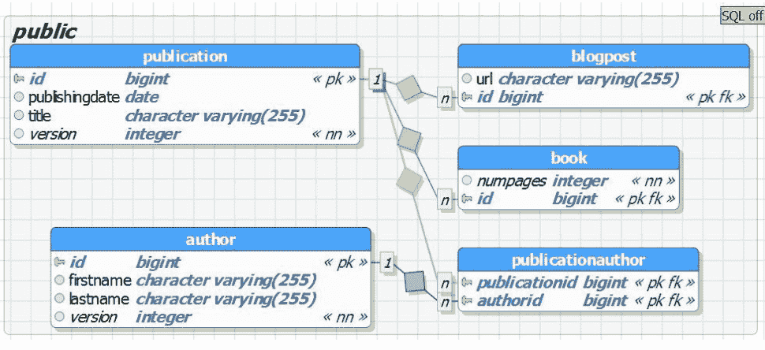

# Hibernate 技巧：解决 70 多个常见 Hibernate 问题的解决方案

## 前言

毫无疑问，Hibernate ORM 和 JPA 的学习曲线是非常陡峭的。你可以快速开发出一个原型，为你的 Java 类添加几个注解，一切就能正常工作——这似乎很简单。但是，当你尝试处理复杂的映射或解决性能问题时，你会很快意识到，你需要更深入地理解 Hibernate 才能实现完整且高效的数据库访问层。

如何获得这种更深入的理解呢？Hibernate 文档是有用的，我们总是建议用户阅读全部内容。但这是一项艰巨的任务，因为文档包含了大量的细节。此外，文档的结构是描述解决方案的各个独立部分。然而，对象/关系映射（ORM）是一个非常复杂的概念——仅仅通过手册无法涵盖解决现实问题和实现现实用例时经常需要的所有组合方案。

例如，你可能不记得定义特定映射想法所需的注解组合，或者你只是好奇如何实现某个特定的用例。你需要关于如何实现当前正在执行的任务的配方或快速技巧。对于此类情况，用户有许多选择来寻找解决方案，包括 Hibernate 博客、用户论坛、IRC 频道、HipChat 聊天室、StackOverflow 等。另一个很棒资源是大量使用 Hibernate 的书籍。此外，还有许多由社区专家（长期 Hibernate 高级用户）编写的关于使用 Hibernate 的博客。其中许多社区专家博客专注于展示如何使用 Hibernate 现有的功能和注解来实现特定的用例，或者如何研究解决性能问题。

Thorben 长期一直是这个社区专家小组的一部分，通过他的博客文章、文章和各种论坛帮助 Hibernate 用户。现在他写了一本书。而且一如既往，Thorben 有许多非常棒的 Hibernate 见解可以分享。这是我看到的第一本采用 FAQ 风格的 Hibernate 书籍，这种结构并不寻常。其他关于 Hibernate 的书籍以及 Hibernate 文档本身都采用相同的教学方法——它们按顺序详细解释每一个部分。虽然这些知识是有价值的（我认为是至关重要的），但对于新用户来说，要将这种顺序的、碎片化的知识应用于解决更复杂的问题通常很困难。

FAQ 方法让用户更容易找到关于常见高层概念和话题的帮助。这两种形式的知识在学习 Hibernate 时都用。结合列出的其他资源，本书将成为每位开发者 Hibernate 工具箱的极佳补充。

Steve Ebersole

首席开发人员 - Hibernate ORM

首席软件工程师 - Red Hat, Inc.

Hibernate 是最流行的 Java 持久化 API (JPA) 实现之一，也是通常最流行的 Java 对象关系映射 (ORM) 框架之一。它帮助你将领域模型映射到数据库表，并在对象状态转换时自动生成 SQL 语句来更新数据库。这是一项复杂的任务，但 Hibernate 让它看起来很简单。你只需要为你的领域类添加注解，Hibernate 就会处理剩下的工作。或者，至少刚开始时是这样。

当你使用 Hibernate 一段时间后，你开始意识到你需要的不仅仅是为领域模型类添加一个 `@Entity` 注解。现实世界的应用通常需要高级映射、复杂查询、自定义数据类型和缓存。

Hibernate 可以做到这一切。你只需要知道应该使用哪些注解和 API。对这些知识的迫切需求促使我在 2016 年在我的 Thoughts on Java 博客上写了《Hibernate 技巧》系列。在书中，你将找到超过 35 多个独家技巧以及博客上最流行的技巧。

## 你将从书中获得

70 多种 Hibernate 技巧向你展示了如何使用 Hibernate 解决不同的问题。每个技巧都由一个或多个代码示例和一个易于操作步骤组成。你还可以下载包含每个 Hibernate 技巧的可执行测试用例的示例项目。我建议在开始阅读本书之前下载该项目，以便你在阅读时可以尝试每个 Hibernate 技巧。

为了帮助你找到开发任务所需的技巧，我将它们分为以下章节：

## 如何获取示例项目

我在书中大量的代码示例向你展示如何使用 Hibernate 解决特定问题。你可以在 http://www.hibernate-tips.com/download-examples 下载包含所有代码示例和可执行测试用例的示例项目。

## 本书适合人群

本书适用于已经在使用 Hibernate 并正在为当前的开发任务或问题寻找解决方案的开发者。这些技巧被设计为自包含的配方，提供特定的解决方案并按需要访问。大多数技巧都包含相关技巧的链接，如果你想深入研究某个主题或需要略有不同的解决方案，可以遵循。不需要按特定顺序阅读技巧。你可以从头到尾阅读本书，也可以挑选对你当前项目有帮助的技巧。

为了从书中获得收益，你应该已经熟悉 JPA 和 Hibernate 的通用概念。如果你正在寻找如何使用 Hibernate 实现业务需求的技巧，那么你找对了。我不解释 Hibernate 的通用概念，因此此书不适用于初学者。但是，如果你已经熟悉 ORM 框架并喜欢在实践中学习，你可能会发现这种基于示例的方法很有帮助。

你可以在多种不同的环境中使用 Hibernate。你可以将其作为 Java SE 或 Java EE 环境中的 JPA 实现，作为 Java SE 中的私有持久化框架，或作为 Spring 中的持久化提供者。我在本书的“Hibernate 技巧”中解释的核心特性在所有这些环境中都是可用的。唯一的区别在于你环境中其他框架在 Hibernate 之上提供的功能，以及启动机制。

你可以在以下 Hibernate 技巧中找到不同启动方式的示例：

### 如何在 Java SE 环境中启动 Hibernate

#### 问题

我想在 Java SE 环境中使用 Hibernate 作为我的 JPA 提供者。我该如何启动 Hibernate？

#### 解决方案

在你的 Java SE 应用程序中启动 Hibernate 之前，你需要向类路径中添加所需的依赖项。本书中的示例使用的是 Hibernate 5.2.8.Final，`hibernate-core.jar` 文件是唯一需要的 Hibernate 依赖。JPA jar 文件作为 `hibernate-core` 的传递依赖被包含。

```
<dependency>
  <groupId>org.hibernate</groupId>
  <artifactId>hibernate-core</artifactId>
  <version>5.2.8.Final</version>
</dependency>
```

你还需要向应用程序的类路径添加特定数据库的 JDBC 驱动程序。请检查你的数据库文档以获取更多信息。

添加所需的依赖项后，你可以按照 JPA 规范定义启动 Hibernate。你需要在应用程序的 `META-INF` 目录下添加一个 `persistence.xml` 文件。下面的代码片段显示了 `persistence.xml` 文件的简单示例。它配置了一个名为 `my-persistence-unit` 的持久化单元（persistence-unit）。它还告诉 Hibernate 使用 `PostgreSQLDialect` 并连接到本地上的 PostgreSQL 数据库。如果你使用不同的数据库或连接池，你的配置可能会不同。

```
<persistence-unit name="my-persistence-unit">
  <description>Hibernate Tips</description>
  <provider>
    org.hibernate.jpa.HibernatePersistenceProvider
  </provider>
  <exclude-unlisted-classes>false</exclude-unlisted-classes>

  <properties>
    <property name="hibernate.dialect"
      value="org.hibernate.dialect.PostgresDialect" />

    <property name="java.persistence.jdbc.driver"
      value="org.postgresql.Driver" />
    <property name="java.persistence.jdbc.url"
      value="jdbc:postgresql://localhost:5432/recipes" />
    <property name="java.persistence.jdbc.user"
      value="postgres" />
    <property name="java.persistence.jdbc.password"
      value="postgres" />
  </properties>
</persistence-unit>
```

然后你可以调用 `Persistence` 类的 `createNativeFactory` 方法来创建你在 `persistence.xml` 文件中配置的 `EntityManagerFactory`。`EntityManagerFactory` 提供了一个获取 `EntityManager` 的方法，我在本书的大多数示例中都使用了它。这就是你在应用程序中启动 Hibernate 所需的所有。

```
EntityManagerFactory emf = 
  Persistence.createEntityManagerFactory("my-persistence-unit");
EntityManager em = emf.createEntityManager();
```

#### 源代码

你可以在示例项目的 `JPABootstra` 模块中找到此 Hibernate 技巧带有可执行测试用例的项目。如果你还没有下载，可以从 http://www.hibernate-tips.com/download-examples 下载。

#### 更多信息

JPA 也为 Java EE 环境定义了一种启动方式。我在“如何在 Java EE 环境中启动 Hibernate”中解释了它。

你还可以使用 Hibernate 的私有启动 API，它让你能够访问私有的配置功能。我在“如何使用 Hibernate 的原生启动 API”中向你展示如何做到这一点。

如果你想在 Spring Boot 中使用 Hibernate，请查看“如何使用 Spring Boot 启动 Hibernate”。

### 如何在 Java EE 环境中启动 Hibernate

#### 问题

我想在 Java EE 环境中使用 Hibernate 作为我的 JPA 提供者。我该如何启动 Hibernate？

#### 解决方案

在 Java EE 环境中启动 Hibernate 非常简单。你只需要确保在你的 Java EE 应用程序服务器中设置了 Hibernate。如果你正在使用 JBoss Wildfly 或 JBoss EAP 服务器，情况就是如此。如果你使用不同的服务器，请检查你的应用程序服务器文档。你的服务器可能使用 Hibernate 作为 JPA 实现，或者你需要决定是否要替换现有的 JPA 实现。

然后你可以按照 JPA 规范启动 Hibernate。你只需要在部署单元的 `META-INF` 目录下添加一个 `persistence.xml` 文件。下面的代码片段显示了一个 `persistence.xml` 文件的简单示例，定义了 `persistence-unit`。它告诉 Hibernate 使用 `PostgreSQLDialect` 并连接到本地上的 PostgreSQL 数据库。如果你使用由应用程序服务器提供的连接池，你的配置可能会不同。

```
<persistence>
  <persistence-unit name="my-persistence-unit">
    <description>Hibernate Tips</description>
    <provider>
      org.hibernate.jpa.HibernatePersistenceProvider
    </provider>
    <exclude-unlisted-classes>false</exclude-unlisted-classes>
    <properties>
      <property name="hibernate.dialect"
        value="org.hibernate.dialect.PostgresDialect" />

      <property name="java.persistence.jdbc.driver"
        value="org.postgresql.Driver" />
      <property name="java.persistence.jdbc.url"
        value="jdbc:postgresql://localhost:5432/recipes" />
      <property name="java.persistence.jdbc.user"
        value="postgres" />
      <property name="java.persistence.jdbc.password"
        value="postgres" />
    </properties>
  </persistence-unit>
</persistence>
```

容器会为配置中定义的每个持久化单元创建一个 `EntityManagerFactory`。它允许在你需要时注入 `EntityManager`。

```
@PersistenceUnit
private EntityManagerFactory emf;

@PersistenceUnit
private EntityManager em;
```

#### 更多信息

JPA 和 Hibernate 还提供了两种在 Java SE 环境中启动的方法。我在“如何在 Java SE 环境中启动 Hibernate”和“如何使用 Hibernate 的原生启动 API”中解释了它们。

如果你想在 Spring Boot 中使用 Hibernate，请查看“如何使用 Spring Boot 启动 Hibernate”。

### 如何使用 Hibernate 的原生启动 API

#### 问题

我对配置需要更多控制。我如何使用它的原生启动 API？

#### 解决方案

Hibernate 的原生启动 API 非常灵活，这使得它更加复杂，但也比 JPA API 更强大。如果你不需要这种灵活性，我建议使用 JPA API。

在开始启动过程之前，你需要向类路径中添加所需的依赖项。本书中的示例使用的是 Hibernate 5.2.8.Final，`hibernate-core.jar` 文件是唯一需要的 Hibernate 依赖。它还包含了 JPA 文件作为传递依赖。

```
<dependency>
  <groupId>org.hibernate</groupId>
  <artifactId>hibernate-core</artifactId>
  <version>5.2.8.Final</version>
</dependency>
```

你还需要向应用程序的类路径添加特定数据库的 JDBC 驱动程序。请检查你的数据库文档以获取更多信息。

一旦添加了所需的依赖项，你就可以实现启动过程。你需要创建一个 `StandardServiceRegistry`，构建一个 `Metadata` 对象并使用该对象实例化 `SessionFactory`。

Hibernate 使用两个服务注册表——`BootstrapServiceRegistry` 和 `StandardServiceRegistry`。默认的 `BootstrapServiceRegistry` 为大多数应用程序提供了解决方案，因此我在示例中跳过了程序化定义。

然而，你需要配置 `StandardServiceRegistry`。在示例中，我通过 `hibernate.cfg.xml` 文件来实现，这使得实现变得简单，并允许在不更改源代码的情况下更改配置。当你调用 `StandardServiceRegistryBuilder` 的 `configure` 方法时，Hibernate 会自动从类路径加载配置文件。你可以在调用 `build` 方法获取 `ServiceRegistry` 之前对配置进行程序化调整。

```
ServiceRegistry standardRegistry =
    new StandardServiceRegistryBuilder()
    .configure()
    .build();
```

下面的代码片段显示了一个 `hibernate.cfg.xml` 配置文件的示例。它告诉 Hibernate 使用 `PostgreSQLDialect` 并连接到本地上的 PostgreSQL 数据库。它还告诉 Hibernate 根据实体映射生成数据库表。如果你使用不同的数据库或连接池，你的配置可能会不同。

不建议在生产环境中根据实体映射生成数据库表。

你应该使用 SQL 脚本，这样你就可以控制自己的数据库模型并根据需求对其进行优化。


# 使用 Hibernate 原生引导 API

## 引导 Hibernate

以下代码片段展示了如何使用原生 API 引导 Hibernate。首先，你需要创建一个配置好的 `ServiceRegistry`。

```
<hibernate-configuration>
  <session-factory name="dialect">
    <property>org.hibernate.dialect.PostgreSQLDialect</property>
    <property name="connection.driver_class">org.postgresql.Driver</property>
    <property name="connection.url">jdbc:postgresql://localhost:5432/recipes</property>
    <property name="connection.username">postgres</property>
    <property name="connection.password">postgres</property>
    <property name="connection.pool_size">1</property>
    <property name="hbm2ddl.auto">create</property>
  </session-factory>
</hibernate-configuration>
```

在实例化配置好的 `ServiceRegistry` 后，你需要为你的领域模型创建一个元数据表示（Metadata representation）。你可以根据 `hbm.xml` 或 `orm.xml` 配置文件或注解实体类来实现。我在下面的代码片段中使用了注解类。我首先使用上一步创建的 `ServiceRegistry` 来实例化一个新的 `MetadataSources` 对象。然后我添加我的注解实体类并调用 `buildMetadata` 来创建元数据表示。在这个示例中，我只使用了 `Author` 实体。之后，我在元数据对象上调用 `buildSessionFactory` 方法来实例化 `SessionFactory`。

```
SessionFactory sessionFactory =
new MetadataSources(standardRegistry)
.addAnnotatedClass(Author.class)
.buildMetadata()
.buildSessionFactory();
 session = sessionFactory.openSession();
```

这就是你使用原生 API 创建基础 Hibernate 设置所需要的所有操作。你现在可以使用 `SessionFactory` 打开一个新的 `Session` 并使用它来读取或持久化实体。

```
Author a = new Author();
a.setFirstName("Thorben");
a.setLastName("Janssen");
session.persist(a);
```

## 源代码

你可以在示例项目的 `HibernateBootstrapping` 模块中找到包含此 Hibernate 提示的可执行测试用例的项目。如果你还没有下载，可以在 http://www.hibernate-tips.com/download-examples 下载。

## 了解更多

由 JPA 标准定义的引导程序（bootstrapping）API 更容易使用，但灵活性较低。我在以下文章中进行了详细解释：

你也可以在 Spring Boot 中使用 Hibernate。我在《如何使用 Spring Boot 引导 Hibernate》中解释了所需的引导过程。

# 如何使用 Spring Boot 引导 Hibernate

## 问题

我如何在我的 Spring Boot 应用中使用 Hibernate？

## 解决方案

Spring Boot 让引导 Hibernate 变得极其简单。你只需要将 Spring Boot JPA 启动器添加到类路径中，Spring Boot 就会为你处理好引导工作。

```
<dependency>
  <groupId>org.springframework.boot</groupId>
  <artifactId>spring-boot-starter-data-jpa</artifactId>
</dependency>
```

你还需要将特定数据库的 JDBC 驱动程序添加到应用的类路径中。请检查你的数据库文档以获取更多信息。

你可以在 `application.properties` 文件中通过几个属性定义数据源。以下配置定义了一个连接到本地 localhost PostgreSQL 数据库的数据源。

```
spring.datasource.url = jdbc:postgresql://localhost:5432/recipes
spring.datasource.username = postgres
spring.datasource.password = postgres
```

如果你在类路径中添加了 H2、HSQL 或 Derby 数据库，你可以安全地省略配置，Spring Boot 将启动并连接到内存数据库。你也可以向类路径中添加多个 JDBC 驱动和一个内存数据库，并为不同的目标环境使用不同的配置。

这就是你从 Spring Boot 应用中引导 Hibernate 所需要的所有操作。你现在可以使用 `@Autowired` 注解来注入 `EntityManager`。

```
@Autowired
private EntityManager em;
```

## 源代码

你可以在示例项目的 `SpringBootBootstrapping` 模块中找到包含此 Hibernate 提示的可执行测试用例的项目。如果你还没有下载，可以在 http://www.hibernate-tips.com/download-examples 下载。

## 了解更多

JPA 为 Java SE 和 Java EE 环境定义了一种引导方法。我在以下文章中解释了它：

你也可以使用 Hibernate 专有的引导程序 API，这让你能够访问专有的配置功能。我在《如何使用 Hibernate 的原生引导 API》中向你展示如何这样做。

# 如何从 JPA 访问 Hibernate API

## 问题

我正在通过 `EntityManager` API 使用 Hibernate。是否有办法可以访问专有的 Hibernate `Session` 和 `SessionFactory`？

## 解决方案

从 2.0 版本开始，JPA 提供了访问底层实现 API 的便捷方法。`EntityManager` 和 `EntityManagerFactory` 提供了一个 `unwrap` 方法，该方法返回 JPA 实现的对应类。在 Hibernate 的情况下，`Session` 和 `SessionFactory` 让你完全访问 Hibernate 的专有功能，例如对 Streams 和 Optional 的支持。

下面的代码片段展示了如何从 `EntityManager` 获取 Hibernate `Session`。你只需要在 `EntityManager` 上调用 `unwrap` 方法并提供 `Session` 类作为参数即可。

```
Session session = em.unwrap(Session.class);
```

正如下一个代码片段所示，你可以以类似的方式获取 Hibernate `SessionFactory`。你首先从 `EntityManager` 获取 `EntityManagerFactory`，然后使用 `SessionFactory` 类调用 `unwrap` 方法。

```
SessionFactory sessionFactory = em.getEntityManagerFactory().unwrap(SessionFactory.class);
```

## 源代码

你可以在示例项目的 `AccessApi` 模块中找到包含此 Hibernate 提示的可执行测试用例的项目。如果你还没有下载，可以在 http://www.hibernate-tips.com/download-examples 下载。

## 了解更多

如果你使用原生 API，你也可以直接访问 Hibernate 的 `Session` 和 `SessionFactory` 类。有关更多信息，请参阅《如何使用 Hibernate 的原生引导 API》。

# 如何将 Metamodel 类自动添加到你的项目中

## 问题

我使用 Hibernate 的静态元模型生成器（Static Metamodel Generator）来生成 JPA Metamodel。这些类生成到一个不同的目录，该目录没有被作为源文件夹。是否有方法自动将此文件夹注册为源文件夹？

## 解决方案

在研究过程中，我从 Frits Walraven 那处了解到有一个 Maven 插件可以做到。特别感谢 Frits，他也审阅了这本书。

你只需要将以下 Maven 插件添加到你的构建配置中。它会将目录列表注册为额外的源文件夹。我在项目的父级 `pom.xml` 中使用它，将 JPA Metamodel 类所在的目录（`target/generated-sources/annotations`）添加为源文件夹。

```xml
<project>
  <build>
    <plugins>
      <plugin>
        <groupId>org.codehaus.mojo</groupId>
        <artifactId>build-helper-maven-plugin</artifactId>
        <version>3.0.0</version>
        <executions>
          <execution>
            <id>add-source</id>
            <phase>generate-sources</phase>
          </execution>
        </executions>
      </plugin>
    </plugins>
  </build>
</project>
```

```xml
<goals>
  <goal>add-source</goal>
</goals>
<configuration>
  <sources>
    <source>target/generated-sources/annotations</source>
  </sources>
</configuration>
<executions>
  <plugin>
    </plugins>
  </executions>
<build>
  ...
</build>
</project>
```

## 源代码

你可以在示例项目中找到一个完整的 Maven 构建配置示例。如果你还没有下载，可以在 http://www.hibernate-tips.com/download-examples 下载。

## 了解更多

JPA Metamodel 为在创建 `CriteriaQuery` 或 `EntityGraph` 时提供了一种类型安全的方式引用实体属性。我在《如何类型安全的方式引用实体属性》中进行了更详细的解释。

# 基础映射

Hibernate 支持一组标准映射，允许你轻松地将实体属性映射到数据库列。本章中的示例展示了如何对实体属性使用标准映射、映射主键属性、生成唯一主键值以及映射实体之间的关联。你可以在“高级映射”（Advanced Mappings）章节中找到更高级的映射定义。

要了解实体属性的标准映射，请参阅：

- 如何将基础实体属性映射到数据库列
- 如何将 `util.Date` 或 `Calendar` 映射到数据库列
- 如何将枚举（enum）映射到数据库列

要了解主键属性的映射和唯一主键值的生成，请参阅：

要了解实体之间关联的映射，请参阅：

- 如何映射双向多一关联
- 如何映射单向多一关联
- 如何映射单向一对多关联
- 如何映射双向多多关联
- 如何映射单向多多关联
- 如何映射双向一对一关联
- 如何映射单向一对一关联

# 如何定义 schema 和表名

## 问题

我如何定义 Hibernate 映射实体时数据库模式 schema 和表名？

## 解决方案

你可以通过 `javax.persistence.Table` 注解的 **schema** 和 **name** 属性来定义模式和表名。参见下方代码段中的相关示例。你只需要在实体类上添加 `@Table` 注解并设置 `name` 和 `schema` 属性即可。

```
@Entity
@Table(name = "author", schema = "bookstore")
public class Author {...}
```

当你使用该实体时，Hibernate 会使用提供的模式和表名来创建 SQL 语句。下面的代码段持久化了一个新的 `Author` 实体，并执行查询以获取所有具有指定 `firstName` 的 `Author` 实体。

```
Author a = new Author();
a.setFirstName("firstName");
a.setLastName("lastName");
em.persist(a);
a = em.createQuery(
  "SELECT FROM Author a WHERE firstName = 'firstName'",
  Author.class).getSingleResult();
```

正如你在接下来的日志输出所示，Hibernate 将 `Author` 实体持久化到 `bookstore` 模式下的 `author` 表中，并在同一表上执行 `SELECT` 语句。

```
06:11:42,481 DEBUG [org.hibernate.SQL] - 
insert
into
  bookstore.author
  (firstName, lastName, version, id)
values
  (?, ?, ?)
06:11:42,785 DEBUG [org.hibernate.SQL] - 
select
  author0_.id as id1_,
  author0_.firstName as firstNam2_0_,
  author0_.lastName as lastName3_0_,
  author0_.version as version4_0_
from
  bookstore.author author0_
where
  author0_.firstName='firstName'
```

## 源代码

你可以在示例项目的 `DefineTableAndSchemaName` 模块中找到包含此 Hibernate 提示的可执行测试用例的项目。如果你还没有下载，可以在 http://www.hibernate-tips.com/download-examples 下载。

# 如何将基础实体属性映射到数据库列

## 问题

我如何将基础实体属性映射到数据库列？

## 解决方案

Hibernate 映射以下 Java 类型的实体属性不需要额外信息：

- `java.lang.String`
- `char` 和 `java.lang.Character`
- `boolean` 和 `java.lang.Boolean`
- `byte` 和 `java.lang.Byte`
- `short` 和 `java.lang.Short`
- `int` 和 `java.lang.Integer`
- `long` 和 `java.lang.Long`
- `float` 和 `java.lang.Float`
- `double` 和 `java.lang.Double`
- `java.math.BigInteger`
- `java.math.BigDecimal`
- `java.sql.Timestamp`
- `java.sql.Time`
- `java.sql.Date`
- `java.util.Calendar`
- `java.util.Date`
- `java.util.Locale`
- `java.util.Timezone`
- `java.net.URL`
- `java.sql.Blob`
- `java.sql.Clob`
- `byte[]` 和 `java.lang.Byte[]`
- `char[]` 和 `java.lang.Character[]`
- `java.util.UUID`
- `java.sql.NCLob`

Hibernate 还支持枚举的默认映射，不需要任何额外的注解。我将在“如何将枚举映射到数据库列”中详细介绍该映射及其自定义选项。

从 5.0 版本开始，Hibernate 还支持 Date 和 Time API 的类作为基础类型：

- `java.time.Duration`
- `java.time.Instant`
- `java.time.LocalDateTime`
- `java.time.LocalDate`
- `java.time.LocalTime`
- `java.time.OffsetDateTime`
- `java.time.OffsetTime`
- `java.time.ZonedonedDateTime`

当你不提供额外的映射信息时，Hibernate 会按照默认设置将这些类型的实体属性映射到数据库列。

枚举也同样适用。Hibernate 默认可以对它们进行映射，但你可能想要自定义它的映射方式。我将在《如何将枚举映射到数据库列》中向你展示如何这样做。

# 如何将 util Date 或 Calendar 映射到数据库列

## 问题

我使用 `java.util.Date` 来将日期建模为实体属性。但 Hibernate 将其映射为带有纳秒级的时间戳（timestamp）。我该如何更改映射，以便 Hibernate 仅存储年、月、日呢？

## 解决方案


SQL 标准支持三种不同的数据类型来存储日期和时间信息。Hibernate 可以将它们所有类型都映射到 `java.util.Date` 或 `java.util.Calendar`。你需要决定 Hibernate 将使用以下哪些 SQL 类型：

- `TIMESTAMP`：持久化带有纳秒的日期和时间。Hibernate 默认使用这种类型。
- `TIME`：只存储时间，不带纳秒。
- `DATE`：仅持久化包含年、月、日的日期。

你可以使用 `@Temporal` 注解定义首选的映射。如下代码段所示，该注解接受一个 `TemporalType` 枚举作为值。该枚举允许你选择想要使用的 SQL 类型（`DATE`、`TIME` 或 `TIMESTAMP`）。

```java
@Entity
public class Author {
    @Temporal(TemporalType.DATE)
    private Date dateOfBirth;

    ...
}
```

如如下日志输出所示，`Author` 实体的 `dateOfBirth` 属性被映射为不包含任何时间信息的 SQL `DATE`。

```text
07:22:50,453 DEBUG [org.hibernate.SQL] -
select
  author.id as id1_0_,
  author.dateOfBirth as dateOfBi2_0_,
  author.firstName as firstName3_0_,
  author.lastName as lastName4_0_,
  author.version as version5_0__
from
  Author author
where
  author.id=?
07:22:50,454 TRACE [org.hibernate.type.descriptor.sql.BasicBinder] -
binding parameter [1] as [BIGINT] - [1]
07:22:50,464 TRACE [org.hibernate.type.descriptor.sql.BasicExtractor] - extracted value
([[dateOfBi2_0_]] : [DATE]) - [1980-01-01]
..
```

## 源代码

你可以在示例项目的 `MapUtilDate` 模块中找到包含此 Hibernate 技巧之可执行测试用例的项目。如果你还没有下载，可以从 http://www.hibernate-tips.com/download-examples 下载。

## 了解更多信息

从 Hibernate 5 开始，你还可以使用 Java 8 Date and Time API 的类作为实体属性类型。这些新类解决了许多关于 `java.util.Date` 的问题，并提供了 Hibernate 将它们映射到正确 JDBC 类型所所需的所有信息。我将在《如何映射 Java 8 Date and Time API 的类》中更详细地解释 Date 和 Time API 类的映射。

# 如何将枚举映射到数据库列

## 问题

我该如何将枚举属性映射到数据库列？我应该选择哪种选项？

## 解决方案

JPA 和 Hibernate 提供了两种标准选项来将枚举映射到数据库列。你可以使用字符串表示（String）或序数值（ordinal）。

这两种方法都有其缺点：

- 字符串表示非常冗长，且重命名枚举值需要你同步更新数据库。
- 枚举值的序数是它在枚举声明中的位置。当你删除现有值或不在枚举声明末尾添加新值时，该值会发生变化并要求你更新数据库。

你必须决定对于你的特定应用程序，哪种缺点是“较小的恶”，或者使用 `AttributeConverter` 来定义自定义映射以避免这些问题。

当你使用 JPA 和 Hibernate 标准映射时，可以依赖其中一种。当你使用 JPA 和 Hibernate 标准映射时，可以依赖其中一种。当你使用 JPA 和 Hibernate 标准映射时，可以依赖其中一种。当你使用 JPA 和 Hibernate 标准映射时，可以依赖其中一种。

```java
` 和

public映射 { {
    
。

    ,;
}
```

你可以使用 `Enumerated`。当你使用 JPA 和 Hibernate 标准映射时，可以依赖其中一种。

使用使用 JPA 和 Hibernate 映射时，可以依赖

一种。

当你使用 JPA 和 Hibernate 标准映射时，可以依赖其中一种。使用 `Enumerated` 来让 Hibernate 默认使用序数。

```java
@Entity
public class Author {

    @Enumerated(EnumType.STRING)
    private Status status;

    ...
}
```

当你使用 JPA 和 Hibernate 标准映射时，可以依赖其中一种。使用 `Enumerated` 来让 Hibernate 默认使用序数值。

```java
@Entity
public class Author {

    @Enumerated(EnumType.ORDINAL)
    private Status status;

    ...
}
```

## 源代码

你可以在示例项目的 `Enumerations` 模块中找到包含此 Hibernate 技巧之可执行测试用例的项目。如果你还没有下载，可以从 http://www.hibernate-tips.com/download-examples 下载。

## 了解更多信息

你可以使用 `AttributeConverter` 来定义自定义映射以避免这些问题。

# 如何映射简单的主键

## 问题

我该如何映射一个简单的主键？

## 解决方案

你可以使用带有 `@Id` 注解的实体属性来建模主键。JPA 和 Hibernate 支持以下类型：

- 基本类型及其包装类型
- `java.lang.String`
- `java.util.Date` 和 `java.sql.Date`
- `java.math.BigDecimal`
- `java.math.BigInteger`

以下代码段展示了一个主键的示例。它是 `java.lang.Long` 类型。我用 `@Id` 标记了它，并使用 `@Column` 注解提供了额外的映射信息。

```java
@Entity
public class Author {

    @Id
    @Column(updatable = false, nullable = false)
    private Long id;

    ...
}
```

这就是定义主键属性所需的所有操作。你现在可以使用它，例如通过 `EntityManager` 方法读取实体。

```java
Author a = em.find(Author.class, 1L);
```

当你持久化一个新的 `Author` 实体时，你需要提供主键值。

```java
Author a = new Author();
a.setId(1L);
a.setFirstName("Thorben");
a.setLastName("Janssen");

em.persist(a);
```

## 源代码

你可以在示例项目的 `PrimaryKey` 模块中找到包含此 Hibernate 技巧之可执行测试用例的项目。如果你还没有下载，可以从 http://www.hibernate-tips.com/download-examples 下载。

## 了解更多

JPA 和 Hibernate 支持不同的生成主键值的策略。如果主键值不是作为用户输入的，你应该使用这些策略之一。我将在以下内容中详细解释：

当你持久化一个新的 `Author` 实体时，Hibernate 会立即执行 SQL `INSERT` 语句。它使用数据库自增列 `id` 来生成主键值，并从数据库中检索该值。如果你激活了 SQL 语句的日志，可以在日志文件中看到它。

```java
Author a = new Author();
a.setFirstName("Thorben");
a.setLastName("Janssen");
```

```java
log.info("Before persist");
em.persist(a);
log.info("After persist");
```

```text
05:35:43,918 INFO [org.thoughts.java.model.TestIdentityStrategy]

- Before persist

05:35:43,975 DEBUG [org.hibernate.SQL] - insert into Author (firstName, lastName, version) (?, ?, ?)

05:35:43,989 DEBUG [org.hibernate.id.IdentifierGeneratorHelper] - Natively generated identity: 1

05:35:43,993 INFO [org.thoughts.java.model.TestIdentityStrategy]

- After persist
```

数据库处理自增列非常高效。然而，你需要意识到 Hibernate 必须立即执行 `INSERT` 语句以获取主键值。这阻止了 Hibernate 使用依赖于数据库操作延迟执行的各种性能优化技术。

## 源代码

你可以在示例项目的 `PrimaryKeyIdentityStrategy` 模块中找到包含此 Hibernate 技巧的、执行测试用例的项目。如果你还没有下载，可以访问 http://www.hibernate-tips.com/download-examples 进行下载。

## 更多信息

数据库自增列仅是生成主键值的四种方案之一。你还应该查看：

# 如何使用自定义数据库序列生成主键值

## 问题描述

Hibernate 使用其默认的数据库序列来生成主键值。

我该如何使用我自己的序列呢？

## 解决方案

JPA 规范支持四种生成主键值的方案。其中一种是 `GenerationType.SEQUENCE`，它使用数据库序列来生成主键值。

当你想要使用自定义的数据库序列时，你必须在主键属性上标记 `@GeneratedValue` 注解，并将 `strategy` 属性的值设置为 `GenerationType.SEQUENCE`。这告诉 Hibernate 使用数据库序列来生成主键值。如果你没有提供任何额外信息，Hibernate 将使用其默认序列 `hibernate_sequence`。

你可以使用 `@SequenceGenerator` 注解来配置自定义数据库序列的名称和模式（schema）。下面的代码片段展示了此类映射示例。`@GeneratedValue` 注解引用了一个名为 `author_generator` 的自定义生成器。该生成器由 `@SequenceGenerator` 注解定义，告诉 Hibernate 使用 `author_seq` 数据库序列。

```java
@Entity
public class Author {

    @Id
    @GeneratedValue(
      strategy = GenerationType.SEQUENCE,
      generator = "author_generator"
    )
    @SequenceGenerator(
      name="author_generator",
      sequenceName = "author_seq"
    )
    @Column(name = "id", updatable = false, nullable = false)
    private Long id;

}
```

当你持久化一个新的 `Author` 实体时，Hibernate 在执行 `INSERT` 语句之前会从数据库序列 `author_seq` 中选择一个新的主键值。如果你激活了 SQL 语句的日志，可以在日志文件中看到这些语句。

```java
Author a = new Author();
a.setFirstName("Thorben");
a.setLastName("Janssen");

em.persist(a);
```

```text
12:17:47,432 DEBUG [org.hibernate.SQL] - select nextval ('author_seq')
12:17:47,459 DEBUG [org.hibernate.SQL] - insert into Author (firstName, lastName, version, id) values (?, ?, ?, ?)
```

```text
12:17:47,462 TRACE [org.hibernate.type.descriptor.sql.BasicBinder] - binding parameter [1] as [VARCHAR] - [firstName]
12:17:47,462 TRACE [org.hibernate.type.descriptor.sql.BasicBinder] - binding parameter [2] as [VARCHAR] - [lastName]
12:17:47,463 TRACE [org.hibernate.type.descriptor.sql.BasicBinder] - binding parameter [3] as [INTEGER] - [0]
12:17:47,464 TRACE [org.hibernate.type.descriptor.sql.BasicBinder] - binding parameter [4] as [BIGINT] - [1]
```

## 源代码

你可以在示例项目的 `CustomSequence` 模块中找到包含此 Hibernate 技巧的、执行测试用例的项目。如果你还没有下载，可以访问 http://www.hibernate-tips.com/download-examples 进行下载。

## 更多信息

序列（Sequences）仅是生成主键值的四种方案之一。你还应该查看：

- 如何使用自增列来生成主键值
- 如何使用数据库表来生成主键值
- 如何使用生成的 UUID 作为主键

# 如何使用数据库表生成主键值

## 问题描述

如果我的数据库不支持序列或自增列，我该如何生成主键值呢？

## 解决方案

JPA 和 Hibernate 支持不同的主键值生成策略。其中一种是 `TABLE` 策略，它使用数据库表来模拟序列。大多数现代数据库支持序列或自增列，这种策略提供了一个更好的解决方案。在决定使用 `TABLE` 策略之前，请检查你的数据库是否支持序列或自增列。

如果你想使用这种策略，你必须在主键属性上标记 `@Id` 和 `@GeneratedValue` 注解，并将 `strategy` 属性的值设置为 `GenerationType.TABLE`。

```java
@Entity
public class Author {

  @Id
  @GeneratedValue(strategy = GenerationType.TABLE)
  @Column(name = "id", updateable = false, nullable = false)
  private Long id;

...
```

当你持久化一个新的 `Author` 实体时，Hibernate 会从序列表中选择下一个主键值并在之后更新它。这两个语句会锁定 `hibernate_sequence` 表。这比 `SEQUENCE` 策略慢。如果你激活了 SQL 语句的日志，可以在日志文件中看到它。

```java
Author a = new Author();
a.setFirstName("Thorben");
a.setLastName("Janssen");

em.persist(a);
```

```text
12:20:53,967 DEBUG [org.hibernate.SQL] - select tbl.next_val from hibernate_sequences tbl where tbl.sequence_name=? for update
12:20:53,972 DEBUG [org.hibernate.SQL] - update hibernate_sequences set next_val=? where next_val=? and sequence_name=?
```

```text
12:20:54,001 DEBUG [org.hibernate.SQL] - insert into Author (firstName, lastName, version, id) values (?, ?, ?, ?)
```

## 源代码

你可以在示例项目的 `PrimaryKeyStrategy` 模块中找到包含此 Hibernate 技巧的、执行测试用例的项目。如果你还没有下载，可以访问 http://www.hibernate-tips.com/download-examples 进行下载。

## 更多信息

自增列仅是生成主键值的多种方案之一。你还应该查看：

# 如何使用生成的 UUID 作为主键

## 问题描述

我想使用 UUID 作为主键。我该如何在 Hibernate 中映射它们？Hibernate 能为新实体生成 UUID 值吗？

## 解决方案

Hibernate 为类型 `java.util.UUID` 的属性作为主键提供了私有支持，并提供了两个生成器来创建 UUID 值。这些生成器支持 IETF RFC 4122 version 4 和 IETF RFC 4122 version 1。

### IETF RFC 4122 version 4 --- 基于随机数的 UUID


默认情况下，Hibernate 使用基于随机数的生成策略。一如既往，你不需要做太多就能获得默认行为。你只需要在类型为 `java.util.UUID` 的主键属性上添加 `@GeneratedValue` 注解。

你可以在下面的代码片段看到它的示例。

```java
@Entity
public class Author {

    @Id
    @GeneratedValue
    @Column(name = "id", updateable = false, nullable = false)
    private UUID id;

    ...
}
```

当你现在持久化一个新的 `Author` 实体时，Hibernate 会在将新记录写入数据库之前生成一个 UUID。

```java
Author a = new Author();
a.setFirstName("Thorben");
a.setLastName("Janssen");

em.persist(a);
```

```text
12:25:31,071 DEBUG
[org.hibernate.event.internal.AbstractSaveEventListener] - Generated identifier: 35a18e65-97b9-48fd-a547-56f81e157253, using strategy: org.hibernate.UUIDGenerator
12:25:31,113 TRACE [org.hibernate.SQL] - 
insert
into
Author
(firstName, lastName, version, id)
values
(?, ?, ?)
12:25:31,117 TRACE [org.hibernate.type.descriptor.sql.BasicBinder] - binding parameter [1] as [VARCHAR] - [Thorben]
12:25:31,118 TRACE [org.hibernate.type.descriptor.sql.BasicBinder] - binding parameter [2] as [VARCHAR] - [Janssen]
12:25:31,119 TRACE [org.hibernate.type.descriptor.sql.BasicBinder] - binding parameter [3] as [INTEGER] - [0]
12:25:31,120 TRACE [org.hibernate.type.descriptor.sql.BasicBinder] - binding parameter [4] as [OTHER] - [35a18e65-97b9-48fd-a547-56f81e157253]
```

### IETF RFC 4122 版本1 --- 基于 IP 和时间戳的 UUID

Hibernate 还可以根据 IETF RFC 4122 版本1 的定义，基于 IP 和时间戳生成 UUID。但对其进行配置需要额外的注解。

你需要对类型为 `java.util.UUID` 的主键属性使用 `@GeneratedValue` 注解，并通过其名称引用自定义的 ID 生成器。该 ID 生成器定义了 Hibernate 用于生成主键值的策略。你可以使用 Hibernate 的 `@GenericGenerator` 注解来定义它。它需要生成器的名称、实现生成器策略的类名以及一个额外的 `@Parameter` 注解。在这种情况下，生成器由 `org.hibernate.id.UUIDGenerator` 类实现。这与 Hibernate 默认用于生成 UUID 的生成器是同一个。你需要告诉它使用不同的生成策略。你可以使用 `@Parameter` 注解来实现这一点。你需要将名称设为 `uuid_gen_strategy_class`，并提供 `CustomVersionOneStrategy` 类的完全限定类名作为值。

```java
@Entity
public class Book {
  @Id
  @GeneratedValue(generator = "UUID")
  @GenericGenerator(
    name = "UUID",
    strategy = "org.hibernate.id.UUIDGenerator",
    parameters = {
      @Parameter(
        name = "uuid_gen_strategy_class",
        value = "org.hibernate.id.uuid.CustomVersionOneStrategy"
      )
    }
  )
  @Column(name = "id", updatable = false, nullable = false)
  private UUID id;
```

Hibernate 使用此映射定义的方式与上一个示例相同。它只是在向数据库存储新的 `Book` 实体之前使用不同的算法来生成 UUID。

```java
b = new Book();
b.setTitle("Hibernate Tips");
em.persist(b);
```

```text
05:57:35,777 DEBUG
[org.hibernate.internal.AbstractSaveEventListener] - Generated identifier: c0a8b214-5abb-1aa1-815a-bbbaa51e0000, using strategy: org.hibernate.id.UUIDGenerator
05:57:35,840 DEBUG [org.hibernate.SQL]
insert
into
Book
(price, publishingDate, title, version, id)
values
(?, ?, ?, ?)
05:57:35,843 TRACE [org.hibernate.type.descriptor.sql.BasicBinder] - binding parameter [1] [DOUBLE] - [null]
05:57:35,846 TRACE [org.hibernate.type.descriptor.sql.BasicBinder] - binding parameter [2] [DATE] - [null]
05:57:35,847 TRACE [org.hibernate.type.descriptor.sql.BasicBinder] - binding parameter [3] [VARCHAR] - [Hibernate Tips]
05:57:35,848 TRACE [org.hibernate.type.descriptor.sql.BasicBinder] - binding parameter [4] [INTEGER] - [0]
05:57:35,849 TRACE [org.hibernate.type.descriptor.sql.BasicBinder] - binding parameter [5] [OTHER] - [c0a8b214-5abb-1aa1-815a-bbbaa51e0000]
```

## 源代码

你可以在示例项目的 `PrimaryKeyUUID` 模块中找到包含此 Hibernate 技巧的可执行测试用例的项目。如果你还没有下载，可以从 http://www.hibernate-tips.com/download-examples 下载。

## 更多信息

Hibernate 同样支持不同的数值主键值生成选项。你可以在以下方面阅读更多：

- 如何使用自定义序列生成主键值

- 如何使用自增列生成主键值

- 如何使用数据库表生成主键值

## 如何映射多对一关联

### 问题

我的表模型包含一个多对一关联。我如何用 Hibernate 对其进行建模以便能够双向导航？

### 解决方案

如果你希望能够双向导航，你需要在两个实体上都进行建模。考虑这个示例：在线书店的一本书可以有多条评论。在你的领域模型中，`Book` 实体对 `Review` 实体是一多关系，而 `Review` 实体对 `Book` 实体是多一关系。

| Book | Review |
| --- | --- |
| -Id id: Long | -Id id: Long |
| -ToMany reviews: List<Review>... | -ManyToOne book: Book ... |

更新两个实体上的关联是一项容易出错的任务。因此，提供一个辅助方法将另一个实体添加到关联的“多”的一侧，是一个良好的做法。

```java
@Entity
public class Book {
  ...
  public void addReview(Review review) {
    this.reviews.add(review);
    review.setBook(this);
  }
  ...
}
```

## 源代码

你可以在示例项目的 `AssociationBidirectionalManyToOne` 模块中找到包含此 Hibernate 提示的可执行测试用例的项目。如果你还没有下载，可以访问 http://www.hibernate-tips.com/download-examples 下载它。

## 了解更多

双向多对一关联仅仅是实体之间关系建模的一种方式。我在以下条目中展示了其他选项：

- 如何映射单向多对一关联

- 如何映射单向一对多关联

- 如何映射双向一对一关联

- 如何映射单向一对一关联

- 如何映射双向多对多关联

- 如何映射单向多对多关联

## 如何映射单向多对一关联

### 问题

我的数据表模型包含一个多对一关联。我只想在“多”的一侧对其建模。我该如何用 Hibernate 实现？

### 解决方案

使用单向多对一关联是处理在关系“多”侧包含大量实体的关联的典型方法。它允许你向“一”的方向进行导航，但避免了如果 Hibernate 需要加载大量实体来初始化关联的“多”侧时可能出现的性能问题。

| Book | Review |
| --- | --- |
| -@Id id: Long | -@Id id: Long |
| ... | -@ManyToOne book: Book |
| | ... |

你只在“多”侧的实体上建模关联。让我们来看一个例子。在线书店中的书籍可以有多条评论。在你的领域模型中，你只需要在 `Review` 实体上对多对一关联。你可以在下面的代码片段中看到这种映射示例。

关联由两个强制部分和一个可选部分组成。类型为 `Book` 的实体属性和 `@ManyToOne` 注解是必须的。属性模拟关联，注解声明了关系的类型。`@JoinColumn` 注解是可选的。它允许你定义外键名称。在这个示例中，我使用它将列名设置为 `fk_book`。

如果你不自己定义名称，Hibernate 将通过组合关联映射属性的名称和关联实体的主键属性的名称来生成名称。在这个示例中，Hibernate 将使用 `book_id` 作为默认列名。

```java
@Entity
public class Review {

    @Id
    @GeneratedValue(strategy = GenerationType.AUTO)
    @Column(name = "fk_book", updatable = false, nullable = false)
    private Long id;

    @ManyToOne
    @JoinColumn(name = "fk_book")
    private Book book;

    ...
}
```

这就是建模单向多对一关联需要需要的所有工作。就像在表模型中一样，单向多对一关联定义在“多”的一侧。“多”侧的表存储外键，其实体定义了关联。这使得在你的领域模型中将其建模为单向多对一关联变得简单。

## 源代码

你可以在示例项目的 `AssociationUnidirectionalManyToOne` 模块中找到包含此 Hibernate 提示的可执行测试用例的项目。如果你还没有下载，可以访问 http://www.hibernate-tips.com/download-examples 下载它。

## 了解更多

单向多对一关联仅仅是实体之间关系建模的一种方式。我在以下条目中展示了其他选项：

- 如何映射双向多对一关联

- 如何映射单向一对多关联

- 如何映射双向一对一关联

- 如何映射单向一对一关联

- 如何映射双向多对多关联

- 如何映射单向多对多关联

## 如何映射单向一对多关联

### 问题

我的数据表模型包含一个一对多关联。我只想在“多”的一侧对其建模。我该如何用 Hibernate 实现？

### 解决方案

使用单向一对多关联是处理关系“多”侧包含大量实体的关联的常用方法。它允许你向“一”的方向进行导航，但避免了如果 Hibernate 需要加载大量实体来初始化关联的“多”侧时可能出现的性能问题。

| Book | Review |
| --- | --- |
| -@Id id: Long | -@Id id: Long |
| ... | -@ManyToOne book: Book |
| | ... |

你只在“多”侧实体上建模关联。让我们来看一个例子。在线书店中的书籍可以有多条评论。在你的领域模型中，你只需要在 `Review` 实体上对多对一关联。你可以在下面的代码片段中看到这种映射示例。

关联由两个强制部分和一个可选部分组成。类型为 `Book` 的实体属性和 `@ManyToOne` 注解是必须的。属性模拟关联，注解声明了关系的类型。`@JoinColumn` 注解是可选的。它允许你定义外键名称。在这个示例中，我使用它将列名设置为 `fk_book`。

如果你不自己定义名称，Hibernate 将通过组合关联映射属性的名称和关联实体的主键属性的名称来生成名称。在这个示例中，Hibernate 将使用 `book_id` 作为默认列名。

```java
@Entity
public class Review {

    @Id
    @GeneratedValue(strategy = GenerationType.AUTO)
    @Column(name = "fk_book", updatable = false, nullable = false)
    private Long id;

    @ManyToOne
    @JoinColumn(name = "fk_book")
    private Book book;

    ...
}
```

这就是建模单向多对一关联需要的所有工作。就像在表模型中一样，单向一对多关联定义在“多”的一侧。“多”侧的表存储外键，其实体定义了关联。这使得在你的领域模型中将其建模为单向多对一关联变得简单。

## 源代码

你可以在示例项目的 `AssociationUnidirectionalManyToOne` 模块中找到包含此 Hibernate 提示的可执行测试用例的项目。如果你还没有下载，可以访问 http://www.hibernate-tips.com/download-examples 下载它。

## 了解更多

单向多对一关联仅仅是实体之间关系建模的一种方式。我在以下条目中展示了其他选项：

- 如何映射双向多对一关联

- 如何映射单向一对多关联

- 如何映射双向一对一关联

- 如何映射单向一对一关联

- 如何映射双向多对多关联

- 如何映射单向多对多关联

## 如何映射单向一对多关联

### 问题

我的数据表模型包含一个一对多关联。我只想在“多”的一侧对其建模。我该如何用 Hibernate 实现？

### 解决方案

使用单向一对多关联并不是一种非常流行的方法。它允许你向“一”的方向进行导航，但避免了如果 Hibernate 需要加载大量实体来初始化关联的“多”侧时可能出现的性能问题。大多数开发者更倾向于使用双向关联或决定单向多对一关联。

| Book | Review |
| --- | --- |
| -@Id id: Long | -@Id id: Long |
| ... | -@ManyToOne book: Book |
| | ... |

你只在“多”侧实体建模关联。让我们来看一个例子。在线书店中的书籍可以有多条评论。在你的领域模型中，你只需要在 `Review` 实体上对多对一关联。你可以在下面的代码片段中看到这种映射示例。

关联由两个强制部分和一个可选部分组成。类型为 `Book` 的实体属性和 `@ManyToOne` 注解是必须的。属性模拟关联，注解声明了关系的类型。`@JoinColumn` 注解是可选的。它允许你定义外键名称。在这个示例中，我使用它将列名设置为 `fk_book`。

如果你不自己定义名称，Hibernate 将通过组合关联映射属性的名称和关联实体的主键属性的名称来生成名称。在这个示例中， Hibernate 将使用 `book_id` 作为默认列名。

```java
@Entity
public class Review {

    @Id
    @GeneratedValue(strategy = GenerationType.AUTO)
    @Column(name = "fk_book", updatable = false, nullable = false)
    private Long id;

    @ManyToOne
    @JoinColumn(name = "fk_book")
    private Book book;

    ...
}
```

这就是建模单向多对一关联需要的所有工作。就像在表模型中一样，单向一对多关联定义在“多”的一侧。“多”侧的表存储外键，其实体定义了关联。这使得在你的领域模型中将其建模为单向多对一关联变得简单。

## 源代码


你可以在示例项目的`AssociationUnidirectionalToMany`模块中找到包含此 Hibernate 提示的可执行测试用例的项目。如果你还没有下载，可以访问 http://www.hibernate-tips.com/download-examples 下载它。

## 了解更多

单向一对多关联仅仅是实体之间关系建模的一种方式。我在以下条目中展示了其他选项：

- 如何映射双向多对一关联
- 如何映射单向一对多关联
- 如何映射双向一对一关联
- 如何映射单向一对一关联
- 如何映射双向多对多关联
- 如何映射单向多对多关联

## 如何映射双向多对多关联

### 问题

我的数据表模型包含一个多对多关联。我该如何用 Hibernate 实现它，以便能够进行双向导航？

### 解决方案

如果你想进行双向导航，需要在两个实体上都建模关联。让我们来看一个例子。多个作者可以写多本书，一本书也可以由一个或多个作者编写。这是一个典型的多对多关联，你可能希望在你的领域模型中进行双向导航。

| Book | Authors |
| --- | --- |
| -Id: Long | -id: Long |
| `@ManyToMany authors: List<Author>` | `@ManyToMany books: List<Book>` |
| ... | |

让我们从`Book`实体开始，它是示例中关联的所有侧。这意味着它定义了关联，而`Author`实体只是引用了它。

关系定义由两个强制部分和一个可选部分组成。`List<Author>`实体属性和`@ManyToMany`注解是必须的。属性模拟关联，注解声明了关系的类型。`@JoinTable`注解是可选的。它允许你定义连接表的名称以及存储多对多关联的外键列。

```java
@Entity
public class Book {

    @Id
    @GeneratedValue(strategy = GenerationType.AUTO)
    private Long id;

    @ManyToMany
    @JoinTable(
        name = "Book_Author",
        joinColumns = @JoinColumn(name = "book_id"),
        inverseJoinColumns = @JoinColumn(name = "author_id")
    )
    private List<Author> authors = new ArrayList<>();

    ...
}
```

```java
@Entity
public class Author {

    @Id
    @GeneratedValue(strategy = GenerationType.AUTO)
    private Long id;

    @ManyToMany(mappedBy = "authors")
    private List<Book> books = new ArrayList<>();

    ...
}
```

连接表`book_author`的名称以及外键列`fk_book`和`fk_author`的名称。

如果你不自己定义，Hibernate 会生成默认的表名和列名。默认表名是两个实体名称的组合。在示例中，它将是`Book_Author`。外键列名通过组合关联映射属性名称和实体的主键属性名称生成。在示例中，它们将是`books_id`和`authors_id`。

```java
@Entity
public class Book {
    @Id
    @GeneratedValue(strategy = GenerationType.AUTO)
    @Column(name = "id", updatable = false, nullable = false)
    private Long id;

    @ManyToOne
    @JoinTable(
        name = "book_author",
        joinColumns = { @JoinColumn(name = "fk_book") },
        inverseJoinColumns = { @JoinColumn(name = "fk_author") }
    )
    private List<Author> authors = new ArrayList<Author>();

...}
```

你还需要映射与`Author`实体的多对多关联以使其成为双向的。正如代码片段所示，这种方法与`Book`实体类似。你需要一个建模关联的属性和一个`@ManyToMany`注解。在示例中，我为`List<Book> books`属性添加了`@ManyToMany`注解。该关联已经在`Book`实体上定义了。因此，你只需要在`mappedBy`属性中引用`Book`实体上的属性，Hibernate 就会使用相同的定义。

```java
@Entity
public class Author {

  @Id
  @GeneratedValue(strategy = GenerationType.AUTO)
  @Column(name = "id", updatable = false, nullable = false)
  private Long id;

  @ManyToMany(mappedBy="authors")
  private List<Book> books = new ArrayList<Book>();

}}
```

这就是定义双向多对多关联所需的所有内容。你现在可以在 JPQL 或 Criteria API 查询中或你的领域对象上向两个方向进行导航。

```java
b = em.find(Book.class, 1L);
List<Author> authors = b.getAuthors();
```

双向关联在查询中很容易使用，但在持久化新实体时也需要一个额外的步骤。当你添加或删除实体时，需要更新两侧的关联。你可以在下面的代码片段中看到一个示例，我首先创建一个新的`Author`实体，并将`Book`实体添加到`books`列表中。之后，我还需要将新的`Author`实体添加到`Book`实体的`authors`列表中。

```java
Book b = em.find(Book.class, 1L);

Author a = new Author();
a.setFirstName("Thorben");
a.setLastName("Janssen");

a.getBooks().add(b);
b.getAuthors().add(a);

em.persist(a);
```

更新两个实体的关联是一项容易出错的任务。因此，为该操作提供辅助方法是一个良好的做法。

```java
@Entity
public class Author {

    @Id
    @GeneratedValue(strategy = GenerationType.AUTO)
    @Column(name = "id", updatable = false, nullable = false)
    private Long id;

    @ManyToOne(mappedBy="authors")
    private List<Book> books = new ArrayList<Book>();

    public void addBook(Book b) {
        this.books.add(b);
        b.getAuthors().add(this);
    }

    public void removeBook(Book b) {
        this.books.remove(b);
        b.getAuthors().remove(this);
    }

    ...
}
```

## 源代码

你可以在示例项目的`AssociationBidirectionalManyToMany`模块中找到一个包含此 Hibernate 技巧的、执行测试用例的项目。如果你还没有下载，可以从 http://www.hibernate-tips.com/download-examples 下载它。

## 了解更多

双向多对多关联只是实体之间关系建模的一种方式。我将在以下内容中展示其他选项：

- 如何映射单向多对多关联
- 如何映射单向一对一关联
- 如何映射双向一对一关联
- 如何映射双向多对一关联
- 如何映射单向多对一关联
- 如何映射单向一对多关联

## 如何映射单向多对多关联

### 问题描述

我的表模型包含一个多对多关联。我只需要在一个方向上导航。我该如何用 Hibernate 建模？

### 解决方案

你只需要在你想要导航该关系的实体上对关联建模。让我们来看一个示例。多个作者写了多本书，而一本书可以由一个或多个作者撰写。这是一个典型的多对多关联。如果你只想从`Book`到`Author`实体进行导航，你只需要在`Book`实体上将其建模为多对多关联即可。

| Book | Authors |
|---|---|
| -Id id: Long | -id: Long |
| `-ManyToMany authors: List<Author>` | ... |

关系定义由两个强制性部分和一个可选部分组成。实体属性`List<Author> authors`和`@ManyToMany`注解是必须的。属性建模关联，而注解声明了关系的类型。`@JoinTable`注解是可选的。它允许你定义连接表的名称以及外键列`fk_book`和`fk_author`的名称。

如果你不自己定义，Hibernate 会生成默认的表名和列名。默认表名是两个实体名称的组合。在示例中，它将是`Book_Author`。外键列名通过组合关联映射属性名称和实体的主键属性名称生成。在示例中，它们将是`books_id`和`authors_id`。

```java
@Entity
public class Book {
  @Id
  @GeneratedValue(strategy = GenerationType.AUTO)
  @Column(name = "id", updatable = false, nullable = false)
  private Long id;

  @ManyToOne
  @JoinTable(
    name = "book_author",
    joinColumns = { @JoinColumn(name = "fk_book") },
    inverseJoinColumns = { @JoinColumn(name = "fk_author") }
  )
  private List<Author> authors = new ArrayList<Author>();
}
```

这就是定义单向多对多关联所需的所有内容。你现在可以在 JPQL 或 Criteria API 查询中或你的领域对象上进行双向导航。

```java
b = em.find(Book.class, 1L);
List<Author> authors = b.getAuthors();
```

## 源代码

你可以在示例项目的`AssociationUnidirectionalManyToMany`模块中找到一个包含此 Hibernate 技巧的、执行测试用例的项目。如果你还没有下载，可以从 http://www.hibernate-tips.com/download-examples 下载它。

## 了解更多

单向多对多关联只是实体之间关系建模的一种方式。我将在以下内容中展示其他选项：

- 如何映射双向多对多关联
- 如何映射单向一对一关联
- 如何映射双向一对一关联
- 如何映射双向多对一关联
- 如何映射单向多对一关联
- 如何映射单向一对多关联

## 如何映射双向一对一关联

### 问题描述

我的表包含一对一关联。我该如何用 Hibernate 建模以便我两个方向上进行导航？

### 解决方案

如果你希望能够在两个方向上导航，需要在两个实体上对关联建模。让我们来看一个示例。一本书是从手稿创建的。你可以用`Book`、`Manuscript`实体以及它们之间的一对一关联来建模。你需要在`Book`实体和`Manuscript`实体上都将其建模为一对一关联。

| Book | Manuscript |
|---|---|
| -Id id: Long | -Id id: Long |
| -OneToOne manuscript: List<Manuscript>... | -OneToOne book: ... |

让我们从`Manuscript`实体开始，它是示例中关联的所有端。这意味着它定义了关系，而`Book`实体只是引用了它。

关系定义由两个强制性部分和一个可选部分组成。实体属性`Book book`和`@OneToOne`注解是必须的。属性建模关联，而注解声明了关系的类型。`@JoinColumn`注解是可选的。它允许你定义连接书籍和手稿的外键列名称。我使用了它在下面的代码段中设置外键列`fk_book`的名称。如果你没有手动定义名称，Hibernate 将通过组合关联属性的名称和关联实体的主键属性名称来生成一个名称。在这个示例中，Hibernate 将使用`book_id`作为默认列名。

```java
@Entity
public class Manuscript {

  @Id
  @GeneratedValue(strategy = GenerationType.AUTO)
  @Column(name = "id", updatable = false, nullable = false)
  private Long id;

  @ToOneToOne
  @JoinColumn(name = "fk_book")
  private Book book;

  ...
}
```

你还需要在`Book`实体上映射这个一对一关联，使其成为双向关联。正如你在下面的代码段所示，这种方法与在`Manuscript`实体上建立一对一关联类似。你需要一个模拟该关联的属性以及`@ToOneToOne`注解。在这个示例中，关联已经在`Manuscript`实体上定义了。因此，你可以在`mappedBy`属性中引用`Book`实体上的该属性，Hibernate 将使用相同的定义。

```java
@Entity
public class Book {

  @Id
  @GeneratedValue(strategy = GenerationType.AUTO)
  @Column(name = "id", updatable = false, nullable = false)
  private Long id;

  @ToOneToOne(mappedBy = "book")
  private Manuscript manuscript;
  ...
}
```

这就是定义双向一对一关联所需的所有操作。你现在可以在 JPQL 或 Criteria 查询中或者在你的领域对象上双向进行导航。

```java
Book b = em.find(Book.class, 1L);
Manuscript m = b.getManuscript();
Assert.assertEquals(b, m);
```

双向关联很容易使用，但在持久化新实体时它们需要一个额外的步骤。当你添加或删除实体时，你需要更新双方的关联。你可以在下面的代码段中看到示例，其中你首先创建一个新实体并初始化它与`Book`实体的关联。之后，你还需要在`Book`实体上设置新实体。

```java
Book b = em.find(Book.class, 1L);

Manuscript m = new Manuscript();
m.setBook(b);
b.setManuscript(m);

em.persist(m);
```

## 源代码

你可以在示例的`AssociationBidirectionalToOne`模块中找到包含此 Hibernate 技巧的可执行测试用例的项目。如果你还没有下载，可以从 http://www.hibernate-tips.com/download-examples 下载。

## 了解更多信息

双向一对一关联只是建模实体间关系的一种方式。我在以下章节中展示了其他选项：

- 如何映射单向一对一关联
- 如何映射双向多对一关联
- 如何映射单向多对一关联
- 如何映射单向的一对多关联
- 如何映射双向多对多关联
- 如何映射单向的多对多关联

## 如何映射单向一对一关联

### 问题

我的实体包含一个一对一关联。我只需要单向导航它。我该如何用 Hibernate 对其进行建模？

### 解决方案

你只需要在你想要导航该关系的实体上对关联进行建模。让我们来看一个示例：一本书是从一份手稿创建的。你可以通过`Book`和`Manuscript`实体以及它们之间的一一对关联来对此建模。如果你只想从`Manuscript`导航到`Book`实体，你只需要在`Manuscript`实体上将其建模为一对一关联即可。

| Book | Manuscript |
|---|---|
| `@Id id Long` | `@Id id Long` |
| ... | `@ToOne book` |
| ... | ... |


关系定义由两个强制部分和一个可选部分组成。实体属性 `Book` 和 `@ToOne` 注解是必须的。属性模拟关联，注解声明了关系的类型。`@JoinColumn` 注解是可选的。它允许你定义连接 `book` 和 `manuscript` 的外键列名称。我在下面的代码段中使用它将外键列名称设置为 `fk_book`。如果你没有手动定义名称，Hibernate 将通过组合关联属性的名称和关联实体的主键属性名称来生成一个名称。

```java
@Entity
public class Manuscript {

  @Id
  @GeneratedValue(strategy = GenerationType.AUTO)
  @Column(name = "id", updatable = false, nullable = false)
  private Long id;

  @ToOneToOne
  @JoinColumn(name = "fk_book")
  private Book book;

  ...
}
```

这就是定义单向一对一关联所需的所有操作。你现在可以在 JPQL 或 Criteria 查询中或者在你的领域对象上从 `Manuscript` 导航到 `Book` 实体。

```java
Book b = em.find(Book.class, 1L);
Manuscript m = b.getManuscript();
Assert.assertEquals(b, m.getBook());
```

## 源代码

你可以在示例项目的 `AssociationUnidirectionalOneToOne` 模块中找到包含此 Hibernate 技巧的可执行测试用例的项目。如果你已经下载，可以从 http://www.hibernate-tips.com/download-examples 下载。

## 了解更多信息

单向一对一关联只是建模实体间关系的一种方式。我在以下章节中展示了其他选项：

- 如何映射双向一对一关联
- 如何映射双向多对一关联
- 如何映射单向多对一关联
- 如何映射单向的一对多关联
- 如何映射双向多对多关联
- 如何映射单向的多对多关联

## 高级映射

上一节描述的基础映射为常见的用例提供了良好的解决方案，如果你是 Hibernate 新手，这是一个很好的起点。但大多数现实世界的应用需要更高级的映射，因为它们的领域模型使用了自定义数据类型或继承结构，并且数据库管理员定义了视图或触发器来生成列值。基础映射不支持这些情况。但 JPA 和 Hibernate 支持许多高级功能，可以用它们来实现这些情况：

- 如何用 Hibernate 映射视图
- 如何定义枚举映射
- 使用 Hibernate 4.4 映射日期时间 API
- 如何映射生成值
- 使用 `@Formula` 计算实体属性
- 如何缓存处理过的非持久属性
- 在持久化之前自动设置属性
- 如何排序集合元素
- 如何用 Hibernate 派生主键
- 如何建模带有额外属性的关联
- 如何将继承体系映射到多个表
- 如何将继承体系映射到一个表

```java
private int version;

@Column
private String title;

@Column
@Temporal(TemporalType.DATE)
private Date publishingDate;

@Column
private String authors;

...
}
```

因此，当更改属性时，Hibernate 会执行 SQL SELECT 语句来读取实体，而不是执行任何 UPDATE 语句。

```java
BookView bv = em.find(BookView.class, 1L);
log.info(bv);
bv.setTitle("updated");
```

```
05:07:15,239 DEBUG [org.hibernate.SQL] - select bookview0_.id as id1_3_0_, bookview0_.authors as authors2_3_0_, bookview0_.publishingDate as publi3_3_0_, bookview0_.title as title4_3_0_, bookview0_.version as version5_3_0 from BookView bookview0_ where bookview0_.id=?
05:07:15,269 INFO [org.threads.on.java.model.TestEntity] - BookView[id=1,version=0, title=Hibernate Tips, publishingDate=2017-04-04, authors=Thorben Janssen]
```

## 源代码

你可以在示例项目的 `DatabaseViews` 模块中找到包含此 Hibernate 技巧的可执行测试用例的项目。如果你还没有下载，可以从 http://www.hibernate-tips.com/download-examples 处下载。

## 如何定义自定义枚举映射

### 问题描述

我需要映射一个来自遗留数据库的枚举值，但这些值与标准的枚举映射不匹配。

或者：

我不想面对 JPA 标准枚举映射的缺点。我该如何避免这些缺点？

### 解决方案

从 JPA 2.1 开始，你可以使用 `AttributeConverter` 为你的枚举实现自定义映射。它允许你实现 Java 类型与其数据库表示之间的转换。你可以用它来转换由实体类、映射父类或嵌入类定义的所有基本属性。唯一的例外是 `id` 属性、`版本` 属性、`关联` 属性以及标记了 `@Temporal` 或 `@Enumerated` 注解的属性。

在这个示例中，我为 `AuthorStatus` 枚举定义了自定义映射。我希望将 `PUBLISHED` 值持久化为 `P`，`SELF_PUBLISHED` 持久化为 `S`，`NOT_PUBLISHED` 持久化为 `N`。

```java
public enum AuthorStatus {

    PUBLISHED, SELF_PUBLISHED, NOT_PUBLISHED;
}
```

自定义映射的实现非常简单。你只需要实现 `AttributeConverter` 接口及其两个方法 `convertToDatabaseColumn` 和 `convertToEntityAttribute`。在示例中，这些方法的实现非常简单。`convertToDatabaseColumn` 使用 `switch` 语句返回每个值的字符串表示。`convertToEntityAttribute` 同样使用 `switch` 语句来实现从字符串表示到 `AuthorStatus` 枚举的反向映射。

你还需要在类上加上 `@Converter` 注解。`@Converter` 注解的 `autoApply` 属性定义了 Hibernate 是否将 `AttributeConverter` 应用于给定类型的所有实体属性。如果你想为枚举值定义自定义映射，这是一个很好的方法。

如果你不想对 `AuthorStatus` 的所有实体属性使用 `AttributeConverter`，可以将 `autoApply` 属性设置为 `false`。然后你需要为特定属性激活转换器。你可以通过在实体属性上使用 `@Convert(converter = AuthorStatusConverter.class)` 注解来实现，该注解引用了你想使用的 `AttributeConverter` 类。

```java
@Converter(autoApply = true)
public class AuthorStatusConverter implements AttributeConverter<AuthorStatus, String> {

    @Override
    public String convertToDatabaseColumn(AuthorStatus status) {
        switch (status) {
            case NOT_PUBLISHED:
                return "N";

            case PUBLISHED:
              return "P";

            case SELF_PUBLISHED:
              return "S";

            default:
              throw new IllegalArgumentException(
                "AuthorStatus ["+status+"] not supported.");
        }
    }

    @Override
    public AuthorStatus convertToEntityAttribute(String dbData) {
      switch (dbData) {
        case "N":
          return AuthorStatus.NOT_PUBLISHED;
        case "P":
          return AuthorStatus.PUBLISHED;
        case "S":
          return AuthorStatus.SELF_PUBLISHED;
        default:
          throw new IllegalArgumentException(
            "AuthorStatus ["+dbData+"] not supported.");
      }
    }
}
```

`autoApply` 属性使得 `AttributeConverter` 易于使用。你只需要定义一个没有加 `@Enumerated` 注解的 `AuthorStatus` 类型实体属性，Hibernate 就会自动应用转换。

```java
@Entity
public class Author {

    private AuthorStatus status;

    ...
}
}
```

## 源代码

你可以在示例项目的 `CustomEnumerationsMapping` 模块中找到包含此 Hibernate 技巧的可执行测试用例的项目。如果你还没有下载，可以从 http://www.hibernate-tips.com/download-examples 处下载。

## 了解更多

JPA 和 Hibernate 也支持枚举值的标准映射。你可以在[如何将枚举映射到数据库列]中阅读更多信息。

自定义枚举映射只是 `AttributeConverter` 的一种用例。你还可以在它来将 Java 8 日期时间 API 的类映射到旧版本的 Hibernate 中，正如我在[如何在 Hibernate 4.4 中映射日期时间 API]中展示的那样。

## 如何在 Hibernate 4.4 中映射日期时间 API

### 问题描述

Hibernate 4.4 不支持将 Java 8 日期时间 API 的类作为属性类型。我该如何用 Hibernate 持久这些类？

### 解决方案

从 JPA 2.1 开始，你可以使用 `AttributeConverter` 轻松地为不支持的数据类型实现自定义映射。它允许你实现 Java 类型与其数据库表示之间的转换。你可以用它来转换由实体类、父类或嵌入类定义的所有基本属性。唯一的例外是 `id` 属性、`版本` 属性、`关联` 属性以及标记了 `@Temporal` 或 `@Enumerated` 注解的属性。

下面的代码显示了一个 `AttributeConverter<LocalDate, Date>`，它将 `java.time.LocalDate` 实体类型转换为 `java.sql.Date` 以持久化到数据库。当 Hibernate 读取数据库列时，它会调用 `AttributeConverter` 将 `java.sql.Date` 转换为 `java.time.LocalDate`。

你只需要实现 `AttributeConverter` 接口及其方法 `convertToDatabaseColumn` 和 `convertToEntityAttribute`。在示例中，这些方法的实现非常简单。`java.sql.Date` 类已经提供了必要的方法来将 `java.time.LocalDate` 转换为 `java.sql.Date` 以及将 `java.sql.Date` 转换为 `java.time.LocalDate`。

你还需要在类上加上 `@Converter` 注解。其 `autoApply` 属性定义了 Hibernate 是否将 `AttributeConverter` 应用于给定类型的所有实体属性。如果你想为这些类定义自定义映射，这是一个很好的方法。

如果你不想对 `LocalDate` 的所有实体属性使用 `AttributeConverter`，可以将 `autoApply` 属性设置为 `false`。然后你需要为特定属性激活转换器。你可以通过在实体属性上使用 `@Convert(converter = LocalDateTimeConverter.class)` 注解来实现，该注解引用了你想使用的 `AttributeConverter` 类。

```java
@Converter(autoApply = true)
public class LocalDateConverter
    implements AttributeConverter<LocalDate, Date> {

    @Override
    public Date convertToDatabaseColumn(LocalDate attribute) {
        return Date.valueOf(attribute);
    }

    @Override
    public LocalDate convertToEntityAttribute(Date dbData) {
        return dbData.toLocalDate();
    }
}
```

`autoApply` 属性使得 `AttributeConverter` 易于使用。你只需要定义一个类型为 `java.time.LocalDate` 的实体属性，Hibernate 就会自动应用转换。

```java
@Entity
public class Author {

    private LocalDate dateOfBirth;

    ...
}
```

### 源代码

你可以在示例项目的 `AttributeConverterForDateTime` 模块中找到包含此 Hibernate 技巧的可执行测试用例的项目。如果你还没有下载，可以从 http://www.hibernate-tips.com/download-examples 处下载。

## 了解更多

Hibernate 5 支持将日期时间 API 的类作为 `BasicType`。我在[如何映射 Java 8 日期时间 API 类]中向你展示如何使用它们。

你还可以使用 `AttributeConverter` 实现自定义枚举映射，正如我在[如何定义自定义枚举映射]中展示的那样。

## 如何映射生成的值

### 问题

我的数据库管理员设置了一个触发器来生成数据库列的值。我该如何映射这一列，以便 Hibernate 在值被生成后获取到它呢？

### 解决方案

你可以对实体属性使用 `@Generated(GenerationTime value)` 注解，告诉 Hibernate 数据库将生成该属性的值。`GenerationTime` 枚举告诉 Hibernate 数据库何时生成该值。它可以是 `NEVER`（从不）、仅在 `INSERT`（插入）时或 `ALWAYS`（插入和更新）时。Hibernate 会执行一个额外的查询以从数据库中检索生成的值。

下面的代码段展示了此类实体映射的示例。

```java
@Entity
public class Author {
    @Column
    @Generated(GenerationTime.ALWAYS)
    private LocalDateTime lastUpdate;
    ......
}
```

如日志输出所示，Hibernate 现在会为每个 `insert` 和 `update` 语句执行额外的查询以获取生成的值。

```java
// Transaction 1
em.getTransaction().begin();

Author a = new Author();
a.setFirstName("Thorben");
a.setLastName("Janssen");
em.persist(a);

em.getTransaction().commit();
log.info(a);
```

```java
// Transaction 2
em.getTransaction().begin();

a = em.find(Author.class, a.getId());
a.setFirstname("Changed Firstname");

em.getTransaction().commit();
log.info(a);
```


```text
12:06:36,349 DEBUG [org.hibernate.SQL] - insert into Author (firstName, lastName, version, id) VALUES (?, ?, ?)
12:06:36,353 DEBUG [org.hibernate.SQL] - select author_.lastUpdate as lastUpdate4_0_ from author_ where author_.id=?
12:06:36,376 INFO [org.thoughts.on.java.model.TestGeneratedColumn] - Author[id=1, version=0, firstName=Thorben, lastName=Janssen, lastUpdate=2017-03-09T12:06:36.322]
```

```text
12:06:36,382 DEBUG [org.hibernate.SQL] - update Author set firstName=?, lastName=?, version=? where id=? and version=?
12:06:36,384 DEBUG [org.hibernate.SQL] - select author_.lastUpdate as lastUpdate4_0_ from Author author_ where author_.id=?
12:06:36,387 INFO [org.thoughts.on.java.model.TestGeneratedColumn] - Author [id=1, version=1, firstName=Changed Firstname, lastName=Janssen, lastUpdate=2017-03-09T12:06:36.383]
```

## 源代码

你可以在示例项目的 `MapGeneratedColumns` 模块中找到包含此 Hibernate 技巧的可执行测试用例的项目。如果你还没有下载，可以访问 http://www.hibernate-tips.com/download-examples 下载它。

# 如何使用 `@Formula` 计算实体属性

## 问题

其中一个实体属性的值需要通过 SQL 表达式进行计算。我该如何用 Hibernate 映射它？

## 解决方案

你可以使用 `@Formula` 注解提供 SQL 代码段。Hibernate 在从数据库获取实体时会执行它。SQL 表达式的返回值将映射到只读的实体属性上。

下面的示例展示了一个使用 `@Formula` 计算作者年龄的例子。

```java
@Entity
public class Author {

    @Id
    @GeneratedValue(strategy = GenerationType.AUTO)
    @Column(name = "id", updatable = false, nullable = false)
    private Long id;

    @Column
    private LocalDate dateOfBirth;

    @Formula(value = "date_part('year', age(dateOfBirth))")
    private int age;

...
    public int getAge() {
        return age;
    }
}
```

当 Hibernate 从数据库中获取 `Author` 实体时，它会将 `@Formula` 注解中的 SQL 代码段添加到其 SQL 语句中。

```text
05:35:15,762 DEBUG [org.hibernate.SQL] - select author0_.id as id1_0_, author0_.dateOfBirth as dateOfBirth2_0_, author0_.firstName as firstName3_0_, author0_.lastName as lastName4_0_, author0_.version as version5_0_, date_part('year', age(author0_..dateOfBirth)) as formula0_ from Author author0_ where author0_.id=1
```

> `@Formula` 注解提供了一种将 SQL 代码段的结果映射到实体属性的简单方法。它也有一些你应该注意的缺点：
>
> - Hibernate 会为从数据库中获取的每一个 `Author` 实体执行该 SQL 代码段。因此，最好确保你只在所有用例场景中都需要的属性上使用它。
> - 你需要为 `@Formula` 注解提供一个原生 SQL 代码段。这可能会影响应用程序的数据库移植性。

## 源代码

你可以在示例项目的 `Formula` 模块中找到包含此 Hibernate 技巧的可执行测试用例的项目。如果你还没有下载，可以访问 http://www.hibernate-tips.com/download-examples 下载它。

```java
this.age = Period.between(dateOfBirth, LocalDate.now()).getYears();

} else {
  log.info("Return cached value.");
}

return age;
}
```

从下面的示例中可以看出，Hibernate 并没有从数据库中查询 `age` 属性的值，它只在第一次调用 `getAge()` 方法时进行计算。

```java
Author a = em.find(Author.class, 1L);
Assert.assertEquals(43, a.getAge());
log.info(a.getFirstName() + " " + a.LastName() + " is " 
+ a.getAge() + " years old.");
```

```text
12:13:40,377 DEBUG [org.hibernate.SQL] - select author0_.id as

id1_0_0_, author0_.dateOfBirth as dateOfBI2_0_0_, author0_.FirstName

as firstName3_0_0_, author0_.lastName as lastName4_0_0_,

author0_.version as version5_0_0_ from author0_ where

author0_.id=?

12:13:40,382 TRACE [org.hibernate.type.descriptor.sql.BasicExtractor] - extracted

binding parameter 1 as [BIGINT] - [1]

12:13:40,408 TRACE [org.hibernate.type.descriptor.sql.BasicExtractor] - extracted value

[(dateOfBI2_0_0_] : [DATE]) - [1973-04-12]

12:13:40,412 TRACE [org.hibernate.type.descriptor.sql.BasicExtractor] - extracted value

[(firstName3_0_0_] : [VARCHAR]) - [John]

12:13:40,414 TRACE [org.hibernate.type.descriptor.sql.BasicExtractor] - extracted value

[(lastName4_0_0_] : [VARCHAR]) - [Doe]

12:13:40,416 TRACE [org.hibernate.type.descriptor.sql.BasicExtractor] - extracted value

[(version5_0_0_] : [INTEGER]) - [0]

12:13:40,425 INFO [org.thoughts.java.model.Author] - Calculate

age 12:13:40,480 INFO [org.thoughts.on.java.model.Author] - Return cached value.

12:13:40,480 INFO [org.thoughts.on.java.model.TestTransient] - John Doe is 43 years old.
```

## 源代码

你可以在示例项目的 `TransientAttributes` 模块中找到包含此 Hibernate 技巧的可执行测试用例的项目。如果你还没有下载，可以从 http://www.hibernate-tips.com/download-examples 下载。

## 更多信息

`@Formula` 注解提供了另一种根据其他数据库列来计算实体属性值的选项。你可以在《如何使用 `@Formula` 计算实体属性》中阅读更多信息。

# 如何在持久化属性之前自动设置它

## 问题

我想在实体属性被持久化之前自动初始化它。我该如何在 Hibernate 持久化一个实体之前执行自定义代码？

## 解决方案

JPA 规范定义了一组回调注解，用于在特定的生命周期事件时触发方法调用。如果你想在实体属性被持久化之前初始化它，你只需要做两件事：

1. 给实体添加一个初始化该属性的方法。
2. 使用 `@PrePersist` 注解该方法，以便 Hibernate 在持久化实体之前调用它。

你可以在下面的代码段中看到此类方法的示例：

```java
@Entity
public class Author {
    ...
    @PrePersist
    private void initializeCreatedAt() {
        this.createdAt = LocalDateTime.now();
        log.info(" set createdAt to "+this.createdAt);
    }
}
```

Hibernate 在持久化新的 `Author` 实体之前调用此方法，并触发 `createdAt` 属性的初始化。当持久化一个新的 `Author` 实体时，可以在日志输出中看到。

```java
Author a = new Author();
a.setFirstName("Thorben");
a.setLastName("Janssen");
em.persist(a);
```

Hibernate 在从数据库选择主键值之前调用 `initializeCreatedAt` 方法。然后它在数据库中持久化 `createdAt` 属性。

```text
05:34:00,205 INFO [org.thoughts.on.java.model.Author] - Set createdAt to 2017-03-03T05:34:00.198
05:34:00,211 DEBUG [org.hibernate.SQL] - select
    nextval ('hibernate_sequence')
05:34:00,260 DEBUG [org.hibernate.SQL] - insert
into
    Author
    (createdAt, firstName, lastName, version, id)
    (?, ?, ?, ?)
05:34:00,267 TRACE [org.hibernate.type.descriptor.sql.BasicBinder] - binding parameter [1] as [TIMESTAMP] - [2017-03-03T05:34:00.198]
05:34:00,269 TRACE [org.hibernate.type.descriptor.sql.BasicBinder] - binding parameter [2] as [VARCHAR] - Thorben
05:34:00,270 TRACE [org.hibernate.type.descriptor.sql.BasicBinder] - binding parameter [3] as [VARCHAR] - Janssen
05:34:00,271 TRACE [org.hibernate.type.descriptor.sql.BasicBinder] - binding parameter [4] as [INTEGER] - 0
05:34:00,272 TRACE [org.hibernate.type.descriptor.sql.BasicBinder] - binding parameter [5] as [BIGINT] - 1
```

## 源代码

你可以在示例项目的 `TransientAttributes` 模块中找到包含此 Hibernate 技巧的可执行测试用例的项目。如果你还没有下载，可以访问 http://www.hibernate-tips.com/download-examples。

## 更多信息

`@Formula` 注解提供了另一种根据其他数据库列计算实体属性值的选项。你可以在《如何使用 `@Formula` 计算实体属性》中了解更多。

# 如何在持久化之前自动设置属性

## 问题

我想在实体属性被持久化之前自动初始化它。我该如何在 Hibernate 持久化实体之前执行自定义代码？

## 解决方案

JPA 规范定义了一组回调注解，用于在某些生命周期事件时触发方法调用。如果你想在实体属性被持久化之前初始化它，你只需要做两件事：

1. 给实体添加一个初始化该属性的方法。
2. 使用 `@PrePersist` 注解该方法，以便 Hibernate 在持久化实体之前调用它。

你可以在下面的代码段中看到此类方法的示例：

```java
@Entity
public class Author {
    ...
    @PrePersist
    private void initializeCreatedAt() {
        this.createdAt = LocalDateTime.now();
        log.info(" set createdAt to "+this.createdAt);
    }
}
```

Hibernate 在持久化新的 `Author` 实体之前调用此方法并触发 `createdAt` 属性的初始化。当你持久化一个新的 `Author` 实体时，可以在日志输出中看到。

```java
Author a = new Author();
a.setFirstName("Thorben");
a.setLastName("Janssen");
em.persist(a);
```

Hibernate 在从数据库选择主键值之前调用 `initializeCreatedAt` 方法。然后它在数据库中持久化 `createdAt` 属性。

```text
05:34:00,205 INFO [org.thoughts.on.java.model.Author] - Set createdAt to 2017-03-03T05:34:00.198
05:34:00,211 DEBUG [org.hibernate.SQL] - select
    nextval ('hibernate_sequence')
05:34:00,260 DEBUG [org.hibernate.SQL] - insert
into
    Author
    (createdAt, firstName, lastName, version, id)
    (?, ?, ?, ?)
05:34:00,267 TRACE [org.hibernate.type.descriptor.sql.BasicBinder] - binding parameter [1] as [TIMESTAMP] - [2017-03-03T05:34:00.198]
05:34:00,269 TRACE [org.hibernate.type.descriptor.sql.BasicBinder] - binding parameter [2] as [VARCHAR] - Thorben
05:34:00,270 TRACE [org.hibernate.type.descriptor.sql.BasicBinder] - binding parameter [3] as [VARCHAR] - Janssen
05:34:00,271 TRACE [org.hibernate.type.descriptor.sql.BasicBinder] - binding parameter [4] as [INTEGER] - 0
05:34:00,272 TRACE [org.hibernate.type.descriptor.sql.BasicBinder] - binding parameter [5] as [BIGINT] - 1
```

# 如何对集合进行排序

## 问题

如何在不写查询的情况下对集合元素进行排序？

## 解决方案

JPA 规范支持 `@OrderBy` 注解。你可以用它来定义关联实体的顺序。Hibernate 每次加载关联实体时都会应用排序。你只需要在属性名后面添加 `ASC` 定义升序，或添加 `DESC` 定义降序。

我在下面的代码中使用它：


```java
@ManyToMany
@JoinTable(name="BookAuthor",
joinColumns={@JoinColumn(name="bookId", referencedColumnName="id")},
inverseJoinColumns={@JoinColumn(name="authorId", referencedColumnName="id")})
@OrderBy("lastName ASC")
private Set<Author> authors = new HashSet<>();
```

Hibernate 使用该注解的值在获取相关实体时创建 `ORDER BY` 语句。

```text
05:22:13,930 DEBUG [org.hibernate.SQL] - select authors0_.bookId as bookId_2_0_,
authors0_.authorId as authorId_2_0_,
author1_.id as id1_0_1,
author1_.firstName as firstName2_0_1,
author1_.lastName as lastName3_0_1,
author1_.version as version4_0_1,
from BookAuthor0_ inner join author1_
on authors0_.authorId=author1_.id
where authors0_.bookId=?
order by author1_.lastName asc
```

## 如何使用 Hibernate 建模派生主键

### 问题

我的数据库表使用了复合主键，它包含了关联实体的主键。我该如何使用 Hibernate 建模这样的主键？

### 解决方案

你可以通过嵌入式 ID（embedded id）和在包含派生标识的关联上使用 `@MapsId` 注解来建模派生主键。下面的代码段展示了此类映射的示例。

```java
@Entity
public class Review {

    @EmbeddedId
    private ReviewId id;

    private String comment;

    @ManyToOne
    @JoinColumn(name = "fk_book")
    @MapsId("book")
    private Book book;

    ...
}
```

`id` 属性建模了 `Review` 实体的主键。它的类型是 `ReviewId`，它是可嵌入的，如代码段所示。

该映射的第二个重要部分是 `Book book` 关联上的 `@MapsId` 注解。你可以将此注解用于多对一、一对一关联。它告诉 Hibernate 使用关联中“一”端的主键作为“多”端关联的主键属性。它还提供了要映射到的嵌入式 ID（embedded id）属性的名称。在这个示例中，`Book` 实体的 `id` 属性成为了 `Review` 实体主键的一部分，并映射到 `ReviewId` 类的 `bookId` 属性。

你可以在下面的代码段中看到 `ReviewId` 类。它通过 `bookId` 和 `userName` 属性对主键进行建模。它被用作嵌入式 ID，并且需要满足主键类的要求。主键类必须是公有的、具有公有的默认构造函数、可序列化，并实现了 `equals` 和 `hashCode` 方法。

```java
@Embeddable
public class ReviewId implements Serializable {

    private static final long serialVersionUID = -507374564537962235L;

    private String userName;

    private Long bookId;

    public ReviewId() {
    }

    public ReviewId(String userName, Long bookId) {
        this.userName = userName;
        this.bookId = bookId;
    }

    public String getUsername() {
        return userName;
    }
}
```

```java
public void setUserName(String userName) {
    this.userName = userName;
}

public Long getBookId() {
    return bookId;
}

public void setBookId(Long bookId) {
    this.bookId = bookId;
}

@Override
public int hashCode() {
    final int prime = 31;
    int result = 1;
    result = prime * result
        + ((bookId == null) ? 0 : bookId.hashCode());
    result = prime * result
        + ((userName == null) ? 0 : userName.hashCode());
}

@Override
public boolean equals(Object obj) {
    if (this == obj) {
        return true;
    }

    if (obj == null) {
        return false;
    }

    if (getClass() != obj.getClass()) {
        return false;
    }

    ReviewId other = (ReviewId) obj;

    return Objects.equals(bookId, other.bookId)
        && Objects.equals(userName, other.userName);
}
```

下面的代码段展示了一个持久化一个新的 `Review` 实体的示例。由于 `@MapsId` 注解的作用，当你调用 `setBook(Book b)` 方法时，Hibernate 会自动初始化主键属性 `texId`。这要求你在设置 `Book` 关联之前初始化 `id` 属性。

```java
Review r = new Review();
r.setId(new ReviewId());
r.getId().setName("peter");
r.setBook(em.find(Book.class, 1L));

r.setComment("This is a comment");

em.persist(r);
```

`Review` 类只包含类型为 `Long` 的 `bookId` 属性，而不包含到 `Book` 实体的关联。这使得如果你想查找 `Review` 实体，很容易实例化一个新的 `ReviewId` 对象。

```java
Review r = em.find(Review.class, new ReviewId("peter", 1L));
```

## 源代码

你可以在示例项目的 `DerivedPrimaryKey` 模块中找到包含此 Hibernate 技巧的可执行测试用例项目。如果你还没有下载，可以在 http://www.hibernate-tips.com/download-examples 下载。

## 了解更多信息

派生主键通常用于建模多对多关联连接表的实体。我在 Hibernate 技巧《如何建模带有额外属性的关联》中使用了它。

## 如何建模带有额外属性的关联

### 问题

我需要为我的多对多关联持久化额外的属性。我该如何使用 Hibernate 实现这一点？

### 解决方案

使用 JPA 和 Hibernate 建模多对多关联非常简单。你只需要一个实体属性和一个 `@ManyToMany` 注解。Hibernate 在内部会将该关系映射到你表模型所需的连接表上。但这种方法有一个缺点：它不允许你映射连接表的任何列。如果你想这样做，你需要像在数据库中那样对其进行建模。你需要将多对多关联拆分为一个映射连接表的实体，该实体与关联实体具有两个多对一的关系。

接下来的图显示了一个使用带有额外属性关联的书店领域模型。有多种格式的图书（例如：精装、平装、电子书），每种格式都由不同的出版社出版。`Book` 和 `Publisher` 实体建模了两个主要的领域对象。`BookPublisher` 实体建模了它们之间的关联，并将 `Format` 作为额外属性持久化。

### Book

- `Long id`
- `int version`
- `String title`
- `List<BookPublisher> publishers`
- `Long getTid()`
- `int getVersion()`
- `String getTitle()`
- `void setTitle(String title)`
- `List<BookPublisher> getPublishers()`
- `void setPublishers(List<BookPublisher> publishers)`
- `boolean equals(Object obj)`
- `int hashCode()`
- `String toString()`

### BookPublisher

- `BookPublisherId id`
- `Format format`
- `Book book`
- `Publisher publisher`
- `BookPublisherId gettid()`
- `void settid(BookPublisher id)`
- `Format getFormat()`
- `void setFormat(Format format)`
- `Book getBook()`
- `void setBook(Book book)`
- `Publisher getPublisher()`
- `void setPublisher(Publisher publisher)`
- `String toString()`

### Publisher

- `Long id`
- `int version`
- `String title`
- `List<BookPublisher> publishers`
- `Long getTid()`
- `int getVersion()`
- `String getTitle()`
- `void setTitle(String title)`
- `List<BookPublisher> getPublishers()`
- `void setPublishers(List<BookPublisher> publishers)`
- `boolean equals(Object obj)`
- `int hashCode()`
- `String toString()`

`BookPublisher` 实体建模了它们之间的关联并存储了额外的 `Format` 属性。`Book` 和 `Publisher` 实体并没有特殊。它们建模了关联实体的主键。我在文中介绍了主键以及如何使用嵌入式 ID 进行建模。

```java
@Override
public String toString() {
    return "BookPublisherId [bookId=" + bookId
    + ", publisherId=" + publisherId + "]";
}
```

当你想要持久化 `Book` 和 `Publisher` 实体之间的关联时，你需要创建一个新的 `BookPublisher` 实体，并将其与 `Book` 和 `Publisher` 实体关联。

```java
Book b = em.find(Book.class, 1L);
Publisher p = em.find(Publisher.class, 1L);

BookPublisher bp = new BookPublisher();
bp.setId(new BookPublisherId());
bp.setBook(b);
bp.setPublisher(p);
bp.setFormat(Format.PAPERBACK);
em.persist(bp);
```

```log
16:37:31,898 DEBUG [org.hibernate.SQL] -
select
    book0_.id as id1_0_0_,
    book0_.title as title2_0_0_,
    book0_.version as version3_0_0_
from
    Book book0_
where
    book0_.id=?
16:37:31,902 TRACE [org.hibernate.type.descriptor.sql.BasicBinder] -
binding parameter [1] as [BIGINT] - [1]
16:37:31,916 TRACE
[org.hibernate.type.descriptor.sql.BasicExtractor] - extracted value
([title2_0_0] : [VARCHAR]) - [Hibernate Tips]
16:37:31,917 TRACE
[org.hibernate.type.descriptor.sql.BasicExtractor] - extracted value
```

```log
(([version3_0_0]) : [0]
16:37:31,937 DEBUG [org.hibernate.SQL] -
select
    publisher0_._id as id1_2_0,
    publisher0_._name as name2_2_0,
    publisher0_._version as version3_0_0
from
    Publisher publisher0_
where
    publisher0_._id=?
16:37:31,938 TRACE [org.hibernate.type.descriptor.sql.BasicBinder] -
binding parameter [1] as [BIGINT] - [1]
16:37:31,939 TRACE
[org.hibernate.type.descriptor.sql.BasicExtractor] - extracted value
([name2_2_0] : [VARCHAR]) - [Thoughts on Java]
16:37:31,940 TRACE [org.hibernate.type.descriptor.sql.BasicExtractor] - extracted value
([version3_2_0] : [INTEGER]) - [0]
16:37:31,979 DEBUG [org.hibernate.SQL] -
insert
into
BookPublisher
(format, fk_book, fk_publisher)
values
(?, ?)
16:37:31,979 TRACE [org.hibernate.type.descriptor.sql.BasicBinder] -
binding parameter [2] as [BIGINT] - [1]
16:37:31,979 TRACE [org.hibernate.type.descriptor.sql.BasicBinder] -
binding parameter [3] as [BIGINT] - [1]
```

## 源代码

你可以在示例项目的 `AssociationsWithAttributes` 模块中找到包含此 Hibernate 技巧的可执行测试用例的项目。如果你还没有下载，可以从 http://www.hibernate-tips.com/download-examples 进行下载。

## 了解更多

将关联表及其对应实体的主键建模为派生主键是一种常见做法。我在《如何使用 Hibernate 建模派生主键》中更详细地解释了所需的映射。

## 如何将继承层次结构映射到多个表

### 问题

我的数据库包含多个表，我想将它们映射到一组实体的继承层次结构中。我该如何定义这种映射？

### 解决方案

JPA 和 Hibernate 支持不同的继承策略，允许你将实体映射到不同的表结构。`MappedSuperclass` 方法以及 `TablePerClass` 和 `Joined` 策略可以将实体的继承层次结构映射到多个表上。每种策略都将实体映射到不同的表结构，并有各自的优缺点。你需要根据具体的用例来决定使用哪种方法。

在向你展示不同的继承策略之前，让我们先看看我在此 Hibernate 技巧的所有示例中使用的实体模型。`Authors` 可以编写不同类型的 `Publications`，比如 `Books` 和 `BlogPosts`。`Publication` 类是 `Book` 和 `BlogPost` 类的超类。

### Author

### Publication

- `Long id`
- `int version`
- `String firstName`
- `String lastName`
- `List<Publication> publications`
- `Long id`
- `int version`
- `String title`
- `LocalDate publishingDate`
- `Set<Author> authors`


```java
Long getId()
int getVersion()
String getFirstName()
void setFirstName(String firstName)
String getLastName()
void setLastName(String lastName)
List<Publication> getPublications()
void setPublications(List<Publication> publications)
boolean equals(Object obj)
int hashCode()
String toString()
```

```java
Long getId()
int getVersion()
String getTitle()
void setTitle(String title)
LocalDate getPublishingDate()
void setPublishingDate(LocalDate publishingDate)
Set<Author> getAuthors()
void setAuthors(Set<Author> authors)
boolean equals(Object obj)
int hashCode()
String toString()
```

```java
Long getId()
int getVersion()
String getTitle()
void setTitle(String title)
LocalDate getPublishingDate()
void setPublishingDate(LocalDate publishingDate)
Set<Author> getAuthors()
void setAuthors(Set<Author> authors)
boolean equals(Object obj)
int hashCode()
String toString()
```

```java
Long getId()
int getVersion()
String getTitle()
void setTitle(String title)
LocalDate getPublishingDate()
void setPublishingDate(LocalDate publishingDate)
Set<Author> getAuthors()
void setAuthors(Set<Author> authors)
boolean equals(Object obj)
int hashCode()
String toString()
```

### MappedSuperclass

`MappedSuperclass`方法将每个子类映射到它自己的表。父类本身不映射到任何表。在这个示例中，它将`Author`和`BlogPost`实体映射到表中。

```java
@MappedSuperclass
public abstract class Publication {

    @Id
    private Long id;

    @Version
    private int version;

    private String title;

    private LocalDate publishingDate;
}
```

```java
@Entity
public class Author extends Publication {

    private String firstName;

    private String lastName;

    @OneToMany
    private List<Publication> publications;
}
```

```java
@Entity
public class BlogPost extends Publication {

    private String url;

    @ManyToMany
    private Set<Author> authors;
}
```

### Joined

`Joined`策略将层次结构中的每个类映射到它自己的表。每个表仅包含该类的特定属性，以及指向父类表的外键。

```java
@Entity
@Inheritance(strategy = InheritanceType.JOINED)
public abstract class Publication {

    @Id
    private Long id;

    @Version
    private int version;

    private String title;

    private LocalDate publishingDate;
}
```

```java
@Entity
public class Author extends Publication {

    private String firstName;
    private String lastName;

    @OneToMany
    private List<Publication> publications;
}
```

```java
@Entity
public class BlogPost extends Publication {

    private String url;

    @ManyToMany
    private Set<Author> authors;
}
```

### TablePerClass

`TablePerClass`策略将层次结构中的每个具体实体类映射到它自己的表。每个表都包含该类的所有属性，包括从父类继承的属性。

```java
@Entity
@Inheritance(strategy = InheritanceType.TABLE_PER_CLASS)
public abstract class Publication {

    @Id
    private Long id;

    @Version
    private int version;

    private String title;

    private LocalDate publishingDate;
}
```

```java
@Entity
public class Author extends Publication {

    private String firstName;

    private String lastName;

    @OneToMany
    private List<Publication> publications;
}
```

```java
@Entity
public class BlogPost extends Publication {

    private String url;

    @ManyToMany
    private Set<Author> authors;
}
```

```java
@GeneratedValue(strategy = GenerationType.AUTO)
private Long id;

@Version
private int version;

private String title;

private LocalDate publishingDate;

@ManyToMany
@JoinTable(
    name="PublicationAuthor",
    Columns={@JoinColumn(name="publicationId", referencedColumnName="id")},
    inverseJoinColumns={@JoinColumn(name="authorId", referencedColumnName="id")}
)
private Set<Author> authors = new HashSet<Author>();

...
```

子类只需要继承父类，并标有`@Entity`注解。

```java
@Entity
public class Book extends Publication {

    private int numPages;
}
```

只要你只选择一种类型的实体，`TablePerClass`策略允许高效的查询。但正如你在下面的日志输出中所看到的，多态查询和关联需要复杂的连接语句，应该应该避免。

```java
Author a = em.find(Author.class, 1L);

List<Publication> publications = a.getPublications();
```

```sql
05:41:00,338 DEBUG [org.hibernate.SQL] -

select

    publication0_.authorId as authorId2_4_0_,
    publication0_.publicationId as publication1_4_0_,
    publication1_.id as id1_3_1,
    publication1_.publishingDate as publishi2_3_1,
    publication1_.title as title3_3_1,
    publication1_.version as version4_3_1,
    publication1_.numPages as numPages1_2_1_,
    publication1_.url as url1_1_1_,
    publication1_.clazz as clazz_1_

from

    PublicationAuthor publication0_

inner join (

    select

        id,
        publishingDate,
        title,
        version,
        null::int4 as numPages,
        null::varchar as url,
        0 as clazz_

    from
        Publication

union

all select

        id,
        publishingDate,
        title,
        version,
        numPages,
        null::varchar as url,
        1 as clazz_

    from
        Book

union

all select

        id,
        publishDate,
        title,
        version,
        null::int4 as numPages,
        url,
        2 as clazz_

    from
        BlogPost

) publication1_

on publication0_.publicationId=publication1_.id

where

publication1_.authorId=?
```

`Joined`（连接）策略将层级结构中的每个实体（包括父类）映射到数据库表。但与`TablePerClass`方法相比，父类的表中包含了所有子类共享的列。这使得当前示例中的`book`表和`blogpost`表要小得多。它们只由一个主键列和一个用于持久化每个实体额外属性的列组成。



你以类似于`TablePerClass`策略的方式指定`Joined`表策略。你需要在父类上添加`@Inheritance`注解，并将`strategy`属性设置为`InheritanceType.JOINED`。

```java
@Entity
@Inheritance(strategy = InheritanceType.JOINED)
public abstract class Publication {

  @Id
  @GeneratedValue(strategy = GenerationType.AUTO)
  private Long id;

  @Version
  private int version;

  private String title;

  private LocalDate publishingDate;

  @ManyToMany
  @JoinTable(name="PublicationAuthor", joinColumns={@JoinColumn(name="publicationId", referencedColumnName="id")}, inverseJoinColumns={@JoinColumn(name="authorId", referencedColumnName="id")})
  private Set<Author> authors = new HashSet<Author>();
}
```

与之前讨论的映射策略一样，子类只需要继承父类，并标有`@Entity`注解。

```java
@Entity
public class Book extends Publication {

    private int numPages;

...
}
```

`Joined`策略将父类定义的实体属性映射到`publication`表中的列，并将`Book`或`BlogPost`实体定义的属性映射到`book`或`blogpost`表中的列。这使得子类的表更小，多态查询更加简单。但所有的`select`语句至少都需要一个`JOIN`子句，将父类表与所选子类的表连接起来。

```java
TypedQuery<Book> q = em.createQuery(
  "SELECT b FROM Book b WHERE b.id = :id", Book.class);

q.setParameter("id", 1L);

b = q.singleResult();
```

```sql
14:09:06,926 DEBUG [org.hibernate.SQL] -

select

  book0_.id as id1_3_,
  book0_1_.publishingDate as publi2_3_,
  book0_1_.title as title3_3_,
  book0_1_.version as version4_3_,
  book0_.numPages as numPages1_2_

from

  Book book0_

inner join

  Publication book0_1_

on book0_.id=book0_1_.id

where

  book0_.id=?
```


## 源代码

你可以在示例项目的 `InheritanceMappedSuperclass`、`InheritanceTablePerClass` 和 `InheritanceJoined` 模块中找到包含此 Hibernate 技巧的带有可测试用例的项目。

## 更多

你也可以将层级结构中的所有实体映射到同一个数据库表。你可以在这里下载：http://hibernate-tips.com/download-examples。

## 如何将层级结构映射到一个表

### 问题

我的数据库包含一个表，我想将其映射到一个层级结构。如何定义这种映射？

### 解决方案

JPA 和 Hibernate 支持不同的继承策略，允许你将实体映射到不同的表结构。`SingleTable` 策略是之一，它将层级结构映射到单个数据库表。

在解释 `SingleTable` 策略的细节之前，让我们来看实体模型。`Authors` 可以编写不同类型的 `Publications`，如 `Books` 和 `BlogPosts`。`Publication` 类是 `Book` 和 `BlogPost` 的父类。

### Author

- `Long id`
- `int version`
- `String firstName`
- `String lastName`
- `List<Publication>`

### Publication

- `Long id`
- `int version`
- `String title`
- `LocalDate publishingDate`
- `Set<Author> authors`

### BlogPost

- `String url`

### Book

- `int numPages`

`SingleTable` 策略将层级结构中的三个实体映射到 `publication` 表。

| 列 | 类型 | 约束 |
| :--- | :--- | :--- |
| dtype | character varying(31) | nn |
| id | bigint | pk |
| publishingdate | date | |
| title | character varying(255) | |
| version | integer | nn |
| numpages | integer | |
| url | character varying(255) | |

| 列 | 类型 | 约束 |
| :--- | :--- | :--- |
| id | bigint | pk |
| firstname | character varying(255) | |
| lastname | character varying(255) | |
| version | integer | nn |

| 列 | 类型 | 约束 |
| :--- | :--- | :--- |
| publicationid | bigint | pk |
| authorized | bigint | pk |

如果你想使用这种继承策略，你需要在父类上添加 `@Inheritance` 注解，并将 `strategy` 属性设置为 `InheritanceType.SINGLE_TABLE`。

如果你没有定义区分符列（如我在下面的代码片段中所示），Hibernate 以及所有其他 JPA 实现将使用 `DTYPE` 列。

```java
@Entity
@Inheritance(strategy = InheritanceType.SINGLE_TABLE)
public abstract class Publication {
    @Id
    @GeneratedValue(strategy = GenerationType.AUTO)
    private Long id;

    @Version
    private int version;
}
```

```java
private String title;

private LocalDate publishingDate;

@ManyToOne
@JoinTable(
    name = "PublicationAuthor",
    joinColumns = {
        @JoinColumn(
            name = "publicationId",
            referencedColumnName = "id"
        )
    },
    inverseJoinJoinColumns = {
        @JoinColumn(
            name = "authorId",
            referencedColumnName = "id"
        )
    }
)
private Set<Author> authors = new HashSet<Author>();
```

子类需要继承父类，并且你需要对它们标上 `@Entity` 注解。JPA 规范还建议使用 `@DiscriminatorValue` 注解来为该实体类定义区分器值。如果你不提供此注解，你的 JPA 实现将生成一个区分器值。但 JPA 规范并没有定义如何生成该区分器值，你的应用程序可能无法迁移到其他的 JPA 实现中。Hibernate 使用简单的实体名称作为区分器值。

```java
@Entity
@DiscriminatorValue("Book")
public class Book extends Publication {
    private int numPages;

    ...
}
```

如果你想选择特定的实体、执行多态查询或遍历多态关联，单表策略（SingleTable strategy）不需要 Hibernate 生成任何复杂的查询。所有实体都存储在同一张表中，Hibernate 可以不通过额外的 `JOIN` 子句从中选择它们。

```java
Author a = em.find(Author.class, 1L);
List<Publication> publications = a.getPublications();
```

```sql
14:29:53,723 DEBUG [org.hibernate.SQL] -

select
publicatio0_.authorId as authorId2_2_0_,
publicatio0_.publicationId as publicatio1_2_0_,
publicatio1_.id as id2_1_1_,
publicatio1_.publicationDate as publici3_1_1_,
publicatio1_.title as title4_1_1_,
publicatio1_.version as version5_1_1_,
publicatio1_.numPages as numPages6_1_1_,
publicatio1_.url as url7_1_1_,
publicatio0_.DTYPE as DTYPE1_1_1
from
PublicationAuthor publicatio0_
inner join
Publication publicatio1_
on publicatio0_.publicationId=publicatio1_.id
where
publicatio0_.authorId=?
```

## 源代码

你可以在示例项目的 `InheritanceSingleTable` 模块中找到包含此 Hibernate 技巧的可执行测试用例的项目。如果你还没有下载，可以从 http://www.hibernate-tips.com/download-examples 下载。

## 更多

你还可以将继承层次结构中的实体映射到多个数据库表上。我将在《如何将继承层次结构映射到多个表》一节中向你展示如何操作。

# Hibernate 特定的查询和映射

书中的大多数 Hibernate 技巧都使用了 JPA 规范定义的特性。但 Hibernate 还为标准功能提供了一系列非常有用的扩展。最常用的包括：

- 如何在查询中连接未关联的实体
- 如何映射自然 ID（natural IDs）
- 如何通过主键加载多个实体

如果你正在使用 Hibernate 5，还应该看一眼关于 Hibernate 对 Java 8 支持的章节。它展示了对 JPA 标准的一些额外扩展。

## 如何在查询中连接未关联的实体

### 问题

JPQL 要求通过映射的关联来连接两个实体。在查询中连接未关联的实体还有其他选项吗？

### 解决方案

Hibernate 通过对未关联实体连接的私有支持，扩展了 JPQL 有限的连接功能。你可以在下面的代码片段中看到此类 `JOIN` 子句的示例。

```java
Query q = em.createQuery(
    "SELECT b.title, count(r.id) "
    + "FROM Book b JOIN Review r ON r.fkBook = b.id "
    + "GROUP BY b.title"
);

Object[] r = (Object[]) q.getSingleResult();
```

Hibernate 使用了你可能在 SQL 中见过的相同语法。你引用想要连接的两个实体以及想要执行的连接类型。Hibernate 支持 `inner JOIN`、`LEFT outer join` 和 `RIGHT outer join`。你还需要在 `JOIN` 子句的 `ON` 中定义连接条件。

之前的代码片段显示了所有 `Book` 和 `Review` 实体的内连接，以便我统计每本书的评论数量。当你执行此查询时，Hibernate 将 JPQL `JOIN` 子句转换为外观相似的 SQL 子句。

```sql
19:48:12,518 DEBUG [org.hibernate.SQL] -

select
book_.title as col_0_0_,
count(review1_.id) as col_1_0
from
Book book_
inner join
Review review1_
on (
review1_.fkBook=book0_.id
)
group by
book0_.title
```

## 源代码

你可以在示例项目的 `HibernateJoinUnassociatedEntities` 模块中找到包含此 Hibernate 技巧的可执行测试用例的项目。如果你还没有下载，可以从 http://www.hibernate-tips.com/download-examples 下载。

## 如何映射自然 ID

### 问题

我的领域模型包含几个自然 ID，我需要在业务逻辑中使用它们来查找对象。在 Hibernate 中建模这些 ID 的最佳方法是什么？

### 解决方案

Hibernate 为自然 ID 提供了私有支持。建模为自然 ID 需要的是添加 `@NaturalId`。如果自然 ID 包含多个属性，你需要对 ID 的每个部分调用此方法。在这个示例中，我使用元数据模型（metamodel）来引用名称。

```java
@Entity
public class Book {
    @Id
    @GeneratedValue(strategy = GenerationType.AUTO)
    @Column(name = "id", nullable = false)
    private Long id;

    @NaturalId
    private String isbn;

    ...
}
```

自然 ID 默认是不可变的。如果你需要可变的自然 ID，必须将 `@NaturalId` 注解设置为 `true`。Hibernate 的 `Session` 提供了 `byNaturalId` 和 `bySimpleNaturalId` 方法来检索它们。当自然标识仅包含一个属性时，可以使用 `byNaturalId` 方法来加载。

```java
Book b = session.byNaturalId(Book.class)
    .using(Book_.isbn, "123-45678902")
    .load();

Book b = session.bySimpleNaturalId(Book.class)
    .load("123-45678902");
```

## 源代码

你可以在示例项目的 `HibernateNaturalId` 模块中找到包含此 Hibernate 技巧的可执行测试用例的项目。如果你还没有下载，可以从 http://www.hibernate-tips.com 下载。

## 如何通过主键加载多个实体

### 问题

我需要通过主键加载多个实体。编写 JPQL 查询有更简单的方法吗？

### 解决方案

通过主键加载多个实体是一个非常常见的用例。从 5.1 版本开始，Hibernate 提供了一个私有 API，使得加载多个实体变得简单得多，并提供了额外的优势，例如分批获取巨大的列表。

你只需要在 Hibernate `Session` 上调用 `byMultipleIds(Class entityClass)` 方法，并提供想要加载的实体类作为参数。然后你将获得一个泛型的 `MultiIdentifierLoadAccess` 接口实例。它可以一次性加载多个实体并配置数据库交互。

```java
MultiIdentifierLoadAccess<Book> multi =
    session.byMultipleIds(Book.class);

List<Book> books = multi.multiLoad(1L, 2L, 3L);
```

示例中 `multiLoad` 方法的调用根据给定的主键加载 `Book` 实体。Hibernate 为此方法调用创建一个查询，并将三个主键作为参数传递给 `IN` 语句。

```sql
06:25:30,202 DEBUG [org.hibernate.SQL] -

select
book0_.id as id1_0_0_,
book0_.publishingDate as publishi2_0_0_,
book0_.title as title3_0_0_,
book0_.version as version4_0_0_
from
Book book0_
where
book0_.id in (
?,?
)
```

当你提供的主键多于你在特定数据库 Hibernate 方言中定义的默认批大小，或者你自己定义的批大小时，Hibernate 会执行一次或多次查询来加载请求的实体。下面的代码段展示了一个示例，其中我调用了 `withBatchSize(int batchSize)` 方法将批大小设置为 2，而 Hibernate 必须执行两次查询来选择三个实体。

```java
MultiIdentifierLoadAccess<Book> multi =
    session.byMultipleIds(Book.class);

List<Book> books = multi.withBatchSize(2).multiLoad(1L, 2L, 3L);
```

```sql
06:28:24,330 DEBUG [org.hibernate.SQL] -

select
book0_.id as id1_0_0_,
book0_.publishingDate as publishi2_0_0_,
book0_.title as title3_0_0_,
book0_.version as version4_0_0_
from
Book book0_
where
book0_.id in (
?,?
)

06:28:24,359 DEBUG [org.hibernate.SQL] -

select
book0_.id as id1_0_0_,
book0_.publishingDate as publishi2_0_0_
```

```sql
book0_.title as title3_0_0_,
book0_.version as version4_0_0_
from
Book book0_
where
book0_.id in (
?
)
```

你也可以告诉 Hibernate 不要加载任何已经存储在一级缓存中的实体。这种行为默认是禁用的，以避免任何可能减慢应用程序速度的开销。如果你知道大多数请求的实体已经在缓存中，可以通过调用 `enableSessionCheck` 方法激活额外的检查。

```java
MultiIdentifierLoadAccess<Book> multi =
    session.byMultipleIds(Book.class);

List<Book> books = multi.enableSessionCheck(true).multiLoad(1L, 2L, 3L);
```

当 id 为 1 的实体已存储在一级缓存中时，Hibernate 不会将其主键添加到 `IN` 子句中。

```sql
06:27:47,864 DEBUG [org.hibernate.SQL] -

select
book0_.id as id1_0_0_,
book0_.publishingDate as publishi2_0_0_,
book0_.title as title3_0_0_,
book0_.version as version4_0_0_
from
Book book0_
where
book0_.id in (
?,
)
```


## 源代码

你可以在示例项目中的`HibernateMultipleId`模块中找到针对此 Hibernate 技巧的包含可执行测试用例的项目。如果你还没有下载，可以在`http://www.hibernate-tips.com/download-examples`下载它。

## JAVA 8

Java 8 为 Java 世界引入了许多强大且方便的变化。从版本 5 开始，Hibernate 就支持了这些新概念和数据类型。它始于在 5.0 版本中将日期和时间 API 的类作为`BasicTypes`支持。所需的更改封装在可选的`hibernate-java8.jar`文件中，需要将其添加到应用程序的类路径中。从 5.1 版本开始，这不再需要。Hibernate 团队将其核心项目的代码库切换到 Java 8，并在 API 中开始使用 Java 8。

在下面的 Hibernate 技巧中，我将展示如何使用一些最流行的新数据类型和概念：

- 如何将关联映射到`Optional`
- 如何映射 Java 8 日期时间 API 的类
- 如何将查询结果检索为 Java 8 `Stream`

## 如何将关联映射到 Optional

### 问题

我如何将可选对一（optional-to-one）关联映射到 Java 8 的`Optional`？

### 解决方案

Hibernate 不支持`Optional`作为属性类型。但如果 Hibernate 使用字段访问，你可以实现自己的 getter 方法来将属性封装在`Optional<T>`中。这为你提供了一个将代表对一关联的属性封装到`Optional`中的可选项。你可以在下面的代码段中看到一个示例。

```java
@Entity
public class Book implements Serializable {
  ...
  @ManyToOne
  @JoinColumn(name="publisherid")
  private Publisher publisher;
  ...
  public Optional<Publisher> getPublisher() {
    return Optional.ofNullable(this.publisher);
  }
  public void setPublisher(final Publisher publisher) {
    this.publisher = publisher;
  }
}
```

如代码段所示，我在`getPublisher`方法中将`publisher`封装进`Optional`，并返回一个`Optional`而不是`Publisher`实体。该方法的调用者会立即看到`publisher`可能为空，并且她需要处理它。

## 源代码

你可以在示例项目中的`MapOptionalAssociations`模块中找到针对此 Hibernate 技巧的包含可执行测试用例的项目。如果你还没有下载，可以在`http://www.hibernate-tips.com/download-examples`下载它。

## 了解更多

Hibernate 5 还对`Optional`和`Stream`等其他功能提供了专有支持。你可以在此处阅读更多相关信息：

- 如何将关联映射到`Optional`
- 如何将查询结果检索为 Java 8 `Stream`

## 如何映射 Java 8 的日期时间 API 的类

### 问题

我想使用 Java 8 `Stream`来处理查询结果。获取查询结果作为`Stream`的最佳方法是什么？

### 解决方案

最明显但不是最高效的方法是在`List`接口上调用`stream`方法。你可以在下面的代码段中看到示例。我首先调用`Query`接口上的`getResultList`方法获取`List`，然后调用`List`接口的`stream`方法。

```java
List<Book> books = session.createQuery("SELECT b FROM Book b", Book.class).getResultList();
books.stream()
  .map(b -> ...)
```

下表显示了 Hibernate 映射的：

| Java 类型 | JDBC 类型 |
| :--- | :--- |
| `java.time.Duration` | `BIGINT` |
| `java.time.Instant` | `TIMESTAMP` |
| `java.time.LocalDate` | `TIMESTAMP` |
| `java.time.LocalTime` | `TIME` |
| `java.time.OffsetDateTime` | `TIMESTAMP` |
| `java.time.OffsetTime` | `TIME` |
| `java.time.ZonedDateTime` | `TIMESTAMP` |

## 如何将可选对一关联映射到 Java 8 Optional

### 问题

我想在领域模型中使用`Optional`，但我无法使用`@Temporal`注解。我该如何映射它们？

### 解决方案

好消息是，自 5 版本以来，使用日期时间 API 无需任何额外的注解。与旧的`java.util.Date`不同，Hibernate 5 提供了正确的映射。如果你无法使用 5 或不允许使用专有功能，你可以实现一个`AttributeConverter`，将日期时间 API 的类转换为支持的 Java 类型。我将在下面的代码向你展示如何这样做：

```java
@Entity
public class Book {
    @Id
    @GeneratedValue(strategy = GenerationType.AUTO)
    private Long id;
    @Column(name = "publishing_date", updatable = false, nullable = false)
    private LocalDate publishingDate;
    ...
}
```

你可能已经从 JDBC 结果集或 Hibernate 的`ScrollableResults`中了解过这个概念。遍历结果集的记录并将其作为`Stream`处理是非常契合的。两种方法都是逐条处理记录的，并且不需要预先获取所有记录。

从 Hibernate 5.2 开始，你可以通过 Hibernate `Query`接口的`stream`方法精确实现这一操作。它返回一个查询结果的`Stream`，并在内部使用了 Hibernate 的`ScrollableResults`。这允许你遍历结果集，而不需要在开始时所有记录。

```java
Stream<Book> books = session.createQuery("SELECT b FROM Book Book.class").stream();
books.map(b -> b.getTitle() + " was published on " + b.getPublishingDate())
    .forEach(m -> log.info(m));
```

## 源代码

你可以在示例项目的`ResultsAsStreams`模块中找到包含此 Hibernate 技巧的可执行测试用例的项目。如果你还没有下载，可以在`http://www.hibernate-tips.com/download-examples`下载它。

## 更多信息

Hibernate 5 还对其他 Java 8 特性提供了原生支持，例如`Optional`以及日期和时间 API。你可以在下文中阅读更多信息：

- 如何将关联映射到`Optional`
- 如何映射 Java 8 日期和时间 API 的类

## 日志 (LOGGING)

**日志是一个经常忽略但重要的主题。良好的日志**配置可以帮助你在开发期间发现潜在问题，并且不会在生产环境中降低应用程序运行速度。

良好的生产环境配置定义非常简单。你只需要将 Hibernate 的`org.hibernate`类别的日志级别设置为`ERROR`，以避免任何必要的日志消息。

开发环境的配置更为复杂。在实现新功能或修改现有用例时，你需要更多的内部信息。我在下面的 Hibernate 技巧中向你展示如何获取这些信息：

- 如何记录 SQL 语句及其参数
- 如何统计`Session`中执行的查询数量
- 如何使用查询注释来标识查询

# 如何记录 SQL 语句及其参数

### 问题

如何配置 Hibernate 以便将执行的 SQL 语句和所使用的绑定参数写入日志文件？

### 解决方案

Hibernate 使用两个不同的日志类别和日志级别来记录执行的 SQL 语句及其绑定参数：

- SQL 语句作为`DEBUG`消息写入类别`org.hibernate.SQL`。
- 绑定参数值记录到`org.hibernate.type.descriptor.sql`类别，日志级别为`TRACE`。

你可以在日志配置中独立地激活或停用它们。

> 记录所有的 SQL 查询及其绑定参数会减慢应用程序的速度并创建巨大的日志文件。你不应该在生产环境中激活这些日志消息。

下面的代码片段展示了同时激活这两者的 log4j 配置示例。

```
log4j.append.stdout.org.apache.log4j.ConsoleAppender
log4j.append.stdout.Target=System.out
log4j.append.stdout.layout=org.apache.log4j.PatternLayout
log4j.append.stdout.layout.ConversionPattern=%d{HH:mm:ss, SSS} %-5p
[%c] - %m%n
```

```
log4j.rootLogger=info, stdout
# 所有消息的基础日志级别
log4j.logger.hibernate=-info
```

```
# SQL 语句和参数
log4j.logger.hibernate.SQL=debug
log4j.logger.hibernate.type.descriptor.sql=trace
```

Hibernate 会向你的日志文件写入如下日志消息。

```
17:34:50,DEBUG [org.hibernate.SQL] - select author0_.id as
id1_0_, author0_.firstName as firstName2_0_, author0_.lastName as
lastName3_0_, author0_.version as version4_0 from Author author0_
where author0_.id=1
17:34:50, TRACE
[org.hibernate.type.descriptor.BasicExtractor] - extracted value
[[id1_0_ : [BIGINT]]) - [1]
17:34:50, TRACE
[org.hibernate.type.descriptor.BasicExtractor] - extracted value
[[firstName2_0_ : [VARCHAR]]) - [Thorben]
17:34:50, TRACE
[org.hibernate.type.descriptor.BasicExtractor] - extracted value
[[lastName3_0_ : [VARCHAR]]) - [Janssen]
17:34:50, TRACE
[org.hibernate.type.descriptor.BasicExtractor] - extracted value
[[version4_0_ : [INTEGER]]) - [0]]
```

代码片段中的 SQL 语句并不易读。当你告诉 Hibernate 格式化它时，情况会好很多。你可以通过将配置参数`hibernate.format_sql`设置为`true`来实现。你可以作为系统属性提供，或者在`persistence.xml`文件中设置（如下代码所示），或者在`hibernate.cfg.xml`文件中设置。

```xml
<?xml version="1.0" encoding="UTF-8" standalone="yes"?>
<persistence>
  <persistence-unit name="my-persistence-unit">
    <description>Hibernate TRACE</description>
    <provider>
      org.hibernate.jpa.HibernatePersistenceProvider
    </provider>
    <exclude-unlisted-classes>false</exclude-unlisted-classes>
    <properties>
      <property name="hibernate.format_sql" value="true" />
    </properties>
  </persistence-unit>
</persistence>
```

下面的代码片段展示了格式化后的 SQL，比之前的要读得多。

```
17:34:50,DEBUG [org.hibernate.SQL] - select author0_.id as
id1_0_, author0_.firstName as firstName2_0_, author0_.lastName as
lastName3_0_, author0_.version as version4_0 from Author author0_
where author0_.id=1
17:34:50, TRACE
[org.hibernate.type.descriptor.BasicExtractor] - extracted value
[[id1_0_ : [BIGINT]]) - [1]
17:34:50, TRACE
[org.hibernate.type.descriptor.BasicExtractor] - extracted value
[[firstName2_0_ : [VARCHAR]]) - [Thorben]
17:34:50, TRACE
[org.hibernate.type.descriptor.BasicExtractor] - extracted value
[[lastName3_0_ : [VARCHAR]]) - [Janssen]
17:34:50, TRACE
[org.hibernate.type.descriptor.BasicExtractor] - extracted value
[[version4_0_ : [INTEGER]]) - [0]]
```

## 源代码

你可以在示例项目的`CheckSQLStatementCount`模块中找到包含此 Hibernate 技巧的可执行测试用例的项目。如果你还没有下载，可以访问`http://www.hibernate-tips.com/download-examples`进行下载。

## 了解更多

如果你想学习更多关于 Hibernate 日志功能的知识，你应该查看以下技巧：

- 如何记录 SQL 语句及其参数
- 如何使用查询注释来识别特定查询

## 如何使用查询注释来识别查询

### 问题

我的应用程序执行了许多相似的查询，我需要在日志文件中找到特定查询的输出。有没有什么方法可以更方便地在日志输出中找到特定的查询？

### 解决方案

当 Hibernate 为 JPQL 或 Criteria 查询生成 SQL 语句，或者执行原生 SQL 查询时，它可以添加一条注释。当你激活了 SQL 语句日志记录时，你可以在应用程序的日志文件以及你的数据库日志中看到它。

你需要通过将配置参数`hibernate.use_sql_comments`设置为`true`来启用 SQL 注释。以下代码段显示了`persistence.xml`文件中的一个示例配置。

```xml
<persistence>
  <persistence-unit name="my-persistence-unit">
    <description>Hibernate Tips</description>
    <provider>
      org.hibernate.jpa.HibernatePersistenceProvider
    </provider>
    <exclude-unlisted-classes>false</exclude-unlisted-classes>
    <properties>
      <property name="hibernate.dialect" value="org.hibernate.dialect.PostgreSQLSQLDialect" />
      <property name="hibernate.use_sql_comments" value="true" />
    </properties>
  </persistence-unit>
</persistence>
```

当激活 SQL 注释时，Hibernate 会为每个查询生成一条注释。这些注释对于寻找特定查询通常并不有用。更好的做法是使用`org.hibernate.comment`提示提供自己的注释。

我在下面的示例中使用它，将我的查询的 SQL 注释设置为 "This is my comment"。

```java
TypedQuery q = em.createQuery(
  "SELECT FROM Author a WHERE a.id = :id",
  Author.class);
```


`q.setParameter("id", 1l);`

`q.setHint("org.hibernate.comment", "This is my comment")`

`Author a = q.getSingleResult();`

```
Hibernate 将此注释添加到生成的 SQL 语句中，并将其写入日志文件。
```

```
08:14:57,432 DEBUG [org.hibernate.SQL] - /* This is my comment */ /
select author0_.id as id1_0_, author0_.firstName as firstName2_0_,
author0_.lastName as lastName3_0_, author0_.version as version4_0_
from Author author0_ where author0_.id=?
```

## 源代码

你可以在示例项目的 `CommentsSQLStatements` 模块中找到包含此 Hibernate 技巧的可执行测试用例的项目。如果你还没有下载，可以访问 http://www.hibernate-tips.com/download-examples 进行下载。

## 了解更多

Hibernate 和 JPA 支持其他几种提示。我在《每个开发者应该知道的11个 JPA 和 Hibernate 查询提示》中总结了最有趣的几个。

## JPQL

JPQL 是 JPA 规范定义的一种查询语言，你可以用它来读取、更新或删除实体。它的语法与 SQL 非常相似，但查询是基于实体对象模型而不是表模型定义的。这使得大多数 Java 开发者使用起来更加方便。

以下 Hibernate 技巧向你展示了几个示例用例：

- 如何在运行时创建 JPQL 查询
- 如何创建命名的 JPQL 查询
- 如何使用 JPQL 查询选择 POJO
- 如何使用 JPQL 查询选择多个标量值
- 如何在 JPQL 查询中初始化延迟关联
- 如何在 JPQL 查询中对实体进行向下类型转换
- 如何在 JPQL 查询中调用标准函数
- 如何在 JPQL 查询中调用自定义函数
- 如何在 JPQL 中使用分页
- 如何为 JPQL 查询定义超时
- 如何用一个 JPQL 查询删除多个实体
- 如何用一个 JPQL 查询更新多个实体

JPQL 使用起来很方便，但它也有两个主要缺点。最明显的一点是它没有 SQL 强大。而且它它在 SQL 之上引入了额外的抽象，关系型数据库并不支持它。Hibernate 需要根据 JPQL 查询生成 SQL 查询来与数据库交互。因此，在开发期间激活 SQL 语句的日志记录是一个良好的做法。

## 如何在运行时创建 JPQL 查询

### 问题

我需要根据用户输入创建一个 JPQL 查询。我如何在运行时做到这一点？

### 解决方案

你可以调用 `EntityManager` 的 `createQuery` 方法，并传入字符串形式的 JPQL 查询创建一个即时查询。以下代码段显示了此类查询的示例：具有给定 ID 的 `Book` 实体。

```
TypedQuery<Book> q = em.createQuery(
    "SELECT b FROM Book b WHERE b.id = :id", Book.class);
q.setParameter("id", 11);
Book b = q.getSingleResult();
```

如你所示，我将带有 JPQL 查询的字符串和 `Book` 实体的类作为参数传递给 `createQuery` 方法。JPQL 的语法与 SQL 非常相似。但它使用实体对象而不是数据库表来定义查询。这让 Java 开发者感到非常舒服，但你必须记住数据库仍然在使用 SQL。Hibernate 以及任何其他 JPA 实现会将 JPQL 查询转换为 SQL。因此，在开发期间激活 SQL 语句的日志记录是一个良好的实践。

## 源代码

你可以在示例项目的 `JPQLADHocQuery` 模块中找到包含此 Hibernate 技巧的可执行测试用例的项目。如果你还没有下载，可以访问 http://www.hibernate-tips.com/download-examples 进行下载。

## 了解更多

即时查询只是创建 JPQL 查询的一种选择。你还可以使用通过注解静态定义的命名查询，并通过它们的名称进行引用。我将在“如何创建命名的 JPQL 查询”中详细解释它们。

## 如何创建命名的 JPQL 查询

### 问题

我有一些查询需要在业务逻辑的多个地方使用。一次性定义这些查询并在需要时使用的最佳方法是什么？

### 解决方案

如果你想在业务逻辑的多个部分中定义一个查询，命名查询提供了一个很好的解决方案。你使用 `@NamedQuery` 注解定义命名查询。以下代码段显示了此类查询的简单示例。

```
@Entity
@NamedQuery(
    name = Book.QUERY_SELECT_BY_ID,
    query = "SELECT b FROM Book b WHERE b.id = :" + Book.PARAM_ID)
public class Book {
    public static final String QUERY_SELECT_BY_ID =
        "Book.selectById";
    public static final String PARAM_ID = "id";
    ...
}
```

`@NamedQuery` 注解需要两个参数：名称和 JPQL 查询字符串。如你所示，我使用静态字符串作为查询的名称。这使得在业务逻辑中引用它们变得更加容易。你可以通过调用 `TypedQuery` 接口的 `setParameter` 方法设置每个绑定参数的值。

我还将 `Book` 实体的类作为第二个参数传递给 `createQuery` 方法。此参数是可选的。它告诉 Hibernate 查询结果的类型，并允许使用强类型的 `TypedQuery` 而不是未类型的接口 `Query`。你可以在代码示例的最后一行看到它的主要优势。`TypedQuery` 的 `getSingleResult` 方法返回 `Book` 实体而不是 `Object`，我不需要对查询结果进行强制转换。

JPQL 查询与你在即时 JPQL 查询中使用的相同，并且看起来与 SQL 查询非常相似。SQL 和 JPQL 之间的主要区别在于，SQL 使用数据库表，而 JPQL 使用实体模型（entity model）来定义查询。这使得 JPQL 对于大多数 Java 开发者更容易使用，但你仍然需要熟悉 SQL。Hibernate 会将 JPQL 语句转换为 SQL，在创建创建或适配 JPQL 查询后，你应该始终检查生成的语句。

定义一个命名 JPQL 查询（named JPQL query）你需要这些这些。你可以使用它的名称在业务逻辑中实例化它。

```
TypedQuery<Book> q = em.createNamedQuery(Book.QUERY_SELECT_BY_ID, Book.class);
q.setParameter(Book.PARAM_ID, 1L);
Book b = q.getSingleResult();
```

如代码段所示，你使用命名 JPQL 查询的方式与使用即时查询类似。唯一的区别在于实例化 `TypedQuery` 的方式。你已经通过 `@NamedQuery` 注解定义了查询，只需要向 `EntityManager` 的 `createNamedQuery` 方法提供其名称即可完成实例化。这就是使用静态字符串作为查询名称的优势所在。在业务代码中使用静态字符串要容易得多，并且允许你轻松地重构查询名称。

我还将 `Book` 实体的类作为第二个参数传递给 `createNamedQuery` 方法，以获取一个 `TypedQuery` 实例。这个实例是强类型的，不需要对查询结果进行任何类型转换。

示例中的命名查询根据给定的 id 选择 `Book` 实体，我在查询的 `WHERE` 子句中使用了一个命名绑定参数（named bind parameter）。在执行查询之前，我需要设置它的值。我通过调用源 `TypedQuery` 方法的 `setParameter` 方法并传入参数名及其值来实现这一点。

## 源代码

你可以在示例项目的 `JPQLNamedQuery` 模块中找到一个包含此 Hibernate 技巧之可执行测试用例的项目。如果你还没有下载，可以访问 http://www.hibernate-tips.com/download-examples 下载它。

## 了解更多信息

命名查询（Named queries）只是创建 JPQL 查询的选项之一。你也可以使用即时查询（ad-hoc queries）在运行时定义查询。我将在《如何在运行时创建 JPQL 查询》中更详细地解释它们。

# 如何使用 JPQL 查询选择 POJO

### 问题

实体投影不符合我的用例。是否有一种简单的方法可以选择 POJO 而不是实体？

### 解决方案

JPQL 支持构造函数表达式（constructor expressions），它允许你在查询的 `SELECT` 子句中定义构造函数调用。你可以在下面的代码段中看到此类查询的示例。

```
TypedQuery<BookValue> q = em.createQuery(
  "SELECT new org.thoughts.java.model.BookValue("
  + "b.id, b.title, b.publisher.name) FROM Book b "
  + "WHERE b.id = :id", BookValue.class);
q.setParameter("id", 1L);
BookValue b = q.getSingleResult();
```

我没有选择实体，而是在 `SELECT` 子句定义了一个构造函数表达式。它由关键字 `new`、你想实例化的类的全限定名以及用逗号分隔的参数列表组成。上一个代码段中的示例调用了 `BookValue` 类的构造函数，并将书籍的 `id`、`title` 以及 `Publisher` 的 `name` 作为参数提供。

```
public class BookValue {
  public Long id;
  public String title;
  public String publisherName;
  public BookValue(Long id, String title, String publisherName) {
    this.id = id;
    this.title = title;
    this.publisherName = publisherName;
  }
...
```

Hibernate 将此语句映射为 SQL 查询，从数据库中选择所需的列，并为结果集中的每条记录执行定义的构造函数调用。

```
15:25:38,544 DEBUG [org.hibernate.SQL] -
select
    book0_.id as col_0_,
    book0_.title as col_1_,
    publisher1_.name as col_2__
from
    book0_,
    publisher1_
where
    book0_.publisherid=publisher1_.id
and book0_.id=?
```

## 源代码

你可以在示例项目的 `JPQLConstructorExpression` 模块中找到一个包含此 Hibernate 技巧之可执行测试用例的项目。如果你还没有下载，可以访问 http://www.hibernate-tips.com/download-examples 下载它。

## 了解更多信息

POJO 只是你可以配合 JPQL 使用的投影之一。你也可以选择托管实体（managed entities）或多个标量值（scalar values）：

- 如何运行时创建 JPQL 查询
- 如何使用 JPQL 查询选择多个标量值

# 如何使用 JPQL 查询选择多个标量值

### 问题

我只需要实体的几个属性。如何在 JPQL 查询中选择一个或多个标量值而不是实体？

### 解决方案

你可以像选择托管实体一样选择标量值。下面的代码段显示了一个 JPQL 查询，它选择了 `Book` 实体的 `title` 和关联的 `Publisher` 实体的 `name`。

```
TypedQuery<Object[]> q = em.createQuery(
"SELECT b.title, b.publisher.name FROM Book b WHERE b.id = :id", Object[].class);
q.setParameter("id", 1L);
Object[] result = q.getSingleResult();
```

如你所见，你可以像选择托管实体一样选择标量值。上述代码显示的 JPQL 查询查询了 `Book` 实体的 `title` 以及关联的 `Publisher` 实体的 `name`。这种方式在业务逻辑中实例化 `TypedQuery` 的方式是类似的。你已经通过 `@NamedQuery` 注解定义了查询，只需要向 `EntityManager` 的 `createNamedQuery` 方法提供其名称即可完成实例化。这就是使用静态字符串作为查询名称的优势所在。在业务代码中使用静态字符串要容易得多，并且允许你轻松地重构查询名称。

还将 `Book` 实体的类作为第二个参数传递给 `createNamedQuery` 方法，以获取一个 `TypedQuery` 实例。这个实例是强类型的，不需要对查询结果进行任何类型转换。

示例中的命名查询根据给定的 id 选择 `Book` 实体，我在查询的 `WHERE` 子句中使用了一个命名绑定参数。在执行查询之前，我需要设置它的值。我通过调用源 `TypedQuery` 方法的 `setParameter` 方法并传入参数名及其值来实现这一点。

## 源代码

你可以在示例项目的 `JPQLNamedQuery` 模块中找到一个包含此 Hibernate 技巧之可执行测试用例的项目。如果你还没有下载，可以访问 http://www.hibernate-tips.com/download-examples 下载它。

## 了解更多信息

标量值只是你可以配合 JPQL 使用的投影之一。你也可以选择托管实体或多个标量值：

- 如何运行时创建 JPQL 查询
- 如何使用 JPQL 查询选择多个标量值

# 如何在查询中初始化延迟关系

### 问题

我如何在查询中初始化延迟关系以避免 `LazyInitializationException`？

### 解决方案

如果你在活跃的 Session 之外使用延迟加载的属性，Hibernate 会抛出 `LazyInitializationException`。

```
EntityManager em = emf.createEntityManager();
em.getTransaction().begin();
Author a = em.createQuery("SELECT FROM Author WHERE id = 1", Author.class).getSingleResult();
log.info("Commit transaction and close");
em.getTransaction().commit();
em.close();
log.info(a.getFirstName()+" "+a.getLastName()+" wrote "+a.getBooks().size()+" book.");
```

```
06:23:38,969 DEBUG [org.hibernate.SQL] - 
select
    author0_.id as id1_,
    author0_.firstName as firstName2_,
    author0_.lastName as lastName3_,
    author0_.version as version4_,
from
    author0_
where
    author0_.id=1
```

```
06:23:38,993 INFO [org.thoughts.java.model.TestJoinFetch] -
Commit transaction and close
06:23:39,008 ERROR [org.thought.java.model.TestJoinFetch] -
org.hibernate.LazyInitializationException: failed to lazily initialize a collection of role:org.thoughts.java.model.Author.books, could not initialize proxy
no Session
```

你可以在关闭 Session 之前初始化关系来避免这种情况。最简单的方法是在查询中使用 `JOIN FETCH` 语句，如下代码段所示。

```
EntityManager em = emf.createEntityManager();
em.getTransaction().begin();
Author a = em.createQuery(
"SELECT FROM Author a JOIN FETCH a.books WHERE a.id = 1",
Author.class).getSingleResult();
em.getTransaction().commit();
em.close();
```


```java
log.info(a.getFirstName() + " " + a.getLastName() + " wrote " + a.getBooks().size() + " book.");
```

额外的 `FETCH` 关键字告诉 Hibernate，不仅要在查询中连接实体，还要从数据库中获取它以初始化属性。这样，如果你在活跃的 Hibernate `Session` 中访问关系属性，就可以防止 `LazyInitializationException`。

```sql
06:25:10,081 DEBUG [org.hibernate.SQL] -

select
    author0_.id as id1_0_0_,
    book2_.id as id1_1_1_,
    author0_.firstName as firstName2_0_0_,
    author0_.lastName as lastName3_0_0_,
    author0_.version as version4_0_0_
from
    author0_
```

```sql
book2_.publisher as publis5_1_1_,
book2_.publishingDate as publish2_1_1_,
book2_.title as title3_1_1_,
book2_.version as version4_1_1_,
books1_.authorId as authorId2_2_0_,
books1_.bookId as bookId1_2_0_
from
    Author author0_
    inner join
        BookAuthor books1_
        on author0_.id = books1_.authorId
    inner join
        Book book2_
        on books1_.bookId = book2_.id
where
    author0_.id = 1

06:25:10,128 INFO [org.thoughts.on.java.model.TestJoinFetch] -

Commit transaction and close Session

06:25:10,147 INFO [org.thoughts.on.java.model.TestJoinFetch] -

Thorsen Wrote 1 book.
```

## 源代码

你可以在示例项目的 `JoinFetch` 模块中找到一个包含此 Hibernate 技巧可执行测试用例的项目。如果你还没有下载，可以在 <http://www.hibernate-tips.com/download-examples> 进行下载。

## 了解更多

Join Fetch 语句只是初始化懒加载关系（lazy relationships）的方式之一。其他有趣的选项包括 `@NamedEntityGraphs` 和动态实体图，它们允许你定义一个与查询无关的实体图，该图会随查询一起获取。

初始化必要的懒加载关系不仅可以避免 `LazyInitializationExceptions`，还可以通过避免 n+1 查询问题来提高性能。你应该始终在初始查询中获取必要的关系。我将在这个免费的微课程中详细解释 n+1 查询问题，并向你展示如何找到并修复它。

# 如何在 JPQL 查询中对实体向下转型

## 问题

我的领域模型包含一个继承结构，我需要将查询限制为特定的子类。我如何用 JPQL 实现这一点？

## 解决方案

JPA 2.1 在 JPQL 中引入了 `TREAT` 操作符，你可以用它在查询中对实体进行向下转型。

例如，你可以创建一个领域模型，其中 `Authors`（作者）写过不同类型的 `Publications`（出版物），如 `Books`（书籍）和 `BlogPosts`（博客文章）。`Publication` 是 `Book` 和 `BlogPost` 的超类，你可以模拟 `Author` 与 `Publication` 实体之间的关系。

### Author

- `Long id`
- `int version`
- `String firstName`
- `String lastName`
- `Set<Publication> publications`

### Publication

- `Long id`
- `String title`
- `int version`
- `Set<Author> authors`
- `Date publishingDate`
- `Long getId()`
- `int getVersion()`
- `String getFirstName()`
- `void setFirstName(String firstName)`
- `String getLastName()`
- `void setLastName(String lastName)`
- `Set<Publication> getPublications()`
- `void setPublications(Set<Publication> publications)`
- `boolean equals(Object obj)`
- `int hashCode()`
- `String toString()`
- `Long getId()`
- `String getTitle()`
- `void setTitle(String title)`
- `int getVersion()`
- `Set<Author> getAuthors()`
- `void setAuthors(Set<Author> authors)`
- `Date publishingDate(Date publishingDate)`
- `String toString()`
- `int hashCode()`

### BlogPost

- `boolean equals(Object obj)`

### Book

- `boolean equals(Object obj)`

你现在可以使用 `TREAT` 操作符将 `Publication` 转型为 `Book`，并选择所有写过关于 Java 书籍的作者。以下代码段是此类查询的示例。

```java
List<Object[]> result = em.createQuery(
    "SELECT a, p FROM Author JOIN a.publications p "
    + "WHERE TREAT(p AS Book).title LIKE '%Java%%'"
).getResultList();
```

如果在此示例中使用 `SINGLE_TABLE` 继承策略，会将继承层次结构中的实体映射到 `Publication` 数据库表。从生成的 SQL 语句可以看出，Hibernate 只将 `Author` 表中的记录与 `Publication` 表中 `DTYPE` 值为 `Book` 的记录进行连接，而这些记录代表了一个 `Book` 实体。

```sql
06:10:59,866 DEBUG [org.hibernate.SQL] -

select
    author0_.id as id1_0_0_,
    publicatio2_.id as id2_1_,
    author0_.firstName as firstName2_0_0_,
    author0_.lastName as lastName3_0_0_,
    author0_.version as version4_0_0_,
    publicatio2_.publishingDate as publishi3_1_1_,
    publicatio2_.title as title4_1_,
    publicatio2_.version as version5_1_1_,
    publicatio2_.DTYPE as DTYPE1_1_1_
from
    Author author0_
    inner join
        PublicationAuthor publicatio1_
        on author0_.id = publicatio1_.authorId
    inner join
        Publication publicatio2_
        on author0_.id = publicatio2_.id
where
    publicatio2_.DTYPE = 'Book'
```

# 在 JPQL 查询中调用用户定义的函数

## 问题

我如何在 JPQL 查询的 `WHERE` 子句中调用用户定义的数据库函数？

## 解决方案

JPA 2.1 在 JPQL 中添加了 `function(function_name, function_arg)`，以提供调用用户定义函数和特定数据库函数的方法。你需要将函数名称作为第一个参数，并可以提供额外的参数作为函数参数。

以下代码段展示了调用自定义数据库函数 `calculate` 的示例。该函数返回一个 `Double`，我提供了 `Book` 的 `price` 和一个查询参数作为函数参数。

```java
TypedQuery<Book> q = em.createQuery(
    "SELECT b FROM Book b "
    + "WHERE :double2 > function('calculate', b.price, :double1)",
    Book.class
);

q.setParameter("double1", 10.0D);
q.setParameter("double2", 40.0D);

List<Book> books = q.getResultList();
```

你可以在 `WHERE` 子句中使用这种方法来调用数据库支持的所有函数。

你也可以在查询的 `SELECT` 子句中使用函数 `function`。但此时你需要注册该数据库函数，以便 Hibernate 知道它的结果类型。这使得函数 `function` 变得多余，因为你可以直接在查询中使用所有已注册的函数。

## 源码

你可以在示例项目的 `QLCustomFunction` 模块中找到包含此 Hibernate 技巧的可执行测试用例的项目。如果你还没有下载，可以访问 <http://www.hibernate-tips.com/download-examples> 下载它。

## 了解更多

你也可以在 `CriteriaQuery` 中使用函数 `function`。我将在《如何在 CriteriaQuery 中调用用户定义的函数》中向你展示操作方法。

# 如何在 JPQL 中使用分页

## 问题

JPQL 不支持 `LIMIT` 关键字。我该如何在 Hibernate 中使用分页？

## 解决方案

使用 JPA 和 Hibernate，你必须在 `Query` 接口上设置分页信息，而不是像在 SQL 中那样在查询字符串中设置。你可以通过调用 `setFirstResult(int startPosition)` 和 `setMaxResults(int maxResults)` 方法来实现。

以下代码段展示了一个从数据库返回前五个作者（Authors）的简单示例。结果集索引为 0，你需要提供 0 作为 `startPosition` 以从第一个元素开始。

```java
List<Author> authors = em.createQuery(
    "SELECT a FROM Author ORDER BY a.id",
    Author.class
)
.setMaxResults(5)
.setFirstResult(0)
.getResultList();
```

要从数据库中选择下五个作者，你只需要将 `startPosition` 改为 5。

```java
List<Author> authors = em.createQuery(
    "SELECT a FROM Author ORDER BY a.id",
    Author.class
)
.setMaxResults(5)
.setFirstResult(5)
.getResultList();
```

## 源码

你可以在示例项目的 `QueryPination` 模块中找到包含此 Hibernate 技巧的可执行测试用例的项目。如果你还没有下载，可以访问 <http://www.hibernate-tips.com/download-examples> 下载。

## 更多

你可以使用相同的方法对 `CriteriaQuery` 的结果进行分页。我将在《如何在 CriteriaQuery 中使用分页》中进行更详细的解释。

# 如何为 JPQL 查询定义超时

## 问题

我想确保我的查询在一定时间后被取消。有办法为查询定义超时时间吗？

## 解决方案

JPA 和 Hibernate 支持 `javax.persistence.query.timeout` 提示（hint），以毫秒为单位定义查询超时。Hibernate 使用它来调用 JDBC `Statement` 的 `setTimeout` 方法，本身并不处理超时。因此，查询提示是否起作用取决于 JDBC 驱动程序和数据库的能力。

以下两个代码段展示了如何向 `Query` 和 `EntityManager.find` 方法提供查询超时提示。

```java
List<Author> authors = em.createQuery("SELECT a FROM Author a")
    .setHint("javax.persistence.query.timeout", 1)
    .getResultList();
```

```java
HashMap<String, Object> hints = new HashMap<>();

hints.put("javax.persistence.query.timeout", 1);

em.find(Author.class, 1L, hints);
```

## 源码

你可以在示例项目的 `QueryTimeout` 模块中找到包含此 Hibernate 技巧的可执行测试用例的项目。如果你还没有下载，可以访问 <http://www.hibernate-tips.com/download-examples> 下载。

## 更多

查询超时只是 JPA 和 Hibernate 支持的多个查询提示之一。我将在《每个开发者都应该知道的 11 个 JPA 和 Hibernate 查询提示》中解释更多内容。

# 如何用一条 JPQL 查询删除多个实体

## 问题

我需要删除多个实体。有办法像 SQL 一样用一条 JPQL 查询来实现吗？

## 解决方案

你可以使用 JPQL `DELETE` 语句一次删除多个实体。它的语法与 SQL `DELETE` 语句相似。你可以在下面的代码段中看到删除 `Book` 表中所有记录的 JPQL 语句示例。

```java
Query query = em.createQuery("DELETE Book b");

query.executeUpdate();
```

使用 JPQL `UPDATE` 语句更新多个实体比逐个更新实体更高效。但 Hibernate 并不知道哪些数据库记录发生了变化，因此它不会更新一级缓存中的任何实体。你需要确保缓存中不包含任何受该更新语句影响的实体，或者你需要通过程序化方式使缓存失效。

## 源代码

你可以在示例项目中的 `JPQLUpdate` 模块中找到包含此 Hibernate 技巧的可执行测试用例的项目。如果你还没有下载过，可以从 <http://www.hibernate-tips.com/download-examples> 下载它。

## 更多信息

JPQL `UPDATE` 语句只是通过 1 条查询更新多个实体的选项之一。你可以使用 Criteria API 创建相同的语句，正如我在《如何使用 Criteria API 更新多个实体》中所解释的样样。

JPQL 是大多数 Hibernate 用户首选的查询语言，因为它作用于实体模型和定义的关联上，而不是作用于表模型（table model）。但它只实现了 SQL 特集的一小部分子集，这通常不足以实现复杂业务应用中的所有查询。

这正是原生 SQL 查询（native SQL queries）大显身手的地方。JPA 和 Hibernate 被设计为“泄漏抽象”（leaky abstraction），允许你在当前上下文中实现并执行原生 SQL 查询。以下 Hibernate 技巧向你展示了如何操作：

- 如何在运行时创建原生 SQL 查询
- 如何创建命名原生 SQL 查询
- 如何将原生 SQL 查询的结果映射到实体
- 如何将原生 SQL 查询的结果映射到 POJO

# 如何在运行时创建原生 SQL 查询

## 问题

我需要根据用户输入调整原生查询。我如何在运行时创建原生 SQL 查询呢？

## 解决方案

你可以以类似于创建即时（ad-hoc）JPQL 查询的方式创建即时原生查询。你只需要向 `EntityManager` 的 `createNativeQuery` 方法提供一个包含 SQL 语句的字符串即可。

我在下面的代码段中就是这样做，使用一个 SQL 查询从 `book` 表中选择 `id` 等于绑定参数值的记录。你在查询末尾看到的 `?` 是位置绑定参数的占位符。你可以像设置 JPQL 查询的绑定参数一样设置原生查询的绑定参数值。你只需要调用 `Query` 接口的 `setParameter` 方法，并传入参数位置及其值。

> 即时原生查询中位置参数的索引从 1 开始。

我在此提供了 `Book` 实体的类作为额外参数，告诉 Hibernate 将查询结果映射到 `Book` 实体。我在《如何将原生 SQL 查询的结果映射到实体》中更详细解释了原生查询结果到实体的映射。

```java
Query q = em.createNativeQuery(
    "SELECT * FROM book b WHERE id = ?",
    Book.class
);

q.setParameter(1, 1);
```


```java
Book b = (Book) q.getSingleResult();
```

## 源代码

你可以在示例项目中的 `NativeQuery` 模块中找到包含此 Hibernate 技巧的可执行测试用例的项目。如果你还没有下载过，可以从 http://www.hibernate-tips.com/download-examples 下载它。

## 更多信息

原生查询不会返回你从 JPQL 查询中熟悉的强类型结果。它们返回的是 `Object[]` 或 `List<Object[]>`，你需要手动对其进行类型转换，或者告诉 Hibernate 如何处理结果。Hibernate 可以将查询结果映射到实体或 POJO，正如我在下面展示的样：

- 如何将原生 SQL 查询的结果映射到实体
- 如何将原生 SQL 查询的结果映射到 POJO

## 如何创建命名原生 SQL 查询

### 问题

我不想在业务逻辑中定义原生查询。是否有类似于 JPQL 的选项可以指定命名原生查询？

### 解决方案

你可以使用 `@NamedNativeQuery` 注解来定义命名原生 SQL 查询。正如你在下面的代码段中看到的，它与你用于定义命名 JPQL 查询的 `@NamedQuery` 注解非常相似。

```java
@Entity
@NamedNativeQuery(
    name = Book.QUERY_SELECT_BY_ID,
    query = "SELECT * FROM book b WHERE id = ?",
    resultClass = Book.class
)
public class Book {

    public static final String QUERY_SELECT_BY_ID =
        "Book.selectById";

    ...

}
```

你需要提供一个名称和一个原生 SQL 查询。如你所见，我使用一个静态字符串作为查询的名称。这使得在业务逻辑中引用它变得更容易。示例中的 SQL 查询非常简单，它使用位置绑定参数从 `book` 表中选择记录。Hibernate 也支持原生 SQL 查询的命名绑定参数，但 JPA 规范不支持。因此，如果你希望你的应用程序能够兼容不同的 JPA 实现，你应该使用位置绑定参数。

我在这个示例中还提供了一个新的 `resultClass`，告诉 Hibernate 将查询结果映射到 `Book` 实体。这就是定义命名原生查询所需的所有操作。

你可以像使用命名 JPQL 查询一样使用此查询。

```java
Query q = em.createNamedQuery(Book.QUERY_SELECT_BY_ID);

q.setParameter(1, 100);

Book b = (Book) q.getSingleResult();
```

你通过调用 `EntityManager` 的 `createNamedQuery` 方法并传入 `@NamedNativeQuery` 的名称来实例化一个新的 `Query`。这就是你在 JPQL 查询中熟悉的 `Query` 接口。你可以用它来设置绑定参数值或定义分页。在这个示例中，我只是调用了 `setParameter` 方法来设置位置绑定参数的值。

> 命名原生查询中位置参数的索引从 1 开始。

## 源代码

你可以在示例项目中的 `NativeQuery` 模块中找到包含此 Hibernate 技巧的可执行测试用例的项目。如果你还没有下载过，可以从 http://www.hibernate-tips.com/download-examples 下载。

## 更多信息

原生查询不返回你从 JPQL 查询中熟悉的强类型结果。它们返回 `Object[]` 或 `List<Object[]>`，你需要手动进行类型转换，或者告诉 Hibernate 如何处理结果。Hibernate 可以将查询结果映射到实体或 POJO，正如我在下面展示的：

- 如何将原生 SQL 查询的结果映射到实体
- 如何将原生 SQL 查询的结果映射到 POJO

## 如何将原生 SQL 查询的结果映射到实体

### 问题

我的查询太复杂无法使用 JPQL，必须使用原生查询。是否有方法可以将查询结果映射到托管实体？

### 解决方案

如果你的查询返回了所有映射到实体的列，你可以告诉 Hibernate 将结果映射到实体。之后，你可以像使用任何托管实体一样使用该实体。

定义映射有两种方式：

1. 如果你的查询列名与实体映射名一致，可以使用隐式映射（implicit mapping）。
2. 如果不一致，可以创建自定义映射。

#### 隐式映射

如果可以使用，隐式映射是大多数情况下更容易使用且更好的方法。你只需要在 `createNativeQuery` 方法的第二个参数中提供实体类。

```java
Book b = (Book) em.createNativeQuery(
    "SELECT * FROM book b WHERE id = 1",
    Book.class
).getSingleResult();
```

#### 显式映射

如果查询结果的列名与实体的列名不匹配，你必须自己定义映射。下面的查询展示了这种情况的一个非常简单的示例。它重命名了 `id` 列为 `bookId`，导致 Hibernate 无法使用隐式映射。

```java
Book b = (Book) em.createNativeQuery(
    "SELECT id as bookId, version, title,"
    + "publishingDate, publisherid "
    + "FROM b WHERE id = 1",
    "BookMapping"
).getSingleResult();
```

你可以使用 `@SqlResultSetMapping` 注解定义自定义结果映射。它指定了实体类以及每个实体属性的映射。

```java
@SqlResultSetMapping(
    name = "BookMapping",
    entities = @EntityResult(
        entityClass = Book.class,
        fields = {
            @FieldResult(name = "id", column = "bookId"),
            @FieldResult(name = "version", column = "version"),
            @FieldResult(name = "title", column = "title"),
            @FieldResult(
                name = "publishingDate",
                column = "publishingDate"
            ),
            @FieldResult(
                name = "publisher",
                column = "publisherid"
            )
        }
    )
)
```

如你在代码段中所示，它在 `@SqlResultSetMapping` 注解上设置了一个名称和一个 `@EntityResult` 注解。要使用该映射，你需要将其名称作为 `createNativeQuery` 方法的第二个参数传入。

`@EntityResult` 注解定义了查询结果将映射到哪个实体。因此，你需要指定查询结果的类以及一组 `@FieldResult` 注解。每个 `@FieldResult` 注解定义了结果列与实体属性之间的映射。如果你想将查询结果映射到多个实体，可以为 `@SqlResultSetMapping` 定义多个 `@EntityResult` 映射。

你可以通过将映射的名称作为 `createNativeQuery` 方法的第二个参数来使用此映射。定义的 `@SqlResultSetMapping` 告诉 Hibernate 将查询结果映射到一个 `Book` 实体，但它不会改变 `getSingleResult` 方法的返回类型。它仍然返回一个 `Object`，你需要将其强制类型转换为 `Book` 实体。

## 源代码

你可以在示例项目的 `MapNativeQueryToEntity` 模块中找到包含此 Hibernate 技巧的可执行测试用例的项目。如果你还没有下载，可以在 http://www.hibernate-tips.com/download-examples 下载。

## 了解更多信息

`@SqlResultSetMapping` 是一个强大的功能，允许你为原生查询结果定义复杂的映射。你也可以用它来将查询结果映射到 POJO，正如我在[如何将原生 SQL 查询结果映射到 POJO](https://example.org) 中所示所示。

# 如何将原生 SQL 查询结果映射到 POJO

### 问题

我的查询对于 JPQL 来说太复杂，我必须使用原生查询。将查询结果映射到 POJO 的简单方法是什么？

### 解决方案

JPA 支持 `@SqlResultMappings`，你可以用它将查询结果映射到 POJO。在下面的示例中，我想将原生 SQL 查询的结果映射到 `BookValue` 对象。

```java
public class BookValue {

    private String title;

    private Date publishingDate;

    public BookValue(String title, Date publishingDate) {
        this.title = title;
        this.publishingDate = publishingDate;
    }

    ...

}
```

你可以使用 `@SqlResultSetMapping` 定义一个构造函数调用，类似于你在 JPQL 中熟悉的构造函数表达式。下面的代码段展示了此类映射的示例。

```java
@SqlResultSetMapping(
    name = "BookValueMapping",
    classes = @ConstructorResult(
        targetClass = BookValue.class,
        columns = {
            @ColumnResult(name = "title"),
            @ColumnResult(name = "date")
        }
    )
)
```

映射包含一个名称和一个 `@ConstructorResult` 注解。要使用该映射，你需要将它的名称作为 `createNativeQuery` 方法的第二个参数。因此，请确保选择一个能描述该映射且易记的名称。

`@ConstructorResult` 注解定义了 `BookValue` 类的构造函数调用。`@ColumnResult` 注解描述了 Hibernate 如何将结果的列映射到构造函数的参数上。在这个示例中，Hibernate 使用 `title` 列的值作为第一个参数，使用 `date` 列的值作为第二个参数来执行构造函数调用。

当你将 `@ResultSetMapping` 的名称作为 `createNativeQuery` 方法的第二个参数时，Hibernate 会将该映射应用到查询结果。你可以用它将所有返回结果的查询映射到由 `@ColumnResult` 注解中定义的参数中。

```java
BookValue b = (BookValue) em.createNativeQuery(
    "SELECT b.publishingDate as date, b.title, b.id "
    + "FROM b WHERE b.id = 1",
    "BookValueMapping"
).getSingleResult();
```

## 源代码

你可以在示例项目中的 `MapNativeQueryToPojo` 模块中找到包含此 Hibernate 技巧的可执行测试用例的项目。如果你还没有下载，可以在 http://www.hibernate-tips.com/download-examples 下载。

## 了解更多信息

`@SqlResultSetMapping` 是一个强大的功能，允许你为原生查询结果定义复杂的映射。你也可以用它将查询结果映射到多个 POJO 或托管实体，正如我在[如何将原生 SQL 查询结果映射到实体](https://example.org) 中所示所示。

## 使用 Criteria API 编程化创建查询

与所有 JPA 实现一样，Hibernate 也实现了 Criteria API。它支持与 JPQL 相同的功能集，如果你需要在运行时动态定义查询，它是一个很好的解决方案。该特性的常见用例是基于用户输入的复杂搜索操作。对于这些用例，Criteria API 的动态方法通常比定义多个 JPQL 查询更好的解决方案。

但正如你在示例中所看到的，查询的定义可能会变得复杂。因此，我建议对所有允许静态定义查询的用例使用 JPQL。

本章包含以下 Hibernate 技巧：

- 如何使用 `CriteriaQuery` 查询实体
- 如何使用 `CriteriaQuery` 查询 POJO
- 如何在 `CriteriaQuery` 中查询多个标量值
- 如何在 `CriteriaQuery` 中调用标准数据库函数
- 如何在 `CriteriaQuery` 中调用用户定义函数
- 如何使用 Criteria API 更新多个实体
- 如何使用 Criteria API 删除多个实体
- 如何在 `CriteriaQuery` 中使用分页
- 如何以类型安全引用实体属性

# 如何使用 CriteriaQuery 查询实体

### 问题

我需要根据用户输入定义查询。使用 Hibernate 在运行时编程化地创建查询的最佳方法是什么？

### 解决方案

你可以使用 JPA 的 Criteria API 来编程化地定义查询。它提供了一种类型安全的创建查询的方法，并支持与 JPQL 相同的功能。你应该做的第一件事是定义绑定参数。我创建了两个 `String` 类型的参数：一个用于姓，一个用于名。然后通过调用 `CriteriaQuery` 上的 `where` 方法来定义 `WHERE` 子句。示例中的 `Predicate` 检查 `firstName` 和 `lastName` 是否等于绑定参数的值。

我已经定义了查询，现在想执行它。这需要多个步骤，正如代码示例所示。你首先需要调用 `EntityManager` 的 `createQuery` 方法并传入 `CriteriaQuery` 实例。Hibernate 返回 `TypedQuery` 接口的实例。这和你创建 JPQL 查询时得到的接口相同。你可能熟悉以下步骤。通过对每个参数调用 `setParameter` 方法来设置两个绑定参数的值，并在 `TypedQuery` 接口上调用 `getResultList` 方法来执行查询。

你可以使用 JPA 的 Criteria API 来编程化地定义查询。它提供了一种类型安全的创建查询的方法，并支持与 JPQL 相同的功能。下面的代码段展示了此类映射的示例。在下一步中，我定义 `FROM` 子句。你首先需要从 `EntityManager` 获取 `CriteriaBuilder` 实例。

```java
CriteriaBuilder cb = em.getCriteriaBuilder();

CriteriaQuery<Book> cq = cb.createQuery(Book.class);

// 定义 FROM 子句
Root<Book> root = cq.from(Book.class);

Join<Book, Author> authors = root.join(Book_.authors);

// 带绑定参数定义 WHERE 子句
ParameterExpression<String> paramFirstName =
    cb.parameter(String.class);

ParameterExpression<String> paramLastName =
    cb.parameter(String.class);
```

```java
cq.where(
    cb.and(
        cb.equal(
            authors.get(Author_.firstName),
            paramFirstName
        ),
        cb.equal(
            authors.get(Author_.lastName),
            paramLastName
        )
    )
);

// 执行查询
TypedQuery<Book> query = em.createQuery(cq);

query.setParameter(paramFirstName, "Thorben");
query.setParameter(paramLastName, "Janssen");

List<Book> books = query.getResultList();
```

Hibernate 然后根据 `CriteriaQuery` 生成 SQL 查询，并使用提供的绑定参数值执行它。

```text
13:43:58,566 DEBUG [org.hibernate.SQL] -
select
    book0_.id as id1_
    book0_.price as price2_
    book0_.publisherid as publishe6_
    book0_.publishingDate as publishi3_
    book0_.title as title4_
    book0_.version as version5_
from
    Book book0_
```

```sql
inner join
    BookAuthor authors1_
    on book._id=authors1.bookId

inner join
    author2_
    on authors1._authorId=author2._id

where
    author2._firstName=?
    and author2._lastName=?
```

```text
13:43:58,571 TRACE [org.hibernate.type.descriptor.sql.BasicBinder] -
binding parameter [1] as [VARCHAR] - [Thorben]
```


```text
13:43:58,572 TRACE [org.hibernate.type.descriptor.sql.BasicBinder] -

binding parameter [2] as [VARCHAR] - [Janssen]
```

## 源代码

你可以在示例项目的 `CriteriaQuery` 模块中找到包含此 Hibernate 技巧的可执行测试用例的项目。如果你还没有下载，可以访问 <http://www.hibernate-tips.com/download-examples> 下载它。

## 更多信息

此示例中的 `CriteriaQuery` 仅选择一个实体类。这是最常见的投影方式。但你也可以使用 POJO 或更复杂的投影来选择多个实体、POJO 或标量值。我在下文中提供了这些示例：

- 如何使用 `CriteriaQuery` 选择 POJO
- 如何使用 `CriteriaQuery` 选择多个标量值

## 如何使用 CriteriaQuery 选择 POJO

### 问题

JPQL 支持使用构造函数表达式来选择 POJO，而不是实体或标量值。我可以在 Criteria API 中同样这样做吗？

### 解决方案

你可以在 Criteria API 中使用与 JPQL 查询相似的构造函数表达式。在接下来的示例中，我想选择 `AuthorValue` 对象。

```java
public class AuthorValue {

    private String firstName;

    private String lastName;

    public AuthorValue(String firstName, String lastName) {

        this.firstName = firstName;

        this.lastName = lastName;

    }

    ...

}
```

`CriteriaQuery` 的定义与选择实体的方法相同。

首先，你需要从 `EntityManager` 获取一个 `CriteriaBuilder` 实例。它是一个工厂类，帮助你定义查询的不同部分，如绑定参数、函数调用和谓词。

你创建一个 `CriteriaQuery` 实例，它是表示你查询的对象图的根节点。我建议将查询的返回类型作为参数传递给 `createQuery` 方法。它会创建一个 `CriteriaQuery` 接口的泛型实例。在示例中，我想选择 `AuthorValue` 对象，因此将 `AuthorValue.class` 作为参数。

在下一步，你定义查询的 `FROM` 子句。在示例中，我使用 `Author` 实体作为查询的根。

然后你可以定义查询的投影。在示例中，它是对 `AuthorValue` 构造函数的调用。`CriteriaBuilder` 的 `construct` 方法允许你定义构造函数类。使用 Hibernate 实例化的类作为第一个参数调用此方法，以及可选的 `Selections` 列表作为构造函数参数。

在示例中，我使用 JPA Metamodel 类 `Author_` 来引用 `Author` 实体的 `firstName` 和 `lastName` 属性。如果你熟悉 JPA Metamodel，请查看《如何以类型安全的方式引用实体属性》，它提供了一种舒适且类型安全的方法引用实体属性。

`WHERE` 子句的定义是可选的。如果你想从数据库中选择所有记录，可以跳过此块并执行查询。这就是我在示例中所做的。你可以在《如何使用 CriteriaQuery 选择实体》中看到 `WHERE` 子句定义的示例。

```java
CriteriaBuilder cb = em.getCriteriaBuilder();

CriteriaQuery<AuthorValue> q = cb.createQuery(AuthorValue.class);

Root<Author> root = q.from(Author.class);

q.select(

    cb.construct(

        AuthorValue.class,

        root.get(Author_.firstName),

        root.get(Author_.lastName)));
```

这就是定义 `CriteriaQuery` 需要的所有内容。你可以分两个步骤执行它。首先，你需要调用 `EntityManager` 的 `createQuery` 方法并传入你的 `CriteriaQuery`。该方法返回与你在 JQL 查询中相同的 `TypedQuery` 接口。你可以使用它来绑定参数值或对查询结果进行分页。在这个示例中没有任何绑定参数，因此跳过此部分。在最后一步，你需要在 `TypedQuery` 接口上调用 `getResultList` 方法来执行查询并获取 `AuthorValue` 对象列表。

```java
TypedQuery<AuthorValue> query = em.createQuery(q);

List<AuthorValue> authors = query.getResultList();
```

当我创建查询时，我在构造函数调用定义中引用了 `firstName` 和 `lastName` 属性。正如接下来的日志消息所示，Hibernate 使用这些引用来生成一个 SQL 查询，从 `Author` 表中选择 `firstName` 和 `lastName` 列。

```sql
13:43:09,884 DEBUG [org.hibernate.SQL] -

select

author0_.firstName as col_0_0,

author0_.lastName as col_1_0_

from

author0
```

## 源代码

你可以在示例项目的 `CriteriaConstructor` 模块中找到包含此 Hibernate 技巧的可执行测试用例的项目。如果你还没有下载，可以访问 <http://www.hibernate-tips.com/download-examples> 下载它。

## 更多信息

如果你不想创建一个 POJO 来表示查询结果，也可以选择一组标量值。

## 如何在 CriteriaQuery 中选择标量值

### 问题

我如何使用 Criteria API 选择标量值列表？

### 解决方案

你可以使用 `CriteriaQuery` 的 `multiselect` 方法选择多个值。下面的代码片段展示了此类示例：

```java
// 准备查询

CriteriaBuilder cb = em.getCriteriaBuilder();

CriteriaQuery<Tuple> q = cb.createTupleQuery();

Root<Author> author = q.from(Author.class);

// 选择多个值

q.multiselect(

    author.get(Author_.firstName).alias("firstName"),

    author.get(Author_.lastName).alias("lastName")

);

TypedQuery<Tuple> query = em.createQuery(q);

List<Tuple> authorNames = query.getResultList();

for (Tuple authorName : authorNames) {

    log.info(authorName.get("firstName")

        + authorName.get("lastName"));

}
```

正如日志消息所示，Hibernate 为 `CriteriaQuery` 生成了一个 SQL `SELECT` 语句。它查询了 `Author` 实体中由 `firstName` 和 `lastName` 属性映射的列。

```sql
14:19:39,392 DEBUG [org.hibernate.SQL] -

select

    author0_.firstName as col_0_0_,

    author0_.lastName as col_1_0_

from

    Author author0_
```

## 源代码

你可以在示例项目的 `CriteriaTuples` 模块中找到包含此 Hibernate 提示执行测试用例的项目。如果你还没有下载，可以在 <http://www.hibernate-tips.com/download-examples> 下载它。

## 了解更多

如果你想选择 POJO 而不是多个标量值，可以使用 `CriteriaBuilder` 的 `construct` 方法定义构造函数调用。我将在《如何使用 CriteriaQuery 选择 POJO》中进行更详细的解释。

如果你想在项目中使用 Criteria API，还应该查看 JPA 元模型（metamodel）。它提供了一种以类型安全的方式创建查询的方法。我将在《如何以类型安全的方式引用实体属性》中向你展示如何使用和生成所需的类。

## 如何在 CriteriaQuery 中调用标准数据库函数

### 问题

我如何在 `CriteriaQuery` 中调用数据库函数？

### 解决方案

Criteria API 支持一组可以在查询中使用的数据库函数。你可以使用 `CriteriaBuilder` 定义函数调用。它为每个支持的函数都提供了一个方法。

表 1. 函数

| `CriteriaBuilder` 方法 | 说明 |
|---|---|
| `upper(Expression<String> x)` | 创建一个 `Expression`，将 `String x` 转换为大写 |
| `lower(Expression<String> x)` | 创建一个 `Expression`，将 `String x` 转换为小写 |
| `currentDate()` | 创建一个 `Expression`，返回数据库的当前日期 |
| `currentTime()` | 创建一个 `Expression`，返回数据库的当前时间 |
| `currentTimestamp()` | 创建一个 `Expression`，返回数据库当前日期的时间戳 |
| `substring(Expression<String> s, Expression<Integer> from)` | 创建一个 `Expression`，返回给定字符串的子字符串 |
| `substring(Expression<String> s, Expression<Integer> from, Expression<Integer> len)` | 创建一个 `Expression`，返回给定字符串的子字符串 |
| `substring(Expression<String> s, int from)` | 创建一个 `Expression`，返回给定字符串的子字符串 |
| `substring(Expression<String> s, int from, int len)` | 创建一个 `Expression`，移除给定字符串开头和结尾的字符 |
| `trim(char t, Expression<String> x)` | 创建一个 `Expression`，移除给定字符串开头和结尾的字符 |
| `trim(CriteriaBuilder.Trimspec ts, char t, Expression<String> x)` | 创建一个 `Expression`，移除给定字符串中的字符 |
| `trim(CriteriaBuilder.Trimspec ts, Expression<String> x)` | 创建一个 `Expression`，移除给定字符串中的空格 |
| `trim(Expression<Character> t, Expression<String> x)` | 创建一个 `Expression`，移除给定字符串开头和结尾的字符 |
| `trim(Expression<String> x)` | 创建一个 `Expression`，移除给定字符串开头和结尾的空格 |
| `length(Expression<String> x)` | 创建一个 `Expression`，返回给定字符串 `x` 的长度 |
| `locate(Expression<String> x, Expression<String> pattern)` | 创建一个 `Expression`，返回字符串 `pattern` 在 `x` 中的位置 |
| `locate(Expression<String> x, Expression<String> pattern, Expression<Integer> from)` | 创建一个 `Expression`，返回字符串 `pattern` 在 `x` 中的位置。搜索从位置 `from` 开始 |
| `locate(Expression<String> x, pattern, Expression<Integer> from)` | 创建一个 `Expression`，返回字符串 `pattern` 在 `x` 中的位置。搜索从位置 `from` 开始 |
| `locate(Expression<String> x, String pattern, int from)` | 创建一个 `Expression`，返回字符串 `pattern` 在 `x` 中的位置。搜索从位置 `from` 开始 |
| `abs(Expression<N> x)` | 创建一个 `Expression`，返回给定 `Expression` 的绝对值 |
| `avg(Expression<N> x)` | 创建一个 `Expression`，返回给定 `Expression` 的平均值 |
| `sqrt(Expression<? extends Numeric> x)` | 创建一个 `Expression`，返回该数字的平方根 |
| `mod(Expression<Integer> x, Expression<Integer> y)` | 创建一个 `Expression`，返回除法的余数 |
| `mod(Expression<Integer> x, Integer y)` | 创建一个 `Expression`，返回除法的余数 |
| `mod(Integer x, Integer y)` | 创建一个 `Expression`，返回除法的余数 |
| `treat(CollectionJoin<X, T> join, Class<E> type)` | 创建一个 `Expression`，将 `CollectionJoin` 强转为给定类型 |
| `treat(Join<X, T> join, Class<V> type)` | 创建一个 `Expression`，将 `Join` 强转为给定类型 |
| `treat(ListJoin<X, T> join, Class<E> type)` | 创建一个 `Expression`，将 `ListJoin` 强转为给定类型 |
| `treat(MapJoin<X, K, T> join, Class<V> type)` | 创建一个 `Expression`，将 `MapJoin` 强转为给定类型 |
| `treat(Path<X> path, Class<T> type)` | 创建一个 `Expression`，将 `Path` 强转为给定类型 |
| `treat(Root<X> root, Class<T> type)` | 创建一个 `Expression`，将 `Root` 强转为给定类型 |
| `treat(SetJoin<X, T> join, Class<E> type)` | 创建一个 `Expression`，将 `SetJoin` 强转为给定类型 |
| `size(C)` | 创建一个 `Expression`，返回集合的大小 |
| `size(Expression<C> x)` | 创建一个 `Expression`，返回集合的大小 |

## 如何在 CriteriaQuery 中调用自定义函数

### 问题

如何在 `CriteriaQuery` 的 `WHERE` 子句中调用自定义的数据库函数？

### 解决方案

从 JPA 2.1 开始，你可以使用 `CriteriaBuilder` 的 `function(String name, Class<T> type, Expression<?>... args)` 方法来调用自定义或特定于数据库的函数。你需要通过前两个参数提供函数的名称和预期的结果类型，并可以提供一个或多个作为函数参数的 `Expression`。

下面的代码段展示了调用自定义数据库函数 `calculate` 的示例。查询的定义与任何其他 `CriteriaQuery` 的结构相同。我将在《如何使用 CriteriaQuery 查询实体》中进行详细解释。

`WHERE` 子句的定义是这段代码示例中有趣的部分。我使用它来调用自定义数据库函数 `calculate`。在此之前，我需要定义两个提供给数据库函数的 `Double` 类型参数。`calculate` 函数返回一个 `Double` 类型，我提供了 `Book` 的价格和一个查询参数作为函数参数。

```java
// 创建 CriteriaQuery

CriteriaBuilder cb = em.getCriteriaBuilder();

CriteriaQuery<Book> cq = cb.createQuery(Book.class);
```


`Root<Book> root = cq.from(Book.class);`

```java
// 调用数据库函数 calculate
ParameterExpression<Double> doubleParam1 =
  cb.parameter(Double.class);
ParameterExpression<Double> doubleParam2 =
  cb.parameter(Double.class);

cq.where(
  cb.greaterThan(
    doubleParam2,
    cb.function("calculate", Double.class,
      root.get(Book_.price), doubleParam1)));

// 设置绑定参数值并执行查询
TypedQuery<Book> q = em.createQuery(cq);
q.setParameter(doubleParam1, 10.0D);
q.setParameter(doubleParam2, 40.0D);
List<Book> books = q.getResultList();
```

当你执行 `CriteriaQuery` 时，Hibernate 会生成一个包含定义函数调用的 SQL 查询。

```sql
15:08:12,187 DEBUG [org.hibernate.SQL] -
select
  book0_.id as id1_0,
  book0_.price as price2_0,
  book0_.publishingDate as publi3_0,
  book0_.title as title4_0,
  book0_.version as version5_0_
from
  book0_
where
  ?>calculate(book0_.price, ?)
```

你可以在 `WHERE` 子句中使用这种方法来调用你数据库支持的所有函数。

你也可以在查询的 `SELECT` 子句中使用 `function` 方法。但你随后需要注册该数据库函数，以便 Hibernate 知道它的结果类型。这会让该函数变得多余，因为你可以直接在查询中使用所有已注册的函数。

## 源码

你可以在示例项目的 `CriteriaCustomFunction` 模块中找到包含此 Hibernate 技巧的带有执行测试用例的项目。如果你还没有下载，可以在 http://www.hibernate-tips.com/download-examples 下载它。

## 了解更多

你也可以在 JPQL 查询中使用 `function` 方法。我将在《如何在 JPQL 查询中调用自定义函数》中向你展示如何操作。

# 如何使用 Criteria API 更新多个实体

### 问题

必须更新大量实体。使用 SQL，我只需要 1 条 `UPDATE` 语句即可更新所有实体。是否有方法使用 Criteria API 实现同样的操作？

### 解决方案

`CriteriaUpdate` 接口允许你定义一个更改多个实体的更新语句。下面的代码段展示了此类语句的示例。它将所有 `Book` 的价格增加了 10%。

```java
// 定义 CriteriaUpdate
CriteriaBuilder cb = em.createCriteriaBuilder();
CriteriaUpdate<Book> update = cb.createCriteriaUpdate(Book.class);
Root<Book> root = update.from(Book.class);
update.set(Book_.price, cb.prod(root.get(Book_.price), 1.1));

// 创建并执行查询
Query query = em.createQuery(update);
query.executeUpdate();
```

如你所见，我以类似于 `CriteriaQuery` 的方式定义了 `CriteriaUpdate` 语句。我首先从 `EntityManager` 获取 `CriteriaBuilder` 并使用它创建一个 `CriteriaUpdate` 实例。

然后，我以与 `CriteriaQuery` 相同的方式定义查询的 `Root`。

下一步，我调用 `CriteriaUpdate` 接口上的 `set` 方法来定义更新操作。第一个参数指定我想要更改的实体属性。在这个示例中，我想更新 `price` 属性。第二个参数是计算新价格的 `Expression`。我想将价格增加 10%，因此将当前价格乘以 1.1。这就是定义一个 `CriteriaUpdate` 语句所需的所有内容。

如果你不想更新所有实体，可以为语句添加一个 `WHERE` 子句。你可以以定义 `CriteriaQuery` 相同的方式定义它。

剩下的唯一步骤是根据 `CriteriaUpdate` 创建一个 `Query` 并执行它。Hibernate 随后会生成一个 SQL `UPDATE` 语句，将所有 `Book` 的价格增加 10%。如果你激活了 SQL 语句的日志，可以在日志文件中检查生成的 SQL 语句。

```sql
18:57:25,118 DEBUG [org.hibernate.SQL] - update Book set price=price*1.1
```

使用 `CriteriaUpdate` 更新多个实体比逐个更新更高效。`CriteriaUpdate` 语句并不知道哪些记录被更改了，你需要手动确保缓存是新的。

## 源码

你可以在示例项目的 `CriteriaUpdate` 模块中找到包含此 Hibernate 技巧的带有执行测试用例的项目。如果你还没有下载，可以在 http://www.hibernate-tips.com/download-examples 下载它。

## 了解更多

`CriteriaUpdate` 接口只是通过一个查询更新多个实体的方法。你也可以使用 JPQL 更新语句，我会解释。

# 如何使用 Criteria API 删除多个实体

### 问题

我需要删除多个实体。是否有方法使用 Criteria API 实现，而不是逐个删除？

### 解决方案

`CriteriaDelete` 接口允许你通过一个语句删除多个实体。该语句的定义与 `CriteriaQuery` 类似。你可以在下面的代码段中看到示例。它从数据库中删除所有的 `Book` 实体。

```java
// 定义 CriteriaDelete
CriteriaBuilder cb = em.getCriteriaBuilder();
CriteriaDelete<Book> delete = cb.createCriteriaDelete(Book.class);
delete.from(Book.class);

// 创建并执行查询
Query query = em.createQuery(delete);
query.executeUpdate();
```

你首先需要从 `EntityManager` 获取 `CriteriaBuilder` 并创建一个 `CriteriaDelete` 实例。然后你需要定义删除语句的 `FROM` 子句，并添加一个可选的 `WHERE` 子句。其方式与定义 `CriteriaQuery` 相同。

这就是定义 `CriteriaDelete` 语句所需的所有内容。你现在可以使用它创建一个 `Query` 并执行它。

Hibernate 会根据你的 `CriteriaDelete` 语句生成 SQL `DELETE` 语句。在这个示例中，它还会处理映射关联。它首先执行一个 SQL `DELETE` 语句，从关联表 `BookAuthor` 中删除对已删除 `Book` 实体的引用。完成后，Hibernate 会执行另一个 SQL 语句来删除 `Book` 实体。

```sql
16:49:44,984 DEBUG [org.hibernate.SQL] - delete from BookAuthor
where (bookId) in (select id from Book)
16:49:44,986 DEBUG [org.hibernate.SQL] - delete from Book
```

使用 `CriteriaDelete` 删除多个实体比逐个删除更高效。Hibernate 并不知道语句删除了哪些数据库记录，也不会从一级缓存中移除任何实体。你需要确保缓存不包含任何已删除的实体，或者你需要程序地使缓存失效。

## 源码

你可以在示例项目的 `CriteriaDelete` 模块中找到包含此 Hibernate 技巧的带有执行测试用例的项目。如果你还没有下载，可以在 http://www.hibernate-tips.com/download-examples 下载它。

## 了解更多

`CriteriaDelete` 接口只是通过一个查询删除多个实体的方法之一。你也可以使用 JPQL 删除语句，我会解释。

# 如何在 CriteriaQuery 中使用分页

### 问题

Criteria API 未提供用于定义返回记录数量的方法。我该如何对 `CriteriaQuery` 的结果进行分页？

### 解决方案

如果你熟悉 SQL，那么为 `CriteriaQuery` 定义分页虽然简单，但并不直观。Criteria API 没有提供任何定义分页的方法。你必须在 `Query` 对象上设置分页信息，而不是在 `CriteriaQuery` 接口上。你可以通过调用 `setFirstResult(int startPosition)` 和 `setMaxResults(int maxResults)` 方法来实现这一点。这样做的好处是，你也可以使用这种方法对 JPQL 查询的结果进行分页。

以下代码段展示了一个简单的示例，从数据库中返回前五个 `Author` 实体。结果集索引从 0 开始，你需要提供 0 作为 `startPosition` 以从第一个元素开始。

```java
// Define the CriteriaQuery
CriteriaBuilder cb = em.getCriteriaBuilder();
CriteriaQuery<Book> cq = cb.createQuery(Book.class);
Root<Book> root = cq.from(Book.class);
cq.orderBy(cb.asc(root.get("id")));

// 使用分页执行查询
List<Book> books = em.createQuery(cq)
    .setMaxResults(5)
    .setFirstResult(0)
    .getResultList();
```

要从数据库中选择下五个 `Author`，你只需要将 `startPosition` 改为 5 即可。

```java
// Define the CriteriaQuery
CriteriaBuilder cb = em.getCriteriaBuilder();
CriteriaQuery<Book> cq = cb.createQuery(Book.class);
Root<Book> root = cq.from(Book.class);
cq.orderBy(cb.asc(root.get(Book_.id)));

// 使用分页执行查询
List<Book> books = em.createQuery(cq)
    .setMaxResults(5)
    .setFirstResult(5)
    .getResultList();
```

## 源代码

你可以在示例项目的 `CriteriaQueryPagination` 模块中找到包含此 Hibernate 技巧可执行测试用例的项目。如果你还没有下载，可以访问 http://www.hibernate-tips.com/download-examples 进行下载。

## 了解更多信息

你可以使用相同的方法对 JPQL 查询的结果进行分页。我将在《如何在 JPQL 中使用分页》中进行更详细的解释。

# 如何以类型安全的方式引用实体属性

### 问题

通过名称引用实体属性容易出错，并且使代码难以重构。我该如何以类型安全的方式引用属性，以便在必须更改其名称时不遇到问题？

### 解决方案

我更倾向于使用 JPA Metamodel（元模型）来以类型安全的方式引用实体属性。元模型由持久化单元中每个受管理类生成的类组成。这些类存储在相同的包中，名称与相应的受管理类相同，但在末尾添加了 `_`。

生成这些类唯一需要做的是在你的构建过程中为 Hibernate 的静态元模型生成器（Static Metamodel Generator）添加依赖项，就像我在下面的 Maven `pom.xml` 文件中所做的那样。

```xml
<project>
  <modelVersion>4.0.0</modelVersion>
  <dependencies>
    <dependency>
      <groupId>org.hibernate</groupId>
      <artifactId>hibernate-jpamodelgen</artifactId>
    </dependency>
    ..
  </dependencies>
  ..
</project>
```

Hibernate 在每次 Maven 构建时生成元模型类，并将其存储在项目的 `target/generated-sources/annotations` 文件夹中。

让我们来看元模型类的示例。第一个代码段显示了你在书书中大多数示例中见过的 `Book` 实体。第二个显示了生成的元模型类 `Book_`。

```java
@Entity
public class Book {
    @Id
    @GeneratedValue(strategy = GenerationType.AUTO)
    private Long id;

    @Version
    private int version;

    private String title;

    private Double price;

    @Temporal(TemporalType.DATE)
    private Date publishingDate;

    @ManyToOne
    @JoinColumn(name="publisherid")
    private Publisher publisher;

    @ManyToMany
    @JoinTable(name="BookAuthor",
        joinColumns={
            @JoinColumn(name="bookId", referencedColumnName="id")),
        inverseJoinColumns={
            @JoinColumn(name="authorId", referencedColumnName="id")
        })
    private Set<Author> authors = new HashSet<Author>>();
    ...
}
```

```java
@Generated(
    value="org.hibernate.jpamodelgen.JPAMetaAModelEntityProcessor")
@StaticMetamodel(Book.class)
public abstract class Book_ {

    public static volatile SingularAttribute<Book, Double> price;
    public static volatile SingularAttribute<Book, Publisher> publisher;
    public static volatile SingularAttribute<Book, Long> id;
    public static volatile SingularAttribute<Book, String> title;
    public static volatile SingularAttribute<Book, Date> publishingDate;
    public static volatile SingularAttribute<Book, Integer> version;
    public static volatile SetAttribute<Book, Author> authors;
}
```

如你所示，生成的类 `Book_` 为 `Book` 实体的每个属性提供了一个静态属性。你可以用它以类型安全的方式引用实体属性。我在下面的代码段中引用了 `Book` 的 `title` 和 `publishingDate` 属性。

```java
// Define the CriteriaQuery
CriteriaBuilder cb = em.getCriteriaBuilder();
CriteriaQuery<Book> cq = cb.createQuery(Book.class);
Root<Book> root = cq.from(Book.class);
cq.orderBy(cb.asc(root.get("id")));

// 使用分页执行查询
List<Book> books = em.createQuery(cq)
    .setMaxResults(5)
    .setFirstResult(0)
    .getResultList();
```

## 源代码


你可以在示例项目的`CriteriaQueryPagination`模块中找到包含此 Hibernate 技巧可执行测试用例的项目。如果你还没有下载，可以访问 http://www.hibernate-tips.com/download-examples。

## 了解更多信息

你可以使用相同的方法对 JPQL 查询的结果进行分页。我将在《如何在 JPQL 中使用分页》中详细解释。

## 存储过程 (Stored Procedures)

存储过程是实现逻辑的常用方法。但过去 Hibernate 和 JPA 对它们的支持并不良好。随着 JPA 2.1 引入`StoredProcedureQuery`，情况发生了变化。你现在可以定义动态查询：

- 如何创建存储过程
- 如何使用命名查询调用存储过程

## 如何创建动态存储过程调用

### 问题

我的数据库管理员创建了一个需要调用的存储过程。我如何创建动态存储过程调用？

### 解决方案

从 JPA 2.1 开始，你可以使用`EntityManager`的`createStoredProcedureQuery`方法。如果你使用的是低于 4.3 的版本，则需要使用原生查询。以下代码段展示了存储过程调用的示例。

```
// 定义存储过程
StoredProcedureQuery query = em.createStoredProcedureQuery("calculate");
query.registerStoredProcedureParameter("x", Double.class, ParameterMode.IN);
query.registerStoredProcedureParameter("y", Double.class, ParameterMode.IN);
query.registerStoredProcedureParameter("sum", Double.class, ParameterMode.OUT);

// 设置输入参数
query.setParameter("x", 1.23);
query.setParameter("y", 4);

// 调用存储过程并获取结果
query.execute();
Double sum = (Double) query.getOutputValue();
```

你可以将动态存储过程调用分为三部分。你首先定义存储过程调用，在第二部分设置输入参数，最后在最后部分调用存储过程并获取返回值。

首先是调用`EntityManager`的`createStoredProcedureQuery`方法并传入要执行的存储过程名称。该方法返回一个`StoredProcedureQuery`接口，可以使用它来定义存储过程调用、设置输入参数并执行它。

在示例中，我调用了存储过程`calculate`。它是一个简单的过程，接收输入参数`x`和`y`并返回它们的和。我通过`StoredProcedureQuery`的`registerStoredProcedureParameter`方法对每个参数进行注册，并传入它们的名称、类型和`ParameterMode`。`ParameterMode`指定了参数是作为输入`(ParameterMode.IN)`、输入输出`(ParameterMode.INOUT)`还是结果游标`(ParameterMode.REF_CURSOR)`。

这就是定义存储过程调用所需的全部工作。动态存储过程调用的第二部分部分与执行`@NamedStoredProcedureQuery`完全相同。

我通过调用`StoredProcedureQuery`接口上的`setParameter`方法为两个输入参数赋值。然后调用`execute`和`getOutputParameterValue`方法来执行存储过程并读取返回值。

## 源代码

你可以在示例项目的`StoredProcedureQuery`模块中找到包含此 Hibernate 技巧的带有可执行测试用例的项目。如果你还没有下载，可以访问 http://www.hibernate-tips.com/download-examples 下载。

## 了解更多信息

如果你在业务逻辑中需要多次调用存储过程，且不需要根据用户输入对其进行调整，那么使用`@NamedStoredProcedureQuery`可能会更好。它与命名的 JPQL 查询类似，允许你通过注解定义存储过程调用，并通过名称对其进行实例化。我会在《如何使用命名查询调用存储过程》中进行更详细的解释。

## 如何使用命名查询调用存储过程

### 问题

我的数据库管理员创建了一个存储过程，我需要在 Java 代码的多个地方调用它。使用 Hibernate 实现此点的最佳方法是什么？

### 解决方案

在 JPA 2.0 之前，你必须使用原生 SQL 查询来调用存储过程。在 2.1 版本中，JPA 引入了 API 和`@NamedStoredProcedureQuery`注解来定义存储过程调用。如果你需要在业务逻辑的多个部分调用存储过程，而不需要根据输入参数进行调整，那么基于注解的方法是更好的解决方案。

以下代码片段展示了`@NamedStoredProcedureQuery`定义的示例。

```java
@NamedStoredProcedureQuery(
name = "calculate",
procedureName = "calculate",
parameters = {
  @StoredProcedureParameter(mode = ParameterMode.IN,
  type = Double.class,
  name = "x"),
  @StoredProcedureParameter(mode = ParameterMode.IN,
  type = Double.class,
  name = "y"),
  @StoredProcedureParameter(mode = ParameterMode.OUT,
  type = Double.class,
  name = "sum")
})
```

该查询通过输入参数`x`和`y`以及输出参数`sum`调用存储过程`calculate`。如你所示，每个参数都通过`@StoredProcedureParameter`注解定义，该注解定义了参数模式及其名称。参数模式指定了参数是作为输入（`ParameterMode.IN`）、输出（`ParameterMode.OUT`）、输入输出（`ParameterMode.INOUT`）还是结果游标（`ParameterMode.REF_CURSOR`）。

这就是定义存储过程调用所需的所有内容。你现在可以在业务代码中使用它了。你只需要向`EntityManager`的`createNamedStoredProcedureQuery`方法提供名称以实例化查询，设置输入参数，执行查询并读取输出参数即可。

```java
// 实例化 NamedStoredProcedureQuery
StoredProcedureQuery query =
  this.em.createNamedStoredProcedureQuery("calculate");
```

```java
// 设置绑定参数值并执行查询
query.setParameter("x", 1.23d);
query.setParameter("y", 4.56d);
query.execute();
```

```java
// 读取返回值
Double sum = (Double) query.getOutputValue("sum");
```

## 源代码

你可以在示例项目的`StoredProcedureQuery`模块中找到包含此 Hibernate 技巧的带有可执行测试用例的项目。如果你还没有下载，可以访问 http://www.hibernate.com/download-examples 下载。

## 了解更多信息

`@NamedStoredProcedureQuery`很容易使用，但你无法在运行时对其进行调整。如果你需要更大的灵活性，应该查看`StoredProcedureQuery`API。你可以用它在运行时定义存储过程调用，这需要更多代码，但也提供了更大的灵活性。我会在《如何创建即时存储过程调用》中进行解释。

缓存的基本思想非常简单：你将经常使用的实体或查询结果存储在业务层的内存中，而不是数据库。如果操作正确，可以避免大量的数据库请求并提高应用程序的性能。本章中的 Hibernate 技巧将告诉你如何激活和使用 Hibernate 的二级缓存和查询缓存：

- 如何在二级缓存中存储实体
- 如何使用查询缓存避免额外的查询

如果你想深入研究这些主题，请查看我的《Hibernate 性能调优在线培训》。它将更详细地介绍 Hibernate 不同缓存的通用概念及其及其陷阱。

## 如何在二级缓存中存储实体

### 问题

我的几个用例从数据库中读取相同的实体且不对它们进行任何更改。我应该如何在我的应用程序中缓存它们，以便 Hibernate 就不需要总是从数据库中获取它们呢？

### 解决方案

你可以使用 Hibernate 与 Session 无关的二级缓存来缓存被多个 Hibernate Session 使用的实体。缓存默认是禁用的，你需要设置两个配置参数来激活它：

1. 你需要定义`shared-cache-mode`。它告诉 Hibernate 如何选择用于二级缓存的实体。你可以选择：`ALL`（缓存所有实体）、`NONE`（不缓存任何实体）、`ENABLE_SELECTIVE`（选择要缓存的实体）和`DISABLE_SELECTIVE`（选择不缓存的实体）。我更倾向于使用`ENABLE_SELECTIVE`，因为它要求我显式地决定哪些实体被缓存。

2. 你需要通过设置`hibernate.cache.region.factory_class`属性指定你想使用的缓存提供者。

以下代码片段显示了带有二级缓存配置的`persistence.xml`文件部分。它使用了`shared_cache_mode ENABLE_SELECTIVE`并并将`EhCache`作为缓存提供者。

```xml
<persistence>
  <persistence-unit name="my-persistence-unit">
    ...
    <!-- 启用二级缓存 -->
    <shared-cache-mode>ENABLE_SELECTIVE</shared-cache-mode>

    <properties>
      <!-- 配置缓存 -->
      <property name="hibernate.cache.region.factory_class" value="org.hibernate.cache.ehcache.EhCacheRegionFactory"/>
    </properties>
  </persistence-unit>
</persistence>
```

如果你使用`ENABLE_SELECTIVE`作为你的`shared-cache-mode`，你需要用 JPA 的`@Cacheable`注解标记想要缓存的实体。

```java
@Entity
@Cacheable
public class Author {
  ...
}
```

如果你使用`shared_cache_mode DISABLE_SELECTIVE`，也可以使用`@Cacheable(false)`将某个实体排除在缓存之外。

这就是你为应用程序激活二级缓存所需要的所有操作。Hibernate 现在会将你使用过的所有实体存储在二级缓存中。当你下一次使用`EntityManager`的`find`方法，或者 Hibernate 需要检索一个实体以初始化关联关系时，它会在执行数据库查询之前尝试从二级缓存中获取它。

> Hibernate 在使用 JPQL 或 Criteria 查询时不会使用二级缓存。

## 源代码

你可以在示例项目的`2ndLevelCache`模块中找到包含此 Hibernate 技巧的带有可执行测试用例的项目。如果你还没有进行过下载，可以访问 http://www.hibernate-tips.com/download-examples 下载。

## 了解更多信息

二级缓存存储实体，而不存储查询结果。如果你想缓存查询结果，可以使用 Hibernate 的查询缓存。我会在《如何使用查询缓存避免额外的查询》中向你展示。

## 如何使用查询缓存避免额外的查询

### 问题

Hibernate 不对查询使用一级和二级缓存。是否有方法缓存查询结果？

### 解决方案

Hibernate 也支持查询缓存，它存储查询结果。

> 查询结果取决于所执行的 SQL 语句和使用的参数值。因此，缓存针对特定参数集合的查询结果。在决定缓存查询结果之前，确保你经常使用相同的参数值。

如果你识别出一个经常使用相同参数值执行的查询，你需要在`persistence.xml`文件中激活查询缓存。通过设置参数`hibernate.cache.use_query_cache`为`true`并定义`hibernate.cache.region.factory_class`来实现。

```xml
<persistence>
  <persistence-unit name="my-persistence-unit">
    ...
    <properties>
      <!-- 配置缓存 -->
      <property name="hibernate.cache.use_query_cache" value="true"/>
      <property name="hibernate.cache.region.factory_class" value="org.hibernate.cache.ehcache.EhCacheRegionFactory"/>
    </properties>
  </persistence-unit>
</persistence>
```

你还需要对想要缓存的查询结果激活缓存。你可以通过调用 Hibernate 特有的`Query`接口的`setCacheable`方法并传入参数`true`来。

```java
Session s = (Session) em.getDelegate();
Query q = s.createQuery("SELECT a FROM Author WHERE id = :id");
q.setParameter("id", 1l);
q.setCacheable(true);
Author a = q.uniqueResult();
```

Hibernate 现在此查询的结果存储在查询缓存中。当你的下次用例执行此查询时，Hibernate 会检查查询缓存是否包含给定参数值的结果。如果缓存中包含匹配的记录，Hibernate 将从那里获取查询结果。否则，它将执行查询并将结果存储在缓存中。

## 源代码

你可以在示例项目的`QueryCache`模块中找到包含此 Hibernate 技巧的、执行测试用例的项目。如果你还没有下载，可以访问 http://www.hibernate-tips.com/download-examples 下载。

## 了解更多

查询缓存存储的是查询结果而非实体（entities）。如果你想缓存业务代码中经常使用的实体，可以使用二级缓存。我将在《如何在二级缓存中存储实体》中向你展示这一点。

## 致谢

我要感谢所有的审稿人，特别是 Frits Walraven。写书只是第一步。从初稿到最终成书，需要投入大量的时间、精力和技术知识。感谢你的支持以及提供的所有反馈。

感谢 Steve Ebersole，他立即同意撰写序言，并对这本书提供了极佳的反馈。

我还要感谢 Michael Simons，他帮助我完成了《如何使用 Spring Boot 引导 Hibernate 》这一技巧的编写。

感谢 www.thoughts-on-java.org 的所有读者。你们的支持说服我辞去全职工作，去追随我对写作和教学的热情。你们对 Hibernate Tips 系列以及这本书的兴趣和反馈让我坚持了下去，并让我相信我正在做一些有意义的事情。

我还想感谢 Nermin Miller，她编辑了这本书，并纠正了我所有的拼写、语法和标点符号错误。

感谢 Dan Allen，他帮助我处理了 Asciidoctor。没有你不可思议的支持，我无法准时完成这本书。

感谢 Tom Oberbichler，他指导我这本书的创作过程，并帮助我在正确的时间关注正确的任务。你的支持让我感到安心，即使在感觉必须同时处理所有事情时，我也知道最重要的事情都在掌控之中。

而且，特别感谢我那了不起的妻子 Sandra，多年来她以许多方式鼓励我。她一直都在我身边，并尽所能地支持我，即使我花费晚上和周末写书或录制在线课程。没有你，我永远无法完成这一切。

感谢我的小儿子 Lars，他提醒我生活中还有许多其他精彩的事情。

我爱你们两个！

Thorben

特别感谢我的技术审稿人，他们的反馈对我帮助极了。

# Frits Walraven

Frits 担任软件工程师已有约 15 年。他于 1996 年在荷兰特文特大学（Twente）获得计算机科学硕士学位。在用 C 语言写了几年代码后，他进入了庞大的 Java 世界。如今，他主要参与功能设计，但试图通过获取 Oracle 认证来保持自己的编程能力。他目前持有 SCJP5、SCWCD5、OCEEJB6 和 OCEBSD6 证书，并喜欢编写和分享笔记。他是《Enthuware Java Web Services Developer EE6 模拟考试》的作者。

# Mark Spritzler


# Mark Spritzler

Mark Spritzler 曾是 `JBoss` 和 `SpringSource` 的员工，作为软件开发人员教授企业软件已超过 25 年。在过去的 13 年里，他在许多企业应用中编写 `Hibernate/JPA` 应用。

# Petri Kainulainen

Petri Kainulainen 热衷软件开发和持续改进。他专长使用 `Spring Framework` 进行软件开发，是在线课程《Test With Spring》的作者。

# Sandra Janssen

Sandra Janssen 研究过技术数学，并在一家专注于科学计算的大学工作过多年。她是 `Thoughts on Java` 上发布内容的定期审稿人。她与 Thorben Janssen 负责 `Thoughts on Java` 平台及所有相关活动的战略规划。

# Thorben Janssen

Thorben Janssen 担任软件开发人员和架构师已有超过 15 年。十多年前，他使用最早的 `Hibernate` 版本之一实现了企业应用的持久化层。从那时起，他一直使用该框架实现了具有复杂业务和性能要求的各种规模的应用。

在关于 `JPA` 和 `Hibernate` 写了多年博客后，他决定在 2016 年 10 月辞去全职工作，追随他对写作和教学的热情。从那以后，他一直担任独立培训师、作者和顾问，旨在向软件开发人员展示如何使用 `Hibernate` 和 `JPA` 来避免常见问题，并轻松地实现他们的持久化层。
