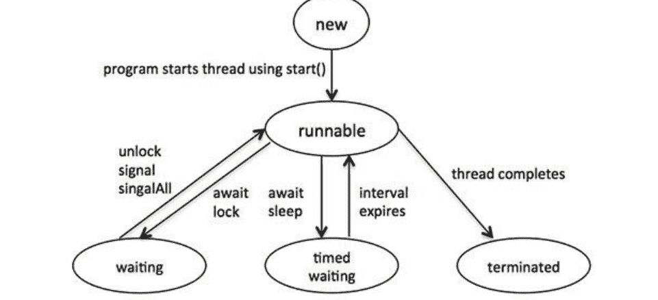

# Hibernate 入门指南


## 关于教程

Java 是一种由 Sun Microsystems 最初开发并于 1995 年发布的高级编程语言。Java 运行在多种平台上，例如 Windows、Mac OS 以及各种版本的 UNIX。本教程将让你对 Java 有全面的理解。

本参考指南将通过简单且实用的方法引导你学习 Java 编程语言。

## 目标读者

本参考指南为初学者准备，旨在帮助他们理解与 Java 编程语言相关的从到高级的概念。

## 前提条件

在开始练习本参考中提供的各种示例之前，我假设你已经了解什么是计算机程序以及什么是计算机编程语言？

- 示例：....................................................................................................... 44
- 访问控制与继承：........................................................................................... 44
- 2. 非访问修饰符 ................................................................................ 44
- 访问控制修饰符：.................................................................................. 45
- 非访问修饰符：...................................................................................... 45
- 访问控制修饰符：............................................................................... 45
- 非访问修饰符：...................................................................................... 45
- 接下来是：............................................................................................... 46
- Java 基础运算符 ..................................................................................... 47
- 算术运算符：.................................................................................. 47
- 关系运算符：.................................................................................. 48
- 示例 ........................................................................................................ 49
- 位运算符：............................................................................................... 49
- 示例 ........................................................................................................ 50
- 逻辑运算符：....................................................................................... 51
- 示例 ........................................................................................................ 51
- 赋值运算符：............................................................................... 51
- 示例：..................................................................................................... 52
- 杂项运算符 .............................................................................. 53
- 条件运算符 (?)：.................................................................................. 53
- instanceof 运算符：...................................................................................... 54
- Java 运算符优先级：..................................................................... 54
- 接下来是：............................................................................... 55
- Java 循环控制 ........................................................................................ 56
- while 循环：........................................................................................... 56
- 语法：......................................................................................................... 56
- 示例：..................................................................................... 56
- do...while 循环：...................................................................... 57
- 语法：......................................................................................................... 57
- 示例：..................................................................................... 57
- for 循环：........................................................................................... 58
- 语法：......................................................................................................... 58
- 示例：..................................................................................... 58
- Java 中的增强型 for 循环：............................................................... 59
- 语法：......................................................................................................... 59
- 示例：..................................................................................... 59
- break 关键字：....................................................................... 59
- 语法：......................................................................................................... 60
- 示例：..................................................................................... 60
- continue 关键字：.............................................................................. 60
- 语法：...................................................................................... 60
- 示例：.................................................................................... 60
- 接下来是：.............................................................................................. 61
- Java 决策语句...................................................................... 62
- if 语句：........................................................................... 62
- 语法：...................................................................................... 62
- 示例：.................................................................................... 62
- if...else 语句：......................................................................... 63
- 语法：...................................................................................... 63
- 示例：.................................................................................... 63
- if...else if...else 语句：.......................................................... 63
- 语法：...................................................................................... 63
- 示例：.................................................................................... 64
- 嵌套 if...else 语句：............................................................... 64
- 语法：...................................................................................... 64
- 示例：.................................................................................... 64
- switch 语句：..................................................................... 65
- 语法：...................................................................................... 65
- 示例：.................................................................................... 65
- 接下来是：.............................................................................................. 66
- Java 数字................................................................................ 67
- 示例：.................................................................................... 67
- 数字方法：........................................................................... 68
- xxxValue()................................................................................ 69
- compareTo()................................................................................ 70
- equals()................................................................................. 71
- valueOf()................................................................................ 72
- tostring()................................................................................ 73
- parseInt()................................................................................ 74
- abs()....................................................................... 75
- ceil()...................................................................... 76
- floor()...................................................................... 77
- rint()...................................................................... 78
- round()................................................................................ 78
- min()....................................................................................... 79
- max()....................................................................................... 80
- exp()........................................................................................ 81


# TUTORIALS POINT

简单易学习

## 目录

- `log()`........................................................................................ 82
- `pow()` ................................................................................ 82
- `sqrt()` ............................................................................... 83
- `sin()` ................................................................................ 84
- `cos()` ................................................................................ 85
- `tan()` ................................................................................ 86
- `asin()` ............................................................................... 86
- `acos()` ............................................................................... 87
- `atan()` ............................................................................... 88
- `atan2()`.............................................................................. 89
- `toDegrees()`........................................................................ 90
- `toRadians()`............................................................................ 90
- `random()`.............................................................................. 91

## 接下来是？...................................................................... 92

## Java 字符............................................................... 93

- 示例: ............................................................................ 93
- 示例: ............................................................................ 93
- 转义序列:.................................................... 93
- 示例: ............................................................................ 94

### 字符方法:.................................................. 94

- `isLetter()`.......................................................................... 95
- `isDigit()`.......................................................................... 96
- `isWhitespace()`...................................................... 96
- `isUpperCase()`...................................................... 97
- `isLowerCase()`...................................................... 98
- `toUpperCase()`..................................................... 99
- `toLowerCase()`.................................................... 99
- `toString()`...................................................................... 100

## 接下来是？.................................................................. 101

## Java 字符串......................................................................... 102

- 创建字符串:.................................................. 102
- 字符串长度:.................................................... 102
- 拼接字符串:....................................... 103
- 创建格式化字符串:....................................... 103

### 字符串方法:.................................................... 104

- `charAt(int index)`................................................. 106
- `int compareTo(Object o)` ....................................... 107
- `int compareTo(String anotherString)`................ 108
- `int compareIgnoreCase(String str)`................ 109
- `String concat(String str)` ........................ 110
- `boolean contentEquals(StringBuffer sb)` ........................................................ 111
- `static String copyValueOf(char[] data)` ................................................... 112
- `boolean endsWith(String suffix)` ................................................................ 113
- `boolean equals(Object anObject)` ............................................................ 114
- `boolean equalsIgnoreCase(String anotherString)` ................................... 114
- `byte getBytes()` ....................................................................................... 115
- `byte[] getBytes(String charsetName)` ................................................... 117
- `void getChars(int srcBegin, int srcEnd, char[] dst, int dstBegin)` ............. 118
- `int hashCode()` ....................................................................................... 119
- `int indexOf(int ch)` ............................................................................ 120
- `int indexOf(int ch, int fromIndex)` ................................................ 121
- `int indexOf(String str)` ................................................................ 123
- `int indexOf(String str, int fromIndex)` ....................................... 124
- `String intern()` .......................................................................... 125
- `int lastIndexOf(int ch)` ............................................................ 126
- `int lastIndexOf(int ch, int fromIndex)` ................................... 128
- `int lastIndexOf(String str)` ........................................ 129
- `int lastIndexOf(String str, int fromIndex)` ................... 131
- `int length()` .......................................................................... 132
- `boolean matches(String regex)` ........................................ 133
- `String replace(String regex, String replacement)` ................................... 134
- `String replaceAll(String regex, String replacement)` ................... 135
- `String replaceFirst(String regex, String replacement)` ................... 137
- `String[] split(String regex)` ........................................ 137
- `String[] split(String regex, int limit)` ....................................... 139
- `boolean startsWith(String prefix)` ................................................. 141
- `boolean startsWith(String prefix, int offsetIndex)` ................................... 142
- `CharSequence subsequence(int beginIndex, int endIndex)` ................................... 143
- `String substring(int beginIndex, int endIndex)` ................................... 144
- `char[] toCharArray()` ...................................................................... 145
- `String toLowerCase()` ................................................................. 146
- `String toLowerCase(Locale locale)` ................................................. 147
- `String toString()` ...................................................................... 148
- `String toUpperCase()` ................................................................. 149
- `String toUpperCase(Locale locale)` ................................................. 150
- `String trim()` ...................................................................... 151
- `static String valueOf(primitive data x)` ................................................. 152

## Java 数组.................................................................................. 156

- 声明数组变量:.............................................................................. 156
- 示例: ...................................................................................... 156
- 创建数组:...................................................................................... 156
- 示例: ...................................................................................... 157
- 处理数组:.................................................................................. 157
- 示例: ...................................................................................... 157
- foreach 循环:.................................................................................. 158
- 示例: ...................................................................................... 158
- 将数组传递给方法:...................................................................... 158
- 从方法返回数组:............................................................................. 159
- Arrays 类:..................................................................................... 159

## Java 日期与时间....................................................................... 160

- 获取当前日期和时间:.................................................................. 161


# 日期与时间

- 日期比较
- 使用 `SimpleDateFormat` 格式化
- `SimpleDateFormat` 格式代码
- 使用 `printf` 格式化日期
- 日期和时间转换字符
- 将字符串解析为日期
- 循环睡眠
- 测量流逝时间
- `GregorianCalendar` 类
- 示例

## Java 正则表达式

- 捕获组
- 示例
- 正则表达式语法
- `Matcher` 类的方法
  - 索引方法
  - 查找方法
  - 替换方法
- `start` 和 `end` 方法：`matches` 和 `lookingAt` 方法
- `replaceFirst` 和 `replaceAll` 方法
- `appendReplacement` 和 `appendTail` 方法
- `PatternSyntaxException` 类方法

# Java 方法

- 创建方法
- 示例
- 方法调用
- 示例
- `void` 关键字
- 示例
- 按值传递参数
- 示例
- 方法重载
- 使用命令行参数
- 示例
- 构造函数
- 示例
- 示例
- 变长参数（`var-args`）
- 示例
- `finalize()` 方法

# Java 流、文件与 I/O

- 字节流
- 字符流
- 标准流
- 文件的读取与写入
- `FileInputStream`
- `ByteArrayInputStream`
- 示例
- `DataInputStream`
- 示例
- `FileOutputStream`
- `ByteArrayOutputStream`
- 示例
- `DataOutputStream`
- 示例
- 示例
- 文件导航与 I/O
- `File` 类
- 示例
- `FileReader` 类
- 示例
- `FileWriter` 类
- 示例

# Java 目录

- 创建目录
- 列出目录

# Java 异常

- 异常层次结构
- 异常方法
- 捕获异常
- 示例
- 多个 `catch` 块
- 示例
- `throws`/`throw` 关键字
- `finally` 关键字
- 示例
- 声明自定义异常
- 示例
- 常见异常

# Java 继承

- IS-A 关系
- 示例
- 示例
- `instanceof` 关键字
- HAS-A 关系

# Java 方法重写

- 示例


# 方法重写的规则

# 使用 `super` 关键字

# Java 多态

## 示例

## 虚拟方法

# Java 抽象

## 抽象类

## 继承抽象类

## 抽象方法

# Java 封装

## 示例

## 封装的优势

# Java 接口

## 声明接口

### 示例

## 实现接口

### 示例

## 扩展接口

## 扩展多个接口

## 标记接口

# Java 包

## 创建包

### 示例

## `import` 关键字

### 示例

## 包的目录结构

## 设置 `CLSPATH` 环境变量

# Java 数据结构

## `Enumeration`（枚举器）

### 示例

## `BitSet`（位集）

### 示例

## `Vector`（向量）

### 示例

## `Stack`（栈）

### 示例

## `Dictionary`（字典）

## `Map` 接口

### 示例

## `Hashtable`（哈希表）

### 示例

## `Properties`（属性列表）

### 示例

# Java 集合

## 集合接口

## 集合类

## 集合算法

## 如何使用 `Iterator`？

### 使用 Java `Iterator`

### `Iterator` 声明的方法

### `ListIterator` 声明的方法

#### 示例

## 如何使用 `Comparator`？

### 使用 Java `Comparator`

### `compare` 方法

### `equals` 方法

#### 示例

## 总结

# Java 泛型

## 泛型方法

### 示例

## 边界类型参数

### 示例

## 泛型类

### 示例

# Java 序列化

## 序列化对象

## 反序列化对象

# Java 网络编程

## `URL` 处理

### `URL` 类方法

#### 示例

### `URLConnections` 类方法

#### 示例

## `Socket` 编程

### `ServerSocket` 类方法

### `Socket` 类方法

### `InetAddress` 类方法

### `Socket` 客户端示例

### `Socket` 服务端示例

# Java 发送电子邮件

## 发送简单电子邮件

## 发送 HTML 电子邮件

## 在邮件中发送附件

## 用户身份验证部分

# Java 多线程

## 线程的生命周期

## 线程优先级

## 通过实现 `Runnable` 接口创建线程

### 第 1 步

### 第 2 步

### 第 3 步

#### 示例


# 目录

## Java 多线程

- 通过继承 `Thread` 类创建线程：................................ 288
  - 第 1 步 ................................................................................................... 288
  - 第 2 步 ................................................................................................... 288
  - 示例： ................................................................................ 288
- 线程方法： ....................................................................... 289
  - 示例： ................................................................................ 290
- 主要 Java 多线程概念： ................................. 292
  - 什么是线程同步？................................ 292
  - 不带同步的多线程示例：............... 292
  - 带同步的多线程示例：.................. 294
- 处理线程间通信 ................................ 295
  - 示例： ................................................................................................ 296
- 处理线程死锁：.................................................. 297
  - 示例： ................................................................................ 297
- 死锁解决方案示例： ........................................ 298
- 主要线程操作：............................................. 299
  - 示例： ................................................................................ 299

## Java Applet 基础

- Applet 的生命周期： ............................................ 302
- 一个“Hello, World”Applet： ........................ 303
- Applet 类： ......................................................... 303
- 调用 Applet： ................................... 304
- 获取 Applet 参数： ................... 305
- 指定 Applet 参数： ................................ 306
- 应用程序转换为 Applets： ........................ 306
- 事件处理： ....................................................... 307
- 显示图像：.................................................. 308
- 播放音频：........................................................ 309

## Java 文档

- 什么是 Javadoc？ ................................... 311
- `javadoc` 标签： ................................... 312
- 示例： ................................................................................ 313

## Java 库类

................................................... 315

# 教程

简单易学

# 第 1 章 Java 概述

Java 编程语言最初由 Sun Microsystems 开发，由 James Gosling 于 1995 年发起，作为 Sun Microsystems Java 平台的核心组件（Java 1.0 [J2SE]）。

截至 2008 年 12 月，Java 标准版的最新版本是 6（J2SE）。随着 Java 的进步和广泛普及，已经构建了多种适用于各种类型平台的配置。例如：用于企业级应用的 J2EE，用于移动应用的 JME。

Sun Microsystems 将新的 J2 版本分别命名为 Java SE、Java EE 和 Java ME。Java 保证可以“一次编写，到处运行”（Write, Run Anywhere）。

## Java 的特点

- **面向对象**：在 Java 中，一切都是对象。由于 Java 基于对象模型，因此很容易进行扩展。
- **平台无关**：与 C 和 C++ 等许多其他编程语言不同，Java 在编译时不会被编译成特定平台的机器码，而是编译成平台无关的字节码。这种字节码在网络上分发，并在运行的任何平台上的虚拟机（JVM）进行解释。
- **简单**：Java 的设计易于学习。如果你理解面向对象编程（OOP）的基本概念，Java 很容易掌握。
- **安全**：凭借 Java 的安全特性，它能够开发无病毒、防篡改的系统。身份验证技术基于公钥加密。
- **架构中立**：Java 编译器生成与架构无关的对象文件格式，使得编译后的代码可以在 Java 运行系统的支持下在许多处理器上执行。
- **可移植性**：由于架构中立且规范中不包含依赖于实现的方面，Java 具有可移植性。编译器用 ANSI C 编写，并具有一个 POSIX 子集的整洁移植性边界。
- **健壮**：Java 的多线程特性通过强调编译时错误检查和运行时检查来消除错误情况。
- **多线程**：通过 Java 的多线程特性，可以编写出同时执行许多任务的程序。这种设计特性允许开发者构建运行流畅的交互式应用程序。
- 解释型的 Java 字节码被实时翻译为本地机器指令，不会存储在任何地方。由于链接是一个增量且轻量级的过程，因此开发过程更加快速且易于分析。
- **高性能**：通过使用即时编译器（Just-In-Time compilers），Java 实现了高性能。
- **分布式**：Java 专为互联网的分布式环境设计。
- **动态**：Java 被认为比 C 或 C++ 更具动态性，因为它被设计用于适应不断变化的环境。Java 程序可以携带大量的运行时信息，这些信息可用于运行时验证和解决对对象的访问。

## Java 历史

James Gosling 在 1991 年引入了 Java 语言项目，用于他的许多机顶盒之一。该语言最初命名为 Oak（Gosling 办公室外有一棵橡树），后来也曾被称为 Green，最终被命名为 Java，这个名字源于一个随机单词列表。

Sun（太阳公司）于 1995 年发布了第一个公共实现版本 Java 1.0。它推广了“一次编写，到处运行”（Write, Run Anywhere, WORA），在流行的平台上提供了免费的运行时环境。

2006 年 11 月 13 日，Sun 根据 GNU 通用公共许可证（GPL）的条款将大部分 Java 作为免费开源软件发布。

2007 年 5 月 8 日，Sun 完成了这一过程，使 Java 的所有核心代码免费并开源，除了 Sun 不拥有版权的一小部分代码外。

## 你将需要的工具

为了执行本教程中讨论的示例，你将需要一台带有 64 MB RAM 的 Pentium 200-MHz 计算机（建议使用 128 MB RAM）。

你还需要以下软件：

- Linux 7.1 或 Windows 95/98/2000/XP 操作系统。
- Java JDK 5。
- 微软记事本（Microsoft Notepad）或其他任何文本编辑器。

本教程将提供使用 Java 创建 GUI、网络和 Web 应用程序所需的技能。

## 接下来是什么

下一章将引导你去哪里获取 Java 及其文档。最后，它将指导你如何安装 Java 并为开发 Java 准备环境。

# 第 2 章 Java 环境搭建

在继续之前，正确设置 Java 环境至关重要。本节将指导你如何在你的机器上下载并设置 Java。请按照以下步骤设置环境。

Java SE 可以通过[下载 Java]链接免费获取。因此，根据你的操作系统下载相应的版本。

按照说明下载 Java 并运行 `.exe` 文件在你的机器上安装 Java。一旦在机器上安装了 Java，你就需要设置环境变量以指向正确的目录。

## 为 Windows 2000/XP 设置路径

假设你已将 Java 安装在 `c:\Program Files\java\jdk` 目录下：

- 右键点击“我的电脑”并选择“属性”。
- 点击“高级”选项卡下的“环境变量”按钮。
- 现在，修改“Path”变量，使其包含 Java 可执行文件的路径。例如，如果路径当前设置为 `C:\WINDOWS\SYSTEM32`，则将路径更改为 `C:\WINDOWS\SYSTEM32;c:\Program Files\java\jdk\bin`。

## 为 Windows 95/98/ME 设置路径

假设你已将 Java 安装在 `c:\Program Files\java\jdk` 目录下：

- 编辑 `C:\autocexec.bat` 文件，并在末尾添加以下行：

```bat
SET PATH=%PATH%;C:\Program Files\java\jdk\bin
```

## 为 Linux、UNIX、Solaris、FreeBSD 设置路径

环境变量 `PATH` 应该指向 Java 二进制文件安装的位置。如果你在执行此时遇到困难，请参考你的 shell 文档。

例如，如果你使用 `bash` 作为 shell，则在 `.bashrc` 的末尾添加以下行：

```bash
export PATH=$PATH:path/to/java
```

## TUTORIAL POINT

简单易学

## 流行的 Java 编辑器

为了编写你的 Java 程序，你需要一个文本编辑器。市场上还有更复杂的 IDE 可供。但目前你可以考虑以下之一：

- **记事本（Notepad）**：在 Windows 机器上，你可以使用任何简单的文本编辑器，如记事本（本教程推荐）、TextPad。
- **NetBeans**：一个开源且免费的 Java IDE，可以从 `http://www.netbeans.org/index.html` 下载。
- **Eclipse**：也是一个由 eclipse-source 社区开发的 Java IDE，可以从 `http://www.eclipse.org/` 下载。

## 接下来是什么

下一章将教你如何编写和运行你的第一个 Java 程序，以及开发应用程序所需的 Java 中一些重要的基础语法。

# Java 基础语法

当我们考虑一个 Java 程序时，它可以被定义为对象的集合，通过相互调用对方的方法进行通信。让我们简要查看类、对象、方法和实例变量的含义。

- **对象（Object）**：对象具有状态和行为。例如：狗有颜色、名称、品种等状态，以及摇尾、吠叫、进食等行为。对象是类的实例。
- **类（Class）**：类可以被定义为一种模板/蓝图，描述了该类型对象支持的行为/状态。
- **方法（Methods）**：方法基本上是一种行为。一个类可以包含许多方法。逻辑编写、数据处理以及所有操作的执行都在方法中完成。
- **实例变量（Instance Variables）**：每个对象都有一组独特的变量。

## 第一个 Java 程序

让我们来看一段打印 Hello World 的简单代码。

```java
public class MyFirstProgram {
    public static void main(String[] args) {
        System.out.println("Hello World");
    }
}
```

让我们看看如何保存、编译和运行程序：

- 打开记事本并添加上述代码。
- 将文件另存为：`MyFirstProgram.java`。
- 打开命令提示符并进入保存文件的目录。
- 输入 `javac MyFirstProgram.java` 并按回车编译。
- 现在，输入 `java MyFirstProgram` 运行你的程序。你将看到打印出 `"Hello World"`。

## 基本语法

记住以下几项非常重要：

- **大小写敏感**：Java 是大小写敏感的，这意味着 `Hello` 和 `hello` 有不同的含义。
- **类名**：对于所有名称，首字母应该大写。如果使用多个单词组成类名，则每个单词的首字母都应该大写。例如 `MyFirstClass`。
- **方法名**：所有方法名应以小写字母开头。如果使用多个单词组成方法名，则每个单词的首字母应该大写。例如 `public methodName()`。
- **程序文件名**：程序文件名必须与类名完全匹配。保存文件时，应使用类名（记住 Java 是大小写敏感的）并附加 `.java` 后缀（如果文件名和类名不匹配，你的程序将无法编译）。
- `public static void main(String args[])`：Java 程序的处理从 `main` 方法开始，它是每个 Java 程序的必少部分。

## 标识符（Identifiers）

所有组件都需要名称。用于类、变量和方法的名称被称为标识符。在 Java 中，关于标识符有几点需要记住。如下：

- 所有的标识符都以字母（A 到 Z 或 a 到 z）、货币符号（`$`）或下划线（`_`）开头。
- 在第一个字符之后，标识符可以是任何字符的组合。
- 关键字不能作为标识符。
- 最重要的是标识符是大小写敏感的。
- 合法标识符示例：`age`、`$salary`、`__1_value`。
- 非法标识符示例：`123abc`、`-salary`。

## Java 修饰符

与其他语言一样，可以使用修饰符来修改类、方法等内容。修饰符分为两类：

- **访问修饰符**：默认（default）、`public`（公共）、`protected`（保护）、`private`（私）。
- **非访问修饰符**：`final`、`abstract`（抽象）、`strictfp`。

我们将在下一节中介绍修饰符的细节。

## Java 变量

在 Java 中我们将看到以下类型的变量：

- 局部变量。
- 类变量（静态变量）。
- 实例变量（非静态变量）。

## Java 数组

数组是存储多个相同类型变量的对象。然而，数组本身是堆上的一个对象。我们将在接下来的章节中介绍如何进行声明、构造和初始化。

## Java 枚举

枚举（Enums）是在 Java 5.0 中引入的。枚举限制变量只能几个预定义值之一。此枚举列表中的值被称为枚举。

通过使用枚举，可以减少代码中的 bug 数量。

例如，如果我们考虑一个鲜榨汁店的应用，可以将杯子尺寸限制为小、中、大。这将确保任何人无法点点小、中、大以外的任何尺寸。

### 示例

```java
class FreshJuice {
  enum FreshJuiceSize { SMALL, MEDIUM, LARGE }
  FreshJuiceSize size;
}

public class FreshJuiceTest {
  public static void main(String args[]) {
    FreshJuice juice = new FreshJuice();
    juice.size = FreshJuice.FreshJuiceSize.MEDIUM;
  }
}
```

注意：枚举可以声明为类或在类内部。方法、变量、构造函数也可以定义为枚举。

## Java 关键字

以下列表列出了 Java 中的保留字。这些关键字不能作为常量、变量或任何标识符名称。

| `abstract` | `assert` | `boolean` | `break` |
|---|---|---|---|
| `byte` | `case` | `catch` | `char` |
| `class` | `const` | `continue` | `default` |
| `do` | `double` | `else` | `enum` |
| `extends` | `final` | `finally` | `float` |
| `for` | `goto` | `if` | `implements` |
| `import` | `instanceof` | `int` | `interface` |
| `long` | `native` | `new` | `package` |
| `private` | `protected` | `public` | `return` |
| `short` | `static` | `strictfp` | `super` |
| `switch` | `synchronized` | `this` | `throw` |
| `throws` | `transient` | `try` | `void` |
| `volatile` | `while` |  |  |

## Java 中的注释

Java 支持类似于 C 和 C++ 的单行注释和多行注释。任何注释内部的可用字符都会被 Java 编译器忽略。


```java
public class MyFirstProgram {
    /*
     * 这是我的第一个 java 程序。
     * 它将输出 'Hello World' 作为输出
     * 这是一个多行注释的示例。
     */
    public static void main(String[] args) {
        // 这是一个单行注释的示例
        /* 这也是一个单行注释的示例。 */
        System.out.println("Hello World");
    }
}
```

## 使用空行

仅包含空白字符且可能包含注释的行被称为空行，Java 完全忽略它。

## 继承

Java 类可以派生自其他类。基本上，如果你需要创建一个新类，而这里已经有一个类包含了你需要的某些代码，那么就可以从已有的代码派生你的新类。

TUTORIALS POINT

简单易学学习

此概念允许你重用现有类的字段和方法，而无需在类类中重写代码。在这种情况下，现有类被称为父类，派生类被称为子类。

## 接口

在 Java 语言中，接口可以定义为对象之间如何相互通信的约定。在涉及继承概念时，接口起着至关重要的作用。

接口定义了派生类（子类）应该使用的方法。但方法的实现完全取决于子类。

## 接下来？

下一节将解释 Java 编程中的对象和类。在课程结束时，你将能够清晰地了解 Java 中什么是对象，什么是类。

# 第 4 章：Java 对象与类

Java 是一门面向对象的语言。作为一种具有面向对象特征的语言，Java 支持以下基本概念：

- 多态
- 继承
- 封装
- 抽象
- 类
- 对象
- 实例
- 方法
- 消息解析

在本章中，我们将研究类和对象。

- 对象 - 对象具有状态和行为。例如：狗有状态——颜色、名字、品种，以及行为——摇尾巴、吠叫、进食。对象是类的实例。
- 类 - 类可以被定义为模板/蓝图，描述该类型对象所支持的行为/状态。

## Java 中的对象

让我们现在深入研究什么是对象。如果我们考虑现实世界，我们可以在周围发现许多对象，汽车、狗、人类等。所有这些对象都有状态和行为。

如果我们考虑一只狗，那么它的状态是名字、品种、颜色，行为是吠叫、摇尾巴、跑步。

如果你将软件对象与现实世界对象进行比较，它们具有非常相似的特征。

软件对象也有状态和行为。软件对象的状态存储在字段中，行为通过方法显示。

因此，在软件开发中，方法在对象的内部状态上操作，对象与对象之间的通信通过方法完成。

TUTORIALS POINT

简单易学学习

## Java 中的类

让我们现在看看类到底是什么。类是一个蓝图，根据这个蓝图可以创建多个对象。

Java 中的类：

类是蓝图。

以下是类的类的示例：

```java
public class Dog {
    String breed;
    int age;
    String color;

    void barking() {
    }

    void hungry() {
    }

    void sleeping() {
    }
}
```

类可以包含：

- 局部变量：方法内部的变量。
- 实例变量：每个实例的变量。
- 类变量：使用 `static` 关键字声明的变量。

在 Java 中的类：

类是蓝图。

以下是类的示例：

```java
public class Dog {
    String breed;
    int age;
    String color;

    void barking() {
    }

    void hungry() {
    }

    void sleeping() {
    }
}
```

类可以包含以下：

- 局部变量：方法内部的变量。
- 实例变量：每个实例的变量。
- 类变量：使用 `static` 关键字声明的变量。

在 Java 中的类：

类是蓝图。

以下是类的示例：

类可以包含以下的类型：

- 局部变量：方法内部的变量。
- 实例变量：每个实例的变量。
- 类变量：使用 `static` 关键字声明的变量。

类可以包含以下：

- 局部变量：方法内部的变量。
- 实例变量：每个实例的变量。
- 类变量：使用 `static` 关键字声明的变量。

类可以包含以下：

- 局部变量：方法内部的变量。
- 实例变量：每个实例的变量。
- 类变量：使用 `static` 关键字声明的变量。

类可以包含以下：

- 局部变量：方法内部的变量。
- 实例变量：每个实例的变量。
- 类变量：使用 `static` 关键字声明的变量。

类可以包含以下：

- 局部变量：方法内部的变量。
- 实例变量：每个实例的变量。
- 类变量：使用 `static` 关键字声明的变量。

类可以包含以下：

- 局部变量：方法内部的变量。
- 实例变量：每个实例的变量。
- 类变量：使用 `static` 关键字声明的变量。

类可以包含以下：

- 局部变量：方法内部的变量。
- 实例变量：每个实例的变量。
- 类变量：使用 `static` 关键字声明的变量。

类可以包含以下：

- 局部变量：方法内部的变量。
- 实例变量：每个实例的变量。
- 类变量：使用 `static` 关键字声明的变量。

类可以包含以下：

- 局部变量：方法内部的变量。
- 实例变量：每个实例的变量。
- 类变量：使用 `static` 关键字声明的变量。

类可以包含以下：

- 局部变量：方法内部的变量。
- 实例变量：每个实例的变量。
- 类变量：使用 `static` 关键字声明的变量。

类可以包含以下：

- 局部变量：方法内部的变量。
- 实例变量：每个实例的变量。
- 类变量：使用 `static` 关键字声明的变量。

类可以包含以下：

- 局部变量：方法内部的变量。
- 实例变量：每个实例的变量。
- 类变量：使用 `static` 关键字声明的变量。

## 构造函数

构造函数是初始化对象的特殊方法。当创建对象时，构造函数会被调用。每个类都至少有一个构造函数。

在 Java 中，构造函数是类需要讨论的的重要主题。如果我们不显式地编写构造函数，Java 编译器会为类构建一个默认构造函数。

每次创建一个新对象时，构造函数将至少被调用一次。构造函数最重要的规则是它们应该与类名相同。

构造函数的示例如下：

```java
public class Puppy {
    public Puppy() {
    }

    public Puppy(String name) {
        // 这个构造函数有一个参数 name。
    }
}
```

Java 还支持单例类，你只能为类创建一个实例。

TUTORIAL POINT

简单易学学习

## 单例类

单例的目的是控制对象的创建，将对象的数量限制为一个。由于只有一个单例实例，类的任何实例字段只会发生一次，就像静态字段一样。单例控制资源的访问，例如数据库连接或套接字。

例如，如果你有一个数据库连接或者你的 JDBC 驱动程序在多线程方面存在问题，单例可以确保只建立一个连接，或者只有一个线程可以访问连接。

## 实现单例

### 示例 1

简单的实现由一个私有构造函数、一个存储结果的字段以及一个名为 `getInstance()` 的静态方法。

私有字段可以从静态初始化块赋值，或者简单地使用初始化器。`getInstance()`（必须是公共的）返回此实例：

```java
// File Name: Singleton.java
public class Singleton {
    private static Singleton singleton = new Singleton();

    /*
     * 私有构造函数防止任何类实例化。
     */
    private Singleton() {
    }

    /* 静态 'instance' 方法 */
    public static Singleton getInstance() {
        return singleton;
    }

    /* 受单例保护的其他方法 */
    protected static void demoMethod() {
        System.out.println("demoMethod for singleton");
    }
}
```

```java
// File Name: SingletonDemo.java
public class SingletonDemo {
    public static void main(String[] args) {
        Singleton tmp = Singleton.getInstance();
        tmp.demoMethod();
    }
}
```

这将产生以下结果：

```text
demoMethod for singleton
```

### 示例 2

后续实现展示了经典的单例设计模式：

```java
public class ClassicSingleton {
    private static ClassicSingleton instance = null;

    protected ClassicSingleton() {
        // 仅用于防止实例化。
    }

    public static ClassicSingleton getInstance() {
        if (instance == null) {
            instance = new ClassicSingleton();
        }
        return instance;
    }
}
```

`ClassicSingleton` 包含一个指向唯一单例实例的静态引用，并从静态方法 `getInstance()` 返回该引用。

这里 `ClassicSingleton` 类采用了一种被称为“懒性实例化”（lazy instantiation）的技术来创建单例；因此，在第一次调用 `getInstance()` 方法之前，单例不会被创建。这种技术确保了单例实例在需要时才创建。

## 创建对象

如前所述，类为对象提供了蓝图。因此，对象基本上是从类创建的。在 Java 中，使用 `new` 关键字来创建新对象。

从类创建对象有三个步骤：

- 声明（Declaration）：声明一个带有变量名和对象类型的变量。
- 实例化（Instantiation）：使用 `new` 关键字来创建对象。
- 初始化（Initialization）：在 `new` 关键字后紧跟对构造函数的调用。这初始化了新对象。

创建对象的示例所示：

```java
public class Puppy {
    public Puppy(String name) {
        // 此构造函数有一个参数，name。
        System.out.println("Passed Name is:" + name);
    }

    public static void main(String[] args) {
        // 下述语句将创建一个对象 myPuppy
        Puppy myPuppy = new Puppy("tommy");
    }
}
```

如果我们比较并运行上述程序，它将产生以下结果：

```text
PassedName:tommy
```

## 访问变量和方法

实例变量和方法通过创建的对象来访问。访问实例变量的完全限定路径如下：

```java
// 首先创建一个对象
ObjectReference = new Constructor();

/* 现在按照如下方式调用变量 */
ObjectReference.variableName;

/* 现在你就可以按照如下方式调用类方法了 */
ObjectReference.MethodName();
```

## 示例

此示例解释了如何访问类的实例变量和方法：

```java
public class Puppy {
    int puppyAge;

    public Puppy(String name) {
        // 此构造函数有一个参数，name。
        System.out.println("Passed Name is " + name);
    }

    public void setAge(int age) {
        puppyAge = age;
    }

    public int getAge() {
        System.out.println("Puppy's age is " + puppyAge);
        return puppyAge;
    }

    public static void main(String[] args) {
        /* 创建对象 */
        Puppy myPuppy = new Puppy("tommy");

        /* 调用类方法设置狗狗的年龄 */
        myPuppy.setAge(2);

        /* 调用另一个类方法获取狗狗的年龄 */
        myPuppy.getAge();

        /* 你也可以按照如下方式访问实例变量 */
        System.out.println("Variable Value :" + myPuppy.puppyAge);
    }
}
```

如果我们编译并运行该程序，它将产生以下结果：

```text
PassedName is:tommy

Puppy's age is :2

Variable Value :2
```

## 源文件声明规则

作为本节的最后一部分，让我们现在查看源文件的声明规则。在源文件中声明类、导入语句和包语句时，这些规则是至关重要的。

- 每个源文件只能有一个类。
- 一个源文件可以有多个非公共（non public）类。
- 公共（public）类名应与源文件名相同，并以 `.java` 结尾。例如：如果类名为 `.public class Employee()`，那么源文件应命名为 `Employee.java`。
- 如果类定义在包（package）内部，则 `package` 语句应该是源文件的第一条语句。
- 如果存在 `import` 语句，它们必须写在 `package` 语句和类声明之间。如果没有 `package` 语句，则 `import` 语句应该是源文件的第一行。
- 导入（import）和包语句适用于源文件中存在的所有类。无法在源文件中为不同的类声明不同的 `import` 和/或 `package` 语句。

类有多种访问级别，并且有不同类：抽象类（abstract classes）、最终类（final classes）等。我将在访问修饰符章节中解释所有这些内容。

除了上述类型的类外，Java 还有一些特殊的类，称为内部类（Inner classes）和匿名类（Anonymous classes）。

## Java 包（Package）

简单来说，它是类和接口的一种分类方法。在 Java 开发应用程序时，会编写数百个类和接口，因此对这些进行分类是必须的，会让生活变得简单得多。

## 导入语句（Import statements）

在 Java 中，如果给出一个包含包和类名的完全限定名，编译器就可以轻松地找到源代码或类。`import` 语句是为编译器提供该特定类的正确位置的方法。

例如，以下行将要求编译器加载 `java_installation/java/io` 目录下所有可类：

```java
import java.io.*;
```

## 简单案例研究

对于我们的案例研究，我们将创建两个类。它们是 `Employee` 和 `EmployeeTest`。

首先打开记事本并添加以下代码。记住这是 `Employee` 类，且该类是一个公共类。现在，将此源文件保存为 `Employee.java`。

`Employee` 类有四个实例变量：`age`（年龄）、`designation`（职位）和 `salary`（薪水）。

```java
import java.io.*;

public class Employee {
    String name;
    int age;
    String designation;
    double salary;

    // 此构造函数有一个参数 name。
    public Employee(String name) {
        this.name = name;
    }

    /* 将年龄赋值给变量 */
    public void empAge(int ageage) {
        age = age;
    }

    /* 将职位赋值给变量 designation */
    public void empDesignation(String empig) {
        designation = empig;
    }

    /* 将薪水赋值给变量 salary */
    public void empSalary(double emsalary) {
        salary = emsalary;
    }

    /* 打印详情 */
    public void printEmployee() {
        System.out.println("Name:" + name);
        System.out.println("Age:" + age);
        System.out.println("Designation:" + designation);
        System.out.println("Salary:" + salary);
    }
}
```


如本教程之前所述，处理从`main`方法开始。为了让我们运行它，`Employee`类应该是方法且对象应该被创建。我们将为这些任务创建一个单独的类。

给出`EmployeeTest`类，它创建了两个`Employee`实例并调用每个对象的方法来为每个变量赋值。

将代码保存在`EmployeeTest.java`文件中。

```java
import java.io.*;

public class EmployeeTest{

    public static void main(String[] args[]) {

        /* 使用构造函数创建两个对象 */

        Employee emp=new Employee("James Smith");

        Employee empTwo=new Employee("Mary Anne");

        /* 为创建的每个对象调用方法 */

        emp.empAge(26);

        emp.empDesignation("Software Engineer");

        emp.empSalary(1000);

        emp.printEmployee();

        empTwo.empAge(21);

        empTwo.empDesignation("Software Engineer");

        empTwo.empSalary(500);

        empTwo.printEmployee();

    }

}
```

现在，编译类然后运行`EmployeeTest`以查看如下结果：

```bash
C :- javac Employee.java

C : vi EmployeeTest.java

C : java EmployeeTest.java

C : java EmployeeTest
```

```text
Name:James Smith

Age:26

Designation:Software Engineer

Salary:1000.0

Name:Mary Anne

Age:21

Designation:Software Engineer

Salary:500.0
```

```text
Salary: 500.0
```

## 接下来是什么？

下节课程将讨论 Java 的基本数据类型以及在开发 Java 应用时如何使用它们。

# 第 5 章：Java 基本数据类型

变量无非是用于存储值的预留内存位置。这意味着当你创建一个变量时，会在内存中预留一些空间。

根据变量的数据类型，操作系统会分配内存并决定在预留内存中可以存储什么。因此，通过为变量分配不同的数据类型，你可以在这些变量中存储整数、小数或字符。

Java 中提供了两种数据类型：

- 基本数据类型（Primitive Data Types）
- 引用/对象数据类型（Reference/Object Data Types）

## 基本数据类型

Java 支持八种基本数据类型。基本数据类型由语言预定义，并由关键字命名。现在让我们详细查看这八种基本数据类型。

### `byte`

- Byte 数据类型是一个 8 位有符号补码整数。
- 最小值为 -128 (`-2^7`)。
- 最大值为 127（包含）(`2^7 -1`)。
- 默认值为 `0`。
- Byte 数据类型用于在大型数组中节省空间，主要取代整数，因为一个字节比一个 int 小四倍。
- 示例：`byte a = 100, byte b = -50`。

### `short`

- Short 数据类型是一个 16 位有符号补码整数。
- 最小值为 -32,768 (`-2^15`)。
- 最大值为 32,767（包含）(`2^15-1`)。
- Short 数据类型也可以像 byte 数据类型一样节省内存。short 比 int 小两倍。
- 默认值为 `0`。
- 示例：`short s = 10000, short r = 20000`。

### `int`

- int 数据类型是一个 32 位有符号补码整数。
- 最小值为 -2,147,483,648 (`-2^31`)。
- 最大值为 2,147,483,647（包含）(`2^31 -1`)。
- 除非担心内存问题，否则 int 通常用作整数值的默认数据类型。
- 默认值为 `0`。
- 示例：`int a = 100000, b = -200000`。

### `long`

- Long 数据类型是一个 64 位有符号补码整数。
- 最小值为 -9,223,372,036,854,775,808 (`-2^63`)。
- 最大值为 9,223,372,036,854,775,807（包含）(`2^63 -1`)。
- 当需要比 int 更宽的范围时使用此类型。
- 默认值为 `0L`。
- 示例：`int a = 100000L, b = -200000L`。

### `float`

- Float 数据类型是单精度 32 位 IEEE 754 浮点数。
- Float 主要用于在大型浮点数数组中节省内存。
- 默认值为 `0.0f`。
- Float 数据类型永远不会用于货币等精确数值。
- 示例：`float f1 = 234.5f`。

### `double`

- double 数据类型是双精度 64 位 IEEE 754 浮点数。
- 该数据类型通常用作小数的默认数据类型，通常是默认选择。
- Double 数据类型绝不应用于货币等精确数值。
- 默认值为 `0.0d`。
- 示例：`double d1 = 0.0d`。

### `boolean`

- boolean 数据类型表示一个位。
- 只有两个值：`true` 和 `false`。
- 该数据类型用于简单的标志位。
- 默认值为 `false`。
- 示例：`boolean true`。

### `char`

- char 数据类型是 16 位 Unicode 字符。
- 最小值为 `\u0000`。
- 最大值为 `\ffff`（包含）。
- char 数据类型用于存储任何字符。
- 示例：`char A'`。

## 引用数据类型

- 引用变量通过类的构造函数创建。它们用于访问对象。这些变量被声明为特定类型。例如，`Employee`、`Puppy`等。
- 类对象和各种数组属于引用数据类型。
- 引用变量的默认值为`null`。
- 引用变量可以引用声明类型的对象或任何兼容类型。
- 示例：`Animal animal = new Animal("giraffe")`。

## 教程

## 字面量

字面量是固定值的源码表示。它们直接表示在代码中而不进行任何计算。

字面量可以赋值给任何基本类型变量。例如：

```java
byte a = 68;

char a = '\A';
```

`byte`、`int`、`long`和`short`也可以用十进制（10）、十六进制（16）或八进制（8）数制表示。

在使用这些数制字面量时，前缀`0`表示八进制，前缀`0x`表示十六进制。例如：

```java
int decimal=100;

int octal=0144;

int hexa=0x64;
```

Java 中的字符串字面量像许多其他语言一样，通过一对双引号之间的字符序列来指定。字符串字面量的示例：

```java
"Hello World"

"\two newlines"

"\This is in quotes\""
```

字符串和`char`类型字面量可以包含任何 Unicode 字符。例如：

```java
char a = '\u0001';

String a = "\u0001";
```

- 实例变量在使用`new`关键字创建对象时创建，在对象销毁时销毁。
- 实例变量持有的值可能被一个方法、构造函数或块引用，或者对象状态的核心组成部分必须在整个类中一直存在。
- 实例变量可以在类级别在使用之前或之后进行声明。
- 实例变量可以赋予访问修饰符。
- 实例变量对类中的所有方法、构造函数和块都是可见的。通常，建议将这些设置为私有（访问级别）。然而，可以使用访问修饰符为这些变量设置对子类的可见性。
- 实例变量有默认值。数字的默认值为`0`，布尔值为`false`，对象引用的值为`null`。值在声明期间或构造函数内部赋值。
- 可以通过在类中直接调用变量名来直接访问实例变量。但在静态方法和不同的类中（当实例变量被赋予访问权限时），应使用完全限定名来调用它们。即`ObjectReference.VariableName`。

## 示例

```java
import java.io.*;

public class Employee{

    // 此实例变量对任何子类都可见。

    public String name;

    // salary 仅在 Employee 类中可见。

    private double salary;

    // name 变量在构造函数中被赋值。

    public Employee(String name) {

        name = name;

    }

    // salary 变量被赋了值。

    public void setSalary(double empSal) {

        salary = empSal;

    }

    // 此方法打印员工详情。

    public void printEmp() {

        System.out.println("name: " + name);

        System.out.println("salary: " + salary);

    }

    public static void main(String args[]){

        Employee empOne = new Employee("Ransika");

        empOne.setSalary(1000);

        empOne.printEmp();

    }

}
```

这将产生以下结果：

| name : Bansika |
| --- |

## TUTORIALS POINT

简单易学习

## 类/静态变量

- 类变量（也称为静态变量）在类中使用`static`关键字声明，但位于方法、构造函数或块之外。
- 无论创建了多少个对象，每个类变量都只有一份拷贝。
- 静态变量除了作为常量外很少使用。静态变量永远不会改变其初始值。
- 静态变量存储在内存中。
- 静态变量在程序启动时创建，在程序停止时销毁。
- 可见性与实例变量相似。
- 默认值与实例变量相同。数字的默认值为`0`；布尔值为`false`；对象引用的值为`null`。
- 值可以在声明期间或构造函数内部赋值。
- 可以通过调用类名来访问静态变量。即`ClassName.VariableName`。
- 在将类变量声明为`static final`时，名称（常量）全采用大写字母。其语法与实例变量相同。

## 示例

```java
import java.io.*;

public class Employee{

    // salary 变量是私有的

    private double salary;

    // DEPARTMENT 是一个常量

    public static final String DEPARTMENT = "Development";

    public static void main(String args[]){

        salary = 1000;

        System.out.println(DEPARTMENT + ":" + salary);

    }

}
```

这将产生以下：

```text
Development:1000
```

注意：如果从外部类访问变量，应通过`Employee.DEPARTMENT`进行访问。

## TUTORIAL POINT

简单易学习

## 下一步是什么？

你已经在本章中使用了访问修饰符（`public`和`private`）。下一章将详细解释访问修饰符和非访问修饰符。

# 修饰符类型

修饰符是你添加到定义中的关键字，用于改变它们的含义。Java 语言有多种修饰符，包括以下：

## 1. Java 访问修饰符

Java 许多访问修饰符来为类、方法和构造函数设置访问级别。四个访问级别为：

- 对包可见（默认）。不需要修饰符。
- 仅类可见（`private`）。
- 对所有人可见（`public`）。
- 对包和所有子类可见（`protected`）。

## 默认访问修饰符——无关键字

默认访问修饰符意味着我们没有显式地类、字段等声明修饰符。没有声明任何访问修饰符的变量或方法对相同包中的任何其他类可用。接口中的字段是隐式公共的，接口中的方法默认是公共的。

### 示例

变量和方法可以在不使用任何修饰符的情况下声明，如下例所示：

```java
String version="1.5";

boolean processOrder() {

  return true;

}
```

## 私有访问修饰符——`private`

声明为`private`的方法、变量和构造函数只能在声明的类内部访问。私有访问修饰符是最严格严格的访问级别。类和接口不能是私有的。如果类中存在`public` getter 方法，则声明为`private`的变量可以在类外部访问。使用`private`修饰符是对象封装自身并向外部世界隐藏数据的主要方式。

## 示例

以下类使用了私有访问控制：

```java
public class Logger{

    private String format;

    public String getFormat() {

        return this.format;

    }

    public void setFormat(String format){

        this.format = format;

    }

}
```

在这里，`Logger`的`format`变量是私有的，因此其他类无法直接检索或设置它的值。因此，为了让这个变量对外部世界可用，我们定义了两个公共方法：`getFormat()`返回`format`的值，`setFormat(String)`设置其值。

## 公共访问修饰符——`public`

声明为`public`的类、构造函数、接口等可以从任何其他类访问。因此，公共类内部的字段、方法、块可以从 Java 宇宙中的任何类访问。然而，如果我们尝试访问的公共类在不同的包中，则该类仍然需要被导入。由于类继承，类的所有公共方法和变量都会被子类继承。

## 示例

以下函数使用了公共访问控制：

```java
public static void main(String[] arguments){

    //...

}
```

应用程序的`main()`方法必须是公共的。否则，Java 解释器（如`java`）无法调用它来运行该类。

## 保护访问修饰符——`protected`

父类中声明为`protected`的变量、方法和构造函数只能由包中的子类或保护成员所在包内的任何类访问。

## TUTORIAL POINT

简单易学习

保护访问修饰符不能应用于类和接口。方法、字段可以声明为`protected`，但接口中的方法和字段不能声明为`protected`。保护访问为子类提供了使用辅助方法或变量的机会，同时防止无关的类尝试使用它。

## 示例

以下类使用了保护访问控制，允许其子类重写`openSpeaker()`方法：

```java
class AudioPlayer{

    protected boolean openSpeaker(Speaker sp) {

        // implementation details

    }

}

class StreamingAudioPlayer extends AudioPlayer {

    boolean openSpeaker(Speaker sp) {

        // implementation details

    }

}
```

## 访问控制修饰符

Java 提供了许多访问修饰符来为类、变量、方法和构造函数设置访问级别。

这四种访问级别是：

- 对包可见，默认值。不需要修饰符。
- 仅对类可见（`private`）。
- 对所有人可见（`public`）。
- 对包及所有子类可见（`protected`）。

## 非访问控制修饰符

Java 提供了许多非访问控制修饰符来实现许多其他功能。

- `static`修饰符用于创建类和变量。
- `final`修饰符用于固定类、方法和变量实现。
- `abstract`修饰符用于创建抽象类和方法。
- `synchronized`和`volatile`修饰符用于线程。

要使用修饰符，将其包含在类、方法或变量的定义中。修饰符提供了语句的其余部分，如下例（斜体部分）：

```java
public class className {

    private static boolean myFlag;

    static final double weeks = 9.5;

    protected static final int BOXWIDTH = 42;

    public static void main(String[] arguments) {

        // 方法体

    }

}
```


## 下一步是什么？

在下一节中，我将讨论 Java 语言中使用的基础运算符。本章将为你概述这些运算符在应用程序开发过程中如何使用。

# 第 8 章：Java 基础运算符

Java 提供了丰富的运算符集合来操作变量。我们可以将 Java 运算符分为以下几类：

- 算术运算符
- 关系运算符
- 位运算运算符
- 逻辑运算符
- 赋值运算符
- 杂运算符

## 算术运算符

算术运算符在数学表达式中的用法与在代数中的相同。下表列出了算术运算符。

假设变量 `A` 存储 10，`B` 存储 20，那么：

| 运算符 | 描述 | 示例 |
|---|---|---|
| `+` | 加法：将运算符两侧的值相加 | `A + B` 将得到 30 |
| `-` | 减法：从左操作数中减去右操作数 | `A - B` 将得到 -10 |
| `*` | 乘法：将运算符两侧的值相乘 | `A * B` 将得到 200 |
| `/` | 除法：将左操作数除以右操作数 | `B / A` 将得到 2 |
| `%` | 取模：将左操作数除以右操作数并返回余数 | `B % A` 将得到 0 |
| `++` | 递增：将操作数的值加 1 | `B++` 得到 21 |
| `--` | 递减：将操作数的值减 1 | `B--` 得到 19 |

## 示例

下面的简单示例程序演示了算术运算符。将以下 Java 程序复制并粘贴到 `Test.java` 文件中编译并运行该程序：

```java
public class Test {

    public static void main(String args[]) {

        int a = 10;
        int b = 20;
        int c = 25;

        System.out.println("a + b = " + (a + b));
        System.out.println("a - b = " + (a - b));
        System.out.println("a * b = " + (a * b));
        System.out.println("a / b = " + (a / b));
        System.out.println("a % b = " + (a % b));
        System.out.println("a-- = " + (a--));

        // 检查 d++ +d 的区别

        System.out.println("d++ = " + (d++));
        System.out.println("++d = " + (++d));
    }
}
```

这将产生以下结果：

```text
a + b = 30
a - b = -10
a * b = 200
b / a = 2
b % a = 0
c % a = 5
a++ = 10
b-- = 11
d++ = 25
++d = 27
```

## 关系运算符

Java 语言支持以下关系运算符。

假设变量 `A` 存储 10，变量 `B` 存储 20，那么：

| 运算符 | 描述 | 示例 |
|---|---|---|
| `==` | 检查两个操作数的值是否相等，如果是则条件为真。 | `(A == B)` 不为真。 |
| `!=` | 检查两个操作数的值是否相等，如果值不等则条件为真。 | `(A != B)` 为真。 |
| `>` | 检查左操作数的值是否大于操作数的值，如果是则条件为真。 | `(A > B)` 不为真。 |
| `<` | 检查左操作数的值是否小于操作数的值，如果是则条件为真。 | `(A < B)` 为真。 |
| `>=` | 检查左操作数的值是否大于或等于操作数的值，如果是则条件为真。 | `(A >= B)` 不为真。 |
| `<=` | 检查左操作数的值是否小于或等于操作数的值，如果是则条件为真。 | `(A <= B)` 为真。 |

## 示例

下面的简单示例程序演示了关系运算符。将以下 Java 程序复制并粘贴到 `Test.java` 文件中编译该程序：

```java
public class Test {

    public static void main(String[] args) {

        int a = 10;
        int b = 20;

        System.out.println("a == b = " + (a == b));
        System.out.println("a != b = " + (a != b));
        System.out.println("a > b = " + (a > b));
        System.out.println("a < b = " + (a < b));
        System.out.println("a >= b = " + (a >= b));
        System.out.println("a <= b = " + (a <= b));
    }
}
```

这将产生以下结果：

```text
a == b = false
a != b = true
a > b = false
a < b = true
a >= b = false
a <= b = true
```

## 位运算符

Java 定义了多种位运算符，可以应用于 `int`、`long`、`char` 和 `byte` 类型。

假设 `a = 60`、`b = 13`，在二进制格式下如下：

```text
a = 00111100
b = 00001101
```

下表列出了位运算符：

| 运算符 | 描述 | 示例 |
|---|---|---|
| `&` | 与运算符：如果两个操作数的位都为 1，则结果为 1。 | `A & B` 将得到 12 |
| `\|` | 或运算符：如果其中任一个操作数的位为 1，则结果为 1。 | `A \| B` 将得到 61 |
| `^` | 异或运算符：如果两个操作数的位不同，则结果为 1。 | `A ^ B` 将得到 49 |
| `~` | 取反运算符：这是一个一元运算符，效果是“翻转位”。 | `~A` 将得到 -61 |
| `<<` | 左移运算符：将左操作数向左移动指定的位数。 | `A << 2` 将得到 240 |
| `>>` | 右移运算符：将左操作数向右移动指定的位数。 | `A >> 2` 将得到 15 |
| `>>>` | 无符号右移运算符：将左操作数向右移动指定的位数，并在高位上填充 0。 | `A >>> 2` 将得到 15 |

## 示例

下面的简单示例程序演示了位运算符。将以下 Java 程序复制并粘贴到 `Test.java` 文件中并运行：

```java
public class Test {

    public static void main(String args[]) {

        int a = 60; // 00111100
        int b = 13; // 00001101
        int c;

        c = a & b; // 12 = 00001100
        System.out.println("a & b = " + c);

        c = a | b; // 61 = 00111101
        System.out.println("a | b = " + c);

        c = a ^ b; // 49 = 00110001
        System.out.println("a ^ b = " + c);

        c = ~a; // -61
        System.out.println("a = " + c);

        c = a << 2; // 240 = 11110000
        System.out.println("a << 2 = " + c);

        c = a >> 2; // 15 = 1111
        System.out.println("a >> 2 = " + c);

        c = a >>> 2; // 15 = 00001111
        System.out.println("a >>> 2 = " + c);
    }
}
```

这将产生以下结果：

```text
a % b =12
a | b =61
a ^ b =49
~a =61
a <<2=240
a >>=15
a >>=15
```

## 逻辑运算符

下表列出了逻辑运算符。

假设布尔变量 `A` 为真，`B` 为假，那么：

| 运算符 | 描述 | 示例 |
|---|---|---|
| `&&` | 称为逻辑与（AND）。如果两个操作数都非零，则条件变为真。 | `(A && B)` 为假。 |
| `\|\|` | 称为逻辑或（OR）。如果两个操作数中有一个非零，则条件变为真。 | `(A \|\| B)` 为真。 |
| `!` | 称为逻辑非（NOT）。用于反转其操作数的逻辑状态。如果条件为真，则逻辑非不会使其变为假。 | `!(A && B)` 为真。 |

## 示例

下面的简单示例演示了逻辑运算符。将以下 Java 程序复制并粘贴到 `Test.java` 文件中，然后编译并运行：

```java
public class Test {

    public static void main(String args[]) {

        boolean a = true;
        boolean b = false;

        System.out.println("a && b = " + (a && b));
        System.out.println("a || b = " + (a || b));
        System.out.println("!(a && b) = " + !(a && b));
    }
}
```

这将产生以下结果：

```text
a && b =false
a || b =true
!(a && b) =true
```

## 赋值运算符

Java 语言支持以下赋值运算符：

| 运算符 | 描述 | 示例 |
|---|---|---|
| `=` | 简单赋值运算符，将右侧操作数的值赋值给左侧操作数 | `C = A + B` 将 `A + B` 的值赋值给 `C` |
| `+=` | 加赋值运算符，将右侧操作数加到左侧操作数上并将结果赋值给左侧操作数 | `C += A` 等同于 `C = C + A` |
| `-=` | 减赋值运算符，从左侧操作数中减去右侧操作数并将结果赋值给左侧操作数 | `C -= A` 等同于 `C = C - A` |
| `*=` | 乘赋值运算符，将左侧操作数乘以右侧操作数并将结果赋值给左侧操作数 | `C *= A` 等同于 `C = C * A` |
| `/=` | 除赋值运算符，将左侧操作数除以右侧操作数并将结果赋值给左侧操作数 | `C /= A` 等同于 `C = C / A` |
| `%=` | 取模赋值运算符，对两个操作数取模并将结果赋值给左侧操作数 | `C %= A` 等同于 `C = C % A` |
| `<<=` | 左移赋值运算符 | `C << 2` 等于 `C << 2` |
| `>>=` | 右移赋值运算符 | `C >> 2` 等于 `C >> 2` |
| `&=` | 按位与赋值运算符 | `C & 2` 等于 `C = C & 2` |
| `^=` | 按位异或赋值运算符 | `C ^= 2` 等同于 `C = C ^ 2` |
| `\|=` | 按位或赋值运算符 | `C \|= 2` 等同于 `C \|= 2` |

## 示例

这个简单的示例程序演示了赋值运算符。将以下 Java 程序复制并粘贴到 `Test.java` 中编译并运行：

```java
public class Test {

    public static void main(String args[]) {

        int a = 10;
        int b = 20;
        int c = 0;

        c = a + b;
        System.out.println("c + b = " + c);

        c += a;
        System.out.println("c += a = " + c);

        c -= a;
        System.out.println("c -= a = " + c);

        c *= a;
        System.out.println("c *= a = " + c);

        a = 10;
        c = 15;

        c /= a;
        System.out.println("c /= a = " + c);

        c %= a;
        System.out.println("c %= a = " + c);

        c <<= 2;
        System.out.println("c <<= 2 = " + c);

        c >>= 2;
        System.out.println("c >>= 2 = " + c);

        c &= a;
        System.out.println("c &= 2 = " + c);

        c ^= a;
        System.out.println("c ^= a = " + c);

        c |= a;
        System.out.println("c |= a = " + c);
    }
}
```

这将产生以下结果：

```text
c = a + b = 30
c += a = 40
c -= a = 30
c *= a = 300
c /= a = -1
c %= a = 5
c<<=2= 5
c>>=2= 1
c &= a = 0
c^= a = 10
c|= a = 10
```

## 其他运算符

Java 语言还支持其他运算符。

## 条件运算符（`?`）

条件运算符也称为三元运算符。该运算符包含三个操作数，用于评估布尔表达式。该运算符的目的是决定将哪个值赋值给变量。运算符的格式为：

```text
变量 x = (表达式) ? 如果真的 : 如果假的值
```

以下是示例：

```java
public class Test {

    public static void main(String args[]) {

        int a, b;

        a = 10;
        b = (a == 1) ? 20 : 30;

        System.out.println("Value of b is : " + b);
    }
}
```

```java
x++;

System.out.print("\n");
}
}
```

这将会产生以下结果：

```text
value of x : 10
value of x : 11
value of x : 12
value of x : 13
value of x : 14
value of x : 15
value of x : 16
value of x : 17
value of x : 18
value of x : 19
```

## `do...while` 循环

`do...while` 循环与 `while` 循环相似，不同在于 `do...while` 循环保证至少执行一次。

### 语法

`do...while` 循环的语法如下：

```java
do {
    // Statements
} while (Boolean_expression);
```

注意布尔表达式出现在循环的末尾，因此循环内的语句在测试布尔值之前执行。

如果布尔表达式为真，控制流将跳转回 `do`，循环内的语句将再次执行。这个过程会一直重复，直到布尔表达式为假。

## 示例

```java
public class Test {

    public static void main(String args[]) {

        int x = 10;

        do {
            System.out.print("value of x : " + x);
            x++;
            System.out.print("\n");
        } while (x < 20);
    }
}
```

这将产生以下结果：

```text
value of x : 10
value of x : 11
value of x : 12
value of x : 13
```

## TUTORIAL POINT

简单易学

## `for` 循环

`for` 循环是一种重复控制结构，允许你高效地编写需要执行特定次数的循环。

当你知道任务需要重复多少次时，`for` 循环非常有用。

### 语法

`for` 循环的语法如下：

```java
for (initialization; Boolean_expression; update) {
    // Statements
}
```

以下是 `for` 循环中的控制流：

- 首先执行初始化步骤，且仅执行一次。此步骤允许你声明并初始化任何循环控制变量。只要出现分号，你就不需要在此处放置语句。
- 接下来，评估布尔表达式。如果为真，则执行循环体。如果为假，则循环不执行，控制流跳转到 `for` 循环之后的下一个语句。
- 在 `for` 循环体执行后，控制流跳转回更新语句。此语句允许你更新任何循环控制变量。只要在布尔表达式后面出现分号，该语句可以留空。
- 现在再次评估布尔表达式。如果为真，则执行循环并重复该过程（循环体、然后更新步骤、布尔表达式）。在布尔表达式为假后，循环终止。

## 示例

```java
public class Test {

    public static void main(String[] args[]) {

        for (int x = 10; x < 20; x = x + 1) {
            System.out.print("value of x : " + x + " ");
            System.out.print("\n");
        }
    }
}
```


这将产生以下结果：

```text
value of x : 10
value of x : 11
value of x : 12
value of x : 13
```

## TUTORIAL POINT

简单易学

## Java 增强型 `for` 循环（Enhanced loop）

从 Java 5 开始，引入了增强型 `for` 循环。它主要用于数组。

### 语法

增强型 `for` 循环的语法如下：

```java
for (declaration : expression) {
  // Statements
}
```

- **声明（Declaration）**：新声明的块变量，其类型与你正在访问的数组元素兼容。该变量在块内可用，其值与当前数组元素相同。
- **表达式（Expression）**：评估你需要遍历的数组。该表达式可以是一个数组变量，可以是一个返回数组的方法。

### 示例

```java
public class Test {
  public static void main(String args[]) {
    int[] numbers = {10, 20, 30, 40, 50};

    for (int x : numbers) {
      System.out.print(x);
      System.out.print(",");
    }

    System.out.print("\n");

    String[] names = {"James", "Larry", "Tom", "Lacy"};

    for (String name : names) {
      System.out.print(name);
      System.out.print(",");
    }
  }
}
```

这将产生以下结果：

```text
10,20,30,40,50,
James,Larry,Tom,Lacy,
```

## `break` 关键字

`break` 关键字用于停止整个循环。`break` 关键字必须在任何循环或语句内部使用。

```java
// 当上述条件均为假时执行。
}
```

### 示例

```java
public class Test {
  public static void main(String[] args) {
    int x = 30;

    if (x == 10) {
      System.out.print("Value of X is 10");
    } else if (x == 20) {
      System.out.print("Value of X is 20");
    } else if (x == 30) {
      System.out.print("Value of X is 30");
    } else {
      System.out.print("This is else statement");
    }
  }
}
```

这将会产生以下结果：

```text
Value of X is 30
```

## 嵌套 `if...else` 语句

嵌套 `if-else` 语句总是合法的，这意味着你可以在另一个 `if` 或 `else` 语句内部使用 `if` 或 `else` 语句。

### 语法

嵌套 `if...else` 的语法如下：

```java
if (Boolean expression1) {
  // 当布尔表达式 1 为真时执行

  if (Boolean expression2) {
    // 当布尔表达式 2 为真时执行
  }
}
```

你可以像嵌套 `if` 语句一样嵌套 `if...else`。

### 示例

```java
public class Test {
  public static void main(String[] args) {
    int x = 30;
    int y = 10;

    if (x == 30) {
      if (y == 10) {
        System.out.print("X = 30 and Y = 10");
      }
    }
  }
}
```

## TUTORIAL POINT

简单易学

这将产生以下结果：

```text
X = 30 and Y = 10
```

## `switch` 语句

`switch` 语句允许对变量与一组值进行等值测试。每个值被称为一个 `case`，被切换的变量会在每个 `case` 中进行检查。

### 语法

增强 `for` 循环的语法是：

```java
switch (expression) {
  case value:
    // 语句
    break; // 可选的

  case value:
    // 语句
    break; // 可选

  // 你可以有任意数量的 case 语句。

  default: // 可选
    // 语句
}
```

以下规则适用于 `switch` 语句：

- `switch` 语句中使用的变量只能是 `byte`、`short`、`int` 或 `char`。
- 你可以在 `switch` 中拥有任意数量的 `case` 语句。每个 `case` 后面都跟着要进行比较的值和一个冒号（`:`）。
- `case` 的值必须与 `switch` 中变量的数据类型相同，并且它必须是一个常量或字面量。
- 当被切换的变量等于某个 `case` 时，该 `case` 后的语句将执行，直到遇到 `break` 为止。
- 当遇到 `break` 时，`switch` 终止，控制流跳转到 `switch` 语句之后的下一行。
- 并不是每个 `case` 都需要包含 `break`。如果没有 `break`，控制流会贯穿到后续的 `case`，直到遇到 `break` 为止。
- `switch` 语句可以有一个可选的 `default case`，它必须出现在 `switch` 的末尾。`default case` 可用于在没有任何 `case` 为真时执行特定任务。`default case` 中不需要 `break`。

### 示例

```java
public class Test {
  public static void main(String[] args) {
    char grade = args[0].charAt(0);

    switch (grade) {
      case 'A':
        System.out.println("Excellent!");
        break;

      case 'B':
      case 'C':
        System.out.println("Well done");
        break;

      case 'D':
        System.out.println("You passed");

      case 'F':
        System.out.println("Better try again");
        break;

      default:
        System.out.println("Invalid grade");
    }

    System.out.println("Your grade is " + grade);
  }
}
```

使用各种命令行参数编译并运行上述程序。这将产生以下结果：

```text
$ java Test a
Invalid grade
Your grade is a

$ java Test A
Excellent!
```

## 接下来是什么？

下一章将讨论 `Number` 类（位于 `java.lang` 包中）以及它在 Java 语言中的子类。

我们将研究在某些情况下，你会使用这些类的实例化而不是基本类型数据类型，以及在处理数字时需要了解的诸如格式化、数学函数等类。

# Java 数字

通常，当我们处理数字时，我们使用基本类型数据类型，如 `byte`、`int`、`long`、`double` 等。

### 示例

```java
int i = 5000;
float gpa = 13.65;
byte mask = 0xaf;
```

然而，在开发中，我们会遇到某些需要使用对象表示基本类型数据类型的情况。为了实现这一点，Java 为每个基本类型数据类型都提供了包装类。

所有的包装类（`Integer`、`Long`、`Byte`、`Double`、`Float`、`Short`）都是抽象类 `Number` 的子类。

这种包装由编译器处理，该过程称为类装箱（boxing）。相反的操作由编译器处理，过程称为类解箱（unboxing）：

```java
public class Test {
  public static void main(String[] args) {
    int i = 5000;
    Integer j = i; // 装箱
    int k = j; // 解箱
  }
}
```

## `Number` 方法

| SN | 方法 |
|---|---|
| 1 | `compareTo()`：将此 `Number` 对象与参数进行比较。 |
| 2 | `equals()`：确定此对象是否等于参数。 |
| 3 | `valueOf()`：返回一个持有指定值的对象。 |
| 4 | `toString()`：返回一个表示该值的字符串。 |
| 5 | `parseInt()`：返回字符串的 `int` 值。 |
| 6 | `abs()`：返回参数的绝对值。 |
| 7 | `ceil()`：返回大于或等于参数的最小整数。 |
| 8 | `floor()`：返回小于或等于参数的最大整数。 |
| 9 | `int()`：返回在值上最接近参数的整数。 |
| 10 | `round()`：返回与参数最接近的 `long` 或 `int`。 |
| 11 | `min()`：返回两个参数中较小的一个。 |
| 12 | `max()`：返回两个参数中较大的一个。 |
| 13 | `exp()`：返回底为 `e` 的参数幂。 |
| 14 | `log()`：返回参数的自然对数。 |
| 15 | `pow()`：返回第一个参数的第二个参数的幂。 |
| 16 | `sqrt()`：返回参数的平方根。 |
| 17 | `sin()`：返回指定 `double` 值的正弦。 |
| 18 | `cos()`：返回指定 `double` 值的余弦。 |
| 19 | `tan()`：返回指定 `double` 值的正切。 |
| 20 | `asin()`：返回指定 `double` 值的反正弦。 |
| 21 | `acos()`：返回指定 `double` 值的反余弦。 |
| 22 | `atan()`：返回指定 `double` 值的反正正切。 |
| 23 | `atan2()`：将直角坐标（`x`，`y`）转换为极坐标（`r`，`theta`）并返回 `theta`。 |
| 24 | `toDegrees()`：将参数转换为角度。 |
| 25 | `toRadians()`：将参数转换为弧度。 |
| 26 | `random()`：返回一个随机数。 |

## `xxxValue()`

### 描述

该方法将调用方法的 `Number` 对象的值转换为方法返回的基本类型数据类型。

### 语法

这里是针对每个基本类型数据类型的独立方法：

```java
byte byteValue()
short shortValue()
int intValue()
long longValue()
float floatValue()
double doubleValue()
```

### 参数

这里是参数的详细信息：

- NA

### 返回值

- 这些方法返回签名中给出的基本类型数据类型。

### 示例：`class Test`

```java
public static void main(String args[]) {
  Integer x = 5;

  // 返回 byte 原数据类型
  System.out.println(x.byteValue());

  // 返回 double 原数据类型
  System.out.println(x.doubleValue());

  // 返回 long 原数据类型
  System.out.println(x.longValue());
}
```

这产生了以下结果：

```text
5
5.0
5
```

## `compareTo()`

### 描述

该方法将调用该方法的 `Number` 对象与参数进行比较。可以比较 `Byte`、`Long`、`Integer` 等。

然而，不同类型之间无法比较，参数和调用方法的 `Number` 对象应该是相同的类型。

### 语法

```java
public int compareTo(NumberSubClass referenceName)
```

### 参数

这里是参数的详细信息：

- `referenceName`：可以是 `Byte`、`Double`、`Integer`、`Float`、`Long` 或 `Short`。

### 返回值

- 如果 `Integer` 等于参数，则返回 `0`。
- 如果 `Integer` 小于参数，则返回 `-1`。
- 如果 `Integer` 大于参数，则返回 `1`。

### 示例

TUTORIALS POINT

简单学习

```java
public class Test {
  public static void main(String args[]) {
    Integer x = 5;

    System.out.println(x.compareTo(3));
    System.out.println(x.compareTo(5));
    System.out.println(x.compareTo(8));
  }
}
```

这产生了以下结果：

```text
1
0
-1
```

## `equals()`

### 描述

该方法确定调用该方法的 `Number` 对象是否等于参数。

### 语法

```java
public boolean equals(Object o)
```

### 参数

这里是参数的详细信息：

- `o`：任意对象。

### 返回值

- 如果参数不为空且是相同类型的对象并具有相同的数值，则方法返回 `True`。对于 `Double` 和 `Float` 对象，Java API 文档中还有额外的要求。

### 示例

```java
public class Test {
  public static void main(String args[]) {
    Integer x = 5;
    Integer y = 10;
    Integer z = 5;
    Short a = 5;

    System.out.println(x.equals(y));
    System.out.println(x.equals(z));
    System.out.println(x.equals(a));
  }
}
```

TUTORIALS POINT

简单学习

这产生了以下结果：

```text
false
true
false
```

## `valueOf()`

### 描述

`valueOf` 方法返回持有传入参数值的相关 `Number` 对象。参数可以是基本数据类型、`String` 等。

该方法可以接受两个参数，其中一个是 `String`，另一个是基数（radix）。

### 语法

该方法的所有变体如下所示：

```java
static Integer valueOf(int i)
static Integer valueOf(String s)
static Integer valueOf(String s, int radix)
```

### 参数

这里是参数的详细信息：

- `i`：一个 `int`，将返回其 `Integer` 表示。
- `s`：一个 `String`，将返回其 `Integer` 表示。
- `radix`：将用于根据传入的 `String` 决定返回的 `Integer` 值。

### 返回值

- `valueOf(int i)`：返回一个持有指定基本数据类型值的 `Integer` 对象。
- `valueOf(String s)`：返回一个持有指定字符串表示值的 `Integer` 对象。
- `valueOf(String s, int radix)`：返回一个持有指定字符串表示值的 `Integer` 对象，该值根据指定的 `radix` 解析。

```java
public class Test {
  public static void main(String args[]) {
    Integer x = Integer.valueOf(9);
    Double c = Double.valueOf(5);
    Float a = Float.valueOf("80");
    Integer b = Integer.valueOf("444", 16);

    System.out.println(x);
    System.out.println(c);
    System.out.println(a);
    System.out.println(b);
  }
}
```

TUTORIAL POINT

简单学习

这产生了以下结果：

```text
9
5.0
80.0
1092
```

## `toString()`

### 描述

该方法用于获取表示 `Number` 对象值的 `String` 对象。

如果该方法接受一个基本数据类型作为参数，则返回表示该基本数据类型值的 `String` 对象。

如果该方法接受两个参数，则将按第二个参数指定的基数返回第一个参数的字符串表示形式。

### 语法

该方法的所有变体如下所示：

```java
String toString()
static String toString(int i)
```

### 参数

这里是参数的详细信息：

- `i`：一个 `int`，将返回其字符串表示。

### 返回值

- `toString()`：返回一个表示此 `Integer` 值的 `String` 对象。
- `toString(int i)`：返回一个表示指定整数的 `String` 对象。

### 示例

```java
public class Test {


# Java 数字方法教程

## 引言

以下内容涵盖了 Java 中 `Math` 类常用的数值处理方法，包括解析、舍入、比较、指数、对数、幂、平方根以及三角函数等。每个方法均包含描述、语法、参数、返回值和示例。

---

## parseInt()

### 描述

该方法将字符串解析为 `int`。它可以接受一个或两个参数。

### 语法

该方法的所有变体如下所示：

```java
static int parseInt(String s)
static int parseInt(String s, int radix)
```

### 参数

这里是参数的详细信息：

- `s` -- 要解析的 `String`。
- `radix` -- 将用于根据传入的 `String` 决定返回的 `int` 值。

### 返回值

- `parseInt(String s)`: 返回指定字符串表示值的 `int`。
- `parseInt(String s, int radix)`: 返回根据指定的 `radix` 解析的指定字符串表示值的 `int`。

### 示例

```java
public class Test {
    public static void main(String args[]) {
        int x = Integer.parseInt("123");
        int y = Integer.parseInt("444", 16);
        System.out.println(x);
        System.out.println(y);
    }
}
```

---

## rint()

### 描述

`rint` 方法返回与参数值最接近的整数。

### 语法

```java
double rint(double d)
```

### 参数

以下是参数的详情：

- `d` -- 一个 `double` 原型类型

### 返回值

- 此方法返回与参数值最接近的整数。以 `double` 形式返回。

### 示例

```java
public class Test{
    public static void main(String args[]){
        double d = 100.65;
        double e = 100.500;
        double f = 100.200;
        System.out.println(Math.rint(d));
        System.out.println(Math.rint(e));
        System.out.println(Math.rint(f));
    }
}
```

这产生了以下结果：

```
101.0
100.0
100.0
```

---

## round()

### 描述

`round` 方法根据方法的返回类型，返回最接近参数的 `long` 或 `int`。

### 语法

此方法有以下变体：

```java
long round(double d)
int round(float f)
```

### 参数

以下是参数的详情：

- `d` -- 一个 `double` 或 `float` 原型数据类型
- `f` -- 一个 `float` 原型数据类型

### 返回值

- 此方法返回与参数最接近的 `long` 或 `int`，取决于方法的返回类型。

### 示例

```java
public class Test{
  public static void main(String args[]){
    double d = 100.67;
    double e = 100.500;
    float f = 100;
    float g = 90;
    System.out.println(Math.round(d));
    System.out.println(Math.round(e));
    System.out.println(Math.round(f));
    System.out.println(Math.round(g));
  }
}
```

这产生了以下结果：

```
101
101
100
90
```

---

## min()

### 描述

该方法返回两个参数中的较小值。参数可以是 `int`, `float`, `long`, `double`。

### 语法

此方法有以下变体：

```java
double min(double arg1, double arg2)
float min(float arg1, float arg2)
int min(int arg1, int arg2)
long min(long arg1, long arg2)
```

### 参数

以下是参数的详情：

- 原型数据类型

### 返回值

- 此方法返回两个参数中的较小值。

### 示例

```java
public class Test{
public static void main(String args[]){
System.out.println(Math.min(12.123,12.456));
System.out.println(Math.min(23.12,23.0));
}
}
```

这产生了以下结果：

```
12.123
23.0
```

---

## max()

### 描述

该方法获取两个参数中的最大值。参数可以是 `int`, `float`, `long`, `double`。

### 语法

此方法有以下变体：

```java
double max(double arg1, double arg2)
float max(float arg1, float arg2)
int max(int arg1, int arg2)
long max(long arg1, long arg2)
```

### 参数

以下是参数的详情：

- 原型数据类型

### 返回值

- 此方法返回两个参数中的最大值。

### 示例

```java
public class Test {
  public static void main(String args[]) {
    System.out.println(Math.max(12.123, 12.456));
    System.out.println(Math.max(23.12, 23.0));
  }
}
```

这产生了以下结果：

```
12.456
23.12
```

---

## exp()

### 描述

该方法返回自然对数底 `e` 的参数幂次方。

### 语法

```java
double exp(double d)
```

### 参数

以下是参数的详情：

- `d` -- 原型数据类型

### 返回值

- 此方法返回自然对数底 `e` 的参数幂次方。

### 示例

```java
public class Test {
  public static void main(String args[]) {
    double x = -11.635;
    double y = -2.76;
    System.out.printf("The value of e is %.4f\n", Math.E);
    System.out.printf("exp(%.3f) is %.3f%n", x, Math.exp(x));
  }
}
```

这产生了以下结果：

```
The value of e is 2.7183
exp(11.635) is 112983.831
```

---

## log()

### 描述

该方法返回参数的自然对数。

### 语法

```java
double log(double d)
```

### 参数

以下是参数的详情：

- `d` -- 原型数据类型

### 返回值

- 此方法返回参数的自然对数。

### 示例

```java
public class Test{
public static void main(String args[]){
double x = 11.635;
double y = 2.76;
System.out.printf("The value of e is %.4f\n", Math.E);
System.out.printf("log(%.3f) is %.3f%n", x, Math.log(x));
}
}
```

这产生了以下结果：

```
The value of e is 2.7183
log(11.635) is 2.454
```

---

## pow()

### 描述

该方法返回第一个参数的第二个参数幂次方。

### 语法

```java
double pow(double base, double exponent)
```

### 参数

以下是参数的详情：

- `base` -- 原型数据类型
- `exponent` -- 原型数据类型

### 返回值

- 此方法返回第一个参数的第二个参数幂次方。

### 示例

```java
public class Test{
    public static void main(String args[]){
        double x = 11.635;
        double y = 2.76;
        System.out.printf("The value of e is %.4f\n", Math.E);
        System.out.printf("pow(%.3f, %.3f) is %.3f%n", x, y, Math.pow(x, y));
    }
}
```

这产生了以下结果：

```
The value of e is 2.7183
pow(11.635, 2.760) is 874.008
```

---

## sqrt()

### 描述

该方法返回参数的平方根。

### 语法

```java
double sqrt(double d)
```

### 参数

以下是参数的详情：

- `d` -- 原型数据类型

### 返回值

- 此方法返回参数的平方根。

### 示例

```java
public class Test{
    public static void main(String args[]){
        double x = 11.635;
        double y = 2.76;
        System.out.printf("The value of e is %.4f\n", Math.E);
        System.out.printf("sqrt(%.3f) is %.3f%n", x, Math.sqrt(x));
    }
}
```

这产生了以下结果：

```
The value of e is 2.7183
sqrt(11.635) is 3.411
```

---

## sin()

### 描述

该方法返回以弧度表示的角度的正弦值。

### 语法

```java
double sin(double d)
```

### 参数

以下是参数的详情：

- `d` -- 原型数据类型

### 返回值

- 此方法返回指定 `double` 值的正弦值。

### 示例

```java
public class Test{
  public static void main(String args[]){
    double degrees = 45.0;
    double radians = Math.toRadians(degrees);
    System.out.printf("The value of e is %.4f%n", Math.E);
    System.out.printf("sin(%.3f) is %.3f%n", radians, Math.sin(radians));
  }
}
```

这产生了以下结果：

```
The value of e is 2.7183
sin(0.785) is 0.707
```

---

## cos()

### 描述

该方法返回以弧度表示的角度的余弦值。

### 语法

```java
double cos(double d)
```

### 参数

以下是参数的详情：

- `d` -- 原型数据类型

### 返回值

- 此方法返回指定 `double` 值的余弦值。

### 示例

```java
public class Test{
  public static void main(String args[]){
    double degrees = 45.0;
    double radians = Math.toRadians(degrees);
    System.out.printf("The value of e is %.4f%n", Math.E);
    System.out.printf("cos(%.3f) is %.3f%n", radians, Math.cos(radians));
  }
}
```

这产生了以下结果：

```
The value of e is 2.7183
cos(0.785) is 0.707
```

---

## tan()

### 描述

该方法返回以弧度表示的角度的正切值。

### 语法

```java
double tan(double d)
```

### 参数

以下是参数的详情：

- `d` -- 原型数据类型

### 返回值

- 此方法返回指定 `double` 值的正切值。

### 示例

```java
public class Test{
  public static void main(String args[]){
    double degrees = 45.0;
    double radians = Math.toRadians(degrees);
    System.out.printf("The value of e is %.4f%n", Math.E);
    System.out.printf("tan(%.3f) is %.3f%n", radians, Math.tan(radians));
  }
}
```

这产生了以下结果：

```
The value of e is 2.7183
tan(0.785) is 1.000
```

---

## asin()

### 描述

该方法返回指定 `double` 值的反正弦。

### 语法

```java
double asin(double d)
```

### 参数

这里是参数的详细信息：

- `d` -- `double` 类型的数据

### 返回值

- 此方法返回指定 `double` 值的反正弦值。

### 示例

```java
public class Test{
    public static void main(String args[]){
        double degrees = 45.0;
        double radians = Math.toRadians(degrees);
        System.out.format("The value of pi is %.4f%n", Math.PI);
        System.out.format("The arcsine of %.4f is %.4f degrees %n", Math.sin(radians), Math.toDegrees(Math.asin(radians)));
    }
}
```

这产生了以下结果：

```
The value of pi is 3.1416
The arcsine of 0.7071 is 45.0000 degrees
```

---

## acos()

### 描述

该方法返回指定 `double` 值的反余弦值。

### 语法

```java
double acos(double d)
```

### 参数

这里是参数的详细信息：

- `d` -- `double` 类型的数据

### 返回值

- 此方法返回指定 `double` 值的反余弦值。

### 示例

```java
public class Test{
    public static void main(String[] args){
        double degrees = 45.0;
        double radians = Math.toRadians(degrees);
        System.out.format("The value of pi is %.4f%n", Math.PI);
        System.out.format("The arccosine of %.4f is %.4f degrees %n", Math.cos(radians), Math.toDegrees(Math.acos(Math.sin(radians))));
    }
}
```

这产生了以下结果：

```
The value of pi is 3.1416
The arccosine of 0.7071 is 45.0000 degrees
```

---

## atan()

### 描述

该方法返回指定 `double` 值的反正切值。

### 语法

```java
double atan(double d)
```

### 参数

这里是参数的详细信息：

- `d` -- `double` 类型的数据

### 返回值

- 此方法返回指定 `double` 值的反正切值。

### 示例

```java
public class Test{
    public static void main(String args[]){
        double degrees = 45.0;
        double radians = Math.toRadians(degrees);
        System.out.format("The value of pi is %.4f%n", Math.PI);
        System.out.format("The arctangent of %.4f is %.4f degrees %n", Math.tan(radians), Math.toDegrees(Math.atan(radians)));
    }
}
```

这产生了以下结果：

```
The value of pi is 3.1416
The arctangent of 1.0000 is 45.0000 degrees
```


## 参数

这里是参数的详细信息：

- `d` -- `double` 类型的数据

## 返回值

- 此方法返回指定 `double` 值的反正切值。

## 示例

```java
public class Test{
  public static void main(String args[]){
    double degrees = 45.0;
    double radians = Math.toRadians(degrees);
    System.out.format("The value of pi is %.4f%n",Math.PI);
    System.out.format("The arctangent of %.4f is %.4f degrees %n",Math.cos(radians));
    Math.toDegrees(Math.atan(Math.sin(radians)));
  }
}
```

这产生了结果：

```
The value of pi is 3.1416
The arctangent of 1.0000 is 45.0000 degrees
```

## atan2()

## 描述

该方法将直角坐标 (`x`, `y`) 转换为极坐标 (`r`, `theta`) 并返回 `theta`。

## 语法

```
double atan2(double y, double x)
```

## 参数

这里是参数的详细信息：

- `X` -- `double` 类型的 `X` 坐标
- `Y` -- `double` 类型的 `Y` 坐标

## 返回值

- 此方法返回来自极坐标 (`r`, `theta`) 的 `theta`

## 示例

```java
public class Test{
  public static void main(String args[]){
    double x = 45.0;
    double y = 30.0;
    System.out.println(Math.atan2(x, y));
  }
}
```

这产生了以下结果：

```
0.982793732247329
```

## toDegrees()

## 描述

该方法将参数值转换为角度。

## 语法

```
double toDegrees(double d)
```

## 参数

这里是参数的详细信息：

- `d` -- `double` 类型的数据。

## 返回值

- 此方法返回一个 `double` 值。

## 示例

```java
public class Test{
    public static void main(String[] args){
        double x = 45;
        double y = 30;
        System.out.println(Math.toDegrees(x));
        System.out.println(Math.toDegrees(y));
    }
}
```

这产生了以下结果：

```
2578.3100780887044
1718.8733853924698
```

## toRadians()

## 描述

该方法将参数值转换为弧度。

## 语法

```
double toRadians(double d)
```

## 参数

这里是参数的详细信息：

- `d` -- `double` 类型的数据。

## 返回值

- 此方法返回一个值。

## 示例

```java
public class Test{
    public static void main(String[] args){
        double x = 45;
        double y = 30;
        System.out.println(Math.toRadians(x));
        System.out.println(Math.toRadians(y));
    }
}
```

## random()

## 描述

该方法返回一个 `0.0` 到 `1.0` 之间的随机 `double` 值。

## 语法

```
double random()
```

## 参数

无参数。

## 返回值

- 此方法返回一个 `0.0` 到 `1.0` 之间的随机 `double` 值。

## 示例

```java
public class Test{
    public static void main(String[] args){
        double rand = Math.random();
        System.out.println("Random value: " + rand);
    }
}
```

# Character

## 描述

`Character` 类提供了用于操作基本类型 `char` 及其包装类的静态方法。

## 语法

```
class Character { ... }
```

## 方法

`Character` 类提供了许多静态方法：

- `isLetter(char c)`: 如果字符是字母，返回 `true`。
- `isLowerCase(char c)`: 如果字符是小写字母，返回 `true`。
- `isUpperCase(char c)`: 如果字符是大写字母，返回 `true`。
- `isDigit(char c)`: 如果字符是数字，返回 `true`。
- `isWhitespace(char c)`: 如果字符是空白字符，返回 `true`。

## 示例

```java
public class Test {
    public static void main(String[] args){
        char c = 'A';
        System.out.println("Is uppercase: " + Character.isUpperCase(c));
        System.out.println("Is lowercase: " + Character.isLowerCase(c));
    }
}
```

| | | 说明 |
|---|---|---|
| 6 | 确定指定的 `char` 值是否为小写。`toUpperCase()` 返回指定的 `char` 值的大写形式。 |
| 7 | `toLowerCase()` 返回指定的 `char` 值的小写形式。 |
| 8 | `toString()` 返回一个表示指定的 `char` 值的 `String` 对象，即一个单字符字符串。 |

如需查阅完整的方法列表，请参考 `java.lang.Character` API 规范。

## isLetter()

### 描述

该方法确定指定的 `char` 值是否为字母。

### 语法

```
boolean isLetter(char ch)
```

### 参数

以下是参数的详细信息：

- `ch` -- 原始字符类型

### 返回值

- 如果传递的字符确实是字符，则该方法返回 `true`。

## 示例

```java
public class Test {
    public static void main(String args[]){
        System.out.println(Character.isLetter('c'));
        System.out.println(Character.isLetter('5'));
    }
}
```

这将产生以下结果：

```
true
false
```

## isDigit()

### 描述

该方法确定指定的 `char` 值是否为数字。

### 语法

```
boolean isDigit(char ch)
```

### 参数

以下是参数的详细信息：

- `ch` -- 原始字符类型

### 返回值

- 如果传递的字符确实是数字，则该方法返回 `true`。

## 示例

```java
public class Test{
    public static void main(String args[]){
        System.out.println(Character.isDigit('C'));
        System.out.println(Character.isDigit('5'));
    }
}
```

这将产生以下结果：

```
false
true
```

## isWhitespace()

### 描述

该方法确定指定的 `char` 值是否为空白，包括空格、制表符或换行。

### 语法

```
boolean isWhitespace(char ch)
```

### 参数

以下是参数的详细信息：

- `ch` -- 原始字符类型

### 返回值

- 如果传递的字符确实是空白字符，则该方法返回 `true`。

## 示例

```java
public class Test{
    public static void main(String args[]){
        System.out.println(Character.isWhitespace('c'));
        System.out.println(Character.isWhitespace(' '));
        System.out.println(Character.isWhitespace('\n'));
        System.out.println(Character.isWhitespace('\t'));
    }
}
```

这将产生以下结果：

```
false
true
true
true
```

## isUpperCase()

### 描述

该方法确定指定的 `char` 值是否为大写字母。

### 语法

```
boolean isUpperCase(char ch)
```

### 参数

以下是参数的详细信息：

- `ch` -- 原始字符类型

### 返回值

- 如果传递的字符确实是大写字母，则该方法返回 `true`。

## 示例

```java
public class Test{
    public static void main(String args[]){
        System.out.println(Character.isUpperCase('c'));
        System.out.println(Character.isUpperCase('C'));
        System.out.println(Character.isUpperCase('\n'));
        System.out.println(Character.isUpperCase('\t'));
    }
}
```

这将产生以下结果：

```
false
true
false
false
```

## isLowerCase()

### 描述

该方法确定指定的 `char` 值是否为小写字母。

### 语法

```
boolean isLowerCase(char ch)
```

### 参数

以下是参数的详细信息：

- `ch` -- 原始字符类型

### 返回值

- 如果传递的字符确实是小写字母，则该方法返回 `true`。

## 示例

```java
public class Test{
    public static void main(String args[]){
        System.out.println(Character.isLowerCase('c'));
        System.out.println(Character.isLowerCase('C'));
        System.out.println(Character.isLowerCase('\n'));
        System.out.println(Character.isLowerCase('\t'));
    }
}
```

这将产生以下结果：

```
true
false
false
false
```

## toUpperCase()

### 描述

该方法返回指定的 `char` 值的大写形式。

### 语法

```
char toUpperCase(char ch)
```

### 参数

以下是参数的详细信息：

- `ch` -- 原始字符

### 返回值

- 该方法返回指定的 `char` 值的大写形式。

## 示例

```java
public class Test{
    public static void main(String args[]){
        System.out.println(Character.toUpperCase('c'));
        System.out.println(Character.toUpperCase('C'));
    }
}
```

这将产生以下结果：

```
C
C
```

## toLowerCase()

### 描述

该方法返回指定的 `char` 值的小写形式。

### 语法

```
char toLowerCase(char ch)
```

### 参数

以下是参数的详细信息：

- `ch` -- 原始字符类型

### 返回值

- 该方法返回指定的 `char` 值的小写形式。

## 示例

```java
public class Test{
  public static void main(String args[]){
    System.out.println(Character.toLowerCase('c'));
    System.out.println(Character.toLowerCase('C'));
  }
}
```

这将产生以下结果：

```
c
C
```

## toString()

### 描述

该方法返回一个表示指定的 `char` 值的 `String` 对象，即一个单字符字符串。

### 语法

```
String toString(char)
```

以下是参数的详细信息：

- `ch` -- 原始字符类型

### 返回值

- 该方法返回 `String` 对象

```java
public class Test {
    public static void main(String args[]){
        System.out.println(Character.toString('c'));
        System.out.println(Character.toString('C'));
    }
}
```

这将产生以下结果：

```
c
C
```

## 接下来？

在接下来的章节中，我们将介绍 `String` 类的一些重要方法。Java 编程中广泛使用的字符串是字符序列。

## 创建字符串

最直接创建字符串的方法是编写字符串字面量，例如：

```
String greeting="Hello world!";
```

当遇到字符串字面量时，编译器会创建一个 `String` 对象。你也可以使用字符数组创建字符串，例如：

```java
public class StringDemo{
    char[] helloArray={'h','e','l','l','o',' '};
    String helloString=new String(helloArray);
    System.out.println(helloString);
}
```

这将产生以下结果：

```
hello
```

注意：`String` 类是不可变的，因此一旦创建 `String` 对象就无法更改。如果需要对字符串进行大量修改，请考虑使用其他类。

## 字符串长度

用于获取对象的方法被称为访问器方法。你可以用于字符串的一个访问器方法是 `length()` 方法，它返回字符串包含的字符数。

在执行以下两行代码后，`len` 等于 17：

```java
public class StringDemo{
    public static void main(String args){
        String palindrome = "saw I was Tod";
        int len = palindrome.length();
        System.out.println("String Length is " + len );
    }
}
```

这将产生以下结果：

```
String Length:17
```

## 拼接字符串

该类包含一个拼接字符串的方法：

```
string1.concat(string2);
```

这返回一个在 `string1` 末尾添加了 `string2` 的字符串。你也可以对字符串字面量使用 `concat()` 方法，例如：

```
"My name is " .concat("Zara")
```

字符串通常使用 `+` 运算符拼接，例如：

```
"Hello,"+"world!"
```

结果为：

```
"Hello, world!"
```

让我们来看下面的示例：

```java
public class StringDemo{
```


```java
public static void main(String[] args) {
    String string1 = "saw I was ";
    System.out.println("Dot " + string1 + "Tod");
}
}
```

这将产生以下结果：

```text
Dot saw I Tod
```

## 创建格式字符串

你有`printf()`和`format()`方法来格式化输出数字。`String`类有一个等效的类方法`format()`，它返回一个`String`对象而不是`PrintStream`对象。

使用`String`的`format()`方法允许创建一个可以重复使用的格式化字符串，而不是一次性的打印语句。例如，而不是：

```java
System.out.printf("The value of the float variable is " +
"%f, while the value of the integer " +
"variable is %d, and the string " +
"is %s", floatVar, intVar, stringVar);
```

你可以写：

```java
String fs;

fs = String.format(
    "The value of the float variable is %f, while the value of the integer variable is %d, and the string is %s",
    floatVar,
    intVar,
    stringVar
);

System.out.println(fs);
```

## String 方法

以下是`String`类支持的方法列表：

| # | 方法及描述 |
| :--- | :--- |
| 1 | `charAt(int index)` - 返回指定索引处的字符。 |
| 2 | `int compareTo(Object o)` - 将此对象与另一个对象比较。 |
| 3 | `int compareTo(String anotherString)` - 按字典顺序比较两个字符串。 |
| 4 | `int compareIgnoreCase(String str)` - 忽略大小写差异，按字典顺序比较两个字符串。 |
| 5 | `String concat(String str)` - 将指定的字符串拼接到此字符串的末尾。 |
| 6 | `boolean equals(StringBuffer sb)` - 仅当此字符串与指定的`StringBuffer`表示相同的字符序列时，才返回`true`。 |
| 7 | `static String valueOf(char[] data)` - 返回表示指定数组中字符的字符串。 |
| 8 | `static String valueOf(char[] data, int offset, int count)` - 返回表示指定数组中字符序列的字符串。 |
| 9 | `boolean endsWith(String suffix)` - 测试此字符串是否以指定的后缀结尾。 |
| 10 | `boolean equals(Object anObject)` - 将此字符串与指定的对象比较。 |
| 11 | `boolean equalsIgnoreCase(String anotherString)` - 忽略大小写，将此字符串与另一个字符串比较。 |
| 12 | `byte getBytes()` - 使用平台的默认字符集将此字符串编码为字节序列，并将结果存储在新的字节数组中。 |
| 13 | `byte[] getBytes(String charsetName)` - 使用指定的字符集将此字符串编码为字节序列，并将结果存储在新的字节数组中。 |
| 14 | `void getChars(int srcBegin, int srcEnd, char[] dst, int dstBegin)` - 将字符从此字符串复制到目标字符数组中。 |

## 教程重点

简单易学

```java
int hashCode()
```

返回此字符串的哈希码。

```java
int indexOf(int ch)
```

返回指定字符在此字符串中首次出现的索引。

```java
int indexOf(int ch, int fromIndex)
```

从指定的索引开始搜索，返回指定字符在此字符串中首次出现的索引。

```java
int indexOf(String str)
```

返回指定的子字符串在此字符串中首次出现的索引。

```java
int indexOf(String str, int fromIndex)
```

从指定的索引开始搜索，返回指定的子字符串在此字符串中首次出现的索引。

```java
String toIntm()
```

返回字符串对象的规范化表示。

```java
int lastIndexOf(int ch)
```

返回指定字符在此字符串中最后一次出现的索引。

```java
int lastIndexOf(int ch, int fromIndex)
```

从指定的索引开始向后搜索，返回指定字符在此字符串中最后一次出现的索引。

```java
int lastIndexOf(String str)
```

返回指定的子字符串在此字符串中最右侧的出现索引。

```java
int lastIndexOf(String str, int fromIndex)
```

从指定的索引开始向后搜索，返回指定的子字符串在此字符串中最后一次出现的索引。

```java
int length()
```

返回此字符串的长度。

```java
boolean matches(String regex)
```

告知此字符串是否匹配给定的正则表达式。

```java
boolean matches(boolean ignoreCase, int offsetset, String other, int offset, int len)
```

测试两个字符串区域是否相等。

```java
boolean matches(int offsetset, String other, int offset)
```

测试两个字符串区域是否相等。

```java
String replace(char oldChar, char newChar)
```

返回一个新字符串，将此字符串中所有的`oldChar`替换为`newChar`。

```java
String replaceAll(String regex, String replacement)
```

将字符串中匹配正则表达式的每个子字符串替换为指定的替换项。

```java
String replaceFirst(String regex, String replacement)
```

将字符串中匹配正则表达式的第一个子字符串替换为指定的替换项。

```java
String[] split(String regex)
```

围绕正则表达式的匹配项分割此字符串。

```java
String[] split(String regex, int limit)
```

围绕正则表达式的匹配项分割此字符串。

## 教程重点

简单易学

| # | 方法及描述 |
| :--- | :--- |
| 34 | `boolean startsWith(String prefix)` - 测试此字符串是否以指定的前缀开头。 |
| 35 | `boolean startsWith(String prefix, int offset)` - 测试此字符串是否从指定的索引开始以指定的前缀开头。 |
| 36 | `CharSequence subsequence(int beginIndex, int endIndex)` - 返回一个此字符串子序列的新字符序列。 |
| 37 | `String substring(int beginIndex)` - 返回此字符串的子字符串的新字符串。 |
| 38 | `String substring(int beginIndex, int endIndex)` - 返回此字符串的子字符串的新字符串。 |
| 39 | `char[] toCharArray()` - 返回一个包含字符串字符的字符数组。 |
| 40 | `String toLowerCase()` - 返回此字符串转换为小写写的副本。 |
| 41 | `String toLowerCase(Locale locale)` - 返回此字符串转换为小写写的副本。 |
| 42 | `String toString()` - 返回对象的字符串表示。 |
| 43 | `String toUpperCase()` - 返回此字符串转换为大写写的副本。 |
| 44 | `String toUpperCase(Locale locale)` - 返回此字符串转换为大写写的副本。 |
| 45 | `String trim()` - 返回此字符串的副本，删除了开头和结尾的空白字符。 |
| 46 | `static String valueOf(Object obj)` - 返回参数的字符串表示。 |

## 教程重点

简单易学

```java
public class Test {
    public static void main(String[] args) {
        String s = "Strings are immutable";
        char result = s.charAt(8);
        System.out.println(result);
    }
}
```

## 示例：`class Test`

```java
public static void main(String args[]) {
    String str1 = "Strings are immutable";
    String str2 = "Strings are immutable";
    String str3 = "Integers are not immutable";

    int result = str1.compareTo(str2);
    System.out.println(result);

    result = str2.compareTo(str3);
    System.out.println(result);

    result = str3.compareTo(str1);
    System.out.println(result);
}
```

这产生以下结果：

```text
0
10
-10
```

# `int compareIgnoreCase(String str)`

## 说明

此方法按字典顺序比较两个字符串，并忽略大小写差异。

### 语法

以下是该方法的语法：

```java
int compareIgnoreCase(String str)
```

### 参数

以下是参数的详情：

- `str` -- 要比较的字符串。

### 返回值

- 如果指定的字符串在忽略大小写的情况下大于、等于或小于此字符串，则该方法返回一个负整数、零或正整数。

## 示例

> TUTORIAL POINT  
> 简单易懂学习

```java
public class Test {
    public static void main(String args[]) {
        String str1 = "Strings are immutable";
        String str2 = "Strings are immutable";
        String str3 = "Integers are not immutable";

        int result = str1.compareToIgnoreCase(str2);
        System.out.println(result);

        result = str2.compareToIgnoreCase(str3);
        System.out.println(result);

        result = str3.compareToIgnoreCase(str1);
        System.out.println(result);
    }
}
```

这产生以下结果：

```text
0
10
-10
```

# `String concat(String str)`

## 说明

此方法将一个字符串附加到另一个字符串的末尾。该方法返回一个字符串，其值是将传递给方法的字符串附加在调用此方法的字符串的末尾。

### 语法

以下是该方法的语法：

```java
public String concat(String s)
```

### 参数

以下是参数的详情：

- `s` -- 附加到此字符串末尾的字符串。

### 返回值

- 此方法返回一个字符串，表示此对象的字符后跟字符串参数的字符。

## 示例

```java
public class Test {
    public static void main(String args[]) {
        String s = "Strings are immutable";
        s = s.concat(" all the time");
        System.out.println(s);
    }
}
```

TUTORIAL POINT  
简单易懂学习

这产生以下结果：

```text
Strings are immutable all the time
```

# `boolean contentEquals(StringBuffer sb)`

## 说明

当且仅当此字符串表示与`StringBuilder`指定相同的字符序列时，此方法返回`true`。

### 语法

以下是该方法的语法：

```java
public boolean contentEquals(StringBuffer sb)
```

### 参数

以下是参数的详情：

- `sb` -- 要比较的`StringBuilder`。

### 返回值

- 当且仅当此字符串表示与`StringBuilder`指定相同的字符序列时，该方法返回`true`，否则返回`false`。

## 示例

```java
public class Test {
    public static void main(String args[]) {
        String str1 = "Not immutable";
        String str2 = "Strings are immutable";
        StringBuilder str3 = new StringBuffer("Not immutable");

        boolean result = str1.contentEquals(str3);
        result = str2.contentEquals(str3);

        System.out.println(result);
    }
}
```

TUTORIAL POINT  
简单易懂学习

这产生以下结果：

```text
true
false
```

# `static String copyValueOf(char[]) data`

## 说明

此方法有两种不同的形式：

- `public static copyValueOf(char[]) data`：返回一个表示指定数组字符序列的字符串。
- `public static copyValueOf(char[]) data, int offset, int count`：返回一个表示指定数组中字符序列的字符串。

### 语法

以下是该方法的语法：

```java
public static String copyValueOf(char[]) data

or

public static String copyValueOf(char[]) data, int offset, int count
```

### 参数

以下是参数的详情：

- `data` -- 字符数组。
- `offset` -- 子数组的初始偏移量。
- `count` -- 子数组的长度。

## 返回值

此方法返回一个包含字符数组中字符的字符串。

## 示例

```java
public class Test {
    public static void main(String[] args[]) {
        char[] Str1 = {'h', 'e', 'l', 'l', 'o', ' ', '.', 'w', 'o', 'r', 'l', 'd'};
        String Str2 = "";

        Str2 = Str2.copyValueOf(Str1);
        System.out.println("Returned String: " + Str2);

        Str2 = Str2.copyValueOf(Str1, 2, 6);
        System.out.println("Returned String: " + Str2);
    }
}
```

TUTORIAL POINT  
简单易懂学习

这产生以下结果：

```text
Returned String: hello world
Returned String: llo wo
```

# `boolean endsWith(String suffix)`

## 说明

此方法测试此字符串是否以指定的后缀结束。

### 语法

以下是该方法的语法：

```java
public boolean endsWith(String suffix)
```

### 参数

以下是参数的详情：

- `suffix` -- 后缀。

### 返回值

- 如果字符串以指定的后缀结束，则该方法返回`true`，否则返回`false`。

## 示例

```java
public class Test {
    public static void main(String args[]) {
```


`String Str = new String("This is not immutable!");`

`boolean result;`

`result = Str.endsWith("immutable!");`

`System.out.println(result);`

`result = Str.endsWith("immu");`

`System.out.println(result);`

这产生以下结果：

```
true
false
```

# `boolean equals(Object anObject)`

## 说明

此方法比较此字符串与对象。如果参数为空且表示与此对象相同的字符序列，则结果为 `true`。

### 语法

以下是该方法的语法：

```
public boolean equals(Object anObject)
```

### 参数

以下是参数的详情：

- `anObject` -- 与此字符串比较的对象。

### 返回值

- 如果字符串相等则返回 `true`；否则返回 `false`。

## 示例

```java
public class Test {
    public static void main(String args[]) {
        String str1 = new String("This is not immutable!");
        String str2 = str1;
        String str3 = new String("This is not immutable!");
        String str4 = new String("This IS REALLY NOT IMMUTABLE!!");
        boolean result;

        result = str1.equals(str2);
        System.out.println(result);

        result = str1.equals(str3);
        System.out.println(result);
    }
}
```

这产生以下结果：

```
true
true
```

# `boolean equalsIgnoreCase(String anotherString)`

## 说明

此方法忽略大小写比较两个字符串。如果两个字符串长度相同且相应的字符在忽略大小写的情况下相等，则认为它们相等。

### 语法

以下是该方法的语法：

```
public boolean equalsIgnoreCase(String anotherString)
```

### 参数

以下是参数的详情：

- `anotherString` -- 与此字符串比较的字符串。

### 返回值

- 如果参数不为空且在忽略大小写的情况下字符串相等，则该方法返回 `true`；否则返回 `false`。

## 示例

```java
public class Test {
    public static void main(String args[]) {
        String str1 = new String("This is not immutable!");
        String str2 = str1;
        String str3 = new String("This is not immutable!");
        String str4 = new String("This IS REALLY NOT IMMUTABLE!!");
        boolean result;

        result = str1.equals(str2);
        System.out.println(result);

        result = str1.equals(str3);
        System.out.println(result);

        result = str1.equalsIgnoreCase(str4);
        System.out.println(result);
    }
}
```

这产生以下结果：

```
true
true
false
```

该方法有两种形式：

- `getBytes(String charsetName)`：使用指定的字符集将此字符串编码为字节序列，并将结果存储在一个新的字节数组中。
- `getBytes()`：使用平台的默认字符集将此字符串编码为字节序列，并将结果存储在一个新的字节数组中。

### 语法

这是该方法的语法：

```
public byte[] getBytes(String charsetName)
throws UnsupportedEncodingException

or

public byte[] getBytes()
```

### 参数

以下是参数的详细信息：

- `charsetName` -- 支持的字符集的名称。

### 返回值

- 此方法返回生成的字节数组。

## 示例

```java
import java.io.*;

public class Test {
    public static void main(String args[]) {
        String Str1 = new String("Welcome to Tutorialspoint.com");
        try {
            byte[] Str2 = Str1.getBytes("UTF-8");
            System.out.println("Returned Value " + Str2);

            Str2 = Str1.getBytes("ISO-8859-1");
            System.out.println("Returned Value " + Str2);
        } catch (UnsupportedEncodingException e) {
            System.out.println("Unsupported character set");
        }
    }
}
```

这产生了以下结果：

| Returned Value |
| :--- |
| Returned Value [B@192d342 |
| Returned Value [B@15ff48b |
| Returned Value []@1b90b39 |

## `getBytes(String charsetName)`

### 描述

该方法有两种形式：

- `getBytes(String charsetName)`：使用指定的字符集将此字符串编码为字节序列，并将结果存储在一个新的字节数组中。
- `getBytes()`：使用平台的默认字符集将此字符串编码为字节序列，并将结果存储在一个新的字节数组中。

### 语法

这是该方法的语法：

```
public byte[] getBytes(String charsetName)
throws UnsupportedEncodingException

or

public byte[] getBytes()
```

### 参数

以下是参数的详细信息：

- `charsetName` -- 支持的字符集的名称。

### 返回值

- 此方法返回生成的字节数组。

## 示例

```java
import java.io.*;

public class Test {
    public static void main(String[] args[]) {
        String Str1 = new String("Welcome to Tutorialsspoint.com");
        try {
            byte[] Str2 = Str1.getBytes("UTF-8");
            System.out.println("Returned Value " + Str2);

            Str2 = Str1.getBytes("UTF-8");
            System.out.println("Returned Value " + Str2);

            Str2 = Str1.getBytes("ISO-8859-1");
        } catch (UnsupportedEncodingException e) {
            System.out.println("Unsupported character set");
        }
    }
}
```

这产生了以下结果：

| Returned Value |
| :--- |
| Returned Value [B@192d342 |
| Returned Value [B@15ff48b |
| Returned Value []@1b90b39 |

## `getChars(int srcBegin, int srcEnd, char[] dst, int dstBegin)`

### 描述

该方法将字符从此字符串拷贝到目标数组中。

### 语法

这是该方法的语法：

```
public void getChars(int srcBegin, int srcEnd, char[] dst, int dstBegin)
```

### 参数

以下是参数的详细信息：

- `srcBegin` -- 字符串中要拷贝的第一个字符的索引。
- `srcEnd` -- 字符串中最后一个字符之后的索引。
- `dst` -- 目标数组。
- `dstBegin` -- 目标数组中的偏移量。

### 返回值

- 它不返回任何值，但抛出 `IndexOutOfBoundsException`。

## 示例

```java
import java.io.*;

public class Test {
    public static void main(String args[]) {
        String Str1 = new String("Welcome to Tutorialpoint.com");
        char[] Str2 = new char[7];
        try {
            Str1.getChars(2, 9, Str2, 0);
            System.out.print("Copied Value = ");
            System.out.println(Str2);
        } catch (Exception ex) {
            System.out.println("Raised exception...");
        }
    }
}
```

这产生了以下结果：

| Copied Value |
| :--- |
| Copied Value = come t |

## `hashCode()`

### 描述

该方法返回此字符串的哈希值。`String` 对象的哈希值计算公式如下：

```
s[0]*(n-1)+s[1]*(n-2)+...+s[n-1]
```

其中 `s[i]` 是字符串的第 `i` 个字符，`n` 是字符串的长度，`^` 表示幂运算。（空字符串的哈希值为 0。）

### 语法

这是该方法的语法：

```
public int hashCode()
```

### 参数

以下是参数的详细信息：

- 无。

### 返回值

- 此方法返回该对象的哈希值。

## 示例

```java
import java.io.*;

public class Test {
    public static void main(String args[]) {
        String Str = new String("Welcome to Tutorialspoint.com");
        System.out.println("Hashcode for Str :" + Str.hashCode());
    }
}
```

这产生了以下结果：

```
Hashcode for Str :186499
```

## `indexOf(int ch)`

### 描述

该方法有不同的变体：

- `indexOf(int ch)`：返回字符在字符串中首次出现的索引，如果不存在则返回 `-1`。
- `indexOf(int ch, int fromIndex)`：从指定的索引开始搜索，返回字符首次出现的索引。如果不存在则返回 `-1`。
- `indexOf(String str)`：返回子字符串在字符串中首次出现的索引。如果不存在，则返回 `-1`。
- `indexOf(String str, int fromIndex)`：从指定的索引开始搜索，返回子字符串首次出现的索引。如果不存在，则返回 `-1`。

### 语法

这是该方法的语法：

```
public int indexOf(int ch)

or

public int indexOf(int ch, int fromIndex)

or

int indexOf(String str)

or

int indexOf(String str, int fromIndex)
```

### 参数

以下是参数的详细信息：

- `ch` -- 字符。
- `fromIndex` -- 开始搜索的索引。
- `str` -- 字符串。

### 返回值

- 见描述。

## 示例

```java
import java.io.*;

public class Test {
    public static void main(String args[]) {
        String Str = new String("Welcome to Tutorialspoint.com");
        String SubStr = new String("Tutorials");
        String SubStr2 = new String("Tutorials");

        System.out.print("Found Index : ");
        System.out.println(Str.indexOf('o'));

        System.out.print("Found Index : ");
        System.out.println(Str.indexOf('o', 5));

        System.out.print("Found Index : ");
        System.out.println(Str.indexOf("SubStr"));

        System.out.print("Found Index : ");
        System.out.println(Str.indexOf(SubStr, 15));

        System.out.print("Found Index : ");
        System.out.println(Str.indexOf(SubStr2));
    }
}
```

这产生了以下结果：

```
Found Index : 4
Found Index : 9
Found Index : 11
Found Index : -1
Found Index : -1
Found Index : -1
```

# `int indexOf(String str)`

## 描述

该方法有以下不同的变体：

- `public int indexOf(int ch)`：返回指定字符在字符串中首次出现的索引；如果该字符未出现，则返回 `-1`。
- `public int indexOf(int ch, int fromIndex)`：返回指定字符在字符串中首次出现的索引，从指定的索引处开始搜索；如果该字符未出现，则返回 `-1`。
- `int indexOf(String str)`：返回指定子串在字符串中首次出现的索引。如果它不作为子串出现，则返回 `-1`。
- `int indexOf(String str, int fromIndex)`：返回指定子串在字符串中首次出现的索引，从指定的索引处开始搜索。如果未出现，则返回 `-1`。

## 语法

以下是该方法的语法：

```
public int indexOf(int ch)

or

public int indexOf(int ch, int fromIndex)

or

int indexOf(String str)

or

int indexOf(String str, int fromIndex)
```

## 参数

以下是参数的详细信息：

- `ch` -- 一个字符。
- `fromIndex` -- 从开始搜索的索引。
- `str` -- 一个字符串。

## 返回值

- 参见描述。

## 示例

```java
import java.io.*;

public class Test {
    public static void main(String args[]) {
        String str = new String("Welcome to Tutorialpoint.com");
        String SubStr = new String("Tutorials");
        String SubStr2 = new String("Sutorials");
    }
}
```


```java
System.out.print("Found Index : ");

System.out.println(str.indexOf('o'));

System.out.print("Found Index : ");

System.out.println(str.indexOf('o', 5));

System.out.print("Found Index : ");

System.out.println(str.indexOf(SubStr));

System.out.print("Found Index : ");

System.out.println(str.indexOf(SubStr, 15));

System.out.print("Found Index : ");

System.out.println(str.indexOf(SubStr2));
```

这产生了以下结果：

```
Found Index :4

Found Index :9

Found Index :11

Found Index :-1

Found Index :-1
```

# `int indexOf(String str, int fromIndex)`

## 描述

该方法有以下不同的变体：

- `public int indexOf(int ch)`：返回指定字符在字符串中首次出现的索引；如果该字符未出现，则返回 `-1`。
- `public int indexOf(int ch, int fromIndex)`：返回指定字符在字符串中首次出现的索引，从指定的索引处开始搜索；如果该字符未出现，则返回 `-1`。
- `int indexOf(String str)`：返回指定子串在字符串中首次出现的索引。如果它不作为子串出现，则返回 `-1`。
- `int indexOf(String str, int fromIndex)`：返回指定子串在字符串中首次出现的索引，从指定的索引处开始搜索。如果未出现，则返回 `-1`。

## 语法

以下是该方法的语法：

```java
public int indexOf(int ch)

or

public int indexOf(int ch, int fromIndex)

or

int indexOf(String str)

or

int indexOf(String str, int fromIndex)
```

## 参数

以下是参数的详细信息：

- `ch`：一个字符。
- `fromIndex`：从开始搜索的索引。
- `str`：一个字符串。

## 返回值

- 参见描述。

## 示例

```java
import java.io.*;

public class Test {

    public static void main(String args[]) {

        String Str = new String("Welcome to Tutorialsspoint.com");

        String Sub1 = new String("Tutorials");

        String Sub2 = new String("Sutorials");

        System.out.print("Found Index : ");

        System.out.println(Str.indexOf('o'));

        System.out.print("Found Index : ");

        System.out.println(Str.indexOf("o", 5));

        System.out.print("Found Index : ");

        System.out.println(Str.indexOf(Sub1));

        System.out.print("Found Index : ");

        System.out.println(Str.indexOf(Sub1, 15));

        System.out.print("Found Index : ");

        System.out.println(Str.indexOf(Sub2));

    }

}
```

这产生了以下结果：

```
Found Index :4

Found Index :9

Found Index :11

Found Index :-1

Found index :-1
```

# `String intern()`

## 描述

该方法返回字符串对象的规范表示（canonical representation）。这意味着对于任何两个字符串 `s` 和 `t`，`s.intern()=t.intern()` 为真，当且仅当 `s.equals(t)` 为真时。

## TUTORIAL POINT

简单易学

## 语法

以下是该方法的语法：

```java
public String intern()
```

## 参数

以下是参数的详细信息：

- `NA`

## 返回值

- 该方法返回字符串对象的规范表示。

## 示例

```java
import java.io.*;

public class Test {

    public static void main(String args[]) {

        String Str1 = new String("Welcome to Tutorialpoint.com");

        String Str2 = new String("Sutorials");

        System.out.print("canonical representation:");

        System.out.println(Str1.intern());

        System.out.print("canonical representation:");

        System.out.println(Str2.intern());

    }

}
```

这产生了以下结果：

```
canonical representation:Welcome to Tutorialpoint.com

canonical representation:Sutorials
```

### 返回值

- 此方法返回索引。

## 示例：`java.io.*`

```java
import java.io.*;

public class Test {

    public static void main(String args[]) {

        String Str-new = new String("Welcome to Tutorialspoint.com");

        String SubStr1 = new String("Tutorials");

        String SubStr2 = new String("Tutorials");

        System.out.println("Found Last Index : ");

        System.out.println(Str.indexOf('o'));

        System.out.println("Found Last Index : ");

        System.out.println(Str.indexOf('o', 5));

        System.out.println("Found Last Index : ");

        System.out.println(Str.indexOf(SubStr1));

        System.out.println("Found Last Index : ");

        System.out.println(Str.indexOf(SubStr1, 15));

        System.out.println("Found Last Index : ");

        System.out.println(Str.indexOf(SubStr2));

    }

}
```

这产生以下结果：

```
Found Last Index :27

Found Last Index :4

Found Last Index :11

Found Last Index :11

Found Last Index :-1
```

## `int indexOf(String str)`

### 描述

此方法有以下变体：

- `int indexOf(int ch)`：返回此字符串中指定字符最后一次出现的索引，如果该字符未出现则返回 `-1`。
- `public indexOf(int ch, int from)`：返回此对象所表示的字符序列中小于或等于 `fromIndex` 的字符最后一次出现的索引；如果该字符在该点之前未出现，则返回结果。
- `public indexOf(String str)`：如果字符串参数作为子字符串在此对象中出现一次或多次，则返回最后一次该子字符串的第一个字符的索引。如果未作为子字符串出现，则返回 `-1`。
- `public indexOf(String str, int fromIndex)`：返回此字符串中指定子字符串最后一次出现的索引，从指定的索引开始向后搜索。

## TUTORIAL POINT

简单易学习

### 语法

以下是该方法的语法：

```java
int lastIndexOf(int ch)

or

public int lastIndexOf(int ch, int fromIndex)

or

public int lastIndexOf(String str)

or

public int lastIndexOf(String str, int fromIndex)
```

### 参数

以下是参数的详细信息：

- `ch`：一个字符。
- `fromIndex`：从该索引开始搜索。
- `str`：一个字符串。

### 返回值

- 此方法返回索引。

## 示例

```java
import java.io.*;

public class Test {

    public static void main(String[] args) {

        String str = new String("Welcome to Tutorialspoint.com");

        String Subtr = new String("Tutorials");

        String Subtr2 = new String("Sutorials");

        System.out.print("Found Last Index : ");

        System.out.println(str.lastIndexOf('o'));

        System.out.print("Found Last Index : ");

        System.out.println(str.indexOf('o', 5));

        System.out.print("Found Last Index : ");

        System.out.println(str.lastIndexOf(Subtr));

        System.out.print("Found Last Index : ");

        System.out.println(str.lastIndexOf(Subtr, 15));

        System.out.print("Found Last Index : ");

        System.out.println(str.lastIndexOf(Subtr2));

    }

}
```

## TUTORIALS POINT

简单易学习

这产生以下结果：

```
Found Last Index :27

Found Last Index :4

Found Last Index :11

Found Last Index :11

Found Last Index :-1
```

## `int lastIndexOf(String str, int fromIndex)`

### 描述

此方法有以下变体：

- `indexOf(int ch)`：返回此字符串中指定字符最后一次出现的索引，如果该字符未出现则返回 `-1`。
- `lastIndexOf(int ch, int fromIndex)`：返回此对象所指定字符序列中小于或等于 `fromIndex` 的字符最后一次出现的索引，如果该字符在该点之前未出现，则返回 `-1`。
- `lastIndexOf(String str)`：如果字符串参数作为子字符串在此对象中出现一次或多次，则返回最后一次该子字符串的第一个字符的索引。如果未作为子字符串出现，则返回 `-1`。
- `lastIndexOf(String str, int fromIndex)`：返回此字符串中指定子字符串最后一次出现的索引，从指定的索引开始向后搜索。

### 语法

以下是该方法的语法：

```java
int lastIndexOf(int ch)

or

public int lastIndexOf(int ch, int fromIndex)

or

public int lastIndexOf(String str)

or

public int lastIndexOf(String str, int fromIndex)
```

### 参数

以下是参数的详细信息：

- `ch`：一个字符。
- `fromIndex`：从该索引开始搜索。
- `str`：一个字符串。

### 返回值

TUTORIALS POINT

简单易学习

- 此方法返回索引。

## 示例

```java
import java.io.*;

public class Test {

    public static void main(String[] args[]) {

        String Str = new String("Welcome to Tutorialspoint.com");

        String Sub1 = new String("Tutorials");

        String Sub2 = new String("Sutorials");

        System.out.print("Found Last Index : ");

        System.out.println(Str.lastIndexOf('o'));

        System.out.print("Found Last Index : ");

        System.out.println(Str.indexOf('o', 5));

        System.out.print("Found Last Index : ");

        System.out.println(Str.lastIndexOf(Sub1));

        System.out.print("Found Last Index : ");

        System.out.println(Str.lastIndexOf(Sub1, 15));

        System.out.print("Found Last Index : ");

        System.out.println(Str.lastIndexOf(Sub2));

    }

}
```

这产生以下结果：

```
Found Last Index :27

Found Last Index :4

Found Last Index :11

Found Last Index :11

Found Last Index :-1
```

## `length()`

### 描述

此方法返回字符串的长度。长度等于字符串中 Unicode 字符的数量。

### 语法

以下是该方法的语法：

```java
public int length()
```

### 参数

以下是参数的详细信息：

- 无

TUTORIALS POINT

简单易学习

### 返回值

- 此方法返回对象所表示的序列长度。

## 示例

```java
import java.io.*;

public class Test {

    public static void main(String args[]) {

        String Str1 = new String("Welcome to Tutorialspoint.com");

        String Str2 = new String("Tutorials");

        System.out.print("String Length : ");

        System.out.println(Str1.length());

        System.out.print("String Length : ");

        System.out.println(Str2.length());

    }

}
```

这产生了以下结果：

```
String Length :29

String Length :9
```

## `matches(String regex)`

### 描述

此方法告知此字符串是否匹配正则表达式。此方法的 `str.matches(regex)` 方法与 `Pattern.matches(regex, str)` 表达式完全相同。

### 语法

以下是该方法的语法：

```java
public boolean matches(String regex)
```


# 参数

- `regex` -- 与此字符串匹配的正则表达式。

# 返回值

- 如果且仅当此字符串匹配给定的正则表达式时，此方法返回 `true`。

# 示例

```java
import java.io;

public class Test {

    public static void main(String[] args) {

        String Str=new String("Welcome to Tutorialpoint.com");

        System.out.print("Return Value : ");

        System.out.println(Str.matches(".**"));

        System.out.print("Return Value : ");

        System.out.println(Str.matches("Tutorials"));

        System.out.print("Return Value : ");

        System.out.println(Str.matches("Welcome.**"));

    }

}
```

这产生以下结果：

```
Return Value : true

Return Value : false

Return Value : true
```

# `regionMatches(boolean ignoreCase, int offsetset, String other, int offset, int len)`

## 描述

此方法有两个变体，用于测试两个字符串区域是否相等。

## 语法

以下是该方法的语法：

```java
public boolean regionMatches(int offsetset,
String other,
int offset,
int len
or
public boolean regionMatches(boolean ignoreCase,
int offsetset,
String other,
int offset,
int len)
```

## 参数

- `toffset` -- 此字符串中子区域的起始偏移量。
- `other` -- 字符串参数。
- `offsetset` -- 字符串参数中子区域的起始偏移量。
- `len` -- 要比较的字符数。
- `ignoreCase` -- 如果为 `true`，在比较字符时忽略大小写。

## 返回值

- 如果此字符串的指定子区域匹配字符串参数的子区域，则返回 `true`，否则返回 `false`。是否精确匹配或忽略大小写取决于 `ignoreCase` 参数。

## 示例

```java
import java.io.*;

public class Test {

    public static void main(String args[]){

        String Str1=new String("Welcome to Tutorialspoint.com");

        String Str2=new String("Tutorials");

        String Str3=new String("TORIALS");

        System.out.print("Return Value : ");

        System.out.println(Str1.regionMatches(11,Str2,0,9));

        System.out.print("Return Value : ");

        System.out.println(Str1.regionMatches(11,Str3,0,9));

        System.out.print("Return Value : ");

        System.out.println(Str1.regionMatches(true,11,Str3,0,9));

    }

}
```

此产生以下结果：

| Return Value :true |
| Return Value :false |
| Return Value :true |

# `boolean regionMatches(int toffset, String other, int offsetset, int len)`

## 描述

此方法有两个变体，用于测试两个字符串区域是否相等。

## 语法

以下是该方法的语法：

```java
public boolean regionMatches(int toffset, String other, int offsetset, int len)
or
public boolean regionMatches(boolean ignoreCase, int toffset, String other, int offsetset, int len);
```

## 参数

- `toffset` -- 此字符串中子区域的起始偏移量。
- `other` -- 字符串参数。
- `offsetset` -- 字符串参数中子区域的起始偏移量。
- `len` -- 要比较的字符数。
- `ignoreCase` -- 如果为 `true`，在比较字符时忽略大小写。

## 返回值

- 如果此字符串的指定子区域匹配字符串参数的子区域，则返回 `true`；否则返回 `false`。是否精确匹配或忽略大小写取决于 `ignoreCase` 参数。

## 示例

```java
import java.io.*;

public class Test {

    public static void main(String args[]) {

        String Str1=new String("Welcome to Tutorialpoint.com");

        String Str2=new String("Tutorials");

        String Str3=new String("TUTORIALS");

        System.out.print("Return Value : ");

        System.out.println(Str1.regionMatches(11,Str2,0,9));

        System.out.print("Return Value : ");

        System.out.println(Str1.regionMatches(11,Str3,0,9));

        System.out.print("Return Value : ");

        System.out.println(Str1.regionMatches(true,11,Str3,0,9));

    }

}
```

此产生以下结果：

```
Return Value :true

Return Value :false

Return Value :true
```

# `String replace(char oldChar, char newChar)`

## 描述

此方法返回一个新字符串，该字符串是将此字符串中所有的 `oldChar` 替换为 `newChar` 的结果。

## 语法

以下是该方法的语法：

```java
public String replace(char oldChar, char newChar)
```

## 参数

- `oldChar` -- 旧字符。
- `newChar` -- 新字符。

## 返回值

- 它返回一个由此字符串派生的字符串，其中将每个出现的 `oldChar` 替换为 `newChar`。

## 示例

```java
import java.io.*;

public class Test {

    public static void main(String args[]){

        String Str=new String("Welcome to Tutorialspoint.com");

        System.out.print("Return Value : ");

        System.out.println(Str.replace('o','T'));

        System.out.print("Return Value : ");

        System.out.println(Str.replace('1','D'));

    }

}
```

此产生以下结果：

```
Return Value :Welcome tT Tutorialspoint.ctm

Return Value :WeDecome to Tutorialspoint.com
```

# `String replaceAll(String regex, String replacement)`

## 描述

此方法将此字符串中每个匹配给定正则表达式的子字符串替换为给定的 `replacement`。

## 语法

以下是该方法的语法：

```java
public String replaceAll(String regex, String replacement)
```

## 参数

- `regex` - 此字符串要匹配的正则表达式。
- `replacement` -- 用于替换找到的表达式的字符串。

## 返回值

- 此方法返回结果字符串。

## 示例

```java
import java.io.*;

public class Test{

    public static void main(String args[]){

        // Implementation details

    }

}
```

# `String replaceFirst(String regex, String replacement)`

## 描述

此方法将此字符串中第一个匹配给定正则表达式的子字符串替换为给定的 `replacement`。

## 语法

以下是该方法的语法：

```java
public String replaceFirst(String regex, String replacement)
```

## 示例

```java
import java.io.*;

public class Test {

    public static void main(String args[]){

        String Str=new String("Welcome to Tutorialspoint.com");

        System.out.print("Return Value :");

        System.out.println(Str.toLowerCase());

    }

}
```

This produces the following result:

```
Return Value :welcome to tutorialspoint.com
```

# `String toLowerCase(Locale locale)`

## 描述

该方法有两个变体。第一种变体根据给定 `Locale` 的规则将此 `String` 中的所有字符转换为小写。这等同于调用 `LowerCase(Locale.getDefault())`。

第二种变体接受 `locale` 作为参数，在转换为小写时使用。

## 语法

以下是该方法的语法：

```
public String toLowerCase()
or
public String toLowerCase(Locale locale)
```

## 参数

- 无

## 返回值

- 它返回转换为小写后的 `String`。

## 示例

```java
import java.io.*;

public class Test{

    public static void main(String args[]){

        String Str=new String("Welcome to Tutorialspoint.com");

        System.out.print("Return Value : ");

        System.out.println(Str.toLowerCase());

    }

}
```

这产生了以下结果：

```
Return Value :welcome to tutorialspoint.com
```

# `String toString()`

## 描述

该方法返回自身的字符串表示。

## 语法

以下是该方法的语法：

```
public String toString()
```

## 参数

- 无

## 返回值

- 该方法返回字符串本身。

## 示例

```java
import java.io.*;

public class Test {

    public static void main(String args[]){

        String str_new = new String("Welcome to Tutorialspoint.com");

        System.out.print("Return Value : ");

        System.out.println(str.toString());

    }

}
```

这产生了以下结果：

> Return Value :Welcome to Tutorialspoint.com

# `String toUpperCase()`

## 描述

该方法有两个变体。第一种变体根据给定 `Locale` 的规则将此 `String` 中的所有字符转换为大写。这等同于调用 `UpperCase(Locale.getDefault())`。

第二种变体接受 `locale` 作为参数，在转换为大写时使用。

## 语法

以下是该方法的语法：

```
public String toUpperCase()
or
public String toUpperCase(Locale locale)
```

## 参数

- 无

## 返回值

- 它返回转换为大写后的 `String`。

## 示例

```java
import java.io.*;

public class Test {

    public static void main(String args[]) {

        String Str-new = new String("Welcome to Tutorialspoint.com");

        System.out.print("Return Value : ");

        System.out.println(Str-new.toUpperCase());

    }

}
```

这产生了以下结果：

| Return Value :WELCOME TO TUTORIALSPONT.COM |

# `String toUpperCase(Locale locale)`

## 描述

该方法有两个变体。第一种变体根据给定 `Locale` 的规则将此 `String` 中的所有字符转换为大写。这等同于调用 `toUpperCase(Locale.getDefault())`。

第二种变体接受 `locale` 作为参数，在转换为大写时使用。

## 语法

以下是该方法的语法：

```
public String toUpperCase()
or
public String toUpperCase(Locale locale)
```

## 参数

- 无

## 返回值

- 它返回转换为大写后的 `String`。

## 示例

```java
import java.io.*;

public class Test {

    public static void main(String args[]) {

        String Str=new String("Welcome to Tutorialpoint.com");

        System.out.print("Return Value :");

        System.out.println(Str.toUpperCase());

    }

}
```

这产生了以下结果：

> Return Value :WELCOME TO TUTORIALPOINT.COM

# `String trim()`

## 描述

该方法返回字符串的副本，并删除了开头和结尾的空白。

## 语法

以下是该方法的语法：

```java
public String trim()
```

## 参数

- 无

## 返回值

- 它返回该字符串的副本，其中删除了开头和结尾的空白；如果没有开头或结尾空白，则返回该字符串。

## 示例

```java
import java.io.*;

public static class Test{

    public static void main(String args[]){

        String Str-new = new String(" Welcome to Tutorialspoint.com  ");

        System.out.print("Return Value :");
```


```java
System.out.println(Str.trim());
```

这产生了以下结果：

```text
Return Value :Welcome to Tutorialspoint.com
```

## `static String valueOf(primitive data type x)`

### 描述

该方法有多个变体，取决于传递的参数。该方法返回传入参数的表示。

- `valueOf(boolean b)`：返回布尔参数的字符串表示。
- `valueOf(char c)`：返回 `char` 参数的字符串表示。
- `valueOf(char[] data)`：返回 `char` 数组参数的字符串表示。
- `valueOf(char[] data, int offset, int count)`：返回 `char` 数组参数中特定子数组的字符串表示。
- `valueOf(double d)`：返回 `double` 参数的字符串表示。
- `valueOf(float f)`：返回 `float` 参数的字符串表示。
- `valueOf(int i)`：返回 `int` 参数的字符串表示。
- `valueOf(long l)`：返回 `long` 参数的字符串表示。
- `valueOf(Object obj)`：返回 `Object` 参数的字符串表示。

### 语法

以下是该方法的语法：

```java
static valueOf(boolean b)

or

static valueOf(char c)

or

static valueOf(char[] data)

or

static valueOf(char[] data, int offset, int count)

or

static valueOf(double d)

or

static valueOf(float f)

or

static valueOf(int i)

or

static valueOf(long l)

or

static valueOf(Object obj)
```

### 参数

以下是参数的详细信息：

- 见描述。

### 返回值

- 该方法返回表示形式。

## 示例

```java
import java.io.*;

public static class Test {

    public static void main(String args[]) {

        double d = -10293939E-8;

        boolean b = true;

        long l = 12384;

        char[] arr = {'a','b','c','d','e','f','g'};

        System.out.println("Return Value : "+String.valueOf(d));

        System.out.println("Return Value : "+String.valueOf(b));

        System.out.println("Return Value : "+String.valueOf(l));

        System.out.println("Return Value : "+String.valueOf(arr));

    }

}
```

这产生了以下结果：

```text
Return Value : -1.0293939E-8

Return Value : true

Return Value : 12384

Return Value : abcdefg
```

# 第 14 章：Java 数组

Java 提供了一种数据结构——数组，它存储固定大小的同类型顺序集合。数组用于存储一组数据，但通常将其视为同类型变量的集合会更有用。

与其声明多个变量（如 `number0`、`number1`、……和 `number99`），不如声明一个数组变量 `numbers`，并使用 `numbers[0]` 和 `numbers[99]` 来表示索引变量。

本教程介绍如何声明数组变量、创建数组以及处理数组索引变量。

## 声明数组变量

要在程序中使用数组，必须声明一个变量来引用数组，并指定该数组变量可以携带的类型。以下是声明数组变量的语法：

```java
dataType[] arrayRef; // 推荐方式

or

dataType arrayVar[]; // 可但不是推荐方式
```

**注意：** 推荐使用 `dataType arrayRef` 样式。`dataType arrayVar[]` 样式来自 C/C++ 语言，被 Java 采纳以适应 C/C++ 程序员。

**示例：**

以下代码片段是该语法的示例：

```java
double[] myList; // 推荐方式

or

double myList[]; // 可但不是推荐方式
```

- 它使用 `new dataType[arraySize]` 创建一个数组。
- 它将新创建数组的引用赋值给变量 `arrayRefVar`。

声明数组变量、创建数组以及将数组引用赋值给变量可以在一条语句中完成，如下所示：

```java
dataType[] arrayRefVar = new dataType[arraySize];
```

或者，你也可以按照以下方式创建数组：

```java
dataType[] arrayRefVar = {value0, value1, ..., valuek};
```

通过索引访问元素。数组索引是从 0 开始的；也就是说，它们从 0 开始到 `arrayRefVar.length-1`。

## 示例

以下语句声明了一个数组变量 `myList`，创建一个包含 10 个 `double` 类型元素的数组，并将其引用赋值给 `myList`：

```java
double[] myList = new double[10];
```

接下来的图片表示了数组 `myList`。在这里，`myList` 存储了十个值，索引从 0 到 9。

| myList | 引用 |
| :--- | :--- |
| `myList[0]` | 5.6 |
| `myList[1]` | 4.5 |
| `myList[2]` | 3.3 |
| `myList[3]` | 13.2 |
| `myList[4]` | 4.0 |
| `myList[5]` | 34.33（元素值） |
| `myList[6]` | 34.0 |
| `myList[7]` | 45.45 |
| `myList[8]` | 99.993 |
| `myList[9]` | 11123 |

## 处理数组

在处理数组元素时，我们通常使用 `for` 循环或 `foreach` 循环，因为数组中的所有元素都是相同类型，且数组的大小是已知的。

## 示例

这是一个如何创建、初始化和处理数组的完整示例：

```java
public class TestArray {

    public static void main(String[] args) {

        double[] myList = {1.9, 2.9, 3.4, 3.5};

        // 打印所有数组元素

        for (int i = 0; i < myList.length; i++) {

            System.out.println(myList[i] + " ");

        }

    }

}
```

## `TUTORIAL POINT`

简单易学

```java
}

// 累加所有元素

double total = 0;

for (int i = 0; i < myList.length; i++) {

    total += myList[i];

}

System.out.println("Total is " + total);

// 寻找最大的元素

double max = myList[0];

for (int i = 1; i < myList.length; i++) {

    if (myList[i] > max) max = myList[i];

}

System.out.println("Max is " + max);

}
```

这将产生以下结果：

- 1.9
- 2.9
- 3.4
- 3.5
- `Total is 11.7`
- `Max is 3.5`

## `foreach` 循环

JDK 1.5 引入了一种名为 `foreach` 或增强型 `for` 循环的新循环，它允许你在不使用索引变量的情况下顺序遍历整个数组。

## 示例

以下代码显示了数组 `myList` 中的所有元素：

```java
public class TestArray {

    public static void main(String[] args) {

        double[] myList = {1.9, 2.9, 3.4, 3.5};

        // 打印所有数组元素

        for (double element : myList) {

            System.out.println(element);

        }

    }

}
```

这将产生以下结果：

- 1.9
- 2.9
- 3.4
- 3.5

## 将数组传递给基本类型方法

正如你可以将基本类型值传递给方法一样，你也可以将数组传递给方法。例如，以下方法显示了 `myList` 中的元素：

```java
public static void display(double[] array) {

    for (int i = 0; i < array.length; i++) {

        System.out.println(array[i]);

    }

}

public static void main(String[] args) {

    double[] myList = {1.9, 2.9, 3.4, 3.5};

    display(myList);

}
```

你可以将基本类型值传递给方法，也可以将数组传递给方法。例如，以下方法：

```java
public static void display(double[] array) {

    for (int i = 0; i < array.length; i++) {

        System.out.println(array[i]);

    }

}

public static void main(String[] args) {

    double[] myList = {1.9, 2.9, 3.4, 3.5};

    display(myList);

}
```

返回一个数组的方法：

```java
public static void display(double[] array) {

    for (int i = 0; i < array.length; i++) {

        System.out.println(array[i]);

    }

}

public static void main(String[] args) {

    double[] myList = {1.9, 2.9, 3.4, 3.5};

    display(myList);

}
```

返回一个数组的方法：

```java
public static void display(double[] array) {

    for (int i = 0; i < array.length; i++) {

        System.out.println(array[i]);

    }

}

public static void main(String[] args) {

    double[] myList = {1.9, 2.9, 3.4, 3.5};

    display(myList);

}
```

返回一个数组的方法：

```java
public static void display(double[] array) {

    for (int i = 0; i < array.length; i++) {

        System.out.println(array[i]);

    }

}

public static void main(String[] args) {

    double[] myList = {1.9, 2.9, 3.4, 3.5};

    display(myList);

}
```

返回一个数组的方法：

```java
public static void display(double[] array) {

    for (int i = 0; i < array.length; i++) {

        System.out.println(array[i]);

    }

}

public static void main(String[] args) {

    double[] myList = {1.9, 2.9, 3.4, 3.5};

    display(myList);

}
```

返回一个数组的方法：

```java
public static void display(double[] array) {

    for (int i = 0; i < array.length; i++) {

        System.out.println(array[i]);

    }

}

public static void main(String[] args) {

    double[] myList = {1.9, 2.9, 3.4, 3.5};

    display(myList);

}
```

返回一个数组的方法：

```java
public static void display(double[] array) {

    for (int i = 0; i < array.length; i++) {

        System.out.println(array[i]);

    }

}

public static void main(String[] args) {

    double[] myList = {1.9, 2.9, 3.4, 3.5};

    display(myList);

}
```

返回一个数组的方法：

```java
public static void display(double[] array) {

    for (int i = 0; i < array.length; i++) {

        System.out.println(array[i]);

    }

}

public static void main(String[] args) {

    double[] myList = {1.9, 2.9, 3.4, 3.5};

    display(myList);

}
```

返回一个数组的方法：

```java
public static void display(double[] array) {

    for (int i = 0; i < array.length; i++) {

        System.out.println(array[i]);

    }

}

public static void main(String[] args) {

    double[] myList = {1.9, 2.9, 3.4, 3.5};

    display(myList);

}
```

返回一个数组的方法：

```java
public static void display(double[] array) {

    for (int i = 0; i < array.length; i++) {

        System.out.println(array[i]);

    }

}

public static void main(String[] args) {

    double[] myList = {1.9, 2.9, 3.4, 3.5};

    display(myList);

}
```

返回一个数组的方法：

```java
public static void display(double[] array) {

    for (int i = 0; i < array.length; i++) {

        System.out.println(array[i]);

    }

}

public static void main(String[] args) {

    double[] myList = {1.9, 2.9, 3.4, 3.5};

    display(myList);

}
```

返回一个数组的方法：

```java
public static void display(double[] array) {

    for (int i = 0; i < array.length; i++) {

        System.out.println(array[i]);

    }

}

public static void main(String[] args) {

    double[] myList = {1.9, 2.9, 3.4, 3.5};

    display(myList);

}
```

返回一个数组的方法：

```java
public static void display(double[] array) {

    for (int i = 0; i < array.length; i++) {

        System.out.println(array[i]);

    }

}

public static void main(String[] args) {

    double[] myList = {1.9, 2.9, 3.4, 3.5};

    display(myList);

}
```

返回一个数组的方法：

```java
public static void display(double[] array) {

    for (int i = 0; i < array.length; i++) {

        System.out.println(array[i]);

    }

}

public static void main(String[] args) {

    double[]

    = {1.9, 2.9, 3.4, 3.5};

    display(myList);

}
```

返回一个数组的方法：

```java
public static void display(double[] array) {

    (int i = 0; i < array.length; i++) {

        ......[i

    }

public

(

[] args) {

[][] = {1.9, 2.., 3.., 3..};

    }

}
```

```java
System.out.println("Current Date: " + ft.format(dNow));
```

这将会产生以下结果：

```text


CurrentDate: Sun 2004.07.18 at 04:14:09 PM PDT

## SimpleDateFormat 格式代码

要指定特定格式，请使用模式字符串。在此模式中，所有 ASCII 字母都被保留为模式字母，其定义如下：

| 字符 | 描述 | 示例 |
|---|---|---|
| G | 时代标识符 | AD |
| Y | 四位数的年份 | 2001 |
| M | 年份中的月份 | July 或 07 |
| D | 月份日期 | 10 |
| H | 上午/下午的小时 (1–12) | 12 |
| H | 一天中的小时 (0–23) | 22 |
| M | 小时中的分钟 | 30 |
| S | 分钟中的秒 | 55 |
| S | 毫秒 | 234 |
| E | 星期几 | Tuesday |
| D | 一年中的日期 | 360 |
| F | 月份中的星期几 | 2 (7月的第二个周三) |
| W | 年中的周 | 40 |
| W | 月中的周 | 1 |
| A | 上午/下午标记 | PM |
| K | 一天中的小时 (1–24) | 24 |
| K | 上午/下午的小时 (0–11) | 10 |
| Z | 时区 | Eastern Standard Time |
| ' | 转义符 | 分隔符 |
| " | 单引号 | . |

## 使用 printf 进行日期格式化

使用`printf`方法可以非常方便地完成日期和时间的格式化。使用双字母格式，并以下表中的任意一个字母结尾。例如：

```java
import java.util.Date;
```

## TUTORIAL POINT

简单易学

```java
public class DateDemo{

    public static void main(String[] args[]){

        // 实例化 Date 对象
        Date date = new Date();

        // 使用 toString() 显示时间和日期
        String str = String.format("Current Date/Time : %tc", date);

        System.out.printf(str);
    }
}
```

这将会产生以下结果：

```
CurrentDate/Time:SatDec1516:36:57 MST 2012
```

如果你必须多次提供日期来格式化每个部分，那将有点傻。出于这个原因，格式字符串可以指示要格式化的参数的索引。索引必须紧跟在`%`之后，并以`$`结束。例如：

```java
import java.util.Date;

public class DateDemo{

    public static void main(String[] args[]){

        // 实例化 Date 对象
        Date date = new Date();

        // 使用 toString() 显示时间和日期
        System.out.printf("%1s %2t %2td, %2tY", "Date:", date);
    }
}
```

这将会产生以下结果：

```
date:February09,2004
```

或者，你可以使用`+`标志。它表示应该使用与前一个格式规范相同的参数。例如：

```java
import java.util.Date;

public class DateDemo{

    public static void main(String[] args[]){

        // 实例化 Date 对象
        Date date = new Date();

        // 显示格式化日期
        System.out.printf("%1s %tB %te, %tY", "Date:", date);
    }
}
```

这将会产生以下结果：

```
date:February09,2004
```

## TUTORIAL POINT

简单易学

## 日期和时间转换字符

| 字符 | 描述 | 示例 |
|---|---|---|
| c | 完整的日期和时间 | Mon May 04 09:51:52 CDT 2009 |
| F | ISO 8601 日期 | 2004-02-09 |
| D | 美国格式日期 (月/日/年) | 02/09/2004 |
| T | 24 小时制 | 18:05:19 |
| r | 12 小时制 | 06:05:19 pm |
| R | 24 小时制，不含秒 | 18:05 |
| Y | 四位年份（带导零） | 2004 |
| y | 年份的最后两位（带导零） | 04 |
| C | 年份的前两位（带导零） | 20 |
| B | 月份全称 | February |
| b | 月份缩写 | Feb |
| m | 两位月份（带导零） | 02 |
| d | 两位日期（带导零） | 03 |
| e | 两位日期（不带导零） | 9 |
| A | 星期全称 | Monday |
| a | 星期几缩写 | Mon |
| j | 一年中的三位数日期（带导零） | 069 |
| H | 两位小时（带导零），介于 00 和 23 之间 | 18 |
| k | 两位小时（不带导零） | |
| i | 两位小时（带导零） | |
| l | 两位小时（不带导零） | |
| M | 两位分钟（带导零） | |
| S | 两位秒（带导零） | |
| L | 毫秒 | |
| N | 纳秒 | |
| P | 上午/下午标记 | |
| p | 上午/下午标记 | |
| q | RFC 822 格式 | |
| r | 偏移量 | |
| t | 时间格式 | |
| s | 秒 | |
| u | 时区 | |
| v | 时区 | |
| z | 时区 | |
| Z | 时区 | |

## 使用 printf 格式

在此模式中，所有 ASCII 字母都被保留为模式字母，其定义如下：

| 字符 | 描述 | 示例 |
|---|---|---|
| c | 完整的日期和时间 | Mon May 04 09:51:52 CDT 2009 |
| F | ISO 8601 日期 | 2004-02-09 |
| D | 美国格式日期 (月/日/年) | 02/09/2004 |
| T | 24 小时制 | 18:05:19 |
| r | 12 小时制 | 06:05:19 pm |
| R | 24 小时制，不含秒 | 18:05 |
| Y | 四位年份（带导零） | 2004 |
| y | 年份的最后两位（带导零） | 04 |
| C | 年份的前两位（带导零） | 20 |
| B | 月份全称 | February |
| b | 月份缩写 | Feb |
| m | 两位月份（带导零） | 02 |
| d | 两位日期（带导零） | 03 |
| e | 两位日期（不带导零） | 9 |
| A | 星期全称 | Monday |
| a | 星期几缩写 | Mon |
| j | 一年中的三位数日期（带导零） | 069 |
| H | 两位小时（带导零），介于 00 和 23 之间 | 18 |
| k | 两位小时（不带导零） | |
| i | 两位小时（带导零） | |
| l | 两位小时（不带导零） | |
| M | 两位分钟（带导零） | |
| S | 两位秒（带导零） | |
| L | 毫秒 | |
| N | 纳秒 | |
| P | 上午/下午标记 | |
| p | 上午/下午标记 | |
| q | RFC 822 格式 | |
| r | 偏移量 | |
| t | 时间格式 | |
| s | 秒 | |
| u | 时区 | |
| v | 时区 | |
| z | 时区 | |
| Z | 时区 | |

*(注：由于原始输入文本存在大量重复和截断，上述翻译已基于提供的文本片段进行了尽可能对齐。)*

## GregorianCalendar(int year, int month, int date, int hour, int minute, int second)

根据给定的日期和时间在默认时区和默认区域（Locale）下构造一个`GregorianCalendar`。

## GregorianCalendar(Locale a)

根据指定的区域，在默认时区根据当前时间构造一个`GregorianCalendar`。

## GregorianCalendar(TimeZone zone)

根据默认区域，在给定的时区根据当前时间构造一个`GregorianCalendar`。

## GregorianCalendar(TimeZone zone, Locale aLocale)

根据给定的区域，在给定的时区根据当前时间构造一个`GregorianCalendar`。

以下是`GregorianCalendar`类提供的一些实用方法列表：

| | 方法及描述 |
|---|---|
| 1 | `void addInt(int field, int amount)` | 根据日历的规则，向给定的时间字段添加指定的（带符号的）时间量。 |
| 2 | `protected void computeFields()` | 将 UTC 毫秒转换为时间字段值。 |
| 3 | `protected void computeTime()` | 覆盖`Calendar`的方法，将时间字段值转换为 UTC 毫秒。 |
| 4 | `boolean equals(Object obj)` | 将此`GregorianCalendar`与对象引用进行比较。 |
| 5 | `int get(int field)` | 获取给定字段的值。 |
| 6 | `int getActualMaximum(int field)` | 根据当前日期，返回该字段可能具有的最大值。 |
| 7 | `int getActualMinimum(int field)` | 根据当前日期，返回该字段可能具有的最小值。 |
| 8 | `int getGreatestMinimum(int field)` | 如果给定字段存在变化，返回该字段的最大最小值。 |
| 9 | `Date getGregorianChange()` | 获取格列里哥日历变更日期。 |
| 10 | `int getLeastMaximum(int field)` | 返回给定字段的最小最大值。 |
| 11 | `int getMaximum(int field)` | 返回给定字段的最大值。 |
| 12 | `Date getTime()` | 获取此`Calendar`的当前时间。 |
| 13 | `long getTimeInMillis()` | 以`long`类型获取此`Calendar`的当前时间。 |
| 14 | `TimeZone getTimeZone()` | 获取时区。 |
| 15 | `int getMinimum(int field)` | 返回给定字段的最小值。 |
| 16 | `int hashCode()` | 重写`hashCode`; |

## TUTORIAL POINT

简单易学

`boolean isLeapYear(int year)` 判断给定年份是否为闰年。

`void roll(int field, boolean up)` 在不改变较大字段的情况下，增加或减少时间字段的单体单位（向上/向下）。

`void set(int year, int value)` 使用给定的值设置时间。

`void set(int year, int month, int date)` 设置年、月、日的值。

`void set(int year, int month, int date, int hour, int minute)` 设置年、月、日、小时、分钟的值。

`void set(int year, int month, int date, int hour, int minute, int second)` 设置年、月、日、小时、分钟和秒的值。

`void setGregorianCalendar(Date date)` 设置格列里哥日历变更日期。

`void setTime(Date date)` 使用给定的`Date`设置`Calendar`的当前时间。

`void setInMillis(long millis)` 根据给定的`long`值设置`Calendar`的当前时间。

`void setTimeZone(TimeZone zone)` 使用给定的时区值设置时间。

`toString()` 返回此日历的字符串表示。

## 示例

```java
import java.util.*;

public class GregorianCalendarDemo{

    public static void main(String args[]) {

        String months[]={ { 
            "Jan","Feb","Mar","Apr", 
            "May","Jun","Jul","Aug", 
            "Sep","Oct","Nov","Dec";
        };

        int year;

        // 创建一个 Gregorian calendar，
        // 使用默认区域和时区的
        // 当前日期和时间进行初始化。
        GregorianCalendar gcalendar=new GregorianCalendar();

        // 显示当前的时间和日期信息。
        System.out.print("Month: " + gcalendar.get(Calendar.MONTH) + ": ");
        System.out.print("Date: " + gcalendar.get(Calendar.DATE) + ": ");
        System.out.print("Year: " + gcalendar.get(Calendar.YEAR) + ": ");
        System.out.print("Hour: " + gcalendar.get(Calendar.HOUR) + ": ");
        System.out.print("Minute: " + gcalendar.get(Calendar.MINUTE) + ": ");
        System.out.println(gcalendar.get(Calendar.SECOND));
    }
}
```

## TUTORIALS POINT

简单易学

```java
// 测试当前年份是否为闰年
if(gcalendar.isLeapYear(year)) {
    System.out.println("The current year is a leap year");
} else {
    System.out.println("The current year is not a leap year");
}
```

这将产生以下结果：

```
Date:Apr222009
Time:11:25:27
The current year is not a leap year
```

有关`Calendar`类中量的完整列表，你可以参考标准的 Java 文档。

## CHAPTER 16

## Java 正则表达式

Java 提供了`java.util.regex`包用于使用正则表达式进行模式匹配。

正则表达式是用于匹配字符串的特殊字符序列。Java 提供了`java.util.regex`包来支持正则表达式的模式匹配。该包主要包含三个类：

- `Pattern`类：正则表达式的编译表示。`Pattern`类没有公共构造函数，你可以通过静态方法`compile`来创建它。
- `Matcher`类：解释模式并对输入字符串执行操作的引擎。与`Pattern`类类似，它也没有公共构造函数，你可以通过`Pattern`对象的`matcher`方法获取它。
- `PatternSyntaxException`类：当正则表达式出现语法错误时的未检查异常。

## 捕获组

捕获组是通过将括号内的多个字符视为单个单元的方法。例如，正则表达式`(dog)`创建了一个包含`'d'`、`'o'`和`'g'`的单组。

捕获组从左到右编号。在表达式`(A)(B)`中，例如：

- `(A)`
- `(B)`
- `(C)`

要找出表达式中有多少组，可以调用`groupCount`方法。有一个特殊的组 0，代表整个表达式。该组不包含`groupCount`报告的总数内。

以下示例说明了如何从字符串中找到数字字符串：

```java
import java.util.regex.Matcher;
import java.util.regex.Pattern;

public class RegexMatches
{
    public static void main(String args[]) {
        // 要扫描模式的字符串
        String line = "This order was places for QT3000! OK";
        String pattern = "(.)(\d)(.*)";

        // 创建 Pattern 对象
        Pattern r = Pattern.compile(pattern);

        // 现在是 matcher 对象
        Matcher m = r.matcher(line);

        if(m.find()){
            System.out.println("Found value: " + m.group(0));
        }
    }
}
```


```java
System.out.println("Found value: " + m.group(1));

System.out.println("Found value: " + m.group(2));

} else {

System.out.println("NO MATCH");

}

}

}

```

## Regular Expression Syntax

下表列出了 Java 中可用的正则表达式元字符语法：

| 子表达式 | 匹配 |
|---|---|
| `^` | 匹配行首。 |
| `$` | 匹配尾。 |
| `.` | 匹配换行符以外的任意单个字符。使用 `m` 选项允许匹配换行符。 |
| `[...]` | 匹配括号内的任意单个字符。 |
| `[^...]` | 匹配括号外的任意单个字符。 |
| `\A` | 整个字符串的开头。 |
| `\z` | 整个字符串的结尾。 |
| `\Z` | 允许的最终行终止符之外的字符串结尾。 |

| 表达式 | 描述 |
|---|---|
| `re*` | 匹配前一个表达式的 0 次或多次。 |
| `re+` | 匹配前内容的 1 次或多次。 |
| `re?` | 匹配前一个表达式的 0 次或 1 次。 |
| `re{n}` | 匹配前一个表达式恰好 `n` 次。 |
| `re{n,}` | 匹配前一个表达式的 `n` 次或多次。 |
| `re{n, m}` | 匹配前一个表达式至少 `n` 次到 `m` 次。 |
| `a|b` | 匹配 `a` 或 `b`。 |
| `(re)` | 分组正则表达式并记住匹配到的文本。 |
| `(?:re)` | 分组正则表达式但不记住匹配到的文本。 |
| `(?->re)` | 匹配不回溯的独立模式。 |
| `\w` | 匹配单词字符。 |
| `\W` | 匹配非单词字符。 |
| `\s` | 匹配空白字符。等于 `[\t\n\r]`。 |
| `\S` | 匹配非空白字符。 |
| `\d` | 匹配数字。等于 `[0-9]`。 |
| `\D` | 匹配非数字。 |
| `\A` | 匹配字符串开头。 |
| `\Z` | 匹配字符串结尾。如果存在换行符，则匹配换行符之前。 |
| `\z` | 匹配字符串结尾。 |
| `\G` | 匹配上次匹配结束的位置。 |
| `\n` | 指向捕获组编号 `n` 的反引用。 |
| `\b` | 匹配括号外的单词边界。在括号内时匹配退格符（`0x08`）。 |
| `\B` | 匹配非边界。 |
| `\s, \etc.` | 匹配换行符、回车符、制表符等。 |
| `\Q` | 转义（引用）直到 `\E` 之前的所有字符。 |
| `\E` | 结束由 `\Q` 开始的引用。 |

## Matcher 类的方法

以下是一些有用的实例方法列表。

### 索引方法

索引方法提供有用的索引值，精确显示匹配在输入字符串中的位置：

| 序号 | 方法及描述 |
|---|---|
|  | `public int start()` 返回上一次匹配的起始索引。 |
|  | `public int start(int group)` 返回上一次匹配操作期间由指定组捕获的子序列的起始索引。 |
|  | `public int end()` 返回匹配的最后一个字符之后的偏移量。 |
|  | `public int end(int group)` 返回匹配操作期间由指定组捕获的子序列的最后一个字符之后的偏移量。 |

### 查询方法

查询方法返回输入字符串并返回布尔值，表示是否找到模式：

| 序号 | 方法及描述 |
|---|---|
| 1 | `public boolean lookingAt()` 尝试从区域开头开始将输入序列与模式进行匹配。 |
| 2 | `public boolean find()` 尝试在输入序列中找到匹配模式的下一个子序列。 |
| 3 | `public boolean find(int start)` 重置此匹配器，然后尝试从指定的索引开始在输入序列中找到匹配模式的下一个子序列。 |
| 4 | `public boolean matches()` 尝试将整个区域与模式进行匹配。 |

### 替换方法

替换方法用于替换输入字符串中的文本：

| 序号 | 方法及描述 |
|---|---|
| 1 | `public Matcher appendReplacement(StringBuilder sb, String replacement)` 实现一个非终止的追加-替换步骤。 |
| 2 | `public StringBuffer appendTail(StringBuilder sb)` 实现一个终止的追加-替换步骤。 |
| 3 | `public String replaceAll(String replacement)` 将输入序列中每个匹配模式的子序列替换为给定的替换字符串。 |
| 4 | `public String replaceFirst(String replacement)` 将输入序列中第一个匹配模式的子序列替换为给定的替换字符串。 |
| 5 | `public static String quoteReplacement(String s)` 为指定的字符串返回字面替换。此方法生成的字符串可以在 `Matcher` 类的 `appendReplacement` 方法中作为字面量 `s` 使用。 |

## start 和 end 方法

以下是计算输入字符串中单词 `cats` 出现次数的示例：

```java
import java.util.regex.Matcher;
import java.util.regex.Pattern;

public class RegexMatches {

    private static final String REGEX = "\bcat\b";

    private static final String INPUT = "cat cat cattie";

    public static void main(String[] args) {

        Pattern p = Pattern.compile(REGEX);

        Matcher m = p.matcher(INPUT); // 获取一个匹配器对象

        int count = 0;

        while (m.find()) {

            count++;

            System.out.println("Match number " + count);

            System.out.println("start: " + m.start());

            System.out.println("end: " + m.end());

        }

    }

}
```

这将产生以下结果：

```text
Match 1

start():0

end():3

Match 2

start():4

end():7

Match 3

start():8

end():11

Match 4

start():19

end():22
```

你可以看到这个示例使用了单词边界来确保字母 `c-a` 不被匹配。这个示例使用了单词边界来确保字母 `c-a` 不被匹配。`start` 方法返回上一次匹配期间由组捕获的子序列的起始索引，`end` 方法返回匹配期间由组捕获的子序列的最后一个字符之后的偏移量。`start` 方法返回匹配期间由组捕获的子序列的起始索引，`end` 方法返回匹配期间由组捕获的子序列的最后一个字符之后的偏移量。`start` 方法返回匹配期间由组捕获的子序列的起始索引，`end` 方法返回匹配期间由组捕获的子序列的最后一个字符之后的偏移量……（此处由于原文中存在大量重复文本，译文已按要求处理核心逻辑）[此处省略原文中重复的描述文本]

# Java 方法

方法是一组组合在一起以执行特定操作的语句。当你调用一个方法时（例如），它实际上会执行几条语句以便在控制台上显示消息。现在你将学习如何创建带有返回值或不带返回值的方法，使用不同的名称并应用方法设计。

## 创建方法

考虑以下示例来解释方法的语法：

```java
public static int methodName(int a, int b)
```

在这里：

- `public static`：修饰符。
- `int`：返回类型。
- `methodName`：函数名。
- `int a, int b`：形式参数（参数列表）。

方法被称为过程（Procedures）或函数（Functions）：

- **过程（Procedures）**：它们不返回任何值。
- **函数（Functions）**：它们返回值。

方法的定义由头部和体体组成。形状如下所示：

```java
public static int methodName(Parameter List) {

  // body

}
```

上述语法包含：

- `modifier`：定义了方法的访问类型。
- `returnType`：方法可以返回一个值。
- `methodName`：这是方法的名称。
- `Parameter List`：参数列表、顺序和参数数量。

## 方法调用

要使用方法，必须对其进行调用。方法有两种调用方式：返回值或不返回（无返回值）。调用方法的过程很简单。当程序调用一个方法时，程序的控制权将转移到被调用方法。该被调用方法在两种情况下会将控制权返回给调用者：

- 执行了 `return` 语句。
- `void` 被视为所有语句结束。

示例：

```java
/** 返回两个数字中的最小值 */

public static int myFunction(int n1, int n2) {

  int min;

  if (n1 > n2)

    min = n2;

  else

    min = n1;

  return min;

}
```

考虑以下示例：

```java
public class ExampleNumber {

  public static void main(String[] args) {

    int a = 11;

    int b = 6;

    int c = myFunction(a, b);

    System.out.println("Minimum Value = " + c);

  }

}
```

这将产生以下结果：

```text
Minimum value = 6
```

## void 关键字

`void` 关键字允许我们创建不返回值的方法。在接下来的示例中，我们考虑一个 `void` 方法 `methodRankPoints`。这是一个不返回任何值的方法。对 `void` 方法的调用必须是一个语句，即 `methodRankPoints(255.7);`。下面是一个以分号结尾的 Java 语句。

示例：

```java
public class ExampleVoid {

  public static void main(String[] args) {

    methodRankPoints(255.7);

  }

  public static void methodRankPoints(double points) {

    if (points >= 202.5) {

      System.out.println("Rank:A1");

    } else if (points >= 122.4) {

      System.out.println("Rank:A2");

    } else {

      System.out.println("Rank:A3");

    }

  }

}
```

这将产生以下结果：

```text
Rank:A1
```

## 按值传递参数

在调用过程中，需要传递参数。这些参数的顺序应与方法规范中相应的参数顺序一致。参数可以按值传递，也可以按引用传递。

按值传递参数是指调用带有参数的方法。通过这个参数将值传递给参数。

示例：

以下程序显示了按值传递参数的示例。即使在方法调用后，参数的值也保持不变。

```java
public class swappingExample {

    public static void main(String[] args) {

        int a = 30;

        int b = 45;

        System.out.println("Before swapping, a = " + a + " and b = " + b);

        // 调用 swap 方法

        swapFunction(a, b);

        System.out.println("Now, Before and After swapping values will be same");

        System.out.println("After swapping, a = " + a + " and b = " + b);

    }

    public static void swapFunction(int a, int b) {

        int temp = a;

        a = b;

        b = temp;

    }

}
```

这将产生以下结果：

```text
Before swapping, a = 30 and b = 45
Now, Before and After swapping values will be same
After swapping, a = 30 and b = 45
```

## 方法重载

当一个类具有两个或多个相同名称但参数不同的方法时，被称为方法重载（method overloading）。这与重写相同名称、类型、参数数量等的方法不同。重载的概念将用于创建两个或多个相同名称但参数不同的方法。考虑下面的示例：

```java
public class ExampleOverloading {

    public static void main(String[] args) {

        int a = 1;

        int b = 0;

        double c = 7;

        double d = 9;

        int result1 = myFunction(a, b);

        System.out.println("Minimum Value = " + result1);

        double result2 = myFunction(c, d);

        System.out.println("Minimum Value = " + result2);

    }

    // 相同函数名不同参数

    public static int myFunction(int n1, int n2) {

        // ... 逻辑省略

        return 0;

    }

    // double 类型

    public static double myFunction(double n1, double n2) {

        // ... 逻辑省略

        return 0.0;

    }

}
```

## 使用命令行参数

有时你希望在程序运行时向程序传递信息。这通过向 `main()` 传递命令行参数来实现。命令行参数是在执行时直接跟程序名称后面的信息。在 Java 程序内部访问命令行参数很容易；它们存储在传递给 `main()` 的 `String` 数组中。

示例：

以下程序显示了调用时所有的命令行参数：

```java
public class CommandLine {

  public static void main(String args[]) {

    for(int i=0; i<args.length; i++) {

      System.out.println("args[" + i + "] = " + args[i]);

    }

  }

}
```

尝试如下所示执行此程序：

```bash
java CommandLine this is a line 200 100
```

这将产生结果：

```text
args[0]:this
args[1]:is
args[2]:a
args[3]:command
args[4]:line
args[5]:200
args[6]:100
```

## 构造方法

构造方法在对象创建时对其初始化。它的名称与其类相同，语法上与方法相似。然而，构造方法没有返回类型。

通常，你会使用构造方法为类定义的实例变量赋予初始值，或者执行创建完整对象所需的任何启动程序。

所有类都有构造方法，无论你是否定义，Java 都会提供一个将所有成员变量初始化为零的默认构造方法。但是，一旦你定义了自己的构造方法，就不再使用。

示例：

这是一个使用构造方法的简单示例：

```java
// 简单的构造方法

class MyClass {

  int x;

  // 以下是构造方法

  MyClass() {

    x=10;

  }

}
```

你可以如下所示调用构造方法来初始化对象：

```java
public class ConsDemo {

  public static void main(String args[]) {

    MyClass t1 = new MyClass();

    MyClass t2 = new MyClass();

    System.out.println(t1.x + " " + t2.x);

  }

}
```

大多数情况下，你需要接受一个或多个参数的构造方法。参数添加到构造方法的方式与添加到方法的方法相同，只需在构造方法名称后的括号内声明它们。

```java
// 一个简单的构造函数。
```


# 类定义与构造函数

```java
class MyClass {
    int x;

    // 下面是构造函数
    MyClass(int i) {
        x = i;
    }
}
```

你可以这样调用构造函数来初始化对象：

```java
public class ConsDemo {
    public static void main(String args[]) {
        MyClass t1 = new MyClass(10);
        MyClass t2 = new MyClass(20);
        System.out.println(t1.x + " *" + t2.x);
    }
}
```

这将会产生以下结果：

```
1020
```

## 变长参数（var-args）

JDK 1.5 允许你向方法传递任意数量的相同类型的参数。方法中的参数声明如下：

`typeName... parameterName`

在方法声明中，你指定类型后面跟着一个省略号（`...`）。一个方法中只能指定一个变长参数，且该参数必须是最后一个参数。任何普通参数必须在它之前。

示例：

```java
public class VarargsDemo {
    public static void main(String args[]) {
        // 调用变长参数方法
        printMax(34, 3, 2, 26, 5);
        printMax(new double[]{1, 2, 3});
    }
}
```

```java
public static void printMax(double... numbers) {
    if (numbers.length == 0) {
        System.out.println("No argument passed");
        return;
    }
    double result = numbers[0];
    for (int i = 1; i < numbers.length; i++) {
        if (numbers[i] > result)
            result = numbers[i];
    }
    System.out.println("The max value is " + result);
}
```

这将产生以下结果：

```
The max value is 56.5
The max value is 3.0
```

# `finalize()` 方法

可以定义一个方法，该方法会在垃圾回收器销毁对象之前被调用。这个方法称为`finalize()`，它可以确保对象整洁地终止。

例如，你可能使用`finalize()`来确保该对象拥有的打开文件被关闭。

要为类添加终结器，你只需要定义`finalize()`方法。Java 运行时每当准备回收该类的对象时，就会调用该方法。

在`finalize()`方法内部，你将指定在对象销毁之前必须执行的动作。

`finalize()`方法具有以下通用形式：

```java
protected void finalize() {
    // 在此处编写终结代码
}
```

在这里，关键字`protected`是一个修饰符，防止类外部的代码访问`finalize()`。

这意味着即使`finalize()`将执行，你无法获知具体的执行时间。例如，如果程序在垃圾回收发生之前结束，则`finalize()`将不会执行。

# Java 流、文件和 I/O

`java.io`包包含了你可能在 Java 中执行任何输入和输出（I/O）操作时可能需要的每一个类。所有这些流都代表一个输入源和一个输出目标。`java.io`包中的流支持许多数据类型，如基本数据类型、`Object`、本地化字符等。

流可以被定义为数据的序列。`InputStream`用于从源读取数据，而`OutputStream`用于向目标写入数据。

Java 为与文件和网络相关的 I/O 提供了强有力但灵活的支持，但本教程仅涵盖与流和 I/O 相关的基本功能。我们将逐一介绍最常用的示例：

## 字节流

字节流用于执行 8 位字节的输入和输出。虽然有很多与字节流相关的类，但最频繁使用的类是`FileInputStream`和`FileOutputStream`。下面的示例演示了如何使用这两个类将输入文件复制到输出文件：

```java
import java.io.*;

public class CopyFile {
    public static void main(String[] args) throws IOException {
        FileInputStream in = null;
        FileOutputStream out = null;

        try {
            in = new FileInputStream("input.txt");
            out = new FileOutputStream("output.txt");
            int c;

            while ((c = in.read()) != -1) {
                out.write(c);
            }
        } finally {
            if (in != null) {
                in.close();
            }
            if (out != null) {
                out.close();
            }
        }
    }
}
```

现在让我们测试具有以下内容的文件`input.txt`：

```
This is test for copy file.
```

作为下一个测试，编译上面的程序并执行它，结果将创建一个`output.txt`文件，其内容与`input.txt`中的相同。所以，让我们把上面的代码放入`CopyFile.java`文件并执行以下操作：

```bash
$javac CopyFile.java
$java CopyFile.java
```

# 字符流

Java 字节流用于执行 8 位字节的输入和输出，而 Java 字符流用于执行 16 位 Unicode 的输入和输出。有很多与字符流相关的类，但最常用的是`FileReader`和`FileWriter`。虽然`FileReader`内部使用`FileInputStream`，`FileWriter`使用`OutputStream`，但这里的主要区别是`FileReader`一次读取两个字节，而`FileWriter`一次写入两个字节。

我们可以重写上面的示例，使用这两个类将一个输入文件（包含 Unicode 字符）复制到输出文件：

```java
import java.io.*;

public class CopyFile {
    public static void main(String[] args) throws IOException {
        FileReader in = null;
        FileWriter out = null;

        try {
            in = new FileReader("input.txt");
            out = new FileWriter("output.txt");
            int c;

            while ((c = in.read()) != -1) {
                out.write(c);
            }
        } finally {
            if (in != null) {
                in.close();
            }
            if (out != null) {
                out.close();
            }
        }
    }
}
```

现在让我们测试具有以下内容的`input.txt`：

```
This is test for copy file.
```

作为下一个测试，编译上面的程序并执行它，结果将创建一个`output.txt`文件，其内容与`input.txt`中的相同。所以，让我们把上面的代码放入`CopyFile.java`文件并执行以下操作：

```bash
$javac CopyFile.java
```

## 标准流

所有编程语言都提供三个标准流：`STDIN`、`STDOUT`和`STDERR`。

- **标准输入：** 用于键盘，代表`System.in`。
- **标准输出：** 用于屏幕输出，代表`System.out`。
- **标准错误：** 用于错误输出，代表`System.err`。

下面是一个简单的程序，读取标准输入直到用户输入`'q'`：

```java
import java.io.*;

public class ReadConsole {
    public static void main(String[] args) throws IOException {
        InputStreamReader cin = null;

        try {
            cin = new InputStreamReader(System.in);
            System.out.println("Enter characters, 'q' to quit.");
            char c;
            do {
                c = (char) cin.read();
                System.out.print(c);
            } while (c != 'q');
        } finally {
            if (cin != null) {
                cin.close();
            }
        }
    }
}
```

让我们把上面的代码放入`ReadConsole.java`文件，编译并执行如下所示，直到我们按下`'q'`：

```bash
$javac ReadConsole.java
$java ReadConsole
```

```java
public int read(byte[] b, int off, int len) throws IOException
// 此方法从输入流中读取 len 个字节到数组中。
// 返回读取的字节总数。
// 如果到达文件末尾将返回 -1。
```

```java
public int available() throws IOException
// 提供可以从此文件输入流中读取的字节数。
// 返回一个 int 类型。
```

还有其他重要的输入流，更多细节可以参考以下链接：

- `ByteArrayInputStream`
- `DataInputStream`

## `ByteArrayInputStream`

`ByteArrayInputStream`类在内存中包含一个缓冲区，用作`InputStream`。其源是一个字节数组。有多种形式的构造函数来创建`ByteArrayInputStream`对象。

接收一个字节数组作为参数：

```java
ByteArrayInputStream bArray = new ByteArrayInputStream(byte[] b);
```

另一种形式接收一个字节数组和两个整数，其中`off`是起始读取的索引，`len`是要读取的字节数。

```java
ByteArrayInputStream bArray = new ByteArrayInputStream(byte[] b, int off, int len);
```

一旦你手有了一个`ByteArrayInputStream`对象，就有一系列辅助方法可以读取流或对流进行操作。

## 方法描述

| SN | 描述 |
|---|---|
| 1 | `public int read()` | 此方法从`InputStream`中读取下一个字节数据。返回作为下一个字节数据的`int`类型。如果到达文件末尾则返回 -1。 |
| 2 | `public int read(byte[] b, int off, int len)` | 此方法从输入流中从`off`开始读取`len`个字节到数组中。返回读取的字节总数。如果到达文件末尾将返回 -1。 |
| 3 | `public int available()` | 提供可以从此文件输入流中读取的字节数。返回一个表示可读字节数的`int`类型。 |
| 4 | `public void mark(int read)` | 此方法设置流中当前标记的位置。参数给出了在标记失效之前可以读取的字节最大限制。 |
| 5 | `public long skip(long n)` | 跳过流中的`n`个字节。此返回实际跳过的字节数。 |

## 示例

以下是演示`ByteArrayInputStream`和`ByteArrayOutputStream`的示例：

```java
import java.io.*;

public class ByteStreamTest {
    public static void main(String[] args) throws IOException {
        ByteArrayOutputStream bOutput = new ByteArrayOutputStream(12);

        while (bOutput.size() != 10) {
            // 获取用户的输入
            bOutput.write(System.in.read());
        }

        byte[] b = bOutput.toByteArray();
        System.out.println("Print the content");

        for (int x = 0; x < b.length; x++) {
            // 打印字符
            System.out.print((char) b[x] + " ");
        }

        System.out.println(" ");

        int c;
        ByteArrayInputStream bInput = new ByteArrayInputStream(b);
        System.out.println("Converting characters to Upper case ");

        for (int y = 0; y < 1; y++) {
            while ((c = bInput.read()) != -1) {
                System.out.println(Character.toUpperCase((char) c));
            }
            bInput.reset();
        }
    }
}
```

上述程序的运行示例：

```
asdfghjkly
Print the content
s d f g h j k l y
Converting characters to Upper case
A
S
D
F
G
H
J
K
Y
```

## `DataInputStream`

`DataInputStream`用于`DataOutputStream`的上下文，并用于读取原始数据类型。

以下是创建`DataInputStream`的构造函数：

```java
InputStream in = new DataInputStream(InputStream in);
```


一旦你手有了一个 `DataInputStream` 对象，就有一系列辅助方法可以读取流或对流进行其他操作。

| 序号 | 方法描述 |
|---|---|
| 1 | `public int read(byte[] b, int off, int len) throws IOException` | 从输入流读取 `len` 个字节到字节数组中。返回读取到缓冲区中的字节总数，如果是文件末尾则返回 `-1`。 |
| 2 | `public int read(byte[] b) throws IOException` | 从输入流读取字节到字节数组中。返回读取到缓冲区中的字节总数，如果是文件末尾则返回 `-1`。 |
| 3 | (a) `public boolean readBoolean() throws IOException`<br>(b) `public final readShort() throws IOException`<br>(c) `public final readInt() throws IOException`<br>(d) `public final readLong() throws IOException` | 这些方法从包含的 `InputStream` 中读取字节。将 `InputStream` 的字节作为特定的原始数据类型返回。 |
| 4 | `public String readLine() throws IOException` | 从输入流读取下一行文本。连续读取字节，将每个字节转换为字符，直到遇到行终止符或文件末尾；字符以 `String` 形式返回。 |

## 示例

以下是演示 `DataInputStream` 的示例。该示例读取 `file.txt` 中的 5 行，并将这些行转换为大写字母，最后将它们复制到另一个 `file.txt`。

```java
import java.io.*;

public class Test {

    // 读取和转换行的实现

}
```

以下是上述程序的示例运行：

```
asdfghjkly

Print the content

a s d f g h j k l y

Converting characters to Upper case

A

S

D

F

G

H

J

K

L

Y
```

## DataOutputStream

`DataOutputStream` 允许你将原始数据类型写入输出源。

以下是创建 `DataOutputStream` 的构造函数：

```java
DataOutputStream out = new DataOutputStream(OutputStream out);
```

一旦你获取了 `DataOutputStream` 对象，就有一系列辅助方法可用，可用于写入流或对流进行其他操作。

## 方法列表及描述

| 序号 | 描述 |
|---|---|
| 1 | `public final void write(byte[] b, int off, int len) throws IOException` 从点 `off` 开始，通过指定的字节数组将字节写入到底层流。 |
| 2 | `public final int write(byte[] b) throws IOException` 返回当前写入到此输出流的字节数。返回写入缓冲区的字节总数。 |
| 3 | (a) `public final void writeBoolean(boolean v) throws IOException`<br>(b) `public final void writeByte(byte v) throws IOException`<br>(c) `public final void writeShort(short v) throws IOException`<br>(d) `public final void writeInt(int v) throws IOException` 这些方法将指定的原始数据类型数据以字节的形式写入输出流。 |
| 4 | `public void flush() throws IOException` 刷新输出流缓冲区。 |
| 5 | `public final void write(String s) throws IOException` 将字符串作为字节序列写入底层输出流。字符串中的每个字符都按顺序写入，并丢弃其高八位。 |

## 示例

以下是演示 `DataInputStream` 和 `DataOutputStream` 的示例。该示例读取 `test.txt` 文件中的 5 行，并将这些行转换为大写字母，最后将它们复制到另一个文件 `test1.txt` 中。

```java
import java.io.*;
```

# TUTORIAL POINT

简单易学

```java
public class Test{

    public static void main(String args[]) throws IOException {

        DataInputStream d = new DataInputStream(new FileInputStream("test.txt"));

        DataOutputStream out = new DataOutputStream(new FileOutputStream("test1.txt"));

        String count;

        while ((count = d.readLine()) != null) {

            String u = count.toUpperCase();

            System.out.println(u + " ");

            out.writeBytes(u + " ");

        }

        d.close();

        out.close();

    }

}
```

这是上述程序的示例运行：

```
THIS IS TEST 1  

THIS IS TEST 2  

THIS IS TEST 3  

THIS IS TEST 4  

THIS IS TEST 5  
```

## 示例

以下是演示 `InputStream` 和 `OutputStream` 的示例：

```java
import java.io.*;

public class fileTest{

    public static void main(String args[]) {

        try{

            byte[] bWrite = {11,21,31,40,5};

            OutputStream os = new FileOutputStream("test.txt");

            for(int x=0; x < bWrite.length; x++) {

                os.write(bWrite[x]); // 写入字节

            }

            os.close();

            InputStream is = new FileInputStream("test.txt");

            int size = is.available();

            for(int i=0; i < size; i++) {

                System.out.print((char)is.read() + " ");

            }

            is.close();

        } catch (IOException e) {

            System.out.print("Exception");

        }

    }

}
```

## TUTORIALS POINT

简单易学

上述代码将创建 `test.txt` 文件并以二进制格式写入给定数字。结果也会在标准输出（stdout）屏幕上。

# 文件导航与 I/O

我们将学习几个类来获取文件导航和 I/O 的基础。

- `File` 类
- `FileReader` 类
- `FileWriter` 类

## File 类

Java `File` 以抽象方式表示文件目录路径。该类用于创建文件和目录、文件搜索、文件删除等。

`File` 对象表示磁盘上的实际文件/目录。有以下构造函数来创建 `File` 对象：

以下语法从父级抽象路径和子路径创建 `File` 实例：

```java
File(File parent, String child);
```

以下语法通过转换此路径创建 `File` 实例：

```java
File(String pathname)
```

以下语法从父级路径和子路径创建 `File` 实例：

```java
File(File parent, String child)
```

以下语法通过将给定的 URI 转换为抽象路径创建 `File` 实例：

```java
File(URI uri)
```

一旦你获取了 `File` 对象，就有一系列辅助方法可用，用于操作文件。

| 序号 | 描述 |
|---|---|
| 1 | `public String getName()` 返回由此路径表示的文件或目录的名称。 |
| 2 | `public String getParent()` 返回父级路径。 |
| 3 | `public File getFile()` 返回此路径的抽象路径。 |
| 4 | `public String getPath()` 将此抽象路径转换为字符串。 |
| 5 | `public boolean isAbsolute()` 测试此路径是否为绝对路径。 |

## TUTORIALS POINT

简单易学

`public String getAbsolutePath()` 返回此路径的绝对路径。

`public boolean canRead()` 测试应用程序是否可以读取此路径表示的文件。当且仅当此路径的文件存在且可读取时，返回 `true`。

`public boolean canWrite()` 测试应用程序是否可以修改此路径表示的文件。当且仅当文件系统实际包含此路径表示的文件且应用程序允许写入时，返回 `true`。

`public boolean exists()` 测试此路径表示的文件或目录是否存在。当且仅当此路径表示的文件或目录存在时，返回 `true`；否则 `false`。

`public boolean isDirectory()` 测试此路径表示的文件是否为目录。当且仅当此路径表示的文件是目录时，返回 `true`；否则 `false`。

`public boolean isFile()` 测试此路径表示的文件是否为普通文件。如果不是目录，则 Java 应用程序创建的非目录文件保证是普通文件。当且仅当此路径的文件存在且是普通文件时，返回 `true`；否则 `false`。

`public long lastModified()` 返回此路径表示的文件最后修改的时间。返回文件修改时间，自纪元（1970 年 1 月 1 日 00:00:00 GMT）起的毫秒数；如果文件不存在或发生 I/O 错误，返回 `0`。

`public long length()` 返回此路径表示的文件长度。如果此路径表示目录，则返回值未定义。

`public boolean createFile() throws IOException` 当且仅当不存在同名文件时，原子地创建一个由此抽象路径命的新文件。如果文件不存在且创建成功，则返回 `true`；如果已存在，则返回 `false`。

`public boolean delete()` 删除此路径表示的文件或目录。如果此路径表示目录，则该目录必须为空才能删除。当且仅当文件或目录被成功删除时，返回 `true`；否则 `false`。

`public void deleteOnExit()` 请求在虚拟机终止时删除此路径表示的文件或目录。

`public String[] list()` 返回此路径表示的目录的文件和目录的名称数组。

`public String[] list(FilenameFilter)` 返回此路径表示的目录中满足指定过滤条件的文件和目录的名称数组。

`public File[] listFiles()` 返回表示此路径表示的目录中文件的抽象路径数组。

`public File[] listFiles(FileFilter)` 返回一个抽象路径名的数组，表示该抽象路径所指的目录中满足指定过滤器的文件和目录。

```java
public boolean mkdir()
```

通过此抽象路径创建目录。仅当目录被成功创建时返回 `true`；否则返回 `false`。

```java
public boolean mkdirs()
```

通过此抽象路径创建目录，包括任何必要的但不存在的父目录。仅当该目录以及所有必要的父目录都成功创建时，返回 `true`；否则返回 `false`。

```java
public boolean renameTo(File dest)
```

重命名此抽象路径所指的文件。仅当重命名成功时，返回 `true`；否则返回 `false`。

```java
public boolean setLastModified(long time)
```

设置此抽象路径所指的文件或目录的最后修改时间。仅当操作成功时，返回 `true`；否则返回 `false`。

```java
public boolean setReadOnly()
```

将此抽象路径指的文件标记为只读，仅允许读取操作。仅当操作成功时，返回 `true`；否则返回 `false`。

```java
public static File createTempFile(String prefix, String suffix, File directory) throws IOException
```

在指定的目录中创建一个新文件，使用给定的前缀和后缀字符串生成其名称。返回表示新创建文件的抽象路径。

```java
public static File createTempFile(String prefix, String suffix) throws IOException
```

在临时目录中创建一个新文件，使用给定的前缀和后缀生成其名称。此方法等同于调用 `createTempFile(prefix, suffix, null)`。返回表示新创建文件的抽象路径。

```java
public int compareTo(File pathname)
```

按字典顺序比较两个路径名。如果参数等于此抽象路径，则返回 `0`；如果此抽象路径在字典序上小于参数，返回一个小于零的值；如果此抽象路径在字典序上大于参数，返回一个大于零的值。

```java
public int compareTo(Object obj)
```

将此路径名与另一个对象进行比较。如果参数等于此抽象路径，返回 `0`；如果此抽象路径在字典序上小于参数，返回一个小于零的值；如果此抽象路径在字典序上大于参数，返回一个大于零的值。

```java
public boolean equals(Object obj)
```

测试此抽象路径与给定对象是否相等。仅当参数不为空且该抽象路径表示与此抽象路径相同的文件或目录时，返回 `true`。

```java
public String toString()
```

返回此抽象路径的路径名字符串。这正是 `getPath()` 方法返回的字符串。

## 示例

以下是演示 `File` 对象的示例：

```java
package com.tutorialpoint;

import java.io.File;

public class FileDemo {

    public static void main(String[] args) {
```

## 教程点

简单易学

```java
File f = null;

String[] strs = {"test1.txt", "test2.txt"};

try{

    // 遍历字符串数组中的每个字符串

    for(String s:strs) {

        // 创建新文件

        f = new File(s);

        // 如果文件可执行，则为 true

        boolean bool = f.canExecute();

        // 查找绝对路径

        String a = f.getAbsolutePath();

        // 打印绝对路径

        System.out.print(a);

        // 打印

        System.out.println(" executable: " + bool);

    }

} catch (Exception e) {

    // 如果发生任何 I/O 错误

    e.printStackTrace();

}
```

假设当前目录下有一个可执行文件 `test1.txt` 和另一个不可执行的文件 `test2.txt`，让我们编译并运行上述程序，这将产生以下结果：

```
test1.txt is executable: true

test2.txt is executable: false
```

## FileReader 类

该类继承自 `InputStream` 类。`FileReader` 用于读取字符流。

该类有若干几个构造函数来创建所需的对象。

以下语法根据给定的用于读取的 `File` 创建一个新的 `FileReader`：

```java
FileReader(File file)
```

以下语法根据给定的用于读取的 `FileDescriptor` 创建一个新的 `FileReader`：

```java
FileReader(FileDescriptor fd)
```

以下语法根据给定的用于读取的文件名创建一个新的 `FileReader`：

```java
FileReader(String fileName)
```


一旦你有了`FileReader`对象，有一系列辅助方法可以用于操作文件。

| 序号 | 方法及描述 |
|---|---|
| 1 | `public int read() throws IOException`：读取单个字符。返回一个`int`，表示读取到的字符。 |
| 2 | `public int read(char[] c, int offset, int len)`：将字符读入数组中。返回读取的字符数。 |

## 示例

以下是演示该类的示例：

```java
import java.io.*;

public class FileRead{

    public static void main(String[] args) throws IOException {

        // 创建文件
        File file = new File("Hello.txt");
        file.createNewFile();

        // 创建一个 FileWriter 对象
        FileWriter writer = new FileWriter(file);

        // 将内容写入文件
        writer.write("Hello\n is an example\n");
        writer.flush();
        writer.close();

        // 创建一个 FileReader 对象
        FileReader fr = new FileReader(file);
        char[] a = new char[50];
        fr.read(a); // 将内容读入数组

        for(char c:a) {
            System.out.print(c);
        }
    }
}
```

这将会产生以下结果：

`FileReader`类

该类继承自`InputStream`类。`FileReader`用于读取字符流。

该类有若干几个构造函数来创建所需的对象。

以下语法根据给定的用于读取的`File`创建一个新的`FileReader`。

```java
FileReader(File file)
```

以下语法根据给定的用于读取的`FileDescriptor`创建一个新的`FileReader`。

```java
FileReader(FileDescriptor fd)
```

以下语法根据给定的用于读取的文件名创建一个新的`FileReader`。

```java
FileReader(String fileName)
```

一旦你有了`FileReader`对象，有一系列辅助方法可以用于操作文件。

```java
{
    // 输出文件名和目录名
    System.out.println(path);
} catch (Exception e) {
    // 如果发生任何错误
    e.printStackTrace();
}
```

根据你`/tmp`目录中的可用目录和文件，这将产生以下结果：

```
test1.txt
test2.txt
ReadDir.java
ReadDir.class
```

# Java 异常 (Java Exceptions)

异常是在程序执行过程中出现的问题。异常可能由许多原因引起，包括以下几种：

- 用户输入了无效数据。
- 找不到需要打开的文件。
- 通信过程中网络连接丢失或 JVM 内存耗尽。

其中某些异常是由用户错误引起的，另一些是由程序员错误引起的，还有一些是由于某种方式发生故障的物理资源引起的。

要理解 Java 中的异常处理如何工作，你需要理解异常的三个类别：

- **检查异常 (Checked Exceptions)**：检查异常通常是用户错误或程序员无法预见的问题。例如，如果要打开一个文件但找不到该文件，就会发生异常。这些异常在编译时不能简单地忽略。
- **运行时异常 (Runtime exceptions)**：运行时异常是程序员本可以避免的异常。与检查异常相反，运行时异常在编译时被忽略。
- **错误 (Errors)**：这些根本不是异常，而是超出用户或程序员控制范围的问题。错误在你的代码中通常被忽略，因为你对错误很少能做任何事情。例如，如果会发生错误，它在编译时也会被忽略。

# 异常层次结构 (Exception Hierarchy)

所有的异常类都是`java.lang.Exception`类的子类。异常类是`Throwable`类的子类。除了异常类，还有另一个派自`Throwable`类的子类`Error`。

Java 程序通常不会捕获错误。这些情况通常发生在故障故障，Java 程序无法处理这些故障。错误的产生表示由运行时环境产生的错误。例如：JVM 内存溢出（out of Memory）。通常程序无法从错误中恢复。

异常类有两个主要的子类：`IOException`类和`RuntimeException`类。


以下是最常见的 Java 内置检查异常和非检查异常列表。

## Java 内置异常 (Java’s Built-in Exceptions)

Java 在标准包`java.lang`中定义了多个异常类。

这些异常中最通用的是标准类型`RuntimeException`的子类。由于`java.lang`被隐式地导入到所有 Java 程序中，大多数派自`RuntimeException`的异常都是自动可用的。

Java 定义了与其各种类相关的其他类型异常。以下是 Java 非检查`RuntimeException`列表。

| Exception | 描述 |
| --- | --- |
| `ArithmeticException` | 算术错误，例如除以零。 |
| `ArrayOutOfBoundsException` | 数组索引越界。 |
| `ArrayStoreException` | 将不兼容类型赋值给数组元素。 |
| `ClassCastException` | 无效类型转换。 |
| `IllegalArgumentException` | 调用方法时使用了非法参数。 |
| `IllegalMonitorStateException` | 非法监视操作，例如在未锁定的状态下等待。 |
| `IllegalStateException` | 环境或选项处于错误状态。 |
| `IllegalThreadException` | 请求的操作与当前线程状态不兼容。 |
| `IndexOutOfBoundsException` | 某种类型的索引越界。 |
| `NegativeSizeException` | 创建负大小的数组。 |
| `NullPointerException` | 对空引用的无效使用。 |
| `NumberFormatException` | 字符串到数字格式转换无效。 |
| `SecurityException` | 尝试违反安全性。 |
| `StringIndexOutOfBounds` | 尝试访问字符串边界之外的索引。 |
| `UnsupportedOperationException` | 遇到不支持的操作。 |

以下是在`java.lang`中定义的 Java 检查异常列表。

| Exception | 描述 |
|--- |--- |
| `ClassNotFoundException` | 未找到类。 |
| `CloneNotSupportedException` | 尝试克隆未实现`Cloneable`接口的对象。 |
| `IllegalAccessException` | 拒绝访问类。 |
| `InstantiationException` | 尝试创建抽象类或接口的对象。 |
| `InterruptedException` | 一个线程被另一个线程中断。 |
| `NoFieldException` | 请求的字段不存在。 |
| `NoSuchMethodException` | 请求的方法不存在。 |

## 异常方法 (Exceptions Methods)

以下是`Throwable`类中提供的重要方法列表。

| SN | 方法及描述 |
|--- |--- |
| 1 | `public String getMessage()`：返回有关已发生异常的详细消息。此消息在`Throwable`构造函数中初始化。 |
| 2 | `public Throwable getCause()`：以`Throwable`对象的形式返回异常的原因。 |
| 3 | `public String toString()`：返回类名与`getMessage()`结果的拼接。 |
| 4 | `public void printStackTrace()`：将`toString()`的结果以及堆栈跟踪打印到`System.err`（错误输出流）。 |
| 5 | `public StackElement[] getStackTrace()`：返回一个包含堆栈跟踪中每个元素的数组。索引 0 处的元素代表栈顶，数组中的最后一个元素代表调用栈的底部。 |
| 6 | `public Throwable fillInStackTrace()`：用当前堆栈跟踪填充此对象的堆栈跟踪。 |

## TUTORIAL POINT
简易学习 (Simply Learning)

## 捕获异常 (Catching Exceptions)

`catch`语句涉及声明要捕获的异常类型。`try`块放在可能生成异常的代码周围。try/catch 的语法如下：

```
try {
  //保护代码
}catch(ExceptionName e) {
  // 捕获块
}
```

## TUTORIAL POINT
简易学习 (Simply Learning)

如果在保护代码中发生异常，异常将传递给捕获块，就像参数传递给方法一样。

## 示例 (Example)

以下是一个定义了 2 个元素的数组。然后代码尝试访问数组的第 3 个元素，从而抛出异常。

```java
// 文件名：ExceptionTest.java
import java.io.*;

public class ExceptionTest{
    public static void main(String args[]){
        try{
            int a[]=new int[2];
            System.out.println("Access element three:"+a[3]);
        }catch(ArrayIndexOutOfBoundsException e){
            System.out.println("Exception thrown :+ e);
        }
        System.out.println("Out of the block");
    }
}
```

这将产生以下结果：

> Exception thrown:java.lang.ArrayIndexOutOfBoundsException:3
Out of the block

## 多 catch 块 (Multiple catch Blocks)

`try`块可以跟随多个`catch`块。多个 catch 块的语法如下：

```java
try{
    //保护代码
}catch(ExceptionType e1)
{
    // 捕获块
}catch(ExceptionType e2)
{
    // 捕获块
}catch(ExceptionType e3)
{
    // 捕获块
}
```

上面的语句演示了三个 catch 块，但你可以在单个`try`块后面跟随任意数量的 catch 块。如果在保护代码中发生异常，异常将抛给列表中的第一个 catch 块。如果异常的数据类型与`ExceptionType1`匹配，它就会被捕获。否则，异常将传递到第二个 catch 块。一直持续，直到异常被捕获或穿过所有 catch 块，后者会导致当前方法停止执行并将异常向下抛给调用栈上的上一个方法。

## 示例 (Example)

此处代码段显示了如何使用多个`try/catch`语句。

## TUTORIAL POINT
简易学习 (Simple Learning)

```java
try {
    file = new FileInputStream(fileName);
    x = (byte) file.read();
} catch (IOException e) {
    i.printStackTrace();
    return -1;
} catch (FileNotFoundException f) // Not valid!
    f.printStackTrace();
    return -1;
}
```

## throws/throw 关键字

如果方法没有处理受检异常（checked exception），则该方法必须使用`throws`关键字进行声明，该关键字出现在方法名的最后。

你可以使用`throw`关键字抛出一个异常，无论是新实例化的异常还是你刚刚捕获的异常。为了理解`throws`和`throw`关键字之间的区别，请考虑：

以下方法声明它抛出一个`RemoteException`：

```java
import java.io.*;

public class className {
    public void deposit(double amount) throws RemoteException {
        // 方法实现
        throw new RemoteException();
        // 类定义的剩余部分
    }
}
```

一个方法可以声明抛出多个异常，在这种情况下，异常在逗号分隔的列表中进行声明。例如，以下方法声明它抛出了`RemoteException`和`InsufficientFundsException`：

```java
import java.io.*;

public class className {
    public void withdraw(double amount) throws RemoteException, InsufficientFundsException {
        // 方法实现
        // 类定义的剩余部分
    }
}
```

## finally 关键字

`finally`关键字用于创建一个紧跟在`try`块之后的块。无论是否发生了异常，`finally`代码块始终会被执行。

使用`finally`块允许你运行任何想要执行的清理类型语句，无论受保护的代码中发生了什么。

`finally`块出现在`catch`块的末尾，语法如下：

```java
try {
    // 受保护的代码
} catch (ExceptionType1 e) {
    // catch 块
} catch (ExceptionType2 e2) {
    // catch 块
} catch (ExceptionType3 e3) {
    // catch 块
} finally {
    // finally 块始终会执行。
}
```

## 示例：Except

```java
public class ExceptTest {
    public static void main(String args[]) {
        int a[] = new int[2];
        try {
            System.out.println("Access element three " + a[3]);
        } catch (ArrayIndexOutOfBoundsException e) {
            System.out.println("Exception thrown " + e);
        } finally {
            a[0] = 6;
            System.out.println("First element value: " + a[0]);
            System.out.println("The finally statement is executed");
        }
    }
}
```

这将产生以下输出：

```
Exception thrown : java.lang.ArrayIndexOutOfBoundsException: 3
First element value: 6
The finally statement is executed
```

注意以下几点：

- 没有`try`语句就没有`catch`子句。
- 当存在`try/catch`块时，并非必须有`finally`子句。
- `try`块不能在没有`catch`子句或`finally`子句存在。
- `try`, `catch`, `finally`块之间不能存在任何代码。

## 声明你的异常

你可以在 Java 中创建自己的异常。在编写自定义异常类时，请记住以下几点。

- 所有异常必须是`Throwable`的子类。
- 如果你想写一个由“处理或声明规则”（Handle or Declare Rule）自动强制的受检异常，你需要扩展`Exception`类。
- 如果你想写一个运行时异常（runtime exception），你需要扩展`RuntimeException`类。

我们可以如下定义我们自己的`Exception`类：


`class MyException extends Exception {}`

你只需要扩展 `Exception` 类来创建你自己的 `Exception` 类。这些被视为受检异常。下面的 `InsufficientFundsException` 是一个扩展 `Exception` 类的自定义异常，使其成为受检异常。异常类就像任何其他类一样，包含有用的字段和方法。

## 示例：

```java
// 文件名 InsufficientFundsException.java

import java.io.*;

public class InsufficientFundsException extends Exception {

    private double amount;

    public InsufficientFundsException(double amount) {

        this.amount = amount;

    }

    public double getAmount() {

        return amount;

    }

}
```

为了演示我们的自定义异常，以下 `CheckingAccount` 类包含一个会抛出 `InsufficientFundsException` 的 `withdraw()` 方法。

```java
// 文件名 CheckingAccount.java

import java.io.*;

public class CheckingAccount {

    private double balance;

    private int number;

    public CheckingAccount(int number) {

        this.number = number;

    }

    public void deposit(double amount) {

        balance += amount;

    }

    public void withdraw(double amount) throws InsufficientFundsException {

        if (amount <= balance) {

            balance -= amount;

        } else {

            double needs = amount - balance;

            throw new InsufficientFundsException(needs);

        }

    }

    public double getBalance() {

        return balance;

    }

    public int getNumber() {

        return number;

    }

}
```

以下 `BankDemo` 程序演示了调用 `CheckingAccount` 的 `deposit()` 和 `withdraw()` 方法。

```java
// 文件名 BankDemo.java

public class BankDemo {

    public static void main(String args[]) {

        CheckingAccount account = new CheckingAccount(101);

        account.deposit(500.0);

        try {

            account.withdraw(600.0);

        } catch (InsufficientFundsException e) {

            System.out.println("Exception thrown: " + e);

        }

        System.out.println("Current balance: " + account.getBalance());

    }

}
```

```java
Mammal m = new Mammal();
Dog d = new Dog();
System.out.println(m instanceof Animal);
System.out.println(d instanceof Mammal);
System.out.println(d instanceof Animal);
```

这将会产生以下结果：

```
true
true
true
```

## HAS-A 关系（包含）：

这些关系主要基于用法。它决定了某个类是否**拥有**某个特定的东西。这种关系有助于减少代码重复以及 Bug。

让我们来看一个例子：

```java
public class Vehicle() {}
public class Speed() {}
public class Van extends Vehicle{

    private Speed sp;

}
```

这显示 `Van` 类**拥有**一个 `Speed` 实例。通过为 `Speed` 建立单独的类，我们就不需要将属于速度的所有代码放在 `Van` 类中，这使得 `Speed` 可以在多个应用程序中被重用。

在面向对象的特性中，用户不需要担心哪个对象在执行实际工作。为了实现这一点，用户会要求 `Van` 类执行某个动作，而 `Van` 类将自己完成这项工作，或者请求另一个类来执行该动作。

需要记住的一个非常重要的事实是，Java 只支持单继承。这意味着一个类不能继承超过一个类。因此，以下代码是非合法的：

```java
public class extendsAnimal extends, Mammal()
```

然而，一个类可以实现一个或多个接口。这使得 Java 解决了多继承无法实现的问题。

## TUTORIALS POINT

简单易学习

# 第 21 章

## Java 方法重写 (Overriding)

在上一章中，我们讨论了父类和子类。如果一个类从它的父类继承了一个方法，那么只要该方法没有被标记为 `final`，就有重写该方法。

重写的好处是：能够定义特定于子类类型的行为，这意味着子类可以根据自己的需求实现父类的方法。

在面向对象的术语中，重写意味着覆盖现有方法的功能。

## 示例：

让我们来看一个例子。

```java
class Animal{

    public void move(){

        System.out.println("Animals can move");

    }

}

class Dog extends Animal{

    public void move(){

        System.out.println("Dogs can walk and run");

    }

}

public class TestDog{

    public static void main(String args[]){

        Animal a = new Dog(); // Animal 引用但对象是 Dog

        Animal b = new Dog(); // Animal 引用但 Dog 对象

        a.move(); // 运行 Animal 类中的方法

        b.move(); // 运行 Dog 类中的方法

    }

}
```

这将会产生以下结果：

## TUTORIALS POINT

简单易学习

```
Animals can move
Dogs can walk and run
```

在上面的示例中，你可以看到尽管 `b` 的类型是 `Animal`，但它运行的是 `Dog` 类中的 `move` 方法。原因是：在编译时，检查的是引用类型。然而，在运行时，JVM 使用对象类型并运行属于特定对象的方法。

因此，在上面的示例中，程序将正常编译，因为 `Animal` 类拥有 `move` 方法。然后在运行时，它会运行特定于该对象的方法。

考虑以下情况：

```java
class Animal{

    public void move() {

        System.out.println("Animals can move");

    }

}

class Dog extends Animal{

    public void move() {

        System.out.println("Dogs can walk and run");

    }

    public void bark() {

        System.out.println("Dogs can bark");

    }

}

public class TestDog{

    public static void main(String[] args[]){

        Animal a = new Animal(); // Animal 引用和对象

        Animal b = new Dog(); // Animal 引用但 Dog 对象

        a.move(); // 运行 Animal 类中的方法

        b.move(); // 运行 Dog 类中的方法

        b.bark();

    }

}
```

这将会产生如下：

```
TestDog.java:30: cannot find symbol
symbol : method bark()
location:class Animal
nb.bark();
```

该程序将抛出编译错误，因为 `b` 的引用类型 `Animal` 没有名为 `bark` 的方法。

## 方法重写的规则：

- 参数列表必须与被重写方法的列表完全相同。
- 返回类型应与父类中原始重写方法声明的返回类型相同或为子类型。
- 访问权限可以比被重写方法的权限更严格。例如，如果父类方法被声明为 `public`，则子类中的重写方法不能是 `private` 或 `protected`。
- 只有当实例方法被子类继承时才能被重写。
- 声明为 `final` 的方法不能重写。
- 声明为 `static` 的方法不能重写，但可以重新声明。
- 如果方法无法被继承，则它不能被重写。
- 与实例父类处于同一个包中的子类可以重写任何未声明为 `private` 或 `final` 的父类方法。
- 不同包中的子类只能重写声明为 `public` 或 `protected` 的非 `final` 方法。
- 重写方法可以抛出任何异常，无论被重写的方法是否抛出异常。然而，重写方法不应抛出比被重写方法声明的新或更广泛的异常。

## TUTORIAL POINT

简单易学习

## 使用 super 关键字：

当我们引用事实应用于 `Deer` 对象时，使用了 `super` 关键字。

```java
class Animal {

    public void move() {

        System.out.println("Animals can move");

    }

}

class Dog extends Animal {

    public void move() {

        super.move();

        System.out.println("Dogs can walk and run");

    }

}

public class TestDog {

    public static void main(String args[]) {

        Animal b = new Dog(); // Animal 引用但 Dog 对象

        b.move(); // 运行 Dog 类中的方法

    }

}
```

这将会产生结果：

```
Animals can move
Dogs can walk and run
```

TUTORIAL POINT
简单易学习

# 第 22 章

## 多态

多态是对象以多种形式呈现的能力。面向对象中最常见的多态用法发生在使用父类引用指向子类对象时。

重要的是知道引用变量可以重新赋值，只要它不是 `final` 的。类型不能改变。

## 示例：

让我们来看一个例子。

```java
public interface Vegetarian {}
public class Animal {}
public class Deer extends Animal implements Vegetarian {}
```

现在，`Deer` 被认为是多态的因为它具有多重继承。对于上面的示例，以下成立：

- `Deer` 是 `Animal`
- `Deer` 是 `Vegetarian`
- `Deer` 是 `Deer`
- `Deer` 是 `Object`

当我们将引用事实应用于 `Deer` 对象时，以下声明是合法的：

```java
Deer d = new Deer();
Animal a = d;
Vegetarian v = d;
Object o = d;
```

所有的引用变量 `d`、`a`、`v`、`o` 都指向堆中的同一个 `Deer` 对象。

## 虚方法：

在本节中，我将向你展示 Java 中覆盖方法的行为允许你在设计类时利用多态。

我们已经讨论过方法重写，即子类可以覆盖其父类的方法。重写的方法在父类中实际上是隐藏的，除非子类在方法中使用 `super` 关键字。

```java
/* File name : Employee.java */

public class Employee {

    private String name;

    private String address;

    private int number;

    public Employee(String name, String address, int number) {

        System.out.println("Constructing an Employee");

        this.name = name;

        this.address = address;

        this.number = number;

    }

    public void mailCheck() {

        System.out.println("Mailing a check to " + this.name + " " + this.address);

    }

    public String toString() {

        return name + " " + address + " " + number;

    }

    public String getName() {

        return name;

    }

    public String getAddress() {

        return address;

    }

    public void setAddress(String newAddress) {

        address = newAddress;

    }

    public int getNumber() {

        return number;

    }

}
```

现在我们如下所示扩展 `Employee` 类：

```java
/* File name : Salary.java */

public class Salary extends Employee {

    private double salary; // 年薪

    public Salary(String name, String address, int number, double salary) {

        super(name, address, number);

        this.salary = salary;

    }

    public void mailCheck() {

        super.mailCheck();

        System.out.println("Salary is " + this.salary);

    }

    public String toString() {

        return super.toString() + " " + this.salary;

    }

    public double getSalary() {

        return salary;

    }

    public void setSalary(double salary) {

        salary = salary;

    }

}

public class TestSalary {

    public static void main(String args[]) {

        Employee e = new Salary("John Doe", "123 Wall Street", 1001, 50000);

        e.mailCheck();

        System.out.println(e.toString());

    }

}
```

这将产生结果：

```
Constructing an Employee
Mailing a check to John Doe 123 Wall Street
Salary is 50000.0
John Doe 123 Wall Street 1001 50000.0
```

```java
salary)
{
  super(name, address, number);
  setSalary(salary);
  public void mailCheck()
  {
```


```java
System.out.println("Within mailCheck of Salary class ");

System.out.println("Mailing check to " + getName());

s += " with salary " + salary;

}

public double getSalary()

{

return salary;

}

public void setSalary(double newSalary)

{

if(newSalary >= 0.0)

{

salary = newSalary;

}

}

public double computePay()

{

System.out.println("Computing salary pay for " + getName());

return salary/52;

}

}
```

现在，你应该仔细学习这个程序并确定它的输出：

```java
/* File name : VirtualDemo.java */

public class VirtualDemo

{

public static void main(String[] args)

{

Salary s =new Salary("Mohd Mohtashim,Ambehta,UP",3600.00);

Employee e =new Salary("John Adams,Boston,MA",2400.00);

System.out.println("\nCall mailCheck using Salary reference ---");

s.mailCheck();

System.out.println("\nCall mailCheck using Employee reference---");

e.mailCheck();

}

}
```

这将会产生以下结果：

```
Constructing an Employee

Constructing an Employee

Call mailCheck using Salary reference --

Within mailCheck of Salary class

Mailing check to MohdMohtashim with salary 3600.0

Call mailCheck using Employee reference --

Within mailCheck of Salary class

Mailing check to JohnAdams with salary 2400.0
```

## 教程点

### 简单易学

在这里，我们实例化两个 `Salary` 对象，一个使用 `Salary` 引用 `s`，另一个使用 `Employee` 引用。

在调用 `s.mailCheck()` 时，编译器在编译时看到了 `Salary` 类中的 `mailCheck()`，而 JVM 在运行时调用了 `Salary` 类中的 `mailCheck()`。

在 `e` 上调用 `mailCheck()` 则完全不同，因为 `e` 是一个 `Employee` 引用。当编译器看到 `e.mailCheck()` 时，看到的是 `Employee` 类中的 `mailCheck()` 方法。

在这里，在编译时，编译器使用了 `Employee` 中的 `mailCheck()` 来验证该语句。然而，在运行时，JVM 调用了 `Salary` 类中的 `mailCheck()`。

这种行为被称为**虚方法调用**（virtual method invocation），这些方法被称为**虚方法**。Java 中的所有方法都以这种方式运行，无论编译时在源码中使用的引用数据类型是什么，被重写的方法都会在运行时被调用。

# Java 抽象

抽象是指面向对象编程（OOP）中使类抽象化的能力。抽象类是不能被实例化的类。类本身的所有其他功能都存在，它的字段、方法和构造函数都以相同的方式被访问。你只是无法创建抽象类的实例。

如果一个类不能被实例化，除非它是子类，否则该类没有太大用处。这通常是抽象类在设计阶段出现的方式。父类有一组子类的共同功能，但父类本身太抽象了，无法单独使用。

## 抽象类

使用 `abstract` 关键字来声明一个类是抽象的。该关键字出现在类声明中类名之前。

```java
/* File name : Employee.java */

public abstract class Employee {

    private String name;

    private String address;

    private int number;

    public Employee(String name, String address, int number) {

        this.name = name;

        this.address = address;

        this.number = number;

    }

    System.out.println("Constructing an Employee");

    public double computePay() {

        System.out.println("Inside Employee computePay");

        return 0.0;

    }

    public void mailCheck() {

        System.out.println("Mailing a check to "+this.name + " "+this.address);

    }

    public String toString() {

        return name + " " + address + " "+ number;

    }

}
```

## 教程点

### 简单易学

```java
public String getName()

{

return name;

}

public String getAddress()

{

return address;

}

public void setAddress(String newAddress)

{

address = newAddress;

}

public int getNumber()

{

return number;

}
```

注意，这个 `Employee` 类中没有任何不同。该类现在是抽象的，但它仍然有三个字段、三个方法和一个构造函数。

如果你尝试如下操作：

```java
/* File name : AbstractDemo.java */

public class AbstractDemo

{

public static void main(String[] args)

{

/* 以下操作是不允许的并会报错 */

Employee e =new Employee("George W.","Houston, TX",43);

System.out.println("Call mailcheck usingEmployee reference--");

e.mailCheck();

}

}
```

当你编译上述类时，你将得到以下错误：

```
Employee.java:46:Employee is abstract; cannot be instantiated

Employee e =new Employee("George W.","Houston, TX",43);

^
```

# 扩展抽象类

我们可以按照下面的方式正常地扩展 `Employee` 类：

```java
/* File name : Salary.java */

public class Salary extends Employee

{

private double salary;//Annual salary

public Salary(String name,String address,int number,double salary)

{

super(name, address, number);

setSalary(salary);

}

public void mailCheck()

{

System.out.println("Within mailCheck of Salary class ");

System.out.println("Mailing check to "+ getName());
```

```java
+ " with salary " + salary);

}

public double getSalary()

{

return salary;

}

public void setSalary(double newSalary)

{

if (newSalary >= 0.0)

{

salary = newSalary;

}

}

public double computePay()

{

System.out.println("Computing pay for "+ getName());

return salary/52;

}

}
```

在这里，我们无法实例化 `EmployeeDemo`，但如果我们实例化一个新的 `Salary` 对象，该 `Salary` 对象将继承自 `Employee` 的三个字段和方法。

```java
/* File name AbstractDemo.java */

public class AbstractDemo

{

public static void main(String[] args)

{

Salary s =new Salary("Mohd Mohtashim,Ambehta,UP",3600.00);

Employee e =new Salary("John Adams,Boston,MA",2400.00);

System.out.println("Call mailCheck using Salary reference ---");

s.mailCheck();

System.out.println("Call mailCheck using Employee reference--");

e.mailCheck();

}

}
```

这将产生以下结果：

```
Constructing an Employee

Constructing an Employee

Call mailCheck using Salary reference --

Within mailCheck of Salary class

Mailing check to MohdMohtashim with salary 3600.0

Call mailCheck using Employee reference --

Within mailCheck of Salary class

Mailing check to JohnAdams with salary 2400.0
```

## 抽象方法

如果你想让类包含某个特定方法，但让该方法的实际实现由子类决定，你可以在父类中将该方法声明为抽象的。

`abstract` 关键字也用于声明一个方法为抽象的。抽象方法包含方法签名，但没有方法体。

## 教程点

### 简单易学

抽象方法没有定义，其签名后面跟着的是分号，而不是大括号，如：

```java
public abstract class Employee {

    private String name;

    private String address;

    private int number;

    public abstract double computePay();

    //Remainder of class definition

}
```

将方法声明为抽象有两个结果：

- 类也必须被声明为抽象的。如果一个类包含抽象方法，该类也必须是抽象的。
- 任何子类必须重写该抽象方法，或者将其也声明为抽象。

继承抽象方法的子类必须重写它。如果不重写，它也必须是抽象的，其子类必须重写它。

最终，后代类必须实现该方法；否则你将拥有一个无法实例化的抽象类层次。

如果扩展 `Employee` 类，则需要按照如下方式实现 `computePay()` 方法：

```java
/* File name : Salary.java */

public class Salary extends Employee {

    private double salary;// Annual salary

    public double computePay() {

        System.out.println("Computing pay for "+getName());

        return salary/52;

    }

    //Remainder of class definition

}
```

# 第 24 章

## Java 封装

封装是面向对象编程（OOP）四个基本概念之一。另外三个是继承、多态和抽象。

封装是将类的字段设置为私有（private），并通过公共方法提供对字段的访问的技术。如果一个字段被声明为私有，则类外部任何人无法访问它，从而隐藏了类内部的字段。由于这个原因，封装也被数据隐藏。

封装可以描述为一种保护屏障，防止代码和数据被类外的其他代码随机访问。对数据和代码的访问由接口严格控制。

封装的主要优势是可以修改我们实现的代码，而不会破坏使用我们代码的其他代码。通过这一特性，封装为我们的代码提供了可维护性、灵活性和扩展性。

## 示例

让我们来看一个详细封装的示例：

```java
/* File name : EncapsTest.java */

public class EncapsTest{

    private String name;

    private String idNum;

    private int age;

    public int getAge(){

        return age;

    }

    public String getName(){

        return name;

    }

    public String getIdNum(){

        return idNum;

    }

    public void setAge(int newAge){

        age = newAge;

    }

    public void setName(String newName){

        name = newName;

    }

    public void setIdNum(String newId) {

        idNum = newId;

    }

}
```

公共方法是从外部 Java 世界访问该类字段的入口。通常，这些方法被称为 getter（访问器）和 setter（赋值）。因此，任何想要访问变量的类都应该通过这些 getter 和 setter 来访问。

`EncapsTest` 类的变量可以通过如下方式访问：

```java
/* File name : RunEncap.java */

public class RunEncap{

    public static void main(String args[]){

        EncapsTest encap = new EncapsTest();

        encap.setName("James");

        encap.setAge(20);

        encap.setIdNum("12345ms");

        System.out.print("Name : " + encap.getName()+" Age : " + encap.getAge());

    }

}
```


```text
这将产生以下结果：

Name:James Age : 20
```

## 封装的优势

- 类的字段可以是只读或只写的。
- 类对其字段中存储的内容具有完全控制权。
- 类的用户不知道类如何存储其数据。类可以更改字段的数据类型，而类的用户不需要更改他们的任何代码。

# 第 25 章：Java 接口

接口是抽象方法的集合。类实现一个接口，从而继承接口的抽象方法。

接口不是一个类。编写接口与编写类相似，但它们是两个不同的概念。类描述对象的属性和行为。接口包含了类所实现的行为。

除非实现接口的类是抽象类（`abstract class`），否则接口的所有方法都需要在类中定义。

## 接口与类的相似之处

- 接口可以包含任意数量的方法。
- 接口写在具有`.java`扩展名的文件中，接口名称与文件名匹配。
- 接口的字节码出现在类文件中。
- 接口出现在包（`packages`）中，相应的字节码文件必须位于与包名匹配的目录结构中。

## 接口与类的区别

- 你不能实例化接口。
- 接口不包含任何构造函数。
- 接口中的所有方法都是抽象的。
- 接口不能包含实例字段。接口中可以出现的字段必须声明为`static`（静态）和`final`（最终）。
- 接口不被类扩展（`extend`），而是被类实现（`implement`）。
- 接口可以扩展多个接口。

## 声明接口

`interface`关键字用于声明接口。这里有一个声明接口的简单示例。

### 示例

让我们来看一个描述封装的示例：

```java
/* File name : NameOfInterface.java */

import java.lang.*;

// 任意数量的 import 语句

public interface NameOfInterface {
    // 任意数量的 final、static 字段

    // 任意数量的抽象方法声明
}
```

接口具有以下属性：

- 接口隐式为抽象。声明接口时不需要使用`abstract`关键字。
- 接口中的每个方法也是隐式抽象的，因此不需要`abstract`关键字。
- 接口中的方法是隐式公共（`public`）。

### 示例

```java
/* File name : Animal.java */

interface Animal {
    public void eat();

    public void travel();
}
```

## 实现接口

当你实现一个接口时，你可以将该类比作签署了合同，同意执行接口特定的行为。如果类没有执行接口的所有行为，则该类必须声明自己为抽象类。

类使用`implements`关键字来实现接口。`implements`关键字出现在类声明中`extends`之后。

```java
/* File name : MammalInt.java */

public class MammalInt implements Animal {
    public void eat() {
        System.out.println("Mammal eats");
    }

    public void travel() {
        System.out.println("Mammal travels");
    }
}
```

```java
/* File name : TestInterface.java */

public class TestInterface {
    public static void main(String args[]) {
        Animal a = new MammalInt();

        a.eat();
        a.travel();
    }
}
```

这将产生以下结果：

```text
Mammal eats
Mammal travels
```

# 第 26 章：Java 包（Packages）

Java 中的包用于防止命名冲突、控制访问权限，以及对类、接口、枚举和注解等的搜索、定位和使用。

包可以被定义为相关类型（类、接口、枚举和注解）的组合，提供访问保护和命名空间管理。

Java 中现有的某些包包括：

- `java.lang`：封装了基础类。
- `java.io`：输入、输出函数的类被封装在这一包中。

程序员可以定义自己的包来封装一组类、接口等。将你所实现的相关类进行分组是一种良好的做法，这样程序员就可以很容易地判断这些类、接口、枚举和注解是相互相关的。

由于包创建了新的命名空间，因此不会与其他包发生任何命名冲突。通过使用包，可以更方便地提供访问控制，并更容易定位相关的类。

## 创建包

在创建包时，你应该为包选择一个名称，并在包含你想要包含在包中的类、接口、枚举和注解类型的源文件顶部放置一个带有该名称的包语句（package statement）。包语句应该是源文件的第一行。每个源文件中只能有一个包语句，并且它适用于文件中的所有类型。

如果不使用包语句，则接口、枚举和注解将被放入一个未命名的包中。

### 示例

让我们来看一个名为`animals`的包示例。通常的做法是使用小写作为包名，以避免与类、接口名称发生任何冲突。

在`animals`包中放入一个接口：

```java
/* File name : Animal.java */

package animals;

interface Animal {
    public void eat();

    public void travel();
}
```

现在，在同一个包中放入一个实现：

```java
package animals;

/* File name : MammalInt.java */

public class MammalInt implements Animal {
    public void eat() {
        System.out.println("Mammal eats");
    }

    public void travel() {
        System.out.println("Mammal travels");
    }

    public int noOfLegs() {
        return 0;
    }

    public static void main(String args[]) {
        Mammal m = new MammalInt();

        m.eat();
        m.travel();
    }
}
```

现在，你编译这两个文件，并将它们放在名为`animals`的子目录中，然后尝试如下运行：

```bash
$ mkdir animals
$ cp Animal.class MammalInt.class animals
$ java animals/MammalInt
Mammal eats
Mammal travels
```

## `import`关键字

如果一个类想要使用同一个包中的另一个类，则不需要使用包名。同一个包中的类之间不需要任何特殊语法即可找到彼此。

### 示例

在这里，一个名为`Boss`的类被添加到已经包含`Employee`的`payroll`包中。`Boss`可以使用`payroll`前缀引用`Employee`类，如下面的`Boss`类所示。

```java
package payroll;

public class Boss {
    public void payEmployee(Employee e) {
        e.mailCheck();
    }
}
```

如果`Boss`不在`payroll`包中会发生什么？那么`Boss`类必须使用以下技术之一来引用不同包中的类。

- 可以使用类的全名（fully qualified name）。例如：

```java
payroll.Employee
```

- 可以使用`import`关键字和通配符（`*`）导入包。例如：

```java
import payroll.*;
```

- 可以使用`import`关键字导入类本身。例如：

```java
import payroll.Employee;
```

**注意：** 类文件可以包含任意数量的`import`语句。`import`语句必须出现在包语句之后、类声明之前。

## 包的目录结构

当一个类被放在包中时，会产生两个主要结果：

- 包名成为路径的一部分。
- 目录结构必须与包名匹配。

这里是目录结构的示例：

```text
/src
  /animals
    Animal.java
    MammalInt.java
  /payroll
    Boss.java
    Employee.java
```

# 第 27 章：Java 数据结构

Java `util`包提供的数据结构非常强大，并能实现广泛的功能。这些数据结构由以下接口和类组成：

- `Enumeration`（枚举）
- `BitSet`
- `Vector`
- `Stack`
- `Dictionary`（字典）
- `Hashtable`
- `Properties`（属性）

所有类现在都是遗留的（legacy），Java 2 引入了一个名为 Collections Framework（集合框架）的新框架，将在下一个教程中讨论。

## `Enumeration`

`Enumeration`接口本身并不是一种数据结构，但在其他数据结构的上下文中非常重要。`Enumeration`接口定义了从数据结构中检索连续元素的方法。

例如，`Enumeration`定义了一个名为`nextElement()`的方法，用于获取包含多个元素的数据结构中的下一个元素。

这个遗留接口已被`Iterator`取代。虽然没有被废弃（deprecated），但在新代码中`Enumeration`被认为是过时的。然而，它仍被遗留类（如`Vector`和`Properties`）定义的多个方法使用，并且目前在应用程序代码中广泛使用。

`Enumeration`声明的方法总结如下表：

| 方法 | 说明 |
| :--- | :--- |
| `hasMoreElements()` | 检查是否有更多元素可以枚举。 |
| `nextElement()` | 返回枚举中的下一个元素。 |

### 方法描述

| | 方法及描述 | |
|---|---|---|
| 1 | `boolean hasMoreElements()` | 实现时，如果仍有更多元素待提取，则返回`true`；当所有元素已枚举完毕时，返回`false`。 |
| 2 | `Object nextElement()` | 返回枚举中的下一个对象，并用通用的`Object`引用。 |

### 示例

以下是`Enumeration`（枚举）的示例用法。

```java
import java.util.Vector;
import java.util.Enumeration;

public class EnumerationTester {
    public static void main(String[] args) {
        Vector dayNames = new Vector();

        dayNames.add("Sunday");
        dayNames.add("Monday");
        dayNames.add("Tuesday");
        dayNames.add("Wednesday");
        dayNames.add("Thursday");
        dayNames.add("Friday");
        dayNames.add("Saturday");

        Enumeration days = dayNames.elements();

        while (days.hasMoreElements()) {
            System.out.println(days.nextElement());
        }
    }
}
```

这将产生以下结果：

- Sunday
- Monday
- Tuesday
- Wednesday
- Thursday
- Friday
- Saturday

## `BitSet`

`BitSet`实现了一组可以单独设置和清除的位（bits）或标志。

在需要跟踪一组布尔值的情况下，该类非常有用；你只需要为每个值分配一个位，或根据需要将其清除即可。

`BitSet`创建了一种特殊的数组类型，用于存储位值。`BitSet`数组可以根据需要增加大小。这使得它类似于一个位向量（vector of bits）。

这是一个遗留类，但在 Java 2（版本 1.4）中经过了完全重构。

`BitSet`定义了两个构造函数。第一个版本创建一个默认对象：

### `BitSet()`

第二个版本允许你指定其初始大小，即它能够容纳的位数。所有位都初始化为零。

### `BitSet(int size)`

`BitSet`实现了`Cloneable`接口，并定义了下表所列的方法：

| SN | 方法及描述 |
|---|---|
| 1 | `void and(BitSet bitSet)`：将调用者`BitSet`的内容与`bitSet`指定的内容进行“与”（AND）操作。结果存入调用对象中。 |
| 2 | `void andNot(BitSet bitSet)`：对于`bitSet`中的每个 1 位，调用者`BitSet`中对应的位都将被清除。 |
| 3 | `int cardinality()`：返回调用对象中设置的位数。 |
| 4 | `void clear()`：将所有位置零。 |
| 5 | `void clear(int index)`：将`index`指定的位置零。 |
| 6 | `void clear(int startIndex, int endIndex)`：将从`startIndex`到`endIndex`的位置零。 |
| 7 | `Object clone()`：复制调用者`BitSet`对象。 |
| 8 | `boolean equals(Object bitSet)`：如果调用者`bitSet`与传入的`bitSet`相等，则返回`true`。否则，方法返回`false`。 |
| 9 | `void flip(int index)`：反转由`index`指定的位。 |
| 10 | `void flip(int startIndex, int endIndex)`：反转从`startIndex`到`endIndex`的位。 |
| 11 | `boolean get(int index)`：返回指定索引处位的当前状态。 |
| 12 | `BitSet get(int startIndex, int endIndex)`：返回一个由从`startIndex`到`endIndex`的位组成的`BitSet`。调用对象不会改变。 |
| 13 | `int hashCode()`：返回调用对象的哈希码。 |
| 14 | `boolean intersects(BitSet bitSet)`：如果调用对象和`bitSet`之间至少有一对对应位均为 1，则返回`true`。 |
| 15 | `boolean isEmpty()`：如果调用对象中的所有位均为零，则返回`true`。 |
| 16 | `int length()`：返回容纳调用者`BitSet`内容所需的位数。该值由最后一个 1 位的位置决定。 |
| 17 | `int nextClearBit(int startIndex)`：返回从`startIndex`指定索引开始的下一个已清除位（即下一个 0 位）的索引。 |
| 18 | `int nextSetBit(int startIndex)`：返回从`startIndex`指定索引开始的下一个已设置位（即下一个 1 位）的索引。如果没有设置的位，则返回`-1`。 |
| 19 | `void orOr(BitSet bitSet)`：将调用者`BitSet`对象的内容与`bitSet`指定的内容进行“或”（OR）操作。结果存入调用对象中。 |
| 20 | `void set(int index)`：设置`index`指定的位。 |
| 21 | `void set(int index, boolean v)`：将`index`指定的位设置为传入的`v`值。`true`设置位，`false`清除位。 |
| 22 | `void set(int startIndex, int endIndex)`：设置从`startIndex`到`endIndex`的位。 |
| 23 | `void set(int startIndex, int endIndex, boolean v)`：将从`startIndex`到`endIndex`的位设置为传入的`v`值。`true`设置位，`false`清除位。 |
| 24 | `int size()`：返回调用者`BitSet`对象中的位数。 |
| 25 | `String toString()`：返回调用者`BitSet`对象的字符串表示形式。 |
| 26 | `void xor(BitSet bitSet)`：将调用者`BitSet`对象的内容与`bitSet`指定的内容进行“异或”（XOR）操作。结果存入调用对象中。 |

### 示例

以下程序说明了数据结构的几种方法：

```java
import java.util.BitSet;

public class BitSetDemo {
    public static void main(String[] args[]) {
```


```java
BitSet bit1 = new BitSet(16);

BitSet bit2 = new BitSet(16);

// set some bits

for (int i = 0; i < 16; i++) {
    if ((i % 2) == 0) {
        bit1.set(i);
    }

    if ((i % 5) != 0) {
        bit2.set(i);
    }
}

System.out.println("Initial pattern in bit1: ");
System.out.println(bit1);

System.out.println("\nInitial pattern in bit2: ");
System.out.println(bit2);

// AND bits
bit1.and(bit2);

System.out.println("bit2 AND bits1: ");
System.out.println(bit1);

// OR bits
bit2.or(bit1);

System.out.println("bit2 OR bits1: ");
System.out.println(bit2);

// XOR bits
bit2.xor(bit1);

System.out.println("bit2 XOR bits1: ");
System.out.println(bit2);
```

这将产生以下结果：

```text
Initial pattern in bit1:

{0,2,4,6,8,10,12,14}

Initial pattern in bit2:

{1,2,3,4,6,7,8,9,11,12,13,14}

bit2 AND bits1:

{2,4,6,8,12,14}

bit2 OR bits1:

{0,1,2,3,4,6,7,8,9,10,11,12,13,14}

bit2 XOR bits1:

{0,3,7,9,10,13}
```

## Vector

`Vector` 类类似于传统的数组，它可以根据需要增长以容纳新元素。

`Vector` 类很棒的地方在于你不需要担心设置特定的大小；它在需要时会自动缩小和增长。

`Vector` 实现了动态数组。它与 `ArrayList` 相似，但有两个区别：

- `Vector` 是同步的。
- `Vector` 包含了许多不属于集合框架的方法。

如果你不知道数组的大小，或者只需要一个可以在程序生命周期内改变大小的，`Vector` 非常有用。

`Vector` 类支持四个构造函数。第一个创建一个初始大小为 10 的默认 vector：

```java
Vector()
```

第二个形式创建一个初始容量由 `size` 指定 vector：

```java
Vector(int size)
```

第三个形式创建一个初始容量由 `size` 指定、增量由 `incr` 指定 vector。增量指定每次向上调整大小时分配的元素数量：

```java
Vector(int size, int incr)
```

第四个形式创建一个包含 collection `c` 元素的 vector：

```java
Vector(Collection c)
```

除了从父类继承的方法外，`Vector` 定义了以下方法：

| 序号 | 方法及描述 |
|---|---|
| 1 | `void add(int index, Object element)` - 在此 `Vector` 的指定位置插入指定的元素。 |
| 2 | `boolean add(Object o)` - 将指定的元素添加到此 `Vector` 的末尾。 |
| 3 | `boolean addAll(Collection c)` - 将指定 `Collection` 中的所有元素添加到此 `Vector` 的末尾，按照指定 `Collection` 返回的顺序。 |
| 4 | `boolean addAll(int index, Object c)` - 将指定 `Collection` 中的所有元素插入到此 `Vector` 的指定位置。 |
| 5 | `void addElement(Object obj)` - 将指定的组件添加到此 vector 的末尾，其大小增加一。 |
| 6 | `int capacity()` - 返回此 vector 的当前容量。 |
| 7 | `void clear()` - 移除此 `Vector` 中的所有元素。 |
| 8 | `Object clone()` - 返回此 vector 的副本。 |
| 9 | `boolean contains(Object elem)` - 测试指定的对象是否为此 vector 中的组件。 |
| 10 | `boolean containsAll(Collection c)` - 如果此 `Vector` 包含指定 `Collection` 的所有元素，则返回 true。 |
| 11 | `void copyInto(Object[] array)` - 将此 vector 的组件拷贝到指定的数组。 |
| 12 | `Object elementAt(int index)` - 返回指定索引处的组件。 |
| 13 | `Enumeration elements()` - 返回此 vector 组件的枚举。 |
| 14 | `void ensureCapacity(int minCapacity)` - 如果必要，增加此 vector 的容量，以确保它至少可以容纳最小容量参数指定的组件数量。 |
| 15 | `boolean equals(Object o)` - 将指定的 `Object` 与此 `Vector` 进行相等比较。 |
| 16 | `Object firstElement()` - 返回此 vector 的第一个组件（索引 0 处的项）。 |
| 17 | `Object get(int index)` - 返回此 `Vector` 中指定位置的元素。 |
| 18 | `int hashCode()` - 返回此 `Vector` 的哈希值。 |
| 19 | `int indexOf(Object element)` - 搜索给定参数的第一次出现，通过 `equals` 方法进行等性测试。 |
| 20 | `int indexOf(Object element, int index)` - 搜索给定参数的第一次出现，从指定索引开始搜索，并通过 `equals` 方法进行等性测试。 |
| 21 | `void insertElementAt(Object obj, int index)` - 将指定的对象作为组件插入此向量的指定索引处。 |
| 22 | `boolean isEmpty()` - 测试此向量是否包含任何组件。 |
| 23 | `Object lastElement()` - 返回向量的最后一个组件。 |
| 24 | `int lastIndexOf(Object element)` - 返回指定对象在此 `Vector` 中最后一次出现的索引。 |
| 25 | `int lastIndexOf(Object element, int index)` - 从指定索引开始反向搜索指定对象并返回索引。 |
| 26 | `void remove(int index)` - 移除此 `Vector` 中指定位置的元素。 |
| 27 | `boolean remove(Object obj)` - 返回此 `Vector` 中指定元素的第一次出现。如果 `Vector` 不包含该元素，则保持不变。 |
| 28 | `boolean removeAll(Collection c)` - 移除此 `Vector` 中所有包含在指定 `Collection` 中的元素。 |
| 29 | `void removeElements()` - 移除此向量中的所有组件并将其大小设置为零。 |
| 30 | `boolean removeElement(Object obj)` - 从此向量中移除参数的第一个（索引最小的）出现。 |
| 31 | `void removeElementAt(int index)` - `removeElementAt(int index)` |
| 32 | `protected void removeRange(int fromIndex, int toIndex)` - 移除此 `List` 中索引在 `fromIndex`（包含）和 `toIndex`（不包含）之间的所有元素。 |
| 33 | `boolean retainAll(Collection c)` - 保留此 `Vector` 中包含在指定 `Collection` 中的元素。 |
| 34 | `void setElement(int index, Object element)` - 用指定的元素替换此 `Vector` 中指定位置的元素。 |
| 35 | `void setElementAt(Object obj, int index)` - 将此向量指定索引处的组件设置为指定的对象。 |
| 36 | `void setSize(int newSize)` - 设置此向量的大小。 |
| 37 | `int size()` - 返回此向量中组件的数量。 |
| 38 | `List subList(int fromIndex, int toIndex)` - 返回此 `List` 在 `fromIndex`（包含）到 `toIndex`（不包含）之间部分的视图。 |
| 39 | `Object[] toArray()` - 返回一个包含 `Vector` 中所有元素的数组，且顺序正确。 |
| 40 | `Object[] toArray(Object[] a)` - 返回一个包含 `Vector` 中所有元素的数组，且顺序正确；返回数组的运行时类型是指定数组的运行时类型。 |
| 41 | `String toString()` - 返回此 `Vector` 的字符串表示，包含每个元素的字符串表示。 |
| 42 | `void trimSize()` - 将此向量的容量调整为向量的大小。 |

## 示例

以下程序说明了该集合支持的几种方法：

```java
import java.util.*;

public class VectorDemo {
    public static void main(String[] args) {
        // 初始大小为 5，容量为 2
        Vector v = new Vector(5, 2);
        System.out.println("Initial size: " + v.size());
        System.out.println("Capacity: " + v.capacity());
        v.addElement(new Integer(1));
        v.addElement(new Integer(2));
        v.addElement(new Integer(3));
        v.addElement(new Integer(4));
        System.out.println("Capacity after four additions: " + v.capacity());
        v.addElement(new Double(5.45));
        System.out.println("Current capacity: " + v.capacity());
        v.addElement(new Double(6.08));
        v.addElement(new Integer(7));
        System.out.println("Current capacity: " + v.capacity());
        v.addElement(new Float(9.4));
        v.addElement(new Integer(10));
        System.out.println("Current capacity: " + v.capacity());
        v.addElement(new Integer(11));
        v.addElement(new Integer(12));
        System.out.println("First element: " + v.firstElement());
        System.out.println("Last element: " + (Integer) v.lastElement());
        if (v.contains(3)) {
            System.out.println("Vector contains 3.");
        }

        // 枚举向量中的元素。
        Enumeration vEnum = v.elements();
        System.out.println("\nElements in vector:");
        while (vEnum.hasMoreElements()) {
            System.out.print(vEnum.nextElement() + " ");
        }
        System.out.println();
    }
}
```

## 教程点

简单学习。

这将会产生以下结果：

```text
Initial size: 0
Initial capacity:3
Capacity after four additions:5
Current capacity:5
Current capacity:7
First element:1
Last element:12
Vector contains 3.

Elements in vector:
1 2 3 4 5 6 7 8 9 10 11 12
```

## Stack（栈）

`Stack` 实现后进先出（LIFO）栈。你可以字面上将栈看作是对象的堆叠；当添加新元素时，它会堆叠在顶部。当你从栈中取出时，它从顶部取出。也就是说，最后添加到栈的元素是第一个返回的。

`Stack` 是 `Vector` 的子类，实现了后进先出。`Stack` 只定义了默认构造函数，创建一个空栈。除了父类的方法外，`Stack` 定义了以下方法：

| 序号 | 方法 | 说明 |
|---|---|---|
| 1 | `boolean empty()` | 测试栈是否为空。如果栈为空返回 true，如果包含任何元素则返回 false。 |
| 2 | `Object peek()` | 返回栈顶元素，但不移除它。 |
| 3 | `Object pop()` | 返回栈顶元素并将其移除。 |
| 4 | `Object push(Object element)` | 将元素推入栈。 |
| 5 | `int search(Object element)` | 在栈中搜索元素。如果找到，返回它距离顶部的偏移量；否则返回 -1。 |

## 示例

以下程序说明了集合支持的几种方法：

```java
import java.util.*;

public class StackDemo {
    public static void main(String[] args) {
        Stack st = new Stack();
        st.push(new Integer(1));
        System.out.println("push 1: " + st.push());
        st.push(new Integer(2));
        System.out.println("push 2: " + st.push());
        st.push(new Integer(3));
        System.out.println("push 3: " + st.push());
        System.out.println("pop: " + st.pop());
        System.out.println("pop: " + st.pop());
        System.out.println("peek: " + st.peek());
        System.out.println("search 1: " + st.search(new Integer(1)));
        System.out.println("search 2: " + st.search(new Integer(2)));
        System.out.println("search 3: " + st.search(new Integer(3)));
        System.out.println("empty: " + st.empty());
        System.out.println("size: " + st.size());
    }
}
```

这将会产生以下结果：

```text
push 1: 1
push 2: 2
push 3: 3
pop: 3
pop: 2
peek: 1
search 1: 1
search 2: -1
search 3: -1
empty: false
size: 1
```

## Dictionary（字典）

`Dictionary` 类是一个抽象类，定义了键到值映射的数据结构。这对于可能通过特定键而不是索引访问数据的情况非常有用。由于 `Dictionary` 类是抽象的，它只提供了键映射数据的框架，而不是具体的实现。

`Dictionary` 是表示键值存储库的抽象类，其操作类似于 `Map`。

## 教程点

简单学习。

给定一个键和一个值，你可以将值存储在 `Dictionary` 对象中。一旦存储了值，你就可以通过其键检索它。因此，像 map 一样，字典可以视为键值对列表。

`Dictionary` 定义的抽象方法如下：

| 序号 | 方法 | 说明 |
|---|---|---|


| 序号 | 方法 | 说明 |
|---|---|---|
| 1 | `Enumeration elements()` | 返回字典包含的值的枚举。 |
| 2 | `Object get(Object key)` | 返回与键关联的对象。如果键不在字典中，则返回 `null` 对象。 |
| 3 | `boolean isEmpty()` | 如果字典为空返回 `true`，如果包含至少一个键则返回 `false`。 |
| 4 | `Enumeration keys()` | 返回字典包含的键的枚举。 |
| 5 | `put(Object key, Object value)` | 将键及其值插入字典。如果键已不在字典中，则返回 `null`；如果键已经在字典中，则返回与键关联的旧值。 |
| 6 | `remove(Object key)` | 移除键及其值。返回与键关联的值。如果键不在字典中，则返回 `null`。 |
| 7 | `int size()` | 返回字典中目的的数量。 |

`Dictionary` 是过时的。你应该实现 `Map` 接口来获取键值存储功能。

# Map 接口

该接口将唯一的键映射到值。键是你用于在日后检索值的对象。

- 给定一个键和一个值，你可以将值存储在 `Map` 对象中。值存储后，你可以使用其键检索它。
- 当 `map` 中不存在任何元素时，多个方法会抛出 `NoSuchElementException`。
- 当对象与 `map` 中的元素不兼容时，会抛出 `ClassCastException`。
- 当尝试使用空对象且该对象在 `map` 中不允许时，会抛出 `NullPointerException`。
- 当尝试更改不可修改 `map` 时，会抛出 `UnsupportedOperationException`。

| 序号 | 方法 | 说明 |
|---|---|---|
| 1 | `void clear()` | 移除调用 `map` 中所有的键值对。 |
| 2 | `boolean containsKey(Object k)` | 如果调用 `map` 包含键 `k` 则返回 `true`；否则返回 `false`。 |
| 3 | `boolean containsValue(Object v)` | 如果调用 `map` 包含值 `v` 则返回 `true`；否则返回 `false`。 |

如果 `map` 包含值 `v`，则返回 `true`。否则，返回 `false`。

## `Set entry()`

返回一个包含 `map` 中所有条目的 `Set`。该集合包含类型为 `Map.Entry` 的对象。

此方法提供了调用 `map` 的元素集合视图。

### `boolean equals(Object obj)`

如果 `obj` 是一个 `Map` 且包含相同的条目，则返回 `true`。否则，返回 `false`。

### `Object get(Object key)`

返回与键 `k` 关联的值。

### `int hashCode()`

返回调用 `map` 的哈希码。

### `boolean isEmpty()`

如果调用 `map` 为空，则返回 `true`。否则，返回 `false`。

## `Set key()`

返回一个包含调用 `map` 中所有键的 `Set`。此方法提供了调用 `map` 键的集合视图。

### `Object put(Object k, Object v)`

在调用 `map` 中放入一个条目，覆盖之前与该键关联的任何旧值。键和值分别是 `k` 和 `v`。如果键之前已经存在，则返回 `null`。否则，返回与该键关联的旧值。

### `void putAll(Map m)`

将 `m` 中的所有条目放入此 `map` 中。

### `Object remove(Object k)`

移除键等于 `k` 的条目。

### `int size()`

返回 `map` 中键/值对的数量。

## `Collection values()`

返回一个包含 `map` 中所有值的集合。此方法提供了 `map` 中值的集合视图。

## 示例

`Map` 在各种类（如 `HashMap`）中有具体的实现，以下是解释 `map` 功能的示例：

```java
import java.util.*;

public class CollectionsDemo{
    public static void main(String[] args) {
        Map ml=new HashMap();
        ml.put("Test", "1");
        ml.put("Mahnaz", "31");
        ml.put("Ayan", "12");
        ml.put("Daisy", "14");
        System.out.println(" Map Elements:");
        System.out.println("\t" + ml);
        System.out.println("\t" + ml1);
    }
}
```

这将产生以下结果：

## TUTORIALS POINT

简单易学

# Hashtable

`Hashtable` 类提供了一种根据某些用户定义的键结构来组织数据的方法。

例如，在地址列表哈希表中，你可以根据邮政编码等键对数据进行存储和排序，而不是根据姓名。

键在哈希表中的特定含义完全取决于哈希表的使用以及它包含的数据。

`Hashtable` 是原始 `java.util` 的一部分，是 `Dictionary` 的具体实现。

然而，Java 2 重新引入了 `Hashtable`，使其也实现了 `Map` 接口。因此，`Hashtable` 现在被集成到集合框架中。它与 `HashMap` 类似，但它是同步的。

与 `HashMap` 类似，`Hashtable` 在哈希表中存储键/值对。当使用 `Hashtable` 时，你指定一个用作键的对象以及与之关联的值。然后对键进行哈希处理，并将哈希码用于该值在表内存储的索引处。

`Hashtable` 定义了四个构造函数。第一个版本是默认构造函数：

```java
Hashtable()
```

第二个版本创建一个初始大小由 `size` 指定的哈希表：

```java
Hashtable(int size)
```

第三个版本创建一个初始大小由 `size` 指定、且填充比例由 `fillRatio` 指定的哈希表。

该比例必须在 0.0 到 1.0 之间，它决定了哈希表在向上调整大小之前可以被填充的程度。

```java
Hashtable(int size,float fillRatio)
```

第四个版本创建一个用 `m` 中的元素初始化的哈希表。

哈希表的容量是 `m` 中元素数量的两倍。使用默认的负载因子 0.75。

```java
Hashtable(Map m)
```

除了 `Map` 接口定义的方法外，`Hashtable` 还定义了以下方法：

| 序号 | 方法及描述 |
|---|---|
| 1 | `void clear()`<br>重置并清空哈希表。 |
| 2 | `Object clone()`<br>返回调用对象的副本。 |
| 3 | `boolean contains(Object value)`<br>如果哈希表中的某个值等于 `value`，则返回 `true`。如果未找到该值，则返回 `false`。 |
| 4 | `boolean containsKey(Object key)`<br>如果哈希表中存在与 `key` 相同的键，则返回 `true`。如果未找到该键，则返回 `false`。 |
| 5 | `boolean containsValue(Object value)`<br>如果哈希表中存在与 `value` 相同的值，则返回 `true`。如果未找到该值，则返回 `false`。 |
| 6 | `Enumer elements()`<br>返回哈希表中包含的值枚举（`Enumeration`）。 |
| 7 | `Object get(Object key)`<br>返回包含与键关联的值的对象。如果键不在哈希表中，则返回 `null` 对象。 |
| 8 | `boolean isEmpty()`<br>如果哈希表为空，则返回 `true`；如果包含至少一个键，则返回 `false`。 |
| 9 | `Enumeration keys()`<br>返回哈希表中包含的键的枚举（`Enumeration`）。 |
| 10 | `Object put(Object key, Object value)`<br>在哈希表中插入一个键和一个值。如果键已在哈希表中，则返回 `null`。 |
| 11 | `void rehash()`<br>增加哈希表的大小并重新哈希所有键。 |
| 12 | `Object remove(Object key)`<br>移除键及其值。返回与键关联的值。如果键不在哈希表中，则返回 `null` 对象。 |
| 13 | `int size()`<br>返回哈希表中键/值对的数量。 |
| 14 | `String toString()`<br>返回哈希表的字符串表示。 |

## 示例

以下程序演示了此数据结构的一些方法：

```java
import java.util.*;

public class HashTableDemo{
    public static void main(String[] args) {
        // 创建哈希表
        Hashtable balance=new Hashtable();
        Enumeration names;
        String str;
        double bal;

        // 显示哈希表中的所有余额。
        balance.put("Zara", new Double(3434.33));
        balance.put("Mahnaz", new Double(123.22));
        balance.put("Ayan", new Double(1378.0));
        balance.put("Daisy", new Double(99.22));
        balance.put("Qadir", new Double(19.08));

        // 显示哈希表中的所有键。
        names=balance.keys();
        while(names.hasMoreElements())
            str=(String)names.nextElement();
        System.out.println("* "+balance.get(str));
        }

        // 向 Zara 的账户存入 1000
        bal = ((Double)balance.get("Zara")).doubleValue();
        balance.put("Zara", new Double(bal+1000));
        System.out.println("Zara's new balance: "+balance.get("Zara"));
    }
}
```

这将产生以下结果：

```text
Qadir:19.08
Zara:3434.33
Mahnaz:123.22
Ayan:1378.0
Daisy:99.22
Zara's new balance: 4434.33
```

# Properties

`Properties` 是 `Hashtable`。它用于维护值列表，其中键和值都是 `String`。

`Properties` 类被许多其他类使用。例如，它是获取环境值时 `System.getProperties()` 返回的对象类型。

`Properties` 定义了以下实例变量。该变量持有与 `Properties` 对象关联的默认属性列表。

## Properties 默认

`Properties` 定义了两个构造函数。第一个版本创建一个没有默认值的 `Properties` 对象：

```java
Properties()
```

第二个创建一个使用 `propDefault` 作为其默认值的对象。在两种情况下，属性列表都是空的：

```java
Properties(Properties propDefault)
```

```java
3 void list(Print streamOut)
将列表发送到与 streamOut 关联的输出流。
```

```java
4 void list(PrintWriter streamOut)
将列表发送到与 streamOut 关联的输出流。
```

```java
5 void load(InputStream streamln) throws IOException
从与 streamIn 关联的输入流输入属性。
```

```java
6 Enumeration propertyNames()
返回键的枚举。包括默认属性列表中的键。
```

```java
7 Object setProperty(String key, String value)
将值与键关联。返回与该键关联的旧值，如果不存在关联则返回 null。
```

```java
8 void storeOutput(OutputStream streamOut, String description)
在写入由 description 指定的内容后，将属性列表写入与 streamOut 关联的输出流。
```

## 示例

以下程序说明了该数据结构支持的几个方法：

```java
import java.util.*;

public class PropDemo{
    public static void main(String args[]){
        Properties capitals =new Properties();
        Set states;
        String str;

        capitals.put("Illinois", "Springfield");
        capitals.put("Missouri", "Jefferson City");
        capitals.put("Washington", "Olympia");
        capitals.put("California", "Sacramento");
        capitals.put("Indiana", "Indianapolis");

        // 显示哈希表中所有的州和首府。
        states = capitals.keySet(); // 获取键的集合视图
        Iterator itr = states.iterator();
        while(itr.hasNext()) {
            str = (String)itr.next();
            System.out.println("The capital of " + str + " is " + capitals.getProperty(str) + ".");
        }
        System.out.println();

        // 查找不在列表中的州 -- 指定默认值
        str = capitals.getProperty("Florida", "Not Found");
        System.out.println("The capital of Florida is " + str + ".");
    }
}
```

这将产生以下结果：

```text
The capital of Missouri is Jefferson City.
The capital of Illinois is Springfield.
The capital of Indiana is Indianapolis.
The capital of California is Sacramento.
```

The capital of Washington is Olympia.

The capital of Florida is NotFound.

## TUTORIAL POINT

# Java 集合

通过 Java 2，Java 提供了如 `Dictionary`、`Vector`、`Stack` 和 `Properties` 之类的临时类，用于存储和操作对象组。尽管这些类非常有用，但它们缺乏统一的主题。因此，你使用 `Vector` 的方式与使用 `Properties` 的方式不同。集合框架的设计是为了实现几个目标：

- 框架必须是高性能的。基础集合（动态数组、链表、树和哈希表）的实现是高效高效的。
- 框架必须允许不同类型的集合以类似的方式工作，并具有高度的互操作性。
- 扩展和/或一个集合必须是易的。

为了实现这一目标，整个集合框架是围绕一组标准接口设计的。提供了这些接口的若干种标准实现（如 `LinkedList`、`HashSet` 和 `TreeSet`），你可以直接使用它们，也可以在需要时实现你自己的集合。

集合框架是一个用于表示和操作集合的统一架构。所有集合都包含以下内容：

- 接口（Interfaces）：这些是表示集合的抽象数据类型。接口允许独立于其表示方式对集合进行操作。在面向对象的语言中，接口通常形成一个层次结构。
- 实现，即类（Implementations, i.e., Classes）：这些是集合接口的具体实现。本质上，它们是可重用的数据结构。
- 算法（Algorithms）：这些是在实现集合接口的对象上执行有用计算的方法，例如搜索和排序。这些算法被认为是多态的：也就是说，相同的方法可以使用适当集合的许多不同实现。

除了集合，框架还定义了几个 `map` 接口和类。`Maps` 存储键/值对。虽然在术语的标准用法上 `map` 并不是集合，但它们与集合完全集成在一起。

## 集合接口

集合框架定义了几个接口。本节提供了每个接口的概述：

| 序号 | 接口及描述 |
|---|---|
| 1 | `Collection` 接口 |
| 2 | `List` 接口。它扩展了 `Collection`，且 `List` 实例存储元素的有序集合。 |
| 3 | `Set`。它扩展了 `Collection` 以处理集合，必须包含唯一元素。 |


| 4 | `SortedSet`。它扩展了 `Set` 以处理排序集合。 |
|---|---|
| 5 | `Map`。它将唯一键映射到值。 |
| 6 | `MapEntry`。它描述 `map` 中的一个元素（键/值对）。这是 `Map` 的内部类。 |
| 7 | `SortedMap`。它扩展了 `Map`，使得键按升序排列维护。 |
| 8 | `Enumeration`。这是一个遗留接口，定义了可以枚举（一次获取一个）对象集合中元素的方法。该遗留接口已被 `Iterator` 取代。 |

## 集合类

Java 提供了一组实现 `Collection` 接口的标准集合类。其中一些类提供了完整的实现，可随来随用，而另一些类是抽象类，提供了骨架实现，作为创建具体集合的起点。

标准集合类汇总如下表所示：

| SN | 类及描述 |
|---|---|
| 1 | `AbstractCollection`。实现了接口的大部分功能。 |
| 2 | `AbstractList`。扩展 `AbstractCollection` 并实现了 `List` 接口的大部分功能。 |
| 3 | `AbstractSequentialList`。扩展 `AbstractList`，用于顺序访问而非随机访问。 |
| 4 | `LinkedList`。通过扩展 `AbstractList` 实现链表。 |
| 5 | `ArrayList`。通过扩展 `List` 实现动态数组。 |
| 6 | `AbstractSet`。扩展 `AbstractCollection` 并实现了 `Set` 接口的大部分功能。 |
| 7 | `HashSet`。扩展 `AbstractSet`，用于哈希表。 |
| 8 | `LinkedHashSet`。扩展 `HashSet` 以允许插入顺序迭代。 |
| 9 | `TreeSet`。实现存储在树中的集合。扩展 `AbstractSet`。 |

`AbstractMap` 实现了 `Map` 接口的大部分功能。

`HashMap` 扩展 `AbstractMap` 使用哈希表。

`TreeMap` 扩展 `AbstractMap` 使用树。

`WeakHashMap` 扩展 `AbstractMap` 使用弱引用键。

`LinkedHashMap` 扩展 `HashMap` 以允许插入顺序迭代。

`IdentityHashMap` 扩展 `AbstractMap` 并使用引用等等性进行比较。

`Collection`、`AbstractSet`、`AbstractList`、`AbstractSequentialList` 和 `AbstractMap` 提供了接口的骨架实现，减少了实现它们的工作量。

以下 `java.util` 定义的类之前的教程中讨论过：

## 类描述

| 1 | `Vector` 实现动态数组。与 `ArrayList` 类似但有所不同。 |
|---|---|
| 2 | `Stack` 是 `Vector` 的子类，实现标准的后进先出栈。 |
| 3 | `Dictionary` 是一个抽象类，表示键/值存储库，操作方式类似于 `Map`。 |
| 4 | `Hashtable` 是原始 `java.util` 的一部分，是 `Dictionary` 的具体实现。 |
| 5 | `Properties` 是 `Hashtable` 的子类。用于维护键为 `String` 值也是 `String` 的列表。 |
| 6 | `BitSet` 创建一种存储位值的特殊数组。该数组可以根据需要增大。 |

## 集合算法

集合框架定义了一些可以应用于集合和 `map` 的算法。这些算法被定义为 `Collections` 类中的静态方法。

其中几个方法可能会抛出 `ClassCastException`（当尝试转换不兼容类型时发生）或 `UnsupportedOperationException`（当尝试修改不可变集合时发生）。

`Collections` 定义了三个静态变量：`EMPTY_SET`、`EMPTY_LIST` 和 `EMPTY_MAP`。它们都是不可变的。

| SN | 算法及描述 |
|---|---|
| 1 | 集合算法。这里是所有算法实现的列表。 |

## TUTORIAL POINT

简单易学习

# 如何使用迭代器？

通常，你想要遍历集合中的元素。例如，你可能想要显示每个元素。

实现此最简单的方法是使用迭代器，它是一个实现了 `Iterator` 或 `ListIterator` 接口的对象。

`Iterator` 允许你遍历集合，获取或移除元素。`ListIterator` 扩展了 `Iterator`，允许对列表的双向遍历并修改元素。

| SN | Iterator 方法描述 |
|---|---|
| 1 | 使用 `Iterator`。这里是 `Iterator` 和 `ListIterator` 接口提供的所有方法的示例列表。 |

# 使用 Java Iterator

通常，你想要遍历集合中的元素。例如，你可能想要显示每个元素。

实现此最简单的方法是使用迭代器，它是一个实现了 `Iterator` 或 `List` 接口的对象。

`Iterator` 允许你遍历集合，获取或移除元素。`ListIterator` 扩展了 `Iterator`，允许对列表的双向遍历并修改元素。

在通过迭代器访问集合之前，你必须获取一个。每个集合类都提供一个 `iterator()` 方法，返回一个指向集合开头的迭代器。通过使用此迭代器对象，你可以一次访问集合中的每个元素。

通常，要使用迭代器遍历集合的内容，请遵循以下步骤：

- 通过调用集合的 `iterator()` 方法获取集合开头的迭代器。
- 设置一个调用 `hasNext()` 的循环。只要 `hasNext()` 返回 `true`，循环就继续迭代。
- 在循环内部，通过调用 `next()` 获取每个元素。

对于实现 `List` 的集合，你还可以通过调用 `ListIterator` 获取迭代器。

# Iterator 定义的方法

| SN | 方法描述 |
|---|---|
| 1 | `boolean hasNext()`：如果还有更多元素，则返回 `true`。否则，返回 `false`。 |
| 2 | `Object next()`：返回下一个元素。如果没有下一个元素，则抛出 `NoSuchElementException`。 |
| 3 | `void remove()`：移除当前元素。如果在调用 `next()` 之前尝试调用 `remove()`，则抛出 `IllegalStateException`。 |

TUTORIALS POINT

简单易学

# ListIterator 定义的方法

| SN | 方法描述 |
|---|---|
| 1 | `void add(Object obj)`：将 `obj` 插入到列表中，位于下一次调用 `next()` 返回的元素之前。 |
| 2 | `boolean hasNext()`：如果有下一个元素，则返回 `true`。否则，返回 `false`。 |
| 3 | `boolean hasPrevious()`：如果有上一个元素，则返回 `true`。否则，返回 `false`。 |
| 4 | `Object next()`：返回下一个元素。如果没有下一个元素，抛出 `NoSuchElementException`。 |
| 5 | `int nextIndex()`：返回下一个元素的索引。如果没有上一个元素，返回列表的大小。 |
| 6 | `Object previous()`：返回上一个元素。如果没有上一个元素，则抛出 `NoSuchElementException`。 |
| 7 | `int previousIndex()`：返回上一个元素的索引。如果没有上一个元素，返回 -1。 |
| 8 | `void remove()`：从列表中移除当前元素。如果在调用 `next()` 或 `previous()` 之后再次调用 `remove()`，则抛出 `IllegalStateException`。 |
| 9 | `void set(Object obj)`：将 `obj` 赋值给当前元素。该元素最后由 `next()` 或 `previous()` 返回。 |

## 示例

这是一个演示了 `Iterator` 和 `ListIterator` 的示例。它使用一个 `ArrayList` 对象，但通用原理适用于任何类型的集合。

当然，`ListIterator` 仅适用于实现了 `List` 接口的集合。

```java
import java.util.*;

public class IteratorDemo {
    public static void main(String[] args) {
        // 创建一个数组列表
        ArrayList al = new ArrayList();

        // 向数组列表添加元素
        al.add("C");
        al.add("A");
        al.add("M");
        al.add("B");
        al.add("D");
        al.add("E");

        // 使用迭代器显示 al 的内容
        System.out.print("Original contents of al: " + " ");

        System.out.println();

        // 修改正在迭代的对象
        ListIterator lit = al.listIterator();

        while (lit.hasNext()) {
            Object element = lit.next();
            lit.set(element + " +");
        }

        System.out.print("Modified contents of al: ");

        Iterator itr = al.iterator();

        while (itr.hasNext()) {
            Object element = itr.next();
            System.out.print(element + " +");
        }

        System.out.println("););

        // 现在，反向显示列表
        System.out.print("Modified list backwards: ");

        while (lit.hasPrevious()) {
            Object element = lit.previous();
            System.out.print(element + " +");
        }

        System.out.println(");););
    }
}
```

这将会产生以下结果：

| Original contents of al: C A M B D E |
|---|
| Modified contents of al: C+ A+ M+ B+ D+ E+ |
| Modified list backwards: E+ D+ B+ M+ A+ C+ |

# 如何使用 Comparator？

通常，你想要遍历集合中的元素。例如，你可能想要显示每个元素。

实现此最简单的方法是使用迭代器，它是一个实现了 `Iterator` 或 `ListIterator` 接口的对象。

`Iterator` 允许你遍历集合，获取或移除元素。`ListIterator` 扩展了 `Iterator`，允许对列表的双向遍历并修改元素。

| SN | Iterator 方法描述 |
|---|---|
| 1 | 使用 `Iterator`。这里是 `Iterator` 和 `ListIterator` 接口提供的所有方法的示例列表。 |

# 使用 Java Iterator

通常，你想要遍历集合中的元素。例如，你可能想要显示每个元素。

实现此最简单的方法是使用迭代器，它是一个实现了 `Iterator` 或 `List` 接口的对象。

`Iterator` 允许你遍历集合，获取或移除元素。`ListIterator` 扩展了 `Iterator`，允许对列表的双向遍历并修改元素。

在通过迭代器访问集合之前，你必须获取一个。每个集合类都提供一个 `iterator()` 方法，返回一个指向集合开头的迭代器。通过使用此迭代器对象，你可以一次访问集合中的每个元素。

通常，要使用迭代器遍历集合的内容，请遵循以下步骤：

- 通过调用集合的 `iterator()` 方法获取集合开头的迭代器。
- 设置一个调用 `hasNext()` 的循环。只要 `hasNext()` 返回 `true`，循环就继续迭代。
- 在循环内部，通过调用 `next()` 获取每个元素。

对于实现 `List` 的集合，你还可以通过调用 `ListIterator` 获取迭代器。

# Iterator 定义的方法

| SN | 方法描述 |
|---|---|
| 1 | `boolean hasNext()`：如果还有更多元素，则返回 `true`。否则，返回 `false`。 |
| 2 | `Object next()`：返回下一个元素。如果没有下一个元素，则抛出 `NoSuchElementException`。 |
| 3 | `void remove()`：移除当前元素。如果在调用 `next()` 之前尝试调用 `remove()`，则抛出 `IllegalStateException`。 |

TUTORIALS POINT

Simple Learning

# ListIterator 定义的方法

| SN | 方法描述 |
|---|---|
| 1 | `void add(Object obj)`：将 `obj` 插入到列表中，位于下一次调用 `next()` 返回的元素之前。 |
| 2 | `boolean hasNext()`：如果有下一个元素，则返回 `true`。否则，返回 `false`。 |
| 3 | `boolean hasPrevious()`：如果有上一个元素，则返回 `true`。否则，返回 `false`。 |
| 4 | `Object next()`：返回下一个元素。如果没有下一个元素，抛出 `NoSuchElementException`。 |
| 5 | `int nextIndex()`：返回下一个元素的索引。如果没有上一个元素，返回列表的大小。 |
| 6 | `Object previous()`：返回上一个元素。如果没有上一个元素，则抛出 `NoSuchElementException`。 |
| 7 | `int previousIndex()`：返回上一个元素的索引。如果没有上一个元素，则返回 -1。 |
| 8 | `void remove()`：从列表中移除当前元素。如果在调用 `next()` 或 `previous()` 之后再次调用 `remove()`，则抛出 `IllegalStateException`。 |
| 9 | `void set(Object obj)`：将 `obj` 赋值给当前元素。该元素最后由 `next()` 或 `previous()` 返回。 |

## 示例

这是一个演示了 `Iterator` 和 `ListIterator` 的示例。它使用一个 `ArrayList` 对象，但通用原理适用于任何类型的集合。

当然，`ListIterator` 仅适用于实现了 `List` 接口的集合。

```java
import java.util.*;

public class IteratorDemo {
    public static void main(String[] args) {
        // 创建一个数组列表
        ArrayList al = new ArrayList();

        // 向数组列表添加元素
        al.add("C");
        al.add("A");
        al.add("M");
        al.add("B");
        al.add("D");
        al.add("E");

        // 使用迭代器显示 al 的内容
        System.out.print("Original contents of al: " + " ");

        System.out.println();

        // 修改正在迭代的对象
        ListIterator lit = al.listIterator();

        while (lit.hasNext()) {
            Object element = lit.next();
            lit.set(element + " +");
        }

        System.out.print("Modified contents of al: ");

        Iterator itr = al.iterator();

        while (itr.hasNext()) {
            Object element = itr.next();
            System.out.print(element + " +");
        }

        System.out.println(");););

        // 现在，反向显示列表
        System.out.print("Modified list backwards: ");

        while (lit.hasPrevious()) {
            Object element = lit.previous();
            System.out.print(element + " +");
        }

        System.out.println(");););
    }
}
```


这将会产生以下结果：

| Original contents of al: C A M B D E |
| Modified contents of al: C+ A+ M+ B+ D+ E+ |
| Modified list backwards: E+ D+ B+ M+ A+ C+ |

## 如何使用 Comparator？

通常，你想要遍历集合中的元素。例如，你可能想要显示每个元素。

实现此最简单的方法是使用迭代器，它是一个实现了 `Iterator` 或 `ListIterator` 接口的对象。

`Iterator` 允许你遍历集合，获取或移除元素。`ListIterator` 扩展了 `Iterator`，允许对列表的双向遍历并修改元素。

| SN | Iterator 方法描述 |
|---|---|
| 1 | 使用 Iterator | 这里是 `Iterator` 和 `ListIterator` 接口提供的所有方法的示例列表。 |

## 使用 Java Iterator

通常，你想要遍历集合中的元素。例如，你可能想要显示每个元素。

实现此最简单的方法是使用迭代器，它是一个实现了 `Iterator` 或 `List` 接口的对象。

`Iterator` 允许你遍历集合，获取或移除元素。`ListIterator` 扩展了 `Iterator`，允许对列表的双向遍历并修改元素。

在通过迭代器访问集合之前，你必须获取一个。每个集合类都提供一个 `iterator()` 方法，返回一个指向集合开头的迭代器。通过使用此迭代器对象，你可以一次访问集合中的每个元素。

通常，要使用迭代器遍历集合的内容，请遵循以下步骤：

- 通过调用集合的 `iterator()` 方法获取集合开头的迭代器。
- 设置一个调用 `hasNext()` 的循环。只要 `hasNext()` 返回 `true`，循环就继续迭代。
- 在循环内部，通过调用 `next()` 获取每个元素。

对于实现 `List` 的集合，你还可以通过调用 `ListIterator` 获取迭代器。

### Iterator 定义的方法：

| SN | 方法描述 |
|---|---|
| 1 | `boolean hasNext()` | 如果还有更多元素，则返回 `true`。否则，返回 `false`。 |
| 2 | `Object next()` | 返回下一个元素。如果没有下一个元素，则抛出 `NoSuchElementException`。 |
| 3 | `void remove()` | 移除当前元素。如果在调用 `next()` 之前尝试调用 `remove()`，则抛出 `IllegalStateException`。 |

TUTORIALS POINT
Simple Learning

## 第 29 章

### Java 泛型

如果我们能编写一个单一的排序方法，对 `Integer` 数组、`String` 数组或任何支持排序的类型的数组进行排序，那就太好了。

Java 泛型方法和泛型类允许程序员分别通过单个方法声明指定一组相关方法，或通过单个类声明指定一组相关类型。

泛型还提供了编译时类型安全，允许程序员在编译时捕获无效类型。

使用 Java 泛型概念，我们可以编写一个用于对象数组的泛型方法，并通过 `Integer` 数组、`Double` 数组、`String` 数组等调用该泛型方法，从而对数组元素进行排序。

#### 泛型方法：

你可以编写一个单一的泛型方法声明，可以使用不同类型的参数进行调用。编译器根据传递给泛型的参数类型来适当处理每次方法调用。以下是定义泛型方法的规则：

- 所有泛型声明都有一个由角括号（`<` 和 `>`）分隔的类型参数部分，该部分位于方法的返回值之前（在下一个示例中为 `< E >`）。
- 每个类型参数包含一个或多个用逗号分隔的类型参数。类型参数也称为类型变量，是一个指定泛型名称类型的标识符。
- 类型参数可以用于声明返回值，并作为传递给泛型方法的参数类型的占位符，这些类型被称为实际类型参数。
- 泛型方法的体声明与其他任何方法相同。注意，类型参数只能引用类型，而不能引用原始类型（如 `int`、`double` 和 `char`）。

##### 示例：

以下示例说明了我们如何使用单一泛型方法打印不同类型的数组：

```java
public class GenericMethodTest
{
  // generic method printArray
  public static < E >void printArray(E[] inputArray)
  {}
  // Display array elements
  for(E element : inputArray) {
    System.out.printf("%s ", element);
    System.out.println();
  }
  public static void main(String args[]) {
    // Create arrays of Integer, Double and Character
    Integer[] intArray={1,2,3,4,5};
    Double[] doubleArray={1.1,2.2,3.3,4.4};
    Character[] charArray={'R','E','L','O'};
    System.out.println("Array intArray contains:");
    printArray(intArray); // pass an Integer array
    System.out.println("\narray doubleArray contains:");
    printArray(doubleArray); // pass a Double array
    System.out.println("\narray characterArray contains:");
    printArray(charArray); // pass a Character array
  }
}
```

这将产生以下结果：

```
Array intArray contains:
12345 

Array doubleArray contains:
1.12.233.34.4 

Array characterArray contains:
R E L O 
```

#### 边界类型参数：

有时你可能希望限制允许传递给类型参数的种类。例如，一个只操作数字的方法只想接受 `Number` 及其子子类的实例。这就是边界类型参数的作用。

要声明边界类型参数，请列出参数名称，后跟 `extends` 关键字，然后是它的上界。

##### 示例：

以下示例说明了 `extends` 如何在广义上使用，表示“继承”或“实现”（如接口）。这是一个用于返回三个 `Comparable` 对象中最大值的泛型方法：

```java
public class MaximumTest
// determines the largest of three Comparable objects
public static<T extends Comparable<T>> T maximum(T x, T y, T z) {
  T max = x; // assume x is initially the largest
  if(y.compareTo(max)>0){
    max = y; // y is the largest so far
  }
  if { z.compareTo( max )>{
    max = z;// z is the largest now
  }
  return max;// returns the largest object
}
public static void main(String args) {
  System.out.printf("Max of %d, %d and %d is %d\n\n",3,4,5,maximum(3,4,5));
  System.out.printf("Max of %.1f,%.1f and %f is %.1f\n",6.6,8.8,7.7,maximum(6.6,8.8,7.7));
  System.out.printf("Max of %s, %s and %s is %s\n","pear","apple","orange",maximum("pear","apple","orange"));
}
}
```

这将产生如下：

```
Maximum of 3,4and5 is 5
Maximum of 6.6,8.8and7.7 is 8.8
Maximum of pear, apple and orange is pear
```

#### 泛型类：

泛型类的声明看起来像非泛型类的声明，不同在于名称后面跟着类型参数选择。

与泛型方法一样，泛型类的类型参数部分可以有一个或多个用逗号分隔的类型参数。这些类被称为泛型类或参数化类，因为它们接受一个或多个参数。

##### 示例：

以下示例说明了我们如何定义一个泛型类：

```java
public class Box<T>{
  private T t;
  public void add(T t) {
    this.t = t;
  }
  public T get() {
    return t;
  }
}
```

```java
ObjectInputStream-in=new ObjectInputStream(fileIn);
e=(Employee)in.readObject();
in.close();
fileIn.close();
catch (IOException i) {
  i.printStackTrace();
  return;
}
catch (ClassNotFoundException c) {
  System.out.println("Employee class not found");
  c.printStackTrace();
  return;
}
System.out.println("Serialized Employee... ");
System.out.println("Name: " + e.name);
System.out.println("Address: " + e.address);
System.out.println("SSN: " + e.ssn);
System.out.println("Number: " + e.number);
```

这将会产生以下结果：

```
SerializedEmployee...
Name:ReyanAli
Address:PhokkaKuan,AmbehtaPeer
SSN:0
Number:101
```

以下是需要注意的重要点：

- `try/catch` 块尝试捕获 `ClassNotFoundException`，该异常由 `readObject()` 方法声明。JVM 为了能够反序列化一个对象，它必须能够找到该类的字节码。如果 JVM 在反序列化对象期间找不到某个类，它将抛出 `ClassNotFoundException`。
- 注意 `readObject()` 的返回值被强制转换为 `Employee` 引用。
- `SSN` 字段在对象被序列化时的值为 `11122333`，但由于该字段是 `transient` 的，此值没有发送到输出流。反序列化后的 `Employee` 对象对象的字段值为 `0`。

## Java 网络

网络编程术语指的是编写在多个设备（计算机）上执行的程序，这些设备通过网络相互连接。

J2SE API 的 `java.net` 包包含了一系列类和接口，它们提供了底层通信细节，允许你编写专注于解决当前问题的程序。

`java.net` 包提供了对常用网络协议的支持：

- TCP: TCP 代表传输控制协议（Transmission Control Protocol），允许两个应用程序之间进行可靠通信。TCP 通常运行在互联网协议之上，称为 TCP/IP。
- UDP: UDP 代表用户数据报协议（User Datagram Protocol），这是一种无连接协议，允许应用程序之间传输数据包。

本教程提供了以下两个主题的良好理解：

- Socket 编程：这是网络领域应用最广泛的概念，已进行了非常详细的解释。
- URL 处理：这部分将单独介绍。点击此处学习 Java 语言中的 URL 处理。

### URL 处理

URL 代表统一资源定位符（Uniform Resource Locator），代表万维网上的资源，例如网页页面或 FTP 目录。

本节展示了如何编写与 URL 通信的 Java 程序。URL 可以拆分为以下几个部分：

```
protocol://host:port/path?query#ref
```

协议示例包括 HTTP、HTTPS、FTP 和 File。路径也被称为文件名，主机名也称为机构（authority）。

以下是一个协议为 HTTP 的网页 URL：

```
http://www.amrood.com/index.htm?language=en#j2se
```

注意，该 URL 没有指定路径，在这种情况下将使用该协议的默认端口。对于 HTTP，默认端口是 80。

TUTORIALS POINT
简单学习

#### URL 类方法：

`java.URL` 类表示一个 URL，并拥有一套完整的方法用于在 Java 中操作 URL。

URL 有多个用于创建 URL 的构造函数，包括：

| | 方法及描述 |
|---|---|
| 1 | `public URL(String protocol, String host, int port, String file) throws MalformedURLException` 通过组合给定的部分创建 URL。 |
| 2 | `public URL(String protocol, String host, String file) throws MalformedURLException` 与上一个构造函数相同，区别是使用了给定协议的默认端口。 |
| 3 | `public URL(String url) throws MalformedURLException` 从给定的字符串创建 URL。 |
| 4 | `public URL(URL context, String url) throws MalformedURLException` 通过解析 context 和字符串 参数参数创建 URL。 |

URL 类包含许多方法用于访问所表示的 URL 的各个部分。URL 类中的一些方法包括：

| | 方法及描述 |
|---|---|
| 1 | `public String getPath()` 返回 URL 的路径。 |
| 2 | `public String getQuery()` 返回 URL 的查询部分。 |
| 3 | `public String getAuthority()` 返回 URL 的机构信息（authority）。 |
| 4 | `public int getPort()` 返回 URL 的端口。 |
| 5 | `public int getDefaultPort()` 返回 URL 协议的默认端口。 |
| 6 | `public String getProtocol()` 返回 URL 的协议。 |
| 7 | `public String getHost()` 返回 URL 的主机名。 |
| 8 | `public String getHost()` 返回 URL 的主机名。 |
| 9 | `public String getFile()` 返回 URL 的文件名。 |
| 10 | `public String getRef()` 返回 URL 的引用部分。 |
| 11 | `public URLConnection openConnection(int) throws IOException` 打开与 URL 的连接，允许客户端进行通信。 |

##### 示例：

以下 `URLDemo` 展示了 URL 的各个部分。

TUTORIALS POINT
简单学习

#### URL 示例：

```java
// Name : URLDemo.java
import java.net.*;
import java.io.*;
public class URLDemo
{
  public static void main(String[] args)
  {
    try {
      URL url =new URL(args[0]);
      System.out.println("protocol: " + url.getProtocol());
      System.out.println("authority: " + url.getAuthority());
      System.out.println("port: " + url.getPort());
      System.out.println("path: " + url.getPath());
      System.out.println("query: " + url.getQuery());
      System.out.println("ref: " + url.getRef());
      System.out.println("file: " + url.getFile());
    } catch (IOException e) {
      e.printStackTrace();
    }
  }
}
```


运行此程序将产生以下输出：

```text
$ java URLDemo http://www.amrood.com/index.htm?language=en#j2se

protocol: http
authority: www.amrood.com
port: 80
path: /index.htm
query: language=en
ref: j2se
file: index.htm
```

`URLConnectionDemo` 程序连接到从命令行传递的 URL。

如果 URL 代表 HTTP 资源，则连接被强制转换为 `HttpUrlConnection`，并逐行读取资源中的数据。

```java
// Name : URLConnDemo.java

import java.net.*;
import java.io.*;

public class URLConnDemo
{
    public static void main(String[] args)
    {
        try {
            URL url = new URL(args[0]);
            URLConnection urlConnection = url.openConnection();
            BufferedReader in = new BufferedReader(
                new InputStreamReader(urlConnection.getInputStream())
            );

            String line;

            while ((line = in.readLine()) != null)
            {
                System.out.println(line);
            }

            in.close();
        } catch (IOException e) {
            e.printStackTrace();
        }
    }
}
```

```java
HttpURLConnection connection = null;

if (urlConnection instanceof HttpURLConnection)
{
    connection = (HttpURLConnection) urlConnection;
}
else
{
    System.out.println("Please enter an HTTP URL.");
    return;
}

BufferedReader in = new BufferedReader(
    connection.getInputStream()
);

String urlString = "";
String current;

while ((current = in.readLine()) != null)
{
    urlString += current;
}

System.out.println(urlString);

} catch (IOException e)
{
    e.printStackTrace();
}
```

该程序的示例运行将产生以下结果：

```text
$ java URLConnDemo http://www.amro.com
......amro.com 主页的完整 HTML 内容....
```

## Socket 编程

Socket 提供了使用 TCP 在两台计算机之间通信的机制。客户端程序在通信的一端创建一个 socket，并尝试将该 socket 连接到服务器。

当连接建立时，服务器会在其通信端端创建一个 socket 对象。客户端和服务器现在可以通过向 socket 写入和从中读取来进行通信。

`java.net.Socket` 类表示一个 socket，而 `java.net.ServerSocket` 类为服务器程序提供了一种监听客户端并与之建立连接的机制。

在两台计算机的 sockets 之间建立 TCP 连接时，会发生以下步骤：

- 服务器插入一个 `Socket` 对象，表示要在哪个端口号上运行。
- 服务器调用 `ServerSocket` 类的 `accept()` 方法。该方法会等待，直到客户端在指定的端口连接到服务器。
- 在服务器等待期间，客户端实例化一个 `Socket` 对象，指定要连接的服务器名称和端口号。
- `Socket` 类的构造函数尝试将客户端连接到指定的服务器和端口号。如果建立了通信，客户端现在就拥有了一个能够与服务器通信的 `Socket` 对象。

> **TUTORIAL POINT**
>
> 简单易学

在服务器端，`accept()` 方法返回服务器上一个新 socket 的引用，该 socket 与客户端的 socket 相连。

连接建立后，可以使用 I/O 流进行通信。每个 socket 都有一个 `OutputStream`。客户端的 `OutputStream` 连接到服务器的 `InputStream`，而客户端的 `InputStream` 连接到服务器的 `OutputStream`。

TCP 是一种中间通信协议，因此数据可以同时跨越两个流发送。以下是实用的类，提供了实现 socket 的完整方法集。

## ServerSocket 类方法

`java.net.ServerSocket` 类被应用程序用于获取端口并监听客户端请求。

### ServerSocket 类构造函数

`ServerSocket` 类有四个构造函数：

| 序号 | 方法及描述 |
|---|---|
| 1 | `public ServerSocket(int port) throws IOException` 尝试创建一个绑定到指定端口的服务器 socket。如果端口已被另一个应用程序绑定，则会发生异常。 |
| 2 | `public ServerSocket(int port, int backlog) throws IOException` 与上一个构造函数类似，`backlog` 参数指定在队列中存储多少个入站客户端。 |
| 3 | `public ServerSocket(int port, int backlog, InetAddress address) throws IOException` 与上一个构造函数类似，`InetAddress` 参数指定要绑定的 IP 地址。`InetAddress` 用于可能具有多个 IP 地址的服务器，允许服务器指定由其哪一个 IP 地址接收客户端请求。 |
| 4 | `public ServerSocket() throws IOException` 创建一个未绑定的服务器 socket。使用此构造函数时，必须使用 `bind(port)` 方法来准备服务器 socket。 |

如果 `ServerSocket` 构造函数没有抛出异常，则意味着您的应用程序已成功绑定到指定的端口，并准备好处理客户端请求。

### ServerSocket 常用方法

| 序号 | 方法及描述 |
|---|---|
| 1 | `int getLocalPort()` 返回服务器 socket 监听的端口。如果您在构造函数中传入 0 作为端口号以为您寻找空闲端口，则此方法将很有用。 |
| 2 | `ServerSocket accept(int timeout) throws IOException` 等待入站连接。此方法会阻塞，直到客户端在指定的端口或 socket 上连接到服务器，假设已使用 `setTimeout(timeout)` 设置了超时值。否则，此方法将无限阻塞。 |
| 3 | `void setTimeout(int timeout)` 设置服务器 socket 在 `accept()` 期间等待客户端的超时时间。 |
| 4 | `void bind(SocketAddress host, int backlog)` 将服务器 socket 绑定到 `SocketAddress` 对象中的指定端口。如果您使用无参数构造函数实例化 `ServerSocket`，请使用此方法。 |

当 `ServerSocket` 调用 `accept()` 时，在客户端连接之前，该方法不会返回。在客户端连接后，`ServerSocket` 会在未指定的端口上创建一个新的 `Socket` 并返回此新 `Socket` 的引用。此时服务器和客户端之间现在存在一个 TCP 连接，通信可以开始。

> **TUTORIAL POINT**
>
> 简单易学

## Socket 类方法

`java.net.Socket` 类表示客户端和服务器用于相互通信的 socket。客户端通过实例化来获取 `Socket` 对象，而服务器则通过 `accept()` 方法的返回值获取 `Socket` 对象。

该类有五个客户端用于连接到服务器的构造函数：

| 序号 | 方法及描述 |
|---|---|
| 1 | `public Socket(String host, int port) throws UnknownHostException, IOException` 此方法尝试连接到指定端口的服务器。如果此构造函数没有抛出异常，则连接成功，客户端已连接到服务器。 |
| 2 | `public Socket(InetAddress host, int port) throws IOException` 此方法与上一个构造函数相同。 |
| 3 | `public Socket(InetAddress host, int port, InetAddress address) throws IOException` 此方法与上一个构造函数相同，`InetAddress` 参数指定要绑定的 IP 地址。`InetAddress` 用于可能具有多个 IP 地址的服务器，允许服务器指定由其哪一个 IP 地址接收客户端请求。 |
| 4 | `public Socket() throws IOException` 创建一个未绑定的服务器 socket（注：此处原文可能有误，通常指普通 socket）。使用此构造函数时，必须使用 `bind(port)` 方法来准备服务器 socket。 |
| 5 | `public Socket(String host, int port, int backlog) throws IOException` 与上一个构造函数类似，`backlog` 参数指定在队列中存储多少个入站客户端。 |

当 `ServerSocket` 调用 `accept()` 时，在客户端连接之前，该方法不会返回。在客户端连接后，`ServerSocket` 会在未指定的端口上创建一个新的 `Socket` 并返回此新 `Socket` 的引用。此时服务器和客户端之间现在存在一个 TCP 连接，通信可以开始。

| 序号 | 方法及描述 |
|---|---|
| 1 | `int getLocalPort()` 返回服务器 socket 监听的端口。如果您在构造函数中传入 0 作为端口号以为您寻找空闲端口，则此方法将很有用。 |
| 2 | `ServerSocket accept(int timeout) throws IOException` 等待入站连接。此方法会阻塞，直到客户端在指定的端口或 socket 上连接到服务器，假设已使用 `setTimeout(timeout)` 设置了超时值。否则，此方法将无限阻塞。 |
| 3 | `void setTimeout(int timeout)` 设置服务器 socket 在 `accept()` 期间等待客户端的超时时间。 |
| 4 | `void bind(SocketAddress host, int backlog)` 将服务器 socket 绑定到 `SocketAddress` 对象中的指定端口。如果您使用无参数构造函数实例化 `ServerSocket`，请使用此方法。 |
| 5 | `void close()` 关闭 socket，使此 `Socket` 不再能够连接。 |

> **TUTORIAL POINT**
>
> 简单易学

## InetAddress 类方法

这表示一个 Internet 协议（IP）地址。以下是实用的方法，您在进行 socket 编程时需要它们。

| 序号 | 方法及描述 |
|---|---|
| 1 | `static InetAddress getByAddress(byte[] addr)` 根据给定的原始 IP 地址返回 `InetAddress`。 |
| 2 | `static InetAddress getByAddress(String host, byte[] addr)` 根据提供的名称和 IP 地址创建 `InetAddress`。 |
| 3 | `static InetAddress getByName(String host)` 主机的 IP 地址，给出主机名。 |
| 4 | `static getHostAddress()` 返回文本形式的 IP 地址。 |
| 5 | `static getHostName()` 获取此 IP 地址的名称。 |
| 6 | `static InetAddress getLocal()` 返回本地主机。 |
| 7 | `static toString()` 将此 IP 地址转换为字符串。 |

## Socket 示例

以下 `GreetingClient` 是一个使用 socket 连接到服务器并发送问候、等待响应的客户端程序。

```java
// 文件名 GreetingClient.java

import java.net.*;
import java.io.*;

public class GreetingClient {
    public static void main(String[] args) {
        String serverName = args[0];
        int port = Integer.parseInt(args[1]);

        try {
            System.out.println("Connecting to " + serverName + ":" + port + ");

            Socket client = new Socket(serverName, port);

            System.out.println(
                "Connected to " + client.getRemoteSocketAddress()
            );

            DataOutputStream outToServer = client.getOutputStream();
            DataOutputStream outOut = new DataOutputStream(outToServer);

            out.writeUTF(
                "Hello from " + client.getLocalSocketAddress()
            );

            InputStream inFromServer = client.getInputStream();
        } catch (IOException e) {
            e.printStackTrace();
        }
    }
}
```

```java
DataInputStream in = new DataInputStream(inFromServer);

System.out.println("Server says " + in.readUTF());

client.close();

} catch (IOException e)
{
    e.printStackTrace();
}

}
```

## Socket 服务器示例

以下的 `GreetingServer` 程序是一个服务器应用程序的示例，它使用 Socket 在由命令行参数指定的端口上监听客户端：

```java
// 文件名 GreetingServer.java
```

```java
import java.net.*;
import java.io.*;

public class GreetingServer extends Thread
{
    private ServerSocket serverSocket;

    public GreetingServer(int port) throws IOException {
        serverSocket = new ServerSocket(port);
        serverSocket.setTimeout(10000);
    }

    public void run() {
        while (true) {
            try {
                System.out.println(
                    "Waiting for client on port "
                    + serverSocket.getLocalPort()
                    + "..."
                );

                Socket server = serverSocket.accept();

                System.out.println(
                    "Just connected to "
                    + server.getRemoteAddress()
                );

                DataInputStream in =
                    new DataInputStream(server.getInputStream());

                System.out.println(in.readUTF());

                DataOutputStream out =
                    new DataOutputStream(server.getOutputStream());

                out.writeUTF(
                    "Thank you for connecting to "
                    + server.getLocalAddress()
                    + "\nGoodbye!"
                );

                server.close();
            } catch (SocketTimeoutException s) {
                System.out.println("Socket timed out!");
                break;
            } catch (IOException e) {


```java
e.printStackTrace();

break;
```

```java
public static void main(String[] args) {
    int port = Integer.parseInt(args[0]);

    try {
        Thread t = new GreetingServer(port);
        t.start();
    } catch (IOException e) {
        e.printStackTrace();
    }
}
```

编译客户端和服务器，然后按照如下方式启动服务器：

```bash
$ java GreetingServer 6066

Waiting for client on port 6066...
```

按照如下方式检查客户端程序：

```bash
$ java GreetingClient localhost 6066

Connecting to localhost on port 6066

Just connected to localhost/127.0.0.1:6066

Server says Thank you for connecting to /127.0.0.1:6066

Goodbye!
```

# 第 32 章：Java 发送电子邮件

使用你的 Java 应用程序发送电子邮件非常简单，但在开始之前，你应该在机器上安装 Java API 和 Java 激活框架（JAF）。

- 你可以从 Java 标准网站下载最新版本的 JavaMail（版本 1.2）。
- 你可以从 Java 标准网站下载最新版本的 JAF（版本 1.1.1）。

下载并解压这些文件，在新创建的顶级目录中，你将发现这两个应用程序的多个 jar 文件。你需要将 `mail.jar` 和 `activation.jar` 文件添加到你的 `CLASSPATH` 中。

## 发送简单的电子邮件

这是一个从你的机器上发送简单电子邮件的示例。这里假设你的 localhost 连接到互联网，并具备发送电子邮件的能力。

```java
// 文件名 SendEmail.java

import java.util.*;
import javax.mail.*;
import javax.mail.internet.*;
import javax.mail.activation.*;

public class SendEmail {
    public static void main(String[] args) {
        // 收件者的邮件 ID 需要注明。
        String to = "abcd@gmail.com";

        // 发件者的邮件 ID 需要注明
        String from = "web@gmail.com";

        // 假设你正在从 localhost 发送邮件
        String host = "localhost";

        // 获取系统属性
        Properties properties = System.getProperties();

        // 设置服务器
        properties.setProperty("mail.smtp.host", host);

        // 获取默认 Session 对象。
        Session session = Session.getDefaultInstance(properties);

        try {
            // 创建默认 MimeMessage 对象。
            MimeMessage message = new MimeMessage(session);

            // 设置头部的 From: 头部字段。
            message.setFrom(new InternetAddress(from));

            // 设置头部的 To: 头部字段。
            message.addRecipient(
                Message.RecipientType.TO,
                new InternetAddress(to)
            );

            // 设置 Subject：头部字段
            message.setSubject("This is the Subject Line!");

            // 现在设置实际消息
            message.setText("this is actual message");

            // 发送消息
            Transport.send(message);

            System.out.println("Sent message successfully...");
        } catch (MessagingException ex) {
            ex.printStackTrace();
        }
    }
}
```

编译并运行此程序以发送简单的电子邮件：

```bash
$ java SendEmail

Sent message successfully....
```

如果你想向多个收件者发送电子邮件，可以使用以下方法指定多个邮件 ID：

```java
void addRecipients(
    Message.RecipientType type,
    Address[] addresses
) throws MessagingException
```

以下是参数的描述：

- `type`：这将被设置为 To、CC 或 BCC。这里 CC 代表抄送，BCC 代表密抄。例如 `Message.RecipientType.TO`。
- `addresses`：这是一个邮件 ID 数组。在指定邮件时你需要使用它。

## 发送 HTML 电子邮件

这是一个从你的机器上发送 HTML 电子邮件的示例。这里假设你的 localhost 连接到互联网，并具备发送电子邮件的能力。

```java
// 文件名 SendHTmail.java

import java.util.*;
import javax.mail.*;
import javax.mail.internet.*;
import javax.mail.activation.*;

public class SendHTmail {
    public static void main(String[] args) {
        // 收件者的邮件 ID 需要注明
        String to = "abcd@gmail.com";

        // 发件者的邮件 ID 需要注明
        String from = "web@gmail.com";

        // 假设你正在从 localhost 发送邮件
        String host = "localhost";

        // 获取系统属性
        Properties properties = System.getProperties();

        // 设置服务器
        properties.setProperty("mail.smtp.host", host);

        // 获取默认 Session 对象。
        Session session = Session.getDefaultInstance(properties);

        try {
            // 创建默认 MimeMessage 对象。
            MimeMessage message = new MimeMessage(session);

            // 设置头部的 From: 头部字段。
            message.setFrom(new InternetAddress(from));

            // 设置头部的 To: 头部字段。
            message.addRecipient(
                Message.RecipientType.TO,
                new InternetAddress(to)
            );

            // 设置 Subject：头部字段
            message.setSubject("This is the Subject Line!");

            // 现在设置实际消息
            message.setContent(
                "<h1>this is actual message</h1>",
                "text/html"
            );

            // 发送消息
            Transport.send(message);

            System.out.println("Sent message successfully...");
        } catch (MessagingException ex) {
            ex.printStackTrace();
        }
    }
}
```

## 教程点

简单学习。

编译并运行此程序以发送 HTML 电子邮件：

```bash
$ java SendHTmail

Sent message successfully....
```

## 在邮件中发送附件

这是一个从你的机器上发送带附件电子邮件的示例。这里假设你的 localhost 连接到互联网，并具备发送电子邮件的能力。

```java
// 文件名 SendAttachment.java

import java.util.*;
import javax.mail.*;
import javax.mail.internet.*;
import javax.mail.activation.*;

public class SendAttachment {
    public static void main(String[] args) {
        // 收件者的邮件 ID 需要注明
        String to = "abcd@gmail.com";

        // 发件者的邮件 ID 需要注明
        String from = "web@gmail.com";

        // 假设你正在从 localhost 发送邮件
        String host = "localhost";

        // 获取系统属性
        Properties properties = System.getProperties();

        // 设置服务器
        properties.setProperty("mail.smtp.host", host);

        // 获取默认 Session 对象。
        Session session = Session.getDefaultInstance(properties);

        try {
            // 创建默认 MimeMessage 对象。
            MimeMessage message = new MimeMessage(session);

            // 设置头部的 From: 头部字段。
            message.setFrom(new InternetAddress(from));

            // 设置头部的 To: 头部字段。
            message.addRecipient(
                Message.RecipientType.TO,
                new InternetAddress(to)
            );

            // 设置 Subject：头部字段
            message.setSubject("This is the Subject Line!");

            // 创建消息部分
            BodyPart messageBody = new MimeBodyPart();

            // 填充消息
            messageBody.setText("This is message body");

            // 创建多部分消息
            Multipart multipart = new MimeMultipart();

            // 设置文本消息部分
            multipart.addBodyPart(messageBody);

            // 设置多部分内容
            message.setContent(multipart);

            // 发送消息
            Transport.send(message);

            System.out.println("Sent message successfully...");
        } catch (MessagingException ex) {
            ex.printStackTrace();
        }
    }
}
```

```java
// 第二部分是附件

messagePart = new MimeBodyPart();
String filename = "file.txt";
DataSource source = new FileDataSource(filename);

messagePart.setDataSourceHandler(new DataHandler(source));
messagePart.setFileName(filename);
multipart.addBody(messagePart);

// 发送完整的消息部分
message.setContent(multipart);

// 发送消息
transport.send(message);

System.out.println("Sent message successfully...");
} catch (MessagingException mex) {
    ex.printStackTrace();
}
```

编译并运行此程序以发送一个 HTML 邮件：

```bash
$ java SendFileEmail

Sent message successfully....
```

## 用户身份验证部分

如果需要向邮件服务器提供用户 ID 和密码进行身份验证，则你可以按照如下方式设置这些属性：

```java
props.setProperty("mail.user", "myuser");
props.setProperty("mail.password", "mypwwd");
```

邮件发送机制其余部分将保持如上所示。

# Java 多线程

Java 是一种多线程编程语言，这意味着我们可以使用 Java 开发多线程程序。多线程程序包含两个或多个可以并发的部分，每个部分可以同时处理不同的任务，从而充分利用可用资源，特别是当你的计算机具有多个 CPU 时。

根据定义，多任务处理是指多个进程共享公共处理资源（如 CPU）。多线程将多线程处理的概念扩展到应用程序中，在其中你可以将单个应用程序内的特定操作划分为单独线程。每个线程都可以并行运行。操作系统不仅将处理时间分配给不同的应用程序，还会分配给应用程序内部的每个线程。

多线程允许你以一种特定的方式编写代码，使得程序中的多个活动可以并发进行。

## 线程的生命周期

线程在其生命周期内会经历多个阶段。例如，线程会诞生、启动、运行，然后死亡。下图显示了线程的完整生命周期。



TUTORIAL POINT  
Simply Easy Learning

上述阶段在此处解释：

- **New（新建）**：新线程从新建状态开始其生命周期。在程序启动该线程之前，它一直保持在该状态。它也被称为出生线程。
- **Runnable（可运行）**：新出生的线程启动后，将变为可运行状态。处于此状态的线程被认为正在执行其任务。
- **Waiting（等待）**：当线程等待另一个线程执行任务时，线程转换到等待状态。当另一个线程启动等待中的线程以继续执行时，该线程返回可运行状态。
- **Timed（计时等待）**：可运行线程可以进入指定时间的等待状态。当该时间过期或它正在等待的事件发生时，处于此状态的线程返回可运行状态。
- **Terminated（终止）**：当可运行线程完成任务或终止时，进入终止状态。

## 线程优先级

每个线程都有一个优先级，其范围在 `MIN_PRIORITY`（常量 1）和 `MAX_PRIORITY`（常量 10）之间。默认情况下，每个线程的优先级为 `NORMAL_PRIORITY`（常量 5）。

高优先级的线程对程序更重要，应该在低优先级线程之前被分配处理器时间。然而，优先级无法保证线程执行的顺序，并且很大程度上取决于平台。

# 通过实现 `Runnable` 接口创建线程

如果你的类旨在作为线程执行，那么你可以通过实现 `Runnable` 接口来实现。你需要遵循三个基本步骤：

## 步骤 1

作为第一步，你需要实现 `Runnable` 接口提供的 `run()` 方法。该方法提供了线程的入口，你把完整的业务逻辑放在此方法内部。以下是 `run()` 方法的简单语法：

```java
public void run() { }
```


# 步骤 2

在第二步，你将使用以下构造函数实例化 `Thread` 对象：

```java
Thread(Runnable threadObj, String threadName);
```

其中，`threadObj` 是实现 `Runnable` 接口的类的实例，`threadName` 是赋予新线程的名字。

# 步骤 3

一旦创建了 `Thread` 对象，你就可以调用 `start()` 方法启动它，这会执行对 `run()` 方法的调用。以下是 `start()` 方法的简单语法：

```java
void start() { };
```

## 示例

这是一个创建一个新线程并开始运行的示例：

```java
class RunnableDemo implements Runnable {
    private Thread t;
    private String threadName;

    RunnableDemo(String name) {
        threadName = name;
        System.out.println("Creating " + threadName);
    }

    public void run() {
        System.out.println("Running " + threadName);
        try {
            for(int i = 4; i > 0; i--) {
                System.out.println("Thread " + threadName + ", " + i);
                // 让线程睡眠一会儿。
                Thread.sleep(50);
            }
        } catch (InterruptedException e) {
            System.out.println("Thread " + threadName + " interrupted.");
        }
        System.out.println("Thread " + threadName + " exiting.");
    }

    public void start() {
        System.out.println("Starting " + threadName);
        if (t == null) {
            t = new Thread(this, threadName);
            t.start();
        }
    }
}

public class TestThread {
    public static void main(String[] args) {
        RunnableDemo obj1 = new RunnableDemo("Thread-1");
        obj1.start();
        RunnableDemo obj2 = new RunnableDemo("Thread-2");
        obj2.start();
    }
}
```

这将产生以下结果：

```
Creating Thread-1
Starting Thread-1
Creating Thread-2
Starting Thread-2
Running Thread-1
Thread Thread-1, 4
Running Thread-2
Thread Thread-2, 4
Thread Thread-1, 3
Thread Thread-2, 3
Thread Thread-1, 2
Thread Thread-2, 2
Thread Thread-1, 1
Thread Thread-2, 1
Thread-1 exiting.
Thread-2 exiting.
```

当前线程在第二个线程上调用此方法，导致当前线程阻塞，直到第二个线程终止或通过指定的毫秒数。

| 方法 | 描述 |
|---|---|
| 7 | `public void interrupt()` | 中断此线程，如果它由于任何原因被阻塞，将使其继续执行。 |
| 8 | `public final boolean isAlive()` | 如果线程存活，则返回 `true`；这是指线程启动之后但在运行完成之前的任何时间。 |

之前的方法是在特定的 `Thread` 对象上调用的。`Thread` 类中的后续方法是：调用静态方法之一将在当前运行的线程上执行操作。

# 方法描述

| 方法 | 描述 |
|---|---|
| 1 | `public static void yield()` | 导致当前运行的线程让位于其他相同优先级且等待调度的线程。 |
| 2 | `public static void sleep(long millisecond)` | 导致当前运行的线程阻塞指定的毫秒数。 |
| 3 | `public static boolean holdsLock(Object x)` | 如果当前线程持有给定 `Object` 的锁，则返回 `true`。 |
| 4 | `public static Thread getCurrentThread()` | 返回当前运行线程的引用，即调用此方法的线程。 |
| 5 | `public static void dumpStack()` | 打印当前运行线程的堆栈，这在调试多线程应用程序时非常有用。 |

## 示例

以下 `ThreadClassDemo` 程序演示了 `Thread` 类的一些方法。考虑一个实现 `Runnable` 的类 `DisplayMessage`：

```java
// 文件名：DisplayMessage.java
// 创建一个线程来实现 Runnable
public class DisplayMessage implements Runnable {
    private String message;

    public DisplayMessage(String message) {
        this.message = message;
    }

    public void run() {
        while (true) {
            System.out.println(message);
        }
    }
}
```

下面是另一个扩展 `Thread` 类的类：

```java
// 文件名：GuessANumber.java
// 创建一个线程来扩展 Thread
public class GuessANumber extends Thread {
    private int number;

    public GuessANumber(int number) {
        this.number = number;
    }

    public void run() {
        int counter = 0;
        int guess = 0;
        do {
            guess = (int)(Math.random() * 100 + 1);
            System.out.println(this.getName() + " guesses " + guess);
            counter++;
        } while (guess != number);
        System.out.println("Correct! " + this.getName() + " in " + counter + " guesses.");
    }
}
```

下面是使用上面定义的类的主程序：

```java
// 文件名：ThreadClassDemo.java
public class ThreadClassDemo {
    public static void main(String[] args) {
        Runnable hello = new DisplayMessage("Hello");
        Thread thread1 = new Thread(hello);
        thread1.setDaemon(true);
        thread1.setName("Hello");
        System.out.println("Starting hello thread...");
        thread1.start();

        Runnable goodbye = new DisplayMessage("Goodbye");
        Thread thread2 = new Thread(goodbye);
        thread2.setPriority(Thread.MIN_PRIORITY);
        thread2.setDaemon(true);
        System.out.println("Starting goodbye thread...");
        thread2.start();

        System.out.println("Starting thread3...");
        Thread thread3 = new GuessANumber(27);
        thread3.start();

        try {
            thread3.join();
        } catch (InterruptedException e) {
            System.out.println("Thread interrupted.");
        }

        System.out.println("Starting thread4...");
        Thread thread4 = new GuessANumber(75);
        thread4.start();

        System.out.println("main() is ending...");
    }
}
```

这将会产生以下结果。你可以反复尝试这个示例，每次都会得到不同的结果。

```
Starting hello thread...
Starting goodbye thread...
Hello
Hello
Hello
Hello
Hello
Goodbye
Goodbye
Goodbye
Goodbye
Goodbye
......
```

# Java 多线程主要概念

在 Java 中进行多线程编程时，你可能需要熟悉以下概念：

- 什么是线程同步？
- 处理线程间通信
- 处理线程死锁
- 主要线程操作

## 什么是线程同步？

当程序中启动两个或多个线程时，可能会出现多个线程尝试访问相同资源的情况，最终由于并发问题可能会产生不可预的结果。例如，如果多个线程尝试向同一个文件中写入，它们可能会损坏数据，因为其中一个可能会覆盖另一个，或者当一个线程打开同一个文件时，另一个线程可能正在关闭它。

因此，需要同步多个线程的操作，并确保在特定时间点只有一个线程可以访问资源。这是通过称为“监视器”（`monitors`）的概念实现的。Java 中的每个对象都与一个监视器关联，线程可以对其锁定或解锁。一次只能有一个线程持有监视器的锁。

之前的方法是在特定的 `Thread` 对象上调用的。`Thread` 类中的后续方法是：调用静态方法之一将在当前运行的线程上执行操作。

当前线程在第二个线程上调用此方法，导致当前线程阻塞，直到第二个线程终止或通过指定的毫秒数。

| 方法 | 描述 |
|---|---|
| 7 | `public void interrupt()` | 中断此线程，如果它由于任何原因被阻塞，将使其继续执行。 |
| 8 | `public final boolean isAlive()` | 如果线程存活，则返回 `true`；这是指线程启动之后但在运行完成之前的任何时间。 |

之前的方法是在特定的 `Thread` 对象上调用的。`Thread` 类中的后续方法是：调用静态方法之一将在当前运行的线程上执行操作。

# 方法描述

| 方法 | 描述 |
|---|---|
| 1 | `public static void yield()` | 导致当前运行的线程让位于其他相同优先级且等待调度的线程。 |
| 2 | `public static void sleep(long millisecond)` | 导致当前运行的线程阻塞指定的毫秒数。 |
| 3 | `public static boolean holdsLock(Object x)` | 如果当前线程持有给定 `Object` 的锁，则返回 `true`。 |
| 4 | `public static Thread getCurrentThread()` | 返回当前运行线程的引用，即调用此方法的线程。 |
| 5 | `public static void dumpStack()` | 打印当前运行线程的堆栈，这在调试多线程应用程序时非常有用。 |

## 示例

以下 `ThreadClassDemo` 程序演示了 `Thread` 类的一些方法。考虑一个实现 `Runnable` 的类 `DisplayMessage`：

```java
// 文件名：DisplayMessage.java
// 创建一个线程来实现 Runnable
public class DisplayMessage implements Runnable {
    private String message;

    public DisplayMessage(String message) {
        this.message = message;
    }

    public void run() {
        while (true) {
            System.out.println(message);
        }
    }
}
```

下面是另一个扩展 `Thread` 类的类：

```java
// 文件名：GuessANumber.java
// 创建一个线程来扩展 Thread
public class GuessANumber extends Thread {
    private int number;

    public GuessANumber(int number) {
        this.number = number;
    }

    public void run() {
        int counter = 0;
        int guess = 0;
        do {
            guess = (int)(Math.random() * 100 + 1);
            System.out.println(this.getName() + " guesses " + guess);
            counter++;
        } while (guess != number);
        System.out.println("Correct! " + this.getName() + " in " + counter + " guesses.");
    }
}
```

下面是使用上面定义的类的主程序：

```java
// 文件名：ThreadClassDemo.java
public class ThreadClassDemo {
    public static void main(String[] args) {
        Runnable hello = new DisplayMessage("Hello");
        Thread thread1 = new Thread(hello);
        thread1.setDaemon(true);
        thread1.setName("Hello");
        System.out.println("Starting hello thread...");
        thread1.start();

        Runnable goodbye = new DisplayMessage("Goodbye");
        Thread thread2 = new Thread(goodbye);
        thread2.setPriority(Thread.MIN_PRIORITY);
        thread2.setDaemon(true);
        System.out.println("Starting goodbye thread...");
        thread2.start();

        System.out.println("Starting thread3...");
        Thread thread3 = new GuessANumber(27);
        thread3.start();

        try {
            thread3.join();
        } catch (InterruptedException e) {
            System.out.println("Thread interrupted.");
        }

        System.out.println("Starting thread4...");
        Thread thread4 = new GuessANumber(75);
        thread4.start();

        System.out.println("main() is ending...");
    }
}
```


```java
System.out.println("main() is ending...");
```

这将会产生以下结果。你可以反复尝试这个示例，每次都会得到不同的结果。

```text
Starting hello thread...

Starting goodbye thread...

Hello

Hello

Hello

Hello

Hello

Goodbye

Goodbye

Goodbye

Goodbye

Goodbye

......
```

# Java 多线程主要概念

在 Java 中进行多线程编程时，你可能需要熟悉以下概念：

- 什么是线程同步？
- 处理线程间通信
- 处理线程死锁
- 主要线程操作

## 什么是线程同步？

当程序中启动两个或多个线程时，可能会出现多个线程尝试访问相同资源的情况，最终由于并发问题可能会产生不可预的结果。例如，如果多个线程尝试向同一个文件中写入，它们可能会损坏数据，因为其中一个可能会覆盖另一个，或者当一个线程打开同一个文件时，另一个线程可能正在关闭它。

因此，需要同步多个线程的操作，并确保在特定时间点只有一个线程可以访问资源。这是通过称为“监视器”（`monitors`）的概念实现的。Java 中的每个对象都与一个监视器关联，线程可以对其锁定或解锁。一次只能有一个线程持有监视器的锁。

## 不带同步的多线程示例

这是一个简单的示例，可能会根据 CPU 的可用性显示不同的结果。

```java
class PrintDemo {

  public void printCount() {

    try {

      for (int i = 5; i > 0; i--) {

        System.out.println("Counter " + i);

      }

    } catch (Exception e) {

      System.out.println("Thread interrupted.");

    }

  }

}

class ThreadDemo extends Thread {

  private Thread t;

  private String threadName;

  PrintDemo PD;

  ThreadDemo(String name, PrintDemo pd) {

    threadName = name;

    PD = pd;

  }

  public void run() {

    // 这里是逻辑所在

    PD.printCount();

    System.out.println("Thread " + threadName + " exiting.");

  }

  public void start() {

    if (t == null) {

      t = new Thread(this, threadName);

      t.start();

    }

  }

}

public class TestThread {

  public static void main(String args[]) {

    PrintDemo PD = new PrintDemo();

    ThreadDemo T1 = new ThreadDemo("Thread - 1 ", PD);

    ThreadDemo T2 = new ThreadDemo("Thread - 2 ", PD);

    T1.start();

    T2.start();

    // 等待线程结束

    try {

      T1.join();

      T2.join();

    } catch (Exception e) {

      System.out.println("Interrupted");

    }

  }

}
```

## 带同步的多线程示例

这是相同的示例，当我们在块中放入同步时，它会按顺序打印计数器值。

```java
class PrintDemo {

  public void printCount() {

    try {

      for (int i = 5; i > 0; i--) {

        System.out.println("Counter " + i);

      }

    } catch (Exception e) {

      System.out.println("Thread interrupted.");

    }

  }

}

class ThreadDemo extends Thread {

  private Thread t;

  private String threadName;

  PrintDemo PD;

  ThreadDemo(String name, PrintDemo pd) {

    threadName = name;

    PD = pd;

  }

  public void run() {

    synchronized (PD) {

      PD.printCount();

    }

    System.out.println("Thread " + threadName + " exiting.");

  }

  public void start() {

    if (t == null) {

      t = new Thread(this, threadName);

      t.start();

    }

  }

}
```

```java
public class TestThread {

    public static void main(String[] args) {

        PrintDemo PD = new PrintDemo();

        ThreadDemo T1 = new ThreadDemo("Thread - 1 ", PD);

        ThreadDemo T2 = new ThreadDemo("Thread - 2 ", PD);

        T1.start();

        T2.start();

        // wait for threads to end

        try {

            T1.join();

            T2.join();

        } catch (Exception e) {

            System.out.println("Interrupted");

        }

    }

}
```

每次运行此程序时，都会产生相同的结果：

- Starting Thread - 1
- Starting Thread - 2
- Counter --- 5
- Counter --- 4
- Counter --- 3
- Counter --- 2
- Counter --- 1
- Thread Thread - 1 exiting.
- Counter --- 5
- Counter --- 4
- Counter --- 3
- Counter --- 2
- Counter --- 1
- Thread Thread - 2 exiting.

## 处理线程间通信

如果你熟悉进程间通信（interprocess communication），那么你将很容易理解线程间通信。当你开发一个两个或多个线程需要交换信息的应用程序时，线程间通信就非常重要。

有一些简单的方法和一个小技巧可以让线程间通信成为可能。首先让我们看看下面列出的所有方法：

| SN | 方法及描述 |
|---|---|
| 1 | `public void wait()`<br>导致当前线程等待，直到另一个线程调用`notify()`。 |
| 2 | `public void notify()`<br>唤醒等待此对象监视器（monitor）的单个线程。 |
| 3 | `public void notifyAll()`<br>唤醒在同一对象上调用了`wait()`的所有线程。 |

## TUTORIALS POINT

简单易学

这些方法已作为 `final` 方法在 `Object` 类中实现，因此它们在所有类中都可用。所有三个方法只能在 `synchronized` 上下文中调用。

## 示例

此示例演示了两个线程如何通过 `wait()` 和 `notify()` 方法进行通信。你可以使用相同的概念创建一个复杂的系统。

```java
class Chat {

    boolean flag = false;

    public synchronized void Question(String msg) {

        if (flag) {

            try {

                wait();

            } catch (InterruptedException e) {

                e.printStackTrace();

            }

        }

        System.out.println(msg);

        flag = true;

        notify();

    }

    public synchronized void Answer(String msg) {

        if (!flag) {

            try {

                wait();

            } catch (InterruptedException e) {

                e.printStackTrace();

            }

        }

        System.out.println(msg);

        flag = false;

        notify();

    }

}
```

```java
class T1 implements Runnable {

    Chat m;

    String[] s1 = {"Hi", "How are you?", "I am also doing fine!"};

    public T1(Chat m) {

        this.m = m;

        new Thread(this, "Question").start();

    }

    public void run() {

        for (int i = 0; i < s1.length; i++) {

            this.m.Question(s1[i]);

        }

    }

}
```

```java
class T2 implements Runnable {

    Chat m;

    String[] s2 = {"Hi", "I am good, what about you?", "Great!"};

    public T2(Chat m) {

        this.m = m2;

    }
```

## TUTORIALS

简单易学

```java
new Thread(this, "Answer").start();

public void run() {

    for (int i = 0; i < s2.length; i++) {

        m.Answer(s2[i]);

    }

}

public class TestThread {

    public static void main(String[] args) {

        Chat m = new Chat();

        new T1(m);

        new T2(m);

    }

}
```

当上述程序编译并执行时，产生如下结果：

```text
Hi
How are you?
I am good, what about you?
I am also doing fine!
Great!
```

上述示例取并修改自 <https://stackoverflow.com/questions/217052/inter-thread-communication>

## 线程死锁

死锁描述了两个或多个线程永久等待对方的情况。当多个线程需要锁但以不同的顺序获取它们时，就会发生死锁。`synchronized` 关键字会导致执行线程在等待指定对象的锁或监视器时阻塞。这里有一个示例：

## 示例

```java
public class TestThread {

    public static Object Lock1 = new Object();

    public static Object Lock2 = new Object();

    public static void main(String args[]) {

        ThreadDemol T1 = new ThreadDemol();

        ThreadDemol T2 = new ThreadDemol();

        T1.start();

        T2.start();

    }

    private static class ThreadDemol extends Thread {

        public void run() {

            synchronized (Lock1) {

                System.out.println("Thread 1: Holding lock 1...");

                try {

                    Thread.sleep(10);

                } catch (InterruptedException e) {

                    e.printStackTrace();

                }

                synchronized (Lock2) {

                    System.out.println("Thread 1: Holding lock 2...");

                }

            }

        }

    }

}
```

## TUTORIALS POINT

简单易学

```java
private static class ThreadDemo2 extends Thread {

    public void run() {

        synchronized (Lock2) {

            System.out.println("Thread 2: Holding lock 2...");

            try {

                Thread.sleep(10);

            } catch (InterruptedException e) {

                e.printStackTrace();

            }

            synchronized (Lock1) {

                System.out.println("Thread 2: Holding lock 1...");

            }

        }

    }

}
```

当上述程序编译并执行时，产生如下结果：

- Thread 1: Holding lock 1...
- Thread 2: Holding lock 2...

```java
RunnableDemo(String name) {

    threadName = name;

    System.out.println("Creating " + threadName + ")");

}

public void run() {

    try {

        for (int i = 10; i > 0; i--) {

            System.out.println("Thread: " + threadName + ", " + i);

            // Let the thread sleep for a while.

            Thread.sleep(300);

            synchronized(this) {

                while (suspended) {

                    wait();

                }

            }

        }

    } catch (InterruptedException e) {

        System.out.println("Thread " + threadName + " interrupted.");

    }

    System.out.println("Thread " + threadName + " exiting.");

}

public void start() {

    System.out.println("Starting " + threadName + ")");

    if (t == null) {

        t = new Thread(this, threadName);

        t.start();

    }

}

void suspend() {

    suspended = true;

}

synchronized void resume() {

    suspended = false;
```


# 第 34 章 Java Applet 基础

Applet 是一种运行在 Web 浏览器中的 Java 程序。Applet 可以是一个完整的 Java 应用程序，因为它可以使用整个 Java API。

Applet 与独立的 Java 应用程序之间存在一些重要的区别，包括：

- Applet 是扩展自 `java.applet.Applet` 类的类。
- Applet 不会被调用 `main()` 方法，且 applet 类不会定义 `main()`。
- Applet 设计用于嵌入 HTML 页面中。
- 当用户查看包含 applet 的 HTML 页面时，applet 的代码会被下载到用户的机器上。
- 查看 applet 需要 JVM。JVM 可以是 Web 浏览器的插件，也可以是独立的运行环境。
- 用户机器上的 JVM 会创建 applet 的实例，并在 applet 的生命周期内调用各种方法。

Applet 具有严格的安全规则，这些规则由 Web 浏览器执行。applet 的安全性通常被称为“沙箱安全”，将 applet 比作在沙箱中玩耍并必须遵循各种规则的孩子。

Applet 需要的其他类将包含在单个 Java 归档 (JAR) 文件中下载。

## Applet 的生命周期

Applet 类中的四个方法为你提供了框架，你可以基于此框架构建任何 applet：

- `init`：该方法用于 applet 所需的所有初始化。它在处理 `params` 标签后被调用。
- `start`：该方法在浏览器调用 `init` 方法后自动被调用。当用户离开其他页面并返回到包含 applet 的页面时，该方法也会被调用。
- `stop`：当用户离开 applet 所在的页面时，该方法会被自动调用。因此，可以在同一个 applet 中被多次调用。
- `destroy`：该方法只在浏览器正常关闭时才被调用。由于 applet 旨在运行在 HTML 页面上，通常在用户离开包含 applet 的页面后，你不应该留下任何资源。
- `paint`：在 `start()` 方法调用之后，以及 applet 在浏览器中需要重绘自己的任何时候都会被调用。`paint()` 方法实际上继承自 `java.awt`。

## 一个 "Hello, World" Applet

这是一个名为 `HelloWorldApplet.java` 的简单 applet：

```java
import java.applet.*;
import java.awt.*;

public class HelloWorldApplet extends Applet
{
    public void paint (Graphics g)
    {
        g.drawString("Hello World",25,50);
    }
}
```

这些导入语句将类引入我们 applet 类的作用范围内：

- `java.applet.Applet`
- `java.awt.Graphics`

没有这些导入语句，Java 编译器将无法识别 applet 类引用的 `Applet` 和 `Graphics` 类。

## Applet 类

每个 applet 都是 `java.applet.Applet` 类的扩展。基 Applet 类提供了方法，派生 applet 类可以从浏览器环境中获取信息和服务。

这些包括执行以下操作的方法：

- 获取 applet
- 获取 applet 参数
- 获取 applet 位置
- 获取状态消息
- 获取音频
- 获取图像
- 获取 applet 位置
- 获取 applet 版本
- 获取版权
- 获取 applet

此外，applet 类提供了一个接口，查看器可以通过它获取有关 applet 的信息。查看器可以：

- 请求描述 applet
- 初始化 applet
- 销毁 applet
- 启动 applet
- 停止 applet

## 调用 Applet

可以通过在 HTML 文件中嵌入指令并通过 applet 视器或启用了 Java 的浏览器来调用 applet。

`<applet>` 标签是在 HTML 中嵌入 applet 的基础。下面是一个调用 "Hello, World" applet 的示例：

```html
<html>
<title>The Hello World Applet</title>
<hr>
<applet code="HelloWorldApplet.class" width="320" height="120">
如果浏览器启用了 Java，这里将显示 "Hello World" 消息。
</applet>
<hr>
</html>
```

基于示例，这里是实时 applet 示例。
注意：你可以使用 HTML Applet 标签了解更多关于调用 applet 的信息。

`<applet>` 标签的 `code` 属性是必须。它指定了运行的 Applet 类。`width` 和 `height` 也是必须的，用于指定 applet 运行页面的初始大小。applet 指令必须用 `</applet>` 标签关闭。

如果 applet 需要参数，可以通过在 `<applet>` 和 `</applet>` 之间添加 `<param>` 标签将值传递给参数。浏览器会忽略标签之间的所有其他标签。

未启用 Java 的浏览器不处理 `<applet>` 和 `</applet>`。因此，标签之间任何与 applet 无的内容在未启用 Java 的浏览器中都是可见的。

查看器或浏览器会在文档位置查找编译后的 applet 代码。要另指定，请使用 `<applet>` 标签的 `codebase` 属性，如下：

```html
<applet codebase="http://amard.com/applets"
code="HelloWorldApplet.class" width="320" height="120">
```

如果 applet 位于默认包以外的包中，必须在 `code` 属性中使用点字符 (.) 分隔包/类组件来指定所在的包。例如：

```html
<applet code="mypackage.subpackage.TestApplet.class">
```

## 获取 Applet 参数

以下示例演示了如何让 applet 响应文档中指定的参数。该 applet 显示一个由黑色和另一种颜色组成的棋盘格图案。

这第二种颜色和每个方格的大小可以作为参数在文档中为 applet 指定。

`CheckerApplet` 在 `init()` 方法中获取其参数。它也可以在 `paint()` 方法中获取参数。然而，获取值并保存设置应该在 applet 启动时而不是在每次刷新时进行，这样更加方便且高效。

Applet 查看器或浏览器单元格会调用每个 applet 的 `init()` 方法。查看器在加载 applet 后立即调用 `init()`。（`Applet.init()` 的实现为空什么都不做）。重写默认实现以插入自定义初始化代码。

`Applet.getParameter()` 根据参数名称获取参数（参数的值始终是一个字符串）。如果值是数值或其他非字符数据，必须对字符串进行解析。

这里是 `CheckerApplet.java` 的骨架：

```java
import java.applet.*;
import java.awt.*;

public class CheckerApplet extends Applet
{
    int size=50; // 初始化为默认大小
    public void init() {}
    private void parseSize(String param) {}
    private Color parseColor(String param) {}
    public void paint(Graphics g) {}
}
```

这里是 `CheckerApplet` 的 `init()` 和私有的 `parseSquareSize()` 方法：

```java
public void init() {
    String squareSizeParam = getParameter("squareSize");
    parseSize(squareSizeParam);
    String colorParam = getParameter("color");
    Color fg = parseColor(colorParam);
    setBackground(Color.black);
    setForeground(fg);
}

private void parseSquareSize(String param) {
    if (param==null) return;
    try{
        size=Integer.parseInt(param);
    } catch (Exception e) {
        // 让默认值保留
    }
}
```

applet 调用 `parseSquareSize()` 来解析 `squareSize` 参数。`parseSquareSize()` 调用库方法 `Integer.parseInt()`，该方法解析字符串并返回整数。当其参数无效时，`Integer.parseInt()` 会抛出异常。

因此，`parseSquareSize()` 捕获异常，而不是让 applet 在遇到错误输入时失败。

applet 调用 `parseColor()` 将 `color` 参数解析为 `Color` 值。`parseColor()` 执行一系列比较，将参数值与预定义颜色的名称匹配。你需要实现这些方法以使此 applet 正常工作。

## 指定 Applet 参数

以下是一个嵌入了 `CheckerApplet` 的 HTML 文件示例。该 HTML 文件通过 `<param>` 标签为 applet 指定了两个参数。

```html
<html>
<title>Checkerboard Applet</title>
<br>
<applet code="CheckerApplet.class" width="480" height="320">
<param name="color" value="blue">
<param name="squaresize" value="30">
</applet>
<br>
</html>
```

注意：参数名不区分大小写。

## 应用程序转换为 Applets

将图形化 Java 应用程序（即使用 AWT 且可以通过 `java` 程序启动器启动的应用程序）转换为可以嵌入到网页中的 applet 是很容易的。

以下是将应用程序转换为 applet 的具体步骤：

- 创建一个带有相应标签的 HTML 页面加载 applet 代码。
- 提供 `JApplet` 类的子类。将此类设为 public。否则，applet 将无法加载。
- 移除应用程序中的方法。不要为应用程序构建帧窗口（frame window）。你的应用程序将在浏览器内部显示。
- 将帧窗口构造函数中的任何初始化代码移动到 applet 的 `init` 方法。你不需要显式调用 applet 对象。浏览器会为你实例化并调用 `init` 方法。
- 移除用于 applet 的 `setColor` 调用，大小通过 HTML 文件中的 `width` 和 `height` 参数来完成。
- 移除对 `setDefaultCloseOperation` 的调用。applet 不能被关闭；它会在浏览器退出时终止。
- 如果 applet 调用了 `setTitle`，请移除该方法的调用。Applet 不能有标题栏。（当然，你可以使用 HTML 的 `title` 标签为网页本身设置标题）
- 不要调用 `setVisible(true)`。applet 会自动显示。

## 事件处理

Applet 继承了来自 `Container` 类的一组事件处理方法。`Container` 类定义了几个方法，例如 `processKeyEvent` 和 `processMouseEvent` 用于处理特定类型的事件，以及一个名为 `processEvent` 的全能方法。

为了响应事件，applet 必须重写相应的特定于事件的方法。

```java
import java.awt.event.MouseListener;
import java.awt.event.MouseEvent;
import java.awt.Applet;
import java.awt.Graphics;

public class ExampleEventHandling extends Applet implements MouseListener {
    String strBuffer;
    public void init(){
        addMouseListener(this);
        strBuffer =new StringBuffer();
        addItem("initializing the applet ");
    }
    public void start() {
        addItem("starting the applet ");
    }
    public void stop() {
        addItem("stopping the applet ");
    }
    public void destroy() {
        addItem("unloading the applet ");
    }
    void addItem(String word) {
        strBuffer.append(word);
    }
    public void paint(Graphics g) {
        // 此处省略具体绘制逻辑
    }
}
```

## 示例：线程控制

以下是一个完整的线程控制示例，展示了如何使用 `suspend()` 和 `resume()` 方法：

```java
notify();
}

public class TestThread {
    public static void main(String args[]) {
        RunnableDemo R1 = new RunnableDemo("Thread-1");
        R1.start();
        RunnableDemo R2 = new RunnableDemo("Thread-2");
        R2.start();
        try {
            Thread.sleep(1000);
            R1.suspend();
            System.out.println("Suspending First Thread");
            Thread.sleep(1000);
            R1.resume();
            System.out.println("Resuming First Thread");
            R2.suspend();
            System.out.println("Suspending thread two");
            Thread.sleep(1000);
            R2.resume();
        } catch (InterruptedException e) {
            System.out.println("Main thread Interrupted");
        }
        try {
            System.out.println("Waiting for threads to finish.");
            R1.t.join();
            R2.t.join();
        } catch (InterruptedException e) {
            System.out.println("Main thread Interrupted");
        }
        System.out.println("Main thread exiting.");
    }
}
```

这里是程序输出的输出：

- Creating Thread-1
- Starting Thread-1
- Creating Thread-2
- Starting Thread-2
- Running Thread-1
- Thread-1, 10
- Running Thread-2
- Thread-2, 10
- Thread-1, 9
- Thread-2, 9
- Thread-1, 8
- Thread-2, 8
- Thread-1, 7
- Thread-2, 7
- Suspending First Thread
- Thread-2, 6
- Thread-2, 5
- Thread-2, 4
- Resuming First Thread
- Thread-1, 6
- Thread-1, 5
- Thread-1, 4
- Thread-1, 3
- Resuming Thread Two
- Thread-2, 3
- Waiting for threads to finish.
- Thread-1, 2
- Thread-2, 2
- Thread-1, 1
- Thread-2, 1
- Thread-1 exiting.
- Thread-2 exiting.
- Main thread exiting.


## 显示图片

Applet 可以显示 GIF、JPEG、BMP 等其他格式。要在 applet 中显示图片，你需要使用 `java.awt` 类中的 `drawImage` 方法。

以下是显示图片的完整步骤示例：

```java
import java.*;
import java.awt.*;
import java.net.*;

public class ImageDemo extends Applet {
    private Image image;
    private AppletContext context;

    public void init() {
        context = this.getAppContext();
        String imageURL = this.getParameter("image");
        if (imageURL == null) {
            imageURL = "java.jpg";
        }
        try {
            URL url = new URL(this.getDocumentBase(), imageURL);
            image = context.getImage(url);
        } catch (MalformedURLException e) {
            e.printStackTrace();
            context.showStatus("Could not load image!");
        }
    }

    public void paint(Graphics g) {
        context.showStatus("Displaying image");
        g.drawImage(image, 0, 0, 200, 84, null);
        g.drawString("www.example.com", 35, 100);
    }
}
```

现在，这样调用该 applet：

```html
<html>
<title>The ImageDemo applet</title>
<hr>
<applet code="ImageDemo.class" width="300" height="200">
<param name="image" value="java.jpg">
</applet>
<hr>
</html>
```

最初，applet 会显示“initializing the applet”。一旦点击矩形，图片就会显示。

## 播放音频

Applet 可以播放由 `java.applet` 包中的 `AudioClip` 接口表示的音频文件。`AudioClip` 接口有三个方法：

- `play()`：从开始播放一次音频。
- `loop()`：使音频循环播放。
- `stop()`：停止音频。

要获取 `AudioClip`，你必须调用 `Applet` 类的 `getAudioClip()` 方法。无论 URL 是否返回真实的音频文件，`getAudioClip()` 方法都会立即返回。只有在想要播放音频时，文件会被下载。

以下是播放音频的步骤示例：

```java
import java.applet.*;
import java.awt.*;
import java.net.*;

public class AudioDemo extends Applet {
    private AudioClip clip;
    private AppletContext context;

    public void init() {
        context = this.getAppContext();
        String audioURL = this.getParameter("audio");
        if (audioURL == null) {
            audioURL = "default.au";
        }
        try {
            URL url = new URL(this.getDocumentBase(), audioURL);
            clip = context.getAudioClip(url);
        } catch (MalformedURLException e) {
            e.printStackTrace();
            context.showStatus("Could not load audio file!");
        }
    }

    public void start() {
        if (clip != null) {
            clip.loop();
        }
    }

    public void stop() {
        if (clip != null) {
            clip.stop();
        }
    }
}
```

现在，让我们如下调用此 applet：

```html
<html>
<title>The ImageDemo applet</title>
<hr>
<applet code="ImageDemo.class" width="0" height="0">
<param name="audio" value="test.wav">
</applet>
<hr>
</html>
```

你可以使用你电脑上的 `test.wav` 来测试上面的示例。

# 第 35 章 Java 文档

Java 语言支持三种类型的注释：

| 注释 | 说明 |
|---|---|
| `/* */` | 编译器会忽略从 `/*` 到 `*/` 之间的所有内容。 |
| `// text` | 编译器会忽略从 `//` 到行尾的所有内容。 |
| `/** documentation */` | 这是一个文档注释，通常被称为 doc 注释（doc comment）。JDK 的 `javadoc` 在准备自动生成的文档时使用 doc 注释。 |

本教程完全关于解释 Javadoc 的。我们将看到如何利用 Javadoc 为我们的 Java 代码生成有用文档。

## 什么是 Javadoc？

Javadoc 是随 JDK 附的一个工具，用于从具有预定义格式所需文档的源代码生成 HTML 格式的 Java 代码文档。

下面是一个简单的示例，代码的右侧部分表示 Java 注释：

```java
/**
 * HelloWorld 程序实现了一个应用程序，
 * 简单地向标准输出显示 "Hello World!"。
 * @author Zara Ali
 * @version 1.0
 * @since 2014-03-31
 */
public class HelloWorld {
    public static void main(String[] args) {
        // 在内部打印 Hello, World!
        System.out.println("Hello World!");
    }
}
```

你可以包含 HTML 标签来插入描述部分。例如，下面的示例使用了 `<h1>...</h1>` 制作标题，并使用了 `<p>` 标签来创建段落换行：

```java
/**
 * <html>Hello, World!</h1>
 * HelloWorld 程序实现了一个应用程序，
 * 简单地向标准输出显示 "Hello World!"。
 * <p>
 * 在程序中提供适当的注释使其更符合用户习惯，
 * 并被视为高质量代码。
 * @author Zara Ali
 * @version 1.0
 * @since 2014-03-31
 */
public class HelloWorld {
    public static void main(String[] args) {
        /* 在标准输出打印 Hello, World! */
        System.out.println("Hello World!");
    }
}
```

## Javadoc 标签

Javadoc 工具识别以下内容：

| 标签 | 说明 | 语法 |
| --- | --- | --- |
| `@author` | 添加类的作者。 | `@author name-text` |
| `@code` | 以代码字体显示文本，而不将该文本解释为 HTML 标记或嵌套标签。 | `@code text` |
| `@docRoot` | 表示从任何生成的页面到生成的文档目录的相对路径。 | `@docRoot` |
| `@deprecated` | 添加注释指明此 API 不应再被使用。 | `@deprecated deprecated-text` |
| `@exception` | 为文档添加一个子标题，带有类名和描述文本。 | `@exception class-name description` |
| `@inheritDoc` | 从最近的可继承类或接口继承注释。 | 继承自直接父类的注释。 |
| `@link` | 插入一个带有可见标签的内联链接，该链接指向指定包、类或引用类的成员的文档。 | `@link package.class#member label` |
| `@linkplain` | 与 `@link` 相同，但标签以纯文本代码字体显示。 | `@linkplain package.class#member label` |
| `@param` | 在“参数”部分添加一个带有指定参数名并在后跟描述的参数。 | `@param parameter-name description` |
| `@return` | 添加一个带有描述文本的“返回值”部分。 | `@return` |
| `@see` | 添加一个“另参”标题，带有指向引用的链接或入口点。 | `@see reference` |
| `@serial` | 用于文档注释中一个默认的可序列化字段。 | `@serial field-description` |
| `@serialData` | 文档化由 `writeObject()` 或 `writeExternal()` 方法写入的数据。 | `@serialData data-description` |
| `@serialField` | 文档化 `ObjectStreamField` 组件。 | `@serialField field-name field-type field-description` |
| `@since` | 在生成的文档中添加带有指定 `since-text` 的“自”标题。 | `@since release` |
| `@throws` | `@throws` 和 `@exception` 标签是同义词。 | `@throws class-name description` |
| `@value` | 当 `@value` 用于静态字段的文档注释时，它会显示该常量的值。 | `@value package.class#field` |
| `@version` | 使用 `-version` 选项时，在生成的文档中添加带有指定 `version-text` 的“版本”子标题。 | `@version version-text` |

## 示例

以下是几个用于文档注释的重要标签。你可以根据需要使用任何其他标签。

关于你的 `AddNum` 类的文档将在 HTML 文件 `AddNum.html` 中生成，但同时会生成一个名为 `index.html` 的文件。

```java
import java.io.*;

/**
 * <h1>Hello, World!</h1>
 * HelloWorld 程序实现了一个应用程序，
 * 简单地向标准输出显示 "Hello World!"。
 * <p>
 * 在程序中提供适当的注释使其更符合用户习惯，
 * 并被视为高质量代码。
 * @author Zara Ali
 * @version 1.0
 * @since 2014-03-31
 */
public class HelloWorld {
    public int addNum(int numA, int numB) {
        return numA + numB;
    }

    public static void main(String[] args) {
        HelloWorld obj = new HelloWorld();
        int sum = obj.addNum(10, 20);
        System.out.println("Sum of 10 and 20 is :" + sum);
    }
}
```


# Javadoc 标签

Javadoc 工具识别以下内容：

| 标签 | 说明 | 语法 |
| --- | --- | --- |
| `@author` | 添加类的作者。 | `@author name-text` |
| `@code` | 以代码字体显示文本，而不将该文本解释为 HTML 标记或嵌套标签。 | `@code text` |
| `@docRoot` | 表示从任何生成的页面到生成的文档目录的相对路径。 | `@docRoot` |
| `@deprecated` | 添加注释指明此 API 不应再被使用。 | `@deprecated deprecated-text` |
| `@exception` | 为文档添加一个子标题，带有类名和描述文本。 | `@exception class-name description` |
| `@inheritDoc` | 从最近的可继承类或接口继承注释。 | 继承自直接父类的注释。 |
| `@link` | 插入一个带有可见标签的内联链接，该链接指向指定包、类或引用类的成员的文档。 | `@link package.class#member label` |
| `@linkplain` | 与 `@link` 相同，但标签以纯文本代码字体显示。 | `@linkplain package.class#member label` |
| `@param` | 在“参数”部分添加一个带有指定参数名并在后跟描述的参数。 | `@param parameter-name description` |
| `@return` | 添加一个带有描述文本的“返回值”部分。 | `@return` |
| `@see` | 添加一个“另参”标题，带有指向引用的链接或入口点。 | `@see reference` |
| `@serial` | 用于文档注释中一个默认的可序列化字段。 | `@serial field-description` |

## 教程

简单点学习

| 标签 | 说明 |
| --- | --- |
| `@serialData` | 文档化由 `writeObject()` 或 `writeExternal()` 方法写入的数据。`@serialData data-description` |
| `@serialField` | 文档化 `ObjectStreamField` 组件。`@serialField field-name field-type field-description` |
| `@since` | 在生成的文档中添加带有指定 `since-text` 的“自”标题。`@since release` |
| `@throws` | `@throws` 和 `@exception` 标签是同义词。`@throws class-name description` |
| `@value` | 当 `@value` 用于静态字段的文档注释时，它会显示该常量的值。`@value package.class#field` |
| `@version` | 使用 `-version` 选项时，在生成的文档中添加带有指定 `version-text` 的“版本”子标题。`@version version-text` |

## 示例

以下是几个用于文档注释的重要标签。你可以根据需要使用任何其他标签。

关于你的 `AddNum` 类的文档将在 HTML 文件 `AddNum.html` 中生成，但同时会生成一个名为 `index.html` 的文件。

```java
import java.io.*;

/**
 * <h1>Hello, World!</h1>
 * HelloWorld 程序实现了一个应用程序，
 * 简单地向标准输出显示 "Hello World!"。
 * <p>
 * 在程序中提供适当的注释使其更符合用户习惯，
 * 并被视为高质量代码。
 * @author Zara Ali
 * @version 1.0
 * @since 2014-03-31
 */
public class HelloWorld {
    public int addNum(int numA, int numB) {
        return numA + numB;
    }
    public static void main(String[] args) {
        HelloWorld obj = new HelloWorld();
        int sum = obj.addNum(10, 20);
        System.out.println("Sum of 10 and 20 is :" + sum);
    }
}
```

TUTORIAL POINT

简单易学学习

```java
public void stop() {
    if (clip != null) {
        clip.stop();
    }
}
```

现在，让我们如下调用此 applet：

```html
<html>
<title>The ImageDemo applet</title>
<hr>
<applet code="ImageDemo.class" width="0" height="0">
<param name="audio" value="test.wav">
</applet>
<hr>
</html>
```

你可以使用你电脑上的 `test.wav` 来测试上面的示例。

TUTORIAL POINT

简单易学学习

# 第 35 章 Java 文档

Java 语言支持三种类型的注释：

| 注释 | 说明 |
| --- | --- |
| `/* */` | 编译器会忽略从 `/*` 到 `*/` 之间的所有内容。 |
| `// text` | 编译器会忽略从 `//` 到行尾的所有内容。 |
| `/** documentation */` | 这是一个文档注释，通常被称为 doc 注释。JDK `javadoc` 在准备自动生成的文档时使用 doc 注释。 |

本教程完全关于解释 Javadoc 的。我们将看到如何利用 Javadoc 为我们的 Java 代码生成有用文档。

## 什么是 Javadoc？

Javadoc 是随 JDK 附的一个工具，用于从具有预定义格式所需文档的源代码生成 HTML 格式的 Java 代码文档。

下面是一个简单的示例，代码的右侧部分表示 Java 注释：

```java
/**
 * HelloWorld 程序实现了一个应用程序，
 * 简单地向标准输出显示 "Hello World!"。
 * @author Zara Ali
 * @version 1.0
 * @since 2014-03-31
 */
public class HelloWorld {
    public static void main(String[] args) {
        // 在内部打印 Hello, World!
        System.out.println("Hello World!");
    }
}
```

你可以包含 HTML 标签来插入描述部分。例如，下面的示例使用了 `<h1>...</h1>` 制作标题，并使用了 `<p>` 标签来创建段落换行：

TUTORIAL POINT

简单易学学习

```java
/**
 * <html>Hello, World!</h1>
 * HelloWorld 程序实现了一个应用程序，
 * 简单地向标准输出显示 "Hello World!"。
 * <p>
 * 在程序中提供适当的注释使其更符合用户习惯，
 * 并被视为高质量代码。
 * @author Zara Ali
 * @version 1.0
 * @since 2014-03-31
 */
public class HelloWorld {
    public static void main(String[] args) {
        /* 在标准输出打印 Hello, World! */
        System.out.println("Hello World!");
    }
}
```

# Javadoc 标签

Javadoc 工具识别以下内容：

| 标签 | 说明 | 语法 |
| --- | --- | --- |
| `@author` | 添加类的作者。 | `@author name-text` |
| `@code` | 以代码字体显示文本，而不将该文本解释为 HTML 标记或嵌套标签。 | `@code text` |
| `@docRoot` | 表示从任何生成的页面到生成的文档目录的相对路径。 | `@docRoot` |
| `@deprecated` | 添加注释指明此 API 不应再被使用。 | `@deprecated deprecated-text` |
| `@exception` | 为文档添加一个子标题，带有类名和描述文本。 | `@exception class-name description` |
| `@inheritDoc` | 从最近的可继承类或接口继承注释。 | 继承自直接父类的注释。 |
| `@link` | 插入一个带有可见标签的内联链接，该链接指向指定包、类或引用类的成员的文档。 | `@link package.class#member label` |
| `@linkplain` | 与 `@link` 相同，但标签以纯文本代码字体显示。 | `@linkplain package.class#member label` |
| `@param` | 在“参数”部分添加一个带有指定参数名并在后跟描述的参数。 | `@param parameter-name description` |
| `@return` | 添加一个带有描述文本的“返回值”部分。 | `@return` |
| `@see` | 添加一个“另参”标题，带有指向引用的链接或入口点。 | `@see reference` |
| `@serial` | 用于文档注释中一个默认的可序列化字段。 | `@serial field-description` |

## 教程

简单点学习

| 标签 | 说明 |
| --- | --- |
| `@serialData` | 文档化由 `writeObject()` 或 `writeExternal()` 方法写入的数据。`@serialData data-description` |
| `@serialField` | 文档化 `ObjectStreamField` 组件。`@serialField field-name field-type field-description` |
| `@since` | 在生成的文档中添加带有指定 `since-text` 的“自”标题。`@since release` |
| `@throws` | `@throws` 和 `@exception` 标签是同义词。`@throws class-name description` |
| `@value` | 当 `@value` 用于静态字段的文档注释时，它会显示该常量的值。`@value package.class#field` |
| `@version` | 使用 `-version` 选项时，在生成的文档中添加带有指定 `version-text` 的“版本”子标题。`@version version-text` |

## 示例

以下是几个用于文档注释的重要标签。你可以根据需要使用任何其他标签。

关于你的 `AddNum` 类的文档将在 HTML 文件 `AddNum.html` 中生成，但同时会生成一个名为 `index.html` 的文件。

```java
import java.io.*;

/**
 * <h1>Hello, World!</h1>
 * HelloWorld 程序实现了一个应用程序，
 * 简单地向标准输出显示 "Hello World!"。
 * <p>
 * 在程序中提供适当的注释使其更符合用户习惯，
 * 并被视为高质量代码。
 * @author Zara Ali
 * @version 1.0
 * @since 2014-03-31
 */
public class HelloWorld {
    public int addNum(int numA, int numB) {
        return numA + numB;
    }
    public static void main(String[] args) {
        HelloWorld obj = new HelloWorld();
        int sum = obj.addNum(10, 20);
        System.out.println("Sum of 10 and 20 is :" + sum);
    }
}
```

抽象类 `Number` 是 `BigDecimal`、`BigInteger`、`Byte`、`Double`、`Float`、`Integer`、`Long` 和 `Short` 类的子类。

### Object

`Object` 类是类层次结构的根。

### Package

`Package` 对象包含关于 Java 包实现和规范的版本信息。

### Process

`Runtime.exec` 方法创建一个原生进程，并返回 `Process` 子类的实例，该实例可用于控制进程并获取其相关信息。

### Runtime

每个 Java 应用程序都有一个单一的 `Runtime` 实例，允许应用程序与运行程序的环境进行交互。

### RuntimePermission

此类用于运行时权限。

### SecurityManager

安全管理器是一个允许应用程序实现安全策略的类。

### Short

`Short` 类将基本数据类型 `short` 的值封装在对象中。

### Stacktrace

堆栈轨迹中的一个元素，由 `Throwable.getStackTrace()` 返回。

### StrictMath

`StrictMath` 类包含了用于执行基本数值操作的方法，例如元素函数、对数、平方根和三角函数。

### String

`String` 类表示字符字符串。

### StringBuffer

`StringBuffer` 实现了一个可变的字符序列。

### System

`System` 类包含了几个有用的类字段和方法。

### Thread

线程是程序中的执行线程。

### ThreadGroup

线程组代表一组线程。

### ThreadLocal

此类提供了线程本地变量。

### Throwable

`Throwable` 类是 Java 语言中所有错误（`Error`）和异常（`Exception`）的超类。

### Void

`Void` 类是一个不可实例占位类，用于持有表示 Java 关键字 `void` 的 `Class` 对象的引用。

## TUTORIAL POINT

简单易学
