# 高性能 Java 持久化：充分发挥持久化层性能

# 在 Twitter 上推文这本书！

请通过在 Twitter 上宣传这本书来帮助 Vlad Mihalcea！

献给我的妻子和孩子

- 10.1.6 UUID 类型 . . . . . . . . . . . . . . . . . . . . . . . 156
- 10.2.3.1 标识生成器 (Identity generator) . . . . . . . 16 168
- 12.1 单表策略 (Single table) . . . . . . . . . . . . . . 219
- 12.2 表策略 (Table) . . . . . . . . . . . . . . . 223
- 12.3 映射映射类 (Mapped-class) . . . . . . . . . . . . 227
- 12.4 每个类一个表 (Table-per-class) . . . . . . . . . . . . 231

## 1.2.2 原生查询生成器的初衷并不是为了替代 SQL，而且在任何非平凡的 JPA 和 Hibernate 企业级应用中，原生查询都是不可避免的。虽然 JPA 使得抽象 DML 语句和常用的实体查询成为可能，但在读取和处理数据时，没有任何东西能比过原生 SQL。

JPQL（Java 持久化查询语言）通过减去数据库特定的查询特性来抽象常用的 SQL 语法，因此它缺乏对窗口函数（Window Functions）、公表表达式（Common Table Expressions）、派生表（Derived tables）或 Pivot 操作的支持。与 JPA 相，jOOQ（Java 对象对象查询）拥抱了数据库特定的查询特性，并提供了一个类型安全的查询生成器，即使对于动态原生查询也能保护应用程序免受 SQL 注入攻击。

出于如此，本书的第三部分将介绍使用 jOOQ 的高级查询技术。

## 数据库性能基准测试

在本书中，许多基准测试旨在展示特定性能优化的相对增益。基准测试的结果始终取决于底层硬件、操作系统、数据库服务器配置、数据库大小以及并发模式。因此，绝对值没有相对优化增益重要。在实际上，最相关的基准测试结果毕竟是与生产系统一致的。

为了防止读者将一个数据库与另一个比较并基于特定用例的基准测试得出错误的结论，数据库名称被模糊为 DB_A、DB_B、DB_C 和 DB_D。

> 本书使用的每个示例的所有源代码均可在 GitHub 上找到。

http://www.jooq.org/

## 2. 性能与扩展

企业级应用需要尽可能多且快速地存储检索数据。在应用性能管理中，最重要的两个指标是响应时间和吞吐量。

响应时间越短，应用程序的响应能力越强。因此，响应时间是性能的衡量。扩展关于在增加系统负载的同时保持低延迟，因此吞吐量是可扩展性的衡量。

## 2.1 响应时间与吞吐量

由于本书侧重于高性能数据访问，系统测试的边界位于事务管理器层级。事务响应时间的衡量标准是完成一个事务所需的时间，它包含了以下时间段：

- 获取数据库连接所需的时间
- 通过网络发送所有数据库语句的时间
- 所有入站语句的执行时间
- 将结果集发送回数据库客户端的时间
- 在释放数据库连接之前，由于应用级计算导致事务空闲的时间。

```
$T = t_{acq} + t_{req} + t_{exec} + t_{res} + t_{idle}$
```

吞吐量定义为完成入站负载的速率。吞吐量可以通过给定时间间隔内执行的事务数量计算。

```
$X = \frac{transaction\ count}{time}$
```

根据这个定义，我们可以得出：通过缩短执行事务的时间，系统可以处理更多请求。

针对单个数据库连接进行测试，测量的吞吐量成为进一步基于并发改进的基准。

```
$X(N) = X(1) \times C(N)$
```

## 性能与扩展

理想情况下，如果系统是线性扩展的，增加更多的数据库连接将产生比例的吞吐量。由于数据库资源的竞争以及在多个并发会话之间维护一致性的成本，相对吞吐量增益遵循曲线而非直线。

USL（通用扩展性法则）可以根据负载生成器（数据库连接）的数量近似最大相对吞吐量（系统容量）。

```
C(N) = \frac{N}{1 + \alpha(N - 1) + \beta N(N - 1)}
```

- C - 给定并发级别的相对吞吐量增益
- $\alpha$ - 竞争系数（数据库处理程序的可序列化部分）
- $\beta$ - 一致性系数（维护所有并发数据库会话一致性的成本）。

当一致性系数为零时，USL 与阿姆达尔法则（Amdahl's Law）重叠。竞争具有提升扩展性的效果。另一方面，一致性性扩展曲线的拐点，其影响随着并发会话数量的增加变得更加显著。

下图描述了 USL 系数（$\alpha$，$\beta$）设置为以下值（0.1, 0.0001）时的相对吞吐量增益。x轴表示并发会话数 (N)，y轴显示相对容量增益 (C)。

阿姆达尔法则 vs USL

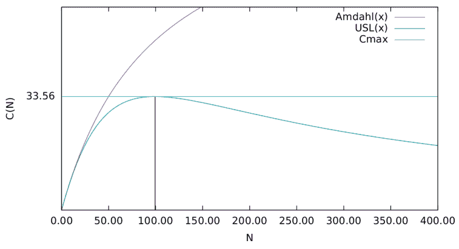

图 2.1：通用扩展性法则

> http://www.perfdynamics.com/Manifesto/USLscalability.html
> http://en.wikipedia.org/wiki/Amdahl%27s_law

## 性能与扩展

系统达到最大容量的负载生成器（数据库连接）数量完全取决于 USL 系数。

```
Nmax = \sqrt{\frac{(1 - \alpha)}{\beta}}
```

结果的吞吐量增益以如下方式获得：

```
Xmax = X(1) \times C
```

## 2.2 数据库连接边界

每个连接都需要从客户端（应用）到服务器（数据库）。系统容量完全取决于硬件，的资源。

数据库能够处理的连接总数取决于基于线程的实现：

- SQL Server 2016* 和 MySQL 5.7* 使用线程。
- PostgreSQL 9.5* 使用进程。
- 在 Windows 系统上，使用线程，而 Oracle 12c* 在 Linux 上使用进程。

> *https://msdn.microsoft.com/en-us/library/ms19021.aspx
> *https://dev.mysql.com/doc/refman/7/en/connection.html
> *http://www.postgresql.org/docs/9.5/static/connect.html
> *http://docs.oracle.com/database/121/CP/process.html

深入数据库内部揭示了对 CPU、内存和磁盘的依赖。由于 I/O 操作是昂贵的，数据库使用缓冲池将数据映射到内存。更改首先应用于内存，然后批量刷新磁盘以获得更好的写入性能。

即使索引完全缓存在内存中，可能发生磁盘访问。为了提供数据一致性，使用了锁（共享锁和排斥锁）来保护数据块（行和索引）。

使用内存中的覆盖索引可以消除磁盘访问，因为数据无需访问磁盘。

这意味着高吞吐量应用程序将在 CPU、内存和磁盘上遇到竞争。当所有数据库资源在使用时，增加工作负载只会增加竞争，从而降低吞吐量。资源可能会由于配置不当而饱和，因此改进系统的第一步是根据当前的数据模式进行调。

降低响应时间不仅让应用程序响应更迅速，还能增加吞吐量。

但在并发环境下，仅有响应时间是不够的。为了保持固定的响应时间上限，系统容量必须随入站请求吞吐量增加。增加资源可以提高扩展性，但之后容量开始下降。

在 Velocity 大会上*，Google 和微软 Bing 团队都得出更高的响应时间会升级并影响业务指标。

容量规划是一个反馈驱动的机制，需要持续监控，因此任何优化都将通过应用性能指标得到加强。

*http://radar.oreilly.com/2009/06/bing-and-google-agree-slow-pag.html

## 2.3 向上扩展与水平扩展

扩展是通过增加资源增加容量的效果。向上扩展（垂直扩展）是指向单台机器增加资源。增加可用机器的数量被称为水平扩展（水平扩展）。

传统上，向数据库服务器增加硬件资源是增加数据库容量选的方法。关系数据库出现于 70 年代，在过去的两个世纪里，数据库供应商利用遵循摩定律的硬件进步。

分布式系统比集中式系统复杂得多，这就是为什么水平扩展比垂直扩展更具挑战性。另一方面，对于一台专用高性能服务器的价格可以购买多台商品机器，其可用资源（CPU、内存、磁盘存储）大于单台专用服务器。在决定哪种扩展方法更好时，必须同时考虑价格（硬件和许可）以及固有的开发和运营成本。

# 性能与扩展

Facebook³ 构建在许多开源项目（如 PHP、MySQL）之上，采用水平扩展架构来应对其海量的流量。

StackOverflow⁴ 是垂直扩展架构的最佳示例。在的一篇博客⁵中，Jeff Atwood 解释说 Windows 和 SQL Server 的成本是未选择水平扩展方法的原因之一。

无论单台专用服务器有多强大，它仍然是一个单点故障源，如果系统不再可用，吞吐量将降为零。因此，在大多数企业系统中，数据库复制并不是可选项。

### 2.3.1 主从复制 (Master-Slave replication)

对于读写比例较高的企业系统，主从复制方案适用于提高可用性。

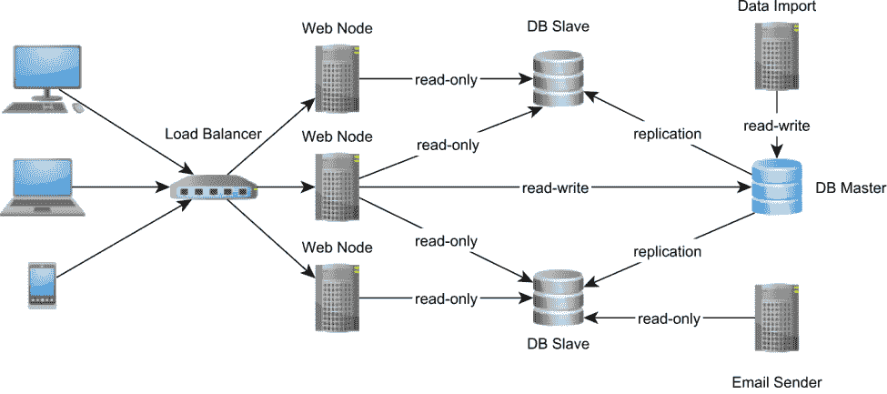

图 2.2：主从复制

主节点（Master）是记录系统，也是唯一接受写入的节点。主节点记录的所有更改都会重放到从节点（Slaves）。二进制复制使用主节点的 WAL（预写日志），而从节点上的基于语句的复制则在主节点上执行完全相同的语句。

异步复制非常常见，特别是当有更多从节点需要更新时。由于从节点落后于主节点，因此它们是最终一致的。在主节点崩溃的情况下，必须通过全集群投票过程从所有可用从节点列表中选举新的主节点（通常是具有最新更新的节点）。

异步复制拓扑也被称为热备用，因为选举过程不是瞬间完成的。

大多数数据库系统允许一个同步从节点，但代价是增加了事务响应时间（主节点必须阻塞等待同步从节点确认更新）。在主节点故障时，自动故障转移机制可以将同步从节点提升为新的主节点。

拥有一个同步从节点允许系统在主节点故障时确保数据一致性，因为同步从节点是主节点的精确副本。同步主从复制也被称为热备用（hot standby topology）拓扑，因为同步从节点可以随时替换主节点。

当只有异步从节点可用时，新选出的从节点可能会落后于故障的主节点，在这种情况下，一致性和持久性换取了更低的延迟和更高的吞吐量。

除了消除单点故障外，数据库复制还可以增加事务吞吐量。在主从拓扑中，从节点可以接受只读事务，从而将读流量从主节点分流出去。

从节点增加了可用的只读连接并减少了主节点的资源竞争，这反过来也可以降低读写事务的响应时间。如果主节点无法无法跟上不断增长的读写流量，多主复制（Multi-Master replication）可能是更好的替代方案。

### 2.3.2 多主复制 (Multi-Master replication)

在多主复制方案中，所有节点都是平等的，并且都可以接受只读和读写事务。在多个节点之间分负载也可以增加事务吞吐量并缩短响应时间。

但由于分布式系统涉及权衡，在多主复制方案中确保数据一致性具有挑战性，因为不再有单一的真理来源。相同的数据可以在不同的节点上并发修改，因此存在更新冲突的可能性。复制方案可以避免冲突，也可以检测冲突并应用自动冲突解决算法。

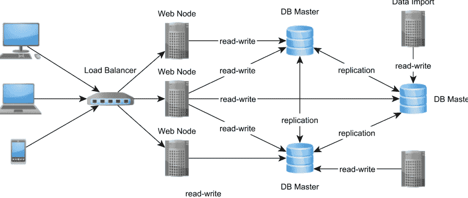

图 2.3：多主复制

为了避免冲突，可以使用两阶段提交协议（two-phase commit protocol）将所有参与节点纳入一个分布式事务。这种设计允许所有节点在任何时候保持同步，代价是增加了事务响应时间（通过减慢写操作）。

如果节点之间由广域网（WAN）分隔，同步延迟可能会大幅增加。如果一个节点无法访问，同步可能会失败。

虽然从数据一致性的角度来看避免冲突更好，但同步可能会导致高响应时间。异步复制可以提供更好的吞吐量，多主复制需要自动检测来处理冲突。

### 2.3.3 分片 (Sharding)

当数据量超过整个系统的容量时，分片（Sharding）变得至关重要。

分片在多个节点上分发数据，使得每个实例只包含整体数据的一部分。传统的关系数据库在单个数据库内进行水平分区。跨分片的连接（Join）通常是不允许的。通过减少每个节点的数据量，索引也可以更好地放入主内存。由于数据量更小，事务响应时间也可以变得更短。典型的分片拓扑包含至少两个数据中心。

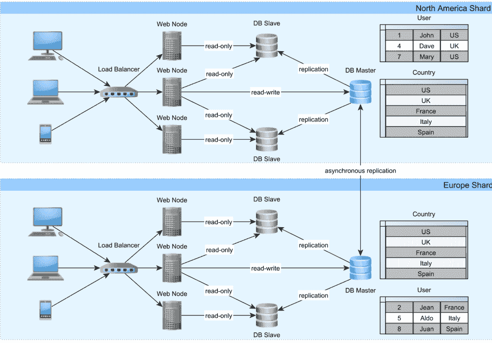

图 2.4：分片

每个数据中心服务于特定的地理区域，负载在地理区域之间平衡。为了保持分片同步，可以使用异步复制机制。

在之前的图中，国家表从一个数据中心镜像到另一个，分片发生在用户表上。为了消除跨分片处理的需求，每个用户的所有数据都包含在一个数据中心。

在增加系统容量方面，分片通常是最后的手段，在耗尽其他选项后使用：

- 优化数据层以交付更低的时间
- 扩展每个复制节点
- 添加更多复制节点直到同步延迟低于可接受的阈值

#### MySQL 自动分片

MySQL Cluster 提供自动分片功能，数据使用主键哈希函数均匀地分布在多个商品硬件上。每个节点都接受读写事务，就像多主复制一样，冲突会被自动发现并解决。


图 2.5：自动分片

自动分片拓扑与多主复制架构类似，因为它通过将入负载负载到多个机器来增加吞吐量。在多主复制环境中，每个节点存储整个数据库，而自动分片集群分布数据，使得每个分片只是整个数据库的一个集。

由于集群负责分发数据，应用程序不需要提供数据分片路由层，跨进行 SQL 连接也是可能的。MySQL Cluster 7.3 使用 NDB 存储引擎，它缺乏 InnoDB* 提供的某些功能，如多个事务隔离级别或 MVCC（多版本并发控制）。

> *https://www.mysql.com/products/cluster/scalability/
> *http://dev.mysql.com/doc/mysql-cluster-excerpt/5.6/en/mysql-cluster-ndb-innodb-engines.html

## II JDBC 与数据库基础知识

## 3. JDBC 连接管理

JDBC（Java 数据库连接）API 为与数据库服务器通信提供了一个通用接口。所有的网络逻辑和特定数据库的通信协议都隐藏在与供应商无关的 JDBC API之后。因此，所有的 JDBC 接口都必须根据数据库供应商的特定要求进行实现。`java.sql.Driver` 是与 JDBC API 交互的主入口点，它定义了实现的版本细节并提供了访问数据库连接的通道。

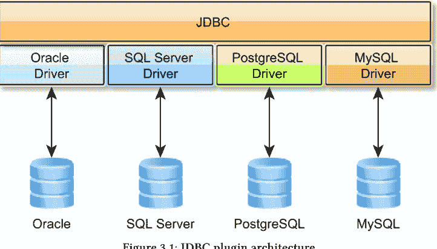

图 3.1: JDBC 插件架构

- JDBC 定义了四种驱动类型：
  - 类型 1：它仅仅是通往实际 ODBC 驱动实现的桥接。
  - 类型 2：它使用特定于数据库的原生客户端实现（例如 Oracle Call Interface）。
  - 类型 3：它将调用委托给提供数据库连接支持的应用程序服务器。
  - 类型 4：JDBC 驱动完全使用 Java 实现数据库通信协议。

由于类型 4 驱动更容易设置和调试，通常是首选的替代方案。

为了与数据库服务器通信，Java 程序必须首先获取一个 `java.sql.Connection`。虽然 `java.sql.Driver` 是实际的数据库连接提供者，但使用 `java.sql.DriverManager` 更方便，因为它还可以解析与当前数据库连接 URL 关联的 JDBC 驱动。

> 之前，应用程序在建立连接之前需要加载驱动，但从 JDBC 4.0 开始，服务提供者接口（Service Provider Interfaces）机制可以自动发现当前应用程序类路径中的所有可用驱动。

### 3.1 DriverManager

`DriverManager` 定义了以下方法：

```
public static Connection getConnection(
String url, Properties info) throws SQLException;
```

```
public static Connection getConnection(
String url, String user, String password) throws SQLException;
```

```
public static Connection getConnection(
String url) throws SQLException;
```

每当调用 `getConnection()` 方法时，`DriverManager` 都会向底层的 `Driver` 请求一个新的物理连接。

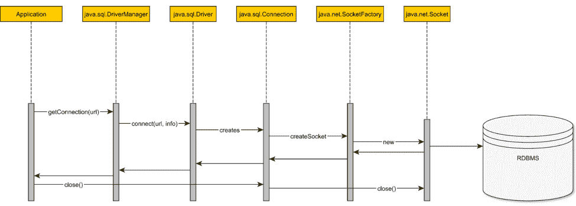

图 3.2: DriverManager 连接

JDBC 的第一个版本于 1997 年发布，它仅支持使用 `DriverManager` 工具来获取数据库连接。那时，Java 正在提供桌面应用程序的支持，这些程序通常采用两层架构：

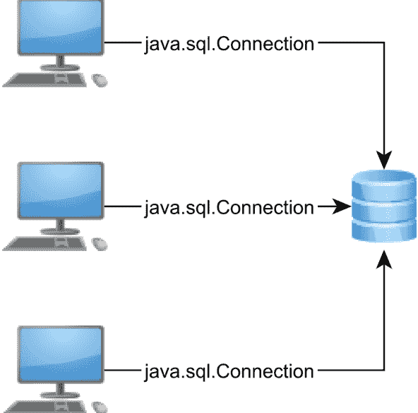

图 3.3: 两层架构

在两层架构中，应用程序由单个用户运行，每个实例都使用一个专用的数据库连接。用户越多，需要的数据库连接就越多，根据底层资源（硬件、操作系统或许可限制），每个数据库服务器可以提供的连接数量是的。

# Oracle 主机遗留问题

Oracle 在大型机时代声名大，那时每个客户端都获得一个专用的数据库连接。

Oracle 为每个单独用户分配一个不同的模式（schema），而其他数据库系统通常由多个用户账户共享一个模式。


在 PL/SQL 中，包围的公共变量（Packaged public variables）的作用域绑定到会话（session），而不是当前运行的事务。应用程序开发者必须格外谨慎地正确解绑这些变量，因为连接经常被重用，旧值可能会泄漏到新的事务中。

### 3.2 DataSource

1999 年，J2EE 随着 JDBC 2.0 和 JTA（Java Transaction API）¹ 的初始草案发布，标志着企业级 Java 的开始。企业级应用使用三层架构，中间层充当用户请求与各种数据源（例如关系型数据库、消息队列）之间的桥梁。

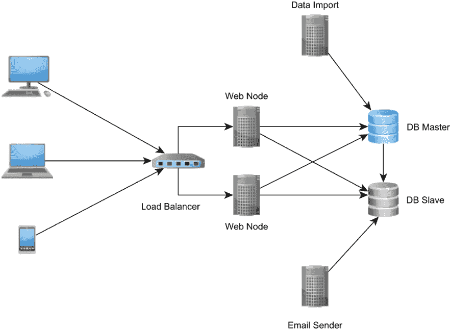

### 3.2.1 为什么池化要快得多？

要理解为什么连接池解决方案的性能优得多，理解连接池机制至关重要：

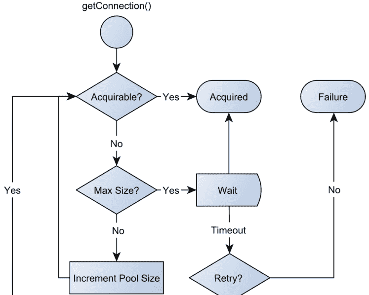

图 3.6：连接获取请求流

1. 当请求连接时，连接池会查找未分配的连接。
2. 如果连接池找到了空闲连接，则将其处理后交给客户端。
3. 如果没有空闲连接，连接池会尝试扩展到允许的最大尺寸。
4. 如果连接池已经达到最大尺寸，它将在放弃并抛出连接获取失败异常之前重试几次。
5. 当客户端关闭逻辑连接时，该连接会被释放并返回连接池，而不释放底层的物理连接。

大多数连接池解决方案都暴露一个 `DataSource` 实现，该实现封装了实际的特定数据库 `DataSource` 或底层的 `DriverManager` 工具。

## JDBC 连接管理

逻辑连接的生命周期如下：

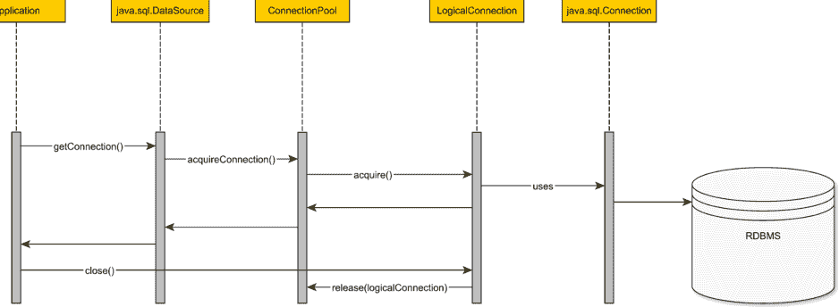

图 3.7：DataSource 连接

连接池不会将物理连接返回给客户端，而是提供一个代理或句柄。当连接正在使用时，连接池将其状态更改为 `allocated`（已分配），以防止两个并发线程使用同一个数据库连接。代理拦截连接关闭方法，并通知连接池将连接状态更改为 `unallocated`（未分配）。

除了减少连接获取时间外，池化机制还可以限制应用程序同时使用的连接数量。

连接池充当了传入连接请求的有界缓冲区。如果出现流量峰值，连接池将进行平滑处理，而不是使所有数据库资源饱和。

所有这些好处是有代价的，因为配置合适的池大小并不是易事。置备连接池需要理解特定的数据库访问模式，还需要进行用量监控。

每当传入请求的数量超过可用的请求处理程序数量时，基本上有两种方法可以避免系统过载：

- 丢弃溢出的流量（影响可用性）。
- 队列化请求并等待繁忙资源变得可用（增加响应时间）。

丢弃多余流量通常是最后的手段，因此连接池解决方案首先尝试入队溢出的请求。通过对连接等待时间设置上限，可以防止队列无限增长并导致服务器饱和。

对于给定的请求速率，队列大小和排队时间的关系由队列理论中最基础的定律给出。

### 3.3 队列理论容量

利特定律（Little's Law）是一个适用于任何稳定状态队列系统的通用方程（到达率不大于离开率）。

根据利特定律，请求被服务的平均时间仅取决于长期到达率和系统中的平均请求数。

```text
$L = \lambda \times W$
```

- `L`：系统中的平均请求数（包括正在服务的和在队列中等待的）。
- `λ`：长期到达率。
- `W`：请求在系统中的平均时间。

假设应用级事务在整个生命周期内使用数据库连接，且平均事务时间为 100 毫秒：

```text
$W = 100\ ms = 0.1\ s$
```

如果平均连接获取率为每秒 50 次请求：

```text
$\lambda = 50 \frac{requests}{s}$
```

那么系统中的平均请求数是：

```text
$L = \lambda \times W = 50 \times 0.1 = 5\ requests$
```

尺寸为 5 的池可以容纳平均流量而无需入队请求。如果池的大小为 3，那么平均有 2 个请求入队等待连接可用。

利特定律适用于长期平均值，在考虑间歇性流量时可能并不适用。在现实场景中，连接池必须适应短期流量峰值，考虑实际吞吐量是重要的。

在队列理论中，吞吐量由离开率（`μ`）表示，对于连接池，它代表在给定时间内提供的连接数：

```text
$\mu = \frac{Ls}{Ws} = \frac{pool\ size}{connection\ time}$
```

> ³ <http://en.wikipedia.org/wiki/Little's_law>

## JDBC 连接管理

练习演示了队列理论如何帮助置备连接池以支持各种流量峰值。

复用之前的配置，测试连接池处于以下边界：

- 服务的请求（`Ls`），这意味着连接池最多提供 5 个连接。
- 平均服务时间（`Ws`）或连接租期为 100 毫秒。

预期，连接池每秒可以交付 50 个连接。

```text
$\mu = \frac{Ls}{Ws} = 50 \frac{requests}{s}$
```

当到达率等于离开率时，系统饱和，所有连接都在使用中。

```text
$\lambda = \mu = \frac{Ls}{Ws}$
```

如果到达率超过连接池吞吐量，溢出的请求必须等待连接可用。

每秒 150 个请求的流量爆发处理如下：

- 第一秒 50 个请求。
- 接下来的两秒入队并处理剩下的 100 个请求。

```text
$\mu = \frac{Ls}{Ws} = \frac{5}{0.1} = \frac{Lq}{Wq} = \frac{10}{0.2}$
```

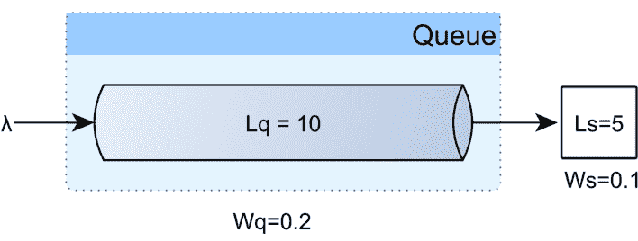

图 3.8：利特定律队列

## JDBC 连接管理

对于恒定的吞吐量，入队的连接请求（`Lq`）与连接获取时间（`Wq`）成正比。

给定峰值中的请求总数计算如下：

```text
$Lspike = \lambda_{spike} \times W_{spike}$
```

处理峰值所需的总时间由以下公式给出：

```text
$W = \frac{Lspike}{\mu} = \frac{\lambda_{spike} \times W_{spike}}{\lambda}$
```

入队连接的数量和处理它们的时间由以下方程表示：

```text
$Lq = Lspike - Ls$
```

```text
$Wq = W - 1$
```

假设存在每秒 250 个请求的流量峰值，持续 3 秒。

```text
$\lambda_{spike} = \frac{250}{s}$
```

```text
$W_{spike} = 3\ s$
```

750 个请求的峰值需要 15 秒才能完全处理。

```text
$Lspike = 250 \frac{requests}{s} \times 3\ s = 750\ requests$
```

```text
$W = \frac{750 \frac{requests}{s}}{50 \frac{requests}{s}} = 15\ s$
```

队列大小增长到 700 个，需要 14 秒来服务所有请求。

```text
$Lq = Lspike - Ls = 700\ requests$
```

```text
$Wq = W - 1 = 14\ s$
```

### 3.4 实际数据库连接置备

即使队列理论提供了对连接池行为的洞察，企业系统的动力学也很难用通用方程来表达，指标对于资源置备变得至关重要。通过持续监控连接使用模式，当初始配置不再适用时，反应和调整池大小变得容易得多。

遗憾的是，许多连接池解决方案对监控和故障转移策略的支持非常有限，这就是构建 FlexyPool 的主要原因。支持常见的连接池框架，该开源项目提供了以下连接指标：

表 3.2：FlexyPool 指标

| 名称 | 描述 |
| --- | --- |
| 并发连接请求 | 同时请求多少个连接 |
| 并发连接 | 同时使用了多少个连接 |
| 最大池大小 | 如果目标 `DataSource` 使用自适应池大小，此指标显示了池随时间的变化情况 |
| 连接获取时间 | 从目标 `DataSource` 获取连接所需的时间 |
| 总连接获取时间 | 总连接获取间隔（包括重试） |
| 重试尝试 | 连接获取的重试次数 |
| 溢出池大小 | 池大小在超过最大值之前可以增长多少，直到连接请求超时 |
| 连接租期 | 从获取连接到释放连接之间的持续时间 |

指标对于可视化连接使用趋势非常重要，以防不可预的流量峰值导致连接获取达到 `DataSource` 超时。

故障转移机制采用各种策略来防止超时的连接请求被丢弃。当批处理器可以重试失败的请求时（尽管增加了事务响应时间），在 Web 应用程序中，用户对不可用或长时间运行的事务更为敏感。

# JDBC 连接管理

FlexyPool 提供了以下默认的备用策略：

表 3.3：FlexyPool 备用策略

| 名称 | 描述 |
| --- | --- |
| 超时时增加池大小 | 连接池有一个最小大小，并根据需要可以增长到其最大大小。该策略在获取连接超时时，会策略性地增加目标连接池的最大大小。溢出是一个额外连接的缓冲区，允许连接池超过其初始最大大小，直到达到溢出阈值。 |
| 重试尝试 | 该策略对于那些缺乏连接获取重试机制的连接非常有用，它简单地在指定的尝试次数内重新尝试获取连接。 |

### 3.4.1 一个真实的连接池监控示例

以下示例演示了 FlexyPool 备用策略如何确定合适的连接池大小。被测试的应用程序是一个批处理程序，它使用 Bitronix 事务管理器作为数据库连接池提供程序。

该批处理器被分配了特定的数据负载，当检测到连接获取超时发生时，池大小会自动增长。平均池大小和最大池大小是通过实验确定的，不需要任何先前的数学计算。

在运行负载测试实验之前，最好了解当前应用程序的连接池设置。根据 Bitronix 连接池文档，默认的获取超时（acquisition Timeout，请求在抛出超时异常之前等待的最长时间）为 30 秒。

一秒的连接获取超时对于当前实验是足够的，允许应用程序更快地对流量激增做出反应并应用补偿备用策略。

初始的 `maxPoolSize` 设置为一个连接，在接收到连接获取超时后，将一直增长直到达到 `maxOverflow` 阈值。

`retryAttempts` 被刻意设置为一个较大的值，因为对于批处理器来说，丢弃连接请求比某些偶尔的事务响应时间严重得多。

> <https://github.com/bitronix/btm>
>
> <https://github.com/bitronix/btm/wiki/JDBC-pools-configuration>

实验从以下初始连接池设置开始：

表 3.4：初始连接池设置

| 名称 | 值 | 描述 |
| --- | --- | --- |
| `minPoolSize` | 0 | 池从初始大小 0 开始 |
| `maxPoolSize` | 1 | 池从最大大小 1 开始 |
| `acquisitionTimeout` | 1 | 连接请求将在放弃并抛出超时异常之前等待 1 秒 |
| `maxOverflow` | 4 | 池可以增长到 5 个连接（初始 `maxPoolSize` + 溢出） |
| `retryAttempts` | 30 | 如果达到最终的 `maxPoolSize` 且没有可用连接，请求将在放弃前重试 30 次。 |

#### 3.4.1.1 并发连接请求数指标

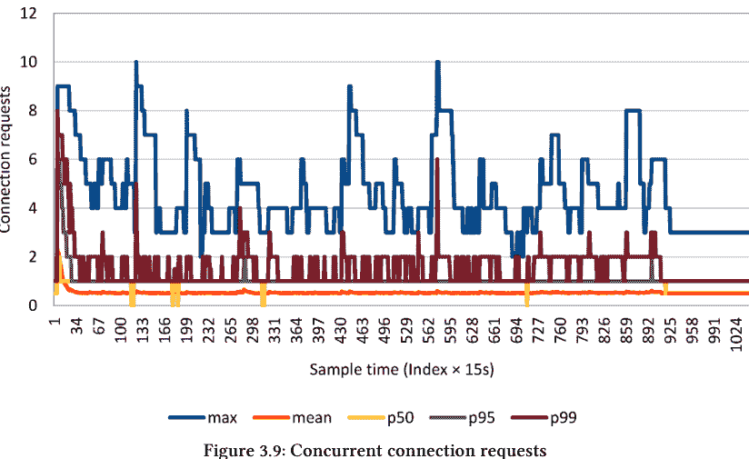

图 3.9：并发连接请求

传入的连接请求越多，响应时间（获取池化连接的时间）就越长。此图显示了传入请求的分布，非常适合发现流量激增。

平均值会平滑所有离群值，因此它无法反映应用程序对特定流量激增的响应。

当记录的值剧烈波动时，仅凭平均值和最大值对实际数据范围的描述有限，而这在应用程序性能监控中是更倾向的。

通过提供仅与总人口百分比相关的最大值，位数使得离群值变得可见，同时捕捉了特定流量变化的即时影响。

#### 3.4.1.2 并发连接数指标

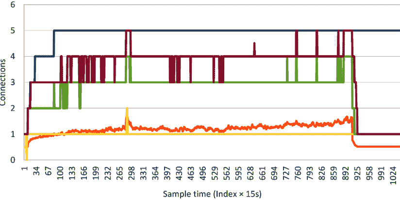

图 3.10：并发连接

平均连接指标遵循逐渐变化的趋势。然而，仅凭平均值和最大值对实际数据范围的描述有限，而这在应用程序性能监控中是更倾向的。

通过提供仅与总人口百分比相关的最大值，位数使得离群值变得可见，同时捕捉了特定流量变化的即时影响。

平均值会平滑所有离群值，因此它无法反映应用程序对特定流量激增的响应。

通过提供仅与总人口百分比相关的最大值，位数使得离群值变得可见，同时捕捉了特定流量变化的即时影响。

在连接池中，接收到连接获取超时后，它将一直增长直到达到 `maxOverflow` 阈值。

`retryAttempts` 被刻意设置为一个较大的值，因为对于批处理器来说，丢弃连接请求比某些偶尔的事务响应时间严重得多。


`retryAttempts` 被刻意设置为一个较大的值，因为对于批处理器来说，丢弃连接请求比某些偶尔的事务响应时间严重得多。

在连接池中，接收到连接获取超时后，它将一直增长直到达到 `maxOverflow` 阈值。

`retryAttempts` 被刻意设置为一个较大的值，因为对于批处理器来说，丢弃连接请求比某些偶尔的事务响应时间严重得多。

在连接池中，接收到连接获取超时后，它将一直增长直到达到 `maxOverflow` 阈值。

`retryAttempts` 被刻意设置为一个较大的值，因为对于批处理器来说，丢弃连接请求比某些偶尔的事务响应时间严重得多。

在连接池中，接收到连接获取超时后，它将一直增长直到达到 `maxOverflow` 阈值。

`retryAttempts` 被刻意设置为一个较大的值，因为对于批处理器来说，丢弃连接请求比某些偶尔的事务响应时间严重得多。

在连接池中，接收到连接获取超时后，它将一直增长直到达到 `maxOverflow` 阈值。

`retryAttempts` 被刻意设置为一个较大的值，因为对于批处理器来说，丢弃连接请求比某些偶尔的事务响应时间严重得多。

在连接池中，接收到连接获取超时后，它将一直增长直到达到 `maxOverflow` 阈值。

`retryAttempts` 被刻意设置为一个较大的值，因为对于批处理器来说，丢弃连接请求比某些偶尔的事务响应时间严重得多。

在连接池中，接收到连接获取超时后，它将一直增长直到达到 `maxOverflow` 阈值。

`retryAttempts` 被刻意设置为一个较大的值，因为对于批处理器来说，丢弃连接请求比某些偶尔的事务响应时间严重得多。

在连接池中，接收到连接获取超时后，它将一直增长直到达到 `maxOverflow` 阈值。

`retryAttempts` 被刻意设置为一个较大的值，因为对于批处理器来说，丢弃连接请求比某些偶尔的事务响应时间严重得多。

在连接池中，接收到连接获取超时后，它将一直增长直到达到 `maxOverflow` 阈值。

`retryAttempts` 被刻意设置为一个较大的值，因为对于批处理器来说，丢弃连接请求比某些偶尔的事务响应时间严重得多。

在连接池中，接收到连接获取超时后，它将一直增长直到达到 `maxOverflow` 阈值。

`retryAttempts` 被刻意设置为一个较大的值，因为对于批处理器来说，丢弃连接请求比某些偶尔的事务响应时间严重得多。

在连接池中，接收到连接获取超时后，它将一直增长直到达到 `maxOverflow` 阈值。

`retryAttempts` 被刻意设置为一个较大的值，因为对于批处理器来说，丢弃连接请求比某些偶尔的事务响应时间严重得多。

在连接池中，接收到连接获取超时后，它将一直增长直到达到 `maxOverflow` 阈值。

`retryAttempts` 被刻意设置为一个较大的值，因为对于批处理器来说，丢弃连接请求比某些偶尔的事务响应时间严重得多。

在连接池中，接收到连接获取超时后，它将一直增长直到达到 `maxOverflow` 阈值。

`retryAttempts` 被刻意设置为一个较大的值，因为对于批处理器来说，丢弃连接请求比某些偶尔的事务响应时间严重得多。

在连接池中，接收到连接获取超时后，它将一直增长直到达到 `maxOverflow` 阈值。

`retryAttempts` 被刻意设置为一个较大的值，因为对于批处理器来说，丢弃连接请求比某些偶尔的事务响应时间严重得多。

在连接池中，接收到连接获取超时后，它将一直增长直到达到 `maxOverflow` 阈值。

`retryAttempts` 被刻意设置为一个较大的值，因为对于批处理器来说，丢弃连接请求比某些偶尔的事务响应时间严重得多。

在连接池中，接收到连接获取超时后，它将一直增长直到达到 `maxOverflow` 阈值。

`retryAttempts` 被刻意设置为一个较大的值，因为对于批处理器来说，丢弃连接请求比某些偶尔的事务响应时间严重得多。

在连接池中，接收到连接获取超时后，它将一直增长直到达到 `maxOverflow` 阈值。

`retryAttempts` 被刻意设置为一个较大的值，因为对于批处理器来说，丢弃连接请求比某些偶尔的事务响应时间严重得多。

在连接池中，接收到连接获取超时后，它将一直增长直到达到 `maxOverflow` 阈值。

`retryAttempts` 被刻意设置为一个较大的值，因为对于批处理器来说，丢弃连接请求比某些偶尔的事务响应时间严重得多。

在连接池中，接收到连接获取超时后，它将一直增长直到达到 `maxOverflow` 阈值。

`retryAttempts` 被刻意设置为一个较大的值，因为对于批处理器来说，丢弃连接请求比某些偶尔的事务响应时间严重得多。

在连接池中，接收到连接获取超时后，它将一直增长直到达到 `maxOverflow` 阈值。

`retryAttempts` 被刻意设置为一个较大的值，因为对于批处理器来说，丢弃连接请求比某些偶尔的事务响应时间严重得多。

在连接池中，接收到连接获取超时后，它将一直增长直到达到 `maxOverflow` 阈值。

`retryAttempts` 被刻意设置为一个较大的值，因为对于批处理器来说，丢弃连接请求比某些偶尔的事务响应时间严重得多。

在连接池中，接收到连接获取超时后，它将一直增长直到达到 `maxOverflow` 阈值。

#### 3.4.1.1 并发连接请求数指标


图 3.9：并发连接请求

传入的连接请求越多，响应时间（获取池化连接的时间）就越长。此图显示了传入请求的分布，非常适合发现流量激增。

平均值会平滑所有离群值，因此它无法反映应用程序对特定流量激增的响应。

当记录的值剧烈波动时，仅凭平均值和最大值对实际数据范围的描述有限，而这在应用程序性能监控中是更倾向的。

通过提供仅与总人口百分比相关的最大值，位数使得离群值变得可见，同时捕捉了特定流量变化的即时影响。

#### 3.4.1.2 并发连接数指标


图 3.10：并发连接

平均连接指标遵循逐渐变化的趋势。然而，仅凭平均值和最大值对实际数据范围的描述有限，而这在应用程序性能监控中是更倾向的。

通过提供仅与总人口百分比相关的最大值，位数使得离群值变得可见，同时捕捉了特定流量变化的即时影响。

在连接池中，接收到连接获取超时后，它将一直增长直到达到 `maxOverflow` 阈值。

`retryAttempts` 被刻意设置为一个较大的值，因为对于批处理器来说，丢弃连接请求比某些偶尔的事务响应时间严重得多。

在连接池中，接收到连接获取超时后，它将一直增长直到达到 `maxOverflow` 阈值直到达到 `maxOverflow` 阈值。

在连接池中，如果连接支持，连接池可以释放空闲连接。

#### 3.4.1.3 最大池大小


图 3.11：最大池大小

在 99 分位数后，连接池很快就会饱和。

#### 3.4.1.4 获取时间指标


图 3.12：获取时间

虽然重试图仅显示重试次数随时间增加，但重试的实际效果在整体获取时间内是可见的。

#### 3.4.1.5 重试尝试指标

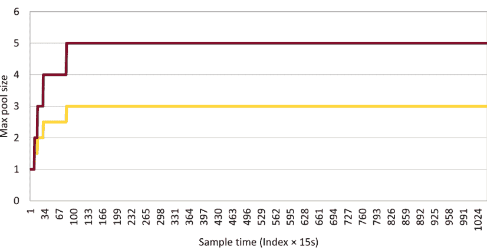

图 3.13：重试尝试

在限制连接池为 5 个连接时，重试次数。

#### 3.4.1.6 整体获取时间指标

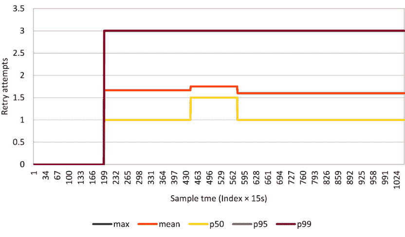

图 3.14：整体获取时间

#### 3.4.1.7 连接租用时间指标

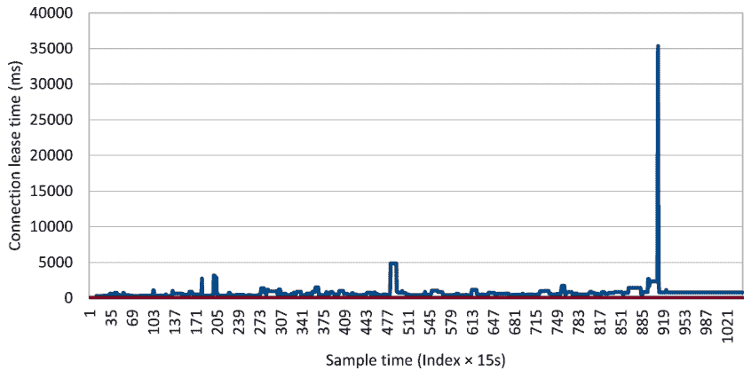

图 3.15：连接租用时间

99 分位数显示在整个作业过程中连接时间是稳定的。另一方面，最大图显示事务持续了 35 秒。

## 批量更新

JDBC 2.0 引入了批量更新，以便将多个 DML 语句分组到单个请求中。在请求中发送多个语句减少了数据库往返，缩短了事务时间。即使参考规范使用了“更新”一词，任何插入、更新或删除语句都可以批处理，且 JDBC 也支持 `Statement`、`PreparedStatement` 和 `CallableStatement` 的批量处理。

不仅每个数据库驱动程序都是不同的，即使相同版本的不同驱动程序可能需要特定的配置。

### 4.1 语句处理

执行静态 SQL 语句，JDBC 定义了 `Statement` 接口，批量处理多个 DML 语句非常直观，如下代码段所示：

```java
statement.addBatch(
  "INSERT INTO post (title, version, id)" + \
  "VALUES (Post no. 1', 0, 1)");

statement.addBatch(
  "INSERT INTO post_comment (post_id, review, version, id)" + \
  "VALUES (1, Post comment 1.1', 0, 1)");

int[] updateCounts = statement.executeBatch();
```

影响每个语句的数据库行数包含在 `executeBatch()` 方法的返回值中。

> 对于 `Statement` 和 `CallableStatement`，Oracle JDBC 驱动实际上不支持批量处理

对于 `PreparedStatement` 以外的任何内容，驱动程序都会忽略批量处理，每个语句单独执行。

## 批量更新

下图描述了不同的 JDBC 驱动程序在不同批处理大小下的行为，测试测量了插入 1000 条帖子数据（每条帖子包含 4 条评论）所需的时间：

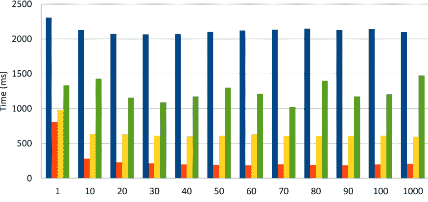

图 4.1：语句批处理

重新排列插入顺序，使所有帖子在评论行之前插入，会得到以下结果：

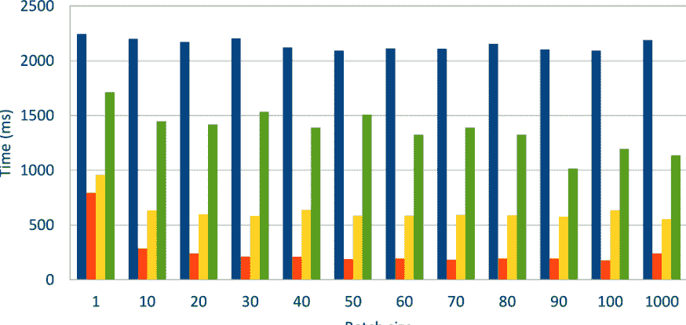

图 4.2：重排序后的语句批处理

重排序语句似乎没有显著提高性能，尽管某些驱动程序（例如 MySQL）可能会利用这种优化。

## MySQL

尽管 MySQL 实现了 JDBC 规范，但默认情况下，MySQL JDBC 驱动程序不会在单个请求中发送批量语句。

为了实现这一目的，JDBC 驱动程序定义了 `rewriteBatchedStatements` 连接属性，以便将语句重写为单个字符串缓冲区。为了获取自动生成的行键，批处理必须只包含插入语句。

对于 `PreparedStatement`，该属性将把批量插入语句重写为多值插入。。遗憾的是，驱动程序在重写时无法使用服务器端预编译语句。

如果不设置此属性，MySQL 驱动程序将单独执行每个 DML 语句，从而违背了批处理的目的。

> <http://dev.mysql.com/doc/connector-j/en/connector-j-reference-configuration-properties.html>

下图展示了语句重写性能与 MySQL JDBC 驱动程序默认行为的对比：

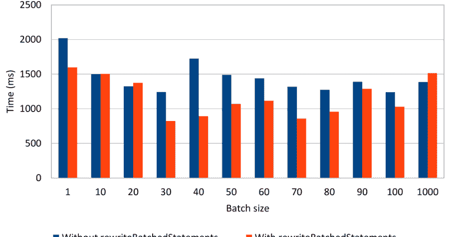

图 4.3：MySQL 语句批处理

只要批处理大小不是太大，重写静态语句似乎就会产生影响。在实践中，使用较小的批处理大小是常见的，这可以减少客户端的内存占用，并避免服务器因突然处理巨大的批加载而导致拥塞。

### 4.2 批处理 PreparedStatements

对于动态语句（一种非常常见的企业应用需求），`JDBCStatement` 并不合适，因为更改 SQL 语句的唯一选项是通过字符串操作完成。使用字符串模板或拼接标记是有风险的，因为它会使访问逻辑容易受到 SQL 注入攻击。

为了解决这一缺点，JDBC 提供了 `PreparedStatement` 接口来以安全的方式绑定参数。驱动程序必须在运行时验证提供的参数，从而丢弃意外的输入值。

由于 `PreparedStatement` 与单个 DML 语句相关，批更新可以将多个属于同一个预编译语句的值进行分组。

```java
PreparedStatement postStatement = connection.prepareStatement(
  "INSERT INTO Post (title, version, id) " + 
  "VALUES (?, ?, ?)");

postStatement.setString(1, String.format("Post no. %1d", 1));
postStatement.setInt(2, 0);
postStatement.setInt(3, 1); // 从 setLength 修正
postStatement.addBatch();

postStatement.setString(1, String.format("Post no. %1d", 2));
postStatement.setInt(2, 0);
postStatement.setInt(3, 2); // 从 setLength 修正
postStatement.addBatch();

int[] updateCounts = postStatement.executeBatch();
```

> SQL 注入

对于企业应用来说，安全性是一个非常重要的技术要求。SQL 注入攻击暴露了未对传入请求参数进行清理的数据层。

当输入参数在没有经过适当验证的情况下传递给底层数据库语句时，恶意攻击者可能会注入恶意的 SQL 程序。

这通常是通过用 `;` 字符结束当前语句并继续执行恶意的 SQL 命令来实现的，例如修改数据库结构（删除表或修改权限）或甚至提取敏感信息。

所有的 DML 语句都可以从批处理中受益，正如下面的测试所示。与 JDBC 语句测试用例一样，相同的数据量（1000 条帖子和 4000 条评论）将在改变批处理大小的同时进行插入、更新和删除操作。

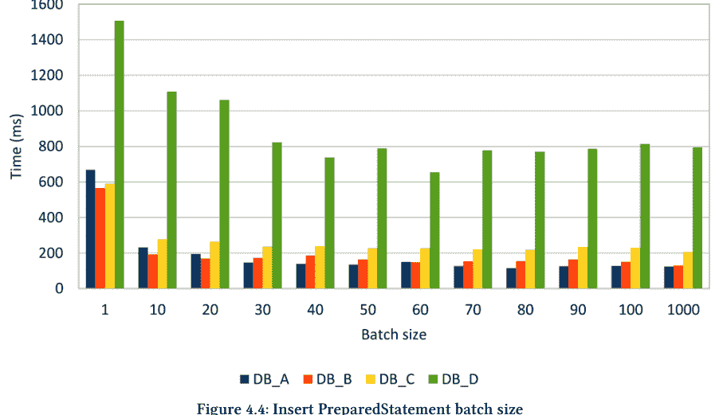

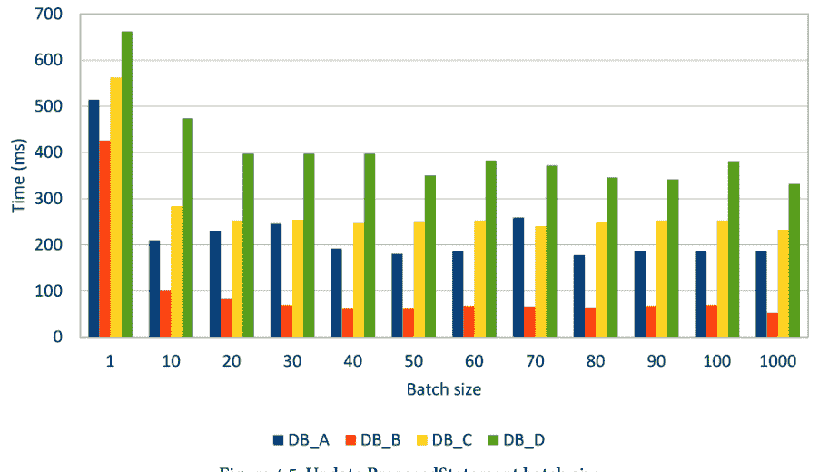

## 批量更新

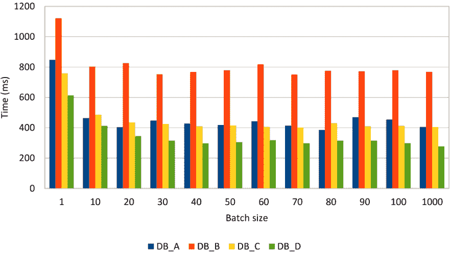

图 4.6：删除 PreparedStatement 批量大小

所有的数据库系统在批处理预语句时都显示出显著的性能提升。某些数据库系统在插入或更新行时非常快，而其他系统在删除数据时表现非常好。

与之前的 Statement 批量插入结果相比，显然对于相同的数据负载，`PreparedStatement` 的性能更好。

对于动态语句，`PreparedStatement` 提供了更好的性能（启用批处理时）和更强的安全保障。大多数 ORM 使用预编译语句，由于实体是逐个插入/更新/删除的，每个实体都可以从批处理中受益。

### 4.2.1 选择合适的批处理大小

找到合适的批处理大小并不是易事，因为没有数学方程可以为任何企业应用求解出合适的批处理大小。

与任何其他性能优化技术一样，针对特定的批处理大小值测量应用的性能增益仍然是最可靠的调优方案。

敏锐的读者已经发现，即使是低批处理大小也可以减少事务响应时间，而且性能并随批处理大小线性增长。

### 4.2.2 批量操作

除了批处理之外，SQL 还提供了批量操作来修改所有符合给定标准的行。批量更新也可以从索引受益。

要更新上一个示例中的所有记录，必须执行以下操作：

```sql
UPDATE post SET version = 1;
UPDATE post_comment SET version = 1;
```

表 4.1：批量更新

| DB_A 时间 (ms) | DB_B 时间 (ms) | DB_C 时间 (ms) | DB_D 时间 (ms) |
|---|---|---|---|
| 26 | 13 | 58 | 9 |

对于更新，批量删除比分批删除快得多。

```sql
DELETE FROM post_comment WHERE version > 0;
DELETE FROM post WHERE version > 0;
```

表 4.2：批量删除

| DB_A 时间 (ms) | DB_B 时间 (ms) | DB_C 时间 (ms) | DB_D 时间 (ms) |
|---|---|---|---|
| 3 | 12 | 1 | 2 |

> 批量处理注意事项

在单个事务中处理大量数据会降低应用程序性能，特别在高并发环境下。无论使用锁（两阶段锁）还是 MVCC（多版本并发控制），写入都会阻塞其他写入。如果批量更新记录与其他事务冲突，要么批量更新事务需要等待行级锁，要么其他事务需要等待批量提交。

### 4.3 获取自动生成的键

将行标识生成委托给数据库系统是一种常见做法。这样，开发者不需要提供单调递增的主键，因为数据库在插入新记录时会处理。

尽管这种做法方便，但重要的是自动生成的数据库标识符可能会与批量插入过程冲突。

与许多其他数据库功能一样，设置自增标识策略取决于数据库，但选择在标识列或数据库序列生成器之间。

## Oracle

在 Oracle 12c 之前，自增生成器必须在数据库序列之上实现。


```sql
CREATE SEQUENCE post_seq;

CREATE TABLE post (
  id NUMBER(19,0) NOT NULL,
  title VARCHAR2(255 CHAR),
  version NUMBER(10,0) NOT NULL,
  PRIMARY KEY (id));

CREATE OR REPLACE TRIGGER post_identity
BEFORE INSERT ON post
FOR EACH ROW
BEGIN
  SELECT post_seq.NEXTVAL
  INTO :NEW.id
  FROM dual;
end;
```

Oracle 12c 也增加了对标识列的支持，之前的示例可以简化如下：

```sql
CREATE TABLE post (
  id NUMBER(19,0) NOT NULL GENERATED ALWAYS AS IDENTITY,
  title VARCHAR2(255 CHAR),
  version NUMBER(10,0) NOT NULL,
  PRIMARY KEY (id));
```

## SQL Server

传统上，SQL Server 提供了标识列（identity column）生成器，但从 SQL Server 2012 开始，它现在也支持数据库序列。

```sql
CREATE TABLE post (
  id BIGINT IDENTITY NOT NULL,
  title VARCHAR(255),
  version INT NOT NULL,
  PRIMARY KEY (id));
```

## PostgreSQL

PostgreSQL 9.5 并不原生支持标识列，尽管它提供了 `SERIAL` 列类型，可以模拟标识列。

```sql
CREATE TABLE post (
  id SERIAL NOT NULL,
  title VARCHAR(255),
  version INT4 NOT NULL,
  PRIMARY KEY (id));
```

`SERIAL`（4 字节）和 `BIGSERIAL`（8 字节）类型仅仅是语法糖，因为在底层，PostgreSQL 仍然依赖于数据库序列。

因此，之前的定义等同于：

```sql
CREATE SEQUENCE post_id_seq;
```

```sql
CREATE TABLE post (
  id INTEGER DEFAULT NEXTVAL('post_id_seq') NOT NULL,
  title VARCHAR(255),
  version INT4 NOT NULL,
  PRIMARY KEY (id));
```

## MySQL

MySQL 5.7 仅通过 `AUTO_INCREMENT` 属性支持标识列。

```sql
CREATE TABLE post (
  id BIGINT NOT NULL AUTO_INCREMENT,
  title VARCHAR(255),
  version INTEGER NOT NULL,
  PRIMARY KEY (id));
```

许多数据库开发者喜欢这种方法，因为客户端在插入新行时不需要考虑提供数据库标识符。

```sql
INSERT INTO post (title, version) VALUES (?, ?);
```

要获取新创建的行标识符，必须指示 JDBC `PreparedStatement` 返回自动生成的键。

```java
PreparedStatement postStatement = prepareStatement(
  "INSERT INTO post (title, version) VALUES (?, ?)",
  Statement.RETURN_GENERATED_KEYS
);
```

另一种方案是让驱动程序输出自动生成键列的列索引。

```java
PreparedStatement postStatement = prepareStatement(
  "INSERT INTO post (title, version) VALUES (?, ?)",
  new int[] {1}
);
```

也可以使用列名来指示驱动程序自动生成的列。

```java
PreparedStatement postStatement = prepareStatement(
  "INSERT INTO post (title, version) VALUES (?, ?)",
  new String[] {"id"}
);
```

了解所有这些替代方案更好，因为它们在所有数据库系统上并不是相互通的。

### Oracle 自动生成检索的坑

当使用 `Statement.RETURN_GENERATED_KEYS` 时，Oracle 返回的是 `ROWID` 而不是实际生成的列值。解决方法是提供列索引或列名，这样就可以获取自动生成的键。

| 返回自动生成的键 | Oracle 驱动程序 | PostgreSQL 驱动程序 | SQL Server 驱动程序 | 驱动程序 |
| :--- | :--- | :--- | :--- | :--- |
| `executeUpdate()` | 否 | 是 | 是 | 是 |
| `execute()` | 否 | 是 | 否 | 是 |
| `getGeneratedKeys()` | 否 | 是 | 是 | 是 |

当使用 `Statement.RETURN_GENERATED_KEYS` 时，Oracle 返回的是 `ROWID` 而不是实际生成的列值。解决方法是提供列索引或列名，这样就可以获取自动生成的键。

### 语句缓存

每个执行计划都有固定的内存占用，大多数数据库系统使用固定大小的缓存（通过丢弃最少使用的计划来为新计划腾留空间）。DDL（数据定义语言）语句可能会破坏执行计划，使其过时，因此数据库必须使用单独进程来验证执行计划的相关性。

但缓存中最具挑战性的方面是确保良好的执行计划进入缓存，因为糟糕的计划如果被反复重用，会极大地损害应用程序的性能。

#### 执行计划可视化

如果不知道数据库对任何给定 SQL 语句采用的实际执行计划，数据库调优将是不可能实现的。由于输出可能超过页的长度，为了简洁起见，某些执行计划列被删除了。

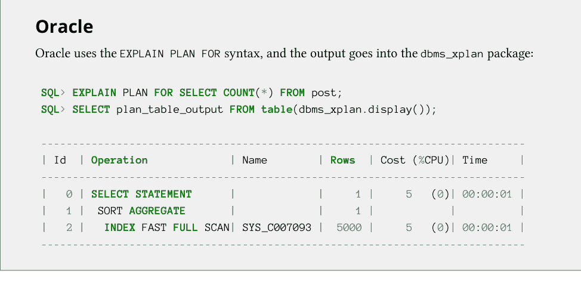

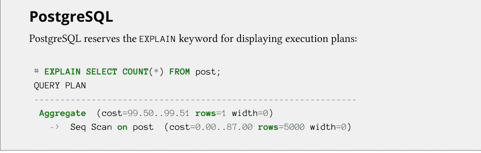

#### SQL Server

SQL Server Management Studio 提供了一个执行计划查看器：

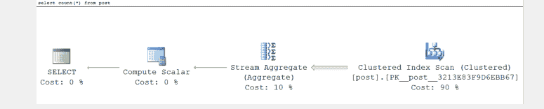

另一种选项是在运行语句之前启用 `SHOWPLAN_ALL` 设置：

```
SET SHOWPLAN_ALL ON;
GO
SELECT COUNT(*) FROM post;
GO
SET SHOWPLAN_ALL OFF;
GO
```

| 语句 | 预估行数 | 预估 IO | 预估 CPU | 子树成本 |
| :--- | :--- | :--- | :--- | :--- |
| select count(*) from post; | 1 | NULL | NULL | 0.0288 |
| Compute Scalar | 1 | 0 | 0.003 | 0.0288 |
| Stream Aggregate | 1 | 0 | 0.003 | 0.0288 |
| Clustered Index Scan | 5000 | 0.020 | 0.005 | 0.0258 |

#### MySQL

使用 `EXPLAIN` 或 `EXPLAIN EXTENDED` 显示计划：

```
mysql EXPLAIN EXTENDED SELECT COUNT(*) FROM post;
```

| id | select | table | type | key | len | rows | filtered | Extra |
| :--- | :--- | :--- | :--- | :--- | :--- | :--- | :--- | :--- |
| 1 | SIMPLE | post | index | PRIMARY | 8 | 5000 | 100.00 | Using index |

### 执行器

执行计划从优化器传递到执行器，在那里它被用于获取关联数据并构建结果集。执行器利用存储引擎（根据当前执行计划加载数据）和事务引擎（强制执行当前事务的数据完整性保证）。

拥有足够大的缓冲区允许数据库减少 I/O 竞争，从而缩短事务响应时间。一致性模型也会影响整体事务性能，因为可能为了确保数据完整性而获取锁，锁越多，并行执行的机会就越少。

### 缓存性能增益

在深入研究服务端和客户端语句缓存之前，最好可视化化重用语句对应用程序整体性能的净影响。以下测试计算了数据库引擎在一分钟内可以执行的查询次数。为了模拟非细微的执行计划，测试执行了一个结合了表连接和查询嵌套的语句。

```
SELECT p.title, pd.created_on
FROM post p
LEFT JOIN post_details pd ON p.id = pd.id
WHERE EXISTS (
SELECT 1
FROM post_comment
WHERE post_id = p.id AND version = ?
)
```

在四个数据库系统中运行，收集了以下吞吐量数据。

表 5.1：语句缓存性能增益

| 数据库系统 | 无缓存吞吐量（每分钟语句） | 缓存吞吐量（每分钟语句） | 百比增益 |
| :--- | :--- | :--- | :--- |
| DB_A | 419 833 | 507 286 | 20.83% |
| DB_B | 194 837 | 303 100 | 55.56% |
| DB_C | 116 708 | 166 443 | 42.61% |
| DB_D | 15 522 | 15 550 | 0.18% |

大多数数据库系统都能从重用语句中明显获益，在某些特殊情况下，性能增益是非常巨大的。语句缓存对于优化高性能 OLTP（在线事务处理）系统起着非常重要的作用。

### 服务端语句缓存

由于语句解析和执行计划生成是资源密集型的，某些数据库供应商提供执行计划缓存。语句字符串值被用作哈函数的输入，产生的结果成为缓存条目。如果语句字符串值在两次执行之间发生变化，则新参数化的语句将无法重用已生成的执行计划。为此目的，动态生成的 `PreparedStatements` 并不适用。

某些数据库系统提供了在运行时拦截 SQL 语句的可能性，以便所有字面量都被替换为绑定变量。这样，新参数化的语句就可以重用已生成的执行计划。例如 Oracle

```
ALTER SESSION SET cursor_sharing=force;
```

#### SQL Server

```
ALTER DATABASE SET PARAMETERIZATION FORCED;
```

由于具有足够大的缓冲区允许数据库减少 I/O 竞争，从而缩短事务响应时间。一致性模型也会影响整体事务性能，因为可能为了确保数据完整性而获取锁，锁越多，并行执行的机会就越少。

#### 绑定敏感执行计划

假设表 `status` 列有三个不同的值：TO_DO、DONE 和 FAILED。数据库有 100,000 行，其中 1,000 行是 TO_DO，95,000 行是 DONE，4,000 行是 FAILED。在数据库术语中，由谓词返回的行数被称为基数；对于 `status` 列，基数随之变化。

```
C = {1000, 4000, 95000}
```

通过将基数除以总行数可以获得选择性：

```
S = C / N × 100 = {1%, 4%, 95%}
```

选择性越低，给定绑定值匹配的行越少。优化器倾向于在高选择性百分比下使用顺序扫描，以减少总磁盘访问往返（特别是数据分布在多个块时）。当搜索 DONE 条目时，优化器选择顺序扫描路径（估计的行数为 95,080）：

```
SQL EXPLAIN SELECT FROM task WHERE status = 'DONE' LIMIT 100;
Limit (cost=0.00..1.88 rows=100 width=13)
  -> Seq Scan on task (cost=0.00..17.91 rows=95080 width=13)
    Filter: ((status)::text = 'DONE':text)
```

否则，对 TO_DO 或 FAILED 条目的搜索通过索引查找进行：

```sql
SQL EXPLAIN SELECT FROM task WHERE status = 'TO_DO' LIMIT 100;
Limit (cost=0.29..4.25 rows=100 width=13)
  -> Index Scan using task_status_idx on task (cost=0.29..36.16 rows=907)
    Index Cond: ((status)::text = 'TO_DO':text)
```

```
SQL EXPLAIN SELECT FROM task WHERE status = 'FAILED' LIMIT 100;
Limit (cost=0.29..3.86 rows=100 width=13)
  -> Index Scan using task_status_idx on task (cost=0.29..143.52 rows=4013)
    Index Cond: ((status)::text = 'FAILED':text)
```

因此，执行计划取决于绑定参数值的选择性。如果选择性在整个绑定值范围内是恒定的，则执行计划将不再对参数值敏感。与绑定敏感的执行计划相比，通用执行计划更容易被重用。

下节描述了著名的数据库系统如何与其相关的执行计划实现服务器端准备语句。

#### Oracle

每个语句都会通过解析器（Parser），在其中进行语法和语义的验证。接下来，哈希函数会获取 SQL 语句，生成的哈希键用于在共享池（Shared Pool）中搜索已有的执行计划。

在 Oracle 术语中，重用执行计划被称为“软解析”（soft parse）。为了重用计划，SQL 语句必须与之前处理过的语句完全相同（甚至会考虑大小写和空格）。

如果没有找到执行计划，该语句将进行“硬解析”（hard parse）。优化器（Optimizer）会优化多个执行计划并选择关联成本最低的一个，该计划将由行源生成器（Row Source Generator）进一步编译为源码树。无论是重用（软解析）还是生成（硬解析），源码树都会交给执行器（Executor），由执行器获取关联的结果集。

#### 绑定等待（Bind pending）

如前所述，在缺乏实际绑定值的情况下，优化器无法确定最佳访问路径。Oracle 在硬解析阶段使用绑定镜像（bind peering）。

第一组绑定参数值决定了缓存执行计划的选择性。显而易见，这种策略对于均匀分布的数据集是行的，但单个执行计划无法对绑定敏感的谓词保持一致的性能。

从 11g 开始，Oracle 引入了自适应光标共享（adaptive cursor sharing），使得语句可以利用执行计划。这种行为是对执行时间的响应式的，并且针对不同的绑定值组合，坏计划会被替换为最优计划。

执行缓存和自适应光标共享默认都是开启的，对于高并发的 OLTP 系统，应该尽可能避免硬解析。在生成执行计划期间，数据库使用 锁（latch）来避免多个并发语句访问同一个数据库域。由于锁会引入串行执行，从而增加争用并降低并发性和可扩展性。

准备语句（Prepared(s)）可以优化执行缓存命中率，因此优于普通的 JDBC Statement。

- [https://docs.oracle.com/database/121/TGSQL/tgsql_proc.html#TGSQL175](https://docs.oracle.com/database/121/TGSQL/tgsql_proc.html#TGSQL175)
- [https://docs.oracle.com/database/121/TGSQL/tgsql_cursor.html#TGSQL848](https://docs.oracle.com/database/121/TGSQL/tgsql_cursor.html#TGSQL848)

#### SQL Server

SQL Server 始终为 JDBC Statement 和 PreparedStatement 缓存执行计划。执行计划存储在过程缓存（procedure cache）区域，只有当内存存储空间不足时才会被驱逐。

即使 SQL Server 支持强制参数化的普通语句，准备语句仍然是增加执行缓存命中概率最有效的方法。

问题的之处在于，所有准备语句都应该使用限定对象名，因此模式（schema）必须始终位于表名之前。

因此，而不是使用如下查询：

```
SELECT * FROM task WHERE status = ?;
```

数据访问层应该始终为所有表名追加模式：

```
SELECT * FROM etl.task WHERE status = ?;
```


如果不指定数据库对象模式，缓存无法在分析给定执行计划的有效性时确定所需的统计信息。

`SQL Server` 在准备语句第一次执行时检查实际参数值。此过程被称为参数嗅探（`parameter sniffing`），其有效性相对于谓词值的分布。

数据库引擎监控执行时间，如果现有的缓存计划执行效率不高，或者底层表结构或数据分布统计信息发生了冲突性变化，数据库将根据新的参数值重新编译执行计划。

对于倾斜数据，重用计划可能不是最优的，在每次执行时重新编译计划可能是更好的替代方案。为了解决参数嗅探的局限性，`SQL Server` 提供了 `OPTION (RECOMPILE)`，以便语句每次执行时都能缓存并生成新的计划。

```
SELECT * FROM task WHERE status = ? OPTION(RECOMPILE);
```

- [https://technet.microsoft.com/en-us/library/ms181055%28v=sql.100%29.aspx](https://technet.microsoft.com/en-us/library/ms181055%28v=sql.100%29.aspx)
- [https://msdn.microsoft.com/en-us/library/ms181714.aspx](https://msdn.microsoft.com/en-us/library/ms181714.aspx)

## PostgreSQL

在 9.2 之前，准备语句完全是在准备阶段进行规划和编译的，因此执行计划是在缺乏实际绑定参数值的情况下生成的。虽然这种策略试图节省数据库资源，但它对倾斜数据非常敏感。从 `PostgreSQL 9.2` 开始，准备阶段只对语句进行解析和重写，优化和规划阶段被推迟到执行时。通过这种方式，重写的语法树将根据实际绑定值进行优化，并生成最优的执行计划。

对于单次执行，普通语句只需要一次数据库往返，而准备语句需要两次往返以规开网络开销；在默认情况下，`JDBC PreparedStatement` 会同时完成这两者，并且在单个数据库请求中完成执行阶段。

客户端准备语句必须至少运行 5 次，驱动程序才会将其转换为服务器端语句。默认执行计数值由 `prepareThreshold` 参数给出，该参数可以作为连接属性或通过特定驱动 API 进行配置。

执行几次后，如果性能对绑定参数值不敏感，优化器可能会将该计划转换为通用计划并缓存以便重用。

> [https://jdbc.postgresql.org/documentation/publicapi/org/postgresqlStatement.html](https://jdbc.postgresql.org/documentation/publicapi/org/postgresqlStatement.html)

## MySQL

在准备语句时，`MySQL` 解析器生成一个语法树，然后由解析机制进行进一步的验证和预优化。语法树经过多次数据不敏感的转换，最终输出是一棵持久树。

由于某些未解决的问题，使用 5.0* 版本的 `MySQL` 驱动程序仅模拟服务器端语句。为了切换到服务器端准备语句，必须将 `useServerPremts` 和 `cachePrepmts` 连接属性设置为 `true`。

从 5.7* 开始，所有的永久转换都在准备阶段，因此 `MySQL` 不缓存执行计划，这避免了数据倾斜问题。在启用此功能之前，最好检查 `Connector/J` 的版本。

> [http://mysqlserverteam.com/performance-schema-prepared-statements-instrumentation/](http://mysqlserverteam.com/performance-schema-prepared-statements-instrumentation/)
> [http://dev.mysql.com/doc/relnotes/connector-j/en/news-5.0.html](http://dev.mysql.com/doc/relnotes/connector-j/en/news-5.0.html)

## 客户端语句缓存

不仅数据库端可以从语句缓存中受益，`JDBC` 驱动程序也可以重用已经构造的语句。客户端语句缓存的主要目标总结如下：

- 减少客户端语句处理
- 通过回收语句及其数据库元数据节省应用程序资源

在高性能 `OLTP` 应用中，事务通常很短，因此响应时间的微小减少就能对事务吞吐量产生影响。

### Oracle 隐式缓存

与服务器端计划缓存不同，客户端仅限于单个数据库连接。由于 `SQLString` 创建了缓存项，`PreparedStatement` 和 `CallableStatement` 有更大的概率被重用，`Oracle JDBC` 驱动仅支持这两种语句的缓存。启用缓存时（默认禁用），驱动返回逻辑语句，因此当客户端关闭时，逻辑语句会返回缓存。

从开发角度来看，既有隐式缓存机制也有显式机制。两种缓存选项共享相同的驱动存储，需要根据当前应用程序的需求进行配置。隐式缓存只能存储语句元数据，这些数据在每次执行之间不会发生变化。虽然可以为每个连接单独设置，但在 `DataSource` 级别进行配置（所有连接继承相同的缓存属性）更为方便：

```java
connectionProperties.put("oracle.jdbc.implicitStatementCacheSize", Integer.toString(cacheSize));

dataSource.setConnectionProperties(connectionProperties);
```

设置 `implicitStatementCacheSize` 也会开启缓存。默认情况下执行的所有语句都会被隐式缓存，这可能并非理想（某些偶尔查询可能会避免每个频繁执行的语句）。为了控制语句缓存策略，`JDBC` 定义了语句的 `isPool()` 和 `setPool(boolean pooling)` 方法：

```java
if (statement.isPoolable()) {
    statement.setPool(false);
}
```

### Oracle 显式语句缓存

显式缓存是配置的，并通过 `Oracle` 特有的 API 进行管理。在使用之前，必须通过底层的 `OracleConnection` 引用将其启用并调整大小。

```java
OracleConnection oracleConnection = (OracleConnection) connection;

oracleConnection.setExplicitCachingEnabled(true);

oracleConnection.setStatementCacheSize(cacheSize);
```

使用缓存时，数据访问层会控制哪些语句可以被缓存，因此不再需要使用 `setPoolable(boolean poolable)` 方法。下面的示例演示了如何使用该机制：

```java
PreparedStatement statement = oracleConnection
    .statementWithKey(SELECT_POST_REVIEWS_KEY);

if (statement == null) {
    statement = connection.prepareStatement(SELECT_POST_REVIEWS);
    try {
        statement.setInt(1, 10);
        statement.execute();
    } finally {
        ((OracleparedStatement) statement).closeWithKey(SELECT_POST_REVIEWS_KEY);
    }
}
```

显式缓存依赖于两个主要操作，可以总结如下：

1. `getStatementWithKey(String key)` 方法从缓存中加载语句。如果没有找到条目，则必须使用标准 `JDBC` API 手动创建 `PreparedStatement`。
2. `closeWithKey(String key)` 方法将语句推回池中。

> 厂商特定的 API 将数据访问代码与 `Oracle` 特有的 API 耦合，这阻碍了可移植性，并且在兼容多个数据库系统时需要更复杂的数据访问逻辑。

除了元数据外，显式缓存还存储了执行状态和数据。虽然重用更多的客户端结构可以进一步提高性能，但这种策略存在混合之前和当前执行上下文的风险，因此建议谨慎使用。

### SQL Server

尽管 `Microsoft SQL JDBC` 驱动程序带有一个可写的 `disableStatementPooling` 属性（4.2 版本），但无法启用语句缓存。

另一方面，`JTDS`（开源的 `JDBC 3.0` 实现）提供了基于连接的语句缓存。由于它是 `JDBC 4.0` 特有的 API，在 1.3.1 `JTDS` 版本中没有实现 `setPoolable(boolean poolable)` `Statement`。缓存的默认大小为 500 个条目，也可以进行调整。

```java
((JtdsDataSource) dataSource).setMaxStatements(cacheSize);
```

即使 `JTDS` 专注于性能，但缺乏稳定的发布计划是相对于 `Microsoft` 驱动程序的一个主要缺点。

> [https://msdn.microsoft.com/en-us/library/msx37988%28v-sql.110%29.aspx](https://msdn.microsoft.com/en-us/library/msx37988%28v-sql.110%29.aspx)

### PostgreSQL

自 `PostgreSQL JDBC` 驱动程序 9.4-1202 版本以来，客户端语句被缓存，即使在初始的 `PreparedStatement` 关闭后，相关的服务器端语句键仍会被保留。只要当前连接包含特定的 `SQL` 语句，客户端 `PreparedStatement` 和服务器端对象都可以被重用。`setPoolable(boolean poolable)` 无影响，且无法针对单个语句禁用缓存。

语句缓存由以下属性控制：

- `preparedStatementCacheQueries` - 为数据库连接缓存的语句数量。值为 0 时禁用缓存，且在 `PreparedStatement` 关闭后服务器端的预编译语句将不再可用。默认值为 256。
- `preparedStatementCacheSizeMiB` - 语句缓存有内存上限，默认值为 5 MB。值为 0 时禁用缓存。

这些属性既可以作为连接参数设置，也可以作为 `DataSource` 属性设置：

```java
((PGSimpleDataSource) dataSource).setPreparedStatementCacheQueries(cacheSize);

((PGSimpleDataSource) dataSource).setPreparedStatementCacheSizeMiB(cacheSizeMb);
```

> [https://jdbc.postgresql.org/documentation/changelog.html#version_9.4-1202](https://jdbc.postgresql.org/documentation/changelog.html#version_9.4-1202)
> [https://jdbc.postgresql.org/documentation/head/connect.html#connection-parameters](https://jdbc.postgresql.org/documentation/head/connect.html#connection-parameters)

### MySQL

语句缓存与数据库连接相关，并适用于所有执行中的语句。在 5.1.36 `Connector/J` 驱动程序版本中，`setPoolable(boolean poolable)` 方法可以禁用服务器端语句的缓存，客户端语句不受此设置影响。

客户端语句缓存使用以下属性进行配置：

- `cachePrepStmts` - 启用客户端语句缓存以及服务器端语句有效性检查。
- `prepStmtCacheSize` - 每个数据库连接缓存的语句数量。默认缓存大小为 256。
- `prepStmtCacheLimit` - 缓存的语句的最大数量。默认值为 250。

这些属性可以作为连接参数设置：

```java
MyDataSource.cachePrepStmts(true);

MyDataSource.prepStmtCacheSize(cacheSize);

MyDataSource.prepStmtCacheLimit(maxLength);
```

> [http://dev.mysql.com/doc/connector-j/en/reference.html](http://dev.mysql.com/doc/connector-j/en/reference.html)

## ResultSet 获取

可以使用应用级游标遍历 `ResultSet`。因此，获取机制被隐藏在 API 之后，将应用程序代码与数据检索解耦。某些数据库驱动程序会预取整个结果集，而其他实现则根据需要按需检索。

在讨论了游标后，让我们来看看 `ResultSet` 的去属性。`JDBC` 标准通过以下属性定义结果集：

- `scrollability`（滚动性：可以迭代的方向）
- `sensitivity`（敏感性：何时数据）
- `updateability`（可更新性：结果是否可以修改）
- `holdability`（保持性：结果相对于事务范围）

根据标准，`ResultSet` 提供了上述所有属性的支持。

表 6.1: ResultSet 属性

| 属性 | 说明 |
| :--- | :--- |
| `TYPE_FORWARD_ONLY` | 结果集只能从第一个到最后一个迭代。这是默认的滚动性。 |
| `TYPE_SCROLL_INSENSITIVE` | 结果集可以正向和向后迭代。 |
| `TYPE_SCROLL_SENSITIVE` | 结果集是动态获取的，因此它可以反映并发更改。 |
| `CONCUR_READ_ONLY` | 结果不允许行级操作。这是默认的可更改性。 |
| `CONCUR_UPDATABLE` | 游标位置可更新或删除，甚至插入新记录。 |
| `CLOSE_CURSORS_AT_COMMIT` | 结果在事务结束时关闭。 |
| `HOLD_CURSORS_OVER_COMMIT` | 结果在事务后仍保持打开。 |

### 滚动性

可以使用应用级游标遍历 `ResultSet`。因此，获取机制被隐藏在 API 之后，将应用程序代码与数据检索解耦。某些数据库驱动程序会在客户端预取整个结果集，而其他实现则根据需要按需检索。

默认情况下，`ResultSet` 使用正向应用级游标，只能从第一个到最后一个遍历一次。虽然这对于许多应用程序已经足够了，但 `JDBC` 还提供了可滚动的游标，允许行级指针在任何方向和记录之间自由定位。

两种可滚动结果集的主要区别在于它们的敏感性。不敏感游标使用当前结果集的静态视图，因此在迭代之前需要获取所有数据。敏感游标允许动态获取结果集，因此它可以反映并发更改。

#### Oracle

由于数据库引擎不支持可滚动结果集，`JDBC` 驱动程序在客户端缓存机制之上对其进行模拟。因此，结果集不应太大，否则很容易填满客户端应用程序内存。

> 敏感可滚动结果集限制为从单表选择数据

[https://docs.oracle.com/database/121/JDBC/resultset.html#JDBCBC28615](https://docs.oracle.com/database/121/JDBC/resultset.html#JDBCBC28615)

#### SQL Server

支持所有游标类型。不敏感游标生成服务器端数据库快照，而客户端按批获取。敏感游标使用服务器端可更新窗口，且更改仅对当前处理窗口进行同步。

> 驱动程序建议在没有更新结果集的意图时使用只读游标。正向滚动对于小型结果集具有最佳性能。

#### PostgreSQL

默认情况下，结果集会被完全获取并缓存在客户端侧。仅支持正向移动（`forward-only`）和不敏感滚动（`insensitive scroll`）。对于大型结果集，一次性获取所有记录可能会给数据库服务器资源和客户端内存带来巨大压力。为了实现这一目的，`PostgreSQL` 将结果集与数据库游标相关联，从而可以根据需要获取记录。

```java
PreparedStatement statement = connection.prepareStatement(
    "SELECT TITLE FROM POST WHERE id BETWEEN ? AND ?"
);

statement.setFetchSize(100);
```

> 只有正向移动的结果集类型可以从数据库端游标中受益，且语句获取大小（`fetch size`）必须设置为正整数值。

[https://jdbc.postgresql.org/documentation/head/query.html](https://jdbc.postgresql.org/documentation/head/query.html)

#### MySQL

即使显式指定了正向移动的结果集，也仅支持不敏感滚动类型。由于 `MySQL` 不支持数据库游标，驱动程序检索整个结果集并缓存在客户端。只有当语句类型为正向且只读，并将 `fetch size` 设置为 `java.lang.Integer` 的最小值时，大型结果集才能进行*流式传输*。

```java
PreparedStatement statement = connection.prepareStatement(
    "SELECT TITLE FROM POST WHERE id BETWEEN ? AND ?",
    ResultSet.TYPE_FORWARD_ONLY, ResultSet.CONCUR_READ_ONLY
);

statement.setFetchSize(Integer.MIN_VALUE);
```


> 流式传输需要一次获取一行，这可能会导致多次数据库往返。在流关闭之前，连接无法执行任何其他语句。

`dev.mysql.com/doc/connector-j/en/connector-j-reference-implementation-notes.html`

## 6.2 ResultSet 可变性

默认情况下，结果集只是底层数据投影的只读视图。受数据库游标的启发，JDBC 标准提供了可更新的结果集，数据访问逻辑可以在迭代应用级游标时修改记录。

将读写逻辑混合在单个数据库事务连接中，会让人联想到二层架构，在那种架构中，持有结果集（即使是在用户思考期间）是常见且可以接受的。

对于 Web 应用程序，请求应该尽可能短，且大多数应用级事务跨越了多个 Web 请求。前者可以使用只读数据库事务来获取数据并返回给用户，而后者可能使用读写连接来应用数据修改。在这样的情况下，可更新的结果集几乎没有用，特别是跨多个请求保持结果集开启（以及数据库连接）会严重损害应用程序的可扩展性。

以下测试验证了正向且只读的游标是否优于敏感且可更新的游标。测试执行了 10 000 条语句，获取了 100 个帖子详情及其相关的 1000 条评论。

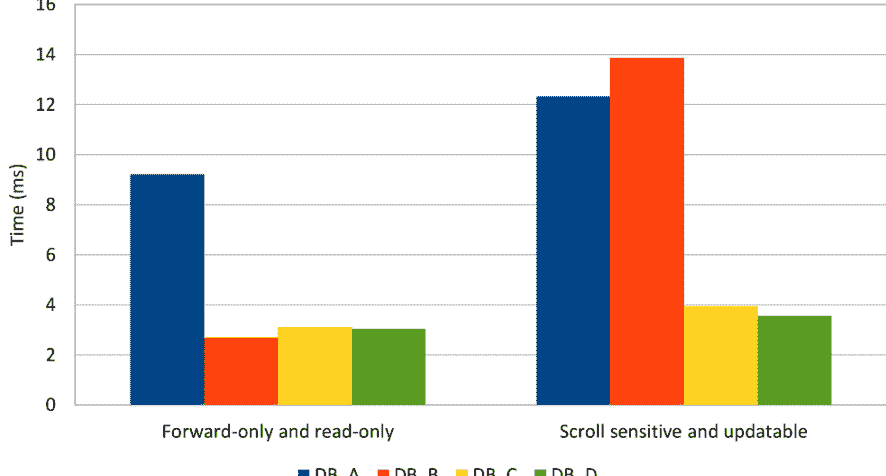

图 6.1：ResultSet 游标类型

测试的每个数据库系统在使用正向且只读结果集时都显示出轻微的。

> 根据经验法则，如果当前事务不需要更新选定的记录，则正向且只读的默认结果集类型是效率最高的选项。即使它是 JDBC 1.0 的遗留，默认结果集在大多数情况下仍然是正确的选择。

## 6.3 ResultSet 持有性（holdability）

JDBC 3.0 版本增加了对结果集持有性的支持，与滚动性和可更新性不同，其默认值取决于具体实现。

### Oracle

默认且唯一支持的持有值是 `HOLD_CURSORS_OVER_COMMIT`。尝试将此设置更改为其他值时会抛出异常。

### SQL Server

默认情况下，即使在当前事务提交或回滚后，结果集也会保持开启。SQL Server 也支持 `CLOSE_CURSORS_AT_COMMIT` 设置。

### PostgreSQL

与其他数据库系统不同，默认的持有值为 `CLOSE_CURSORS_AT_COMMIT`，但驱动程序也支持 `HOLD_CURSORS_OVER_COMMIT` 设置。

### MySQL

默认且唯一支持的持有值是 `HOLD_CURSORS_OVER_COMMIT`。

在企业级应用中，数据库连接在事务之间被复用，因此在事务结束后持有结果集是有风险的。取决于底层数据库系统和游标类型，结果集可能会分配系统资源，出于可扩展性考虑，需要尽快释放。

> 尽管并非所有数据库引擎都支持 `CLOSE_CURSORS_AT_COMMIT` 持有选项，但通过简单关闭所有获取的 `ResultSet` 及其关联 `Statement` 对象可以实现相同的效果。

## 6.4 获取大小（fetching size）

JDBC `ResultSet` 充当操作级游标，因此每当遍历语句时，结果必须从数据库传输到客户端。传输速率由 fetch size 控制。

```java
statement.setFetchSize(fetchSize);
```

自定义的 fetch size 为驱动程序提供了一个提示，说明单次数据库往返中需要检索的行数。默认值 `0` 让每个数据库选择自己的特定驱动程序获取策略。

### Oracle

由于 JDBC 驱动内存模型的影响，默认 fetch size 设置为 10 条记录。

Oracle 10i 和 11g 驱动在创建语句时会预分配 `byte[]` 和 `char[]` 缓冲区，其长度由 fetch size 乘以每个创建语句的最大内存占用计算得出。（注：此处原文存在大量重复内容，已清理）

### SQL Server

SQL JDBC 驱动使用自适应缓冲，因此根据需要批量获取结果。因此，批量的大小由驱动程序自动控制。

> 虽然默认情况下，自适应缓冲限于正向移动游标。滚动和可更新的结果集均在单个数据块上操作，其长度由当前 fetch size 决定。

`https://msdn.microsoft.com/en-us/library/bb79937.aspx?sql=110=29`

### ResultSet 获取

#### PostgreSQL

整个结果集一次性获取到客户端内存中。默认 fetch size 只需要一次数据库往返，代价是增加了驱动程序的内存消耗。通过更改 fetch size，结果集与数据库游标相关联，允许按需获取数据。

> `https://jdbc.postgresql.org/documentation/head/query.html`

#### MySQL

从网络协议设计考虑，获取整个结果集是最有效的数据检索策略。唯一的流式选项需要一次处理一行，对于大型结果集来说，这意味着多次数据库往返。

> `http://dev.mysql.com/doc/connector-j/en/connector-j-reference-implementation-notes.html`

以下图表捕获了四个数据库系统在获取 10 000 行时，改变正向且只读 `ResultSet` 的 fetch size 时的响应时间。

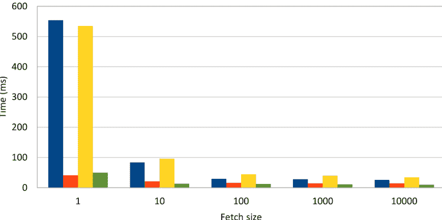

图 6.2：ResultSet fetch size

一次获取一行需要 10 000 次往返，网络开销会影响响应时间。对于 100 行，fetch size 在降低检索时间方面起着重要作用。

`ResultSet` 获取往返次数（roundtrips），但超过此点后，收益将不再明显。

## 6.5 ResultSet 大小

设置适当的获取大小（fetching size）无疑可以加快结果集的检索，前提是语句仅获取当前业务逻辑所需的数据。遗憾的是，很多情况下（特别是随着 ORM 工具的普及），语句可能会选择比需要更多的数据。这个问题可能是由于选择了许多行或过多的列导致的，而这些数据随后在数据访问层或业务层中被丢弃。

### 6.5.1 行数过多

表格的大小往往会增长（特别是当应用获得更多流量时），随着时间的推移，适中的结果集很容易变成性能瓶颈。这些问题通常在生产系统中被发现，往往是在应用程序代码发布很久之后。

用户界面可以容纳视图显示的所有信息。因此，如果结果集无法放入用户界面，那么获取整个结果集是低效的。分页或动态滚动是解决此问题的常见方法，对数据集进行分区变得不可避免。

限制结果集在批处理中也很常见。为了避免长时间运行的事务（可能会给数据库的 undo/redo 日志带来压力），并从并行执行中获益，批处理器会将当前的工作负载划分为更小的作业。这样，批处理作业就可以只处理整个数据的子集。

> 当结果大小受到外部因素的限制时，选择比需要更多的数据是没有意义的。通过设置上限，结果集将与底层表数据按比例增长。大型结果集需要更多时间来提取和通过网络传输。因此，限制查询可以确保可预测的响应时间和数据库资源利用率。处理时间越短，行级锁释放得越快，数据访问层的可扩展性就越强。

限制结果集基本上有两种方法。

前一种且最高效的策略是在 SQL 语句中包含行限制子句。这样，优化器（Optimizer）就可以针对当前的结果集大小生成一个最优的执行计划（例如选择索引而不是全表扫描）。

后者是在 JDBC `Statement` 中配置最大行数。理想情况下，驱动程序可以调整语句以包含等同于 SQL 子句的结果集限制，但绝大多数情况下，它只是向数据库引擎提示使用数据库游标。

#### 6.5.1.1 SQL `LIMIT` 子句

##### SQL:2008

虽然 SQL:2008 增加了对限制结果集的支持，但只有从 Oracle 12c、SQL Server 2012 和 PostgreSQL 8.4 开始，才开始支持标准语法。

```sql
SELECT pc.id AS pc_id, p.title AS p_title
FROM post_comment pc
INNER JOIN post p ON p.id = pc.post_id
ORDER BY pc_id
OFFSET ? ROWS
FETCH FIRST (?) ROWS ONLY
```

> 将行数占位符放在括号内是针对 PostgreSQL 数据库问题的一种变通。在 SQL Server 上，不带外层括号也可以正常工作。

旧版本或其他数据库系统（例如 MySQL 5.7）仍然依赖于特定的语法来限制结果大小。

`https://docs.oracle.com/database/121/SQLRF/statements_10002.html#SQLRF01702`

`https://technet.microsoft.com/en-us/library/gg690618%29=sql..110%29.aspx`

`https://www.postgresql.org/docs/current/static/sql-select.html#SQL-LIMIT`

##### Oracle

与其他关系型数据库不同，Oracle 没有用于限制结果集的保留关键字，因为每条记录都被记录为结果集的顺序号（由 `ROWNUM` 虚拟列提供），限制结果集的语法变为：

```sql
SELECT *
FROM (
    SELECT pc.id AS pc_id, p.title AS p_title
    FROM post_comment pc
    INNER JOIN post p ON p.id = pc.post_id
    ORDER BY pc_id
)
WHERE ROWNUM <= ?
```

##### SQL Server

`TOP` 关键字是限制结果集大小的惯用方法：

```sql
SELECT TOP (?) pc.id AS pc_id, p.title AS p_title
FROM post_comment pc
INNER JOIN post p ON p.id = pc.post_id
ORDER BY pc_id
```

##### PostgreSQL 和 MySQL

`LIMIT` 子句为结果集大小设置上限：

```sql
SELECT pc.id AS pc_id, p.title AS p_title
FROM post_comment pc
INNER JOIN post p ON p.id = pc.post_id
LIMIT ?
```

#### 6.5.1.2 JDBC `maxRows`

JDBC 规范定义了 `maxRows` 属性，它限制当前语句的所有 `ResultSet`。

```java
statement.setMaxRows(maxRows);
```

与 SQL 构造不同，JDBC 备选方案在所有驱动实现中都是可移植的。当应用程序需要支持多个数据库系统时，这非常有帮助。

根据 JDBC 文档，驱动程序在达到最大阈值时预期丢弃额外的行。

从数据访问性能的角度来看，丢弃额外的行是一个糟糕的策略，因为它浪费了数据库资源（CPU、I/O、内存）以及网络带宽。

> `http://docs.oracle.com/java/8/docs/api/java/sql/Statement.html#setMaxRows-int-`

##### Oracle

在遍历 `ResultSet` 时，客户端游标分块抓取数据（由 fetch size 属性控制每个分块中的记录数）。

在每次批量检索后，都会检查总记录数是否达到 `maxRows` 上限，如果达到阈值，驱动程序将关闭流。

`maxRows` 能够防止数据库获取客户端不需要的数据。

##### SQL Server

当调用 `Statement.setMaxRows(int maxRows)` 时，驱动程序调用 `ROWCOUNT`。

与 `TOP` 或 `FETCH` 指令不同，`ROWCOUNT` 仅在执行阶段被考虑，因此执行计划可能不会针对给定的结果集进行优化，从而可能选择全表扫描。

> SQL Server 文档建议使用 SQL 指令而非 `ROWCOUNT`。

`https://msdn.microsoft.com/en-us/library/mx37883%28v-sql.29`

##### PostgreSQL

JDBC 驱动获取 `maxRows` 属性并将其与执行的语句一起发送。有了此信息，优化器可以为给定的结果集定制执行计划，并避免某些昂贵的操作（如全局排序）。提取器在获取所需的记录后也可以关闭数据库游标，从而节省资源。

##### MySQL

`maxRows` 属性没有发送到数据库服务器，因此优化器和提取器无法从此提示中受益。虽然 JDBC 驱动通常会获取所有行，但通过为结果集设置上限，客户端可以节省网络开销。

#### 6.5.1.3 少即是多

以下测试将演示限制结果集大小带来的性能提升。测试数据集包含 100,000 篇文章和 1,000,000 条评论。在第一轮中，根据投影大小检索了整个结果集。通过使用 SQL 或 JDBC `maxSize` 设置将结果集限制在 100 条记录，响应时间将大幅下降。

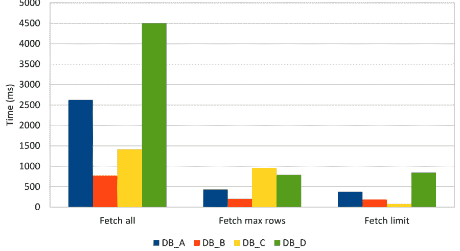

图 6.3：ResultSet 大小

测试结果证实了之前的假设，SQL 层限制证明是限制结果集的最佳策略。`maxRows` 驱动实现了出乎意料的结果，特别是考虑到 JDBC 规范关于丢弃额外记录的规定。获取大型结果会对数据库资源产生巨大压力，这不仅影响当前的工作单元。其他并发事务也可能由于数据库资源短缺而表现出更长的处理时间。

### 6.5.2 列过多

不仅获取过多行会导致性能问题，甚至提取过多的列也会增加结果处理的响应时间。下一个测试用例将使用以下语句之一，选择 100 篇带有详情帖子及其关联的 1000 条评论：

```sql
SELECT *
FROM post_comment pc
INNER JOIN post p ON p.id = pc.post_id
INNER JOIN post_details pd ON p.id = pd.id

SELECT pc.version
FROM post_comment pc
INNER JOIN post p ON p.id = pc.post_id
INNER JOIN post_details pd ON p.id = pd.id
```


下图描述了获取所有列的执行时间，与仅提取整个列投影子集的执行时间之间的对比。

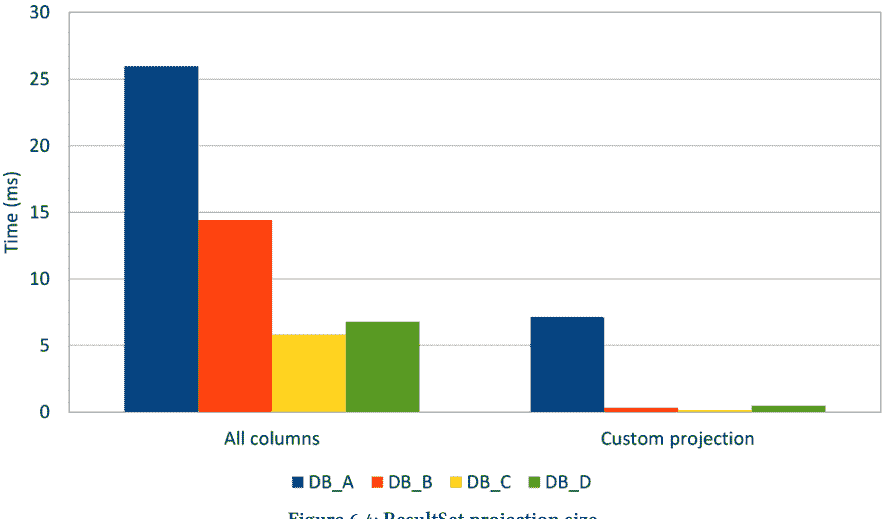

这种情况在 ORM 工具中更为常见，因为为了完全填充实体，需要选择所有列。在仅选择少数实体时，这可能不会被注意到，但对于大型结果集，这可能会变成一个明显的性能问题。

> 如果业务场景只需要实体属性的子集，获取额外的列将导致数据库和应用程序资源（CPU、内存、I/O、网络）的浪费。

## 7. 事务

数据库系统必须允许对底层数据的并发访问。但共享数据意味着读写操作必须同步，以确保数据完整性不受破坏。

为了控制并发修改，Java 语言定义了 `synchronized` 关键字有两个用途：

- 它可以限制对共享对象的访问（以保持不不变性），使得在任何给定时间只有一个线程可以执行例程
- 它将更改从当前线程本地内存传播到全局内存，即所有运行中的执行线程都可用。

这种行为在其他并发编程环境中是典型的，数据库系统也不例外。在关系型数据库中，确保数据完整性的机制实现在事务之上。

事务是一组读写操作的集合，可以作为一个单元共同成功或失败。所有的数据库语句都必须在事务上下文中执行，即使客户端显式定义了其边界。

1981 年，Jim Gray 在其著名的论文《事务概念：优点与局限性》中定义了数据库事务的几个属性。这篇论文和 SQL 标准的第一版本（SQL-86 和 SQL-89）只使用了三个属性来定义数据库事务：原子性（Atomicity）、一致性（Consistency）和持久性（Durability）。

随着其他关系数据库主题，事务研究一直持续，SQL-92 版本引入了隔离级别的概念。这四个属性被组合成著名的 ACID（原子性、一致性、隔离性和持久性）缩写，它已成为关系型事务的同义词。

了解数据库事务的工作原理对很多方面都非常重要：

- 有效的数据访问（在追求高性能时，数据完整性不应受到破坏）
- 高效的数据访问（减少冲突可以最小化事务响应时间，从而增加吞吐量）。

接下来的章节将结合高性能数据处理详细说明每个事务属性。

> http://research.microsoft.com/en-us/um/people/gray/papers/theTransactionConcept.pdf

## 7.1 原子性

原子性是将多个操作分组为一个“全有全无”工作单元的属性，只有当所有单个操作都成功时，该单元才成功。因此，数据库必须能够回滚与每个执行语句相关的所有操作。

| X=11 | X=11 | X=11 | X=11 | X=10 |
|---|---|---|---|---|
| Y=2 | Y=2 | Y=22 | Y=22 | Y=20 |
| Z=3 | Z=3 | Z=33 | Z=30 | Z=30 |

执行的事务

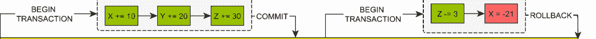

失败的事务

| X=1 | X=11 | X=11 |
|---|---|---|
| Y=2 | Y=22 | Y=22 |
| Z=3 | Z=33 | Z=33 |

图 7.1：原子工作单元

### 写-写冲突

理想情况下，每个事务都应该有一个完全隔离的分支，在回滚时可以很容易丢弃。这种场景类似于版本控制系统（例如 git）实现分支的方式。在发生冲突时，版本控制系统中止提交操作，客户端必须手动解决冲突。与 VCS 工具不同，关系型数据库引擎必须在没有任何人工干预的情况下管理冲突。

因此，数据库防止写-写冲突情况，在任何给定时间只有一个事务可以写入记录。

所有语句都针对实际数据结构（表、索引、内存缓冲区）执行，仅在提交时才实例化。在发生回滚时，数据库必须将任何挂挂的更改数据恢复到之前的状态。

### Oracle

undo 回表空间在 undo 段中存储之前的版本版本。在回滚时，数据库引擎搜索相关的 undo 段，以重建由运行事务更改的每个数据的之前的映像。

> https://docs.oracle.com/database/121/admin/undo.html

### SQL Server

事务日志存储当前运行事务及其关联修改的详细信息。回滚时，数据库引擎反向搜索事务日志。当找到记录时，数据库引擎恢复映像。

为了防止事务日志溢出，必须定期对其进行截断。长时间事务会延迟截断过程，这是另一个避免它们的原因。

https://msdn.microsoft.com/en-us/library/ms1925

### PostgreSQL

与其他数据库系统不同，PostgreSQL 不使用专门的追加日志。由于其多版本特性，每个数据库对象维护自己的版本历史。在没有日志的情况下，回收旧版本占据存储的过程被称为 VACUUM。

XID 是一个 32 位数，因此它可以容纳 40 亿个事务。在高性能应用程序中，如果 XID 计数达到最大值，它将绕回并从零开始。重置之前的事务的 ID 将大于重置后的事务，可能会导致严重的数据完整性问题。

### MySQL

undo 日志存储在系统表的回滚段中。每个 undo 日志分为两个部分，一个用于回滚，另一个用于重建映像。第一部分可以在事务结束后立即清除，而另一部分则需要持续到任何当前查询或其他并发事务需要之前的版本。

在后台，MySQL 运行清理进程来清理已删除记录占据的存储，并回收不再需要的 undo 段。

长时间事务会延迟清理进程的执行，导致 undo 日志急剧，，是在写密集的访问场景下。

https://dev.mysql.com/doc/refman/5.7/en/innodb-multi-versioning.html

## 7.2 一致性

关系型数据库模式确保所有主要修改（插入/更新/删除语句）以及次要修改（由触发器发出）都遵循底层数据结构的某些规则：

- 列类型
- 列长度
- 列是否为空
- 外键约束
- 唯一键约束
- 自定义检查约束

一致性是验证事务状态的变化，确保所有提交的事务都能让数据库处于正确的状态。如果违反了任何一个约束，整个事务将回滚，所有的修改将被撤销。

尽管应用程序在构建数据库语句之前必须验证用户输入，但应用程序级别的检查无法跨越其他并发请求（这些请求可能来自不同的 Web 服务器）。

### MySQL

传统上，MySQL 的约束并不是严格执行的，数据库引擎会用预定义的默认值替换无效值：

- 超出范围的数值值被设置为 0 或最大可能值
- 字符串值会被修剪至最大长度
- 允许不正确的数据值（例如 2015-02-30）
- NOT NULL 约束仅对单个 INSERT 语句生效。对于多行插入，用 0 替换空数值值，并用空值替换空字符串（String）。

在 5.0.2 版本中，如果将数据库引擎配置为使用自定义的 `sql_mode`，就可以实现严格的约束：

```sql
SET GLOBAL sql_mode='POSTRESQL,STRICT_ALL_TABLES';
```

由于 `sql_mode` 会在服务器启动时重置，因此在 MySQL 配置文件中设置更好：

```ini
[mysqld]
sql_mode = POSTRESQL,STRICT_ALL_TABLES
```

> *[https://dev.mysql.com/doc/refman/5.7/en/constraint-invalid-data-data.html](https://dev.mysql.com/doc/refman/5.7/en/constraint-invalid-data-data.html)
* [https://dev.mysql.com/doc/refman/5.7/en/sql-mode.html](https://dev.mysql.com/doc/refman/5.7/en/sql-mode.html)

## CAP 定中的一致性

根据 CAP 定理*，当分布式系统遇到网络分区时，系统必须在一致性（所有更改立即应用到所有节点）或可用性（任何节点都可以接受请求）之间做出选择，而不可兼得。在 ACID 的定义中，一致性是关于遵守约束；在 CAP 定理的语文中，一致性指的是线性化，这是一种隔离保证。

> *[https://en.wikipedia.org/wiki/CAP_theorem](https://en.wikipedia.org/wiki/CAP_theorem)
* [http://www.bailis.org/blog/linearizability-versus-serializability/](http://www.bailis.org/blog/linearizability-versus-serializability/)

## 7.3 隔离

如果只有一个用户访问数据库，就不会有数据冲突的风险。根据通用可扩展性法则，如果数据访问模式的顺序执行部分小于 100%，数据库系统就可以从并行化中获益。

通过提供多个并发连接，事务吞吐量可以增加，数据库系统可以容纳更多流量。并行化带来了额外的挑战，因为数据库必须交错事务，以确保冲突不会损害数据完整性。如果所有运行事务操作的执行顺序与底层事务一个接一个执行的结果相同，则称该执行顺序是可串行化的。

串行化执行是唯一不损害数据完整性同时允许某种并行性的事务隔离级别。1981 年，Jim Gray 描述最大的航空公司和银行拥有 10,000 个终端和 100 个活动事务，这解释了为什么在 SQL-92 之前，串行化是事实上的事务隔离级别。

### 7.3.1 并发控制

为了管理数据，多年来开发了几并发控制机制。处理集合基本上有两种策略：

- 避免冲突（例如两阶段锁）需要通过锁来访问共享资源
- 检测冲突（例如多版本并发控制）提供了更好的并发性，但代价是放宽串行化并可能接受各种异常。

### 7.3.1.1 两阶段锁

1976 年，Kapali Everson 和 Jim Gray 等发表了论文《数据库系统中的一致性与谓词锁²》，该论文证明了如果所有事务都使用两阶段锁（2PL）协议，就可以获得串行化。

最初所有数据库都采用 2PL 实现串行化事务，但随着时间的推移，许多用户转向 MVCC（多版本并发控制）架构。默认情况下，SQL Server 在串行化隔离级别仍使用锁。由于 2PL 保证了事务串行化，因此理解维护数据完整性相对于整个应用程序可扩展性和事务性能之间的代价是非常重要的。

但锁不仅用于 2PL 实现，为了解决 DML 和 DDL 语句之间的交互以及资源竞争，关系型数据库系统使用了多粒度锁³。

> *[https://research.microsoft.com/en-us/people/gray/papers/On%20the%20Notions%20of%20Consistency%20and%20Predicate%20Locks%20in%20Database%20system=ACM.pdf](https://research.microsoft.com/en-us/people/gray/papers/On%20the%20Notions%20of%20Consistency%20and%20Predicate%20Locks%20in%20Database%20system=ACM.pdf)
³[https://en.wikipedia.org/wiki/Multiple_granularity_locking](https://en.wikipedia.org/wiki/Multiple_granularity_locking)

#### 事务

数据库对象本质上是层次化的，逻辑表空间映射到多个数据库文件，这些文件由数据页组成，每个页包含多行。因此，可以在不同的数据库对象类型上获取锁。在较低级别（例如行）上锁定可以提供更好的并发性，因为它减少了竞争的可能性。每个锁都会消耗资源，持有多个低级锁可能会累积，因此数据库可能会决定将多个低级锁替换为一个高级锁。这个过程被称为升级，它用数据库资源换取并发性。

每个数据库系统都有自己的锁层级，但最常见的类型（即使在 2PL 初始读取中也提到过）仍然是：

- 共享（读）锁，在允许并发读取的同时防止记录被写入。
- 独占（写）锁，禁止所有读取和写入操作。

仅有锁不足以防止冲突。并发控制策略必须定义如何获取和释放锁，因为这对事务交错也有产生影响。

出于此目的，2PL 协议定义了一种确保串行化的管理策略。2PL 协议将事务分为两个部分：

- 扩展阶段（获取锁）
- 收缩阶段（释放锁）

在基于锁的并发控制中，所有交错事务必须遵循 2PL 协议，否则串行化可能会受到破坏。

#### 事务调度

为了从故障中恢复，事务调度（操作的序列）必须是严格的。如果在事务中发生了写入操作，为了实现严格性，该事务必须提交。

仅在事务结束（提交或回滚）后释放锁是实现严格性的要求。

下面的图显示了 2PL 如何协调事务交错：


图 7.2：两阶段锁

- Alice 和 Bob 选择了一个帖子记录，都在该记录上获取了共享锁
- 当 Bob 尝试更新帖子时，他的语句被锁管理器阻塞，因为 Alice 仍持有共享锁
- 只有在 Alice 事务结束并释放所有锁后，Bob 才能恢复更新
- Bob 的更新将产生锁升级，因此共享锁被独占锁替换，这将阻止任何并发读取或写入操作
- Alice 启动新事务对同一帖子发布查询，语句被锁管理器阻塞，因为 Bob 拥有该记录的独占锁
- 在 Bob 事务提交后，释放所有锁，Alice 的查询可以恢复，从而获取该数据库记录的最新值

#### 死锁

使用锁控制共享资源的访问容易产生死锁，事务调度器本身无法防止它们的发生。

死锁发生在两个并发事务无法进展，因为每个事务都在等待另一个释放锁。由于两个事务都处于锁获取阶段，都不会在获取下一个锁之前释放锁。


图 7.3：死锁

保持锁顺序是数据访问层的责任，数据库只能协助从死锁状态中恢复。

数据库引擎运行一个单独进程，扫描当前冲突图中的锁等待循环（由死锁引起）。当发现循环时，数据库引擎会选择一个事务并中止它，导致其锁被释放，以便另一个事务可以进展。

### 7.3.1.2 多版本并发控制 (MVCC)

虽然锁可以提供可行化的事务调度，但锁竞争的成本会损害事务的响应时间和可扩展性。响应时间可能会增加是因为事务必须等待锁释放，而且长时间运行的事务也会减慢其他并发事务的进度。根据阿姆达法则（Amdahl's Law）和通用可扩展性法则，并发也会受到竞争的影响。

为了解决这些缺点，数据库厂商选择了乐观并发控制机制。如果说两阶段锁（2PL）是为了防止冲突，那么多版本并发控制（MVCC）则使用了冲突检测策略。

> MVCC 的承诺是读者不阻塞写入者，写入者也不阻塞读者。唯一的竞争源于写入者阻塞其他并发的写入者，否则会损害事务的回滚和原子性。

为了防止阻塞，数据库可以重建数据库记录的先前版本，这样未提交的更改就可以对新进入的并发读者隐藏。由于缺乏锁定，实现可行化调度变得更加困难，因此数据库引擎必须分析当前的交错操作，并检测可能损害可行性的异常。

#### Oracle

Oracle 完全没有实现 2PL，而是依靠 MVCC 机制来管理并发数据。每个查询都会获得时间点数据快照，并根据隔离级别，使时间戳引用相对于当前语句或当前事务的开始时间。

为了重建之前的记录，Oracle 使用了回滚段（undo segments），这些回滚段已经包含了回滚未提交更改所需的所有数据。时间点基于系统更改号（SCN），这是一个逻辑时间戳引用，与物理时间不同，它被保证是单调递增的。

除了 MVCC，Oracle 同样支持使用 `SELECT FOR UPDATE` SQL 语法进行显式锁定。

> https://docs.oracle.com/database/121/CNCP/consist.html#CNCP221

#### SQL Server

默认情况下，SQL Server 使用锁来实现 SQL 标准规定的所有隔离级别。

为了让“已提交”（Read-Committed）隔离级别能够利用 MVCC 模型，必须首先设置以下配置：

```sql
ALTER DATABASE high_performance_java_persistence
SET READ_COMMITTED_SNAPSHOT ON;
```

对于更高级别的隔离，SQL Server 提供了快照（Snapshot）隔离模式，该模式必须在数据库级别激活：

```sql
ALTER DATABASE high_performance_java_persistence
ALLOW_SNAPSHOT_ISOLATION ON;
```

因为快照是一个自定义的隔离级别，在启动新事务之前还必须在连接级别设置：

```sql
SET TRANSACTION ISOLATION LEVEL SNAPSHOT;
GO
BEGIN TRANSACTION;
GO
COMMIT TRANSACTION;
GO
```


当行被更新或删除时，数据库可以在`tempdb`数据库中跟踪更改。当前行版本将有一个指向先前版本的引用，该引用记录在`tempdb`数据库的版本存储器（version store）中。行并不会立即删除，而是被 Ghost 清理任务标记为待删除。必须保留旧版本，因为当前运行的事务可能需要它们，这由事务隔离级别指定。

Ghost 清理任务定期运行，并回收不再需要的旧版本的存储空间。

> 长运行的事务将要求数据库引擎长时间保留某些旧版本，而且由于版本更改是以链表结构链联的，恢复先前版本可能会变成资源密集型。

## PostgreSQL

与所有其他数据库系统不同，PostgreSQL 在实际数据库表中同时存储当前行和先前版本（即使是已中止事务的版本）。像 Oracle 一样，PostgreSQL 纳了 MVCC 数据访问模型，并且完全没有提供 2PL 事务隔离实现。

每行有两个额外的列（`xmin`和`xmax`），用于控制不同行版本的可见性。当插入行时，当前事务标识符存储在`xmin`列中。

更新和删除操作最终都会创建一个新的行条目，其`xmax`列存储当前事务标识符。

Vacuum（清理器）定期运行，回收被已删除条目（已成功提交）或当前运行事务不再需要的旧版本所占用的存储空间。

> 尽管 PostgreSQL 被视为一种 MVCC 模型，但仍然需要锁定来防止显式锁定的写写冲突。`SELECT FOR UPDATE`用于获取排他行锁，而`SELECT FOR SHARE`用于应用共享锁。

## MySQL

InnoDB 存储引擎提供 ACID 事务的支持，并使用 MVCC 控制共享资源的访问。InnoDB 的 MVCC 实现与 Oracle 非常相似，数据库行的先前版本也存储在回滚段（rollback segment）中。

当事务请求之前的行时，MySQL 必须从回滚段重建它。删除操作只是将条目标记为待删除，由清理线程（purge thread）执行实际的清理工作。

事务回滚和之前的行版本恢复过程（由定的事务可见性保证要求）本质上是一回事。

> 与其他数据库系统一样，MySQL 在 MVCC 不再满足需求时也提供显式锁定。使用`SELECT LOCK IN SHARE MODE`获取共享锁，而对于排他锁，则使用更常用的`SELECT FOR UPDATE`语法。

### 7.3.2 现象

对于合理的事务吞吐量值，暗示事务的可行化是有意义的。随着接入流量的增长，严格数据完整性的代价变得过高，这就是拥有多个隔离级别的主要原因。放宽可行化保证可能会产生数据完整性异常，这些异常也被称为现象。

SQL-92 标准引入了在放弃可行化事务调度时可能发生的三个现象：

- 脏读（dirty read）
- 不可重复读（non-repeatable read）
- 幻读（phantom read）。

在现实中，由于事务交错还会可能发生其他现象，著名的论文《对 ANSI 隔离级别的批判》（A Critique of ANSI Isolation Levels）描述了：

- 脏写（dirty write）
- 倾斜（read skew）
- 写倾斜（write skew）
- 丢失更新（lost update）。

> 选择特定的隔离级别是在增加并发性和承认可能发生的异常之间的权衡。可扩展性受到竞争和一致性成本的影响。隔离级别越低，锁定（或事务回滚）就越少，应用程序就越可扩展。但低隔离允许更多现象，数据完整性的责任从数据库端转移到了应用程序端，程序必须确保采取措施来防止或缓解此类异常。

在跳转到隔离级别之前，最好了解每个现象背后的原理以及它们如何影响数据完整性。在选择特定的隔离级别时，理解现象对于做出决策至关重要，

http://research.microsoft.com/apps/default.aspx?id=69541

#### 7.3.2.1 脏写

当并发事务同时修改同一行时，就会发生脏写。如前所述，所有更改都应用于实际的对象结构，这意味着第二个事务直接覆盖了第一个事务未提交的更改。

| Alice | 数据库 | Bob |
| --- | --- | --- |
| --- BEGIN TRANSACTION | post | |
| | id:1 title:'Transactions' | |
| | | --- BEGIN TRANSACTION |
| UPDATE post | post | |
| - SET title = 'ACID' | id:1 | |
| WHERE id = 1 | title:'ACID' | |
| --- ROLLBACK --- | post | |
| | | UPDATE post | id:1 |
| | | title:'Transactions' |

如果两个事务都提交，其中一个将静地覆盖另一个事务，导致丢失更新。当第一个事务想要回滚时，会出现另一个问题。数据库引擎必须在以下操作中选择：

- 它将行恢复到先前的版本（第一个事务更改之前的状态），但这样会覆盖第二个事务未提交的更改
- 它承认存在较新的版本（由第二个事务发布），但是，如果第二个事务必须回滚，那么它的先前版本将变成第一个事务未提交的更改。

如果数据库引擎不执行脏写，保证回滚将是不可能的。因为在没有可靠回滚的情况下无法实现原子性，所有数据库系统必须防止脏写。

尽管 SQL 标准没有提到这种现象，但即使是最低的隔离级别（读取未提交）也能防止它。

#### 7.3.2.2 脏读 (Dirty read)

如前所述，所有的数据库更改都会应用于实际的数据结构（内存缓冲区、数据块、索引）。当一个事务允许读取另一个并发事务未提交的更改时，就会发生脏读。在尚未提交的值上做出业务决策是有风险的，因为未提交的更改可能会被回滚。

| Alice | Database | Bob |
| --- | --- | --- |
| | post | |
| | id: 1 | |
| | title:'Transactions' | |
| | ------ BEGIN TRANSACTION ------ | | |
| | | post | |
| UPDATE post | id: 1 | |
| SET title='ACID' | | |
| WHERE id = 1 | title:"ACID' | |
| | | SELECT * | |
| | | FROM post | |
| | | WHERE id = 1 | |
| ROLLBACK | post | |
| | | id:1 | |
| | | title:'Transactions' |

图 7.5：脏读

这种异常仅在读未提交（Read Uncommitted）隔离级别下被允许，由于对数据完整性有严重影响，大多数数据库系统都提供更高的默认隔离级别。

为了防止脏读，数据库引擎必须对所有并发事务隐藏未提交的更改（创建更改的事务除外）。每个事务允许看到自己的更改，否则“读你自己的写”（read-your-own-write）的保证就会失效。

一种简单的方法是对已提交的行加锁，但这完全不可行（如果一个长时间的事务获取了此类锁，那么在锁释放之前，其他事务将无法读取该行）。锁会增加竞争，而竞争会影响可扩展性。

由于回滚日志（undo log）记录了每个未提交记录之前的版本，数据库引擎可以使用它来恢复其他并发事务查询中的旧值。由于所有其他隔离级别（读提交、可重复读、串行化）都使用这种机制，大多数数据库系统都会优化之前的镜像恢复过程（降低其对整个应用程序性能的开销）。

使用读未提交（Read Uncommitted）的情况很少（例如可以接受脏读的非严格报表查询），因此读提交（Read Committed）通常是最低的实用的隔离级别。

#### 7.3.2.3 不可重复读 (Non-repeatable read)

如果一个事务读取数据库行而没有对新获取的记录应用共享锁，那么并发事务可能会在第一个事务结束之前更改该行。

| Alice | Database | Bob |
| :--- | :--- | :--- |
| | BEGIN TRANSACTION | | post id:1 title:'Transactions' |
| | | | BEGIN TRANSACTION |
| | | SELECT * FROM post WHERE id = 1 | | post id:1 title:'Transactions' |
| UPDATE post SET title = 'ACID' WHERE id = 1 | post id:1 title:'ACID' | |
| | COMMIT | | SELECT * FROM post WHERE id = 1 | | post id:1 title:'ACID' |

图 7.6：不可重复读

当当前事务根据数据库行的第一个值做出业务决策时，这种现象就会产生问题（客户可能根据一个不再是正整数的库存量订购产品）。

大多数数据库系统已转向多版本并发控制（MVCC），且共享锁不再是防止不可重复读的强制性。通过验证当前行，如果获取的记录在此期间发生了变化，事务可以中止。

可重复读（Repeatable Read）和串行化（Serializable）默认防止这种异常。在读提交（Read Committed）下，如果显式获取共享锁（例如`SELECT FOR SHARE`），则可以避免不可重复（模糊）读。

某些框架（例如 JPA/Hibernate）提供了应用级别的可重复读。任何检索到的实体的第一个快照都缓存在当前的持久化上下文（Persistence Context）中。任何返回相同数据库行的后续查询都将使用之前缓存的同一个对象。通过这种方式，即使在读提交级别下也可以防止模糊读。

#### 7.3.2.4 幻读 (Phantom read)

如果一个事务根据满足谓词的一组行做出业务决策，而没有使用谓词锁，并发事务可能会插入一条匹配该特定谓词的记录。

| Alice | Database | Bob |
|---|---|---|
| | post_comment | |
| | id:1 post_comment | |
| | id:2 post_comment | |
| | id:3 post_id:1 | |
| | BEGIN TRANSACTION | |
| | SELECT * FROM post_comment WHERE post_id = 1 | |
| | | post_comment |
| | | id:1 post_comment |
| | | id:2 post_comment |
| | | id:3 post_id:1 |
| | | id:4 post_id:1 |
| | INSERT INTO post_comment (id, post_id) VALUES (4, 1) | post_comment |
| | | id:1 post_comment |
| | | id:2 post_comment |
| | | id_3 post_id:1 |
| | | id:4 post_id:1 |
| | COMMIT | |

图 7.7：幻读

幻读行可能导致买家购买了某件产品，而却不知道在用户完成列表获取后添加了更好的报价。

传统上，串行化（Serializable）通过谓词锁防止幻读。其他 MVCC 实现可以通过通过检查事务调度表并中止任何违反其串行化保证的事务来检测幻读行。

如果显式锁定即使在读提交隔离级别也能防止幻读，那么就没有这样的 SQL 结构来允许获取范围锁。

#### 7.3.2.5 读倾斜 (Read skew)

读倾斜是一种少为人知的异常，涉及对多个数据库表的约束。在接下来的示例中，应用程序要求*post*和*post_details*同步更新。每当 post 更改时，关联的*post_details*必须记录更改的用户。

| Alice | Database | Bob |
|---|---|---|
| | post_details | post |
| | id:1 | id:1 |
| | updated_by:'Alice' | title:'Transactions' |
| | BEGIN TRANSACTION | |
| | SELECT * FROM post WHERE id = 1 | |
| | | post | |
| | | id:1 | |
| | | title:'Transactions' |
| UPDATE post title = 'ACID' WHERE id = 1 | |
| | | post | |
| | | id:1 | |
| | | title:'ACID' |
| UPDATE post_details SET updated_by = Bob WHERE id = 1 |
| | COMMIT | |
| | | post_details | |
| | | id:1 | |
| | | updated_by:'Bob' |
| | | SELECT * FROM post_details WHERE id = 1 | |

图 7.8：读倾斜潜入并管理

在选择*post*和*post_details*行时，第二个事务潜入并更新了这两个记录。第一个事务将看到*post行*的旧版本以及关联*post_details*的最新版本。由于这种读倾斜，事务将假设该特定的 post 是*Bob*更新的，尽管实际上它是由 Alice 更新的旧版本。

与不可重复读一样，防止这种现象的方法有两种：

- 第一个事务对每次读取都获取共享锁，从而防止第二个事务更新这些记录
- 通过验证提交约束来中止第一个事务（在使用可重复读或串行化隔离级别的 MVCC 实现时）。

#### 7.3.2.6 写倾斜 (Write skew)

读读倾斜，这种现象涉及两个不同表的非交织写入，这些表被作为一个单元进行更新。每当 post 行更改时，客户端必须更新 post_details 以记录更改的用户。

Alice 和 Bob 将选择 post 及其关联的 post_details 记录。如果允许写倾斜，Alice 和 Bob 可以分别更新这两个记录，从而破坏约束。

与不可重复读一样，防止这种现象的方法有两种：

- 第一个事务对两个条目都获取共享锁，从而防止该事务更新这些记录
- 数据库引擎可以检测到另一个事务更改了这些记录，因此它可以强制第一个事务回滚（在可重复读或串行化的 MVCC 实现下）。

图 7.9：写倾斜

#### 7.3.2.7 丢失更新 (Lost update)

当一个事务读取某行，而另一个事务在第一个事务完成之前对其修改时，就会发生这种现象。在下面的示例中，Bob 的更新被 Alice 静默覆盖了，而 Alice 并没有意识到记录已被更新。

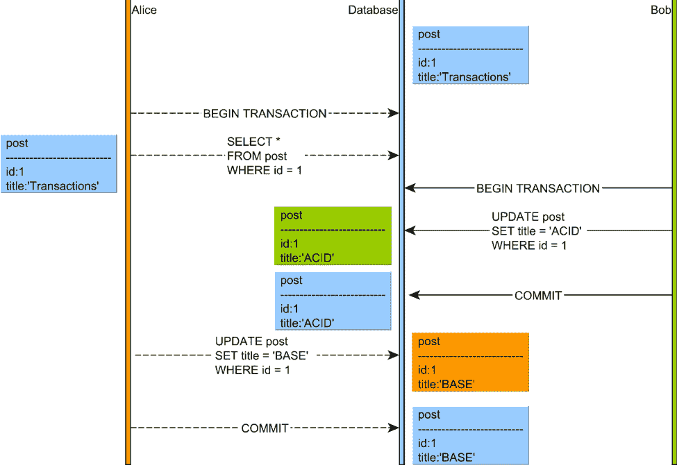

图 7.10：丢失更新

这种异常会对数据完整性产生严重后果（买家在不知道价格已更改的情况下购买了产品），特别是因为它影响了许多数据库系统的默认隔离级别——已提交（Read Committed）。

传统上，可重复读（Repeatable Read）可以防止丢失更新，因为共享锁可以防止并发事务修改已获取的记录。在 MVCC 中，允许第二个事务进行更改，当数据库引擎检测到行版本不匹配时（在第一个事务提交期间），第一个事务会被中止。

大多数 ORM 工具（如 Hibernate）提供了应用层面的乐观锁，它在发布记录修改指令时会自动整合行版本。当行版本不匹配时，更新计数将为零，因此应用程序可以回滚当前事务，因为当前的数据快照是过时的。

### 7.3.3 隔离级别 (Isolation levels)

如前所述，序列化（Serializable）是唯一能提供真正 ACID 事务交错的隔离级别。但序列化是有代价的，因为锁会引入竞争，反过来又限制了并发性和可扩展性。即使在多版本并发模型中，序列化也可能需要中止许多受现象影响的事务。

为了实现这一目的，SQL-92 版本引入了多个隔离级别，数据库客户端可以在并发性与数据正确性之间进行平衡。每个隔离级别的定义取决于它必须防止的现象的最少数量，因此 SQL 标准引入了以下事务级别：

表 7.1：标准隔离级别

| 隔离级别 | 脏读 | 非可重复读 | 幻读 |
| --- | --- | --- | --- |
| 读未提交 (Read Uncommitted) | 是 | 是 | 是 |
| 已提交 (Read Committed) | 否 | 否 | 是 |
| 可重复读 (Repeatable Read) | 否 | 否 | 是 |
| 序列化 (Serializable) | 否 | 否 | 否 |

在没有明确指定的情况下，JDBC 驱动程序使用默认隔离级别，可以使用`DatabaseMetaData`对象的`getDefaultTransactionIsolation()`方法进行检查：

```
int level = connection.getMetaData().getDefaultTransactionIsolation();
```

可以使用`setTransactionIsolation(int level)` Connection 方法更改默认隔离级别。

```
connection.setTransactionIsolation(Connection.TRANSACTION_SERIALIZABLE);
```


> 即使 ACID 属性意味着序列化调度，大多数关系型数据库系统使用的是较低的隔离级别：
>
> - 已提交 (Oracle, SQL Server, PostgreSQL)
> - 可重复读 (MySQL)。

接下来的章节将介绍每个特定的事务隔离级别，并演示给定数据库系统防止的实际现象列表。

### 7.3.3.1 读未提交 (Read Uncommitted)

表 7.2：读未提交现象发生情况

| 现象 | SQL Server | PostgreSQL | MySQL |
|---|---|---|---|
| 脏写 (Dirty Write) | 否 | 否 | 否 |
| 脏读 (Dirty Read) | 是 | 否 | 是 |
| 非可重复读 (Non-Repeatable Read) | 是 | 是 | 是 |
| 幻读 (Phantom Read) | 是 | 是 | 是 |
| 读偏斜 (Read Skew) | 是 | 是 | 是 |
| 写偏斜 (Write Skew) | 是 | 是 | 是 |
| 丢失更新 (Lost Update) | 是 | 是 | 是 |

#### Oracle

不允许脏读，因此最低的隔离级别是已提交（Read Committed）。

> 如果客户端尝试在当前连接上设置读未提交隔离级别，JDBC 驱动程序甚至会抛出异常。

#### SQL Server

读未提交仅防止脏写，允许所有其他现象。使用读未提交时，特定的 SQL 修改没有关联排他锁，因此在未提交的更改之前，其他并发事务就可以获取到这些更改。如果可以接受脏读的风险，避免排他锁可以提高报告查询的速度，特别是在扫描大量数据时。

> 对于基于锁的并发控制机制，如果脏读的风险比锁定数据库表的大部分要小得多，那么读未提交值得考虑。由于 MVCC 避免了读者-写者和写者-读者的锁定，它通过允许脏读可能不会带来显著的性能提升。

#### PostgreSQL

像 Oracle 一样，PostgreSQL 不允许脏读，最低隔离级别是已提交（Read Committed）。

> 当选择读未提交时，JDBC 驱动程序会静默回退到已提交。

#### MySQL

尽管使用了 MVCC，但 InnoDB 实现了读未提交，以便允许脏读。作为一种优化，每个查询都无需重建当前扫描记录的先提交版本（使用回滚段）（以防这些记录最近被修改过）。

### 7.3.3.2 已提交 (Read Committed)

已提交是最常见的隔离级别之一，它在多个关系型数据库系统或各种并发控制模型中的表现一致。

许多数据库系统选择已提交作为默认隔离级别，因为它提供了最佳性能，同时防止脏写和脏读等致命异常。但性能是有代价的，因为已提交允许许多可能导致数据损坏的异常。

表 7.3：已提交现象发生情况

| 现象 | Oracle | SQL Server | SQL Server MVCC | PostgreSQL | MySQL |
|---|---|---|---|---|---|
| 脏写 | 否 | 否 | 否 | 否 | 否 |
| 脏读 | 否 | 否 | 否 | 否 | 否 |
| 非可重复读 | 是 | 是 | 是 | 是 | 是 |
| 幻读 | 是 | 是 | 是 | 是 | 是 |
| 读偏斜 | 是 | 是 | 是 | 是 | 是 |
| 丢失更新 | 是 | 是 | 是 | 是 | 是 |

#### Oracle

每条语句都有一个开始时间戳，该时间戳用于创建相对于该特定点的数据库快照。通过这种方式，写入者仍然可以更新选定的记录，而数据库可以简单地重建查询启动时的可用之前的版本。后续查询执行可能会返回不同的行版本，或者允许非可重复读。

当两个事务尝试更新同一条记录时，第一个事务将锁定记录以防止脏写。第二个事务必须等待第一个事务释放锁（提交或回滚），然后针对最新数据重新评估语句的过滤条件。

#### PostgreSQL

像 Oracle 一样，每个查询都看到当前运行查询开始时的数据库快照。由于没有使用共享锁来保护已读取的记录不被修改，已提交允许一系列数据异常。

排他锁防止写-写冲突，因此当两个事务更新同一条记录时，第二个事务等待第一个事务释放锁。当第二个事务恢复执行时，如果过滤条件仍然有效，它可能会覆盖第一个事务的修改，从而导致丢失更新。

#### MySQL

使用查询时快照将语句与其他并发事务隔离开。当显式获取共享锁或排他锁，或者在发布更新或删除语句（这些语句会获取排他锁以防止脏写）时，选定的行通过唯一搜索标准进行过滤（例如主键），锁可以应用到相关的索引条目。

> 在 5.7 之前，如果修改语句使用范围过滤且搜索标准利用了唯一索引扫描，那么数据库可以使用间隙锁或临键锁（因此也能防止幻读）。已提交隔离级别不支持基于语句的复制，因此应用程序必须使用基于行的二进制日志。

#### SQL Server

默认情况下，SQL 语句使用共享锁来防止其他事务修改当前获取的记录。锁在查询执行完成时释放。当激活“已提交快照隔离”（Read Committed Snapshot Isolation）时，数据库将不再使用共享锁，每个查询将选择其查询开始时的行版本。

### 7.3.3.3 可重复读 (Repeatable Read)

在兼容性最低的隔离级别中，可重复读的实现细节泄露到了其现象预防谱系中：

表 7.4：可重复读现象发生情况

| 现象 | SQL Server | PostgreSQL | MySQL |
|---|---|---|---|
| 脏写 (Dirty Write) | 否 | 否 | 否 |
| 脏读 (Dirty Read) | 否 | 否 | 否 |
| 不可重复读 (Non-Repeatable Read) | 否 | 否 | 否 |
| 幻读 (Phantom Read) | 是 | 否 | 否 |
| 读偏斜 (Read Skew) | 否 | 否 | 否 |
| 写偏斜 (Write Skew) | 否 | 是 | 是 |
| 丢失更新 (Lost Update) | 否 | 否 | 是 |

> 完全不支持可重复读隔离级别，如果客户端尝试显式设置它，JDBC 驱动将抛出异常。

#### SQL Server

对于客户端读取的每一行，当前事务都会获取一个共享锁，防止任何事务并发对其进行修改。共享锁在事务提交或回滚时释放。

#### PostgreSQL

可重复读是使用快照隔离（Snapshot Isolation）*实现的，因此即使禁止了幻读，也无法防止模糊读。PostgreSQL 的 MVCC 实现没有使用锁，而是允许冲突发生，并会中止任何其保证不再成立的事务。

> *https://en.wikipedia.org/wiki/Snapshot_isolation

#### MySQL

每个事务看到的行都就像是当前事务开始时的状态一样。它防止了不可重复读，但仍然允许最后一次更新和写偏斜。

### 7.3.3.4 串行化 (Serializable)

串行化旨在提供一种事务调度，其结果尽管存在语句交错，也等同于串行执行。

即使并发控制机制是基于锁的或它管理多个记录版本，它也必须防止所有现象以确保串行化事务。仅仅防止 SQL 标准提到的所有现象（脏读、不可重复读和幻读）是不够的，串行化还需要防止丢失更新、读偏斜和写偏斜。

在实践中，并发控制的实现细节会泄露，并不是所有的关系数据库系统都提供真正的串行化隔离级别（可能仍会发生数据完整性异常）。

表 7.5：串行化现象发生情况

| 现象 | Oracle | SQL Server | SQL Server MVCC | PostgreSQL | MySQL |
|---|---|---|---|---|---|
| 脏写 | 否 | 否 | 否 | 否 | 否 |
| 脏读 | 否 | 否 | 否 | 否 | 否 |
| 不可重复读 | 否 | 否 | 否 | 否 | 否 |
| 幻读 | 否 | 否 | 否 | 否 | 否 |
| 读偏斜 | 否 | 否 | 否 | 否 | 否 |
| 写偏斜 | 是 | 否 | 是 | 否 | 否 |
| 丢失更新 | 否 | 否 | 否 | 否 | 否 |

#### Oracle

串行化隔离级别实际上是快照隔离并发控制机制的 MVCC 实现。在 PostgreSQL 的可重复读隔离一样，Oracle 无法防止写偏斜，意味着它无法提供真正的串行化事务。

#### SQL Server

串行化隔离级别基于 2PL（两阶段锁），因此所有现象都被防止了。基于 MVCC 的快照隔离类似于 Oracle 的串行化和 PostgreSQL 的可重复读，因此它允许写偏斜。

#### PostgreSQL

为了克服快照隔离的局限性，PostgreSQL 开发了串行化快照隔离（SSI），它提供了真正的串行化事务。由于 SSI 仍然是一种 MVCC 实现，PostgreSQL 会监控事务调度并检测可能的串行化异常。

- 当前的实现可能会检测到假阳性*，某些事务即使没有破坏事务串行化也可能被中止。只有精确串行化快照隔离（PSSI）模型可以消除所有假阳性，但性能开销很大。由于 SSI 仍然是一种 MVCC 实现，PostgreSQL 会监控事务调度并检测可能的串行化异常。由于性能开销太大，数据库转而使用 SSI 替代。

#### MySQL

为了克服快照隔离的限制，MySQL 在可重复读的基础上构建了串行化，不同之处在于在提交时每个被选中的记录都受到共享锁的保护。基于锁的方法允许，这在许多快照隔离实现中很普遍。

## 7.4 持久性 (Durability)

在购买票据时，资金从账户中扣除，持久性确保了即使系统崩溃，在重启后，已处理的事务必须存在。如果系统不强制执行这一要求，票据可能会消失。

> 持久性确保所有提交的更改都是永久的。

持久性允许系统恢复，在某种程度上它类似于回滚机制。

### 关于回滚日志 (Undo Logs)？

为了支持事务回滚并在 MVCC 系统中重建之前的版本，回滚日志读取当前的修改（包括未提交的更改）。对于仅提交的更改，删除段可能被频繁回收，回滚日志本身并不适用于持久性。

重做日志由多个重做记录组成，每个记录包含实际数据块。出于性能考虑，重做记录存储在缓冲区中，日志写入器（Log Writer）将内存记录刷新到活动重做日志文件中。在任何时刻，Oracle 至少有两个重做文件，但只有一个是活跃并可收集日志缓冲区的。事务提交时，数据库刷新它，更改生效。

> 如果缓冲区填充，Oracle 会刷新任何未提交的更改，如果关联事务回滚，这些更改将被移除。

*https://docs.oracle.com/database/121/ADMIN/onlinedo.htm#ADMIN1302

#### SQL Server

与 Oracle 不同，SQL Server 在单一数据结构中（事务日志）。默认情况下，事务提交时，所有相关的事务日志记录都会刷新到磁盘，然后将控制交回客户端。

SQL Server 2014 增加了对配置持久性*的支持。日志记录刷新可以延迟，这可以提供更好的 I/O 利用率和更短的响应时间。如果系统崩溃，内存中未刷新的日志记录将被清除。因此，异步刷新仅适用于允许数据丢失的情况。

#### PostgreSQL

语句更改记录在预写日志（WAL）*中。日志记录在内存中缓冲并在每次事务提交时刷新。

缓存的数据页和索引项不需要每次事务都刷新（从而优化了 I/O 利用率），因为它们的状态可以在恢复期间从 WAL 中还原。从 9.1 版本开始*，PostgreSQL 支持配置持久性，因此 WAL 也可以异步刷新。

> http://www.postgresql.org/docs/9.5/static/wal-intro.html

#### MySQL

与单个事务相关的所有重做日志记录存储在内存事务缓冲区并在全局重做缓冲区中一次性刷新。全局缓冲区在提交时刷新到磁盘。默认情况下，有两个日志文件交替使用。

刷新默认是同步的，但可以通过 `innodb_flush_log_at_trx_commit`* 参数切换到异步模式。

## 7.5 只读事务

JDBC `Connection` 定义了 `setReadOnly(boolean readOnly)` 方法，该方法可以提示驱动程序对即将到来的只读事务应用某些数据库优化。不应在事务中间调用此方法，因为数据库系统无法将一个读写事务转换为只读事务（事务必须从一开始开始就必须是只读的）。

#### Oracle

根据 JDBC 驱动程序文档，数据库服务器不支持只读事务优化。即使 `readOnly` 状态被设置为 `true`，仍然允许执行修改语句，限制此类语句的唯一方法是执行以下 SQL 命令：

```java
connection.setAutoCommit(false);

try(CallableStatement statement = connection.prepareCall(
  BEGIN SET TRANSACTION READ ONLY; END;)
  statement.execute();
)
```

`SET TRANSACTION READ ONLY` 必须在禁用自动提交状态后运行，否则它将仅对该特定的语句生效。

#### SQL Server

与 Oracle 类似，只读的 `Connection` 不会传播到数据库引擎，禁用 SQL 修改的唯一方法是使用一个仅限制为查看数据的独立账户。

设置 `ApplicationIntent=ReadOnly` 连接属性并不能阻止 JDBC 驱动在只读 `Connection` 上执行修改语句。该属性的目的是将读写和只读连接路由到副本节点上。

> *https://msdn.microsoft.com/en-us/library/gg7149a.aspx*

#### PostgreSQL

在只读状态被设置为 `true` 的 `Connection` 上执行语句时，会抛出异常。

数据库引擎会优化只读事务，从而降低可序列化（Serializable）隔离级别下的误报异常率，并允许可延迟序列化快照*（deferrable serializable snapshots*）。当执行 `SET TRANSACTION SERIALIZABLE READ ONLY DEFERABLE` 时，会激活延迟快照。当前事务必须等待安全的快照可用，该快照的执行没有被非序列化异常中止的风险。如果默认的读写可序列化事务在访问大量数据时出现问题，那么延迟快照可能是长运行事务的更好替代方案。

> *http://arxiv.org/pdf/1208.4179.pdf*

#### MySQL

如果在 `Connection` 设置为只读时执行修改语句，JDBC 驱动程序将抛出异常。

InnoDB 可以优化只读事务*，因为它可以跳过事务 ID 的生成，因为只读事务不需要生成事务 ID。

> *https://dev.mysql.com/doc/refman/5.7/en/innodb-performance-ro-txn.html*

### 7.5.1 只读事务路由

建立数据库复制环境对于高可用性（从节点可以替换崩溃的主节点）和流量分 own都有用。在主从复制拓扑中，主节点（Master）接受读写和只读事务，而从节点（Slave）只接收只读事务。

#### Oracle

Oracle ADG（Active Data Guard）允许企业级应用将读写流量分到主节点（Primary），将只读事务分到备用数据库。WebLogic Server GridLink 数据源* 在 Oracle ADG 上提供了故障转移和负载均衡能力。

> *http://www.oracle.com/technet/middleware/weblog/learnmore/1534212*

#### SQL Server

必须配置数据库可用性组（Availability Group）使用只读路由，在这种情况下，重定向基于 `ApplicationIntent` 属性。这意味着应用程序需要为读写和只读连接准备独立的数源（DataSource），并且事务路由必须在应用程序服务层启动。

#### PostgreSQL

JDBC 驱动为了负载均衡目的驱动了两个连接属性*：`loadBalanceHosts`（默认禁用）和 `getServerType`（master 或 preferSlave）。要启用事务路由，应用程序必须使用独立的数据源（DataSource）自己进行路由。

> *https://jdbc.postgresql.org/documentation/head/connect.html*

#### MySQL

`com.mysql.jdbc.ReplicationDriver`* 支持主从拓扑上的事务路由，该决策是基于 `Connection` 的只读状态做出的。

> *https://dev.mysql.com/doc/connector-j/en/connector-j-master-slave-replication-connection.html*

#### 事务

即使 JDBC 驱动不支持主从路由，应用程序也可以使用多个 `DataSource` 实例来实现。这种设计不能依赖于底层 `Connection` 的只读状态，因为路由必须在获取数据库连接之前完成。

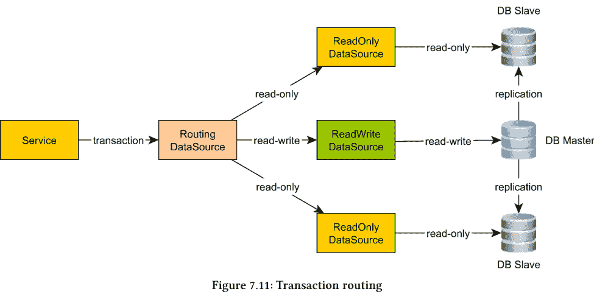

如果事务管理器支持声明式只读事务，可以根据当前事务的只读偏好做出路由决策。否则，必须在每个服务层组件中手动执行路由，因此只读事务使用只读的 `DataSource` 或只读的 JPA `PersistenceContext`。

## 7.6 事务边界

每个数据库语句都在事务环境中执行，即使客户端没有显式设置事务边界。虽然可能存在单语句事务（通常是只读查询），但当工作单元由多个 SQL 语句组成时，数据库应该将它们封装在一个工作单元中。

> 默认情况下，每个 `Connection` 都以自动提交模式启动，每个执行的语句都在独立的事务中。不幸的是，这对于多语句事务不可行，因为它将原子性边界从逻辑工作单元移动到了每个单独语句上。

应尽可能避免自动提交，即使对于单语句事务，显式标记事务也是一种良好的做法。

#### 事务

在下面的示例中，在账户之间转账金额。余额必须保持一致，因此如果一个账户被扣款，另一个账户必须记入。

```java
try (Connection connection = dataSource.getConnection();
PreparedStatement transferStatement = connection.prepareStatement(
    "UPDATE account SET balance = ? WHERE id = ?"
)) {
```


```java
transferStatement.setLong(1, Math.negateExact(cents));

transferStatement.setLong(2, fromAccountId);

transferStatement.executeUpdate();

transferStatement.setLong(1, cents);

transferStatement.setLong(2, toAccountId);

transferStatement.executeUpdate();
```

由于自动提交模式，如果第二个语句失败，只有那些更改可以回滚，第一个提交的语句无法撤销。必须禁用自动提交模式并手动管理事务。如果所有语句执行成功，则提交事务，失败时触发回滚。考虑到此，之前的示例应该重写为：

```java
try (Connection connection = dataSource.getConnection()) {
    connection.setAutoCommit(false);

    try (PreparedStatement transferStatement = connection.prepareStatement(
        "UPDATE account SET balance = ? WHERE id = ?"
    )) {
        transferStatement.setLong(1, Math.negateExact(cents));
        transferStatement.setLong(2, fromAccountId);
        transferStatement.executeUpdate();

        transferStatement.setLong(1, cents);
        transferStatement.setLong(2, toAccountId);
        transferStatement.executeUpdate();
    }

    connection.commit();
} catch (SQLException e) {
    connection.rollback();
}
```

# 事务

敏锐的读者会注意到之前的示例违反了单一职责原则，因为数据访问对象（DAO）方法混合了事务管理和数据访问逻辑。事务管理是一个交叉关注点，使其成为移动到独立公共库的好候选。这样事务逻辑将驻在一个地方，并从 DAO 方法中删除大量重复代码。提取事务管理逻辑的一种方法是使用模板方法模式：

```java
public void transact(Consumer<Connection> callback) {
    Connection connection = null;

    try {
        connection = dataSource.getConnection();
        callback.accept(connection);
        connection.commit();
    } catch (Exception e) {
        if (connection != null) {
            try {
                connection.rollback();
            } catch (SQLException ex) {
                throw new DataAccessException(e);
            }
        }

        throw (e instanceof DataAccessException
            ? (AccessException)e
            : new DataAccessException(e));
    } finally {
        if (connection != null) {
            try {
                connection.close();
            } catch (SQLException e) {
                throw new DataAccessException(e);
            }
        }
    }
}
```

# 事务

有了这个实用程序，之前的示例可以简化为：

```java
transact((Connection connection)) -> {
    try (PreparedStatement transferStatement = connection.prepareStatement(
        "UPDATE account SET balance = ? WHERE id ="
    )) {
        transferStatement.setLong(1, Math.negateExact(cents));
        transferStatement.setLong(2, fromAccountId);
        transferStatement.executeUpdate();

        transferStatement.setLong(1, cents);
        transferStatement.setLong(2, accountId);
        transferStatement.executeUpdate();
    } catch (SQLException e) {
        throw new DataAccessException(e);
    }
};
```

虽然比第一个代码段好，但将数据访问逻辑与事务管理分离仍然是不够的。

事务边界仍然是硬性的；为了将多个数据访问方法包含在单个数据库事务中，必须将 `Connection` 对象作为参数传递给每一个 DAO 方法。

声明式事务可以通过解开数据访问逻辑与事务管理代码之间的强耦合，来更好地解决这一问题。事务边界通过元数据（例如注解）进行标记，并由独立的事务管理器抽象负责协调事务逻辑。

# Java EE 和 JTA

声明式事务已成为分布式事务的必然选择。当 Java EE（企业版）首次出现时，应用程序服务器托管了 Web 和中间件集成服务，这意味着 Java EE 容器需要协调多个 `DataSource` 甚至 JMS（Java 消息）队列。

遵循 X/Open XA 架构，JTA（Java Transaction API）支持 Java EE 分布式事务的需求。

## 7.6.1 分布式事务

本地事务和全局事务的区别在于，前者使用单个资源管理器，而后者操作在多个异构资源管理器上。ACID 保证仍然在每个单独资源上执行，但必须由全局事务管理器来协调分布式事务的结果。

所有的事务资源适配器都由全局事务管理器注册，它决定何时允许资源提交或回滚。Java EE 资源可以通过 JNDI（Java 命名和目录接口）或 CDI（上下文和依赖注入）访问。

Spring 提供了一个事务管理抽象层，可以配置为本地事务（JDBC 或 `RESOURCE_LOCAL*` JPA）或通过独立的 JTA 事务管理器全局事务。依赖注入机制将托管资源自动注入到 Spring Bean 中。

### 7.6.1.1 两阶段提交

JTA 利用两阶段提交（2PC）协议分两个步骤来协调资源的原子提交：准备阶段和提交阶段。

在前一个阶段中，资源管理器会采取所有必要操作，为即将到来的提交做好准备。只有当所有资源管理器都成功确认了准备步骤，事务管理器才会继续执行提交阶段。如果某个资源没有确认准备阶段，事务管理器将执行回滚所有当前参与者。

如果所有资源管理器都确认了提交阶段，全局事务将成功结束。如果某个资源提交失败（或超时），事务管理器将会在后台线程中重试此操作，直到成功或报告该事件以进行人工干预。

> [http://docs.oracle.com/javaee/7/api/javax/persistence/spi/PersistenceUnitType.html](http://docs.oracle.com/javaee/7/api/javax/persistence/spi/PersistenceUnitType.html) `RESOURCE_LOCAL`

# 一阶段提交（1PC）优化

由于 Java EE 专门使用 JTA 事务，数据库往返的额外协调开销可能会在高吞吐量应用环境中损害性能。当事务仅包含一个资源适配器（即指定了单个资源管理器）时，事务管理器可以跳过准备阶段，直接执行提交或回滚阶段。通过这种优化，分布式事务的行为类似于 JDBC 连接管理本地事务的方式。

> `XAResource.commit(Xid xid, boolean onePhase)` 方法接收一个布尔标志，事务管理器将其设置为 `true`，以提示关联资源适配器启动 1PC 优化。

## 7.6.2 声明式事务

事务边界通常与 Service 层关联，Service 层使用一个或多个 DAO 来实现业务逻辑。事务在服务层事务边界内从一个组件传播到另一个组件。

图 7.13：事务边界

声明式事务模型受 Java EE 和 Spring 支持。事务边界通过类似的传播策略进行控制，这些策略定义了边界如何继承。

# 传播

要配置 EJB 的传播行为，Java EE 定义了 `@TransactionAttribute`。在 Spring 中，传播（与其他任何属性一样）可以通过 `@Transactional` 注解进行配置。

表 7.6：事务传播

| 传播类型 | Java EE | Spring | 说明 |
|---|---|---|---|
| REQUIRED | 是 | 是 | 这是默认策略，除非当前线程已关联一个事务，否则它将启动一个事务。 |
| REQUIRES_NEW | 是 | 是 | 任何当前运行的事务将被挂起并被新事务替换。 |
| SUPPORTS | 是 | 是 | 如果当前线程已经在事务内部运行，它将使用它；否则将在事务之外执行。 |
| NOT_SUPPORTED | 是 | 是 | 任何当前运行的事务将被挂起。 |
| MANDATORY | 是 | 是 | 只有当当前线程关联事务时，当前方法才会运行。 |
| NESTED | 否 | 是 | 如果当前线程关联事务，则在嵌套事务中执行当前方法；否则启动一个新事务。 |
| NEVER | 否 | 是 | 当前方法必须始终在事务之外运行，如果当前线程关联了事务，则会抛出异常。 |

# 声明式异常处理

由于事务逻辑封装了底层的和服务数据访问调用链，异常处理也必须以声明的方式配置。默认情况下，Java EE 和 Spring 在系统异常（任何 `RuntimeException`）时回滚，在应用异常（受检异常）时提交。

在 Java EE 中，可以使用 `@ApplicationException` 注解自定义回滚策略。

Spring 允许通过列出触发事务失败的异常类型来为每个事务自定义回滚策略。

> [http://docs.oracle.com/javaee/7/api/javadoc/ejb/ApplicationException.html](http://docs.oracle.com/javaee/7/api/javadoc/ejb/ApplicationException.html)  
> [https://docs.spring.io/spring/docs/current/javadoc-api/org/springframework/transaction/annotation/Transactional.html#rollbackFor](https://docs.spring.io/spring/docs/current/javadoc-api/org/springframework/transaction/annotation/Transactional.html#rollbackFor)

# 声明式只读事务

Java EE 不支持声明式标记只读事务。

Spring 提供了事务只读属性，它可以传播到底层的 JPA 者（以优化 EntityManager 的刷新机制）以及当前的 JDBC 连接。

> [https://docs.spring.io/spring/docs/current/javadoc-api/org/springframework/transaction/annotation/Transactional.html#readOnly](https://docs.spring.io/spring/docs/current/javadoc-api/org/springframework/transaction/annotation/Transactional.html#readOnly)

# 声明式隔离级别

Java EE 不提供对可配置隔离级别的支持，因此由底层的 `DataSource` 为所有数据库连接定义。

Spring 在使用 `JTransactionManager` 时支持事务隔离级别，它遵循 Java EE 标准并允许覆盖默认隔离级别。

## 7.7 应用级事务

到为止，本书侧重于通过数据库事务来强制 ACID 特性。从应用程序的角度来看，一个业务工作流可能会跨越多个数据库事务，在这种情况下，数据库的 ACID 保证将不再足够。

一个逻辑事务可能由多个 Web 请求组成，包括用户的思考时间，正因如此，它可以被视化为长时间的对话。

在接下来的示例中，Alice 和后台进程当前都在修改同一条数据库记录。

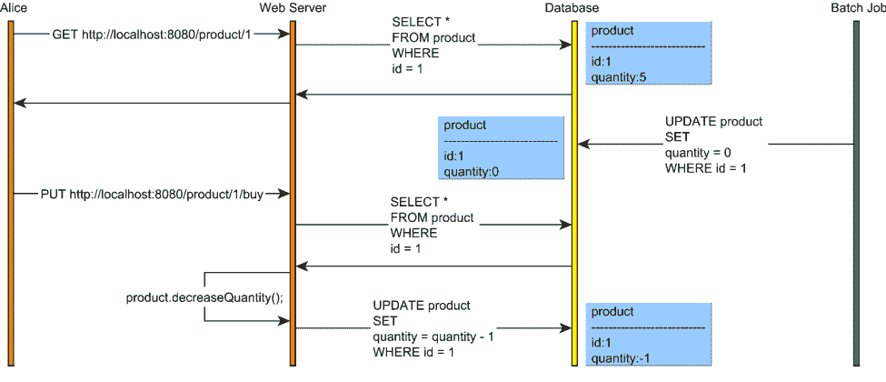

Alice 的逻辑事务包含了两个 Web 请求，每个请求都关联一个独立的数据库事务。在没有额外的并发控制机制的情况下，即使是最高隔离级别也无法防止更新现象。

> 将一个数据库事务跨越到多个 Web 请求是不可接受的，因为锁会在用户思考期间被持有，从而损害了可扩展性。即使使用 MVCC，维护旧版本（这可能导致巨大的版本图）的成本可能会增加，并影响性能和并发性。

> 在高并发环境下，数据库事务必须尽可能短。应用级事务需要应用级的并发控制机制。

# 事务

HTTP 本质上是无状态的，这有充分的理由，无状态应用比有状态的应用更容易扩展。但应用级事务不能是无状态的，否则新的请求将无法从上一个请求停止的地方继续。在多个 Web 请求之间保留状态允许构建对话上下文，从而提供应用级的可重复保证。

在接下来的图图中，Alice 使用了一个有状态的对话上下文，但在缺乏记录版本控制系统的情况下，仍然可能丢失更新。

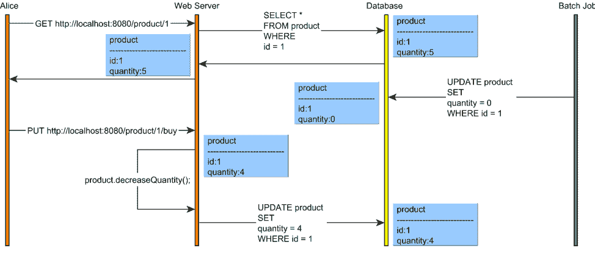

批处理进程减少了产品数量。Alice 认为产品版本没有变化，于是尝试购买一件商品，这导致产品数量又减少了一个。最后，Alice 简单地覆盖了批处理进程的修改，数据完整性遭到了破坏。

图 7.15：有状态的对话导致更新丢失

因此，应用级的可重复读并不是自给自足的（这一点对数据库隔离级别同样适用）。为了防止更新丢失，并发控制机制是强制性的。

### 7.7.1 悲观锁和乐观锁

隔离级别意味着隐式锁，无论涉及物理锁（如 2PL）还是数据异常检测（MVCC）。为了协调状态变化，应用级并发控制使用了显式锁，分为两种：悲观锁和乐观锁。

### 7.7.1 悲观锁

如前所述，大多数数据库系统已经提供了手动请求共享锁或排斥锁的可能性。这种并发控制之所以认为是悲观的，因为它假设冲突不可避免地会发生，必须相应进行预防。

由于锁可以及时释放，因此在给定本地对话的最后一个数据库事务期间使用排斥锁是合适的。这样应用程序可以保证一旦获取了锁，没有其他事务可以干扰当前锁定的资源。

> 在关键记录上获取锁可以防止非重复读、更新丢失，以及读写偏斜现象。

### 7.7.1.2 乐观锁

毫无疑问，这是一个误名（尽管被广泛使用），乐观锁完全没有产生任何锁。更好的名字应该是乐观并发控制，因为它使用了一种完全不同的方法来处理与悲观锁的冲突。

MVCC 是一种乐观并发控制策略，它假设竞争不太可能发生，因此它不依赖锁来控制共享资源。乐观并发机制检测异常，并采取中止不再满足其不变性的事务的操作。

虽然数据库确切知道在给定时间间隔内发布了哪些行，但仍留给应用程序来维护“发生于”（happens-before）的事件顺序。每个数据库行必须有一个关联的版本，该版本由逻辑事务本地递增。每个修改 SQL 语句（`update` 或 `delete`）都使用之前加载的版本作为假设，认为该行在此期间没有发生变化。

由于即使是最低隔离级别也能防止写写冲突，任何时刻只允许一个事务更新某行。由于数据库已经有了单调更新，行版本也可以单调地递增，应用程序可以检测到更新的记录何时变得过时。乐观锁并发算法如下：

- 当客户端读取特定行时，其版本随同其他字段一起返回。
- 在更新行时，客户端根据其之前加载的版本对当前记录进行过滤。

```sql
UPDATE product
SET (quantity, version) = (4, 2)
WHERE id = 1 AND version = 1
```


如果语句更新计数为零，说明版本在此期间已递增，当前事务现在在过时的记录版本上操作。

上一个示例可以进行调整以利用乐观并发控制机制。这次，产品是版本化的，Web 应用程序和处理器的数据访问逻辑都使用行版本来协调“发生于”的更新顺序。

Alice、Web 服务器、数据库、批处理作业

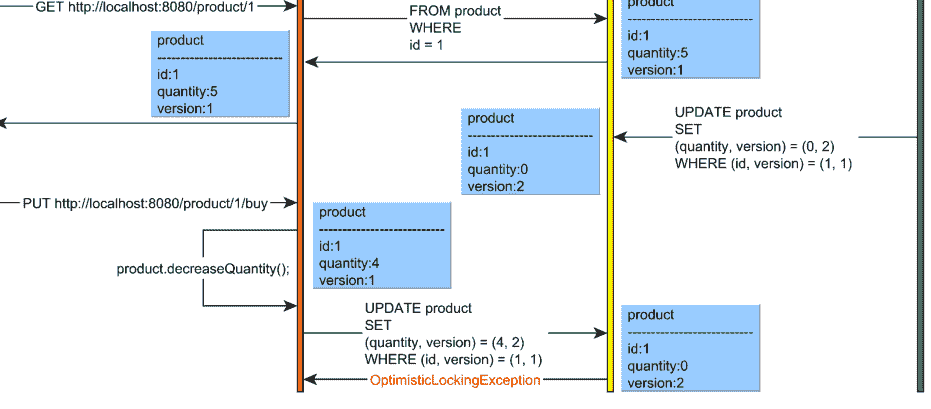

图 7.16：有状态并发防止更新丢失

Alice 和批处理处理器都试图优化地增加产品数量。批处理处理器可以成功更新产品数量，因为 SQL 语句的过滤条件与实际数据库记录版本匹配。当 Alice 尝试更新产品时，数据库返回零，应用程序被通知记录版本已过期。

> 使用时间戳对事件排序通常不是一个好主意。系统时间并不总是递增，甚至可能回退。在分布式系统中，逻辑时钟（例如向量时钟或 Lamport 时间戳）总是优于物理时钟。

由于这个原因，使用数值版本比分配时间戳更合适。

# JPA 和 Hibernate

## 8. 为什么 JPA 和 Hibernate 很重要

尽管 JDBC 很好地提供了一个通用 API 来隐藏特定厂商的数据库通信协议，但它存在以下缺点：

- API 无疑非常繁琐，即使对于简单的任务也是如此
- 批处理在数据访问层是不透明的，需要比非批处理对应的特定 API
- 缺乏对显式锁和乐观并发控制的内置
- 对于本地事务，数据访问与事务管理耦合在一起
- 获取关联关系需要额外的处理将 `ResultSet` 转换为领域模型或 DTO（数据传输对象）图。

ORM（对象关系映射）工具的主要目标是自动将状态语句转换为 SQL 语句，本章旨在演示 Hibernate 如何解决上述所有 JDBC 缺点。

# Java 持久化历史

EJB 1.1 发布为可扩展的企业组件提供了更高层次的持久化抽象，称为 Entity Beans。尽管该设计在纸面上看起来很好，但实际上，基于 MRI 的重量实现从性能角度来看是灾难性的。EJB 2.0 对本地接口的支持并没有让 Entity Beans 流行起来，由于高复杂性和特定特定的实现细节，大多数项目选择了 JDBC。

Hibernate 的诞生是因为对 Entity Bean 开发模型的各种沮丧。作为一个开源项目，Hibernate 赢得了大量的关注，因此它成为了事实上的持久化框架。

为了应对 Entity Bean 持久化的批评，Java 委员会推进了一种轻量级基于 POJO 的方法，并产生了 JDO 规范。尽管 JDBC 与数据源无关，可以在关系型数据库上操作也可以在 NoSQL 或平面文件上操作，但它从未获得主流普及。由于这个原因，Java 委员会决定 EJB3 将基于一种受 Hibernate 和 TopLink 启发的新规范，JPA（Java Persistence API）成为了标准的 Java 企业持久化技术。

这些的意义在于，持久化是一个非常复杂的话题，它要求对数据库和数据访问模式有大量的知识。

## 8.1 阻抗不匹配

当通过面向对象的程序操作关系型数据库时，两种不同的数据表示方式开始产生冲突。

在关系型数据库中，数据存储在表中，关系代数定义了数据关联是如何形成的。另一方面，面向对象编程（OOP）语言允许对象拥有状态和行为，并允许双向关联。

融合这两种截然不同的方法产生了巨大的张力，并且长期以来一直困扰着企业系统。

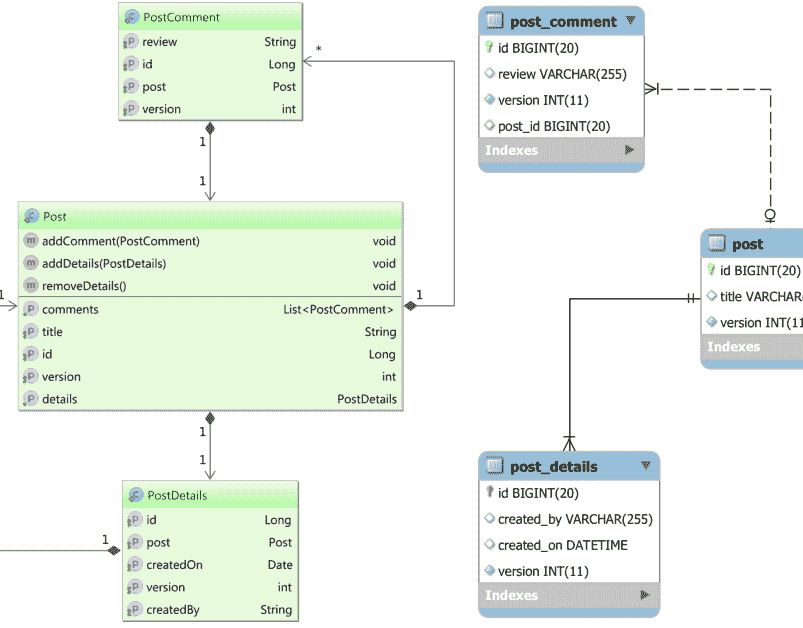

> 图 1：对象/关系映射

上面的图描了数据访问层需要关联的两个模式（schema）。数据库模式由 SQL 标准规范驱动，而领域模型（Domain Model）则带有面向对象的模式表示。

领域模型封装了业务逻辑规范，并捕获了数据结构以及管理业务需求的行为。OOP 促进了领域建模，许多现代企业系统都是构建在面向对象编程语言（如 Java、C#）之上的。

## 为什么 JPA 和 Hibernate 至关重要

因为底层数据存在于关系型数据库中，所以领域模型必须适应数据库模式和 SQL 驱动的通信协议。ORM 设计模式有助于桥接这两种不同的数据表示，并缩小它们之间的技术鸿沟。每一行都与一个领域模型对象（JPA 术语中的 Entity）相关，因此 ORM 工具可以将实体状态转换为 DML 语句。

从应用程序开发的角度来看，这非常方便，因为操作领域模型关系要比通过底层 SQL 语句来视觉化业务逻辑容易得多。

## 8.2 JPA vs Hibernate

JPA 仅仅是一个规范。它描述了客户端操作的接口以及标准的对象关系映射元数据（Java 注解或 XML 描述符）。除了 API 定义外，JPA 还解释了（并非详尽）JPA 实现者应该如何实现这些规范。JPA 随着 Java EE 平台演进（Java EE 6 引入 JPA 2.0，Java 7 引入 JPA 2.1）。

在 JPA 规范首次发布时，Hibernate 已经是一个功能完整的 JPA ORM 实现。尽管 Hibernate 实现了 JPA 规范，但为了向后兼容以及适应非标准特性，Hibernate 保留了它的原生 API。

即使遵循 JPA 规范是最好的，但在现实中，JPA 实现者提供了针对高性能数据访问层需求的额外功能。为此，Hibernate 带有以下不符合 JPA 规范的特性：

- 扩展标识符生成器，实现了一个与其他数据库客户端互操作的 HiLo 优化器
- 透明的语句批处理（statement batching）
- 可自定义 CRUD（`@Insert`, `@SQLUpdate`, `@SQLDelete`）语句
- 静态或动态过滤器（例如 `@FilterDef`, `@Filter`, `@Where`）
- 实体过滤器（例如 `@Where`）
- 将属性映射到 SQL 片段（例如 `@Formula`）
- 不变实体（例如 `@Immutable`）
- 更多的刷新模式（例如 `FlushMode.MANUAL`, `FlushMode.ALWAYS`）
- 通过给定实体的自然键查询二级缓存
- 实体级缓存并发控制策略（例如 `Cache(usage = CacheConcurrencyStrategy.READ_WRITE)`）
- 来自 HQL 的版本批量更新
- 从乐观锁检查中排除字段（例如 `@OptimisticLock(excluded = true)`）
- 无版本的乐观锁（例如 `OptimisticLockType.ALL`, `OptimisticLockType.DIRTY`）
- 支持跳过（无需等待）悲观锁请求

## 为什么 JPA 和 Hibernate 至关重要

> 如果说 JPA 是接口，Hibernate 就是一种实现，从性能角度来看，实现细节总是重要的。

JPA 的实现细节会泄露，忽略它们可能会损害应用程序性能，甚至导致数据不一致问题。例如，以下 JPA 属性具有特殊的行为，会让熟悉 JPA 规范的人感到惊讶：

- `FlushModeType.AUTO` 不会对原生 SQL 查询触发刷新，就像它对 JPQL 或 Criteria API 那样
- `FetchType.EAGER` 可能会选择 SQL 连接或二次查询，无论实体是直接从 `EntityManager` 获取，还是通过 JPQL（Java 持久查询语言）或 Criteria API 获取。

这就是为什么我们关注 Hibernate 如何实现 JPA 规范及其原生非标准特性（这些特性与效率视角相关）。

# 可移植性考虑

与其他非功能性需求一样，可移植性是一项特性，对于采用特定数据库或特定框架的功能仍然存在广泛的担忧。现实中，遇到面临数据访问性能问题的企业比需要从一种技术迁移到另一种技术（无论是关系型数据库还是 JPA 实现者）更为常见。

RDBMS 的最小公约数是 SQL-92 标准的超集（尽管没有被完全支持）。SQL-9 支持通用表表达式（CTE），但 MySQL 5.7 不支持。SQL-2003 引入了 MERGE，但 PostgreSQL 9.4 没有实现它，9.5 将支持 UPSERT。通过遵循 SQL-92 语法，可以实现更高的数据库可移植性，但放弃特定数据库特性的代价可能会损害应用程序性能。可移植性可以通过特化化减去非通用特性来解决。通过为每个支持的数据库系统提供不同的实现（如 JOOO 框架），可以实现可移植性。

同样的论点也适用于 JPA 实现者。通过对应用程序进行分层，如果有充分的理由将一个成熟的 JPA 实现切换到另一个，切换 JPA 实现者已经变得容易得多。

## 8.3 模式所有权

由于数据表示的原因，仍然需要将瞬态领域模型与底层的持久化数据相关联。

数据随着企业系统本身演进，因此这两种不同的模式表示始终保持一致。

即使数据访问框架可以自动生成数据库模式，也必须进行增量迁移，并且所有更改在 VCS（版本控制系统）中也是可追溯的。因此，表结构、索引和触发器等数据库模式与领域模型源代码一同存在。

## 为什么 JPA 和 Hibernate 至关重要

对于非常大的企业系统，数据分布在不同的提供者中（关系型数据库系统、缓存、Spark），不再可能依赖于关系型数据库来集成所有子系统。

在这种情况下，Apache Kafka* 提供了一个容错且可扩展的追加日志结构，每个参与的子系统都可以并发读写。

## 为什么 JPA 和 Hibernate 非常重要

> 模式所有权属于数据库，数据访问层必须协助领域模型与底层数据进行通信。

## 8.4 基于写入的优化

JPA 将开发者的思维方式从 SQL 语句转移到了实体状态转换。实体可以处于以下状态之一：

表 8.1：JPA 实体状态

| 状态 | 描述 |
| --- | --- |
| New (Transient) | 新创建的实体，未映射到任何数据库行，被视为 New 或 Transient 状态。一旦变为受托管（managed），持久上下文（Persistence Context）将在刷新时（flush-time）发布 insert 语句。 |
| Managed (Persistent) | 持久化实体与数据库行关联，并由当前运行的持久上下文管理。状态更改通过*脏检查*（dirty checking）机制检测，并在刷新时作为 update 语句传播到数据库。 |
| Detached | 一旦当前运行的持久上下文关闭，所有之前托管的实体都会变为离离（detached）状态。随后的更改将不再被跟踪，也不会发生自动的数据库同步。 |
| Removed | 已删除的实体仅被安排删除，实际的数据库语句将在持久上下文刷新期间执行。 |

持久上下文捕获状态更改，并在刷新期间将其翻译为 SQL 语句。JPA `EntityManager` 和 Hibernate `Session`（包含将实体从一种状态移动到所有其他状态的其他方法）接口是通底层持久上下文的网关，定义了所有的状态转换操作。

`http://docs.oracle.com/javaee/7/api/java/persistence/EntityManager.html#persist-java.lang.Object-`
`https://docs.jboss.org/hibernate/stable/javadoc/hibernate/Session.html`

为什么 JPA 和 Hibernate 非常重要

125

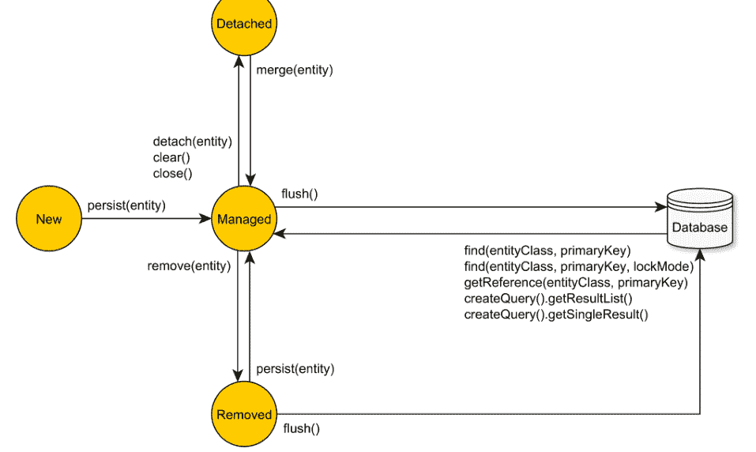

图 8.4：JPA 实体状态转换

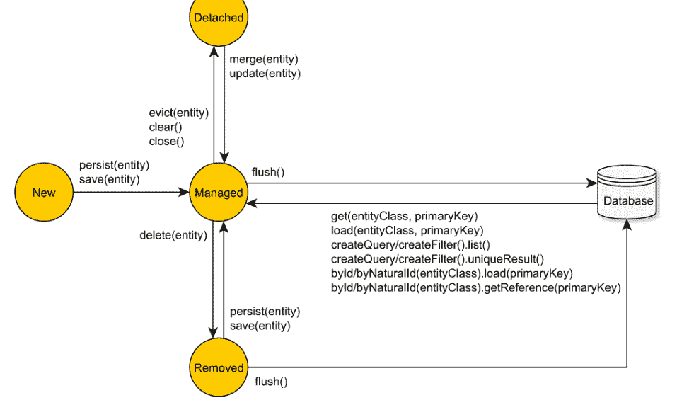

图 8.5：Hibernate 实体状态转换

为什么 JPA 和 Hibernate 非常重要

## SQL 注入防护

通过管理 SQL 语句的生成，JPA 工具可以帮助减少 SQL 注入攻击的风险。操纵 SQL 语句的机会越少，应用程序就越安全。风险并未完全消除，因为应用程序开发者仍然可以诉助于拼接 SQL 或 JPQL 片段，因此建议保持严谨。

> Hibernate 独占使用 `PreparedStatement`，这不仅可以防止 SQL 注入，还能让数据访问层更好地利用服务器端和客户端的语句缓存。

## 自动生成的 DML 语句

企业数据库模式随时间推移而演进，数据访问层必须像我们一样反映所有的修改。

由于 JPA 提供者会自动生成 insert 和 update 语句，数据访问层可以轻松适应数据库表结构的修改。通过更新实体模型模式，Hibernate 可以根据此自动调整修改语句。

这同样适用于数据库列类型的更改。如果数据库模式需要将邮编从 INT 类型迁移到 `VARCHAR(6)`，数据访问层需要将关联的领域模型属性类型从 `Integer` 更改为 `String`，所有语句都将自动更新。Hibernate 定义了一个高度可定制的 JDBC 到数据库类型映射系统，应用程序开发者可以覆盖默认类型关联，甚至为新的数据库类型（目前 Hibernate 不支持的类型）添加支持。

实体获取过程由 JPA 实现自动管理，它会自动生成关联数据库表的 select 语句。通过这种方式，JPA 使应用程序开发者免于维护实体选择查询的负担。

> Hibernate 允许自定义所有的 CRUD 语句，在这种情况下，应用程序开发者负责维护相关的 DML 语句。

尽管它处理了实体选择过程，但大多数企业系统都需要利用底层数据库查询能力。因此，每当数据库模式发生变化时，所有的原生 SQL 查询都需要手动更新（根据其相关的业务逻辑需求）。

## 写后缓存（Write-behind cache）

持久上下文充当事务性的写后缓存，将实体状态刷新推迟到最后一个可能的时刻。

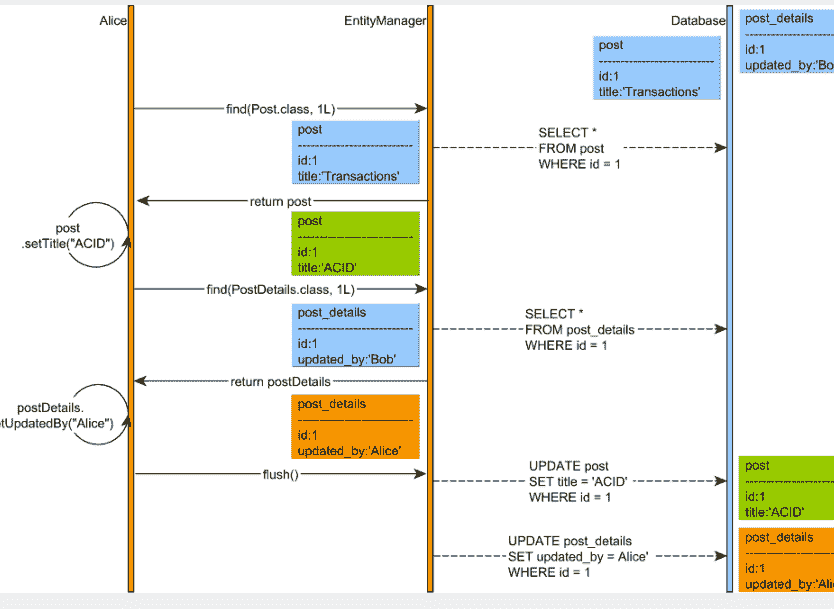

由于修改每个 DML 语句都需要锁定（以防止脏写），后置缓存可以减少数据库锁的间隔，从而提高并发性。

- 但缓存引入了一致性挑战，持久上下文在执行任何 JPQL 或原生 SQL 查询之前需要进行刷新（否则可能会破坏“写后读”的一致性保证）。

正如在后续章节中详细说明的那样，在执行原生查询之前，Hibernate 不会自动刷新待处理的更改，应用程序开发者必须显式地信任哪些数据库表需要同步。

图 8.6：持久上下文

## 透明语句批处理（Transparent statement batching）

由于所有更改一次性刷新，Hibernate 可能会从 JDBC 语句批处理中受益。即使在数据访问逻辑实现后也可以透明地开启批量更新。通常性能调优会被推迟到系统已经在生产环境中运行，切换到批量语句不需要大量的开发工作。

> 只需一个配置，Hibernate 即可批量执行所有预编译语句。

## 应用程序级并发控制

如前所述，在执行多请求会话时，没有任何数据库隔离级别可以防止更新丢失。JPA 支持乐观锁和悲观锁。

JPA 乐观锁机制允许防止更新丢失，因为它发生在事件排序之前。在多请求会话中，乐观锁需要维护旧的快照，JPA 通过扩展上下文（Extended Contexts）或离线实体实现了这一点。

> Java EE 服务器可以在多个请求之间保留持久上下文，从而提供应用级别的可重复读。但这种策略并非免费，因为应用程序开发者必须确保持久上下文不会被过多的实体膨胀，除了消耗内存，还会影响 Hibernate 的默认检查机制。

即使不使用 Java EE，也可以通过分离实体实现相同的目标，对请求之间所需的数据进行细粒度的控制。JPA 允许合并分离实体，它们将变为托管状态并与数据库系统同步。

JPA 还支持悲观锁抽象，这在使用较低的隔离模式时非常有用。

> Hibernate 有原生悲观锁 API，提供了对锁超时或跳过已锁的支持。

为什么 JPA 和 Hibernate 非常重要

## 8.5 基于读取的优化

遵循 SQL 标准，JDBC `ResultSet` 是获取数据的表格表示。领域模型被构建为实体图，数据访问层将扁平的 `ResultSet` 转换为层次结构。

尽管 ORM 工具的目标是减少面向对象的领域模型与其关系映射之间的差距，但非常重要的是，数据源不是内存仓库，获取行为会影响整体数据访问效率。

> 数据库无法从此环境中抽象，假装实体可以像普通对象一样操作对应用程序性能是有害的。在读取数据时，阻抗映射变得更加明显，出于性能考虑，必须记住与每次获取操作相关的 SQL 语句。

在以下示例中，将获取帖子记录及其所有关联评论。使用 JDBC，此任务可以使用以下代码片段完成：

```java
doInJDBC(connection -> {

  try (PreparedStatement statement = connection.prepareStatement(

    "SELECT * " +

    "FROM post AS p " +

    "JOIN post_comment AS pc ON p.id = pc.post_id " +

    "WHERE " +

    " p.id BETWEEN ? AND ? + 1"

  )) {

    statement.setInt(1, id);

    statement.setInt(2, id);

    try (ResultSet resultSet = statement.executeQuery()) {

      List<Post> posts = toPosts(resultSet);

      assertEquals(expectedCount, posts.size());

    }

  } catch (SQLException e) {

    throw new DataAccessException(e);

  }

});
```

# 为什么 JPA 和 Hibernate 至关重要

在连接多对一或一对一关联时，每个 `ResultSet` 记录对应一对实体，在每次迭代中，父实体和子实体都可以解析。对于一对多或多对多关系，由于 SQL 关联的工作方式，`ResultSet` 将为每个关联的子包含包含重复的父实体记录。

构建分级实体结构需要手动对 `ResultSet` 进行转换，并且为了防止重复，父实体的引用被存储在 `Map` 中。

```java
List<Post> toPosts(ResultSet resultSet) throws SQLException {
```


```java
Map<Long, Post> postMap = new LinkedHashMap<>();

while (resultSet.next()) {
    Long postId = resultSet.getLong(1);
    Post post = postMap.get(postId);

    if (post == null) {
        post = new Post(postId);
        postMap.put(postId, post);
    }

    post.setTitle(resultSet.getString(2));
    post.setVersion(resultSet.getInt(3));

    Comment comment = new Comment();
    comment.setId(resultSet.getLong(4));
    comment.setReview(resultSet.getString(5));
    comment.setVersion(resultSet.getInt(6));

    post.addComment(comment);
}

return new ArrayList<>(postMap.values());
```

JDBC 4.2 的 `PreparedStatement` 支持可选参数，第一个索引从 1 开始。JPA 也允许命名参数，这在参数需要被多次引用时特别有用，之前的示例可以重写为：

```java
doJPA(entityManager entityManager) {
    List<Post> posts = entityManager.createQuery(
        "select distinct p " +
        "from Post p " +
        "join fetch p.comments " +
        "where " +
        "p.id BETWEEN :id AND :id + 1", Post.class)
        .setParameter("id", id)
        .getResultList();

    assertEquals(expectedCount, posts.size());
}
```

# 为什么 JPA 和 Hibernate 至关重要

在两个示例中，对象-关系转换都是隐式或显式发生的。在 JDBC 的用例中，必须手动解析关联，而 JPA 会自动（根据实体模式）完成工作。

# 获取责任

除了将数据库列映射到实体属性外，实体关联也可以以对象关系的形式表示。此外，获取行为可以硬编码到实体模式本身中，这通常是一件非常糟糕的事情。

获取一对多或多对多关联更为棘手，因为它们可能需要笛卡尔积，且性能会与子实体的数量绑定。控制硬编码的模式获取策略是繁琐的，因为它阻止了使用懒性加载机制来覆盖检索。

> 每一个业务用例都有不同的数据访问需求，没有一种策略能预见到所有可能的用例，因此获取策略应该始终基于查询来设置。

# 只读视图优先使用投影

虽然连同其所有关联关系一起获取实体非常方便，但最好也考虑对性能的影响。正如之前解释的，获取过多的数据是不适当的，因为会增加事务的响应时间。

在实际上，所有的用例都需要加载实体，而且并不是所有的读取操作都需要通过相同的获取机制来提供。有时，自定义投影（仅从实体选择几列）要合适得多，而且数据访问逻辑可以利用 JPA 查询抽象可能不支持的数据库 SQL 构造结构。

> 根据经验法则，当 JPA 事务需要修改实体时，获取实体是合适的，即使这只发生在后续的 Web 请求中。考虑到这一点，对于特定的业务逻辑用例考虑采用何种获取机制要容易得多。

# 为什么 JPA 和 Hibernate 至关重要

## 二级缓存

如果持久上下文（Persistence Context）充当事务写缓存，它的生命周期与逻辑事务绑定。由于这个原因，持久上下文也被称为一级缓存，它不能被多个并发事务共享。

另一方面，二级缓存与 `EntityManagerFactory` 关联，所有的持久上下文都可以访问它。二级缓存可以存储实体以及实体关联（一对多和多对多关系），甚至是实体查询结果。由于 JPA 未规定这一点，每个提供者都采取不同的缓存方法，与 EclipseLink 不同，Hibernate 默认禁用了二级缓存。

通常情况下，缓存是一致性和性能之间的权衡。由于缓存变成了另一个事实来源，可能会发生不一致的情况，只有当所有的数据库修改都通过单个 `EntityManager` 或同步的分布式缓存解决方案进行时，才能防止这种情况。在现实中，这是不可行的，因为应用程序可能部署在多个节点上（每个节点都有自己的 `EntityManager`），并且数据库可能被多个应用程序访问。

> 虽然二级缓存可以缓解实体获取问题，但它需要分布式缓存实现，这可能仍然无法避免网络开销。

# 8.6 总结

桥接两种高度特定的技术始终是一个难以解决的问题。当企业级系统构建在面向对象的语言之上时，对象-关系阻阻（impedance mismatch）就变得不可避免了。ORM 模式旨在弥补这一差距，尽管它无法完全抽象它。

根到底，所有的通信都通过 JDBC 流，每次执行都发生在数据库引擎本身。一个高性能的企业级应用程序必须与底层数据库系统产生共鸣，而 ORM 工具不能破坏这种关系。

就像它试图解决的问题一样，Hibernate 是一个非常复杂的框架，具有许多微妙之处，需要对数据库系统、JDBC 以及框架本身都有深入了解。本章只是一个总结，旨在以读者可能不熟悉的不同视角介绍 JPA 和 Hibernate。如果某些主题不是完全清楚，不需要担心，因为后续章节将更详细地分析这些内容。

# 9. 连接管理与监控

正如在 JDBC 连接管理章节中所解释的那样，出于性能考虑，数据库连接最好被复用。JPA 提供者代表用户生成 SQL 语句，监控这一过程并确认其结果是非常重要的。本章将解释 Hibernate 连接提供者以及监控语句执行的方法。

## 9.1 JPA 连接管理

与整个 Java EE 套件一样，JPA 1.0 规范紧密依赖应用服务器。在 Java EE 容器中，所有的数据库连接都由应用服务器管理，它提供了池化、监控和 JTA 能力。

配置完成后，Java EE `DataSource` 通过 JNDI 定位。在 `persistence.xml` 文件中，应用程序开发者必须提供关联的 JTA 或 RESOURCE_LOCAL 的 JNDI 名称。`transaction-type` 属性也与事务能力匹配。

```xml
<persistence-unit name="persistenceUnit" transaction-type="JTA">
    <provider>org.hibernate.jpa.HibernatePersistenceProvider</provider>
    <jta-data-source>java:global/jdbc/flexypool</jta-data-source>
</persistence-unit>
```

RESOURCE_LOCAL 事务必须使用非数据源的 DataSource。

```xml
<persistence-unit name="persistenceUnit" transaction-type="RESOURCE_LOCAL">
    <provider>org.hibernate.jpa.HibernatePersistenceProvider</provider>
    <non-data-data-source>java:comp/env/jdbc/hsqldb</non-data-data-source>
</persistence-unit>
```

对于 Java 应用程序，依赖应用服务器提供全功能的 `DataSource` 引用是完全没问题的，但独立运行的应用通常使用依赖注入而不是 JNDI 进行配置。

从 JPA 实现的角度来看，`DataSource` 可以在外部配置，也可以由 JPA 提供者本身配置。通常情况下，配置外部 `DataSource` 仍然是一个首选方案。

### 连接管理与监控

这种替代方案为装饰化连接的提供机制提供了更大的灵活性（例如日志记录、监控）。

由于 JPA 2.0 已经标准化了数据库连接配置属性，JPA 提供者可以通过底层的 JDBC 驱动获取连接：

| 表 9.1：JPA 连接属性 |  |
| --- | --- |
| 属性 | 描述 |
| `java.persistence.jdbc.driver` | 驱动程序全名（例如 `org.hsqld.jdbc.JDBCBCDriver`） |
| `java.persistence.jdbc.url` | 驱动 URL（例如 `jdbc:hsqld:mem:test`） |
| `java.persistence.jdbc.user` | 数据库名称 |
| `java.persistence.jdbc.password` | 数据库密码 |

遗憾的是，仅凭这些属性不足以满足大多数企业应用连接池和监控功能的需求。因此，JPA 连接管理仍然是一个特定于实现的话题，后续章节将深入探讨 Hibernate 可以使用的连接提供者机制，该机制可以通过声明式或编程方式采用。

## 9.2 Hibernate 连接提供者

Hibernate 需要在 Java EE 和独立环境中运行，且数据库连接性可以通过声明式或编程方式实现。为了适应 JDBC 连接以及 RESOURCE_LOCAL 和 JTA `DataSource` 配置，Hibernate 定义了自己的连接工厂抽象，由 `org.hibernate.engine.jdbc.connections.spi` 表示。

```java
public interface ConnectionProvider extends Service, Wrapped {

    public Connection getConnection() throws SQLException;

    public void closeConnection(Connection connection) throws SQLException;

    public boolean supportsAggressiveRelease();

}
```

由于连接提供者可能会影响事务的响应时间，每个提供者都将从高性能 OLTP 系统的角度进行分析。

### 9.2.1 DriverManagerConnectionProvider

当提供上述 JPA 2.0 连接属性或对应的 Hibernate 特有配置项时，Hibernate 会选择此提供者：

- `hibernate.connection.driver_class`
- `hibernate.connection.url`
- `hibernate.connection.username`
- `hibernate.connection.password`

> 尽管它通过底层的 `DriverManager` 获取数据库连接，但该提供者试图通过一个简单的连接池化实现来避免获取连接的开销。Hibernate 文档不建议在生产环境中使用 `DriverManagerConnectionProvider`。

### 9.2.2 C3P0ConnectionProvider

C3p0¹ 是一种成熟的连接池解决方案，在许多生产环境中证明了自己。使用底层的 JDBC 连接属性，Hibernate 可以用 c3p0 `DataSource` 替换内置连接池。要激活此提供者，应用程序开发者必须设置至少一个以 `hibernate.c3p0` 开头的配置属性：

```xml
<property name="hibernate.c3p0.max_size" value="5"/>
```

> C3p0（2001 年发布）和 Apache DBCP⁴（2002 年发布）是最老且部署最广泛的独立 Java 连接池解决方案。2010 年后期，BoneCP⁵ 作为 c3p0 和 Apache DBCP 的高性能替代方案出现世。如今，BoneCP 的 GitHub 页面显示它已被弃用，转而支持 HikariCP。

¹ http://www.mchange.com/projects/c3p0/

> 截至编写时，最具吸引力的 Java 连接池是 HikariCP、Vibur DBCP 和 Apache DBCP2。HikariCP 和 Vibur DBCP 提供了内置的 Hibernate 连接提供者。

### 9.2.3 HikariConnectionProvider

HikariCP 是最快的 Java 连接池之一，尽管 Hibernate 没有原生支持它，但它也自带了自己的 `ConnectionProvider` 实现。通过指定 `hibernate.connection.provider.class` 属性，开发者可以覆盖默认的连接提供者机制：

```xml
<property
    name="hibernate.connection.provider.class"
    value="com.zaxxer.hikari.hibernate.HikariConnectionProvider"/>
```


与`DriverManagerConnectionProvider`或`C3PConnectionProvider`不同，`HikariCP`不识别 JPA 或 Hibernate 特有的连接属性。`HikariConnectionProvider`需要特定框架的属性，如下所示：

| 属性 | 描述 |
|---|---|
| `hibernate.hikari.dataSourceClassName` | 驱动程序全类名 |
| `hibernate.hikari.dataSource.url` | 驱动 URL |
| `hibernate.hikari.dataSource.user` | 数据库用户名 |
| `hibernate.hikari.dataSource.password` | 数据库用户密码 |
| `hibernate.hikari.maximumPoolSize` | 最大连接池大小 |

### 9.2.4 `DatasourceConnectionProvider`

当 JPA 配置文件定义了非 `jta-data-source` 或 `jta-data-source` 元素，或者提供 `hibernate.connection.datasource` 配置属性时，会选择此提供者。

> 与其他提供者不同，它与 JTA 事务兼容，而 JTA 在 Java EE 中是强制性的。

Spring 同时支持独立 JTA 事务管理器（例如 Bitronix 或 Atomikos）和 Java EE DataSource(s)。由于它对实际的 DataSource 配置提供了最佳控制，`DatasourceConnectionProvider` 是首选（即使对于 `HikariCP` 也是如此）。

### 9.2.5 连接释放模式

Hibernate 延迟数据库连接的获取，直到当前事务必须执行其第一条 SQL 语句（由读或写操作触发）。这种优化允许 Hibernate 缩短物理事务间隔，从而增加从连接池中获取连接的概率。

连接释放策略通过 `hibernate.connection.release_mode` 属性控制，该属性可以取以下值：

| 值 | 描述 |
|---|---|
| `after_transaction` | 一旦获取，数据库连接仅在当前事务提交或回滚后释放。 |
| `after_statement` | 连接在每条语句执行后释放，并在执行下一条语句之前重新获取。虽然 JDBC 或 JTA 规范没有要求此，但该策略旨在防止应用服务器误认为连续 EJB 之间存在连接泄漏。 |
| `after` | 这是默认值，对于 `RESOURCE_LOCAL` 事务使用 `after_transaction` 模式，而对于 JTA 事务回退到 `after_statement`。 |

## 连接管理与监控

对于 JTA 事务，默认模式可能过于严格，因为并不是所有的 Java EE 服务器在管理事务资源方面表现相同。因此，检查数据库连接是否可以在触发获取事件的 EJB 之外是非常重要的。基于 Spring 的企业系统不使用 Java Bean，即使在使用独立的 JTA 事务时，`after_transaction` 连接释放模式可能也很好。

直觉上，`after_statement` 模式会产生与频繁获取和释放连接循环相关的性能开销。因此，以下测试测量了在 Spring 应用程序上下文中使用 Bitronix 的连接获取开销。每个事务执行相同的语句（获取时间戳）多次（如 x 轴所示）。y 轴记录了 `after_statement` 和 `after_transaction` 连接释放模式的事务响应时间。

`img/8a123270ec9380e9de699a1d09b2d7ee_147_0.png`

- After statement
- After transaction

图 9.1：连接释放模式

事务执行的语句越多，从底层连接池中重新获取关联数据库连接的开销就越大。为了更好地可视化连接获取开销，测试运行了多 10 000 条语句，即使这个数字对于典型的 OLTP 事务来说太高了。

理想情况下，数据库事务应该越短越好，语句数量也不应该太高。这种要求源于连接池是有限的，且锁越早释放越好。

> `after_transaction` 连接释放模式比默认的 JTA `after_statement` 策略更高效。因此，如果 JTA 事务资源管理逻辑不会干扰此连接释放策略，就应该使用它。

## 9.3 监控连接

如前所述，优选使用外部配置的 DataSource，因为实际的 DataSource 可以用连接池、监控和日志记录功能进行装饰。由于 `FlexPool` 正好也是这样工作的，下面的图捕获了 DataSource 代理机制：

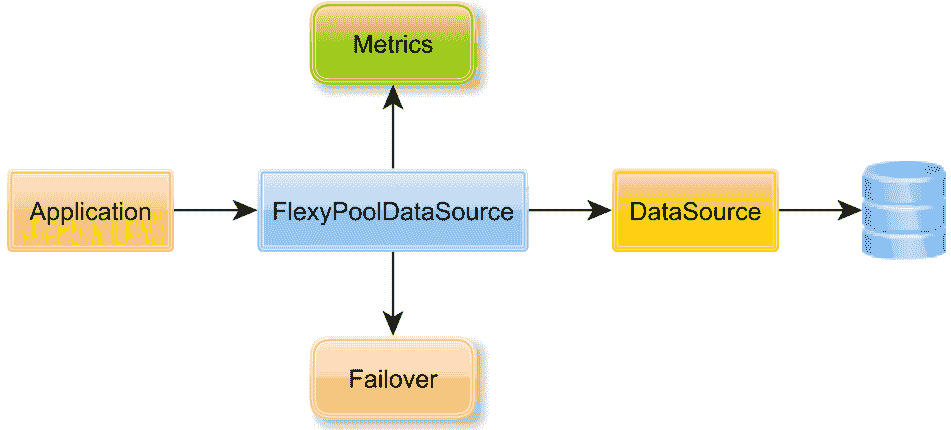

图 9.2：DataSource 代理

数据访问层获取的不是真实的 DataSource 实例，而是一个代理引用。代理拦截连接的获取和释放请求，通过这种方式，它可以监控其使用情况。

当使用 Spring 时，设置 `FlexPool` 非常简单，因为应用程序对 DataSource 配置具有完全的控制权。

在 Java EE 中，数据库连接应该始终从托管的 DataSource 中获取。集成 `FlexPool` 的一种简单方法是扩展默认的 `DataSourceConnectionProviderImpl`，并用 `FlexyPoolDataSource` 替换原始的 DataSource。

### 连接管理与监控

出于此原因，`FlexyPool` 带有以下 Hibernate 连接提供程序：

```java
public class FlexyPoolHibernateConnectionProvider
    extends DatasConnectionProviderImpl {

  private transient FlexyPoolDataSource<DataSource> flexyPoolDataSource;

  @Override
  public void configure(Map props) {
    super.configure(props);
    flexyPoolDataSource = new FlexyPoolDataSource<>(getDataSource());
  }

  @Override
  public Connection getConnection() throws SQLException {
    return flexyPoolDataSource.getConnection();
  }

  @Override
  public boolean isUnwrapableAs(Class unwrapType) {
    return super.isUnwrapableAs(unwrapType) ||
      getClass().isAssignableFromFrom(unwrapType);
  }

  @Override
  public void stop() {
    flexyPoolDataSource.stop();
    super.stop();
  }
}
```

若要使用 `FlexyPoolHibernateConnectionProvider`，应用程序必须配置 `hibernate.connection.provider_class` 属性：

```xml
<property
  name="hibernate.connection.provider_class"
  value="com.vladmihalcea.flexypool.adaptor.FlexyPoolHibernateConnectionProvider"/>
```

## 9.3.1 Hibernate 统计

Hibernate 有一个内置的统计收集器，它可以收集与数据库连接、Session 事务以及每次二级缓存使用相关的通知。`StatisticsImplementor` 定义了拦截各种 Hibernate 事件的合约：

| 方法 | 返回值 |
|---|---|
| `openSession()` | `void` |
| `closeSession()` | `void` |
| `flush()` | `void` |
| `connect()` | `void` |
| `prepareStatement()` | `void` |
| `closeStatement()` | `void` |
| `endTransaction(boolean)` | `void` |
| `loadEntity(String)` | `void` |
| `fetchEntity(String)` | `void` |
| `updateEntity(String)` | `void` |
| `insertEntity(String)` | `void` |
| `deleteEntity(String)` | `void` |
| `optimisticFailure(String)` | `void` |
| `loadCollection(String)` | `void` |
| `fetchCollection(String)` | `void` |
| `recreateCollection(String)` | `void` |
| `removeCollection(String)` | `void` |
| `secondLevelCachePut(String)` | `void` |
| `secondLevelCacheHit(String)` | `void` |
| `secondLevelCacheMiss(String)` | `void` |
| `naturalIdCachePut(String)` | `void` |
| `naturalIdCacheHit(String)` | `void` |
| `naturalIdCacheMiss(String)` | `void` |
| `naturalQueryExecuted(String, long)` | `void` |
| `queryCachePut(String, String)` | `void` |
| `queryCacheHit(String, String)` | `void` |
| `queryCacheMiss(String, String)` | `void` |
| `queryExecuted(String, int, long)` | `void` |
| `updateTimestampsCacheHit()` | `void` |
| `updateTimestampsCacheMiss()` | `void` |
| `updateTimestampsCachePut()` | `void` |

图 9.3：Hibernate `StatisticsImplementor` 接口

Hibernate 可以代表用户收集许多种指标，但出于性能考虑，统计机制默认是禁用的。

### 连接管理与监控

若要启用统计收集机制，必须配置以下属性：

```xml
<property name="hibernate.generate_statistics" value="true"/>
```

一旦收集了统计数据，为了将其打印到当前应用程序日志中，必须设置以下日志器配置：

```xml
<logger
  name="org.hibernate.engine.internal.StatisticalLoggingSessionEventListener"
  level="info" />
```

完成这两个设置后，每当一个 Hibernate Session（持久化上下文）结束时，当前运行日志将显示以下报告：

获取 10000 个 JDBC 连接耗时 37125102 纳秒；  
释放 10000 个 JDBC 连接耗时 25521714 纳秒；  
执行查询耗时 9524 纳秒，且总共执行了 10000 次。

每当一个 Hibernate Session（持久化上下文）结束时，当前运行日志将显示以下报告。

（此处省略重复的统计实现代码逻辑说明以保持翻译一致）

## 连接管理与监控

报告并不是在每个事务结束时生成的，也不是在 Hibernate Session 关闭时才调用的 `logSummary()` 回调中，因为持久化上下文（Persistence Context）可以同时运行多个事务。

要使用自定义的 `StatisticsImplementor` 实例，Hibernate 需要一个配置为自定义属性的 `StatisticsFactory`。通过接收 `StatisticsFactoryImplementor` 参数，`StatisticsImplementor` 构建器还可以访问 Hibernate 的配置数据。

```java
public class TransactionStatisticsFactory implements StatisticsFactory {

    @Override
    public StatisticsImplementor buildStatistics(
        SessionFactory sessionFactory) {

        return new TransactionStatistics();
    }
}
```

`hibernate.stats.factory` 配置属性必须包含 `StatisticsFactory` 实现类的全限定类名：

```xml
<property
  name="hibernate.stats.factory"
  value="com.vladmirhalcea.book.hpjp.hibernate.statistics.TransactionStatisticsFactory" />
```

当使用你自定义的统计收集器运行之前的 JTA 连接释放模式示例时，会显示以下输出：

```text
type=HISTOGRAM, name=connectionCounterHistogram, count=107,
min=1, max=10000, mean=162.41, stddev=1096.9,
median=1.0, p75=1.0, p95=50.0, p98=1000.0, p99=5000.0, p999=10000.0

type=TIMER, name=transactionTimer, count=107,
min=0.557524, max=1272.75, mean=27.16, stddev=152.57,
median=0.85, p75=1.24, p95=41.25, p98=283.50, p99=856.19, p999=1272.75,
mean_rate=36.32, rate_unit=seconds, duration_unit=milliseconds
```

> 对于高性能数据访问层，统计机制是一个非常强大的工具，允许开发团队更深入地了解 Hibernate 的内部工作机制。

## 9.4 语句日志

ORM 工具可以自动生成 DML 语句，但验证其有效性以及对整体性能的影响是应用程序开发者的责任。将 SQL 语句验证推迟到访问层出现性能问题时是有风险的，而且甚至会影响开发成本。因此，SQL 语句日志在应用程序开发的早期就变得至关重要。

> 当实现业务逻辑时，“完成定义（Definition of Done）”应该包含对所有相关数据访问层操作的评审。遵循这一规则可以在企业级系统部署到生产环境时节省很多麻烦。

尽管 JPA 2.1 没有提供用于记录 SQL 语句的标准配置属性，但大多数 JPA 实现都通过框架特定的设置支持此项功能。为了这个目的，Hibernate 定义了以下配置属性：

表 9.4：连接释放模式

| 属性 | 描述 |
|---|---|
| `hibernate.show_sql` | 将 SQL 语句打印到控制台 |
| `hibernate.format_sql` | 在记录或打印到控制台之前对 SQL 语句进行格式化 |
| `hibernate.use_sql_comments` | 在生成的 SQL 语句中添加注释 |

使用系统控制台进行记录是一种坏做法，使用日志框架（例如 Logback 或 Log4j）是更好的替代，因为它支持可配置的输出器（appenders）和日志级别。

> 因为它是打印到控制台的，所以应该避免使用 `hibernate.show_sql` 属性。

Hibernate 在 `org.hibernate.SQL` 日志层级以 debug 级别记录所有 SQL 语句。

要启用语句日志，必须在相关的配置文件添加以下 Logback 记录：

```xml
<logger name="org.hibernate.SQL" level="debug"/>
```

由于 Hibernate 仅使用 `PreparedStatement`，当语句被打印到日志中时，绑定参数的值是不可用的：

```sql
INSERT INTO post (title, version, id) VALUES (?, ?, ?)
```

> 虽然绑定参数可能会被单独记录（例如 `org.hibernate.type.descriptor.sql`），但记录 SQL 语句及其运行时绑定参数值最直接的方法是使用外部 DataSource 代理。由于代理拦截了所有语句执行，绑定参数值也可以被内省化检查并打印出来。

### 9.4.1 语句格式化

默认情况下，每个 SQL 语句无论多长，都被写成单行文本。为了增加可读性，Hibernate 可以将 SQL 语句转换为跨越多行的人类可读格式。通过设置以下配置属性可以激活此功能：

```xml
<property name="hibernate.format_sql" value="true" />
```

设置此项后，之前的语句可以格式化如下：

```sql
insert
into
  post
  (title, version, id)
values
  (?, ?, ?)
```


虽然格式化语句可以提高可读性，但该设置仅适用于开发阶段。在生产系统中，日志通常在集中系统中进行解析和聚合，多行语句格式会影响日志解析机制。一旦聚合，记录的查询可以在显示在应用程序性能监控用户界面之前进行格式化。

> `hibernate.format_sql` 属性仅适用于已记录的语句，它不会传播到底层的 `JDBC` 驱动程序（`SQL` 语句仍作为单行发送）。

通过这种方式，当语句通过外部代理记录时，语句格式化不会产生任何影响。

### 9.4.2 语句级注释

除了格式化之外，Hibernate 还可以通过在语句体中添加 `SQL` 注释来解释语句过程。此功能允许应用程序开发者更好地理解：

- 触发当前语句的实体转换
- 获取结果集时选择连接的原因
- 语句采用的显式锁定机制

默认情况下，Hibernate 不会在生成的语句中添加任何注释。要启用此机制，必须配置以下 Hibernate 属性：

```xml
<property name="hibernate.use_sql_comments" value="true" />
```

持久化 `Post` 实体时，Hibernate 通过以下注释解释相关的实体转换：

```sql
/* insert vladhalcea.book.hpjp.util.providers.Post */

INSERT INTO post (title, version, id) VALUES (?, ?, ?)
```

> 与 `SQL` 语句格式化相反，`SQL` 注释不仅在日志生成，还会传播到底层驱动。

> 虽然这是一个很好的调试技巧，但在生产环境中最好禁用它以减少数据库请求开销。

### 9.4.3 参数记录

必须对 `JDBC` 驱动程序或 `DataSource` 进行代理，以拦截执行并记录实际参数值。除了语句日志，`JDBC` 代理还可以提供其他跨平台功能，如长时间查询检测或自定义语句执行监听器。

#### 9.4.3.1 DataSource-proxy

一个较少为人所知的 `JDBC` 日志框架——`datasource-proxy` 支持自定义语句执行监听器。在 Java EE 中，并不是所有的应用服务器都允许配置外部 `DataSource`，因为它们依赖于绑定用户 `JDBC` 驱动自定义实现。`datasource-proxy` 可能不支持所有的 Java EE 环境。


图 4.4：DataSource-Proxy 架构

另一方面，程序化配置符合现代 Spring 应用程序采用的 Java 配置方法：

```java
@Bean
public DataSource dataSource() {
    SLF4JLoggingListener loggingListener = new SLF4JQueryLoggingListener();

    loggingListener.setLogEntryCreator(new InlineQueryLogEntryCreator());

    return ProxyDataSourceBuilder()
        .create(actualDataSource())
        .name(DATA_SOURCE_PROXY_NAME)
        .listener(loggingListener)
        .build();
}
```

<https://github.com/ttddy/datasource-proxy>

# 连接管理与监控 150

在以下示例中，使用了 `datasource-proxy` 来加载三个 `PreparedStatement` 的批量插入。虽然通常批处理操作会在单行日志中打印，但为了适应当前的页面布局，输出被拆分成了多行。

```text
Name:DATA_SOURCE_PROXY, Time:6, Success:1, BatchSize:3,
Type:Prepared, Batch:True, QuerySize:1,
Query:["insert into post (title, version, id) values (?, ?, ?)"],
Params:[(Post no. 0, 0, 0), (Post no. 1, 0, 1), (Post no. 2, 0, 2)]
```

现在不仅显示绑定参数的值，而且它们被分组在一起，这非常便于视化批处理机制。

> 通过对自定义语句监听器的支持，`datasource-proxy` 允许构建查询计数验证器来断言自动生成的语句数量，并防止开发阶段出现 N+1 查询问题。

### 9.4.3.2 P6Spy

`P6Spy` 发布于 2002 年，当时 JEE 应用服务器正统治着企业系统世界。由于 Java EE 应用服务器不允许通过程序进行 `DataSource` 配置，`P6Spy` 通过 `spy.properties` 文件支持一种声明式的配置方法。

`P6Spy` 支持代理 `JDBC Driver`（适用于 Java EE 应用）或 `JDBC DataSource`（受某些 Java EE 容器支持，也是 Spring 企业应用的常用做法）。

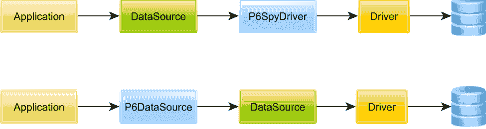

图 9.5：P6Spy 架构

<https://github.com/p6spy/p6spy>

# 连接管理与监控

运行上一个示例将得到以下输出（已应用格式化）：

```text
p6spy - 1448122491807|batch|connection 7|

  insert into post (title, version, id) values (?, ?, ?)

  insert into post (title, version, id) values ('Post no. 0', 0, 0)

p6spy - 1448122491807|batch|connection 7|

  insert into post (title, version, id) values (?, ?, ?)

  insert into post (title, version, id) values ('Post no. 1', 0, 1)

p6spy - 1448122491807|batch|connection 7|

  insert into post (title, version, id) values (?, ?, ?)

  insert into post (title, version, id) values ('Post no. 2', 0, 2)

p6spy - 1448122491825|statement|connection 7|

  insert into post (title, version, id) values (?, ?, ?)

  insert into post (title, version, id) values ('Post no. 2', 0, 2)
```

按照它们发生的顺序，输出由以下列组成：

### 表 9.5：P6Spy

| 字段 | 说明 |
| --- | --- |
| Timestamp | 语句执行的时间戳 |
| Execution time | 语句执行的持续时间（毫秒） |
| Category | 当前语句类别（例如 `statement`、`batch`） |
| Connection | 数据库连接标识符（由 `P6Spy` 分配） |
| Original statement | 被 `P6Spy` 拦截的原始语句 |
| Formatted statement | 将所有参数占位符替换为实际绑定值后的语句 |

前三行与将语句添加到批处理有关，而第四行记录了实际的批处理执行情况（这同时也解释了执行时间列的值）。

> 一个非常有用的配置是 `outdatedection` 属性，它可以检测长时间运行的语句。

## 10. 类型映射与标识符

JPA 通过将 Java 对象类型与数据库结构关联来解决对象/关系映射的失配问题。假设有一个包含四列的任务数据库表（例如 `id`、`created_by`、`created_on` 和 `status`），JPA 实例提供程序必须将其映射到由两个 Java 类构成的领域模型（例如 `Task` 和 `Change`）。

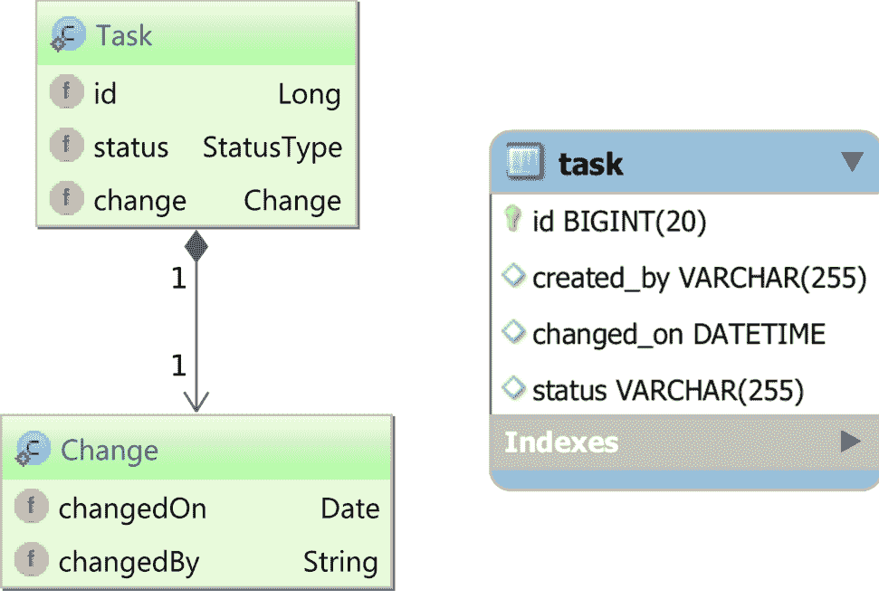

JPA 使用三个主要的对象-关系映射元素：`type`（类型）、`embeddable`（可嵌入类型）和 `entity`（实体）。在之前的图中，`Task` 对象是一个实体，而 `Change` 对象是一个可嵌入类型。

实体和可嵌入类型都通过依赖 Hibernate 类型的类型将多个领域模型属性组合在一起，并将数据库列类型与 Java 值对象（例如 `String`、`Integer`、`Date`）关联起来。实体和可嵌入类型之间的主要区别在于是否存在标识符，标识符被用于将数据库表的唯一键（通常是主键）与领域模型对象的属性关联。

## 类型映射与标识符

> 虽然映射所有数据库列是常见做法，但并不是硬性要求。有时，使用一个根实体和几个子实体更为实用，这样每个业务用例就可以获取所需的尽可能多的信息（同时仍从实体状态管理中获益）。

标识符对于实体元素是强制性的，而可嵌入类型被禁止拥有自己的数据行。标识符用于知道数据库表以及能够唯一标识任意给定行的列。

```java
@Embeddable
public class Change {
    @Column(name = "created_on")
    private Date createdOn;

    @Column(name = "created_by")
    private String createdBy;

    @Column(name = "status")
    private Integer status;
}
```


### 10.1 基本类型

对于映射可空列，最好使用基本类型的包装类（`Boolean`, `Byte`, `Short`, `Integer`, `Long`, `Float`, `Double`）。

| Hibernate 类型 | JDBC 类型 |
| --- | --- |
| `BooleanType` | `BIT` |
| `ByteType` | `TINYINT` |
| `ShortType` | `SMALLINT` |
| `CharacterType` | `CHAR` |
| `CharacterNType` | `NCHAR` |
| `IntegerType` | `INTEGER` |
| `LongType` | `BIGINT` |
| `FloatType` | `FLOAT` |
| `DoubleType` | `DOUBLE` |
| `CharArrayType` | `char[]` |

### 10.2 字符串类型

Java `String` 可以消耗 Java 堆中所有可用内存。另一方面，数据库系统定义了有限大小类型（`VARCHAR` 和 `NVARCHAR`）和无限限制类型（`TEXT`, `NTEXT`, `BLOB` 和 `NCLOB`）。

#### 表 10.2: 字符串类型

| Hibernate 类型 | JDBC 类型 | Java 类型 |
|---|---|---|
| `StringType` | `VARCHAR` | `String` |
| `StringNvarcharType` | `NVARCHAR` | `String` |
| `TextType` | `LONGVARCHAR` | `String` |
| `NTextType` | `LONONVARCHAR` | `String` |
| `MaterializedClobType` | `CLOB` | `String` |
| `MaterializedNclobType` | `NCLOB` | `String` |

### 10.1.3 日期时间和类型

涉及时间时，有多种 Java 或数据库表示方式，这解释了为什么有大量的相关的 Hibernate 类型。

#### 表 10.3: 日期时间和类型

| Hibernate 类型 | JDBC 类型 | Java 类型 |
|---|---|---|
| `DataType` | `DATE` | `Date` |
| `TimeType` | `TIME` | `Time` |
| `TimestampType` | `TIMESTAMP` | `Timestamp`, `Date` |
| `DbTimestampType` | `TIMESTAMP` | `Timestamp`, `Date` |
| `CalendarType` | `TIMESTAMP` | `Calendar`, `GregorianCalendar` |
| `CalendarDateType` | `DATE` | `Calendar`, `GregorianCalendar` |
| `CalendarStateType` | `TIME` | `Calendar`, `GregorianCalendar` |
| `TimeZone` | `VARCHAR` | `TimeZone` |

> 处理时间非常复杂，因为存在各种时区、闰秒和夏令时规定。将时间戳存储在 UTC（协调世界时）并在数据层进行时区转换是常见的做法。

### 10.1.4 数值类型

Oracle 可以表示多达 38 位的数字，因此只能放入 `BigInteger` 或 `BigDecimal`（`Long` 和 `Double` 只能存储 8 字节）。

#### 表 10.4: 数值类型

| Hibernate 类型 | JDBC 类型 | Java 类型 |
| --- | --- | --- |
| `BigIntegerType` | `NUMERIC` | `BigInteger` |
| `BigDecimalType` | `NUMERIC` | `BigDecimal` |

### 10.1.5 二进制类型

对于二进制类型，大多数数据库系统提供了多种存储选择（例如 `RAW`, `VARBINARY`, `BYTEA`, `BLOB`, `CLOB`）。在 Java 中，数据访问层可以使用字节数组、JDBC `Blob` 或 `Clob`，或者如果 Java 对象在保存到数据库之前已经进行了序列化，甚至可以使用一个 `Serializable` 类型。

#### 表 10.5: 二进制类型

| Hibernate 类型 | JDBC 类型 | Java 类型 |
| --- | --- | --- |
| `BinaryType` | `VARBINARY` | `byte[]`, `Byte[]` |
| `BlobType` | `BLOB` | `Blob` |
| `ClobType` | `CLOB` | `Clob` |
| `NClobType` | `NCLOB` | `byte[]`, `Byte[]` |
| `MaterializedBlobType` | `BLOB` | `Clob` |
| `ImageType` | `LONGBINARY` | `byte[]`, `Byte[]` |
| `SerializableType` | `VARBINARY` | `Serializable` |
| `SerializableToBlobType` | `BLOB` | `Serializable` |

### 10.1.6 UUID 类型

持久化 UUID（通用唯一标识符）有多种方法，根据内存占用情况，最高效的存储类型是数据库特定的 UUID 列类型。

#### 表 10.6: UUID 类型

| Hibernate 类型 | JDBC 类型 | Java 类型 |
| --- | --- | --- |
| `UUIDBinaryType` | `BINARY` | `UUID` |
| `UUIDCharType` | `VARCHAR` | `UUID` |
| `PostgresUUIDType` | `OTHER` | `UUID` |

> 在不支持原生支持的情况下，`BINARY` 类型比 `VARCHAR` 需要更少的字节，因此关联索引的内存占用也更。

### 10.1.7 其他类型

Hibernate 还可以映射 Java 枚举（`Enum`）、`Class`、`URL`、`Locale` 和货币（`Currency`）类型。

#### 表 10.7: 其他类型

| Hibernate 类型 | JDBC 类型 | Java 类型 |
| --- | --- | --- |
| `EnumType` | `CHAR`, `LONGVARCHAR`, `VARCHAR`, `INTEGER`, `NUMERIC`, `SMALLINT`, `TINYINT`, `BIGINT`, `DECIMAL`, `DOUBLE`, `FLOAT` | `Enum` |
| `ClassType` | `VARCHAR` | `Class` |
| `CurrencyType` | `VARCHAR` | `Currency` |
| `LocaleType` | `VARCHAR` | `Locale` |
| `UrlType` | `VARCHAR` | `URL` |

### 10.1.8 自定义类型

PostgreSQL 不仅拥有非常丰富的数据类型集，还允许添加自定义类型（使用 `CREATE DOMAIN` DDL 语句）。为每个领域模型字段选择合适的数据类型确实可以显著影响数据访问性能。尽管内置类型种类非常多，但应用程序开发者并不限于现成的类型，并且可以不费吹灰地添加新类型。

在接下来的示例中，业务逻辑需要监控对企业应用程序的访问。出于此目的，数据访问层存储了每个登录用户的 IP（互联网协议）地址。

假设此内部应用程序使用 IPv4 协议，则仅以无类域间路由格式存储 IP 地址（例如 `192.168.123.23/24`）。PostgreSQL 可以用 `cidr` 或 `inet` 类型存储 IPv4 地址，也可以使用 `VARCHAR(18)` 列类型。

`VARCHAR(18)` 列需要 18 个字符，假设使用 UTF-8 编码，每个 IPv4 地址最多需要 18 字节（例如，`0.0.0.0/0` 占用 9 个字符，`VARCHAR(18)` 方法对每个 IPv4 地址需要 9 到 18 个字符不等）。

`inet` 类型专门为 IPv4 和 IPv6 网络地址设计，它还支持各种特定网络地址的运算符（例如 `<`, `>`, `&&`）以及其他地址转换函数（例如 `host(inet)`、`netmask(inet)`）。与 `VARCHAR(18)` 方法相比，`inet` 类型每个 IPv4 地址仅需 7 字节。

由于它具有更紧凑的尺寸（索引可以放入内存）并支持许多特定运算符，`inet` 类型是一个更具吸引力的选择。尽管 Hibernate 默认不支持 `inet` 类型，但添加一个 Hibernate Type 是一项简单的任务。IPv4 地址被封装在自己的包装类中，该包装类还可以定义各种地址操作函数。

```java
public class IPv4 implements Serializable {

    private final String address;

    public IPv4(String address) {
        this.address = address;
    }

    public String getAddress() {
        return address;
    }

    @Override
    public boolean equals(Object o) {
        if (this == o) return true;
        if (o == null || getClass() != o.getClass()) return false;
        return Objects.equals(o, IPv4.class.cast(o).address);
    }

    @Override
    public int hashCode() {
        return Objects.hash(address);
    }

    public InetAddress toInetAddress() throws UnknownHostException {
        return Inet4Address.getByName(address);
    }
}
```

### 映射类型和标识符

在 Hibernate 中实现自定义类型，我们应该实现 `UserType` 接口。

```java
public abstract class ImmutableType<T> implements UserType {

    private final Class<T> clazz;

    protected ImmutableType(Class<T> clazz) {
        this.clazz = clazz;
    }

    @Override
    public Class<T> returnedClass() {
        return clazz;
    }

    @Override
    public boolean equals(Object x, Object y) {
        return Objects.equals(x, y);
    }

    @Override
    public int hashCode(Object x) {
        return x.hashCode();
    }

    @Override
    public Object deepCopy(Object o) {
        return o;
    }

    @Override
    public boolean isMutable() {
        return false;
    }

    @Override
    public Serializable disassemble(Object o) {
        return (Serializable) o;
    }

    @Override
    public Object assemble(Serializable o, Object owner) {
        return o;
    }

    @Override
    public Object replace(Object o, Object target, Object owner) {
        return o;
    }

    protected abstract T get(ResultSet rs, String[] names, SessionImplementor session) throws SQLException;

    protected abstract void set(PreparedStatement st, T value, int index, SessionImplementor session) throws SQLException;
}
```

## 映射类型与标识符

当 Hibernate 处理底层的类型转换时，管理事件（`Event`）变得简单。

```java
final AtomicReference<Event> eventHolder = new AtomicReference<>();

doInJPA(entityManager) -> {
    entityManager.persist(new Event());
    event = new Event("192.168.0.231");
    entityManager.persist(event);
    eventHolder.set(event);
};

doInJPA(entityManager) -> {
    Event event = entityManager.find(Event.class, eventHolder.get().getId());
    event.set("192.168.0.123");
}
```

运行上述示例将生成以下 SQL 语句：

```sql
INSERT INTO event (ip, id) VALUES (NULL, 1)
INSERT INTO event (ip, id) VALUES ('192.168.0.231', 2)
SELECT e0_.id as id1_0_0_, e0_.ip as ip2_0_0_
FROM event e0_
WHERE e0_.id = 2
UPDATE event SET ip='192.168.0.123' WHERE id = 2
```

使用数据库特定类型的用处之一是可以访问高级查询功能。由于 GIST 索引允许各种运算符，可以使用以下查询来检查是否为指定的网络生成了 `Event`：

```java
Event matchingEvent = (Event) entityManager
    .createNativeQuery(
        "SELECT e.* FROM event e " +
        "WHERE e.ip LIKE :network", Event.class)
    .setParameter("network", "192.168.0%")
    .getSingleResult();

assertEquals("192.168.0.123", matchingEvent.getAddress());
```

### 10.2 标识符

所有数据库表必须有一个主键，以便每行都能被唯一标识（主键必须是 `UNIQUE` 且 `NOT NULL`）。虽然 SQL 标准没有规定主键必须是不可变的，但避免更改它们是符合实际的。主键可以在现实世界中具有意义，这种情况下它是自然键；它也可以通过人工生成，这种情况下它被称为代理标识符（surrogate identifier）。

对于自然键，唯一性是通过序列强制执行的（例如身份证号、社会安全号码）。在现实中，在使用基于语句的复制时，自然键可能会带来问题。例如，如果系统必须适应来自多个国家的用户，可能会两个国家分配了相同的标识符。

自然键可以由一个或多个列组成。复合自然键可能会产生额外的性能开销，因为多列连接比单列连接慢，且多列索引占用的内存 footprint 更大。自然键必须足够长，以容纳系统所需的许多标识符。由于主键通常会被索引，主键越长，每个索引条目所需的内存就越多。每个连接的表将包含一个外键，且外键也经常被索引。

| 索引内存影响 | |
| :--- | :--- |
| 固定大小非数值型键（例如 `CHAR`, `VARCHAR`）效率低于数值型键（例如 `INTEGER`, `BIGINT`） | 简单键比复合键性能更好 |
| 一个长度为(36) 的自然键（例如身份证号）需要 36 个字符（当使用 ASCII 和 UTF-8 编码时） | 相比之下，4 字节（32 位 `INTEGER`）或 8 字节（64 位 `BIGINT`） |

## 映射类型与标识符

代理键独立于当前行数据生成，因此表列可能会随时间演变（例如更改电子邮件地址）。代理键可以通过数值序列生成（例如数据库标识列或序列），也可以通过伪随机数生成器构造（GUID 或 UUID）。数值键和 UUID 键都有各自的优缺点。UUID 遵循 RFC 4122 标准，它是 128 位。由于 UUID 不是顺序的，它们会引起碎片。为了节省空间并对索引友好，数值序列优于 UUID。

### 10.2.1 UUID 标识符

尽管某些企业级系统使用 UUID 主键，但了解哪些 Hibernate 类型适用于此任务。UUID 可以由应用程序使用 `java.util.UUID` 类生成，也可以由数据库系统分配。如果数据库系统没有内置 UUID 类型，建议使用 `BINARY(16)`。虽然 `CHAR(32)` 列也可以存储 UUID，但额外的空间开销使其成为不理想的选择。

### 10.2.2 Legacy 旧版 UUID 生成器

十六进制生成器注册在 `uuid` 名称下，并生成十六进制 UUID 字符串表示。UUID 生成器使用 8-4-8-4-12 布局，不符合 RFC 4122（后者使用 8-4-4-4-12 字节格式）。以下代码片段描述了 `UUIDHexGenerator` 的映射以及相关的插入语句。


```java
@Entity
@Table(name = "post")
public class Post {

    @Id
    @Column(columnDefinition = "CHAR(32)")
    @GeneratedValue(generator = "uuid")
    @GenericGenerator(name = "uuid", strategy = "uuid")
    private String id;
}
```

```sql
INSERT INTO post (id) VALUES (402880e451724a82015724a83d000000)
```

### 10.2.2.1 新版 UUID 生成器

新的 UUID 符合 RFC 4122 标准（变体 2），并注册在 `uuid2` 名称下（适用于 `java.lang.UUID`、`byte[]` 和 `String` Domain对象类型）。与之前的情况相比，映射和测试用例所示：

```java
@Entity
@Table(name = "post")
public class Post {

    @Id
    @Column(columnDefinition = "BINARY(16)")
    @GeneratedValue(generator = "uuid2")
    @GenericGenerator(name = "uuid2", strategy = "uuid2")
    private UUID id;
}
```

```sql
INSERT INTO post (id) VALUES
([77, 2, 31, 83, -45, 98, 70, 40, -65, 40, -50, 30, -47, 16, 30, 124])
```

- <http://docs.jboss.org/hibernate/stable/orm/javadoc/org/hibernate/id/UUIDHexGenerator.html>
- <http://docs.jboss.org/hibernate/stable/orm/javadoc/org/hibernate/id/UUIDGenerator.html>

> 由于 `UUIDGenerator` 符合 RFC 4122 标准并且能够与 `BINARY` 列类型配合工作，因此它优于旧版的 `UUIDHexGenerator`。

## 10.2.3 数值标识符

如前所述，通常更倾向于使用数值代理键，因为它占空间更少，且索引对于顺序标识符的效果更好。为了生成数值标识符，大多数数据库系统要么提供 `identity`（自增）列或 `sequence`（序列）对象。

JPA 为所有支持的标识符生成器类型定义了 `GenerationType` 枚举：

- `IDENTITY` 将实体映射到数据库列
- `SEQUENCE` 通过调用指定的数据库序列来分配标识符
- `TABLE` 用于不支持序列的关系型数据库（例如 MySQL 5.7），该表生成器通过使用单独的表来模拟数据库序列
- `AUTO` 根据当前数据库方言决定标识符的生成策略

> 正如 JDBC 部分所解释的那样，数据库序列在批量更新时效果更好，并且允许各种应用端的优化技术。

### 10.2.3.1 Identity 生成器

`identity` 列类型（包含在 SQL:2003* 中）受 Oracle 12c*、SQL Server 12 和 MySQL (`AUTO_INCREMENT`)* 支持，它允许整数或 `bigint` 列根据需要自动递增。

递增过程非常高效，因为它使用了轻量级机制，而不是更重量的事务粗粒度锁。一个缺点是，新分配的值只能在执行实际插入语句后才能感知。

- <https://docs.oracle.com/javaee/7/api/persistence/GenerationType.html>
- <https://en.wikipedia.org/wiki/SQL2003>
- <http://doc.oracle.com/cd/E16505/user/121/e17209/statements_7002.html#CJAHHJC>
- <http://docs.microsoft.com/en-us/library/ma18675.aspx>
- <http://dev.mysql.com/doc/refman/5.7/en/example-increment.html>

## 批量更新

由于 Hibernate 将 ID 生成与实际的实体插入语句分离，使用 `identity` 生成器的实体可能无法参与 JDBC 批量更新。Hibernate 在调用 `persist()` 方法期间发出插入语句，从而破坏了用于实体状态转换的事务后写缓存（write-behind caching）语义。

即使 JDBC 驱动允许在执行批量更新时获取关联的生成的键，Hibernate 在这方面仍然需要改进。

`identity` 生成器可以如下映射：

```java
@Entity(name = "post")
public class Post {

    @Id
    @GeneratedValue(strategy = GenerationType.IDENTITY)
    private Long id;
}
```

以下示例演示了 `identity` 列语义如何绕过事务后写缓存模型。尽管默认是禁用的，但启用了 JDBC 批量处理以比较 `identity` 和 `sequence` 生成器之间的结果。

```java
doInPA(entityManager) -> {
    for (int i = 0; i < batchSize; i++) {
        entityManager.persist(new Post());
    }

    LOGGER.debug("Flush is triggered at commit-time");
}
```

执行之前的测试用例将产生以下输出：

```sql
INSERT INTO post (id) VALUES (DEFAULT)
INSERT INTO post (id) VALUES (DEFAULT)
```

```text
DEBUG - Flush is triggered at commit time
```

因为关联的实体标识符只有在插入语句执行后才能确定，所以实际的插入语句被推迟到 `flush` 时。

### 10.2.3.2 Sequence 生成器

`sequence` 是一种生成数字的数据库对象。由 SQL:2003 标准定义，`sequence` 支持 Oracle、SQL Server 12 和 PostgreSQL。与 `identity` 列相比，`sequence` 具有以下优势：

- `sequence` 可以被多个事务使用
- 值可以预分配以提高性能
- 允许应用端优化
- 因为 `sequence` 调用与插入语句解耦

为了演示 `identity` 和 `sequence` 生成器之间的区别，将之前的示例改为使用 `sequence`：

```java
@Entity
@Table(name = "post")
public class Post {

    @Id
    @GeneratedValue(strategy = GenerationType.SEQUENCE)
    private Long id;
}
```

运行之前的测试用例将产生以下输出：

```sql
CALL NEXT VALUE FOR hibernate_sequence
CALL NEXT VALUE FOR hibernate_sequence
```

```text
DEBUG - Flush is triggered at commit time
```

```sql
INSERT INTO post (id) VALUES (1, 2)
```

当执行 `persist()` 方法时，Hibernate 调用关联的序列并为新实体获取标识符。实际的插入语句被推迟到 `flush`，从而允许利用批量处理。

## 映射类型与标识符

### 10.2.3.3 Table 生成器

由于标识符生成器与事务后写缓存之间的不匹配，JPA 提供了一种在不支持序列的情况下工作的替代序列生成器。

使用数据库表存储最新的序列值，并采用行级锁来防止并发连接获取相同的标识符。

#### 逃离事务行级锁

数据库序列是非事务对象，因为序列值的分配发生在事务上下文之外。数据库序列使用专用锁防止并发事务获取相同的值，但锁在计数器增加后就会释放。这种设计确保了在并发使用序列时的冲突最小。

使用数据库表作为序列是挑战性的；为了防止两个事务获取相同的序列值，必须使用行级锁。与序列对象锁不同，行级锁是事务性的，一旦获取，只能在当前事务结束（提交或回滚）时释放。这将是一个糟糕的可扩展性问题，因为长时间运行的事务将阻止其他事务获取新的序列值。

为了应对这一局限性，使用独立的数据库事务来获取新的序列值。这样，与增加序列计数器相关的行级锁可以在序列更新事务结束后立即释放。

对于本地事务，新事务意味着获取另一个数据库连接并在执行序列处理逻辑后提交。这会给底层连接池带来额外的压力，特别是当数据库连接已经存在显著竞争时。

在 JTA 环境中，必须挂起当前运行事务，并在独立的事务中获取序列值。JTA 事务管理器必须处理事务上下文切换，这也会对整个应用程序性能产生影响。

# 映射类型与标识符

为了继续之前的示例，此后将使用表生成器：

```java
@Entity(name = "post")
public class Post {

    @Id
    @GeneratedValue(strategy = GenerationType.TABLE)
    private Long id;
}
```

当插入新 `post` 时，会获得以下输出：

```sql
SELECT tbl.next_val
FROM hibernate_sequences tbl
WHERE tbl.sequence_name = default
FOR UPDATE

INSERT INTO hibernate_sequences (sequence_name, next_val)
VALUES (default, 1)

UPDATE hibernate_sequences
SET next_val = 2
WHERE next_val = 1
  AND sequence_name = default

SELECT tbl.next_val
FROM hibernate_sequences tbl
WHERE tbl.sequence_name = default
FOR UPDATE

UPDATE hibernate_sequences
SET next_val = 3
WHERE next_val = 2
  AND sequence_name = default

DEBUG - Flush is triggered at commit-time

INSERT INTO post (id) VALUES (1, 2)
```

表生成器受益于 JDBC 批处理，但每次表序列更新都涉及三个步骤：

- 执行 list 语句以确保两个并发事务不会分配到相同的序列值
- 在数据访问层中增加当前值
- 将新值保存回数据库并提交二级事务以释放行级锁。

# 映射类型与标识符

与可以在单次请求中增加序列的标识列（identity columns）和序列（sequences）不同，表生成器引入了巨大的性能开销。由于由于原因，Hibernate 自带了一系列优化器，可以提高数据库序列和表生成器的性能。

> 虽然这是一种可移植的标识符生成策略，但表生成器引入了序列化执行（行级锁），这可能会阻碍扩展性。与这种应用级别的序列生成技术相比，标识列和序列针对高并发场景进行了高度优化，无论如何它们都是首选方案。

## 10.2.3.4 优化器

如前所述，序列和表标识符生成器都有多种实现，可以提高标识生成过程的性能。序列和表生成器可以分为两类：

- 遗留实现（自 Hibernate 5.0 开始弃用），例如 `SequenceGenerator`、`SequenceHiLoGenerator` 和 `MultipleHiLoPerTableGenerator`
- 更新且更高效的实现，例如 `SequenceStyleGenerator` 和 `TableGenerator`

这两类是不兼容的，应用程序开发者必须选择选择遗留标识符或增强型标识符。在 Hibernate 5 之前，标识生成器是默认提供的，应用程序开发者可以通过设置以下配置属性切换到较新的实现：

```xml
<property name="hibernate.id.new_generator_mappings" value="true"/>
```

Hibernate 5 决定放弃对遗留标识符的支持，并默认使用增强型标识符。

在遗留标识生成器中，`SequenceGenerator` 没有提供任何优化，因为每个新的标识符值都需要调用底层数据库序列。相反，`SequenceHiLoGenerator` 和 `MultipleHiLoTableGenerator` 提供了 `hi/lo` 优化机制，旨在减少对数据库服务器的调用。尽管这些生成器已被弃用，但遗留的 `hi/lo` 算法对于较新的标识生成器仍然是一个有效的优化器。

### 10.2.3.4.1 hi/lo 算法

`hi/lo` 算法将序列域划分为 `hi` 组。`hi` 值按顺序分配，每个 `hi` 组都会获得最大数量的 `lo` 条目，这些条目可以离线分配而无需担心标识符值冲突。

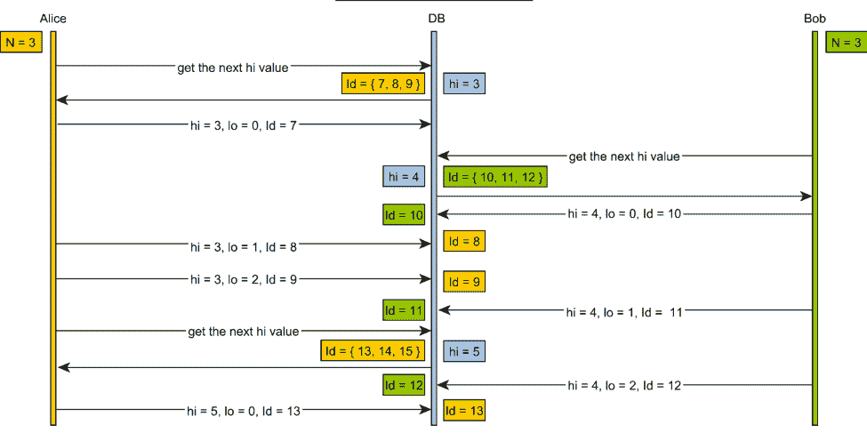

1. `hi` 令牌由数据库序列或表生成器分配，因此可以保证连续两次调用看到单调递增的值。
2. 一旦获取了 `hi` 令牌，增量大小（`n - lo` 条目的数量）定义了事务可以安全分配的标识符值范围。标识符范围受以下区间限制：`Id = [n × (hi - 1) + 1, n × hi]`，且分配方式如下：
   - 当前组值从 `n × (hi - 1) + 1` 开始。
   - `lo` 值取自以下区间：`[0, n - 1]`。
   - 通过将 `lo` 值加到初始组值，获得一个唯一的标识符数字。
3. 当所有 `lo` 值都用完时，将获取一个新的 `hi` 值并继续该循环。

下面的示例展示了 `hi/lo` 算法在实践中的工作原理：

```java
@Entity
public class Post {

    @Id
    @GeneratedValue(name = "hilo", strategy = GenerationType.SEQUENCE)
    @GenericGenerator(
        name = "hilo",
        strategy = "org.hibernate.id.enhanced.SequenceGenerator",
        parameters = {
            @Parameter(name = "initial_value", value = "1"),
            @Parameter(name = "allocation_size", value = "3"),
            @Parameter(name = "optimizer", value = "hilo")
        }
    )
    private Long id;
}
```

运行以下测试：

```java
for (int i = 0; i < 4; i++) {
    Post post = new Post();
    entityManager.persist(post);
}
```

输出：

```sql
CALL NEXT VALUE hilo

INSERT INTO post (id) VALUES (1)

CALL NEXT VALUE hilo

INSERT INTO post (id) VALUES (2)

CALL NEXT VALUE hilo

INSERT INTO post (id) VALUES (3)

CALL NEXT VALUE hilo

INSERT INTO post (id) VALUES (4)
```

# 映射类型与标识符

## 10.2.3.4.4 池化优化器（pooled optimizer）

池化优化器可以进行如下配置：

```java
@Entity
public class Post {

    @GeneratedValue(strategy = GenerationType.SEQUENCE, generator = "pooled")
    @GenericGenerator(
        name = "pooled",
        strategy = "org.hibernate.id.enhanced.SequenceStyleGenerator",
        parameters = {
            @Parameter(name = "sequence_name", value = "sequence"),
            @Parameter(name = "initial_value", value = "1"),
            @Parameter(name = "increment_size", value = "3"),
            @Parameter(name = "optimizer", value = "pooled")
        }
    )
    private Long id;
}
```

该大小提供了序列生成器通过一次数据库运行时可以分配的值范围。虽然在每次 `persist()` 方法调用后刷新持久化上下文（Persistence Context）是不高效的，但在实体测试中，当调用数据库序列时会发生 `flush` 操作。

```java
doInJPA(entityManager -> {
    for (int i = 0; i < 5; i++) {
        entityManager.persist(new Post());
        entityManager.flush();
    }
```


`entityManager.unwrap(Session.class).doWork(connection -> {`

```
try (Statement statement = connection.createStatement()) {

    statement.executeUpdate(

        "INSERT INTO post VALUES NEXT VALUE FOR sequence"

    );

}
```

`});`

```
for (int i = 0; i < 3; i++) {

    entityManager.persist(new Post());

    entityManager.flush();

}
```

`});`

`ld = [( (hi - n) + 1), hi]`

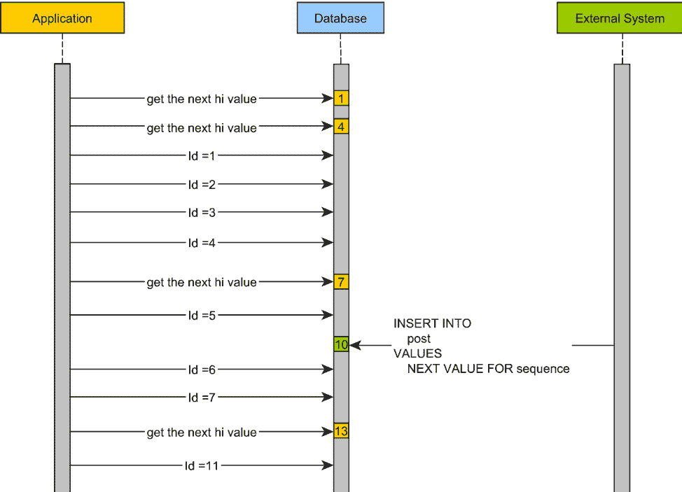

图 10.3：池化优化器

如果增量大小 (`n`) 是范围内标识符的数量，池化优化器按照以下公式生成标识符：`Id = [(hi - n) + 1, hi]`。

- 第一个序列生成 `lo` 值，第二个序列确定 `hi` 值，因此第一组标识符范围是 [2, 3, 4]
- 当添加第 5 个实体时，池化优化器再次调用序列并获取下一个 `hi` 值，下一个标识符范围为 [5, 6, 7]
- 在插入第 5 个实体后，外部系统添加了一个 `post` 行，并使用序列调用返回的值分配主键
- `Hibernate` 线程恢复执行并插入标识符 6 和 7
- 第 8 个标识符需要新的序列调用，因此分配了一个新范围 [11, 12, 13]

## 10.2.3.4.5 池化-lo 优化器 (pooled-lo optimizer)

通过将之前的映射更改为使用池化-lo 优化器，标识符的生成变化如下：

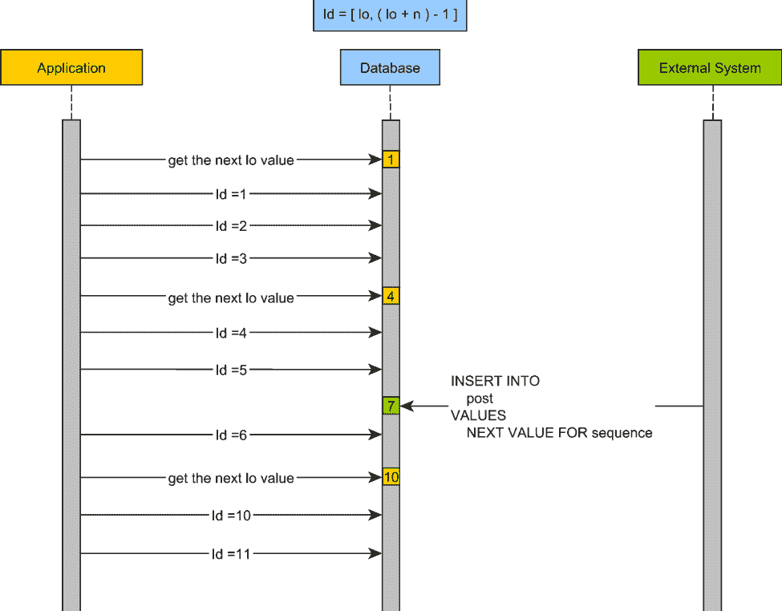

图 10.4：池化-lo 优化器

如果增量大小 (`n`) 是范围内标识符的数量，池化-lo 优化器按照以下公式生成标识符：`id = [lo, (lo + n) - 1]`。

- 第一个序列调用 `lo` 值，因此第一组标识符范围是 [1, 2, 3]
- 当添加第 4 个实体时，池化-lo 优化器调用序列并获取下一个 `lo` 值，下一个标识符范围为 {4, 5, 6}
- 在插入第 5 个实体后，外部系统添加了一个 `post` 行，并使用序列调用返回的值分配主键
- `Hibernate` 线程恢复执行并插入标识符 6
- 第 7 个实体需要新的序列调用，因此分配了一个新范围 {10, 11, 12}

## 10.2.3.5 优化器增益

为了直化使用序列和表生成器优化器的性能增益，以下测试将测量插入 50 个 `post` 实体时的标识符分配时间，并同时改变增量大小（1, 5, 10 和 50）。

### 10.2.3.5.1 序列生成器性能增益

当使用带有默认池化优化器的序列生成器时，记录了以下 99 分位数：

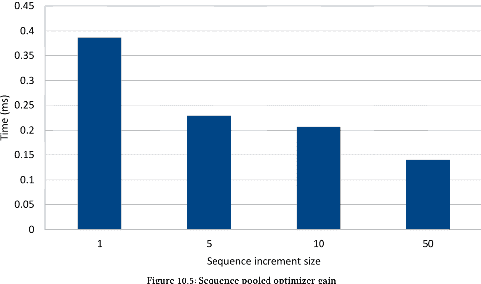

> 数据库序列非常快，但尽管如此，池化优化器仍然显著缩短了标识符生成时间。

对于写密集型应用程序，根据一个事务中需要插入的行数调整增量大小。

### 10.2.3.5.2 表生成器性能增益

针对带有池化优化器的表生成器运行相同的测试套件，增量大小在 1, 5, 10 和 50 之间变化。由于行锁和额外的数据库连接切换开销，表生成器的效率低于数据库序列。

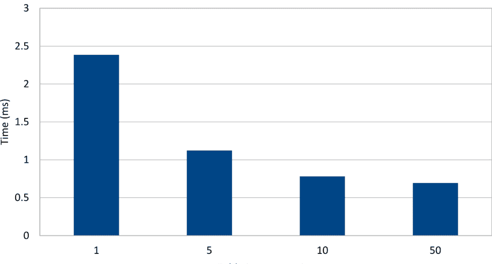

图 10.4：池化-lo 优化器

# 关系

帖子（`Post`）和标签（`Tag`）都是独立的表，它们都不是对方的子表。一个帖子可以包含多个标签，而一个标签也可以关联多个帖子。这是一种典型的多对多关联，需要一个中间表（junction table）来解决这两个父实体的子侧问题。中间表需要两个引用父表的外键。

> 因此，外键是构建表关系时最重要的结构，在关系型数据库中，由子侧来控制表关系。

在关系型数据库中，外键仅与子侧关联。由于这个原因，父侧对任何关联的子关系一无所知，从映射的角度来看，表关系是单向的（外键引用父表的主键）。

# 11.1 关系类型

在映射 `JPA` 实体时，开发者会以单向或双向的方式映射实体。这是面向对象的领域模型与关系型数据库系统之间的另一种阻抗不匹配，因为当使用 `ORM` 工具时，父侧和子侧会互相引用。

如果只有一个实体映射了表关系，则它是单向的；如果表关系可以在两个方向上进行导航（从实体侧或子侧），则它是双向的。

为了正确表示实体关系的双侧，`JPA` 定义了四种关联映射结构：

- `@ManyToOne`：代表数据库一对多表关系中的子侧（外键所在之处）。
- `@OneToOne`：与一对多表关系的父侧关联。
- `@ElementCollection`：定义了实体与多个值类型（基本或可嵌入）之间的一对多关联。
- `@OneToOne`（注：此处原文可能有误，通常应为 `@OneToMany` 或在上下文中描述）：用于一对一表关系中的子侧和父侧。
- `@ManyToMany`：镜像多对多的表关系。

由于实体关系的选择对整个应用的性能有很大影响，本章分析了所有这些 `JPA` 关联的数据访问操作效率。

# 映射集合

在关系型数据库中，所有的表映射都是使用外键构建并通过 `SQL` 查询进行导航的。`JPA` 允许映射键侧（子实体引用其父实体）以及父侧（父实体拥有一个或多个子实体实体）。

尽管 `@ElementCollection` 从数据访问的角度来看非常方便（实体状态转换可以从父实体级联到子实体），但它们并不是免费的。减少数据访问操作的代价是结果获取的灵活性和性能。`JPA` 集合（无论是实体还是值类型，基本或可嵌入的）会将父实体绑定到获取所有关联子记录的查询上。正如此，实体映射对子实体的数量变得敏感。

如果子数量相对较小，检索所有子实体的性能影响可能难以忽略。但如果子记录的数量增长过大，获取整个集合可能会变成性能瓶颈。遗憾的是，实体映射可能在项目开发的早期完成，而开发团队可能不知道生产系统将显示的记录数量。

问题的不仅是大小，还可能是子实体的属性数量。因为实体通常是按行所示被获取的，因此结果与子表包含的列数成正比。即使集合是懒性加载的，当第一次访问集合时，`Hibernate` 可能仍然需要完全加载每个实体。虽然 `Hibernate` 支持额外的懒性集合加载，但这仅仅是一种通之手段，并没有解决根本问题。

或者，每个集合映射都可以被数据访问查询所取代，该查询可以使用针对每个业务用例数据需求定制的 `SQL` 投影（projection）。通过这种方式，查询可以采用特定业务用例过滤条件。虽然 `JPA 2.1` 不支持动态集合过滤，但 `Hibernate` 提供了与 `Session`（持久化上下文）绑定的过滤器。

> 在处理大数据时，良好的做法是限制结果集的大小（以提高响应速度）或批量处理任务（以避免长事务）。仅仅因为 `JPA` 提供了集合映射，并不意味着对于每个领域模型映射都是强制性的。在明确了解子记录数量（或者甚至确定是否有需要完全获取子实体）之前，最好推迟集合映射的决定。对于高性能系统，数据访问查询通常是一个更灵活的替代方案。

# 11.2 @ManyToOne

`@ManyToOne` 关系是最常见的 `JPA` 关联，它精确地映射到一对多的表关系。使用 `@ManyToOne` 关联时，底层的外键由子侧控制，无论关联是单向还是双向的。

本节仅关注单向的 `@ManyToOne` 关系，双向的情况将在 `@OneToOne` 关系中讨论。在这个示例中，`Post` 实体代表父侧，而 `PostComment` 是子侧。

如前所述，`JPA` 实体关系图与一对多关系匹配。

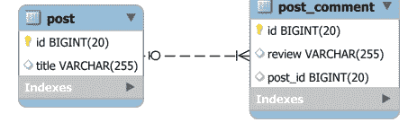

图 1.2：一对多表关系

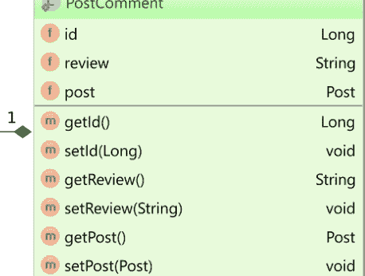

图 1.3：`@ManyToOne` 关系

`PostComment` 并没有映射 `post_id` 外键列，而是使用到到父实体 `Post` 的 `@ManyToOne` 关系。`PostComment` 可以关联已有的 `Post` 对象引用，并且 `PostComment` 也可以与 `Post` 一起获取。

```java
@ManyToOne
@JoinColumn(name = "post_id")
private Post post;
```

如果 `post_id` 外键列设置为一个有效的 `Post` 实体：

```java
Post post = entityManager.find(Post.class, 1L);
PostComment comment = new PostComment("My review");
comment.setPost(post);
entityManager.persist(comment);
```

`Hibernate` 生成插入语句，用关联实体的标识符填充 `post_id`。

```sql
INSERT INTO post_comment (post_id, review) VALUES (1, 'My review');
```

如果 `Post` 属性被设置为 `null`：

```java
comment.setPost(null);
```

`post_id` 列也会更新为 `NULL` 值：

```sql
UPDATE post_comment SET post_id = NULL, review = 'My review' WHERE id = 2
```

> 因为 `@ManyToOne` 直接控制外键，自动生成的 `DML` 语句非常高效。实际上，高性能 `JPA` 关联总是依赖子侧将状态转换为外键值。这是 `JPA` 关系中最重要的规则之一，并在 `@OneToMany`、`@OneToOne` 甚至 `@ManyToMany` 关联中都会强调。

# 11.3 @OneToMany

虽然 `@ManyToOne` 关联是一对多关系的自然映射，但 `@OneToMany` 关联也可以镜像这种数据库关系，但作为双向映射使用。单向 `@OneToMany` 使用额外的中间表，这不再符合一对多的表关系。

# 11.3.1 双向 @OneToMany

双向 `@OneToMany` 关联有一个匹配的 `@ManyToOne` 子侧来控制底层的一对多表关系。父侧被映射为子实体的集合。

| `Post` | | `PostComment` | |
| :--- | :--- | :--- | :--- |
| `id` | `Long` | `id` | `Long` |
| `title` | `String` | `review` | `String` |
| `comments` | `List<PostComment>` | `post` | `Post` |
| `getId()` | `Long` | `getId()` | `Long` |
| `setLong(Long)` | `void` | `setLong(Long)` | `void` |
| `getTitle()` | `String` | `getReview()` | `String` |
| `setTitle(String)` | `void` | `setReview(String)` | `void` |
| `getComments()` | `List<PostComment>` | `getPost()` | `Post` |
| `addComment(PostComment)` | `void` | `setPost(Post)` | `void` |
| `removeComment(PostComment)` | `void` | `setPost(Post)` | `void` |

图 11.4：双向 `@OneToMany` 关系

在双向关联 `@OneToMany` 映射中，由子侧的 `@ManyToOne` 关联负责外键列值与内存持久化上下文同步。这就是为什么双向 `@OneToMany` 关系必须定义 `mappedBy` 属性，表明它仅镜像 `@OneToMany` 子侧映射。

```java
@OneToMany(mappedBy = "post", cascade = CascadeType.ALL, orphanRemoval = true)
private List<PostComment> comments = new ArrayList<>();
```

> 即使子侧负责将实体状态更改与数据库外键列值同步，双向关联也必须始终父侧和子侧的同步。

# 关系

为了同步两端，提供父实体端的辅助方法来添加/删除子实体是实用的。

```java
public void addComment(PostComment comment) {
    comments.add(comment);
    comment.setPost(this);
}
```

```java
public void removeComment(PostComment comment) {
    comments.remove(comment);
    comment.setPost(null);
}
```

使用双向关联的主要优势之一是，实体的状态转换可以从父实体级联到其子实体。在下面的示例中，当持久化父实体时，所有的 `PostComment` 实体也会被持久化。

```java
Post post = new Post("First post");
entityManager.persist(post);

PostComment comment1 = new PostComment("My first review");
post.addComment(comment1);

PostComment comment2 = new PostComment("My second review");
post.addComment(comment2);

entityManager.persist(post);
```

```sql
INSERT INTO post (title, id) VALUES ('First post', 1)
INSERT INTO post_comment (post_id, review, id) VALUES (1, 'My first review', 2)
INSERT INTO post_comment (post_id, review, id) VALUES (1, 'My second review', 3)
```

当从父实体端的集合中删除评论时，`orphanRemoval` 属性将指示 `Hibernate` 对目标实体生成一个删除 `DML` 语句：

```java
post.removeComment(comment1);
```

```sql
DELETE FROM post_comment WHERE id = 2
```

# 基于相等性的实体删除

删除子实体的辅助方法依赖于底层子对象的相等性来匹配需要删除的集合项。

如果应用开发者没有选择重写默认的 `equals` 和 `hashCode` 方法，将使用基于 `java.lang.Object` 标识的相等性。这种方法的问题在于，开发者必须提供一个包含当前子会话中的子实体对象引用。

有时子实体在一个 `Web` 请求中加载，并保存在 `HttpSession` 或有状态的 `Java Bean` 中。一旦持久化上下文（Persistence Context）关闭，实体就会变为离散状态（detached）。如果要在新的 `Web` 请求中删除子实体，则必须将子实体重新关联或合并到持久化上下文中。如果父实体与其子实体一起加载的，那么删除操作将正常工作，因为要删除的实体已经受管理并包含在集合中。

如果实体没有变化，重新关联该实体是多余的，因此必须重写 `equals` 和 `hashCode` 方法，根据唯一的业务键来表示相等性。如果子实体设置了 `@Natural` 或唯一属性/多个属性，可以在此基础上实现 `equals` 和 `hashCode` 方法。假设 `PostComment` 实体具有以下列，它们的组合构成了一个唯一的业务键，相等性合约可以如下实现：

```java
private String createdBy;

@Temporal(Temporal.TIMESTAMP)
private Date createdOn = new Date();

@Override
public boolean equals(Object o) {
    if (this == o) return true;
    if (o == null || o.getClass() != o.getClass()) return false;
    PostComment.that = (PostComment) o;
    return Objects.equals(createdBy, that.createdBy) &&
           Objects.equals(createdOn, that.createdOn);
}

@Override
public int hashCode() {
    return Objects.hash(createdBy, createdOn);
}
```

# 关系

> 双向 `@OneToMany` 关联生成高效的 `DML` 语句，因为 `@ManyToOne` 映射负责表关系。因为它很好地简化了数据访问操作，当子记录数量相对较小时，双向 `@OneToMany` 关联是值得考虑的。

# 11.3.2 单向 @OneToMany

单向 `@OneToMany` 关联非常有吸引力，因为它的映射比其双向对应物简单。因为只需要考虑一方，所以不需要辅助方法，且映射不包含 `@mappedBy` 属性。

```java
@OneToMany(cascade = CascadeType.ALL, orphanRemoval = true)
private List<PostComment> comments = new ArrayList<>();
```


遗憾的是，由于其这种特性，单向`@OneToMany`关联的效率低于单向`@ManyToOne`映射或双向`@OneToMany`关联。

与直觉相反，单向`@OneToMany`关联并没有映射到一对多的表关系。因为没有`@ManyToOne`端来控制这种关系，`Hibernate`使用一个单独的表来管理父行与其子记录之间的关联。

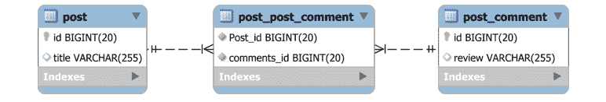

图 1.5: `@OneToMany`表关系

`post_post_comment`表包含两个外键，它们引用了父端行（`post_id`列是`post`主表的外键）和子端实体（`comments_id`引用`post_comment`表的主键）。

在不分析关联数据操作的情况下，它比连接两个表效率低。因为有两个外键，需要两个索引（而不是一个），索引的内存占用增加了。

但由于这是多对多关系的关系映射，额外的表和增加的内存占用并不是最大的性能问题。管理集合状态的算法使得任何单向`@OneToMany`关联失去了吸引力。

## 关系

假设有一个带有两个`PostComment`子记录的`Post`实体，通过运行以下示例获得：

```
Post post = new Post("First post");
```

```
post.getComments().add(new PostComment("My first review"));
post.getComments().add(new PostComment("My second review"));
post.getComments().add(new PostComment("My third review"));
```

```
entityManager.persist(post);
```

对于双向关联是添加三个子记录，而单向关联则需要在中间表中进行三次插入。

当删除集合中的第一个元素时：

```
post.getComments().remove(0);
```

`Hibernate`生成了以下`DML`语句：

```
DELETE FROM post_comment WHERE id = 2
INSERT INTO post_comment (post_id, comments_id) VALUES (1, 3)
INSERT INTO post_comment (post_id, comments_id) VALUES (1, 4)
```

首先删除所有与父实体关联的中间表行，然后将内存中的记录重新添加。这种方法的问题在于，它不是单表操作，而是需要更多的`DML`语句。

另一个问题与索引有关。如果每个外键上都有索引（许多数据库都是如此），数据库引擎必须删除相关的索引项后再添加。集合元素越多，效率就越低。

> 单向`@OneToMany`关联在读取数据时效率较低，在添加（需要写入两个表）或删除（删除并重新添加）子项时也是。

## 11.3.3 有序单向`@OneToMany`

如果集合可以存储每个元素的索引，单向`@OneToMany`关联在某些元素删除操作中可以受益。首先，必须在`@OneToMany`映射上定义`@OrderColumn`注解：

```
@OneToMany(cascade = CascadeType.ALL, orphanRemoval = true)
@OrderColumn(name = "entry")
private List<PostComment> comments = new ArrayList<>();
```

在数据库级别，索引包含在中间表中。

| post | post_comment | post_comment |
| :--- | :--- | :--- |
| id BIGINT(20) | id_post_BIGINT(20) | id BIGINT(20) |
| title VARCHAR(255) | comments_id BIGINT(20) | review VARCHAR(255) |
| Indexes | entry INT(11) | Indexes |

*(注：上表表示了文中带有顺序列的中间表的逻辑结构。)*

> 最好不要将`@OrderColumn`与`@OrderBy`注解混淆。前者允许`JPA`实现将元素索引实例化到专门的数据库列中，从而使用`ORDER`子句对集合进行排序，而后者则根据`@OrderBy`注解提供的排序标准在运行时进行排序。

## 关系

假设为给定的`Post`父级实体添加了三个`PostComment`实体：

```
post.getComments().add(new PostComment("My first review"));
```

每个集合元素的索引将存储在中间连接表的`entry`列中：

```
INSERT INTO post_comment (review, id) VALUES ('My first review', 2)
INSERT INTO post_comment (review, id) VALUES ('My second review', 3)
INSERT INTO post_comment (review, id) VALUES ('My third review', 4)
INSERT INTO post_comment (Post_id, entry, comments_id) VALUES (1, 0, 2)
INSERT INTO post_comment (Post_id, entry, comments_id) VALUES (1, 1, 3)
INSERT INTO post_comment (Post_id, entry, comments_id) VALUES (1, 2, 4)
```

当从集合的尾部删除元素时：

```
post.getComments().remove(2);
```

`Hibernate`只需要一条单表删除语句：

```
DELETE FROM post_comment WHERE Post_id = 1 and entry = 2
DELETE FROM post_comment WHERE id = 4
```

遗憾的是，这种优化对于不在集合头部的元素并不有效，因此删除第一个元素：

```
post.getComments().remove(0);
```

`Hibernate`会删除所有与此父实体关联子元素，然后更新剩余的数据库记录，以保持与内存集合快照相同的元素顺序：

```
DELETE FROM post_comment WHERE Post_id=1 and entry=1
UPDATE post_comment set comments_id = 3 WHERE Post_id = 1 and entry = 0
DELETE FROM post_comment WHERE id = 2
```

> 如果单向的`@OneToMany`集合像栈一样使用，并且元素始终从集合尾部移除，那么使用`@OrderColumn`时删除操作会更高效。但元素越靠近列表头部，必须发出的更新语句就越多，额外的更新会带来关联的性能开销。

### 11.3.3.1 `@ElementCollection`

虽然它不是一种实体类型，但`@ElementCollection`与单向的`@OneToMany`关系非常相似。为了表示基本类型（例如`String`、`int`、`BigDecimal`）或嵌入类型的集合，必须使用`@ElementCollection`。如果之前的关联涉及多个实体，那么这次只有一个包含`String`评论集合的`Post`实体。

| 字段 | 类型 |
|---|---|
| id | Long |
| title | String |
| comments | List<String> |
| getid() | Long |
| setid(Long) | void |
| getTitle() | String |
| setTitle(String) | void |
| getComments() | List<String> |

图 11.7: `@ElementCollection`关系

`comments`集合的映射如下：

```java
private List<String> comments = new ArrayList<>();
```

值类型继承其父实体的持久状态，因此它们的生命周期与所有实体绑定。对实体集合的任何操作都将自动实例化为`DML`语句。

在添加或删除子记录时，`@ElementCollection`的行为类似于单向的`@OneToMany`关系，带有`CascadeType.ALL`和`orphanRemoval`。

## 关系

从数据库的角度来看，有一个子表同时持有外键和集合元素值。


图 1.8: `@ElementCollection`表关系

为了持久化三条评论，数据访问层只需向父实体集合添加即可：

```java
post.getComments().add("My first review");
post.getComments().add("My second review");
post.getComments().add("My third review");
```

`Hibernate`在持久化上下文（`Persistence Context`）刷新时发出插入语句：

```
INSERT INTO Post_comments (Post_id, comments) VALUES (1, 'My first review')
INSERT INTO Post_comments (Post_id, comments) VALUES (1, 'My second review')
INSERT INTO Post_comments (Post_id, comments) VALUES (1, 'My third review')
```

遗憾的是，删除操作使用了与单向`@OneToMany`关联相同的逻辑，当移除第一个集合元素时：

```java
post.getComments().remove(0);
```

`Hibernate`删除所有关联的子端记录，并将内存中的记录重新插入回数据库表：

```
DELETE FROM Post_comments WHERE Post_id = 1
INSERT INTO Post_comments (Post_id, comments) VALUES (1, 'My second review')
INSERT INTO Post_comments (Post_id, comments) VALUES (1, 'My third review')
```

> 从其简单性来说，`@ElementCollection`在元素元素方面并不高效。与单向`@OneToMany`集合一样，`@OrderColumn`可以优化位于集合尾部元素的移除操作。

## 11.3.4 带`@JoinColumn`的`@OneToMany`

`JPA` 2.0增加了对使用`@JoinColumn`映射`@OneToMany`关联的支持，以便它可以映射一对多关系。通过`@JoinColumn`，`@OneToMany`关联控制子表的外键，因此不需要中间表。

在`JPA`侧，类图与上述的`@ToMany`关系相同，唯一的区别在于`JPA`映射：

```java
@OneToMany(cascade = CascadeType.ALL, orphanRemoval = true)
@JoinColumn(name = "post_id")
List<PostComment> comments = new ArrayList<>();
```

当添加子实体时，`Hibernate`生成以下`SQL`语句：

```java
post.getComments().add(new PostComment("My first review"));
post.getComments().add(new PostComment("My second review"));
post.getComments().add(new PostComment("My third review"));
```

```
INSERT INTO post_comment (review, id) VALUES ('My first review', 2)
INSERT INTO post_comment (review, id) VALUES ('My second review', 3)
INSERT INTO post_comment (review, id) VALUES ('My third review', 4)
UPDATE post_comment SET post_id = 1 WHERE id = 2
UPDATE post_comment SET post_id = 1 WHERE id = 3
UPDATE post_comment SET post_id = 1 WHERE id = 4
```

除了插入语句外，`Hibernate`还发出三条更新语句来设置新插入实体的`post_id`。子实体并不拥有`post_id`外键，因此插入子实体时并不知道父实体。在插入子实体后，父集合可以更新每个子实体。

> 虽然它比普通的`@ToMany`映射有所改进，但在实践中，它不如普通的`@ToMany`关联高效。

## 关系

当删除集合的最后一个元素时：

```java
post.getComments().remove(2);
```

`Hibernate`生成以下`SQL`语句：

```
UPDATE post_comment SET post_id = null WHERE post_id = 1 AND id = 4
DELETE FROM post_comment WHERE id = 4
```

再次，子移除操作关联着一条额外的更新语句。当子实体从父端集合移除时，`Hibernate`将将子表键列设置为`null`。之后，孤儿移除逻辑生效，并对孤立子实体触发删除语句。

与普通的`@ToMany`关联不同，`@JoinColumn`方案在移除后的集合位置上是一致的。因此，当移除集合的第一个元素时：

```java
post.getComments().remove(0);
```

`Hibernate`仍然生成一条额外的更新语句：

```
UPDATE post_comment SET post_id = null WHERE post_id = 1 AND id = 2
DELETE FROM post_comment WHERE id = 2
```

### 带`@JoinColumn`的双向`@ToMany`关系

带`@JoinColumn`的`@ToMany`关联也可以转换为双向关系，但指示子端避免任何插入和更新同步：

```java
@ManyToOne
@JoinColumn(name = "post_id", insertable = false, updateable = false)
private Post post;
```

> 单向和双向关联都会生成冗余的更新语句，因此最高效的外键映射是`@ManyToMany`关联。

## 11.4 `@OneToOne`

从数据库的角度来看，一对一（one-to-one）关联基于一个被限制为唯一的的外键。这意味着，一个父行最多只能被一个子记录引用。

在`JPA`中，`@OneToOne`关系可以是单向的，也可以是双向的。

### 11.4.1 单向

在下面的示例中，`Post`实体代表父端，而`PostDetails`是一对一关联的子端。

如前提到的，`JPA`实体关系图与一对一表关系完全对应。


图 11.9：一对一表关系

即使从领域模型（`Domain Model`）的角度来看，单向的`@OneToOne`关系与单向的`@ManyToOne`关联也非常相似。


图 11.10：单向`@OneToOne`关系

### 关系

映射通过`@OneToOne`注解完成，就像`@ManyToOne`映射一样，它也可能带有`@JoinColumn`。

```
@OneToOne
@JoinColumn(name = "post_id")
private Post post;
```

单向的`@OneToOne`关联控制关联的外键，因此，当`post`属性为：

```
Post post = entityManager.find(Post.class, 1L);
PostDetails details = new PostDetails("John Doe");
details.setPost(post);
entityManager.persist(details);
```

`Hibernate`会用关联的`post`标识符填充外键列：

```
INSERT INTO post_details (created_by, created_on, post_id, id)
VALUES ('John Doe', '2016-01-08 11:28:21.317', 1, 2)
```

即使这是一个单向关联，`Post`仍然是该关系的父端。要获取`PostDetails`，需要一个`JPQL`查询：

```
PostDetails details = entityManager.createQuery(
  "select pd " + 
  "from PostDetails pd " +
  "where pd.post = :post", PostDetails.class)
.setParameter("post", post)
```


`.getSingleResult();`

如果 `Post` 总是需要它的 `PostDetails`，那么单独查询是不理想的。为了克服这一局限性，在加载实体之前知道 `PostDetails` 的标识符很重要。

一种变通是使用 `@NaturalId`，如果实体存储在二级缓存中，则可能不需要访问数据库。幸运的是，还有一种更简单且在不同 JPA 实现之间也可移植的方法。JPA 2.0 规范增加了对派生标识符（derived identifiers）的支持，使得将 `PostDetails` 标识符链接到表主键成为可能。

这样，`post_details` 表的主键也可以是引用 `post` 表标识符的外键。

## 关系

`PostDetails` 的 `@OneToOne` 映射更改如下：

```java
@OneToOne
@MapsId
private Post post;
```

这一次，表关系不再包含任何额外的外键列，因为 `post_details` 表的主键引用了 `post` 表的主键：


图 11.11：共享主键的一一

由于 `PostDetails` 与父实体具有相同的标识符，可以直接获取它而无需编写 JPQL 查询。

```java
PostDetails details = entityManager.find(PostDetails.class, post.getId());
```

### 共享主键的效率

首先，共享主键方法减少了子表索引的内存占用，因为它只需要一个索引列而不是两个。子表中的记录越多，减少索引列数量的性能增益就越明显。

此外，子实体现在可以简单地从二级缓存中检索，从而避免了命中数据库。在之前的示例中，由于子实体标识符未知，查询是不可避免的。为了优化之前的用法，还需要查询缓存，但查询缓存也并非没有问题。

> 因为由于减少了内存占用并开启了二级缓存检索，JPA 2.0 的派生标识符是首选的 `@OneToOne` 映射策略。共享主键不仅限于单向关联，也适用于双向的 `@OneToOne` 关系。

### 11.4.2 双向 `@OneToOne`

双向的 `@OneToOne` 关联允许父实体也映射子端：

| Post | | | PostDetails | | |
|---|---|---|---|---|---|
| id | Long | | id | Long | |
| title | String | | createdOn | Date | |
| details | PostDetails | | createdBy | String | |
| m getId() | Long | | post | Post | |
| m setId(Long) | void | | m getId() | Long | |
| m getTitle | String | | m setId(Long) | void | |
| m setTitle(String) | void | | m getCreatedOn() | Date | |
| m getDetails() | PostDetails | | m getCreatedBy() | String | |
| m setDetails(PostDetails) | void | | m getPost() | Post | |
| | | | setPost(Post) | void | |

图 11.12：双向 `@OneToOne` 关系

双向的 `@OneToOne` 关系，子端（拥有关联外键的一侧）通过 `mappedBy` 属性来管理该关系：

```java
@OneToOne(mappedBy = "post", cascade = CascadeType.ALL, fetch = FetchType.LAZY)
private PostDetails details;
```

由于这是双向关系，父实体必须：

```java
public void setDetails(PostDetails details) {
    this.details = details;
}
```

即使关联是懒加载的，在获取 `Post` 实体时，Hibernate 也会获取子实体：

```java
Post post = entityManager.find(Post.class, 1L);
```

关系：

```sql
SELECT p.id AS id1_0,
    p.title AS title2_0
FROM post p
WHERE p.id = 1

SELECT pd.post_id AS post_id_1_0,
    pd.created_by AS created_by_2_0,
    pd.created_on AS created_on_3_0
FROM post_details pd
WHERE pd.post_id = 1
```

因此，执行了两次查询而不是一次。与单向 `@ToMany` 关系（Hibernate 在集合为空时可以简单地分配代理）不同，`@OneToOne` 关系必须决定是将子引用赋值为 `null` 还是实际实体。这是父端的问题，如果应用程序只需要父实体，就会执行二级查询，这可能会影响性能。需要的父实体越多，二级查询的影响越明显。

### 字节码增强

即使外键为 `NOT NULL` 且父端通过 `optional` 属性感知其空值（例如 `@OneToOne(mappedBy = "", fetch = FetchType.LAZY, optional = false)`），Hibernate 也会生成二级查询。已知子实体不为空，Hibernate 可以将其分配为代理而非实际实体。但持久上下文（Persistence Context）需要实体及其标识符，因此在加载实体时必须知道子标识符，唯一的办法是执行二级查询。

> 字节码增强是唯一的可行方案；以便在首次访问时加载子实体。因为它更简单且性能良好，通常首选单向的 `@OneToOne` 关系。

## 11.5 `@ManyToMany`

`@ManyToMany` 是所有 JPA 关系中最复杂的，本章剩余部分将演示。与 `@ToOne` 关系一样，`@ManyToMany` 关联可以是单向的，也可以是双向的。从数据库的角度来看，`@ManyToMany` 关联反映了多对多的表关系：


图 11.13：多对多表关系

### 11.5.1 单向 `@ManyToMany`

在这个示例中，让 `Post` 实体拥有 `@ManyToMany` 关系是合理的，因为从 `Tag` 关系侧导航此关联（尽管我们仍然可以通过 JPQL 查询来实现）。


图 11.14：单向 `@ManyToMany` 关系

在 `Post` 实体中，单向 `@ManyToMany` 关联映射如下：

```java
@ManyToMany(cascade = { CascadeType.PERSIST, CascadeType.MERGE })
@JoinTable(name = "post_tag",
    joinColumns = @JoinColumn(name = "post_id"),
    inverseJoinColumns = @JoinColumn(name = "tag_id"))
private List<Tag> tags = new ArrayList<>();
```

## 关系

当添加多个实体时：

```java
Post post1 = new Post("JPA with Hibernate");
Post post2 = new Post("Native Hibernate");
```

```java
Tag tag1 = new Tag("Java");
Tag tag2 = new Tag("Hibernate");
```

```java
post1.getTags().add(tag1);
post1.getTags().add(tag2);
post2.getTags().add(tag1);
```

```java
entityManager.persist(post1);
entityManager.persist(post2);
```

Hibernate 负责持久化 `Post` 和 `Tag` 实体以及它们的中间记录。

```sql
INSERT INTO post (title, id) VALUES ('JPA with Hibernate', 1);
INSERT INTO post (title, id) VALUES ('Native Hibernate', 4);
```

```sql
INSERT INTO tag (name, id) VALUES ('Java', 2);
INSERT INTO tag (name, id) VALUES ('Hibernate', 3);
```

```sql
INSERT INTO post_tag (post_id, tag_id) VALUES (1, 2);
INSERT INTO post_tag (post_id, tag_id) VALUES (1, 3);
INSERT INTO post_tag (post_id, tag_id) VALUES (1, 4);
```

## 级联

对于 `@ManyToMany` 关联，当双方都表示独立的实体时，`CascadeType.REMOVE` 并没有太大意义。在这种情况下，删除一个 `Post` 实体不应该触发 `Tag` 的删除，因为 `Tag` 也可能被其他 `Post` 引用。孤儿删除（orphan removal）也是如此，因为从 `tags` 集合中移除条目只应该删除中间记录，而不是目标实体。

> 对于单向和双向关联，最好避免使用 `CascadeType.REMOVE` 映射。与其使用 `CascadeType.ALL`，不如显式地声明级联属性（例如 `CascadeType.PERSIST`、`CascadeType.MERGE`）。

## 关系

但就像单向的 `@OneToMany` 关联一样，在删除中间记录时也会出现问题：

```java
post1.getTags().remove(tag1);
```

Hibernate 会删除所有与移除关联的 `Post` 实体相关的中间行，并重新插入剩余的行：

```sql
DELETE FROM post_tag WHERE post_id = 1;
```

```sql
INSERT INTO post_tag (post_id, tag_id) VALUES (1, 3);
```

## 11.5.2 双向 `@ManyToMany`

双向 `@ManyToMany` 关系可以从 `Post` 端和 `Tag` 端进行导航。


图 11.15：单向 `@ManyToMany` 关系

在一对多和多对多关联中，子端持有外键；但对于多对多表关系，双方都是实际父实体，中间表是子端。

由于在使用默认的 `@ManyToMany` 映射时中间表是隐藏的，应用程序开发者必须选择一个所有端（owning side）和一个被映射端（mappedBy side）。

## 关系

在此示例中，`Post` 保留了与单向 `@ManyToMany` 部分所示相同的映射，其中 `Tag` 实体添加了 `mappedBy` 端：

```java
@ManyToMany(mappedBy = "tags")
private List<Post> posts = new ArrayList<>();
```

就像任何双向关联一样，为了保持同步，这里也添加了辅助方法。对于 `@ManyToMany` 关联，辅助方法必须添加到更易交互的实体中；业务逻辑管理的是 `Post` 而不是 `Tag`，因此辅助方法被添加到 `Post` 实体中：

```java
public void addTag(Tag tag) {
    tags.add(tag);
    tag.getPosts().add(this);
}
```

```java
public void removeTag(Tag tag) {
    tags.remove(tag);
    tag.getPosts().remove(tag);
}
```

`Post` 和 `Tag` 实体都有唯一属性，即使在混合使用游离（detached）和托管（managed）实体的情况下也能简化实体删除。

将实体添加到 `@ManyToMany` 集合是高效的，因为只需要向中间表执行单次 SQL 插入，但实体的解关联会遇到与单向 `@ManyToMany` 相同的问题。

当更改元素顺序时：

```java
post.getTags().sort(Collections.reverseOrder(Comparator.comparing(Tag::getId)));
```

Hibernate 将由于单向语义的影响，删除所有相关的中间实体并重新插入：

```sql
DELETE FROM post_tag WHERE post_id = 1;
INSERT INTO post_tag (post_id, tag_id) VALUES (1, 3);
INSERT INTO post_tag (post_id, tag_id) VALUES (1, 2);
```

> Hibernate 管理 `@ManyToOne` 关系的每一端，就像管理父端（例如 `Post` 或 `Tag`）与隐藏子端（例如 `post_tag` 表的 `post_id` 或 `tag_id` 外键）之间的单向 `@OneToMany` 关联。这就是为什么删除实体或更改其顺序会导致通过镜像内存持久上下文（Persistence Context）删除并重新插入它们。

## 11.5.3 `@OneToMany` 的替代方案

就像 `@OneToMany` 关系可以通过允许子端控制这种关联来优化一样，`@ManyToMany` 映射也可以转换为将中间表映射到一个实体。

| Post | | PostTagId | | |
|---|---|---|---|
| id | Long | post_id | Long |
| title | String | tag_id | Long |
| tags | List<Post> | posts | List<Post> |
| posts | List<Post> | tags | List<Tag> |

*(注：上表是基于常见的映射模式重建的)*

## 关系

使用这些列，`PostTag` 实体由 `post_id` 和 `tag_id` 组成。

```java
@Entity
@Table(name = "post_tag")
public static class PostTag implements Serializable {
    @EmbeddedId
    private PostTagId id;

    @ManyToOne
    @MapsId("post_id")
    private Post post;

    @ManyToOne
    @MapsId("tag_id")
    private Tag tag;

    public PostTag() {}

    public PostTag(Post post, Tag tag) {
        this.post = post;
        this.tag = tag;
        this.id = new PostTagId(post.getId(), tag.getId());
    }

    // Getters and setters omitted

    @Override
    public boolean equals(Object o) {
        if (this == o) return true;
        if (o == null || getClass() != o.getClass()) return false;
        PostTag that = (PostTag) o;
        return Objects.equals(post, that.post) &&
               Objects.equals(tag, that.tag);
    }

    @Override
    public int hashCode() {
        return Objects.hash(post, tag);
    }
}
```

```java
@Embeddable
public static class PostTagId implements Serializable {
    private Long post_id;
    private Long tag_id;

    public PostTagId() {}

    public PostTagId(Long post_id, Long tag_id) {
        this.post_id = post_id;
        this.tag_id = tag_id;
    }

    // equals and hashCode omitted
}
```

## 关系

更改中间元素的顺序在此时没有产生影响：

```java
post1.getTags().sort((postTag1, postTag2) -> 
    postTag2.getId().getTagId().compareTo(postTag1.getId().getTagId()))
```

这是因为 `@ManyToOne` 侧只监控外键列，而不考虑内部连接侧。要具象化元素的顺序，必须使用 `@OrderColumn`：


`@OneToMany(mappedBy = "post", cascade = CascadeType.ALL, orphanRemoval = true)`

`@OrderColumn(name = "entry")`

`private List<PostTag> tags = new ArrayList<>();`

`post_tag` 中间表将包含一个 `entry` 的列，用于存储集合元素的顺序。当反转 `entry` 顺序时，Hibernate 将更新 `entry` 列：

```sql
UPDATE post_tag SET entry = 0 WHERE post_id = 1 AND tag_id = 4
UPDATE post_tag SET entry = 1 WHERE post_id = 1 AND tag_id = 3
```

> 最高效的 JPA 关系是那些外键侧由子端的 `@ManyToOne` 或 `@OneToOne` 关联控制的关系。出于如此，多对多关系最好通过双向 `@OneToMany` 关联进行映射。实体删除和元素顺序的变化比默认的 `@ManyToMany` 关系更高效，而且中间实体还可以映射额外的列（例如，`created_on`, `created_by`）。

# 12. 继承

Java 与任何其他面向对象的编程语言一样，大量使用了继承和多态性。继承允许定义类层次结构，从而为公共接口提供不同的实现。

从概念上说，领域模型定义了数据（例如，持久化实体）和行为（业务逻辑）。然而，对于多变的行为，继承比对数据要有用得多（组合更适合共享结构）。即使数据（持久化实体）和业务逻辑（事务服务）是解耦的，继承仍然帮助变化的业务逻辑（例如，访问者模式¹）。

> ¹https://en.wikipedia.org/wiki/Visitor_pattern

该领域模型的根实体是 `Board` 实体，因为无论是直接还是间接，所有其他实体都与 `Board` 关联。

```java
@Entity(name = "Board")
@Table(name = "board")
public class Board {
```

```java
    @Id
    @GeneratedValue
    private Long id;

    private String name;

    //Getters and setters omitted for brevity
}
```

终端用户可以在特定的 `Board` 上提交 `Post`（帖子）或 `Announcement`（公告）。由于 `Announcement` 共享相同的功能（仅在数据上不同），它们都继承自 `Topic` 基类。

`Topic` 类定义了与 `Board` 实体的关系，因此 `Post` 和 `Announcement` 实体也可以与 `Board` 实例关联。

```java
@Entity(name = "topic")
public class Topic {
```

```java
    @Id
    @GeneratedValue
    private Long id;

    private String title;

    private String order;

    @Temporal(TemporalType.TIMESTAMP)
    private Date createdOn = new Date();

    @ManyToOne(fetch = FetchType.LAZY)
    private Board board;

    //Getters and setters omitted for brevity
}
```

`Post` 和 `Announcement` 实体都扩展了 `Topic` 类，并定义了它们各自特定的属性。

```java
@Entity
@Table(name = "post")
public class Post extends Topic {

    private String content;

    //Getters and setters omitted for brevity
}
```

```java
@Entity
@Table(name = "announcement")
public class Announcement extends Topic {

    @Temporal(TemporalType.TIMESTAMP)
    private Date validUntil;

    //Getters and setters omitted for brevity
}
```

`TopicStatistics` 位于此领域模型的底部，因为它仅用于监控目的，而不直接关联主业务逻辑。因为 `Post` 和 `Announcement` 实体都需要统计数据，所以 `TopicStatistics` 定义了 `Topic` 实体关联。

```java
@Entity
@Table(name = "topic_statistics")
public class TopicStatistics {

    @Id
    @GeneratedValue
    private Long id;

    @OneToOne
    @JoinColumn(name = "id")
    @MapsId
    private Topic topic;

    private long views;

    //Getters and setters omitted for brevity
}
```

# 继承

> 另一种方法是将此关系添加到 `Topic` 类中，然后 `topic` 行将引用 `topic_statistics` 记录。为了演示实体关联多态性是如何工作的，选择了 `TopicStatistics` 作为子端。

尽管这个领域模型在面向对象的编程语言中可以表示得非常自然，但将其转到关系型数据库中绝非易事。关系型数据库系统不支持继承，依赖元组和关系代数来表示和操作数据。出于这个原因，在关系型数据库中映射继承是对象-关系阻配失最明显的问题之一。

在没有数据库系统原生支持的情况下，继承只能通过表关系来模拟。在《企业应用架构模式》书中，Martin Fowler 定义了将继承映射到关系型数据库的三种方法：

- *单表继承（Single Table Inheritance）*，使用单个表表示给定继承层次结构中的所有类。
- *类表继承（Class Table Inheritance）*，将每个类映射到一张表，并通过表连接解析继承关联。
- *具体表继承（Concrete Table Inheritance）*，每个表都定义继承自父类的所有字段。

单表继承是 JPA 的默认策略，将整个层次结构汇聚到张表中。要使用此策略，`Topic` 实体必须使用以下项之一进行映射：

- `InheritanceType.SINGLE_TABLE`
- `InheritanceType.JOINED`
- `InheritanceType.TABLE_PER_CLASS`

使用单表继承时，`Post` 和 `Announcement` 实体不需要任何额外的映射。保持与领域模型所示的布局，该表包含了与 `Topic` 基类相关的列，以及与 `Post` 和 `Announcement` 实体相关的列。

## 继承

在领域模型（Domain Model）中使用继承的一个优势是支持多态查询。当应用程序开发人员对 `Topic` 实体发布查询时：

```java
List<Topic> topics = entityManager.createQuery(
    "select t from Topic t where t.board.id = :boardId", Topic.class)
    .setParameter("boardId", 1L)
    .getResultList());
```

Hibernate 会访问 `topic` 表，在获取结果集后，它通过分析区分器列（例如 `DTYPE`）将每行映射到其关联子类实例（例如 `Post` 或 `Announcement`）。

```sql
SELECT t.id AS id_1_, t.board AS board8_1_, t.created AS created3_1_, t.owner AS owner4_1_, t.title AS title5_1_, t.content AS content6_1_, t.validUntil AS valid7_1_, t.DTYPE AS DTYPE1_1_
FROM topic t
WHERE t.board_id = 1
```

领域模型继承允许在加载 `TopicStatistics` 及其 `Topic` 关联时，自动检索基类关联：

```java
TopicStatistics statistics = entityManager.createQuery(
    "select s from TopicStatistics s join fetch s.topic t where t.id = :topicId",
    TopicStatistics.class)
    .setParameter("topicId", topicId)
    .getSingleResult());
```

Hibernate 连接了统计表和 `topic` 表，以便创建一个带有实际 `Post` 或 `Announcement` 对象引用的 `TopicStatistics` 实体。

```sql
SELECT
ts.id AS id1_2_0_, t.id AS id2_1_1_, ts.views AS views2_2_0,
t.board AS board8_1_1_, t.createdOn AS created3_1_1,
t.owner AS owner4_1_, t.title AS title5_1_, t.content AS content6_1_,
t.validUntil AS valid7_1_, t.DTYPE AS DTYPE1_1_
FROM topic_statistics ts
INNER JOIN topic t ON ts.id = t.id
WHERE t.id = 2
```

即使在特定示例中并不实际，但 `@OneToMany` 关联也是可能的。

`Board` 实体可以如下所示映射双向 `@OneToMany` 关系：

```java
@OneToMany(mappedBy = "board")
private List<Topic> topics = new ArrayList<>();
```

懒性加载集合会生成一个单独的 select 语句，与上述的实体查询相同。当积极地加载集合时，Hibernate 需要单表。

```java
Board board = entityManager.createQuery(
  "select b from Board b fetch b.topics where b.id = :id", Board.class)
.setParameter("id", id)
.getSingleResult();
```

```sql
SELECT b.id AS id1_0_, t.id AS id2_1_, b.name AS name2_0_,
t.board_id AS id8_1_1_, t.createdAt AS created03_1_,
t.owner AS owner4_1_, t.title AS title5_1_, t.content AS content6_1_,
t.validUntil AS valid8_1_, t.DTYPE AS DTYPE1_1_,
t.board_id AS board_id_0_, t.id AS id2_0__
FROM board b
INNER JOIN topic t ON b.id = t.board_id
WHERE b.id = 1
```

## 性能和数据完整性考虑

由于只使用一个表来存储实体，读和写操作都非常快。即使使用 `@ManyToMany` 或 `@OneToMany` 基类关联，Hibernate 也需要在子端表（例如 `topic_statistics`）和父端表（例如 `topic`）之间进行单个连接。`@OneToMany` 基类关系也是高效的，因为它生成了一个次级查询或单个子表-父表表。

由于子类属性被收集在单张表中，因此子类的列不允许 `NULL` 约束。由于基类属性被所有子类继承，基类属性可以是非空的。从数据完整性的角度来看，这种限制定义了一致性（ACID 特性中的 Consistency）的目的。

尽管如此，数据完整性规则可以通过数据库触发器过程强制执行（根据类区分器确认列的非空）。另一种方法是将检查移动到数据访问层。Bean Validation 可以在运行时验证 `@NotNull` 属性。JPA 同样定义了回调方法（例如 `@PreUpdate`, `@PrePersist`）以及实体监听器（例如 `@EntityListeners`），它们在违反非空约束时可以抛出异常。

## 12.2 连接表

连接表继承类似于领域模型类图，因为每个类都映射到单独的表。子类表有一个外键列，引用基类的主键。

要使用这种继承策略，`Topic` 实体必须被标记为：

```java
@Inheritance(strategy = InheritanceType.JOINED)
```

> `Post` 和 `Announcement` 实体可以使用 `@PrimaryKeyJoinColumn` 映射来定义基类外键列。

默认情况下，子类表的主键列也被用作外键。

在单表部分持久化相同的实体时，Hibernate 会生成以下 SQL 语句：

```sql
INSERT INTO topic (board_id, createdOn, owner, title) VALUES (1, '2016-01-27 09:27:10', 'John Doe', 'Inheritance');
INSERT INTO topic (content) VALUES ('Best practices');
INSERT INTO topic (board_id, createdOn, owner, title) VALUES (1, '2016-01-27 09:27:10', 'John Doe', 'Inheritance');
INSERT INTO topic (content) VALUES ('Best practices');
INSERT INTO topic (board_id, createdOn, owner, title) VALUES (1, '2016-01-27 09:27:10', 'John Doe', 'Inheritance');
INSERT INTO topic (content) VALUES ('Best practices');
```

领域模型继承允许在加载 `TopicStatistics` 及其 `Topic` 关联时，自动检索基类关联：

```java
TopicStatistics statistics = entityManager.createQuery(
    "select s from TopicStatistics s join fetch s.topic t where t.id = :topicId",
    TopicStatistics.class)
    .setParameter("topicId", topicId)
    .getSingleResult());
```


## 继承

在领域模型中使用继承的一个优势是支持多态查询。当应用程序开发人员对 `Topic` 实体发布一个选择查询时：

```java
List<Topic> topics = entityManager.createQuery(
    "select t from Topic t where t.board.id = :boardId", Topic.class)
    .setParameter("boardId", 1L)
    .getResultList());
```

Hibernate 会访问 `topic` 表，在获取结果集后，它通过分析区分器列（例如 `DTYPE`）将每行映射到其关联的子类实例（例如 `Post` 或 `Announcement`）。

```sql
SELECT
    t.id AS id_1_,
    t.board AS board8_1_,
    t.created AS created3_1_,
    t.owner AS owner4_1_,
    t.title AS title5_1_,
    t.content AS content6_1_,
    t.validUntil AS valid7_1_,
    t.DTYPE AS DTYPE1_1_
FROM topic t
WHERE t.board_id = 1
```

领域模型继承允许在加载 `TopicStatistics` 及其 `Topic` 关联时，自动检索基类关联：

```java
TopicStatistics statistics = entityManager.createQuery(
    "select s from TopicStatistics s join fetch s.topic t where t.id = :topicId",
    TopicStatistics.class)
    .setParameter("topicId", topicId)
    .getSingleResult());
```

Hibernate 连接了统计表和 `topic` 表，以便创建一个带有实际 `Post` 或 `Announcement` 对象引用的 `TopicStatistics` 实体。

```sql
SELECT
    ts.id AS id1_2_0_,
    t.id AS id2_1_1_,
    ts.views AS views2_2_0,
    t.board AS board8_1_1_,
    t.createdOn AS created3_1_1,
    t.owner AS owner4_1_,
    t.title AS title5_1_,
    t.content AS content6_1_,
    t.validUntil AS valid7_1_,
    t.DTYPE AS DTYPE1_1_
FROM topic_statistics ts
INNER JOIN topic t ON ts.id = t.id
WHERE t.id = 2
```

即使在 particular 特定示例中并不实际，但 `@OneToMany` 关联也是可能的。

`Board` 实体可以如下所示映射双向 `@OneToMany` 关系：

```java
@OneToMany(mappedBy = "board")
private List<Topic> topics = new ArrayList<>();
```

懒性加载集合会生成一个单独的 `select` 语句，与上述的实体查询相同。当积极地加载集合时，Hibernate 需要单表。

```java
Board board = entityManager.createQuery(
    "select b from Board b fetch b.topics where b.id = :id", Board.class)
    .setParameter("id", id)
    .getSingleResult();
```

```sql
SELECT
    b.id AS id1_0_,
    t.id AS id2_1_,
    b.name AS name2_0_,
    t.board_id AS id8_1_1_,
    t.createdAt AS created03_1_,
    t.owner AS owner4_1_,
    t.title AS title5_1_,
    t.content AS content6_1_,
    t.validUntil AS valid8_1_,
    t.DTYPE AS DTYPE1_1_,
    t.board_id AS board_id_0_,
    t.id AS id2_0__
FROM board b
INNER JOIN topic t ON b.id = t.board_id
WHERE b.id = 1
```

## 性能和数据完整性考虑

由于只使用一个表来存储实体，读和写操作都非常快。即使使用 `@ManyToMany` 或 `@OneToMany` 基类关联，Hibernate 也需要在子端表（例如 `topic_statistics`）和父端表（例如 `topic`）之间进行单个连接。`@OneToMany` 基类关系也是高效的，因为它生成了一个次级查询或单个子表-父表表。

由于子类属性被收集在单张表中，因此子类的列不允许 `NULL` 约束。由于基类属性被所有子类继承，基类属性可以是非空的。从数据完整性的角度来看，这种限制定义了一致性（ACID 特性中的 Consistency）的目的。

尽管如此，数据完整性规则可以通过数据库触发器过程强制执行（根据类区分器确认列的非空）。另一种方法是将检查移动到数据访问层。Bean Validation 可以在运行时验证 `@NotNull` 属性。JPA 同样定义了回调方法（例如 `@PreUpdate`、`@PrePersist`）以及实体监听器（例如 `@EntityListeners`），它们在违反非空约束时可以抛出异常。

## 12.2 连接表

连接表继承类似于领域模型类图，因为每个类都映射到单独的表。子类表有一个外键列，引用基类的主键。

要使用这种继承策略，`Topic` 实体必须被标记为：

```java
@Inheritance(strategy = InheritanceType.JOINED)
```

> `Post` 和 `Announcement` 实体可以使用 `@PrimaryKeyJoinColumn` 映射来定义基类外键列。

默认情况下，子类表的主键列也被用作外键。

## 12.3 每类表（Table-per-class）

每类表继承模型的布局上与连接表策略（joined table strategy）相似，但它不是在 `topic` 表中存储基类列，而是每个子类表都存储 `topic` 表中的列。`topic` 表与 `post` 表或 `announcement` 子类表之间没有外键，`topic_statistics` 表中也没有外键。

| topic |
| :--- |
| id BIGINT(20) |
| createdOn DATETIME |
| owner VARCHAR(255) |
| title VARCHAR(255) |
| board_id BIGINT(20) |
| Indexes |

| post |
| :--- |
| id BIGINT(20) |
| createdOn DATETIME |
| owner VARCHAR(255) |
| title VARCHAR(255) |
| board_id BIGINT(20) |
| content VARCHAR(255) |
| Indexes |

| board |
| :--- |
| id BIGINT(20) |
| name VARCHAR(255) |
| Indexes |

| announcement |
| :--- |
| id BIGINT(20) |
| createdOn DATETIME |
| owner VARCHAR(255) |
| title VARCHAR(255) |
| board_id BIGINT(20) |
| validUntil DATETIME |
| Indexes |

| topic_statistics |
| :--- |
| id BIGINT(20) |
| views BIGINT(20) |
| Indexes |

图 12.4：每类表

要使用此策略，`Topic` 必须标记为：

```java
@Inheritance(strategy = InheritanceType.TABLE_PER_CLASS)
```

插入在单表继承部分中定义的 `Post` 和 `Announcement` 实体将生成以下 SQL 语句：

```sql
INSERT INTO post (board_id, createdOn, owner, title, content, id)
VALUES (
    1,
    '2016-01-17 09:31:12.018',
    'John Doe',
    'Inheritance',
    'Best practices',
    2
);
```

```sql
INSERT INTO announcement (
    board_id,
    createdOn,
    owner,
    title,
    validUntil,
    id
)
VALUES (
    1,
    '2016-01-17 09:31:12.018',
    'John Doe',
    'Release x.y.z.Final',
    '2016-02-17 09:31:12.023',
    3
);
```

```sql
INSERT INTO topic_statistics (views, id) VALUES (1, 2);
```

```sql
INSERT INTO topic_statistics (views, id) VALUES (1, 3);
```

与连接表继承不同，每个持久化的子类实体都需要单独的插入语句。当获取与特定 `Board` 关联的 `Topic` 实体时：

```java
List<Topic> topics = entityManager.createQuery(
    "select t from Topic t where t.board.id = :boardId", Topic.class)
    .setParameter("boardId", 1L)
    .getResultList();
```

Hibernate 使用 `UNION ALL` 从该特定继承树中的基类表和每个子类表中获取行。

```sql
SELECT
    t.id AS id1_3,
    t.board_id AS board_3_,
    t.addOn AS created2_3_,
    t.owner AS owner3_3_,
    t.title AS title4_3_,
    t.content AS content1_2,
    t.validUntil AS validUntil1_0,
    t.clazz_ AS clazz_
FROM (
    SELECT
        id,
        createdOn,
        owner,
        title,
        board_id,
        CAST(NULL AS VARCHAR(100)) AS content,
        CAST(NULL AS TIMESTAMP) AS validUntil,
        0 AS clazz_
    FROM topic

    UNION ALL

    SELECT
        id,
        createdOn,
        owner,
        title,
        board_id,
        content,
        CAST(NULL AS TIMESTAMP) AS validUntil,
        1 AS clazz_
    FROM post

    UNION ALL

    SELECT
        id,
        createdOn,
        owner,
        title,
        board_id,
        CAST(NULL AS VARCHAR(100)) AS content,
        validUntil,
        2 AS clazz_
    FROM announcement
) t;
```


```sql
FROM announcement t

WHERE t.board_id = 1
```

当加载 `TopicStatistics` 的同时获取其关联的 `Topic` 关系时，Hibernate 使用 `UNION ALL` 处理继承表以构建结果集：

```java
TopicStatistics statistics = entityManager.createQuery(
    "select s from TopicStatistics join fetch s.topic where t.id = :topicId",
    TopicStatistics.class
)
.setParameter(":topicId", topicId)
.getSingleResult();
```

```sql
SELECT
    ts.id AS id4_0_,
    t.id AS id3_1_,
    ts.views AS views2_4_0,
    t.board AS board_id5_1_,
    t.createdOn AS created02_3_1,
    t.owner AS owner3_3_1_,
    t.title AS title4_3_,
    t.content AS content1_2,
    t.validUntil AS validUntil1_0,
FROM
    topic_statistics ts
INNER JOIN (
    SELECT
        id,
        createdOn,
        owner,
        title,
        board_id,
        CAST(NULL AS VARCHAR(100)) AS content,
        CAST(NULL AS TIMESTAMP) AS validUntil,
        0 AS clazz_
    FROM topic

    UNION ALL

    SELECT
        id,
        createdOn,
        owner,
        title,
        board_id,
        content,
        CAST(NULL AS TIMESTAMP) AS validUntil,
        1 AS clazz_
    FROM post

    UNION ALL

    SELECT
        id,
        createdOn,
        owner,
        title,
        board_id,
        CAST(NULL AS VARCHAR(100)) AS content,
        validUntil,
        2 AS clazz_
    FROM announcement
) t ON ts.topic = t.id
WHERE t.id = :topicId
```

注：原文示例中的 SQL 似乎存在部分断裂或格式混乱，翻译时已保持其结构逻辑并对可读性进行了微调对齐。

修正：由于原文提供的 SQL 示例在某些处可能存在排版问题（如 `t.title AS title4_3_,` 之后未对齐），翻译时严格遵循了原文的逻辑结构。

**重新审视原文 SQL 块，确保在翻译时保持一致性：**

```sql
SELECT
    ts.id AS id4_0_,
    t.id AS id3_1_,
    ts.views AS views2_4_0,
    t.board AS board_id5_1_,
    t.createdOn AS created02_3_1,
    t.owner AS owner3_3_1_,
    t.title AS title4_3_,
    t.content AS content1_2,
    t.validUntil AS validUntil1_0,
FROM
    topic_statistics ts
INNER JOIN (
    SELECT
        id,
        createdOn,
        owner,
        title,
        board_id,
        CAST(NULL AS VARCHAR(100)) AS content,
        CAST(NULL AS TIMESTAMP) AS validUntil,
        0 AS clazz_
    FROM topic

    UNION ALL

    SELECT
        id,
        createdOn,
        owner,
        title,
        board_id,
        content,
        CAST(NULL AS TIMESTAMP) AS validUntil,
        1 AS clazz_
    FROM post

    UNION ALL

    SELECT
        id,
        createdOn,
        owner,
        title,
        board_id,
        CAST(NULL AS VARCHAR(100)) AS content,
        validUntil,
        2 AS clazz_
    FROM announcement
) t ON ts.topic = t.id
WHERE t.id = :topicId
```

注：由于原文提供的 SQL 文本本身较为混乱，为了符合高级文档工程师“不翻译代码块”的原则，此处保留了原始代码逻辑，仅翻译描述。

与连接表继承不同，每个持久化的子类实体都需要单独的插入语句。当获取与特定 `Board` 关联的 `Topic` 实体时：

Hibernate 使用 `UNION ALL` 从该特定继承树中的基类表和每个子类表中获取行。

## 性能考虑

虽然写入操作比连接表策略更快，但当对子类进行查询时，读取效率较低，因为 Hibernate 必须查询子类表并使用 `UNION ALL` 构建整个继承树。

## 12.4 映射父类（Mapped superclass）

如果 `Topic` 类不需要作为一个独立的实体，更实用的做法是将其标记为抽象并使用 `@MappedSuperclass` 注解，以便继承模型仅保留在实体侧。

图 12.5：映射父类类图

由于 `Topic` 类不是实体，一个 `TopicStatistics` 的 `OneToOne` 关联不再可行。因此，每个 `Topic` 子类必须定义自己的统计关系（例如 `PostStatistics`、`AnnouncementStatistics`）。

`PostStatistics` 和 `AnnouncementStatistics` 实体如下：

```java
@Entity
@Table(name = "post_statistics")
public static class PostStatistics
    extends TopicStatistics<Post> {

    @Id
    @JoinColumn(name = "id")
    @MapsId
    private Post topic;

    protected PostStatistics() {}

    public PostStatistics(Post topic) {
        this.topic = topic;
    }

    @Override
    public Post getTopic() {
        return topic;
    }
}
```

```java
@Entity
@Table(name = "announcement_statistics")
public static class AnnouncementStatistics
    extends TopicStatistics<Announcement> {

    @Id
    @JoinColumn(name = "id")
    @MapsId
    private Announcement topic;

    public AnnouncementStatistics(Announcement topic) {
        this.topic = topic;
    }

    @Override
    public Announcement getTopic() {
        return topic;
    }
}
```

为了保留继承语义，基类属性将与子类属性合并，因此关联的子类实体表将包含两者。这与单表继承策略相似，但区别在于该类没有映射到数据库表，因此它无法用于多态查询或关联。

图 12.6：映射父类

当持久化相同的 `Post` 和 `Announcement` 实体并使用新定义的实体保存统计数据时：

```java
PostStatistics postStatistics = new PostStatistics(post);

postStatistics.incrementViews();

entityManager.persist(postStatistics);
```

```java
AnnouncementStatistics announcementStatistics =
    new AnnouncementStatistics(announcement);

announcementStatistics.incrementViews();

entityManager.persist(announcementStatistics);
```

# 继承

```sql
INSERT INTO announcement
    (board_id, createdOn, owner, title, validUntil, id)
VALUES
    (1, '2016-01-17 09:11:07.525', 'John Doe',
     'Release x.y.z.Final', '2016-02-17 09:11:07.529', 2)
```

```sql
INSERT INTO post_statistics (views, id)
VALUES (1, 1)
```

```sql
INSERT INTO announcement_statistics (views, id)
VALUES (1, 2)
```

查询统计信息需要指定具体的 `Topic` 子类：

```java
PostStatistics statistics = entityManager.createQuery(
    "select s from PostStatistics join fetch s.topic where t.id = :postId",
    PostStatistics.class
)
.setParameter("postId", postId)
.getSingleResult();
```

该查询会生成单个 SQL 连接语句：

```sql
SELECT
    s.id AS id1_0_,
    p.id AS id1_3_,
    s.views AS views2_4_,

    p.board_id AS board_id6_1_,
    p.createdOn AS created0_3_1_,
    p.owner AS owner3_1_,
    p.title AS title4_3_1,
    p.content AS content5_3_1_
FROM post_statistics s
INNER JOIN post p ON s.id = p.id
WHERE p.id = 1
```

不再允许对 `Topic` 类进行多态查询，且 `Board` 实体无法定义被继承的 `@OneToMany` 集合。

# 性能考虑

尽管不再允许多态查询和关联，但 `@MappedSuperclass` 仍然提供了非常高效的读写操作。与单表继承和每个类表继承（table-per-class）一样，写操作只需要单个插入语句，而读取只需要从一个表中查询。

# 继承最佳实践

所有上述继承映射模型都需要权衡，以适应关系型数据库系统与面向对象的领域模型（Domain Model）之间的阻抗差异（impedance mismatch）。

默认的单表继承在读写数据方面表现最好，但它迫使应用程序开发者克服列的可空性限制。当数据库能够支持触发器过程且子类数量较少时，这种策略非常有用。

当子类数量较多且数据访问层不需要多态查询时，连接表（join table）值得考虑。当子类表数量很大时，多态查询将需要许多连接，获取此类结果集将对应用程序性能产生影响。这个问题可以通过限制结果集（例如分页）来缓解，但这仅适用于查询，而不适用于 `@ManyToMany` 或 `@ManyToOne` 关联。另一方面，多态的 `@ManyToOne` 和 `@OneToOne` 关联是可以的，因为尽管连接了多个表，但结果集最多只有一条记录。

每个类表继承模式在处理多态查询或关联时效率最低。如果每个子类都存储在独立的数据库表中，那么 `@MappedSuperclass` 领域模型继承通常是更好的替代方案。

> 尽管领域模型继承是一个强大的概念，但它应该谨慎使用，并仅在收益大于权衡时才使用。
