# 高性能 Java 持久化

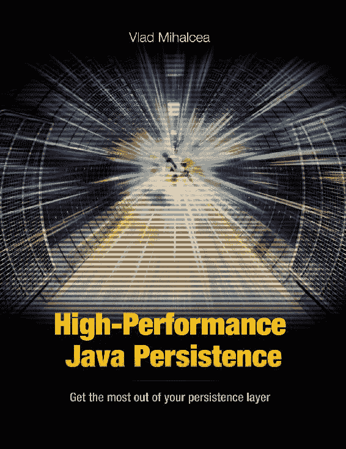

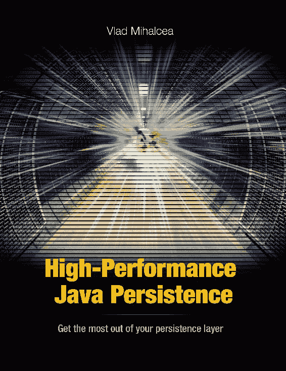

**推特此本书！**

请在 [Twitter](http://twitter.com) 上分享此书以帮助 Vlad Mihalcea！

*献给我的妻子和孩子*

## 12 继承

### 12.1 单表策略

### 12.2 关联表策略

### 12.3 每个类一张表策略

### 12.4 映射超类

目录

i

出版者：

Vlad Mihalcea

Jupiter 9/27

900492 Cluj-Napoca

Romania

mihalcea.vlad@gmail.com

版权所有 © 2015 Vlad Mihalcea

保留所有权利。未经出版者事先许可，本书的任何部分不得以任何形式或通过任何手段（电子、机械、摄影、录制或其他）进行复制、存储或传输。

制造商和销售者为了区分其产品而使用的许多名称已注册商标。当书中出现此类标记且我们获知存在商标主张时，这些名称将以全大写或首字母大写的形式打印。

虽然在编写本书时已采取一切预防措施，但出版者和作者对错误和遗漏，或因使用本文所包含的信息而导致的任何损害不承担任何责任。本书仅代表作者的观点。本书未获得书中提到的任何关系型数据库系统供应商的财务支持，也没有数据库供应商对内容进行验证。

封面设计：

Dan Mihalcea danmihalcea@gmail.com

对数据库可移植性的担忧可能导致人们因为某些特性在不同的数据库系统之间无法互换而避免使用这些高效的特性。事实上，最终得到一个缓慢的数据库层，往往比将一个已经在运行的系统迁移到新的数据库解决方案要常见。

所有数据访问框架都依赖`JDBC`（Java 数据库连接）API 与数据库服务器通信。`JDBC` 提供了许多性能优化技术，旨在减少事务响应时间并容纳更多流量。

因此，本书的第一部分专注于`JDBC`，涵盖了数据库连接管理、语句批处理、结果集抓取以及数据库事务基础等主题。

## 1.2 应用程序数据访问层

某些数据访问模式在许多企业应用场景中已证明了其有效性。Martin Fowler 的[企业级应用架构模式](http://www.amazon.com/Patterns-Enterprise-Application-Architecture-Martin/dp/0321127420)² 是每位企业级应用开发者的必读物。除了对象-关系映射模式外，大多数 ORM 框架还采用了如`工作单元` (Unit of Work)、`标识映射` (Identity Map)、`懒加载` (Lazy Loading)、`嵌入值` (Embedded Value)、`实体继承` (Entity Inheritance) 或`乐观与悲观锁`等技术。

### 1.2.1 ORM 框架

ORM 工具可以提高应用程序开发速度，但学习曲线无疑非常陡峭。解决关系型数据与应用程序领域模型之间内在复杂性的唯一方法是充分理解所使用的 ORM 框架。

有时即使是参考文档也是够的，在面对性能相关问题时，熟悉源码是不可避免的。`JPA`（Java 持久 API）在编写数据方面表现出色，因为只要持久模型发生发生，所有的`DML`（数据操作语言）语句都会自动更新，从而加速迭代开发过程。

本书的第二部分描述了各种针对`Hibernate`的优化技术，例如标识生成器、有效的实体抓取和状态转换、应用级事务以及实体缓存。

²[`www.amazon.com/Patterns-Enterprise-Application-Architecture-Martin/dp/0321127420`](http://www.amazon.com/Patterns-Enterprise-Application-Architecture-Martin/dp/0321127420)


前言

4

### 1.2.2 原生查询构建器框架

`JPA` 和 `Hibernate` 从不是为了替代 SQL，在任何非复杂的企业应用中，原生查询都是不可避免的。虽然`JPA`使抽象`DML`语句和常见的实体检索查询成为可能，但在读取和处理数据时，没有任何东西比得上原生 SQL。

`JPQL`（Java 持久查询语言）通过减去数据库特定的查询特性来抽象通用 SQL 语法，因此缺乏对窗口函数（Window Functions）、公用表表达式（Common Table Expressions）、派生表（Derived tables）或透视（PIVOT）的支持。与`JPA`相，[jOOQ ³](http://www.jooq.org/) 拥抱了数据库特定的查询特性，并提供了一个类型安全的查询构建器，即使对于动态原生查询也能保护应用程序不受 SQL 注入攻击。

因此，本书的第三部分将关于使用`jOOQ`的高级查询技术。

## 关于数据库性能基准

在本书中，有一些基准测试旨在演示特定性能优化的相对收益。基准测试的结果始终取决于底层硬件、操作系统、数据库服务器配置、数据库大小以及并发模式。因此，绝对值没有相对优化收益那么重要。事实上，最相关的基准结果结果是针对实际生产系统的测试。

为了防止读者将一个数据库与另一个对比并根据某些特定用例的基准测试得出错误结论，数据库名称被模糊处理为`DB_A`、`DB_B`、`DB_C`和`DB_D`。

本书中所使用的每个示例的所有源代码均可在 [GitHub **](https://github.com/vladmihalcea/high-performance-java-persistence) 上获取。

³[`www.jooq.org/`](http://www.jooq.org/)

## 2. 性能与扩展

企业级应用需要尽可能快速地存储和检索数据。在应用程序性能管理中，最重要的两个指标是响应时间和吞吐量。

响应时间越短，应用程序的响应越灵。因此，响应时间是性能的衡量标准。扩展是在增加系统负载的同时保持低延迟，因此吞吐量是可扩展性的衡量标准。

### 2.1 响应时间与吞吐量

由于本书专注于高性能数据访问，被测系统的边界位于事务管理器级别。事务响应时间被度量为完成一个事务所需的时间，因此它包含了以下时间段：

- 数据库连接的获取时间

- 将所有数据库语句发送到网络上的时间

- 所有入站语句的执行时间

- 将结果集发送回数据库客户端的时间

- 在释放数据库连接之前，由于应用级计算导致事务空闲的时间。

`T = tacq + treq + texec + tres + tidle`

吞吐量定义为完成传入负载的速率。在数据库上下文中，吞吐量可以计算为给定时间间隔内执行的事务数。

`X = transaction count / time`

从这个定义可以得出，通过缩短执行事务的时间，系统可以容纳更多请求。针对单个数据库连接进行测试，测量的吞吐量成为进一步基于并发改进的基准。

`X (N) = X (1) × C (N)`

5

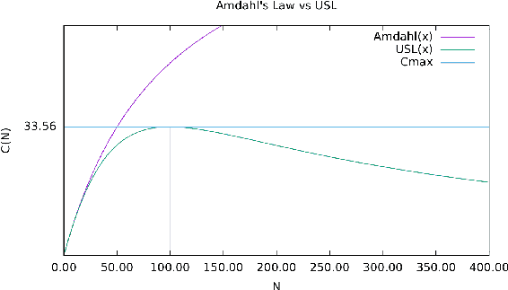

性能与扩展

6

情况下，如果系统是线性扩展的，增加数据库连接将产生成比例的吞吐量增长。由于对数据库资源的`竞争`以及跨数据库会话的一致性成本，相对吞吐量遵循曲线而非直线。

[*USL (通用扩展性律)](http://www.perfdynamics.com/Manifesto/USLscalability.html)¹ 可以根据负载器（数据库连接）的数量估计最大相对吞吐量（系统容量）。

`C (N) = 1 + α (N − 1) + βN (N − 1)`

- C：给定并发级别的相对吞吐量

- α：竞争系数（数据处理序列化部分）

- β：一致性系数（跨所有数据库会话的成本）。

当一致性系数为零时，USL 与[阿姆达尔定律](http://en.wikipedia.org/wiki/Amdahl%27s_law) 重叠。竞争具有提高扩展性的效果。另一方面，一致性是扩展曲线拐点的原因，随着并发增加，其影响变得更加显著。

下图描述了当 USL 系数 (α, β) 设置为以下值 (0.1, 0.0001) 时的相对吞吐量收益。x 轴表示并发数 (N)，y 轴显示相对容量收益 (C)。

**图 2.1: 通用扩展性律**

¹[`www.perfdynamics.com/Manifesto/USLscalability.html`](http://www.perfdynamics.com/Manifesto/USLscalability.html)

²[`en.wikipedia.org/wiki/Amdahl%27s_law`](http://en.wikipedia.org/wiki/Amdahl%27s_law)

# 性能与扩展

系统达到最大容量的负载生成器（数据库连接）数量完全取决于 USL 系数。

```
√
(1 *− α*)
N max =
β
```

容量增益相对于最小吞吐量，因此绝对系统容量的计算如下：

`Xmax = X (1) × C (Nmax)`

## 2.2 数据库连接边界

每个连接都需要从客户端（应用程序）到服务器（数据库）的 TCP 套接字。

数据库服务器提供的连接总数取决于底层硬件资源，通过测量和经过证明的可扩展性模型可以确定服务器能够处理多少连接。

[SQL Server 2016](https://msdn.microsoft.com/en-us/library/ms190219.aspx) 和 [MySQL 5.7](https://dev.mysql.com/doc/refman/5.7/en/connection-threads.html) 使用基于线程的连接处理。

[PostgreSQL 9.5](http://www.postgresql.org/docs/9.5/static/connect-estab.html) 为每个单独连接使用一个操作系统进程。

在 Windows 系统上，Oracle 使用线程，而在 Linux 上，它使用基于进程的连接。

[Oracle 12c](http://docs.oracle.com/database/121/CNCPT/process.htm) 为 Linux 系统也提供了基于线程的连接模型。

深入研究数据库系统内部可以发现其对 CPU、内存和磁盘资源的紧密依赖。由于 I/O 操作成本高昂，数据库使用缓冲区将底层数据和索引页映射到内存中。更改首先在内存中应用，然后批量刷新到磁盘，以获得更好的写入性能。

即使所有索引完全缓存在内存中，可能仍发生磁盘访问（以将相关数据页取入内存缓冲区）。为了提供数据一致性，使用了锁（共享锁和斥锁）来保护数据块（行和索引）不被并发更新。

使用可以放入内存的覆盖索引可以消除磁盘访问，因为无需访问磁盘即可获取查询数据。


这意味着高吞吐量数据库应用程序将面临 CPU、内存、磁盘和锁的竞争。当所有数据库服务器资源都被使用时，增加更多工作负载只会增加竞争，从而降低吞吐量。

资源可能会由于系统配置不当而饱和，因此提高系统吞吐量的第一步是根据当前的数据访问模式进行调优。

降低响应时间不仅让应用程序响应更快，还可以增加吞吐量。

但在高并发环境中，仅凭响应时间是不够的。为了保持固定的上限响应时间，系统容量必须相对于传入的请求吞吐量增加。增加资源可以在一定范围内提高可扩展性，超过此点后容量增益开始下降。

在[Velocity 会](http://radar.oreilly.com/2009/06/bing-and-google-agree-slow-pag.html) 上，Google 搜索和 Microsoft Bing 团队得出结论：更高的响应时间可能会升级甚至影响业务指标。

容量规划是一种反馈驱动的机制，它需要持续的应用程序监控，因此任何优化都必须通过应用程序性能指标来强化。

## 2.3 垂直扩展与水平扩展

扩展是指通过增加更多资源来增加容量的效果。垂直扩展（scaling up）意味着向单台机器添加资源。增加可用机器的数量被称为水平扩展（scaling out）。

传统上，向数据库服务器添加更多硬件资源是增加数据库容量的首选方法。关系型数据库出现于 70 年代后期，在半个世纪的时间里，数据库供应商利用摩尔定律趋势带来的硬件进步。

分布式系统的管理要比集中式系统复杂得多，这就是为什么水平扩展比垂直扩展更具挑战性。

### 2.3.1 主从复制

对于读写比例很高的级系统，主从复制适用于提高可用性。

**图 2.2：主从复制**

主节点（Master）是记录系统，也是唯一接受写入的节点。主节点记录的所有更改也会重放到从节点（Slave）上。二进制复制使用主节点的 WAL（写前日志），而基于语句的复制则在从机器上重放在主节点上执行的完全语句。

异步复制非常常见，特别是当有更多从节点需要更新时。从节点是最终一致的，因为它们可能落后于主节点。在主节点崩溃的情况下，必须通过全集群投票过程从所有从列表中选出新主（通常是具有最新更新记录的节点）。

异步复制拓扑也被称为热备，因为选举过程并非瞬间完成。大多数数据库系统允许一个同步从节点，代价是增加事务响应时间。在主节点故障的情况下，自动故障转移机制可以将同步从节点提升为新主节点。

拥有一个同步从（Slave）允许系统在主节点（Master）故障时确保数据的一致性，因为同步从是主节点的精确副本。同步主从复制也被称为`热备备`拓扑，因为同步从可以随时替换主节点。

当只有异步从（Slave）可用时，新选出的从节点可能会落后于故障的主节点，在这种情况下，为了获得更低的延迟和更高的吞吐量，牺牲了一致性和持久性。

除了消除单点故障外，数据库复制还能增加事务吞吐量。在主从拓扑中，从节点可以接受只读事务，从而将读流量从主节点分流。

从节点增加了可用的只读连接，并减少了主节点的资源竞争，反过来也可以缩短读写事务的响应时间。如果主节点无法跟上日益增长的读写流量，多主复制可能是一个更好的替代方案。

### 2.3.2 多主复制

在多主复制方案中，所有节点都是平等的，并且都可以接受只读和读写事务。在多个节点之间分担负载也可以增加事务吞吐量并缩短响应时间。

但由于分布式系统的核心在于权衡，在多主复制方案中确保数据一致性具有挑战性，因为这里不再有单一的真理来源。相同的数据可以在不同的节点上并发修改，因此存在更新冲突的可能性。复制方案可以避免冲突，也可以检测冲突并应用自动冲突解决算法。

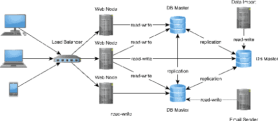

### 性能与扩展性

**图 2.3：多主复制**

为了避免冲突，可以使用两阶段提交协议将所有参与节点纳入一个分布式事务中。这种设计允许所有节点在任何时候保持同步，代价是增加了事务响应时间（通过降低写操作的速度）。

如果节点之间通过广网（WAN）相隔，同步延迟可能会大幅增加。如果一个节点变得不可用，同步可能会失败，事务将在所有主节点上回滚。

尽管从数据一致性的角度来看，避免冲突更好，但同步复制可能会导致高事务响应时间。异步复制可以提供更高的吞吐量，代价是必须解决更新冲突。异步多主复制需要冲突检测和自动冲突解决算法。当检测到冲突时，自动解决会尝试合并两个冲突分支，如果失败，则需要人工干预。

### 2.3.3 分片

当数据量超过复制多节点环境的总体容量时，拆分数据变得不可避免。分片意味着将数据分布在多个节点上，每个实例仅包含整体数据的子集。

传统上，关系型数据库提供`水平分区`将数据分布在同一数据库服务器内的多个表中。与`水平分区`不同，分片需要分布式系统拓扑，以便数据跨越多个机器分布。

每个分片必须是自包含的，因为用户事务只能使用单个分片内的数据。通常禁止跨分片连接（Joining），因为分布式锁成本和网络开销会导致长事务响应时间。

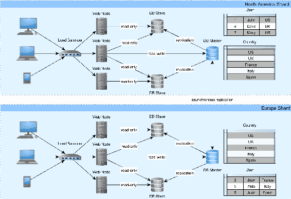

通过减少每个节点的数据量，索引也将需要更少的空间，并更好地适应主内存。由于查询的数据减少，事务响应时间也会变短。

典型的分片拓扑至少包含两个独立的数据中心。

**图 2.4：分片**

每个数据中心可以为特定的地理区域服务，因此在地理区域之间实现了负载。并不是所有的表都需要跨分片分区，较小的表会在每个分区上复制。为了保持分片同步，可以采用异步复制机制。

在之前的图中，国家表从一个数据中心镜像到另一个数据中心，且仅在用户表上进行分区。为了消除跨分片数据处理的需求，每个用户以及所有用户相关的数据只包含在一个数据中心内。

在增加系统容量的追求，分片通常是最后的策略，在耗尽所有其他可用选项后采用，例如：

- 优化数据层以提供更低的事务响应时间

- 将每个复制节点扩展到成本效益的配置

- 添加更多复制节点，直到同步延迟开始降到可接受的阈值以下

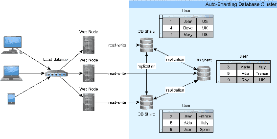

### MySQL 集群自动分片

[MySQL Cluster](https://www.mysql.com/products/cluster/scalability.html) 提供自动分片，因此数据（使用主键哈希函数）均匀地分布在多个廉价硬件机器上。每个节点都接受读写事务，并且和多主复制一样，冲突会被自动发现和解决。

**图 2.5：自动分片**

自动分片拓扑与多主复制架构相似，因为它可以通过将入负载分布到多台机器来增加吞吐量。在多主复制环境中，每个节点都存储整个数据库，而自动分片集群分发数据，使得每个分片仅是整个数据库的子集。

由于集群负责分发数据，应用程序不需要提供数据分片路由层，跨不同的分片也可以进行 SQL 关联。MySQL Cluster 7.3 使用`NDB`存储引擎，因此它[缺少一些 InnoDB 提供的功能](http://dev.mysql.com/doc/mysql-cluster-excerpt/5.6/en/mysql-cluster-ndb-engines.html)，例如多个事务隔离级别或 MVCC（多版本并发控制）。

## II JDBC 与数据库基础

## 3. JDBC 连接管理

JDBC (Java Database Connectivity) 提供了与数据库服务器通信的通用接口。所有的网络逻辑和特定数据库的通信协议都隐藏在与供应商无关的 JDBC 之后。因此，所有的 JDBC 必须根据特定数据库的要求来实现。`java.sql.Driver` 是与 JDBC 交互的主要入口，定义了实现版本细节并提供了对数据库连接的访问。

**图 3.1：JDBC 插件架构**

JDBC 定义了四种驱动类型：


- 类型 1：它只是到实际 ODBC 驱动实现的桥接。
- 类型 2：它使用特定数据库原生客户端实现（例如 `Oracle Call Interface`）。
- 类型 3：它将调用委托给提供数据库连接支持的应用服务器。
- 类型 4：`JDBC` 驱动纯 `Java` 实现数据库通信协议。

由于更容易设置和调试，类型 4 驱动通常是首选的替代方案。

为了与数据库服务器通信，`Java` 程序必须先获取 `java.sql.Connection`。

虽然 `java.sql.Driver` 是实际的数据库连接提供者，但使用 `java.sql.DriverManager` 更方便，因为它还可以解析与当前数据库连接 URL 关联的 `JDBC` 驱动。

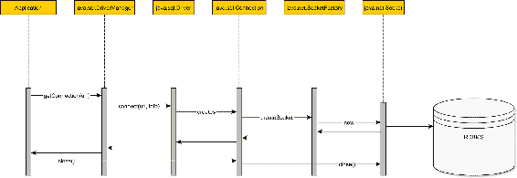

# JDBC 连接管理

此前应用程序需要在建立连接之前加载驱动程序，但从 `JDBC 4.0` 开始，服务提供者接口（Service Provider Interfaces）机制可以自动发现当前应用程序类路径中所有可用的驱动。

## 3.1 DriverManager

`DriverManager` 定义了以下方法：

```java
public static Connection getConnection(String url, Properties info) throws SQLException;
public static Connection getConnection(String url, String user, String password) throws SQLException;
public static Connection getConnection(String url) throws SQLException;
```

每当调用 `getConnection()` 方法时，`DriverManager` 都会向底层的 `Driver` 请求一个新的物理连接。

**图 3.2：DriverManager 连接**

`JDBC` 第一版本发布于 1997 年，它仅支持使用 `DriverManager` 工具来获取数据库连接。那时，`Java` 为桌面应用程序提供了支持，这些应用程序通常采用二层架构：

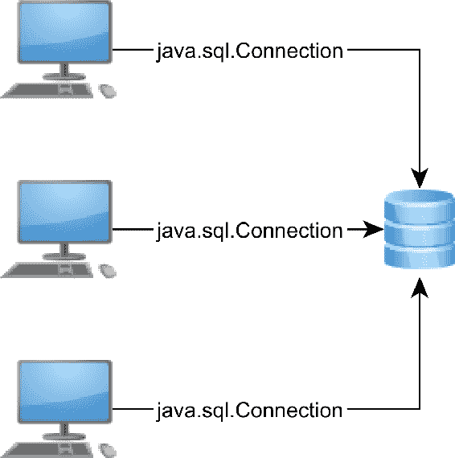

**图 3.3：二层架构**

在二层架构中，应用程序由单个用户运行，每个实例使用一个专用的数据库连接。用户越多，需要的数据库连接就越多，根据底层资源（硬件、操作系统或许可限制），每个数据库服务器提供的连接数量是有限的。

## Oracle 大型机遗留

`Oracle` 在大型机时代获得普及，当时每个客户端都获得一个专用的数据库连接。

`Oracle` 为每个单独用户分配一个独特的模式（schema），这与其它数据库系统不同，后者多个账户共享一个模式。

在 `PL/SQL` 中，包级公共变量（Packaged public variables）的作用域绑定到会话（session），而不是当前正在运行的事务。应用程序开发者必须格外小心地正确解绑这些变量，因为连接通常会被重用，旧值可能会泄露到新的事务中。

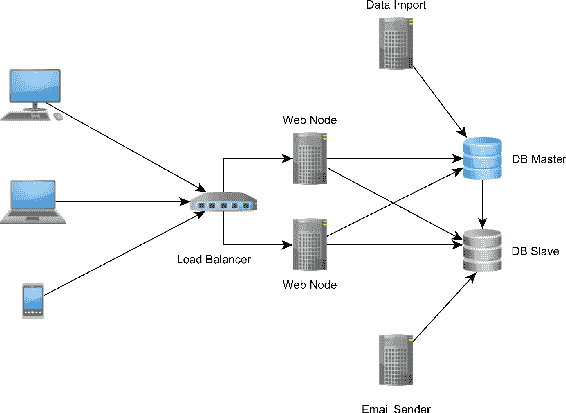

## 3.2 DataSource

1999 年，`J2EE` 随着 `JDBC 2.0` 以及 [JTA（Java 事务 API）¹](https://jcp.org/en/jsr/detail?id=907) 初案的发布，标志着企业 `Java` 的开始。企业级应用使用三层架构，中间层充当用户请求与各种数据源（例如关系型数据库、消息队列）之间的桥梁。

**图 3.4：三层架构**

在客户端和数据库服务器之间建立层具有许多优势。

在典型的企业级应用中，用户请求的吞吐量大于可用数据库连接容量。只要获取连接的时间是可以接受的（从用户的角度来看），用户请求就可以等待数据库连接变为可用。中间层充当数据库连接缓冲区，可以通过增加请求响应时间来缓解用户请求流量峰值，而不会耗尽数据库连接或丢弃接入流量。

由于中间层管理数据库连接，应用程序服务器还可以监控连接使用情况并向运维团队提供统计数据。

因此，应用程序服务器不再提供物理数据库连接，而是提供¹ [`jcp.org/en/jsr/detail?id=907`](https://jcp.org/en/jsr/detail?id=907) 逻辑连接（代理或句柄），这样它就可以拦截并注册客户端 API 如何与连接对象交互。

三层架构可以容纳多个数据源或消息队列实现。为了跨越多个数据源实现一个单一事务，分布式事务管理器是强制性的。在 `JTA` 环境中，事务管理器必须感知客户端已获取的所有逻辑连接，因为它必须根据全局事务结果来提交或回滚这些连接。通过提供逻辑连接，应用程序服务器可以用 `JTA` 事务语义对数据库连接句柄进行装饰（decorates）。

如果说 `DriverManager` 是一个物理连接工厂，那么 `javax.sql.DataSource` 接口就是一个逻辑连接提供者：

```java
public Connection getConnection() throws SQLException;
public Connection getConnection(String username, String password) throws SQLException;
```

最简单的 `javax.sql.DataSource` 实现可以将连接获取请求委托给底层的 `DriverManager`，连接请求工作流如下：

**图 3.5：不带连接池的 DataSource**

1. 应用程序数据层向 `DataSource` 请求数据库连接。
2. `DataSource` 将使用底层驱动程序打开物理连接。
3. 创建物理连接并打开 `TCP` 套接字。
4. 测试的 `DataSource` 不封装物理连接，而是简单地将其借给应用程序层。
5. 应用程序使用获取的数据库连接执行语句。
6. 当连接不再需要时，应用程序关闭物理连接以及底层的 `TCP` 套接字。

打开和关闭数据库连接是一个非常昂贵的操作，因此重用它们具有以下优势：

- 它避免了数据库和驱动程序建立 `TCP` 连接的开销。
- 它防止了销毁与每个数据库连接相关的临时内存缓冲区。
- 它减少了客户端 `JVM` 对象的垃圾。

为了直观展示建立和关闭数据库连接的累积开销，以下测试对比了四种不同的 `RDBMS` 打开和关闭 `1000` 个数据库连接所需的总时间，并对比了 [HikariCP](http://brettwooldridge.github.io/HikariCP/)（`Java` 生态系统中最快的独立连接池解决方案之一）。

**表 3.1：数据库连接建立 vs 连接池**

| 指标 | DB_A (ms) | DB_B (ms) | DB_C (ms) | DB_D (ms) | HikariCP (ms) |
| :--- | :--- | :--- | :--- | :--- | :--- |
| 最小值 | 11.174 | 5.441 | 24.468 | 0.860 | 0.001230 |
| 最大值 | 129.400 | 26.110 | 74.634 | 74.313 | 1.014051 |
| 平均值 | 13.829 | 6.477 | 28.910 | 1.590 | 0.003458 |
| p99 | 20.432 | 9.944 | 54.952 | 3.022 | 0.010263 |

使用连接池时，获取连接的时间缩小了两四个数量级。通过减少连接获取间隔，整个事务响应时间变得更短。总而言之，在企业应用中，重用连接比基于事务建立连接要好得多。

## Oracle XE 连接处理限制

虽然企业版没有限制，但 `Oracle 11g Express` 版在不使用连接池的情况下运行极短事务时，会抛出以下异常：

```text
ORA-12516, TNS:listener could not find available handler with matching protocol stack
```

连接池解决方案可以防止这些间性的连接建立失败，并减少获取连接的时间。² [`brettwooldridge.github.io/HikariCP/`](http://brettwooldridge.github.io/HikariCP/)

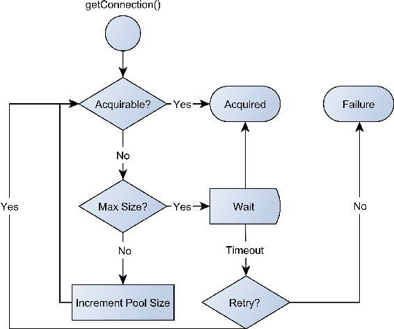

## 3.2.1 为什么连接池快得多？

为了理解为什么连接池性能要好得多，了解连接池机制至关重要：

**图 3.6：连接获取请求流**

1. 当请求连接时，连接池会查找未分配的连接。
2. 如果连接池找到了一个空闲连接，它会将其交付给客户端。
3. 如果没有空闲连接，连接池将尝试扩展到其允许的最大尺寸。
4. 如果连接池已经达到最大尺寸，它将在放弃之前尝试重试几次，然后抛出连接获取失败异常。
5. 当客户端关闭逻辑连接时，该连接被释放并返回到池中，而不会关闭底层的物理连接。

大多数连接池解决方案都暴露一个 `DataSource` 实现，该实现要么封装了特定数据库的 `DataSource`，要么封装了底层的 `DriverManager` 工具类。

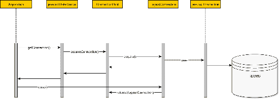

## JDBC 连接管理

逻辑连接的生命周期如下：

**图 3.7：DataSource 连接**

连接池不会将物理连接返回给客户端，而是提供一个代理（proxy）或句柄（handle）。当连接正在使用时，连接池将其状态更改为 `allocated`（已分配），以防止两个并发线程使用同一个数据库连接。代理会拦截连接的 `close` 方法调用，并通知池将连接状态更改为 `unallocated`（未分配）。

除了减少连接获取时间外，池机制还可以限制应用程序同时使用的连接数。

连接池充当了传入连接请求的有界缓冲区（bounded buffer）。如果出现流量峰值，连接池将平滑这种流量，而不是饱和所有可用的数据库资源。所有这些好处都是代价的，因为配置正确的池大小并非易事。配置连接池需要理解特定特定的数据库访问模式，并对连接使用情况进行监控。

每当传入请求数超过可用的请求处理程序时，基本上有两种方案可以避免系统过载：

- 丢弃溢出的流量（影响可用性）。
- 将请求放入队列并等待忙碌资源变得可用（增加响应时间）。

丢弃多余流量通常是最后的最后手段，因此大多数连接池解决方案首先尝试对溢出的传入请求进行入队。通过对连接请求等待时间设置上限，可以防止队列无限增长并饱和应用程序服务器资源。

对于给定的传入请求速率，队列大小与平均入队时间之间的关系由排队论中最基本的定律之一给出。

## 3.3 排队论容量规划

[利特尔定律³](http://en.wikipedia.org/wiki/Little%27s_law) 是一个通用方程，适用于任何处于稳定状态的排队系统（到达率大于离开率）。根据利特尔定律，请求服务的平均时间仅取决于长期请求到达率和系统中的平均请求数。

`L = λ × W`

- `L` - 系统中的平均请求数（包括正在处理的请求和在队列中等待的请求）。
- `λ` - 长期平均到达率。
- `W` - 请求在系统中花费的平均时间。

假设应用程序级事务在整个生命周期中使用同一个数据库连接，且平均事务响应时间为 `100` 毫秒：

`W = 100 * ms = 0.1 * s`

如果平均连接获取速率为每秒 `50` 请求：

`λ = 50 connection requests/s`

那么系统中的平均连接请求数为：

`L = λ × W = 50 × 0.1 = 5 connection requests`

大小为 `5` 的池可以容纳平均传入流量，而无需入队任何连接请求。如果池大小为 `3`，那么平均有 `2` 个请求被入队并等待连接可用。利特尔定律基于长期平均值运行，在考虑间歇性流量突发时可能并不适用。在现实场景中，连接池必须适应短期流量峰值，因此考虑实际的连接池吞吐量是重要的。

在排队论中，吞吐量由离开率（`μ`）表示，对于连接池而言，它代表在给定时间内提供的连接数：

`µ = Ls / Ws = pool size / connection lease time`

³ [`en.wikipedia.org/wiki/Little%27s_law`](http://en.wikipedia.org/wiki/Little%27s_law)

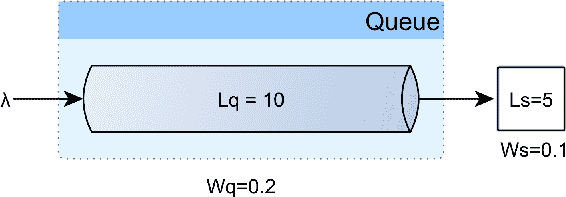

下面的练习演示了排队论如何帮助配置连接池以支持各种传入流量峰值。复用之前的示例配置，受测试的连接池处于以下边界：

- 最多有 `5` 个服务中请求（`Ls`），这意味着连接池最多可以提供 `5` 个连接。
- 平均服务时间（`Ws`）或连接租赁时间为 `100` 毫秒。

如所预期，连接池每秒可以交付高达 `50` 个连接。

`µ = Ls / Ws = 5 / 0.1 = 50 requests/s`

当到达率等于离开率时，系统变得饱和，所有连接均在使用中。

`Ls = λ × Ws`

如果到达率超过连接池的吞吐量，溢出的请求必须等待连接可用。一个持续一秒的 `150` 个请求流量突发处理如下：

- 前 `50` 个请求可以在第一秒内处理。
- 随后的 `100` 个请求被入队并等待。

`Lq = 100`

`Wq = 0.2 s`

**图 3.8：利特尔定律队列**

对于恒定的吞吐量，入队连接数（`Lq`）与连接获取时间（`Wq`）成正比。任何给定突发流量的总请求数计算如下：

`Lspike = λspike × Wspike`

处理所需的总时间由以下公式给出：

`W = Lspike / µ = Lspike / λ`

入队连接数及其所需的时间由以下方程表示：

`Lq = Lspike - Ls`

`Wq = W - 1`

假设每秒 `250` 个请求的流量突发持续 `3` 秒。

`λspike = 250 requests/s`

`Wspike = 3 s`

`750` 个请求的突发需要 `15` 秒才能完全处理。

`Lspike = 250 × 3 s = 750 requests`

`W = 750 requests / 50 requests/s = 15 s`

队列大小增长到 `700` 个，所有连接请求需要 `14` 秒才能完成。

`Lq = Lspike - Ls = 700 requests`

`Wq = W - 1 = 14 s`

## 3.4 实际数据库连接配置

即使排队论提供了对连接池行为的洞察，但企业系统的动态很难用通用方程来表达，指标对于资源配置至关重要。通过持续监控连接使用模式，当初始配置不再适用时，更容易做出反应并调整池大小。

遗憾的是，许多连接池解决方案对监控和故障转移的支持有限，这就是构建 [FlexyPool](https://github.com/vladmihalcea/flexy-pool)⁴ 的主要原因。该开源项目支持最常见的连接池框架，提供了以下连接使用指标：

**表 3.2：FlexyPool 指标**

| 名称 | 描述 |
| :--- | :--- |
| `concurrent connection requests` | 同时正在请求多少个连接 |
| 并发连接 | 同时正在使用多少连接 |
| 最大池大小（maximum pool size） | 如果目标 `DataSource` 使用自适应池大小调整，此指标显示了池大小如何随时间变化。 |
| 连接获取时间（connection acquisition time） | 从目标 `DataSource` 获取连接所需的时间。 |
| 总连接获取时间（overall connection acquisition time） | 总连接获取间隔（包括重试次数）。 |
| 重试次数（retry attempts） | 连接获取的重试次数。 |
| 溢出池大小（overflow pool size） | 池在超过最大大小之前可以增长多少。 |
| 连接租赁时间（connection lease time） | 从获取连接到释放连接之间的时间。 |

虽然指标对于可视化连接使用趋势很重要，但在发生不可预见的流量高峰时，连接获取时间可能会达到 `DataSource` 的超时阈值。

故障转移机制采用各种策略防止超时连接请求被丢弃。虽然批处理器可以重试失败的请求（尽管会增加事务响应时间），但在 Web 应用程序中，用户对不可用或长时间运行的事务敏感得多。

⁴ [`github.com/vladmihalcea/flexy-pool`](https://github.com/vladmihalcea/flexy-pool)

## JDBC 连接管理

FlexyPool 带有以下默认故障转移策略：

**表 3.3：FlexyPool 故障转移策略**

| 名称 | 描述 |
| :--- | :--- |
| 超时时增加池大小（Increment pool size on timeout） | 连接池有一个最小大小，并根据需要增长到其最大大小。此策略将在连接获取超时时增加目标连接池的最大大小。溢出是一个额外连接的缓冲区，允许池超过其初始最大大小增长，直到达到溢出大小阈值。 |
| 重试尝试（Retrying attempts） | 此策略对于缺乏连接获取重试机制的连接池非常有用，它简单地在指定的次数内重新尝试获取连接。 |

### 3.4.1 一个真实世界的连接池监控示例

以下示例演示了 FlexyPool 故障转移策略如何确定合适的连接池大小。测试的应用程序是一个使用 [Bitronix 事务](https://github.com/bitronix/btm) 管理器⁵ 作为数据库连接池提供者的批处理器。

⁵ [`github.com/bitronix/btm`](https://github.com/bitronix/btm)


给批处理器一个特定的数据负载，当检测到连接获取超时发生时，池大小会自动增长。平均和最大池大小是通过实验确定的，不需要任何预先的数学计算。

在运行负载测试之前，最好了解当前应用程序连接池设置。根据 [Bitronix 连接池文档](https://github.com/bitronix/btm/wiki/JDBC-pools-configuration)⁶ 默认的 `acquisitionTimeout`（连接请求在抛出超时异常之前等待的最大时间）为*30* 秒。

一秒的连接获取超时阈值对于当前实验是足够的，这允许应用程序更快地对流量高峰做出反应，并应用补偿性的故障转移策略。

初始的 `maxPoolSize` 设置为一个连接，在接收到连接获取超时后，它将增长直到达到 `maxOverflow` 阈值。

`retryAttempts` 值被刻意设置为一个较大的值，因为对于批处理器来说，丢弃连接请求比某些偶尔的事务响应时间波动问题严重得多。

⁵[`github.com/vladmihalcea/flexy-pool`](https://github.com/vladmihalcea/flexy-pool)

⁶[`github.com/bitronix/btm/wiki/JDBC-pools-configuration`](https://github.com/bitronix/btm/wiki/JDBC-pools-configuration)

28

实验从以下连接池设置开始：

**表 3.4: 初始池设置**

| 名称 | 值 | 描述 |
| :--- | :--- | :--- |
| `minPoolSize` | 0 | 池从 0 开始 |
| `maxPoolSize` | 1 | 池从 1 开始 |
| `acquisitionTimeout` | 1 | 请求等待 1s |
| `maxOverflow` | 4 | 池可以增长到 4 |
| `retryAttempts` | 30 | 有 30 次重试尝试 |

（注：提供的文本包含交错的插表描述和表格。我根据提供文本的逻辑流对其进行了组织。）

### 3.4.1.1 并发请求数

**图 3.9: 并发请求**

传入的请求越多，响应时间（获取连接的时间）就越高。此图表所示。

### 3.4.1.2 并发连接指标

**图 3.10: 并发连接**

平均连接指标随斜率逐渐上升到 *1.5* 个连接。最大值仅提供了有限的群体范围，而分位数使得离群值可见。另一方面，第 99 分位数表明池应该限制在 *5* 个连接。遗憾的是，这个值对于配置正确的池池大小作用不大。

### 3.4.1.3 最大池大小指标

**图 3.11: 最大池大小**

根据第 99 分位数，池在作业启动后很快就会达到饱和。

### 3.4.1.4 连接获取时间指标

**图 3.12: 连接获取时间**

流量高峰仅由最大值图捕获。当池增长大小或重试连接获取请求时，会多次触发阈值。

### 3.4.1.5 重试尝试指标

**图 3.13: 重试尝试**

虽然重试尝试图仅显示了重试次数随时间增加的情况，但重新尝试的实际效果在总连接获取时间内可见的。

### 3.4.1.6 总连接获取时间指标

**图 3.14: 总连接获取时间**

当连接池限制为 *5* 个连接时，只有三次重试尝试。

### 3.4.1.7 连接租赁时间指标

**图 3.15: 连接租赁时间**

第 99 分位数表明在整个作业执行期间连接租赁时间相当稳定。另一方面，最大值图显示了一个持续超过 *35* 秒的长运行事务。

长时间持有连接会增加连接获取时间，并且为其他传入的客户端提供的资源将更少。

事务可能会持有数据库锁，这反过来可能导致当前执行上下文的串行部分增加，从而阻碍并行性。

长时间事务可以通过对慢查询进行适当索引，或将应用级事务拆分为多个数据库事务来解决，这在许多 ETL（提取、转换和加载）系统中非常常见。

## 4. 批量更新

JDBC 2.0 引入了 `batch updates`（批量更新），使得多个 DML 语句可以组合在一个数据库请求中。在单个请求中发送多个语句可以减少数据库往返次数，从而缩短事务响应时间。即使参考规范使用了 `updates` 一词，任何 `insert`、`update` 或 `delete` 语句都可以进行批量，且 JDBC 也支持 `java.sql.Statement`、`java.sql.PreparedStatement` 和 `java.sql.CallableStatement` 的批量处理。

不仅每个数据库驱动程序都是独特的，即使是同一驱动程序的不同版本也可能需要特定实现的配置。

### 4.1 语句批量处理

对于执行静态 SQL 语句，JDBC 定义了 `Statement` 接口，批量处理多个 DML 语句如如下代码段所示简单：

```
statement.addBatch(
  "INSERT INTO post (title, version, id) " +
  "VALUES ('Post no. 1', 0, 1)");

statement.addBatch(
  "INSERT INTO post_comment (post_id, review, version, id) " +
  "VALUES (1, 'Post comment 1.1', 0, 1)");

int[] updateCounts = statement.executeBatch();
```

每个语句影响的数据库行数包含在 `executeBatch()` 方法的返回值中。

### Oracle

对于 `Statement` 和 `CallableStatement`，[Oracle JDBC Driver](http://docs.oracle.com/cd/E11882_01/java.112/e16548/oraperf.htm#JJDBC28752)实际上不支持 `PreparedStatement` 以外的批量处理；驱动程序会忽略批量处理，每个语句都会单独执行。

[`docs.oracle.com/cd/E11882_01/java.112/e16548/oraperf.htm#JJDBC28752`](http://docs.oracle.com/cd/E11882_01/java.112/e16548/oraperf.htm#JJDBC28752)

下面的图描述了不同 JDBC 驱动程序在不同批量大小下的行为，该测试测量了插入带有 4 条 `comments` 的 1000 条 `post` 行所需的时间：

**图 4.1: 语句批量处理**

重新排序插入顺序，使得所有 `posts` 在 `comment` 行之前插入，得到如下结果：**图 4.2: 重新排序的语句批量处理**

重新排序语句似乎没有显著提高性能，尽管某些驱动（例如 MySQL）可能会利用这种优化。

### MySQL

尽管它实现了 JDBC 规范，但默认情况下，MySQL JDBC 不会在单个请求中发送批量语句。

为了这个目的，JDBC 驱动定义了 [`rewriteBatchedStatements`](http://dev.mysql.com/doc/connector-j/en/connector-j-reference-configuration-properties.html) 连接属性，使语句被重写为单个 String 缓冲区。为了获取自动生成的行键，批量操作必须只包含插入语句。

对于 `PreparedStatement`，此属性会将批量插入语句重写为多值插入。遗憾的是，在启用重写时，驱动程序无法使用服务端预处理语句。

如果不设置此属性，MySQL 驱动将简单地单独执行每个 DML 语句，从而违背了批量处理的目的。

[`dev.mysql.com/doc/connector-j/en/connector-j-reference-configuration-properties.html`](http://dev.mysql.com/doc/connector-j/en/connector-j-reference-configuration-properties.html)

下面的图展示了语句重写相对于 MySQL JDBC 驱动默认行为的性能：

**图 4.3: MySQL 语句批量处理**

重写静态语句似乎会有差异，只要批量大小不是太大。在实践中，使用较小的批量大小是常见的，这既可以减少客户端的内存占用，又能避免服务器因突然处理巨大的批量加载而导致拥塞。

### 4.2 批量处理 PreparedStatements

对于动态语句（非常常见的企业级应用需求），JDBC `Statement` 并不适合，因为改变执行的 SQL 语句的唯一选项是通过字符串操纵。使用 String 模板或拼接 String 标记是有风险的，因为它会让数据访问逻辑容易受到 SQL 注入攻击。

为了解决这一缺陷，JDBC 提供了 `PreparedStatement` 接口以安全的方式绑定参数。驱动程序必须在运行时验证提供的参数，从而丢弃意外的输入值。由于 `PreparedStatement` 关联单个 DML 语句，批量更新可以分组多个属于同一个预编译语句的参数值。

```
PreparedStatement postStatement = connection.prepareStatement(
  "INSERT INTO Post (title, version, id) " +
  "VALUES (?, ?, ?)");

postStatement.setString(1, String.format("Post no. %dd", 1));
postStatement.setInt(2, 0);
postStatement.setLong(3, 1);
postStatement.addBatch();

postStatement.setString(1, String.format("Post no. %1d", 2));
postStatement.setInt(2, 0);
postStatement.setLong(3, 2);
postStatement.addBatch();

int[] updateCounts = postStatement.executeBatch();
```

对于企业级应用，安全性是一个非常重要的技术要求。`SQL 注入`攻击利用了未对输入请求进行清洗的数据访问层。当输入参数在没有适当验证的情况下传递给底层数据库语句时，攻击者可能会注入恶意 SQL 程序。这通常通过字符 `;` 结束当前语句并继续执行恶意的 SQL 命令来实现，例如修改数据库结构（删除表或修改权限）甚至提取敏感信息。

如下面的测试所示，所有 DML 语句都可以从批量处理中受益。与之前的 `Statement` 测试用例一样，相同量的数据（1000 条 `post` 和 4000 条 `comments`）将在不同批量大小下进行插入、更新和删除。

**图 4.4: Insert PreparedStatement 批量大小**

**图 4.5: Update PreparedStatement 批量大小**

**图 4.6: Delete PreparedStatement 批量大小**

所有数据库系统在批量处理准备语句时都显示出显著的性能提升。某些数据库系统在插入或更新行时非常快，而其他系统在删除数据时表现良好。

与之前的 `Statement` 批量插入结果相比，显然对于相同的数据负载，`PreparedStatement` 用例的性能更好。

#### 4.2.1 选择正确的批量大小

寻找正确的批量大小并不是易事，因为没有数学数学方程可以为任何企业级应用求解合适的批量大小。像任何其他性能优化技术一样，测量响应特定批量大小值的应用性能增益仍然是最可靠的调优方案。

批量值可以节省更多的数据库往返，但整体性能提升保持平稳，甚至在批量大小增大时可能会下降。

根据经验，你应该始终衡量不同批量大小的性能改进。在实践中，一个较低的值（`10` 到 `30` 之间）通常是一个不错的选择。

### 4.2.2 批量操作

除了批处理，SQL 还提供了批量操作来修改所有给定过滤条件的所有行。`Bulk update` 或 `delete` 语句也可以像 `select` 语句一样从索引中受益。

要更新上一个示例中的所有记录，必须执行以下语句：

```sql
UPDATE post SET version = version + 1;
UPDATE post_comment SET version = version + 1;
```

**表 4.1: 批量更新时间**

| DB_A 时间 (ms) | DB_B 时间 (ms) | DB_C 时间 (ms) | DB_D 时间 (ms) |
| :--- | :--- | :--- | :--- |
| 26 | 13 | 58 | 9 |

批量操作方案比批处理快一个数量级，但尽管如此，批量更新更加灵活，因为每行可以采用不同的更新逻辑。如果数据访问逻辑采用了乐观锁机制，批量更新还可以防止 `lost updates`。

与更新类似，批量删除也比分批删除快。

```sql
DELETE FROM post_comment WHERE version > 0;
DELETE FROM post WHERE version > 0;
```

**表 4.2: 批量删除时间**

| DB_A 时间 (ms) | DB_B 时间 (ms) | DB_C 时间 (ms) | DB_D 时间 (ms) |
| :--- | :--- | :--- | :--- |
| 3 | 12 | 1 | 2 |

### 批量处理注意事项

在单个事务中处理过多的数据会降低应用程序性能，特别是在高并发环境中。无论使用锁（两阶段锁）还是 `MVCC`（多版本并发控制），写入操作总是会阻塞其他冲突的写入操作。如果批量更新的记录与其他并发事务发生冲突，那么批量更新事务可能需要等待某些行锁释放，或者其他事务可能需要等待批量更新的行提交。

### 4.3 获取自动生成的键

将行标识符生成委托给数据库系统是一种常见做法。这样，开发者就不需要提供单调递增的主键，因为数据库在插入新记录时会处理此操作。

尽管这种做法很方便，但重要的是，自动生成的数据库标识符可能会与批量插入过程发生冲突。

与其他许多数据库特性一样，设置自动递增标识符策略取决于具体的数据库，但基本上是在 `identity` 列或数据库 `sequence` 生成器之间进行选择的。

### Oracle

在 `Oracle 12c` 之前，必须在数据库序列（sequence）之上实现自动递增生成器。

```sql
CREATE SEQUENCE post_seq;
CREATE TABLE post (
  id NUMBER(19,0) NOT NULL,
  title VARCHAR2(255 CHAR),
  version NUMBER(10,0) NOT NULL,
  PRIMARY KEY (id)
);
CREATE OR REPLACE TRIGGER post_identity
BEFORE INSERT ON post
FOR EACH ROW
BEGIN
  SELECT post_seq.NEXTVAL
  INTO :NEW.id
  FROM dual;
end;
```

`Oracle 12c` 也增加了对 identity 列的支持，因此之前的示例可以简化如下。

```sql
CREATE TABLE post (
  id NUMBER(19,0) NOT NULL GENERATED ALWAYS AS IDENTITY,
  title VARCHAR2(255 CHAR),
  version NUMBER(10,0) NOT NULL,
  PRIMARY KEY (id)
);
```

### SQL Server

传统上，`SQL Server` 提供 identity 列生成器，但从 `SQL Server 2012` 开始，它现在也支持数据库序列。

```sql
CREATE TABLE post (
  id BIGINT IDENTITY NOT NULL,
  title VARCHAR(255),
  version INT NOT NULL,
  PRIMARY KEY (id)
);
```

### PostgreSQL

`PostgreSQL 9.5` 不支持 identity 列，尽管它提供了 `SERIAL` 列类型来模拟 identity 列。

```sql
CREATE TABLE post (
  id SERIAL NOT NULL,
  title VARCHAR(255),
  version INT4 NOT NULL,
  PRIMARY KEY (id)
);
```

`SERIAL`（4 字节）和 `BIGSERIAL`（8 字节）类型只是语法糖表达式，因为在背后，`PostgreSQL` 无论如何都依赖数据库序列。因此，之前的定义等同于：

```sql
CREATE SEQUENCE post_id_seq;
CREATE TABLE post (
  id INTEGER DEFAULT NEXTVAL('post_id_seq') NOT NULL,
  title VARCHAR(255),
  version INT4 NOT NULL,
  PRIMARY KEY (id)
);
```

### MySQL

`MySQL 5.7` 仅通过 `AUTO_INCREMENT` 属性支持 identity 列。

```sql
CREATE TABLE post (
  id BIGINT NOT NULL AUTO_INCREMENT,
  title VARCHAR(255),
  version INTEGER NOT NULL,
  PRIMARY KEY (id)
);
```

许多数据库开发者喜欢这种方法，因为客户端在插入新行时不需要关心提供数据库标识符。

```sql
INSERT INTO post (title, version) VALUES (?, ?);
```

为了获取新创建的标识符，必须指示 `PreparedStatement` 返回生成的键。


```java
PreparedStatement preparedStatement = connection.prepareStatement(
    "INSERT INTO post (title, version) VALUES (?, ?)",
    Statement.RETURN_GENERATED_KEYS);
```

另一种方法是提示驱动程序持有生成键的列索引。

```java
PreparedStatement preparedStatement = connection.prepareStatement(
    "INSERT INTO post (title, version) VALUES (?, ?)",
    new int[]{1});
```

也可以使用列名来指示驱动程序获取生成键。

```java
PreparedStatement preparedStatement = connection.prepareStatement(
    "INSERT INTO post (title, version) VALUES (?, ?)",
    new String[]{"id"});
```

### Oracle 自动生成键注意事项

在使用 `Statement.RETURN_GENERATED_KEYS` 时，Oracle 返回的是 `ROWID` 而不是实际的生成值。解决方法是提供列索引，这样就可以在执行语句后提取生成的值。

根据 JDBC 4.2 规范，每个驱动程序都必须实现 `supportsGeneratedKeys()` 方法并指定是否支持生成键。遗憾的是，这只适用于单个语句，规范并没有要求驱动程序支持批量语句的生成键。尽管如此，并不是所有数据库系统都支持从批量获取生成键。

**表 4.3：获取生成键的支持**

|  | Oracle JDBC (11.2.0.4) | Oracle JDBC (12.1.0.1) | SQL Server JDBC | PostgreSQL JDBC (9.4-1201) | MySQL JDBC (5.1.36) |
| :--- | :--- | :--- | :--- | :--- | :--- |
| `executeUpdate()` | 是 | 是 | 是 | 是 | 是 |
| `executeBatch()` | 否 | 是 | 否 | 是 | 是 |

如果 Oracle JDBC 驱动 `11.2.0.4` 无法检索批量生成键，`12.1.0.1` 版本工作正常。当尝试获取批量生成键时，SQL Server JDBC 驱动会抛出异常：`必须在获取结果之前执行语句`。

### 序列化的救星

与 identity 列相反，数据库序列提供了标识符生成与实际插入分离的优势。为了使用批量插入，必须在设置插入语句的参数值之前获取标识符。

```java
private long getNextSequenceValue(Connection connection) throws SQLException {
  try (Statement statement = connection.createStatement()) {
    try (ResultSet resultSet = statement.executeQuery(callSequenceSyntax())) {
      resultSet.next();
      return resultSet.getLong(1);
    }
  }
}
```

调用序列（sequence）时，每个数据库提供了特定的语法：

### Oracle

`SELECT post_seq.NEXTVAL FROM dual;`

### SQL Server

`SELECT NEXT VALUE FOR post_seq;`

### PostgreSQL

`SELECT NEXTVAL('post_seq');`

由于主键是提前生成的，因此无需调用 `getGeneratedKeys()` 方法，因此批量插入不再依赖于驱动程序。

```java
try (PreparedStatement postStatement = connection.prepareStatement(
    "INSERT INTO post (id, title, version) VALUES (?, ?, ?)")) {
  for (int i = 0; i < postCount; i++) {
    if (i > 0 && i % batchSize == 0) {
      postStatement.executeBatch();
    }
    postStatement.setLong(1, getNextSequenceValue(connection));
    postStatement.setString(2, String.format("Post no. %1$d", i));
    postStatement.setInt(3, 0);
    postStatement.addBatch();
  }
  postStatement.executeBatch();
}
```

许多数据库引擎使用序列号生成优化，尽可能尽可能减少序列调用的执行开销。如果插入的记录数较少，那么序列调用的开销（额外的数据库往返）是微忽略不道的。

对于插入大量数据的批量处理器来说，额外的序列调用可能会累积。作为一种优化，标识符的生成过程可以在数据库和数据访问逻辑之间拆分。数据库序列可以按步长递增（对于步长为 `N`，序列号为 `1, N + 1, 2N + 1, 3N + 1, …`）。数据访问逻辑可以在数据库序列调用之间分配标识符（例如 `2, 3, 4, …, N -1, N`），从而减轻了额外网络往返带来的惩罚。

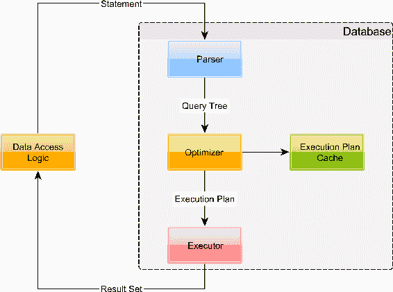

## 5. 语句缓存（Statement Caching）

作为一种声明式语言，SQL 描述的是*做什么*而不是*怎么做*。实际的数据库结构以及用于获取和准备所需结果集的算法对数据库客户端是隐藏的，客户端只需要关注如何正确地定义 SQL 语句。通过这种方式，为了交付最高效的数据访问计划，数据库可以尝试各种执行策略。

### 5.1 语句生命周期

负责处理 SQL 语句的主要数据库模块是 `Parser`（解析器）、`Optimizer`（优化器）和 `Executor`（执行器）。

**图 5.1：语句生命周期**

#### 5.1.1 解析器（Parser）

解析器检查 SQL 语句并确保其有效性。语句会在语法（语句关键字必须拼写正确并符合 SQL 语言规范）和语义（引用的表和列在数据库中确实存在）方面进行验证。

在解析期间，SQL 语句被转换为数据库内部表示形式，称为 `syntax tree`（也称为 `parse tree` 或 `query tree`）。如果 SQL 语句是高层表示（从人类角度来看更有意义），则语法树就是满足当前语句所需的数据库对象的逻辑表示。

#### 5.1.2 优化器（Optimizer）

对于给定的语法树，数据库必须决定最高效的数据获取算法。数据通过遵循 `access path` 来检索，优化器需要评估多个数据遍历选项，例如：

- 每个所引表的访问方法（表扫描或索引扫描）。
- 对于索引扫描，它必须决定哪个索引更适合获取此结果集。
- 对于每个连接关系（例如表、视图或通用表表达式），它必须选择性能最好的连接类型（例如嵌套循环连接、哈希连接、排序合并连接）。
- 连接顺序变得非常重要，特别是对于嵌套循环连接。

由优化器选择的访问路径列表被组装成执行计划。由于所有可能的动作计划组合数量庞大，找到一个良好的执行计划并不是一项易事。在寻找最佳执行计划上花费的时间越长，事务响应时间就越高，因此优化器都有一个固定的时间预算来寻找合理的计划。

最常见的决策算法是 CBO（基于成本的优化器）。每种访问方法都对应一个物理数据库操作，其相关的资源成本可以被估计。数据库存储各种统计信息，如表大小和数据基数（列值行与行之间的差异），以评估给定数据库操作的成本。时间是最常见的成本单位，数据库根据特定执行所需的 CPU 周期和 I/O 操作对其进行估算。

在寻找最优执行计划时，优化器可能会评估多个选项，并根据它们的整体成本选择执行所需时间最短的一个。

到此已经很清楚，找到合适的执行计划是资源密集型任务，为了这一目的，某些数据库供应商提供了执行计划缓存（以消除寻找最优计划花费的时间）。虽然缓存可以加快语句的执行，但也带来了一些额外的挑战（确保计划在多次执行之间仍然是最优的）。

每个执行计划都有给定的内存占用，大多数数据库系统使用固定大小的缓存（丢弃最少使用的计划以为新计划留空间）。DDL（数据定义语言）语句可能会损坏执行计划，使其失效，因此数据库必须使用单独进程来验证现有执行计划的相关性。

但缓存最具挑战性的方面是确保只有良好的执行计划进入缓存，因为一个糟糕的计划如果反复使用，将严重损害应用程序的性能。

#### 5.1.3 执行计划可视化

如果没有了解实际执行计划，数据库调优将是不可能的。

##### Oracle

Oracle 使用 `EXPLAIN PLAN` 语法，输出进入 `dbms_xplan`：

```sql
EXPLAIN PLAN FOR SELECT COUNT(*) FROM post;
SELECT * FROM table(dbms_xplan.display());
```

```text
-------------------------------------------------------------
| Id | Operation | Rows | Cost (%CPU)| Time|
-------------------------------------------------------------
| 0 | SELECT STATEMENT | | | 5 (0)| 00:01|
| 1 | SORT AGGREGATE | | | |
| 2 | INDEX FULL SCAN | post  | SYS_C0093 | 5000 | 5 (0)| 00:01|
-------------------------------------------------------------
```

##### PostgreSQL

PostgreSQL 保留 `EXPLAIN` 关键字用于显示执行计划：

```sql
EXPLAIN SELECT COUNT(*) FROM post;
```

```text
QUERY PLAN
--------------------------------------------------------------
Aggregate
(cost=99.50..99.51 rows=1 width=0)
-> Seq Scan on post
(cost=0.00..87.00 rows=5000 width=0)
```

##### SQL Server

SQL Server Studio 提供执行计划查看。另一种选项是在运行语句之前启用 `SHOWPLAN_ALL` 设置：

```sql
SET SHOWPLAN_ALL ON;
GO
SELECT COUNT(*) FROM post;
GO
SET SHOWPLAN_ALL OFF;
GO
```

```text
--------------------------------------------------------------
| Stmt Text | Est. Rows | Est. IO | Est. CPU | Subtree Cost |
--------------------------------------------------------------
| select count(*) from post; | 1 | NULL | NULL | 0.0288 |
| Compute Scalar | 1 | 0 | 0.003 | 0.0288 |
| Stream Aggregate | 1 | 0 | 0.003 | 0.0288 |
| Clustered Index Scan | 5000 | 0.020 | 0.005 | 0.0258 |
--------------------------------------------------------------
```

##### MySQL

使用 `EXPLAIN` 或 `EXPLAIN EXTENDED` 显示计划：

```sql
EXPLAIN EXTENDED SELECT COUNT(*) FROM post;
```

| id | select | table | type | key | rows | filtered | Extra |
| :--- | :--- | :--- | :--- | :--- | :--- | :--- | :--- |
| 1 | SIMPLE | post | index | PRIMARY | 8 | 5000 | 100.00 | Using index |

## 5.1.3 执行器（Executor）

执行计划从优化器（Optimizer）传递到执行器，由执行器用于获取关联数据并构建结果集。执行器利用`存储引擎`（根据当前执行计划加载数据）和`事务引擎`（强制当前事务的数据完整性保证）。

拥有足够大的内存缓冲区允许数据库减少 I/O 竞争，从而缩短事务响应时间。一致性模型对整体事务性能也有影响，因为为了确保数据完整性可能会获取锁，锁越多，并行执行的机会就越少。

## 5.2 缓存带来的性能提升

在深入探讨*服务端*和*客户端*语句缓存的细节之前，最好直观地观察重用语句对整个应用程序性能的净影响。以下测试计算了数据库引擎在一分钟跨度内执行的查询数量。

为了更好地模拟一个复杂的执行计划，测试执行了一个结合了表连接和查询嵌套的语句。

```sql
SELECT p.title, pd.created_on
FROM post p
LEFT JOIN post_details pd ON p.id = pd.id
WHERE
EXISTS (
  SELECT 1
  FROM post_comment
  WHERE post_id = p.id AND version = ?
)
```

在四个不同的数据库系统中运行该测试，收集了以下吞吐量数据。

### 表 5.1：语句缓存的性能提升

| 数据库系统 | 无缓存吞吐量（语句/分钟） | 缓存吞吐量百分比提升（语句/分钟） |
| :--- | :--- | :--- |
| DB_A | 419 833 | 507 286 (20.83%) |
| DB_B | 194 837 | 303 100 (55.56%) |
| DB_C | 116 708 | 166 443 (42.61%) |
| DB_D | 15 522 | 15 550 (0.18%) |

大多数数据库系统都能明显从重用语句中受益，在某些特定的用例中，性能提升是非常巨大的。语句缓存对于优化高性能 OLTP（在线事务处理）系统起着至关重要的作用。

## 5.3 服务端语句缓存

由于语句解析和执行计划生成是资源密集型操作，某些数据库提供者提供了执行计划缓存。语句字符串值被用哈希函数的输入，结果成为执行计划缓存条目的键。如果语句字符串值在多次执行之间发生变化，数据库将无法重用已生成的执行计划。出于此目的，动态生成的 `JDBC Statement(s)` 不适合重用执行计划。

### 强制参数化

某些数据库系统提供了在运行时拦截 SQL 语句的可能性，以便将所有值字面量替换为绑定变量。这样，新参数化的语句就可以重用已缓存的执行计划。为了启用此功能，每个数据库系统都提供了特定特定的语法。

**Oracle**

```sql
ALTER SESSION SET cursor_sharing=force;
```

**SQL Server**

```sql
ALTER DATABASE high_performance_java_persistence SET PARAMETERIZATION FORCED;
```

服务端预编译语句允许数据访问逻辑在多次执行中重用同一个执行计划。`PreparedStatement` 始终与单个 SQL 语句关联，绑定参数用于更改运行时执行上下文。由于 `PreparedStatement(s)` 在创建时获取了 SQL 查询，数据库可以在执行它之前预编译关联的 SQL 语句。

在预编译阶段，数据库验证 SQL 语句并将其解析为语法树。当执行 `PreparedStatement` 时，驱动程序发送实际参数值，数据库就可以跳转到编译并运行实际的执行计划。

**图 5.2：服务端预编译语句工作流**

由于索引选择性（selectivity），在缺少实际绑定参数值的情况下，优化器无法将语法树编译为执行计划。由于获取每行额外的行级数据都需要磁盘访问，因此当仅选择表数据的一小部分时，索引是合适的。大多数数据库系统根据当前绑定参数值的索引选择性来做此决定。

如果所有请求列都通过索引扫描，则覆盖索引可以跳过磁盘访问。由于每次磁盘访问都需要读取整个数据块，访问许多不同的数据块实际上性能可能低于扫描整个表（随机访问慢于顺序扫描）。

对于预编译语句，执行计划可以在每次执行时编译，也可以被缓存并重用。重新编译计划可以为任何参数值生成最佳的访问路径，节省数据库资源。

### 5.3.1 绑定敏感型执行计划

假设一个 `task` 表有一个 `status` 列，具有三个不同的值：`TO_DO`、`DONE` 和 `FAILED`。在数据库术语中，由给定谓词返回的行数称为基数（cardinality），对于 `status` 列，基数从 `1000` 到 `95000` 不等。

通过将基数除以总行数可以得到选择性：

`C = S / N`

`C = { 1%, 4%, 95% }`

选择性越低，给定绑定值匹配的行数越少，谓词的选择性就越高。优化器倾向于在高选择性时使用顺序扫描而非索引查找（特别是当数据分布在多个数据块时）。当搜索 `DONE` 条目时，优化器选择了扫描路径（估计行数为 `95080`）：


```sql
EXPLAIN SELECT * FROM task WHERE status = 'DONE' LIMIT 100;
Limit (cost=0.00..1.88 rows=100 width=13)
-> Seq Scan on task (cost=0.00..1791.00 rows=95080 width=13)
Filter: ((status)::text = 'DONE'::text)
```

否则，对 `TO_DO` 或 `FAILED` 条目的搜索通过索引查找完成：

```sql
EXPLAIN SELECT * FROM task WHERE status = 'TO_DO' LIMIT 100;
Limit (cost=0.29..4.25 rows=100 width=13)
-> Index Scan using task_status_idx on task (cost=0.29..36.16 rows=907)
Index Cond: ((status)::text = 'TO_DO'::text)
```

```sql
EXPLAIN SELECT * FROM task WHERE status = 'FAILED' LIMIT 100;
Limit (cost=0.29..3.86 rows=100 width=13)
-> Index Scan using task_status_idx on task (cost=0.29..143.52 rows=4013)
Index Cond: ((status)::text = 'FAILED'::text)
```

因此，执行计划取决于绑定参数值的选择性。如果选择性在整个绑定值域内是恒定的，则执行计划就不再对参数值敏感。

一个“通用”执行计划比绑定敏感型执行计划更容易重用。

下节描述了一些著名的数据库系统如何与其相关的执行计划实现服务器端预语句。

## Oracle

每条 SQL 语句都会经过 `Parser`（解析器），在此对其进行语法和语义上的验证。接下来，哈希函数获取 SQL 语句，生成的哈希值用于在 `Shared Pool`（共享池）中搜索已存在的执行计划。

在 Oracle 术语中，重用执行计划被称为 `soft parse`（软解析）。要重用计划，SQL 语句必须与之前处理过的语句完全相同（甚至会考虑大小写和空格）。

如果没有找到执行计划，该语句将进行 [`hard parse`](https://docs.oracle.com/database/121/TGSQL/tgsql_sqlproc.htm#TGSQL175)。`Optimizer`（优化器）会评估多个执行计划并选择关联成本最低的一个，然后由 `Row Source Generator`（行源生成器）进一步编译为 `source tree`（源树）。无论是重用（`soft parse`）还是生成（`hard parse`），`source tree` 都会交给 `Executor`（执行器），由其获取关联的结果集。

### Bind peeking（绑定窥视）

如前所述，在缺乏实际绑定值的情况下，`Optimizer` 无法确定最佳访问路径。因此，Oracle 在 `hard parse` 阶段使用了 [`bind peeking`](https://docs.oracle.com/database/121/TGSQL/tgsql_cursor.htm#TGSQL848)。

第一组绑定参数值决定了缓存执行计划的选择性。现在很清楚，这种策略对于均匀分布的数据集是行的，但单个执行计划无法对绑定敏感谓词保持一致性能。

从 11g 开始，Oracle 引入了 `adaptive cursor sharing`（自适应游标共享），因此语句可以使用多个执行计划。这种行为是对执行时间的响应，对于某些绑定值组合，糟糕计划会被优化计划替换。

执行计划缓存和 `adaptive cursor sharing` 默认启用。对于高并发的 OLTP 系统，应尽可能避免 `hard parsing`。在生成执行计划期间，数据库使用 `latch`（自锁）来避免多个并发语句访问同一个数据库对象。`Latches` 引入了串行执行，反而增加了竞争并降低了并发性和扩展性。

`PreparedStatement(s)` 优化了执行计划缓存命中率，因此优于普通的 `JDBC Statement(s)`。


*Statement Caching*

54

## SQL Server

SQL Server [始终缓存执行计划](https://technet.microsoft.com/en-us/)，应该尽可能避免 `hard parse`。在生成执行计划期间，数据库使用 `latch` 来避免多个并发语句访问同一个数据库对象。`Latches` 引入了串行执行，反而增加了竞争并降低了并发性和扩展性。

`PreparedStatement(s)` 优化了执行计划缓存命中率，因此优于普通的 `JDBC Statement(s)`。

`useServerPrepStmts` 和 `cachePrepStmts` 连接属性必须设置为 `true`。

在激活此功能之前，最好检查最新的 Connector/J 发布说明，并验证该功能对于使用是安全的。

- [`mysqlserverteam.com/mysql-performance-schema-prepared-statements-instrumentation/`](http://mysqlserverteam.com/mysql-performance-schema-prepared-statements-instrumentation/)
- [`dev.mysql.com/doc/relnotes/connector-j/en/news-5-0-5.html`](http://dev.mysql.com/doc/relnotes/connector-j/en/news-5-0-5.html)

## 语句缓存

### 5.4 客户端语句缓存

不仅数据库端可以从语句缓存中受益，JDBC 驱动也可以复用已经构建的语句对象。客户端语句缓存的主要目标可以总结如下：

- 减少客户端语句处理，从而缩短事务响应时间。
- 通过回收语句对象及其相关的特定数据库元数据来节省应用程序资源。

在高性能 OLTP 应用中，事务通常非常短，因此即使是微小的响应时间减少也能对整体事务吞吐量产生影响。

### Oracle 隐式语句缓存

与服务器端计划缓存不同，客户端缓存仅限于单个数据库连接。由于 SQL 字符串成为了缓存项键，`PreparedStatement(s)` 和 `CallableStatement(s)` 有更好的机会被复用，因此 Oracle JDBC 驱动仅支持这两种语句类型的缓存。启用缓存（默认禁用）后，驱动程序会返回一个逻辑语句，因此当客户端关闭它时，逻辑语句会返回缓存。

从开发的角度来看，既有“隐式”语句缓存机制，也有“显式”缓存机制。这两种缓存选项共享相同的驱动器存储，需要根据当前应用程序的需求进行配置。

隐式缓存只能存储语句“元数据”，这些元数据在每次执行之间不会改变。虽然可以为每个单独的 `Connection` 设置，但在 `DataSource` 级别进行配置（所有连接继承相同的缓存属性）更为方便：

```java
connectionProperties.put("oracle.jdbc.implicitStatementCacheSize", Integer.toString(cacheSize));
dataSource.setConnectionProperties(connectionProperties);
```

设置 `implicitStatementCacheSize` 也会启用缓存。默认情况下，所有执行的语句都会被隐式缓存，这可能并不理想（某些偶尔的查询可能会驱逐其他频繁执行的语句）。为了控制语句缓存策略，JDBC 定义了 `isPoolable()` 和 `setPoolable(boolean poolable)` `Statement` 方法：

```java
if (statement.isPoolable()) {
    statement.setPoolable(false);
}
```

### Oracle 显式语句缓存

显式缓存是可配置的，通过 Oracle 特有的 API 进行管理。在使用它之前，必须使用底层的 `OracleConnection` 引用启用并调整大小。

```java
OracleConnection oracleConnection = (OracleConnection) connection;
oracleConnection.setExplicitCachingEnabled(true);
oracleConnection.setStatementCacheSize(cacheSize);
```

使用显式缓存时，数据访问控制了哪些语句是可以缓存的，因此不再需要使用 `setPoolable(boolean poolable)` 方法。以下示例演示了如何利用显式缓存机制。

```java
PreparedStatement statement = oracleConnection.getStatementWithKey(SELECT_POST_REVIEWS_KEY);
if (statement == null) {
    statement = connection.prepareStatement(SELECT_POST_REVIEWS);
}
try {
    statement.setInt(1, 10);
    statement.execute();
} finally {
    ((OraclePreparedStatement) statement).closeWithKey(SELECT_POST_REVIEWS_KEY);
}
```

显式缓存依赖于两个主要操作，可以总结如下：

1. `getStatementWithKey(String key)` 方法从缓存中加载语句。如果没有找到项，则必须使用标准 JDBC API 手动创建 `PreparedStatement`。
2. `closeWithKey(String key)` 方法将语句推回池中。

供应商特定的 API 将数据访问代码与 Oracle 特有的 API 耦合，这阻碍了可移植性，并且需要更复杂的数据访问逻辑（当适配多个数据库系统时）。

除了缓存“元数据”之外，显式缓存还存储了执行“状态”和“数据”。虽然复用更多客户端构造可能会进一步提高性能，但这种策略存在混合之前和当前执行上下文的风险，因此建议谨慎。

### SQL Server

尽管 Microsoft SQL Server JDBC 驱动定义了 `disableStatementPooling` 属性，但截至目前（4.2 版本），[语句缓存无法启用](https://msdn.microsoft.com/en-us/library/ms378988%28v=sql.110%29.aspx)。

另一方面，jTDS（开源 JDBC 3.0 实现）提供了基于连接的语句缓存。由于是 JDBC 4.0 特有的 API，`setPoolable(boolean poolable)` `Statement` 方法在 1.3.1 jTDS 版本中尚未实现。缓存默认大小为 500 个条目，也可以调整。

```java
((JtdsDataSource) dataSource).setMaxStatements(cacheSize);
```

即使 jTDS 一直关注性能，但与 Microsoft 驱动相比，缺乏稳定的发布是一个主要的缺点。

### PostgreSQL

自 PostgreSQL JDBC 驱动 9.4-1202 版本以来，客户端语句被缓存，即使在 `PreparedStatement` 关闭后，相关的服务器端键也会保留。只要当前连接缓存包含给 SQL 语句，客户端的 `PreparedStatement` 和服务器端对象就可以复用。`setPoolable(boolean poolable)` 方法无效，且无法基于语句禁用缓存。

语句缓存由以下连接属性控制：

- `preparedStatementCacheQueries`：每个数据库连接缓存的语句数量。设置为 0 将禁用缓存，且不再提供服务器端准备语句。默认值为 256。
- `preparedStatementCacheSizeMiB`：语句缓存有一个上限内存限制，默认值为 5 MB。设置为 0 将禁用缓存。

这些属性可以同时作为连接参数或 `DataSource` 属性设置：

```java
((PGSimpleDataSource) dataSource).setPreparedStatementCacheQueries(cacheSize);
((PGSimpleDataSource) dataSource).setPreparedStatementCacheSizeMiB(cacheSize);
```

### MySQL

语句缓存与数据库连接关联，并适用于所有执行的语句。在 5.1.36 Connector/J 驱动版本中，`setPoolable(boolean poolable)` 方法可以禁用服务器端语句的缓存，客户端语句不受此设置的影响。

客户端语句缓存使用以下属性配置：

- `cachePrepStmts`：启用客户端语句缓存以及服务器端状态有效性检查。默认情况下，语句缓存是禁用的。
- `prepStmtCacheSize`：每个数据库连接缓存的语句数量。默认缓存大小为 25。
- `prepStmtCacheSqlLimit`：允许缓存的 SQL 语句的最大长度。默认最大值为 256。

这些属性既可以作为[连接参数](http://dev.mysql.com/doc/connector-j/en/connector-j-reference-configuration-properties.html)设置，也可以在 `DataSource` 级别设置：

```java
((MysqlDataSource) dataSource).setCachePrepStmts(true);
((MysqlDataSource) dataSource).setPreparedStatementCacheSize(cacheSize);
((MysqlDataSource) dataSource).setPreparedStatementCacheSqlLimit(maxLength);
```

[连接参数](http://dev.mysql.com/doc/connector-j/en/connector-j-reference-configuration-properties.html)

# 6. ResultSet 获取

在讨论了 SQL 语句优化（批处理和缓存）之后，是时候转向查询处理的响应部分了。与只返回受影响行数的插入、更新和删除语句不同，JDBC 选择查询返回的是一个 `ResultSet`。

数据库 `Executor` 接收执行计划并将数据获取到结果集中。行可能一次性提取，也可能在数据库客户端请求时提取。

SQL 标准通过以下属性定义了结果集和游标描述符：

- `scrollability`（结果集可以迭代的方向）。
- `sensitivity`（何时获取数据）。
- `updatability`（游标可用，允许客户端在遍历结果集时修改记录）。
- `holdability`（相对于事务生命周期的结果集范围）。

根据标准规范，JDBC `ResultSet` 提供了对上述所有属性的支持。

### 表 6.1：JDBC ResultSet 属性

| 属性名称 | 说明 |
| :--- | :--- |
| `TYPE_FORWARD_ONLY` | 结果集只能从第一个元素到最后一个元素进行迭代。这是默认的 `scrollability` 值。 |
| `TYPE_SCROLL_INSENSITIVE` | 结果集获取一个加载时的快照，可以正向也可以反向迭代。 |
| `TYPE_SCROLL_SENSITIVE` | 结果集按需获取，在迭代时没有方向限制。 |
| `CONCUR_READ_ONLY` | 结果集只是静态数据投影，不允许进行行级操作。这是默认的 `changeability` 值。 |
| `CONCUR_UPDATABLE` | 可以使用游标位置来更新或删除记录，甚至插入新记录。 |
| `CLOSE_CURSORS_AT_COMMIT` | 结果集在当前事务结束时关闭。 |
| `HOLD_CURSORS_OVER_COMMIT` | 即使在当前事务提交后结果集仍保持打开。 |

## 6.1 ResultSet 可滚动性

JDBC `ResultSet` 可以使用应用级游标进行遍历。因此，获取机制隐藏在迭代器 API 之后，将应用程序代码与数据检索策略解耦。某些数据库驱动程序在客户端预取整个结果集，而其他实现则根据需要分批检索数据。

默认情况下，`ResultSet` 使用 `forward-only`（仅正向）应用级游标，只能从第一个位置到最后一个位置遍历一次。尽管这对于大多数应用程序已经足够，但 JDBC 仍提供了 `scrollable`（可滚动）游标，因此允许行级指针自由定位（在任何方向和每条记录上）。


两种可滚动结果集之间的主要区别在于它们的`selectivity`（选择性）。`insensitive`（不敏感）游标提供当前结果集的静态视图，因此数据在迭代之前需要完全获取。`sensitive`（敏感）游标允许动态获取结果集，因此它可以反映并发更改。

### Oracle

由于数据库引擎不支持可滚动结果集，JDBC 驱动程序在[客户端缓存机制](https://docs.oracle.com/database/121/JJDBC/resltset.htm#JJDBC28615)之上模拟了它。因此，结果集不应太大，否则很容易填满客户端应用程序的内存。

敏感的可滚动结果集仅限于从单个表选择数据。

### SQL Server

支持所有三种游标类型。不敏感滚动会生成服务器端数据库快照，客户端分批获取。敏感滚动使用服务器端可更新窗口，且仅对当前处理窗口的更改进行同步。

驱动程序建议在没有更新结果集意图时使用`read-only`（只读）游标。仅正向滚动为[小型结果集提供了最佳性能](https://msdn.microsoft.com/en-us/library/aa342344%28v=sql.110%29.aspx)。

### PostgreSQL

默认情况下，结果集被完全获取并缓存在客户端。仅支持仅正向和不敏感滚动。对于大型结果集，一次性获取所有记录会对数据库服务器资源和客户端内存造成巨大压力。为此，PostgreSQL 允许将结果集与[数据库游标](https://jdbc.postgresql.org/documentation/head/query.html)关联，以便按需获取记录。

```java
PreparedStatement statement = connection.prepareStatement(
    "SELECT title FROM post WHERE id BETWEEN ? AND ?"
);
statement.setFetchSize(100);
```

只有仅正向结果集类型可以从数据库游标中受益，且`statement` fetch size 设置为正整数。

### MySQL

即使显式指定仅正向结果集，也仅支持不敏感滚动。由于 MySQL 不支持数据库游标，驱动程序检索整个结果集并缓存在客户端。只有当语句类型均为仅正向且只读，且 fetch size 设置为`java.lang.Integer`的最小值时，大型结果集才能被[流式传输](http://dev.mysql.com/doc/connector-j/en/connector-j-reference-implementation-notes.html)。

```java
PreparedStatement statement = connection.prepareStatement(
    "SELECT title FROM post WHERE id BETWEEN ? AND ?",
    ResultSet.TYPE_FORWARD_ONLY, ResultSet.CONCUR_READ_ONLY
);
statement.setFetchSize(Integer.MIN_VALUE);
```

流式传输需要一次获取一行，这可能会导致多次数据库往返。在流关闭之前，连接无法执行任何其他语句。

## 6.2 ResultSet 可变性

默认情况下，结果集只是底层数据投影的只读视图。受数据库游标启发，JDBC 标准提供了可更新的结果集，因此数据访问逻辑可以在迭代应用级游标时修改记录。

将读写逻辑混合在单个数据库事务中会让人想起两层架构，在那种架构中，持有结果集（即使在用户思考期间）也是常见且可以的。

对于 Web 应用程序，请求越短越好，大多数应用级事务跨越多个 Web 请求。前一个请求可以使用只读数据库事务来获取数据并将其渲染给用户，而后者可能会使用读写事务来应用数据修改。在这种情况下，可更新的结果集作用不大，特别是因为在多个请求之间保持其打开（以及底层的数据库连接）会严重损害应用程序的可扩展性。

下面的测试用例验证了仅向前（forward-only）且只读的游标是否优于敏感（sensitive）且可更新的游标。测试执行了`10 000`条语句，获取了`100`帖子以及`details`和它们相关的`1000`条评论。

**图 6.1：ResultSet 游标类型**

测试的每个数据库系统在使用仅向前和只读结果集时都显示出略微改进。

根据经验，如果当前事务不需要更新所选记录，那么默认的仅向前和只读结果集类型是最有效的选项。即使这是`JDBC` 1.0时代的遗留，但在大多数情况下，默认结果集仍然是正确的选择。


ResultSet 获取

64

### 6.3 ResultSet 可保持性 (holdability)

`JDBC` 3.0版本增加了对结果集可保持性的支持，与滚动性（scrollability）和可更新性（updatability）不同，其默认值取决于实现。

**Oracle**

默认且唯一支持的可保持性值为`HOLD_CURSORS_OVER_COMMIT`。当尝试将此设置更改为其他值时，会抛出异常。

**SQL Server**

默认情况下，结果集在当前事务提交或回滚后仍保持打开状态。`SQL Server`也支持`CLOSE_CURSORS_AT_COMMIT`设置。

**Post**

与其他数据库系统不同，默认的可保持性值为`CLOSE_CURSORS_AT_COMMIT`，但驱动程序也支持`HOLD_CURSORS_OVER_COMMIT`设置。

**MySQL**

默认且唯一支持的可保持性值为`HOLD_CURSORS_OVER_COMMIT`。

在典型的企业级应用程序中，数据库连接在不同事务之间被复用，因此在事务结束后保持结果集是有风险的。根据底层数据库系统和游标类型，结果集可能会分配系统资源，出于可扩展性考虑，这些资源需要尽快释放。

尽管所有数据库引擎都不支持`CLOSE_CURSORS_AT_COMMIT`可保持选项，但通过简单关闭所有获取的`ResultSet(s)`及其相关的`Statement`对象就可以达到相同的效果。

### 6.4 获取大小 (Fetching size)

`JDBC ResultSet`充当应用程序级别的游标，因此每当遍历语句时，结果必须从数据库传输到客户端。传输速率由`Statement`的 fetch size 控制。

```
statement.setFetchSize(fetchSize);
```

自定义 fetch size 为驱动程序提供了提示，说明单次数据库往返中所需的行数。默认值`0`让每个数据库选择其特定驱动程序的获取策略。


ResultSet 获取

65

**Oracle**

默认 fetch size 设置为`10`条记录，这是由于`JDBC`驱动内存模型的结果。`Oracle` 10i 和 11g 驱动在创建语句时预分配了`byte[]`和`char[]`缓冲区，其长度为 fetch size 与每个所选列最大内存占用之积。`VARCHAR2(N)`列最多可以容纳`N`个字符（或`2N`字节）。将一个最大尺寸为`5`个字符的字段存储到`VARCHAR2(4000)`列中将在客户端预分配`8000`字节，这绝对是内存浪费。

通过复用现有缓冲区来避免内存分配，是采用语句缓存的一个非常充分的理由。只有在使用隐式语句缓存时，10i 和 11g 驱动才能从回收客户端内存缓冲区中获益。

[12c 实现](http://www.oracle.com/technetwork/database/application-development/jdbc-memory-management-12c-1964666.pdf)将缓冲区分配推迟到结果集准备好获取时。该驱动版本使用两个`byte[]`数组，按需延迟分配。与之前的版本相比，12c 的内存占用大大减少，因为驱动程序不再分配可能的数据存储，而是使用实际提取的数据大小。

尽管最佳 fetch size 取决于应用程序（受数据大小和运行时环境并发拓扑的影响），`Oracle` JDBC 驱动规范建议将 fetch size 限制在最多`100`条记录。

与其他任何其他性能优化一样，这些指示充其量是建议，测量应用程序性能是寻找正确 fetch size 的唯一可行方法。

**SQL Server**

`SQL Server` JDBC 驱动使用[自适应缓冲](https://msdn.microsoft.com/en-us/library/bb879937%28v=sql.110%29.aspx)以便根据需要批量获取结果集。因此，批的大小由当前的 fetch size 决定。尽管默认启用，但自适应缓冲限于仅向前和只读游标。可滚动和可更新的结果集在单个数据块上操作，其长度由 fetch size 决定。

**PostgreSQL**

一次性获取整个结果集，代价是增加驱动程序的内存消耗。通过更改 fetch size，结果集与数据库游标关联，允许按需获取数据。

**MySQL**

由于网络协议的设计，获取整个结果集是最有效的检索策略。唯一的流式选项需要每次处理一行，这对于大型结果集来说，意味着多次往返。

下面的图表记录了四个数据库系统在获取`10 000`行数据时，在改变仅向前和只读 ResultSet fetch size 时的响应时间。

**图 6.2：ResultSet fetch size**

每次获取一行需要`10 000`次往返，网络开销会影响响应时间。在`100`行以内，fetch size 在降低获取时间方面起着重要作用，但超过此点后收益变得不再明显。


ResultSet 获取

67

### 6.5 ResultSet 大小

设置合适的获取大小无疑可以加快结果集的检索，只要语句只获取当前业务逻辑所需的数据。遗憾的是，经常如此（特别是随着 ORM 工具的普及），语句选择的数据比需要的多。

这个问题可能是由于选择了过多的行或过多的列，而这些数据随后在数据访问层或业务层被丢弃。

### 6.5.1 行过多

表的大小往往会增长（特别是当应用获得更多流量时），随着时间的推移，适中的结果集很容易变成性能瓶颈。这些问题通常在生产系统中被发现，往往在应用代码发布后很长时间。

用户界面能够容纳的信息量取决于视图允许显示。因此，如果结果集无法放入用户界面，那么获取整个结果集就是低效的。分页或动态滚动是解决此问题的常用方法，对数据集进行分区也变得不可避免。

限制结果集在批处理中也很常见。为了避免长时间的事务（这可能会给数据库的 undo/redo 日志带来压力），并从并行执行中受益，批处理器会将当前的工作负载划分为更小的作业。这样，批处理作业就可以只处理整个处理数据的子集。

当结果集大小受到外部因素限制时，选择比需要更多的数据是没有意义的。

如果不设置上限，结果集将与底层表数据成比例增长。大型结果集还需要更多时间来提取和通过网络传输。

因此，限制查询可以确保可预测的响应时间和数据库资源利用率。查询处理时间越短，行级锁的释放就越快，数据访问层的可扩展性就越强。

限制结果集基本上有两种方法。

前一种是最高效策略，在 SQL 语句中包含限制子句。通过这种方式，优化器（Optimizer）可以更好地生成适用于当前结果集大小的最优执行计划（例如选择索引扫描而不是全表扫描）。

后者是在`JDBC Statement`级别配置最大行数。理想情况下，驱动程序可以调整语句以包含等同于结果集大小限制的 SQL 子句，但大多数情况下，它只是提示数据库引擎使用数据库游标。


## ResultSet 抓取

68

### 6.5.1.1 SQL limit 子句

#### SQL:2008

尽管 SQL:2008 增加了对限制结果集的支持，但只有从 [Oracle 12c](https://docs.oracle.com/database/121/SQLRF/statements_10002.htm#SQLRF01702)、[SQL Server 2012](https://technet.microsoft.com/en-us/library/gg699618%28v=sql.110%29.aspx) 和 [PostgreSQL 8.4](http://www.postgresql.org/docs/current/static/sql-select.html#SQL-LIMIT) 开始，才支持标准语法。

```sql
SELECT pc.id AS pc_id, p.title AS p_title
FROM post_comment pc
INNER JOIN post p ON p.id = pc.post_id
ORDER BY pc_id
OFFSET ? ROWS
FETCH FIRST (?) ROWS ONLY
```

在`row count`占位符周围加上括号是针对 [PostgreSQL 数据库](http://stackoverflow.com/questions/32782524/limiting-results-with-the-sql2008-standard-on-postgresql-using-prepared-stateme/32783367#32783367) [一个问题](http://stackoverflow.com/questions/32782524/limiting-results-with-the-sql2008-standard-on-postgresql-using-prepared-stateme/32783367#32783367) 的变通方法。在 SQL Server 上，带不带括号都可以工作。

较旧的数据库版本或其他数据库系统（例如 MySQL 5.7）仍然依赖于特定于数据库的语法来限制结果集的大小。

- [`docs.oracle.com/database/121/SQLRF/statements_10002.htm#SQLRF01702`](https://docs.oracle.com/database/121/SQLRF/statements_10002.htm#SQLRF01702)

- [`technet.microsoft.com/en-us/library/gg699618%28v=sql.110%29.aspx`](https://technet.microsoft.com/en-us/library/gg699618%28v=sql.110%29.aspx)

- [`www.postgresql.org/docs/current/static/sql-select.html#SQL-LIMIT`](http://www.postgresql.org/docs/current/static/sql-select.html#SQL-LIMIT)

### Oracle

与其他关系型数据库不同，Oracle 没有用于限制查询结果集的保留关键字，但由于每条记录都分配有一个结果集条目序号（由`ROWNUM`虚拟列提供），限制结果集的语法变为：

```sql
SELECT *
FROM (
    SELECT pc.id AS pc_id, p.title AS p_title
    FROM post_comment pc
    INNER JOIN post p ON p.id = pc.post_id
    ORDER BY pc_id
)
WHERE ROWNUM <= ?
```

ResultSet 抓取

69

### SQL Server

`TOP`关键字一直是限制结果集大小的*事实上的*方法：

```sql
SELECT TOP (?) pc.id AS pc_id, p.title AS p_title
FROM post_comment pc
INNER JOIN post p ON p.id = pc.post_id
ORDER BY pc_id
```

#### PostgreSQL and MySQL

`LIMIT`关键字为结果集大小设置了上限：

```sql
SELECT pc.id AS pc_id, p.title AS p_title
FROM post_comment pc
INNER JOIN post p ON p.id = pc.post_id
ORDER BY pc_id
LIMIT ?
```

### 6.5.1.2 JDBC max rows

JDBC 规范定义了 [`maxRows`](http://docs.oracle.com/javase/8/docs/api/java/sql/Statement.html#setMaxRows-int) 属性，它限制了当前语句的所有`ResultSet`。`statement.setMaxRows(maxRows);`

与 SQL 构造不同，这在所有实现中都是通用的。理想情况下，驱动程序可以调整语句以包含等同于结果集大小限制的 SQL 子句，但大多数情况下，它只是提示数据库引擎使用数据库游标。

如果不设置上限，结果集将与底层表数据成比例增长。大型结果集还需要更多时间来提取和通过网络传输。

因此，限制查询可以确保可预测的响应时间和数据库资源利用率。查询处理时间越短，行级锁的释放就越快，数据访问层的可扩展性就越强。

[`maxRows`](http://docs.oracle.com/javase/8/docs/api/java/sql/Statement.html#setMaxRows-int) 属性在需要支持多种数据库系统时非常有用。从数据访问的角度来看，丢弃额外的行并不是一个好的策略，因为它浪费了数据库资源（CPU、I/O、内存）以及网络带宽。


ResultSet 抓取

### Oracle

与其他关系型数据库不同，Oracle 没有用于限制查询结果集的保留关键字，但由于每条记录都分配有一个结果集条目序号（由`ROWNUM`虚拟列提供），限制结果集的语法变为：


当遍历 `ResultSet` 时，客户端游标分批获取数据（由 fetch size 控制批中的记录数）。在每次新的获取后，都会检查总记录数是否达到 `maxRows` 上限。如果达到阈值，驱动程序将关闭网络流。

### SQL Server

`TOP` 关键字一直是限制结果集大小的事实上的方法。

调用 `Statement.setMaxRows(int maxRows)` 方法时，驱动程序调用 `SET ROWCOUNT` SQL 命令：

```sql
SET ROWCOUNT N
```

与 `TOP` 或 `FETCH` SQL 指令不同，`ROWCOUNT` 命令仅在执行阶段被考虑，它不影响计划的生成。由于执行计划可能没有针对给定的结果集大小进行优化，因此可能会选择表扫描。[Server 文档](https://technet.microsoft.com/en-us/library/ms189463.aspx) 建议使用 SQL 指令而不是 `ROWCOUNT` 命令。

### PostgreSQL

JDBC 驱动程序获取 `maxRows` 语句属性并与执行的查询一起发送。有了这些信息，优化器可以选择针对给定的结果集大小定制的执行计划，甚至可能避免某些昂贵的操作（如对整个投影进行排序）。提取器在获取所需的记录后也可以直接关闭数据库游标，从而节省数据库和网络资源。


ResultSet 抓取

### MySQL

`maxRows` 属性不会发送到数据库服务器，因此优化器和提取器都无法从此提示中受益。虽然 JDBC 驱动程序通常会获取所有行，但通过放置一个结果集大小的上限，可以使客户端节省一些网络开销。

### 6.5.1.3 少即是多

接下来的测试将演示限制结果集大小带来的性能提升。测试数据集包含 `100 000 post` 和 `1 000 000 comments` 条目。在第一轮中，将获取整个结果集，响应时间将与投影大小成正比。通过使用 SQL 或 JDBC 的 `maxSize` 设置将结果集限制为 `100` 条记录，响应时间将显著下降。

**图 6.3：ResultSet 大小**

测试结果证实了之前的假设，并且 SQL 层面的限制证明是限制结果集的最佳策略。`maxRows` 驱动实现取得了出人意料的好结果，特别是考虑到 JDBC 规范关于丢弃额外记录的规定。获取大型结果集会对数据库资源带来巨大压力，这不仅会影响当前的工作单元，由于数据库资源短缺，其他并发事务也可能出现更长的处理时间。

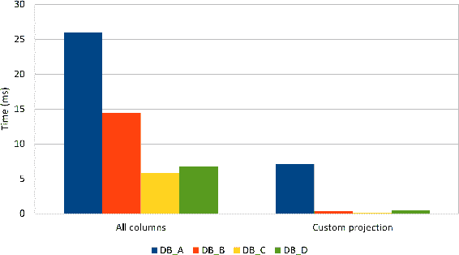


ResultSet 获取

### 6.5.2 列数过多

不仅获取过多行会导致性能问题，即使提取过多的列也会增加结果集处理的响应时间。下一个测试用例将使用以下两个语句之一，选择带有 `details` 的 `100 posts` 及其相关的 `1000 comments`：

```sql
SELECT * FROM post_comment pc
INNER JOIN post p ON p.id = pc.post_id
INNER JOIN post_details pd ON p.id = pd.id

SELECT pc.version FROM post_comment pc
INNER JOIN post p ON p.id = pc.post_id
INNER JOIN post_details pd ON p.id = pd.id
```

下面的图描绘了获取所有列的时间与仅提取整个列投影的子集的时间的对比。

**图 6.4：ResultSet 投影大小**

这种情况在 ORM 工具中更为常见，因为在填充实体时，需要选择所有列。在仅选择少数实体时，这可能不会被察觉，但对于大型结果集，这可能会变成明显的问题。如果业务用例只需要所有实体的一个子集，获取额外的列将导致数据库和应用程序资源（CPU、内存、I/O）的浪费。

## 事务

数据库系统必须允许对底层数据进行并发访问。但共享数据意味着读写操作必须同步，以确保数据完整性不受破坏。为了控制并发修改，Java 语言定义了 `synchronized` 关键字有两个用途：

- 它可以限制对共享 `Object` 的访问（以保持不变性）。
- 它将更改从当前本地内存传播到全局内存。

这种行为是其他并发编程环境和数据库系统中典型的。在关系型数据库中，确保数据完整性的机制实现在事务之上。事务是读写操作的集合，可以共同成功或共同失败。所有的数据库语句都必须在事务上下文中执行，即使数据库没有显式定义其边界。

1981 年，Jim Gray 在他著名的论文首次定义了数据库事务的属性：[事务概念：优点与限制](http://research.microsoft.com/en-us/um/people/gray/theTransactionConcept.pdf)。这篇论文以及 SQL 标准的第一版本（SQL-86 和 SQL-89）使用了三个属性来定义数据库事务：`Atomicity`（原子性）、`Consistency`（一致性）和 `Durability`（持久性）。

随着其他关系数据库主题的发展，事务研究自此持续，因此 SQL-92 版本引入了 `Isolation Levels`（隔离级别）的概念。这四个属性组合成了广为人知的 `ACID (Atomicity, Consistency, Isolation and Durability)` 缩写，它很快就成为关系型数据库事务的同义词。了解数据库事务的工作原理非常重要，主要基于两点：

- 有效的数据访问（在追求高性能时，数据完整性不应受到破坏）。
- 高效的数据访问（减少冲突可以最小化事务响应时间，从而增加吞吐量）。接下来的章节将结合高性能数据处理详细说明每个事务属性。

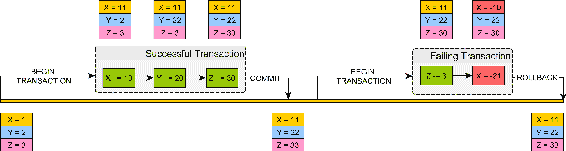

### 7.1 原子性

原子性是将多个操作组合成一个“全有全无”工作单元的属性，只有当单个操作都成功时，该单元才能成功。由于数据库必须能够回滚与每个执行的操作相关的所有更改。

**图 7.1：原子工作单元**

#### 写写冲突

理想情况下，每个事务都应该有一个完全隔离的分支，在回滚时可以很容易丢弃。这种场景类似于版本控制系统（例如 `git`）实现分支的方式。在发生冲突时，版本控制系统中止提交操作，客户端必须手动解决冲突。但与 VCS 工具不同，关系型数据库引擎必须在没有任何人工干预的情况下管理冲突。由于这个原因，数据库防止写写冲突情况，并且在任何给定时间只有一个事务可以写入记录。所有语句都是针对实际数据结构（表、索引、内存缓冲区）执行的，仅在提交时才实例化。在发生回滚时，数据库必须将任何挂起的更改数据恢复到之前的状态。

### Oracle

`undo tablespace`（https://docs.oracle.com/database/121/ADMIN/undo.htm#ADMIN1460）在 `undo segments` 中存储之前的数据版本。回滚时，数据库引擎搜索关联的 `undo segments`，可以重建由当前运行事务修改的每个数据的 `before image`（之前的镜像）。


### SQL Server

`transaction log`（https://msdn.microsoft.com/en-us/library/ms19025.aspx）存储了当前运行事务及其相关修改的详细信息。回滚过程反向扫描 `transaction log` 以找到关联的 undo 记录。找到记录后，数据库引擎恢复受影响数据的之前的镜像。

为了防止事务日志填满，必须定期对日志进行截断。长时间运行的事务可能会延迟截断过程，这也是尽可能避免事务的另一个原因。

### PostgreSQL

与其他数据库系统不同，PostgreSQL 不使用专门的只追加 undo 日志。由于其多版本特性，每个数据库对象都维护自己的版本历史。由于缺少日志查找阶段，回滚过程变得轻量得多，因为它只需要从一个版本切换到另一个版本。缺点是之前的版本空间大小有限，因此必须重用。

回收旧版本占用的存储空间的过程是 `VACUUMING`。

每个事务都有一个关联的 [XID](http://www.postgresql.org/docs/9.4/static/routine-vacuuming.html)，较新事务的 XID 必须大于之前所有事务的 XID。

事务 `XID` 是一个 32 位数字，因此它可以容纳 40 亿个事务。

在高性能应用中，事务的生命周期非常短，如果禁用了 `VACUUM` 进程，可能会达到这个阈值。当 `XID` 计数器达到最大值时，它会回绕并从零重新开始。

在 `XID` 回绕之前发布的事务，其标识符将大于 `XID` 计数器重置后启动的较新事务。这种异常会导致系统认为旧的事务是在未来启动的，这可能导致非常严重的数据完整性问题。


# 事务

76

### MySQL

`undo log` 存储在系统表空间的[回滚段](https://dev.mysql.com/doc/refman/5.7/en/innodb-multi-versioning.html)（#index_split_001.html_p86）中。

每个 `undo log` 被分为两个部分，一个负责回滚，另一个负责重建之前的映像。第一部分在事务结束后可以立即删除，而另一部分则只要任何当前运行的查询或其他并发事务需要查看相关记录的旧版本，就需要一直存在。

在后台，MySQL 运行一个 `purge` 进程来清理被删除记录占用的存储，并回收不再需要的 `undo log` 段。

长时间的事务会延迟 `purge` 进程的执行，导致 `undo log` 变得非常大，尤其是在写密集型数据访问场景下。

[`dev.mysql.com/doc/refman/5.7/en/innodb-multi-versioning.html`](https://dev.mysql.com/doc/refman/5.7/en/innodb-multi-versioning.html)

### 7.2 一致性

修改性事务可以看作状态转换，将数据库从一个有效状态移动到另一个状态。关系型数据库模式确保所有主修改（插入/更新/删除语句）以及辅助修改（由触发器发出）都遵循底层数据结构的某些规则：

- 列类型
- 列长度
- 列可空
- 外键约束
- 唯一键约束
- 自定义 `check` 约束。

一致性关乎验证事务的状态变化，使所有已提交的事务让数据库处于正确的状态。如果只违反了一个约束，整个事务将会被回滚，所有修改都将撤销。

尽管应用程序在构建数据库语句之前必须验证用户输入，但应用程序级别的检查无法跨越其他并发请求（这些请求可能来自不同的 Web 服务器）。当数据库是主要的集成点时，严格模式（schema）的优势变得更加明显。

事务

77

### MySQL

传统上，MySQL 约束并不是[严格执行的](https://dev.mysql.com/doc/refman/5.7/en/constraint-invalid-data.html)（#index_split_001.html_p87），数据库引擎会用预定义的默认值替换无效值：

- 超出范围的数值值被设置为 `0` 或最大可能值。
- 字符串值被修剪到最大长度。
- 允许错误的数据值（例如，2015-02-30）。
- `NOT NULL` 约束仅对单个 `INSERT` 语句强制。对于多行插入，`0` 替换空数值值，空值用于空字符串。

从 5.0.2 版本开始，如果数据库引擎配置为使用自定义的 [sql mode](https://dev.mysql.com/doc/refman/5.7/en/sql-mode.html)（#index_split_001.html_p87），则可以使用 `strict` 约束：

```sql
SET GLOBAL sql_mode='POSTGRESQL,STRICT_ALL_TABLES';
```

由于 `sql_mode` 会在服务器启动时重置，因此最好在 MySQL 配置中设置它：

```ini
[mysqld]
sql_mode = POSTGRESQL,STRICT_ALL_TABLES
```

[`dev.mysql.com/doc/refman/5.7/en/constraint-invalid-data.html`](https://dev.mysql.com/doc/refman/5.7/en/constraint-invalid-data.html)

[`dev.mysql.com/doc/refman/5.7/en/sql-mode.html`](https://dev.mysql.com/doc/refman/5.7/en/sql-mode.html)

### CAP 定理中的一致性

根据 [CAP 定理](https://en.wikipedia.org/wiki/CAP_theorem)（#index_split_001.html_p87），当分布式系统遇到网络分区时，系统必须选择 `Consistency`（所有更改瞬时应用到所有节点）或 `Availability`（任何节点都可以接受请求），而不可兼得。在 ACID 的定义中，一致性是关于遵守约束；但在 CAP 定理的语义中，一致性指的是[线性一致性](http://www.bailis.org/linearizability-serializability/)（#index_split_001.html_p87），`en.wikipedia.org/wiki/CAP_theorem`

事务

78

### 7.3 隔离性

如果只有一个用户访问数据库，就不会有数据冲突风险。根据可扩展性法则，如果数据访问的顺序部分小于 `100%`，数据库系统就可以受益于并行化。通过提供多个并发连接，事务吞吐量可以增加，数据库必须以不破坏完整性的方式交错事务。如果所有事务操作的结果与顺序执行的结果相同，则被称为 `serializable`。因此，序列化执行是唯一不破坏完整性的隔离级别，同时允许某种程度的并行化。1981 年，Jim Gray 描述最大的航空公司和银行拥有 10000 个终端和 100 个活动事务，这解释了为什么直到 SQL-92，序列化一直是事实上的隔离级别。

#### 7.3.1 并发控制

为了管理数据冲突，多年来开发了并发控制机制。处理冲突基本上有两种策略：

- 避免冲突（例如两相锁）需要锁来控制共享资源。
- 检测冲突（例如多版本并发控制）提供了更高的并发性，代价是放宽序列化并可能接受数据异常。

##### 7.3.1.1 两相锁

1976 年，Kapali Eswaran 和 Jim Gray 等发表了[一致性与谓词的概念](http://research.microsoft.com/en-us/um/people/gray/papers/On%20the%20Notions%20of%20Consistency%20and%20Predicate%20Locks%20in%20a%20Database%20System%20CACM.pdf)论文，证明了如果所有事务都使用两相锁（`2PL`）协议，就可以获得序列化。

[数据库系统中的锁²](http://research.microsoft.com/en-us/um/people/gray/papers/On%20the%20Notions%20of%20Consistency%20and%20Predicate%20Locks%20in%20a%20Database%20System%20CACM.pdf)

最初所有的数据库系统都使用 `2PL` 实现序列化事务，但随着时间的推移，许多厂商已转向 MVCC（多版本并发控制）架构。SQL Server 默认仍使用锁来实现序列化隔离级别。

由于 `2PL` 保证了事务的序列化性，因此理解维护严格数据完整性对整个应用程序可扩展性和事务性能的代价至关重要。

但锁不仅用于 `2PL` 实现，而且为了处理 DML 和 DDL 语句之间的交互，并最大限度地减少共享资源的竞争，关系型数据库系统使用了[多粒度锁](https://en.wikipedia.org/wiki/Multiple_granularity_locking)。

²²[`research.microsoft.com/en-us/um/people/gray/papers/On%20the%20Notions%20of%20Consistency%20and%20Predicate%20Locks%20in`](http://research.microsoft.com/en-us/um/people/gray/papers/On%20the%20Notions%20of%20Consistency%20and%20Predicate%20Locks%20in%20a%20Database%20System%20CACM.pdf)

[20a%20Database%20System%20CACM.pdf](http://research.microsoft.com/en-us/um/people/gray/papers/On%20the%20Notions%20of%20Consistency%20and%20Predicate%20Locks%20in%20%20a%20Database%20System%20CACM.pdf)

³[`en.wikipedia.org/wiki/Multiple_granularity_locking`](https://en.wikipedia.org/wiki/Multiple_granularity_locking)

# 事务

数据库对象在本质上是层次结构的，一个逻辑表空间映射到多个数据库文件，这些文件由数据页组成，每个页包含多行。因此，可以在不同的数据库对象类型上获取锁。


在较低级别（例如行）上加锁可以提供更好的并发性，因为它减少了竞争的可能性。由于每个锁都会消耗资源，持有多个低级锁可能会累积，因此数据库可能会决定将多个低级锁替换为单个高级锁。这个过程被称为`锁升级`（lock escalation），它是用数据库资源换取并发性。

每个数据库系统都有自己的锁层级，但最常见的类型（甚至在`2PL`初始论文中提到过）仍然是：

- 共享（读）锁，在允许并发读取的同时，防止记录被写入。
- 排他（写）锁，不允许任何读或写操作。

仅有锁不足以防止冲突。并发控制策略必须定义如何获取和释放锁，因为这也会影响事务的交错执行。

出于此目的，`2PL`协议定义了一种锁管理策略来确保序列化性。`2PL`协议将事务分为两个阶段：

- 扩展阶段（获取锁且不释放任何锁）。
- 收缩阶段（释放所有锁且不再获取任何其他锁）。

在基于锁的并发控制实现中，所有当前交错执行的事务必须遵循`2PL`协议，否则序列化性可能会被破坏，导致数据异常。

## 事务调度

为了提供故障恢复能力，事务调度表（所有交错执行的操作的序列）必须是严格的。如果第一个事务中的写操作发生在后续事务发生冲突之前，为了实现事务的`严格性`（strictness），第一个事务的提交事件也必须发生在冲突之前。

由于操作经过了恰当排序，严格性可以防止`级联回滚（一个事务的回滚触发一系列其他事务的告滚，以维护数据一致性）`。只有在事务结束（无论是提交还是回滚）后才释放所有锁，才是具有严格调度表的要求。

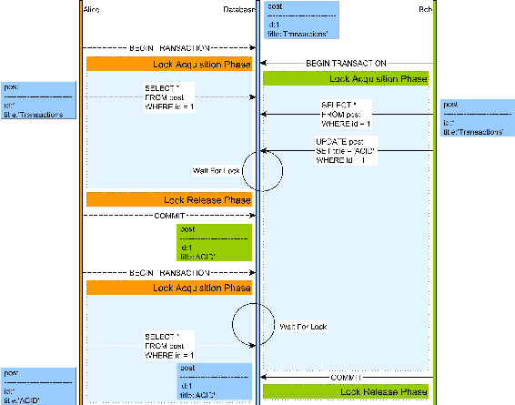

下面的图显示了`2PL`如何协调事务的交错执行：

**图 7.2：两阶段锁**

- `Alice`和`Bob`都选择了一个`post`记录，两人都获取了该记录的共享锁。
- 当`Bob`尝试更新`post`条目时，他的语句被`Lock Manager`阻塞，因为`Alice`仍然持有该数据库行的共享锁。
- 只有在`Alice`的事务结束并且所有的锁都被释放后，`Bob`才能恢复他的更新操作。
- `Bob`的更新将产生锁升级，因此共享锁被排他锁替换，这将防止任何其他并发的读或写操作。
- `Alice`启动一个新事务并对同一个`post`条目发布`select`查询，但该语句被`Lock Manager`阻塞，因为`Bob`拥有该记录的排他锁。
- 在`Bob`的事务提交后，所有的锁被释放，`Alice`的查询可以恢复，因此她将获得该数据库记录的最新值。

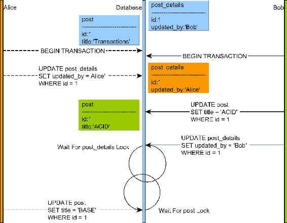

## 死锁

使用锁来控制共享资源的访问容易产生死锁，仅靠事务调度器无法防止死锁的发生。

当两个并发事务无法进展，因为它们都在等待对方释放锁时，死锁就会发生。由于两个事务都处于锁获取阶段，它们在获取下一个锁之前都不会释放已有的锁。

**图 7.3：死锁**

保持锁的顺序变成了数据访问层的责任，而数据库只能协助从死锁状态中恢复。

数据库引擎运行一个单独的进程扫描当前的冲突图以寻找锁等待循环（由死锁引起）。当检测到循环时，数据库引擎会选择一个事务并将其回滚，导致其锁被释放，以便另一个事务进展。


### 7.3.2 多版本并发控制

虽然加锁可以提供序列化调度，但锁竞争的代价会损害事务响应时间。由于事务必须等待锁，响应时间可能会增加，长时间运行的事务也会降低其他事务的进展。根据阿德尔法则和通用扩展性法则，并发性也会受到竞争的影响。

为了解决这些缺点，数据库厂商选择了乐观并发控制机制。如果说`2PL`是预防冲突，多版本并发控制（`MVCC`）则采用了冲突检测策略。`MVCC`的承诺是读不阻塞写，写不阻塞读。唯一的竞争源于写阻塞其他写，否则将破坏事务的回滚和原子性。

为了防止阻塞，数据库可以重建数据库记录之前的版本，以便未提交的更改对并发读取者隐藏。缺乏锁使得实现序列化调度变得困难，因此数据库引擎必须分析当前的交错操作并检测可能破坏序列化的异常。

### Oracle

Oracle 完全没有实现`2PL`，而是依靠`MVCC`机制管理并发数据访问。每个查询都会获得一个时间点快照，并且根据隔离级别，时间戳可以相对于当前语句或当前事务开始时间。

为了重建之前的记录版本，Oracle 使用[回滚段](https://docs.oracle.com/database/121/CNCPT/consist.htm#CNCPT221)，这些段已经包含了回滚未提交更改所需的所有数据。时间点基于系统更改数（`SCN`），它是一个逻辑时间戳引用，与物理时间不同，它保证单调递增。

除了`MVCC`之外，Oracle 也支持显式锁，使用`SELECT FOR UPDATE` SQL 语法。

[`https://docs.oracle.com/database/121/CNCPT/consist.htm#CNCPT221`](https://docs.oracle.com/database/121/CNCPT/consist.htm#CNCPT221)


### SQL Server

默认情况下，`SQL Server`使用锁来实现 SQL 标准中规定的所有隔离级别。

为了让`Read Committed`隔离级别能够利用 MVCC 模型，必须首先设置以下配置：

```sql
ALTER DATABASE high_performance_java_persistence
SET READ_COMMITTED_SNAPSHOT ON;
```

对于更高级别的隔离性，`SQL Server`提供了`Snapshot`隔离模式，该模式必须在数据库级别激活：

```sql
ALTER DATABASE high_performance_java_persistence
SET ALLOW_SNAPSHOT_ISOLATION ON;
```

由于`Snapshot`是一个自定义的隔离级别，在启动新事务之前，还必须在连接级别进行设置：

```sql
SET TRANSACTION ISOLATION LEVEL SNAPSHOT;
GO
BEGIN TRANSACTION;
GO
COMMIT TRANSACTION;
GO
```

启用行版本控制后，数据库可以在`tempdb`数据库中跟踪记录的变化。

当某行被更新或删除时，当前行条目将保留指向上一个版本的引用，该版本被记录在`tempdb`数据库的版本存储器中。行不会被立即删除，而是被标记为待删除，实际的删除由`Ghost cleanup task`完成。旧版本必须保留到当前运行的事务可能需要它们为止，这由事务隔离级别决定。

`Ghost cleanup task`定期运行，并从不再需要的旧版本中回收存储。长时间运行的事务会导致数据库引擎长时间保留某些旧版本，而且由于版本更改是以链表结构链联的，恢复之前的版本可能会变成资源密集型。


### PostgreSQL

与所有其他数据库系统不同，`PostgreSQL`将当前行及其之前的版本（即使是已中止事务的版本）都存储在实际数据库表中。与`Oracle`一样，`PostgreSQL`采用了 MVCC 数据访问模型，并且它完全不提供 2PL 事务隔离实现。

每个表行都有两个额外的列（`xmin`和`xmax`），用于控制各种行版本的可见性。当插入一行时，当前事务 ID 会被存储在`xmin`列中。

更新和删除操作最终都会创建一个新的行条目，其`xmax`列存储当前事务 ID。

`Vacuum`清理进程定期运行，并回收被删除的条目（已成功提交）或当前运行事务不再需要的旧版本所占用的存储。

尽管`PostgreSQL`被视为纯 MVCC 模型，但仍然需要锁定来防止写写冲突或进行[显式锁定](http://www.postgresql.org/docs/9.5/static/explicit-locking.html)。使用`SELECT FOR UPDATE`获取排他行级锁，而`SELECT FOR SHARE`则用于应用共享锁。

### MySQL

`InnoDB`存储引擎提供了对 ACID 事务的支持，并使用 MVCC 控制对共享资源的访问。`InnoDB`的 MVCC 实现与`Oracle`非常相似，数据库行的之前的版本也存储在回滚段中。

当事务请求先之前的行版本时，`MySQL`必须从回滚段中重建它。删除操作只是将条目标记为待删除，而`purge`线程将执行实际的物理清理。

事务回滚过程和之前的行版本恢复过程（由特定的事务可见性保证要求）本质上是同一件事。

与其他数据库系统一样，当 MVCC 不再满足时，`MySQL`也提供了[显式锁定](https://dev.mysql.com/doc/refman/5.7/en/innodb-locking-reads.html)。使用`SELECT LOCK IN SHARE MODE`获取共享锁，而对于排他锁，则使用更常用的`SELECT FOR UPDATE`语法。

## 7.3.2 现象

对于合理的事务吞吐量值，隐含事务序列化是有意义的。随着入站流量的增长，严格数据完整性的代价变得太高，这是拥有多个隔离层级的要原因。降低序列化保证可能会产生数据完整性异常，这些异常也被称为`phenomena`（现象）。

SQL-92 标准引入了在偏离序列化事务调度时可能发生的三个现象：

- `脏读`（dirty read）
- `不可重复读`（non-repeatable read）
- `幻读`（phantom read）

在现实中，由于事务交替执行还会发生其他现象，正如著名的论文[A Critique of ANSI SQL Isolation Levels]⁴(http://research.microsoft.com/apps/pubs/default.aspx?id=69541)所描述的那样：

- `脏写`（dirty write）
- `读倾斜`（read skew）
- `写倾斜`（write skew）
- `丢失更新`（lost update）

选择特定的隔离级别是在增加并发性与承认可能发生的异常之间进行权衡。竞争和一致性成本会破坏可扩展性。隔离级别越低，锁定（或多版本事务回滚）就越少，应用程序的可扩展性就越高。

但较低的隔离级别允许出现更多现象，且数据完整性的责任从数据库一侧转移到了应用程序逻辑侧，应用程序逻辑必须确保其采取了所有措施来防止或缓解任何此类数据异常。

在跳转到隔离级别之前，了解每个特定现象背后的原理以及它如何影响数据完整性，这会更好。在选择给定的事务隔离级别时，理解现象是做出正确决策的基础。

⁴[`research.microsoft.com/apps/pubs/default.aspx?id=69541`](http://research.microsoft.com/apps/pubs/default.aspx?id=69541)

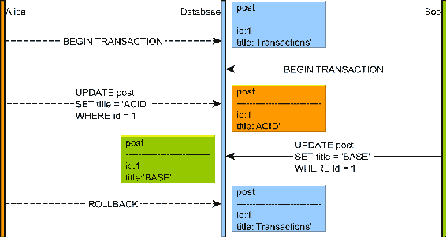

### 7.3.2.1 脏写

脏写发生在两个并发事务被允许修改同一行时。正如前所述，所有更改都直接应用于实际的对象结构上，这意味着第二个事务直接覆盖了第一个事务的待提交更改。

**图 7.4：脏写**

如果两个事务都提交，一个事务将静地覆盖另一个事务，导致`丢失更新`。当第一个事务想要回滚时，会出现另一个问题。数据库引擎必须选择以下操作路径之一：

- 将行恢复到之前的版本（即第一个事务更改之前的状态），但这将覆盖第二个事务的待提交更改。
- 承认较新版本（由第二个事务发布）的存在，但如果第二个事务必须回滚，它的之前的版本将变成第一个事务的未提交更改。

如果数据库引擎不防止脏写，那么保证回滚将是不可能的。因为在没有可靠回滚的情况下无法实现原子性，因此所有数据库系统必须防止脏写。尽管 SQL 标准没有提到这种现象，即使是最低的隔离级别（`Read Uncommitted`）也能防止它。

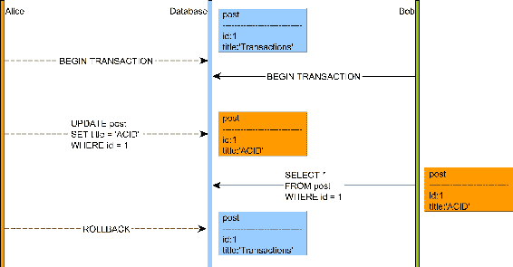

### 7.3.2.2 脏读

正如前，所有数据库更改都应用于实际的数据结构（内存缓冲区、数据块、索引）。脏读发生在一个事务被允许读取另一个并发事务的未提交更改时。在尚未提交的值上做出业务决策是有风险的，因为未提交的更改可能会被回滚。

**图 7.5：脏读**

这种异常仅由`Read Uncommitted`隔离级别允许，由于对数据完整性有严重影响，大多数数据库系统提供了更高的默认隔离级别。

为了防止脏读，数据库引擎必须向所有并发事务隐藏未提交的更改（但创建该更改的事务除外）。每个事务都允许看到自己的更改，否则“读你所写”（read-your-own-writes）的一致性保证将无法实现。

一种简单的方法是对未提交的行加锁，但这完全是不可行的（如果一个长时间运行事务获取了这样的锁，那么在锁释放之前，其他事务都无法读取该记录）。锁会引起竞争，而竞争会影响可扩展性。

由于回滚日志（undo log）已经捕获了每个未提交记录之前的版本，数据库引擎可以使用它在其他并发事务查询中恢复先前的值。由于所有其他隔离级别（`Read Committed`、`Repeatable Read`、`Serializable`）都使用了这种机制，大多数数据库系统都优化了之前的镜像恢复过程（降低了其对整个应用程序性能的开销）。

使用`Read Uncommitted`的情况很少见（例如允许脏读的非严格报表查询），因此`Read Committed`通常是最低的实用的隔离级别。

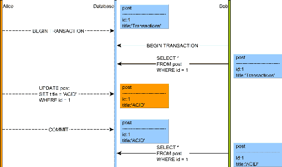

### 7.3.2.3 不可重复读

如果一个事务在读取数据库行时，没有对新获取的记录应用共享锁，那么并发事务可能会在第一个事务结束之前更改此行。

**图 7.6：不可重复读**

当当前事务根据所给数据库行的第一个初始值做出业务决策时，这种现象就会产生问题（客户端可能会根据一个不再是正整数的库存值订购产品）。

大多数数据库系统已转向多版本并发控制（MVCC）模型，共享锁不再是防止不可重复读的强制性要求。通过验证当前行版本，如果之前获取的记录在此期间发生了变化，该事务可以被中止（abort）。

`Repeatable Read`和`Serializable`默认防止了这种异常。在`Read Committed`隔离级别下，如果显式获取共享锁（例如`SELECT FOR SHARE`），则可以避免不可重复（模糊）读。

某些 ORM 框架（例如`JPA`/`Hibernate`）提供了应用级别的可重复读。任何检索到的实体的第一个快照都缓存在当前运行的`Persistence Context`（持久化上下文）中。任何返回相同数据库行的后续查询都将使用之前缓存的同一个对象。通过这种方式，即使在`Read Committed`隔离级别下也可以防止模糊读。

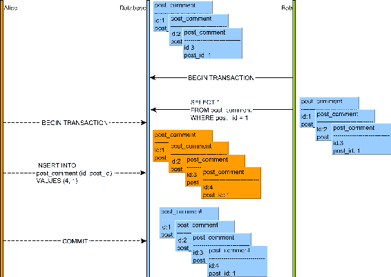


### 7.3.2.4 幻读

如果事务根据一组满足给定谓词的行做出业务决策，而没有使用谓词锁，并发事务可能会插入匹配该特定谓词的记录。

**图 7.7：幻读**

幻读行可能导致买家在购买产品时，没有意识到在用户完成获取报价列表后刚刚添加了更优的报价。

传统上，`Serializable`隔离级别通过谓词锁防止幻读。其他的 MVCC 实现可以通过检查事务调度来检测幻读行，并中止任何违反其可序列化保证的事务。

如果显式锁定即使在`Read Committed`隔离级别下也能防止不可重复读，那么就没有这样的 SQL 结构来允许显式地获取范围锁。

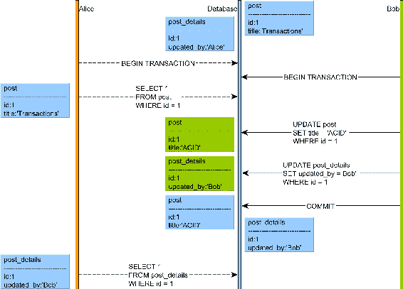

### 7.3.2.5 读偏斜

读偏斜是一种较少为人知的异常，涉及对多个数据库表的约束。在接下来的示例中，应用程序要求`post`和`post_details`同更新。每当`post`记录发生变化时，关联的`post_details`必须记录执行修改的用户。

**图 7.8：读偏斜**

在选择`post`行和`post_details`行之间，第二个事务插入并成功更新了这两条记录。第一个事务将看到`post`行的旧版本和关联的`post_details`的最新版本。由于这种读偏斜，第一个事务将假设此特定的`post`是由`Bob`更新的，尽管实际上，它是由`Alice`更新的旧版本。

与不可重复读一样，有两种方法可以避免这种现象：

- 第一个事务可以在每次读取时获取共享锁，从而防止第二个事务更新这些记录。
- 第一个事务在验证提交约束时可以中止（当使用 MVCC 实现的`Repeatable Read`或`Serializable`隔离级别时）。

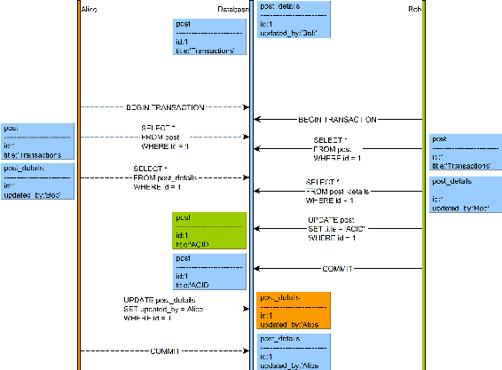

### 7.3.2.6 写偏斜

与读偏斜一样，这种现象涉及两个不同表上的不交写，这两个表被约束为单元更新。每当`post`行发生变化时，客户端必须更新`post_details`以包含更改的用户。

**图 7.9：写偏斜**

`Alice`和`Bob`都会选择`post`及其关联的`post_details`记录。如果允许写偏斜，`Alice`和`Bob`可以分别更新这两个记录，从而破坏约束。

与不可重复读一样，有两种方法可以避免这种现象：

- 第一个事务可以在两个条目上获取共享锁，从而防止第二个事务更新这些记录。
- 数据库引擎可以检测到另一个事务更改了这些记录，因此它可以强制第一个事务回滚（在 MVCC 实现的`Repeatable Read`或`Serializable`下）。

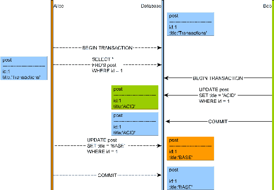

### 7.3.2.7 丢失更新

这种现象发生在一个事务读取行时，另一个事务在第一个事务完成之前对其进行了修改。在接下来的示例中，`Bob`的更新被`Alice`静默地覆盖了，而`Alice`并没有意识到记录的更新。

**图 7.10：丢失更新**

这种异常会对数据完整性产生严重后果（买家可能在不知道价格刚刚发生变化的情况下购买产品），特别是因为它影响了`Read Committed`，这是许多数据库系统的默认隔离级别。


传统上，`Repeatable Read` 保护防止丢失更新，因为共享锁可以防止并发事务修改已获取的记录。通过 MVCC，允许第二个事务进行更改，而当数据库引擎检测到行版本不匹配时（在第一个事务提交期间），第一个事务会被中止。

大多数 ORM 工具（如 `Hibernate`）提供了应用级别的乐观锁，每当发出的记录修改指令时，它会自动整合行版本。当行版本不匹配时，更新计数将为零，因此应用程序回滚当前事务，因为当前的数据快照是过时的。

### 7.3.3 隔离级别

如前所述，`Serializable` 是唯一提供真正 ACID 事务交错的隔离级别。但可序列化是有代价的，因为加锁引入了竞争，反过来限制了并发性和可扩展性。即使在多版本并发控制模型中，可序列化也可能需要中止过多受现象影响的事务。

出于这一目的，SQL-92 版本引入了多个隔离级别，数据库客户端可以在并发性与数据正确性之间进行平衡。每个隔离级别根据其必须防止的现象最小数量来定义，因此 SQL 标准引入了以下事务隔离级别：

**表 7.1：标准隔离级别**

| 隔离级别 | 脏读 | 不可重复读 | 幻读 |
| :--- | :--- | :--- | :--- |
| Read Uncommitted | 是 | 是 | 是 |
| Read Committed | 否 | 是 | 是 |
| Repeatable Read | 否 | 否 | 是 |
| Serializable | 否 | 否 | 否 |

在没有明确设置的情况下，JDBC 驱动使用默认隔离级别，可以通过 `DatabaseMetaData` 对象的 [`getDefaultTransactionIsolation()⁵`](http://docs.oracle.com/javase/8/docs/api/java/sql/DatabaseMetaData.html#getDefaultTransactionIsolation--) 方法进行检查：

```java
int level = connection.getMetaData().getDefaultTransactionIsolation();
```

默认隔离级别可以使用 `Connection` 方法 [`setTransactionIsolation(int level)⁶`](http://docs.oracle.com/javase/8/docs/api/java/sql/Connection.html#setTransactionIsolation-int-) 来更改。

```java
connection.setTransactionIsolation(Connection.TRANSACTION_SERIALIZABLE);
```

即使 ACID 属性意味着可序列化调度，但大多数关系型数据库系统仍使用较低的默认隔离级别：

- 读提交（Oracle、SQL Server、PostgreSQL）
- 可重复读（MySQL）

接下来的章节将详细介绍每种事务隔离级别，并演示特定数据库系统所防止的实际现象列表。

⁵[`docs.oracle.com/javase/8/docs/api/java/sql/DatabaseMetaData.html#getDefaultTransactionIsolation--`](http://docs.oracle.com/javase/8/docs/api/java/sql/DatabaseMetaData.html#getDefaultTransactionIsolation--)

⁶[`docs.oracle.com/javase/8/docs/api/java/sql/Connection.html#setTransactionIsolation-int-`](http://docs.oracle.com/javase/8/docs/api/java/sql/Connection.html#setTransactionIsolation-int-)


事务 94

### 7.3.3.1 未提交读

**表 7.2：读提交读现象发生情况**

| 现象 | SQL Server | PostgreSQL | MySQL |
| :--- | :--- | :--- | :--- |
| 脏写 | 否 | 否 | 否 |
| 脏读 | 是 | 否 | 是 |
| 不可重复读 | 是 | 是 | 是 |
| 幻读 | 是 | 是 | 是 |
| 读偏斜 | 是 | 是 | 是 |
| 写写偏斜 | 是 | 是 | 是 |
| 丢失更新 | 是 | 是 | 是 |

#### Oracle

不允许脏读，因此最低的隔离级别是读提交。如果客户端尝试在当前 `Connection` 上设置未提交读隔离级别，JDBC 驱动甚至会抛出异常。

#### SQL Server

未提交读只防止脏写，所有其他现象都是被允许的。当使用未提交读时，给定的 SQL 修改没有关联排他锁，因此未提交的更改在提交之前对其他并发事务是可见的。如果可以假设存在脏读的风险，那么避免排他锁可以加快报告查询的速度，特别是在扫描大量数据时。

对于基于锁的并发控制机制，如果脏读的风险远小于锁定数据库表的大部分区域，那么未提交读是值得考虑的。由于 MVCC 避免了读-写锁和写-读锁，允许脏读可能不会在性能上带来显著的提升。


事务 95

#### PostgreSQL

与 Oracle 一样，PostgreSQL 不允许脏读，最低隔离级别是读提交。当选择未提交读时，JDBC 驱动会静默回退到读提交。

#### MySQL

尽管使用了 MVCC，但 InnoDB 实现了未提交读以允许脏读。作为一种优化，每个查询都无需重建当前扫描记录的先提交版本（使用回滚段）（以防这些记录最近被修改过）。

### 7.3.3.2 读提交

读提交是最常见的隔离级别之一，它在多个关系型数据库系统或各种并发控制模型中的表现一致。许多数据库系统选择读提交作为默认隔离级别，因为它提供了最好的性能，同时防止了脏写和脏读等致命异常。但性能是有代价的，因为读提交允许许多可能导致数据损坏的异常。

**表 7.3：读提交现象发生情况**

| 现象 | Oracle | SQL Server | SQL Server MVCC | PostgreSQL | MySQL |
| :--- | :--- | :--- | :--- | :--- | :--- |
| 脏写 | 否 | 否 | 否 | 否 | 否 |
| 脏读 | 否 | 否 | 否 | 否 | 否 |
| 不可重复读 | 是 | 是 | 是 | 是 | 是 |
| 幻读 | 是 | 是 | 是 | 是 | 是 |
| 读偏斜 | 是 | 是 | 是 | 是 | 是 |
| 写写偏斜 | 是 | 是 | 是 | 是 | 是 |
| 丢失更新 | 是 | 是 | 是 | 是 | 是 |


事务 96

#### Oracle

每个语句都有一个起始时间戳，用于创建一个相对于该特定时间点的数据库快照。这样，写入者仍然可以更新当前选定的记录，数据库可以简单地重建查询开始时可用之前的版本。随后的查询执行可能会返回不同的行版本，因此允许不可重复读。

当两个事务尝试更新同一条记录时，第一个事务将锁定该记录以防止脏写。第二个事务必须等待第一个事务释放锁（提交或回滚），然后根据最新数据重新评估语句的过滤条件。

#### PostgreSQL

与 Oracle 一样，每个查询看到的是截至当前运行查询开始时的数据库快照。由于不使用共享锁来保护先读取的记录不被修改，读提交允许很大范围的数据异常。

#### MySQL

使用查询时快照来隔离语句与并发事务。当显式获取共享锁或排他锁或执行更新或删除语句（获取排他锁以防止脏写）时，如果在[5.7 之前](https://dev.mysql.com/doc/refman/5.7/en/set-transaction.html#id40311316372)修改语句使用了范围且搜索条件利用了唯一索引，则数据库可以使用间隙锁或键间锁（因此也能防止幻读）。读提交不支持语句复制，因此应用程序必须使用基于行的日志。（注：此处原文句式逻辑略有错乱，已根据语境调整翻译）


事务 97

#### SQL Server

默认情况下，SQL 语句使用共享锁来防止其他事务修改当前获取的记录。共享锁在查询完成时释放。当启用读提交快照隔离时，数据库将不再使用共享锁，每个查询将选择查询开始时的行版本。

### 7.3.3.3 可重复读

作为遵循程度最低的隔离级别之一，可重复读的实现细节会渗透到其现象范围中：

**表 7.4：可重复读现象发生情况**

| 现象 | SQL Server | PostgreSQL | MySQL |
| :--- | :--- | :--- | :--- |
| 脏写 | 否 | 否 | 否 |
| 脏读 | 否 | 否 | 否 |
| 不可重复读 | 否 | 否 | 否 |
| 幻读 | 是 | 否 | 否 |
| 读偏斜 | 否 | 否 | 否 |
| 写写偏斜 | 否 | 是 | 是 |
| 丢失更新 | 否 | 否 | 是 |

#### Oracle

不支持可重复读隔离，如果客户端尝试显式设置，JDBC 驱动会抛出异常。

#### SQL Server

对于客户端读取的每一行，当前事务都会获取共享锁，防止任何其他事务并发修改它。共享锁在事务提交或回滚时释放。

#### PostgreSQL

可重复读（Repeatable Read）是通过[快照隔离](https://en.wikipedia.org/wiki/Snapshot_isolation)实现的，因此不仅能防止脏读，甚至禁止了幻读。PostgreSQL 的 MVCC 实现允许冲突的发生，但它会中止任何无法再维持其保证的事务。

[快照隔离](https://en.wikipedia.org/wiki/Snapshot_isolation)

#### MySQL

每个事务看到的行数据，就像是当前事务开始时的一样。这防止了不可重复读，但仍然允许丢失更新和写偏斜。

### 7.3.3.4 可串化（Serializable）

可串化应该提供一种事务执行计划，其结果即使在语句交替的情况下，也等同于串行执行。

即使并发控制机制是基于锁的或管理多个记录版本，它必须防止所有现象以确保事务的可串化。仅仅防止 SQL 标准中提到的所有现象（脏读、不可重复读和幻读）是不够的，可串化事务还必须防止丢失更新、读偏斜和写偏斜。

在实践中，并发控制的实现细节会泄露，并不是所有的关系数据库系统都提供真正的可串化隔离级别（某些数据完整性异常可能仍然发生）。

**表 7.5：可串化现象发生**

| 现象 | Oracle | SQL Server | SQL Server MVCC | PostgreSQL | MySQL |
| :--- | :--- | :--- | :--- | :--- | :--- |
| 脏写 | 无 | 无 | 无 | 无 | 无 |
| 脏读 | 无 | 无 | 无 | 无 | 无 |
| 不可重复读 | 无 | 无 | 无 | 无 | 无 |
| 幻读 | 无 | 无 | 无 | 无 | 无 |
| 读偏斜 | 无 | 无 | 无 | 无 | 无 |
| 写偏斜 | 是 | 无 | 是 | 无 | 无 |
| 丢失更新 | 无 | 无 | 无 | 无 | 无 |


事务 99

#### Oracle

可串化隔离级别实际上是快照隔离并发控制机制的一种 MVCC 实现。与 PostgreSQL 中的可重复读隔离一样，Oracle 无法防止写偏斜，这意味着它无法提供真正的可串化事务。

#### SQL Server

可串化隔离级别基于 `2PL`（两相锁），因此防止了所有现象。基于 MVCC 的快照隔离与 Oracle 可串化和 PostgreSQL 可重复读相似，因此它允许写偏斜。

#### PostgreSQL

为了克服快照隔离的局限性，PostgreSQL 开发了可串化快照隔离（SSI），它提供了真正的可串化事务。由于 SSI 仍然是一种 MVCC 实现，PostgreSQL 会监控事务计划并检测*可能的*可串化异常。当前的实现可能会检测到[假报](http://drkp.net/papers/ssi-vldb12.pdf)，某些事务即使没有真正破坏事务的可串化也可能被中止。只有精确可串化快照隔离（PSSI）模型可以消除所有的假报，但由于其性能开销过高，数据库实现者坚持使用 SSI。

#### MySQL

可串化隔离在可重复读的基础上构建，其区别在于每个被选中的记录也会被共享锁保护。这种基于锁的方法允许 MySQL 防止写偏斜现象，而这种现象在许多快照隔离实现中非常普遍。


事务 100

## 7.4 持久性

在购买机票时，资金会从银行账户扣除，并为给买家预留座位。假设在购买机票后，航空公司预订系统崩溃，所有之前处理的事务在系统重启后必须有效。如果系统不强制这一要求，注册的机票可能会消失，买家可能面临账户被扣款但没有任何机票的情况。

持久性确保所有已提交的事务更改变为永久性的。持久性允许系统可恢复性，在某种程度上，它类似于回滚机制。

### 撤滚日志（undo logs）如何？

为了支持事务回滚并在 MVCC 系统中重建之前的版本，数据库系统已经在 `undo log` 中记录了当前的修改（包括未提交的更改）。但可恢复性只需要提交的更改，而且由于过时的 undo 段可能会被频繁回收，因此仅靠 `undo log` 并不适用于恢复性。

当事务提交时，数据库会将所有当前更改持久化到一个仅追加的顺序数据结构中，通常被称为 `redo log`（重做日志）。

#### Oracle

[重做日志](https://docs.oracle.com/database/121/ADMIN/onlineredo.htm#ADMIN11302)由多个重做记录组成，每条记录包含 `change vectors`（变更向量），捕获实际的数据块变化。出于性能考虑，重做记录存储在缓冲区中，Log Writer（日志写入器）将内存中的记录刷新到当前活动的重做日志文件中。在任何时刻，Oracle 至少有两个重做日志文件，但只有一个是活跃且可用于收集日志缓冲区条目的。当事务提交时，数据库会刷新缓冲区，更改变为持久化。

如果缓冲区满了，Oracle 会将其连同任何未提交的更改一起刷新，如果相关事务被回滚，这些更改可以被移除。

[重做日志](https://docs.oracle.com/database/121/ADMIN/onlineredo.htm#ADMIN11302)


事务 101

#### SQL Server

等一下，让我重读一下：与 Oracle 不同，SQL Server 将 `undo log` 和 `redo log` 合并为一个单一数据结构（`transaction log`，事务日志）。默认情况下，当事务提交时，所有相关的日志条目都会刷新到磁盘。SQL Server 2014 增加了对[配置持久性](https://msdn.microsoft.com/en-us/library/dn4490)的支持。日志条目的刷新可以延迟，从而提供更好的 I/O 利用和更短的响应时间。如果系统崩溃，内存中所有未刷新的日志条目都会丢失。

#### PostgreSQL

语句更改被记录在[预写日志（WAL）](http://www.postgresql.org/docs/9.5/static/wal-intro.html)中。日志条目在内存中缓冲。缓存的数据页和索引条目不需要每次都刷新（从而优化了 I/O），因为它们的状态可以从 WAL 中恢复。自[9.1](http://www.postgresql.org/docs/9.5/static/non-durability.html)以来，PostgreSQL 支持可配置持久性，因此 WAL 也可以异步刷新。[WAL](http://www.postgresql.org/docs/9.5/static/wal-intro.html)

#### MySQL

与单个事务相关的所有 `redo log` 条目存储在 `mini transaction buffer` 中，并一次性刷新到 `global redo buffer`。全局缓冲区在提交时刷新到磁盘。默认情况下，有两个日志文件交替使用。默认刷新是同步的，但可以通过 [`innodb_flush_log_at_trx_commit`](http://dev.mysql.com/doc/refman/5.7/en/innodb-parameters.html#sysvar_innodb_flush_log_at_trx_commit) 参数切换到异步模式。


事务 102

业务需求和重做日志（redo log）刷盘是一个真正的性能瓶颈。

## 7.5 只读事务

`JDBC` 连接定义了 [`setReadOnly(boolean readOnly)`](http://docs.oracle.com/javase/8/docs/api/java/sql/Connection.html#setReadOnly%28boolean%29)⁷ 方法，该方法可以用于提示驱动程序对后续只读事务应用某些数据库优化。不应在事务中间调用此方法，因为数据库系统无法将读写事务转换为只读事务（事务必须从一开始就是只读的）。

#### Oracle

根据 [JDBC 驱动文档](https://docs.oracle.com/database/121/JJDBC/apxtips.htm#JJDBC28956)，数据库服务器不支持只读事务优化。即使将只读 `Connection` 状态设置为 `true`，仍然允许执行修改语句，限制此类语句的唯一方法是执行以下 SQL 命令：


```java
connection.setAutoCommit(false);
```

```java
try(CallableStatement `statement` = `connection`.`prepareCall(
"BEGIN SET TRANSACTION READ ONLY; END;")) {
    `statement`.`execute`();
}
```

`SET TRANSACTION READ ONLY` 命令必须在禁用自动提交状态后运行，否则它将仅适用于这条特定的语句。

[`docs.oracle.com/database/121/JJDBC/apxtips.htm#JJDBC28956`](https://docs.oracle.com/database/121/JJDBC/apxtips.htm#JJDBC28956)

⁷[`docs.oracle.com/javase/8/docs/api/java/sql/Connection.html#setReadOnly%28boolean%29`](http://docs.oracle.com/javase/8/docs/api/java/sql/Connection.html#setReadOnly%28boolean%29)

事务

103

### SQL Server

与 Oracle 类似，只读 `Connection` 不会传播到数据库引擎，禁用 SQL 修改的唯一方法是使用一个仅限查看数据的独立账户。

设置 [`ApplicationIntent=ReadOnly`](https://msdn.microsoft.com/en-us/library/gg471494.aspx) 连接属性并不能防止 JDBC 驱动在只读 `Connection` 上执行修改语句。该属性的目的是将读写连接和只读连接路由到副本节点。

[`msdn.microsoft.com/en-us/library/gg471494.aspx`](https://msdn.microsoft.com/en-us/library/gg471494.aspx)

### PostgreSQL

在只读状态被设置为 `true` 的 `Connection` 上执行修改语句时，会抛出异常。

数据库引擎优化只读事务，从而降低 `Serializable`（可序列化）隔离级别下的假阳性异常率，并允许[延迟的可序列化快照](http://arxiv.org/pdf/1208.4179.pdf)。当执行 `SET TRANSACTION SERIALIZABLE READ ONLY DEFERRABLE` 时，会激活一个延迟的快照。

当前事务必须等待安全的快照可用，该快照的执行不会有被非序列化异常中止的风险。如果默认的读写 `Serializable` 事务在访问大量数据时出现问题，那么延迟快照可能是长运行事务的更好的替代方案。

[`arxiv.org/pdf/1208.4179.pdf`](http://arxiv.org/pdf/1208.4179.pdf)

### MySQL

如果在 `Connection` 设置为只读时执行修改语句，JDBC 驱动将抛出异常。

`InnoDB` 可以优化[只读事务](https://dev.mysql.com/doc/refman/5.7/en/innodb-performance-ro-txn.html)，因为它可以跳过事务 ID 的生成，因为只读事务不需要它。

[`dev.mysql.com/doc/refman/5.7/en/innodb-performance-ro-txn.html`](https://dev.mysql.com/doc/refman/5.7/en/innodb-performance-ro-txn.html)

事务

104

### 7.5.1 只读事务路由

建立数据库复制环境对于高可用（`Slave` 可以替换崩溃的 `Master`）和流量分 own 都是用的。在 `Master-Slave` 复制拓扑中，`Master` 节点接受读写和只读事务，而 `Slave` 节点只接收只读流量。

### Oracle

Oracle `ADG`（活动数据守护）允许企业应用将读写流量分到 `Primary` 节点，并将只读事务分到 `Standby` 数据库。[WebLogic Server](http://www.oracle.com/technetwork/middleware/weblogic/learnmore/1534212) [GridLink Data Source](http://www.oracle.com/technetwork/middleware/weblogic/learnmore/1534212) 在 `ADG` 上提供了故障转移和负载均衡能力。

[`www.oracle.com/technetwork/middleware/weblogic/learnmore/1534212`](http://www.oracle.com/technetwork/middleware/weblogic/learnmore/1534212)

### SQL Server

数据库可用组必须配置为使用只读，在这种情况下，应用程序需要针对 `ApplicationIntent` 属性分离 `DataSource`。

### PostgreSQL

JDBC 驱动为了负载均衡定义了[两个属性](https://jdbc.postgresql.org/current.html)：`loadBalanceHosts`（默认禁用）和 `targetServerType`（`master` 或 `preferSlave`）。为了启用事务路由，应用程序必须自己完成。

[`jdbc.postgresql.org/current.html`](https://jdbc.postgresql.org/current.html)

### MySQL

`dev.mysql.com/doc/refman/5.7/en/innodb-performance-ro-txn.html` 支持 `Master-Slave` 拓扑上的事务路由，决策基于 `Connection` 的只读状态做出。

[`dev.mysql.com/doc/refman/5.7/en/innodb-performance-ro-txn.html`](https://dev.mysql.com/doc/refman/5.7/en/innodb-performance-ro-txn.html)

即使 JDBC 驱动不支持 `Master-Slave` 路由，应用程序也可以通过多个 `DataSource` 实例来实现。这种设计不能依赖底层 `Connection` 的只读状态，因为路由必须在获取数据库连接之前完成。

**图 7.11：事务路由**

如果事务管理器支持声明式只读事务，则可以根据当前事务的只读偏好进行路由。否则，必须在每个服务层组件中手动路由，因此只读事务使用只读 `DataSource` 或只读 `PersistenceContext`。

## 7.6 事务边界

每个数据库语句都在数据库事务的上下文中执行，即使客户端没有显式设置事务边界。虽然可能有单语句事务（通常是只读查询），但当工作单元包含多个 SQL 语句时，数据库应该将它们封装在单个工作单元中。

默认情况下，每个 `Connection` 都以 `auto-commit` 模式启动，每个语句都在独立的事务中执行。遗憾的是，这对于多语句事务并不适用，因为它将原子性边界从逻辑工作单元移动到了每个单独语句。

```java
try(Connection connection = dataSource.getConnection();
PreparedStatement transferStatement = connection.prepareStatement(
```

```java
"UPDATE account SET balance = ? WHERE id = ?"

)) {

  transferStatement.setLong(1, Math.negateExact(cents));
  transferStatement.setLong(2, fromAccountId);
  transferStatement.executeUpdate();
  transferStatement.setLong(1, cents);
  transferStatement.setLong(2, toAccountId);
  transferStatement.executeUpdate();

}
```

由于自动提交模式的存在，如果第二个语句失败，只有那些特定的更改可以回滚，而第一条语句已经提交，无法再次撤销。

必须禁用默认的自动提交模式，并手动管理事务。如果每个语句都执行成功，则提交事务；如果发生失败，则触发回滚。考虑到这一点，之前的示例应该重写为如下：

```java
try (Connection connection = dataSource.getConnection()) {
  connection.setAutoCommit(false);
  try (PreparedStatement transferStatement = connection.prepareStatement(
    "UPDATE account SET balance = ? WHERE id = ?"
  )) {
    transferStatement.setLong(1, Math.negateExact(cents));
    transferStatement.setLong(2, fromAccountId);
    transferStatement.executeUpdate();
    transferStatement.setLong(1, cents);
    transferStatement.setLong(2, toAccountId);
    transferStatement.executeUpdate();
    connection.commit();
  } catch (SQLException e) {
    connection.rollback();
    throw e;
  }
}
```


# 事务

107

敏锐的读者会注意到，之前的示例违反了*单一职责原则*，因为数据访问对象（DAO）方法混合了事务管理和数据访问逻辑。事务管理是一个跨越关注点，使其成为移动到独立公共库的理想选择。这样，事务管理逻辑将存在于一处，并从 DAO 方法中移除大量重复代码。提取事务管理逻辑的一种方法是使用*模板方法模式*：

```java
public void transact(Consumer<connection>callback) {
  Connection connection = null;
  try {
    connection = dataSource.getConnection();
    callback.accept(connection);
    connection.commit();
  } catch (Exception e) {
    if (connection != null) {
      try {
        connection.rollback();
      } catch (SQLException ex) {
        throw new DataAccessException(e);
      }
    }
    throw (e instanceof DataAccessException ? (DataAccessException) e : new DataAccessException(e));
  } finally {
    if (connection != null) {
      try {
        connection.close();
      } catch (SQLException e) {
        throw new DataAccessException(e);
      }
    }
  }
}
```

事务在失败时绝不能被放弃，而且必须启动事务回滚（以允许数据库尽快撤销任何未提交的更改并释放任何锁）。

# 事务

108

有了这个工具类后，之前的示例可以简化为：

```java
transact((Connection connection) -> {
  try (PreparedStatement transferStatement = connection.prepareStatement(
    "UPDATE account SET balance = ? WHERE id = ?"
  )) {
    transferStatement.setLong(1, Math.negateExact(cents));
    transferStatement.setLong(2, fromAccountId);
    transferStatement.executeUpdate();
    transferStatement.setLong(1, cents);
    transferStatement.setLong(2, toAccountId);
    transferStatement.executeUpdate();
  } catch (SQLException e) {
    throw new DataAccessException(e);
  }
});
```

虽然比第一个代码段好，但分离数据访问逻辑和事务管理仍然够的。事务边界仍然是僵性的，而且为了将多个数据访问方法包含在一个数据库事务中，必须将 `Connection` 对象作为参数传递给每个 DAO 方法。

声明式事务可以通过断开数据访问逻辑与事务管理代码之间的强耦合来更好地解决这个问题。事务边界用元数据（例如注解）标记，并由单独的事务管理器抽象负责协调事务逻辑。

## Java EE 和 JTA

声明式事务对于分布式事务来说是必须的。当 Java EE（企业版）首次出现时，应用程序服务器托管 Web 应用程序和中间件集成服务，这意味着 Java EE 容器需要协调多个 `DataSource` 甚至 `JMS`（Java 消息）队列。

遵循 X/Open XA 架构，`JTA`（Java Transaction API）支撑了 Java EE 分布式事务的需求。

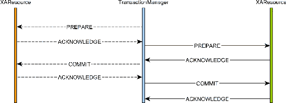

# 事务

109

### 7.6.1 分布式事务

本地事务和全局事务的区别在于，前者使用单个资源管理器，而后者在多个异构资源管理器上操作。ACID 保证仍然在每个资源上执行，但必须有一个全局事务管理器来协调分布式事务的结果。

所有的事务型资源适配器都由全局事务管理器注册，由它决定何时允许资源提交或回滚。由 Java EE 管理的资源可以通过 `JNDI`（Java 命名和目录接口）或 `CDI`（上下文和依赖注入）访问。

Spring 提供了一个事务管理抽象层，可以配置为使用本地事务（JDBC 或通过 [RESOURCE_LOCAL](http://docs.oracle.com/javaee/7/api/javax/persistence/spi/PersistenceUnitTransactionType.html#RESOURCE_LOCAL) ⁸ JPA）或通过独立的 `JTA` 事务管理器使用全局事务。依赖注入机制将托管资源注入 Spring。

### 7.6.1.1 二阶段提交

JTA 使用两阶段提交（2PC）协议通过两个步骤来协调原子提交：*准备*阶段和*提交*阶段。

**图 7.12：事务边界**

在前阶段，资源管理器采取所有必要行动为即将到来的提交做准备。只有当所有资源管理器都确认准备后，事务管理器才会进入提交阶段。如果一个资源未确认准备，事务管理器将回滚所有参与者。

如果所有资源管理器都确认了提交，全局事务成功结束。如果一个资源提交失败（或超时），事务管理器必须在后台线程中重试此操作，直到成功或报告需要人工干预。

⁸[http://docs.oracle.com/javaee/7/api/javax/persistence/spi/PersistenceUnitTransactionType.html#RESOURCE_LOCAL]


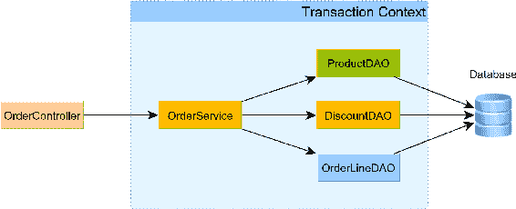

# 事务

110

### 一阶段提交（1PC）优化

由于 Java EE 仅使用 JTA 事务，额外的数据库往返协调开销可能会在高吞吐应用环境中损害性能。当事务仅接入一个资源适配器（指定资源管理器）时，事务管理器可以跳过准备阶段，直接执行提交或回滚阶段。

[`XAResource.commit(Xid xid, boolean onePhase)`](https://docs.oracle.com/javaee/7/api/javax/transaction/xa/XAResource.html#commit-javax.transaction.xa.Xid-boolean-) 方法接收一个布尔标志，事务管理器将其设置为 `true`，以提示关联的资源适配器启动 1PC 优化。

### 7.6.2 声明式事务

事务边界通常与 Service 层关联，该层使用一个或多个 DAO

为了实现业务逻辑。事务在服务层事务边界内从一个组件`propagates`到另一个组件。

**图 7.13: 事务边界**

Java EE 和 Spring 都支持声明式事务模型。事务边界通过类似的传播策略进行控制，这些策略定义了在最外层组件（当前调用栈中）与当前组件（等待被调用）边界处，边界是如何被继承或中断的。

# 事务

111

## 传播


为了为 EJB 组件配置事务传播策略，Java EE 定义了 [`TransactionAttribute`](http://docs.oracle.com/javaee/7/api/javax/ejb/TransactionAttribute.html) 注解。从 Java EE 7 开始，即使是非 EJB 组件，如果增强了 [`Transactional`](http://docs.oracle.com/javaee/7/api/javax/transaction/Transactional.html) 注解，也可以参与事务上下文中。

在 Spring 中，事务传播（与其他任何事务属性一样）可以通过 [`Transactional`](https://docs.spring.io/spring/docs/current/javadoc-api/org/springframework/transaction/annotation/Transactional.html#propagation--) 注解进行配置。

- [`TransactionAttribute`](http://docs.oracle.com/javaee/7/api/javax/ejb/TransactionAttribute.html)
- [`Transactional`](http://docs.oracle.com/javaee/7/api/javax/transaction/Transactional.html)
- [`Transactional`](https://docs.spring.io/spring/docs/current/javadoc-api/org/springframework/transaction/annotation/Transactional.html#propagation--)
- [propagation--](https://docs.spring.io/spring/docs/current/javadoc-api/org/springframework/transaction/annotation/Transactional.html#propagation--)

**表 7.6：事务传播策略**

| 传播 | Java EE | Spring | 说明 |
| :--- | :--- | :--- | :--- |
| REQUIRED | 是 | 是 | 这是默认的传播策略，除非当前线程已经关联到事务上下文，否则它只会启动一个事务 |
| REQUIRES_NEW | 是 | 是 | 任何当前正在运行的事务上下文将被挂起并被新事务替换 |
| SUPPORTS | 是 | 是 | 如果当前线程已经在事务内部运行，该方法将使用它；否则它将在事务上下文之外执行 |
| NOT_SUPPORTED | 是 | 是 | 任何当前正在运行的事务上下文将被挂起，当前方法将在事务上下文之外运行 |
| MANDATORY | 是 | 是 | 仅当当前线程已关联到事务上下文时，当前方法才会运行 |
| NESTED | 否 | 是 | 如果当前线程已关联事务，则在嵌套事务中执行当前方法；否则启动一个新事务。 |
| NEVER | 否 | 是 | 当前方法必须在事务上下文之外运行，如果当前线程关联了事务，则抛出异常。 |

事务 112

## 声明式异常处理

由于事务逻辑封装了底层的服务和数据访问逻辑调用链，异常处理也必须以声明式配置。默认情况下，Java EE 和 Spring 都会在系统异常（任何 `RuntimeException`）时回滚，并在应用程序异常（检查型异常）时提交。

在 Java EE 中，可以使用 [`ApplicationException`](http://docs.oracle.com/javaee/7/api/javax/ejb/ApplicationException.html) 注解自定义回滚策略。

Spring 允许通过列出触发事务失败的异常类型，让每个事务[自定义回滚策略](https://docs.spring.io/spring/docs/current/javadoc-api/org/springframework/transaction/annotation/Transactional.html#rollbackFor--)。

- [`ApplicationException`](http://docs.oracle.com/javaee/7/api/javax/ejb/ApplicationException.html)
- [`Transactional`](https://docs.spring.io/spring/docs/current/javadoc-api/org/springframework/transaction/annotation/Transactional.html#rollbackFor--)
- [rollbackFor--](https://docs.spring.io/spring/docs/current/javadoc-api/org/springframework/transaction/annotation/Transactional.html#rollbackFor--)

## 声明式只读事务

Java EE 不支持声明式地标记只读事务。

Spring 提供了[事务只读属性](https://docs.spring.io/spring/docs/current/javadoc-api/org/springframework/transaction/annotation/Transactional.html#readOnly--)，该属性可以传播到底层的 JPA 提供者（以优化 `EntityManager` 的刷新机制）以及当前关联的 `JDBC Connection`。

- [`readOnly`](https://docs.spring.io/spring/docs/current/javadoc-api/org/springframework/transaction/annotation/Transactional.html--)
- [readOnly--](https://docs.spring.io/spring/docs/current/javadoc-api/org/springframework/transaction/annotation/Transactional.html--)

## 声明式隔离级别

Java EE 不提供可配置的隔离级别支持，因此由底层的 `DataSource` 为所有数据库连接定义隔离级别。

当在使用 [`JPransactionManager`](https://docs.spring.io/spring/docs/current/javadoc-api/org/springframework/orm/jpa/JpaTransactionManager.html) 时，Spring 支持[事务级隔离级别](https://docs.spring.io/spring/docs/current/javadoc-api/org/springframework/transaction/annotation/Transactional.html#isolation--)。对于 JTA 事务，[`JTransactionManager`](https://docs.spring.io/spring/docs/current/javadoc-api/org/springframework/transaction/jta/JtaTransactionManager.html) 遵循 Java EE 标准，不允许覆盖默认隔离级别。作为一种变通方法，Spring 框架提供了扩展点，允许应用程序开发人员自定义默认值并实现基于事务的隔离级别设置机制。

- [`isolation`](https://docs.spring.io/spring/docs/current/javadoc-api/org/springframework/transaction/annotation/Transactional.html--)
- [`JPransactionManager`](https://docs.spring.io/spring/docs/current/javadoc-api/org/springframework/orm/jpa/JpaTransactionManager.html)
- [`JTransactionManager`](https://docs.spring.io/spring/docs/current/javadoc-api/org/springframework/transaction/jta/JtaTransactionManager.html)
- [isolation--](https://docs.spring.io/spring/docs/current/javadoc-api/org/springframework/transaction/annotation/Transactional.html--)

## 7.7 应用级事务

到目前为止，本书关注的是使用数据库事务来强制 ACID 特性。但从应用程序的角度来看，一个业务流可能跨越多个物理数据库事务，在这种情况下，数据库的 ACID 保证将不再足够。

# 图 7.14：无状态会话丢失更新

由于 `Alice` 的逻辑事务封装了两个独立的 Web 请求，每个请求都关联一个独立的数据库事务，在没有额外并发控制机制的情况下，即使最高的隔离级别也无法防止丢失更新现象。

将数据库事务跨越多个 Web 请求运行是不可行的，因为锁在用户思考时间内将一直被持有，从而损害了可扩展性。即使使用 `MVCC`，维护旧版本（这可能导致巨大的版本图）的成本可能会增加，并影响性能和并发性。

在高并发环境下，数据库事务必须尽可能短。应用级事务需要应用层级的并发控制机制。

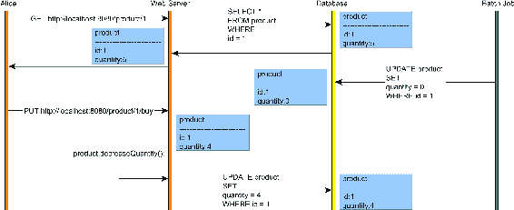

事务 114

HTTP 本质上是无状态的，而且出于充分的理由，无状态应用比有状态应用更容易扩展。但应用级事务不能是无状态的，否则新的请求将无法从上一个请求结束的地方继续执行。在多个 Web 请求之间保持状态可以构建出会话上下文，从而提供应用级的可重复读保证。

在接下来的图中，`Alice` 使用了有状态的会话上下文，但在缺乏记录版本系统的情况下，仍然可能丢失更新。

## 图 7.15：有状态会话丢失更新

在 `Alice` 未察觉的情况下，批处理进程重置了产品数量。`Alice` 认为产品版本没有变化，尝试购买一件商品，这导致之前的产品数量减少了一。最终，`Alice` 简单地覆盖了批处理程序的修改，导致数据完整性遭到了破坏。

因此，应用级的可重复读并不是自给自足的（这一论点对于数据库隔离级别同样成立）。为了防止丢失更新，并发控制机制是强制性的。

### 7.7.1 悲观锁与乐观锁

隔离级别意味着隐式锁定，无论涉及物理锁（如 `2PL`）还是数据异常检测（`MVCC`）。为了协调状态变化，应用级并发控制利用显式锁定，它分为两种类型：悲观锁和乐观锁。

### 7.7.1.1 悲观锁

如前所述，大多数数据库系统已经提供了手动请求共享锁或排他锁的可能性。这种并发控制被称为`悲观的`，因为它假设冲突不可避免会发生，因此必须做出相应的预防。


事务 115

由于锁可以及时释放，因此在给定长会话的最后一个数据库事务期间，使用排他锁是合适的。通过这种方式，应用程序可以保证一旦获取锁，没有其他事务可以干扰当前锁定的资源。

在关键记录上获取锁可以防止不可重复读、丢失更新，以及读写斜现象。

### 7.7.1.2 乐观锁

无疑这是一个名不副实的名称（尽管非常普遍），乐观锁完全没有产生任何锁定。更好的名称应该是乐观并发控制，因为它在管理冲突方面使用了一种比悲观锁完全不同的方法。

`MVCC` 是一种乐观并发控制策略，因为它假设竞争不太可能发生，因此不依赖于锁定来控制对共享资源的访问。乐观并发机制检测异常，并回溯中止不变性不再存在的事务。

虽然数据库确切知道在给定时间间隔内发布了哪些行版本，但仍留给应用程序维护 `happens-before` 事件顺序。每个数据库行都必须有一个关联的版本，该版本由逻辑事务本地递增。每个修改的 SQL 语句（`update` 或 `delete`）都使用之前加载的版本作为假设，认为该行在此期间没有被更改。

即使是最低的隔离级别也可以防止写写冲突，在任何给定时间允许一个事务更新行版本。由于数据库已经提供了单调更新，行版本也可以单调递增，应用程序可以检测到更新的记录何时变得过时。乐观锁并发算法如下：

- 当客户端读取特定行时，其版本随其他字段一起传回。
- 在更新行时，客户端根据其之前加载的版本对当前记录进行过滤。

```sql
UPDATE product
SET (quantity, version) = (4, 2)
WHERE id = 1 AND version = 1
```

- 如果更新语句的影响行数为零，则说明版本在此期间已递增，当前事务现在在过期的记录版本上操作。

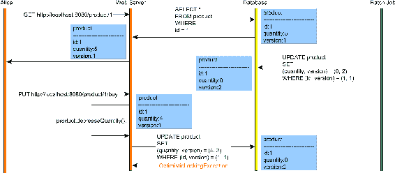


事务 116

上一个示例可以进行调整以利用这种乐观并发控制机制。这次，产品被赋予了版本，Web 应用程序和批处理程序的数据访问逻辑都使用行版本来协调 `happens before` 更新顺序。

## 图 7.16：有状态会话防止丢失更新

`Alice` 和批处理程序都尝试乐观地增加产品版本。批处理程序可以成功更新产品数量，因为 SQL 语句的过滤条件与实际数据库记录版本匹配。当 `Alice` 尝试更新产品时，数据库返回更新数为零，通过这种方式，她被通知在此期间发生了并发更新。丢失更新可以被防止，因为应用程序在收到过期记录版本时可以中止当前事务。使用时间戳对事件排序很少是一个好主意。系统时间并不总是单调递增的，由于网络时间同步，它甚至会回退。不同数据库之间的时间精度不异，从纳秒（[Oracle](http://docs.oracle.com/database/)）到 100 纳秒（[SQL Server](https://msdn.microsoft.com/en-us/library/bb677335.aspx)）、微秒（[PostgreSQL](http://www.postgresql.org/docs/9.5/static/datatype-datetime.html)）以及秒（[MySQL 5.6.4](http://dev.mysql.com/doc/refman/5.6/en/fractional-seconds.html)）。在分布式系统中，当涉及到排序时，逻辑钟（例如向量钟或 Lamport 时间戳）始终优于物理时间戳（墙钟）。出于此原因，使用数值版本比分配时间戳更合适。

## JPA 和 Hibernate

117

## 8. 为什么 JPA 和 Hibernate 很重要

尽管 JDBC 在提供通用 API 以隐藏特定数据库厂商的通信协议方面做得非常好，但它存在以下缺点：

- 即使对于极其简单的任务，API 也是非常冗长的
- 批量处理从数据访问层来看不是透明的，需要比其非批量语句更特定的 API
- 缺乏对显式锁定和乐观并发控制的内置支持
- 对于本地事务，数据访问与事务管理语义耦合在一起。
- 获取关联关系需要额外的处理来将 `ResultSet` 转换为领域模型或 DTO（数据传输对象）图。

虽然 ORM（对象关系映射）工具的主要目标是自动将对象状态转换转换为 SQL 语句，但本章旨在证明 Hibernate 能够解决上述所有的 JDBC 缺点。

## Java 持久化历史

EJB 1.1 发布通过可扩展的企业级组件提供了更高层次的持久化抽象，这些组件被称为实体豆（Entity Beans）。尽管这种设计在理论上看起来很好，但在现实中，基于 RMI 的重量级实现从性能角度来看是灾难性的。EJB 2.0 对 `local interfaces`（本地接口）的支持并未能挽救实体豆的人气，而且由于其高复杂性和特定厂商的实现细节，大多数项目选择了 JDBC。

Hibernate 的诞生于对使用实体豆开发模型产生的所有挫败感。作为一个开源项目，Hibernate 赢得了大量的关注，并迅速成为*事实上的* Java 持久化框架。

针对与实体豆持久化相关的所有批评，Java 社区进程（Java Community Process）推进了基于轻量级 POJO 方法，JDO 规范随之诞生。尽管 JDO 与数据源无关，能够操作关系型数据库、NoSQL 甚至平铺文件，但它从未进入主流。由于这个原因，Java 社区进程决定 EJB3 将基于一种新的规范，其灵感来自 Hibernate 和 TopLink，而 `JPA`（Java Persistence API）便成为了标准的 Java 企业级持久化技术。

此事的意义在于，持久化是一个非常复杂的话题，它要求对数据库和数据访问使用模式都有大量的知识。

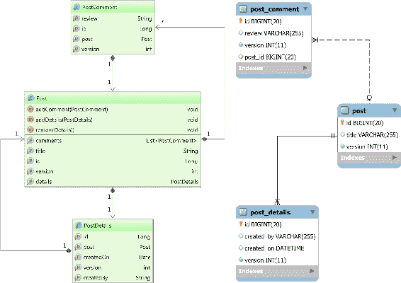

# 为什么 JPA 和 Hibernate 很重要

### 8.1 阻抗不匹配

当通过面向对象的程序操作关系型数据库时，两种不同的数据表示开始冲突。

在关系型数据库中，数据存储在表中，关系代数定义了数据关联如何形成。另一方面，面向对象编程（OOP）语言允许对象同时拥有状态和行为，并允许双向关联。融合这两种不同方法的负担产生了许多张力，并且长期以来困扰着企业级系统。

**图 8.1：对象/关系映射**

上面的图描述了数据访问层需要关联的两种不同架构。数据库架构由 SQL 标准规范驱动，而领域模型（Domain Model）也带有面向对象的架构表示。

领域模型封装了业务逻辑规范，并捕获了数据结构和管理业务需求的行为。OOP 促进了领域建模，许多现代企业系统都是构建在面向对象编程语言（例如 Java、C#）之上的。


由于底层数据存在于关系型数据库中，领域模型必须适配数据库架构和由 SQL 驱动的通信协议。ORM 设计模式有助于桥接这两种不同的数据表示，并缩小它们之间的技术差距。每一行数据库记录都与一个领域模型对象（JPA 术语中的 `Entity`）相关，因此 ORM 工具可以将实体的状态转换转换为 DML 语句。从应用程序开发的角度来看，这非常方便，因为操作领域模型关系比通过其底层 SQL 语句来视觉化业务逻辑要容易得多。

## 8.2 JPA vs Hibernate

JPA 仅仅是一个规范。它描述了客户端操作的接口以及标准的对象关系映射元数据（Java 注解或 XML 描述符）。除了 API 定义，JPA 还解释了（尽管并不详尽）J 提供 程序如何实现这些规范。JPA 随着 Java EE 平台本身演进（Java EE 6 包含 `JPA 2.0`，Java EE 7 引入了 `JPA 2.1`）。

在 JPA 规范首次发布时，Hibernate 已经是一个功能齐全的 Java ORM 实现。尽管它实现了 JPA 规范，但为了向后兼容以及适应非标准特性，Hibernate 保留了它的原生 API。即使遵循 JPA 标准是最好的，但在现实中，许多 JPA 提供程序提供了针对高性能数据访问层需求的额外功能。为此，Hibernate 带有以下不符合 JPA 标准的特性：

- 扩展的标识符生成器，实现了一个与其他数据库客户端兼容的 `HiLo` 优化器
- 透明的准备语句批处理
- 可自定义的 CRUD（`@SQLInsert`、`@SQLUpdate`、`@SQLDelete`）语句
- 静态或动态集合过滤器（例如 `@FilterDef`、`@Filter`、`@Where`）
- 实体过滤器（例如 `@Where`）
- 将属性映射到 SQL 片段（例如 `@Formula`）
- 不可变实体（例如 `@Immutable`）
- 更多的刷新模式（例如 `FlushMode.MANUAL`、`FlushMode.ALWAYS`）
- 通过给定实体的自然键查询二级缓存
- 实体级缓存并发策略（例如 `Cache(usage = CacheConcurrencyStrategy.READ_WRITE)`）
- 通过 `HQL` 进行版本化的批量更新
- 从乐观锁检查中排除字段（例如 `@OptimisticLock(excluded = true)`）
- 无版本的乐观锁（例如 `OptimisticLockType.ALL`、`OptimisticLockType.DIRTY`）
- 支持跳过（不等待）悲观锁请求


如果 JPA 是接口，Hibernate 就是一种实现，而从性能角度来看，实现细节始终非常重要。JPA 的实现细节会泄露，忽略它们可能会阻应用程序性能，甚至导致数据不一致问题。例如，以下 JPA 属性具有特殊的行为，这种行为可能会让只熟悉 JPA 规范的人感到惊讶：

- [`FlushModeType.AUTO`](https://docs.oracle.com/javaee/7/api/javax/persistence/FlushModeType.AUTO) 不会触发原生 SQL 查询的刷新，就像它对 JPQL 或 Criteria API 那样。
- [`FetchType.EAGER`](https://docs.oracle.com/javaee/7/api/javax/persistence/FetchType.EAGER) 可能会选择 SQL 连接或二次查询，无论实体是直接从 `EntityManager` 获取的还是通过 JPQL 或 Criteria 查询的。

这就是为什么此书关注 Hibernate 如何同时实现 JPA 规范及其原生特性（这些特性从效率来看是相关的）。

### 可移植性考量

与其他其他功能性需求一样，可移植性是一种特性，人们对于拥抱特定数据库或框架的特性仍存在广泛恐惧。在现实中，遇到数据访问性能问题的应用程序比从一种技术迁移到另一种（无论是关系数据库还是 JPA 提供程序）要常见。许多 RDBMS 的最小公约数是 SQL-92 标准的超集（尽管也没有完全支持）。SQL-99 支持公共表表达式，但 `MySQL 5.7` 不支持。SQL-2003 引入了 `MERGE`，但 `PostgreSQL 9.4.5` 没有实现它，9.5 将支持 `UPSERT`。通过遵循 SQL-92 语法，可以获得更高的数据库移植性，但放弃特定数据库功能的代价可能会影响应用程序性能。可移植性可以通过减少非特性或专门化来解决。通过为每个支持的数据库系统提供不同的实现（如 `jOOQ` 框架所做的），仍然可以实现移植性。

同样的逻辑也适用于 JPA 提供程序。通过对应用程序分层，切换 JPA 提供程序已经变得容易得多，即使切换一个成熟的 JPA 实现到另一个并没有充分的理由。

¹[`docs.oracle.com/javaee/7/api/javax/persistence/FlushModeType.html`](https://docs.oracle.com/javaee/7/api/javax/persistence/FlushModeType.html)

²[`docs.oracle.com/javaee/7/api/javax/persistence/FetchType.html#EAGER`](https://docs.oracle.com/javaee/7/api/javax/persistence/FetchType.html#EAGER)

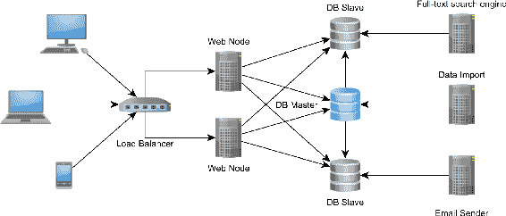

# 为什么 JPA 和 Hibernate 非常重要

122

## 8.3 Schema 所有权

由于数据表示的双重性，在接管底层 Schema 所有权方面一直存在竞争。尽管理论上讲，数据库和领域模型都可以驱动 Schema 的演进，但出于实际考虑，Schema 属于数据库。

一个企业级系统可能大到无法放入单个应用程序中，因此将其拆分为多个子系统并不罕见，每个子系统服务于特定的目标。例如，可以有前端 Web 应用、集成 Web 服务、邮件调度器、全文搜索引擎以及需要向系统加载数据的后端批处理器。所有这些子系统都需要使用底层数据库，无论是为了向用户显示内容，还是为了将数据导入系统。

**图 8.2：以数据库为中心的集成**

尽管可能不适用于任何企业系统，但将数据库作为中心集成点仍然是许多规模合理的企业系统的选择。

关系型数据库的并发模型提供了强一致性保证，因此对应用程序开发具有显著优势。如果集成点不提供事务语义，那么实现分布式并发控制机制将困难得多。

大多数数据库系统已经提供了对各种复制拓扑的支持，这可以为适应日益增长的请求流量提供更多容量。即使对更多数据的需求继续增长，硬件总是变得越来越好（而且越来越便宜了），数据库供应商也在不断改进它们的引擎以处理更多数据。

由于这些原因，将数据库作为集成点仍然是企业系统设计中相关的考虑因素。

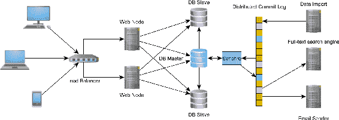

# 为什么 JPA 和 Hibernate 非常重要

123

## 分布式提交日志

对于非常大的企业级系统，数据分布在不同的提供者（关系型数据库系统、缓存、Hadoop、Spark）之间，已无法依赖关系型数据库来集成所有异的子系统。

在这种情况下，[Apache Kafka](http://kafka.apache.org/) 提供了一种容错且可扩展的只追加日志结构，每个参与的子系统都可以并发读写。

**图 8.3：分布式提交日志集成**

提交日志成为了集成点，每个分布式节点单独地遍历它，并在顺序日志结构中维护特定客户端的指针。这种设计类似于数据库复制机制，因此它还提供了持久性（日志持久化在磁盘上）、写入性能（只追加日志不需要随机访问）和读取性能（并发读取不需要阻塞）。

[** http://kafka.apache.org/](http://kafka.apache.org/)

无论选择何种架构风格，仍然需要将瞬态领域模型与底层的持久化数据关联起来。

数据 Schema 随着企业级系统本身而演进，因此这两种不同的 Schema 表示必须始终保持一致。

即使数据访问框架可以自动生成数据库 Schema，Schema 也必须能够增量地迁移，并且所有更改都需要在 VCS（版本控制系统）中可追溯。与表结构、索引和触发器一起，数据库 Schema 因此也伴随着领域模型源码本身。像 [Flywaydb](http://flywaydb.org/)³ 这样的工具可以实现数据库 Schema 迁移，系统可以持续部署，无论是测试环境还是生产环境。

³[`flywaydb.org/`](http://flywaydb.org/)


# 为什么 JPA 和 Hibernate 非常重要

124

Schema 归数据库，数据访问层必须协助领域模型与底层数据通信。

## 8.4 基于写入的优化

JPA 将开发思维从 SQL 语句转移到实体状态转换。实体可以处于以下状态之一：

**表 8.1：JPA 实体状态**

| 状态 |  |
| :--- | :--- |
| New (Transient) | 新创建的实体未映射到任何数据库行，被视为 New 或 Transient 状态。一旦它变为托管状态，持久化上下文（Persistence Context）将在刷新（flush）时发布插入语句。 |
| Managed (Persistent) | 持久实体与数据库行关联，并由当前运行的持久化上下文管理。状态更改通过脏检查（dirty checking）机制检测并在刷新时作为更新语句传播到数据库。 |
| Detached | 一旦当前运行的持久化上下文关闭，所有之前托管的实体都会变为分离。随后的更改将不再被跟踪，也不会发生自动的数据库同步。 |
| Removed | 被删除的实体仅被计划删除，实际的数据库删除语句在持久化上下文刷新期间执行。 |

持久化上下文捕获实体状态的变化，并在刷新期间将其转换为 SQL 语句。JPA 的 [`EntityManager⁴`](http://docs.oracle.com/javaee/7/api/javax/persistence/EntityManager.html#persist-lang.Object-) 和 Hibernate 的 [`Session`](https://docs.jboss.org/hibernate/stable/orm/javadocs/org/hibernate/Session.html)⁵（包含实体从一种状态移动到另一种状态的方法）接口是通往底层持久化上下文的网关，它们定义了所有的状态转换操作。

⁴[`docs.oracle.com/javaee/7/api/javax/persistence/EntityManager.html#persist-lang.Object-`](http://docs.oracle.com/javaee/7/api/javax/persistence/EntityManager.html#persist-lang.Object-)

⁵[`docs.jboss.org/hibernate/stable/orm/javadocs/org/hibernate/Session.html`](https://docs.jboss.org/hibernate/stable/orm/javadocs/org/hibernate/Session.html)

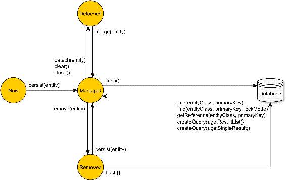

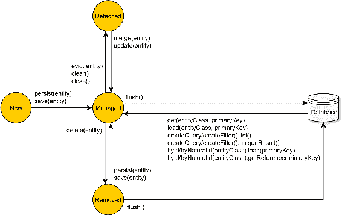

# 为什么 JPA 和 Hibernate 非常重要

125

**图 8.4：JPA 实体状态转换**

**图 8.5：Hibernate 实体状态转换**


# 为什么 JPA 和 Hibernate 非常重要

126

## SQL 注入防护

通过管理 SQL 语句的生成，JPA 工具有助于减少 SQL 注入攻击的风险。操作 SQL 字符串的机会越少，应用程序越安全。风险并未完全消除，因为应用程序开发者仍然可能诉助于拼接 SQL 或 JPQL 片段，因此建议保持严谨。

Hibernate 专门使用 `PreparedStatement`，因此不仅可以防止 SQL 注入，数据访问层还可以更好地利用服务器端和客户端的缓存。

## 自动生成的 DML 语句

企业级系统的数据库 Schema 随时间演进，数据访问层也必须镜像所有修改。

由于 JPA 实现自动生成插入和更新语句，数据访问层可以轻松适应数据库表结构的修改。通过更新实体模型 Schema，Hibernate 可以相应地调整修改语句。

这适用于更改数据库列类型。如果数据库 Schema 需要将邮政编码从 `INT` 数据库类型迁移到 `VARCHAR(6)`，数据访问层只需要更改将相关的领域模型属性类型从 `Integer` 改为 `String`，所有语句都将自动更新。Hibernate 定义了一个高度可定制的 JDBC 到数据库类型映射系统，应用程序开发者可以覆盖默认类型关联，甚至为新的数据库类型（Hibernate 目前尚不支持的类型）添加支持。

实体获取过程由 JPA 实现进行自动管理，它会自动生成相关数据库表的 `select` 语句。通过这种方式，JPA 可以让应用程序开发者无再需要维护实体选择查询。

Hibernate 允许对所有 CRUD 语句进行自定义，在这种情况下，应用程序开发者负责维护相关的 DML 语句。

尽管它处理了实体选择过程，但大多数企业系统仍然需要利用底层数据库查询能力。因此，每当数据库模式发生变化时，所有的原生 SQL 查询都需要手动更新（根据其相关的业务逻辑需求）。

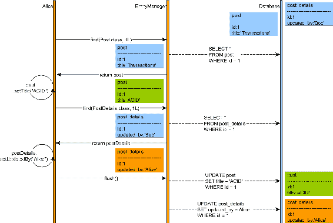


# 为什么 JPA 和 Hibernate 至关重要

127

### 写回缓存（Write-behind cache）

持久性上下文（Persistence Context）充当事务性写回缓存，将实体状态的刷新推迟到最后的可能时刻。

**图 8.6：持久性上下文**

由于每个修改类的 DML 语句都需要锁定（以防止脏写），写回缓存可以缩短数据库锁的间隔，从而提高并发性。

但缓存带来了一致性挑战，持久性上下文要求在执行任何 JPQL 或原生 SQL 查询之前进行刷新（flush），否则它可能会破坏“写后即读”的一致性保证。

正如后续章节将详细说明的那样，当准备执行原生查询时，Hibernate 不会自动刷新待处理的更改，应用程序开发者必须显式指示哪些数据库表需要同步。


# 为什么 JPA 和 Hibernate 至关重要

128

### 透明的语句批处理（Transparent statement batching）

由于所有更改都是一次刷新的，Hibernate 可能会从 JDBC 语句批中受益。批量更新可以透明地开启，即使在数据访问逻辑实现之后。通常情况下，性能调优会被推迟到系统已经在生产环境中运行，而切换到批处理不需要大量的开发工作。

只需一个配置，Hibernate 就可以批量执行所有预编译语句。

### 应用程序级并发控制（Application-level concurrency control）

如前所述，在执行多请求的长会话时，没有任何数据库隔离级别可以防止更新丢失。JPA 同时支持乐观锁和悲观锁。JPA 的乐观锁机制允许防止更新丢失，因为它实施了发生于（happens before）事件排序。但在多请求会话中，乐观锁需要维护旧的实体快照，JPA 通过扩展持久性上下文（Extended Persistence Contexts）或离线实体实现了这一点。

Java EE 应用服务器可以在多个 Web 请求之间保留给定的持久性上下文，从而提供应用程序级别的可重复读。但这种策略并非免费的，因为应用程序开发者必须确保持久性上下文不会被过多的实体所膨胀，这不仅会消耗内存，还会影响 Hibernate 默认脏检查机制的性能。

即使不使用 Java EE，也可以使用离线实体实现相同的目标，它们对从一个 Web 请求到另一个请求需要保留的数据提供了细粒度的控制。JPA 允许合并离线实体，这些实体会重新变为受管理状态并与底层数据库系统自动同步。

JPA 还支持悲观锁查询抽象，这在使用较低级别的事务隔离模式时非常有用。

Hibernate 拥有原生的悲观锁 API，支持为锁获取请求超时或跳过已获取的锁。


# 为什么 JPA 和 Hibernate 至关重要

129

## 8.5 基于读取的优化（Read-based optimizations）

遵循 SQL 标准，`ResultSet` 是底层获取数据的表格化表示。由于领域模型被构建为实体图，数据访问层必须将扁平的 `ResultSet` 转换为层次结构。

尽管 ORM 工具的目标是缩小面向对象的领域模型与其关系对应物之间的差距，但非常重要记住，数据源不是内存存储库，且获取行为会影响整体数据访问效率。数据库无法从此语文中被抽象化，假装实体可以像任何其他普通对象一样进行操作，对应用程序性能是有害的。当涉及到读取数据时，阻抗不匹配（impedance mismatch）变得更加明显，而且出于性能考虑，必须记住与每次获取操作相关的 SQL 语句。

在下面的示例中，`posts` 记录将与其所有相关的 `comments` 一起被获取。使用 JDBC，可以使用以下代码片段完成此任务：


```
doInJDBC(connection -> {
  try (PreparedStatement statement = connection.prepareStatement(
    "SELECT * " +
    "FROM post AS p " +
    "JOIN post_comment AS pc ON p.id = pc.post_id " +
    "WHERE " +
    "p.id BETWEEN ? AND ? + 1"
  )) {
    statement.setInt(1, id);
    statement.setInt(2, id);
    try (ResultSet resultSet = statement.executeQuery()) {
      List<Post> posts = toPosts(resultSet);
      assertEquals(expectedCount, posts.size());
    }
  } catch (SQLException e) {
    throw new DataAccessException(e);
  }
});
```

## 为什么 JPA 和 Hibernate 至关重要

当连接*多对一*或*一对一*关联时，每个`ResultSet`记录对应一对实体，因此父实体和子实体可以在每次迭代中被解析。对于*一对多*或*多对多*关系，由于 SQL 的工作方式，`ResultSet`将为每个关联的包含一个重复的父级记录。构建层次实体结构需要手动转换`ResultSet`，并且为了解决重复问题，父实体引用被存储在`Map`中。

```
List<Post> toPosts(ResultSet resultSet) throws SQLException {
  Map<Long, Post> postMap = new LinkedHashMap<>();
  while (resultSet.next()) {
    Long postId = resultSet.getLong(1);
    Post post = postMap.get(postId);
    if (post == null) {
      post = new Post(postId);
      postMap.put(postId, post);
      post.setTitle(resultSet.getString(2));
      post.setVersion(resultSet.getInt(3));
    }
    PostComment comment = new PostComment();
    comment.setId(resultSet.getLong(4));
    comment.setReview(resultSet.getString(5));
    comment.setVersion(resultSet.getInt(6));
    post.addComment(comment);
  }
  return new ArrayList<>(postMap.values());
}
```

JDBC 4.2 `PreparedStatement`仅支持位置参数，且序号从*1*开始。JPA 也支持命名参数，当一个参数需要被多次引用时，尤为有用，因此之前的示例可以重写为：

```
doInJPA(entityManager -> {
  List<Post> posts = entityManager.createQuery(
    "select distinct p " +
    "from Post p " +
    "join fetch p.comments " +
    "where " +
    "p.id BETWEEN :id AND :id + 1", Post.class)
    .setParameter("id", id)
    .getResultList();
  assertEquals(expectedCount, posts.size());
});
```


在两个示例中，对象-关系转换都以隐式或显式的方式发生。在`JDBC`用例中，关联关系必须手动解析，而`JPA`则会自动完成（基于实体模式/schema）。

### 获取（Fetching）的责任

除了将数据库列映射到实体属性外，实体关联还可以以对象关系的形式表示。此外，获取行为可以被硬编码到实体模式本身，而这通常是一件非常糟糕的事情。

获取多个“一对多”或“多对多”关联更为问题，因为它们可能导致笛卡尔积（Cartesian Product），且性能会与子节点数量绑定。控制硬编码的模式获取策略是繁琐的，因为它阻止了使用懒性加载机制（lazy loading）来覆盖预急检索（eager retrieval）。

每个业务用例都有不同的数据访问需求，一种策略无法预测所有可能的用例，因此获取策略应该始终基于查询来设置。

### 对于只读视图，优先使用投影（Projections）

虽然获取实体及其所有关联关系非常方便，但最好也考虑到性能的影响。正如之前过的，获取过多的数据是不合适的，因为会增加事务的响应时间。

在实际上，并不是所有用例都需要加载实体，而且并不是所有的读操作都需要由相同的获取机制来服务。有时，自定义投影（仅从实体中选择几列）要合适得多，数据访问逻辑甚至可以利用特定的 SQL 结构，而这些结构`JPA`查询抽象可能并不支持。

根据经验法则，当逻辑事务需要修改实体时，获取实体是合适的，即使这只发生在后续的 Web 请求中。考虑到这一点，为给定的业务逻辑用例采用何种获取机制要容易推理得多。


### 二级缓存（Second-level cache）

如果`Persistence Context`（持久化上下文）充当事务性后写缓存，它的生命周期就与逻辑事务周期绑定。由于这个原因，`Persistence Context`也被称为一级缓存，因此它无法被多个并发事务共享。

另一方面，二级缓存与`EntityManagerFactory`关联，所有的`Persistence Contexts`都可以访问它。二级缓存可以存储实体以及实体关联（一对多和多对多关系），甚至是实体查询结果。由于`JPA`没有强制要求，每个提供者（provider）都采取不同的缓存方法（与之相反，`Hibernate`默认禁用二级缓存，`EclipseLink`）。

通常情况下，缓存是一致性与性能之间的权衡。由于缓存变成了另一个事实来源，可能会发生不一致的情况，只有当所有数据库修改都通过单个`EntityManagerFactory`或通过同步的分布式缓存解决方案时，才能防止这种不一致。在现实中，这是不可行的，因为应用程序可能在多个节点上集群（每个节点都有自己的`EntityManagerFactory`），并且数据库可能被多个应用程序访问。

尽管二级缓存可以缓解实体获取的性能问题，但它需要分布式缓存实现，这可能仍然无法逃避网络开销。

### 总结

桥接两种高度特定的技术始终是一个难以解决的问题。当企业系统构建在面向对象的语言之上时，对象-关系阻抗映射（impedance mismatch）就变得不可避免。`ORM`模式旨在弥补这一差距，尽管它并不能完全将其抽象化。

最终，所有的通信都通过`JDBC`流，所有的执行都发生在数据库引擎本身。高性能的企业级应用必须与底层数据库系统产生共鸣，且`ORM`工具不能破坏这种关系。

就像它试图解决的问题一样，`Hibernate`是一个非常复杂的框架，具有许多微妙之处，需要对数据库系统、`JDBC`以及框架本身都有深入了解。本章只是一个总结，旨在以读者之前可能习惯不同的视角介绍`JPA`和`Hibernate`。如果某些主题不是完全清楚，不需要担心，因为接下来的章节将更详细地分析所有概念。

# 9 连接管理与监控

正如之前在`JDBC`连接管理章节中所解释的，出于性能考虑，数据库连接最好被重用。由于`JPA`提供者代表用户生成 SQL 语句，因此监控这一过程并确认其结果非常重要。本章将解释`Hibernate`连接提供者机制以及监控语句执行的方法。

## 9.1 JPA 连接管理

与整个`Java EE`套件一样，`JPA` 1.0 规范紧密于企业应用服务器。在`Java EE`容器中，所有的数据库连接都由应用服务器管理，由其提供连接池、监控和`JTA`能力。

配置完成后，可以通过`JNDI`找到`Java EE DataSource`。在`persistence.xml`配置文件中，应用程序开发者必须提供关联`JTA`或`RESOURCE_LOCAL` `DataSource`的`JNDI`名称。`transaction-type`属性也必须匹配数据源的事务能力。

```xml
<persistence-unit name="persistenceUnit" transaction-type="JTA"></persistence-unit>
org.hibernate.jpa.HibernatePersistenceProvider
<jta-data-source></jta-data-source>java:global/jdbc/flexypool
```

`RESOURCE_LOCAL`事务必须使用非 jta-data-source `DataSource`。

```xml
<persistence-unit name="persistenceUnit" transaction-type="RESOURCE_LOCAL"></persistence-unit>
org.hibernate.jpa.HibernatePersistenceProvider
<non-jta-data-source></non-jta-data-source>java:/comp/env/jdbc/hsqdb
```

对于`Java EE`应用，依赖应用服务器提供`DataSource`是完全可以，而独立应用程序通常使用依赖注入而不是`JNDI`。

从`JPA`实现的角度来看，`DataSource`既可以外部配置，也可以由`JPA`提供者配置。通常情况下，配置外部`DataSource`仍然是首选方案，因为它为连接提供机制（例如日志、监控）提供了更大的灵活性。

`JPA`提供者可以通过底层的`JDBC Driver`获取连接，自从`JPA` 2.0 标准了数据库连接配置属性：

**表 9.1: JPA 连接属性**

| 属性 | 描述 |
| :--- | :--- |
| `javax.persistence.jdbc.driver` | 驱动全类名（例如`org.hsqldb.jdbc.JDBCDriver`） |
| `javax.persistence.jdbc.url` | 驱动 URL（例如`jdbc:hsqldb:mem:test`） |
| `javax.persistence.jdbc.user` | 数据库用户名 |
| `javax.persistence.jdbc.password` | 数据库密码 |

遗憾的是，这些属性本身是不足够的，因为大多数企业应用程序都需要连接池和监控功能。由于这个原因，`JPA`连接管理仍然特定实现的主题，接下来的章节将深入研究`Hibernate`连接提供者机制。

## 9.2 Hibernate 连接提供者

`Hibernate`需要在`Java EE`和独立环境中运行，数据库连接性配置既可以通过声明式，也可以通过编程方式完成。为了适应`JDBC Driver`连接以及`RESOURCE_LOCAL`和`JTA` `DataSource`配置，Hibernate 定义了自身的连接工厂抽象，由`org.hibernate.engine.jdbc.connections.spi.ConnectionProvider`接口表示：

```java
public interface ConnectionProvider extends Service, Wrapped {
    public Connection getConnection() throws SQLException;
    public void closeConnection(Connection connection) throws SQLException;
    public boolean supportsAggressiveRelease();
}
```

由于连接提供者可能会影响事务响应时间，每个提供者都将从高性能 OLTP 系统的角度进行分析。


### 9.2.1 DriverManagerConnectionProvider

当给定上述 JPA 2.0 连接属性或 Hibernate 特有的配置对应项时，Hibernate 会选择此提供者：

- `hibernate.connection.driver_class`
- `hibernate.connection.url`
- `hibernate.connection.username`
- `hibernate.connection.password.`

尽管它通过底层的`DriverManager`获取数据库连接，但该提供者尝试通过使用一个简单的池化实现来避免获取连接的开销。Hibernate 文档不建议在生产环境中使用`DriverManagerConnectionProvider`。

### 9.2.2 C3P0ConnectionProvider

[C3p0](http://www.mchange.com/projects/c3p0)¹ 是一个成熟的连接池解决方案，已经在许多生产环境中证明了自己。通过使用底层的 JDBC 连接属性，Hibernate 可以将内置的连接池替换为`c3p0 DataSource`。要激活此提供者，应用程序开发者必须提供至少一个以`hibernate.c3p0`为前头的配置属性：

```xml
<property name="hibernate.c3p0.max_size" value="5" />
```

C3p0（于 2001 年发布）和 [Apache DBCP](https://commons.apache.org/proper/commons-dbcp/)（于 2002 年发布）是最老且部署最广泛的独立 Java 连接池解决方案。2010 年后期，[BoneCP](https://github.com/wwadge/bonecp) 作为`c3p0`和`Apache DBCP`的高性能替代方案出现世。如今，BoneCP 的 GitHub 页面显示它已被弃用，转而支持 HikariCP。

¹[`www.mchange.com/projects/c3p0/`](http://www.mchange.com/projects/c3p0/)


截至写作时，最具吸引力的 Java 连接池是 [HikariCP](https://github.com/brettwooldridge/HikariCP)、[Vibur DBCP](https://github.com/vibur/vibur-dbcp) 和 Apache DBCP2。HikariCP 和 Vibur DBCP 提供了内置的 Hibernate 连接提供者。

### 9.2.3 HikariConnectionProvider

HikariCP 是最快的 Java 连接池之一，尽管 Hibernate 原生不支持它，但它也自带`ConnectionProvider`实现。通过指定`hibernate.connection.provider_class`属性，应用程序开发者可以覆盖默认的连接提供者机制：

```xml
name="hibernate.connection.provider_class" value="com.zaxxer.hikari.hibernate.HikariConnectionProvider"
```

与`DriverManagerConnectionProvider`或`C3P0ConnectionProvider`不同，HikariCP 不识别 JPA 或 Hibernate 特有的连接属性。`HikariConnectionProvider`需要[框架特定的有的属性](https://github.com/brettwooldridge/HikariCP)²，如下所示：

**表 9.2：HikariCP 连接属性**

| 属性 | 描述 |
| :--- | :--- |
| `hibernate.hikari.dataSourceClassName` | 驱动程序全类名 |
| `hibernate.hikari.dataSource.url` | 驱动 URL |
| `hibernate.hikari.dataSource.user` | 数据库用户名 |
| `hibernate.hikari.dataSource.password` | 数据库用户密码 |
| `hibernate.hikari.maximumPoolSize` | 最大池大小 |

²[`github.com/brettwooldridge/HikariCP`](https://github.com/brettwooldridge/HikariCP)


### 9.2.4 DatasourceConnectionProvider


当 JPA 配置文件定义了非-`jta-data-source` 或 `jta-data-source` 元素，或者提供了 `hibernate.connection.datasource` 配置属性时，会选择此提供者。

与其他提供者不同，它与 JTA 事务兼容，而 JTA 在 Java EE 中是强制性的。

Spring 同时支持独立的 JTA 事务管理器（例如 Bitronix 或 Atomikos）和 Java EE `DataSource`，因为它对实际的 `DataSource` 配置提供了最佳控制，`DatasourceConnectionProvider` 是首选（即使对于 HikariCP 也是如此）。

## 9.2.5 连接释放模式

Hibernate 将数据库连接的获取推迟到当前事务必须执行第一条 SQL 语句时（由读或写操作触发）。这种优化允许 Hibernate 缩短物理事务间隔，从而增加从池中获取连接的机会。

连接释放策略通过 `hibernate.connection.release_mode` 属性进行控制，该属性可以取以下值：

**表 9.3：连接释放模式**

| 值 | 描述 |
| :--- | :--- |
| `after_transaction` | 一旦获取，只有在当前事务提交或回滚后才会释放。 |
| `after_statement` | 在每条语句执行后释放，并在下一条语句之前重新获取。这是默认值，对于 `RESOURCE_LOCAL` 事务使用 `after_transaction`，而对于 JTA 事务回退到 `after_statement`。此策略旨在防止服务器检测连续 EJB 调用之间的连接泄漏。 |

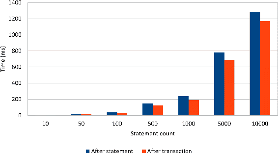

连接管理与监控

138

对于 JTA 事务，默认模式可能过于严格，因为并不是 Java EE 应用服务器在管理事务资源方面都有相同的行为。这样，检查连接是否可以在触发获取的 EJB 组件之外关闭很重要。基于 Spring 的企业系统不使用企业 Bean，即使在使用独立的 JTA 事务管理器，`after_transaction` 连接释放模式可能也很好。

直觉上可以认为 `after_statement` 模式会产生与频繁获取/释放连接相关的性能开销。因此，以下测试衡量了在 Spring 上下文中使用 Bitronix 的连接获取开销。

每个事务执行相同的语句（获取当前时间戳）指定的次数（在 x 轴上表示）。y 轴捕获了 `after_statement` 和 `after_transaction` 连接释放模式的记录事务响应时间。

**图 9.1：连接释放模式**

事务执行的语句越多，从底层连接池重新获取关联数据库连接的惩罚就越大。为了更好地可视化连接获取开销，测试运行了 10 000 条语句，即使这个数字对于典型的 OLTP 事务来说可能太大了。

理想情况下，数据库事务越短越好，语句数量也不应太高。这一要求源于池化连接数量是有限的，且锁越早释放越好。


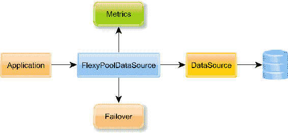

连接管理与监控

139

`after_transaction` 连接释放模式比默认的 JTA `after_statement` 策略更高效，因此如果 JTA 事务资源管理逻辑不会干预这种连接释放策略，就应该使用它。

## 9.3 监控连接

如前所述，优先使用外部配置的 `DataSource`，因为实际的 `DataSource` 可以装饰连接池、监控和日志记录功能。由于这正是 [FlexyPool⁴](https://github.com/vladmihalcea/flexy-pool) 的工作原理，下图展示了 `DataSource` 代理机制：

**图 9.2：DataSource 代理**

数据访问层不再获取真实的 `DataSource` 实例，而是获取一个代理引用。代理拦截连接获取和释放请求，通过这种方式它可以监控其使用情况。

使用 Spring 时，设置 FlexyPool 非常简单，因为应用程序对 `DataSource` 配置具有完全控制权。

在 Java EE 中，数据库连接应该始终从托管的 `DataSource` 获取，集成 FlexyPool 的一种简单方法是扩展默认的 `DatasourceConnectionProviderImpl` 并将原始的 `DataSource` 替换为 `FlexyPoolDataSource`。

⁴ [github.com/vladmihalcea/flexy-pool](https://github.com/vladmihalcea/flexy-pool)

出于此原因，FlexyPool 提供了以下 Hibernate 连接提供程序：

```java
public class FlexyPoolHibernateConnectionProvider extends DatasourceConnectionProviderImpl {
    private transient FlexyPoolDataSource <datasource>flexyPoolDataSource;

    @Override
    public void configure(Map props) {
        super.configure(props);
        flexyPoolDataSource = new FlexyPoolDataSource<>(getDataSource());
    }

    @Override
    public Connection getConnection() throws SQLException {
        return flexyPoolDataSource.getConnection();
    }

    @Override
    public boolean isUnwrappableAs(Class unwrapType) {
        return super.isUnwrappableAs(unwrapType) || getClass().isAssignableFrom(unwrapType);
    }

    @Override
    public void stop() {
        flexyPoolDataSource.stop();
        super.stop();
    }
}
```

要使用 `FlexyPoolHibernateConnectionProvider`，应用程序必须配置 `hibernate.connection.provider_class` 属性：

```xml
name="hibernate.connection.provider_class"
value="com.vladmihalcea.flexypool.adaptor.FlexyPoolHibernateConnectionProvider" /
```

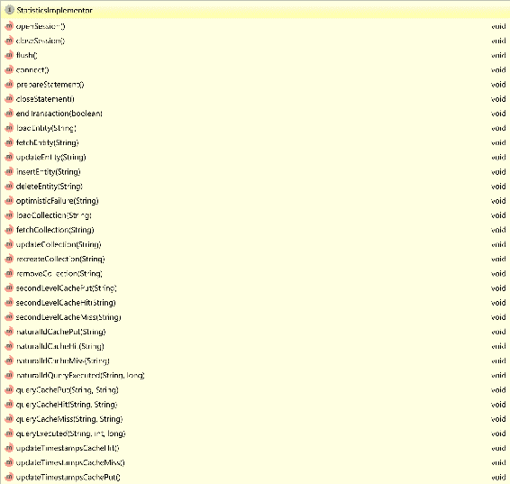

## 9.3.1 Hibernate 统计

Hibernate 有一个内置的统计收集器，用于收集与数据库连接、Session 事务甚至二级缓存使用相关的通知。`StatisticsImplementor` 接口定义了拦截各种 Hibernate 内部事件的合约：

**图 9.3：Hibernate StatisticsImplementor 接口**

Hibernate 可以代表用户收集非常多样的指标，但出于性能考虑，统计机制默认是禁用的。


要启用统计收集机制，必须首先配置以下属性：

```xml
<property _="" b="">name="hibernate.generate_statistics" value="true" />
```

一旦开始收集统计数据，为了将它们打印到当前应用程序日志中，必须设置以下日志记录配置：

```xml
name="org.hibernate.engine.internal.StatisticalLoggingSessionEventListener"
level="info" />
```

完成这两个设置后，每当 Hibernate Session（持久化上下文）结束时，当前运行日志中都会显示以下报告：

```text
37125102 nanoseconds spent acquiring 10000 JDBC connections;
25521714 nanoseconds spent releasing 10000 JDBC connections;
95242323 nanoseconds spent preparing 10000 JDBC statements;
923615040 nanoseconds spent executing 10000 JDBC statements;
```

默认统计收集器仅计算某个回调方法被调用的次数，如果这不令人满意，应用程序开发者可以提供自定义的 `StatisticsImplementor` 实现。

### Dropwizard Metrics

在高吞量事务系统中，需要记录的指标数据量可能是惊人的，因此将所有这些值存储在内存中实际上并不实际。

为了减少内存占用，[Dropwizard Metrics](https://github.com/dropwizard/metrics) 项目使用了多种[蓄水池采样](https://en.wikipedia.org/wiki/Reservoir_sampling)策略，这些策略采用固定大小的采样器或基于时间的采样窗口。

Dropwizard Metrics 不仅支持多种指标（例如：计时器、直方图、仪表器），还可以使用多个报告通道（例如：SLF4J、JMX、Ganglia、Graphite）。

由于这些原因，使用像 Dropwizard Metrics 这样的成熟框架比从头构建自定义实现更好。

- [https://github.com/dropwizard/metrics](https://github.com/dropwizard/metrics)
- [https://en.wikipedia.org/wiki/Reservoir_sampling](https://en.wikipedia.org/wiki/Reservoir_sampling)

## 9.3.1.1 自定义统计数据

尽管内置指标信息丰富，但 Hibernate 并不限于默认的统计收集器，收集器可以被完全自定义。在接下来的示例中，统计收集器还将提供以下指标：

- 物理事务时间的分布（从首次获取连接到释放连接之间的间隔）。
- 任何事务生命周期内连接获取次数的直方图（由于 `after_statement` 模式）。

`StatisticsReport` 类在 Dropwizard Metrics 之上提供了指标存储和报告生成功能：

```java
public class StatisticsReport {
    private final Logger LOGGER = LoggerFactory.getLogger(getClass());
    private MetricRegistry metricRegistry = new MetricRegistry();
    private Histogram connectionCountHistogram = metricRegistry.histogram("connectionCountHistogram");
    private Timer transactionTimer = metricRegistry.timer("transactionTimer");
    private Slf4jReporter logReporter = Slf4jReporter
        .forRegistry(metricRegistry)
        .outputTo(LOGGER)
        .build();

    public void transactionTime(long nanos) {
        transactionTimer.update(nanos, TimeUnit.NANOSECONDS);
    }

    public void connectionsCount(long count) {
        connectionCountHistogram.update(count);
    }

    public void generate() {
        logReporter.report();
    }
}
```

`StatisticsImplementor` 接口定义了 Hibernate 内部 API 与各种自定义统计收集实现之间的合约。为了简单起见，以下 `StatisticsImplementor` 接口实现扩展了默认的 `ConcurrentStatisticsImpl` 类，因为它只需要重写 `connect()` 和 `endTransaction(boolean success)` 回调方法。

```java
public class TransactionStatistics extends ConcurrentStatisticsImpl {
    private ConcurrentMap<long, Long> transactionStartNanos = new ConcurrentHashMap<>();
    private ConcurrentMap<long, AtomicLong> connectionCounter = new ConcurrentHashMap<>();
    private StatisticsReport report = new StatisticsReport();

    @Override
    public void connect() {
        long threadId = Thread.currentThread().getId();
        AtomicLong counter = connectionCounter.get(threadId);
        if(counter == null) {
            counter = new AtomicLong();
            connectionCounter.put(threadId, counter);
        }
        counter.incrementAndGet();
        transactionStartNanos.putIfAbsent(threadId, System.nanoTime());
        super.connect();
    }

    @Override
    public void endTransaction(boolean success) {
```

```java
long threadId = Thread.currentThread().getId();

Long startNanos = transactionStartNanos.remove(threadId);

if (startNanos != null) {
    report.transactionTime(System.nanoTime() - startNanos);
}

AtomicLong connectionCounter = this.connectionCounter.remove(threadId);

if (connectionCounter != null) {
    report.connectionsCount(connectionCounter.longValue());
}

report.generate();

super.endTransaction(success);

}
```

由于 `StatisticsImplementor` 是单例实例，因此会被多个并发运行的 Session(s) 访问，上下文关联是基于当前运行的 Thread 标识完成的。当事务结束时，会生成报告，并将物理事务时间和连接数（在特定事务期间发出的连接）同时刷新到日志中。


### 连接管理与监控

145

报告并不是在每个事务结束时生成的，也不是在 `logSummary()` 回调中生成（该回调仅在 Hibernate `Session` 关闭时被调用），因为一个 `Persistence Context`（持久化上下文）可能会运行多个连续的事务。

要使用自定义的 `StatisticsImplementor` 实例，Hibernate 要求作为一个配置属性提供 `StatisticsFactory`。通过接收 `SessionFactoryImplementor` 参数，`StatisticsImplementor` 的构建过程也可以访问 Hibernate 的配置数据。

```java
public class TransactionStatisticsFactory implements StatisticsFactory {
    @Override
    public StatisticsImplementor buildStatistics(SessionFactoryImplementor sessionFactory) {
        return new TransactionStatistics();
    }
}
```

`hibernate.stats.factory` 配置属性必须包含 `StatisticsFactory` 实现类的完全限定类名：

```xml
<property name="hibernate.stats.factory" value="com.vladmihalcea.book.hpjp.hibernate.statistics.TransactionStatisticsFactory" />
```


当运行上一个 JTA 连接释放模式示例并配合此自定义统计收集器时，将显示如下输出内容：

```
type=HISTOGRAM, name=connectionCounterHistogram, count=107, min=1, max=10000, mean=162.41, stddev=1096.69, median=1.0, p75=1.0, p95=50.0, p98=1000.0, p99=5000.0, p999=10000.0
type=TIMER, name=transactionTimer, count=107, min=0.557524, max=1272.75, mean=27.16, stddev=152.57, median=0.85, p75=1.24, p95=41.25, p98=283.50, p99=856.19, p999=1272.75, mean_rate=36.32, rate_unit=events/second, duration_unit=milliseconds
```

对于高性能数据访问层，统计和指标是强制性要求。Hibernate 统计机制是一个非常强大的工具，允许开发团队更深入地了解 Hibernate 的内部机制。


## 连接管理与监控

146

### 9.4 语句日志

ORM 工具可以自动生成 DML 语句，验证这些语句的有效性及其对整体性能的影响是应用程序开发者的责任。将 SQL 语句验证推迟到数据访问层开始出现性能问题是有风险的，甚至会影响开发成本。因此，SQL 语句日志在应用开发的早期阶段就变得非常重要。

当实现业务逻辑时，`完成定义`（`Definition of Done`）应该包含对所有相关数据访问层操作的审查。遵循这一规则可以在企业系统部署到生产环境时节省大量的麻烦工作。

尽管 JPA 2.1 没有提供用于记录 SQL 语句的标准配置属性，但大多数 JPA 实现都通过框架特定的设置支持此功能。为了实现这一目的，Hibernate 定义了以下配置属性：

**表 9.4：连接释放模式**

| 属性 | 描述 |
| :--- | :--- |
| `hibernate.show_sql` | 将 SQL 语句打印到控制台 |
| `hibernate.format_sql` | 在记录或打印到控制台之前对 SQL 语句进行格式化 |
| `hibernate.use_sql_comments` | 在自动生成的 SQL 语句中添加注释 |

使用系统控制台进行日志记录是一种不良做法，日志框架（例如 `Logback` 或 `Log4j`）是更好的替代方案，因为它支持可配置的 appender 和日志级别。由于 `hibernate.show_sql` 属性是打印到控制台的，应避免使用。

Hibernate 在 `org.hibernate.SQL` 日志级别记录所有的 SQL 语句。


## 连接管理与监控

147

要启用语句日志，必须在相关的配置文件添加以下 `Logback` 日志器：

```xml
<logger name="org.hibernate.SQL" level="debug" />
```

由于 Hibernate 仅使用 `PreparedStatement(s)`，当语句打印到日志中时，绑定参数值是不可用的：

```sql
INSERT INTO post (title, version, id) VALUES (?, ?, ?)
```

虽然绑定参数可能会单独记录（例如 `org.hibernate.type.descriptor.sql`），但记录 SQL 语句最直接的方法是使用外部数据源代理。

### 格式化

#### 9.4.1 语句格式化

默认情况下，无论 SQL 语句有多长，都会以单行写入。为了提高可读性，Hibernate 可以将语句转换为跨多行的可读格式。此功能可以通过设置以下配置来激活：

```xml
<property name="hibernate.format_sql" value="true" />
```

设置此项后，上一个语句可以格式化为：

```sql
insert
into
post
(title, version, id)
values
?, ?)
```

虽然格式化可以提高可读性，但这种设置仅适用于开发阶段。在生产系统中，日志通常会被解析和聚合，多行语句格式可能会影响日志解析机制。聚合后，可以在显示在应用程序性能界面之前进行格式化。


## 连接管理与监控

148

`hibernate.format_sql` 属性仅适用于日志语句，不会传递给底层 `Driver`（SQL 语句仍以单行发送）。这样，当通过外部数据源代理记录语句时，格式化不会产生影响。

#### 9.4.2 语句级注释

除了格式化外，Hibernate 还可以通过在语句体中添加语句级注释来解释语句生成过程。此功能允许应用程序开发者更好地理解以下过程：

- 触发当前执行语句的实体状态转换
- 获取给定结果集时选择连接的原因
- 当前语句采用的显锁定机制

默认情况下，Hibernate 不会在自动生成的语句中添加任何 SQL 注释，为了启用此机制，必须配置以下 Hibernate 属性：

```xml
<property name="hibernate.use_sql_comments" value="true" />
```

持久化 `Post` 实体时，Hibernate 通过以下注释解释与特定语句相关的实体转换：`/* insert com.vladmihalcea.book.hpjp.util.providers.BlogEntityProvider$Post */`

```sql
INSERT INTO post (title, version, id) VALUES (?, ?, ?)
```

与 SQL 语句格式化相反，SQL 注释不仅在日志期间生成，还会传递到底层 `Driver`。


# 连接管理与监控

虽然在调试过程中这是一种实用的技术，但在生产环境中，最好将其禁用，以减少数据库请求的网络开销。

#### 9.4.3 日志参数

必须对 `JDBC` `Driver` 或 `DataSource` 进行代理，以拦截语句执行并连同实际参数值一起记录它们。除了语句日志外，JDBC 代理还可以提供其他横切功能，例如长耗查询检测或自定义语句执行监听器。

##### 9.4.3.1 DataSource-proxy

一个较少为人知的 JDBC 日志框架 [datasource-proxy](https://github.com/ttddyy/datasource-proxy)⁵ 提供了对自定义 JDBC 语句执行监听器的支持。在 Java EE 中，并不是所有的应用程序服务器都允许配置外部 `DataSource`，因为它们依赖于自己的自定义实现，并绑定用户提供的 `JDBC` `Driver`。由于它只能装饰 `DataSource`，`datasource-proxy` 可能并不适用于所有的 Java EE 环境。

**图 9.4：DataSource-Proxy 架构**

另一方面，程序化配置支持符合大多数现代 Spring 应用采用的基于 Java 的配置方法：

```java
@Bean
public DataSource dataSource() {
    SLF4JQueryLoggingListener loggingListener = new SLF4JQueryLoggingListener();
    loggingListener.setQueryLogEntryCreator(new InlineQueryLogEntryCreator());
    return ProxyDataSourceBuilder
            .create(actualDataSource())
            .name(DATA_SOURCE_PROXY_NAME)
            .listener(loggingListener)
            .build();
}
```

⁵[`github.com/ttddyy/datasource-proxy`](https://github.com/ttddyy/datasource-proxy)


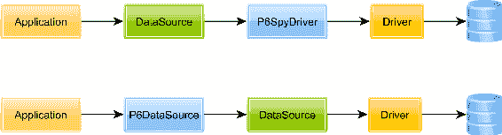

在以下示例中，使用 `datasource-proxy` 记录三个 `PreparedStatements` 的批量插入。虽然通常批量操作会在单日志中打印，但为了适应当前的页面布局，输出被拆分为多行。

`Name:DATA_SOURCE_PROXY, Time:6, Success:True, Type:Prepared, Batch:True, QuerySize:1, BatchSize:3, Query:["insert into post (title, version, id) values (?, ?, ?)", Params:[(Post no. 0, 0, 0), (Post no. 1, 0, 1), (Post no. 2, 0, 2)]`

现在不仅存在绑定的参数值，而且由于它们被分在一起，也非常容易可视化批量机制。通过对自定义语句监听器的支持，`datasource-proxy` 允许构建查询计数验证器来断言自动生成的语句数量，从而在开发阶段防止 N+1 查询问题。

##### 9.4.3.2 P6Spy

[P6Spy](https://github.com/p6spy/p6spy)⁶ 发布于 2002 年，那是 J2EE 应用程序服务器统治企业系统的时代。由于 Java EE 应用程序服务器不允许程序化的 `DataSource` 配置，`P6Spy` 支持声明式配置方法（通过 `spy.properties` 文件）。`P6Spy` 支持代理 `JDBC` `Driver`（适用于 Java EE 应用）或 `JDBC` `DataSource`（被某些 Java EE 容器支持，且是 Spring 企业级应用的常见做法）。

**图 9.5：P6Spy 架构**

⁶[`github.com/p6spy/p6spy`](https://github.com/p6spy/p6spy)


运行之前的示例将得到以下输出（应用了格式化）：

```
p6spy - 1448122491807|0|batch|connection 7|
insert into post (title, version, id) values (?, ?, ?)|
insert into post (title, version, id) values ('Post no. 0', 0, 0)
p6spy - 1448122491807|0|batch|connection 7|
insert into post (title, version, id) values (?, ?, ?)|
insert into post (title, version, id) values ('Post no. 1', 0, 1)
p6spy - 1448122491807|0|batch|connection 7|
insert into post (title, version, id) values (?, ?, ?)|
insert into post (title, version, id) values ('Post no. 2, 0, 2)
p6spy - 1448122491812|5|statement|connection 7|
insert into post (title, version, id) values (?, ?, ?)|
insert into post (title, version, id) values ('Post no. 2', 0, 2)
```

按照它们发生的顺序，输出由以下列构建：

**表 9.5：P6Spy 输出**

| Field | Description |
| :--- | :--- |
| Timestamp | 语句执行时间戳 |
| Execution time | 语句执行持续时间（毫秒） |
| Category | 语句类别（由 P6Spy 分配） |
| Connection | 数据库连接 |
| Original statement | 带有参数占位符的语句 |
| Formatted statement | 替换所有参数后的语句 |

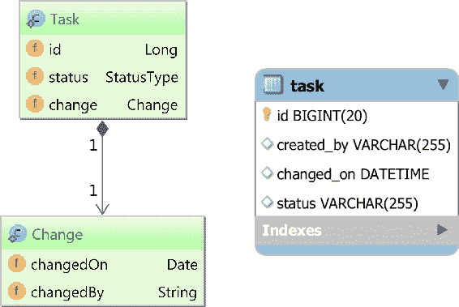

## 10. 类型映射与标识符

JPA 使用三种主要的对象关系映射元素：*类型 (type)*、*嵌入类型 (embeddable)* 和*实体 (entity)*。在之前的图中，`Task` 对象是一个实体，而 `Change` 对象是一个嵌入类型。

**图 10.1：类型映射**

虽然映射所有数据库列是常见做法，但这不是强制要求。有时使用一个根实体和多个子实体更具灵活性，这样每个业务用例只需获取所需的信息（同时从实体状态管理中受益）。

标识符对于实体是必须的，而嵌入类型被禁止拥有自己的标识。通过了解数据库表和唯一标识任何行的列，Hibernate 可以将数据库行与领域模型实体关联。

嵌入类型将多个属性分组在一个可重用的组件中。

```java
@Embeddable
public class Change {
    @Column(name = "changed_on")
    private Date changedOn;
    @Column(name = "created_by")
    private String changedBy;
}
```

领域模型可以通过继承或组合在多个实体之间共享状态。嵌入类型通过组合共享状态。[组合¹](https://en.wikipedia.org/wiki/Object_composition) 由 UML 定义，是实体与嵌入类型之间关系的完美类比。当实体包含一个嵌入类型时，其所有属性都成为所有者实体的一部分。

嵌入对象无法定义自己的标识符，否则实体将拥有多个标识。由于缺少标识符，嵌入对象无法由持久化上下文管理，其状态由父实体控制。

¹[`en.wikipedia.org/wiki/Object_composition`](https://en.wikipedia.org/wiki/Object_composition)


# 类型映射与标识符

154

### 10.1 类型

对于每个支持的数据库类型，JDBC 都定义了一个 `java.sql.JDBCType` 枚举。由于 Hibernate 是在 JDBC 之上构建的，它负责 JDBC 类型与其对应的 Java 类型（基本数据类型或 `Objects`）之间的映射。

#### 10.1.1 原始类型

**表 10.1: 原始类型**

| Hibernate 类型 | JDBC 类型 | Java 类型 |
| :--- | :--- | :--- |
| `BooleanType` | `BIT` | `boolean`, `Boolean` |
| `NumericBooleanType` | `INTEGER` (例如 0, 1) | `boolean`, `Boolean` |
| `TrueFalseType` | `CHAR` (例如 'F', 'f', 'T', 't') | `boolean`, `Boolean` |
| `YesNoType` | `CHAR` (例如 'N', 'n', 'Y', 'y') | `boolean`, `Boolean` |
| `ByteType` | `TINYINT` | `byte`, `Byte` |
| `ShortType` | `SMALLINT` | `short`, `Short` |
| `CharacterType` | `CHAR` | `char`, `Character` |
| `CharacterNCharType` | `NCHAR` | `char`, `Character` |
| `IntegerType` | `INTEGER` | `int`, `Integer` |
| `LongType` | `BIGINT` | `long`, `Long` |
| `FloatType` | `FLOAT` | `float`, `Float` |
| `DoubleType` | `DOUBLE` | `double`, `Double` |
| `CharArrayType` | `VARCHAR` | `char[]`, `Character[]` |

由于不同的数据库系统，布尔类型可以表示为 `BIT`、`BYTE`、`BOOLEAN` 或 `CHAR` 数据库类型，因此定义了四种 `Type` 来解决布尔原始类型问题。

只有非空数据库列可以映射到 Java 原始类型（`boolean`、`byte`、`short`、`char`、`int`、`long`、`float`、`double`）。对于可空列，最好使用原始包装类（`Boolean`、`Byte`、`Short`、`Char`、`Integer`、`Long`、`Float`、`Double`）。

#### 10.1.2 字符串类型

Java `String` 可以消耗 Java 堆可用内存。另一方面，数据库系统定义了有限大小（`VARCHAR` 和 `NVARCHAR`）和无限类型（`TEXT`、`NTEXT`、`BLOB` 和 `NCLOB`）。为了适应这种映射差异，Hibernate 定义了以下 `Type`：

**表 10.2: 字符串类型**

| Hibernate 类型 | JDBC 类型 | Java 类型 |


| Hibernate 类型 | JDBC 类型 | Java 类型 |
| :--- | :--- | :--- |
| `StringType` | `VARCHAR` | `String` |
| `StringNVarcharType` | `NVARCHAR` | `String` |
| `TextType` | `LONGVARCHAR` | `String` |
| `NTextType` | `LONGNVARCHAR` | `String` |
| `MaterializedClobType` | `CLOB` | `String` |
| `MaterializedNClobType` | `NCLOB` | `String` |

### 10.1.3 日期和时间类型

涉及到时间时，有多种 Java 或数据库表示方式，这解释了会有大量的时间相关的 Hibernate `Type`。

#### 表 10.3：日期和时间类型

| Hibernate 类型 | JDBC 类型 | Java 类型 |
| :--- | :--- | :--- |
| `DateType` | `DATE` | `Date` |
| `TimeType` | `TIME` | `Time` |
| `TimestampType` | `TIMESTAMP` | `Timestamp`、`Date` |
| `DbTimestampType` | `TIMESTAMP` | `Timestamp`、`Date` |
| `CalendarType` | `TIMESTAMP` | `Calendar`、`GregorianCalendar` |
| `CalendarDateType` | `DATE` | `Calendar`、`GregorianCalendar` |
| `CalendarTimeType` | `TIME` | `Calendar`、`GregorianCalendar` |
| `TimeZoneType` | `VARCHAR` | `TimeZone` |

处理时间非常棘手，因为存在各种时区、闰秒和夏令时规定。使用 UTC（协调世界时）存储时间戳并在数据层进行时区转换是常见的做法。

### 10.1.4 数值类型

Oracle 可以表示多达 38 位的数字，因此只能放入 `BigInteger` 或 `BigDecimal`（`Long` 和 `Double` 只能存储最多 8 字节）。

#### 表 10.4：数值类型

| Hibernate 类型 | JDBC 类型 | Java 类型 |
| :--- | :--- | :--- |
| `BigIntegerType` | `NUMERIC` | `BigInteger` |
| `BigDecimalType` | `NUMERIC` | `BigDecimal` |

### 10.1.5 二进制类型

对于二进制类型，大多数数据库系统提供了多种存储选择（例如 `RAW`、`VARBINARY`、`BYTEA`、`BLOB`、`CLOB`）。在 Java 中，数据访问层可以使用 `byte(s)` 数组、JDBC `Blob` 或 `Clob`，甚至可以是 `Serializable` 类型，如果该对象在保存到数据库之前已经进行了序列化。

#### 表 10.5：二进制类型

| Hibernate 类型 | JDBC 类型 | Java 类型 |
| :--- | :--- | :--- |
| `BinaryType` | `VARBINARY` | `byte[]`、`Byte[]` |
| `BlobType` | `BLOB` | `Blob` |
| `ClobType` | `CLOB` | `Clob` |
| `NClobType` | `NCLOB` | `Clob` |
| `MaterializedBlobType` | `BLOB` | `byte[]`、`Byte[]` |
| `ImageType` | `LONGVARBINARY` | `byte[]`、`Byte[]` |
| `SerializableType` | `VARBINARY` | `Serializable` |
| `SerializableBlobType` | `BLOB` | `Serializable` |

### 10.1.6 UUID 类型

持久 Java `UUID`（通用标识符）有多种方法，根据内存占用，效率最高的存储类型是数据库特定的 `UUID` 列类型。

#### 表 10.6：UUID 类型

| Hibernate 类型 | JDBC 类型 | Java 类型 |
| :--- | :--- | :--- |
| `UUIDBinaryType` | `BINARY` | `UUID` |
| `UUIDCharType` | `VARCHAR` | `UUID` |
| `PostgresUUIDType` | `OTHER` | `UUID` |

如果没有原生支持，`BINARY` 类型比 `VARCHAR` 需要更少的字节，因此索引的内存占用也小。

### 10.1.7 其他类型

Hibernate 还可以映射 `enum(s)`、`URL`、`Currency`。

#### 表 10.7：其他类型

| Hibernate 类型 | JDBC 类型 | Java 类型 |
| :--- | :--- | :--- |
| `EnumType` | `CHAR`、`NUMERIC`、`SMALLINT`、`TINYINT`、`BIGINT`、`DOUBLE`、`FLOAT` | `VARCHAR` |
| `ClassType` | `VARCHAR` | `Class` |
| `CurrencyType` | `VARCHAR` | `Currency` |
| `UrlType` | `VARCHAR` | `URL` |

### 10.1.8 自定义类型

在以下示例中，应用程序需要 IP 地址。IPv4 地址封装在自己的包装器中，该包装器还可以定义各种地址操作函数。

```java
public class IPv4 implements Serializable {
    private final String address;

    public IPv4(String address) {
        this.address = address;
    }

    public String getAddress() {
        return address;
    }

    @Override
    public boolean equals(Object o) {
        if (this == o) return true;
        if (o == null || getClass() != o.getClass()) return false;
        return Objects.equals(address, IPv4.class.cast(o).address);
    }

    @Override
    public int hashCode() {
        return Objects.hash(address);
    }

    public InetAddress toInetAddress() throws UnknownHostException {
        return Inet4Address.getByName(address);
    }
}
```

当实体想要更改 IPv4 字段时，它必须提供一个新的对象实例。不可变类型处理起来简单得多，因为它的内部状态在当前运行的持久上下文（Persistence Context）中不会改变。


# 映射类型与标识符

所有自定义类型必须实现 `UserType` 接口。由于 `ImmutableType` 处理了大部分 `UserType` 的实现细节，`IPv4Type` 可以专注于特定类型的转换逻辑。

```java
public class IPv4Type extends ImmutableType <ipv4>{</ipv4>

  public IPv4Type() {
    super(IPv4.class);
  }

  @Override
  public int[] sqlTypes() {
    return new int[]{ Types.OTHER};
  }

  @Override
  public IPv4 get(ResultSet rs, String[] names, SessionImplementor session, Object owner) throws SQLException {
    String ip = rs.getString(names[0]);
    return (ip != null) ? new IPv4(ip) : null;
  }

  @Override
  public void set(PreparedStatement st, IPv4 value, int index, SessionImplementor session) throws SQLException {
    if (value == null) {
      st.setNull(index, Types.OTHER);
    } else {
      PGobject holder = new PGobject();
      holder.setType("inet");
      holder.setValue(value.getAddress());
      st.setObject(index, holder);
    }
  }
}
```

`get()` 方法用于将 `inet` 字段映射到 `IPv4` 对象实例，而 `set()` 则用于将 `IPv4` 对象转换为 PostgreSQL JDBC 驱动等等的 `inet` 类型。`Types.OTHER` 用于映射 JDBC 不支持的数据库类型。

```java
public abstract class ImmutableType <t>implements UserType {</t>

  private final Class <t>clazz;</t>

  protected ImmutableType(Class <t>clazz) { {this.clazz = clazz; }</t>

  @Override
  public Object nullSafeGet(ResultSet rs, String[] names, SessionImplementor session, Object owner) throws SQLException {
    return get(rs, names, session, owner);
  }

  @Override
  public void nullSafeSet(PreparedStatement st, Object value, int index, SessionImplementor session) throws SQLException {
    set(st, clazz.cast(value), index, session);
  }

  @Override
  public Class <t>returnedClass() { return clazz; }</t>

  @Override
  public boolean equals(Object x, Object y) {
    return Objects.equals(x, y);
  }

  @Override
  public int hashCode(Object x) { return x.hashCode(); }

  @Override
  public Object deepCopy(Object o) { return o; }

  @Override
  public boolean isMutable() { return false; }

  @Override
  public Serializable disassemble(Object o) {
    return (Serializable) o;
  }

  @Override
  public Object assemble(Serializable o, Object owner) { return o; }

  @Override
  public Object replace(Object o, Object target, Object owner) { return o; }

  protected abstract T get(ResultSet rs, String[] names, SessionImplementor session, Object owner) throws SQLException;

  protected abstract void set(PreparedStatement st, T value, int index, SessionImplementor session) throws SQLException;
}
```

# 映射类型与标识符

`@Type` 注解指示 Hibernate 使用 `IPv4Type` 来映射 `IPv4` 字段。

```java
@Entity
public class Event {
  @Id
  @GeneratedValue
  private Long id;

  @Type(type = "com.hibernate.type.IPv4Type")
  @Column(name = "ip", columnDefinition = "inet"))
  private IPv4 ip;

  public Event() {}

  public Event(String address) {
    this.ip = new IPv4(address);
  }

  public Long getId() {
    return id;
  }

  public IPv4 getIp() {
    return ip;
  }

  public void setIp(String address) {
    this.ip = new IPv4(address);
  }
}
```

## GiST 操作符

PostgreSQL 9.4 为 `inet` 和 `cidr` 列类型增加了 `GiST` 操作支持。要启用此功能，必须在关联的 `inet` 列上创建一个带有 `inet_ops` 操作类的 `GiST` 索引。

```sql
CREATE INDEX ON event USING gist (ip inet_ops)
```

# 映射类型与标识符

当 Hibernate 负责处理底层类型时，管理 `Event` 变得非常简单。

```java
final AtomicReference <event>eventHolder = new AtomicReference<>();
doInJPA(entityManager -> {
  entityManager.persist(new Event());
  Event event = new Event("192.168.0.231");
  entityManager.persist(event);
  eventHolder.set(event);
});
doInJPA(entityManager -> {
  Event event = entityManager.find(Event.class, eventHolder.get().getId());
  event.setIp("192.168.0.123");
});
```

运行之前的示例将生成以下 SQL 语句：

```sql
INSERT INTO event (ip, id) VALUES (NULL, 1);
INSERT INTO event (ip, id) VALUES ('192.168.0.231', 2);
SELECT e0_.id as id1_0_, e0_.ip as ip2_0_ FROM event e0_ WHERE e0_.id = 2;
UPDATE event SET ip='192.168.0.123' WHERE id = 2;
```

使用数据库特定类型最大的优势之一是获得获得高级查询的能力。因为 `GiST` 索引允许 `inet_ops` 操作符，可以使用以下查询来检查是否为特定的子网络生成了 `Event`：

```java
Event matchingEvent = (Event) entityManager.
  createNativeQuery(
    "SELECT {e.*} " +
    "FROM event e " +
    "WHERE " +
    "e.ip && CAST(:network AS inet) = TRUE", Event.class)
  .setParameter("network", "192.168.0.1/24")
  .getSingleResult();
assertEquals("192.168.0.123", matchingEvent.getIp().getAddress());
```


## 10.2 标识符

所有数据库表都必须有一个主键，以便唯一标识每一行（主键必须既是 `UNIQUE` 又是 `NOT NULL`）。尽管 SQL 标准没有规定主键必须是不可变的，但避免更改它们更符合实际。

主键可以在现实世界中具有意义，这种情况下它被称为自然键（natural key），或者可以是人工生成的，这种情况下被称为代理标识符（surrogate identifier）。


对于自然键，唯一性是由现实世界的唯一生成器强制的（例如身份证、社会安全号码、车辆识别码）。在现实中，当唯一约束不再成立时，自然唯一键可能会出现问题。例如，身份证可能产生唯一的号码，但如果企业系统必须适应来自多个国家的用户，可能会出现不同国家分配相同标识符的情况。

自然键可以由一个或多个列组成。复合自然键可能会带来性能开销，因为多列连接比单列连接慢，而且多列索引也会占用更多的内存。

自然键必须足够长，以适应系统在整个生命周期内所需的标识符。由于主键通常会被索引，键越长，索引项所需的内存就越多。每个关联表都会包含一个镜像父表主键的外键，外键也经常被索引。

### 索引内存影响

固定大小的非数值键（例如 `CHAR`、`VARCHAR`）在效率上不如数值键（例如 `INTEGER`、`BIGINT`），无论对于连接（简单键性能优于复合键）还是对于索引（数据类型越紧凑，关联索引所需的内存空间就越少）。

一个 `CHAR(17)` 自然键（例如车辆识别码）需要 `17` 个字符（使用 ASCII 字符和 UTF-8 编码时占用 17 字节），而不是 `4` 字节（`32` 位 `INTEGER`）或 `8` 字节（`64` 位 `BIGINT`）。

# 映射类型与标识符

代理键（Surrogate keys）的生成独立于当前行数据，因此列约束可能会随时间演变（例如更改用户的生日或电子邮件地址）。代理键可以通过数值序列生成器生成（例如数据库自增列或序列），也可以通过伪随机数生成器构建（例如 [GUID³](http://en.wikipedia.org/wiki/Globally_Unique_Identifier) 或 [UUID⁴](http://en.wikipedia.org/wiki/Universally_Unique_Identifier#index_split_002.html_p174)）。数值型和 UUID 密钥各有优缺点。

UUID 由 [RFC 4122⁵](https://www.ietf.org/rfc/rfc4122.txt) 标准定义，并存储为 `128` 位序列。GUID 术语指的是任何全局唯一标识符，它可能包含其他非标准的实现。

为了保持一致性，本章将进一步把唯一标识符称为 UUID。

UUID 占用 `128` 位空间，是 `INTEGER` 的四倍，`BIGINT` 的两倍。另一方面，在多主数据库复制拓扑结构中，UUID 发生冲突的概率较低。为了避免此类冲突，许多关系型数据库系统分步递增标识或序列号，每个节点都有自己的偏移量。由于 UUID 不是顺序的，它们会导致碎片，这确实会影响聚集索引的性能。由于数值序列所需的空间更少且对索引更友好，因此通常优于 UUID 密钥。

## 10.2.1 UUID 标识符

尽管如此，某些企业系统使用 UUID 主键，因此了解哪些 Hibernate 类型最适合此任务很有价值。UUID 密钥既可以通过应用程序使用 `java.util.UUID` 类生成，也可以由数据库系统分配。

如果数据库系统没有内置的 UUID 类型，则优先选择 `BINARY(16)` 列类型。虽然 `CHAR(32)` 列也可以存储 UUID 的文本表示，但额外的空间开销使其成为一个不太理想的选择。

³ [`en.wikipedia.org/wiki/Globally_Unique_Identifier`](http://en.wikipedia.org/wiki/Globally_Unique_Identifier)

⁴ [`en.wikipedia.org/wiki/Universally_Unique_Identifier`](http://en.wikipedia.org/wiki/Universally_Unique_Identifier)

⁵ [`www.ietf.org/rfc/rfc4122.txt`](https://www.ietf.org/rfc/rfc4122.txt)


### Oracle

Oracle 中没有 UUID 类型，因此必须使用 `RAW(16)` 列。`SYS_GUID()` [数据库函数](http://docs.oracle.com/database/121/SQLRF/functions202.htm#SQLRF06120)可以生成全局唯一标识符。

### SQL Server

使用 [`uniqueidentifier`](https://msdn.microsoft.com/en-us/library/ms187942.aspx) 数据类型存储 GUID 标识符。`NEWID()` [函数](https://msdn.microsoft.com/en-us/library/ms190348.aspx)可以生成兼容 RFC 4122 标准的 UUID。

由于 SQL Server 默认对主键使用聚集索引，为了避免碎片效应，可以使用 `NEWSEQUENTIALID()` [函数](https://msdn.microsoft.com/en-us/library/ms189786.aspx)分配伪顺序 UUID 数字（大于之前生成的数字）。只要 Windows 服务器不重启，这种保证就一直有效。

### PostgreSQL

[`UUID 类型`](http://www.postgresql.org/docs/9.5/static/datatype-uuid.html)可以存储符合 RFC 4122 的唯一标识符。数据库不提供内置的 UUID 生成函数，因此标识符必须由数据访问层生成。

### MySQL

UUID 必须存储在 `BINARY(16)` 列类型中。`UUID()` [函数](http://dev.mysql.com/doc/refman/5.7/en/miscellaneous-functions.html#function_uuid)可以生成 `128` 位唯一标识符。由于 `UUID()` 函数可能会给基于语句的复制带来问题，将生成的标识符[作为变量传递](https://dev.mysql.com/doc/refman/5.7/en/replication-features-functions.html)是解决此限制的变通方法。


对于生成 UUID 标识符，Hibernate 提供了三种生成器（`assigned`、`uuid`、`uuid2`），我们将详细讨论。

#### `assigned` 生成器

通过简单地省略 [`GeneratedValue`](https://docs.oracle.com/javaee/7/api/GeneratedValue.html#) 注解，Hibernate 将回退到分配的标识符，允许数据访问层控制生成。

```java
@Entity
@Table(name = "post")
public class Post {
    @Id
    @Column(columnDefinition = "BINARY(16)")
    private UUID id;

    public Post() {}

    public Post(UUID id) {
        this.id = id;
    }
}
```

当持久化一个 `post` 时，Hibernate 会生成以下插入语句：

```sql
INSERT INTO post (id) VALUES ([86, 10, 26, 115, 44, 79, 78, 118, 45, 64, 94])
```

`java.util.UUID` 转换为存储在 `BINARY(16)` 列中的字节数组。由于标识符是在数据访问层生成的，数据库服务器被释放了这一责任，可以将资源分配给其他任务。

#### 旧版 UUID 生成器

UUID 生成器⁷ 注册在 `uuid` 名称下并生成十六进制 UUID 表示。使用 `8-8-4-8-4` 字节布局，该 UUID 十六进制生成器不符合 RFC 4122 标准（后者使用 `8-4-4-4-12` 字节格式）。以下代码片段描述了 UUIDHex 生成器的映射。

```java
@Entity
@Table(name = "post")
public class Post {
    @Id
    @Column(columnDefinition = "CHAR(32)")
    @GeneratedValue(generator = "uuid")
    @GenericGenerator(name = "uuid", strategy = "uuid")
    private String id;
}
```

```sql
INSERT INTO post (id) VALUES (402880e451724a820151724a83d0000)
```

##### 新版 UUID 生成器

较新的 [`UUID 生成器⁸`](http://docs.jboss.org/hibernate/stable/orm/javadocs/org/hibernate/id/UUIDGenerator.html#)符合 RFC 4122（变体 2），并注册在 `uuid2` 名称下（支持 `java.lang.UUID`、`byte[]` 和 `String` 领域对象类型）。与之前的用例相比，映射和测试用例如下：

```java
@Entity
@Table(name = "post")
public class Post {
    @Id
    @Column(columnDefinition = "BINARY(16)")
    @GeneratedValue(generator = "uuid2")
    @GenericGenerator(name = "uuid2", strategy = "uuid2")
    private UUID id;
}
```

# 映射类型与标识符

由于符合 RFC 4122 标准并能够与 `BINARY` 类型配合，`UUIDGenerator` 优于旧的 `UUIDHexGenerator`。

## 10.2.3 数值标识符

如前所述，通常倾向于使用数值代理键，因为它占用的空间更小且与索引配合更好。为了生成数值标识符，大多数数据库系统提供了 `identity`（或 `auto_increment`）列或 `sequence` 对象。JPA 为所有支持的标识符类型定义了 `GenerationType` 枚举：

- `IDENTITY`：将标识符映射到数据库列
- `SEQUENCE`：通过调用指定的数据库序列分配标识符
- `TABLE`：对于不支持序列的关系型数据库（例如 MySQL 5.7），`table` 生成器通过使用单独的表来模拟数据库序列
- `AUTO`：根据当前的数据库方言决定标识符的生成策略

正如 JDBC 部分解释过的，数据库序列在批量更新中表现更好，并允许各种应用程序侧的优化技术。

## 10.2.3.1 Identity 生成器

`identity` 列类型（包含在 `SQL:2003` 标准中）被 `Oracle 12c`、`SQL Server` 和 `MySQL (AUTO_INCREMENT)` 支持，它允许整数或 `bigint` 列按需自增。

递增过程非常高效，因为它使用了轻量级锁机制，而不是重量级的事务粒度锁。唯一的缺点是，新分配的值只能在执行插入语句后才能知道。

### 批量更新

由于 Hibernate 将 `id` 生成与实际的实体插入语句分离，使用 `identity` 生成器的实体可能无法参与 JDBC 批量更新。Hibernate 在调用 `persist()` 方法期间会发布插入语句，从而破坏了用于实体状态转换的事务写回缓存（transactional write-back caching）语义。

即使某些 JDBC 驱动允许在执行批量更新时获取关联的生成键，Hibernate 在这方面仍需改进。`identity` 生成器的映射如下：

```java
@Entity @Table(name = "post")
public class Post {
    @Id
    @GeneratedValue(strategy = GenerationType.IDENTITY)
    private Long id;
}
```

以下示例演示了 `identity` 列语义如何绕过事务写回缓存模型。尽管 JDBC 批量处理默认是禁用的，但此处启用了它以便比较 `identity` 和 `sequence` 生成器的结果。

```java
doInJPA(entityManager -> {
    for (int i = 0; i < batchSize; i++) {
        entityManager.persist(new Post());
    }
    LOGGER.debug("Flush is triggered at commit-time");
});
```

执行上一个测试用例产生以下输出：

```
INSERT INTO post (id) VALUES (DEFAULT)
INSERT INTO post (id) VALUES (DEFAULT)
DEBUG - Flush is triggered at commit-time
```

因为只有在执行插入语句后才能知道关联的实体标识符，Hibernate 在刷新当前运行的 Persistence Context 之前触发实体状态转换。

## 10.2.3.2 Sequence 生成器

序列是一个生成连续数字的数据库对象。数据库序列由 `SQL:2003` 标准定义，被 `Oracle`、`SQL Server` 和 `PostgreSQL` 支持。

为了演示 `identity` 和 `sequence` 生成器之间的区别，将上一个示例改为使用数据库序列：

```java
@Entity @Table(name = "post")
public class Post {
    @Id
    @GeneratedValue(strategy = GenerationType.SEQUENCE)
    private Long id;
}
```

运行上一个测试用例产生以下输出：

```
CALL NEXT VALUE FOR hibernate_sequence
CALL NEXT VALUE FOR hibernate_sequence
DEBUG - Flush is triggered at commit-time
INSERT INTO post (id) VALUES (1, 2)
```

## 10.2.3.3 Table 生成器

由于标识符生成器与事务写回缓存之间的不匹配，JPA 提供了一种替代的类序列生成器，即使在原生不支持序列的情况下也能正常工作。

它使用一个数据库表来存储最新的序列值，并采用行级锁防止两个并发连接获取相同的标识符值。

使用数据库表作为序列是挑战性的，因为为了防止两个事务获取相同的序列值，必须使用行级锁。但与序列对象的锁不同，行级锁是事务性的，一旦获取，它只有在当前事务结束（提交或回滚）时才能释放。这将导致一个严重的可扩展性问题，因为长时间运行事务将阻止任何其他事务获取新的序列值。

为了应对这一局限性，使用一个单独的数据库事务来获取新的序列值。这样，与递增序列计数器值相关的行级锁可以在序列更新事务结束时立即释放。

对于本地事务，一个新事务意味着获取另一个数据库连接，并在执行序列处理逻辑后对其进行提交。这可能会给底层连接池带来额外压力，特别是当数据库连接已经存在显著竞争时。

在 JTA 环境中，必须挂起当前运行的事务，并在单独的事务中获取序列值。JTA 事务管理器必须执行额外工作来适应事务上下文切换，这会对整个应用程序性能产生影响。

在没有任何应用级优化的情况下，如果序列逻辑被调用过于频繁，行级锁方法可能会成为性能瓶颈。

# 映射类型和标识符

继续上一个示例，这次将使用表生成器（table generator）：

```java
@Entity @Table(name = "post")
public class Post {
    @Id
    @GeneratedValue(strategy=GenerationType.TABLE)
    private Long id;
}
```

当插入新的 `post` 时，获得以下输出：

```sql
SELECT tbl.next_val FROM hibernate_sequences tbl
WHERE tbl.sequence_name=default
FOR UPDATE
INSERT INTO hibernate_sequences (sequence_name, next_val)
VALUES (default, 1)
UPDATE hibernate_sequences SET next_val=2
WHERE next_val=1 AND sequence_name=default
SELECT tbl.next_val FROM hibernate_sequences tbl
WHERE tbl.sequence_name=default
FOR UPDATE
UPDATE hibernate_sequences SET next_val=3
WHERE next_val=2 AND sequence_name=default
```

```text
DEBUG - Flush 在提交时触发

INSERT INTO post (id) values (1, 2)
```

表生成器受益于 JDBC 批处理，但每个表序列更新都涉及三个步骤：

- 执行锁语句以确保两个并发事务不会分配到相同的序列值
- 在数据访问层中递增当前值
- 将新值保存回数据库并提交辅助事务以释放行级锁


与可以在单个请求中增加序列的标识列（identity columns）和序列（sequences）不同，表生成器带来了巨大的性能开销。因此，Hibernate 带来了一系列优化器，可以提高数据库序列和表生成器的性能。


虽然是一种可用的标识符生成策略，但表生成器引入了序列化执行（行级锁），这会阻碍可扩展性。与这种应用级序列生成技术相比，标识列和序列针对高并发场景进行了高度优化，本应该是首选。

## 10.2.3.4 优化器

如前所述，序列和表标识符生成器都有多种实现，可以提高标识符生成过程的性能。序列和表生成器分为两类：

- 传统实现（从 Hibernate 5.0 开始弃用），例如 `SequenceGenerator`、`SequenceHiLoGenerator` 和 `MultipleHiLoPerTableGenerator`
- 更新且更高效的实现，例如 `SequenceStyleGenerator` 和 `TableGenerator`

这两类是不兼容的，开发人员必须选择传统的标识符或增强的标识符。在 Hibernate 5.0 之前，默认提供传统的标识符生成器，开发人员可以通过设置以下配置属性切换到较新的生成器：

```xml
<property name="hibernate.id.new_generator_mappings" value="true"/>
```

Hibernate 5 决定弃用传统的标识符并默认使用增强的标识符。在传统的标识符生成器中，`SequenceGenerator` 没有提供优化，因为每个新的标识符值都需要调用底层数据库序列。另一方面，`SequenceHiLoGenerator` 和 `MultipleHiLoPerTableGenerator` 提供了一种 *hi/lo* 优化机制，旨在减少对数据库服务器的调用。尽管这些生成器被弃用了，但传统的 *hi/lo* 算法对于较新的标识符生成器仍然是一个有效的优化器。

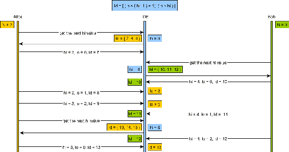

### 10.2.3.4.1 hi/lo 算法

hi/lo 算法将序列域划分为 *hi* 组。*hi* 值同步分配，每个 *hi* 组被赋予最大数量的 *lo* 条目，这些条目可以离线分配，无需担心标识符值冲突。

**图 10.2: hi/lo 算法**

1. *hi* 令牌由数据库序列或表生成器分配，因此保证连续两次调用看到单调递增的值
2. 一旦检索到 *hi* 令牌，*增量大小 (n - lo 的数量)* 定义了事务可以安全分配的标识符值范围。标识符范围限于以下区间：`Id = n × (hi − 1) + 1`，分配方式如下：
   - [0, n - 1]
   - 通过向组值加上 *lo* 值，获得唯一的标识符
3. 当所有 *lo* 值都被用完时，将获取新的 *hi* 值并继续循环。

下面的示例展示了 hi/lo 算法在实践中是如何工作的。实体映射如下：

```java
@Entity
public class Post {
    @Id
    @GeneratedValue(strategy = GenerationType.SEQUENCE, generator = "hilo")
    @GenericGenerator(
        name = "hilo",
        strategy = "org.hibernate.id.enhanced.SequenceStyleGenerator",
        parameters = {
            @Parameter(name="sequence_name", value="sequence"),
            @Parameter(name="initial_value", value="1"),
            @Parameter(name="increment_size", value="3"),
            @Parameter(name="optimizer", value="hilo")
        }
    )
    private Long id;
}
```

由于增量大小为 *3*，接下来的测试将插入 *4* 个实体以显示数据库序列调用的次数。

```java
doInJPA(entityManager -> {
    for(int i = 0; i < 4; i++) {
        Post post = new Post();
        entityManager.persist(post);
    }
});
```

运行之前的测试生成以下输出：

```sql
CALL NEXT VALUE FOR hilo_seqeunce
CALL NEXT VALUE FOR hilo_seqeunce
INSERT INTO Post (id) VALUES (1)
INSERT INTO Post (id) VALUES (2)
INSERT INTO Post (id) VALUES (3)
INSERT INTO Post (id) VALUES (4)
```


第一次序列调用用于前三个值，而第二次调用在达到需要持久化的第四个实体时生成。事务所需的插入操作越多，通过减少数据库序列调用次数带来的性能收益就越明显。

遗憾的是，这个优化器有一个主要的局限性。因为数据库序列只分配组值，所有数据库客户端都必须感知此算法。如果 DBA 必须在上述表中插入一行，他必须使用 `hi/lo` 算法来确定其可以安全使用的取值范围。

因此，Hibernate 提供了其他与其他外部客户端互操作的优化器算法，这些客户端并不感知正在使用的应用级优化技术。

### 10.2.3.4.2 默认序列标识生成器

`JPA` 标识生成策略仅指定标识类型，而未指定用于生成此类标识的算法。

对于序列生成器，考虑以下 JPA 映射：

```java
@Id
@GeneratedValue(generator = "sequence", strategy=GenerationType.SEQUENCE)
@SequenceGenerator(name = "sequence", allocationSize = 3)
private Long id;
```

当配置属性 `hibernate.id.new_generator_mappings` 为 false 时，Hibernate 将选择 `SequenceHiLoGenerator`。这是 Hibernate 3 和 4 的默认设置。旧的 `SequenceHiLoGenerator` 使用 `hi/lo` 算法，如果分配大小大于 1，数据库互操作性可能会受到损害（每次插入必须根据 `hi/lo` 算法规则进行）。

如果上述配置属性为 true（Hibernate 5 的默认设置），则上述 JPA 映射将改用 `SequenceStyleGenerator`。

与其之前的前身版本不同，`SequenceStyleGenerator` 使用可配置的标识优化器策略，应用程序开发甚至可以提供自己的优化实现。

### 10.2.3.4.3 默认表标识生成器

与序列一样，JPA 表生成器映射可以使用旧的或增强的生成器，取决于当前的 Hibernate 配置设置：

```java
@Id
@GeneratedValue(generator = "table", strategy=GenerationType.TABLE)
@TableGenerator(name = "table", allocationSize = 3)
private Long id;
```

如果配置属性 `hibernate.id.new_generator_mappings` 为 false，则 Hibernate 会选择 `MultipleHiLoPerTableGenerator`。该生成器需要一个单表来管理多个标识，并且和 `SequenceHiLoGenerator` 一样，它默认也使用 `hi/lo` 算法。

当激活增强型标识生成器时，Hibernate 将使用 `TableGenerator`，它也可以接受可配置的优化器策略。

对于增强型序列和表标识生成器，Hibernate 提供了以下内置优化器：

**表 10.8：Hibernate 标识优化器**

| 优化器类型 | 实现类 | 描述 |
| :--- | :--- | :--- |
| none | `NoopOptimizer` | 每个标识都通过与数据库的新往返来获取 |
| hi/lo | `HiLoOptimizer` | 它通过旧的 hi/lo 算法分配标识 |
| pooled | `PooledOptimizer` | 它是 hi/lo 算法的增强版本，可以与其他不感知此标识生成器的系统互操作 |
| pooled-lo | `PooledLoOptimizer` | 它是 pooled 优化器的变体，数据库序列值代表 *lo* 值而不是 *hi* 值 |

默认情况下，`SequenceStyleGenerator` 和 `TableGenerator` 标识生成器将使用 `pooled` 优化器。如果配置属性 `hibernate.id.optimizer.pooled.prefer_lo` 设置为 true，则 Hibernate 默认将使用 `pooled-lo` 优化器。

`pooled` 和 `pooled-lo` 都会将数据库序列值编码到标识范围边界中，因此使用实际数据库序列调用分配新值不会干扰标识生成器的分配过程。

#### 10.2.3.4.4 池化优化器

池化优化器可以进行如下配置：

```java
@Entity
public class Post {
    @Id
    @GeneratedValue(strategy = GenerationType.SEQUENCE, generator = "pooled")
    @GenericGenerator(
        name = "pooled",
        strategy = "org.hibernate.id.enhanced.SequenceStyleGenerator",
        parameters = {
            @Parameter(name = "sequence_name", value = "sequence"),
            @Parameter(name = "initial_value", value = "1"),
            @Parameter(name = "increment_size", value = "3"),
            @Parameter(name = "optimizer", value = "pooled")
        }
    )
    private Long id;
}
```

此增量大小提供了序列生成器通过一次数据库往返可以分配的取值范围。虽然在每次调用 `persist()` 方法后刷新持久化上下文（Persistence Context）并不高效，但在本特定的测试中，flush 概述了何时调用数据库序列。

```java
doInJPA(entityManager -> {
    for (int i = 0; i < 5; i++) {
        entityManager.persist(new Post());
        entityManager.flush();
    }
    entityManager.unwrap(Session.class).doWork(connection -> {
        try (Statement statement = connection.createStatement()) {
            statement.executeUpdate(
                "INSERT INTO post VALUES NEXT VALUE FOR sequence"
            );
        }
    });
    for (int i = 0; i < 3; i++) {
        entityManager.persist(new Post());
        entityManager.flush();
    }
});
```

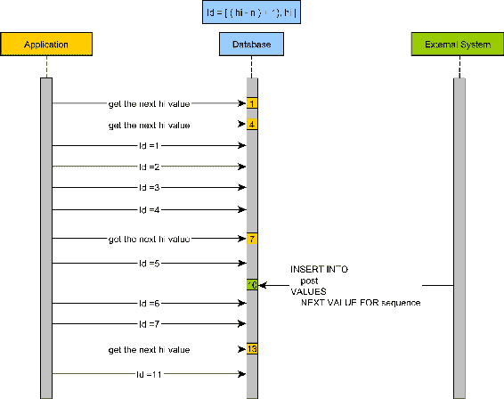

**图 10.3：池化优化器**

如果增量大小 (n) 是范围内的标识数量，则池化优化器按照以下公式生成标识：`Id = [(hi − n) + 1, hi]`。

- 第一次序列调用生成 *lo* 值，第二个调用确定 *hi* 值，因此第一个标识范围是 {2, 3, 4}
- 当添加第 5 个实体时，池化优化器再次调用序列并获取下一个 *hi* 值，因此下一个标识范围是 {5, 6, 7}

### 10.2.3.4.5 pooled-lo 优化器

通过将之前的映射更改为使用 `pooled-lo` 优化器，标识将变为：

**图 10.4：pooled-lo 优化器**

如果增量大小 (n) 是范围内的标识数量，pooled-lo 优化器按照以下公式生成标识：`Id = [lo, (lo + n) - 1]`。

- 第一次序列调用生成 *lo* 值，因此第一个标识范围是 {1, 2, 3}
- 当添加第 4 个实体时，pooled-lo 优化器调用序列并获取下一个 *lo* 值，下一个标识范围是 {4, 5, 6}
- 在插入第 5 个实体后，外部系统添加一行并使用序列返回的值分配主键
- Hibernate 应用程序继续并插入标识 6
- 第 7 个实体需要新的序列调用，因此分配了新范围 {10, 11, 12}


### 10.2.3.5 优化器收益

为了可视化使用序列和表生成器优化器的性能收益，以下测试将衡量在插入 50 个 post 实体时，不同增量大小（*1*、5、10 和 *50*）的标识分配时间。

#### 10.2.3.5.1 序列生成器的性能收益

当使用默认 `pooled` 优化器的序列生成器时，记录了以下第 99 百分位数：

**图 10.5：序列池化优化器收益**

数据库序列很快，但尽管如此，`pooled` 优化器能够显著减少标识生成时间。对于写密集型应用程序，需要根据一次事务中插入的行数调整增量大小。

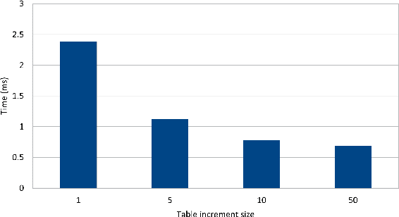


#### 10.2.3.5.2 表生成器的性能收益

针对带有 `pooled` 优化器的表生成器运行相同的测试套件，并且增量大小在 `1`、`5`、`10` 和 `50` 之间也会变化。由于行锁和额外的数据库连接切换开销，表生成器的效率低于数据库序列。

**图 10.6: 表池优化器的增益**

与数据库序列一样，池化优化器成功地减少了分配新实体标识符的时间。

### 10.2.3.6 标识生成器性能

为了评估每个标识生成器的并发成本，以下测试将衡量在涉及多个运行线程时，插入 `100` 个 post 实体所需的时间。启用了 `JDBC` 批处理，并调整了连接池以适应所需的数据库连接数（例如 `32`）。

在现实中，应用程序可能不会配置这么多数据库连接，此时表生成器的连接获取成本可能会更高。

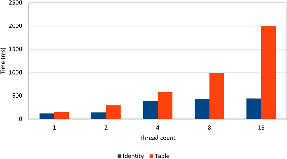


#### 映射类型与标识符 (183)

第一个被测试的关系型数据库系统支持标识列，因此，衡量标识符和表生成器之间的竞争情况是值得的。与之前的测试不同，这次测试衡量的是插入所有实体的总时间，而不仅仅是标识分配的时间间隔。

每次测试迭代都会通过分配更多需要执行相同数据库插入负载的执行线程来增加竞争。

**图 10.7: 标识列 vs 表**

即使无法从 `JDBC` 批处理中获益，标识生成器的性能仍然优于表生成器（后者使用了增量大小为 `100` 的池化优化器）。

使用的线程越多，表生成器的效率就越低。另一方面，标识列在更多并发事务下的扩展性好得多。

即使不支持 `JDBC` 批处理，原生标识列仍然是一个有效选择，而且未来 `Hibernate` 甚至可能支持这些列的批插入。

与标识列相比，表生成器可以从 `JDBC` 批处理和池化优化器中获益，序列与表生成器之间的差距更大，因为序列也可以利用所有这些优化。

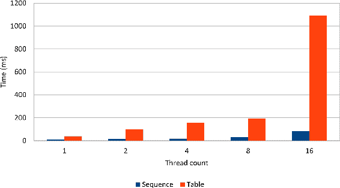


#### 映射类型与标识符 (184)

对支持序列的关系型数据库运行相同的测试，记录了以下结果：

**图 10.8: 序列 vs 表**

表生成器对性能的影响在高并发环境下变得明显，此时行级锁和数据库连接切换引入了串行执行。由于它们使用轻量级同步机制，数据库序列的扩展性比行锁并发控制机制更好。

数据库序列是最高效的 `Hibernate` 标识符选择，它允许序列调用优化器且不损害 `JDBC` 批处理。

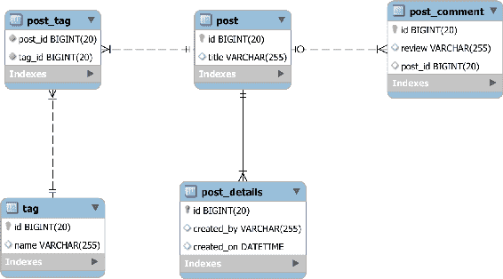

## 11. 关系

在关系型数据库中，关联通过关联不同表的行来形成。当子表定义了引用父表主键的外键时，就建立了关系。每个数据库关联都建立在外键之上，导致三种表关系类型：

- `one-to-many`（一对多）是最常见的关系，它将父表中的行关联到子表中的多行。
- `one-to-one`（一对一）是一对一映射的变体。
- `many-to-many`（多对多）是一种需要中间表的关系。

下面的图描述了所有的表关系：

**图 11.1: 表关系**

`one-to-many` 关联于父端，而 `comment` 是子端。`one-to-one` 关系用于子端和父端。

185


#### 关系 (186)

`post` 和 `tag` 都是独立的表。`post` 可以包含几个 `tag`，而 `tag` 可以关联到多个 `post`。

### 11.1 关系类型

在映射实体时，除了底层的表列外，应用程序开发人员可以单向或双向的方式映射实体关系。如果只有一个实体侧映射了表关系，则关系是单向的；如果表关系可以在两个方向上导航，则它是双向的。

为了正确表示实体的双方，JPA 定义了四种关联映射结构：


`@ManyToOne` 表示数据库 `one-to-many` 关系中的子端（外键所在处）

`@OneToMany` 关联 `one-to-many` 关系的父端

`@ElementCollection` 定义了实体与多个值类型（基本类型或嵌入类型）之间的一对多关联

`@OneToOne` 用于 `one-to-one` 表关系中的子端和父端

`@ManyToMany` 镜像了多对多的表关系

由于实体关系的选择对整体应用程序性能有相当影响，本章分析了所有 JPA 关联的数据访问操作效率。


## 映射集合 (187)

在关系型数据库中，所有表关系都是使用外键构建的并通过 SQL 查询进行导航的。JPA 允许映射外键侧（子实体对其父实体有引用），也可以映射父侧（父实体拥有一个或多个子实体）。

`@OneToMany`、`@ManyToMany` 或 `@ElementCollection` 从数据访问的角度来看非常方便（实体状态转换可以从父实体级联到子实体），但它们绝不是免费的。减少数据访问操作的代价是结果集获取的灵活性和性能。JPA 集合（无论是实体还是值类型（基本类型或嵌入类型））都会将父实体绑定到一个通常获取所有关联子记录的查询上。

整个集合（collection）可能会成为性能瓶颈。遗憾的是，实体映射是在项目开发的早期完成的，开发团队可能并不知道生产系统将显示多少数量的子记录。

问题的不仅在于规模大小，还可能在于子实体的属性数量。因为实体通常是整体被获取的，因此结果集的大小与子表包含的列数成正比。即使集合是懒性加载（lazily fetched）的，在第一次访问集合时，Hibernate 可能仍需要完全加载每个实体。虽然 Hibernate 支持额外的延迟集合加载（extra lazy collection fetching），但这仅仅是一种通变方案，并不能解决根本问题。

此外，每个集合映射都可以替换为数据访问查询，该查询可以使用根据每个业务用例的数据需求定制的 SQL 投影（projection）。通过这种方式，查询可以使用特定业务用例的过滤条件。虽然 JPA 2.1 不支持动态集合过滤，但 Hibernate 提供了与 `Session`（持久化上下文）绑定的集合过滤器（Filters）。

在处理大型数据集时，限制结果集的大小是一种良好做法，无论是为了 UI（提高响应速度）还是为了批处理任务（避免长时间运行事务）。

仅仅因为 JPA 支持集合映射，并不意味着它们对每个领域模型映射都是强制性的。在明确理解子记录数量（或者是否真的需要完全获取子实体）之前，最好推迟集合映射的决定。对于高性能系统，数据访问查询通常是一个更灵活的替代方案。

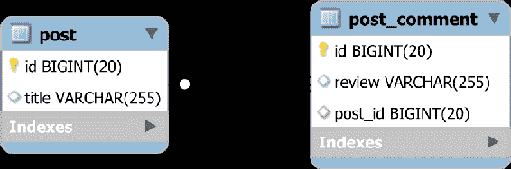

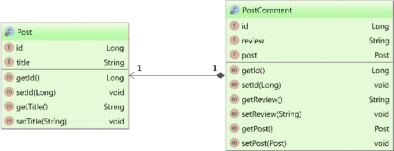

# Relationships

## 11.2 @ManyToOne

`@ManyToOne` 关系是最常见的 JPA 关联，它精确对应于一对多的表关系。当使用 `@ManyToOne` 关联时，无论关联是单向还是双向，底层外键都由子端控制。

本节仅关注单向的 `@ManyToOne` 关系，双向的情况将通过 `@OneToMany` 关系进一步讨论。在以下示例中，`Post` 实体代表父端，而 `PostComment` 是子端。

正如提到的，JPA 实体关系图与一对多的表关系完全对应。

**图 11.2: 一对多的表关系**

**图 11.3: @ManyToOne 关系**

`PostComment` 并没有映射 `post_id` 外键列，而是使用 `@ManyToOne` 关联到父级 `Post` 实体。`PostComment` 可以与已有的 `Post` 对象引用关联，也可以与 `Post` 实体一起获取。

```java
@ManyToOne
@JoinColumn(name = "post_id")
private Post post;
```

Hibernate 将 `@ManyToOne` `Post` 对象引用的内部状态翻译为 `post_id` 外键列的值。


如果 `@ManyToOne` 属性设置为有效的 `Post` 实体引用：

```java
Post post = entityManager.find(Post.class, 1L);
PostComment comment = new PostComment("My review");
comment.setPost(post);
entityManager.persist(comment);
```

Hibernate 生成一条插入语句，用所关联的 `Post` 实体的标识符填充 `post_id` 列。

```
INSERT INTO post_comment (post_id, review, id) VALUES (1, 'My review', 2)
```

如果后续将 `Post` 属性设置为 null：

```java
comment.setPost(null);
```

`post_id` 列也会更新为 NULL 值：

```sql
UPDATE post_comment SET post_id = NULL, review = 'My review' WHERE id = 2
```

因为 `@ManyToOne` 关联直接控制外键，所以自动生成的 DML 语句非常高效。实际上，性能最好的 JPA 关联始终依赖子端将 JPA 状态翻译为外键列的值。

这是 JPA 关系映射中最重要的规则之一，它将在后续 `@OneToMany`、`@OneToOne` 甚至 `@ManyToMany` 关联中被进一步强调。

## 11.3 @OneToMany

虽然 `@ManyToOne` 关联是一对多表关系最自然的映射，但 `@OneToMany` 关联也可以镜像这种数据库关系，但仅当作为双向映射使用时如此。单向的 `@OneToMany` 关联使用额外的中间表（junction table），这不再符合一对多的表关系语义。

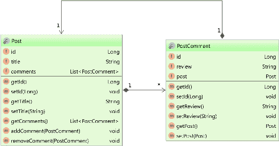


### 11.3.1 双向 @OneToMany

双向的 `@OneToMany` 关联有一个匹配的 `@ManyToOne` 子端映射，用于控制底层的一对多表关系。父端被映射为子实体的集合。

**图 11.4: 双向 @OneToMany 关系**

在双向关联中，只有一侧可以控制底层的表关系。对于双向 `@OneToMany` 映射，是子端的 `@ManyToOne` 关联负责保持外键列值与内存中的持久化上下文同步。这就是为什么双向 `@OneToMany` 关系必须定义 `mappedBy` 属性的原因，表示它只是镜像了 `@ManyToOne` 子端的映射。

```java
@OneToMany(mappedBy = "post", cascade = CascadeType.ALL, orphanRemoval = true)
private List<PostComment> comments = new ArrayList<>();
```

即使子端负责将实体状态与数据库外键列值同步，双向关联也必须始终保持父端子端同步。为了同步两端，提供一些父端的辅助方法来添加/删除子实体是实用的。

```java
public void addComment(PostComment comment) {
    comments.add(comment);
    comment.setPost(this);
}

public void removeComment(PostComment comment) {
    comments.remove(comment);
    comment.setPost(null);
}
```

使用双向关联的一个主要优势是实体状态转换可以从父实体级联到子实体。在以下示例中，当持久化父实体时，所有的 `PostComment` 子实体也会被持久化。

```java
Post post = new Post("First post");
entityManager.persist(post);
PostComment comment1 = new PostComment("My first review");
post.addComment(comment1);
PostComment comment2 = new PostComment("My second review");
post.addComment(comment2);
entityManager.persist(post);
```

```
INSERT INTO post (title, id) VALUES ('First post', 1)
INSERT INTO post_comment (post_id, review, id) VALUES (1, 'My first review', 2)
INSERT INTO post_comment (post_id, review, id) VALUES (1, 'My second review', 3)
```

当从父端集合移除评论时，`orphanRemoval` 属性将指示 Hibernate 在目标子实体上一条删除 DML 语句：

```java
post.removeComment(comment1);
```

```
DELETE FROM post_comment WHERE id = 2
```

#### 基于相等性的实体移除

用于子实体移除的辅助方法依赖底层子对象的相等性来匹配需要移除的集合项。如果应用程序没有没有重写默认的 `equals` 和 `hashCode` 方法，将使用 `java.lang.Object` 基于标识（identity）相等性。这种方法的问题在于，应用程序开发者必须提供一个包含当前子集合中的子实体对象引用。有时子实体在一个 Web 请求中加载并保存在 `HttpSession` 或有状态的 Enterprise Java Bean 中。一旦加载子实体的持久化上下文关闭，该实体会脱离状态。如果子实体被发送到新的网络请求中移除，则该子实体必须重新附加或合并到当前的持久化上下文（Persistence Context）。这样，当父实体与其子实体一起被加载时，删除操作将正常运行，因为被删除的子实体已经托管并包含在子集合中。

如果实体没有变化，重新附加该子实体是多余的，因此必须重写 `equals` 和 `hashCode` 方法，根据唯一的业务键（business key）来表示相等性。如果子实体设置了 `@NaturalId` 或唯一属性/属性，可以基于此实现 `equals` 和 `hashCode` 方法。假设 `PostComment` 实体具有以下两个列，它们的组合构成唯一的业务键，相等性约定可以如下实现：

```java
private String createdBy;

@Temporal(TemporalType.TIMESTAMP)
private Date createdOn = new Date();

@Override
public boolean equals(Object o) {
    if (this == o) return true;
    if (o == null || getClass() != o.getClass()) return false;
    PostComment that = (PostComment) o;
    return Objects.equals(createdBy, that.createdBy) &&
           Objects.equals(createdOn, that.createdOn);
}

@Override
public int hashCode() {
    return Objects.hash(createdBy, createdOn);
}
```


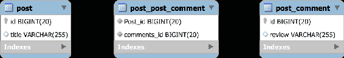

# 关系

双向 `@OneToMany` 关联会生成高效的 DML 语句，因为 `@ManyToOne` 映射负责表关系。因为它同时也简化了数据访问操作，当子记录数量相对较小时，双向 `@OneToMany` 关联是值得考虑的。

### 11.3.2 单向 @OneToMany

单向 `@OneToMany` 关联非常有吸引力，因为它的映射比双向映射更简单。因为只需要考虑一边，所以不需要辅助方法，且映射也不包含 `mappedBy` 属性。

```java
@OneToMany(cascade = CascadeType.ALL, orphanRemoval = true)
private List<PostComment> comments = new ArrayList<>();
```

遗憾的是，尽管简单，但单向 `@OneToMany` 关联的效率低于单向的 `@ManyToOne` 映射或双向的 `@OneToMany` 关联。

与直觉相反，单向 `@OneToMany` 关联并没有映射到一对多的表关系。因为没有 `@ManyToOne` 端来控制这种关系，Hibernate 使用一个单独的中间表（junction table）来管理父行与其子记录之间的关联。

### 图 11.5：@OneToMany 表关系

表 `post_post_comment` 有两个外键列，分别引用父端行（`Post_id` 列是 `post` 表主键的外键）和子端实体（`comments_id` 引用 `post_comment` 表的主键）。

在不分析相关数据访问操作的情况下显而易见的是连接三张表比只连接两个表效率低。因为有两个外键，需要两个索引（而不是一个），因此索引的内存占用随之增加。

但由于这是一个多多关系的普通表映射，额外的表和增加的内存占用并不是最大的性能问题。管理集合状态的算法使得任何单向 `@OneToMany` 关联失去了吸引力。

# 关系

考虑到通过运行以下示例获得了一个具有两个 `PostComment` 子记录的 `Post` 实体：

```java
Post post = new Post("First post");
post.getComments().add(new PostComment("My first review"));
post.getComments().add(new PostComment("My second review"));
post.getComments().add(new PostComment("My third review"));
entityManager.persist(post);
```

虽然对于双向 `@OneToMany` 关联增加了三个子记录，但单向关联需要为中间表记录额外进行三次插入。

```sql
INSERT INTO post (title, id) VALUES ('First post', 1)
INSERT INTO post_comment (review, id) VALUES ('My first review', 2)
INSERT INTO post_comment (review, id) VALUES ('My second review', 3)
INSERT INTO post_comment (review, id) VALUES ('My third review', 4)
INSERT INTO post_post_comment (Post_id, comments_id) VALUES (1, 2)
INSERT INTO post_post_comment (Post_id, comments_id) VALUES (1, 3)
INSERT INTO post_post_comment (Post_id, comments_id) VALUES (1, 4)
```

当移除集合中的第一个元素时：

```java
post.getComments().remove(0);
```

Hibernate 生成了以下 DML 语句：

```sql
DELETE FROM post_post_comment WHERE Post_id = 1
INSERT INTO post_post_comment (Post_id, comments_id) VALUES (1, 3)
INSERT INTO post_post_comment (Post_id, comments_id) VALUES (1, 4)
DELETE FROM post_comment WHERE id = 2
```

首先，删除与父实体关联的所有中间表行，然后将内存中剩余的记录重新添加。这种方法的问题在于，数据库执行的 DML 语句远多单个中间表的删除。

另一个问题与索引有关。如果每个键列都有索引（这是许多关系型数据库的默认设置），数据库引擎必须删除记录以便重新添加剩余记录。集合中的元素越多，删除操作的效率就越低。


# 关系

单向 `@OneToMany` 关系在读取数据（需要三个连接而不是两个）、添加（必须写入两个表而不是一个）或移除（记录会被删除重新添加）子记录方面的效率都较低。

## 11.3.3 有序单向 @OneToMany

如果集合可以存储索引，单向 `@OneToMany` 关系可以在某些删除操作中受益。首先，必须在 `@OneToMany` 映射中定义 `@OrderColumn` 注解：

```java
@OneToMany(cascade = CascadeType.ALL, orphanRemoval = true)
@OrderColumn(name = "entry")
private List<PostComment> comments = new ArrayList<>();
```

在数据库级别，中间表中包含了 `entry` 列。


### 图 11.6：带有 `@OrderColumn` 的单向 `@OneToMany`

最好不要混淆 `@OrderColumn` 和 JPA 注解 `@OrderBy`。前者允许 JPA 实现将元素索引映射到专用数据库列，以便使用 `ORDER BY` 子句进行排序，后者则根据提供的排序标准在运行时进行排序。

## 关系

考虑到为给定的 `Post` 父实体添加了三个 `PostComment` 实体：

```java
post.getComments().add(new PostComment("My first review"));
post.getComments().add(new PostComment("My second review"));
post.getComments().add(new PostComment("My third review"));
```

每个集合元素的索引将存储在中间表的 `entry` 列中：

```sql
INSERT INTO post_comment (review, id) VALUES ('My first review', 2)
INSERT INTO post_comment (review, id) VALUES ('My second review', 3)
INSERT INTO post_comment (review, id) VALUES ('My third review', 4)
INSERT INTO post_post_comment (Post_id, entry, comments_id) VALUES (1, 0, 2)
INSERT INTO post_post_comment (Post_id, entry, comments_id) VALUES (1, 1, 3)
INSERT INTO post_post_comment (Post_id, entry, comments_id) VALUES (1, 2, 4)
```

当从集合尾部移除元素时：

```java
post.getComments().remove(2);
```

Hibernate 只需要一条中间表的删除语句：

```sql
DELETE FROM post_post_comment WHERE Post_id = 1 and entry = 2
```

```sql
DELETE FROM post_comment WHERE id = 4
```

遗憾的是，这种优化并不适用于位于集合尾部的条目，因此当删除第一个元素时：

```java
post.getComments().remove(0);
```

Hibernate 会删除所有与该父实体关联的子元素，然后更新剩余的数据库记录，以保持与内存集合快照相同的元素顺序：

```sql
DELETE FROM post_post_comment WHERE Post_id=1 and entry=1
UPDATE post_post_comment set comments_id = 3 WHERE Post_id = 1 and entry = 0
DELETE FROM post_comment WHERE id = 2
```


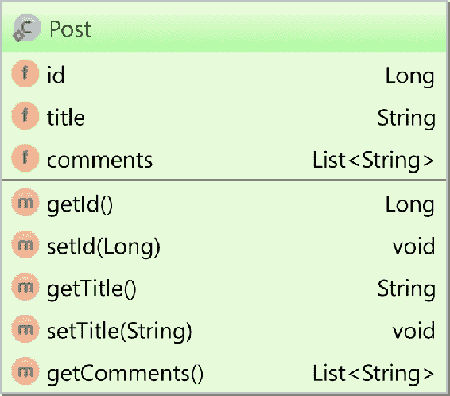

## 关系

如果单向的 `@OneToMany` 集合像栈一样使用，并且始终从集合尾部移除元素，那么使用 `@OrderColumn` 时删除操作会更高效。但元素距离列表头部越近，必须执行的更新语句就越多，额外的更新会带来性能开销。

### 11.3.3.1 `@ElementCollection`

虽然 `@ElementCollection` 不是实体关联类型，但它与单向 `@OneToMany` 关系非常相似。为了表示基本类型（例如 `String`、`int`、`BigDecimal`）或嵌入类型的集合，必须使用 `@ElementCollection`。如果之前的关联涉及多个实体，那么这次只有一个 `Post` 实体，包含一个 `String` 注释的集合。

**图 11.7：`@ElementCollection` 关系**

注释集合的映射如下：

```java
@ElementCollection
private List<string> comments = new ArrayList<>();
```

值类型继承其父实体的持久化状态，因此它们的生命周期也绑定到所有实体。针对实体集合的任何操作将自动实例化为 DML 语句。

在添加或删除子记录时，`@ElementCollection` 的行为类似于标记了 `CascadeType.ALL` 和 `orphanRemoval` 的单向 `@OneToMany` 关系。


## 关系

从数据库的角度来看，有一个子表同时持有外键列和集合元素值。

**图 11.8：`@ElementCollection` 表关系**

为了持久化三条注释，数据访问层只需将它们添加到父实体集合中：

```java
post.getComments().add("My first review");
post.getComments().add("My second review");
post.getComments().add("My third review");
```

Hibernate 将在刷新（flush）期间发出插入语句：

```sql
INSERT INTO post_post_comment (post_id, comments) VALUES (1, 'My first review')
INSERT INTO post_post_comment (post_id, comments) VALUES (1, 'My second review')
INSERT INTO post_post_comment (post_id, comments) VALUES (1, 'My third review')
```

在接下来的示例中，`Post` 实体代表父端，而 `PostDetails` 是一对一关联的子端。

如前所述，JPA 实体关系图与一对一表关系是完全匹配的。

**图 11.9：一对一表关系**

即使从领域模型的角度来看，单向的 `@OneToOne` 关系与单向的 `@ManyToOne` 关联也非常相似。

**图 11.10：单向 `@OneToOne` 关系**

### 关系

映射是通过 `@OneToOne` 注解完成的，就像 `@ManyToOne` 映射一样，它也可能带有 `@JoinColumn`。

```java
@OneToOne
@JoinColumn(name = "post_id")
private Post post;
```

单向的 `@OneToOne` 关联控制着相关的外键，因此当设置 `post` 属性时：

```java
Post post = entityManager.find(Post.class, 1L);
PostDetails details = new PostDetails("John Doe");
details.setPost(post);
entityManager.persist(details);
```

Hibernate 使用关联的 `post` 标识符填充外键列：

```sql
INSERT INTO post_details (created_by, created_on, post_id, id)
VALUES ('John Doe', '2016-01-08 11:28:21.317', 1, 2)
```

即使这是一个单向关联，`Post` 实体仍然是该关系的父端。要获取关联的 `PostDetails`，需要一个 JPQL 查询：

```java
PostDetails details = entityManager.createQuery(
    "select pd " +
    "from PostDetails pd " +
    "where pd.post = :post", PostDetails.class)
.setParameter("post", post)
.getSingleResult();
```

如果 `Post` 实体总是需要它的 `PostDetails`，那么单独的查询是不可取的。为了克服这一局限性，在加载实体之前知道 `PostDetails` 的标识符是非常重要的。

一种变通方法是使用 `@NaturalId`，如果实体存储在二级缓存中，则可能不需要访问数据库。幸运的是，还有一种更简单的方法，且该方法也适用于不同的 JPA 提供者。JPA 2.0 规范增加了对派生标识符的支持，使得将 `PostDetails` 标识符链接到 `post` 表的主键成为可能。

通过这种方式，`post_details` 表的主键也可以引用 `post` 表标识符的外键。


### 关系

`PostDetails` 的 `@OneToOne` 映射更改如下：

```java
@OneToOne
@MapsId
private Post post;
```

这一次，表关系不再包含任何额外的外键列，因为 `post_details` 表的主键引用了 `post` 表的主键：

**图 11.11：共享主键的一对一**

由于 `PostDetails` 与父实体 `Post` 具有相同的标识符，因此无需编写 JPQL 查询即可获取它。

```java
PostDetails details = entityManager.find(PostDetails.class, post.getId());
```

#### 共享主键的效率

首先，共享主键方法减少了子端表索引的内存占用，因为它只需要单个索引列。共享主键也限于 `@OneToOne` 关系。


### 关系

#### 双向 `@OneToOne`

双向的 `@OneToOne` 允许父端映射子端：

**图 11.12：双向 `@OneToOne`**

父端定义了 `mappedBy` 属性，因为这是一个双向关系：

```java
@OneToOne(mappedBy = "post", cascade = CascadeType.ALL)
private PostDetails details;

public void setDetails(PostDetails details) {
    this.details = details;
}
```

即使关联是懒加载的，在获取父实体时，Hibernate 也会获取子实体：

```java
Post post = entityManager.find(Post.class, 1L);
```


### 关系

#### 字节码增强（Bytecode enhancement）

即使外键非空，且父端通过 `optional` 属性感知其非空性（例如 `@OneToOne(fetch = FetchType.LAZY, optional = false)`），Hibernate 仍然会产生二次查询。由于已知子实体永远为空，Hibernate 可以将其分配给代理（Proxy）而不是实际的实体对象引用。但持久化上下文（Persistence Context）需要每个受管理实体的类型和标识符，因此在加载父实体时必须知道子实体的标识符，而寻找关联 `post_details` 主键的唯一方法是执行二次查询。

字节码增强是唯一的可行变通方法；对父实体代理进行处理，仅在首次访问时获取子实体。由于不使用字节码增强更加简单且性能良好，通常优先选择单向的 `@OneToOne` 关系。


### 关系

### 11.5 `@ManyToMany`

`ManyToMany` 关系是所有 JPA 关系中最复杂的，本章接下来的部分将会证明。与 `@OneToOne` 关系一样，`@ManyToMany` 关联可以是单向或双向的。从数据库的角度来看，`@ManyToMany` 关联镜像了多对多的表关系：

**图 11.13：多对多表关系**

#### 11.5.1 单向 `@ManyToMany`

在接下来的示例中，让 `Post` 实体映射 `@ManyToMany` 关系是很有意义的，因为从 `Tag` 关系一侧没有太大导航这种关联的需求（尽管我们仍然可以使用 JPQL 查询来实现）。在 `Post` 实体中，单向 `@ManyToMany` 关联映射如下：

```java
@ManyToMany(cascade = { CascadeType.PERSIST, CascadeType.MERGE } )

@JoinTable(name = "post_tag",
joinColumns = @JoinColumn(name = "post_id"),
inverseJoinColumns = @JoinColumn(name = "tag_id")
)
private List <tag>tags = new ArrayList<>();
```


### 关系（207）

当添加多个实体时：

```java
Post post1 = new Post("JPA with Hibernate");
Post post2 = new Post("Native Hibernate");
Tag tag1 = new Tag("Java");
Tag tag2 = new Tag("Hibernate");

post1.getTags().add(tag1);
post1.getTags().add(tag2);
post2.getTags().add(tag1);

entityManager.persist(post1);
entityManager.persist(post2);
```

Hibernate 持久化 `Post` 和 `Tag` 实体以及它们的中间表记录。

```sql
INSERT INTO post (title, id) VALUES ('JPA with Hibernate', 1)
INSERT INTO post (title, id) VALUES ('Native Hibernate', 4)
INSERT INTO tag (name, id) VALUES ('Java', 2)
INSERT INTO tag (name, id) VALUES ('Hibernate', 3)
INSERT INTO post_tag (post_id, tag_id) VALUES (1, 2)
INSERT INTO post_tag (post_id, tag_id) VALUES (1, 3)
INSERT INTO post_tag (post_id, tag_id) VALUES (4, 2)
```

### 级联（Cascading）

对于 `@ManyToMany` 关联，当双方都代表独立的实体时，`CascadeType.REMOVE` 没有太大意义。在这种情况下，删除一个 `Post` 实体不应触发 `Tag` 的删除，因为 `Tag` 也可以被其他 `posts` 引用。孤儿删除（orphan removal）也是如此，因为从 `tags` 集合中移除条目只应该删除中间表记录，而不是目标 `Tag` 实体。

对于单向和双向关联，最好避免使用 `CascadeType.REMOVE` 映射。与其使用 `CascadeType.ALL`，不如显式声明级联属性（例如 `CascadeType.PERSIST`、`CascadeType.MERGE`）。


### 关系（208）

但就像单向 `@OneToMany` 关联一样，在删除中间表记录时也会出现问题：

```java
post1.getTags().remove(tag1);
```

Hibernate 会删除所有与移除 `Tag` 关联的 `Post` 实体相关的中间表行，并重新插入剩余的行：

```sql
DELETE FROM post_tag WHERE post_id = 1
INSERT INTO post_tag (post_id, tag_id) VALUES (1, 3)
```

#### 11.5.2 双向 `@ManyToMany`

双向 `@ManyToMany` 关系可以从 `Post` 和 `Tag` 端进行导航。

**图 11.15：单向 `@ManyToMany` 关系**

虽然在一对多和多对多的关联中，子端持有外键，但在多对多的表关系中，两端实际上都是父端，而中间表是子端。

由于在使用默认的 `@ManyToMany` 映射时中间表是隐藏的，应用程序开发者必须选择一个所有端（owning side）和一个映射端（mappedBy side）。

### 关系（209）

在此示例中，`Post` 保留了与单向 `@ManyToMany` 相同的映射，而 `Tag` 实体增加了 `mappedBy` 端：

```java
@ManyToMany(mappedBy = "tags")
private List <post>posts = new ArrayList<>();
```

与其他任何双向关联一样，双方必须同步，因此这里也添加了辅助方法。对于 `@ManyToMany` 关联，业务逻辑更有可能操作 `Post` 而不是 `Tag`，因此辅助方法被添加到 `Post` 实体中：


```java
public void addTag(Tag tag) {
    tags.add(tag);
    tag.getPosts().add(this);
}

public void removeTag(Tag tag) {
    tags.remove(tag);
    tag.getPosts().remove(this);
}
```

`Post` 和 `Tag` 实体具有唯一属性，在混合脱离（detached）和托管（managed）实体时可以简化实体删除操作。

向 `@ManyToMany` 集合中添加实体是高效的，因为只需要向中间表执行单次插入。解关联实体则与单向 `@ManyToMany` 存在相同的问题。

根据 *bag* 语义，当更改元素顺序时，Hibernate 会删除所有相关的中间记录并重新插入它们：

```java
post1.getTags().sort(Comparator.comparing(Tag::getId));
```

```sql
DELETE FROM post_tag WHERE post_id = 1
INSERT INTO post_tag (post_id, tag_id) VALUES (1, 3)
INSERT INTO post_tag (post_id, tag_id) VALUES (1, 2)
```


Hibernate 管理 `@ManyToMany` 关系的每一端类似于单向 `@OneToMany` 关联中的父端（例如 `Post` 或 `Tag`）和隐藏的子端（例如 `post_id` 外键）。这就是为什么在持久化上下文（Persistence Context）中更改顺序会导致删除所有条目并重新插入它们。

## 3 @OneToMany 替代方案

就像单向 `@OneToMany` 关联可以通过允许子端控制该关联来优化一样，可以将 `@ManyToMany` 映射转换为中间表映射到一个实体。

## 16 多对多关系

`PostTag` 实体有一个由 `postId` 和 `tagId` 组成的复合标识。

```java
@Embeddable
public static class PostId implements Serializable {
    private Long postId;
    private Long tagId;

    public PostId() {}

    public PostId(Long postId, Long tagId) {
        this.postId = postId;
        this.tagId = tagId;
    }

    public Long getPostId() {
        return postId;
    }

    public Long getTagId() {
        return tagId;
    }

    @Override
    public boolean equals(Object o) {
        if (this == o) return true;
        if (o == null || getClass() != o.getClass()) return false;
        PostId that = (PostId) o;
        return Objects.equals(postId, that.postId) && Objects.equals(tagId, that.tagId);
    }

    @Override
    public int hashCode() {
        return Objects.hash(postId, tagId);
    }
}
```

### 关系 (211)

使用这些列，`PostTag` 实体也可以映射 `@ManyToOne` 端：

```java
@Entity(name = "PostTag")
@Table(name = "post_tag")
public class PostTag {

    @EmbeddedId
    private PostTagId id;

    @ManyToOne
    @MapsId("postId")
    private Post post;

    @ManyToOne
    @MapsId("tagId")
    private Tag tag;

    private PostTag() {}

    public PostTag(Post post, Tag tag) {
        this.post = post;
        this.tag = tag;
        this.id = new PostTagId(post.getId(), tag.getId());
    }

    //Getters and setters omitted

    @Override
    public boolean equals(Object o) {
        if (this == o) return true;
        if (o == null || getClass() != o.getClass()) return false;
        PostTag that = (PostTag) o;
        return Objects.equals(post, that.post) && Objects.equals(tag, that.tag);
    }

    @Override
    public int hashCode() {
        return Objects.hash(post, tag);
    }
}
```

### 关系 (212)

`Post` 实体映射了 `post` `@ManyToOne` 关联的双向 `@OneToMany` 端：

```java
@OneToMany(mappedBy = "post", cascade = CascadeType.ALL, orphanRemoval = true)
private List<PostTag> tags = new ArrayList<>();
```

`Tag` 实体映射了 `tag` `@ManyToOne` 关联的双向 `@OneToMany` 端：

```java
@OneToMany(mappedBy = "tag", cascade = CascadeType.ALL, orphanRemoval = true)
private List<PostTag> posts = new ArrayList<>();
```

通过这种方式，双向 `@ManyToMany` 关系被转换为两个双向 `@OneToMany` 关联。`removeTag` 辅助方法复杂得多，因为它需要定位与当前 `Post` 实体关联且被解关联的 `Tag` 的 `PostTag`。

```java
public void removeTag(Tag tag) {
    for (Iterator<PostTag> iterator = tags.iterator(); iterator.hasNext(); ) {
        PostTag postTag = iterator.next();

        if (postTag.getPost().equals(this) && postTag.getTag().equals(tag)) {
            iterator.remove();
            postTag.getTag().getPosts().remove(postTag);
            postTag.setPost(null);
            postTag.setTag(null);
            break;
        }
    }
}
```

`PostTag` 的 `equals` 和 `hashCode` 方法依赖于 `Post` 和 `Tag` 的等性语义。`Post` 实体使用 `title` 作为业务键，而 `Tag` 则依赖于其 `name` 列的唯一性约束。

当重新运行在单向 `@ManyToMany` 节中的实体删除示例时：

```java
post1.removeTag(tag1);
```

Hibernate 会发出单条删除语句，因此针对单个 `PostTag` 连接表记录：

```sql
DELETE FROM post_tag WHERE post_id = 1 AND tag_id = 3
```


### 关系 214

更改连接表元素的顺序这次没有影响：

```java
post1.getTags().sort((postTag1, postTag2) ->
    postTag2.getId().getTagId().compareTo(postTag1.getId().getTagId())
)
```

这是因为 `@ManyToOne` 侧只监控外键列的变化，而没有考虑内部集合的状态。要实现元素的顺序化，必须改用 `@OrderColumn`：

```java
@OneToMany(mappedBy = "post", cascade = CascadeType.ALL, orphanRemoval = true)
@OrderColumn(name = "entry")
private List<PostTag> tags = new ArrayList<>();
```

`post_tag` 连接表将包含一个存储集合元素顺序的 `entry` 列。当反转元素顺序时，Hibernate 将更新 `entry` 列：

```sql
UPDATE post_tag SET entry = 0 WHERE post_id = 1 AND tag_id = 4
UPDATE post_tag SET entry = 1 WHERE post_id = 1 AND tag_id = 3
```

最高效的 JPA 关系是那些外键侧由子端 `@ManyToOne` 或 `@OneToOne` 关联控制的关系。出于这个原因，多对多表关系最好通过两个双向的 `@OneToMany` 关联映射。实体删除和元素顺序的变化比默认的 `@ManyToMany` 关系更高效，且连接实体还可以映射额外的列（例如 `created_on`、`created_by`）。


## 12. 继承

Java 像任何其他面向对象的编程语言一样，大量使用继承和多态。继承允许定义类层次结构，为公共接口提供不同的实现。从概念上讲，领域模型定义了数据（例如持久化实体）和行为（业务逻辑）。尽管如此，继承对于多变的行为比数据更有用（组合更适合共享结构）。即使数据（持久化实体）和业务逻辑（事务服务）是解耦的，继承仍然可以帮助变化的业务逻辑（例如 [访问者模式](https://en.wikipedia.org/wiki/Visitor_pattern)¹）。

**图 12.1：领域模型继承**

¹[`en.wikipedia.org/wiki/Visitor_pattern`](https://en.wikipedia.org/wiki/Visitor_pattern)

### 关系 215

此领域模型的根实体是 `Board` 实体，因为无论是直接还是间接，所有其他实体都与 `Board` 关联。

```java
@Entity(name = "Board") @Table(name = "board")
public class Board {
    @Id @GeneratedValue
    private Long id;
    private String name;
    // 为了简洁，省略了 getters 和 setters
}
```

终端用户可以在特定的 `Board` 上提交 `Post` 或 `Announcement`。由于 `Post` 和 `Announcement` 共享相同的功能（仅在数据上不同），它们都继承自 `Topic` 基类。`Topic` 类定义了与 `Board` 实体的关系，因此 `Post` 和 `Announcement` 实体也可以与 `Board` 实例关联。

```java
@Entity @Table(name = "topic")
public class Topic {
    @Id @GeneratedValue
    private Long id;
    private String title;
    private String owner;
    @Temporal(TemporalType.TIMESTAMP)
    private Date createdOn = new Date();
    @ManyToOne(fetch = FetchType.LAZY)
    private Board board;
    // 为了简洁，省略了 getters 和 setters
}
```

### 关系 216

`Post` 和 `Announcement` 实体都扩展了 `Topic` 类并定义了它们特定的属性。

```java
@Entity @Table(name = "post")
public class Post extends Topic {
    private String content;
    // 为了简洁，省略了 getters 和 setters
}
```

```java
@Entity @Table(name = "announcement")
public class Announcement extends Topic {
    @Temporal(TemporalType.TIMESTAMP)
    private Date validUntil;
    // 为了简洁，省略了 getters 和 setters
}
```

`TopicStatistics` 位于此领域模型的底部，因为它仅用于监控目的，没有直接与主业务逻辑。由于 `Post` 和 `Announcement` 实体都需要统计数据，`TopicStatistics` 定义了一个 `Topic` 实体关联。

```java
@Entity @Table(name = "topic_statistics")
public class TopicStatistics {
    @Id @GeneratedValue
    private Long id;
    @OneToOne @JoinColumn(name = "id") @MapsId
    private Topic topic;
    private long views;
    // 为了简洁，省略了 getters 和 setters
}
```


### 关系 217

另一种方法是将此关系添加到 `Topic` 类中，然后行将引用 `topic_statistics`。为了演示实体多态如何工作，我们选择了 `TopicStatistics` 作为子端。

单表继承（Single table inheritance）是 JPA 的默认策略，它将整个继承领域模型层级结构汇聚到单个数据库表中。

要使用此策略，`Topic` 实体类必须使用以下注解之一进行映射：

* `@Inheritance`（由于它是默认的继承模型，在使用单表继承时并不强制提供策略）
* `@Inheritance(strategy = InheritanceType.SINGLE_TABLE)`

`Post` 和 `Announcement` 实体不需要额外的映射（Java 的继承语义已经足够）。

在保持与领域模型类图所示布局一致的情况下，与此继承策略关联的表关系如下所示：

**图 12.2：单表**

`topic` 表包含了与 `Topic` 基类相关的列，以及与 `Post` 和 `Announcement` 实体属性相关的列。

在接下来的示例中，一个 `Post` 实体和一个 `Announcement` 实体将与其关联的 `@OneToOne TopicStatistics` 关系一起持久化。

```java
Post post = new Post();
post.setOwner("John Doe");
post.setTitle("Inheritance");
post.setContent("Best practices");
post.setBoard(board);
entityManager.persist(post);

Announcement announcement = new Announcement();
announcement.setOwner("John Doe");
announcement.setTitle("Release x.y.z.Final");
announcement.setValidUntil(Timestamp.valueOf(LocalDateTime.now().plusMonths(1)));
announcement.setBoard(board);
entityManager.persist(announcement);

TopicStatistics postStatistics = new TopicStatistics(post);
postStatistics.incrementViews();
entityManager.persist(postStatistics);

TopicStatistics announcementStatistics = new TopicStatistics(announcement);
announcementStatistics.incrementViews();
entityManager.persist(announcementStatistics);
```


`Post` 和 `Announcement` 实体都保存在 `topic` 表中，其主键与 `topic_statistics` 表共享。

```sql
INSERT INTO topic (board_id, createdOn, owner, title, content, DTYPE, id)
VALUES (1, '2016-01-17 09:22:22.11', 'John Doe', 'Inheritance', 'Best practices', 'Post', 1)

INSERT INTO topic (board_id, createdOn, owner, title, validUntil, DTYPE, id)
VALUES (1, '2016-01-17 09:22:22.11', 'John Doe', 'Release x.y.z.Final', '2016-02-17 09:22:22.114', 'Announcement', 2)

INSERT INTO topic_statistics (views, id) VALUES (1, 2)
INSERT INTO topic_statistics (views, id) VALUES (1, 3)
```

在领域模型中使用继承的一个优势是支持多态查询。当应用程序开发者对 `Topic` 实体发布一个选择查询时：

```java
List<topic> topics = entityManager.createQuery(
    "select t from Topic t where t.board.id = :boardId", Topic.class)
    .setParameter("boardId", 1L)
    .getResultList();
```

Hibernate 会访问 `topic` 表，在获取结果集后，通过分析区分器列（例如 `DTYPE`）的值，将每一行映射到其相关的子类实例（例如 `Post` 或 `Announcement`）。

```sql
SELECT t.id AS id2_1_, t.board_id AS board_id8_1_, t.createdOn AS createdO3_1_, t.owner AS owner4_1_, t.title AS title5_1_, t.content AS content6_1_, t.validUntil AS validUnt7_1_, t.DTYPE AS DTYPE1_1_
FROM topic t
WHERE t.board_id = 1
```

领域模型继承允许基类实体关联在检索时被自动解析。当加载 `TopicStatistics` 及其 `Topic` 关系时：

```java
TopicStatistics statistics = entityManager.createQuery(
    "select s from TopicStatistics s join fetch s.topic t where t.id = :topicId", TopicStatistics.class)
    .setParameter("topicId", topicId)
    .getSingleResult();
```

Hibernate 连接了 `topic_statistics` 表和 `topic` 表，以便创建一个带有实际 `Post` 或 `Announcement` 属性对象引用的 `TopicStatistics` 实体。

```sql
SELECT
ts.id AS id1_2_0_, t.id AS id2_1_1_, ts.views AS views2_2_0_, t.board_id AS board_id8_1_1_, t.createdOn AS createdO3_1_1_, t.owner AS owner4_1_1_, t.title AS title5_1_1_, t.content AS content6_1_1_, t.validUntil AS validUnt7_1_1_, t.DTYPE AS DTYPE1_1_1_
FROM topic_statistics ts
INNER JOIN topic t ON ts.id = t.id
WHERE t.id = 2
```

即使在这个特定示例中并不实际，但 `@OneToMany` 关联也是可能的。`Board` 实体可以如下映射双向 `@OneToMany` 关系：

```java
@OneToMany(mappedBy = "board")
private List<topic> topics = new ArrayList<>();
```

懒性加载集合会生成一个独立的 `select` 语句，与上述 `Topic` 实体相同。当尽早获取集合时，Hibernate 需要单次连接。

```java
Board board = entityManager.createQuery(
    "select b from Board b join fetch b.topics", Board.class)
    .setParameter("id", id)
    .getSingleResult();
```

```sql
SELECT b.id AS id1_0_, t.id AS id2_1_, b.name AS name2_0_, t.board_id AS board_id8_1_, t.createdOn AS createdO3_1_, t.owner AS owner4_1_, t.title AS title5_1_, t.content AS content6_1_
FROM board b
LEFT JOIN topic t ON b.id = t.board_id
WHERE b.id = 1
```

### 性能与数据完整性考虑

由于只使用一张表来存储实体，读取和写入操作都很快。即使使用 `@ManyToMany` 或 `@OneToOne` 基类关联，Hibernate 也需要进行父表连接。由于所有子类属性都位于同一个表中，因此不允许对子类列使用 `NOT NULL` 约束。由于被所有子类自动继承，基类属性可能为空。从数据完整性的角度来看，这种限制违背了一致性（由 ACID 属性保证）。

尽管如此，数据完整性规则可以通过数据库触发器过程强制执行（根据类区分器处理为空）。另一种方法是将检查移动到数据访问层。Bean Validation 在运行时验证 `@NotNull` 属性。JPA 还定义了回调方法（例如 `@PreUpdate`）以及实体监听器（例如 `@EntityListeners`），它们可以在违反非空约束时抛出异常。

### 连接表（Join table）

连接表继承类似于领域模型类图，因为每个类都映射到一张独立的表。子类表有一个指向基类表主键的外键列。

**图 12.3：连接表**

要使用此继承策略，`Topic` 实体必须注解：

`@Inheritance(strategy = InheritanceType.JOINED)`

`Post` 和 `Announcement` 实体可以使用 `@PrimaryKeyJoinColumn` 映射来定义基类外键列。默认情况下，子类表的主键列也被用作外键。

当持久化单表部分定义的相同实体时，Hibernate 生成以下 SQL 语句：

```sql
INSERT INTO topic (board_id, createdOn, owner, title, id)
VALUES (1, '2016-01-17 09:22:22.11', 'John Doe', 'Inheritance', 1)

INSERT INTO post (content, id) VALUES ('Best practices', 1)

INSERT INTO topic (board_id, createdOn, owner, title, id)
VALUES (1, '2016-01-17 09:22:22.11', 'John Doe', 'Release x.y.z.Final', 2)
```

```sql
INSERT INTO announcement (validUntil, id) VALUES ('2016-02-17 09:27:10.698', 2)
INSERT INTO topic_statistics (views, id) VALUES (1, 2)
INSERT INTO topic_statistics (views, id) VALUES (1, 3)
```

# 继承

基类信息存入 `topic` 表，而子类内容进入 `post` 或 `announcement` 表。当获取与特定 `Board` 相关的所有 `Topic` 实体时：

```java
List<topic> topics = entityManager.createQuery(
    "select t from Topic t where t.board.id = :boardId", Topic.class)
    .setParameter("boardId", 1L)
    .getResultList();
```

Hibernate 必须将基类与每个单独的子类表进行连接（join）。

```sql
SELECT
  t.id AS id1_3_,
  t.board_id AS board_id5_3_,
  t.createdOn AS createdO2_3_,
  t.owner AS owner3_3_,
  t.title AS title4_3_,
  t1_.content AS content1_2_,
  t2_.validUntil AS validUnt1_0_,
  CASE WHEN t1_.id IS NOT NULL THEN 1
  WHEN t2_.id IS NOT NULL THEN 2
  WHEN t.id IS NOT NULL THEN 0
  END AS clazz_
FROM topic t
LEFT OUTER JOIN post t1_ ON t.id = t1_.id
LEFT OUTER JOIN announcement t2_ ON t.id = t2_.id
WHERE t.board_id = 1
```

当加载 `TopicStatistics` 实体及其 `Topic` 关联时：

```java
TopicStatistics statistics = entityManager.createQuery(
    "select s from TopicStatistics s join fetch s.topic t where t.id = :topicId",
    TopicStatistics.class)
    .setParameter("topicId", topicId)
    .getSingleResult();
```

Hibernate 必须连接四张表来构建所需的结果集：

```sql
SELECT
  ts.id AS id1_4_0_,
  t.id AS id1_3_1_,
  ts.views AS views2_4_0_,
  t.board_id AS board_id5_3_1_,
  t.createdOn AS createdO2_3_1_,
  t.owner AS owner3_3_1_,
  t.title AS title4_3_1_,
  t1_.content AS content1_2_1_,
  t2_.validUntil AS validUnt1_0_1_,
  CASE WHEN t1_.id IS NOT NULL THEN 1
  WHEN t2_.id IS NOT NULL THEN 2
  WHEN t.id IS NOT NULL THEN 0
  END AS clazz_1_
FROM topic_statistics ts
INNER JOIN topic t ON ts.id = t.id
LEFT OUTER JOIN post t1_ ON t.id = t1_.id
LEFT OUTER JOIN announcement t2_ ON t.id = t2_.id
WHERE t.id = 2
```

考虑到 `Board` 实体定义了一个 `@OneToMany` 的 `Topic` 关联：

```java
@OneToMany(mappedBy = "board")
private List<topic> topics = new ArrayList<>();
```

懒性加载集合会生成一个独立的 `select` 语句，与之前的 `Topic` 实体查询相同。

当以性性加载集合时：

```java
Board board = entityManager.createQuery(
    "select b from Board b join fetch b.topics where b.id = :id", Board.class)
    .setParameter("id", id)
    .getSingleResult();
```

Hibernate 需要三次连接来获取所有与 `topic` 相关的信息。

```sql
SELECT
  b.id AS id1_1_0_, t.id AS id1_3_1_, b.name AS name2_1_0_,
  t.board_id AS board_id5_3_1_, t.createdOn AS createdO2_3_1_,
  t.owner AS owner3_3_1_, t.title AS title4_3_1_,
  t1_.content AS content1_2_1_, t2_.validUntil AS validUnt1_0_1_,
  CASE WHEN t1_.id IS NOT NULL THEN 1
  WHEN t2_.id IS NOT NULL THEN 2
  WHEN t.id IS NOT NULL THEN 0
  END AS clazz_1_,
  t.board_id AS board_id5_3_0_, t.id AS id1_3_0__
FROM board b
INNER JOIN topic t ON b.id = t.board_id
LEFT OUTER JOIN post t1_ ON t.id = t1_.id
LEFT OUTER JOIN announcement t2_ ON t.id = t2_.id
WHERE b.id = 1
```

## 性能考虑

与单表继承不同，连接表策略（joined table strategy）允许子类属性列为空。

在写入数据时，Hibernate 为每个子类实体需要两个 `insert` 语句，因此与单表继承相比会有性能影响。索引的内存占用也会增加，因为数据库不再索引单个表键，而是必须对基类和所有子类的键进行索引。

在读取数据时，多态查询需要将基类与所有子类表连接，因此如果有 `n` 个子类，Hibernate 需要 `n + 1` 次连接。连接越多，数据库越难计算出最高效的执行计划。

## 2.3 每个类一个表

`table-per-class` 继承模型的布局与连接表策略相似，但它不是在 `topic` 表中存储基类列，而是每个子类表都存储它们。`topic` 和 `post` 或 `announcement` 表之间没有外键。

要使用该策略，`Topic` 必须注解为 `@Inheritance(strategy = TABLE_PER_CLASS)`。插入 `Post` 和 `announcement` 实体会生成以下语句：

```sql
INSERT INTO announcement (validUntil, id) VALUES ('2016-02-17 09:27:10.698', 2)
INSERT INTO topic_statistics (views, id) VALUES (1, 2)
INSERT INTO topic_statistics (views, id) VALUES (1, 3)
```

与连接表继承不同，`table-per-class` 每个子类实体都需要一个独立的 `select` 语句来获取与特定 `Board` 相关 `Topic` 实体：

```java
List<topic> topics = entityManager.createQuery(
    "select t from Topic t where t.board.id = :boardId", Topic.class)
    .setParameter("boardId", 1L)
    .getResultList();
```

Hibernate 使用 `UNION ALL` 获取来自基类和所有子类表的行。


```sql
SELECT
  t.id AS id1_3_,
  t.board_id AS board_id5_3_,
  t.createdOn AS createdO2_3_,
  t.owner AS owner3_3_,
  t.title AS title4_3_,
  t1_.content AS content1_2_,
  t2_.validUntil AS validUnt1_0_,
  CASE WHEN t1_.id IS NOT NULL THEN 1
  WHEN t2_.id IS NOT NULL THEN 2
  WHEN t.id IS NOT NULL THEN 0
  END AS clazz_
FROM (
  SELECT id, createdOn, owner, title, board_id, CAST(NULL AS VARCHAR(100)) AS content, CAST(NULL AS TIMESTAMP) AS validUntil, 0 AS clazz_ FROM topic
  UNION ALL
  SELECT id, createdOn, owner, title, board_id, content, CAST(NULL AS TIMESTAMP) AS validUntil, 1 AS clazz_ FROM post
  UNION ALL
  SELECT id, createdOn, owner, title, board_id, content, validUntil, 2 AS clazz_ FROM announcement
) t
WHERE t.board_id = 1
```

当加载 `TopicStatistics` 并同时抓取其 `Topic` 关联时，Hibernate 必须使用 `UNION ALL` 连接继承表来构建所需的结果集：

```java
TopicStatistics statistics = entityManager.createQuery(
    "select s from TopicStatistics s join fetch s.topic t where t.id = :topicId",
    TopicStatistics.class)
    .setParameter("topicId", topicId)
    .getSingleResult();
```

```sql
SELECT
  ts.id AS id1_4_0_,
  t.id AS id1_3_1_,
  ts.views AS views2_4_0_,
  t.board_id AS board_id5_3_1_,
  t.createdOn AS createdO2_3_1_,
  t.owner AS owner3_3_1_,
  t.title AS title4_3_1_,
  t1_.content AS content1_2_1_,
  t2_.validUntil AS validUnt1_0_1_,
  CASE WHEN t1_.id IS NOT NULL THEN 1
  WHEN t2_.id IS NOT NULL THEN 2
  WHEN t.id IS NOT NULL THEN 0
  END AS clazz_1_
FROM topic_statistics ts
INNER JOIN (
  SELECT id, createdOn, owner, title, board_id, CAST(NULL AS VARCHAR(100)) AS content, CAST(NULL AS TIMESTAMP) AS validUntil, 0 AS clazz_ FROM topic
  UNION ALL
  SELECT id, createdOn, owner, title, board_id, content, CAST(NULL AS TIMESTAMP) AS validUntil, 1 AS clazz_ FROM post
  UNION ALL
  SELECT id, createdOn, owner, title, board_id, content, validUntil, 2 AS clazz_ FROM announcement
) t
WHERE t.id = 2
```

`validUntil`, 2 `AS` `clazz_`

`FROM` announcement

) `t` `ON` `ts.id = t.id`

`WHERE` t.id = 2`

该策略不允许使用标识生成器，因为属于不同子类的行将共享相同的标识符，从而在多态 `@ManyToOne` 或 `@OneToOne` 关联中产生冲突。

### 继承 230

考虑到 `Board` 实体定义了一个 `@OneToMany` `Topic` 关联：

`@OneToMany(mappedBy = "board")`

`private List<topic> topics = new ArrayList<>();`

```java
private List<topic> topics = new ArrayList<>();
```

延迟加载集合会生成一个独立的 `select` 语句，与之前的 `Topic` 实体查询相同。

当尽婪加载 `topics` 集合时：

```java
Board board = entityManager.createQuery(
    "select b from Board b join fetch b.topics where b.id = :id",
    Board.class)
    .setParameter("id", id)
    .getSingleResult();
```

Hibernate 需要通过连接所有三个 `topic` 相关的表的结果来完成。

```sql
SELECT
  b.id AS id1_1_0_,
  t1.id AS id1_3_1_,
  b.name AS name2_1_0_,
  t1.board_id AS board_id5_3_1_,
  t1.createdOn AS createdO2_3_1_,
  t1.owner AS owner3_3_1_,
  t1.title AS title4_3_1_,
  t1.content AS content1_2_1_,
  t1.validUntil AS validUnt1_0_1_,
  t1.clazz_ AS clazz_1_,
  t1.board_id AS board_id5_3_0__,
  t1.id AS id1_3_0__
FROM board b
INNER JOIN (
  SELECT id, createdOn, owner, title, board_id,
    CAST(NULL AS VARCHAR(100)) AS content,
    CAST(NULL AS TIMESTAMP) AS validUntil,
    0 AS clazz_
  FROM topic
  UNION ALL
  SELECT id, createdOn, owner, title, board_id,
    content,
    CAST(NULL AS TIMESTAMP) AS validUntil,
    1 AS clazz_
  FROM post
  UNION ALL
  SELECT id, createdOn, owner, title, board_id,
    CAST(NULL AS VARCHAR(100)) AS content,
    validUntil,
    2 AS clazz_
  FROM announcement
) t1 ON b.id = t1.board_id
WHERE b.id = 1
```


### 继承 231

#### 性能考虑

虽然写操作比连接表策略更快，但只有当针对实际子类实体进行查询时，读操作才是高效的。多态查询可能会产生性能影响，因为 Hibernate 必须选择所有的子类表并使用 `UNION ALL` 来构建整个继承树的结果集。根据经验，子类表越多，多态查询的效率就越低。

## 12.4 映射父类（Mapped superclass）

如果不需要 `Topic` 类作为一个独立的实体，那么将继承排除在数据库之外更为实用。这样，可以将 `Topic` 设置为抽象类并标记为 `@MappedSuperclass` 注解，以便 JPA 仅在实体端识别继承模型。

**图 12.5：映射父类类图**

现在无法拥有一个具有 `@OneToOne` `Topic` 关联的单一 `TopicStatistics` 实体，因为 `Topic` 类不是一个实体。这样，每个 `Topic` 子类都必须定义自己的统计关联（例如 `PostStatistics`、`AnnouncementStatistics`）。

### 继承 232

`PostStatistics` 和 `AnnouncementStatistics` 实体如下：

```java
@Entity
@Table(name = "post_statistics")
public static class PostStatistics extends TopicStatistics<post> {
    @OneToOne
    @JoinColumn(name = "id")
    @MapsId
    private Post topic;

    private PostStatistics() {}

    public PostStatistics(Post topic) {
        this.topic = topic;
    }

    @Override
    public Post getTopic() {
        return topic;
    }
}

@Entity
@Table(name = "announcement_statistics")
public static class AnnouncementStatistics extends TopicStatistics<announcement> {
    @OneToOne
    @JoinColumn(name = "id")
    @MapsId
    private Announcement topic;

    private AnnouncementStatistics() {}

    public AnnouncementStatistics(Announcement topic) {
        this.topic = topic;
    }

    @Override
    public Announcement getTopic() {
        return topic;
    }
}
```


### 继承 233

为了保留继承语义，基类的属性将与子类的属性合并，因此关联的子类实体表将包含两者。这与“每个类一个表”（table-per-class）的继承策略相似，区别在于基类没有映射到数据库表（因此它不能用于多态查询或关联）。

**图 12.6：映射父类**

`post` 表和 `announcement` 表包含了继承自 `Topic` 基类的列。当持久化相同的 `Post` 和 `Announcement` 实体并使用新定义的实体类保存统计信息时：

```java
TopicStatistics postStatistics = new PostStatistics(post);
postStatistics.incrementViews();
entityManager.persist(postStatistics);

TopicStatistics announcementStatistics = new AnnouncementStatistics(announcement);
announcementStatistics.incrementViews();
entityManager.persist(announcementStatistics);
```

Hibernate 将生成以下 SQL：

```java
PostStatistics statistics = entityManager.createQuery(
    "select s from PostStatistics s join fetch s.topic where t.id = :postId",
    PostStatistics.class)
    .setParameter("postId", postId)
    .getSingleResult();
```

```sql
SELECT
  s.id AS id1_4_0_,
  p.id AS id1_3_1_,
  s.views AS views2_4_0_,
  p.board_id AS board_id6_3_1_,
  p.createdOn AS createdO2_3_1_,
  p.owner AS owner3_3_1_,
  p.title AS title4_3_1_,
  p.content AS content5_3_1_
FROM post_statistics s
INNER JOIN post p ON s.id = p.id
WHERE p.id = 1
```

### 继承 234

```sql
SELECT
  validUntil,
  2 AS clazz_
FROM announcement
```

```sql
INSERT INTO post_statistics (views) VALUES (1)
```

```sql
INSERT INTO announcement_statistics (views) VALUES (1)
```

在处理多态查询或关联时，按类表（Table-per-class）的效果最低。如果每个子类都存储在单独的表中，那么 `@MappedSuperclass` 领域模型继承通常是一个更好的替代方案。

尽管领域模型继承是一个强大的概念，但应该谨慎使用，且仅在收益大于权衡时才使用。

# 文档大纲

- 目录

## I 引言

### 序言

#### 数据库服务器与连接层

#### 应用程序数据访问层

##### ORM 框架

##### 原生查询构建器框架

### 性能与扩展

#### 响应时间与吞吐量

#### 数据库连接边界

#### 垂直扩展与水平扩展

##### 主从复制

##### 多主复制

##### 分片

## II JDBC 与数据库基础知识

### JDBC 连接管理

#### DriverManager

#### DataSource

##### 为什么池化速度要快得多？

#### 排队论容量规划

#### 实用的数据库连接配置

##### 真实的连接池监控示例

###### 并发连接请求数指标

###### 并发连接数指标

###### 最大池大小指标

###### 连接获取时间指标

###### 重试次数指标

###### 总连接获取时间指标

###### 连接租用时间指标

### 批量更新

#### 批量处理 Statement

#### 批量处理 PreparedStatement

##### 批量操作

#### 获取自动生成的键

##### 序列的救星

### Statement 缓存

#### Statement 的生命周期

##### 解析器

##### 优化器

###### 执行计划可视化

##### 执行器

#### 缓存性能增益

#### 服务端语句缓存

##### 对绑定敏感的执行计划

#### 客户端语句缓存

### ResultSet 获取

#### ResultSet 的滚动性

#### ResultSet 的可变性

#### ResultSet 的可保持性

#### 获取大小

##### ResultSet 大小

###### 行过多

###### SQL 限制

###### JDBC 行

###### 少即是多

##### 列过多

### 事务

#### 原子性

#### 一致性

#### 隔离性

##### 并发控制

##### 两相锁

##### 多版本并发控制

##### 现象

###### 脏写

###### 脏读

###### 不可重复读

###### 幻读

###### 读倾斜

###### 写倾斜

###### 丢失更新

##### 隔离级别

###### 读未提交

###### 已提交

###### 可重复读

###### 串行化

#### 持久性

#### 只读事务

##### 只读事务路由

#### 事务边界

##### 分布式事务

##### 两阶段提交

##### 声明式事务

#### 应用级事务

##### 悲观锁与乐观锁

###### 悲观锁

###### 乐观锁

## III JPA 和 Hibernate

### 为什么 JPA 和 Hibernate 很重要

#### 阻抗差异

#### JPA vs Hibernate

#### Schema 所有权

#### 基于写入的优化

#### 基于读取的优化

#### 总结

### 连接管理与监控

#### JPA 连接管理

#### Hibernate 连接提供者

##### `DriverManagerConnectionProvider`

##### `C3P0ConnectionProvider`

##### `HikariConnectionProvider`

##### `DatasourceConnectionProvider`

##### 连接释放模式

#### 监控连接

##### Hibernate 统计信息

###### 自定义统计信息

#### Statement 日志

##### Statement 格式化

##### Statement 级注释

##### 参数日志

###### `DataSource-proxy`

###### `P6Spy`

# 映射类型与标识符

## 类型

### 基础类型

### 类型

### 日期与时间类型

### 数字类型

### 二进制类型


### UUID 类型

### 其他类型

### 自定义类型

## 标识符

### UUID 标识符

#### 分配生成器

#### 旧版 UUID 生成器

#### 较新版本的 UUID 生成器

#### 数值标识符

#### 标识生成器

#### 序列生成器

#### 表生成器

#### 优化器

##### `hi/lo` 算法

##### 默认序列标识符生成器

##### 默认表标识符生成器

##### 池化优化器

##### 池化 `lo` 优化器

#### 优化器增益

##### 序列生成器性能增益

##### 表生成器性能增益

#### 标识生成器性能

## 关系

### 关系类型

### `@ManyToOne`

### `@OneToMany`

#### 双向 `@OneToMany`

#### 单向 `@OneToMany`

#### 有序单向 `@OneToMany`

##### `@ElementCollection`

#### 带有 `@JoinColumn` 的 `@OneToMany`

### `@OneToOne`

#### 单向 `@OneToOne`

#### 双向 `@OneToOne`

### `@ManyToMany`

#### 单向 `@ManyToMany`

#### 双向 `@ManyToMany`

#### `@OneToMany` 的替代方案

## 继承

### 单表策略

### 关联表

### 每个类一张表

### 映射超类
