# 历史动力学：国家兴衰的原因

（普林斯顿复杂性研究，26）


## 目录节选

- 3.3 总结 | 47
- 5.5 总结 | 92
- 6.6 伊朗与西班牙数据在 C/C 相图上的绘图，并与移民-自催化模型的预测结果进行对比。
- 6.7 罗马帝国与埃及早期基督教的增长情况。
- 6.8 1840–1980 年间归入摩门教的世界人口比例。
- 7.1 人口统计-财政模型的动力学特征。
- 7.2 人口统计-财政模型随机版本的动力学特征。
- 7.3 自私精英模型的动力学特征。
- 7.4 伊本·哈尔杜恩模型的动力学特征。
- 7.5 具有阶级结构的伊本·哈尔杜恩模型的动力学特征。
- 7.6 1500–1750 年英国人口增长的影响。
- 7.7 1200–2000 年西欧消费品的价格指数。
- 8.1 1080–2000 年英格兰和威尔士的人口。
- 8.2 1000–2000 年欧洲几个国家的人口。
- 8.3 从公元前 200 年到公元 1710 年中国人口动力学。
- 8.4 罗马帝国西部七地区在每个时期挖掘出的定居点相对比例。
- 8.5 Wetherill Mesa 上建造的第五至第十四世纪的新旧房屋。
- 8.6 中国的人口动力学与政治不稳定性。
- 8.7 公元前 200 年至公元 430 年人口密度对中国政治不稳定性变化率的影响。
- 8.8 公元前 200 年至公元 430 年人口密度和之前的政治不稳定性对中国当前不稳定性的影响。
- 9.1 非法地区（NFR）的边疆强度与法国政策的范围。
- 9.2 罗马高卢尔的人口史。
- 9.3 1500–1750 年法国和英国粮价波动。

# 前言

许多历史过程都是动态的：人口的增长与衰减、帝国的领土扩张与收缩、政治集权/去中心化的趋势，以及世界宗教的传播，这仅仅是其中的几个例子。研究动力系统的通用方法是基于特定机制提出相互竞争的假设，将这些假设转化为数学模型，并将模型预测与实经验模式进行对比。数学建模是该项研究计划中的关键要素，因为往往受到复杂反馈影响的定量动力学现象无法在纯粹的语言层面得到充分理解。另一个重要要素是充分利用统计学技术（如时间序列分析），对模型预测模式与观测模式之间进行定量且严谨的比较。这种通用方法在自然科学中已被证明极其成功。它能有助于增加我们对历史过程的理解吗？

《历史动力学》（Historical Dynamics）正试图回答这个问题。分析所选择的特定问题是农业国家的领土动力学。换句话说，我们能否理解为什么某些政治在某些时期会扩张，而在另一些时期会收缩？关注领土扩张/收缩的优势在于，我们在这一历史动力学方面拥有相当准确的实证数据（历史地图集）。关注农业政治的动力在于实证材料的丰富程度（大约从公元前第三千千年到公元 1800 年）以及这些社会与现代社会相比具有更大的简单性，这可能使它们更容易被理解和建模。

尽管本书的主重点是领土动力学，但显而易见，国家的能力（或无能力）取决于许多因素。因此，为了理解国家为何以及何时扩张收缩，我们需要研究军事、经济、人口统计和意识形态方面。我们考虑了四种可能解释社会动力学的理论。第一个是兰道尔·柯林斯的地缘政治模型，该理论表述清晰，很容易转化为数学模型。其次是另一个具有原创性的发展，基于十四世纪思想家伊本·哈尔杜恩以及近年来的社会学发展，我们提出了一种解释集体行动能力差异的理论。第三种理论涉及族群同化。最后，第四种理论关注人口增长与政治不稳定性之间的关系。人口增长与国家崩溃之间的联系是基于杰克·戈德斯通的人口统计模型（在该模型中，我们加入了反馈机制，假定国家崩溃和产生的政治不稳定性如何影响人口数量）。这四种理论涉及历史动力学的不同方面，因此在逻辑上并不互斥。然而，可以从这些理论中导出关于特定模式的替代假设，并对其进行测试。我展示了一些这样的实证检验。

# 致谢

许多人对书稿或章节提供了详尽意见。我特别感谢 Tom Hall、Jack Goldstone、Sergey Nefedov 以及那位阅读了整个初稿的匿名评审员，他们提供了许多优秀的意见和批评。我也对 Marc Artzrouni、Robert Boyd、Christopher Chase-Dunn、Randall Collins、Lev Ginzburg、Robert Hanneman、John Komlos 和 Nikolai Rosov 对初稿各部分的意见表示深表谢意。感谢 Svetlana Borinskaya、Andrey Korotayev 以及莫斯科社会演化小组的其他成员提供的建设性批评和鼓励。感谢 Marc Artzrouni 为图 2.4 提供了模拟模型的输出。最后，我要感谢 Jennifer Slater 出色的编辑，Kathy Tebo 在打字和校对方面的帮助，以及 Mirko Janc 的排版工作。

# 历史动力学

## 国家兴起与衰落

# 第一章

## 问题陈述

### 1.1 为什么历史需要数学理论？

为什么某些政治体——部落和各种类型的国家——会开启成功的领土扩张计划并成为帝国？为什么帝国迟早会崩溃？历史学家和社会学家对这些及相关问题提供了多种答案。这些答案涵盖了从对特定政治体非常具体的解释，到对社会动力学相当一般的理论。人们对理解历史一直深有兴趣，但近期这一领域的理论活动有所加强（Rosov 1997）。历史社会学正试图成为一门理论性的、成熟学科。

但历史社会学家使用的是一套有限的理论工具吗？社会科学中的“理论”通常是指对概念和定义的仔细思考。它是语言的、概念的、论述的。推导出的理论命题本质上是定性的。没有人否认此类理论活动的巨大价值，但它还不够。此外其他形式化的、数学化的理论构建方法，这些方法在物理学和生物学中的应用取得了巨大的成功。

如果一个学科涉及动态量，那么数学理论就显得尤为重要（见下节）。大家对经典力学的范例模型都很熟悉。但生物学中两个较近期的例子是 20 世纪四分之一出现的演化综合理论（Ruse 1999），以及种群生态学中持续进行的综合（例如，Turchin 2003）。在所有这些情况下，综合的动力都源于数学理论的发展。

在历史社会学中可以做到类似的事情吗？过去曾有过几次尝试（例如，Bagehot 1895；Rashevsky 1968），但它们显然未能对当今的历史研究方法产生影响。我认为有两个主要原因可以解释这种失败。

首先，这些尝试的灵感直接源于物理科学的成功。物理学家传统上选择处理与历史截然不同的系统和现象。物理学家倾向于选择具有少数相互作用组件的简单系统（如太阳系、氢原子等），或由大量相同组件组成的系统（如热力学）。因此，可以做出非常精确的定量预测并进行实证检验。但即使在物理应用中，这样的系统也是稀少的，而在社会科学中，只有琐碎的问题才能简化到这种程度。现实社会总是由许多在性质和数量上都不同的主体以非常复杂的方式相互作用。此外，社会不是闭合系统：它们受到外生力量（如其他人类社会）以及物理世界的强烈影响。因此，在简单系统上磨练的传统物理方法在历史应用中失败，并不令人意外。

第二个原因是，物理学家通常采用的定量方法需要大量的精确测量数据。例如，一个研究非线性流体动力学的物理学家会不断地直接构建一个高度控制的实验装置，并开始收集数十万次极其精确的测量。然后，这些数据将在高性能计算机上使用复杂的方法进行分析。这与历史社会学家所面临的现实完全不符，因为历史社会学家通常缺乏关于所研究历史系统许多方面的数据，而对其他方面仅持有碎片化的信息。例如，任何社会最重要的方面之一就是其成员数量。但即使是这种信息，通常也必须由历史学家根据此类推测进行重构。

如果这两个问题是以往尝试失败的真实原因，那么自然科学的一些近期进展提供了希望的依据。首先，在过去的 20–30 年里，物理学家和生物学家对复杂系统发起了联合进攻。这里可以列出许多方法：非线性动力学、协同论、复杂性等。强大计算机的使用是使这些方法起作用的关键要素。其次，生物学家（特别是生态学家）已经学会了如何处理短且多噪声的数据集。再次，丰富的计算能力是一个关键推动因素，使得非线性拟合、自助法（bootstrapping）和交叉验证等计算密集型方法成为可能。

另一个令人希望的进展这次是在社会科学领域。我是历史学，或者说计量史学（Williamson 1991）。目前，有许多研究人员正在收集历史过程各个方面的定量数据，大量数据已经以电子形式存在。

这些观察表明，在历史社会学中再次尝试构建和测试定量理论可能是及时的。如果我们即使取得了部分成功，其潜在回报也高到值得我们尝试一试。而且在最近的几项进展中，将建模和定量方法应用于历史已经产生了有趣的见解。

### 1.2 作为研究计划的历史动力学

许多过程是动态的。总而言之，动力学是对任何随时间变化的实体的科学研究。动力学的一个方面涉及对时间行为的现象学描述——轨迹（这有时被称为运动学）。但动力学的核心是研究导致时间变化并解释观测轨迹的机制。一种非常常见且在无数应用中证明了其价值的方法是：将一个整体现象作为一个整体，并在头脑中将它拆分成假设相互作用的各个部分。这就是动力学研究方法，因为整个现象被表示为一个由若干个相互作用的元素（或子系统）组成的系统，由于每个元素也可以被表示为一个较低层次的系统。

作为一个例子，考虑书开头提出的问题。帝国是一个动态实体，因为它的各个方面（最明显的是受控领土的范围和臣民的数量）随时间而变化：帝国会兴起和衰落。对帝国动力学的各种解释涉及了帝国的不同方面。例如，我们可能关注剩余产品提取与战争的相互作用过程（例如，Tilly 1990）。然后我们可能将帝国表示为一个由此类子系统组成的系统，如农民、统治精英、军队以及可能还有商人。此外，帝国控制着特定的领土并有特定的邻国政策（也就是说，是否存在更高层次的系统——或元系统——将我们研究的帝国作为子系统包含在内）。在动力系统方法中，我们必须在数学上描述不同子系统是如何相互作用的（以及，可能的元系统中的其他系统如何影响我们的系统）。这种数学描述就是系统的模型，我们可以使用各种方法来研究模型预测的动力学，并尝试通过将其预测与观测结果进行比较来测试模型。

将任何整体现象概念化为相互作用的子系统是人工的。这种人工性本身不能作为反对任何特定模型的理由。所有模型都在简化现实。任何模型的价值都应该仅与其他方案进行比较，考虑到每个模型对数据的预测能力、模型的简洁程度，以及其假设对现实造成了多大的破坏。重要的是记住，自然科学中有很多非常有用的模型，尽管它们的假设已知是错误的。事实上，所有模型从定义上来说都是错误的，这不应被视为它们的缺陷。

数学模型在动力学研究中尤为重要，因为动态现象通常以非线性反馈为特征，且往往带有各种时间滞后作用。在假设机制以线性和加法方式作用的情况下（趋势外推），非正式的语言模型是充分的，但当我们处理具有非线性和滞后的系统时，它们可能会产生很大的误导。通常，非线性动力系统的行为范围比非正式推理所想象的要广泛得多（例如，Hanneman et al. 1995）。因此，当我们希望严谨地将关于系统的假设与其动态行为的预测联系起来时，正式的数学工具是必不可少的。

#### 1.2.1 限定问题范围

历史提供了许多谜题，我们必须选择在这个研究计划中我们要解决哪些问题。我选择关注政治的领土动力学，原因如下：记录的历史的大部分关注以他为代价领土扩张，这通常通过战争实现。为什么某些政体能够扩张而另一些不能，是历史上一个巨大且重要的问题（通过关于帝国兴衰的书籍数量判断）。此外，领土国家动力学的时空记录可能是研究人员可以获得的最好的数据集之一。例如，基于计算机的地图集 `CENTENNIA`（Reed 1996）提供了公元 1000 年至 2000 年间欧洲、中东和北非洲领土变化的连续记录。拥有这样的数据对于本文描述的研究计划来说是无价的。

这本书，因为它可以提供一组原始数据集，通过它对各种模型的预测进行比较。

国家领土的动态特征也是一个重要因素。正如我在前一节所证的，如果没有正式的数学工具，动态现象将特别难以研究。因此，如果我们想为历史建立一套数学理论，我们应该选择那些数学模型最有可能产生非平凡见解的现象。

领土动态学并非历史的全貌，但从两个意义上来说，它是历史的核心方面之一。首先，我们需要调用各种社会机制来解释领土动态学，包括军事、政治、经济和意识形态过程。因此，通过关注领土变化，我们绝非仅仅关注军事和政治历史。其次，国家的特征（如其内部稳定性和统治阶级精英的富裕程度）本身就是解释历史许多其他方面的重要变量，例如艺术、哲学和科学的发展。

#### 1.2.2 关注农业政治

政治有许多类型，从狩猎-采集者群体到现代后工业国家不一。如果我们想要取得进展，关注特定的社会经济形态是必要的。工业社会和后工业社会的劣势在于，变化速度变得非常快，而且社会变得非常复杂（例如，通过不同职业的数量来衡量）。此外，我们离这些社会太近，使得我们更难客观地研究它们。另一方面，研究狩猎-采集社会的主要劣势在于，我们必须主要依赖考古数据。农业社会似乎受这两个劣势的影响最小：在它们历史的大部分时间里，它们以相当缓慢的速度发生变化，而且我们对其中许多社会拥有良好的历史记录。事实上，有记载的历史中，95% 以上是农业社会的历史。作为本书对关注点的进一步收缩，我将对游牧牧民社会少加论述，并将海权城国家排除在考虑之外（尽管这两种政治形式都非常重要，将在其他地方处理）。

这仍然为我们留下了人类历史的巨大部分，大约跨越从公元前 4000 年到公元 1800 年或 1900 年，取决于具体地区。在其中一个地区，我将非常关注公元 500 年至 1900 年间的欧洲，偶尔涉及中国。但该理论适用于所有的农业政治，其目标是最终在世界的其他地区对其测试。

#### 1.2.3 分层建模方法

在动力系统建模中存在这样一种启发性的“经验法则”：不要试图让你的模型超过两个分层层次。违反这一规则的模型是那些试图对系统内部两个相互作用子系统的动力学以及每个子系统内部子系统的相互作用建模的模型。使用基于个体的模拟来模拟国家动力学也违反了这一规则（除非，也许我们对酋邦进行建模）。从实践角度来看，即使是强大的计算机，模拟具有数百万个代理的系统也需要很长时间。更重要的是，从概念角度来看，解释这种多级模拟的结果是非常困难的。实践表明，涉及多层级的问题应该通过分离与每个层级相关的问题（或者说是成对层级，底层提供机制，向上一个级是我们观察模式的地方）来处理。

因此，在本书描述的研究计划中，我考虑了三类模型。在第一类中，个体（或者可能是个体家庭）相互作用以决定群体动力学。这些模型的目标是理解群体层面的模式是如何从基于个体的机制产生的。在第二类中，我们在群体层面机制的基础上，理解政治层面产生的模式。最后，第三类模型解决政治如何在国家层面进行相互作用。最大的重点将放在第二类模型（群体-政体）上。我意识到这在此时听起来相当抽象；特别是，我说的“群体”是指什么？对这个重要问题的讨论推迟到第 3 章。此外，我不希望在遵循双层级规则上过于教条。当我们发现它具有限制性时应该打破它，除非非常有必要。

#### 1.2.4 数学框架

构建理论的困难部分是选择机制、关于子系统如何相互作用的假设、选择函数形式以及估计参数。一旦工作完成，获得预测在概念上是直观的，尽管是费力且耗时的。对于简单的模型，我们可能有解析解（这意味着对于所有参数值都有精确解）。然而，一旦模型达到中等复杂度，我们通常使用第二种方法：在计算机上数值求解。第三种方法是使用基于个体的方法。这些获取预测的方法不应被视为替代方案。相反，成熟的理论协同使用这三种方法。

例如，基于个体的模拟（ABS）是研究由特定方式行为的强大工具（通过将个体重新定义为群体或整个政治，我们也可以使用这种方法处理高级问题）。基于个体的模型是易扩展的，我们可以添加各种随机因素，并且通常对任何可以想象的机制建模。在原理上，仅使用基于个体的模拟就可以建立理论。但在实践中，仅强调这类模型是一种糟糕的方法。一个实际的限制是，目前的计算能力虽然令人深刻，但并非无限，限制了我们在 ABS 中处理复杂的程度。更重要的是，ABS 有概念上的缺陷。目前没有描述 ABS 的统一语言，使得每个模型对于熟悉特定实现语言的人来说都是透明的。实现的细节可能导致预测动力学的差异，只有少数情况下不同语言的使用者才会进行交叉翻译（少数例外见 Axelrod 1997）。最后，ABS 的力量同时也是它的诅咒：向这些模型中添加组件太容易了，很快它们就会变得难以理解。

注意，我并不是反对使用 ABS。事实上，我发现最近提出的从自下而上通过生长人工社会来开展社会科学的议程（Epstein and Axtell 1996）令人兴奋（对于一卷展示该方法在应用于真实社会问题时优势的佳作）。

……科学（参见 Kohler 和 Gumerman 2000）。相反，我建议基于抽象的建模（ABS）应该始终以其他方法进行补充，这些方法虽然可能缺乏 ABS 的效能，但更擅长从现实的混沌中提取并传达重要的洞察。构建理论的最佳方法是利用所有可用工具：从对模型的纸笔推演分析，到数值求解，再到基于智能体的仿真。

### 1.3 总结

为了总结本引论章节的讨论，以下是我对历史动力学中理论构建研究计划的提议。

- **定义要解决的问题：**农业政体的领土动力学。主要问题是，为什么某些政治在某些时期会扩张？而为什么它们在其他时期又会收缩，甚至完全消失？更深层的问题是，帝国兴起与衰落背后的因果机制是什么？
- **确定主要数据集：**世界特定区域在特定时段内领土动力学的时空记录。该数据集作为各种机理化理论的测试平台。每种理论的成功取决于其预测与主要数据中定量模式的匹配程度。
- **确定一组假设：**每个假设都提出了一种特定的机制或机制组合，用以解释政体的领土扩张/收缩。其中许多假设已经被提出，另一些可能需要从头构建。假设列表不需要是详尽的，但根据目前的知识水平，它应该包含几个看起来最可能的假设。假设之间也不需要相互互斥。
- **将列表中的所有假设翻译为数学模型：**通常，一个假设会被翻译成一系列模型，即对函数形式和参数值使用不同的假设。
- **确定次级数据：**这些是我们在每个特定假设及其相关的模型谱中需要的数据。例如，如果一个假设假定人口增长与国家崩溃之间存在联系，那么我们需要关于人口动力学的数据。次级数据为假设的辅助测试提供了基础（除了基于主要数据的测试之外）。因此，基于人口动力学假设的预测应该与人口数据中的观察模式相吻合。另一方面，基于合法性的假设不需要预测人口数据；相反，它的预测应该符合合法性的随时间波动。


- 使用适当的技术（即分析法、数值法和仿真方法）求解模型。选择模型输出中不同假设/模型之间存在差异的特征，并利用主要数据集确定哪一个假设的预测优于其他。考虑到每个假设预测适当次级数据的能力、假设翻译后的模型精简程度，以及涉及的任何程度的循环性（例如，当相同的数据同时用于参数估计和模型测试时）。倾向于选择用最少自由参数预测数据各种特征的模型（或模型）。

- 重复该过程，涉及其他假设，并通过寻找更多可以用于测试各种模型的数据。

显然，这是一种高度理想化的行动，在其实证主义视角下几乎近乎天真。在实践中，它不太可能如上述那样发挥作用。尽管如此，设定高目标是有价值的。本书的其余部分展示了遵循这一研究计划的刻意尝试。正如我们将看到的，现实将以许多令人清醒的方式介入。然而，我也认为，这些结果虽然未能实现上述高远目标，但被证明是具有启发性的。但这将由读者来判断。

- 1 负号表示公元前（B.C.E.）。

# 第二章

## 地缘政治

地缘政治，就我在书中使用的狭义意义而言，关注历史动力学的空间方面。地缘政治模型中引用的机制主要有两大类：远距离投射力量的能力以及空间位置的影响。因此，在我对国家领土动力学理论的综述中，地缘政治是一个自然的起点。此外，它是历史社会学中理论化程度最好的领域之一（例如）。

### 2.1 动力学导论

与其立即进入地缘政治模型，我首先介绍一些动力学的基本事实，因为（1）它们对于缺乏模型经验的人来说并不熟悉，（2）它们为我提供了一个引入简单分类的机会。

#### 2.1.1 无限增长

最简单的动力学是线性增长，遵循微分方程：

$$
\dot{X} = c
$$

这里 $X$ 是变化的变量，$\dot{X}$ 是变化率，$c$ 是一个常数。该模型的一个熟悉应用是牛顿第一定律，其中 $X$ 是位置，$c$ 是恒定速度。（这意味着在没有外力作用的情况下，物体将以恒速度运动。）该方程的解是 $X(t) = X_0 + ct$，其中 $t$ 是时间，$X_0$ 是初始位置。因此，我们将这种动力学称为线性增长（如果 $c$ 为负则为收缩）。

**图 2.1** 动力学的定性类型：(a) 线性，(b) 指数，(c) 渐近，(d) 逻辑，(e) 繁荣与崩溃，(f) 持续震荡。

另一种简单的增长模型遵循以下微分方程：

$$
\dot{X} = rX
$$

这是指数增长模型。参数 $r$ 是另一个常数，称为相对速率（因为总变化率是速率 $r$ 与 $X$ 的乘积）。由于 $X$ 的变化率被假设与其本身正比，这种增长类型有时被称为自催化的：$X$ 越多，增长越快。指数方程提供了人口增长的最简单模型，可以被视为人口动力学的第一定律（Turchin 2003）。自催化部分是因为人口中动物越多，人口增长越快（因为每个动物都能繁殖）。指数模型的解是向上弯曲的曲线（图 2.1b）。

线性模型通常为动力系统提供了良好的起点，因为它们对系统的假设最少。换句话说，它们是零模型，这就是为什么力学和人口动力学的定律属于这一类的原因。但无限增长模型本身对于大多数动态现象来说并不是很好的模型，因为现实生活中很少有系统表现出无限增长。我们需要在方程的右侧添加其他机制。

#### 2.1.2 平衡动力学

现实生活中很少有过程无限制地增长。通常，有一些机制——通称为负反馈——作用是对增长施加上下限制。负反馈机制最重要的特征之一是其运行的延迟时间。某些反馈机制的时间尺度远快于模型变量 $X$ 变化的时间尺度。在这种情况下，我们忽略延迟，并假设反馈是瞬时的。在线性增长中增加瞬时负反馈的简单模型是：

$$
\dot{X} = c - dX
$$

这里有两个过程影响 $X$ 的动力学。一种力量以恒定速率 $c$ 增加 $X$，但还有一种反作用力，其强度与 $X$ 成正比。在某一点（特别是当 $X$ 达到 $X^* = c/d$ 时），正推力和负向拉力相互抵消，$X$ 停止增长。$X$ 变化率为零的点 $X^*$ 称为平衡。平衡点可以是稳定的或不稳定的。对于这个模型，平衡点 $X^*$ 是稳定的，因为当 $X$ 低于平衡点时，正向推力会超过负向拉力；反之，如果 $X$ 因某种原因超过了 $X^*$，负向拉力将超过正向推力，并使 $X$ 回到平衡点。方程 (2.3) 预测 $X$ 的典型轨迹最初是线性的（在低 $X$ 时），并随着 $X$ 接近平衡点渐近减速（图 2.1c）。我将这种动力学简称为线性渐近增长或渐近增长。

在指数增长模型中加入负向反馈也是简单的。在这种情况下，假设相对增长率 $r$ 是 $X$ 的线性函数：$r(X) = r_0 - gX$。这导致了逻辑斯方程：

$$
\dot{X} = r(X)X = (r_0 - gX)X
$$

图 2.1d 展示了逻辑斯增长。

渐近动力学和逻辑斯动力学都属于一维或一阶微分模型类。一阶模型的通用形式为 $\dot{X} = f(X)$，其中 $f(X)$ 是 $X$ 的某个任意函数。例如，在逻辑斯模型中，$f(X) = (r_0-gX)X$ 是 $X$ 的二次函数。这些模型被称为一阶（或一维），因为它们只有一个结构变量 $X$。在数学应用中，结构变量被称为状态变量，因为它们描述了系统的状态。然而，在动力系统中使用这种标准术语会引起不必要的混淆，因为本书的主题是在政策的意义上陈述的。

除了渐近模型和逻辑斯模型所示的动力学类型（即系统始终被唯一的稳定平衡点吸引）外，一维模型还可以具有更复杂的行为，称为亚稳态动力学。例如，如果 $f(X)$ 是三次多项式，使得模型为：

$$
\dot{X}=a(X-b)(c-X) \quad (2.5)
$$

（$a$、$b$ 和 $c$ 是正常数），那么存在三个平衡点：两个是稳定的（一个低平衡点和一个高平衡点），中间一个是不稳定的。如果 $X$ 初始低于不稳定平衡点，轨迹将会被低平衡点吸引。或者，如果 $X$ 起于不稳定点上方，轨迹将会被高平衡点吸引。此类方程的一种社会应用是模拟“临界”行为（见第 6 章）。

我们以后需要知道的一个非常重要的事实是，一阶微分模型无法产生振荡动力学。它们甚至无法表现出单次（起伏）振荡。在没有明显延迟的情况下运行的快速负反馈无法导致动力系统振荡。它们只能导致系统渐近地回到平衡点（如果存在，否则系统将向 $\pm\infty$ 发散）。为了产生振荡，负反馈必须带有延迟运行，要么显式地添加其他结构变量，要么隐式地使用离散时间（差分）模型。

#### 2.1.3 繁荣/崩溃动力学与持续振荡

为了用微分方程对 $X$ 的上升/下降动力学建模，我们需要识别另一个结构变量 $Y$，它受 $X$ 的影响，反过来又影响 $X$。因此，$X$ 受到 $Y$ 中介的负向反馈循环的影响。考虑以下生活在不可再生资源上的消费者种体的简单生物模型：

$$
\dot{X}=caXY-dX
$$

$$
\dot{Y}=-aXY \quad (2.6)
$$

其中 $X$ 是时间 $t$ 时的消费者数量，$Y$ 是当前的资源量。首先看 $Y$ 方程，我们看到 $-aXY$ 项代表消耗率（负号表示消耗减少了现有资源量）。假设消耗与 $X$ 和 $Y$ 的乘积正比，原因如下：第一，消费者越多，资源消耗得越快；第二，当资源充足时，每个个体消费者的资源消耗速度比资源稀缺时快。转向 $X$ 方程，我假设它与消耗的资源量成比例，$c$ 为比例常数（即 $caXY$ 项）。此外，消费者以与 $X$ 成比例的速率死亡（比例常数 $d$ 称为相对死亡率或人均死亡率）。

该模型的动力学如图 2.1e 所示。假设初始资源充足，消费者将首先增加，因为它们的“出生率”（$caXY$）将超过“死亡率”（$dX$）。同时，资源正在被耗尽，且速度越来越快，因为消费者变得越来越多。最终，资源下降到消费者出生率超过死亡率的点以下，消费者开始减少。由于即使在下降阶段消费者仍在消耗资源，因此崩溃没有尽头：$X$ 将持续减少到 0。繁荣之后不可避免地是崩溃。

为了修改模型 (2.6) 使其经历重复的繁荣/崩溃循环，例如，我们可以增加假设资源是可再生的，并且在没有消费者的情况下呈指数级增长。将指数增长项 $bY$ 添加到第二个方程，我们得到：

$$
\dot{X} = caXY - dX
$$

$$
\dot{Y} = -aXY + bY
$$

这是著名的捕食者-猎物者循环的 Lotka-Volterra 模型（$X$ 的典型轨迹如图 2.1f 所示）。

二阶及高阶微分模型（具有两个或多个结构变量）能够产生非常多样的动力学行为。它们具有稳定的平衡点，可以通过单调的方式（如一维模型）或以振荡的方式接近。它们可以表现出稳定的周期，以特定的周期和振幅为特征。具有三个或更多结构变量的模型可以混沌地振荡（预测出不规则的动力学）或准周期地振荡（多个周期叠加）。这里有很多迷人的数学现象，但在研究社会动力学时，我们不需要担心它们，至少目前不需要。对我们而言，重要的动力学大类是二阶振荡。区分它们与一阶动力学的重要特征是持续的增长期随后是持续的下降期。

非线性动力理论的另一个重要结果是，负反馈循环的时间尺度（它们有多快）与动力学的时间尺度（例如振荡的平均周期）之间存在紧密的关系。对于如 (2.7) 所示的微分方程，反馈的速度与模型的参数值直接相关，这些单位通常是 [时间] 或 [时间]⁻¹。在 Lotka-Volterra 模型中，有两个单位为 [时间]⁻¹ 的参数，$d$ 和 $b$。参数 $d$ 衡量了在没有资源时消费者数量（指数级）下降的速度；同样地，$b$ 衡量了在没有消费者时资源（指数级）增加的速度。两个参数决定了消费者-资源系统振荡的周期。事实上，周期与 $b$ 和 $d$ 的几何平均值反比（对于对数学感兴趣的人来说：近稳定平衡点附近的振荡周期为 $2\pi/\sqrt{bd}$）。因此，消费者和资源数量随时间变化越快，振荡周期就越短。在比 Lotka-Volterra 模型复杂的模型中，周期的公式更复杂，但定性见解是：反馈越快，振荡越快（如果反馈太快，因此我们甚至无法获得振荡，因为动态过程往往会被极快的反馈机制所稳定）。

#### 2.1.4 对历史动力学的启示

我们目前为止对动力学的讨论完全集中在内生因素——即参与动态反馈的变量。在纯内生系统中，任何波动都完全是内生变量相互作用的结果；此类系统相对于外部影响来说是“封闭”的。相比之下，历史社会系统总是会受到外部力量的影响：气候波动导致农作物歉收、新流行病的突然出现、敌对入侵、新宗教的传播等。影响动力系统但本身不受其变量影响的因素被称为外生的。内生因素与外生因素之间的界限并不严锐，通常取决于我们所选择的问题。例如，如果我们关注的是单一政体的内部动力学，那么我们将其他政策引发的入侵建模为一种外生因素。但如果我们决定扩展模型以涵盖整个相互作用国家系统的动力学，或者说世界体系（Wallerstein 1974; Chase-Dunn and Hall 1997），那么入侵的发生就变成了内生变量的。

历史社会系统的开放性对动力系统方法没有问题。建模此类影响的最自然方法是在方程组系统中添加一个外生结构变量。例如，如果我们已经有了内生变量 $X$ 和 $Y$，并添加一个外生变量 $Z$，那么方程看起来如下：

```
X=f(X, Y, Z)
Y=g(X, Y, Z)
Z=h(t)
```

其中 $f$、$g$ 和 $h$ 是某些函数。这意味着 $X$ 和 $Y$ 的变化率取决于系统中所有的三个变量，而 $Z$ 的变化率由某个随时间函数给出。建模 $Z$ 有通用的方法：(1) 作为随机变量或 (2) 作为确定性趋势。我们选择哪种方法取决于外生变量的性质以及我们想要的问题。

在 2.1.1–2.1.3 节中，我确定了表征纯内生系统的三种基本动力学类型。最简单的类型包括不受负反馈影响的系统。我将这种动力学称为零阶。接下来是仅受作用极快的反馈影响的系统，我将其称为一阶动力学。最后，是包含多个内生变量并导致具有时间延迟的负反馈回路的系统。这些是二阶系统。

允许外生变量会导致这种阶数分类法的自然推广，如下。零阶系统的特征由这一通用模型描述：

$$
\dot{X} = f(Z(t))
$$

实际上，$X$ 本身就是外生变量。此类系统的示例包括各种随机游走（有偏的或无偏的）、随机指数级增长或下降模型等。此类系统通常没有围绕其中心发生波动的平衡密度（除非我们以非常特殊的方式限制函数 $f$，以从外生角度强制产生这种“平衡”）。从动力学角度来看，零阶系统并不十分有趣，因为在其中发现的任何系统性动力学模式完全归于外生变量的作用。将动力系统方法应用于此类系统，其力量将在很大程度上被虚耗。然而，零阶动力学提供了一个自然的零假设模型，可以借此对其他复杂的替代方案进行测试。

一阶系统由以下形式的模型支配：

$$
\dot{X} = f(X, Z(t))
$$

其中 $Z$ 是外生变量，且不依赖于 $X$。如果 $Z$ 是随机变量，且 $f$ 包含负反馈，那么其动力学特征是随机平衡。$X$ 在稳定平衡附近波动，如果 $X$ 变得太高或太低，内生动力学就会将其推回平衡波动水平（换句话说，动态过程的特征是回归趋势）。在一阶系统之前，不会发生周期或任何其他复杂的动态行为，除非它们是被外生施加的（例如，$Z$ 周期性振荡）。

二阶系统由类似的模型支配：

$$
\dot{X}=f(X,Y,Z(t))
$$

$$
\dot{Y}=g(X,Y,Z(t))
$$

其中 $Z$ 再次外生变量。可能涉及两个以上的内生变量。二阶系统能够产生各种复杂的动态：稳定平衡、极限周期、准周期、混沌、多个共存吸引子等。引入随机性进一步扩大了可能行为的光谱。然而，为了本书的目的，我将所有此类行为称为二阶振荡。也许将来我们会有足够好的方法和数据来区分历史系统中的极限周期和混沌，但这个时代还没有到来。区分这三种动力学的根本意义在于：在零阶系统中，所有动力学都是外生驱动的；而在一阶系统中，部分方差是由内生变量的作用解释的。此外，不同的社会机制可以归类为快速或缓慢，从而相应地导致一阶或二阶动力学。检测和表征此类反馈是所提研究的主要目标。

## 2.2 柯林斯地缘政治理论

地缘政治理论最强大的表述之一位于 Randall Collins (1978, 1986, 1995) 的工作中；参见 Rozov (1997)。因为 Collins 清晰简洁地阐述了他的地缘政治原则，这种言语理论可以很容易转换为数学模型。此外，Collins 及其同事还提出了表述为计算机模拟的形式化模型（Hanneman et al. 1995）。我在这一节的计划是回顾 Collins 提出的假设，并将其转化为简单的模型。另一个与当前问题相关的有趣模型是 Artzrouni 和 Komlos (1996) 的空间模拟。

### 2.2.1 建模尺寸与距离效应

自然，Collins 的思想在过去的几十年里不断演变，因此下面的材料基于他 1995 年的文章，特别是他的图 1，我在此作为图 2.2。我们关注的主要变量是国家的领土面积，或面积。该变量随时间的变化是战争胜利的结果。从“战争胜利”到“领土面积”的正向箭头表示，当国家赢得战争时，它获得领土，而失败意味着领土损失。领土面积还会影响“地缘资源”（更多的税收和兵源），这反过来积极影响战争胜利。领土面积也意味着“后勤负担”。军事力量离开基地越远，成本越高（Collins 1995:1558）。此外，更多的国家资源被用于维持领土尺寸，后勤负担通常被称为“帝国扩张”原则（Kennedy 1987）。后勤负担的增加反而有利于战争胜利，因为敌人较少的国家以被敌人包围的国家为代价扩张（Collins 1995:1555）。然而，国家的扩张缩小了边疆优势，因为国家远离了其最初较受保护的位置进行扩张。

**图 2.2** 柯林斯地缘政治模型的反馈结构。（自 Collins 1995：图 1）

我们现在将该理论转化为形式化模型，从涉及地缘资源的回路开始，然后添加后勤负担的影响。边疆位置需要一种空间显式的方法，将在下一节讨论。在开发以下模型时，我做了两个一般假设。首先，也是最重要的，我假设各种反馈相对于领土动力学作用得非常快。因此，可以使用常微分方程作为数学框架。其次，为了使模型更加具体，我将假设简单的函数形式，通常是线性的。这些假设对结果的影响将在下文中讨论。

在第一个模型中，有三个变量：领土面积（或面积 $A$）、地缘政治资源 $R$ 和战争成功 $W$。我将假设 $A$ 的变化率与战争成功呈线性相关：$\hat{A} = c_1W$，其中 $c_1$ 是比例常数，将胜利转化为所获得的平方公里领土。资源将与面积大致成正比（在最简单的情况下，如果人口密度近似恒定，面积的增加意味着有更大的人口基础来征收税收和提供兵源）。因此，$R = c_2A$。最后，资源与战争成功之间的关系要复杂一些。资源转化为国家权力，但为了获得胜利，国家权力必须大于对手的权力。假设我们研究的国家（焦点国家）存在于同质环境中，其特征是对手的军事力量恒定，我们有 $W = c_3R - c_4$。常数 $c_3$ 将资源转化为权力，而 $c_4$ 是必须被击败的对手的权力。焦点国家相对于对手的权力越大，它在战争中就越成功，因此其增加领土的速度也越快。将这些假设结合起来，经过一些代数运算，我们得到了以下模型：

$$
\hat{A} = cA - a
$$

(2.10)

其中我定义 $c = c_1c_2c_3$ 且 $a = c_1c_4$，以消除不需要的参数组合。

这个线性模型的动力学非常简单，取决于国家的初始领土（见图 2.3a）。如果初始的 $A$ 低于阈值 $A_0 = a/c$，则变化率为负，$A$ 将减到 0。然而，如果 $A$ 起始于阈值之上，那么它将呈指数级增长（即以加速度增长）到无限大。换句话说，我们在这里处理的是一种零阶动力学。这一点也不意外，因为我们目前建模的环路中所有的箭头都带有正号。换句话说，我们仅仅建模了一个正反馈回路，并得到了完全可以预测的结果。

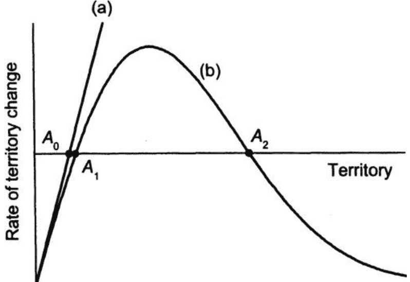

**图 2.3** 两个简单地缘政治模型中，领土变化率 $\dot{A}$ 与领土 $A$ 之间的关系。(a) 领土面积效应模型，(b) 领土面积与距离模型。


另一方面，涉及逻辑负荷（logistic loads）的环路包含一个“减 1”，因此它是一个负反馈回路。

为了模拟逻辑负荷的影响，让我们遵循 Collins 的假设，假设帝国扩张源于与跨距离投影帝国权力相关的困难。换句话说，如果中心的国家权力为 $P_0$，那么在距离 $r$ 处它为 $P_0L(r)$，其中 $L(r)$ 是逻辑距离乘数，范围从 $r=0$ 时的 1 到 $r=\infty$ 时的 0。

Boulding (1962:245–247) 认为，逻辑距离乘数应该随着 $r$ 的增加而呈负指数函数衰减：

$$
L(r) = \exp[-r/c_5]
$$

其中 $c_5$ 控制权力随距离下降的速度。由于面积与半径之间的关系是 $A \sim r^2$，因此逻辑距离乘数为：

$$
L(r) = \exp[-\sqrt{A}/c_{\gamma}]
$$

将该关系代入模型，我们得到：

$$
\hat{A} = cA\exp[-\sqrt{A}/h] - a \quad (2.11)
$$

其中参数组合再次被单个参数取代。图 2.3b 显示，用其纯扩张能力衡量的国家权力在低 $A$ 时为负值（正如纯尺寸模型中一样），并最初随着 $A$ 的增加而增加。

然而，逻辑负荷增加的影响开始显现。在 $A = 4h^2$ 时，国家权力达到最大值，当 $A > 4h^2$ 时，它会下降。有两个平衡点，$A_1$ 和 $A_2$。

$A_1$ 与纯尺寸模型类似，是不稳定的：如果初始条件低于 $A_1$，国家就会被邻居吞噬。$A_2$ 是一个稳定平衡：在它之下，国家的扩张能力为正且在增加；在它之上，国家的扩张率为负且下降（图 2.3b）。

另一种表述方法是假设权力随距离的增加而呈高斯曲线下降：

$$
c_5 \exp[-r^2/c_{\gamma}]
$$

高斯曲线作为一种现象学描述看起来很方便，因为它在国家中心（通信最好的地方）附近是平坦的，然后以增加的速率下降。采用这一假设会导致略有不同的模型：

$$
\hat{A} = cA\exp[-A/b] - a
$$

在这个模型中，$\hat{A}$ 和 $A$ 的关系的定性形状与图 2.3b 相同，因此对领土动力学的意义与模型 (2.11) 完全相同。

注意，这种过度扩张模型不会导致国家崩溃。将纯尺寸模型与模型 (2.11) 进行比较，我们看到新特征是存在上平衡点 $A_2$，事实证明它是稳定的。

注：这里我定义 $c = c_1c_2c_3$ 且 $a = c_1c_4$，以消除不需要的参数。

由 $\gamma$ 编码的边地效应对最终状态大小有何影响？为了进行粗略计算，我们将 $\exp[x]$ 近似为 $1 + x$，并求解该方程得到 $A_2$ 平衡（上方稳定态），得出：

$$
A_2 = 0.5h(1+\sqrt{1-4a\gamma})
$$

从这个表达式中可见，$\gamma$ 的翻倍并没有导致平衡状态大小的翻倍。

为了用数值示例来说明这一点，假设两侧都有敌人的状态平衡大小仅为状态崩溃的临界大小的两倍，即 $A_2 = 2A_1$。那么，只有一侧有敌人将使 $A_2$ 增加 30%。如果 $A_2 = 3A_1$，则由边地效应（marchland effect）带来的增量将小于 20%。

因此，这个简单的模型表明，边地位置对平衡状态大小的增加相当有限。其主要作用是为处于边缘大小的状态提供一些保护（事实上，边地效应将临界状态大小 $A_1$ 减少了 50%）。

## Artzrouni 和 Komlos 模型

我现在转向由 Artzrouni 和 Komlos (1996) 构建的领土动态空间模拟，以调查解释欧洲国家体系形成的假设。

这些研究人员将欧洲表示为一个由单位正方形组成的网格，其线性维度约为 40 公里。在 $t = 0$ 时（假设对应公元 500 年），模拟空间充满了等大的国家，每个国家占据 $5\times 5$ 个方格，因此其起始面积约为 40,000 平方公里（见图 2.4）。

在 Artzrouni 和 Komlos 模拟中，影响国家力量的变量是面积 $A$（测量为组成国家的单位正方形数量）和周长 $C$（拥有外国邻居的方格数量）。$A$ 越大，力量越大，但 $C$ 越大，力量越小，因为更长的边界需要更多资源来防御。

请注意，这与上一节使用的逻辑负荷（logistic loads）概念化方法不同。边地效应是通过对沿海和山区的边界与没有自然边界的边界进行区别对待来建模的。

Artzrouni 和 Komlos 假设海洋边界更容易防御。因此，在计算边界长度时，每个沿海单位仅作为陆地边界的一个比例 $f$。此外，欧洲两个山脉——比利牛斯山和阿尔卑斯山——被认为是不可逾越的自然屏障，因此与这些区域相邻的方格不计入 $C$。然而，比利牛斯山和阿尔卑斯山并没有完全隔绝各自的半岛（见图 2.4）。

Artzrouni 和 Komlos 对国家 $i$ 的力量函数假设以下特定形式：

$$
P_i = \frac{A_i}{\alpha+\exp[\gamma C_i+\beta]} \quad (2.13)
$$


其中 `A_i` 和 `C_i` 分别是国家 `i` 的面积和周长，`α`、`β` 和 `γ` 是正常数。这个函数虽然概念化方式不同，但其状态大小与力量之间关系的总体形状与模型 `(2.11)` 相同。随着 `A` 从 0 开始增加，`P` 首先随 `A` 增加，这是由于与地缘政治资源增加相关的正反馈导致的。最终，与逻辑负荷增加相关的负反馈战胜了正反馈，对于非常高的 `A`，`P` 下降到 0。

国家的相对力量决定了它们在与邻国战争中的成败。模型的每次迭代由一次双边交互（战争）组成。模拟随机选择一个国家（称为 `i`），并将其力量与其所有邻居的力量进行比较。然后模拟确定哪个邻居 `j` 的力量与 `i` 差异最大（即绝对差 `|P_i-P_j|` 最大的 `j`），这两个国家随爆发战争。力量较强的国家以概率 `1-0.5exp[-K(P_i/P_j-1)]` 获胜；否则较弱的国家获胜。战争结束后，失败者所有邻接胜利者的边界方格都将被胜利者吸收。随后，模拟进行下一次迭代，随机选择一个国家，依此类推。每次迭代对应 1/3 年。

Artzrouni 和 Komlos 模型有五个参数（`f`、`a`、`β`、`γ` 和 `K`）。研究人员使用试错法来寻找这些参数的具体值，以尽可能地复制历史观察到的欧洲动态地图。图 2.4 显示了模拟的一种特定实现：公元 500 年的 234 个初始国家在模拟结束时减少到 25 个。沿海国家（“法国”、“西班牙”和“意大利”）的轮廓迅速形成，而内陆国家需要更长时间来固化。此外，在不同的实现中，远离海岸的区域最终配置具有得得多的变性。因此，边地效应有两个方面：首先，享受边地效应的国家与位置较靠中的国家相比，获得了较大的规模（这从图 2.4 中“西班牙”、“法国”和“瑞典/挪威”实现的巨大规模可以看出）。其次，它们的边界达到稳定的速度比内陆国家的边界快得多。

**图 2.4** 由 Artzrouni 和 Komlos (1996) 模型模拟的欧洲国家体系的领土动态。顶部：公元 500 年的初始地图。底部：1800 年的模型预测地图。粗黑线表示比利牛斯山和阿尔卑斯山的位置。（引自 Artzrouni and Komlos 1996: 图 4）

总结来说，Artzrouni 和 Komlos 的模拟提供了对所假设的边地效应的证实。此外，模拟表明，现代国家（尤其是拥有长海岸的国家，如西班牙、法国和意大利）的边界在很大程度上取决于地缘政治机制。然而，Artzrouni 和 Komlos 非常强调，必须调整模拟参数才能达到理想的平衡。虽然参数校准涉及的循环性削弱了结果，但我们应该注意到模拟非常精简，只有五个自由参数。对 `f` 的敏感性对于边地效应问题特别重要。如果 `f` 设置得太低，模拟通常只会产生两个位于欧洲西侧的国家，横扫整个大陆。它们较小的有效周保持了高力量，最终吞并了所有邻国。

最后，Artzrouni 和 Komlos 的地缘模拟与之前的分析模型一样，产生本质上是一阶的行为。大国征服小国，并不断扩张直到达到极限，此时规模达到稳定。换句话说，该模型并没有预测过大的国家会崩溃。

Collins 讨论了两种理论：(1) 人口结构模型（Goldstone 1991b），以及 (2) 受地缘政治权力威望影响的统治者地位（Hanneman et al. 1995）。动力系统理论表明，假设的崩溃机制的关键属性是它们起作用的时间尺度（Collins 也讨论了时间尺度的概念；1995: 图 6）。因此，我们的任务（这一任务在很大程度上将在本章的范围之外进行））是将各种假设的非地缘政治机制翻译为模型，确定这些模型在原则上是否能够产生二阶动力学，如果是的话，则从从中推导出可测试的预测。

尽管 Hanneman 等人的冲突-合法性模型并非基于地缘政治机制（严格意义上的），但在本章中，我将对其进行回顾，因为这个模型已经发展得很完善（可以快速总结），并且与之前考虑的模型紧密相连。实际上，Hanneman 等人开发的不仅仅是一个模型，而是一系列复杂度不断递增的模型。这种方法在方法论上是严谨的；事实上，我完全赞同 Hanneman 等人提出的建模哲学。对于他们卓越的建议（另见 Hanneman 1988），我仅补充一点：应该更多地关注分析模型的并行发展和考虑。

Hanneman 等人提出的理论核心聚焦于权力-威望、国家合法性与国际冲突之间的相互作用。Hanneman 等人假设，统治者发起外部冲突的动机与其当前的合法性与最大合法性目标之间的差异成正比。对于任何给定的发起冲突，其成功程度取决于焦点国家权力相对于竞争对手权力的比例优势。国家威望的变化与战争成功成正比，合法性也随之产生，但伴有滞后性（Hanneman et al. 1995: 17）。Hanneman 等人确实解释了为什么合法性应该在滞后后后于战争成功。然而，在他们的模型中，他们施加了一个巨大的滞后：战争发生在每个时间步中（他们使用离散时间框架），而合法性在滞后三个时间单位后才。这表明（粗略地认为）平均需要连续三场战争的胜利，国家的合法性才能大幅增加。相反，我认为合法性的运作尺度要快得多。战争的胜利会紧接着引发爱国主义的浪潮，这提升了政治家的命运；反之亦然，战争的失败会紧接着引发对权力的幻灭。如果合法性是一个慢变量，那么政治家就没有那么大的动力利用“一场小胜之战”来增强动摇的合法性了。

Hanneman 等人开发了三个模型：(1) 关注战争合法性动力学的核心模型；(2) 增加了帝国成本和收益的更复杂版本；(3) 进一步增加了帝国资本主义和军工复合体的完整模型。我们特别感兴趣的是第二个模型，因为在某些参数值下，它似乎能预测出帝国增长后继崩溃的重复实例。然而，这些国家崩溃实例的发生关键地取决于对“合法性随战争成功存在滞后时间”的假设。为了检查这是否真实，我将 Hanneman 模型的核心翻译成了微分方程模型。在附录中（见节录 A.1），我展示了合法性-冲突模型由单维常微分方程描述。换句话说，我们再次回到了一阶模型。该模型可以有多个平衡点，取决于领土大小的初始值和之前的战争成功记录，轨迹将被引入其中一个稳定平衡点。该模型无法表现出繁荣/萧条动力学或持续震荡。因此，不可避免的结论是，合法性、战争成功与领土扩张之间的相互作用无法产生持续的帝国衰落。因此，Hanneman 模型中发生的帝国崩溃似乎完全由于所假设的合法性滞后战争成功的延迟。

## 2.3 结论：地缘政治作为一种一阶过程

我在这章的开头首先回顾了非线性动力学中的一些基本事实，原因如下：大多数社会科学家并不熟悉动力系统理论，我想对其中与本书所处理问题最相关的见解提供一个非技术性的总结。其中一个特定的见解是，负反馈作用的时间尺度与动力学的本质之间存在着紧密的关系。如果反馈机制的作用远快于焦点变量的动力学，那么系统就不会震荡或表现出单一的繁荣/萧条行为。如果我们有一个震荡系统，那么从定量角度来说，反馈作用的速度决定了动力学的时间模式（例如，震荡的平均长度，或繁荣/周期）。这意味着，如果一个反馈循环以年为尺度、甚至更糟以周为尺度运行，那么它极就不可能导致平均周期以世纪计的震荡。长达世纪的周期通常是由在人类世代尺度（几十年或更久）运行的反馈引起的。

这一见解对于帝国繁荣/萧条周期的底层机制问题非常相关。帝国以世纪为尺度进行增长和衰落（Taageever 1978a, 1978b, 1997；见第 4 章图 4.4）。让我们对 Taageever (1997) 附录表中帝国增长/衰落数据进行简单分析。Taageever 将上升期定义为政策从其最大面积的 20% 扩展到 80% 所的时间（1997: 480）。我们可以类似地定义衰落期，为从 80% 下降到 20% 所的时间。这一见解对于帝国繁荣/萧条周期的底层机制问题非常相关。长达世纪的周期通常是由在人类世代尺度（几十年或更久）运行的反馈引起的。

### 表 2.1 帝国阶段持续时间（世纪）

| 帝国 | 上升 | 峰值 | 衰落 |
| :--- | :--- | :--- | :--- |
| 哥林斯 | 0.7 | 1.5 | 0.0 |
| 辽 | 3.4 | 0.7 | 1.7 |
| 契丹 | 0.0 | 3.1 | 0.4 |
| 罗斯辅基罗斯 | 1.2 | 0.5 | 1.4 |
| 法兰克 | 0.3 | 0.5 | 0.0 |
| 法提姆 | 0.6 | 2.1 | 1.0 |
| 阿尤布王朝/马穆鲁克 | 1.8 | 1.5 | 1.2 |
| 哈里发 | 0.7 | 1.0 | 0.8 |
| 萨曼 | 0.8 | 0.6 | 0.4 |
| 布杰德 | 0.0 | 0.9 | 0.2 |
| 兹纳维德 | 0.4 | 0.0 | 1.5 |
| 塞尔柱 | 0.5 | 1.0 | 0.2 |
| 花喇子米 | 0.8 | 0.1 | 0.2 |
| 印加 | 0.2 | 0.4 | 0.0 |
| 阿兹特 | 0.5 | 0.1 | 0.0 |
| 立陶宛/波兰 | 1.8 | 2.5 | 0.2 |
| 金帐汗国 | 0.0 | 0.7 | 1.7 |
| 奥斯曼 | 0.9 | 3.4 | 0.1 |
| 西班牙 | 1.4 | 0.5 | 0.0 |
| 蒙古/元 | 0.5 | 0.5 | 0.9 |
| 德里 | 1.1 | 0.4 | 0.5 |
| 明 | 0.9 | 1.8 | 0.8 |
| 莫卧儿 | 0.7 | 0.9 | 0.8 |
| 满洲 | 1.3 | 1.4 | 0.2 |
| 法国 | 0.3 | 0.5 | 0.0 |
| 英国 | 1.1 | 0.4 | 0.1 |
| 葡萄牙 | 0.0 | 0.4 | 1.5 |

我在本章的主要观点是，地缘政治变量（狭义上）无法解释长期（一个世纪或更久）的衰落期。地缘政治变量作为后负载和边缘优势的损失，基本上是没有时间延迟的。一旦征服了更多领土，国家就必须承担防御外部和内部（叛乱）威胁的负担。同样，一旦胜利国家进入核心位置，任何先前的边缘优势都会被削弱。确实，规模增加带来的收益可能伴随着巨大的滞后，因为在新征服领土上组织生产以及说服那里的人们接受国家权威需要时间。但这种机制是正反馈循环的一部分；它并不是导致帝国衰落的原因。

时间尺度的重要性显然没有被此前的理论者所忽视。柯林斯花费了数页的内容来讨论这个问题（Collins 1995:1584–1586），肯尼迪（1987）反复强调，国家的军事实力和生产能力在长期内是相关的，我们确实不应忘记布鲁迪亚（1972）的*长期性*（la longue durée）。然而，对这一问题的讨论通常不限于口头理论。正是在这些量化问题上，非线性动力学可以大有用场，因为建立显式模型允许我们把假设机制中基于经验的特征（包括它们变化率）内置，并预测随之而来的模型动态（上升和衰落阶段的持续时间）。这种练习有助于我们拒绝一些竞争性假设。本章中地缘政治模型的发展就是这一通用理念的例子。

如果接受了本章提出的时间尺度论点，并不意味着地缘政治机制（狭义上）在解释帝国的兴起衰灭中并不重要。它们只是不充分，我们必须寻求其他变量来构建所需的理论。一个似乎值得探索的潜在途径是放弃将政治视为“黑箱”的观点，并研究其内部运作机制。这将是我们下一章的目标。

## 2.4 总结

- 存在三类非常通用的动力行为。零阶动力学，即无限制增长或衰减，出现在不受负反馈影响的系统中。例子包括线性和指数级增长/衰减过程。一阶动力学描述了反馈在快速尺度上作用的系统。一阶动力学是平衡的；例子包括渐近和逻辑增长过程。一阶动力学也可能是稳态的（存在多个稳定平衡点）。最后，二阶动力学出现在动力反馈具有滞后作用的系统中。二阶行为的例子包括单一的繁荣/衰退动态以及持续的周期或混沌震荡。
- 兰德尔·柯林斯（Randall Collins）的地缘政治理论假设了解释国家领土动态三个三个机制：地缘资源、后勤负载和边疆位置。
- 仅包含领土与地缘资源之间正反馈的数学模型表现出零阶动力学。如果初始状态领土高于某一阈值，它将以加速方式增长。然而，如果初始领土低于阈值，国家就会萎缩并最终消失。
- 在模型中加入后勤的负反馈会导致一阶动力行为，即稳态。同样，如果初始领土低于阈值，国家将失去土地并消失。然而，从高于阈值开始，领土不会像简单模型那样无限增加，而是接近一个上限平衡。这个平衡对于小扰动是稳定的。
- 为了考察位置效应，我转向了 Artzrou 和 Komlos 开发的空间模拟模型。该模型表明，最初拥有边疆优势（沿海岸线边界比例较高）的国家将增长到比内陆国家更大的规模。然而，该模型没有表现出任何二阶震荡：失败者消失，而获胜者增长到更大的规模并在那里稳定下来。
- 最后，我回顾了汉南（Hannan）及其同事开发的模拟模型。我证明了，如果我们将其转化为微分方程，那么我们再次获得一个无法产生此类震荡的一阶系统。
- 莱因恩（Rein）对合法性的分析表明，长期的衰落（超过一个世纪）是由二阶机制支配的。这一发现表明，至少在某些历史案例中，纯基于地缘政治因素的模型无法预测这种动态。我们还应该记住，最终有必要进展到下一个水平，考虑政策如何相互作用。

# 第三章

## 集体团结

### 3.1 社会学中的群体

#### 3.1.1 作为分析单位的群体

在上一章中，我建议如果不研究领土动态的内部运作机制，我们就无法理解它。这引发了一个重要问题：我们的理论应该构建在什么基本单元之上？方法论个人主义的哲学原则认为理论应该基于个人。我在原则上同意这种方法；然而，在我看来，它必须通过两个重要的免责声明进行平衡。首先，个人在某种程度上比群体更“真实”的观点是站不住脚的。人类群体不仅仅是简单的个人集合；与动物群体不同，人类群体可以计划并执行以群体为导向的行动（Alexander and Borgia 1978）。其次，试图一步遵循方法论个人主义的指令似乎并不是一个好策略。政策，尤其是像帝国这样复杂的政策，包含了在许多方面相互差异的众多个体。此外，个体主要与少数一小部分其他人互动，而不是直接与其他所有人互动。换句话说，大型人类社会由许多群体组成，这些群体通常层级地嵌套在彼此之中。因此，一个更好的策略是将问题分为两个（或更多）步骤。首先，我们想理解群体动态如何从个人行动产生，然后我们可以使用群体属性对政体动态进行建模。“存在一种独特的社会学视角来看世界。它认为理解社会生活的关键在于对群体的分析，而不是个人。”（Hechter 1987:2）这种将群体作为个人与社会动态之间中间行动者的层级化方法，一个极佳的例子是杰克·戈尔德斯通（Jack Goldstone 1994）对革命行动的分析。

### 社会边界

人类使用许多线索来界定群体成员（Shaw and Wong 1989; Masters 1998）。最重要的识别标记之一是语言，特别是方言和言语模式。例如，来自多个社会的丰富实验证据表明，人们更倾向于与自己使用相同方言的人合作，即使方言差异非常细微（Nettle 1999:57）。表型相似性提供了许多潜在标记：面部和躯体形态的视觉相似性（甚至包括气味）；运动模式、面部表情和行为刻板印象；服装和饰品；以及风格和举止（后者对于传递社会阶层尤为重要）。言语方言和表型提供了关于群体身份的显性、瞬时信息。其他类标记包括亲缘关系（假设共同祖先；

（可能是虚构的），宗教（共同的信仰、规范和仪式），以及领土或居住地的接近（Masters 1998:456–457）。最后一类还包括对同一政治政体的共同成员身份（民族主义或“王权主义”；见 Reynolds 1997）。

## 团结行为的能力

从个人行为中推断集体行动模式的一种非常强有力的方法是理性选择理论（Coleman 1990）。该理论的基本假设是个人是效用最大化者。然而，理性选择理论一直无法解决社会学中一个非常重要的问题：社会如何在不解体的情况下运作。一个重要的理论（例如由托马斯·霍布斯表述）认为社会是基于社会契约概念的。但事实证明，如果人们完全在理性的基础上行动，他们根本无法聚集形成社会（Collins 1992:9）。事实上，在我看来，这种“显而易见的社会学洞察”（Collins 1992）接近于定理的逻辑地位。例如，Kraus (1993) 展示了关于霍布斯契约论的最完善的理论是如何在集体行动问题——搭便车者困境上崩溃的（Olson 1965；非性回顾见 Collins 1992:13–19）。

对于社会如何保持团结这一谜题，似乎只有一个解决方案（Collins 1992）。尽管人们大多数时候都在追求私利，但他们对至少某些其他人也拥有团结感。用杜尔干的话说，这种“前机械的团结”是社会的基础（Collins 1992）。当人们停止认为自己是群体的成员，而只考虑个人利益时，国家和军队就会解体（Collins 1992:23）。

因此，社会的运作只能被理解为自我为中心（理性的）和以群体为中心（超理性的）行为的混合。在 Collins (1992:8) 看来，“社会的整体结构最好被理解为冲突群体的结果，其中一些群体主导了其他群体。但冲突和支配本身之所以可能，是因为群体在微观层面是整合的。”这一说法非常很好地捕捉到了我在这里开发的方法的精髓。

### 3.1.2 团结行为的演化

上述论点表明，为了理解社会和国家的运作，理性选择理论必须由促进群体维护行为的规范来补充。这一观察，结合关于规范的压倒性经验证据，导致了一个问题：规范从何何来？更准确地说，我们需要一个理论来解释促进群体的规范如何在社会演化的过程中产生。目前已经提出了几种机制，包括互惠、惩罚、亲缘选择和群体选择（Richardson and Boyd 1998）。

互惠作为一种在长期持续互动中建立信任和合作的机制是由 Trivers (1971) 提出的。随后，Axelrod 和 Hamilton (1981) 证明了一种简单的策略“以牙还牙”（第一回合合作，然后按照伙伴上一次的做法做）在重复囚徒困境游戏中提供了一种合作的解决方案。因此，只要两个理性个体之间进行长期互动，他们之间的合作是可能的。问题是，“以牙还牙”策略无法推广到大群体，因为在一个由无条件背叛主导的大群体中，当互惠稀缺时，很难增加它（Boyd and Richardson 1988）。


惩罚也被提作为一种支持规范的机制。Axelrod (1997:44–71) 使用了一系列计算机模拟来研究规范可以演化并稳定的条件。他研究的一种可能性是使用“元规范”（metanorms），或惩罚不执行规范的人的意愿。Axelrod 发现，规范可以通过元规范变得稳定。然而，这一结果取决于种群起始是否有足够多的规范执行者。如果最初的“复仇者”太少，那么规范和元规范都会崩溃。Boyd 和 Richerson (1992) 开发了类似的模型，他们证明了通过少数甚至一个惩罚者就可以产生分工，以防止大量不情愿的合作者发生背叛。然而，这存在一些问题（Richerson and Boyd 1998）。首先，领导者可以强迫的群体成员数量是的。其次，惩罚系统中缺乏一种为了群体利益而调节个人行为的机制（如果领导者能够强迫整个群体，那么他可能可能会利用群体来满足自己的利益）。最后，比较证据并不支持强制可以产生超社会性的观点（Richerson and Boyd 1998:79）。

互惠和强制是理性行为。但正如上述提到的，促进群体利益行为的规范不能产生于自私个体之间的契约。同样，如果演化仅在个人层面发生，很难想象利他行为如何产生（目前为止开发的所有正式模型都表明这是可能的）。利他主义演化的唯一已知理论机制是多水平选择（Sober and Wilson 1991）。多水平演化机制的一个无争议的例子是亲缘选择，基于 W. D. Hamilton 的扩展适应度概念。一个更具争议的机制是群体选择。进化生物学家经历了首先不加批判地接受群体选择，然后又拒绝它的阶段（Sober and Wilson 1991）。目前，在某些特定条件下（人类群体满足了这些条件；Sober and Wilson 1991），人们谨慎但明确地接受群体选择作为一种合法的演化机制。遗憾的是，许多社会学家仍然认为这是一个被彻底否定的概念（例如 Sanders 1999）。

毫无疑问，利他可以通过亲缘或群体选择机制在小群体中演化（Richerson and Boyd 1998）。此外，亲缘和群体选择逻辑上并不是不同的类别（Sober and Wilson 1991），并且可以协同工作（Jones 2000）。此外，尽管利他规范不能完全通过互惠和惩罚机制演化，但这些机制可以通过减少（尽管没有完全消除）搭便车问题，在群体选择背景下显著增强规范演化的可能性。另一个潜在的增强特征是均衡制度，例如非亲属之间的一夫制和食物共享（Boehm 1997）。Bowles (1999) 又列出了其他促进利他的群体特征：分割、从众和旁系（parochialism）。

虽然小群体利他的演化被社会生物学家广泛接受，并解释解释了非灵长类动物的小规模合作，但人类超社会性的某些方面仍然令人困惑（Richardson and Boyd 1998）。关于遗传和群体选择即使在互惠、惩罚和均衡制度的支持下，是否能解释大群体中的利他行为存在一些争议，在大群体中，利他的接受者不是亲属，利他赠者也不认识他们。Sober 和 Wilson (1991) 认为，考虑到人类集合的特征，群体选择是一种完全可能的机制。Boyd 和 Richerson 认为这还不够，并提出了他们自己的理论，引入了文化群体选择（原始理论见 Boyd and Richerson 1985；近期评估见 Richardson and Boyd 1998, 2001）。

文化群体选择的一个重要预适应特征是 Boyd 和 Richerson 所说的文化特性的从众传递，例如，“入乡随俗，像罗马人那样”（理性模仿的相关概念，见 Hedström 1998）。使用这种策略是有益的，因为群体通常比个人更“明智”，拥有比任何个人单独获得的更长的集体记忆和更广泛的经验。从众的副作用是减少了群体内部的变异，同时增加了群体间的差异，这一过程与个人水平选择相比，加强了群体水平的选择。Boyd 和 Richerson 还开发了一个关于群体成员身份符号和意识形态标记文化演化的理论（使用“间接偏见”模型；见 Boyd and Richerson 1985：第八章）以及关于道德惩罚演化的理论（Boyd and Richerson 1992）。

一旦通过道德惩罚稳定的符号化标记的群体内合作适应性在小型群体（如旧石器时代的狩猎采集者部落）中演化出来，人类进化的一个重要阈值便被跨越了。符号界定允许大型集体被指定为合作群体。“群体间竞争的成功开始取决于群体内部合作；一场进化的军备竞赛随之产生。这种合作与竞争的规模可能会持续直到生态约束而非演化约束将其停止。一旦亲缘和互惠建立的屏障被文化群体选择所突破，尚不清楚合作规模的下一个演化界限会在哪里”（Richerson and Boyd 1998:91–92）。因此，具有符号化界定边界的演化是“阶梯效应”（Turchin 1977:102）的一个例子，在这种效应中，某些时期微小数量变化的积累使得人们能够迈出质的巨大跨越，并紧接着是另一个跨越，以此类推。关键的理论问题是理解将合作集体的定义从小规模群体扩大大规模群体的机制。这种机制的反复迭代会导致不断扩大的合作内群体，直到其他某种力量停止这一过程。

总结来说，进化生物学家开始同意，人类社会的演化必须涉及某种类型的群体选择。关于这一论点有两个版本，一种强调群体选择的生物学（“遗传”）方面（Sober and Wilson 1991），另一种则强调群体选择的文化方面（Boyd and Richerson 1985）。实际上，这两个版本并不遥远，区别主要在于侧重点。这两种论点都有一系列数学模型和实证证据的支持。例如，群体选择在实验中被证明是一种极其有效的机制（Goodnight and Stevens 1997）。另一个例子是近期对人类利他性惩罚的实验证明（Fehr and Gächter 2002）。在他们最新的综述中，Richerson 和 Boyd（2001）认为，文化群体选择理论通过了多项测试，例如逻辑一致性测试（通过形式模型检查）、对理论所假设的近因（心理）机制的验证、对必要的微演化过程存在的测试，以及对大规模比较证据的审查，包括适应与不适应的模式。

### 3.1.3 族群与种族性

人类集体的一种非常重要类型是族群。我们上面讨论的人类群体的所有特征在应用于族群时表现得最为生动。因此，第 3.1.1 节中列出的标记——语言、宗教、表型和领土性——以各种组合用于划定族群边界。事实上，正如 Barth（1969）所强调的，重要的并不是界定标记的具体形式。种族性的关键方面在于“定义群体的族群边界，而不是其所包含的文化特征”（Barth 1969:15）。根据 Barth 的观点，种族性是一种社会组织形式，其主要特征是自我归同以及他人的归同。不同的族群可能使用不同类型的标记，但功能是相同的，即在“我们”和“他们”之间划定边界。这一洞解经受住了时间的考验（Vermeulen and Govers 1994）。

族群不仅往往具有最清晰的边界，而且倾向于引发最强烈的团结情感；集体团结的终极形式——为了共同利益牺牲，在族群冲突中相对常见。相比之下，很难想象个人为了某个职业组织或公司牺牲生命。

族群似乎是典型的人类群体。原因最可能是，在人类大多数演化历史中，种族性是人类社会组织的基础。生活在部落中的狩猎采集者的特征是非常极其平坦的社会等级和非常有限的分工，而种族性（广义上，见下文）提供了群体形成的主要依据。

种族性被 Brass（1991）定义为一种自我认同以及他人的认同，它是社会组织的一种形式，其主要特征是自我归同以及他人的归同。不同的族群可能使用不同类型的标记，但功能是相同的，即在“我们”和“他们”之间划定边界。这一洞见经受住了时间的考验（Vermeulen and Govers 1994）。

族群不仅往往具有最清晰的边界，而且倾向于引发最强烈的团结情感；集体团结的终极形式——为了共同利益牺牲，在族群冲突中相对常见。相比之下，很难想象个人为了某个职业组织或公司牺牲生命。

族群似乎是典型的人类群体。原因最可能是，在人类大多数演化历史中，种族性是人类社会组织的基础。生活在部落中的狩猎采集者的特征是非常扁平坦的社会等级和非常有限的分工，而种族性（广义上，见下文）提供了群体形成的主要依据。

### 3.1.4 社会规模

即使是人类学家所知的最简单的人类社会也具有嵌套的分级结构（Johnson and Earle 2000）。因此，像肖肖族或贡族这样的家庭级群体具有两个层次：家庭群体和扩展家庭。生活在（仍生活在）农业社会中的人类可以有许多层次。反映这一原理的最简单社会组织是分段社会，例如摩洛哥中部阿特拉斯山的柏柏尔人（Gellner 1969）。复杂的社会保留了分段组织（尽管它们可能有额外的身份来源）。例如，Sahlins（1989）识别了早期现代加第尼亚居民的以下身份圆圈：村庄-加第尼亚–双县（鲁西永和加第尼亚）–加泰罗尼亚-西班牙。因此，族群变化的一个重要维度是社会规模。大多数人认为自己拥有相互嵌套的族群身份。在最小规模上，个人是家庭和当地社区的成员。在此之上，身份可能具有区域性、国家性以及最后的“文明性”（Huntington 1996）成分。

我们需要比“区域”、“国家”和“文明”更好的术语，这些词每个都带有太多的外在负担。遗憾的是，术语尚未定型，至少在英语文献中如此。目前使用了两个外来词：`ethos` 和 `ethnie`（后者将在后续章节讨论）。`ethos` 在俄罗斯民族学中被广泛使用（Gumilev 1971; Bromley 1987; Bromley and Kozlov 1989）。最常见的定义如下：`ethos` 是在特定领土内历史性形成的稳定人群集合；`ethos` 的成员具有共同的、稳定的语言、文化和心理特征；此外，他们意识到了自己与其他相似集合区分开来的统一性（自我意识），这反映在他们的族群名称中（Bromley 1987:14）。

对我们此处的目的特别重要的是 `ethos` 概念的系统性。因此，正如系统由子系统组成，且自身又是元系统的一部分，不同规模或层级的族群群体可以被称为 `subethnos`（亚族）、`ethnos`（族/民族）和 `metaethnos`（元族）。当我们需要更多层次时，总是可以将任意层次指定为 `ethnos`，并用 `sub-` 和 `meta-` 前缀来定义其他层次。但在实践中，`ethos` 通常用于大致对应于现代国家的族群群体水平。属于不同 `ethoses` 的人倾向于使用互不通的语言。因此，美国人、法国人、德国人、俄罗斯人和埃及人都是不同的族群（`ethnoses`）。亚族群的例子包括美国的摩门人和南方人（“Rebs”），以及德国的巴伐利亚人、萨克森人和施瓦本人。同一大族群内部的不同亚族群通常以独特的方言为特征。

元民族身份认同（Metaethnic identity）通常是由于过去或现在在同一个大型国家（或更准确地说，帝国）内的关联产生的。因此，中世纪欧洲的拉丁基督徒主要是加洛洛王朝帝国继任国家的居民（Bartlett 1993）。今天，拉丁基督教世界的继承者是欧洲身份认同，它主要基于对欧洲共同体的成员身份（因此，例如德国人或法国人并不将白俄罗斯人视为“欧洲人”，尽管白俄罗斯在地理上是一个欧洲国家）。元民族认同的另一个重要来源是宗教。因此，一个埃及人也是阿拉伯人、逊尼派穆斯林，最后是穆斯林教徒（因此我们需要几个“元”概念来指代这些身份）。我希望将族性视为一种系统属性的优势从上述讨论中显而易见：它防止了我们去争论阿拉伯人究竟是一个族群、一个元族群还是其他什么。

基于族群的术语也避免了关于“民族主义出现之前是否存在国家”的争论。因此，古典时期的雅典人既是爱奥尼亚人，也是希腊人。我们知道古希腊人对族性有一种等级森严，因为他们有两个独立的领域来指称异族（`alloethics`, `xenoi`），用于其他希腊人；以及“野蛮人”（`barbaroi`），用于非希腊人，即使是其他高度发达文明的成员，如波斯人。希腊人还敏锐地感受到了这种中间层边界，例如多里安人（斯巴达人所属）与爱奥尼亚人（包括雅典人）之间的边界（Smith 1986）。

总之，我在这里使用的广义族性，其涵盖了从光谱一端对一小圈亲属、朋友和邻居的团结感，到光谱另一端对属于同一国家甚至跨国家实体的数百万人的团结。然而，必须强调，集体团结的强度通常随族群规模的大小而变化。因此，亚族群层面的团结可能非常高，而在高一个水平上可能非常低。一个有些极端但并不罕见的例子是 16 世纪后期法国的情况，当时胡格诺派和天主教徒发生了极其残酷的冲突。在法国历史的这一时期，胡格诺派的据点主要位于法国南部和西南部，而天主教联盟在北部和东部实力强大（Briggs 1998），因此在这个例子中，区域和宗教身份是紧密交织的。这个例子也说明了团结的动态性质。就在一两代人之前，法国贵族在反对哈布斯堡霸权的斗争中具有很强的团结性，许多在宗教战争中反目作战的贵族在西班牙战争期间曾是战友（或他们的父亲曾是）。

## 3.1.5 民族（Ethnies）

第二个术语 `ethnie` 是安东尼·史密（Anthony Smith 1986）从法语引入的。他将民族定义为一个有名称的人类群体，拥有共同祖先的神话、共同的历史记忆、一个或多个共享文化元素、与祖祖的联系，以及某种程度的团结感，至少在精英阶层中如此（Smith 2000:65）。在我看来，这个定义与布罗姆利（Bromley）对族群的定义非常相似，尽管重点确实不同（布罗姆利似乎强调客观文化特征）。无论如何，对于本书的目的来说，解决这些定义问题并不重要。由于其在目前英语文献中的流行，我将采用史密斯的术语 `ethnie`，但也会使用前缀 `sub-` 和 `meta-` 来指代规模较小或较大的族群性民族。

史密斯理论中我发现特别有用的方面是对族性与阶级之间相互关系的分析（Smith 1986: 第 4 章）。史密斯区分了两种民族。第一类是**横向的**（`lateral`）贵族民族，在这种民族中，共同族群感在很大程度上限于精英（贵族、神职人员和较富的商人）。第二类是**垂直的**（`vertical`）平民民族（`demotic ethnie`），其特征是共享族群情感具有更大程度的“社会渗透”。重要点是，民族的低层阶级与精英之间的团结感是可以变化的。在一个极端，是垂直整合紧密的民族，例如某些部落联盟（如成吉思汗统治下的蒙古人）以及古代苏美尔或古典希腊的某些城市。在另一个极端，是精英在族群上与被统治的民迥然不同的政体（`pol`）（例如，古赫提特王国）。因此，集体团结的强度不仅取决于族群的规模（见第 3.1.4 节），还取决于社会经济阶层。

## 3.2 集体团结与历史动态

正如本章开头所述，在我们理解政体动力学（`polity dynamics`）之前，我们首先需要分析不同群体在政体内部是如何相互作用的。人类行为的两个方面使得群体成为其自身有效的代理：边界界定和群体导向的（利他主义或团结主义）行为。作为代理，群体可以与其他群体相互作用，而这种互动往往是冲突的：“组织最好的群体通常会获胜，这意味着内部团结最紧密的群体”（Collins 1992:26；另见 Richerson and Boyd 1998）。我们可以利用这一点来帮助理解为什么某些国家比其他国家更成功吗？

历史社会学中体面的理论倾向于回避集体团结的主题，转而关注强制和经济关系，这无疑是理性选择理论的骨干。这种偏见的一个例子是 Tilly（1990）的著作（在其他方面非常出色），书中“强制”和“资本”实际上是标题中的前两个词。从专业文献中得到的印象是，战争和经济在某种程度上是“硬性”课题，而团结是“软性”且不科学的。其可能是早期宏历史学家（维科、丹尼列夫斯基、斯宾格勒、汤恩白、索金）未能开发出科学理论，即可以通过实证检验的非明显预测。Quigley（1961:129）将这种历史解释称为“纤维化”（`softening of the fiber`）。Tainter（1988:89–90）同样将其斥为“神秘主义解释”，认为它们“因依赖生物增长、价值判断以及对无形物的解释而陷入瘫痪”。

但如果“纤维化”指的不是衰落帝国个人的道德堕落，而是这些社会集体团结的丧失呢？为了建立集体团结的科学理论，我们需要以某种方式使这个变量内生化，即假设某些机制使其根据社会和政体的其他动态属性而兴旺或衰。到目前为止，据我判断，还没有体面的社会学理论能够做到，尽管理论文献中散布着许多线索。例如，Hechter（1987）基本上从相同的集体团结概念开始，且这是一个动态变量（Hechter 1987:8）。然而，他随后勇敢地尝试建立群体团结的理性选择理论（Hechter 1987: 第 3 章），但由于前节提到的原因，这注定是失败。Collins（1992: 第 1 章）在已引用的章节中，为团结作为一个重要的历史变量构建了有力的论点。在第 2 章中，他讨论了产生团结的一种机制：涂尔干的宗教理论。然而，从未将团结与其他重要的历史变量联系起来。Smith（1986:38）讨论了国家间的战争如何激发并维持民族情感：“人们只需要阅读埃斯琉癸对波斯战争的描述——他的兄弟在那场战争中去世，他本人也参加了战斗——就能理解在危机时刻通过激活同情心、团队合作和集体精神来进行战场抵抗，对每个个人民族认同的集体意义。”再次，战争在历史上几乎是持续的，但在外部侵略的压力下，某些政策在增长而另一些在衰落。我们需要一些东西来建立理论。诱人的线索有散布在历史文献中。例如，McNeill（1963:809）在讨论普鲁士工业的兴起时，其用辞与斯密几乎相同：“一个具有强大内部纪律和集体荣誉感的管理精英阶，这与英国商人中常见的个人主义和纯粹逐利的行为完全不同。”我还可以继续写下去。然而，有两个理论已经发展到实际上可以产生可测试预测的程度：伊本·哈尔敦的“部落凝聚”（`asabiya`）理论，以及古米列夫的“激情论”（`passionarity`）理论。

## 3.2.1 伊本·哈尔敦的理论

14 世纪的阿拉伯思想家伊本·哈尔敦可能是现代意义上的第一位社会学家（Gellner 1981）。在他的巨著《场言：历史绪论》中，他提出了一个卓越的政治循环理论。伊本·哈尔敦发展这一理论主要是解释马格里布（北非）的历史，但他也涉足了他所知的其他地区（例如阿拉伯西班牙和中东）。伊本·哈尔敦并非象牙塔里的学者。他曾是一名实践中的政治家，几乎在一次政变失败中丧命。他还广泛游历过（甚至曾遇到过帖木汗并与之进行了长时间长谈）。简而言之，伊本·哈尔敦从内部非常熟悉他所研究的社会运作机制。

## 群体与群体团结


伊本·哈尔敦的主要论点非常现代化（以下叙述部分参考了《场言》译者弗朗斯·罗森塔尔的引言，以小写罗马数字页码标记；大写罗马数字表示卷数）。他首先假设人类个体无法生活在群体之外：人类获得同胞的合作是绝对必要的（伊本·哈尔敦 1958:I:90）。防御和保护只有对于联系紧密的群体来说是成功的（伊本·哈尔敦 1958:I:263）。但社区化的生活对于获取不同的手工艺和技术技能、以及智力交流也是必要的。

下一个假设是，不同的群体具有不同的协调行动能力。在这里，伊本·哈尔敦引入了他理论中的核心概念：`asabiya`，罗森塔尔将其翻译为“群体情感”。最初，这个词的意思类似于“与同系亲属达成一致”（伊本·哈尔敦 1958:I:xxviii）。但在伊本·哈尔敦的用法中，`asabiya`是一个更广泛的概念，因为也可以被没有血缘关系的共享。`asabiya`产生了“防御自身、提出反对、保护自身以及维护自身主张的能力”（伊本·哈尔敦 1958:I:289）。`asabiya`的优势地位使一个群体优于其他群体（伊本·哈尔敦 1958:I:lxxix）。

伊本·哈尔敦清楚地意识到族群的嵌套性质，并且每一层级都有与其相关的`asabiya`。例如，他指出，为了让高层群体不解体，其`asabiya`必须强于所有底层群体`asabiya`的总和（伊本·哈尔敦 1958:284）。此外，他不断强调，群体内的领导或统治元素必须被赋予一个家族或血缘，而这个血缘对现有`asabiya`的控制权拥有最强大且最自然的权利（伊本·哈尔敦 1958:I:lxxx）。只有控制了足够强度`asabiya`的领导者才能成功建立王朝。

## `asabiya`的动力学

伊本·哈尔敦还发展了一个详细的理论来解释`asabiya`是如何产生的，又是如何丢失的。通常，`asabiya`产生于“社交交往、友好协会、长期的熟悉和结伴”（伊本·哈尔敦 1958:I:374）。这与社会资本获取的解释非常相似（Putnam 2000；关于`asabiya`与社会资本的比较，请参见 3.2.3 节）。

然而，并非所有社会条件都有于`asabiya`的增长。正如我上面提到的，伊本·哈尔敦的理论是针对中世纪马格里布的特定情况开发的。伊本·哈尔敦区分了居住在马格里布的两个主要族群：柏柏尔人和阿拉伯人。这两个群体不仅在民族上不同，在社会组织方式也不同：分别是“沙漠型”和“文明型”。

然而，伊本·哈尔敦所做的区分并不是游牧与定居生活；他将游牧民和定居荒民归为一类，并将他们与作为大型人口中心的定居城市民对比（伊本·哈尔敦 1958:I:xxvii）。这种社会学区分不是定性的，而是定量的，指的是人类定居点的规模和密度，以及政治实体的规模。“沙漠型”的特征是小规模政治（现代术语中的酋邦制）。“文明型”则组织在国家和帝国中（在国家政权崩溃的时期除外）。

在伊本·哈尔敦看来，社会类型是理解`asabiya`增加或减少的关键。“沙漠”生活由于其对生存的持续斗争，因此产生了对合作的必要性，为`asabiya`的增长创造了条件。“文明型”社会控制着大量的人口，其中一部分可能被投入到“便利品”和奢侈品的生产中（奢侈品而非必需品）。这种向奢侈品的发展以退化为形式的代价。

统治王朝，因此国家（伊本·哈尔敦不区分这两者），是这种奢侈化倾向的主要受害者。伊本·哈尔敦（1958:I:xxci–xxxii）基本上认为，奢侈品导致了精英内部的竞争，结果`asabiya`迅速衰落。大约四代（I:281）。

除了`asabiya`的衰落，还有另一个导致国家崩溃的主要因素：经济。根据伊本·哈尔敦的观点，繁荣导致人口增长，进而导致稀缺、精英压迫，并最终导致国家崩溃。伊本·哈尔敦理论的这一方面在第 7 章的人口结构理论中得到了进一步探讨。

总之，这里是伊本·哈尔敦关于`asabiya`与政体强度动态关系的主要观点：

- `asabiya`在小规模社会中增长并保持在高水平，集体行动是生存的关键。
- 此外，此类社会只生产必需品，因此奢侈品对`asabiya`没有腐蚀作用。
- 伊本·哈尔敦这类“沙漠”社会的主要例子是马格里布的柏柏人，他也引用了十一世纪入侵非洲的几个阿拉伯部落（I:283）。
- 具有高`asabiya`的沙漠部落征服了低`asabiya`的文明民，并在他们身上建立了统治王朝（国家）。
- 然而，在文明条件下，`asabiya`不避免地衰落。
- 大约四代之后，`asabiya`变得如此低以至于由于派系冲突而崩溃。
- 这就是文明地区再次受到另一个沙漠部落入侵这一点。

## 评估

伊本·哈尔敦的理论有很多内容对我们的目标非常有用。首先，该理论表述非常清晰。因此，它产生了可以测试的实证预测。此外，如果需要定量预测，该理论可以相当容易地转化为数学模型。其次，伊本·哈尔敦描述了其国家崩溃理论基础的明确社会学机制。这为测试该理论提供了另一种方法。

## 理论的弱点

总来说，虽然伊本·哈尔敦对一种社会——干旱地区的伊斯兰社会提供了精彩的描述，但他的描述即使在伊斯兰内部也并不通用（Gellner 1981:88–89）。如果他的理论可以扩展到一般的农业社会，将非常有趣。

具体来说，可以质疑伊本·哈尔敦对奢侈品在`asabiya`衰落重要性的强调。伊本·哈尔敦的并不是调用这种机制的唯一理论；许多“纤维软化”理论都提出了相似的解释。这是一个关于应当通过实证来解决，但为此我们需要一些明确的替代方案进行测试。我将尝试在第 4 章中构建一个替代性解释。

## 3.2.2 古米列夫的理论

尽管古米列夫（Gumilev, 1971）的民族起源理论在西方并不为人知，但它在俄罗斯引起了巨大的争议，至少在对宏观历史问题感兴趣的普通之中。专业历史学家和民族学家对其反应较为冷淡，原因很快就会显现。

然而，尽管该理论存在严重的科学缺陷，但古米列夫的理论包含了一些有趣的概念，这些概念对历史动力学项目有所帮助，因此我对其进行了简要回顾。

古米列夫理论的核心在于他在民族动态与政体动态之间建立的明确联系。根据古米列夫的观点，每个政体都有其核心族群（`ethnie`），正是核心族群的属性驱动了其政体的成功或失败。

古米列夫理论的关键概念是“激情性”（`passionity`）。具有高激情性的人（激情者）会以巨大的能量追求某些通常是域外的目标。也就是说，激情者的动力通常不是为了个人利益，而是为了某个更高的目标（该目标可能是意识或无意识选择的）。

尽管古米列夫在定义中没有涉及激情性的集体团结方面，但他使用的语言让人联想到“亲族凝聚”（`asabiya`）。特别是，古米列夫反复提到激情者为了集体利益而牺牲自己的能力。（这暴露了古米列夫理论的一个问题：它的表述并不十分精确。相反，古米列夫依靠大量的案例和具有发感染力的散文来传达他的观点。）

不同族群的激情者比例各异。此外，一个族群的激情性程度随时间而变化。拥有大量激情者的族群将以其他族群为代价进行扩张，并在此过程中建立帝国。因此，高激情性直接转化为政体的领土扩张能力，反之亦然。

古米列夫的第二个关键概念是“民族发生”（`ethnogenesis`）。他将其定义为族群中的某些或许多成员变成激情者的过程。遗憾的是，他所提供的机制细节仅针对科学界尚未知或与科学明然相悖的现象。

根据古米列夫的观点，地球周期性受到宇宙能量束的冲击，这导致了激情性的变异。古米列夫识别了在欧亚利亚已知历史上发生的若干（约十次）此类事件。每个事件都为长数百公里的带状区域内发生的多次民族发生提供了动力。

在最初的冲击之后，受影响群体的激情性在几个世纪内增加，达到顶峰，然后下降。与此同时，该群体不断扩张，首先成为一个亚族群，然后变成一个完整的族群（在此过程中可能吸收其他与其民族相关的群体），最后建立一个超民族帝国（除非它过早地败给一个更强大的邻居）。

最终，随着激情性的持续消退，围绕核心族群建立的政体失去了凝聚力，并沦为内战和外侵略的结合品。古米列夫通过跨越欧亚利亚整个历史的多个案例，提供了族群和帝国兴衰的详细现象学描述。

## 评估

由于我关注的是我认为的古米列夫理论的主要缺陷，我的叙述并没有真正给予它公正的评价。古米列夫积累了大量的历史和民族学材料。即使人们不同意他提出的机制，也很难以摆脱这种感觉：他确实识别了历史过程中的某些规律。

我相信古米列夫的理论中有几点见解非常有意义。首先，政体的命运与其核心族群之间存在紧密联系，这是一个富有成果的假设。这是一个特别重要的一点，因为古米列夫通过大量事实材料表明，民族主义与国家之间的现代关系在历史上有非常相似的类比。也就是说，民族性和政体是可以动态连接的变量。

其次，古米列夫的民族发生概念是有价值的。许多族群从小规模开始，然后通过多种机制扩张（在此过程中可能吸收其他与其民族相关的群体），最后建立一个超民族帝国（除非它过早地败给一个更强大的邻居）。正如古米列夫所示，领土扩张是一个非常重要的因素。

因此，民族性与政体之间存在可以动态连接的变量，这在某种学上是很有成果的假设。相反，古米列夫的激情性概念似乎对亲族凝聚（`asabiya`）没有帮助。激情性根据其内在性质增加或减少。此外，古米列夫认为的激情性随时间轨迹是内源的。有趣的是，古米列夫将激情性设定为一种外生变量。

## 个人主义与集体主义

个人主义与集体主义并未明确讨论集体行为所针对的群体规模。然而，从他们的研究背景来看，显而易见的是他们通常关注小规模群体：家庭和当地社区。

尽管在分析中没有对规模进行明确考虑，但针对小规模群体获得的结果有时会被推广到更大规模的社会。此外，心理学家感兴趣的首要变量并非由个人主义者与集体主义者组成的群体的属性，而是其反向关系：群体对个人的影响。

这当然是可以理解的，因为心理学家主要感兴趣的是个体行为，而不是群体的集体行动能力。尽管如此，这降低了他们的发现对于我们所关注的问题的关联性。尽管如此，这一心理学领域仍有许多价值，其中最重要的一点是对不同文化中个人主义/集体主义差异的实证研究。

## 社会资本

更具意义的是社会资本理论，得益于罗伯特·普特南（Robert Putnam）及其同事的几本书和文章，该理论近期引起了广泛关注（例如，参见 Putnam 2000；关于社会信任的密切相关概念，参见 Fukuyama 1995）。

社会资本的诸许多方面，如相互支持、合作、社会信任、制度有效性，特别是社会资本对集体行动的意义，表明社会资本与集体团结是紧密相关的概念。

“这里的社会资本指的是社会组织的特征，如信任、规范和网络，这些特征可以通过促进协调行动来提高社会效率”（Putnam et al. 1993:167）。这与我对`asabiya`（族群意识）的定义非常接近，即群体集体行动的能力。`asabiya`似乎本质上是农业社会社会资本的等价物（至少按照普特南及其同事定义的后者）。社会资本的几个其他特征也值得关注。

- 社会资本有两种形式：桥接型（或包容型）和结结型（或排他型）（Putnam 2000:22）。结结型社会资本的例子包括族裔兄弟组织和排他性的乡村俱乐部，而民权运动和大一统的宗教组织是桥接型社会资本的例子。这种区分似乎解决了社会规模的问题：结结型社会资本是较小规模群体的特征，而桥接型则是较大规模社会的特征。
- 普特南警告说，社会资本可能有其“阴暗面”。虽然它对网络内部的人通常是有利的，但社会资本的外部效应并不总是正面的（Putnam 2000:21）。一个例子是权力精英利用社会资本来实现从更广泛角度来看是反社会的目的。这与已经讨论过的内部团结群体强迫其他凝聚力较低群体的观点非常相似。
- 属于不同国家、甚至国家内部不同地区的社会在社会资本数量上存在差异。例如，普特南等人（1993）显示，人际关系的密度和制度有效性在意大利北部和南部之间存在巨大差异。同样，福山（1995）提出了一个观点，认为不同的工业国家在社会信任程度上存在差异，这种差异解释了其公司经济效能的许多问题。

## 社会资本与集体主义的对比

为了说明为什么我认为社会资本比集体主义对我们的目的是一个更有用的概念，对比这两个概念在比较两个特定国家——美国和意大利（重点关注意大利南部——即 `Mezzogiorno`）时的应用情况是有启发意义的。

特兰迪斯（1995:92–93, 97–98）将南部社会归类为集体主义，将美国人归类为个人主义。然而，从社会资本的角度来看，情况完全反转了：意大利南部人几乎没有，而美国人则有很多（Putnam et al. 1993; Putnam 2000）。

对 `Mezzogiorno` 的社会学研究至少可以追溯到班菲德（1967）。班菲德描述了意大利南部社会的极端原子化，在这种社会中，所有的合作努力都限于最小的社会单位——家庭。与此类亲属（如表兄弟，有时甚至是成年的兄弟姐妹）的关系充满了不信任和缺乏合作。社区层面的合作努力几乎是不可能的。

班菲德将这种社会称为“不道德的家庭主义”（`amoral familialism`），并与中西部一个小镇充满活力的公民文化形成了鲜明对比。

在另一项对比意大利南北部的后后研究中，普特南及其同事（1993）描述了 `Mezzogiorno` 人际交往、信任和合作的缺乏导致了地方政府的失效和腐败。相比之下，北部拥有水平的公民参与，并相应在地方层面拥有更有效的政府。

最近的一项研究（A’Hear 2000）进一步证实了班菲德最初的洞察。我还应该提到甘贝塔（Gambetta, 1988, 1993:77）的工作，他有力地论证了西西里黑手可以被理解为对专门影响意大利南缺乏信任的回应，而这种根的不信任是解释为什么黑手没有在地中海其他地区出现的关键区别。

德托斯维尔（1984）对美国丰富的公民生活进行了大量评论。普特南（2000）提供了大量的素材材料，记录了美国社会资本的兴衰。他还证明了美国式的“坚韧的个人主义”是一个神话。

有趣的是，特兰迪斯在讨论意大利人和美国人的个人主义和集体主义时，引用了班菲德和德托斯维尔两人，但得出了相反的结论。当我们关注社会规模时，这个谜就开了。特兰迪斯基本上关注非常小的群体，即家庭。事实上，意大利南部人的特征是“紧密”的家庭，而美国家庭是“松散的”。

普特南关注的重点（我们的）是更大规模的社会：地区和国家。因此，我并不是在说特兰迪斯和其他社会心理学的工作在任何方面都是错误的。仅仅是他们对小规模群体的关注使得他们的关联较低。

## 术语说明

集体团结、社会凝聚力、社会资本和`asabiya`显然是密切相关的概念。这引发了我们在本研究计划中使用哪种术语的问题。

“社会资本”的问题在于，当它应用于工业前甚至前国家社会时听起来很突兀。此外，“资本”具有错误的倾向。资本应该是可分的，但社会资本是公共物品。总的来说，资本是一个经济术语，而集体团结是一个非常社会学的概念。

最后，“社会资本”在社会学文献中至少以两种不同的含义使用（Lin 2001:表1）：一个关注个体的（Lin 1982; Burt 1992），另一个关注群体的（Bourdieu 1980; Putnam et al. 1993）。这是非常不同的概念。

例如，将上述普特南的“关注群体”的定义与林（2001）的“关注个体”的定义进行对比：社会资本是“个人通过社会关系进行的投资，通过这些关系他们获得嵌入资源，以增强工具性或表达性行动的预期收益”。

根据第 3.1.2 节的讨论，这两种社会资本可能相互拮抗：群体的行动能力可能以牺牲某些个人利益为代价，而个人为了自己的利益操纵社会网络可能会损害群体表现。

集体团结和社会凝聚力也有一些不理想的方面。连接，而非群体层面的涌属性。因此，我决定采用`asabiya`作为所阐述理论的核心概念的术语：群体的集体行动能力。

注意这里对群体的明确引用：泛论`asabiya`或某人的`asabiya`是没有意义的。

（相比之下，人们可以谈论个人对群体可能产生的团结感）。我们感兴趣的集体行动的主要类型是强制性权力：一个群体防御自身及其资源（如领土）的能力，以及扩大对其他群体及其资源影响的能力。

使用“`asabiya`”（群体凝聚力）这一术语有几个优势。最重要的原因是它几乎没有理论负担，因为（不幸的是），很少有人熟悉伊本·哈合敦（Ibn Khaldun）的著作。

其次，我想通过使用他的术语，明确承认伊本·哈合敦的思想对历史动态学理论的贡献（如果我们以后真的达到了能够实际量化`asabiya`的程度，我建议我们在 `khalduns` 作为单位中进行这种量化）。

当然，伊本·哈合敦只了解过一小部分农业社会，由于我们想将`asabiya`推广到所有农业社会，我们必须对他的概念进行大幅扩展。正如 Gellner (1981)、Lapidus (1990) 和 Barfield (1990) 所指出的，伊本·哈合敦理论化了`asabiya`在中小规模社会中是如何增加或减少的。

他所讨论的具体历史案例是区域国家的起源，而非庞大的领土帝国。在历史动态研究计划中，我们希望将`asabiya`的概念推广到适用于各种农业政治。

顺便提一下，中世纪和现代中东历史中存在非常有趣的经验模式：北非和阿拉伯半岛的沙漠以及贯穿整个地区的山区（居住着贝都因游牧民族以及柏柏尔人、库德人和普什图人定居部落）被划分为小区域国家。

相比之下，伊朗高原和安纳托利亚高原地区通常受到大帝国的控制，这些地区居住着组织成大型土厥-蒙古联盟的部落（Barfield 1990:157）。

这一观察引发了两个问题：土厥-蒙古政策是如何在大规模上产生并维持`asabiya`的？为什么阿拉伯土厥-蒙古的`asabiya`在几个世纪的跨度内一直表现出这种系统性的差异？第四章将尝试回答这些问题。

## 对研究计划的意义

由于我的主要关注点是前工业社会，我将`asabiya`（群体集体行动的能力）限制在农业和榨取型社会中。如果社会资本是一个与`asabiya`密切相关的概念（正如我所主张的，尽管它是为工业社会开发的），那么我们可以从关于这一主题的理论和实证研究中大大受益。

社会资本的首要重要方面是政治学家已经开发了衡量它的方法。可以在个人和群体层面进行衡量。在个人层面，普特南（Putnam）及其同事量化了人们所嵌入的网络密度、互动的质量（合作、互惠）以及相互信任。

在社会层面，普特南及其同事处理了制度有效性，例如上述的意大利案例。其他理论学家将社会信任的平与与经济表现联系起来（Fukuyama 1995）。如果社会资本是可衡量的，那么推论其在前工业社会中的等价物`asabiya`可能也是可衡量的。


正如本章全文论述的那样，`asabiya`最重要的决定因素之一是个人表现出团结行为的能力，即为了公共利益牺牲个人利益（然而，这并不是`asabiya`的唯一维度；例如，自我组织的能力，如选择并随后服从领导，也会影响集体行动的能力）。历史记录提供了几类定量数据，可用于衡量特定群体成员之间团结的程度，例如为军队提供兵源的意愿和纳税的意愿。最后一个变量——民众接受的税率，可以在许多不同的社会和历史时期进行量化。应该记住几点警告，主要是谁在支付以及为了哪个群体的利益。因此，施加在农民身上的税率可能更多地反映了精英阶层施加于他们身上的强制程度，而非任何族群团结感（尽管我认为，我们不应该预先假设低阶层与精英阶层缺乏任何程度的族群团结感）。同样，异族精英可能不愿为一个最近征服了他们的帝国做贡献。将税率作为`asabiya`的衡量标准，在应用于核心民族精英阶层时，可能问题最少。

此外，即使是`asabiya`极高的群体，也不应期望他们由纯粹的无条件利他主义者组成。事实上，常见的利他主义策略是只有在他人也做同样的事情时，才执行个人成本高但群体有利的行为。这种行为的一个例子是公民纳税的准自愿合从（Levi 1988:52）。它是自愿的，因为纳税人选择支付而不是搭便（因此，这并不是一种理性的或自利的行为）。它是准自愿的，因为纳税人只有在有理由确保搭车者受到惩罚时才会贡献。没有人愿意被当成傻瓜。

道格拉斯·诺斯（Douglass North）提出了一种衡量集体团结的有趣方法。社会学家根据对规范和符号的使用与操纵（意识形态）、行政结构（政治）、物质激励（经济）和强制（军事）的使用，区分了四种通用的权力来源（Mann 1986; Turner 1995）。集体团结显然属于第一类。事实上，诺斯用团结的术语明确定义了意识形态：“意识形态是由改变行为的一系列个人信念和价值观组成的。”然后他补充道：“它可以通过人们为了不搭便车而愿意承担的溢价来衡量”（North 1985:394）。

## 3.3 总结

- 人类群体构成了个人与政体之间的一种中间组织水平。我并没有尝试直接将政治动态与个体行动联系起来，而是通过两个步骤构建理论：首先从个体互动中推导出群体动态，然后从群体间的互动中推导出政治动态。
- 并非所有的个体集合都是真正的群体。群体之所以出现，是因为其成员划分了边界，将内部与外部区分开来。人类使用多种识别标记来区分群体成员和外部人员，例如语言、宗教和表型。
- 群体成员能够执行团结行为，这种行为对执行个体施加成本，但产生了群体层利益。（我将团结行为与利他行为区分开来：后者造福整个群体。）团结和他他行为是非性的（它们不是基于计算的自利），而是基于规范。因此，人类动机部分是自利的（尽管这可能是大部分，在某些个体身上是全部）。
- 理论表明，团结行为可以通过多种多级选择机制进化：作用于遗传和文化特征的亲缘选择和群体选择。群体选择（特别是Boyd和Richerson提出的文化变体）具有强大的理论和实证支持，是大类群体团结演化的主要机制。
- 人类行为和社会的若干特征促进了团结行为的演化。均衡制度（单配制、食物共享）减少了群体内部表型变异，并降低了个人水平选择强度。某些心理机制防止搭车（欺骗者检测机制和惩罚搭车者的规范）。从众是确保群体成员共享规范并对相同行为刺激做出相似反应的机制。
- 由于边界界定、团结和统一化行为，个体群体可以作为独立的代理进行行动。
- 不同群体的集体行动能力存在差异。这种能力是多种因素共同作用的结果：

  行为：群体中团结主义者的比例以及他们团结的强度；个体所嵌入社会网络的密集程度和性质；检测和惩罚搭车者的能力（包括检测和惩罚那些不惩罚欺骗者的高级准则），以及自我组织能力（例如，选拔和服从领导者）。群体协调集体行动的能力被称为集体团结，或使用伊本·哈尔敦（Ibn Khaldun）的术语称之为`asabiya`。
- 具有较高`asabiya`的群体倾向于以低`asabiya`群体为代价得以生存、扩张并自我复制。
- 人类最重要的集体形式之一是族群。基于族缘的群体的重要性在于：首先，它们倾向于激发最高水平的群体忠诚；其次，在人类进化的大部分时间里，群体是以共同族裔为基础的。
- 个人嵌入在一个分层嵌套的族群系统中——家庭、社区、亚族（subethnie）、族群（ethnic）和元族（metaethnie）。每个群体层级都有其自身的`asabiya`度。因此，在亚族层面可能具有高程度的集体团结，但在族群层面的团结却较低。集体团结随族群层级的变化可以通过“`asabiya`概况”进行潜在量化。我在这里必须强调，虽然伊本·哈尔敦关注的是中小型群体的`asabiya`，但我重新表述并扩大了他的概念，使其适用于任何规模的群体，包括并限于诸如拉丁基督教世界或伊斯兰教世界（Dar al-Islam）等巨大的元族。
- 农业社会中的群体形成基于两个主要特征：族裔和社会经济阶层（最重要的是农民和精英）。我提出这样一个假设：一个政体的命运主要取决于其精英进行集体行动的能力。然而，精英与农民之间的族群团结（或缺乏团结）可能对政体的成功或失败也非常重要。

# 第四章：元族边疆理论

## 4.1 边疆作为群体团结的孵化器

第3章论证了集体行动的能力（或使用伊本·哈尔敦术语称之为`asabiya`）是影响政治防御和扩张领土能力的重要变量。大型领土政治——帝国——通常具有复杂的内部结构，因此，政体层面的团结是由构成该政体的各种群体的`asabiya`以复杂的方式组合而成的。如上所述，我关注政策结构的两个主要维度。第一是社会经济阶层化，其中我们可以区分掌握权力的精英和关注商品生产的平民。第二是族裔维度，其中我们可以将精英与其余（异族裔，alloethnicities）区分开来。例如，18世纪欧洲列强的核心族裔是西班牙的卡斯蒂利亚人、大英帝国的英国人、法国的北法国人（`langue d'oil`语言使用者）、哈布斯堡帝国的奥地利-德国人、普鲁士的普鲁士人，以及俄罗斯帝国的俄罗斯人（`velikorossy`）。当然，这种方案极极地简化了历史上的农业社会，但我们必须从某处开始。

我将做的另一个简化假设是，每个帝国在其核心都有一个特定群体，其`asabiya`对帝国的成功或失败具有至关重要的意义。这种帝国核心群体的一种类型是核心族裔的精英，他们利用高水平的`asabiya`强迫自己的平民和异族精英服从（后者反过来又强迫异族平民）。第二类型是更具垂直整合性（或使用 Anthony Smith 的分类法称为“民性的”）的核心族裔，在这种类型中，核心区域的平民与其精英共享相当程度的族群团结。第三种类型的特征是精英在帝国范围内的横向整合（Smith 所说的“贵族族裔”），他们统治着族裔异质的平民。因此，我并不是意味着核心群体必须具有硬性边界。相反，核心具有模糊的边界和内部结构，例如，碎片化的组织。此外，尽管作为建立`asabiya`的第一步，政体领土扩张的成功归功于核心群体，但其他群体的`asabiya`及其态度（合作的、顺从的或敌的）最终也必须纳入分析。

顺便提一下，一个政体可能拥有两个截然不同的核心，例如16世纪查理五世（Charles V）治下的哈布斯堡帝国（包含卡斯蒂利亚人和和奥地利-德国人），但这种情况似乎相当不稳定。因此，查理五世的帝国在他辞位后，被哈布斯堡家族的奥地利分支和卡斯蒂利亚分支分裂。

关于民族与国家之间的关系存在某种争议，一些人认为国家发明了民族，而另一些人则认为相反，是民族在自己周围构建了国家。我在书中采取的方法是，族裔和政体存在于动态互动之中。核心族裔提供了政体结晶的环境。但政体也会影响族裔动态。例如，处于同一个政体内为异族裔精英和平民的族裔同化设定了条件（将在第六章探讨）。族裔与政体的关系就像鸡与蛋的关系；两者都不是主次，都是族政治系统的组成部分。尽管如此，由于政体和族都有起始（和终），我们必须面对族政治系统如何启动的问题。这里发展的理论了一个答案：具有高`asabiya`特征的族群(1)扩张其控制的领土，(2)通过人口增长、殖民和族裔同化增加成员数量，(3)从亚族向族群最终进入元族。然而，这一命题引发了另一个问题：族群如何获得高水平的`asabiya`，它们又是何时失去它的？能够扩展（从亚族到族群等）的高水平`asabiya`的发展是族群产生的必要条件，因为否则小规模族群永远无法演变成一个完整的族。也许我们应该将这个过程称为“族政治发生”，因为通常政体的形成与族群的形成是密织在一起的。

### 4.1.1 导致团结的因素

目前为止，我将`asabiya`视为一个外生变量：它被假设会影响领土动态，但不清楚什么因素会导致集体团结的增加或减少。因此，本章的主要目标是将`asabiya`内生化。

解决这个问题的可能方法是思考群体用于维持高水平集体团结的特定社会机制。其中最重要的机制之一显然是宗教。因此，Collins (1992) 花费了一整章来讨论杜尔干的社会仪式理论。但所有社会都有仪式和某种形式的宗教，然而某些社会比其他社会更有凝聚力。也就是说，识别任何创造和维持`asabiya`的特定文化机制并不能帮助我们解决核心问题。是否可以抽象出`asabiya`所采取的文化形式，并以某种方式关注其本质？

如果我们遵循这种方法，我们只有一个通用的见解来源：多层次选择理论。让我们看看这种方法能带我们走多远。演化的团结性（对群体有利但个人成本高昂）的行为会因增加群体间差异和减少群体内差异的条件而增强。这些条件是什么？我想到了三点。

## 群体间冲突

影响集体团结力进化的第一个因素是群体间冲突的频率和强度。可以想象两个极端情况：一种是位于领土广阔的帝国中心地带，且帝国足够强大以维持内部和平；光谱的另一端则是无国家状态的环境——“部落战争区”（Ferguson and Whitehead 1992），在那个环境里，每个部落既是潜在的侵略者，也是潜在的受害者。人类学证据表明，无国家社会通常以持续不断的战争为特质（Keely 1997）。

## 人口与资源的比例

第二个因素是人口密度与当地地区承载能力的关系。紧压在生存极限上的人口密度会导致持续的资源短缺，从而促进群体内部竞争，并对群体团结力产生腐蚀作用。我们应该区分轻微和严重资源短缺的情况。轻微的资源短缺，甚至是预见的未来短缺，可能促进人们采取团结行动来解决问题。群体可能会采用某些技术来强化食物生产，也可能组织起来剥夺邻近群体的资源。然而，正如结合马尔萨斯和博瑟鲁普机制的前工业人口动力学正式模型所示，经济变化只能从边际移民中获得暂时的喘息（Wood 1998）。当出现严重且持续的资源短缺时，群体的集体行动能力将大幅削弱。组织成功的军事行动变得尤为困难：饥饿的人不是优秀的战士。结果是，群体间的竞争应该会减少，而群体内部竞争会增强，因为人们会更容易将另一个群体成员视为潜在的受害者。具有高度团结性的群体可以抵御严重且长期资源短缺的腐蚀作用，而不发生分裂。

相比之下，人口密度远低于承载能力，意味着在典型的年份里食物是过剩的。偶尔发生的生存危机持续时间短，可以通过集体行动（如过剩物资储存和食物分享）来应对。因此，资源竞争减少或完全不存在。结果是群体间适应性的差异很低，这促进了群体导向行为的进化。请注意，当我谈到“承载能力”时，我指的是生产资源（主要是食物）的能力所施加的人口密度上限。实际的人口密度平衡点可能由食物生产以外的因素设定在承载能力的一小部分，最显著的是冲突导致的死亡率增加。小规模政治中所有成员都可能暴露在外部战争（群体间冲突）的危险中，其平衡密度极可能远低于承载能力。这一观点得到了正式模型的支持（Turchin and Korotayev 2003）。因此，冲突强度和人口密度这两个因素是相关的。

## 民族种族边界

群体间冲突和人口密度的另一个共同点是，它们创造了有利于小规模群体团结力（`asabiya`）增加的条件。由于一个特别具有团结性的部落成功征服，可能会临时建立更大规模的群体。但当代际更替时，什么机制能维持较大群体的凝聚力呢？显然没有。在许多小群体聚集的环境中，大群体无法保持许多代人的凝聚力，因为这个群体不会受到外部力量的威胁（它是周围最大的）。内部分裂的问题最终会破坏大群体的团结力，除非受到外部威胁的“纪律”。此外，在部落战争区，构成大群体的子群体在种族上是相似的，因为它们是大群体之外的小型群体。大群体可能有一个模糊的符号边界将其与其他群体隔离开，这对于维持高水平的团结力具有所有负面影响。

因此，很难想象在一个居住着许多小规模群体的同质化环境中，大群体是如何产生并维持自身的，而那里每对群体之间的种族距离大致处于同一数量级。但如果存在一条重大的民族种族边界呢？我将其称为“超民族种族断层线”（metaethnic fault line），以强调分隔边界两侧群体的种族距离之规模。位于此类边界附近的小群体将面对完全不同的*他者*，这些*他者*在“异质”上使得处于超民族种族线同侧的邻近群体显得微不足道。跨越超民族种族线的战争可能更加暴力，具有更高水平的暴行和致命杀伤力（例如，Dower 1986）。这将导致边界同侧群体之间形成更强的联盟。或者，如果超民族种族边界同侧的小群体通过力量统一，它们更有可能继续聚在一起。此外，任何针对边界彼岸*他者*而开发的群体界定符号，对于边界同侧的种族相似群体来说，可能起到整合作用。简而言之，位于超民族种族断层线附近创造了“阶梯效应”的条件，即用于标记小群体边界的符号被应用于连续扩大的大规模群体中。因此，我提出的增强团结力（针对大尺度群体）进化的第三个因素是位于重大的民族种族边界附近。

### 4.1.2 帝国边界与超民族种族断层线

我提出的三个因素并非独立运作。事实上，有一组条件使得它们产生协同作用：大型帝国的边疆带，特别是具有强有力意识形态的帝国。在人类进化的农业时期，内部整合力最强而外部分裂最严重的意识形态自然是那些排斥性的主要宗教（Stark 1996）。排斥性宗教是不允许同时属于其他宗教或教派的宗教。排斥性宗教通常为超民族种族断层线提供了符号标记，因此帝国边界和超民族种族断层线往往重合（但并非总是，因为宗教可以扩散到帝国边界之外）。

我应该强调的是，帝国/超民族复合边界创造了一个边疆带，即一个二维区域，其特征不仅是沿边界的长度，还有其宽度（无论如何，前工业时期的边界远不像现在这样是一线的）。边疆有两种：帝国与无国家（但非“酋长制”）部落区之间，以及两个帝国之间。根据我阐述的论点，边疆的部落侧为`(1)`团结力度的增加和`(2)`团结规模的增加提供了理想条件。由于部落区是无国家的，居住在其中的族群之间持续战争，因此人口密度应保持在生存承载能力以下。

帝国侧的边疆面临同样的压力。一个潜在的区别在于，强有力的帝国防止了内斗。然而，边界另一侧通常会有大量的压力或机会，因此帝国边疆为团结力的增加提供了极佳条件。如果边界另一侧存在不同的帝国意识形态（宗教）（这是两个帝国之间边界的情况），那么这种情况为团结力的增加提供了特别强大的动力。最后，在成熟帝国中，中心地区已经失去了大部分集体团结力（由于缺乏冲突且人口密度高），边疆地区可能会获得自己的身份，既独立于母帝国，也独立于边界另一侧的敌人。这一过程可能会导致一个新的团结群体的出现，该群体最终将建立它自己的帝国。

## 可能影响“群体凝聚力”（`Asabiya`）的附加因素

尽管我强调群体间冲突、低人口密度和跨族群边界是影响（可能重要或不）群体凝聚力的主要因素，但人们也可以考虑其他可能重要或不重要的额外变量。首先，群体选择理论表明，与大型群体相比，集体团结在小规模群体中更容易增加。然而，我们在第三章中讨论的表征人类社会生活史特征的各种机制，应该缩小群体规模对群体凝聚力动态的影响。此外，个体所互动的群体规模与其在帝国中心-边疆带维度上的位置相关，因为人口稠密、拥有大量互动人群的城市通常位于帝国边缘的远区域。因此，一方面，尚不清楚群体规模是否是一个可以从区分帝国中心与边疆的因素丛中中孤立出来的因素；另一方面，定义城市中的协作群体究竟是什么也存在困难：它是整个城市吗？一个街区？一个公会？由于这个问题产生的问题比提供的答案还多，我将其解决留给未来。

第二个因素（同样由群体选择理论提出）是“均衡机制”（leveling institutions）的存在，这被认为促进了集体团结的演化。成熟帝国的中心地区通常具有高水平的社会不平等，意味着群体内部的适应度存在高方差，这应该有利于群体凝聚力的下降。边疆可能也可能发展出高程度的平等主义，也许人们可以利用这种差异进行预测。再次，我将这一想法留给未来进一步发展。

第三个因素是边疆地区财富和“文明”的差异。帝国对边疆部落来说既是威胁也是机会。充满活扩张扩张的帝国对部落社会施加了巨大的压力，为小型群体整合进更大的群体中产生了强烈的动力。但较弱的定居帝国也起着整合作用，因为它们为掠夺提供了不可抵抗的目标，大型群体通常有更好的机会获得大量财物。此外，帝国是技术、意识形态和贸易货物的来源，特别是其他地方无法获得的声望商品。所有这些因素表明，如果一个跨族群断层与帝国边界重合，它将成为一个强大的群体凝聚力生成器。

一个相关的机制是，跨族群边疆是不同文化接触的地方。人民、产品、思想、宗教及其他概念与实践、人类遗传材料、微生物等在边疆交汇（Hall 2001）。这些文化（以及生物学）元素在接触区可能会发生突变和重组，极大地增加了群体选择所作用的文化变异总量，从而提高了文化演化的速率。

增强群体凝聚力并维持其高水平的特定文化机制，在历史动态中显然起着重要作用。一个例子是新宗教的传播，例如基督教或伊斯兰教。另一个例子是19世纪欧洲民族主义思想的传播（这在德国和意大利的统一中起了重要作用）。然而，目前尚不清楚我们如何以一种有效的方式将这些因素内生化。因此，我不情愿地将它们建模为相对于当前构建理论的外部变量（另见第4.1.3节）。

## 物理地理的影响

物理环境，特别是山脉和河流，显然对集体团结的动态产生强有力（且可量化）的影响。山区地形使旅行困难，使小群体相互孤立，并抑制了维持大规模群体凝聚力所需的稠密互动网络的建立。此外，占据具有高度防御性山谷的微型政体有很大机会避免被征服。结果，一个具有激烈跨族群边疆的山区为群体凝聚力的增长和规模化提供了恶劣的环境。小民族群体为了相互保护而团结的动力很小，因为每个群体都认为在自己的山中堡垒中做得一样好甚至更好。一个新兴帝国很难通过征服来统一该地区。最后，即使被征服，也很难将许多小民族群体融合为一个单一实体。

与山脉相反，河流促进了人、货物和文化元素的流动。因此，河流环境是民族群体规模成长的绝佳场所。此外，河流经常作为贸易路线。获取统治者用以奖励追随者的声望商品，可能为国家建设提供额外的地位。


海洋对群体凝聚力动态的影响则没那么直接。一方面，海洋连接了不同的地区。许多海洋海岸线非常像河流（只有一岸）。某些海峡，如达达尼勒斯海峡-马尔马拉海-博斯普鲁斯海峡系统，可以被简单地认为是咸水河流。另一方面，海洋也可以导致分裂。特别巧妙的是，同一片海在历史时期可能同时扮演这两个角色。例如，地中海对罗马帝国起过整合作用，而在哈布斯堡-奥斯曼冲突时期，它变成了基督教世界与伊斯兰世界之间的护城。

## 结论：跨族群边疆理论

受多级选择理论见解的启发，我认为帝国边疆与跨族群边疆重合的地区是群体凝聚力的孵化器。边疆条件施加了强烈的选择压力，使得群体凝聚力低的较弱群体会破碎并被并入更强的群体中。具有高凝聚力的群体会扩张并最终成为成熟的民族，除非它们遇到并屈服于更强大的群体。需要强调的是，文化群体选择机制（Boyd and Richerson 1985）并不假设组成失败群体的个体会灭绝。此外，该机制甚至不需要群体灭绝，因为成功的策略可以通过模仿迅速传播（Boyd and Richerson 2002）。

我还应该强调，这里并没有主张跨族群边疆机制是解释民族和帝国兴起的唯一方式。然而，此处提出的理论可能对于农业政治的“帝国”时期（大约公元前3000年至1800年）特别相关。因此，该理论认为帝国的存在是所当然的——国家起源的问题远在历史动态计划的范畴。（然而，跨族群断层也可能在无国家的环境中产生，例如由于外来部落民族的入侵。因此，该理论对于原始国家的起源具有有趣的启示，尽管我在此无法对其进行追究。）

如果跨族群边疆理论具有有效性，那么它通过以下方式解释了帝国的循环：我们从一个至少存在一个帝国（“旧帝国”）的情况开始。它的边疆带，特别是那些与跨族群断层重合的区域，创造了剧烈文化演化的区域，导致群体凝聚力增强。在跨政治竞争的过程中，兼具高凝聚力、允许扩张的结构和运气的特定群体最终脱颖而出。这个群体既可以是旧帝国民族的分支，也可以是从边疆部落侧产生的新民族。无论何种情况，该群体都拥有独特的身份，由强大的民族边界划分，并具有高度的内部凝聚——换句话说，这是一个新的亚民族（或小民族），其之前的历史可以被视为其民族形成的过程。（因此，民族形成不是一个时间点，而是一个可能持续几代甚至几个世纪的历史过程。）

随着新的亚族壮大（无论是在数量还是控制的领土上），它会通过自愿或（最初的）强制机制吸收附近的其他族群相似的群体。族群边界被扩大以涵盖这些群体，将他们合并为一个单一族群（尽管亚族划分可能依然存在，但重要的是整个族群层面的凝聚力（`asabiya` 必须很高）。正反馈动态机制启动，使得规模的增加增强了该族群将其周围地区整合为领土政体的能力。新政体通过征服而增长，首先是整合族群相似的群体，然后是以牺牲旧帝国其他部分和部落地区为代价。最终，一个新的帝国被建立并扩张到地缘政治限制所设定的极限。在此过程中，该族群自身转变为帝国的核心群体。

新帝国最初由高度团结的精英阶层统治，并成功维持了内部和平（所有战争都被转移到了边疆）。结果是中心地区的人口密度增加到了生存技术所设定的极限。由于居民没有接触到外部威胁，加上内部竞争加剧，帝国中心的凝聚力开始下降。这个过程可能需要很长的时间（许多代人，也许是几个世纪）。与此同时，一个同样缓慢的过程导致边疆地区发生另一轮族群产生。最终，一个新的族群（或更有可能是几个族群）诞生了，结束了旧帝国的时代，循环再次开始。

### 4.1.3 规模扩张结构

该理论的一个重要元素是族群能够将分裂的子群进行规模化扩张的能力。正如我所假设的，虽然常见的通用机制是位于元族群断层线附近，但使凝聚力能够扩张的特定文化结构各不相同。在这里，我将讨论此类结构的三个例子。

#### 宗教

凝聚力扩张最强大的机制之一是具有 (1) 传教性且 (2) 排他性的宗教。第一个属性允许一个信奉该宗教的扩张中族群通过增加皈教者来扩大其规模。第二个属性，即排他性（Stark 1996），在内群体和外群体之间维持了清晰的边界：“不与我们站在一起的就是我们的敌人。”

传教性和排他性宗教的典型例子是基督教和伊斯兰教。这两种宗教（特别是在其早期）都强调信徒社区而非不信者。例如，在伊斯兰社区（`umma`）内部，穆斯林被要求彼此之间表现出利他行为（因此，重点之一是慈善）。伊斯兰世界（`Dar al-Islam`）与非穆斯林（`Dar al-Harb`，字面意思是“战争之屋”）对立，且穆斯林显然不被要求对不信者表现出利他行为：虽然奴役穆斯林是被禁止的，但对于异教徒并没有这样的禁令。

如果我们从群体选择理论的角度来解释伊斯兰教和基督教这类宗教的特征，我们会发现它们非常完美地对应于促进群体层面选择的特征：

- 内群体与外群体之间存在清晰的边界
- 平等化制度（慈善；基督教中的一夫制）
- 强有准则和元准则（准则的执行）
- 利他的内群体行为

Stark (1996) 对早期基督教进行了了社会学分析，重点讨论了解释其奇迹般兴起的特征。

#### 长子继承制

一种增加群体凝聚力的政治结构例子是统治者制度，其中一个族群成员成为整个群体的符号焦点。这类小规模群体的例子是带有军事领袖的战群。许多大型帝国都是以此方式开始的；例如，东哥特人（Burns 1984）。然而，此类群体的成功通常限于时间和空间，它们必须演化出某些结构，允许它们克服规模扩张的局限性。时间的延长是通过王朝这一文化机制实现的。某些王朝在非常长的时间内施加了极其强大的影响，例如吉列思汗和谢里夫家族（穆罕默德的后裔）。但对帝国最大的危险是将所得领土分配给多个继承人。一种防止领土分裂分裂的文化机制是长子继承制。

有趣的是，历史上出现过几种尝试防止帝国分裂的文化创新，尽管它们的效果没有长子继承制那么好。例如，在基辅罗斯时期，俄罗斯公公演化出一套复杂的机制，即最高统治者（大公）由其弟弟继位，被继位者会搬到主首都基辅，从而释放出一个下属首都，该首都将由层级中的下一个成员占据，依此类推。然而，这个系统运作并不理想，很快导致了崩溃为多个公国组成的封建局面，每个公国都由自己的王朝统治。然而，过程并没有止于此。为每个继承人分配一份份额的做法导致了俄罗斯公国的逐渐分裂。只有当其中一个莫斯科采取了长子继承制时，瓦解的趋势才能被扭转。

#### 全社会性的男性社会化机制

在对战争的跨文化研究中，Otterbein (1985) 证明，参与内部战争（小规模群体之间的冲突）的社会由亲属男性组成的小规模“兄弟利益”群体所主导。相比之下，强调将男性社会化到跨越男性亲缘关系单位的军事机构中的社会，能够抑制内部战争。这类社会从外部战争（更大规模群体之间的冲突）中要成功得多。此类文化创新的例子包括前国家人类的年龄组和警察协会（Otterbein 1985），希腊城邦和17世纪欧洲的民兵训练（McNeill 1982:131），以及现代民族国家的义务兵役。

### 4.1.4 将元族群边界理论置于背景

前一节的论点与之前社会学和历史学的理论有几个交汇点。我并不尝试全面的文献综述；我的计划是为元族群理论提供背景，并突出它与之前作者思想的一些相似与不同之处。

#### 伊本·哈尔丁的理论

我提出族群产生边界模型的基本前提与伊本·哈尔丁非常不同，因此我提出的机制与他的不同并不意外。然而，它们也存在一些相似之处。事实上，我认为伊本·哈尔丁的理论在很大程度上是边界模型的一个子集。（在这里我关注伊本·哈尔丁关于王朝起源的理论；他处理国家崩溃的理论将在第7章讨论。）

在伊本·哈尔丁马格里布政治循环的理论中，有两个族群：居住在地中海沿岸的文明化阿拉伯人和居住在内陆的沙漠柏尔人。因此，存在一个划分这两个群体的族群边界。然而，阿拉伯人和柏尔人之间的族群距离并不大。虽然阿拉伯人住在富裕的国家中，但这些国家通常太弱，无法对柏尔人部落社区施加太大压力。此外，两个族群都信奉伊斯兰教，因此这是一个统一而非分裂的因素。虽然几个柏尔人王朝是由具有宗教动机的、与定居地区不同的教派的群体建立的，但这种教派差异并不像，例如穆斯林/基督教断裂线。简而言之，阿拉伯人与柏柏尔人之间的族群距离适中，因此我们应该预期这种距离会对“群体凝聚力”（`asabiya`）的规模扩张产生适度的压力。事实上，历史记录显示，非洲起源于沙漠的王朝仅建立了区域规模的政体。

考虑到上述提出的理论，区域性的马格里布政治与由突厥-蒙古族群建立的大型领土帝国（我在第 3.2.1 节中提到的那些）之间的对比，似乎非常有趣。当然，突厥-蒙古部落起源于欧亚大陆最显赫且持续时间最长的跨跨族群断裂线之一：中亚-内亚洲边疆。中亚游牧民族与中国农耕者之间的族群鸿沟非常深，因为他们既不共享宗教，也不共享语言（显然也不共享经济生活方式）。亚洲游牧民族（大多数时候）面对的是一个庞大且强大的领土帝国——中国。因此，为了成功抵御其压力，并有机会通过掠夺或勒索从中获得声望物资，突厥-蒙古游牧民族别选择演化出适用于大规模“群体凝聚力”的结构。以这种方式，草原政治是边疆另一侧农耕政治的反映，正如巴菲尔德（Barfield）所论的，为什么北非洲边疆的农耕政治只达到区域规模，而在内亚洲边疆通常扩张到帝国规模？本章提出的理论表明，规模扩张的演化过程不仅影响游牧民族，也影响了边疆的双方。在内亚洲边疆，扩张动态一直持续，直到被地缘政治限制所抑制，导致边疆双方都产生了巨大的帝国。相比之下，在马格里布，一旦政策达到中等规模，跨边疆的族群与同侧的其他族群并无那么异质。因此，更浅的族群划分应当且确实产生了规模较小的“群体凝聚”和政策。

## 外部冲突-内部凝聚力理论

社会理论学家早已知道，群体之间的冲突倾向于增加内部凝聚力（Simmel 1955; Coser 1956）。冲突在群体之间划定了边界并加强了群体意识（Coser 1956:34）。西美尔和科泽还提出了一个重要的观察：剧烈冲突可能瓦解一个群体，也可能增强其内部凝聚力。影响结果最重要的因素似乎是群体共识的初始程度。如果一个群体缺乏基本的共识，外部威胁可能导致冷漠，群体解体（Coser 1956:93）。另一方面，一个具有一定初始凝聚力的群体，很可能在冲突中变得极度强大。这一观察与我构想的边疆区族群产生是一致的。无疑，并不是每个族群在发现自己紧邻边疆时都会立即享受“群体凝聚力”的增加。大多数群体将在跨族群边疆的压力锅中灭亡（注意，当一个群体消失时，并不意味着其所有甚至大部分成员在物理上被毁灭）。其他群体会生存，但无法在不瓦解的情况下扩张规模。极少数群体由于偶然或有意识的设计，能够找到使他们能够生存并扩张的规范与结构的组合。

## 历史中的边疆

关于边疆的文献极其丰富。某些方向，如特纳（Turner 1921）的“边界论”及相关文献对我们的目的并没有特别有用。非常有相关性的是麦尼尔（McNeill 1963:60）的观察，即“一长串边境领主，通过成功利用文明与野蛮之间边疆的战略位置，创造了帝国”。麦尼尔引用的一个例子是阿卡德帝国。麦尼尔（1963:249）还指出，所有将中国统一为一个帝国的国家都起源于中国世界的边缘（明朝除外）。拉铁莫尔（Lattimore 1967）强调了农耕中国与草原游牧民族之间边疆的重要性，最近巴菲尔德（Barfield 1989）的一项卓越研究也强调了这一点。塞尔斯（Service 1975）对埃及统一者的边疆起源提出了类似的观察。历史上其他经过充分研究的边疆案例包括：罗马（Dyson 1985; Whittaker 1994; Williams 1997）、中世纪欧洲（TeBrake 1985; Bartlett and Mackay 1989; Bartlett 1993; Abafia and Berend 2002）以及欧洲的草原边疆（McNeill 1964），以及其俄罗斯部分（Wyszczynski 1976）。Savage 和 Thompson（1979）、Donnan 和 Wilson（1999）以及 Power 和 Standen（1999）讨论了若干通用的边疆。我已经提到过亨廷顿（Huntington 1996）的文明断裂线。

从这个极不完整的列表中可以看出，人们有一个共识，即边疆在历史上发挥了极其重要的作用。然而，使边疆变得重要的原因并不完全清楚。历史和社会学文献中似乎提供了两种通用的解释。第一种是边地位置的优势，已经在第 2 章中讨论过。注意，尽管柯林斯（Collins）认为边地位置保护国家免受邻居的掠夺，而我相反地假定，边疆位置给族群带来了巨大的大的压力，使得只有最有能力者才能生存下来。因此，在我的理论中，边疆位置短期内是破坏性的，但长期来看是建设性的。由于这两个理论提供了不同的预测，我在这里提供了实证检验的可能性（将在第 5 章中进行）。

第二种常见的解释是基于技术的扩散。例如，“阿卡德人处于有利的技术地位，能够形成强大的武力”（McNeill 1963:60）。我已经评论过一个相关方面，即跨族群边疆的特征是大量的文化差异，根据多级选择理论，这应该加速文化演化。至于纯技术方面，我对其在领土扩张方面的解释力有些怀疑。然而，这一问题的最终裁决者是数据，应该可以为这两个假设设计实证检验。

## 世界体系理论中的半边缘

世界体系理论由瓦勒斯坦（Wallerstein 1974, 1980, 1989）制定，后来由其他作者在不同方向上发展（概览见 Denmark 等人编的 2000 年著作），因此在目前，它更像是一个研究计划，而非单一理论。在世界体系范式内工作的研究者的一个基本前提是：任何单一政体或社会的动态不是内生的，而是局部、区域和全球过程复杂相互作用的结果（Chase-Dunn and Hall 1997）。一种极其重要的空间互动是世界体系内部核心与边缘地区之间的互动（事实上，世界体系可以被构想为核心-边缘结构；Hall 2001）。当两个社会系统性地互动，且一个的人口密度更高或复杂性更大时，就存在核心/边缘差异（Chase-Dunn and Hall 2000:91）。Chase-Dunn 和 Hall 将半边缘进一步构想为空间上位于核心与边缘之间，或两个竞争核心地区之间的地区。或者，半边缘可能混合了核心和边缘的组织形式，或者在形式上处于相邻核心和边缘区域的形式之间。

Chase-Dunn 和 Hall 认为，“半边缘是组织和技术创新的沃土，也是建立新权力中心的有利位置。特别是帝国边缘的次级国家形成，经常被认为是一种与帝国兴衰相关的半边缘现象”（2000:96）。

Chase-Dunn 和 Hall 的理论与本章提出的理论之间存在惊人的相似之处。然而，我认为半边缘边地领主理论尚未建立。

被形式化到可以提交严谨实证测试的程度。第一个问题是，一个地区被指定为半边缘，可能是因为其空间位置，也可能是因为其具有核心与边缘之间的中间制度形式。换句话说，这个定义太宽泛，太多的政策可能被归类为半边缘。第二个与之相关的问题是，Chase-Dunn 和 Hall 的理论并没有解决为什么某些半边缘挑战者成功了而另一些没有成功的问题（Chase-Dunn and Hall 1997:98）。相比之下，超民族边界理论（metaethnic frontier theory）提供了更为尖锐的预测，因此具有更高的可证伪潜力。它本质上认为，只有当帝国边界与超民族断层线重合的半边缘地区，才是扩张性挑战者国家的来源。此外，族群差异越剧烈、边界占据一个地区的时间越长，挑战者出现并成功建立一个大型领土帝国的可能性就越大。因此，实证问题变成了：超民族边界理论是否涵盖了所有从半边缘边境国家开始的帝国案例，还是是否存在通过其他机制获得领土扩张能力的半边缘国家。

### 民族形成（Ethnogenesis）

二战后，理论民族学在西方陷入凋落，相比之下，苏联的民族学是一门受尊重且富有成效的研究方向。我已经讨论过 Gumilev (1971) 提出的原始（尽管在我看来有严重缺陷）的民族形成理论。但俄罗斯还有许多其他民族学研究，包括理论和实证性的。民族社会过程，见 Bromley (1987); Bromley and Kozlov (1989)。几项研究专门考察了涉及民族形成的过程（Alekseeva 1973; Alekseev 1986）。俄罗斯民族学继续对社会和历史民族学问题表现出浓厚的兴趣（Arutyunov 1989; Lurie 1998）。

近年来，西欧和北美的研究人员也对民族形成问题产生了兴趣。一个非常有成果的研究计划正在形成，即研究罗马帝国后期各日耳曼民族的民族形成（Wolfram and Pohl 1990; Heather 1996; Hummer 1998）。然而，其他族群的起源研究频率日益增加（Roosens 1989; Emberling 1995; Hudson 1999; Moore 2001）。并非所有社会科学家对“民族形成”这一术语都持乐观态度，因为它带有“起源”内涵（见 Ausenda 在 Hummer 1998:21 中的讨论）。

边界与民族形成之间的联系并未逃过各种作者的关注。Armstrong (1982) 对边界与民族身份之间的关系进行了一项非常有趣的研究。《世界历史杂志》（Journal of World History）的一系列论文介绍了若干个边界民族形成的案例研究（Chapell 1993a, b; Miller 1993; Mulroy 1994）。

Hall (2000, 2001) 提供了一个融合边界民族形成与核心-边缘相互作用思想的有趣视角。Hall 将边界定义为两个或多个不同文化、社会、族群或生产模式发生接触的区域或区域。接触往往会导致冲突，以及某些群体跨越边界整合其他群体的尝试。整合尝试以及对这种抵抗对被整合的人和整合系统施加了巨大的压力。“这些互动也重塑了民族景观。边界是民族形成、族群灭绝、文化灭绝和种族灭绝常见的区域”（Hall 2000:241）。Hall 以纳瓦霍（Diné）民族形成率为例说明了这些过程。纳瓦霍群体共享语言、习俗和对作为同一类人的模糊认同。然而，整个纳瓦霍范围内的制度（如纳瓦霍议会）是边界条件下产生的结果。一个统一的纳瓦霍族群在纳瓦霍人与西班牙人几个世纪的互动中开始形成，最终在美国人占领时期成型（Hall 2001:260）。

## 4.2 数学理论

我在上一节中提出的理论是用口头表述的。`asabiya`（社会凝聚力）的兴盛衰落可能是帝国周期的基础，这似乎合理，但我们处理的是动力系统，基于口头推理的直觉可能会误导我们。例如，当我们把语言假设转化为数学模型时，我们可能得到的不是预期的繁荣周期，而是其他的动力机制。因此，我们需要确保我们的口头推理没有误导我们。


边界本质上是空间量，我们必须建立的数学理论最终必须显式地包含空间。然而，显式空间模型更难分析，通常需要数值解或计算机模拟。尝试用一种对分析更透明的简化伪空间模型（pseudpatial model）来捕捉理论假设的主要相互作用通常是有用的。这就是我所遵循的策略。首先，我开发了一个非常简单的伪空间模型，并确定它关于帝国与边界之间动态关系的说明（第 4.2.1 节）。其次，我构建了一个显式空间设置，以确保简单模型的结论在更复杂的环境中成立（第 4.2.2 节）。

## 4.2.1 简单分析模型

在第 2.2.2 节中，我分析了一维空间领土动力学的简单地缘模型 (2.12)。设定 `\(\gamma = 1\)`（由于我们不感兴趣位置的影响）并采用第 2.2.2 节建议的近似值 `\(\exp[x] = 1 + x\)`，我们得到了关于领土动力学的方程：

```math
\dot{A} = cA(1 - A/h) - a
```

参数 `\(c\)` 将国家的资源转化为权力，`\(h\)` 是空间尺度，`\(a\)` 是来自后地的压力（假设为常数）。模型 (2.12) 假设国家的权力与其资源成正比（`\(cA\)`）。“资源”主要指的是人力资源，因为是人口在缴纳税并产生必要的领土防御。然而，正如我在上一章论的，国家的成功是集体行动的结果。无论帝国有多少臣民，如果他们不能或不合作，帝国权力就是零。因此，系数 `\(c\)` 实际上是集体凝聚力的函数。

让 `\(S\)` 代表整个范围内集体凝聚力的平均水平。我将 `\(S\)` 缩放到 0 到 1 之间，0 代表无法进行集体行动的完全原子化社会，1 代表人类可能的凝聚力。接下来，我假设一个联系倍数与 asabiya 的简单函数：`\(c(S) = c_0S\)`。换句话之，我假设权力与 asabiya 和国家资源的乘积成正比。将这种关系代入方程，我们得到：

```math
\dot{A} = c_0AS(1 - A/h) - a
```

我现在需要推导出 `\(S\)` 演变的方程。第一步是为它选择一个增长水平。我们仍然缺乏一种将微观个体行动与宏观 asabiya 动力学联系起来的成熟理论，因此次优的方法是在第 2.1.1 节和 2.1.2 节讨论的简单增长模型中选择。两种无边界增长模型（线性和指数增长）对于我们的目的并不适用，因为 asabiya 不可能无限增长，而且我已经将其上限限制为 1。因此，真正的选择是渐近增长或逻辑增长。渐近增长意味着当 `\(S\)` 处于低水平（接近 0）时，它将呈线性增长。这也不是一个好的假设。正如 3.2.3 节所述，大多数人都是条件利他者（如果他们是利他主义者的话）。当他们处于少数时，条件利他者倾向于自私策略，因为他们不希望被搭便车的人利用。只有当周围有足够数量的其他（有或无条件的）利他主义者时，他们才可能表现出利他行为。这种（诚然粗糙的）论点表明，凝聚力（asabiya）的初始增长应该是自催化的。换句话说，如果我们想在四种简单的增长模型中选择一种，那么最符合假设的凝聚力动力学的逻辑将是：

```math
\dot{S} = r(A)S(1-S) \quad (4.3)
```

请注意，我已经让相对增长率 `\(r\)` 成为 `\(A\)` 的函数。确定这个函数的形状是我们的下一个任务。

在这一章早些时候提出的口头理论中，我主张凝聚力预计在帝国边界附近的地区会增长，在帝国中心会下降。为了简单起见，我们假设凝聚力的相对增长率是与边界距离的线性函数（图 4.1）。我们看到空间被分为三个区域：帝国外的“后方”，以及凝聚力趋于增加的“边疆”。参数 `\(r_0\)` 是最大相对增长率，发生在边界处（`\(x = A\)`），而 `\(b\)` 是边疆区域的宽度（`\(r(x) > 0\)`）。整个政体的平均凝聚力为：

```math
A(A) = \frac{1}{A} \int_0^A r(x) dx = r_0 \left(1 - \frac{A}{2b}\right) \quad (4.4)
```

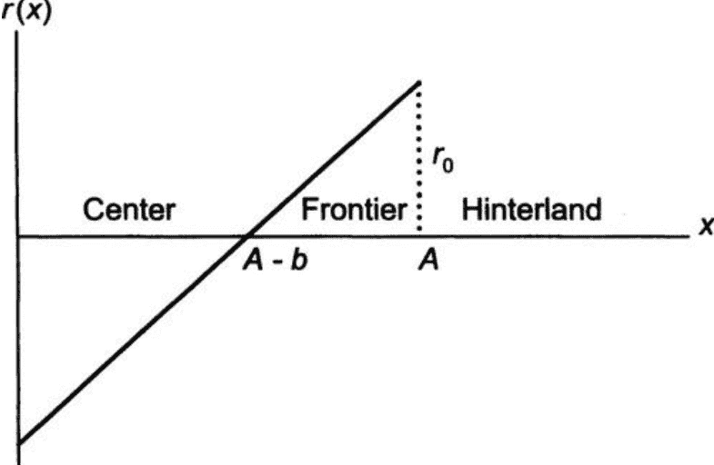

**图 4.1** 凝聚力的相对增长率 `\(r(x)\)` 与帝国边界的关系。符号：`\(A\)` 是政体规模，`\(b\)` 是边疆带的宽度（因此，“中心”从 `\(x = 0\)` 延伸到 `\(x = A - b\)`，而边疆位于 `\(A - b\)` 和 `\(A\)` 之间），`\(r_0\)` 是凝聚力的最大相对增长率，发生在边界 `\(x = A\)` 处。

将此公式代入 `\(\dot{S}\)` 的方程，我们得到：

```math
\dot{A}=c_0AS\left(1-\frac{A}{h}\right)-a
\dot{S}=r_0\left(1-\frac{A}{2b}\right)S(1-S) \quad (4.5)
```

状态变量约束如下：`\(0 < S < 1\)` 且 `\(A > 0\)`。

对这个简单模型的分析非常直接，可以通过观察相空间中的等值线来图形化地完成。(4.5) 中第一个方程的等值线是显示所有使得 `\(A\)` 的变化为零的 `\(A\)` 和 `\(S\)` 值组合的曲线。等值线的意义在于它将相空间（在图形上表示了 `\(A\)` 和 `\(S\)` 值的所有可能组合）划分为 `\(A\)` 增长或下降的部分（在等值线本身上，`\(\dot{A} = 0\)`，`\(A\)` 不变化）。第二个方程的等值线定义类似，即通过设置 `\(\dot{S} = 0\)`。画出两条等值线（图 4.2），我们看到它们仅在一个一点相交。换句话说，该模型存在一个非平凡的平衡点。平衡的稳定性取决于 `\(\dot{S} = 0\)` 等值线相对于 `\(A=0\)` 等值线最小值的位置。因此，稳定性仅由两个参数决定：`\(h\)` 和 `\(b\)`。如果 `\(2b > h/2\)`（交点在最小值的右侧），则该平衡对微小扰动是稳定的。该机制的作用如下：增加 `\(A\)` 也会增加中心区域，导致平均凝聚力下降；另一方面，减少 `\(A\)` 会导致 `\(S\)` 增加，从而将边界向前推。我应该补充的是，除了平衡动力学外，如果 `\(S\)` 和 `\(A\)` 的初始组合太低，政体也可能失败。粗来说，如果 `\(A(0)S(0) < a/c\)`，扩张永远不会开始，新生的政体会被来自后方的压力摧毁。这不是凝聚力-领土模型的新特征，而是原始地缘政治模型的特征（见 2.2.1 节）。事实上，`\(2b > h/2\)` 的情况与没有凝聚力的地缘政治模型在定性上没有区别。


**图 4.2** 凝聚力-领土模型的等值线（不稳定情况）。

如果 `\(2b < h/2\)`，则平衡是不稳定的。人口动力学的特征是单一的繁荣/衰落周期[假设初始权力 `\(A(0)S(0)\)` 超过了阈值]。最初，`\(A\)` 和 `\(S\)` 都会增加，但当 `\(A\)` 超过 `\(2b\)` 时，`\(S\)` 开始下降。领土扩张停止是因为帝国遇到了逻辑限制，而 `\(S\)` 继续减少，是因为帝国的中心区域主导了边缘。低 `\(S\)` 最终意味着帝国无法抗衡来自后方的地缘政治压力。结果，`\(A\)` 开始收缩，起初缓慢，然后以加速度的速度。崩溃率的加速是因为帝国的资源逐渐减少。在某一点，`\(S\)` 开始再次增加（当 `\(A\)` 跌到 `\(2b\)` 以下时），但到那时已经太晚了：正反馈动力学（`\(A\)` 减少——资源减少——`\(A\)` 更快的下降）压倒了 `\(S\)` 的任何增加，帝国崩溃（`\(A\)` 达到 0）。这些动力学的示例如图 4.3 所示。

这种分析说明了将口头理论转化为数学模型的价值。尽管我们做了许多极简化的假设，使得我们的模型充其量只是现实的漫画，但模型结果证明能够产生比我们之前预想的更复杂的行为。最重要的是，模型证实了假设的机制可以导致帝国的繁荣/衰落周期，它还表明对于不同的参数值可能存在其他的动力学。最重要的是，如果帝国的“范围”（由参数 `\(h\)` 量化）并不比边疆宽度 (`\(b\)`) 长多少，预期的繁荣/衰落周期将不会发生。相反，帝国将达到平衡状态。因此，为了让繁荣/衰落周期发生，边疆相对于帝国规模必须很小。这是。

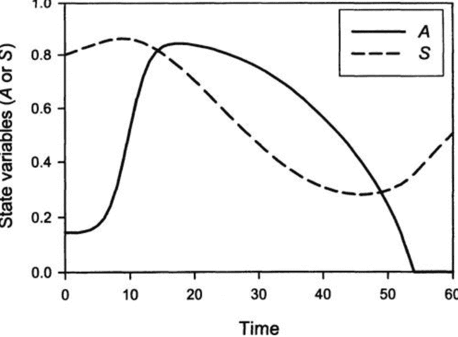

**图 4.3** 不稳定情况下模型 (4.5) 的动力学。参数值：`\(r_0 = 0.1, c_0 = 1, h = 1, b = 0.2\)`，以及 `\(a = 0.1\)`。

最后，将口头理论转化为简单数学模型的另一个优势是，我们可以快速检查各种假设的影响。例如，在图 4.1 中使 `\(r(x)\)` 成为空间的非线性函数不会影响等值线的结构。同样，Sergey Nefed（私人通信）研究了在推导 `\(A\)` 的方程时不使用线性近似的影响，发现定性结果保持不变，但繁荣/衰落周期的定量条件变为 `\(2b < h\)` 而不是 (4.5) 中的 `\(2b < h/2\)`。因此，模型的见解对于各种修改似乎非常稳健。

## 4.2.2 空间显式模拟

下一步是将边疆模型空间化，并确定这种变化如何影响预测的动力学。模拟模型的细节被附录中（A.2 节）。在这里我给出该模型的简要概述，侧重于它与非空间模型 (4.5) 的不同。最重要的补充是显式的空间维度。模型中的空间单位（一个“单元格”）对应于小型区域政体（酋邦）或大型领土帝国内的省份。单元格排列在矩形网格上。

凝聚力在两个空间层面被追踪：每个单元格都有一个凝聚力值，每个帝国都有其自身的凝聚力值，它是该帝国所有单元格凝聚力的平均值。如果一个单元格是“边疆”，其凝聚力在逻辑上会增长（到上限 `\(S = 1\)`）：即位于两个帝国之间的边界，或者一个帝国与“非帝国后方”之间。如果一个单元格不在边疆，那么其凝聚力将呈指数级下降到 0。这种边疆对凝聚力动力学影响的实现方式与图 4.1 所示略有不同。首先，凝聚力的相对增长率并非随距离线性下降（如分析模型所示），而是 Z 字形的：它在边疆区域内是平的（且为正），然后突然下降到平的（为负的）内部的数值。其次，边界区域的宽度 `\(b\)` 固定为单个单元格的大小。

领土扩张收缩的动力学建模方式类似于方程 (4.5)。每个帝国都试图通过攻击与其相邻的单元格来扩张。扩张的成功取决于攻击者和防御者的相对实力。实力与帝国规模 `\(A\)` 和平均凝聚力（asabiya）`\(S_i\)` 成正比，但会受到帝国中心和冲突地点实力的折减；`\(d: P = A\exp[-d/h]\)`。参数 `\(h\)` 衡量了实力随距离衰减的快慢[参见 2.2.1 节方程 (2.11)]。如果攻击者施于冲突地的实力超过了防御者的某一阈值 (`\(\Delta_p\)`)，则攻击者获胜。注意，这是对扩张过程更符合真实的描述，因为帝国边界的政治力量是显式建模的，而不是像模型 (4.5) 那样通过常数 `\(a\)` 进行隐式建模。

## 模型预测的动力学

模型的动力学通过一个典型的实现（图 4.4a）所示。模拟从位于场域上部中央区域的帝国 1 开始，其余单元格被分配为非帝国的后地。帝国 1 快速增长了大约十个时间步，直到占据了可用空间的一半，然后由于逻辑限制趋于稳定。在第一个相对静止期间，建立了一个静态的帝国边界，这导致帝国外侧边界区域的凝聚力增加。在时间步 20 之后不久，突然出现了一大群轨迹，这是由于边界区域的凝聚力增加到小政体开始相互征服的程度。在最初的这一群体中，只有四个政治实体（帝国 2、9、11 和 16）幸存下来，并增长到巩固它们周围的区域，随后以牺牲帝国 1 为代价导致其最终的灭亡。在此过程中，所有领土都由四个帝国瓜分（没有留下任何后地）。接着是第二个相对静止期，随后是帝国 9 和 16 以牺牲其他两个帝国为代价的爆发性增长。然而，帝国 2 和 11 并没有灭亡。在第三个相对静止期之后，当两个大国的凝聚力下降而较小帝国的凝聚力上升时，另一一段快速变化导致帝国 9 和 16 崩溃，而帝国 2 和 11 增长并接管了它们大部分领土。有趣的是，由于帝国 9 的崩溃，场域的一个区域变成了无国家状态，且该区域没有被剩余的帝国征服。第四个静止期以无国家地区产生的一个新帝国（17）的出现而结束。这最终导致了较老帝国之一的崩溃，以及两个剩余政体之间反复往复的动力学过程。

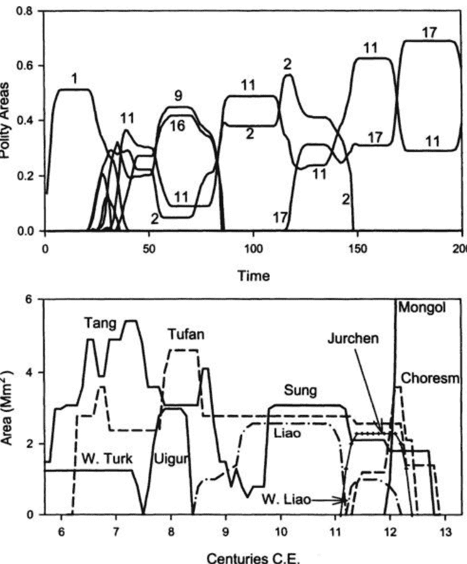

**图 4.4** (a) 空间凝聚力区域模型的动力学。每条曲线描绘了模拟帝国的领土动力学（政治实体表示为占总场域的比例）。模型参数为 `\(r_0 = 0.2, \delta = 0.1, h = 2, S_{crit} = 0.003\)` 以及 `\(\Delta_p = 0.1\)`。与轨迹相关的数字是政治实体的帝国索引。(b) 公元 600–1200 年东亚和中亚政治体的区域扩张-收缩曲线。（数据来自 Taagepera 1997：附录）

模型生成的轨迹与历史政治实体的轨迹非常相似（对比图 4.4b）。一个引人注目的相似之处是快速变化期被相对静止期所取代。另一个相似之处是政治动力学在多程度上取决于具体。特别是，尽管所有帝国都受到相同的逻辑限制函数，但在每个静止期间的最大准稳定区域具有很大的变异性。这种变异性首先归于历史因素，导致高凝聚力单元格的比例各不相同，从而在帝国层面产生了不同的平均凝聚力；其次，由于边界的位置反映了邻近政治实体施加的势力之间的平衡，帝国的最终规模很大程度上取决于邻国的相对实力。

当然，历史政治实体轨迹与模拟轨迹之间的定性相似性并不构成任何理论和实证动力学由相同机制驱动的“证明”。通常情况下，对于任何潜在的模式，都有无限种机制可以产生它：机制与模式之间的映射是一对多的关系。因此，为了给边界假设建立实证支持，我们需要对其进行严格的实证测试（这将是我们第 5 章的任务）。尽管如此，由于模型输出的几个特征与观测到的动力学相匹配，这一观察至少是对进一步开发和测试的鼓励。记住，图中的动态模式并不是作为模型假设构建的。相反，它们是关于特定微观机制假设的产生的涌现宏观特征。此外，观测到的动力学与预测动力学之间的匹配超越了表面的相似性。例如，考虑 12 世纪中东亚的政治动力学。当时有两个大帝国（宋朝和吐蕃）在整个世纪的大部分时间里保持着静态边界。随后，四个“挑战者”政治实体登上了舞台：西辽、金朝、花喇米和蒙古。所有挑战者都产生于边界区域。到 13 世纪末，只有一个政治实体幸存下来（蒙古）；其他三个以及两个较老的帝国都被它摧毁了。

## asabiya 方程的底层逻辑

在状态变量取值较低时，逻辑增长本质上是指数级的，因此其特征是具有敏感依赖性。这意味着，在前疆区域内，两个初始 asabiya 值略有不同的细胞，尽管它们受到完全相同的动力学规则的影响，它们的 asabiya 值实际上会发生发散。

动力学的高维性是由空间决定的。每个细胞由两个状态变量刻画：它的帝国指数（imperial index）和它的 asabiya。因此，动态过程的维度是场域内细胞数量的两倍（例如，对于一个 20 × 20 的场域，维度为 800）。这意味着在任何给定时刻，通常会有几个帝国在争夺领土，而且每个帝国的内部组成高度取决于特定的语境和历史。这种情况在上面已经提到过。

总而言之，模拟的空间性质导致的非线性函数形式和高维性共同导致了其动力学呈现出混沌状态。如果前疆模型捕捉到了现实的某些重要方面，那么对农业政治进行长期预测的前景并不乐观。虽然空间前疆模型极其简单、甚至有些简单化，但更复杂的模型往往会具有更加混沌的动力学。

## 逻辑负载参数对稳定性的影响

对非空间前疆模型的分析表明，决定该模型稳定性的关键因素是 `\(h/b\)` 的比例（增加由 `\(h\)` 量化的权力投影空间尺度相对于前疆宽度 `\(b\)` 而言，会导致均衡政体规模的去稳定）。在空间模拟中，前疆的宽度固定为 1，但我们可以改变 `\(h\)` 并观察其对预测动力学的影响。空间模型表明，减少 `\(h\)` 最终会稳定动力学，而增加 `\(h\)` 则会进一步破坏动力学的稳定性。对空间模拟的数值探索表明，事实确实如此。当 `\(h\)` 减少到例如 1（相对于参考值 2）时，模拟输出停止产生震荡。相反，在经过瞬态动力学之后，出现了一些中等规模的政体，每个占据了总面积的 7% 到 16%（30–70 个细胞）。

增加 `\(h\)` 有助于破坏动力学的稳定性。例如，如果我们设置 `\(h=3\)`，那么在经过初始震荡后，一个政体最终将接管整个模拟区域。由于缺乏任何前疆，所有细胞的 asabiya 将最终下降到 0。当平均 asabiya 低于阈值 `\(S_{crit}\)` 时，帝国将会崩溃，但由于它是处处均匀崩溃的，因此不会产生新的边界，系统将永远处于这种无国家状态。

## 回流效应与突破效应

空间模拟预测的另一个模式在此时值得讨论。在检查模拟输出的空间动力学时，我注意到挑战者帝国最初在前疆区域出现，向远离旧帝国的方向扩张，进入后地，甚至以牺牲邻近的其他较小挑战者为代价（如图 4.5 所示）。

回想起来，这里发生的情况非常清楚。挑战者政体通常无法成功攻击旧帝国，因为由于其规模庞大，且可能还没有获得实质性的 asabiya，旧帝国仍然非常强强大。与此同时，非前疆后地的 asabiya 较低，在当地扩张是容易的。此外，随着挑战者帝国扩张到后地，其重心会移离旧帝国，因此它对旧帝国施加的压力随时间推移而减少。后地内部的进一步扩张会被停止（或达到模拟场域的边缘）。我将这种远离前疆的扩张模式称为**回流效应**（reflux effect）。

在某些条件下，回流不会发生。具体而言，这发生在挑战者在游戏后期出现，此时旧帝国的平均 asabiya 足够到无法抵抗挑战者的压力。在这种情况下，我们观察到一种“**突破**”效应：长时间的准静态状态，在此期间，旧帝国的 asabiya 缓慢下降，而挑战者政体的 asabiya 在增长。然后，敌双方力量之间的差异突然超过了阈值 `\(\Delta p\)`，挑战者接管了帝国的边界细胞。这种接管灾难性地降低了旧帝国的平均 asabiya（前疆处 asabiya 较高的唯一细胞），并导致挑战者向旧帝国的内部区域迅速扩张（通常，如果旧帝国在失去边界地区后平均 asabiya 低于阈值 `\(crit\)`，则会导致旧帝国崩溃）。

回流效应是空间模拟预测的动力学一个非常典型的特征。它也是一种**涌现特征**，因为它并不是在微观层面构建的。模型这一引人的预测为我们提供了一种测试方法，即通过查阅历史记录并确定其中是否存在回流事件。

## 注意事项

最后，我需要讨论前疆模型的局限性，以及我们如何修改模型来解决这些问题。首先，模拟使用最简单的方法来处理距离效应，即假设帝国施加在其边界特定细胞的权力随距离帝国中心的增加而呈指数级衰减。探索更多具机制性的假设将非常有趣。例如，可以显式地对军队单位的移动、位置和供应进行建模。这种方法会对帝国的扩张能力施加更现实的限制（在当前的模拟中，帝国原则上可以同时向所有方向扩张）。另一个重要的地缘政治方面是山脉和水域等障碍。调查这些方面将是一个非常重要的项目，但将使我们远远超出本书的范畴，因此必须留给未来。


**图 4.5** 空间前疆模型中的回流效应。在四个快照中的每一个中，点表示后地区域，圆圈属于帝国 1，正方形属于帝国 2，三角形属于帝国 3。在第一个快照中（时间 = 26），帝国 2 和 3 刚刚出现在帝国 1 的疆区域。在时间 = 29 时，两个新帝国都扩张到后地。随后，帝国 2 征服了帝国 3，并扩张到后勤限制的极限（时间 = 35）。

模拟的另一个极大简化了现实的方面是它对居住在各种政体的人口民族动态缺乏关注。相反，模拟将种族等同于政体成员身份。因此，假设所有的帝国边界都代表元种族划分。相反，一旦一个细胞被接管，其居民会立即将忠诚转移给征服者（或者，立即被殖民者取代）。这是一个非常严重的缺陷，因为种族动力学过程显然需要时间。问题的这一方面将在第 6 章中探讨。

理论需要进一步发展的第三个大领域是不同阶层的动力学（对我们而言，最重要的是平民和精英），包括他们的人口动力学以及向上/向下流动。这也是一个严重的遗漏，因为连接政体阶层的凝聚力本身就是一个重要变量。此外，人口动力学是国家经济能力的重要决定因素。解决这些问题的理论初步步骤将在第 7 章中进行。

## 4.3 总结

- 本章的主要目标是使 `asabiya` 概念（集体行动的能力）内生。这意味着我们需要提出一个理论，说明导致 `asabiya` 增加或减少的变量。
- 我们转向这种有利于集体凝聚力演化的理论。多层次选择理论认为，当群体内部适应度差异最小化，而群体间适应度差异最大化时，对群体有利但个体有成本的行为将得到促进。这一论点暗示了至少三个影响 `asabiya` 演化的变量。
- 第二个变量是相对于环境承载力的人口密度。在生存边缘的密度压力会促进群体内部竞争，并导致“凝聚力”（`asabiya`）的下降。低人口密度意味着群体内部竞争较少，并提供了有利于凝聚力增加的条件。请注意，这个变量与第一个变量相关，因为无国家环境下的死亡率通常高于大型政治中心，导致人口密度实质上远低于环境承载力。
- 前两个变量主要影响有利于小规模族群凝聚力增加的条件。第三个变量，即靠近主要跨大族断层线的位置，为凝聚力谱图的扩大创造了条件。其普遍机制是符号化界定的民族边界发生扩张，以涵盖更大规模的群体，并与位于跨大族断层线另一侧的完全异质群体（或群体）形成对。
- 跨大族断层线可能与帝国边界重合，形成我称为“跨大族边疆”的区域。跨大族边疆是这三个因素（群体间冲突、人口密度和深层民族分歧）协同作用的区域。因此，本章发展的理论得出的预测：跨大族边疆是凝聚力的“熔炉”。
- 最有利于凝聚力增加的条件是主要帝国的边疆，特别是当它也是某种普世宗教的载体时，其紧邻无国家的后地。帝国边疆可以对后地地区产生“推力”或“拉力”。当帝国强盛时，它们对后地群体施加扩张压力；当帝国衰弱时，它们用财富吸引部落。无论如何，生活在边疆的“野蛮人”都有产生集体行动能力的额外刺激。
- 另一种有利于凝聚力增加的情况是两个排斥性宗教大帝国之间的边界（例如基督教和伊斯兰教）。在这种情况下，居住帝国边界地区的群体承受着增加和扩大凝聚力的压力。
- 跨大族边疆是群体承受巨大压力的区域，通常会发生民族灭绝（ethocide）、文化灭绝（culturicide），以及民族产生（ethnogenesis）。剧烈的群体间竞争最终导致了一个具有高凝聚力结构的胜者群体。在这个过程中，该群体获得了一个由强大的民族边界界定的身份和高度的内部凝聚力——换句话说，它变成了一个新的族群（新兴族群）。因此，导致这一新民族政治系统形成的过程可以被视为民族产生。注意，该理论将政治形成和民族产生视为这一动态过程的两个方面。
- 将这一理论形式化为简单的模型表明，政治规模和凝聚力的动力学应该经历一个繁荣-衰落周期。然而，这种动态只有在边疆区域相对于逻辑约束的政治上限较的情况下发生。如果这一条件被违反，那么政治动力学与第二节简单的地缘模型没有本质区别。
- 为了检验分析结果，我构建了一个空间明确的世界政治体系统，其动力学由地缘力量和凝聚力驱动。凝聚力在边疆地区增加，在中心地区下降。模拟表明，对于各种参数，政治体都会经历反复的繁荣与衰落。然而，这些波动不是周期性的，而是高度混沌的。
- 政治生命的关键时期之一是其起点。核心族群的凝聚力必须高于周围群体，政治才能得以扩张。这种增加群体凝聚力并启动政治扩张的过程被称为民族产生。

> ^1 对数学感兴趣的读者：记住我设定了 `0 < S < 1` 的条件，因此我们不关心 `S = 0` 的等值线。

# 第五章：跨大族边疆理论的实证检验

第四章发展的理论预测大型帝国应起源于跨大族边疆。本章的目标是通过实证检验这一预测。该理论是通用的，意义在于其预测适用于世界上任何地方的农业政治体。然而，考虑到我目前的资源，涵盖所有已知历史的历史是不可行的，因此有必要选择一个特定的区域和时期作为第一步。我选择关注公元前千年内的欧洲，因为这些时空边界内的历史是为人知的（且在西方语言文献中易于获取）。

将欧洲作为通用理论测试平台的一个缺点是，认为欧洲具有许多区别于其他世界的独特特征；这些特殊特征解释了它在现代的显著崛起（例如 Jones 1981; Landes 1998）。然而，基于这种“欧洲例外论”的欧洲崛起的解释受到了严厉批评（Blaut 1993, 2000）。此外，目前的学术研究（Frank 1998; Pomeranz 2000）表明，欧洲直到1800年后才与其他世界地区分化。无论如何，我不需要在这场辩论中选边站。我目前的工作假设是跨大族边疆理论同样适用于欧洲和其他世界地区。在这里，我报告在欧洲材料上测试该理论的结果，而未来的出版将报告在中亚、南亚和西南亚地区的测试（研究进行中）。换句话说，我将其视为一个实证问题。正如查尔斯·蒂利所言，“欧洲的经验尽管有特殊特征，但足够长、记录详尽且对世界其他地区影响巨大，以至于在该经验下良好的系统结论都会自动成为在其他地方尝试的假设”（Tilly 1975:13）。

从地理上讲，欧洲是欧亚大陆的西部半岛，将其与旧世界其他地区划分的边界是任意的。我使用了欧亚的标准边界（乌拉尔山、乌拉尔河、里海海、大高加索山脉、黑海），但有两个例外。我省略了北高加索地区，因为在感兴趣的大部分时期，其历史并不为人知。然而，我包含了安纳托利亚岛（小亚洲），因为排除它将迫使我将几个重要的大国（拜占庭帝国和奥斯曼帝国）视为外源性干扰。另一个划分清晰边界存在问题的区域是伊比利亚-摩洛哥交界处。我选择将摩洛哥政策（最著名的穆拉比特特王朝和穆瓦哈德王朝）视为外源性干扰。

由于我的重点是我使用了公元1900年。尽管此时欧洲西北部的几个国家已经完成了农业向工业的转型，但这种发展仅影响时空领域的一小部分。我选择了公元500年（大致与西罗马帝国的崩溃重合）作为考虑政治动力学的起点。由于边疆对政治动力学的影响有很长的滞后，我的边疆数据库从公元0年开始。我承认我选择的时空边界在程度上是任意的，也可以其他选择。但我认为重要的原则是，特定时空边界内的所有区域和政策都应该被纳入实证检验。这样，测试的结果就无法被批评为由于意识或无意识的选择性偏倚。至于具体的时空边界，它们只需要涵盖足够数量的区域和政治实体，以便我们进行统计。

### 5.1.1 量化前疆

前疆在时间和空间上都是难以界定的（Hall 2000）。它们是移动的且具有空间范围。然而，为了设计统计检验，我们必须将其离散化。第一步是将空间划分为离散的地理单位。我将总面积分为约50个“文化区域”，大多数区域的特征是面积在0.1到0.2 Mm²之间（图5.1）。在划分地理单位之间的界限时，我必须考虑主要的固定地形特征（山脉、海岸线）和民族划分（语言、宗教）。除了空间划分，我还需要时间上的划分。由于我们处理的是非常缓慢的过程，我将时间分为一个世纪一个间隔。

让我重申，任何将前疆等时间动态和空间变化的事物转化为离散时空单位的方案，在某种程度上都是“普罗克鲁斯式的”（强加形式的）。我不怀疑可以设计出比这里提出的更好的方案。然而，人们必须从某处开始。这就是我在这里做的，同时希望未来这种方法能改进，或者提出更好的替代方案。

通过50多个文化区域和19个世纪，我拥有近一千个“面积-世纪”数据，这是我分析公元0–1900年欧洲移动前疆的主要数据。下一步是为每个单位分配一个定量得分，以反映其内部跨民族互动的强度。我假设互动强度由四个部分组成，基于宗教、语言、生活方式和战争压力的差异。我将宗教差异分为四个等级：

- 最高分3分，赋予伊斯兰教与基督教相互互动，或与异教相互互动的区域。
- 下一分2分，赋予基督教或伊斯兰教内部的主要宗教划分（例如，公元1000后的天主教派对正教派；什亚派对逊逊尼派）。

**图5.1** 在关于跨民族前疆与政治实体大小关系的统计分析中用作地理单位的文化区域。

- 同一宗教内的教派得1分。例子包括天主教派对新教派，或公元1000年之前的拉丁语或希腊语基督徒。我也将不同异教宗教之间的差异定为这一水平，因为这些宗教与基督教和伊斯兰教不同，它们往往不具有排他性和扩张性。
- 最后，没有宗教差异的得0分。

语言差异分为0分（无）、1分（同一语言族内的不同语言：罗曼语、日耳曼语和斯拉夫语）和2分（不同的语言族）。我没有给不同的语系（印欧语系、乌拉尔语系等）额外分，因为我假设一旦语言分化到完全互不可通的（这在两种语言属于不同分支时显然已经发生），说话者将无法得知他们属于同一个语系。我给关系密切的语言使用者（如加泰罗尼亚语和卡斯蒂利亚语，或奥西坦语和法语）中间分1的原因如下：首先，北方法语（langue d'oil）说话者会将奥西坦语视为相关语言，并可能对奥西坦语说话者的亲缘感比对德国人更高。其次，从历史上看，属于同一组语言之间的梯度通常不是突兀的。因此，在中世纪时期很难划分出清晰的边界将罗曼语使用者隔离开来。居住日耳曼语和方言的区域，或包括东部和西部斯拉夫语说话者的区域情况也是如此。

经济生活方式最大的差异（2分）存在于定居农民和游牧牧民之间。这种区分涵盖了一整套文化差异，包括非常不同的行为准则以及彼此的态度。1分将具有城市化文化和识字（至少在某些社会阶层中）的农民与“荒野”耕者区分开来。

最后，战争强度指数编码了跨民族边界战争的人口影响。最高分2分反映了激烈的战争（包括种族绝），导致该地区人口出现明显的减少。1分赋予持续的掠夺财物和俘虏，这种行为没有导致人口数量大幅下降。最后，0分对应于相对和平的互动，或精英阶层进行的“轻微”战争，不影响生产阶级的人口结构。

前疆强度总分通过相加宗教、语言、生活方式和战争强度指数获得。范围从0到9不等。注意，由于与其他指数相比，宗教多了一个强度等级，因此这种方法在最终得分中赋予它的权重稍大。考虑到宗教在建立和维持跨民族划分中的重要作用，我认为这是恰当的。

将历史信息转换为前疆得分的细节见附录 B。简之，我研究了每个文化区域的历史，并确定其在任何时间点是否有国家边界穿过其或紧邻其。如果该区域位于大型帝国的内部，则被分配前疆指数为0。同样，如果一个区域处于无国家环境中，则会被分配指数为0。如果一个区域位于国家边界上，我使用了上述民族强度的四个组成部分，并将其求和得到总分。

### 5.1.2 政治实体大小

在我建立的测试中，前疆强度是独立（预测）变量。对于依赖（响应）变量，我们需要某种衡量帝国成功的标准。一种合适的衡量（如5.1.1节所述）是简单的领土最大范围。这种指标的缺点是它无法将快速达到巅峰并崩溃的帝国与更持久的政治实体区分开来。显然，寿命更长的政治实体可能基于更高程度的 `asabiya`（群体凝聚力）。

跨民族前疆模型预测了大型领土政策何时会产生。政治实体与其他实体之间的区分当然是任意的，但我需要一个截断点，以免处理大量的小实体（如早期欧洲）。我将阈值设定为0.1 Mm（1 Mm = 1000 km；因此1 Mm² = 10⁶ km²），与图5.1中地理单位的面积具有可比性。除了实体大小的截断点，我还需要前疆强度的截断。毕竟，理论并没有预测任何国家边界都会成为 `asabiya` 的生成器。前疆必须是剧烈的，且对区域的影响是长期的。第二个属性很重要，因为 `asabiya` 在长时间尺度上会增加。因此，快速穿过区域的前疆不太引起任何族源事件。此外，该地区将被纳入扩张的帝国，随着前疆的离开，作用于区域的力量会导致 `asabiya` 下降而非增加。为了结合这两个属性，我要求前疆作为“asabiya生成器”，强度必须达到5分或以上（注意5在前疆强度表中的中点），并且在给文化区域内持续三个世纪或更久。

我们现在准备好用可以立即测试的术来指定理论的预测。

在稍后的某个时间（将在下文指定）。理论预测，“无边疆且无帝国”以及“边疆与帝国”单元格的条目将比随机预期的多。我们也预计在“边疆但无帝国”的单元格中会出现一些条目。正如第 4.2.2 节模型预测的，这种情况最常见的原因是，在它附近的、另一个同样处于边疆的区域，我们在其发展出自己的帝国之前就对其进行了观察。另一个潜在的原因是[这]，导致一个扩张性帝国的建立必须是一个随机过程，因此在它完成之前可能会经历不同长度的时间跨。尽管如此，如果一个地区长期处于边疆而没有被另一个帝国征服，并且没有发展出自己的帝国，那么从理论角度来说，这是一个异常。

然而，“无边疆但有帝国”类别的条目对该理论构成了最大的实证挑战，因为根据该理论，不应该存在此类观测结果。采用拉卡托斯主义（Lakatosian）视角，我们将此类观测结果视为异常。如果异常观测过多，理论就会崩溃，特别是当存在能够更好解释这些观测结果的替代方案时。异常的价值在于，它们通常暗示了如何构建一个替代理论。

### 5.2 结果

现在我开始介绍结果，从公元第一个千年的欧洲开始，然后是到公元 1900 年为止的欧洲。分析中的中间步骤描述和数据表已移至附录 B。

#### 5.2.1 欧洲：公元 0–1000 年

在这一千年的上半叶，欧洲的政治地理由罗马帝国主导。罗马帝国的边疆很大程度上是静止的，尽管存在一些波动。向德国、不列颠北部和达基亚曾有过扩张，但这些扩张并没有持续很长时间。在灾难性的第三世纪，边疆被野蛮人的入侵所席淹没。但总的来说，边疆广泛影响了从现今荷兰到罗马尼亚的东南方的同一大片区域。在公元 0–500 年期间，被归类为“边疆”的地区包括 `SBR`、`NED`、`NFR`、`EFR`、`WGE`、`SGE`、`BOH`、`AUS`、`HUN`、`TRA`、`VLH`、`BUL`、`BYZ` 和 `ZAP`（见图 5.1）。

这一时期单一帝国的存在使得统计检验的构建变得简单。我简单地使用千年上半叶的边疆地区，并观察与源自这些地区且在千年下半叶（公元 500–1000 年）达到最大规模的大政体是否存在相关性。时间间隔由因果方向决定（边疆必须暂时先于帝国）。分离日期公元 500 年之所以很方便，因为它非常接近西罗马帝国崩溃的日期。结果总结在表 5.1 中。

表 5.1 记录的整体模式证实了元族群边疆理论的预测：绝大多数案例都集中在“无边疆、无帝国”和“边疆与帝国”类别中。统计检验表明，这种结果仅凭偶然发生的概率微乎其微。既然我们已经对这种模式有了概述，我们将深入探讨更多细节。

#### 公元第一个千年欧洲族政治历史简述

欧洲的罗马边疆分为三个相当不同的部分：两个位于平坦地带，被一个位于崎岖区域的地段隔开。第一个平坦段沿朱拉山和沃物山以北的莱茵河延伸，它穿过了北欧平原（我将在第 9.1.1 节回到这一区域）。边疆的崎岖段位于阿尔卑斯山以北。它被阿尔卑斯山麓以及较小山脉和丘陵所横跨：朱拉山、巴伐利亚/波希米亚森林、苏德申山和塔特拉山。最后一个平坦段沿多瑙河，本身由两部分组成：匈牙利平原，以及在西瓦尼亚阿尔卑斯山之外，瓦拉几亚平原平滑接入黑海沿岸低地，从君士坦丁堡/伊斯坦布一直延伸（见第 9.2.1 节）。这一整个边疆包括匈牙利平原，可以被认为是欧亚草原的西部延伸。

#### 表 5.1 边疆模型实证检验结果

(a) 欧洲公元 0–1000 年。独立性检验（Sokal and Rohlf 1981:737）：`G_adj = 27.1, P ≪ 0.001`。

(b) 欧洲公元 1000–1900 年。独立性检验：`G_adj = 22.0, P ≪ 0.001`。

| 时期 | 帝国情况 | 无边疆 | 有边疆 | 总计 |
|---|---|---:|---:|---:|
| (a) 公元 0–1000 年 | 无帝国 | 34 | 4 | 38 |
| (a) 公元 0–1000 年 | 有帝国 | 1 | 11 | 12 |
| (b) 公元 1000–1900 年 | 无帝国 | 19 | 6 | 25 |
| (b) 公元 1000–1900 年 | 有帝国 | 3 | 22 | 25 |

在第 4.1.2 节中，我提出了假设，崎岖地形对凝聚力（`asabiya`）的增加具有抑制作用。因此，我们应该预期罗马边疆的平坦段沿线形成大型政体。这确实发生了。第一个千年中最大的欧洲政体（政体完整列表见附录）是法兰克帝国，其领土在阿基坦尼亚达到顶峰。海峡对岸较小的政体包括勃艮第人、图林亚人、麦西亚人和萨克森人。

第一个千年第二大政体是拜占庭帝国。拜占庭帝国提出了一个迷人的谜题：为什么东帝国在西罗马帝国崩溃后幸存？元族群理论提供了一个解决方案：罗马帝国遭受了北方野蛮人和东方穆斯林至少半个千年的压力。我并不是说这种转变一夜之间发生的，甚至不是在一个世纪内发生的。

到目前为止，我讨论的是在罗马边疆就形成的政体。然而，这一时期一个相当独特的特征是，许多政体的族群产生地与其最终建立的政体所在地相当遥远。因此，西哥特人和东哥特人起源于黑海以北，但分别在伊比利亚半岛和意大利半岛建立了国家。长伦巴德人最初在潘诺尼亚（`HUN`）汇聚，但最终在意大利北部建立了一个国家。事实上，匈牙利平原经历了一系列真正令人眼观止的建国族群：罗马征服之前的达契人、匈人、杰皮德人、阿瓦尔人，最后是匈牙利人。这种快速更替的原因可能是其位于欧亚草原的西端，使得这片平原成为入侵游牧者的终站。

## 不符合元族群理论预测的案例

四个地区落入“边疆但有帝国”类别。在每种情况下，原因都是并入了一个邻近地区的帝国。`NFR` 和 `AUS` 被并入法兰克帝国，`TRA` 是阿瓦尔汗国的一部分，而 `BUL` 是保加利亚汗国不可或缺的一部分（其中心最初在 `VLH`，后来向南转移）。此外，`AUS` 相对于其邻国处于劣势，因为它位于罗马边疆的崎岖段（它有一条阿尔卑斯山脉直接穿过其中部）。

“无边疆但有帝国”类别的唯一案例是阿基坦尼亚公国。正如前节所述，任何落此类类别的案例都被视为异常，从前缘模型的观点。然而，阿基坦涅（Aquitaine）对该理论并未构成强有力挑战。这一政体是在墨洛文法兰王国崩溃后形成的，可以被视为一个遗迹（与新内斯里亚和奥斯特拉斯西亚放在一起）。它在 8 世纪被并入卡洛林王朝帝国。因此，这一政体可能不值得纳入分析，但我决定采取保守的行动方案。


总结来说，对公元一千年欧洲的分析结果为前缘模型提供了强有力的支持。统计检验表明，前缘与大型国家的产生之间存在高度相关性（表5.1）。事实上，这种模式如此清晰，以几乎不需要任何统计检验。本质上，在公元500至1000年间欧洲地图上发现的所有大型政体，都是由在罗马帝国前缘经历过民族形成（ethnogenesis）的人们组织的。唯一的例外是两个外源性政体（阿尔人和奥马亚人）以及一个可能的异常值（阿基坦涅）。相比之下，帝国的核心区域（特别是意大利和西班牙）以及远离前缘的后方（北欧和东欧）在缺乏本土起源政体的情况下显得格外显著。这种普遍模式正是前缘模型所预测的。

## 5.2.2 欧洲：公元1000–1900年

罗马帝国崩溃后，前缘的地理格局变得复杂得多。首先，前缘变得更多了。在公元500至1500年期间，略超过一半的文化区域（50个中的28个）被归类为前缘区域（在该地区持续三个或以上世纪强度为五或以上的前缘）。其次，前缘在罗马时期要动态得多。我们可以区分三类一般的前缘。

第一类前缘在这一时期的大部分时间内主导了西欧，即卡洛林边疆地区（Bartlett 1993）。在这类政体中，我包含了前身政体（墨洛文帝国）的前缘，以及继任政体，统称为拉丁基督教世界（Bartlett 1993）。法国西北部的前缘面对的是布列颠人和后来的北欧人；西班牙边疆则抵御来自科尔多瓦埃尔国的穆斯林人，那里是后来收复失地主运动（Reconquista）的场所。奥地利边疆最初是卡洛林王朝对抗阿尔尔汗汗国的场所。后来，它承受了马扎尔人入侵的最猛冲击。在匈牙人皈依拉丁基督教后，这一前缘失去了强度（但在16世纪由于奥斯曼土耳人的扩张而重新激活）。

最后，卡洛林时代之前的萨克森边疆针对异教德意志人。在查理曼征服萨克森后，这一前缘分成了两支，一路向东移动，最终演变成了德国“向东扩张”（Drang nach Osten）。另一分支向北通过斯堪的纳维亚移动，首先影响了丹麦边疆（其名称本身反映了其在丹麦边疆的位置），然后是了瑞典和挪威。北方的分支在“推”和“拉”的影响之间波动。在权力巅峰时期，卡洛林帝国施加了军事（这主要影响了丹麦人）和意识形态压力。然而，持续的传教尝试引发了本土异教的反弹，特别是在瑞典，那里直到12世纪才最终基督教化。卡洛林衰落后，前缘退缩，斯堪的纳维亚人殖民了法国西北部的地区。然而，基督教最终胜利了，东方扩张恢复。在波罗的海北部，丹麦和瑞典的推进有时与沿南岸的德国扩张竞争，有时又与之合作。

第二类前缘可以统称为“大草原前缘”（McNeill 1964）。这一前缘的一端位于今天的匈牙利（大阿尔福尔德平原），它是欧亚大草原最西的延伸。从匈牙利（HUN）它首先向东（TRA, VLH, MOL），然后向东北（ZAP, UKR, SRU, KAZ），遵循森林与草原的过渡带。与卡洛林边疆及其分支相比，草原前缘具有更高程度的稳定性，因为它（且现在也是）锚定在东欧的物理地理之上。

尽管如此，这一前缘随着时间的推移而左右摇摆。在基辅罗斯时期时期，前缘被向南方和东方推。在蒙古入侵后，前缘在莫斯科时期再次被推向北方和南方，最终在18世纪末被俄罗斯帝国关闭（征服克里米亚汗国）。

第三类前缘包含了罗马前缘的“遗留”。德意志入侵者与罗马不列颠本土居民之间的前缘就是一个例子。这一前缘在7世纪末随着盎格鲁-撒克逊人皈依基督教而失去了强度。在另一批异教德意志人（来自斯堪的纳维亚）入侵后，重新获得了强度。

在欧洲的另一端，拜占庭帝国的前缘是另一个“罗马遗留”例子。巴尔干前缘在10世纪失去了强度，当时入侵的斯拉夫人和保加利亚人已大部分皈依基督教。然而，东方前缘在整个时期仍然是主要的断层线。7世纪，拜占庭失去了哈里发的中东和非洲领土。结果是安纳托利亚成为基督教与伊斯兰之间最剧界面之一。阿拉伯扩张给拜占庭带来了巨大的压力。拜占庭人生存了下来并在几个世纪后开始进攻。不幸的是，拜占庭帝国在11世纪末的曼齐柯特战役中经历了灾难性的逆转，进攻变成了撤退。14世纪，进军的奥斯曼土耳其到达巴尔干，最终匈牙利平原在其存在的大部分时间内一直是奥斯曼的属地。顺便提到，安纳托利亚高原可以被视为欧亚草原的另一个延伸。

这是前缘的一个非常简化的草图，仅关注密集且长期的族群断层。还有许多其他运动（盖尔人进入苏格兰、巴斯克人进入阿基坦涅、穆斯林进入意大利南部特别是西西里、瓦拉人在征服后从埃及和叙利亚进入拜占庭，随后进入希腊等），但根据我的计算，这些情况要么是局部的，要么没有导致密集持久的前缘（详见附录）。

为了构建前缘模型的检验，我将所有五十个区域归类为“前缘”，如果它们在500–1500年间满足我的强度和长度要求（强度五或以上且持续三个或世纪）。否则，该区域被归类为“无前缘”。随后我识别了公元1000–1900年发生在欧洲（包括小亚细）的所有大型政体（在某一点至少达到0.1百万平方公里）。然后我剔除了一些政体，以便每个文化区域最多只有一个，保留面积更大的那个。例如，KAZ区域是两个政体的所在地（沃尔尔加保尔人和喀山汗国）。我剔除了喀山汗国，并保留了沃尔尔加保尔人，因为后者在鼎盛时期控制的面积更大。我还剔除了两个具有明显外源起源的政体，库曼人和条顿骑士团。后者起源于欧洲内部，但如果说哪个地区可以被归为它的起源，那就是EGE，它也产生了更大的政体——勃兰登堡-普鲁士。还有一个被我归类为遗迹的政体——阿斯特拉汗汗国，它是15世纪金金帐汗国崩溃时最大的碎片。最后，每个区域在上一节中被归类为相同的四类。结果所示表5.1b。

正如我们所看到的，总体模式与前缘模型的预测是一致的。令人欣慰的是所有大国（英国、卡斯蒂利亚-西班牙、法国、勃兰登堡-普鲁士、奥地利、立陶宛-波兰、拜占庭、奥斯曼帝国）都源于受前缘影响严重的地区。同样具有意义的是那些从未经历过密集前缘的区域，例如`AQU-SFR`和`EPL-BEL-`。

`WRU`。这些地区始终是地缘政治的对象，而非其的主体。

还有六个异常情况，在这些情况下，边疆的存在并没有导致大型政体的产生。四个地区（`AND`、`NED`、`VLH` 和 `SRU`）并入源自邻近地区的帝国。一个有趣的案例是 `SGE`，它内部产生了一个政体——瑞士，但该政体并未达到规模阈值。瑞士的案例之所以有趣，是因为在最初的14至15世纪，瑞士人相当激进地扩张了他们的政体。但在16世纪中期之后扩张停止了，尽管有许多机会扩张到那些较小的帝国边缘国家。这种失败的一种可能解释是崎岖的地形对群体凝聚力（asabiya）规模化的负面影响（见第4.1.2 节）。另一个崎岖地区 `ALB` 可能由于同样的原因未能发展出强大的政体。

然而，该模型面临的最大挑战是那三个“无边疆帝国”的案例。第一个是中世纪的波兰（公元1020年面积为0.3 Mm²），这并不是一个强烈的异常，因为它显然是在法国边境的压力下形成的，与附近的波希米亚类似。然而，它的基督教化过程非常快，以至于它只经历了两个世纪的高强度边疆期（因此没能被归类为长期边疆）。第二个案例是勃艮迪公国，它在14世纪法国崩溃后作为一个掠夺者国家兴起。它的公爵们启动了一项领土扩张计划，主要依靠王朝婚姻。在公元1480年的巅峰时期，它的面积约为0.13 Mm²，仅略超过阈值大小。然而，勃艮迪国家被证明非常脆弱，并在15世纪后期崩溃了。尽管如此，我认为它为边疆模型提供了一个真正的异常，因为不稳定是大多数农耕政治的普遍特征。

最后一个案例——萨沃伊-萨尔丁尼亚-意大利，似乎是最强的异常。从渐进来看，它也是回流效应（reflux effect）的最佳范例，因为该政体起源于萨沃伊（现在是法国的一部分），并在几个世纪里不断被其更强大的邻国推向东方。尽管如此，在萨沃伊的案例中，没有任何一点类似于跨族裔边疆的特征。尽管意大利从未成功获得大国地位（尽管一些作者将1870年至1914年这一时期归为这一地位），但并没有崩溃，甚至成功在非洲获取了殖民地。因此，帝国所有的标志都存在（尽管并不非常强大），但边疆理论显然并不适用。因此，这一异常案例清楚地表明，边疆模型不能自称是所有国家如何产生的通俗解释。

## 5.3 地位优势？

到目前为止，我一直在将边疆模型的预测与一个内含的零假设进行比较，该假设认为政体规模和边疆在统计学上是相互独立的。更强力的测试是将边疆模型的性能与一个显性的备选方案进行对比（见第1.2 节）。一种可能的替代理论已经在第2.2.2节中讨论过。回想一下，柯林斯的地缘政治理论假定，从易于防御的区域扩张的政治具有位置优势（“边疆地效应”）。我们可以使用本章开发的实证工具来测试边疆地位置的影响。

作为解决受保护位置效应的第一步，我将关注政体边界中海岸线占比例（Artzrouni and Komlos 1996）。更复杂的分析还将包括地形对边界防御性的影响，这并非易事。例如，我们不能仅仅使用该地区的平均海拔，因为低海拔但非常崎岖的山丘对入侵军队来说可能是比高海拔高原更大的障碍。因此，我将此类细化留给未来的工作，目前使用一个粗糙的指数，仅包含大水体（海洋、海峡等）对边界防御性的影响。

为了得出一个粗略的位置脆弱性指数，我将每个文化区域近似为一个矩形，并对矩形有多少边是内陆、有多少边是海岸进行评分。因此，指数范围从0到4，0对应岛屿地区，4对应内陆地区。只有一个地区的脆弱性指数为0（`IRL`），九个地区指数为1，六个地区为2，十六个地区为3，十八个地区为4。我将指数为0-2的地区合并为一类，以获得三个数量大致相同的脆弱性类别（分别为16、16和18个案例）。

由于脆弱性指数是一个静态指标，我将关于政体规模（公元1000年之前和之后）的数据集合并为一个。如果一个地区有两个政体，我保留最大的。然后，我根据实现的最大政体面积对每个地区进行分类。为了不过度依赖特定的阈值大小，我使用了两个值：0.1和0.3 Mm²。这种方法产生了三类政体：小型（0–0.1 Mm²）、中型（0.1–0.3 Mm²）和大型（>0.3 Mm²）。

检查按脆弱性和政体规模分类排序的结果，我们发现两者之间没有明显的联系（见表5.2）。因此，不可避免的结论是，地理位置既不影响最终的政体规模，也没有负面影响。这一结论必须考虑到我生成表5.2中数据的程序较为粗糙。然而，如果通过更复杂的测试发现边疆优势与地缘政治成功之间存在关系，这种关系也是微弱的。一个主要因素是莱茵边疆，它成为一系列帝国的核心：墨洛温王朝、加洛林王朝和奥斯曼帝国。

| 表 5.2 | 位置效应实证测试结果 | |
| :--- | :--- | :--- |
| 脆弱性指数 | 政体类型 | |
| 0–2 | 小型 | 16 |
| 3 | 中型 | 16 |
| 4 | 大型 | 18 |

## 5.4 结论：欧洲的形成

在第3至5章中提出并测试的理论表明，这种显著的模式并没有什么矛盾之处。解释有两个方面：通过跨族裔机制通过“传染”扩散的国家，以及帝国核心地区群体凝聚力（asabiya）的缓慢衰落（世纪）。然而，为了理解哪些地区发展成了强力国家，哪些地区在1500年后变得破碎，我们必须回到加洛林欧洲，而这本身是由罗马欧洲解释的（顺便说，罗马的兴起也可以追溯到公元一千年早期地中海地区的动态）。形成现代欧洲的关键时期是加洛林之后的九世纪和十世纪，当时拉丁基督教世界面临着维京人、萨拉森、匈牙人和波拉比亚斯拉夫人的四面袭击。一组防御性边疆——加洛林边疆的形成是为了应对这些威胁。边疆上形成的新政策注意力集中在向外。¹ 在加洛林王朝核心区的西部和西南方，布列塔尼和西班牙边疆兴起了强大的征服政体；而在英国，它在通过诺曼征服被纳入拉丁基督教世界。在北方，斯堪的纳维亚世界是通过皈依而非征服合并的，其主要的扩张方向是东方，这仅仅是因为西方（冰岛）和北方（拉普兰）方向缺乏机会。最后，在两个征服中心东方发展出了两个：一个位于萨克森-斯拉夫边疆（向东扩张，最终导致了勃兰登堡普鲁士的形成），另一个位于巴伐利亚-马牙尔边疆（最终导致了哈布斯堡奥地利）。

总而言之，我认为族裔边疆为后罗马时代欧洲政治发展的时空模式提供了一个连贯的解释。它对这种模式有了更准确的描述。例如，洛坎（Rokkan）相当随意地将丹麦归为海向，但将瑞典归为陆向帝国-国家带。相比之下，我将欧洲的政治演变解释为从加洛林-奥顿核心向所有方向的离心运动，南方方向除外（那里是另一个旧帝国核心）。最后，上述解释具有普适性的优点。洛坎（1975:596）在其描述中强调了欧洲格局的独特性。我认为，欧洲的独特之处在于初始和边界条件的特定组合（使用数学语言时），而非通用机制。换句话说，欧洲事件的特定进程取决于罗马帝国在何处何起点，取决于域外入侵的时间和位置，以及如河流和山脉等物理特征，这些特征影响了边疆的形成。这种基于边疆与集体团结力之间联系的通用解释，也适用于欧洲以外的地区。至少，这似乎是一个合理的性假设（Tilly 1975），值得在世界其他地区进行调查。

## 5.5 总结

- 族裔边疆模型预测，大型领土政体起源于受到这种强力族裔边疆长期影响的地区。在本章中，我实证检验了这一预测在公元前两个千年内欧洲（加小亚细）的情况。
- 我将总测试区域分为五十个面积在 0.1 到 0.2 百万平方之间的“文化区域”。在每个区域以及从公元 0 年到 1900 年的每个世纪，我计算了一个“边疆指数”，该指数由基于族裔分界两侧宗教、语言和经济生活方式的差异，以及战争强度的四个部分组成。通过给定世纪的区域被分配为 0 分，而非常剧烈的主要族裔断裂线被分配 9 分。如果一个区域具有相对密集（得分 5 分或以上）且静态（三个或更多边疆）的边疆，我将其归类为“边疆”地区。其余区域归类为“无边疆”地区。
- 我首先考察了截至公元 1000 年边疆与大型政治之间的关系。在公元 0–500 年期间，一个地区密集且持久的边疆与该地区起源的政体在 500–1000 年期间获得的最大领土之间存在强相关性。统计检验在 P ≪ 0.001 水下拒绝了无关联的零假设。
- 在比较公元 500–1500 年的边疆与 1000–1900 年期间获得的最大政体规模时，也得到了类似的结果。同样，零假设在 P ≪ 0.001 水下被拒绝。特别是发现发现所有欧洲大国（英国、卡斯蒂利亚西班牙、法国、勃兰登堡普鲁士-德国、奥地利、立陶宛波兰、拜占庭、奥斯曼帝国和莫斯科俄罗斯）起源于受到密集且持久边疆影响的地区。唯一的例外是萨沃伊-萨丁尼亚-意大利。
- 我还考察了一种替代假设，基于地缘政治中的“边疆之地”位置优势。我根据每个地区海岸线与陆地边界的比例为其构建了一个脆弱性指数。我发现一个区域的脆弱性指数与其起源的政体规模之间没有关联。

这些结果为族裔边疆模型提供了大量的实证支持，该模型优于完全随机的零假设，以及将位置优势与地缘政治成功联系起来的明确竞争假设。然而，测试也揭示了几个异常情况，其中最重要的是意大利。换句话说，尽管边疆模型正确预测了大多数大型领土政体（至少对于公元 500–1900 年的欧洲而言），但它没有预测其他几个。这一观察表明，除了边疆机制外，可能还有其他机制解释大型领土政策的起源。

¹ 感谢 Jack Goldstone 提出这一表述。

# 第六章

## 族裔动力学

### 6.1 被合并人口的忠诚动态

前两个章节分析了政体扩张的初始阶段，在此阶段，新合并的群体被迅速整合到核心精英中。该理论的一个假设是，居住在新增加区域的人口会立即将其忠诚转移给征服帝国。这并不一定是不切实际的假设。在某些情况下，特别是当新合并的精英在族裔与政体核心相似时，缺乏强烈的族裔差异可能允许他们在没有任何实质性时间延迟的情况下与核心精英合并。

然而，这种情况无法持续太久。迟早，一个成功的扩张主义帝国将兼并一个由族裔完全不同的人（异族人）居住的领土。事实上，帝国的一个定义是包含一个以上族裔的政体。一旦政体变成多族裔的，其功能和扩张能力将受到被合并族裔忠诚度的强烈影响。合并族裔的凝聚力（asabiya）水平可能会在区域层面与帝国层面之间出现显著下降。这产生了两个后果。

首先，由于合并族裔成员对帝国缺乏忠诚感，他们不愿意为其贡献资源。因此，兼并异族对帝国地缘政治权力的增加比增加等数量的族裔要小得多。（如果国家强迫异族人贡献与核心族裔相同数量的，整体贡献仍然会减少，因为强迫是昂贵的。）从异族中招募自愿且忠诚的兵员特别困难（例如，罗马共和国，而非罗马帝国）。

其次，族裔不同的人更有可能反抗帝国。如果他们的族裔层面凝聚力很高，其精英将很容易克服成功起义所需的集体行动问题（关于此问题的通用回顾，见 Goldstone 1994）。因此，帝国将投入大量的资源来收买异族精英或镇压他们的叛乱。

简而言之，族裔分裂具有严重削弱国家地缘政治权力的潜力。然而，民族不是静态变量，政体的族裔组成不断变化。族裔组成的变化首先是人口统计机制（人口增长率差异）的结果，其次是族裔社会机制（Bromley 1987）的结果，例如族裔同化和动员。因此，异族精英是否会同化为核心族裔，以及这一过程进展多快，应对帝国的命运产生巨大影响。

历史上绝大多数中大型政体都是多族裔的（McNeill 1986；因为地缘政治权力很大程度上取决于政体的族裔组成，我们需要对政治族裔组成如何以及随时间演变产生定量理解）。因此，本章的主要目的是开发一种族裔社会变化的动态模型。我将此类模型称为“族裔动力学”（ethnokinetic），因为它们在数学上与化学动力学模型非常相似。我的重点是族裔同化，是因为它被假设对帝国权力基础很重要。我还应该提醒读者，由于我使用了广泛的族裔定义，我并没有将同化还原为语言同化。诚然，语言或方言是族裔一个非常重要的文化标记。然而，在我们关注的时期，宗教往往提供了一个更具相关性的（元）族群标记。因此，本章重点关注的两个社会过程——语言同化和宗教皈依，是族群认同可能发生改变的示例。我下文的实证案例将取自宗教同化的实例。

## 6.2 理论

### 6.2.1 同化的非空间化模型

#### 非交互模型

我从一个族群动力学过程最简单的表述开始。首先，我假设只有两个群体：核心族群和边缘族群。其次，这两个族群的人口增长率是相同的。这意味着核心族群和边缘族群的相对比例随时间的变化仅仅是个体切换了族群忠诚（身份）的结果。第三，边缘族群以每个单位时间的恒定概率切换其族群并成为核心族群的成员。这些假设导致了我所说的非交互同化模型（之所以称为“非交互”，是因为切换族群身份的概率不取决于他人的行为）。Hopkins (1973) 和 Cederman (1997) 也提出过非常相似的模型，尽管这些作者建模的不是两个，而是几类个体（根据是否被同化或是否被动员进行分类）。


显然，假设两个截然不同的族群，且个体在它们之间进行瞬时切换，是对现实的极度简化。然而，历史上确实存在一些情况，使得这种简单模型可以提供一个不算糟糕的近似值。我指的是那些主要（或唯一）根据宗教来定义其族群边界的历史性族群。那么，“族群认同的切换”指的就是宗教皈依。两个历史例子显示，对于愿意皈依国家宗教的个体来说，进入精英核心是相对开放的，即奥斯曼帝国和莫斯科俄俄罗斯。涉及语言障碍以及多维度族群边界的更复杂的情况将在`6.5`节中讨论。

令`C`为核心族群的人口比例，`P = 1 - C`为边缘族群的人口比例。从边缘到核心进行族群切换的概率为`p`。那么，描述宏观层面族群组成动态变化的微分方程为：

```math
\dot{C} = pP = p(1 - C).
```

我们已经在`2.1`节中遇到过这种渐近增长的简单模型[见方程`(2.3)`]。在`C`取值较低时，该变量近似线性增长，并最终以指数方式接近平衡点`C^* = 1`（参见图 2.1c）。

在推导方程`(6.1)`时，我假设边缘成员可以切换身份。我们可以允许一个反向过程，即核心族群的成员切换身份（通俗说为“本土化”）；例如，中世纪爱尔兰的古英语；Kidd 1999:146。假设从边缘认同切换到核心认同的概率为`p_0`，而反向切换的概率为`p_1`。这种修改导致了一个非常相似的渐近增长模型：

```math
\dot{C} = p_0P - p_1C = p_0 - (p_0 + p_1)C.
```

然而，在平衡状态下，核心族群的比例不是 1，而是`C^* = p_0/(p_0 + p_1)`。尽管如此，达到这一平衡的方式与简单模型相同：最初是线性的，然后是渐近的。

## 自催化模型

尽管非交互模型已被用于研究族群同化（例如 Hopkins 1973 和 Cederman 1997 的多分类修正），但我认为它存在深层缺陷。这并不是过于简单的问题，因为我即将讨论的替代方案同样简单（实际上更简单，因为它少了一个参数）。问题在于，非交互模型假设了一个在社会学上并不合理的场景。社会并非由原子化的个体组成；相反，每个个体都嵌入在其他个体的社交网络（或多个网络）之中。我们关于传言、创新和族群传播的认知表明，这些文化元素是通过接触从一个个体传播到另一个个体的社交网络（Rogers 1995）。以宗教皈依为例，个体不会仅仅在报纸上读到相关报道就自发地转化为新宗教。相反，正如宗教社会学家所证明的（Stark 1996; Stark and Bainbridge 1996），皈依像传染一样，沿着人际链进行传播。“成功的皈依运动的基础是通过社交网络进行增长，通过一种直接且亲密的依附结构”（Stark 1996，强调见原文）。

我们如何能将这些微观层面的假设转化为宏观层面的模型？非交互模型假设了一个在社会学上并不合理的场景。社会并非由原子化的个体组成；相反，每个个体都嵌入在其他个体的社交网络（或多个网络）之中。我们关于传言、创新和族群传播的认知表明，这些文化元素是通过接触从一个个体传播到另一个个体的社交网络（Rogers 1995）。以宗教皈依为例，个体不会仅仅在报纸上读到相关报道就自发地转化为新宗教。相反，正如宗教社会学家所证明的（Stark 1996; Stark and Bainbridge 1996），皈依像传染一样，沿着人际链进行传播。“成功的皈依运动的基础是通过社交网络进行增长，通过一种直接且亲密的依附结构”（Stark 1996，强调见原文）。

我们如何能将这些微观层面的假设转化为宏观层面的模型？非交互模型假设了一个在社会学上并不合理的场景。社会并非由原子化的个体组成；相反，每个个体都嵌入在其他个体的社交网络（或多个网络）之中。我们关于传言、创新和族群传播的认知表明，这些文化元素是通过接触从一个个体传播到另一个个体的社交网络（Rogers 1995）。以宗教皈依为例，个体不会仅仅在报纸上读到相关报道就自发地转化为新宗教。相反，正如宗教社会学家所证明的（Stark 1996; Stark and Bainbridge 1996），皈依像传染一样，沿着人际链进行传播。“成功的皈依运动的基础是通过社交网络进行增长，通过一种直接且亲密的依附结构”（Stark 1996，强调见原文）。

我们如何能将这些微观层面的假设转化为宏观层面的模型？严谨的方法需要考虑空间维度（这里的“空间”可能指物理空间）。

## 阈值模型

使核心族群比例产生切换概率是正确的一步。然而，我们假设`p`与`C`之间的关系是线性的（`p = rC`），研究如果我们放宽这一假设将会很有意义。一类特定的非线性行为——行为的阈值模型（Granovetter 1978; Schelling 1978），已经在社会学文献中得到了广泛讨论。对本文特别重要的是它也被应用于身份切换问题（Laitin 1998）。

我们可以通过将之前假设的`p`与`C`之间的关系修改为非线性形式`p = rC(C - C_0)`来模拟阈值行为。新参数`C_0`是阈值比例。当`C > C_0`时，核心族群达到了“临界质量”。当`C < C_0`时，切换率为负。也就是说，从核心到边缘切换的人多于反之（换句话说，我将`p`解释为两个方向切换概率的差异）。临界质量和阈值行为的概念由 Schelling (1978) 和 Granovetter (1978) 等人充分讨论，因此我在此不再详细讨论。

非交互模型与自催化模型在另一个方面是不同的：在自催化模型中，`C`所趋近的平衡值为 1（假设`r > 0`），而在非交互模型中，平衡值可能远小于 1。这种差异足以让我们怀疑非交互模型。为什么当核心身份占据压倒性多数时，核心成员仍继续切换到边缘身份？这恰恰是非交互模型所预言的。显然，在`P \gg C`的情况下才会发生核心成员向边缘身份的情况，正如上述的爱尔兰案例所示。

最终获胜，而所有的核心伦理都失去了它们的原始认同。这是阈值模型的一个有趣的预测，它似乎符合许多历史案例，即一小部分入侵者征服了种族特征完全不同的族群。入侵者通常会转信被征服者的主流宗教，并切换到使用他们的语言（例如：西哥特人、伦巴德人、布尔加人和诺曼人）。

阈值模型有一个存在问题的特征：它的动力学取决于全局频率是高于还是低于阈值，然而更合理的假设是，个体转换身份的概率应该受到社会局部组成的影响。作为社会网络过程近似的自催化模型也面临着同样的批评，尽管正如我们在下文将看到的，即使在显式的空间设置中（在某些条件下），它看起来仍然是一个不坏的近似。另一方面，在阈值模型中加入显式空间可能会大幅改变预测的动力学。这是我们需要研究的下一个问题。

## 6.2.2 显式空间模型

正如我在书中反复强调的那样，开发数学模型有许多优势。其中一个优势是，当我们为某个问题推导出特定模型时，会发现它在数学上与某些为完全不同问题开发的方程完全相同。这意味着我们不需要从头开发一套分析工具，而是可以从他人的成果中获益。族动力学（ethnokinetics）就是如此。我们在上一节中公式这类模型已广泛用于化学动力学、谣言和创新的传播、流行病动力学等建模。正如我在上一节中所述的，我们需要在理论上研究的一个元素是加入显式空间。幸运的是，对于空间中化学和人口过程的动力学有着非常丰富的理论（反应扩散理论和流行病模型），我们可以利用这些数学理论的见解服务于我们的目的（关于数学理论的良好回顾，请参见 Murray 1993）。在接下来的，我将主要依赖空间流行病理论的结果，因为它的数学形式最符合我们需要理解的几类过程。

## 社会空间

当我说我们需要加入“空间”时，我并不是指物理空间。相反，我们需要的是某种社会空间的概念，其中个体之间的距离是通过他们社会互动的频率和强度来衡量的。社会空间有许多维度，但社会学家通常将其简化为两个主要类别：垂直和水平维度（Sorokin 1927）。垂直维度指的是社会阶层中的位置（分层）。因此，一个农民可能与村长有很多互动，而村长又与当地贵族互动，一直到政治统治者。居住在同一位置的两个人在社会上可能是彼此遥远的（例如，一个王子和一个贫民）。水平维度产生于日常活动中的模式，如工作、抚养孩子或仅仅是与邻居聊天（Black 1998）。水平维度中存在强烈的空间分量。因此，一个典型的农民大部分与同一村庄的人互动，在某种程度上与附近村庄的人互动，而与不同省份的任何人互动很少（如果有的话）。

社会空间具有一些特殊的拓扑特征（Black 1998）。首先，它通常是各向异性的，因为向下的互动可能比向上的互动更强。例如，国王皈教的决定对农民转换概率的影响要大得多，反之亦然。其次，等级较高的人倾向于属于更大规模的社会网络。例如，一个中等贵族与附近省份另一个贵族的联系，可能比两个地理距离相似的农民之间的联系更紧密。最后，某些地理特征（如山脉）往往会缩小社会距离。也许更好的衡量方法不是物理距离，而是以旅行时间衡量的距离。水平各向异性也可能出现，例如沿河流（顺水流比逆流要容易得多）。

流行病学中有一个重要概念对于概念化语言同化和宗教转换的空间模型非常有用。我指的是接触分布，在流行病学中定义为疾病从一个人传递给另一个人的概率，它是他们之间距离的函数。我们可以将接触分布重新解释为位于社会空间不同点的人之间社会互动的强度。在宗教转换背景下，这种类比是完整的，因为我们可以将接触分布解释为宗教转换从一个人传播到另一个人的概率。这种公式允许人们模拟各种复杂效应，包括异质性空间（例如山脉和其他障碍）和各向异性（作为表征较高等级人员的更大规模接触分布）。我在这里不会追究这些复杂性，因为一个包含所有这些真实特征的模型必须通过计算机模拟来解决。相反，我将关注空间如何修改族动力学过程中依赖频率的方面。这个主题我们可以从流行病学理论提供的分析结果中获益的地方。我首先考虑自催化模型的空间扩展，其次考虑阈值模型（非交互模型不受空间影响，因为每个个体都是自发且独立于他人行为而改变身份的）。在接下来的叙述中我不提供数学方程，因为感兴趣的读者可以在相关的专业文献中找到它们。关于空间接触过程和传播模型的生态方面的介绍，可以在我关于运动定量分析的书中找到（Turchin 1998:70–72, 329–348）。更多技术性的描述见 Murray (1993) 和 Mollison (1995)。我不需要深入数学结果，因为我所做的只是将已经开发的理论从社会接触和社会影响的角度对其进行重新解释。

## 空间中的自催化模型

为了使自催化模型显式化，我们首先将核心身份的频率`C(t)`重新定义为空间变化的变量`C(x, y, z, t)`。这里，`x`和`y`代表物理空间坐标，`z`代表社会阶层中的位置；`t`是常指的时间。作为一个说明，是指特定时间特定城镇的小商人。其次，我们定义接触分布：`V(s)`是社会距离为`s`的两个个体之间社会接触的强度。注意，在这个模型中我假设接触分布不随空间、等级或时间变化。然而，如上所述，可以进行此类修改，并对所得模型进行数值研究。第三，我假设个体转换身份的概率是社会附近其他个体身份的函数，并根据他们到中心个体的社会距离进行加。为了说明模型是如何工作的，假设接触分布是矩形形状，如图 6.1a 所示。这意味着中心个体与某个亲友和朋友圈进行社会互动，且与圈内每个人的互动强度都是相同的。但在圈之外，互动强度为零。那么，皈教的概率将与圈内已经皈教者的比例成正比。

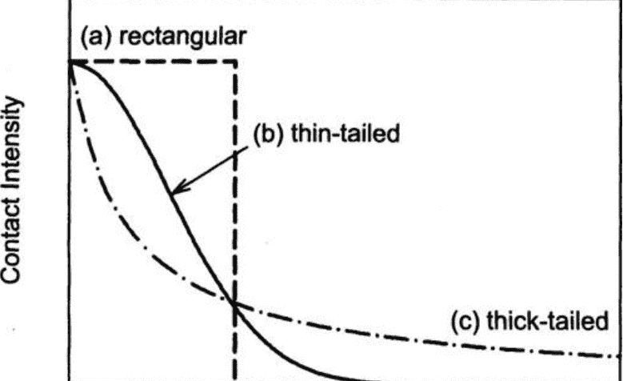

**图 6.1** 接触分布的不同形状：(a) 矩形，(b) “薄尾”，和 (c) “厚尾”。

矩形接触分布并不是人类社会互动的真实形状，因为某些人类很可能拥有非常遥远的熟人，尽管他们与这些人的互动可能并不很激烈。因此，接触分布不应该突然结束，而必须有一些“尾部”延伸到足够远远的个体（例如，远距离商人）。空间接触过程的数学理论区分了两种重要情况：“薄尾”情况，即接触分布的尾部随着社会距离的增加呈指数级（或更快）衰减；以及“厚尾”情况，即尾部的衰减速度慢于指数级（图 6.1）。正如我们在下文中看到的，这些类别的尾部意味着截然不同的空间动力学。

当接触分布具有尾部时，意味着个体在做出转换决策时，不仅考虑邻近社会范围内他人的行为，还考虑了整个社会的行为。然而，社会距离较远的个体的影响远小于亲密朋友和亲戚圈的影响。影响随社会距离增加而减小的程度是通过接触分布下降到零的速度快慢来量的。

薄尾接触分布的情况在数学上已经有了很好的理解。如果身份转换的概率直接正比于他人所持有身份的加权平均值（权重由接触分布给出），那么这种空间接触过程可以用反应-扩散模型很好地近似，其中局部源/汇项是逻辑回归的（logistic），空间再分配是简单扩散。该模型已经得到了彻底的研究，从 Fisher (1937) 和 Kolmogorov 等 (1937) 关于优势基因空间扩散的开创性工作开始。社会科学中一个广为人知的应用是欧洲新石器时代农民的扩散模型（Ammerman and Cavalli-Sforza 1973）。该模型的动力学如下：假设我们最初有少数几个转信新宗教的信徒（例如，围绕在先知或救世主周围的一群信徒）。在局部，转换过程将遵循 S 型逻辑回归曲线，呈指数级增长，并在所有当地人都转变为新宗教时达到饱和。空间扩散最初也会加速，但很快就会建立一个定义良好的推进前缘，该前缘随时间以恒定速度扩张。结果是大多数人转信的总面积呈线性扩张。因此，在最初的加速之后，信徒人数将呈线性增长，直到整个可用空间被接管。

在薄尾接触分布中观察到的这种有序前缘，与接触分布具有厚尾的情况形成了鲜明对比。最初较小的一群信徒将像上一个情况一样根据逻辑回归曲线在局部增长。然而，随着信徒人数的增加，其中某人越来越可能有一个被转换的远距离熟人。对于传教宗教来说，最可能的机制是初始宗教公社派遣传教士。转换过程的这种远距离跳跃将防止有序前缘的形成。相反，我们将观察到原始焦点周围形成若干次级焦点，然后由于从次级焦点派遣传教士会出现三级焦点，以此此类推。整个空间过程将以加速的方式扩散，全球信徒人数将呈现出 S 型增长模式。接触分布越厚尾，全球扩散过程就越接近逻辑回归模型。

## 空间中的阈值模型

空间阈值模型的行为与自催化模型非常不同（数学细节请参见 Lewis and Kareiva 1993）。首先，也是显而易见的，信徒的局部比例必须超过阈值`C_0`，否则新教派将灭亡。其次，不那么明显的是，教派最初占据的区域面积（“滩头”）必须超过某个阈值。否则，跨越边界的“扩散损失”将超过该宗教占据区域内的转换率，导致其失败。第三点也是最重要的区别是，无论接触分布的形状如何，阈值模型只能表现出线性推进的前缘。这一特征的出现是因为任何领先主前缘太远的信徒都会受到阈值效应的影响：他们在局部会被不信者替换。

该理论的另一个有趣预测是，在连接良好的空间中，两种身份的共存是不可能的。假设两种身份之间建立了一个空间前缘。它将始终向一个方向或另一个方向推进。在上述阈值模型的特定形式[方程`(6.3)`]中，推进方向取决于`C_0`是否大于 0.5。如果是，核心身份将失败；否则，它获胜（Lewis and Kareiva 1993）。然而，如果跨越边界的社会交往显著少于每一侧，那么稳定的共存是可能的（例如 Levin 1976）。

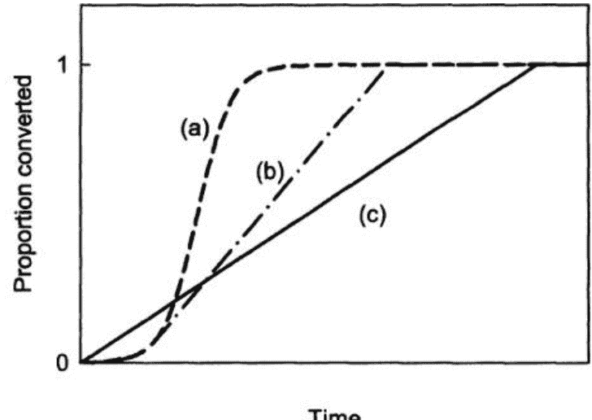

**图 6.2** 空间接触模型预测的扩散示意模式：(a) 自催化过程和厚尾接触分布，(b) 自催化过程和薄尾接触分布，以及 (c) 阈值过程。

总结，本节回顾的空间模型预测了三种不同的转换或同化模式。这些模式在图 6.2a 中进行了示意说明。最快的扩散发生在具有厚尾接触分布的自催化模型中。在这种情况下，过程在初始小组局部以加速度开始增长。在过程达到局部饱和（由于转换了大部分人口）之前，转换过程会跳到其他位置，从而引发增长并产生更多的扩散焦点。接触分布的尾部越厚，到达区域内所有点的速度越快。如果整个范围内基本上是平坦的，那么空间过程将与逻辑动力学无异。

相比之下，如果接触分布的尾部迅速衰减（薄尾情况），那么我们应该首先观察到没有扩散的“潜伏期”（这是局部信徒人数积累的时间），随后是加速增长期。最终，转换区域和未转换区域之间建立了一个空间前缘。该前缘线性推进。

最后，如果转换过程以阈值为特征，那么接触分布的形状并不重要。如果转换过程是可行（这需要足够的初始信徒、不过高的转换阈值`C_0`以及不过大的扩散损失），转换区域与未转换区域之间的空间前缘将迅速建立。前缘线性推进，但比自催化情况慢。扩散速度慢的原因是，为了让前缘推进，边界处的信徒人数必须超过阈值`C_0`。因此，在阈值情况下，前缘是由后面大量的信徒“推”的。在自催化情况下，前缘是由少数信徒与前方未转换人口的互动所“拉”的。

利用这一点来设计一个实证检验。然而，几个实际问题阻碍了这一想法的直接实施。首先，图 6.2 所示的模式是高度程式化的。为了获得更精确的定量预测，有必要根据对身份转换过程和接触分布形状的各种假设，对空间显式模型进行数值求解。其次，图 6.2 中的三条轨迹都预测了大致的 S 型动力学特征。鉴于受到不同程度的过程噪声和观测噪声影响的现实数据，在实践中很难区分这些理论替代方案。换句话说，我认为，试图基于族裔变化全球模式的统计来区分空间模型的方法，其特征将是统计效力低。我们需要显式的空间数据来测试显式的空间模型。


与空间模型不同，族裔变化的全球性曲线本应为我们为非空间模型（非交互模型、自催模型和阈值过程）设计实证检验提供了极佳的机会。尽管如此，必须仔细选择响应变量，以提高检验的统计效力。

统计学中的响应变量或因变量是根据预测变量或自变量进行预测的内容（Box and Draper 1987）。我们通过确定模型如何预测响应变量来区分不同的模型。预测响应变量的模型就是受数据支持最好的模型。

对于这三个模型，响应变量的一个显而易见但并不一定最优的选择是轨迹`C(t)`，即`t`时刻核心区域的比例。例如，考虑非交互模型和自催模型预测的轨迹（见图 2.1c 和 d）。鉴于充足的数据和大量的噪声（这是历史应用中的现实假设），通常很难确定曲线是否具有初始的加速阶段。

相比之下，如果我们观察不同模型对`C`变化率的预测，模型与模型之间的对比将变得非常显著（图 6.3）。非交互模型预测了`C`与`\dot{C}`之间存在线性关系（图 6.3a），而自催模型预测的是一条湿润的曲线（图 6.3c）。只需对`C < 0.5`（负到正）的关系的斜率进行简单对比，就足以判断哪种模型更接近现实。

阈值模型的预测非常引人注目：当`C < C_0`时，`C`的变化率为负（图 6.3e）。自催模型与阈值模型之间另一个有用的对比是它们对相对变化率`C/\dot{C}`（图 6.3d）相对于`f`的预测；检查非交互模型的相对变化率（面板 b）并没有太大的启发意义，但为了完整性将其包含内。

这里的核心信息是，虽然我们确实应该检查实证时间轨迹并将其与模型预测的轨迹进行比较，但为了更充分地利用数据，我们应该像图 6.3 所示那样对它们绘图（并拟合模型）。这样做使我们更接近可能构成观测轨迹的机制，因为我们是在微分方程的层面（通过绘制观测变化率相对于状态变量）考察动态过程的结构，而不是在方程时间解的更具现象性的层面。

现在我将这些思想应用于三个数据集，处理向伊斯兰教、基督教和摩门教的转换。我们的目标是确定三个替代模型中哪一个与实证模式最匹配。

## 6.3.1 皈依伊斯兰教

### 数据

第一个案例研究基于理查德·布利特（Richard Bulliet）。伊斯兰社会的一个特征性文化产物是传记字典这一文学体裁（Bulliet 1979:9）。包含数百个独立条目的众多传记汇编，为中世纪伊斯兰社会提供了独特的可量化数据来源。

布利特分析了伊朗传记字典中包含的近六千部传记，发现了一个非常有趣的模式。在属于宗教显赫上层阶级的传记主体中，几乎完全缺失波斯名字，而这些人物的特征是他们给儿子起阿拉伯语名字的普遍习俗。然而，波斯名字却出现在这些传记主体的族谱中。

超过三分之二的族谱序列以波斯名字开头，随后转变为完全的阿拉伯语名字（Bulliet 1979:18）。布利特假设，开启序列的波斯名字是该家族第一个成为穆斯林教的家族成员的名字（这一提议在某些案例中可以通过独立信息得到证实）。因此，以波斯名字开头的族谱子组可以提供关于特定伊朗家庭皈依的大致日期的可靠数据。该子组共有 469 份族谱。

布利特将伊斯兰历分为 25 年一个时期，并计算了落在每个时期的预期皈依比例（更多细节见 Bulliet 1979 第 3 章）。

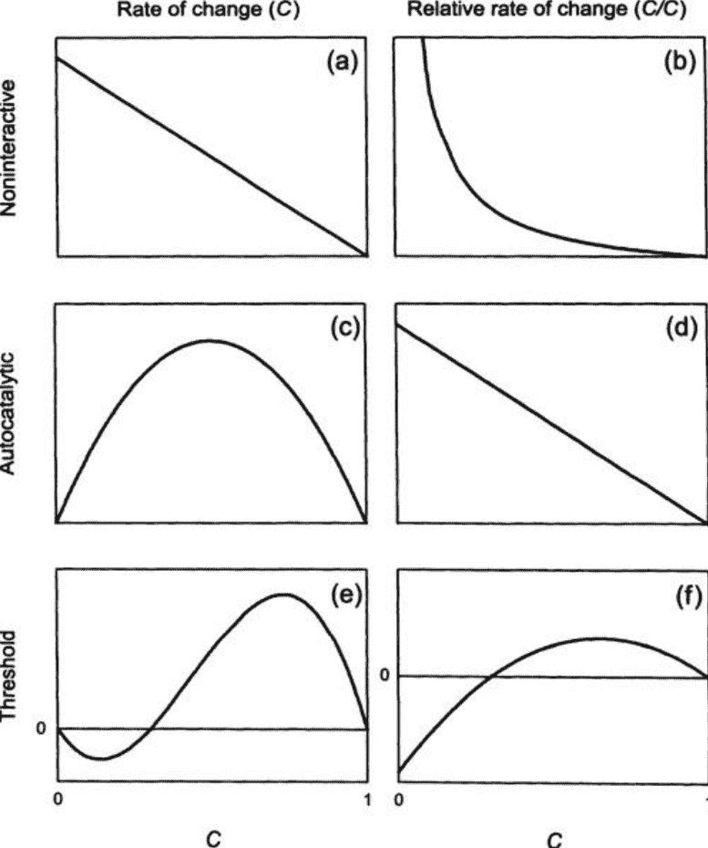

**图 6.3** 非交互模型（面板 a 和 b）、自催模型（面板 c 和 d）和阈值模型（面板 e 和 f）预测的`C`与变化率`\dot{C}`（面板 a、c 和 e）以及相对变化率`\dot{C}/C`（面板 b、d 和 f）之间的关系。

伊拉克、叙利亚、埃及和西班牙也有大量的族谱可用。对这些地区进行相同的分析，作为检查伊朗结果结果的一种方法，将非常有用。遗憾的是，伊拉克、叙利亚和埃及非阿拉伯名字的出现非常罕见。所有这些地区在征服之前就已经变成了阿拉伯语地区。

幸运的是，西班牙的情况有所不同（Bulliet 1979: 第 10 章）。布利特识别出 154 份以阿拉伯名字开头的西班牙族谱。在每个时期的中期，我们计算了每个 25 年时期皈依的家庭比例（作为一种独立检查）。布利特识别出许多以阿拉伯名字开头的族谱。

### 分析

将伊朗每个时期皈依伊斯兰教的家庭比例相对于时间绘图，我们得到了估计曲线（图 6.4a）。对数据的视觉检查强烈暗示了一个类似于逻辑的过程。这一印象通过拟合逻辑函数得到了证实：

`C(t) = 1 + (1-C(0))/\exp[-rt]`

其中`C(0)`是`t=0`时的初始比例，`r`是相对率。这个双参数曲线解释了响应变量 99.98% 的变异。即使按照物理科学的标准，这也是极好的拟合。

分析西班牙数据得到了几乎相同的结果（图 6.4b）。逻辑曲线解释了 99.7% 的方差。有趣的是，参数`r`的拟合值远低于伊朗（伊朗的`r`为`2.8 \text{}^{-1}`，而西班牙仅为`1.5 \text{}^{-1}`）。再次，非交互模型对数据的拟合效果差得多（解释了 76.6% 的方差）。

支持自催模型（与两种替代方案相比）的进一步证据来自`C-\dot{C}`相图（图 6.5a）。在`C < 0.5`区域曲线的正斜率显而易见，不需要统计检验。此外，没有负变化率的证据，而那是阈值模型预测的。

因此，在 6.2.1 中考虑的三个简单替代方案中，自催模型提供了目前对经验模式的最佳描述。另一方面，在相空间中绘制数据揭示了转换过程的一些有趣特征，这些特征在轨迹图中并不明显。

特别是，曲线看起来是不对称的（右偏），而逻辑模型模型预测的是一条完全对称的抛物线。为了进一步探讨这个问题，让我们观察数据所示的相对变化率与转换比例之间的关系（图 6.6a）。

我们看到，虽然从定量上看相对转换率差异很大（伊朗的过程快了一一倍），但两条曲线具有定性相同的非线性特征。非线性性在两种情况下几乎相同的观察结果表明，这不是抽样问题（当然，这只有两个重复样本）。

另一方面，本质上仍然可能观测到的非线性是布利特从族谱中提取转换日期所用程序的某种产物。让我们推测一下如果非线性是真实的，哪些机制构成了它（这是为未来研究产生假设的一种）。

首先，这种非线性绝不暗示任何阈值效应，因为那会引入曲率相反的非线性（见图 6.3f）。此外，空间模型也都预测在初始阶段会有某种加速转换过程的阶段，这仍然无法解释观察到的模式。

事实上，该函数在低`C`值时的凹形形状与非交互过程具有某些相似之处（见图 6.3b）。这一观察引发了以下可能性：该过程在非常早的阶段是非交互的，然后变为自催化的。

例如，最初人口中皈信者的比例由于移民的影响而增加。随着皈信者数量的积累，该过程的自催化部分迅速掩盖了移民带来的增长。我用一个显式模型`C = (p + rC)(1-C)`对这一场景进行了研究，并发现只要`p \ll r`，即移民率很小，模型预测的形状与数据中观察到的形状完全吻合。

移民-自催化增长模型所预测的模式示例在图 6.6b 所示。

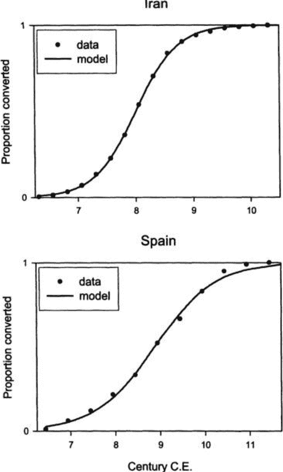

**图 6.4** 伊兰和西班牙向伊斯兰教转换的轨迹。

（数据来自 Bulliet 1979：表 2 和图 20）

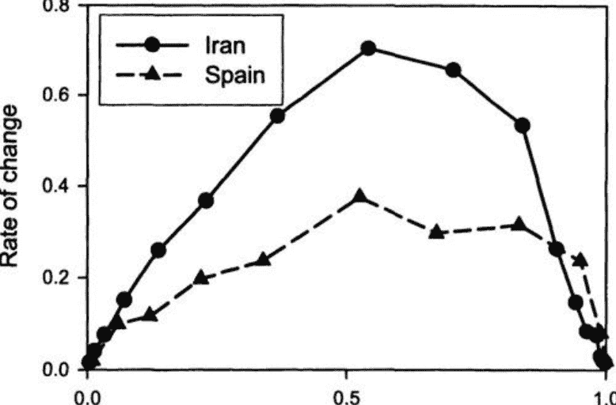

**图 6.5** 绘制在`C – C`相图上的伊兰和西班牙数据。变化率`C`的单位是每世纪转换的比例。

总结，对 Bulliet 数据的分析表明，自催化模型拟拟经验模式方面远优于两种替代方案（非交互模型和阈值模型）。事实上，自催化模型达到了前所未有的精确度（至少在非物理科学中）——99.98%。

然而，这种佳的拟合部分归功于所选特定视角，即拟合时间轨迹。对状态变量（`C`）及其变化率以及相对变化率进行更详细的调查，揭示了自催化模型的预测与数据之间存在某些差异。

我们还发现，简单自催化模型的一个较为复杂的替代方案——移民-自催化过程，提供了更好的经验拟合。令人鼓的是，尽管拟合效果最好的模型是根据数据中的事后模式建议的，但它似乎与我们对伊斯兰征服后西班牙历史真实情况的理解高度吻合，当时确实有穆斯林阿拉伯人和柏柏尔人进行的大规模移民。

然而，我们应该注意，目前只有两个重复样本（这是防止采样误差的最小数量）。此外，存在一种可能性：观察到的非线性可能是 Bulliet 在估计转换日期时使用的过程中某些（未知）偏差的结果。

最后，这种差异相当微小，最多也暗示了基础自催化模型的二阶改进。事实仅仅是，基础自催化模型与数据的拟合得非常好。

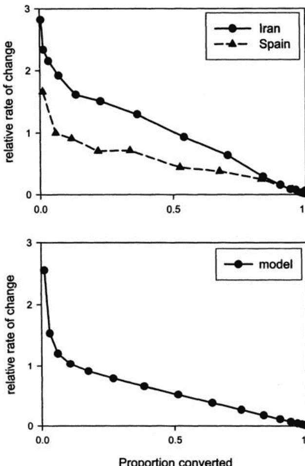

**图 6.6** (a) 绘制在`C/C – C`相图上的伊兰和西班牙数据。变化率`C`的单位是`century^{-1}`，(b) 移民-自催化模型预测的相对变化率与转换比例之间的关系。

## 6.3.2 基督教的兴起

第二个案例研究更具定性，这仅仅是因为与 Bulliet 为向伊斯兰教转换开发的数据集相比，我们没有记录向基督教转换动态的良好数据集。本部分的材料基于罗德尼·塔克（Rodney Stark）的《基督教的兴起》（1996）。

在讨论基督教的兴起时，历史学家对公元前两个世纪内基督徒人数之之少感到惊讶，并对他们人数在第三世纪后半叶的突然增长——爆炸式增长感到印象深刻。大多数早期基督教历史学家认为，必须发生了某种非凡的大规模转换过程来解释这种惊人的扩张（引文见 Stark 1996:14）。

塔克有力地主张，这种论点是基于对自催化过程本质的误解。像指数增长或逻辑增长这类自催化过程的一个引人注目的事是，它们似乎经历了不连续的增长阶段，而基本的驱动机制并没有改变。

驱动机制是相对转换率（单位时间内每位现有成员中转换的新成员人数）。当相对率保持恒定时，已转换的绝对率随时间增加，从而产生了过程正在经历质性不同阶段的幻觉。

塔克通过一个直到四世纪中期的基督徒估计增长曲线来说明了这一现象。他假设公元 40 年约有一千名基督徒，他们以每十年 40% 的相对率呈指数增长（塔克对指数模型的使用与我们的逻辑增长模型并不矛盾，因为这两个过程在增长早期阶段产生了本质上相同的定量预测，并且只有在转换比例超过 10–20% 后才开始分叉）。

一千人对应罗马帝国人口的 0.0017%。到公元 200 年，塔克的预测显示，皈入基督教的罗马人口仍小于 1%（精确地说为 0.36%）。然后，预测的增长“突然”起飞：公元 250 年为 1.9%，300 年为 10.5%，350 年为 56.5%。

在 250–350 年期间基督教这种令人惊讶的扩张，相比之下，公元 50–250 年期间的增长匮乏（流行病学意义上的潜伏期）可以在不改变底层机制的情况下发生。只要早期基督徒能够保持他们的社交网络开放，他们就会以相同的变化率继续连接并转换新成员，最终结果将是基督社区规模的爆炸。

塔克通过整合来自各种来源的异质信息，得出了预测转换曲线的参数（40 年的初始数量和相对增长率）（见 Stark 1996:4–12）。在他做出这些估计几年后，同事引导他注意了罗杰·巴格尔（Roger Bagnall）对埃及基督教增长的重建。

巴格尔检查了埃及纸草，以确定不同年份姓名姓名比例（Stark 1996:12–13）。将塔克的预测曲线与这些独立数据对比构成了对该理论的有力测试（事实上，这是一个真正的测试，因为他在构建预测时不知道巴格尔的数据）。

图 6.7 展示了这项测试的结果。匹配程度相当好，预测系数是非常理想的`R^2_{ind} = 0.74`。因此，这项测试为该理论提供了有力的定量证实。

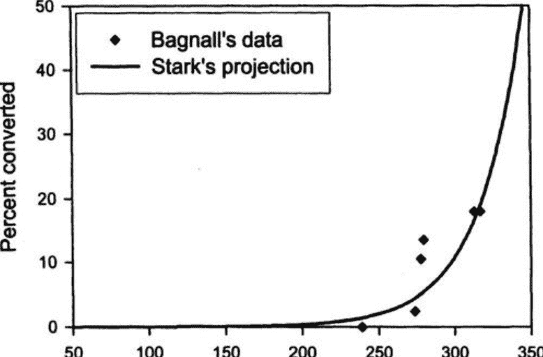

**图 6.7** 塔克对罗马帝国早期基督教增长预测与巴格尔关于埃及基督徒比例数据的对比。

## 6.3.3 摩门教的增长

最后一个案例研究涉及一种现代宗教——摩门教的增长。数据是 1840 年至 1980 年间后期圣徒教会成员的总数，由塔克（1984）列出。

为了将逻辑模型拟合到这些数据，我需要将它们转换为比例。由于该教会是一个世界性宗教，在所有居住的大陆都有分支，我将数据表示为世界人口的转换比例。

这种程序可能高估了潜在转换的人口，因为摩门教转换的目标是那些对其他宗教没有强烈虔诚的人。然而，这一警告并不影响分析结果，因为无论我们如何定义具有转换风险的人口，摩门教距离转换中点都非常远，因此这种自催化模型预测，它们应该以本质上的指数方式增长。

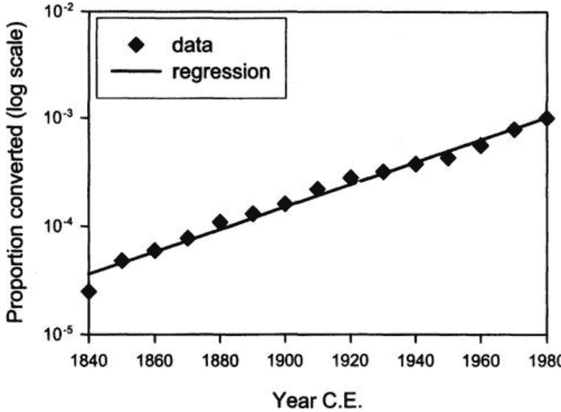

**图 6.8** 1840–1980 年间转化为摩门教徒的世界人口比例。数据绘制在对数比例尺上，用以强调增长的本质上的指数特性，这是低`C`浓度下自催化动力学的特征。

对这些数据进行逻辑斯曲线拟合表明，该模型解释了 98.9% 的方差。因此，我们再次在理论预测与观测轨迹之间获得了极佳的拟合（图 6.8）。

## 6.4 结论：数据支持自催化模型

实证测试的结果如表 6.1 所示。结果最引人注目的特征是自催化模型与数据的拟合程度如此之高（或者在基督教的情况下预测得如此准确），尤其是考虑到模型是如此简单。它只有两个拟合参数（初始条件`C(0)`和相对转化率`r`）。

重要的启示是，历史上的一切并非都是混乱或不可预测的。此外，对替代模型进行纯净的测试是可能的。

回想一下，我们从三个模型开始，它们基于对人们如何转化为新宗教的不同假设：非交互模型、自催化模型和阈值过程。所有四个数据集的定量测试得出了一致的结果：自催化模型对数据的拟合程度远于其他两种模型。

这是一个令人心碎的结论，因为目前的社会学观点认为转化是通过人际网络进行的（Stark 1996），而这正是自催化模型的基础机制。换句话说，纯数据驱动的分析与理论假设一致。

### 表 6.1 实证测试总结

估计的相对转化率`\hat{r}`，以及自催化模型解释的数据方差比例`R^2`（基督教除外，`R^2`为预测的比例）。`r`的单位为`yr^{-1}`。

| 案例研究 | `\hat{r}` | `R^2` |
| :--- | :---: | :---: |
| 伊斯兰（伊朗） | 0.028 | 0.9998 |
| 伊斯兰（西班牙） | 0.015 | 0.997 |
| 基督教 | 0.034 | 0.74 |
| 摩门教 | 0.023 | 0.089 |

如果我们开始剖析一些测量较好的数据（例如，转化为伊斯兰教的两个案例），我们会发现模型预测与数据之间存在一些系统性偏差。

这种局限性丝毫没有削弱自催化模型的成就：相对于替代方案，它的表现要好得多，而且科学的进步是通过理论的不断改进，通过抛弃表现不佳的替代方案转而选择表现更优方案来实现的。（实际上，在这个案例中，自催化模型即使在绝对意义上也表现极其出色，但并不是重点。）

此外，观察到的系统性偏差暗示了一个改进模型——初始移民后随自催化转化过程——考虑到我们对早期伊斯兰伊朗和西班牙历史的了解，这非常有道理。

自催化过程最能描述观测到的转化动力学这一实证发现，对历史动力学研究计划具有重要意义。逻辑斯增长（与例如，渐近增长不同）内在包含了对初始条件的某种敏感性。

例如，考虑基督教的增长。让我们量化达到逻辑斯曲线拐点（当 50% 的人口转化时）所需的转化时间跨度。从公元 40 年的 1000 名基督徒开始，使用 Stark 的估计值`\hat{f} = 0.034`，在公元 368 年达到中点（这比 Stark 的计算稍微晚一点，因为 Stark 使用的是纯指数法，而我采用的是逻辑斯模型）。

为了将逻辑斯增长与渐近增长进行对比，假设参数`p = 0.0021`，因为使用这个参数，渐近过程在公元 368 年也会达到中点。

渐近模型预测的轨迹对初始条件（公元 40 年有多少基督徒）非常不敏感（表 6.2）。无论公元 40 年有 100 还是 100,000 名基督徒，中点都仍然会在公元 368 年或 367 年达到。

相比之下，初始条件每变化十倍，逻辑斯预测的中点就会改变 69 年（表 6.2）。

对初始条件的敏感性使得预测变得困难，尤其是当初始条件难以精确测量时。在基督教案例中，Stark 对公元 40 年 1000 名转化者的估计很容易被向上或向下调整一个数量级。

此外，非线性动力系统放大初始条件微变化的倾向可能会导致其以混沌方式运行。已知，例如，资源渐近增长的资源-消费者模型比资源逻辑斯增长的类似模型要稳定得多（Turchin 2003）。我已经评论过逻辑斯增长在空间边界模型混沌动力学中的作用（第 4.2.1 节）。

### 表 6.2 逻辑斯模型与非交互模型对人口转化 50% 所需时间的预测

预测取决于初始条件。

| `C(0)` | 非交互模型 | 逻辑斯模型 |
| :---: | :---: | :---: |
| 10 | 公元 368 年 | 公元 506 年 |
| 100 | 公元 368 年 | 公元 437 年 |
| 1000 | 公元 368 年 | 公元 368 年 |
| 10,000 | 公元 368 年 | 公元 299 年 |
| 100,000 | 公元 367 年 | 公元 230 年 |

最后，在实证测试中我关注宗教转化，是因为那里可以找到数据。然而，标记的性质影响了边界的易越性。

某些边界很容易（例如获得适当服装），而另一些则困难或不可能。例如，如果种族是定义特征之一（如现代日本），那么欧洲人没有机会被接受。语言边界也很难跨越，因为大多数人在青春期后无法学会一种像母语一样的语言。

此外，语言同化通常不是从一种语言直接变为另一种，而是通过一个特定的双语群体间接进行。因此，民族同化可能比宗教转化慢。注意，即使是宗教转化也异常缓慢：在案例中需要几个世纪。

在我考虑的模型中，只有两类人：同化的未化的。创建额外的类别是使模型更现实的一种方法。例如，语言同化可以通过显式添加第三个变量——政体中双语者的比例——来建模。

此外，当民族边界涉及多个维度时，创建多个类别可能是一个合理的方法。例如，如果同化需要转向官方宗教并学习核心民族的语言，我们可以建立四个类别，反映两种宗教和两种语言的所有可能组合。

原则上可以增加更多类别来反映更细的划分，但模型将变得复杂到无法管理。另一种方法是假设两个民族在许多连续维度上存在差异。因此，如果我们想显式模拟个体特征的内部变异性，那么关键变量就变成了两个民族在该维度空间中的距离。

Sugarscape 模型创建者（Epstein and Axtell 1996）使用过某种类似的方法，尽管他们离散地模拟文化特征，即 1（特征存在）和 0（特征不存在）的序列。

### 6.5 总结


- 当一个扩张的帝国兼并了与其核心民族不同的人居住的领土时，预计该民族对帝国的初始忠诚度不高。帝国地缘政治权力的后续发展很大程度上取决于新并入人口多快地同化为核心民族。

- 在这一章中，我考虑了关于人们如何转换族群身份的三组基本假设（这一过程可能涉及语言同化、宗教转换等）。

- 非交互模型（`noninteractive model`）假设每个未同化的个体具有恒定的族群身份转换概率（每单位时间）。这种同化过程会导致会导致渐近动力学。

- 自催化模型（`autocatalytic model`）假设同化是直接人际吸引的结果。自催化模型预测的动力学是 S 型逻辑曲线。

- 阈值模型（`threshold model`）假设了一种更为非线性的转换模型：如果同化比例超过某一阈值，则同化速率为正；否则，同化速率为负，导致反向过程，即核心成员向边缘身份同化。阈值模型的动力学是亚稳态的。

- 接下来，我考虑了这三个模型的空间扩展。非交互模型不受空间增加的影响。

- 如果社会接触分布的特征是肥尾的，空间自催化模型在全局范围内将以逻辑方式运行。这在实践中的意味着，如果已经同化的个体能够成功保持其社交网络开放，并继续接触并进入新的、遥远的社交网络，那么同化过程就不会耗尽潜在主体。如果接触分布具有细尾，那么在最初的加速增长期后，扩张将变为随时间的线性增长。最后，如果存在与其余大部分联系稀少的人群，他们可能永远成为未同化的孤岛。

- 空间阈值模型表明，同化过程很难启动。在同化开始扩散之前，必须在某些地区建立一个关键规模的同化人口。如果扩散成功，这种扩散是线性的。社交接触中的断层可能导致两个或多个族群身份的稳定共存（这种结果比自催化模型中更容易实现）。

- 为了确定这三个简单备选模型中哪一个描述了身份转换的历史动力学，我调查了几个关于宗教转换的数据集。我仅对比了仅来自非空间模型的预测结果，因为我缺乏空间数据。这些数据涉及伊朗和西班牙向伊斯兰教的转换、罗马帝国基督教的兴起以及摩尔门教会的增长。

- 在所有情况下，最好的模型被证明是自催化过程。自催化模型预测的初始加速期在所有案例研究中都是显而易见的。自催化模型生成的预测具有惊人的准确性（在四个案例中的三个案例中解释了超过 99% 的方差）。转换过程的时间尺度相当长：在伊斯兰教和基督教案例中，从开始到中点（一半人口完成转换）花费了 2 到 3 个世纪（摩尔门教会目前距离中点还很远）。

- 对两个伊斯兰案例进行更详细的分析揭示了自催化模型预测与数据模式之间的某些系统性差异。对自催化模型进行改进，允许穆斯林人口以低速率迁移，符合这一经验模式，表明该模型是未来实证测试中可行的竞争者。

- 本章的一个重要性启示是证明了书中提倡的正规方法（将备选假设转化为数学模型，并使用数据区分备选模型）在现实的历史应用中是有效的。此外，当简单模型应用于真实的历史数据集时，可以产生惊人的准确结果。

# 第七章

## 人口-结构理论

### 7.1 人口动力学与国家崩溃

除非被压倒性的外部力量过早灭，否则帝国通常经历三个阶段：

1. 政体形成和核心族群的民族起源，伴随着在族群相似的基础之内的初步扩张；
2. 扩张到巅峰规模，在此过程中获得多族群特征；
3. 停滞、衰落和崩溃（随后可能是复兴和另一个帝国周期）。

前两个阶段的数学模型在第 4 章和第 6 章中已有。在本章中，我旨在调查崩溃的原因。

一个有用的起点再次由伊本·哈尔敦（`Ibn Khaldun`）提供，他假设了国家衰落的两个主要原因：

1. 意识形态（`asabiya` 丧失）；
2. 经济（包括人口和财政机制）（`Ibn Khaldun 1958:II:118–119`）。

我们已经在第四章讨论了第一种机制，因此让我们关注第二种。

伊本·哈尔敦（`1958:II:122–123, 135–137`）指出，新建立的国家支出适中，行政公正。因此，税收较轻，对臣民的强迫较少。这种仁慈的统治创造了人们繁荣发展的条件，“繁衍将旺盛”。普遍的繁荣导致统治者和人民习惯于支出的增加（伊本·哈尔敦的话说是“奢侈”）。军队和官僚机构要求并获得了更高的薪水。尽管人口逐渐积累，但最终（几代人之后）社会达到了其增长的极限。然而，奢侈的习惯继续增加且必须付出代价，因此国家试图通过重税或直接没收臣民的财产来增加收入。这种财政政策不可避免地导致经济的灭亡，随后引发饥荒、瘟疫、政治动荡和叛乱。

这就是伊本·哈尔敦论点的核心内容。伊本·哈尔敦讨论了其论点中假设的每个链条背后的许多特定社会学和生态机制（例如，他明确将流行病的传播与人口密度联系起来，尽管当时并不知道疾病的微生物起源）。我建议读者阅读伊本·哈尔敦的书以获取更多详细信息（以及无数关于文明崩溃各种特定实例的历史记载，这些记载都引用了这种理论的变体）。

人口过度增长对社会动力学具有负面影响的假设在过去的两个世纪中自马尔图斯（`Malthus，1798`）的作品以来一直激烈争论。我在这里不综述大量的文献，但请注意假设人口增长是直接原因的理论似乎没有实证支持。更有意义的观点是人口增长通过影响社会制度间接导致危机（`Goldstone 1991b`）。`Goldstone` 将他的国家崩溃理论称为人口-结构的：因为驱动力量是人口增长；因为人口趋势本身并没有直接导致国家危机，而是其对经济、政治和社会制度的影响（`Goldstone 1991b:xxvi`）。以下简要总结 `Goldstone` 的理论（`Goldstone 1991b:24`）。

人口增长超过土地生产率对社会制度产生了多方面的影响：

- 第一，它导致了持续的通货膨胀，超过了农业国家增加收入的能力。此外，人口增加导致军队扩张和成本上升。因此，国家不得不扩大税收，尽管遭到精英和普通民众的抵抗。然而，增加收入的尝试无法抵消螺旋上升支出。因此，尽管国家正在提高税收，它正走向财政危机。

- 第二，人口的快速扩张导致竞争精英的人数增加，给国家带来了更大的财政压力。此外，精英内部竞争的加剧导致了竞争性赞助网络的形成。结果是，精英因竞争和派系斗争而变得相互敌。

- 第三，人口增长导致了农村贫困、城市迁移、实际工资下降以及粮食骚乱和工资抗议频率的增加。

- 人口快速增长的另一个后果是青年的扩张。这部分人口受就业机会缺乏的影响尤为严重。此外，人口年轻化增加了其动员潜力。

- 最后，精英竞争和大众不满加剧了意识形态冲突。例如，在近现代欧洲，异见精英和不满的工匠被广泛招募进异端宗教运动。

随着所有这些趋势加剧，最终结果是国家破产，并导致地区性和国家级叛乱的精英运动，以及精英动员和大众起义的结合，这表现了中央权威的崩溃（`Goldstone 1991b:25`）。

表明，气候优越与疾病消退的结合，可能解释了 1500 年至 1600 年代初世界上大多数地区人口增加一倍的观测现象（`Goldstone 1991b:25`）。这一选择显然并非轻率为之。。`Goldstone（1986, 1991a）` 对近现代英国人口动力学、价格和实际工资的分析使他得出结论：现有的内生理论没有数据支持。例如，马尔萨斯-李嘉图模型假设人口迁移会对价格变化做出反应。然而，正如 `Goldstone` 用数据所示，长期的死亡模式似乎与实际工资无关。

也许这才是正确的方法，我们需要寻找特定的外生因素来解释不同时期和地区的人口动力学。然而，我不认为内生模型的完整频谱尚未与数据进行过对比。特别是，我想探索政治不稳定性对人口动力学存在反馈效应的可能性。

政治稳定或不稳定如何影响人口动力学？让我们先从假设一个关于人口动力学与粮食生产相互作用的马尔萨斯-李嘉图模型开始。我脑海中有一个类似于逻辑模型，它有两个参数。在没有密度反馈的情况下（即低人口密度），人口增长的内在速率是出生率和死亡率的平衡。负载容量由气候和土壤条件以及当前的农业技术水平决定（这在下一节会变得更具体）。政治不稳定性可以影响这两个参数。最明显的是，当国家软弱或不存在时，民众将由于犯罪、土匪以及内外战争的增加而遭受死亡率上升。此外，动荡时期会导致迁移率增加：来自战争影响地区或生产潜力被破坏的地区的难民（见下文关于此的讨论）。迁移有几个影响。

首先，它可能导致外迁（我们可以简单地将其加入死亡率中）。其次，流动中的人们无力负担孩子。因此，出生率下降。

第三，迁移的增加会导致流行病。流浪者的增加通过连接在良好时期会保持孤立的区域来传播疾病。此外，流浪者和乞丐聚集在城镇和城市，增加了他们的人口规模。这可能会使密度超过流行病阈值（疾病传播的临界密度）。最后，政治不稳定性导致生育率降低，因为在不确定的时期，人们选择晚晚并并生更少的孩子。逐渐地，人们对家庭规模的选择可能不仅反映在出生率上，还反映在杀婴率上。因此，家庭限制措施可能伪装成儿童死亡率的增加。

政治不稳定性也可以影响负载容量。国家增加负载容量的机制有很多，因此我将只提到最常见的两种。

首先，国家提供保护。在无国家社会中，人们只能生活在自然堡垒中，例如前秘斯哥鲁的山丘酋长国（`Earle 1997`），以及罗马帝国崩溃后意大利定居点向山顶的移动（`Wickham 1981`）。由于担心攻击，人们只能开发靠近防御定居点的小部分生产区。强有的国家保护生产人口免受外部和内部（土匪、内战）的威胁，从而允许整个可耕地区投入生产。

第二种机制是国家经常通过修建水溉运河和道路、实施防洪措施、从森林开垦土地等来增加农业生产力。同样，这些措施的最终结果是能够从事粮食生产的人数（负载容量）增加。

总之，政治不稳定性会对人口统计率和社会的生产能力产生负面影响。我将在下开发的模型中探索这两种机制。重申一下，我的目标是一个人口动力学是内生过程的理论：不仅人口增长与国家崩溃之间存在联系，国家崩溃与人口增长之间可能存在反馈连接。

### 7.2 数学理论

#### 7.2.1 基础人口-财政模型

### 模型开发

我从最简单的农业国家崩溃模型开始。我的目的是首先揭示论证中最基础的逻辑模块，然后才向其添加现实世界的复杂性。在这一节中，我将要求读者和我一起完成模型的推导和分析，因为数学部分非常简单，但对于理解主要结果至关重要。在接下来的章节中，数学部分将被移至附录。

模型中有两个变量，一个代表人口，另一个代表国家。`N(t)` 是 `t` 时刻臣民的人口密度。我假设国家面积不变，因此密度简单等于人口除以面积。`S(t)` 是当前的累积国家资源，我以千克（或吨）粮食来衡量。这一特定变量的选择基于农业国家的经济性质，粮食是其主要的商品。

为了开始推导连接这两个结构变量（`N` 和 `S`）的方程，我首先假设人均剩余生产率是人口数量的递减函数（这是大卫·李嘉图的收益递减规律）。有几种社会生态机制支撑这种关系。首先，随着人口增长，最肥沃土地的储耗尽，越来越多的边际土地被开垦。其次，人口增长的增加也意味着土地被划分为更小的地块。尽管每块土地获得了更多的劳动力，但其生产率（每年公斤粮食）也受收益递减规律的影响。

为了简单起见，我将人均剩余生产率 `\rho` 与人口数量 `N` 之间的关系近似为线性函数：

```
\rho(N) = c_1(1 - N/k)
```

这里 `c_1` 是某个比例常数，`k` 是剩余为零的人口规模。因此，当 `N > k` 时，剩余为负（生产粮食少于维持所需的数量）。

接下来我假设人口动力学是马尔萨斯的：

```
\dot{N} = rN
```

并且人均增长率是人均剩余生产率的线性函数，`r = c_2\rho(N)`。将这两个假设结合起来，我们得到了人口增长的逻辑模型：

```
\dot{N} = r_0N(1 - N/k) \quad (7.1)
```

其中 `r_0 = c_1c_2` 是人口增长的内在速率，`k` 现在被视为“负载容量”，或平衡人口规模。当 `N < k` 时，社会产生剩余，人口增长。如果 `N > k`，则社会生产粮食少于家庭维持和更新所需的，导致人口下降。

现在转向国家资源 `S` 的微分方程，`S` 的变化是两个相反过程的结果：收入和支出。我假设国家按固定比例征收剩余作为税。总剩余生产率是人均率与人口数量的乘积。因此，税率为 `c_3\rho(N)N`，其中 `c_3` 是作为税收征取的剩余比例。国家支出假设与人口规模成正比。这一假设的原因是，随着人口增长，国家必须投入更多资源用于军队以保护和维持治安，用于官僚机构以征收和管理税收，以及用于各种公共工程（公共建筑、道路、灌溉运河等）。通过结合这些过程，我们得到了关于 `S` 的以下方程：

$$
\dot{S} = \rho_0 N(1 - N/k) - \beta N
$$

其中 `\rho_0 = c_1c_3` 是低人口密度的人均税率，`\beta` 是人均国家支出率。

我们还没有结束。尽管我们建立了从 `N` 到 `S` 的动态链接，但模型中缺乏反馈效应（从 `S` 到 `N`）。我假设强国家对人口动力学有积极影响；具体而言，它增加了 `k`，即在生态条件和当前农业技术水平下的可持续人口规模，正如前一节所述。

因此，承载力 `k` 是 `S` 的单调增函数。然而，`k` 不会无限增长。无论 `S` 多高，在某一点，所有土地都会被开垦，所有潜在的改进都已经到位。因此，给定历史当前的农业技术水平，必然存在某个最大值 `k_{max}`。考虑这种机制的另一种方式是，资本投资回报也遵循收益递减规律。我假设 `k(S)` 如下特定函数形式：

$$
k(S) = k_0\left(1 + c\frac{S}{s_0 + S}\right)
$$

参数 `k_0` 是无状态社会的承载力，`c = k_{max} - k_0` 是在资金无限的情况下 `k` 增加的最大可能收益，`s_0` 表示 `k` 的改进如何依赖于 `S`（当 `S = s_0` 时，`k(S)` 提升了 `c/2`）。

将方程 (7.1)–(7.3) 结合，我们得到了完整的人口-财政模型（因为它关注国家的财政健康作为主要的结构变量）。模型有六个参数：`\rho_0`、`\beta`、`r`、`k_0`、`c` 和 `s_0`，但通过通过缩放 `N' = N/k_0` 和 `S' = S/\rho_0`，可以将该集合减少为四个。这一过程留下了以下原始值：`\beta' = \beta/\rho_0`、`r`、`c` 以及 `s' = s_0/\rho_0`。缩放后的方程为：

```
\dot{N}=rN\left(1-\frac{N}{k(S)}\right)
\dot{S}=N\left(1-\frac{N}{k(S)}\right)-\beta N \quad (7.4)
k(S)=1+\frac{S}{s_0+S}
```

（为了更好的可读性，我去掉了撇号）。我还施加了条件 `S \geqslant 0`（即国家不允许负债）。

## 模型动力学

人口-财政模型的典型动力学如图 7.1a 所示。从初始值 `S=0` 和人口数量 `N=k_0/2` 开始，模型预测最初 `N` 和 `S` 都会增长。随着 `S` 的增加，承载力 `k(S)` 迅速接近上限 `k_{\max}`。由于这个原因，`N` 的增长不会在 `k_0` 处停止，而是持续超过该临界值。然而，在 `N` 接近 `k_{\max}` 之前的，在某个人口规模 `N_{\text{crit}}` 处，国家资源的增长停止，`S` 开始以不断增加的速度崩溃，并迅速达到 0。这意味着 `k(S)` 也减少到 `k_0`，人口规模也随之迅速下降。

`S` 崩溃的底层机制如图 7.1b 所示。`S` 的变化率取决于两种对立力量的平衡：收入和支出。当 `N` 较低时，增加它会导致更大的收入（更多的工人意味着更多的税收）。国家支出的增长滞后于收入，国家盈余不断积累。然而，随着 `N` 的增加，收入增长停止，实际上开始下降。这是农业劳动力收益递减的结果。然而，支出继续增加。在人口密度 `N = N_{crit}` 处，收入和支出变得（短暂）平衡。遗憾的是，人口增长继续向承载力 `k` 发展，国家支出与收入之间的差距迅速变得灾难性。结果，国家迅速消耗了在良好时期积累的任何资源。当 `S` 变为零时，国家无法支付军队、官僚的费用并维持基础设施：国家崩溃了。

平衡点 `N = k_0` 和 `S = 0` 是局部稳定的。这意味着，一旦国家崩溃，人口规模或国家资源的微小扰动都不会导致偏离这一平衡点。为了启动另一个国家建设-崩溃的循环，要么 `N` 必须减少到 `(1 - \beta)` 以下，要么 `S` 必须增加到 `s_0[/(\beta^{-1} - 1]` 以上。因此，在一个确定性世界中，一旦国家崩溃，它就不会再次出现。在一个多种外生因素共同影响 `N` 和 `S` 的随机世界中，足够足够大的扰动开始引导轨迹进入另一个国家建设-崩溃循环只是时间问题。例如，我通过在模型中引入随机性，每年向 `S` 加上一个均值为 0、标准差为 `\sigma = 0.1s_0` 的随机高斯数。模型的动力学由 `\sigma = 0.1s_0` 特征决定。注意 `r` 是

## 评估

现在让我们讨论一下模型开发过程中关于函数形式的一些简化假设。再次查看图 7.1b，显然，基本论点不受人口规模与人均盈余生产或人均国家支出之间关系的函数形式细节的影响。例如，如果我们用任何非线性（但单调）函数代替人均随人口规模线性下降的假设，我们所做的只是以某种方式扭曲抛物线。基本形状——收入增加后下降——将不受影响，因为收入在 `N = 0` 和 `N = k` 处必须为 0，在其之间必须有一个最大值。同样，支出与人口规模之间的关系可以是线性的（事实上，支出可能是 `N` 的加速函数，仅仅因为大量人口需要更多的官僚层来控制和征税）。然而，支出必须随 `N` 单调增加，因此在某个人口规模 `N_{crit}` 处，收入和支出曲线不可避免地交叉，产生上面讨论过的对国家财政健康的所有后果。总体结论似乎不可避免：除非能以某种方式阻止人口规模超过 `N_{crit}` 阈值，否则国家的支出将不可避免地超过其能力，国家将不可避免破产。一旦达到这一点，提高税率或削减支出非必需品（如宫廷奢侈品）最多只能是一种短期解决方案。允许国家借债（即允许 `S` 变为负值，直到达到某个最大值）同样只是推迟了不可避免的结局。

我相信这一结论对于农业政治的动力学具有极其重要的意义。然而，基于该模型的论证并不意味着所有国家都会不可避免地在二到三十年内崩溃。但拥有一个明确的模型使我们能够考虑被模型排除之外的各种现实特征如何影响其核心信息。

首先，我应该强调，该模型仅适用于工业前社会。可以想象，工业或甚至基于信息的经济可能可以通过创新和技术实施来扩大生产基础，从而保持在人口增长面前。然而，这种选择对农业社会并不开放。传统社会拥有一定的技术储备，可以在人口压力增加的情况下利用这些技术强化生产（`Boserup 1966, 1981`）。但是，进一步强化生产的可能性终耗尽（`Wood 1998`）。这反映在我的假设中：函数 `k(S)` 最终必须达到饱和。


其次，模型忽略了人口—国家系统之外的因素。特别是，外部的人口可能被阻止增长到由食物生产决定的平衡水平。例如，我们可以通过在`N`的逻辑方程中添加一个密度无关的死亡项`\delta N`对此情况进行建模[方程 (7.1)]。如果`\delta`足够大，那么人口平衡将左移并超过`N_{crit}`，政体将无限地处于收入超过支出的区域。然而，这种情况可能只影响较小的政体。在领土广阔的帝国中，只有边疆地区会受到外部军事压力的影响，而中心地区的人口将不受限制地增长到生存极限。相反，一个国家可能成功征服邻近地区。如果一个社会采取积极的殖民政策，那么帝国内部的人口压力将得到缓解。然而，这种机制只能推迟不可避免的结局，因为没有哪个农业帝国可以无限制地扩张领土。

第三，社会可能会选择限制其人口增长。自愿的家庭限制从先验来看是不可能的，因为少生孩子的成本由个人家庭承担，而与人口过多有关的问题则分散在整个社会中。换句话说，自愿限制生育具有集体行动问题的所有特征。然而，这可能不是一个不可解决的问题。此外，在某些条件下，家庭限制可能是个人追求的理性策略。因此，这是一个实证问题，需要对任何特定社会进行确定：其成员是否实行家庭限制？家庭限制是否会导致人口处于低于`N_{crit}`的平衡水平？

最后，国家可能通过强制手段限制人口增长。这可以通过间接实现，只需通过征收超过剩余产量的产量。通过租赁资源不足以维持其自身繁衍的家庭，这种严苛的税收可能导致人口下降，并矛盾的是，增加了剩余产量（观察图 7.1 中将`N`移到`N_{crit}`左侧会导致剩余产量增加）。这种可能性对于历史社会来说似乎是最现实的，因为不需要假设国家有意识地采取减少人口的策略。他们做的仅仅是从人口中出口更大比例的总产出，如果他们接近`N_{crit}`点，他们完全有动力这样做。此外，从经验上看，大多数农业国家在大多数时候都被指责为反对其生产人口。因此，我们需要通过一个比这里开发的模型更复杂的模型来进一步探索这种可能性。主要问题是国家强制的机制是什么？也就是说，在农业国家中是谁在进行强制？普遍答案是精英。他们要么直接从农民那里收税并将其传输给国家，要么为提取税收的国家机器提供官僚和军官。在任何情况下，我们都需要为基础模型增加更多结构，并明确考虑国家、精英和普通平民的动力学。

### 7.2.2 添加阶级结构

我的下一个目标是通过考虑添加阶级结构如何影响关于国家崩溃的理论预测，来扩展上一节提出的理论。为此，我将总人口分为两个社会阶层：平民和精英。这一理论的发展很大程度上取决于杰·黄金石（Jack Goldstone）的人口结构理论（1991b）的见解。

模型的基本结构如下（推导和其他细节见附录 A.3 节）。有三个结构变量：平民的人数（农民，`P`）、精英的人数（`E`）以及积累的国家资源（`S`）。与基础的人口财政模型一样，平民人口增长会导致人均生产率下降。具体来说，我假设每个农民的产量是人口规模的线性递减函数。为了将生产与人口动力学联系起来，我假设平民人口的人均增长率是每个生产者可用资源的线性函数。如果人均资源超过某个阈值，那么农民人口将会增加。另一方面，如果提取的比例过高，农民人口将会下降。在附录 I 中我展示了如果农民处理了他们生产的所有资源，那么他们的人口动力学将由逻辑方程描述。

然而，农民不允许保留他们生产的所有食物。在附录 I 中，我推出了精英提取资源的模型。模型的关键要素是精英能够对农民施加的强制程度。在精英人数`E`较低时，他们能够产生的强制量（以及他们能够从生产者那里提取的资源比例）与`E`成正比。然而，随着`E`的增加，贵族提取的资源不能超过生产总量。因此，尽管精英人数的增加允许从农民那里提取更大比例的生产，但精英提取资源的能力受到收益递减的影响，导致每人精英提取的资源随精英人数的增加而减少。

精英的人口动力学建模与农民相同。如果人均资源较高，精英人口通过繁殖和从普通大众中招募而增长。如果人均资源较低，那么精英人口将由于生产减少、死亡率增加和向下流动而萎缩。然而，显然，一个精英家庭维持和繁衍自身所需的资源阈值被设定为比平民相应参数高得多的值。

与基础模型一样，国家资源随着收入和支出而变化。在收入方面，我假设提取的资源分配在精英（租金）和国家（税收）之间。然而，提取资源中实际进入国家国库的部分是一个动态量。当从农民那里提取的资源足以维持精英预期的消费水平时，他们将支付应国家的税款。随着精英人数的增加以及每个精英家庭获得的用于维持的资源不断减少，精英将把更大比例的税收转向自己的需求。在历史上，贵族利用各种手段来侵吞国家收入。他们向当局申请免税，谎称贫困。其次，他们往往简单地不将税款传输给国家，而是留给自己（这种选择在土地主收税时可用）。第三，担任官员的精英成员利用各种腐败手段将国家税收转移到自己和家族口袋中。所有这些最终结果都是，随着精英变得贫困，国家获得的从平民那里提取的产品比例不断减少。我通过假设以下对这种动力学进行建模：

> 每个精英阶层都保留维持自身所需的资源，并将剩余部分的固定比例上交给国家。

接下来，通过类比推导基本模型的推导，我假设国家支出随精英人数的增加呈线性增长，因为国家必须为他们提供作为军官、官僚和祭司的就业机会。这一论点假设，与精英对国家提出的需求相比，与平民人数增加相关的国家支出是可以忽略不计的。（当然可以加上与平民相关的支出，但这会增加模型的复杂度且不会改变主要结果。）

最后，我们需要对`S`对`P`和`E`人口动力学的影响进行建模。正如 7.1 节所述，`S`既可以影响社会的生产能力（如基本财政模型所示），也可以作用于人口增长率。我在附录 I 中推导了针对这两种情况的两个模型。第一个模型与基本财政模型完全相似：高`S`增加了农民人口的承载力。在第二个模型中，我假设强有力国家的存在为精英带来了和平：精英内部的竞争不会以致命的形式出现，灭绝率较低。然而，当国家缺失或削弱时，激烈的精英内部冲突会导致灭绝率增加。

这两个模型产生了相同的动力学特征，因此我将关注第二个模型，即`S`影响精英人口统计学的模型。我将其称为“自私精英模型”，因为它假设精英在不考虑平民福祉的情况下压迫平民，并且只有在满足了自身基本需求后，才会将税收上交给国家。

对自私精英模型的数值研究表明，它能够产生三种动力学行为。首先，对于某些参数，精英无法建立自己的地位并走向灭绝。其次，在经历了初期的国家建立和崩溃后，精英和生产者趋于平衡并永久地保持在该状态（图 7.3a）。（对于某些参数，国家根本无法启动，直接趋于无国家的平衡。）发生的情况是，平民人口的增长创造了一个庞大的资源基础，使得精英能够迅速扩大人数。国家随着这一最初的精英扩张同步增长。然而，随着精英人数的增加，所提取产品中日益增大的比例仅用于将他们维持在最低水平，而交给国家和精英的比例随之增加，因此在某一点，支出超过了精英收入。正如在基本模型中一样，这最终会导致国家崩溃。与此同时，精英对农民生产资源的需求变得如此激烈，以至于农民留下的食物不足以维持生存。由于这种剧烈的压迫，农民人数开始下降。国家崩溃后，随之而来的无政府时期其特征是对农民的剧烈剥削和极具致命性的精英内部冲突。结果是平民和贵族的人数都在下降，并在经历一些轻微震荡后趋于平衡。

**图 7.3** 自私精英模型的动力学。(a) 无国家社会中的稳定平衡。参数为`\beta_1 = \delta_1 = 0.02, \rho_0 = 2, \beta_2 = 0.5, \delta_2 = 0.025, \gamma = 10, \alpha = 0.2`。(b) 稳定极限环。除`\delta_2 = 0.1`外，参数与 (a) 相同。

自私精英模型预测的这种动力学与基本模型所表现出的典型动力学相似，只是`N`的角色现在由`E`承担。与基本模型中一样，尽管平衡在局部是稳定的，但它可能会受到扰动而进入另一个国家建立/国家崩溃的循环（再次，这类比基本模型的动力学）。

单一的国家建立/崩溃周期后是无国家平衡（在没有扰动的情况下），这是自私精英模型大多数参数组合的典型动力学。它也是`S`影响社会生产能力的阶级结构模型的典型动力学。然而，对于某些参数值，自私精英模型表现出第三种行为，即系统经历稳定的极限环，循环往复的国家建立、崩溃、一段无政府时期，然后是另一个国家建立周期（图 7.3b）。将系统从稳定平衡移动到循环循环的一种方法是增加无国家状态下的精英死亡率。这种修正允许精英快速消亡并下降到足够低的水平，从而为国家资源的增加创造了条件。

自私精英模型未表现出的行为是在存在国家且`S > 0`时，农民和精英之间不存在稳定平衡。原因显而易见，且完全类比基本人口财政模型中运作的机制。如果`E`处于平衡状态，那么`E`必然为零（精英没有剩余部分与国家分享）。因此，国家获得了收入，但仍必须花费在国防、行政等方面。

模型的一个导致存在国家时出现平衡的明显修正，是允许国家收集精英从平民那里提取的总产出的固定比例（而不是精英剩余部分的比例）。通过这种修正，并且对于现实的参数值，`P`和`E`趋于平衡，而`S`保持为正值（实际上，`S`随时间增长，但国家无疑会找到方法花费这部分剩余）。

然而，这一结果提出了一个有趣的问题：假设在精英经历巨大困难的时期，他们会允许很大比例的收入进入国家，这有多现实性？请注意，该模型假设即使当精英的经济地位绝望到人数正在减少时，他们仍然不会动用从平民流向状态的税收流。在大多数农业社会中，精英是征收税收的人。大多数精英可能会对自己的家庭和宗族产生更强的团结感，而不是对整个政体。因此，我认为这种“无私精英”模型对大多数历史国家的描述并不现实。

在模型中，我假设普通人口的动力学与精英阶层的动力学在很大程度上是分离。王朝更替，但农民和商人继续生产食物、进行贸易，并向任何现执政政府纳税。因此，从平民身上提取的资源量是一个常数`R`。在王朝早期，提取的资源被分为两部分：支持政府的税收`\gamma R`和支持精英阶层的租金`(1-\gamma)R`。参数`\gamma`（即进入国家的资源比例）被假设为一个常数。因此，每位贵族的收入为`\mu = (1-\gamma)R/E`，其中`E`是当前的贵族人数。

现在我引入另外两个参数。令`\mu_0`为维持和替换恰好一个贵族所需的人均收入。换句话说，当人均收入低于`\mu_0`时，精英人数将会减少；如果`\mu > \mu_0`，则精英人数将增加。第二个参数是`\mu_{min}`，即贵族们认为与其身份相符的最低人均收入。这种“最低可接受收入”是由社会决定的，并在不同社会之间存在差异。通常，`\mu_{min} \ge \mu_0`，因为贵族不太可能接受一种他们无法负担将家族延续到后代的收入。伊本·赫合勒敦认为，随着时间的推移，前部落民会忘记沙漠的生活方式，后代会习惯日益增长的奢侈生活。因此，`\mu_{min}`是一个变量，它在王朝初期从某个低水平（例如`\mu_0`）开始，然后以一定的速率（例如每年`\delta_{\mu}`）增加。

正如我上面所述，当`\mu`大于`\mu_0`时，精英人数增加。精英人口的增长率与差异`\mu - \mu_0`成正比，但不超过最大增长率`r_{max}`。由于该模型是针对一个实行多妻制的特定社会设计的，我将`r_{max}`设为`0.08 yr^{-1}`，这是前工业时代典型人口增长率的四倍。我这一假设的理由是，穆斯林男性法律允许的妻子上限是四个。当然，

模型的下一个假设是，只要从租金产生的人均收入超过最低可接受收入，即`(1 - \gamma)R/E > \mu_{min}`，国家与精英就处于和谐状态。然而，如果精英人数增长到其人均收入低于`\mu_{min}`的程度，贵族就会变得不满，并利用各种常用手段将税款收入自己的腰包（如上一节讨论）。模型假设在`\mu = \mu_{min}`这一点，他们从国家中窃取足够的资金，以维持他们认为与其身份相符的最低生活标准。如果精英人数增长到`R/E < \mu_{min}`的程度，即没有足够的提取资源来满足所有贵族，即使国家没有获得税收，模型也假设`\mu = R/E`。换句话说，如果贵族将所有提取的资源分配给自己，国家将一无所有。

财政动力学按常理建模，收入如上所述，支出与精英人数成正比。因此，国家积累资源`S`的动力学遵循典型轨迹：在王朝早期，`S`会增长，因为精英人数较少且胃适中。然而，在某一个点，收入下降到无法匹配支出的程度，`S`下降并最终变为 0。此时，模型假设王朝已经失败。国家变得容易被征服，这（至少在模型中）会立即发生，因为沙漠部落提供了一个现成的且空间上相邻的下一个王朝来源。模型预测的典型轨迹如图 7.4a 所示。

请注意，我选择用经济（或财政）术语来构建这个模型。然而，我们很容易地用集体团结力（asabiya）的角度来构建该模型。例如，我们可以将`S`重新解释为支持当前王朝的精英（征服部落民及其后代）的 asabiya。那么，在王朝初期，asabiya 很高，并保持在高位，直到精英达到人均收入低于最低可接受水平的阈值。此时，精英内部竞争加剧，asabiya 开始下降。当 asabiya 达到某一阈值时，王朝（以及国家）崩溃，并被来自沙漠的新部落集团取代。这种模型的动力学与图 7.4a 所示的本质相同。

对参数值对伊本·赫合勒敦模型动力学影响的数值研究表明，影响周期的主要参数是精英人口的最大增长率（`r_{max}`）以及最低可接受收入随时间增长的速率。图 7.4a 中所示的周期约为一个世纪的快速周期获得了高`r_{max}`值，这在精英多妻制盛行的社会中应该是典型的。相比之下，将`r_{max}`降低到 0.02 会导致更长的周期，大约 1.5 世纪。

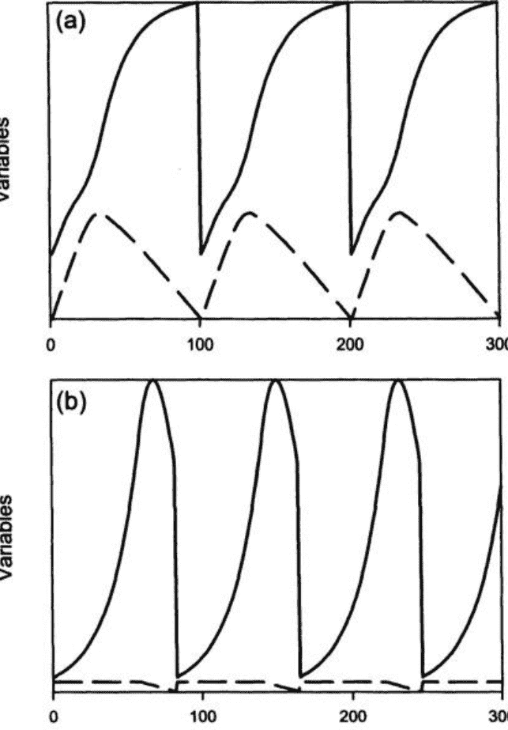

**图 7.4** (a) 伊本·赫合勒敦模型的动力学：精英人数，`E`，实线；(b) 寄生游牧模型的动力学：`S`，虚线。

注意，我选择用经济（或财政）术语来构建这个模型。然而，我们很容易地用集体团结力（asabiya）的角度来构建该模型。例如，我们可以将`S`重新解释为支持当前王朝（征服部落民及其后代）的 asabiya。那么，在王朝初期，asabiya 很高，并保持在高位，直到精英达到人均收入低于最低可接受水平的阈值。此时，精英内部竞争加剧，asabiya 开始下降。当 asabiya 达到某一阈值时，王朝（以及国家）崩溃，并被来自沙漠的新部落集团取代。这种模型的动力学与图 7.4a 所示的本质相同。

# 寄生游牧模型

我在本节中开发的最后一个模型是针对内亚边疆的情况设计的，由 Fieldfield (1989) 概念化并由 Kradin (2000, 2002) 进一步发展。该模型在许多方面与伊本·赫合勒敦模型相似。再次，我关注游牧精英（各级酋首领）的动力学。然而，与马格里布的情况相反，内亚边疆的游牧民倾向于不征服文明国家，而是从中出口贡赋。以下是模型的口头描述（方程在附录中）。令`R`为某一年从中国人那里提取的贡（`R`是一个变量，其对模型中其他变量的依赖关系将在下文解释）。令`E`为精英人数。因此，精英人均收入`\mu = R/E`。精英人口动力学的建模方式与赫合勒敦模型完全相同（即，精英人均变化率与`\mu - \mu_0`成正比，其中`\mu_0`是维持和替换精英成员所需的收入水平）。

除了`E`和`S`之外，模型的第二个结构变量是最高组织层上游牧精英的 asabiya，即“帝国联盟（imperial confederation）”。我假设较小规模群体的 asabiya 固定在较高水平，这是游牧生活的典型特征，因此我们不需要对其进行显式建模。导致帝国联盟兴起的过程被概念化如下：起初，草原被分配给各个“部落”（游牧酋长国）。某一个特定的部落通过地理位置优势、富有魅力的领袖的出现或仅仅是运气，获得了从草原边疆另一侧农耕政权提取战利品或贡赋的能力。通过从定居农民那里提取的货物，部落酋长增加了他的战士随从。这引发了一个正反馈动力学：更大的回报率让酋长能够征服附近的部落，将他们纳入不断发展的草原军队，从农耕国家提取更多的战利品/贡赋，吸引更多战士，以此类推。帝国草原联盟的这种自催过程一直持续直到触及从农耕国家可以提取的上限（记住，精明的游牧民并不希望征服农业国家，但仅对其榨取其所能承受的极限）。

具体而言，我假设贡赋数量`R`是`E`的非线性函数：首先，它随着`E`的增加而加速增长，随后趋于一个上渐近线。`R`也与联盟级别的凝聚力（asabiya）成正比，`S`初始从高水平开始，只要每个精英人均贡赋量充足，它就会保持不变（`S = 0`）。然而，如果人均收入`\mu`降至某些被认为适当的最低值`\mu_{min}`，精英内部竞争就会加剧。这会对凝聚力产生腐蚀作用，导致`S`下降。

寄生游牧模型的典型动力学如图 7.4b 所示。帝国联盟崛起的背后已在前文中得到解释。联盟失败的原因在某种上是相同的动力学过程，只是反向运行。当帝国联盟达到最大提取率时，其领土会扩张，但由于精英人口的增加，精英人数继续增长。当精英人数达到`\mu > \mu_{min}`的点时，`S`开始下降（图 7.4b）。`S`的下降降低了从农业国家提取贡赋的能力，这进一步加剧了精英内部竞争。最终，`S`达到某个低阈值，低于该阈值的帝国联盟将无法维持。联盟瓦解为多个相互战争的部落，循环重新开始。由于部落级别的凝聚力保持在较高水平，在前一个联盟崩溃后，另一个联盟崛起的先决条件立即建立（因此，该模型假设下一个循环立即开始）。

### 7.2.4 中国王朝循环模型

历史学家长期以来注意到王朝循环在中国历史中的重要性（Meskill 1965）。在王朝循环的早期，人口通常会下降。在随后的无政府时期，人口通常会减少。目前已经提出了两个类似的王朝循环模型，一个由经济学家丹·阿舍（Dan Usher，1989），另一个由经济学家朱其和人口学家罗纳德·李（Chu and Lee 1994）。由于 Usher 的模型相当复杂（有20个方程），我在这里不讨论它，而是转向 Chu 和 Lee 更简单的模型。


Chu 和 Lee 模型中有三类人：农民种植食物并纳税，土匪偷窃食物并与农民和统治者战斗，自利的统治者则向农民征税并猎杀土匪。食物生产通过额外的劳动投入而增加，但这种增长受到递减收益的影响。

农民有一个选择：他们可以做农民耕种，也可以变成土匪偷盗。这种职业决策基于对土匪和农民预期效用的比较。效用函数是所得食物与生存概率的乘积。

Chu 和 Lee 显示，人口增加的影响之一是增加了变成土匪的速率。当土匪数量增加时，会导致两个后果：

1. 首先，农民减少，导致食物产量下降。这由于儿童死亡率升高导致人口减少。此外，土匪数量增加意味着成人死亡风险增加。
2. 其次，土匪规模的扩张提高了他们的生存概率，导致其人口增加。

在某一点，土匪的力量超过了政府，王朝随之崩溃。

## 评估

Usher 和 Chu & Lee 的模型基于理性选择论：农民衡量留在农民或变成土匪的效用，然后做出相应的职业决策。在原则上，这是构建理论和进行实证预测的一种有趣且可能有效的方法。然而，这些作者选择的效用函数的性质令我困扰：平民效用本质上是预期收入（以食物为单位）乘以他们的生存概率。我的感觉这太像经济学的方法了，需要一种更复杂的社会学方法，建立在集体持规范和集体决策的基础上。

对这两个模型的一个更严肃的批评是，它们将大众起义视为导致国家崩溃的主要机制。然而，Goldstone (1991b) 提出了一个非常有说服力的论点，并得到了许多早期国家崩溃实证案例的支持：平民起义本身通常不会推翻国家。农民的装备、训练和组织程度很差，在凝聚精英的支持下，面对国家的强制机器几乎没有机会。Goldstone 认为，国家崩溃是由精英内部的派系斗引起的，这为平民起义铺平了道路（此外，即使是农民起义往往由精英成员领导）。因此目前的理论认为，大众不满在某种意义上是次要因素。我们应该关注精英动力机制。

尽管有上述批评，我认为 Usher 和 Chu & Lee 的模型为构建国家崩溃理论做出了重要贡献。注意，这两个模型中国家崩溃的底层动力人口增长，这导致人均收入逐渐下降，直到最终超过基本生存所需的剩余无法维持统治阶级（Usher 1989）。Usher 和 Chu & Lee 没有详细规定他们的模型到让我们确定他们预测了什么类型的长期动力学。但我在第 7.2.1 节提出的基础模型做到了，并表明在可能的参数值下，这种动力学的特征应该是长约 2-3 个世纪的反复（尽管有些不规则）的国家建设-国家崩溃循环。

此外，如果理性选择视角能为精英动力提供见解，将是非常有趣的。因此，将“职业选择”模块不仅应用于农民，而且应用于恶化时期的精英（即争取官职或转反叛），将具有启发性。然而，这种方法将远超出本书的目标，因此我将其留给未来的研究。

## 7.2.5 理论见解总结

本节讨论的人口结构模型暗示了两点一般见解。

首先，由于劳动收益递减，农业社会的人口增长必然导致人均收入逐渐下降。最终，农民产生的剩余将不足以维持国家。只有当人口数量保持在支出等于收入的临界阈值以下，才能防止国家破产和崩溃。

第二个见解是精英在国家动力学中的关键作用。精英可以通过让平民获得低于所需的收入来进行限制。然而，似乎没有一种限制人口增长的通用机制。在某些特殊情况下，国家机器可以独立于精英运行，并提供必要的强制力来限制精英人数。在其他情况下，精英自己可能会选择限制人口增长。然而在大多数农业社会中，我预计精英人数将超过可持续水平，导致国家崩溃。

精英属性对国家建设-崩溃循环的周期和幅度有很大影响。两个参数似乎最重要：精英繁殖率和提取能力。高繁殖率和低提取能力会导致快速的伊本·哈尔敦型循环，周期约为一个世纪，平民数量波动幅度较小。低繁殖率（接近农民水平）会增加周期。较高的提取能力会导致平民人口急剧下降。较长的周期也会导致人口波动幅度增大，因为较长的去中心化阶段会导致平民数量下降到更低的水平。因此，在低繁殖率自利精英模型中，平民人口的动力学

高抽取的能力在周期和幅度上与基础人口-财政模型中的人口动力学相似。

请注意，在所有模型中，我都假设精英招募是繁殖的结果。在现实社会中，精英数量的增长既通过现有精英家族的再产生，也通过来自平民阶层的向上社会流动而增长。我研究了在模型中加入这种精英招募机制的影响，发现它并不会影响增长的定性见解。本质上，动力学取决于精英数量增长的快慢，而这种增长通过何种机制发生并不重要。

这里讨论的简单模型有多种扩展方式。例如，根据杰克斯石理论（Jackstone theory）重新定义 Chu 和 Lee 模型中的变量将非常有趣，将三个结构性变量定义为平民、精英和异见精英（或“反精英精英”）的数量。另一个有趣的方向是扩展变量列表，不仅包括任何特定阶层的人数，还跟踪该阶层每个人的平均积累资源。这种变量类似于大多数人口-结构性模型中作为显式变量进入的累积国家资源。最近，Malkov 及其合作者开发了解决这一问题的模型（Malkov et al. 2000; Malkov and Sergey 2002）。

我需要在这里处理的最后一个问题是术语问题。我们应该如何称这里开发的系列人口-结构模型所预测的动力学？模型预测了极长期的波动，周期从一到三个世纪不等，取决于模型结构和参数值。这种动力学的特征是两个阶段：政治稳定性较高时的集权化，以及政治不稳定性较高时的去中心化。去中心化阶段（国家虚弱或不存在时）可以持续很长时间，且并不一定会导致集权化阶段。因此，模型预测的波动并不具有强周期性。

许多作者对世纪尺的长期波动或波浪进行过评论。Cameron (1988) 将其称为“逻辑”（logistics），Braudel (1988) 称为“世俗趋势”（secular trends），Fischer (1996) 称为“大波浪”（great wave），这仅仅是几个例子。“逻辑”是一个我倾向于留给逻辑方程的术语，它是书中考虑的许多模型的基础构建模块。逻辑是一个一阶模型，无法产生人口-结构模型所预测的那种二阶振荡。因此，将这些称为“逻辑”会引起无尽的混乱。“世俗趋势”是一个更好的术语，因为“世俗”的一种含义是指发生在几个世纪尺度上的长期变化。然而，“趋势”通常指单调的增加或减少，而人口-结构模型预测的动力学是起伏波动的波动。由于这个原因，我建议将这些动力学称为“世俗周期”（secular cycles）或“世俗波”（secular waves）。如果我们想强调动力学的准周期性，可以使用第一个术语；如果我们想强调不规则的起伏模式，可以使用第二个（这两种动力学由模型预测，取决于结构性假设）。我将进一步区分另一个类别：“精英周期”，在这种情况下，总人口没有太大变化，但大多数行动源于精英之间的互动。

## 7.3 实证应用

### 7.3.1 现代早期国家的周期性崩溃

Jack Goldstone (1991b) 的人口-结构理论对人口增长、通胀膨率、国家财政困境、精英内部竞争和民间不满等变量之间的相互关系做出了详细且定量的预测。因此，该理论可以通过检查历史记录并确定假设的关系在不同的国家崩溃案例中是否成立来进行实证检验。Goldstone 采取了这种方法，他选择了四个案例研究进行详细检查：英国革命、法国革命、17 世纪的奥斯曼危机，以及中国的明清交替（以及对其他几个现代早期政体较不详细的比较）。我将关注 17 世纪的英国革命，因为该案例记录各种动力学变量的数据库是最完整的。

英国的人口历史比世界上任何其他地区都更为人知（见第 8 章）。在 14 世纪的下降和 15 世纪的稳定之后，人口开始快速增长。在公元 1500 年到 1640 年之间，人口增加了一倍多。这种增长的首要后果是人地比例急剧下降。例如，在 1560 年之前，57% 的土地面积在 1 英英或以上，而 1620 年之后只有 36% 属于这一类别。更糟糕的是，无地农民（只有带花园的小屋的人）急剧增加：他们的比例从 1560 年前的 11% 增加到 1620 年后的 40%（数据来自 Everitt 1967; Goldstone 1991b: Table 1）。这些数据表明，到 1650 年土地供应短缺。尽管土地耕作可能更加密集（因为劳动力供应增加了），但根据收益递减规律，人均粮食产量在 1500 年到 1640 年之间可能下降。发生这种情况的明显迹象是粮价急剧上涨：从 1500 年到 1640 年上涨了 600%。根据 Goldstone (1991b: Table 3) 的分析，一个以对数转换的人口、收成质量指数和时间（技术变化的虚拟变量）作为独立变量的简单回归模型解释了对数转换价格中 99% 的方差。

人口增长的第二个后果是国家财政压力的增大。亨利七世时期强劲的国家财政在 17 世纪中期恶化，当时普通收入落后于支出，并最终 17 世纪初崩溃（图 7.6a）。基本问题在于，虽然王室收入与通胀同步，但实际支出随人口而增加。

首先，人口增加意味着更大的军队和舰队。其次，扩张的精英成员给国家带来了更大的赞助成本。日益，从 17 世纪中期开始，王室被迫出售资产、征收强制贷款，即使在和平时期寻求议会拨款（Goldstone 1991b:93）。到 1630 年代，王室土地已基本耗尽，未付的王室债务达到了超过普通收入的程度。此外，此前获取额外收入的努力疏远了精英，使他们不太可能进一步的财政要求或恳求。

虽然 1500 年到 1640 年间总人口增加了一倍，但精英数量增长得更快。虽然 1540 年有 6300 户绅族，到 1600 年（仅过了 60 年）就有 16,500 户。这个数字在 1640 年进一步增加到 18,500，然后在内战后 1688 年下降到 16,400。到 1760 年，只有 18,000 户绅族——少于 1640 年的峰值（Goldstone 1991b: 113）。精英数量的剧增影响了所有阶层：从 1540 年到 1640 年，贵族人数从 60 增加到 160，男爵和骑士从 500 增加到 1400，护甲从 800 增加到 3000，有纹章绅族从 5000 增加到 15000（Stone 1972:72）。这种快速扩张的后果加剧了对工作和赞助的竞争。Goldstone 认为大学入学数据支持这一点。大学入学人数在 16 世纪下半叶剧增，并在 1640 年达到顶峰。到 1750 年代，随着精英内部竞争的大幅缓解，人数下降到 1600 年以前的水平（图 7.6b）。精英内部竞争的另一个指标是绅族之间的诉讼数量。从 1640 年到 1750 年，在普通诉讼法院作为原告或被告出现的绅族人数减少了 65% 以上（Goldstone 1991b: 121; 数据来自 Brooks 1989，引用自 Goldstone）。

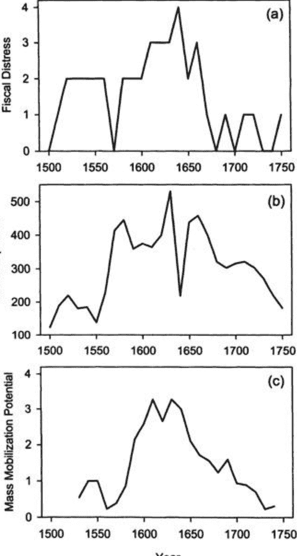

**图 7.6** (a) 国家财政困境状态，按 0（收入和信用充足）到 4（完全破产）的范围衡量（来自 Goldstone 1991b: 图 4）。(b) 通过牛津大学入学人数衡量的精英竞争（Stone 1974: 表 1A）。(c) 大众动员潜力（任意比例尺）（来自 Goldstone 1991b: 图 4）。

Goldstone 国家崩溃理论中的最后一种关键要素是普通大众的大众动员潜力（MMP）。其中特别相关的是城市化的工人和工匠，尤其是在首都，因为他们地理上靠近权力中心。Goldstone 认为，MMP 包含三个可衡量的组成部分。

首先，我们可以通过实际工资的动态变化来衡量影响城市大众的苦难程度（例如，以能够购买的食物数量表示平均劳动力工资）。其次，年轻的人口结构增加了群体的动员潜力。第三，城市增长使贫困的年轻儿子集中，从而在进一步放大因贫困加剧带来的民民情绪方面可能起到重要的倍增作用。Goldstone 提出了以下公式，将这三种机制的影响整合进一个大众动员潜力指标中：

```
$MMP_t = \frac{\tilde{W}}{W_t} + \left(\frac{\tilde{W}}{W_t} - 1\right)U_tA_t$
```

`W_t` 是第 `t` 十代的实际工资，`\tilde{W}` 是 1500–1750 年期间的平均工资。当前实际工资相对于长期平均越低，比例 `W/W_t` 就越大。第二项反映了城市化和年龄结构之间的相互作用。`U_t` 被 Goldstone 定义为伦敦在该十年及前两个十年增长率的加权平均值，`A_t` 是 10–29 岁人口与 30 岁以上人口的比例。因此，第二项意味着，如果 `W_t < \tilde{W}`，`U_t` 和 `A_t` 将放大 `W_t` 的影响，否则对 MMP 不会产生太大影响。1530–1750 年间英国的估计 MMP 如图 7.6c 所示。

总结来说，英国革命的案例为 Goldstone 的人口-结构理论提供了极大的实证支持。革命的三个要素是国家的财政危机、精英之间激剧的竞争和派系斗争，以及大量感到不满的平民，他们可以被议会领袖动员起来反对伦敦的王室派。所有这些过程的指标在 16 世纪下半叶和 17 世纪初都在增加，并在 1640 年左右达到顶峰（图 7.6）。

### 7.3.2 大浪

正如我上面提到的，人口-结构理论（Goldstone 1991b）的价值在于它详细分析了中介人口增长对国家稳定性（或更准确地说，是不稳定性）影响的重要社会变量之间的相互关系。Goldstone 收集的关于近现代欧洲和亚洲国家崩溃的大量定量材料，为他的理论奠定了坚实的实证基础。然而，该理论并不完整：虽然人口动态对国家稳定性的影响有详尽的记录，但对人口的反馈效应则没有。在 Goldstone 的理论中，人口动态是一个外生变量。

人口数量与社会政治稳定性之间相互作用的更完整描述是由历史学家 David Hackett Fischer (1996) 提出的（口头）模型给出的。Fischer 认为，在公元 1200–2000 年期间，西欧经历了四次社会经济变化的“大浪”（Fischer 并不是第一个注意到这些波浪的人；我将在第 8 章开头回到这个问题上）。这些长期动态反映在价格史中（图 7.7），其中价格平衡时期（大致为文艺复兴时期、启蒙运动和维多利亚时代）穿插着快速通胀的时期（13 世纪、16 世纪、18 世纪和 20 世纪的“价格革命”）。Fischer 认为，价格波动与一系列综合社会变量相关。价格平衡时期的特点是长期的繁荣、艺术的兴和乐观意识形态的传播。价格革命后的时期其特点是广泛的苦难、政治混乱、社会动荡以及日益增长的文化焦虑情绪（Fischer 1996:237）。

Fischer 对这种波浪模式的解释可以总结如下（1996:246–251）。在价格平衡的后期，物质条件正在改善，社会稳定性在增加，文化预期变得更加光明。人们通过早婚和生更多孩子来回应；人口开始增长。总需求增长快于供应，价格（尤其是食物和燃料）开始上涨。最终，这些发展为贫困增加创造了条件；它们给社会关系带来了压力并加剧了阶级冲突。公共收入低于支出，国家陷入几乎破产的。文化氛围发生了变化；出现了一种社会悲观情绪。改变的环境对年轻人的影响尤为严重，他们发现很难找到好工作或建立。最后，一个触发事件（或通常是多个事件的结合）引发了重大危机。

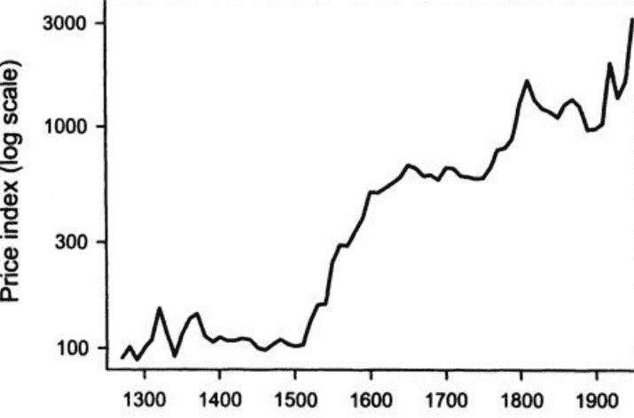

**图 7.7** 消费品指数（食物、饮料、燃料）（Phelps-Brown and Hopkins 1956: 附录 B）。此处绘制的是十年平均值。

对 Fischer 书籍的反应很大程度上是负面的（例如，Krugman 1997; de Vries 1998; Morgan 1999; Munro 1999）。评论者批评 Fischer 对传统理论的漫画化处理、缺乏具有数学说服力的模型，以及未能区分工业前和工业后社会。这些批评是合理的。然而，我认为大多数评论者也会同意，Fischer 成功识别了一个重要且广泛的历史模式。（在附录中，Fischer 简要出了古代世界和东亚类似的模式。）

此外，Fischer 的描述和模型与人口-结构理论大致一致。因此，Goldstone 近现代国家崩溃的波动（17 世纪和 19 世纪）对应于 Fischer 的第二和第三波危机。注意，三个完整波的持续时间（分别为 3、3 和 2 个世纪）符合 7.2.1 节人口-财政模型的理论预测。

### 7.3.3 黑死病之后

14 世纪中叶突然爆发瘟疫大流行（黑死病）导致了欧亚大陆社会、经济和政治结构的巨大动荡。瘟疫的主要影响是许多社区失去了三分之一到二分之一的人口。因此，我们可以将这种动荡视为一次“自然实验”，利用人口数量作为一个重要的解释变量来测试各种理论。

有趣的是，不同社会在黑死病影响之后遵循了截然不同的轨迹。解释随后的轨迹如何取决于社会特征，成为比较历史研究的重要目标。在布伦纳辩论（Aston and Philpin 1985）中讨论的许多问题与此密切相关。Stuart Borsch 最近的一篇博士论文（2001）对黑死病后的埃及和英国进行了一个特别有趣的比较。这两个地区都损失了大约一半的人口，这是最初的黑死病和随后的瘟疫共同导致的。

在英国，工资上涨，租金和谷物价格下降，失业率降低，人均收入增加，经济完全

到 1500 年。相比之下，埃及人口减少的后果则大不同。工资下降，地租和粮物价格上涨，失业率上升。到 1500 年时，看不到任何经济复苏的迹象：1350 年到 1500 年间，农业产量下降了 68%。因此，一个社会（英国）以典型的马尔图斯-里卡多模式的方式应对了人口减少（尽管这种反应仍然持续了一个多世纪；这一点下文将详细阐述），而另一个社会（埃及）则以完全相反的方式做出了。

Borsch 对这些分化的结果考虑了若干种替代解释，并将土地所有制度的差异作为主要的解释因素。从 1250 年到 1517 年，埃及由一群被称为马穆卢克（Mamluks）的职业战士群体统治。马穆卢克是“奴隶士兵”，是通过意大利中间人从高加索地区购买的基督教或异教儿童。

马穆卢克的土地所有制与西欧采取的形式完全不同。马穆卢克土地所有者并不是形成一个与其庄园和当地村社区密切联系的个人土地所有者的松散群体，而是形成了一个统一的整体，他们经常共同行动以维护其在农村地区的利益。在瘟疫之后，马穆卢克利用其巨大的集体力量，试图从大幅减少的农村人口中维持同样水平的资源提取，导致对个体农民的剥削程度大大提高（这与自私精英模型所预测的动态非常相似）。

在英国，精英阶层也试图尝试这条路。对农民的激烈剥削是 14 世纪末 15 世纪初农民反复起义的主要原因之一。然而，正如 Borsch 所说的，领主与农民之间的斗争并不是在战场上赢得（只要骑士保持凝聚行动，农民暴徒从未机会对抗武装精良的骑士），也不是通过农民集体用脚投票赢得的。如果地租或工资条件不利于他们，农民愿意放弃庄园。

最终，地主的集体行动尝试破灭，农民的要求缓慢但坚定地得到了满足。随着地租下降、农村工资上涨以及惯例规金和罚款的取消，农民收入增加，为又一段持续的经济和人口增长奠定了基础。


对`Borsch`论点的潜在批评者可能会通过指出埃及和英国社会的许多其他分化方面来提出反对意见。针对这一批评，`Borsch`给出了极好的回应：另一个比较，但这次是与`2`世纪末安东尼瘟疫之后埃及的情况。人口减少非常严重，消除了三分之一的纳税人口。然而，罗马埃及的土地所有制与中世纪英国更为相似，而非马穆卢克埃及。因此，罗马埃及从瘟疫造成的破坏中恢复得较快，其总体社会轨迹与黑死病之后的英国相似。

# 评估

我认为`Borsch`所构建并辩护的论点非常有说服力。这项研究也是历史社会学中比较法优势的极佳范例。在布伦纳辩论中讨论的西欧（英国和法国）与中欧（普鲁士、波兰和波希米亚）黑死病后分化轨迹的案例研究基础上，`Borsch`增加了另外两个“数据点”：黑死病之后和安东尼瘟疫之后的埃及。希望我们最终会有几十个这样的数据点可以进行统计。正式的统计元分析将能够极大地消除批评者的反对意见。

然而，我想为`Borsch`的论点增加一个元素，这是人口-结构模型所建议的。特别是，请记住自私精英模型预测，人口下降时期的特征是高精英/农民比例以及相应的高剥削率。最终，由于多种过程的共同作用（由于经济困难而滑落到农民阶层、较低的生殖率以及内战导致的高死亡率），精英数量会减少。这就是玫瑰战争结束时英国发生的情况。当精英数量下降到足够低的水平时，对农民的人均消费率剥削就会缓解，为下一个世俗周期的开始奠定条件。

但在埃及，马穆卢克继续从外部来源进行招募（注意，马穆卢克的后代本身不能成为马穆卢克）。因此，虽然农村人口在减少，马穆卢克的人并没有增加，导致了不随时间减少的高精英/农民比例。结果是，马穆卢克的埃及处于低人口、高精英/农民比例和对农民激烈剥削的平衡状态。这种恶性平衡对内部扰动似乎是稳定的，只能通过外力打破，在这种情况下，就是`1517`年的奥斯曼征服。

有趣的是，英国和法国瘟疫后轨迹的比较为这一情景提供了进一步证据。英国的经济和人口增长相对于法国可能推迟了大约半十年（这在`9.1.2`节中将讨论）。英国的恢复延迟可能是因为“英国贵族（至少暂时）能够通过百年战争伴随的动荡以法国对手为代价解决其某些困难”（Bois 1985:113）。一旦英国人被法国驱逐，他们立即经历了自己的内部战争时期（玫瑰战争，`1455–1485`年）。只有在对英国贵族进行了这种广泛修剪之后，英国经济才开始增长。

# 7.4 总结

- 农业社会的人口增长导致人均产量逐渐下降，这是由于农业劳动力投入的报酬递减。国家可用的剩余收缩，并最终无法满足国家需求。因此，不受节制的人口增长会导致政体的财政破产。
- 国家崩溃和随之而来的社会政治不稳定对人口统计率（出生、死亡和迁移率）以及社会的生产能力都有负面影响。因此，国家崩溃通常伴随着人口下降期。
- 一个关于人口动态与国家财政健康相互作用的简单数学模型预测了国家建立和人口增长、随后国家崩溃和人口下降的反复循环。在合理的参数范围内，该人口-财政模型预测国家崩溃应每隔不规则的`2–3`世纪发生一次。
- 一个分别追踪普通人和精英阶层的更复杂模型预测了类似的动态（周期性国家崩溃）。普通人口的增长导致精英数量的扩张，并在最初加强国家。然而，随着精英数量的增加，提取产品中越来越多的比例被精英用于自己的需求。国家收入减少，而支出增加，最终国家破产。
- 我开发了两个关注游牧精英与农业国家相互作用的政治动态模型。伊本·哈里敦（Ibn Khaldun）模型研究了游牧民族定期征服农业国家并在那里建立王朝的情况。寄生游牧模型处理了游牧民族没有征服农业国家，而是向其征收贡的情况。在这两种情况下，模型预测的政体建立和崩溃周期（约一个世纪）都比人口-财政模型及其阶级结构变体产生的周期更快。
- 我回顾了两个用于解释中国历史上王朝循环的经济模型。这些关于王朝崩溃模型的基础逻辑是中国帝国也具有马尔萨斯-李嘉图主义特征，尽管它们比我开发的模型要复杂得多。
- `Goldstone (1991b)`提出的近现代国家崩溃的结构-人口学解释，假定人口增长是国家崩溃的首要原因。然而，需要强调的是，在这一理论（以及我开发的模型）中，人口动力学并不直接导致国家崩溃。相反，人口增长通过间接方式促进政治不稳定性，其机制是导致财政困境、加剧阶层竞争与派系斗争，以及增加普通民众的动员潜力。我回顾了`Goldstone`的案例研究之一——英国革命，该案例拥有一个特别完整的计量史学数据库。研究发现，这些数据与结构-人口学模型的定量预测高度吻合。
- 最后，我简要回顾了费舍尔（`1996`）关于从`12`世纪到`20`世纪西欧社会经济动态的四次“大浪潮”的理论和数据。再次，我的结论是，这些观点和分析与本章提出的理论大致一致。
- 根据结构性假设和参数值的不同，本章开发的模型可以产生多种动力学特征。震荡可能是规律的，也可能是非常不规则的。平均周期通常很长，从一到三个世纪不等。平民人口的变化可能非常剧烈或温和（在“精英周期”的情况下）。但一个普遍结论是，农业国家的特征是在几百年尺度上的不稳定性和震荡。我建议将这种动力学称为长期周期或波动。

# 第八章

## 人口数量的长期周期

### 8.1 引言

人口-结构理论（第`7`章）的一个主要预测是，农业社会的人口预计将经历周期约为二三个世纪的缓慢震荡。¹¹ 我们并不一定预期这些长期周期是非常规律的。然而，理论认为，这些动力学应该是二阶的。过程阶数的概念在第`2.1.4`节引入，并在下文中对人类人口动力学进行进一步的形式化。但用非技术性的语言来说，我的意思是人口震荡的增加和减少阶段都应该跨越多个个人世代的时间周期。

西欧社会经济和人口史中的长期波动，已由`François Simandi (1932)`、`Wilhelm Abel (1966)`、`Michael Postan (1973)`以及`Emmanuel Le Roy Ladurie (1974)`描述（见`Braudel 1988; Fischer 1996`）。近期，`Sergey Nefov (1999, 2002a)`的数据表明，长期周期也出现在亚洲的几个宏区域（中国、中东和印度）。

这些作者所处理的大多数人口波动数据具有碎片化性质。尽管如此，近年来已汇编并发布了几个长度合理的数据序列。这一进展为我们提供了机会，通过时间序列分析的正式方法来测试人口-结构理论的预测，从而从经验上估计表征人口数量长期波动的周期过程阶数。进行这种分析是本章的主要目标。我首先讨论如何从人口动力学的时间序列数据估计过程阶数。接下来，我把统计方法应用于历史人口动力学的时间序列数据。最后，我把分析扩展到一个案例研究，我们拥有关于人口数量和社会政治不稳定性动态的数据。

## 8.2 人类人口动力学中的“尺度”与“阶数”

人口生态学家最近在建模、分析和解释非人类生物的人口动力学方面取得了巨大进展。我在我的著作《复杂人口动力学》（`Turchin 2003`）中回顾了这些进展。我们是否可以将人口生态学家所开发的某些技术和见解转移到人类人口动力学的研究中？显然，影响人类繁殖、死亡和迁移的特定机制集合应该与针对动物提出的机制大不相同。这些机制中的许多在本质上必须是经济和社会学性的，某些生态模型（例如人类充当猎物时的捕食者-捕食者模型）似乎不太适用于研究人类人口。另一方面，诸如处理资源-消费者或疾病-宿主相互作用的生态模型，对于理解历史和史前人类人口的动力学可能非常有意义，只要我们不陷入生物主义的陷阱，即试图仅用生物学术语解释一切。这里需要注意的是，人口动力学家已经开发了一套针对人口系统时间序列数据非线性建模的通用方法。这些方法并不假设可能适用于人类人口的特定生态模型。相反，它们为我们提供了量化人口数量时间波动经验模式的工具。

在第`2.1.4`节中，我引入了过程阶数的概念。事实证明，这个概念在非人类生物人口动力学的研究中非常有用（`Turchin 2003`）。然而，虽然阶数是微分方程一个易于定义的属性（我在第`2.1.4`节中引入了它），但将这一概念应用于时间序列数据的分析并非完全简单。重要的点是，我们估计的阶数取决于量化人口波动的时间尺度。因此，有必要对影响人口变化的各种机制所运作的时间尺度进行几点说明。

### 时间尺度：年

让我们考虑四个潜在的时间尺度：年、十年、世纪和千年。这些尺度中的第一个——“年”，是人类人口资源基础动力学的重要步调调节器，因为食物的采集和生产通常受季节循环的影响很大。此外，许多死亡因素以年度（或更短）的尺度运行。例如，对儿童疾病的研究表明，这些历史上重要的死亡来源有自己的节奏：由季节变化驱动的年度循环（`York and London 1973`），以及与人口非线性本质相关的`2–3`年震荡（`Schaffer and Kot 1985`）。其他受季节循环强烈影响的死亡来源由于恶劣天气导致的饥荒。

### 时间尺度：十年与世纪

下一个尺度“十年”，是衡量人类人口更替的尺度。这里的重要基准是世代时间的衡量。人类女性的生育期从`15`岁延伸到`45`岁（`Wood 1990`）。然而，生育能力的年龄曲线是偏的，因此其众数（最高生育率）大约为`20`，而其平均值（平均生育年龄）在`25`年左右，在某些人口中接近或超过`30`岁。无疑，人类世代长度的测量差异很大，取决于人口的生物学（营养、死亡计划）和社会学（结婚年龄）特征。尽管如此，对于大多数历史人类人口来说，世代时间应该在`20`到`30`年之间。

通用人口动力学理论认为人口动力学包含三类震荡成分：长期周期、一阶和二阶周期（`Turchin 2003`）。*长期周期*的特征是周期在`20`到`30`年之间。这些周期通常出现在人口中（`Keyfit 1972`）。当人口年龄结构表示为年龄金字塔时，这些周期变得明显。例如，目前美国人口的年龄金字塔有明显的、间隔约`30`年的峰值，代表婴儿潮及其子女。长期周期在今天的俄罗斯人口中更为明显，这一事实可能解释为两次巨大的年龄结构扰动——第一次世界大战/内战和第二次世界大战相隔约一个世代，引发了一系列后续震荡。然而，与某些昆虫种群的长期周期（`Godfray and Hassell 1989`）不同，人类周期似乎并不是稳定的现象，在扰动后迅速消失（`Wachter and Lee 1989`）。此外，长期周期通常表现为年龄结构的震荡，对总数的影响微乎其微。

与年龄阶层相互作用产生的长期周期不同，*一阶周期*源于较快的密度依赖反馈机制。一阶周期在离散人口模型中产生最自然，并具有典型的两代的周期（第一代为高密度，下一代为低密度，以此此类推）。`伊斯特林（Easterlin, 1980）`假设人类人口中存在一阶循环。伊斯特林认为，在`20`世纪，美国的人口特征是是大和小规模人口队列的交替。稀疏的人口代由于劳动力短缺而享有更高的工资，并生育许多孩子。然而，下一代会面临竞争的加剧，生育的孩子较少。这种机制在理论上可以导致平均周期为两（`40–50`年）的典型一阶振荡。尽管正式模型证实了两代循环在原理上可行，但在实践中，参数的估计值使得模型并未处于循环状态（`Let 1974`；另见`Fraental and Swick 1983; Wachter and Lee 1989`）。

二阶循环的产生是人口规模与某些其他慢动力学变量相互作用的结果（见第`2.1.4`节）。二阶振荡的一个例子是国家崩溃的人口-财政模型的动力学（图`7.1`）。与一阶循环不同（一阶循环的上升和下降阶段各持续一代），二阶振荡的特征是上升和下降阶段的持续时间为多代。因此，代、一阶循环和二阶循环的基本三分法导致了一代或多代的周期。

让我们考虑一下，如果二阶振荡存在于人类人口中，研究它们的合适时间尺度是什么。基于离散模型的人口理论认为，二阶循环的特征是最小周期至少为六代（`Murdoch et al. 2002`）。此类模型中的典型周期范围从`6`代到`12–15`代甚至更多（`Turchin 2003`）。将人类的代际时间界定在`20`年到`30`年之间，这表明人类的二阶循环周期应在`120`到`450`年之间，最可能的区域是`200–300`年。当然，这一计算假设因素`X`——即与人口密度相互作用并驱动振荡的慢动力学变量——其运行的时间尺度与人类人口迁移特征的尺度相似。然而，从近似来看，这可能不是一个糟糕的假设，因为如果两个相互作用的变量运行在不同的时间尺度上，我们就无法容易获得二阶动力学（如果一个变量运行的时间尺度远快于另一个，那么对慢变量的反馈本质上变成了“快速”，动力学就变成了一阶）。简单的连续时间模型也给出了类似的周期。例如，在`Lotka-Volterra`预测模型（第`2.1.3`节）中，振荡周期约为`$2\pi/\sqrt{r\delta}$`，其中`$r$`是猎物的人均增长率，`$\delta$`是捕食者的对应参数（它实际上是在没有猎物的情况下捕食者人口的人均下降率）。假设`$r$`和`$\delta$`与人类人口增长的均增长率`$r_0$`同一个数量级，则`$r_0$`得出的（非常粗略的）周期估计值为`$2\pi/r_0$`。由于人类人口的`$r_0$`约为`0.02 yr⁻¹`（尽管现代某些人口以`4%`的年增长增长，但这对于历史时期来说可能高估了），振荡周期的估计值为`300`年。这一估计与上述离散时间理论所建议的相似。总之，我的预期是，如果人类人口中存在二阶循环，它们的特征应该是`2–3`个世纪的周期。

上述段落中的粗略计算仅应作为人类人口动力学中可能特征二阶振荡的周期长度数量级的指标。显然，周期性将取决于变量的性质、模型结构和参数值。另一方面，我们有一套关于农业社会人口动力学的理论（第`7`章）。基于人口-结构理论的模型预测的振荡周期范围从一到三个世纪不等，取决于模型结构和参数值。这一理论结果为振荡周期的预测提供了稍为坚实的依据。

## 时间尺度：千年

最后，我简要转向在更长——即千年——的尺度上运行的过程。这是人类社会演化的时间尺度，包括其技术和文化组成。主要的里程碑分别是大约`10,000`年前和`200`年前的农业革命和工业革命。目前，变化的节奏变得疯狂，但在工业革命之前，我们可能仍然假设每个千年尺度上存在某种程度的准稳态。因此，根据`McEedy 和 Jones (1978)`的估计，在工业时代之前，全球人口的典型倍增时间约为`1000`年。

在分析人类人口动力学的长期数据时，人类社会的演化变化无疑是我们必须考虑的因素（例如，见`Komlos 和 Nefedov 2002`）。然而，如果我们主要感兴趣的不是千年过程，我们就必须对数据进行“去趋势处理”（`detraining`）。在我们有明确的机制基础来理解为什么承载力在历史上发生了变化时，去趋势处理尤为合适。理想情况下，我们应该利用历史信息，根据当代技术水平来估计单位土地可以维持多少人口。在这里我将不遵循这一路线，因为这将远超出本书的范围，而是简单地采用现象学的去趋势方法。

## 启示

前面的讨论清楚，研究人类的合适时间尺度很大程度上取决于所感兴趣的问题。如果我们关注麻疹疫情的动力学，那么我们应该使用月和年作为尺度。在另一个极端，如果我们感兴趣的是地球维持人口的能力如何随技术和社会变化而演变，那么我们的时间尺度就是世纪和千年。然而，如果我们对调节人口密度的一阶过程，以及导致二阶循环的机制感兴趣，我们的时间尺度应该是中间性的：十年（我们测量人口密度的基本步长）和世纪（长度）。具体来说，我们需要追踪一个人口至少`500–600`年，以便获得最小样本量，即两次振荡（假设每次振荡为`2–3`个世纪）。这是一个粗略的指南，但它表明如果我们按年间隔进行采样，我们完全可以按十年间隔对序列进行子采样——这样做并不会真的丢弃任何有用信息。按`20`年或`30`年（大约一代人类）间隔采样的数据也是可以接受的。我检索了历史人口统计学文献，寻找具有足够长度（至少`500`年）且采样频率足够（不超过`50`年）的特定区域（通常对应于现代国家或国家的省份）的时间序列。获取与我们目的相关的数据的一个问题是，人口统计学家提出的问题完全不同。人口动力学家主要感兴趣的是密度随时间的变化变化，而绝对规模并不那么重要。相比之下，人口统计学家通常试图估计特定时间点的绝对密度。另一个问题是，重建人类人口的历史动力学往往涉及大量的猜测。历史人口统计学是一个非常有争议的话题，不同的权威可以提供巨大的不同的人口估计值。

## 8.3 长期经验模式

### 8.3.1 历史人口的重建

我从我认为最好的数据集开始，请看英格兰和威尔士在公元`1080`年至`2000`年间的人口历史（图`8.1`）。与其他数据相比（考古数据除外），该数据集涉及的推测最少。对于`1800–2000`年期间，我们可以使用定期人口普查的结果。`1540–1800`年期间几乎同样可靠，因为这是基于`Wrigley`、`Schofield`及其同事的卓越工作，他们使用了基于记录该时期出生和死亡的教区记录的人口重建技术（`Wrigley and Schofield 1981; Wrigley et al 1997`）。最早的时期，即公元`1080`年至`1540`年（取自`Wrigley 1969`），是主观因素最强的时期。尽管如此，中世纪英格兰的人口动力学与任何其他国家一样为人知。在该时期初期，人口记录锚定在《班姆德书》（`Domesday Book`）普查中。与黑死病相关的人口崩溃时间也有明确确定的年代。不确定性主要体现在黑死病前峰值的高度以及瘟后崩溃的深度（`Hatcher 1996`）。

**图 8.1** 公元`1080–2000`年英格兰和威尔士的人口。人口数量以百万为单位，每`10`年采样一次，并绘制在对数刻度上。趋势：拟合曲线`$Y = a + bx^\theta$`，其中`$Y = N(t)$`，`$X`是比例缩放到`0–1`间隙的时间。ACF：去趋势后数据的自相关函数。所有时间单位（包括 ACF 滞后）均以世纪为单位。

图`8.1`上两个特征显而易见。第一个是增长趋势。该趋势是非线性的，并在`1800`年左右大幅加速。该趋势背后的机制可能没有争议（工业革命），我们在这里不涉及此问题。为了定量地表征这一趋势，我对图`8.1`中的数据拟合了一个幂关系。数据的第二个特征是围绕总趋势的波动。为了能够表征波动成分，我通过从数据中减去拟合的幂曲线对序列进行了去趋势。


去趋势后的数据受到了时间序列分析。首先，我们计算自相关函数（如图 8.1 中的插图所示），它具有明显的波动倾向，在 3.1 世纪达到第一个峰值。下一步是应用人口动力学专家工具箱中的一些标准工具（人口数据分析的时间序列技术见 Turchin 2003：第 7 章）。由 Box 和 Jenkins 开发的分析基本思想（易读性介绍请见 Chatfield 1989）是将当前人口密度 `N_t` 对滞后的人口密度 `N_{t-\tau}, N_{t-2\tau}` 等进行回归，其中 `\tau` 是时间滞后。我使用了被称为非线性时间序列建模（NLTSM）的方法，该方法使用改进的多项式方案来近似当前密度与滞后密度之间的关系（实现细节见 Turchin 2003）。还有两个需要从数据中估计的结构参数：滞后阶数的数量 `d` 和多项式次数 `q`。我们主要关注 `d`，因为它为我们提供了过程阶数的估计。

为了使分析进行，必须解决一个问题：时间滞后 `\tau` 的什么值合适？序列是以每 10 年为间隔采样的，但这仅仅是为了方便。上面，我论证人类人口的代际应该处于 20–30 年的范围内。为了安全起见，我使用了两个滞后值 `\tau = 2` 和 `3` 十年，并检查了这一选择如何影响结果（我在下文对中国人口动力学长期数据的分析中重复了这一程序）。如表 8.1 所示，任一 `\tau` 选择的结果结果是一致的（`R^2 = 0.7–0.8`），且信噪比相当不稳定（`\Lambda` 接近零）。动力过程为二阶（或更高）的证据非常充分。值得注意的是，尽管不同的 `\tau` 选择会导致不同的 `d` 估计值，但当我们以物理单位（`d`）表示最大过程阶时，我们得到了相同的数值：60 年。总结来说，该数据序列的分析表明了一个二阶的波动性人口过程，具有很强的确定性成分，但幅度相当较低（至少按照非人类人口动力学的标准，见 Turchin 2003）。这些结果对于我们在分析过程中需要做的各种选择是稳健的。例如，我使用二次趋势去趋势函数重新分析了数据；我还单独分析了公元 1500–2000 年部分，获取数字的推测最少。在所有情况下，总体结果保持不变。

## 表 8.1 英格兰和中国数据非线性时间序列分析总结

变量：数据点数量 `n`，滞后 `\tau`（以十年为单位），幅度尺度 `S`（对数转换数据），主导周期 `T`，自相关系数 `ACF[T]`（** = 在滞后 `T` 处与 0 显著不同；* = 与 0 相同），估计的过程阶 `d`，多项式次数 `q`，决定系数 `R^2`，以及李雅普诺指数 `\Lambda`。

| 地点 | `n` | `\tau` | `S` | `ACF[T]` | `d` | `q` | `R^2` | `\Lambda` |
| :--- | :--- | :--- | :--- | :--- | :--- | :--- | :--- | :--- |
| 英格兰 | 93 | 2 | 0.11 | 0.60** | 3 | 2 | 0.72 | -0.04 |
| 英格兰 | 93 | 3 | 0.11 | 0.60** | 2 | 3 | 0.77 | 0.02 |
| 中国 1 | 64 | 2 | 0.15 | 0.21* | 2 | 2 | 0.32 | 0.08 |
| 中国 1 | 64 | 3 | 0.15 | 0.21* | 3 | 2 | 0.32 | 0.08 |
| 中国 2 | 64 | 2 | 0.10 | 0.40** | 2 | 3 | 0.54 | -0.40 |
| 中国 2 | 64 | 3 | 0.10 | 0.40** | 3 | 3 | 0.15 | -0.20 |
| 中国 3 | 64 | 2 | 0.05 | 0.04* | 2 | 1 | 0.64 | -0.26 |
| 中国 3 | 64 | 3 | 0.05 | 0.04* | 3 | 1 | 0.16 | -0.42 |

数据：英格兰（包括威尔士）：1080–2000 年，中国 1：公元前 2000 年–430 年，中国 2：440–1070 年，中国 3：1080–1710 年（全部去趋势）。注意所有序列均每 10 年采样一次；因此所有周期（`T`）和时间滞后（`\tau`）均以十年为单位表示。

这项分析的意义令人惊讶，但在得出结论之前，我们需要通过查看其他数据来检查这些结果。第一个明显的地方是查看过去千年里的其他西欧国家。我不清楚任何与 Wrigley 及其同事构建的数据集质量和长度相似的数据集，但 McEedy 和 Jones 的人口地图提供了一个实用的概述，尽管质量较低。在这种按国家组织的长期人口动力学优秀汇编中在我看来存在一个缺陷：作者低估波动程度的倾向。给出一个可以进行独立检查的例子，McEedy 和 Jones 认为英格兰人口在整个 17 世纪都在增长（尽管速度在减缓）：1600 年、1650 年和 1700 年分别为 4.25 万、5 万和 5.75 万。然而，Wrigley 等人的重建（在 McEedy 和 Jones 地图出版后可用）表明所有的人口增长都发生在上半年（从 5.05 万到 5.83 万），事实上到 18 世纪人口略有下降（1710 年为 5.73 万）。尽管如此，McEedy 和 Jones 的保守主义也有优点：当他们指出人数发生剧烈变化时，此类事件的历史证据可能非常充分。

### 图 8.2

若干欧洲国家的人口，公元 1000–2000 年。这些国家按公元 1000 年人口规模从大到小排序分别为：法国、意大利、西班牙、德国、捷克斯洛伐克、葡萄牙。数据来自 McEvedy 和 Jones，并辅以美国普查局 2000 年的数据。

在图 8.2 中，我复制了 McEvedy 和 Jones 建议的四个西欧主要国家的人口轨迹，以及分别位于这四大国西南部和东部的两个较小国家。虽然数据尚未详尽到足以进行正式分析，但我们看到英国所显示的总体模式在其他欧洲国家也存在：一个增长的千年级趋势，以及围绕该趋势的三个周期，人口增长在 14 世纪、17 世纪和 20 世纪后期有所放缓或反转。唯有法国没有表现出 17 世纪的下降，这是上述的 McEvedy 和 Jones 保守主义的结果（正如我们在下一章将看到的，届时我将查看更详细的法国人口数据）。此外，法国南部和北部动态的平均化进一步掩盖了变化的程度。

已有大量文献证明，例如法国南部人口在 1680–1750 年期间下降（Le Roy Ladurie 1974），而法国北部人口损失得早（例如，参见 Reinhard 等人 1968：图 13）。目前（公元 2000 年），所有欧洲国家都表现出出生小于死亡的缺口，在其中一半国家，由于移民未能补偿这一缺口，人口实际上正在下降（美国普查局数据）。

现在转向欧亚大陆的对面，考虑中国的人口动态。中国的情况非常复杂。一方面，中国的中央政府（在其存在时）为了税收目的进行了详细的人口普查；另一方面，贪腐或懒官员经常伪造或编造人口数据（Ho 1959）。纳税户数之间的转换系数通常未知，更糟糕的是，这些系数可能随着朝代的更替而变化。最后，很难确定在动荡时期纳税户数的减少是因为人口变化（死亡和迁徙）的结果，还是由于国家未能控制和清点受统治人口的结果。因此，专家之间存在某种程度的争议（Ho 1959；Durand 1960；Song 等人 1985）。然而，争议主要涉及绝对人口水平，而人口密度的相对变化在很大程度上是一致的（当然，这正是我们关注的重点）。本质上，中国人口在政治稳定时期扩张，在动荡时期下降（有时是急剧下降）。结果是，中国的人口流动反映了中国的“朝代周期”（Ho 1959；Reinhard 等人 1968）。

中国最详细的人口动态轨迹由 Chao 和 Hsieh (1988) 发表。这些作者在不规则的时间间隔提供了中国人口数量的估计值。为了使数据适用于时间序列分析，他们使用带宽为 10 年的指数核对 Chao 和 Hsieh 的数据进行插值，然后以每 10 年为间隔对生成的平滑轨迹进行子采样。该轨迹显然是非平稳的，并且至少包含两个突发的阶梯式变化：

1. 直到 11 世纪，人口峰值维持在 5000 万左右；
2. 从 12 世纪到 18 世纪初，人口峰值翻倍到约 1 亿；
3. 从 18 世纪开始，人口开始以极快速增长，在 19 世纪达到 4 亿，在 20 世纪超过 10 亿。

从时期 1 到时期 2 转变的底层机制是已知的。在 11 世纪之前，中国国家的重心位于北方，南方定居稀疏。在宋朝时期，南方追上并超过了北方（例如，参见 Reinhard 等人 1968：图 14 和 115）。

考虑到第三时期最不适合去训练（detraining），我将重点放在从公元前 200 年至公元 1710 年之间的时期，这为我们提供了 192 个点（以每十年为间隔采样）。如果我们将该序列分为三个等长度的部分，第二个划分点几乎将 5000 万峰值时期与 1 亿峰值特征的时期隔离开来（见图 8.3）。将序列分为 6.4 个世纪的片段似乎恰当，因为每个片段应该足够长以包含几次震荡（即“数据点”）。

使用两种延迟选择（二十年和三十）分析这三个序列的结果如表 8.1 所示。与英国数据相比，分析发现中国序列中具有较低的信噪比和更负的李雅普诺指数（当使用 `\tau=3` 时差异尤为明显）。这可能至少部分是因为测量误差更大，但西欧和中国动态之间似乎也存在真实差异，即中国的人口波动在周期上变异大得多。此外，周期性的性质是复杂的，几个震荡似乎相互叠加。因此，在第二和第三时期，似乎存在共存的震荡：一个周期为 1.3–1.5 世纪的短周期波动，以及一个周期为 3–4 世纪的长周期波动。鉴于序列之间的这种变异性，我们对这些结果应持保留态度：尽管考虑到中国人口的不确定性，解释结果时应谨慎，但它为西方数据的二阶动力学提供了重要的证实证据。

## （史前）人口

考古学资源估计人口的一个普遍问题是它们是间接的。它们依赖于人类留下的物理记录：大多数情况下是基于特定时期居住的房屋或定居点的数量。人口密度也可以通过他们种植食物量来估计，例如使用花粉芯。在所有这些情况下，问题在于如何将考古记录中人类活动的定量测量值转化为人数。例如，如果我们估算了在某一时间点存在多少处建筑，我们还需要知道平均每个建筑中居住了多少人。请注意，这并不是一个不可逾越的问题。事实上，在人口生态学中，研究人员依赖于人口密度指数，这些指数可能与密度呈非线性关系（例如关于著名的猞猁皮毛回报 10 年周期的数据）。此外，我们主要关注的是人口的相对波动，这比绝对人口密度更容易记录。

考古学方法的巨大优势在于，它们提供了一种可能客观的方法来重建人口历史。这些方法显然可能存在偏差，在现实应用中需要大量的思考（Dewar 1991; Curet 1998），但通常减少了主观判断和猜测成分。

正如我在第 8.2 节中所述，为了服务我们的目的，人口历史的采样间隔不能超过 50 年。因此，考古学文献中发表的大多数人口估计尚不适用于分析。一个接近要求的数据集示例是中东德赫·杜拉恩平原（Deh Duran Plain）人口历史的一个非常有趣的重建（Dewar in Neeley and Wright 1994:211），它显示密度至少经历了三次巨大的波动（峰值/谷值比例达十倍）。然而，采样间隔约为 200–300 年，对于正式分析来说太稀疏了。

然而，有几个例子的采样率开始接近我们所需的水平。第一个例子涉及罗马帝国人口历史的问题，这个问题已经引起了数十年的激烈争论（Scheidel 2001）。问题在于，人口减少在罗马帝国的崩溃中可能起了什么作用。问题是，人口减少的首要证据早在共和国时期晚期的几十年内就出现了（Brunt 1971）。Lewit (1991) 最近发表的一组卓越数据集为这个问题提供了新的线索（图 8.4）。事实证明，罗马帝国发生了两次定居点遗弃事件：分别在第三世纪和第五世纪。第三世纪的衰落（以及第四世纪的复兴）必然涉及人口数量的巨大变化，因为占有定居点比例的变化低估了人口变化的幅度。这些数据将在第 9.1 节中进一步讨论。

### 图 8.4

罗马帝国西部七个地区（英国、比利西、北高卢和南高卢、意大利、北部和南部西班牙）在每个时期被占用的挖掘定居点的相对比例。（数据源自 Lewit 1991）

### 图 8.5

韦瑟里尔台（Wetherill Mesa）上建造的新房屋。ACF：平方根变换数据的自相关函数（滞后单位，为世纪）。

另一个遗址占用数据示例（这次来自新世界）由 Hally (1996) 发表，针对乔治亚州公元 1000–1600 年间的平台土丘（platform mounds），显示该地区西北部有三次波动，但东南部只有两次。由于空间限制，无法无法更多此类示例。然而，有必要提到最后一个数据集（Varien 1999），它也来自新世界，因为其独特的时间分辨率很高。这些数据来自科罗拉多州的梅萨维德（Mesa Verde），由于干燥气候，建筑房屋使用的木头可以保存数世纪（顺便还用于房屋建造和内部）。使用树年学方法，考古学家可以精确确定木头被切割的时间。在某一遗址韦瑟里尔台发现的木头切割时间分布如图 8.5 所示。这些数据显示，韦瑟里尔台有四次建筑活动高峰，分别发生在 7、9、11 和 13 世纪，表明这些世纪是人口快速增长的时期。建筑活动期之后通常是完全没有建筑的时期（大约在 700 年、900 年和 1300 年之后；只有在 12 世纪，低水平的建筑活动持续于十一至十三世纪高峰之间）。不幸的是，我们无法使用标准的 NLTSM 方法分析这些数据，因为产生这些数据的结构与普通的人口过程非常不同（实际上，我们拥有关于人口增长期间发生什么的信息，但关于下降的数据在数据集中被完全过滤了）。然而，我们可以在对数据进行变换后计算 ACF 来改善偏度（见图 8.5 插图）。ACF 清楚地揭示了数据中的两个世纪周期。

## 8.4 人口动力学与政治不稳定性

虽然在人类人口数据中发现长期波动与人口统计-结构模型基本一致，但其他社会人口过程也可能产生相同的实证模式。如果能通过检查历史记录中人口波动与政治不稳定性之间的关系是否符合理论预测的模式，直接测试人口统计-结构理论的预测，将会令人满意得多。解决该问题非常有有趣的论文是 Cyrus Chu 和 Ronald Lee (1994) 的，我已经在中国动态循环模型的背景下讨论过。这些作者分析了由 Chao 和 Hsieh (1988) 开发的中国人口时间序列，以及农民起义和战争两个虚拟变量。如果存在起义（或战争），虚拟值为 1，否则设置为 0。Chu 和 Lee 使用的额外预测变量是温度序列。

Chu 和 Lee 对数据拟合了一系列模型，从简单的模型开始逐渐增加解释变量的数量。他们发现，包含温度和战争影响但不包含农民起义的模型解释了人口数据的一小部分（`R^2 = 0.021`）。相比之下，包含起义的模型 `R^2` 高出五倍，达到 0.116。表征起义对人口变化的系数非常显著。人口密度对起义发生也有统计学上的显著影响。

表征起义对人口变化的 `R^2` 较小的原因之一是 Chu 和 Lee 使用的数据性质。由于他们只有起义的虚拟表征，他们不知道起义的规模，因此他们的分析没有区分起义的规模大小（Chu and Lee 1994:367）。显然，Chu 和 Lee 没有意识到 J. S. Lee (1931) 构建的中国内部战争数据集。该指数为我们衡量中国的政治稳定性提供了分级标准。将人口和内部战争数据绘制在同一张图中，我们观察到似乎存在某种动态关系（图 8.6）；关注公元前 200 年至公元 1070 年的相对稳定时期）。

为了正式调查人口动力学与政治不稳定性之间的相互影响，我使用了第 8.3.1 节中中国数据非线性序列分析的扩展。我们发现，在代际尺度上测量，中国人口动力学的过程阶数确定为 2（或更高）。现在我想测试一个政治不稳定性驱动二阶波动的假设。如果这一假设是正确的，那么我们应该探测到政治不稳定性对人均变化率的强烈影响。

我对人均变化率（定义为 `r \equiv \ln(N_t/N_{t-\tau})`）拟合了一系列模型，其具有相同的通形式。

`r_t = f(N_{t-\tau}, W_{t-\tau}) + \epsilon_t, \quad (8.1)`

其中 `W_t` 是政治不稳定性指数。J. S. Lee 对内战频率的报告是以每五年为间隔的，而人口数据则是以十年为尺度。为了将这两组数据带到共同的时间分辨率上，我使用带宽为 `h=10` 年的指数核回归对 Lee 的指数进行了平滑处理，并对生成的曲线进行了每 10 年一次的重采样，得到了变量 `W_t (t = -200, -190, \dots, 1700, 1710` 公元）。换句话说，我处理内战数据的方式与人口数据相同（见第 8.3.1 节）。

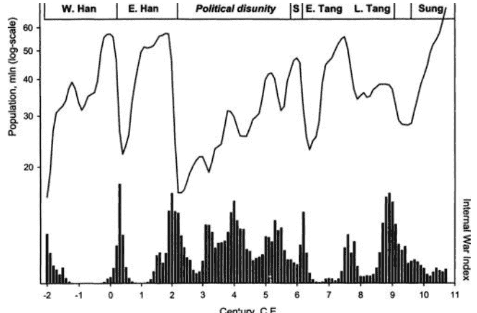

### 图 8.6

公元前 200 年至公元 1070 年中国的人口动态（曲线）和政治不稳定性（柱状图）。顶部的柱表示王朝（S = 隋）。

### 表 8.2

对人口变化率和政治不稳定性指数进行拟合的模型判定系数。

| 响应变量 | 期间 |  |  |  |
| --- | --- | --- | --- | --- |
|  | 公元前 200 年–公元 430 年 | 公元 440–1070 年 | 公元 1080–1710 年 | `\tau=20` |
| 人口 | 0.59 | 0.57 | 0.59 |  |
| 不稳定性 | 0.82 | 0.62 | 0.37 |  |
|  | `\tau=30` |  |  |  |
| 人口 | 0.67 | 0.67 | 0.61 |  |
| 不稳定性 | 0.66 | 0.36 | 0.11 |  |

由于方程 (8.1) 中 `f()` 的函数形式未知，我使用 Box 和 Draper (1987) 的响应面法 (RSM) 对其近似。RSM 是一种改进的多项式近似方案，其中预测变量（在本例中为 `N_{t-\tau}` 和 `W_{t-\tau}`）经过了 Box-Cox 变换。

存在曲线效应的证据（见下文），因此我使用二次多项式来近似 `f`。在分析中，我将从公元 –200 年到 1710 年的整个时间序列分为三个等段，每段 64 个数据点（这与第 8.3.1 节使用的步骤相同）。这减少了非平稳性的影响，同时也让我们能够检查人口动态与政治不稳定性之间的关系是否随时期而变化。最后，为了确保滞后时间 `\tau` 的特定选择不影响结果，我针对 `\tau = 20` 和 30 年两种选择进行了所有分析。

在所有三个时期和对于 `\tau` 的两种选择，政治不稳定性对人口动态均具有极显著的影响（表 8.2）。密度依赖性和政治不稳定性共同解释了 `r_\tau` 约 60% 的方差。效应的方向是理论所预期的（图 8.7）。


人口密度对人口变化率具有负面影响，反映了人口动态基本的密度依赖模式。政治不稳定性对人口增长也具有负面影响。有趣的是，正如统计上显著的交互项所示，我们可以在图 8.7 中看到这种效应：当人口密度和政治不稳定性都较高时，人口下降尤为明显。

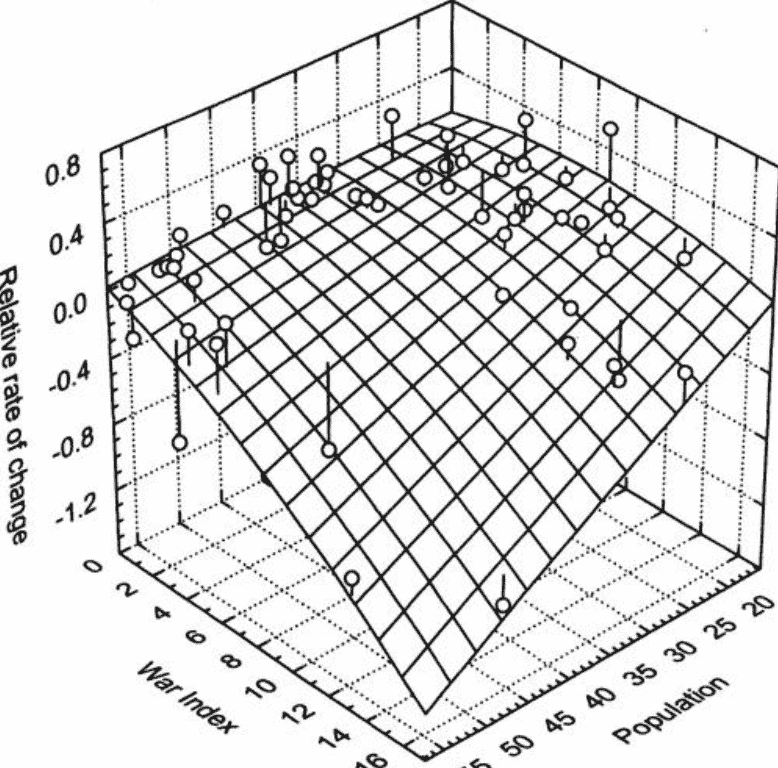

**图 8.7** 第一时期（公元前 200 年–公元 430 年）人口密度和政治不稳定性对中国人口变化率的影响。

为了对政治不稳定性作为响应变量也进行了类似的分析（我对`$W_t$`进行了对数变换），以便数据更符合正态分布。模型解释的方差比例从最早到最晚时期有所下降（表 8.2）。由于方程 (8.1) 中`$f()$`的函数形式未知，我使用 Box 和 Draper (1987) 的响应面法 (RSM) 对其近似。RSM 是一种改进的多项式近似方案，其中预测变量（在本例中为`$N_{t-\tau}$`和`$W_{t-\tau}$`）经过了 Box-Cox 变换。

存在曲线效应的证据（见下文），因此我使用二次多项式来近似`$f$`。在分析中，我将公元 –200 年到 1710 年的整个时间序列分为三个等段，每段 64 个数据点（这与第 8.3.1 节使用的步骤相同）。这减少了非平稳性的影响，同时也让我们能够检查人口动态与政治不稳定性之间的关系是否随时期而变化。最后，为了确保滞后时间`$\tau$`的特定选择不影响结果，我针对`$\tau = 20$`和 30 年两种选择进行了所有分析。

在所有三个时期和对于`$\tau$`的两种选择，政治不稳定性对人口动态均具有极显著的影响（表 8.2）。密度依赖性和政治不稳定性共同解释了`$r_\tau$`约 60% 的方差。效应的方向是理论所预期的（图 8.7）。

人口密度对人口变化率具有负面影响，反映了人口动态基本的密度依赖模式。政治不稳定性对人口增长也具有负面影响。有趣的是，正如统计上显著的交互项所示，我们可以在图 8.7 中看到这种效应：当人口密度和政治不稳定性都较高时，人口下降尤为明显。

为了对政治不稳定性作为响应变量也进行了类似的分析（我对`$W_t$`进行了对数变换），以便数据更符合正态分布。模型解释的方差比例从最早到最晚时期有所下降（表 8.2）。由于方程 (8.1) 中`$f()$`的函数形式未知，我使用 Box 和 Draper (1987) 的响应面法 (RSM) 对其近似。RSM 是一种改进的多项式近似方案，其中预测变量（在本例中为`$N_{t-\tau}$`和`$W_{t-\tau}$`）经过了 Box-Cox 变换。

存在曲线效应的证据（见下文），因此我使用二次多项式来近似`$f$`。在分析中，我将公元 –200 年到 1710 年的整个时间序列分为三个等段，每段 64 个数据点（这与第 8.3.1 节使用的步骤相同）。这减少了非平稳性的影响，同时也让我们能够检查人口动态与政治不稳定性之间的关系是否随时期而变化。最后，为了确保滞后时间`$\tau$`的特定选择不影响结果，我针对`$\tau = 20$`和 30 年两种选择进行了所有分析。

在所有三个时期和对于`$\tau$`的两种选择，政治不稳定性对人口动态均具有极显著的影响（表 8.2）。密度依赖性和政治不稳定性共同解释了`$r_\tau$`约 60% 的方差。效应的方向是理论所预期的（图 8.7）。

人口密度对人口变化率具有负面影响，反映了人口动态基本的密度依赖模式。政治不稳定性对人口增长也具有负面影响。有趣的是，正如统计上显著的交互项所示，我们可以在图 8.7 中看到这种效应：当人口密度和政治不稳定性都较高时，人口下降尤为明显。

为了对政治不稳定性作为响应变量也进行了类似的分析（我对`$W_t$`进行了对数变换），以便数据更符合正态分布。模型解释的方差比例从最早到最晚时期有所下降（表 8.2）。由于方程 (8.1) 中`$f()$`的函数形式未知，我使用 Box 和 Draper (1987) 的响应面法 (RSM) 对其近似。RSM 是一种改进的多项式近似方案，其中预测变量（在本例中为`$N_{t-\tau}$`和`$W_{t-\tau}$`）经过了 Box-Cox 变换。

存在曲线效应的证据（见下文），因此我使用二次多项式来近似`$f$`。在分析中，我将公元 –200 年到 1710 年的整个时间序列分为三个等段，每段 64 个数据点（这与第 8.3.1 节使用的步骤相同）。这减少了非平稳性的影响，同时也让我们能够检查人口动态与政治不稳定性之间的关系是否随时期而变化。最后，为了确保滞后时间`$\tau$`的特定选择不影响结果，我针对`$\tau = 20$`和 30 年两种选择进行了所有分析。

# 第九章

## 案例研究

本书的一个主要主题是需要一种客观、严谨的方法来测试解释历史动态的理论。遵循这种方法，我讨论了多种理论，包括地缘政治、民族动力和人口结构理论。所有理论都接受了一个或多个实证检验，并取得了不同程度的成功。因此，似乎每个理论在单独检查时都有其实证合理性。然而，我们尚不清楚如何将这些模型结合起来来解释整体现象。我们需要产生想法，这需要一种比测试假设时不同的态度。因此，在倒数章节，我改变了策略，使用了非常不同的方法。我的目标是观察具体的机制是如何运作的，不同机制如何相互作用，以及我们未来研究可以尝试开发哪些更严谨的假设。

我选择关注两个政治体：长时期（从起源到1900年）的法国和俄罗斯。这两个案例是欧洲领土帝国宇宙的一个样本（特别是两者在18世纪和19世纪都是大国俱乐部的成员）。这两个政治体都位于欧洲平原上，尽管法国位于极西，而俄罗斯占据了相反的东北端象限。然而，这两个国家遵循了截然不同的社会、政治和经济轨迹。因此，比较中可能出现的任何相似性都具有很好的概括潜力。

我对这两个案例研究中历史动态的讨论安排如下：首先，我关注“族群意识”（asabiya）的动态以及与之相关的边疆和民族形成问题。其次，我追踪了涉及关联的人口、社会和政治过程的世俗周期。

### 9.1 法国

#### 9.1.1 边疆起源

##### 罗马边疆

在公元后的两个千年里，北欧平原的西部相继被三个政权纳入：罗马帝国、法兰克帝国以及法国王国（后来的共和国）。从罗马征服后直到第三世纪初，罗马边疆穿过了现在的现在的比时、比卢森堡和德国西部（地区（即 NED、WGE 和 SGE 文化区），见图 5.1 和附录 B。法国北部和东部（NFR 和 EFR）受边疆的影响较小。情况在灾难性的第三世纪发生了变化，在那个动荡时期，罗马帝国经历了长期的国家崩溃和内部战争。罗马边疆对日耳曼入侵者变得完全透明，他们反复摧毁了罗马高尔。三个群体——法兰克人（Franci）、勃艮人（Burgundi）和阿拉曼尼人（Alamanni）在罗马边境聚集或移动，并在不同程度上渗透进以前的罗马领土（Geary 1988; Wolfram 1997）。结果，NFR 和 EFR 地区本身成为了罗马边疆的一部分。

在相对稳定的第四世纪喘息后（尽管其特征是法兰克人继续向南渗透），“野蛮人”的进攻重新开始。法兰克人扩张并将大部分 NFR 纳入其帝国；勃艮人深入罗马高尔境内入侵并在 EFR 建立了他们的王国；而阿拉曼尼人则向南进入拉海提亚（Rahetia，超出了我们关注的范围）。在第四和五世纪，穿过 NFR 和 EFR 的边疆强度因宗教断层而大大增强：罗马高尔人是基督徒，而法兰克人和阿拉曼尼人是异教徒（法兰克人在公元 500 年左右皈依基督教，阿拉曼尼人则在七世纪皈依）。

##### 在法兰克帝国的行军区

在法兰克人建立帝国后，NFR 仍然处于边疆，尽管属于一个不同的政体。在五世纪，布列塔尼半岛被来自不列颠岛的凯尔特人殖民，他们建立了独立于墨罗文王朝法兰克人的政体。结果，塞因河下游和卢瓦尔河之间的地区变成了布列塔尼行军区（march）。然而，边疆的强度有所下降，因为布列塔尼人和法兰克人（在……之后）都是基督徒，尽管他们的两种派系基督教之间存在显著的宗教差异。卡洛林王朝（Carolingians）曾在布列塔尼曾的一段很短的时间内征服了布列塔尼人，但未能将他们的军事优势转化为持久的政治控制（Galliou and Jones 1991）。尽管布列塔尼人和法兰克人之间的文明差异并不大，但在九世纪，这两个民族之间的战争强度非常高（Dunbabin 1985:66）。由于持续的掠夺和反击，贯穿塞因河下游和卢瓦尔河下游的一整片土地在很大程度上变得人口稀少。这正是诺曼入侵者成功楔入其中的的地区（Searle 1988）。

维京人首先定居在卢瓦尔河和塞因河口附近的地区。卢瓦尔河的定居最终失败了，但塞因河岸的定居逐渐扩大。在九世纪和十世纪，鲁昂和巴黎之间以及卢瓦尔河北的地区变成了一个非常剧烈的跨民族断层线，结合了宗教、语言和军事压力因素。只有在诺曼人（无论是在宗教还是语言上）同化到拉丁基督教跨民族族群之后，边疆的强度才下降。

总结来说，从第三世纪到十世纪，NFR 是一个主要边疆的所在地，最初是罗马边疆（limes）的一部分，然后作为行军区（aish march）。这一边疆的强度此起彼伏，在基督徒和异教徒之间波动。根据跨民族理论，这正是民族形成的的场所，法兰克民族的诞生地。在讨论这一民族形成过程之前，我简要回顾一下。

### 法兰克人的民族形成

从第三世纪到十世纪，NFR 是一个主要边疆的所在地，最初是罗马边疆的一部分，然后作为行军区。这一边疆的强度此起彼伏，在基督徒和异教徒之间波动。根据跨民族理论，这正是民族形成的的场所，法兰克民族的诞生地。在讨论这一民族形成过程之前，我简要回顾一下。

NED（比利时、比卢森堡和德国西部）在第一世纪就已经成为边疆。在八世纪末，NFR 也不再是边疆。在罗马征服高尔之前，该地区由各种缺乏集体团结的小部落居住。因此，NED 的民族形成早于 NFR。在第一世纪罗马边疆建立后，罗马元老时期对该地区施加了巨大的军事压力（Miller 1993）。相反，在动荡的第三世纪和晚治时期，帝国施加的“推力”变成了同样不可阻挡的“拉力”。正如我所讨论的，这种拉力提供了强大的扩张压力。此外，在公元 300 年，跨边疆的宗教梯度变得非常陡峭：帝国变成了基督教，而法兰克人实践着一种侵略性较强的异教，这在法兰克民族形成中是一种重要的统一力量（Miller 1993）。另一个因素是法兰克人演变的政治机制：“长发王”（Scherman 1987）。在公元 300 年之前，西日耳曼还没有王国制度（与东方日耳曼部落不同）。各种部落（Chamavi、Chattuari、Bucteri、Asmsivari、Salii 等）合并成单一的法兰克民族（Geary 1988:78），这正是跨民族模型所预测的。总之，法兰克的民族形成非常符合边疆模型。

### 法国民族形成

当大部分 NFR 被并入墨罗文王朝帝国时，其民族组成非常多样化。在高尔底层（其本身在民族上非常异质，但那是另一个问题）之上叠加了另外两个群体。首先是来自罗马帝国其他地区的殖民者——在边疆服役并定居的士兵，以及他们的属属和后裔（Geary 1988:15）。其次是从北方迁入的法兰克人。法兰克农民可能是塞因河以北主要的民族元素，并一直影响到卢瓦尔河地区。该地区在第三世纪到五世纪期间经历如此密集的殖民的原因，可能是由于第三世纪后半叶发生的剧烈人口下降，当时考古遗址的占用比例仅为二世纪峰值的 45%（Lewit 1991）。在第四世纪经历了短暂回升后，高尔北部的人口下降得更厉害，导致在公元 400 年后只有 9% 的住所被占用（Lewit 1991）。这种农村人口的剧剧减少是高强度跨民族边疆的典型特征之一。

五世纪，NFR 西部被布列塔尼人殖民（Musset 1975:112）。最后的大规模民族注入发生在九世纪和十世纪，期间各种来自斯堪的纳维亚的日耳曼人建立了诺曼公国（Searle 1988）。这些多元的族群相对迅速地同化为共同的宗教（基督教）和语言（通俗拉丁语演变为北方法语——奥语语 *langue d'oil*）。对于诺曼人来说，这一过程尤为迅速，他们在两个世纪内就完成了转型。法兰克人的语言同化可能是一个漫长的过程，法兰克语孤岛（现代荷兰语的前身）一直持续到 11 世纪。布列塔尼人的同化时间最长（大多数布列塔尼人直到 19 世纪才转说法语）。

日耳曼入侵者（法兰克人和诺曼人）同化到该地区共同文化的速度相对较快，引发了一系列有趣的问题。为什么诺曼人同化如此迅速（在两个世纪内），而布列塔尼人需要一千多年的时间？正如第 6 章所讨论，目前的社会学观点认为，同化速度取决于社会网络的性质。布列塔尼网络与诺曼法兰（NFR）其他人口之间是否存在显著的鸿沟？诺曼人是否迅速与法兰克网络建立了紧密的联系？另一个观察结果是法国南部的语言同化非常缓慢。尽管该地区在 13 世纪被法国人征服，但三个世纪后，大城市仍在使用法语，而大多数居民说的是奥克西语（*langue d'oc*）。直到又过了三个世纪，即 19 世纪末，才跨越了这一中点。顺便提一下，法国在其存在的大部分时间里具有多民族的特征，这正是我称其为帝国的原因。即使到 1868 年（基本上是我们关注的时期末尾），法语也只有法国三分之一居民的母语。另外三分之一将其作为第二语言，剩下的则完全不会说（Weber 1976）。

到 11 世纪时，NFR（布列塔尼除外）似乎由一个相当同质的精英阶层统治，尽管他们的起源迥异——分别是罗马时代的地主、法兰克伯爵或维京人的后裔——但至少如果我们关注语言和宗教特征，他们是统一的。然而，该地区在政治上并未统一。相反，多个领土权力中心同时形成并巩固，这始于 9 世纪中期（当时查理·秃留建立了新奥斯特里尼行省），并在 10 世纪后期进一步加剧（Dunapin 1985; Bates 1995）。最具活力的政治围绕着诺曼公爵以及安茹伯爵和巴黎伯爵展开（后者在 987 年为自己赢得了法国王位，尽管在当时这在很大程度上具有象征意义）。其他、侵略性较弱的萌芽政治则由布鲁瓦伯爵（他们获得了尚尔尔尼第地区）和布列塔尼公爵组织。这段剧烈的政体建设时期，非常让人联想到空间边疆模型的动态。如果这个类比是有效的，那么 11 世纪对英国的征服可以被解释为“反射效应”的例子。事实上，接下来的三个世纪英国的动态可能应该被解释为 NFR 的一个分支。众所周知，在诺曼征服后，英国本土精英阶层“作为一个阶级被毁灭了”，取而代之的是威廉公爵军队的成员，这些人大多源自法国北部和低地国家。当 12 世纪中期英国转交给普兰特诸塞王朝时，又有另一波北方法国人的注入。法语精英与与说英语的底层阶层之间的相互同化过程花费了整整两个世纪，并且可能只有在普兰特诸塞-都铎王朝过渡后才被认为完成。

## 关于非精英群体力（Asabiya）作用的旁论

诺曼英国的最终命运与具有相似起源的政体——诺曼西西里之间的对比具有启示意义。两者大约在同一时间建立，具有相似的初始社会政治轨迹。因此，两者的政治都被引用为 12 世纪欧洲早熟国家国家的典范。它们在当时的那个时代都是异常集权的，并拥有稳固的财政基础。然而，这两个国家的轨迹在 12 世纪之后发生了彻底分歧。西西里王国（占据整个 SIT 地区）迅速衰落，经历了一系列所有者的更替：德国皇帝、安茹家族、阿拉贡贡人、卡斯蒂利亚人，最后是皮埃蒙德人。简而言之，它是国际政治的对象而非主体。相比之下，英国在 15 世纪中期从大陆被驱逐后经历了一段相对边缘的时期，最终获得了大国的地位，并在 18 世纪和 19 世纪的部分时期甚至成为霸主。这种对比虽然限于一组数据点，但它表明了社会底层群体“力”（asabiya）的重要性。在公元前 1 世纪罗马边疆退移后，SIT 在半个多世纪的时间里一直是帝国核心。理论认为，该地区的力本应是完全低迷的。相比之下，SBR 是 5 世纪到 11 世纪期间剧烈边疆的中心。很清楚，在诺曼征服前夕，英国人已经在建立一个连贯且积极进取扩张的国家的道路上了。这一观察导致了一个假设：虽然一个政体的短期动态可能更多取决于其精英的力，但长期的成功或失败在很大程度上取决于普通大众的力。此时，这个提议还只是一个假设，但很清楚，我们可以通过考虑政体宇宙来构建一个测试——在这个宇宙中，精英与普通人口之间存在显著的族群差异，并考察估计的人口力如何影响政体的持久性。

## NFR 的边疆强度动态与法国政体的规模

在图 9.1 中，我绘制了 NFR 的边疆强度和法国政体的范围。曲线始于公元 987 年，当时雨果·卡佩被选为法国国王。公元 1000 年左右，卡佩王朝统治着巴黎和奥尔良附近的法国地区。最初扩张缓慢，到 1200 年时，安茹家族的领土仍小于 0.3 百方公里。作为对比，当时法国领土扩张达到了 0.4 百方公里。随后，在 13 世纪的前半叶，领土迅速扩张，这种增长持续到 1900 年，但由于阿尔比教十字军东征的结果。这种轨迹令人惊讶的是其过程之漫长——NFR 受了八个世纪边疆状况的影响。在 10 世纪之后，边疆迅速衰落并消失。然而，第一次显著的增长爆发仅发生在 13 世纪。法国政体继续扩张了六世纪，直到最近才开始出现力的下降（1870 年、1914 年和 1940 年）。这些观察表明，力兴衰的时间尺度非常长。事实上，力的动态似乎远慢于语言同化或世俗周期。

### 9.1.2 世俗波

#### 元首波


如果 Lewit（1991）提出的、并在第 8 章讨论的考古数据真的反映了人口波动，那么罗马高卢一定经历过两次波动，中间隔着 3 世纪的衰落。这种以 3 世纪结束的周期（我们称之为“元首波”，因为那是该时期罗马帝国的称呼）特征明显。

大部分高卢（南部份）在公元前 1 世纪加入了帝国。公元 1 世纪，边疆向北向东移动，高卢进入了长期的和平繁荣时期。结果是人口增长了（图 9.2）。从公元前 1 世纪到公元 2 世纪，占据指数增加了三倍，因此实际增长可能更大，因为可以合理假设定居规模也随之增加。这种增长模式在帝国的其他地区也有反映（至少在西部省）。

根据人口结构理论，这种不受制的人口增长将导致国家破产并最终崩溃。这正是所发生的情况。在公元 2 世纪，罗马帝国经历了一场巨大的通货膨胀（Fischer, 1996: 图 5.03）。国家崩溃随之而来，在 3 世纪的大部分时间里，帝国缺乏中央权威。

人口下降的直接原因有很多：饥荒、疾病（安东疫）、影响大部分领土的内战以及蛮族入侵。此外，在此期间罗马实行各种生育控制措施（主要是杀婴儿；参见 Stark 1996 中的引文）。但最终，可以认为所有导致死亡率上升和出生率下降的原因都与高度的社会不稳定性有关。因此，Lewit 显示，行省人口下降的深度与其在灾难性的 3 世纪经历的战争程度相关。

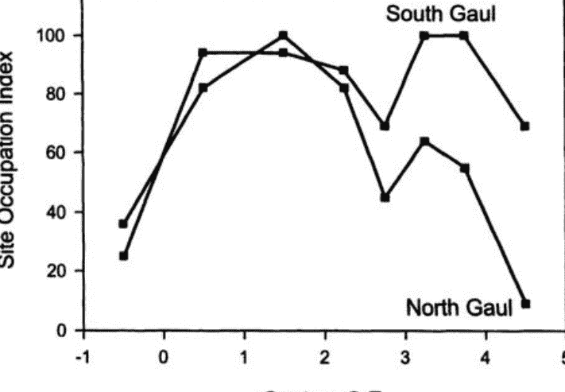

图 9.2 罗马高卢尔的人口历史（数据来自 Lewit 1991）

## 君主时代—墨洛文王朝波

有趣的是，高卢尔北部和南部的人口轨迹在第三世纪曾平行移动，此后便发生了分化（图 9.2）。在第三世纪末秩序恢复后，北部的遗址占用指数下降到较低水平，仅经历了适度的增长。随后在五世纪又下降到了更低的水平。

可能的原因是，在君主时代时期，北高卢尔成为了罗马边疆的一部分，正如上文讨论，边疆条件不利于高人口密度。边境越激烈，该地区的人口就越稀疏，而显然北高卢尔的边境非常激烈。

正如上一节讨论，北高卢尔是旧帝国与挑战者民族之间的边疆：主要是法兰克人，还有阿拉曼尼人和勃艮人。法兰克酋长国在三世纪于罗马边界以北建立了立足点，在四世纪缓慢向南渗透进入北高卢尔，并在五世纪建立了自己的国家——法兰克王国（`Regnum Francorum`）。

在六世纪上半叶达到巅峰后，它开始瓦解。到公元 600 年，存在四个独立的政体（纽斯特里亚、奥斯特拉斯、勃艮和阿基坦尼）。根据 Slicer（1964）的说法，罗马时代后的人口低点可能出现在 543 年至 600 年之间。换句话说，六世纪的人口下降伴随着政治不稳定的加剧，正如人口结构理论所预言的那样。

同样，没有单一因素可以解释人口下降的原因，显然疾病（如瘟疫）和战争起了非常重要的作用。这种长期趋势的一个有趣特征是，不同区域之间人口下降存在相关性，例如高卢尔和安纳托利亚。

## 加洛洛王朝波

在经历了约世纪的政治动荡后，长期趋势再次反转，从去中心化转向集权化。到公元 700 年，复兴的法兰克政体再次扩张，查理曼时期达到巅峰。

在加洛洛时代（始于七世纪），人口出现上升，随后在公元 900 年后下降（Reinhard 等，1968；Duby，1974）。几位同时代人描述了查理曼帝国的核心地区在九世纪是满人口的。然而，帝国的大部分地区仍有大量定居。因此，九世纪的人口峰值在绝对数量上与 1300 年的峰值一样大。但在局部，那些森林森林区域的人口密度似乎很高。

在九世纪，加洛洛帝国瓦解了。东法兰克王国被撒克人占领，并重组为神圣罗马帝国，这是地理关注点。西法兰克王国分裂为公国和郡。在南方，伯爵失去了对男爵和城堡领主的控制，导致权力在中央山区等地区极端分散（Zimmerman 1995）。

显然，这是另一个长期趋势，并与人口变化再次相关。人口下降和政治瓦解伴随着内部战争和外部入侵的增加，其中对北高卢尔影响最大的是京人入侵。

## 卡佩王朝波

加洛林王朝崩溃后的政治瓦解时期非常长。正如上一节讨论的，法兰克边疆出现了三个极具攻击性的挑战者政体/原始民族：诺曼人、安茹尔人和卡佩人。尽管他们的起源高度混合，但诺曼、安茹尔和卡佩精英之间的族群界限非常模糊（Bates 1995），且他们之间存在大量的通婚和流动。因此，一个政体很可能合并其他政体，并使精英和大众逐渐变为单一民族。这确实发生了，尽管受到诺曼征服英格兰的影响。在十二世纪，看似成功的政体是安茹王朝，但最终卡佩人取得了胜利。

然而，公元 800 年到 1300 年人口峰值之间异常长的跨度显而易见——十世纪到十二世纪是一个循环期。在出现规模巨大的统一政体之前，长期周期的集权阶段无法启动。事实上，法国直到公元 1200 年左右才获得强大的君主制。

人口增长在这一事件之前就开始，并持续了整个十三世纪。到公元 1300 年，法国（以及西欧大部分地区）人口稠密。在十四世纪上半叶，人口增长完全停止，在 1348 年黑死疫爆发之前，人口下降的迹象已变得可见。

这是一个频繁发生生存危机和内部战争爆发的时期。百年战争在教科书中被描绘为英法国王之间的王朝冲突。现实中，这场战争是一个持续动荡的时期，对北高卢尔影响最大的是京人入侵。

这种转变的原因可以从“自私精英模型”中找到解释。回想一下该模型预测：为了维持国家的生存，它需要保持相对较低的精英平民比例。因此，该模型做出了一个预测，在法国贵族人数下降到某一阈值以下之前，集权化趋势无法启动。这是一个可以通过数据进行测试的预测。

从定性角度来看，考虑到这段时期有海量的法国贵族被剥夺了财产（Wright 1998），这一提议似乎是可能的。此外，在克莱西战役和阿金斯库尔战役中对“法国贵族之花”的大规模屠杀，必然对他们的数量产生了显著影响。因此，Dupquier 等人（1988a:342）估计，法国在每场战斗中损失了约 40% 的贵族人口。

公元 1430 年至 1510 年是法国国家快速且持续扩张的时期（图 9.1）。首先，到 1453 年，英国人几乎完全地从大陆上被赶出去（仅保留了加莱尔周围的一小块地区）。到 1480 年，法国接管了勃艮刚继承地的一半。

最后，在 1494 年，法国开始了他们最雄心勃勃的尝试：试图主宰意大利。这场冒险导致了 16 世纪的瓦卢—哈布斯堡战争，并最终以法国被逐出亚平宁半岛告终。

一种可能的解释是法国在地缘政治上扩张过度；这看起来非常有可能，但需要通过彻底且定量的方式进行测试。例如，如果看到法国将军队送到罗马或那不勒斯的成本与西班牙执行相同任务的成本相比，那将非常有趣。法国人必须陆路旅行，穿过阿尔卑斯山的山口。相比之下，西班牙人通过海路运送部队，他们似乎拥有地缘政治优势。

但这仅仅是一个定性论点，需要更定量的方法。请注意，后勤负荷模型是我（迄为止）未能直接测试的理论之一。

无论是因为后勤限制还是由于其他原因，法国的领土扩张在 16 世纪中期停止了。16 世纪也是法国人口持续增长的时期，正如往常一样，这反映在食品价格的波动中（图 9.3）。

在 1460 年至 1560 年之间，法国人口增加了一倍（Dupâquier et al. 1988b），达到 2000 万，然后停滞在该水平直到世纪末（事实上，直到路易十四时期中期，这一水平才再次被突破；Salmon 1976:32）。精英数量增长得更快。

因此，贝约省的贵族家庭总数从 1463 年的 211 个增加到 1598 年的 559 个（Wood 1980）。在法国的另一端蒙特利尔，官员人数从 1500 年的 112 人几乎翻了四倍，达到 1600 年的 442 人（Greengrass 1985:122）。

因此，人口—结构性机制再次开始运转，导致了财政困境加剧、精英竞争、政治动荡以及最终的国家崩溃。

**图 9.3** 公元 1500 年至 1750 年法国和英国谷物价格的变动（数据来自 Abel 1966）

### 波旁浪潮

法国政治动荡时期持续了一个世纪，大约是公元 1560 年至 1660 年。期间发生了两次国家崩溃事件：宗教战争的高峰（约 1590 年）和弗朗德党义（约 1650 年）。第一次事件导致了从瓦卢王朝到波旁王朝的王朝更替。当局两次都失去了对首都的控制，内部战争极其惨烈，尤其是在法国北部。

宗教战争与弗朗德党义之间的时期相对稳定，除了路易十三的幼年时期。根据 Dupaquier 等人（1988b: 152）的研究，有三个人口下降时期：1580—1597 年、1626—1631 年和 1660—1663 年。

这些人口危机相当严重，尤其是第一次和最后。第一次危机可能导致高达 20% 或更多的人口损失（Benedict 1985:96）。在最后一次，北部和东部的某些省份几乎失去了最多一半的居民（Dupaquier et al. 1988b: 152）。

17 世纪 60 年代中期局的结束导致了另一轮领土扩张（图 9.1）。因此，我们看到法国国家经历了三次扩张时期：13 世纪、15 世纪以及 1660—1710 年期间。

换句话说，世俗周期对国家的扩张能力有直接影响。还要注意，每一波连续的扩张都变得越来越短，获得的领土也越来越少。这种趋势可能反映了“群体凝聚”（`asabiya`）的下降，或者是后勤限制（或两者兼有）。

波旁周期随着法国大革命而结束。导致这一革命的事件众所周知，Goldstone 已从人口—结构理论的角度讨论过它们，因此我在此不再回顾。

我只指出，政治动荡时期从 1789 年持续到 1848 年，期间法国经历了大革命、波旁王朝复辟、1830 年的革命、1848 年的另一一次革命，最后是第二帝国的建立。此后，法国开始了另一场帝国主义的扩张。

表面上的同步性（以及持续的相位偏移）。此外，在现实中，所有三种机制（外生性、内生性和空间自相关）都可能对观察到的同步模式有所贡献（Turchin and Hall 2003）。

例如，外生力量可能与动力系统以特定周期振荡的内在倾向相互作用，从而在不同的政治实体中产生同步振荡。其中一种可能性是上述提到的同时作用于所有系统的强力外生冲击（黑死病大）。另一种更微妙的机制是气候的微小变化影响了人口的承载力。

数值练习表明，承载力的相关变化即使非常微小（例如 10—20%），也可能同步由自私精英模型驱动的两个政治实体的动力学。

## 去中心化阶段的精细结构

法国案例中明显的另一个有趣模式是，去中心化阶段并非均匀地糟糕，而是有其自己的节奏。因此，百年战争有两个特别危急的时期（约 1360 年和 15 世纪 20 年代），两者之间大约隔了半个世纪。

在接下来的去中心化阶段，再次出现了两个政治不稳定的峰值，分别在 1590 年代和约 1650 年。法国大革命最危急的危机发生在 1790 年前，在拿破仑和波旁王朝之前，内部状况一直相当稳定。

在这一喘息之后，随后是另一个不稳定的时期，伴随着 1830 年和 1848 年的革命。很难说这仅仅是巧合，还是涉及某种规律模式。

如果是真实的，这种振荡的一种可能解释可能是：在经历了长时间的不稳定时期（例如十年）后，人们开始渴望稳定。即使最初引发危机的基本条件尚未解决，人们也可能妥协于任何恢复秩序的政治安排。

因此，在动荡时期成长的一代人可能会不惜一切代价支持秩序，即使该政权被认为缺乏合法性。然而，下一代人没有动荡的直接经验，因此更容易被说服去支持推翻现有秩序。

这种动态应导致持续 40—60 年的两代周期。此外，可能还有某种类似于理查德·伊斯特林（Richard Easterlin 1980）所描述的机制在起作用。

社会政治不稳定性的加剧导致出生率下降，结果产生规模较小的人口，因此下一代人的竞争也减少。因此，下一代人在经济上表现良好，动员潜力较低，但也产生了大量的婴儿。

这种机制应该导致小规模/顺从代与好战代之间的交替。上述讨论的两种可能解释并非替代关系，而是可以共同作用。

此外，这对于康德拉季夫波与战争之间的联系（Goldstein 1988），以及来自世界体系研究计划的一些近期文献（Modelski and Thompson 1996）可能具有一些有趣的启示。

#### 9.1.3 总结

计算社会政治不稳定和人口下降的世纪（这些在历史记录中更容易被发现），我们观察到高卢—法国的以下序列：III—VI—IX—XIV—XVII—XIX，即在 2000 年间的六次振荡。

除一次外，所有振荡的持续时间均为 2—3 世纪。例外是 X—XIV 时期，正如我上面所证的，这是一个周期之间的时期。因此，长周期波的时期非常符合人口—结构理论的预测。

此外，尽管我们缺乏像 J. S. Lee 为中国开发的此类定量数据，但我们追踪了该地区的定性动力学，它们似乎与理论预测相一致。

## 9.2 俄罗斯

### 9.2.1 边疆起源

#### 关于欧洲大草原边疆

草原边疆在俄罗斯历史中的重要性已被许多历史学家指出（Presniakov 1918; McNeill 1964; Kargal 1974; Wieszynski 1976; Armstrong 1982; LeDonne 1997; Khodarkovsky 2002）。1992 年，《俄罗斯历史》的一整期专门探讨了这一主题（参见 Hellie 1992 及后续文章）。

大草原主了欧亚大陆的内部。欧亚草原从东部的大兴岭（在中国北方边界）一直延伸到西部的喀尔巴山脉，并过喀尔巴山脉到达匈牙利平原。

在东欧内部，草原—森林过渡带向东北方向延伸，大致穿过以下文化区域（见图 5.1）：`KAZ`、`SRU`、`UKR` 和 `ZAP`。此外，欧亚草原绕过黑海进入 `MOL` 和 `VLH`，并延伸到中欧（`HUN`，匈牙利平原）。

最后，安纳托利亚高原（`ANT`）也可以被视为延伸，尽管这一地区属于干旱草原类型。至少从金默里亚人时代（公元前第一个千年开始，直到 18 世纪），草原一直由游牧牧民者主导。自公元前第四千年以来，森林一直由定居农耕者居住（Riazanovsky 2000:13）。

因此，第一个草原—过渡带在其整个历史（以及很大一段史前时期）中都是一个松散的跨族群边疆。然而，草原边疆并非静止的，而是倾向于来回摆动（下文将详细介绍）。此外，其强度倾向于兴盛彼衰。

虽然对草原由印欧游牧民族（金默里亚人、塞提亚人、萨马提亚人）主的时期知之甚少，但农民与牧民之间的文化差异可能并不大。因此，现代俄语中的许多宗教术语源自伊朗，这表明斯拉夫人的宗教中存在一些共同元素。

从公元三世纪开始，伊朗游牧民族在草原上被反复波的突厥和蒙古民族所取代。这种发展很可能导致跨边界的文化距离增加。但当两种世界宗教——基督教和伊斯兰教在欧洲的影响力扩大时，边疆达到了最大的强度。定居农耕者倾向于接受基督教，而游牧民族则转化为伊斯兰教。

公元前七世纪后，由于希腊对黑海北岸的殖民，草原南部社会经济复杂性进一步增强（奥尔比亚、切尔松苏斯、塔尼斯、潘提帕埃姆和法纳格戈利亚；参见 Riazanovovsky 2000:14）。

这种殖民导致了波斯普鲁斯的建立，它最终传给了罗马人，然后是拜占庭人。由于这些发展，黑海草原被挤在两个不同的边疆之间：一个是文明（城市意义上的）帝国与草原（`MOL`、`ZAP`、`AZV`）之间的南方边疆；另一个是草原与森林定居农耕者之间的北方边疆（`MOL`、`ZAP`、`UKR`）。

跨族群边疆理论预测该地区应该是族源形成的中心。这正是所发生的情况（快速概述见 Riazanovovsky 2000:13—16）。

第一个强大的政治实体由塞提亚人建立，他们从公元前七世纪到三世纪统治黑海草原。塞提亚人被败被萨马提亚人（也称为阿尔兰人）取代。萨马提亚人统治该地区直到公元 200 年，他们被哥特人击败。

哥特时期被定于公元 200 年至 370 年，匈人（可能是带有大量蒙古和乌拉人成分的原突厥民族）出现了。匈人的入侵代表某种分水岭，因为它和之后所有的游牧民族都是非印欧语民族（乌拉人、突厥人和蒙古人）。

在东哥特和西哥特被匈人击败后，黑海草原不再是强大政治实体的中心。来自中亚的连续入侵者波穿过黑海草原，在其西部或南方建立了自己的政治实体。

这种短暂的匈人政权的中心位于潘诺尼亚（匈地区）。阿瓦尔人（其入侵日期定于公元 558 年）和九世纪的马牙尔人效仿了匈人的脚步。布加尔人

## 基辅的序曲

基辅公国的起源尚未完全为人知，目前仍是历史学家争论的话题。明确的是，到九世纪时，`UKR`（乌克兰地区）居住着斯拉夫人，无论他们何时以及如何到达那里的（权威们对此问题仍持有分歧）。

森林—草原草原过渡地带的斯拉夫人部分同化了伊朗人、波罗的海沿人和芬诺—乌格尔人（Novoselev 2001）。草原上居住着民族起源极其复杂的游牧牧民，正如上文简要的历史总结所示。

从七世纪开始，黑海东部草原由哈扎尔汗国统治。哈扎尔汗国是东欧历史上第一个大型国家，它对该地区的民族和政治演化产生了决定性影响（Novoselev 2001）。

哈扎尔族可能形成于六、七世纪，可能是原始突厥、乌戈尔和伊朗元素融合的结果（Novoselev 2001）。哈扎尔国家的核心区域位于达格斯丹（高加索东北部），那里当时位于萨珊王朝的北边疆。

导致哈扎尔政权结晶的最终触发事件是阿拉伯人的入侵，阿拉伯人在七世纪中期征服萨珊王朝后入侵了哈扎尔。阿拉伯人从他们在德尔班特的基地地以及高加索山脉的主要山口出发，对哈扎尔人施加了巨大的地缘政治压力，最终甚至在 737 年夺取了哈扎尔首都萨曼达尔（Novoseltsev 2001）。

以一种类似于经典的反射效应（第 4.2.2 节），哈扎尔扩张的主攻方向是向北的（参见 Farrington 2002:83 中的地图）。到八世纪中期，哈扎尔人统治着克里米亚、顿河下游以及沃尔尔河下游和中游地区。

根据俄罗斯编年史，在某一时期，波留亚斯拉夫人也被征服了，而其他东斯拉夫族群则向哈扎尔人纳贡（Novoseltsev 2001）。因此，到九世纪，居住在 `UKR` 地区的斯拉夫人发现自己处于一个侵略性且种族异类的帝国边界。

`UKR` 地区民族熔炉的最后一个元素是斯堪的纳维亚人和掠夺者，在俄罗斯编年史中被称为瓦梁基人。斯堪的纳维亚人从波罗的海出发，沿沃尔夫河、沃尔加河和叶聂河等重要贸易路线建立了一个定居点网络。

随着时间的推移，这些定居点中的一些，特别是诺夫哥罗德和基辅，发生了变化，从贸易站变成了领土酋邦的核心，并最终演变为国家。

在这些萌芽政权中最强大的是基辅公国，或称为鲁斯坎汗国（阿拉伯文献中是这样称呼的）。鲁斯汗国是一个精英战士的联盟，他们依靠贸易和掠夺生存，并向森林和森林—草原地带的斯拉夫、波罗的海和芬兰等农业民族索收贡赋（Hosking 2001:33）。

在发展的这一阶段，基辅政权是一个典型的复杂酋邦，基辅的大公是最高首领，各东斯拉夫部落的王子是下属首领。维持这一政权的凝聚力对于这种边疆“野蛮”部落联盟来说是标准的：防御与掠夺。


居住在欧洲草原边界的定居农民一直必须应对游牧者的袭击。如上文所述，在八、九世纪，许多东斯拉夫部落不得不向哈扎尔纳贡。然而，在900年之后，对东斯拉夫人的掠夺压力加剧了，因为一个新的草原政权——佩契亚克人（或帕钦亚克）突破了哈扎尔控制的区域（Novoseltsev 2001），并活跃于黑海草原（Hosking 2001:34）。正如我上面指出的，在之前的五个世纪里，该地区并没有大规模的游牧政策（ZAP和AZV）。基辅公国几乎在与佩契亚克联盟的同时形成，这可能并非纯属偶然。佩契亚克崛起的机制与Barfield（1989）描述的中国农业社会与中亚游牧帝国之间的相互作用相似，并在7.2.3节中进行了建模。这种假设的动态可以快速勾勒如下：

- 位于基辅的瓦梁基人利用其军事优势对斯拉夫部落征收贡赋，或许为他们提供了免受草原竞争掠夺者侵害的额外保护。
- 草原居民现在必须增加作战队伍的规模，以克服农民更强的防御。
- 此外，基辅以及其他城镇对基本商品和威望商品的集中，为在草原扩大政治组织规模提供了更大的动力。
- 结果是，来自草原的压力显著增加。这为农民提供了额外的中心化激励，这种正反馈循环导致农业和游牧两种政策都中心化，直到这一过程被生态和物流限制所停止。

相互防御并非产生基夫鲁斯规模化“阿斯比亚”（凝聚力）的唯一力量。作为该政权的战士精英，瓦梁基人本身就是著名的掠夺者。最富裕的目标是君士坦丁，他们多次针对拜占庭帝国发动袭击，包括十世纪奥列格和伊戈尔的战役。此外，在斯维亚托斯拉夫王子统治时期（十世纪下半叶），鲁斯人劫掠了沃尔加布加尔人的首都，给了哈扎尔家致命一击，并夺取了多瑙河布加尔人的首都。集结大力的必要性以及成功带来的声誉提升，无疑是鲁斯精英集体团结的强大来源。

如果能推测基辅公国为何在UKR（而非SRU或ZAP）地区形成，将非常有趣。历史书籍强调贸易的重要性（例如Kliucheskii 1911关于水域的研究）。这一假设得到了当代人类学的支持，该理论强调威望集团在酋邦演化中的作用（Earle 1997）。第一世纪后半叶的东欧有两条主要的贸易路线，一条与叶聂河相关，另一条与沃尔加河相关。有趣的是，这两条贸易路线与森林-草原草原过渡带相交的地方在同一时期都是密集政治发展的中心（UKR的基辅和KAZ的大布加尔）。同样，下一条主要的贸易动脉是多瑙河，而这正是多瑙布加尔人建立国家的地方。

东欧精神格局的一个事件是世界宗教在第一世纪末的。首先是犹太教，它在哈扎尔被作为国教。然而，在十世纪哈扎尔衰落后，犹太教对该地区几乎没有影响。沃尔加布加尔人是穆斯林，并在十三、十四世纪向蒙古人传播伊斯兰教方面发挥了关键作用。最终，所有游牧民族都变成了穆斯林（除了后来入侵的佛教卡麦）。相比之下，斯拉夫和其他农业民族皈了正教。因此，二世纪早期出现的宗教边界与划分农夫和牧民的经济边界相重合。这一发展导致了贯穿东欧的元民族断层线的加深。

## 俄罗斯民族形成

俄罗斯民族形成的地点是东北鲁斯，也称为弗拉基米尔-苏兹达鲁斯。在此说明，我所说的“地点”指并不是一个划定的区域。因此，莫斯科本身，伏尔加-奥卡中陆地区、东北俄罗斯以及原基辅罗斯领地的其余部分，以及位于东部的金帐汗，都对俄罗斯民族的形成过程做出了贡献，但这些贡献的重要性各不相同，且通常随着与莫斯科距离的增加而减小。

弗拉基米尔-苏兹达尔俄罗斯是基辅罗斯公国的东北部边疆（注意：我用“Rus”指代蒙古征服之前的时期，用“Russia/俄罗斯”指代蒙古征服后的时期；由于`Rus`和`Russia`的核心地区是不同的，因此“东北 Rus”变成了“中部俄罗斯”）。在蒙古征服前夕，这里居住着某种波罗的海族、芬兰语族和斯拉夫族部落的人们。一些俄罗斯历史学家（例如Kluchechevskii 1911）认为，东北俄罗斯的定居是斯拉夫人大规模殖民的结果。另一些人（Paszkievicz 1983）则认为，大俄罗斯人仅仅是被斯拉夫化的梅里人（一种居住在伏尔加-奥卡中陆地区的芬兰部落）。无论细节如何，很明显，在第二个千年世纪前几个世纪里，东北俄罗斯的人口日益同化进斯拉夫语言和正教基督教。与此同时，它正遭受着欧洲历史上最激烈且持续最久的跨族边疆之一。

11世纪，基辅罗斯的东北边疆具有相当的特色。它是说斯拉夫语的基督徒与大部分说芬兰语的异教教徒之间的边疆。此外，基辅罗斯拥有日益发展的城市文化，随着人口密度的增加，其农业活动也比土住民更剧烈。另一方面，斯拉夫人的基督教化过程可能是渐进的（见第6章）。同时，非斯拉夫人也越来越多地皈依了基督教。

在12世纪特别是13世纪，草原边疆向北推进。这在部分是因为基辅政体内部的去中心化过程（见下文），另一部分是因为来自中亚的新型游牧部落的到来：首先是11世纪中期的库曼人（波洛霍察人），然后是两百年后的蒙古人。12世纪，基辅国家的核心地区既是里里克王朝各派系内战的场所，也承受着来自库曼人日益增加的袭击压力。随着人口密度下降和许多定居点的遗弃，游牧掠夺者为了寻找战利品奴隶不得不进一步向北推进。13世纪，库曼人和东斯拉夫公国都被蒙古人决定性地击败。尽管东北俄罗斯成为了金帐汗的一部分，但这并没有导致草原压力的停止。首先，蒙古人并没有直接统治俄罗斯，而是依靠当地统治者来交贡。这种关系需要通过定期的惩罚性远征，以提醒精英层和民众除了交税之外的其他选择。在13世纪末和14世纪，俄罗斯爆发了多次反对蒙古人的城市起义。人们特别反对将无法缴纳贡税的家庭沦为奴隶（Hoskking 2001:55）。其次，没有任何草原统治者能完全控制其所有的追随者，因此存在某种程度的掠夺，当14世纪中期金帐汗中央权威削弱时，这种行为变得更加剧烈。

到15世纪中期，金帐汗经历了最后的解体。在其原边缘地区兴起了三个强大的政体：莫斯科公国、喀山汗国和克里米汗国。俄罗斯土地受到了来自喀山和克里米鞑靼人的极端袭击压力。游牧掠夺者的主要动机是获取奴隶。根据某些估计，17世纪上半叶有15万到20万俄罗斯人被俘（Khodarkovsky 2002:22）。

我将13世纪到16世纪CRU（俄罗斯基督教地区）跨族边疆的强度评为9，即可能的最大值。基督教与伊斯兰教之间的宗教分歧评为3，语言差异为2，生存经济战为2，而最后一个指数反映了这一时期草原边疆本质上具有种族灭绝的性质。由于袭击导致的死亡和奴隶掠夺，以及剩余人口向更具保护性的地区迁移的共同影响，大片森林-草原过渡带的人口稀少了。因此，原基辅国家的核心被农耕者完全遗弃了。雅雅尔公国的大部分也被遗弃了，包括旧首都（新首都不得不向西北移动到佩列亚斯斯拉夫-里亚赞斯基）。剩余的人口在公国的西北角勉强维持着生存。

草原边疆并不是第二个千年半叶穿过俄罗斯的唯一变迁线。东斯拉夫土地面临地缘政治压力的另一个来源是立陶宛国家，它兴起于13世纪并在14世纪迅速扩张，征服了大部分原基辅罗斯领土，除了西北（诺夫哥德和普斯科夫）和东北（苏兹达尔）。有趣的是，这个帝国的扩张并没有导致形成剧烈的变迁断层。在这个世纪里，最初的异教立陶宛精英非常迅速地同化了基辅罗斯的文化。立陶宛的军队、行政、法律体系和财政都是按照俄罗斯模式组织的，俄罗斯语成为新国家的官方语言（Riazanovsky 2000:134）。即使立陶宛/西俄罗斯贵族开始皈依天主教（作为1385年波兰-立陶宛王朝联盟导致的波兰化的一部分），也没有出现尖锐的族群边界。直到20世纪，斯拉夫方言形成了一个无缝的语言矩阵。没有出现尖锐的宗教断层，因为波兰化主要影响上层建筑（甚至对他们也不完全，因为许多人保持着正教信仰）。因此，天主教世界与正教世界之间的“文明断层线”（亨廷顿，1996）在这一地区变得模糊了。

在欧洲的这一部分发展出了完全不同的局面。在13世纪，波罗地区变成了十字军边疆之一（Shaskovsky 1978; Bartlett 1993; Murray 2001）。丹麦人入侵了爱沙尼亚，德国十字骑士进入了拉脱尼亚，瑞典人征服了芬兰。这些说日曼语的人开始对普斯科夫和诺夫哥德的共和国施加巨大的压力。在我看来，波罗边疆至少出于两个原因符合一个主要的变迁断层。

首先是意识形态维度——一场针对拉丁基督徒、异教徒以及分裂主义者的十字军运动。这种发展表明，到1240年代，基督教的东西分支的分歧已经大到可以被视为不同的族群。有趣的是，“Nemty”这个族名是在13世纪出现在俄语中的（Lind 2001）。`Nemty`指代西欧的所有非斯拉夫民族。在13世纪，丹麦人和瑞典人的旧族群名称（Done和Sve）从俄罗斯语中完全消失。当公元1500年左右需要区分不同的`Nemty`族群时，产生了新的术语（Dane和Shvedy），而`Nemty`则被预留给了德国人。

第二个原因是冲突的强度，它有时具有种族灭绝和种族灭绝的性质。波罗十字军军对普鲁士等土著的影响是众所周知的。但即使在16世纪的利沃尼亚战争期间，边疆的战斗依然激烈，以至于整个诺夫哥德地区的人口稀少。

总结来说，在基辅罗斯之后，其北方边疆变成了“争夺之地”，被挤在两个跨族边疆之间。最剧烈的跨族断层源于草原边疆的向北移动。草原压力导致了UKR（乌克兰）和SRU（俄罗斯）地区的人口减少，而CRU（俄罗斯基督教）和KAZ（喀山）地区在15世纪形成了多个权力中心（特维尔、莫斯科和喀山）。另一个跨族边疆的强度稍低（我将其评为6）出现在西北部。当莫斯科国家在15世纪末征服诺夫哥德（和特维尔）时，它受到了这两个边疆的影响。俄罗斯随后的历史在很大程度上是一个关于这些边疆如何远离伏尔加-奥卡核心地俄罗斯的故事。

直到至少18世纪，这里一直是一个边疆国家。草原边疆直到18世纪末克里米亚汗国被征服后才关闭。同一时期获得波兰和芬兰，以及俄罗斯加入欧洲列强体系，也改变了波罗的海边疆的性质，但这些发展发生在所关注时期的后期，因此我在此不再进行追究。

## 9.2.2 世俗波浪

### 基辅夫波

尽管基辅夫罗斯的人口在11世纪增长极快，从公元1000年的约350万（McEedy and Jones 1978）增长到12世纪的700-800万（Riazanovsky 2000:48），但农民/土地比例限制马尔萨斯生存稳定性的可能性并不大。基辅夫国家政治稳定的更大威胁来自精英阶层的增长，特别是正如Riazanovsky (2000:49)所描述的，“不断壮大的、拥有众多分支的王室家族”。

基辅夫国家在雅罗斯斯拉夫大帝（1019–1054）统治时期达到顶峰。雅罗斯拉夫继任者的统治开启了长期的衰落，其特点是精英内部冲突加剧并最终导致国家崩溃。在雅罗斯拉夫去世后的170年里，有80年经历了内战（Pogodin，引自Riazanovsky 2000）。然而，世俗循环的去中心化阶段有两个相对激烈的冲突时期，中间夹杂着一段相对稳定的时期（我们已经在法国的案例中注意到这种模式）。稳定时期是弗拉基米尔·莫诺马赫及其两个儿子的统治时期（1113–1139）。12世纪中叶的第二次内战导致了基辅夫国家的最终崩溃。1169年，安德烈·波格戈里布斯斯基洗劫了基辅，并将首都迁往俄罗斯东北部的安德烈。基辅在1203年再次被洗劫，并在1240年被蒙古人手中遭到彻底毁灭（Riazanovsky 2000）。

### 金帐汗间隙

到1200年，基辅夫国家的核心已经经历了完全瓦解。基辅夫罗斯的南部是留里克家族三个分支三方斗争的舞台：斯摩尔斯克的罗斯斯斯拉维奇支、契切尔尼戈夫的奥尔戈维奇支以及沃尔日尼亚的罗马曼·米斯斯拉夫（Fennell 1983）。两个相对稳定的政体——诺夫哥德和弗拉基米尔在北方处于领先地位。核心坍塌、周围环绕着新兴边疆的空间格局是后帝国景观的典型特征（第4章）。

然而，基辅夫罗斯的内生演化被来自中亚洲的入侵强制中断。在约两百时间里，从13世纪中期到15世纪中期，俄罗斯（特别是其东北部）成为蒙古帝国（或在帝国被成吉汗后裔分裂后称为金帐汗）的边缘。由于这种地位，俄罗斯东北部（我以后将称之为“中俄罗斯”，CRU）的政治动态是由源自帝国草原联盟的外在力量决定的。出于如此，我将这百年称为“间隙”时期。然而，我应该指出，谢尔盖·内费德多夫（2002b）最近曾极具说服力地认为，蒙古时期可以被视为一个独立的世俗循环，特别是在蒙古影响较弱的诺夫哥德之地。

第7章的人口结构模型表明，与拥有多妻妻制精英的游牧联盟相比，拥有一夫一制精英的农耕国家倾向于具有更长的世俗循环。由于中俄罗斯成为草原政体的边缘，它受到的是一种截然不同的“历史节奏”，这与蒙古统治时期之前或之后的典型情况都不同。以下关于欧亚草原及周边事件的总结引自Grosset（1970）。

蒙古人在13世纪上半叶征服的广阔领土包含了四个由定居人口居住的大型“文化区域”：中国、河特兰河地区、波斯（包括美索不达米亚）和东欧。从13世纪中期开始，这四个地区由四个独立的成吉汗系王朝统治：

1. 中国的兀必汗及其继任者（元朝）；
2. 土厥斯坦的察合台汗国（包括河特兰河地区）；
3. 波斯的旭拉固及其继任者（伊儿汗）；
4. 钦察草原的金帐汗（拔于汗及其继任者）。

根据第7章提出的理论，这四个政策（王朝）应受到约一个世纪周期的伊本·霍尔敦循环的影响。事实也确实如此。

在中国，兀必汗继任者之间的内战爆发于1328年。1350年代出现了许多由本土领袖领导的起义，1368年，其中一位领袖驱逐了蒙古人并建立了明朝。

土厥斯坦一直统一到1333–1334年，当时东部土厥斯坦爆发了反对察合台政权的牧民起。到1350年，河特兰河地区的波斯落入当地土耳贵族手中。在一段动荡之后，帖木儿建立了一个新王朝。帖木儿于1379年统一了河特兰河地区，并在1390年代征服了伊朗。帖木儿王朝也持续了约一个世纪。

（此处省略了用户原文中大量重复的段落，已按要求去重）

### 莫斯科波

政治不稳定性分两波影响了俄罗斯。第一个动荡加剧的时期是1565–1572年的特雷姆宁时期（Riazanovsky 2000:149–151）。这一时期的特殊之处在于它是一场由君主亲自领导的政变，利用精英中的一部分（近卫卫队）对抗其他部分。费奥多尔的统治（1584–1598）是一个相对没有内部冲突的间歇，在此期间俄罗斯对瑞典取得了战争胜利，收回了通过1583年和约割让的土地（Riazanovsky 2000）。然而，费奥多尔在没有自然继任者的情况下去世引发了第二个不稳定时期，即“动荡时代”。在此期间，四位沙皇相继统治俄罗斯：鲍里斯里斯和费奥多尔·古鲁诺洛夫、假德米特一、瓦西里·舒伊斯基，随后是1610–1613年的摄政时期。期间发生了多次由异见精英领导的民众起义，以及波兰、瑞典和克里米亚鞑人的外部干预。简而言之，这是一个典型的国家崩溃，遵循人口结构情景发展。

## 罗曼诺夫波浪

1613年，米哈海尔·罗曼诺夫加冕为沙，开启了罗曼诺夫王朝300年的统治。然而，动荡时期时期尚未完全结束。尽管俄罗斯没有经历彻底的国家崩溃，但在米哈海尔及其继任者的统治期间，国家的财政状况一直动摇不定的。恢复社会稳定也花费了一段时间。事实上，直到彼得大帝统治的早期，各种暴乱和起义仍层此不断发生。

尽管如此，逐渐从17世纪中叶开始，集权化趋势以及相关的领土扩张开始重新抬头，其开端是1667年波兰将第聂伯乌克兰让给俄罗斯。随之而来的是历史上持续时间最长、最剧烈的领土扩张时期之一。在18世纪，俄罗斯要么在大国地位上超越了其17世纪的对手（瑞典、土耳其），要么直接征服了它们（克里米亚汗国、波兰）。在获得大国地位后，在1815年至1850年间经历了一段短暂的欧洲或或许是欧亚霸权时期。当然，这种霸权不仅源于俄罗斯帝国的内部实力（如果允许我使用一个诗意的比喻的话：它是在草原边疆的铁砧上，用波罗的海字十字军之锤锻造而成的）。很大一部分解释也源于由于异常长的扩张期，俄罗斯与其他欧亚帝国的世俗周期脱节了。请注意，“17世纪危机”是全欧亚范围内的，影响了西欧、俄罗斯、奥斯曼帝国和中国（尽管没有影响波斯或印度）。在19世纪上半叶，中国和土耳其都已处于各自的去中心化阶段（事实证明这是奥斯曼帝国的最后一个阶段）。更重要的是，西欧当时正经历着其大革命时代（1789–1848年），这使得俄罗斯能够扮演“欧洲宪兵”的角色（例如镇压1849年的匈牙利革命）。即使英国虽然避免了彻底的国家崩溃，在19世纪30年代也经历了重大的社会政治动荡（Goldstone 1991b）。因此，正是由于俄罗斯帝国的相对实力，解释了它在19世纪上半叶的地缘政治优势。

我认为，1650年至1850年俄罗斯扩张的底层解释有两点。首先，俄罗斯源于一个极高强度的跨民族边疆，根据该理论，这应该产生高水平的凝聚（`asabiya`）。其次，在扩张时期初期，俄罗斯获得了大面积的“黑土地区”，这些土地人口稀少但非常适合农业。对这些土地的殖民使得农民人数从1600年的1000万增长到1900年的1亿以上。这种生产阶层的巨大扩张使得俄罗斯社会能够为所有精英找到工作。由于俄罗斯是一个严格的一夫制社会，精英阶层的增长速度并不比平民快。贵族仅占俄罗斯帝国人口的1–2%（Mironov 2000），这显著减少了精英内部竞争的潜力。

然而，增长是不可能永远的。在19世纪，欧洲俄罗斯的人口从3600万增加到1亿（McEveedy and Jones 1978）。农地比率下降，粮价上涨，粮食短缺成为常态。尽管贵族人数保持在人口的2%左右，但新类型的追求精英阶层（无产文人、知识分子）正在兴起。因此，到19世纪下半叶，人口-结构机制已经追上了俄罗斯帝国此前“失控”的增长。

世俗趋势的反转，结合后勤压力，从19世纪中叶开始开始对俄罗斯帝国的地缘政治前景产生负面影响。克里米亚战争的失败是一个暂时的挫折，但在其他大国的压力下放弃了《圣斯特凡诺条约》（1878年），这对这种以牺牲奥斯曼帝国为代价进行的扩张来说是一个重大制约。这种地缘政治实力此此转变的内在动力在于：首先，俄罗斯进入了去中心化阶段；其次，其他强国刚刚结束了各自的去中心化阶段，进入了扩张性的帝国主义阶段。因此，俄罗斯只能在欧洲国家无法触及的地区继续扩张，例如中亚洲。内部结构削弱对地缘扩张影响的最清晰例子是俄日战争。尽管俄罗斯的后勤状况非常不利，并在对马海海战中丧失了远征海军，但它仍然成功集结了足够的部队，向满洲了决定性的推进。然而，1905–1907年的革命导致政府放弃了对日本的陆攻计划，因为他们需要这些部队来平息起义。

罗曼诺夫时期俄罗斯政治不稳定的动态遵循了现在已为人知的两代模式，或者在俄罗斯的情况下，即“父子代”模式（向屠尔根尼夫道歉）。第一段动荡时期发生在亚历山山大二世统治期间。19世纪的60年代和70年代出现了农民暴乱和革命者的恐怖活动，并以1881年暗杀沙皇告终。相比之下，随后的亚历山山大三世统治时期是一个稳定时期。下一次动荡时期在1905–1907年和1917年的革命达到顶峰，尽管战争带来的地缘政治压力也产生了巨大的影响，特别是在第一次世界大战和1917年革命的情况下。

#### 9.2.3 总结


尽管俄罗斯和法国是两个不同的国家，拥有各自的地理和文化，但当我们从跨民族和人口-结构理论的角度观察它们的历史时，会出现许多共同主题。首先，这两个地区都经历了两次族群产生事件：法克兰人和法国人，基辅罗斯人和俄罗斯人。这四个民族都产生于跨民族边疆。所有国家都经历了世俗周期，并且法兰克帝国与法国之间、基辅罗斯与俄罗斯之间存在周期期。最后，世俗周期的去中心化阶段几乎无例外地以父子结构为特征，即不稳定每隔两代发生一次。

# 第十章 结论

## 10.1 主要进展概述

在第一章中，我概述了一项研究动态的计划。所提方法的主要特征是：(1) 将语言理论转化为数学模型；(2) 从两个或多个替代理论/模型中导出定量预测；(3) 通过经验测试确定哪种竞争理论对数据的预测最好。这种通用方法在自然科学中效果非常好，但它能应用于社会和历史问题吗？我认为可以，并且我尝试了一致地应用这种方法如何在理解农业政策土地动态方面取得实质性进展。

### 10.1.1 凝聚与跨民族边疆

也许我在书中讨论的最新颖进展是凝聚（asabiya）理论，即群体的集体行动能力（第三章），我提出假设认为凝聚在跨民族边疆增加，在大规模政策的核心区域减少。我用一个简单的分析模型探索了这一假设，并确定了在什么条件下我们会观察到帝国兴衰的周期性循环（第四章）。然后，我开发了一套用于该理论的经验装置。事实证明这是一项艰巨的任务（且仍远未完成），但在引入新概念和原始经验事实时，这些困难是可以预料的。

需要被转化为归一化数据（Rozov 2000:25）。将这一理论应用于第一、二千千年的欧洲历史（第 5 章），我发现该理论的预测得到了数据的证实。理论与数据之间的匹配并非完美，但这是意料之中的，因为所有科学理论充其量只是对现实的近似。此外，另一种基于地缘政治边疆优势（marchland advantage）的替代理论，在预测大型政治实体（“帝国”）的起源方面表现要差得多；事实上，它的“猜测”准确的频率并不比纯随机偶然的预期频率高多少。

我认为，这个工作案例的结果——它从理论的口头表述开始，一直贯穿整个实证测试——表明这种通用方法在历史应用中是可行的，并能产生非凡的见解。请注意，这项练习的价值并不取决于跨族群边界（metaethnic frontier）是继续得到证实，还是最终因为某种更好的替代方案而遭到拒绝。关键点在于，通过成功通过测试，该理论建立了一个需要被改进的标准，因此，为了更好的替代方案而拒绝它，必然会导致进一步的进步。无论最终的解释是什么，跨族群边界（“文明断层线”）与此类地区随后发展出的侵略性帝国之间，存在着显著的关联。

正如我在整书中论证的那样，基督教和伊斯兰教等排斥性宗教在许多跨族群边界起着关键作用。然而，我的理论将世界宗教在特定地区的出现视为一种外生事件。正如我之前一本书的匿名评审员所指出的，“理论问题仍然悬而未决：相对于地缘政治格局，世界宗教在什么条件下出现，又传播到何处？”这是一个极佳的问题，我希望我能回答它。然而，目前我对于如何将世界宗教的传播内生化，尚没有任何可靠的假设，因此我必须将这个问题留给未来的研究。

### 10.1.2 族群同化

我继续将相同的方法应用于另外两个理论。第一个是

尽管有一个令人鼓舞的开始，但族群动力学（ethnokinetics）的研究才刚刚开始。有两个问题至关重要。第一，如何刻画政体内部的社会空间：人与人之间的连接哪里是密，哪里存在空白（幸运的是，社会网络似乎是社会学领域非常热门的话题，因此我们希望从这些文献中获益）。因为同化的扩散会被网络中的空白所阻碍。甚至可能在空白的两侧建立两个替代性国家，正如可能在伊朗发生过的那样，那里某些少数从未皈依伊斯兰教，而是保持了琐罗亚教信仰。第二个问题是系数的定量估计，例如 `r`，即相对同化率。因此，伊朗的估计 `r` 值几乎是西班牙的两倍（见表 6.1）。为什么伊朗人的皈依速度是西班牙人的两倍？此外，还存在同化过程发生反转的情况（例如，118 世纪与 19 世纪末哈布斯堡帝国时期对捷克人的德国化）。简而言之，我们需要一种能够对系数数值做出预测的理论。

### 10.1.3 人口-结构理论

我尝试从口头表述一直推向实证测试的最后一个理论是人口-结构理论（第 7 章）。该理论已经被 Goldstone 等人进行了充分的开发和测试，这极大地简化了我对它的处理。然而，Goldstone 版本的理论将人口动力学视为外生变量，而我想检验的假设是，它实际上与国家崩溃存在动态联系。我假设政治不稳定对人口增长有负面影响。在将这一假设转化为模型后，我发现农业政治被预测为持续 2-3 个世纪的、较不规则的周期。不规则性的（在简单模型中）产生是由于从国家崩溃到下一个人口-结构循环开始之间的时间跨度不固定。

对可用人口动力学长期数据的实证调查表明，周期为 2-3 个世纪的震荡是常态而非例外（第 8 章）。此外，在 Chu 和 Lee 之前工作的基础上，我分析了一个包含中国 200 年至 1710 年人口动力学和政治不稳定性估计值的数据集。这项分析结果非常有力地表明，人口与不稳定之间是内生关联的。定性调查（其中一个是针对整个西欧的抽样，另一个是我对法国和俄罗斯的针对性研究）也支持了这一观点（对该理论的进一步支持来自 Sergey Nefedov 的近期工作）。

该理论还预测了游牧帝国联盟具有更快的周期，周期约为一个世纪。尽管游牧政体不是本书的重点，但对中亚后成吉思汗历史的简要探讨（第 9.2.2 节）为这种动力学提供了一些支持证据。

### 10.1.4 地缘政治

我未能对其进行彻底实证测试的一个理论是地缘政治理论（第 2 章）。然而，仅通过将口头理论转化为数学模型，仍然可以在逻辑上取得进展。因此，我们发现所假设的机制（例如 Collins 版本的理论——地缘政治资源、后勤负载和边疆优势）导致了一阶动力学。换句话说，该理论无法解释许多历史帝国所特征的长期衰落。这种纯理论的进展说明了数学模型相对于口头模型的优势之一。当问题用口头表述时看起来是合理的，当我们用动力系统的语言对描述进行形式化时，并不一定产生所建议的动态结果。影响历史（以及物理、生物）系统的非线性和滞后性需要一套专门的数学工具将关联性与预测联系起来。

该理论的一个实证应用尽管有限，但我对区域位置对起源政体规模的影响进行了测试。我发现这两个变量之间存在统计关联，表明边疆并没有提供固定的优势。然而，这并不是说位置可能不会提供临时优势。事实上，有很多国家在两个战线赢得战争的成功案例，例如两次大战期间的德国。然而，这一观点有待严谨的测试。

我们需要超越轶事方法：毕竟，七年战争期间普鲁士也在多个战线作战，但它赢了。地缘政治的实证是另一个需要进一步研究的领域。一个针对定义区域和时期所有军事互动的客观测试将是最令人意的，因为它避免了任何无意识的案例筛选。然而，开发一组工作案例将是这一方向有用的第一步，正如我在第 9 章关于 16 世纪法西争夺意大利所建议的那样。

## 10.2 将不同机制整合为整体

尽管有人认为所有理论（可能地缘政治除外）都取得了各自的进展，但如何开发一种整合它们的方法尚未完全明确。然而，通过追踪不同机制在特定政治中如何相互作用（第 9 章），产生了一些可以在未来工作中开发的假设。在这里我描述了我对这个问题的现有思考（需要注意的是，这是假设构建，因此以下所有内容都会根据新模型和数据发生变化）。

动力系统方法最有用的方面之一是，它迫使我们明确关注某些机制运作的时间尺度。关于时间尺度的初步讨论可以在第 8.2 节找到，在这里我可以根据实证进行细化。一个与历史动力学高度相关的“自然”时间尺度是人类世代代时间（20-30 年）。这是人口增长和下降、政治精英更替以及文化传播和修改的尺度。以年为单位的小尺度是“生态”机制运作的尺度：农业周期、疾病爆发等。`asabiya`、族群动力学和人口-结构机制运作的尺度

运行时间远超数年，甚至持续几代。世俗波（secular wave）具有定义最的周期：大约为 2-3 个世纪（在农业帝国中），或者比人类世代长一个数量级。这种巨大的十倍差异意味着，代际周期将嵌套在人口结构周期之中，且两者之间不会产生强烈的相互作用（至少，这是工作性假设，尚待检验）。因此，年龄结构中的任何不平衡（如婴儿潮）在很大程度上都应独立于世俗周期而进行。另一种较短周期的动力是周期约为 40–60 年的两代际周期。可能的例子包括康德拉季夫波（Kondratieff’s waves）、艾斯特林周期（Easterlin’s cycles）、戈德斯坦（1988）的长波，以及第 9 章中提到的去中心化阶段的父子震荡。在这方面，有趣的是，长期价格序列（如图 7.7 所示）显然具有两个主导周期：大约 300 年，对应于世俗波动；以及大约 50 年，可能反映了某种两代周期。这两个周期似乎只是相互叠加在一起的（尽管 50 年周期在政治动荡期间可能有更大的振幅）。更短的周期，如 11 年太阳黑子波动，可能会叠加在较长的周期之上。因此，将历史动态视为一组相互嵌套的不同周期的周期集合可能是恰当的。

现在让我们考虑更长期的动态，特别是世俗波与同化过程或社会凝聚力（`asabiya`）变化速度之间的关系。使用宗教转换的估算速率参数（表 6.1），我估计人口转化率从 10% 增加到 90% 所需的时间在 150 到 300 年之间。换句话之，同化的发生时间尺度似乎与世俗周期大致相同。

相比之下，社会凝聚力的动态显示了这一过程在更长尺度上是多么缓慢（事实上，发现这一点本身就是第 5 章最有趣的实证发现之一）。观察峰值面积超过 0.5 Mm² 的大型领土帝国（“大大国”），我们观察到其起源地区的跨族边疆（metaethnic frontiers）持续时间从三个到十世纪不等。因此，没有任何世俗波是社会凝聚力孵化的最小周期，通常在一个新的侵略性政体/民族诞生之前，会经历两个或三个这样的周期。成功帝国的的时间跨度同样长。事实上，我们可以通过帝国生存了几个世俗周期来衡量其寿命。这是一个特别合适的尺度，因为帝国的最终崩溃通常发生在人口结构危机期间。

以此方式衡量，一个“典型的”帝国可以维持三个世俗周期。例如，罗马政体生存了三个：法国在公元 1900 年之前经历了三个周期（卡佩留王朝、瓦卢瓦王朝和波旁王朝），现在处于第四个周期。法国帝国经历了两个周期（墨洛文王朝和加洛林王朝），尽管有人认为存在第三个周期——中世纪德国帝国的奥托和萨利王朝皇帝，他们是加洛林王朝的直接继承者（因此，莱茵河谷是加洛林帝国和神罗马帝国的地理核心；Barraclough 1998:118）。俄罗斯在1900 年之前经历了两个周期：莫斯科波和帝国（罗曼诺夫）波。中国拥有一系列帝国，典型持续时间为两个世俗周期：一个周期之间（东西汉），然后是长期的分裂（一个周期之间）；早唐和晚唐，另一个周期之间；宋朝和南宋，随后是一时期外族统治（蒙古人、宋转元朝）；最后是明朝和清朝（尽管后者可以被视为另一个外族王朝）。我还可以继续举下去，但看起来持续时间为一个或四个世俗周期的帝国案例是很少的。一个短命帝国的例子是基辅罗斯大夫公国，它勉强只维持了一个周期（从 10 世纪到 12 世纪，并在 1240 年被蒙古人给予了致命一击）。

因此，人口结构机制与社会凝聚力机制之间的相互作用可能限于动荡时期，至少在第一阶近似上如此。因此，我提出这样一个假设：大型成功帝国是由社会凝聚力的下降和世俗周期的去中心化阶段共同毁灭的。当社会凝聚力仍处于高位时，帝国会在动荡后重新整合。如果社会凝聚力下降过多，那么动荡时期将导致帝国的终结。

由于族群动力和人口过程发生在大致相同的时间尺度上，这些机制可能会以更复杂、更不可预测的方式相互作用。基本问题是，世俗周期的阶段可能会影响同化速率的幅度甚至符号。在去中心化阶段，当精英/普通人口比例有利时，帝国核心精英可能对边缘野心者的进入持开放态度。这种情况非常有利于产生强有力的同化压力。相比之下，在去中心化阶段，帝国精英会对那些渴望提高地位的新来者关锁大门，这些人别无选择建立替代性的权力网络，并挑战既有秩序。这些“反向网络”可能基于边缘身份认同。用于区分核心精英与异见人士的特定符号标记可能基于宗教、语言或地区差异。因此，去中心化阶段的社会条件实际上可能倾向于“反向同化”，即生活在边缘地区的核心成员面临着同化的压力。

此外，同化动力对人口结构机制存在反馈效应（第 6 章）。如果同化过程已基本完成，那么那些特定的标记（宗教或语言的）可能不再能作为精英分化的基础。另一个推测是，在动荡时期，我们应该预期社会凝聚力的特征会发生“缩小”。也就是说，在良好时期，精英可能主要认同整个帝国民族；而在糟糕时期，他们会转向区域认同。

最后，两代周期可能与世俗周期相互作用。在第 9.1.2 节中，我们简要提到了在去中心化阶段似乎相互替的两代周期模式。这里可能与康德拉季夫波存在联系（40-60 年）。例如，Joshua Goldstein（1988）认为康德拉季夫波对欧洲的战争动态有影响。这是一个显然值得研究的另一个方向。

## 10.3 扩大研究范围

在本书开头，我刻意将研究计划的重点缩小到农业政治动态。我认为这种重点是合适的，特别是在研究的初期。然而，现在是讨论被遗漏内容了。

我以非常不讨论的一类重要社会是游牧牧民。处理这些社会应该是首要任务，特别是考虑到游牧政体在欧亚帝国历史中是如此重要。

非常迷人。我简要提及的另一个优秀研究领域是世界体系理论（Wallerstein 1974; Chase-Dunn and Hall 1997）。原因在于我将政体（polity）作为分析的主体。这种关注导致了某种偏见，我乐然承认这一点：倾向于寻找帝国兴衰的内在原因。在这一点上，我只能说我完全赞同这一观点，我们需要理解相互作用的政治系统是如何运作的。这显然也是接下来的要任务。

最后，是书中讨论的理论和结果对现代性意味着什么的问题。通常，由于 1.2.2 节解释的原因，我非常努力地没有越越设的 1900 年时间限制。然而，我的意图并非暗示农业社会模型和数据得出的洞见与现代社会完全无关。显然，我们不能将某些模型（例如第 7 章中的模型）直接应用于西方工业化国家，因为这些国家的人口增长并没有导致饥荒。另一方面，为农业社会精英动态学开发的某些观点，可能会对现代政治产生富有成效的假设（例如 Goldstone 2002 中的讨论）。例如，现代社会可能受到精英过剩的影响。《经济学人》（2002年11月14日）最近的一篇文章报道道，20 世纪90 年代，18 至 21 岁英国上大学的比例增加了一倍多（从 15% 增加 33%）。英国社会是否正在接近危机？这种假设可以在未来的研究中解决。

其他理论可能也与当前事务有关。根据关于社会资本蓬勃发展的文献，群体和整个社会进行协调有效行动的能力对社会学家和政治学家具有极大兴趣。地缘政治论被成功地预测了苏联的覆灭（Collins 1995）。同化的动态，或者相反，民族分裂与动员是当前国际政治的关键要素（Moynihian 1993）。所有这些方向都极其有趣并应该受到关注。尽管如此，我继续主张采取保守的方法，首先在历史材料上磨炼理论和分析方法，只有在我们相当确定这些方法的有效性后，再将其应用于当代问题。

## 10.4 迈向理论历史动力学？

如果书中提倡的调查历史的结合建模/实证方法有潜力成为一个除了“历史动力学”之外的成果研究计划，我建议将其命名为历史动力学（cliodynamics），类比计量历史学（cliometrics）。计量历史学一词最初以一种相当贬义的含义用于新经济史（Williamson 1991），但现在计量历史学是历史学中一个被接受且成熟的方向。如果我们理解历史中的计量历史学，而不只是经济上的（即关注历史中的任何定量数据），那么它是历史动力学研究计划一个极具价值的补充学科。历史动力学需要计量历史学提供原始实证输入。但我认为计量历史学需要类似于历史动力学的东西作为指导实证研究的理论和假设来源。

# 附录 A

## 数学附录

### A.1 将 Hanneman 模型转化为微分方程

如果我们从 Hanneman 等人 (1995) 第 18 页的方程开始，将离散时间数替换为连续导数，并将战争成功对声的延迟影响改为瞬时影响，我们就得到了以下系统：

```
C = (L_0 - L)S
W = \delta_p C
\dot{S} = W
\dot{L} = W
```

其中 `C`（在 Hanneman 等人的符号中为 `C_t`）是 `t` 时刻核心国家发起的冲突水平，`L` (`L_p`，也为 `PR_t`) 是合法性水平，`W` (`WS_t`) 是当前的战争成功程度，`S` (`CS_t`) 是过去成功和失败的累积记录。参数 `L_0`（在 Hanneman 等人的符号中为 `LG`）是合法性目标，`\delta_p = (E - EP)/(P + EP)` 是核心国家与其对手之间的权力差异。将 `C` 和 `W` 的关系代入 `L` 的微分方程，我们得到：

```
\dot{L} = \delta_p(L_0 - L)S \quad (A.1)
```

由于 `\dot{S} = \dot{L}`，所以 `S = L - d`，其中 `d = L(0) - S(0)` 是累积成功与合法性之间的初始差异。将此关系代入方程 (A.1)，我们得到：

```
\dot{L} = \delta_p(L_0 - L)(L - d) \quad (A.2)
```

这本质上是逻辑模型（如果 `d=0`，则是精确的逻辑模型），其动力学似乎与 Hanneman 等人的模拟（1995:21–24）的行为相吻。

让我们利用 2.2.1 节的一些组件，研究 Hanneman 等人假设对领土动态的影响。首先，回领土变化率与战争成功成正比；因此 `\dot{A} = gW, \dot{L} = g`。积分该方程，我们得到 `L = q + A/g`（`q` 是积分常数）。将此关系代入方程 (A.2)，我们得到：

```
\dot{L} = \delta_p(L_0 - L)(L - d) \quad (A.3)
```

我们还没有结束，因为权力差异 `\delta_p` 是 `A` 的函数：`\delta_p = cA\exp(-\sqrt{A}/h) - a`（2.2.1 节）。利用这一关系，我们得到了最终结果：

```
\dot{A} = g(cA\exp(-\sqrt{A}/h)-a)(L_0 - L) \quad (A.4)
```

尽管这个方程看起来相当复杂，但它的形式是 `\dot{A}=f(A)`。然而，`f(A)` 的复杂性并不重要。练习的主要结论是，合法性-冲突模型由一个一维常微分方程描述该模型可以有多个平衡点，取决于 `A(0)` 和 `L(0)` 的初始值，轨迹将被吸引到其中一个。但该模型无法预测繁荣/衰退动态。

### A.2 边界假设的空间模拟


模拟在一个由 21 × 21 个单元格组成的空间“舞台”中进行。每个单元格代表一个小政体或大帝国内部的一个省（因此空间分辨率很粗）。因此，模拟假设存在两个空间层面（单单元区域和多单元帝国）。开始时，占据若干单元格（例如 4 × 4 区域）的单一帝国位于舞台某处。每个单元格有两个数字：帝国索引（指示其所属帝国）和它的凝聚力值。在模拟开始时，属于第一个帝国的单元格索引为 1，而其余的为 0（对应后地）。

单元格的凝聚力值代表居住人口对其可能所在的跨区域帝国所产生的平均团结程度。如果单元格的帝国索引为 0，则凝聚力指的是区域体自身。凝聚力动态由单元格相对于帝国边界的位置决定。如果一个单元格位于帝国边界（即其邻居之一的索引与其不同），则该单元格的凝聚力根据以下规则增加：

```math
S_{x,y,t+1} = S_{x,y,t} + r_0S_{x,y,t}(1 - S_{x,y,t})
```

该方程是逻辑增长的离散版本，$\hat{S} = r_0S(1 - S)$。下标 $x$ 和 $y$ 索引单元格的空间位置，$t$ 是时间。这种表述规定了凝聚力的上限，$S=1$（与 4.2.1 节中的非空间模型相同）。不在边界上的单元格的凝聚力以 $\delta$ 为速率指数级衰减：

```math
S_{x,y,t+1} = S_{x,y,t} - \delta S_{x,y,t}
```

请注意，单元的邻域定义为与其共享线性边界的四个单元（这排除了仅与中心单元接角的角的四个对角线单元）。此外，非帝国后地内的单元只有在相邻于帝国时才被认为位于边界。

领土型国家的特征由两个数字决定：它们控制的区域数量 $A_{i,p}$，以及平均凝聚力（asabiya）：

$$
\bar{S}_{i,t} = \frac{1}{A_{i,t}} \sum_{(x,v) \in i} S_{x,y,t} \quad (A.7)
$$

在这里，$i$ 是帝国的索引。

在每个时间步中，每个单元都会考虑对其四个邻居单元发动攻击。如果邻居属于同一个帝国，则不会发生攻击（但非帝国后地的单元之间可以相互攻击）。攻击的成功取决于攻击者单元和防御者单元的相对实力，分别为 $P_{att}$ 和 $P_{dep}$。

单元 $x, y$ 在时间 $t$ 的实力计算公式如下：

$$
P_{x,y,t} = A_{i,t}\bar{S}_{i,t}\exp[-d_{i,x,y}/h] \quad (A.8)
$$

$\bar{S}_{i,t}$ 是该单元所属帝国 $i$ 的平均凝聚力，$d_{i,x,y}$ 是距离帝国中心的距离，$h$ 是决定实力随距离增加而衰减速度的参数。帝国中心是帝国的重心。因此，帝国中心的 $x$ 坐标通过对属于该帝国的所有单元的 $x$ 坐标取平均值计算，$y$ 坐标也比此计算。注意，方程 (A.8) 与非空间凝聚力-领土模型中关于 $A$ 的方程相似[参见方程 (4.5)]，唯一的区别在于后勤限制的影响是用负指数形式进行建模的，而在方程 (4.5) 中，我使用了负指数的线性近似。

为了判断攻击是否成功，需要比较攻击者和防御者的实力。如果

$$
P_{att} - P_{def} > \Delta_p \quad (A.9)
$$

则攻击成功，防御单元被接管，其帝国索引改为攻击者帝国的索引。被征服单元的凝聚力值重置为其攻击前的凝聚力与征服单元凝聚力的平均值。如果攻击失败，则什么都不会发生。参数 $\Delta_p$ 是实现成功攻击所需的最小实力差异。

最后，我在模拟中加入了如果帝国的平均凝聚力过低则发生帝国崩溃的可能性。在每个时间步的结束时，会检查所有帝国的平均凝聚力。如果 $S_{it} < S_{crit}$，则帝国解散，所有属于它的单元被归类为非帝国后地（索引为 0）。

一些技术要点。单元成为潜在攻击者的顺序（在一个时间步内）是随机的，并且在每个时间步都会发生变化。这种程序防止了由固定选择攻击者的顺序可能带来的任何系统性方向偏差。同样，考虑四个邻居进行潜在攻击的顺序在每一步也是随机的。这两种随机化是随机性影响模型动力学的唯一方式；否则，所有效应都是确定性的。模拟中的边界条件是反射性的。竞技场边缘的单元不会被要求攻击邻居，在每个时间步结束时，它们的凝聚力和帝国索引被设置为与最近的非边缘单元相等。

该模型非常简单，只有五个参数决定其行为。用于探索动力学的起始参考参数集如下：$r_0 = 0.2, \delta = 0.1, h = 2, \Delta_p = 0.1$ 以及 $S_{crit} = 0.003$。

## A.3 具有阶级结构的人口模型

### 提取建模

我首先考虑平民与精英之间的相互作用。结构变量是生产者（农民、平民）人口规模 $P$，以及剥削者（精英、贵族）人口规模 $E$。让我们假设每个生产者的产量是生产者人口规模的线性函数：$\rho = \rho_0(1 - gP)$。参数 $\rho_0$ 衡量每个生产者食物产出的最大速率，$g$ 量化了人均产量随生产者数量增加而下降的额度。为了将产量与人口动力学联系起来，我假设人均生产者人口的增长率 $r_p$ 是每个生产者可用资源 $\rho_p$ 的线性函数：

$$
r_p = \beta_1\rho_p - \delta_1
$$

该方程意味着，如果 $\rho_p > \delta_1/\beta_1$，则生产者人口将增长；否则将下降。参数 $\beta_1$ 可以被看作是将过剩余产量转化为婴儿的系数，而 $\delta_1$ 也是农民在没有食物时的死亡率。

如果生产者消耗了他们生产的所有资源（即 $\rho_p = \rho$），那么他们的人口动力学由以下方程描述：

$$
\dot{P} = r_pP = [\beta_1(\rho - \delta_1)]P
$$

很容易看出，该方程是内禀增长率为 $r_0 = \beta_1\rho_0$、环境容量为 $k = \delta_1/g$ 的逻辑模型。

现在考虑精英提取部分产量的情况。令 $\epsilon$ 为精英提取的比例。生产者的剩余部分为 $(1-\epsilon)\rho$。如果假设 $\epsilon$ 是常数，则生产者的人口动力学描述为：

$$
\dot{P} = r_pP = [\beta_1(1-\epsilon)\rho - \delta_1]P
$$

这又是一个内禀增长率为 $r_0 = \beta_1(1-\epsilon)\rho_0$、环境容量为 $k = (\beta_1(1-\epsilon)\rho_0 - \delta_1)/g$ 的逻辑模型。

精英获得的数量为 $\epsilon\rho$。如果假设 $\epsilon$ 是常数，剥削者的人口动力学描述为：

$$
\dot{E} = r_eE = [\beta_2\epsilon\rho - \delta_2]E
$$

这是一个内禀增长率为 $r_e = \beta_2\epsilon\rho_0$、环境容量为 $k_e = (\beta_2\epsilon\rho_0 - \delta_2)/g$ 的逻辑模型。

然而，在许多情况下，$\epsilon$ 不是常数，而是取决于精英的数量。让我们假设提取比例是精英数量的线性函数：$\epsilon = \frac{aE}{1+aE}$。那么生产者的剩余部分为 $(1-\frac{aE}{1+aE})\rho = \frac{1}{1+aE}\rho$，它随着精英数量的增加而减少。此时生产者的人口动力学为：

$$
\dot{P} = [\beta_1\left(\frac{1}{1+aE}\right)\rho(gP) - \delta_1]P
$$

而剥削者的人口动力学为：

$$
\dot{E} = [\beta_2\left(\frac{aE}{1+aE}\right)\rho(gP) - \delta_2]E
$$

这些方程描述了冷酷精英的情况，他们不惜忽视对农民人口动力学的影响，从农民那里提取尽可能的产品。

现在我们已经有了连接 $P$ 和 $E$ 的方程，可以利用它们来修改基础的人口-财政模型。为了描述 $P$ 和 $I$ 的动力学使用了简化模型，方程 (A.13)。我假设在没有精英的情况下，设定生产者人口容量的参数 $g$ 是 $S$ 的函数，这与基本人口-财政模型中的假设完全相同。

我们现在需要一个关于国家资源 $S$ 的方程。在收入方面，被提取的资源有一部分应由剥削者作为税收传输给国家。我假设从生产者那里提取的资源足以维持精英所预期的消费水平，他们会将剩余部分与国家共享。然而，当剥削者没有获得足够的资源来维持他们自己及其家属时，他们会共同抵制国家增加税收的要求。这种抵制可以表现为针对国家要求的集体行动，也可以通过个人官员的行动来实现，将不断增加的税收转移到自己的需求中。无论何种情况，结果都是：当精英变得贫困时，国家从从生产者那里提取的产出比例会减少。

具体而言，让我们假设每个剥削者家庭都保留维持生存所需的资源 $\delta_2/\beta_2$，并将其剩余部分的固定比例传输给国家。这意味着只要 $\hat{E} > 0$，国家的收入将与 $\hat{E}$ 成正比，否则为 0。

接下来，类比基本模型的推导，我假设国家支出随剥削者数量线性增长，因为国家必须为他们提供作为官员、官僚和祭司的就业。这一论点假设与生产者数量增加相关的国家支出，与精英对国家提出的需求相比是可以忽略不计的。（确实添加与生产者相关的支出，但这会增加模型的复杂性且不会改变主要结果。）将收入和支出的假设结合起来，我们得到了以下 $S$ 方程：

$$
\dot{S} = \gamma\dot{E} - \alpha E \quad (A.14)
$$

其中，$\gamma$ 是当 $\dot{E} > 0$ 时，精英向国家上交的剩余部分相关的比例常数（如果 $\dot{E} \le 0$，则 $\gamma = 0$）。参数 $\alpha$ 是将精英人数与国家支出联系起来的比例常数。完整模型为：

$$
\dot{P} = \frac{\beta_1\rho_0[1-g(S)P]P}{1+aE} - \delta_1P
$$

$$
\dot{E} = \frac{\beta_2\rho_0aE[1-g(S)P]}{1+aE} - \delta_2E
$$

$$
\dot{S} = \gamma\dot{E} - \alpha E
$$

$$
g(S) = g_0\frac{h+S}{h+(1+c)S} \quad (A.15)
$$

## 自私精英模型

模型 (A.16) 假设政治稳定性会影响社会的生产能力。另一种假设是反馈作用于人口统计率（第 7.1 节）。在这里，我探索了这种替代方案，目标是确定它是如何影响结果的。

我假设强国家的存在给精英带来了了和平。相反，当国家不存在或软弱时，精英内部竞争将采取暴力形式，并导致精英灭绝率增加。换句话之，我认为方程 (A.12) 中的参数 $\delta_2$ 应该是 $S$ 的递减函数。我假设双曲线形式 $\delta_2 = c_1/(1+c_2S)$。在这里，$c_1$ 是最大灭绝率，发生在 $S=0$ 时，$c_2$ 是衡量灭绝率随 $S$ 增加而下降的参数。另一种考虑 $\delta_2$ 的方式是将其视为精英内部竞争的系数。随着国家资源 $S$ 的减少，精英争夺的饼的大小在缩小。这导致了精英内部竞争加剧，引起死亡率上升和地位下行。注意，通过将 $\delta_2$ 设为 $S$ 的函数而非 $E$，我们在精英数量对其自身的反馈效应中建立了一个时间滞后。并不是精英人数本身的增加提升了精英内部竞争。相反，精英人数的增加通过减少国家的财政健康间接影响了精英动力学。方程如下（为了简单起见，我设 $E \in 0$）：

$$
\dot{P} = \frac{\beta_1\rho_0(1-gP)P}{1+aE} - \delta_1P
$$

$$
\dot{E} = \frac{\beta_2\rho_0aE(1-gP)+P}{1+aE} - \frac{c_1E}{1+c_2S}
$$

$$
\dot{S} = \gamma\dot{E}-\alpha E \quad (A.16)
$$

我将此模型称为*自私精英*模型，因为精英在不考虑平民福祉的情况下压迫平民，并在有足够的生活资料时将税收传输给国家。（当然，具有阶级结构的人口-财政模型中的精英行为完全相同；尽管如此，我需要一些方便的标签来指代这些模型，这一个很好用。）

在分析模型时，对其进行缩放是有帮助的。为此，我定义了新变量：$P' = gP, E' = aE$，和 $S' = c_2S$。缩放后的方程为：

$$
\dot{P} = \frac{\beta_1P(1-P)}{1+E} - \delta_1P
$$

$$
\dot{E} = \frac{\beta_2E(1-P)}{1+E} - \delta_2E
$$

$$
\dot{S} = \gamma\dot{E}-\alpha E
$$

通常情况下，为了可读性，我省略了撇号。

## A.4 模型

### 伊本哈尔恩模型

设 $R$ 为提取的资源。精英人均收入 $\mu$ 如下确定：

$$
\mu =
\begin{cases}
(1-\gamma)R/E & \text{若 } R/E \ge \mu_{min}/(1-\gamma) \\
\mu_{min} & \text{若 } R/E < \mu_{min}
\end{cases}
$$

精英人口的变化率为：

$$
r =
\begin{cases}
\chi(\mu_0) & \text{若 } \chi(\mu_0) < r_{\max} \\
r_{\max} & \text{其他}
\end{cases}
$$

$E$、$S$ 和 $\mu_{min}$ 的方程假设 $S \ge 0$：

$$
\dot{E}=r
$$

$$
\dot{S}=-\alpha E
$$

$$
\mu_{min}=\delta
$$

当 $S < 0$ 时，我们设定 $E = E_0, S = S_0$，并进入循环。

### 具有阶级结构的伊本哈尔恩循环

平民人均收入为：

$$
\nu = \epsilon_0
$$

从平民那里提取的资源为：

$$
R = \epsilon_0(1-gP)
$$

精英人均收入 $\mu$ 按照与上述模型完全相同的方式计算：

$$
\mu = \frac{R}{E}
$$

从生产者那里提取的资源为：

$$
R=\beta_1\rho_0(1-gP)
$$

精英人口的变化率为：

$$
r =
\begin{cases}
\chi(\mu_0) & \text{若 } \chi(\mu_0) < r_{\max} \\
r_{\max} & \text{其他}
\end{cases}
$$

$E$、$S$ 和 $\mu_{min}$ 的方程假设 $S \ge 0$：

$$
\dot{E}=r
$$

$$
\dot{S}=-\alpha E
$$

$$
\mu_{min}=\delta
$$

当 $S < 0$ 时，我们设定 $E = E_0, S = S_0$，并进入循环。

### 寄生牧民模型

从农业国家提取的资源为：

$$
R=S\frac{E^2}{h^2}R_{\max}
$$

精英人均收入为：

$$
\mu=\frac{R}{E}
$$

精英人口的变化率与上述模型相同：

$$
r =
\begin{cases}
\chi(\mu_0) & \text{若 } \chi(\mu_0) < r_{\max} \\
r_{\max} & \text{其他}
\end{cases}
$$

$E$、$S$ 的方程假设 $S \ge 0$：

$$
\dot{E}=r
$$

$$
\dot{S}=
\begin{cases}
0 & \text{若 } \mu > \mu_0 \\
-\alpha & \text{其他}
\end{cases}
$$

当 $S < 0$ 时，我们设定 $E = E_0, S = S_0$，并进入循环。

# 附录 B

# 元边界理论测试的数据摘要

## B.1 “文化区域”的简述

- ALB 阿尔巴尼亚和科索沃
- AND 安达卢西亚
- ANT 从安卡拉以东的安纳托利亚（罗马加拉太和喀斐基）
- AQUU 阿基泰尼亚（包括加斯科尼、吉延、普瓦图、利木森等地和佩里戈尔）（罗马阿基泰尼亚）
- ARG 阿拉贡（包括加泰罗尼亚和瓦伦西亚）
- AUS 奥地利（带蒂洛尔）（罗马诺利库姆）
- AZV 阿苏夫海以北、顿河与第尼聂河之间的草原地区（包括克里米亚）
- BAL 波兰西部、普鲁士、立陶宛
- BEL 白俄罗斯（波洛茨克和图罗戈夫-苏兹尔罗斯公国）
- BOH 波希米亚摩拉维亚
- BUL 保尔维亚和马其顿（罗马色基亚、东马其顿）
- BYZ 西安纳托利亚和欧洲土耳其（罗马亚洲和拜占庭）
- CAS 卡斯蒂利亚、里昂（不含加利西亚）和纳瓦拉
- CRU 俄罗斯中部（弗基米-苏兹尔罗斯）
- DAL 克罗地亚、波斯尼亚和斯洛文尼亚（罗马达尔马提亚、伊利里亚北部）
- DEN 丹麦（包括石勒苏益格和荷勒斯泰因）
- EFR 香槟第、洛林、阿尔萨斯和法国瑞士（大致相当于罗马上日耳尼亚省加东部卢格杜尼斯省）
- EGE 前东德意志（勃兰登堡、萨克森）
- EPL 东部波兰，中心位于华沙（马拉舍维亚、小波兰）
- FIN 芬兰
- GAL 乌克兰西部（加利利西亚和沃尔希尼亚）
- GRE 希腊
- HUN 匈牙利、斯洛伐克和伏尔契维纳（罗马潘诺尼亚，以及多瑙河与提萨河之间的土地）
- IRL 爱尔兰（整个岛屿）
- KAZ 喀山（大布尔加尔、喀山汗国）
- MOL 摩尔多瓦（贝萨拉比亚亚）和罗马尼亚的摩尔维亚省
- NBL 拉脱维亚、爱沙尼亚
- NBR 苏格兰
- NED 荷兰、比利时、卢森堡和莱茵地区（罗马其他比利时省和下日耳尼亚）
- NFR 法兰西岛、皮卡第、诺曼底、布列塔尼、安茹、图尔万、奥尔良（罗马西部卢格杜尼斯省和南部比利时省）
- NIT 意大利罗马以北
- NOR 挪威
- NOV 诺夫哥罗地区、普斯斯科夫和英格里亚
- NRU 俄罗斯北部（沃尔格达、维亚特卡及北方地区）
- POR 葡萄牙和加利西亚
- SBR 英格兰和威尔士
- SER 塞尔维亚（不含伏尔契维纳）和黑山（罗马上美西亚省，南部达尔马提亚的一部分）
- SFR 图卢兹法国地区、普罗旺斯、奥韦尔、萨瓦伊（罗马纳博尼斯省）
- SGE 施瓦本地区、巴伐利亚、德意志瑞士、蒂罗尔（罗马雷提亚省和北方德意志土地）
- SIT 意大利罗马以南（包括拉齐奥）
- SRU 俄罗斯南部（“黑土地区”）
- SWE 瑞典


# 文化区域代码与边界量化

- TRA 特兰西瓦尼亚（罗马达基亚）
- UKR 乌克兰中部（基辅、切尔尼夫、诺夫哥罗德谢谢夫、佩列亚斯拉夫尔）
- VLG 伏尔河下游地区，喀山南部（从萨拉特到阿斯特拉汗）
- VLH 瓦拉尼亚；现代罗马尼亚不含特兰西瓦尼亚和摩尔维亚省；包括多布鲁贾（罗马下美西亚省及多瑙河以北土地）
- WGE 西德国法兰克福北部地区
- WPL 西部波兰，中心位于克拉科夫（大波兰）和西里西亚
- WRU 俄罗斯西部（斯摩棱斯公国）
- ZAP 捷波聂罗日（乌克兰南部）

## B.2 边界量化

此处，大写字母表示文化区域代码，罗马数字表示世纪（例如，"during III"意味着"在三世纪"）。

罗马帝国边界的典型得分（基督教之前）：宗教 = 1（非排他性异教宗教），语言 = 2（拉丁语对凯尔特语、日耳曼语、伊利里语等），经济 = 1（城市定居农业农民对比荒野农业农民），压力 = 1（掠夺，无边界人口流失）；总分为 5。

罗马帝国边界的典型得分（基督教之后）：宗教 = 3（排他性世界宗教对比异教宗教），语言 = 2（拉丁语对凯尔特语、日耳曼语、伊利里语等），经济 = 1（城市定居农业农民对比荒野农业农民），压力 = 1（掠夺，无边界人口流失）；总分为 7。在三世纪期间，受严重军事压力导致人口流失的地区，得分升至 8。

- ALB 罗马伊庇鲁斯省：I-V 世纪得分 = 0。很可能在 VI 世纪后半叶遭受了斯拉夫人和突耳其游牧人的频繁掠夺，尽管在某种程度上受到了山地地形的保护。VI 世纪得分为 (3 + 2 + 1 + 1 + 1)/2 = 4。斯拉夫和阿瓦尔人的入侵导致人口流失：VII 世纪得分为 3 + 2 + 1 + 2 = 8。拜占庭-斯拉夫-布尔加边界（形势非常混乱）：VIII–X 世纪得分为 3 + 2 + 1 + 1 = 7。从 XI 世纪起，作为拜占庭、拉丁、塞尔维亚和奥斯曼帝国的一部分：得分 = 0。

- AND 罗马省：I–V 世纪得分 = 0。VI–VII 世纪为西哥特人，得分 = 0。VIII–XII 世纪为穆斯林，得分 = 0。卡斯蒂利亚-摩尔边界：XIII–XIV 世纪得分为 3 + 2 + 0 + 1 = 6。边界关闭，XVI 世纪得分 = 0。罗马帝国境内，I–VI 世纪没有边界（除 III 和 VI 世纪的掠夺外）：得分 = 0。拜占庭-哈里发边界：VII–XI 世纪得分为 3 + 2 + 1 + 2 = 8。曼齐柯特战役后被土耳其人征服：XI–XIV 世纪得分为 3 + 2 + 2 + 2 = 9。从 XV 世纪起奥斯曼帝国中心：得分 = 0。

- ANT 罗马省：I–VI 世纪得分 = 0。公元 418 年：西哥特人建立了图卢兹王国（直到 507 年，Wolfram 1997:xx）。507 年：法兰克征服。587 年：巴斯克人（Vascones）进入阿基泰尼平原的首次记录（Collins 1990:84）。巴斯克人扩散到阿基泰尼平原：VII 世纪得分为 3 + 2 + 1 + 1 = 7。VII 世纪整个巴斯克人均为异教徒（Collins 1990:104）。比利牛斯山区以北的巴斯克人在 VIII 世纪被基督教化（Collins 1990:152）：得分 = 1 + 2 + 1 + 1 = 5。VIII 世纪没有显著边界。

- ARG 罗马省：I–V 世纪得分 = 0。VI 世纪对西哥特统治者来说是个问题；VI 和 VII 世纪埃布罗河谷有巴斯克人口。得分 = 3 + 1 + 1 + 1 = 6（山地人和平地人使用不同语言，Collins 1990:82–98）。VII 世纪整个巴斯克人均为异教徒（Collins 1990:104）。伊比利亚基督教/穆斯林边界：VIII–XII 世纪得分为 3 + 2 + 1 + 2 = 8。从 XIII 世纪起边界关闭：得分 = 0。

- AUS 罗马省：I–II 世纪得分 = 0。III 世纪罗马边界向南移动；日耳曼入侵：III 世纪得分 = 5。IV 世纪基督教化：V 世纪得分 8（人口流失）。法兰克-阿瓦尔边界：VI–VII 世纪得分为 1 + 2 + 2 + 1 = 6。VIII 世纪得分为 3 + 2 + 2 + 2 = 9。IX 世纪得分为 3 + 2 + 1 + 1 = 7。马扎尔人入侵：X 世纪得分为 3 + 2 + 2 + 2 = 9。随着马扎尔人基督教化，XI 世纪得分为 2 + 2 + 1 + 1 = 4，XII–XV 世纪得分为 0 + 2 + 0 + 0 = 2。奥斯曼边界：XVII–XVIII 世纪得分为 3 + 2 + 1 + 2 = 8。

- AZV 波斯普鲁斯王国与草原之间的边界：I–II 世纪得分为 1 + 2 + 2 + 1 = 6。公元 375 年：匈奴跨过顿河河（Wolfram 1997:123）。III–VI 世纪无后地：得分 = 0。草原部分被并入哈萨帝国（Farrington 2002:83–85），拜占庭的盟：VII–X 世纪得分为 3 + 2 + 2 + 0 = 7。与佩切格人、钦察人和蒙古人的边界：VII–X 世纪得分为 3 + 2 + 2 + 1 = 8。从 XV 世纪起奥斯曼帝国中心：得分 = 0。

- BAL 无后地：I–X 世纪得分 = 0。626 年：阿瓦尔/波斯围攻君士坦丁堡失败（Wolfram 1997:ix）。曼齐柯特战役后被土耳其人征服：VIII–X 世纪得分为 3 + 2 + 1 + 1 = 7。1386–1417：立陶宛人信仰基督教（Palmer 1957:53）。从 XV 世纪起边界关闭：得分 = 0。

- BEL 无后地：I–X 世纪得分 = 0。454–560：普拉格文化进入中欧（Gudz-Markov 1997:28）。XIII–XIV 世纪得分为 3 + 2 + 1 + 2 = 8。

- BOH 罗马诺里库姆和潘诺尼亚边界。I–III 世纪得分 = 5。边界向南移动，IV–V 世纪得分 = 0。曼齐柯特战役后被土耳其人征服：XI–XIV 世纪得分为 3 + 2 + 2 + 2 = 9。从 XV 世纪起奥斯曼帝国中心：得分 = 0。

- BUL III 世纪以前为罗马省（得分 = 0）。238 年：超过一代的哥特人对巴尔干和亚洲细亚的灾难性进攻（Wolfram 1997:44）。III 世纪得分 = 6。IV 世纪基督教化：得分 = 7。V 世纪得分 8（人口流失）。从 VI 世纪起拜占庭与布尔加汗国的边界：VI–IX 世纪得分 = 8。863-900 年布尔加人皈入基督教（Palmer 1957:53）：X 世纪得分 0 + 2 + 1 + 0 = 3。XI–XII 世纪为拜占庭帝国的一部分（Reed 1996），得分 = 0。一个被正教国家包围的独立国家直到 XIV 世纪末奥斯曼征服：得分 = 0。

- BYZ 三世纪以前处于罗马帝国内部：I–II 世纪得分 = 0。238 年：超过一代的哥特人对巴尔干和亚洲细亚的灾难性进攻（Wolfram 1997:44）。252–3, 256, 258 公元：哥特人在希腊和亚洲的进攻（Le Gay et al. 1997:393）。394–395 年：匈人袭击巴尔干省和亚洲细亚（Wolfram 1997:124）。贝拉里乌斯在君士坦丁堡郊改变了库特格人（Wolfram 1997:307）。

- 863–900年皈归基督教（Palmer 1957:53），在X地，得分 = 0 + 2 + 1 + 0 = 3。IX世纪位于拜占庭帝国内部；得分 = 0。在曼齐尔特战役并失去大部分安纳托利亚地区后，成为与土耳其的边疆：XII–XV世纪，得分 = 3 + 2 + 2 + 2 = 9。在奥斯曼帝国的中心：XVI–XIX世纪，得分 = 0。

- I–V世纪的罗马行省，西哥特王国：I–II世纪，得分 = 0。位于 （伊比利亚半岛的基督教/穆斯林边疆：VIII–XII世纪，得分 = 3 + 2 + 1 + 1 = 8。边疆关闭后：从XIII世纪起，得分 = 0。

- CRU 无主国家后地，I–VIII世纪，得分 = 0。基辅罗斯边疆：斯拉夫人在IX世纪开始定居苏兹达奥普尔（Suzdal Opel’e）；X–I世纪移民增加（Gudz–Markov 1997:438）：XI–X世纪，得分 = 1 + 2 + 1 + 0 = 4。基督教化后（同时，邻近的大保加穆斯林国家存在）：XI–II世纪，得分 = 3 + 2 + 1 + 0 = 6。1238年蒙古征服：XIII–XVI世纪，得分 = 3 + 2 + 2 + 2 = 9。随着1552年征服喀山，边疆向后移动：从XVII世纪起，得分 = 0。

- DAL 罗马行省：I–V世纪，得分 = 0。阿尔曼边疆，从VI世纪下叶开始斯拉夫人定居：VI世纪得分 = (3 + 2 + 1 + 2)/2 = 4，VII世纪为 8。无主国家后地，VIII–IX世纪，得分 = 0。1100年左右被匈牙人征服：XII–XV世纪，得分 = 0。XV世纪末–XVI世纪初奥斯曼帝国征服波斯尼亚和克罗地亚部分地区：XVI–XIX世纪，得分 = 3 + 2 + 1 + 2 = 8。

- DEN 无主国家后地：I–V世纪，得分 = 0。斯拉夫掠袭的压力：VII–VIII世纪，得分 = 1 + 2 + 1 + 1 = 5。加洛林人的压力：VIII–IX世纪，得分 = 3 + 1 + 1 + 1 = 6。1035年：丹麦皈归基督教（Palmer 1957:53）。在基督教-异教边疆（面对瑞典人，瑞典人在公元1150年皈归基督教）：XI世纪，得分 = 3 + 0 + 1 + 1 = 5。边疆关闭，从XII世纪起，得分 = 0。

- EFR 罗马行省：I–II世纪，得分 = 0。动荡的III世纪罗马边疆南移；日耳曼入侵；得分 = 6。IV世纪得分 = 7（基督教化）。V世纪得分 = 8（人口流失）。西罗马帝国灭亡后，主要的跨族边疆消失。仅留下罗曼/日耳曼语言边疆。从VI到XIX世纪得分 = 2。

- EGE 无主国家后地：I–VI世纪，得分 = 0。VI世纪斯拉夫人向德国中部迁移（Gimbutas 1971:124）。斯拉夫-萨克森边疆：VII–VIII世纪，得分 = 1 + 2 + 0 + 0 = 3。IX世纪受加洛林帝国影响（贡贡）的斯拉夫国家（Sherheld 1973:56）。X世纪对斯拉夫土地的德国压力加大（亨利一世和奥托一世）（Barracl 1998:116）。983年：斯拉夫人反对德国人的大起义（Barracl 1998:116）。文德人于900年至1100年间皈归基督教（Palmer 1957:53）。1125年：德国人殖民活动恢复（Barracl 1998:140）。IX–XII世纪，得分 = 3 + 2 + 1 + 1 = 7。索布人于1200年代期间皈归基督教（Palmer 1957:53）。波罗的海十字东征：XIII–XIV世纪，得分 = 3 + 2 + 1 + 1 = 7。边疆关闭：从XV世纪起，得分 = 0。

- EPL 无主国家后地：I–X世纪，得分 = 0。先后成为波兰、波兰立陶宛和俄罗斯的一部分；没有显著边疆：从XI世纪起，得分 = 0。

- FIN 无主国家后地：I–X世纪，得分 = 0。与诺夫哥的基督教边疆：XII世纪，得分 = 3 + 2 + 1 + 0 = 6。1100–1200年：芬兰人皈归基督教（Palmer 1957:53）。之后没有显著边疆。从XIII世纪起，得分 = 0。

- GAL 无主国家后地，I–IX世纪，得分 = 0。作为基辅罗斯的一部分、独立公国，后位于立陶宛-波兰：X–XVI世纪，得分 = 0。在奥斯曼边疆（波多利亚短暂被奥斯曼人征服）：XVII世纪，得分 = 3 + 2 + 1 + 1 = 7。边疆向南移动：XVIII世纪，得分 = 0。XVIII末被奥地利接管。

- GRE 直至III世纪位于罗马帝国内部：I–II世纪，得分 = 0。哥特人掠夺，III世纪得分 = 1 + 2 + 2 + 1 = 6；IV世纪得分 = 0（注：此处原文为V世纪8，可能为误），IV–V世纪得分 = 0。从540年起，布尔加人持续袭击特拉斯、伊利里亚和塞萨卢（Gimbutas 1971:100）。558年：在马其顿的协助下对库特里亚的大规模入侵（Gimbutas 1971:100）。610–626年：希腊受到阿尔瓦人的袭击（Gimbutas 1971:103）。在VII世纪结束前斯拉夫人入侵（Gimbutas 1971:105）。VI–VII世纪，得分 = 3 + 2 + 1 + 2 = 8。VIII–X世纪（在拜占庭、拉丁、奥斯曼帝国继承中直到奥斯曼战争）：X世纪，得分 = 0。

- HUN 摩泽维亚与达契亚行省之间的罗马边疆：I世纪，得分 = 0。650年输给哈扎尔后，布尔加人迁往沃尔河（Artamon 2001:243）：VII–IX世纪，得分 = 3 + 2 + 1 + 1 = 7。1238年蒙古征服（Artamon 2001:35）：X–XII世纪，得分 = 3 + 2 + 2 + 2 = 9。在奥斯曼帝国境内：XIII–XIV世纪，得分 = 0。

- MOL 罗马行省：I–IV世纪，得分 = 0。405年：蛮族入侵，拉达格里斯（西哥特）入侵意大利（Wolfram 1997:xvi）；452年：匈族通过潘尼亚入侵意大利，占领阿奎莱、帕维亚和米兰（Wolfram 1997:138）；493年：西里克率西哥特攻占拉文纳；497年：帝国承认西哥特王国（Wolfram 1997:xvii）：V世纪得分 = 3 + 2 + 1 + 2 = 8。

- NBL 无主国家后地：I–II世纪，得分 = 0。在奥斯曼边疆：IX–X世纪，得分 = 3 + 2 + 1 + 1 = 7。1200年：爱沙尼亚人皈归基督教（Palmer 1957:53）：XI世纪，得分 = 3 + 0 + 1 + 1 = 5。

- NBR 无主国家后地：I–V世纪，得分 = 0。在第四边疆：II–III世纪，得分 = 1 + 2 + 1 + 1 = 5。811年：奥东尼长墙被遗弃：IV世纪，得分 = 1 + 2 = 3。

- NED 罗马行省：I–III世纪，得分 = 0。在萨克森边疆：V–VI世纪，得分 = 1 + 2 + 0 + 0 = 3。

- NIF 无主国家后地：I–VIII世纪，得分 = 0。边疆因人口减少而关闭后：IX世纪，得分 = 0。

- NFR 罗马行省：I–II世纪，得分 = 0。在维京边疆：IX–X世纪，得分 = 3 + 2 + 1 + 1 = 7。

- NOR 无主国家后地：I–VIII世纪，得分 = 0。加洛林边疆的外部边界：IX–X世纪，得分 = 3 + 1 + 1 + 1 = 6。公元1000年皈归基督教（Palmer 1957:53）。随着基督教化，边疆关闭：从XI世纪起，得分 = 0。

- NIT 无主国家后地：I–IV世纪，得分 = 0。边疆因人口减少而关闭后：V世纪，得分 = 0。

- NOV 无主国家后地：I–VII世纪，得分 = 0。VIII世纪初斯拉夫人定居（Gudz–Markov 1997:453）。

- frontier：在 VIII-XI 世纪得为 2。1100年之前改宗基督教（晚于基辅地区）：在XII 世纪得分 = 3 + 2 + 1 + 0 = 6。芬兰人在1100s年代改宗基督教（Palmer 1957:53）。从1223年起遭受条顿骑士和瑞典人的侵袭（Channon and Hudson 1995:25）：III–XIV 世纪得分 = 2 + 2 + 0 + 1 = 5。冲突强度增加：XV-VI 世纪得分 = 2 + 2 + 0 + 2 + 2 = 6。低强度冲突：VII 世纪得分 = 2 + 2 + 0 + 0 = 4。1721年：俄罗斯获得东波罗的海，边境关闭：从 VIII 世纪起得分 = 0。

- NRU 无国家后方地：在 I-X 世纪得分为 0。此后作为诺夫哥德及俄罗斯领土的一部分：从 XI 世纪起得分 = 0。

- POR 在 I-V 世纪为罗马行省，后为西哥特王国：在 I–II 世纪得分为 0。位于伊比利亚基督教-穆斯林边境：在 VIII–XII 世纪得分 = 3 + 2 + 1 + 2 = 8。边境关闭：从 XIII 世纪起得分 = 0。

- SBR 征服后建立罗马边境（见 Le Gay et al. 1997:2016）：在 I 世纪得分为 5。在 II 世纪移动到 NBR：在 II 世纪得分 = 0。在 II 世纪末期哈德里安墙逐渐被废弃后，返回北 SBR（建于公元122 年的哈德里安墙）：在 III 世纪得分 = 5。在 IV 世纪得分增加到 6（基督教化）。公元 429 年皮特人和撒克逊人的首次入侵（Wolfram 1997:xx），从公元 430–440 年起耳曼移民开始大量流入不列颠（Musset 1957:101）：在 V-VI 世纪得分 = 3 + 2 + 1 + 2 = 8。670 年前盎鲁-撒克逊人改宗基督教（Palmer 1957:53）：在 VII 世纪得分 = 2 + 2 + 1 + 1 = 6；VIII 世纪为 0 + 2 + 1。维京入侵：在 IX-X 世纪得分 = 3 + 1 + 1 + 1 = 6。边境关闭：从 XI 世纪起得分 = 0。

- SER 罗马行省：在 I-IV 世纪得分为 0。IV世纪后期东罗马帝国边境南移至 SER：在 V 和 VI 世纪得分 = 3 + 2 + 1 + 2 = 8。南斯拉夫人位于阿瓦尔人、保加尔人和保加尔人的草原边境：在 VII–IX 世纪得分 = 1 + 2 + 2 + 1 = 6。900年代：塞尔维人改宗基督教（Palmer 1957:53）：在 X 世纪得分为 7。在匈牙人改宗基督教（950–1050）（Palmer 1957:53）后，XI–XIV 世纪得分下降至 0 + 2 + 0 + 0 = 2。XIV世纪末—XV世纪初被奥斯曼帝国征服；SER 位于奥斯曼帝国边境：在 XV 世纪得分 = 3 + 2 + 2 + 2 = 9。边境北移：在 XVI–XVII 世纪得分 = 0。边境移动：在 XVIII–XIX 世纪得分 = 3 + 2 + 1 + 1 = 7。

- SFR 罗马行省：在 I-V 世纪得分为0。没有显著边境：从 VI 世纪起得分 = 0。

- SGE 征服高卢后建立罗马边境：在 I–II 世纪期间得分为 5；IV 世纪（基督教化）为 7；V 世纪（人口减少）为 8。位于法国边境：在 VI–VIII 世纪得分 = 3 + 2 + 1 + 1 = 7。边境关闭：从 IX 世纪起得分 = 0。


- `SIT` 罗马中心：在 I–V 世纪得分为 0。被东哥特人、伦巴德人、法兰克人和拜占庭人占据：在 VI–VIII 世纪得分为 0。萨拉人的持续掠夺：在 IX 世纪得分 = 3 + 2 + 1 + 1 = 7。正常征服，西班牙化，随后独立（那不勒斯）：从 X 世纪起得分 = 0。IX–X 世纪穆斯林占领西西里是一个有趣的问题。然而，在正常征服后，原有的穆斯林人口被迁出西西里，并从利古里、托斯卡纳和普罗旺斯重新定居（Abufalia 1990）。

- `SRU`：在 I–V 世纪得分为 0。接下来的五个世纪里，乌格尔人群北部有斯拉夫人定居（维亚塔奇人）。位于哈尔人和伏尔加保加尔人的草原边境：在 VII–X 世纪得分 = 1 + 2 + 2 + 1 = 6。基督教化：在 X–XII 世纪得分 = 3 + 2 + 2 + 1 = 8。蒙古征服和鞑靼人掠夺后人口减少：在 XIII–XVII 世纪得分 = 3 + 2 + 2 + 2 = 9。边境南移：从 XVII 世纪起得分 = 0。

- `SWE` 无国家后方地：在 I–II 世纪得分为 0。从公元 800 年起位于加洛林边境的边缘。从 829 年到 1150 年，瑞典人面临异常持久的改宗压力（Palmer 1957:53），这引发了对异教的强烈反应：在 IX–XII 世纪得分 = 3 + 1 + 1 + 1 = 6。随着基督教化，边境关闭：从 XIII 世纪起得分 = 0。

- `TRA` 摩西亚省与集权的达契亚政权之间的罗马边境，在 I–VI 世纪。公元 107 年征服达契亚（Le Gray et al. 1997:27）。III 世纪的蛮族入侵（Wolfram 1997:35）：得分为 5。

- `UKR` 无国家边境：在 I–V 世纪得分为 0。在哈扎尔边境：在 VII–VIII 世纪得分 = 1 + 2 + 2 + 1 = 6；IX–X 世纪得分 = 3 + 2 + 1 = 8（740 年至 861 年间哈扎尔改宗犹教，Farrington 2002:8）。988–1015 年改宗基督教（Palmer 1957:53）。在基辅罗斯—草原边境：在 XI–XII 世纪得分 = 3 + 2 + 2 + 1 = 8。人口减少：在 XIII–XVI 世纪得分 = 3 + 2 + 2 + 2 = 9。边境南移：从 XVII 世纪起得分 = 0。

- `VLG` 无国家边境：在 I–V 世纪得分为 0。在哈扎尔帝国草原边境：在 VII 世纪得分 = 0 + 0 + 1 + 0 = 1。哈扎尔帝国内部：在 VIII–X 世纪得分为 0。无国家后方地：金帐汗，随后是阿斯特拉汗：在 XIII–XV 世纪得分 = 0。在俄罗斯边境：在 XVI 世纪得分 = 3 + 2 + 2 + 1 = 8。1556 年被俄罗斯征服：从 XVII 世纪起得分 = 0。

- `VLH` 达契亚边境：在 I–II 世纪得分 = 1 + 2 + 1 + 0 = 4。在阿瓦尔—拜占庭边境：在 VI–VII 世纪得分 = 3 + 2 + 2 + 2 = 9（人口减少）。679 年保加尔人过多瑙河；681 年拜占庭承认保加尔国家（Hupchik 1996:8）。在拜占庭—保加尔边境：在 VIII 世纪得分 = 3 + 2 + 2 + 1 = 8。802 年保加利亚向所有方向扩张，移除 `VLH`（Hupchik and Cox 1996:10）：在 IX–X 世纪得分 = 0。972 年：杜鲁贾被拜占庭吞并（Hupchik and Cox 1996:12）。拜占庭—草原（佩切聂、库钦人）边境：在 XI–XII 世纪得分 = 3 + 2 + 2 + 1 = 8。保加尔（库钦人、蒙古人）边境：在 XIII 世纪得分 = 3 + 2 + 2 + 1 = 8。XIV 世纪瓦拉几被基督教国家（匈牙利、摩尔多瓦、保加利亚）包围：得分 = 0 + 2 + 0 + 0 = 2。1393 年：瓦拉几成为奥斯曼的属国（Hupchik and Cox 1996:22）。与匈牙利的奥斯曼边境：在 VII 世纪得分 = 3 + 2 + 1 + 1 = 7。莫哈奇战役（1526 年）后，边境北移：在 XVI–XVII 世纪得分 = 0。VIII 世纪回到奥匈匈牙利边境：得分 = 3 + 2 + 0 + 1 = 6。

- `WGE` 征服高卢后建立罗马边境：在 I–III 世纪得分为 5。边境南移：在 IV–V 世纪得分 = 0。在法兰克边境：在 VI–VIII 世纪得分 = 3 + 1 + 1 + 1 = 6。在斯拉夫边境：在 IX–XII 世纪得分 = 3 + 2 + 1 + 1 = 7。`EGE` 在 XII 世纪被殖民，最后的斯拉夫人改宗（1200s），边境关闭：从 XIII 世纪起得分 = 0。

- `WPL` 无国家后方地：在 I–V 世纪得分为 0。VI 世纪某时期斯拉夫人进入西波兰（Gimbutas 1971:124）。被其他斯拉夫土地包围：在 VI–VIII 世纪得分为 0。在加洛林边境的边缘：在 IX–X 世纪得分 = 3 + 2 + 1 + 0 = 6。966 年到 1034 年波兰人改宗基督教（Palmer 1957:53）：在 VII 世纪得分 = 2 + 2 + 1 + 1 = 6；VIII 世纪为 0 + 2 + 1。

- `WRU` 无国家后方地：在 I–V 世纪得分为 0。接下来的五个世纪里，乌格尔人群北部有斯拉夫人定居（维亚塔奇人）。位于哈尔人和伏尔加保加尔人的草原边境：在 VII–X 世纪得分 = 1 + 2 + 2 + 1 = 6。基督教化：在 X–XII 世纪得分 = 3 + 2 + 2 + 1 = 8。蒙古征服和鞑靼人掠夺后人口减少：在 XIII–XVII 世纪得分 = 3 + 2 + 2 + 2 = 9。边境南移：从 XVII 世纪起得分 = 0。

- `WRU` 无国家后方地：在 I–V 世纪得分为 0。接下来的五个世纪里，乌格尔人群北部有斯拉夫人定居（维亚塔奇人）。位于哈尔人和伏尔加保加尔人的草原边境：在 VII–X 世纪得分 = 1 + 2 + 2 + 1 = 6。基督教化：在 X–XII 世纪得分 = 3 + 2 + 2 + 1 = 8。蒙古征服和鞑靼人掠夺后人口减少：在 XIII–XVII 世纪得分 = 3 + 2 + 2 + 2 = 9。边境南移：从 XVII 世纪起得分 = 0。

- `ZAP` 波斯普鲁王国与集权的达契亚政权之间的边境，在 I–VI 世纪。在 II–III 世纪增加了罗马边境：在 I–III 世纪得分 = 1 + 2 + 2 + 1 = 6。西哥特后方：在 IV 世纪得分为 0。375 年：蒙古入侵（Wolfram 1997:123）。

第三，我们需要区分本土形成（in situ）的政体与从其他地方迁入的族群所建立的政体（这种情况在公元 500 至 1000 年间尤为频繁）。在这里，我将它们分为三类。最清晰的案例是阿瓦尔人、哈里发王朝和匈牙人。由于这些族群在欧洲边界之外形成，我将他们归类入侵者，并在分析中排除了他们建立的政体。

第二类包括西哥特人和东哥特人。这两个哥特族群在黑海以北地区经历了民族形成，但分别在伊比利亚半岛和亚庇尼亚半岛建立了它们的政体。

最后一类是由于本土形成的政体，例如法兰克帝国（墨洛温王朝和卡洛林王朝）和拜占庭帝国。还将保加尔帝国和威塞克斯—英格兰归类为本土形成的政体，因为在这两种情况下，民族元素分别迁入 `VLH` 和 `SBR` 地区，并在那里经历了几个世纪的融合，最终导致了新族群的形成。其他本土形成的政体还包括勃艮人（`EFR`）、阿拉曼人和巴伐利亚人（`SGE`）、撒克逊人（`WGE`）以及摩拉维亚人（`BOH`）。这些政体可能并非真正的国家，从复杂的酋邦到原始国家不等。对于其中一些（如大摩拉维亚），为人知甚少。

最后，哈扎尔政体被排除了，因为它的中心位于高加索斯北部，超出了涵盖的地理区域。还有几个政体在第一千年末开始发展，其领土巅峰出现在公元 1000 年之后：神圣罗马帝国、丹麦、基辅罗斯、匈牙利、波希米亚和波兰。因此，这些政体作为 1000–1900 年时期的一部分被分析。

## B.4 政体规模的量化：公元第二个千年

这一分析过程与第一个千年的完全相同。我获取政体规模的来源是电子地图集 `CENTENNIA`（Reed 1996）。一些熟悉的政体未达到入选标准，例如中世纪的苏格兰（公元 1140 年为 0.09 Mm²）和克罗地亚（公元 1080 年为 0.05 Mm²）；早期现代的巴伐利亚、萨克森以及一系列较小的帝国政体；现代的荷兰（0.04 Mm²）、瑞士（0.04 Mm²），以及从卢森堡开始的现代微型国家。

有两个入侵者：来自欧洲以外的库曼人（公元 1200 年为 0.60 Mm²）和源自 `EGE` 的条顿骑士团（公元 1400 年为 0.18 Mm²）。有一个政体被归类为遗迹性：阿斯特拉汗汗国（公元 1550 年为 0.50 Mm²），它在金帐汗国崩溃后形成并迅速被俄罗斯征服。

最后，许多政体是在 1800 年后由于奥斯曼、瑞典、罗曼诺、哈布斯堡、英国、苏联和南斯拉夫帝国的解体而形成的。这些政体包括希腊、保加利亚、罗马尼亚、塞尔维亚南斯拉夫、阿尔巴尼亚、挪威、芬兰、波兰、爱尔兰、捷克斯洛伐（后来的捷克和斯洛伐克共和国）、立陶宛、拉脱亚、爱沙尼亚、乌克兰、白俄罗斯、摩尔多瓦、克罗地亚、斯洛文尼亚和马其顿。这些政体中的许多可能是遗迹（正如至少其中一些的持续碎片化所暗示的那样）。其他的可能是第三千年的萌芽帝国。任何情况下，最安全的方法是将这些政体排除在分析之外，正如我在分析 500–1000 年时期时排除了在第一千年末形成的政体一样。

# 参考文献

- Abel, W. 1966. *Agrarkrise und Agrarkonjunktur*, 2nd ed. Verlag Paul, Hamburg。
- Abulaf, D. 1990. *The end of Sicily*. In J. M. Powell, editors, *Muslims under Latin rule, 1100–1300*. Princeton University Press。
- A'Hear, B. 2000. Could Southern Italians? *Banche popolari nel Mezzogiorno Journal of Economic History* 60:67–92。
- Alkseev, V. P. 1986. *Etnogenez*. Vyshaya Shkola, Moscow (in Russian)。
- Alekseeva, T. I. 1973. *Etrogenez vostostoych po dannym*. Moscow University Press。
- Alexander, R. D., and Borgia, G. 1978. Group selection, and the levels of life. *Annual Review of Ecology and Systems* 9:449–474。
- Ammerman, A. 1973. A population model for the diffusion of early farming in Europe. In C. Renfrew, editor, *Institute of Archeology Research*. Pages 343–357。
- Armstrong, J. A. 1982. *Nations before nationalism*. University of North Carolina Press, Chapel Hill。
- Artman, M. I. 2001. *Istoria Khazar* (The history of Khazars). 2nd ed. Lan, St. Petersburg (in Russian)。
- Artzouni, M., and J. Komlos. 1996. The formation of the European state: a spatial “predatory” model. *Historical Methods* 29:126–134。
- Arutynov, S. 1989. *Peoples and cultures: Development and interaction* (in Russian). Moscow。
- Aston, T. H., and C. H. 1985. *The Brenner: Agrarian class structure and economic development in pre-industrial Europe*. Cambridge University Press, Cambridge。
- Axelrod, R. 1997. *The complexity of cooperation: Agent-based models of competition*. Princeton University Press, Princeton, NJ。
- Axelrod, R., and W. D. Hamilton. 1981. The evolution of cooperation. *Science* 211:1390–1396。
- Bage, W. 1985. *Physics and politics; or the application of “natural selection” and “inheritance” to political science*. Appleton, New York。
- Banfield, E. 1967. *The moral basis of a backward society*. Free Press, New York。
- Barfield, T. J. 1989. *The perilous frontier: Nomadic empires*. Blackwell, Oxford。
- Barfield, J. T. 1990. Tribe and state relations: The Inner Asian perspective. Pages 153–182 in P. S. Khoury and J. Steiner, editors, *State formation in the Middle East*. University of California, Berkeley。
- Barraclough, G. 1998. *Atlas of world history*. Border, Ann Arbor。
- Barth, F. 1969. *Ethnic groups and boundaries*. Little and Brown, Boston。
- Bartlett, R. 1993. *The making of Europe: Conquest, colonization and cultural change*. Princeton University Press, Princeton, NJ。
- Bartlett, R., and A. Mackay, editors. 1989. *Medieval frontiers*. Clarendon Press, Oxford。
- Bates, D. 1995. In T. Reuter, editor, *Medieval history*. Vol. III, Pages 398–419. Cambridge University Press, Cambridge。
- Benedict, P. 1985. Civil war and disaster in Northern France. Pages 84–105。
- Biraben, J-N. 1975. *Les hommes et la peste dans les pays européens*. Tome I. Mouton, Paris。
- Black, D. 1998. *The social structure of right and wrong*, revised ed. Academic, San Diego, CA。
- Blaut, J. M. 1993. *The colonizer’s model of the world*. Guilford, New York。
- Blaut, J. M. 2000. *Eurocentric historians*. Guilford, New York。
- Boehm, C. 1997. Impact of humanitarian selection mechanisms. *American Naturalist* 150:5100–521。
- Bois, G. 1984. *The crisis of feudalism*. Cambridge University Press, Cambridge。
- Bois, G. 1985. Against the neo-Malthusian orthodoxy. Pages 107–118 in T. H. Aston and C. H. Philip, *The Brenner debate: Agrarian class structure and economic development in pre-industrial Europe*. Cambridge University Press, Cambridge。
- Borsch, S. 2001. *The Black Death in Egypt and Ireland: A comparative economic analysis*, Ph.D. Dissertation, Columbia University, New York。
- Boserup, E. 1996. *The conditions of agricultural growth: The economics of agrarian change under pressure*. Alpine, Chicago。
- Boserup, E. 1981. *Population and technological change: A study of long-term trends*. University of Chicago Press, Chicago。
- Boulding, K. E. 1962. *Conflict and defense: A general theory*. Harper and Brothers, New York。


- Bourdieu, P. 1980. The social capital: notes provisoires. Act de Recherches en Sciences Sociales 3:2–3.
- Bowles, S., Choi, J. K. and Hopfenski, A. 2002. The co-evolution of individual behaviors and social institution. Santa Fe Institute working paper.
- Box, G. E., and N. R. Draper. 1987. Empirical model-building and response surfaces. John Wiley and Sons, New York.
- Boyd, R., and P. J. Richerson. 1985. Culture and the evolutionary process. University of Chicago Press, Chicago.
- Boyd, R., and P. J. Richerson. 1988. The evolution of reciprocity in sizable groups. Journal of Theoretical Biology 123:337–356.
- Boyd, R., and P. J. Richerson. 1992. Punishment allows the evolution of cooperation (or anything else) in sizable groups. Ethology and Sociobiology 13:171–195.
- Boyd, R., and P. J. Richerson. 2002. Group beneficial norms spread rapidly in a structural population. Journal of Theoretical Biology 215:287–297.
- Brass, P. R. 1991. Ethnicity and nationalism: Theory and comparison. Sage, New Delhi.

- 布罗德, F. 1972. 《腓利普二世时代的地中海世界与地中海世界》。
- 布罗德, F. 1988. 《法国的身份》。Harper & Row，纽约。
- 布伦纳, R. 1985. 《欧洲资本主义的农业根源》。第 213–327 页，见 T. H. Aston 和 C. H. E. Philpin，《布伦纳争论：前工业时代欧洲的农业阶级结构与经济发展》。剑桥大学出版社，剑桥。
- 布里格斯, R. 1998. 《近代法国：1650–1715》。第 22 版。牛津大学出版社，牛津。
- 布罗姆利, J. 和 V. Kozlov. 1989. 《苏联社会科学中的民族与民族过程理论》。社会与历史的比较研究，31:425–438。
- 布罗姆利, J. V. 1987. 《族群社会过程：历史、现代性》。Nauka，莫斯科（俄语版）。
- 布伦特, P. A. 1971. 《公元前 225 年至公元 14 年间的互动》。克拉伦登出版社，牛津，英国。
- 布利叶, R. W. 1979. 《中世纪与伊斯兰教的联系：一篇数量史学论文》。哈佛大学出版社，剑桥。
- 伯恩斯, T. 1984. 《奥斯特洛王国史》。印第安纳大学出版社，布鲁明顿。
- 巴特, R. S. 1992. 《结构空洞：竞争的社会本质》。哈佛大学出版社，剑桥。
- 卡梅隆, A. 1995. 《世界简明经济史：从史前时代至今》。牛津大学出版社，纽约。
- 塞尔曼, E. J. 1997. 《世界政治中的新兴行动者：国家与民族如何发展与消亡》。普林斯大学出版社，普林斯顿，新泽西州。
- 钱农, J., 和 R. Hudson. 1995. 《企鹅俄罗斯历史地图》。企鹅出版社，伦敦。
- 赵, W.-L., 和 谢, S.-C. 1988. 《中国人口史》。人民出版社，北京（中文版）。
- 查普尔, D. A. 1993a. 《民族起源与边疆。《世界历史杂志》426–275。
- 查普尔, D. A. 1993b. 《边疆民族起源：新加里多尼亚案例。《世界历史杂志》407–324。
- 查斯-邓, C. K., 和 T. D. Hall. 1997. 《兴起与衰落：比较世界体系》。Westview，博尔德，科拉多州。
- 查斯-邓, C. K., 和 T. D. Hall. 2000. 《比较世界体系以解释社会演变》。见 R. A. Denemark, J. Friedman, B. Gins, 和 G. Modelski 编，《世界体系：长期变化的社会科学》。Routledge，伦敦。
- 查特菲尔, C. 1989. 《时间引入分析》，第 4 版，Chapman and Hall 出，伦敦。
- 朱, C. Y. C., 和 李, R. D. 1994. 《饥荒、起义与动态循环：历史中国的人口动力学。《人口经济杂志》7:351–378。
- 科尔曼, S. 1990. 《社会理论的基础》。Belknap，剑桥，马萨诸塞州。
- 柯林斯, R. 1978. 《长期社会变与国家的领土权力。《社会运动、冲突与变化研究》1:1–34。
- 柯林斯, R. 1986. 《韦伯社会学理论》。剑桥大学出版社，纽约。
- 柯林斯, R. 1990. 《巴斯克人》，第 2 版。Blackwell，剑桥，马萨诸塞州。
- 柯林斯, R. 1992. 《社会学洞察》。牛津大学出版社，纽约。
- 柯林斯, R. 1995. 《宏观社会学中的预测：苏联崩溃的案例。《美国社会杂志》100:1552–1593。
- 科塞尔, L. A. 1956. 《社会冲突的功能》。Free Press，格伦科，伊利诺伊州。
- 库尔伯特, T. P., 和 D. S. Rice，主编. 1990. 《玛雅低地的哥哥伦布时期历史》。新墨西哥大学出版社，阿尔伯克基。
- 肯尼斯克里夫, B., R. Bartlett, J. Morril, A. Briggs, 和 J. Bourke. 2001. 《企鹅英国与爱尔兰历史地图》。企鹅出版社，伦敦。
- 库雷, R. A. 1998. 《估算南美洲低地和加勒比地区史前人口的新公式。《古代》72:359–375。
- 德尼马克, R. A., J. Friedman, B. Gills, 和 G. Modelski, 2000. 《世界体系历史：长期变化的社会科学》。Routledge，伦敦。
- 德·弗里斯, J. 1998. 《大浪潮：价格革命与历史节奏》评论。《经济史杂志》58:92–94。
- 杜瓦尔, R. E. 1991. 《在定居点模式分析中纳入职业跨度的变异。《美国古代》56:604–620。
- 唐南, H., 和 T. M. Wilson. 1999. 《边界：身份、国家与国家的边疆》。Berg。
- 杜尔, J. W. 1998. 《无无情的战争：太平洋的种族与权力》。Pantheon Books，纽约。
- 杜比, G. 1974. 《欧洲经济的早期增长：从七世纪到十二世纪的战士与农民康康大学出版社，伊塔卡。
- 杜波瓦, J. 1985. 《法国时代：843–1180》。Oxford。
- 邓肯, C. 1998. 《现代俄罗斯的第一次战争。《俄罗斯史》25:119–131。
- 杜菲耶, J., J.-N. Braudel, R. Étienne, P. Luce, Dubois, A. Sauvy, 和 E. Roy Ladurie. 1988a. 《法国人口史 I：起源》。Presses de France，巴黎。
- 杜菲耶, J., J.-N. Braudel, R. Étienne, P. Luce, Dubois, A. Sauvy, 和 E. Roy Ladurie. 1988b. 《法国人口史 II》。Presses de France，巴黎。
- 杜兰, D. 1960. 《1823–1953人口统计》。
- 杜海姆, E. 1915. 《宗教生活的原始形式》，由 J. W. Swain 译。Macmillan。
- 杜海姆, E. 1933. 《劳动力分配》。Free Press，格伦科，伊利诺伊州。
- 戴森, S. L. 1985. 《边疆的创造》。普林斯大学出版社，普林斯顿。
- 埃尔, T. 1997. 《首领如何获得权力：前史史》。斯坦福大学出版社，斯坦福。
- 伊斯特林, R. 1980. 《出生与财运》。Basic Books，纽约。
- 恩姆伯林, G. 1995. 《早期千年的民族性》。博士论文，密歇根大学，安娜堡。
- 艾普普斯坦, J. M., 和 R. Axel. 1996. 《产生人工社会：自下而上的社会科学》。Brookings Institution，华盛顿。
- 埃弗里特, A. 1967. 《农场工人》，见 J. Thirst 编，《英国与威尔士的农业史》。第 4 卷：1500–1640。剑桥大学出版社，剑桥。
- 法罗, T. J. 1989. 《普通社会学的意义：传统与形式化》。剑桥大学出版社，剑桥。
- 法林顿, K. 2002. 《历史帝国》。Checkmark Books，纽约。
- 费尔, E., 和 S. Gachter. 2002. 《人类的利他惩罚。《自然》415:137–140。
- 费内尔, J. 1983. 《中世纪俄罗斯的危机：1200–1304》。Longman，伦敦。
- 费格森, B. R., 和 N. L. Whitehead，编. 1992. 《部落区的战争》。School of American Research Press，圣菲，新墨西哥州。
- 费舍尔, D. H. 1996. 《大浪潮：价格发现与历史节奏》。牛津大学出版社，纽约。
- 费希尔, R. 1937. 《优势基因的波。。《优生学论》7:355–369。
- 弗兰克, A. G. 1998. 《重新东方：太空时代的全球经济》。加州大学出版社，伯克利。
- 弗朗塔尔, J., 和 K. Swick. 1983. 《人类人口的极限周期振荡。《人口学》20:285–298。
- 福山山, F. 1995. 《信任：社会美德与繁荣的创造》。Free Press，纽约。
- 加里乌, P., 和 M. Jones. 1991. 《布列塔尼人》。Blackwell，牛津，英国。
- 加洛, P. R. 1986. 《前工业时代气候与人口的长期波动。《人口与发展评论》12:1–24。
- 甘贝塔, D. 1988. 《信任：合作关系的建立与破坏》。Basil Blackwell，牛津，英国。
- 甘贝塔, D. 1993. 《西西里黑手：私人保护的生意》。哈佛大学出版社，剑桥，马萨诸塞州。
- 杰里, P. J. 1988. 《法国德国之前：墨洛温世界的创造与变迁》。牛津大学出版社，纽约。
- 格尔纳, E. 1969. 《地图上的圣者》。芝加哥大学出版社，芝加哥。
- 格尔纳, E. 1981. 《穆斯林社会》。剑桥大学出版社，剑桥。
- 金布塔斯, M. A. 1971. 《斯拉夫人》。Praeger，纽约。
- 戈德弗里, H. C., 和 M. P. Hasselly. 1989. 《热带环境中的离散与连续人口。《动物生态学》58:153–174。
- 高德斯坦, J. 1988. 《长期周期》。耶尔大学出版社，新亥文，康涅狄格州。
- 戈德斯通, J. 1986. 《英国的人口革命。《人口研究》40:5–33。
- 戈德斯通, J. 1991a. 《近代历史中波潮的原因》，见 J. Mokyr 编，《经济史研究：献给 Jonathan Hges 的论文》。Jai，格林威治，康涅狄格州。
- 戈德斯通, J. 1991b. 《近代世界的革命与反叛》。加州大学出版社，伯克利。
- 戈德斯通, J. 1994. 《革命是个体理性的吗？集体行动中的群体与个体。《理性与社会》69:139–166。
- 戈德斯通, J. A. 2002. 《人口与安全：人口变化如何导致暴力冲突。《国际事务杂志》56:3–21。
- 古奈特, C. J., 和 L. Stevens. 1997. 《群体选择的实验研究：它们告诉了我们关于自然界群体选择的什么？。《美国自然》150.S59–S79。
- Gumilev, L. N. 1971. 《民族起源与生物圈》，Gidometeozat, 列宁格勒（俄语）。
- Hall, T. D. 1998. 并入世界体系对族群过程的影响：古代世界对现代世界的启示。《国际政治科学评论》19:251–267。
- Hall, T. D. 2000. 边疆、民族起源与世界体系：重新思考这些理论。收于 T. D. Hall 编，《世界体系读者》，第 237–270 页。Rowman and Littlefield, 兰兰姆，MD。
- Hall, T. D. 2001. 利用比较边疆探索国际关系中的世界体系分析。《国际研究展望》2:252–268。
- Hally, D. J. 1996. 平台土丘的筑造与密西西比比酋长制的不稳定性。收于 F. Scary 编，《史前美国东南部地区的政治结构与变迁》，第 92–127 页。佛罗里达大学出版社。
- Hansen, R. 1988. 《计算机辅助理论构建：动态系统建模》，Sage，纽伯里，PA。
- Haven, A., R. Collins, and G. Morris. 1995. 通过计算机模拟发现理论：关于国家合法性的实验。《社会学方法论》25:1–46。
- Hatcher, J. 1996. 瘟疫、人口与英国经济，1348–1530。收于 M. Anderson 编，《英国人口史》，剑桥大学出版社，剑桥。
- Heather, P. J. 1996. 《哥特人》。牛津大学出版社，牛津。
- Hechter, M. 1987. 《群体团结的原则》。加利福尼亚大学大学出版社，伯克利。
- Hedström, R. 1998. 理性模仿。收于 P. Hedström 和 R. Svedberg 编，《社会机制：一种理论的分析方法》，第 306–327 页。剑桥大学出版社，剑桥。
- Hellie, R. 1992. 编辑者介绍：俄罗斯历史中的边疆。19:1–8。
- Ho, P. T. 1959. 《中国人口研究：1368–1953》，哈佛大学出版社，剑桥。
- Hopkins, R. F. 1973. 动员与同化的数学建模。收于 H. R. Alter, K. Deutsch, 和 A. H. Stoemel 编，《政体的数学学方法》，Jersey-Bass。
- Hosking, G. 2001. 《俄罗斯与俄罗斯人：一部史》，Blackwell，剑桥。
- Hudson, M. J. 1999. 《族群认同：日本的民族起源》，夏威夷出版社，檀诺鲁。
- Hummer, H. J. 1998. 边疆与民族起源：一个不连续的过程。收于 Wood 编，《墨洛文时期的边疆：民族学视角》，第 9–32 页。Boydell，圣马力诺，圣马力诺共和国。
- Huntington, S. P. 1996. 《文明的冲突与世界秩序的重塑》，Simon and Schuster，纽约。
- Hupchik, D. P., and H. E. Cox. 1996. 《东欧简史地图》，St. Martin’s，纽约。
- Ibn Khaldun. 1958. 《穆格迪玛：历史导论》，Franz Rosenthal 译，由阿拉伯语。Pantheon Books，纽约。
- Johnson, A. W., and T. Earle. 2000. 《人类社会的演变：从采集猎群体到农耕国家》，第 2 版。斯坦福大学出版社，斯坦福。
- Jones, D. 2000. 群体任缘主义与人类亲缘关系。《当代人类学》41:779–809。
- Jones, E. 1981. 欧洲奇迹：环境、经济与地缘政治。《欧洲与亚洲史》，剑桥大学出版社，剑桥。
- Kargalov, V. V. 1974. 《草原边疆》（俄语）。Nauka，莫斯科。
- Keely, L. H. 1997. 文明之前的战争：和平的救赎。牛津大学出版社，纽约。
- Kennedy, P. 1987. 《大权国的兴衰：1500年至2000年的经济变迁》，Random House，纽约。
- Keyfitz, N. 1972. 人口波动。收于 T. N. E. Grenville 编，《人口动力学》，第 1–38 页。
- Khodarkovsky, M. 2002. 《俄罗斯边疆》，印第纳大学出版社，布鲁林顿。
- Kidd, C. 1999. 《英国认同：1600–1800年的大西洋世界》，剑桥大学出版社，剑桥。
- Kuchevski, V. O. 1991. 《俄罗斯史》，J. M. Dent and Sons，伦敦。
- Kohler, T. A., 和 G. J. Gordon 编. 2000. 人类社会中的动力学。牛津大学出版社，纽约。
- Kolmogorov, A., I. Petrovsky, 和 N. Picounoff. 1973. 关于物质扩散及其生物学应用的研究。《Mathematical Bulletin》1:1–25。
- Komlos, J., 和 S. Nefdev. 2002. 工业前人口增长。《历史方法》35:92–94。
- Kradin, N. N. 2000. 游牧、世界帝国与演变。收于 N. N. Kradin, V. A. Koratayev, D. M. Bondarenko, 和 V. A. Lynshi 编，《文明的替代路径》，第 314–336 页。Logos，莫斯科（俄语）。
- Kradin, N. N. 2002. 《匈奴帝国》，莫斯科（俄语）。
- Kraus, J. S. 1993. 《霍布斯契约论》，剑桥大学出版社，剑桥。
- Krugman, P. 1997. 寻找波动规则。《外交事务》76:136–141。
- Laitin, D. D. 1998. 《国外的俄语人口认同》，康奈尔大学出版社，伊萨卡。
- Landa, S. W. 1998. 《国家的财富与权力：我们为何贫富悬殊》，W. Norton，纽约。
- Lapidus, L. M. 1990. 伊斯兰历史中的部落与国家形成。收于 P. S. Khoury 和 J. Winter 编，《中东的部落与国家形成》，第 25–47 页。
- Latimore, O. 2007. 《边疆历史研究：1928–1958》，Mouton，巴黎。


Le Donne, J. P. 1997. 《俄罗斯帝国与世界，1700–1917》，牛津大学出版社，牛津。

Lee, J. S. 1931. 中国波动的周期性出现。《中国杂志》3-4月：111–163。

Lee, R. D. 1974. 人口的正规动力学：繁荣与衰退。《民主》 11:563–585。

Le Gray, M., Y. Voisin, 和 D. Cherry. 1997. 《罗马史》，Blackwell，牛津。

Le Ladurie, E. 1974. 《奥克西区的农民》，印第安纳大学出版社，厄尔巴纳。

Levi, M. 1988. 《统治与财政》，加利福尼亚大学大学出版社，伯克利。

Levin, S. 1976. 异质环境中的人口模型。《生态与系统年评》 7:287–310。

Lewis, M., 和 P. Kareiva. 1993. 阿利效应与入侵物种的扩散。《理论人口生物学》 43:141–158。

Lewit, T. 1991. 《罗马经济中的农业生产力：200–400》，Tempus，牛津。

Lin, N. 1982. 社会资源与国际行动。收于 P. V. Marsden 和 N. Lin 编，《社会结构与网络分析》，Sage，比弗利希尔斯，第 131–145 页。

Lin, N. 2001. 构建社会资本的网络理论。收于 N. Lin, Cook, 和 R. S. Burt 编，《社会资本：理论与研究》，第 3–29 页。Gruyter，纽约。

Lin, J. H. 2001. 波罗的海十字军东征的影响：卡累留案例。收于 A. V. Murray 编，《波罗的海边疆的十字军》，第 133–150 页。Ashgate，奥尔德肖特。

Lurie, S. V. 1998. 《历史生态学》（俄语）。Assent Press，莫斯科。

Malkov, S. Y., V. I. Kovalev, 和 A. S. Malkov. 2000. 人类历史与稳定性。《Strategicheska》 35:52–66（俄语）。

Mann, S. Y., 和 A. R. Sergey. 2002. 农业社会过程的数学模拟。未出版手稿（俄语）。

Malthus, T. R. 1798. 《人口原理》，J. Johnson，伦敦。

Mann, M. 1986. 《权力的来源：从公元初开始的史》，剑桥大学出版社，剑桥。

McWeedy, C., 和 R. Jones. 1978. 《世界史》，Facts on File，纽约。

McNeill, W. H. 1963. 《西方崛起》，New American Library，纽约。

McNeill, W. H. 1964. 《边疆》，芝加哥大学出版社，芝加哥。

McNeill, W. H. 1982. 《追求权力》，芝加哥大学出版社，芝加哥。

McNeill, W. H. 1986. 《世界历史中的多元民族与统一》，多伦多大学出版社。

Malotti, U. 1987. 内/外群体关系与群体选择问题。收于 V. Reynolds, F. Falger, 和 I. Vine 编，《民族起源的社会学：排外主义、歧视、种族主义和民族主义的进化维度》，乔治亚大学出版社，亚西亚。

Mirook, B. N. 2000. 《俄罗斯帝国社会史，1700–1917》，Westview，博尔德，CO。

Modelski, G., 和 W. R. Thompson. 1996. 《领先部门与世界权力：全球政治与经济的进化》，南卡罗来纳大学出版社，哥伦巴。

Mollison, D. 编. 1995. 《流行病模型：其结构与数据的关系》，剑桥大学出版社，剑桥。

Moore, J. H. 2001. 北美本土民族模式。收于 J. E. Terrell 编，《考古学、语言以及文化与民族论文集》，Berlin and Garvey，威斯特波特，第 31–56 页。

Morgan, K. 1999. 《大浪潮：价格革命与历史的节奏》书评。《美国历史评论》 104:866–867。

Moynihan, D. P. 1993. 《恐慌：国际政治中的民族性》，牛津大学出版社，牛津。

Mulroy, K. 1994. 塞米诺尔逃亡者的族群起源与民族志。《广历史杂志》4:287–305。

Munro, H. J. 1999. 戴维·哈凯特·费舍尔《大巨潮：价格革命与历史节奏》评论。EH.Net, H-Net Reviews, URL:http://www2-h-net.msu.edu。

Murdoch, W. B., E. Kendall, R. M. Nisbis, C. J. Briggs, E. McCauley, and R. Bloser. 2002. 多物种食物网物模型。《科学》417:541–543。

Murray, A. V., 编辑. 2001. 波罗的海的海的十字东征与收复，1150–1500。Ashgate, 英国阿尔德斯肖特。

Murray, J. D. 1993. 数学生物学。第2版。Springer-Verlag, 柏林。

Musset, L. 1975. 德国入侵：欧洲的形成，公元400–600。宾夕法尼亚州立大学出版社，大学公园市。

Neely, J. A., and H. T. Wright. 1994. De Deere 平原的早期定居与灌溉。密歇根大学人类学技术报告 26，安娜阿堡。

Nefov, 1999. 工业前社会经济史状态的人口周期方法。博士论文，叶卡捷琳堡大学，俄罗斯叶卡捷琳堡（俄语）。

Nefov, S.. 2002a. 论人口周期理论。《经济历史》（Ekonomiskaya Istoriya）8:116-121（俄语）。

Nefov, S. A. 2002b. 关于中世纪俄罗斯历史中的人口周期，《克里奥》（Klio）3:193–203（俄语）。

Nettle, D. 1999. 语言多样性。牛津大学出版社，纽约。

North, D. C. 1985. 美国政府的增长。《公共经济学》28:383–399。

Novoseltsev, A. M. 2001. 汗国国家及其在欧亚大陆历史中的作用。见于 B. Florata，《奴隶及其邻居》第10期，《奴隶与游牧世界》，莫斯科，第 59–72 页（俄语）。

Nüssi, C. 2002. 欧洲定期地图集，版本 1。Eratlas.com (http://www.eratlas.com)，瑞士伊弗尔登。

Olson, M. 1965. 集体行动逻辑：公共物品与群体理论。哈佛大学出版社，马萨诸塞州剑桥。

Otterbein, K. F. 1985. 战争的进化：跨文化研究。HRAF，康涅狄格州新亥港。

Palmer, R. S. 1957. 兰·麦纳利世界史。Rand McNally，纽约。

Paszkiewicz, H. 1983. 莫斯科权力的崛起。哥伦比亚大学出版社，纽约。

Phelps-Brown, E. H., and S. Hopkins. 1955. 七个世纪消费品价格与工资率对比。《经济学》（Economica）23:297–314。

Pomeranz, K. 2000. 大分流：中国、欧洲与现代世界经济的形成。普林斯顿出版社，新泽西州普林斯顿。

Postan, M. M. 1973. 中世纪农业论文与中世纪经济一般问题。剑桥大学出版社，剑桥。

Power, D., and N. Standen, 2019. 酷儿前沿：欧亚边疆，700-1700。St. Martin’s，纽约。

Presniakov, A. E. 1918. 莫斯科国。奥尼，彼得罗格。

Putnam, R. D. 2000. 独行侠时代：美国社区的崩溃与复兴。Simon and Schuster，纽约。

Putnam, R. D., R. Leonardi, and R. Y. Nanetti. 1993. 民主的公民化：现代意大利的公民传统。普林斯顿出版社，新泽西州普林斯顿。

Quigley, C. 1961. 文明的演变：历史分析导论。麦米林，纽约。

Rashevsky, N. 1968. 用数学审视历史。MIT出版社，马萨诸塞州剑桥。

Reed, F. E. 1996. Windows版 CENTENNIA。Clockwork Software，芝加哥。

Reinhard, M. R., A. Armengaud, and J. Duquaper. 1968. 世界人口一般通史。Editionschrestien，巴黎。

Reynolds, S. 1997. 西欧的王国与社区，900–1300，第2版。Clarendon出版社，牛津。

Riazanovsky, N. V. 2000. 俄罗斯史，第6版。牛津大学出版社，纽约。

Richerson, P. J., and R. Boyd. 1998. 超声波效应的进化。见于 I. Ebelfeldt and K. Salter，《民族冲突与教化》，Berghaugh，牛津。

Richerson, P. J., and R. Boyd. 2001. 群体承诺的进化。见于 R. M. Nesse, D. W. Urwin，《维度》，第 186–220 页。

Rogers, M. E. 1995. 国家形成。见于 C. Tilly, D. W. Urwin，《西欧的农耕史》。

Rokkan, S., and D. W. Urwin. 1982. 区域主义。Sage，伦敦。

Roos, E. E. 1989. 创建族群：族群起源的过程。Newbury Park，加州。

Rozov, N. S. 1997. 历史的道歉。《历史与理论》336–352。

Rozov, N. S. 2000. 理性历史方法。叶卡捷琳堡大学，俄罗斯叶卡捷琳堡（俄语）。

Ruelle, D. 1989. 混沌进化。奇异吸引子。大学出版社，剑桥。

Ruse, M. 1999. 达尔文革命：科学与爪。第2版。大学出版社，剑桥。

Russell, J. C. 1985. 古代与中世纪的人口。哲学协会，费城。

Sahlins, P. 1989. 边界：比利牛斯山的形成。加州大学出版社，伯克利。

Salmon, J. H. 1976. 危机中的社会：16世纪的法国。St. Martin’s Press，纽约。

Sanders, S. K. 1999. 社会转型：发展的发展的理论。Rowman and Littlefield，伦敦。

Savage, W., and I. Thompson, 编辑. 2019. 前疆：比较研究。俄克拉荷马大学，诺曼。

Schaffer, M. W., and Mot. K. 1985. 几乎一维的动力学。《理论生物学杂志》112:403–427。

Scheidel, W., 编辑. 2001. 辩论民主。Brill，荷兰。

Schelling, T. C. 1978. 法国的诞生：战士、主教与长发君主。Random House，纽约。

Searle, E. 1988. 掠夺性亲缘与权力的创造，840–1066。加州大学出版社，伯克利。

Service, E. R. 1975. 国家与文明的起源：文化进化的过程。Norton，纽约。

Shaskolsky, I. P. 1978. 俄罗斯对抗波罗的海岸十字军侵略。12世纪。科学，列宁格格（俄语）。

Shaw, R. P., and Y. Wong, 1989. 战争的遗传种子。Unwin and Lyman，波士顿。

Shepherd, W. R. 1973. 谢德历史地图，第9版。Barnes and Noble，纽约。

Simand, F. 1932. 长期经济波动与全球危机。Félix Alcan，巴黎。

Simmel, G. 1955. 隶属关系的冲突。Free Press，格伦科。

Slicer van Bath, B. H. 1964. 西欧农耕史，公元500–1850。Martin's Press，纽约。

Smith, A. D. 1986. 民族的民族起源。Blackwell，英国牛津。

Smith, A. D. 2000. 历史中的国家：关于民族主义的史学争论。新英格兰大学出版社，新罕布什州。

Sober, E. and Wilson, D. S. 1991. 行为的进化与生态学。哈佛大学出版社，剑桥。

Sokal, R., and F. J. Rohlf. 1981. 生物测量：生物研究中的统计学原理与实践。第2版。W. H. Freeman and Company，纽约。

Song, J. C., Tuan, and Y. J. Yu. 1985. 中国人口控制：理论与应用。Praeger Scientific Press，纽约。

Sorokin, P. A. 1927. 社会流动。Harper，纽约。

Stark, R. 1984. 新世界信仰的兴起。《宗教评论》26:18–27。

Stark, R. 1996. 基督教的崛起：一位社会学者的历史。普林斯顿出版社，新泽西州普林斯顿。

Stark, R., and W. S. 1996. 宗教理论。罗格斯大学出版社，新泽西州布鲁尼克。

Stone, L. 1972. 英国革命的原因。Harper and Row，纽约。

Stone, L. 1973. 1580–1990年牛津大学学生的规模与组成。见于 L. Stone, 编辑，《社会中的大学》。剑桥大学出版社，剑桥，3–110 页。

Taagepera, R. 1978a. 帝国的规模与持续：社会系统学。《社会科学研究》7:108–127。

Taagepera, R. 1978b. 帝国的规模与持续：增长-衰减曲线，公元前3000年至600。《社会科学研究》7:180–196。

Taagepera, R. 1997. 逻辑扩张与收缩：俄罗斯背景。《国际研究》41:475–504。

Tainter, J. A. 1988. 复杂社会的崩溃。剑桥大学出版社，剑桥。

TeBraker, W. H. 1985. 中世纪边疆：里兰地的文化与生态。德克萨斯州州立大学，大学园区城。

Tilly, C. 1975. 对欧洲国家形成的反思。见于 C. Tilly, 编辑，《西欧国家的形成》。普林斯顿出版社，新泽西州普林斯顿，3–83 页。

Tilly, C. 1990. 强制、资本与欧洲国家，公元990–1990。Blackwell，马萨诸塞州剑桥。

Turchin, P. 1998. 运动的定量分析：动植物种重新分布的测量与建模。Sinauer Associates, Sunderland, MA.

Turchin, P. 2003. 复杂人口动力学：理论与实证的综合。Princeton University Press, Princeton, NJ.

Turchin, P., and T. D. Hall. 2003. 世界体系之间及内部的空间同步性：来自理论生态学的启示。Journal of World Systems Research 9:37–64.

Turchin, P., and A. Koratayev. 2003. 社会人口密度与内部战争之间的关系。未出版手稿。

Turchin, V. F. 1977. 科学现象。Columbia University Press, New York.

Turner, F. J. 1921. 美国历史中的边疆。H. Holt and Company, New York.

Turner, J. H. 1995. 宏观动力学：关于人类人口组织理论。Rutgers University Press, New Brunswick, NJ.

Usher, D. 1989. 动态循环与稳态。American Economic Review 79:1031–1044.

Varien, M. D. 1999. 社会景观中的定居与流动性。University of Arizona Press, Tucson, AZ.

Vermeulen, H., and C. Gover. 1994. 族群人类学：超越“族群与边界”。Spinhuis, Amsterdam.

Wachter, W., and R. D. Lee. 1989. 美国出生率与局限周期。Demographic 26:99–115.

Wallstein, I. M. 1974. 现代世界体系。Academic, San Diego, CA.

Wallstein, I. M. 1980. 现代世界体系II：重商主义与欧洲世界经济的巩固，1600-1750。Academic, New York.

Wallstein, I. M. 1989. 现代世界体系III：资本主义世界经济大扩张的第二个时期，1730–1840。Academic, San Diego, CA.

Weber, E. J. 1976. 成为法国人：法国农村的现代化，1870–1914。Stanford University Press, Stanford, CA.

Whitmore, T. M., B. L. Turner, D. L. Johnson, R. W. Watts, and T. R. Gottsch. 1993. 长期人口变化。B. L. Turner, W. C. Clark, and R. W. Kates 编，《人类活动改变的地球》，第25–39页。Cambridge University Press, Cambridge.

Whittaker, C. R. 1994. 罗马帝国的边疆。Johns Hopkins University, Baltimore, MD.

Whittow, M. 1996. 早期中世纪意大利：600–1025。University of California Press, Berkeley.

Wickham, C. 1981. 早期中世纪：中央权力与地方社会，400–1000。Macmillan, London.

Wieszensski, J. 1976. 罗马边疆：边疆地区对俄罗斯早期历史进程的影响。University of Virginia, Charlottesville.

Williams, D. 1997. 罗马的扩张：罗马帝国公元1世纪至5世纪通史。St’Martin Press, New York.

Williamson, S. H. 1991. 计量史学的发展史。Research in Economic History, Supplement 6:15–31.


Wolfram, H. 1997. 罗马帝国及其日耳曼民族。University of California Press, Berkeley。

Wolfram, H., and W. Pohl, 编。1990. 特别考虑巴伐利亚人的族群发生学的类型。Denksriften der Österreichischen Wissenschaften, Vienna。

Wood, J. B. 1980. 贝鲁昂选举的贵族，1463–1666。Princeton University Press, Princeton, NJ。

Wood, J. W. 1990. 人类学人口的生育率。Annual Review of Anthropology 19:21–242。

Wood, J. W. 1998. 工业前人口动力学理论（附讨论）。Current Anthropology 39:99–135。

Wright, N. 1998. 骑士与农民：百年战争发生于法国乡村。Boydell, Rochester, NY。

Wrigley, E. A. 1969. 人口与历史。McGraw-Hill, New York。

Wrigley, E. A., Davis, R. S., Oeffen, J. E., and Schofield, R. S. 1997. 基于家庭重构的英国人口史：1580–1837。Cambridge University Press, Cambridge。

Wrigley, E. A., and R. S. Schofield. 1981. 英国人口史：1541–1871：一项重构。Harvard University Press, Cambridge, MA。

Yorke, J. A., and W. P. London. 1973. 麻疹、水痘和腮腺炎的反复发作。II。接触率的系统差异与随机效应。American Journal of Epidemiology 98:469–482。

Zimmerman, D. 1995. 西法兰西：南部公国。第三卷。900–1024。Cambridge University Press, Cambridge。

# 索引

- 阿伯尔（Abel, Wilhelm），150
- 非洲，4, 38, 40, 59, 83
- 革命时代，182
- 基于主体的模拟，6
- 阿尔比十字军军，175
- 利他主义，31, 32
- 阿拉伯人，35, 39, 59, 85, 110
- 亚洲，78, 143, 150, 214
- 中央，60, 70, 71, 186, 187, 189, 192, 199
- 东部，145, 182
- 内部，60
- 北，193
- 渐近增长，1, 64, 114
- 雅典人，35
- 奥地利，88, 91–93
- 自催化增长，10, 65, 96, 98
- 自催化模型，104, 107, 117, 198
- 阿瓦尔人，85, 86, 186
- 柏柏尔人，34, 39, 40, 59, 110
- 黑死，145, 147, 156, 179, 183
- 繁荣/崩溃动力学，12, 19, 25, 27, 28, 63, 76, 62
- 无限增长，1, 27
- 布鲁德万（Braudel, Fernand），27, 140
- 布尔加利亚人，85, 87, 98, 186
  - 多瑙河的，186, 187
- 哈里发国，87, 216, 224
- 承载能力，52, 75, 120–122, 129, 154, 183, 208
- 天主教联盟，36
- 天主教徒，36, 80
- 查理曼，84, 86, 177
- 中国，5, 60, 136, 140, 150, 156, 164, 182, 184, 192
  - 王朝周期，137, 138, 159
- 成吉思汗，36, 192, 199
- 基督教，55, 57, 76, 85, 99, 105, 111, 173, 185, 198
  - 天主教的，34, 79, 190
  - 拉丁，35
  - 正教的，34, 79, 188–190, 217
- 计量史，2, 204
- 强制，31, 37, 94
- 集体主义，43–45
- 柯林斯（Randall），16, 28
- 接触分布，100–102
- 17世纪，140, 182, 195
- 库曼人，88, 189
- 丹麦，87, 91, 92
- 收益递减，121
- 班姆尼选榜，156
- 多利亚亚人，35
- 向东扩张（Drang nach Osten），87, 92
- 杜尔干（Durkheim, Emile），30, 37, 42, 51
- 动力学
  - 第一级，13–15, 19, 23, 27, 28, 152, 153, 199
  - 第二级，13, 15, 24, 28, 140, 152, 196
- 艾斯特林（Easterlin, Richard A.），184, 201
- 埃及，88, 106, 107, 112, 146, 147, 160
- 内生因素，14
- 内生变量，15, 164
- 英国，84, 88, 91–93, 120, 143, 155, 157, 168, 174, 182, 195
- 族群发生，41, 42, 51, 57, 59, 60, 76, 85, 86, 118, 170, 172, 224
  - 法国，172
  - 边疆，63
  - 纳瓦霍人，63
  - 俄罗斯，41, 60, 78, 158, 195
  - 欧亚的崛起，78
  - 欧洲例外主义，78
- 外生变量，14, 15, 42, 144, 199
- 指数级增长，10, 13, 27
- 法国，23, 36, 42, 88, 91, 147, 170, 171, 180
  - 墨洛文王朝，171–173
- 搭便车，47, 48, 65
- 草原，9, 16, 25, 88, 199
- 地缘政治，35, 88, 90, 158, 171, 205
- 金斯通（Goldstone, Jack），29, 128, 139, 140
- 哥特人，85, 172, 185
- 大国，50, 78, 88, 170, 191, 205
- 希腊，23, 36, 88
- 古米列夫（Gumilev, Lev），38, 40, 62
- 汉密尔顿（Hamilton, William D.），31
- 霍布斯（Hobbs, Thomas），30
- 百年战争，147, 178, 179, 183
- 匈人，85, 185, 186
- 伊本·哈尔敦（Ibn Khaldun），38, 40, 42, 48, 118, 132
- 帝国联盟，136
- 过度扩张，17–22
- 印度，150, 195
- 个人主义，43–45
- 爱奥尼亚人，35
- 伊斯兰，40, 55, 57, 59, 76, 105, 107, 117, 185, 188, 198
- 意大利，23, 44, 85, 89, 120, 180, 200
- 類人，71
- 肯尼迪（Kennedy, Paul），17, 27
- 花剌米亚，71
- 康德拉季夫波浪（Kondratiev waves），201, 202
- 植物油，50, 80, 173
- 糖，173
- 逻辑载荷，17–19
- 长久性，27, 170
- 勒·罗拉杜里（Le Roy Ladurie, Emmanuel），150
- 逻辑模型，11, 65, 97, 102, 107, 112, 116, 122, 127, 140, 205, 208
- 马格里布，38–40, 60, 132
- 匈牙利人，85, 91, 186
- 马尔萨斯（Malthus, Thomas Robert），118
- 穆鲁克，146
- 军位，17, 89–90
- 麦尼尔（McNeill, William H.），37, 60
- 美索不达米亚，160, 192
- 变名，31
- 亚稳动力学，12, 19, 28, 98, 116
- 元生态系统，3, 35
- 方法论个人主义，39
- 计算机模拟，5, 6, 16, 20, 21, 23, 24, 68, 69, 71–73, 75, 76, 17, 197, 205–207
- 蒙古人，36, 71, 186, 188, 189, 192, 201, 202
- 摩尔门教，112
- 负反馈，11–13, 18, 21
- 游牧牧民者，5, 81, 185
- 诺曼人，98, 172–174, 178
- 规范，31
- 北斯（North, Douglass），47
- 空虚模型，15
- 潘诺尼亚，186
- 佩琴恰克人，187, 217
- 波斯，192, 193, 195
- 波斯人，35, 105
- 物理地理，55–56
- 波兰，88–91, 93, 190, 193
- 普斯斯坦（Postan, Michael），150
- 价格革命，144
- 长子继承制，58
- 新教徒，80
- 反应扩散理论，99, 101
- 收复失地运动，86
- 回流效应，73–74
- 李嘉（Ricardo, David），121
- 洛坎（Rokkan, Stein），91
- 罗马帝国，20, 56, 63, 73–86, 90–92, 112, 117, 120, 162, 170, 172, 176, 178, 201, 215–219, 222, 224
- 俄罗斯，40, 62, 88, 96, 152, 170, 182, 188, 191, 193
- 什叶派，79
- 西米安（Simiand, François），150
- 齐梅尔（Simmel, Georg），60
- 斯拉夫人，85, 87, 185, 186, 188, 189, 216
- 索罗金因（Sorokin, Pitirim A.），37, 99
- 西班牙，23, 34, 88, 91, 93, 106, 190, 193
- 斯巴达人，35
- 新石器农民的扩张，102
- Stark, Rodney, 111–114
- 结构变量，11, 12, 121, 136, 208
- 子系统，3, 5, 35
- Sumer, 36
- 逊尼派，79
- 瑞典，87, 91, 92, 193, 194
- Taangepera, Rein, 25–26, 28
- 海洋霸权社会，5, 203
- 阈值模型，98, 106
- 在空间中，102–103
- 阈值过程，114
- Tilly, Charles, 37, 78, 91
- 动荡时代，194
- 以牙报仇策略，31
- Toquequeville, Alexis de, 45
- 信任，31, 44, 46
  - 社会，43, 44, 46
- 土耳其，182, 194, 195
- 世界体系理论，61, 184, 203
