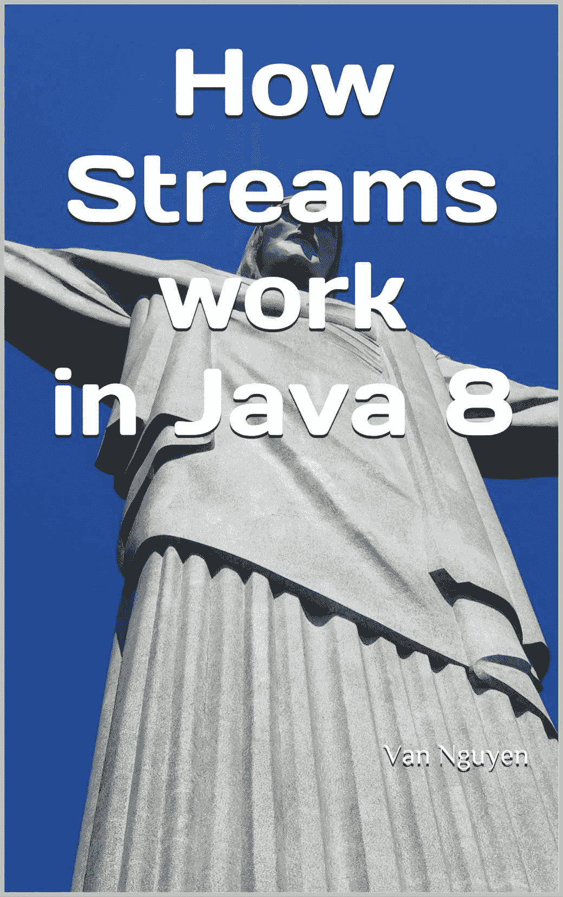

# Java 8 流工作原理



## Java 8 Streams 简介

- Java 8 中的 `Streams` 与 Java 8 之前的 `InputStream` 或 `OutputStream` 完全不同
- Java 8 中的 `Streams` 是 Monad（单子），这是函数式编程语言中的一个概念
- 函数式编程语言中的 Monad 无非就是一种表示为“步骤序列”的计算的结构
- 在函数式编程语言中，具有 monad 结构的类型意味着可以链式操作，或将该类型的函数嵌套在一起
- Java 8 中的 `Stream` 允许你以声明的方式处理数据，并利用多核架构，而无需编写任何特定代码
- Java 8 中的 `Stream` 具有以下 5 个主要特征：
  - 元素序列
  - 数据源
  - 聚合操作
  - 管道化（Pipelining）
  - 自动迭代

## Java 8 中的 Streams 工作原理

- 如果你想完全理解 Java 8 中 `Streams` 的工作原理，你应该熟悉 Lambda 表达式、函数式接口和方法引用
- `Stream` 操作要么是中间操作，要么是终端操作
  - 中间操作：这些操作将返回一个流，因此你可以在不使用分号的情况下链多个中间操作
  - 终端操作：这些操作的结果为 `void` 或者返回一个非流的结果

### 示例代码

```java
List<String> nameList = Arrays.asList("Van", "Nam","Tuan","Tien","Hoang");

nameList.stream()
        .filter(name -> name.startsWith("T"))
        .map(String::toLowerCase)
        .sorted()
        .forEach(System.out::println);
```

**输出**

```
tien
tuan
```

### 注意事项

- 在上述示例中：
  - `filter()`、`map()` 和 `sorted()` 方法是中间操作
  - `forEach()` 方法是终端操作
- 在 Java 8 中，`Stream` 可以从各种数据源（尤其是集合）创建
- Java 8 中的 `List` 和 `Set` 支持新方法，包括：
  - `stream()`：此方法用于创建顺序流
  - `parallelStream()`：此方法用于创建并行流，能够在多个线程上进行操作
- 在 `List` 对象上调用 `stream()` 方法将返回一个普通的流对象，但你不需要为了使用流而创建集合

**示例**

```java
Arrays.asList("Van01", "Van02", "Van03")
        .stream()
        .findFirst()
        .ifPresent(System.out::println);
```

**输出**

```
Van01
```

- 你可以使用 `Stream.of()` 从一组对象引用创建一个流

**示例**

```java
Stream.of("Lan01", "Lan02", "Lan03")
        .findFirst()
        .ifPresent(System.out::println);
```

**输出**

```
Lan01
```

## 如何在 Java 8 中过滤集合

- Java 8 提供了新功能来支持过滤集合中的元素
- 你可以在 Java 8 中通过 `Stream` 类的 `filter()` 方法按照以下步骤过滤 `List`、`Set` 或 `Map` 等集合：
  - 步骤 01：你需要通过调用 `stream()` 方法从集合获取一个 `Stream`
  - 步骤 02：然后你可以使用 `filter()` 方法，该方法仅接受 `Predicate` 作为参数

### 注意事项

- `filter()` 方法不会移除匹配谓词给定条件的元素，而是 `filter()` 方法会在输出流中选择符合条件的元素
- `filter()` 方法定义在 `Stream` 类中。它接收一个 `Predicate` 对象，然后返回一个由原始流中匹配给定 `Predicate` 的元素组成的流
- Java 8 中的 `Streams` 支持 `map()` 方法，该方法接受一个 `function` 作为参数，将流中的元素投影到另一种形式
