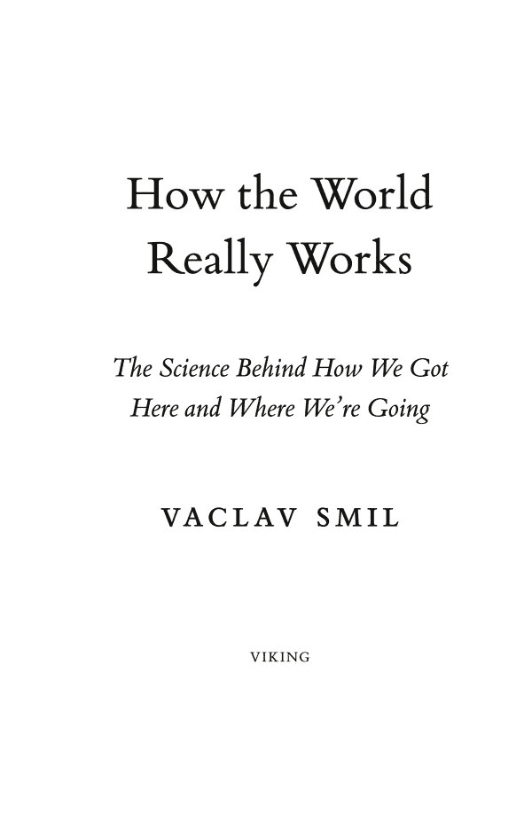

# 世界运行真相：我们从何处来将去往何处的科学之道

## 引言

### 为什么我们需要这本书？

每一个时代都自称独特，虽然过去三代人的经历——即第二次世界大战结束后的几十年——在根本性变革上可能不如第一次世界大战之前的三代人剧烈，但史无未有的事件和进步从未缺少。最令人印象深刻的是，现在比历史上任何时候都有人享有更高的生活水平，而且寿命更长、更健康。然而，这些受益者仍然只是世界人口的少数（仅占五分之一），而世界总人口已接近80亿。

第二个值得赞叹的成就是我们对物理世界和所有生命形式理解的前所未有的扩张。我们的知识从宇宙尺度（星系、恒星）和行星尺度（大气层、水圈、生物圈）复杂系统的宏观概括，延伸到原子和基因水平的过程：最强大的微处理器表面刻蚀的线条仅是人类DNA直径的两倍左右。我们已这种理解转化为不断扩张的机器、设备、程序、协议和干预措施，维持着现代文明；而我们知识总量以及我们将其投入服务的方式，远超任何个人大脑的理解。

你可以在1500年的佛罗伦斯西尼奥利亚广场遇到真正的文艺复兴人——但在那之后没多久。到18世纪中期，两位法国学者丹尼斯·狄德罗（Denis Diderot）和让·勒·封·达朗伯尔（Jean le Rond d’Alembert）仍能聚集一群知识渊的贡献者，在他们的多卷本《百科全书：科学、艺术和工艺的理性字典》中对那个时代的理解进行相当详尽的总结。几代人后，我们知识的范围和专业程度提高了数量级，基础发现涵盖了从磁感应（1831年迈克尔·法拉第，发电的基础）到植物代谢（尤斯图斯·冯·李比，1840年，作物施肥的基础），再到电磁学理论（詹姆斯·克拉克·麦克斯韦，1861年，所有无线通信的基础）。

1872年，在《百科全书》最后一卷出现一个世纪后，任何知识汇编都不得不对快速扩张的主题进行浅表处理；而在一个半世纪后，即使在狭窄的专业领域内也不可能总结我们的理解：“物理学”或“生物学”之类的术语是相当没有意义的标签，粒子物理专家会发现很难理解病毒免疫学新研究论文的第一页。显然，这种知识的原子化并没有让任何公共决策变得更容易。现代科学的高度专业化分支已变得如此奥秘，以至于许多在这些领域的人被迫训练到三十左右才能加入这个新的祭司阶。

他们可能共度漫长的学徒期，但往往无法对最佳行动达成共识。SARS-CoV-2疫情清楚表明，专家之间的分歧甚至可能延伸到佩戴口罩这种看似简单的决策。到2020年3月底（疫情三个月后），世界卫生组织仍然建议不要佩戴口罩，除非已感染，而这一转折直到2020年6月初才发生。对于那些没有任何特殊知识的人，如何能站队或理解这些现在经常以撤回或取消此前主张告终的争议？

尽管如此，这种持续的不确定性和争议并不能成为大多数对现代世界基本运作误解的理由。毕竟，欣赏小麦是如何生长的（第2章）或钢铁是如何制造的（第3章），或者意识到全球化既不是新的不可避免的（第4章），并不等同于要求人们理解飞秒化学（$10^{-15}$秒级的化学反应，阿哈迈德·泽韦尔，1999年诺贝尔奖）或聚合酶链反应（DNA的快速复制，卡里·穆利斯，1993年诺贝尔奖）。那么，为什么现代社会的大多数人对世界运作方式的知识如此浅薄？

肉类是如何产生的。他们收割小麦——但他们也收割大豆或扁豆吗？一只小猪变成一块猪排需要多长时间？几周还是几年？绝大多数美国人对此一无所知——而且像他们的人并不少。是中国是最大的钢铁生产国——每年冶炼、铸造和轧制近十亿吨钢铁——但所有这些都是由中国14亿人口中不足0.25%的人们完成的。只有极少数比例的中国人曾距离接触高炉，或者看到带有红色热能移动钢材丝带的连续铸造机。这种脱节现象在全世界范围内都是普遍的。

人们对这些提供能量（作为食物或燃料）和耐用材料（无论是金属、非金属矿物还是混凝土）的基础过程理解匮乏且日益下降的另一个主要原因是，它们被认为是过时的——如果不是已经落后——而且与信息、数据和图像的世界相比，显得索然无味。俗所说的顶尖人才并没有投身于土壤科学，也没有尝试制造更好的水泥；相反，他们被处理脱离实体的信息所吸引，而这些信息现在只是无数微型设备中的电子流。从律师、经济学家到代码编写者和资金经理，他们获得不成比例的高额回报是为了从事与地球物质现实完全无关的工作。

此外，许多这些数据崇拜者已经开始相信，这些电子流将使那些古老的物质需求变得不再必要。农田将取代城市高层农业取代，合成产品最终将消除对生长任何食物的需求。由人工智能驱动的“去物质化”将结束我们对成型金属块和加工矿物的依赖，最终我们甚至可能不需要地球环境：如果我们对火星进行地球化，谁还需要它呢？当然，这些不仅是过早的预测，它们还是在一个社会中滋生的幻想，在这个社会里，假新闻已成常态，现实与虚构已融合到这种程度，以至于容易受骗、易受教派式愿景影响的头脑竟然相信那些过去更敏锐的观察者会无情视为边缘化或赤裸裸的幻觉的内容。

读这本书的人中没有一个人会搬到火星；我们所有人将继续吃在广阔农田土壤上生长的主食作物，而不是在所谓“城市农业”支持者所想象的摩天大楼里；我们没有一个人会生活在一个去物质化的世界里，那里对水分蒸发或植物授粉等不可替代的自然服务毫无用。但提供这些生存必需将是一项日益具有挑战性的任务，因为人类很大一部分生活在富裕少数人几代人以前留下的条件下，而且对能源和材料日益增长的需求对生物圈造成了如此巨大且快速的压力，以至于我们危及使其流动和储存保持在其长期功能兼容的边界内的能力。

仅举一个关键对比来看：2020年，全球约40%人口（31亿人，包括撒哈拉以南非洲的几乎所有人）的人均年能源供应量，甚至高于德国和法国在1860年达到的水平！为了接近尊严的生活标准门槛，这31亿人至少需要增加一倍——最好是三倍——的人均能源消耗，并在此过程中增加他们的电力供应，提高粮食产量，并建设基本的城市、工业和交通基础设施。不可避免的是，这些需求将使生物圈遭受进一步的退化。

我们该如何应对不断变化的气候变化？现在有一个广泛的共识，认为我们需要做*某些事情*来防止许多非常令人不悦的后果，但什么样的行动、什么样的行为转变效果最好？对于那些忽视我们世界的能量和物质紧迫性的人，对于那些宁愿固守“绿色解决方案”的口号而不理解我们是如何落到这一步地的人来说，处方是简单的：只需脱碳——从燃烧化石碳转向转化不可耗尽的再生能源流。而真正的阻碍是：我们是一个化石燃料驱动的文明，我们的技术和科学进步、生活质量和繁荣都建立在大量化石碳的燃烧之上，我们无法在几十年内就离开这个决定我们命运的关键因素，更不用说几年了。

到2050年实现全球经济的完全脱碳，现在只有以无法想象的全球经济倒退为代价，或者作为依赖近乎奇迹的技术进步的极快速转型的结果。但当我们仍然缺乏任何有说服力的、务实的、负担得起的全球战略和技术手段来追求后者时，谁会心甘情愿地去实现前者呢？实际上会发生什么？愿景与现实之间的差距是巨大的，但在民主社会中，如果各方不分享至少关于真实世界的相关信息，任何思想和建议的竞争都无法以理性的方式进行，而只会搬出自己的偏见，并提出与物理可能性脱节的断言。

• • •

这本书试图减少理解上的短缺，解释一些主宰我们生存和繁荣的最基础的现实。我的目标不是预测，既不是勾勒未来令人惊叹或沮丧的图景。没有必要扩展这种流行的——但一直失败的类型：从长远来看，有太多意外之外的发展和复杂的互动是个人或集体努力无法预测的。我既不是悲观者也不是乐观者；我是一个试图解释世界真实运作方式的科学家，我将利用这种理解让我们更好地意识到未来的局限与机遇。

社会，而且在低收入国家，这些水平远低于任何可以想象的饱和水平；在这些国家，对于数十亿人来说，拥有装修良好的公寓、厨房电器和空调（更不用说汽车了）仍然是一个梦想。

第四章是关于全球化的故事，或者说是世界如何通过交通和通信变得如此紧密相连。这一历史视角展示了这一过程的起源是多么久远（事实上它们是极其古老的），以及其最高——并最终达到全球性的程度是多久以前的事。仔细观察就会发现，对于这种感知极其复杂（备受赞誉、备受质疑且备受批评）的现象，其未来的走向没有任何必然性。近期，全球范围内出现了一些明显的退缩现象以及民族主义的普遍趋势，但尚不清楚这些趋势将持续多久，或者在经济、安全和政治因素的共同作用下这些变化将在何种程度上得到修正。

第五章为判断我们所面临的风险提供了一个现实的框架：现代社会已成功消除或减少了许多以前致命风险——但许多危险将永远与我们相伴，而我们反复未能做出恰当评估，要么低估，要么夸大危险。读完本章后，读者将很好地理解许多非自愿和自愿活动的相对风险（从在家摔倒到跨洲飞行；从居住在飓风多发城市到跳跳伞），并看到一系列帮助我们活得更长的选择。

第六章将首先观察不断发生的变化如何影响我们的必需品：氧气、水和食物。本章的其余部分将关注全球变暖，这一主导近期环境关注的变化导致了一方面一种新的——近乎世界末日的——灾难论的出现，另一方面则是完全的否定。我不会重述这些主张（已经有太多书籍这样做），我将强调的是，与广泛的认知相反，这并不是一个最近发现的现象：我们理解这一过程的基本原理已经超过150年了。

此外，在一个多世纪以前，我们就意识到了大气二氧化碳浓度倍增相关的实际变暖程度，并且在半个多年前，我们就被警告这项行星实验具有前所未有（且不可重复）的性质（二氧化碳的持续准确测量始于1958年）。但我们选择了忽视这些解释和记录在案的事。相反，我们增加了对化石燃料燃烧的依赖，导致了一种无法轻易或廉价切断的依赖。我们能多快改变这种局面尚不清楚。再加上所有其他环境忧虑，你必须得出结论：核心问题——人类能否在我们生物圈的安全范围内实现其愿望？——没有简单的答案。但理解事情的事实是至关重要的。只有这样，我们才能有效解决问题。

在结束篇章中，我将展望未来，特别是关注近期拥抱灾难论的倾向（那些认为在现代文明大幕落下前仅剩几年的观点）和技术乐观主义的倾向（那些预测发明力量将开启地球之外的无限地平，将所有地球挑战变为无关紧要的历史的观点）。意料之中，我对这两种立场都无多用处，我的观点也得不到任何一种教条的青睐。我没有预见到历史会在任何方向上发生迫在眉眼的断裂；我没有看到任何预定的结果，而是一个取决于我们的——这些选择绝非定局——选择的复杂轨迹。

这本书建立在两个基础之上：丰富的科学发现和我半世纪的研究与写作经历。第一个基础涵盖了从19世纪对能量转换和温室效应的开创性阐释等经典贡献，到对全球挑战和风险概率的最新的评估的各项内容。如果没有我在其他书中提炼的几十年跨学科研究，这本影响深远的书将无法完成。我并不倾向于诉狐狸和刺猬的古老比喻（狐狸知道很多事，但刺猬只知道一件大事），我倾向于将现代科学家视为：挖掘越来越深的洞的钻探者（现在是成名的主流路线），或是广阔地平线的扫描者（现在是一群萎缩的群体）。

钻最深的洞并成为从洞底可见的一小片天空的无可比拟的大师从未吸引过我。我总是倾向于在我有限能力允许的范围内尽可能远、尽可能广地扫描。我一生主要感兴趣的领域一直是能量研究，因为对那个巨大领域进行满意的掌握，要求你将对物理、化学、生物、地质和工程的理解，与对历史以及社会、经济和政治因素的关注相结合。

现在超过40本（主要是学术著作）的书中，有近一半涉及能量的各个方面，从对整个历史中通用热学和能量的广泛综述，到对个人燃料类别（石油、天然气、生物质）以及特定属性和过程（功率密度、能量转型）的密切观察。我的其他产出反映了我的跨学科追求：我写过诸如基本现象，如增长——以其所有自然和人为的形式——以及风险；关于全球环境（生物圈、生物地化学循环、全球生态学、光合生产力和收获）、食物和农业、材料（尤其是钢铁和化肥）、技术进步，以及制造业的进展与退缩，还有古罗马历史、现代美国历史以及日本料理。

不可避免的是，这本书——我一生工作的结晶，并为外行读者编写——是我对生物圈、历史以及我们所创造的世界的基本现实进行长期追求的延续。它再次做了我几十年来坚持做的事：它强烈主张背离极端观点。近期（且愈发激进或愈发疯狂）此类立场的拥护者将大失望：这里既找不到对世界在2030年终结的哀悼，也不会发现比我们想象中更早的具有巨大变革力量的人工的痴迷。相反，这本书试图为一种更审慎且必要的不可知视角提供基础。我希望我理性、务实的方法能帮助读者理解世界真实是如何运作的，以及我们后代看到其更好前景的机会有多大。

但在你深入特定主题之前，我有一个警告，也有一个请求。书中充斥着数字（全部采用公制单位），因为现代世界的现实无法仅通过性性描述来理解。书中的许多数字不可避免地非常大或非常小，而这类现实通过数量级（并附带全球通用的单位）来处理是最好的。

如果你对这些事情没有基础，关于“理解大数字和小数字”的附录可以解决这一问题，因此某些读者可能会发现从书的末尾开始阅读是有益的。否则，我们在第一章对能量进行更近距离的定量观察。

## 1. 理解能量

*燃料与电力*

想象一个良善的科幻情景：并非为了前往遥远星球寻找生命，而是地球及其居民成为了一个极其智慧文明的远程监测目标，这个文明向邻近星系派遣了探测器。他们为什么要这么做？仅仅是为了满足系统性理解的满足，也许也是为了在这颗环绕螺旋星系中平凡恒星运行的第三颗行星变成威胁时，避免危险的意外，或者以防他们需要第二个家园。因此，这颗星球定期对地球进行追踪。

让我们想象，一个探测器每100年接近我们的星球一次，它被设定为：只有当检测到某种此前未观察过的能量转换——能量从一种形式变为另一种形式的变化——或依赖于此的新型物理表现时，才会进行第二次通过（更近的检查）。从基础物理学的角度来看，任何过程——无论是雨水、火山喷发、植物生长、动物捕食还是人类智慧的增长——都可以被定义为一系列能量转换。在地球形成后的几亿年里，探测器看到的只是同样的多样但最终又单调的火山喷发、地震和大气风暴的表现。

*根本性的转变*

第一批微生物出现在大约40亿年前，但路而过的探测器并没有记录到它们，因为这些生命形式非常稀少且保持隐藏，与海底的碱性水热喷口相关。第一次近距离观察早在35亿年前就出现了，当时一个路而过的探测器记录了浅海中第一种简单的单细胞光合微生物：它们吸收近红外辐射——即处于可见光谱之外的光线——且不产生氧气[1]。随后是长数亿年的时间，期间没有任何变化的迹象，直到蓝藻开始利用入射的可见太阳辐射能量，将二氧化碳和水转化为新的有机化合物并释放出氧气[2]。

这是一次根本性的转变，将创造地球的含氧大气层，然而在过了很长时间之后，直到12亿年前才看到新的、更复杂的水生生物，那时探测器记录了色彩鲜艳的红藻（由于光合色素藻红蛋白）以及大得多的褐藻的崛起和扩散。绿藻在近5亿年后出现，由于海洋植物的新增殖，探测器配备了更好的传感器来监测海底。这得到了回报，因为在600多亿年前，探测器有了另一个里程碑式的发现：由分化细胞组成的第一生物的存在。这些扁平、柔软的底栖生物（根据其澳大利亚栖息地命名为埃迪拉生物群）是第一批需要氧气进行代谢的简单动物，与仅仅被波浪洋流冲刷的藻类不同，它们是移动的[3]。

接着，探测器开始记录相对来说是快速的变化：它们不再是掠过死寂的大陆并在等待数亿年后才记录下另一个里程碑转变，而是开始记录各种物种出现、扩散和灭绝的波的兴起、顶峰和消退。这一时期始于寒武纪小型海洋底栖生物的爆发（5.41亿年前，最初由三叶虫主导），直到第一批鱼类、两栖动物、陆地植物和四足（因此具有极移动性）动物的到来。周期性的灭绝减少了、有时几乎消灭了这种多样性，即使在600万年前，探测器也没有发现任何生物主宰着地球[4]。不久之后，探测器几乎错过了某次具有巨大能量影响的机械转变的意义：许多四足动物短暂地站立或笨拙地用双腿行走，在400多年前，这种运动方式成为类猿小型生物的常态，它们开始在陆地上花费的时间比在树上更长[5]。

现在，向母星报告重大事件的时间间隔从几亿年缩短到几十万年。最终，这些早期双足动物的后代（我们将其归类为人人族，属于*Homo*属，处于我们祖先的漫长谱系中）做了一些让他们处于通往星球主导地位加速通道的行为。几十万年前，探测器检测到了第一次“体外”能量的使用——即身体之外的能量；即除了消化食物以外的任何能量转换——当这些直立行走者掌握了火，并开始有意识地利用火来烹饪、舒适和安全[6]。这种受控的燃烧将植物的化学能转化为热能和光，使人灵能够食用以前难以消化的食物，在寒冷的夜晚温暖它们，并赶走危险的动物[7]。这是向以前未有的规模上刻意塑造和控制环境的第一步。

这种趋势随着下一个显著变化——作物耕种的采用而加强。大约1万年前，探测器记录了第一批刻意栽培的植物，因为地球总光合作用的一小部分开始被人类控制和操纵，人类驯化——选择、种植、照料和收获——作物以获得他们（延迟的）利益[8]。动物的首次驯化紧随其后。在那发生之前，人类肌肉是唯一的原动力——即化学（食物）能量向动力（机械）能量的转换器。役用动物的驯化始于大约9000年前的牛，这提供了除人类肌肉能量之外的第一种体外能量——它们被用于农田工作、从井中抽水、拉货物以及提供个人交通[9]。晚得以后，出现了第一批原动力：五千多年前的帆；两千多年前的水轮；以及一千多年前的风车[10]。

此后，探测器没有太多可观察的了，因为进入了另一个（相对）减速期：一个一个世纪又一个世纪，只有重复、停滞，或者这些长期建立的转换过程的缓慢增长和扩散。在美洲和澳大利亚（缺乏任何役用动物和简单的原动力），欧洲人到达之前的所有工作都是由肌肉完成的。

但在此时，即使在拥有驯化动物和机械动器的社会中，大部分工作仍由人类完成。我的估算使用了役用动物和人类的近似总量，并基于对体力消耗的现代测量假设典型的工作率，——无论是在公元第二个世纪初，还是500年后（1500年，现代早期的开始），超过90%的有用机械能都是由生物提供的，大致分配在人和动物之间，而所有的热能都来自植物燃料的燃烧（主要是木材和木炭，还有秸草和干粪）。

随后在1600年，外星探测器将采取行动，并发现某种前所未有的现象。不再仅仅依赖木材，一个岛屿社会日益增加煤炭，这种燃料由几十或数百万年前的光合作用产生，并在长期的地下储存期间通过热力和压力石化。最好的重建显示，煤炭作为热源在英国于1620年左右超过了生物燃料的使用（可能更早）；到1650年，化石碳燃烧供应了三分之二的热量；而到1700年，这一比例达到了75%[11]。英国有一个极早的开端：使英国成为19世纪世界经济的所有煤田在1640年之前就已经在产煤了[12]。然后，在18世纪初，一些英国人矿井开始依赖蒸汽机，这是通过燃烧化石燃料驱动的首种非生物原动机。

这些早期的发动机效率极低，因此只能部署在燃料供应充足且不需要任何运输的矿井中[13]。但在几代以来，英国仍然是外星探测器最感兴趣的国家，因为它是一个异常卓越的早期采用者。即使到1800年，几个欧洲国家和

美国的煤炭开采总量也仅是英国产量的一小部分。

到1800年，一次路过的探测将记录到，在全球范围内，植物燃料仍提供了主导双足动物所用所有热和光的98%以上，而人类和动物肌肉仍然提供了农业、建筑和制造业所需全部机械能的90%以上。在英国，詹姆斯·沃特在17世纪70年代引入了改进的蒸汽机，尔顿-沃特公司开始制造平均功率等同于25匹壮马的发动机，但到1800年，他们售出的此类机器不到500台，仅仅微弱了了役马和勤劳劳动者提供的总动力[[14]]。

即使到1850年，欧洲和北美煤炭开采的增加提供的燃料能量也不超过所有燃料能量的7%，近一半的有用动能来自役用动物，约40%来自人类肌肉，仅有15%来自三种非生物原动机：水轮、风车以及缓慢扩散的蒸汽机。1850年的世界更接近1700年甚至1600年的世界，而不是2000年的世界。

但到1900年，化石燃料和可再生燃料以及原动机的全球份额发生了显著变化，因为现代能源（煤炭和某些原油）提供了所有初级能源的一半，而传统燃料（木材、木炭、稻草）提供了另一半。水电站的水轮在1880年代产生了第一批初级电能；随后是地热电，二战后是核能、太阳能和风能（新的可再生能源）。但到2020年，世界上一半以上的电力仍将通过化石燃料的燃烧产生，主要是煤炭和天然气。

到1900年，非生物原动机提供了约一半的全部机械能：煤力蒸汽机贡献最大，其次是设计更好的水轮和新型水轮（首次引入于19世纪30年代），风车和全新的蒸汽轮机（自19世纪80年代后期以来），以及内燃机（汽油燃料，也首次引入于19世纪80年代）[[15]]。

到1950年，化石燃料提供了近四四分之一的初级能源（仍由煤炭主导），非生物原动机——现在以汽油和柴油驱动的内燃机为领先——提供了全部机械能的80%以上。而到2000年，只有低收入国家的穷人才依赖生物质燃料，木材和稻草仅提供世界初级能源的约12%。生物原动机仅占机械能的5%份额，因为人类的体力和役用动物的工作几乎完全被液体燃料机器或电动机所取代。

在过去的两个世纪里，外星探测器将见证了初级能源来源的全球快速替代，伴随着化石能源供应的扩张和多样化，以及新的非生物原动机——首先是煤力蒸汽机，然后是内燃机（活塞和涡轮式）同样快速的引入、采用和产能增长。最近的访问将看到一个真正全球性的社会，它由大规模、定式和移动式的化石碳转化构建并定义，部署在各处，除了地球上的一些无人地区。

## 现代能源利用

这种对体外能量的动员产生了什么影响？全球初级能源供应通常指总产（毛产）产量，但观察实际上可转化为有用形式的能量更具启示性。要做到这一点，我们需要减去消耗前的损耗（煤炭分级和清洁、原油精炼和天然气处理期间）、非能源用途（主要作为化学工业的原料，还作为从泵到飞机涡轮等机器的润滑油，以及铺路材料）以及电力传输过程中的损耗。通过这些调整——为了避免产生不恰准确的印象而进行了大幅舍入——我的计算显示，19世纪化石燃料的使用增加了60倍，20世纪增加了16倍，在过去的220年增加了约1500倍[[16]]。

这种对化石燃料日益的依赖是解释现代文明进步的最重要因素——也是我们对其供应的脆弱性及其燃烧对环境影响的潜在担忧。事实上，能量的增益远高于我刚才提到的1500倍，因为我们必须考虑到平均转换效率的同步提高[[17]]。

1800年，在炉子和锅炉中燃烧煤炭产生热量和热水的效率不高于25–30%，蒸汽机消耗的煤炭仅有2%转化为有用功，导致总转换效率不超过15%。一个世纪后，更好的炉子、锅炉将效率提高到近20%，到2000年达到了50%。因此，20世纪能源增加了40倍；自1800年以来，增加了约3500倍。

新的能源，现代世界是这些能量转换的累积结果。

物理学家最早认识到能量在人类事务中的根本重要性。1886年，热力学创始人之一路德维希·玻尔兹曼（Ludwig Boltzmann）谈到了自由能量——即可用于转换的能量——它是生命的*Kampfobjekt*（斗争目标），而生命最终取决于入射的太阳辐射。[19] 1933年诺贝尔物理学奖得者埃尔·薛定谔（Erwin Schrödinger）总结了生命的本质：“有机体赖以生存的是负熵”（负熵或negentropy = free能量）。[20] 20世纪20年代，在19世纪和20世纪初物理学家这一基础性见解的基础上，美国数学家兼统计学家阿尔弗雷德·洛特卡（Alfred Lotka）得出结论：那些最能捕捉可用能量的生物具有进化优势。[21]

20世纪70年代初，美国生态学家霍华·奥姆（Howard Odum）解释了为什么“一切进步都归于特殊的补贴，而且当这些补贴被移除时，进步就会消失”。[22] 近期，物理学家罗伯特·艾尔斯（Robert Ayres）在其著作中反复强调了能量的核心概念：“经济系统本质上是一个提取、加工并将能量转化为产品和服务的系统”。[23] 简单来说，能量是唯一的通用货币，没有任何事情（从星系旋转到转瞬即逝的生命）可以在没有能量转换的情况下发生。

鉴于这些易于证实的现实，很难理解为什么现代经济学这一对公共政策影响超过任何其他专家的理论和准则在很大程度上忽视了能量。正如艾尔斯指出的，经济学不仅缺乏对能量在生产过程中重要性的系统认识，还假设能量在经济中的份额微小到可以忽略……假设产出仅可以通过劳动和资本产生——假设能量仅仅是一种可以通过劳动和资本（而非提取）的人造形式。[25]

现代经济学家并没有因为关注能量而获得报酬，只有当任何主要形式的能量供应受到威胁且价格飙升时，现代社会才会关注它。Google的Ngram Viewer这一工具可以让你看到1500年至2019年间印刷文献中“能量”一词的流行程度，这说明了这一点：在20世纪，“能量”一词的出现频率一直微不足道，直到70年代初由于OPEC油价翻五倍引发了突然激增，并在80年代达到顶峰。一旦价格下跌，频率随之急剧下降，到2019年，“能量”一词的提及频率并不超过1972年。

如果没有基本的能量知识，无法理解世界是如何运作的。在本章中我将首先解释能量可能难以定义，但将其与功率混淆是一个常见的错误。我们将看到不同形式的能量（及其特定的优缺点）以及不同的能量密度（单位质量或体积储存的能量，对存储和便携至关重要）如何影响不同的经济发展阶段，并将对减少化石依赖的转型所面临的挑战提供现实评估。正如我们将看到的，我们的文明对化石燃料的依赖如此深，以至于转型将比大多数人想象的要得多。

## 什么是能量？

我们如何定义这一基本量？希腊语词源很清楚。亚里士多德在《形而上学》中将*ἐν*（内）与*ἔργον*（工作）相结合，并得出每个物体都由*ἐνέργεια*（能量）维持的结论。[26] 这种理解赋予了所有物体行动、运动和变化的潜力——即转化为其他形式的潜力，无论是通过提升、投掷还是燃烧。

在随后的千年里，这变化很小。最终，艾萨克·牛顿（Isaac Newton，1643–1727）创立了涉及质量、力和动量的基本物理定律，他的第二运动定律使得推导出基本的能量单位成为可能。使用现代科学单位，1焦耳是1牛顿的力——即1公斤质量在1 m/s²的加速度下作用于1米距离所产生的力。[27] 但这个定义仅指动能（机械能），它显然没有提供对能量所有形式的直观性理解。

得益于19世纪对燃烧、热量、辐射和运动的广泛实验，我们对能量的实际理解得到了极大的扩展。[28] 这导致了至今仍是最常见的能量定义：“做功的能力”——只有当“功”一词不仅意味着投入的劳动，而且正如那个时代领先的物理学家所说，是一种“改变的力量”时，这个定义才是有效的。[29]

回答“什么是能量？”这个问题没有更好的方法了，就是参考20世纪最有洞察力的物理学家之一——理查德·费曼（Richard Feynman），他在《物理学讲义》中以直接的方式应对这一挑战。这些是：

- 重力能
- 动能
- 热能
- 弹性能
- 电能
- 化学能
- 辐射能
- 核能
- 质量能

但随后是这个令人措手不及的结论：重要的是，在物理学中，我们对能量是什么并没有图景。它是一个抽象概念，没有告诉我们能量何时以确定的量产生的机制。然而，我们可以使用公式非常准确地计算移动箭矢或巡航喷气机的动能，或者即将从山上滚落的巨大岩石的势能，或者化学反应释放的热能，或是闪烁蜡烛或定向激光的光能——但我们无法将这些能量还原为单一的、易描述的实体。

正如我们看到的，能量以各种形式存在，为了让它对我们有用，我们需要将其一种形式转换为另一种。但将这种多维的抽象物视为一个整体一直是常态，仿佛不同形式的能量可以毫不费力地替代。其中一些替代既相对容易又有益处。将蜡烛（石蜡的化学能转化为辐射能）替换为由蒸汽轮机发电供电的电灯（燃料的化学能首先转化为热，然后转化为电能，接着转化为辐射能）带来了许多显而易见的益处（更安全、更亮、更便宜、更可靠的能量）。将蒸汽和柴油驱动的机车替换为电力驱动实现了更廉价、更清洁、更快速交通：所有流线火车都是电动的。

但许多理想的替代方案仍然昂贵，或者虽然可行但在未来一段时间内无法负担，或者在所需的规模上无法实现——无论它们的推广者如何大声赞扬它们的优点。电动汽车是第一类的常见例子：现在已容易获得，最好的型号非常可靠，但在2020年它们仍然比内燃机驱动的相似车辆贵。在第二类方面，正如我将在下一章中详细介绍的，生产肥料所需的氨合成现在严重依赖天然气作为氢源。氢气可以通过分解水（电解）来产生，但这条路线的成本仍然是近五倍。

这种元素源自丰富且廉价的甲烷——而我们尚未建立大规模的氢工业。而远距离电力驱动的商业飞行（等同于从纽约飞往东京的煤油动力波音787）是最后一类别的卓越例子：正如我们将看到的，这种能量转换在未来很长一段时间内将是不切实际的。

热力学第一定律规定，能量在转换过程中永远不会丢失：无论是消化食物时的化学能转化学；肌肉运动时的化学能转机械；燃烧天然气时的化学能转热能；旋转涡轮时的热能转机械；发电机中的机械能转电；或是光线照亮你阅读的页面时的电能转电磁能。然而，所有的能量转换最终都会导致低温度的的散：能量并没有*丢失*，但它的效用，即执行有用功的能力消失了（热力学第二定律）。([31\]）

所有形式的能量都可以相同的单位进行测量——焦耳是科学单位；卡路里常用于营养研究。在下一章中，当我详细介绍投入现代食品生产的巨额能量补贴时，我们将遇到不同能量质量之间真正的生存现实。生产鸡肉所需的能量总和是食用肉含量的几倍。尽管我们可以从能量数量（输入焦耳/输出焦耳）来计算补贴比例——显然，输入和输出之间存在根本的区别：我们无法消化柴油或电力，而瘦鸡肉是一种几乎完全消化的食物，含有高质量蛋白质，这是一种不可或缺的宏量元素，无法被等量的脂质或碳水化合物能量所取代。

在能量转换方面有很多选择，某些远优于其他。煤油和柴油燃料高能量密度非常适合洲际飞行和航运，但如果你想让你的潜艇在跨越太平洋时保持潜水状态，那么最佳选择是在小型反应器中裂变浓缩铀来发电。([32\]）回到陆地，大型核反应堆是最可靠的发电设备：其中一些反应堆现在90–95%的时间都在发电，相比之下，最好的海上风力发电机约为45%，即使在阳光最充足的气候下，光伏电池也只有25%——而德国的太阳能板发电时间仅约为12%。([33\]）

这是简单的物理学或电气工程，但这些现实如此频繁地被忽视，令人震惊。另一个常见的错误是混淆能量（energy）与功率（power），这种情况发生得更频繁。这暴露了对基础物理的无知，遗憾的是，这种无知并不限于外行使用。能量是一个标量，在物理学中仅通过量级描述的量；体积、质量、密度、时间和速度是其他无处不在的标量。功率衡量单位时间的能量，因此它是一个速率（在物理学中，速率衡量变化，通常按时间计算）。发电的设施通常被称为发电厂——但功率仅仅是能量生产或使用的速率。功率等于能量除以时间：在科学单位中，它是瓦特 = 焦耳/秒。能量等于功率乘以时间：焦耳 = 瓦特 × 秒。如果你在罗马教堂里点燃一根小蜡烛，它可能会燃烧15小时，将蜡的化学能转化为热（热能）和光（电磁能），平均功率接近40瓦。([34\]）

遗憾的是，即使是工程出版物也经常描写“一个产生1,000 MW电力的发电站”，但那是不可能的。发电站可能拥有装机（额定）功率为1,000兆瓦——这意味着它可以以该速率发电——但在这样做时，它每小时会产生1,000兆瓦时或（在基础科学单位中）3.6万亿焦耳（1,000,000,000瓦特 × 3,600秒）。类比，一个成年男人的基础代谢率（完全静止时维持身体基本功能所需的能量）大约是80瓦，或每秒80焦耳；一个70公斤的男子俯卧整天仍然需要大约7兆焦耳（80 × 24 × 3,600）的食物能量，或约1,650千卡，来维持他的体温、为心脏跳提供能量并运行无数酶反应。([35\]）

最近，对能量的贫浅理解导致新绿色世界的支持者天真地要求从可恶、污染且有限的化石燃料瞬时切换到优越、绿色且可再生的太阳能电。但从原油精炼的液体氢化合物（汽油、航空煤油、柴油、燃料重油）具有所有可用燃料中最高的能量密度，因此它们非常适合为所有运输模式提供能量。这里是密度阶梯（所有速率均为千焦耳/吨）：

| 燃料 | 密度 (GJ/ton) |
| :--- | :--- |
| 自然干燥木 | 16 |
| 烟煤（取决于质量） | 24–30 |
| 煤油和柴油燃料 | 约46 |

在体积角度上（所有速率均为千焦耳/立方米），木头的能量密度仅约为10，优质煤为26，煤油为38。天然气（甲烷）仅含有35 MJ/m³——或低于煤油密度的1/1,000。([36\]）

能量密度以及燃料物理特性对运输的影响是显而易见的。蒸汽机驱动的远洋轮不燃烧木柴，因为在其他条件相同的情况下，木柴将占据跨西洋所需体积的2.5倍（至少50%），极大地减少了船只运输货物的能力。天然气动力飞行的密度比煤油低三个数量级，但煤动力无法从油箱到发动机。

液体燃料的优势远超煤炭。与煤炭不同，原油更容易生产（不需要地下矿场）、储存（因为油的密度高得多）以及分布（通过油轮和管道），因此在全球范围内易于获取。([37\]）原油需要精炼将复杂的氢烃分离成燃料——汽油最轻；残余重油最重。

用于汽车、巴士和卡车的汽油驱动（奥托循环）机器；然后是鲁道尔夫·迪塞尔的效率更高的机器，它们由更重、更廉价的馏分（你猜对了，是柴油）驱动，并主要用于船舶、卡车和重型机械（有关更多信息，请参阅第4章全球化）。

这些新型动力的扩散非常缓慢，在第二次世界大战之前，美国和加拿大是仅两个拥有高汽车拥有率的国家。

得益于中东和苏联巨型油田的发现，原油成为了一种全球性燃料，并最终成为世界上最重要的初级能源——当然，这也归功于大型油轮的引入。中东的一些巨型油田最早于20世纪20年代和30年代开始钻探（1926年的伊朗加奇萨拉干和1927年伊拉克的基尔库库，1937年的科威特布尔甘），但大多数油田是在战后发现的，包括1948年的盖瓦尔（世界最大）、1951年的萨菲尼亚和1957年的马尼法，全部位于沙特阿拉伯。苏联最大的发现分别发生于1948年（伏尔加-乌拉尔盆地的罗马什基诺）和1965年（西伯利亚的萨莫特洛尔）。

## 原油的兴起与相对衰退

欧洲和日本的大规模汽车使用，以及其经济从煤炭向原油、随后向天然气的同步转型，直到20世纪50年代才开始；对外贸易和旅游的扩张（包括第一批喷气式飞机）以及用于合成氨和塑料的石化原料的使用也是如此。全球原油开采量在5050年代增加了一倍，到1964年，原油超过煤炭成为世界上最重要的化石燃料，但尽管其产量持续上升，供应依然充足，因此价格在不断下降。在恒定（经通胀调整后的）货币下，1950年的世界油价比1940年低，1960年比1950年低——而1970年比1960年更低。

并不意外的是，需求来自所有部门。从实际角度来看，原油是如此廉价，以至于没有动力去高效使用它：寒冷地区的美国房屋越来越多地使用燃油炉供暖，但建筑时仅采用单层窗且没有足够的墙体隔热；在1933年至1973年间，美国汽车的平均效率实际上下降了；能源密集型行业继续通过低效率的工艺运行。也许最注意的是，美国用更优的氧气炉取代旧平炉炉来炼钢的速度远慢于日本和西欧。

在20世纪60年代后期，美国本已很高的石油需求增长了近25%，全球需求增加了近50%。欧洲需求在1965年至1973年间几乎增加了一一倍，日本的进口量变成了约2.3倍。正如提到的，新油田的发现覆盖了这波需求激增，石油销售价格基本上与1950年相同。然而，这种好景并不会长久。1950年，美国仍生产全球约53%的石油；到1970年，尽管美国仍是最大的生产国，但其份额已下降到23%以下——显然该国需要增加进口——而石油出口国组织（OPEC）的产量占48%。

OPEC于1960年在巴格达由仅五个国家建立，旨在防止价格进一步下降，它拥有时间优势：在20世纪60年代，它的规模不足以发挥影响力，但到1970年，它的产量份额加上美国开采量的萎缩（美国在1970年达到顶），使得人们无法忽视它的要求。1972年4月，德克萨斯州铁路委员会取消了对该州产量的限制，因此放弃了自20世纪30年代以来一直掌握的价格控制权。1971年，阿尔及利亚和利比亚开始将其石油生产国有化，伊拉克于1972年随其后，同年科威特、卡塔尔和沙特阿拉伯开始逐步接管其油田——在此之前，这些油田一直在外国公司手中。随后在1973年4月，美国结束了对原油进口的限制。突然之间，这变成了卖方市场。1973年10月，OPEC将其标价上调了16%至每桶3.01美元，随后海湾国家又上调了17%，并在1973年10月以色列击败埃及后，对所有出口美国的石油实施禁运。1974年1月，海湾国家将标价提高到每桶5.65美元，完成了这种能源成本在一年内4.5倍的增长——这结束了由廉价石油驱动的快速扩张时代。从1950年到1973年，欧洲的产量几乎增加了三倍，而美国的GDP在这一代人中增长了一倍多。1973年至1975年间，全球经济增长率下降了约90%，随着受高油价影响的经济体开始适应这些新现实——尤其是通过工业效率的惊人提高——伊朗君主制和神权国家的倒台导致了第二波油价上涨，价格从1979年的约30美元飙到1981年的34美元。

磨碎或压榨油籽需要风车和木制齿轮将运动传递到磨石上。

相比之下，电力是无形的，我们无法像对燃料那样对其产生直观的感受。但它的影响可以在静电、火花、闪电中看到；小电流可以被感知，而超过100毫安的电流可能是致命的。电力的常见定义并非直觉上易理解，它们需要预先了解“电子”、“流动”、“电荷”和“电流”等功能性术语。尽管费曼在他巨著《物理学讲义》（*Lectures on Physics*）第一卷中相当相当草率——“有电能，它与电荷的推拉有关”——但当他在第二卷中详细讨论机械能、电能以及恒流时，他是通过运用微积分来实现的.^(\[50\])

对于大多数居民来说，现代世界充满了“黑箱”，这些设备的内部工作原理对用户来说在不同程度上仍然是一个谜团。电力可以被视为一个无处不在且终极的黑箱系统：尽管许多人对输入的内容（大型热电厂的化石燃料燃烧；水电站的落水；光伏电池吸收的太阳辐射；反应堆中铀的分解）相当了解，并且每个人从输出中受益（光、热、运动），但只有少数人完全理解发电厂、变压器、输电线路和终端设备内部发生了什么。

闪电是电力最常见的自然演示，它太强大、持续太短（仅几分之一秒），且破坏性太强，以至于（？）无法被用于生产性用途。虽然任何人都可以通过摩擦合适的材料产生微量静电，或使用小型电池在无需充电的情况下为手电筒和便携电子设备提供数小时的轻负载照明，但为大规模商业用电发电是一项昂贵且复杂的工程。电力从产生地到使用最大的地点和地区（如城市、工业和电气化的快速交通工具）的分配同样复杂：它需要变压器和广泛的高压输电线网，并在进一步变换后，通过低压架空线或地下电缆分配给数十亿消费者。

即使在这个高科技电子奇迹的时代，仍然无法以廉的价格存储足够的电力来满足一个中型城市（50 万人口）一至两周的需求，或为一座大城市（超过 1000 万人口）供应半天的电力。[51] 但尽管有这些复杂性、高成本和技术挑战，我们一直在努力实现现代经济的电气，这种对更高电气化的追求将持续下去，因为这种能量形式结合许多无比拟的优势。最明显的是，在最终消费点，电力的使用总是毫不费力且清洁的，而且大多数时候它也极其高效。只需拨动开关、按下按钮或调整恒温器（现在通常只需要手势或语音命令），电灯、电机或电加热器和制冷器就会开启——没有笨重的燃料储存，不需要费费力地搬运和投料，没有不完全燃烧的危险（产生有毒的一氧化碳），也不需要清洁灯具、炉子或锅炉。

电力是照明的最佳能量形式：在任何规模的私人或公共照明中，它都没有竞争对手，很少有创新能像消除日光限制和点亮黑夜那样对现代文明产生如此的影响。[52] 之前所有的替代方案，从古代的蜡烛、油灯到早期的工业气灯和煤油罐，都是微弱、昂贵且低效的。光源最能说明问题的比较是它们的光效——即产生视觉信号的能力，测量为总光通量（光源输出能量总量，单位为流明）与光源功率（单位为瓦特）的比值。将蜡烛的光效设定为 1 时，早期工业城市的煤气灯产生的光是其 5-10 倍；第一次世界大战之前，钨丝灯泡发出的光高达 60 倍；今天最好的荧光灯产生的光大约是 500 倍；而钠灯（用于户外照明）的效率高达 1,000 倍。[53]

无法判断哪一类电力转换器的影响更大——灯光还是电机。电动机将电能转化为动能首先彻底了工业生产的几乎每一个部门，后来渗透到每个家庭的角落。那些要求较低的手工任务以及那些利用蒸汽机进行起升、挤压、切割、织造和其他工业操作的任务已几乎完全实现了电气化。在美国，这在第一台交流电电机引入后的四十年内就完成了。[54] 到 1930 年，电驱动使美国制造业的生产力几乎增加了一倍，并在 20 世纪 60 年代后期再次翻倍。[55] 与此同时，电机开始逐渐征服轨道运输，从有电电车开始，然后是客运。

服务业现在主导着所有现代经济，其运行完全依赖电力。电机驱动电梯和扶梯、为建筑调节空调、开启门和压缩垃圾。它们对于电子商务也是不可或缺的，因为它们驱动着大型仓库中迷宫般的传送带。但最无处不在的单元是每天依赖它们的人从未看到的。它们是激活手机振动器的微型单元：最小的小于 4 mm × 3 mm，其宽度小于成年人平均指甲宽的一半。你只有通过拆解手机或在网上观看该操作的视频才能看到它。[56] 在某些国家，几乎所有的轨道运输现在已实现电气化，所有高铁（速度高达 300 km/h）都由电力机或安装在多个地点的电机驱动，例如日本 1964 年启动的先驱新干线。[57] 即使是基础款汽车现在也有 20 到 40 个小型电机，昂贵的汽车中更多——这增加了车辆重量并增加了对电池的消耗。[58] 在家庭中，除了照明和为所有电子设备（现在通常包括安全系统）供电外，电力主导了机械任务，并为厨房提供热能和制冷，以及许多房屋的供热。[59]

如果没有电力，所有城市的饮用水——以及各处的液体和气态化石燃料——将无法获得。强大的电泵将水引入市政供应系统，在商业和住宅密度高的城市，它们承担着特别艰巨的任务，因为水必须提升到很高的高度。[60] 电机驱动所有将汽油、煤油和柴油输送到油箱和机翼所需的燃料泵。虽然分配管道中可能有大量的天然气——燃气轮轮通常用于移动燃料——但在强制空气供暖主导的北美，小型电机驱动风扇，将通过天然气加热的空气推过风道。[61]

社会电气化的长期趋势（转化为电力而非直接消耗的燃料份额上升）是显而易见的。新的可再生能源——太阳能和风能（与起源追溯到 1882 年的水电相比）——将轻松地融入这一进程，但发电的历史提醒着我们，这一过程伴随着许多复杂性和错综性；尽管其重要性深远且日益增加，电力仍占最终能量消耗的一小部分，仅为 18%。

## 在你拨动开关之前

我们需要回到行业的初端，以欣赏它的基础、基础设施以及这 140 年发展的遗产。商业发电始于 1882 年，并有三个“首创”。其中两个是由托马斯·爱迪森设计的先驱燃煤发电厂（伦敦的霍本高桥站于 1882 年 1 月开始运行；纽约珍珠街站于 1882 年 9 月开始），第三个是第一座水电站（位于威斯康星州阿普顿福克斯河，自 1882 年 9 月起发电）。发电在 19 世纪 90 年代开始快速扩张，当时交流电取代了现有的直流网络，交流电电机的新设计开始被工业和家庭采用。

在 1900 年，全球化石燃料产量的不到 2% 被用于发电；到 1950 年，这一比例仍低于 10%；而目前已占约 25%。[63]

水电机容量的同步扩张在 20 世纪 30 年代期间加速，美国和苏联开展了大型国家资助项目，并在第二次世界大战后达到新高，最终在巴西（伊泰普水电站，2007 年完工，容量 14 吉瓦）和中国（三峡水电站，2012 年完工，容量 22.5 吉瓦）建设了创纪录规模的项目。[64] 同时，核裂变于 1956 年在英国的卡尔德霍尔开始商业化发电，在 20 世纪 80 年代经历了最大的扩张，在 2006 年达到顶峰，此后略微下降至全球发电量的约 10%。[65] 2020 年，水电发电占比近 16%；风能和太阳能增加了近 7%；其余部分（约三分之二）来自主要以煤炭和天然气为燃料的大型中央电站。

意不意外的是，电力的需求增长速度远快于所有其他商业能源的需求：在 1970 年至 2020 年的 50 年间，全球发电量增加了五倍，而总初级能源需求仅增长了三倍。[66] 随着越来越多的人口移向城市，基荷发电（即每天、每月或每年必须供应的最小电量）的增长进一步增加。几十年前，美国的需求在夏季之夜处于最低，因为那时商店和工厂关门，公共交通停运，除了极少数人口外，所有人都在睡觉，且开着窗户。现在，窗户关上了，空调彻夜嗡嗡作，以便在炎热潮湿的天气中能够睡眠；在大型城市和巨型城市中，许多工厂实行两班制，许多商店和机场保持 24 小时营业。唯有新冠肺炎停止了纽约地铁的 24/7 运行，而东京地铁的“睡眠”时间仅为五小时（从东京站发往新宿的第一班车在早晨 5:16 出发，最后一班车在凌晨 0:20 出发）。[67] 在不同年份拍摄的卫星夜景图显示，街道、停车场和建筑灯光在不断广阔的区域内变得越来越明亮，这些区域通常与附近的城市汇合，形成巨大的灯光聚集区。[68]

电力供应的极高可靠性——电网管理者谈到达到“六九”可靠性的理想状态：99.9999% 的可靠性意味着一年内供应中断仅有 32 秒！——对于电力驱动从灯光（无论是医院内、跑道旁还是应急出口指示）到心肺机以及无数工业流程的社会来说，这是至关重要的。[69] 如果新冠肺炎疫情带来了混乱、痛苦和不可避免的死亡，那么与任何人口密集地区电力供应严重减少几天相比，这些影响将是微道的；如果全国范围内持续数周，这将是一场具有前所未有后果的灾难性事件。[70]

## 脱碳：速度与规模

地壳中的化石燃料资源并不匮乏，煤炭和碳氢也没有即将耗尽的危险：按照 2020 年的生产水平，煤炭储量可持续维持 120 年，石油和天然气储量可持续约 50 年，持续的勘探将更多资源从“资源”类别转移到“储备”类别（在技术和经济上均可行）。对化石燃料的依赖创造了现代世界，但对全球变暖速度较快的担忧导致了人们广泛呼吁尽快消除化石碳。理想情况下，全球能源供应的脱碳进程应该足够快，将全球平均变暖限制在 1.5°C 以内（最差为 2°C）。根据大多数气候模型，这意味着到 2050 年将全球净二氧化碳排放减至零，并在本世纪剩余时间内保持负排放。

请注意这个关键的限定形容词：目标并非完全脱碳，而是“净零”或碳中和。这一定义允许持续的排放通过目前尚不存在的、从大气中大规模移除二氧化碳并进行永久地下封存来补偿，或者通过大规模植树等临时措施来补偿。[71] 到 2020 年，为以 5 或 0 结尾的年份设定净零目标已成为一种“跟风游戏”：超过 100 个国家加入了行列，从 2030 年的挪威和 2035 年的芬兰，到整个欧盟，以及加拿大、日本和南非（2050 年），以及中国（全球最大的化石燃料消耗者，2060 年）。[72] 鉴于 2019 年化石燃料燃烧产生的二氧化碳年排放超过 370 亿吨，2050 年的净零目标将要求一场在速度和规模上都是前所未有的能源转型。仔细观察可以发现挑战的规模。

电力供应的脱碳可以进展最快，因为太阳能或风能容量的单位成本现在可以与最廉价的化石燃料发电竞争，规模很大。在大型经济体中，德国是一个显著的例子：自 2000 年以来，其风能和太阳能装机容量增加了 10 倍，并将可再生能源比例提高到 40%。风能和太阳能的间歇性只要可再生能源供应满足大部分需求，缺口就可以通过进口来弥补。作为结果，许多国家现在 15% 的电力来自间歇性能源，无需任何重大调整，而丹麦展示了规模较小且互联良好的市场如何达到更高水平。[73] 2019 年，其 45% 的电力来自风能，而这种极高比例在不需要大规模国内储备容量的情况下是可以持续的：由于其需求是丹麦总量的 20 倍，德国必须维持在可再生能源闲置时可激活的储备容量。[74] 2019 年，德国发电量为 577 太瓦，比 2000 年仅增加了 5%（从 121 吉瓦增加到 209 吉瓦）。这种差异的原因显而易见。

在 2020 年，在“能源转型”（`Energiewende`）开始二十年后，尽管德国刻意加速能源转型，仍需保留大部分化石燃料机组（实际上占 89%）以满足阴天和无风日的需求。毕竟，在阴暗的德国，光伏发电平均工作时间仅为 11-12%，且 2020 年化石燃料燃烧仍占总发电量的近一半（48%）。此外，随着其风能发电比例的增加，将电力从风丰富的北部输往南方需求地区的新高压线路建设已经落后。在美国，由于需要更大的输电项目来将大平原的风电和西南部的太阳能输送到高需求沿海地区，但建立这些连接的长期计划几乎没有实现。[75]

尽管此类安排充满挑战，但它们依赖于技术成熟（且仍在改进）的解决方案——即更高效的光伏电池、大型陆上和海上风力涡轮机以及高压（包括远距离直流）输电。如果成本、审批程序和“邻避效应”情绪不是障碍，这些技术可以相当快速且经济地部署。此外，太阳能和风能发电的间歇性问题可以通过重新依赖核发电来解决。如果我们不能开发出更好的电力存储方法，核能复兴将特别有帮助。

大城市和巨型城市需要巨大的（吉瓦时级）存储，但到目前为止，服务的唯一可行方案是抽水电（PHS）：它利用廉价的夜间电力将水从低水位水库抽到高水位水库，其放电可提供即时发电。[76] 使用可再生能源电力，可以在过剩太阳能或风能容量可用时进行抽水，但显然抽水只能在具有合适落差的地方运行，且运行消耗了约四分之一的电力为上坡抽水提供电力。其他的储能方式，如电池、压缩空气和超级电容器，其容量与大城市的需求相比低几个数量级，即使是满足一天的储能需求也是如此。[77]

相比之下，现代核反应堆如果建造得当且运行精细，就能提供安全、持久且高度可靠的发电方式；正如前所述，它们的运行时间可以超过 90% 的时间，且寿命可以超过 40 年。尽管如此，核能发电的未来仍然存在不确定性。只有中国、印度和韩国致力于进一步扩大其产能。在西方，高昂的资本成本、重大的工程延误以及更廉价选择（美国的天然气、欧洲的风能和太阳能）的出现，使得新的核裂变产能失去了吸引力。此外，美国新型的小型、模块化且本质安全的反应堆（最早于 20 世纪 80 年代提出）尚未商业化，而德国决定 2022 年前放弃所有核发电，这只是欧洲广泛共享的深层反核情绪最显而易见的例子（关于真实核发电风险的评估，请参阅第 5 章）。

但这种情况可能不会持续：即使欧盟现在也意识到，如果没有核反应堆，它无法实现其极其雄勃的脱碳目标。其 2050 年净零排放方案搁置了核能行业数十来的停滞和被忽视，并预计高达 20% 的总能源消耗将来自核裂变。[78]

注意，这指的是总一次能源消耗，而不仅仅是电力。电力仅占全球最终能源总消耗的 18%，而对 80% 以上的最终能源用途——通过工业、家庭、商业和交通——进行脱碳，将比发电的脱碳更具挑战性。扩大的发电可以用于空间供暖以及许多目前依赖化石燃料的工业生产，但现代长途运输的脱碳路径尚不明确。

我们多久之后能乘坐由电池驱动的宽体客机进行跨洲飞行？新闻头条向我们保证飞行的未来是电动的——却触人地忽略了涡扇发动机燃烧的煤油能量密度与这些假设性电动飞机上配备的顶级锂离子（Li-ion）电池之间的巨大差距。驱动喷气机的涡扇发动机燃烧的燃料能量密度为每公斤 46 兆焦（约等于每公斤 12,000 瓦时），而今天顶级的锂离子电池提供的能量低于 300 Wh/kg，相差超过 40 倍。[79] 诚然，电动机的能量转换效率大约是燃气轮机的两倍，因此有效密度的差距“仅”为 20 倍左右。但在过去的 30 年里，电池的最大能量密度大致增加了三倍，即使我们将这种密度再增加三倍，到 2050 年仍远低于 3,000 Wh/kg——远无法让宽体客机从纽约飞往东京或从巴黎飞往新加坡，而我们几十年来一直每天使用煤油驱动的波音和空客飞机在往返这些航线。[80]

此外（将在第 3 章中解释），我们还没有易于部署的商业规模替代方案，仅依靠电力为现代文明的四大材料支柱的生产提供动力。这意味着，即使有丰富且可靠的可再生电力供应，我们也必须开发新的大规模工艺来生产钢、氨、水泥和塑料。

意不意外，发电之外的脱碳进展缓慢。德国很快将有一半的电力来自可再生能源，但在“能源转型”（`Energiewende`）的二十年中，化石燃料在该一次能源供应中的占比仅从约 84% 下降到 78%：德国人喜欢不受限的高速公路和频繁的国际飞行，德国工业也依靠天然气和石油维持运转。[81] 如果该国重复过去的记录，那么到 2040 年它对化石燃料的依赖仍将接近 70%。

那些没有投入巨额代价推动可再生能源的国家又是怎样的？日本是一个首要例子：2000 年，约 83% 的一次能源来自化石燃料；到 2019 年，这一比例（由于福岛后核发电的损失和对进口燃料的需求）已达到 90%！[82] 虽然美国大幅减少了对煤炭的依赖——发电中由天然气取代——但 2019 年美国一次能源供应中的化石燃料占比仍为 80%。与此同时，中国的化石燃料占比从 2000 年的 93% 下降到 2019 年的 85%——但这种相对下降伴随着该国化石燃料需求的近三倍增长。中国的经济崛起是 21 世纪前二十年全球化石燃料消耗增长约 45% 的原因，也是尽管对可再生能源进行了广泛且昂贵的扩张，全球化石燃料占比仅略微从 87% 下降到 84% 的原因。[83] 每年化石碳需求现在略高于 100 亿吨——几乎是全球粮食产量的五倍，是全球 80 亿人口年用水量的两倍——显而易见，取代如此规模并非通过以 0 或 5 结尾政府目标来实现。与近期仓促的政治承诺相反，这些现实已得到所有仔细考虑的长期能源方案的认可。国际能源署（IEA）2020 年发布的《政策政策方案》预计化石燃料占比从 2019 年的 80% 下降到 2040 年的 72%，而 IEA 的《可持续发展方案》（其迄为止最激进的脱碳方案，允许大幅加速全球脱碳）预计到 2040 年化石燃料将提供全球能源需求的 56%，这种高比例极不可能。[84]

无疑，富裕世界——考虑到其财富、技术能力、高人均消费以及随之产生的浪费——可以采取一些令人印象且相对快速的脱碳措施（直言，它们应该减少任何形式的能源）。但对于其他 50 亿能源消耗仅为富裕水平一部分的人来说，情况并非如此他们他们更多氨来提高作物产量以维持日益增长的人口，需要更多的钢水泥和塑料来建设必要的基础设施。

## 2. 理解食物生产

### 食用化石燃料

确保充足的食物数量和营养多样性是每个物种生存的必然要求。在漫长的演化过程中，我们人类祖先进化出了关键的身体优势——直立的姿态、双足行走和相对的大脑——这使他们与灵长类祖先区分开来。这些特征的结合使他们成为更出色的食腐者、植物采集者和小型动物的猎人。

早期的人类仅有最简单的石器工具（锤石、削石器），这些工具对于宰杀动物有用，但他们没有用于辅助狩猎和捕获的器物。他们可以轻易杀死受伤或生病的动物以及小型、移动较慢的哺乳动物，但大型猎物的大部分肉源自野外捕食者猎杀后的遗骸。[1] 后来长矛、长柄斧、弓箭、织网、篮子和鱼竿的使用，使得狩猎和捕获各种物种成为可能。某些群体——最著名的旧石器时代晚期的猛犸猎人（这一时代结束于约 12,000 年前）——掌握了宰杀大型野兽的技巧，而许多沿海居民变成了出色的渔民：有些人甚至使用船捕杀迁徙的小型鲸。

从采集（狩猎和采集）到定居生活的转变，在早期农业和多种哺乳类及鸟类物种驯化的支持下，导致了通常更具可预测性但往往仍然不可靠的食物供应。这种供应能够支持比早期群体高得多的人口密度，但这并不意味着平均营养状况更好。在干旱环境中进行采集，一个家庭可能需要超过 100 平方公里的土地才能维持。对于今天的伦敦人来说，那大约是从白金汉宫到狗舍岛的距离；对于纽约人来说，那是一只海鸥从曼哈顿尖端飞到中央公园中部的距离：仅仅为了生存就要跨越大量的土地。

在生产力更丰饶的地区，人口密度可以上升到每 100 公顷 2 至 3 人（等同于约 140 个足球场）。[2] 唯一具有高人口的采集社会是沿海群体（最著名的位于太平洋西北地区），他们可以利用年度鱼类迁徙，并有充足的机会猎捕水生哺乳动物：高蛋白、高脂肪食物的可靠供应使其中一些人转变为大型木制社区房屋中的定居生活，并让他们有闲暇雕刻令人印象深刻的图腾柱。相反，早期农业（即收获新驯化的作物）意味着每公顷耕种地可以养活更多的人。

与可能采集数十种野生物种的采集者不同，早期农业的实践者必须缩小他们种植植物的种类，因为几种主作物（小麦、大麦、水稻、玉米、豆类、土豆）主导了典型的以植物为主的饮食——但这些作物支持的人口密度比采集社会高出两到三个数量级。在古埃及，人口密度从前王朝时期（公元前3150年以前）的耕地每公顷约1.3人，上升到3500年后的每公顷约2.5人，当时该国是罗马帝国的一个省份。[3] 这相当于需要4000平方米的土地才能养活——或者恰好是六个网球场。但这种高生产密度（得益于尼罗河可靠的年度洪水）是一次异常优秀的表现。

随着时间的推移，工业前时期的食物生产率非常缓慢地进一步提高——但每公顷3人的水平直到16世纪才实现，且仅出现在明朝的密集耕作地区；在欧洲，这一数字直到18世纪一直保持在每公顷2人以下。在工业前漫长的历史过程中，食物能力的停滞（或至少增长非常缓慢）意味着直到几代以前，只有一少数营养充足的精英阶层不需要担心没有足够的食物吃。即使在偶尔高于平均水平的丰收年，典型的饮食仍然单调，营养不良和摄入不足是常有的。收成可能会失败，作物经常在战争中被毁——饥荒是常有的现象。因此，没有任何近期的变革（如个人流动性的增加或私人财产范围的扩大）像我们年年生产过剩食物的能力那样具有生存上的根本意义。现在，富裕和中等收入国家的大多数人担心吃什么（以及吃多少）最好能维持或改善健康并延长寿命，而不是担心是否有足够的食物维持生存。

仍有大量的儿童、青少年和成年人经历短缺，特别是在撒哈拉以南非洲国家，但在过去的三个世代中，这一总数已从世界大多数减少到全球人口的10分之一以下。联合国粮农组织（FAO）估计，全球营养不良的人数比例从1950年的约65%下降到1970年的25%，并在2000年达到约15%。持续的改进（尽管由于自然灾害或武装冲突导致的临时国家或地区挫折引起波动）使该比例在2019年下降到8.9%——这意味着食物生产的增加使营养不良率从1950年的每3人2人下降到2019年的每11人一人。[4]

如果考虑到期间人口的大幅增长（从1950年的25亿增长到2019年的77亿），这一令人瞩目的成就更加引人注目。什么解释了这一成就？回答说是因为产量提高是一句老生之谈。说这种增长是品种改良、农业机械化、施肥、灌溉和作物保护共同作用的结果，正确描述了关键投入的变化——但仍然错过了根本性的解释。

产生我们食物的根本能量转换并没有改变：一如既往，无论直接食用植物食物，还是间接食用动物食物，我们都是光合作用的产物——这是生物圈最重要的能量转换，由太阳辐射驱动。改变的是我们作物和动物生产的强度：如果没有不断增加的化石燃料和电力投入，我们无法获得如此丰富的产量，也无法以高度可预测的方式进行。现代食物生产，无论是作物的田间种植还是野生种的捕获，都是两种不同能量的独特混合体。第一种也是最显眼的——太阳。但我们还需要现在不可或缺的化石燃料投入以及人类产生的电力。

当被要求给出化石燃料的常见例子时，欧洲和北美寒冷地区的居民会立即想到用于房屋供暖的天然气。世界各地的人都会指出驱动我们大部分交通的液体燃料燃烧，但现代世界对化石燃料最重要且具有生存意义的依赖，是它们在食物生产中的直接和间接使用。

农业——为人类种植作物、为动物生长饲料——必须由太阳辐射提供能量，特别是可见光谱中的蓝光和红光[5]。叶绿素和类胡萝卜素是植物细胞中的光敏分子，它们吸收这些波长的光并将其驱动光合作用；光合作用是一个多步骤的化学反应序列，它将大气二氧化碳和水以及少量的元素（特别是氮和磷）结合，产生用于粮食、豆类、块茎、油料和糖作物的新植物体。这些收获的一部分被喂养家畜以生产肉类、奶和蛋；额外的动物食物则来自食草的哺乳动物和水生物种，而后者的生长最终取决于浮游植物，即水生光合作用产生的主要植物体[6]。

从大约一万年前定居耕作开始以来，情况一直是如此——但两个世纪前，非太阳形式能量的加入开始影响作物生产，后来也影响了野生海洋物种的捕获。起初这种影响是微不足道的，直到20世纪初的几十年里才变得显著。

为了追溯这一时代性转变的演变，接下来我们将观察过去两个世纪的美国小麦生产情况。然而，我完全可以选择英国或法国的小麦产量，或中国或日本的水稻产量；虽然农业进步在北美、西欧和东亚的耕作地区可能发生在不同时期，但这一基于美国数据的比较序列并没有什么独特之处。

### 三个山谷，相隔两个世纪

我们将从1801年纽约州西部的吉尼西河谷（Genesee Valley）开始。这个新共和国已经存在了26年，然而美国农民种植面包用小麦的方式，不仅与他们祖先在几代前从英国移民到英属北美之前的方式相同，而且这种方式与两千多年前古埃及的做法相比也也没有太大区别。

这一序列始于两头套在木犁上的牛，木犁的切削边缘包着铁板。从前一季作物中留下的种子用手播种，并用条耙覆盖。每公顷播种土地的播种大约需要27小时的人力[7]。

最艰巨的任务还在后面。作物要用镰刀割割收获；割下的秸秆被手工捆扎并扎成束，然后竖立堆放（形成麦垛）晾干。接着将麦束运到谷仓，在硬地上用打谷扇脱粒，稻草被堆起来，谷物经过风扬（与谷壳分离）、测量并装入袋中。每公顷收获作物至少需要120小时的人力。

整个生产序列每公顷需要约150小时的人力以及约70个牛时。产量每公顷仅一吨粮食，其中至少10%必须留作下一年作物的种子。总之，生产一公斤小麦大约需要10分钟的人力，如果用全麦粉，这可以产生1.6公斤（两个面包）。这是一种劳累、缓慢且低产的耕作方式——但它完全是太阳能的，除了太阳辐射外不需要其他能量输入：作物为人类提供食物，为动物提供饲料；树木提供烹饪和取暖的木材；木材还用于制造冶炭以炼铁矿并生产小型金属器具，包括犁片、镰刀、长镰、刀以及覆盖木轮的轮箍。在现代术语中，我们会说这种农业不需要不可再生（化石燃料）能量输入，只需要极少的不可再生材料补贴（铁部件、磨坊石），且作物和材料的生产完全依赖于通过人类动物肌肉的力量所投入的可再生能源。

一个世纪后，在1901年，该大部分小麦来自大平原，因此我们转移到北达科他州东部的红河河谷（Red River Valley）。在过去的两代人中，大平原已经定居，工业化取得了巨大进展——尽管小麦种植仍然依赖役畜，但达科他州大型农场种植的小麦已高度机械化。四匹壮马组成的组合牵拉着多铧犁和耙，使用机械钻机播种，机械收割机割断秸秆并捆成麦束，只有堆垛是手工完成的。麦束被运到堆并用机器脱粒，谷物被送到粮仓。整个序列每公顷所需人力不到22小时，约70个牛时，而产量保持在每公顷1吨的低位[8]。

两个世纪之间，生产一公斤小麦的人力从10分钟减少到了不到2秒。这是一种劳累、缓慢且低产的耕作方式——但它完全是太阳能的，除了太阳辐射外不需要其他能量输入：作物为人类提供食物，为动物提供饲料；树木提供烹饪和取暖的木材；木材还用于制造冶炭以炼铁矿并生产小型金属器具，包括犁片、镰刀、长镰、刀以及覆盖木轮的轮箍。在现代术语中，我们会说这种农业不需要不可再生（化石燃料）能量输入，只需要极少的不可再生材料补贴（铁部件、磨坊石），且作物和材料的生产完全依赖于通过人类动物肌肉的力量所投入的可再生能源。

2021年，堪萨斯州是该国领先产州，因此我们转移到阿肯西河谷。在这个国家的腹地，农场规模现在是一个世纪前的三到四倍——然而大多数田间工作仅由一两个人操作大型机械完成。美国农业部于1961年停止统计役畜，现在的田间工作由强大的拖拉机主——许多型号功率超过400马力，配有八个巨大的轮胎——牵引着宽大的器具，如钢犁（有十二个或更多铧）、播种机和施肥器[9]。种子来自认证种植者，幼苗获得最佳剂量的肥料——最重要的是大量作为氨或尿素应用的氮肥——以及针对昆虫、真菌和竞争杂草的针对性保护。收获和同时脱粒由大型联合收割机完成，将谷物直接传输到卡车上，运往储仓并在全国范围内销售，或运往亚洲或非洲。现在生产小麦每公顷所需人力不到2小时（相比1801年的150小时），以每公顷约3.5吨的产量计算，这转化为每公斤不到2秒[10]。如今许多人赞叹地引用现代计算的性能提升（“如此数据”）或电信的进步（“如此廉价”）——但收获呢？两个世纪内，生产一公斤小麦的人力从10分钟减少到了不到2秒。这才是我们现代世界的真实运作方式。

大多数备受赞誉且无疑卓越的、改变了工业、交通、通信和日常生活的技术进步，如果超过80%的人必须留在农村来生产每日面包（1800年美国人口中农民的比例为83%）或每日米饭（日本1800年接近90%的人住在村庄），将是不可能的。通往现代世界的道路始于廉价的钢犁和无机肥料，需要更仔细的观察来解释这些。

这些让我们认为一个富足文明是理所当然的不可或缺投入。

*投入的内容*

（注：所提供的 OCR 文本从“indispensable inputs...”开始，这似乎是前一页句子的结尾。然而，我已经按照要求处理了第 56-59 页的内容。）

这些让我们认为一个富足文明是理所当然的不可或缺投入。

*投入的内容*

前工业农业依靠人力、动物劳动以及简单的木制和铁工具进行，太阳是唯一的能量来源。今天，一以往，如果没有太阳驱动的光合作用，任何收获都是可能的；但如果没有化石能源的直接和间接注入，就不可能以最小的劳动投入产生如此高产量。这些人为能量输入的一部分来自电力（可以通过煤、天然气或可再生能源发电），但大部分是作为机器燃料和原料提供的液体和气态氢化合物。

机器直接消耗柴油或汽油用于田间作业，包括从井中抽取灌溉水、作物加工和干燥、通过卡车、火车和驳船在国内运输收获，以及通过大型散装船的货舱进行海外出口。制造这些机器的间接能源消耗复杂得多，因为化石燃料和电力不仅用于制造钢、橡胶、塑料、玻璃和电子产品，还用于将这些投入组装成拖拉机、农具、收割机、卡车、粮食干燥机和粮仓。[13]

但制造和动力农机所需的能量，远小于生产农药所需的能量。现代农业需要杀菌剂和杀虫剂来减少作物损失，以及除草剂来防止杂草竞争现有的植物养分和水分。这些都是高能耗产品，但用量相对较小（每公顷仅几公斤）。[14] 相比，提供三种必需植物大量元素——氮、磷、钾的肥料，每单位产品所需的能量较少，但需要大量使用以确保高作物产量。[15]

钾的生产成本最低，因为只需要从地表或地下矿山中提取钾盐（KCl）。磷肥始于开采磷酸盐，然后经过加工产生合成过磷酸化合物。氨是制造所有合成氮肥的起始化合物。每种高产小麦、水稻以及许多蔬菜，每公顷需要的氮超过 100 公斤（有时高达 200 公斤），这些高需求使得合成氮肥成为现代农业中最重要的间接能量投入。[16]

氮之所以需要如此大量的，因为它存在于每一个活细胞中：它存在于叶绿素中（光合作用的动力来源），存在于 DNA 和 RNA 等核酸中（存储和处理所有遗传信息），并存在于氨基酸中（构成组织生长和维持所需的所有蛋白质）。这种元素是丰富的——它占大气的近 80%，生物体浸在其中生存——但它仍然作物产量以及人类生长的关键限制因素。这是生物圈伟大的悖论现实之一，其解释很简单：氮以非反应性分子（N2）的形式存在于大气中，只有少数自然过程能够断裂两个氮原子之间的键，使该元素能够形成反应性化合物。[17]

闪电可以做到：它产生氧化物，氧化物溶解在雨水中形成硝酸盐，然后森林、农田和草场从上方获得肥料——但显然，这种自然投入太小，无法生产供应全球近 80 亿人的作物。闪电在巨大的温度和压力下完成的工作，一种酶（氮酶）在正常条件下就能完成：它由豆科植物（豆类，以及某些树木）根部的相关细菌，或自由生活在土壤或植物中的细菌产生。附着豆科植物根部的细菌负责大多数自然固氮——即断裂非反应性的 N2，并将氮整合进氨（NH3），氨是一种高度活性的化合物，可以很容易转化为可溶性硝酸盐，并作为植物合成有机酸的回报为植物提供氮需求。

结果，豆科食用作物（包括大豆、豆、豌豆、扁豆和花生）能够提供（固结）自己的氮源，苜蓿、三叶草和矢草等豆科覆盖作物也是如此。但没有任何主粮作物、油料作物（大豆花生除外）或块茎植物能做到这一点。它们从豆科固氮能力获益的唯一方法是与苜蓿、三叶草或矢草轮作，种植这些固氮植物几个月，然后将它们翻入地下，使土壤补充反应性氮，以供后续的小麦、水稻或马豆吸收。[18] 在传统农业中，富含土壤氮存的唯一选择是收集和施用人类和动物的废物。但这是一种本质上费力且低效的营养供应方式。这些废物的氮含量极低，并且容易发生挥发性损失（液体转化为气体——粪便散发的氨味可能令人作呕）。

在前工业作物种植中，废物必须在村庄、城镇和城市中收集，在堆或坑中发酵，并因为含氮量而而大量施用到田间，通常为每公顷 10 吨，有时高达 30 吨（后者的相当于 25-30 辆小型欧洲汽车），以提供所需的氮。不意外，这通常是传统农业中最耗时的任务，占了作物种植中所有（人和动物）劳动的至少分之一，高达三分。回收有机废物几乎不是小说作家关注的话题，但埃米尔·左拉（Émile Zola）作为一个完全的写实主义者，在描述对粪肥很有兴趣的巴黎年轻画家克劳时捕捉到了它的重要性。克劳自愿向坑里扔进“市场的杂物、从那张巨大的桌子上落下的垃圾，它们仍然充满活力，回到了蔬菜之前发芽的地方……它们在肥沃的作物中重新生长，并再次在市场广场上。巴黎腐蚀了一切，并将一切归还给土壤，土壤从未对修复死亡的破坏而厌倦。”[19]

但人类劳动的代价有多大！这个阻碍作物高产的氮屏障直到 19 世纪随着智利硝盐（第一种无机氮肥）的开采和出口才被稍微打破。屏障随后随着弗里茨·哈伯（Fritz Haber）在 1909 年发明氨合成法及其快速商业化（氨于 1913 年首次运输）而被彻底打破，但随后的产量缓慢，氮肥的广泛应用一直等到二战后。[20] 20 世纪 60 年代引入的新高产小麦和水稻品种如果没有合成氮肥就无法发挥其全部产量潜力。被称为“绿色革命”的巨大生产力转变如果没有优良作物和高氮肥应用的结合，就不会发生。[21]

鉴于面包种类繁多，我将仅关注几种西方饮食中常见的发酵面包，这些品种现在可以从从西非（法式长棍包的*海外*地区）到日本（每家大型百货商店都有法国或德国的烘焙店）等地方买到。我们必须从小麦说起，幸运的是，有许多研究试图量化所有的燃料和电能投入，并按单位收获面积或每单位产量的对不同类型的谷物作物进行比较。[22] 谷物种植处于能量补贴阶梯的底端，与我们选择的其他食物相比，它所需的能量相对较少，但正如我们将看到的，它仍然需要惊人的巨大能量。

在大大平原广阔的田地上，美国高效生产的雨养小麦每公斤谷物仅需约4兆兆焦耳的能量。由于这种能量中很大一部分是以原油精炼的柴油油形式存在的，因此用等值量而非标准能量单位（焦耳）来比较可能更具实际意义。[23] 此外，用单位食用产品所需的体积（无论是1公斤、一个面包还是一餐饭）来表示柴油需求，会使这种能量补贴更容易想象。

由于柴油每升含有36.9兆兆耳，大平原小麦的典型能量成本几乎正好是每公斤100毫升（1分升或0.1升）柴油——仅略于美国量杯测量值的一半。[24] 我将使用柴油的特定体积等值量来为每种食物标注其生产过程中包含的能量。

基础酸种面包是最简单的一种发酵面包，也是欧洲文明的食粮：它只包含面包面粉、水和盐，而发酵剂当然是由面粉和水制成的。一公斤这种面包大约含有580克面粉、410克水和10克盐。[25] 磨粉——即去除种子的麸皮（外层）——会减少约25%的磨谷物质量（面粉提取率为72–76%）。[26] 这意味着为了获得580克面包面粉，我们必须从约800克全麦开始，其生产需要80毫升的柴油等值量。

生产白面粉所需的磨粉需要约50 mL/kg的等值量，而现代高效企业进行的大规模烘焙（消耗天然气和电）——的公布数据显示，燃料等值量为100–200 mL/kg。[27] 因此，种植谷物、磨粉并烘烤一个1公斤的酸种面包需要至少250毫升柴油的等值能量投入，这个体积略大于美国量杯。对于标准长棍包（250克），嵌入的能量等值量约为2汤匙柴油；对于一个大号的德国*Bauernbrot*（2公斤），则大约需要2杯柴油（全麦面包则更少）。

真实的化石能源成本更高，因为现在只有一小部分面包是在购买地烘烤的。即使在法国，社区级烘焙店（*boulangeries*）也在消失，长棍包由大型烘焙坊配送：工业规模效率带来的节能被增加的运输成本抵消了，总成本（从种植和研磨谷物到在大型烘焙坊烘烤并将面包配送给远处的消费者）的能量消耗可能高达600 mL/kg！

但如果面包典型的（约5:1）食用质量与嵌入能量质量的比例（1公斤面包对比约210克柴油）看起来似乎难以接受，请记住，我已经注意到，谷物——即使在加工和转化后——处于能量补贴的底端。遵循这种误导的饮食方式（避免所有谷物并转而只食用肉类、蔬菜）的后果会怎样？

营养百科赞誉其富含维生素C：事实上，一个大西西红柿（200克）就能提供成人每日所需摄量的三分之二。[36] 但与所有新鲜多汁的水果一样，人们吃它并不是为了它的热量含量；在很大程度上，它只是一个形状吸引人的容器，水占了其质量的95%。剩余部分主要是碳水化合物、少量的蛋白质以及极微量的脂肪。

西红柿可以在任何有至少90天暖和天气的地方生长，包括斯德哥尔摩附近海边木小屋的露台，或加拿大大平原的园林里（这两种情况下都是从室内育苗的植物开始的）。然而，商业化种植则是另一回事。正如现代社会所消耗的果蔬中除极少数品种外一样，西红柿的种植是一项高度专业化的活动，北美和欧洲超市供应的大多数品种仅来自少数地区。在美国，是加利福尼亚州；在欧洲，是意大利和西班牙。为了增加产量、提高质量并降低能源投入强度，西红柿越来越多地在塑料覆盖的单隧道或多隧道围棚或温室中生长——不仅在加拿大和荷兰，还在墨西哥、中国、西班牙和意大利。

这让我们回到了化石燃料和电力。塑料是建造多隧道玻璃温室更廉价的替代品，而且西红柿的种植还需要塑料夹子、楔子和水槽布局。在露地种植的地方，使用塑料薄膜覆盖土壤以减少水分蒸发并防止杂草。塑料化合物的合成依赖于碳化物（原油和天然气），既作为原料，也作为生产它们所需的能量。原料包括乙烷和其他天然气液体，以及原油炼制过程中石脑。天然气也用于支持塑料生产，而且它是（如前所述）合成氨水最重要的原料——氢的来源。其他碳氢化合物作为生产保护性化合物（杀虫剂和杀菌剂）的原料，因为即使玻璃或塑料温室内的植物也无法免受害虫和感染。

将西红柿种植的年度运营成本换算为货币很容易，只需相加幼苗、肥料、农药、水、供暖和劳动力的支出，并对使用寿命超过一年的原始结构和设备（金属支架、塑料盖、玻璃、管道、水槽、加热器）的成本进行分摊即可。但汇总一份全面的能源账单并没有那么简单。直接能源投入根据电费和汽油或柴油购买量很容易量化，但计算材料生产中的间接投入需要一些专门的会计方法，通常还需要一些假设。

详细的研究量化了这些投入，并将其与典型的能源成本相乘：例如，1公斤氮肥的合成、配制和包装需要相当于近1.5升柴油。意不意外的是，这些研究显示出的总数范围很大，但一项研究——可能是对西班牙阿尔梅里亚加热和不加热多隧道温室西红柿种植最详尽的研究——得出结论：净产量的累计能量需求，前者（加热）每公斤超过500毫升柴油（超过两杯），而后者（不加热）仅为每公斤150毫升。[37]

我们之所以获得如此高的能源成本，很大程度上是因为温室西红柿是世界上施肥最严重的作物之一：单位面积内它们获得的氮（以及磷）是美国领先的田间作物玉米生产时所需用量的10倍。[38] 硫、镁和其他微量元素也会使用，以及防止昆虫和真菌的化学品。加热是温室栽培中最重要的直接能源：它延长了生长季节并提高了作物质量，但不可避免的是，在寒冷气候下部署，它变成了最大的能源用户。

位于阿尔梅里亚省南部的塑料温室是世界上最大的农产品商业种植区域：约40,000公顷（想象一下20公里 × 20公里），在卫星图像上很容易识别——你自己在`Google Earth`上查看看吧。

*纠正：提供的第65-66页OCR文本包含大量的重复和乱码段落。我将清理文本以遵循所提供的逻辑叙述逻辑流。*

位于阿尔梅里亚省南部的塑料温室是世界上最大的农产品商业种植区域：约40,000公顷（想象一下20公里 × 20公里），在卫星图像上很容易识别——你自己在`Google Earth`上查看看吧。

将西红柿种植的年度运营成本换算为货币很容易，只需相加幼苗、肥料、农药、水、供暖和劳动力的支出，并对使用寿命超过一年的原始结构和设备（金属支架、塑料盖、玻璃、管道、水槽、加热器）的成本进行分摊即可。但汇总一份全面的能源账单并没有那么简单。直接能源投入根据电费和汽油或柴油购买量很容易量化，但计算材料生产中的间接投入需要一些专门的会计方法，通常还需要一些假设。

（注：提供的第65-67页OCR文本包含许多相同句子的冗余循环。我根据源文件中提供的独特句子重建了连贯的叙述。）

水产养殖的扩张——其全球总产量（包括淡水和海水）目前已接近全球野生捕获量（2018年产量为8200万吨，而野生捕获物种为9600万吨）——缓解了一些被过度捕捞的喜食肉类野生鱼种的压力，但加剧了对较小食草物种的开发，因为日益增长的收获量需要供应不断扩张的水产养殖。[44] 结果，在网箱中养殖地海鲈（希腊和土耳其是主要生产国）的能量成本通常相当于每公斤2至2.5升柴油（这一体积相当于三瓶葡萄酒）——也就是说，这与捕获相似大小野生物种的能量成本处于同一数量级。

正如预期的那样，只有那些食用植物饲料生长良好的水产食草鱼——特别是不同品种的鲤鱼（翘头、白鲤、黑鲤和草鱼最为常见）——能量成本较低，通常低于300 mL/kg。但除了奥地利、捷克、德国和波兰传统的平安夜夜晚餐外，鲤鱼在欧洲并不是一种受欢迎的烹饪选择，在北美几乎无人食用；而由于全球范围内对寿司的快速采用，金枪鱼（其中某些品种已成为最濒危的顶级海洋肉肉动物之一）的需求一直在飙升。

因此，证据是不可否认的：我们的食物供应——无论是主粮粮食、家禽、喜欢的蔬菜，还是因营养价值闻誉的海鲜——都变得越来越依赖化石燃料。这一基本事实通常被那些不试图理解世界真实运作方式、且现在正预测快速去碳化的人所忽视。这些人如果知道我们的现状无法轻易或快速地改变，将会感到震惊：正如我们在前一章中看到的，这种依赖的普遍性和规模太大了，无法实现这一点。

### 燃料与食物

多项研究追踪了食品生产对现代（主要是化石的）能量投入依赖的增长情况，从19世纪初的缺失到近期的水平（从谷物种植中每公顷不到0.25吨原油，到加热温室栽培中用量高出10倍）。[45] 也许意识到这种全球依赖的上升和程度的最佳方法，是将外部能量补贴的增加与耕地面积的扩张以及世界人口的增长进行对比。1900年至2000年间，全球人口增加了不到四倍（确切为3.7倍），而农用地增加了约40%，但我的计算显示，农业中的人为能量补贴增加了90倍，这主要归功于农药以及机械直接消耗的燃料中所嵌入的能量。[46]

我还计算了这种依赖的全球相对负担。现代田间农业（包括所有运输）、渔业和水产养殖的人为能量投入总和仅占近期全球年能源使用的约4%。这可能是一个令人惊讶的小比例，但必须记住，太阳始终在承担生长食物的大部分工作，而外部能量补贴针对的是食品系统中那些通过减少或消除自然限制可以获得最大回报的环节——无论是通过施肥、灌溉、提供针对昆虫、真菌和竞争植物的保护，还是通过及时收获成熟作物。这种低比例也可以被视为另一个“小投入产生不成比例巨大后果”的令人信服例子，这在复杂系统的行为中并不罕见：想想维持几十公斤体重健康每天只需要毫克级（维生素B6或铜）或微克级（维生素D、维生素B12）的维生素和矿物质。

但食品生产所需的能量——田间农业、畜牧业和海鲜——仅是食品相关总燃料和电力需求的一部分，估算整个食品系统的用量会导致其在总供应中的占比要高得多。我们最全的数据来自美国，得益于现代技术的普及和广泛规模效应，食品生产中的直接能源消耗现在是国家总供应量的约1%。[47] 但在加上食品加工和营销、包装、运输、批发和零售服务、家庭食品储存和准备，以及外食食品和营销服务的能量需求后，美国在2007年的总计达到了该国能源供应近16%，现在正接近20%。[48] 驱动这些增长的能源需求的因素包括：从生产的进一步整合（从而导致运输需求增加）以及对食品进口依赖的增加，到更多外食就餐以及在家里消费的更多预制（方便型）食品。[49]

有许多理由说明我们不应该继续现有的许多食品生产模式。农业产生温室气体的主要贡献现在是遵循不同路径最常被引用的理由。但现代作物种植、畜牧业和水产养殖还有许多其他负面的环境影响，从生物多样性的丧失到沿海水域死亡区的形成（更多信息请见第6章），而且维持我们过度的食品生产以及伴随的食物浪费没有任何好的理由。

因此，许多变化显然是理想的，但这些变化实际上发生得有多快？我们能对现状进行多彻底的改革？

### 我们能回去吗？

我们能扭转至少部分趋势吗？即将拥有数十亿人口的世界在不使用合成肥和其他农药的情况下，是否能在保持多种作物和动物产品的同时自给自足？确认上述所有点的数字并不难搜集。本章早些概述的生产美国小麦所需的人力下降，是机械化和农药对该国农业劳动力规模产生整体影响的极佳证明。从1800年至2020年间，我们生产每公斤粮食所需的人力减少了98%以上——我们从事农业的人口比例也以同样的大幅减少了。[50] 这为任何形式的农业机械化退缩和合成化学品使用的减少所必须发生的深刻经济转型提供了有用的指导。

这些基于化石燃料的服务减少得越多，劳动力离开城市以旧方式生产食物的需求就越大。在1920年之前美国马和骡驴数量的高峰时期，该国四分之一的农田用于为超过2500万匹美国工作的马和骡驴种植饲料——而在那时美国农场只需要饲养1.05亿人。显然，通过部署仅2500万匹马来饲养今天超过3.3亿人口是不可能的。如果没有合成肥，依赖于有机物循环的粮食和饲料作物产量将仅是一小部分。我们每天都必须为动物饲食喂水，定期清理粪便，将其发酵然后撒在田里。随着季节性劳动力需求的起伏，男人们会引导由马匹驱动的犁；妇女和孩子会在菜地里播种除草；在收获和宰杀季节，每个人都要参与进来，捆麦束、挖土豆、帮助将新鲜宰杀的猪和鹅变成食物。

如今收成的情况。玉米作为美国最大的作物，在1920年的公顷产量不到2吨，而2020年已达到公顷11吨。[51] 我们需要数百万额外的役畜才能耕种该国几乎所有的可用农地，而且无法找到足够的回收有机物（以及像渴望那样的投喂方式！）或种植足够大面积的绿肥（粮食与三苜草轮作）来匹配现代合成肥料所提供的养分。

这种不可能性通过几组简单的对比可以得到最好的说明。有机物的回收总是令人理想的，因为它能改善土壤结构，增加有机质，并为无数微生物和无脊椎动物提供能量。但有机物的氮含量极低，意味着农民必须施用大量的秸秆或粪便，才能提供足够的必需营养元素来实现高产。谷物秸秆（最丰富的作物残留）的氮含量始终很低，通常为0.3–0.6%；混合了垫料（通常是秸秆）的粪便仅含0.4–0.6%；发酵的人类废物（中国所谓的“夜粪”）仅含1–3%；施在田里的有机肥很少超过4%。

相比之下，尿素作为目前世界上主导的固态氮肥，含氮量46%，硝酸铵含33%，而常用的液体溶液含有28–32%，其氮密度至少比可回收废物高出一个数量级。[52] 这意味着为了给生长作物提供相同数量的养分，农民施用的粪便质量将是其的10到40倍之间——而且现实中需要更多，因为很大比例的氮会由于挥发、溶解在水中或流失到根系以下而流失，来自有机物的氮总损失几乎总是高于合成化合物的损失。此外，对劳动力的需求也成比例增加，因为粪便的搬运、运输和撒播比处理可以轻易用机械撒肥器或（像尿素那样）用手施用的小颗粒要困难得多。而且，无论在回收上投入多少努力，可回收材料的总质量实在太小了，无法提供今日收成所需的氮。

全球活性氮总量显示，有六大主要来源将该元素带到世界农田：

- 大气沉降——主要以含有溶解硝酸盐的雨雪形式存在——每年贡献约2000万吨。
- 回收作物残留（未从田间移除以饲养动物或现场焚烧的秸秆和植物茎）贡献了约3000万吨。
- 施在田里的动物粪便（主要来自牛、猪和鸡）含有近3000万吨。
- 豆科作物（绿色覆盖作物以及大豆、豆和豌豆）引入了类似的总量。
- 灌溉水带来了约500万吨。

每年总计约1050万吨氮。

这意味着近期全球收成中至少有一半归功于氮化合物的施用，如果没有它们，即使为今天80亿人口中的一半提供主流饮食也将是不可能的。虽然我们可以通过少吃肉类和减少食物浪费来减少对合成氨的依赖，但用有机来源替代全球约110万吨合成化合物中的氮输入仅在理论上可行可能的。

多重限制限制了圈养动物产生的粪便的回收。[54] 在传统的混合农作中，来自较少数量的牛、猪和禽类粪便直接在相邻农田上回收。在集中饲养作业中生产肉和蛋减少了这种选择：这些企业产生的废物数量巨大，施在农田上会在其撒肥有利润的半径内使土壤养分过载；重金属和药物残留（来自饲料添加剂）的存在是另一个问题。[55] 类似的限制也适用于现代废物处理厂污泥（生物固体）的扩大。废物中的病原体必须通过发酵和高温灭菌来破坏，但此类处理无法杀死所有抗药细菌，也无法去除所有重金属。

牧畜产生的粪便量是圈养哺乳动物和鸟类的三倍：粮农组织（FAO）估计，它们每年在废物中留下约9000万吨氮——但开发这一巨大来源是不现实的。[56] 可及性会将任何动物尿液和排泄物的收集限制在数亿牧场的一小部分，这些废物是由放牧的牛、羊羊排出的。收集它们的成本与将其运输到处理点再到农地的成本一样高得令人望而却步。此外，在养分到达土地之前，氮损失会进一步降低此类废物原本很低的氮含量。[57]

另一种选择是扩大豆科作物的种植，每年产生5000–6000万吨氮，而不是目前的3000万吨——但机会成本巨大。种植更多苜蓿和三苜草等豆科覆盖作物会增加氮供应，但也会减少一地一年产两种作物的能力，这对于人口仍在增长的低收入国家来说是一个关键的选择。[58] 种植更多豆科粮食（豆、扁豆、豌豆）会降低整体食物能量产量，因为它们的产量远低于谷物作物，显然，这将减少单位耕地能支撑的人数。[59] 此外，大豆作物留下的氮（通常每公顷40–50公斤氮）低于美国典型的氮肥施用量，现在小麦每公顷约为75公斤氮，粮食用玉米每公顷为150公斤氮。

扩大豆科作物轮作的另一个明显缺点是，在每年只能生长一种作物的寒冷气候地区，种植苜蓿或三苜草将排除全年种植食用作物；而在双季作的温暖地区，它会减少食物作物的收获频率。[60] 虽然在人口稀少且土地充足的国家可能是可能的，但它不可避免地会减少所有双季作普遍地区的食物生产能力，包括欧洲大部分地区和中国北平原（该地区生产中国一半的粮食）。双季作现在已应用于中国三分之一以上的耕地，而超过三分之一的稻米来自中国南方的双季作。[61] 因此，如果没有这种需要记录水平氮肥施用的密集耕作，该国将发现无法养活其超过14亿的人口。

即使在以有机回收率高和复杂作物轮作闻名的中国传统耕作中，最密集地区的农民提供的氮也未超过每公顷120–150公斤——而且这样做需要极高的劳动投入，其中（如前所述的那样）粪便的收集和施用是最耗时的。尽管如此，这些农场每公顷只能为10–11个人提供完全是素食的饮食。相比之下，中国产量最高的双季作依赖于平均每公顷超过400公斤氮的合成氮肥施用，它能为20–22人提供食物，其饮食包含约40%的动物蛋白和60%的植物蛋白。[62]

但这些并不意味着我们在食品生产中对化石燃料补贴的依赖发生重大转变是不可能的。显而易见，如果我们减少食物浪费，就可以减少作物和动物产量——以及相关的能源补贴。在许多低收入国家，糟糕的作物储存条件（导致谷物和块茎植物易受啮类、昆虫和真菌侵害）以及缺乏冷藏（加速了乳制品、鱼类和肉类的腐烂）导致食物在到达市场之前就浪费了太多食物。而在富裕国家，食物链更长，每一步都会产生无意食物损失的机会。

尽管如此，有记录可查的全球食物损失一直高得离谱，主要是因为产量与实际需求之间存在不可辩的差异：在大部分久坐的富裕人口中，成年人每日人均需求不超过2000–2100千路里，远低于3200–4000千路里的实际供应量。[63] 根据联合国粮农组织（FAO）的数据，世界损失了近一半的根茎类、水果和蔬菜，约三分之一的鱼类，30%的谷物以及五分之一的油籽、肉类和乳制品——或至少占食品总供应的三分之一。[64] 英国的废物与资源行动计划确定，不可食用的家庭食物垃圾（包括水果蔬菜皮和骨头）仅占总量的30%，这意味着70%的浪费食物是完全可以食用的，但因为腐烂或由于上菜量过多而未被消费。[65] 减少食物浪费似乎比改革复杂的生产过程容易得多，然而这颗谚语中的“触手可得之果”却一直采摘。

消除在整个长而复杂的生产-加工-配送-批发-零售-消费链（从农田和谷仓到餐桌）中发生的浪费是极具挑战性的。美国食品平衡表显示，尽管多年来一直要求改进，但过去40年间全国浪费食物的比例一直保持稳定。[66] 随着中国营养水平的提高，食物浪费也随之增加，中国已从20世纪80年代初盛行的不稳定的食品供应，转变为目前人均平均水平已高于日本的国家。[67]

较高的食品价格应该导致更少的浪费，但这并不是解决低收入国家问题的理想方法——在这些国家，许多弱势家庭的食物获取仍然不稳定，且食品仍占据家庭总支出的很大比例；而在食品相对廉价的富裕国家，这将需要大幅提价，而这一政策没有任何热衷的拥护者。[68]

在富裕社会，减少农业对化石燃料补贴依赖的更好方法是呼吁采用健康且满意的替代方案，取代目前过度丰富且多肉的饮食——最简单的选择是适量食用肉类，并优先选择环境影响较低的肉类。对大规模素食主义的追求注定失败。吃肉在我们进化遗产中的重要性，与我们的大脑（部分因吃肉类而演化）、双足行走和符号语言一样重大。[69] 我们所有的类人祖先都是杂食性的，两种黑黑猩猩（`Pan troglodytes` 和 `Pan paniscus`）也是如此，它们是基因组成上离我们最近的人类；它们通过狩猎（并分享）小猴子、野猪和乌龟来补充植物性饮食。[70]

人口意义上的充分释放人类增长潜力，只有在儿童和青少年期的饮食中含有足够的动物蛋白（首先是牛奶，随后是其他乳制品、鸡蛋和肉类）时才能实现：日本、韩国和中国1950年后由于动物产品摄入增加导致身高增长，是这一事实不容置疑的证明。[71] 相反，大多数成为素食者或纯素食者的人并不会终身保持这种状态。认为全球（而不仅仅是富裕的西方城市）数十亿人类会主观地不吃任何动物产品，或者政府很快会有足够的支持来执行这一规定，是荒谬的。但这些这并不意味着我们不能吃得比过去两代富裕国家平均水平少得多的肉类。[72] 以尸体重量计算，许多高收入国家的年度肉类供应量平均接近甚至超过人均100公斤——但最好的营养建议是，为了获得足够的高质量蛋白，我们每年摄入的肉类不需要超过人体体重的等量。[73]

虽然素食主义是对宝贵生物质的浪费（只有反刍动物——即牛、羊、山——才能消化秸草和茎秆等纤维素植物组织），但高水平的肉食并没有经过证实的营养益处：它确实不会增加寿命，而且是环境压力的来源。在世界上最寿的国家日本，肉类消费量最近一直低于每年30公斤；一个较少被重视的事实是，类似的低消费率在传统肉类摄入大国法国已变得相当普遍。到2013年，近40%的法国人只吃少量肉类。（注：由于原文后续部分存在大量重复和错误，译文已根据逻辑连贯性进行清理。）

进入复杂系统的能量以补贴的形式间接地回馈到网络的所有部分……工业人类不再吃由太阳能制成的土豆；现在，他们吃的土豆部分是由石油制成的。”([81])

五年后，这种生存层面的依赖仍然没有得到充分的重视——但本书的读者现在明白，我们的食物不仅部分是由于石油制成的，还包含了煤炭，这些煤炭用于生产制造田间机械、运输和食品加工机械所需的焦炭；还包含了既作为合成氮肥原料又是燃料的天然气；以及通过燃烧化石燃料产生的电力，这些电力对于作物加工、动物饲养以及食品和饲料的储存与准备是不可或缺的。

现代农业之所以获得更高的产量，并非仅用几十年前所需劳动力的一部分实现的，这并不是因为我们提高了光合作用的效率，而是因为我们通过提供充足的营养和水分、减少竞争相同输入的杂草以及保护作物免受虫害，为作物提供了更好的品种和更好的生长条件。与此同时，我们对野生水生种类的捕捞大幅增加依赖于捕捞范围和强度的扩大，而如果没有提供必要的围养设施和高质量饲料，水殖养业的发展无法发生。

所有这些关键干预都要求大量且不断增加的化石燃料投入；即使我们尝试以现实所想象的最快速度改变全球粮食系统，在未来的几十年里，我们吃下的将是转化的化石燃料，无论是作为面包还是鱼。

## 3. 理解我们的物质世界

### 现代文明的四大支柱

在某些领域，排名是不可能的——或者至少是不明智的。心脏并不比大脑重要；维生素C对人类健康的依赖性并不亚于维生素D。前几章节涵盖的两个生存必需品——食物和能源供应，如果没有对许多人工材料（金属、合金、非金属化合物和合成化合物）进行大规模的动员，将是不可能实现的；对于我们所有的建筑和基础设施，以及所有的交通和通信模式也是如此。当然，如果你通过这些材料所获得的关注（或者说，是未获得的关注）来判断它们重要性，你将不会这一点，因为这种关注不仅来自大众媒体的“新闻”，还来自所谓的更高层次的经济分析或重大进展的预测。

所有这些报道绝大多数都在处理这类无形、无形的现象，例如GDP的年度百分比增长（西方经济学家曾如何为中国的双位数增长率赞叹如加！）、上升的国家债务率（在现代货币理论的世界中并不重要，因为货币供应被认为是无限的）、投入新首次公开募股的巨额资金（用于像游戏类`App`这样对生存至关重要的发明）、前所未有的移动连接带来的益处（将`5G`网络视为近乎第二次降临的期待），或人工智能即将改变我们生活的承诺（大流行有力地证明了此类主张的完全空虚）。

首要任务。我们可以拥有一个卓有成就且相当富裕的文明，提供充足的食物、物质舒适以及教育和医疗服务，而不需要任何半导体、微芯片或个人电脑：我们曾拥有过这种文明，直到 20 世纪 50 年代中期（晶体管的首次商业应用）、70 年代初（英特尔的第一代微处理器）和 80 年代初（PC 的更大规模的首次拥有）。[1] 直到 20 世纪 90 年代，我们仍然成功地整合了经济，动员了必要的投资，建立必要基础设施，并通过宽体喷气飞机连接了世界，而没有任何智能手机、社交媒体和幼稚的应用。但是，如果没有为了保障实现这些电子和电信进步所需的能源和材料，这一切就不可能发生，这些发明被体现在数以万计的耗电组件、设备、组件和系统中，范围从极微的微处理器到巨型数据中心。

硅（`Si`）被制成薄硅片（微芯片的基本基底）是电子时代的标志性材料，但数十亿即使没有它也能生活得很富有；它并不是现代文明的生存限制。生产切割成硅片的大型高纯度（99.999999999% 纯度）硅晶是一个复杂、多步骤且高能耗的过程：其消耗的原生能源比从铝土中提炼铝高两个数量级，比炼铁制钢高出三个数量级。([2]) 但原材料是极其丰富的（硅是地壳中第二常见的元素——接近 28%，而氧气为 49%），而且电子级硅的年产量与其他不可或缺的材料相比非常小，最近约为 10,000 吨硅片。([3]) 当然，一种材料的年消费量不是衡量其不可缺性的最佳指标，但在这种情况下，结论是明确的：尽管 1950 年后的电子进步非常有用且具有变革性，但它们并不构成现代文明不可或缺的物质基础。

虽然无法根据其重要性的主张对我们的物质需求进行无可争议的排序，但我可以提供一个站得住脚的排名，考虑到它们的不可或缺性、普遍性和需求规模。四种材料在这一综合标准上排名最高，它们构成了我所说的现代文明的四大支柱：水泥、钢、塑料和氨。([4])

从物理和化学角度来看，这四种材料因其极其多样化的属性和功能而与不同。尽管属性和特定用途存在这些差异，但它们共有的不仅是对于现代社会运行的不可或缺。它们的需求量比其他基本投入品更大（且仍在增加）。2019 年，全球消耗了约 45 亿吨水泥、18 亿吨钢、3.7 亿吨塑料和 1.5 亿吨氨，而且它们无法被其他材料轻易替代——至少在不久的将来或在全球范围内是如此。([5])

正如第 2 章所述，只有对所有放牧动物排泄的废物进行不可能的完全回收，加上对所有其他氮源的近完美回收，才能提供每年施入作物的氨肥氮量。同时，没有其他材料可以比拟许多塑料所提供的延展性、耐用性和轻便性。同样，即使我们能够产生等质量的建筑木材或采石石，它们也无法比钢筋混凝土的强度、多功能性和耐用性。我们将能够建造金字塔和教堂，但无法建造优雅的长跨拱桥、巨型水坝、多车道公路或长机场跑道。而钢已变得无处不在，其不可替代的部署决定了我们提取能源、生产食物和安置人口的能力，并确保了所有基本基础设施的范围和质量：任何金属都无法在某种程度上成为它的替代品。

天然气。在现代氨的合成中，天然气既是氢的来源，也是加工所需的能量。

结果，这四种不可或缺材料的全球产量占了世界初级能源供应的约17%，并占了化石燃料燃烧产生的所有二氧化碳排放量的25%——目前还没有任何商用且易于部署的大规模替代方案来取代这些既有工艺。[7] 尽管不乏不依赖化石碳生产这些材料的方案和实验技术——从氨合成的新型催化剂到氢基炼钢——但这些替代方案中没有一个实现了商业化，而且即使积极追求非碳方案，显然也需要几十时间才能取代目前以人们负担得起的价格、每年数亿至数十亿吨的速度生产的现有产能。[8]

为了真正理解这些材料的重要性，我将解释它们的基本属性和功能，简要概述使它们变得丰富且廉价的技术进步和具有划时代意义的发明的历史，并描述它们现代用途的广泛性。我将从氨开始——因为对于养全球日益增长的人口，它是不可或缺的——然后按照全球年产量的顺序，介绍塑料、钢钢铁和水泥。

## 氨：养活世界的气体

在上述四种物质中（尽管我不喜欢排名！），氨配得上作为我们最重要材料的首要位置。正如上一章所解释的，如果没有将其作为主要的氮肥（直接使用或作为合成其他含氮化合物的原料），将无法养活今天近80亿人口中至少40%甚至多达50%的人。简单重申：在2020年，如果没有合成氨，近40亿人将无法生存。塑料或钢铁没有类似的生存限制，制造混凝土所需的泥也是如此（正如前文提到的，硅也并无这种程度的限制性）。

氨是一种由一个氮原子和三个氢原子构成的简单无机化合物（`NH3`），这意味着氮占了其质量的82%。[9] 在大气压下，它是一种无色气体，带有特征性的刺鼻味，像未冲洗的厕所或腐烂的动物粪便。吸入低浓度的氨会导致头痛、恶心和呕吐；高浓度会刺激眼睛、鼻子、口部、喉咙和肺部；吸入极高浓度可能导致瞬间死亡。相比之下，氨溶解在水中形成的铵离子（`NH4+`）无毒，且不易渗透细胞膜。

合成这种简单分子的挑战性大得惊。发明史包含了许多著名的偶然发现案例；在材料章节中，特氟龙（`Teflon`）的故事可能是最恰的例子。1938年，杜邦公司的化学家罗伊·普兰特（`Roy Plunkett`）和他的助手杰克·雷博（`Jack Rebok`）将四氟乙烯配制成一种新型冷剂化合物。在冷瓶储存后，他们发现该化合物发生了意外之外的聚合反应，变成了聚四氟乙烯——一种白色、蜡状、光滑的粉末。第二次世界大战后，特氟龙成为最著名的合成材料之一，也许也是唯一进入政治术语的材料（我们有“特氟龙总统”，但似乎没有“胶胶总统”——尽管曾有一位“铁娘娘”）。[10]

从元素合成氨属于另一类发现——那些由一些最顶尖的科学家追求明确目标，并最终由一位坚韧的研究人员达成的发现。这种突破的需求显而易见。在1850年至1900年间，欧洲和北美工业化国家的人口从3亿增长到5亿，快速的城市化推动了饮食结构的转变：从勉强维持的、以谷物为主的供应，转变为含有更多动物产品和糖分的、通常更高的食物能量摄入。[11] 产量保持停滞不前，但这种饮食转变得到了农耕地前所未有的扩张的支持：在1850年至1900年间，约2亿公顷的南北美、俄罗斯和澳大利亚的草场被转变为谷物田。[12]

农业科学的成熟明确了，确保20世纪更多人口获得充足食物的唯一途径，是通过增加氮和磷（两种关键的植物大量元素）的供应来提高产量。磷酸盐的开采（首先在北卡罗来纳州，随后在佛罗里达州）以及用酸处理为可靠的磷肥供应开辟了道路。[13] 但，并没有同样可靠的氮源。干旱热带岛屿上的鸟粪石（鸟类粪便堆积，氮含量中等）很快耗尽了最丰富的矿床，而智利硝酸盐进口的增加（该国干旱的北部地区拥有广泛的硝酸盐层）也不足以满足未来的全球需求。[14]

挑战在于确保人类能够获得足够的氮来维持不断增长的人口。1898年，化学家兼物理学家威廉·克鲁克斯（`William Crookes`）在英国科学促进协会的就职演讲中针对所谓的“小麦问题”发表了演讲，以尽可能清晰的方式解释了这一需求。他警告说，“所有文明国家都面临着食物不足的致命危险”，但他看到了出路：科学来救援，开发大气中几乎无限的氮质量（以不活活性分子`N2`的形式存在），并将其转化为植物可以同化的化合物。他正确地总结道，这一挑战“与其他化学发现有本质区别，后者可以说存在于‘空气’中，但尚未成熟。氮的固定对于文明人类的进步至关重要。其他发现是为了满足我们增加的智力舒适、奢侈或便利；它们的作用是让生活更轻松、加速财富积累，或节省时间、健康或担忧。而氮的固定是一个并不远的问题。”[15]

克鲁克斯的愿景在他演讲后10年实现了。从元素（氮和氢）合成氨曾由许多高水平化学家追求（包括1909年诺贝尔化学奖得主威廉·奥斯特瓦德），但在1908年，弗里茨·哈伯（`Fritz Haber`，当时卡尔斯鲁厄学院物理化学和电化学教授）与助手罗伯·勒·西诺（`Robert Rossinol`）合作，并在德国及全球领先化工企业巴斯夫的支持下成为第一个成功的研究人员。[16] 他的解决方案依赖于使用铁催化剂（一种增加反应速率而不改变自身的化合物）以及采用前所未有的压力。将哈伯的实验成功扩大到商业化企业是一项不小的挑战。在卡尔·博世（`Carl Bosch`，一位精通化学和冶金工程的专家，1899年加入巴斯夫）的领导下，在短短内取得了成功。世界上第一个氨合成厂于1913年9月在奥陶（`Oppau`）开始运行，从此，“哈伯-博世法”这一术语流传至今。[17] 在一年内，奥陶工厂的氨被转用于制造德国军队所需的硝酸盐。尽管20世纪30年代有经济危机，二战后的氨合成扩张仍在进行，并在二战期间持续，但到1950年，合成氨仍远不如动物粪肥。[18] 接下来的二十年里，氨产量增长了八倍，达到超过3000万吨，因为合成肥料促成了“绿色革命”（始于20世纪60年代）——采用新的优良小麦水稻品种，这些品种在氮充足的情况下产生了前所未有的产量。这一增长背后的关键创新是天然气作为氢源，以及引入高效的离心压缩机和更好的催化剂。[19] 然后，正如许多其他现代工业发展一样，后毛泽时代的中国取得了领先地位。毛泽东导致了历史上最严重的饥荒（1958-1961），当他在1976年去世时，该国的人均食物供应与1949年他宣布建立国家相比并没有多少改善。[20] 在1972年尼松总统访问北京后，中国第一笔重大业务交易是订购了13

来自德克萨斯州 `M. W. Kellogg` 公司最先进的氨、尿厂之一^[21] 到1984年，该国取消了城市粮食配给制；到2000年，其人均每日食物供应量已超过日本。[22] 实现这一点的唯一途径是打破该国的氮素障碍，并将年粮食产量提高到每年6.5亿吨以上。

关于中国农业近期氮素流动的最佳记录显示，该国作物可利用的养分约60%来自合成氨：因此，五个中国人口中有三个人的生存依赖于这种化合物的合成。[23] 相应的全球平均水平约为50%。这种依赖性足以证明，哈伯-博施法（`Haber-Bosch`）合成氨可能是历史上最有意义的技术进展。正如威廉·克鲁克斯（`William Crookes`）正确判断的那样，其他发明服务于我们的舒适、便利、奢侈、财富或生产力，而另一些则保护我们的生命免受早逝和慢性疾病的侵害——但如果没有氨的合成，我们无法确保今天和未来大部分人口的生存。[24]

我必须补充的是，依赖氨的50%人类并非一个不可改变的近似值。考虑到现行的饮食和耕作习惯，合成氮养活了人类的一半——或者在其他条件相同的情况下，如果没有合成氮肥，世界人口的一半将无法维持。但如果富裕世界转变为大部分无肉的印度式饮食，这个比例将会降低；如果全世界都像今天中国人那样饮食，更不用说全球范围内采用美国式饮食，这个比例将会更高。[25] 我们还可以通过减少食物浪费（正如我们早些时候看到的）和更高效地使用肥料来减少我们对氮肥的依赖。

全球氨产量的约80%用于作物施肥；其余部分用于制造硝酸、爆炸物、火箭推进剂、染料、纤维以及窗和地板清洁剂。[26] 在采取适当措施并使用特殊设备的情况下，氨可以直接施入田间；[27] 但该化合物主要用作生产固液氮肥的不可缺原料。尿素作为氮含量最高（46%）的固体肥料占据主导地位。[28] 最近，它约占全球农田施用氮肥总量的55%，在亚洲被广泛用于支持中国和印度（世界上人口最多的两个国家）的水稻和小麦收成，并确保其他五个人口超过1亿的亚洲国家的良好产量。[29] 较不重要的氮肥包括硝酸铵、硫酸铵和硝酸钙铵，以及各种液体溶液。一旦将氮肥施用到田间，几乎无法控制其因挥发（来自氨类化合物）、淋溶（硝酸盐易溶于水）和反硝化作用（细菌驱动的硝酸盐向空气中氮分子的转化）导致的自然流失。[30]

现在，解决田间氮流失只有两种有效的直接解决方案：施用昂贵的缓释化合物；以及更务实的方法，转向精准农业，并根据土壤分析仅在需要时施肥。[31] 正如已经提到的，间接措施——包括提高食品价格和减少肉类消费——虽然可能有效，但并不受欢迎。因此，任何现实中可以想象的这些解决方案的组合都不可能给全球氮肥消耗带来根本性变化。目前每年合成约1.5亿吨氨，其中约80%用作肥料。这些肥中近60%用在亚洲，欧洲和北美约占四分之一，非洲不到5%。[32] 大多数富国完全并且应该减少其高施用率（他们的人均食物供应量已经太高了），而中国和印度这两个大用户有很多机会减少过度的肥料施用。

但非洲作为人口增长最快的大洲，仍然缺乏养分并且是一个主要的粮食进口国。其提高粮食自给自足的任何希望都取决于氮素使用量的增加：毕竟，该大陆最近的氨使用量不足欧洲平均水平的三分之一。[33] 提高氮供应的最佳（也是久经期待的）解决方案是赋予非豆科植物固氮能力，这是基因工程尚尚未实现的承诺；而另一种较不激进的方案——为种子接种固氮细菌——是一项近期创新，其最终的商业规模尚不清楚。

## 塑料：多样化、实用且棘手

塑料是一大类合成（或半合成）有机材料，其共同特征是适合成型（模塑）。塑料的合成始于单体，即可以键结成长链或分支以形成聚合物的简单分子。两种关键单体——乙烯和丙烯是通过烃类原料的蒸汽裂解（加热至750–950°C）产生的，烃类也为后续合成提供能量。[34] 塑料的可塑性使其通过铸造、压制或挤出形成成为可能，它们可以创造出从薄膜到重型的各种形状。全球产量一直以热塑性塑料为主——即在加热时会软化的聚合物。低密度聚乙烯（`PE`）现在占20%以上，聚丙烯（`PP`）占15%，聚氯化乙烯（`PVC`）占超过10%。轻量化和高强度的结合使热塑性塑料成为重型管道、防滑表面和化学储罐等应用的首选。热塑性聚合物已广泛应用于汽车内外饰（`PP`保险杠、`PVC`仪表盘），聚甲基丙烯酸酯（又称有机玻璃，由于新冠肺炎引发的隔断需求复兴而现在更常使用）占据了飞机的内部；而碳纤维增强塑料（复合材料）现在用于制造飞机框架。[37] 最早的塑料，特别是由硝酸纤维和樟脑制成的纤维胶（后成为电影工业的易燃骨干，直到20世纪50年代才被取代），是在19世纪末少量，但第一种热固性材料（在150–160°C下成型）是1907年由在纽约工作的比利时化学家利奥·亨德里克·贝克莱德（`Leo Hendrik Baekeland`）准备的。[38] 他于1910年成立的通用塑料莱特公司是第一种工业塑料生产者，这种塑料被制成从绝缘体到黑色拨轮电话的各种部件，并在二战期间用于轻型武器部件。同时，赛璐于1908年由雅克·布登贝格（`Jacques Brandenberg`）发明。两次世界大战期间出现了`PVC`的大规模合成，`PVC`早在1838年就被发现，但在实验室之外从未使用，美国的杜邦、英国的帝国化学工业（`ICI`）和德国的法因公司（`IG Farben`）资助（非常成功地）了发现新塑料材料的研究。[39] 二战前，这导致了醋酸纤维（现在用于吸水性布和湿巾）、氯丁（合成橡胶）、聚酯（用于纺织品和面料）以及聚甲基丙烯酸酯的商业化生产。

苯乙烯的廉价生产也始于20世纪30年代，这种材料现在主要作为聚乙烯（`PS`）用于包装材料以及一次性杯盘。

法本公司（`IG Farben`）于1937年引入了聚氨酯（家具泡沫、绝缘）；`ICI`利用高压合成聚乙烯（用于包装和绝缘），并于1933年开始生产丙烯酸甲酯（用于胶粘剂、涂料和油漆）。聚对苯酸乙醇（`PET`）——自20世纪70年代起成为废弃饮料瓶垃圾——于1941年获得专利，并从50年代初开始量产（这种可怕的`PET`瓶于1973年获得专利）。[40] 二战后广为人知的添加包括聚碳酸盐（用于光学镜片、窗户、硬质盖）、聚酰酰胺（用于医疗软管）、液晶聚合物（主要用于电子产品）以及杜邦著名的注册商标，如`Tyvek®`（1955年）、`Lycra®`（1959年）和`Kevlar®`（1971年）。[41] 到20世纪末，全球市场上已有50种不同的塑料，这种新的多样性——加上对常用化合物（`PE`、`PP`、`PVC`和`PET`）需求的增长——导致了需求的指数级增长。

全球产量从1925年的约2万吨增加到1950年的200万吨，2000年的1.5亿吨，以及2019年的约3.7亿吨。[42] 欣赏塑料材料在我们日常生活中无处不在的最佳方法，是注意我们的手每天触摸多少次、眼睛看到多少次、身体依靠以及脚踩踏多少塑料：你可能会对这种接触频率感到惊讶！当我打字时：我的`Dell`笔记本电脑键盘和右手掌下的无线鼠标是由丙烯腈丁二烯橡胶制成的，我坐在一个包裹聚酯织物的转椅上，它的尼龙轮子放在覆盖聚酯地毯的聚碳酸酯保护垫上。

一个从供应小型工业零件（1916年劳斯斯·莱斯的齿轮拨杆钮是第一个应用）和各种家居用品开始的行业，极大地扩张了最初的两个商业利基市场（最显著的是消费电子产品每年增加数十亿个新的依赖塑料物品），并增加了从汽车车身、飞机完整内饰到大口径管道的大规模应用。

但塑料在广义的医疗保健特别是医院传染疾病治疗中找到了它们最不可缺的角色。现代生活现在开始（在产房）和结束（在重症监护室）都被塑料制品包围着。[43] 而那些此前不了解塑料在现代医疗保健中作用的人多亏于`COVID-19`得到了教训。这场疫情以非常激烈的方式教了我们，因为北美和欧洲的医生护士耗尽了个人防护装备（`PPE`）——一次性手套、口罩、面罩、帽子、隔离服和鞋套——而且政府为了相互竞标从中国空运有限（且价格高昂）的物资，而痴迷于削减成本的西方生产商将大部分生产线迁往那里，造成了危险但完全可以避免的供应短缺。[44]

医院中的塑料制品主要由各种`PVC`制成：柔性管（用于给病人喂、输氧和监测血压）、导管、静脉容器、血袋、无菌包装、各种托盘和盆、马桶和床栏、热毯以及无数实验室设备。`PVC`现在是超过四分之一医疗产品的主要成分，在现代家庭中，它存在于墙体和屋顶膜、窗框、百叶、软管、电缆绝缘、电子元件、不断增长的办公用品和玩具中——以及用于购买上述物品的信用卡。[45]

近年来对陆地塑料污染的日益日益，对海洋、海岸水和海滩更是。我将在环保章节回到这一点，但这种不负责任的塑料倾弃并不是反对正确使用这些多样且通常真正不可缺的合成材料的理由。此外，至于微纤维，像许多人那样假设它们在海水中的大部分存在源于合成织物的磨损是错误的。那些聚合物现在占全球纤维产量的三分之二，但对海水样本的研究显示，海洋纤维主要是天然来源（>90%）。[46]

## 钢：无处不在且可回收

钢（复数形式更准确，因为有3500多种品种）是以铁（`Fe`）为主的合金。[47] 生铁是高炉生产的热态金属，通常含有95–97%的铁、1.8–4%的碳和0.5–3%的硅，以及极少量的其他元素。[48] 其高碳含量使其变脆，其延展性低（拉伸的能力），其抗拉强度（在拉力下抗断的能力）优于青铜或黄铜。前工业钢在亚洲和欧洲通过各种手工方法制造——也就是说，总是费力且昂贵的——因此从未供普通用户使用。[49]

现代钢由铸铁制成，通过将其高碳含量降低到重量的0.08–2.1%。钢的物理性能轻松击败最硬的石头，以及其他两种最常见的金属。花岗岩具有类似的抗压强度（承受使材料缩短的载荷的能力），但其抗拉强度低一个数量级：花岗岩柱的承载能力与钢一样，但钢梁可以承受高15–30倍载荷。[50] 钢的典型抗拉强度是铝的7倍，是铜的4倍；其硬度铝在660°C熔化，铜在1085°C熔化，钢在1425°C熔化。

钢分为四大类：[51]

- 碳钢（市场上90%的钢含0.3–95%碳）无处不在。

- 合金钢含有不同比例的元素（最常见的是锰、镍、硅，还有铝、钼和钒），以提高它们的物理性能（硬度、强度、延展性）。
- 不锈钢（1912年首次制造，含0–20%铬）广泛用于厨具、发动机和工具。
- 工具钢的抗拉强度是钢的2–4倍。

通往高耸的山峰。无线电和电视塔（拉线塔）打破了多项人造结构的高度记录，现代景观中充满了似乎无止尽重复的高压输电铁塔。近期两个显著的增长是高得令人眩目的拉线塔（用于传输手机信号）以及陆上和岸的大型风力发电机塔群；而海洋中最大的钢制组合是巨大的油气生产平台。（[57]）

按重量计算，钢几乎总是运输设备中最大的部分。喷气式飞机是一个主要的例外（铝合金和复合纤维占据主导地位），钢占飞机重量的约10%，分布在发动机和起落架上。（[58]）每辆汽车平均含有900公斤钢。（[59]）随着每年生产近1亿辆汽车，这相当于约9000万吨这种金属——其中约60%是高强度钢，这种钢使车辆比普通钢轻26%–40%。（[60]）尽管现代高铁（铝制车身、塑料内饰）的钢含量仅为约15%（轮子、轴、轴承和电机），但它们的运行需要使用比常常重的钢轨专用轨道。（[61]）

油轮船、液化气油轮船，以及运输矿石、谷物或水泥的散货船的船体，是通过高拉钢大板弯曲成所需的形状并焊接在一起制成的。但战后航运业最大的革命是集装箱船的部署（更多细节请见第4章）。它们用标准尺寸的钢箱运输货物。（[62]）这些钢箱高宽约2.5米（长度各异），堆叠在船体内部和甲板高处。很有可能，你所穿的所有衣服都是通过一个钢集装箱运送到最终销售点的，它的旅程始于亚洲的一家工厂。

所有这些工具和机器是如何制造的？主要是通过其他大部分由钢制成的机器和组件制造的，这些设备负责铸造、锻造、轧制、减材加工（车、铣、镗、钻）、弯曲、焊接、磨削和切割；后者之所以能够实现，由于了的工具钢，这些钢能像刀切软黄油一样轻松切断碳钢。而制造机器的机器主要由电力驱动，如果没有钢，发电（以及随后的整个电子、计算和电信世界）将是不可能的：挤满钢管并充满压力水的高大锅炉；封装在厚壳压力容器内的核反应堆；膨胀蒸汽驱动大型涡轮机，其长轴是由粗糙、巨大的钢锻件加工而成的。

地下看不见的钢包括深矿井中的固定和移动支架，以及原油和天然气井中数百万公里的探井、套管和生产管。油气行业还依赖埋在近地表（1-2米深）的集输、传输和分配管道。干线使用直径大于1米的管道，而分配气管可能仅有5厘米宽。（[63]）原油炼油厂本质上是钢铁的森林，拥有高大的蒸馏塔、催化裂炉、大量的管道和储罐容器。最后，我必须指出钢如何在医院中拯救生命（从离心机、诊断设备到不锈钢手术刀、手术钩和牵引器），以及它又是如何杀人的：拥有庞大武器群的军队和舰队无非是致力于破坏的巨大钢制储库。（[64]）

我们能否确保所需的巨量钢铁供应？金属的全球产量有多大影响？我们是否有足够的铁矿石供应来维持未来许多世代的钢铁生产？我们是否能生产足够的钢来建设现代基础设施并提高低收入国家的生活水平，这些国家的人均钢耗量甚至低于一个年前富裕经济体的水平？炼钢是环保的，还是具有极大的破坏性？我们能在不使用任何化石燃料的情况下生产这种金属吗？

第二个问题的答案是明确肯定的。铁是地球上质量最大的主导元素，因为它很重（几乎是水的八倍），而且因为它构成了地球的核心。（[65]）但它在地壳中也十分丰富：只有三种元素（氧、硅和铝）更常见；铁占比近6%，位第四。（[66]）铁矿石产量（以澳大利亚、巴西和中国为首）目前约为25亿吨；世界资源超过800亿吨，含有250亿吨这种金属。其资源/产量（R/P）比超过300年，远超任何可以想象的规划期（原油的R/P比仅为50年）。（[67]）

此外，钢很容易通过电弧炉（EAF）中熔化进行回收——这是一个由重钢板制成的巨大圆柱形耐容器（内衬镁砖），有一个可拆卸的水冷盖，通过它插入三根巨大的碳电极。装载钢废后，将电极降低，电流通过它们形成电弧，产生的高温（1800°C）可以轻松熔化这些金属。（[68]）然而，其需求是巨大的：目前最佳水平每吨仅略高于2 GJ。在电弧炉中生产的次级钢能耗远低于集成生产：目前最佳水平仅略高于2 GJ/t。在此基础上必须加上轧钢的能耗（大部分为1.5–2 GJ/t），因此整体能耗的代表性全球率对于炼钢约为25 GJ/t，回收钢约为5 GJ/t。（[69]）

回收钢占总产量的近30%，各国份额范围从少数小型生产者的100%到美国的近70%、欧洲的约40%，而中国不足12%。（[70]）

欧洲是最大的出口国，其次是日本、俄罗斯和加拿大；而中国、印度和土耳其是顶级买家。（[71]）

钢废已成为全球最有价值的出口商品之一，拥有大量积累钢的国家会将材料卖给正在扩张的生产商。（[72]）

炼铁是高能耗过程，总需求中约75%被高炉占据。目前最佳工艺每吨成品的总需求仅为17–20千焦耳；效率较低的操作需要25–30 GJ/t。（[73]）

2019年全球钢铁生产需求约为34亿艾焦耳，约占世界初级能源供应的6%。鉴于该行业对焦煤和天然气气的依赖，炼钢也是人为产生温室气体的主要贡献者之一。世界钢铁协会将全球平均水平定为每吨500公斤碳，近期初级炼钢每年排放约9亿吨碳，约占全球化石燃料燃烧直接排放量的7%–9%。[ [78] ] 但钢铁并不是导致二氧化碳排放占很大份额的唯一主要材料：水泥的能量密集程度要低得多，但由于其全球产量几乎是钢铁的三倍，其生产所产生的碳排放份额与钢铁非常相似（约占8%）。

### 混凝土：由水泥创造的世界

水泥是混凝土中不可或缺的成分，它是通过在大型窑炉（长100–220米的倾斜金属筒）中将磨细石灰石（钙源）和粘土、页岩或废料（硅、铝、铁源）加热（至少1,450°C）而成的。[ [79] ] 这种高温烧结产生熟料（熔融石灰石和铝硅酸盐），经过磨细后产生细的粉末状水泥。混凝土主要由骨料（65–85%）和水（15–20%）组成。[ [80] ] 较细的骨料（如砂子）能产生更强的混凝土，但混合中需要的水比使用不同尺寸碎石的粗骨料更多。混合物由水泥粘在一起——水泥通常占混凝土最终质量的10–15%——它与水的反应首先使混合物凝结，然后使其硬化。

其结果是现代文明中应用最广泛的材料，坚硬且沉重，能够承受数十年的严酷使用，特别是当用钢筋加固时。普通混凝土抗压性能良好（最好的现代品种强度是两代以前的五倍），但抗拉强度很弱。[ [81] ] 结构钢的抗拉强度高出达100倍，不同类型的加筋（钢网、钢筋、玻璃或钢纤维、PP）已被用于缩小这一巨大差距。

自2007年以来，人类大多数人生活在由混凝土创造的城市里。当然，城市建筑中还有许多其他材料：摩天大楼有玻璃或金属覆盖的钢骨架；北美郊区的独栋房屋由木材（墙柱、胶合板、颗粒板）和石膏干墙制成（通常用砖或石材包裹）；工程木现在已用于建造许多层高的公寓。[ [82] ] 但摩天大楼和高层公寓建立在混凝土桩上，混凝土不仅用于基础和地下室，还用于许多墙壁和天花板，它在所有城市基础设施中无处不在——从地下工程网络（大管、电缆通道、污水、地铁基础、隧道）到地上交通基础设施（人行道、道路、桥梁、船舶码头、机场跑道）。现代城市——从圣保罗和香港（拥有多层公寓楼）到洛杉矶和北京（拥有广泛的高公路网）——都是混凝土的体现。

罗马水泥是石膏、生石灰火山砂的混合物，被证明是大型结构（包括大型拱顶）卓越且耐用的材料。泛神庙在建成近两千年后依然完好如初（于公元126年），其跨度比任何其他非钢筋混凝土结构都要大。[ [83] ] 但现代水泥的制备直到1824年才由英国砖匠约瑟夫·阿斯丁获得专利。他的水性砂浆是通过高温加热石灰石和粘土制成的：这些材料中存在的石灰、硅和氧化铝玻璃化或变为类玻璃物质，经过磨细后产生了波特兰水泥。[ [84] ] 阿斯丁选择这个名字（现今仍被广泛使用）是因为这种玻璃状熟料在硬化并与水反应后，颜色与英吉利海峡波特兰岛的石灰石相似。

如前所述，这种新材料在抗压方面非常出色，今天最好的混凝土可以承受超过100兆帕的压力，这大约相当于一头非洲牛象平衡在硬币上的重量。[ [85] ] 抗拉则是另一回事：仅需2到5兆帕的拉力（远小于撕裂人类皮肤所需的力）就能使混凝土断裂。这就是为什么混凝土在建筑中的大规模商业采用是在钢筋加固技术逐渐进步并使其适用于承受高拉力的结构部件后才发生的。

在19世纪60年代和1870年代，第一批加筋专利由法国的弗朗索瓦·科尼涅和约瑟夫·莫尼尔提交（莫尼尔是一位园丁，他开始使用铁网加固他的花盆），但真正的突破是1884年恩内斯特·兰索姆的加筋钢筋。[ [86] ] 现代水泥旋转窑炉的最早设计（矿物在高达1,500°C的温度下玻璃化）出现于19世纪60年代[注：根据上下文修正：应为1890年代或1900年代，但文中写的是1860年代，根据时间线很可能是1890年代或1900年代，除非明显错误，我将遵循原文。实际上，1860年代可能是OCR历史中对1890年代的错误，但除非是明显的字符错误，否则我将保留原文的日期。考虑到上下文，1890年代更有可能，但我将保留1860年代，因为它是一个有效的日期。]

大坝位于拉斯维加斯东南东的一个峡谷中，建造时需要约340万立方米混凝土、20000吨钢筋、两倍数量的板材和管材，以及8000吨结构钢。([96]) 在20世纪下半叶，世界上建造了数百个这样的巨型结构，而世界上最大的大坝——位于长江的中国三峡大坝（自2011年起发电），其近2800万立方米的混凝土中使用了256,500吨钢筋进行加固。([97])

美国的年度水泥消耗量在1900年至1928年间增长了十倍，达到了3000万吨；而战后的建设热潮——包括州际公路系统的建设和国家机场的扩张——到世纪末时增长了三倍。峰值出现在2005年，约为1.28亿吨，近年的用量在每年1亿吨左右。([98]) 这在现在仅占全球最大水泥消费国中国年需求的一个极小部分。1980年，在现代化运动之初，中国的产量不足8000万吨。1985年，中国产量超过美国，成为世界最大的生产国；到2019年，其约22亿吨的产量已占全球总产量的的一半以上。([99])

这种增长最令人震惊的结果或许是，在短短两年内（2018年和2019年），中国生产的水泥量（约44亿吨）几乎相当于美国整个20世纪的产量（45.6亿吨）。并不意外，该国现在拥有世界上最广泛的高速公路、动动铁路和机场系统，以及数量最多的巨型水电站和数百万人口的新城。另一个令人惊叹的数据是，现在全球一年的水泥消耗量比整个20世纪上半年的总和还要多。而且（既幸运也是不幸的是），这些巨大的现代混凝土块的寿命不会像泛神庙的藻井穹顶那样持久。

普通建筑混凝土不是一种高耐用材料，它受到许多环境侵害的影响。([100]) 暴露的表面受到水分、冻融、细菌和藻类生长（特别是在热带地区）、酸沉降和振动的攻击。埋埋的混凝土结构遭受导致裂缝的压力，以及从上方渗入的活性化合物造成的破坏。混凝土的高碱性（新浇材料的pH值约为12.5）是防止钢筋腐蚀的有效防护，但裂缝和剥落会使金属暴露于腐蚀性分解中。氯化物会攻击浸在海水中的混凝土，以及冬季在撒盐除冰路上的混凝土。

从1990年至2020年，现代世界的大规模混凝土化安置了近700亿吨坚硬但会缓慢崩溃的材料。混凝土结构的耐用性差异很大：虽然无法提供一个平均寿命数字，但许多结构在仅过二三十年后就会严重恶化，而另一些则可以良好运行60至100年。这意味着在21世纪，我们将面临前所未有的混凝土老化、更新和拆除负担（显然，在中国问题尤为严峻），因为结构必须被拆除以进行更换或毁灭，或者被遗弃。混凝土结构可以缓慢拆除，钢筋可以分离，这两种材料都可以回收：这并不廉价，但完全可行。在经过粉碎和筛分后，骨料可以并入新的混凝土中，钢筋也可以回收。([101]) 即使是现在，到处都需要更换混凝土和新混凝土。

在人口增长缓慢的富裕国家，主要需求是修复老化的基础设施。美国最新的评估报告对所有混凝土占主导的领域仅给出了“差”到“非常差”的评分，其中大坝、道路和航空领域获得D级，总平均分仅为D+。([102]) 这项评估让我们略知中国到2050年（在规模和资金方面）可能面临的情况。相比之下，最贫困的国家需要基础基础设施，非洲和亚洲许多家庭最基本的需求是将泥地板换为混凝土地板，以改善整体卫生状况并将寄生虫病的发病率降低近80%。([103])

随着人口老龄化、向城市迁移、经济全球化以及广泛的地区衰落，全球将会有更多的混凝土被遗弃。底特律汽车工厂的混凝土废墟、欧洲旧工业区被遗弃的企业，以及所有那些由苏联中央规划者在俄罗斯平原和西伯利亚建造的如今已废弃的工厂和纪念碑，只是这一趋势的第一波浪潮。([104]) 其他常见且显著的混凝土遗迹还包括厚墙防御堡垒（如诺曼迪和马吉诺防线的堡垒），以及以前曾盛放核导弹、现在空置在美国大平原上的巨型混凝土筒仓。

### 材料展望：旧与新投入

在21世纪上半叶——随着全球人口增长放缓，以及许多富裕国家人口数量停滞甚至下降——我们不太可能避免原材料需求的大幅增加。然而，向可再生能源的转型将需要大量的钢铁、水泥和塑料。

两个突出的例子说明了这种对材料的依赖。没有结构比大型风力发电机更能成为“绿色”电力的明显象征——但这些巨大的基座是钢筋混凝土，它们的塔架、机舱和转子是钢制的（每兆瓦发电容量总计近200吨），而它们巨大的叶片是高能密集型且难以回收的塑料（一个中型涡轮机约15吨）。所有这些巨型部件必须由大型卡车运到安装现场，并由大型起重机竖立，涡轮机机箱必须反复用油润滑。将这些需求乘以消除化石燃料电力所需的数百万台涡轮机，就能看出任何关于“去材料化”的谈论是多么具有误导性。

电动汽车提供了新材料依赖的最佳例子。一个典型的锂电池重约450公斤，包含约11公斤锂、近14公斤钴、27公斤镍、40多公斤铜和50公斤石墨——以及约181公斤的钢、铝和塑料。为单辆汽车提供这些材料需要处理约40吨矿石，考虑到许多元素在矿石中的浓度很低，这需要提取和处理约225吨原材料。([108]) 再次，我们必须将这一数字乘以接近1亿辆，这是全球每年需要被电动驱动取代的内燃机汽车产量。

关于未来电动汽车普及率的不确定性很大，但基于两种情景（假设2050年全球车队的25%或50%为电动汽车）对材料需求的详细评估发现：从2020年到2050年，锂的需求增长18-20倍，钴增长17-19倍，镍增长28-31倍，大多数其他材料的需求也将增长15-20倍。

（由于手工挖掘的深井和广泛的童工劳动），以及镍的开采与加工，还有对新资源的广泛搜寻。

而这些活动，如果没有化石燃料和电力的大规模额外转化，将无法实现。对未来电动汽车拥有率做出平稳上升的预测是一回事；在全球范围内大规模创造这些新材料供应则是另一回事。

现代经济将始终与巨大的物质流联系在一起，无论是为了养持续增长的世界人口所需的氨基肥料；无论是新工具、机器、结构和基础设施所需的塑料、钢铁和水泥；还是生产太阳能电池、风力涡轮机、电动汽车和储能电池的新投入。在提取和加工这些材料所需的所有能量来自可再生转化之前，现代文明将从根本上依赖于生产这些不可缺材料时使用的化石燃料。任何人工智能、应用程序或电子信息都无法改变这一点。

## 4. 理解全球化

*引擎、微芯片及其他*

全球化以无数日常的方式表现出来。装载着成千上万个互锁钢集装箱的货轮，将电子产品和厨房小家电、袜子和裤子、园艺工具和运动器材从亚洲运往欧洲和北美的购物中心，以及运往非洲和拉丁美洲廉价衣服和厨具的小贩那里。巨大的油轮将原油从沙特阿拉伯运往印度和日本的炼油厂，将液化天然气从德克萨斯运往法国和韩国的储罐。满载铁矿石的大型散货船从巴西出发前往中国，然后（油轮也是如此）回到母港。苹果公司在美国设计的`iPhone`在中国广东省一家台湾所有的工厂（鸿海精密工业，贸易名为富士康）进行组装，其零件来自十多个国家，然后这些手机通过一种高度协调的集成工程和营销壮举分销到全球。[1]

国际迁移包括来自旁遮普邦或黎巴嫩的家庭乘坐定期的喷气飞机到达多伦多和悉尼；移民在橡胶小筏中冒着生命危险试图抵达兰佩杜萨岛或马尔他；以及在伦敦、巴黎或爱荷华州和康萨斯斯州的小型私立学院寻求海外高等教育的年轻人。[2] 休闲旅游已达到这样一种水平，以至于在许多情况下，疫情前的“过度旅游”标签只是对罗马圣得得大教堂发生情况的轻微描述，在那里，大教堂里挤满了参加欧洲快速包机游的拿着自拍杆的游客，或者在亚洲的一些海滩已经恶化到不得不对游客关闭。[3] COVID-19疫情的爆发引发了新的急性过度旅游危机，例如在2020年初春，数百名老人被困在日本岸或马达加斯加海岸的邮轮上——然而在年底之前，尽管全球范围内新一轮感染浪正在迅速上升，各大公司仍在为2021年宣传新的巨型邮轮之旅（这就是现代人的躁动不安！）。

关于资金流动的统计数据大大低估了真实的（包括大规模非法的）流量。全球商品贸易额每年接近20万亿美元，世界商业服务贸易年值接近6万亿美元。[4] 全球外国直接投资在2000年到2019年间增长了一倍，现在每年接近1.5万亿美元，而2020年全球货币交易日总量接近7万亿美元。[5] 全球信息流的数据比这些资金转账高出几个数量级——不仅是太字节或拍字节，而是艾字节（`10^18`）和泽塔字节（`10^24`）的数据。[6] 显然，如果不欣赏现代世界真正是如何运作的，就无法理解这一多方面过程的演变、程度和后果，这一过程涉及（根据我认为可能是最简洁的定义）“由于商品和服务的跨国贸易，技术，以及投资、人员和信息的跨境流动，导致了世界经济、文化和人口之间相互依赖性的日益增强。”[7] 与广泛的观点相反，这一过程并非新鲜；将工作转移到低劳动力成本的国家（劳动力套利）只是其几个必要驱动因素之一；其未来的扩张和强化也没有任何必然性。也许关于全球化最大的误解是，它是一场由经济和社会演变预定的的历史必然性。事实并非如此——全球化并不像一位前美国总统所称的那样是“自然力量的经济等效物，就像风或水一样”；它只是另一种人类产物，现在越来越多的共识认为，在某些方面，它已经走得太远了，需要重新调整。[8]

在本章中，我将证明全球化是一个具有悠久历史的过程（尽管在过去，货物、投资和人员的增长流量并未被归入这一标签），近期对这一现象的关注升级是因为其规模，而不是因为其新颖性。Google的`Ngram`查看图表为对任何重大进展关注的长期趋势提供了极佳的说明。全球化的图表在20世纪80年代中期是一条接近于零的水平线，随后在过去的二十十年里兴趣急剧上升——在1987年到2006年间兴趣顶峰，增加了40倍——随后到2018年下降了33%。

如果低劳动力成本是选择海外设立新工厂的唯一原因——正如许多人似乎错误认为的那样——那么撒哈拉以南非洲将是最明显的选择，而印度几乎总是优于中国。但在 21 世纪的第二个十年里，中国平均每年外国直接投资约为 2300 亿美元，而印度不足 500 亿美元，整个撒哈拉以南非洲（不包括南非）仅为 400 亿美元左右。[9] 中国提供了多种其他吸引力的结合——最重要的是集中的一党政府，可以保证政治稳定和可接受的投资条件；庞大、高度同质且受过教育的人口；以及巨大的国内市场——这使其成为尼日利亚、孟加拉国甚至印度的首选，导致了世界上最大的共产国家与世界上几乎完整的领先资本企业阵容之间显著的协作。[10]

全球化被赞誉与其它为整个国家带来的优势、益处、创造性破坏、现代性和进步联系在一起。中国到目前为止一直是其最大的受益者，因为该国重新融入全球经济帮助在 1980 年到 2015 年间将极端贫困的人数减少了 94%。[11] 但这些收益和赞誉与对该过程的各种程度的反对甚至公开拒绝并存，与由于外包导致的高薪工作流失（2000 年在美国经济领域尤为突出）、劳动力套利导致薪酬不断下降，以及日益加剧的不平等和新型贫困化。[12]

虽然在这些反应和分析中有很多可以认同或反对的地方，但本章既不是对过去两代经济出版物中常见叙述的重复，也不是对该现象优劣的辩论。我的目标是解释技术因素——最重要的是新的动力（引擎、涡轮机、电机）和新的信息手段（存储、传输和检索）如何使连续的全球化成为可能，然后指出这些技术进步如何取决于当时的政治和社会条件。因此，这一过程的持续和进一步强化没有任何必然性，1913 年后长期的全球化衰退，以及近期对供应链安全的逆转和担忧，都是这一现实的明显提醒。

## 全球化的遥远起源

在最基本的物理意义上，全球化是并将仍然仅仅是物质——原材料、食品、成品和人员——的移动，以及信息（警告、指导、新闻、数据、思想）在大陆之间的传输，这些是通过能够在大范围内以负担且可靠的方式实现的技术实现的。不可避免，这些转移涉及能量转化，虽然移动物质和传输信息可以通过部署人类动物肌肉（搬运货物、骑马送信）来完成，但这些生物动力的力量、耐力和范围非常有限——而且当然，它们无法跨越海洋。

内燃机（在陆地、海洋和空中）的发展以及 1955 年后固态（半导体）电子设备的采用，使这一过程推向了前所未有的水平。但这些创新加剧了全球化，而非发了它。这一过程（与其 1985 年后的兴起不同）并非新现象，在本章中，我将追溯其过去浪潮的时间和范围，以及它们最终触及范围和强度的极限。

这一过程始于很久以前，但最初的几回合本质上是局限的。6000 多年前，在旧世界部分地区沿着史前路线贸易黑曜石，正如最近所声的那样，并不是全球化的例子[13]——但在欧洲“发现”美之前，许多联系已经相当密集且确实是跨洲的了。船只定期从罗马埃及红海港贝伦尼克驶往印度，就像从巴斯拉出发一样：卡西斯·狄奥在公元 116 年写道，特拉皇帝在临时占领美索不达米期间，站在波斯湾岸边，看着一艘驶往印度的船，希望自己能像亚历山大那样年轻，他曾带领军队到达了那个遥远的国家[14]。

中国丝绸通过帕提帝国一直到达罗马——定期的粮食运输、来自埃及极其沉重的古代方尖碑，以及来自毛里塔尼亚·廷吉塔（今摩洛哥北部）的野兽也是如此[15]。

但欧洲、亚洲和非洲部分地区的零散连接，与真正的全球范围相去甚远。只有将新世界的纳入（始于 1492 年）以及首次环绕地球（1519 年）才开始符合这一定义，仅仅一个世纪后，商业交换就将欧洲国家与亚洲内部、印度和远东，以及非洲沿海地区和两个美洲联系在一起——唯有澳大利亚仍被排除在外。这些早期联系中的某些既具有持久性，又具有变革性。总部位于伦敦、于 1600 年至 1774 年间运营的东印度公司贸易了大量物品——大部分往于印度次大陆——范围从纺织品、金属到香料和鸦片。荷兰东印度公司（Vereenigde Oost-Indische Compagnie）主要从东南亚进口香料、纺织品、宝石和咖啡；它对日本贸易保持了长达两个世纪的不间断垄断（1641 年至 1858 年），荷兰对东印度群岛的统治直到 1945 年才结束[16]。

与此同时，技术能力对这些早期交换的频率和强度产生了明确的限制，在这里我将使用它们的关键标志——各种运输模式的最大功率和速度，以及在长距离上更快速、更可靠地通信的能力——来追溯全球化的四个不同时代。

萌芽全球化最终通过帆船实现的遥远但并不密集的交换将世界连接起来。蒸汽机使这些联系变得常见、更密集且更具预测性，而电报则提供了第一个真正全球性的（近瞬时）通信手段。第一代柴油机、飞行和无线电的结合提升并加速了这些全球化的推动因素。而大型柴油轮（运输）、涡轮（飞行）、集装箱（实现多式联运）和微芯片（由于信息处理量和速度实现了前所未有的控制）将全球化带到了最高阶段。

### 风驱动的全球化

从一开始，仅依赖生物动力的全球化极限就显而易见。人和动物肌肉是陆地上唯一的原始动力，限制了背夫能携带的货物重量（最大 40–50 公斤）或动物驼队（马或骆驼，每只动物载重 100–150 公斤），并限制了它们的每日进展[17]。丝绸之路上的驼队（从黑海的塔尼斯斯经过萨拉伊到达北京）需要一年，这意味着平均速度每天约 25 公里。承担远洋航行的木质帆船并不多，而且载量小、行驶缓慢、缺乏准确的导航手段，并且经常无法完成旅程。

关于荷兰在亚洲航运的详细记录了这些局限性[18]。记录显示，17 世纪前往巴达达维亚（今雅加达）的航程平均时长为 238 天（八个月），从巴达达维亚到出岛（长崎港的一个小型荷兰前哨站）还需要一个月。而 18 世纪的平均速度稍慢，航程需要 245 天。鉴于阿姆斯特丹与巴达达维亚之间 15,000 海里（27,780 公里）的距离，这意味着平均速度为每小时 4.7 公里，等同于相当缓慢的步行！这个糟糕的平均值是因为在顺风行驶（风从船只正后方来）时速度尚可，而在其他日子船只被赤道无风带困住，或者长时间的强风需要费力的逆风行驶——或者放弃并等待风向转变。

17 世纪和 18 世纪，荷兰人为亚洲贸易仅建造了 1,450 艘新船。例如，安格斯·麦迪逊估计，1698–1700 年间，东印度群岛的商品出口仅占荷兰净产值的 1.8%，印尼的出口盈余仅为荷兰 GDP 的 1.1%——而在近一个世纪后（1778–1780 年），这两个份额仍仅为 1.7%。

向外延伸和引入的证明：非洲人在阿姆斯特丹的存在、地图的流行、编纂和出版地图集的营利业务、糖和异域水果的消费、香料的进口（荷兰于 1607 年通过占领丁香产地特内开始殖民东印度群岛，随后占领了产豆蔻的班达群岛），以及茶和咖啡的饮用。

（注：原文后部分存在大量重复和乱码，已根据逻辑片段进行清洗处理。）

### 蒸汽机与电报

全球化进程中的第一次量化飞跃，直到更可靠的导航技术、蒸汽动力（带来了更大的船载量和更速度）以及电报——第一种（几乎）瞬时的远距离通信手段的出现才实现。导航首先在1765年突破，当时约翰·哈里森（John Harrison）发明了第四台高度精密的海用计时器，这种航海钟使得确定精确经度成为可能。但速度和载量的跨越必须等到蒸汽机在洲际航运中取代风帆，当时螺旋桨取代了明轮桨，且钢壳船占据了主导地位。[26]

第一次蒸汽驱动的向西跨大西洋航行发生在1838年，但帆船又保持了四十年的竞争力。以风为主要动力源，帆船每单位距离运输单位货物的成本在很大程度上与航程长短无关；而蒸汽船的航程越长，其载重量容量就需要装载更多的煤来为效率相对低的引擎提供燃料，留给货物的空间就越少。加油站的出现减少但并未消除这种劣势。[27]

这种帆船与蒸汽机的长期共存在德国的转型中得到了详尽记录：到1873年，帆船在欧洲内部航线上已经输掉了竞争；而在洲际航线上，帆船一直到1880年仍拥有优势，随后随着更高效引擎的采用迅速失去了这种优势。[28]

所有跨越大西洋的先驱蒸汽船都是由明轮驱动的，但螺旋推进在19世纪40年代商业化引入；1877年，英国船级（Lloyd’s Register of Shipping）批准钢作为可保险的建筑材料，此时新的生产方法使这种金属变得丰富且廉价（见第三章）。钢壳、螺旋桨和大型蒸汽机使得能够可靠地达到每小时30公里，然后是40公里，相比之下19世纪50年代最快的飞船平均速度为每小时20公里。远距离航运也通过从美国、澳大利亚和新西兰出口活牛以及从19世纪70年代开始的冷肉（几乎完全由客轮运输）和黄油获得了新市场。[29]

实用电报发展于19世纪30年代末和40年代初；第一条（短暂的）跨大西洋电缆于1858年铺设；到世纪末，海底电缆已连接了所有大陆。[30] 历史上第一次，贸易可以考虑到世界不同地区的需求和价格信息——而一种新型强大动力源的出现可以将这些信息转化为有利润的国际交换：例如，当爱荷华州的牛肉比质量较差的英国牛肉更便宜，且新的冷藏技术出现时，美国冷肉的出口迅速增长——从19世纪70年代末到20世纪90年代末增长了四倍多。

在这波蒸汽驱动的全球化浪潮中，电话——一种在直接个人通信方面远优于电报的设备——的作用仍然有限。[31] 它的专利化和1876年的首次公开演示之后，是经由人工交换机介导的服务缓慢扩散。美国电话拥有量从1880年的不足50,000部上升到1900年的135万部（每56个美国人有一部电话）；通话距离逐渐扩大（1892年才能拨通纽约到芝加哥的电话）；1915年通了了往旧金山的首次跨洲电话（通过多个交换机）；一次三分钟的通话费用大约为20美元，相当于2020年货币的500多美元。第一次洲际通话——从美国到英国——直到1927年才出现，即使是垄断的国内服务在接下来的两代中仍然相当昂贵。[32]

但洲际航运的进步，结合1840年后铁路的快速建设——跨越欧洲、北美，以及印度、亚洲其他地区和拉丁美洲——创造了第一波真正的大规模的全球化浪潮。在1870年至1913年间，全球贸易总额增长了四倍；贸易（进出口）在全球经济产值中的份额从1850年的约5%上升到1870年的9%，并在1913年达到14%；而对13个国家（包括澳大利亚、加拿大、法国、日本、墨西哥和英国）的最佳估算显示，它们的合计份额从1870年的30%上升到第一次世界大战爆发前的50%。[33]

大型蒸汽客轮还能以前所未有的规模运载乘客。在帆船时代，班轮运载250–700名等舱乘客；到20世纪第一个十年，一艘蒸汽客轮可能携带2000多名乘客。[34] 休闲旅游作为曾为特权阶层保留的临时迁移形式，随着蒸汽火车和轮船以多种形式兴起。在1841年托马斯·库克（Thomas Cook）的带领下，旅行社提供了包价游。

### 柴油引擎、飞行与电报

动力源提升远距离航运能力的下一个重大进展是用柴油引擎取代蒸汽机——这种具有更高效率和可靠性的机器。[37] 两个进一步促进全球化的并行过程是往复式引擎飞机的发明以及无线电通信。首次短途飞行——莱特兄弟的——发生在1903年；数百架飞机在第一次世界大战期间进行战斗；第一家航空公司——荷兰航空（KLM）成立于1921年。[38] 第一次跨大西洋无线电信号于1901年12月到达；法国军队在1916年部署了第一批用于地面通信的便携式发射器；商业电台在20世纪20年代开始广播。[39] 鲁道夫·柴油（Rudolf Diesel）致力于设计一种新型更高效的动力源，到1897年，他的第一台（固定式）引擎效率达到了30%，是最佳蒸汽引擎的两倍。[40] 但第一台柴油引擎直到1912年才安装在“克里斯蒂安号”（*Christian X*上。柴油船携带的燃料比燃煤船少得多，但不需要加油就能航得更远，因为新引擎的效率几乎是两倍——而且每单位质量的柴油含能量几乎是两倍。一位美国工程师在1912年首航纽约后看到第一艘柴油船，得出结论：“海洋历史是由柴油引擎的出现所写的。”

在抵达亚洲之前，经停中途岛、威克岛、关岛岛和马尼拉。

“快者号”（The Clipper）为其74名乘客提供的物质舒适设施并不匮乏——包括客房、餐厅、更衣室以及可以转换为铺床的座椅——但无法消除往复式发动机的噪音和震动，而且最高巡航高度（5.9公里）仍然太低，无法避开最剧烈的大气层。通过三次停靠，从纽约到洛杉矶花费了15.5小时；而1934年首次伦敦到新加坡的航线耗时八天，中转22次，包括雅典、开罗、巴格达、巴士拉、沙迦、焦特布尔、加尔答和仰胶。([43\]）但尽管如此，与经苏伊士运河从南安普敦乘船所需的约30天相比，这已经是巨大的进步。

无线电对于改进海运和空导航至关重要，与电报相比，它也是大规模传播即时信息的优越工具。无线电首先部署在大西洋洋轮船上：得益于*泰坦尼克号*的求救信号——1912年4月15日凌晨12:15发出的“CQD Titanic 41.44 N 50.24 W”——*得加尼亚号*救了700名在救生艇上的人。([44\]）随着距离站的引入，无线电导航在20世纪30年代取得了巨大进展：飞机场的飞机听到连续的音频信号；偏离航线的飞机在路径左侧时听到莫斯电码（– •），在右侧时听到A（• –）。([45\]）

无线广播不需要昂贵的海底电缆，它们可以实现广泛的覆盖和通用接入（任何拥有简单接收机的人都可以收听）。并不意外，无线电接收器的普及非常迅速：在引入后的十年内，60%的美国家庭拥有了它们——其获取速度与二战后黑白电视（也起源于20世纪20年代）相当，且快于随后彩色电视的扩散（彩色电视在20世纪60年代初迅速普及）。([46\]）

船舶用柴油机和往复式飞机发动机在两次世界大战之间的十年一直是全球化的技术推动者，的大大规模部署对第二次世界大战的结果做出了决定性贡献。冲突结束时，美国制造了近296,000架飞机，而德国约为112,000架，日本为68,000架。([47\]）

1945年，美国成为世界主导力量，西欧的经济复苏很快。在美国投资（1948年的马歇计划）的援助下，该地区所有国家在1949年之前超过了战前（1934–1938年）的工业生产水平，而日本的恢复因其工业对朝鲜战争的贡献而加速。([48\]）

因此，前所未有的增长与整合时期以及广泛的社会文化交流奠定了基础。以苏联和中国为首的共产主义经济是显著的例外：尽管它们报告了令人深刻的经济增长率，但它们高度自给自足，在阵营之外几乎没有外贸（并限制其公民出国）。

### 大型柴油机、轮机、集装箱和微芯片

1950年后全球化这一段独特且密集但远非无不在的时期——以1973–1974年石油出口国组织（OPEC）两次油价上涨而结束，随后是15年的相对停滞——是由四项基础技术进步的结合实现的。这些进步包括：快速采用更强大、更高效的柴油机设计；引入（甚至更快速扩散）用于喷气式客机动力的新型原动机；跨洲运输的优越设计（液体和固体巨型散货船，以及其他货物的集装箱化）；以及计算和信息处理的量子飞跃。

这些进步随着第一批电子计算机的兴起（它们使用不可靠且笨重的真空管，建于二战期间及之后）而它们的进展由于第一批晶体管专利化（1947–1949年）和商业化（始于1954年）而发生了革命，这些器件仍然是现代固态电子设备的基础。下一步（20世纪50年代后期–60年代初）是在微芯片上放置数量越来越多的晶体管以创建集成电路，1971年，英特尔发布了世界上首个微处理器4004。它包含2,300个晶体管，形成了一个适用于许多可编程应用的完整通用中央处理器。

尽管最近人们认为21世纪初以来部署的技术能力具有变革性本质（首要是人工智能和合成生物学的进展），但我们的世界仍然受惠于这些关键的1973年之前的成就。此外，由于目前没有立即可部署的替代方案可以在类似的规模上执行相同任务，我们在未来的几十年里将继续依赖这些技术——无论是巨型船舶发动机、集装箱船还是微处理器。1950年至1973年间全球扩张的规模通过文明的四大支柱得到了最的说明：

| 指标 | 1950年水平 | 1973年水平 | 增长倍数 |
| :--- | :--- | :--- | :--- |
| 原油运输量 | 5000万吨 | 85亿吨 | 17倍 |
| 天然气运输量 | 5000万吨 | 37亿吨 | 7倍 |
| 钢铁产量 | 1.33亿吨 | 6.98亿吨 | 5倍 |
| 发电量 | 1900亿千瓦 | 7700亿千瓦 | 4倍 |
| 氨合成 | 1300万吨 | 4500万吨 | 3倍 |
| 塑料产量 | 200万吨 | 2600万吨 | 13倍 |
| 原油消耗量 | 200万桶/日 | 1200万桶/日 | 6倍 |

哪种技术对全球经济的影响毫无争议：如果没有船舶发动机，跨洲贸易将只是一小部分。二战后，原油轮船的容量不断增长。1950年前典型的油轮容量仅为16,000吨。1956年建造了第一艘超过50,000吨的油轮，20世纪60年代中期，日本船厂开始建造容量在18万至32万吨之间的大型油轮（VLCC）。此之后出现了超大型油轮（ULCC），并在1970年代建造了七艘超过50万吨的船，由于它们只能停靠最深的港口，因此无法灵活航行。([50\]）尽管在20世纪50年代后期和60年代初原油出口激增，但还没有办法运输天然气。随着第一批液化天然气（LNG）油轮的引入（在隔缘容器中以–162°C储存燃料），跨洲天然气运输成为可能，1964年实现了从阿尔及利亚到英国，1969年实现了阿拉斯加到日本。([52\]）但几十年来，这些船的容量很小，市场仅限于少数买家的长期合同。

增长的跨洲贸易需要新的专业运输模式。带有大隔间和巨大水密舱的散货船旨在运输煤炭、粮食、矿石、水泥和肥料，它们可以快速装卸。但重大的运输创新出现在1957年，北卡罗来纳州的货车司机马尔科·克林最终将其二战前的想法——使用统一尺寸的钢箱运输货物，便于大型港口起重机装载，可以直接卸到等待的卡车或火车上，或临时堆放以备后分发——变为商业现实。

1957年10月，*Gateway City*号货轮因货舱配备了单元舱以容纳226个堆叠的集装箱，成为世界上第一艘真正的集装箱船，麦克林的海陆运输公司于1966年4月开始运营往欧洲（纽瓦克–罗特丹）的定期集装箱服务，并于1968年开通日本线[[53]。跨洲汽车出口也需要新船。美国市场首先对大众甲虫（1949年就已进口的首款汽车），随后转向日本小型设计车型（1958年起的丰田公开、1969年起的本田N600以及1973年起的本田思域），并设计了新的滚装运输船（大多带有内置的可收缩装载坡）以满足这些需求。在经历了多年的缓慢采用后，大众汽车的销售量在1970年达到了57万辆的峰值，日本设计在随后的几十年里继续获得美国市场份额。[54]

幸运的是，满足这些新型大型船舶的动力需求并没有问题。二战前最大的柴油机尺寸到20世纪50年代后期已增加了一倍多——超过10兆瓦——因为它们的效率已接近50%。[55] 随后，这些巨大的多缸发动机的最大功率在20世纪60年代后期升至35兆瓦，并在1973年超过了40兆瓦。任何额定功率超过30兆瓦的柴油机都能驱动超大型油油运输船（ULCC），因此这些船舶的尺寸从未受到动力装置可用性的限制。

对实用气体涡轮机的追求（一种全新的动力装置，将燃料喷入压缩空气流中以产生高温气体，气体膨胀并离开机器）导致了1938年第一台固定式涡轮机（用于发电），而第一批实用的喷气发动机设计在战前的英国和德国独立且几乎同时出现。[56] 弗兰克·惠特尔（Frank Whittle）和汉斯·冯·奥海（Hans von Ohain）是首批测试出高效且可靠到为军用飞机提供动力的涡轮机的工程师。1944年底，少量喷气式战斗机投入战斗，但已太晚无法对既定的战争进程产生任何影响；战争结束后，英国工业利用其优势，于1949年，“彗星”（Comet）成为世界上第一架商用喷气客机，由四台德哈兰“幽灵”（Ghost）涡轮喷发动机驱动。[57]

遗憾的是，到1954年，一系列致命事故（与发动机无关）导致该飞机退役。当重新设计的“彗星”于1958年回归时，它迅速被波音707所掩盖，而707是这个不断扩张的喷气客机家族的首个设计。[58] 随之后的是三发动机的波音727，1967年出现了波音737，是该系列中型号最小的飞机。1966年，公司主席威廉·艾伦（William Allen）做出了一个大胆的决定——投入超过公司价值两倍的资金，从本质上将其未来押注在该项目的成功上——开发第一架宽体喷气客机。

超音速喷气机曾被预期接管洲际路线——英法协客（Concorde）的发展始于1964年——但超音速飞行仍局限于昂贵且嘈杂的“协德号”，而波音747才成为历史上最具革命性的飞机设计。[59] 这架飞机实际上被构想为一架货机：其宽大的机身允许并排放置两个标准集装箱，顶部气泡内的驾驶舱使其能够抬起头部进行前部装载。原型机在美航订购25架波音747后不到三年便起飞，首架商业航班于1970年1月21日从纽约飞往伦敦。

这架飞机的尺寸（最大起飞重量333吨）得益于四台普拉特·惠特尼（Pratt & Whitney）涡扇发动机的部署。[60] 与所有压缩空气都通过燃烧室的涡喷发动机不同，涡扇发动机有更大质量的压缩较低且移动较慢的空气绕过燃烧室，有助于在起飞期间产生更大的推力（且噪音更小）。707客机的发动机涵道比为1:1，而在747上为4.8:1，有近五倍的空气绕过涡轮。

波音747在半个世纪的生产中累计交付了1548架飞机，波音估计在这五十年里，这些飞机运载了59亿人次，相当于全球人口的约75%。[61] 这架飞机的革命性设计改变了洲际旅行，因为宽体喷气机将数亿人运往越来越多的目的地，且成本不断下降，安全性不断提高。

全球经济整合与宽体喷气客机的引入密切相关——从波音747到后来的空客A340和A380——这使得前往此前过的目的地（巴厘岛、特内里费、内罗毕和塔希提）的大规模旅游和国际交流成为可能。宽体机对于亚洲和欧洲市场尤为重要。

全球化的进步不仅取决于强大的性能，还取决于组件的持续微型化。集成电路第一个——将活性元件（晶体管）和无源元件（电容器、电阻）连接在薄薄硅层上——其想法源于罗伯特·诺伊斯（Robert Noyce）、杰克·基尔比（Jack Kilby）、库尔特·莱霍维奇（Kurt Lehovec）和穆哈默德·阿塔拉（Mohamed Atalla）。这些设备在20世纪50年代变得商业化，当时第一台通用数字计算机ENIAC拥有17648个真空管，重30吨，并因频繁故障频繁中断。

下一个关键步骤是英特尔在1969年迈出的，它开始设计世界上第一个微处理器，在单个晶圆上放置超过2000个晶体管以运行整套功能。这奠定了英特尔在微芯片设计领域的长期领先地位，催生了个人电脑（70年代后期和80年代初相对昂贵、缓慢且笨重的台式机）以及从手机（80年代后期的早期设计）到平板电脑和智能手机的便携电子设备。

……海外。德国人并没有飞往泰国或夏威夷，而是开车去意大利的海滩。美国人口中移民的比例在第一次世界大战前曾达到接近15%的峰值，但在1970年降至低于5%的新低位。([67]) 当时如果认为受毛泽东式动荡影响而与世隔绝的中国将派遣大量学生赴美国大学，这在当时会被认为完全是一个荒诞的构想。

随后（原因在第一章中解释，我在那一章中追踪了现代文明对原油的依赖），似乎战后那种有限但密集的全球化魔咒已经结束。欧佩克驱动的油价上涨导致全球化陷入蹒跚、削弱和退缩，但这种退缩并没有影响所有经济部门——在短短几年内，一系列有效的调整为新一轮全球化奠定了基础，得益于新的政治结盟，这一轮全球化比之前的任何波浪都要远得多。

### 中国、俄罗斯、印度加入

这一次的扩张——一如既往地由技术因素推动——之所以达到如此程度，是因为在现代历史上，第一次可以走如此远。到20世纪60年代后期，技术能力已为前所未有的全球整合做好了准备：能源供应充足，不缺乏投资资金，所需是将全球化进程延伸到那些没有参与战后第一轮全球化的国家。这最终开始于，当技术和财务手段通过根本性的政治转折得到决定性的增强和潜力释放时，中国、俄罗斯和印度成为了全球贸易、金融、旅游和人才流动的主要参与者。

中国的逐步开放始于1972年理查德·尼克松访问北京，在1978年底（毛泽东去世两年后）随着邓小平的崛起和长期迟滞的经济改革的启动（农业的事实私有化、工业现代化以及向私营企业的部分回归）发生了决定性的转折（此处为原文逻辑点），并在2001年中国加入世界贸易组织（WTO）后进一步加速。1972年，中国与美国没有贸易；1984年是美国对北京商品贸易顺差的最后一年；2009年，中国成为世界最大的商品出口国；到2018年，其出口占全球总销售额的12%以上，与美国的贸易顺差达到近4200亿美元，随后由于这两个经济大国之间紧张局势升级，在2019年下降了约18%。([68]) 但现在要预测贸易的长期萎缩或回到更紧密的经济整合还时过早。

经历了数十年的冷战后，苏联在20世纪80年代后期开始解体。它的卫星国首先脱离（柏林墙于1989年11月9日倒塌），苏联国家于1991年12月26日正式解体。([69]) 历史上第一次，每个主要经济体对外国投资开放（尽管程度不同，但在几乎所有情况下都是前所未有的），加强了国际贸易，此前被禁止自由出境的人口加入了大规模旅游，并利用新机会进行移民以及在海外临时工作和学习。贸易扩张在WTO提供的全球共同框架内进行。([70])

印度由于其混乱的选举政治和多民族政治，未能复制中国在单一政党不受挑战统治下驱动的1990年后的崛起，但其在21世纪前二十年人均GDP的增长记录表明，它已明显偏离了以往几十年表现不佳的状态。1970年至1990年间，该国人均GDP（按不变价格计算）实际上在六个不同年份有所下降，并在四年内低于4%，而在2000年至2019年间，其中18年的年增长超过4%。([71]) 此外，自2008年以来，该国商品出口的年增长率为5.3%，仅略后于中国的5.7%，而印度硅谷的软件工程师（他们一直是该行业中最重要的技能移民群体）产生的影响也是巨大的。

### 全球化的倍数

也许评价使真正的全球化成为的技术进步最好的方式，是将它们的进步表达为容量、评级或效率的倍数。正如已经解释过的，这轮令人眩晕的全球化的技术基础在1973年以前就已经奠定，但从那时起的范围和强度要求对动力（运输中的内燃机和电机）以及基础建设（港口、机场、集装箱运输）进行巨大的投资。结果是我们不仅拥有了更多，而且它们的平均容量（功率、体积、吞吐量）也变得更大，而其典型的效率和可靠性也变得更好。因此，让我们看看20世纪70年代初以来航运、飞行、导航、计算和通信方面取得的进展。1973后的全球化使海上贸易总量增长了一倍多，并带来了组成上的重大变化。([76]) 虽然1973年的油轮流量（以原油和精炼产品为主）占运输总量的一半以上，但2018年商品占比约为70%，这一转变不仅反映了亚洲（尤其是中国）作为全球领先消费品来源的崛起，还反映了整体整合和相互依赖的增加：德国汽车制造商在阿拉巴马州组装车辆，德克萨斯的化学品为欧洲工业提供原料，智利水果出口到四大洲，而索马里的骆驼被运往沙特阿拉伯。从1973年至2019年，运输量的三倍增长（按载重量计算）要求全球贸易的近四倍增长。

船队规模。油轮载量略增三倍多，集装箱船吨位增加了约4.5倍，全球集装箱船规模在45年扩大了约10倍，到2019年达到5,152艘。这种数量级的增长伴随着集装箱活动向中国的巨大转移：1975年，中国没有集装箱流量，美国和日本港口占了全球活动的近一半；到2018年，中国（包括香港）占据了32%，而美日合计份额不足10%。

至于最大船舶体型，1972年和1973年，马尔科·麦克林启动了他最大的集装箱船，每艘的容量为1,968个标准钢集装箱（几乎是他1957年首批改装船的5倍）。1996年，“丽吉纳马ersk号”可以装载6,000个标准单位；到2008年，最大达到13,800个；到2019年，中海航运公司投入了六艘巨型船舶，每艘都能装载23,756个标准集装箱，因此从1973年到2019年，最大船舶容量增加了12倍。[77] 不可避免的是，这种集装箱运输的大规模转型需要货运火车和卡车运输的相应转型，这些多式联运链现在将货物从中国内陆城市运到密苏里州沃尔玛的装卸码头。

当昂贵食物或花卉（如从加拿大大西洋沿岸捕获的金枪鱼到东京；从肯尼亚的豆角到伦敦；从厄瓜多尔的玫瑰到纽约）需要速度时，它们通过空运。每架客客飞机的货舱都载有货物，日益增长的货运机队也是如此：结果，在1973年至2018年间，全球空运（以吨-公里计）增长了约12倍，而定期客运从约0.5万亿客公里增加到8.3万亿客公里，增长了近17倍。[78] 最新总额的近三分之二（5.3万亿客公里）用于国际航班——相当于每年有近5亿人从纽约往返伦敦飞行。

国际游客占这些航班的比例日益增加。20世纪70年代初，他们的全球年度总人数（以美国人和西欧人为主）低于2亿；到2018年，这一新纪录达到了14亿。[79] 欧洲仍是主要的游客旅游目的地，占总入境人数的一半——法国、西班牙和意大利是该大陆最受欢迎的国家。几代以来，美国在游客总支出上一直领先，但在2012年被中国超越，五年后，中国游客的支出是美国人的两倍。入境人数的相当突然倍增以及其在几个主要城市（巴黎、威尼斯、巴塞罗纳）的不比例集中，导致了当地常住的投诉，并引发了限制每日或年度游客数量的首批尝试。[80]

### 摩尔定律的长远影响

材料、产品和人的移动需求的增加，以及新工业在没有大量库存的情况下对准时交付材料或组件的需要，都由于导航、追踪、计算和通信领域的进步而得以实现（并变得更加可靠），同时，为了容纳新涌的国际数据流，也需要大幅扩展的能力。所有这些进步都有一个根本的技术基础：我们在集成电路上放置更多组件的能力，这种电路的进展——大约每两年翻一倍——到目前为止一直符合戈登·摩尔（当时为法伊尔德半导体公司研究主管）在1965年做出的预测。[81]

1969年，摩尔成为英特尔的联合创始人，并且（如前所述）1971年，该公司发布了第一个微处理器（微芯片），拥有2,300个组件。微处理器的制造最终已从大规模集成（高达100,000个组件）进步到超大规模集成（VLSI，高达1000万个组件），再到超大规模集成（ULSI，高达10亿个组件）。[82] 1982年达到了10⁵（10万个晶体管）节点，1996年，为了庆祝诞生50周年，宾夕法尼亚大学的一群学生通过将174,569个晶体管放在7.4 mm × 5.3 mm的硅微芯片上，重现了ENIAC：原始机器重了500万倍，耗电量需要约4万倍，而重现的芯片快了500倍。[83]

进展仍在持续：2003年突破了10⁸节点，2010年突破了10⁹节点，到2019年底，AMD发布了拥有395亿个晶体管的Epyc CPU。[84] 这意味着在1971年至2019年间，微处理器的功率增加了七个数量级——确切来说是171亿倍。这些进步足以满足对海量数据传输的新需求（来自地球观测、间谍和通信卫星，以及金融中心和数据存储器之间）、即时电子邮件和语音通话以及高精度导航。

最后这种能力受益于雷达探测的进步，以及全球定位系统（GPS）的建立及随后的扩张和改进：第一套系统在1993年投入运行，随后还有三个其他系统（俄罗斯的GLONASS、欧洲的Galileo、中国的北斗）[85] 结果，通过点击可以实时查看海运和航空活动，波斯湾的油油船特种船（红色）进入英国海峡没有在屏幕上显示。[86] 类比地，同样迷人的是，可以监控所有的航班。[87] 欧洲的清晨显示了跨越大西洋的飞行；美国的夜晚显示了跨太平洋的飞行。此外，追踪可以发现频繁变化的急流。[88] 不频繁的飞行调整是由气旋或火山喷发引起的。[89]

全球GDP从1913年的约14%下降到1939年的约6%，随后在1945年降至仅剩4%。[90]

而1990年后全球化进程的加速并不仅仅依赖于卓越的技术手段；如果没有伴随重大的政治和社会转型，这种加速是不可能的，其中最显著的特征是20世纪80年后中国回归国际贸易，以及随之（1989年至1991年间）苏联帝国的解体。这意味着在21世纪前二十年所达到的全球化程度并非必然，而且可能会被未来的发展所削弱。这种削弱在何种程度上（是微道的还是实质性的）以及速度有多快（是因为大国对峙而迅速，还是作为代际事务而逐渐进行）是无法预见的。

许多情况似乎已经定型。大量积累的全球化成果，尤其是过去两代人中发生的许多变化，已经成为事实。现在有太多国家依赖食品进口，即使对于最大的国家，所有原材料的自给自足也是可能的，因为没有哪个国家拥有其经济所需的所有矿产的充足储备。英国和日本进口的食品比其产还多，中国没有高炉所需的全部铁矿石，美国购买许多稀土金属（从钄到钇），印度长期短缺原油。[91] 大规模制造的内在优势使得公司无法在购买手机的每一个城市都组装手机。而且，数百万人仍将在去世前尝试去看看那些标志性的遥远地方。[92] 此外，即时的逆转是不现实的，快速的破坏只能伴随着高昂的代价。例如，如果深圳突然停止作为全球最重要的便携设备制造枢纽，全球消费电子产品的供应将遭受巨大影响。

但历史提醒我们，近期的现状不太可能持续几代人。直到20世纪70年代初，英国和美国工业一直是全球领导者。但伯明明的金属加工厂或巴尔的摩的钢炉现在去哪里？曼彻斯特或南卡罗来纳州伟大的棉纺厂又在哪里？到1965年，底特律“三大”仍占据美国汽车90%的市场份额；而现在它们的份额不到45%。1980年以前，深圳还是一个小渔村，随后它成为中国第一个特区，而现在是一个拥有超过1200万人口巨都市：它在2050年将扮演什么角色？从现状大规模、快速地撤退是不可能的，但亲全球化情绪已经削弱了一段时间。

北美、欧洲和日本加速的去工业化，以及制造业向亚洲（特别是向中国）的转移，是这种重新评估的主要原因。[93] 这种制造业的转变带来了从荒谬到悲剧不等的变化。第一类是诸类荒诞的交易，例如加拿大——一个人均森林资源超过任何其他富裕国家——却在从中国进口牙签和卫生纸，而中国的木材储量仅为加拿大巨大的北方林森林遗产的一小部分。[94] 但这种转变也导致了悲剧，例如美国未受过大学教育的白人男性中年死亡率的上升。毫无疑问，美国在2000年后流失了约700万个（曾经高薪的）制造业岗位——其中大部分损失归因于全球化，因为大部分生产已转移到中国——这是这些“绝望死亡”的主要原因，这些死亡很大程度上归因于自杀、药物过量和酒精引起的肝病。[95]

我们现在有了坚实的定量证实，全球化在2000年代中期确实达到了一个转折点。这一发展很快被2008年的大衰退掩盖，但麦肯锡对1995年至2017年间跨43国家的23个行业价值链（从设计到零售交付最终产品的关联活动）的分析显示，生产价值链（在绝对值上仍在缓慢增长）的贸易密集程度显著降低，出口占2007年总产出的28.1%下降到2017年的22.5%。[96] 我认为该研究的第二个重要发现是，与普遍认知相反，全球商品贸易中仅有约18%由低劳动成本（劳动套利）驱动，在许多链中，这一比例在整个2010年代一直在下降，而且全球价值链变得越来越知识密集型，并日益依赖高技能劳动力。同样，OECD的一项研究显示，全球价值链的扩张在2011年停止，并在之后略有下降：中间商品和服务贸易减少了。[97]

再加上对全球化对国家主权、文化和语言影响的（无论是合理的还是夸大的、深思的还是煽动的）恐惧；对在商业普遍性溶剂中稀释珍视特性的担忧（范围从美国快餐连锁的无处不在到社交媒体本质上不受约束的力量）；以及与承诺的利益相反，对……社会不平等的担忧。对全球化的质疑和批评已经超越了狭隘的意识形态论点，新冠肺炎提供了基于国家在保护公民生命方面基本作用的不可反驳的担忧的额外强力论据。当……（文本为了流畅已编辑）时，这种作用很难发挥……[98] 支持制造业回流的论据并不新。全球化的进程自20世纪90年代以来就一直受到批评，最近，这些情绪变成了选民不满的一部分，特别是在英国和美国。[99]

但过度全球化带来的安全忧虑远超医疗领域。美国对中国大型变压器进口的增加引发了对备件供应以及未来电网不稳定风险的担忧，而且没必要重复强调已广为人知的禁止华为参与某些西方国家5G网络的规定。并不意外，制造业的回流可能是未来的趋势，无论是在北美还是欧洲都是如此：2020年的一项调查显示，64%的美国制造商表示，在疫情之后制造业可能会回流。[100] 这种情绪会持续吗？正如我从未强调过那样，我不做预测，因此我不提供任何关于总体全球化向疫情前水平的退缩或持续，特别是关于制造业产能回流的数字。我只是试图评估最可能结果的范围，尽管尽管看起来全球化的大多数方面似乎不会飞升至新高，但在2020年，这种想法已变得完全寻常。

全球化的巅峰，以及它的退潮可能不仅持续几年，而且将持续未来几十年。

## 5. 理解风险

*从病毒、饮食到太阳耀斑*

描述现代文明进步的一种大一而论的、简化的方法，是将其视为一系列连续的追求，旨在减少由于我们作为复杂且脆弱的生物，在充满危险的世界中试图在重重困难中生存而带来的风险。之前的章节记录了我们在这一追求中取得了哪些成功。作物产量的提高了食品供应，降低了成本，并减少了由于营养不足导致营养不良、发育矮小和儿童疾病的风险。最值得注意的是，食品生产的扩大、大量的食品贸易和紧急食品援助的结合，消除了长期存在的周期性饥荒的必然性。\(\[1\])

更好的住房（更大的空间、自来水和热水、中央供暖）、更优的卫生（没有哪一项改进能比更多的肥皂和更频繁的洗手更重要），以及更好的公共卫生措施（从大规模接种到食品安全监管）改善了生活舒适度，减少了受污染水传播的感染风险，降低了食源病原体的发生频率，并在很大程度上消除了木柴炉引起的一氧化碳中毒危险。`\[2\]` 各种工程进步和公共安全措施减少了工业和交通事故。汽车事故（目前每年死亡人数超过 120 万）如果没有汽车设计和保护功能的改进（防止侧撞的防撞梁、安全带、气囊、驾驶员视线高度的刹灯，以及日益增加的自动制动和车道偏离修正），将致命得多，这些改进降低了碰撞和严重受伤的风险。`\[3\]`

国际条约制定了透明的规则，促进了可靠性和安全性（例如减少进口污染货物的风险），并使令人遗憾的事件成为法律诉讼的对象（例如起诉将孩子绑架到另一个国家的父母）。`\[4\]` 尽管媒体报道给人留下的印象，但全球范围内暴力冲突的频率和伤亡总人数几十年来一直在下降。`\[5\]` 但考虑到我们人体结构的复杂性、自然过程的巨大性和不可预测性，以及在设计和操作复杂机器时无法消除所有人为错误的局限性，现代世界风险依然无处不在也并不令人意外。

即使是那些没有采取特别措施来获取充分信息的人，也经常接触到有关人为和自然危险的媒体报道，以及关于饮食、疾病和日常活动的风险。第一类风险范围从可怕的恐怖袭击到许多形式的化学品恐惧症（从食物中的农药残留到玩具或地毯中的致癌物），从隐藏在墙壁和婴儿粉中的石棉，到由于人类活动引起全球气候变暖而被破坏的地球。`\[6\]` 媒体报道没有漏掉任何自然灾害的新闻——包括飓风、龙卷风、洪水、干旱和蝗虫——而在背景中，人们对无法治愈的癌症和不可预测的病毒持续着担忧，近期对 SARS-CoV-1 和埃博拉病毒的关注仅仅是 COVID-19（SARS-CoV-2）大流行带来的痛苦的轻微预演。`\[7\]`

这个列表可以很容易扩展，增加对疯牛病（牛海绵性脑病）、`沙门氏菌`或`大肠杆菌`、暴露于医院微生物（院内感染）、手机的非电离辐射、网络安全和数据盗窃、人工智能设计或基因工程生物失控、核导弹的意外发射，以及一颗偏离轨道、未被观测到的行星撞击地球的担忧。通过这样一列描述，我们很容易得出结论：我们现在面临的风险比任何时候都多——或者相反，对此类事件或其可能性的持续（且夸大的）报道只是让我们更地意识到了它们的存在，而适当的风险感知将提供一些冷静的视角。这正是我在本章中要做的。是的，世界充满了持续性或突发性的风险，但它充满了错误的认知和非理性的风险评估。这些误解和误判有许多原因，风险分析的从业者已经就其起源、流行程度和持久性发表了揭示性的发现。`\[8\]`

但在我开始对人为风险和自然风险进行分析、量化和比较之前，让我们从基础开始。我们应该吃什么来促进长寿？鉴于现代饮食主张和反驳主张构成的真正“雷区”，这似乎是一个无法回答、或者至少非常困难的问题。我将如何权衡从不受节制的肉食主义到最纯粹的素食主义等饮食的各自优缺点？前者作为所谓的旧石器时代饮食受到推广，从肉蛋白提供了所有食物能量的三分之一以上；后者则延伸到永不吞下即使微克的动物物质，到永不穿皮鞋、羊毛衫或丝绸衬衫。前者是对我们某些遥远进化根源的漫画化描述；后者则提供了保护受苦生物圈最可靠的途径，因为谦卑的植物与破坏性的家养动物不同，对环境的影响最为微小。`\[9\]`

我寻找最低风险饮食（即预期寿命在 80 年以上的饮食）的方法，不仅将忽视媒体推广的所有可疑饮食主张，可能更惊讶的是，还会忽视科学期刊上的大量出版物。特别是那些通过对不同规模和年龄的群体进行较短或较长时间的追踪，以检查饮食、疾病与长寿之间联系，并过度依赖参与者对过去吃过的所有食物的回忆的研究。我还将无视此类项目的元分析。仅仅列出这些 1950 年之后的出版物——从冠状心病、饱和脂肪和胆固醇的检查，到吃肉和喝牛奶的风险——就能填满一小本书，而且这些调查中的大部分一直致力于揭露人类记忆的局限性（你上周吃了什么？我敢打赌你记不住），以及详细说明其他方法论或分析上的缺陷，使得该领域充满了指责。`\[10\]`

难怪大多数人发现我们应该吃什么是一个困难的问题。这些研究及其元分析反复未能产生一致的结论，新研究往往推翻之前的发现。`\[11\]` 难道没有更好的方法来解决这些跨越数代、仍在进行的饮食困境吗？事实上，非常简单。我们可以观察哪些人群最长寿，以及他们的饮食是什么。

### 像京都那样吃——或像巴塞罗那那样吃

在世界上 200 多个国家和地区中，日本自 20 世纪 80 年代以来平均寿命最高。`\[12\]` 随后持续增长，到 2020 年日本的平均预期寿命约为 84.6 年。女性在所有社会中寿命都长，到 2020 年日本女性的寿命约为 87.7 年，超过了第二名西班牙的 86.2 年。平均寿命是遗传、生活方式和营养因素复杂且相互作用的结果。试图找出它在多大程度上由饮食决定是不可能的，但如果一个国家的饮食有独特特征，这些特征显然值得仔细研究。

日本的食品消费中有什么真正的特别之处，能为该饮食对该国家长寿的贡献提供现成的解释？其所有的传统原料与邻近亚洲大量食用或饮用的原料仅有细微差别。中国人传统上用硫酸钙（石膏）凝固豆腐，而日本的豆腐则是使用硫酸镁（`nigari`）凝结，但磨碎的豆类颗粒蛋白质含量同样丰富。与未发酵的日本绿茶（`ocha`）不同，中国绿茶（`lǜchá`）经过部分发酵。这些并非营养质量上的差异，仅仅是外观、颜色和味道的问题。

日本饮食在过去的 150 年里经历了巨大的变化。1900 年以前，大多数人消费的传统饮食不足以支持人口的增长潜力，导致男女身材普遍矮小；第二次世界大战之前的缓慢改善在国家于 1945 年战败并克服粮食短缺后有所加速。`\[13\]` 为了防止营养不良而首次引入学校午餐的牛奶开始增加，白米也变得丰富。随着该国建立世界上最大的捕鱼（及捕鲸）船队，海鲜供应迅速扩大。肉类成为日本常见菜肴的一部分，在这个传统上不烘焙的文化中，出现了许多受欢迎的烘焙食品。收入的增加和口味的混合化导致平均血胆固醇水平、血压和体重的增加——然而，心脏疾病并未飙升，寿命反而增加了。`\[14\]`

最新发布的调查显示，日本和美国在人均每日食品能量消耗上惊人地接近。2015–2016 年，美国男性的能量摄入量仅比日本男性多出 11%，美国女性比 2017 年的日本女性能量摄入量不到 4%。两国在总碳水化合物（日本领先不到 10%）和蛋白质（美国领先少于 14%）消耗方面的分歧中等，且两国的水平都远高于所需的蛋白质最低值。但在平均脂肪摄入方面存在巨大差距，美国男性的摄入量比日本人多约 45%，女性多出 30%。最大的差异在于糖分摄入：美国成人的糖分摄入量高出约 70%。按平均年度差异重新计算，美国人最近每年比日本平均成年人多消耗约 8 公斤脂肪和 16 公斤糖。`\[15\]`

食材的广泛可用，以及互联网上易于获取的烹饪说明和食谱，意味着你也可以降低过早死亡的风险，并开始`日式饮食`——无论是该国的传统料理（`washoku`），还是其对外国餐食的改良（如维也纳牛排呈现为预切块的炸猪排；咖喱饭演变成粘稠的 `kare raisu`）。`\[16\]` 但在你开始用味噌汤（`miso shiru`）吃早餐、用盐饭团（`onigiri`，用海苔包裹的饭团）吃午餐、用寿喜（`sukiyaki`）吃晚餐之前，可能需要听第二意见：最好的欧洲饮食和寿命模式应该是怎样的？

西班牙女性在世界预期寿命上位列亚军，该国传统遵循所谓的地中海饮食，高摄入蔬菜、水果和全谷物，并辅以豆类、坚果、种子和橄榄油。但随着西班牙平均收入的提高，他们以惊人的程度改变了这些习惯。`\[17\]` 直到 20 世纪 50 年代后期，佛朗哥时期贫困的西班牙继续非常节约地饮食。典型饮食以淀粉类为主（谷物和土豆的年人均消费量合计约为 250 公斤）和蔬菜；肉类供应（胴重）保持在人均 20 公斤以下，实际消费量小于 12 公斤（其中三分之一是羊肉和山肉）；橄榄油（`aceite de oliva`）是最重要的植物油（每年约 10 升）；只有糖的摄入量（1960 年约 16 公斤）相对于其他食物是高的。

西班牙在 1986 年加入欧盟后，饮食变化加速了，到 2000 年，它成为欧洲领先的肉类消费国家（人均供应量增加了五倍以上，达到每年 110 公斤稍以上）。随后的轻微下降使 2020 年的肉率（胴重）降至人均约 100 公斤，但这仍然是日本平均水平的两倍！再加上新鲜肉类中的乳制品和奶酪，以及大量且种类丰富的火腿（`jamones`，通过盐渍和长时间干燥制成的火腿），西班牙的动物脂肪供应是日本的四倍并不意外。`\[18\]` 西班牙人现在消费的植物油量几乎是日本人的两倍——但他们的橄榄油消耗量比 1960 年低了约 25%。

高收入只增加了人们对甜食的传统偏好，而流行饮料的普及完成了剩下的：自 1960 年以来，人均糖摄入量增加了一倍，现在比日本水平高出 40%。同时，西班牙的葡萄酒饮用量持续下降，从 1960 年的人均约 45 升下降到 2020 年的仅 11 升，啤酒已成为该国消耗最多的酒精饮料。西班牙现在的饮食方式与日本有很大不同——尽管采取了以肉类为主的饮食，西班牙的心血管疾病死亡率仍在下降，预期寿命一直在上升。自 1960 年以来，西班牙的寿命（男女）增加了 13 多岁，到 2020 年已达到 83 岁。`\[19\]` 这仅比日本少了一年。

### 风险认知与容忍度

Chauncey Starr 在 1969 年对风险进行开创性分析时（当时他是加州大学洛杉矶分校工程与应用科学学院院长），强调了自愿活动与非自愿活动在风险容忍度上的主要差异。`\[20\]` 当人们认为自己处于控制之中时（这种认知可能是错误的，但基于以往经验，因此相信自己可以评估可能的结果），他们会参与某些活动——如无绳攀爬垂直岩壁、跳伞、斗牛——这些活动严重受伤或死亡的风险可能是西方大城市面临恐怖袭击这种令人恐惧的非自愿暴露风险的千倍。而且大多数人完全没有问题每天重复地参与那些会暂时大幅增加其风险的活动：数亿人每天都在开车……

更多的烟民能够忍受更高的风险。`\[21\]` 在富裕国家，数十年的教育减少了他们的人数，但全球范围内仍有超过 10 亿名这样的烟民。

在某些情况下，这种在忍受自愿风险与试图规避被错误感知的非自愿暴露风险之间的差异，变得真正荒诞。例如，人们拒绝让孩子接种疫苗（自愿让其暴露于多种可预防疾病的风险中），因为他们认为政府保护孩子的要求（一种非自愿的强加）具有不可接受的风险——而且他们一直基于反复被证明是假的“证据”（最著名的是将接种疫苗与自闭症发病率升高联系起来）或传闻中的危险（植入微芯片！）。`\[22\]` 随后，SARS-CoV-2 大疫情将这些理性的恐惧推向了新的高度。人类结束疫情的最佳希望是大规模疫苗接种，但在第一批疫苗批准用于之前的很久，很大一部分人口就已经告诉民意调查者，他们不会接受接种。`\[23\]`

对核能发电的广泛恐惧是另一个风险感知错误的绝佳案例。许多人抽烟、开车、过度进食，但对住在核电站旁边持有保留意见；民意调查显示，人们对这种发电形式存在持久且普遍的不信任，尽管事实上它防止了大量与燃烧化石燃料相关的空气污染导致的死亡（到 2020 年，世界近五分之四的电力来自化石燃料，而核裂变仅占 10%）。而且，核能与化石燃料发电总风险的比较，即使在纳入了对两次重大事故（1985 年切尔诺贝利和 2011 年福岛）的所有潜在死亡人数的最佳估计后，也没有发生反转。`\[24\]`

核相关风险感知最令人震惊的对比出现在法国和德国之间。法国自 20 世纪 80 年代以来超过 70% 的电力来自核裂变，近 60 台反应堆遍布在该国景观中，由塞纳河、莱茵河、加龙河和卢瓦河等许多法国河流的水冷却。`\[25\]` 然而，法国人口的长寿（在欧盟范围内仅次于西班牙）最好地证明了这些核电站并不是健康问题或过早死亡的明显来源——但在莱茵河对岸，不仅是德国绿党认为核能是必须尽快消除的魔狱般的发明，很大比例的社会也是如此认为的。`\[26\]`

这就是为什么许多研究人员认为，不存在一种等待被衡量的“客观风险”，因为我们的风险感知本质上是主观的，取决于我们对特定危险的理解（熟悉风险 vs. 新风险）以及文化背景。`\[27\]` 他们的心理测量研究显示，特定危害具有其独特的高度相关特质模式：非自愿风险通常与对新的、不可控的且未知的危害的恐惧相关联；自愿危害更可能被感知为可控的且是科学已知的。核能发电被广泛认为是不安全的，而 X 射线则被认为是具有可忍风险的。

恐惧感在风险感知中起着超常的作用。恐怖袭击可能是这种差异化忍受能力的最佳例子，因为恐惧会接管大脑并驱逐了基于不可否认证据轻易做出的理性评估。由于其时间、地点和规模的不可预测性，恐怖袭击在恐惧的心理测量表上排名很高，而这些恐惧被 24/7 新闻频道上的“口头专家”所提供的极度夸大的伪分析所深度利用：在过去的二十年里，他们推测了从在曼哈顿中段爆炸的手提箱大小核弹，到对供应大城市饮用水的水库进行投毒，以及喷洒致命的工程病毒等可能。

与此类可怕的袭击相比，开车呈现出很大程度上自愿、高频且非常熟悉的风险，而意外死亡在每次致命碰撞中绝大多数（超过 90% 的案例）仅涉及一人。因此，社会忍受了每年超过 120 万人的全球死亡人数，如果这种死亡以工业厂内反复事故或大城市内或附近的结构坍塌（桥梁、建筑）的形式出现，他们绝不会同意，即使此类灾难的年度总死亡人数要小一个数量级——“仅”几十万。`\[28\]`

个人对风险忍受能力的巨大差异通过这一事实得到了最好的说明：许多个人自愿且反复地参与了在他人看来不仅是风险过高，而且显然属于“自杀意愿”类别的活动。定点跳（固定物体跳转）是这种活动的绝佳例子，因为打开降落伞的微小延迟就可能导致生命代价——一个落体在几秒钟内就会达到致命速度。`\[29\]` 此外还有由宿命论信念支撑的风险忍受：疾病或事故是注定且不可避免的，因此试图通过适当的个人行动来增强健康或预防意外是没有意义的。`\[30\]` 宿命论者的人还会低估风险，以避免分析这些风险并得出实际结论所需的努力，并且因为他们觉得自己完全无法应对这些风险。`\[31\]` 交通宿命论已得到充分研究。宿命论驾驶者会低估危险的驾驶状况，不太可能采取防御性驾驶（不分心、保持安全车距、不超速），并且不太可能用安全带约束孩子，或报告参与交通事故。令人担忧的是，某些国家的研究发现交通宿命论在出租车司机中普遍存在，在小客司机中无处不在。`\[32\]`

我们几乎无能将定点跳跃者转化为避险行为的典范，也无法说服许多出租车司机他们的事故不是预定的。但我们可以利用对风险的最优理解（无论是日常生活中的风险还是极罕见但可能致命的风险）来量化它们的后果，从而比较它们的影响。这不是一项容易的任务，因为我们必须处理如此各种事件和过程。此外，没有完美的衡量标准来这样做，也没有通用的标尺来比较个人每天面临的风险与那些百年、千年甚至万年才发生一次、但具有灾难性后果的极端事件。无论如何，这就是我将尝试做的。

### 量化日常生活风险

对于老年人来说，危险在醒来之前就开始了：心脏发作（急性心肌梗死）在黑暗到光的过渡期间更为常见且更严重。`\[33\]` 当他们起床时，老年人受伤常见的方式是跌倒。在美国，每年发生数百万次意外跌倒，导致伤痕或骨折——超过 3 万人死亡集中在 70 岁以上人群，且通常不是发生在上下楼梯时，而是简单的失去平衡或被地毯边缘绊倒。`\[34\]` 一旦你进入厨房，就有与食物相关的风险，从烹饪不当鸡蛋中的沙门氏菌到茶中的农药残留（对于非有机茶饮者来说，这是微小但每日的暴露）。`\[35\]`

近期，疾病已取代缺血性心脏病，成为 80 岁以上男女死亡的首要原因。`\[38\]`

量化常见风险似乎是一项艰巨的工程。人们如何将因异常严重的季节性流感流行导致的死亡风险，与周末偶尔划皮艇或雪地摩托导致的致命伤风险进行比较？或者，将频繁跨太平洋飞行的风险，与习惯性食用可能反复被`大肠杆菌`污染的加州产生蔬菜的风险进行比较？我们又该如何表达致命风险？是按受影响人口的标准人数（每 1,000 人；每 100 万人）？还是按危险物质的单位、暴露时间单位或环境浓度单位计算？

一个能够涵盖死亡、伤害或经济损失（其总额在不同社会之间可能相差几个数量级）以及慢性疼痛（一种众所周知的无法量化的状态）的统一指标，显然是一个无法实现的目标。但死亡的终结性提供了一个通用、终极且不可争议的可量化分子，可用于比较风险评估。进行某些启发性比较最简单、直观的方法是使用标准分母，并比较每 10 万人口每年死亡原因的频率。当使用美国统计数据（最新发布的详细细分数据为 2017 年）时，这得出了一些令人惊讶的结论。`\[39\]`

杀人案夺取的生命数量与白血病相当（6 人对比 7.2 人），这既证明了治疗此类恶性疾病的进步，也证明了美国社会非凡的暴力倾向。意外跌倒导致的人数几乎与可怕的胰腺癌一样（其诊断后生存期很短，11.2 人对比 13.5 人）。交通事故致死的人数是糖尿病的两倍（而且年龄更轻，52.2 人对比 25.7 人），而意外中毒和有害物质致的死亡人数也高于乳腺癌（19.9 人对比 13.1 人）。但这些比较使用了相同的分母（每 10 万人），没有考虑到对特定死亡原因的暴露时长。杀人案可以且确实发生在公共或私人场所、深夜的任何时候，因此对这种风险的暴露是每年 365 天每天 24 小时——但交通事故（包括撞人的事故）只在有人驾驶时发生，而大多数美国人每天只在方向盘后坐一小时。

那么更有洞察力的指标是将人们受特定风险影响的时间作为共同分母，并以每人每小时暴露的死亡人数来进行比较——即个体违背或自愿遭受特定风险的时间。这种方法由昌西·斯塔尔（Chauncey Starr）在 1969 年评估社会效益和技术风险时引入，我仍然认为它优于另一种通用指标——“微死率”（micromorts）。`\[40\]` 这些单位定义了一种微小概率，即每次特定暴露中百万分之一的死亡机会，并按每年、每天、每场手术、每班飞机或每段距离来表示——而这些非统一的分母并不易于进行全面的跨领域比较。

总死亡率（每 1,000 人）在全球范围内都得到了良好监测，涵盖总体人口以及各性别特定年龄组。`\[41\]` 总死亡率在很大程度上取决于人口的平均年龄。2019 年，全球平均水平为每 1,000 人 7.6 人，而肯尼亚的死亡率（尽管营养和医疗水平较低）不到德国的一半（5.4 对比 11.3），这是因为肯尼亚的中位年龄仅为 20 岁，是德国 47 岁的一半以下。关于特定疾病死亡的数据也随处可见——心血管疾病占美国总死亡数的四分之一（每 1,000 人 2.5 人），癌症占五分之一（每 1,000 人 2 人）；关于伤害死亡和自然灾害的信息（死亡范围从跌倒的约 1.4、交通事故的 1.1，到与动物接触的 0.7 以及意外中毒的仅 0.03）也同样可以获取。`\[42\]`

一整年（考虑闰年后为 8,766 小时）是总死亡率、慢性疾病以及可能随时发生的地震或火山爆发等自然灾害的分母。但为了计算驾驶或飞行等日常活动的风险，我们必须首先确定从事这些活动的人口总数，然后估计每年的平均暴露小时。同样的序列适用于量化飓风或龙卷风死亡的风险：这些气旋并非全年每天都出现，也不会影响整个国家。

计算基准（即全人口或特定性别和年龄的总死亡率平均风险）很容易。2019年，富裕（发达）国家的总死亡率（粗死亡率）集中在每1,000人10人左右，实际比例从北美的8.7到日本的10.7以及欧洲的11.1不等。这种每1,000人10人的年死亡率（每8,766小时）折合为每小时0.00114人。心血管疾病是首要死亡原因，占总数的近四分之一。季节性流感的风险低得多，意外跌倒与胰腺癌相当。杀杀案与白血病相当。交通事故比糖尿病更致命，意外中毒比乳腺癌更致命。然而，这些比较使用了相同的分母，没有考虑到暴露时长。

更有洞察力的指标是将人们受特定风险影响的时间作为共同分母，并以每人每小时暴露的死亡人数来进行比较——即个体违背或自愿遭受特定风险的时间。这种方法由昌西·斯塔尔（`Chauncey Starr`）在1969年评估社会效益和技术风险时引入，我仍然认为它优于另一种通用指标——“微死率”（`micromorts`）。([40]) 这些单位定义了一种微小概率，即每次特定暴露中百万分之一的死亡机会，并按每年、每天、每场手术、每班飞机或每段距离来表示——而这些非统一的分母并不易于进行全面的跨领域比较。总死亡率（每1,000人）在全球范围内都得到了良好监测，涵盖总体人口以及各性别特定年龄组。([41]) 总死亡率在很大程度上取决于人口的平均年龄。2019年，全球平均水平为每1,000人7.6人，而肯尼亚的死亡率（尽管营养和医疗水平较低）不到德国的一半（5.4对比 11.3），这是因为肯尼亚的中位年龄仅为20岁，是德国47岁的一半以下。关于特定疾病死亡的数据也随处可见——心血管疾病占美国总死亡数的四分之一（每1,000人2.5人），癌症占五分之一（每1,000人2人）；关于伤害死亡和自然灾害的信息（死亡范围从跌倒的约1.4、交通事故的1.1，到与动物接触的0.7以及意外中毒的仅0.03）也同样可以获取。([42])

一整年（考虑闰年后为8,766小时）是总死亡率、慢性疾病以及可能随时发生的地震或火山爆发等自然灾害的分母。但为了计算驾驶或飞行等日常活动的风险，我们必须首先确定从事这些活动的人口总数，然后估计每年的平均暴露小时。同样的序列适用于量化飓风或龙卷风死亡的风险：这些气旋并非全年每天都出现，也不会影响整个国家。

计算基准（即全人口或特定性别和年龄的总死亡率平均风险）很容易。2019年，富裕（发达）国家的总死亡率（粗死亡率）集中在每1,000人10人左右，实际比例从北美的8.7到日本的10.7以及欧洲的11.1不等。这种每1,000人10人的年死亡率（每8,766小时）折合为每小时0.00114人。心血管疾病是首要死亡原因，占总数的近四分之一。季节性流感的风险低得多，意外跌倒与胰腺癌相当。杀杀案与白血病相当。交通事故比糖尿病更致命，意外中毒比乳腺癌更致命。然而，这些比较使用了相同的分母，没有考虑到暴露时长。

通过参与各种不同程度的风险风险活动，我们增加了这些基准风险，或者说与紧急行动或医疗评估所需的短期住院等不可避免事件相关的风险多少？此外，我们应该对从地震到洪水等自然灾害导致的不可避免的非自愿风险有多大的担忧？

正如已经提到的，这些是风险评估的有用类别，但自愿暴露与非自愿暴露之间的区别并不总是显而易见的。有一些明显的自愿（且风险中等到很高）活动，例如吸烟或参加极端运动；也有明显不可避免的非自愿风险，既包括个人（包括被陨石击中的极低危险），也包括集体性的、甚至是全球性的经历（地球与小行星碰撞是最典型的例子）。

但许多风险暴露不能这样简单地归类，因为自愿和非自愿风险之间没有明确的二分法：开车上班对于一个建造了梦想郊外房屋的家庭来说可能是一种选择，但对于北美公共交通系统恶名昭著的数百万人来说，这是不可避免的需要。如果一个年轻人想留在纽芬兰岛，除了成为渔民或大型产油平台的工人外，并没有多少选择，而这两种职业的风险都比搬到多伦多、学习编程以及在远离伸入北大大西洋岩石的玻璃办公楼里编写应用程序要高得多。

考虑到这些复杂性，我将首先解释与驾驶和飞行相关的风险，这些活动在全球范围内涉及数亿驾驶员和乘客，最近每天有超过1000万名付费旅客。对于这两项活动，我们必须从准确统计死亡人数开始，然后设定必要的假设，以定义影响人群以及他们对特定风险的累计暴露时间。

对于驾驶，显然是指坐在方向盘后（或作为乘客）花费的时间。对于美国，我们拥有所有机动车辆和汽车每年行驶的总里程（最近的年度总计约为5.2万亿公里），在经历了多年的下降后，交通死亡人数略微上升至每年约40,000人[[50]]。为了估计驾驶时间，我们必须将行驶距离除以平均速度——显然，这个数字只能是一个说得其脚的近似值，而不是准确的速率。城际间的速度变化较小，但城市速度在反复的高峰时段往往下降多达40%。假设平均速度为65公里/小时（约40英里/小时），我们美国每年约有800亿驾驶小时，结合40,000人的死亡人数，这准确相当于每小时暴露死亡率为5 × 10⁻⁷（0.0000005）人。无论交通死亡人数中包含了被车辆杀死的行人和旁观者这一事实，还是采用其他可能的平均速度（例如，50或70公里/小时），都不会改变这一数量级。驾驶的危险程度比飞行高出一个数量级，在一个人驾驶期间，平均死亡概率比呆在家里或在花园增加了约50%（只要这不包括爬高梯子或使用大型电锯）。

而对于我这个年龄段的男性来说，驾驶风险的增加仅比总体死亡风险高12%。美国的驾驶风险在性别和人口群体之间也表现出显著差异。在交通事故中死亡的终身风险，亚裔美国女性仅为0.34%（291人中一个），但美原住民男性为1.75%（每57人中一个），而所有个人的风险为0.92%（每109人中一个）[[51]]。当然，在其他人们开车远少于美国和加拿大的国家，但事故率高得多（在巴西是约两倍，在撒哈拉以南非洲是三倍），风险高出许多数量级[[52]]。定期商业航班在上世纪末已经是一项极低的活动，在21世纪的前二十年变得明显更加安全。尽管近期发生了一些令人不安的损失，包括2014年3月马来西亚航空370航班在印度洋上空至今仍未解决（且可能永远无法解释）的失踪，随后是2014年7月马来西亚航空170航班在乌克兰东部被击毁，以及新型波音737 MAX的两次坠毁——2018年10月29日发生在爪哇海的狮子航空610航班，和2019年3月10日发生在亚的斯亚贝华附近的埃塞俄比亚航空302航班[[53]]。比较航空业死亡人数的最揭示性方法或许是每1000亿客公里的死亡率。该率在2010年为14.3，在2017年达到0.65的历史最低点，但在2019年增加到2.75。因此，2019年的飞行比2010年安全五倍以上，比喷气机时代安全200倍以上。用每小时暴露死亡率来表达这些数据是直观的。

尽管这些比较是正确的，但它们也揭示了客观量化内在的局限性。大多数开车上班的人只在特定时间段行驶，每天在路上的时间很少超过一小时或一个半小时，遵循熟悉的路线，并且（除了恶劣天气或突如其来的交通拥堵）感到很有把握。相比之下，在富布尔或巴格达，恐怖袭击、轰弹或枪击袭击发生在不可预测的时间和间隔，地点从清真寺到市场等许多公共场所，而在城市生活中，没有可靠的方法可以完全避免此类威胁。因此，恐怖主义威胁的较低暴露率伴随着一种无法量化的恐惧，这在性质上与担心早晨通勤途中可能出现湿滑道路有本质区别。

### 自然灾害：比电视上看起来风险更小

那么，反复发生的致命自然灾害与仅仅是活着，以及极端运动的风险相比如何？某些国家反复（但并不频繁）遭受一或二类灾难性事件——英国的情况是洪水和极强风；而美国每年都要应对许多龙卷风和范围的洪水，经常伴随着飓风（自2000年以来，每年有近两场飓风登陆）和强降雪，其太平洋沿岸州始终面临着大地震和可能的海啸的风险[[60]。

龙卷风每年夺夺生命并破坏房屋，详细的历史统计使得计算准确的暴露风险成为可能。在1984年至2017年间，在这些破坏性气旋发生频率最高的21个州（北达科他州、德克萨斯州、乔治亚州和密歇根州之间的地区，人口约1.2亿），有1,994人死亡，约80%的死亡发生在每年3月到8月的六个月内[[61]]。

这相当于每小时暴露导致约3 × 10⁻⁹（0.000000003）人死亡，这一风险比仅仅是活着要低三个数量级。

在美国受龙卷风席卷的州份中，极少数居民知道这一率，但他们意识到——正如其他遭受反复自然灾害地区的人们一样——被龙卷风杀死的概率足够小，因此在这些地区继续居住的风险仍然是可以接受的。广为传播的强龙卷风留下的破坏性图像让生活在天气不那么剧烈地区的观众好奇，为什么人们会说他们将在原地重建。但这些决策既非不理性，也非冒险冒险，而且因为这些决定，数百万人继续生活在从德克萨斯州延伸到南达科他州的龙卷风带。

值得注意的是，对全球范围内其他常见自然灾害的暴露风险计算结果趋向于同一数量级（10⁻⁹）或产生更低的率。同样，这些低平均死亡暴露率有助于解释为什么整个国家能够与无处不在地震风险共处。在1945年至2020年间，日本地震（可影响这个岛屿国家的每个地区）导致约33,000人死亡，其中超过一半是2011年3月11日的东北地震和海啸（15,899人死亡，2,529人失踪）造成的[[62]]。但对于从1945年的7100万增长到2020年的近1.27亿的人口来说，这相当于每小时暴露导致约5 × 10⁻¹⁰（0.0000000005）人死亡，比该国的总体死亡率低四个数量级：显然，在1的基础上加上0.0001很难成为改变对生命风险总体评估的决定性因素。

世界大部分地区的洪水和地震的暴露风险大多处于1 × 10⁻¹⁰到5 × 10⁻¹⁰之间，而1960年以后美国飓风的致死率（可能影响从德克萨斯州到缅因州沿海州约5000万人，平均每年杀死约50人）约为8 × 10⁻¹¹[[63]]。这是一个非常惊人的低率——要么与大多数人认为的极低自然风险（被雷击死亡）相似，甚至可能更低：被雷击死亡。近年来，美国每年被雷击死的人少于30人，假设危险仅发生在户外（平均每天四小时）以及从4月到9月的六个月内（约约90%的闪电发生在此时），风险等于约1 × 10⁻¹⁰，而将暴露期延长到10个月则会降至7 × 10⁻¹¹（0.00000000007）[[64]]。

美国飓风现在的致死风险不大于雷击，这一事实说明卫星、先进的公共预警和疏散减少了它们的损失。与此同时，也有令人担忧的理由，因为全球自然灾害的年频率及其经济成本都在增加。我们可以非常有把握地得出结论，因为全球最大的再保险公司（其利润损益取决于地震、飓风、洪水和火灾的不可预测发生）已经密切监测了这些趋势几十年。

保险是一项针对各种风险提供不同程度补偿的古老做法。人寿保险基于高度可预测的生存率，而针对不可预测的大自然灾害保险迫使保险公司通过获得自己的保险来分担此类灾害相关的风险。因此，全球最大的再保险公司（瑞士再保险、德国慕尼黑再和汉诺威再、法国SCOR、美国伯克希·哈撒韦、英国伦敦劳）是自然灾害最勤奋的学生，因为它们的存在取决于做出正确的预测：为了避免上升的损失，他们不应基于过时的数据来设定未来风险。

慕尼黑再记录的所有自然灾害数量显示出年度波动，但上升趋势是显而易见的：1950年至1980年间缓慢增长，1980年至2005年间频率翻倍，2005年至2019年增长约60%[[65]]。总经济损失（反映了大灾难的异常负担）显示出更大的波动和更陡峭的上升趋势。以2019年不变价格衡量，1990年的记录约为1000亿美元，而2011年创下了超过3500亿美元的历史，这一数字在2017年几乎被追平。保险损失占总损失的30%到50%，2017年的记录接近1500亿美元。

20世纪80年代以前，灾害损失的增加主要归因于暴露的增加（由于人口和经济增长），尽管这一趋势仍在持续——更多人生活在灾区地区——但最近几十年来自然灾害本身发生了变化：更温暖的气气含有更多水汽（增加了极端降水的概率）；某些地区的长期干旱导致了持续时间和强度异常的火灾。许多模型现在预测这些趋势将进一步加剧，但我们也知道可以采取许多有效措施——从设立禁区和恢复湿地到制定正确的建筑规范——来减轻影响。

为了从自然或人为灾害的暴露中获得更低的风险，必须寻找真正的异常事件，例如被坠落的陨石或增加的卫星碎片击死。美国国家委员会的一份报告估计，考虑到击中地球的空间碎片，每年应有91人死亡——对于全球77.亿的人口来说，这意味着每小时暴露导致1 × 1⁻¹²人死亡。现实中，1900年以来没有记录到死亡病例，直到最近在奥斯曼帝国国家档案馆管理局的手稿中发现了第一个关于陨石击死一人（导致另一人瘫痪）的字面证明：该事件发生在1888年8月22日，地点是现在的伊拉克苏莱曼尼亚[[66]]。但即使每年死一个人，该几率也仅为10⁻¹⁴——比仅仅是活着低八个数量级（小了亿分之一），所以显然不是担忧的原因[[67]]。至于轨道上的空间垃圾，到2019年已有约34,000块大于10厘米的碎片，尺寸在1-10厘米之间的碎片数量是其25倍以上。所有碎片在重新进入大气层时都会破碎，但即使是小碎片在日益拥挤的主轨道空间也存在碰撞风险[[68]]。

### 终结我们的文明

当我们思考具有全球影响的罕见但真正非凡的风险时，尤其是当我们考虑到可能严重破坏甚至终结现代文明的灾难性事件时，我们的思维完全处于一个完全不同的心理层面上：那些真实的（尽管概率极低）风险属于一个完全不同的认知范畴。正如任何可能发生在相当遥远的未来的事件一样，我们强烈地低估了它们的影响；正如 2020 年大疫情再次证明的那样，对于那些复发周期以十年而非世纪或数千年为单位的风险，我们长期以来一直处于未做好准备应对的状态。

具有真正全球影响的风险分为两类截然不同的类别：相对频繁的病毒大流行，它们可能在几个月或几年内造成巨大伤亡；以及极罕见但致命率极高的自然大灾难，它们可能发生在短短几天、几小时或几秒钟的时间内，但其后果可能不仅持续几个世纪，而是持续百万年，远超任何文明的视野范围。如果附近发生超新星爆炸并用致命剂量的宇宙射线淹没地球，我们是否有足够的时间（在光和辐射到达之间）为全球大多数人口临时建造避难所？([69]) 但这是否值得担心呢？

破坏地球臭氧层的爆炸必须发生在距离地球不到 50 光年的地方，但我们所有“附近”可能爆炸的恒星都比这要远得多；虽然伽马射线暴发每 1500 万年发生一次，可能从 10,000 光年外影响地球，但记录中最近的此类爆发是在 13 亿光年之外。([70]) 显然，这种风险在很大程度上属于学术范畴——与其猜测它何时可能发生，考虑到此类事件的频率，我们或许应该问问：在（例如）15 万年或 50 万年后，是否还会有地球文明存在？尽管这是一个概率较高的事件，但计算地球与小行星不可避免的未来碰撞风险是另一项关于不确定性和假设的练习，这些假设的特殊性能产生巨大的差异。与小行星或大型彗星的遭遇在过去发生过，未来也会发生——但我们假设重大遭遇是每 10 万年发生一次，还是每 200 万年发生一次？([71])

在地质尺度上，这些时间跨度相对较短，但对于任何关于每年可能风险的揭示性计算来说太长了（更不用说每小时的暴露风险）。此外，如果此类物体撞击南极附近的太平洋，与其撞击西欧或中国东部相比，全球后果将大不相同。在第一情况下，大部分破坏将来自巨大的海啸，但（取决于小行星的大小），进入大层的灰尘可能很少。在第二和第三种情况下，冲击将瞬间消灭人口稠密的地区区和工业活动，并将大量粉末岩石抛入大气层，导致显著的全球性冷却。

美国人既不应该担心超新星或小行星，但如果他们想通过思考一场不可避免的自然灾难（而且这种灾难将源自该国备受珍视的地方之一！）来吓唬自己，那么他们应该考虑黄石公园超级火山的另一次超级喷发。([72]) 地质证据显示，在过去的 1500 万里发生了九次喷发，最近已知的喷发分别发生在 210 万年前、130 万年前和 64 万年前。当然，仅凭三个事件的定年无法预测任何周期性，但一个念头仍浮入脑海：按照喷发之间的平均间隔 73 万年计算，我们仍剩下 9 万年的等待时间；但如果第一个间隔是 80 万年，第二个间隔是 66 万年，那么类似的缩短将预示着下一次跨度约为 52 万年——而新的喷发可能已经逾期了 10 万多年了！

有一个好消息。2012年的一项研究估计，在未来十年内发生另一次“卡灵顿事件”的概率为12%——即八分之一的机会。该研究强调，这些极端事件的稀缺性使得它们的发生率难以估计，“且对特定未来事件的预测几乎是不可能的。”[[78] 鉴于这种不确定性，2019年位于巴塞罗纳的一群科学家计算出在2020年代的风险不超过0.46%–1.88%，因此，即使是最高水平，也意味着53分之一的几，这是一个相当令人宽慰的概率。[[79] 2020年，卡内基梅隆大学的一个小组给出了更低的估值，认为每十年（10年）内发生至少与2012年特大事件规模相当的概率在1%到9%之间，而发生1859年卡灵顿事件规模事件的概率则在0.02%到1.6%之间。[[80] 尽管许多专家非常清楚这些概率以及潜在后果的严重性，但这显然是那些我们永远无法充分准备的风险之一（类似于大流行）：我们只能希望下一次大规模日冕抛射事件不会等于或超过卡灵顿事件。

虽然这可能不是世界现在想听到的，但一个遗憾的事实是，病毒性大流行将以相对较高的频率再次出现。尽管它们具有不可避免的共同点，但其影响表现出不可预测的特殊性。

2020年初，全球有约10亿年龄大于62岁的老人，他们都经历过三场病毒性大流行：1957–1959年（`H2N2`）、1968–1970年（`H3N2`）和2009年（`H1N1`）。[[81] 对1957–1959年大流行总死亡人数的最佳重建数据为每10万中38人（死亡110万人；全球人口28.7亿），1968–1970年大流行的死亡率为每10万中28人（死亡100万万；全球人口35.5亿），而2009年的事件毒力较低，死亡率不超过每10万中3人（约20万死亡；全球人口68.7亿）。[[82]

下一次事件的到来只是时间问题，但正如已经提到的，我们从未对这些（相对）低频率的威胁做好准备。世界经济论坛在2007年至2015年间的年度全球风险排名中，资产价格崩溃位居首位的八次重大系统性失败（2008年危机的明显回响）和一次水危机，而大流行威胁并未进入前三大风险范围。[[83] 决策者的集体远见就如此吧！

当`COVID-19`（由`SARS-CoV-2`引起）来临时，世界卫生组织直到2020年3月11日才宣布大流行，其早期的建议是反对暂停国际航班和反对佩戴口罩。[[84] 显然，我们只有在这一轮疫情结束后才能量化`COVID-19`的总死亡人数。

与此同时，评估反复的大流行负担的最佳方法是将其与季节性流感相关死亡率进行比较。对2002–2011年最详细的评估发现，在排除2009年大流行季节后，平均死亡人数为39,000人（范围在24,000到51,000人之间）。[[85] 这意味着季节性流感占所有年度死亡人数的约2%，其死亡率平均为每10万6人——即20世纪后期两场大流行（1957–1959年，1968–1970年）记录死亡率的15%–20%。反过来说，第一场大流行的死亡率是季节性流感的六倍以上，第二场则几乎是五倍。

此外，在年龄特异性死亡率方面存在重要差异。季节性流感的死亡率几乎无例外地高度偏向老年人，所有死亡的67%发生在65岁以上的人群中。相比之下，1918年大流行中臭名昭著的第二波疫情不成比例地针对30多岁的人群；1957–1959年大流行呈U型频率，不成比例地影响了0–4岁和60岁以上的人；而`COVID-19`的死亡率与季节性流感一样，高度集中在65岁以上的群体中，特别是那些患有严重合并症的人群，且对儿童的影响非常小。[[86]

我们知道，老年人的许多额外死亡是无法避免的：这是我们为成功延长预期寿命所付出的代价之一（在许多富裕国家，自1950年代以来延长了15年以上）。[[87] 死亡证明上可能写着`COVID-19`或病毒性肺炎，但这只是近因标签——真实原因是随着我们不断推预期寿命的极限，我们大多数人并没有被设计成没有基础健康问题。

CDC的临时`COVID-19`数据清楚说明了这一点：在`COVID-19`死亡人数高峰的一周（截至2020年4月18日），65岁以上的人占所有死亡人数的81%，而35岁以下的人仅占0.1%。[[88] 这种情况与1918–1920年的大流行大不相同，当时有多达5000万人死亡。

我们现在知道，大部分死亡是由于细菌性肺炎：从保存的肺组织样本中提取的培养物中约80%含有导致继发性肺感染的细菌——而在当时，在抗生素可用近四个世纪之前，我们还没有治疗这种疾病的方法。[[89]

此外，结核病患者比其他人更容易死于流感，这种联系也有助于解释1918–1920年大流行异常的中年死亡率，以及其明显的男性特征（由于结核病发病率的差异）。[[90]

由于结核病在所有富裕国家已基本根除，而且肺炎可以用抗生素治疗，我们可以避免高死亡率的再次发生。但即使有每年的流感疫苗接种活动，我们也无法防止重大死亡；每当大流行发生，高龄群体的生存都将面临挑战。这很大程度上是自然风险，是享受更长预期寿命的反面。我们可以通过隔离最脆弱的个体和开发更好的疫苗来将其降至最低——但无法消除它。

### 一些持久的观点

涉及风险，许多格言似乎是永恒的。作为个人，我们可以进行一些控制。许多人发现很难戒烟、戒酒和戒毒，并倾向于待在家里，而不是与5000名乘客和3000名船员共处一艘在新冠病毒或诺如病毒爆发期间的邮轮上。

其他人渴望以上这一切，令人惊讶的是有多少人没有减少那些最容易且廉价即可减少的风险。始终系安全带、从不超速、防御性驾驶，以及在房屋内安装烟雾报警器、一氧化碳和天然气传感器，都是无成本或低成本降低风险的方法。

此外，大多数人和政府发现很难妥善处理低概率但高影响（高损失）的事件。购买房屋保险是一回事（通常是强制性的）；无论是个人还是社会，投资抗震（钢筋强化）建筑以最大限度地减少可能是百年一遇事件的影响，则完全是另一回事。

加利福尼亚有一个针对1980年以前房屋的补贴性地震加固计划（即根据2016年建筑规范将房屋加固并固定在基础上），但大多数面临类似风险的辖区并未这样做。[[91]

由气旋、洪水和火山喷发造成的生命损失。虽然这些措施可能挽救不仅是数百而是数十万人的生命，但面对许多大规模灾难，我们的防御非常有限，或者说完全无能为力。这些灾难涵盖了从大地震引发的海啸到超级火山喷发，从长期的区域性干旱到地球与小行星或彗星的遭遇。

另一组真理也适用于我们的风险评估。我们习惯性地低估自愿的、熟悉的风险，却反复夸大非自愿的不熟悉的暴露。我们不断高估源于近期震惊经历的风险，而一旦这些事件从我们的集体和机构记忆中淡去，就会低估其风险。[[94]

正如我已经提到的，大约十亿人经历过三场大流行病，但当`COVID-19`来袭时，人们几乎都在提到1918年那场疫情，因为三场更近期（但致命性较低）的流行病——与人们广泛记忆的20世纪50年代的脊髓灰质炎恐惧或20世纪80年代的艾滋病不同——没有留下任何或仅留下了最浅的印象。[[95]

这种遗忘有显性的解释。2009年的流行病本质上与季节性流感无异；无论在1957–1959年还是1968–1970年，我们都没有采取近乎完全的国家或大陆封锁。通胀调整后的全球和美国生产总值数据显示，在20世纪末的两次大流行病期间，长期增长率都没有剧烈逆转。[[96]

此外，后者恰逢国际航空旅行的大规模扩张：第一架宽体客机波音747于1969年首次飞行。[[97] 而且，可能最重要的是，我们当时没有24小时不断线的电视新闻来病态地恋恋实时死亡人数，没有充斥着病因和疗法的荒谬说法以及阴谋论的互联网，因此也没有那种脱离历史但歇斯底里的现代新闻传播方式。

正如`COVID-19`再次证明的那样（其规模令即使是不预期好消息的人也感到惊讶），我们反复自己在应对反复发生的高影响但相对低频率风险时准备不足。这些风险如每十年一次、每一代一次或每世纪一次的病毒大流行病。

那么，撇开所有报告和分析不谈，我们将如何应对另一个“卡林顿事件”，或小行星撞击亚速尔群岛附近的海域并引发与2011年日本东北地震相同规模的大规模跨大西洋海啸——即高度达40米，向内陆推进达10公里？[[98]

而且，我们在重大灾难事件发生后汲取的教训显然并不理智。我们夸大了它们再次发生的概率，并反感任何提醒（撇开震惊不谈）它们实际的人类和经济影响与许多风险的后果相当，而这些风险的累计代价并不会引起任何异常关注。

结果，对另一次重大恐怖袭击的恐惧导致美国采取了异常措施来预防。这些包括在阿富汗和伊拉克耗资数万亿美元的战争，实现了奥萨马·本·拉登的愿望，将该国陷入震惊的不对称冲突中，从长远来看将侵蚀其实力。[[99]

公众对风险的反应更多是源于对陌生、未知或了解甚少事物的恐惧，而非对实际后果的任何比较评估。当涉及这些强烈的情绪反应时，人们会过度关注恐惧结果的可能性（死于恐怖袭击或病毒大流行病），而不是试图记住这种结果发生的概率。[[100]

恐怖分子一直利用这一现实，迫使政府采取极高成本的步骤来防止进一步的袭击，却反复忽视了那些可以以更低的人均避免死亡成本挽救更多生命的措施。

关于被忽视的低成本救命措施，没有比这更好的说明了美国对枪支暴力的态度：即使是最令人震惊的、熟悉的、众所周知的大规模杀戮（我总是先想到2012年在康涅狄格州纽顿镇被枪杀的26人，其中包括20名六至七岁的儿童），也没有能改变法律；而在21世纪的第二个十年里，有约125,000名美国人死于枪击（谋杀总数，不包括自杀）：这等同于堪萨斯州托皮卡市、佐治亚州雅典斯市或加利福尼亚州西米谷的人口——或者德国哥廷根的人口。[[101]

相比之下，21世纪的第二个十年里，美国所有恐怖袭击共有170名美国人死亡，相差近三个数量级。[[102] 当我们将此与交通事故相比时，伤亡分布更加不均匀：正如我们之前看到的，与亚裔美国女性相比，美洲裔男性死于车内的概率大约是其五倍，但非裔美国男性被枪器杀死的概率大约是其30倍。[[103]

我有什么有帮助的最后见解吗？也许吧，只要我们承认这些基本现实：要求无风险的存在是要求完全不可能的事——而对最小化风险的追求仍然是人类进步的主要动力。

## 6. 理解环境

### 我们拥有的生物圈

本章的副标题是刻意的预防性。我拒绝考虑短期离开的可能——我决定对本章采取明确的实用主义倾向，关注几个关键的生存参数——从三个基本生存要求的环境状况开始：呼吸、饮水和进食。

这三个生存前提的提供取决于自然商品和服务：取决于富氧大气及其不断循环；取决于水及其全球循环；以及土壤、光合作用、生物多样性和营养的流动。反之，它们的提供影响着自然商品和服务。

我们将看到，这些影响从边缘性的（大气中氧浓度由于化石燃料）到明显的负面的（过度提取地下水；食品生产、城市和工业产生的严重污染）到毁灭性的（过度放牧导致荒漠化）。

回到现实世界，如果我们物种想要生存，更不用说繁衍，至少要像高等文明存在那么久（即再过5000年），那么我们必须确保我们的干预不会损害长期居住能力——或者用现代的话说，我们不跨越安全的行星边界。

这些关键生物圈边界的列表包括九类：

1. 气候变化（现在被通俗且不准确地称为全球变暖）。
2. 海洋酸化（威胁到构建碳酸钙结构的海洋生物）。
3. 臭氧层耗尽（保护地球免受紫外线，受到氟氯化合物释放的威胁）。
4. 气溶胶（降低能见度并导致肺部损伤的污染物）。
5. 氮磷循环的干扰（主要是营养物质向淡水和沿岸海的释放）。
6. 淡水使用（过度抽取地下水、河流和湖水）。
7. 土地用途变化（由于森林砍伐、农耕和城市工业扩张）。
8. 生物多样性丧失。
9. 各种形式的化学污染。

对所有这些问题进行系统性的回顾并将其置于合适的历史和环境视角，是一部大著作的任务，而不是一个章节的任务（除非它只是浅显的总结）。

相反，我决定对本章采取明确的实用主义倾向，关注几个关键的生存参数——从三个基本生存要求的环境状况开始：呼吸、饮水和进食。这三个生存前提的提供取决于自然商品和服务：取决于富氧大气及其不断循环；取决于水及其全球循环；以及土壤、光合作用、生物多样性和营养的流动。反之，它们的提供影响着自然商品和服务。

### 氧气毫无危险

呼吸是氧气的定期输送，通过血红蛋白从肺部运送到体内的所有细胞，为我们的代谢提供能量。没有任何自然资源的供应对我们的生存来说像氧气如此关键：可忍受自主憋息（停止呼吸）的持续时间各不相同，但如果你从未训练过延长憋息时间，你会发现自己可能只能坚持30秒，通常不超过1分钟左右。

你可能读过关于自由潜水的报道，人们通过憋气并潜水冒着危险，在不使用任何呼吸设备的情况下潜入他们能承受的最深处（无论是否带有脚蹼），或者读过关于静止呼吸水的比赛，参赛者在水池中一动不动地憋气。

后者的男性纪录接近12分钟，女性为9分钟，而在此尝试前用纯氧气过度通气长达半小时，可以将憋息时间增加一倍，男性超过24分钟，女性超过18.5分钟。([5])

尽管脑细胞在脑部缺氧五分钟内就会开始死亡，且稍微长一点的时间就会导致严重损伤或死亡，但在21世纪这仍被视为一种运动。毕竟，氧气是人类生存最迫切的限制资源。

我们的物种与其他所有化异养生物（无法内部产生自身营养的生物）一样，需要持续供应。静息呼吸频率为每分钟12–20次，成年人每日平均摄入量约为1公斤氧气。([6]) 对于全球人口而言，这意味着每年摄入量约为27亿吨氧气，仅占该元素在大气中约1.2万亿吨氧气的微小比例（0.00023%），而呼出的二氧化碳被光合植物轻易利用。

含氧大气的起源追溯到所谓的“大氧化事件”，它始于大约25亿年前。([7]) 在那，海洋蓝细菌释放的氧气开始在大气中积累，但这些气体花了很长时间才达到现代的浓度。

在过去的5亿年里，大气氧气水平波动剧烈，曾低至约15%，高至35%，最后下降到今天地球大气体积中所占近21%。([8]) 除了人类或动物完全没有通过呼吸显著降低这一水平的危险外，即使是地球植物最能想象的剧烈燃烧（快速氧化），也不存在消耗过多氧气的危险。

地球陆地植物生物量含有约500亿吨碳，即使所有碳（所有森林、草原和农作物）被同时焚毁，这种特大火灾只会消耗大气氧气的约0.1%。([9])

然而，在2019年夏天，当亚马逊雨林大部分地区发生火灾时，新闻媒体和政治家试图恐吓缺乏科学知识的大众，让他们相信世界将开始窒息。在许多声音中，2019年8月22日，法国总统马纽埃尔·马克龙推文道：([10])

> 我们的房子正在着火。字面意义上的。亚马逊雨林——产生我们星球20%氧气的肺——正在燃烧。这是一场国际危机。G7峰会成员，让我们在两天内优先讨论这项紧急状况！

两天内并没有举行紧急G7峰会（甚至没有两个月：这也是好事，如果那能解决任何问题的话），世界继续呼吸。取决于你在这个特定的判断标准上处于何位置，故意燃烧亚马逊雨林要么是一项极其遗憾且完全误导的政策，要么是对生物圈不可原谅的罪行——但要知道，这不是一种剥夺地球氧气的行为。

这种误信息还揭示了一个更广泛的问题——即，我们为什么不依赖公认的科学事实，相反，我们为什么让各种推文主导舆论？对环境的评估可能比能源和食物生产更容易出现毫无根据的泛化、偏见解释和公然误信息。

这种倾向必须被谴责和抵制：如果我们的行动基于神话和误信息，我们将无法成功。诚然，基础科学通常很复杂，许多判断是不确定的，果断是不明智的——但在这种情况下，事实是显而易见的。

显而易见，肺并不产生氧气，而是处理它：肺的功能是实现气体交换，使氧气进入血液，并将代谢产生的废物二氧化碳排出。

在这个过程中，肺（像其他器官一样）必须消耗氧气，但很难衡量它们需要多少——将其与总摄入量分离。最好的方法是在心肺旁路期间，通过循环分离：这表明肺消耗了我们吸入氧气的约5%。([11]) 虽然亚马逊的树木像所有陆地植物一样，在昼间光合作用产生`O2`，但它们——像其他生物一样——在夜间呼吸过程中消耗了大部分氧气，这是产生能量和植物生长的过程。([12])

每年至少有300亿吨氧气被吸收，陆地和海洋光合作用释放了类似的量。([13]) 这些流量以及有机物埋藏和氧化的每天或季节性并非完美平衡，但从长期来看，它们不会偏离太远。

相反，氧气在大气中的存在非常稳定。亚马逊森林、澳大利亚灌木丛、加州山丘或西伯利亚泰加并不是氧气每分钟呼吸一次的预兆。([14]) 大规模火灾在许多方面都是破坏性的，但它们不会因为缺氧让我们窒息。

### 会有足够的水和食物吗？

相比之下，这种紧迫需要的自然供应在我们环境担忧清单中处于高位——不是因为这种资源绝对短缺，而是因为其分布不均，且我们没有管理好。我们极度浪费水，而且到目前为止，我们在采取有效改变习惯和趋势方面非常缓慢。正如我们看到的，水供应是一个几乎普遍管理不当的问题，增加了获取不均的复杂性。([15])

至少我们不需要像每分钟呼吸一次那样频繁地喝水，甚至一天不需要多次——但提供足够的用水（取决于性别、年龄、体重、环境温度，在排除极端活动的情况下，每天1.5到3升之间）是基本生存问题。([16]) 一天不补充水分是一次痛苦的经历，两天就会危险，三天就会致命。

除了这种生存必需品之外，成年人每年平均摄入约750公斤（或0.75立方米）的水，还有许多量更大的需求：用于个人卫生、烹饪和洗衣（即使没有室内厕所，这些类别加起来每天至少15–20升），用于生产性活动，以及食物生产。([17])

不同的用水部门（农业、热电发电、重工业、轻工业、服务业、家庭）和不同类别的水增加了国内和国际比较的复杂性。蓝水包括进入河流、水体和地下水的量；绿水足迹是指在土壤中储存并随后蒸发、蒸腾或被植物吸收；灰水包括为了达到特定水质标准而稀释污染物所需淡水。

这就是为什么人均消费是评估水足迹的最佳（最详尽）的方法：它包含了绿水、蓝水和灰水部分，以及所有的虚拟水（即进口食品和制品所需的水）。([18])

#### 国内蓝水用水量

所有数值均为人均年立方米：

- 加拿大：略高于29。
- 美国：23。
- 法国：约11。
- 德国：7。
- 中国和印度：约5。
- 许多非洲国家：小于1。[[19]

国家消费的总水足迹反映了农业用水（显然在灌溉设施广泛的国家最高）和工业生产用水的特定份额。因此，气候和行业部门消费模式完全不同的经济体——加拿大和意大利、以色列和匈牙利——具有相似的消费总量（在所有这些情况下，均在2,300到2,400立方米/年/人之间）。

食品进口包含了大量的绿水，因此对进口食品依赖程度最高的两个国家——日本和韩国——也是虚拟水最高的用户。

出乎意料的是，水在整个国家经济（特别是食品生产）中的关键作用，导致了人们对其可用性、充足性、稀缺性和脆弱性进行了许多综合评估。在21世纪初，水压力人口总数低至12亿，高则达43亿——即占全人类的20%到70%。[[20]

同样，在21世纪的第二个十年，两种不同的水短缺衡量表明，受影响人口在16亿到24亿之间。[[21] 鉴于当前评估中的这些巨大差异，无法对未来提供强而有力的结论。

关于未来的食品供应也存在许多不确定性。没有其他人类活动对地球生态系统的改造比食品生产更大。它已经占了地球非冰川陆地的约三分之一，进一步的影响是不可避免的。[[22]

用于食品生产的总面积现在是一世纪前的两倍多，但在所有富裕经济体中，耕地已经稳定或略有减少，而全球新耕地的整体增长速度已大幅放缓。[[23] 考虑到非洲大陆仍然很高的生育率，非洲耕地的进一步扩张是不可避免的，但大多数亚洲地区应进行有限的延伸，而欧洲、北美和澳大利亚（食品生产已经过剩且人口老龄化）将看到耕地的进一步减少。

食品生产中占用的土地面积，可以通过更好的耕作实践、减少食品浪费以及广泛采用适度肉类消费来减少。

正如第2章所解释的，在近80亿人口的世界里，回归工业前农业是不可想象的，但通过现有投入获得更高产量（农业集约化）符合长期存在的趋势，而且消除许多浪费做法即使在减少化肥或农药使用的情况下也能提高产量。

一个令人信服的大规模、为期十年（2005–2015年）的演示包括近2100万农民耕种了中国约三分之一的耕田：他们在主粮产量提高11%的同时，每公顷氮肥减少了15%–18%。[[24]

如果土地不是限制性资源，如果我们有管理水供应的技术，那么在提供作物所需宏量元素的同时，限制氮、磷应用对环境的影响前景如何？正如已经解释的，哈伯-博世法合成氨使得以任何所需的数量提供活性氮（主要的宏量元素）成为可能[[25]]。我们还可以提供充足的两种矿质宏量元素：钾和磷。美国地质调查局估计钾资源总量约为 70 亿吨`K2O`（氧化钾）当量；储量约为其的一半，按照目前的生产速度，这些储量可以维持近90年[[26]]。

在过去的50年里，经常会有关于磷即将短缺的评论，有些甚至认为几十年内不可避免会饥荒[[27]]。对浪费有限资源的担忧总是恰当的，并没有迫在眉睫的磷危机。根据国际肥料开发中心的数据，世界磷酸盐储量和资源足以满足未来300–400年的化肥需求[[28]]。美国地质调查局估计世界磷酸盐资源超过3000亿吨，按照目前的开采率，足够使用1000年以上[[29]]。国际肥料工业协会“不认为磷峰是一个紧迫的问题，或磷酸盐耗尽迫在眉睫”[[30]]。

对植物养分的真正担忧是它们在环境中（主要是水中）不当存在引起的环境（从而是经济）后果。化肥中的磷通过土壤侵蚀和降水径流流失，并随着家畜和人类产生的废物释放[[31]]。因为水（无论是淡水还是海水）这种元素的浓度通常很低，它的加入会导致富营养化，即水体中原本稀缺的养分增加，导致藻类过度生长[[32]]。施肥农田（以及动物和人类）的氮流失也会导致富营养化，但光合作用对增加更为敏感。无论是一级污水处理（5–10%）还是二级去除（10–20%）都不能防止富营养化，但磷可以通过凝结剂或微生物过程去除，然后作为化肥循环[[33]]。正如已经解释的，全球作物吸收氮的效率已下降到50%以下，在中国和法国则低于40%。与磷结合，可溶性氮化合物会污染水体并支持藻类生长。这些缺氧区（无氧水域）使鱼类和甲壳类无法生存。这些区域在美国东部和南部海岸以及欧洲、中国和日本的沿岸非常显著[[34]]。对于这些环境影响没有简单、廉价且快速的解决方案。更好的农艺管理（轮作、分次施肥以减少损失）是至关重要的，减少肉类消费将是最重要的调整，因为它会降低需求。

## 行星变暖

我们担心的是某种我们赖以生存的事物过量：温室效应。这种关乎生存的必要性在于少数微量气体对地球大气温度的调节——主要是通过二氧化碳（`CO2`）和甲烷（`CH4`）。与构成大气的主体两种气体（含量为78%的氮气和21%的氧气）相比，它们的存在可以忽略不计（仅占百分比的极小部分），但它们的影响决定了死寂冰封的星球与蓝绿相间的地球之间的差异。([35])

地球大气层吸收入射的（短波）太阳辐射并向太空辐射（长波）能量。如果没有大气层，地球的温度将是-18°C，因此我们的行星表面将永久冰冻。微量气体通过吸收部分向外的（红外）辐射并提高地表温度来改变行星的辐射平衡。这使得液态水得以，其蒸发将水气（另一种吸收向外红外不可见波的气体）引入大气。最终结果是，地球表面温度比没有微量气体和水气时高出33°C，而15°C的全球平均温度支持了多种形式的生命。

将这种自然现象标记为“温室效应”是一个误导性的比喻，因为温室内部的热量存在不仅是因为玻璃罩阻止了部分红外辐射的逃逸，还因为它隔绝了空气流通。相比之下，自然的“温室效应”完全是由微量气体拦截一小部分向外的红外辐射引起的——而全球大气仍保持着持续、无阻碍且往往是剧烈的运动。水气是迄今为止最重要的向外辐射吸收物，因此它是过去导致大部分大气变暖的体体，在未来也将保持如此。水气是自然温室效应的主要产生者——但水气并不是大气变暖的原因，因为它并不控制大气温度。事实上，情况恰恰相反：温度的变化决定了有多少水以气态存在（空气湿度随温度升高而增加）以及有多少水凝结成液体（凝结随温度下降而增加）。

地球的自然变暖受微量气体控制，这些气体的浓度不受环境温度的影响——也就是说它们在温度下降时不会凝结沉降。但它们引起的相对较小的变暖增加了蒸发并提高了大气中的水浓度，这种反馈导致了额外的变暖。自然微量气体效应一直由二氧化碳（`CO2`）主导，甲烷（`CH4`）、一氧化二氮（`N2O`）和臭氧（`O3`）贡献较小——后者被许多人通过同名的臭氧层所知。人类活动在数千年前就开始影响几种微量气体的浓度——创造了额外的、人为的（人类源）温室气体效应，从定居社会采用农业并开始在家庭中使用木材（以及用其制成的木炭）、冶炼金属以及制造砖瓦时起。森林转变为农田释放了额外的`CO2`，水田中的水稻生产产生了额外的`CH4`。([36])

但这些人为排放的影响直到工业化步伐加快才变得显著。`CO2`排放量的增加导致了人为温室气体效应的加速，其驱动力主要是化石燃料的燃烧和水泥的生产。甲烷排放（来自稻田、填埋场、牲畜和天然气开采）和一氧化二氮（主要源于氮肥使用量的增加）是其他显著的人为温室气体来源。对它们过去大气浓度的重构显示了工业化带来的突然增加。在1800年之前的几个世纪里，`CO2`水平在接近270 ppm（百万分之一）的窄范围内波动——即体积百分比为0.027%。到1900年，它们略微上升到290 ppm，一个世纪后几乎达到375 ppm，而在2020年夏天升至420 ppm。在1800年之前的几个世纪里，`CO2`水平在接近270 ppm的窄范围内波动——即体积百分比为0.027%。到1900年，它们略微上升到290 ppm，一个世纪后几乎达到375 ppm，而在2020年夏天升至420 ppm以上。在工业化之前的几个世纪里，水平低几个数量级——小于800亿分之一（ppb）——但它们已经增加了一倍多，到2020年接近1900 ppb。如果你通过Google的Ngram Viewer查看“global warming”的出现，你会发现它在1980年之前几乎不存在。这些气体吸收向外辐射的程度不同：在100年的周期内进行比较，释放单位的`CH4`具有相同的效应，而`CO2`释放了约75%，剩下的主要是`N2O`。([39])

`CO2`（主要源自化石燃料燃烧，森林砍伐是另一个主要来源）占了约75%，`CH4`占约15%，剩下的主要是`N2O`。([40]) 温室气体排放的持续增加将导致许多负面影响。

### 谁发现了全球变暖？

如果你通过Google的Ngram Viewer查看“global warming”的出现，你会发现它在1980年之前几乎不存在，随后在1990年之前增长。媒体、公众和政治家对全球变暖的“发现”发生在1988年，这受到政府间气候变化专门委员会（IPCC）成立、联合国环境计划（UNEP）以及世界气象组织（WMO）的推动。到2020年，“global warming”和“global climate change”的Google搜索结果达到了数十亿条——这一频率远高于“全球化”或“经济不平等”等时尚新闻，也远高于“贫困”和“营养不良”等生存挑战。此外，几乎从媒体关注这一复杂过程开始以来，关于全球变暖的报道充满了沟通不畅的事实、可疑的解释和可怕的预测，随着时间的推移，它显然带有一种明显的歇斯里甚至是末日的色彩。

缺乏知情的观察者会认为，这些关于即将发生的灾难的警告反映了基于此前无法获得的卫星观测以及由于计算能力提高而实现的复杂气候模型预测最新科学发现。但尽管我们最新的监测和建模确实更先进，但对温室效应或温室气体排放持续增加后果的理解并没有新意：从原理上讲，我们已经意识到这些问题超过150多年，并以明确的方式持续了一个世纪。

在去世前几年，法国数学家约瑟夫·傅里叶（Joseph Fourier，1768-1830）是第一个意识到大气吸收从地面发射辐射的科学家；而在1856年，美国科学家兼发明家尤妮·富特（Eunice Foote）是第一位将`CO2`与全球变暖简要联系起来的作者。([41]) 五年后，英国物理学家约翰·丁达尔（John Tyndall，1820-1893）解释说水气是向外辐射最重要的吸收物，这意味着“这种成分的任何变化都会引起气候变化”——他补充说“类似的说法也适用于大气中的碳酸”。

“……空气。”[42] 简洁而清晰，用现代语言重新表述即为：二氧化碳浓度的增加会导致大气温度的升高。

那是1861年的事了。在世纪末之前，斯万特·阿伦尼斯（Svante Arrhenius，1859–1927），这位瑞典化学家和早期诺贝尔奖获得者，发表了关于工业化前大气二氧化碳浓度最终翻倍将导致全球地表温度上升的首次计算。[43]他的论文还指出，全球变暖在热带地区最轻，在极地地区最明显，并且会缩小昼夜温差。这两个结论都得到了证实。北极变暖得更快，但最简单的解释（随着雪冰融化，反射辐射的比例急剧下降导致导致暖程度更高）仅仅是复杂过程的一部分，这一过程还包括云和水蒸气的变化，以及通过大型天气系统向两极的能量传输。[44] 夜间温度的增长比白天平均值快，主要是因为边界层（地面上方的大气层）在夜非常薄——仅有数百米，而白天有几公里，因此它对变暖更为敏感。[45]

1908年，阿伦尼斯对气候敏感性提供了相当准确的估计，即大气二氧化碳水平翻倍引起全球变暖的尺度：“空气中二氧化碳百分比的任何翻倍都会使地球表面温度升高4°C。”[46] 1957年，在全球变暖关注度激增的三十年前，美国海洋学家罗杰·瑞维（Roger Revelle）和物理化学家汉斯·苏斯（Hans Suess）用正确的演化术语对大规模化石燃料燃烧这一过程进行了评估：“因此，人类现在正在进行一种大规模的地球物理实验，这种实验在过去是不可能的，在未来也是无法复制的。几个世纪内，我们将向大气和海洋归还储存在数亿年前沉积岩中的高浓度有机碳。”[47] 我无法想象还有什么其他表述能更好地传达这种新现实的空所未有的性质。仅仅一年后，为了应对这一担忧，在夏威夷的马纳洛亚岛和南极开始了对背景二氧化碳浓度的测量，它们立即显示出持续且相当可预测的年度增长，从1958年的315 ppm增加到1985年的346 ppm。[48] 1979年，美国研究委员会的一份报告将气候敏感性（包括水蒸气反馈）的理论值放在1.5°C–4.5°C，这意味着阿伦尼斯在1908年的估计完全在该范围内。[49]

因此，20世纪80年代后期对二氧化碳引发的全球变暖的“发现”，是在富特（Foote）和丁达尔（Tyndall）明确联系一个多世纪之后，在阿伦尼斯发表可能的全球变暖效应的定量估计近四代之后，在瑞维和苏斯警告这种前所未有且不可重复的全球性地球物理实验一个代之后，以及在气候敏感性得到现代确认十年之后。显然，我们不需要等待新的计算机模型或国际机构的建立就能意识到这种变化并思考我们的对策。

这些努力所取得的微乎其微的影响或许通过对关键全球指标气候敏感性的最新估计得到最好的说明。政府间气候变化委员会（IPCC）发布的第五次评估报告在阿伦尼斯提供4°C这一数值一个多世纪后发表，结论认为，敏感性低于1°C的可能性极小，高于6°C的可能性也很小，可能范围在1.5°C到4.5°C之间，与1979年美国研究委员会的报告相同。[50] 2019年，对地球气候敏感性的综合评估（使用多条证据链）将最可能的范围缩小在2.6°C至3.9°C之间。[51] 这意味着，气候敏感性极不可能低到足以阻止超过2°C的变暖（直到大气浓度达到工业化前水平的两倍即560 ppm）。而目前为止，有效的去碳运动尚未发生，由于技术进步（提高效率、材料回收）和管理转变（从煤转向天然气、核发电）的启动，去碳（安装太阳能电池板和风力发电机）的影响完全被抵消了[52]。而且，由于温室气体浓度的增加，这种实质性的去碳运动尚未在亚洲等地发生。

## 在更暖的世界中，氧气、水和食物

在更暖的世界里，氧气、水和食物的前景如何？

我们知道我们所处的处境。大气氧气浓度不受任何温室气体驱动的温度变化的影响，但它由于全球变暖的主要原因——化石燃料的燃烧而正在略微下降。它们的燃烧最近从大气中移除了约270亿吨氧气。[56] 大气氧气的净减少（考虑到野火和牲畜呼吸造成的损失）在21世纪初被估计为每年210亿吨——即每年减少现有浓度的0.002%。[57] 对大气氧2浓度的直接测量证实了这些微小的损失：近期约为4 ppm，由于每百万个空气分子中约有21万个氧气分子，这转化为每年减少0.002%。[58] 按此速度，需要1500年（大约相当于自西罗马帝国灭亡以来的时间）才能将大气氧气水平降低3%——但从实际氧2浓度来看，这仅仅等于从纽约市（海平面）移动到盐湖市（海拔1288米）。另一个极端（且完全理论性的）计算显示，即使我们耗尽世界上已知的所有化石燃料储备（煤、原油和天然气：由于从大部分边缘际矿床中提取这些燃料的成本极高，这是不可能的），大气氧浓度也只会减少0.25%。[59] 遗憾的是，对于数亿人来说，呼吸困难的原因有很多——从花粉过敏原到城市户外和农村（由烹饪引起）空气污染——但不存在由于任何可以想象的火灾或化石燃料燃烧导致大气氧气下降而引起呼吸困难的风险。尽管在全球范围内并不均匀，但正如阿伦尼斯正确预言的那样，高纬度地区的增加比中纬度地区得多。从全球平均水平来看，过去140年中最热的5年发生在1015年之后，而自2005年以来已经经历了10年中最热的9年。[54] 这种全球变化已经产生了许多后果，从京都樱花的提前开花到法国葡萄酒的提前酿造，以及夏季热浪期间高山冰川的融化。[55] 而且（考虑到许多计算机模型的便利，这并不令人意外），现在有大量的文献在预测未来。

对关键自然资源的获取是如此公平的：无论当地空气污染物的水平如何，在世界上任何的高度，任何人都可以免费获得相同浓度的氧气；而生活在西藏和安第斯山区等高海拔地区的人口，对低氧浓度表现出了许多显著的适应（尤其是血红蛋白浓度升高）。[60]

而言之，我们不应该担心氧气。然而，我们必须关注水资源的未来。许多区域性、国家和全球模型已经研究了未来的可用性。它们假设了不同程度的全球变暖，虽然最坏的情况提供了总体恶化的前景，但根据人口增长及水需求的必要假设，存在大量的不确定性。随着温度升高2°C，暴露在气候变化引起的水资源短缺风险中的人口可能低至5亿，高达31亿。[61] 全均用水将减少，但一些主要的河流流域（包括拉普拉塔地、密西比河、多瑙河和恒河）将保持在远高于缺水的水平，而一些已经缺水的河流流域将进一步恶化（可能最显著的是土其和伊克的底格里斯-幼发河以及中国的黄河）。[62]

但大多数研究认为，需求驱动的淡水短缺的影响将比气候变化引发的短缺大得多。因此，我们应对未来水供应的最佳选择是管理需求，这种做法的大规模案例之一是美国减少人均用水量的近期历史。[63]2015年，美国总用水量仅比1965年高出4%——但在中间的50年里，该国的人口增加了68%，GDP（按不变价格）增长了四倍多，灌溉面积增加了约40%。这意味着均用水减少了近40%，美国经济的水强度（单位恒定GDP的用水）下降了76%，而且由于2015年灌溉水总量实际上略低，每单位土地的应用量减少了近三分之一。当然，所有这些用途的进一步减少存在物理限制，但美国的经验表明，收益可以远超边际。

饮用水短缺可以通过淡化来缓解——通过从太阳蒸馏到使用半透膜等技术去除海水中的溶解盐。这种选择在许多缺水国家变得越来越普遍（全球约有18,000个淡化厂），但其成本远高于水库供应或回收的淡水。[64] 作物所需的水量要大得多，世界上大多数粮食生产将继续依赖降水。在未来更温暖的世界里，降水会足够吗？

光合作用始终是内部水（叶片内部）与外部二氧化碳（大气中）之间极不对等的交换。每当植物打开气孔（位于叶片背面）以进口足够的光合作用碳时，它就会流失大量水分。例如，小麦（全株）的蒸腾效率（每单位用水产生的生物量）为每公斤5.6–7.5克，这相当于每公斤收获的谷物需要240–330公斤的水。[65]

全球变暖不可避免地将增强水循环，因为温度升高将增加蒸发。结果是，总体上降水量增加，因此有更多水供采集、储存和使用。[66] 但降水的总体增加并不意味着到处处增加，也不意味着（同样重要的考虑因素）在最需要的时候更多。与变暖气候相关的许多变化一样，降水的增强将分布不均。某些地区接收的降水将比现在少；另一些地区（包括中国大部分人口居住的长江流域）将多得多，预计这种增加将导致居住在高度水环境环境的人数减少减少667 但许多降水增加的地方将以更不规则的方式获得，以频率较低但强度更大——甚至是灾难性的雨雪事件。

温暖大气还会增强植物的水流失（蒸散），但并不意味着作物和森林会在失去水分时枯萎。大气二氧化碳水平的升高意味着在更温暖、二氧化碳更丰富的生物圈中，单位产量所需的水将减少。这种效应已经在某些作物中得到测量，小麦水稻（依赖最常见光合作用途径的主食）提高用水效率的幅度将超过玉米或甘蔗（使用使用一种不常见但上上效率更高的途径）。668这意味着在某些地区，小麦和其他和其他接收的降水减少了10–200%，可能与今天相当甚至更高。

同时，全球粮食生产也是导致全球变暖的微量气体的重要来源。

这本是可以被100%确定地预测的：在2008年，我在关于全球灾难和趋势的书中曾明确地做出了预测，甚至准确预测了时间节点。([72\]）尽管我们几乎立即就确定了这种新病原体的完整基因组成，但各国对其传播的公共政策应对措施，从很大程度上维持原状（瑞典）到严酷（但为时已晚）的全国封锁（意大利、西班牙），从早期的否认（2020年2月的美国）到早期的成功但随后演变为问题的案例（新加坡）。([73\]）

然而，从根本上说，这是一种自限性的自然现象，自20世纪50年代末以来，我们已经在全球范围内经历过三次：即使没有任何疫苗，一旦病原体感染了大量人群或一旦变异为毒性较低的形式，每次病毒大流行最终都会消退。相比之下，全球气候变化是一个异常复杂的发展，其最终结果取决于许多自然过程和人为过程之间远未被完全理解的相互作用。因此，在未来的几十年里，我们需要更多的观察、更多的研究和远比现在更好的气候模型，以便对长期趋势和最可能出现的结果做出更准确的评估。

认为我们对这些动态、多因素现实的理解已经达到了完美境界，是将全球变暖科学误认为了气候变化宗教。同时，我们并不需要源源不断的新模型来采取有效行动。在建筑、交通、工业和农业领域减少能源消耗方面存在巨大的机会，无论对全球变暖有任何担忧，我们本该在几十年前就启动其中一些节能减排措施。对避免不必要的能源消耗、减少空气和水体污染以及提供更舒适居住条件的追求，应该是长久的必然任务，而不是为了防止灾难而采取的突然、绝望的行动。

最引人注目的是，我们很大程度上忽略了那些本可以限制气候变化长期影响的步骤，这些步骤即使在没有全球变暖担忧的情况下也应该被采取，因为它们能带来长期的节省并提供更舒适的。不仅如此，我们还刻意引入并推广了新型能源转换的扩散，这推动了化石能源的消耗，从而进一步加剧了二氧化碳的排放。这些疏忽和失职的最佳例子就是寒冷气候国家无法辩护的建筑建筑标准，以及全球范围内对SUV的采用。

由于我们的房屋可以使用很长一段时间（一个建造良好、维护得当的带混凝土基础的北美木架房屋可以使用100年以上），如果有适当的墙体隔热、三层窗玻璃和高能效加热炉，它们代表了长期能源（以及碳排放）节约的独特机会。[74] 1973年，当OPEC将全球油价提高五倍时，欧洲、北美和中国北方的大多数建筑只有单层窗；在加拿大，直到2030年才会强制要求三层窗，而曼尼托巴省是第一个在2009年要求使用高效（>90%）天然气加热炉的省份，这在此类选择商业化几十年之后。[75] 如果能知道来自寒冷地区的全球变暖会议代表中，有多少人拥有填充惰性气体的三层窗、超绝缘墙和效率97%的燃炉，难道不是很有趣吗？类比一下，热带地区有多少人拥有密封良好的房间，以至于他们安装不当且低效的窗空调不会浪费冷空气？

SUV的拥有率从20世纪80年代末在美国开始上升，最终扩散到全球。到2020年，平均每辆SUV每年排放的二氧化碳比标准汽车多约25%。[76] 将该数字乘以2020年道路上2.5亿辆SUV，你就会发现全球对这些机器的接受已经抵消了电动汽车缓慢增长（2020年仅1000万辆）带来的任何减排收益，而且是数倍。在2010年代，SUV成为二氧化碳排放增加的第二大原因，次于发电，领先于重工业、货运和航空。如果这种大众接受持续下去，它们有可能抵消到2040年道路上可能超过1亿辆电动汽车所带来的任何碳减排！

本书的第二章详细阐述了现代食品生产的高能耗，并指出了无法辩护的高水平食物浪费：显然，这种组合为减少不仅二氧化碳排放，以及水稻种植和反刍牲畜产生的CH4排放，以及过量使用氮肥产生的N2O排放——提供了许多机会，还有存在问题的食品贸易带来的排放。有必要在1月份将蓝莓从秘鲁空运到加拿大，将豆角从肯尼亚空运到伦敦吗？这些食物提供的维生素C和粗纤维可以通过许多碳足迹更低的其他来源获得。难道我们不能利用我们强大的数据处理能力，更好地、更灵活地为食品定价，以便对30-40%的浪费率产生重大影响吗？为什么不做那些可以立即且有利地完成的事，而不是等待更多的建模练习呢？

我们没有做——但本可以做的事的清单很长。自全球变暖成为主导话题以来的三十年来，我们为了避免或扭转这一局面做了什么？数据是清楚的：在1989年至2019年间，我们的全球排放增加了65%。即使我们对此进行解构，我们也发现像美国、加拿大、日本、澳大利亚和欧盟等富裕国家，其三十年前的人均使用量很高，确实减少了排放，但仅减少了4%，而印度的排放增长了四倍，中国的排放增长了4.5倍。[77] 我们的不作为，与全球变暖极其困难的性质相结合，最好的说明是一个事实：联合国第一次气候变化会议于1992年举行；年度气候会议从1995年（柏林）开始，并在1997年（京都，其协议完全无效）、2001年（马拉喀什）、2007年（巴厘）、2010年（坎昆）以及2015年（巴黎）举行。[78] 显然，代表们喜欢去风景胜地而不考虑飞行产生的碳足迹。[79] 2015年，约有5万人飞往巴黎参加另一场缔方会议，并在那里获得了一项“里程碑式的”、也是“雄心勃勃的”且“前所未有的”协议，然而协议并没有（无法）规定大排放国具体的减排目标，而且即使所有非约束性承诺得到履行（这完全不可能），到2050年排放还将增加50%。[80]

对这些综合效应的分析得出结论，我们已经注定将面临全球变暖2.3°C。[84]

一如往常，这些结论有其自身的误差范围，但似乎极有可能，那谚语中所说的1.5°C升温之马已经飞奔而去。尽管如此，许多机构、组织和政府仍在理论化如何将其关在破损的围栏内。关于1.5°C变暖的IPCC报告提供了一个情景，该情景基于我们对化石燃料的依赖发生突然且持续的逆转，使得全球二氧化碳排放量在2030年减少一半，并在2050年完全消除[85]——而其他情景构建者现在提供了关于如何快速结束化石碳时代的详细建议。计算机使得构建许多快速消除碳的情景变得轻而易，但描绘通往零碳未来首选路径的人，欠我们的是现实的解释，而不仅仅是一系列或多或少、任意且极不可能的假设，这些假设脱离了技术和经济现实，忽视了我们能源和材料系统的嵌入性、巨型规模和巨大的复杂性。最近的三个练习为这些不受现实考虑限制的幻想飞跃提供了极佳的例证。

### 痴人说梦

第一个情景主要由欧盟研究人员准备，假设2050年全球人均能源需求将比2020年低52%。这样的下降将使全球温度升幅控制在1.5°C以下变得容易（那前提是我们仍然相信这样做是可能的的话）[86]。当然——正如我将在最后一章重申的那样——在构建长期情景时，我们可以输入任何任意假设来满足预设的结果。但这个情景的假设与近期的过去如何契合呢？

考虑到过去30年全球人均能源需求增长了20%的事实，在三十年将人均能源需求减半将是一个惊人的成就。该预测假设，更低的能源需求将源于放弃拥有商品、日常生活数字化以及能源转换和存储技术创新的快速扩散的结合。

建议的导致消失的第一驱动因素（拥有更少物品）是一种学术信仰，几乎没有任何证据支持，因为根据年度家庭支出衡量的所有个人消费主要类别——即使在富裕国家也在上升。在已经高度饱和且交通已经拥堵的市场中，欧盟每千人汽车量在2005年至2017年间增长了13%，在过去的25年里，德国增长了约25%，法国增长了20%[87]。需求的减少和所有权的逐渐减少是理想且可能的；但将需求减半则是一个任意且不太可能的目标。

更重要的是，这一不现实情景的支持者仅允许在未来三十年内，他们所谓的“全球南方”（对主要在亚洲和非洲的低收入国家的常用但极不准确的称呼）的所有出行模式需求仅增加一倍，而消费品所有权增加三倍。但在上一代中国，增长处于完全不同的规模：在1999年，该国每100个城市居民仅有0.34辆汽车；2019年这一数字超过了40。1990年，每300个家庭中才一个拥有空调；到2018年，这个数字是142。这在短短二十年内增长了100倍。因此，如果那些在1999年的水平的国家达到今天的水平，在十年内将经历空调10倍的增长。

令人惊讶的是，这一不现实情景的支持者仅允许在未来三十年内所有出行模式需求仅增加一倍，消费品所有权增加三倍。然而，为了将全球变暖限制在1.5°C或2°C的范围内，并未显示任何可能。[89] 在2019年，化石燃料的主要消费者目标是在2030年实现能源供应脱碳的80%。无论新冠肺炎的影响如何，能源需求的下降将是暂时的，无法逆转化石燃料的趋势。

在符合2050年实现完全脱碳的第二个情景中，普林顿大学的一群能源研究人员绘制了路线。这些情景构建者意识到，完全消除化石燃料是不可能的，除非采取他们所谓的“第四支柱”策略——即每年捕捉1.7亿吨二氧化碳。相比之下，这需要目前产量的1.3倍能源，并需要10万公里的新输电线路，而且在一个以“邻避效应”（NIMBY）为特征的社会中，规划、许可和建设需要前所未有的速度[91]。与此同时，资金将投入到基础设施中。考虑到对成本超支的丰富经验，成本估计是不可信的。

在2050年实现完全脱碳与第三个情景相比是一个轻松的目标。该情景将美国绿色交易（2019年提交国会）的目标扩大到143个国家，并概述了由于再生能源、水能和太阳能（WWS），能源需求将降低57%，成本降低61%，社会成本降低91%：“因此，100%的WWS能源更便宜，创造更多就业机会”[92]。不乏重复、支持和放大这些说法的作家，从《滚石杂志》到《纽约人》，从诺姆·乔姆斯基（将能源作为其最新专业领域）到杰里·里夫金，后者认为如果没有这种干预，我们的化石燃料文明将在2028年崩溃[93]。

如果属实，这些说法及其热烈的支持引出了一个显而易见的问题：我们为什么要担心全球变暖？为什么要对星球毁灭感到恐惧？为什么要被迫加入灭绝运动？谁会反对这些既廉价又几乎有效、能创造大量高薪工作并为后代提供无忧未来的方案呢？让我们从这些绿色赞美书中歌唱吧，让我们遵循全可再生处方，一个新的全球天堂将在十年内到来——或者，如果推迟了，就在2035年[94]。

然而，仔细阅读发现，这些魔法处方并没有解释现代文明的四大材料支柱（水泥、钢铁、塑料和氨）将如何仅通过可再生电力生产，也没有说服地解释航空、航运和陆运（我们现代经济全球化归于这些）如何在2030年实现80%的无碳；它们只是声称这可以。

对于那些现在依赖化石燃料供应90%初级能源的非洲国家来说，为了在十年内将这种依赖降低到20%，同时节省巨额资金，现在会有哪些奇迹般的选择可用？而中国和印度（两国仍在扩大煤炭开采和燃煤发电）又将如何突然实现脱煤？但这些对已发表的“快速转型叙事”的特定批评其实是离题的：与本质上等同于科学小说的细节进行争论毫无意义。这些叙事始于任意设定的目标（2030年或2050年实现零排放），然后反推各种假设的行动以契合这些成就，而实际的社会经济需求和技术必然性几乎没有或完全没有被考虑。

因此，现实从两端施加压力。碳依赖型活动的规模、成本和技术惯性，使得在几十年内消除所有这些用途是不可能的。正如我在能源章节中详细描述的那样，我们无法如此迅速切断这种依赖，每一个现实的长期预测都支持了这一点：最值得注意的是，即使是国际能源署（IEA）最激进的脱碳方案，到2040年化石燃料仍供应全球56%的初级能源需求。同样，材料和能源需求的巨大规模和成本，使得直接空气捕集（air capture）无法成为全球快速脱碳的决定性组成部分。

但我们可以做出巨大的改变，这并不是通过假装遵循不切实际且任意的目标：显而易见，历史的演变并非像计算机化的学术练习那样，重大成就会掉落在以0或5结尾的年份里；它充满了不连续性、反转和不可预测的偏离。我们可以通过天然气替代燃煤发电（当天然气在生产和运输过程中没有显著甲烷泄露时，其碳强度远低于煤炭）以及扩大太阳能和风能发电来较快地进行。我们可以放弃运动用途车（SUV），加速电动汽车的大规模部署，而且我们在建筑、家庭和商业能源使用方面存在巨大的低效问题，这些问题可以通过有利的方式来减少或消除。但我们不能立即改变一个复杂系统的运行轨迹——这个系统由超过100亿吨的化石碳和转化率超过17太瓦的能量组成——仅仅因为有人决定全球消费曲线将突然扭转其世纪的上升态势，并立即进入持续且相对快速的下降。

### 模型、怀疑与现实

为什么有些科学家不断描绘这种任意弯曲和骤降的曲线，导致近乎瞬时的脱碳？为什么另一些人承诺技术超级解决方案将尽早到来，以支持全人类的高标准生活水平？为什么这些愿望式的提议如此频繁地被视为可靠的预测，并被那些从未尝试质疑其假设的人所轻易相信？我将在最后一章对此进行更多论述，但这里有一些与目前占据主导地位的全球环境变化相关的观察。

*De omnibus dubitandum*（怀疑一切）不能仅仅是一句持久的笛卡尔式名言；它必须仍然是科学方法的基石。回想我是如何在本章的开头列出九项行星边界清单的，它们的违越危及了我们生物圈的健康？将它们限制在安全范围内似乎是一个显而易见的结论，因为它们识别了最重要、持久的、生存性的担忧——然而，一份40年前准备的清单将会大不相同。酸雨（或更准确地说，酸性沉降）很可能是名单上的首要项目，因为20世纪80年代初的广泛共识将其视为首要环境问题。[95]

平流层臭氧耗尽将缺席，因为臭名昭著的南极臭氧洞直到1985年才被发现；如果列入的话，人为气候变化和相关的海洋酸化将位于底部。[96] 即使当我们关注如土地利用变化（以森林砍伐为主）、生物多样性丧失（从标志性的熊猫、考拉到蜜蜂群和鲨鱼）以及淡水供应等长期担忧时，我们的关注也发生了巨大的演变，在某些方面变得更加严峻（我们现在更担心地下水的抽取和过量营养盐导致沿海死亡区），而在另一些方面变得不那么紧迫（可能最值得注意的是，森林已经大幅回升，不仅在所有富裕国家，在中国也是如此）。[97]

展望未来时，在处理所有探索环境、技术和社会复杂性的模型时，我们必须恢复批判性的视角。组装此类模型或用流行的术语所说的“构建叙事”是没有限制的。它们的作者可以像近期许多气候模型所做的那样，对未来的能源使用做出过度假设，并最终导致非常高的变暖率。[98] 采取相反的方法，模型者可以假设2050年实现100%的清洁能源，或者，他们允许化石燃料的无限扩张。[99]

无论环境挑战的感知（或模型模拟）的严重程度如何，对于热带森林砍伐或生物多样性丧失、土壤侵蚀或全球变暖，并没有快速、通用且大众负担得起的解决方案。但全球变暖呈现出一个异常困难的挑战，恰恰是因为它是真正的全球性现象，而且因为其最大的人为原因是构成现代文明巨大能量基础的燃料燃烧。

作为20世纪60年代开发的全球大气环流模型的直接后代，这些模型无法反映国运不可预测的转变，也忽略了大气层与生物圈之间的相互作用。但这并不意味着这些模型毫无用处：它们假设温室气体排放将持续增长，而且总体而言，它们对全球变暖速率的预测相当准确。[100]

但对总速率的良好估算仅是开始。再次用COVID-19来类比，这等于在2010年做一项预测——基于前三次大流行并对人口增加进行调整后——下一次全球大流行第一年的全球死亡人数约为200万。[101] 这个数字与实际总数非常接近——但该预测（基于许多先例正确地假设疫情将在中国开始）是否也仅将这些死亡的0.24%（按绝对值计算，少于希腊或奥地利）分配给拥有全球近20%人口的中国，而将近20%分配给一个富得多且（它自认为如此）更有能力、但占全球人口不足5%的美国呢？

更令人置信的是，它是否会预测最高死亡率将集中在最富裕的西方经济体，即那些以政府提供的先进医疗保健服务为傲的国家？2021年3月，当疫情正式进入第二年（世卫组织于2020年3月11日宣布，尽管感染至少从2019年12月就开始在中国扩散），累计死亡人数最高的10个国家（每万人超过1,500人；或每1000人中有1.5人死于COVID-19）都在欧洲，其中包括六个欧盟成员国和英国。

谁能预测美国的比例（同样超过1,500）将比中国的每百万人3人高两个数量级？[102] 显然，即使是对COVID-19期间总死亡人数的极准确预测，也无法为制定最佳国家应对措施提供任何具体的指导。

类比来看，1980年后中国（以及印度）的兴起改变了应对全球微量气体排放增加的任何状况。1980年，在毛泽东去世四年后，中国的人均经济产值低于尼日利亚平均值的四分之一；没有私家车；只有住在中南海深院（紫禁宫内的旧皇家园林，现为中共中央总部）的少数高层领导才用着空调；而中国产生的二氧化碳排放量仅占全球的10%。[103]

到2019年，按购买力计算，中国已成为世界最大的经济体；其人均GDP是尼日利亚平均值的五倍；该国是世界最大的汽车国；一半的城市家庭拥有两台窗式空调；其高铁网络长度超过了欧盟所有线路的总和；约1.5亿公民曾出过国。该国还排放了全球30%的化石燃料二氧化碳。相比之下，美国和欧盟28国的总排放量从1980年占全球总量的60%下降到2019年的23%（由于经济增长缓慢、人口老龄化甚至减少以及工业生产向亚洲大规模外包），它们的总份额极不可能再次上升。

展望未来，实施重大变革的权力将越来越多地掌握亚洲的现代化经济体手中：排除高收入且人口增长或无增长的日本、韩国和台湾，亚洲大陆现在产生了全球一半的排放量。虽然撒哈拉以南非洲正在进行的转型要缓慢得多，但其约11亿的人口在未来30年内将近一倍，其人数将比中国（所有低收入经济体希望效仿的国家）多近50%，而且对该地区电力未来的关键评估指向了高碳锁定，即化石燃料发电为主，且到2030年非水电再生能源的份额将保持在10%以下。[104]

国家的兴衰并非关于全球变暖进展和影响的唯一不确定性。最近的好消息是，世界森林是一个大型持续碳汇（储存量大于排放量），在1990年至2007年间，每年锁住约24亿吨碳；2000—2017年的卫星数据表明，世界三分之一的植被面积正在绿化（显示平均年度绿叶面积显著增加，证实了现在有更多的碳被吸收和储存），而只有5%正在褐化（显示叶片大量流失）。[105] 这种效应在中国和印度的密集耕农区尤为显著，在中国，这种效应也出现在不断扩张的森林中。

但不太好的消息是，1900年至2015年间，生物圈因砍伐失去了14%的树木。

## 7. 理解未来

*在启世日与奇点之间*

“启世日”（Apocalypse）源自拉丁语中的古希腊语*ἀποκάλυψις*。

从字面上，它的意思是“揭开”。在基督教语境下，其含义转向了对基督复临的预言性揭示或启示；而在现代用法中，该术语已成为地球生命终结、末日，或者用另一个希腊圣经术语来说——马吉界的同义词。[1] 清晰且不含含糊的定论。

关于未来的启世录愿景——以及各大宗教所提供的各种地狱——被现代末日论推动者强烈重新复兴。他们指出人口的快速增长、环境污染，或者现在越来越多地指向全球变暖，是把我们送往冥府的罪孽。相比之下，不可救药的技术乐观者继续着他们相信奇迹和永恒救赎的传统。读到人工智能和深度学习系统将带我们一直通向“奇点”的情况并不罕见。这个词源于拉丁语*singularis*，意为“个体的、独特的、与众不同的”——在本章中，它指的是未来主义者雷·库兹韦尔的奇点概念，即该术语在数学上的意义：一个函数取得无限值的时间点。[2] 他预测，到2045年，机器智能将超越人类智能，他所谓的生物智能与非生物智能将融合，机器智能将以无限的速度遍宇宙。[3] 这是终极的升华。它将殖民宇宙的其他部分成为一项不可避免且毫不费力的事业。

复杂系统的长期建模通常依赖于产生一系列受合理极端情况限制的可能结果。启世日和奇点提供了两个绝对值：我们的未来必须处于那个全覆盖范围某处。现代未来预测之所以如此非凡，在于尽管有所有可用证据，它们是如何趋向于这两个极端之一的。在过去，这种二元对立的倾向往往被描述为末日论者与丰饶论者的冲突，但这些标签似乎过于保守，无法反映近期情感的极端极化。[4] 此外，这种极化还伴随着对陈旧定量预测的更大倾向。

你随处可见这些预测，从汽车（到2040年全球电动乘用车销量将达到5600万辆）和碳排放（欧盟将在2050年实现碳净零排放）到全球飞行（到2037年将有82亿旅行者）。[5] 或者至少他们是这么说的。事实上，大多数此类预测并不比简单的猜测好到哪去：通过带有可疑假设的计算机模型——或者更糟糕，通过出于政治便利的决策——所获得的2050年的任何数字，其寿命都非常短。我的建议是：如果你想更好地了解未来可能的样子，请完全避免这些新时代的过时预言，或者仅将它们主要作为主流预期和偏见的证据。

几代以来，企业和政府是预测最常见的从业者和消费者，然后从20世纪50年代开始，学术界大量加入游戏，而现在任何人都可以成为预测者——即使没有任何数学技能——只需使用插件软件或（如最近流行的那样）做出毫无根据的定性预测。正如在许多其他新扩展的领域（信息流、大众教育）一样，现代预测的数量与其质量成反比。许多预测只是对过去轨迹最简单的延伸；另一些是一些复杂的交互模型的结果，这些模型包含了大量的变量，并在每次运行时使用不同的假设（本质上是叙述性场景的数值等效物）；而有些几乎没有任何定量成分，仅仅是主观愿望且极其政治正确的叙事。

定量预测大致分为三类。最小的一类包括对运作原理已知且其动力学本质上限于一个相对狭窄的结果集的的过程预测。第二类是规模大得多的一类，包含了方向正确但对特定结果存在重大不确定性的预测。第三类（我已经在上一章中描述了其中一些近期的能源和环境案例）是定量寓言：此类预测练习可能充斥着数字，但这些数字是层层叠加（且通常是可疑的）假设的结果，而通过这类计算机化童话所追溯的过程将会有完全不同的现实世界结局。当然，它们的创造者可能会辩护此类练习的启发性价值，而未入门的用户可能会利用某些结论来强化他们自己的偏见，或驳斥合理的替代方案。

只有第一类中的预测（推测、计算机模型）提供了坚实的洞察和良好的指导，特别是当只看未来左右时。总的的人口预测，特别是生育率预测，是这个有限类别中最好的例子。以一个国家的总生育率——即平均每个女性孩子的数量——为例，该比例一直低于替代水平（每个女性至少需要2.1个孩子来替代父母），并在过去十年从1.8下降到1.5。这种极低的生育率不太可能在未来十年内发生逆转。[6] 最可能的展望是生育率可能会回升（从1.5到1.7）或进一步下降（到1.3）。尽管在短短10年内确定该数值是不可能的，但预测可以提供一个相对窄的范围。例如，联合国对2030年的人口预测（2020年为3790万）下降到3690万，离均值仅±2%，考虑到这样一个排外国家不太可能有大规模移民，极有可能2030年的实际数字落在该范围内。[7]

相比之下，即使是涉及复杂系统的短期预测——那些反映技术、经济和环境因素相互作用，并可能受到任意决策（如意外的大额补贴、新法律或政策转转）影响的预测——仍然具有极大的不确定性，其短期展望会导致广泛的可能结果。全球电动汽车普及的预测是该类别的一个绝佳近期案例。[8] 伴随个人化引入的技术困难并非不可逾越，但该行业的成熟速度远慢于其盲目支持者多年前的称，而内燃机在不断提高效率，并在未来几年内继续提供更低成本、长期熟悉和无处不在的服务优势。[9] 虽然一些国家通过提供慷额补贴或规定未来新车份额来积极推广电动汽车，但其他国家仅提供了有限或没有帮助。结果是，过去对全球交通电动化的短期预测几乎高估了实际份额：在2014年至2016年间，2020年的份额被认为高达8%-11%，而实际份额仅为2.5%。[10] 而到2019年，对2030年道路上电动汽车份额的预测相差了一个数量级，而内燃机的实际销量可能持续超过电动汽车销量十年以上。[11] 第三类定量预测是值得仔细审视的类别，因为回顾过去，其中许多预测不仅未能捕捉到至少一个数量级，而且它们的主张和结论被证明与事实完全背离。

已经不断膨胀，由于媒体对新坏消息的贪婪渴求，它们的预测和情景获得了前所未有的传播范围和（日益全球化的）关注。

## 失败的预测

鉴于失败的预测层出不穷，按主题、年代或地区对它们进行系统性的回顾将是枯燥的。特定年龄的读者会记得，到目前为止，我们本应该完全（或至少很大程度上）依赖核能，协和客飞机本只是无处不在的超音速洲际飞行的序曲，而千年虫漏洞本应该在2000年1月1日关闭所有的计算机系统。但通过对一些知名案例的简要引用和对一些出人地被低估的失败进行简要解释，提供了一个实用的现实检查——而且没有理由假设这种失误会越来越少。

从相对简单的纸笔预测转向复杂的计算机情景，使得进行必要的计算和产生不同的情景变得更容易，但这并不能消除做出假设时不可避免的危险。恰恰相反——结合了经济、社会、技术和环境因素相互作用的复杂模型需要更多的假设，并为更大的错误打开了道路。

在回顾一些现在已经典的预测失败时，一个显的起点是观察乐观主义者（cornucopians）与灾难论者（catastrophists）之间的智力斗。20世纪60年代对人口失控增长超过生存手段的担忧可以追溯到当时创纪录且仍在上升的全球人口增长率。几千年来，全球人口增长仅占百分比的极小部分；直到18世纪70年代才升至0.5%，20世纪20年代中期超过1%，但到20世纪50年代后期，它接近2%且仍在加速。不可避免的是，许多人在专业和大众出版物中注意到了这一点，1960年的美国顶尖科学期刊《科学》（*Science*）屈服于对不受限制的人增长的担忧，发表了一个荒谬的计算，声称如果按照历史增长率持续，全球人口将在2026年11月13日之前以无限快速的速度增长。[13]

这种结果——人类以无限速度增长——需要一些想象，但许多不那么极端尽管仍属于灾难论的预测有助于创造和动员现代环保运动。[14]。但并没有必要担心失控的人口：灾难论者忽略了一个简单的事实，在有限的星球上，任何形式的快速增长都不可能永远持续。“2026末日”显然是胡说八道。在60年代结束之前，全球人口增长率达到每年约2.1%的顶点，随后是相当快速的下降：到2000年，全球增长率为1.32%，到2019年仅为1.08%。[15]

相对增长率在50年内减半，以及绝对增长率的下降（1987年达到每年约9300万的峰，2020年下降到约800万），从根本上改变了前景，使得2020年代初的某个时候，世界人口将跨一个重要的人口学里程碑，因为一半人口将居住在总生育率低于替换水平的国家。[16]。这种新现实立即引发了新的灾难性计算。如果这种生育率下降的趋势持续，全球人口何时停止增长？然后，不可避免地，最后一个智人（*Homo sapiens*）何时会死去？年轻的灾难论者可能会再次推测有多少万人会死于饥饿（在20世纪80年代？）——不是因为失控的增长，而是因为到处人口的老龄化和萎缩，即使在密集的机器人化之后，也没有足够的劳动力来养活人类。

关于资源稀缺的末日预言并不局限于食物：矿产资源的枯竭是灾难性愿景的另一个喜爱主题，而作为20世纪文明最重要的能源，原油的未来一直是反乌托邦预言的最爱话题。对石油石油产量峰值的预测可以追溯到20世纪20年代，但它们在20世纪90年代和21世纪第一个十年达到了生存性恐慌的新高度。[17]。一些石油产量教派的忠实信徒认为，石油开采量的下降不仅会导致现代经济的崩溃，还将使人类回到远低于工业前水平的生活方式，一直回到旧石器时代的采集猎者状态——回到200万年前生活在东非洲的人类祖。[18]

但实际上发生了什么？灾难论者总是难以想象人类智慧能够满足未来的食物、能源和材料需求——但在过去的三代中，尽管自1950年以来全球人口增加了三倍，我们仍然做到了。并不是大规模的死亡，低收入国家营养不良的人的比例一直在稳定下降，从20世纪60年代的约40%下降到2019年的仅约11%，中国的人均每日食品供应显著增加。全球食品产量自1960年以来增加了四倍多，能源消耗量增长了十倍以上。[19]。化石燃料的份额有所下降，但其总产量自1970年以来有所增加，能源成本已经下降。正如预测的那样，向可再生能源的转型正在发生，太阳能和风能成本下降了80%。负碳技术的发展正在进行，预计到2050年全球可再生能源占发电量的50%。[20]。

1989年，另一位联合国官员曾表示，“政府有十年的窗口期在局面超出人类控制之前解决它”，这意味着我们现在必须处于非常危险的，而且我们的存在可能仅仅是博格式的想象。我深信，我们不需要这种持续不断的、并不令人担忧且往往令人恐惧的预测。每天告诉人们世界将在2050年结束，或者甚至在2030年结束，这到底有什么用？

这种可预测的重复预言（无论初衷多么美好，还是表现得多么激烈）并没有提供关于部署最佳解决方案的任何实际建议，关于最有效的全球协作，或者关于说服人们接受未来几十年内无法看到的巨大支出的困难挑战。那些灾难论者有发布虚假警告的历史，他们将自己的言称为*末日降临！*和*末日不降临*，相比于这种已经拉上帷幕的预言，他们甚至走向了不远的奇点点。

我们为什么应该担心任何事情——无论是环境、社会还是经济威胁——因为到2045年，或者也许到2030年，我们的理解（或者说由机器释放的智能）将没有界限，因此任何问题都会变得微不足道？与这一承诺相比，任何其他具体的、过度的主张——从纳米技术的拯救到创造新的生命形式——似乎都是陈词。将会发生什么？是迫在眉睫的地狱毁灭，还是光速般的全能？

根据过去揭示的幻象预言，两者都不是。我们没有20世纪70年代设想的那种未来——一个饥荒加剧的世界，或一个由核裂变驱动的世界——一个代之后，我们既不会处于进化道路的终点，也不会被奇点转化。我们在2030年代仍然会存在，尽管没有光速智能那种无法想象的益处。我们仍尝试做那些不可能的事情，做出长期预测。这不可避免会带来更多尴尬和更荒谬的预测，以及意外事件引起的更多惊喜。极端情况是容易预见的；但预测由惯性发展和不可预测的断层共同产生的现实仍然是一个难以捉摸的任务。任何建模都无法消除这一点，我们的长期预测将继续出错。

这并不是一个矛盾，也不是拒绝未来预测的预测，而是一个高度可能的（如果不是不可避免的话）结论，它是基于复杂系统内在惯性的不可预见的相互作用：一方面是嵌入的常数和长期需求，另一方面是突然的断层和惊喜——无论是技术上的（消费电子产品的兴起；储能技术的可能突破）还是社会上的（苏联解体；另一种更致命的流行病）。让所有预测变得更加困难的是，现在关键转型必须在巨大的规模上展开。

## 惯性、规模与质量

新的突破、新的解决方案和新的成就始终与我们同在：我们是一个非常有好奇心的物种，在适应方面有着卓越的长期记录，在让世界上大多数人口的生活变得更健康、更富裕、更安全、更长方面取得了更卓越的近期成就。然而，基本限制仍然存在：我们通过智慧改变了一些限制，但这些调整有其局限性。例如，我们无法消除食品生产对土地、水和营养物质的需求。正如我们所见，提高产量减少了对农田的需求，如果我们能进一步缩小产量差距（产量潜力与实际收成之间的差异），进一步的减少也是可能的。

这些差距仍然非常大。即使在实行集约型作物种植的国家（高强度使用肥料、灌溉），产量也可能比美国玉米的近期平均水平高出20-25%，比中国水米高出30-40%——由于撒哈拉以南非洲的平均生产力仍然非常低，那里的产量可能是其两到四倍。在高产且已经优化的农业案例中，导致的耕地面积减少可以通过相对较小的肥料和灌溉额外需求来实现。相比之下，非洲将对平均大量元素应用和灌溉的扩展产生大幅需求。在许多其他实例中，只要世界人口继续增长，只要它需要更好的营养，未来性能的相对收益（在生物限制范围内）就不不应被误认为是输出和输入变量的绝对脱钩。

仅相当于约10亿吨煤炭。[34] 到2020年，全球化石燃料的净供应比1900年的总初级能源供应高出一个数量级，尽管我们现在的技术手段在许多方面更为先进，但新转型（脱碳）的速度仍比化石燃料取代传统生物质的速度要慢。

尽管新型可再生能源（风能、太阳能、新型生物燃料）的供应在21世纪的前20年里惊人地增长了约50倍，但世界对化石碳的依赖仅略微下降，从总供应量的87%下降到85%，而这种细微的相对下降大部分归功于水电发电的扩大，这是一种老的可再生能源形式。[35] 由于1920年的总能源需求比2020年低出一个数量级，因此20世纪初用煤炭取代木材比21世纪初用新型可再生能源取代化石燃料（即脱碳）要容易得多。结果，即使最近的脱碳速度增加三倍或四倍，到2050年化石碳仍将占据主导地位。

范畴错误——错误地将本应属于另一个范畴事物的属性或行为赋予某物——是导致人们频繁得出一个极其错误的结论的根源：在这个电子赋能的新世界里，一切都可以、也将运行得快得多。[36] 信息和连接确实如此，新型个人设备的普及也是如此——但生存的必要要求并不属于微处理器和手机的范畴。确保充足的水供应、作物的生长与加工、饲养和宰杀动物、生产和转化海量的初级能源，以及开采和改变原材料以适应万种用途，这些事业的规模（满足数十亿消费者需求所需的）和基础设施（实现这些不可替代需求的生产和分配所需的）与创建一个新的社交媒体简介或购买更贵的智能手机属于完全不同的范畴。此外，许多实现这些新进展的技术并不新。有多少人被最新手机的纤薄设计及其处理信息的能力所吸引，却意识到使他们拥有这些许多基础过程已经相当老了？高纯硅是所有处理器的基础，包括运行所有现代设备（从最大的超级计算机到最小的手机）的处理器，而扬·佐氏拉基在1915年发现了生长单晶的方法。大量的晶体管被构建在硅中，朱利斯·埃德加·利林费德在1925年获得了场效应晶管的专利。正如详细描述的，集成电路诞生于1958-1959年，微处理器诞生于1971年。[37]

为所有电子设备供电大部分是由蒸汽轮机（查尔斯·A·帕森斯于1884年发明的机器）或燃气轮机产生的，后者于1938年首次部署。[38] 虽然我们可以在一代人内用手机取代十亿部固定电话，但在相似的时间范围内，无法用光伏电池或风力发电机取代数兆瓦的蒸汽和燃气轮机电力。手机尽管复杂，也只是一个巨大行业顶端的小设备，这个行业产生、转换并传输电力，需要基础设施来建设、重建和维护。

这些现实有助于解释，为什么我们生活的基础在未来20-30年内不会发生剧烈变化，尽管从太阳能电池到锂离子电池的创新层此不断。钢铁、水泥和塑料将是文明的四大支柱；世界运输的大部分仍将由精炼燃料（汽油、柴油、航空煤油和燃油）驱动；农田将由拖拉机、耙、播种机、施肥机和收割机耕作；高层公寓将不会由巨型机器建造，而被推崇的人工智能在下一次疫情中很可能依然大不如人意。[39]

## 无知、坚持与谦逊

COVID-19提供了一个完美且昂贵的提醒：我们规划未来的能力是有限的，这一点在未来几年内（不会）改变。最近的疫情发生在一个对前所未有的、所谓“颠覆性的”科学进步充满赞誉的十年之后。人工智能和神经网络（所谓的“奇点化”）以及基因组编辑使大规模拥有成为可能，[40]

没有什么比尤瓦尔·诺亚·哈拉里的畅销书《*人类未来*》标题更能总结这一点了。如果需要更多证据，COVID-19暴露了我们控制疾病能力的空虚：我们能做的最好结果就像中世纪做的那样：*隔离*。[41] 疫苗出现得相对早，但它们无法治愈受苦的人，也无法防止下一次疫情（因为总会有下一次！）[42] 那些在军事上每年花费数千亿美元的国家（它们加起来）对这一必然发生的事件没有做好准备，基础医疗物资的投入只需几亿美元本可以显著减少COVID-19的损失（以万亿计）。[43] 结果，美国向中国支付了昂贵的代价——中国是全球化物品制造的建筑师——为了在疫情期间获得足够的防护物资。[44]

欧洲也没有例外。成员国为了来自中国的防护物资而竞争；被推崇的无边界状态迅速变成了堡垒式的安排；紧密的联盟未能实现范围内的协调应对；在疫情的前六个月，欧洲五个人口最多的国家（英国、法国、意大利和西班牙）以及两个最富的国家（瑞士和卢森堡，尽管其医疗系统几十来被誉为典范）记录了世界上最高的死亡率。[45] 富裕世界对COVID-19的反应真是极其讽刺：*人类神*啊！

与此同时，世界对 COVID-19 的反应说明了我们对基本现实那种长期不切实际的态度，这种态度源于忘记即使是创伤性的经历。当 COVID-19 大疫情开始爆发时，我并没有预想到这一挑战会在正确的历史视角内提出（在一个由推特主导的社会中，还能期待什么呢？），对于对1918-1919 年流感的提及我不感到意外，那场流感导致了现代史上最高（尽管在全球范围内具有高度不确定性）的疫情死亡人数[47]。但正如我在风险章节中所提到的，从那时起，我们已经经历了三次显著的（且比那时更得理解）事件，但它们并没有在我们的集体记忆中留下深刻的印记。

我已经给出过一些解释，但其他的解释也是合理的。1957-1958 年超过百万人的死亡（在大多数国家是在 6 到 9 个月内逐渐发生的）是否是透过所有成年人记忆中依然清晰的、规模巨大的第二次世界大战损失的棱镜来看的？还是我们的集体认知已经改变到了这种程度，以至于我们无法接受暂时性的过度死亡将永远超出我们的控制范围这一事实？或者仅仅是因为遗忘是记忆必不可少的补充，无论是在个人还是集体层面，而这一点也不会改变，因为我们将一次又一次地对本该预料之到的事情感到惊讶？

持续性与遗忘同样重要：尽管有新开始和大胆告别的承诺，旧的模式和旧的方法很快就会复苏，为又一轮的失败铺平道路。我要求任何怀疑此点的读者去检查一下 2007-2008 年大金融危机期间及紧随之后的情绪——并将其与危机后的经历进行对比。谁对这场金融秩序的系统性近乎崩溃负有责任？除了注入巨额的新资金，还采取了哪些根本性的转变（脱离/改进）来改革那些令人存疑的做法或减少经济不平等？[48]

回到 COVID-19 的例子，这种持续性模式意味着，没有人会为许多战略性失误负责，而这些失误在疫情开始之前就注定了疫情管理的失当。无疑，一些心了焉的听证会和几篇智库论文将产生建议清单，但这些建议将被迅速忽视，并且对根深蒂固的习惯产生任何影响。在 1918-1919、1958-1959、1968-1969 和 2009 年的大流行之后，世界采取了任何果断的措施吗？政府不会确保为未来的疫情提供足够的物资，它们的反应将像既往一样不一致，甚至毫无章章。大规模单源制造的利润不会为了更低脆弱性但更昂贵的去中心化生产而改变。而当人们回到洲际飞行和无目的邮轮旅行时，他们将恢复持续的全球混合，尽管很难想象比一艘载有 3000 名船员和 5000 名乘客（通常大部分是老年人且患有许多基础健康状况）的船有更好的病毒培养器了。[49]

这意味着我们需要一次又一次地重新学习如何适应我们控制之外的现实。COVID-19 提供了一个有用的提醒。疫情导致了老年组中最高的过度死亡率，正如已经提到的，这一结果显然与我们延长预期寿命的成功努力有关。[50] 我出生于 1943 年，是这一趋势的数千万受益者之一——但我们不能兼得：更长的预期寿命将伴随着更大的脆弱性。意不乎的是，老年人的合并症——从相当常见的高血压和糖尿病到不常见的癌症形式和免疫力下降——是病毒过度死亡率的预测预测指标。[51]

然而，这不会阻止我们（正如 1968 年或 2009 年那样）采取更多步骤来延长预期寿命——然后对这种追求可能产生的后果感到恐惧（即使在季节性流感流行期间程度较小但仍然相当）。只是下一次，风险将显著增加，因为自然衰老和寿命的延长将大大增加 65 岁以上人口的比例。联合国预计这一比例到 2050 年将增长约 70%，在富裕国家每四个人中就有一个大于那个年龄。[52] 2050 年，我们将如何应对一场可能比 COVID-19 更具传染性的疫情，而在某些国家，三分之一的人口处于最脆弱类别？

这些现实反驳了许多技术乐观主义者推崇的任何一般的、自动的、嵌入的、不可避免的进步和不断改进的观点。我们物种的进化或历史并不是一条不断上升的箭头。没有可预测的轨迹，没有明确的目标。我们知识的稳定积累以及控制日益增加的影响我们生活的变量的能力（从足以养活全球所有人口的粮食生产到防止此前危险传染病的高效接种），降低了生存的整体风险，但它也没有让许多生存危险变得更具可预测性或更易于管理。

在某些关键时刻，我们的成功以及避免最坏结果的能力是因为我们的远见、警觉和决心。显著的例子包括从消灭脊髓灰炎（通过开发有效的疫苗），到食品加工（通过冷藏和个人卫生），再到让童年疾病成为一种可以生存的疾病（通过化疗和干细胞移植）。在其他情况下，我们无疑是幸运的：几十年来，我们避免了冲突或事故，不仅是因为内置的安全措施，还得益于判断。[[53]] 再次，没有迹象表明我们的预防正在一致增加。福岛和波音 737 MAX 遗憾是这些失败的两个完美案例。

为什么在 2011 年 3 月 11 日地震和海啸袭击时，东京电力公司在第一岛核电损失了三个反应堆？毕竟，就在该工厂南方约 15 公里处，同样受到海啸袭击的太平洋岸边，其双胞胎福岛二岛没有受到丝毫损害。福岛失败的影响从日本被剥夺了 30% 的发电能力，到德国决定在 2021 年之前关闭所有反应堆。

而为什么波音——这家在 1966 年为开发 747 冒了一切，并随后推出了成功的喷气机系列（现在发展到 787）的公司——坚持不断增大 737（引入于 1964 年），这种导致了两次灾难性事故的疑点尝试？为什么在第一次致命事故发生后，波音或民用航空管理局没有立即停飞该机型？再次，这些失败的后果是深远的：首先是 2019 年 3 月开始的全机型临时停飞，然后是停止该机型的生产并取消新订单。从长远来看，这将影响波音引入急需的新设计来取代其过时的 757（所有这些后果因新冠引发的国际飞行崩溃而放大）。

要有效地并按所需的规模进行行动，这与过去所有的证据都是相悖的。联合国首次气候会议于1992年举行，在随后的几十年里，我们经历了一系列全球会议以及无数次的评估和研究——但近三十年后，仍然没有一项具有约束力的国际协议来调节温室气体的年度排放，也没有尽早采用的前景。

为了发挥成效，这至少需要一项全球性协议。这并不意味着必须有200个国家签字：大约50个小国家的排放总和，少于仅前五大温室气体生产者量化排放时可能产生的误差。在至少这五大国家（目前占总排放量的80%）同意明确且具有约束力的承诺之前，无法取得任何实质性进展。但我们对于开启这种一致的全球行动还远远不够。[57] 记住，备受赞誉的《巴黎协定》并没有全球最大的排放国设定具体的减排目标，而且其非约束性的承诺无法缓解任何问题——它们将导致到2050年的排放量增加50%！

此外，任何有效的承诺都是昂贵的，它们必须持续至少两个代人才能带来预期的结果（即大幅减少而非完全消除温室气体排放），而且即使是远超现实想象的剧烈减排，在几十年内也不会显现出任何令人信服的益处。[58] 这引发了极其困难的代际正义问题——即我们永不消灭的折现未来的倾向。[59] 我们看重现在胜过以后，并据此进行定价。一位热心的30岁登山者愿意花约60,000美元用于许可、装备、夏尔巴、氧气和其他费用，在明年攀登埃穆斯玛峰。但如果为了购买一个在2050年登顶的承诺，他会要求大幅折扣——这反映了显而易见的中间不确定性，如他的健康状况、尼泊尔政府的稳定性、喜马拉雅山大地震阻止任何探险的概率，以及关闭通道的可能性。这种折现未来的普遍倾向在考虑诸如为碳定价以缓解全球气候变化等复杂且昂贵的任务时至关重要，因为启动这项昂贵追求的那代人无法获得任何明显的经济效益。由于温室气体在排放后会在大气中留存很长时间（对于二氧化碳，长达200年），即使是非常强力的缓解措施，在几十年内也不会发出明确的成功信号——即全球平均地表温度的首次显著下降。[60]

显然，在启动大规模全球去碳努力后，如果温度持续上升25–35年，将对实施和追求此类剧烈措施带来重大挑战。但由于目前还没有任何全球性的约束性承诺能确保此类步骤在几年内被广泛采用，因此收支平衡点和可衡量温度下降的开始都进一步推向了更远的未来。一种常用的气候-经济模型表明，对于21世纪20年代初启动的缓解努力，收支平衡年（最优政策开始产生净经济效益的年份）大约仅为2080年。

如果全球平均预期寿命（2020年约为72岁）保持不变，那么出生在21世纪中期的一代将是第一批体验到气候变化缓解政策带来的累计经济净收益的人。[61] 富裕国家的年轻公民是否准备好将这些遥远的利益置于更直接的收益之前？即使人口增长的低收入国家出于基本生存需要继续扩大对化石碳的依赖，他们是否愿意维持这一进程半个世纪以上？而现在40多和50多岁的人们是否准备好加入他们，以带来他们永远无法看到的回报？

最近的疫情再次提醒我们，减少日益全球化的挑战影响的最好方法之一，是拥有一套处理这些问题的优先事项和基本措施——但疫情由于其在国家内部不贯且不统一的措施，也展示了制定此类原则和遵循此类指南是多么困难。危机期间暴露的失败为我们反复无法处理好基础工作、无法照顾根本问题提供了昂贵且令人信服的说明。到现在，本书的读者将会明白，这份（短）清单必须包括基本食物、能源和材料供应的安全，且所有这些供应都要以尽可能小的影响提供。

极端预测提供了截然不同的未来：到2100年，全球人口将超过150亿（几乎是2020年的两倍），还是将萎缩到48亿，失去今日总数的一半以上，其中中国人口将缩减48%？[62] 正如所预期的，这些预测的中期变量并不相差甚（88亿和109亿）。尽管如此，20亿人的巨大差距并非一个可以忽视的鸿，这些对比显示了即使是最基础的人口预测，在短短一代人之后就会产生如此巨大的偏差。显而易见，即使预测只到今天富裕国家的预期寿命，其极端值的意义也塑造了两种截然不同的经济、社会和环境轨迹。由于本书的第一稿和第二稿是在新冠肺炎第一、二波疫情期间编写的，一个非常现实的问题是：我们在21世纪剩余时间里将面临的新型流行病（考虑到1900年后的发生频率——1918、1957、1968、2009、2020年——我们可以预计2100年之前至少会有两次或三次此类事件）将与2020年的事件相似、要弱得多，还是毒性得多。与这些根本性的不确定性共存仍然是人类处境的本质——它限制了我们采取远见行动的能力。

正如我在第一章中提到的，我不是悲观主义者也不是乐观主义者，我是一个科学家。在理解世界*真实*运作方式方面，并没有任何意图。

对我们过去、现在和不确定未来的现实把握，是面对面前这片未知时空的最佳基础。虽然我们无法具体化，但我们知道最可能的展望是进步与挫折的混合，是看似不可逾越的困难与近乎奇迹的进展。未来一如既往不是命中注定的。它的结果取决于我们的行动。

## 附录：理解数字

### 数量级

时光飞逝，生物生长，万物演变。在小说世界中，这些不可阻挡的过程和结果几乎无例外地用定性术语来处理。在童话中，故事总是“从前”，主角们要么富有（王子）要么贫穷（灰姑娘），要么美丽（少女）要么丑陋（巨魔），要么勇敢（骑士）要么胆小（老鼠）。数字通常只作为简单的计数器，作为服务情节的道具，而且通常以三的形式出现：三个兄弟、三个愿望、三只小猪……现代小说并没有发生太大变化。海明笔下的布雷特·阿什莉女士“长得要死命地漂亮”，但我们从未获知她的身高；菲兹杰拉德笔下名昭著的盖茨比首次登场时只是“一个和我年龄相仿的人”，我们从未知道他的年龄——或他真实的财富。只有精确的时间变得稍微突出一些，通常出现在第一句。索拉的《金钱》：“交易所的钟声刚响过十一点……”福纳纳的《尘土中的入侵者》：“那是周日上午的正午……”所尔日尼辛的《伊万·丹尼廖维肖维奇的一天》：“那天早晨五点……”

相比之下，当今的世界充满了数字。新的童话——那些关于不可思议亿富翁的故事，无一例外地记录了他们资产的最新数字；新的悲剧——关于最新渡轮沉没或又一起大规模杀人案的报告，总是伴随着受害者人数。国家和全球死亡人数的每日统计成为2020年疫情不可避免的标志。我们处于一个新的量化世界，人们衡量自己的“朋友”数量（在Facebook上）、每日步数（通过Fitbit）以及投资能力（通过击败纳斯达克指数的平均水平）。这种量化无处不在，但往往其质量是可疑的，因为这些数字从精确且重复的测量涵盖到粗糙的假设和粗心的估算。遗憾的是，极少数看到、重复和使用这些数字的人会质疑它们的来源，极少有人尝试结合语境对其进行判断。但即使是最好的现代数字——那些可能是对复杂现实的完美测量——往往难以捉摸，因为它们代表的数量对于任何直观理解来说要么太大，要么太小。

这使得它们容易被误导和误用。即使是学龄儿童也有一套数量表征心理系统，能产生直观的“数感”，这种能力会随着教育而提高[1]。显然，这套数字系统是不准确的，当数量增加到千、万、亿时，它就失效了。这就是数量级派上用场的地方。简单地将其看作任何整数第一位数字之后的数字总数，或者小数点之前第一位数字之后的数字个数。7后面没有数字（在3.5中，第一个数字和小数点之间没有额外的数字），因此这两个数字的数量级均为零。这在以10为底（十进制）的对数尺度上表示为10⁰。1到10之间的任何数字都是10⁰的倍数，10变成10¹，20是2 × 10¹。随着数字变大，这种优势很快显现。10倍的跳跃使我们进入以百（10²）计数的单位，然后是千（10³）、万（10⁴）、十万（10⁵）和百万（10⁶）单位。在此之后，我们进入了容易在数量级上错误的领域：一些富裕家庭、企业创始人或幸运的继承人现在每年都会增加数千万（10⁷）或数亿（10⁸）美元；2020年世界约有1000亿（10⁹），而最富有的人现在估值超过10万亿（10¹）美元。从个人价值而言，与贫穷移民的几件破旧衣服和磨损的鞋子相比，差距是10个数量级。这种差异如此巨大，以至于我们在陆地上两类注目的动物——鸟类和哺乳动物中都找不到对等物。最小和最大的哺乳动物体重之间的差异（10⁰克的特特拉斯鼠和10⁶克的非洲象）“仅”是六个数量级。最小和最大的飞行鸟类翼展之间的差异（2厘米的蜂鸟和320厘米的安德斯秃神鹰）只有两个数量级[3]。显然，某些人类走得远比自然界所能达到的远。

指示数量级有一种比写出完整数值或将其写为指数更简单的方法。因为这些倍数在科学研究和工程实践中频繁出现，它们被赋予了特定的名称，作为前三个数量级的前缀——11¹是 deka（十），10²是 hecto（百），10³是 kilo（千），然后每隔三个数量级：10⁶是 mega（兆），10⁹是 giga（吉），10¹²是 tera（太），10¹⁵是 peta（拍），10¹⁸是 ex（艾），10²¹是 zetta（泽），10²⁴是 yotta（尧），目前最高命名的数量级。

| 前缀 | 缩写 | 科学计数法 |

| :--- | :--- | :--- |

| deka | - | 10¹ |

| hecto | h | 10² |

| kilo | k | 10³ |

| mega | M | 10⁶ |

| giga | G | 10⁹ |

| tera | T | 10¹² |

| peta | P | 10¹⁵ |

| exa | E | 10¹⁸ |

| zetta | Z | 10²¹ |

| yotta | Y | 10²⁴ |

另一种说明现代社会所实现的空所未有的范围的方法是将其与传统体验进行对比。两个例子就足够了。在前工业社会，陆地旅行速度的极端值仅差两倍，从慢走（4公里/小时）到马车（通常为8公里/小时）。相比之下，现在的旅行速度跨越了数量级，从慢走到喷气机的900公里/小时。而且，在前工业时代，个人能控制的最强动力是一匹750瓦的壮马[4]。现在，数百万人驾驶着功率在100千到300千瓦之间的车辆——宽体喷气客机在巡航模式下的功率高达100兆瓦。这些增长太巨大，无法直接或直观地感知。

## 参考文献与注释

*1. 理解能量：燃料与电力*

1. 我们永远无法确定这一事件的具体时刻：它的时间被追溯到最早 37 亿年前，最晚 25 亿年前。T. Cardona，“Thinking twice about the evolution of photosynthesis,” *Open Biology* 9/3 (2019), 180246。

返回注释 1

2. A. Herrero 和 E. Flores, 编，*蓝细菌：分子生物学、基因组与演化* (Wymondham: Caister Academic Press, 2008)。

返回注释 2

3. M. L. Droser 和 J. G. Gehling，“动物的出现：埃迪卡拉纪的视角，” *Proceedings of the National Academy of Sciences* 112/16 (2015), pp. 4865–4870。

返回注释 3

4. G. Bell, *生命的演化* (Oxford: Oxford University Press, 2015)。

返回注释 4

5. C. Stanford, *直立：成为人类的演化关键* (Boston: Houghton Mifflin Harcourt, 2003)。

返回注释 5

6. 人类最早有意识、受控使用火的时间将永远不确定，但最好的证据是其时间不晚于约 80 万年前：N. Goren-Inbar 等，“Evidence of hominin control of fire at Gesher Benot Ya’aqov, Israel,” *Science* 304/5671 (2004), pp. 725–727。

返回注释 6

7. Wrangham 认为烹饪是最重要的演化进展之一：R. Wrangham, *烹饪之火：烹饪如何让我们成为人类* (New York: Basic Books, 2009)。

返回注释 7

8. 许多植物物种的驯化是在旧世界和新世界的多个地区独立发生的，但近东产生了最早的集群区：M. Zeder，“The origins of agriculture in the Near East,” *Current Anthropology* 52/Supplement 4 (2011), S221–S235。

返回注释 8

9. 役用动物包括牛、水牛、牦牛、马、骡子、驴、骆驼、羊驼、象以及（较少）驯鹿、羊、山羊和狗。除了马科动物（马、驴、骡子）外，只有骆驼、牦牛和大象曾常用于骑行。

返回注释 9

10. 这些机器的演化可见于 V. Smil, *能量与文明：历史* (Cambridge, MA: MIT Press, 2017), pp. 146–163。

返回注释 10

11. P. Warde, *1560–2004年英格兰与威尔士能量消耗* (Naples: Consiglio Nazionale delle Ricerche, 2007)。

返回注释 11

12. 关于英国和英国煤矿的历史，请参见：J. U. Nef, *The Rise of the British Coal Industry* (London: G. Routledge, 1932); M. W. Flinn 等，*History of the British Coal Industry*, 5 卷 (Oxford: Oxford University Press, 1984–1993)。

返回注释 12

13. R. Stuart, *Descriptive History of the Steam Engine* (London: Whittakeraker, Treacher and Arnot, 1829)。

返回注释 13

14. R. L. Hills, *Power from Steam: A History of the Stationary Steam Engine* (Cambridge: Cambridge University Press, 1989), p. 70; J. Kanefsky 和 J. Robey，“Steam engines in 18th-century Britain: A quantitative assessment,” *Technology and Culture* 21 (1980), pp. 161–186。

返回注释 14

15. 这些计算是非常近似的；即使我们知道劳动力和役用动物的准确总数，仍然仍然对它们的典型功率和总工作时间做出假设。

返回注释 15

16. 1800 年的实际总量小于 0.5 EJ，到 1900 年上升到近 22 EJ，2000 年达到近 350 EJ，2020 年达到 525 EJ。关于全球（以及许多国家）能源转型的详细历史描述，请参见 V. Smil, *Energy Transitions: Global and National Perspectives* (Santa Barbara, CA: Praeger, 2017)。

返回注释 16

17. 历史能量效率的复合平均值取自我对以下著作的计算：Smil, *Energy and Civilization*, pp. 297–301。关于近年的总转换效率，请参见为全球（https://www.iea.org/sankey）或各个国家编制的能量流桑基图；对于美国，请参见 https://flowcharts.llnl.gov。

返回注释 17

18. 这些计算所需的数据可以在联合国的《能源统计年鉴》，https://unstats.org/energyst/yearbook/ 以及 BP 的《世界能源统计报告》，https://www.bp.com/statistical-review-of/ 中找到。

19. L. Boltzmann, *Hauptsatz der mechanischen Thermorie* (1886年6，在维也纳皇家科学院发表)。另见 G. Gallotti, 编，*Boltzmann’s Legacy* (Zurich: 2008), p. 26，“Boltzmann”。

20. E. Schrödinger, *What Is Life?* (Cambridge: 1944)。

21. A. J. Lotka，“Natural selection as a physical principle,” *Proceedings of the National Academy of Sciences* 8/6 (1922), pp. 151–154。

22. H. T. Odum, *Environment, Power, and Society* (New York: Wiley, 1971), p. 27。

23. R. Ayres，“Gaps in mainstream economics: Energy, growth,” 在 S.melev, 编，*Green Economy* (Berlin: 2017), p. 40。

24. Smil, *Energy and Civilization*, p. 1。

25. R. Ayres, p. 40。

26. J. Coopersmith, *The Science of Energy* (Oxford: Oxford University Press, 2015)。

27. D. S. Westfall, *Force in Newton’s Physics: The Rise of Dynamics in the Seventeenth Century* (London: Heinemann, 1971)。

28. C. Smith, *The Science of Energy* (Chicago: University of Chicago Press, 1998);另见 D. Cardwell，“From Watt to Clausius: The Rise of Thermodynamics in the Early Industrial Age”。

29. J. C. Maxwell, *Theory of Heat* (London: Longmans, Green, and Company, 1872), p. 101。

30. R. Feynman, *The Feynman Lectures on Physics* (Redwood City, CA: Addison-Wesley, 1988), vol. 4, p. 2。

31. K. Sherwin, *Introduction to Thermodynamics* (Dordrecht: Springer Netherlands, 1993)。

32. N. Friedman, *U.S. Submarines Since 1945: An Illustrated Design History* (Annapolis, MD: US Naval Institute, 2018)。

33. 容量因子（负载因子）是实际发电量与设备能够产生的最大输出之间的比例。例如，一台 5 MW 的大型风力发电机全天候运行一天将产生 120 MWh 的电；如果其实际输出仅为 30 MWh，则其容量因子为 25%。2019 年美国的平均年度容量因子（均四舍五入）：太阳能电池板 21%，风力发电机 35%，水电站 39%，核电站 94%：表 6.07.B，“Capacity Factors for Utility Scale Generators Primarily Using Non-Fossil Fuels,”`https://www.eia.gov/electricity/monthly/epm_table_grapher.php?t=epmt_6_07_b`。

34. 一只蜡烛——重量约 50 克，石蜡能量密度为 42 kJ/g——含有 2.1 MJ (50 × 42,000) 的化学能，在燃烧 15 小时期间的平均功率将接近 40 W（类似于一个弱灯泡）。但在这两种情况下，只有一小部分能量将转化为光：现代白炽灯的效率低于 2%，蜡烛仅为 0.02%。有关蜡烛重量和燃烧时间，请参见 `https://www.candlewarehouse.ie/shopcontent.asp?type=burn-times`；有关光效请参见 `https://web.archive.org/web/20120423123823/http://www.ccri.edu/physics/keefe/light.htm`。

返回注释引用 34

35. 基础代谢计算见于：FAO/WHO/UNU 联合专家会议，《人类能量需求》（罗马：FAO, 2001），第 37 页，`http://www.fao.org/3/a-y5686e.pdf`。

返回注释引用 35

36. Engineering Toolbox，“化石燃料与替代燃料——能量含量”（2020），`https://www.engineeringtoolbox.com/fossil-fuels-energy-content-d_1298.html`。

返回注释引用 36

37. V. Smil, *石油：入门指南》（伦敦：Oneworld, 2017）；L. Maugeri, *石油时代：世界上最具争议资源的神话、历史与未来》（康涅狄格州威port：Praeger Publishers, 2006）。

返回注释引用 37

38. T. Mang 编，《润滑油与润滑百科书》（柏林：Springer, 2014）。

返回注释引用 38

39. Asphalt Institute，《沥青手册》（肯塔基州列星：Asphalt Institute, 2007）。

返回注释引用 39

40. 国际能源署，《石化学的未来》（巴黎：IEA, 2018）。

返回注释引用 40

41. C. M. V. Thuro, *油灯：北美的煤油时代》（纽约：Wallace-Homestead Book Company, 1983）。

返回注释引用 41

42. G. Li, *世界油气盆地地图》（奇切斯特：Wiley-Blackwell, 2011）；R. Howard, *石油猎人：中东的勘探与间谍》（伦敦：Hambledon Continuum, 2008）。

返回注释引用 42

43. R. F. Aguilera 和 M. Radetzki, *石油价格》（剑桥：剑桥大学出版社, 2015）；A. H. Cordesman 和 K. R. al-Rodhan, *全球石油市场：风险与不确定性》（华盛顿特区：CSIS Press, 2006）。

返回注释引用 43

44. 20世纪30年代初美国汽车的平均性能约为 16 mpg (15 L/100 km)，在过去的四十年里持续缓慢下降，到1973年仅为 13.4 mpg (17.7 L/100 km)。新的 CAFE（企业平均燃油经济）标准在 1985 年将其提高一倍达到 27.5 mpg (8.55 L/100 km)，但随后的低油价意味着直到2010年才没有进一步进展。V. Smil, *变革二十世纪》（纽约：Oxford University Press, 2006），第 203–208 页。

返回注释引用 44

45. 能源生产和消耗的详细统计数据可从联合《能源统计年鉴》和 BP 的《世界能源统计评论》。

返回注释引用 45

46. S. M. Ghanem, *OPEC：排他性俱乐部的兴衰》（伦敦：Routledge, 2016）；V. Smil, *能源、食物与环境》（牛津：Oxford University Press, 1987），第 37–60 页。

返回注释引用 46

47. J. Buchan, *上帝之日：伊朗革命及其后果》（纽约：Simon & Schuster, 2013）；S. Maloney, *四十年的伊朗革命》（华盛顿特区：Brookings Institution Press, 2020）。

返回注释引用 47

48. 能源密集型行业（冶金、化学合成）是第一个降低单位能耗的部门；美国 CAFE 标准的成功已在注释中提到（见注释 44）；几乎所有以前依赖燃烧原油或燃料油的发电已转为煤或天然气。

返回注释引用 48

49. 根据英国石油《世界能源统计评论》中的消耗数据计算的1980年后原油份额。

返回注释引用 49

50. 费曼，《费曼物理学讲义》，第11卷，第 4–6 页。

返回注释引用 50

51. 这些担忧现在影响着越来越多的全球人口——自2007年以来，超过一半的人口住在城市，到2025年，约有10%的人将住在特大城市。

返回注释引用 51

52. B. Bowers, *延长白天》（牛津：Oxford University Press, 1988）。

返回注释引用 52

53. V. Smil, “光效，”*IEEE Spectrum*2019年4月），第 22 页。

返回注释引用 53

54. 小型交流电动机的首次商业用途出现在19世纪80年代末的美国，在1990年代，一台由125 W电机驱动的小型风扇售出了近10万台：L. C. Hunter 和 L. Bryant, *美国工业动力史，1780–1930*，第3卷：*动力的传输》（马萨诸塞剑桥：MIT Press, 1991），第 202 页。

返回注释引用 54

55. S. H. Schurr，“能源利用、技术变革与生产效率，”*Annual Review of Energy 9 (1984)*，第 409–425 页。

返回注释引用 55

56. 两种基本设计是偏心旋转质量振动电机和线性振动电机。硬币型电机是目前市面上最薄的可用单元（低至1.8 mm）（`https://www.vibrationmotors.com/vibration-motor-product-guide/cell-phone-vibration-motor` [inactive]）。考虑到全球智能手机销量——2019年13.7亿台（`https://www.canalys.com/newsroom/canalys-global-smartphone-market-q4-2019`）——目前没有其他电动机以类似的规模进行生产。

返回注释引用 56

57. 法国TGV火车拥有两台动力车，其电机总功率为8.8–9.6 MW。在日本的N700系新干线中，16辆车中有14辆是动力车，总功率为17 MW：`http://www.railway-research.org/IMG/pdf/r.1.3.pdf`。

返回注释引用 57

58. 在豪华汽车中，这些电机的总重量可达40 kg：G. Ombach，“高产电机的挑战与需求”（2017），`http://www.sae.org/events/symposia/Grzegorz`。返回注释引用 58

59. 关于电机的更多信息，参见Johnson Electric，“家电定制驱动”（2020），`https://www.johnsoelectric.com/features/custom-drives-for-processors`。

返回注释引用 59

60. 墨西哥城是这种需求的最佳案例：Cutzamala河供应了总需求的二之二，年供水量超过3亿立方米，这代表了近8万吨柴油。R. Salazar等，“墨西哥城的供水成本，”*供水 12 (2012)*，第 768–772。

61. 这些电机非常小（0.25–0.5马力，即190–370 W），比一台小型食物粉碎机的功率还要小。

62. 电力的早期历史记载于L. Figuier, *科学的新发现》（巴黎：Manoir Flamion），A. Gay和 C. Yeaman, *电力供应》（伦敦：Whittaker & Company），M. MacLaren, *19世纪工业的兴起》（普林斯顿：Princeton University Press），Smil, *变革二十世纪*，第32–97。返回注释引用 62

63. 即使在美国也略高。2019年，27.5%的化石燃料（大致分为煤和天然气，液体燃料占忽略不计）用于发电：`https://flowcharts.llnl.gov/commodities/energy`。返回注释引用 63

64. 国际大坝委员会，《世界大坝注册》（巴黎：ICOLD,2020）。返回注释引用 64

65. 国际原子能机构，《反应堆数据库》（维也纳：IAEA, 2020）。返回注释引用 65

66. 英国石油，《世界能源统计评论》。返回注释引用 66

67. 东京地铁，时刻表（2020），`https://www.tokyometro.jp/lang_en/station/marouchi/a/index.html`。返回注释引用 67

68. 夜间卫星可见`https://earthobservatory.nasa.gov/images/7986/earth-at-night`。返回注释引用 68

69. 电力研究学会，“电网可靠性指标”（华盛顿特区：EPRI, 2016），`http://integratedgrid.com/wp-content/2017/Metrics-for-Microgrid-Reliability-PQ-metrics.pdf`。

70. 在新冠-19 死亡率高峰期间，电力供应没有问题，但在某些城市停尸间容量出现临时短缺，必须部署冷藏卡车。停尸间冷藏是另一个依赖电机的关键部门：`https://www.fiocchetti.it/en/prodotti.asp?id=7`。

71. 这一概念承认，消除所有人为产生的二氧化碳排放将是不可能的，但对于从空气中直接捕集达到多大规模，目前尚未达成共识，也没有大规模且负担得起的工艺来实现。我将在最后一章中考虑其中一些方案。

72. 联合国气候变化框架，“净零承诺在不到一年内增加了一倍”（2020年9月），`https://unfccc.int/news/commitments-to-net-zero-double-in-less-than-a-year`。另见气候行动追踪器（`https://climateactiontracker.org/countries/`）。

73. 丹麦能源署，《年度能源统计》（2020年），`https://ens.dk/en/our-services/statistics-data-key-figures-and-energy-maps/annual-and-monthly-statistics`。

74. 德国的容量和发电数据可以在此处找到：德国能源与水工业联合会，《德国*内的*电厂群》（2018年），`https://www.bdew.de/energie/kraftwerkspark-deutschland-gesamtfoliensatz/`；VGB, 2018/2019年发电，`https://www.vgb.org/daten_stromerzeugung.html?dfid=93254`。

75. 计划开发五个美国大型输电项目的 Clean Line Energy 公司于 2019 年破产，而原计划在 2020 年前成为美国新电网骨干的 Plains & Eastern Clean Line 项目（其环境影响报告已于 2014 年完成）随着美国能源部退出该项目而终结；即使到 2030 年也可能无法建成。

76. N. Troja 和 S. Law，“让我们灵活起来——抽水蓄能与电力系统的未来，”国际水电协会网站（2020年9月）。2019年，佛罗里达电力与光公司宣布了全球最大的储能项目——900-MWh Manatee 项目，并将于2021年底完成。但最大的抽水蓄能电站（美国巴斯县站）容量为 24 GWh，是未来 FPL 储能的 27 倍，且2019年全球抽水蓄能总容量为 9 TWh，而电池仅约为 7 GWh——相差近 1,300 倍。

77. 一个拥有 2000 万人口的特大城市的单日储备必须至少提供 300 GWh，这一总量是佛罗里达全球最大电池储的 300 多倍。

78. 欧盟委员会，《2050年实现气候中和》（布鲁塞尔：欧盟委员会，2020年）。

79. 2019年，畅销电动汽车中的锂离子电池能量密度约为 250 Wh/kg：G. Bower，“特斯拉 Model 3 2170 能量密度对比 Bolt、Model S P100D，”InsideEVs（2019年2月），`https://insideevs.com/news/342679/tesla-model-3-2170-energy-density-compared-to-bolt-model-s-p100d/`。

80. 2020年1月，最长的计划航班是纽瓦克-新加坡（9,534 公里）、奥克兰-多哈和珀斯-伦敦，前者耗时约18 小小时：T. Pallini，“2019年航空公司飞行最长的10条航线，”Business Insider，`https://www.businessinsider.com/top-10-longest-routes-in-the-world-2020-4`。

81. 德国联邦经济与能源部，《能源数据报告》（柏林：BWE，2019）。

82. 能源数据建模中心，《日本与世界能源统计手册》（东京：EDMC，2019）。

83. 英国石油公司的数据，《世界能源统计》。

84. 国际能源署，《2020年世界能源展望》（巴黎：IEA），2020。`https://www.iea.org/reports/world-energy-outlook`。

85. V. Smil，“我们对脱碳速度需要了解什么，”Substantia 3/2 补遗（2019）；V. Smil，“演化需要时间，”World Energy 44（2019）。关于不同视角，请见 Energy Transitions，《在世纪中期实现净零排放》（2018），`http://www.energy-transitions.org/sites/default/files/MissionPossible_FullReport.pdf`。

## 理解食物生产：化石燃料

- L. Pobiner，“人类机会的生态学，”Journal of Human Evolution 80（2015），1–16页。

- R. J. Blumenschine 和 J. A. Cavallo，“觅食与人类进化，”Scientific American 67/4（1992），90–95页。

- V. Smil，《能源与文明：历史》（马萨诸塞州：MIT Press，2018），28–40页。

- K. W. Butzer，《埃及的早期水利文明》（芝加哥：芝加哥大学出版社，1976）。

- K. W. Butzer，“法老时期埃及尼罗河泛水的长期不连续性，”收于 J. D. Clark 和 S. A. Brandt 编，《从猎人到农夫》（伯克利：加州大学出版社，1984），102–112页。

- FAO，《世界粮食安全与营养状况》（罗马：FAO，2020），`http://www.fao.org/3/ca9692en/ca9692en.pdf`。

- 大部分吸收的光长蓝光的450–490 nm，红光部分为635–700 nm；绿色（520–560 nm）大部分反射，因此是植物的主色调。

- 陆地（森林、草原、作物）和海洋（主要是浮游植物）的总年产量大致相同，但与陆植物不同，浮游植物寿命很短，仅持续几天。

- 19世纪美国耕作实践的详细记录汇编：L. Rogin，《农机介绍》（伯克利：加州大学出版社，1931）。1800年的时间预算基于1790年至1820年间的流行做法，详见第234页。

- 基于 Rogin 对1893年北达科他州 Richland县小麦种植的数据计算，218页。

- Smil，《能源与文明》，111页。

- 关于1850年至1940年美国农场的平均规模，见美国农业部，《1940年美国农业普查》，68页。关于堪萨斯农场的规模：堪萨斯州农业部，《堪萨斯州农业事实》（2019），<https://agriculture.ks.gov/about-kda/kansas-agriculture>。

- 关于大型拖机的照片和技术规格，见约翰迪尔网站：<https://www.deere.com/en/agriculture/>。

- 我的计算基于2020年非灌溉堪萨斯小麦的作物预算和典型的工作率估计：堪萨斯州立大学，《2020年非灌溉作物农管理指南》，<https://www.agmanager.info/farm-mgmt-guides/2020-farm-management-guides-non-irrigated-crops>。

- B. Battel 和 D. Stein，《定制机器与工作率估计》（2018），<https://www.canr.msu.edu/field_crops/uploads/files/2018%20Custom%20Machine%20Work%20Rates.pdf> [失效]。

- 这些间接能源使用的量化需要许多不可避免的假设和近似，因此永远无法像直接燃料消耗监测那样准确。

- 例如，世界上最常用的除草剂草甘膦在欧洲的应用平均每公顷仅100–300克活性成分：C. Antier，“欧洲农业部门草甘膦的使用及其进一步监测的框架”，*Sustainability* 12（2020），568页。

- V. Gowariker 等，《肥料百科全书》（奇切切斯特：John Wiley，2009）；H. F. Reetz，《肥料及其的高效利用》（巴黎：国际肥料协会，2016）。

- 但到目前为止氮肥投入最高的作物是日本绿茶。其干叶含有5–6%的氮；种植园通常投入超过500公斤/公顷。

- 高达 1 t N/ha：K. Oh 等人，“日本茶叶种植引起的环境问题以及使用氰酸钙的控制措施”，*Pedosphere* 16/6（2006），第770–777页。

17. G. J. Leigh 主编，《千禧世纪的氮固作用》（阿姆斯特丹：Elsevier，2002）；T. Ohyama 主编，《氮固作用生物学与生态学进展》（IntechOpen，2014），<https://www.intechopen.com/books/advances-in-biology-and-ecology-of-nitrogen-fixation> [无效]。

18. 可持续农业研究与教育协会，《营利性覆盖作物管理》（马里兰州大学公园市：SARE，2012）。

19. 埃米尔·左拉，《胖子与瘦子》，<https://www.gutenberg.org/files/5744/5744-h/5744-h.htm>。

20. 关于氨合成的历史，请参阅：V. Smil，《丰富地球：弗里茨·哈伯、卡尔·博世与世界食品生产的变革》（马萨诸塞州剑桥：MIT Press，2001）；D. Stoltzenberg，《弗里茨·哈伯：化学家、诺贝尔奖得主、德国人、犹太人》（宾夕法尼亚州费城：Chemical Heritage Press，2004）。

21. N. R. Borlaug，《回顾绿色革命与前行之路》，1970年诺贝尔奖演讲，<https://assets.nobelprize.org/uploads/2018/06/borlaug-lecture.pdf> [无效]；M. S. Swaminathan，《绿色革命50年：研究论文选》（新加坡：World Scientific Publishing，2017）。

22. G. Piringer 和 L. J. Steinberg，“美国小麦生产能源消耗的重新评估”，*Journal of Industrial Ecology* 10/1–2（2006），第149–167页；C. G. Sørensen 等，“耕作系统的能量投入和温室气体排放”，*Biosystems Engineering* 120（2014），第2–14页；W. M. J. Achten 和 K. van Acker，“欧盟平均小麦生产的影响：生命周期评估的元分析”，*Journal of Industrial Ecology* 20/1（2015），第132–144页；B. Degerli 等，“土耳其和德国从农场到餐桌的粮食种植和面包制造过程的能量和可用能效率”，*Energy* 93（2015），第421–434页。

23. 柴油用于所有大型农用机械（拖拉机、收割机、卡车、灌溉泵），也用于作物的远距离批量运输（柴油机车牵引的货运、驳船、船只）。小型拖拉机和皮卡车使用汽油，丙气用于谷物干燥。

24. 这比用于烹饪配料的美国杯略小一点：它正好是 236.59 mL。

25. N. Myhrvold 和 F. Migoya，《现代面包》（华盛顿州贝尔维尤：The Cooking Lab，2017），第3章，第63页。

26. Bakerpedia，“提取率”，<https://bakerpedia.com/processes/extraction-rate/>。

27. 信托，《工业能源效率：工业烘焙行业指南》（伦敦：Carbon Trust，2009）；K. Andersson 和 T. Ohlsson，“不同规模生产面包的生命周期评估”，*International Journal of Life Cycle Assessment* 4（1999），第25–40页。

28. 关于集约化肉畜养场（CAFOs）的详情，请参阅 V. Smil，《我们应该吃肉吗？》（奇切彻斯特：Wiley-Blackwell，2013），第118–127页、第139–149页。

29. 美国农业部，《农业统计》（2019），表1–75，<https://www.nass.usda.gov/Publications/AgStatistics/2019_complete_publication.pdf> [无效]。

30. 国家鸡肉委员会，“美国肉肉鸡性能”（2020），<https://www.nationalchickouncil.org/about-the-industry/statistics/u-s-broiler-performance/>。

31. 关于家畜的活重、屠体重和食用重的对比，请参阅 Smil 的《我们应该吃肉吗？》，第109–110页。

32. V. P. da Silva 等人，“根据作物生产和运输情景巴西大豆环境影响的可变性”，*Journal of Environmental Management* 91/9（2010），第31–39页。

33. M. Ranjaniemi 和 J. Ahokas，“肉地鸡生产能量消耗系统的案例研究”，*Agronomy Research Biosystems* 特刊1（2012），第195–204页；M. C. M. Mattioli 等，“带有暗室设施的肉地鸡系统能量分析”，*Revista Brasileira de Engenharia Agrícola e Ambiental* 22（2018），第648–652页。

34. 美国劳工统计局，“美国及中西部地区零售食品和能源价格”（2020年访问），<https://www.bls.gov/regions/midatlantic/data/averetailfoodandenergyprices_usandmidwest_table.htm>；FranceAgriMer，“肉鸡”（2020年访问），<https://rnm.franceagrimer.fr/prix?POULET>。

35. R. Mehta，“番茄的历史（穷人的苹果）”，*IOSR Journal of Humanities and Social Science* 22/8（2017），第31–34页。

36. 每100克番茄含有约20毫克的维生素C；成年人维生素C的每日摄入量为60毫克。

37. D. P. Neira 等，“阿尔梅利利亚出口型农食品系统中，加热多隧道温室中番茄生产的能源消耗和碳足迹”，*Science of the Total Environment* 628（2018），第1627–1636页。

38. 阿尔梅里番茄作物每年接收1,000–1,500 kg N/ha，而美国玉米的平均产量获得150 kg N/ha：美国农业部，《肥料使用与价格》（2020），表10，<https://www.ers.usda.gov/data-products/fertilizer-use-and-price.aspx>。

39. “西班牙：阿尔梅里已经出口了其产量80%的果蔬”，Fresh Plaza（2018），<https://www.freshplaza.com/article/9054436/spain-almeria-already-exports-80-of-the-fruit-and-veg-it-produces/> [无效]。

40. 欧洲长途卡车的典型油耗为每100公里30 L或每公里11 MJ：清洁交通委员会，《欧洲和美国拖挂车的油耗测试》（2018年5月）。

41. 工业化捕鱼现在发生在全球55%海域，其面积是农业面积的四倍：D. A. Kroodsma 等，“追踪全球渔业足迹”，*Science* 359/6378（2018），第904–908页。非法渔船会关闭应答器，但可以通过 <https://www.marinetraffic.com> 查看实时合法渔船的位置。

42. R. W. Parker 和 P. Tyedmers，“渔队的燃料消耗：现状认知与知识空白”，*Fish and Fisheries* 16/4（2015），第684–696页。

43. 欧洲底网捕捞虾类的能量成本最高，高达17.3 L/kg。

44. D. A. Davis，《水产养殖饲料实践》（Sawston：Woodhead Publishing，2015）；A. G. J. Tacon 等，“水产饲料：解决该行业的长期可持续性”，见《为人类和食物经营水域》（罗马：FAO，2010），第193–231页。

45. S. Gingrich 等，“新旧世界农业生态系统的能源转型：区域尺度的决定因素”，*Regional Environmental Change* 19（2018），第1089–1101页；E. Aguilera 等，《农业投入品的体含能量：引入历史视角》（塞维利亚：Pablo de Olavide University，2015）；J. Woods 等，“能源与食品系统”，*Philosophical Transactions of the Royal Society B: Biological Sciences* 365（2010），第2991–3006页。

46. V. Smil，《增长：从微生物到大城市》（马萨诸塞州剑桥：MIT Press，2019），第311页。

47. S. Hicks，“种植和收获作物能源是农场运营成本的大部分”，Today in Energy（2014年10月17日），<https://www.eia.gov/todayinenergy/detail.php?id=18431>。

48. P. Canning 等，《美国食品系统的能源消耗》（华盛顿特区：USDA，2010）。

49. 农场整合正在稳步进行：J. M. MacDonald 等人，“美国农业三十年的整合”，美国农业部（USDA）经济信息公报189（2018年3月）。

尽管在许多大型的人均食品净出口国（如美国、加拿大、澳大利亚、法国），食品进口占总消费的比例仍有所上升，这主要是因为对新鲜水果、蔬菜和海鲜的需求更高。自2010年以来，美国人餐外就食预算的比例已超过了在家就食预算的比例：M. J. Saksena 等人，《美国人的饮食习惯：外食食品》（华盛顿特区：农业部，2018年）。

返回注释引用49

50. S. Lebergott，“劳动力与就业，1800–1960”，载于 D. S. Brady 编，《1800年后的美国产出、就业与生产率》（马萨诸塞州剑桥：NBER，1966年），第117–204页。

返回注释引用50

51. Smil，《增长》，第122–124页。

返回注释引用51

52. 关于多种有机废弃物的氮含量，请参见 Smil，《富肥地球》，附录B，第234–236页。关于肥料的氮含量，请参见《2018年雅拉肥料行业手册》，<https://www.yara.com/siteassets/investors/057-reports-and-presentations/other/2018/fertilizer-industry-handbook-2018-with-notes.pdf/>。

返回注释引用52

53. 我计算了20世纪90年代中期全球作物生产中的氮流（V. Smil，“作物生产中的氮：全球流向报告”，《全球生物地球循环》第13卷（1999年），第647–662页），并利用最新的收成和牲畜数量数据准备了2020年的更新版本。

返回注释引用53

54. C. M. Long 等人，“集约化饲养作业中粪分营养的利用”，《大湖研究杂志》第44卷（2018年），第245–252页。

返回注释引用54

55. X. Ji 等人，“上海饲养场周边动物粪便和农田中与抗生素及重金属相关的抗生素性基因丰度”，《有害材料杂志》第235–236卷（2012年），第178–185页。

返回注释引用55

56. 粮农组织（FAO），《家畜进入农田的氮输入：新统计》（罗马：FAO，2018年）。

返回注释引用56

57. 挥发性氨也是人类健康的威胁：它与大气中的酸性化合物反应形成导致肺疾病的微颗粒，沉积到陆地或水中的氨可能导致氮负过载：S. G. Sommer 等人，“欧洲牲畜粪便管理系统氨挥发计算的新排放因子”，《可持续食品系统前》第3卷（2019年11月）。

返回注释引用57

58. 关于豆科覆盖作物生物固氮的典型范围，请参见 Smil，《富肥地球》，附录C，第237页。美国主要作物的平均氮施用量可见：美国农业部，《肥料使用与价格》，<https://www.ers.usda.gov/data-products/fertilizer-use-and-price.aspx>。豆类供应的下降记录于 <http://www.fao.org/faostat/en/#data/FBS>。

返回注释引用58

59. 近期全球平均产量：水稻约为4.6 t/ha，小麦3.5 t/ha，大豆为2.7 t/ha，小扁豆仅为1.1 t/ha。中国的产量缺口大得多：水稻7 t/ha，小麦5.4 t/ha，而大豆仅为1.8 t/ha，花生（中国另一种喜爱的豆类）为3.7 t/ha。数据来自：<http://www.fao.org/faostat/en/#data>。

返回注释引用59

60. 双季作是指在同一年内种植同一种作物（中国常见稻），或在豆科作物后种植谷物（例如华北平原常见的花生/小麦轮作）。

返回注释引用60

61. S.-J. Jeong 等，“双季作对华北平原及周边地区夏季气候的影响”，《自然气候变化》4/7卷（2014年），第615–619页；C. Yan 等，“中国农业中的地膜：重要性与问题”，《世界农业》第4/2卷（2014年），第32–36页。

返回注释引用61

62. 关于单位面积耕地支持的人数，请参见 Smil，《富肥地球》。

返回注释引用62

63. 所有两岁以上美国人的平均日摄入量约为2,100 kcal，而人均供应量为3,600 kcal，相差达1,500 kcal。这种缺口存在于大多数国家，仅在富裕国家，日本的供应更接近实际水平（2,700 kcal）。

返回注释引用63

64. 粮农组织（FAO），《全球粮食损失》（罗马：FAO，2014年）。

返回注释引用64

65. WRAP，《家庭浪费：2007–2015年数据》。

返回注释引用65

66. 美国农业部（USDA），“食品可用性（人均）数据”，<https://www.ers.usda.gov/data-products/food-availability-per-capita/>。

返回注释引用66

67. 中国的平均供应值为3,200 kcal，而日本为2,700 kcal。关于中国的食物浪费，见 H. Liu，《纽约日报》。

68. 美国家庭仅将其收入的9.7%用于食品；欧盟平均水平为7.8%，罗马尼亚为27.8%。欧盟统计局。

69. C. B. Stanford，《灵长类：进化》（普林斯顿大学出版社，2001年）。关于黑猩猩的肉食性，见 G. Hohmann 和 B. Fruth，“萨翁国家公园的捕食”，《灵长类杂志》第79卷（2008年），第103–110页。

70. 日本统计记录了这一点：1900年，17岁学生的平均身高为157.9 cm；到1939年为162.5 cm（每年增长1.1 cm）；但到2000年增加到170.8 cm（每年增长0.2 cm）。Z. Hrynow，“有多少比例的美国人是素食者？”，盖普，<https://news.gallup.com/poll/26704/percentage-americans-vegetarian/>。

返回注释引用70

71. 年人均肉供应可见：<http://www.fao.org/faostat/en/#data/>。

返回注释引用72

72. 关于法国人的饮食习惯，请参见 C. Duchène 等，《法国的肉类消费》（巴黎：CIV，2017年）。

返回注释引用74

73. 欧盟现在将其总谷物产量（小麦、玉米、大麦和黑麦）的约60%用于饲料：《2020年粮食与饲料》。

74. 基于人均肉供应（胴重）：`http://www.fao.org/faostat/en/#data/`。

返回注释引用 75, 76

77. L. Lassaletta 等，“世界耕作系统50年氮利用效率趋势：产量与农田氮输入的关系”，《环境研究快报》9（2014年），105011。

78. J. Guo 等，“江苏高产高氮利用率水稻生产实践”，《自然科学报告》7卷（2016年），文章2101。

返回注释引用 78

79. 世界领先拖拉机公司约翰迪尔制造的第一台演示电动拖拉机原型没有电池：它通过一根在卷轴上的公里级电缆供电，这是一个有趣的但绝非通用的解决方案：`https://enrg.io/john-deere-electric-tractor-everything-you-need-to-know/`。

返回注释引用 79

80. M. Rosenblueth 等，“谷物固氮”，《微生物前沿》第9卷（2018年），页1794；D. Dent 和 E. Cocking，“在谷物和其他非豆科作物中建立共生固氮：绿色的氮革命”，《农业与食品安全》第6卷（2017年），页7。

81. H. T. Odum，《环境、能量与社会》（纽约：Wiley-Interscience，1971年），第115–116页。

## 3. 理解我们的物质世界：现代文明的四大支柱

1. 第一款使用晶体管的商业产品是1954年的索尼收音机；第一个微处理器是1971年的英特尔 4004；第一台被广泛使用的个人电脑是1977年推出的Apple II，随后是1981年的IBM PC，而IBM则于1992年发布了第一款智能手机。

2. P. Van Zant, *Microchip Fabrication: A Practical Guide to Semiconductor Processing*（纽约：McGraw-Hill Education, 2014）。关于能源成本，请参阅 M. Schmidt 等，“微电子芯片和太阳能电池硅片加工的生命周期评估”，*International Journal of Life Cycle Assessment* 17 (2012), 第 126–144 页。

3. Semiconductor and Materials International，“硅出货量统计”（2020），`https://www.semi.org/en/products-services/market-data/materials/si-shipment-statistics`。

4. V. Smil, *Making the Modern World: Materials and Dematerialization*（奇切斯特：John Wiley, 2014）；Smil，“关于脱碳化进程我们需要了解些什么”。关于材料能源成本的更多信息，请参阅 T. G. Gutowski 等，“生产材料所需的能量：能源强度改进的限制、需求参数”，*Philosophical Transactions of the Royal Society A* 371 (2013), 20120003。

5. 所有具有商业意义的金属和非金属矿产的国家和全球年度总产量，可在美国地质调查局定期发布的更新报告中找到。最新版本是：US Geological Survey, *Mineral Commodity Summaries 2020*，`https://pubs.usgs.gov/periodicals/mcs2020/mcs2020.pdf`。

6. J. P. Morgan, *Mountains and Molehills: Achievements and Distractions on the Road to Decarbonization*（纽约：J. P. Morgan Private Bank, 2019）。

7. 这些是我的估算计算，基于每年 18 亿吨钢材、45 亿吨水泥、1.5 亿氨（NH3）和 37 亿吨塑料的产量。

8. Smil，“关于脱碳化进程我们需要了解些什么”。关于难减排部门脱碳可能的乐观观点，请参阅 Energy Transitions Commission, *Mission Possible*。

9. M. Appl, *Ammonia: Principles & Industrial Practice*（魏因姆：Wiley-VCH, 1999）；Smil, *Enriching the Earth*。

10. Science History Institute，“Roy J. Plunkett，”`https://www.sciencehistory.org/historical-profile/roy-j-plunkett`。

11. 详情请参阅 V. Smil, *Grand Transitions: How the Modern World Was Made*（纽约：Oxford University Press, 2021）。

12. 全球土地利用变化的历史请参阅 HYDE, *History Database of the Global Environment*（2010），`http://themasites.pbl.nl/en/themasites/hyde/index.html`。

13. 佛罗里达州和北卡罗来纳州的产量占美国 75% 以上的磷矿石，目前占全球产量的约 10%：USGS，“Phosphate rock”（2020），`https://pubs.usgs.gov/periodicals/mcs2020/mcs2020-phosphate.pdf`。

14. Smil, *Enriching the Earth*，第 39–48 页。

15. W. Crookes, *The Wheat Problem*（伦敦：John Murray, 1899），第 45–46 页。

16. 关于哈伯发现的前身及其实验室实验的详细描述，请参阅 Smil, *Enriching the Earth*，第 61–80 页。

17. 关于卡尔·博世的生平与，请参阅 K. Holdermann, *Im Banne der Chemie: Carl Bosch Leben und Werk*（杜塞尔多夫夫：Econ-Verlag, 1954）。

18. 当时，中国农业供应中无机氮肥的比例不足2%：Smil, *Enriching the Earth*，第 250 页。

19. V. Pattabathula and J. Richardson，“Introduction to ammonia production，”*CEP*（2016年9月），第 69–75 页；T. Brown，“Ammonia，”V. S. Marak and E. Giagne，“Recent advances in heterogeneous catalysis，”*Chemical Industry*（2020）。

20. V. Smil, *China’s Past, China’s Future: Energy*（伦敦：Routledge, 2004）。

21. 详情见。Smil, *Enriching the Earth*，第 122–130 页。

22. FAO，`http://www.fao.org/faostat/en/`。

23. L. Ma 等，“Nutrient flows in cropping *Environmental Quality*”（2010），第 129–229 页……,,,,,,,,,,,,,,.............000000 2229..

3.. 作物施用氮的全球平均水平（肥料利用效率）在1961 年至 1980 年间下降（从 68% 降至 45%），此后一直稳定在 47%：L. Lassaletta 等，“50 year trends in nitrogen use efficiency of world cropping systems: the relationship between yield and nitrogen input，”*Environmental Research Letters* 9 (2014), 105011。

25. 计算自：`http://www.fao.org/faostat/en/#data/RFN`。

36. 目前欧洲每公顷农田的施氮量是非的 3.5 倍，且欧盟最肥沃土地与撒哈拉以南非洲最贫瘠农田之间的差异超过十倍：`http://www.fao.org/faostat/en/#data/RFN`。

3. 某些常见的聚合反应——将简单的（单体）分子转换为更长链的三维网络的过程——所需的初始投入质量仅略微增加：1.03 单位的乙烯即可制造1 单位的低密度聚乙烯（其最常见的用途是塑料袋），同样的比例也适用于将氯乙烯转化为聚氯化乙烯（PVC，常见于医疗产品）。P. Sharpe，“Making plastics: from monomer to polymer，”*CEP*（2015年9月）。

35. M. W. Ryberg 等，*全球塑料价值链及塑料对环境损失地图*（巴黎：联合国环境规划署 UNEP，2018）。

返回注释引用 35

36. 工程工具箱，“杨氏模量——常用材料的拉伸强度和屈服强度”（2020），`https://www.engineeringtoolbox.com/young-modulus-d_417.html`。

返回注释引用 36

37. 波音787 是第一架主要由复合材料建造的客机：按体积计算占飞机的 89%，按重量计算占 50%，其中 20% 为铝，15% 为钛，10% 为钢：J. Hale，“从零开始的波音 787”，*波音航空 AERO* 第 24 期 (2006)，第 16–23 页。

返回注释引用 37

38. W. E. Bijker，《关于自行车、贝角石和灯泡：迈向社会技术变革理论》（马萨诸塞州剑桥：麻省理工学院出版社，1995）。

返回注释引用 38

39. S. Mossman 编，《早期塑料：1850–1950 年的视角》（伦敦：科学博物馆，1997）；S. Fenichell，《塑料：合成世纪的造就》（纽约：哈珀商业出版社，1996）；R. Marchelli，《塑料的文明：一个改变世界的工业演变》（庞特卡纳韦斯塞：桑德里内托博物馆，1996）。

返回注释引用 39

40. N. A. Barber，《聚乙二对甲酸乙二醇酯：用途、性能与降解》（纽约州豪奥格：Nova 科学出版公司，2017）。

返回注释引用 40

41. P. A. Ndiaye，《尼龙与炸弹：杜邦与现代美国的进程》（马里兰州巴尔的摩：约翰斯霍普金斯大学出版社，2006）。

返回注释引用 41

42. R. Geyer 等，“迄今制造的所有塑料的产量、使用和命运”，*科学进展 Science Advances* 第 3 期 (2017)，e1700782。

返回注释引用 42

43. 不仅仅是各种小型塑料物品：地板、隔断、天花板板、门和窗框也可能是塑料。

返回注释引用 43

44. 这里是对美国个人防护装备（PPE）短缺的综述：S. Gondi 等，“COVID-19 疫情期间美国个人防护装备的需求”，*柳叶刀 The Lancet* 第 390 期 (2020)，e90–e91。这里只是数百份媒体报告之一：Z. Schlanger，“渴求体温计、尸袋和隔离服：美国医疗工作者装备极度匮乏”，*时代杂志 Time* (2020年4月20日)。关于全球视角，请参见世界卫生组织，“全球个人防护装备短缺”（2020年3月3日）。

返回注释引用 44

45. C. E. Wilkes 和 M. T. Berard，《PVC 手册》（俄亥州辛辛那提：Hanser，2005）。

返回注释引用 45

46. M. Eriksen 等，“海洋中的塑料污染：超过 25 万吨塑料碎片漂浮在海上”，*PLoS ONE* 第 9/12 期 (2014)，e111913。这里关于为什么大部分不是塑料的解释：G. Suaria 等，“海洋水域微纤维：全球特征”，*科学进展 Science Advances* 第 6/23 期 (2020)。

返回注释引用 46

47. 总结钢和铸铁的基本图表请见：`https://www.mah.se/_upload/steel%20and%20iron.pdf`。

返回注释引用 47

48. 关于生铁的历史，请参见 V. Smil，《铁时代：现代世界的铁与钢》（阿姆斯特丹：Elsevier，2016），第 19–31 页。

返回注释引用 48

49. 关于日本、印度和欧洲的现代炼钢方法，请参见 Smil，《铁时代》，第 12–17 页。

返回注释引用 49

50. 花岗岩和钢的抗压强度高达 2.5 亿帕斯（MPa），但花岗岩的抗拉强度不高于 25 MPa，而建筑钢为 350–750 MPa：剑桥大学工程系，《材料数据书》（2003），`http://www-mdp.eng.cam.ac.uk/web/library/enginfo/cuedooks/materials.pdf`。

返回注释引用 50

51. 详情请参见 J. E. Bringas 编，《世界钢标准手册》（宾夕法尼亚州康肖肯：ASTM International，2004）。

返回注释引用 51

52. M. Cobb，《不锈钢史》（俄亥州材料公园：ASM International，2010）。

返回注释引用 52

53. 高层建筑与人类栖息委员会，“哈哈里法塔”（2020），`http://www.skyscrapercenter.com/building/burj-khalifa/3`。

返回注释引用 53

54. 福斯桥协会，“跨越三个世纪的桥梁”（2020），`https://www.theforthbridges.org/`。

返回注释引用 54

55. D. MacDonald 和 I. Nadel，《金门大桥：一座标志的历史与设计》（旧金山：Chronicle Books，2008）。

返回注释引用 55

56. “明海大桥”，*桥梁世界 Bridge World*(2005)，`https://www.jb-honshi.co.jp/bridgeworld/bridge.html`。

返回注释引用 56

57. J. G. Speight，《海上油气手册》（阿姆斯特丹：Elsevier，2011）。

返回注释引用 57

58. Smil，《造就世界》，第 61 页。

返回注释引用 58

59. 世界钢铁协会，“汽车用钢”（2020），`https://www.worldsteel.org/steel-by-topic/steel-markets/automotive`。

返回注释引用 59

60. 国际汽车制造协会，“产量统计”（2020），`http://www.oica.net/production-statistics/`。

返回注释引用 60

61. 日本铁株式会社，“钢轨”（2019），`https://www.nipponsteel.com/product/catalog_download/pdf/K003en.pdf`。

返回注释引用 61

62. 关于集装箱船的历史，请参见 V. Smil，《全球化的动力》（马萨诸塞州剑桥：麻省理工学院出版社，2010），第 180–194 页。

返回注释引用 62

63. 美国运输统计局，“美国石油天然气管道里程”（2020），`https://www.bts.gov/content/us-oil-and-gas-pipmileage`。

返回注释引用 63

64. 主战坦克是现代军队大规模部署的最重钢制武器：美制 M1 艾布姆斯最大型号（几乎全钢制）重 68.8 吨。

返回注释引用 64

65. D. Alf 等，“地球核心的温度与成分”，*当代物理 Contemporary Physics* 第 48/2 期 (2007)，第 63–68 页。

返回注释引用 65

66. Sandatlas，“地壳成分”（2020），`https://www.sandatlas.org/composition-of-the-crust/`。

返回注释引用 66

67. 美国地质调查局，“铁矿石”（2020），`https://www.usgs.gov/topics/iron-ore`。

返回注释引用 67

68. A. T. Jones，《炼钢》（华盛顿特区：美国钢铁协会）。

返回注释引用 68

69. 电弧炉炼钢每吨仅需 340 度电，但在阿兰格（Alang）的拆解作业中，由于 COVID-19 疫情的影响，每天消耗量高达 1.6 吉瓦时...

返回注释引用 69

80. V. Smil, “混凝土事实，”*Spectrum IEEE*（2020年3月），第 20–21页；美国混凝土预制混合料协会，《混凝土二氧化碳事实数据表》（2008年）。

返回注释引用 80

81. F.-J. Ulm, “混凝土的创新潜力：从原子到绿色基础设施，”*Beton- und Stahlbetonbauer* 107 (2012年），第 504–509页。

返回注释引用 81

82. 现代木结构建筑正变得越来越高，但它们使用的不是普通木材，而是强度更高的交叉胶合木（CLT），这是一种专用的工程材料，由几层（3、5、7或9层）经过窑干燥的木材平铺并胶合在一起预制而成的：`https://cwc.ca/how-to-build-with-wood/wood-products/mass-timber/cross-laminated-timber-clt/`。2020年，世界上最高的（85.4米）CLT建筑是位于挪威布伦德达尔的Voll Arkitekter设计的Mjøstårnet，这是一座于2019年完工的多功能建筑（包含公寓、酒店、办公室、餐厅、游泳池）：`https://www.dezeen.com/2019/03/19/mjostarne-worlds-tallest-timber-tower-voll-arkitekter-norway/`。

返回注释引用 82

83. F. Lucchini, 《泛神殿：建筑纪念碑》（罗马：Nuova Italia Scientifica, 1966年）。

返回注释引用 83

84. A. J. Francis, 《1796–1914年的水泥业：历史》（新纽顿阿伯特：David and Charles, 1978年）。

返回注释引用 84

# 85. Smil，“混凝土事实。”

返回注释引用 85

# 86. J.-L. Bosc, 《约瑟夫·莫尼尔与钢筋混凝土的诞生》（巴黎：Editions du Linteau, 2001年）；F. Newby 编，《早期钢筋混凝土》（伯灵顿，佛特：Ashgate, 2001年）。

返回注释引用 86

# 87. 美国土木工程师协会，“英格尔斯建筑”（2020年），https://www.asce.org/project/ingalls-building/ [失效]；M. M. Ali，“混凝土摩天大楼的演变：从英格尔斯到金大中心，”*Electronic Journal of Structural Engineering* 1 (2001年)，第 2–14页。

返回注释引用 87

# 88. M. Peterson，“托马斯·爱迪生的混凝土房屋，”*Invention & Technology* 11/3 (1996年)，第 50–56页。

返回注释引用 88

# 89. D. P. Billington, 《罗伯特·马利亚特与钢筋混凝土的艺术》（马萨诸塞剑桥：MIT Press, 1990年）。

返回注释引用 89

# 90. B. B. Pfeiffer 和 D. Larkin, 《弗兰克·洛埃德·赖特：杰作》（纽约：Rizzoli, 1993年）。

返回注释引用 90

# 91. E. Freyssinet, 《无尽的爱》（巴黎：Editions du Linteau, 1993年）。

返回注释引用 91

# 92. 《悉尼歌剧院：乌尊的设计原则》（悉尼：悉尼歌剧院，2002年）。

返回注释引用 92

# 93. 桥梁历史，“世界最长桥——丹阳昆山大桥”（2020年），http://www.historyofbridges.com/famous-bridges/longest-bridge-in-the-world/。

返回注释引用 93

# 94. 美国地质调查局，“美国州际公路使用的材料”（2006年），https://pubs.usgs.gov/fs/2006/3127/2006-3127.pdf。

返回注释引用 94

# 95. 联合工程，“新跑道和隧道开启卡尔加里国际机场的天空与道路”（2015年6月）。

返回注释引用 95

# 96. 在关于胡佛坝的许多书中，以下目击者的记录脱颖而出：A. J. Dunar 和 D. McBride，《建造胡佛坝：大萧条的口述史》（拉斯维加斯：内华达州大学出版社，2016年）。

返回注释引用 96

# 97. 动力技术，“中国三峡大水电电站”（2020年），https://www.power-technology.com/projects/gorges/。

返回注释引用 97

# 98. 关于美国水泥的生产、贸易和消费的数据可以从美国地质调查局发布的年度摘要中获得。2020版：美国地质调查局，《2020年矿产商品摘要》，https://pubs.usgs.gov/periodicals/mcs2020/mcs2020.pdf。

返回注释引用 98

# 99. 印度2019年的产量为3.2亿吨，世界最大，仅占总量的15%：USGS，“水泥”https://pubs.usgs.gov/periodicals/mcs2020/mcs2020.pdf。

返回注释引用 99

# 100. N. Delatte 编，《混凝土的失效与修复》（剑桥：Woodhead Publishing, 2009年）。

返回注释引用 100

# 101. D. R. Wilburn 和 T. Goonan，《天然与回收来源的骨料》（华盛顿，2013年）。

返回注释引用 101

# 102. 美国土木工程师协会，《2017年基础设施报告》，https://www.infrasturereport.org/。

返回注释引用 102

# 103. C. Kenny，“天堂，”*Foreign Policy* (2012年1/2月)，第 31–32页。

返回注释引用 103

# 104. 全世界上废弃的混凝土结构几乎任何类型的建筑，从核基地到核反应堆（每一个都在乌克兰），从火车站到纪念碑。

返回注释引用 104

# 105. 根据该国每年发布的《统计年鉴计算。最新版本可见 http://www.stats.gov.cn/tjsj/ndsj/2019/index.htm。

返回注释引用 105

# 106. M. P. Mills，《矿山、矿物与“绿色”能量：现实检查》（纽约：曼哈顿研究所，2020年）。

返回注释引用 106

# 107. V. Smil，“当我看到风力涡轮时，”*IEEE Spectrum* (2016年3月)，第 27页。

返回注释引用 107

# 108. H. Berg 和 M. Zakisson，“动力电池负极的环境与成本评估，”*Journal of Power Sources* 415 (2019年)，第 83–90页；M. Azevedo 等，《锂与钴：两种商品的故事》（纽约：麦肯锡公司, 2018年）。

返回注释引用 108

# 109. C. Xu 等，“汽车锂电池的未来材料需求，”*Communications Materials* 1 (2020年)，第 99页。

返回注释引用 109

# 理解全球化：引擎、微芯片及其他

## 1. 关于 iPhone 零件的来源，参见 Business Insider，“你的 iPhone 组件都来自哪里，”https://i.insider.com/570d5092dd0895298b4978；实际零件参见：“iPhone11 Pro Max拆解”，iFixit (2019年9月)，https://www.ifixit.com/Teardown/iPhone+11+Pro+Max+Teardown/126000。

## 2. 2018/2019学年有近110万外国学生在美国大学入学，占总数的5.5%，为美国经济贡献了447亿美元：Open Doors 2019 数据发布，https://opendoorsdata.org/annual-release/。

返回注释引用 2

## 3. 没有什么比人挤如海的主要旅游景点图像更能体现疫情前的过度旅游问题了：只需搜索“overtourism”并点击“图片”。

返回注释引用 3

## 4. 世界贸易组织，《世界贸易亮点》（2019年），https://www.wto.org/english/res_e/statis_e/wts2019_e/wts2019chapter02_e.pdf。

返回注释引用 4

## 5. 世界银行，“外直接投资流入”（2020年访问），https://data.worldbank.org/indicator/BX.KLT.DINV.CD.WD；A. Debnath 和 S. Barton，“全球货币交易飙升至每日6.6亿美元，”GARP (2019年9月)，https://www.garp.org/#!/risk-intelligence/all/all/a1Z1W000003mKKPUA2。

返回注释引用 5

## 6. V. Smil，“数据世界：向兆奔跑，”*IEEE Spectrum* (2019年7月)，第 20页。

## 7. 彼得森经济研究所，“什么是全球化？”（2020年），https://www.piie.com/microsites/globalization。

返回注释引用 7

## 8. W. J. Clinton，《美国总统公开文集：2000–2011》。

## 9. 世界银行，“外直接投资流入。”

## 10. 显然，缺乏个人自由或高水平的腐败并不是大型投资的障碍。中国的自由得分为80分（芬兰为98分），自由之家，“国家和地区”（2020年），https://freedomhouse.org/countries/freedom；透明国际组织，“腐败指数”（2020年），https://www.transparency.org/en/cpi/2020/index。

返回注释引用 10

## 11. G. Wu，“消除中国贫困：什么解释了贫困减少与农村地区不平等同时增加？”世界银行博客 (2016年10月），https://blogs.worldbank.org/eastasip/ending-poverty-in-china-what-explains-poverty-reduction-and-simultaneous-increase-in-inequality-in-rural-areas。

返回注释引用 11

## 12. 这里仅是一些值得注意的贡献精选：J. E. Stieglitz，《全球化及其不满》（纽约：W.W. Norton, 2003年）；G. Buckman，《全球化：治理还是抛弃？反全球化运动的现状》（伦敦：Zed Books, 2004年）；M. Wolf，《全球化为何有效》（新哈文，康州：耶鲁大学出版社，2005年）；P. Marber，“全球化及其内容，”*World Policy Journal* 21 (2004年)，第 29–37页；J. Bhagvati，《捍卫全球化》（牛津：牛津大学出版社，2007年）；J. Miśkiewicz 和 M. Ausloos，“世界经济达到全球化极限了吗？”*Physica A:统计力学及其应用* 389 (2009年)，第 797–806页；L. J. Brahm，《反全球化早餐俱乐部：和平革命宣言》（奇切斯特：John Wiley, 2009年）；D. Rodrik，《全球化悖论：民主与世界经济的未来》（纽约：W.W. Norton, 2011年）；R. Baldwin，《大融合：信息技术与新全球化》（马萨诸塞剑桥：Belknap Press, 2016年）。

## 13. J. Yellin 等，“关于史前贸易路线的新证据：以色列吉拉特地的黑曜石证据，”*Journal of Field Archaeology* 23 (2013年)，第 361–368页。

## 14. 卡西乌·迪狄，《罗马史》LXVIII:29：“随后他来到海洋本身，当他了解了它的性质并看到一艘驶向印度的船时，他说：‘我本应该跨越到

“……印度人也是，如果我还年轻的话。”因为他开始思考印度人并对他们的事务感到好奇，他认为亚历山大是个幸运的人。”（E. Cary 译）。

返回到注释引用 14

## 15. V. Smil, *为什么美国不是新罗马* (Cambridge, MA: MIT Press, 2008)。

返回到注释引用 15

## 16. J. Keay, *受尊敬的印度：英国东印度公司史* (London: Macmillan, 1994); F. S. Gaastra, *荷兰东印度公司* (Zutphen: Walburg Press, 2007)。

返回到注释引用 16

## 17. 在山区地形，负重重物（50–70 kg）的担夫每天行程无法超过 9–11 公里；负重较轻（35–40 kg）时，他们每天可以行走 24 公里，这与马队的距离相同：N. Kim, *山川与山路：中国西南的运输，1700–1850* (Leiden: Brill, 2020), p. 559。

返回到注释引用 17

## 18. J. R. Bruijn 等人, *17世纪和18世纪世纪的荷兰-亚洲航运* (The Hague: Martinus Nijhoff, 1987)。

返回到注释引用 18

## 19. J. Lucassen, “跨国公司及其劳动力力量：荷兰东印度公司，1595–1795，” *国际劳工与工人阶级历史* 66 (2004), pp. 12–39。

返回到注释引用 19

## 20. C. Mukerji, *从偶像说起：现代物质主义的模式* (New York: Columbia University Press, 1983)。

返回到注释引用 20

## 21. W. Franits, *荷兰17世纪风俗画* (New Haven, CT: Yale University Press, 2004); D. Shawe-Taylor 和 Q. Buvelot, *日常大师：维斯梅尔时代的荷兰艺术家* (London: Royal Collection Trust, 2015)。

返回到注释引用 21

## 22. W. Fock, “幻象还是现实？17世纪荷兰绘画中的室内空间，” 收 M. Westermann 编，*艺术与家：伦勃朗特时代的荷兰室内装饰* (Zwolle: Waanders, 2001), pp. 83–101。

返回到注释引用 22

## 23. J. de Vries, “理论与实践中荷兰黄金时代的奢华品，” 收 M. Berg 和 E. Eger 编，*18世纪的奢华品* (London: Palgrave Macmillan, 2003), pp. 41–56。

返回到注释引用 23

## 24. D. Hondius, “17世纪阿姆斯特丹的黑非洲人，” *文艺复兴与改革* (2008), pp. 87–105; T. Moritake, “荷兰与，” 世界历史协会 (2020), http://www.worldhistory.net/english/history/.

返回到注释引用 24

## 25. A. Maddison, “荷兰与印度尼西亚收入，1700–1938，” *现代亚洲研究* (1989), pp. 645–670。

返回到注释引用 25

## 26. R. T. Gould, *航海计时器：其历史与发展* (New York: Art Books, 2013)。

返回到注释引用 26

## 27. C. K. Harley, “英国造船业与商船运输：1850–1890，” *经济史杂志* (1970), pp. 262–266。

返回到注释引用 27

## 28. R. Knauer, “复合式蒸汽机与生产力：德国海军队的变化，1871–1887，” *经济史杂志* (1958), pp. 390–403。

返回到注释引用 28

## 29. C. L. Harley, “水面上的蒸汽：北大大西洋贸易、班轮主导地位与运费，1870–1913，” *经济史杂志* (2008), pp. 1028–1058。

返回到注释引用 29

## 30. 关于电报的历史，见 F. B. Jewett, *美国电气通信100年* (New York: American and Telegraph, 1944); D. Hochfelder, *美的电报，1832–1920* (Baltimore: Johns University Press); R. Wenzl, *连接19世纪的世界：电报与全球化* (Cambridge: Cambridge University Press, 2012)。

返回到注释引用 30

## 31. 关于电话的早期历史，见 H. N. Casson, *电话史* (Chicago: A. McClurg & Company, 1910); E. Garcke, “电话，” 收于 *大英百科全书*，第11版，第26卷 (Cambridge: Cambridge University Press, 1911), pp. 547–557。

返回到注释引用 31

## 32. Smil, *创造二十世纪*。

返回到注释引用 32

## 33. G. Federico 和 A. Tena-Junguito, “1800–1938的世界贸易：一种综合，” *Revista de Económica / 拉丁美洲历史*；CEPII, “数据库，” http://www.cepii.fr/CEPII/en/db_model.asp; M. J. Klasing 和 P. Miles, “1870–1949的世界贸易演变，” *国际经济杂志* (2014), pp. 185。关于“蒸汽全球化”的历史，见 J. Darwin, *开启世界：蒸汽时代的港口城市与全球化* (London: Allen Lane, 2020)。

返回到注释引用 33

## 34. 美国国土安全部，“按年代划分的移民，” http://teacher.scholastic.com/activities/pdfs/by_decade/decade_line.pdf。

返回到注释引用 34

## 35. 19世纪旅游的兴起见 P. Smith, *旅游史：汤马斯·库与休闲旅行的起源* (London: Psychology Press, 1998); E. Zuelow, *现代旅游史* (London: Red Globe Press, 2015)。

返回到注释引用 35

## 36. 列宁于1900年7月至1905年11月居住在西欧（法国、瑞士、德国和比利时），并在1907年12月至1917年4月间访问奥地利：R. Service, *列宁：传记* (Cambridge, MA: Belknap Press, 2002)。

返回到注释引用 36

## 37. Smil, *全球化的动力*。

返回到注释引用 37

## 38. F. Oppel 编，*早期飞行* (Secaucus, NJ: Castle, 1987); B. Gunston, *航空：100年* (Hauppauge, NY: Barron’s, 2002)。

返回到注释引用 38

## 39. M. Raboy, *马可尼：连接世界的人* (Oxford: Oxford University Press, 2018); H. G. J. Aitkin, *连续波：美国无线电，1900–1932* (Princeton, NJ: Princeton University Press, 1985)。

返回到注释引用 39

## 40. Smil, *全球化的动力*。

返回到注释引用 40

## 41. J. J. Bogert，“新型油机，” *纽约时报* (1912年9月26日), p. 4。

返回到注释引用 41

## 42. E. Davies 等人，*道格拉斯DC-3：60周年* (Elk Grove, CA: 1995); M. Dás, *最后的飞艇* (Atglen, PA: Schiffer Publishing, 1998); “泛美航空跨太平洋，” Pan Am Flying Boats (2009), https://www.clipperboats.com/transpacific-service。

返回到注释引用 42

43. M. Novak，“1930年代的国际旅行是怎样的，” Gizmodo (2013)，<https://paleofuture.gizmodo.com/what-international-air-travel-was-like-in-1930s-14712584>。

返回到注释引用 43

44. J. Newman，“泰坦尼克号：1912年4月14–15日收发的无线电信息，” Great Ships (2012)，<https://greatships.net/distress>。

返回到注释引用 44

45. A. K. Johnston 等人，*时间与导航* (Washington, DC: Smithsonian Books, 2015)。

返回到注释引用 45

46. 关于新设备采用率的图表，见 D. Thompson，“一张图看技术的100年进程，” *大西洋杂志* (2012年4月)，<https://www.theatlantic.com/technology/archive/2012/04/the-100-year-march-of-technology-in-1-graph/255573/>。

返回到注释引用 46

47. V. Smil，*美国制造：美国制造业的兴起与衰退* (Cambridge, MA: MIT Press, 2013)。

返回到注释引用 47

48. S. Okita，“日本经济与朝鲜战争，” *远东调查* 20 (1951), pp. 141–144。

返回到注释引用 48

49. 钢、水泥和氨（氮）生产的历史统计数据（国家和全球）可从：美国地质调查局，“商品统计与信息，” <https://www.usgs.gov/centers/nmic/commodity-statistics-and-information>。关于塑料产量，见 R. Geyer 等人，“所有制造过的塑料的产量、使用与归宿，” *科学进展* 3/7 (2017), e1700782。

返回到注释引用 49

50. R. Solly，*Tanker: The History and Development of Crude Oil Tankers* (Barnsley: Chatham Publishing, 2007)。

返回注释引用 50

51. 联合国，*World Energy Supplies in Selected Years 1929–1950* (New York: UN, 1952); 英国石油公司，*Statistical Review of World Energy*。

返回注释引用 51

52. P. G. Noble，“A short history of LNG shipping, 1959–2009,” SNAME (2009)。

返回注释引用 52

53. M. Levinson，*The Box* (Princeton, NJ: Princeton University Press, 2006); Smil，*Prime Movers of Globalization*。

返回注释引用 53

54. 关于美国汽车市场进口的增加和底特律汽车份额的下降，参阅 Smil，*Made in the USA*。

返回注释引用 54

55. 德国曼公司（Maschinenfabrik-Augsburg-Nürnberg）引领了二战后柴油引擎的技术进步，但现在最大的机器由芬兰瓦萨锡（Wärtsilä）设计并在亚洲（日本、韩国、中国）制造：<https://www.wartsila.com/marine/build/engines-and-generating-sets/diesel-engines> (2020)。

返回注释引用 55

56. Smil，*Prime Movers of Globalization*, 79–108。

返回注释引用 56

57. G. M. Simons，*Comet! The World’s First Jet Airliner* (Philadelphia: Casemate, 2019)。

返回注释引用 57

58. E. E. Bauer，*Boeing: The First Century* (Enumclaw, WA: TABA Publishers, 2000); A. Pelletier，*Boeing: The Complete Story* (Sparkford: Haynes Publishing, 2010)。

返回注释引用 58

59. 关于 747 飞机的书籍比历史上任何其他商业飞机都多。J. Sutter 和 J. Spenser，*747: Creating the World’s First Jumbo Jet and Other Adventures from a Life in Aviation* (Washington, DC: Smithsonian, 2006)。深入了解，请参阅 C. Wood，*Boeing 747 Owners’ Workshop Manual* (London: Zenith Press, 2012)。

返回注释引用 59

60. “JT9D Engine,” Pratt & Whitney (2020), <https://prattwhitney.com/products-and-services/products/commercial-engines/jt9d>。关于涡扇发动机的细节，请参阅 N. Cumpsty，*Jet Propulsion* (Cambridge: Cambridge University Press, 2003); A. Linke-Diesinger，*Systems of Commercial Turbofan Engines* (Berlin: Springer, 2008)。

返回注释引用 60

61. E. Lacitis，“50 years ago, the first 747 took off and changed aviation,” *The Seattle Times* (2019年2月)。

返回注释引用 61

62. S. McCartney，*ENIAC* (New York: Walker & Company, 1999)。

返回注释引用 62

63. T. R. Reid，*The Chip* (New York: Random House, 2001); C. Lécuyer 和 D. C. Brock，*Makers of the Microchip* (Cambridge: MIT Press, 2010)。

返回注释引用 63

64. “The story of the Intel 4044,” Intel (2020)，<https://www.intel.com/content/www/us/en/history/museum-story-of-intel-4004.html>。

返回注释引用 64

65. 世界银行，“Export of goods and services (percentage of GDP)” (2020)，<https://data.worldbank.org/indicator/ne.exp.gnfs.zs>。

返回注释引用 65

66. 联合国，*World Economic Survey, 1975* (New York: UN, 1976)。

返回注释引用 66

67. S. A. Camarota，*Immigrants in the United States, 2000* (Center for Immigration Studies, 2001)，<https://cis.org/Report/Immigrants-United-States-2000>。

返回注释引用 67

68. P. Nolan，*China and the Global Business Revolution* (London: Palgrave, 2001); L. Brandt 等人，编辑，*China’s Great Transformation* (Cambridge: Cambridge University Press, 2008)。

返回注释引用 68

69. S. Kotkin，*Armageddon Averted: The Soviet Collapse, 1970–2000* (Oxford: Oxford University Press, 2008)。

返回注释引用 69

70. C. Van Graagra，*The History and Future of the World Trade Organization* (Geneva: WTO, 2013)。

返回注释引用 70

71. 世界银行，“GDP per capita growth (annual percent)—India” (2020)，<https://data.worldbank.org/indicator/NY.GDP.PCAP.KD>。

返回注释引用 71

72. 世界贸易组织，*World Trade Statistical Review 2019* (Geneva: WTO, 2019)，<https://www.wto.org/english/res_e/wts/2019_e.pdf>。

返回注释引用 72

73. 世界银行，“Trade share of GDP)” (2020)，<https://data.worldbank.org/indicator/ne.trd.gnfs.zs>。

返回注释引用 73

74. 世界银行，“Foreign direct investment, net outflows (percent of GDP)” (2020)，<https://data.worldbank.org/indicator/BM.KLT.WD>。

返回注释引用 74

75. S. Shulgin 等，“Measuring globalization: Network approach to global connectivity and their evolution in time,” *Social Evolution & History* 18/1 (2019), 127–138。

返回注释引用 75

76. 联合国贸易与发展会议，*Review of Maritime Transport, 1975* (New York: UNCTAD, 1977); *Review of Maritime Transport, 2019* (New York: UNCTAD, 2020); *50 Years of Review of Maritime Transport, 1968–2018* (New York: UNCTAD, 2018)。

返回注释引用 76

77. Maersk，“About our group,” <https://web.archive.org/web/20071012310/http://about.maersk.com/en>；地中航运公司，“Guls Class Ships” (2020)，<https://www.msc.com/about-us/new-ships/>。

返回注释引用 77

78. 国际航空运输协会，*World Air Transport Statistics* (Montreal: IATA, 2019)，以及该年度出版物的过去。

返回注释引用 78

79. 世界旅游组织，“Tourism statistics” (2020)，<https://www.unto.org/toc/unwtb/current>。

返回注释引用 79

80. K. Koens 等，*Overtourism? Understanding and Managing Tourism Growth beyond Perceptions* (Madrid: World Tourism Organization, 2018)。

返回注释引用 80

81. G. E. Moore，“Cramming more components onto integrated circuits,” *Electronics* 38/8 (1965), 114–117; “Progress in digital electronics,” *Technical Digest, IEEE International Devices Meeting* (1975), 11–13; “No exponential is forever: but ‘Forever’ can be delayed!,” Solid-State Circuits Conference, San Francisco (2003); Intel，“Moore’s law and Intel innovation” (2020)，<http://www.intel.com/content/www/us/en/history/museum-gordon-moore-law.html>。

82. C. Tung 等，*ULSI Technology Atlas* (Hoboken, NJ: Wiley-Interscience, 2003)。

返回注释引用 82

83. J. V. der Spiegel，“ENIAC-on-a-chip,” Moore School of Electrical Engineering (1995)，<https://www.seas.upenn.edu/~jan/eniacproj.html>。

返回注释引用 83

84. H. Mujtaba，“AMD 2nd gen EPYC Rome processors feature a gargantuan 39.54 billion transistors, IO die pictured in detail,” WCCF Tech (2019年10月)，<https://wccftech.com/amd-2nd-gen-epyc-rome-iod-ccd-chipshots-39-billion-transactions/>。

返回注释引用 84

85. P. E. Ceruzzi，*GPS* (Cambridge, MA: MIT Press, 2018); A. K. Johnston 等，*Time and Navigation* (Washington, DC: Smithsonian Books, 2015)。

返回注释引用 85

86. MarineTraffic，<https://www.marinetraffic.com>。

返回注释引用 86

87. Flightradar24，<https://www.flightradar24.com>；Flight Aware，<https://flightaware.com/live/>。

87.

88. 例如，从法兰克福（FRA）到芝加哥（ORD）的正常航线（遵循大圆路径）通过格陵兰岛南部（见：`gcmap.com/FRA-ORD`）。但当强喷流移动时，轨迹会发生偏移并飞越该岛的冰川。

返回注释引用 88

89. 最近最显著的航班中断由于 2010 年 4 月和 5 月冰岛艾菲亚火山火山的爆发：BGS Research，“Eyjafjallökull eruption, Iceland,” British Geological Survey (2020)，<https://www.bgs.ac.uk/research/volcanoes/iceland_ash>。

返回注释引用 89

90. M. J. Klasing 和 P. Milionis，“Quantifying the evolution of world trade, 1870–1949,” *Journal of International Economics* 92 (2014), 185–197。

返回注释引用 90

91. 关于粮食自给率的地图，参阅 Food and Agriculture Organization，“Food self-sufficiency and international trade: a false dichotomy?” *The State of Agricultural Markets 2015–16* (Rome: FAO, 2016)，<http://www.fao.org/3/a5225e>。

返回注释引用 91

92. 互联网贴心地建议了 10、13、20、23、50 或 100 个愿清单目的地——只需搜索“Bucket list places to visit”。

返回注释引用 92

93. 美国和在全球制造业中份额的下降参阅 M. Levinson，*U.S. Manufacturing in International Perspective* (Congressional Research Service, 2018)，<https://fas.org/sgp/crs/misc/R42135.pdf>；以及 R. Marschinski 和 D. Martínez-Turé，“The EU’s shrinking share in global manufacturing: a value chain decomposition,” *National Institute Economic Review* 252 (2020), R19–R32。

返回注释引用 93

94. 尽管与中国存在长期贸易逆差，但 2019 年加拿大的进口品包含了价值 5 亿美元的纸张、纸板和浆——尽管加拿大自然再生森林的人均面积是中国的 90 倍：FAO，*Global Forest Resources Assessment 2020*，<http://www.fao.org/3/ca9825en/CA9825EN.pdf>。

返回注释引用 94

95. A. Case 和 A. Deaton，*Deaths of Despair and the Future of Capitalism* (Princeton, NJ: Princeton University Press, 2020)。

返回注释引用 95

96. S. Lund 等, *Globalization in Transition: The Future of Trade and Value Chains* (Washington, DC: McKinsey Global Institute, 2019)。

返回注释引用 96

97. OECD, *Trade Policy Implications of Global Value Chains* (Paris: OECD, 2020)。

返回注释引用 97

98. A. Ashby, “从全球到局部：为了可持续性的制造业回流，” *运营管理研究* 9/3–4 (2016), 第 75–88 页；O. Butzbach 等, “制造业的不满：国家制度、跨国公司策略与先进经济体的反全球化反弹，” *全球战略杂志* 10 (2019), 第 67–93 页。

返回注释引用 98

99. 经合组织 (OECD),“COVID-19与全球价值链：构建更韧性的生产网络的政策选择”（2020年6月）；联合国贸易及发展组织 (UNCTAD),《2020年世界投资报告》（纽约：UNCTAD，2020）；瑞士再保险学院，“全球供应链去风险：重新平衡以增强韧性，” *Sigma* 6 (2020); A. Fish 和 H. Spillane, “将先进制造业供应链回流以创造良好就业，” 布鲁基斯学会（2020年7月），https://www.brookings.edu/research/reshoring-advanced-manufacturing-supply-chains-to-generate-good-jobs/.

返回注释引用 99

100. V. Smil, “历史与风险，” *推论* 5/1 (2020年4月)。在新冠肺炎疫情爆发六个月后，美国医院仍持续面临个人防护装备 (PPE) 的严重短缺：D. Cohen, “为什么 PPE 短缺仍困扰美国以及我们该做什么，” 财经快网（2020年8月），https://www.cnbc.com/2020/08/22/coronavirus-why-a-ppe-shortage-still-plagues-the-us.html。

返回注释引用 100

101. P. Haddad, “中国变压器出口增长引起美国关注，” 动力变压器新闻（2019年5月），https://www.powertransformernews.com/2019/05/02/growing-chinese-transformer-exports-cause-concern-in-u-s/.

返回注释引用 101

102. N. Stonnington, “为什么美国制造业回流可能是未来的趋势，” *福布*（2020年9月9日）；M. Leonard, “64% 的制造商表示疫情后可能会回流：调查报告，” 供应链深挖（Supply Chain Dive）（2020年5月），https://www.supplychaindive.com/news/manufacturing-reshoring-pandemic-thomas/577971/.

返回注释引用 102

## 理解风险：从病毒、饮食到太阳闪耀风

1. A. de Waal, “饥荒的终结吗？通过政治行动消除大规模饥荒的前景，” *政治地理学* 62 (2017), 第 184–195 页。返回注释引用 1

2. 关于更频繁洗手的影响，请参阅全球洗手伙伴关系组织，“关于洗手”（2020年访问），https://globalhandwashing.org/about-handwashing/。一氧化碳中毒的风险在木炉是唯一热源的寒冷气候地区曾特别高：J. Howell 等, “阿拉斯加农村家庭中的一氧化碳危害，” *阿拉斯加医学* 39 (1997), 第 8–11 页。随着各种种类廉价的一氧化碳检测器（第一批检测器于20世纪90年代初商业化），任何室内燃烧不完全导致的死亡已没有任何借口。返回注释引用 2

3. 可能没有其他比三点式汽车安全带在设计上更简单的设计了（于1959年由 Nils Ivar Bohlin 为沃尔沃设计），它被誉为拯救了如此多的生命并防止了更多严重的伤员——而且成本如此低。实至名归地，1985年德国专利局将其列为过去100年里最重要的八项创新之一。N. Bohlin, “对28,000例事故案例的统计分析，侧重乘员约束价值，” SAE 技术论文 670925 (1967); T. Borroz, “系带的成功：三点式安全带50周年，” *连线杂志*（2009年8月）。返回注释引用 3

4. 这个问题一直是日本对外关系的长期困扰。该国多次拒绝签署《海牙国际儿童绑架民事方面公约》（1980年签署，1983年12月1日生效）：《海牙国际儿童绑架民事方面公约*，https://assets.hcch.net/docs/e86d9f72-dc8d-46f3-b3bf-e102911c8532.pdf。尽管它最终在2014年签署了，但很少有美国或欧洲伙伴成功收回他们的父母权。返回注释引用 4

5. 关于暴力冲突的减少，请参阅 J. R. Oneal, “从现实主义到自由和平：二十年的研究，” G. Lundestad, 编，《战争的结束》（牛津大学出版社，2012），第 42–62 页；S. Pinker, “自然的衰落，” *国际研究评论* 15/3 (2013), 第 400–405 页。返回注释引用 5

6. 国家癌症研究所，“石棉暴露与癌症”（2020年访问），https://www.cancer.gov/about-cancer；美国癌症协会，“滑石粉与癌症”（2020年访问），https://www.cancer.org/；J. Entine, “恐惧死亡：化学恐惧如何威胁公共健康，” 美国科学健康委员会（2011）。返回注释引用 6

7. S. Knobler 等, *为下一次爆发做好*；D. Quammen, *埃博拉：一种致命疾病的历史》（国家科学院出版社，2004）。返回注释引用 7

8. 风险文献现在规模巨大，有许多专业分支：领先的三本期刊是 *风险分析*、*风险杂志* (Journal of Risk)。

9. 关于石器时代人类演化的故事，请参阅 F. Ayala 和 C. J. *人类进化：从早期人类到现代人类》（牛津出版社，2017）。关于原始饮食的功效，请参阅 https://thepaleiet.com/。有很多承诺让你变成素食者、甚至纯素主义者，而且字面上拯救世界的书：请参阅 J. M. Masson, *盘子里的脸》（纽约：W.W. Norton，2010）；以及 J. S. Foer, *我们就是天气：从早餐开始拯救地球》（纽约：Farrar, Straoux，2019）。返回注释引用 9

10. E.Archer 等，“饮食摄入测量的失败产生了关于饮食与疾病关系的虚构论述，” *营养前沿* 5 (2019), 第105 页。关于现代前瞻性研究中最广泛、最具指责性的意见交换，请参阅以 E.Archer 开头的，“争议与辩论：记忆法1：食物频率问卷和其他基于记忆的饮食方法的致命缺陷，” *临床流行病学杂志* 104 (2018), 第 113–124 页。

……大陆（PURE）：一项前瞻性队列研究”，“柳叶刀”（*The Lancet*）390/10107 (2017)，2050–2062页；

美国心脏协会，“饮食胆固醇与心血管疾病风险：美国心脏协会的科学建议”，“循环”（*Circulation*）141 (2020)，e39–e53。

12. 1950年至2020年间的五五平均寿命在所有国家和地区的数据可在此获取：联合国，《2019年世界人口展望》，https://population.un.org/wpp/Download/Standard/Population/。

13. 详细的日本历史统计数据记录了这一趋势。日本统计局，《日本历史统计》（东京：日本统计局，1996年）。

14. H. Toshima 等主编，《从七国研究中获得的科学启示：心血管疾病流行病学的35年合作经验》（柏林：斯格出版社，1994年）。

15. 有关美国和日本总糖和添加糖的摄入量，请参阅 S. A. Bowman 等，《美国人的添加糖摄入：我们在美国吃什么，NHANES 2013–2014》（2017年5月）；A. Fujiwara 等，“基于新开发的食品成分数据库估算日本人口淀粉和糖摄入量”，“营养”（*Nutrients*）10 (2018)，第1474页。

16. 良好的介绍包括 M. Ashkenazi 和 J. Jacob，《日本料理的精髓》（费城：宾夕法尼亚大学出版社，2000年）；K. J. Cwiertka，《现代日本料理》（伦敦：反应出版社/Reaktion Books，2006年）；E. C. Rath 和 S. Assmann 主编，《日本饮食之道：过去与现在》（伊利诺伊州厄巴纳：伊利诺伊州大学出版社，2010年）。

17. 西班牙的表观消费率来自：Fundación Foessa，《1975年西班牙社会状况社会学研究》（马德里：Editorial Euramerica，1976年），第513页；西班牙农业、渔业和食品部，《2018年西班牙食品消费报告》（马德里：农业、渔业和食品部，2019年）。

18. 比较基于：粮农组织（FAO）“食物平衡”（访问于2020），http://www.fao.org/faostat/en/#data/FBS。

19. 关于心血管疾病死亡率，请参阅 L. Serramajem 等，“饮食变化如何解释西班牙冠心病死亡率的变化——西班牙悖论”，“美国临床营养杂志”（*American Journal of Clinical Nutrition*）61 (1995)，S1351–S1359；经合组织（OECD），心血管疾病与糖尿病：改善健康和护理质量的政策（2015年6月）。寿命请参阅联合国，《2019年世界人口展望》。

20. C. Starr，“社会收益与技术风险”，“科学”（*Science*）165 (1969)，第1232–1238页。

21. 根据详细的定量风险评估，烟雾含有18种有害和潜在有害成分：K. M. Marano 等，“烟草产品的定量风险评估：实质等效评估的潜在有用组成”，“监管毒理学与药理学”（*Regulatory Toxicology and Pharmacology*）95 (2018)，第371–384页。

22. M. Davidson，“疫苗作为自闭症的原因——神话与争议”，“临床神经科学对话”（*Dialogues in Clinical Neuroscience*）19/4 (2017)，第404–407页；J. Goodman 和 F. Carmichael，“新冠病毒：比尔·盖特的‘芯片’理论和其他主张的核查”，“BBC新闻（2020年5月29日）。

23. 2020年9月初，三分之二的美国人表示当疫苗上市时将接种：S. Elbeshi 和 L. King，“独家：三分之二的美国人表示疫苗上市时不会接种”，“美国今日报”（USA Today）。

24. 关于这两场灾难健康影响的综合报告可于：B. Bennett 等，《切尔诺贝利事故健康影响与特别医疗计划》，切尔诺贝利论坛报告（日内瓦：世界卫生组织，2006年）；世界卫生组织，《2011年日本大地震和海啸后的核事故健康风险初步评估》（日内瓦：2013年）。

25. 世界核协会，“法国的核能”（访问于2020），https://www.world-nuclear.org/information-library/country-profiles/france.aspx。

26. C. Joppke，“反对核能：德国各州比较”（伯克利：加利福尼亚州大学出版社，1993年）；Tresantis，“核能-Bewegung：历史与展望》（柏林：2015年）。

27. 这些观点由 Baruch Fischhoff 和 Paul Slovic 反复提出：B. Fischhoff 等，“足够安全吗？对风险和收益态度的心理测量学研究”，“政策科学”（*Policy Sciences*）9 (1978)，第127–152页；B. Fischhoff，“风险感知与沟通的缺失：二十年的过程”，“风险分析”（*Risk Analysis*）15/2 (1995)，第137–145页；B. Fischhoff 和 J. Kovany，《风险：简明》（纽约：牛津大学出版社，2011年）；P. Slovic，“风险感知”，“科学”（*Science*）236/479 (1987)，第280–285页；P. Slovic，《风险感知》（伦敦：Earthscan，2000年）；P. Slovic，“极端暴力世界中的风险感知与分析”，“风险分析”（*Risk Analysis*）40/3 (2020)，第2231–2239页。

28. 三次重大灾难表明了工业和建筑事故的典型死亡范围：魁北克曼蒂克（2013年7月6日）原油火车脱轨、火灾和爆炸导致47人死亡；2013年4月24日孟加达建筑倒塌导致1129名服装工人死亡；2019年1月25日巴西布鲁马迪纽大坝溃决导致233人死亡。

29. 在俯朝姿态下自由落体四秒后，一名跳伞运动员飞行了72米，速度达到120公里/小时：“BASE跳伞指南”（The Great Book of Base，2010），https://base-book.com/Freefall。

30. A. S. Ramírez 等，“宿命论：作为理解健康差异的信息过载机制”，“社会科学与医学”（*Social Science and Medicine*）219 (2018)，第11–18页。

31. D. R. Kaufman，“职业、驾驶经验与事故感知”，“风险研究杂志”（*Journal of Risk Research*）5 (2002)，第49–68页；B. Keeley 等，“健康宿命论的功能：维护面子、管理不确定性、缓解压力和赋予意义的宿命论谈*Sociology of Health & Illness*）31 (2009)，第734–747页。

32. A. Kayani 等，“宿命论及其对风险道路使用和安全信息接受的影响：一项定性研究”，“健康教育研究”（*Health Education Research*）27 (2012)，第1043–1054页；B. Mahembe 和 O. M. Samuel，“性格和宿命论信念对出租司机行为的影响”，“南非心理学杂志”（*South African Journal of Psychology*）46/3 (2016)，第415–426页。

33. A. Suárez-Barrientos 等，“急性心肌梗死梗死大小的昼律变化”，“心脏”（*Heart*）97 (2011），e70–76。

34. 世界卫生组织，“跌倒”（2018年1月），https://www.who.int/news-room/fact-sheets/detail/falls。

35. 关于沙氏菌，请参阅疾病控制与预防中心，“沙氏菌与鸡蛋”，https://www.cdc.gov/foodsafety/communication/salmonella-and-eggs.html。关于茶叶中的农药残留，请参阅 J. Feng 等，“中国茶叶样本中农药残留的监测与风险评估”，“人类与生态风险评估：国际期刊”（*Human and Ecological Risk Assessment: An International Journal*）21/1 (2015)，第169–183页。

36. FBI最新的谋杀案和过失致人死亡统计（每10万人）分别为：巴尔的摩51人，迈阿密9.7人，洛杉矶6.4人：https://ucr.fbi.gov/crime-in-the.s/2018/topic-pages/murder。

37. 近期来自中国的最大污染药物召回包括常用处方降压药：药品管理局，“血管紧张素受体阻滞剂（ARB）召回更新与公告（华沙坦、洛沙坦和厄贝沙坦）”（2019年11月），https://www.fda.gov/drugs/drug-safety-and-availability/fda-updates-and-press-announcements-angiotensin-ii-receptor-blocker-recalls-valsartan-losartan。

38. 国家统计局，“2019年英格兰威尔士死亡人数”，https://www.ons.gov.uk/peoplepopulationandcommunity/birthsdeathsandmarriages/deaths/bulletins/deathsregistrationsumtables/2019.

39. K. D. Kochanek 等，“2017年死亡最终数据”，“国家生命统计报告”（*National Vital Statistics Reports*）68 (2019)，第1–75页；J. Xu 等，《2018年美国死亡情况》，NCHS数据简报355（2020年1月）。

40. Starr，“社会收益与技术风险”。微死指标由 Ronald Howard 于1989年引入，后被 David Spiegelhalter 在许多出版物中引用：R. A. Howard，“用于医疗决策分析的微风险”，“国际医疗技术评估杂志”（*International Journal of Technology Assessment in Health Care*）5/3 (1989)，第357–370页；M. Blastland 和 D. Spiegelhalter，《常态记录：关于危险与死亡的故事与数字》（纽约：Basic Books，2014年）。

41. 联合国，*World Mortality 2019*，https://www.un.org/en/development/desa/population/publications/pdf/mortality/WMR2019/WorldMortality2019DataBooklet.pdf。

返回注释引用 41

42. CDC（疾病控制与预防中心），“心脏疾病事实”，https://www.cdc.gov/heartdisease/facts.htm；D. S. Jones 和 J. A. Greene，“冠状心疾病的衰减与兴起”，*Public Health Then and Now* 103 (2014)，第 10207–10218 页；J. A. Haagsma 等，“全球疾病负担：2013年全球疾病负担的发生率、死亡率、伤残调整寿命年和时间趋势”，*Injury Prevention* 22/1 (2015)，第 3–16 页。

返回注释引用 42

43. 世界卫生组织，“跌倒”（2018年1月），https://www.who.int/news-room/fact-sheets/detail/falls。

返回注释引用 43

44. 加拿大统计局，“按年龄组划分的死亡人数和死亡率”（2020年访问），https://www150.statcan.gc.ca/t1/tbl1/en/tv.action?pid=1310071001&pickMemberspercent[0]=1.1&pickMemberspercent[1]=3.1。

返回注释引用 44

45. L. T. Kohn 等，*人为性：建立更安全的医疗体系*（华盛顿特区：国家科学院出版社，1999）。

返回注释引用 45

46. M. Makary 和 M. Daniel，“医疗错误——美国第三大死因”，*British Medical Journal* 353 (2016)，i2139。

返回注释引用 46

47. K. G. Shojania 和 M. Dixon-Woods，“估算医疗错误导致的死亡：持续的争议及其重要性”，*British Medical Journal Quality and Safety* 26 (2017)，第 423–428 页。

返回注释引用 47

48. J. E. Sunshine 等，“美国医疗治疗负面影响与死亡率的相关性”，*JAMA Network Open* 2/1 (2019)，e187041。

返回注释引用 48

49. 2016年，美国有3570万次住院，平均住院时间为4.6天：W. J. Freeman 等，“2016年美国住院概述：地理区域的差异”（2018年12月），https://www.hcup-us.ahrq.gov/reports/statbriefs/sb246-Geographic-Variation-Hospital-Stays.jsp。

返回注释引用 49

50. 交通统计局，“美国车辆行驶里程”（2019年），https://www.bts.gov/content/us-vehicle-miles。

返回注释引用 50

51. A. R. Sehgal，“美国枪伤伤害、药物过量和交通意外导致死亡的终身风险”，*American Journal of Medicine* 133/10 (2020年10月)，第 1162–1167 页。

返回注释引用 51

52. 世界健康排名，“道路交通事故”（2020年访问），https://www.worldlifeexpectancy.com/cause-of-death/road-traffic-accidents/by-country/。

返回注释引用 52

53. 马西亚航空370航班之谜可能永远无法解决：建议和推测层出不穷，但似乎只有某些意外的偶然因素才能破解它。对波音737 MAX连续两次坠毁（导致346人死亡）的调查暴露了该公司在制造其畅销设计以及提供操作指令和指导方面的可疑做法。

54. 国际民用航空组织，*全球航空安全状况*（蒙特利尔：ICAO，2020）。

返回注释引用 54

55. K. Soreide 等，“BASE跳有多危险？对挪威Kjerag山脉20,850次跳跃负面事件的分析”，*Trauma* 62/5 (2007)，第 1113–1117 页。

56. 美国跳空伞协会，“跳空伞”（2020年访问），https://uspa.org/FAQs/Safety。

返回注释引用 56

57. 美国悬挂与滑翔伞协会，“死亡人数”（2020年访问），https://www.ushpa.org/page/fatalities。

返回注释引用 57

58. 恐怖主义研究与反恐怖主义国家联合联盟，*1995–2017年恐怖袭击中的死亡*（2018年9月）。

59. 恐怖主义研究与反恐怖主义国家联合联盟，*恐怖主义趋势：伊斯兰国在伊克的衰落及全球影响的扩大；西欧伤亡袭击的减少；20世纪80年代以来美国的袭击次数*（2019年10月）。

返回注释引用 59

60. 关于西海岸地震的良好总结，请参见 R. S. Yeats，《与地震共处》（科瓦利：俄勒冈州大学，2001）。关于西海岸地震的跨太平洋影响，请参见 B. F. Atwater，《1700年的海啸》（西雅图：华盛顿大学，2005）。

返回注释引用 60

61. E. Agee 和 L. Taylor，“美国龙卷（1808–2017）的历史分析：人口、科学与技术”，*Weather, Climate and Society* 11 (2019)，第 355–368 页。

返回注释引用 61

62. R. J. Samuels，《31：日本灾害与变化》（伊塔卡：康奈尔大学出版社，2013）；V. Santiago-Fandiño 等编，《2011年日本地震与海啸：五年后的重建、恢复与评估》（柏林：2018）。

返回注释引用 62

63. E. N. Rappaport，“大西洋热带风暴在美国导致的死亡”，*Bulletin of American Meteorological Society* 124 (2014年3月)，第 341–346 页。

返回注释引用 63

64. 国家气象局，“闪电有多危险？”（2020年访问），https://www.weather.gov/safety/lightning；R. L. Holle 等，“NLDN和GLD云闪电季节性、每月及每周分布”，*Monthly Weather Review* 144 (2016)，第 2855–2870 页。

返回注释引用 64

65. 慕尼黑再，《年度回顾：2002自然灾害》（慕尼黑：2003）；P. Löw，“热带风暴造成最大损失：2019年自然灾害图表”（慕尼黑，2020年1月），https://www.munichre.com/topics-online/en/climate-change-and-natural-disasters/natural-disasters/natural-disasters-of-2019-in-figures-tropical-cyclones-cause-highest-losses.html。

返回注释引用 65

66. O. Unsalan 等，“陨石导致死亡和伤害的早期证据”，*Meteoritics & Planetary Science* (2020)，第 1–9 页。

返回注释引用 66

67. 国家研究委员会，《近地物体调查与缓解策略：中期报告》（华盛顿特区：NRC，2009）；M. A. R. Khan，“陨石”，*Nature* 136/1030 (1935)，第 607 页。

返回注释引用 67

68. D. Finkelman，“空间垃圾困境”，*American Scientist* 102/1 (2014)，第 26–33 页。

返回注释引用 68

69. M. Mobberley，《超新星及如何观测》（纽约：Springer，2007）。

返回注释引用 69

70. NASA，“2012：恐惧超新星”（2011年12月），https://www.nasa.gov/topics/earth/features/2012-supernova.html。

返回注释引用 70

71. NASA，“小行星快速知识”（2014年3月），https://www.nasa.gov/mission_pages/asteroids/overview/fastfacts；国家研究委员会，《近地物体调查与缓解策略》；M. B. E. Bosl 和 D. A. Crawford，“低空空气爆炸与冲击威胁”，*International Journal of Impact Engineering* 35/12 (2008)，第 1441–1448 页。

返回注释引用 71

72. 美国地质调查局，“如果黄石再次爆发‘超级火山’会发生什么？”https://www.usgs.gov/faqs/what-would-happen-if-a-supervolcano-eruption-occurred-again-yellowstone；R. V. Fisher 等，《火山：变化的熔炉》（普林斯顿：普林斯顿大学出版社，1997）。

返回注释引用 72

73. 天气预测中心，“日冕爆发”，国家海洋和大气管理局（2020年访问），https://www.swpc.noaa.gov/phenomena/coronal-mass-ejections。

返回注释引用 73

74. R. R. Britt，“150年前：历史上最强烈的太阳风暴”，Space.com（2009年9月），https://www.space.com/7224-150-years-worst-solar-storm.html。

返回注释引用 74

75. S. Odenwald，“太阳带来黑暗的一天”（2009年3月），https://www.nasa.gov/topics/earth/features/sun_darkness.html。

返回注释引用 75

76. 太阳和日球天文台，https://sohowww.nascom.nasa.gov/。

返回注释引用 76

77. T. Phillips，“擦肩而过：2012年7月的太阳超级风暴”，美国国家航空航天局（2014年7月），https://science.nasa.gov/science-news/science-at-nasa/2014/23jul_superstorm。

返回注释引用 77

78. P. Riley，“极端空间天气事件发生的概率研究”，*空间天气*（Space Weather）10 (2012)，S02012。

返回注释引用 78

79. D. Moriña 等，“卡林宁顿级地磁风暴的概率估计”，*科学报告*（Scientific Reports）9/1 (2019)。

返回注释引用 79

80. K. Kirchen 等，“采用一种以太阳为中心的方法改进日冕物质抛射暴露过程的估计”，*风险分析*（Risk Analysis）40 (2020)，第 1020–1039 页。

返回注释引用 80

81. E. D. Kilbourne，“20世纪的流感大流行”，*新兴传染病*（Emerging Infectious Diseases）12/1 (2006)，第 9–14 页。

返回注释引用 81

82. C. Viboud 等，“1957–1959年流感大流行对全球死亡率的影响”，*传染病杂志*（Journal of Infectious Diseases）213/5 (2016)，第 738–745 页；疾病控制与预防中心（CDC），“1968年流行（H3N2病毒）”（2020访问），https://www.cdc.gov/flu/pandemic-resources/1968-pandemic.html；J. Y. Wong 等，“流感A(H1N1pdm09)的病例死亡风险：系统性回顾”，*流行病学*（Epidemiology）24/6 (2013)。

返回注释引用 82

83. 世界经济论坛，《2015年全球风险报告，第10版》（科洛尼：WEF，2015）。

返回注释引用 83

84. “在COVID-19背景下使用口罩的建议：中期指南”，世界卫生组织（2020）。

返回注释引用 84

85. J. Paget 等，“与季节性流感流行相关的全球死亡率：来自GLaMOR项目的新负担估计和预测因子”，*全球健康杂志*（Journal of Global Health）9/2 (2019年12月)，020421。

返回注释引用 85

86. W. Yang 等，“1918年纽约市流感大流行：年龄特定时间点、死亡率和传播动力学”，*流感和其他呼吸道病毒*（Influenza and Other Respiratory Viruses）8 (2014)，第 177–188 页；A. Gagnon 等，“1918年流感大流行期间特定年龄的死亡率：揭开青年青年高死亡率的谜团”，*PLoS ONE* 8/8 (2013年8月)，e6958；W. Gua 等，“中国1590名COVID-19患者的共病及其影响：全国性分析”，*欧洲呼吸杂志*（European Respiratory Journal）55/6 (2020)，文章 2000547。

返回注释引用 86

87. J.-M. Robine 等，编，《人类长寿、个体寿命与高龄人口的增长》（柏林：Springer出版社，2007）。

返回注释引用 87

88. CDC，“按特定人口统计和地理特征划分的每周更新”（2020访问），https://www.cdc.gov/nchs/nvss/vsrr/covid_weekly/index.htm#AgeAndSex。

返回注释引用 88

89. D. M. Morens 等，“细菌肺炎作为大流行流感死亡原因的主要作用：对大流行流感准备工作的的启示”，*传染病杂志*（Journal of Infectious Disease）198/7 (2008年10月)，第 962–970 页。

返回注释引用 89

90. A. Noymer 和 M. Garenne，“1918年流感大流行对美国死亡率性别差异的影响”，*人口与发展评论*（Population and Development Review）26/3 (2000)，第 565–581 页。

返回注释引用 90

91. 关于西海岸地震危险的良好总结，请参阅 R. S. Yeats，《在加利福尼亚与地震共处》（俄勒冈州：俄勒冈州立大学出版社，2001）。关于西海岸地震的跨太平洋影响，请参阅 B. F. Atwater，《1700年的孤儿海啸》（华盛顿西雅图：华盛顿大学出版社，2005）。

返回注释引用 91

92. P. Gilbert，《综合征和遗传性疾病AZ参考书》（柏林：Springer出版社，1996）。

返回注释引用 92

93. 日本的人口集中在仅占这个山地国家约15%的低地，并且面临无处不在的强震、火山喷发和破坏性海啸的风险，它是这种现实的典型例子——爪哇或孟加拉等人口密集地区也是如此。

返回注释引用 93

94. 关于这些主题的更多信息可以在许多出版物中找到，包括 O. Renn，《风险治理：整合方法》（日内瓦：国际风险治理委员会，2006）；G. Gigerzer，《风险敏感：如何做出明智决策》（纽约：Random House，2015）。

返回注释引用 94

95. V. Janssen，“20世纪50年代脊髓质炎引发父母的恐惧和恐慌，”*历史*（2020年3月），https://www.history.com/news/polio-fear-post-wwii-era。

返回注释引用 95

96. 1958年GDP比1957年水平高出5%，1969年的增长超过了7%，Fred数据（2020访问），https://fred.stlouisfed.org/series/GDP。

返回注释引用 96

97. 从2011年起在本州太平洋岸记录的海啸和之前的大地震，*纯粹与应用地球物理*（Pure and Applied Geophysics）171 (2014)，第 3183–3215 页；波音747（2020访问），https://www.museumofflight.org/aircraft/boing-747-121。

返回注释引用 97

98. 2004年11月，奥萨马·本·拉登向美国公民解释他选择攻击是为了让“美国破产”，以及白宫是如何要求开启战线的。演讲全文见：https://www.aljazeera.com/archive/2004/11/2008491633642。他还引用了国际事务研究所的估计，攻击成本不超过1万，而到2018年美国在伊拉克和叙利亚的战争费用已升至5.9万，未来的成本（贷款利、退伍军人护理）可能会在未来40年将其推至8万：沃森学院，“战争成本”，https://watson.brown.edu/costsofwar/summary。

返回注释引用 99

100. C. R. Sunstein，“恐怖主义与概率忽视，”*风险与不确定性杂志*（Journal of Risk and Uncertainty）26 (2003)，第 121–136 页。

返回注释引用 100

101. 联邦调查局（FBI），“美国”（2020访问），https://ucr.fbi.gov/crime-in-u.s。

返回注释引用 101

102. E. Miller 和 N. Jensen，《1995–2017年恐怖袭击中的美国死亡人数》（2018年9月），https://www.start.umd.edu/pubs/AmericanTerrorismDeaths_Sept2018.pdf。

返回注释引用 102

103. A. R. Sehgal，“美国枪伤伤害、药物过量和交通事故的终身死亡风险，”*美国医学杂志*（American Journal of Medicine）133/10 (2020年5月)，第 1162–1667 页。

返回注释引用 103

## 理解环境：我们唯一的生物圈

1. 关于这些愿景最荒幻的版本，请参阅 https://www.spacex.com/mars。他们自定的里程碑是：2022年的首次火星任务；其有限目标是“确认水资源、识别危险并建立最初的电力、采矿和生命支持基础设施”。2024年的第二次任务将建立燃料站，为未来的载人飞行做准备，并“作为第一个火星基地的起点，我们可以在火星上建立一个繁荣的城市并最终自给自足的文明”。喜欢这种幻想类型的人也可以查看：K. M. Cannon 和 D. T. Britt，“在火星上养活一百，”*新空间*（New Space）7/4 (2019年12月), 第 245–254 页。

返回注释引用 1

2. B. M. Jakosky 和 C. S. Edwards，“用于地球化火星的二氧化碳，”*自然天文学*（Nature Astronomy）2 (2018), 第 634–639 页。

返回注释引用 2

3. 这是由纽约科学院于2020年5月举办的一场网络研讨会讨论的，当时康奈大学的一位遗传学家甚至说“我们可能在道德上有义务这样做？”：“疏外化火星：太空殖民的挑战，”https://www.nyas.org/events/2020/webinar-alienating-mars-challenges-of-space-colonization。值得注意的是，这种具有类缓动物基因韧性的人类愿景是在当时被严肃地讨论的，而当时纽约市每天有超过500例COVID-19死亡，医院面临简单个人防护装备（PPE）持续短缺，并被迫重复使用口罩和手套。国防高级研究计划署（DARPA）也为此花费了公用资金：J. Koebler，“DARPA：我们正在工程化将地球化火星的生物，”VICE Motherboard（2015年6月），https://www.vice.com/en_us/article/ae3pee/darpa-we-are-engineering-the-organisms-that-will-terraform-mars。

返回注释引用 3

4. J. Rockström 等，“人类的安全运行空间，”*自然*（Nature）461 (2009), 第 472–475 页。

回到注释引用 4

5. 有关所有自由潜水和静止屏息记录的完整列表，请参阅 https://www.guinnessworldrecords.com/search?term=freediving。

回到注释引用 5

6. 平均呼吸量（吸入肺部的空气）男性为 500 mL，女性为 400 mL：根据S. Hallett 和 J. V. Ashurst，“生理学，潮气量”（2020 年 6 月），https://www.ncbi.nlm.nih.gov/books/NBK482502/。以每口 450 mL 和每分钟 16 次呼吸计算，这意味着每分钟产生 7.2 升空气。氧气占空气的近 21%，因此每分钟吸入约 1.5 升氧气，但只有其中约 23% 被肺部吸收（其余为呼出），纯氧气的实际消耗量约为每分钟 350 mL——即每天 500 升或（按 1.429 g/L 计算）约 700 克。体力活动会增加这一需求，日常活动中氧气消耗仅增加 30%，每天就会达到约 900 克。有关最大氧摄入量，请参阅 G. Ferretti，“健康人类的最大耗氧量：理论与事实”，*欧洲应用生理学杂志》（*European Journal of Applied Physiology*）114 (2014), pp. 2007–2036。

回到注释引用 6

7. A. P. Gumsley 等人，“大氧化事件的时间与节奏，”*美国科学院会报》（*Proceedings of the National Academy of Sciences*）114 (2017), pp. 1811–1816。

回到注释引用 7

8. R. A. Berner，“显生宙时期的大气氧气，”*美国科学院会报》（*Proceedings of the National Academy of Sciences*）96 (1999), pp. 10955–10957。

回到注释引用 8

9. 有陆地植被的碳含量，请参阅 V. Smil，《收获生物圈》（*Harvesting the Biosphere*，马萨诸塞州剑桥：麻出版社，2013），pp. 161–165。该计算假设所有碳均完全氧化。

回到注释引用 9

10. https://twitter.com/EmmanuelMacron/status/1164617008962527232。

回到注释引用 10

11. S. A. Loer 等人，“人类肺部消耗多少氧气？”*麻醉学》（*Anesthesiology*）86 (1997), pp. 532–537。

回到注释引用 11

12. Smil，《收获生物圈》，pp. 31–36。

回到注释引用 12

13. J. Huang 等人，“全球氧平衡及其未来预测，”《科学通报》（*Science Bulletin*）63/18 (2018), pp. 1180–1186。

回到注释引用 13

14. 当然，还有许多其他真实原因——从生物多样性的丧失到蓄水能力的变化——使人们担心蓄意大规模焚烧热带植被或干旱森林中的自然火灾。

回到注释引用 14

15. 有关全球水供应和使用的最新调查，请参阅 A. K. Biswas 等人编，《评估全球水大趋势》（*Assessing Global Water Megatrends*，新加坡：Springer Nature，2018）。

回到注释引用 15

16. 医学研究所，《水、钾、钠、氯化物和硫酸的饮食参考摄入量》（*Dietary Reference Intakes for Water, Potassium, Sodium, Chloride, and Sulfate*，华盛顿特区：国家学院出版社，2005）。

回到注释引用 16

17. 在世界上人口最多的国家中，农业占淡水提取量的比例在印度高达90%，印度尼西亚为80%，中国为65%，而美国仅约为 35%：世界银行，“年度淡水抽取，农业（占总淡水抽取百分比）”（访问于2020年），https://data.worldbank.org/indicator/er.h2o.fwag.zs?end=2016&start=1965&view=chart。

回到注释引用 17

18. 水足迹网络，“什么是水足迹？”（访问于2020年），https://waterfootprint.org/en/water-footprint/what-is-water-footprint/。

回到注释引用 18

19. M. M. Mekonnen 和 Y. A. Hoekstra，《国家水足迹核：生产与消费的绿、蓝、灰水足迹》（*National Water Footprint Accounts: The Green, Blue and Grey Water Footprint of Production and Consumption*，代尔夫：联合国 IHE 水教育学院，2011）。

回到注释引用 19

20. N. Joseph 等人，“大陆到全球尺度可持续水用水评估评述，《可持续水资源管理》（*Sustainable Water Resources Management*）6 (2020), p. 18。

回到注释引用 20

21. S. N. Gosling 和 N.W. Arnell，“气候变化对水资源短缺影响的全球评估，《气候变化》（*Climatic Change*）134 (2016), pp. 371–385。

回到注释引用 21

22. Smil，《收获生物圈》，pp. 386–388。

回到注释引用 22

23. 有关不同土地类型的长期趋势，请参阅联合国农粮组织（FAO），“土地利用”，http://www.fao.org/faostat/。一项研究认为2009年是峰值，J. Ausubel 等人，《人口与发展》（*Population and Development*）指出随后缓慢下降。

回到注释引用 23

24. 为了减少环境影响的500 吨氧气：X. Chen 等人，“以更低成本生产，《自然》（*Nature*）514 (2014), pp. 486–488; J. Cui 等人，“可持续性，《自然》（*Nature*）555 (2018), p. 363。氧气产量在2019年为160 吨，预计到2026年将增加约 20%，主要在亚洲和中东：Hydrocarbons，“亚洲和中东”，https://www.hydrocarbons.com/。

回到注释引用 24

25. 美国地质调查局，“钾肥”（2020），https://pubs.usgs.gov/periodicals/potash。

回到注释引用 25

26. J. Grantham，“峰值，《自然》（*Nature*）491 (2012), p. 303。

回到注释引用 26

27. S. J. Van Kauber，《磷储量》（基尔：世界经济研究所，2010）。

回到注释引用 27

28. 美国地质调查局，《矿产概况》，2012，123。

回到注释引用 28

29. V. Smil，“环境中的磷：自然流动与人类干扰，《能量与环境年度评论》（*Annual Review of Energy and the Environment*）25 (2000), pp. 53–88; 美国地质调查局，“磷酸盐”，https://pubs.usgs.gov/periodicals/mcs020-phosphate。

回到注释引用 29

30. M. Heckenüller 等人，《磷对食物供应的影响》（基尔：世界经济研究所，2014）。

回到注释引用 30

31. M. F. Chislock 等人，“水生生态系统的富营养化：原因、后果与控制，《自然教育》4/4 (2013), p. 10。

回到注释引用 31

32. J. Bunce 等人，“磷去除技术的评估，《环境前沿》（*Frontiers in Environmental Science*）6 (2018), p. 8。

回到注释引用 32

33. D. Breitburg 等人，“全球海洋及岸域氧量的减少，《科学》（*Science*）359/6371 (2018)。

回到注释引用 33

34. R. Lindsey，“气候与地球能量平衡，”NASA（2009年1月），https://earthobservatory.nasa.gov/features/EnergyBalance。

回到注释引用 34

35. W. F. Ruddiman，《犁、瘟疫与石油：人类如何控制气候》（普林斯顿：普林斯顿大学出版社，2005）。

回到注释引用 35

36. 2° Institute，“全球二氧化碳水平”（访问于2020年），https://www.co2levels.org/。

回到注释引用 36

37. 2° Institute，“全球甲烷水平”（访问于2020年），https://www.methanelevels.org/。

回到注释引用 37

38. 全球变暖潜力（以二氧化碳为1计算）：甲烷为28，氧化亚二氮为265，各种氟氯烃为5660至13900之间，六氟化硫为23900：全球变暖潜力值，https://www.ghgprotocol.org/sites/default/files/ghgp/Global-Warming-Potential-Values%20%28Feb%2016%202016%29_1.pdf。

回到注释引用 39

40. IPCC, *气候变化2014：综合报告。第一、第二、第三工作组对政府间气候变化专门委员会第五次评估报告的贡献*（日内瓦：IPCC，2014年）。

返回注释引用 40

41. J. Fourier, “关于地球全球及行星空间温度的一般评论”，, *化学与物理年报* 27 (1824), pp. 136–167; E. Foote, “影响太阳光量的因素”，, *美国科学与艺术杂志* 31 (1856), pp. 382–383。Foote明确的结论是：“我发现太阳光最高的影响在于碳酸中……这种气体的层将为我们的地球带来高温度；如果正如某些人所假设的那样，在其历史的某个时期空气中混合这种气体的比例比现在大，那么由于其自身的作用以及重量增加，必然会导致温度升高”。

返回注释引用 41

42. J. Tyndall, “贝克里讲座”，, *哲学学报* 151 (1861), pp. 1–37 (引自第28页)。

返回注释引用 42

43. S. Arrhenius, “空气中碳酸对地面温度的影响”，, *哲学杂志与科学杂志* 5/41 (1896), pp. 237–276。

返回注释引用 43

44. K. Ecochard, “是什么导致两极变暖速度比地球其他地区更快？” NASA（2011年4月），, https://www.nasa.gov/topics/earth/features/warmingpoles.html。

返回注释引用 44

45. D. T. C. Cox 等人, “温度、云量、比湿度和降水日间变化不对称性的全球变化及其与叶面积指数的相关性”, *全球变化生物学* (2020)。

返回注释引用 45

46. S. Arrhenius, *形成中的世界*（纽约：Harper & Brothers，1908年），p. 53。

返回注释引用 46

47. R. Revelle 和 H. E. Suess, “大气与海洋之间的二氧化碳交换以及过去几十年大气CO2增加的问题”，, *Tellus* 9 (1957), pp. 18–27。

返回注释引用 47

48. 全球监测实验室, “马纳纳亚CO2月平均值”（2020年访问），, https://www.esrl.noaa.gov/gmd/ccgg/trends/。

返回注释引用 48

49. J. Charney 等人, *二氧化碳与气候：科学评估*（华盛顿特区：国家研究委员会，1979年）。

返回注释引用 49

50. N. L. Bindoff 等人, “气候变化的检测与归因：从全球到区域”, 载录于 T. F. Stocker 等人编辑, *气候变化2013：物理科学基础。第一工作组对政府间气候变化专门委员会第五次评估报告的贡献*（剑桥：剑桥大学出版社，2013年）。

返回注释引用 50

51. S. C. Sherwood 等人, “利用多条证据对地球气候敏感性进行评估”, *地球物理学评论* 58/4 (2020年12月)。

返回注释引用 51

52. 美国从煤炭转向天然气的速度非常快：2011年，44%的全部电力由煤炭发电；到2020年，这一比例下降到仅20%；而燃气发电从23%上升到39%：美国能源部 (EIA), *短期能源展望* (2021年)。

返回注释引用 52

53. 2014年，相对于1850年的人为强迫全球平均值为1.97 W/m²，其中CO2贡献1.80 W/m²，其他混合温室气体1.07 W/m²，气溶胶贡献-1.04 W/m²，土地利用变化贡献-0.08 W/m²：C. J. Smith 等人, “CMIP6模型中的有效辐射强迫和调整”, *大气化学与物理* 20/16 (2020)。

返回注释引用 53

54. 国家环境信息中心, “未来可能出现更多接近记录的暖年”（2020年2月），, https://www.ncei.noaa.gov/news/projected-ranks;; 美国国家海洋大气管理局 (NOAA), *全球气候报告—2019年度*,, https://www.ncdc.noaa.gov/sotc/global/201913。

返回注释引用 54

55. 关于京都樱，参阅：R. B. Primack 等人, “气候变化对日本樱树及其他物种的影响”, *生物保护* 142 (2009年), pp. 1943–1949。关于法国葡萄园，参阅生态转型部, “气候变化的影响：农业与森林”(2020年), https://www.ecologie.gouv.fr/impacts-du-climatique-agriculture-et-foret。关于冰川融化及其后果，参阅 A. M. Milner 等人, “冰川萎缩导致下游系统变化”, *美国科学院院报* (2017), www.pnas.org/cgi/doi/10.1073/pnas.16980714。

返回注释引用 55

56. 2019年，化石燃料释放了近37Gt二氧化碳，产生了近27Gt氧：全球碳计划, *2019全球碳预算*。

返回注释引用 56

57. J. Huang 等人, “全球氧预算及其未来预测”, *科学公报* 3 (2018年), pp. 1180–1186。

58. 这些复杂的测量始于1989年：二氧化碳信息分析中心, “斯里普斯海洋研究所的现代氧气(O2)记录”(2014年), https://cdiac.ess-lbl.gov/trends/modern_records。

59. 2019年的化石燃料储量列于英国石油公司, *世界能源统计回顾*。

返回注释引用 59

60. L. B. Schneider 和 S. A. Tischoff, “生活在高海拔地区：高海拔适应”, *基因组生物学* 11/33 (2010年), pp. 1–3。

返回注释引用 60

61. S. J. Murray 等人, “动态植被模型估计的气候变化及需水量未来全球水资源”, *水学杂志* (2012年), pp. 448–449; A. G. Koutlis 和 L. V. Papadimitou, “气候变化下的全球水可用性：基于脆弱性的评估”, *全球与行星变化* 175 (2019年), pp. 52–63。

返回注释引用 61

62. P. Greve 等人, “水缺预测下的全球水挑战评估”, *自然可持续性* 1/9 (2018年), pp. 486–494。

返回注释引用 62

63. C. A. Dieter 等人, *2015年美国用水量》(华盛顿特区：美国地质调查局，2018年)。

返回注释引用 63

64. P. S. Goh 等人, *海水淡化技术与进展》(牛津：牛津出版社，2019年)。

返回注释引用 64

## 65. A. Fletcher 等人, “快速筛选小麦蒸腾效率的低成本方法”, *植物方法* 14 (2018年), 文章77。整株蒸腾效率为4.5 g/kg意味着1 kg生物质需要222 kg蒸腾水，由于种子占地上生物质的大部分，该比例增加到近450 kg。

返回注释引用 65

## 66. Y. Markonis 等人, “利用多源全球网格数据集评估陆地水循环增强”, *地球物理研究：大气* 124/21 (2019年), pp. 11175–11187。

返回注释引用 66

## 67. S. J. Murray 等人, “动态全球植被模型估计的气候变化及需水量未来全球水资源。”

返回注释引用 67

## 68. Y. Fan 等人, “中国干旱地区作物水利用效率的比较评价、经济分析和家庭利润模拟”, *农业水管理* 146 (2014年), pp. 335–345; J. L. Hatfield 和 C. Dold, “水水效率：气候变化下的进展与挑战”, *植物科学前沿* 10 (2019年), p. 103; D. Deryng 等人, “二氧化碳浓度升高对作物水生产力收益的区域差异”, *自然气候变化* 6 (2016年), pp. 786–790。

返回注释引用 68

## 69. IPCC, *气候变化与陆*（日内瓦：IPCC，2020年），https://www.ipcc.ch/srccl/; P. Smith 等人, “农业、森林及其他土地利用 (AFOLU)”, 载于 IPCC, *气候变化2014*。

返回注释引用 69

## 70. Smil, *我们应该吃肉吗?*, pp. 203–210。

返回注释引用 70

## 71. D. Gerten 等人, “在四个行星边界内养活百亿人是”, *自然可持续性* 3 (2020年), pp. 200–208; 另参阅 FAO, *食品与农业的未来：通2050年的替代路径*（罗马：FAO，2018年），http://www.fao.org/3/I8429EN/i8429en.pdf。

返回注释引用 71

## 72. 我写道：“将1968年加上平均值和最高间隔[连续流行病之间的时间]，得到1996年到2021年的跨度。从概率上来说，我们正处于一个高风险区域。因此，“在未来 50 年内再次发生流感大流行的概率几乎是 100%””：V. Smil，《全球灾难与趋势》（马萨诸塞州剑桥：麻理工出版社，2008），第 46 页。而在上述间隔内，我们经历了两次大流行：2009 年的 H1N1 病毒（本书出版后一年），以及 2020 年的 SARS-CoV-2。

返回引用注释 72

## 73. 约翰斯霍普金斯大学通过 https://coronavirus.jhu.edu/map.html 以及 Worldometer 通过 https://www.worldometers.info/coronavirus/提供了全球每日统计更新。我们至少还要等待两年，才能获得一部关于大流行的、真正全面的历史。

返回引用注释 73

## 74. U. Desideri 和 F. Asdrubali，《建筑能源效率手册》（伦敦：Butterworth-Heinemann,2015）。

返回引用注释 74

## 75. 加拿大资源部，《南部曼尼托巴省高性能住房指南》（渥太华：加拿大资源部，2016）。

返回引用注释 75

## 76. L. Cozzi 和 A. Petropoulos，“SUV 偏好的增长对客车市场排放减排的挑战”，IEA（2019 年 10 月），https://www.iea.org/commentaries/growing-preference-for-suvs-challenges-emissions-reductions-in-passenger-car-market。

返回引用注释 76

## 77. J. G. J. Olivier 和 J. A. H. W. Peters，《全球二氧化碳和总温室气体排放趋势》（海牙：PBL 荷兰环境评估署，2019）。

返回引用注释 77

## 78. 联合国，“缔约方会议 (COP)”，https://unfccc.int/process/bodies/supreme-bodies/conference-of-the-parties-cop。

返回引用注释 78

## 79. N. Stockton，“根据我们的计算，巴黎气候谈判将排放 300,000 吨二氧化碳。希望这是值得的”，，《连线杂志》（2015 年 11 月）。

返回引用注释 79

## 80. 联合国，《2015 年 11 月 30 日至 12 月 13 日在巴黎举行的缔约方第二十一次会议报告》（2016 年 1 月），https://unfccc.int/sites/default/files/resource/docs/2015/cop21/eng/10a01.pdf。

返回引用注释 80

## 81. 关于空调的未来，请参见国际能源署，《冷却的未来》（巴黎：IEA，2018）。

返回引用注释 81

## 82. Olivier 和 Peters，《2019 年全球二氧化碳和总温室气体排放趋势报告》。

返回引用注释 82

## 83. T. Mauritsen 和 R. Pincus，“从观测中推断的承诺变暖，《自然气候变化》第 7  (2017)，第 652–655 页。

返回引用注释 83

## 84. C. Zhou 等，“考虑到模式效应后，更大的承诺变暖，《自然气候变化》第 11  (2021)，第 132–136 页。

返回引用注释 84

## 85. IPCC，《全球变暖 1.5°C》（日内瓦：IPCC，2018），https://www.ipcc.ch/sr15/。

返回引用注释 85

## 86. A. Grubler 等，“实现 1.5°C 目标和可持续发展目标且不使用负排放技术的低需求方案，《自然能源》第 526 (2020)，第 515–527 页。

返回引用注释 86

## 87. 欧洲环境局，“欧洲车队规模”（2019），https://www.eea.europa.eu/data-and-maps/indicators/size-of-the-vehicle-fleet/size-of-the-vehicle-fleet-10；1990 年的数据请参见 https://www.eea.europa.eu/data-and-maps/indicators/access-to-transport-services/vehicle-ownership-term-2001。

返回引用注释 87

## 88. 国家统计局，《中国统计年鉴，1999-2019》，http://www.stats.gov.cn/english/Statisticaldata/AnnualData/。

返回引用注释 88

## 89. SEI, IISD, ODI, E3G 和 UNEP，《生产缺口报告：2020 特别报告》，http://productiongap.org/2020report。

返回引用注释 89

## 90. E. Larson 等，《净零美国：潜在路径、基础设施和影响》（新泽西州普林斯顿：普林斯顿大学，2020）。

返回引用注释 90

## 91. C. Helman，“Nimby 国家：美国对一切都说不的昂贵代价，《福布斯》（2015 年 8 月）。

返回引用注释 91

## 92. 众议院，“承认联邦政府制定绿色新政的义务的决议”（2019），https://www.house.gov/bill/16th-congress/green-new-deal；考虑到模式效应，M. Jacobson 等，“承诺变暖对稳定性、工作、健康和气候的影响，《美国科学》第 1 (2019)，第 449–463 页。

返回引用注释 92

## 93. T. Dickinson，“绿色新政是有意义的，《滚石杂志》（2020 年 4 月）；J. Cassidy，“新政的消息，《纽约人》；J. Rifkin，“化石燃料的崩溃，《马丁时代》。

返回引用注释 93

## 94. 如果你想加入这项运动，请参见灭绝反抗组织的“绿色新政”，https://extinctionrebellion.org/green-deal/;对于负排放技术。

## 95. 下文数据如下：P. Brimcombe，《酸沉》。

返回引用注释 95

## 96. J. Liu 等，“变化世界中森林动态的转变，《科学》第 368 (2020)。

返回引用注释 96

## 97. Y. Pan 等，“全球森林中持续的碳汇，《科学》第 333 (2011)，第 988–993 页；C. Che 等，“中国和印度通过土地管理领先全球绿化，《自然可持续发展》第 2 (2019)，第 122–129 页。

返回引用注释 97

## 98. J. Wang 等，“从大气二氧化碳数据估计中国陆碳，《自然》第 586/7831 (2020)，第 720–723 页。

## 99. 《经济学人》（2020），https://www.economist.com/article/17505/renewable-energy。

返回引用注释 99

## 100. Z. Hausfather 等，“评估过去的气候预测，《地球物理快报》第 47 (2019)，e8537。

返回引用注释 100

## 101. V. Smil，《历史与风险》。

返回引用注释 101

## 102. 全球每日统计更新由约翰斯霍普金斯大学通过 https://coronavirus.jhu.edu/map.html 以及 Worldometer 通过 https://www.worldometers.info/coronavirus/ 提供。

返回引用注释 102

## 107. P. E. Kauppi 等，“93年间北方森林生物量碳储量的变化，”发表于*Forest Ecology and Management* 259 (2010), pp. 1239–1244；H. M. Henttonen 等，“1921–2013年芬兰森林的林级结构：在森林政策指导下从几个世纪的开发中恢复，”于*European Journal of Forest Research* 139 (2019), pp. 279–293。

返回注释引用 107

## 108. P. Roy 和 J. Connell，“气候变化与环礁国家的未来，”于*Journal of Coastal Research* 7 (1991), pp. 1057–1075；R. J. Nicholls 和 A. Cazenave，“海平面上升及其对沿海带的影响，”于*Science* 328/5985 (2010), pp. 1517–1520。

返回注释引用 108

## 109. P. S. Kench 等，“岛屿变化的模式与持续为环礁国家提供了替代的适应路径，”发表于*Nature Communications* 9 (2018), article 605。

返回注释引用 109

## 110. 这是阿莫·洛文（Amory Lovins）为一本关于全球环境的书撰写的章节：A. Lovins，“为了乐趣和利润而减少全球变暖，”收 K. Takeuchi 和 M. Yoshino 编，*The Global Environment*（纽约：Springer-Verlag, 1991），pp. 214–229。对于年轻读者来说：Lovins凭借1976年的一篇论文成名，他在文中概述了美国的一条“软性”（小规模可再生）能源路径：A. Lovins，“能源战略：未被选择的路，”发表于*Foreign Affairs* 55/1 (1976), pp. 65–96。根据他的愿景，到2000年，美国将通过软性技术获得相当于7.5亿吨石油油当量的能量。在减去传统的大水电发电（既不是小规模的软性的）后，可再生能源提供的仅略高于7500万吨石油，Lovins在24年内错失了他的目标的90%，这一预言预示了数十年同样不切实际的“绿色”主张。

返回注释引用 110

# 7. 理解未来：在末日论与奇点之间

## 1. 关于末日论和末日预言、想象力以及解释的书籍非常多，但我不敢擅自对这类虚构写作给出任何建议。

返回注释引用 1

## 2. 与此想象人工智能将超越人类能力相比，想象达到奇点时所需的瞬时物理变化率要容易得多。

返回注释引用 2

## 3. R. Kurzweil，“加速收益的法则”（2001），https://www.kurzweilai.net/the-law-of-accelerating-returns。另见他的著作*The Singularity Is Near*（纽约：Penguin, 2005）。2045年的到来在 https://www.kurzweilai.net/ 中有所预测。在我们到达那里之前，“到2020年代，随着纳米机器人比现在的医疗技术更聪明，大多数疾病将消失。人类正常饮食可以被纳米系统取代。”见 P. Diamandis，“雷·库兹韦尔对未来25年令人惊的预测，”发表于 Singularity Hub（2015年11月），https://singularityhub.com/2015/01/26/ray-kurzweils-mind-boggling-predictions-for-the-next-25-years/。显然，如果此类预测成真，那么在几年后，没有人需要写关于农业、食品、健康和医学，或关于世界真实运作的书了：纳米机器人将处理一切！

返回注释引用 3

## 4. 马里兰大学的朱安·西蒙（Julian Simon）是20世纪最后二十年最有影响力的资源乐观者之一。他被引用最多的作品是：*The Ultimate Resource*（NJ普普林斯顿：Princeton University Press, 1981）以及 J. L. Simon 和 H. Kahn 的*The Resourceful Earth*（Oxford：Basil Blackwell, 1984）。

返回注释引用 4

## 5. 电动汽车：Bloomberg NEF，*Electric Vehicle Outlook 2019*，https://about.bnef.com/electric-vehicle-outlook/#toc-download。欧盟碳排：EU，“2050年长期策略，”https://ec.europa.eu/clima/policies/strategies/2050_en。2025年全球信息：D. Reinsel 等，*The Digitization of the World From Edge to Core*（2018年11月），https://www.seagate.com/files/www-content/our-story/trends/files/idc-seagate-dataage-whitepaper.pdf。2037年全球飞行：“IATA预测2037年将有82亿旅客”（2018年10月），https://www.iata.org/en/pressroom/pr/2018-10-24/。

返回注释引用 5

## 6. 见世界银行的各国长期轨迹：https://data.worldbank.org/indicator/SP.DYN.TOT。

返回注释引用 6

## 7. 联合国，*World Population Prospects 2019*，https://population.un.org/wpp/Download/Standard/

返回注释引用 7

## 8. 电动汽车在21世纪第二个十年引起了巨大的关注以及大量的过度预期。在2017年，人们甚至可以在*Financial Post*中读到这句话：“所有化石燃料车辆将在未来五年内消失！令人震惊的是对技术的完全匮乏。”

返回注释引用 8

## 9. 电池电动与传统车辆何时达到生命周期平价尚不清楚，但即使那时，某些买家可能仍看重前期成本：MIT Energy Initiative，*Insights into Future Mobility*（Cambridge, MA: 2019），http://energy.mit.edu/insightsofuture。

返回注释引用 9

## 10. 关于电动汽车的近期销量和长期预测，见 Insideevs：https://insideevs.com/news/343998/monthly-plug-in-sales/；J.P. Morgan Asset Management，*Energy Outlook 2018: Pascal’s Wager*（纽约：J.P. Morgan, 2018），pp. 10–15。

返回注释引用 10

## 11. Bloomberg NEF，*Electric Vehicle Outlook 2019*。

返回注释引用 11

## 12. 米歇·德·诺特拉（Michel de Nostrad）在1555年发表了他的预言，信徒们一直在阅读并解读它们。至于格式，他们有从昂贵的精装本到Kindle版的选择。

返回注释引用 12

## 13. H. Von Foerster 等，“末日：公元2026年11月13日星期五，”发表于*Science* 132 (1960), pp. 1291–1295。

返回注释引用 13

## 14. P. Ehrlich，《The Population Bomb*（纽约：Ballantine Books, 1968），xi；R. L. Heilbroner，《An Inquiry into the Human Prospect*（纽约：W. W. Norton, 1975），154。

返回注释引用 14

## 15. 根据联合国*World Population Prospects 2019*中的数据计算。

返回注释引用 15

## 16. 假设来自联合国的*World Population Prospects 2019*的中位预测。

返回注释引用 16

## 17. V. Smil，“石油石油：灾难主义教派与复杂的现实，”发表于*World Watch* 19 (2006), pp. 22–24；V. Smil，“石油高峰：回顾，”发表于*IEEE Spectrum*（2020年5月），pp. 202–221。

返回注释引用 17

## 18. R. C. Duncan，“Olduvai理论：滑向后工业时代”（1996），http://dieoff.org/page125 [失效]。

返回注释引用 18

19. 关于营养不良的数据，见 FAO 的年度报告。最新版本为：`The State of Food Security and Nutrition`，<http://www.fao.org/3/ca5162en/ca5162en.pdf>。食品供应见：<http://www.fao.org/faostat/en/data/FBS>。

返回注释引用 19

20. 根据 <http://www.fao.org/faostat/en/data/> 计算。

返回注释引用 20

21. 英国石油公司（British Petroleum），`Statistical Review of World Energy`。

返回注释引用 21

22. S. Krikorian，“2019 年初步核电数据事实与数字，”国际原子能机构（2020 年 1 月），<https://www.iaea.org/newscenter/news/preliminary-nuclear-power-facts-and-figures-for-2019>。

返回注释引用 22

23. M. B. Schiffer，《`Spectacular Flops: Game-Changing Technologies That Failed`》（NY Clinton Corners: Eliot Werner Publications, 2019），pp. 157–175。

返回注释引用 23

24. S. Kaufman，《`Project Plowshare: 冷战时期美国爆炸物的和平利用`》（Ithaca, NY：Cornell University Press, 2013）；A. C. Noble，“轮轴项目，”发表于 WyHistory（2014 年 11 月），<http://www.wyohistory.org/essays/wagon-wheel-project>。

返回注释引用 24

25. 关于萎缩的气候生态位：C. Xu 等，“人类气候生态位的未来，”发表于 `Proceedings of the National Academy of Sciences` 117/21 (2010), pp. 11350–11355。迁移：A. Lustgarten，“气候迁移如何重塑美国，”发表于 `The New York Times`（2020 年 12 月 20 日）。收入下降：M. Burke 等，“温度对经济产出的全球非线性影响，”发表于 `Nature` 527 (2015), pp. 235–239。通恩贝预言：A. Doyle，“通恩贝表示避免 1.5 摄度变暖仅剩‘八年’，”发表于 Climate Change News（2020 年 1 月），<https://www.climatechangenews.com/2020/01/21/thunberg-says-eight-years-left-avert-1-5c-warming/>。

返回注释引用 25

26. 这种对灾难性预言的偏好或许最好由人类的负面偏见来解释：D. Kahneman，《思考，快慢》（纽约：Farrar, Straus and Giroux, 2011）；联合国，“联高级别会议发言人警告，仅剩 11 年防止气候变化造成不可逆的损害”（2019 年 3 月），<https://www.un.org/press/en/2019/ga12131.doc.htm>；P. J. Spielmann，“联合国预测全球变暖得不到遏制将导致灾难，”AP News（1989 年 6 月），<https://apnews.com/bd45c372caf118ec99964ea547880cd0>。

27. FII 协会，《`可持续未来触手可及`》，<https://fii-institute.org/en/downloads/FIII_Impact_Sustainability_2020.pdf> [无效]；J. M. Greer，《`末日并未来临！`》（新泽西州霍霍肯：Viva Editions, 2011）；M. Shellenberger，《`末日并未来临：为什么环境警报主义会伤害我们所有人`》（纽约：Harper, 2020）。

28. V. Smil，“长期能源预测的危险：对远期展望的反思，”《技术预测与社会变化》第 65 卷（2000 年），第 251–264 页。

29. 联合国粮及农业组织，《大田作物产量缺口分析：方法与案例研究》（罗马：FAO, 2015）。

30. 水占据了它们组织组织的 95% 以上，且它们不含或仅含有微乎其微的两种必需宏量营养元素：膳食蛋白质和脂质。

31. 其材料（钢材、塑料、玻璃）和能量（加热、照明、空调）成本将是真正的天文数字。

32. 关于材料的能源成本，请参见 Smil 的《制造现代世界》。关于钢材的最低能源成本，请参见 J. R. Fruehan 等，《特定条件下生产钢材的理论最低能量》（马里兰州哥伦比亚县：Energetics, 2000）。

33. FAO，“按营养分类的肥料”（访问于 2020 年），<http://www.fao.org/faostat/en/#data/RFN>。

34. 数据自 Smil，《能源转型》。

35. 根据英国石油石油公司的《世界能源统计回顾》数据计算得出。

36. 欲简略了解关于范畴错误的迷人讨论，请参见 O. Magidor，《范畴错误》（牛津：牛津大学出版社，2013）；W. Kastainer，“一个范畴错误的谱系：文化创伤隐喻的批判性知识史，”《反思历史》第 8 卷（2004 年），第 193–221 页。

37. 关于这些基础发明的起源，请参见 Smil 的《改变 20 世纪》。

38. Smil，《全球化的主要推动力》。

39. A. Engler，“对人工智能和冠状病毒保持健康怀疑态的指南”（华盛顿特区：布鲁金斯学会，2020 年）。

40. “CRISPR：你的基因编辑革命指南，”《新科学家》，<https://www.newscientist.com/round-up/crispr-gene-editing/>。

41. Y. N. Harari，《人类神》（纽约：Harper, 2018）；D. Berlinski，“天呐，”，《推论》第 3/4 期（2018 年 2 月）。

42. E. Trognotti，“从隔离历史中吸取的教训，从瘟疫到流感，”，《新兴传染病》第 19 卷（2013 年），第 254–259 页。

43. S. Crawford，“下一代无线技术——‘5G’——全是炒作，”《连线杂志》（2016 年 8 月），<https://www.wired.com/2016/08/the-next-generation-of-wireless-5g-is-all-hype/>。

44. “医疗物资短缺是国家的耻辱’，”BBC 新闻（2020 年 3 月）；L. Lee 和 K. N. Das，“世界医疗手套之都在封锁中挣扎，病毒抗击战面临风险，”路透社（2020 年 3 月）；L. Peek，“特朗普必须减少我们对中国药物的依赖——不惜一切，”，《山日报》（2020 年 3 月）。

45. 2020 年大流行的最终成本将在未来多年后才能知晓，但其数量级是没有疑问的：数万亿美元。2019 年，全球经济总产接近 90 万亿美元，因此只需下降几个百分之几点，就能将成本推入万亿级别。

46. 在获得对大流行损失的最终全球回顾性评估之前，我们无法做出任何最终判决。

47. J. K. Taubenberger 等，“1918 年流感大流行：100 个已解答与未解答的问题，”《科学转化医学》第 11/5 期（2019 年 7 月），ea5485；Morens 等，“细菌性肺炎作为大流行流感死亡原因的主要作用：对大流行准备工作的影响，”，《传染病杂志》第 198 卷（2008 年），第 962–970 页。

48. “解释 2008 年金融危机，”，《额外历史》（2020 年），<https://www.historyextra.com/period/financial-crisis-explained/>。

49. 目前最大的邮轮现在可容纳超过 6000 名乘客；船员额外增加了 30–35%。Marine Insight，“2020 年全球 10 艘最大的邮轮，”<https://www.marineinsight.com/know-more/top-10-largest-cruise-ships-2017/>。

50. R. L. Zijdem 和 de Silva，“1820 年以来的预期寿命，”收于 J. L. van Zanden 等编，《生活是怎样的？1820 年以来的全球福祉》（巴黎：OECD, 2014），第 101–116 页。

使用相同的模型，肯·卡尔德拉（Ken Caldeira）计算了到 2050 年实现零碳（正如许多近期国家目标所述）的减排投资投入的内部收益率，以及正收益的开始日期（即避免气候损害的超过减排支出的时期）：该比率约为 2.7%，且正收益直到下世纪初才会出现。

返回注释引用 61

62. 高位预测：联合国，《`2019 年世界人口展望`》。低位预测：S. E. Vollset 等，“2017 年至 2100 年 195 个国家和地区的生育率、死亡率、迁移和人口情景：全球疾病负担研究的预测分析，”发表于《`柳叶刀`》（2020 年 7 月 14 日）。

返回注释引用 62

## 附录：理解数字：数量级（Orders of Magnitude）

1. M. M. Mazzocco 等，“学龄儿童对近似数字系统的精确性预示了随后的学校数学表现，”发表于 `PLoS ONE` 6/9 (2011), e23749。

返回注释引用 1

2. 美国人口普查局，“`HINC-01. 按总货币收入划分的家庭选特征`”（2019 年），<https://www.census.gov/data/tables/time-series/demo/income-poverty/cps-hinc/hinc-01.html>；瑞信集团，“`全球财富报告`”（2019 年），<https://www.credit-suisse.com/about-us/en/reports-research/global-wealth-report.html>；J. Ponciano，“赢家/输家：世界 25 位富万亿翁在短短两个月内赚了近 2550 亿美元，”《`福布斯`》（2020 年 5 月 23 日）。

返回注释引用 2

3. V. Smil，“动物与人造物品：哪个更具多样性？”发表于 `Spectrum IEEE`（2019 年 8 月），第 21 页。

返回注释引用 3

4. 原动机的力量可见 V. Smil 的《`文明中的能量：历史`》（马萨诸塞州剑桥：麻理工学院出版社，2017），第 130–146 页。

返回注释引用 4

## 致谢

感谢我的伦敦编辑康纳·布朗（Connor Brown）给我另一个机会写一本涵盖范围广泛的书，并感谢我的儿子大卫（在安大略癌症研究中心）作为本书的第一读者和批评者。

## 索引

索引中的页码指的是书的印刷版。每个链接都将您带到相应打印页的开头。您可能需要从该位置向前滚动，以便在您的电子阅读器上找到相应的参考文献。

A B C D E F G H I J K L M N O P Q R S T U V W X Y Z

### A

事故：极限运动，143, 152–3；跌落，144–5, 146, 147, 148；以及宿命论，143–4；工业和建筑，143；自然灾害和灾难，153–66；核能，142, 223；中毒，146, 147；运输，134, 140, 141, 143, 144, 146, 147, 150–1

酸雨，198

阿富汗，153

非洲：农业，84, 174, 187, 214；以及脱碳，196–7, 200, 202；驾驶和风险，151；能源供应，5；食物，55, 62, 73–4；以及全球化，105；住房，99；西班牙的移民劳动力，61；用水量，173；*另参见按名称分类的国家*

农业：依赖化石燃料，7, 44–75；依赖水，173, 186–7；农场合并，65；未来，4–5, 214–16, 218；绿色革命，54, 82；用于动物饲料的收成，73；历史，15, 45–6, 80；水培栽培，215；以及土地利用，174；维持食物供应，173–5, 186–8；关于的普及知识，3；生产力提高，48–51；减少室气体排放，191；全球收成规模，42；*另参见肥料*

农用化学，52–4, 60–1；*另参见肥料*

艾滋病，165

空调，192, 194, 201–2

飞机和航空旅行：脱碳，24, 27；飞行调整，129；飞行和风险，151–2, 222；以及化石燃料，25；货运，126–7；未来，206；GPS 监控，128–9；历史，113–16, 119–20；材料使用，85, 90；核动力的，211；现代飞机的动力，233

飞机类型：空客客，97, 120；波音帝国者号（Boeing Clipper），114；波音 737 MAX，151, 223；波音 747，119–20, 165；波音 757，223；彗星号（Comet），119；协和客号（Concorde），119；道格拉斯 DC-3，114；机场跑道，97–8

酒精摄，139–40

阿尔及利亚，30

威廉·艾伦（Allen, William），119

铝，215

阿尔茨海默病，145

亚马逊雨林，171, 172

美洲，15–16, 80, 107；*另参见按名称分类的国家*

氨：与农业，52, 80–4；环境影响，175–6；未来，100；重要性，78, 79；其他用途，83；战后产量增长，117；特性，79；合成，29, 54, 78–9, 80–3, 215

动物：骆驼，108；导致人类死亡，147；乳业农场，48, 73；驯化，15–16；役用，48–50；畜牧养殖，25, 48, 57–8, 73, 187–8；哺乳动物和鸟类，231–2；*另参见饮食*

呼吸暂停，170

末日，205；*另参见灾难论*

亚里士多德，22

凡特·阿伦尼乌（Arrhenius, Svante），181–2

人工智能，205, 218

亚洲：农业，68, 83, 84, 174；以及气候变化，183, 200, 202；食物和饮食，73–4, 137–8；外直接投资，124；历史航空旅行，114；住房，99；制造业，131, 132, 133, 202；石油使用，31；炼钢，88, 91；贸易，107–10, 112, 120, 125；*另参见按名称分类的国家*

阿斯丁（Aspdin, Joseph），95–6

沥青，27–8

小行星，158

阿塔拉（Atalla, Mohamed），121

澳大利亚：农业，80, 174；以及气候变化，191；混凝土使用，97；历史贸易，107, 111, 112；铁矿石，92；工业前劳动，15–16

奥地利，201

### B

李·贝克兰德（Baekeland, Leo），85–6

电木胶，85–6

巴尔的，145

孟加拉国，92

基础跃，143, 152–3

BASF，81–2

电池，41, 74, 101

牛肉，55, 57, 111–12, 187

奥斯马·本登（Laden, Osama），166

生物多样性丧失，198–9

鸟类尺寸，231–2 *另参见饮食*

玻尔兹曼（Boltzmann, Ludwig），200

博斯奇（Bosch, Carl），82

布兰登贝格（Brandenberger, Jacques），86

巴西：农业，58；驾驶和风险，151；电力发电，36；以及全球化，125；铁矿石，92；饮食，73；面包生产，55–7

桥，90, 97；坍塌，143 *另参见建筑*

布哈林（Bukharin, Nikolai），113

哈利法法塔，90

### C

计算器，电子，121

加拿大：农业，59；机场跑道，97–8；汽车，28；以及气候变化，38, 191；死亡率，148；地磁风暴，160；加热和绝缘，190；历史贸易，112；制造业下降，131；石油工业，28；铁矿石，93；用水，173, 174

癌症，145, 146, 147, 148

蜡烛，26, 34

动物骆驼，108

碳捕与储存，195

二氧化碳：与气候变化，177, 178–84；排放统计，38, 78–9；以及食物供应，187；以及光合作用，47；近期排放变化，191–2；减少排放，5–6, 8–9, 23–31, 37–43, 189–91, 193–204, 216–18, 224–6；以及 SUV，190–1

氧化碳中毒，134

心血管疾病，133, 145, 147–8

鱼，63

*帕斯提亚号*（RMS），115

理查德·卡林顿（Carrington, Richard），160

汽车：与脱碳，197；电动，24, 101–2, 206, 208；电动机，35；历史效率，29；国际贸易，118；材料使用，85, 90；石油消耗，27, 28；现代车辆的动力，233；回收，92–3；所有权增加，28, 194；安全，134, 271；SUV，190–1 *另参见驾驶*

卡西斯·丢（Cassius Dio），107

灾难论，8, 9, 206, 208–11, 212

分类错误，217

赛胶膜，86

醋酸乙酯，86

水泥和混凝土：耐久性，98–100；环境影响，179；未来需求，100；重要性，78；制造，78–9, 94–5, 95–6；波特兰水泥，95–6；战后产量增长，117；钢筋混凝土，78, 95–9；用途，95–8

CFCs *参见* 氟氯碳

鸡肉养场，25, 57–8

绑架，134–5

智利，81

黑猩猩，72

中国：农业，45, 59, 70, 73, 82–3, 174；以及气候变化，183, 200, 202；食物和饮食，73–4, 137–8；外直接投资，124；历史航空旅行，114；住房，99；制造业，131, 132, 133, 202；石油使用，31；炼钢，88, 91；贸易，107–10, 112, 120, 125

*克里斯蒂安 X 世*（货船），114

慢性呼吸系统疾病，148

辛辛那提，96

集成电路，121, 127, 217

城市 *参见* 城市化

气候变化：灾难论，8, 9, 212–13；会议，191–2；影响，181–2, 183–8；前景与展望，5–6, 8–9, 189–91, 193–204, 224–6；“温室效应”，177–80；历史，178–83；量化，192–3；近期排放变化，191–2, 193–4；目标，38；技术创新，199–200；另参见二氧化碳；化石燃料气候敏感性，182–3

煤炭：与农业，50；能量密度，26, 27；能源效率，19；历史用途，16–17；储量规模，37；与炼钢，94；与运输，27

钴，101–2

咖啡，110

科尼涅，弗朗索瓦（Coignet），96

冷战，129

彗星，158

通信：作为全球化的驱动力，107–8, 111–16, 120–1；5G，133, 219；无线，2；另参见通信形式名称

计算机，76–7, 116, 120–1, 127–9

协和式参见飞机

混凝土参见水泥

刚果，102

康拉德，约瑟夫（Joseph Conrad），113

建筑，89–90, 95–100, 143, 197

集装箱，运输，91, 118, 126

库克，托马斯（Thomas Cook），112

玉米，57–8, 67, 187, 247

丰饶主义，206, 209, 211–12

COVID参见SARS-CoV-2大流行

护栏器，90

克鲁克斯，威廉（William Crookes），81

邮轮，103–4, 221

卓赫尔斯基，扬（Jan Zzochralski），217

## D

乳乳业，48, 73

达朗伯特，勒朗（d’Alembert, le Rond），1

大坝，98

多瑙河，185

死亡：主要死因，145–9；总死亡率，147–8；另参见事故；风险

森林砍伐，198–9

痴呆，145

邓小平，123

丹麦，38–9

海水淡化，186

糖尿病，146

狄德罗，丹尼（Denis Diderot），1

柴油：能量密度，26；与食品生产，52, 55–7, 60–4；与运输，25, 28；运输中，35

迪塞尔，鲁道夫（Rudolf Diesel），28, 114

柴油发动机，13–16, 118–19

饮食参见食物

疾病：作为死因，145–8；遗传倾向性，164；病毒性大流行，161–3, 165–6, 220–1, 228；另参见SARS-CoV-2

DNA，2

驾驶：汽车安全，134, 271；与宿命论，144；与风险，140, 141, 143, 144, 146, 150–1；道路标志和护栏器，90

药物，医疗：受污染的，145；与全球化，133

迪拜，90

荷兰东印度公司，107, 108–10

## E

地球，生命的起源，13–15

地震，154–5, 164–5, 166

东印度公司，107

东印度群，107, 108–10

电子商务，34

爱迪生，托马斯（Thomas Edison），36, 96

教育，与全球化，103, 124

鸡蛋，187

古代埃及，45, 106

老年人：死因，144–5, 148；与呼吸系统疾病，162

电力：优势与用途，33–5；容量，25；脱碳化，24–31, 39–41, 217–18；需求，36, 202；电动汽车，24, 101–2, 206；电灯，24, 34；电动机，34–5；与食品生产，47；发电，2, 17, 32, 197；发电与风险，142；与地磁风暴，160–1；工业发展，36–7；占全球消费的比例，35, 40–1；钢铁消耗，工业，90, 91；可靠性，37

电磁学，2

《百科全书：科学、艺术与手工艺的理性词》

能源：作者与能源研究，9–10；脱碳与减少需求，5–6, 8–9, 23–31, 37–43, 189–91, 193–204, 216–18, 224–6；定义，22–3；与功率的区别，25–6；能量单位，22, 25；未来能源转换的可行性，23–31；自由能，20；燃料密度比较，26；能源和燃料来源的历史，13–18；对进步的重要性，20–2；现代能源用途，18–22；可再生能源，25, 31, 36, 38–40, 41–2, 195–6；化石燃料的增加，16–18；人均供应，18–20；类型，23；理解，13–43；另参见电；化石燃料发动机参见内燃机；内燃机；蒸汽机

ENIAC，120–1, 128

环境：生物圈退化，4–5；生物圈安全，8–9；环境关注，198–9；生物圈边界，168–9；概述，168–204；氧气供应，169–72, 184–5；污染，88；水和食物供应，172–5；另参见气候变化

埃塞俄比亚航空，302, 151

幼发底河，185

欧洲：1920年代的不稳定性，129；农业，174；与COVID，201；死亡率，147；旅游，127；贸易，121；另参见各国

欧洲联盟：农业，251；汽车拥有量，194；与气候变化，38, 191, 202；混凝土使用，100；与COVID，201, 220；GPS工业，128；制造业衰退，131；与核能，40–1；钢铁工业，93

进化，13–15

## F

公平半导体（Fairchild Semiconductor），127

童话，230

瀑布（Fallingwater），97

跌落，144–5, 147

法拉第，迈克尔（Michael Faraday），农场参见农业；奶乳业；脂肪，138, 139；宿命论，与事故，143–4

福克纳，威廉（William Faulkner），230

地球化学，2

出生率，207

肥料：环境影响，175–6, 179；未来，215–16；历史，50–4, 80；豆类，53, 68, 74；现代，2, 54, 60–1；植物代谢，47–8, 172；减少依赖，73；氮类型，83；尿素与粪，50, 53–4, 67

费曼，理查德（Richard Feynman），23；财务参见金钱

芬兰，38

火，15

火灾，171, 172

第一次世界大战（1914–1918），129

渔业，44, 45, 62

菲兹杰拉德，（F. Scott Fitzgerald），230

5G，133, 219

流参见流感

飞行参见飞机和航空旅行

食物：与气候变化，187, 191；烹饪，15；对燃料的依赖，7, 44–75, 80–4；食物里程，191；未来，210, 211, 214–16；健康饮食，136–40；生产历史，44–6；营养不良，45–6；风险，145, 222；家庭支出占比，72；供应，130, 173–5, 186–8；运输，61, 65；废物，71–2, 191；另参见农业；肉食

福特，尤妮斯（Eunice Foote），181

采集，44–5

预测：作者建议，224–9；失败预测，208–14；人类控制未来的能力，218–24；不变边界，214–18；极限，205–8, 226–9；概述，205–29

森林，171, 172, 198–9, 202–3

化石燃料：资源，37；减少需求，5–6, 8–9, 23–31, 37–43, 189–91, 193–204, 216–18, 224–6；CO2排放统计，38, 78–9；发电，36；环境影响（参见气候变化）；与食品生产，7, 44–75；未来，100–2, 216–17；与关键材料，76–102；与氧气供应，184–5；生产趋势，194–5；兴，16–18

傅里叶，约瑟夫（Joseph Fourier），181

法国：航空工业，119；汽车拥有量，194；与气候变化，184；混凝土使用，96–7, 100；COVID，220；食物和饮食，56–7, 73；核能与风险，142；旅游，127；贸易，112, 122；用水使用，173

潜水，170

弗雷西内，欧仁（Eugène Freyssinet），97

燃料参见能源；化石燃料；燃料名称

福岛，142, 223

熔炉，93

未来：不可预测性，200–4；另参见预测

## G

恒河河，185

园艺，151

天然气：发电，17, 197, 288；能量密度，26, 27；与强制空气加热，35；LNG载油船，117–18；核能驱动生产，211–12；与塑料生产，60；储量规模，36；天然气工业钢铁消耗，90, 91；与炼钢，94；与运输，27

气轮轮，116, 119, 217–18

汽油：与农业，52；能量密度，26；未来，218；与运输，17–18, 28, 113；运输中，35；重量，27

*门户之城*（货船），118

德国：航空工业，119；汽车拥有量，194；与气候变化，196；死亡率，147；电力容量系数，25；纳粹崛起，129；可再生能源使用，31, 38–9, 41–2；帆船与蒸汽轮对比，111；与第二次世界大战，115；贸易，122；用水使用，173

全球定位系统（GPS），128

全球变暖参见气候变化

全球化：20世纪的逆转，129–30；未来，130–3；历史，106–30；必然性，104, 106, 129–33；以及劳动力成本，131–2；表现形式，103–4；概述，7–8, 103–33；流行误区，104

GPS参见全球定位系统

库库利大坝，98

花岗岩，88–9

大氧化氧化事件，170

希腊，63, 201

鸟粪，81

古根海姆博物馆，97

枪支，166–7

## H

哈伯，弗里特茨（Haber, Fritz），54, 81–2

洗手，134

滑翔，152

哈拉里，尤瓦尔·诺诺亚（Harari, Yuval Noah），218–19

哈里森，约翰（Harrison, John），110

健康：医疗治疗的副作用，148–9；混凝土与卫生，99；以及食物，136–40, 145；以及遗传学，164；主要杀手疾病，145–8；风险评估，8；病毒性流行病，161–3, 165–6, 220–1, 228

医疗保健：未来，219；以及全球化，132–3；塑料的使用，87–8；医院设备中钢材的使用，91；另参见药物，医学

心脏病参见心血管疾病

供暖，29, 35, 190, 197

海明威，欧内斯特（Hemingway, Ernest），230

霍尔尼，让（Hoerni, Jean），121

杀人案参见谋杀

本田，118

胡水坝，98

医院，与风险，148–9

房屋：与去碳化，197；用电情况，35；未来，218；供暖与隔热，29, 35, 190, 197

黄河，185

华为，133

人类：出现，14–15；重塑，168

匈牙利，174

狩猎-采集者，44–5

狩猎，44, 62

飓风，155

水电能参见水能

氢能，24

水培栽培，215

## I

IEA参见国际能源署

印度：农业，83；以及气候变化，191, 197, 202；腐败，262；以及全球化，105, 123–5；吃肉，254；核能，40；石油进口，130；医药业，145；以及罗马人，107；船舶回收，92–3；钢铁工业，93；用水量，173

印度尼西亚，73, 107, 108–10

工业与制造业：事故，143；就业人数，3–4；未来，4–5, 130–3；全球性转变，130–3；材料依赖，7, 76–102, 216–17；机械化，3；另参见按名称分类的各个行业

流行流感，148, 162–3, 220

全球信息流，104, 127–9, 228

隔热，190

保险，155–6, 164

英特尔（Intel），116, 121, 127–8

政府间气候变化委员会（IPCC），180, 192

内燃机，17–18, 106

国际能源署（IEA），42–3

伊朗，28

伊拉克，28, 30, 153, 157, 185

铁，88, 92

灌溉，74

以色列，174

意大利，59, 127, 174, 189, 220

## J

日本：农业，245；明之海大桥，90；汽车工业，118；以及气候变化，38, 184, 191, 202；混凝土建筑，97；死亡率，147；引擎工业，266；电力需求，37；能源消耗，20；食物与饮食，72, 73, 130, 137–9；化石燃料使用，42；以及全球化，125, 126；历史贸易，107, 109, 112；侵略满洲，129；制造业下降，131；自然灾害，154–5, 166, 281；核事故，142, 223；战后恢复，115, 227；铁路运输，35；造船，117；钢铁工业，29, 93；用水量，174

喷气式引擎，119–20

## K

肯尼亚，147

煤油，25, 26, 27, 28, 35

凯夫拉，86

基尔，杰克（Kilby, Jack），121

KLM航空

科威特，28, 30

## L

拉普拉塔河，185

劳动力成本，与全球化，131–2

罗西尼尔，罗伯特（Rossignol），81

豆类作物，53, 68–70, 74, 84

列霍科夫，库特（Lehovec, Kurt），121

列宁（Lenin, V.），113

白血病，146, 222–3

利比亚，30

寿命：与饮食，137, 140；延长的副作用，221–2；现代延伸，163；以及工作，131

照明：蜡烛，26, 34；电力，34；以及能源，34；街道灯，90

闪电，33, 53, 155

利恩菲尔德，朱利斯·埃加（Lilienfeld, Julius Edgar），217

狮航，61, 151

液晶聚合物，86

文学，与全球化，113

锂，101–2

畜养殖，25, 48, 57–8, 73, 187–8

龙虾，62

洛杉矶，145

洛特卡，阿尔弗雷德（Lotka, Alfred），20

润滑剂，27

光效率，34

卢森堡，220

莱卡，86

## M

马克龙，埃马纽埃（Macron, Emmanuel），171

麦迪森，安格斯斯（Maddison, Angus），110

磁感应，2

马雅尔，罗伯特（Maillart, Robert），96

马来西亚航空，151

营养不良参见食物

体型，231

满洲，129

制造参见工业与制造业

粪肥，53–4, 67–9

毛泽东，82, 122, 129

火星：地球化，168, 219

马歇尔计划，115

材料所有趋势，194

材料：关键材料，7, 76–102；大规模依赖，216–17

麦克斯韦，詹姆斯·克拉克（Maxwell, James Clerk），2

麦克恩，马尔科（McLean, Malcolm），118, 126

吃肉：与环境，187–8；以及健康，138, 139–40；旧石器饮食，136；所需数量，72–3；统计，72–3

地中海饮食，139–40；地中运，126

代谢率，26

陨石，156–7

甲烷，177, 178, 179–80, 187–8

墨西哥，112

微塑料，147

微处理器与微芯片，76–7, 116, 121, 127–8, 217

迁移，103, 222

磨坊，56

采矿，91

密西西比河，185

手机，智能手机

建模，205–9, 213

金钱与金融：192股市崩溃，129, 2008–09；危机，124, 221；外来投资，24；以及全球化，104

莫尼，雅克（Monier, Jacques），96

摩尔，戈登（Moore, Gordon），127

摩尔定律，127–8

摩洛哥，107

死亡率参见死亡

电机，电力，34–5

登山，113

穆斯，凯里（Mullis, Kary），2

谋杀，145, 146, 148, 166–7

## N

自然灾害与危险，153–66

导航，110

氯橡胶，86

荷兰，107, 108–10

纽约，89–90

新西兰，111

牛顿，艾萨克，22

镍，101–2

9/11参见恐怖袭击

氮：与氨肥，52, 79–84, 117；以及环境，175–6；重要性，52–4, 78, 79；以及豆类作物，53, 68–70, 74, 84；土壤增产的自然手段，67–70, 73；以及尿素和粪肥，50, 53–4, 67–9, 83

氧化亚氮，178, 179–80

挪威，38, 152

诺查拉丹（Nostradamus）

诺伊斯，罗伯特（Noyce, Robert），121

核能：事故，142, 223；发电，25, 36, 39–40；未来，211；钢铁工业的使用，91；核武器，100, 223

数量，230

尼龙

## O

奥姆，哈华德（Odum, Howard），74

奥海，汉斯（Ohain, Hans），119

原油：优势与用途，27–8；密度，17；工业增长，117；价格，29–3；全球储量，174

食用油，116, 126

量级，231

石油出口国组织（OPEC），29–30

奥斯曼帝国，129

氧气供应，169–72

## P

巴基斯坦，92–3

旧石器时代饮食，136

跳伞，152

巴黎，96–7

巴黎气候协定（2015），192

帕森，查尔斯（Parsons, Charles.），217

PE参见聚乙烯

佩雷特，奥古斯特（Perret, Auguste），96

个人防护装备（PPE），87, 133, 219

PET参见聚对苯二甲酸乙酯

PET参见聚对苯二甲酸乙酯

石油参见气体

手机与电话

磷，80, 175–6

光合作用，47–8, 172, 186, 224

PHS参见水电

植物浮生物，48

朝圣，113

植物代谢，47–8, 172, 186, 224

塑料：未来需求，100；重要性，78；制造，28, 29, 78–9, 84–5；以及污染，88；战后增长，117；性质，84–5；类型，85–7

玻璃，101

聚碳酸酯，86

聚聚酯，86

聚乙烯（PE），85

聚酰亚胺，86

聚丙烯（PP），86

聚苯乙烯，85, 86

聚氨酯，86

聚对苯二甲酸乙酯（PET），86

聚氯乙烯（PVC），85, 86, 88

人口：分年龄段，222, 299；预测，207, 209–10, 222, 228；增长，209–10；世界，1, 19

猪肉，55, 57, 58, 187

搬运工，108

钾，52, 175

PPE 参见个人防护装备

PP 参见聚丙烯

PVC 参见聚氯乙烯

预测 参见预报

主动机，极端值，233

普林斯顿大学，195

生产 参见工业与制造业

抽水水电（PHS），40

# Q

卡塔尔，30

魁北克，160

# R

- 雷达，128
- 无线电，113–14, 115, 120
- 无线电塔，90
- 铁路旅行与火车，34, 35, 90, 112, 126, 202
- 雨量，187；酸雨，198
- 热雨林，171, 172
- 兰索姆（Ernest Ransome），96
- 速率，25
- 瑞博（Jack Rebok），80
- 丽齐纳马斯号（集装箱船），126
- 瑞维（Roger Revelle），182
- 米，54, 70, 187
- 杰瑞金（Jeremy Rifkin），196
- 风险：全球风险，157–63；现代风险评估，8；自然灾害与灾难，153–66；概述，134–67；认知与容忍，141, 164–7；量化，144–9；公常识，164–7；自愿与非自愿，149–53
- 河流与供水，185
- 道路标志，90
- 道路，97, 98
- 罗马人，107
- 罗马，95, 103
- 俄罗斯：农业，80；混凝土使用，100；与全球化，123, 124–5；GPS 行业，128；历史旅游，113；钢废出口，93；另见苏联
- 俄罗斯革命（1917–1921），129

# S

- 帆船，15, 106, 110–11
- 萨尔吉纳托贝尔尔桥（Salginatobel Bridge），96
- 沙门氏菌，145
- 旧金山，90
- 三峡大坝，98
- 丁鱼，62
- SARS-CoV-2 大流行病：关于建议的分歧，2；与电力供应，241；与预测，201；与全球化，132–3；人类控制其的能力，218–22；缺乏准备，166, 189；教训学习，221, 226；死亡率特征，162–3, 201；以及大流行遗忘，165–6；个人防护装备（PPE），87, 133, 219–20；以及预期寿命延长，221–2；疫苗犹豫，142
- 卫星，156–7
- 沙特阿拉伯，28, 30, 117
- 标量，25
- 薛谔（Erwin Schödinger），20
- 科学，知识的原子化，2
- 海鲈鱼，62
- 海陆运输公司（Sea-Land company），118, 126
- 海平面，203
- 安全带，134
- 第二世界大战（1939–1945），115, 129, 226–7
- 安全与全球化，131–2
- 服务业，34
- 深圳，130, 131
- 船舶与海运：集装箱运输，91, 118, 126；GPS 监控，128；航运史，108–14, 117–19, 125–6；液化天然气轮船（LNG），117–18；石油消耗，27；石油轮船，117, 126；动力驱动，26–7；船舶回收，92–3；速度，108–9, 111；货船的钢材使用，90–1
- 岸线变化，203
- 虾类，62
- 硅，77, 217
- 丝绸之路，108
- 新加坡，125, 189
- 奇点，205, 213
- 滑雪，90, 152–3
- 跳空伞，152
- 摩天楼，89–90, 95, 96
- 智能手机与移动手机：与电力，34–5, 240；5G，133, 219；与全球化，103；介绍，121；制造与材料，77, 90, 217, 261
- 吸烟，141, 274
- 软件，124, 125
- 太阳能，25, 38–40, 195–6
- 索尔尼辛（Alexander Solzhenitsyn），230
- 南非，38
- 韩国：与气候变化，202；饮食，72；核能，40；战后增长，20；水利用，174
- 苏联 见 USSR
- 大豆，58
- 西班牙：农业，59, 60–2；新冠，189, 220；饮食，139–40；发电，31；旅游，127
- 西班牙内战（1936–1939），129
- 香辛料贸易，109, 110
- 运动，极端，143, 152–3
- 生活标准，全球，5
- 斯塔（Chauncey Starr），141, 146–7
- 星星，爆炸，157–8
- 蒸汽机，16–18, 106, 110–13
- 蒸汽轮机，217–18
- 钢：对化石燃料的依赖，92, 94；未来需求，100；重要性，78, 88–9；制造，3–4, 29–78, 88–9；战后增长，117；成本，215；回收，92–3；强化混凝土，95–9；资源可用性，91–2；类型，50, 89–91, 101；气暴，159–61；飓风，155；龙卷风，154, 165
- 稻草：作为肥料，67, 68；作为食物，73；作为燃料，16, 17, 18
- 潜艇，25
- 斯斯（Hans Suess），182
- 糖，138, 139
- 甘蔗，187
- 六氟化硫，179
- 太阳与气暴，159–61
- 超级，157–8
- 瑞典，125, 189
- 瑞士，96, 152, 220
- 悉尼歌剧院，97

# T

- 台湾，202
- 茶，109, 110, 145
- 技术乐观，8, 9, 211–12
- 特氟龙，80, 86
- 电报，111–12
- 电话，112；另见智能手机与移动手机
- 电视，90, 115, 120
- 恐怖袭击，143, 153, 166–7
- 热力学：关于的书籍，237；第一定律，24；第二定律，24
- 斯恩贝（Greta Thunberg），212
- 底格里斯河，185
- 泰坦尼克号（RMS），115
- 日本地震与海啸（2011），154–5, 165
- 东京，97
- 番茄，59–62
- 工具，机器，91
- 龙卷风，154, 165
- 旅游：中国人和俄罗斯人，124；游轮，103–4, 221；欧洲，127；与全球化，103–4；历史，112–13, 120, 122
- 过度旅游，103
- 丰田，118
- 拉机，50, 74
- 贸易：全球，104；历史，107–33；国际供应链，125–6, 131–2
- 火车 见铁路旅行与火车
- 拉真（罗马皇帝），107
- 晶体管，76, 116, 121, 217
- 与旅行：游轮，103–4, 221；脱碳化，24–7, 41, 197；作为全球化驱动力，106–19, 125–9；未来，218；休闲旅行，103–4, 112–13；速度极限，232；另见个人
- 按名称分类的运输形式；旅游
- 树，171, 172, 198–9, 202–3
- 特洛茨基（Leon Trotsky），113
- 卡车，126
- 海啸，154, 158, 166
- 结核病，163
- 金枪鱼，63
- 隧道，97
- 轮机 见燃气轮机；蒸汽轮机
- 土耳其，62, 93, 185
- 图瓦卢，203
- 丁达尔（John Tyndall），181
- 邦宁（Tyvek），86

# U

- 英国：航空业，119–20；煤炭和蒸汽动力，16–17；新冠，201, 220；发电，36；食物，71, 130；与全球化，132；历史贸易，112；主要死因，145；制造业下降，130–1；自然灾害，154；贸易，122
- 联合国环境规划（UNEP），180
- 单位倍数，232
- 城市化，3, 36–7
- 尿素，50, 67
- 美国：农业，48, 51, 54, 55–7, 83, 89, 90, 95, 96, 98, 99, 100, 101, 115, 118, 119, 123, 130, 131, 132, 136, 141, 145, 146, 147, 148, 150, 151, 157, 159, 163, 165, 174, 178, 180, 181, 189, 191, 195, 196, 197, 199, 201, 202, 216, 218, 219, 220, 223, 227, 228；汽车，28, 29, 34；与气候变化，202；能源需求，36, 37, 39, 40, 42, 48, 50, 51, 54, 55, 57, 59, 61, 63, 65, 66, 67, 68, 71, 72, 73, 74, 78, 80, 83, 85, 88, 89, 90, 91, 92, 93, 94, 95, 96, 97, 98, 99, 100, 101, 102, 103, 104, 105, 106, 107, 108, 109, 110, 111, 112, 113, 114, 115, 116, 117, 118, 119, 120, 121, 122, 123, 124, 125, 126, 127, 128, 129, 130, 131, 132, 133, 134, 135, 136, 137, 138, 139, 140, 141, 142, 143, 144, 145, 146, 147, 148, 149, 150, 151, 152, 153, 154, 155, 156, 157, 158, 159, 160, 161, 162, 163, 164, 165, 166, 167, 168, 169, 170, 171, 172, 173, 174, 175, 176, 177, 178, 179, 180, 181, 182, 183, 184, 185, 186, 187, 188, 189, 190, 191, 192, 193, 194, 195, 196, 197, 198, 199, 200, 201, 202, 203, 204, 205, 206, 207, 208, 209, 210, 211, 212, 213, 214, 215, 216, 217, 218, 219, 220, 221, 222, 223, 224, 225, 226, 227, 228, 229, 230, 231, 232
- 苏联：瓦解，123；油田，28；战后增长，115
- 乌松（Jørn Utzon），97

你的阅读清单上下一本是什么？

发现你的下一本好书！

获取个性化的书籍推荐，以及关于该作者的最新动态。

立即注册。

你通往知识与文化的门径。人人皆享。

`z-library.se` `singlelogin.re` `go-to-zlibrary.se` `single-login.ru`

官方 Telegram 频道

Z-Access

`https://wikipedia.org/wiki/Z-Library`

此文件下载自 Z-Library 项目
