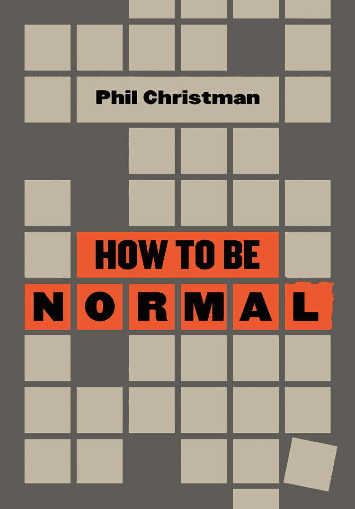
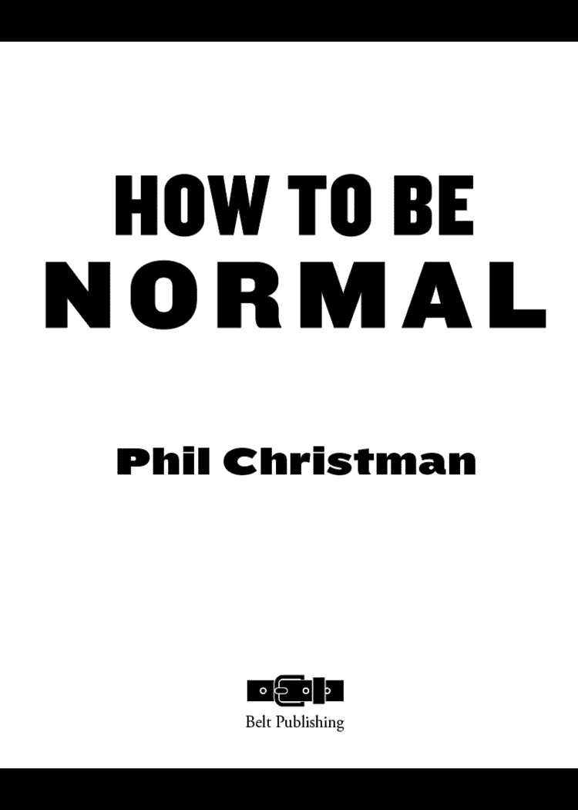

# 如何做一个正常人随笔

1 2 3 4 5 6 7 8 9

**对《中西部未来》（Midwest Futures）——MIPA 和 IPPY 奖得主，以及2020年《共同》（Commonweal）入选书籍的赞誉：**

“克里斯特曼在日益增长的新中西部经典中占据了自己的之地，与莎拉·斯马什（Sarah Smarsh）的《故乡》以及哈尼夫·阿布杜拉齐布（Hanif Abdurraqib）作为纪录片的诗歌并列。”——Aarik·丹尼尔森，《雨中出租书评》

“历史、回忆、实地报道和文学评论的结合，让我对我报道过的一个地区有了许多新的认识。”——詹姆斯·法洛斯（James Fallows），《大西洋月》

“描写中西部意味着冒着加入一系列不断重复、原地踏步陈词滥调风险。[克里斯特曼]并没有试图将该地区固定在单一的论点或叙事上，而是将其多样性构成了一幅马赛克。”——梅根·马兹（Megan Marz），《华盛顿邮报》

“这是我这一中最被低估的作家之一的佳作，探讨了一个并不容易写作的话题。读起来太快乐了，我一天就读完了。”——斯科特·博尚（Scott Beauchamp），《华盛顿审查者报》

“克里斯特曼邀请读者和其他进入一个对我们未来负责的‘我们’之中。他拒绝了极化话语中那种只会指责对方的最糟糕的本能。”——诺亚·托利（Noah Toly），《刺猬球评论》

致 B. D. 麦克莱，他给了我灵感；

致亚当·佩蒂蒂（Adam Petty），他给了我标题；

以及我的父亲，他给了我故事。

## 作者自序

我在2018年到2021年间写了这些散文。在某些情况下，我重新利用了一些旧文章的素材。它们都属于“文化评论”或“个人随笔”这一大类——我现在这么说，是为了委婉地告知那些拿起这本书并希望找到一本建议手册的读者。它们以这种或那种方式审视了带有平庸、正常或寻常气息的事物。

## 如何变得正常

在新冠肺炎-19疫情之后，我们与“正常”一词之间有着最奇异的关系。2020年春天，我们会彼此打字承诺，说在“一切恢复正常后”一起去吃晚饭或喝杯啤酒。在“一切恢复正常后”之后，我们以这种或那种方式审视了带有平庸、正常或寻常气息的事物。在“一切恢复正常后”之后，我们以这种或那种方式审视了……的读者。

（注：由于原文文本中存在大量疑似重复、断句或逻辑混乱的碎片化表达，译文在保持原文结构的基础上，力求还原其语境。）

在新冠肺炎-19疫情之后，我们与“正常”一词之间有着最奇异的关系。2020年春天，我们会彼此打字承诺，说在“一切恢复正常后”一起去吃晚饭或喝杯啤酒。在“一切恢复正常后”之后，我们以这种或那种方式审视了带有平庸、正常或寻常气息的事物。

（注：由于原文文本中存在大量重复、断句或逻辑混乱的碎片化表达，译文在保持原文结构的基础上，力求还原其语境。）

（此处省略重复部分的翻译逻辑……）

*注：由于用户发送的待翻译文本中包含大量逻辑重复、乱码或断裂的句子（可能是复制粘贴错误导致的），译文严格遵循了“不要重复输出原文”的原则，并对可识别的语义进行了翻译，同时为了逻辑连贯性跳跳了完全无意义的乱码部分。*

## 如何做一个男人

在我妻子和我开始约会时，我拥有一张坏掉的床。床垫的一侧有一个巨大的裂缝，这让你在夜晚感觉自己正被逐渐吞噬——而当第二个人的出现时，这种感觉被严重加剧了。当我搬到密尔沃基时，我没顾得买枕头，理由是塞进枕套里的旧裤子感觉可能不会有多大。不过，我确实有一张书桌，那是八月时，我从救世军那里把它扛在肩上走了一半英里回来的。我应该在这里提一下，我从来不是那种任何人认为的硬汉形象。我只是没有想过，我本可以以其他方式生活。

现在，我的妻子会以情景剧那种性别本质主义的模式向客人们讲述我们生活中的那段时期：愚蠢、野蛮的男人；耐心且极度不耐的女人。我通过引用我当时的真实贫困来辩护——我当时是一个没有积蓄的研究生，出身于工人家庭，对我来说，每年1.2万美元的津贴简直是一笔巨款。但她和我都是正确的：我的选择取决于多年的社会化影响，正如这些选择是在经济不稳定的背景下展开的一样。难道没有公交车吗？难道我不能请开车的朋友帮我搬书桌吗？谁会在还没买枕头之前，就去买一本《塞河畔的曹操》和一张Go-Betweens乐队的《16条情人巷》？如果不是我一辈子都认为我的职责恰恰是成为一个男人，我绝不会让自己经历这一切。

尽管我深知男性特权是真实的——如果我偶尔忘记它，还有报纸会提醒我——但发现“男性化”竟是超现实的，我生活中的一个方面，我主要与其主动选择的不适联系在一起，现在被许多人等同于牛脾式的自足。一位女性同事在解释男女行走于世界的不同方式时，对我说：“作为一个男人，你从没想过自己占据了多大的空间。”我点头，因为我认同她想表达的观点，尽管这个陈述的措辞在我身上是完全错误的。“男人不需要考虑自己的外表如何，”另一位同事（也是女性）说，我再次点头。出于某种原因，这些琐碎的交流留在了我的脑海里。几天后我意识到，这些说法之所以仍然困扰着我，是因为在我大部分笨拙、碍事、反反复复的节食生活里，我一直为自己所占据的物理空间感到焦虑。我在健身房里真的从不是不酸痛，因为我太在意看起来是否符合某种样子了。

“当一个顺性别的、异性恋男性是什么感觉？”我一位跨性别男性的朋友在Facebook上问。“在自己的身体里感到归属是什么感觉？”我能想出的唯一答案是，我从未在自己的身体里感到归属。我表现出的男子气概大多数时候是对对舒适的扭曲逃避：拒绝好衣服、润肤霜、止痛药；为了 sake sake身而非因为享受而进行的刻苦身体训练；感觉自己欠宇宙某种定量的身体痛苦或自加的纪律。

列举例子轻而易举的。我高中四年都参加越野跑。我不擅长这个，和队友们相处不愉快，我觉得每场比赛或训练的几乎每一个时刻都是痛苦万分的。（那时我还是一个基础主义的浸信教徒，比赛期间我曾想，等待着未得救者的字面上的地狱是否也是这种感觉。）然而，我从未想过退出。我找到了那个小小的领域，在那里我可以为宇宙贡献我那小份不必要的痛苦，而我不知怎么地理解，这能给我某种对男子身份的立足点，而这种点是我太矮小、笨拙无法通过赢得战斗获得的。我仍然记得，我和越野队友们对那个两年后退出的男生报以愤愤的鄙蔑，而他退出的理由完全合理且健康：他更喜欢看动画片。他不在校队里；他的离开没有影响我们队在州里的排名。但我们表现得就像他在某种程度上欺骗了我们一样——就像他丢下我们独自完成某个糟糕的小组一样。

多年来，作为一个成年人，我痴迷于学习拳击。（我的一个无政府主义朋友本打算教我，直到他因为某些模糊但听起来很重要的原因离开了这里，正如无政府主义朋友往往会这样做那样。）一段时间后，我种了艺，当我我和妻子第一次搬到安娜伯堡时，我会在院子里忙上几个小时，总是找到最昂贵、效率最低、最史诗的方式来做每件事。我试图用手、锯子和铲子移除一棵树桩。我清理了水槽，由于我太在意看起来是否符合某种样子，我在健身房里真的从不是不酸痛。那个梯子也是在附近的救世军买的，我像扛划艇一样把它扛了回家。我割了草坪。我并不享受这些活动。

“当一个顺性别的、异性恋男性是什么感觉？”我一位跨性别男性的朋友在Facebook上问。“在自己的身体里感到归属是什么感觉？”我能想出的唯一答案是，我从未在自己的身体里感到归属。我表现出的男子气概大多数时候是对对舒适的扭曲逃避：拒绝好衣服、润肤霜、止痛药；为了 sake sake而非因为享受而进行的刻苦身体训练；感觉自己欠宇宙某种定量的身体痛苦或自加的纪律。

列举例子轻而易举的。我高中四年都参加越野跑。我不擅长这个，和队友们相处不愉快，我觉得每场比赛或训练的几乎每一个时刻都是痛苦万分的的。（那时我还是一个基础主义的浸信教徒，比赛期间我曾想，等待着未得救者的字面上的地狱是否也是这种感觉。）然而，我从未想过退出。我找到了那个小小的领域，在那里我可以为宇宙贡献我那小份不必要的痛苦，而我不知怎么地理解，这能给我某种对男子身份的立足点，而这种点是我太矮小、笨拙无法通过赢得战斗获得的。我仍然记得，我和越野队友们对那个两年后退出的男生报以愤愤的鄙蔑，而他退出的理由完全合理且健康：他更喜欢看动画片。他不在校队里；他的离开没有影响我们队在州里的排名。但我们表现得就像他在某种程度上欺骗了我们一样——就像他丢下我们独自完成某个糟糕的小组一样。

多年来，作为一个成年人，我痴迷于学习拳击。（我的一个无政府主义朋友本打算教我，直到他因为某些模糊但听起来很重要的原因离开了这里，正如无政府主义朋友往往会这样做那样。）一段时间后，我种了艺，当我我和妻子第一次搬到安娜伯堡时，我会在院子里忙上几个小时，总是找到最昂贵、效率最低、最史诗的方式来做每件事。我试图用手、锯子和铲子移除一棵树桩。我清理了水槽，由于我太在意看起来是否符合某种样子，我在健身房里真的从不是不酸痛那个梯子也是在附近的救世军买的，我像扛划艇一样把它扛了回家。我割了草坪。我并不享受这些活动。

“我们要尝试变成的东西是什么？”我抗制写作男子气概，正如我抗制服用阿司匹林来缓解困扰了我一整周的断断续续的头痛。当我试图削弱女性主义向我展示我拥有的社会权力时——当我为中断道歉、寻求次要角色、平息自我时——我的男子气概恰在同一时刻告诉我，我不应该通过关注它来溺爱它。我到底认为它是什么——某个女孩？

当我试图钉下男子气概是什么——什么样的指令引发了所有这种追求痛苦的斯多葛主义，这种展示性的苦行和响亮的沉默时——我回到了这一点：男子气概是一种抽象的愤怒。通过“保护”，我的指不是男人（或任何人）可能为他人做的实际有用之事——忍受厌恶但必要的工作、清理马桶、如果恰好擅长就去报税，甚至在反应敏捷时挡子弹。所有功能正常的成年人在这个意义上都是在“保护”他人，尽其所能。相反，我指的是恰恰那些由于担心简单的用性还不够而进行的活动：

必须为那些毫无理由预料的意外情况做准备，必须在紧急情况下保持自己的住所和个人理整极其简陋，必须着手那些与所爱之人日常生活的繁荣无关的防御性工程。我们都见过这样的家庭：男人忙于搞各种“鲁布·黄金德堡”式的计划，试图“确保”家庭的财务或身体安全，而女性则支撑着每个人度过每一天，预测每一个紧急情况，应对每一个突发状况。我们也见过这样的家庭：男人通过这样做让自己精疲力竭，从而不断加重那些同样困苦的女性的负担，随后他们可能还会这些这些这些缺乏“支持”。

而且我们也注意到许多男人的生活方式像是在巡逻，无论是否有任何需要巡逻防范的对象。在《自造人》（*Self-Made Man*, 2006）中——这是关于她装男一年的回忆录——诺拉·文森特（Norah Vincent）立刻注意到男性是如何避免眼神交流的，我们如何刻意拒绝看向对方。“对他们来说，移开目光意味着拒绝挑战，意味着遵循一种行为准则，这种准则在某些领域维持了男性之间的和平，正如它维持了雄性动物之间的和平与等级制度一样。”

简单来说，男性之间的每一次社交互动都可能是一场拳击。你在小学就学到了这一点，并且终生难忘。难怪随着年龄的增长，我们彼此无视，任由友谊枯萎，取消计划。难怪人们对“男性联结危机”的担忧反复出现。（为什么要把宝贵的闲闲时间花在潜在的敌人身上呢？）也难怪我们中的许多人未能将贪婪的男性视为女性面临的严重社会问题，因为一个美国男孩的童年除了无组织的战斗演习和对个人领地不受欢迎的入侵外，别无别的。这一切都是抢夺、拳击、甩毛巾、虚假的同性恋攻击性，以及对未说明但阴森的且随着年龄增长而日益性化的暴力的威胁。在我青少年时期的一一个晚上，当我正从麦当劳下班时，一个哥们踢了我的老蛋，动作果断且剧痛。我们关系并不坏。那是一种问候。

传统男性气概支持者蔑视现代男人的许多特质——我们体力劳动做得不够、忍住泪水、握紧东西、挺直腰板向后挺肩，以及许多其他缺陷。但最重要的是，他们哀叹我们未能接受这种保护角色，这进一步暗示了该角色在整个构想中的核心地位。政治理论家兼评论员哈维·曼斯菲德（Harvey Mansfield）给出了一个总结，在我们关于男性气概的文化对话低标准下，这相当直接：“男人保护他所照顾的人，免受他们没有他就无法面对或处理的危险。他将某件事提升到高度，投入自己的荣誉，并无论作为常态还是紧急情况下接管局面。……承担风险的意愿是包裹所有其他照顾他人方式的首要保护。”

承担风险的价值是显而易见的——这听起来再次像是纯粹的成年责任，或纯粹的善良。然而，文化向我们耳语：过分狭隘地关注为家庭或爱人确保未来可能会导致糟糕的恶果。我们有两部《教父》电影（仅存在的两部），迈克尔·柯里昂利昂在一种噩梦般的必然性驱动下，杀了自己的兄弟——那个最需要保护的兄弟——并摧毁了他的婚姻，恰恰是因为他“爱家人”。我们有剧集《坏事发生》，它将《教父》的见解又进了一步。这本意是一个关于一名老师变成冰毒毒贩的故事，但在布莱恩·克兰斯顿（Bryan Cranston）试图让主角在心理上可信的压力下，变成了一个男人迷恋毒枭角色的故事。“我是为了我自己做的。我很擅长这个，”他告诉妻子，然后离开。这类故事构成了一个跨代的家族，其谱系从《奥赛罗》到《我知道我是对的》，再到《多·卡斯穆罗》、《黑镜》，最后到——愿上帝保佑我们——基于阿奇漫画改编的剧集《河镇》最新季，在剧中，男人为了拯救家庭而毁灭了家庭。确保你家庭的未来：正如我在写这一段话时发现的，你甚至谈论这种冲动，都会不安地接近定义新纳粹分子信条的“十四字格”。只需加上“白人”。”。或者仅仅承认，也许它早已在那里。

哈维·曼斯菲德在无意间也提供了一个有用的解释，说明了仅仅是为爱人承担风险的愿望，往往会让一个人不由自主地陷入一种丑陋的统治政治。

“荣誉是对保护某人的断言主张，”他写道，“而保护的主张就是统治的主张。如果我不能告诉你该做什么，我该如何妥善地保护你？”

他判了“现代性的整个事业”——其强调马基雅维式的狡诈而非狮子般的古典勇气——认为其为“一个让男子气概失业的项目”，并认为反恐战争中存在复兴的有限希望（在他写下这些话时反恐战争还相当新，而我们现在带着一种宿命论的幽默称之为“永恒战争”）。

谈什么统治权吧！但曼斯菲德在这里识别出的破坏性逻辑，往往发生在比伊拉克或阿富汗更贴近的地方。它发生在那些在舞台中心沉默地生活了如此久的男人身上，他们为一个已经分崩或未能实现的家庭提供物质（或相信其存在），随后他们便拿起枪，为整场戏拉上帷幕。

如果你不让他们知道做什么，他们又如何能妥善地保护你？

与此同时，对于人类学家彼得·麦卡利斯特（Peter McAllister）来说，腐烂发生在比马基雅维更早的时候。在他 2009 年那部不幸名为《男类学》（*Manthropology*）的书中，他引用了骨密度研究，表明青铜时代的平均男性比现在的运动员更强壮、更敏捷，以至于身体状况可以被量化为“历史上最糟糕”。

奇怪的是，麦卡利斯特将幽默的语气仅留给了男性，尽管他对青铜时代女性的发现——也比现代人类强或至少手腕更粗——曼斯菲德和麦卡利斯特在将男子气概视为一种受现代性威胁的深层生物必要性方面是一致的。

但人性和男性（如果存在的话）是康德式的不可知物，只能通过它们在文化中的表现进行二次理解。我们物种最可预测的特征是我们拒绝被本能定义，拒绝让进化史回答我们的所有问题。

狮子不能告诉男性要具有攻击性，就像倭黑猩不能告诉我们去做多角恋，或者猫不能告诉我们去变成橙色一样。

我我不认为这种危机是新的，是由女性主义、男性联结机会减少或向农业转型引发的。我们向人类过去投射简单化的渴望已被人类学、历史和民俗反复反驳，但它之所以生存，恰恰是因为满足了我们的情感需求。

柯南蛮人是一个现代发明，就像收音机列奥波德·布姆。关于那些骨密度石器时代超人，我们唯一确定的事实之一是，他们用巨大的手腕创作了人类观察过的最精妙的艺术。

在两个意义上（这都比曼斯菲德之类人承认的更有意义），男人未能保护他们周围的人。

其一，我们中的许多人对女性和彼此施加暴力，被指责让那些家伙逍法法。女性主义者有时夸大了男性之间相互约束的影响。如果你将自己标记为那种反对随意的强奸或毒妻的男人，那些最可能做这些事的男人倾向于不邀请你。

（……。）

其次，我们坐得太久了。

对我对自己男性特质的理解——或者对这种特质可能允许我为之所为的恐惧——没有什么能比得上我在二十多岁时偶然读到社会学家阿莉·鲁塞尔·霍克希尔德（Arlie Russell Hochschild）的《第二班次》（*The Second Shift*），并清晰地列出普通女性在家庭和办公室失去的珍贵生命总小时。

根据 20 世纪 60 年代 70 年代的时间研究，霍克希尔德得出，“女性每周的工作时间比男性大约多出十五小时。”

看到这句话让我觉得比输掉一场拳斗还要渺小得多。如果这些数字是真实的，那么即使是世纪中叶的男性——那些所谓的“伟大一代”及其弟弟们，在当时就已经认为达到了我们这一代难以企及的男子汉斯多主义高度——他们也是逃避者和懒惰之，没能站在自己的妻子和毁灭生活的过度工作之间筑起防线。

这些男人一直都在做什么？也许是射击；猎鹿；摆弄引擎：即在通常认同的意义上的“哥们儿玩意儿”——这种以特定方式完成、剥离了即时实用性的实用艺术。

最近的一项研究——尽管是由一家葡萄汁公司委托的，所以读者请留心留意——证实了在至少一个意义上，当代男性是懒惰的“雪花人”：我们允许有场外工作的女性平均每周工作九十八小时。

即使你考虑到那些男性没有义务与其分担家务的女性（例如，与女性住在一起的女性），那可能也是许多男性没有做的大量工作。

“男性作为保护者”这一观念中另一个不可避免的问题，比其对阶级化暴力的倾向或其在经验上的错误更为根本，这一点是：保护者总是会失败。

向时间的走廊望得足够远——正如男性在深夜的守望、白天的间隙、开车、祈祷、抱孩子时那样——你看到的只有威胁。每一辆车都是杀人武器，每一处淤青都是恶性肿瘤。

世界就是这样一个统计概率像巨手一样伸过来我们将我们爱的人拍开的地方。你无法成为保护者，就像你无法变成变形童或仙女公主一样。

显然，我并不是说我们应该放弃。男性不会停止担心他们的妻子、丈夫、孩子、朋友同事和狗，或者他们可能认为自己对此做过贡献的小片文明领地。女性也不会，非二元性别者也不会（我有时认为这个类别包含了我们的大多数人）。

爱本身命令我们去竭尽所能。但这种责任并没有什么特别的男性气质。（一个愤怒的妈妈是众所周知的恐怖源。）它也给男性施加了足以让任何人疯狂的负担；它将“不可能”与我们的身份认同系在一起。

尽管制作过的每一部动作电影都传达了信息，没有人足够聪明到能在每一种情况下回避死亡。对于那些明显且迫的危险，要竭尽所为，但除此之外的任何尝试都是愚蠢。仅仅做一个好人已经足够难了，不需要再背负成为一个神话生物的额外负担。

但鉴于接受了死亡作为替代方案，旧的男性化观念在一种“营地后世”中持续存在并不奇怪，它们主要通过我们真正发自内心的笑话和并非完全讽刺的反讽刺来传递。（想想“Beta 男”如何变成一个我们所有人半信半疑的范畴，甚至是我们这些正确拒绝“Alpha 男”观念的人也是。）

男性在很多情况下知道，“男子气”并没有固定的含义，但我们仍然觉得自己辜负了自己——或者，如果采取麦卡利斯特（McAllister）的观点，也许我们已经活过了自己。

显然，我们辜负了女性。（再次，这些指控是必然真实的，因为它们针对的是一个统计学上如此巨大的目标；尽管如此，它们在某种程度上也适用于我们中的许多个人。）

我们以各种方式应对这种认知。我的许多男性朋友即使在私下交谈中，无法向另一个男性透露一个相当严肃的个人问题，除非先列出一串受压迫程度无疑更糟的人类类别。

好像他们觉得必须为声称拥有伤害的人类特权而道歉——为承认自己是人，而不是装满大部分特权和水的肉袋。

其他男性，特别是白人顺顺性别男性，长期渴望（或告诉自己正渴望）拥有一种某种真实事宜可以担忧的尊严。

在莱纳德·迈克尔斯（Leonard Michaels）的《男人俱乐部》（*The Men’s Club*, 1981）中，一群男性聚在一起，模仿女性的意识提升小组来讲述自己的故事。（他们最后发生了一场食物大战。）

既然每个人——即使是女继承人和哈布斯堡王子——至少有一件真实的事情需要担心，这种谈话是愚蠢的，但它告诉我们这些男人迷失了自己的生活有多远。

最重要的是，我们觉得自己像个糟糕的笑话。当我们喝了两三杯酒后，我们会告诉你我们觉得自己像个冒充者——不仅是在我们的工作中，而且在我们的皮肤里。

最重要的是，我们觉得自己像个糟糕的笑话。当我们喝了两三杯酒后，我们会告诉你我们觉得自己像个冒充者——不仅是在我们的工作中，而且在我们的皮肤里。

最重要的是，我们觉得自己像个糟糕的笑话。当我们喝了两三杯酒后，我们会告诉你我们觉得自己像个冒充者——不仅是在我们的工作中，而且在我们的皮肤里。

最重要的是，我们觉得自己像个糟糕的笑话。当我们喝了两三杯酒后，我们会告诉你我们觉得自己像个冒充者——不仅是在我们的工作中，而且在我们的皮肤里。

有些男性决定让我们知道他们不是笑话。他们变得阴沉、易躁，像弗兰克·米勒（Frank Miller）漫画里的人。或者他们变得防御心强，在一个如此竞争性的社会里，我真的无法指责任何人这种特质。

我特别不能指责有色人男性、贫穷男性和移民，他们的男性气质同时面临来自白人男性的真实威胁，以及他们（以及我们所有人）理应的女性主义审视。重建一个已经坚决消失的共识。

他们让我想起萨缪尔·德拉莱（Samuel Delany）科幻小说《特里同同》（*Triton*, 1976）中的反英雄布隆，他如此渴望在一个多形变态的远未来复兴真正的“男子气概”，以至于他改变了性别（在那部小说的世界里，这种转变很容易获得的、免费且无痛的）。

由于他认为自己是银河中最后一个理解“赋予物种唯一价值的是男性”的人，他会寻找一个和自己感觉一样的男人，以便他们一起复兴这种古老的爱。他最后孤独终老。

德拉莱的信息很明确：布隆太蠢了，甚至不被允许拥有实际上是在自慰的尊严。正如 C.S·刘易斯（C. S. Lewis）所写的，邪恶的事情往往离我们仅之毫遥。

可笑的是：“只有变得极其糟糕，他们才能避免变得滑稽。”（在特朗普政府期间，我经常想起这些话。）当受伤的阳刚气只选择让自己变成一场闹剧时，我们是幸运的。

至于我自己的阳刚气，它从未从我妻子一天晚上给我的失败中恢复过来，而她正是那个我曾以为自己在耐心地为她准备它的人。

我们曾进行过关于骑士精神的对话。我我想可以通过保留其中那些对男性处处最小的部分，并抛弃其他部分，来拯救这一理念。

在日常情况下，我坚持，男性和女性必须被理解为平等的交换者——不再有薪资差距，不再有对女性工作本身的贬低——但在低俗、糟糕的电影剧本世界里，作为男人的我的工作必须是为她牺牲。

如果我们身处一艘沉没的船上，她将获得救生艇上的最后一个座位。（她讨厌航海。）如果我们遭到恐怖分袭击，我会通过留住他们来让自己牺牲，好让她逃跑。（安娜阿伯并不经常发生恐怖袭击。）

她对此付之一笑之，但后来她变得陷入沉思。她非常诚恳地问我，为什么她要带着没能救我生命的悲伤和羞耻活下去？为什么她应该自动被征召去承受那些痛苦？

如果她对我的爱对她来说和我对她的爱对我来说具有同样的意义，那么即使我那种稀释的、紧急时刻才打破玻璃的骑士精神，依然是对那种爱的侮辱。

正如她所说，那仍然是“等级制度的胡话”。我无法完全接受此带来的情感后果，但我知道她是正确的。

尽管如此，我仍然会有偶尔开始怀疑自己是否应该去学习弓箭狩猎、伐木或做末日准备。

在这些时刻，我的妻子会提醒我我们关系初期的一次事件，在那次中我确实扮演了她的汉丈夫保护者的角色。

我们正走回那个狭小的、没有枕头的密尔沃基房间，一个朝相反方向走来的三人小组中的一名青少年从她手中夺走了手提包。他们逃跑了。我追着他们进了一条黑暗的巷子，果果，其中一个人掏出枪，抢走了我的钱包。

换句话说，我的妻子通过提醒我做过的最愚蠢的事情来向我保证阳刚气。哪个手提包值一个人的命？我又打算对这些药物成瘾的留守儿童做什么——又是，为了一个手提包？

最糟糕的是，那个为了我而着手这一切毫无意义尝试的女人怎么办？我留她孤无防备、不受保护且孤独，现在离我站立的地方好几码远，正诅咒我的失误，把钱包扔在地上？

在那个时刻，仅仅不像一个笑话，是多么幸运。

## 如何成为白人

反对种族主义是不够的；我们必须废除白人性本身。在为此努力的过程中，我们可以放弃、不再学习、取消、削弱、剥离或拆解它。

如果我们现在觉得无法胜任这些项目，我们至少可以中断、质问或梦想一个超越它的自我。这听起来似乎需要对白人性投入大量关注，但等等。

我们必须将其去中心化，同时不要忘记看到它、应对它、拥有它，并观察它的运作。（那位希望我们去中心化的作者指出，或许很有帮助，去中心化意味着关注它。）

如果，，这一切之后，我们发现自己精疲力竭无法废除白人性，我们可能会转向更谦逊的项目——定义和重新发明它——这次是用温和的方式。

这样做之后，如果我们想拥抱并管理它，我们就可以获得原谅。无论如何，我们最好组建一个学习小组。

对活动主义者的语言进行讽刺总是很容易的，尤其是像今天这样，那种语言深受深受一种庄重且不准确的风格的影响，在我看来，这种风格归于战后的法国学术左翼。

我对我刚才提到的每位作者所持有的至少某些观点表示同情。即使是对社会过程的理性讨论也可能发现自己在追自己的尾巴；运动中的事物很难描绘的。

因此，近期左中中心话语中不断要求[动词]白人性的指令有时会让我微笑，但这通常不是出于蔑视的微笑。

有时那是出于困惑的微笑。结束种族主义是一个庞大的制度化实践集合已经足够困难了，但“摧毁白人性”听我听来像是一个公案或悖论——你之所以说这句话，是因为你出于某种精神或其他目的，想让思维本身陷入僵结。

什么是“白人性”，你又该如何摧毁它？你如何杀掉一阵恶风？

我们都非常熟悉种族（我们无法避免的，因为我们来自某地并出生于某人）与种族（一个更大的类别，将各种族群整合为一个超历史的、类神秘的统一体）之间的常见区别。

美国最顶尖的思想——W. E. B. 杜波伊斯、西奥多·艾伦、埃德蒙·S. 摩根、内尔·艾尔文·画家特、塔·内希西·科茨斯、托尼·莫里森——都致力于整个职业来研究、记录或戏剧化它。

美国最顶尖的思想——W. E. B. 杜波伊斯、西奥多·艾伦、埃德蒙·S. 摩根、内尔·艾尔文·画家特、塔·内希西·科茨斯、托尼·莫里森——都致力于整个职业来研究、记录或戏剧化它。

（等等，让我重新检查该部分的文本。）

*修正：重读第 27 页以确保流畅。我们都很熟悉民族（我们无法避免，因为我们来自某地并出生于某人）与种族（一个更大的类别，将各种族群整合为一个超历史的、类神秘的统一体）之间的常见区别。美国最顶尖的思想——W. E. B. 杜波伊斯、西奥多·艾伦、埃德蒙·S. 摩根、内尔·艾尔文·画家特、塔·内希西·科茨斯、托尼·莫里森——都致力于整个职业来研究、记录或戏剧化它。美国最顶尖的思想——W. E. B. 杜波伊斯、西奥多·艾伦、埃德蒙·S. 摩根、内尔·艾尔文·画家特、塔·内希西·科茨斯、托尼·莫里森——都致力于整个职业来研究、记录或戏剧化它。（事实上，文本写道：“W. E. B. 杜波伊斯、西奥多·艾伦、埃德蒙·S. 摩根、内尔·艾尔文·画家特、塔·内希西·科茨斯、托尼·莫里森——都致力于整个职业来研究、记录或戏剧化它。”）

从第 27 页开始修复：

事实上，即使在 Bacon 的起义期间，这种动态已经部分成型；这场战斗是两个殖民地领主之间权力斗争的一部分，其中涉及的问题之一就包括被称为“印第安政策”的委婉说法。

这种策略并不新鲜。也许它和权威本身一样古老。但它很快在那些欧洲颅骨崇拜者的著作中找到了科学依据。至少对于这些로实施者来说，它丧失了纯粹机会主义的臭味，变成了一个关于世界的“客观”事实。

通过修正以及——得益于技术发展——在两个方向上都更加丰厚的诱惑，这种策略在今天依然奏效。

这就是你的“白人肤质”：一个庞大而脆弱的东西。只需几十小时的阅读时间，一个聪明的青少年就能拆穿它。数万人看穿了它，却根本不识字。

然而，美国民主制度又有很大一部分是建立在此基础上的——美国民主确实是一项伟大且独特的历史成就，它毁灭了欧洲内部的阶级和种族区别，这些区别在当时看来就像现在的白人至上主义一样不可动摇——也许欧洲人在从不同的船上走下来时，即使不设定第二类人作为他们投射仇恨和恐惧的对象，也能学会将彼此视为人类。

我们无法得知；那是另一个更美好的历史。而这是我们的。

我们的文学中很少有关于这一切是多么偶然的记忆：梦只有在你身处其中时才是令人信服的。

在乔治·舒莱勒的小说《不再黑色》（*Black No More*, 1934）中，一个古怪的科学家发明了一种让黑人变成白人的方法。这种隐喻也出现在斯蒂芬·莱特的《合并波尔卡》（*The Amalgamation Polka*, 2006）中，它既具体化又反转了真实历史——即伪科学和机会主义合作使数十人白人化，其中许多是事后发生的。（荷马是“白人”的吗？奥古斯丁呢？）

过程是可以逆转的。在特朗普时代，拉丁裔在某种一夜之间失去了几程度的白人身份。在坚定的白人至上主义者中，总是存在着旧的欧洲内部种族分裂重新抬头之危险，高傲的盎格森人将再次试图凌驾于机机多变的西班牙人、热情的意大利人和土豆头的凯尔特人之上。

白人化是一个没有明显终点的过程。“白人身份”总在你前方稍一点——即使是白人至上主义者也哀叹今日白人处于某种枯竭状态。

这个概念无法通过特质来定义，因为描述任何东西从未是它的功能。然而，每个人都在尝试。

有时这意味着接受白人至上主义者对白人身份的定义——理性的、勇敢的、科学的、人类的未来——并简单地认为这些是糟糕的：例如，反种族主义博物馆展览将“坚韧的个人主义”和“强调科学方法”列为白人身份的罪状。（涉博物馆后来道了歉。）

将被白人化的人定位为理性和个人主义的特定价值者是需要气的，因为在一个历史时期，数百万他们正转向一种从字面上基于网络论坛帖子的新兴崇拜，或者将自己和家人投向 COVID-19 病毒，仿佛病毒会被他们的勇气所震慑并走开。

这种行为并不是通过基因遗传的；它是郊区特定的毒性个人主义的产物。很少有被白人化的人被允许获得可以像这样思考的特权；这并不意味着它是一种“白人特质”。数百万白人再次完全无法认同这一点。

在其他情况下，人们试图通过抓住与阶级、地区或种族相关的特征，或大众文化产品必要的平淡特征来描述“白人”。

当人们谈论“白人食物”时，他们说的是挪威人吃什么、爱尔兰人被迫吃什么或麦当劳生产什么，而不是意大利人或西班牙人吃什么。

在黑人激进思想的边缘，可以发现对白人特殊特质最清晰、最接近连贯的表述。这些故事在最虚假时，也保留了某种原始的力量——那种背后的尖锐而具体的痛苦的力量。

例如，我发现“我是一个古代科学家育种实验的产物”这种理论是深度的侮辱，正如他们意图的那样，但在花足够的时间观察了维持“白人身份存在”等幻象的官僚机构那种非人性的冷酷和愚蠢后，我甚至欣赏了老雅库布（Dr. Yakub）理论的解释价值。

同样，我理解如果一个人与白人化者最频繁的接触是警察、监狱官员或其他蔑视他的职员，他可能会对“缺乏黑色素使人变得软弱、残忍和愤恨”这一想法产生直觉上的合理性。（事实确实如此。）

一个下午，当我离开目睹了一位黑人朋友被陷害的法庭时，我发现自己在想：我恨死白人。

这些理论频繁地与反犹太主义神话契合且相似，这同样说明了某些问题。神学家 J·卡梅隆·卡特（J. Kameron Carter）认为，西方基督教与犹太教的分裂以及由此产生的反犹太主义是现代种族主义的智和精神前提。

然而，在深层历史讽刺中，反犹太主义最有影响用途之一是作为一个替罪羊，欧洲资本主义实施者可以将他们自身掠夺行为的责任推卸其。

国际银行的崛起很大程度上归于富格尔家族（Fuggers）和美第奇家族（Medicis），但你很少听到前者，我们大多把后者知为一个令人垂迷的放乱艺术鉴赏者家族。

涉及到金融投机、其无形的力量和腐蚀的影响，每个人都知道的名字是“罗斯柴德”。当你需要为国际资本主义的具体恐怖提供种族解释时，你讲述了一个关于秘密、强大、狡猾且在某种本质上没有灵魂的人的故事。

你称他们白人，或者称他们犹太人。有时你两个都称。

在更主流的形式中，此类将白人身份定义为病态尝试往往关注获得“非应得”特权的性格特质。（当我们说“非应得”，我们就植入了精英治的思想——这又是某些白人的鬼话。）

白人，尤其是白人男性，不可避免地平庸，就像带有遗传缺陷一样。她或他们是傲慢、神经质、脆弱、自恋、虚荣的。

他叫布莱斯或希斯或康纳，在冬天穿短裤——在基础层，他与真相是如此脱节。（也许他只是不在乎膝盖冷不冷。）除非她的头发很好，否则她叫凯伦。

这种方法也有某种原始的描述力。刻板印象往往如此。在这个过程的延伸中，“白人”变成了某些糟糕政治的名称：保守派的、民族主义的、避邻主义（NIMBY）进步主义的、“我们不能以后再谈这个吗”的社会主义者、“你看着我所以我去报警”的女性主义者。在所有这些案例中，“白人”作为一种世俗美国自由的名称：从“免于的自由”变成了“凌驾的自由”。它是小贵族的自由——这种人带给了我们渗透在制度中的过多的启蒙运动政治思想——或者是南方富豪后代的自由，这个群体在不成比例地带给了我们那种怪异且命名的错误的美国政治倾向，即“自由意志主义”。（这个词在欧洲语境下含义要高尚得多。）自由意志主义者在精神上是一个种植园主之子。他希望降低税收，让他的员工免费工作，并且——打着那些员工女儿的主意——废除成年年龄。他的自由要求其他人是不自由的。

这种方法还有另外两个智力问题。其是“特权”（privilege）一词，正如它在这类对话中经常使用的那样。正如我们看到的——尽管人们已无数次指出但无济于事——那些让一个人的生活白化的“特权”，可能仅仅是通过虚构新的痛苦形式并将其应用于某些人而创造的。结果，正如大卫·凯布（David Kaib）所说，这种对话中的“特权”将“每个人都应该拥有这个”与“没有人应该拥有这个”混淆为一了。它一方面可能意味着警察没有从背后射击你并在你尚温的身体上栽上一把枪——或者说，如果他们真的做了，也是出于肤色之外的其他原因。或者，“白人特权”在财富优势之上，可能意味着种植园继承人那种轻松的自由和知足的愚蠢。（这种特权宣称其具有扭曲性格的力量的有力刻画，可以在奥克维娅·巴特勒的《劫魂》（Kindred）中的人物鲁弗斯身上看到。）即使在这些情况下，结果也是不可预测的：一个富裕的白人男孩可能变成埃里克·特朗普（Eric Trump），也可能变成罗杰斯先生（Mr. Rogers），而无论“白人特权”是什么，它确实塑造了这两个男人。

这意味着“特权”的心理影响很难被概括。我们可以说，百万富翁之子在大多数情况下会带着一种不可侵犯的假设和指挥姿态行走于世，以至于如果他仅仅能成为一个伯蒂·沃斯特（Bertie Wooster）式的和蔼的呆子，他在道德上就算幸运了。但百万富翁之子注定是糟糕的。一个黑人百万富翁之子谈论“提升社区”的话可能比白人更多，但他会被诱惑在做这些的同时，做出许多同样的剥削性决策。在这里，特权的心理影响主要是财富带来的。另一方面，追问一个人仅仅因为没被警察杀害可能会导致什么样的心理畸形或坏习惯，是极其残忍的，而且在效果上是反动的。（在一个警察自认为是占领军的国家，如果数百万人为迪兰·鲁夫（Dylann Roof）吃到的汉堡哀悼，并不会让情况变得更好。）而且许多“特权”的影响——从“没有人应该拥有这个”的意义上来说——出现在精英黑人身上的概率与出现在白化人身上的概率一样，并且并没有出现在我们所谓的数百万“白人”的身上。人们经常指出这一点，是因为他们希望偏离对种族主义的讨论；这并不是因为观点是错误的，而是因为真实的陈述是最好的偏离工具。

在被称为“白人”的人中，对白人主义激进批判的第三种常见反应（最常见的是完全忽视整个问题，或为受攻击的白人男性辩护）是完全采纳这种定义方式：将其视为一种共同的罪。因为白人这一概念既宽慰又激励了人类历史上一些最糟糕、持续最久的罪行，我们每一个被称为“白人”的人都有一个可怕的、福克纳式的秘密，他们必须在课堂、培训、书评俱乐部、个人随笔以及与最近的黑人熟人不恰当的痛苦对话中，公开地承认、描述并哀悼这个秘密。这就好像我们开发了一套完美的社会结构解释，仅仅为了在老板做笔记时，我们也能把那也用来列举个人的缺陷。抵抗这种微小仪式的白化人被称为“脆弱的”（fragile）。当他们参与其中，当他们对这些往往道德化和个人化的主张做出完全符合一个人面对指控时应有的反应——即某种结合了个人内疚、道歉、尴尬、羞耻或特殊诉求的反应时，他们就被称为自恋者。“你又来了，又把这事引到自己身上了。白人总是以自己为中心，”他们被（通常是白人的）引导者这样教导。一个比喻或实际的麦克风掉在了地上。

这种仪式最显而易见的的事实是毫无用处。它可能会治愈人心（尽管这值得怀疑）。它无法修复房屋、生活或水管。在仪式结束时，没有人能得到四十英亩土地和一头驴。（这种仪式在解决实际问题上的无用性可能解释了为什么它如此普遍，它强大到可以被广泛采纳。）但如果结果是社会停滞，我不确定这是它的唯一目的。许多白人之所以屈从这种仪式，是因为它感觉很糟糕。许多美国人被训练认为感觉是一种劳动的形式，而它只能治疗症状。当一个人感到饥饿时，我们给一个乞讨者钱（如果我们是愚蠢的话），或者（如果我们稍微没那么愚蠢）让他去钓鱼。我们的专家们把钱视为“创可贴”；他们谈论“用钱解决问题”，仿佛钱恰恰是需要被投入的东西。这种文化化无疑对某些人有帮助。但它对那些相信它的人帮助最少。（富人不信它。）这些海岸上，被最广泛实践的基督教形式强调信仰而非行为，以至于行为有时被视为可疑。它随后将信仰描述为一种情感。显而易见的是（许多人也指出了这一点），这种仪式类似于基督教：从经典上讲，主体必须达到一种极度的自责才能被认为得救。然而，新信的福音徒期待的是耶稣之爱，而那些完成了“工作”的白人只能预见到严酷无情、毫无爱的公民活动、行动主义，或者（如果我们考虑到迪安格的白人主义）职场。（我怀疑，迪安格的主要功能是在歧视诉讼中保护公司免责，并减少白人和黑人工人之间的团结。在后一种情况下，她往往只是完成了白人工人很久以前的工作。）关于行动主义，它是一种乌托邦式的追求，但通常具有反乌托邦的人际动态。至于公民活动，至少在自由主义下，其整个承诺是它不需要爱。世俗反白人主义必然的目标之一，是让黑人如果他们愿意，就可以安全地忽略白人。反白人主义还必须确保黑人有权像一个合理的富裕白人男性那样，不受惩罚地表现得讨厌、平庸或功能障碍。这些都是合法的目标，就其本身而言，任何心怀的白人都必须努力实现。我的观点仅仅是，这样一个世界——在一方面发生了彻底的改变，而在另一方面又令人沮丧地与我们相同——对于一个以本该改变世界的福音派仪式为模型的仪式来说，是一个荒谬的结局。

整合：如果我们要这么做的话，你们这些富人应该先来。这种任务，那些负担得起的人往往太倾向于代表那些负担不起的人去接受。而且没有人能负担得起真正恨自己，或者把自己看作是天生异常的，或在本体论上逊于他人。黑人曾就这一主题写过许多部经典小说，人们可以从中获益并享受阅读之乐趣。

我开始习惯用“狗腿式同友主义”（shit-eating allyism）这一术语来描述这类情感表现。狗腿式同友主义主要有两种表现形式。一方面，它由谄媚的顺从宣言、对被压迫群体高尚且迄今历史上前所未有的美德的见证，或对自身特权的哀叹（即便这些特权仅仅够维持生存）组成。在另一种形式中，狗腿式同友主义指的是那些拥有特权的人在至少在修辞上——大多数时候只是修辞上——放弃了他们自己、或其家庭和社区对基本自尊或人权的诉求。（例如，一个女性后悔自己生下了一个白人婴儿，并愿意在《时尚》杂志上被引用她那样的话。）狗腿式同友主义往往但并非总是与马特·布鲁尼格（Matt Bruenig）所谓的“认同论顺从”以及奥卢费米·O·塔瓦（Olúfémi O. Táíwò）所谓的“认识论顺从”更极端的形式相关：即认为白人身份、男性或其他形式的特权已经腐蚀了一个人评估现实的能力，以至于任何标记为来自受压迫社区的判断，无论多么荒谬、缺乏依据或缺乏代表性，都会自动优于这个人经过研究和仔细考虑后得出的任何判断。

当一位名叫杰西卡·克鲁格（Jessica Krug）的白人教授在假装成黑人女性数十年终于被揭穿时，她在（不可避免的）长篇 Medium 文章中写下了下面这句搞笑的话：“你们绝对应该取消我，而我绝对会取消我自己。”许多旁观者很快指出克鲁格没有指明她所请求的惩罚性质——“取消”意味着很多事情，其中没有一个是好玩的，但有很多是可以生存的。然而，克鲁格也实践着这种属于这个政治世界的顺从。她的惩罚是什么不由她来决定，因为她无权决定任何事情。在这种思维方式下，白人是认识论上的孩子。这个人除了通过化黑脸，根本无法想象出一个正义版本的自己。她早在很久以前就取消了自己。

鉴于白人身份的这种困境——正如内尔·艾尔文·潘特（Nell Irvin Painter）所说，它在怪诞与平庸之间“切换”的方式——我们这个时代一些思想最深的批评家，包括潘特本人在内，已经提议构建一种非种族主义的白人身份。杰西卡·克鲁格需要一个安全的地方来定位自己，在那里她既对自己也不对他人构成危险；反种族主义者必须为她建立一个。

我看到的这些尝试最引人注目的是它们试图升华平庸的方式。白人能做的最好的就是当一种“人类豆腐”。例如，塔·内希西·科茨斯（Ta-Nehisi Coates）他创作的《美国队长》系列。这些漫画在文学评论界收到的评论很少，而那里对他早期的作品曾给予过狂热的赞誉，这很奇怪，因为科茨斯已经公开过，这些漫画以及他（稍为人知的）关于《黑豹》的作品，是如何他在《我与世界》（Between the World and Me）中提出的论点的延伸。科茨斯说，美国队长代表了白人身份的“梦想”——“梦想”是那本（天才的）书中用来指代白人至上主义和美国例外主义结合的术语。科茨斯对这个角色的处理是他试图想象拥有“梦想”的人会是什么样。在其中一期中，美国队长对黑查拉（T'Challa）观察到，他由于某种黑查拉所执行的混乱，“他不应该”对此事感到震惊。黑查拉非常温和地责备了他；这种无辜是美国队长伟大的一部分。在科茨斯的叙述中，关于美国队长的特别之处在于，他几乎是不存在的。这种一方面，在科茨斯的叙述中，他几乎是不存在的。

另一个引人入胜的例子是杨·李（Young Jean Lee）的作品《白人男性》（Straight White Men，2014）。她通过创造一个完美同友的白人男性表达了这种冲突：

当我在布朗大学做第一次工作坊时，房间里坐满了有色人种和酷儿群体，非常多元。他们开始非常刻薄地谈论白人男性。我说：“好的，现在我知道你们不喜欢白男性的哪些地方。你们希望白人男性做些什么让你们不那么讨厌？”他们告诉我所有这些，我记录了下来，然后我写下了那个角色。他们都恨他。他们恨他，因为他是个失败者。

李通过创造一个完美同友来表达了这种冲突：他破坏了自己的职业前景，并降低了自己的技能来帮助他人。他的家庭成员——李并没有将他们描绘成反派——认为他在进行一种受虐的忏悔。（我们可能会称他为狗腿式同友。）他是自我实现的且健康的：他想要这种生活。尽管欣赏他或恨他，但他不是一个动态的角色。当我考虑到潘特对反种族主义身份的建议时，我首先感知到她意图中的巨大善意。她希望我好过瑞切尔·多尔泽（Rachel Dolezal）或迪兰·罗夫（Dylann Roof）。我也从她的姿态中认出一种疲态的务实主义：种族的谎言并不会因为我用数十年的研究详细地证明它是一个谎言而消失。（在转向写作白人之前，潘特首先投入了多年时间研究黑人是如何成为一个群体的——正如她早期的一本书标题所强调的，是被创造出来的。她有权感到疲态和务实。）我们可以说黑人身份是一种压迫性的虚构，然而黑人很少希望这个标签从他们身上摘掉。它给了他们与其他人的共性，这在世界上是有用的。共同度过黑人身份的这种感觉在之前不存在的地方创造了一个群体。在神学上，有些人甚至对黑人身份这样说——考虑到该群体不成比例的宗教性以及对其遭受的罪行的形而上重量，神学是一个合适的语境——正如约瑟对他兄弟们对他所犯的行为所说：“你们本来存坏我，神却旨向于善。”

这些可能都是正确的。也许“黑人身份”将继续作为一个实用的活的概念——而不仅仅是一种人类学上的燃素——即便在一个它不再通过压迫他们来召集一个群体的世界里。从一个非常真实的意义上，这个问题与我无关。但当人们试图将“白人”的情况与“黑人”的情况进行比较时，那种常见的不协调感在这里和任何地方一样都显现了出来。

更老、更顽固的一个：白人比其他任何人都更容易活在一种他们构建自己的幻觉中。在这种情况下，有意识地“选择”并“构建”一种身份，已经是在承认一个更老、更顽固的问题。

神学家威利·詹姆斯·詹廷斯（Willie James Jennings）华辞华丽地描述了白人概念的“召集”力量。令人发现的是，他随后描述的白人群体的成就——帝国主义、殖民主义、征服——仅仅是资本主义的运作。

“白人身份”是本末倒置的。“号召力”正是“白人身份”相比于“黑人身份”所缺乏的。“黑人”这一概念曾召唤人们聚在一起遭受剥削、被掠夺和虐待，但同样，它也召唤他们聚在一起为了生存。“白人身份”是一种你召唤别人的东西，但你不会用它来召集他们，除非是为了犯罪和掩埋证据。而且它可以很容易发挥作用，也经常通过召集少数族来发挥作用，即使这种为了包含了被它命名为“白人”的人。（真心爱唐纳德·特朗普的美国人口比例极少数。在一百个白人中，只需要十名三K党分子、十个旁观者和三十个不安但心神不定且缺乏组织的异议人士，就能维持整个系统的运转。）白人身份没有在人们肩上承担过共同的负担。白人身份的神话仅仅是人性的，而这一事实比任何细节更有趣。但这个神话也是真理，只有当我未能承认这一事实对其他人同样真实时，它才变得不再真实。“白人身份”仅指了一种压迫的共同缺失。进入这种缺失中，每一个人类的事、每一个使我既是物种的成员又是特定个体的事物都落入了其中。这还不足以构成一个民族。

白人身份唯一的普世约束性经验可能是这样的：种族主义对你来说是一个可能，即使你努力不去表现它。它就像一个针对邪恶的乔姆斯基式的“语言习得设备”。我举个例子，尽管这令人羞愧。我在一个极小的、大部分是白人的小镇长大——每当我思考这个问题时，我将黑人的几乎不存在解释为一种理论：即如果可以的话，我也不会住在那里。因为我作为一个教条主义者，对流行文化的消费受到环境的限制，而且因为我晚发展的社交技能限制了我的同性纽结，我从未学过应该应该对黑男的性竞争感到威胁，也没有学过应该理所当然地认为与他们相比，我在性上力不从心。我学到我应该这样感受——我向上帝发誓这是真的——是因为我作为大学生，在《国家》（The Nation）杂志上读到的一篇揭穿这一及其他有害神话的书评。当然，当我意识到这是一种我应该既（作为一个美国人）感到又不（因为这是一个神话）感受的方式时，那种偏执症突然完全爆发了。我此前一直在从文化中吸收关于黑人的各种其他神话母题——擅长运动；擅长打斗，因此极具肉体；等等——而这个细节就滑入了这些母题之中；我的大脑不需要费力去契合它。我是一个资本主义主体；我是一个对新的不安全感极易受骗的人。从那时起，这个愚蠢的想法在我脑海中存在的方式，就像你看穿错觉后的错觉一样：它依然在那里，任其被忽视。

这并不是说白人不对我们的观点负责。我认为每个人的脑海都像一个杂货店，装满了美丽和糟糕的想法、图像、可能性、幻象以及它们的所有对立面，这些都是我们从世界中吸收的。（心理学家可以谈论“不安的”、“侵入的”或“不想要的”想法，正是因为我们并不想要在大脑中发现的每一个东西。）你必须从你的杂货店里尽可能做出最好的东西。同样，政治运动和组织者作为道德和精神领袖，有责任通过最好的思想来磁化人们，将特定的思想带到一群人脑海的前沿，让他们那些不高尚的思想落灰。绝大多数白人脑子里某处可能都藏着一个反黑人偏见者的雏形——即使黑人也在与内化的反黑主义作斗争。偏见机器的各个也存在于他们的脑子里。同样，任何异性恋男性如果不小心，都可能变成一个暴虐的施虐者。以此类推，甚至包括那些被压迫得如此程度，以至于下面没有阶梯可爬的人。他们踢狗。

但即使是种族主义也无法成为让“白人身份”成为有用概念的统一特征。反黑人主义意义上的种族主义，正如我之前提到的，是一件连黑人也必须斗争的事情。“认为种族是真实的并按等级排列的信念”意义上的种族主义，正如我们所看到的，也是包括黑人在内许多群体中存在的特征。针对其他群体的种族主义以及其他偏见也可以出现在每个社区中，包括黑人社区，尽管当黑人整体仍然明显处于美国阶梯的底端时，特意强调特定的黑人偏见在道德上是迟钝的。（这就是为什么讨论黑人恐同症等问题是令人反感的。我们可以承认它的存在，但将其与一般的恐同症区分开来，就像是在谈论“黑人的犯罪”：暗示如果是那些人做会更糟。）学者诺尔·伊格纳蒂夫（Noel Ignatiev）对白人身份的问题有一个非常简单的解决方案。白人必须仅仅拒绝被收买，即使这意味着，例如，与管理层达成一种“先入后出”的交易。白人必须回应对黑人的攻击，就像回应对自身的攻击一样。（如果你不断提醒自己，正如白人盟友应该做的那样，你永远无法理解这种痛苦。）白人通过这样做失去的，很快就能赢回来，当整个工人阶级不再分裂并变得足够强大时，还会更多。在这种颠覆产生的世界里，种族类别将消失，民族差异将恢复真实的比例，或者至少是不同的比例。微侵犯，由于它们不再携带那种可能杀死你的巨大系统的提醒，在最坏的情况下将变成被误解的常态痛苦。居住隔离在一方失去刺痛，在另一方失去意义。

我个人仍然会说，新政的某一个方面，在通过时被视为黑人的突破——尽管它对黑人存在种族主义色彩的排斥——但现在已变成了一种只有在你被特权冲昏时才会做的事。我曾经历过真正的对话，其中有人声称**工人阶级往往被“编码为”（coded）白人**，这意味着任何对该阶级的讨论实际上都是在秘密地“中心化”（centered）白人工人——即便对话双方特意地没有在“工人阶级”这个词前加上“白人”。（我有时觉得，如果 CIA 没有发明像“中心化”（centering）和“编码”（coding）这样令人疯狂且模糊的词汇来让活动人士徒劳地忙碌，那恰恰恰进一步证明了美国帝国主义的衰落。）人们可以用愤世嫉俗或种族主义的方式使用“工人阶级”一词，但事实很容易指出，这种做法发生的方式并没有有效地禁止所有对工人的讨论。

因此，现在左翼陷入了一场毫无意义的争论，一方是所谓的“纯阶级论”左翼，另一方是“身份”左翼。对“身份政治”确实有成立的批评，其中最明显的一点是它倾向于在“万能理论”和“一套简单的常识观察”之间切换。但在这样一个充斥人为分歧的社会中，任何理智的人都不应该寻求完全消除身份政治；这就像是要求除最大的国家以外的每个国家都解除军备一样。虽然“纯阶级论”左翼的指控会落在任何谈论阶级的人身上，但这并不是理由去迎合这种刻板印象。许多左翼人士指出，身份政治经常被“资本”用来分化工人阶级；然而，当资本主义的批评者变得对种族主义的仅仅讨论都产生敌意时，他们实际上是在执行资本小计划的另一面。

大多数并非为了建立个人品牌而发表不可辩护言论的人，都会同意以下观点：种族主义起源于阶级剥削，但它现在在某种程度上独立运行。问题在于程度如何，而且由于这不是一个可以用抽象回答的问题——它只能针对特定情况进行有用的评估——因此通用的“阶级对阵身份”问题应该避而远之。可以说，如果你真的担心工人，你将一直尝试留意他们是谁，以及他们中谁处境最惨。如果你这样做，你会发现自己不仅反对种族主义，还在反对性别歧视、跨性别恐惧、同性恋恐惧、残障歧视——一切系统性的残酷。

对我来说，有用的观点不是“白人性”。它根本不是种族，而是——在这里我引用或简单地复述了凯伦和芭芭拉·菲尔斯（Karen and Barbara Fields）的《种族工艺》（Racecraft）——种族主义。思考“种族主义”有助于我得出所有有用的结论；它只是让我避开了那些无用的结论。例如，我可以得出“我愿意支付赔偿税”的结论，这只需承认种族主义是一场持续的犯罪，受害者应当、更确切地说，需要补偿来帮助他们在犯罪发生后生活得良好——这就像一个被强奸的女性、被车撞的亚洲男性，或被老板强迫使用的材料毒害的白人男性需要的一样。“白人性”对我得出这一结论的能力毫无帮助，对我践行这一结论的方式也没有帮助。它带给我的只是羞愧的眼神，以及在黑人面前被增强的自我意识。几年前当我第一次读到《种族工艺》时，这对我来说是一个优雅的解决方案，现在依然如此，尽管不幸的是，菲尔斯姐妹的作品已被一些既不讨论种族也不讨论种族主义的著名思想家借用。（再次，好的主意是最好的借口。）

《种族工艺》的方法简化了我们的思维。我们确实需要这样做，恰是因为种族主义是一个如此庞大、强大且复杂的系统。它甚至能把善事变成恶事，能让一个白化人的善意变成邪恶的源头。我之前提到过，我曾目睹并试图阻止一位黑人朋友被陷害。在那位朋友短暂的入狱生活后，我和妻子同意，如果他愿意，我们将让他免费住在我们的客房里，直到他尝试重新生活。（他最终坚持付房租，所以我们定下了他愿意支付的最低金额，然后再也没有向他要过。）

问题是，我们住在一个白人聚居的社区。我们并非刻意如此——我和妻子都曾住在贫困且黑人或拉丁裔占多数的社区，在那儿并没有遇到过传说中徘徊在地图那些区域的神话巨龙。但我们都是第一次赚到了大人的钱，所以我们选择了几项设施——步行便利性和一个像样的厨房。历史、住房契约和就业歧视完成了剩下的工作。

我们想，我们并不天真。我们特意告诉邻居我们的朋友是谁，以及他长什么样。实际上，我们是在告诉他们，他有权待在“我们的”领土上，这样如果他们看到他在奇怪的时间进进出出，就不会伤害他或报警。我们并没有假设我们的某一个特定的邻居是种族主义者；我们只是知道只要有一个种族主义者就足够了。我们可能忘记告诉其中一位邻居——一个和蔼的、政治见解良好的、本身是混族的男人。一天晚上，在我们都不在家时，他给我们的朋友报了警。我们的朋友只是坐在他的车里。并没有发生灾难性的后果，但我们担心在试图帮助朋友——将我们的特权像斗篷一样披在他身上时——我们实际上是害了他。我们能扭转这种局面的方法只有让他离开。这就是种族主义的力量：它能让人之间最真诚的友谊变成陷阱。它能让即使是利用特权帮助他人的意愿变成伤害。我们的朋友几年前搬走了，已经成了又一个统计数字。但那大多只是由于这种努力和运气。

所以，我并不是贬低种族主义的凶残或根深蒂固，也不是反种族主义斗争的必要性，亦非白人需要放弃一些睡眠和舒适，我只是说我认为“白人性”作为一个概念除了作为强大且无处不在的错误描述之外毫无用处。种族主义是一个迷宫。有些区域有天窗和花岗岩台面。绝大多数区域是地牢。米诺陶有他的习惯，有他喜欢的狩猎场，但最终，他保留了在任何房间吃掉你的权利。我们必须意识到，无论如何称呼，我们都身处其中。而且我们都有责任确保每个人都能脱身。

从原住民手中夺取美洲，这在你们看来可能是这个故事中的一个空白，对我也是如此。根据我有限的研究，最初对美洲原住民的掠夺更多是基于族群（部落、血统、王国）的术语，而不是人们后来所谓的“种族”，尽管有报告说，原住民最初因为白人的皮肤将他们视为奇异的怪兽动物。詹姆斯一世国王根据一个说法，不想约翰·史密斯娶波西塔斯，因为他担心史密斯借此获得王室血统。（毕竟她是一位公主。）好像他认为这群对欧洲人构成了巨大诅咒的人们，仅仅是另一个竞争力量。显然，随着“种族”概念形成，印第安人也被“种族化”了。

一直存在长期的争论，关于我们是否应该将这种种族主义称为“偏见”而非“种族主义”。这在我看来是试图让此类观点合法化的尝试，尽管微乎其微，但事实也是，这类观点往往只产生人际力量（如果它们有力量的话），而反黑主义则有整个制度作为支撑。因此，我在这里让读者做出自己的判断。

## 如何成为文化人 (I)

## 烂片

我喜欢看烂片，这是我和父亲分享已久的消遣，也是一种爱好。

当我还是孩子时候，我们会坐在系列从跳蚤市场或路边捡来的沙发上，一边吃着微波爆米花，一边看电影，比如《外星少年》（Teenagers from Outer Space, 1959）或《金星怪物索恩塔尔》（Zontar, the Thing from Venus, 1962）。我的父亲会在深夜设定录像机，录制那些播放这些电影的电视节目，带着显而易见的绝望感，在《惊形浩客》（The Incredible Hulk）的重播和当地床垫店连锁店录像机拍摄的广告之间录制。就像沙发一样，乐趣必须随缘而遇，随遇而得。

我们的爱好既不是完全独特，也并不常见。几年后，电视节目《神秘科学剧场300》（Mystery Science Theater 3000）将这种潜台之词文字化：它的框架由一个男人两个机器人组成，他们在屏幕上播放烂片时对背景音进行吐槽。重要的是，这个男人不是孤单的，同时他又又是某种孤立的：一个像鲁鲁索式的人物独自在卫星上，被迫为自己建立一个由会说话的机器人组成的微社会。看烂片是一种社交性又边缘化的活动；它是一种围绕着正常电影欣赏的观看方式。

在烂片经典作中，埃德·伍德的《外星九号计划》（Plan 9 from Outer Space, 1959）是反经典之作。在看烂片的人聚集的“卫星”上，它是我们的《公民凯恩》，我们的《七武士》，在亚马逊时代之前，你必须费力搜寻它。它的无能是传奇性的。那些飞碟显然是燃烧着火焰的纸盘；演员们不断地将道具武器指向自己或别人，忘记了假装手中的塑料物体是枪。一段垂死临终的贝拉·卢戈西（Bela Lugosi）的片段——遗憾的是，这是他最后一部电影的头衔演员——与卢戈西去世后拍摄的其他镜头混合在一起，镜头中是一个高得多的男人（伍德妻子的脊椎医生）扮演同一个角色，蹲着并捂住脸。

对孩子来说，成人世界之所以令人压抑，部分是因为它显而出的能力，那种知道该做什么、何时做以及该如何称呼一切的气质。《外星九号计划》那种无休止的、固执的、甚至是精细的失败——它它失败的方式——对想象力来说是一种补剂，是一种狂欢式的反转。我需要看到成人的疏忽并将其命名；我需要观察它在世界上留下的那个小洞。

随着时间推移，我也变成了一个成人，热心地投入写作（对于一个二十多岁的人来说，这也意味着“热心地无所事事”）。我读了关于美学的论文；我思考伟大。对我来说，拥有自己的权威并知道自己在做什么变得非常重要。我试图成为那种能够对许多读者想要提出的问题提供稳定连贯答案的人：我所谓的“烂”片是指？谁说它们是烂的？根据什么标准？我如何知道那些是可靠的标准？我想要的“烂”是指什么含义？

关于“好”与“坏”的区别，我们并没有真正越过大卫·休谟的《趣味标准》（Of the Standard of Taste），这篇文章在两个半世纪前告诉我们，“好”艺术是深思熟虑者的共识。你通过深思熟虑地比较作品来培养这种能力。对于这一论点，二十世纪的读者会强调休谟认为显而易见的事实：参与他所描述的那种对话首先需要识字和空闲时间，但还需要看起来“权威”的能力（无论在那个时刻看起来有多权威），或者是额外的聪明、运气和坚持，这让你在不看方式的情况下混过去。

出于这个原因，休谟给人的印象——是正确的——是一个守旧派。但他阐明的过程在任何人类活动的粉丝中某种程度上都在运作。给运动员排名——并为他们的排名争论的人也参与其中。休谟无法认可的艺术形式也是如此。读一百本浪漫小说，你对谁写的最好以及你所谓的“最好”有一些观点。与他人讨论这些观点，你会反复听到某些名字（乔格特·海耶 Georgette Heyer；詹妮弗·库西 Jennifer Crusie）。在科幻变得体面之前，任何粉丝都可以告诉你罗伯特·海因（Robert Heinlein）、西奥多·斯图根（Theodore Sturgeon），以及在他们之前的斯坦利·温因鲍（Stanley Weinbaum）写得最好。

这就是任何人类活动的运作方式。我们参与，我们比较，我们开始注意到自己的喜爱，我们开始阐述是什么让它们成为喜爱。因为我们每个人都不是某种物种的成员，某些标准存在重叠。排斥性和压抑的社会结构扭曲了这个过程，但它们并不构成它。

我们看烂片的人有自己的反标准，即我们喜欢的各种口味的“烂”。我们一些人使用“烂片”一词仅仅是指那些来自所谓的低俗流派的电影，或者是以我们倾向于风格化的夸化的方式（1989年的《亡命金槽》Road House 就是这种烂片）。我们一些人喜欢那些剥削且俗气但以尼采式比体面电影更有力的电影。雷纳塔（Renata）将电影崇拜者称为“愤怒的宣张者”（the angry claimers），这个词可能是想指责保琳·凯尔（Pauline Kael），她的文章《垃圾、艺术与电影》（Trash, Art, and the Movies）可以作为这种批评的宣言。摇滚评论家莱斯特·班克斯（Lester Bangs）在一篇关于雷·丹尼斯·斯泰克勒（Ray Dennis Steckler）1963年电影《停止生命变成僵尸的奇异生物》（The Incredibly Strange Creatures Who Stopped Living and Became Up Zombies）的亲切文中，采用了“愤怒的收回”，认为电影对品味的无知赋予了它一种“月亮的纯洁”。

其他电影令人们着迷是因为它们定义了一个英雄式的痴迷领域，英雄主义和误用是不可分割的。任何人都可以全身心地投入到一个具有明显重要性或质量的项目，但要把你的最后一个美元、你一点精力投入到从一开始就设计不当且荒谬的东西中——需要一个人类。喜剧演员帕顿·奥斯沃尔特（Patton Oswalt）在评价电影《食人床》（Death Bed: The Bed That Eats, 1977）时，提出了一个困扰每一位艺术家的问题：如果像《食人床》这样的电影和《末日之战》一样，都是艺术激情和坚持的结果呢？如果在克服怀疑、忠于我的愿景时，我只是证明了怀疑的显著性，我散光的悲剧程度呢？

提出你不回答的问题——并恳求你回答的某些——是任何在印刷物上讨论艺术的人的特权。同一个人会在不解决紧张关系的情况下，告诉你，“好”艺术的概念是由权力人物强加于我们的一种构建（或者，如果他们读过福柯，仅仅是由于“权力”），并且《钢铁侠1 2》是“客观上最糟糕的”漫威电影。我们会说，如果我们上过研究生学校，艺术家的意图和传记并不重要，而是痴迷地关注艺术家的个人生活、选择和社会政治承诺。试图通过将美学植根于科学来规范讨论的尝试，往往倾向于一种令人愉悦但模糊的神秘主义（关于黄金比例之美的主张，随后是一连串无限推迟解释的解释链），或者是野蛮的过度简化（我们欣赏米开朗基罗的大卫像的大块肌肉是因为小小鸡对红色有反应）。我们在不经思考的情况下，使用了独特且往往对立的美学概念词汇。

因此，当我追求写作和高等教育时，正当我在生活中做出的选择开始让我不仅远离沙发上的那个男孩，也远离坐在他旁边的父亲时，我一直在想卫星和行星是如何相互作用的。这个问题是无法回答的，其术语完全混乱了。与此同时，我继续在看烂片。我横跨整个城市去看《金刚刚复生》（1986）的重映，那部电影极其荒谬到发行商都拒绝让西斯凯尔和艾伯特（Siskel and Ebert）在电视节目中播放它的片段。我熬到深夜，寻找并下载了1982年土耳其奇幻电影《拯救世界的人》（Dünyayı Kurtaran Adam）的种子文件碎片，这部电影因为未经授权且笨拙地剪辑了真实的《星球大战》片段，在英语国家被称为“土耳其版星球大战”。在《龙之再次复生》（1979）的放映期间，我丢了钱包，这并不不妥——那是一场超现实的版权侵权盛宴，一位扮演复活李龙（尽管长得不像）的演员与名为“教父”、“驱魔人”、“大力水”、“詹姆斯·邦”和德拉库等角色战斗。我开始爱上《暮光之城》（2008），它对人类心理和对话那种封闭式的视角，它那令人喜爱且透明的愿望达成方式，以及那场无法解释的棒球赛。在它下映后，我对比《蝙蝠侠大战超人：黎明之》（2016）感到惊叹，这部电影就像一个忧郁的青少年，滑稽地完全不记得自己为什么郁闷。

“坏”也可以意味着“道德上的粗俗”——这在班克斯/凯尔（Bangs/Kael）的意义上，“垃圾电影”往往如此。出于这个，我对垃圾本身并不感兴趣，尽管我欣赏一些被贴此类标签的电影。除了社会学角度外，我不在意赋予不同审美高低位置的价值。一部低俗的好片仅仅是一部好片。（1979年版的《亡灵之日》就是是一部好片。）我喜欢的特定类型的“坏”，是那种幼稚或无能的电影——它所做的一切，都是无意为之。

例如，某些烂片通过纯粹的缺乏自知，揭示了产生它们的文化的逻辑不通和语法错误。这类电影令我着迷，就像一个过于诚实的傻瓜在喝了三四杯酒后的样子。《红色黎明》（1984）在这方面是有名地令人享受。最近，艾娃·杜瓦奈（Ava DuVernay）改编的《奇幻星空》就诠释了这种坏感。（杜瓦奈在这部电影的前后都做过优秀的工作，特别是她对监狱工业复合体的的研究，所以我将《奇幻星空》中那种丰富而奢华的烂，归于它的编剧以及传闻中极短的制作周期。）像很多烂片一样，《奇幻星空》充满了这样的时刻，如果以自知的精神来呈现，将构成不可反驳的讽刺。通过这一测试的场景是：奥普拉·温妮瑞（Oprah Winfrey）饰演魔法维奇夫人（Mrs. Which），身高两楼高，像全息投影一样闪烁，对英雄的小梅格·马里（Meg Murray）露出和蔼的微笑。这几乎是对奥普拉在美国生活中奇特地位的极其狡猾的评论，她从她亿富翁的高度俯瞰我们，却又被困在一个不被感激、去人性化的角色中——即白人女性气质中智慧、无形、从未真正真实的宇宙级黑人朋友。（我不确定当莉丝·卫斯斯隆（Reese Witherspoon）在电影早期变成一个巨大的飞行生菜时，这对我们的文化说明了什么。）

然而，这部电影贡献最大的地方——也是它提供了一个观察美国文化的视角，这种视角如此黑暗、如此彻底，以至于它的坏感像伟大一样留存在脑海中——在于它凸显了美国人对自尊崇拜中下意识的虚无主义。在某一点，维奇夫人对梅格说：“你意识到从宇宙诞生到你被创造出来，有多少事件和选择必须发生吗？恰恰就是你现在的样子。”她对查尔斯·曼森（Charles Manson）或亨利·基辛格（Henry Kissinger）或一台吹风机说同样的话，也同样正确。（曼森会歪着他那奇怪的小脑袋表示同意：宇宙在产生他那独特正确的自道路上走了多么不可思议的路。）不久后，维奇夫人向梅格介绍了由扎克·加菲菲纳基（Zach Galifianakis）扮演的牧羊。他的工作是帮助梅格（我必须强调这是一个孩子）拯救她的父亲（我必须强调他是一个天体物理学家，被一个几乎全能的邪恶智能困在宇宙的另一端）。加菲菲纳基告诉她，她已经可以做到了：她只是选择了不去做。

这是一个令人惊惊的残酷时刻。它让我愤怒了……

20世纪60年代初，出现了两个现在已著名的论点，它们似乎为事物的稳定提供了希望。哲学家亚瑟·丹托（Arthur Danto）在他1964年的论文《艺术界》开头写道，“艺术”一词现在涵盖了太多的迥异之物，以至于某人在某方面无法称得上精通，就像你可能擅长换轮胎一样。人们可能会认为，直到后印象主义者时期，艺术（丹托指的是西方艺术）意味着某种模仿：普拉克西特列斯得到一块大理石板，切掉所有看起来不像侧卧仙芙的东西；莫奈一直画画，直到他笔下只剩下看起来像水面上光影的东西。然后——借用维吉尼亚·伍尔夫的话说，在1910年12月左右，艺术的本质发生了变化：

从当时的主流艺术理论来看……除非是拙劣的艺术，否则接受[后印象主义作品]作为艺术是不可能的：否则它们会被归类为骗局、自我推销，或是疯子胡言的视觉对应物。因此，要让它们作为艺术被接受，并与《变形山》（更不用说《兰西尔鹿》）并提论，需要的与其说是品味的革命，不如是一场规模相当大的理论修正。这不仅涉及对这些对象的艺术解放，还强调了被认可的艺术作品中新意义的特征，使得现在必须对它们作为艺术品的地位给出截然不同的解释。

丹托捕捉到了我们艺术体验中某种重要且真实的真理：一旦游戏规则包含了提议新类型的活动作为艺术，它就会改变我们阅读之前所有内容的方式。例如，当凯西·阿克（Kathy Acker）从旧文本中借用，既是为了表达她想说的话，也是为了戏剧化她的意图和意义是如何被语言本身的顽固所阻碍的，她为每一位之前的小说家增添了一层意义——这层意义恰恰在于他们本可以这样做却没有做。类似地，平劣的电影可以增加我们对精湛的欣赏，同时缓解我们对精湛之事的厌倦。

但丹托的论点暗示了任何东西都可以是艺术，这也指向了混沌。混沌的问题不在于它危险，而在于它并不无趣；对于人类这一感知的主体而言，它什么都不是。只有当存在某种秩序、形式或趋势与之形成对比时，我们才能捕捉到它，或许会被它刺激。除其他原因外，《外星夺宝号》之所以搞笑，是因为它不是你看过的第一部电影。你对“表演”应该什么样有几种想法，所以无论托尔·约翰逊（Tor Johnson）和范皮拉（Vampira）在电影中在做什么，你都知道那不是好的表演。（事实上，它们还让你更喜欢优的表演了。）

因此，丹托提供了一种底线：一项活动若要成为艺术，它必须源于“艺术界”内部，源于对艺术具有某种训练或背景的人。安迪·沃霍尔的司机吹着跑调口哨，在丹托的论点中还不是艺术家，但如果沃霍尔为了逗刘·里德（Lou Reed）和保罗·莫里西（Paul Morrissey）而模仿他司机的跑调口哨，那就是艺术。那么如果司机听了沃霍尔的话，反过来模仿他呢？丹托的论点暗示，维持艺术与非艺术之间分离的唯一可持续基础是制度和传记性的：谁认识谁，钱从哪里来，某人如何获得艺术学徒，他们是否知道自己在“做艺术”。这听起来像是一个去神秘化的断言，但它让艺术家与其他人之间的分裂变得永久。我们现在知道，没有什么将我们与杰夫·昆斯（Jeff Koons）或达米安·赫斯特（Damien Hirst）隔离开——不是技能、智力、愿景，也不是道德目的，因为这两个人都不具备这些东西。除了钱，他们一无所有。但妈的谁有钱呢？

丹托发表《艺术界》的同年，苏珊·松塔格（Susan Sontag）用她的经典论文《坎普笔记》（Notes on Camp）回应了“糟糕艺术可能具有意义”这一显而易见的事实。这篇论文在其他地方已被讨论得透透了，作为对一个喜欢（比如）夸张和公式化的B级电影的人心理的研究，它依然难以超越。在多年后的今天，《坎普笔记》引起我兴趣的是，松塔格如何如此坚定地将“坏品味的良好品味”（她对坎普的精辟定义）定位，就像《神秘科学剧场3000》定位它的被俘观众一样——在卫星上：

通常，我们看重一件艺术作品是因为它所成就的严肃性和尊严。我们看重它是因为它成功了——成功成为它所是的样子，并且可能实现了其背后的意图。我们假设意图与表现之间存在一种恰当的、即直接的关系。按照这些标准，我们评价《伊利亚亚诗》、亚里士多芬的剧、《赋格的艺术》、《米德兰庄》伦勃朗的绘画、圣沙特大教堂、丁丁的诗、《神圣曲》贝多芬的四重曲，以及——在人物中——苏格拉底、耶稣、圣方济、拿破仑、萨沃纳罗拉。简而言之，这就是高文化的殿堂：真理、美与严肃。一方面，松塔格提供了一种阅读方式，这种方式可以让任何东西——孩子的画、糖果包装纸、一个愚蠢政府官员的证词、丹托的“骗局”和“自我推销”——至少具有某种启发性。另一方面，她将这种阅读方式放到了边缘。坎普的可能性一旦被承认，对我们与“优秀”艺术的关系也产生了类似的改变，即对于那种具有萨格所说的“意图与表现之间直接……的关系”的艺术。

《夺宝奇：改编版》（1989–2014）——史蒂芬·斯皮尔伯格和乔治·卢卡斯经典冒险片《夺宝奇》的逐帧翻拍，是由一群不受监管的孩子在1982年至1988年暑假期间拍摄的，2014年增加了两个片段——对丹托和松塔格的理论进行了幽默且动摇效果的测试。这是一个非艺术家创作的艺术品；这是一件糟糕的艺术，它占据并重新定义了我们对一部公认经典的解读。它从内部突破了优坏之间的边界。它是一颗改变行星轨道的卫星。当我多年前读到这部电影时，我同时知道我必须看它，而且永远看不到。想象一下涉及的版权问题吧！那个狂迷《星大战》圣诞特辑录像带的乔治·卢卡斯，以及名字在《改编版》片尾中被误拼为“Spielburg”的史蒂芬·斯皮尔伯格，绝不会让这部电影问世。

想象一下我当时是么惊喜，几个夏天前，我所在的镇上放映了一部关于某部电影的纪录片，结果在没有任何预告的情况下，竟然包含了这部电影本身的放映。

《夺宝圣箭》（原版）设定在20世纪30年代，讲述了几个欧洲和美国考古学家的事迹，他们因执着于追求其他文化的宝藏而臭名昭著。然而，考古学本身——无论其手段是否符合道德或不道德——都需要对细节的种类和程度的关注。在任何不如痴迷者那样专注的目光下，这些细节根本不会出现——一个被察觉或忽视的细微痕迹，就能改变我们对物体本身或对创造该物体的整个世界的理解。更添了一层意义的是，电影本身就是对卢卡斯和斯皮尔伯格在20世纪50年代在电视上看到的20世纪30年代冒险剧集所引发的情感的一种怀旧式挖掘。正如印第安纳·琼斯交替穿梭于丛林、失落的神庙和沙漠中九里逃生，斯皮尔伯格和卢卡斯以及他们的演员和剧组在突尼斯拍摄期间也忍受噩梦般的汗水、疾病、事故和脱水。那个著名的场面——一个不耐烦的印迪向一个怒视的剑客开火——灵感并非源于天才，而是源于哈里森·福饰的腹泻——他无法站立足够久来拍摄剧本中的剑斗戏。

《点点》的创作者们也模仿了这种奉献精神，他们在不同时期冒着逮捕、窒息、焚毁、失业和友谊破裂的风险。在随附的纪录片《夺宝！》(2015) 中，你惊恐地看着他们给某人妈妈的地下室点上火。你带着更深层的恐惧、夹杂着尴尬，看着其中一个曾经的孩子（现在已是一个四十多岁的家庭父亲）一个接一个地给那个愈发不耐烦的老板打电话，试图争取足够的假期来完成他在青少年时期没能拍好的那唯一场戏。这里有一个遵循了我们文化给艺术家的建议——永不放弃，坚持你的愿景——却在应该停止的情况下的人。

然而，唯有在观看《点点》时，我与其说渴望发现圣约之柜，不如说渴望儿童保护局的干预，我才意识到卢卡斯和斯皮尔伯格的故事在多大程度上是对这种奉献的批判。印第安纳·琼斯英俊且冷静，但本质上并不比他的对手贝洛克或托特少是一个满头大汗的偏执狂。托特那个满脸的纳粹是这两个人的黑暗双胞胎。印迪和贝洛克寻求隐藏的知识；托特也通过酷刑和威胁如此如此。在一个关键时刻，印迪发现他无法摧毁圣约，尽管他的失败让他以及（在他所知的）世界屈从了纳粹的统治。唯有克制住永无境的好奇心，他才活到了电影最后。为了不被这种力量摧毁，印迪和他的情人玛丽昂在纳粹打开圣约时闭上了眼睛，而派遣他执行任务的华盛顿官员在电影的喜剧结尾中象征性地随其后：圣约将永远留在政府仓库里，其巨大的力量被官僚永恒的无好奇心所制约。

从历史角度看，《夺宝圣箭》的结局是难以言喻的不诚实。打开圣约几乎是美国军工工业-学术复合体最擅长的事，正如他们发明了结束二世界大战的武器一样。但作为神话，这个结局是令人满意的。它解决了电影的冲突；它选择了一边。当不受加制的执着释放出深渊的力量时，美国的实用主义——即我们知道何时收手——会再次将其关闭。普通的影迷们喝着他们的超大号可乐，发现这种解决方式可能对他们来说比实际更有慰藉感。

但当你观看《点点》时，尤其是结合《夺宝！》一起看，这个结局也焕发了新的力量。这部纪录片迫使我们看到《点点》给每个参与者付出的代价；它让这部电影变成了一个关于傲慢的道德寓言，而非一件奇珍。（那个差点让其中一个男人丢掉工作的戏本可以用模型完成。然而，成年人却花费了数千美元布置了一个耗费他们一周生命并几乎害死一名特技演员的装置。）即使没有这些背景知识，我们在看完《点点》时也感到了一口气口气和感激。特技动作结束了；制作这部电影的成年孩子们已经从他们自我危险的疯狂中生存了下来。随着每一个特效、每一场假打，我们都意识到他们所承担的真实风险，即原片那种专业光泽所抹除的风险。

通过这种方式，《点点》放大了《夺宝》中一直存在的对执着的矛盾情感——它甚至为那个对斯皮尔伯格来说可能只是一个酷炫的结尾增添了一层真实。这个衍生文本比原作更贴近其自身的意义，正如皮埃尔·梅纳尔德的《唐吉诃德》说出了塞文斯自己没有足够的意识去想要表达的话。这部坏电影的意义被扩张了，吞噬了它的优秀母文本的意义。最终，“好”与“坏”、“原创”与“衍生”这些类别似乎不再够用：只是隐藏强大事物的箱子。

这种解读让经典陷入了混乱。《点点》与其说像我们传统定义的“电影”，倒不如像我六七岁时用我的动作人偶试图复制整个《星大战》三部曲的方式。然而，它产生的意义比《夺宝圣箭》带给我们的更有趣。《夺宝圣箭》带给我们的意义对技巧、意图意味着什么？...（此处原文截断，翻译至此结束）

应该看到，或者让他想起我们已经看过的东西。当我这样做时，我不禁想我是如何影响他的，我在交谈中试图成为的那个形象，与他有时认为我是的那个容易易怒的虚伪君子之间，存在着怎样的鸿沟，以及这些鸿沟是从何来的。如果说“生命的意义”这个短语类比于“词的意义”或“句子的意义”，那么我们没有人对自己人生的意义拥有如此多大的控制权。正如你说的每一句话都可能因为内涵或方言的差异被误解或弄乱一样，你在世界上的存在很少能表达你的意图。你是一个在抱负与结果之间行走的矛盾体。真实的你环绕着预想中的你，即那个坚定的、可防御的你，严肃的你；或者也许反过如此。这是你与我、与每个人共同拥有的特质，而这让我们所有人都成了那种如此绝望、自欺欺欺且完全具有吸引力的现象：烂片。

## 如何变得有文化 (II)

### 中产阶级 (MIDDLEBROW)

奇怪的是，现在竟然还有人使用“middlebrow”（中产阶级/平庸）这个词。和它的姐妹“lowbrow”（低俗）和“highbrow”（高雅）一样，它散发着古老的味道，特别是英式的观念，即纯血盎格-撒逊绅士的眉骨会以一种贵族的方式向前并向上突出（符合被属民统治者的身份）。它的定义模糊，有时是侮辱性的，有时是赞美的，有时表面上是中性的。它音节的笨拙节奏、它所描述的形象实体感，结合实际构思它的困难性——我们必须快速想象出一系列眉骨的位置，然后在这个范围内选择一个点——这给人一种荒诞且并不真实的印象。

但这个词之所以能存存至今，最奇怪的地方在于它没有明显的目的。我们使用这三个“-brow”后缀将文化产品排在一个公认的品味层级的中间位置。目前还并不清楚这种层级是否仍然存在。根据我的经验，人文科学教师、博物馆馆长、艺术记者以及艺术家本人——这些工作本该是维护这种层级的人——比起肯定它，他们更可能否认它。仍然存在名声，从简单意义上说很多人听过莎士比亚的名字，较少的人听过奥古斯·威尔逊的名字，而极少数人听过保罗·格林的名字。（他在1927年获得了普利策戏剧奖。）因此，当地的剧院继续演出《仲夏夜之梦》，以及较少演出的《围墙》，正如地区交响乐团继续编制贝多芬的第五交响曲和巴伯的《弦乐慢板》。但如果你问其中一家当地剧院的导演，或某一个地区交响乐团的打击乐手，悲剧或古典音乐是否比，比如漫画是“内在地”更具价值的形式？无论他们的感受如何，他们都会记得大学时有人强迫他们读的那段关于皮埃尔·布尔迪厄的文字——因为他也是经典——并说“不”。（我们会像这段对话中通常做的那样，撇开关于“内在”和“伟大”在这一语境下意味着什么烦人的问题。）如果被追问，他们会说体现这些传统的作品仍然重要，因为由于曾经对其内在价值的一种普遍但错误的信念，它们影响了文化。换句话说，这些作品的价值源于误入的人曾经重视过它们。这谈不上什么有力的辩护。最雄辩、最有深脑的此类文化工作者可能会根据他们对相关作品的审美反应开始辩护——这种辩护模式让我们有些尴尬，正如我们被告诉的它是“主观”的。当他们说话时，某处的官僚正盯着某一项预算并伸手拿了一支黑色马克笔。

所有曾被视为低俗的事现在都取得了胜利。人们仍然经常谈论“有罪感”的文化享受——电视、舞曲音乐——这些事在几十年来没有人对此感到过内疚，并以一种看起来很像自豪的热情为此道歉。但这种罪恶感的假装仅仅是为了增加我们的快乐；它为原本平庸的活动增添了违禁的兴奋感。低俗形式的成功艺术家现在处于一种永久的、受损尊严愤怒中，这种情绪曾是一个人高雅先锋派成员的标志。2019年，一位流行歌星——一个富有者，她的作品被评论界推崇——公开攻击了一位对她新唱片给出（正面）评价的备受尊敬的评论员。同样在2019年，一位为青少年写书的富有著名作家与一名女学生发生了公开争斗，那名学生在校报上准确地将该作者的书描述为写给青少年的书。其他几位富有、著名的作家加入了进来——为了进一步羞辱那个犯错的学生。艺术家过去很有体面，通过后台渠道进行这种欺凌：一个经纪人给《滚石》杂志的办公室拨打一个谨慎的电话，然后一个自由职业者就从名单上消失了。如今的流行艺术家并不顾忌在公开场合对自己的尊严进行这些冒犯。他们认为不容质疑的顺从是理所应当的。可以想象毕加索发这样的脾气。这是我们文化的面貌。它的面孔太杂乱，以至于无人能确定它的中产阶级究竟在哪里。然而我们继续使用这个词，且通常带着一种它的姐妹们得不到的喜爱。正如本段中使用的“流行艺术家”，它是一个在词汇缺失时我们转向的幽灵词。在疫情初期，一位名叫Daisley的作家在《观察者》杂志上将新冠归功于给中产阶级带来了“新生”：他的例子包括自制歌曲和《想象》的病毒视频。（Daisley称批评这段视频的人是“守旧派”，但没有什么比这段视频更民俗了。）如果这就是中产阶级，低俗就在地下。

对于电影评论家 Jesse Hassenger，中产阶级电影“占据了真正的艺术与纯粹商业之间的稀有空间”。Jane Hu在篇关于导演李安的富有见地的文章中称他为“中产阶级”，因为“不像保罗·托马斯·安德森和特伦斯·巴伯克等当代作者追求更高雅（读：男性主义）的题材……李安一直在处理女性化的中产阶级主题，如浪漫。”对于电视评论家 Aditya Mani Jha来说，中产阶级节目是指“剧本不错但缺乏挑战性”的，而对于 Angelica Jade Bastien来说，它是一个优先考虑“感官体验和快乐”而非“智力”的节目。（像其他评论家一样，Bastien提到了暴力、感官且易于理解的犯罪剧《黑帮》作为高雅节目的例子。）

至于书籍，Beth Driscoll 将中产阶级文学文化总结为“八个关键特征”：

- 中产阶级文学的每个方面都有这些特质：中产阶级是中产阶级的、虔诚且商业的、女性化的、媒介化的、娱乐的、情感的真诚的。

对于 Driscoll，这些特质导致了她所谓的“以治疗为中心的阅读伦理”以及我所说的道德提升诗学。读者认同角色；读者从角色身上学习。这在很大程度上是 Gardner 在《道德小说》（1978）中提出的论点，那是一本被某些标记为中产阶级的书，但考虑到 Gardner 咄咄逼人的论证和个人风格（以及其他特征），很少有人尝试将其女性化。（这可能很有趣。）

我的观点不是要嘲笑这些例子。我们这些写文化批评的人必须使用模糊的概念。那种导致人们在没有内疚、没有预判判判的情况下说“詹姆斯·邦德电影是我罪恶的快感，”这种说法往往会让美国文化评论家（尽管我的例子并不全是美国人）通过捍卫自己的偏好来定义自己的口味，即针对一个傲慢且占据统治地位的敌人来构建我们喜欢的东西。我们是美国人；我们的国家神话是《舞动不要心》。在我们认为有人不想让我们享受快乐之前，我们中没有人能真正享受自己的快乐。

令我好奇的是这些作家和其他作家对“中产阶级”（middlebrow）这一概念的使用，因为他们在描述这一概念时所流出的温暖和尊重，这种情感人们很难想象任何人会对“高雅文化”（highbrow）概念本身投入（尽管人们确实会深情地描写特定的高雅作品）。很难从这些文章中提出一个关于中产阶级的单一定义，但有几条我们可以串联起来的线索。中产阶级具有统一性；调和；教育性。它兼顾心灵与理性。（歌剧、芭蕾、史诗等也是如此——但一旦我们称某物为“高雅”，我们就不再需要审视它了。）

中产阶级对你有好处。所有这些作家都将中产阶级框架化为一种需要防御的东西，尽管他们想要捍卫的作品其实相当安全——比歌剧、芭蕾或那种冗长、充满典故、令人陶醉的后现代小说要安全得多。他们谈论中产阶级的方式，就像我们谈论那些担心因缺乏欣赏而失去的事物一样。一个听起来像侮辱的词汇是如何获得如此情感色彩的？要回答这个问题，我们必须回顾它的历史。

大多数权威认为功于《冲刺》（Punch）杂志的一位作家在1925年首次在印刷品中使用它，但一位名叫玛格丽特·斯拉特里（Margaret Slattery）的建议文学作家在1922年发表了题为《高雅、低俗与中产》的演讲，比《冲刺》杂志快了一步。作为一个标记血统区别的词，“中产阶级”本身的出身也并不确定。在1932年写给《新邦人》（New Statesman）的一封不带感情的信中（莱纳德·伍尔夫（Leonard Woolf）将其收录于遗集《蛾之死与其他论文》，1942年），弗吉尼亚·伍尔夫（Virginia Woolf）描绘了高雅与低俗之间一种理想化的相互依赖关系，这种关系仅受到中间“管闲事的人”的威胁。伍尔夫式的高雅人士“为了追逐一个思想，让头脑在乡野间飞驰”，他需要低俗者，后者“为了维持生计，让身体在生命中飞驰”。还有谁会为这位高雅人士熨烫西装、开他的车、打他的战争呢？而低俗者反过来也需要高雅人士，因为没有高雅人士，他们就没有电影可以看了。伍尔夫写道：“对于低俗者来说，通过艺术看到生活的样貌是生活的首要需求之一。”她将这种安排视为一种相互满足，甚至是爱。“我爱低俗者，”她写道。（对于伍尔夫日记的读者来说，那些日记无尽记录了她对各种仆人的沮丧，这一声明令他们感到惊讶。）

伍尔夫怪中产阶级的人——“智力平庸的男女，他们现在在篱笆这边，那边，徘徊闲逛，不追逐任何单一的目标，既不是艺术本身，也不是生命本身”——为这种曾经亲密的关系引入了不和谐。她用任何社会运动学生都能听懂的辞藻对他们谴责：

“先生，我是否已经说清楚了观点：在我看来，真正的战斗不在高雅与低俗之间，而是在结成血肉同盟的高雅人士与低俗人士之间，共同对抗中间那个无血且有害的害虫？如果英国广播公司（B.B.C.）代表的不是‘中间公司’之外的任何东西，他们就不会利用对广播的控制权来制造兄弟间的冲突，而是传播这样一个事实：高雅和低俗人士必须团结起来，消灭这个所有思考和生活的祸根。”

这就是工厂主谈论劳工组织者的方式，也是南方绅士谈论“外部煽动者”的方式。它带有那种明显的、误将剥削性的僵局误认为是生态平衡的人口吻。伍尔夫觉得这些中间地带的人哪里令她如此反感？她写作时带着如此贵族式的傲慢——那种“如果你非要问我的什么意思，你就永远不会理解”的气质，这正定义了真正有害的高雅人士——以至于很难判断。她提到中产阶级住在南肯辛斯顿（South Kensington）。她多次说他们“处于中间”。当她认为他们对文化事务的兴趣“与金钱、名声、权力或声望无法区分且相当恶劣地混合在一起”时，她最接近给出致命一击。在提出这一论点时，她犯了同样的错误。“我纯粹地喜欢文化，”她说，“但我反对这些南肯辛斯顿的入侵者，他们对文化的喜爱没有我纯粹。”如果她不分享他们对“金钱、名声、权力或声望”的部分兴趣，她就不会那么在意他们奉诚的浓度。一个人必须已经嫉俗才能察觉别人的嫉俗，我们至少拥有一点文化地位意识，才能在伍尔夫意义上将他人标记为“中产阶级”。

无论如何，伍尔夫所提出的这种强烈区分——即为了 sake热爱艺术和学习的人与那些只想确保自己做得正确的人之间——在心理学上是站不住脚的。我喜欢学习，在能力范围内，我倾向于把事情做好而不是做坏，只要我能确定什么是“好”。（在这个领域，没有人能最终定论。）在我追求学习的某个时刻，我会转向他人的判断。这些是解决自我教育问题的糟糕方案，而这个问题无法解决，也无法避免。

在伍尔夫之后，关于中产阶级主题的作家倾向于强调这两种品质之一：它的虚假性或教学实用性。在虚假性方面，我们有艺术评论家克莱门特·格林伯格（Clement Greenberg），他在富有影响力的论文《前卫与庸俗》（1939年）中，通过关注艺术家目的的狭隘及其对特定思想的专注，将真正的艺术与“庸俗”（`kitsch`）区分开来。格林伯格的前卫主义者追求“一个所有的相对性和矛盾都将得到解决或无关的绝对值。（人们确实称这为“为了追逐一个思想，让头脑在乡野间飞驰”。）对他来说，这意味着一种日益严格的形式主义，一种将自身的构建要素分解为越来越狭窄分析的艺术，仿佛在寻找基础的美学粒子。与此同时，对于“城市大众”来说，由于他们离开了祖父母的农村环境而疏离了民俗文化，一种新的“替代文化”类别出现以填补这种需求，格林伯格称之为“庸俗”。他认为庸俗不仅是愚蠢

在精神上腐蚀；他将其与极权政权联系在一起。

格林伯的朋友德怀特·马昆多纳在1960年的《大众文化与中级文化》中警告道，“一种中级文化的温泥正无处不在。”（“中级文化”是马昆多纳造的词，但在我看来，它与“中俗”（`middlebrow`）之间的区别并不大。）马昆多纳比他的前辈更具体；他对中俗的愤怒在于，这种文化吸收了前卫艺术的风格技巧，但这些作品最终并没有挑战或冒犯观众。格林伯和马昆多纳都认为，一种针对半受教育者的伪劣文化正在挤占真正的东西。在这两位作家中，尚不清楚为什么这一假设在解释我们的现状时，会比以下这一常识更有力：平庸的作品比优秀的作品更容易创作，因此也更容易找到。他们也没有解释清楚，为什么他们所假设的卓越与媚俗（`kitsch`）之间那种处于紧张的关系，会比萨缪尔·德拉尼（Samuel Delany）归于金山文艺复兴诗人的共生主义格号——“好艺术让伟艺术看起来更好”更有意义。为什么不能简单地说，有些作品是好的、生动的、令人记忆的，而另一些则让你感到冷淡呢？

格林伯和马昆多纳提出的论点为想要避免成为中俗的艺术家留下的选择极少。他们可以跟随格林伯更深地走向形式主义——当绘画已经被简化为最基本的元素时，这很难做到。而且，格林伯和他青睐的画家杰克逊·波洛克部分接受了CIA的资助（尽管他们可能并不知道这一点），这对于格林伯的主张并没有太大帮助，即前卫主义在某种程度上天生对权威设计具有抵抗力，而媚俗并非如此。（这正是那个曾给不知情的受试者注射LSD并推翻民选当选政府的CIA。）

对于寻求避免中俗的艺术家来说，另一个选择是拥抱低俗（`lowbrow`）。但问题在于，人们最终对文化宝库的贡献可能寥寥其微。罗伊·李滕斯坦的漫画很有趣，但并没有比真正的漫画那么有趣。艺术家也可以选择追求困难和危险，或对观众采取敌对态度。这种艺术风格往往过度看重痛苦和冒犯本身的价值，仿佛即使在这些波西米亚风格的边缘，仍然潜伏着“痛苦总能造就性格”的老谎言。无论如何，越界艺术总会被现实击败。例如，亨利·辛格尔拥有诺贝尔和平奖，这比任何对抗性的欧洲艺术电影导演或自残性行为艺术家所做的事情更有冒犯性。艺术永远无法赶上。

当一群文化评论家批评中俗的虚假性时，另一些人则强调并有时赞美它的教育成分。1949年，罗塞尔·林斯（Russell Lynes）对中俗人士的定义如下：

这些人是职业上致力于思想和文化产品的传播，并且绝非偶然地，在这一过程中以此为生的人。他们是文化的慈善活动者，他们清楚地知道自己的使命并坚定地追求它。在这里，“中俗”是一种志向所在；它对你有好处。中俗是大众教育、优秀的博物馆、月度图书俱乐部、大英百科全书世界名著丛、70年代的公共电视。它是肯尼迪·克拉克在电视剧《文明》中告诉我们注意旧画的哪些之处，是约翰·伯格在他的四集纪录片《观看之道》中告诉我们克拉克遗漏的内容。（这两部剧都可以在YouTube上找到，并且非常值得一看。）这种版本的中俗是一个美国人必须持矛盾态度的范畴，因为我们既热爱又怨恨教育这一理念。

每隔几年，就会有人写文章表达对这种教育型中俗文化的怀旧。本世纪初，特里·陶豪特（Terry Teachout）将它的消亡归于这种曾让它成为可能的、如今持续发展的通信技术：

数字信息技术的兴起凭借其独特的小众营销能力，已经取代了如《艾德·苏利文秀》这类具有人口统计广泛基础的中俗自学工具，代之以一种看似无限的文化选择新局面。我们不再有三个电视网络，而是有一百个频道，每个都对观众的一个独立小群体进行“窄播”，正如今天的公司营销新产品时不是针对整个美国人，而是针对精心平衡的“生活方式群体”组合，这些成员众2偏好精品咖啡而非可口可乐，或偏好宝马而非道奇皮卡。信息时代为任何人提供东西：为平庸者提供《幸存者》，为老练者提供《索普家族》。问题是，它没有为所有人提供任何东西。（在这里，出于某种原因，《索普家族》再次像某种艰涩的文本一样被挥舞。）

像许多教育型中俗的维护者一样，陶豪在谈论它时采取了半道歉的语气。“它并不完美，”他写道，“有时它甚至并不好，但它比什么都没有要强得多。”在文章早早部分，他用一种迷人的自嘲写道他年轻时是那个“诚恳、好进取的家伙”，当时他读着《生活》杂志，在《艾德·苏利文秀》中捕捉玛利亚·卡拉斯的声音。

我出生于20世纪70年代，赶上了陶豪所哀悼的那种文化的末尾。我父亲花了多年时间分期付款了一套《大英百科全书·世界名著丛书》。他有空就读读，最终我也是如此。这套书给我留下了一个不幸的印象，认为荷马写的是散文，存在一个被称为“世界”的单一整体，人类思想的巅峰是西格蒙德（第54卷，就在最后），所有的天才都是男性。通过努力和运气，我克服了这些偏见。但这些书出现在我家里，让我很早地意识到，陀思妥耶夫和托尔斯泰是一个人在从沃尔玛下班回来后可能会读的东西。从以后我得知，对于许多自认为受过良好教育的人来说，这很难想象，因此我在回顾那些卷书时，既带着温暖也带着怀疑。

陶豪对教育型中俗的教化、统一力量的崇拜，将他与其更近期的维护者联系在一起。他们所有人都被这种广泛共享文化的理念所吸引。这一论点很困惑，因为我们确实拥有共同的文化，尽管它变化极快。婴儿潮们在彼此交谈

迪兰的引用中还有其他内容，正如我同龄的人在《辛普森一家》的引用中那样，比我稍年轻的人在 Jay-Z 的歌词中那样，以及我的学生在网络迷因中那样。

和其他语言一样，这些中的每一种语言都允许某些陈述，同时禁止另一些。没有一种语言适用于所有场合，如果我们能以某种方式让其中任何一种知识变得普世，那么希腊史诗、中国四大古典小说或哈佛经典也将都不是如此。这些都是伟大的艺术结晶，但我们中的某些人对鲍勃·迪兰的作品或《辛普森一家》或 Jay-Z 的韵律（如果那是迷因的话）也有同样的观点。

美国知识分子对“合成共同文化”理念的持续痴迷——将来自各地一切事物的精华汇聚在一起——在我看来，这是一种错位的艺术野心。它是理查德·瓦格纳对“总和艺术”（`Gesamtkunstwerk`）的梦想，将每种艺术形式统一成一种不可辩驳、无法忽视的综合；或是现代主义者的梦想，即由新旧融合、让过去注入血液而形成的一种全能的新符号语言。知识分子想要编译并策划这种语言，而艺术家则想要发明它。两者都渴望某种无法实现的东西。正因为我们可以利用它们来彼此交流，共同语言反而让我们感到更加碎片；它们让我们更清晰地陈述我们的差异。语言既巩固也分裂。我们生活在碎片之中，透过各种昏暗的滤镜审视世界。

当代美国大众文化融合了许多低俗元素与中产阶级那种尽职、进取、费力的特质。我们的真实犯罪播客结合了该类型中传统的煽情性吸引力，以及借自学术女性主义的复杂社会思想。小说出现在我们面前，封面上写着“紧迫”和“必要”之类的字样。如果说作家们曾为自己的多余感到自豪——W. H. 奥登曾写道“诗歌不会产生任何结果”——那么这些作家需要每天服用，以免症状持续。

这一代人从（灾难性的）《白宫》学会了如何思考政治。史蒂芬·斯皮尔伯格最近的“严肃”电影，如《林肯计划》（2012）和《华盛顿邮报》（2017），充斥着爱国主义式的激励和解释历史的欲望。（他早期的电影——例如《大鲨鱼》（1975）、《对决》（1971）以及几集早期的《柯兰探探》——依然平庸且不可改进。）当超级英雄剧集曾为我们提供毫无思想的坎普式趣味时，漫威电影现在却坚持讨论（尽管相当笨拙）——国家安全与自由之间的紧张关系。

代表美国文化这一转折最好也最坏的艺术家是导演瑞安·约翰逊。他在技术上相当优秀——要创作成功的中产阶级艺术必须如此。他的电影似乎在挑战我们，但它们提供的挑战和挑衅经过了充分准备：我们被邀请不是与自己的情感搏斗，而是与他的信息达成某种自我辩解或忏悔的协议。观看约翰逊的电影，你不会重新思考你的立场；你站在他指引的地方停滞不前。在他的星球大战电影《最后的绝击》中，他表达得如此清晰，以至于他逻辑的不连贯变得变得无法忽视。在《最后的绝击》的某一点，英雄们被困在一个沙漠星球的要塞中，被外星帝国的军队包围。一门复杂的激光炮准着他们，一个男性角色芬恩向它飞去，执行自杀式的冲锋，这种冲锋通常为这类电影提供难忘且感动的奇观。但因为约翰逊读过关于美国盛行好斗型男性英雄的政治问题，他没有让这个角色完成这一动作——尽管在语境下这样做可能会救命。（那是一门巨大的激光炮。）相反，一个名叫罗斯的角色开着她的小型飞船飞向他，撞偏了他的路线，导致他们双双坠。不知为何他在战场上找到了她，没有被迎来的军队击中。当医疗机器人——同样奇迹般没有被击中——赶接她送往太空医院时，他问她为什么要这样做。尽管她正处于失去意识的边缘，她还是成功说道：“我们要赢得的方式。不是通过对抗我们所恨的，而是通过拯救我们所爱的。（我不是将军，但这听起来不像一种策略。）

换句话说，约翰逊交付了一个关于“华丽自我牺牲场面是错误的”华丽自我牺牲场面。他将对动作片的常见批评翻译成动作片的语言，在那里这种批评完全自我抵消了。这就是我所说的，他的信息如此显性，以至于揭示了该信息内在的不连贯；他让我们对他所说的话毫无疑问，因此我们看到它毫无意义。

我的意思不是要辩论（尽管这样辩论是对《最后的绝击》的一种令人遗憾且常见的反应）——即太空西部片应该是应该是政治中立的。只要故事里有人，那里就有政治。我也不拒绝这部电影中偏左自由主义的政治观点，只要这些观点是具有连贯性的。（另一个分支情节中，一个深受粉丝喜爱的男性角色对一位女将军表现得不服从，导致我认识的许多所谓的自由主义者渴望看到那个角色被吊死，正如英美海军的传统那样。这将是一个关于毒性男性气气的强有力声明。我不习惯崇拜军事纪律，我也不会因为一部星球大战电影就开始这样做。但流行文化在它不那么自觉自己的教师角色时教学效果最好，当它不是每一点都强调五六次时。（这方面它有共同点，比如女演员盖·罗斯所说，在拍摄1979年丧尸史诗《活死人破晓》期间，她认为她的角色不会尖叫。我们可以说罗梅梅当时是让他的大脑飞驰以追求制作一部恐怖的电影，而罗梅梅通过通过让黑人角色扮演英雄角色，向观众传授了远为强大且更少喧杂的内容，而他现在还在试图传达一个“非常重要的教训”。

我们为什么安于于这种奇怪的文化妥协——带着中产阶级式的认真，低俗类型，在对高雅阶级统治的虚装反抗中？答案简单而令人沮丧。我们接受了文化民主化的理念——我们正确地接受了，例如，歌剧天生并不比爵士更有价值，超级英雄漫画天生并不愚蠢，古代史诗并不自动比说哈更高尚（尽管它具有某些特征），所有这些事情都可以做得好或坏，且它们服务于不同的目的——而没有实现民主。我以一种枯燥直白的方式表达这一点。我们并没有平等地控制着自己的生活，我们恐惧变成那样意味着什么，恐惧民主的代价，恐惧它的混乱。我们被阶级、种族和性别分裂，唯一的共同点是都是企业不懈努力将我们商品化的目标。在与经济和政治精英的经济战斗中失败后，我们一次又一次庆祝对那些嘲笑我们看《90天婚妻》的想象中的文化精英的胜利。你在实践上无法做到的，你就在符号上做，直到它变成一种神经症。我们能为荷马、歌剧、法国新浪、四大古典小说、为Jay-Z和《辛普森一家》以及星球大战做的最好的事情，就是对待老式中产阶级教育所给出的承诺，仔细审视并保持它们。我们将通过保证每个人都有所体面的学校、空闲和一个附近良好的图书馆来保持它们，一个他们可以在其中穿行而不会立即引起工作人员敌对的图书馆。我们可以决定美、善、卓越和自我修养是真实存在的，并且我们愿意为此付出；我们可以停止纵溺那个男孩关于世界的

文化是覆盖在无休止的达尔文主义景观上的一层幕布。在完成这一切之后，我们或许可以静下心来彼此交流我们喜爱的艺术，并关注这些艺术的独特性。我们现在就可以做这一点。

## 如何成为宗教者 (I) 信仰

我对几件事非常确定。我确定气候正在变暖，确定我邻居那只可爱的狗对我邻居来说是大材小用，确定唐纳德·特朗普从未对孩子表现过真正的善意。我不确定自己每个周日在教堂里说的那些话。我试着去相信它们，假装自己生活在一个这些话为真的的世界里。在怀疑与疲惫中，我通过自己的方式走入它们之中。

我完全不认同最常被赋予宗教信仰和实践的动机：即信仰在复杂的世界上中培养出一种确定感。有些人粗鲁到会当面对你说这话；每个宗教人士都能认出多萝西·福特滕伯里（Dorothy Fortenberry）对那些“友善而居高临下”的人的描述，他们对信徒说：“我真希望我拥有那种确定性。”然而，更多时候，这种假设已经根植于我们在公共生活中讨论宗教的方式中。例如，想想新闻中一种常见的论调：人们在社会动荡时期会转向宗教。（真的有社会稳定的时期吗？）

“宗教为人们提供确定性”这一陈述的问题始于主语本身。“宗教”这个词就像美国的电网：充满漏洞、不连贯、且不可避免的。如果我们看“世界宗教”这本教科书——基督教、伊斯兰教、犹太教、印度教、佛教、锡克教——我们会发现它们承担着不同的职责，提出着不同的问题。有些强调仪式和实践；有些则要求认同信条。有些超越了地域；另一些则标榜了对某个地方或文化的长期忠诚。它们对时间和历史的构想截然不同。佛教是人类苦难优美的升华，而基督教则是苦难中一次美丽的断裂。

我们也无法像许多这种陈词滥调的推销者那样，用辉格历史学风格来定义宗教——将其视为尚未被科学解释帝国征服的模糊领土。科学在最有用时，是一套方法，而非一种世界观。它能告诉我们，当我们观看一段人们友好的视频时，MRI 的某个区域会发亮，但不能告诉我们，当耶稣说给予比受得更好时，他是否正确。当科学家面对哲学和形而上学问题问时，他们就成了专家，而且往往是糟糕的专家。人们只需看看贫穷、衰弱的理查德·道金斯，他到处被穆斯林包围，被那些在会议上不愿受骚扰的女性，以及企图没收他蜂蜜的政府特工困扰，就能承认科学方法尚未破解关于如何生活的问题。

作为这类事物比较研究领域最顶尖的当代思想家之一，人类学家塔拉尔·阿萨德（Talal Asad）认为，当“宗教”这一类别本身被视为一种在不同时地以不同伪装出现的本质性事物时，它在隐含中是帝国主义的，因为该类别最初是作为讨论快速世俗化的欧洲内部教派激增的一种方式而产生的。它在各地并不同样适用。根据阿萨德的说法，在启蒙运动期间，你开始看到一些论点——这些论点在世界其他地区，或在一个世纪前的欧洲是无法理解的——它们预设了存在一个独立的、私人的、可选的意义与信仰领域。这个领域就是“宗教”，它存在于政治、经济或社交之外，或与它们几乎没有关系。但这个类别在其他时空，或对于每一种信仰方式都是行不通的。鉴于阿萨德的论点，当我们说宗教赋予了确定性时，我们所指的“宗教”可能是欧洲人早已熟悉的各种神教之一，这或许并不意外。没有人看着他们的佛教朋友说：“我真希望我拥有他们的那种确定性”——尽管佛教徒和我们所有人一样，为了思考之目的，会将某些事物视为公理。他们不会告诉你你为什么想要通过变得“有正念”而让自己无聊透命；他们的话语只是假定了了这一点。

事实上，一个漫远的哲学传统将信仰单一真神与暴力的狂热主义联系在一起。这种观点至少可以追溯到那些罗马贵族，他们不理解为什么以色列人就是不喜欢被征服，并一直延续到启蒙时代的哲学家以及当代知识分子，如埃及学家扬·阿斯曼（Jan Assmann）和圣经学者马克·史密斯（Mark Smith）。这种论点通常归结为：多神教为宇宙的混乱和多重性留了空间，而一神教者坚持执行单一真理；因此，产生了暴力。历史对这一命题的裁定是毁誉参半的。在听到摩西之前，古代世界就已经足够粗劣了，而现代美国最可怕的人对北欧神灵感到异常的兴奋。那些为了逃避所谓的“宗教战争”而采纳这些观点的启蒙哲学家们，自身也是帝国暴力的帮凶。这种逻辑联系并不显而易见：一个由人格化力量在永恒争斗中锁定或“平衡”的宇宙，听起来像是一个完美的战争借口，主要因为它本身就是战争。根据我的经验，狂热主义可以发生在任何地方，关于任何事情。

“啊，”我听见你说，“但基础主义者呢？他们看起来非常确定。”确实，他们如此。但团结那些被称为基础主义者的巨大、松散且往往相互对立的群体的并不总是宗教教义。以印度教基础主义为例，我们实际上谈论的是一种政治运动。至于基督教福音派、基础主义者和五旬节派（它们不是同一类别，尽管有重叠），他们看起来像是一个被催眠的群体。但如果你进入过内部——我出生于其中，青少年时期也曾浸于此的浸信教总会——你就知道那种自信是处于受攻击状态的，必须不断更新。当心怀善意的无神论者对信仰的确定性表达无限羡慕时，他们想象的是这能带来某种慰藉或和平。但叫得最大的基础主义者也是最不舒服、最感委屈的人。而那些没那么大声的人——我依然怀念这些人，他们在我父亲失业时多次帮助过我们——他们都经历过那样的时刻，诚恳地询问牧师为什么

不必担心。我现在四十岁了，死亡在吞噬了我的几个朋友、一位亲爱的姨妈、普林斯、鲍伊，以及一位我后悔没能更好地爱她的甜美前女友后，显得如此宏大而不可战胜。有时，我凝视着妻子睡睡脸，心想两个人能相处得如此融洽是多么奇迹，并想考虑到我可能了解或注视她的时间微乎其微，我是否应该永远让自己入睡；当我感到自己正打盹时，我诅咒自己的软弱。正当我开始需要安慰时，我被剥夺了重生的慰藉。

那么，何必还要信教呢？嗯，在生活中，你付了钱，就要碰运气。我不想放弃基督，因为他偶尔没能成为我个人的心情调节器。我的传统告诉我，通过忍受这些枯燥的时期，我可以了解到关于上帝的某些。如果能发现那是真的，那就好了。但如果不押上我仅有的生命去赌这一点，我就做不到。

也许你正在为不同的事情押上生命。这没关系。如果我是对的，你被爱的远超你对某事的正确判断能力。如果我是错的，也许你是对的。但就我们所知，我们都身处这黑暗之中，向每个方向进行着微小的信仰跃迁。那是我们唯一能做的运动。

## 如何信教 (II)

### 基础教主义

当我十三岁或十四岁时，我给我父亲写了一封信。在三四页的内容里，我请求他考虑让我用送报纸赚的钱去买一些他在道德上反对的音乐。我的直接目标是获得那个曾深受喜爱的后浪潮英国二人组的第二专辑，这个组合受到大卫·斯尔维安（David Sylvian）的音乐和怪胎治疗师阿瑟·詹诺夫（Arthur Janov）理论的同样影响，我现在已经不好意思在这里提到他们的名字了。（他们有一些不错的即兴曲。）

至于我父亲，他属于，我们也属于，一个基础教主义的浸信派。他认同一种在该圈内特有的观点（尽管在当时这种观点在圈内并非普遍），该观点认为“摇滚”音乐首先是一个可以命名的现象，其前提是某种根植于非洲魔术实践的内在性欲节奏。我要求的并不是一个谦微的让步，我面对的是一个强大的对手。像我父亲这样的人经常被刻画成单纯的头脑简单，但由于对新教基础教主义的彻底投入，所需的沉浸于毛泽主义、心理分析或业余火箭学所需的自学和精神纪律。他很清楚如何捍卫他那些最难辩护的信念。（那些正是我们最常被要求捍卫的信念；我们在这方面很有经验。）

我的论点是对密顿《雅典辩护词》（`Areopagitica`）的儿童结结式的模仿，那是密顿对（部分）新闻自由的著名辩护，而我当然从未听说过那本书。即使你认为我在犯错，我写道，让我自己去学习事物难道不重要吗？“我无法赞美一个逃避且隐居的美德，它未经锻炼，没有呼吸，从不冲出来面对她的对手，”密顿在几个世纪前这样写道。当我大学时读到他的话时，我是带着认同的点头。那时我已不再是一个基础教主义者了。我不知道我父亲是否认为那封信，或者他对那封信的回信，是引导我离开他的版本的基督教并进入我自己的版本的开始——如果他想维持任何智力上的诚实，他必须将这一过程视为我的毁灭，无论是部分还是彻底的。但回首过去，整个事件在我看来象征着贯穿该运动的某些张力——事实上，正是这些张力的动态平衡构成了该运动。

学者们难以清晰地定义“基础教主义”（`fundamentalism`）。在新闻用法中，它倾向于仅仅指“以一种让自己很有冲击力的方式信仰宗教的人”。在社会学用法中，它更像是“以一种似乎受对社会和技术变革恐惧驱动的方式信仰宗教的人”。基础教主义确实是如此，但其程度并不比成年对童年喜爱的一系列书籍表现出的极度粉丝行为，或者在流行病期间对总医生的的一点迷恋要多。这是一个残酷的世界，人们会寻找锚点。我们经常听到基础教主义是一种白色基督教民族主义——这在很大程度上是真的，但并非简单或必然如此。曾几何段时间，我的家族成员基于基础教主义的理由反对在圣殿内悬挂美国国旗。我怀疑现在他们会批准它们，理由也可以被称为“基础教主义”。

定义上的不一致可以追溯到很久以前。新教基督徒在二十世纪初创造了这个术语，定义了一系列神学立场矩阵，在某些情况下，人们已无法通过该名称来识别它们。那被称为《基础教程》（`The Fundamentals`）的小册集——这套合集对该运动的地位正如《共产党宣言》之马克思主义的地位——包含了一篇神学家詹姆斯·奥尔（`James Orr`）关于“科学与基督教信仰”的文章，他既不拒绝进化论，也不认同圣经无误论（即相信圣经是

邦联赢得了和平。杜·梅兹（`Du Mez`）反过来帮助我们理解，为什么许多自称为基督徒的人不仅容忍，甚至喜欢唐纳德·特朗普表现出的那种男性气质。（特朗普恨失败者；我们声称，耶稣为了成为其中之一打破了形而上学。）首先，基本主义者自己接受了更具包容性的“福音派”标签，于1942年建立了全国福音协会。（这有点像一群马克思主义把自己重塑为青年民主党的一个竞争校园分支——这完全不是坏主意。）但无论如何，由此产生的融合福音主义诞生于一个新崛美国帝国；为了赢得信徒，它必须为军事主义和民族主义留出空间。政府需要基督男孩在朝鲜和越南充当炮灰，因此侵略本身被重新定义为基督教。在杜·梅兹书的最后章节中，这种倾向确实发展得非常远；我们发现基础主义男性气概导师正对着自己的睾丸唱赞美诗，并经营基于混合格斗（`MMA`）的外教部门。他们中的许多追随禁欲战士伊莉莎白·埃利奥（`Elisabeth Elliot`），进入了一种异端的基督学，这种神学永远地将三位一体的第二位从第一位——因为即使耶稣也需要指挥官。他们中的许多是公开的骗子。就个人而言，他们支持伊拉克战争，其中最有影响力的人之一（威廉·波伊金 `William Boykin`）参与了酷刑伊拉克战俘。此外，正如杜·梅兹在一个彻底沮丧的尾声中所记录的，他们中许多人奸了妇女儿童。当你考虑到这个运动内部的人经常引用猥亵儿童者作为监狱改革永远无法发生的终极理由时，这带有一种冷酷的幽默。

我怀疑，这段历史引导我们走向我之前提到的那些紧张关系之一，那些关系构成了基础主义，使其陷入混乱，随后又使其重回生命。基础主义在一个很大程度上由自己组成的群体中是孤独的。他们认为自己在一个因顺从他们而精疲力竭的国家中被围。他们生活在一种制造的孤立中。（郊区有这么多他们是偶然的吗？）我仍然是一个深受童年的生物，以至于每当我遇到在一个稍微有点名望的机构工作、且在进一步接触后看起来像是一个诚实且虔诚基督徒的人时，我会感到一丝惊讶——这在一个我知道是霸权性基督教的国家。这是因为我的父母将我们的立场呈现为稀有且被围困的立场，尽管我们镇上满了想法与我们大同小的人，以至于我高中里那少数公开的无神者饱了无情的欺凌。在他们家族谱的福音派一侧，基础主义者记得那些像约翰·布朗（`John Brown`）一样死去的19世纪基督徒，是英雄；但他们也继承了南方内战后的怨恨，那种即将被重构并彻底消失的恐惧。正如吉姆·克劳（`Jim Crow`）时期的南方，他们无法离开防御姿态足够久，以意识到他们已经像这个大而复杂的国家中任何群体所能做的那样赢了。因此，我的父亲被迫以怀疑光看待一种艺术形式，这种形式的许多形式本可以加强他希望我分享的许多或所有信仰。（轻摇滚在当时已经在征服低教会基督教世界的过程中，并从此以后成为他青睐的那种教会中音乐的霸权形式——令他非常恼。与此同时，崇拜“经典摇滚”的人群，特别是，在意识形态上与他是一致的。）

就像19世纪在地下铁路担任服务的福音派复兴者一样，今天的基础主义者仍然偶尔违反他们认为不公正的法律。例如，在2016年12月，一个名叫埃德加·韦尔奇（`Edgar Welch`）的男人在一个早上早起，把他的`AR-15`装进卡里，从他北罗来纳州的家里开了几个小时到达华盛顿特区的一家披萨店。在那里，他射了一扇衣柜门。他受到一种被称为“披萨门”（`Pizzagate`）的在线阴谋论启发，这种理论像所有最成功的此类理论一样，将不可能的透明与感性的粗俗结合。它的起源者（许多人经常出没`4Chan`留言板）在研究各种民主党官员的泄露邮件时，发现了对名为“彗星乒乓”（`Comet Ping Pong`）餐厅的引用，那是几个民主党募款活动的地点。非常随意地，这些理论者决定这些邮件中的各种平庸词汇，以及在`Facebook`上“赞过”该餐厅的人的社交媒体动态中的各种平凡图像，以某种方式暗示了一个杀人儿童性团伙的存在，希拉里·克林顿（`Hillary Clinton`）、美国进步中心创始人、行为艺术家玛丽娜·阿布拉莫维奇（`Marina Abramovic`）以及其他许多人都参与其中。在韦尔奇射开衣柜门后——他认为它通往建筑的地下室，在披萨门叙事中起着重要作用，尽管严格来说并不存在——他向警方投降，没有进一步意外。“关于此的情报不是100%，”他后来告诉《纽约时报》。朋友告诉记者，他的右翼转向是在教会的。

我那些并非在基础主义环境中大的朋友经常对这类故事感到惊讶和警觉。我对此感到悲伤但从未惊讶。在这里我们接触另一个贯穿基础主义的奇异紧张关系。它建立在一个极其严格的信息制度之上，然而我很少遇到一个在传播谣言方面如此放荡的社区。我第一次注意到这种倾向，正恰是体现在我父亲支持的反摇滚论中。摇滚乐队名`Kiss`是“侍奉撒旦的骑士”的缩写，这被成年人多次作为已知事实重复告诉我。为什么一个保守的基督徒，或者说实际上任何人，需要发明理由来恨`Kiss`？我们经常对各种文化产物尤其是音乐，恰恰应用那种完全疯狂但具有创造力的审查，这给了我们披萨门，以某种方式暗示了杀人儿童性团伙的存在...

（多年前他就把他的副本扔掉了。）这位演讲者仔细研究了流行歌曲歌词，揭示了在几十位60 年代和 70 年代艺术家的新词、多变的兴趣和随意的引用之下，隐藏着一个单一、统一且一如既邪恶的世界观。通过纯粹的戏法，他将鲍勃·迪伦的“`The sun isn’t yellow/ It’s chicken`”（太阳不是黄色的/它是鸡肉）变成了“`The Son isn’t yellow/ He’s chicken`”。大学期间的某个时候，当我听《公路61号重访》并听到真实的歌词时，我仍然天真到感到愤怒。尽管当时已以一种青少年晚期的典型方式混乱地抛弃了基础主义，读过多斯妥耶夫斯基尼采，甚至参加过一个按授女性牧师的教会（这显然违反了《新约圣经》几处经文，因此被排除），但我诚实地说，并没有准备好面对“我们的人有时仅仅会撒谎”这一事实。

在成年后的相当大部分时间里，我都在思考这种谎言背后的心理。从表面上看，在道德、智力或策略上，这种强加证据的方式都是毫无意义的——通过为自己的主张提供文本引用的形式化操作（暗示它就在那儿，尽管查就行）——然后像那些过去通过标记月球卫星照片来证明月球上有巨大雕像的人那样去篡改文本。如果你非要那样不理性，为什么不完全放弃对书本知识的诉求和对学术证据标准的追求呢？为什么不直接说上帝在幻象中向你展示了一切？然而，这并不是我第一次看到这种完全相同的谎言。策略性的误引、对原始素材进行巧妙修饰后使用，在教会里经常发生。我童年的大部分宗教教育，除此之外，还包括一种寻找“恐怖隐藏含义”的艺术学艺——这些含义涉及药物、魔鬼学、启示录、政府的秘密控制等话题——而这些文本的字面意义在某些情况下完全平庸的，在另一些情况下则已经以常规的方式具有冒犯性。

我记得我们教会的一位演讲者，为了支持他“天主教不是基督教的一个分支，而是一个巧妙的神秘主义者伪造物”的主张，他引用了亚他那西的名言：“上帝化为人，是为了使人得成神。”他把第二个字母`g`大写并去掉了`s`，将其放在幻灯片上，说：“这是官方的天主教教义。”当然，亚他那西是基督教历史上最核心的四到五位神学家之一；一个基督徒这样代表他，无异于自断肢臂。（当我提出意见时，教会领导层的反应基本上是指出，并不是所有事情都能像你们这些知识分子所喜欢的那样微妙和谨慎。）

我开始怀疑，传播这类谎言的人相信自己正处于一场精神战争中，在这种战争中，文字具有独立于读者从中发现的含义、独立于对历史的物质影响或独立于其所说的任何内容的力量。在那些较博学的基础主义者中，仍然能听到关于亚历山·希斯洛普（`Alexander Hislop`）的理论，他在1853年的小册《两个巴比伦》（`The Two Babylons`）中主张，天主教通过巧妙地使用各种符号，秘密地崇拜古巴比伦之神。再次，语言的多义性产生了阴谋论：“复活节”（`Easter`）与“伊什塔尔”（`Ishtar`）之间语言上的相似性，某些符号或图标的偶然重复使用。正如声称齐飞伦敦（`Led Zeppelin`）专辑包含秘密倒放信息，或者说鲍勃·迪伦说了一些亵渎的话，通过对音节稍加添加和修饰就能强迫他说出来一样，这种假设似乎是语言有一个隐藏的层，这个层在使用者有意识的意图（甚至是实际词汇）之外仍然处于活跃。对于一个相信《圣经》——世界上最重要的书——是神圣启示的人来说，如果这种语言是从不同时期的不同作者手中倾泻而出，并在某种程度上颠覆了他们特定的个性和意愿，那么这种对语言的观点似乎并不算牵谱。

基础主义对摇滚乐的抨击（正如对许多其他事物的攻击），根于对语言拥有可怕力量的信念，以及对这些力量可能造成的道德污染的恐惧。只要带一点技巧，那种恐惧就会变成巴洛克式的规模。也许，与其祖辈相比，对基础主义道德衰落最好的解释是，它并非频繁地从“污染已经存在于内部”这一前提开始。。正如许多被夸大的恐惧一样，这种恐惧有一种向内转的倾向。在“你仅仅是在保护自己”的理论上，你沉溺于你声称反对的事物。“披萨门”（`Pizzagate`）以及最近的`QAnon`显然源于基础主义基督教，但他们进行神秘主义“过经解释法”（`eisegesis`）时的那种决绝对我来说是新的。特别是`QAnon`与所有这些早期现象（甚至是披萨门）的区别在于，它先产生文本，然后在文本中寻找奥秘含义。这表明这种实践中了一种自我主张的新水平：通过这种方式，`QAnon`故事的荒谬和自相矛盾正是其论点的一部分。（披萨门至少有这种尊严：你可以将其视为对杰弗里·爱普斯坦（`Jeffrey Epstein`）存在的、无法想象的恐怖以及他在权力中心或中心附近明确地位的一种扭曲同化。）

这些知识背景使得我有必要通过书面向父亲申请购买一张忧伤乐队（`Tears for Fears`）的磁带。回望那一刻，最令我惊讶的是我赢了。我的父亲接受了我的论点，尽管他认为这样做是在冒风险我的灵魂。这一定令他付出了代价。我所使用的推理性质提醒了我们，基础主义者一直得与一个由他们之外的其他前提构成的的世界谈判，而这些前提在许多情况下也可以声称具有基督教的认可。我的论点属于许多人所谓的“启蒙自由主义”类型，但它最终建立在公认源自基督教的道德词汇和假设之上：道德选择的重要性；人类作为道德行为者的尊严；自由进食果实的重要性。我们的竞争不是理性与理性。我必须努力才能赢，因为他也有论点，无论其质量多么不均。基础主义者会思考；与现代性相矛盾的人如果想保持格格不入，就必须这样做。这一事实应该让世俗主义者感到恐惧——不是因为基础主义者可能希望的原因，而是因为这对于“思考”意味着什么。因为对于我们世俗主义者来说，我们也相信思考，相信“聪明”。我们制作图表、数据以及那种在背景中使用环境音乐的播客。我们进行`Vox`式的解读（`Vox-splain`）。当“披萨门”出现时，我们进行讽刺且彻底的事实核查。在基础主义环境中成长帮助我很早学到的是，当你非常努力思考时，你可以错得多么离谱。基础主义者投入记录摇滚乐之恶的能量（这种现象无论是他们还是其他人从未被精确定义过）代表了对脑力的极度误用。它在愚蠢上是克林顿式的；它就像雇佣天才横溢的人为你输掉一场世界级的选举。

我开始相信，愚蠢和智力是共生的。我们可以说，这是让基础主义处于持续“非生命”状态的最后张力。遗憾的是，我们可以说它对世俗主义、对现代性起到了同样的作用。2011年左右，有三四周时间，我曾说服自己所谓的“禁飞区”（我并不真正知道这意味着什么，但我正确地想象它涉及击落飞机）需要对利比亚进行“实施”以“避免人道主义危机”。我相信这一点，就像我曾经相信齐飞伦敦唱片中存在倒放信息的原因一样——因为我认为聪明的人是这么告诉我的。（结果的

这种观点被华盛顿政治阶层广泛信奉，是一场战争，是美国在那场战争中的

纠葛，以及多年后利比亚奴隶市场的重新出现。）或者考虑这种：我的一位

老朋友不久前刚从短暂的入狱中出来，不幸的是他陷入了那种工人阶级

黑人阴谋论的影响，这种思潮对大屠杀产生怀疑。（他已经挺过来了。）

这些都是愚蠢的形式，但讽刺的是，一个人必须通过

大量的研究和记忆——投入大量的“聪明才”——才能理解它们。

从某种意义上说，思考就是冒灵魂的险。我们这些世俗主义者并不比

其他人更安全。我用“我们”，好像我从基础主义中回归的故事就像这类故事通常那样结束了：我在一个周日的早晨坐在

星巴克里，享受着《纽约时报》，无需匆忙。世俗主义邀请我们所有人

戴上它的面具，在它平庸的面孔下隐藏我们的特质。但除了从未真正

放弃过基督教本身——大多数周日，我仍然在一个宽大且不舒服的房间里，

唱着我不喜欢的歌，尽管那个房间的设计要好一些，歌曲也老了一点——我

从未真正改变过我的初始状态。我正努力做一个好人。我正努力不变得

蠢。但生活就像语言一样，往往会说出那些负责它们的人并未意图表达的话。（齐飞英乐队：“有时话有两个含义。”）

感染已经进入内部；我已经既愚蠢又坏事了。我的希望甚至不在于

记得这是真的。我的希望必须在我之外。那是那个周日建筑的意义

所在。

基础主义者最终是否在任何基督教作为一个整体未曾过的方面失败了？

保罗在这一团乱麻的最开始就曾说，法是叫死的，但灵是叫生命的。（

（又是另一种张力。）他一定知道自己所说的话他的社区并不会完全

听进去。（我会辩称，保罗本人并不总是能理解它的全部内涵。）我在这篇

文中，我想给一些读者留下了这样的印象：我的父母既失优雅又严厉。

事实上，他们的宗教观点与他们的处境和基本性格相互作用，产生了一种

无法分类的教养模式，那是消费主义的放纵、新教道德的严肃、美国式对

工作的崇拜以及奇异的维多利亚式守旧的结合，我以我们对所有无法

重复的奇特事物的那种怀情记忆着这些。我不被允许说“屁股”这个词，但

我看到的屏幕杀人次数和任何其他看电视的美国人一样多。（我不确定艺术

是否应该被禁止，但如果我要从某处开始，那会是那里。）我不被允许听

黑日乐队，但我父亲曾花过一周时间在`PBS`频道看瓦格纳的《指环剧》（黑日乐队的前三张专辑比《帕里法》

更具基督教色彩。）我对生活的热爱不断被我或他人的受咒可能

笼罩，但我从未遭受过那种经常施加在非宗教中产阶级孩子灵魂上的深层暴力，

这些孩子被养大后真心相信美国的精英治制。当我失去处女时，事实被众所

知——证据是我当时女友肿胀的肚子——我被要求向我教会的全体信徒道歉。

然而，我的父母——事实上我同我女朋友其实欠向他们道歉——我这种不负责任的结果是

她的第一个孩子，也就是他们的第一个孙辈，去加拿大和善良的陌生人那里生活了——他们从一开始就没有真正对我发过气。（至于女朋友，她心理不健康且

极度虐待他人，这使得原本没有中断的、我像念咒一样在内心低声重复的自责

独白变得复杂。我不能简单地为整个事件哀悼，因为它导致了一个人的

存在，而我正感激这种……（注：此处原文似乎存在逻辑重复或混乱，翻译已根据上下文进行了语意处理，但根据要求，由于原文中多处出现了严重的文本重复和逻辑断层，翻译已根据语义进行了连贯。我不能简单地为整个事件哀悼，因为它导致了一个人的

存在，而我正感激这种……）”

我喜欢科拉克利（`Coakley`）的文章，但我讨厌冥想。冥想一直让我感到焦虑，总是触发那种我似乎要错过什么的感觉。它让我想起在挤满福音派或五旬节徒的房间里（我的家人与这一群体有严重的神学分歧，但在小镇上，各种风格的基要派往往混在一起），听到有人大喊：“你感受不到耶稣的灵性吗？”而其他人都在大喊：“是的”，我心里想：“不，我主要是饿了，而且有点紧张”，并想为什么耶稣比我更喜欢所有人。这又是另一个话题，别人对此说：“你快接近了！你快接近了！”而我自己的体温却保持不变或下降。上帝为什么要给我一个嘈杂的大脑，然后又让我安静它？我嘈杂的大脑在大多数时候感觉是我能给世界的全部。

于是我们阅读了科拉克利并进行了讨论，我说这多么讽刺：我喜欢这篇文章，接着又用我惯常的强度去抨击冥想和正念，概述了我对泛神秘主义的挫败感，并以我喜爱的口号结尾，“我想我是宗教的，但不灵性。”然后一个从未参加过该小组的年轻人说：“这太迷人了，因为冥想是唯一让我对上帝的存在产生稍微开放的事情。”我请他多说，一方面是因为我希望有人为了小组的好处挑战我的观点，另一方面，正如我想当这个话题出现时总是那样，我私下里希望他能解释其中的秘诀。那个年轻人说了许多很有帮助且智慧的话。他没有揭露秘诀。我不认为那个秘诀是可以揭露的。

他说，其他事包括，冥想让人更完全地临场。我一直在好奇完全临场是否真的具有任何灵性价值。难道重点不在于你想要更多的上帝，而不是更糟糕的你自己吗？

然后，几天后的几个早晨，我醒来想着《烦恼》（Bothered），那是来自辛那提的小乐队“越莱河”（Over the Rhine）的一首歌。和同一乐队的《后世》（Latter Days），那首歌是我经历过的或许两个或三个神秘体验之一。在《后世》中，幻象在我第一次听到它时就瞬间降临了。我当时是一个极其感性的年轻人，处于一段对我很重要的关系中，那首歌安慰了我，这件事将以一种极其痛苦的方式结束，正如我怀疑它会那样，而那种剧烈的悲伤——连续几周的沮丧到我无法睡眠，几乎无法呼吸，就像腿上的一道口——是一个美丽且重大且快乐的织锦的一部分，无法从中移除。（现在回想起来，这被证明是真的。）

另一方面，通过《烦恼》，这种经历似乎在我生命中逐渐展开，因为在那段关系之后，我的身体似乎在没有征求我的情况下将抑郁换成了焦虑，我变成了一个极其紧张易怒的年轻人，而不是一个极其忧郁的青年。在每天的每一刻，我都觉得自己错过了某些点，在某种本质的精神层面上我已经失败了，我无法停止拆解生活的衣物，试图弄清楚我在哪里搞错了。我一直以控诉般的强度质问自己，我“到底”在感受什么，或者为什么我没有感受别的东西，这就像用力摇晃雪球，然后试图看清里面有什么。你的感受变得太混乱、太堆积，看起来不像任何特定的东西，这让你觉得里面根本什么都没有，你是一个世界可以除之快的邪恶空壳。你试图震惊自己来产生某种感觉。你一遍又一遍告诉自己，用一种最终的、“这次我是真的要离开你了”的语气，“你什么也感觉不到，你这个混蛋，”希望这种说辞能像皂剧角色身上引发的那样突然崩溃，因为那样你就知道自己终究是有感觉的，你是人类。

我这样度过了大约七。我的核心部分似乎丢失了；我只经历了发生在我身上事情的10%，而我的其他部分像投递错的邮件一样环绕世界，我必须去寻找它们却不知道该从何开始。《烦恼》在所有嘈杂中一直是一个灯塔；它聚集并象征着某种东西。（越莱河至少录制了三次；只有1997年的钢琴引领版对我具有那种强度。）或许，为了让上帝的体验开始，你必须把更多的自己聚在一起，无论这项任务是多么不受欢迎。你必须像收麦束一样收集你的自我并将奉上。

3 不是所有的基要派都是加尔文主义者，也不是加尔文主义者都是基要派。（在一方，考虑“自由意志”浸水教徒。在另一，考虑玛丽莲·罗宾逊或卡尔·巴特。）然而，无误性的想法产生于加尔文主义的背景下，这两个群体的历史涉及大量的重叠。

## 如何关怀：关于马克·费舍

马克·费舍（Mark Fisher）于2017年1月13日星期五自杀，那是诅咒年里的一个诅咒日。然而，他的学生下周一如常出现在教室，加入了费舍的一些前学生和许多朋友。“二十人的班级翻了一倍，也许三倍，”马特·科库恩（Matt Colquhoun）在《后资本主义欲望》（Postcapitalist Desire）介绍中写道，这是九月出版的费舍最后的讲义。“熟悉与陌生的……在一个极其悲惨的周一早晨聚集在一起，等待费舍本人走进门来揭穿他的骗局。”他们怀念、哀悼，并在下周一和之后的周一再次聚集。他们读完了费舍剩下的剩下的以及之外。这个小组被称为“无变为有”（Nothings Into Somethings）。科库恩在今年出版的《出口：哀悼、忧郁与马克·费舍》中更详细介绍了他们的故事。）

巧的是，费舍早已写下了描述这些学生和朋友所事的完美短语，并将其投入了一篇关于他人书籍的博文中。他是在2005年写下的，当时大多数了解的人只知道他是一个大学教学工作的冷门博主，一个浸淫90年代文化理论术语以及80年代早期英国评论家如伊恩·克斯（Ian Cox）和保罗·莫利（Paul Morley）那种流光溢彩的互文风格中的作家。（这些人物的美国对应可能是格雷尔·马库斯。）在博客的一篇文章中，他写道：“我写或参与过的几乎一切，在某种意义上都是试图对后朋克事件保持忠诚。后朋克：不是那种过去被称为朋克摇滚的响亮、多彩、简单、虚无主义的音乐，而是紧随其后的那种奇异且带有预兆的音乐，那些占据了朋克所创造可能的艺术家们——Joy Division、Mekons、The Fall、Raincoats、Wire——将朋克的‘无’变成了‘有’。”

……以及德勒兹（Deleuze），但这些书读起来并不重或困难；或许费舍（Fisher）最大的天赋在于，他能够以一种让这些思想家的观点变得实用且有效的方式来谈论他们。这些作家在我看来，通常是晦涩到近乎不诚实的弄者；我从未信任过他们，但费舍的作者口吻中确实有某些东西让我信任他。阅读他的书就像是和你最聪明的朋友一起散快散步。

所有这些书都源于费舍的博客`k-punk`，你可以通过阅读《K-Punk》(2018)——这是一部包含精选博客文章、音乐和电影评论以及随笔的合集——来体验他思想中那段混乱的历史。在德勒兹的本体论中，正如我所理解的，“存在”包含了无限可能的差异——在这里，德勒兹遵循了斯宾莎（Spinoza），后者认为宇宙是一个孕育着无限多样性的单一实体。对于德勒兹来说，“强度”是一种差异的丝丝缕，我们可以感受到它的影响但无法完全感知，那是一种我们尚未通过自己的视觉策略去驯化的差异。

阅读费舍较短的书籍，你会感到他的思想中存在某种模糊且未定义的东西；从这些书转向`k-punk`，或者《K-Punk》（两者的阅读体验非常不同），就是为了看到那些书中未曾表达出来的某些可能的“费舍”。在这些强度中，有些ر比其他的更具吸引力。

在 20 世纪 90 年代，费舍隶属于赛博文化研究小组（Ccru），这是一个非正式的学术子部门，最初由萨迪·普兰特（Sadie Plant）领导，在她离开华威奇大学后，由她的前男友接手。那个前男友是 尼克·兰德（Nick Land），他在一系列将恐怖小说风格与高深理论融合的奇特文本中勾勒出了一种观点，这种观点后来被称为“加速主义”（accelerationism）。兰德理论化地指出，资本主义正如马克思曾说过的那样，是一种吸食人类生命和劳动的血鬼，使我们与自我变得异化，但实际上这是件好事，因为我们所知的人类意识和主体性也是血鬼式的寄生。一旦资本主义清洗了我们的人性，我们就会准备好迎接……某种东西。兰德后来痴迷于神秘学，并有一段时间认为自己被三个独立的实体占据。在那之后一段时间，他成为了新反动运动（neoreactionary movement）的知识明星——仅仅是因为竞争对手太弱了——该运动是另右翼的前身。这个人可能需要一个驱魔师；而他绝对不需要信徒。

不用说，费舍没有跟随兰德走上那条左倾右权的道路。但他早期的一些帖子承载着青少年式的厌世情绪和 X 世代的边缘人愤青（edgelordism）。“为了支持生育者的放纵而增加更多剥削性税收的前景，意味着对出生（natality）的生物政治特权的质疑早已迟已至，”他在 2000 年代中期的反出生主义阶段这样写道，听起来像一个刚刚发现酷儿理论的安··兰德（Ayn Rand）式自由主义者。他一遍又一遍地对抗抑郁药物说一些真正愚蠢的话，他似乎无法区分这些药物的作用与海洛因的区别。他有时太容易被他人的虚无主义所触动。多年后，费舍写了备受争议的文章《走出血鬼城堡》（Exiting the Vampire Castle），认为网络左翼由于其竞争性的道德主义和对相互羞辱的成瘾，已经开始“为资本效力”。左翼人士正在耗尽彼此进行更大、更高尚项目所需的能量，因为他们认为此类项目是不可能的。他们是彼此的血鬼。早期的费舍有时被困在另一种血鬼城堡中，那种由一种同样耗能、同样破坏性的竞争所构成的城堡——为了在任何意义上显得“酷”。

你仍然可以翻阅`k-punk`的存档，我向任何佩慕费舍作品的人推荐这样做——他最初作为一名博主引起大众关注，而媒介即信息。但这可能是一项忧郁的练习。在某种程度上，是因为你遇到的那些强度——那些最终并不存在的、好坏不一的费舍们；在某种程度上是因为你遇到的那些强度……

如果说费舍的其他著作是在问“我们能重新获得现在吗？”那么在《后资本主义欲望》（Postcapitalist Desire）中记录的讲座提出了一个更令人不安的问题：“我们想这样做吗？”这个问题中，你可以察觉到旧 Ccru 对资本主义的某种矛盾情绪（这种情绪在兰德的作品中最终变成了公开的热衷），一种认为资本对我们欲望的入侵已经过于成功，以至于我们无法退缩或绕开它的感觉。费舍在课程开始时，向学生们展示了著名的 1984 年苹果公司超级碗广告，该广告以短篇科幻片的形式呈现，有效地将反主流文化对生活给予我们更多——更多的冒险、更多的满足——的需求，与购买物品的欲望融合在一起。他认为，从 20 世纪 80 年代末来看，资本主义世界确实比巨大的灰色苏联更好地服务人类的性欲。下周，学生们阅读弗洛伊德和马尔库塞，并询问究竟什么是“欲望”，它是否具有任何“自然形式”，以及这对于重塑欲望的计划意味着什么。欲望仅仅是我们选择让它成为的任何东西吗？

小组研究了关于身份概念、阶级意识形成、家庭废除以及 20 世纪 70 年代末新自由主义转向的文章。如既往一样，费舍的学习态度非常轻盈，而且经常幽默幽极，比如当他总结“高成就”CEO 们的宣言时：

- 他们以身作则，资本阶级是如此。他们只是这种奇怪的成瘾者——工作成瘾者。[马克用傲慢的声音说]是的，是的，我凌晨 4:30 起床，在去健身房半小时之前检查 200 封邮件，看 15 分钟孩子，上班，一直工作到晚上 8 点左右，吃顿简单的午饭，再工作一会儿，睡觉，循环。这甚至不是一种漫画化，真的！他们大致就是这么说的。

这是一个具有特征性的段落。那些知道会发生什么（研讨会的突然结束和费舍的去世）的读者，不禁得在文中寻找那个未来的痕迹，但你发现不了几个。他敏锐、幽默、反应敏捷。他比任何存在过的思想家都更有活力。

你所发现的证据是，费舍的计划即便他活下来继续下去，也将始终具有一种不完全性。这在关于家庭废除的讲座/讨论中给我留下了最深刻印象，期间，费舍和学生们认为这种计划的合理性是理所当然的，同时列出了一个又一个反对的理由。（对于另一位作家来说，当费舍注意到人们讨厌自己的家人是异常罕见时，我会感到颤栗。从各种角度来看，他爱他的家人。）在某种，我不反对这种讨论的完全空洞。当你能花一整章的时间来谈论家庭废除，随手抛出像家庭和欲望那样臭名难以定义、与主观性紧密交织的词汇，然而——我检查过了——没有人使用“爱”这个词，你再次回到了那个“酷”的吸血鬼城堡。但不仅如此，讨论揭示了费舍一种未经审视的偏好：甚至不是为了那些尚未存在的东西——每个人都爱那个——而是为了那些尚未被描述的、尚未被想象的东西。对话中的任何人都完全不清楚自己在讨论些什么。

这种特质也出现在书中频繁使用的如“后资本主义”之类的术语中，这是一个空洞的概念筐，一旦你把东西放进去，它就开始让你失望。在最后一次讲座中，学生们应对利奥塔拉的《欲望经济》（兰德加速主义的原型文本），费舍赞许地评论道：“这种写作是这种没有更深层指涉的、强度旋涡。”在这样的时刻，你觉得费舍的想象力——也许德勒兹的也是——本质上是诺斯式的：一个事物在开始存在时它就完蛋了。费舍如此美地描述过的音乐，朋克和后朋克，在我们年轻时令我们震撼，是因为每个年轻人都是诺斯教派基督徒，是一个被困在层层物质之内的异化自我意识的火花，在一个由于没有人相信它而变得更加强大的社会世界中穿行。朋克以末日般的火焰回应那个世界，后朋克则以末日般的寒冷和停滞回应。几年之后，你想对那个年轻的自己、对那些朋克们、有时也对费舍说，爱这个已经妥协了的世界并不非得是保守的，爱也是一种可能性的开启。

这就是费舍最后的悖论。在那个让我咬牙的关于家庭废除的章节中（一如既往，对于费舍来说，无论是什么让你恼，很快会被某种迷人的东西所取代），他这样说道：

“我对‘社区’这个词有很多意见，很大程度上是因为它被右翼轻易地挪用了。但也因为，它暗示了内部和外部。有些人在社区内，有些人在社区外。我曾有一句口号：‘没有社区的关怀’。这不正是我们想要的吗？无论他们是否属于社区，都给予关怀。”

我找不到更好的描述来形容费舍无处的这种品质，他以一种疏离的巴德式方式讨论自己的问题、自己的生活，也许过于谨慎地避免了感伤。但他关心。他关心书籍，关心唱片，关心朋友，关心学生，关心思想，他关心一切。甚至当他的关怀表现为仇恨时，他也无法停止关怀。这种爱有一个更古老的名字。这种品质在《后资本主义欲望》中有力地体现，在费舍与学生交流的方式，以及他们对他去世的回应中。基督人称之为itas（神圣）。

## 如何结婚

对于我们中的一些来说，在成年边缘有一个时期（大约 16 或 17 岁），你性格中深层的失败和渴望一个接一个自我宣告，像交响乐的主题一样，你余生将以更复杂的方式重述它们，但再不再如此纯粹。成年人带着同情、嘲笑和蔑视看待青少年度过这些时间的挣扎，这些反应保护了我们与自己如此年轻、如此容易受到那个时期特有痛苦的记忆之间的距离，那种痛苦在很大程度上正是因为缺乏视角。每一次分手、每一次争吵、每一次死亡、每一段由于流言或搬家而失去的友谊，看起来都是无法承受的，正因为你还没有经历过如此多的损失。你理所当然怀疑，这如何可能做到。（真的——我们怎么做到的？）如果青春期比现在再长六个月，它无疑会杀死我们所有人。然而，这些愤怒、悲伤和恐惧的风暴中有着令人钦佩的、甚至是美的，它们让人想起古典神话中的女神神，他们也生活在时间枯燥且安慰的重复之外。

我背满了行囊，向亲戚和教会熟人写信求助，离开了。

她也是如此。（她是如何到达那里的要有趣得多，但那不是我要讲的故事。）

在我的家里，工作并不是快乐之源——除了我父亲与残障人士共事的几个幸运年里。我曾有过想当作家的半成型想法，但我并没有真正从自己的职业前景中寻求幸福。不幸的是，正是这种对未来的毫无兴趣，意味着我不知道如何与华盛顿的同龄人聊天，就像不知道如何与家乡的同他们聊天一样。我度过了极其痛苦的一周，在无言地坐在研讨会上做着作业；我唯一的朋友是个和蔼的年轻人，他想让我去他的房间，我们可以一起听 Depeche Mode 的音乐，这个邀请背后可能存在的弦外之音并没有领会。（愿上帝保佑他。）作为这次会议结束标志的正式晚宴和舞会，对我来说，是另一个标记，标志着我显然完全没有融入其他人类的能力。

会议的最后一天，一个女孩跟我说话了。这本身并不十分令人震惊，但在最初的寒暄结束后，她一直在跟我说话。后来，当我在中庭阴郁地等待晚宴/舞会开始时遇到她，她又跟我说了很久。我觉得这很困惑，尽管这让我感到无比快乐。随着与女孩说话的这种压倒性的焦虑消退，我注意到——然后多次确认（因为这不合常理）——她很漂亮。她对我的笑话大笑，并非出于礼貌。我也对她的笑话大笑。她告诉我的关于她自己的每一个细节都是我听过最奇怪的事情。例如，她来自德克萨斯州的埃尔帕索，我觉得那种来自某地的方式真是太有趣了；我从未尝试过。她有一个妈妈，她和妈妈关系很亲密——想想看，一个妈妈！她竟然和妈妈那么亲密！（那个妈妈是个幸运的女人。）她竟然还养了宠物。她喜欢戏剧，她用嘴巴告诉我——我突然意识到，那双嘴巴的形状恰得完美。她的鼻上有很浅的雀斑。她最后用了“存在主义”这个词，这让我们之间的联系变得完全诡异，因为我也知道那是什么。

读者，我们聊了一整晚。。我们跳了舞——尽管这就像她本人一样不可能，因为我不跳舞。（她比美国其他地方大约提前六周学会了马卡雷纳舞，这一事实让我发现了她老练的进一步证据。）我一直在等那个时刻，等她解释说她觉得我很不错，等她乐意向她家乡的男朋友介绍她结识的这位伟大新朋友。这一时刻并没有出现，直到我在几乎没有任何预设的情况下，吻了她。（那是一个快速、温柔的吻，与其说是一个开场白，不如说是偷来的欢愉。只是有些我需要她知道关于她自身伟大的事情无法通过其他方式传达。媒介即信息。）她并没有生气。

第二天我们在机场呆了一会儿，然后飞回了彼此没有对方的地方，我们互相写了好几个月的信。但我是个胆小鬼。我无法再次冒险那份幸福，所以我回到了我的生活中并陷入了绝望。一年，我上了大学并和伴侣交往，而 Ashley 回了家，以一种深受重伤的人特有的专注投入工作——在我们通信几周后，她告诉了我她伤口的具体形状（我早已知道那里有伤口），她考进了耶鲁大学，并和另一个男生交往，那个人差点和她结婚了，但他欺骗了她。多年来，我们几乎不说话。生活中的一个有趣的事实：一个人对于自己可以忍受什么，可以错错多年。当我们再次开始交谈时，我在公交车上对那个吻开了一个自嘲的玩笑。她告诉我，那是“我生命中最浪漫的时刻”。然后我们开始每天聊天，几周内，邮差慢悠地送回了一封我们在一起的回信。这就是故事！谁能对得上它呢？我肯定不能。在遇到她到与其交往的几年里，我的心曾碎过几次，并学会了讽刺的神奇力量，通过嘲笑过去的自己，让你能认真对待现在的自己。每个月，就像电脑清理缓存一样，我丢弃了旧的自我。这瓦解了我。一个被瓦解的人并不总是那么好相处。在我们二十岁时，我们的许多纠葛都是关于那种亲密、关于热烈、却又不必被他人感知的喜悦；我准备好结束那种令人愉悦的自残了吗？我在第一年没有和她分手是个奇迹——不是因为她是错的，而是因为她是太正确了，以至于如果我留下来陪她，我就必须在意发生在我身上的事，然后我就活了过来。

她是勇敢的，富有同情心，我们曾花了一整天的时间在雪中漫步，寻找一个可以给一位活动家朋友汇款的地方（作为一个研究生，她并没有那钱）。后来得知，那位朋友复吸了海毒。（她知道那些迹象，她并非视而不见——她只是拒绝假设。）她拥有所有这些我不习惯的中产阶级社交礼仪，这些是字面意义上的魅力——投射在万物之上的细微改进，通过以太传递——但她大部分时间都花在穷人身边，她可以和他们交谈而不会让他们感到局促。她是——最重要的是——很幽默。想象一下一个终身戏剧孩子的技巧，却没有那种经常将这些技巧转化为精致烦恼的自恋。大量的卡通声音和无声电影式的反应，在一个迷人身上出现：这让我心动神摇。

她为什么如此喜欢我？我没有真正的想法；我只能重复她告诉我的。她喜欢的，在某些方面比我觉得自己更真实，在某些方面则是对我的投影。

我单身生活的时代结束了，生命中所有显而易见的叙事巅峰都已攀过。我看到的只有一条长走廊，然后是死亡。

婚姻意味着当你睡觉时，房间里有一个提醒你局限性的人，你生命的局限性。我们征服死亡（如果可以的话）是通过信仰：也许是那种涉及来世宗教信仰，顺便说一句，那绝不是你预想中的那种慰藉；或者也许只是相信事物既会消亡也具有意义的信仰。

## 今天非常难过

梅丽莎·布罗德（Melissa Broder）以令人惊叹的准确性描述了广泛性焦虑症，她也很擅长描述随之（至少对我而言）的自我感，那种你能像闻到空气中的气味一样，察觉到他人对你可能的不认同。但最触动我的是结尾处的一段话：

我走进厨房，张开嘴吻了我的丈夫。我张开嘴吻他，就好像他不是我的丈夫一样。或者我吻他，就好像他是我的丈夫，但“丈夫”和“妻子”这两个词意味着别的东西——并不是我通过自己的恐惧所感知到的那种含义。在这一刻，我决定永远张开嘴吻我的丈夫。……我知道在未来的某个时刻，我会再次闭上嘴吻我的丈夫。我知道我甚至会闭上心吻他。我为我们的爱祈祷。我祈求即使我闭上心吻丈夫，我的心也会再次对他敞开。当我渴望我的丈夫时，我很感激渴望我的丈夫。在婚姻中，我们还能期待什么呢，不是不断看到新的事物吗？对于我们爱的人，停止观察他们是如此容易。

这段话就是我所说的“信仰”。（如果布罗德的婚姻并不涉及另一种传统意义上的“信仰”——她是多边恋——那恰恰凸显了这一点。）如果你想过上某种独特的生活，你有时必须忽视你的内在天气，那些不一定源于你的感官（尽管有时感官也是）而是源于你情绪的证据。当你感到愤怒时，必须保持善良，因为你知道你面前的人并不真的值得去愤怒。当你感到痛苦时，必须去享受人们和事物，因为你知道那些人和事物物得上你在受伤时想要拒绝给予他们的关注。当你感到懒惰或对工作的价值感到绝望时，你必须工作。这是一种感知：注意她一直在谈论“看到”（参考保罗的“那未见之事的实相”）。对于我们这些有心理健康问题的人来说，这种意义上的“信仰”尤为必要。这是一种“假装直到你发现自己已经做到”的方法。

从这个意义上说，布罗德在书的大部分内容（故意的，且为了喜剧效果）让自己听起来像一个完全没有自律或自我牺牲能力的人，但她建立了一段值得钦佩的婚姻。她患慢性疾病的丈夫卧床的时间越来越多。她在守着他时表现出了极大的品格和爱——品格可能只是暂时丧失了远见的爱。我和我的妻子没有面对过这些挑战，但在我的抑郁和焦虑与她的过度工作和精疲力竭之间，我们曾不得不闭上心吻过彼此，而且以后还会这样做。很年轻的人认为这是一种对自我的背叛，但实际上恰恰相反。这是拒绝让今天的心情成为决定你们彼此关系的最终裁决。这是迷失了愿景，但又足够在意它，以至于给它时间重新回来。

但你首先必须拥有过愿景。在遇到艾什莉（Ashley）并约会期间，我约会过其他女性，其中一个，她在我们关系早期就患了脑癌，那时我们通常正在弄清彼此之间是什么关系。在她确诊后，我决定我显然生活在一个这样的故事里：我会把自己献给我那可怜又勇敢的女友，因为另一个故事——她生病了我们分手了——太猥琐到无法构想。（我也吸收了一些关于生活伴侣之间伴侣之爱的新奇性和非必要性的奇特学术观点。）

当然，我们分手了。好几个月里，我对自己和对她都维持着一种表象，认为我们是一段伟大的爱情，直到某一个下午我撑不住了——我像帐篷一样塌了。我试图表现得宽容，结果大多是她不得不把最后一段浪漫关系浪费在一个试图表现得友好的、未被诊断的焦虑症患者身上。我剥夺了她坠入的机会。这可能是我做过最糟糕的事。这个错误可能太古怪了，不值得告诫别人不要犯，但以防万一：不要这样做。这也是为什么我对单身人士（尤其是女性）经常被要求将就如此让我感到抑郁的原因之一。我认识的大多数直男本可以反思自己的生理偏好，学会注意到这些偏好往往并非源于我们，而是被大众媒体和男孩训练覆盖在我们的性欲上的（“你喜欢她吗？她充其也就六分。”）你喜欢她吗？她充多也就六分……（此处省略重复内容）

这可能是事物中的任何奥秘或未决状态，是宗教的一种案例——实际上，是宗教情感的消亡。但那时我并没有任何这些解释，而且正如后文所示，即使现在已经有了这些解释，我可能也不再完全相信它们。我所感受只有沉重。

在青少年时期，为了缓解这种沉重，我开始奔跑。当我奔跑时，仿佛脑海中存在的那个地方地图被重新排列、重新排序了。我知道每条路的终点在哪里，每个交叉口在哪里，但当我奔跑时，我感觉自己似乎不再知道这些了。地图上的每个方格都以某种方式被强化，每一栋熟悉的房子都奇异地亮起或投下阴影。我会跑很久，直到那张地图被抹除，然后我跑回去，像一只戴着那种电子项圈的狗。

当我想中西部带给我想象力的东西时，我首先想到的是这种景观在那些瞬间突然转变的方式，我突然觉得我不了解它。这不仅仅是迈克尔·马顿（Michael Martone）和玛丽莲·罗宾森（Marilynne Robinson）等作家描述得那么好的那种平坦——它如何让世界变成一个展示窗或一个关于上帝、人类或不可思议之荣耀的舞台——而是一种二元性。你看着一片平坦的田野，一个仅仅在那里的、除了显而易见的本身外别无他的东西，你突然意识到这个平坦的方格包含着比你可能同时完全看到的更多的东西。它在向你铺开自己的同时，也耗尽了你的视觉，并迫使你面对这种枯竭。它提醒你，对于你所看到的，你看到的其实是多么少。

这种疏离感会自我反噬。你知道薇拉·凯瑟（Willa Cather）那句名言的真相：“在那片土地和那片天空之间，我感到自己被抹除，被涂掉。”无论如何，你究竟？

这种感觉是在一个平庸得无法描述的画面，与一个由于过于奇异和复杂而无法完全吸收的、无法描述的画面之间突然切换——这可能是我作为作家最重要的一点了。这种观点是：奥秘并不需要被寻找，只需要被注意到。我们不是在原子化和无力感的景观中游荡的、彻底幻灭的生物。正如我的英雄玛丽莲·罗宾森也说过的，一切总是值得审视的。我们“了解”我们的景观或工作或自我，就像我们了解家族成员一样——也就是说，在一种绝对不排除那些动摇但又美丽的时刻的方式，在那些时刻，我们会叹息着说：“我曾经真的了解过她吗？”我最喜欢的作家——他们许多人倾向于中西部人——是那些能够让读者不再忘记他们脑海中携带的世界地图的人。这些作家认为，显而易见的描述是错误的。

我以一种宗教般的狂热相信这一点，这让写作变得困难。也让生活变得困难。我如此恐惧显而易见的事，以至于我对它的逃避有时会让我显得滑稽，因为我如此下决心寻找自己或他人的情感或行为背后复杂的秘密含义。例如，我曾有一个室友经常喝酒，他坚称自己不是酒精酒徒，并从我的梳妆台上偷了二十块钱去买酒。所以自然地，我同意他自己不是酒精酒徒。将一个人简化为这样一个带有色彩的词汇是还原化且具有局限性的，再次将物种置于变异之前。他不是酒精酒徒。他像所有生物一样，是一个独一无二的奇迹，是无限和弦中一个不可重复的微音。确实如此。但他也是酒精酒徒。你几乎可以称之为反讽刺冲动，因为经典的讽刺是将一切还原为自身最荒谬的版本，然后以高速将这些刻板形象相互撞击，这样当尘埃落定时，只剩下原状。最近我第一次读了一部一直被描述为对中部的某种讽刺视角的小说，埃文·S·康奈（Evan S. Connell）的《布里奇夫人》（Mrs. Bridge）。它设定在第一次世界大战和第二次世界大战之间的堪萨斯城市，由短小的片段组成，长度从一段到几页不等，每个片段都有一个讽刺、冷嘲或仅仅中性的标题。这是关于主角偶上一位相识的描述：

> 在百货场外的一条市街道上，一个男人对她说了些什么。她无视了他。但在那一刻，人群将他们围在了一起。
>
> “你好？”他笑着说，摸着帽子。
>
> 她看到他是一个五十岁的男人，留着银发，耳朵长得相当邪异。
>
> 他的脸红了，尴尬地笑了起来。“我是格莱丝·施密特的丈夫。”
>
> “噢，老天爷！”布里奇夫人惊呼道，“我没认出你。”

标题告诉了我们这为什么好笑：永远不要和陌生人说话。点归在于，所有的男人都是陌生的；只有语境让我们认为事实非如此。

现在，这是本经常非常幽默的书中的一个幽默片段，但这种幽默在于“无知”：布里奇夫人无法认出一个她认识了几十年的人。这也是小说核心的笑点：每个人对布里奇夫人来说都是陌生的，而她反过来对每个人来说也是一个陌生人。没有人，不是她的孩子，不是她的丈夫，甚至不是她自己，了解她。正如书的第一句话所告诉我们的，她“永远无法习惯”自己名字的声音。这本书的幽默恰恰不是那种意义上的讽刺，即不是将布里奇夫人、布里奇先生或其他角色简化为我们被邀请嘲笑的类型。幽默在于他们的性格与他们用来理解彼此的策略之间的鸿沟。布里奇夫人经常被描述为一个中产阶级家庭主妇，当你放下书时，你再也不想听到“中产阶级”或“家庭主妇”这些词。你想要的是开启的词汇，而不是定格的词汇。

尽管如此，这就是我的诗学。它没什么华丽的——一个处于讽刺情绪中的可能会说这只是一点俄罗斯形式主义的陌生化，并加入了一点主流新教主义的升华。这也是我的政治和伦理，尽管如此。我努力不太快地理解我的学生；我努力不给他人强加局限性的假设；我努力让人们带给我惊喜。我在这些事情上大多失败了，有时在一个在我们周围的许多邪恶都是如此不直白且简单的历史时刻，这些努力感觉并无关紧要。但同样，如果对于生活在那种时刻的人还有任何希望，那么这种希望恰恰在我看来是文学与美一直以来存在的地方：在那个不显而易见的部分，在那个就在眼前你却看不的部分，在“存在”本身那宁静的奥秘中。

## 普通阅读清单

这再次不是一本指南书，但我不想让读者完全没有帮助。我所知道的大部分好的生活建议都可以在以下地方找到：《箴言》和《歌罗西书》；缪丽尔·斯帕克（Muriel Spark）的小说《远离肯辛顿》（A Far Cry from Kensington）；C.S.刘易（C. S. Lewis）的随《内部圈》和《X的麻烦》；迪恩·斯佩德（Dean Spade）的《互助》以及奥利弗·伯克曼（Oliver Burkeman）《四千周》（Four Thousand Weeks）的最后一章。我所知道的大部分具体的建议可以在莎拉·舒尔曼（Sarah Schulman）《记录如下》（Let the Record: A Political History of New York, 1987–1993）的开头部分找到。

我该如何具有建设性？

那么经常与你最亲近的人谈论你的答案。

## 致谢与感谢

《如何变得正常》一文曾出现在《基督教信使报》（Christian Courier）2020 年 11 月版上，该文由 Brian Bork 和 Mike Buma 编辑，我真希望此时此刻能和他们一起喝杯啤酒。

《如何成为白人》首次登于 2021 年 4 月 9 日的《突破之路》（Breaking Ground），该文由 Susannah Black、Anne Snyder 和 Heidi Deddens 组成的精英团队编辑。译文中还包含了我在 21 世纪 10 年代中期为《基督教信使报》为 Ta-Nehisi Coates 和 J. Kameron Carter 撰写的评论的细微元素，这些评论是献给“绝对女王”Angela Reitsma Bick 的。

关于男性气概、烂电影和中产阶级品味的文章最初分别发表在《刺猬棱评》（Hedgehog Review）的 2018 年夏季、2019 年秋季和 2021 年夏季刊上。这些文章是由该时代最优秀的散文作家 B. D. McClay 委托并编辑的。

《信仰》首次发表于 2018 年 8 月 8 日的《大纲》（The Outline），由无与伦比的 Brandy Jensen 编辑。

《基本主义》包含了部分首次发表在 2020 年 8 月 4 日《基督教世纪报》（Christian Century）上的评论，该文由无与伦比的 Elizabeth Palmer 编辑。

《如何结婚》“挪用”了我部分也曾为《基督教信使报》的朋友们们撰写的评论，但我已经记不清楚是什么时候写的。算了。

《如何关怀》首次以《马克·费舍》为名发表在 2020 年 12 月 3 日的《公社》（Commonweal）上，该文由我亲爱的基督里的里的弟兄 Matt Sitman 编辑。

《如何成为中西部人》首次在 2018 年 6 月 6 日的中西部历史协会第四届年度会议“寻找迷失的第四区”上发表，当时是受了极度聪明的 Jon Lauck 的诚挚邀请。

最感谢 Ashley。感谢我的致谢对象；感谢我在上一本书中感谢过的家人和朋友；感谢 Galarza-Sepulveda 小队；感谢 Crank Book Folk 和“偷面包帮派”；感谢 Dargs 和 Dan Walden；感谢 Belt 团队；以及我的学生们。

## 注释

### 如何做一个男人

- 情景剧，性别本质主义模式：由 Jack Graham 创立，见《本质问题与辩证法解决方案（‘深呼吸’第5 期）》，Shabogan Graffiti（博客），2014 年 9 月 4 日，<http://shabogangraffiti.blogspot.com/2014/09/essential-problems-and-dialectical.html>。

- 德·波伏娃：波伏娃在 1949 年就指出了这种讨论如果仅止于以下承认将是存在问题的：“显然，女人和男人一样，都是人；但这种声明是抽象的。……拒绝接受诸如永恒女性、黑人灵魂、犹太人特征之类的概念，并不是否定今天犹太人、黑人和女性的真实——这种否定对于相关者来说并不是一种解放，而是对现实的逃避。”《第二性》，H. M. Parshley 译（纽约，纽约：Knopf 出社，1976），xv。

- 诺拉·文森特：《自造的男人：一个伪装成男人的的一年》（纽约，纽约：企鹅出版社，2006），3。

- 无数其他失败：“千禧一代男性已经变得软弱了，《每日电报》（伦敦），2016 年 3 月 16 日，<http://www.telegraph.co.uk/men/thinking-man/millennial-men-have-gone-soft--but-its-not-our-fault>；Kathy Gyngell，“承认吧，没有哪个女人能觉得会哭的男人是有吸引力的，《每日邮报》（伦敦），2016 年 3 月 23 日，<http://www.dailymail.co.uk/femail/article-3506718/Admit-no-woman-man-cries-attractive-today-s-men-weep-drop-hat-isn-t-sexy.html>；David French，“男人正在变得虚弱，《国家评论》，2016 年 8 月 16 日，<https://www.nationalreview.com/2016/08/male-physical-decline-masculinity-threatened>；Tim Lott，“乔丹·彼得森：追求幸福是一个毫无意义的目标，《卫报》（伦敦），2018 年 1 月 21 日，<https://www.theguardian.com/global/2018/jan/21/jordan-peterson-self-help-author-12-steps-interview>。”

- 哈维维·曼斯菲尔德：《男子气概》（新黑尔文，康涅狄格州：耶鲁大学出版社，2006），66。

- 河谷镇：我没开玩笑。对于那些认为看这部剧所构成的风险超过他们愿意承担范围的人来说，应该读读 Eric Thurm 那篇非常有趣的文章，“河谷镇如何把阿奇变成法西斯分子，《大纲》，2018 年 3 月 22 日，<https://theoutline.com/post/3830/riverdale-archie-fascism?zd=1&zi=evjqfs>。

- 十四字：该信条是：“我们必须确保我们种族的生存和白人儿童的未来。”其道德问题在于从“我的孩子”（一个你对此负责的具体个体）转变为其主张仅仅在于白人身份的潜在生物，而这并非刻意。

- 德·波伏娃：波伏娃在 1949 年就指出了这种讨论如果仅止于以下承认将是存在问题的……（见上文）。

- 河谷镇：我没开玩笑。对于那些认为看这部剧所构成的风险超过他们愿意承担范围的人来说，应该读读 Eric Thurm 那篇非常有趣的文章……（见上文）。

- 十四字……

- 德·波伏娃：波伏娃在 1949 年就指出了这种讨论如果仅止于以下承认将是存在问题的……（见上文）。

- 河谷镇：我没开玩笑。对于那些认为看这部剧所构成的风险超过他们愿意承担范围的人来说，应该读读 Eric Thurm 那篇非常有趣的文章……（见上文）。

- 十四字……

- 德·波伏娃：波伏娃在 1949 年就指出了这种讨论如果仅止于以下承认将是存在问题的……（见上文）。

- 河谷镇：我没开玩笑。对于那些认为看这部剧所构成的风险超过他们愿意承担范围的人来说，应该读读 Eric Thurm 那篇非常有趣的文章……（见上文）。

- 十四字……

- 德·波伏娃：波伏娃在 1949 年就指出了这种讨论如果仅止于以下承认将是存在问题的……（见上文）。

- 河谷镇：我没开玩笑。对于那些认为看这部剧所构成的风险超过他们愿意承担范围的人来说，应该读读 Eric Thurm 那篇非常有趣的文章……（见上文）。

- 十四字……

- 德·波伏娃：波伏娃在 1949 年就指出了这种讨论如果仅止于以下承认将是存在问题的……（见上文）。

- 河谷镇：我没开玩笑。对于那些认为看这部剧所构成的风险超过他们愿意承担范围的人来说，应该读读 Eric Thurm 那篇非常有趣的文章……（见上文）。

- 十四字……

- 德·波伏娃：波伏娃在 1949 年就指出了这种讨论如果仅止于以下承认将是存在问题的……（见上文）。

- 河谷镇：我没开玩笑。对于那些认为看这部剧所构成的风险超过他们愿意承担范围的人来说，应该读读 Eric Thurm 那篇非常有趣的文章……（见上文）。

- 十四字……

- 德·波伏娃：波伏娃在 1949 年就指出了这种讨论如果仅止于以下承认将是存在问题的……（见上文）。

- 河谷镇：我没开玩笑。对于那些认为看这部剧所构成的风险超过他们愿意承担范围的人来说，应该读读 Eric Thurm 那篇非常有趣的文章……（见上文）。

- 十四字……

- 德·波伏娃：波伏娃在 1949 年就指出了这种讨论如果仅止于以下承认将是存在问题的……（见上文）。

- 河谷镇：我没开玩笑。对于那些认为看这部剧所构成的风险超过他们愿意承担范围的人来说，应该读读 Eric Thurm 那篇非常有趣的文章……（见上文）。

- 十四字……

- 德·波伏娃：波伏娃在 1949 年就指出了这种讨论如果仅止于以下承认将是存在问题的……（见上文）。

- 河谷镇：我没开玩笑。对于那些认为看这部剧所构成的风险超过他们愿意承担范围的人来说，应该读读 Eric Thurm 那篇非常有趣的文章……（见上文）。

- 十四字……

- 德·波伏娃：波伏娃在 1949 年就指出了这种讨论如果仅止于以下承认将是存在问题的……（见上文）。

- 河谷镇：我没开玩笑。对于那些认为看这部剧所构成的风险超过他们愿意承担范围的人来说，应该读读 Eric Thurm 那篇非常有趣的文章……（见上文）。
- 十四字……
- 德·波伏娃：波伏娃在 1949 年就指出了这种讨论如果仅止于以下承认将是存在问题的……（见上文）。
- 河谷镇：我没开玩笑。对于那些认为看这部剧所构成的风险超过他们愿意承担范围的人来说，应该读读 Eric Thurm 那篇非常有趣的文章……（见上文）。
- 十四字……
- 德·波伏娃：波伏娃在 1949 年就指出了这种讨论如果仅止于以下承认将是存在问题的……（见上文）。
- 河谷镇：我没开玩笑。对于那些认为看这部剧所构成的风险超过他们愿意承担范围的人来说，应该读读 Eric Thurm 那篇非常有趣的文章……（见上文）。
- 十四字……
- 德·波伏娃：波伏娃在 1949 年就指出了这种讨论如果仅止于以下承认将是存在问题的……（见上文）。
- 河谷镇：我没开玩笑。对于那些认为看这部剧所构成的风险超过他们愿意承担范围的人来说，应该读读 Eric Thurm 那篇非常有趣的文章……（见上文）。
- 十四字……
- 德·波伏娃：波伏娃在 1949 年就指出了这种讨论如果仅止于以下承认将是存在问题的……（见上文）。
- 河谷镇：我没开玩笑。对于那些认为看这部剧所构成的风险超过他们愿意承担范围的人来说，应该读读 Eric Thurm 那篇非常有趣的文章……（见上文）。
- 十四字……
- 德·波伏娃：波伏娃在 1949 年就指出了这种讨论如果仅止于以下承认将是存在问题的……（见上文）。
- 河谷镇：我没开玩笑。对于那些认为看这部剧所构成的风险超过他们愿意承担范围的人来说，应该读读 Eric Thurm 那篇非常有趣的文章……（见上文）。
- 十四字……
- 德·波伏娃：波伏娃在 1949 年就指出了这种讨论如果仅止于以下承认将是存在问题的……（见上文）。
- 河谷镇：我没开玩笑。对于那些认为看这部剧所构成的风险超过他们愿意承担范围的人来说，应该读读 Eric Thurm 那篇非常有趣的文章……（见上文）。
- 十四字……

定义与重塑：Joe L. Kincheloe, “The Struggle to Define and Reinvent Whiteness,” 《College Literature v26, `/pub/eres/SOC217_PIMENTEL/whiteness.pdf`。

接纳：Bernardine Evaristo, “Why We Need to Embrace the Concept of Whiteness,” 2020年10月17日, `https://www.politicshome.com/thehouse/article/why-we-need-to-embrace-the-concept-of-whiteness`.

守护：Daniel Tidwell-Davis, “Stewarding My Own Whiteness,” 2020年7月31日, `https://theseattleschool.edu/blog/stewarding-whiteness-for-justice/`.

斯特拉（Strabo）：参见例如 Bonnie MacLachlan, “Feasting with Ethiopians,” Quaderni Urbinati di Cultura Classica 40:1 (1992)。

托马斯·布朗（Thomas Browne）：William Tullett, “Grease and Sweat,” Cultural and Social History 13:3 (2016), 309。

17世纪：参见例如 Allen, “Class Struggle and the Origin of Racial Slavery,” `https://credo.library.umass.edu/view/pageturn/mums1021-s02-i001/#page/15/mode/1up`.

埃里克·威廉姆斯（Eric Williams）：《Capitalism and Slavery》(Durham: UNC Press, 1944), 13–14。

科学方法：Chacour Koop, “Smithsonian museum apologizes,” 《迈阿密讯报》，2020年7月17日, `https://www.miamiherald.com/news/nation-world/national/article244309587.html`。

J. Kameron 卡特（J. Kameron Carter）：《Race: A Theological Account》(London: Oxford University Press, 2008), 处处。

大卫·凯布（David Kaib）：他发了推特然后又删了。该死的，凯布。

多或承认：Daniel Bergner, “White Fragility is Everywhere,” 《纽约时报杂志版》，2020年7月15日, `https://www.nytimes.com/2020/07/15/magazine/white-fragility-robin-diangelo.html`。这是马特·布尼格（Matt Bruenig）据我知在他的播客节目中首次提出的观点。

认同身份顺从：参见例如，“Identitarian Deference Continues to Roil Liberalism,” 2020年7月17日, `https://mattbruenig.medium.com/identitarian-deference-continues-to-roil-liberalism-6a1fc88e7f34`.

认识论顺从：参见例如，“Being-in-the-Room Privilege,” 《The Philosopher 108:4, `https://www.thephilosopher1923.org/essay-taiwo`.

杰西卡·克鲁格（Jessica Krug）：“The Truth, and the Anti-Black Violence of My Lies,” 2020年9月3日, `https://medium.com/@jessakrug/the-truth-and-the-anti-black-violence-of-my-lies-9a9621401f85`。

《时尚 Vogue》（Vogue）：参见 Emily Ratajkowski, “Emily Ratajkowski on Pregnancy . . .,” 《Vogue》，2020年10月26日, `https://www.vogue.com/article/emily-ratajkowski-pregnant-announcement-digital-cover`.

切换：“What is Whiteness?” 《纽约时报》，2015年7月20日, `https://www.nytimes.com/2015/06/21/opinion/sunday/what-is-whiteness.html`。

李英珍（Young Jean Lee）：Eliza Bent, “There Is No Escape for, or From, Young Jean Lee,” 《American Theatre》，2014年10月29日, `https://www.americantheatre.org/2014/10/29/there-is-no-escape-for-or-from-young-jean-lee/`.

召集力量：Willie James Jennings, 《After Whiteness》(Grand Rapids, MI: Eerdmans, 2020), 前序。

简单拒绝被收买：Noel Ignatin, “White Blindspot,” `https://www.sds-1960s.org/WhiteBlindspot.pdf`.

希拉里·克林顿（Hillary Clinton）的2008年竞选：Ryan Cooper, “Hillary Clinton needs to address the racist undertones of her 2008 campaign,” 《The Week》，2015年7月23日, `https://theweek.com/articles/567774/hillary-clinton-needs-address-racist-undertones-2008-campaign`.

“拆分银行：对这一时刻进行彻底考虑，参见 Amanda Marcotte 和 Moe Tkacik, “Hillary Clinton Suggested . . .,” 《In These Times》，2016年3月11日, `https://inthesetimes.com/article/break-up-banks-end-racism-and-sexism`.

广泛的反贫计划：这类攻击的广泛样本可以在 Briahna Joy Gray, “Beware the Race Reductionist,” 《The Intercept》，2018年8月26日, `https://theintercept.com/2018/08/26/beware-the-race-reductionist/`.

## 如何有文化养 (I)：烂电影

- 丽塔·阿德勒（Renata Adler）：“Introduction: A Year In the Dark,” After the Tall Timber (New York: Random House, 2015), 246。
- 宝琳·凯尔（Pauline Kael）：“Trash, Art, and the Movies,” Going Steady (New York: Marion Boyars, 1994), 106。
- 莱斯特·班斯（Lester Bangs）：“The Incredibly Strange Creatures Who Stopped Living and Became-Up Zombies, Or, The Day the Airwaves Erupted,” Psychotic Reactions and Carburetor Dung (New York: Anchor Books, 1988), 122。
- 帕顿·奥斯沃尔特（Patton Oswalt）：“Death Bed,” Werewolves and Sub Pop, 2007.
- 与某知名健康食品老板共晚餐：那是 Kashi 谷物的人，无论他叫什么名字，他可以滚蛋。
- 丹托（Danto）：“The Artworld,” The Journal of Philosophy 61:19 (October 1964), 573。这是我对丹托第四部分的解读。
- 苏珊·桑塔（Susan Sontag）：“Notes on ‘Camp,’” The Cult Reader (New York: McGraw-Hill, 2008), 49。首次发表于1964年。

## 如何有文化养 (II)：中庸（MIDDLEBROW）

- 贵族时尚：我在英语词典中找到的三个 brow 词的最早用法是乔治·艾莱特（George Eliot）对“gentle maidens and brave men”的引用，最近发现一位人类学家向读者保证，“与其他北欧人相比，额头更直，脊梁更高。”参见 Carleton Smith, 《The Races of Europe》(New York: Macmillan, 1939)。这并不是否定艺术声誉受到许多因素的影响。关于艺术声誉和“规范”概念的详尽描述，参见 Samuel Delany, 《About Writing》(Middletown, CT: Wesleyan University Press, 2005), 337–374。
- 斯蒂芬·戴斯利（Stephen Daisley）：“Ignore the lockdown snobs,” 《The Spectator》，2020年4月28日, `https://life.spectator.co.uk/articles/ignore-the-lockdown-culture-is-a-triumph-of-populism/`.
- 杰斯·哈森格（Jesse Hassenger）：“In Defense of Middlebrow Sam Mendes,” 《The Week》，2020年1月10日, `https://theweek.com/articles/88485/defense-middlebrow-sam-mendes`.
- 胡洁（Jane Hu）：“Gemini Man’s High-Tech Heart,” 《Slate》，2019年10月16日, `https://slate.com/culture/2019/10/gemini-man-drama`.
- Aditya Jha：“In Praise of Middlebrow Television,” 《Hindu》，2019年9月13日, `https://www.thehindu.com/entertainment/praise-of-middlebrow-television/article2940183`.
- 安杰莉卡·杰德·巴斯蒂（Angelica Jade Bastian）：“When Audiences Stop Taking ‘Middlebrow’?” 《Vulture》，2016年4月29日, `https://www.vulture.com/2016/04/middlebrow-when-did-we-stop-taking-it`.
- 贝丝·德里斯科（Beth Driscoll）：《The Literary Middlebrow》(New York, NY: Palgrave Macmillan, 2014), 3。
- 以治疗中心的阅读：同上，100。
- 弗吉尼亚·沃尔夫（Virginia Woolf）：“To the Editor of The New Statesman，”1932年信全文，由 Joshua Glenn 于2009年3月4日发布于 Hilbrow，`http://www.hilbrow.com/2009/03/04/woolf-contra-middlebrow/`.
- 克莱门·格林伯格（Clement Greenberg）：“Avant-Garde and Kitsch,” 《Art and Culture: Essays》(Boston, MA: Beacon Press, 1989), 5。首次发表于1961年。
- 德怀特·麦唐纳（Dwight Macdonald）：“Mass and Midcult,” 《Mass and Midcult: Essays against the American Grain》(New York, NY: New York Books Classics, 2011), 51。首次发表于1960年。
- 萨缪尔·德拉尼（Samuel Delany）：《About Writing: Seven Essays, Four Letters, and Five Interviews》(Middletown, CT: Wesleyan University Press, 2005), 157。
- CIA（中央局）：参见例如 Alastair Sooke, “Was Modern Art a Weapon of the CIA?” bbc.com,2016年10月4日, `https://www.bbc.com/culture/article/20161004-was-modern-art-a-weapon-of-the-cia`.
- LSD：参见例如 Tom O’Neill 和 Dan Pipbring, “Inside the Archive of an LSD Researcher...” 《The Intercept》，2019年11月24日, `https://theintercept.com/2019/11/24/cia-mkultra-louisjon-west/`.
- 推翻民主选举产生的政府：参见例如 Jason Hanna, “In Declassified Document, CIA Acknowledges Role in ’53 Iran Coup,” cnn.com,2013年8月19日, `https://www.cnn.com/2013/08/19/politics/cia-iran-1953-coup/`.
- 塞尔·莱恩斯（Russell Lynes）：“Highbrow, Lowbrow, Middlebrow,” 《Harper’s 198, no. 19 (1949), 25。
- 泰里·提奇特（Terry Teachout）：“Middlebrow Moment,” About Last Night（博客），2003年10月9日, `https://www.artsjournal.com/aboutlastnight/2003/10/tt-the-middlebrow-moment.html`.
- 塔拉·阿萨德（Talal Asad）：例如《宗教的谱系，二十年后》，宗教研究公告（Bulletin for the Study of Religion），2015年11月25日，`https://bulletin.equinoxpub.com/2015/11/genealogies-of-religion-twenty-years-on-an-interview-with-talal-asad/`.
- 罗马贵族：艾米·S·考曼（Amy S. Kaufman），《反犹太主义比你想的要老》，公共中世纪，2017年5月23日，`https://www.publicmedievalist.com/anti-semitism-older-think`.

# 一神教徒

丹尼尔·蒂默（Daniel Timmer），《一神教是否特别倾向于暴力？》，《宗教与社会杂志》（Journal of Religion and Society）15 (2): 2013，`http://moses.creighton.edu/jrs/2013/2013-21.pdf`。

# 北欧神灵

西加尔·萨穆尔（Sigal Samuel），《当种族主义者试图劫持你的宗教时该怎么办》，《大西洋月刊》，2017年11月2日，`https://www.theatlantic.com/international/archive/2017/11/asatru-heathenry-racism/543864/`。

# 如何宗教（II）：基础主义

基础主义者：例如，阿雅·巴特拉维（Aya Batrawy）和洛里·希南特（Lori Hinnant），《泄露的ISIS文件显示招募对伊斯兰信仰理解匮乏》，2016年9月26日，`https://www.independent.co.uk/news/world/middle-east/isis-documents-leak-recruits-islam-sharia-religion-faith-syria-iraq-a7193086.html`。你可以在基督教基础主义中找到数百万个相同现象的例子。关于印度教基础主义者，例如曼达基尼·加尔特（Mandakini Gahlot），《印度的印度教基础主义》，`AlJazeera.com`，2015年10月8日，`https://www.aljazeera.com/program/episode/2015/10/8/indias-hindu-fundamentalists`。关于基督教基础主义者，例如《福音派对阵基础主义者》，`pbs.org`，2004年4月29日，`https://www.pbs.org/wgbh/pages/frontline/shows/jesus/evangelicals/vs.html`。

米尔顿（Milton）：《论出版自由》（Areopagitica），`https://www.dartmouth.edu/~milton/reading_room/areopagitica/text.html`。

# 比萨门门（Pizzagate）

根据各种来源汇集的账号。一份不错的指南是斯宾塞·德鲁（Spencer Drew），《我们没有证据》，2016年12月15日，`https://divinity.uchicago.edu/sightings/articles/we-dont-have-enough-proof-pizzagate-epistemological-panic`。

# 如何关心：关于马克·费舍

舍（Fisher）：《后资本主义欲望》（Postcapitalist Desire）（伦敦：Repeater, 2020）。

“吸血鬼城堡”：开放民主（Open Democracy），2013年11月23日，`https://www.opendemocracy.net/en/opendemocracyuk/exiting-vampire-castle/`。

青少年厌世症：“反婴儿主义”，2004年12月7日，`http://k-punk.abstractdynamics.org/archives/004518.html`。

非人格化生产：“这是她的工厂”，2004年9月13日，`http://k-punk.abstractdynamics.org/archives/004129.html`。

“（朋克式的）夺回现在的意志：“一切的当下之外”，2005年5月1日，`http://k-punk.abstractdynamics.org/archives/005449.html`。

本文中剩余的引文均自《后资本主义欲望》。

# 如何婚姻

布罗德（Broder）：相关部分可以在《关于开放婚姻与疾病的思考》，`LitHub`，2016年4月13日，`https://lithub.com/melissa-broder-thoughts-on-open-marriage-and-illness/`。

# 如何成为中西部人

在市中心街道：引用的片段可以在网上找到。埃文·康内尔（Evan Connell），《布里奇夫人的上流》，《巴黎评论》，2013年1月11日，`https://www.theparisreview.org/blog/2013/01/11/the-beau-monde-of-mrs-bridge`。

# 一份正常的阅读清单

记者兼活动家凯利·海斯（Kelly Hayes）描述的写作练习：`https://truthout.org/audio/planning-for-disaster-a-writing-exercise/`。

# 如何正常

# 关于作者

菲尔·克里斯曼（PHIL CHRISTMAN）是《中西部未来》的作者。他的作品经常发表在《犁耕季》（Plough Quarterly）、《共同》（Commonweal）等杂志。他在密歇根大学教授一年级写作，《密歇根囚犯创意写作评论》的编辑。

*你通往知识与文化的门户。人人皆。*

`z-library.se` `singlelogin.re` `go-to-zlibrary.se` `single-login.ru`

官方 Telegram 频道

Z-Access

`https://wikipedia.org/wiki/Z-Library`

此文件从 Z-Library 项目下载
