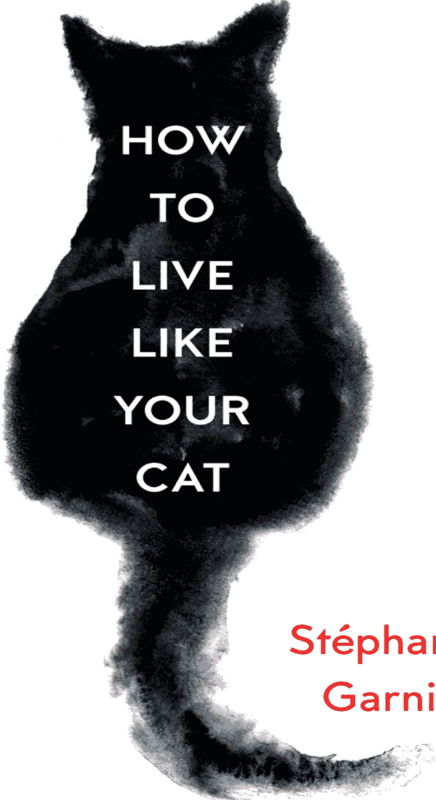
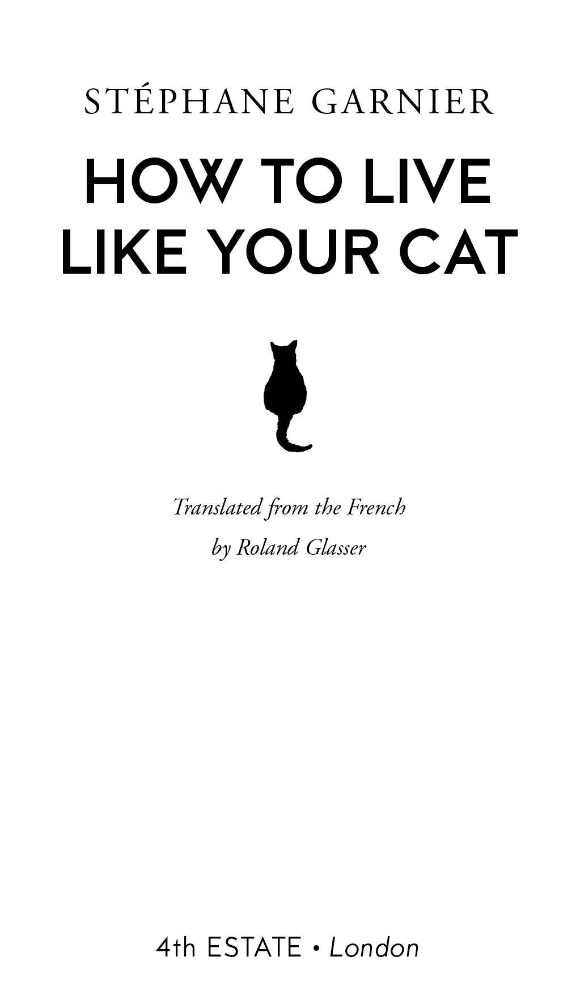

# 如何像猫一样生活

献辞

献给 Ziggy，

我的猫

前言

你的猫是一个真诚的朋友

你的猫总有最后的发言权

*关于作者*

*关于出版社*

## 前言

有些日子，你不想去上班，不想看新闻，不想把灾难挂在心头，甚至不在乎自己的未来。你不想对政府那些让你咬牙切齿的最新改革发表意见，就像你不想为职业轨迹担忧，或者不想知道退休时会有多少养老金一样。你不希望不断被自己的问题困扰（而这些问题本身又与家人朋友的问题联系在一起），你也不想为饮食质量感到烦恼，或者每当洗一次澡就为破坏地球感到内疚。你渴望关闭所有程序，断开连接，哪怕只有一天，只要一刻，呼吸一下。

我环顾四周，发现我的猫 Ziggy 悄无声息地进了我的书房。它盯着我，眨着眼睛，然后跳到我的桌子上躺在键盘上。这是我们已经持续多年的小仪式，可以追溯到我还在用手写大部分稿、而它那时经常咬我的笔的时候。这游戏让我发笑。仿佛它一方面喜欢我写作，但另一方面它又竭尽所能地阻止我写作。直到这一刻，我一直认为它拍弄我和键盘仅仅是亲昵的游戏。但也许多年来，它一直在试图告诉我些别的什么，简单如：“嘿，你今天觉得不想停工一天吗？”

停工。当它用鼻子蹭我的脖子时，我意识到，今天，我不在乎是否能付清账单，也不在乎股市是否即将崩溃。毕竟，它在乎吗？

也许这就是它一直以来想要传达的秘密：学会放手，专注于本质，考虑你的健康，像它一样。像你的猫一样生活！

猫的生活显然比我们好得多。那么为什么不效法它们的榜样呢？通过解码它们的运作方式、愿望和生活方式来实现。多年来，这一直就在我面前，我从未察觉。无论在个人生活还是职业生活中，我们都可以从猫身上学习。我邀请你发现它们简单的秘密，这样你就能从日常生活中抽离出来，重新找回健康并微笑。但猫做对了哪些事情？我们应该如何从它们身上汲取灵感？从今天起，想象另一种看待生活的方式，像你的猫一样生活。

你的朋友，猫

“有什么比猫的爱更伟大的礼物呢？”

C H A R L E S D I C K E N S

自古以来，猫就迷恋着我们。我们观察它们，试图理解它们的优点、品质、行为、习惯和强迫症。它们宁静生活和快乐的能力中有一种魔力——这是猫天生拥有的财富，我们完全可以在日常生活（无论是个人还是职业）中利用它们。

猫遵循一种生活哲学，可以概括为几个字：吃、玩、睡、照顾自己的舒适，只做令自己快乐的事。与我们相比，这已经很多了。但正如你将看到的，还有更多。

猫的生活方式让它们能够无压力生活，因为猫只有一个优先级：它们的健康。通过让自己接近它们的生活方式，我们可以开启一个全新的视角、一个新的世界观，同时对自我产生不同、更深层次的理解。欢迎来到猫的世界观，它们的思想和它们的哲学。学习像它们一样欣赏生活。

“我是独自行走的猫，我想进入你的洞穴”

R U D Y A R K P L I N G , J U S T O T R E S

自由，珍视的自由。谁没有梦想过让自由成为生活的动力呢？随心所欲的自由，只做你快乐的事的自由，行动的自由，随性和心愿的自由，在思想上和身体一样自由。自由！

相反，我们都倾向于反复束缚自己，自我劝解，理由是为了那些迫使我们更加努力工作的银行贷款，那些在我们眼里如此珍贵的虚无物品，那些已经变成我们不再视见的习惯，或者是我们强迫自己花时间去的人际关系。也许是时候从这些枷锁中解脱出来了。为什么不尝试只保留你爱的事，保留那些令你快乐的关系，只从事你喜欢的活动，只从事那些让你感到满足的工作？只听从自己的建议，追随真实的愿望。

第二天本能。自由是它们生活的内核。对它们来说，其他一切最终无关紧要，而我们往往将这种理想推迟到日程表允许时的某次休假。

**你想像你的猫一样生活吗？像空气一样自由，只做你选择要做的事。**

“上帝创造猫，是为了让人类能够体验抚摸老虎的快乐。”

J O S E P H M É RY

猫不需要通过喵喵叫、四处乱跳或是跳一场大闹的舞来脱颖而出。当它们进入房间时，你就能感觉到它们的存在。不需要任何张扬。猫天生的魅力确保了每个人都会注意到它们。

猫的审慎和性格使我们在每当它们步入客厅时，都会不由自主地望向它们。高雅，非常高雅。谁没有梦想过拥有这样的磁力呢？

你的猫做了些什么来发出如此正能量的波动，并成为如此瞩目的焦点？

什么都没做。你的猫仅仅是待在那里。

这就是猫教给我们最大的课程：如果你希望获得更多一点动物性和魅力，只需做你自己。

不要躲藏，不要对自己撒谎，不要扮演角色，不要试图通过挥舞双臂来迷住在场的人。什么都不做，就此了。

像发射器或光源一样，散发出生你的个性吧。

在讨论中不要模棱两可；不要为了自吹自擂而霸占话题，那只会让观众感到无聊。因为他们会在潜意识里感觉到，你通过那些长长的独白真正想要说服或安慰的其实是你自己。那不是有魅力，仅仅是无处不在、侵略性，并且最终是压迫性的。

你难道没有注意到，最有魅力的人——例如那些被认为拥有“大气场”的演员——从不过分吗？他们的言辞像他们的穿着一样内敛。

最有魅力的人并不是最奢华的人。他们虽然在，却总是表现出某种克制。

你对自己和他人越诚实，魅力就越容易发展；当你接受真实的自我，而不诉诸于不符合你深层性格的伪装时。

迷人的个性有许多形式，只要我们在任何情况下都做真实的自己，就像猫一样，我们每个人都能发展出一种。

**通过真诚、审慎、朴实真实，用你的存在和魅力点亮你周围的空间。**

## 猫的一天

跟随猫的脚步，观察它们的日常活动：你会因此感觉更好。

### 7.30: 闹钟响起

对许多人来说，早晨醒来并不总是容易的。所以，模仿猫的做法来消除睡意。

你的猫不会像抽隙盒子里的兔子一样蹦出来：这对身体和心情都没好处。

猫会伸展、放松，慢慢睁开眼睛，花上它们需要的时间醒来。伸展，打哈欠。猛然自己自己意义。你的猫在躺着时就开始伸展，然后站起来，弓起背，再次伸展并打大哈欠以完全露出犬齿，然后坐下，眨着眼睛。

我试过这种。我开始模仿 Ziggy。这确实比像翻煎饼一样从床上跳起来，然后拖着沉重的身体走向厨房冲杯茶要愉快得多。

这种现象——大多数动物都会练习——被称为“伸展屈伸运动”（pandiculation），这是一种我们人类往往容易忽视的反射动作。但它对于适当的醒来和开启良好的一天是至关重要的。

## 你的猫是冷静的（大多数时候都是）

“冷静的概念是一只坐着的猫”

J U L E S R E N A R D

压力是我们现代社会的祸害。我们该如何对抗它？又如何引导它？

在过去的几十年里，开发了许多放松练习和技巧。这不是一个好信号，因为它意味着我们的压力越来越大，越来越多的人陷入了压力之中。

总是忙碌，总是神经紧张；焦虑在积累，失眠也是，导致生理影响，如高血压，然后是精力竭。

我们真的必须生活得这么糟糕吗？我们该如何改变？

观察你的猫：它有压力大吗？很少。你的猫流溢着冷静和宁静。你的猫静静坐着，肌肉放松，没有表现出任何焦虑的身体迹象，目光毫无紧张。

我们有时在猫身上看到的“压力”，实际上是警觉性的提高，是对潜在危险的警觉，是对可能扰乱它日常生活中平静安稳状态的事件的警觉。猫竖起耳朵，聚焦目光，观察并等待。但一旦确定了担忧的原因，猫就会恢复冷静，几秒钟后把头低回去。

一旦情况或危险过去、被避免或被处理，你的猫就不会再培养压力。你的猫似乎放下了任何困扰它的事情——处理掉任何残留的思维痕迹——仿佛那个事件从未发生过一样。这也许是你猫最大的力量，也是它保持那庄严冷静的关键之一。

你的猫的生活是结构化且沉思的——强调舒适和健康——任何事都不能打扰它。猫不喜欢日常作息发生重大改变。

进入猫生活的唯一（罕见）压力时刻源于这种状态的改变。如果入侵者进入了你猫的领地，必须迅速将其赶走。如果你猫的猫粮换成了另一种更廉价、没那么美味的品种，那么必须坚定地表示不满。同样，猫会非常明确地让你知道，你长期且反复的缺席并没有满足它们对爱和关注的需求。

**为了保持内心的冷静与和平，识别压力的来源，彻底解决问题，然后彻底忘记它——不要反思或苦闷——冷静就会回来。**

另一个在猫身上观察到的现象（也是兽医注意到的）是，如果猫经常压力，原因通常在主人身上。猫像海绵一样，它们感受一切。但一旦紧张、噪音超过了某个程度，它们就无法完全消化。

如果家庭氛围变得难以忍受，导致猫的健康受到威胁，它可能会离开（如果它可以的话）。但那是谁的错？如果平静的代价是离开，猫会这么做的。记住。

## 你的猫懂得如何维护自我

“我爱它们，它们是如此美好又自私。狗太好、太无私了。它们让我感到不自在。但猫是伟大的人性。”

L . M M O N T G O E RY, *A N E F T H E S A D*

我们中的许多人发现很难在别人面前维护自我，要么是因为害羞，要么是因为缺乏自信。我们退后一步，说得很少，表现得好像别人在智力上更优，或者至少足够自信能用他们的存在、知识（如果你真的听的话，通常是他们的愚蠢）来压倒所有人。

这些“别人”是谁？他们就是你和我，因为我们都是某某人的“别人”。如果别人占据了比你更大的空间，是因为你允许他们这样做。这就像柜子：你拥有的，填得就满。你是否发现别人侵犯了你的空间，有时甚至踩到你的脚，然后对你肆意践踏？

想想你的猫。尝试踩一下你猫的爪子，看看它们的反应。你会听到它们的叫声，可能还会感觉到它们的爪子抓进了你的小腿里！

不要再任人由摆布了。“他人”没有权利这样彰维护自我。他们拥有的仅仅是你赋予他们的空间；他们拥有的只是你的包容。他们不会在踩到你的脚后停止。他们会将你踩进泥土里，然后为了以保险彻底把你淹死！

拥有魅力和强大的性格（像你的猫一样）与为了强加自己而践压他人，之间有着本质的区别。

猫占据它们应得的空间，而不挤压邻居，但它们对这种空间的任何侵入绝不容忍。它们安静地彰维护自我。它们不扮演暴君，但也不接受做配角。

**学会冷静地彰维护自我，并在第一次入侵尝试时捍卫你的空间。你值得的不仅仅是一个配角！**

## F O O D F O R T H O U H T（思想食）

“我希望我写得像猫一样神秘”

ED G A R A L L A N P O E

## 你的猫是智的

“我广泛地研究过哲学家和猫。猫的智慧是无限优的”

H I P P O L Y T E T A I N E

猫凭借那专注的态度——始终在倾听，像某些沉默的心理学家——看起来像一位佛教导师或一位古老的智者。但这可能不仅仅是一个印象。也许我们可以从猫那种不过度耗费精力，而是坐那里沉思世界的方式中学习。

随着岁月流逝，我们变得越来越老，我们都对世界、生命和永恒的真理获得了一点点智慧和视角。

我们中间有多少人某时刻说过过：“我想重新回到二十岁，但要带着我现在所知的一切？”我们随着时间获得智慧，而猫——它们没有学校，没有书，没有伟大的思想家，没有外部参考框架，甚至没有漫长的岁月或经验——拥有一种与生的智慧，这种智慧我们从中窥得寥寥片段，而且只有经过大量的反思、讨论、灵魂拷问和内省。

这是一条艰难的道路——在多个方面都是如此——才能到达我们可以冷静地坐那里，带着微笑注视地平线的程度，而猫几乎从出生起就知道如何这样做。

但我们如何能掌握猫所散出的这种不可测、近乎神秘的智慧的奥秘呢？

事实是，它们向我们提供了这种智慧。如果你有一只猫，你就会明白。你一定已经经历过那个时刻：当你深陷疑虑中，同样的念头在脑海中转转，无法后退一步时，你直视你的猫的眼睛，它也直视着你，仿佛在读懂你的灵魂。你内心充满了深切的信念：与你不同，你的猫知道的。或者至少曾经知道。

猫的眼神中带着某种慈悲，唤起了那个关于波斯皇帝的古老传说：他集结了最伟智者，要求他们想出一个能够涵盖一个人一生中可能遇到的各种情感和情况（无论好坏）的短语。一段时间后，智者们回到皇帝面前交付了那个短语。当你迷失时，你的猫通过眼神向你传递的信息，那个流传千老的短语是：

**“这一切终将过去。”**

是的，无论好是坏，这一切终将过去。

我们有时会花太多时间在胡乱中挣扎，对生存的本质充耳不闻。也许这就是你的猫通过它的静止、它的沉思和仁慈的态度在告诉你的：“我在这里，守护着你，照顾着你。这一切终将过去。”

**智慧不是一个可以学习或教的科目（此处意为不是一种可以通过学习或教学的学科）。它是一种状态，一种立场，需要从生活的动荡中退后一步，以便在普遍性上更好地理解它。智者知道如何坐在月亮上俯瞰地球，就像猫坐在屋顶观察月亮一样。**

## 你的猫首先考虑自己

“猫不是在抚摸我们，它是在我们身上抚摸自己”

A N T O I N E D E R I V A R O L

正如我们所见，猫将生命的大部分致力于确保自己的福祉。为了做到这一点，你有时需要学会自私一点，只考虑你自己。

这并不意味着要做一个自视者、自恋者或自我中心主义者，而是允许自己有时将个人幸福置于他人之上。

如果你不知道如何给予自己，就无法给予他人。在任何事情之前，照顾好你自己，无论是身体上还是心理上；你幸福的关键取决于此。

你将能够给予和分享更多，因为你将在自己的生活中感到快乐和充实。

在创造你自己的福祉与温柔泡泡之前，不要等待他人——这完全取决于你。没有人会为你做这件事。而且，没有人知道你的福祉真正需要什么。

所以，掌控好你自己，像你的猫一样，构建你的领地、你的舒适区和你的自我实现方式。

每天培养小快乐，永远不要错过送给自己一份小礼物或愉快时刻的机会，因为你真的值得。永远不要怀疑这一点！

**考虑你自己和你的福祉。照顾好你自己。没有人能比你自己为你做得更好或为你做得更多。**

## 你猫的一天

### 7.45: 早餐

给你的猫准备水和牛奶，放在干净的碗里。干粮和湿主食——来自罐头或袋装，但永远是优质、新鲜的东西——盛放在干净的地方。

这看起来似乎是理所当然的，但我们中有多少人真的花时间吃一顿正式的早餐？我们中有多少人靠在厨房水槽旁，草草灌下一杯茶或咖啡，甚至懒得去准备一片美味的吐司？

你已经照顾了你的猫，现在照顾好你自己。以舒适的方式吃一顿正式的早餐是开启一天的最好方式，就像对你的猫来说一样。花时间吃东西，做一些吐司，涂上那层在冰箱角落冷落已久的好果酱。吃你喜欢的，但要慢慢来并享受它。

早餐是一天中中最重要的一餐，正如营养师们喜欢告诉我们的那样。这也是照顾自己并开启一天的方式。

## 你的猫接受现状，你的猫爱自己

“猫只是人类；它们有自己的缺点”

K I N G S E Y M I

事实是：当我们无法接受自己时，我们就制造了痛苦和失望。我们生而不同，我们对自己的状况、身体、社会地位感到不满。太多人不爱自己。我们宁愿成为别人，而不是接受自我。接受自我意味着发现我们每个人拥有的财富和能力。

你的猫会问自己吗？你的猫会想变成另一只猫或其他动物是什么感觉吗？这样的问题显然进入猫的大脑，因为这样的问题完全毫无意义。

发人深省

“你怎么知道自己疯了呢？”

“首先，”猫说道，“狗可没疯。你认同这一点吗？”

“我想是这样吧，”爱丽丝说。

“那么，”猫继续说道，“你看到过狗在生气时会低吼，高兴时会摇尾巴。而我高兴时会低吼，生气时会摇尾巴。因此，我是疯的。”

刘易斯·卡罗罗尔，《爱丽丝漫奇仙境游记》

## 你的猫自带傲气，你的猫是自豪的

*‘狗认为自己是人。猫认为自己是神’*

匿名

我们经常混淆自尊与自信。尽管这两个概念相互重叠且互补，但一个人完全可能很有自信，却并没有多少自尊，反之亦然。

听起来有点模糊？好吧，比个例子：你是一个出色的销售员，对自己的销售能力充满自信，在外面工作时感到很有底气，但你每天都告诉自己你的工作没有成就感，是毫无意义的，世界上有比这更好的你可以做，但是……缺乏自尊。

反过来说，为了让你听得更透彻：你告诉自己音乐是你的热情，你是一个有才华的音乐家，从粉丝那里得到的各种反馈让你知道这一点，尽管你发现获得成功很难，因为在舞台上……缺乏自信。

你为你自己的身份感到自豪吗？为你所做的事情感到自豪吗？

你在你所做、你所是中的自我形象，与你的自信同样重要。如果你与自己的欲望、需求和梦想保持一致，那么自尊与自信往往会重叠融合，你将达到成就感与幸福感的巅峰。

至于猫，关于自尊以及对自身和所作之事的这种自豪？猫天生的自尊和对自我的自豪显然是一种我们可以汲取灵感的资产。你的猫为自己是一只猫感到自豪，带着这其中代表的所有优势。

每只猫都是独一无二的，它们也清楚这一点。猫不需要过分表现来来说服自己或周围的人。你的猫充满自信，自尊心。你的猫不需要向任何人证明什么。你的猫仅仅是存在那里。仅仅是一只猫，就足以傲然行之。

# 为你自己的身份感到自豪：在这上，你将脱颖而出

## 发人深省

> “猫的眼睛是向我们展示另一个世界的窗”

爱尔兰谚语

## 你的猫是关注焦点

> “猫不提供服务。猫提供的是自己”

威廉·巴勒鲁斯，《体内的猫》

尽管它们安静冷静，带着一种“别来烦我”的气质，但你的猫总是想成为关注的焦点——只要它们喜欢环境中的那些人类。它们在不同的膝盖间走来走去，甚至会在场场唯一一个并不特别喜欢猫的人腿上蹭——仿佛在接受某种挑战。

没有人能逃脱你猫的存在，包括那些性格内敛的人。你的猫已经是你家的主宰了；而当你邀请几个朋友聚在一起喝酒时，成为焦点是你的猫非常喜欢的小游戏。

但你的猫是如何吸引注意的呢？它会为了喵喵来引起注意吗？年轻的小猫在头几个月里可能会因为缺乏经验而这样做。但任何冷静从容的猫只会轻盈地走向你，眨着眼睛，在几秒钟内逐个催化你的客人，通过给他们提供抚摸毛皮的“机会”，提供一点点温柔和关注。即使你第一次见到某只猫，它也会通过它平静地靠近、让自己被触摸，甚至（有时时候）假装享受其中，而迅速成为你关注的焦点。

从本能上，我们都想通过伸出手来从猫身上汲取某种无形的东西。一点平静与宁静。猫知道这些，只是静静地看着我们。猫允许我们这样做；它们让我们通过它们自我安慰。因为当我们抚摸猫时都会微笑。

但你的猫到底做了什么才成为焦点呢？你的猫给出了。通过它的存在方式给出了。通过将自己呈现在你面前，作为一份你可以触摸的抚慰礼物给出了。

几次抚摸，突然，仿佛被催眠了一样，所有人都停止了聊天。为什么？因为猫对他们投入的兴趣，它在那个时刻放在每个人触手可及的生命与宁静之源，远比任何哲学上的反思、形而上学的思考或混乱的辩论更有价值。

**想要吸引注意力，就要成为你亲人的源泉、引力中心。给予吧！**

## 你的猫对评判免疫

> “至于那只猫，她对人类有自己的看法。她话不多，但你听出的信息足以让你担心自己没听全”

杰隆·杰罗姆

这是一个经常令我感到趣的观察：猫完全不在乎是否被欣赏，无论是被人还是被其他猫欣赏。

猫是独立、孤独的角色。在它们偶尔依附于人类或其他动物的极少数情况下，那是出于选择且带有洞察力的。这意味着它们非常自然地——而且带着不小的快感——忽略了他人对它们的看法，而我们人类倾向于赋予这种看法过多的重要性。

猫并没有这种需要被“他人”爱、赞赏、崇拜，或至少被接纳的需求。猫仅仅是存在那里。它们对自己的看法才是最重要的。

当然，我们不能只顾着审视自己的脐脐，那并不是重点。但自尊与他人看法之间的平衡往往会过度地向错误的方向倾斜。

在我们周围有充足的证据证明我们社会对外貌的痴迷。只要看看媒体吧。个人形象已成为一种崇拜，不是为了自己，而是为了他人。然而，这是我们对自己能犯下的最大的欺骗。

看起来酷、看起来年轻、看起来富有、看起来聪明、看起来宽容、看起来有趣、看起来开明、看起来、看起来、看起来。这是过去几十年的主旋律，由时尚、真人秀和社交媒体所驱动。

看起来有才华或看起来诚实，直到你成功说服自己那个谎言是真的。因为唯一重要的是当下的时尚、最新的趋势以及大多数人的接纳，平衡已经极度偏向了他人的看法。我们看起来什么样变得比我们真实的模样更重要，因此不再是真正让我们幸福的东西。

## 你家猫的一天

### 8.15：洗澡时间！

在吃完丰的早餐后，你会看到你的猫开始长时间地舔舔自己。对你来说，也是洗澡的时间了。

每个人都知道赶时间时洗澡是什么感觉。有时候在你走进水流之前，水还没完全变暖和。快点，快点！你赶时间呢！与此同时，你的猫正缓慢地用舌头舔着一只后爪，然后是另一只。非常从容。

除了显而易见的卫生益处外，洗澡是你一天中可以、且**应该**照顾自己的时刻之一。这也是一个放松的时刻，是一个绝佳的机会，可以让思绪畅飞，让大脑轻轻地觉醒，面对你日程表上的安排。

在这方面，女性往往比男性更擅长；沉浸于在浴室里长时间地呵护自己，这是男性难以理解的。但这是一种非常正宗的猫式态度，我们都应该从中学习。

## 你的猫天生好奇

> “没有不比小猫更勇敢的探险家了”

J U L E S C H A M P F L E RY

猫有着天生的好奇心。当它们一从篮子里跳出来，在地板上穿梭时，它们就会四处嗅嗅，闻遍每一个角落，全贯注地检查每一个物体，并探索任何未知的区域。

与狗不同，猫不会不经思索地扑向每一个新奇事物。你的猫会谨慎地行进，眼睛从不离开过那个新纸袋或未探索的藏身处。

猫拥有不受抑制的好奇心，这让它们不断地重新探索自己的世界。每一天都是新的发现，是这种无尽好奇心驱动的非凡小惊喜。

我们都可以从每天学习一点点中获益，并更多地感到惊讶。

有些人的观察力或多或少，他们的注意力或多或少集中在总是想做出新发现上。新奇感对我们的健康至关重要，它是我们大脑的氧气。我们需要它就像我们需要呼吸一样。没有它，我们会慢慢枯萎。对于那些不知道如何培养这种提升心情好奇心的人，只需坚持这个基本原则：

**每天学一样新东西。**

这个新事物的意义、重要性或价值无关紧要，但每天学一些东西，哪怕只是一个单词。你永远记得它。

重要的是长期坚持这种练习，特别是如果你是一个天生不好奇的人。每天一个时刻的好奇意味着每年有 365 个新知识点，相信我，这会产生巨大的影响，不仅影响到你在智力问答中的表现，最重要的是影响你的幸福。

**保持好奇！对万事保持好奇！这会让你的生活变得更好。让自己惊叹吧。**

## 你的猫是独立的

> “一旦一只猫同意和你住在一起，你和猫在余生中都会不断决定这种安排是否可行”

M I C H A E L C U N N I N G H A M

独立是你猫的主要特征之一。猫不隶从于任何等级制度，它们不需要建立任何形式的社区生活，或像其他动物一样生活在部落中。

猫拥有不受抑制的好奇心，这让它们不断地重新探索自己的世界。每一天都是新的发现，是这种无尽好奇心驱动的非凡小惊喜。

我们都可以从每天学习一点点中获益，并更多地感到惊讶。

有些人的观察力或多或少，他们的注意力或多或少集中在总是想做出新发现上。新奇感对我们的健康至关重要，它是我们大脑的氧气。我们需要它就像我们需要呼吸一样。没有它，我们会慢慢枯萎。对于那些不知道如何培养这种提升心情好奇心的人，只需坚持这个基本原则：

**每天学一样新东西。**

这个新事物的意义、重要重要或价值无关无关紧，但每天学一些东西，哪怕只是一个单词。你永远记得它。

重要的是长期坚持这种练习，特别是如果你是一个一个天生不好奇的人。每天一个时刻的好奇意味着每年有 365 个新知识点，相信我，这会产生巨大的影响，不仅影响到你在智力问答中的表现，最重要的是影响你的幸福。

**保持好奇！对万事保持好奇！这会让你的生活变得更好。让自己惊叹吧。**

独立是你猫的主要特征之一。猫不隶从于任何等级制度，它们不需要建立任何形式的社区生活，或像其他动物一样生活在部落中。

正如你可能察觉到的，书中的所有章节都是相互重叠的，因为完全的自信取决于一系列能力——为了更好地探索这些能力，我们刻意将它们分成了不同的部分——但它们都是交织并相互影响的。

是的，你必须爱自己，才能对自己充满自信。你必须足够独立且不妥协，并让自己从总是在担心“别人会怎么想？”中解脱出来。

自信不是什么虚无缥缈的概念。它是你的猫所拥有的一系列优势和能力。学习将它们逐一融入自身，你每天的生活和表现都会变得更好。

自信自信的人是“焦点所在”、“自由”且“富有魅力的”。他们通常过得很快乐。但随着时间的推移，他们学会了如何培养所有让他们获得这种自信的特质。

像你的猫那样做，你就会成为你自己。

**“对自己要有信心！”对于这类书来说可能是一句浅显的话。但我可以向你保证，像你的猫一样培养构成这种自信的各个方面，将为你的生活带来快乐和胜利，让自信在你体内自然生长。**

## 你的猫懂得如何授权

> “我给猫下了命令，它却给了自己的尾巴”

中国谚语

你是否倾向于总是随叫朋友或家人的召唤？或者你认为每个人都应该候着你，迎合你的每一个心愿？

不要做得过，但知道如何像猫一样被服务，真的可以减轻日常的压力。

众所周知的事实是，猫什么都不做，花时间享受别人的服侍。猫是它所视一切的国王或王后。

你不必逐字模仿这种尊贵且主主主地位的态度，但也不应该成为每个人的跑腿，随时为家人服务。满足孩子或伴侣的每一个期待、奇想和欲望，并不能带来最安逸的生活。

学会像你的猫一样被服务，从授权日常琐事开始吧。你不是你孩子的奴隶或杂役，承担一些家务对他们没有任何伤害——事实上，这有助于他们变得更加独立。此外，你将节省时间，提高效率，并且少那么疲劳和压力大。学会授权是关键。不要仅仅因为自己做比让别人做快就自己承担任务。

这在职场中同样适用。许多公司董事和其他经理无能力信任他人并授权，因此他们花了太多时间来检查和验证员工的努力。这创造了一种文化，让员工产生了被“妈妈照顾”的需求，并希望工作的每一处细节都得到检查和批准。最终结果是浪费了大量小时，员工失去了自主权，而老板（很可能就是你）却承担了过量的工作。

最重要的是，学会授权意味着为自己留出时间去做你喜欢的事，而不是成为家人和朋友日常需求的奴隶。

还有另一种看待问题的方式：授权难道不证明了你对亲近的人——你的员工、你的伴侣和你的孩子的信任吗？

也许说你的猫期待你对它事膝如备是为了你好好就有些过分了。但请记住：

**在工作和家里都要像猫一样：学会授权。**

## 思考的食粮

> “狗可能是精彩的散文，但只有猫是诗”

法国谚语

## 猫咪的一天

### 8.45：清晨，慢慢，慢慢来

谁真的知道猫的一天在忙什么？我们所知道的是，就像你早晨去上班一样，你的猫也需要出去游荡。你的猫会全速冲出家门吗？不。你的猫会优雅地挪过门槛，伸出鼻子闻闻空气——跨在门槛上——这既让你觉得好笑又让你恼火，因为你关不上门。

为什么你离开家时总是那么匆忙，经常得冲回屋子拿钥匙或遗落在厨房桌上的那份文件？如果你能更有组织性，就不用那么赶了。看看你的猫，悠闲地在小路上散步。像无头苍鸡一样乱跑只会浪费时间并让你感到压力。

健康的关键在于保持冷静。整天保持冷静和镇定，以务实、有组织的方式进行，你就能完成同样的事情，而且速度并不比你在高度焦虑的状态下奔忙忙碌要慢。

追随猫的引导，以稳健、坚定的脚步开始新的一天，花几分钟仰望天空，捕捉第一缕阳光，并微笑。

## 你的猫懂得留时间生活

> “在所有动物中，唯有猫达到了沉思的生活”

安德鲁·兰格

从猫只是那样躺在那里，或者坐着凝视世界、审视最微小的细节的方式来看，你可能会认为它们是一群一整天什么都不做的懒虫。你并没有错……至少从人类的角度来看是这样。

“无所事事”与“留时间生活”有显著的区别。在我们目前的体系中，无所事事和填满每一分钟被视为常。我们被告诉必须不断移动，否则我们就是在“浪费时间”。

留时间生活意味着察觉每一个时刻，而不是填满你的日程。对于某些人来说，甚至假期也比工作一周更精疲力竭。

坐下来，放松，观察你周围的世界。模仿你的猫，你将感到一丝宁静回到你的生活中。

**有一句谚语说：“你花了很长时间才出生，所以要留时间生活。”**

**为了这样做，只需模仿你的猫并留时间生活。**

## 你的猫能适应一切

> “你可以随心所扔猫，它总能用脚着地”

谚语

它像猫一样，但像兔子一样用后爪蹬地。它的速度快得惊人！

至于那些看到齐吉（Ziggy）断了一条腿，就以为可以轻易溜进花园而不怕被赶走的闯入者：那可大错特错了。在这里，齐吉也采用了一种独属于自己的技巧：他不再去追逐那些来示威的大公猫，而是在花园中央占据一个位置，静静地站着，让对方绕着他以不断收缩的圆圈前进。一旦敌人距离足够近，齐吉就会像袋鼠一样用后腿站立，高举起那只孤独的前爪，就像拳击手一样。另一只猫并不理解这种异常行为，继续靠近，虽然有些警惕但并不多。我目不转睛，被这种冷静、这种拳击手的姿态迷迷了。一旦入侵者进入可及范围，齐吉就挥出一记重重的左勾拳，震了那只大公猫！他那的一只前爪由于长期的使用已经变得非常强壮。感到惊讶的入侵者败逃而逃，这时齐吉才将他赶出了自己的领地。我太吃惊了！他很少需要做到比这更多来赶走任何试图靠近房子的猫。

至于那些母猫，就是另一回事了，因为对于猫来说，诱惑和交配前的嬉戏是一件相当残酷的事情。齐吉在另一只猫背上保持平衡时有些困难……

然而，邻居那只暗恋齐吉的母猫很快明白，如果他们玩通常的游戏，他就无法像其他猫那样咬住她的脖子，并保持在她身上而不掉下来了。所以，当欲望占据了她时，她面对他面前，臀部朝向空中，一动不动！齐吉现在可以舒服地兼顾双方的快乐了。

猫在很多方面超过了我们，包括适应能力，而且在这只母猫身上，还体现在理解力上。

残疾从未阻止他像以前一样生活。没有任何梯子或树木能难倒他和他那只缺失的爪子。

我们离开了那所房子，搬到了里昂老城的中心。这对齐吉来说是一个新的栖息地，新的生活环境。那里没有花园，只有一条窄街——晚上 11 点后非常安静——那里有一个带猫门的旧工作坊建筑。齐吉很快适应了新地方，并把许多快乐的夜晚时光花在捕老鼠上。

我们搬到了现在居住的船只上——仍然在里昂——那里的情况只需要管理齐吉对路过的鸭子的吸引力，免得他掉进萨恩河。齐吉起初面对眼前这片广阔的水域有些不知所措。但几天后，他就成了这片地方的新主人，在舱顶上走走踱，从他位于最高点的指挥部巡视他的领地，并在栈道上来来去。然后，为了扩大他的领域，他开始下楼梯沿着沿岸散步，在草地上撒个尿，并密切观察任何靠近河岸的离群鸭子。

你的猫是物理适应和适应新环境的专家。尽管他们讨厌生活方式的任何改变，但他们会尽全力在别处重建他们舒适的丝茧，整合所有构成他们快乐生存的习惯。

适应能力是智力的真正标志。

**猫的适应能力来自哪里？是因为猫热爱生活吗？**

**是因为猫爱它的生命吗？是因为它爱自己吗？“三者都是，”齐吉船长说！**

**沉浸在睡眠中不会以任何方式阻碍你“享受生活”，**

**特别是考虑到我们理解这个短语的方式往往是相当浅薄的。**

## 你的猫知道什么时候该拒绝（而且乐于这样做）

*“我才不走。我才不想走！”*

苏斯博士，节选《戴帽的猫》

猫讨厌被告知该做什么。服从命令？对它们来说没门！

“如果你想那样的话，去养只狗吧！”它们咕囔道。

猫固执到了爪子尖，它们很少仅仅因为被命令就采取某项行动。

我们人类喜欢服从命令吗？当然不。然而，我们整天都在忍受它们，无论是在工作还是家里。这还没考虑到那些我们“必须”字字执行的社交准则所传递的许多间接命令。

学习像猫一样说“不”。

停止无休止地忍受别人的需求，停止遵循不适合你的指令，否则你最终将过上顺从的生活——在心里明明想说“不”时却总是说“好”。无论是为了小小的善举却演变成了一种你发现自己无法停止的惯例；还是定期地承担并非职责范围内的任务，以至于同事和上司认为这是理所当然，却没有对额外的工作量提供任何金报酬。够了！

偶尔对你的孩子、伴侣、老板和朋友说“不”，并不是出于完全的自私，而是为了保护你的行动自由和时间。如果你对每个人都说“好”，你还能剩下多少时间给自己，去完成自己的任务或满足自己的乐趣？

学会说“不”意味着知道如何保护你的时间、行动能力和生活，同时赢得家人、朋友和同事的尊重，他们有时会利用你这种不会说“不”的能力。

必须在命令和小小的善举之间恢复平衡。我们中没有应该永久地为他人服务。

**“不就是不！清楚了吗？”**

## 引发思考的食物

“猫作为一个整体，从未完全从那种因为在古埃及它们被当作神崇拜而产生的傲慢中恢复过来”

P. G. 伍德豪

## 你的猫知道如何避免冲突（尽可能）

*“只有四个异议者，三只狗和那只猫，后来发现那只猫在两边都投过票”*

乔治·奥威尔，节选《动物农场

猫不喜欢冲突，除非是为了保卫自己的领土、“追求”邻居的小猫，或者给入侵的公猫一个惨痛的教训。

你是否见过一群猫聚集在一起，以兼并领土或保护自然资源的虚假借口与另一群猫战斗？整场活动由两只穿着将军条纹的大猫策划的？绝没有！

猫越老，就越会采用策略让敌人逃跑，从而避免冲突。

当一只大公猫晚上进入它的领地时，Ziggy 有一个无敌的招数。一旦它感应到危险靠近，它就会躲起来等待。我第一次听到它低沉而响亮的咆哮声，非常恐怖。当我进入花园时，我看到另一只猫尽可能快地逃走了。Ziggy 无迹可踪。我叫它，但它没来。

直到我回到室内，才意识到它的技巧：它躲在窗外窗台阴影处的几枝地量藤后面，放大了声音（老实说，它听起来像只老虎），借此警告入侵者它显眼的体型，而无需自己露面。如果另一只猫留在附近，它就能预料接下来的战斗会有什么。十分之九的情况下成功的。猫逃了，Ziggy 留在它隐藏的哨点，直到它确定对方已经回到了它的领土边界。然后它才出来继续巡逻。尽管只有三只爪，Ziggy 夜间避免冲突的武器是狡猾、策略和想象。

猫不是好斗的打架者。它们是骄傲的，只要领地没有受到威胁，它们总是会避免战斗。这是我在孙子《兵法》中读到的一种准则。也许两千多年前写下这本书的孙子，也受到了猫的启发？《兵法》已成为战略家和军事领袖的关键性文本，尽管其中一些人显然忘记了它的教诲……

与人类仍然喜欢沉溺其中的切斗相比，猫管理冲突的方式很有——这种做法既老又无用。

在冲突中，总有两个输家。猫早已知道这一点。

**尽可能地：避免冲突。**

## 你的猫热爱它的家，并标记它的领土

*“至少有一只猫的家是幸福的”*

阿利亚谚言

猫热爱它们的家，无论大小如何。它们的家是它们的领域，它们是那里唯一的主人，即使只是一个一室公寓，因为它代表了它们世界的核心。尽管如此，猫对家非常依恋，即使很小。值得注意的是，生活在乡村的猫可能拥有覆盖十英里的领地，因为它们花费大量时间守护自己的领域。

你是否关注过朋友家的内部情况，他们的整洁、整齐和装饰？他们待在那里的时间得长吗？还是大部分时间都在外面？你经常被邀请去吗？如果你仔细观察，难道看不到这些人的家与他们的情绪状态之间的联系吗？一个人的内在幸福与居住空间的维护之间通常存在联系。这就像镜面效应，是心态的直接视觉化。

你呢？你在家里感觉如何？墙壁和家具是什么样的？你觉得那里是一个舒适放松的地方吗？你喜欢邀请朋友来吃晚餐吗？你自豪于展示你的家吗？你有没有一个舒适的沙发，铺着靠垫和毯子，供你在周日蜷着看电影、喝一瓶酒？你是否为自己的健康创造了所有条件？

与你的猫不同，你不需要标记你的领地（！）。你的家也应该是一个避风港，一个让你真正放松、照顾自己、重新找回自我并与外界喧嚣隔离开的地方，哪怕一会儿。

你的茧应该是一个温暖的巢，每当你需要放松、照顾自己、重新聚焦以及迎接你爱的人时，你随时可以回到。

**家最温馨！经营好你那小金宫殿的舒适度与美感，你会感觉好得多。**

## 猫咪的一天

### 1.15：强制性午睡

虽然你的猫肯定会花下午的一半时间在睡觉，但你通常无法做到这一点。

然而，在午餐和ر次放松的散步之后，在回到办公桌之前，你肯定会有十五分钟，甚至三十分钟的休息。

为什么不尝试一次十五分钟的微午睡呢？你会感到精力充沛，仿佛你睡了几个小时一样。

越来越多的公司正在引入这种做法，以提高员工的效率。猫的午睡已经变成了一种商业工具！

最重要的是，它是从睡眠不足中恢复的手段，用来增强能量，或者为了和朋友出去狂欢做准备。

## 你的猫信任你

*“成为一只愚蠢地崇拜你的狗狗的主人，并不是什么赞美，但被选为哲学家猫的朋友和知己，却是一份非常独特的荣誉。”*

H . P. L O V E C R A F T，《猫与狗》

一旦猫咪选择了你作为生活伴侣，它们将完全、绝对、近乎盲目地信任你。例如，当你抚摸你的猫时，它可能会翻身仰在背上，这是一个猫自然情况下不会让自己处于的位置（除非它们处于一个感到完全安全的地方），因为这个位置太脆弱，它们会觉得很难逃跑或自卫。然而，通过一次又一次的抚摸，在许多亲吻和其他亲昵的姿势之后，你将赢得猫的信任，它会坐在你的膝上或你身旁，以最意想不到的姿势等待你再次抚摸、玩耍以及让它挠肚子。

这种深层次的信任可以通过各种方式表现，但某些行为是它的明确指示。

我们对他人有多大的信任？

在爱情或友谊遭遇失望后，我们往往发现很难再次信任。尽管我们相信对方，但我们总是保持警惕，关注任何被我们解读（通常是错误的）为即将到来的失误的细微迹，或是一个在等待中的小谎言。

这种怀疑的态度会对我们的生活产生极大的负面影响。如果你时刻生活在担心随时被他人背叛中，你怎么可能快乐呢？这是不可能的。

重新找到宁静和爱情热情的其他方法，就是重新学会信任，盲目地，几乎像猫那样。

但是，像你的猫一样，你不应该把信任放在任何人身上，也不要立即对你的情感和生活敞开大门。

对于你遇到的人，遵循你的直觉；它永远不会让你失望。当你感到自己遇到了正确的人时，无论是友谊还是爱情，不要因为保持恐惧和不信任的姿态而将自己隔绝在外。

打开内心的闸门，放开自我，去信任。如果你想充分享受这次幸福的机会，就没有其他选择或可能的路径了。

**驯服你的恐惧。带着眼光去爱和信任。**

# 你的猫是天生的老板

*“猫不在，鼠乱欢”*

谚语 `P R O V E R B`

猫是出色的经理、完美的老板，因为它们在观察一切的同时，并不真的做任何事情。它们不需要大吼：一个眼神就足以赢得尊重。猫仅仅在那里，它的存在本身就足以威慑老鼠。

当我写这本书时，Ziggy 伸展在我的纸堆上，紧紧地盯着我，确保我专注于眼下的任务而不做白日。无疑，很大程度上归功于它，手稿才准时交付。

正如我们已经看到的，在工作中像猫意味着学会授权，这是主要的一。无论是为了公司任务的合理组织，还是为了同事的认可和自主性。但也意味着知道如何存在，如何关注全局，眼观而不形，并树立榜样。

无论你是否是老板，猫式的态度都非常适合职业背景。参考这些例子：

- 不要浪费不必要的精力。根据任务的重要性，配额你的工作和完成工作的时间。（猫说：“谁在乎那只蜘蛛？在老鼠来之前我不会动的。”）
- 不要为了表现出忙得不可交而东忙西乱。这只会给你的同事带来无用的压力。（猫说：“停止拿着你的吸尘器乱晃了，你弄得我头晕！”）
- 需要时保持高效。立即处理问题。（猫说：“你觉得你在干什么，你这个笨蛋？别动，我会搞定你的。”）
- 始终保持警觉而不被察觉，以跟进公司发生的最新消息。（猫说：“我知道是你用羽毛挠我。再靠过来一点，你就知道了。”）
- 需要时做出反应。知道如何付出那份努力。（猫说：“花园里有地鼠入侵了？行吧，我会加班！我们很快就会解决它们的。”）
- 定期和同事一起喝咖啡，了解办公室八卦并维持你的社交关系。（猫说：“猫粮盆还是满的。我们很快就会解决它们的。”）
- 不要假装忙不可交。（猫说：“猫粮盆还是满的。我们很快就会解决它们的。”）
- 不要假装在工作。（猫说：“猫粮盆还是满的。我们很快就会解决它们的。”）

**而如果你是老板，猫式的态度非常适合职业背景。参考这些例子：**

## 猫

*你常说——我们知道——我们在白天睡觉，是因为你.*

我们对他人有多大的信任？

在爱情或友谊遭遇失望后，我们往往发现很难再次信任。尽管我们相信对方，但我们总是保持警惕，关注任何被我们解读（通常是错误的）为即将到来的失误的细微迹，或是一个在等待中的小谎言。

这种怀疑的态度会对我们的生活产生极大的负面影响。如果你时刻生活在担心随时被他人背叛中，你怎么可能快乐呢？这是不可能的。

重新找到宁静和爱情热情的其他方法，就是重新学会信任，盲目地，几乎像猫那样。

但是，像你的猫一样，你不应该把信任放在任何人身上，也不要立即对你的情感和生活敞开大门。

对于你遇到的人，遵循你的直觉；它永远不会让你失望。当你感到自己遇到了正确的人时，无论是友谊还是爱情，不要因为保持恐惧和不信任的姿态而将自己隔绝在外。

打开内心的闸门，放开自我，去信任。如果你想充分享受这次幸福的机会，就没有其他选择或可能的路径了。

**驯服你的恐惧。带着眼光去爱和信任。**

# 你的猫是天生的老板

*“猫不在，鼠乱欢”*

谚语 `P R O V E R B`

猫是出色的经理、完美的老板，因为它们在观察一切的同时，并不真的做任何事情。它们不需要大吼：一个眼神就足以赢得尊重。猫仅仅在那里，它的存在本身就足以威慑老鼠。

当我写这本书时，Ziggy 伸展在我的纸堆上，紧紧地盯着我，确保我专注于眼下的任务而不做白日。无疑，很大程度上归功于它，手稿才准时交付。

正如我们已经看到的，在工作中像猫意味着学会授权，这是主要的一。无论是为了公司任务的合理组织，还是为了同事的认可和自主性。但也意味着知道如何存在，如何关注全局，眼观而不形，并树立榜样。

无论你是否是老板，猫式的态度都非常适合职业背景。参考这些例子：

- 不要浪费不必要的精力。根据任务的重要性，配额你的工作和完成工作的时间。（猫说：“谁在乎那只蜘蛛？在老鼠来之前我不会动的。”）
- 不要为了表现出忙得不可交而东忙西乱。这只会给你的同事带来无用的压力。（猫说：“停止拿着你的吸尘器乱晃了，你弄得我头晕！”）
- 需要时保持高效。立即处理问题。（猫说：“你觉得你在干什么，你这个笨蛋？别动，我会搞定你的。”）
- 始终保持警觉而不被察觉，以跟进公司发生的最新消息。（猫说：“我知道是你用羽毛挠我。再靠过来一点，你就知道了。”）
- 需要时做出反应。知道如何付出那份努力。（猫说：“花园里有地鼠入侵了？行吧，我会加班！我们很快就会解决它们的。”）
- 定期和同事一起喝咖啡，了解办公室八卦并维持你的社交关系。（猫说：“猫粮盆还是满的。我们很快就会解决它们的。”）
- 不要假装忙不可交。（猫说：“猫粮盆还是满的。我们很快就会解决它们的。”）
- 不要假装在工作。（猫说：“猫粮盆还是满的。我们很快就会解决它们的。”）

**而如果你是老板，猫式的态度非常适合职业背景。参考这些例子：**

## 猫

# 你的猫是韧性的

*“永远不要试图比猫更固执”*

`R O B E R T . H E I N L I`

固执，是的，韧性更胜。猫能够守着一个鼠洞几个小时，等待鼠类的出现。耐心，韧性：你可以看着猫做这件事很长一段时间，而它不会感到无聊或放弃。这是关于坚持——值得尊重——直到抓到那只老鼠的目标达成。

## 你的猫总是谨慎的

*“猫喜欢吃鱼，但讨厌湿掉的脚”*

中世纪谚言

猫并不是鲁莽之脑，它们总是从自己的挫折中吸教训。你的猫在长时间观察并采取无限预防措施之前，绝不会靠近一个新地方、一辆车或物体。猫会让自己陷入不必要的危险中。任何新事物都会先经过仔细的检查、嗅闻和细致入微分析。

谨慎往往可以避免问题、冲突和事故。但——毫无疑问是因为缺乏本能——人类一直通过用双手去抓燃燃的余烬来积累知识和经验，以此理解它是烫的。仔细想起来，这是一种处理问题的方式非常的方式。除非学习过，否则人类一无所知。你能想象你的猫走在发光的灰烬上吗？

我们有多少人在没有察觉的情况下吃了变质食物后生病了？然而，你有多少次看到你的猫在食物稍微变干时就不起鼻子不碰饭碗，或者在你从每个角度嗅闻它之前，拒绝吃你递给它的那块火肉？

你的猫中毒的几很小，因为你的猫会利用感官并且非常谨慎，包括对它们吃的东西。

人类天生往往无畏，因此也是轻率的，就像一个必须被事事事警告、教学并保护免受任何危险的孩子。但是谁教了你的猫火是烫的、水会淹人、以及大叫的大狗应该远避？是谁教了你的猫那些在街道上滚动的大型嘈闹物体是会撞死你的汽车？猫通过本能知道这些事，它们能察觉到危险，不像孩子。

我们已经失去了许多本能、许多感官，甚至在人与人的关系中也是如此。我们有多少某一个时刻说过：“我就知道他会对我那样。从一开始我就对他感觉怪怪的。”

你的直觉是对的。关于这个人的真相形成了你对他们的认知，然而，当这种排斥他人的感觉第一次袭上你头时，你遵循你的直觉了吗？没有。我们往往更倾向于理性而非直觉。随着时间的推移，当我们意识到我们的直觉从未背叛过我们，它总是为了我们的健康而引导我们走向谨慎时，真是太遗憾了。

第一印象从不说谎。为了未来更谨慎一点，尝试重新与你最原始的本能联系，听听自己 way，信任你自己。你永远不会后悔的。

**有疑之时即无疑。遵循你的直觉吧！**

## 猫的一天

### 6:30：温馨的家，回到窝穴

片刻的放松，拥抱，抚摸。待洗衣服和语音邮件可以等等。像你的猫一样，在工作了一天后放松一下。没必要忙着去做那些未完成的家务。换上一件更舒服的衣服，花半小时安静地坐着，也许放些音乐。

在愉快地开始你一天的第二部分之前，先呼吸一会儿，那部分完全属于你、你的随性与欲望，也许给几个朋友打电话……

在这一天的这个时候，你的猫最关心的可能是：“我的晚餐不是应该很快准备好吗？”这是一个极大的个人快乐时刻，因为你的猫知道你很快就会花时间——不像今天早上——打开一袋肉冻三文鱼，那是你的猫最喜欢的种类。

晚上六点半对你的猫和你对来说都是一个小小的放松时刻，是一天从活动转向放松的转折点。最好的事情不要把你一天的疲劳或压力带入你夜晚的小舒适世界。

## 你的猫对爱有巨大的需求

*“猫是为积累抚摸而生的生物”*

斯特凡·马尔罗梅

我们都需要拥抱、亲吻、抚摸和其他亲爱的动作。尽管我们中的许多人有时发现自己匮乏爱，但猫在需要时从不犹豫地过来向你索要一些温柔。

你的猫有时需要与你感受这种情感上的亲近，就像我们有时需要沉浸在与伴侣的拥抱中并紧抱住他们一样。

弗洛伊德描述我们生命中的第一次创伤是出生时脐带——那条连接母亲和她爱的物理纽带——被切断。从以后，我们试图通过与别人的所有关系（无论是爱情还是友谊）来重新建立那种情感联系。

我们越是痛苦缺乏爱，就越会从他人那里寻求，汲取直到我们饱，溢出来。就像猫一样，一旦我们满足了爱，我们就会在身体上撤离这个源头……然后再再次回来。

我们对爱的需要的频率也取决于我们对自己的爱。有些人非常喜欢亲热，另一些则没那么，因为我们并不是每天都需要同样的“剂量”。但我们所有人在某种程度上都需要温柔、拥抱和情感的温暖。

我们从伴侣那里获得，也从我们的猫那里获得，就像猫从我们这里获得一样——想念那些你的猫爱意地把头埋在你手臂下的时刻。那是它从你这里索取一些爱的方式。看它是多么渴望这种温柔而几乎流口水。这与日常为了单纯感到舒服的拥抱完全不同。一旦对爱和情感的需求得到缓解，你的猫就会离开你的大腿去忙它自己的事。

我们也是一样：需要、期待、等待这种我们每个人都需要的至关重要的爱。

就像猫一样，或者像花一样，在缺乏爱时，我们每天都会多枯萎一点。正因为如此，人类的心从未能离离开这种被称为爱的驱动力。

**我们都需要爱。但你需要知道如何给予才能接收。它是我们幸福的关键条件。没有了爱，生活会变成什么样？**

## 你的猫天生安详的

> “即使是最小的猫，也是独立的”
>
> ——奥纳多·达·芬奇

移动，不停地移动，忙忙碌碌是我们许多人的状态，仿佛我们无法静止片刻，我们被大城市生活中永不停的节奏所抓住，并将其带回了。

你刚从工作回来，把外套扔在沙发上，在脏衣服和未付的账单之间穿梭，手里拿着扫帚，另一只手拿着掸子。

你的猫看着你于厨房、客厅和书房之间奔波。你纳闷它为什么看你那么奇怪。是的，很明显你在打扰你的猫，但它也在试图弄清楚你是不是突然发了呆症。

拿起 DVD 播放器的遥控器按下“暂停”。这不仅仅是一个比喻；真的去这样做。深吸一口气，然后缓慢地呼出。你会感到一种深层的内心平静，仿佛你刚刚把行李放在了地上。微笑会点亮你的脸，通过这个动作和你的猫的目光——它没有离开你一秒——你会意识到自己从工作日的疯狂切换到了另一种无意义的疯狂，那种由过度活跃和紧张组成的另一个工作日。

当然，家务必须做，但没有理由不以更冷静、无压力的方式去对待它们。

然而，如果你继续忙忙碌碌，你会看到你的猫冷静地站起来，轻脚走开去找一个更安静的地方坐下来理毛，也许打个盹。你甚至可能觉得看到你的猫边摇头边自言自语道：“无可救药的人类！没怎么在家里，这里已经是压力中心了。我去卧室那堆干净的毛衣里躲着。至少那里会很安静一会儿。”

而且，在朝你方向发出最后一声喵喵之前，走向那些柔软、香气扑鼻的衣服（你以后只需要再次清洗它们），你可能会理解到类似的话：“嘿，既然你正忙，别忘了给我的碗装满猫粮并换掉猫砂砂，那儿简直臭极了！”

**别再到处乱窜了：那太浪费能量了。学会平静。**

### 深思思考

> “猫是神秘的物种。它们脑海中闪过的想法比我们意识到的要多得多。”
>
> ——沃尔特·史特爵士

## 你的猫知道自己想要什么，并且直言不讳

> “宇宙中有很多聪明的生物。其中大多数都是猫所拥有的”
>
> ——波兰谚语

当猫想要从你那里得到什么时，它们不会拐圈子；它们会一直纠缠你，直到得到它们想要的为止。猫是有胃要求的，如果它们对某种新品牌的猫粮并不疯狂，你就无法欺骗它们。最坏的情况下，你的猫会——闹脾气，或者撞掉碗，你也不得把那包新粮收进柜子，然后出去买回常用的那个品牌。

你的猫知道自己想要什么，并且会坚持自己的立场。

同样地，如果你的猫在晚上外面散步，或者正快乐地躲在离你两英尺外的花丛里，你永远无法强制它在晚上回来。

猫是出色的猎手，当它们在追捕猎物时，没有什么能让它们分心。这种固执的执着是猫的伟大特质。猫总是知道自己想要什么。甚至尝试谈判都是没有意义的。

我们自己多久需要根据某些外部因素做出妥协呢？

有句话说：“我并不真的自己想要什么，但至少我知道我不想要什么。”我只部分喜欢这句话，因为它往往用来掩盖那些被我们扫到地毯下的真实欲望，因为我们不认为自己能够实现它们。

“你真正想要什么？”是一个我们都应该经常且极度诚实地问自己的问题。很多时候，我们最终屈从于朋友和家人“想要”或“期待”我们成为什么，而不是我们“相信”自己与生为此的。我们忘记了真正驱动我们的动力和欲望。

“你真正想要什么？”猫清楚地知道自己想要什么，并且一生都只关注这一点。

知道自己想要什么是一回事。第二步是给自己提供实现它的手段，在你的抱负中要有要求性且直接。不要拐圈子。

我们所有人都在某种程度上有这种痴迷，即避免说出确切想说的话，或者清楚地提出我们想要的，这在许多方面都让人精疲力竭。

坦诚面对。不要害怕直话直说，不要直接处理话题，如实陈述事实，并明确说明你的愿望。直接一点，你将节省既时间又精力。

最后，尽管猫知道自己想要什么，但它们不仅仅通过态度或行为来索要（至少我们人类很幸运，拥有语言的能力）：它们会行动。

**直接一点，去问。“我想要，我能，我做！”应该对你来说就像猫那自豪的胡须一样自然。**

## 你的猫敢于开口（一直如此）

> “在猫的眼里，万物都属于猫”
>
> ——谚语

正如我们在上一章看到的，一旦我们清晰地识别、构思并表达了自己的欲望，我们有时需要一个杠杆、一个触发器，一点小帮助。

通常我们不敢在工作工作中寻求帮助，或者在个人生活中遇到问题时。为什么呢？也许是因为羞耻。是害怕这种帮助被拒绝。是在展现真面目时的某种顾忌。或者是一种乞求的感觉。当有严重的金钱问题时，这种羞耻感更强烈。我们不是出于虚荣和错位的自尊心而寻求帮助。

但你的猫确实会要求东西。当它饿了、想出去散步或想抱抱时，它会提出要求。即使在你睡觉时，你的猫也会不颜耻地来醒你，确保你照顾它那一刻想要的任何事情。

当我们需要时向周围的人寻求帮助，我们也能获益。而最奇的是，总有人乐意帮助你……只要你开口请求。

你听过多少次：“但你应该问的！你当时为什么没提这件事呢？我本可以帮你的。”

有时候，最简单的解决方案就是问。

你的猫总是对的。它敢于开口。

**敢于寻求帮助。有些人会很乐意帮你一把，因为他们会觉得你看重他们。**

## 猫的一天

### 7.30：晚餐时间

如果因为休息时间短导致午饭有点匆忙，晚上就是一个款劳自己并做顿好饭的机会。

你的猫会说服你给它吃冰箱里那些切碎的三文鱼肉，即使在你睡觉时，你的猫也会不颜耻地来醒你，确保你照顾它那一刻想要的任何事情。

当你独自独处时，尝试做一些简单的菜肴。

和别人一起做饭总是更容易，但如果你独自独处，为了享受一杯葡萄酒，为了准备一个愉悦的晚餐，顺便聊聊你的一天。

## 猫永远是诚实的

> “猫拥有绝对的情感诚实。人类出于某种原因可能会隐藏情感，但猫不会”
>
> ——欧内·海明威

我们有时都会撒谎。而我们第一个欺骗的是自己。但那些对真相的妥协并没有带给我们多少快乐。相反，我们为它们感到尴尬，并且并不为此感到自豪。

猫从不隐藏它们的忧虑、欲望。它们在态度和内心想法上总是透明且一致的。“为什么要这样做呢？”它们可能会想。观察它们，人们可能会同意。

撒谎是精疲力竭的。特别是你想维持下去时。事实上，谎得越多，维持那些相互关联复杂的谎言就越困难。但你可以通过简单说实话来停止这种痴迷。像猫一样诚实，正如我们所见，你将赢得魅力和信誉。为了他人对你的信任，为了你的形象、内心的平静和自尊。

**诚实，你将从中获益。**

## 猫是沉默且敏锐的

> “我像猫偷奶油一样警觉”
>
> ——威廉·莎士比亚，《亨利四世》

野外猫不喵叫，除非在繁殖期间，那时它们会发出更像咆哮的声音来驱赶竞争对手。当猫只是一只幼猫时，它会为了主主自己而喵叫，但随着月份推移，它会变得越来越安静。成年猫的高音喵声完全针对我们人类。这是一种试图与我们交流，但我们完全听不懂。所以大多数时候，猫会停止喵叫，回到它们自己的思考、观察和健康中。

就像幼猫一样，我们小时候会不停念叨来表达自我。但随着年龄的增长和语言能力的提高，我们说得越来越多，即使有时完全是一堆胡言。不像我们，猫很快就变成了“老大人”，因此很快学会了守口如瓶。它们沉默地观察，没有错过任何一个我们所做的，或对环境的任何改变，但很少有猫会对它们做出评论。

我们总是对一切都表达自我的倾向（作为一个话痨，我非常清楚有时我们真的说了很多）掩盖了我们健康的一个重要元素：学会保持沉默。

而且作为一个话痨，我太清楚了有时我们真的说了很多废话。有些时候我们做得过头了，或者心情不好，我们说的话就会被误解。那并不是我们的本意，但为时已晚，话已经说出口了。

学会保持沉默意味着控制冲动，避免说废话，并在表达想法之前进行反思。它意味着倾听他人的见解，而不是垄断对话，并且不再自己的意见视为最终定论。

学会保持沉默意味着保持适当距离，并在生活中保持一点秘密性。要真诚，但不要对所有人都完全透明，以此保护你自己免受背后说闲人的伤害。

表达自我并不等同于过度表现，虽然讨论至关重要，但观察有时比任何辩论都有说服力。

**学会保持沉默。学会不再通过话语成为一切的中心。倾听以学习，并并在何时保持沉默，这样当你说话时更有影响力。**

## 思考的食物

> “如果鱼是水的具化形态，那么猫就是空气的微妙模式”

## 你的猫是一个真诚的朋友

> “它永远不会忘记
>
> *你持久的关怀*
>
> *痛苦的领域将无法抹除*
>
> *你曾给予的舒适*
>
> ——老猫的独白”

如果你的猫接受了你的世界，它将成为你忠实坚定的朋友。因此，你的猫每天都会照顾你。它会在你身边轻声喵喵叫，看看你过得如何，倾听你的抱怨，并知道如何安慰你。你的猫时刻都会在你身边。

但我们人类是否也像它们那样时刻关注我们的朋友呢？诚实地说，我们难道偶尔会让某些关系变得疏远吗，尽管它们花了很久才建立？

我们都应该学习猫的榜样，接受它们向我们展示的忠诚、无和友谊，并字面上将其应用。

生活的变迁和变化意味着我们经常会自愿或无意地与最亲近的人分开。

新恋关系的情况我们都很熟悉。沉浸在新关系的激情中，我们会忘记周围的世界几周，甚至几个月。这是完全可以理解的，当那狂热的日子过去后，一切都会恢复正常——我们会强化那些被忽略了一段时间的关系。

但也经常发生，我们决定（无论是有意无意）彻底改变生活，不再回到那些多年一直守护我们的人身边。我们全心投入到新的爱情中。这是一种无耻的自私，会让朋友感到被遗弃，甚至被背叛。

“自从她和他在一起后，我就再也没见过她。”我们在生活的某个时刻都失望地听过或说过这句话。

我们可以从猫身上学到很多关于友谊的忠诚，因为猫从第一天到最后一天都在那里，既没有心机，也没有计算。

猫比我们人类更有人性，而我们有时会被诱导转向内在，关注自己的小生活，忘记了所给予和所说的一切。

友谊可以像浪漫关系一样强大，甚至更强，因为它通常持续得得多……

为了爱情的冲动而牺牲友谊，以此遵循我们达到一定年龄就应该“安定下来”的社会准则，这本身就是一种计算，一种试图看起来在“做正确的事”。这也是最好的方法，以确保如果发生分手，你的朋友将不再留在那里支持你。

**维护你的友谊。它们是你生命中最宝贵的珍藏之一。永远不要牺牲它们。**

## 你的猫关注本质

> “我喜欢猫的一点在于，它在豪华的环境和它出生的水沟之间移动时的那种无所谓的态度”

我正观察我的猫 Ziggy 如何对自己的个人卫生和外表如此在意，却又乐意在最脏的垃圾桶里翻找，这时一个令我惊讶的发现出现在脑海：它不仅一点不在乎奢侈和物质物品，事实上它也根本不在乎自己的外表。

我还记得朋友的一只绿眼睛的华丽白色安哥拉猫，它经常在下地下室里打滚后，散步回来时脏得不能了，然后坐在沙发垫上彻底清理自己。这只猫喜欢这两种环境，当它从冒险归来走在街上时，真的不在乎看起来像一条脏抹布。

我们都可以学习如何从自己的环境和物质物品中抽离出来，哪怕一会儿，并尝试不要给它们太多的重视，同时也减少在镜子前看自己的时间。这会帮助我们找到一点谦卑和真理。猫既不培养物质主义，也不追求社会地位；它们的快乐和欲望才是最重要的。别人怎么想？意见又如何？猫根本不在乎。

## 你的猫始终保持本性

> “猫可以去修道院，但它依然是一只猫”
>
> ——埃塞俄俄谚

没有虚假的诱惑、角色扮演或借来的风格：你的猫在靠近你时，从不穿上伪装或假装某种特定的态度。无论它渴望或要求什么，你的猫总是会按照自己的性格去执行。

正如我们所看到的，你的猫是诚实的，因为那样要简单得多。

那么，为什么你的猫要装戏来让自己看起来不像它原本的样子呢？这对它们有什么好处呢？

而当我们这样做——往往是因为缺乏自信——时，对我们又有什么好处呢？无一用处。我们又在欺骗自己，也在欺骗别人。最糟糕的是，我们深信这种为了应对特定情况或某些个人而刚刚戴上的伪装，比我们内心深处真实的自己更可信。简直是愚蠢！

纸板做的电影场景怎么能取代真山或波涛大海的庄严？

当我们撒谎时——是因为担心自己达不到标准——我们让自己变得容易被看穿，既没有魅力也没有风度。

我们的自然状态中没有任何塑料感。它散发着我们的一切。它让我们在他人眼中变得美丽、有吸引力且值得信赖。

保持本性是对我们本质的承诺，没有任何虚假或诡计。知道如何在任何情况下都保持自然并接受自我，不仅是赢得赞赏更是真正给人留下深刻印象的最佳方式。永远不要低估自己。

**在任何情况下都保持本性。**

## 你的猫谦逊且宽容

> “猫并不非要按照狮子的本性生活”
>
> ——斯宾莎

我们都倾向于把标准定得太高，对自己很严苛，甚至为了某些事情而自我责备。

有野心，这很好；付出最好的自己，这当然；但在遇到挫折时，知道如何善待自己同样重要。保持诚实并对任何工作或项目竭尽全力是重要的，但没有人能指望你一直并在所有事情上都表现精异，至于让自己生病。

这一切与你能从猫身上学到的东西有什么关系？这些都总结在上一页斯宾莎的引文中。你的猫可能是猫科动物，像狮子一样，但你的猫不会为了一直变得像狮子一样强壮快速而精疲力竭。你的猫不是、永远不会是森林之王。也许它甚至不是猫中的老大。但又怎样呢？这能阻止你的猫尽情生活并获得快乐吗？它会花时间想要获得一个它知道永远无法达到的职位或地位吗？它会为自己无法控制的事情而自责吗？

一点点谦逊或一点点自我接纳并不会阻止你为你自己的所和所为感到自豪。你应该因为自己不是梅尔西就停止唱歌吗？你应该因为自己不是塞尚就停止画画吗？这些天赋的匮乏会让你成为一个价值较低的人吗？还是仅仅是不同？

用你所拥有的做到并继续进步，因为即使你的猫知道自己永远不会成为狮子，也不会阻止它在无法成为森林之王时跳跃、狩猎并成为你沙发之王。

**在工作中保持谦逊。善待自己。但无论你做什么——去做吧！**

## 猫的秘密

> “你们中喜欢和我们一起睡觉，但经常在睡觉时，我们发现自己却在卧室门的另一侧。确实，当我们年轻时，我们会到处乱动，而且因为我们晚上睡得不多，所以想在床上玩。但是，你们知道的，几年后我们就安静了，所以给我们开门，我们会在你脚边安静地入睡。因为如果我们来到你的床边，不仅是为了温暖的垫子和被子，也是为了保护你。还有谁会在深夜守卫，防止恶灵进入你的家打扰你的睡眠呢？这也是我们的使命。我们和你一起睡是为了更好地保护你。信不信由，但即使你觉得这有点神神秘，也想想吧。”

ZIGGY

## 你的猫知道如何在万事中发现乐趣

> “当我和我的猫一起玩时，谁知道它觉得跟我玩的乐趣是否比我玩它的更有趣？”
>
> ——米歇尔·德塔涅

当我们通过教训学习时，有时会怀疑生活是严肃的。因此，知道如何娱乐很重要，以减轻它有时阴暗的一面，或者简单地选择从另一个角度看待问题（杯子是半满还是空的？）。

学会娱乐是快乐的关键条件。过度严肃的人永远困在自己的幻想中，有时会变得不知道如何玩耍、如何快乐和大笑；他们几乎无法微笑。

玩耍是你猫的主要活动之一，狩猎也是其中一部分，当你看到它把一只受伤的田鼠反复玩弄几个小时，让那只可怜的小东西逃几英寸后再再次扑上去时，这看起来是多么残忍。但这是你的猫娱乐自己的方式，正如我们人类发明了无数大笑和娱乐的方式一样。

学会大笑（最重要的是学会对一切事大笑），学会不要对自己太严肃，学会如何把社会地位抛在脑后——想想那些你听到人们说类似“我相信你理解，我不能允许自己那样，那会损害我的地位”的时刻。

自我形象，刻意的伪装……我们必须忘记一切，忘记所有阻碍我们快乐和大笑的人类特质。

**大笑吧！对一切大笑！对自己笑！一直如此！**

## 你的猫很美丽……而且它自己

> “猫不会摆出不上片的姿势”
>
> ——莉莉安·杰克斯·布朗

所有的猫都是美丽的，这真的非常令人惊讶。丑猫非常罕见，除非它们从未得到照顾，或者老了、病了。根据定义，猫从出生到死亡都是美丽的，很少受时间的侵蚀。猫会长皱纹吗？猫会掉毛吗？我们在这方面真的更“优越”吗？

猫是美丽的这件事本身并不重要。但它们一直保持的自信态度也许是由这一事实决定的：猫是美丽的，也许意识意识这一点。

学会娱乐是快乐的关键条件。过度严肃的人永远困在自己的幻想中，有时会变得不知道如何玩耍、如何快乐和大笑；他们几乎无法微笑。

玩耍是你猫的主要活动之一，狩猎也是其中一部分。当你看到它把一只受伤的田鼠反复玩弄几个小时，让那只可怜的小东西逃几英寸后再再次扑上去时，这看起来是多么残忍。但这是你的猫娱乐自己的方式，正如我们人类发明了无数大笑和娱乐的方式一样。

学会大笑（最重要的是学会对一切事大笑），学会不要对自己太严肃，学会如何把社会地位抛在脑后——想想那些你听到人们说类似“我相信你理解，我不能允许自己那样，那会损害我的地位”的时刻。

自我形象，刻意的伪装……我们必须忘记一切，忘记所有阻碍我们快乐和大笑的人类特质。

**大笑吧！对一切大笑！对自己笑！一直如此！**

所有的猫都是美丽的，这真的非常令人惊讶。丑猫非常罕见，除非它们从未得到照顾，或者老了、病了。根据定义，猫从出生到死亡都是美丽的，很少受时间的侵蚀。猫会长皱纹吗？猫会掉毛吗？我们在这方面真的更“优越”吗？

猫是美丽的这件事本身并不重要。但它们一直保持的自信态度也许是由这一事实决定的：猫是美丽的，也许意识到了这一点。

感到美丽是重要的，甚至是必要的。但你不会通过遵循任何旧标准来实现。想要看起来像杂志封面——更不用说纤瘦或其他任何其他标准——意味着不想像自己，最重要的是不接受自己，不爱自己。谁能通过这种伪装真正爱你你呢？

当你照镜子时真心认为自己美丽，你的魅力、气质以及随之的吸引力将增加十倍。

目标不是在他人眼中达到特定的外貌，而是让自己对自己的健康感到良好。

这之间存在着巨大的鸿沟。

而这正是我们必须利用的鸿沟来感觉更好，一个可以通过我们的举止和着装来努力的空间。

到头来只有一条美丽规则要遵循，只有一个公正的法官（除非他们根据不是自己的标准进行评判）：你。镜子里的你。仅此而已。

**你因为你的本身以及你可以改进的地方而美丽，而不是因为他人认可或展示。魅力是关键。**

# 你猫的一天

## 11.00：在梦境之地

这是漫长的一天，疲惫不堪，是时候去数数……了。什么比厚实柔软的被子更能缓解你的心理或身体酸痛呢？

但这时，你的猫……来到你身边，或者睡在你的身上。

正如我们在“猫的秘密”中所看到的，猫咪并不是无缘无故过来依偎或睡在你肚子上的。

你听过“呼噜声疗法”吗？关于猫咪治愈能力的研究经常出新。

为什么不利用它们来到你身边睡觉的这一点呢？毕竟，猫咪什么都不想。

在你和猫一起睡着后，你常会在早上醒来时发现它在离远一点的地方，就在脚边。

最后，即使我们可以从猫身上学到很多，但可以说，在这一点上，猫与人类（无论男性还是女性）是相似的，正如这条黎巴嫩谚言所说：“猫的梦充满了……”

晚安。

# 你的猫在任何情况下都从容自若

“一位先生有一只可爱的猫，他教猫坐在餐桌旁，表现得非常好。他习惯把任何残渣都放在猫的盘子里。一天，猫没有准时出现，而是带着两只老鼠出现了，它把一只放在主人的盘子里，另一只放在它自己的……”

《贝特里克斯·波特日记》

可以说，在我们的一生中，有些处境会让我们感到不从容，尽管随着时间的推移，我们的自信会增长，让我们更轻松地克服这些困境。

感到不从容通常意味着觉得自己达不到某种标准。但我们达不到的标准是谁？当然是他人，还有我们对自己的认知。

你见过你的猫感到不从容吗？从未。这是一种如此人类的感觉，以至于人们不会将其归因于猫。

不，你的猫永远不会感到我们所说的那种不从容，正如我们在书中处处看到的，猫并没有需要保护的形象：猫仅仅是。因此，猫的行为是透明的，任何关于它性格或能力的微小谎言都无法动摇它的自信或自尊。

这种偶尔的不安感完全归于我们自己人为构建的东西。我们是否面临着被“揭穿”的风险？是否达不到我们所讲述的故事、声称的事，以及构成了他人对我们形象的一切？

当我们发现自己处于所言之词与实际行为或本质之间的挣扎中时，我们会感到不从容。谎言越大，它们与事实之间的差距就越大，不安感也越强烈。这让你了解了妄言症在最终能够看穿他们自己时所处的心理状态。

当我们觉得自己达不到标准时，也会感到不从容。这更多是一个自信的问题，但正如我们看到的，当这种感觉并非天生时，自我肯定和信念是可以培养的。而你的猫就在那里引导并帮助你完成这个学习过程。

要在任何情况下都从容自若，你必须对自己和他人诚实，不要在你传达给他们的形象上投入太多，因为只有当你遵循猫的方式时，那个形象才可能是积极的。

**总是从容自若吗？并不容易！但这是一场猫会为自豪的胜利。**

# 猫展现了共情

“当你相信世界上没有爱时，看着你膝上猫的眼睛。”

——古威尔士谚语

养猫的人都知道这一点：它们永远不会拒绝倾听。我们具备这种利他主义吗？具备这种倾听的能力吗？具备像猫看着我们时那种对他人的共情能力吗？

必须说，在共情方面，我们完全处于它们的阴影之下。即使带着世界上最大的意愿，我们有时也发现很难诚恳地听他人的问题，很难身处处地，因为我们被自己的问题所淹没了。

猫拥有这种天生的力量，对我们的仁慈，即使在我们不和它们交谈时也能感知到我们的不安，它们对我们采取保护和安抚的态度。

但在心理治疗师可能提供的静静倾听之外，猫似乎理解我们的问题，通过它们的眼神反复说：“这一切终将过去”，同时填补了我们的情感空虚。

如果我们能克服自我中心，伸出手并比现在多地向他人倾听，我们就能从猫身上学到关于共情和倾听的知识。

当我们真正倾听他人时，我们给予的多比接受的多多，有时我们并没有意识到：**学习如何被倾听，以及学习如何去给予。**

# 思考的食物

“猫有九条命。它玩耍，它流浪，它留守。”

——谚语

# 像猫一样生活

大多数养猫的人羡慕它们运作的方式以及它们对幸福的追求；而我们经常梦想着将猫的行为和哲学应用到日常生活中。

能够采取它们的方法，只培养那些能带给我们宁静、健康、快乐的品质，并知道如何摆脱我们身上的负担，而不是让自己陷入更多困惑中：这听起来像个梦。

但对我们所有人来说，这是一个触手可及的梦，只要我们花时间接受猫的一些行为——关乎自尊、与他人的关系，以及区分本质与琐碎的能力。

猫拥有如何充分生活的与生知识，而我们在这一方面还有很多要学习的。但在哲学著作中找不到这些课程；猫通过它们仅仅存在的方式，直白地教会了我们这些。

每天从你的猫身上获得启发。

## 测试

## 评估你的猫咪商（CQ）

对于每个问题，请圈出你认为最能反映你自己的数字（请诚实回答！）（从 1 最低到 5 最高）。

**1.** 你在生活中通常多大程度上感到自由？

**CQ：** 1 2 3 4 5

**2.** 你认为自己非常有魅力吗？

**CQ：** 1 2 3 4 5

**3.** 你倾向于保持冷静吗？（还是你经常处于紧张状态？）

**CQ：** 1 2 3 4 5

**4.** 你在公共场合以及在你最亲近的人面前能够主张主见吗？

**CQ：** 1 2 3 4 5

**5.** 你会说自己是一个智者，一个能洞察大局的人吗？

**CQ：** 1 2 3 4 5

**6.** 你能够思考自己吗？你能够照顾好自己吗？

**CQ：** 1 2 3 4 5

**7.** 你接受真实的自己吗，包括你的优点和缺点？你倾向于爱自己吗？

**CQ：** 1 2 3 4 5

**8.** 你会说你通常是一个很自豪的人、对自己评价很高吗？

**CQ：** 1 2 3 4 5

**9.** 你认为自己经常是关注的中心吗？

**CQ：** 1 2 3 4 5

**10.** 你对他人的判断在多大程度上不在乎？

**CQ：** 1 2 3 4 5

**11.** 你好奇心吗？

**CQ：** 1 2 3 4 5

**12.** 你独立吗？

**CQ：** 1 2 3 4 5

**13.** 你对自己有自信吗？

**CQ：** 1 2 3 4 5

**14.** 你知道如何授权他人吗？

**CQ：** 1 2 3 4 5

**15.** 你知道如何花时间去生活并充分享受生活吗？

**CQ：** 1 2 3 4 5

**16.** 你容易适应变化吗？

**CQ：** 1 2 3 4 5

**17.** 你经常寻求平静吗？

**CQ：** 1 2 3 4 5

**18.** 你会说大体上，你的朋友是你自己选择的吗？（还是是被强加给你的，或者是他们自己强加给你的？）

**CQ：** 1 2 3 4 5

**19.** 你知道如何休息吗？（还是在你看来那是浪费时间？）

**CQ：** 1 2 3 4 5

**20.** 你知道如何说“不”吗？

**CQ：** 1 2 3 4 5

**21.** 你会经常避开冲突吗？

**CQ：** 1 2 3 4 5

**22.** 你留恋你的居住空间吗？

**CQ：** 1 2 3 4 5

**23.** 你完全信任你的家人和朋友吗？

**CQ：** 1 2 3 4 5

**24.** 你拥有领导者的灵魂吗？

**CQ：** 1 2 3 4 5

**25.** 你坚韧吗？固执吗？顽固吗？

**CQ：** 1 2 3 4 5

**26.** 你通常是一个谨慎的人吗？

**CQ：** 1 2 3 4 5

**27.** 你在多大程度上觉得自己需要持久的爱？

**CQ：** 1 2 3 4 5

**28.** 你认为自己是一个宁静的人吗？

**CQ：** 1 2 3 4 5

**29.** 你是否经常清楚自己在生活中想要什么？

**CQ：** 1 2 3 4 5

**30.** 你会经常勇于向他人寻求帮助吗？

**CQ：** 1 2 3 4 5

**31.** 你通常认为自己是诚实的人吗？

**CQ：** 1 2 3 4 5

**32.** 你倾向于观察且话不多吗？

**CQ：** 1 2 3 4 5

**33.** 你在友谊和人关系中忠诚吗？

**CQ：** 1 2 3 4 5

**34.** 你完全脱离了自己的形象和物质财富吗？

**CQ：** 1 2 3 4 5

**35.** 你认为自己是随性且自然的吗？

**CQ：** 1 2 3 4 5

**36.** 你表现得谦逊吗？

**CQ：** 1 2 3 4 5

**37.** 你倾向于在最微的小事中发现乐趣吗？

**CQ：** 1 2 3 4 5

**38.** 当你照镜子时，你觉得自己漂亮吗？

**CQ：** 1 2 3 4 5

**39.** 你在所有情况下都感到从容吗？

**CQ：** 1 2 3 4 5

**40.** 你能够倾听并换身思考他人吗？

**CQ：** 1 2 3 4 5

## 猫咪商测试结果

像你的猫一样生活是幸福生活的圣杯。但对某些人来说，这可能很多努力。

查看你的猫咪商结果：

- 答案 1 和 2 的数量：如果你大多数答案是 1 或 2，请尽快养一只猫！一步步跟随它们，因为它们有很多可以教你如何生活得更好。
- 答案 3 的数量：如果你大多数答案是 3，你是一只小猫。还有工作要做，但你正处于正确的道路上。
- 答案 4 和 5 的数量：恭喜你！你是一只猫了！再次逐一查看问题，并意识到所有你回答少于 4 的问题可能值得你关注，以便纠正你的一些倾向和缺陷——为了获得更宁静的存在。

## 关于作者

Stéphane Garnier 与他的猫 Ziggy 一起住在游船上。Ziggy 喜欢人类，并热于帮助他们学习如何更像猫。他希望你喜欢这本书。

## 关于出版商

| 地区 | 详情 |
| :--- | :--- |
| 澳大利亚 | HarperCollins Publishers (Australia) Pty. Ltd. Level 13, 201 Elizabeth Street, Sydney, NSW 2000, Australia, www.harpercollins.com.au |
| 加拿大 | HarperCollins Canada 2 Bloor Street East - 20th Floor, Toronto, ON, M4W, 1A8, Canada, www.harpercollins.ca |
| 新西兰 | HarperCollins Publishers (New Zealand) Limited, P.O. Box 1, Auckland, New Zealand, www.harpercollins.co.nz |
| 英国 | HarperCollins Publishers Ltd. 1 London Bridge Street, London, SE1 9GF, UK, www.harpercollins.co.uk |
| 美国 | HarperCollins Publishers Inc. 195 Broadway, New York, NY 10007, www.harpercollins.com |
