# Java 编程指南

插图由 Christine Jopling 绘制

*本书谨献所有系统管理员（SysAdmins）。*

*现在能多给我们一些磁盘配额吗？*

## 如何使用本书

### 决定阅读内容

本书是为正在学习编程的人士编写的。它并不是一本参考书。第一章详细详细介绍了后续每个章节的内容，但描述较为简要。

如果你是初学者并开始编程，应该按照这个顺序学习这些章节。不要直接跳到 Java 章节！在接触任何程序之前，理解你想要实现的目标以及实现目标的最佳方法至关重要。这可能看起来奇怪，但请包涵！

如果你已经用某种语言编程过（特别是 Pascal 或 C，如果用过 C 的话），只想了解 Java，那么可能可以直接跳到第 6 章或第 7 章。不过，浏览一下前面的章节仍然是一个好计划。在书末你会找到 Java 快速参考、术语表和索引。当你意识到需要某一点信息却记不起在哪里时，这里就是查找的地方。

### 理解你所读的内容

在阅读时，你需要记住一些约定。在文中，这种字体的内容是 Java 语句或名称。这种字体的内容则不是。所有程序和类也以这种字体出现，如下：

```java
/*
Duck.java
一个简单的 Duck 类。
AMJ
2003年1月2日
*/
public class Duck
{
    private String name;

    public Duck ()
    {
    }
}
```

不是这种字体的内容都不是程序。程序的片段也以这种字体出现：

`System.out.println ("Quack");`

这种字体的内容是正确的 Java。当用户输入一个值时，用户的输入以粗体显示：

**输入你的名字：Tony**

有时需要显示 Java 语句的通用格式。这种形式如下：

*Java 语句的格式*

例如：

`type identifier;`

这些示例中 `<` 和 `>` 之间的任何内容都是程序要求的描述。这样呈现的示例不是有效的 Java！

最后，有时内容需要以看起来像程序的方式布局，但它并不是程序。这以与程序相同的字体出现，但使用斜体，如下：

*如果 "sold to" 的值为空则*

*将 "sold to" 的值设置为 Reserve 对象*

*否则*

*显示错误信息——该鸭子已售出*

*结束 IF*

这不是有效的 Java。书中书中有很多定义。在书末术语表中定义的单词在正文中以这种方式出现。

### 关于编程风格的说明

你将学到编程风格是编写程序的重要元素。风格指的是程序员布局程序的方式、为程序中的各种事物选择的名称，以及可能添加的其他内容。编程风格是非常个人化的，并会在任何程序员身上经过多年而发展出来；它非常像手写。

书中的程序和示例是由两个人编写的。我们每个人的编程风格相当不同，因此我们协商并同意采用一种“内部风格”。你无法想象那场血流。我们认为，我们最终同意采用的风格是一个合理的折中方案，并且应该是清晰的。

在学习编程时培养你自己的风格。如果需要，暂时可以模仿我们的，但如果你发现你不喜欢的内容，就不要遵循。只需保持一致即可。

### 关于人物的说明

你很快会发现，书中的章节使用了第一人称，特别是第一人称单数。对于一本由两个人共同编写的书来说，这看起来可能很奇怪。需要记住的是，事实上，每一章都只由一个人编写。如果你愿意，可以试着推断哪一章是谁写的来增加点乐趣……偶尔会有线索。

## 使用本书

### 致学生

你好。

欢迎阅读这本书。我们希望你喜欢它。

如果你是一个刚刚开始学习第一门编程课程的学生，那么这本书就是为你准备的。书中包含了我们认为你在课程过程中可能需要的知识。我们非常希望你喜欢阅读过程，并逐渐爱上编程。

因为在继续之前，我们想彻底弄清楚一点：编程是有趣的。它是一种创造性的消遣，也被人称为一门工艺。编写程序是一个从无到有创造东西的过程——创造能够解决实际问题并并能让世界变得更好的东西。一个完整且正确的程序可以给程序员带来巨大的成就感。即使是排在纸上的程序代码行，也可以是一种美，几乎就像诗歌一样。

但这些赞美的话就到此为止了。如果不承认许多人并不特别喜欢学习编程，那就是对你撒谎。许多人确实觉得它很难，但也有许多人很快就轻松地掌握了；我们认为你在接下来的几周会发现自己属于哪一类。无论结果你是哪一类，请记住任何人最终都能达到那里；能写计算机程序的人并没有特别之处。

这本书与你在书店或图书馆架上看到的许多编程书籍不同。首先，书中没有关于计算机历史的章节（没有用 20 世纪 50 代非常幽默的照片和发型进行华丽插图）。没有。我们假设如果你想看这类内容，你知道去哪里找，并且你会自己去寻找。不。这是一本关于编程的书。

你有没有注意到我们说的是编程而不是 Java 吗？这很重要。我们在这里要做的是学习编程，而我们选择使用的编程语言被称为 Java 的东西。你将在书中发现并学到的技能和技术可以应用于许多（如果不是大多数的话）其他编程语言。技师不会只学修理一种汽车，厨师也不会只学做一种派。所以，程序员不会只用一种语言学习编程。

仅仅阅读这本书并不会让你在一夜之间变成程序员。阅读这本书会帮助你成为程序员，但你还必须做其他事情。你必须编写自己的程序。你必须练习。书中有很多我们的程序，你的第一阶段是看这些程序并理解它们。然后，你必须跨出那一步，开始编写自己的程序。这种转变——从理解别人写的程序到编写你自己的程序——是很的，不要让别人对你反驳。当你做到这一点时，你就取得了了应当让你感到非常自豪的。

你将读到的章节非常短。这是刻意为之的。如果运气好，你可以在课间休息、回家的公交上或其他时间阅读它们。阅读时，可以在书上涂鸦，或者做笔记。积极地阅读，并思考你正在读的内容。学习关于思考和反思，而不仅仅是阅读。

好了。说教结束。最后一件实用的事情。你很快会发现，我们假设你已经有一份我们称为本地指南（Local Guide）的副本。这应该解释你将使用的 Java 系统是如何工作的，并应该向你介绍其他任何本地细节。如果你已经有了它（现在不需要看它的内容），所有要说的就是……让我们去写点程序吧！

### 致教师

你好。欢迎阅读一本关于学习编程的书。

在继续之前，你必须完全弄清楚你手里拿着的是什么。这可能是一本标题中带有编程语言名称的书，但和你以前遇到过的任何带有编程语言名称的书都不同。你可能已经遇到过很多了。多得。

这个口气很大。但这不是一本关于 Java 的书。这不是一本试图解释 Java 语言所有细微细节的书。¹^ 这本书包含了我们认为你在课程过程中可能需要的知识。我们非常希望你喜欢阅读过程，并逐渐爱上编程。

因为在继续之前，我们想彻底弄清楚一点：编程是有趣的。它是一种创造性的消遣，也被人称为一门工艺。编写程序是一个从无到有创造东西的过程——创造能够解决实际问题并能让世界变得更好的东西。一个完整且正确的程序可以给程序员带来巨大的成就感。即使是排在纸上的程序代码行，也可以是一种美，几乎就像诗歌一样。

但这些赞美的话就到此为止了。如果不承认许多人并不特别喜欢学习编程，那就是对你撒谎。许多人确实觉得它很难，但也有许多人很快就轻松地掌握了；我们认为你在接下来的几周会发现自己属于哪一类。无论结果你是哪一类，请记住任何人最终都能达到那里；能写计算机程序的人并没有特别之处。

这本书与你在书店或图书馆架上看到的许多编程书籍不同。首先，书中没有关于计算机历史的章节（没有用 20 世纪 50 代非常幽默的照片和发型进行华丽插图）。没有。不。这是一本关于编程的书。

你有没有注意到我们说的是编程而不是 Java 吗？这很重要。我们在这里要做的是学习编程，而我们选择使用的编程语言被称为 Java 的东西。你将在书中发现并学到的技能和技术可以应用于许多（如果不是大多数的话）其他编程语言。技师不会只学修理一种汽车，厨师也不会只学做一种派。所以，程序员不会只用一种语言学习编程。

仅仅阅读这本书并不会让你在一夜之间变成程序员。阅读这本书会帮助你成为程序员，但你还必须做其他事情。你必须编写自己的程序。你必须练习。书中有很多我们的程序，你的第一阶段是看这些程序并理解它们。然后，你必须跨出那一步，开始编写自己的程序。这种转变——从理解别人写的程序到编写你自己的程序——是很的，不要让别人对你反驳。当你做到这一点时，你就取得了了应当让你感到非常自豪的。

你将读到的章节非常短。这是刻意为之的。如果运气好，你可以在课间休息、回家的公交上或其他时间阅读它们。阅读时，可以在书上涂鸦，或者做笔记。积极地阅读，并思考你正在读的内容。学习关于思考和反思，而不仅仅是阅读。

好了。说教结束。最后一件实用的事情。你很快会发现，我们假设你已经有一份我们称为本地指南（Local Guide）的副本。这应该解释你将使用的 Java 系统是如何工作的，并应该向你介绍其他任何本地细节。如果你已经有了它（现在不需要看它的内容），所有要说的就是…………让我们去写点程序吧！

我并不熟悉 Java，即使它还是某种上个月的味道，而且很不错。C** 书已经消失了。你可能见过它；它就是那本到处都是羊的形象的书。现在我们来看 Java 版本。首先，让我们非常清楚，这不仅仅是用 Java 重写的 C** 书。有些章节是相似的，是的。风格并没有完全不同，即使羊群神秘地变成了鸭子。但整个基础方法和结构都经过了重新审视。主要变化是 Java 要求更早、更深入地讨论对象（这些是存在且正确的），并且需要更贯穿地使用对象。其他材料也都被重新审视了，并在需要的地方进行了修改。尽管如此，方法是相同的——核心信念是学生需要学习编程，他们不需要学习 Java 或 C** 或其他某种语言。他们需要理解这一点。这就是为什么这是一本关于学习编程的书。具体来说，这是一本旨在支持在进修教育或高等教育中完成入门编程课程的学生的书。书中有足够的 Java 可以包含在这样的课程中；最后一章还有一些提示，你会感兴趣的……

### 致教师

我希望学生在读完这本书并修完您的课程后，能够编写一些相当复杂的 Java 程序，并能合理地利用现有许多其他 Java 书籍中的一本。

现在让我来解释一下为什么这本书会是这样的。我在英国可能最受尊敬的大学计算机系之一教授了多年编程课程。每年我都会取得一些成功，也会面临一些失败。我看到学生在这一课题上挣扎；他们所挣扎的是一个正处于我们学科核心位置的问题。我经常看到学生在尝试理解编程时备受煎熬；我经常看到他们仅仅为了避开更多的编程而放弃学位。我确实看到过他们在未来几年的课程选择中小心翼翼地挑选课目，以避开任何类似于编程的课程。

您的学生可能不同，但我不知为何对此表示怀疑（如果您认为他们是不同的，我诚恳地建议您再仔细观察一下）。这种令人感到哀伤的现状绝不可能是正确的。

这个问题的一个方面（或者至少是导致该问题的因素之一）是市面上编程教材的性质。这些书通常确实是部大头，很多超过了 1000 页。你知道我指的是哪种。大多数书包含的内容远超单门课程能够有效学到的范围，毕竟，一门课程只是学生一年内预期学习内容的一部分。这些书（当然，有少数值得尊敬的例外）根本无法满足我们学生的需求。

在开始写这本 Java 书之前，我还有最后一件事要做。我必须学一些 Java。奇怪的是，我并没有去找一个 Java 编程课程。我没有坐在一个有 200 个或更多其他人的房间里尝试学习 Java。没有。我找到了一个懂 Java 的人（所以，欢迎 Graham！），我让他告诉我基础知识，然后我通过写一些程序获得了一些乐趣。我们仍然指望学生通过听我们的讲座来学习编程，这难道不很奇怪吗？

现在，这本书的运作方式是这样的。我们的意图或职责并不是试图取代您的讲座。这本书的作用是通过提供一些学生实际上会阅读的内容来支持您的讲座，希望是在您的讲座之前。我们的工作是向他们解释即将出现的内容、为什么它们很重要，以及为什么它们有用。

在为期 20 周的课程中，每一章应该占据大约一周的时间；对于学生来说，这一周可能包括几次讲座、一些受指导的实践时间，以及大量的练习机会。每章末尾都有练习题；请加入一些您自己的题目，以适应您当地的系统或需求。

您可能会认为有时我们的解释有些简单。有时我们承认，用公务员的话术来说，我们对真相的描述“很吝啬”。对于像 Java 现在演变成的这样复杂的语言，这种方法是至关重要的。有太多的小细节可能会阻碍当天的正事，即学习编程。有时我们会在脚注中添加更完全的解释；您可能完全想进入更多细节，特别是对于您那些更有经验或水平更高级的学生。这取决于您。

至于技术细节，书中所有的程序最少都是使用在 Linux 平台上运行的 1.4.0 版本 JDK 编写并测试的。我们相信所有程序都能运行（另有说明外），并且在其他类似的 Java 系统上也应该可以在不更改的情况下运行。一个问题可能是我们选择了使用 `ArrayList` 结构，该结构只出现在 JDK 1.4 版本中。

但那些教授更具雄心课程的老师应该思考一下，对于学生来说，理解一点 Java 还是被大量的 Java 彻底搞晕要好。在利兹（Leeds），有一门关于线性规划的二年级课程。他们也避开了那个。以防万一。

## 如何使用 Java 编程

在我们开始之前，还有最后一件事需要您来做。我们不知道您计划使用什么 Java 系统。我们对您首选的编辑器一无所知，甚至不知道您正在使用什么操作系统。老实说，我们并不在乎。我们忽略了所有这些问题，因为我们希望这本书对每个人都有用。

但显然，有些事情是学生需要知道的。当您阅读这本书时，您会看到我们告诉他们一种被称为本地指南（Local Guide）的东西。我们需要您为我们整理出来。在这里，您可以描述您的系统是如何工作的，如果您想，可以设定编码或布局标准，还可以传递任何其他本地智慧。您可能可以将它与现有的笔记结合。我们希望这对您来说工作不会太累。谢谢。第 2 章末尾的练习包含了我们需要您确保学生知道的大部分内容。

最后，我们希望您同意我们写这本书的原因。如果您认同，我们已经准备好去教编程了！

如果您怀疑我们从 Leslie Lamport 的 LaTeX 书中“借用”了这个想法，那么您完全正确。

- 一个使用书中示例的交互式 Java 参考。
- 每一章的额外练习。
- 指向免费 Java 编译器、编辑器和其他开发工具的链接。

还有提交评论和有用链接的表单，以及更多内容。

## 关于作者

### Tony Jenkins

**Tony Jenkins** 是利兹大学计算机学院的一级高级讲师。他的爱好是教学。Tony 在 1988 年获得了数据处理（计算机）学士学位。在许多人所谓的“现实世界”中编写了五年的程序后，他信服乐趣比金更重要，并于 1993 年回了利兹大学。从那时起他一直在教学，并从 1995 年开始教授基础编程。

不工作时，通常可以在 Grove 找到 Tony，可能是在 Headingley 呆了两个小时后，观察 Tykes 队或 Rhinos 队的作剧。众所周知他喝啤酒。Tony 喜欢猫，但对猫过敏。他认为鸭子不错，但他从未与鸭子密切接触。

任何想就这本书联系 Tony（或只是聊聊天）的人都可以发送邮件到 `tony@tony-jenkins.co.uk`。传闻 `http://www.comp.leeds.ac.uk/tony/` 有某种网页，但 `http://www.leeds-camra.com/` 可能是更好的选择。

### Graham Hardman

**Graham Hardman** 在利兹大学计算机学院担任计算机支持，自 2001 年在那里获得计算机科学学士学位以来一直如此。在本科期间，他获得了 Mr Gumboot 的笔名，原因已消失在迷雾中，可能最好留在那里。

在工作中，Graham 使用多种语言编写程序，包括 C、Java、Perl 和 Python。他通常负责维护学院内大量的 Linux 工作站和服务器，但也被已知偶尔接触 Windows 机器。

在约克郡学术界的殿堂之外，Graham 对一个名为 Everton 的组织有着浓厚的兴趣，这显然是他家乡的一个受欢迎的体育俱乐部。有时可以在 Dane Street 的 Spellow House 看到穿着皇家蓝色服装的人享用 5.68cl 的升装黑啤。

他还在人工表面追逐充气球，正在尝试（并挣扎）自学希腊语，并且拥有一架鼓和几把吉他。Graham 目前住在利兹的 Armley，与妻子 Tanya、两只名为 Arthur 和 Geraldine 的 guinea 鼠、一条名为 Colin 的鱼以及几十只未命名的野鸽在一起。他很想要一只狗，但觉得在他们 6 平米的后院里狗会变得非常无聊。

可以通过 `gph@mrgumboot.co.uk` 联系 Graham，无论是讨论 Java、2008 年欧洲文化之还是现代希腊语动词系统。

## 致谢

一如既往，我们非常向许多人感谢他们在准备本书过程中所提供的帮助。这确实是一次经历。感谢 Palgrave 出版所有人的支持和建议。Tracey Alcock 在多年前开启了这一切（因为她真的想写一本 Java 语言的书，而不是 C 语言的），而 Becky Mashayekh 和 Anna Faherty 在最近这段时间里让我们坚持了下来。

Christine Jopling 再次绘制了插图。我们只希望在还没更改章节标题之前，有足够的空间放下她之前画过的所有的图。一如既往，即使我们需要再增加一张图，或者进行一些非常细微且烦人的修改，Chris 似乎从不在意。

我们非常感谢本书第一版本的匿名审稿人。根据你们中某些人（非常正确地）所说的话，我们知道其中一位是肯特大学的 David Barnes。第二位审稿人保持匿名，尽管我们确实留有怀疑。此外，我们的同事 Nick Efford 再次自愿审阅了一个更完整的版本，并提出了许多实用的建议，希望这些建议大部分都已纳入最终版本。

向 Mukesh 和位于金奈的团队表示敬意和感谢，他们将 Word 文件转换成了书籍。


小鸭 Elvis 是个谜。小羊 Flossy（在 C 语言书中看到的，而且在 Elvis 的墙上也看到了）是可以解释的，但 Elvis 是个谜。最好的理论是 Elvis 是 Christine 的主意，可能是因为她会画鸭子。Chris 还创作了大水鸡 Zoot。Tony 想为天鹅 Don 和大鹅 Bruce 揽一些功劳¹。Graham 创作了马丁梅尔里先生，因为 Graham 就来自那个世界的那个地区。

我们还感谢 Walrus Gumboot。

1. 是的。这是一个关于小鹅（Goslings）的非常糟糕的笑话。

*本页特意留空*

晚上好。很高兴你能来。请坐。我让我往火里多添几根柴。把板凳上的纸移开。自己从柜子里拿点什么喝的吧；后面有一些橙汁，也许某地方还有更烈一点的。恐怕我的面包片和辣椒圈用光了。你想吃巧克力消化饼干吗？

啊，你有一本新书《使用 Java 编程》。如果我可以这么说的话，这是一个明智的选择。在你喝饮料和吃饼干的时候，让我来解释一下这到底是怎么回事。在我们开始之前，有些你需要了解的事情。

这是第 0 章，也是你的第一节课。大多数书籍以第 1 章作为开头，但这本书从第 0 章开始。恐怕计算机就是这样。你必须改掉从 1 开始计数的习惯。计算机有一个糟糕的习惯，就是从 0 开始计数，如果我们想写程序让计算机为我们做一些实用的事情，我们也得养成这种习惯。

在继续之前，请允许我解释一下这本书*是*什么，更重要的是这本书*不是*什么。

## 这本书不是什么（非此书）

这不是一本关于 Java 的书。市面上有很多关于 Java 的书，如果 Graham 和我花宝贵的空闲时间尝试增加它们的数量，将是非常愚蠢的。这不是一本 Java 参考书，尽管封底有一份方便的 Java 参考。如果你对编程已经很有信心，并且能用其他语言进行良好的的编程，那么不要读这本书。哦，不。这本书是写给不会编程的人的。它是写给那些对整件事完全没有什么想法的人的。它也许甚至是为那些刚刚开始学习编程课程并对此略有担心的人准备的。

## 这本书是什么（此书内容）

这是一本关于学习编程的书。即使有些关于编程语言的书声称是关于学习编程的，但关于学习编程的书并不多。这些说法通常是错误的。这是一本关于学习编程的书，而我们在学习过程中用来编写程序的语言是 Java。这当然意味着你也将学习一些 Java，但不要把这两件事搞混了。如果你能用 Java 写程序，你就可以很快学会用许多其他类似的语言写程序。

计算机程序是用编程语言编写的。从深层上，大多数编程语言基本上是相同的。它们使用相同的概念、思想以及许多相同的结构。有时，在几种语言中实现某件事的方法是完全相同的。如果你能学会用一种语言编程，通常不需要太费力就能学会另一种语言。我最初学习用一种叫 BASIC 的语言进行编程。然后我学习了另一种叫 Pascal 的语言，然后是另一种叫 C 的语言。最终，我接触到了 C 的一种衍生语言 C++，最后我来到了书中使用的语言——Java。学习第一门语言是最困难的部分；在那之后要容易得多了！

在掌握了第一门语言后，许多人发现他们很喜欢学习新语言。Graham 和我的一位同事声称他很有见地。

## 这本书是给谁看的（目标读者）

这本书主要是为作为中等或高等教育一部分的第一门编程课程的学生准备。这可能是在课程的第一年。它特别针对那些从未做过编程的学生。无论你的专业是什么，无论是计算机科学还是其他专业，都没关系。如果你以前没做过任何编程，这本书就是适合你的。

## 为什么这本书是这样的（编写理念）

我教人们编程已经很长时间了。每年我教很多学生，每每年几乎所有人都成功了。当他们遇到困难时，通常会离开去读他们的书。遗憾的是，他们的书几乎总是为那些已经编程的人，或者为那些认为整件事非常简单的人写的，或者是由那些非常擅长编程但不理解学习编程是什么感觉的人写的。这本书是为他们准备的。

经常我的学生告诉我他们不理解某些，或者在某个编程主题上卡住了。他们告诉我他们曾去读了他们的书，但似乎并没有帮助。这并不令我感到，因为我见过他们的书。这本书正是我希望他们当时拥有的那本书。

话话长说，让我解释一下这本书里有什么。

## 这本书的内容

在介绍之后，本书书中的每个章节¹都分为五个部分。这些部分的作用如下：

### 简要

这一部分将向你简要介绍本章节的主题。它会告诉你本章节的核心内容，以及你在阅读后应该理解的内容。把它想象成一个引人入胜的开胃菜。做过编程的朋友可能想读这一部分，帮助他们决定是否需要阅读更多内容。

### 核心思想

这是章节的主体。它将详细解释介绍介绍的新概念，并用示例程序对其进行说明。这是你应该最关注的部分。它是丰盛的主菜。

### 示例

大多数章节还包含一些示例。这些示例使用了章节中的新概念，并将它们应用于新问题。我将向你展示正确的解决方案和运行良好的程序，并解释为什么它们是正确的以及它们为什么有效。这是甜点，是值得期待的内容。

### 练习

书中总会有让你自己尝试的练习或任务。这些不是可选的！你应该独立完成这些练习，在完成之前不要看答案。你应该在这一部分多花些时间。把它想象成奶酪拼盘。

### 总结

最后，你会找到章节的简要总结。它解释了你应该学到什么，以及你现在应该做什么或理解什么。这是你在进入下一个章节之前应该掌握的内容。这是咖啡和餐后薄荷。

你应该尝试一次性读完每个章节；它们并不长。希望你可以在回家的公交上读一章。稍后再尝试练习。不要受到坐在电脑前就读书的诱惑。读章节，然后思考，然后再去电脑前尝试练习。

本书采用了一种“对象优先”的面向对象编程方法。我们将首先观察“对象”是什么，以及我们如何在现实世界中识别它们。然后，我们将学习如何使用 Java 中的对象来实现程序。有些 Java 书并不是从对象开始的；多年的经验说服了我（以及其他人）那样是错误的。

为了让你理解为什么现在是这样，我们还将简要介绍编程的历史以及 Java 本身的历史。

章节很短，所以数量相当多。以下是它们的内容。现在阅读这些，你就会知道我们要去哪里。

你在这里！我希望你理解为什么这本书是这样设计的。你需要知道书中剩下的部分会发生什么。最重要的是，你需要意识到学习编程和学习 Java 并不是一回事。

好了，我承认。我的意思是“几乎每一个”。在本书中，有时我会稍微偏离准确的真理，告诉你你现在需要知道的，而不是严格 true 的理。当发生这种情况时，我会在脚注中说明。

本书从一些背景和简短的历史课程开始。在你开始学习编程之前，理解计算机程序到底是什么非常重要。你会发现程序存在于我们周围的各种意想不到的地方。编程技术已经发展了多年。在此期间，出现了许多不同的方法和许多语言。Java 是你将使用的编程语言。为了让你理解它为什么是这样，我们还将简要介绍编程的历史以及 Java 本身的历史。

你将学习编写程序。你还需要学习如何让你的计算机执行你的程序以让它们发挥作用。你必须知道如何找到你的程序产生的结果。具体需要做什么很大程度上取决于你将使用的计算机系统；你可能在使用 Microsoft Windows、Unix 甚至是其他系统。我并不在意。

这一章提供了如何创建和执行程序的总体思想，并告诉你你需要找到什么以及在哪里找到。

在开始编程之前，有一些重要的事情。这一章解释了它们是什么，并为你指引正确的方向。这也是对面向对象编程的简要介绍。这一章解释了在你准备运行你的程序时背后发生了什么。

在开始编程之前，有一些重要的事情。这一章解释了它们是什么，并为你指引正确的方向。这也是对面向对象编程的简要介绍。这一章解释了在你准备运行你的程序时背后发生了什么。

在开始编程之前，有一些重要的事情。这一章解释了它们是什么，并为你指引正确的方向。这也是对面向对象编程的简要介绍。这一章解释了在你准备运行你的程序时背后发生了什么。

在开始编程之前，有一些重要的事情。这一章解释了它们是什么，并为你指引正确的方向。这也是对面向对象编程的简要介绍。这一章解释了在你准备运行你的程序时背后发生了什么。

在开始编程之前，有一些重要的事情。这一章解释了它们是什么，并为你指引正确的方向。这也是对面向对象编程的简要介绍。这一章解释了在你准备运行你的程序时背后发生了什么。

在开始编程之前，有一些重要的事情。这一章解释了它们是什么，并为你指引正确的方向。这也是对面向对象编程的简要介绍。这一章解释了在你准备运行你的程序时背后发生了什么。

在开始编程之前，有一些重要的事情。这一章解释了它们是什么，并为你指引正确的方向。这也是对面向对象编程的简要介绍。这一章解释了在你准备运行你的程序时背后发生了什么。

在开始编程之前，有一些重要的事情。这一章解释了它们是什么，并为你指引正确的方向。这也是对面向对象编程的简要介绍。这一章解释了在你准备运行你的程序时背后发生了什么。

在开始编程之前，有一些重要的事情。这一章解释了它们是什么，并为你指引正确的方向。这也是对面向对象编程的简要介绍。这一章解释了在你准备运行你的程序时背后发生了什么。

在开始编程之前，有一些重要的事情。这一章解释了它们是什么，并为你指引正确的方向。这也是对面向对象编程的简要介绍。这一章解释了在你准备运行你的程序时背后发生了什么。

在开始编程之前，有一些重要的事情。这一章解释了它们是什么，并为你指引正确的方向。这也是对面向对象编程的简要介绍。这一章解释了在你准备运行你的程序时背后发生了什么。

在开始编程之前，有一些重要的事情。这一章解释了它们是什么，并为你指引正确的方向。这也是对面向对象编程的简要介绍。这一章解释了在你准备运行你的程序时背后发生了什么。

在开始编程之前，有一些重要的事情。这一章解释了它们是什么，并为你指引正确的方向。这也是对面向对象编程的简要介绍。这一章解释了在你准备运行你的程序时背后发生了什么。

在开始编程之前，有一些重要的事情。这一章解释了它们是什么，并为你指引正确的方向。这也是对面向对象编程的简要介绍。这一章解释了在你准备运行你的程序时背后发生了什么。

在开始编程之前，有一些重要的事情。这一章解释了它们是什么，并为你指引正确的方向。这也是对面向对象编程的简要介绍。这一章解释了在你准备运行你的程序时背后发生了什么。

在开始编程之前，有一些重要的事情。这一章解释了它们是什么，并为你指引正确的方向。这也是对面向对象编程的简要介绍。这一章解释了在你准备运行你的程序时背后发生了什么。

在开始编程之前，有一些重要的事情。这一章解释了它们是什么，并为你指引正确的方向。这也是对面向对象编程的简要介绍。这一章解释了在你准备运行你的程序时背后发生了什么。

在开始编程之前，有一些重要的事情。这一章解释了它们是什么，并为你指引正确的方向。这也是对面向对象编程的简要介绍。这一章解释了在你准备运行你的程序时背后发生了什么。

在开始编程之前，有一些重要的事情。这一章解释了它们是什么，并为你指引正确的方向。这也是对面向对象编程的简要介绍。这一章解释了在你准备运行你的程序时背后发生了什么。

在开始编程之前，有一些重要的事情。这一章解释了它们是什么，并为你指引正确的方向。这也是对面向对象编程的简要介绍。这一章解释了在你准备运行你的程序时背后发生了什么。

在开始编程之前，有一些重要的事情。这一章解释了它们是什么，并为你指引正确的方向。这也是对面向对象编程的简要介绍。这一章解释了在你准备运行你的程序时背后发生了什么。

在开始编程之前，有一些重要的事情。这一章解释了它们是什么，并为你指引正确的方向。这也是对面向对象编程的简要介绍。这一章解释了在你准备运行你的程序时背后发生了什么。

在开始编程之前，有一些重要的事情。这一章解释了它们是什么，并为你指引正确的方向。这也是对面向对象编程的简要介绍。这一章解释了在你准备运行你的程序时背后发生了什么。

在开始编程之前，有一些重要的事情。这一章解释了它们是什么，并为你指引正确的方向。这也是对面向对象编程的简要介绍。这一章解释了在你准备运行你的程序时背后发生了什么。

在开始编程之前，有一些重要的事情。这一章解释了它们是什么，并为你指引正确的方向。这也是对面向对象编程的简要介绍。这一章解释了在你准备运行你的程序时背后发生了什么。

## 第 10 章

10

### 第 13 章：别碰我的数据！

### 原料

### 制作方法

13

- 某些步骤要求用户做出选择——在这里只有在需要时才给蛋糕覆盖巧克力。

尽管承认不太可能，厨师也可能在不知道最终结果是什么的情况下，遵循此配方的所有步骤。这正是计算机与程序交互的方式；它遵循被给定的指令，而对程序员试图实现的结果没有任何认知或理解。

巴贝奇从未完成他的机器。他一生中被误解和嘲笑，并在默默无名中去世。少数意识到他工作潜力和重要性的人之一是爱达·洛夫莱夫人，她被认为是第一个计算机程序员。洛夫莱夫人开发了一种数学符号法，用于表示“编写”巴贝奇分析机的各种方法。的是，由于机器从未制造，它也从未被编写过。今天，伦敦科学博物馆有一台巴贝奇差分机的复制品；它是计算历史展廊的第一个展品。任何自尊的程序员在伦敦时都应该花时间观察差分机，尤其是现在免费入场。


上一章解释了，计算机编程语言本质上只是人类程序员与计算机通信的一种方式。人类发现使用计算机的二进制语言表达自己非常困难，而计算机发现理解自然语言同样困难。计算机编程语言是介于两者之间的某种东西；它是人类和计算机都能理解的东西。在许多方面，这种语言并不完全处于中间位置；它通常更接近人类侧，而不是计算机侧。这意味着需要某些软件将程序翻译成计算机可以理解的形式。计算机编程语言是人类程序员与计算机通信的一种方式。

### 计算机计算机计算机

计算机计算机。。计算机计算机计算机以计算机计算机可以理解的理解程序员的。。章章介绍了当以这种形式表示的计算机程序从这种表示形式翻译成计算机可以使用并理解的形式的过程。这两种形式实际上是同一个程序，就像这本书翻译成日语后仍然是这本书一样；所改变的只是表示方式。

读完本章后，你应该理解什么是*编译器*（compiler）以及*编译*（compilation）过程涉及什么。你应该理解你的程序将如何与 Java *系统库*（system libraries）链接，以产生你的计算机可以执行的版本。你应该知道 *Java 虚拟机*（Java Virtual Machine），并理解它在执行你的程序时所起的作用。你还应该理解如何在你将使用的任何编程环境中编译和运行你的程序。

### 机制

上一章解释了，计算机编程语言本质上只是人类程序员与计算机通信的一种方式。人类发现使用计算机的二进制语言表达自己非常困难，而计算机发现理解自然语言同样困难。计算机编程语言是介于两者之间的某种东西；它是是人类和计算机都能理解的东西。在许多方面，这种语言并不完全处于中间位置；它通常更接近人类侧，而不是计算机侧。这意味着需要某些软件将程序翻译成计算机可以理解的形式。计算机编程语言是人类程序员与计算机通信的一种方式。计算机编程语言。它是是人类和计算机都能理解的东西。在许多方面，这种语言并不完全处于中间位置；它通常更接近人类侧，而不是计算机侧。这意味着需要某些软件将程序翻译成计算机可以理解的形式。计算机编程语言是人类程序员与计算机通信的一种方式。计算机编程语言。它是是人类和计算机都能理解的东西。在许多方面，这种语言并不完全处于中间位置；它通常更接近人类侧，而不是计算机侧。这意味着需要某些软件将程序翻译成计算机可以理解的形式。计算机编程语言是人类程序员与计算机通信的一种方式。计算机编程语言。它是是人类和计算机都能理解的东西。在许多方面，这种语言并不完全处于中间位置；它通常更接近人类侧，而不是计算机侧。这意味着需要某些软件将程序翻译成计算机可以理解的形式。计算机编程语言是人类程序员与计算机通信的一种方式。

编译器找到的错误。最后，你必须知道如何运行执行文件以及如何找到输出。遗憾的是，这些技能因不同的计算机系统而异；你的*本地指南*将为你提供适用于你系统的细节。

要完成这些任何一项，你都需要知道如何编写一个简单的 Java 程序。所以，差不多该开始着手了。但在之前，关于学习编程你还需要了解一些事情……

28

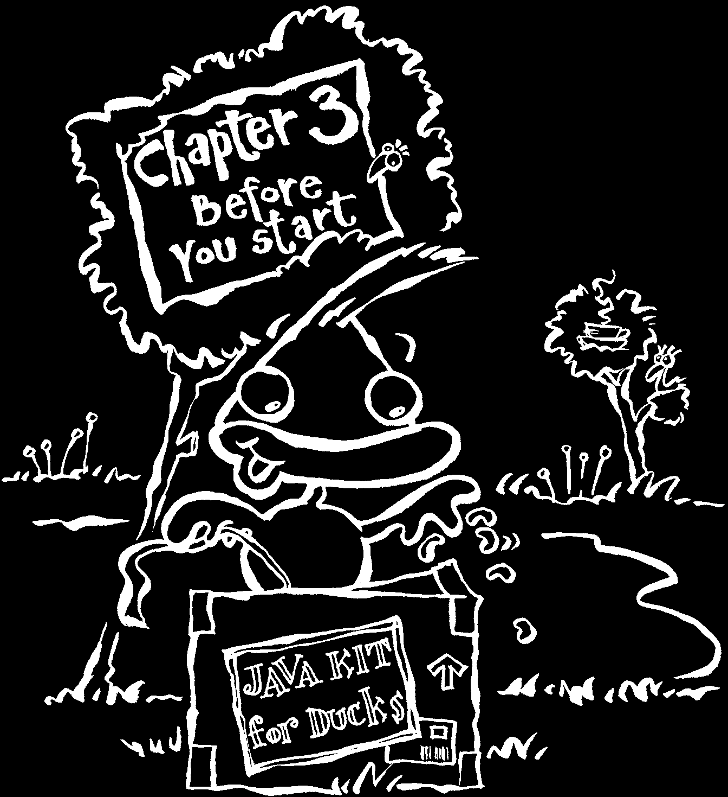

29

# 学习编程是一项复杂的事务。

在你开始阅读书中介绍 Java 特性的章节之前，当然，在你开始进行任何实际编程之前，你将需要获取一些对你有用的东西。

读完这一章后，你应该确保自己已经拥有了这些东西。你应该花一点时间对它们进行实验，并且应该开始学习在你用 Java 编程时将需要的技能。

30


在你开始任何 Java 学习之前，我想向你解释学习编程到底是什么。你需要知道自己面对的是什么，并且需要了解一些你在学习编程时将调用的技能。

我将从一段引用开始，它可能很好地总结了你所面对的。

> 冒险者，你选择了一条危险而充满挑战的道路。

> 接下来该什么？

你可以猜到接下来发生了什么。我会顺从地捡起剑和卷轴。我会阅读卷轴，思考上面那些几乎毫无用处的线索。然后，我迅速朝向一个随机的方向冲出去。很快，我遇到了一只喷火龙，它似乎并不喜欢我，我对它说错了错的话（用剑刺它似乎完全没有帮助），然后立刻被活活吃掉或被烧焦，或者两者兼有。然后回到起点，我重新开始整个过程。

我从未完成过这个游戏。我再也没有弄清楚哪个矮人特别想要我在老橡树后面发现的那个带洞的桶。刻有神秘符文的石板对我来说仍然只是一块刻着一些奇怪涂鸦的完全没用的石头。但我的朋友完成了它。他在电脑前度过了好几个小时，向东、向西、进入隧道、与会说话的树讨价还价，以及经历了许多同样奇怪的事情。最终，他找到了他应该寻找的任何东西并赢得游戏。他成功了，而我没有。

你正在读一本关于学习编程的书。这说明你也选择了一条充满挑战的道路。我必须承认，你不太可能遇到喷火龙、会说话的树或拿着桶的矮人（这些都是很好的比喻），但你无疑将度过一段有趣且充满挑战的时光。学习编程并不容易，任何告诉你这很容易的人都是错的。同时，学习编程并非不可能。它不可能是，否则会写程序的人就没有什么特别之处了。当你读这本书的剩余部分时，请记住这一点：我的程序写得还可以，我并不特别聪明。如果我可以做到，你也可以！

（省略）……帮助别人。你可能会乐于伸一把手，而你帮助的人会非常感激。谢谢。

现在是时候开始学习编程了。你将有机会发现自己是否是一个天生的程序员！

36

*使用 Java 编程*


## 4 我撒谎了

那不是我的电脑。是我朋友 Mark 的电脑，是我们一起输入进去的。你看，编程真的是的一项社交活动，对吧？


由于你还没有进行过任何编程，所以这一章里还没有相关的示例。不过既然提到了这儿，让我来告诉你们我是如何学习编程的。

很久以前，当家用电脑还是非常新奇的东西时，你可以买到一些只有程序列表的杂志。你可以把这些程序输入到电脑里（它们几乎都是游戏，通常用一种名为 `BASIC` 的语言的方言编写），而且有时它们还能运行。我是通过将这些程序输入我的电脑来学习编程的。⁴

当然，起初我几乎完全看不懂自己输入的内容。例如，我记得我曾盯着这一行看很久：

```text
50 LET X = X + 1
```

心里纳闷这怎么可能是的。我的意思是，`X` 不可能等于 `X + 1`，对吧？随着时间的推移，我开始理解我输入的程序部分，甚至那行代码也不再那么神秘了。如果你已经能看出它是做什么的，那你表现得比我当年好了！最终，我可以编写自己的程序了，起初主要是通过修改我见过的程序。

后来，我上了一门更正式的编程课程。其中有些事情我觉得很难，而另一些则学得容易得多。通过听讲座和在实验室练习，我过得还不错。尽管如此，仍然有些事情一直非常神秘，我从未真正理解过。

当我终于找到一份程序员的工作时，我才真正学会了编程。我每天工作八小时或更多，除了编程无所事。我处理的程序（这次是用 `C` 语言编写的）控制着卡车发动机工厂里巨大的测试机器；如果我犯了错，机器可能会爆炸并导致人员严重受伤。有时我躺在柴油渍里边工作（那东西很糟糕）。正是那时，我终于成为一名优秀的程序员。

我现在仍在学习。我学习新的处理方法或语言的新特性。没有哪个程序员会停止学习。事实上，我已经在朋友 Graham 和 Nick 的帮助和助推下学会了 `Java`，仅仅是为了能写出这本书。

## 在开始之前

37


### 3.1

你即将开始学习编程。快速浏览一下这本书的剩余部分以及你的本地指南（Local Guide）。规划你如何分配时间，并写下你的计划。你是打算每周读一章，还是每天读章？你能花多少时间在练习？如果你在听课程，课程是如何安排的？你将涵盖哪些主题，什么时候涵盖？

### 3.2

如果有机会，和会编程的人聊聊。了解他们是如何学习的，并问问他们记得哪些地方特别困难或容易。为什么不问问你的老师呢？

### 3.3

看一看 `BlueJ` Java 环境；你可以从 `http://www.bluej.org/` 免费下载。尝试一下系统自带的一些示例，决定你是否想使用它。

### 3.4

仔细看看一些早期的 `BlueJ` 示例。看看图表背后隐藏的 `Java` 代码。那里有什么是你能理解的吗？作者在程序里放了什么内容来帮助你？

最后，看一眼所需的物品清单。确保你已经拥有了所有物品，并且知道如何使用你的编辑器和编译器。我无法在这方面提供帮助，但希望你的本地指南可以。我假设你已经做到了！

学习编程是困难的，但并非不可能。你必须付出大量努力；特别是，你需要进行大量的练习。

很久以前，当我在大学学习编程时，我们使用的那本书的作者⁵（一位名叫 Doug Cooper 的智者）在序言中写道：

> 现在，当我讲课时，我鼓励任何没那么有心的的学生找一个聪明的朋友，并在整个学期里守在她身边。毕竟，我就是度过第一门编程课的。当我写作时，我试着成为那个朋友……

我现在给不出比这更好的终极建议了。那本书也帮助我度过了第一门编程课，即使现在它已经有些破旧，我仍然在使用。希望这本书也能对你产生同样的帮助。如果你能找到一个聪明的朋友，那就更好了！如果你找不到和你一样聪明的朋友，既然你现在已经理解了学习编程的本质，并且已经准备好了所需的一切东西，让我们开始学习编程吧！

38

## 使用 Java 编程


## 5

那本书叫作《Oh!》，正如你可能猜到的，是关于 `Pascal` 语言的。`Pascal` 不像以前那么流行了，但如果你需要学习它，这就是你需要的书。

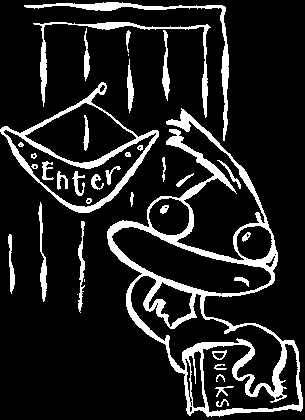

1

你可能做过一些实体关系建模。在这种语境下，使用的“对象”和“实体”是非常相似的东西。

56

你已经知道 `Java` 是一种面向对象的语言。许多其他流行语言包括 `C`、`Python` 也使用这种面向对象的方法。这意味着，令人惊讶的是，`Java`（以及这些其他语言）的编程是基于对对象的使用；对象是任何面向对象程序的构建块。`Java` 比其他面向对象语言更进一步，在 `Java` 程序中几乎所有内容都是对象（即使实际上不是）。面向对象编程的一个关键优势是，为一个问题开发的程序可以在另一个问题中使用；程序是可移植的。这种代码重用的潜力可以节省大量的时间。

本章介绍了对象的概念。读完本章后，你应该理解对象是任何面向对象程序的组成部分，并且应该理解什么是面向对象。你应该理解对象如何通过它的属性和方法来特征，并能够为应用建议可能的属性和方法。对象的原则、属性和方法在任何面向对象的语言甚至某些类似的面向对象系统中都是相同的。事实上，如果你做过任何数据库工作，你可能会发现你学到的与本章之间有一些重叠之处。

40

## 使用 Java 编程

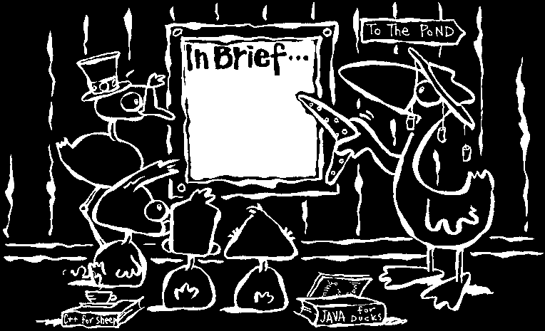

在开始编写面向对象的程序之前，你显然需要知道在这种语境下什么是对象。非正式地说，对象是现实世界问题中感兴趣的事。当编写计算机程序来解决这个问题时，对象就变成了程序处理或操作的东西。对象具有经过处理以产生所需的结果，因此可以准确地说，程序操作或处理的是这些值，而不是对象本身。对象有时被称为“实体”，特别是在数据库设计领域¹。


对象具有描述它们的值，被称为属性。属性是对象的属性；人拥有名字、身高、鞋码等属性。在面向对象编程中，某些对象还可以过程（某些人称之为函数），使用与对象相关的值来计算其他值或实现某些效果；这些被称为方法。方法是对对象执行某些有用或有趣操作的步骤；显然，方法经常利用对象的属性值。因此，对象是由其属性的值和方法的定义的。

更正式地说，对象类型对应于现实世界的同类²组。例子可以是鸭子、流行歌手或名叫 James 的人。每个对象类型都有一组特定的实例，例如 Elvis、Britney Spears 和 James Gosling。对象类型有属性和方法，该对象类型的每个实例都有特定的值（属性），因此具有不同的行为（方法）。通常，当结合在一起时，对象实例的值唯一地描述了该实例。

对象类型有时被称为类（class）。这是我们以后在 `Java` 中会遇到的名称，也是大多数面向对象编程语言使用的名称。本章不是关于某种特定语言，所以我们将坚持更通用的“对象类型”，但请记住它们本质上是同一件事。

让我们详细看看这些概念。

### 属性

对象无处不在。你现在手里就拿着一个⁴。你手里拿着的对象是一本书。想象你正试图向别人描述这本书，以便他们能在装满类似书的图书馆里找到它。你可能会告诉他们标题，也许是作者的名字，也许你还会描述一下封面。你会告诉他们一些关于这本书的特殊之处；理想情况下，你会告诉他们在所有其他书籍中唯一标识它的特征。你不会告诉他们这书是用纸打印的，因为所有书都是那样；你会关注那些让这书在所有其他书中易于识别的特征。在面向对象的术语中，你是在告诉他们这本书的属性的值。

对象的属性是识别或刻画它的特征。一本书有标题、作者、ISBN 编号和更多属性（看一看对象的构建块）。

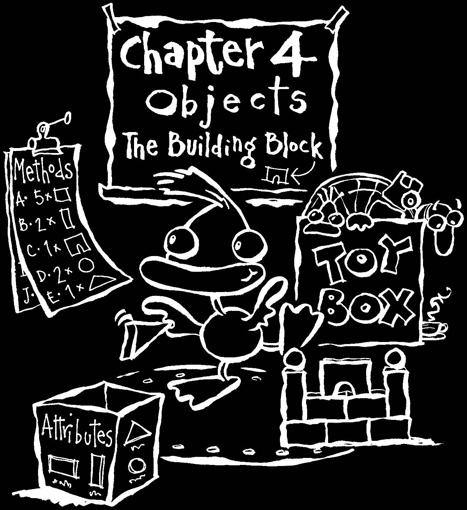

## 对象的构建块

1

你可能做过一些实体关系建模。在这种意义上，使用的“对象”和“实体”是非常相似的东西。

2

意思是“所有同一类的东西”。

3

指鸭子，而不是歌手。

4

否则你正在以一种非常奇怪的方式阅读。

（内封页的第一页）。如果你给某人特定书籍的这些属性值，他们总能找到你所指的那个精确书籍；这些属性的值唯一地确定并描述了该对象。

你也是一个对象。你拥有描述自己的属性；你有名字、地址、生日以及许多其他属性。你是“Person（人）”对象类型的一个实例。其他人也是如此，但他们的属性值是不同的。极不可能有另一个人在你的所有属性上具有完全相同的值集合，或者至少我们无法想不出某组能够将你与所有人区别开来的的属性。

总结一下：

## 如何使用 Java 编程

### 书籍的属性

### 人的属性

| 属性 |  |
| :--- | :--- |
| 标题 | 姓名 |
| 作者 | 出生日期 |
| ISBN 号码 | 地址 |

你可能还能想出更多几个可以添加到每个列表中的可能属性。重要的一点是，每个属性对于每个对象实例必须有且只有一个值。人不会有两个名字，书也不会有两个标题。对象实例的任何属性都不应该允许有多个值。

除了名字之外，这些属性中的每一个都有特定的类型。每个属性可以取的值有一种特定的类型；书的标题是一个字符字符串，地址是一个较长的字符串，出生日期是一个日期，以此此类推。每个属性恰好有一个值，而且在大多数编程语言中，对于该类型的对象，该值始终具有相同的类型。

编程语言支持这类可能的类型；不同语言使用的名称略有不同，但基本类型是相同的。常见的有：

- 整数（Integer）：整数，正数或负数——在 `C` 和 `Java` 中 `int`。
- 浮点数（Floating-point numbers）：带有小数部分的数字，同样有正负之分——在 `C` 和 `Java` 中 `double`。
- 字符（Character）：单个字符，通常是标准键盘上任何任何字符——在 `C` 和 `Java` 中 `char`。
- 字符串（String）：字符序列，通常是拼写的单词或类似的有意义序列——在 `C` 中 `string`，在 `Java` 中 `String`。
- 布尔（Boolean）：真或假值，以其在布尔逻辑中的用途命名——在 `C` 中 `bool`，在 `Java` 中 `boolean`。

每当确定一个属性时，也应该确定该属性的类型。你在这里也可以看到，不同的编程语言（必须说，这有点令人烦恼）会对同一种类型使用略有不同的名称。这里的“名称”当然是指名和姓（或姓）的总称。为了保持简单，在本章的剩余部分我们将只使用简单的词汇；`Java` 如何引用这些内容的细节以后再说。

让我们再次查看人的属性，并为每个属性添加值的类型。这个对象类型一个很好的名称 {乎不用说会是 `Person`。`Person` 对象类型的精确属性列表可能取决于使用它的程序的目的，但一些常见的属性包括：

### 对象：构建块

| 属性 | 类型 |
| :--- | :--- |
| 姓名 | 字符串 |
| 性别 | 字符（`'M'` 或 `'F'`） |
| 年龄 | 整数 |
| 出生日期 | 字符串 |
| 高度 | 浮点（米） |
| 体重 | 浮点（公斤） |
| 地址 | 字符串 |

这远不是一个完整的列表；你可能还可以想出更多属性要添加。无论添加了什么属性，每个属性只能有一个固定类型的一个值。有时，就像这里的性别一样，该值可以是该类型中的几个值之一。在大多数情况下，它可以是任何值。

再次查看 `Person` 对象中“出生日期”属性的类型。目前，这建议将日期存储为字符字符串。使用这样的字符串来存储日期确实是可能的，并且有很多可能使用的格式。首选格式取决于许多因素，例如日期如何以及在何处显示，或者程序所在国家的惯例。示例可能是：

- 2004年1月2日
- 2-1-04
- 2/1/2004
- 1/2/2004

这些都可能对应同一个实际日期。

如果对日期的唯一操作只是打印它，并且所有看到此日期的人对该格式有相同的理解，那么将日期存储为字符串的方案就是行得通的。如果需要对日期进行某些处理或需要以不同的格式打印，很快就会出现问题。如果日期仅以字符串形式存在，即使是寻找下一个日期或某人的二十一生日这样简单的任务也将变得极其困难。

对于除了最问题以外的任何问题，日期的字符串表示都太不灵活。需要更强大的工具。这个问题的解决非常简单；`Person` 的“出生日期”属性实际上是另一个对象，一个可以代表日期的对象。对象的属性本身也可以是对象。

让我们考虑 `Date（日期）` 对象的属性应该是什么。最简单的方案是使用三个整数作为属性；分别代表日、月、年。还有其他可能性。许多计算机系统通过存储自已知固定时间点以秒数来处理日期；这种简单的表示使得处理日期变得容易。属性和方法共同定义了一个对象。例如，我们 `Date` 对象的更完整的定义可能是：

### 方法

方法类似于与对象紧密关联的属性。它们可以被认为是对象可以执行的操作。例如，一个 `Date` 对象可能有如下方法来：

- 查找下一个日期
- 查找星期几
- 判断日期是否有效
- 以类似于“2004年1月2日”的格式显示日期
- 以 `DD/MM/YYYY` 格式显示日期
- 以 `2-1-04` 格式显示日期

这些方法的返回类型取决于它们所的功能。例如，一个查找下一个日期的方法将返回另一个 `Date` 对象，而一个判断日期是否有效的方法将返回布尔值。只显示内容的方法不返回任何值；这些被称为空方法（`void` methods）。

此定义描述了所有属性，并列出了所有可用方法。

该对象类型没有其他可以存储、表示或执行的操作了。

从编写使用该对象类型的程序员的角度来看，此定义规定了存储在对象类型任何实例中的值的名称和类型，并描述了所有可用方法。关于方法提供了大量信息；规范提供了它们的名称、返回的内容以及该返回值的类型。这就是开发使用 `Date` 对象的程序所需的所有信息。

### 面向对象编程

你现在可能已经猜到，面向对象编程就是使用对象进行编程。这是一种非常流行且强大的编写程序的方式；毕竟，比雅纳·斯特拉斯鲁普（Bjarne Stroustrup）提出从 `C` 语言开发出 `C++` 的原因是为了向一种已经成功且流行的语言中引入面向对象的特征。`Java` 是这一发展过程中最新的语言之一，可能也是最流行的语言；它是一种比 `C` 语言纯粹得多的面向对象语言。这种发展在另一种语言 `C#` 中也一直在进行。为了了解为什么这种方法如此流行，让我们看看面向对象程序是如何开发的。

编写面向对象程序的第一步是识别将使用的对象类型。这通常可以通过对问题区域的描述以及与熟悉该问题的人进行讨论来完成。我们将在下一章详细介绍这一重要过程。这些对象类型根据它们的属性和方法进行规范，然后编写程序来实现它们。最后，编写使用这些对象类型实例的程序（这些实例理所当然地简称为对象 objects）本身。

这就是面向对象编程的力量所在。如果已经编写了程序来实现特定的对象类型，那么程序代码可以在许多其他也使用该对象类型的程序中重用。程序员可以快速建立工作对象类型的库（在 `Java` 术语中称为包 packages），他们可以在许多不同的程序中反复使用它们。在时间和和金钱方面的节省将是巨大的。

46

## 如何使用 Java 编程


### 示例 1 – 马丁尔先生的自然保护区

> 马丁尔先生负责一个小型自然保护区，那里是鸭子和秧类的家。
>
> 他想开发一些计算机程序来帮助保护区的运行。
>
> 他需要哪些对象类型呢？

马丁尔先生明智地计划首先识别然后开发要在程序中使用的对象类型。他会发现，产生的对象类型可以用于他开发的所有程序，因此他将节省大量的时间和精力。

他需要的两个对象类型显然是 `Duck`（鸭子）和 `Coot`（秧类）。有很多可能的属性，因此他需要更深入地思考他想要开发的程序，以及这些程序将为他处理和产生的信息。

这两个对象的属性可能几乎相同；这可能表明一个 `Bird`（鸟类）对象类型对此应用更好。

关于使用哪种类型的决定取决于对程序最终将做什么的进一步分析；它们将需要区分不同种类的鸟吗？对象类型的最佳选择还取决于未来是否有开发更多程序的计划，如果有的话，这些计划是什么。

`Duck` 对象类型的一些可能性是：

### Duck

| Attribute (属性) | Type (类型) |
| :--- | :--- |
| Name (名称) | String |
| Age (年龄) | Integer |
| Value (价值) | Floating-point (代表金额) |

`Coot` 对象类型也会非常相似，尽管通过详细讨论需求可能会发现差异。

### 示例 2 – 布鲁斯的图书馆

> 布鲁斯有一个小型图书馆，他把书借给鸭子。每只鸭子被允许同时只借本书。布鲁斯想要一个计算机程序来记录他所有书籍的详细信息，并让他跟踪哪只鸭子拥有哪本书以及何时归还。
>
> 程序需要哪些对象类型？它们的属性和方法是什么？

再次，在这个示例中识别对象类型是相当容易的。一个用于书籍本身的详细信息，另一个用于借用者。尽管借用者实际上与马丁尔先生程序中的鸭子是相同的，但它们的属性是不同的，因此使用不同的对象类型是最好的。

这两个对象类型当然可以一起实现为同一种对象类型，简单称为 `Duck`。这种方法的缺点是，鸭子借书的情况可能很少，而鸭子作为鸭子的情况却很多。可以使用通用对象，但它将涉及许多在大多数使用对象类型的应用程序中不会使用的属性和方法。同时，有很多借用物品的应用，因此一个更通用的 `Borrower`（借用者）对象类型可能有更广泛的用途。

本章已经简要查看了书籍对象可能拥有的某些属性。书籍对象的 `ISBN` 属性在这里非常有用，因为它是有保证的。`Coot` 对象类型也会非常相似，尽管通过详细讨论需求可能会发现差异。

### 4.1

为 `Student`（学生）对象类型建议可能的属性。

### 4.2

为 `Professional Footballer`（职业足球员）对象类型建议可能的属性。

### 4.3

你为 `Student` 和 `Professional Footballer` 建议的一些属性可能是相同的。这说明了什么？

### 4.4

为 `Television Programme`（电视节目）对象类型建议可能的属性。

### 4.5

假设 `Television Programme` 对象类型被用于一个录像机程序中。应该向该对象类型中添加哪些方法？

### 4.6


需要编写一个程序，在整个赛季期间向比赛解说团队提供足球员的详细信息。在你已经定义的对象类型中可能会添加哪些方法？

**4.7**

布鲁斯计划允许鸭子预订已被另一只鸭子借走的书。第三个例子中确定的对象类型应该做哪些修改？

50

*使用 Java 编程*

[](img/05fa4bae6319441a0b86c0179baaedc2_67_1.png)

对象是面向对象编程的核心。Java 是一种面向对象的编程语言。Java 程序定义并处理对象，这些对象代表现实世界问题中的物理对象或事件。开发面向对象的 Java 程序的第一阶段是识别问题中的对象类型，并编写程序来实现这些类型。然后，这些对象类型被用于解决问题的程序中。

*对象类型*（object type）用于表示现实世界问题中的一组连接的*对象*（objects）。该对象类型的单个实例（*对象*）通过其*属性*（attributes）的值（通常是唯一的）来表征。属性是具有相关意义的值；它们有*类型*且只能包含一个值。属性本身也可以对象。

除了属性之外，对象类型还有*方法*（methods）。方法是一个处理对象类型实例的属性值以产生某种效果的过程。方法可能会改变也可能不会改变对象属性的值。某些方法会生成并返回一个值；而其他方法（称为 void 方法）则不会。

面向对象编程的一个核心原则是*代码重用*（code re-use）。当一个对象类型为某个问题领域编写后，它可以在另一个领域重用，理想情况下无需任何更改。这具有节省大量时间和金的潜力。你现在应该理解什么是对象了。是时候更详细地查看如何识别问题区域中的对象了。

### 对象：构建模块

51


52

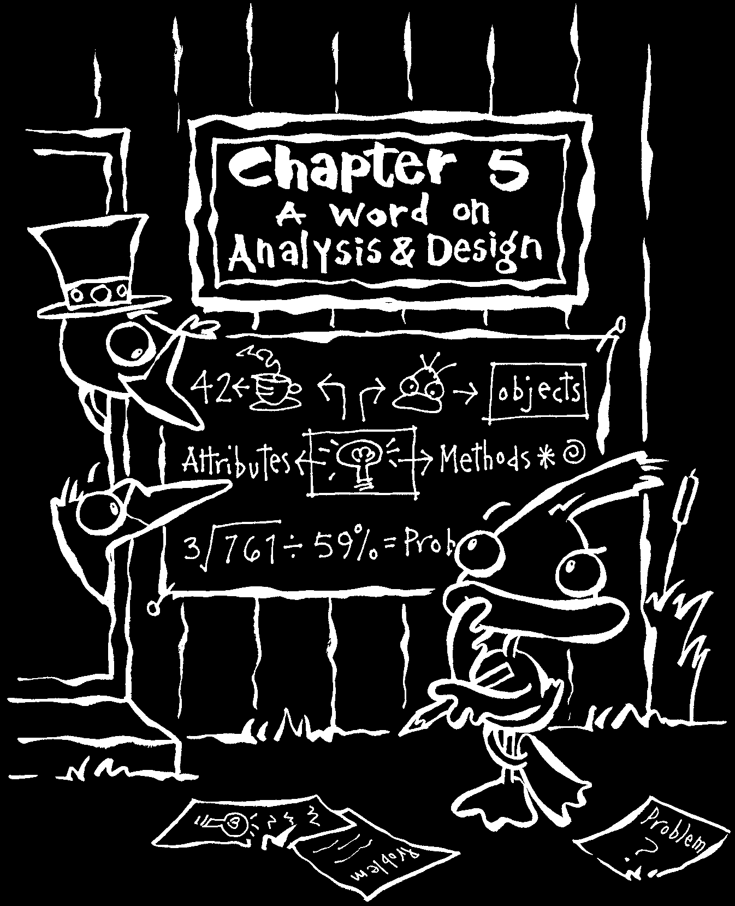

上一章的练习非正式地向你介绍了识别现实世界问题中对象的任务。现在你应该有了一些建议用于解决某些问题的程序中的对象的经验；你还能够对你所识别的对象的可能属性和方法提出一些建议。

本章更进一步，提出了一个框架，使你能够以结构化的方式执行这项重要任务。在本书开始描述 Java 特性之前，意识到良好的程序设计的重要性至关重要。你必须理解，在编写任何程序之前，应该对问题领域进行仔细的调查和分析，并仔细设计解决方案。在充分理解问题之前就开始编写程序，可能会是一个昂贵的错误。

读完本章后，你应该对如何识别问题区域中的可能对象和对象类型有一个基本的概念。你应该能够获取问题描述并利用它创建一个对象类型列表，以及它们的属性和方法。你应该能够以一种对于开始实现你解决方案的程序员有用的方式呈现出来。

### 关于分析与设计的说明

53

[](img/05fa4bae6319441a0b86c0179baaedc2_70_1.png)

编写计算机程序是为了解决特定问题或执行特定任务。在编写程序之前，必须执行两项重要任务。首先，必须仔细分析问题，然后设计解决方案。有时会设计多个解决方案以给程序员提供选择。分析问题和设计解决方案的活动通常被称为“系统分析”（Systems Analysis），专门从事这项任务的人被称为“系统分析师”或简单的“分析师”。在当今的 IT 行业中，程序员和分析师是同一个人（“分析师程序员”）很常见，但情况并非总是如此。

这不是一本关于系统分析的书，因此本章只对该领域给出非常简短的见解。在这个阶段，你只需要了解足够的分析和设计知识，以便做出合理的选择。分析、设计和编程的活动显然紧密相关。你可能会发现自己更喜欢分析或设计而不是实际编程！

在开始本章之前，重要的是你要理解本章描述的活动最好在远离电脑的情况下进行。在编写程序时，你不应该在没有设计方案的情况下坐在电脑前。你应该清楚你的程序要做什么以及如何做；这个想法是彻底分析和设计的主要输出。

分析和设计有几个阶段。这些阶段通常以*方法论*（methodology）的形式描述，即执行任务的正式方法。有很多用于分析的方法论，如果你进一步研究分析可能会遇到。为了简单起见，本章没有描述特定的方法论；而是以建议步骤的形式提供了一种非正式的方法。这种建议特别适合初级程序员。

54

*使用 Java 编程*

### 识别对象

第一步是识别问题区域中的对象类型。出于代码重用的精神，某些对象类型可能在之前的程序中遇到过，因此它们的现有实现可能是可用的。

## 识别属性

识别描述每个对象类型的属性并将其添加到定义中。每个属性的类型也被识别；这可能会导致发现更多被发现属性的对象类型。

### 识别方法

添加方法。

## 设计方法

每个方法实际上都是小程序，因此每个方法都单独进行设计。

## 设计程序

最后，设计使用这些对象类型的完整程序。只有当此步骤完成后，才会实际编写程序（或任何方法）。

这些步骤将通过示例来说。准备好了吗？

**识别对象类型**

这是最基础的一步。对象类型将是程序的构建块，识别正确的类型至关重要。识别对象的简单方法是获取问题区域的描述并提取所有的名词（或名词短语）；这些是引用问题中存在的“事物”的词。这样的描述通常是与紧贴问题的人访谈的结果。

为了说明这一点，这里有一个关于问题的描述：

*该自然保护区位于利物浦正北方。它是许多珍贵鸟类的栖息地。马丁梅尔先生（Mr Martinmere）是保护区的护林人，他和家人一起照顾保护区所有的鸟。保护区有很多鸭子、黑水鸡和两只鹅。护林人的一只狗，叫卡洛斯（Carlos）。需要一个程序来辅助保护区的管理。护林人想要跟踪所有的鸟；他需要知道每只鸟的名字、年龄和大致价值。如果他卖掉某只鸟，他需要记录这一事实以及他将鸟卖给的自然保护区的名称。他从不卖鹅或他的狗。*

浏览这段描述并标记名词（此处用下划线表示）很容易：

*该自然保护区位于利物浦正北方。它是许多珍贵鸟类的栖息地。马丁梅尔先生（Mr Martinmere）是保护区的护林人，他和家人一起照顾保护区所有的鸟。保护区有很多鸭子、黑水鸡和两只鹅。护林人的一只狗，叫卡洛斯（Carlos）。需要一个程序来辅助保护区的管理。护林人想要跟踪所有的鸟；他需要知道每只鸟的名字、年龄和大致价值。如果他卖掉某只鸟，他需要记录这一事实以及他将鸟卖给的自然保护区的名称。他从不卖鹅或他的狗。*

这提供了一个可能在最终程序中作为对象的列表。

描述中的某些名词实际上是事物的不同名称，因此下一步是删除同义词以获得更短的列表。同时，描述中的某些词并没有完全描述潜在的对象，因此应该对名称进行精炼，使其更清晰：

- 自然保护区

- 利物浦

- 马丁梅尔先生

- 护林人

- 马丁梅尔先生的家人

- 鸟

- 鸭子

- 黑水鸡

- 鹅

- 狗

- 卡洛斯

- 程序

- 管理

- 名称

- 年龄

- 大致价值

- 事实

- 名称（购买鸟的自然保护区）

- 购买鸟的自然保护区

## 关于分析与设计

其中一些内容可以立即消除。例如，“程序”、“管理”和“事实”显然与对象类型没有关系。专有名词通常也可以被消除；它们指的是对象类型的特定实例，而这些实例可能已经在其他地方涵盖了。最后，某些名词实际上是其他对象的属性；这里“名称”、“年龄”和“大致价值”显然属于这一类。列表现在变短了：

- 自然保护区

- 马丁梅尔先生

- 马丁梅尔先生的家人

- 鸟

- 鸭子

- 黑水鸡

- 鹅

- 狗

- 购买鸟的自然保护区

关于程序将执行的任务的信息将使列表进一步精简。“马丁梅尔先生的家人”只是顺带提到，因此可以删除。护林人本人和保护区本身也是如此。最后，“鸟”是一个涵盖鸭子、黑水鸡和鹅的通用术语；它也可以被删除。这得到了最后的名单：

- 鸭子

- 黑水鸡

- 鹅

- 狗

- 购买鸟的自然保护区

描述还提供了护林人永远不会卖掉狗或鹅的信息。考虑到程序的性质，将它们排除在外可能是合理的，但护林人将来可能会改变主意。分析过程的一部分是回到护林人那里，询问更多细节和对问题的更详细描述。这将允许做出明智且知情的决策。

目前，假设是两者都不需要；根据目前获得的有限信息，这似乎是合理的。列表变为：

- 鸭子

- 黑水鸡

- 购买鸟的自然保护区

最后一步是为对象类型命名。习惯上使用单数，所以 ducks 变成“duck”（鸭子），以此此类推。代表购买动物的保护区的类型名称相当冗长；可以简单改为“reserve”（保护区）。该问题领域对象类型的最终列表如下。这实际上表明，此问题中存在一个 *Bird*（鸟）对象类型，它是由三个代表特定鸟种的独立对象类型组成的。如果我们发现每种鸟具有相同的属性，那么完全可能实现一个单一的 Bird 对象类型，其中包含一个指示鸟的类型的属性。

- duck

- coot

- reserve

## 识别属性

（省略重复内容）

找到对象为寻找某些属性提供了一个有用的开始。检查被丢弃的对象候选者可以发现“名称”、“年龄”和“大致价值”，它们都是 *Duck*（鸭子）和 *Coot*（黑水鸡）对象的属性。它们很可能也是另外两个丢弃的动物对象（鹅和狗）的属性，但只有当它们也是对象时才有意义。

| 对象类型 | 属性 | 类型 |

| :--- | :--- | :--- |

| Duck | name | String |

| Duck | age | Integer |

| Duck | approximate value | Floating-point |

| Duck | sold to | String |

| Coot | name | String |

| Coot | age | Integer |

| Coot | approximate value | Floating-point |

| Coot | sold to | String |

| Reserve | name | String |

| Reserve | address | String |

| Reserve | telephone number | String |

（省略重复内容）

（注：根据提供的 OCR 片段，清理后的合并文本如下：）

（此处重复内容）

## 设计方法

现在必须对每个方法进行设计。这涉及详细说明每个方法的作用。通常使用结构化的格式来编写这些内容，包括对以下内容的规范：

- 方法的目的

- 方法的输入

- 方法更改的值

- 方法产生的任何副作用（例如在屏幕上输出或对数据文件进行更改）

这些信息的格式应该是固定的，在实践中，完全可以记录在某些合适的表格中。

例如，*Duck*（鸭）对象类型的 *display*（显示）方法的规范如下：

*名称：* *display*

*对象类型：* *Duck*

*目的：* *在屏幕上显示鸭的详细信息*

*输入：* *一个 Duck 对象*

*已更改的值：* *无*

*副作用：* *在屏幕上显示*

该规范在最终设计过程中将进行扩展，以包含对布局的精确描述；这可能会使用图表。在实践中，分析师可能会使用某种表格来为程序员记录规范。*sell*（出售）方法有一个输入；程序员必须提供被卖出鸭的保留区（Reserve）的引用。该方法执行的任务比单纯在屏幕上显示值更为复杂，因此将对其作用提供更详尽的描述：

*名称：* *sell*

*对象类型：* *Duck*

*目的：* *记录鸭子已售*

*输入：* *一个 Duck 对象和一个 Reserve 对象*

*已更改的值：* *鸭的“sold to”属性*

*副作用：* *无*

*描述：* *鸭的“sold to”属性的值应更改为以存储该 Reserve 对象。如果此值表示鸭子已经出售，则应显示错误消息*

显然，这种详细的描述可能会变得非常复杂，如果程序员误解了编写内容，最终程序将无法按预期运行。因此，能够以一种略微正式且无歧的方式将描述写出来是有用的。这种做法的常用方法是以*伪代码*（pseudocode）的形式编写。这种语言形式比实际语言简洁精确得多，实际上非常接近计算机语言。编写伪代码没有硬性规定（尽管某些软件公司可能有偏好或推荐的风格），除非是任何内容都应该是清晰且无歧的。*sell* 方法执行的描述可以用伪代码写为：

```pseudocode
IF the value of "sold to" is blank THEN
    Set the value of "sold to" to Reserve object
ELSE
    Display an error message – the duck is already sold
END IF
```

有了伪代码，程序员将对分析师的意图不再产生疑问。在编写实际代码之前，以这种方式写出所有简单的方法是一种良好的做法。

## 设计程序

在设计了对象类型后，使用这些类型的程序或多个程序也可以进行设计。与方法的设计一样，一旦指定了程序的目的，通常会使用伪代码对其进行更正式的描述。

一个明确需要的程序是允许 Martinmere（马丁梅尔）记录鸭子销售情况的程序。这可能会要求他输入鸭子的名字和保留区的名称，然后在他的记录中进行必要的更改。该程序的伪代码可能是：

```pseudocode
Display "Enter the name of the duck:"
Read Input and store as Duck
Display "Enter the name of the reserve:"
Read Input and store as Reserve
Use sell method of duck object to record sale simply and unambiguously tells the programmer precisely which other method to use
```

作为另一个例子，假定 Martinmere 决定他想要一个显示所有鸭子详细信息的程序。这个程序将不得不逐个使用 *display* 方法处理并显示每只鸭的详细信息。可以用伪代码表示：

```pseudocode
Get the details of the first duck
WHILE there are ducks left
    Display the details of the duck using the display method
    Get the details of the next duck
END WHILE
```

任何比简单程序复杂的设计都将等到学习了更多编程知识之后。目前，你只需要体会设计的重要性，以及以无歧的方式表达设计的巨大重要性。

## 分析与设计

这个示例展示了对问题的描述如何形成问题领域分析的基础。这种分析导致了解决方案的设计。这里建议的方法是一种简单的方法论，每当你开发一个新程序时都应该遵循它。由于本章包含了一个长长的示例，所以这次没有额外的示例了。开始练习吧！

### 5.1

识别解决以下问题所需的对象类型。对于你识别的每个对象类型，建议其属性和方法。Martinmere 农场的鸭子们开始打板球了。它们自己组成了四支球队，并正在组织一场淘汰赛。它们邀请了 Bruce 和 Zeke 担任裁判。Elvis 被要求编写一个程序来记录哪只鸭在哪个团队中，并保留比赛结果记录。

### 5.2

在第一场比赛成功后，鸭子们决定组织一个联赛。每支球队都相互比赛，获胜得二分，平局得一分，失败得零分。Elvis 被要求写一个新程序。这如何改变对象类型的设计？

### 5.3

Elvis 有一个包含联赛比赛结果的文件。使用伪代码设计一个程序，处理该文件以发现每支球队到为止获得了多少分。你可以多次读取该文件。

### 5.4

用伪代码表示以下程序的描述。假设程序使用一个 *Book*（书）对象类型，该类型有一个“借阅者”属性，存储借书的鸭子。当书归还时，Bruce 输入鸭子的名字和书名。程序查找书籍的信息并记录它回到图书馆的事。

### 5.5

查看计算机贸易报纸（如 *Computing* 或 *Computer Weekly*）中的招聘广告。列出所有与编程相关的职位名称。提供了多少“程序员”（Programmers）职位？提供了多少“系统分析师”（Systems Analysts）职位？提供了多少“分析程序员”（Analyst Programmers）职位？每个工作似乎吸引什么样的薪资？每种工作有什么不同的技能或经验要求？


63

Java 是庞大的。随着你对它的了解越来越多，你将发现这句话是完全正确的。Java 是一种真正的通用编程语言；你可以使用用 Java 编写的程序处理几乎任何事情，从驾驶客客飞机到追踪手机上的数字。这是一件好事，因为你将学习一种具有许多实用应用的强大语言。但这也是件坏事，因为你很难知道从哪里开始。即使是最简单的 Java 程序，其中包含的内容也真的很多。

本章是你 Java 之之旅的起点。本章将带你快速浏览我们将在书中学习的 Java 基础知识。这并不是书中全部的 Java，显然也不是世界上所有的 Java，但它是一个合理的起点。在这个阶段，我将简单带过一些细节；这里的意图是让你对之后将出现的内容有一个大致的感受。

在上一章中，我们在一个问题领域中确定了类型。我们确定了它们的属性以及这些属性的类型。我们还找到了一些它们的方法，并使用伪代码设计了这些方法可能的工作方式。现在是时候看看这些东西在 Java 中看起来是什么样了。

64

*使用 Java 进行编程*


首先，让我们回顾一下本章将在 Java 中建模的对象类型。该类型将用于存储马丁梅尔先生（Mr Martinmere）保护区鸭子的详细信息。你可能想在上一章的末检查该对象类型属性和方法的完整细节。

为了保持简单，我们只关注三个属性：名称（name）、年龄（age）和值（value）。前两个类型很容易识别，分别使用字符串（string）和整数（integer）即可。用于存储值的类型稍微复杂一些；这实际上是一个金额（因此遵循某些特殊规则，例如只保留两位小数），但 Java 中没有方便的类型来处理它。因此，我们将将之使用简单的浮点值。


我们还满足于只有三个方法。将会有方法以整洁的格式显示鸭子的详细信息，以及更改鸭子的年龄和值。同样，这些细节在上一章中已经定义。

如果我们要实现马丁梅尔先生的程序之一，我们显然需要能够处理该对象类型的实例（instance）。一个实例可能代表一只“现实世界”中的鸭子。当然，面向对象编程的意义在于，这个对象类型的实现可以原封地用于马丁梅尔先生现在或将来可能需要的任何程序。就此而言，该对象类型对于任何想要编写处理鸭子基本信息的 Java 程序的人都有用。因此，在开始编写任何程序之前，我们必须实现该对象类型。首先，我们需要一些基础的 Java；最基础的是*声明*（declarations）和*语句*（statements）。

## 声明与语句

我们知道，编写 Java 程序的第一步是定义将要使用的对象类型。在 Java 中，对象类型被称为*类*（class）（巧的是，在大多数其他面向对象的编程语言中也是如此），所以本章使用的是这个名称。意乎的是，类是使用 Java 声明和语句定义的。

声明仅仅是“声明”问题领域中存在某个东西。它可能指定了该东西被称为什么、是种种东西，还提供了根据所描述内容确定的其他信息。因此，在 Java 中，这声明了一个整数（缩写为 `int`）的存在：

`int age;`

字符串和浮点值看起来相似，但使用的名称没那么直观（或更显微妙）：

`String name;`

`double value;`

`String` 指代所需的字符串，并且必须以大写字母开头。`double` 指代浮点数，“double”指的是将要存储的精度。这基本上是用于存储该值将占用的计算机内存；你可以将其理解为存储浮点数小数部分的可用内存。你的*本地指南*（Local Guide）可能会告诉你你的系统中使用了多少内存。

这些声明实际上并没有做任何事，或者至少没有做程序用户可能看到的任何事。在后台，分配了一些内存来存储该值，并会进行各种操作将名称与内存关联，但对于使用程序的人来说，什么都没有发生。

语句是实现有用用途的 Java 行。例如，它可以设置一个值或在屏幕上显示某些内容。这通过将值 10 赋值给属性 `age` 来设置值：

`age = 10;`

*初探*

以及，正如我们将看到的，还可以用于测试。

最后，某些方法会接收值进行处理（本示例中的另外两个方法也会），这些值列在声明后的括号中。这里没有这些值，所以完整的声明是：

```java
public void display ()
```

这次没有加分号！

通过添加语句来完成该方法。这些语句写在一对大括号之间，通常称为*大括号*（braces），并且通常会稍微缩进，以向阅读程序的人显示它们位于方法内部。现在我们现在有了一个完整的方法：

```java
public void display ()
{
    System.out.println ("The details of the duck are:");
    System.out.println (name);
    System.out.println (age);
    System.out.println (value);
}
```

剩余的两个方法稍微复杂一些。额外的复杂性之处在于，它们会改变属性的值。因此，它们需要知道新值是什么。对于这个示例，我们假设提供的值是有效的，所以我们会忽略例如年龄为负数等的问题。

提供给方法的值称为*参数*（parameters），它们列在方法声明的括号中。此列表包含了参数的名称及其类型；然后参数就可以像属性一样在方法内部使用。

第二个方法旨在更改鸭子存储年龄的属性值。它一个合理的名称可以是 `setAge`。它需要知道新年龄是多少，因此它需要一个参数，一个代表新年龄的整数。它不返回值，所以返回类型将再次是 `void`。除了这些，它的声明与简单的 `display` 方法非常相似：

```java
public void setAge (int newAge)
```

方法中需要的语句只有一个，将属性 `age` 的值设置为参数（`newAge`）的值。我们在本章开头已经看到过一个设置值的语句，所以：

```java
age = newAge;
```

这将将属性 `age` 的值设置为参数 `newAge` 中找到的值。在后台，程序将找到存储 `newAge` 的内存位置中的值，并用它来替换存储 `age` 的内存位置中的值。

现在，完整的方法变为了：

```java
public void setAge (int newAge)
{
    age = newAge;
}
```

幸运的是，设置鸭子值的方法几乎是完全一样的。唯一的区别是，参数现在是一个浮点数，而且属性和参数的名称发生了变化。

```java
public void setValue (double newValue)
{
    value = newValue;
}
```

我们现在拥有了与属性对应的所有方法。剩下的工作就是将它们组合到类的定义中。

# 定义类

包含定义和程序的 Java 文件具有固定的结构和格式。对于这个示例，我们只定义了一个类，但如果我们是在编写程序，其结构也会大体相同。再次，这种格式是固定的；程序员在布局的精确细节上有一定的灵活性，但必须遵循严格的规则。

Java 文件可能会很长。它可能很难解释，特别是当它必须由一个并非编写该程序的程序员阅读时。因此，通常（也是一个好主意）在每个文件的开头写一些*注释*（comments）来描述文件的用途。注释是程序的一部分，仅供人类阅读程序；编译器始终会完全忽略注释。

在 Java 中编写注释有两种方法。第一种是将注释包含在两个符号之间：

```java
/*
* 这是一个可以使用的类...
*/
```

编译器会乐意地忽略在程序中第一个 `/*` 之后、相应的 `*/` 之前的找到任何内容。这种风格的注释通常用于跨越几行的长注释。另一种方法是使用 `//` 符号来标记该行右侧的任何内容都是注释。这看起来像这样：

```java
System.out.println ("hello!"); // 输出问候
```

选择完全取决于程序员的风格，但书中的风格是将第一种用于跨越几行的长注释，将第二种用于单行的短注释。

一个一定要有注释的地方是文件的开头。这可以用来解释文件的功能。通常先列出属性，然后是方法。文件的缩进清楚地显示了类的内容。一个好主意是确保对应的括号对对齐，就像这里这样做。

最后需要添加的是一个特殊方法。当程序中声明对象时，有很多事情需要完成；其中一个就是分配内存来存储属性的值。这是通过一个称为构造函数的特殊方法完成的。构造函数负责在后台创建类实例所需的任何工作。它也可以用于设置一些默认值，如果这些值对于属性是。

这听起来可能很复杂，但并不是。所有的内存分配都是自动完成的，我们真正关心的是默认值。Java 将提供合理的默认值。

```java
/*
Duck.java
“初探”章节的简单 Duck 类。
AMJ
2003年1月22日
*/

public class Duck
{
    // 属性
    private String name;
    private int age;
    private double value;

    // 构造函数
    public Duck ()
    {
    }

    // 方法
    public void display ()
    {
        System.out.println ("The details of the duck are:");
        System.out.println (name);
        System.out.println (age);
        System.out.println (value);
    }

    public void setAge (int newAge)
    {
        age = newAge;
    }

    public void setValue (double newValue)
    {
        value = newValue;
    }
}
```

*初探*

```java
public void setValue (double newValue)
{
    value = newValue;
}
}
```

# 定义类

这个类的定义现在准备好在程序使用了。当然，应该先对其进行测试，以防止类中的任何问题导致程序出现任何问题。一旦通过测试并发现运行正常，它就可以用于任何需要使用 `Duck`（鸭）类型的程序。

*如何使用 Java 编程*


这一章没有这种类型的示例，因为章节是一个很长的示例。你现在可以通过快速浏览书的剩余章节并查看你在那里发现的 Java 代码来找到更多示例。你希望你会发现自己可以理解其中相当的内容。你肯定会发现程序的格式和布局现在看起来很眼熟，在注释的帮助下，你可能会理解相当一部分。

你还应该发现，你可以把这一章的类定义拿过来，在你自己的 Java 系统上尝试一下。你能让它编译通过吗？


### 6.1

上一章还识别了一个 `Coot`（水鸡）类。它与 `Duck` 类具有相同的属性和方法。写出它的定义。

### 6.2

还有一个类用于存储“自然保护区”的细节。写出那个定义。

### 6.3

把这两个定义都出来出来并在你的 Java 系统中输入它们。确保它们可以编译，并为每个类正确地生成一个 `.class` 文件。

### 6.4

该类中设置值的方法没有验证提供的值。这可能会导致什么问题？

### 6.5

该类的构造函数没有设置任何特殊的默认值。对于这三个属性来说，良好的默认值应该是什么？

*初探*

嗯，只有一个 `public`（公共）类。别担心它。


这一章对 Java 进行了非常快速的浏览。这一章中有很多新的思想和概念。这些是在我们在书的剩余部分将更详细地接触的思想，但希望你现在已经对 Java 中如何定义一个对象类型有了大致的概念。

Java 中的对象类型被称为 `class`（类）。它实现在一个文件中，该文件必须与类名相同（顺便说一下，这意味着一个文件中只能实现类）。类由一个私有部分和一个公共部分组成；通常将属性放在私有部分，将方法放在公共部分。定义类的文件应该始终以一个清晰的注释开头，解释类的目的，文件中还应该使用其他注释来解释正在发生什么。一个完整的类定义文件应该无错误地编译并生成一个 `.class` 文件。

这一章提出了关于编程中布局和风格的几个问题，因此在我们学习更多 Java 之前，下一章将解释为什么良好的布局和风格是如此重要……

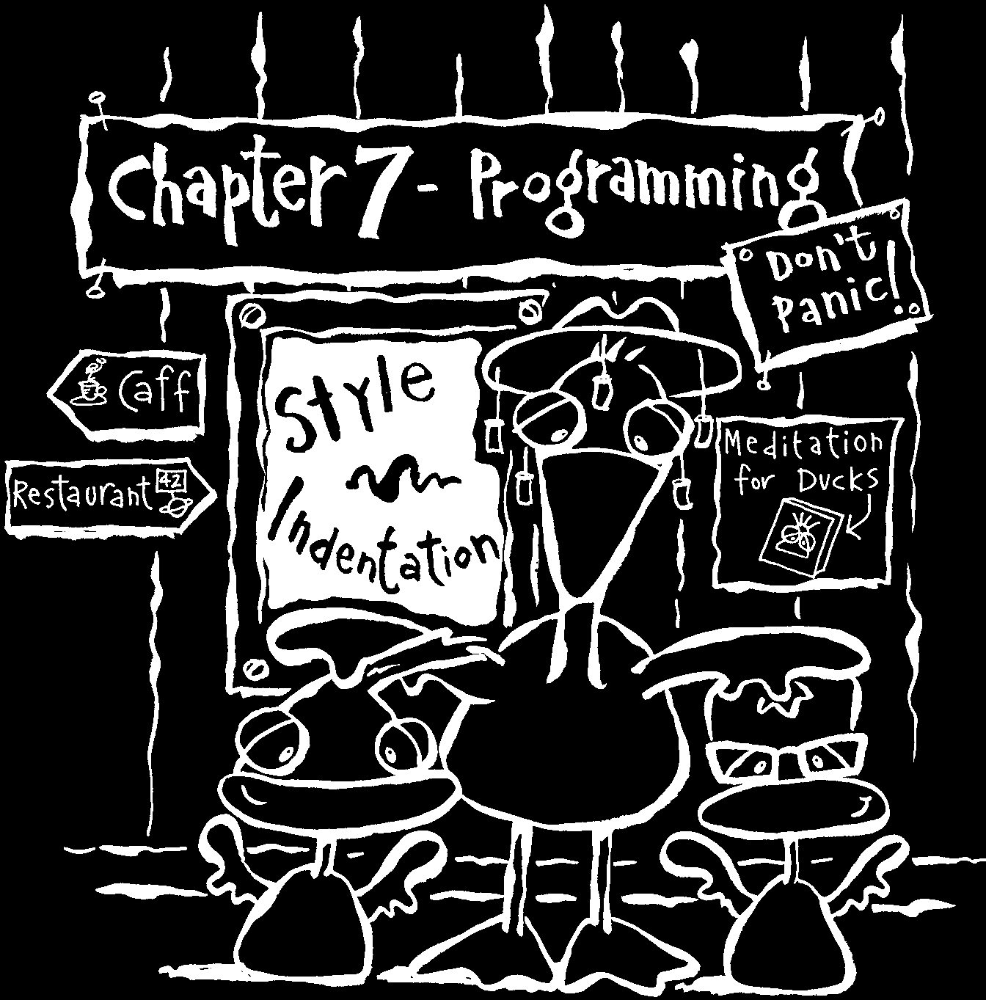

# 编程（不要恐慌！）


现在，你已经几乎准备好开始使用 Java 编写一些程序了。但在在此之前，你需要了解一些关于编程方法的知识。编程是一个高度结构化的过程；有些人甚至将其称为为一门学科。良好的编程要求程序员采用合理、结构化且有分量的方法。最重要的是，它要求程序员不要恐慌！

读完这一章后，你应该理解为什么在编写程序时结构化的方法是至关重要的。当你开始编写自己的程序时，你应该体会到始终应用良好的一致风格和布局的重要性。你将接触到良好编程实践和风格的五条黄金法则。最后，在长时间等待之后，你也将看到你的第一个能够发挥作用的完整 Java 程序。

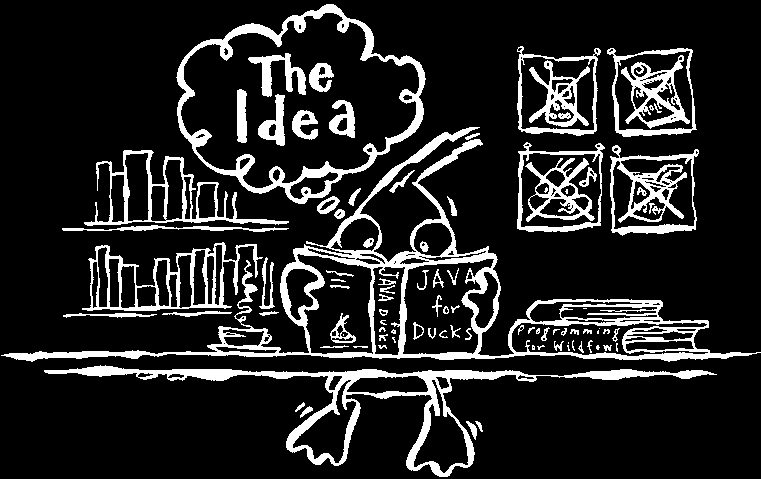

假设你正准备在一个巨大的空旷地中间盖一座新房子。这是你可能会使用的一种策略。你可以列出你所需的所有物品；包括砖块、水泥、木材、油漆、窗户等。然后你购买它们，并将它们随机杂乱地堆在地的中间。在接下来的几天里，你会在这一堆周围翻找，对它们进行分类并整理成一栋房子。这种策略可能有效，但很多地方可能会出错。你可能会把砖块放在窗户上并弄碎它们，或者你可能在大堆木材下丢失油漆。灾难的风险是巨大的，以至于在实践中你不会认真考虑使用这种方法。

假设你的车坏了，你把它带去修车厂修理。你会预计修理师会听取故障。你会预计修理师听你的故障描述并花时间诊断哪里错了。当故障确定后，你会预计进行快速方便的修理。你当然不会预计修理师随机更换零件直到它再次工作。这种随机方法可能可行，但远不是最便宜或最有效的修车方法。

这两个例子突显了结构化方法至关重要的任务。你不会惊讶地发现编程是另一项任务，有一组必须遵循的步骤。在编写程序时，不遵循这些步骤或在步骤之间随机跳跃。

盖房子和修车的这两个例子是程序员有时采用的两种方法。有些人会在编写几百行代码之前先查看它是否工作。面对错误时，他们会随机开始某些部分直到它工作。无论如何，这些都是经验丰富的程序员永远不会做的，最好的主意是确保你永远不要！

## 编写程序

需要新程序的用户会希望程序员经历一个与修理师的要求非常相似的过程。第一步是进行分析以彻底理解问题。接着是设计最解决方案，然后快速高效地将其实现为类和程序。在问题调查和理解之前编写程序将是一个巨大的错误。在正确设计之前编写程序同样是愚蠢的。

编写程序本身遵循类似的模式。第一个阶段是实现所需的类。这些类在隔离状态下进行充分测试，以确保它们工作。只有当它们经过充分测试后，才应该在程序中使用。再次，在类编写和测试之前编写使用这些类的程序是极其愚蠢的。这种错误会导致大量的额外额外工作，因为必须定位并修正越来越多的错误。更糟糕的是，如果在测试类之前就编写程序，很难确定错误是在程序中还是在类本身。

即使是程序代码本身也遵循相同的模式。代码应该始终以稳定的增量方式开发。功能应该逐渐地添加到程序中，并在尝试任何进一步开发之前，对任何新功能进行测试并证明其工作。一层一层盖房子，在开始上楼之前，确保底层不会倒塌。

在未来的某个时候，你将编写一个程序并发现无法让它运行。你在这里会有机会犯一个巨大的错误。你有机会忽略这个问题，然后开始处理问题的其他部分。如果你这样做，你只是会给自己招来更糟的麻烦！当你发现自己在某个领域无法继续进行时，永远不要开始处理程序的其他部分。寻找帮助并解决第一个问题。

*编程（别恐慌！）*

77

第一条黄金规则是：

*一次只处理程序的一个部分。搞定它，再继续下一个部分。永远不要同时处理程序的多个部分！*

当你学习编程时，你可能会有机会看到一些经验丰富的程序员在工作。你会注意到的一点是，他们需要处理的编译器错误比你想象的要少得多。这很自然；因为在学习过程中，你不可避免会犯更多错误。但与此同时，经验丰富的程序员会做一些事情，以确保他们发现和纠正的错误尽可能少。

一个经验丰富的程序员会在程序完成之前编译很多次。有时，这只是为了检查程序目前的语法是否正确；而另时候，则是为了快速测试某个新函数。

一个经验丰富的程序员永远、永远不会输入一个完整的程序，然后开始强迫它编译。如果你选择采用这种方法，你就犯了一个大错误；你选择了一种最能浪费时间并让你练习纠正尽可能多的错误的方法。编程本质决定了，程序文件顶部的一个简单错误（比如像单个分号这样微不足道的错误）可能会导致整个程序出现错误；记住我们在上一章中看到的少量 Java 代码中的那种精确性。如果程序有几百行，这将导致几百个错误；但如果程序只有十行，错误就会少得多。最好的方法总是在非常小的程序中找到此类错误，以免它们的影响大到掩盖了原始原因。至少，错误可以藏的地方要少得多！

随着经验的增加，你为了检查语法而编译程序的需求会变得越来越少。由于你才刚开始，你应该记住在每添加大约二十行代码时就编译一次程序，哪怕仅仅是为了测试语法。

第二条黄金规则是：

*如果你向程序添加了二十行代码，完成你正在工作的部分，编译它并检查你的语法是否正确。在继续之前修复任何错误。*

## 风格

编程的一个特殊方面是程序员的风格。每个程序员写程序时都有自己的个人风格，这可能对每个人都是独一无二。这与手写相似；即使你写的是多年前的内容，你可能也能认出自己的字迹。程序员可能也能认出自己多年前写的一个程序。

任何程序员都希望能够对多年前编写的程序进行修改。许多程序会使用很长时间，而且在程序首次编写多年后经常需要进行更改。当然，有时原始程序员可能无法进行更改。在这种情况下，另一个程序员必须能够获取程序、快速理解它，然后进行所需的更改。如果程序是用糟糕的风格编写的，实现这一点要困难得多。糟糕的风格会让最实用的程序对最优秀的程序员来说也完全无法理解。良好的风格是优秀编程的一个基本特征。

随着你学习的越来越多，你将会形成自己的风格。就像手迹一样，风格在很大程度上取决于品味；你会开始认为程序的某些部分如果以某种方式布局对你来说更好，并且你会开始采用那种风格。书中的所有程序都是按照我们满意的风格编写的。¹^ 我并不是说这是一种特别好或坏的风格，但它是我们经过几个月发展出来的、我们相当满意的风格。你在学习时可以自由复制它，但随着你发展出自己的偏好，你最终可能会对其进行调整。

只要风格遵循一些基本规则，就没有所谓好风格或坏风格之分。任何风格的**一致性**（consistent）都是关重要的。如果一个程序员选择以特定的方式布局程序的某个特定部分，那么程序员在每次编写类似的程序段时都应该使用完全相同的布局。作为一个第一个例子，这里有一个非常简单的 Java 语句：

```java
number = 1;
```

那行的布局就像我写程序时会写的那样。等号前后都有空格，分号前没有空格。其他程序员（包括我合作过的许多人）可能会这样写：

```java
number=1;
```

没有空格，甚至写成：

```java
number = 1 ;
```

在最后的分号前有一个空格。这些风格中没有哪一个优于其他的；在每种情况下，编程语句都是完全清晰的，并且在每种情况下都会执行相同的操作。至关重要的是，选择这三种风格中任何一种的程序员，应该在每一个类似的语句中使用相同的布局。显而易见，一个包含如下段部分的程序：

```java
number = 1;

anotherNumber = 2;

aThirdNumber = 3 ;
```

是一个非常糟糕且不一致的风格示例。这有点就像在写书时，一段用普通正文，另一段用全大写字母，*又无缘无故地用一些**斜体*。这看起来并不好看，也没有给人留下程序员关注并对自己的工作感到自豪的印象。你可以自由遵循书中示例的风格，也欢迎开发并将其调整为你喜好的风格。

*使用 Java 编程*

78

第三条黄金规则是：


无论你使用什么风格，都要确保它是清晰且整洁的。此外还要保持一致。

在你编程时，应用一致的风格。随着你学习得越来越多，将这种风格发展成让你感到自信和满意的样式。

## 缩进与布局

程序风格的一个特别重要的方面是程序的布局方式。就像书或杂志的页面可以布局得好或坏一样，程序也是如此。程序的布局可以为人类读者增加很多意义。布局对于编译器来说完全无关，编译器会简单地忽略它，但对于试图阅读和理解程序的人来说它极其有用。

布局可以强调程序的哪些部分具有共同的目的；例如，程序中可以留出空行来显示某些行之间的联系或关于程序结构的某些信息。布局的一个关键方面是缩进，即在行开头留空格。程序的缩进可以向读者展示大量关于程序结构的信息。

作为一个例子，这里是上一章中简单的 `Duck` 类的定义。目前你可能不会记得其中的每一个细节。正如我们所看到的，实际上我们为书中程序采用了一套内部风格。²^

80

*使用 Java 编程*

确实是如此，但这不是重点。现在只需集中在它的布局上。你目前真正需要记住的是，以 `//` 开头的行以及用 `/*` 和 `*/` 标记的部分只是为了给人类读者看的；它们是注释，编译器会完全忽略它们。

注释用于解释程序是如何运行的；你会发现，通过阅读这些注释，即使你不理解 Java 本身所有晦的微小细节，也能看出这段 Java 定义了什么。

```java
/*
Duck.java

用于“第一眼观察”章节的简单 Duck 类。

AMJ

2003年1月22日
*/

public class Duck {
  // 属性
  private String name;
  private int age;
  private double value;

  // 构造函数
  public Duck() {
  }

  // 方法
  public void display() {
    System.out.println("The details of the duck are:");
    System.out.println(name);
    System.out.println(age);
    System.out.println(value);
  }

  public void setAge(int newAge) {
    age = newAge;
  }

  public void setValue(double newValue) {
    value = newValue;
  }
}
```

希望你也会同意这个类的定义布局得非常整齐。空行分隔了具有不同功能的定义部分，并且通常也分隔了定义的各个行。缩进也同样重要；第一个 `{` 和最后一个 `}`（统称为大括号）标记了定义的开始和结束，因此定义内部的所有语句都缩进了相同数量的空格（我通常倾向于使用 2 个空格），以此来强调这一点。

因此，在这个定义中，所有构成该定义的语句都包含在一对大括号内，以表示它的起始和结束点。括号内部的语句（例如方法内部的语句）再次缩进了相同的量，以反映这一点。为了确保一切都真正清晰，环绕每个方法的大括号是对齐的；例如，`setValue` 方法中的左括号和右括号就是对齐的。

现在来看一个糟糕糟糕的例子。信不信，这个定义与上一个例子几乎完全相同；唯一的区别在于类名。编译器处理它的方式完全相同，如果在程序中使用，它的行为也完全一样。

```java
public class MangledDuck{private String name;private int age;private double value;public MangledDuck(){}public void display() {System.out.println("The details of the duck are:");System.out.println(name);System.out.println(age);System.out.println(value);}public void setAge(int newAge){age = newAge;}public void setValue(double newValue){value = newValue;}}
```

显而易见，这个定义要难理解得多。没有方便的空行来将其分割成小块，也没有缩进来帮助理解结构。甚至没有任何注释来提供一些线索。

关于布局的另一点是，程序中的所有行都应该保持较短。此目的是确保程序能够整齐地打印在纸页上。惯例做法是确保程序中的任何行都不超过 80 个字符；80 这个数字源于那个时代，当时终端屏幕上一行可以显示的最大字符数，或者是行式打印机跨页打印的最大字符数。在如今，这种做法仍然是一个良好的习惯；大多数丰富的程序员总是会确保他们的代码行很短，许多人为了安全起见会在大约 75 个字符处停止。书中的所有程序（包括本节中的这两个）都经过了格式化，以确保所有行都能整齐适应页面（有时这意味着这些行会比 75–80 个字符更短）。

当你编写程序时，务要记住你不仅仅是为了自己写程序。你还在为其他程序员写程序，而这些程序员某一天在你不在身边提供建议时，可能不得不修改你的程序。你将使用的缩进和布局对阅读你程序的人有巨大的帮助。经常当学生让我他们寻找他们程序中的错误时，当我做的第一件事是让他们去检查并纠正缩进，他们往往会感到很惊讶；通常仅仅这一步就能找到错误，即使没有，它总是有帮助。

始终用良好的布局和缩进编写你的程序。千万不要受到诱惑在不缩进的情况下写程序，打算等程序运行正常后再进行正确的缩进。这只会让你自己做更多工作，并让任何帮助你的人的工作变得困难得多。在许多方面，程序的布局是否整洁一致，与程序运行是否正确同样重要。

你可能会发现，你将使用的 Java 系统会在你编程时为你整齐地排版代码；咨询你的本地指南看看你是否具有此功能。如果可以，你应该检查它将遵循的样式，并决定你是否对该样式感到满意。如果不满意，请花些时间了解如何根据你自己的喜好自定义样式。

*编程（不要恐慌！）*

82

*使用 Java 编程*

第五条也是最后一条规则是：**不要恐慌！**

*如何使用 Java 编程*

编程是一项结构化的任务，需要一种结构化的方法。程序员必须在彻底理解问题的基础上才能编写程序；在充分分析该程序意图解决的问题之前，绝不能开发程序。程序员必须严格遵守这一过程。

你很可能会发现，随着你对 Java 的信心越来越增强，你在程序中包含的注释会越来越少。起初，你可能倾向于对几乎每一行代码都写注释，这没问题。随着你知识的增长，你将会发现这并不是真的必要的，因为有些代码行是每个程序员都能理解的。不要害怕让你的风格演变并适应。


### 练习

#### 7.1

找另一本 Java 书，看看其中的一些示例程序。看看你是否能指出那本书中的风格与本书之间的差异。

#### 7.2

了解在学习编写 Java 的过程中，你是否由于某种原因被要求使用特定的风格。如果是的话，找出你将使用的风格与本书使用的风格之间的差异。

#### 7.3

调查你的 Java 系统可能具有的任何自动格式化 Java 程序的功能。你是否需要对这些功能进行自定义？

#### 7.4

如果，获取获取两个或多个不同的经验丰富的程序员编写的 Java 程序。在这些风格中你能看到哪些共同特征？你更倾向于其中某一个？尽管你还是一个初级程序员，你能跟上程序的多少内容？风格有帮助吗？注释呢？


*编程（不要恐慌！）*

良好且一致编程风格与合理的结构化方法同样重要。良好风格的指南可以总结为五条黄金法则：

1. 一次只处理程序的一个部分。搞定它，然后处理下一个部分。永远不要同时处理程序的多个部分！

2. 如果你向程序中添加了二十行代码，请编译它并检查语法是否正确。在继续操作之前修复任何错误。

3. 无论你使用什么种风格，都要确保它是清晰且整洁的。记住，可能有人在没有你建议的情况下修改你的程序。

4. 在编程时，采用并应用一致的风格。随着你学习的深入，将这种风格发展到让你感到自信和快乐的程度。

5. 在编程时始终注意布局和缩进，永远不要将其中任何一个视为事后才考虑的事项。

在学习编程时记住这些规则。如果你违反了它们，你会给自己带来越来越多的麻烦。

现在，最后，是时候你认真地研究一下 Java 并编写你的第一个程序了。


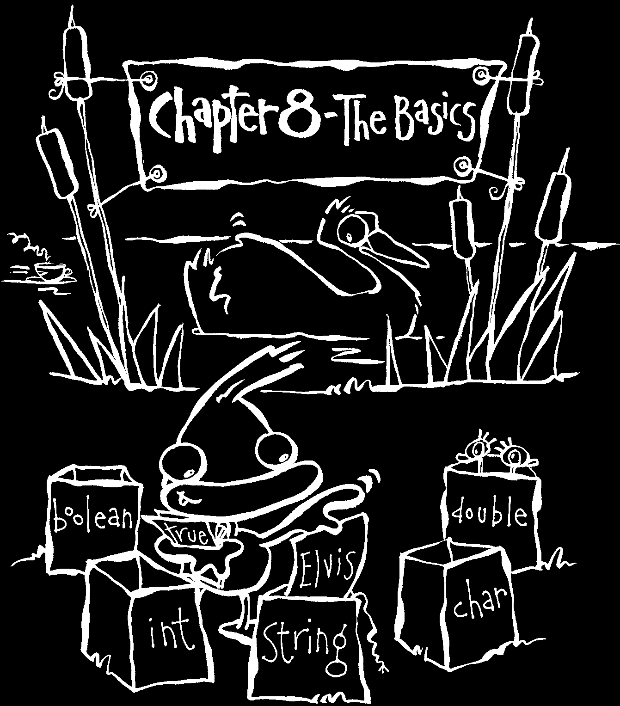

## 基础


这一章是第一个详细介绍某些 Java 的章节。你现在应该理解什么是程序，并且对如何分析问题领域以及设计一个解决特定问题的解决方案有一定的思路。你还应该知道如何创建、编译和执行你编写的程序。现在是时候实际写写一些代码了！

一个 Java 程序基本上只是一组语句，这些语句指令计算机执行某些任务。在最简单的层次，程序接收一些值并对其进行处理以产生另一些值。在本章中，你将第一次详细接触一个完整的 Java 程序，并看到它是如何存储和处理这些值的。下一章将继续解释如何显示这些值以及如何要求用户输入值。这两章共同涵盖了 Java 程序可以执行的最基础任务。读完这一章后，你应该理解 Java 程序的基本结构。你应该理解值如何存储在变量中以及如何对它们进行操作。然后你应该能够编写一些简单的 Java 程序。


让我们先来看一个非常简单的 Java 程序。你之前之前的章节中已经见过一些简单的 Java 定义和程序，并查看了一些语句可以实现的功能，但那里的重点仅仅在于布局、风格和整体视图。现在是时候开始理解 Java 语句实际上在做什么了。尽管如此，这个程序现在还不会做任何特别事情；这次要关注的只是它的通用结构。

```java
/* First.java – 一个非常简单的 Java 程序。
演示了 Java 程序的基本结构。
Author: G
Date: 2002年12月14日
Platform: Linux (Red Hat), JDK 1.4
*/
public class First {
    public static void main (String[] args) {
        int aNumber;
        aNumber = 0;
    }
}
```

这是程序的源代码。程序中的前六行（包含在 `/*` 和 `*/` 之间）是注释（你在上一章中看到过一些）。编译器会忽略这些行；它们的唯一作用是供人类阅读程序。在这种情况下，它们提供了文件的名称，对程序的目的进行了简要描述，并告诉我们作者是谁以及程序是什么时候编写的。

这是程序的头部块，一组注释的集合，提供了关于程序的基本但重要的信息。头部块至少应该告诉读者谁写了程序、程序是做什么的、在哪里编写的以及在什么时候编写的。随着程序的开发、更改和维护，头部块应该记录关于所有变化的相同信息。更广泛地说，注释被用于许多目的；常见的用途是解释程序的部分（特别是复杂的部分）以及记录对程序部分的修改。

下一行 `public class First` 标记了一个名为 `First` 的类的开始。在这里 `First` 是程序的名称（或程序中定义的唯一类）；紧随这一行之后的的大括号标记了该类拥有的属性和方法的定义。

90

*使用 Java 编程*

在这里，这种方式被读作“赋值为”或“赋值”，而不仅仅是“等于”。¹

这些语句说明了本章中的两个基础新概念。

变量声明和赋值语句是编程中最基础的概念两个。程序员需要声明程序将要使用的变量，并且需要能够为这些变量赋值。接下来的章节将更详细地介绍这些概念。

## 变量与类型

变量是程序中使用的一个值。它在程序顶部的声明中创建，如果需要，也可以在那里给它一个初始值。随着程序的推运行，由于程序中的语句对该值进行操作，变量的值会发生变化。变量的最终值有时是程序的输出结果之一。变量有一个标识符和一个它可以存储的数值类型。变量的声明告诉编译器这二者分别是什么。例如：

`int aNumber;`

这声明了一个标识符为 `aNumber` 的变量，它可以存储整数型值（在 Java 中为 `int`）。在声明变量的同时为它提供一个初始值是一个良好的习惯。² 这种赋值直接添加到声明中即可。例如，为了给 `aNumber` 赋初始值 0，可以将声明扩展为：

`int aNumber = 0;`

声明变量的类型允许编译器为计算机分配适当数量的内存来存储变量的值，并允许编译器检查程序中的值是否执行了合理的操作。Java 许多许多数据类型，但目前来说，其中的几个就足够了：

- `int`: 整数值或全数 – 0, 1, 2, 1 等。
- `double`: （双精度）浮点数（小数） – 1.415, 1.25。
- `char`: 单个字符 – ‘a’、‘Z’、‘$’。
- `String`: 字符序列 – “hello”、“Walrus”、“Gumboot”、“%$%!%%”。
- `boolean`: 一个布尔值 – 真（`true`）或假（`false`）。

字符和字符串的表示方式之间存在重要的区别。字符由单引号括起，而字符串由双引号括。这意味着：

`'a'` 是单个字符 *a*，类型为 `char`，而：

`"a"` 是一个仅包含一个字符的字符串，类型为 `String`。这种区别虽然微妙，但将变得非常重要。请特别注意 `String` 上的大写字母 S；这不是笔误！当我们以后更详细查看字符串时，这一重要区别的原因将变得清晰。

¹ 实际上，我们以后还会看到另一个读作“等于”的 Java 符号。

² 这有时并不是必要的，但养成这是一个好习惯。如果你有疑问，应该始终给变量赋一个初始值。

91

*基础知识*

变量只能持有其声明类型的值。将（例如）整数值赋给字符串变量是一个错误。其原因应该是显而易见的；编译器已经为该变量分配了存储整数所需的正确内存，而字符串极不可能恰好放入同一个空间。

## 标识符

为变量选择的标识符对计算机来说几乎无关。计算机无法理解用于命名的语言，也无法从中学习到任何关于变量用途的信息。然而，标识符对于程序员以及任何其他阅读程序的人来说非常重要。所选名称能够整洁地描述变量的用途，这是至关重要的。同时，名称不应该过长且过于详细，以至于程序变得笨拙且难以阅读。程序员必须在描述性和简洁性之间取得微妙的平衡。

例如，假设使用一个简单的程序来监控池塘里的鸟类，作为该程序的一部分，程序存储了看到的鸭子数量。以下是该变量的一些可能的标识符以及对它们的注释：

- `geese` (鹅): 这不是一个好名字。事实上这是一个糟糕的名字，因为它极具误导性！
- `x`: 至少这个名字没有误导性，但它仍然没有告诉读者关于该变量存储了什么。这很糟糕。
- `thenumberofducksonthepond` (池塘鸭子数量): 这个名字告诉读者值是什么，但非常难以阅读。它比最后两个建议好，但使用这种程序的将是非常糟糕风格的范例。它还需要大量的输入工作！
- `ducks` (鸭子): 这更好，但它仍然没有真正告诉读者值是什么。
- `numDucks`: 这是我们会使用的名称，是这些建议中最好的。它足够短，可以保持程序简洁整洁，并且告诉读者值是什么。`numOfDucks` 是一个合理的替代方案。

选择标识符需要仔细的思考。你选择的标识符必须为阅读你程序的人提供一些信息。此外，你可能在几个月后又回到某个程序，并必须快速理解它。考虑到这一点，标识符也不不能太长或太笨，以至于让程序不可读。这需要一种平衡。

92

*使用 Java 编程*

大多数程序员对标识符有一套惯用法。你可以自由复制它、遵循自己的，或者遵循你可能被要求使用的其他系统。无论你做什么，都要思考你选择的标识符。

## 声明变量

现在是时候更详细地查看变量声明了。声明的基本形式是：

*类型* *标识符*;

声明指定了变量的类型（它可以存储的值的类型）并说明了它的标识符（名称）。该行以分号结束。如果给变量赋予初始值，可以将声明扩展：

*类型* *标识符* *初始值*;

以下是一些带有注释的示例：

- `int grade;` // 用于存储分数的整数，没有初始值
- `int grade = 0;` // 初始值为0数的整数
- `char answer;` // 一个答案——单个字符
- `String name;` // 用于存储名字的字符串
- `String name = "Gumboot";` // 以上，带有初始值
- `boolean finished;` // 用于存储是否完成的“真”
- `boolean finished = false;` // 以上，但带有初始值

如果程序中要声明特定类型的多个变量，可以在同一行内命名它们：

`int aNumber, anotherNumber;`

这种写法特别用于两个变量用途密切相关的情况。它与两个独立的声明含义完全相同：

```java
int aNumber;
int anotherNumber;
```

## 值与变量

如果程序员不能给变量赋值，那么变量就没有什么用处。变量在赋值语句中被赋值。此类语句的一般形式是：

*标识符* *值*;

等号左侧是我们想要赋值的变量名称，右侧是该值。其效果是左侧标识符对应的变量的值变为右侧的

## 基础

93

在右侧。例如：

```java
// Declarations
int grade;
char answer;
String name;

// Assignments
grade = 70;
answer = 'a';
name = "alan turing";
```

这三条语句将右侧的三个值赋值给左侧命名的变量。在每个情况下，变量的类型必须与赋值给它的值相同；将字符串值赋值给整数变量是没有意义的。作为无法执行操作的示例，假设上述声明中的类型，这些赋值是不允许的：


```java
grade = "a*"; // 不可将 string 赋值给 int
name = 100;   // 不可将 int 赋值给 string
answer = "hello"; // 不可将 string 赋值给 char
```

与代数的`=`用法不同，不能编写将变量标识符放在右侧的赋值语句。这是不允许的，并且会导致编译错误：

```java
'a' = grade; // 不允许！
```

为了确保你记住这一点，请养成习惯，将赋值语句中的`=`读作“被赋值为”或“变为等于”。

在目前为止所有正确的赋值语句中，赋值的右侧都是简单的值，称为*字面量*（literal value）。它更常见的可能是*表达式*（expression）。表达式是一个计算新值的东西。例如：

```java
grade = 70 + 2; // grade 为 72
name = "ada " + "lovelace"; // name 为 "ada lovelace"
```

这些表达式也可以包含变量：

```java
int birds;
int geese;
int coots;
geese = 50;
coots = 100;
birds = geese + coots; // birds 被赋值为 150
```

最后，出现在左侧的变量也可以出现在右侧：

```java
int ducks;
ducks = 50;
ducks = ducks + 1; // ducks 现在是 51
```

你可能还记得托尼多年前永远无法理解的那条编程语句！我们在很久以前的第 3 章中提到的那条：*50 LET X = X + 1*

94

## 如何使用 Java 编程

这当然是一个赋值语句（实际上是在 BASIC 语言中，但与 Java 的对应语句非常相似）。它的效果是将变量`X`的值加1（遗憾的是，大多数版本的 BASIC 只允许单字符变量标识符）。

需要记住的重要点，特别是当同一个变量出现在赋值语句的两侧时，右侧表达式的值首先被计算，然后将结果赋值给左侧命名的变量。这意味着像如下的语句：

`aNumber = aNumber + 1;`

具有给`aNumber`的值加1（称为*递增*）的效果。先计算右侧，然后将结果赋值给`aNumber`。

### 初始化变量

现在我们知道变量是什么，以及如何声明变量了，我们需要知道如何给它赋一个初始值。这被称为*初始化*（initialisation），在编程中非常重要。当变量在类定义内部声明时，它将被赋值一个空值（即例如，对于`String`或`char`为*null*，对于`int`为`0`，对于`double`为`0.0`，对于`boolean`为`false`）。当变量在方法内部声明时，它没有初始值，在设置其值之前对该变量的任何使用尝试都将导致类似于“此变量可能尚未初始化”的编译错误。

总结一下，整数变量的声明看起来像这样：

```java
int number;
```

要给它赋值，我们使用：

```java
number = 0;
```

这种操作非常常见，以至于这两条语句可以合并。这提供了声明的扩展形式：

```java
int number = 0;
```

这条单条语句与上述两行的效果相同。永远不要假设你的变量在声明后就有值。养成初始化它们的习惯。尽可能在单条语句中声明并初始化变量，这减少了你之后使用未初始化变量的可能性。最后，除非你正在给它赋初始值，否则永远不要在它初始化之前使用它！

### 运算符及其优先级

上面的示例使用了加法操作`+`。赋值语句中的也可以包含所有其他算术运算（加、减、乘、除），你可能很熟悉这些符号是：

- `/` 除法
- `*` 乘法
- `+` 加法
- `-` 减法

95

基础

当单条表达式中使用这些之一时，运算符的优先级决定了它们执行的顺序。这与你在代数中使用的相同。这四个运算符的优先级是`/`，然后是`+`和`-`。换句话说，除法和乘法在加法或减法之前执行。优先级的概念经常让程序员感到困惑，看下面的语句：

`int number = 2 + 8 / 2;`

你可能会认为`number`被赋值为 5。你可能期望加2得到 10。事实如此！`number`实际上被赋值为 6。除法先发生（它的优先级更高），所以 8 除以 2 得到 4，然后结果加 2 得到 6。由于这可能会引起困惑，可以在表达式中加上括号使情况更清晰。再次，这与代数相同——括号内的表达式部分首先计算，然后运算符的优先级接管。上面的语句可以写成：

`int number = 2 + (8 / 2); // number 被赋值为 6`

如果这不是想要的，可以写成：

`int number = (2 + 8) / 2; // number 被赋值为 5改变了结果。`

即使运算符的优先级可以所需的结果，在表达式中始终包含括号也是良好的习惯。它消除了程序员怀疑自己犯错误的可能！

### 简写

几乎所有程序中发生的一种常见操作是给持有数值的变量加1或*递增*。对于整数变量，它的赋值语句是：

`number = number + 1;`

这种操作如此常见，以至于 Java 提供了简写形式。可以使用`++`运算符对变量递增。整数变量可以使用此运算符递增：

`number++;`

这与长形式`number = number + 1;`的效果完全相同。使用这种简写的唯一优点是减少了程序员的输入量。操作如此常见，节省了大量的输入。这个运算符解释了为什么被称为 C——毕竟 C 是加上了一些额外东西。

3

96

并不意外，对于变量值减1（称为*递减*）也有类似的简写：

`number--; // 相当于 number - 1`

有时增加大于1，因此另一种简写允许程序员给变量加上除1以外的值：

`number += 2; // 给 number 加2`

减去一个值、乘以一个值或除以一个值的等价写法：

```java
number -= 3; // 从 number 中减去 3
number *= 3; // 将 number 乘以 3
number /= 3; // 将 number 除以 3
```

记住，这些简写形式的唯一目的是节省输入。如果你愿意，始终可以编写完整的语句，许多新程序员更喜欢这样做。

### 强制转换与除法

3 除以 2 有时等于 1。真的。

Java 提供了几种数据类型来存储数值。到为止描述的两种是`int`（整数，整数）和`double`（双精度浮点数）。这两种类型的值显然都是数字，因此是相同的东西；能够将一种类型的值赋值给另一种通常很有用。例如，你可能会考虑使用以下：

```java
int number;
double cost;
cost = 12.0; // .0 表示浮点值
number = cost;
```

将`cost`的值赋值给`number`的值。然而，这段程序会产生一个编译错误。错误可能取决于你尝试编译代码的平台，但将是“可能丢失精度”之类的错误。这是因为上面的第四行在赋值给整数值期间，双精度数的小数部分将会丢失。幸运的是，办法就在。

有一种解决精度丢失问题的方法，被称为从一种类型到另一种类型的*强制转换*（casting）。换句话说，可以强制编译器将一种类型的变量转换为另一种类型。例如，我们可以从`double`强制转换到`int`以实现上面想要的效果：

```java
number = (int) cost;
```

所以，我们想要转换的类型被放在我们存储其值的变量之前的括号中。在这个例子中，`number`现在的值是 12，实际上没有丢失小数部分。

4

注意，`cost`的值上的`.0`并不真正需要。在这里包含它是为了清楚显示这是一个浮点值。严谨地说，它是一个双精度浮点值。

*基础知识*

97

但假设`cost`的值为 12.75。整数变量`number`无法存储小数部分，在这种情况下，它将会丢失。这个问题最出现在除法中。需要记住这一点是：

*一个`int`除以一个`int`的结果仍然是一个`int`，且仅此一个`int`*

这意味着结果的任何小数部分都会丢失。例如：

```java
int number;

number = 5 / 2; // number 为 2
number = 1 / 2; // number 为 0
```

这看起来似乎不应该允许这种情况的发生，而且任何发生这种情况的情况都应该是一个错误。事实是，有时这个结果实际上是所需要的；它实际上是一个可能有用的结果，即除法右侧的值“除入”左侧值的次数。你可能还记得除法中的“余数”；这里发生的仅仅是余数被丢失了。由于这很可能是正确的，某些编译器不会提供可能错误的警告。

可以编写语句来计算包含余数的除法结果：

```java
int number;

int remainder;

number = 5 / 2;

// 2 可以除入 5 次

remainder = 5 - (number * 2); // remainder 为 1
```

获取除法计算余数的更简单方法是使用取模运算符（`%`）。它的工作原理如下：

*`a % b`给出`a / b`的余数。*

在上面的示例中：

`remainder = 5 % 2;`

在程序中组合整数和浮点值时要小心。如果你的程序正在处理大量的整数和浮点值并给出了错误的结果，请始终检查整数除法的问题。

如果你正在除以两个整数值并希望结果是浮点值，你可以通过强制转换将其中一个整数值转换为浮点值，从而强制结果为浮点数，如下：

```java
int aNumber = 12;

int anotherNumber = 5;

double result;

result = (double) aNumber / anotherNumber;
```

这将分配一个预期的浮点结果，在本例中为 2.4。如果你发现自己必须做很多这样的操作，那么可能是时候考虑一下这些整数值是否真的应该是浮点值了。

将整数值转换为浮点值的另一种不那么优雅的方法是将整数乘以 1.0：

`result = (aNumber * 1.0) / anotherNumber;`

这种技术有时可能很有用，但通常优于使用强制转换。

98

*如何使用 Java 编程*

## 常量

根据定义，变量是会变化的。有时程序需要某种行为上与变量相同但不会变化的东西；这令人惊讶地被称为*常量*。常量的声明方式与变量完全相同，只是在行的开头添加了`final`单词，并且值的赋值最多只能执行一次。所以，要声明一个类型为`int`的`final`变量：

`final int MAXTURNS = 10;`

这里需要说明的是，我们可以声明`final`对象，但这些对象仍然可以被更改。这听起来很矛盾，但说明起来非常简单。如果一个类提供了修改其属性的方法（所谓的`set`方法，或*mutators*变异器），那么即使一个对象被声明为`final`，仍然可以通过调用这些方法之一来更改它。然而，将一个对象声明为`final`意味着它只能初始化一次，因此对象变量在整个程序运行期间只能引用单个对象。

选择常量的标识符也遵循相同的指南。许多程序员还选择为它们提供一个清晰显示它们不允许更改的标识符。经常使用的约定（以及本书程序中所使用的）简单是将名称写成全大字母。将首字母大写也是一种可能，但如果在不经过仔细思考的情况下这样做，可能会与现有的 Java 内置类发生冲突。

常量有两个主要用途。有时它们仅用于提高可读性。假设一个程序大量使用了数学常量`PI`。程序员可以写：

`final double PI = 3.1415;`

在程序开始处写，稍后在表达式中使用常量，例如：

```java
area = PI * radius * radius;

circumference = 2 * PI * radius;
```

这使得程序变得更易读。如果常量值在程序中的许多地方使用，它还能节省字数，并确保所使用的值始终完全相同。显而易见，上述语句远优于：

```java
area = 3.1415 * radius * radius;

circumference = 2 * 3.1415 * radius;
```

并且这是避免由以下情况可能引起的错误或不精确的良好方法：

```java
area = 3.14 * radius * radius;

circumference = 2 * 3.14 * radius;
```

常量的另一个用途是当特定值在很多地方使用并可能需要更改时。该值在程序运行期间永远不会更改，但可能由于某些原因而改变。例如，足球赛季的比赛数量、装在箱的物品数量，或者游戏允许的尝试次数。将该值声明为常量方便得多；如果它改变了，你只需要在一个地方更改它。

99

*基础知识*

## 输出

到为止，我们已经学习了如何编写执行某些有用事情的程序。然而，我确信我们已经学习了如何编写执行某些有用事情的程序。在程序中组合整数和浮点值要小心。如果你的程序正在处理大量的整数和浮点值并给出了错误的结果，请始终检查整数除法的问题。

如果你正在除以两个整数值并希望结果是浮点值，你可以通过强制转换将其中一个整数值转换为浮点值，从而强制结果为浮点数，如下：

```java
int aNumber = 12;

int anotherNumber = 5;

double result;

result = (double) aNumber / anotherNumber;
```

这将分配一个预期的浮点结果，在本例中为 2.4。如果你发现自己必须做很多这样的操作，那么可能是时候考虑一下这些整数值是否真的应该是浮点值了。

将整数值转换为浮点值的另一种不那么优雅的方法是将整数乘以 1.0：

`result = (aNumber * 1.0) / anotherNumber;`

这种技术有时可能很有用，但通常优于使用强制转换。

到为止，我们已经学习了如何编写执行某些有用事情的程序。然而，我确信我们已经学习了如何编写执行某些有用事情的程序。在程序中组合整数和浮点值要小心。如果你的程序正在处理大量的整数和浮点值并给出了错误的结果，请始终检查整数除法的问题。

如果你正在除以两个整数值并希望结果是浮点值，你可以通过强制转换将其中一个整数值转换为浮点值，从而强制结果为浮点数，如下：

```java
int aNumber = 12;

int anotherNumber = 5;

double result;

result = (double) aNumber / anotherNumber;
```

这将分配一个预期的浮点结果，在本例中为 2.4。如果你发现自己必须做很多这样的操作，那么可能是时候考虑一下这些整数值是否真的应该是浮点值了。

将整数值转换为浮点值的另一种不那么优雅的方法是将整数乘以 1.0：

`result = (aNumber * 1.0) / anotherNumber;`

这种技术有时可能很有用，但通常优于使用强制转换。

到为止，我们已经学习了如何编写执行某些有用事情的程序。然而，我确信我们已经学习了如何编写执行某些有用事情的程序。在程序中组合整数和浮点值要小心。如果你的程序正在处理大量的整数和浮点值并给出了错误的结果，请始终检查整数除法的问题。

如果你正在除以两个整数值并希望结果是浮点值，你可以通过强制转换将其中一个整数值转换为浮点值，从而强制结果为浮点数，如下：

```java
int aNumber = 12;

int anotherNumber = 5;

double result;

result = (double) aNumber / anotherNumber;
```

这将分配一个预期的浮点结果，在本例中为 2.4。如果你发现自己必须做很多这样的操作，那么可能是时候考虑一下这些整数值是否真的应该是浮点值了。

将整数值转换为浮点值的另一种不那么优雅的方法是将整数乘以 1.0：

`result = (aNumber * 1.0) / anotherNumber;`

这种技术有时可能很有用，但通常优于使用强制转换。

到为止，我们已经学习了如何编写执行某些有用事情的程序。然而，我确信我们已经学习了如何编写执行某些有用事情的程序。在程序中组合整数和浮点值要小心。如果你的程序正在处理大量的整数和浮点值并给出了错误的结果，请始终检查整数除法的问题。

如果你正在除以两个整数值并希望结果是浮点值，你可以通过强制转换将其中一个整数值转换为浮点值，从而强制结果为浮点数，如下：

```java
int aNumber = 12;

int anotherNumber = 5;

double result;

result = (double) aNumber / anotherNumber;
```

这将分配一个预期的浮点结果，在本例中为 2.4。如果你发现自己必须做很多这样的操作，那么可能是时候考虑一下这些整数值是否真的应该是浮点值了。

将整数值转换为浮点值的另一种不那么优雅的方法是将整数乘以 1.0：

`result = (aNumber * 1.0) / anotherNumber;`

这种技术有时可能很有用，但通常优于使用强制转换。

到为止，我们已经学习了如何编写执行某些有用事情的程序。然而，我确信我们已经学习了如何编写执行某些有用事情的程序。在程序中组合整数和浮点值要小心。如果你的程序正在处理大量的整数和浮点值并给出了错误的结果，请始终检查整数除法的问题。

如果你正在除以两个整数值并希望结果是浮点值，你可以通过强制转换将其中一个整数值转换为浮点值，从而强制结果为浮点数，如下：

```java
int aNumber = 12;

int anotherNumber = 5;

double result;

result = (double) aNumber / anotherNumber;
```

这将分配一个预期的浮点结果，在本例中为 2.4。如果你发现自己必须做很多这样的操作，那么可能是时候考虑一下这些整数值是否真的应该是浮点值了。

将整数值转换为浮点值的另一种不那么优雅的方法是将整数乘以 1.0：

`result = (aNumber * 1.0) / anotherNumber;`

这种技术有时可能很有用，但通常优于使用强制转换。

到为止，我们已经学习了如何编写执行某些有用事情的程序。然而，我确信我们已经学习了如何编写执行某些有用事情的程序。在程序中组合整数和浮点值要小心。如果你的程序正在处理大量的整数和浮点值并给出了错误的结果，请始终检查整数除法的问题。

如果你正在除以两个整数值并希望结果是浮点值，你可以通过强制转换将其中一个整数值转换为浮点值，从而强制结果为浮点数，如下：

```java
int aNumber = 12;

int anotherNumber = 5;

double result;

result = (double) aNumber / anotherNumber;
```

这将分配一个预期的浮点结果，在本例中为 2.4。如果你发现自己必须做很多这样的操作，那么可能是时候考虑一下这些整数值是否真的应该是浮点值了。

将整数值转换为浮点值的另一种不那么优雅的方法是将整数乘以 1.0：

`result = (aNumber * 1.0) / anotherNumber;`

这种技术有时可能很有用，但通常优于使用强制转换。

到为止，我们已经学习了如何编写执行某些有用事情的程序。然而，我确信我们已经学习了如何编写执行某些有用事情的程序。在程序中组合整数和浮点值要小心。如果你的程序正在处理大量的整数和浮点值并给出了错误的结果，请始终检查整数除法的问题。

如果你正在除以两个整数值并希望结果是浮点值，你可以通过强制转换将其中一个整数值转换为浮点值，从而强制结果为浮点数，如下：

```java
int aNumber = 12;

int anotherNumber = 5;

double result;

result = (double) aNumber / anotherNumber;
```


这将分配一个预期的浮点结果，在本例中为 2.4。如果你发现自己必须做很多这样的操作，那么可能是时候考虑一下这些整数值是否真的应该是浮点值了。

将整数值转换为浮点值的另一种不那么优雅的方法是将整数乘以 1.0：

```java
result = (aNumber * 1.0) / anotherNumber;
```

这种技术有时可能很有用，但通常优于使用强制转换。

到为止，我们已经学习了如何编写执行某些有用事情的程序。然而，我确信我们已经学习了如何编写执行某些有用事情的程序。在程序中组合整数和浮点值要小心。如果你的程序正在处理大量的整数和浮点值并给出了错误的结果，请始终检查整数除法的问题。

如果你正在除以两个整数值并希望结果是浮点值，你可以通过强制转换将其中一个整数值转换为浮点值，从而强制结果为浮点数，如下：

```java
int aNumber = 12;

int anotherNumber = 5;

double result;

result = (double) aNumber / anotherNumber;
```

这将分配一个预期的浮点结果，在本例中为 2.4。如果你发现自己必须做很多这样的操作，那么可能是时候考虑一下这些整数值是否真的应该是浮点值了。

将整数值转换为浮点值的另一种不那么优雅的方法是将整数乘以 1.0：

```java
result = (aNumber * 1.0) / anotherNumber;
```

这种技术有时可能很有用，但通常优于使用强制转换。

## 输出

### 基础知识

97

*一个 `int` 除以一个 `int` 的结果仍然是一个 `int`，且仅此一个 `int`*

## 如何使用 Java 编程

### 常量

变量根据其定义是会变化的。有时程序需要某种行为上与变量相同但不会变化的东西；这令人惊讶地被称为*常量*。常量的声明方式与变量完全相同，只是在行的开头添加了 `final` 单词，并且值的赋值最多只能执行一次。所以，要声明一个类型为 `int` 的 `final` 变量：

```java
final int MAXTURNS = 10;
```

这里需要说明的是，我们可以声明 `final` 对象，但这些对象仍然可以被更改。这听起来很矛盾，但说明起来非常简单。如果一个类提供了修改其属性的方法（所谓的 *set* 方法，或 *mutators* 变异器），那么即使一个对象被声明为 `final`，仍然可以通过调用这些方法之一来更改它。然而，将一个对象声明为 `final` 意味着它只能初始化一次，因此对象变量在整个程序运行期间只能引用单个对象。

选择常量的标识符也遵循相同的指南。许多程序员还选择为它们提供一个清晰显示它们不允许更改的标识符。经常使用的约定（以及本书程序中所使用的）是将名称写成全大字母。将首字母大写也是一种可能，但如果在不经过仔细思考的情况下这样做，可能会与现有的 Java 内置类发生冲突。

常量有两个主要用途。有时它们仅用于提高可读性。假设一个程序大量使用了数学常量 `PI`。程序员可以写：

```java
final double PI = 3.1415;
```

在程序开始处写，稍后在表达式中使用常量，例如：

```java
area = PI * radius * radius;

circumference = 2 * PI * radius;
```

这使得程序变得更易读。如果常量值在程序中的许多地方使用，它还能节省字数，并确保所使用的值始终完全相同。显而易见，上述语句远优于：

```java
area = 3.1415 * radius * radius;

circumference = 2 * 3.1415 * radius;
```

并且这是避免由以下情况可能引起的错误或不精确的良好方法：

```java
area = 3.14 * radius * radius;

circumference = 2 * 3.14 * radius;
```

常量的另一个用途是当特定值在很多地方使用并可能需要更改时。该值在程序运行期间永远不会更改，但可能由于某些原因而改变。例如，足球赛季的比赛数量、装在箱的物品数量，或者游戏允许的尝试次数。将该值声明为常量方便得多；如果它改变了，你只需要在一个地方更改它。

## 基础知识

99

## 输出

到为止，我们已经学习了如何编写执行某些有用事情的程序。然而，我确信我们已经学习了如何编写执行某些有用事情的程序。

### 基础知识

101

有一个明显的属性，即显示在标牌上的消息。这是一个字符序列，在 Java 中称为 `String`（字符串）。目前我们不需要考虑其他属性。

这里有两个明显的方法。首先，布鲁斯（Bruce）需要某种方式来设置要显示的消息。这可能涉及将其输入。此外，还需要某种方式来激活标牌；布鲁斯必须有某种方式来确认消息是正确的，并且标牌应该开始显示。这两个方法可以分别命名为 `setMessage` 和 `display`。

还有另一个方法，因为类需要一个构造函数。它将为消息提供某种初始值；你可以将其想象为布鲁斯打开了标牌。

该类可以命名为 `Sign`，定义将创建一个名为 `Sign.java` 的文件。第一阶段是添加单个属性：

```java
public class Sign
{
    // Single Attribute – What to Display
    private String message;
```

现在添加方法。第一个方法是构造函数，它的名称与类名相同，仅为属性设置一个初始值——一个空字符串即可。

```java
public Sign ()
{
    message = "";
}
```

其他两个方法稍微复杂一些，让我们一个一个来看。第一个方法设置要显示的消息。它需要一个参数来表示消息（一个 `String`）。它不需要返回值，所以可以是一个 `void` 方法。它所做的只是获取参数的值并将其复制到属性中，因此：

```java
public void setMessage (String newMessage)
{
    message = newMessage;
}
```

另一个方法显示消息。它不需要参数，也不需要返回值。目前我们假设在通常的默认位置显示消息就足够了，所以：

```java
public void display ()
{
    System.out.println (message);
}
```

这就足够定义这个类了。当然，应该添加一些注释来给出最终定义。

```java
/* Sign.java
Bruce writes the traditional first program, but this
time with objects.

Author : AMJ
Date : 13th December 2002
*/
public class Sign
{
    // Single Attribute – What to Display
    private String message;

    // Methods
    public Sign ()
    {
        message = "";
    }

    public void setMessage (String newMessage)
    {
        message = newMessage;
    }

    public void display ()
    {
        System.out.println (message);
    }
}
```

这只是一个定义。你可以输入它，Java 会乐意地生成一个 `.class` 文件，但它实际上不会执行任何操作。需要一个 `main` 方法。我们将在类中添加一个 `main` 方法；这是提供基本程序以检查类的所有部分是否按预期工作的常用方法。此类程序有时被称为 *driver*（驱动）程序。

`main` 方法必须做三件事：

1. 创建布鲁斯的标牌（作为 `Sign` 类的实例）。
2. 将标牌的消息设置为“hello, world”。
3. 显示消息。

这些步骤方便地对应了三个方法。第一个是构造函数，然后是 `setMessage`，最后是 `display`。书的后面会有更多关于使用（准确地说是“调用”）方法的介绍，但这里是对该类构造函数的快速调用：

```java
Sign brucesSign = new Sign ();
```

我们知道这个构造函数将标牌的消息设置为空字符串。下一步是使用 `setMessage` 将其设置为更有用的内容。在对象上调用方法的语法是：

`object name.method name(parameters);`

该方法有一个参数，所以这就能完成工作：

```java
brucesSign.setMessage ("hello, world");
```

调用显示消息的方法也类似：

```java
brucesSign.display ();
```

103

就这些了。剩下的只是包含 `main` 方法的头文件以给完整的程序。


```java
/* Sign.java
Bruce writes the traditional first program, but this
time with objects.

Author: AMJ
Date: 13th December 2002
*/ Tested on : Linux (Red Hat 7.3) with JDK 1.40
public class Sign
{
    // Single Attribute – What to Display
    private String message;

    // Methods
    public Sign ()
    {
        message = "";
    }

    public void setMessage (String newMessage)
    {
        message = newMessage;
    }

    public void display ()
    {
        System.out.println (message);
    }

    public static void main (String[] args)
    {
        // Create an object for the sign
        Sign brucesSign = new Sign ();
        // Set the Message...
        brucesSign.setMessage ("hello, world!");
        // ... and display it.
        brucesSign.display ();
    }
}
```

有些程序员会抱怨这个程序过于复杂，在在这种简单的情况下没有必要使用对象。其他人会说，所有的 Java 程序都应该使用对象，因此所有的 Java 程序都应该这样写。他们完全可能为此争执不下。

这种方法的一个优点是该类可以在其他应用程序中使用。

## 如何使用 Java 编程

### 基础知识

尽管没有很多新概念，但本章有很多需要理解的内容。现在，尝试练习题……

*使用 Java 编程*

他收到了多少钱，花了多少。程序需要哪些变量？

金额是一个浮点值，因此 Elvis 程序中的所有值都应该声明为 `double`。他需要一个变量来存储他当前拥有的金额，另一个变量来存储他花费的任何费用。这些变量将用于一个合适的表达式，以便在他花费一些后更新他拥有的金额。

他收到的金额不太可能频繁变化，但可能有时会变化，因此对该金额将使用常量。声明可能像这样：

```java
final double weeklyPocketMoney = 15.00;
double pocketMoney;
double amountSpent;
```

在程序中，可能会有这样的赋值语句：

```java
pocketMoney += weeklyPocketMoney;
```

这显然等同于：

```java
pocketMoney = pocketMoney + weeklyPocketMoney;
```

另一个赋值将改变 Elvis 在花费某些钱后的金额：

```java
pocketMoney = pocketMoney - amountSpent;
```

记住，最后一条语句也可以写成：

```java
pocketMoney -= amountSpent;
```

看这种简写如何节省打字量！这里有一个完整的示例：

```java
/* MoneyTracker.java – 一个简单的零花钱追踪器
作者: GPH
日期：2002年12月30日
测试环境：Linux (Red Hat 7.3) 使用 JDK 1.4.0
*/
public class MoneyTracker
{
    private final double WeeklyAllowance = 15.00;
    private double pocketMoney;

    public MoneyTracker (double amount)
    {
        pocketMoney = amount;
    }

    public double getAmount ()
    {
        return pocketMoney;
    }
```

这里的一个问题是，Java 中的 `double` 可以存储许多小数位，但货币值始终只有两位小数。这可能会导致错误，但只有在涉及大量数值和计算时才会发生——我们假设 Elvis 的零花钱多到不会成为严重的问题。

*基础知识*

```java
public void spend (double amountSpent)
{
    pocketMoney -= amountSpent;
}

public void addAllowance ()
{
    pocketMoney += WeeklyAllowance;
}

public static void main(String args[])
{
    MoneyTracker mt = new MoneyTracker (13.50);
    double amountSpent = 5.30;
    System.out.println ("上周剩余的金额：£" + mt.getAmount ());
    mt.addAllowance();
    System.out.println ("本周津贴后：£" + mt.getAmount ());
    mt.spend (amountSpent);
    System.out.println ("本周花费£" + amountSpent + " 后，剩余£" + mt.getAmount () + "");
}
}
```

在这个示例中，类的构造函数接收一个参数（代表 Elvis 拥有的金额），这是我们第一次看到这种用法，请仔细观察！

**示例 3 – Cilla 的板球难题**

*Cilla 和她的朋友们都喜欢板球。因为他想让所有的鸭子都开心，Martinmere 先生允许他们每个周四下午打板球。准备好比赛的鸭子数量经常变化，取决于天气、翅膀受伤等等。Cilla 写了一个计算机程序来计算从符合条件的鸭子可以组成多少支队伍。她的变量声明看起来如下所示：*

```java
final int TEAMSIZE = 11;
int numDucks = 36;
```

*Cilla 这样计算可以组成多少支队伍：*

```java
int numTeams = numDucks / TEAMSIZE;
```

*当她运行程序时，它告诉她本周有三支完整的队伍。她惊讶地发现还有一些鸭子没进队伍。这是怎么了？*

Cilla 混淆了她的数据类型，或者至少她没有仔细考虑除法的结果会是什么。由于她赋值中的所有变量都是整数，因此发生了整数除法，而除法的余数被忽略了。她需要一个表达式来计算有多少个空闲球员；它看起来应该是这样：

```java
int spareDucks = numDucks % TEAMSIZE;
```

*使用 Java 编程*

这使用了*取模*运算符，正如我们之前学到的，当第一个操作数除以第二个操作数时，它会返回余数。这会告诉 Cilla 周四下午有多少只符合条件的鸭子无所事事。这个表达式等同于相当繁琐的写法：

```java
int spareDucks = numDucks - (TEAMSIZE * numTeams);
```

话虽如此，将这些计算移动到独立的方法中（例如 `getNumTeams` 和 `getRemainder`）是有意义的，这样如果计算需要发生巨大变化，它们可以在方法体中一次完成，而不是（可能）在主方法中执行多次。

这是完整的程序：

```java
/* CricketScheduler.java – Cilla 的板球调度软件
作者: GPH
日期：2003年6月9日
测试环境：Linux (Red Hat 8.0), JDK 1.4.1
*/
public class CricketScheduler
{
    public CricketScheduler () {}

    public int getNumTeams (int num, int size)
    {
        return num / size;
    }

    public int getRemainder (int num, int size)
    {
        return num % size;
    }

    public void printInfo (int num, int size)
    {
        System.out.println("有 " + getNumTeams(num, size) + " 支队伍。");
        System.out.println("剩下 " + getRemainder(num, size) + " 只鸭子。");
    }

    public static void main (String[] args)
    {
        CricketScheduler cs = new CricketScheduler();
        int numDucks = 36;
        final int TEAMSIZE = 11;
        cs.printInfo(numDucks, TEAMSIZE);
    }
}
```

*(注：由于原文代码块在截断处不完整，此处根据上下文逻辑补全了缺失的类结构以确保文档完整性，但翻译遵循不翻译代码的原则)*

*基础知识*

常量是一种不会改变的特殊变量。你应该能够识别出程序中使用常量是合理的情况。

你应该能够使用基本的算术运算符编写简单的表达式，并理解这些算符的优先级。

你还应该能够使用 `System.out.println` 产生简单的输出（可能是在屏幕上）。

本章还包含了传统的第一个程序（显示“hello, world”），它是用两种相当不同的方式编写的。一种使用了对象，另一种则没有。查看这两个程序，并确保你理解它们是如何实现其功能的。事实上，它们做的是完全相同的事情，所以思考一下哪种更好。特别考虑如果程序需要进行扩展，哪种会更好。

你现在无法做的一件事是让程序的用户输入值，供程序处理。一旦我们学会了如何这样做，就可以开始编写一些真正实用的程序了，所以让我们进入下一章吧！

## 输入

到目前为止，我们查看了一些获取源代码中设置的值的简单程序，处理了这些值并打印了处理结果。你必须承认，虽然我们目前所学的内容很重要，但它是有限的。为了编写任何特别实用的程序，程序员需要提前知道程序所需的所有值。这几乎是不可能的，从用户的角度来看，如果程序可以在运行时接收值而不是在编译时接收，要好得多。

不要担心！本章将教你用户如何向你的程序提供数据，使其更加灵活。这些数据可以通过两种方式提供——要么被动地在程序首次执行时提供（通过所谓的*命令行参数*或简称 *CLA*），要么在程序运行时交互式地提供。你将学习这两种方法之间重要的区别，以及如何根据特定任务在它们之间选择。

在本章结束时，你应该能够区分这两种输入（命令行参数和交互式输入），理解两种形式的输入如何在你的程序中使用，并确定为什么目的使用哪种形式。

几乎你每一个从命令行、通过 Unix 系统上的终端、或通过 Windows 系统上的 DOS 或命令提示符运行的程序，都可以根据其被调用的方式略有不同地执行任务。如今，命令行通常隐藏在我们的“点点点击”界面之后，所以在这里提醒一下这到底是怎么回事。

用户以命令的形式向计算机提供指令，这些词具有特殊含义。这些命令由操作系统解释，导致计算机通过执行程序来做有用的事。通常，

*如何使用 Java 编程*

用户将通过向命令行传递值决定如何影响程序的执行。不出的是，这些值被称为*命令行参数* (CLAs)，作为一个例子，让我们看看 DOS 的 `dir` 命令：

```
C:\zep>dir
Volume in Drive C is DRIVE1
Volume Serial Number is ABCD-9876
Directory of C:\
12/06/2003 12:55 <DIR> .
12/06/2003 12:55 <DIR> ..
11/06/2003 10:43 6,150 wanton_song.txt
05/06/2003 22:42 5,341 white_summer.txt
21/05/2003 19:56 17,542 whole_lotta_love.txt
16/06/2003 09:21 9,974 wiawsnb.txt
```

`dir` 命令用于列出文件。当不带任何参数调用时，输出是当前目录中找到的文件列表。这为什么可能有用是显而易见的，但通过利用它理解的命令行参数，`dir` 命令可以变得更加强大。其中一个是 `/O` 参数（或*标志*），它告诉 `dir` 程序按照某种规则（默认值）对输出进行排序。其中一个是按时间排序，`/OE` 按扩展名排序，`/OS` 按文件大小排序，`/ON` 按名称排序（默认值是字母顺序）。`/OD` 用于按时间排序，`/OE` 按扩展名排序，`/OS` 按文件大小排序，`/ON` 按名称排序（默认值）。所以，很容易让一个交互式程序具有容错性，而不需要在出现第一个问题时终止它。在上面的例子中，程序在显示错误消息后简单地提示用户名。如果这样的程序由于某种原因是非交互式的，那么要实现相同水平的容错性将困难得多，实际上会更容易（尽管更杂乱）。没有理由一个程序不能从命令行参数和用户交互中共同受益。例如，某些文本处理器将要处理的文件的文件名作为命令行参数，如果文本包含错误，则会提示用户输入正确的名称。

**在 Java 程序中使用命令行参数**

与编程中的许多事情一样，命令行参数很容易使用，但正确使用却很棘手。在上面的 `dir` 示例中，每个参数都需要被识别、调用其功能，并将结果与输出的其他部分结合以给用户他们想要的。Java 在这方面没有不同；这取决于程序员对参数进行检查并让程序相应执行；这里没有魔法。

你可能不相信，从你写第一个程序开始就在指定命令行参数了。它们隐藏在 `main` 方法的声明中：

```java
public static void main (String args[])
```

你现在应该熟悉这行代码了，因为可执行的 Java 程序都包含这一行，格式完全相同。到目前为止，`String args[]` 部分对来说还是个谜，但它实际上指定了命令行提供的命令行参数列表。方括号告诉编译器期望一个列表（称为*数组*，我们将在第 17 章深入探讨它），这个列表包含 `String` 类型的对象。

在这个点，一个简单的示例会有帮助：

```java
/* CLAtest.java – 一个演示 CLAs 的无意义示例。
作者: GPH
日期: 2003年5月28日
测试环境: Linux (Red Hat 8.0), JDK 1.4.1
*/
```

*如何使用 Java 编程*

```java
public class CLAtest
{
    public void printTwoCLAs (String[] cla)
    {
        System.out.println ("First argument is : " + cla[0]);
        System.out.println ("Second argument is : " + cla[1]);
    }

    public static void main (String[] args)
    {
        CLAtest ct = new CLAtest ();
        ct.printTwoCLAs (args);
    }
}
```

在这里，我们简单地获取命令行参数列表的前两个元素，并用适当的消息打印出来。为了本章及后续章节的目的，获取列表独立元素的表示法为：`name[element-1]`

因此，上面的列表被命名为 `cla`，第一个元素通过值 0（1–1）来访问。记得我们在第一章中提到的计算机从 0 开始计数的吗？Java 程序总是从 0 开始计数这类列表。

这个程序的限制非常，，而易看出原因。确保提供正确数量的命令行参数完全取决于用户。你可以尝试自己运行这个程序，看看当参数不全时会发生什么；少于两个时，解释器会报错，程序在执行任何有用操作之前就会停止。多于两个时，从三个开始的参数会在无警告的情况下被丢弃。

命令行参数列表可以使用程序员选择的任何名称。这个程序使用了 `cla` 作为名称，但更通常的做法是使用 `args`（arguments 的缩写），这也是我们在书的其余部分将做的。你可能还会发现一些 C 或 C++ 程序员坚持使用 `argv` 作为列表的名称，因为 C 和 C++ 在相同的事情上使用这个名称。这又是一个风格问题。

让我们尝试另一个稍微好用一点例子，它使用的原理与上面的无意义示例完全相同。在上一章中，我们遇到了 Bruce 的 `Sign` 类，它允许 Bruce 为标志设置一个要显示的消息。我们看到的版本极其不灵活，因为消息在编译之前必须硬编码在源代码中。这并不理想，特别是如果一个新手用户需要运行这样的程序时。因此，将命令行参数输入的想法整合到程序中是有意义的。

唯一必要的更改是从命令行参数列表读取消息，而不是读取预定义值。假设消息作为第一个（可能也是唯一的）参数传递，并且参数列表被命名为习惯的 `args`，相关代码如下：

```java
brucesSign.setMessage (args[0]);
```

当然，这些参数仍然存在数组中。我们只是没有对它们做任何处理。稍后我们将看到检查提供的参数数量，以及当该数量不符合预期时如何显示错误消息。

*输入*


因此，将这一单一更改整合到 Bruce 标志之前的版本中，使其变得灵活得多，因为我们现在可以更改消息而无需编辑源代码并重新编译。新版本是：

```java
/* CLASign.java
Bruce 的标志，它的消息来自
CLA 列表。

Author: GPH
Date: 4th July 2003
*/
public class CLASign
{
    // 单个属性 – 显示的内容
    private String message;

    // 方法
    public CLASign ()
    {
        message = "";
    }

    public void setMessage (String newMessage)
    {
        message = newMessage;
    }

    public void display ()
    {
        System.out.println (message);
    }

    public static void main (String[] args)
    {
        // 为标志创建一个对象
        CLASign brucesSign = new CLASign ();
        // 设置消息...
        brucesSign.setMessage (args[0]);
        //... 并显示它。
        brucesSign.display ();
    }
}
```

## 交互式输入

到为止，我们查看了通过命令行参数从用户获取数据的方法。虽然这确实允许你编写比之前章节中更有用的程序，但它仍然具有局限性——用户在运行程序之前必须知道需要传递的数据值。如果给用户在程序执行时向程序传递数据的选项——换句话说，即交互式地——程序将更加灵活。幸运的是，帮助就在身边，因为 Java 提供了机制来允许此类事的发生。

首先，一个警告。我们这里提供的示例程序并不是严格意义上的“正确” Java，因为接受交互式输入的代码非常复杂，远超你目前的能力，所以我们暂时选择在自己的类中隐藏了它。如果你移动到另一台计算机并尝试运行这些程序，你可能会发现它们无法运行。在继续之前，请确保你已按照第3章所述正确设置了`Console`类。本节的第一个示例演示了如何让运行中的程序读取一个整数值。

```java
/* ReadDemo.java – 演示简单形式的交互式数据。
Author: GPH
Date: 8th June 2003
Tested on: Linux (Red Hat 8.0), JDK 1.4.1
*/
import help.*;
public class ReadTest
{
    public static void main (String[] args)
    {
        System.out.print ("Enter an int: ");
        System.out.println ("You entered: " + Console.readInt());
    }
}
```

从这个例子很清楚，`Console`类是[]提供的允许交互式读取数据的“黑盒”。它是我们包的一部分，在任何使用它的地方必须导入。该类的`readInt`方法会尝试读取一个整数值（如果遇到的值不符合格式则会报错）。`readChar`、`readDouble`和`readString`方法也是提供的，它们正如你预期的那样工作。

继续本章开始的主题，Bruce 的标志可以扩展，以便交互式地提供消息。再次，只需要微小的更改。首先，我们需要从外部源导入额外的功能（`Console`类）：

```java
import help.*;
```

接下来，我们需要为用户添加某种提示：

```java
System.out.print ("Enter message: ");
```

最后，我们需要调用`setMessage`方法，将从用户那里接收的消息作为参数传递：

```java
brucesSign.setMessage (Console.readString());
```

不要担心，在你学习足够的 Java 来理解类的工作之前，我们会在书末揭示所有。如果你真的想知道，都在书的最后。

## 输入

最终版本现在长了一点：

```java
/* InteractiveSign.java
Bruce 的标志，它交互式地从用户接收消息。

Author: GPH
Date: 4th July 2003
*/
import help.*;
public class InteractiveSign
{
    // 单个属性 – 显示的内容
    private String message;

    // 方法
    public InteractiveSign ()
    {
        message = "";
    }

    public void setMessage (String newMessage)
    {
        message = newMessage;
    }

    public void display ()
    {
        System.out.println (message);
    }

    public static void main (String[] args)
    {
        // 为标志创建一个对象
        InteractiveSign brucesSign = new InteractiveSign ();
        // 提示用户
        System.out.print ("Enter message: ");
        // 接收并设置消息...
        brucesSign.setMessage (Console.readString());
        //... 并显示它。
        brucesSign.display ();
    }
}
```

关于输入目前就是这些。这些示例可以根据你的需求轻松调整，我们将在后面的章节中为你的程序增加更多灵活性，允许你检查命令行参数的数量、反复提示以及检查输入错误。

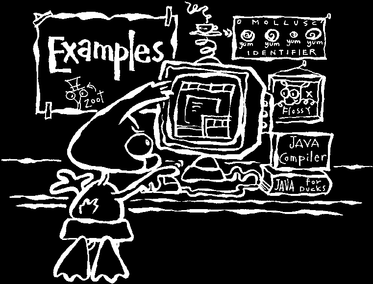

## 示例 1 —— 表表助手

*Buddy 对数字一直没概念，记忆乘法表很困难。不幸的是，其他鸭子太忙于在池塘游荡、嘎嘎叫和打板球，没空帮他，所以他决定写一个程序来帮助自己。执行这个任务最好的方法是什么？*

七岁以上的人都知道，乘法表只涉及整数，因此这个任务可以使用`int`值完成。由于这个程序只需要从用户那里接收一个值，而用户在运行程序时应该知道这个值，将该值作为命令行参数传递是有意义的。注意将字符串值转换为整数的额外代码。下面的示例程序将给出乘法表的前六项，扩展更多项并不难。

```java
/* TimesTable1.java – 帮助 Buddy 记忆乘法表的程序
Author: GPH
Date: 9th June 2003
Tested on: Linux (Red Hat 8.0), JDK 1.4.1
*/
```

### 输入

```text
121
```

## 示例 2 – 重新回顾 Cilla 的板球调度器

*Cilla 决定修改上一个章节中的板球调度程序，以包含用户输入。程序的运行方式与之前一样，但这次用户是通过交互方式提供数据的。*

用户被要求输入今天准备打板球的鸭子数量，计算方式与之前完全相同。因此，唯一的更改是：

```java
import htpuj.*;
```

这告诉编译器和解释器，该程序中的某些函数位于其他包中。现在通过合适的提示来获取可比赛的鸭子数量：

```java
System.out.print ("How many ducks want to play?: ");
```

```java
numDucks = Console.readInt();
```

向用户显示提示，程序获取用户输入的数据并存储在`numDucks`变量中（该变量在之前的示例中已使用）。程序的其余部分保持不变，只是将类重命名以与之前的示例区分来。

```java
/* CricketScheduler2.java – Cilla 改进的板球调度软件

作者：GPH

日期：2003年6月9日

测试环境：Linux (Red Hat 8.0), JDK 1.4.1

*/

import htpuj.*;

public class CricketScheduler2
{
    public CricketScheduler2 () {}

    public int getNumTeams (int num, int size)
    {
        return num / size;
    }

    public int getRemainder (int num, int size)
    {
        return num % size;
    }

    public void printInfo (int num, int size)
    {
        System.out.println ("There are " + num + " ducks available.");
        System.out.println ("This means " + getNumTeams(num, size) + " teams of " + size);
        System.out.println ("This leaves " + getRemainder(num, size) + " substitutes.");
    }

    public static void main (String args[])
    {
        CricketScheduler2 c2 = new CricketScheduler2 ();
        int numDucks;
        final int TEAMSIZE = 11;

        System.out.print ("How many ducks wish to play?: ");
        numDucks = Console.readInt ();
        c2.printInfo (numDucks, TEAMSIZE);
    }
}
```


## 9.1

识别并解释以下代码段中的错误：

```java
final int numCoots = 11;

System.out.print ("Enter the number of coots : ");

Console.readInt (numCoots);
```

## 9.2

修改 Martinmere 先生的预留计算器（上一个章节示例中的），使其通过命令行参数接受预留的鸭子和黑鸭数量，而不是硬编码值。

## 9.3

修改你为练习 9.2 编写的程序，使其提示用户数量并以交互方式接受值，而不是在运行时接受。

## 9.4

修改 Elvis 的零花钱计算器（同样来自之前的示例），让用户提示输入姓名（以使程序某种程度上个性化）以及计算中使用的值。


这一章没有包含大量的 Java 新知识，但它引入的概念对于允许用户与程序进行任何交互是至关重要的。几乎没有任何现实世界的程序是在不经过某种输入的情况下运行的，无论是来自运行时命令行、执行期间的用户输入，还是来自某些文件或网络连接。因此，至少了解从用户处获取数据的方法很重要。

## 输入

命令行参数（CLAs）用于在调用程序时将值传递给程序，而交互式提示用于在程序执行期间获取值。只有当用户在程序运行之前知道值时，命令行参数才有用；如果不是如此，可以使用交互式输入。

处理命令行参数的代码编写比处理交互式输入容易得多，但在某些程序中，额外的努力是值得的，例如需要重复输入值、值没有固定顺序，或者有待输入的值的选择（例如，更改鸭子的名称、重量或价值）。

本章中的一些程序变得有点复杂了。确保它们产生的结果是正确的非常重要，因此是时候从 Java 中休息一下，简要查看程序可以以及应该如何测试了。

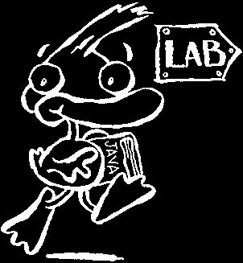


## 关于测试的话

你现在编写了你的第一个完整程序。这本书的大部分将关于程序应该测试的方法。测试是一个简单的程序。彻底测试这个程序的过程相当复杂，尽管程序本身很小。测试程序是软件工程的另一个重要部分。为了让计算机系统真正有用，其用户必须确信系统运行正常且其产生的结果是正确的。测试计算机程序以确保其准确性和可靠性，在许多方面比编写程序重要得多。

计算机程序在现代世界无处不在。现代汽车依靠极其复杂的程序来控制从加热系统到刹车的一切。飞机拥有“线线控制”系统，几乎可以让它们自己导航和飞行。任何驾驶汽车或乘坐飞机的人都对这些程序产生了巨大的信任，暗示了编写这些程序的技能；如果程序因产生错误结果而失败，后果可能是灾难性的。记住，所有这些程序在某时候都是人类编写的，而人类经常会出错。这就是为什么在允许任何人将它们用于任何昂贵或危险的情况之前，所有这些程序都经过了彻底测试。

编写程序远不是涉及的唯一活动。软件工程包含了广泛的任务——设计软件、测试软件、文档等——编程只是其中一小部分。有些程序员自称为软件工程师以反映这些任务的范围。

## 测试简单程序

Cilla 计算鸭子能组成多少板球球队的程序可以作为如何测试简单程序的示例。这个程序获取下午想打板球的鸭子数量，并显示应该有多少球队以及有多少鸭子作为替补。彻底测试这个程序的过程相当复杂，尽管程序本身非常小且直接。

这里是程序：

```java
/* CricketScheduler.java – Cilla 的板球调度软件

作者：GPH

日期：2003年6月8日

测试环境：Linux (Red Hat 8.0), JDK 1.4.1

*/

public class CricketScheduler
{
    public int getNumTeams(int num, int size)
    {
        return num / size;
    }

    public int getRemainder (int num, int size)
    {
        return num % size;
    }

    public void printInfo ()
    {
        System.out.println ("There are " + numDucks +
        " ducks available.");

        System.out.println ("This means " +
        getNumTeams(numDucks, TEAMSIZE) +
        " teams of " + TEAMSIZE + ", and " +
        getRemainder(numDucks, TEAMSIZE) +
        " substitutes.");
    }

    public static void main (String args[])
    {
        CricketScheduler cs = new CricketScheduler ();
        int numDucks = 36;
        final int TEAMSIZE = 11;

        cs.printInfo();
    }
}
```

诚然，该程序中的错误结果不太可能像例如线线控制系统中的错误那样具有灾难性，但一只在有机会打板球时却失去机会的愤怒水鸟并不是件愉快的事。

测试此程序的第一步是制定一个计划；意不意外的是，这被称为*测试计划*（test plan）。该计划将简单列出提供给程序的输入值（称为*测试数据* *test data*），以及如果程序按预期运行，预期的结果。这些预期结果是预先手工计算的。显然，它们经过了非常彻底的检查，因为错误可能是致命。

每组输入值和预期结果组成了程序的一个*测试用例*（test case）。如果程序对每个测试用例都能产生正确的结果（假设有足够的测试用例来覆盖所有可能性），那么就可以假设程序是正确的，并且按预期工作。

Cilla 程序的示例测试数据如下：

| 输入 | 预期输出 |
| :--- | :--- |
| 鸭数 | 队伍 | 剩余鸭数 |
| 10 | 0 | 10 |
| 65 | 5 | 10 |
| 100 | 9 | 1 |

例如，这里的第三个测试用例说明，如果有一百只鸭，程序的正确结果将是九支队伍，剩余一只鸭子作为替补。另外两个测试用例只是测试了其他可能的输入值。

测试程序只需针对每组数据运行程序并记录实际结果。将这些结果与同一测试用例的预期结果进行比较，如果它们全部匹配，则说明程序通过了所有测试并被认为工作正常。

问题在于，这并不意味着程序实际上可以工作！这里的信息仅足以让程序员假设它能工作。在上面的示例中，只有三组测试数据；如果程序通过了所有三个测试用例，实际上所知的仅仅是它在这三对输入值上运行正常。显然无法确定它在每种可能的输入数据集上都能正常工作；对于大多数类型的输入数据，可能存在某些未尝试过的额外测试用例，而程序在其中会产生错误的结果。

这是测试任何程序都会面临的问题。一个程序被预期在许多输入值下都能工作；一个与上述程序非常相似的程序可能处理无限数量可能值。由于这个原因，很少能用所有可能的测试数据集来测试任何程序。相反，使用代表性数值来构建测试计划中的测试用例；如果程序通过了所有测试用例，那么假设它在所有其他可能的情况下都能正常运行是合理的。所有程序都是如此；飞机上的程序无法在飞机可能飞行的每条航线和所有天气条件下都进行测试。对于任何程序，测试计划中必须使用可能输入值的子集。挑选这些值需要经过思考；这个过程不能是随机的。


程序还应该能够处理不预期的输入值；例如，用户可能在期望正数时输入一个负数。这意味着程序还应该用非预期值进行测试。在这个示例中，一个表示鸭子数量为负数的输入显然是荒谬的，但程序能够合理地处理此类输入是非常重要的。还有一些特定的情况需要注意。如果输入的鸭子数量为负数，该程序存在一个潜在错误。这将导致分配给队伍的鸭数为负数！另一个常见错误发生在某个值被用作计算中的除数时；该值不能为 0，因为除以 0 是错误。程序必须始终处理此类错误并表现得合理。

考虑到这个潜在的错误情况，可以制定一个更完整的测试计划。在这种情况下，鸭子数量允许为 0（假设将没有队伍，也没有剩余鸭子），但它是允许的最低值。该示例更完整的测试计划可能如下：

| 输入 | 预期输出 | 是否通过？ |
| :--- | :--- | :--- |
| 鸭数 | 队伍 | 剩余鸭数 |
| 10 | 0 | 10 |
| 65 | 5 | 10 |
| 100 | 9 | 1 |
| 0 | 0 | 0 |
| 1 | 错误 | 错误 |
| 2 | 错误 | 错误 |

在这个小示例中，假设鸭子数量较少，可能测试所有可能的值。但在更复杂的程序中，通常没有合理的方法来记录并测试所有可能的值。

## 边界值与典型值

选择用于测试用例的值需要一个系统化的计划。一种可能性是仅仅选择随机值，但这可能导致测试次数过多或过少，并意味着测试时间过长。需要一个系统能让测试人员能够在合理的时间内选择足够的测试用例，同时让他们确信程序是正确的。

输入程序的预期值基本上两类。*典型值*（Typical values）是程序在正常运行时预期处理的示例；使用这些值只需选择一组典型值，并假设程序能正确处理这些值，它也能处理所有其他值。*边界值*（Boundary values）更为复杂。这些是出现在限制周围的值。在上面的示例中，可能的鸭子值有一个下边界——它不能小于 0。程序应该测试所有边界值，以及每个边界紧邻的两个值。在示例中，假设鸭子数量没有上限，尽管在实践中可能存在。

为了帮助测试人员，测试计划还应该指示特定测试用例的目的——该值是典型的还是边界的。Cilla 的板球调度程序的完整测试计划可能是：

| 输入 | 预期输出 | 是否通过？ |
| :--- | :--- | :--- |
| 鸭数 | 队伍 | 剩余鸭数 |
| 1 | 典型 | 10 | 0 | 10 |
| 2 | 典型 | 65 | 5 | 10 |
| 3 | 典型 | 100 | 9 | 1 |
| 4 | 边界 | 0 | 0 | 0 |
| 5 | 边界 | 1 | 错误 | 错误 |
| 6 | 边界 | 2 | 错误 | 错误 |

确实存在可以生成随机数的程序，这些数可以作为其他程序的输入测试数据。它们对于自动执行大量测试非常有用。

这次另一个添加是用于索引每个测试用例的数字。这仅仅是为了方便引用，例如，测试程序的人可以轻松且无歧义地为程序员提供一份程序失败的测试列表。

在该计划中，测试一到测试三是随机选择的典型值，而测试四到测试六测试的是鸭子数量的下边界（我们假设可能合理完全没有鸭子，且没有上限）。

注意大量的测试是如何集中在边界值周围的。在实践中，我们倾向于在每个边界值处进行三次测试，因此这显然是测试最集中的地方。这是预料之中的，因为假设错误恰恰可能发生在这些地方似乎是合理的。

## 编写和使用测试计划

测试计划可以直接根据程序的规格说明书编写，并且应该在程序编写之前编写。通常情况下，从规格说明书中识别边界值和典型值是容易的，且预期输出应该通过手工计算并仔细验证。测试计划在某种程度上应该是动态的；如果程序的规格说明发生变化，计划也应该随之更改。在开始编写程序之前，计划必须确保是完整的。虽然在程序开发过程中，程序员在检查代码时会进行一些测试，但最终测试应该始终按照计划进行。程序的最终测试绝不能随机进行，且最终测试计划绝不能在程序完成后才编写。

在许多商业软件开发公司中，会有专门负责测试程序的人员。这些人极少与编写程序的人是同一拨人。这是一件好事；当你测试自己的程序时，有时很难保持客观。毕竟，程序是你自己写的，你很清楚它有多好。你知道它能运行，那么彻底测试它的意义何在呢？

不过，很有可能在你学习编程的过程中，你会测试自己的程序。当你这样做时，请尽力做到尽可能详尽和冷酷无情。值得记住，如果你不发现错误，别人会发现。确保你的测试计划是完整的，并且涵盖了所有可能的情况。让朋友测试你的程序，同时你也回以同样测试他们的程序，这也是个好主意。你可以尽情享受寻找朋友程序中微小错误的乐趣，而他们在测试你的程序时也能获得类似的满足感。

程序的最终版本应该通过计划中的所有测试。当然，有时计划会暴露出必须修正的错误，结果是程序必须进行修改。显然，程序必须再次进行测试。在这种情况下，在进行任何更改后重新运行整个测试计划至关重要；为了纠正一个错误而进行的更改很可能导致程序其他地方出现错误，而另一个测试用例现在可能会产生错误的结果。程序的最终版本应该始终通过计划中的每一个测试用例。

## 测试与调试

在你编写程序时，你会不时运行它们以检查它们是否正确编译并按预期工作。大多数情况下，你会查看输出，发现错误，然后对程序进行修改。你会发现 bug 并修复它们。这叫*调试*，而不是测试。

不要混淆这两种活动。调试是编程过程中的一个重要部分；程序员发现程序中的错误并修复它们。但这是发生在测试之前的。测试是一种结构化的活动，用于验证程序是否是正确的。它只在程序被认为是正确的、且所有已知的 bug 都已发现并修正后才会进行。当然，测试可能会发现更多 bug，但它仍然是一个独立的活动。

## 用户测试

任何计算机程序的第一次真正测试并不是在编写时，而是在它被预期用户之一“愤怒使用”（高强度使用）时。这种测试发生的环境与这里描述的测试策略所使用的环境完全不同。用户确实是非常不可预测的！

大多数商业软件将由编写它的软件公司进行彻底测试。但在广泛发布之前，公司始终会将其发送给几个选定的用户（测试用户）。

## 示例 1 – 冰上运动

每年池塘结冰，埃尔维斯和他的朋友们趁机举办冰上比赛。每位参赛者从每个裁判那里得到6分。共有五位裁判。参赛者的最终得分是通过去掉最高和最低分，然后对剩下的三个分取平均值计算出来的。

为计算最终得分的程序编写测试计划。裁判最高分是6，最低分是0，因此这些是边界值。计划还需要验证计算是否正确，以及忽略了正确的分数；这可以通过一组典型值完成。

计划如下：

| 目的 | 裁判 | 分数 | 通过 |
| :--- | :--- | :--- | :--- |
| 1 | 典型值 | 6, 6, 6, 6, 6 | 6.0 |
| 2 | 典型值 | 1, 6, 3, 3, 3 | 3.0 |
| 3 | 典型值 | 6, 6, 2, 2, 4 | 4.0 |
| 4 | 典型值 | 1, 6, 2, 4, 4 | 3.33 |
| 5 | 边界值 | 1, 6, 6, 6, 6 | 错误 |
| 6 | 边界值 | 0, 6, 6, 6, 6 | 6.0 |
| 7 | 边界值 | 7, 6, 6, 6, 6 | 错误 |

边界条件；这仅在评判 1 上进行了测试，因此假设其他评判的评分是以相同方式处理的。

**示例 2 – 埃尔斯的计算器**

*埃尔斯有一个简单的程序，可以让他进行一些基础数学运算。它允许他进行加、减、乘、除。他已经对这个程序进行了彻底测试，并认为它可以正常工作。为了帮助他处理更复杂的数学计算，他在程序中添加了一个针对整数值的平方根函数。他应该在测试计划中添加什么？*

找到一组典型值很容易的；几乎任何正值都可以。

由于负数没有平方根，所有负值都是错误情况，因此埃尔斯必须确保他的程序在处理这些值时能够正常工作，可能通过生成某种错误消息。程序应该能正确找到 0 的平方根（即 0），所以这是一个边界。

他计划中的额外测试用例将是：

| 目的 | 输入 | 输出 | 通过 |
| :--- | :--- | :--- | :--- |
| 典型 | 4 | 2.0 | 1 |
| 典型 | 15 | 3.87 | 2 |
| 边界 | 0 | 0 | 3 |
| 边界 | 1 | Error | 4 |
| 边界 | 1 | 1 | 5 |

这次在边界两侧都有测试用例（测试 3 到 5）。还存在假设，如果程序能正确处理 1，那么它也能同样处理 2，并且两位小数的精度是足够的。这种精度由应用程序决定的；如果程序被用于民客飞机导航等更复杂的应用程序，就有必要使用并检查更多的小数位。

埃尔斯在对新程序有信心之前，还必须运行他程序的所有其他测试用例。完全有可能，向他的计算器中添加这个新功能可能会在程序的其他地方引入错误。

**10.1**

将 Cilla 的板球调度程序输入你的计算机（或从网站上获取），编译并执行它。使用测试计划查看它是否在所有情况下都是正确的。识别任何程序没有正常工作的情况。你会发现使用从用户获取输入的版本更简单。

**10.2**

数字除以 0 的情况已被确定为程序中的潜在错误。编写一个小型程序，看看你的 Java 系统在面对除以 0 时会发生什么。你的 Java 系统在哪个阶段发现这个错误？你现在还不知道如何阻止这种情况发生（这在第 14 章中介绍），但至少在它发生时你能识别出来！

**10.3**

在本章的第一个示例中，做了一个假设：如果第一个评判的评分处理正确，那么所有其他的也都会处理正确。这是一个合理的假设吗？

**10.4**

一个程序获取学生在三次测试中的得分并显示平均分。每次测试的评分范围都是 0 到一百（包含边界值）。为这个程序编写一个测试计划。

**10.5**

将练习题 10.4 中的程序扩展，为显示学生的等级而不是平均分。定义了三个等级：A（平均分 70 到 100），B（平均分 40 到 69.9），以及 C（39.9 及以下）。为这个版本的程序编写一个测试计划。

测试是非常重要的。除了要学习编程，你现在还要学习如何测试你的程序。养成开发和使用详尽测试计划的习惯是最好的。不要试图将测试视为一种随机活动。它可能很枯燥，但非常重要。

测试计划提供了一个可以应用于程序的测试用例列表。每个测试用例由一组输入值和对应的输出值组成。当且当程序通过了所有测试用例时，它才算通过测试。只有这样，程序员对程序才有信心。只有这样，程序员才准备好将程序交给预期的用户。

测试计划应该在编写程序之前编写。理想情况下，它不应该由程序员或任何了解程序工作原理细节的人编写。测试计划绝不应该在认为程序可以正常工作之后才事后补救！

编写程序只是编程活动的一部分。测试程序并纠正揭示的错误是另一个同样重要的部分。

到目前，我们查看了一些基础对象，赋予了它们中等的功能，并学习了如何在简单程序中使用这些对象。这本书从未打算是*那么*基础，因此在接下来的两个章中，我们将重新回顾大部分早期材料，深入探讨类、对象、方法和属性。

在这些章节中，Java 方面的新内容很少；我们更多地关注编写未来可能被其他程序员复用的类，以及编写此类程序的方法论，而不是任何在这个阶段会让问题变得复杂的额外功能。

在本章中，你将自己构建一个类。到结束时，你应该应该理解如何创建一个 `*.java*` 文件来定义你的类，并且对方法和属性有更多一点了解，以及如何将它们整合到你的类中。

这里有类的名称和简要的描述。其余信息标识了作者（以防有人发现错误并想投诉！）、类的编写日期，最后是所使用的平台（Red Hat 是 Linux 操作系统的一个版本）。

注释后的下一行提供了所定义的类名。

这里用于类名命名的命名约定是：标识符使用单数而非复数，并且首字母大写。当然，类名也是包含该定义的文件名。因此，在这个示例中，类定义在 `Duck.java` 文件中，定义的第一行必须是：

```java
public class Duck {
```

如果需要，该 `*.java*` 文件在此处还可以导入其他库——这些库实际上是其他的类定义文件——你在包含用于读取输入的库时就已经遇到过这个概念。

通常，包含清晰的注释来指示文件中每个部分的含义也是很有用的。诚然地说，在像本章这样一个简单的示例中，这并不是严格必要的，但养成这是一个良好的习惯。

在这些初始注释和其余前言部分之后，定义的剩余部分提供了实际实现该类的代码。在这个文件中，习惯做法是先列出属性，然后是方法。要记住，一个 Java 类被分为两个部分；就像人有公共面和私有面一样。我们之前见过这种划分，但现在是时候准确理解到底发生了什么了。

**属性 (Attributes)**

再次，这是我们在第 6 章中快速看过的内容。这一节只是以稍微正式一点的方式对其进行了总结。

属性是关于某个对象需要存储的某个感兴趣的值。这通常是与正在解决的某个问题相关的值或特征。类的属性简单地列在定义的第一部分；这涉及指定属性的标识符及其类型。语法正如预期的那样：

*可见性* *类型* *标识符** *;***

在这里，*可见性* (visibility) 表示程序的哪些组件可以访问该属性。有三个级别的可见性（或更正式地说，即*作用域* (scope)），我们将在稍后更详细地检查其中两个（`public` 和 `private`）。通常情况下，大多数属性具有私有作用域，这就是我们将要采用的约定。

对于属性标识符的选择，与变量的选择遵循相同的准则。标识符应该短小简洁，但仍应传达其含义。属性的类型可以是变量可用的任何类型。在更复杂的程序中，类型也可以是另一个类，以允许我们见过的情况出现：一个对象类型的属性本身是另一个对象类型。

定义好属性后，就是方法了。

**方法 (Methods)**

在分析问题时，针对每个对象类型所需的每个方法确定了三项信息。并不意外，在 `*.java*` 文件中指定一个方法也需要这三项信息。这些是：方法名、它确定的值的类型（如果有），以及它所处理的任何值的类型（参数）。

声明方法的格式与属性的声明相似：

*可见性* *确定的类型* *方法名** (**所处理的值的类型**)**

再次，*可见性* 对应于方法的*作用域*（`public` 或 `private`），而且通常（但并非总是）方法具有公共作用域。该定义本身就提供了方法的完整定义。例如，我们很快就会遇到一个追踪池塘中鸭子的程序。它存储了鸭子的位置，并经常计算它们偏离某个特定点有多远。一个确定鸭子到某点距离可能会声明为：

```java
public double distanceFrom (int dx, int dy)
```

当然，如果某些地方不是绝对清楚，应该用适当的注释进行扩展。

方法处理的值的类型和标识符在逗号分隔的列表中指定；如果没有值，则该列表留空（但括号保留）。括号内部的值被称为方法的*参数* (parameters)，或者有时称为*参数* (arguments)。方法还可以自动利用类中私有部分的任何属性（以及任何其他方法）；参数用于提供额外的值。方法确定的值的类型被称为该方法的*返回类型* (return type)。

所有这些内容意味着方法的定义可以被剖析。它告诉我们，该方法确定一个浮点值，名为 `distanceFrom`，并取两个整数值作为参数。尽管没有注释，但通过对可能的应用的一些了解，我们可以推断出该方法计算了鸭子到池塘上某个特定点的距离，该距离被确定为一个浮点值。

某些方法不返回值。这解释了为什么需要一个指示此点的的数据类型 `void`。不返回值的方法定义方式就像它返回一个 `void` 值一样。所以：

```java
public void changeName (String newName)
```

定义了一个更改鸭子名字的方法，这个过程不涉及返回有趣或有用的值。这是一个*空方法* (void method)。

方法的定义包含大量信息。这些信息对于编写将使用该类及其方法的程序的程序员来说是至关重要的。程序员必须能够处理该类及其方法。

**公共与私有数据 (Public and private data)**

正如我们所说，一个类的 `*.java*` 文件至少按照约定被分为两个部分。这两个部分指定了类拥有的属性和方法。我们还提到了一种叫做作用域的特殊属性。现在我们将讨论 *public* 和 *private* 作用域（还有第三种 `protected`，我们将在最后一章简单介绍）。

如果我们允许鸭子在保护区内漫游，我们很快就会陷入勾哥拉斯定理的三维版本。单这一点就足以简化问题了。

这两者之间的区别显而易见。定义为公共的任何内容可能使用该类的程序可用，而定义为私有的内容仅对类本身可用。这是一种非常强大的机制。一个比喻是汽车的控制。正常的控制——方向盘、踏板、手刹——保持不变，构成了汽车的公共接口。技师对引擎可能做的任何更改都是私有的，司机不需要知道。汽车的公共接口始终以相同的方式工作，不应因引擎所做的更改而改变。

在本章（以及整本书）中使用的约定是：属性始终定义为私有作用域，方法通常为公共作用域。这并不是强制要求的，但它是最常用的方法。它还允许了一种被称为*数据隐藏* (data hiding) 的强大安全机制，我们在第 13 章看到。

最后，让我们定义一些属性和方法吧！

**属性和方法定义 (Attribute and method definitions)**

我们对属性和方法进行了理论研究，并讨论了它们为什么通常分为私有和公共作用域。现在，定义一些属性和方法并在实践中观察是合理的。

回到我们在第 6 章第一次看到的示例——一个代表鸭子的类。记得，对于 Martinmere 来说，鸭子有名字、年龄和价值。这些将作为属性存储——`name` 是 `String`，`age` 是 `int`，`value` 是 `double`。由于我们预计在书中遇到的所有属性都是私有的，它们的声明如下：

```java
private String name;
```


```java
private int age;
```

```java
private double value;
```

让我们稍微扩展一下鸭子类；由于每只鸭子都被允许在保护区自由行走，我们可以提供属性来存储鸭子的位置，以防 Martinmere 先生需要追踪它们。假设所有的鸭子都在地面上，我们可以通过两个属性来实现这一点，存储鸭子的 `x` 和 `y` 位置为 `int` 值（`double` 也可以接受，但我们可能根本不需要那种精度）：

```java
private int x, y;
```

## 第一类

141

由于属性通常位于源文件的顶部，到目前为止，我们的类看起来像这样：

```java
// History block

public class Duck
{

private String name;

private int age, x, y;

private double value;

// Methods
}
```

接下来我们转向方法。通常情况下，拥有一些允许访问部分私有属性的方法（称为访问器或选择器方法）是一个好主意。我们将在第 13 章详细讨论这一点，但目前我们只添加几个可能的方法。

一个类所拥有的方法取决于使用该类的程序的需求。在当前示例中，`Duck`（鸭子）类将扩展几种可能性：

- 一个仅用于返回鸭子年龄的方法（访问器方法）；
- 一个能够整齐显示鸭子名称和位置的方法；
- 一个用于确定鸭子距离特定位置有多远的方法（该位置将作为两个参数提供，一个用于 `x` 坐标，另一个用于 `y` 坐标）。

只要我们知道它将返回的值类型以及它接受的任何参数类型，就可以根据描述定义每个方法。例如，我们知道鸭子的年龄存储为 `int` 值，且此类方法不接受任何参数，因此访问此属性的方法声明将是：

```java
public int getAge ()
```

其他方法的声明如下：

```java
public void printNeatly ()
```

此方法称为 `printNeatly`，不需要任何参数，也不返回任何值。¹

```java
public double distanceFrom (int someX, int someY)
```

此方法需要 `x` 和 `y` 坐标作为参数，并返回一个 `double` 值。³

Java 程序员之间有一个共同惯例，每个类都应该有一个名为 `toString()` 的方法，提供与此处 `printNeatly ()` 方法非常相同的信息。定义这样的方法允许我们将类的实例传递给 `System.out.print ()` 和 `println ()` 方法。事实上，所有类都定义了 `toString()` 方法的默认版本。为什么不写一个简单的程序来看看这个默认版本是做什么的呢？

³ 如果计算返回 `int` 值，将会丢失精度——例如，`(1,1)` 距离 `(0,0)` 多远？

142

## 如何使用 Java 编程

到目前为止，我们已经有了方法的定义；实现本身以后需要添加。目前该类看起来是这样：

```java
public class Duck
{

// Attributes
private String name;

private int age, x, y;

private double value;

// Methods
public int getAge ()
{
// implementation here
}

public void printNeatly ()
{
// implementation here
}

public double distanceFrom (int someX, someY)
{
// implementation here
}
}
```

记住，虽然 Java 在这个示例中是正确的，但这并不是类的完整定义。方法的实现仍然缺失，但在添加这些内容之前，还有一个方法需要包含。

### 构造函数

还有一个最后一个方法要添加。我们已经看到，为了声明一个对象，程序员需要指定要声明的对象的类型，提供一个标识符，并调用构造函数：

`类名` `标识符` `new` `构造函数()`

构造函数是负责创建类实例（即对象）的特殊方法。类名和构造函数名显然是相同的。如果定义构造函数为接受参数，则这些参数也提供在括号中。构造函数的名称写法必须与文件顶部给出的类名完全相同；包括字母的大小写。任何错误都意味着该方法不会被识别为构造函数。

幸运的是，构造函数需要做的大部分工作都是自动处理的。所有的内存分配都在后台进行，程序员不需要担心它。构造函数还可以为某些属性分配默认值；如果是这样的话，应该在头文件中添加注释来记录这一点（并解释所使用的值）。如果必须检查构造函数的实现（或任何其他方法）来确定它具体做了什么，那将是非常糟糕的。

143

## 第一类

在这种情况下，构造函数不接受任何参数。⁴ 声明如下：

```java
public Duck () // 构造函数
```

添加构造函数为 `Duck` 类提供了一个近乎完整的定义文件，但现在需要一些实现了。

### 实现部分

定义类的最后部分是添加实现方法的 Java 语句。可以使用任何 Java 语句，即使是我们尚未接触过的！让我们逐考虑每个示例方法。

```java
public int getAge ()
```

此方法所做的并没有比找到属性的值并将其传递（或“返回”）给调用该方法的任何地方更复杂。在 Java 中执行此操作的语句简单就是 `return`，所以：

```java
public int getAge ()
{
return age;
}
```

下一个方法：

```java
public void printNeatly ()
```

此方法需要执行一些输出。此输出的精确格式可能由应用程序决定，但需要一些 `System.out.print` 语句，例如：

```java
public void printNeatly ()
{
System.out.println ("Name: " + name);
System.out.println ("Position: " + x + ", " + y);
}
```

此方法不返回值。下一个方法需要计算，实际上是勾股定理。在不纠结数学细节的情况下，所需的计算是：

```java
public double distanceFrom (int someX, int someY)
{
return Math.sqrt((double) (((someX - x) * (someX - x)) + ((someY - y) * (someY - y))));
}
```

⁴ 实际上，构造函数可以接受参数。一种明显的可能性是类的属性初始值。如果需要，原型正如你所会在括号中指定参数。

144

## 如何使用 Java 编程

此方法还利用了 Java 内置的求根函数。在同一地方可以找到许多其他数学函数。

需要实现的最后一个方法是构造函数。构造函数做的大部分工作都是后台完成的，在很多情况下，除了空实现外不需要其他内容。这里的构造函数仅仅是：

```java
public Duck ()
{
}
```

值得注意的是，如果类中指定构造函数，Java 将提供这样一个构造函数。定义自己的构造函数是一个好习惯，但如果你遗漏它并不总是灾难。如果类的属性都是基本类型（整数、字符、布尔等），并且你对编译器的默认值满意，那么不包含构造函数（或者包含一个空构造函数）不会引起任何问题。然而，如果你需要初始化对象或基本变量的非默认值，那么在构造函数包含代码来实现这一点是非常重要的。

这得到了可能用于某种鸭子跟踪程序的简单 `Duck` 类的最终定义。最后的小变化是表示位置的整数被分开了；以这种方式分组连接的属性通常是一个好计划。类定义如下：

```java
/* Duck.java – 一个简单的 Duck 类。
作者: AMJ
日期: 2002年12月31日
测试环境: Red Hat 7.3, JDK 1.4.0 */

public class Duck
{

// Attributes
private String name;

private int age;
private double value;
private int x, y;

// Constructor
public Duck ()
{
}

// Methods
public int getAge ()
{
return age;
}
}
```

# 定义类

这就是全部内容了。一旦定义了类，我们就可以开始编写使用该类的程序，这将在下一章中介绍。

在此之前，先看一些例子！


### 示例 1 – 布鲁斯的图书馆

布鲁斯在他的小屋里建立了一个微型图书馆。他自然地想记录那些借用他珍贵书籍的鸭子的信息，因此他决定开发一个小型 Java 程序来协助这项工作。作为第一阶段，他决定创建一个简单的类来存储借书鸭子的详细信息。第一次尝试将局限于一个简单的方法，用于显示一个借书者的详细信息。

类的实现文件看起来是什么样的？

布鲁斯图书馆的借阅者都是鸭子。我们在前面的章节中已经看到过一个存储鸭子详情的类，所以这个这个类似乎是一个很好的起点。但事实可能并非如此。本章中的类是为了特定的应用程序而开发的；其主要目标是跟踪鸭子在池塘上移动的情况。而记录它们借书活动的详情完全是另一回事了。

我们可以对布鲁斯的需求进行泛化，并开发一个用于“借用者”的类。这是一个合理的步骤，正如我们之前看到的，有很多应用程序中物体被其他物体借用，而必须承认，鸭子借用物品的应用是非常罕见的。

146

## 如何使用 Java 编程

布鲁斯显然对借阅者的名字感兴趣，因此我们可以从这里开始定义属性：

```java
public class Borrower
{
    private String name;
```

这很好，但如果两个人的名字相同，就无法识别某个特定的借阅者。这是一个常见问题，通常的做法是引入另一个保证是唯一的值来解决它。这里一个明显的添加是某种借阅者编号：

```java
public class Borrower
{
    public String name;
    public int number;
```

对于属性来说这足够了。这个版本需要两个方法：一个简单地显示借阅者的详情，另一个是构造函数。在这个示例中，构造函数不需要做什么特别：

```java
public Borrower ()
{
}
```

而另一个方法仅仅是两个用于打印所需数值的语句：

```java
public void print ()
{
    System.out.println ("Borrower: " + name);
    System.out.println ("Number: " + number);
}
```

这给了布鲁斯第一次尝试类的最终版本：

```java
public class Borrower {
    private String name; // 借阅者名字
    private int number; // 唯一的借阅者编号

    public Borrower ()
    {
    }

    public void print ()
    {
        System.out.println ("Borrower: " + name);
        System.out.println ("Number: " + number);
    }
}
```

### 示例 2 – 板球鸭子

鸭子们继续享受板球。它们自然地想对每场比赛记录一系列统计，这样它们就可以在漫长的冬季里争论谁是最棒的鸭板球运动员。

巴迪（Buddy）已开始开发一个处理每只鸭子表现详情的程序。他计划存储每只鸭子的击局次数、得分数、“未出局”的次数、击落的三门数以及丢掉的分数。

最终的程序显然会非常复杂，因此巴迪决定从一个简单得类开始。这个类将简单地存储每个所需的数值，并提供一个方法来显示它们，另一个方法提示用户输入它们。

实现巴迪的类。

该类显然需要存储鸭子的名字，这是一个字符串；该类的数值属性都是整数，因此该类的这部分是非常直观的：

```java
private String name;
private int innings;
private int notOuts;
private int runsScored;
private int wickets;
private int runsConceded;
```

输入值也不太复杂。我们暂时假设不需要对输入的值进行有效验证，所以：

```java
public void enterStats ()
{
    System.out.print ("Enter name : ");
    name = Console.readString ();
    System.out.print ("Enter number of innings: ");
    innings = Console.readInt ();
    System.out.print ("Enter runs scored: ");
    runsScored = Console.readInt ();
    System.out.print ("Enter not-outs: ");
    notOuts = Console.readInt ();
    System.out.print ("Enter wickets taken: ");
    wickets = Console.readInt ();
    System.out.print("Enter runs conceded: ");
    runsConceded = Console.readInt ();
}
```

该类显然需要存储鸭子的名字，这是一个字符串；该类的数值属性都是整数，因此该类的这部分是非常直观的：

```java
private String name;
private int innings;
private int notOuts;
private int runsScored;
private int wickets;
private int runsConceded;
```

输入值也不太复杂。我们暂时假设不需要对输入的值进行有效验证，所以：

```java
public void enterStats ()
{
    System.out.print ("Enter name : ");
    name = Console.readString ();
    System.out.print ("Enter number of innings: ");
    innings = Console.readInt ();
    System.out.print ("Enter runs scored: ");
    runsScored = Console.readInt ();
    System.out.print ("Enter not-outs: ");
    notOuts = Console.readInt ();
    System.out.print ("Enter wickets taken: ");
    wickets = Console.readInt ();
    System.out.print("Enter runs conceded: ");
    runsConceded = Console.readInt ();
}
```

显示值的方法也可以是一对打印所需数值的语句。但这里有一个更“Java 式”的方法：

```java
public String toString()
{
    String stats = "*** Stats for " + name + " ***";
    stats += "\nInnings: " + innings;
    stats += "\nRuns scored: " + runsScored;
    stats += "\nNot-outs: " + notOuts;
    stats += "\nWickets taken: " + wickets;
    stats += "\nRuns conceded: " + runsConceded;
    return stats;
}
```

这逐步构建了用于显示的字符串。在类中添加 `main` 方法：

```java
public static void main (String[] args)
{
    CrickDucks cd = new CricketingDucks();
    cd.enterStats();
    cd.printNeatly();
}
```

类现在可以作为程序运行：

```text
Enter name : Buddy
Enter number of innings: 10
Enter runs scored: 200
Enter not-outs: 1
Enter wickets taken: 5
Enter runs conceded: 30
*** Stats for Buddy ***
Innings: 10
Runs scored: 200
Not-outs: 1
Wickets taken: 5
Runs conceded: 30
```

150

## 使用 Java 编程

```java
public static void main(String[] args)
{
    CricketingDucks cd = new CricketingDucks ();
    cd.enterStats ();
    cd.printNeatly ();
}
```


## 练习

**11.1**

如果 Bruce 的 `Borrower` 类最初就可以给属性赋值，那么它将变得有用得多！请编写一些方法来实现这一点——你甚至可以考虑使用构造函数来完成这个练习的一部分。

**11.2**

现在再次扩展该类，使用户可以在命令行输入值。通过使用我们在第 9 章中过的交互式输入来实现。

**11.3**


Buddy 的目标是创建一个程序，计算板球手的击球平均和投球平均。扩展该类，添加一个方法来计算投球平均（失分数除以三局门数）。记得扩展`toString`方法以包含这个新值，并使用`main`方法来测试你的新方法。

## 11.4

按照相同的步骤，添加一个方法来计算击球平均。这是总得分除以已完成的局数（总局数减去未出局的局数）。

## 11.5

现在写一个使用该类的程序。该程序应该读取每个属性的值，并显示投球平均值和击球平均值。

## 类类

151

一个 Java 类定义在`.java`文件中。该文件包含了类中所有属性的描述，以及所有方法的描述和实现。习惯上是将属性定义为类的私有成员，将方法定义为公有；我们将在下一章看到为什么这很重要。习惯上还将将类的私有部分和公共部分放在一起；这有助于类定义更容易理解。

你现在应该能够创建和使用简单的 Java 类了。你还应该理解如何为类提供一个`main`方法，这是一个允许程序员执行一些基本测试的方法。

本章提到了*数据隐藏*的概念，将在第 13 章再次检查。但在在此之前，我们将考虑重用我们在程序中定义的对象，甚至是其他类！


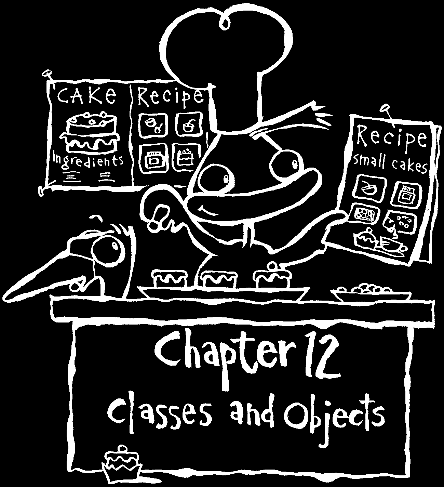

152

## 类与对象

153

你现在已经看到了很多 Java。你已经了解了如何创建一个类，如何创建类的实例（对象），以及如何在简单程序中使用这些对象。不过，这一直有点非正式，现在是时候仔细看看并练习编写你自己的程序了。

你可能想回到第 6 章快速看一看如何声明和使用类，以及那些章节描述了如何进行输入和输出。本章基于你到为止学到的基础 Java 语句，向你展示了你已经使用和练习的编程思想如何扩展为使用类和对象的程序。读完本章后，你将理解如何在 Java 程序中创建和使用对象。你应该能够读取类的实现文件、理解它并在你的程序中使用类。


开发面向对象的程序有两个阶段。第一是定义类，第二是开发使用它的程序。本章感兴趣的是第二个阶段；我们将关注类的定义（在`.java`文件中找到）以及编写使用它的程序。显然，将编程分成这两个相当不同的阶段是面向对象编程的一个优势；程序员可以同时使用其他程序员编写的类。当然，使用类的程序员必须首先确切了解类做了什么以及它是如何工作的。


154

## 使用 Java 编程

一个 Java`.java`文件除了其他之外描述了*类接口*。文件的这个方面是本章的重点；你需要能够检查`.java`文件并弄清楚如何在程序中使用该类。你通常也能看到类的实现的所有细节，但如果你只需要使用该类，那么这并不是重要的。

如果只有类的`.class`文件可用，也可以使用类。这可能是由于某些原因，编写类的程序员不希望使用类的程序员访问类的实现细节。在这种情况下，类的类接口必须在某些文档中指定。我们在这里假设`.java`文件是可用的，因此从理解它的内容开始。

我们在第 6 章看到了一个简单的类，在上一章定义了一个稍微复杂的类。这两个示例都定义了一个简单的类来存储数据并包含了相应的属性和方法。通常，定义类的`.java`文件的格式是：

```java
public class classname {
    // 类名
    // 属性定义
    // 方法定义
}
```

我们在上一章看到，在定义使用它们的方法之前定义类的所有属性是习惯，但不是强制的。两者都可以定义为`public`（公有）或`private`（私有）。区别在于定义为公有的对任何使用该类的程序可用，而定义为私有的内容仅在类内部可用。因此，对于编写使用类的程序，我们对定义为公有的内容感兴趣。

一种常见的做法是将所有属性定义为私有，将所有方法定义为公有。这允许程序员控制对值的访问，并允许了一种名为*数据隐藏*的强大机制。我们在本章的所有程序中将遵循这一约定，实际上在整书中都是如此，建议你也这样做。数据隐藏的优势将在第 13 章进行更详细的探讨。

因此，类的公有部分通常指定可以在类实例（对象）上的方法。它也可能指定属性，但这种情况很少，而且通常是坏习惯，因此被避免。方法的规范告诉使用类的程序员方法的名称、它返回的值的类型（如果有）、它作为参数所需的任何值的类型（如果有），最后提供一个或多个执行方法任务的语句。

文件本身应该足以完全且无歧地解释可以使用该类做什么。任何不完全在`.java`文件中的内容都应该通过适当的注释进行解释。

### 准备使用类

使用类的程序被称为*调用*该类的方法。它可能被称为方法的*调用程序*。该程序必须与定义类的文件位于同一个目录下，并且需要访问类的适当编译版本——即`.class`文件。

这意味着准备使用类的第一个阶段是获取定义它的`.class`文件。如果未提供，则必须编译`.java`文件来生成它。这是通过通常的方法完成的，例如：

`javac someClass.java`

如果你一直在使用我们的`Console`类，你实际上已经在这样做了。你必须获取该类的`.java`文件。

156

## 使用 Java 编程

声明；使用对象时，必须显式地调用构造函数。因此我们可以声明一个`Duck`（鸭）对象：

`Duck elvis = new Duck ();`

与任何变量一样，可以在单次声明中声明多个类实例：

`Duck elvis = new Duck(), buddy = new Duck();`

检查注释以查看构造函数是否为对象的每个属性分配了初始值是有意义的，在声明中添加注释来说说明这些值可能是有意义的。

现在，既然已经声明了对象，是时候开始处理这些值了。类的属性将是私有的（private），因此程序无法直接访问它们。访问这些值的方法是通过方法，希望已经为此目的提供了一组方法。

#### 调用方法

我们之前使用过方法，例如当我们需要设置显示在布鲁斯（Bruce）牌子上的字符串时，但这里快速回顾一下调用这些方法的语法。`.java`文件将提供所有可用方法的列表，并包含我们所需的所有细节。

在语句中，通过如下形式在对象上调用方法：

`object name.method name (parameters);`

这看起来并没有那么复杂！对象的标识符后面附有方法名，中间用句号隔开。参数在方法名后的括号中指定。如果有多个参数，它们之间用逗号分隔；这次括号内包含参数的标识符，而绝不包含它们的类型。如果没有参数，括号仍然存在，但它们之间没有任何内容。

一个示例会让这一点变得清晰。另一个设计用于某些鸭子跟踪应用程序（类似于上一章中定义的程序）的简单`Duck`（鸭）类可能包含以下这组方法：

```java
public int getAge (); // 返回鸭子的年龄
public void printNeatly (); // 打印鸭子的所有细节
public double distanceFrom (int, int); // 返回到某点的距离
public boolean atPosition (int, int); // 如果鸭子位于提供的位置，则返回为真
```

假设程序已经声明了：

`Duck elvis = new Duck ();`

调用`printNeatly`方法来显示 elvis 细节的语句将是：

`elvis.printNeatly ();`

此方法的返回类型为`void`，表示它不返回值（这是一个`void`方法）。它没有参数，所以括号是空的。另一方面，其他三个方法确实返回值，而最后两个方法有参数。

157

## 类与对象

返回值对于使用该类的程序员来说是有意义的，因此它们应该存储在声明合适的、类型相应的变量中。这使得方法调用的形式稍长一些：

`variable object name.method name (parameters);`

另一个示例——使用`getAge`方法获取 elvis 的年龄并将其存储在合适的程序变量中，语句是：

`int age;`

`age = elvis.getAge ();`

此方法没有参数，所以括号存在，但像通常这类方法一样，它们里面是空的。这个赋值也可以与变量的声明结合起来，为该变量提供初始值：

`int age = elvis.getAge ();`

值得停下来提一下，调用这样一个返回值但无处存储该值的方法：

`elvis.getAge ();`

很可能是一个错误。忽略方法返回的值几乎是一个非常糟糕的主意。

如果方法需要参数，值将包含在括号中。如果有多个值，则必须按照正确的顺序提供所有值（参数的类型必须与方法定义中指定的类型匹配）。`distanceFrom`方法返回鸭子到某个特定点的距离。要找出 elvis 点 (5, 3) 多远，并将该距离存储在名为`away`的程序变量中，语句是：

`double away = elvis.distanceFrom (5, 3);`

这显然不同于：

`double away = elvis.distanceFrom (3, 5);`

后者指的是点 (3, 5)。必须按照方法定义中指定的顺序提供正确数量的参数。

此方法的调用将导致编译错误：

`double away = elvis.distanceFrom (4); // 错误！`

这里的错误仅仅是参数数量与方法定义中指定的数量不匹配。显然，编译器无法发现值是否提供的顺序错误；它唯一能检查的是所提供的值的数量及其类型。

所以，有了调用类中所有方法的能力，就应该可以编写程序了。但首先，有一个重要的警告。

### 关于赋值的警告

类显然与你目前为止在程序中使用的标准数据类型非常相似。它们的使用方式非常相似，使用它们时的大部分语法与使用整数时使用的语法是相同的。需要记住的重要区别是，`.java`文件定义了你的程序对类实例可以做的切切。通用规则是，如果它没有定义在`.java`文件中（特别是在该 java 文件中），就没有方法可以做到。有一种情况是特别重要的：你可能想将一个实例的属性赋值给另一个实例。

158

## 使用 Java 编程

一个特别困扰的是，在 C 语言中使用这样的赋值会有相当不同的效果，即复制属性的值。但在 Java 中，赋值仅复制引用。例如，如果我们有：

`Duck elvis = new Duck ();`

`Duck buddy = new Duck ();`

`buddy = elvis;`

这并没有复制属性；这意味着它们指向内存中的同一个位置。如果我们随后使用：

`elvis.moveTo (10,11);`

这将影响两者，因为它们都指向同一个对象。记住，要复制属性必须使用类中定义的方法。

### 使用类

类有效地扩展了你在编写程序时可以使用的数据类型范围。`.java`文件提供了使用该类所需的信息。编译类后，对象的声明方式与变量相似。通过句号连接方法名和实例标识符在对象上调用方法。如果方法需要参数，必须提供正确的数量并与预期的类型匹配。这真的没有看起来那么复杂！现在是时候看一些它是如何工作的示例了。

159

### 示例 1 – 一个简单的鸭类

马丁里喜欢跟踪他所有鸭子的位置。如果它们离开池塘太远，他会非常担心；如果是这样，他得想办法把回来。他购买了一个原型跟踪设备，并将其安装在 Elvis 上进行测试。

马丁里想要一个与跟踪设备接口的小型 Java 程序。如果程序将来容易扩展，将非常有用。布鲁斯开发了一个类来存储鸭子的细节。该`.java`文件如下：

```java
/* Duck.java – 一个简单的鸭类
作者：Bruce，参考 AMJ
日期：2002年12月31日
测试环境：Red Hat 7.3, JDK 1.4.0
*/
public class Duck
{
    // 属性
    private String name;
    private int x, y;

    // 构造函数
    public Duck ()
    {
    }

    // 方法
    public void moveTo (int newX, int newY)
    {
        x = newX;
        y = newY;
    }

    public void setName (String newName)
    {
        name = newName;
    }

    public void printLocation ()
    {
        System.out.println (" + x + ", " + y + ")");
    }
}
```


160

## 使用 Java 编程

```java
public void printNameAndLocation ()
{
    System.out.println (name + " is at " + "(" + x + ", " + y + ")");
}

public String getStatus ()
{
    if (distanceFrom(0,0) > 10.0) {
        return name + " is too far away!";
    }
    else return name + " is in range.";
}

public double distanceFrom (int atX, int atY)
{
    return Math.sqrt ((double) ((atX – x) * (atX – x))
    + ((atY – y) * (atY – y)));
}
```

*编写一个程序，声明该类的实例，然后提示用户输入其位置和名称。使用`printNameAndLocation`方法整齐地打印位置，并使用`getStatus`方法在鸭子*离得令人担忧的距离*时显示警告。*

你显然需要该类的`.java`文件来完成该练习。该文件可以在网站上下载，以节省你打字的时间。通过这种方式获取副本是最好的方法，因为你可以避免所有由打字错误可能引起的各种问题。

开发此程序的第一步是编译类以产生`.class`文件。所需的精确步骤自然取决于你特定的 Java 系统，但可能如下：

`tetley% javac Duck.java`

这也许是需要的。

这一步还将验证你是否正确复制了文件，或者至少验证你的版本是否编译正确。任何报告的错误显然应该在继续之前进行修正。在如此早的阶段，发现并纠正缺失的括号要容易得多，而且编写一个使用无法编译的类的程序是完全没有意义的。

`Duck`对象的声明如下：

```java
Duck aDuck = new Duck();
```

可以使用一个简单的对话来让用户输入鸭子的名称和初始位置。需要一些临时变量在将这些值保存到对象实例之前存储它们；由于属性值被定义为私有（private），无法直接访问属性值本身。如果我们使用已经遇到过的`Console`类，那么对话的代码可能是：

```java
int x, y;
String name;
// 获取鸭子的详细信息
System.out.print ("Enter the duck’s name: ");
name = Console.readString ();
System.out.print ("Enter " + name + "s x position: ");
x = Console.readInt ();
```

161

## 类与对象

```java
System.out.print ("Enter " + name + "'s y position: ");
y = Console.readInt ();
```

然后，这些值通过方法调用复制到`aDuck`中：

```java
aDuck.setName (name);
aDuck.moveTo (x, y);
```

一旦输入了这些值，就可以打印鸭子的位置：

```java
aDuck.printNameAndLocation ();
```

对`getStatus`方法进行类似的调用将显示一条状态消息。

现在，由于 Martinmere 先生经常花时间在他的保护区散步，如果状态消息能出现在 Bruce 的指示牌上，无疑将非常有用，因为 Martinmere 先生的桌面电脑可能在几百码之外！这在添加到程序中实际上非常简单；`printNameAndLocation`方法提供了一个合适的字符串，可以简单地显示在 Bruce 的指示牌上。

这太简单了，我们不妨这样做 ²。完整的程序将是：


```java
/* DuckTracker.java – Martinmere 先生用于跟踪
跟踪他鸭子的程序。
作者: AMJ
日期: 2002年12月31日
测试环境：Red Hat 7.3, JDK 1.4.0
*/
import htpuj.*;

public class DuckTracker
{
    private Duck aDuck;

    public DuckTracker ()
    {
        aDuck = new Duck ();
    }

    public void readDuckInfo ()
    {
        int x, y;
        String name;
        System.out.print ("Enter the duck’s name: ");
        name = Console.readString ();
        System.out.print ("Enter " + name + "'s x position: ");
        x = Console.readInt ();
        System.out.print ("Enter " + name + "'s y position: ");
        y = Console.readInt ();
        aDuck.setName (name);
        aDuck.moveTo (x, y);
    }

    public String getStatus ()
    {
        return aDuck.getStatus ();
    }
}
```

当然，我们还需要指示牌的`class`文件。

162

*使用 Java 编程*

```java
public static void main(String args[])
{
    DuckTracker tracker = new DuckTracker ();
    Sign brucesSign = new Sign ();
    // 获取鸭子详细信息
    tracker.readDuckInfo ();
    // 打印详细信息
    brucesSign.setMessage (tracker.getStatus () );
    brucesSign.display ();
}
}
```

此程序使用了使用类的另一个优势。程序做了很多工作（在后台某些操作相当复杂³），但它仍然很短；很多处理过程发生在方法的实现中。此外，只要你理解了方法，就可以使用你尚未见过的 Java。当你再次查看方法的定义时，你会发现它并没有使用所有方法。

例如，查看`distanceFrom`的实现。

163

*类与对象*

这些公式看起来非常复杂。

## 示例 2 – 鸭鹅也有类

*Martinmere 先生也使用复杂的公式来跟踪池中的鸭鹅。他特别对每个鸭子的价值感兴趣，想要一个程序来接收两个鸭子的详细信息，计算并显示它们之间的价值，这完全不需要我们知道所使用的公式。它的定义如下：*

```java
/* Coot.java – 一个简单的 Coot 类。
作者: Bruce, 后 AMJ
日期: 2002年12月31日
测试环境：Red Hat 7.3, JDK 1.4.0
*/
public class Coot
{
    // 属性
    private String name;
    private int x, y;
    private int age;
    private int height; // 厘米
    private double weight; // 盎司

    // 构造函数
    public Coot()
    {
    }

    // 方法
```

3

查看实现

```java
public void print()
{
    System.out.println (name + ": 年龄: " + age + ", 高: " + height + ", 重量: " + weight);
}

public void moveTo (int newX, int newY)
{
    x = newX;
    y = newY;
}

public void setName (String newName)
{
    name = newName;
}

public void setFactors (int newAge, int newHeight, double newWeight)
{
    age = newAge;
    height = newHeight;
    weight = newWeight;
}

public double getValue ()
{
    if (age > 1) {
        return (height – weight) / age – 1;
    } else
    {
        return 0;
    }
}
```

*根据此文件的信息编写 Martin 需要的程序。你可以在网站上找到该类的实现。*

程序遵循与上一个练习类似的模式。机械步骤非常相似；定义类的`.java`文件被编译，生成的字节码（在`.class`文件中）放在与程序相同的目录下。两个所需的对象实例（`cootOne`和`cootTwo`）以通常的方式声明。

可以使用类似的对话从用户那里获取三个因素的值并存储在临时变量中。然后调用`setFactors`方法来设置属性并确定值，这一切都是在我们不知道所使用的极其复杂的公式的情况下完成的。⁴ 这些因素很可能对应类私有部分的三个属性，但没有办法可以确定。无论如何，对于使用类的人来说，这个内部细节并不重要；使用`setFactors`时需要小心，以确保按预期的顺序提供参数；该顺序在注释中给出，是年龄、然后是高度，最后是重量。

4

如果你一看，公式其实并没有*那么*复杂。

164

*Java 编程指南*

`getValue`方法返回该值，并且`valueDifference`方法可以访问到正确的数字。事实上，对于这个程序来说，只需要后者中的一个了（尽管我们可能认为`valueDifference`会使用`getValue`（它确实是用了！）；值的差异可以简单地打印：

```java
System.out.println("The difference in value is " + cootOne.valueDifference(cootTwo) + ".");
```

当然，这恰好等同于：

```java
System.out.println("The difference in value is " + cootTwo.valueDifference(cootOne) + ".");
```

使用哪一个都一样。

再次，该类中有很多方法和可能有很多很多属性没有被使用。此外，该类的实现中还有许多细节是使用该类的程序员完全不需要知道的（例如`getValue`方法的实现）。这些情况是非常普遍的。

最终程序将是：

```java
/* CootComparator.java – 比较两个 coot 的相对值。
Author: AMJ
Date: 31st December 2002
Tested on : Red Hat 7.3, JDK 1.4.0
*/
import hutil.*;

public class CootComparator {
    private Coot cootOne, cootTwo;

    public void readCoot (Coot c) {
        int age, height;
        double weight;
        // 获取第一个 coot 的细节
        System.out.print ("Enter the age of the first coot: ");
        age = Console.readInt ();
        System.out.print ("Enter the height of the first coot: ");
        height = Console.readInt ();
        System.out.print("Enter the weight of the first coot: ");
        weight = Console.readDouble ();
        c.setFactors(age, height, weight);
    }

    public double valueDifference () {
        return Math.abs (cootOne.getValue () – cootTwo.getValue () );
    }

    public static void main (String args[]) {
        CootComparator comp = new CootComparator ();
        comp.readCoot (comp.cootOne);
        comp.readCoot (comp.cootTwo);
        System.out.println("The difference in value is " + comp.valueDifference() + ".");
    }
}
```

165

*类与对象*

## 12.1

使用第二个示例中的`Coot`类编写一个程序，该程序将提示用户输入一个 coot 的细节并打印该 coot 的值。该值应该根据 Martinmere 先生极其复杂的公式进行计算。请记住，你可以在网站上找到该类的实现。

## 12.2

检查以下用于存储大鹅细节的类定义摘录。所有方法的实现都已删除。请写出该类所有可用方法的完整描述。你认为该类的私有部分包含什么内容？你无法访问它这重要吗？

```java
public Goose ()
public void setName (String newName)
public void setAge (int newAge)
public void setWeight (double newWeight)
public String getName ()
public int getAge ()
public double getWeight ()
public double getValue ()
public void moveTo (int newX, int newY)
public double distanceFrom (int atX, int atY)
```

## 12.3

编写一个使用上述`Goose`类的程序。该程序应该提示用户输入鹅的名称、年龄和体重，并以如下格式的消息打印鹅的值：*Goose Name* 的价值为 *Value*（英文原文）。

假设`Goose`类定义在`Goose.java`文件中。你可以在网站上找到该类的实现，或者你可能根据已有的鸭（duck）和水鸡（coot）的实现推断出来。

## 12.4

编写另一个可以用于跟踪鸭的程序。该程序应该提示用户输入鸭的名字和当前位置。然后程序应该显示鸭距离 Bruce 的小屋的距离，该小屋位于位置 (2, 5)。


166

*Java 编程指南*


本章解释了如何在程序中使用 Java 类。所使用的类其实相当简单，但对于更复杂的类，基本思想和语法仍然是相同的。通过使用类，你的程序现在能够实现相当复杂的结果。使用类的过程是非常直接的。你所做的只需获取`.java`文件并将其编译，以产生`.class`文件中相应的字节码。完成后，就可以使用该类并声明实例（称为对象）。声明对象的语法与其它基本类型（如整数）的变量声明非常相似，只是额外增加了对构造函数的调用。在对象上可以执行的操作定义在`.java`文件中，程序可以使用任何定义为`public`（公共）的内容。使用该类的程序员不需要知道关于私有部分的任何信息，实际上不需要知道任何方法是如何实现的。所有所需信息已在文件中简洁、准确地传达。任何有歧义的地方都应该通过注释来解决；绝没有需要检查语句。

本章解释了如何在程序中使用 Java 类。所使用的类其实相当简单，但对于更复杂的类，基本思想和语法仍然是相同的。通过使用类，你的程序现在能够实现相当复杂的结果。使用类的过程是非常直接的。你所做的只需获取`.java`文件并将其编译，以产生`.class`文件中相应的字节码。完成后，就可以使用该类并声明实例（称为对象）。声明对象的语法与其它基本类型（如整数）的变量声明非常相似，只是额外增加了对构造函数的调用。在对象上可以执行的操作定义在`.java`文件中，程序可以使用任何定义为`public`（公共）的内容。使用该类的程序员不需要知道关于私有部分的任何信息，实际上不需要知道任何方法是如何实现的。所有所需信息已在文件中简洁、准确地传达。任何有歧义的地方都应该通过注释来解决；绝没有需要检查语句。

本章解释了如何在程序中使用 Java 类。所使用的类其实相当简单，但对于更复杂的类，基本思想和语法仍然是相同的。通过使用类，你的程序现在能够实现相当复杂的结果。使用类的过程是非常直接的。你所做的只需获取`.java`文件并将其编译，以产生`.class`文件中相应的字节码。完成后，就可以使用该类并声明实例（称为对象）。声明对象的语法与其它基本类型（如整数）的变量声明非常相似，只是额外增加了对构造函数的调用。在对象上可以执行的操作定义在`.java`文件中，程序可以使用任何定义为`public`（公共）的内容。使用该类的程序员不需要知道关于私有部分的任何信息，实际上不需要知道任何方法是如何实现的。所有所需信息已在文件中简洁、准确地传达。任何有歧义的地方都应该通过注释来解决；绝没有需要检查语句。

本章解释了如何在程序中使用 Java 类。所使用的类其实相当简单，但对于更复杂的类，基本思想和语法仍然是相同的。通过使用类，你的程序现在能够实现相当复杂的结果。使用类的过程是非常直接的。你所做的只需获取`.java`文件并将其编译，以产生`.class`文件中相应的字节码。完成后，就可以使用该类并声明实例（称为对象）。声明对象的语法与其它基本类型（如整数）的变量声明非常相似，只是额外增加了对构造函数的调用。在对象上可以执行的操作定义在`.java`文件中，程序可以使用任何定义为`public`（公共）的内容。使用该类的程序员不需要知道关于私有部分的任何信息，实际上不需要知道任何方法是如何实现的。所有所需信息已在文件中简洁、准确地传达。任何有歧义的地方都应该通过注释来解决；绝没有需要检查语句。

本章解释了如何在程序中使用 Java 类。所使用的类其实相当简单，但对于更复杂的类，基本思想和语法仍然是相同的。通过使用类，你的程序现在能够实现相当复杂的结果。使用类的过程是非常直接的。你所做的只需获取`.java`文件并将其编译，以产生`.class`文件中相应的字节码。完成后，就可以使用该类并声明实例（称为对象）。声明对象的语法与其它基本类型（如整数）的变量声明非常相似，只是额外增加了对构造函数的调用。在对象上可以执行的操作定义在`.java`文件中，程序可以使用任何定义为`public`（公共）的内容。使用该类的程序员不需要知道关于私有部分的任何信息，实际上不需要知道任何方法是如何实现的。所有所需信息已在文件中简洁、准确地传达。任何有歧义的地方都应该通过注释来解决；绝没有需要检查语句。

本章解释了如何在程序中使用 Java 类。所使用的类其实相当简单，但对于更复杂的类，基本思想和语法仍然是相同的。通过使用类，你的程序现在能够实现相当复杂的结果。使用类的过程是非常直接的。你所做的只需获取`.java`文件并将其编译，以产生`.class`文件中相应的字节码。完成后，就可以使用该类并声明实例（称为对象）。声明对象的语法与其它基本类型（如整数）的变量声明非常相似，只是额外增加了对构造函数的调用。在对象上可以执行的操作定义在`.java`文件中，程序可以使用任何定义为`public`（公共）的内容。使用该类的程序员不需要知道关于私有部分的任何信息，实际上不需要知道任何方法是如何实现的。所有所需信息已在文件中简洁、准确地传达。任何有歧义的地方都应该通过注释来解决；绝没有需要检查语句。

本章解释了如何在程序中使用 Java 类。所使用的类其实相当简单，但对于更复杂的类，基本思想和语法仍然是相同的。通过使用类，你的程序现在能够实现相当复杂的结果。使用类的过程是非常直接的。你所做的只需获取`.java`文件并将其编译，以产生`.class`文件中相应的字节码。完成后，就可以使用该类并声明实例（称为对象）。声明对象的语法与其它基本类型（如整数）的变量声明非常相似，只是额外增加了对构造函数的调用。在对象上可以执行的操作定义在`.java`文件中，程序可以使用任何定义为`public`（公共）的内容。使用该类的程序员不需要知道关于私有部分的任何信息，实际上不需要知道任何方法是如何实现的。所有所需信息已在文件中简洁、准确地传达。任何有歧义的地方都应该通过注释来解决；绝没有需要检查语句。

本章解释了如何在程序中使用 Java 类。所使用的类其实相当简单，但对于更复杂的类，基本思想和语法仍然是相同的。通过使用类，你的程序现在能够实现相当复杂的结果。使用类的过程是非常直接的。你所做的只需获取`.java`文件并将其编译，以产生`.class`文件中相应的字节码。完成后，就可以使用该类并声明实例（称为对象）。声明对象的语法与其它基本类型（如整数）的变量声明非常相似，只是额外增加了对构造函数的调用。在对象上可以执行的操作定义在`.java`文件中，程序可以使用任何定义为`public`（公共）的内容。使用该类的程序员不需要知道关于私有部分的任何信息，实际上不需要知道任何方法是如何实现的。所有所需信息已在文件中简洁、准确地传达。任何有歧义的地方都应该通过注释来解决；绝没有需要检查语句。

本章解释了如何在程序中使用 Java 类。所使用的类其实相当简单，但对于更复杂的类，基本思想和语法仍然是相同的。通过使用类，你的程序现在能够实现相当复杂的结果。使用类的过程是非常直接的。你所做的只需获取`.java`文件并将其编译，以产生`.class`文件中相应的字节码。完成后，就可以使用该类并声明实例（称为对象）。声明对象的语法与其它基本类型（如整数）的变量声明非常相似，只是额外增加了对构造函数的调用。在对象上可以执行的操作定义在`.java`文件中，程序可以使用任何定义为`public`（公共）的内容。使用该类的程序员不需要知道关于私有部分的任何信息，实际上不需要知道任何方法是如何实现的。所有所需信息已在文件中简洁、准确地传达。任何有歧义的地方都应该通过注释来解决；绝没有需要检查语句。

本章解释了如何在程序中使用 Java 类。所使用的类其实相当简单，但对于更复杂的类，基本思想和语法仍然是相同的。通过使用类，你的程序现在能够实现相当复杂的结果。使用类的过程是非常直接的。你所做的只需获取`.java`文件并将其编译，以产生`.class`文件中相应的字节码。完成后，就可以使用该类并声明实例（称为对象）。声明对象的语法与其它基本类型（如整数）的变量声明非常相似，只是额外增加了对构造函数的调用。在对象上可以执行的操作定义在`.java`文件中，程序可以使用任何定义为`public`（公共）的内容。使用该类的程序员不需要知道关于私有部分的任何信息，实际上不需要知道任何方法是如何实现的。所有所需信息已在文件中简洁、准确地传达。任何有歧义的地方都应该通过注释来解决；绝没有需要检查语句。


本章解释了如何在程序中使用 Java 类。所使用的类其实相当简单，但对于更复杂的类，基本思想和语法仍然是相同的。通过使用类，你的程序现在能够实现相当复杂的结果。使用类的过程是非常直接的。你所做的只需获取 `.java` 文件并将其编译，以产生 `.class` 文件中相应的字节码。完成后，就可以使用该类并声明实例（称为对象）。声明对象的语法与其它基本类型（如整数）的变量声明非常相似，只是额外增加了对构造函数的调用。在对象上可以执行的操作定义在 `.java` 文件中，程序可以使用任何定义为 `public`（公共）的内容。使用该类的程序员不需要知道关于私有部分的任何信息，实际上不需要知道任何方法是如何实现的。所有所需信息已在文件中简洁、准确地传达。任何有歧义的地方都应该通过注释来解决；绝没有需要检查语句。

（注：由于原文中存在大量重复，翻译已按要求去重）

使用该类的程序员不需要知道关于私有部分的任何信息，实际上不需要知道任何方法是如何实现的。所有所需信息已在文件中简洁、准确地传达。任何有歧义的地方都应该通过注释来解决；绝没有需要检查语句。

调用该方法。在 `.*java*` 文件中的声明格式遵循可预测的格式：

```
public 返回类型 方法名 ()
```

选择器（Selectors）必须定义在类的公共（`public`）部分，否则它们将微乎其微！它们没有参数，因此也有一对空括号。返回类型（即被返回属性的类型）添加在行的开头。一种常见的惯例，也是这里所有程序都使用的惯例，是：选择器方法的名字由单词 `get` 加上所返回属性的标识符组成。

例如，在一个简单的 `Duck`（鸭子）类中，`getName` 方法将返回鸭子的名字，它是一个字符串：

```
public String getName ()
```

选择器的实现通常只有一行。它直接返回所需的值。因此，在这个示例中：

```
public String getName ()
{
    return name;
}
```

可以使用一个类似的示例来提供鸭子的值：

```
public double getValue ()
{
    return value;
}
```

在这两个示例中，选择器返回的值显然是显式存储在属性中的。但选择器并不一定需要返回实际存储在类私有部分的值。有时实现此选择器会非常有用且强大；选择器可以返回从类中其他一个或多个值派生的值。你可能记得，我们怀疑之前遇到过的一些 `getValue` 方法在值基于复杂公式时正是在这样做。

假设 `Duck` 类的用户经常想在加上某些税费（计算为实际值的某个已知百分比）后，使用该鸭子的值。实现此点的一种方法是添加一个新的私有属性来存储“价格加税后的值”，并通过一对合适的选择器和变异器（mutator）对其进行访问。但这种方法有一个缺点：值和加税后的值是以不同方式存储的相同信息，因此，更改其中一个变异器也必须更改另一个。如果值减少了，那么加税后的值也必须减少。这是一个不必要的复杂解决方案，最好避免。

更好的方法是简单地创建一个新的选择器来返回加税后的值。这可以添加到头文件中：

```
public double getValuePlusTax ()
```

并且，假设税率存储在 `final` 变量 `TAX_RATE` 中，可以这样实现：

```
public double getValuePlusTax ()
{
    return value * (1.0 + TAX_RATE);
}
```

*如何使用 Java 编程*

使用该类的程序员不需要知道加税后的值是否存储在私有成员中（我们在遇到复杂公式时并不知道）。和之前一样，程序员只需要理解并使用类的公共接口即可。

这种解决方案也让编写变异器的工作更加简单，让我们来看看它们是如何运作的。

## 变异器 (Mutators)

变异器改变属性的值，与选择器非常相似。主要的区别在于，它们都将私有属性的新值作为参数提供。该参数与其类型（并被赋予一个标识符）并列列在方法名后的括号中。随后，标题行就完整了：

```
public void setName (String newName)
```

为变异器命名时，使用与选择器类似的惯例是有用的。在这里，我们将使用 `set` 后面加上受影响属性的名称，因此 `setName` 会改变 `name` 属性的值。

括号中参数的声明看起来很像变量的声明，事实上它确实如此。参数在方法内部可用性与变量完全相同。同样，为参数命名一种惯例是件好事；在这里我们使用单词 `new` 再次加上属性名称。

变异器方法的体获取参数的值并将其赋值给私有属性。最后，该方法没有特殊的返回值需求，因此它被声明为 `void`。完整方法现在是：

```
public void setName (String newName)
{
    name = newName;
}
```

这是一个非常简单的示例，它在不费力检查值的情况下设置了新值；假设提供的字符串是有效名称。但假设编写了一个类似的方法来设置鸭子的年龄：

```
public void setAge (int newAge)
{
    age = newAge;
}
```

这没问题，而且它能正常工作。问题将出现在程序尝试用无效值使用它时；该方法会完全将鸭子的年龄设置为 0（这不太可能）或 -1（这显然是无效的）。需要一种稍微复杂的机制。解决方案是在使用之前检查该值，并且仅在它有效时进行设置。这需要一些我们没见过的 Java 代码，我们将在下一章看到。

## 基本方法 (Basic methods)

选择器、变异器同构造函数，是任何类需要实现的最基础的方法。是时候练习了。

### 示例 1 – 来自 Bruce 图书的更多内容

Bruce 为了编写一个存储图书馆详细信息的程序，首次尝试产生了这个 `.java` 文件：

```java
public class Borrower {

    private String name; // 借阅者姓名

    private int number; // 唯一编号

    public Borrower () {

    }

    public void print () {

        System.out.println ("Borrower: " + name);

        System.out.println ("Number: " + number);

    }

}
```

现在他想扩展这个类以包含合适的选择器和变异器。对于这个类，选择器和变异器的实现应该是怎样的？

```java
/*
 * Borrower.java – 用于存储图书馆信息的类。
 * 作者：Bruce
 * 日期：2003年2月6日
 */

public class Borrower {

    private String name; // 借阅者姓名

    private int number; // 唯一编号

    public Borrower () {

    }

    public void print () {

        System.out.println ("Borrower: " + name);

        System.out.println ("Number: " + number);

    }

    // 选择器

    public String getName () {

        return name;

    }

    public int getNumber () {

        return number;

    }

    // 变异器

    public void setName (String newName) {

        name = newName;

    }

    public void setNumber (int newNumber) {

        number = newNumber;

    }

}
```

### 示例 2 – 更多鸭子

Martin 想要扩展这个类以包含合适的选择器和变异器。他有一个文件：

```java
public class Duck {

    private String name;

    private int x, y;

    public Duck (String n) // 所有鸭子起始位置均为 0,0

    // 选择器

    public String getName ()

    public int getX ()

    public int getY ()

    // 变异器

    public void setName (String n)

    public void setX (int newX)

    public void setY (int newY)

    // 其他方法

    // 将鸭子移动到 newX, newY

    public void moveTo (int newX, int newY)

}
```

完整的实现应该是怎样的？逐个考虑每个方法，首先是构造函数。文件中的注释要求给每个鸭子一个初始位置 (0, 0)。鸭子的名字根据构造函数的参数列表是在对象创建之前获取的，然后作为唯一参数传递给构造函数。因此，构造函数简单如下：

```java
public Duck (String n) {

    x = 0;

    y = 0;

    name = n;

}
```

选择器和变异器都遵循现在非常熟悉的模式。每个各有一个示例：

```java
public int getX () {

    return x;

}

public void setName (String n) {

    name = n;

}
```

最后一个方法稍微有趣一点：

```
// 将鸭子移动到 newX, newY
public void moveTo (int newX, int newY)
```

该方法将鸭子移动到新位置，因此它实际上只是一个同时操作两个私有属性的变异器。我们实际上在上一章中见过它，但这里值得再次查看。它的实现方式如下：

```java
public void moveTo (int newX, int newY) {

    x = newX;

    y = newY;

}
```

*放开我的数据！*

### 13.1

一个用于处理白骨（coots）细节的类定义如下：

```java
public class Coot

{

    private String name;

    private int age;

    private double value; // 单位为英镑

    public Coot () 

    // 未设置任何默认值

    public String getName () {}

    public int getAge () {}

    public double getValue () {}

    public void setName (String name) {}

    public void setAge (int age) {}

    public void setValue (double value) {}

}
```

填充这些实现部分。

### 13.2

现在写一个短的程序来测试这个类。程序应该提示用户为该类的实例的属性输入某些值，然后依次使用并测试所有的方法。我们以前见过这样的程序；它们被称为驱动程序（driver programs），这类程序通常是为了测试某个类而编写的。`main` 方法是放置这些代码的好地方。

### 13.3

一个用于测试此类的程序包含以下代码行。犯了什么错误？应该如何修正错误？

```java
Coot zoot;

zoot.setName ("Zoot");

System.out.println ("Name has been sent to " + zoot.name);
```


### 13.4

这个类定义的骨架没有错误，但存在设计不合理的地方。解释这种不合理的设计并编写一个修正后的骨架文件。

```java
public class Coot
{
    private String name;
    private int age;
    private double value;
    private double valuePlusTax; // value 加上 15%

    public Coot ()
    {
    }

    public String getName ()
    {
        return name;
    }

    public int getAge ()
    {
        return age;
    }

    public double getValue ()
    {
        return value;
    }

    public double getValuePlusTax ()
    {
        return valuePlusTax;
    }

    public void setName (String newName)
    {
        name = newName;
    }

    public void setAge (int newAge)
    {
        age = newAge;
    }

    public void setValue (double newValue)
    {
        value = newValue;
    }

    public void setValuePlusTax (double newValuePlusTax)
    {
        valuePlusTax = newValuePlusTax;
    }
}
```

### 13.5

在目前为止你看到的示例中，每一个私有属性都有变异器（mutators）和选择器（selectors）。这总是合理的吗？你认为是否应该在每个类的设计中添加变异器和选择器？

176
*如何使用 Java 编程*

*放开我的数据！*

177

你现在已经学习并使用了创建 Java 类的各个方面。你应该能够定义一个类，然后开发合适的实现，包括选择器和变异器。最后，你还应该能够编写使用你类的类的程序。

你应该理解数据隐藏（data hiding）的概念。你应该知道为什么控制类私有属性的访问是重要的，以及为什么这种访问应该只通过类的公共接口允许。这种接口在 Java 中通过选择器和变异器实现；这些是简单的方法，用于返回或更改私有属性的值。

尽管你目前为止只看到了方法的简单示例，但你所看到的细节随着方法的变得复杂而保持不变。你实际上已经看到了所有用于定义、实现和使用简单类的 Java。

本书的剩余部分将向你展示编写更复杂且实用的程序。

178
*让事情发生。有时*

到目前为止，程序的行为是非常可预测的。程序是从顶部到尾按顺序执行的语句序列。你已经能够接受用户的输入，你所做的是使用这些值进行计算。这一章是关于编写程序的，它们测试条件，然后根据结果产生不同的行为。在阅读这一章后，你应该理解布尔（Boolean）的概念，并能够在你的程序中使用布尔变量和表达式。你应该能够使用布尔运算符结合这些值和条件语句。

一个条件要么为真要么为假。程序需要测试条件，以便它们在不同情况下有不同的行为。这是通过条件语句实现的；这些语句测试条件，然后根据条件是否为真或假（或者更多情况）产生不同的行为。

179

为了确定语句的“真假”，每种情况下都有必要测试这个条件。这种测试可以用伪代码表示，例如：

```
IF 如果今天是12月24日 THEN
    明天是圣诞节
ELSE
    明天不是圣诞节
END IF
```

或者：

```
IF 如果今天是12月24日 THEN
    明天是圣诞节这件事是真的
ELSE
    明天是圣诞节这件事是假的
END IF
```

或者用更通用的术语：

```
IF 如果条件为真 THEN
    语句为真
ELSE
    语句为假
END IF
```

这是完全没有歧的；条件要么为真，要么为假，因此，语句也是如此。两者都不可能既是真又是假，而且都不可能有其他值。

**布尔变量和运算符**

在 Java 中，布尔变量是能够存储两个值之一（`true` 或 `false`）的变量。数据类型是 `boolean`，它们的声明方式与其他所有变量相同：

```java
boolean finished;
```

布尔变量只能赋予两个可能值之一：

```java
finished = true;
finished = false;
```

单独来看，布尔变量的作用非常有限，这就是为什么我们目前还没有使用过它们。无法从用户的键盘读取它们的值，也无法直接输出它们的值。它们的威力在被用在*布尔表达式*时体现出来。

更熟悉的数值类型变量有许多可以使用它们的运算符。你已经见过（希望也写过）许多程序，其中整数和浮点值执行了加、减、乘、除操作。布尔值也有一组运算符；它们的含义与数值类型的运算符相似，但现在的含义是基于逻辑操作设定的。这些运算符允许根据数学逻辑原理以各种方式组合布尔变量和值。你很可能以前在数学课程中遇到过它们.¹

¹你也可能在计算机硬件或电子课程中遇到过它们。组合布尔操作实际上与在电路中使用“门”组合电流是等同的。

**真与假**

有些语句总是要么为真要么为假。这里是一些例子：

**真语句**
- 埃尔维斯在池塘里游泳。
- 土豆在地上生长。
- 明天是12月25日。
- 鸭在池塘里吃东西。

**假语句**
- 埃尔维斯是一只猴子。
- 土豆在树上生长。
- 明天是6月14日。
- 鸭在地下吃咖喱。

所有的语句要么为真要么为假。它们必须是其中之一，无论发生什么都不会改变。

在任何时候，这些语句要么为真为假。它们的“真假”取决于某些条件：
- 埃尔维斯可能在池塘里游泳，也可能不在。
- 我的厨房里可能有一些土豆，也可能没有了。
- 明天可能是圣诞节，也可能是6月中旬。
- 池塘里可能有六只鸭，但可能会有更多，也可能会离开。那里的鸭子可能在吃东西，或者它们部分或全部停止。

这里实际上有两个条件——池塘里鸭的数量以及它们是否在吃东西。为了确定语句的“真假”，每种情况下都有必要测试这个条件。

有些语句更复杂。有些语句在某些时候为真，在其他时候为假。它们总是其中之一，而绝不是两者都是。

182
*使用 Java 编程*

**第一**

**第二**

**第一 *或* 第二**

| 第一 | 第二 | 第一或第二 |
| :--- | :--- | :--- |
| false | false | false |
| false | true | true |
| true | false | true |
| true | true | true |

**原始**

***非* 原始**

| 原始 | 非原始 |
| :--- | :--- |
| false | true |
| true | false |

与 (and)

*&&*

或 (or)

*||*

非 (not)

*!*

或 (or)

“或”（or）运算符结合两个布尔值，当且仅当这两个值中的一个（或实际上是两个）为真时，结果为真：

非（not）

“非”运算符只接受一个布尔值并对其进行取反。如果原始值为假，则结果为真，反之亦然：

用于“或”的符号是“管道”符号（pipe），你可能以前没见过。它通常位于英国键盘的 *z* 键左侧，或者就在 *TAB* 键上方。它在你的键盘上可能显示为两条之间有间隙的垂直线。

“非”的符号是感叹号。由于在计算机领域中并不特别清楚的原因，它通常被称为“bang”。

接受两个值的运算符（“与”和“或”）的使用方式与用于数值类型的类似数学运算符非常相似。“非”运算符直接加在变量的标识符之前：

```java
boolean conditionOne = true;
boolean conditionTwo = false;
```

*与 (and)*

“与”（and）运算符结合两个布尔值，当且仅当这两个值都为真时，结果为真。布尔表达式通常写在*真值表*中——这里是“与”运算符的真值表。

| 第一 | 第二 | 第一与第二 |
| :--- | :--- | :--- |
| false | false | false |
| false | true | false |
| true | false | false |
| true | true | true |

这三个运算符在 Java 中具有以下符号：

```java
// (conditionOne && conditionTwo) is false
// (conditionOne || conditionTwo) is true
// !conditionOne is false, !conditionTwo is true
```

这样表示的布尔值是使用条件语句的关键。

**比较运算符**

使用条件语句的关键在于它们提供了比较两个值的能力。给定的值必须与某个预期值进行比较，以构建一个表达式，该表达式可以用于判断条件是真是假。这种比较需要一些运算符。

Java 中提供了以下运算符。大多数的符号和含义与你可能在数学中熟悉的非常相似。

*让事情发生。有时*

183

| 符号 | 含义 |
| :--- | :--- |
| == | 等于 |
| != | 不等于 |
| > | 大于 |
| < | 小于 |
| >= | 大于等于 |
| <= | 小于等于 |

一个常见的错误是将“等于”比较运算符与赋值运算符 `=` 混淆。已经警告过你了！记住，记忆区别的一种好方法是习惯于将赋值运算符读作“变为”或“被赋值”，而不是可能具有误导性的“等于”。出于同样的原因，你可能想将比较运算符读作“相同”。

这些运算符中每个人的含义应该是显而易见的，但在下面的示例代码中进行了说明：

```java
int first, second;
first = 10;
// first 被赋值为 10
second = 20;
// second 被赋值为 20
// first == 10
// 这是 true，first 等于 10
```


// second 被赋值为 20

// first

10

//

true,

10

```java
,

;

= 10;

first

赋值为 10
second = 20;
// second 被赋值为 20
// first == 10
// 这是 true，first 等于 10
```

```java
int first, second;
first = 10;
// first 被赋值为 10
second = 20;
// second 被赋值为 20
// first == 10
// 这是 true，first 等于 10
```

```java
int first, second;
first = 10;
// first 被赋值为 10
second = 20;
// second 被赋值为 20
// first == 10
// 这是 true，first 等于 10
```

```java
int first, second;
first = 10;
// first 被赋值为 10
second = 20;
// second 被赋值为 20
// first == 10
// 这是 true，first 等于 10
```

```java
int first, second;
first = 10;
// first 被赋值为 10
second = 20;
// second 被赋值为 20
// first == 10
// 这是 true，first 等于 10
```

```java
int first, second;
first = 10;
// first 被赋值为 10
second = 20;
// second 被赋值为 20
// first == 10
// 这是 true，first 等于 10
```

```java
int first, second;
first = 10;
// first 被赋值为 10
second = 20;
// second 被赋值为 20
// first == 10
// 这是 true，first 等于 10
```

```java
int first, second;
first = 10;
// first 被赋值为 10
second = 20;
// second 被赋值为 20
// first == 10
// 这是 true，first 等于 10
```

```java
int first, second;
first = 10;
// first 被赋值为 10
second = 20;
// second 被赋值为 20
// first == 10
// 这是 true，first 等于 10
```

```java
int first, second;
first = 10;
// first 被赋值为 10
second = 20;
// second 被赋值为 20
// first == 10
// 这是 true，first 等于 10
```

```java
int first, second;
first = 10;
// first 被赋值为 10
second = 20;
// second 被赋值为 20
// first == 10
// 这是 true，first 等于 10
```

```java
int first, second;
first = 10;
// first 被赋值为 10
second = 20;
// second 被赋值为 20
// first == 10
// 这是 true，first 等于 10
```

```java
int first, second;
first = 10;
// first 被赋值为 10
second = 20;
// second 被赋值为 20
// first == 10
// 这是 true，first 等于 10
```

```java
int first, second;
first = 10;
// first 被赋值为 10
second = 20;
// second 被赋值为 20
// first == 10
// 这是 true，first 等于 10
```

```java
int first, second;
first = 10;
// first 被赋值为 10
second = 20;
// second 被赋值为 20
// first == 10
// 这是 true，first 等于 10
```

```java
int first, second;
first = 10;
// first 被赋值为 10
second = 20;
// second 被赋值为 20
// first == 10
// 这是 true，first 等于 10
```

```java
int first, second;
first = 10;
// first 被赋值为 10
second = 20;
// second 被赋值为 20
// first == 10
// 这是 true，first 等于 10
```

```java
int first, second;
first = 10;
// first 被赋值为 10
second = 20;
// second 被赋值为 20
// first == 10
// 这是 true，first 等于 10
```

```java
int first, second;
first = 10;
// first 被赋值为 10
second = 20;
// second 被赋值为 20
// first == 10
// 这是 true，first 等于 10
```

```java
int first, second;
first = 10;
// first 被赋值为 10
second = 20;
// second 被赋值为 20
// first == 10
//
true，first
于 10
```

```java
intint, second;
first = 10;
// first 被赋值为 10
second = 20;
// second 被赋值为 20
// first == 10
// 这是 true，first 等于 10
```

```java
int first, second;
first = 10;
// first 被赋值为 10
second = 20;
// second 被赋值为 20
// first == 10
// 这是 true，first 等于 10
```

```java
int first, second;
first = 10;
// first 被赋值为 10
second = 20;
// second 被赋值为 20
// first == 10
// 这是 true，first 等于 10
```

```java
int first, second;
first = 10;
// first 被赋值为 10
second = 20;
// second 被赋值为 20
// first == 10
// 这是 true，first 等于 10
```

```java
int first, second;
first = 10;
// first 被赋值为 10
second = 20;
// second 被赋值为 20
// first == 10
// 这是 true，first 等于 10
```

```java
int first, second;
first = 10;
// first 被赋值为 10
second = 20;
// second 被赋值为 20
// first == 10
// 这是 true，first 等于 10
```

```java
int first, second;
first = 10;
// first 被赋值为 10
second = 20;
// second 被赋值为 20
// first == 10
// 这是 true，first 等于 10
```

```java
int first, second;
first = 10;
// first 被赋值为 10
second = 20;
// second 被赋值为 20
// first == 10
// 这是 true，first 等于 10
```

```java
int first, second;
first = 10;
// first 被赋值为 10
second = 20;
// second 被赋值为 20
// first == 10
// 这是 true，first 等于 10
```

```java
int first, second;
first = 10;
// first 被赋值为 10
second = 20;
// second 被赋值为 20
// first == 10
// 这是 true，first 等于 10
```

```java
int first, second;
first = 10;
// first 被赋值为 10
second = 20;
// second 被赋值为 20
// first == 10
// 这是 true，first 等于 10
```

```java
int first, second;
first = 10;
// first 被赋值为 10
second = 20;
// second 被赋值为 20
// first == 10
// 这是 true，first 等于 10
```

```java
int first, second;
first = 10;
// first 被赋值为 10
second = 20;
// second 被赋值为 20
// first == 10
// 这是 true，first 等于 10
```

```java
int first, second;
first = 10;
// first 被赋值为 10
second = 20;
// second 被赋值为 20
// first == 10
// 这是 true，first 等于 10
```

```java
int first, second;
first = 10;
// first 被赋值为 10
second = 20;
// second 被赋值为 20
// first == 10
// 这是 true，first 等于 10
```

```java
int first, second;
first = 10;
// first 被赋值为 10
second = 20;
// second 被赋值为 20
// first == 10
// 这是 true，first 等于 10
```

```java
int first, second;
first = 10;
// first 被赋值为 10
second = 20;
// second 被赋值为 20
// first == 10
// 这是 true，first 等于 10
```

```java
int first, second;
first = 10;
// first 被赋值为 10
second = 20;
// second 被赋值为 20
// first == 10
// 这是 true，first
于 10
```

```java
int first, second;
first = 10;
// first 被赋值为 10
second = 20;
// second 被赋值为 20
// first == 10
//
true，

于 10
```

```java
first,,;

= 11;
// first
赋值为 10
second = 20;
// second 被赋值为 20
// first == 10
// 这是 true，first 等于 10
```

使用条件语句的关键在于它们提供了比较两个值的能力。给定的值必须与某个预期值进行比较，以构建一个表达式，该表达式可以用于判断条件是真是假。这种比较需要一些运算符。

Java 中提供了以下运算符。大多数的符号和含义与你可能在数学中熟悉的非常相似。

*让事情发生。有时*

“或”（or）运算符结合两个布尔值，当且仅当这两个值中的一个（或实际上是两个）为真时，结果为真：

*非 (not)*

“非”运算符只接受一个布尔值并对其进行取反。如果原始值为假，则结果为真，反之亦然：

用于“或”的符号是“管道”符号（pipe），你可能以前没见过。它通常位于英国键盘的 `z` 键左侧，或者就在 `TAB` 键上方。它在你的键盘上可能显示为两条之间有间隙的垂直线。

“非”的符号是感叹号。由于在计算机领域中并不特别清楚的原因，它通常被称为“bang”。

接受两个值的运算符（“与”和“或”）的使用方式与用于数值类型的类似数学运算符非常相似。“非”运算符直接加在变量的标识符之前：

```java
boolean conditionOne = true;
boolean conditionTwo = false;
```

*与 (and)*

“与”（and）运算符结合两个布尔值，当且仅当这两个值都为真时，结果为真。布尔表达式通常写在*真值表*中——这里是“与”运算符的真值表。

| 第一 | 第二 | 第一与第二 |
| :--- | :--- | :--- |
| false | false | false |
| false | true | false |
| true | false | false |
| true | true | true |

这三个运算符在 Java 中具有以下符号：

```java
// (conditionOne && conditionTwo) is false
// (conditionOne || conditionTwo) is true
// !conditionOne is false, !conditionTwo is true
```

这样表示的布尔值是使用条件语句的关键。

## 比较运算符

使用条件语句的关键在于它们提供了比较两个值的能力。给定的值必须与某个预期值进行比较，以构建一个表达式，该表达式可以用于判断条件是真是假。这种比较需要一些运算符。

182

183

| 符号 | 含义 |
| :--- | :--- |
| `==` | 等于 |
| `!=` | 不等于 |
| `>` | 大于 |
| `<` | 小于 |
| `>=` | 大于等于 |
| `<=` | 小于等于 |

一个常见的错误是将“等于”比较运算符与赋值运算符 `=` 混淆。已经警告过你了！记住，记忆区别的一种好方法是习惯于将赋值运算符读作“变为”或“被赋值”，而不是可能具有误导性的“等于”。出于同样的原因，你可能想将比较运算符读作“相同”。

这些运算符中每个人的含义应该是显而易见的，但在下面的示例代码中进行了说明：

```java
int first, second;
first = 10;
// first 被赋值为 10
second = 20;
// second 被赋值为 20
// first == 10
// 这是 true，first 等于 10
```

一个常见的错误是将“等于”比较运算符与赋值运算符 `=` 混淆。已经警告过你了！记住，记忆区别的一种好方法是习惯于将赋值运算符读作“变为”或“被赋值”，而不是可能具有误导性的“等于”。出于同样的原因，你可能想将比较运算符读作“相同”。

这些运算符中每个人的含义应该是显而易见的，但在下面的示例代码中进行了说明：

```java
int first, second;
first = 10;
// first 被赋值为 10
second = 20;
// second 被赋值为 20
// first == 10
// 这是 true，first 等于 10
```

一个常见的错误是将“等于”比较运算符与赋值运算符 `=` 混淆。已经警告过你了！记住，记忆区别的一种好方法是习惯于将赋值运算符读作“变为”或“被赋值”，而不是可能具有误导性的“等于”。出于同样的原因，你可能想将比较运算符读作“相同”。

这些运算符中每个人的含义应该是显而易见的，但在下面的示例代码中进行了说明：

```java
int first, second;
first = 10;
// first 被赋值为 10
second = 20;
// second 被赋值为 20
// first == 10
// 这是 true，first
于 10

一个常见的错误是将“等于”比较运算符与赋值运算符 `=` 混淆。已经警告过你了！记住，记忆区别的一种好方法是习惯于将赋值运算符读作“变为”或“被赋值”，而不是可能具有误导性的“等于”。出于同样的原因，你可能想将比较运算符读作“相同”。

这些运算符中每个人的含义应该是显而易见的，但在下面的示例代码中进行了说明：
```

```java
int first, second;
first = 10;
// first 被赋值为 10
second = 20;
// second 被赋值为 20
// first == 10
// 这是 true，first
于 10
```


## 比较运算符

使用条件语句的关键在于它们提供了比较两个值的能力。给定的值必须与某个预期值进行比较，以构建一个表达式，该表达式可以用于判断条件是真是假。这种比较需要一些运算符。

Java 中提供了以下运算符。大多数符号和含义与你可能在数学中熟悉的非常相似。

*让事情发生。有时*

183

| 符号 | 含义 |
| :--- | :--- |
| `==` | 等于 |
| `!=` | 不等于 |
| `>` | 大于 |
| `<` | 小于 |
| `>=` | 大于等于 |
| `<=` | 小于等于 |

一个常见的错误是将“等于”比较运算符与赋值运算符 `=` 混淆。已经警告过你了！记住，记忆区别的一种好方法是习惯于将赋值运算符读作“变为”或“被赋值”，而不是可能具有误导性的“等于”。出于同样的原因，你可能想将比较运算符读作“相同”。

这些运算符中每个人的含义应该是显而易见的，但在下面的示例代码中进行了说明：

```java
int first, second;

first = 10;

// first 被赋值为 10

second = 20;

// second 被赋值为 20

// first == 10

// 这是 true，first 等于 10
```

## 条件表达式中的逻辑运算符

```java
System.out.print("Enter a number between 0 and 20: ");

aNumber = Console.readInt();

if (aNumber < 0 || aNumber > 20) {
    System.out.println("Error: Invalid Value!");
}
else {
    // Process valid value
}
```

一种常见的错误是以这种方式编写语句：

```java
if (aNumber < 0 || > 20) // 这是一个错误！！
```

虽然这听起来可能很有道理（尤其是读出来的时候），但在编程中始终是一个错误。

原因是显而易见的。“或”（or）运算符右侧的值是 `20`；这并不是一个格式正确的布尔条件，因为没有可以与 `20` 进行比较的对象。显而易见，这是一个错误：

```java
if (> 20) // 这也是一个错误！！
```

而这正是该示例中“或”运算符右侧的完全相同的条件。

在验证此输入时，通过只接受大于等于 `0` 且小于等于 `20` 的值可以实现类似的效果。再次，描述中包含了所需的布尔运算符名称，在这种情况下是“和”（and）：

```java
if (aNumber >= 0 && aNumber <= 20) {
    // Process valid value
}
else {
    System.out.println("Error: Invalid Value!");
}
```

这个示例完全等同于：

```java
if (aNumber > -1 && aNumber < 21) {
    // Process valid value
}
else {
    System.out.println("Error: Invalid Value!");
}
```

选择这些可能性中的哪一种很大程度上取决于程序员的喜好和个人编程风格。随着经验的增加，大多数情况下一种可能性会感觉更自然，但这并不意味着其他任何一种在任何意义上都是错误的。

## 更复杂的 `if` 语句

有时选择会变得更加复杂。某些变量可能有三个可能的值，程序可能有三条可以遵循的路径。可能还有更多。`if` 语句很容易扩展来处理这种情况：

```java
if (condition1) {
    // 如果 condition1 为真则执行语句
}
else if (condition2) {
    // 如果 condition1 为假但 condition2 为真则执行语句
}
else {
    // 如果 condition1 和 condition2 均为假则执行语句
}
```

三种可能性中只会执行一种。如果第一个条件为真，则使用第一组语句。只有在发现第一个条件为假时，才会测试第二个条件；只有在发现第二个条件为真时，才会执行由它控制的语句。最后，如果两个条件都为假，将使用最后的一组语句。因此，三组语句中总会执行一组。

作为一个使用更复杂 `if` 语句的示例，考虑打印日期的问题。假设日期以三个整数存储，每个分别代表日、月、年，并且要求的格式将日期部分打印为“1st”、“2nd”、“3rd”等。用于生成紧跟在数字后面的所需的两个字母的代码将是一个很长的 `if` 语句。假设日存储在整数变量 `day` 中，输出日期部分的一种可能方式是：

```java
System.out.print(day);

if (day == 1 || day == 21 || day == 31) {
    System.out.println("st");
}
else if (day == 2 || day == 22) {
    System.out.println("nd");
}
else if (day == 3 || day == 23) {
    System.out.println("rd");
}
else {
    System.out.println("th");
}
```

这种方式可以测试任意数量的条件。不需要最后的 `else` 部分，也不需要之前的 `if` 测试覆盖所有相关的可能性。如果没有 `else` 部分，那么可能任何一种可能性永远都不会被执行。

这种形式的 `if` 语句非常常见，以至于有另一种条件语句可用；`switch` 语句为特定类型的比较提供了一种整洁的机制。尽管如此，`switch` 语句所提供的功能没有是无法通过合适的 `if` 语句实现的。

## `switch` 语句

`switch` 语句没有提供 `if` 语句不具备的控制；它只是让代码更整洁。它用于特殊情况：某些变量有一组可能的值（称为控制变量），并且必须对每个值采取不同的操作。其格式如下：

```java
switch (controlVariable) {
    case value1: // 如果变量为 value1 则执行操作
        break;

    case value2: // 如果变量为 value2 则执行操作
        break;

    default: // 如果变量不具备列出的任何值则执行操作
}
```

由于必须列出控制变量的所有可能值，因此该变量必须是 `char`、`int` 或其他整数类型之一（`long` 和 `short`，在本文中不会遇到这两种）。无法列出所有可能的字符串或所有可能的浮点数。

形式上讲，这些被称为序数类型（ordinal types），因为它们的值是可以被列出的。布尔值也是序数的，但由于只有两个值，因此使用 `switch` 语句的意义不大。

只有那些可能值可以用于 `switch` 语句的变量；这实际上意味着只有整数和字符。当然，`default` 情况意味着没有必要列出所有可能的值。

作为进一步示例，这里有一个 `switch` 语句，用于扩展存储在 `char` 变量 `point` 中的方位名称：

```java
switch (point) {
    case 'N':
        System.out.print("North");
        break;

    case 'S':
        System.out.print("South");
        break;

    case 'E':
        System.out.print("East");
        break;

    case 'W':
        System.out.print("West");
        break;
}
```

有时多个值需要同一个语句。如果在这个指南针示例中字符可以是大写或小写，那么对于 `'n'` 执行的语句应该与对于 `'N'` 的相同。重复代码将是浪费的，因此多个值可以附加到一个 `case` 上：

```java
switch (point) {
    case 'N':
    case 'n':
        System.out.print("North");
        break;

    case 'S':
    case 's':
        System.out.print("South");
        break;

    case 'E':
    case 'e':
        System.out.print("East");
        break;

    case 'W':
    case 'w':
        System.out.print("West");
        break;
}
```

如果使用这样的 `switch` 语句，确保正确使用 `break` 行来区分不同的 `case` 是至关重要的。这同样解释了为什么在较简单的 `switch` 语句中省略 `break` 会产生各种意想不到的结果。

`switch` 语句的整洁性从等同于最后一个示例的 `if` 语句显而易见：

```java
if (point == 'N' || point == 'n') {
    System.out.print("North");
}
else if (point == 'S' || point == 's') {
    System.out.print("South");
}
else if (point == 'E' || point == 'e') {
    System.out.print("East");
}
```


`else if (point == 'W' || point == 'w')` {

    `System.out.print ("West");`

}

```java
System.out.print ("East");
}

else if (point == 'W' || point == 'w') {

    System.out.print ("West");

}
```

与此同时，`switch` 语句能做的任何事情 `if` 语句都能做。再次，是否使用 `switch` 语句通常取决于个人喜好或偏好的编程风格。

## 结束程序

条件语句允许你检查程序用户提供的值是否符合预期。这引出了一个问题：如果提供的值不符合预期，该怎么办？通常这种错误是致命的，继续询问其他值并进行计算的意义不大。⁴

如果一个程序需要单个值，那么在提供无效值时，直接退出程序是简单的——这正是捕获潜在的除以 0 错误的示例所做的那样。当需要多个值时，可以使用相同的技术，通过一系列的条件语句来实现这种效果：

```java
// 获取值 1

if (value 1 is not valid) {

    // 显示错误

}

else {

    // 获取值 2

    if (value 2 is not valid) {

        // 显示错误

    }

    else {

        // 处理值

    }

    }

    }

}
```

这将有效，但会迅速变得非常笨肿且难以处理，因为必须为更多的值添加越来越多的条件语句。想象一下如果有 10 个或 100 个输入值，会是什么样子！缩进意味着代码会迅速超出页面右侧！

另一种方法是使用一种快速直接结束程序的方法。`System.exit` 命令提供的正是这种：

```java
System.exit (0);
```

190
如何使用 Java 编程

我们很快就会看到解决这个问题的更优雅方案，我们可以不断向用户询问值，直到他们输入正确的内容为止。但目前需要一种相当粗暴的方法。这会立即终止程序，不再处理任何后续语句。括号中的参数可以指示程序异常退的原因；此值有时可以被调用程序的系统捕获。

处理无效输入值的代码现在变得简单得多：

```java
// 获取值 1

if (value 1 is not valid) {

    System.out.println ("Error: Value 1 not valid");

    System.exit (0);

}

// 获取值 2

if (value 2 is not valid) {

    System.out.println ("Error: Value 2 not valid");

    System.exit (0);

}
```

等等，我们将在示例中如何使用这种技术。

## 关于比较字符串的警告

在 Java 中测试字符串的相等性有一个令人头疼的问题。你可能会像比较 `int`、`char` 或 `boolean` 等数据类型那样比较它们，但通常不会得到正确的结果。

`String` 是 Java 提供的一个内置类；这与基本类型不同（这也是为什么 `String` 以大写字母开头）。你可能会尝试像使用其他类型一样使用字符串，这在某些情况下有效，但在比较中使用它们会导致误导性的结果。看这段代码：

```java
String s1 = "Elvis", s2 = "Elvis";

if (s1 == s2) {

    System.out.println ("s1 and s2 are equal");

}

else {

    System.out.println ("s1 and s2 are different");

}
```

这段代码的结果令人惊讶的是：*s1 and s2 are different*

其中的原因是微妙的。对于基本数据类型（`int`、`double`、`boolean`），虚拟机知道用 `==` 运算符比较它们的值。然而，对于类，该运算符用于比较内存位置（即*引用*），如果两个引用指向 `String` 类的同一个实例。*s1* 和 *s2* 是不同的实例，程序就会所示。这被称为比较引用，将在第 17 章再次检查。

现在，你可能会奇怪如何比较两个对象的值。幸运的是，`String` 类考虑了这一点，并提供了一个特殊方法 `equals` 来比较两个 `String` 对象。它的用法如下：

```java
String s1 = "Elvis", s2 = "Elvis";

if (s1.equals (s2) ) {

    System.out.println ("s1 and s2 are identical");

}

else {

    System.out.println ("s1 and s2 are different");

}
```

这次的输出是预期的：*s1 and s2 are identical*

`String` 类还包含了其他几个有用方法。类似于 `equals` 的是 `equalsIgnoreCase`，顾名思，它不区分大小写地比较两个字符串：

```java
String s1 = "Elvis", s2 = "Buddy";

if (s1.equalsIgnoreCase (s2) ) {

    System.out.println ("s1 and s2 match");

}

else {

    System.out.println ("s1 and s2 do not match");

}
```

值得花一点时间实验。

## 条件语句和条件

条件语句允许你检查程序用户提供的值是否符合。这引出了一个问题：如果提供的值不符合，该怎么办？通常这种错误是致命的，继续询问其他值并进行计算的意义不大。

如果一个程序需要单个值，那么在提供无效值时直接退出程序是简单的——这正是捕获潜在除以 0 错误的示例所做的那样。当需要多个值时，可以使用相同的技术通过一系列条件语句来实现这种效果：（所示）。这将有效，但会迅速变得非常笨肿且难以处理，因为必须为更多的值添加越来越多的条件语句。想象一下如果有 10 个或 100 个输入值，会是什么样子！缩进意味着代码会迅速超出页面右侧！

### 示例 1 – CricketScheduler (192)

```java
/* Example 1 – CricketScheduler

Author: 

Date: 2003年6月9日

Tested on: Linux (JDK 1.4)

*/

public class CricketScheduler

{

    public CricketScheduler () {}

    public int getNumTeams (int num, int size)

    {

        return num / size;

    }

    public int getRemainder (int num, int size)

    {

        return num % size;

    }

    public void printInfo (int num, int size)

    {

        System.out.println ("There are " + num + " ducks available.");

        System.out.println ("This means " + getNumTeams(num, size) + " teams of " + size + ".");

        System.out.println ("This leaves " + getRemainder(num, size) + " substitutes.");

    }

    public static void main (String args[])

    {

        CricketScheduler cs = new CricketScheduler ();

        int numDucks = 36;

        final int TEAMSIZE = 11;

        cs.printInfo (numDucks, TEAMSIZE);

    }

}
```

*潜在的错误在哪里？Cilla 可以如何处理？*

错误显然在执行除法的方法中：

```java
public int getNumTeams (int num, int size)

{

    return num / size;

}
```

该方法（刻意使用整数除法）在参数 *size* 为 0 时会遇到错误。这目前不是一个特别可能的错误，特别是因为团队的大小目前定义为 `final`，因此无法更改。尽管如此，该方法（或整个类）可能会在某时刻被另一个程序使用，因此错误应该被捕获并处理。

检查是一个简单的条件语句：

```java
if (size == 0) {

    // size 是无效的

}
```

但现在的问题是，如果检测到错误，返回什么。该方法必须返回一个整数，所以可能需要一个表示错误的整数值。对于这个示例，我们只需让方法返回 1，这是一个显然无意义的值。为了彻底起见，我们还会确保 *size* 的任何负值（显然也是无意义的）也会导致错误。

该方法现在变为：

```java
public int getNumTeams (int num, int size)

{

    if (size == 0 || size < 0) {

        return -1;

    }

    else {

        return num / size;

    }

}
```

或者，也许更整洁：

```java
public int getNumTeams (int num, int size)

{

    if (size > 0) {

        return num / size;

    }

}
```


`return num / size;`

`}`

`else {`

`return -1;`

`}`

`}`

或者：

```java
public int getNumTeams (int num, int size)
{
    if (size <= 0) {
        return -1;
    }
    else {
        return num / size;
    }
}
```

所以这个方法现在避免了错误，并提供了一个指示错误已被发现的值。剩下的工作是对这个值进行某些操作。

`getNumTeams` 方法由打印最终信息的方法调用：

```java
public void printInfo (int num, int size)
{
    System.out.println ("有 " + num
        + " 只鸭可用.");
    System.out.println ("这意味着有 "
        + getNumTeams(num, size)
        + " 组，每组 " + size + " 只。");
    System.out.println ("剩下 "
        + getRemainder(num, size)
        + " 个替补。");
}
```

现在方法必须利用 `getNumTeams` 检查这个值，并且仅在该值不是错误时才显示结果。事实上，只有当值不是错误时，显示结果才有意义，因此如果提供的数据有问题，程序大可以立即退出：

```java
public void printInfo (int num, int size)
{
    if (getNumTeams (num, size) != -1) {
        System.out.println ("有 " + num
            + " 只鸭可用.");
        System.out.println ("这意味着有 "
            + getNumTeams(num, size) + " 组，每组 "
            + size + " 只。");
        System.out.println ("剩下 "
            + getRemainder(num, size)
            + " 个替补。");
    }
    else {
        System.exit (0);
    }
}
```

*让事情发生。有时*

195

最后的润色是让这个最终方法在遇到错误情况时显示一条消息。这是对 `else` 子句的简单修改：

```java
public void printInfo (int num, int size)
{
    if (getNumTeams (num, size) != -1) {
        System.out.println ("有 " + num
            + " 只鸭可用.");
        System.out.println ("这意味着有 "
            + getNumTeams(num, size)
            + " 组，每组 "
            + size + " 只。");
        System.out.println ("剩下 "
            + getRemainder(num, size)
            + " 个替补。");
    }
    else {
        System.out.println ("错误！团队规模无效!");
    }
}
```

## 示例 2 – 重新审视布鲁斯的告示牌

布鲁对他的新电子告示牌非常满意。他特别喜欢更改消息。他开始使用命令行参数来设置消息的程序版本，这种效果很好。

有一天，当他忘记提供命令行参数时遇到了一个问题，各种意想不到的事情都发生了。

如何修改他的程序来检测这个错误呢？

布鲁斯的告示牌程序目前看起来是这样：

```java
/* Sign3.java – 布鲁斯的告示牌，接收命令行参数
   并将其作为消息显示。

   作者：GPH
   日期：2003年6月29日
*/

public class Sign3
{
    // 单个属性 – 显示的内容
    private String message;

    // 方法
    public Sign3 ()
    {
        message = "";
    }

    public void setMessage (String newMessage)
    {
        message = newMessage;
    }

    public void display ()
    {
        System.out.println (message);
    }

    // 主方法
    public static void main (String args[])
    {
        // 为告示牌创建一个对象
        Sign3 brucesSign = new Sign3 ();

        // 设置消息...
        brucesSign.setMessage (args[0]);

        // ... 并显示它。
        brucesSign.display ();
    }
}
```

这里的问题在于，要显示的新消息（存储在 `args[0]` 中）无论是否提供了合理的值都会被显示。这显然是可以且应该测试的，但问题在于要测试什么。

有两种显而易见的可能性。布鲁斯可以修改程序来测试消息中是否包含任何字符。这是可能的，但只有当他永远不想显示空消息时这样做才是恰当的。另一种可能更好的方法是查出提供了多少个命令行参数，如果数量不符合预期，则进行报错。

命令行参数存储在 `args` 中，它是一个字符串集合。稍后会有更多关于各种集合的内容，但目前你只需要知道有一个公共属性 `length`，它返回这种特定类型集合中的项目数量。布鲁斯预期接收一个参数，所以预期的数量理所当然是 1。

现在的改变是修改程序，使得只有在提供了一个命令行参数时才设置消息。最简单的方法是在 `main` 方法中这样做：

```java
if (args.length != 1) {
    // 为告示牌创建一个对象
    Sign3 brucesSign = new Sign3 ();

    // 设置消息...
    brucesSign.setMessage (args[0]);

    // ... 并显示它。
    brucesSign.display ();
}
```

这意味着只有在提供了一个命令行参数时，才会创建告示牌的对象。显然，只有在提供了消息时，才会设置消息并创建告示牌。当然，如果缺少了消息，布鲁斯现在的更明智的做法是如果发生了问题，在这种情况下，`else` 子句大派用武了：

新的代码再次进入 `main` 方法：

```java
String msg = "";

if (args.length != 1) {
    System.out.print("输入消息： ");
    msg = Console.readString();
}
else {
    msg = args[0];
}

// 为告示牌创建一个对象
Sign3 brucesSign = new Sign3 ();

// 设置消息...
brucesSign.setMessage (msg);

// ... 并显示它。
brucesSign.display ();
```

*让事情发生。有时*

197

## 14.1

对于以下每一项，写下变量的真假值。尝试写下至少两个假值；这可能吗？

`aNumber == 10`

`aNumber >= 3.5`

`false`

`aChar != 'A'`

## 14.2

仔细检查以下程序。

```java
int aNumber;
double aDouble = 0.0;
aString = "ducks";
```

```java
else {
    System.out.println ("团队规模无效!");
}
```

这应该正确保持。

## 14.3

编写一个程序让用户输入两个浮点数，并输入第一个除以第二个的结果。你的程序应该处理除数为 0 的特殊情况，并显示一条消息告知用户不能除以 0。

## 14.4

编写一个程序让用户输入当前年份和出生年份，并显示年龄（更准确地说，是他们今年的年龄）。程序应该检查当前年份是否大于 2000 以及出生年份是否早于当前年份。如果用户没有提供有效数据，应该显示一条区分两种可能错误的提示消息。

## 14.5

一个存储日期的类具有属性：

```java
private int day, month, year;
```

需要一个方法按以下格式打印日期，例如：

`14th June 1967`

`23rd March 1982`

`10th October 1066`

该方法的格式为：

`voidFormatted()`

实现该类和方法。写一个短程序来测试你的实现。不需要检查提供的日期是否有效，但你可以尝试。

## 14.6

有一个简单的类用于存储鸭子在池塘中的位置。属性和方法如下：

```java
public class Duck
{
    // 属性
    private String name;
    private int x, y;

    // 构造函数
    public Duck()
    {
    }

    // 选择器
    public String getName()
    {
    }

    public int getX()
    {
    }

    public int getY()
    {
    }

    // 修改方法
    public void setName(String newName)
    {
    }

    public void setX(int newX)
    {
    }

    public void setY(int newY)
    {
    }

    public void moveTo(int newX, int newY)
    {
    }

    // 移动鸭的方法
    // 参数是单位数
    void moveNorth(int d)
    {
    }

    void moveSouth(int d)
    {
    }

    void moveWest(int d)
    {
    }

    void moveEast(int d)
    {
    }
}
```

在这些语句执行后，以下条件的值是多少？

`aNumber == 2`

`aNumber <= 10`

`aString.equals("cilla")`

`aNumber == 10 && aDouble == 4.0`

`aNumber == 10 || aString.equals("cilla")`

`!(aNumber == 5)`

*让事情发生。有时*

199


实现这个类并在简单的程序中使用它。

程序应该提示用户输入鸭子的名称和初始位置，然后创建该类的实例。初始位置中的`x`值和`y`值都应该是正数。最后，应该要求用户输入一个单字符作为方向（`N`、`S`、`W`或`E`——记得进行验证）和一个单位数（也应该是正数）。程序应通过显示鸭子移动的位置来结束。

## 如何使用 Java 编程

条件语句允许程序根据用户提供的数值做出不同的反应和行为。条件语句背后的核心思想是条件，一个可以为真也可以为假的断言。条件始终是真或假，尽管其状态可能会随着程序的运行而变化。

值`true`和`false`是布尔值，可以存储在类型为`boolean`的变量中。布尔值和条件可以使用基本的布尔运算符“and”（与）、“or”（或）和“not”（非）组合。任意数量的条件可以使用这些组合。

条件通常包含比较运算符。简单的运算符是“equals”（等于），在 Java 中基本数据类型表示为`==`。字符串使用`equals`方法进行相同的比较。还有其他一系列运算符用于与小于或大于某些已知的值进行比较。

当在输入中检测到意外值时，可以使用`System.exit`命令使程序立即退出。如果程序以这种方式结束，良好的做法是显示一条信息性消息，告诉用户发生了什么。数值也可以通过`System.exit`命令传递给计算机。

当然，如果程序能告诉用户错误并给他们提供另一个值的机会会更好。用户可能会对不断重新运行程序感到非常沮丧。为了允许这种控制，语句必须反复执行；这自然地引出了程序循环的话题。

## 让事情发生。有时

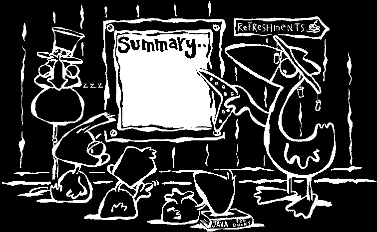


## 让事情发生。一次又一次

条件语句控制程序中其他语句执行的顺序。然而，即使有了这种程度的控制，事实仍然是程序的整体流仍然从上到下；程序通常有几条通往终点的路线，但流始终在相同的支配方向上。一旦语句被执行，它就永远不会再次执行。这是回退的。

有第二种语句可以控制 Java 程序的执行顺序。程序*循环*允许语句执行特定的次数，或者在某个布尔条件为真时执行，或者直到某个布尔条件变为假。本章解释了可用的不同类型的循环，并描述了如何在你的类和程序中使用循环。阅读本章后，你应该能够编写包含循环的方法和程序。你应该理解 Java 中可用的不同类型的循环，并能够决定使用哪种来解决特定问题。


## 让事情发生。周而复始

在每次执行结束时，`i`都会加 1（改变语句）。这的实际结果是：在这种情况下，当`i`从 0 移动到 9（包含），循环将执行 10 次。通常以这种方式计数的循环，其初始值设为 0。¹

被循环控制的语句被包含在通常的大括号中：

```java
for (**初始化语句**; *继续条件*; *改变语句*) {
    // 语句
}
```

如往常一样，对这些语句进行缩进，以强调它们位于循环内部这一事实。任何 Java 语句都可以出现在循环内部，包括条件语句和其他循环。

在初始化中声明的变量被称为循环的*控制变量*。它可以是任何数据类型，但最通常是整数。它不一定非要在循环的第一行中声明，但通常都是这样做的。

控制变量经常在循环内部使用。例如，打印前 10 个整数（当然是从 0 开始），循环如下：

```java
for (int i = 0; i < 10; i ++ ) {
    System.out.println (i);
}
```

稍微更有用的循环是打印 12 倍法表：

```java
for (int i = 1; i < 13; i ++ ) {
    System.out.print (i);
    System.out.print (" x 12 = ");
    System.out.println (i * 12);
}
```

这个循环用少量的代码产生了大量的输出。这就是循环的力量。这个程序可能让你想起第 9 章中 Buddy 的“乘法表”程序；稍后我们将看看如何用循环重写该程序。

虽然控制变量可以在循环内部的任何语句中使用，但有两个重要的规则：

1. 控制变量不应在循环内部被修改。它应该只在循环内部语句的执行结束后才被修改。
2. 如果控制变量是在循环头部声明的，那么在循环结束后就不能再使用它。

如果必要在循环结束后使用控制变量的值，则可以在循环之前声明它：

```java
int i;
for (i = 0; i < 10; i ++ ) {
    System.out.println (i);
}
// i 在这里可以使用
```

¹ 记住，计算机是从 0 开始计数的，而不是 1！

否则，尝试在循环结束后使用控制变量将导致错误：

```java
for (int i = 0; i < 10; i ++ ) {
    System.out.println (i);
}
// 在这里使用 i 是错误
```

到目前为止，`for`循环最常见的用法只是执行一组语句；实现此点最简单的方法总是数到这个数字。这提供了一个通用形式的循环，使语句执行`n`次：

```java
for (int i = 0; i < n; i ++ ) {
    // 语句执行 n 次
}
```

其他较不常见的情况包括只打印偶数：

```java
for (int e = 0; e < 10; e += 2) {
    System.out.println (e);
}
```

或者从一个数字开始倒数计数：

```java
for (int b = 10; b >= 0; b --) {
    System.out.println (b);
}
```

你可能想将这些循环输入到小型程序中看看它们的作用。`for`循环被称为*确定性*循环（determinate loops），因为循环在开始之前其执行次数总是可以预测的（因此是确定的）。这并不意味着某个循环执行的次数总是相同的；该数字通常由程序中其他变量的值控制或基于这些值。

例如，打印 12 倍法表的循环：

```java
for (int i = 1; i <= 12; i ++ ) {
    System.out.print (i);
    System.out.print(" x 12 = ");
    System.out.println(i * 12);
}
```

如果用户可以选择查看表中的多少项，那么这个循环可能会更有用：

```java
int terms;
/* 获取项数——在实际上，这个数字也会通过条件语句进行验证 */
System.out.print ("Enter the number of terms: ");
terms = Console.readInt ();
// 显示表
for (int i = 0; i < terms; i ++ ) {
    System.out.print (i);
    System.out.print (" x 12 = ");
    System.out.println (i * 12);
}
```

在程序运行之前无法预测循环将执行多少次，但在循环开始之前总是立即知道该数字。

循环可以很容易地扩展，允许用户在选择项数之外还选择第一个值：

```java
int start;
int terms;
System.out.print ("Enter the first value: ");
start = Console.readInt ();
System.out.print ("Enter the number of terms: ");
terms = Console.readInt ();
/* 应该在这里进行验证，等等等 */
for (int i = start; i <= terms; i ++ ) {
    // ... 循环逻辑
}
```

最后，某些用户可能要求起始值和项数是：

```java
// ... 循环逻辑 ...
```

## do … while 循环

`do…while`循环是`while`循环的一种特殊形式。事实上，任何`do … while`循环都可以写成`while`循环。² 这种循环的唯一优势是生成的代码可以更整洁。这两种不确定循环之间的关系与`if`语句和`switch`语句之间的关系相似——虽然只用其中一种也可以运行，但同时使用两者可以让程序更整洁。

`do … while`循环内部的语句至少会被执行一次。循环再次由条件控制，但这次只有在循环内部语句执行后才会进行条件测试；如果条件为真，则循环将再次执行。该循环的格式使得测试的位置一目了然：

```java
do {
    // statements
} while (<condition>);
```

正如大家现在非常熟悉的，循环内部的语句用大括号括起来并进行了缩进。与往常一样，语句可以包含任何有效的 Java 语句，包括其他循环。

`do … while`循环也可以用于验证用户输入的值。这样做使用它们是合理的，因为用户至少会输入一次值，因此循环中的语句将至少执行一次。

可以使用`do … while`循环验证用户输入：

```java
do {
    System.out.print ("Enter a number between 1 and 10: ");
    aNumber = Console.readInt ();
    if (aNumber < 1 || aNumber > 10) {
        System.out.println("Error: Number out of range");
    }
} while (aNumber < 1 || aNumber > 10);
```

这与使用`while`循环的示例非常相似，两者之间没有太大区别。它们都包含了一些代码重复；`while`循环的示例有两个`System.out.print`语句，而这个版本的条件被测试了两次。这两者是等价的；在特定应用程序中选择使用哪一个取决于通常的风格和喜好问题。³

这一观察适用于大多数使用不确定循环的情况。如果很明显循环将至少执行一次，那么`do … while`循环是正确的选择，但许多程序也可以用两种形式的循环来编写。

## 关于 == 和 = 的最终警告

最后，关于一个非常常见的错误。很多时候，不确定循环只要某个变量具有特定值就会执行。最常见的情况是某个布尔变量的值如下，且反之亦然：

```java
boolean finished = false;
while (finished == false) {
    // statements
}
```

或者通用地：

```java
while (variable value) {
    // statements
}
```

非常常见且粗心的错误是将此类形式的循环写成：

```java
while (variable value) {
    // statements
}
```

或者

```java
do {
    // statements
} while (variable value);
```

这两个循环的行为都不会符合预期。如果变量是布尔以外的任何类型，程序将无法编译。编译器会发现此处使用了`=`而不是`==`，并指出这一点。另一方面，如果使用了布尔值，程序将正确编译，但在运行时将无法按预期工作。⁴

问题在于使用了`=`（赋值）运算符而不是`==`（等号）运算符。如果你发现你的程序中某一个循环的行为不符合预期，这总是一个需要检查的点。正确的循环无疑是：

```java
while (variable value) {
    // statements
}
```

以及

```java
do {
    // statements
} while (variable value);
```

同样的错误也可以出现在任何条件中，特别是在条件语句中。避免这种错误的技巧是养成一个习惯，永远不要写：

`finished == true`

⁴ 这种区别的原因非常微妙。赋值操作实际上返回被赋值的值，因此像`finished = true;`这样的语句返回`true`，这是在此处使用的正确的布尔类型。语句`someNumber = 0;`返回一个整数，这不是正确的类型，因此编译器发现了这个错误。Java 实际上非常擅长发现这些错误；C 或 C++ 会允许任何类型的此类错误，但始终使用：

`finished`

这完全相同（并且节省了字数）。同样适用于：

`finished == false`

和：

`!finished`

较短的形式可能总是首选。

## 控制流

有了循环和条件语句，你现在可以编写具有复杂控制流的程序。虽然你的程序从总体上仍然是从上往下执行，但你现在对具体发生的情况有了更多的控制。

这是一项非常基础的编程技能，所以时候通过一些示例和练习来实践一下了。


### 示例 1 – Buddy 的乘法表

Buddy 对他的程序非常满意，但程序的内容开始让他担心了。乘法表的数量似乎有很多重复。主方法看起来像这样：

```java
TimesTable tt = new TimesTable();
int num = Integer.parseInt(args[0]);
for (int i = 1; i <= 6; i++) {
    tt.printLine (i, num);
}
```

这确实可以使用循环的明显案例。表的第一个参数显然从 1 变化到 6，这可以被确定性循环取代，因为我们知道它将精确执行 6 次。

```java
for (int i = 1; i <= 6; i++) {
    tt.printLine (i, num);
}
```

这种解决方案更短更整洁，而且我们即将看到的，它更容易扩展。

### 示例 2 – Elvis 的乘法表

Elvis 对 Buddy 的程序留下了深刻印象，但他想要一个能做更多事情的程序。他想要一个打印 13 项（从“0 倍”开始到“12 倍”结束）的程序。他还想打印出前 13 张完整的版本。这个程序实际上需要两个循环。一个计算表的数量，另一个计算表的项。由于两个循环始终都需要执行 13 次，这是一个在两个地方都应该使用`for`循环的明确案例。

Buddy 的程序还需要两处修改，每次一处。这意味着发生的任何错误总是由最近的更改引起的；因此应该更容易发现、隔离和修正。

因此，第一阶段是修改 Buddy 的程序，以便每张表打印 12 项。有了刚刚的修改，这轻而易举，只需要修改循环，使其变为：

```java
for (int i = 0; i <= 12; i++) {
    tt.printLine (i, num);
}
```

这完全可以写成这样：

```java
for (int i = 0; i < 13; i++) {
    tt.printLine (i, num);
}
```

许多 Java 程序员（特别是那些在 C 或 C++ 环境下成长的人）可能更喜欢这种风格；这只是通常的风格和偏好问题。

现在我们处理 Elvis 对多个乘法表的要求。这一次，我们可以提前预测将打印多少张表；这显然是另一个确定循环。我们需要另一个`for`循环。

代码看起来有点复杂，但可以逐步构建。第一步可能是为每个表包含一些整洁的标题，因此这个循环将打印出每个表的标题：

```java
for (int table = 0; table < 13; table ++ ) {
    System.out.print("The ");
    System.out.print(table);
    System.out.println(" Times Table");
}
```

这里顺便提一下，这里不需要使用三个独立的`System.out.print`语句；这样做是为了保持页面上的行数紧凑！这里的`< 13`是另一个个人偏好问题。由于循环目的是数到 12，你可能更倾向于：

```java
for (int table = 0; table <= 12; table ++ )
```

这的效果是完全相同的。在这种情况下，控制变量被赋予了一个有意义的名字；当程序中像这里有多个循环时，这是一个非常好的主意。

我们已经有一个循环来打印特定的乘法表了。在当前程序中，所需的表号存储在变量`num`中，该变量通过命令行参数获取：

```java
for (int i = 0; i < 13; i ++ ) {
    tt.printLine (i, num);
}
```

编写 Elvis 的程序来打印一组表的诀窍，是将第二个循环嵌套在第一个循环内部。作为实现此点的第一步，这对循环将打印 13 次所需的那个乘法表：

```java
for (int table = 0; table < 13; table ++ ) {
    System.out.print("The ");
    System.out.print(table);
    System.out.println(" Times Table");
    for (int i = 0; i < 13; i ++ ) {
        tt.printLine (i, num);
    }
}
```

再次，缩进清楚地显示了内部循环在另一个循环内部。最后的修复是让生成的表号在外层循环的每次执行时发生变化。这很容易做到，因为所需的表号实际上是外层循环的控制变量`table`。内部循环将使用这个值而不是命令行参数。现在，命令行参数实际上完全没有被使用。

这构成了完整程序将使用的最终循环：

```java
for (int table = 0; table < 13; table ++ ) {
    System.out.print("The ");
    System.out.print(table);
    System.out.println(" Times Table");
    for (int i = 0; i < 13; i ++ ) {
        tt.printLine (i, table);
    }
}
```


## 示例 3：Elvis 的计算器

Elvis 对时间有许多要求。他要帮助组织小鸭子们组成板板球球队，还必须花大量时间跟踪他的零花钱。他决定需要一个简单的计算器来帮助完成这些重要任务。遗憾的是，他的零花钱不足以买一个计算器，因此他决定用 Java 写一个。

他希望能够进行加、减、乘、除运算。由于涉及金额，他需要能够处理浮点数。计算器应该提示他输入两个数字和所需的操作，然后显示结果。Elvis 倾向于不要每次计算都重新运行程序。

此示例中执行算术运算的代码非常简单。例如，执行加法计算：

```java
double firstNumber;
double secondNumber;

System.out.print("Enter the first number: ");
firstNumber = Console.readDouble();

System.out.print("Enter the second number: ");
secondNumber = Console.readDouble();

System.out.print(firstNumber);
System.out.print(" + ");
System.out.print(secondNumber);
System.out.print(" = ");
System.out.println(firstNumber + secondNumber);
```

对于一个只处理加法的程序来说这很好，但这个程序需要一种更通用的方法。在程序开始时，无法预测所需的计算是加、减、乘还是除。需要一个条件语句；`switch` 是一个显而易见的选择，因为有四种可能的操作可以执行。必须提示用户输入代表操作的符号，`switch` 语句将选择并执行相应的操作。还需要一个新变量来存储结果。

现在基础计算的代码变为：

```java
double firstNumber;
double secondNumber;
double result;
char operation;

System.out.print("Enter the first number: ");
firstNumber = Console.readDouble();

System.out.print("Enter the second number: ");
secondNumber = Console.readDouble();

System.out.print("Enter the operation ( + , - , *, /): ");
operation = Console.readChar();

switch (operation) {
    case '+':
        result = firstNumber + secondNumber;
        break;
    case '-':
        result = firstNumber - secondNumber;
        break;
    case '*':
        result = firstNumber * secondNumber;
        break;
    case '/':
        result = firstNumber / secondNumber;
        break;
}

System.out.print(firstNumber);
System.out.print(" + ");
System.out.print(secondNumber);
System.out.print(" = ");
System.out.println(result);
```

```java
// 执行计算
public void calculate()
{
    if (operation == '/' && secondNumber == 0.0) {
        System.out.println("Error: attempted to divide by 0");
    }
    else {
        double result = 0.0;

        switch (operation) {
            case '+':
                result = firstNumber + secondNumber;
                break;
            case '-':
                result = firstNumber - secondNumber;
                break;
            case '*':
                result = firstNumber * secondNumber;
                break;
            case '/':
                result = firstNumber / secondNumber;
                break;
        }

        System.out.print(firstNumber + " " + operation + " " + secondNumber + " = " + result + "\n");
    }
}

// 如果用户希望执行更多计算，则循环运行
public void run()
{
    char answer;
    boolean finished = false;

    while (!finished) {
        getInput();
        calculate();

        System.out.print("Run again (y/n)? : ");
        answer = Console.readChar();

        do {
            if (answer == 'n' || answer == 'N') {
                finished = true;
            }
            else if (answer != 'Y' && answer != 'y') {
                System.out.println("Error: Please enter 'y' or 'n'");
                System.out.print("Run again (y/n)? : ");
                answer = Console.readChar();
            }
        } while (answer != 'y' && answer != 'Y' && answer != 'n' && answer != 'N');
    }

    // while (!finished)
}

public static void main(String[] args)
{
    Calculator calc = new Calculator();
    calc.run();
}

}
```


*让事情发生。一次又一次*

217

218

*如何使用 Java 编程*

这是你为止见过的最长的程序，有几点需要注意：

- 缩进始终显示了哪些语句是由哪些控制语句控制的。
- 循环中经常嵌套循环，条件语句与其他条件语句和循环中嵌套。缩进有助于跟踪哪些语句是由其他语句控制的。
- 有时会有许多语句被封装在一组括号之间。当右括号距离相应的左括号很远时，会添加一条简短的注释来强调该括号结束的是什么。
- 计算器本身被建模为一个对象，因此 `main` 方法只有两行长！首先创建计算器，然后告诉它运行。这在 Java 程序中是非常常见的形式。

这是一个很长的程序，包含了你目前为止遇到的大部分 Java 知识。花点时间过一遍，确保你理解了发生了什么。


**15.1**

编写一个程序，打印出一个由星号组成的三角形，如下：

```
*
**
***
****
*****
```

最后一行星号的数量应由用户在回答适当提示时提供。程序应确保提供的值至少为一，并在发生错误时允许用户重新输入该值。你的程序应该使用一个简单的类 `Triangle`，该类有一个整数属性来表示高度，并有一个简单的方法来显示三角形。

**15.2**

编写一个类似的程序（使用类似的类），打印出一个由星号组成的正方形：

```
******
******
******
******
******
```

219

*让事情发生。一次又一次*

```
******
******
******
******
```

与之前一样，构成正方形每条边的星号数量应由用户提供。这个数字应该是正数。

**15.3**

以你的两个程序为起点，编写一个程序，向用户展示一个小型菜单：

```
形状菜单
~~~~~~~~~~~
1. 绘制三角形
2. 绘制正方形
Q. 退出
```

用户应该从菜单中选择一个选项，并被提示输入形状所需的尺寸。程序将继续执行，直到用户选择退出（Quit）选项。如果选择的选项无效，应显示错误消息并重新显示菜单。使用名为 `ShapeDraw` 或类似的类。

**15.4**

在你的程序中添加另一个形状（类）。矩形（使用名为 `Rectangle` 的类）需要输入高度和宽度：

```
*****
*****
*****
```

**15.5**

最后，修改你的程序，让用户可以选择用于绘制形状的字符。这应该通过在菜单中添加一个选项来实现：

```
C. 更改字符
```

程序第一次执行时，字符仍应为 `*`。使用的字符必须是 `$`, `%`, `%`, `*` 或 `^` 之一。实现此点最简单的方法可能是给每个类添加一个属性。


程序循环在管理程序控制流方式方面提供了极大的灵活性。它们允许开发许多复杂的对话，并意味着程序可以继续执行，直到用户完成操作。结合条件语句，循环让程序员对程序语句执行的顺序具有完全的控制。

220

*如何使用 Java 编程*

循环有两种通用的类型。第一种称为确定性循环（determinate loops），用于循环执行次数在执行前已知的情况。另一种是不确定性循环（indeterminate loops），它在某些情况下提供了额外的灵活性。

223

*更多方法*

方法有两种通用的类型。第一种称为确定性循环，用于循环执行次数在执行前已知的情况。另一种是不确定性循环，它在某些情况下提供了额外的灵活性。

按值传递和按引用传递（Call-by-value and call-by-reference）

方法有两种通用的类型。第一种称为确定性循环，用于循环执行次数在执行前已知的情况。另一种是不确定性循环，它在某些情况下提供了额外的灵活性。

方法有两种通用的类型。第一种称为确定性循环，用于循环执行次数在执行前已知的情况。另一种是不确定性循环，它在某些情况下提供了额外的灵活性。

224

*使用 Java 编程*

引用传递（call-by-reference）。这些名称指的是在调用方法内部处理参数的不同方式。

我们首先来看值传递（call-by-value），因为这是我们目前为止一直在处理的，而且确实就是刚才描述的那样。作为另一个例子，让我们定义一个可能很有用的方法，它可能出现在某个简单计算器程序使用的某个类中：

```java
public int square (int num)
```

此方法将接收其参数，将其值平方并返回结果。

所以我们可以创建一个要平方的值，并打印它的平方值：

```java
int number = 8;

System.out.println ("The square of " + number + " is "
    + square(number) );
```

现在，你可能会认为变量 `number` 中存储的值现在是 64，因为那将是显示的值。然而，事实并非如此：

```java
int number = 8;

System.out.println ("The square of " + number + " is "
    + square(number) );

System.out.println ("The value of number is now " + number);
```

这段代码的输出将是：

```
The square of 8 is 64.
The value of number is now 8.
```

这可能看起来很奇怪，但可以很容易解释（如果你认为这个值一直一直是 8，那么你干得好！）。

它的工作原理是这样的：每当一个原始类型的变量（整数、双精度浮点数等）作为方法的参数传递时，该变量的值就会被复制，方法对该副本进行操作。因此，在上面的示例中，`square` 方法处理的是存储在 `number` 中的值的临时副本。

在方法内部，当然，这个值可以有任何标识符：

```java
public int square (int num)
{
    num *== 2;
    return num;
}
```

或者只是：

```java
public int square (int num)
{
    return num *= 2;
}
```

当方法执行结束时，调用方法中 `number` 的值保持不变。在方法中使用的值（在这里我们称其为 `num`）将永远丢失。这两个值实际上一直是分开的，并占据了计算机内存的不同部分。

当将更复杂的值传递给方法时，情况就不同了。当对象作为参数传递给方法时，其机制微妙地不同，理解它的工作原理以及它对你程序的影响是非常重要的，这样你以后才不会遇到问题。

*更多方法*

225

考虑以下这个诚然相当不寻常的方法：

```java
public static void renameDuck (Duck d, String s)
{
    d.setName(s);
}
```

此方法接收两个参数：一个 `Duck` 对象和一个 `String`（当然，也是一个对象）。它将 `Duck` 对象的名称设置为 `String` 参数的值，并使用通常的变异方法（mutator method）来实现这一点。注意方法定义中额外的单词——`static`（静态）。从本质上说，这意味着我们不需要创建对象就可以调用该方法，但我们稍后会更充分地讨论静态方法。

现在，让我们创建一个 `Duck` 对象来尝试一下。我们假设该类有一个 `getName` 选择器方法（selector method），它的工作方式是显而易见的。

```java
Duck myDuck = new Duck ();
myDuck.setName ("Elvis");
System.out.println ("My duck is called " + myDuck.getName() );

renameDuck (myDuck, "Buddy");
System.out.println ("My duck is now called " + myDuck.getName() );
```

这段代码的输出将是：

```
My duck is called Elvis
My duck is now called Buddy
```

注意，虽然我们没有显式地对我们的 `Duck` 对象调用 `setName` 方法，但 `Duck` 对象的名称属性已经改变了。这只意味着一点：在 `renameDuck` 方法中操作的对象不是作为参数传递的对象的副本，而是对象本身。事实上，这是 Java 中将对象传递给方法的方式，正如你所看到的，这与原始类型的传递方式有根本上的不同。

这是一个强大的机制，但如果没有正确理解，它可能会导致无法解释的错误。你可能应该重读这一节，直到你确定自己理解了这种机制。示例程序也应该会有帮助。

**将方法作为参数**

我们在这一章中没有引入任何新的 Java 特性，但我们强调了一些重要的概念。许多新程序员发现引用参数（reference parameters）是一个难以理解的概念。对其进行一些练习并思考两种类型参数之间的区别是非常重要的。当我们在下一章查看集合（collections）时，这个建议显得尤为及时。

在提到方法时，值得提到你实际上可以将一个方法调用作为另一个方法的参数。这听起来可能很奇怪，但当你考虑到其原因时，它是完全合理的。某些方法返回有用的值——`int`, `String`, `char` 等——而某些方法接受此类值作为参数。通常，一个方法返回的值对于另一个方法作为参数接收将是有用的。与其先存储返回值然后将此存储的值传递给另一个方法，我们允许直接将一个方法调用放在另一个方法内部。我们实际上在

226

之前的其中一个 `printNeatly` 方法中已经这样做了：

```java
public void printNeatly ()
{
    System.out.println (toString());
}
```

`System.println` 是一个打印到控制台的方法，而 `toString` 是一个返回包含信息的 `String` 方法。

另一个例子，假设我们想使用熟悉的 `distanceFrom` 方法来查看鸭子距离某个对象有多远。我们可以写道：

```java
Duck elvis = new Duck ();
double distance;
distance = elvis.distanceFrom(5, 3);
System.out.println ("The is " + distance);
```

这样是可以的，但更好的做法是去掉临时变量并写成：

```java
Duck elvis = new Duck ();
System.out.println ("The away!");
```

227

**静态方法**

最后，另一个方法的细节。静态方法的声明格式与其他方法的定义相同，只是增加了 `static` 单词：

```
public static 返回类型 方法名 (参数类型)
```

*更多方法*

例如，假设我们想写一个可能用于显示菜单的方法。该方法需要定义在一个类中，但由于不需要将此方法与对象关联，因此它是静态的。假设类名为 `Menu`，方法声明如下：

```java
public static void displayMenu ()
{
    System.out.println ("Options");
    System.out.println ("1. Option 1");
    System.out.println ("2. Option 2");
}
```

可以这样调用该方法：

```java
Menu.displayMenu ();
```

这种方法可以使程序更容易理解，当程序中需要重复代码块时，它可能特别有用。

**方法**

这一章中引入了三个新想法，尽管你已经使用了其中的大部分内容一段时间了。你只需要一些练习，所以现在来看示例。

img/05fa4bae6319441a0b86c0179baaedc2_244_0.png

**示例 1 定位鸭子**

*第 13 章第二个示例中的示例 `Duck` 类包含了用于更改鸭子位置的方法。拥有另一个方法来确定鸭子是否在某个位置将有用。它的原型为：*

```java
boolean atPosition (int xPos, int yPos)
```

*这个方法的实现应该是怎样的？*

鸭的位置存储在两个私有属性中，称为 `x` 和 `y`。传递给此方法的第一个值是待检查的 `x` 值，第二个值是 `y` 值。这些参数命名为 `xPos` 和 `yPos` 以使它们的含义清晰。如果 `x` 等于 `xPos` 且 `y` 等于 `yPos`，那么鸭子就在该位置，方法应该返回 `true`；否则方法应该返回 `false`。

228

*使用 Java 语言编程*

需要一个简单的条件语句来检查鸭子是否在特定点。实现代码如下：

```java
public boolean atPosition (int xPos, int yPos)
{
    if (x == xPos && y == yPos) {
        return true;
    }
    else {
        return false;
    }
}
```

这种方法中的结构非常常见。它表示如果某个条件为真，则方法返回 `true`，否则返回 `false`。值得记住，这种方法也可以通过直接返回条件表达式来实现；这个示例完全可以写成：

```java
public boolean atPosition (int xPos, int yPos)
{
    return x == xPos && y == yPos;
}
```

第二种形式明显短得多，但有些人可能觉得它太简练了，而较长的形式更清晰。两者之间的选择取决于风格和偏好。

为了最后说明一下风格问题，这个函数还可以写成：

```java
public boolean atPosition (int xPos, int yPos)
{
    if (x == xPos && y == yPos) {
        return true;
    }
    return false;
}
```

这个版本之所以有效，是因为如果表达式为真，永远不会执行到第二个 `return` 语句。

虽然这三个版本是等价的，但选择你更喜欢的版本并确保始终使用同一种方法是一个良好的习惯；良好的风格在于一致性。

**示例 2 – 召唤鸭子**

*Martinmere 先生越来越担心他的那些鸭子的位置。其中一些鸭子非常珍贵，如果它们移动得太远（离开了布鲁斯标志的视线范围），会很苦恼。关于跟踪鸭子已经做了一些初步工作（在第 11 和第 12 章中），现在会有更多。*

我的朋友 Karim 在检查我的一本 C 语言书的版本时给了我这个版本。他总是这样写方法。而我绝不会这样做；我会使用直接返回条件的版本。风格就是如此；只要我们都保持一致，这两种方法都是可以的。

*更多方法*

229

*起点是我们之前见过的鸭子现有类。经过长时间的设计过程，鸭子们分配了需要编写的方法。Buddy 被赋予了一个规范的方法：*

- **名称：** `summon`
- **对象类型：** `Duck`
- **目的：** 将一只鸭子移动到另一个鸭子的位置。
- **参数：** 一个 `Duck` 对象
- **更改的值：** 参数 `Duck` 的位置。
- **副作用：** 在屏幕上显示。
- **描述：** 作为参数提供的 `Duck` 将移动到与调用该方法的 `Duck` 相同的位置。

*他是如何写这个方法的？*

首先，让我们弄清楚这个方法想要实现什么。假设 `Elvis` 和 `Buddy` 是两个 `Duck` 对象。这个方法会将它们移动到同一个位置；其思想是其中一个 `Duck` 对象“召唤”另一个。所以，为了将两者移动到 `Elvis` 的位置（尽管只有 `Buddy` 会移动）：

```java
elvis.summon (buddy);
```

显然，这个：

```java
buddy.summon (elvis);
```

会将 `Elvis` 移动到 `Buddy` 的位置，这与第一种版本大不同。

这一行短代码包含了两个 `Duck` 对象的标识符，它们被以不同的方式使用。第一个是按照我们之前看到所有方法调用中熟悉的方式使用的。第二个则不同；它是一个独立的对象，并被用作参数。

现在，当调用方法时，某些属性值会发生变化，但方式并不是我们之前看到的方式。该方法将改变作为参数传递的对象的属性值；另一个对象的属性值将保持不变。这意味着该参数是一个引用参数——其属性的值将被改变。

方法的头部定义为：

```java
public void summon (Duck d)
```

移动鸭子的方法是 `moveTo`，它将新位置作为两个参数传递。我们可以在参数上对其使用它：

```java
d.moveTo (newX, newY);
```

其中 `newX` 和 `newY` 是代表新位置的两个值。这些值是从另一个对象中提取的：

```java
int newX = getX ();
int newY = getY ();
```

完整的方法是：

```java
public void summon (Duck d)
{
    int newX = getX ();
    int newY = getY ();
    d.moveTo (newX, newY);
}
```

230

*使用 Java 语言编程*

顺带提一个重要点是，调用参数的方法与调用当前对象的方法语法不同。只有前者需要前缀。

这个方法很好，也能正常工作，但有一种可能更整洁的写法。没有必要将这两个值存储在变量中；生成这些值的方法可以直接作为方法的参数使用：

```java
public void summon (Duck d)
{
    d.moveTo (getX (), getY() );
}
```

这无疑更整洁，更不用说更短了。

**示例 3 – 生锈的推车**

*Martinmere 先生担心池塘里出现了一个看起来危险的超市推车……*

232

*使用 Java 编程*

```java
public void moveNorth()
{
    y++;
}

public void moveSouth()
{
    y--;
}

public void moveEast()
{
    x++;
}

public void moveWest()
{
    x--;
}

public double distanceFrom(int xPos, int yPos)
{
    int dx = xPos - x;
    int dy = yPos - y;
    return Math.sqrt((double)(dx*dx + dy*dy));
}
```


# 改进的鸭子跟踪程序

`public boolean atPosition(int xPos, int yPos)` 方法用于判断鸭子是否位于指定坐标：

```java
public boolean atPosition(int xPos, int yPos)
{
    return x == xPos && y == yPos;
}
```

## 程序概述

`DuckTrafficControl.java` 是一个改进的鸭子跟踪程序，包含以下元信息：

- 作者：GPH
- 日期：2003年6月19日
- 测试环境：Linux (Red Hat 9), JDK 1.4.2

## 类定义与成员变量

```java
import htpuj.*;

public class DuckTrafficControl
{
    private Duck duck;
    private final int TROLLEY_X = 5;
    private final int TROLLEY_Y = 3;
}
```

## 构造函数

```java
public DuckTrafficControl()
{
    duck = new Duck();
}
```

## 主运行方法

`run()` 方法实现了程序的主循环，包括用户输入处理和菜单选择：

```java
public void run()
{
    char choice = ' ';
    
    System.out.println("*** 鸭子交通控制程序 ***");
    System.out.println("");
    
    System.out.print("输入鸭子的名字： ");
    duck.setName(Console.readString());
    
    System.out.print("输入 " + duck.getName() + " 的 X 坐标： ");
    duck.setX(Console.readInt());
    
    System.out.print("输入 " + duck.getName() + " 的 Y 坐标： ");
    duck.setY(Console.readInt());
    
    do {
        printMenu();
        choice = Console.readChar();
        
        switch (choice) {
            case 'n':
            case 'N': duck.moveNorth();
                break;
            case 's':
            case 'S': duck.moveSouth();
                break;
            case 'e':
            case 'E': duck.moveEast();
                break;
            case 'w':
            case 'W': duck.moveWest();
                break;
            case 'q':
            case 'Q': break;
            default: System.out.println(choice + " 不是有效的选项!");
                break;
        }
    } while (choice != 'q' && choice != 'Q');
}
```

## 菜单显示方法

`printMenu()` 方法显示当前状态和操作选项：

```java
public void printMenu()
{
    System.out.println(duck.getName() + " 的当前位置是 " + duck.getX() + ", " + duck.getY() + ".");
    System.out.println(duck.getName() + " 手车的距离为 " + duck.distanceFrom(TROLLEY_X, TROLLEY_Y));
    
    if (duck.distanceFrom(TROLLEY_X, TROLLEY_Y) == 0.0) {
        System.out.println("*** " + duck.getName() + " 撞上了小车！");
    }
    else if (duck.distanceFrom(TROLLEY_X, TROLLEY_Y) <= 2.0) {
        System.out.println("*** " + duck.getName() + " 离小车太近了！");
    }
    
    System.out.println(" N – 向北");
    System.out.println(" S – 向南");
    System.out.println(" E – 向东");
    System.out.println(" W – 向西");
    System.out.println(" Q – 退出");
    System.out.println("");
    System.out.print(" 选择选项 (N,S,E,W,Q) : ");
}
```

## 主方法

```java
public static void main(String args[])
{
    DuckTrafficControl dtc = new DuckTrafficControl();
    dtc.run();
}
```

这是一个长程序，但它包含了我们到目前为止所过的几乎所有的示例。阅读它！

## 练习与思考题

### 练习 16.1

找出并解释以下代码中的错误（或错误）：

```java
public void setLength (int len)
{
    if(len < 0)
    {
        return "ERROR!";
    }
    else {
        length = len;
    }
}

...

System.out.println("设置长度为 " + setLength(4));
```

### 练习 16.2

修改之前使用的 `DuckTrafficControl` 类以包含进一步的错误检查。例如，鸭子不应该移动到 `x` 或 `y` 坐标为负的位置。你还应该检查用户没有为鸭子的名字输入空字符串，否则程序的输出可能会变得令人困惑。

### 练习 16.3

可以对此程序进行进一步的修改，使其更符合用户习惯。例如，目前可以将鸭子移动到小车所占据的位置，并让那只鸭子在那里快乐地游泳。除了终止程序并重新启动外，没有选项可以跟踪另一只鸭子。在你的练习 16.2 的代码中添加此功能。

## 方法参数传递

方法可以通过两种不同的方式处理参数，取决于参数的类型：

- **值参数**：为方法提供值，值可能显式地包含。
- **引用参数**：始终是对象的引用，该引用被传递给方法，可以使用对象的属性。方法中对对象的任何更改都会影响主程序。

值参数允许值传递到方法。引用参数扩展了这一点，它们允许值从方法传递出来。然而，必须记住这只适用于对象，而不是 `int` 或 `char` 等基本数据类型。

方法可以使用任何有效的 Java，包括条件语句和循环。你现在应该能够处理复杂的程序了。随着编写的代码增加，你会发现管理变量变得困难。可以说，Java 与大多数语言一样，提供了将变量分组为集合的机制。这就是我们在下一章中讨论的内容。

## 数组基础

到目前你应该理解数组是什么、如何使用它以及它的用途。使用数组的第一阶段显然是声明并获取合适的内存。通常，数组的声明方式如下：

```
<variable type> <identifier>[]
```

初始化方式如下：

```
<identifier> = new <variable type>[<element数量>];
```

> 注：一些程序员会认为写 `int[] numbers` 是更好的风格；这完全符合 Java 语法。

### 访问数组元素

现在我们有了数组，需要访问各个元素。向数组元素赋值时使用该元素在数组中的位置（该位置也称为*索引*）。例如：

```java
numbers[1] = 5; // 将值 5 赋值给索引为 1 的元素
```

引用数组元素时，我们使用之前看到的方括号，并在之间放入相关的数组索引。我们实际上在提取命令行参数时已经见过这种语法了。这两行代码完全可以合并为单一语句：

```java
int[] numbers = new int[4];
```

### 命令行参数与数组索引

我们发现 `main` 函数头部的可变参数：

`public static void main (String args[])` 实际上是一个字符串数组。

现在我们也知道第一个命令行参数被存储在 `args[0]` 中，这告诉我们索引值从 0 开始。这意味着数组中的最后一个元素可能并不在它预期的位置上！

一个不留心的程序员如果想给 `numbers` 数组的第四个元素赋值，他可能会写成：

```java
numbers[4] = 1878; // 错误！
```

这说明了在处理数组时需要记住的一个重要属性。

### 索引从零开始

在 Java 中（与大多数编程语言一样），数组的索引是从 0 开始向上递增的。因此，数组的第一个元素使用索引 0 来引用。同样，第十一个元素的索引是 10。更通地说，一个包含 `n` 个元素的数组，其第一个元素在索引 0 处，最后一个元素在索引 `n-1` 处。

在数组声明中使用的值是数组的大小，而不是最后一个元素的索引。这是一个经常引起困惑的原因，新程序员经常发现自己试图访问一个具有 4 个元素的数组的第五个元素，例如。即使是经验丰富的程序员也无法免于此（如果他们诚实的话！）。

由此得出数组元素的数量是一个既有用又有趣的数字。Java 允许我们提取这个值，我们稍后将会看到。

### 越界错误

通常，如果代码中存在这种"差一"（out-by-one）错误，你的程序在尝试运行时将会崩溃，并提供一条关于所谓的 `ArrayIndexOutOfBoundsException` 错误的错误消息。这个错误告诉你是，Java 解释器已尝试访问一个大于数组大小的索引。编译器不会阻止你尝试越过数组边界（在程序编译时无法发现这种情况将会发生），所以这是程序员需要留心的问题，因为许多良好的程序都因为这种错误而产生缺陷。这种错误的影响从仅仅在不恰的时刻崩溃到计算出错误结果并盲目继续运行不等。

假设你遵循了测试章节给出的建议，这些错误应该相当容易解决，但尽管如此，值得这一点。

## 完整示例：ArrayDemo

现在来看一个更大、更有用的例子。这是一个使用数组的简单程序。

```java
/* ArrayDemo.java – 展示一个简单的数组
作者: GPH
日期: 2003年2月6日
测试环境：Linux (Red Hat 8.0), JDK 1.4.1
*/

import java.util.*;

public class ArrayDemo {
    private String[] names;
    
    public ArrayDemo (int numElements) {
        names = new String[numElements];
    }
    
    public void populate () {
        // 使用 for 循环，依次为每个元素赋值
        for (int i = 0; i<names.length; i++) {
            System.out.print ("Enter name " + (i+1) + ": ");
            names[i] = new String (Scanner(System.in).nextLine());
        }
    }
    
    public void printContents () {
        System.out.println("");
        // 使用另一个 for 循环，依次打印值
        for (int j = 0; j<names.length; j++) {
            System.out.println ("names[" + j + "] = \"" + names[j] + "\".");
        }
    }
    
    public static void main (String args[]) {
        if(args.length != 1) {
            System.out.println ("Usage: java ArrayDemo <num of names>");
            System.exit (0);
        }
        
        int numNames = Integer.parseInt (args[0]);
        ArrayDemo demo = new ArrayDemo (numNames);
        demo.populate ();
        demo.printContents ();
    }
}
```

这个小类和驱动程序演示了你关于数组几乎需要的所有知识。程序执行的第一件事是检查运行时是否传递了一个命令行参数：

```java
if(args.length != 1) {
    System.out.println ("Usage: java ArrayDemo <num of names>");
    System.exit (0);
}
```

这演示了如何找到数组的长度：

```
<arrayname>.length
```

这非常有用，非常值得记住。同样值得记住的是 `length` 后面没有括号，这可能有点困惑。

现在回到程序。如果不存在所需的参数，会打印一个错误字符串并停止执行。如果参数存在，它会被转换为一个 `int` 值，并用于程序对象的创建：

```java
int numNames = Integer.parseInt (args[0]);
ArrayDemo demo = new ArrayDemo (numNames);
```


这里值得注意的是，数组是在构造函数内部初始化的。这种操作非常常见——构造函数经常被用于在创建对象时初始化变量，并且可以消除调用构造函数的同时调用多个修改器方法（mutator methods）的需求。

程序所做的仅仅是提示所需的名称数量，将这些添加到数组中，然后打印数组的内容。这并不是世界上最有用的程序，但它确实演示了数组的基础知识——创建、添加元素以及随后的访问这些元素。这种结构，特别是在输出数组之前进行某种处理时，在各种任务中都非常常见。

## 使用初始化列表创建数组

到目前为止，我们通过三步过程创建数组；正如我们稍后将看到的，Java 允许我们提取这个值。

通常，如果代码中存在这种“差一”错误，你的程序在尝试运行时将会崩溃，并提供一条关于所谓的 `ArrayIndexOutOfBoundsException` 错误的错误消息。这个错误告诉你，Java 解释器已尝试访问一个大于数组大小的索引。

初始化列表如下：

```java
int digits[] = {0, 1, 2, 3, 4, 5, 6, 7, 8, 9};
char vowels[] = {'a', 'e', 'i', 'o', 'u'};
String ducks[] = {"Elvis", "Buddy", "Charlie"};
```

这演示了如何找到数组的长度：

`<arrayname>.length`

这非常有用，非常值得记住。同样值得记住的是，`length` 后面没有括号，这可能有点困惑。

## 集合

我们发现 `main` 函数头部的可变参数：

`public static void main (String args[])`

实际上是一个字符串数组。

现在我们也知道，第一个命令行参数被存储在 `args[0]` 中，这告诉我们索引值从 0 开始。这意味着数组中的最后一个元素可能并不在它预期的位置上！

一个不留心的程序员如果想给 `numbers` 数组的第四个元素赋值，他可能会写成：

`numbers[4] = 1878; // 错误！`

这说明了在处理数组时需要记住的一个重要属性。

在 Java 中（与大多数编程语言一样），数组的索引是从 0 开始向上递增的。因此，数组的第一个元素使用索引 0 来引用。同样，第十一个元素的索引是 10。更通地说，一个包含 `n` 个元素的数组，其第一个元素在索引 0 处，最后一个元素在索引 `n - 1` 处。

在数组声明中使用的值是数组的大小，而不是最后一个元素的索引。这是一个经常引起困惑的原因，新程序员经常发现自己试图访问一个具有 4 个元素的数组的第五个元素。即使是经验丰富的程序员也无法免于此（如果他们诚实的话！）。

由此得出，数组元素的数量是一个既有用又有趣的数字。Java 允许我们提取这个值，我们稍后将会看到。

通常，如果代码中存在这种“差一”（out-by-one）错误，你的程序在尝试运行时将会崩溃，并提供一条关于所谓的 `ArrayIndexOutOfBoundsException` 错误的错误消息。这个错误告诉你，Java 解释器已尝试访问一个大于数组大小的索引。编译器不会阻止你尝试越过数组边界（在程序编译时无法发现这种情况将会发生），所以这是程序员需要留心的问题，因为许多良好的程序都因为这种错误而产生缺陷。这种错误的影响从仅仅在不恰当的时刻崩溃，到计算出错误结果并盲目继续运行不等。

假设你遵循了测试章节给出的建议，这些错误应该相当容易解决，但尽管如此，仍然值得注意这一点。

现在来看一个更大、更有用的例子。这是一个使用数组的简单程序。

```java
/*
 * ArrayDemo.java – 展示一个简单的数组
 *
 * 作者: GPH
 * 日期: 2003年2月6日
 * 测试环境：Linux (Red Hat 8.0), JDK 1.4.1
 */

import java.util.*;

public class ArrayDemo {

    private String[] names;

    public ArrayDemo (int numElements) {
        names = new String[numElements];
    }

    public void populate () {
        // 使用 for 循环，依次为每个元素赋值
        for (int i = 0; i < names.length; i++) {
            System.out.print ("Enter name " + (i + 1) + ": ");
            names[i] = new String (Scanner(System.in).nextLine());
        }
    }

    public void printContents () {
        System.out.println("");

        // 使用另一个 for 循环，依次打印值
        for (int j = 0; j < names.length; j++) {
            System.out.println ("names[" + j + "] = \"" + names[j] + "\".");
        }
    }

    public static void main (String args[]) {
        if (args.length != 1) {
            System.out.println ("Usage: java ArrayDemo <num of names>");
            System.exit (0);
        }

        int numNames = Integer.parseInt (args[0]);
        ArrayDemo demo = new ArrayDemo (numNames);

        demo.populate ();
        demo.printContents ();
    }
}
```

这个小类和驱动程序演示了你关于数组几乎需要的所有知识。程序执行的第一件事是检查运行时是否传递了一个命令行参数：

```java
if (args.length != 1) {
    System.out.println ("Usage: java ArrayDemo <num of names>");
    System.exit (0);
}
```

这演示了如何找到数组的长度：

`<arrayname>.length`

这非常有用，非常值得记住。同样值得记住的是，`length` 后面没有括号，这可能有点困惑。

现在回到程序。如果不存在所需的参数，会打印一个错误字符串并停止执行。如果参数存在，它会被转换为一个 `int` 值，并用于程序对象的创建：

```java
int numNames = Integer.parseInt (args[0]);
ArrayDemo demo = new ArrayDemo (numNames);
```

这里值得注意的是，数组是在构造函数内部初始化的。这种操作非常常见——构造函数经常被用于在创建对象时初始化变量，并且可以消除调用构造函数的同时调用多个修改器方法。

程序所做的仅仅是提示所需的名称数量，将这些添加到数组中，然后打印数组的内容。这并不是世界上最有用的程序，但它确实演示了数组的基础知识——创建、添加元素以及随后的访问这些元素。这种结构，特别是在输出数组之前进行某种处理时，在各种任务中都非常常见。

## 使用 `ArrayList`

问题在于，在大多数编程语言（包括 Java）中，数组的大小是固定的；一旦初始化，它们在整个生命周期内都保持相同数量的元素。要添加更多元素，必须创建一个更大的数组，并在两个数组之间复制元素。如果删除了元素，数组仍将占据相同的内存空间，这可能会浪费资源，特别是在大型且复杂的程序中。当然，也可以创建一个较小的数组并复制元素，但这可能非常耗时。如果集合的大小将发生变化，则需要更复杂一点的机制。

总的来说，大多数编程语言都提供了此类集合，被称为列表（list）。

Java 的 `ArrayList` 就是这样一种结构。它允许程序员在元素数量增长时动态分配更多存储空间，并在由于某种原因需要较少元素时减少分配。它还有许多方便的函数用于搜索等。数组列表被定义为一个类，而实用的函数是方法，这并不令人感到意外。这一方面也是对使用 Java 内置类的介绍，并提醒了深入研究 API 以获取所需文档的重要性。

在 `http://java.sun.com/` 上只需点击几次即可找到 API 文档。文档首先提供了标准 Java 包的列表。`ArrayList` 位于 `java.util` 包中，因此需要向下滚动。点击进入 `java.util` 页面可以（除其他外）获得包中所有类的列表，点击 `ArrayList` 则提供了我们关于数组列表可能想要的所有信息。其中大部分内容主要是为计划实现 Java 系统的程序员准备的；对我们而言，重要的部分是下方一点的方法列表。

你可以从容地阅读这些内容。你也可以看看其他可能有用的类；例如，`Vector` 是另一个用于存储集合的类。

我们已经看到 `ArrayList` 是 `java.util` 包的一部分，因此如果程序计划使用数组列表，则必须在任何程序的开头添加导入语句：

`import java.util.ArrayList;`

### 创建数组列表

文档还显示该类的构造函数是重载的。我们只需使用其中两个构造函数即可：可以以 10 的初始默认容量创建数组列表，也可以用其他容量创建。

使用第一个版本的格式正如你现在应该预料到的一样：

`ArrayList <identifier> = new ArrayList();`

第二种则略有不同：

`ArrayList <identifier> = new ArrayList(<capacity>);`

与任何其他对象一样，数组列表通过标识符引用。此声明调用了相应的构造函数，该函数负责分配正确数量的内存。因此：

`ArrayList myArrayList = new ArrayList (4);`

创建一个名为 `myArrayList` 的空 `ArrayList`，它最初可以容纳四个元素。虽然这：

`ArrayList myArrayList = new ArrayList ();`

直观上似乎创建一个没有容量的数组列表，但实际上（根据 API 文档）创建的是最初可以容纳 10 个元素的数组列表。

### 添加元素

数组列表（我们现在简称为列表）可以存储任何类型的元素，只要它们是对象。这意味着将列表用于基本类型是复杂的（但可能的），因此在这些示例中使用我们拥有的最简单对象类型——`String`。我们将使用一个简单的名称列表，声明如下：

`ArrayList names = new ArrayList ();`

使用 `add` 方法向列表添加元素。默认情况下，新添加的元素会出现在列表末尾。例如：

`names.add ("Elvis");`

将把一个值为 `"Elvis"` 的 `String` 对象添加到 `names` 的末尾。也可以指定希望将新元素插入列表中的哪个位置。例如：

`names.add (0, "Buddy");`

会将 `String` 对象 `"Buddy"` 添加到 `names` 的索引 0 处，即最前面。如果列表中没有空间容纳新元素，它会自动增长。如果在特定位置添加了元素，所有其他元素将自动移动以腾出空间，列表会在需要时增长。这确实非常整洁。

你实际上可以向 `ArrayList` 添加任何类型的对象——它们在内部被视为同一类的不同实例，尽管对程序来说它们可能完全不同。遗憾的是，这意味着 `int`、`char`、`double` 等不能直接添加到 `ArrayList` 中，因为它们不是对象。我们稍后会讨论如何间接地添加它们。但首先，我们应该看看列表里有什么。

### 显示数组列表

没有方便的方法来打印列表，所以我们必须求助于用于数组的策略，并使用循环。`size` 方法将提供列表中的元素数量，因此循环是确定的。我们还需要一个方法来提取特定元素；API 文档显示这被称为 `get`。

显示列表的循环与我们用于打印数组的循环非常相似：

```java
System.out.println ("The list contains:");
for (int i = 0; i < names.size(); i++) {
    System.out.println (i + ": " + names.get(i));
}
```

运行这段代码将显示列表包含的内容。

### 删除元素

列表在其生命周期内可以改变。如果我们想删除元素，有两种可能：

- 删除一个特定的元素，无论它在哪里。
- 在特定位置删除一个元素。

### 更改元素

如果我们想更改现有元素，可以使用：

`names.set(0, "Buddy");`

这将更改索引 0 处的元素。

如果我们想清空列表，可以使用：

`names.clear();`

### 其他方法

文档还描述了一些其他可能有用的方法：

- `contains`：如果列表中找到元素，则返回 `true`。
- `isEmpty`：如果列表为空，则返回 `true`。
- `lastIndexOf`：返回值的最后一个索引（与上面的 `indexOf` 比较）。

### 使用元素

使用列表元素比使用数组稍微复杂，因为它们不使用相同的方法。这种符号初看起来可能很奇怪，但实际上是转换的示例——从 `double` 转换为 `int`。该符号告诉编译器我们希望将访问的对象视为 `String`。所以，如果元素是一个 `Duck` 对象并且位于列表 `ducks` 中，我们将使用语句：

`Duck aDuck = (Duck)ducks.get(2);`

关于 `ArrayList` 的最后一段话，我们看到基本类型——`int`、`char` 等等——不能直接添加到列表中，因为它们不是对象。Java 的设计者预见到这种情况可能会发生并引起问题，因此他们提供了一种解决方案，被称为包装类（wrapper class）。这是将原始值封装在对象中的方法，然后就可以像任何其他对象一样对其进行操作。

`int` 的包装类是 `Integer`，`char` 的是 `Character`，`double` 的是 `Double`，而 `boolean` 的是 `Boolean`。

这些类是通过将相应的原始类型值作为参数创建的，然后可以通过方法进行操作。其工作原理如下：

```java
ArrayList numbers = new ArrayList ();

Integer myInteger = new Integer (2);

numbers.add (myInteger);
```

与以下内容对比，后者是不允许的：

```java
ArrayList numbers = new ArrayList ();

int myInteger = 2;

numbers.add (myInteger); // 不允许！
```

要从这个 `Integer` 对象中提取 `int` 值，提供了 `intValue` 方法：

```java
int iVal = myInteger.intValue (); // iVal 变为 2
```

因此，一个 `int` 值可以封装（或包装）在一个对象中，稍后从该对象中提取该 `int` 值。现在，你应该能够使用数组列表来存储数字列表（但你可能觉得数组更省心！）。同样的方法对于 `Character` 和 `Double` 类的对应方法也有效：

```java
Double myDouble = new Double (3.14159265);

double dVal = myDouble.doubleValue (); // dVal == 3.14159265

Character myCharacter = new Character ('x');
```


## 如何使用 Java 编程

在这种情况下，还需要三次遍历才能完全排序此列表，对于一个包含 5 个值的列表，总共需要 5 次遍历。事实上，一个包含 *n* 个值的未排序列表，在经过 *n* 次遍历后就能保证处于正确的顺序。一旦你理解了最高元素像泡沫一样移动到末端的模式，这一点是显而易见的。

泡沫排序的效率不如某些替代算法（例如，其他算法排序上面的列表需要更少的遍历次数，或者需要更少的比较），但它很容易可视化，而且在实践中，对于排序较小的数值列表是足够的。

现在，有了这个快速而粗略的介绍，让我们在 Java 中实现这个算法，并对整数数组进行排序。该实现涉及两个嵌套的 `for` 循环——一个计算算法遍历的次数（这是确定的，因为我们知道有多少个元素），另一个计算每次遍历期间的比较次数。

显然，在我们考虑排序数组之前，我们首先需要创建它：

`int numbers[] = { 8, 9, 6, 4, 3 }; // 未排序的数组`

现在，假设我们计划将这些值按升序排列，泡沫排序算法的基本逻辑是：

*对于列表的每一次遍历：*

*对于每一对元素 (x,y)：*

*如果 x 大于 y，则交换它们*

所以，编写我们的 `for` 循环的第一次尝试是：

```java
for (int passes = 0; passes < numbers.length; passes ++) {
    for (int index = 0; index < numbers.length; index ++) {
        /* 如果顺序错误，则交换元素 */
        if (numbers[index] > numbers[index+1]) {
            numbers[index+1] = numbers[index];
            numbers[index] = numbers[index+1];
        }
    }
}
```

这行不起！这段代码可以编译，但你无法用它运行多远，因为它至少存在两个问题。首先，交换元素的机制是有缺陷的。让我们以第一次遍历为例：

| index | 0 | 1 | 2 | 3 | 4 |
| :--- | :--- | :--- | :--- | :--- | :--- |
| elements | 8 | 9 | 6 | 4 | 3 |

当循环到达交换 9 和 6 时，发生的情况如下：

`numbers[2] = numbers[1];`

因此，在此时，数组中的值为：

| index | 0 | 1 | 2 | 3 | 4 |
| :--- | :--- | :--- | :--- | :--- | :--- |
| elements | 8 | 9 | 9 | 4 | 3 |

你可能已经发现了问题——在上面的赋值语句中，值 6 已经永远丢失了，而我们有两个 9。所以，当交换部分的第二条语句被执行时，我们正试图将相同的值复制回它原本所在的地方；这一步的实际效果是数组没有变化，因为两个是相同的。

## 集合 (Collections)

解决这个问题的方法是使用临时（或缓冲区）变量来存储原本会丢失的值：

```java
int tmp; // 缓冲区变量

if (numbers[index] > numbers[index+1]) {
    tmp = numbers[index]; // 存储第一个变量
    numbers[index] = numbers[index+1]; // 移动第二个变量
    numbers[index+1] = tmp; // 将第一个变量复制回去
}
```

这只解决了第一次尝试编写算法时的两个问题之一。另一个问题也很微妙，但我们在章节早些时候已经暗示了。让我们仔细观察内部循环——那个比较相邻元素对的循环。在目前，它被执行了 5 次，对应数组中的每个元素执行一次。问题出现在数组末尾，此时比较将是：

`if(numbers[4] > numbers[5])`

同样，你现在可能看出问题了。数组从 0 开始索引，所以我们的 5 元素数组索引是从 0 到 4。因此，在上面的语句中，我们正尝试越过数组末尾。这会导致 `ArrayOutOfBounds` 运行时错误，你的程序在有机会执行任何操作之前就停止了。对于一个包含 5 个元素的数组，每次遍历只有 4 元素对需要比较（0 和 1，1 和 2，2 和 3，3 和 4），因此对于一个包含 *n* 个元素的数组，第二个 `for` 循环应该只执行 *n* 次。

解决了这些问题的更优算法版本看起来如下：

```java
int numbers[] = { 8, 9, 6, 4, 3 };
int tmp;

for (int passes = 0; passes < numbers.length; passes ++) {
    for (int index = 0; index < numbers.length-1; index ++) {
        if (numbers[index] > numbers[index+1]) {
            tmp = numbers[index];
            numbers[index] = numbers[index+1];
            numbers[index+1] = tmp;
        }
    }
}
```

注意，在这个版本中，`tmp` 变量的声明被移动到了 `for` 循环之外。这不会影响程序的运行，但更高效，因为该变量现在只声明一次，并且仅在需要时使用。


## 如何使用 Java 编程

在这种情况下，还需要三次遍历才能完全排序此列表，对于一个包含 5 个值的列表，总共需要 5 次遍历。事实上，一个包含 *n* 个值的未排序列表，在经过 *n* 次遍历后就能保证处于正确的顺序。一旦你理解了最高元素像泡沫一样移动到末端的模式，这一点是显而易见的。

泡沫排序的效率不如某些替代算法（例如，其他算法排序上面的列表需要更少的遍历次数，或者需要更少的比较），但它很容易可视化，而且在实践中，对于排序较小的数值列表是足够的。

现在，有了这个快速而粗略的介绍，让我们在 Java 中实现这个算法，并对整数数组进行排序。该实现涉及两个嵌套的 `for` 循环——一个计算算法遍历的次数（这是确定的，因为我们知道有多少个元素），另一个计算每次遍历期间的比较次数。

显然，在我们考虑排序数组之前，我们首先需要创建它：

`int numbers[] = { 8, 9, 6, 4, 3 }; // 未排序的数组`

现在，假设我们计划将这些值按升序排列，泡沫排序算法的基本逻辑是：

*对于列表的每一次遍历：*

*对于每一对元素 (x,y)：*

*如果 x 大于 y，则交换它们*

所以，编写我们的 `for` 循环的第一次尝试是：

```java
for (int passes = 0; passes < numbers.length; passes ++) {
    for (int index = 0; index < numbers.length; index ++) {
        /* 如果顺序错误，则交换元素 */
        if (numbers[index] > numbers[index+1]) {
            numbers[index+1] = numbers[index];
            numbers[index] = numbers[index+1];
        }
    }
}
```

这行不起！这段代码可以编译，但你无法用它运行多远，因为它至少存在两个问题。首先，交换元素的机制是有缺陷的。让我们以第一次遍历为例：

| index | 0 | 1 | 2 | 3 | 4 |
| :--- | :--- | :--- | :--- | :--- | :--- |
| elements | 8 | 9 | 6 | 4 | 3 |

当循环到达交换 9 和 6 时，发生的情况如下：

`numbers[2] = numbers[1];`

因此，在此时，数组中的值为：

| index | 0 | 1 | 2 | 3 | 4 |
| :--- | :--- | :--- | :--- | :--- | :--- |
| elements | 8 | 9 | 9 | 4 | 3 |

你可能已经发现了问题——在上面的赋值语句中，值 6 已经永远丢失了，而我们有两个 9。所以，当交换部分的第二条语句被执行时，我们正试图将相同的值复制回它原本所在的地方；这一步的实际效果是数组没有变化，因为两个是相同的。

## 集合 (Collections)

解决这个问题的方法是使用临时（或缓冲区）变量来存储原本会丢失的值：

```java
int tmp; // 缓冲区变量
if (numbers[index] > numbers[index+1]) {
    tmp = numbers[index]; // 存储第一个变量
    numbers[index] = numbers[index+1]; // 移动第二个变量
    numbers[index+1] = tmp; // 将第一个变量复制回去
}
```

这只解决了第一次尝试编写算法时的两个问题之一。另一个问题也很微妙，但我们在章节早些时候已经暗示了。让我们仔细观察内部循环——那个比较相邻元素对的循环。在目前，它被执行了 5 次，对应数组中的每个元素执行一次。问题出现在数组末尾，此时比较将是：

`if(numbers[4] > numbers[5])`

同样，你现在可能看出问题了。数组从 0 开始索引，所以我们的 5 元素数组索引是从 0 到 4。因此，在上面的语句中，我们正尝试越过数组末尾。这会导致 `ArrayOutOfBounds` 运行时错误，你的程序在有机会执行任何操作之前就停止了。对于一个包含 5 个元素的数组，每次遍历只有 4 元素对需要比较（0 和 1，1 和 2，2 和 3，3 和 4），因此对于一个包含 *n* 个元素的数组，第二个 `for` 循环应该只执行 *n* 次。

解决了这些问题的更优算法版本看起来如下：

```java
int numbers[] = { 8, 9, 6, 4, 3 };
int tmp;
for (int passes = 0; passes < numbers.length; passes ++) {
    for (int index = 0; index < numbers.length-1; index ++) {
        if (numbers[index] > numbers[index+1]) {
            tmp = numbers[index];
            numbers[index] = numbers[index+1];
            numbers[index+1] = tmp;
        }
    }
}
```

注意，在这个版本中，*tmp* 变量的声明被移动到了 `for` 循环之外。这不会影响程序的运行，但更高效，因为该变量现在只声明一次，并且仅在需要时使用。

删除一个任务稍微复杂一点。可以定义一个与 `addJob` 方法非常相似的方法：

```java
public void removeJob (String jobDone)
```

这样做是行得通的。但可能由于某些错误，没有相应名称的任务要删除。对于正在编写使用该方法的程序的人来说，这无疑会让他们感兴趣，而且如果发生了这种情况，告诉他们他们是有意义的。最简单的解决方案是定义一个删除任务并返回一个布尔值的方法——如果找到了任务则返回 `true`，如果没找到则返回 `false`：

```java
public boolean removeJob (String jobDone)
```

该方法可以使用 `ArrayList` 的 `contains` 方法来查看任务是否存在并待删除。如果不存在，则返回 `false`。否则，正如本章之前解释的那样，由 `indexOf` 和 `remove` 方法来完成工作，并返回 `true`。

```java
public boolean removeJob (String jobDone)
{
    if (jobs.contains (jobDone) ) {
        jobs.remove (jobs.indexOf (jobDone) );
        return true;
    }
    else {
        return false;
    }
}
```

现在让 Elvis 保持列表中任务数量的最新状态。显示任务数量的方法仅仅是调用 `ArrayList` 的 `size` 方法，因为 `size` 仅仅是列表中任务的数量：

```java
public int countJobs ()
{
    return jobs.size ();
}
```

同样，调用 `isEmpty` 方法也会在有任务要执行时警告 Elvis：

```java
public boolean jobsToDo ()
{
    return !jobs.isEmpty ();
}
```

最后一个方法值得快速仔细观察一下。该方法的逻辑是：

如果列表不为空

那么 Elvis 有任务要执行，返回 `true`

否则，如果列表为空

那么 Elvis 没有任务要执行，返回 `false`

结束 IF 结构

这在 Java 中可以写为：

```java
if (jobs.isEmpty () == false) {
    return true;
}
else {
    return false;
}
```

这是正确的，但冗长得没必要。通常情况下，任何尝试使用 `==` 运算符配合布尔值的尝试都可以写成更短的形式。这也是一种避免可能错误的方便方法；记住在这种情况下误用 `=` 的警告。

现在只剩下一个方法要写了，Elvis 想要打印出他所有任务的列表。目前还没有输出任何内容的方法，我们将通过首先添加一个 `toString` 方法来打印单个任务的详情。由于我们知道所有任务都是 `String` 对象，这非常简单：

```java
public String toString ()
{
    String rem = "Current Jobs:\n";
    for (int i = 0; i < jobs.size (); i ++) {
        rem += "Job #" + (i + 1) + ": " + jobs.get (i) + ".\n";
    }
    return rem;
}
```

然后打印所有详情的方法只需要打印该方法返回的字符串即可：

```java
public void listJobs ()
{
    System.out.print (toString () );
}
```

最后，该方法的更好版本将处理 Elvis 可能处于完全空闲、没有任务要执行的情况。`jobsToDo` 方法可以检测到这一点，并显示一条合适的消息，而不是任务列表：

```java
public void listJobs ()
{
    if (jobsToDo () ) {
        System.out.print (toString () );
    }
    else {
        System.out.println ("There are no current jobs.");
    }
}
```

类已经完成了！

**示例 2 – 测试任务**

*Elvis 渴望直接开始使用他的新类来编写程序。Buddy 对这个计划感到有些惊慌，并指出 Elvis 真的应该先妥善地测试他的类。毕竟，他可能因为类中的某些错误而最终得到一个无法正常运行的程序。*

Buddy 当然是完全正确的。Elvis 需要写一个程序以便他测试这个类。这个程序（此类程序通常被称为“驱动”程序）不需要做任何特别复杂的事情；它只需要允许 Elvis 使用他类的所有方法，以便他测试它们。

这是一个类的 `main` 方法可以派用场的情况。Elvis 的类旨在供其他程序使用；它本身并不“做”任何事情。计划是在 `main` 方法中写一个快速的程序来帮助测试。

这意味着该类可以被“执行”并测试；这也意味着驱动程序将始终与类在一起，因此始终可以用于测试。

以这种方式测试类有两种方法。最简单的方法就是以某种合理的方式调用所有方法并检查其效果。程序员编写一个以合理方式使用该类并报告发生什么的快速方法；如果从这来看一切正常，那么假设该类工作正常。诚承认这不是一种特别有结构化的测试方法，但对于简单的类来说足够了。

第一阶段显然是创建一个对象，所以在在这个程序中：

```java
public static void main (String args[])
{
    Reminders elvisJobs = new Reminders ();
}
```


可以按任何顺序测试方法，所以我们不妨从`add`方法开始。向列表中添加几个对象然后显示它们是一个很好的开始：

```
System.out.println("Adding Jobs...");
elvisJobs.addJob("Quacking");
elvisJobs.addJob("Cricket Practice");
elvisJobs.listJobs();
```

现在测试删除方法是否有效。让我们删除第一个元素然后观察结果：

```
System.out.println("Deleting \"Quacking\"...");
if (elvisJobs.removeJob("Quacking")) {
    System.out.println("Removed!");
}
else {
    System.out.println("Not Found!");
}
elvisJobs.listJobs();
```

当然，这个调用也需要处理元素未找到的情况。我们知道它应该在，但如果有错误，它可能不在。下一个逻辑步骤是看看如果列表为空会发生什么。

有时当集合为空时程序可能会出错，所以当列表为空时重复这些测试是一个好主意。

列表为空：

```
System.out.println("Deleting \"Cricket Practice\"...");
if (elvisJobs.removeJob("Cricket Practice")) {
    System.out.println("Removed!");
}
else {
    System.out.println("Not Found!");
}
elvisJobs.listJobs();
```

然后重复最后两个测试。这是一种非常“粗放就绪”的测试方法，而且当只有一个任务时是不可接受的。有时需要更有结构性的东西。

这个简单的方法将被运行，然后程序员可以检查结果是否符合预期。希望它们类似于：

```
*Adding Jobs ...*

*Current Jobs:*

*Job #1: Quacking.*
*Job #2: Cricket Practice.*

*Deleting "Quacking"...*

*Removed!*

*Current Jobs:*

*Job #1: Cricket Practice.*

*Deleting "Reading Poetry"...*

*Not Found!*

*Current Jobs:*

*Job #1: Cricket Practice.*

*There are currently 1 jobs to do.*

*There are jobs to do.*

*Deleting "Cricket Practice"...*

*Removed!*

*There are no current jobs.*

*There are currently 0 jobs to do.*

*There are no jobs to do.*
```

## 集合（Collections）

列出所有任务的方法已经测试过了，所以现在只需要检查告诉 Elvis 有没有任务执行的方法：

```java
if (elvisJobs.jobsToDo() ) {
    System.out.println("There are jobs to do.");
}
else {
    System.out.println("There are no jobs to do.");
}
```

现在看看尝试删除不在列表中的元素会发生什么：

```
System.out.println("Deleting \"Reading Poetry\"...");
if (elvisJobs.removeJob("Reading Poetry")) {
    System.out.println("Removed!");
}
else {
    System.out.println("Not Found!");
}
elvisJobs.listJobs();
```

最后我们需要确保计算任务数量的方法正确：

```
System.out.println("There are currently " + elvisJobs.countJobs() + " jobs to do.");
```

## 示例 3 – 更彻底地测试任务

*Buddy 告诉 Elvis 他的测试方法是正确的一步，但仍然远未信服。他向 Elvis 展示了他为该类制定的测试计划，并询问如何运行它。*

Elvis 可以用来执行 Buddy 测试计划的一种方法显然是重写他当前的`main`方法。这样做行得通的，但 Buddy 可能会改变计划意味着埃尔维斯（Elvis）不得不再次经历修改程序的所有变动。埃尔维斯必须想出一个更好的方法。

确实有更好的方法来编写这个方法。这种方法是编写一个简单的菜单程序，允许在对象上调用每个方法。然后可以用它来执行任何所需的测试计划。程序不需要产生特别整洁的对话，因为它只供测试人员（该人员很可能也是程序员）使用。它可能会显示如下菜单：

- *1. 添加任务*
- *2. 删除任务*
- *3. 列出当前任务*
- *4. 统计当前任务*
- *5. 有要做的任务吗？*
- *0. 退出*

每个菜单选项对应一个方法。

编写这样的程序比上一个例子中的简单方法花费更多时间，但任何类别的此类程序都遵循相同的基本模式。在这种情况下，程序必须首先像上一次尝试那样创建一个对象。这通过一个由循环和布尔值控制的菜单进行操作：

```java
Reminders elvisJobs = new Reminders ();
boolean finished = false;
do {
    System.out.println ("1. Add a Job");
    System.out.println ("2. Delete a Job");
    System.out.println ("3. List Current Jobs");
    System.out.println ("4. Count Current Jobs");
    System.out.println ("5. Jobs to do?");
    System.out.println ("0. Exit");
    System.out.println ();
    System.out.print ("Choice: ");
    choice = Console.readInt ();
} while (!finished);
```

用户输入的选择将在一个简单的`switch`语句中处理。当然，可以使用`if`语句，但在这种情况下`switch`更加整洁。即使语句本身很长，`switch`的每个部分也非常直观。

```java
switch (choice) {
    case 1: 
        System.out.print ("Enter new job: ");
        elvisJobs.addJob (Console.readString ());
        System.out.println ("Job Added!");
        break;
    case 2: 
        System.out.print ("Enter job to delete: ");
        if (elvisJobs.removeJob (Console.readString ())) {
            System.out.println ("Job Removed!");
        } else {
            System.out.println ("No Such Job!");
        }
        break;
    case 3: 
        elvisJobs.listJobs ();
        break;
    case 4: 
        if (elvisJobs.countJobs () == 1) {
            System.out.println ("There is 1 job to do.");
        } else {
            System.out.println ("There are " + elvisJobs.countJobs ()+ " jobs to do.");
        }
        break;
    case 5: 
        if (elvisJobs.jobsToDo () ) {
            System.out.println ("There are jobs to do!");
        } else {
            System.out.println ("There are no jobs to do!");
        }
        break;
    case 0: 
        finished = true;
        break;
    default: 
        System.out.println ("Invalid Option!");
        break;
}
```

这里描述的两种方法都可以可用于测试类。两者之间的选择通常取决于个人喜好，或者取决于测试计划的细节。至少第二个版本中修复了语法错误。

## 练习

**17.1**

解释以下代码中的错误：

```java
ArrayList a = new ArrayList (4);
Integer num = 2;
a.add (num);
System.out.println ("Value is " + a.get(0) );
```

**17.2**

编写一个`SortArray.java`程序，通过键盘从用户接收数字，而不是硬编码在代码中。

**17.3**

编写一个`SortArrayList.java`程序，其工作方式大相同。

**17.4**

为埃尔维斯的任务类添加一个优先级属性（使用整数）。编写一个程序显示埃尔维斯当前最紧急的任务，该任务定义为优先级最高的任务。如果有多个任务具有最高优先级，会发生什么？

到此时，你应该理解了变量和变量集合之间的区别。你应该理解为什么集合是有用的，我们如何以及为什么要使用它们，并能够根据情况选择数组或`ArrayList`。你应该能够应用冒泡排序算法对数组和`ArrayList`进行排序。你还应该为什么原始变量类型不能直接添加到`ArrayList`中，但它们可以被包装在对象内部以便这样做。

这几乎就是全部内容了。为了结束课程，下一章提供了一个案例研究，将所有内容联系在一起……

## 案例研究

这里的需要是计算各种统计数据，但看起来可能需要一个系统。目前巴迪只是在存储所有的比赛。当鸭子们对更复杂的统计数据（例如每场比赛平均得分）感兴趣时，他在手工计算。这既复杂又枯燥，所以巴迪非常愿意同意使用计算机系统。

### 方法

这里的需要是计算各种统计数据，但看起来这些信息可能具有更广泛的意义。这里有多个问题，即使第一个问题最紧迫，其他的还没有被适当处理。解决一组问题的面向对象的方法显然是先开发程序所需的类，然后开发程序本身。这些类将在许多程序中使用，这是重用的良好示例。

需要对需求进行进一步的分析。第一步是识别所需的对象类型以及它们的属性和方法。根据分析结果，设计并实现一些合适的类应该是相当容易的。

当然，也可以直接跳进去开发一个解决当前问题的单一程序。这是可能的，而且很可能更快开发出工作程序，但从长远来看，当需要程序时将需要更多精力。无论如何，我们都知道，在不彻底理解需求的情况下开发程序的任何部分都是未来出现问题的保证。

### 需求

鸭子们需要识别他们最好的球员。巴迪目前可以为他们过的每场比赛提供以下信息：

- 两个球队的名称。
- 每个球队中鸭子的名称。
- 每只鸭子的得分数。
- 每只鸭子投出的局数。
- 每只鸭子在投球时丢掉的分数。
- 每只鸭子获得的三门数。

有很多可以衡量板球水平的指标。有些非常复杂，但鸭子们非常满足于更简单的方法。他们对于能够计算出三个值感到满意：

- 打击率——每场比赛的平均得分。
- 投球平均分——每击落一个三门柱所失的分数。
- 得率——每局（over）失掉的分数平均值。

Buddy 决定需要某种数据库系统。他希望能够输入每只鸭子的名字和得分，然后让系统计算各种统计数据。这样他就可以收集这些数据并将它们传递给鸭子选拔委员会了。

有了了这些信息，第一步是识别并设计所需的类。

## 类

这并不像看起来那么简单。显而易见的候选方案是创建一个类，其中每个对象代表一场比赛。这与目前收集的信息密切相符，Buddy 将输入每场比赛的细节。然后可以编写一个程序来处理这些对象的集合，以产生所需的统计数据。

这是可行的，也能运行通。但如果我们更仔细地审视需求，这可能不是最好的方法。例如，寻找某只鸭子得分总数的任务将涉及检查每场比赛的分数，以查看该鸭子是否参赛，并维护某种运行总量。同样，这是可行的也能运行通，但它开始变得复杂了。

仔细观察需求发现，所有要求的结果都是鸭子的细节（甚至是属性）。没有必要显示任何可能是比赛属性的项，例如获胜队伍的名字。得分总数可以简单地保留为鸭子的属性，这看起来要整洁简单得多。

接下来的程序可以使用这任何一种方法来编写。我们选择了一条特定的路线，但另一种方案在许多方面也是同样有效的。面向对象的设计有时就是这样；如果已经有一个现成的可用类来实现某种可能性，我们很可能也会选择它！

这个类将代表鸭子，我们将称之为`Duck`。当然，它也可以被称为`Cricketer`（板球）甚至`CricketingDuck`；这像往常一样取决于喜好，我们倾向于使用短名称以节省打字时间！这是问题中唯一的类。

下一阶段是识别属性。从需求中我们可以立即看出有四个：

- 名字
- 击平均分
- 投球平均分
- 得率

我们显然需要存储每只鸭子的名字以便识别它们（我们假设每只鸭子都有不同的名字）。将最后三个值中的每一个存储为属性是可能的，但同样需要做出决定。这些是基于其他值的得出的最终值。假设我们知道一只鸭子的击平均分并获得了一个新分数；要更新平均分，我们需要知道该鸭子的得分总数，而我们目前还没有这个数字。

这三个数字实际上是由其他属性派生的，我们必须存储的是这些值。回顾一下这些值的计算方法：

- 击平均分是得分总数除以局局数。
- 投球平均分是投球期间失分总数除以击落的三门柱数。
- 得率是失掉的分数除以投球的局数。

因此，我们需要存储计算平均分所需的值；这些都是整数。当然，没有必要存储平均分本身。它们可以在需要时简单地计算。最后，我们需要存储鸭子的名字（一个字符串）。Buddy 还存储了鸭子所属队伍的名字。虽然目前没有迫切需要这些信息，但我们也可以把它加上，因为将来可能会派用。我们假设鸭子不会更换球队。

识别出属性后，我们需要转向方法。这并不太复杂。显然，每个属性都需要一个选择器（selector）和一个变异器（mutator），但需要添加适当的方法以便实现所需的程序。此外，添加一些在未来程序中可能实用的方法也是个好主意，即使它们在首先要求的特定程序中不需要。

在识别方法时，将它们与程序所需的函数分开是重要的。方法附属于类的某个单个实例，而程序中的函数很可能处理实例集合。例如，我们完全可以预期 Buddy 在某时刻会想要对鸭子进行某种排序。显然需要一个排序函数来完成，但这是程序的一部分，而不是类的一部分；它将处理鸭子集合。此排序过程所需的唯一方法将是返回单只鸭子所需平均分的方法，因为这是排序的基础。

由于平均分显然具有重要意义，实现一个方法以某种整洁的格式输出所有结果也是有意义的。为了让它能在任何程序中使用，它本身不应该实际执行输出；而是应该返回一个合适的字符串，可以按照任何需要的方式进行处理。

## 定义 Duck 类

识别出属性和方法后，开始实现`Duck`类是非常直接的。所有属性将声明为私有：

```java
// 个人信息
private String name;
private String team;
```

板球爱好者会注意到我们忽略了“未出局”（not out）；平均分通常是使用局数（即球员未出局时的局数）计算的。我们假设所有的局都已完成。

```java
// 投球数据
private int overs;
private int wickets;
private int runsConceded;

// 击球数据
private int innings;
private int runsScored;
```

现在是方法。每个属性都将有一个选择器和一个变异器。例如：

```java
// 选择器
public String getName() {
    return name;
}

public String getTeam() {
    return team;
}

public int getOvers() {
    return overs;
}

public int getWickets() {
    return wickets;
}
```


# Duck 类实现与测试

## 访问器方法

```java
public int getRunsConceded() {
    return runsConceded;
}

public int getInnings() {
    return innings;
}

public int getRunsScored() {
    return runsScored;
}
```

## 变异器方法

```java
public void setName(String name) {
    name = name;
}

public void setTeam(String team) {
    team = team;
}

public void setOvers(int overs) {
    overs = overs;
}

public void setWickets(int wickets) {
    wickets = wickets;
}

public void setRunsConceded(int runsConceded) {
    runsConceded = runsConceded;
}

public void setInnings(int innings) {
    innings = innings;
}

public void setRunsScored(int runsScored) {
    runsScored = runsScored;
}
```

## 构造函数

```java
public Duck() {
    name = "";
    team = "";
    overs = 0;
    wickets = 0;
    runsConceded = 0;
    innings = 0;
    runsScored = 0;
}
```

## 统计计算方法

```java
public double getBattingAverage() {
    if (innings == 0) {
        return -1.0;
    } else {
        return (double) runsScored / innings;
    }
}

public double getBowlingAverage() {
    if (wickets == 0) {
        return -1.0;
    } else {
        return (double) runsConceded / wickets;
    }
}

public double getRunRate() {
    if (overs == 0) {
        return -1.0;
    } else {
        return (double) runsConceded / overs;
    }
}
```

## 格式化输出方法

```java
public String getFigures() {
    String temp = " ";
    temp += "*** Statistics for " + name + " (of team " + team + ") ***\n\n";
    temp += " Total innings batted: " + innings + "\n";
    temp += " Total runs scored: " + runsScored + "\n";
    temp += " Batting average: " + getBattingAverage() + "\n\n";
    temp += " Total overs bowled: " + overs + "\n";
    temp += " Wickets taken: " + wickets + "\n";
    temp += " Runs conceded: " + runsConceded + "\n";
    temp += " Bowling Average: " + getBowlingAverage() + "\n";
    temp += " Run Rate: " + getRunRate() + "\n";
    return temp;
}
```

```java
for (int i = 0; i < team.length(); i++) {
    temp += "*";
}
temp += "************";
return temp;
```

这段代码中的两个循环值得再次查看。如果你仔细考虑，你会发现它们确保了顶行（包括鸭的名字和被星号包围的团队名称）与底部长度相同。

最后，你可能记得 Java 类习惯性上会有一个名为 `toString` 的方法，它的功能与这个 `getFigures` 方法实现的作用几乎相同。我们不妨也添加一个；它只需调用 `getFigures` 即可：

```java
public String toString() {
    return getFigures();
}
```

在添加了合适的注释块后，我们现在拥有了该类的完整实现：

```java
/* Duck.java – 一个代表板球鸭的类。
   作者: AMJ
   日期: 2003年7月17日
   测试环境: Linux (Red Hat 7.3), JDK 1.4.1
*/
public class Duck {
    // 个人信息
    private String name;
    private String team;

    /* 投球数据 – 我们关注的是：
       失分数 / 局门数 (投球平均分)
       失分数 / 轮次 (投球率)
    */
    private int overs;
    private int wickets;
    private int runsConceded;

    /* 击球数据 – 我们关注的是：
       得分 / 局次数 (击球平均分)
    */
    private int innings;
    private int runsScored;

    public Duck() { // 初始化所有属性为 0
        overs = 0;
        wickets = 0;
        runsConceded = 0;
        innings = 0;
        runsScored = 0;
    }
}
```

## 如何使用 Java 编程

### 案例研究

```java
public void setName(String n) {
    name = n;
}

public void setTeam(String t) {
    team = t;
}

public void setOvers(int o) {
    overs = o;
}

public void setWickets(int w) {
    wickets = w;
}

public void setRunsConceded(int rc) {
    runsConceded = rc;
}

public void setInnings(int i) {
    innings = i;
}

public void setRunsScored(int rs) {
    runsScored = rs;
}

// 标准访问器方法
public String getName() {
    return name;
}

public String getTeam() {
    return team;
}

public int getOvers() {
    return overs;
}

public int getWickets() {
    return wickets;
}

public int getRunsConceded() {
    return runsConceded;
}

public int getInnings() {
    return innings;
}
```

## 如何使用 Java 编程

```java
public int getRunsScored() {
    return runsScored;
}

// 一些让统计学家感到高兴的方法
public double getBowlingAverage() {
    if (wickets == 0) {
        return -1.0;
    } else {
        return ((double) runsConceded) / wickets;
    }
}

public double getRunRate() {
    if (overs == 0) {
        return -1.0;
    } else {
        return ((double) runsConceded) / overs;
    }
}

public double getBattingAverage() {
    if (innings == 0) {
        return -1.0;
    } else {
        return ((double) runsScored) / innings;
    }
}

public String getFigures() {
    String temp = " ";
    temp += "**** Statistics for " + name + " (of team " + team + ") ****\n\n";
    temp += " Total innings batted : " + innings + "\n";
    temp += " Total runs scored : " + runsScored + "\n";
    temp += " Batting average : " + getBattingAverage() + "\n\n";
    temp += " Total overs bowled : " + overs + "\n";
    temp += " Wickets taken : " + wickets + "\n";
    temp += " Runs conceded : " + runsConceded + "\n";
    temp += " Bowling Average : " + getBowlingAverage() + "\n";
    temp += " Run Rate : " + getRunRate() + "\n";

    for (int i = 0; i < name.length(); i++) {
        temp += "*";
    }
    for (int i = 0; i < team.length(); i++) {
        temp += "*";
    }
    temp += "****************";
    return temp;
}

public String toString() {
    return getFigures();
}
```

## 测试类

开发的下一个阶段是编写一个小型的驱动程序来测试该类。该程序应该测试所有的方法（特别关注处理派生值的方法），以便程序员能够确定它们工作正常。我们在上一章中通过埃尔维斯的提醒功能看到过类似的过程。

驱动程序可能只是简单地一个接一个地调用类的方法并报告结果，也可能更复杂。一个复杂类的驱动程序可能会提供某种可以使用的菜单，下一章将介绍更多关于驱动程序和测试的内容。目前，我们将包含一个简短的 `main` 方法来进行一些基础测试。

该方法只需声明一个 `Duck` 对象，使用修改器为属性设置一些合适的值，然后使用 `toString` 方法显示结果。当然，预期结果可以先手动计算。选择器将通过确认用户输入的值来通过测试。由于现在会有一些输入，该类必须包含常用的 `Console` 库。

该方法非常简单，但允许进行基础测试：

```java
public static void main(String args[]) {
    Duck aDuck = new Duck();
    System.out.print("Name: ");
    aDuck.setName(Console.readString());
    System.out.println("Name set to \"" + aDuck.getName() + "\" ... ");
    System.out.print("Team: ");
    aDuck.setTeam(Console.readString());
    System.out.println("Team set to \"" + aDuck.getTeam() + "\" ... ");
    System.out.print("Innings: ");
    aDuck.setInnings(Console.readString());
    System.out.println("Innings set to \"" + aDuck.getInnings() + "\" ... ");
    System.out.print("Runs Scored: ");
    aDuck.setRunsScored(Console.readString());
    System.out.println("Runs Scored set to \"" + aDuck.getRunsScored() + "\" ... ");
    System.out.print("Wickets Taken: ");
    aDuck.setWickets(Console.readString());
    System.out.println("Wickets taken to \"" + aDuck.getWickets() + "\" ... ");
    System.out.print("Runs Conceded: ");
    aDuck.setRunsConceded(Console.readString());
    System.out.println("Runs Conceded set to \"" + aDuck.getRunsConceded() + "\" ... ");
    System.out.print("Overs bowled: ");
    aDuck.setOvers(Console.readString());
    System.out.println("Overs bowled set to \"" + aDuck.getOvers() + "\" ... ");
    System.out.println(aDuck.toString());
}
```

## 如何使用 Java 编程

将名称存储，该方法调用可以作为参数使用：

```java
System.out.print("Enter duck's name : ");
d.setName(Console.readString());
ducks.add(d);
```

由于每只鸭子都应该是团队的成员，因此在这个阶段设置团队（`team`）属性的值也是很有意义的。一来，任何 `Duck` 对象都不可能在 `team` 属性为空的情况下出现在列表中。这的实现方式与我们设置鸭子的名称类似，即通过 `setTeam` 方法来实现。

将我们目前为止定义的功能封装进一个命名恰当的方法（例如，`addDuck`）中将非常有用。该方法不需要任何参数，因为 `Duck` 对象是在方法体内部创建的，并且会提示用户输入名称和团队值。此外，它也不需要返回任何值，因为调用该方法的结果是更新了 `ArrayList`。

因此，该方法最终看起来如下：

```java
public void addDuck() {
    Duck d = new Duck();
    System.out.print("Enter duck's name: ");
    d.setName(Console.readString());
    System.out.print("Enter duck's team: ");
    d.setTeam(Console.readString());
    ducks.add(d);
}
```


### 从列表中删除鸭子

同样，这非常简单，因为`ArrayList`类提供了`remove`方法来删除元素。唯一的主要复杂之处在于找到我们想要删除的`Duck`对象。

正如我们之前提到的，保护区内的每只鸭子都有唯一的名称，因此我们可以在列表中搜索`name`属性与该名称匹配的`Duck`对象。`Duck`类有一个`getName`方法，它返回`name`属性的值（一个`String`字符串）。因此，在伪代码中，我们只需要做：

- 遍历列表中的每一只鸭子
- 调用`getName`方法
- 如果这与搜索项匹配，则删除这只鸭子

这看起来很简单——现在来实现它吧！

当我们遍历鸭子列表时，我们需要初始化一个临时的`Duck`对象，以便我们可以调用`getName`方法。这是通过调用`ArrayList`类的`get`方法并对返回的对象进行类型转换完成的（正如我们在上一章中看到的）。

最后的一个改进之处是，如果我们找到了匹配项，就停止搜索列表（毕竟，如果只有一只叫 Richie 的鸭子，那么在找到匹配项后就没有必要再搜索另一只了！）。这可以通过多种方式实现，从强制跳出循环，到在找到匹配项时设置某些标志并在每次迭代时检查该标志。然而，在这种情况下，最整洁的解决方案是在找到匹配项时直接从方法返回（`return`）。

该方法需要一个参数来表示我们想要删除的鸭子的名称。返回类型可以是`void`，因为我们实际上不需要返回一个值。然而，对于一个可能执行任务失败的方法，返回一个布尔值（`boolean`）可能是很有用的，用以表示方法是否成功执行了任务。调用该方法的代码就可以更健壮地处理这种情况了。在这种情况下，如果在列表中找到了名称，则方法应该返回`true`，否则返回`false`（例如，调用代码可以借此打印错误信息）。这听起来非常复杂，但实际上和在上一章中搜索 Elvis 的工作列表是一样的。

这里是完整的方法：

```java
public boolean removeDuck (String name)
{
    Duck tmpDuck; // 在这里创建一次，而不是在循环中重复创建
    for (int i = 0; i<ducks.size(); i++) {
        tmpDuck = (Duck)ducks.get(i);
        if (tmpDuck.getName().equals(name)) {
            ducks.remove(i);
            return true;
        }
    }
    return false; // 只有在未找到匹配项时才会到达
}
```

### 显示单只鸭子的统计数据

现在我们需要找到某只鸭子的统计数据。`removeDuck`方法涉及遍历列表以找到特定的鸭子，而这个方法也需要类似的方法。`Duck`类提供了一个`getFigures`方法，它返回该鸭子保龄和击球数据的`String`表示。在伪代码中，该任务是：

- 遍历列表中的每一只鸭子
- 调用`getName`方法
- 如果这与搜索项匹配，则打印鸭子的统计数据

我们可以为`getFigures`方法的大部分代码复用`removeDuck`方法。搜索列表的代码完全相同，唯一的变化在于我们在找到匹配项时所调用的方法，因为这次我们将调用`Duck`类的`getFigures`方法。

```java
public boolean getFigures (String name)
{
    Duck tmpDuck; // 在这里创建一次，而不是在循环中重复创建
    for (int i = 0; i<ducks.size(); i++) {
        tmpDuck = (Duck)ducks.get(i);
        if (tmpDuck.getName().equals(name)) {
            System.out.print (tmpDuck.getFigures());
            return true;
        }
    }
    return false; // 只有在未找到匹配项时才会到达
}
```

### 显示整个列表的统计数据

现在处理所有的鸭子并找到最好的。这个方法比之前的两个方法都稍微复杂一点，因为我们没有要匹配的搜索项。相反，我们需要遍历整个列表以找到最好的（鸭子的得分、击局数、击率和平均分）。为了记录这些数据，我们还需要循环并持有`Duck`对象，正如之前一样，我们需要从方法中获取。在伪代码中，我们可以这样做：

- 在找到匹配项后，设置`highestRuns`变量并输出：
- `highestRuns = -1`
- 遍历列表中的每一只鸭子
- 如果得分大于`highestRuns`，则更新`highestRuns`
- 循环结束后，输出`highestRuns`
- 同样，我们需要记录击局数、平均分和击率：
- `wickets = 0`
- 遍历列表中的每一只鸭子
- 如果击局数大于`wickets`，则更新`wickets`
- 循环结束后，输出`wickets`
- 最后，我们需要记录击率：
- 遍历循环并处理每一只鸭子

此外，为了记录这些数据，我们需要循环并持有`Duck`对象。因此，方法看起来如下：

```java
public void getStatistics()
{
    int runsScored = 0, wickets = 0;
    double battingAvg = 0.0, bowlingAvg = 0.0;
    double runRate = 999999.0; // 我们在这里想要最小值
    String runsScoredName = "", wicketsName = "",
    battingAvgName = "", bowlingAvgName = "",
    runRateName = "";
    Duck tmpDuck;
    for (int i = 0; i<ducks.size(); i++) {
        tmpDuck = (Duck)ducks.get(i);
        if (tmpDuck.getScored() > runsScored) {
            runsScored = tmpDuck.getScored();
            runsScoredName = tmpDuck.getName();
        }
        if (tmpDuck.getWickets() > wickets) {
            wickets = tmpDuck.getWickets();
            wicketsName = tmpDuck.getName();
        }
        if (tmpDuck.getBattingAverage() > battingAvg) {
            battingAvg = tmpDuck.getBattingAverage();
            battingAvgName = tmpDuck.getName();
        }
        if (tmpDuck.getBowlingAverage() > bowlingAvg) {
            bowlingAvg = tmpDuck.getBowlingAverage();
            bowlingAvgName = tmpDuck.getName();
        }
        if (tmpDuck.getRunRate() < runRate) {
            runRate = tmpDuck.getRunRate();
            runRateName = tmpDuck.getName();
        }
    }
    System.out.println("******");
    System.out.println("Most scored: " + runsScoredName + " (" + runsScored + ")");
    System.out.println("Best batting average: " + battingAvgName + " (" + battingAvg + ")");
    System.out.println(" ");
    System.out.println("Most wickets taken: " + wicketsName + " (" + wickets + ")");
    System.out.println("Best bowling average: " + bowlingAvgName + " (" + bowlingAvg + ")");
    System.out.println("Best run rate: " + runRateName + " (" + runRate + ")");
    System.out.println("******\n");
}
```

### 显示团队列表

该方法的要求是获取唯一的团队列表。再次，我们需要遍历（正确术语称为`iterate`）`ArrayList`，这次检查团队属性，并在每次遇到新名称时将其存储。

遍历列表现在应该不再需要额外解释了！调用`Duck`类的`getTeam`方法并检查返回值是目前为止大多数方法中常见的过程，这确实是一个非常常见过程的例子。这次的复杂之处在于我们如何存储返回的值。创建大量的`String`变量来存储团队名称是极其低效的（更不用说这种方法很容易出错——你可创建 1000 个变量，但几乎可以肯定某天某人会想要存储 1001 个名称！）。没有可靠的方法

278

*使用 Java 编程*

我们可以预先知道会有多少支队伍，因此这种情况需要一个集合。不过，这并不是普通的集合——而是一个变长度集合。

你可能已经意识到，这意味着我们需要另一个`ArrayList`！

该方法的伪代码可能如下：

*创建一个空列表 list*
*遍历 DUCK 列表中的每个 DUCK*
*如果 DUCK 的团队不在 list 中*
*将 DUCK 的团队添加到 list 中*
*遍历 list 中的每个 TEAM*
*打印 TEAM*

用于存储队伍的`ArrayList`的创建方式与用于`Ducks`的相同：

`ArrayList teams = new ArrayList ();`

添加元素的方式也与`addDuck`方法中相同：

`teams.add (aTeamName);`

我们还需要检查队伍列表是否已经包含了某个特定名称。坦率说，我们在上一节中遇到过`ArrayList`类的`contains`方法：

```java
if (teams.contains (anotherName) ) {
    // 执行某些操作
}
```

此方法不需要任何参数，因为其操作的列表是预先已知的。同样，返回类型是`void`，因为该方法将显示其结果。在不同的场景下，它完全可以返回包含队伍名称的`String`（或字符串数组或`ArrayList<String>`）。

将所有这一切整合在一起，我们得到了`printTeams`方法：

```java
public void printTeams ()
{
    ArrayList teams = new ArrayList ();
    Duck tmpDuck;
    for (int i = 0; i<ducks.size (); i++) {
        tmpDuck = (Duck)ducks.get (i); // 现在已经是本能了？
        if (!teams.contains (tmpDuck.getTeam () ) ) {
            // 如果不存在，则添加新团队
            teams.add (tmpDuck.getTeam () );
        }
    }
    if (teams.size () == 0) {
        System.out.println ("未找到队伍.");
    }
    else {
        System.out.println ("************************************");
        System.out.println ("找到以下队伍：\n");
        for (int i = 0; i<teams.size (); i++) {
            System.out.println ( (String)teams.get (i) );
        }
        System.out.println ("************************************");
    }
}
```

实际上，我们可以知道这个数字的上限——一组$n$个板球鸭子最多代表$n$支队伍。

279

*案例研究*

`Duck`类包含七个可修改的属性——名称、队伍、得分、击球次数、投球轮数、失分和出局门数。板球鸭子不太可能改变它的名称，因此我们将省去程序处理这一点的需求。如果我们允许鸭子在某天改变它的队伍，我们仍有六种方法来修改`Duck`对象。

现在，我们可以编写单独的方法来修改每个属性，但在许多方面，编写一个单一的`modifyDuck`方法来接口`Duck`类的修改器方法（mutator methods）同样简单。

同样，我们需要遍历`Ducks`列表并尝试匹配搜索字符串，因此这段代码至少可以从早之前的某个方法中复制。当找到正确的鸭子时，我们需要确定要更新哪个属性以及更新后的值是多少。这应该足够简单，因为我们已经见过简单的菜单系统，为了我们的目的，实现一个这样的系统也不会费力：

*打印菜单并提示用户进行选择*
*如果选择了第一个选项*
*<执行某些操作>*
*否则如果选择了第二个*
*<执行其他操作>*
*.*
*.*
*否则退出*

我们可以使用`System.out.print`（或`println`）来输出菜单。在输出上发挥创造力是非常容易的，可以产生一个整洁、美观的界面，我们将使用星号为菜单创建一个方框。

为了读取用户输入，我们将再次使用`Console`类。这次，使用`readChar`方法是有意义的，因为我们预计此类菜单会通过首字母进行提示（例如，“按 W 更新出局数`wickets`的数据”）。由于`char`是一个序数变量类型——它可以持有有限数量的可能值之一——我们可以使用单个`switch`语句来控制菜单逻辑：

```java
char choice = Console.readChar ();
switch (choice) {
    case 'w':
    case 'W':
        // 更新出局数
        break;
    case 'r':
    case 'R':
        // 更新得分
        break;
    // 以此类推
}
```

280

*使用 Java 编程*

乍看之下，人们很容易认为菜单上的每个选项都仅仅是“为 X 输入一个新值”，然后更新属性 X。然而，这完全没有考虑到任何错误检查。检查常见错误几乎是轻而易举的，例如新数据是不可能的（例如得分永远不会减少）。此外，如果统计数据未定义，方法将返回`false`，我们可以单独处理这种情况。

所以，以得分为例，我们可能期望看到：

```java
case 'r':
case 'R':
    System.out.println ("当前数据为 " + duck.getRunsored() + ". 输入新数据： ");
    int tmpInt = Console.readInt();
    if(tmpInt >= duck.getRunsored()) {
        duck.setRunsored (tmpInt);
    } else {
        System.err.println ("新数据比旧数据小!");
    }
    break;
```

我们预计每个选项都有类似的代码块（为了节省空间，我们将它们留在章节末尾！）。默认情况下，`System.out`（标准输出）和`System.err`（错误输出）都显示在同一行，但在更高级的 Java 程序中，可以重定向其中一个。因此，这样划分输出是一种良好的习惯。

281

*案例研究*

该方法的最终代码为：

```java
public boolean modifyDuck (String name)
{
    Duck tmpDuck = null;
    char choice = ' ';
    int tmpInt = -1;
    boolean foundDuck = false;
    for (int i = 0; i<ducks.size(); i++) {
        tmpDuck = (Duck)ducks.get(i);
        if (tmpDuck.getName ().equals(name)) {
            foundDuck = true;
            break;
        }
    }
    if (!foundDuck) {
        return false;
    }
    do {
        System.out.println (" ");
        System.out.println ("************************************");
```


`System.out.println ("* T – 队伍 ");`

`System.out.println ("* ");`

`System.out.println ("* S – 得分 ");`

`System.out.println ("* I – 击球次数 ");`

`System.out.println ("* ");`

`System.out.println ("* C – 失分 ");`

`System.out.println ("* O – 投球轮数 ");`

`System.out.println ("* ");`

`System.out.println ("* W – 出局门数 ");`

`System.out.println ("* ");`

`System.out.println ("* Q – 返回主菜单 *");`

`System.out.println ("************************************");`

`System.out.println (" ");`

`System.out.print ("输入选择： ");`

`choice = Console.readChar ();`

`switch (choice) {`

`case 'c':`

`case 'C':`

`System.out.print ("当前数据为 " + tmpDuck.getRunsConceded() + ". 输入新数据： ");`

`tmpInt = Console.readInt();`

`if (tmpInt > tmpDuck.getRunsConceded()) {`

`tmpDuck.setRunsConceded (tmpInt);`

`} else {`

`System.err.println ("错误 – 新数据比旧数据小!");`

`}`

`break;`

`// ... (其他情况)`

`}`

`} while (choice != 'q' && choice != 'Q');`

`return true;`

`}`

*使用 Java 编程*

```java
if (tmpInt > tmpDuck.getInnings() ) {
    tmpDuck.setInnings(tmpInt);
}
else {
    System.err.println ("ERROR – new figure lower " + "than old one!");
}
break;

case 'o':
case 'O':
    System.out.print ("Current figure is " + tmpDuck.getOvers() + ". Enter new figure : ");
    tmpInt = Console.readInt ();
    if (tmpInt > tmpDuck.getOvers() ) {
        tmpDuck.setOvers(tmpInt);
    }
    else {
        System.err.println ("ERROR – new figure lower " + "than old one!");
    }
    break;

case 's':
case 'S':
    System.out.print ("Current figure is " + tmpDuck.getRunsScored() + ". Enter new figure : ");
    tmpInt = Console.readInt ();
    if (tmpInt > tmpDuck.getRunsScored() ) {
        tmpDuck.setRunsScored(tmpInt);
    }
    else {
        System.err.println ("ERROR – new figure lower " + "than old one!");
    }
    break;

case 't':
case 'T':
    System.out.print ("Current team is " + tmpDuck.getTeam() + ". Enter new team : ");
    String tmpString = Console.readString ();
    if (!tmpString.equals(tmpDuck.getTeam()) ) {
        tmpDuck.setTeam(tmpString);
    }
    else {
        System.err.println ("ERROR – no change!");
    }
    break;

case 'w':
case 'W':
    System.out.print ("Current figure is " + tmpDuck.getWickets() + ". Enter new figure : ");
    tmpInt = Console.readInt ();
```

*案例研究*

```java
if (tmpInt > tmpDuck.getWickets() ) {
    tmpDuck.setWickets(tmpInt);
}
else {
    System.err.println ("ERROR – new figure lower " + "than old one!");
}
break;

case 'q':
case 'Q':
    break;

default:
    System.err.println (choice + " was not an option!");
    break;
}
} while (choice != 'q' && choice != 'Q');
return true; // 仅在最初发现鸭时执行
}
```

这段代码中的检查都非常简单，但可以看出程序的大部分内容只是在检查输入的数值。

*将它们全部整合在一起*

现在，我们有一组方法，可以根据程序规范以各种方式操作我们的鸭子列表。然而，到目前为止，我们的代码仅仅是——一组方法的集合。我们还没有一个可以解决问题的运行程序。

任何程序首先要确定的事情就是如何处理其命令行参数，但在这里这不是问题，因为程序完全依赖于交互。既然如此，我们需要考虑用户友好性，这意味着要设计另一个菜单系统来引导用户使用我们的程序。

我们需要一个选项列表；为我们讨论过的每个任务提供一个选项，加上无处不在的“*按 Q 退出*”。我们还需要结合某种格式化输出，使菜单系统看起来更舒服目。事实上，使用星号（就像我们之前之前的菜单那样）非常简单。这个菜单系统的架构将与 `modifyDuck` 的架构几乎相同，唯一的区别在于输出以及每个选项所选择的方法。我们仍然有一个变量来存储用户选择的选项，以及一个 `switch` 语句来根据该选项控制程序。

我们可以简单地在程序的 `main` 方法中实现这个菜单系统。然而，如果我们想将此功能作为另一个更大程序的一部分，就会出现问题（例如，如果某个著名的体育广播机构决定报道水鸟类板球杯，并希望在使用他们其他华丽图形的同时也使用这样的数据库）。因此，我们将在一个单独的方法中实现这个“主”菜单（命名为 `run`），并在 `main` 中简单地调用该方法。

```java
public void run ()
{
    char choice = ' ';
    String input = " "; // 声明一次更高效
    do {
        System.out.println (" ");
        System.out.println ("******* 主菜单 *******");
        System.out.println ("* *");
        System.out.println ("* A – 添加鸭子 *");
        System.out.println ("* D – 删除鸭子 *");
        System.out.println ("* *");
        System.out.println ("* M – 修改鸭子 *");
        System.out.println ("* F – 鸭子数据 *");
        System.out.println ("* *");
        System.out.println ("* S – 总体统计 *");
        System.out.println ("* T – 打印球队 *");
        System.out.println ("* *");
        System.out.println ("* Q – 退出 *");
        System.out.println ("********************************");
        System.out.println (" ");
        System.out.print ("输入选择： ");
        choice = Console.readChar ();
        switch (choice) {
            case 'q':
            case 'Q':
                break;
            case 'a':
            case 'A':
                addDuck ();
                break;
            case 'd':
            case 'D':
                System.out.print ("输入鸭子名称： ");
                input = Console.readString ();
                if (!removeDuck (input) ) {
                    System.out.println ("未找到鸭子" + input);
                }
                break;
            case 'm':
            case 'M':
                System.out.print ("输入鸭子名称： ");
                input = Console.readString ();
                if (!modifyDuck (input) ) {
                    System.out.println ("未找到鸭子" + input);
                }
                break;
            case 'f':
            case 'F':
                System.out.print ("输入鸭子名称： ");
                input = Console.readString ();
                if (!getFigures (input) ) {
                    System.out.println ("未找到鸭子" + input);
                }
                break;
            case 's':
            case 'S':
                getStatistics ();
                break;
            case 't':
            case 'T':
                printTeams ();
                break;
            default:
                System.out.println ("'" + choice + "' 不是有效选项！");
                break;
        }
    } while (choice != 'q' && choice != 'Q');
```

*整个程序*

最后，我们处于可以列出整个程序的位置。假设你有了 `Duck` 类（如章节所示），你应该能够编译并运行这个程序，并添加、删除、修改和查询数据！

```java
import duck.Console;
import java.util.ArrayList;

/* DuckDatabase.java – 用于维护板球统计数据的功能数据库。
作者：GP
日期：2003年7月5日
测试环境：Linux 7.3, JDK 1.4 */

public class DuckDatabase {
    private ArrayList ducks;

    public DuckDatabase () {
        ducks = new ArrayList ();
    }

    public void addDuck () {
        Duck d = new Duck ();
        System.out.print ("输入鸭子名称： ");
        d.setName (Console.readString () );
        System.out.print ("输入球队： ");
        d.setTeam (Console.readString () );
        ducks.add (d);
    }

    public boolean modifyDuck (String name) {
        Duck tmpDuck = null;
        char choice = ' ';
        int tmpInt = -1;

        /* 案例研究 */
        boolean foundDuck = false;
        for (int i = 0; i<ducks.size(); i++) {
            tmpDuck = (Duck)ducks.get(i);
            if (tmpDuck.getName ().equals(name) ) {
                foundDuck = true;
                break;
            }
        }

        if (!foundDuck) {
            return false;
        }

        do {
            System.out.println (" ");
            System.out.println ("正在更新 " + tmpDuck.getName() );
            System.out.println (" ");
            System.out.println ("********************************");
            System.out.println ("* T – 球队 *");
            System.out.println ("* *");
            System.out.println ("* S – 得分 *");
            System.out.println ("* I – 局数 *");
            System.out.println ("* *");
            System.out.println ("* C – 失分数 *");
            System.out.println ("* O – 投球轮 *");
            System.out.println ("* W – 三柱数 *");
            System.out.println ("* *");
            System.out.println ("* Q – 返回主菜单 *");
            System.out.println ("********************************");
            System.out.print ("输入选择： ");
            choice = Console.readChar ();
            switch (choice) {
                case 'c':
                case 'C':
                    System.out.print ("当前失分是 " + tmpDuck.getRunsConceded() + ". 输入新分数： ");
```


以下代码片段展示了`Duck`类中`modifyDuck()`、`removeDuck()`、`getFigures()`、`printTeams()`、`getStatistics()`和`run()`方法的实现。

```java
tmpInt = Console.readInt();

if (tmpInt > tmpDuck.getRunsConceded()) {
    tmpDuck.setRunsConceded(tmpInt);
} else {
    System.err.println("ERROR – 分数比旧分数低" + "than old one!");
}

break;

case 'i':
case 'I':
    System.out.print("当前局数是 " + tmpDuck.getInnings() + ". 输入新分数： ");
    tmpInt = Console.readInt();

    if (tmpInt > tmpDuck.getInnings()) {
        tmpDuck.setInnings(tmpInt);
    } else {
        System.err.println("ERROR – 分数比旧分数低" + "than old one!");
    }

    break;
}

} while (choice != 'q' && choice != 'Q');

return true;
```

```java
else {
    System.err.println("ERROR – figure lower "
        + "than old one!");
}

break;

case 'o':
case 'O':
    System.out.print("Current figure is "
        + tmpDuck.getOvers()
        + ". Enter new figure : ");
    tmpInt = Console.readInt();

    if (tmpInt > tmpDuck.getOvers()) {
        tmpDuck.setOvers(tmpInt);
    } else {
        System.err.println("ERROR – figure lower "
            + "than old one!");
    }

    break;

case 's':
case 'S':
    System.out.print("Current figure is "
        + tmpDuck.getRunsScored()
        + ". Enter new figure : ");
    tmpInt = Console.readInt();

    if (tmpInt > tmpDuck.getRunsScored()) {
        tmpDuck.setRunsScored(tmpInt);
    } else {
        System.err.println("ERROR – figure lower "
            + "than old one!");
    }

    break;

case 't':
case 'T':
    System.out.print("Current team is "
        + tmpDuck.getTeam()
        + ". Enter new team : ");
    String tmpString = Console.readString();

    if (!tmpString.equals(tmpDuck.getTeam())) {
        tmpDuck.setTeam(tmpString);
    } else {
        System.err.println("ERROR – no change!");
    }

    break;

case 'w':
case 'W':
    System.out.print("Current figure is "
        + tmpDuck.getWickets()
        + ". Enter new figure : ");
    tmpInt = Console.readInt();

    if (tmpInt > tmpDuck.getWickets()) {
        tmpDuck.setWickets(tmpInt);
    } else {
        System.err.println("ERROR – figure lower "
            + "than old one!");
    }

    break;

case 'q':
case 'Q':
    break;

default:
    System.err.println(choice + " not an option!");
    break;
}

} while (choice != 'q' && choice != 'Q');

return true; // only executed if duck was found initially
```

```java
public boolean removeDuck(String name) {
    Duck tmpDuck;

    for (int i = 0; i < ducks.size(); i++) {
        tmpDuck = (Duck)ducks.get(i);

        if (tmpDuck.getName().equalsIgnoreCase(name)) {
            ducks.remove(i);
            return true;
        }
    }

    return false;
}
```

```java
public boolean getFigures(String name) {
    Duck tmpDuck;

    for (int i = 0; i < ducks.size(); i++) {
        tmpDuck = (Duck)ducks.get(i);

        if (tmpDuck.getName().equalsIgnoreCase(name)) {
            System.out.println(tmpDuck.getFigures());
            return true;
        }
    }

    return false;
}
```

```java
public void printTeams() {
    ArrayList teams = new ArrayList();
    Duck tmpDuck;

    // search ducks list, adding any new teams to teams list
    for (int i = 0; i < ducks.size(); i++) {
        tmpDuck = (Duck)ducks.get(i);

        if (!teams.contains(tmpDuck.getTeam())) {
            teams.add(tmpDuck.getTeam());
        }
    }

    if (teams.size() == 0) {
        System.out.println("No teams found.");
    } else {
        System.out.println("********************************************************************");
        System.out.println("The following teams were found :\n");

        for (int i = 0; i < teams.size(); i++) {
            System.out.println((String)teams.get(i));
        }

        System.out.println("********************************************************************");
    }
}
```

```java
public void getStatistics() {
    int runsScored = 0, wickets = 0;
    double battingAvg = 0.0, bowlingAvg = 0.0,
        runRate = 99999999.0;
    String runsScoredName = " ", wicketsName = " ",
        battingAvgName = " ",
        bowlingAvgName = " ", runRateName = " ";
    Duck tmpDuck;

    for (int i = 0; i < ducks.size(); i++) {
        tmpDuck = (Duck)ducks.get(i);

        if (tmpDuck.getRunsScored() > runsScored) {
            runsScored = tmpDuck.getRunsScored();
            runsScoredName = tmpDuck.getName();
        }

        if (tmpDuck.getWickets() > wickets) {
            wickets = tmpDuck.getWickets();
            wicketsName = tmpDuck.getName();
        }

        if (tmpDuck.getBattingAverage() > battingAvg) {
            battingAvg = tmpDuck.getBattingAverage();
            battingAvgName = tmpDuck.getName();
        }

        if (tmpDuck.getBowlingAverage() > bowlingAvg) {
            bowlingAvg = tmpDuck.getBowlingAverage();
            bowlingAvgName = tmpDuck.getName();
        }

        if (tmpDuck.getRunRate() < runRate) {
            runRate = tmpDuck.getRunRate();
            runRateName = tmpDuck.getName();
        }
    }

    System.out.println("****");
    System.out.println("Most runs scored : " + runsScoredName + " (" + runsScored + ")");
    System.out.println("Best batting average : " + battingAvgName + " (" + battingAvg + ")");
    System.out.println("Most wickets taken : " + wicketsName + " (" + wickets + ")");
    System.out.println("Best bowling average : " + bowlingAvgName + " (" + bowlingAvg + ")");
    System.out.println("Best run rate : " + runRateName + " (" + runRate + ")");
    System.out.println("****");
}
```

```java
public void run() {
    char choice = ' ';
    String input = " "; // more efficient to declare this once

    do {
        System.out.println(" ");
        System.out.println("**** MENU ****");
        System.out.println("* A – Add Duck");
        System.out.println("* D – Delete Duck");
        System.out.println("* M – Modify Duck");
        System.out.println("* F – Duck Figures");
        System.out.println("* S – Overall Statistics");
        System.out.println("* T – Print teams");
        System.out.println("* Q – Quit");
        System.out.println("********************");
        System.out.println(" ");
        System.out.print("Enter choice : ");

        choice = Console.readChar();

        switch (choice) {
            case 'q':
            case 'Q':
                break;

            case 'a':
            case 'A':
                addDuck();
                break;

            case 'd':
            case 'D':
                System.out.print("Enter duck's name : ");
                input = Console.readString();

                if (!removeDuck(input)) {
                    System.err.println("**** – No duck found! ****");
                }

                break;

            case 'm':
            case 'M':
                System.out.print("Enter duck's name : ");
                input = Console.readString();

                if (!modifyDuck(input)) {
                    System.err.println("**** – No duck found! ****");
                }

                break;

            case 'f':
            case 'F':
                System.out.print("Enter duck's name : ");
                input = Console.readString();

                if (!getFigures(input)) {
                    System.err.println("**** – No duck found! ****");
                }

                break;

            case 's':
            case 'S':
                getStatistics();
                break;

            case 't':
            case 'T':
                printTeams();
                break;

            default:
                // 处理无效输入
                break;
        }
    } while (choice != 'q' && choice != 'Q');
}
```


## 书中最长、最复杂的程序

不要被它吓到；花点时间过一遍，看看它是如何工作的。本章向你展示了如何通过易于处理的小阶段构建它。理解程序如何工作的最简单方法，当然是获取它并尝试运行。也许你可以发现一个错误！

```
System.out.println("**** ERROR : " + choice + " was not an option! ****");

break;

}

} while (choice != 'q' && choice != 'Q');

}

public static void main (String args[]) {

    // minimalist main method, but this style is not uncommon

    DuckDatabase dd = new DuckDatabase();

    dd.run();

}

}
```


这次没有示例；本章的程序已经足够。它们说明了完整的程序是如何通过添加函数逐步构建的，以及函数通常如何用于许多不同的程序。


## 练习

**18.1**
我们对击率的定义实际上是不准确的。平均值实际上是得分总数除以已完成局赛的数量。在`Duck`类中添加一个属性来存储未完成局赛的次数；将其命名为`notOuts`。现在重写该类，使平均值的计算正确为：
`runsScored / (innings – notOuts)`

**18.2**
正如我们之前讨论的，在`gettingAverage`、`getBowling-Average`和`getRunRate`方法中，如果值未定义，方法将返回 1。目前`DuckDatabase`程序没有处理此错误，并会高兴地告诉你某只鸭子的击率为 1.0。修改程序以使该条件得到妥当处理。你可能希望将 1.0 替换为更有信息的内容（例如“undefined”），甚至是整行输出（例如“Duck A has not batted”）。

**18.3**
编写一个程序读取 11 只鸭子完整队伍的属性，并按得分总数显示列表。

**18.4**
修改你的程序，根据击率对鸭子进行排序。

**18.5**
目前`getStatistics`方法仅显示每个类别的最佳数据。修改该方法以显示前三名（处理少于三只鸭子或少于三组数据的情况）。此练习将涉及搜索和排序，但由于它涉及固定数量的数据（三个），可以使用数组（而不是`ArrayList`）。

**18.6**
本章包含了一个非常基础的测试程序。编写一个更详尽的基于菜单的程序，用于测试`Duck`类。

**18.7**
本章中的所有平均值传统上只显示两位小数。你的 Java 系统很可能显示更多位小数；请调查 Java 中实现此点的功能。

## 案例研究

在开发复杂的 Java 程序时，首先开发程序将要使用的类是至关重要的。这并不意味着程序本身不能进行设计，甚至可以开始编写某些功能，但在类完备之前，不应该进行任何实质的工作。开发复杂程序的黄金法则是：一次只开发或改变一件事；这样一来，一旦出现问题，原因只可能出现在一个地方。

当然，复杂的程序需要测试，类亦是如此。在本书结束之前，下一章将提供关于如何进行程序测试的一些最终建议。

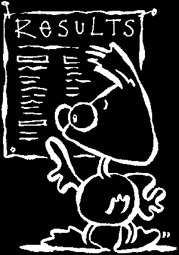


## 关于测试的更多内容

这本书快要结束了。你现在已经详细学习了你将看到的所有 Java 内容。到目前，你应该已经能够利用当前 Java 版本中提供的许多特性编写相当复杂的 Java 程序了。你应该能够分析一个问题，然后继续设计并开发形成解决方案基础的类和程序。

当然，如果一个解决方案不能正确运行，它就没有任何用处。在很久很多很多页之前，第 10 章解释了测试的重要性，并向你展示了如何为你的每个程序编写*测试计划*。希望你从那以后编写所有程序时一直在这样做！如果你不花时间对程序进行彻底测试，那么花时间开发程序就完全没有意义。一个未经测试的程序是毫无价值的程序，而且可能是一个非常危险的程序。

自第 10 章以来，你所编写的程序变得越来越长、越来越复杂。本章简要解释了如何测试大型程序的一些想法。测试大型程序的流程与第 10 章非常相似，因此你可能想回去快速重读一遍。大型程序需要一种非常结构化的测试方法；无结构且杂乱无章的测试可能比不测试还要糟糕。

尽管有这些关于测试的勇敢言论，但重要的是记住：永远不可能证明一个程序在每情况下都能正确运行。测试只能建立对程序的信心；它永远无法提供完全的信心。要用程序必须处理的所有输入值来测试程序几乎是不可能的。尽管如此，本章中的观点意味着你应该对你的程序具有相当高水平的信心。

读完本章后，你应该能够系统地测试大型程序和类。你应该能够为一个类编写驱动程序（driver program），并能够使用它来测试该类。你应该理解*黑盒*测试和*白盒*测试的区别，并理解如何决定针对特定测试使用哪种方法。你还应该能够对程序进行*干跑*（dry run）。

你的程序将有更大的概率正确运行！


## 如何使用 Java 编程

彻底测试程序与从一开始编写程序一样重要。在许多方面，它实际上实际上更重要，因为未经测试的程序可能包含许多昂贵的错误。自从上一章测试你的程序以来，你已经使用了越来越多的 Java 特性，程序也变得越来越复杂。始终彻底地测试这些复杂程序至关重要。

本章并不旨在提供测试程序正确方法的完整描述。关于测试已经写了许多整本书，而一个完整的描述远远超出了任何编程类书籍的范畴。相反，本章为你提供了一些测试程序的方法思路，并试图说服你测试的重要性。

你已经熟悉了由许多*测试用例*组成的*测试计划*这一概念。这个想法可以直接转化到更长的程序中；唯一需要确保的是计划中的测试用例覆盖了程序执行的每种可能方式，或者说通过程序的每种可能路径。

你的程序现在包含了条件语句和循环，因此它们现在有许多不同的执行方式；必须有足够的测试用例来彻底测试这些每一个可能的执行路径。

到目前为止，你所编写的测试计划依赖于指定一组输入值和预期输出值。程序通过每个用例进行测试，如果每个用例的实际输出与预期输出匹配，则程序就通过了测试。这种方法对于简单简短的程序是可以的，但对于更复杂的程序来说很少足够。需要一种更彻底的测试方法。

你的程序现在还使用了类，这些类也必须经过测试。类是一个在许多程序中可能都有用的构建块。程序所使用的每个类都必须经过适当测试；如果依赖一个无法工作的类，编写和测试该程序毫无意义。你必须在使用类时对其进行测试。本章最后解释了在类类之前如何测试类。

### 程序中的路径

到此时，你的程序可能已经相当复杂，会有许多可能的路径。条件语句和循环控制着可能的路径，每个路口都为程序提供了几种执行方式。测试计划必须确保程序的每种可能路径都得到了适当测试。这意味着首先条件语句的每种可能性都必须通过测试，循环的每个可能结果也必须如此。


## 关于测试的更多内容

当用户被提示向程序输入值时，他们提供的限制很少。程序的许多故障是由用户提供了意外之外的输入值，从而进入了完全意想不到的路径导致的。彻底测试程序的每种可能路径至关重要，即使这看起来极不可能发生。

首先，必须测试条件语句中的每种可能性。例如，在一个包含以下条件语句的程序中：

```java
int aNumber;

if (aNumber > 1 && aNumber < 10) {
    // statements
}
else if (aNumber >= 10 && aNumber < 20) {
    // statements
}
else {
    // statements
}
```

测试计划必须包含导致三组可能语句执行的`aNumber`值。这些可能是测试计划中的边界值，但如果不是，必须包含更多值。

测试循环时，关键考虑的是控制循环的条件的初始值。在这里：

```java
int aNumber;

while (aNumber < 10) {
    // statements
}
```

重要的是用使条件为真的、导致循环执行的值测试程序，以及用使条件为假的、意味着从不执行循环的值测试程序。

可以通过一组输入值来表示程序的每条路径。如果无法指定一组导致特定路径被遵循的值，那么这反而引起了该路径存在的问题！这个值列表可能很长，即使对于程序的很小部分也是如此：

```java
int grade;
char answer;

do {
    System.out.print ("Enter the grade : ");
    grade = Console.readInt ();

    if (grade > 69) {
        System.out.println (grade + " is an A");
    }
    else if (grade > 59) {
        System.out.println (grade + " is a B");
    }
    else if (grade > 49) {
        System.out.println (grade + " is a C");
    }
    else if (grade > 39) {
        System.out.println (grade + " is a D");
    }
    else {
        System.out.println (grade + " is a E");
    }

    System.out.println ("Run Again? (y/n) ");
    answer = Console.readChar ();
    while (answer != 'y' && answer != 'n') {
        System.out.println ("Please enter 'y' or 'n'");
        System.out.println ("Run Again? (y/n) ");
        answer = Console.readChar ();
    }
} while (answer == 'y');
```

这段代码（我们认为它是正确的！）将数字`grade`转换为简单的字母等级。它还包含一个简单的对话允许用户再次运行程序。这相当简单。而这段代码的测试计划（这只是程序的一个小部分）要复杂得多。它必须包含：

- 导致条件语句执行每种可能的`grade`值；
- 导致对话执行每种可能的`answer`值。

第一部分是直接的。每种可能性都需要边界值和至少一个典型值。对话部分更为复杂。这种测试必须处理用户提供正确`y`值、正确`n`值以及错误值的情况。尽管代码看起来是一样的，对话的三个可能的测试用例是：

- 用户输入`y`，程序应该提示输入另一个`grade`；
- 用户输入`n`，程序应该结束；
- 用户输入另一个值，程序应该显示错误消息并再次提示用户。

同样的测试用例也适用于第二个提示。识别所有可能的情况可能需要一些时间。要尽地进行这一点仍然很重要。

人们可能会有孤立测试程序的诱惑。在这个示例中，`if`语句和两个部分可以被隔离并单独测试。这会大大缩短测试计划所花费的时间，但可能会导致对程序的过度自信。在任何规模的程序中，一个部分的语句完全可能在程序的其他地方产生意外副作用。虽然测试程序的各个部分是一个好主意，但在发布之前对整个程序进行测试至关重要。

## 测试的其他方法

目前为止，所有的测试都集中在提供输入值并检查输出值。如果输出值符合预期，则假设程序工作正常。在这个过程中，程序本身被视为“黑盒”，这正是这种测试的名称。黑盒在于其内部机制从未被检查；如果它产生了正确的输出，就假设它是好的。黑盒测试通常是有效的，但彻底的测试需要检查程序本身。为了理解为什么这样做，请考虑这个示例：

```java
int first, second;

System.out.print ("Enter the first number : ");
first = Console.readInt ();

System.out.print ("Enter the second number : ");
second = Console.readInt ();

int total = first + first;

System.out.println ("The total is " + total);
```

你可能立即看出这个程序中的错误。如果没有，仔细查看最后输出行之前的计算。错误是容易看到的，但仅仅是因为程序代码可用。这个程序在任何黑盒测试中都会通过某些测试用例；两个数字相同的情况看起来运行正常。一个编写糟糕的黑盒测试计划甚至可能让人认为程序确实按预期工作了。

通过检查程序进行测试被称为“白盒”测试。现在程序是白盒，其语句是可以检查的。白盒测试有两种可能的方法。两者都涉及检查程序的输出，而不是在计算机上运行它。

第一种方法是“模拟运行”程序。这涉及取一个测试用例并手工遍历程序，跟踪所有的值以及输出。从某种意义上说这与黑盒测试相同，因为最终输出是可见，但优点是中间值也可见。这个过程在调试程序而不是测试程序时也是非常有用的策略。

另一种方法类似，但涉及两个人。这种想法是让某人（可能是程序员）与其他人一起“走查程序”。走查涉及逐行解释程序的每一行，并解释可能的路径，就像模拟运行一样。处理程序的过程通常可以突出错误或揭示未被考虑的情况。程序员很少是测试程序的最佳人，绝对不应该允许单独测试程序。另一个人的存在使得测试更有可能是彻底的。

## 黑盒还是白盒？

这两种测试方法都有它们的优势。白盒测试通常能发现黑盒测试无法发现的错误，而黑盒测试只能显示错误的存在。只有在白盒中检查程序时，才能找到错误的原因。

## 测试类

到为止，大部分测试讨论都集中在测试完整的程序上。这假设了程序使用的类是已知良好的。显然，为了实现这一点，类本身也必须经过测试。

当然，类不能以程序的方式进行测试。类不能被运行；没有输入可以提供，也没有输出可以追踪。测试类的关键是使用一个小型程序来逐个测试类的每个方法。这允许进行黑盒测试；方法本身也应该在白盒测试中进行检查。当开发一个类时，可能已经提供了一个测试它的程序，或者由另一个程序员开发。

```java
System.out.println ("Attributes are now: ");
System.out.println ("Name: " + aDuck.getName());
System.out.println ("Position: " + aDuck.getX() + ", " + aDuck.getY());
```

当程序运行时，它会宣布自己正在使用的方法并显示结果：

*正在创建鸭子 ...*

*正在设置为 'Elvis'，位置 5, 3...*

*当前属性为:*

*名称: Elvis*

*位置: 5, 3*

程序员可以手动确定正确的结果，然后检查驱动程序产生的结果，以查看该类是否按预期工作。

一种更彻底的方法，也是一种允许执行完整测试计划的方法，是编写一个简单的菜单，允许用户根据需要调用每个方法。这种驱动程序可能很长，但很容易编写；菜单结构与我们在案例研究中使用的完全一样。和之前一样，程序员可以制定一套测试方案，然后通过菜单应用这些测试。可以将实际结果与产生的结果进行比较，以确定该类是否正常工作。¹

这些驱动程序仅用于测试程序，因此不需要在它们中进行任何复杂的错误检查，甚至不需要对用户输入进行检查。它们只是允许测试人员使用该类并检查结果。当配备了合适的计划时，测试人员应该能够发现该类是否按预期工作。当然，这里有一个隐含假设，即驱动程序是正确的。它们也应该被测试！如果发现类中明显的错误是由驱动程序中的粗心编程引起的，将是非常令人恼的。

## 构建和测试程序

一个完整的 Java 程序涉及类以及程序本身。在启动程序之前（或至少在两者之间发生任何接触之前），编写并测试这些类是非常重要的。编写一个依赖于未测试类的程序几乎没有意义；如果它们分别开发和测试，那么追踪和纠正错误与 Bug 总是容易得多。这并不能消除使用类编写程序时会在类中出现错误的可能性，但它应该降低这种可能性。

彻底测试是开发程序的关键部分。在像 Java 这样的语言中甚至更为重要，因为程序由各种组件组成，并且通常写在许多独立文件中。你应该始终测试你的程序，千万不要倾向于将测试视为事后考虑。

¹ 那可以写成“看起来工作正常”。也许它本就该这样。记住，这就是测试所要证明的。测试让我们有信心程序或类按照我们预期和要求的方式运行；测试永远无法证明程序或类工作完全正确。

千万不要倾向于说“它似乎可以工作”之的话；始终确保它工作正常！


## 示例 1 – 字母计数

*Elvis 决定玩文字游戏。为了帮助他，他写了一个简单的程序来计算单词中元音和辅音的数量。遗憾的是，他的程序没有产生正确的结果。Elvis 看不出错误，因此决定对程序进行模拟运行，看看能发现什么。以下是该程序：*

```java
/* WordStats.java – 统计单词中的辅音和元音。
作者: AMJ
日期: 2002年12月31日
测试环境：Red Hat 7.3, JDK 1.4.0
*/

import java.util.*;

public class WordStats {

    private int consonants, vowels;
    private String word;
```


```java
public WordStats () {

    consonants = 0;

    vowels = 0;

    word = "";

}

public void setWord (String w) {

    word = w;

}

public void count () {

    for (int i = 0; i < word.length() - 1; i++) {

        if (word.charAt(i) == 'a' || word.charAt(i) == 'e'

            || word.charAt(i) == 'i' || word.charAt(i) == 'o'

            || word.charAt(i) == 'u') {

            vowels++;

        } else {

            consonants++;

        }

    }

}

public void printResults () {

    System.out.println("\" + word + "\" contains ");

    if (vowels == 1) {

        System.out.print("1元音 and ");

    } else {

        System.out.print(vowels + "元音 and ");

    }

    if (consonants == 1)

        System.out.println("1辅音");

    } else {

        System.out.println(consonants + "辅音");

    }

}

public static void main (String[] args) {

    WordStats ws = new WordStats();

    // 获取单词

    System.out.print("Enter word: ");

    ws.setWord(new Scanner(System.in).nextLine());

    // 分析

    ws.count();

    // 输出

    ws.printResults();

}

}
```

## 模拟运行会发现什么？错误是什么？

这个程序本身没有问题。某些人（可能非常擅长文字游戏和谜题）仅通过这些就能推断出错误是什么，但模拟运行程序提供了一种更有结构化的调查方法。

现在应该清楚错误是什么了；字符串的最后一个字符从未被处理。错误出现在`for`循环的条件中：

`for (int i = 0; i < word.length() - 1; i++)`

这显然导致循环执行次数少了一次。解决方案显而易见：

`for (int i = 0; i < word.length(); i++)`

这个更改将使程序正常工作。

## 示例 2 – Baddy 的派

*Buddy 对 Elvis 的测试困境感到相当有趣，但当他遇到自己的测试困境时，他就不那么自得意了。*

*Buddy 一直在写程序来分配每周提供的派（由 Martinmere 先生慷慨提供），但当它看起来运行不正常时，他感到沮丧。程序并不复杂；它只需要接收派的数量和鸭子的数量，并显示 Buddy 应该给每只鸭子几个，以及剩下几个。这里是程序：*

```java
import htpuj.*;

public class PieShare

{

    private int pies, ducks;

    private int piesPerDuck, leftOver;

    public PieShare ()
    {

    }

    public void setPies (int p)
    {
        pies = p;
    }

    public void setDucks (int d)
    {
        ducks = d;
    }

    public void calculate ()
    {
        piesPerDuck = ducks / pies;
        leftOver = ducks % pies;
    }

    public void printResults ()
    {
        System.out.print ("Each duck should get ");
        if (pies == 1) {
            System.out.println ("1 pie.");
        }
        else {
            System.out.print (pies + " pies.");
        }

        if (leftOver == 1) {
            System.out.println("There will be one pie left over.");
        }
        else {
            System.out.println("There will be " + leftOver +
            " pies left over.");
        }
    }

    public static void main (String args[])
    {
        PieShare ps = new PieShare ();
        // get input values
        System.out.print ("How Many Pies? ");
        ps.setPies (Console.readInt());
        System.out.print ("How Many Ducks? ");
        ps.setDucks (Console.readInt());
        // analyse
        ps.calculate ();
        // output results
        ps.printResults ();
    }
}
```

306

*如何使用 Java 编程*

*关于测试的更多内容*

307

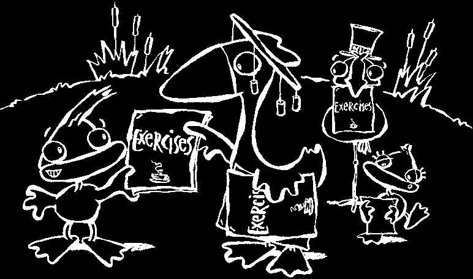

*目前程序的输出是错误的，而且必须说有些令人*
*困惑。例如：*

*多少个饼？**100***

*多少只鸭子？**10***

*每只鸭应该得到 100 个饼。*

*将剩下 10 个饼。*

*这显然是错误的，但程序哪里出了问题呢？*

这类问题对于程序员来说通常很难发现。黑盒测试显然没有太大帮助，因此某种白盒测试是唯一的出路。很有可能通过将他的程序展示给另一个程序员 Elvis，他可以迅速解决这个程序。

程序中的错误实际上非常微妙，但一旦你注意到它，就变得非常明显。如果你能立刻看出它，就去给自己一个奖励吧！

这种错误恰是另一个程序员第一次看到这个程序时很可能立即发现的，但原始编写者可能会花费许多小时徒劳的时间来尝试寻找。

问题在于 Buddy 在计算中弄反了值的顺序。如果你思考一分钟，你会发现：

`piesPerDuck = ducks / pies;`

`leftOver = ducks % pies;`

这显然是胡说八道。值的顺序写反了。正确的应该是：

`piesPerDuck = pies / ducks;`

`leftOver = pies % ducks;`

这是一个简单的错误，但这样的错误可能很难发现，特别是当它们出现在你自己编写的程序中。这种微妙的错误通常最好由其他程序员来发现。

## 19.1

检查这个条件语句。它有什么奇怪的地方吗？

```java
int aNumber;

if (aNumber < 10)

{

    // statements

}

else if (aNumber >= 10)

{

    // statements

}
```

308

*如何使用 Java 编程*

```java
else

{

    // statements

}
```

## 19.2

编写一个程序，提示用户输入五个单词，然后按字母顺序对它们进行排序。使用列表（`ArrayList`）和泡沫排序（`Bubblesort`）。用“sausage”、“egg”、“bacon”、“tomato”和“mushroom”这些单词对你程序中的排序函数进行模拟运行。

## 19.3

实现本章的`Duck`类。使用一个驱动程序来测试你的实现。

## 19.4

为上一章的`Cricketing Duck`类编写一个驱动程序。使用它来测试类中的方法。特别注意那些在之前的任何程序中都没有使用的方法！


随着程序变得越来越复杂，测试过程也变得复杂。测试永远不应该忽视。它应该被视为编程过程的一部分；一个好的程序员总会在开发程序时进行测试。程序在写完后并不是完成的；只有在经过彻底测试后才是完成的。

当你开始编程时，可能会有一种诱惑，即对程序的运行感到如此宽慰，以至于不忍心去测试它。测试可以发现你犯的错误，并意味着你将面临更多的工作。尝试不要屈服于这种诱惑。尽可能彻底地测试你的程序，永远不要害怕帮助他人测试他们的程序。测试应该始终是一个结构化的过程，并且始终按照计划执行。计划应该在编写程序之前编写；不要试图为了迎合程序中运行的部分而编写测试计划，并隐藏其他部分！

测试程序与开发程序一样重要。327


309


310

*如何使用 Java 编程*


## 异常处理

有时，当程序运行时，会发生意料之外的事情。在 Java 中，这被称为*异常*。如果 Java 检测到这种事件，它会“抛出”一个异常来指示出了问题。除非程序员采取措施，否则程序将会停止。让我们来看一个例子。到目前我们假设用户总是输入整数。这里有一个读取整数的简单片段：

```java
int i;

System.out.print("输入的数量：");

i = Console.readInt();

System.out.println("得到了 " + i);
```

当用户输入整数时，这段代码运行正常：

```text
tetley% javac ReadInteger.java
tetley% java ReadInteger
输入的数量：12
得到了 12
```

当用户输入字符串代替时，事情开始出现问题：

```text
tetley% java ReadInteger

输入的数量：seven

Exception in thread "main"
java.lang.NumberFormatException: For input
string: "seven"
at
java.lang.NumberFormatException.forInputString(NumberFormatException.
java:48)
at java.lang.Integer.parseInt(Integer.java:468)
at java.lang.Integer.parseInt(Integer.java:518)
at htpuj.Console.readInt(Console.java:28)
at ReadInteger.main(ReadInteger.java:8)
```

你的 Java 系统输出可能略有不同，但它应该是这样的。关键是，它应该包含抛出的异常名称。在错误的第一行。消息的其余部分告诉我们在 Java 内部哪里发生了这种情况；对于初学者来说，这些信息并不特别有用，除了最后两行告诉我们发生在哪里。

异常与其他信号错误方式的主要区别在于，当异常被抛出时，除非程序员采取措施，否则程序将会停止。

请告诉我们这种情况发生在`ReadInteger.java`文件的第 8 行调用`Console.readInt`时。这种错误显然最好避免。处理此问题的技巧是捕获异常。可能抛出异常的语句包含在`try`语句的大括号中：

```java
try {

    i = Console.readInt ();

    System.out.println ("You entered " + i);

}
```

这对程序的运行方式没有影响。现在的区别是程序可以捕获异常：

```java
try {

    i = Console.readInt();

    System.out.println ("You entered " + i);

}

catch (NumberFormatException exception) {

    System.out.println ("Not an Integer!");

}
```

这段代码仅在抛出异常时打印出错误消息。现在的的效果是：

```text
tetley% javac ReadInteger.java
tetley% java ReadInteger
Enter a number: twelve
Not an Integer!
```

你可以在`catch`块中放置任何合法的 Java 代码，在上面的例子中，我们打印了一条有用的警告信息。通常，`catch`块被用于在可能的情况下修复或绕过错误，或者在异常退出前进行清理，例如关闭打开的文件、记录错误等。在`catch`块中可以包含的一种常见且实用的方法是内置的`printStackTrace`方法（它可以在任何异常对象上调用）。它会打印大量的调试信息（正如我们在上面通过`NumberFormatException`看到的那样），对于追踪代码中晦涩的错误非常有用，特别是当展示给资深 Java 爱好者看时：

```java
catch (NumberFormatException exception) {

    exception.printStackTrace (); // display调试信息

}
```


关于异常的最后一点说明。你看到的某些程序可能包含像如下所示的方法：

```java
public void read () throws Exception
```

这实际上表示该方法允许抛出异常，并且调用该方法的代码应该处理这些异常。如果没有最后部分，编译器将检查方法的实现，并对未被捕获的可能异常发出警告。在设计得健壮的程序（希望所有程序如此！）中，捕获所有异常并合理处理它们是至关重要的。

## 使用文件进行输入和输出

以案例程序为例，显而易见，只有最基础的程序才会在不接收文件输入且不向文件写入某些数据的情况下运行。然而，到目前为止，我们还没有学习如何在 Java 中实现这一点。幸运的是办法就在身边，因为 Java 提供了各种类允许你读取、写入以及其他操作文件。这些类位于 `java.io` 包中，我们将简要讨论其中两个类（`FileReader` 和 `FileWriter`），以及两个处理读写缓冲以提高效率的包装类。

直接使用 `FileReader` 和 `FileWriter` 类传输数据的开销可能是巨大的，特别是当有大量小分块数据需要访问时。回想一下书开始时提到的烹饪类比——在称量 200 克糖时，打开包装并将内容一把一把地转移到秤上，比一次一粒、甚至一次一勺地转移更容易也更高效。

文件读取和写入的情况也是如此，分几次大块进行读写（例如一次一行）比分许多许多小块（例如逐个单词或逐个字符）进行读写要高效得多。Java 提供了两个类：`BufferedReader` 和 `BufferedWriter`，它们负责大块地读写数据，有时甚至在程序员不知道的情况下完成。使用缓冲类的另一个方便的副作用是接口对初学者来说更容易学习；`FileReader` 和 `FileWriter` 类倾向于一次操作一个字符或使用字符数组，但缓冲类隐藏了这种复杂性，允许程序员完全使用更熟悉且更不繁琐的 `String` 进行工作。当然，所有这些类的完整细节可以在 API 文档中找到。

最后要提到的一点，也是当你自己在 Java 中执行文件输入或输出时必须考虑的，是几乎几乎所有的方法都可能抛出异常（通常是 `IOException`），因此，调用文件输入输出代码的方法应该包含一个带有匹配 `catch` 块的 `try` 块来处理异常。

### 从文件中读取数据

`FileReader` 有几个构造函数，我们将使用的那个接受一个参数，即一个 `String`，包含我们想要读取的文件路径：

```java
FileReader file = new FileReader ("c:\\path\\to\\file");
```

为了使读取更高效，我们将 `FileReader` 对象作为参数传递给 `BufferedReader` 构造函数：

```java
FileReader file = new FileReader ("c:\\path\\to\\file");
BufferedReader reader = new BufferedReader (file);
```

通过动态创建 `FileReader` 对象，可以将这两个语句合并（在这种情况下是可以的，因为我们不需要再次访问该对象）：

```java
BufferedReader reader = new BufferedReader (new FileReader ("c:\\path\\to\\file"));
```

使用 `BufferedReader` 读取数据非常简单。在内部，该类跟踪文件中的当前位置，而我们将讨论的唯一方法 `readLine` 会从当前位置读取到但不包括下一个换行符之前它所能读取的所有数据。让我们创建一个虚拟文件来测试这个：保存文件并确保记住它的名字。现在初始化器对象（记得包含相应的库）：

```java
import java.io.*;

try {

    BufferedReader reader = new BufferedReader (new FileReader ("testfile.txt"));

} catch (IOException ioe) {

    System.err.println ("Error reading testfile.txt");

    // ioe.printStackTrace (); // 取消注释以获得详细输出

}
```

可以使用 `readLine` 方法从文件中读取：这将产生输出：
*这是一行文本。*
*这是另一行。*

读取整个文件并没有通过在循环中包含 `readLine` 调用那样简单，因为当到达文件末尾时不会抛出异常。幸运的是，`readLine` 方法返回特殊值 `null`，因此我们可以在循环中包含对该值的检查：

```java
String tmpString;

do {

    System.out.println (tmpString);

    tmpString = reader.readLine ();

} while (tmpString != null);
```

这段代码应该遍历文件，逐行打印每一行。当到达文件末尾时，`readLine` 方法返回值 `null`，`tmpString != null` 检查失败，控制权跳出循环。我们需要做的最后一件事是关闭输入流。这可以防止文件损坏，并释放系统可以在其他地方使用的资源。关闭流的方法名为富有想象力的 `close`：`reader.close();`

### 向文件写入数据

我们已经遇到了从文件输入所需的类，现在让我们来看看它们的“犯罪同伙”，即输出类。正如我们在本节开头所说，这些类被称为 `FileWriter` 和 `BufferedWriter`，它们的行为同样容易理解。类似于我们上面创建读取器的方式，我们创建了一个 `BufferedWriter` 对象，它接受一个 `FileWriter` 对象作为参数。这个 `FileWriter` 对象反过来接受一个包含文件名的 `String` 作为参数。这一切都发生在必要的 `try` 块内部，下方有它的 `catch` 块。

创建写入器对象非常直接：

```java
BufferedWriter writer = new BufferedWriter (new FileWriter ("c:\\path\\to\\file"));
```

再次，我们需要若干个方法。其中第一个是 `write` 方法，它接受一个 `String` 作为参数，并将该 `String` 的内容写入文件：

```java
writer.write ("testing 1 2 3");
```

与更熟悉的 `System.out.print` 方法相比，该方法的一个局限性是你应该传递一个 `String` 且仅 `String` 作为参数。该方法的另一个版本接受一个 `int`，但它执行的是完全不同的操作，并导致各种混困。坦率地说，有一种方法可以强制编译器和 JVM 将不同类型的对象视为 `String`；由于我们可以将这些值中的任何一个附加到 `String`，我们只需将它们附加到一个空 `String` 即可：

```java
writer.write ("" + 4); // 将字符串 '4' 写入文件
```

可能还值得记住 `write` 方法将完全按照你要求的进行写入，所以如果你想写一行文本，你需要确保在行末尾也写入 `\n`（*换行符*）字符！我们需要了解的第二个方法是 `close` 方法，原因与之前为读取器类列出的相同。语法完全相同：

```java
writer.close(); // 关闭输出流
```

然而，这并不是全部。由于我们对输出数据进行缓冲，我们需要确保在关闭输出流之前，所有内容都已写入文件。有第三种方法 `flush`，它强制将缓冲区的内容传输到文件（称为刷新缓冲区）。这在文件写入代码中常见：

```java
writer.flush (); // 写入最后一个字节

writer.close (); // 关闭文件
```

所以，让我们来看文件写入的一些示例代码。然后我们将重新查看案例，将所学知识整合到真实程序中。

```java
import java.io.*;

...

try {

    BufferedWriter writer = new BufferedWriter (new FileWriter ("testfile2.txt"));

    writer.write ("Oh let the sun beat down upon my face\n");

    // 其他我们需要的输出

    writer.flush (); // 刷新缓冲区

}
```

事实上，如果我们实例化 `PrintWriter` 对象（来自 `java.io`），并将此 `BufferedWriter` 对象作为参数，我们就可以访问与 `System.out` 类相同的 `print` 和 `println` 方法。这意味着我们可以使用 `printWriter.println (line);`，而不是 `writer.write (line + "\n");`

你自己尝试一下吧。

```java
writer.close(); // 关闭文件

}

catch (IOException ioe) {
    System.err.println("无法写入 testfile2.txt");
    // ioe.printStackTrace(); // 如需更详细的输出，请取消注释
}
```

现在，在你选择的编辑器中检查该文件（在本例中为 `testfile2.txt`），希望它已经包含了我们在程序中编写的那行代码。

## 扩展 DuckDatabase 类以包含文件 I/O

与其再次包含整个类，不如只包含相对于第一个版本需要进行的更改，这是合理的。

目前，让我们让文件使用变为可选；这意味着我们需要扩展主菜单，以包含从文件读取和写入文件的选项。我们还应该将读取代码放在单独的方法中（假设称为 `readFromFile`），同样，将写入代码放在单独的方法中（为了保持一致性，称为 `writeToFile`）。这使得类的接口保持不变，因此任何现有程序都仍能按预期工作。

与其将文件名硬编码在代码中，如果能将所需的文件名作为参数传递给这些方法，将会非常有用。

扩展菜单非常简单，我们只需要向控制台打印几行额外的内容，并在 `switch` 语句中添加几个额外选项：

```java
System.out.println("* R – 从文件读取数据 *");

System.out.println("* W – 将数据写入文件 *");

case 'r':

case 'R':

    System.out.print("Enter filename : ");

    String name = Console.readString();

    readFromFile(name);

    break;

case 'w':

case 'W':

    System.out.print("Enter filename : ");

    String name = Console.readString();

    writeToFile(name);

    break;
```

接下来，我们需要实现 `readFromFile` 和 `writeToFile` 方法。在此之前，我们真的应该为这些方法决定一种文件格式——即我们存储每只鸭的数据元素的顺序，更广泛地说，我们如何在文件中对这些鸭进行排序。最明显的格式可能是让每个属性单独占一行，并按照它们在 `Duck` 类中出现的顺序：

- 姓名 (`name`)
- 球队 (`team`)
- 投球轮 (`overs bowled`)
- 局数 (`wickets taken`)
- 失分 (`runs conceded`)
- 击球局数 (`innings batted`)
- 得分 (`runs scored`)

区分不同鸭的数据最简单的方法是在第一只鸭的最后一个值和第二只鸭的第一个值之间留一个空行，并在最后一只鸭之后放置一个标记（例如 `EOF` 表示文件结束）。这样，读取数据的代码就可以写在循环内部，循环条件可以为：

*如果下一行仅包含字符串 `"EOF"`，则结束，*
*否则继续*

`writeToFile` 方法的逻辑如下：

以写入模式打开文件
循环遍历列表中的每只鸭
按照指定的顺序将数据写入文件
如果这是最后一只鸭
向文件写入 `"EOF"`
否则
向文件写入空行
刷新并关闭文件

将此逻辑转换为可运行的 Java 代码并不困难，尤其是考虑到你到为止应该已经熟悉了大部分概念。我们需要一个与 `DuckDatabase` 类中现有的循环相似的 `for` 循环，即它必须遍历一个 `ArrayList`，在每次迭代中创建一个临时的 `Duck` 对象，并将该对象的数据转到文件中。

```java
public void writeToFile (String filename) {

    Duck tmpDuck; // 临时对象

    try { // 代码可能会抛出异常！

        BufferedWriter writer = new BufferedWriter(new FileWriter(filename));

        for (int i = 0; i < ducks.size(); i++) {

            tmpDuck = (Duck)ducks.get(i); // 获取鸭的引用

            writer.write(tmpDuck.getName() + "\n");

            writer.write(tmpDuck.getTeam() + "\n");

            writer.write(" " + tmpDuck.getOvers() + "\n");

            writer.write(" " + tmpDuck.getWickets() + "\n");

            writer.write(" " + tmpDuck.getRunsConceded() + "\n");

            writer.write(" " + tmpDuck.getInnings() + "\n");

            writer.write(" " + tmpDuck.getRunsScored() + "\n");

            // 如果写了最后一只鸭，写入 "EOF"

            if (i == ducks.size() - 1) {

                writer.write("EOF");

            } else { // 否则，写入空行

                writer.write("\n");

            }

        }

        writer.flush(); // 确保最后一个字节被写入

        writer.close(); // 关闭文件

    } catch (IOException ioe) { // 处理异常

        System.err.println("无法写入到 " + filename);

    }

}
```

`readFromFile` 方法在许多方面与 `writeToFile` 方法相似（考虑到它们是完全相反的，这显而易见）。逻辑上，它应该如下运行：

以读取模式打开文件
直到到达文件末尾
读取数据，按指定的顺序设置鸭的值
关闭文件

再次，将此逻辑转换为 Java 代码现在应该非常简单了，因为这些原理已经熟悉了。唯一的复杂之处在于文件只包含字符串，我们需要将它们转换为整数。

```java
public void readFromFile (String filename) {

    Duck tmpDuck; // 临时对象

    String buf;

    try {

        BufferedReader reader = new BufferedReader(new FileReader(filename));

        do {

            tmpDuck = new Duck();

            tmpDuck.setName(reader.readLine());

            tmpDuck.setTeam(reader.readLine());

            tmpDuck.setOvers(Integer.parseInt(reader.readLine()));

            tmpDuck.setWickets(Integer.parseInt(reader.readLine()));

            tmpDuck.setRunsConceded(Integer.parseInt(reader.readLine()));

            tmpDuck.setInnings(Integer.parseInt(reader.readLine()));

            tmpDuck.setRunsScored(Integer.parseInt(reader.readLine()));

            ducks.add(tmpDuck);

            buf = reader.readLine();

        } while (!buf.equals("EOF"));

        reader.close(); // 关闭文件

    } catch (IOException ioe) {

        System.err.println("无法读取 " + filename);

        ioe.printStackTrace();

    }

}
```


## 继承

应用程序包含许多相似的类并不罕见。应用程序处理不同的人、银行账户、书籍或动物。在很多情况下，为一个类编写的方法可以使用另一个类，并且不同类具有相同的属性。在这种情况下，通常会有代码需要在不同类中重复。我们已经多次看到不同类型动物的代码必须在不同类中重复。

有时类形成一个层次结构。例如，如果应用程序需要代表不同类型的类——学生、老师、公交车务员——许多不同类具有相同的属性。在每个类中实现相同的方法将是非常浪费的。

不，在每个类中实现相同的方法将是非常浪费的。Java 提供了一种机制来实现这一点，称为继承。继承允许程序员定义一个基本类，并允许其他类继承该类的所有属性和方法。继承类拥有该类的所有属性和方法，也可以拥有自己的。包含公共属性和方法的类称为基类，继承自基类的类称为派生类。基类首先按通常方式定义：

```java
public class Person {

    private String name;

    private int age;

    private String address;

    public Person () {

    }

    public void setName (String newName) {

        name = newName;

        return;

    }

    public void setAge (int newAge) {

        age = newAge;

        return;

    }

    public void setAddress (String newAddress) {

        address = newAddress;

        return;

    }

}
```

```java
public String getName ()

{

    return name;

}

public int getAge ()

{

    return age;

}

public string getAddress ()

{

    return address;

}

}
```

派生类仅包含特有的属性和方法。所有其他属性和方法都继承自基类，基类的名称在类定义的第一行指定：

```java
public class BusConductor extends Person

{

    private int busRoute;

    public BusConductor ()

    {

    }

    public void setBusRoute (int newBusRoute)

    {

        busRoute = newBusRoute;

        return;

    }

    public int getBusRoute ()

    {

        return busRoute;

    }

}
```

因此，类型为`BusConductor`的对象具有属性`busRoute`（以及选择器和修改器）以及`Person`类的所有属性和方法。可以为任何特定类型实现实现类。

继承可以节省大量的代码工作。在应用程序中，可以存在许多层次的继承，派生类可以作为其他类的基类。

## 重载方法

Java 中的方法通过方法名、返回值类型以及任何参数的类型组合来标识。正是这些信息的组合共同标识了方法；不需要类中的每个方法都具有不同的名称。如果存在其他内容可以区分它们，则多个方法可以具有相同的名称；该方法可以被重载。

假设存在某个应用程序需要大量计算平均值。可能需要计算两个数字或三个数字的平均值；更复杂的是这三个数字可能存储在数组或单独的变量。这些方法可以定义为：

```java
public double meanOfTwo (int x, int y)

{

    return (double) (x + y) / 2;

}

public double meanOfThree (int x, int y, int z)

{

    return (double) (x + y + z) / 3;

}

public double meanOfArray (int n[][])

{

    return (double) (n[0] + n[1] + n[2]) / 3;

}
```

这些方法被赋予了不同的名称，但并没有特别的理由这样做。如果所有方法都简单地命名为`mean`：

```java
public double mean (int x, int y)

{

    return (double) (x + y) / 2;

}

public double mean (int x, int y, int z)

{

    return (double) (x + y + z) / 3;

}

public double mean (int n[][])

{

    return (double) (n[0] + n[1] + n[2]) / 3;

}
```

根据参数的类型和数量，仍然很容易看出调用的是哪一个。此调用：

`mean (a, b);`

显然是在调用第一个版本，因为提供了两个参数；而这个调用：

`mean (a, b, c);`

必须是对应第二个版本的调用，因为有三个参数。

在这个示例中，方法名`mean`被重载了；有三个同名方法。只要通过检查其参数的类型和数量就能唯一确定正在调用的方法，这样做就没有问题。这种技术可以使程序具有更高的可读性，并让程序员无需为方法使用大量的人为名称。以下程序通过更多示例说明了这一观点。每当调用方法`mean`时，参数都会唯一确定应使用哪一个。

```java
/* 

Numbers.java

方法重载示例。

Author : AMJ

Date : 2003年2月8日

Tested on : Linux (Red Hat 7.3), JDK 1.4.1

*/
```

```java
public class Numbers
{
    private int num1;
    private int num2;
    private int num3;
    private int nums[];

    public Numbers ()
    {
        num1 = 1;
        num2 = 2;
        num3 = 3;
        nums = new int [3];
        nums[0] = 4;
        nums[1] = 5;
        nums[2] = 6;
        return;
    }

    public double mean (int x, int y)
    {
        return (double) (x + y) / 2;
    }

    public double mean (int x, int y, int z)
    {
        return (double) (x + y + z) / 3;
    }

    public double mean (int n[][])
    {
        return (double) (n[0] + n[1] + n[2]) / 3;
    }

    public static void main (String args[])
    {
        Numbers n = new Numbers ();
        System.out.println ("Two integer mean : " + n.mean (n.num1, n.num2) );
        System.out.println ("Three integer mean: " + n.mean (n.num1, n.num2, n.num3) );
        System.out.println ("Array mean : " + n.mean (n.nums) );
    }
}
```

类中的所有方法都可以被重载，包括构造函数。可以提供一组方法。

## 练习

这次没有例子了；反正这一章的例子已经足够了！现在到了你应该能够想出属于自己的例子来尝试的时候了……

这次只有一个练习题，但请确保多做几次！

**20.1**

编写一个程序。只要它使用了你目前为止见过和用过的大部分 Java 代码，它可以完成任何你喜欢的功能。当你完成并测试了这个程序后，再写另一个一个。记住，成为优秀程序员的唯一途径就是练习。

## 结语

这本书到此结束。

祝贺你走到了这里。到达这里你可能感到如松了一口气。你一定看到并学习了很多东西。记住，学习编程是困难的，如果你已经走了这里，说明你取得了某些相当令人自豪的成就。

这一章向你展示了 Java 中可用的其他特性。你现在应该能够发现更多这些特性，以及那些未被提到的特性。你应该能够理解并使用 Java 参考书，并且能够作为一个程序员不断进步。

从某种意义上说，这本书的结束只是一个开始。编程是一项随着实践而发展的技能。即使是最经验丰富的程序员也一直在学习。程序员将永远学习新语言或新技术。随着未来计算机的发展，用于编写它们的语言也会随之发展。这种趋势没有尽头。希望你现在已经处于开始成为程序员的良好位置。

记住，你不仅仅是学习了 Java。你学习了编程。你在 Java 中看到和使用的几乎所有的思想和技术也适用于其他语言。语法会略有不同，但当你学习新语言时，那是你唯一需要的内容。你知道自己需要做什么，只需要查找语法即可。苦差已经做过了。

你现在需要做的是练习。完成后，再多做一些。你写的程序越多，你就变得越熟练，也就变得越容易、越自然。许多程序员发现编程是一个极具成就感且创造性的过程。希望你也会相信这一点。

我们的工作已经完成了。现在看你了。无论你是打算继续学习更多 Java 还是学习其他语言，我们都祝你好运。记住持续学习。

## Java 参考与示例

每一位程序员，即使是最经验丰富的，在电脑旁都会放一本手手的语言参考书。不能指望任何程序员都能记住现代编程语言语法中所有细微的细节，习惯使用参考资料是关重要的。在将来，那可能是一本描述整个 Java 语言的书，但目前这一节就足够了。

这一章为你提供了你在书中见过的所有 Java 示例，它们都排列在同一个地方。顺序与书中几乎相同，并且章节都标记了编号（开头有一份小目录），这样你就可以（希望！）轻松地找到所需的示例。如果你运气好，这里的一些示例可能正好能用到你正在编写的程序中。

如果你在这里找不到需要的，也可以尝试查看练习题的答案。研究如何编写程序最好的方法之一是查看执行类似功能的程序；你甚至可以调整其中的某些内容。如果的话，还有索引！

### 目录

1. 注释 - 328

2. 基础结构 - 329

3. 定义属性或变量 - 329

4. 定义常量 - 329

5. 类型 - 329

6. 类型之间的转换 - 329

7. 赋值 - 330

8. 运算符 - 330

9. 输出 - 331

10. 输入 - 331

11. 定义类 - 331

12. 使用类 - 332

13. 条件语句 – if - 332

14. 条件语句 – switch - 334

15. 循环 – for 循环 - 334

16. 循环 – while 循环 - 335

17. 循环 – do … while 循环 - 335

18. 方法原型 - 336

19. 方法参数 – 值参数 - 336

20. 方法参数 – 引用参数 - 336

21. 静态方法 - 336

22. 数组 - 337

23. 列表 - 337

### 1. 注释

任何以`//`开头的行都是注释。这是一条注释。

多行注释也可以这样写：

```java
/*

这是一个多行注释。

*/
```

### 2. 基础结构

任何程序都以`class`开始。这是一个基础结构：

```java
public class HelloWorld {
    public static void main(String[] args) {
        // 代码写在这里
    }
}
```

### 3. 定义属性或变量

属性变量在类中定义：

```java
int count;
double price = 19.99;
String name = "Java";
```

### 4. 定义常量

常量值不能改变。它们使用`final`关键字声明。

```java
final int MAX_SPEED = 120;
```

### 5. 类型

这里使用了数据类型：

- `int`: 整数 – 正数或负数

- `double`: 浮点数

- `char`: 单个字符

- `String`: 字符序列

- `boolean`: 值 – 真或假

### 6. 类型之间的转换

可以使用这些类型进行值的转换。这种过程被称为强制类型转换。

```java
int x = 5;
double y = (double) x;
```

### 7. 赋值

变量在赋值语句中赋值：

```java
count = 10;
name = "hello";
price = 3.1415;
```

右侧可以是一个表达式。

```java
count = 10 + 2;
name = "hello " + "world";
```

标识符可以出现在赋值运算符的两侧。

```java
count = count + 10;
```

常见操作有各种简写形式：

```java
count++; // count 增加 1
count--; // count 减 1
count += 3; // count 加上 3
count -= 4; // count 减去 4
count /= 2; // count 除以 2
count *= 4; // count 乘以 4
```

### 8. 运算符

有四种基本的算术运算符。按优先级顺序为：

- `/` 除法

- `*` 乘法

- `+` 加法（数字）或拼接（字符串）

- `-` 减法

这些运算符在数值数据上符合预期。

```java
int sum = 2 + 2; // 赋值 4
double price = 1.5 + 3.7; // 赋值 5.2
```

加运算符拼接两个字符串。

```java
String greeting = "Elvis " + "the Duck"; // 赋值 "Elvis the Duck"
```

运算符按照优先级应用。顺序如表所示。

```java
int result = 10 + 6 / 2; // result 为 13
int result2 = 10 / 2 + 3; // result 为 8
int result3 = 10 + 3 * 2; // result 为 16
```

添加括号可以影响顺序。

```java
int result4 = (10 + 6) / 2; // result4 为 8
```

```java
aNumber = 10 / (2 + 3); // aNumber 被赋值 2
aNumber = (10 + 3) * 2; // aNumber 被赋值 26
```

### 9. 输出

使用`System.out.print`和`System.out.println`在屏幕上显示值。第一个打印作为参数提供的字符串，第二个执行完全相同的操作，但在打印后还会将输出移动到下一行。

```java
System.out.print ("hello");
System.out.println (aNumber);
```

数值值可以包含在参数中：

```java
System.out.println ("The number is " + aNumber);
```

如果输出中需要引号，则在引号前加一个`\\`。

```java
System.out.println("\\"hello\\\"");
```

### 10. 输入

我们使用了自定义的`Console`类从用户那里读取值。

```java
aNumber = Console.readInt();
aString = Console.readString();
aDouble = Console.readDouble();
aChar = Console.readChar();
```

`Console`类不是标准的 Java 类。本节末尾列出的类列表显示了实现该类的标准 Java 代码。

### 11. 定义类

类是在`.java`文件中定义的。类的名称及其私有和公有部分一起被定义。

```java
public class Duck {

// 私有属性

// 公有方法

}
```

属性定义在私有部分。

```java
public class Duck {

private String name;

private int age;

private double value;

// 公有方法

}
```

方法定义在公有部分。必须有一个构造函数，通常会有选择器（selectors）和修改器（mutators）。

```java
public class Duck {

private String name;

private int age;

private double value;

// 构造函数

public Duck ()

{

}

// 选择器

public String getName ()

{

return name;

}

public int getAge ()

{

return age;

}
```


## 方法定义与调用

```java
public double getValue ()
{
    return value;
}

// 修改器
public void setName (String newName)
{
    name = newName;
}

public void setAge (int newAge)
{
    age = newAge;
}

public void setValue (double newValue)
{
    value = newValue;
}
```

也可以定义一个名为`main`的特殊方法。如果告诉`JVM`执行该类，则会执行此方法。

```java
public static void main (String args[])
{
    // 任意语句
}
```

## 12. 使用类

通过调用构造函数来声明类的实例。

```java
Duck elvis = new Duck ();
```

通过句号将实例标识符与方法名连接来调用方法。

```java
elvis.setName ("Elvis");
elvis.setAge (6);
System.out.println (elvis.getName() + " is" + elvis.getAge());
```

## 13. 条件语句 – if

基础的`if`语句测试条件，仅在条件为真时才执行语句。

```java
String aName;
int age;
boolean finished;

if (aName.equals ("Elvis")) {
    System.out.println ("The name is Elvis");
}

if (age > 10) {
    System.out.println ("The age is greater than 10");
}

if (finished) {
    System.out.println ("All finished!");
}
```

可选的`else`子句定义了当条件为假时执行的语句。

```java
if (aName.equals ("Elvis")) {
    System.out.println ("The name is Elvis");
}
else {
    System.out.println ("The name is not Elvis");
}

if (age > 10) {
    System.out.println ("The age is greater than 10");
}
else {
    System.out.println ("The age is greater than 10"); // 注意：原文此处可能存在逻辑错误，但按原文翻译
    System.out.println ("The age is 10 or less");
}

if (finished) {
    System.out.println ("All finished!");
}
else {
    System.out.println ("Onward!");
}
```

可以测试多个条件。

```java
if (aName.equals ("Elvis")) {
    System.out.println ("The name is Elvis");
}
else if (aName.equals ("Buddy")) {
    System.out.println ("The name is Buddy");
}
else {
    System.out.println ("The name is not Elvis or Buddy");
}

if (age > 10) {
    System.out.println ("The age is greater than 10");
}
else if (age < 10) {
    System.out.println ("The age is less than 10");
}
else {
    System.out.println ("The age is 10");
}
```

## 14. 条件语句 – switch

`switch`语句是`if`语句的简写形式，可以列出变量的值并为每个值执行不同的语句。变量必须是整数或字符类型。

```java
char direction;

switch (direction) {
    case 'n': System.out.println ("North");
        break;
    case 's': System.out.println ("South");
        break;
    case 'e': System.out.println ("East");
        break;
    case 'w': System.out.println ("West");
        break;
}
```

`default`情况处理意外值。

```java
switch (direction) {
    case 'n': System.out.println ("North");
        break;
    case 's': System.out.println ("South");
        break;
    case 'e': System.out.println ("East");
        break;
    case 'w': System.out.println ("West");
        break;
    default: System.out.println ("Invalid direction!");
}
```

可以与一个值关联`case`。

```java
switch (direction) {
    case 'n': System.out.println ("North");
        break;
    case 's': System.out.println ("South");
        break;
    case 'e': System.out.println ("East");
        break;
    case 'w': System.out.println ("West");
        break;
    default: System.out.println ("Invalid direction!");
}
```

方法的定义的第一行指定其原型。方法的原型指定方法的名称、返回值以及参数类型。参数在括号中列出，如果没有则为空。

```java
public int getAge ()
public void setAge (int)
public double getValue() (float)
```

不返回任何值的方法定义为`void`。它被称为`void`方法。

## 19. 方法参数 – 值

方法处理传递的值，但更改不会影响调用程序中的变量。如果方法有多个参数，值必须按正确的顺序提供。

```java
public void printInColumns (int, char);

elvis.printInColumns('#', 20); // 错误！
elvis.printInColumns (10, '*'); // 正确
```

基本类型 – `boolean`, `char`, `double`, `int` – 按值传递。

## 20. 方法参数 – 引用

方法还可以更改值，这些值对主程序可见。对象类型（包括字符串）按引用传递。

```java
public void summon (Duck d)
{
    int newX = getX ();
    int newY = getY ();
    d.moveTo (newX, newY);
}

elvis.setX (5);
elvis.setY (3);
buddy.setX (0);
buddy.setY (0);
elvis.summon (buddy); // buddy 被移动到 5, 3
```

## 15. 循环 – for 循环

`for`循环是确定的。它的执行次数可以在执行前确定。循环由初始语句、持续条件和每次执行的语句控制。

```java
// 循环 10 次
for (int counter = 0; counter < 10; counter++) {
    System.out.println (counter);
}

// 反向循环 10 次
for (int counter = 10; counter > 0; counter--) {
    System.out.println (counter);
}
```

## 16. 循环 – while 循环

`while`循环在某些条件为真时继续执行。它是不确定的。条件的值在循环内部更改，否则循环将终止。

```java
while (finished) {
    // 运行程序
}

while (attempts < 10) {
    // 运行程序
}
```

如果条件初始为假，循环内部语句将永远不会执行。

```java
while (finished) {
    // 永远执行
}
```

## 17. 循环 – do ... while 循环

`do ... while`循环在执行循环内部语句后执行条件。这意味着循环至少执行一次。

```java
do {
    // 执行一次
} while (finished);
```

## 21. 静态方法

定义为静态的方法可以在没有类对象引用的情况下调用。

```java
public class Duck {
    public static void greet ()
    {
        System.out.println ("hello, world");
    }
}

Duck.greet(); // 方法调用
```

## 22. 数组 (Arrays)

数组存储了一个相同类型的值集合。类型和值的数量在声明中指定。

```java
int numbers[];
numbers = new int[4];
int moreNumbers = new int[4];
```

数组中的每个值被称为元素，可以通过索引进行引用。第一个元素位于索引 0。

```java
System.out.println ("First element: " + numbers[0]);
System.out.println ("Last Element: " + numbers[3]);
```

一种常见操作是使用`for`循环扫描数组以检查每个元素。

```java
int highest = numbers[0];
for (count = 1; count < 4; count ++) {
    if (numbers[count] > highest) {
        highest = numbers[count];
    }
}
```

## 23. 数组列表 (Array lists)

数组列表与数组相似。主要区别是它的大小不是固定的。数组列表可以存储任何对象类型的值。它的创建方式与其他任何对象一样。

```java
ArrayList myJobs = new ArrayList ();
```

数组列表是类的一个实例。值通过`add`方法添加。

```java
myJobs.add ("Washing Up");
```

可以使用`get`方法访问数组列表中的元素。元素的索引方式与数组相同，第一个元素位于位置 0。

```java
System.out.println (myJobs.get (0));
```

`size`方法返回数组列表中的元素数量。

```java
System.out.print ("There are " + myJobs.size () );
System.out.println (" jobs to do");
```

`remove`方法删除一个元素。它可以与`indexOf`方法一起使用来删除特定的值。

```java
myJobs.remove(0);
myJobs.remove(indexOf ("Washing Up")));
```

也可以清空整个列表。

```java
myJobs.clear ();
```

### The Console 类

```java
/*
Console.java – 一个用于从命令行读取用户输入的便利类。
作者: GPH
日期: 2003年7月17日
测试环境: Linux (Red Hat 9), JDK 1.4.2
*/

package htpuj; // 表示此类是包的一部分

import java.io.*; // 用于异常和读取对象

public class Console
{
    // 创建一个从命令行读取的读取对象
    private static BufferedReader reader =
        new BufferedReader (new InputStreamReader (System.in));

    // 从控制台读取 String 值
    public static String readString ()
    {
        String tmp = "";
        try {
            tmp = reader.readLine ();
        } catch (IOException ioe) {
            ioe.printStackTrace ();
        }
        return tmp;
    }

    // 从控制台读取 int 值
    public static int readInt ()
    {
        int tmpInt = -99999999;
        try {
            tmpInt = Integer.parseInt (reader.readLine ());
        } catch (IOException ioe) {
            ioe.printStackTrace ();
        }
        return tmpInt;
    }

    // 从控制台读取 double 值
    public static double readDouble ()
    {
        double tmpDouble = -99999999.9;
        try {
            tmpDouble = Double.parseDouble (reader.readLine ());
        } catch (IOException ioe) {
            ioe.printStackTrace ();
        }
        return tmpDouble;
    }

    // 从控制台读取 char 值
    public static char readChar ()
    {
        char tmpChar = ' ';
        try {
            tmpChar = reader.readLine().charAt (0);
        } catch (IOException ioe) {
            ioe.printStackTrace ();
        }
        return tmpChar;
    }
}
```

注意此类中的单个属性和所有方法都是声明为静态的 (`static`) 。这避免了在每个需要交互式用户输入的程序中创建`Console`对象的需要。

可能的修改：

- `readChar`方法实际上读取的是一个`String`并返回第一个字符——通过检查`String`初始是否仅有一个字符，可以使其更具健壮性。
- 异常处理器产生了非常具描述性的错误信息（可能_过于详细了_）——`printStackTrace`调用可以很容易地替换为自定义错误字符串。

## 延伸阅读与其他资源

既然我们现在已经到了书的末尾，问题变成了下一步去哪里。这一部分包含了一些想法。在这里你将找到一些书籍和网站的索引，它们将在你学习更多编程和通用计算知识的过程中提供帮助。

本节中的所有网站在 2003 年 12 月底都可以正常工作。网络是一个变化极快的地方，可能当你读到这里时，其中一些已经消失或移动了位置。一个好的搜索引擎应该帮助你找到它。如果你发现某个网站无法工作，可以发邮件给我 *tony@tony-jenkins.co.uk*，如果你发现了一个不错的替代品！所有的网站也链接在本书的网站上，随任何变化。

目前大多数人的首选搜索引擎似乎是 Google。

## 更多关于 Java

如果你想了解更多 Java 语言，最好的地方可能是由 Sun 维护的主页：

*http://java.sun.com/*

你现在应该已经习惯从这里获取 API 文档了，但还有……

### 名人

- **Charles Babbage (查尔斯·巴贝奇)**：“计算之父”。构建（更准确地说是尝试构建）了第一个机械设备。
- **Ada Lovelace (爱达·洛芙莱斯)**：被认为是第一个计算机程序员，尽管她生活在我们任何可能认同的计算机出现之前的很久。
- **Grace Hopper (格蕾丝·霍珀)**：编程和编译器的先驱。奇妙的是她在 1969 年获得过年度人物。
- **John von Neumann (约翰·冯·诺依曼)**：架构领域的先驱——*冯·诺依曼架构*。
- **Linus Torvalds (林纳斯·托瓦兹)**：免费 Linux 操作系统的背后人物。
- **Alan Turing (艾伦·图灵)**：人工智能的创始人，现在最可能因他在第二次世界大战期间在布莱切利公园的工作而闻名。
- **Maurice Wilkes (莫里斯·威克斯)**：开发了计算机硬件和编程的许多基础方面。

非常优秀的布莱顿大学学生资源包 (BURKS)。BURKS 的详情请见：

*http://burks.bton.ac.uk/*


BURKS 包含了大量的软件和其他实用工具，包括 Linux 的完整发行版——这是一种 Unix 操作系统的免费版本。该网站还包含 CD 内容的镜像，因此你也可以从那里下载所有内容。如果你选择购买 CD，请务必告诉 John 是我介绍给你的。

该软件的大多数 Linux 版本也将作为许多 Linux 发行版中的标准部分提供。所有这些发行版提供者的网站链接维护在：

*http://www.linux.org/*

了解更多关于自由软件的好地方是自由软件基金会的主页：

*http://www.fsf.org/*

当然，计算机需要操作系统。大多数自由软件在非常合理的情况下，是为自由操作系统编写的。在实践中，这意味着大多数自由软件是为 Linux 以及其他版本的 Unix 操作系统编写的。如果你是 Microsoft Windows 等非自由操作系统的用户，请不要慌；这些系统通常也有相应的版本（尽管它们有时不是最新版本）。

你可以在网站上找到所有这些自由软件的链接。你还会发现一个表格，用来告诉我你发现的任何其他 Java 编程实用软件，以便我将其添加到列表中。

## 编译器

你首先需要的显然是一个编译器和一个 JVM。从通常的地方可以很容易地获取它们：

*http://java.sun.com/*

你可以从这里下载你所需的所有最新版本。

## 编辑器

现在来聊聊用于编辑源代码的工具。在 Unix 世界中，最流行的编辑器是 `vi`。它的精良版本是 `Vim`，它适用于各种操作系统（包括 Microsoft Windows），地址为：

*http://www.vim.org/*

新程序员通常发现 `Vim` 的 Windows 版本（称为 `gvim`）特别有用。`Vim` 具有许多让编程变得简单的特性；它会用有帮助的颜色高亮不同的语句，并自动处理缩进。书中的所有程序都是使用 `Vim` 或 `gvim` 编写的。

严格来说，`Vim` 并不是自由软件。它是一种*慈善软件* (charityware)。如果你下载了 `Vim` 并发现它很有用，邀请你捐款以帮助乌干达的贫困儿童。

Windows 平台上流行的编辑器是 Programmer’s File Editor (PFE)。PFE 的开发已经停止，但仍然可以找到最后一个版本：

*http://www.lancs.ac.uk/people/cpaap/pfe/*

如果你想在编程中使用一些更复杂的工具，可以尝试一下 IDE（集成开发环境）。BlueJ 是一个专门为新程序员设计的 IDE。它带有一组示例程序，并可以从这里下载：

*http://www.bluej.org/*

你也可以从 BlueJ 网站下载所有必要的 Java 系统文件。

## 本书

书中的程序是使用命令行界面通过标准 Java 开发的。源代码是使用 `Vim` 创建的。这一切都是不同版本的红帽 Linux 发行版完成的。

你现在阅读的文字是用运行在 Microsoft Windows 2000 上的 Microsoft Word 2000 输入的。

将程序导入和导出 Word 是一场噩梦。我不推荐这样做。这已经是第二次了……


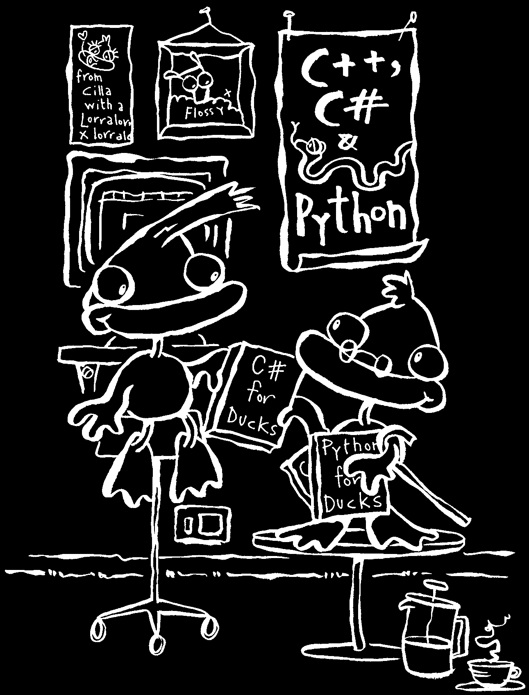

# 如何使用 Java 编程

## C, C#, 和 Python

你可能很快就会想转向另一种语言进行编程。你通过 Java 学到的原理应该让你很好地继续学习其他语言编程——显而易见的候选语言是另外两种面向对象的编程语言 C 和 C#。本节也指引你正确的方向，以获取更多关于通用语言的知识。特别是 Python，是一门有趣的新语言，非常值得一看。

### C

我们在书中提到了好几次 C，也考虑了 Java 和 C 之间的一些区别。主要区别在于，许多人认为 Java 更为“纯粹”，而 C 则更像是一个添加了面向对象特性的非面向对象语言 (C)。

拥有 Java 经验后，你应该能够识别出简单的 C 程序在做什么。大部分语法非常相似；Java 的设计者们显然见过 C，保持某些语法完全相同是有意义的。这里是 Java 中传统的第一个程序：

```cpp
// hello.cc
//
// 传统的第一个 C++ 程序。
//
```

```cpp
#include <iostream>
#include <string>
using namespace std;

int main () {
    string name;
    cout << "Enter your name: ";
    cin >> name;
    cout << "hello, " << name << endl;
    return 0;
}
```

C++ 的开发始于新泽西州贝尔实验室的 Bjarne Stroustrup。你可以在其发明者的主页上读到更多关于 C 的信息：

*http://www.att.com/~bs/*

K 和 R 的贡献不言而喻。K 和 R 在新泽西州贝尔实验室工作，它们的页面是：

*http://www.cs.bell-labs.com/~dmr/*

*http://www.cs.bell-labs.com/~bwk/*

相对于 C++，C 的开发始于 Brian Kernighan 和 Dennis Ritchie。你可以在这里找到 C 的历史：

*http://www.cs.bell-labs.com/kr/*

两种语言是不同的，但仍然有足够的例子可以证明这一点。用 C 编写的传统程序：

```cpp
// hello.cc
//
// 传统的第一个 C++ 程序。
//
```

```cpp
#include <iostream>
#include <string>
using namespace std;

int main () {
    string name;
    cout << "Enter your name: ";
    cin >> name;
    cout << "hello, " << name << endl;
    return 0;
}
```

### C#

你可能也听说过 C#（读作 C-sharp）。C# 与 C 和 Java 密切相关，值得提及。C# 是微软的专有产品；它是与 Microsoft . 相关的编程语言。与微软的其他编程语言一样，C# 是使用完整的 IDE 开发的（你可能见过或使用过 Access 或 Visual BASIC）。

C# 是非常有争议的话题。有人认为它只是微软试图与 Java 竞争；微软显然拥有一个专有操作系统，会对一种运行在许多系统上的语言感到担忧。有些人甚至更进一步，认为 C# 不仅仅是 Java 的拷贝。然而，其他人则认为 C# 和 Java 在大约同一时间的出现纯属巧合。许多人会支持其中的每一个观点。你可以自己做决定。微软官方网站包含了关于 C# 你需要知道的一切，以及关于在哪里购买的实用提示：

*http://msdn.microsoft.com/vcsharp/*

### Python

最后一种值得单独提及的语言是 Python。Python 和 Java 一样是一种平台无关语言，Python 的实现是免费的。你可以在 Python 网站上找到它的所有信息并下载副本：

*http://www.python.org/*

特别是这里的入门指南：

*http://www.python.org/doc/Newbies.html*

将帮助你学习一些 Python。这里有一本由 Jeff Elkner 等编写的优秀免费书籍，描述了你可能需要的所有 Python 内容，地址如下：

*http://www.ibiblio.org/obp/thinkCSpy/*

348

*使用 Java 编程*

以及由 Alan Gauld 提供的另一份同样优秀的免费教程：

http://www.freenetpages.co.uk/hp/alan.gauld/

Python 与 Java 和 C 的不同在于它是一门*脚本语言*。这意味着 Python 程序不是被编译的，而是在执行时被解释的。

Python 程序也可以通过交互式方式编写。

Python 是一门相当新的语言，但正在变得越来越流行。它一个特别吸引人的地方是，由于它是解释型的，因此特别适合在用另一种语言重写之前编写程序的快速原型。许多现代应用程序都使用了 Python，包括 Google 搜索引擎和几部电影。

Python 的历史在作者 Guido van Rossum 的主页上描述：

http://www.python.org/~guido/

## 其他语言

计算机编程语言是非常相当迷人的东西。尽管它们出现的时间很短，但已经发展出了一个复杂的家族树。如果你想了解更多关于它们的信息，一个很好的起点是 Éric Lévénez 优秀的编程语言页面：

http://www.levenez.com/lang/

同样迷人的是位于下处的精彩“99啤酒”页面：

http://99-bottles-of-beer.ls-la.net/

在那个页面，你可以找到用（截至 2003 年 12 月）598 种不同编程语言生成一首著名歌曲歌词的程序。去年就有 170 种新语言！


349

# 术语表

**accessor (访问器)** 一种可以检查*属性*值但不能修改它的*方法*。也称为*selector (选择器)*。

**algorithm (算法)** 执行某些任务的操作组（例如，*排序*）。可以使用特定的编程语言编写，也可以使用*伪代码*。

**Application Programming Interface (API，应用程序编程接口)** *公共方法*和*属性*的列表，为了*程序员*的利益说明了如何使用特定的*包*或语言。通常以海量文档的形式提供。

**argument (参数)** 参见 *parameter (形参)*。

**array (数组)** 一种存储固定数量相同*类型*值的结构。

**array list (数组列表)** 一种类似于*数组*的结构，可以容纳任意数量的某种*类型*的值。另见 *vector (向量)*。

**assignment operator (赋值运算符)** 在赋值语句中使用的运算符。不同于 `=`，后者是*comparison operator (比较运算符)*。

**assignment statement (赋值语句)** 将值赋给*变量*的语句。

**attribute (属性)** 与*对象类型*的特征相对应的值，该值在我们试图表示的现实世界问题中是感兴趣的。例如，“人”对象的“name”属性。

**backslash (反斜杠)** “\\”字符，在英国键盘上位于左 Shift 键和 Z 键之间。

**base class (基类)** *derived classes (派生类)* 继承*属性*和*方法*的类。

**beta testing (Beta 测试)** 在程序开发的后期阶段对*程序*进行测试，以发现只有通过“真实”使用才会显的*bugs (漏洞)*。

**black box testing (黑盒测试)** 一种测试形式，其中*程序*的实际*实现*是未知的。

**body (正文)** 方法内部语句的统称。

**Boolean expression (布尔表达式)** 一个可以被求值为真或假的*表达式*。

**Boolean operator (布尔运算符)** 用于创建或比较*布尔表达式*的*运算符*。

**Boolean value (布尔布尔值)** 一个可以被求值为真或假的值。

**boundary case (or boundary condition) (边界情况或边界条件)** 在测试中，一种*测试用例*，用于测试包含从接受到不可接受变化变化的值范围。

**braces (大括号)** 参见 *curly brackets (花括号)*。

**Bubblesort (泡排序)** 一种常用于教学的简单排序*算法*。

**bug (漏洞)** *程序*中未预期的或未记录的行为。通常是坏事，且几乎总是由*用户*发现。

**bytecode (字节码)** 由*编译器*从*源代码*生成并由*解释器*执行。Java 字节码位于具有 `.class`*扩展名*的文件中。

**call (调用)** 既是名词也是动词。参见 *method call (方法调用)*。

**calling method (调用方法)** 调用另一个*方法*的*方法*。

**calling program (调用程序)** 调用*方法*的*程序*。

**cast (类型转换)** 一种将值从一种*类型*（通常是*数值类型*）转换为另一种的方法。

**CLAS** 参见 *command line argument (命令行参数)*。

**class (类)** 另见 *object type (对象类型)*。

**.class file (.class 文件)** 另见 *bytecode (字节码)*。

**classpath (类路径)** Java 编译器和/或解释器搜索导入类或程序的包的位置列表。

**code (代码)** 另见 *source code (源代码)*。

**code reuse (代码复用)** 使用解决一个问题而开发的*代码*作为另一个解决方案一部分的能力。

**code walkthrough (代码走查)** 逐行或逐块地检查*程序**源代码*的过程，以便向他人解释其运行原理。

**command line argument (命令行参数)** 程序通过命令行运行时，作为输入提供的值。

**comment (注释)** 被编译器忽略的代码。

**compilation (编译)** 将*源代码*翻译成*可执行*形式的过程。

**compiler (编译器)** 执行编译的*程序*。

**concatenate (连接)** 将一个值标记在另一个值的末尾。

**condition (条件)** 一个为真为假的断言。

**conditional statement (条件语句)** 评估*条件*结果的*语句*。

**constant (常量)** 在程序生命周期内不会改变的实体。

**constructor (构造函数)** 用于实例化*对象*的特殊*方法*。

**control statement (控制语句)** 控制*程序*执行情况的*语句*。

**control variable (控制变量)** 用于控制语句的*变量*。

**curly brackets (or braces) (花括号)** 表示块开始和结束的符号 `}`。

**data hiding (数据隐藏)** 以这种方式编写*类*使得*程序员*不需要了解其实现。

**data type (数据类型)** 可以存储在*属性*或*变量*中的类型。

**debugger (调试器)** 用于调试的*程序*。

**debugging (调试)** 系统地发现和消除程序中*漏洞*的过程。

**declaration (声明)** 将*方法、常量*或*变量*引入*程序*的语句。

**decrement (递减)** 将*整数变量*的值减一。

**derived class (派生类)** 从*基类*继承*属性*和*方法*的类。

**determinate loop (确定性循环)** 执行预定义次数的控制*循环*。最终的迭代次数在第一次迭代时已知。

**directory (目录)** Unix 和 MSDOS 中相当于 MS Windows 系统中的*文件夹*。

**driver (驱动程序)** 特为测试*类*而编写的*程序*。

**dry run (模拟)** 用笔纸模拟*程序*的执行。

**editor (编辑器)** 用于创建和修改*源代码*的*程序*。

**element (元素)** *数组*或*向量*中的值，通过其*索引*访问。

**exception (异常)** Java 程序中意外的运行时错误。

**executable (可执行文件)** 计算机运行的*程序*版本。

**execution path (执行路径)** 程序生命周期内*语句*的执行顺序。

**expression (表达式)** *字面量*、*运算符*和*变量*的组合。

**extension (or file extension) (扩展名或文件扩展名)** 文件名末尾的部分（通常是最后一个点之后），某些*程序*和*操作系统*用于尝试确定文件格式。

**flag (标记)** 一种特殊的*命令行参数*，通常在 DOS 中用 `/` 表示，在 Unix 中用 `–` 表示。

**floating-point number (浮点数)** 包含小数数字。

**flow (of control) (控制流)** *程序*生命周期内*语句*的序列。受*控制语句*和*条件语句*的影响。

**folder (文件夹)** 分组在一个逻辑单元中的文件集。

**function (函数)** 实现某些结果的程序，通常对应于*方法*。

**hard copy (硬拷贝)** 打印在纸上的*源代码*。适用于测试目的和*代码**walkthroughs (代码走查)*。

**头部块（或历史块）** *注释* 位于*源代码*文件顶部的*注释*，包含关于谁在何时编写了该*类*或*程序*的信息，以及对*代码*所做的的任何重要更改，通常还有其用途的简短描述。

**高级编程** 使用诸如 Java 等语言进行*编程*，使用易于人类理解的高级语言。

**标识符** 用于唯一标识*程序*中某个*变量*的名称。

**递增** 将*整数变量*的值增加 1。

**缩进** 使用*空白字符*使*源代码*更容易供*程序员*阅读。

**不确定循环** 一种执行到给定*条件*满足为止的控制*循环*。在第一次迭代时，不一定能确定通过该*循环*的最终迭代次数。

**索引** 变量在*字符串、数组*或*向量*中的位置。

**无限循环** 一种退出*条件*永远无法满足的*循环*，因此会永远执行。这几乎总是*程序员*的错误。


**初始化列表** 用于初始化`数组`的值列表。

**实例化** 创建特定`类型`的`对象`或`变量`的过程。

**整数** 没有小数部分的数字。

**交互式（或集成）开发环境（IDE）** 一种结合了`编辑器`和`编译器`（通常还包括`调试器`）的软件，用于帮助快速开发`程序`。

**接口** `类`方法的规范，指明`程序员`可以如何在`程序`中使用该`类`。

**解释器** 读取`字节码`并指示计算机执行某些任务。

**迭代** 重复某个过程直到满足某些条件。例如，依次处理`数组`中的每个元素。

**jar 文件（或 jar 归档）** 一种包含`包`或一组包的文件，为了方便而封装在一起。

**`.java` 文件** 包含 Java`类`或`程序`源代码的文本文件。

**Java 开发工具包 (JDK)** 包含 Java`编译器`、`解释器`、`调试器`和其他各种工具的软件包，外还有许多预定义的`类`，通常还带有大量的`API`和教程文档。有时被称为`SDK（软件开发包）`。

**Java 虚拟机 (JVM)** 用于 Java 编程语言的`解释器`。

**库** 由其他`程序员`提供的`类`组，提供实用的功能。Java 中对应的术语是`包`。

**列表** 一种结构，例如`数组列表`，用于持有一组相关的对象。

**列表输出** 参见`硬拷贝`。

**字面量值** 用于`赋值`的简单值。例如，任何`字符串`值，或 1，或 3.142，或字符“c”。

**局部变量** 在`方法`内部创建的`变量`，其仅在该`方法`的生命周期内存在。

**循环** 重复执行的`语句`块。执行次数由`控制语句`控制。

**低级编程** 在机器级别进行编程，可能使用开关和杠杆。

**方法** 一段代码，对应我们试图表示的现实世界问题中的特定任务。例如，修改“人员”`对象`名称的代码。

**方法调用** 导致`方法`执行的`语句`。

**方法论** 执行任务的特定方式。在编程术语中，这可以是一种分析问题的方法，或一种测试`类`的方法。

**取模** 取余数运算符，表示为`%`。

**变异器** 用于更改`对象`属性值的`方法`。

**数值类型** 表示数学数量的原始`变量类型`。示例是`整数`和`浮点数`。

**对象** 代表`类`特定实例的实体，可以被`程序`操纵。

**面向对象编程** 一种编程风格，依赖对`对象`的描述来表示问题区域。

**对象类型** 指在问题区域内具有相同特征的对象组。

**操作系统 (OS)** 在`用户`和计算机之间提供接口的`程序`（或`程序`的集合）。常见例子有 Linux、MS Windows 和 Mac OS。

**运算符** 用于与`标识符`和`字面量`一起构建`表达式`的符号。例如，`/`、`*`、`+` 和 `-` 是数学运算符，而`!`、`&&`和`||`是`布尔运算符`。

**运算符优先级** 在计算或比较中处理`运算符`的顺序。

**序数类型** 一种`数据类型`，其可能的值可以列出。

**包** Java 中对应`库`的术语。

**参数** 由`调用方法`提供给`方法`的值。位于`方法调用`括号内。

**括号** 符号`(`和`)`。

**可移植性**`程序`的属性，可以复制到不同的计算机和`操作系统`之间，并在无需或极少修改的情况下`编译`并运行。

**优先级** 参见`运算符`。

**基本类型** 基本类型之一，如`int`、`char`、`double`、`boolean`。

**私有** 一种在`类`外部无法直接访问的`属性`。

**过程语言** 一种像 Java 一样指定过程的语言。

**程序** 一组共同执行某些任务的`语句`。

**程序员** 开发`程序`的熟练技人员。

**编程语言** 用于表示算法的语言。

**提示** 由`程序`显示的信息。

**原型** 对`算法`的一种表示，尚未编写。

**伪代码** 一种人类可读的代码描述。

**公有** 一种可以在`类`之外直接访问的`属性`。

**递归** 参见`递归`。

**引用** 指向`对象`的指针。

**返回** `方法`返回的值。

**返回类型** `方法`返回的值的数据类型。

**作用域** `变量`可访问的区域。

**选择器** 参见`存取器`。

**软件开发包 (SDK)** 参见`JDK`。

**软件工程师** 从事`软件`开发的熟练人员。

**软件工程** 创建可用软件的过程，包括编程、测试和文档编写。

**排序算法** 对一组值进行排序的算法。

**源代码** 对`程序员`和`编译器`都有意义的字符序列。

**语句** 执行某些任务的代码。

**静态** 类不需要`对象`的`方法`或`属性`。

**字符串** 表示字符序列的`数据类型`。

**风格**`程序员`布局`源代码`的方式。依赖`缩进`，且这种一致性非常重要。

**测试用例（或测试条件）** 一组输入值及其对应的输出值，作为`测试计划`的一部分用于评估程序的正确性。

**测试人员** 通常是`程序员`或其亲密同事，对`程序`应用`测试计划`的人。

**测试框架** 用于测试`类`实现的的程序。

**测试计划** 一组`测试用例`。

**事务** 在问题中发生并更改某些值的事情；通常对应于`方法`。

**真值表** 用于显示`布尔表达式`所有可能结果的可视化表示。

**类型** 参见`数据类型`。

**典型值** 一个`测试用例`，代表执行过程中由`用户`提供给`程序`的（通常是随机的）值。

**用户** 使用`程序员`编写的`程序`的人，并总是发现意想不到的方法来破坏它。

**变量** 在`程序`生命周期内可能会改变的值。

**变量声明** 创建变量的`语句`。包括变量的类型和`标识符`，以及可选的初始值。

**向量** 与`数组`类似，但在`程序`的生命周期内可以增长和缩小。

**void 方法** 不向其`调用方法`返回值的`方法`。

**白盒测试** 一种测试`程序`的过程，涉及检查其`源代码`。

**空白字符** 空格、制表符和换行符，用于使`源代码`更容易阅读。参见`缩进`。

## 索引

354

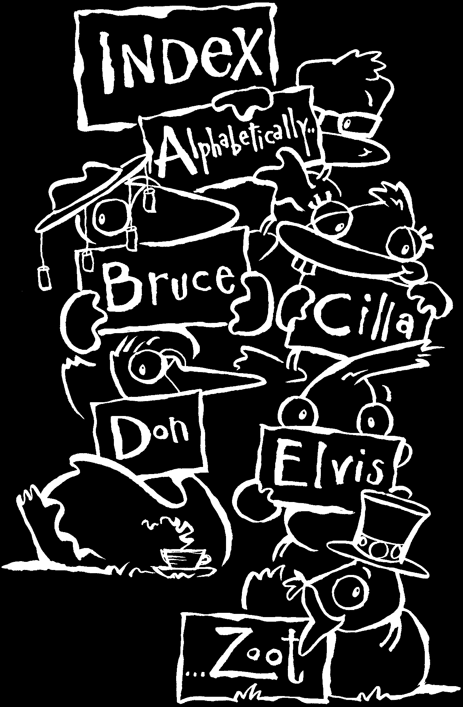

`//`（注释分隔符）

69, 80, 137

`/*` and `*/`（注释分隔符）

69, 80, 88, 137

`=`（赋值运算符）

89, 157, 330

混淆

183, 209–211

`!`（布尔“不等于”运算符）

183, 185, 195, 197

（布尔等价运算符）

183, 185, 187, 191, 192

（加法运算符）

94–95, 330

（自增运算符）

95, 330

（“加到”运算符）

96, 330

（字符串拼接运算符）

94–95

`–`（减法运算符）

94–95, 163, 330

`––`（自减运算符）

96, 330

`–`（“减去”运算符）

96, 330

`*`（乘法运算符）

94–95, 330

`*`（“乘以”运算符）

96, 330

`/`（除法运算符）

94–95, 194, 330

`/`（“除以”运算符）

96, 330

`%`（取模运算符）

97, 108

`()`（括号）

95, 100

`()`（类型转换）

96, 97

（大于运算符）

163, 183, 186

（小于运算符）

183, 186

（大于等于运算符）

183, 188

（小于等于运算符）

183, 188, 195

`!`（“bang”，布尔“非”运算符）

182

`&&`（布尔“与”运算符）

182, 186, 188

`||`（布尔“或”运算符”）

182, 187, 194

`.class` 文件

24, 25, 73, 155

`.java` 文件

22, 69, 136, 155

访问（方法）

141, 168, 169–171

冒险游戏

30

Algol

15

算法

14

分析

5, 53–62,

分析机

14

and（布尔运算符）

182

另见“`&&`”

API（应用程序编程接口）

33

Java 文档

243

追加

100

另见“`+`（字符串拼接运算符）”

参数

68, 102, 139, 156, 336

数组

8, 115, 237, 238–242, 250, 337

`.length` 属性

240

`ArrayIndexOutOfBoundsException`

239, 251

`ArrayList`（类）

237, 243–247, 273, 337

访问数组元素

246–247, 275–277, 278, 337

向数组添加元素

244, 253, 273, 278, 337

创建

243–244

从数组删除元素

245, 254, 274–275, 337

查找大小

244, 254

修改数组元素

245, 279–280

数组列表

见“`list`”

赋值（操作）

89, 92–93

另见“`=`”

属性

5, 40, 41, 43, 101, 136, 138

定义

140–141, 329

识别

57, 264–265

B（编程语言）

16

Babbage, Charles

14

基类

319

BASIC（编程语言）

15, 36, 94

BCPL（编程语言）

15

beta 测试

见“`testing, beta`”

BlueJ

33

布尔

201

表达式

182

值

42, 181, 201

`boolean`（类型）

90, 92, 181

边界值

见“`test, boundary value`”

大括号（`{` 和 `}` 字符）

68, 89

`break`（关键字）

188, 334

冒排序（排序算法）

249–251

`BufferedReader`（类）

313, 314, 318

关闭方法

314, 318

`readLine` 方法

314, 318

等宽字体是合法的 Java 术语，而斜体等宽字体不属于标准 API。索引

`BufferedWriter`（类）

313, 314

关闭方法

315, 317

`flush` 方法

315, 317

`write` 方法

315, 317

bug

14

字节码

24, 25

另见“.class 文件”

C（编程语言）

16, 36, 46, 89, 116

C（编程语言）

16, 40, 44, 89, 116

C#（编程语言）

40, 46

cake, chocolate

13

调用（方法）

154, 156–157

引用传递

223–225

按值传递

223–224

调用方法

102

调用程序

154

`case`（关键字）

187–188, 334

案例研究

262–293

类型转换

96, 246

`catch`（异常处理）

312, 317

`char`（类型）

90, 92, 189

字符

`class`

6, 41, 70–72, 136, 153–166

定义

69, 263–265

实现

136–151

测试

300–301

`classpath`

34

COBOL（编程语言）

15

代码重用

40, 51

集合

8, 237–260

方法调用中的参数

247–248

命令行参数（CLA）

113

注释

69, 80, 83, 88, 328–329

编译器

21, 23

编译

21, 23–26

条件

7, 179

条件语句

7, 179–201

`Console`（自定义类）

34, 118, 338–339

`readChar` 方法

214, 331

`readDouble` 方法

214, 331

`readInt` 方法

122, 161, 331

`readString` 方法

161, 274, 316, 331

常量

98, 108, 329

构造函数

71, 101, 142–143, 155–156, 169, 240

控制变量

205

Croft, Lara

30

数据隐藏

7, 154, 168–177

调试器

25

调试

130–131

声明

65

`default`（关键字）

188, 334

派类

319

设计，程序

5

差分

14

digestive, chocolate

2

`dir`（DOS 命令）

114

`do...while`（循环结构）

209, 217, 233, 258, 280, 283, 335–336

`double`（类型）

66, 90, 96

龙，喷火

30

驱动程序（测试）

255–257, 271–272, 300

干运行

303

元素（列表的）

238

`else`（条件语句）

163, 185–187, 194, 333

结束程序

190

实体

41

异常

311–312

可执行

23

`extends`（关键字）

320

`false`（布尔值）

181, 201

文件扩展名

22, 114

文件 I/O（输入输出）

313–319

`FileReader`（类）

314, 318

`FileWriter`（类）

314

`final`（关键字）

98, 194

浮点

42

控制流

211

`for` 循环

204–207, 212, 213, 244, 250, 277, 317, 334

FORTRAN（编程语言）

15

`get` 方法

见“访问”

获取帮助

34

黄金法则（编程）

77–82, 85

Gosling, James

16

图形用户界面（GUI）

322–324

头部块

70, 88, 137

Hopper, Grace

18

样式

IDE（集成开发环境）

23

标识符

89, 90, 91–92

`if`（条件语句）

163, 179, 184–187, 194, 332

`import`（关键字）

118, 121, 243

自增

94

缩进

79–82

继承

319–320

初始列表（数组）

241, 250

输入

6, 113–123

交互式

114, 117–119

命令行参数

113–117

实例

`int`（类型）

65, 90, 92, 96

整数

`Integer.parseInt`（工具方法）

120, 318

接口（类的）

7, 140, 154

`IOException`（类）

313, 317

jar 存档

34

`JOptionPane`（类）

323

`JVM`（Java 虚拟机）

16, 25

Kernighan, Brian

16

库，系统

21

LISP（编程语言）

15

列表

8, 89, 115, 237

字面量值

93

`Local Guide`

22, 33

`login`（Unix 程序）

114

循环

8, 203–220

确定

206

不确定的

207

Lovelace, Ada

14

`main` 方法

88, 102, 136, 332

方法

5, 40, 41, 51, 67–69, 101, 138–139, 222–235

另一个方法的参数

225–226

定义

141–142, 336

设计

59–60, 265

识别

57, 265

实现

143–144

`main`

见“`main` 方法”

方法论（分析与设计）

54

MIT（麻省理工学院）

15

`mutator`（方法）

98, 168, 169, 171

`not`（布尔运算符）

183

另见“`!`”

`null` 值

94

`null`（关键字）

323

`NumberFormatException`

311

对象

4, 40, 100–101, 136

声明

155–156

识别

54–57

面向对象

5, 40

编程

16, 46

对象类型

见“类型”

操作系统

13

运算符优先级

94–95

`or`（布尔运算符）

182

另见“`||`”

输出

99–100

方法重载

320–322

`package`（关键字）

25

参数

见“参数”

Pascal（编程语言）

17, 38

Plankalkul（编程语言）

15

可移植

15, 40

`PrintWriter`（类）

315

`private`（作用范围）

67, 101, 139, 154

程序

12

设计

60

程序员

12

编程基础

87–108

编程语言

2

编程语言

另见 Algol、B、BASIC、BCPL、C、C、C#、COBOL、FORTRAN、LISP、Pascal、Plankalkul、Python、Simula

`protected`（作用范围）

139

原型（方法的）

222–223

伪代码

59, 180, 274, 278

`public`（作用范围）

67, 68, 88, 139, 154

Python（编程语言）

17, 40

引号（‘ 和 ”）

90

递归

见“递归”

引用（内存）

191

引用参数

225, 229, 336

`return`（语句）

89

返回类型

44, 45, 139

返回值

44, 45, 157

代码重用

见“代码重用”

Richards, Martin

15

Ritchie, Dennis

16

作用范围

138

另见“`public`、`private`、`protected`”

选择器方法

见“访问”

分号

66, 77, 92

`set` 方法

见“`mutator`”

Simula（编程语言）

15

软件工程

125

排序

248–252

源代码

26, 88

另见“.java 文件”

`static`（关键字）

88, 222, 225, 226–227, 336–337

语句

65, 66, 87

字符串

42

比较


191

358

## 索引

`String`（类型）65、90、92、99、101

`equals` method 192、201

`equalsIgnoreCase` method 192

Stroustrup, Bjarne 16、46

`style`（编程）77–79

Sun Microsystems 16

`switch`（条件语句）179、187–190、258–259、279、283、316、334

系统分析师 53

`System.err`（标准错误流）280

`System.exit`（静态方法）190、201

`System.out.print`（静态方法）1、195、331

`System.out.println`（静态方法）99、331

测试用例 6、127、128

测试数据 127

测试构架 300

测试计划 6、125、127–129、295

边界值 129、133

典型值 129、132

测试 6、125–134、255–257、271–272、295–308

`beta` 131

黑盒 296–298

黑盒与白盒的比较 299

重要性 125、126、131–132

白盒 299

`throws`（异常处理）312

`true`（Boolean 值）181、201

真值表 182

`try` 块（异常处理）312、317

Turing, Alan 18

`type` 41、42、72、90、93、136、329

典型值 *见“测试计划，典型值”*

值参数 336

`vector`（数据结构）237

`void`（返回类型）44、67–68、89、139

`even` 变量 6、87、329

声明 89、90、94

初始化 94

`while`（循环结构）207–208、215、335

基本数据类型的包装类 246–247

Zuse, Konrad 15

## 文中已完整列出的类列表

- `ArrayDemo.java` 239–240
- `BirdCalculator.java` 105
- `Borrower.java` 146、172–173
- `BusConductor.java` 320
- `Calculator.java` 216–217
- `CLASign.java` 117
- `CLATest.java` 115–116
- `Coot.java` 162–163
- `CootComparator.java` 164
- `CricketingDucks.java` 148–150
- `CricketScheduler.java` 108、126–127、193–196
- `CricketScheduler2.java` 121–122
- `Duck.java` 71–72、80、144–145、159–160、173–174、231–232、268–271
- `DuckDatabase.java` 285–291
- `DuckTracker.java` 161–162
- `DuckTrafficControl.java` 232–233
- `First.java` 87–88
- `Hello.java` 99
- `InteractiveSign.java` 118–119
- `MangledDuck.java` 81
- `MoneyTracker.java` 106–107
- `Numbers.java` 320–321
- `Person.java` 319–320
- `PieShare.java` 305–306
- `ReadTest.java` 118
- `Sign.java` 101–103、323–324
- `Sign3.java` 196–198
- `TimesTable1.java` 120
- `WordStats.java` 302–303
