# HTML、CSS、Bootstrap、PHP、JavaScript 和 MySQL：创建动态网站所需知识

[`writeapp.io`](https://writeapp.io)

## 目录

- HTML、CSS、Bootstrap、PHP、JavaScript 和 MySQL
- 总结
- 引言
- 通用部分
- 网站与博客的区别
- 什么是域名和托管
- 如何使用 WordPress 在无需语言的情况下创建页面
- 如何使用 HTML 和 CSS 创建页面
- 动态网站与静态网站
- 响应式和 Bootstrap 网站
- 如何在互联网上使用 Bootstrap
- 下载 Bootstrap
- 创建或修改样式表并修改网站的视觉效果
- 什么是数据库以及它们的用途
- 使用 phpMyAdmin 创建和管理数据库
- 数据库管理
- 客户端和服务器端语言
- PHP
- JavaScript
- 创建网站的示例
- 创建项目
- 使用记事本
- 创建页面
- 更改页面布局
- 选择图片和颜色
- 免费和付费图片
- 专门为网站创建的图片
- 在 Windows 中使用 XAMPP 或 WAMP 本地管理网站
- 什么是 WAMP 及其工作原理
- 下载并安装 WAMP
- 使用 WAMP
- phpMyAdmin 和 MySQL
- 插入图片和新闻的登录与菜单
- 示例网站页面和脚本
- HTML 格式的网站页面
- 保存为 PHP 的 HTML 页面（因为包含 PHP 代码）
- 网站文件夹中的 PHP 文件
- 网站文件夹中的其他文件
- 更改网站样式
- 在 WAMP 上查看网站
- 网站发布
- 结论

# HTML、CSS、Bootstrap、PHP、JavaScript 和 MySQL

## 创建动态网站所需的所有知识

包含一个通过密码访问并插入图片的完整网站示例。

**作者：**

Olga Maria Stefania Cucaro

# 总结

- 引言 5
- 通用部分 6
- 网站与博客的区别 6
- 什么是域名和托管 6
- 如何使用 WordPress 在无需语言的情况下创建页面 7
- 使用 HTML 和 CSS 创建页面 7
- 动态网站与静态网站 21
- 响应式和 Bootstrap 网站 21
- 如何在互联网上使用 Bootstrap 22
- 下载 Bootstrap 22
- 创建或修改样式表并修改网站的视觉效果 28
- 什么是数据库以及它们的用途 47
- 使用 phpMyAdmin 创建和管理数据库 48
- 数据库管理 49
- 客户端和服务器端语言 49
- PHP 49
- JavaScript 50
- 创建网站的示例 50
- 创建项目 50
- 使用记事本 51
- 创建页面 52
- 更改页面布局 52
- 选择图片和颜色 53
- 免费和付费图片 53
- 专门为网站创建的图片 53
- 在 Windows 中使用 XAMPP 或 WAMP 本地管理网站 53
- 什么是 WAMP 及其工作原理 54
- 下载并安装 WAMP 54
- 使用 WAMP 54
- phpMyAdmin 和 MySQL 60
- 插入图片和新闻的登录与菜单 63
- 示例网站页面和脚本 70
- HTML 格式的网站页面 71
- 保存为 PHP 的 HTML 页面（因为包含 PHP 代码）98
- 网站文件夹中的 PHP 文件 162
- 网站文件夹中的其他文件 196
- 更改网站样式 197
- 在 WAMP 上查看网站 199
- 网站发布 207
- 结论 214

# 引言

本书旨在引导那些想要独立创建网站的人进入域名和网络编程的世界。作者将本作品视为一项纯教学性的研究，适用于所有想要学习客户端和服务器端编程的人。

首先，我们将解释网络上存在的各种域名，随后我们将解释 `CSS` 和 `HTML`，然后进入 `PHP` 编程（服务器端）和 `JavaScript`（客户端），以及通过 `phpMyAdmin` 创建数据库。

所有内容都将通过一个示例网站来解释，该网站使用了免费的 Bootstrap 以简化操作，并编写了一个连接数据库的登录控制面板，以便直接从网上上传图片到数据库中。显然，在进入了数据库和编程的世界后，你可以将这些知识应用于网站的任何需求。

本书的目的并不是创建如今可以通过 `WordPress` 或其他软件轻松完成的简单网页，而是为了纯粹的教育目的创建一个动态网站。总而言之，这项工作对于从零开始接触的人非常有帮助。

当我们想要将网页发布到网上时，我们必须请求托管（网络空间），这源于英文单词“to host”，意为“托管”。通常，我们选择的服务商会同时提供域名和免费或付费的托管服务。这取决于服务商所提供的条件。

在本书稍后解释的示例中，我们选择了来自 `Altervista` 的带有免费三级域名的托管服务。

显然，如果你是一个程序员并正在向客户出售网站，你将无法使用三级域名，而是将使用带有付费托管的二级域名，并在创建网站后将其转交给公司，或者由你每年进行管理。这将取决于与客户签订的合同。

与编程相关的一切方面一样，选择付费托管还是免费托管取决于你想要达到的最终结果。付费托管提供额外的服务以及与域名关联的各种电子邮件地址，此外，由于仅由公司或个人名称组成，它在 `Google search` 中搜索会变得更加方便。

# 如何使用 WordPress 在不了解语言的情况下创建页面

WordPress 仍然是一个极佳的选择，并且允许我们插入 `PHP` 代码。在这种情况下，我可以进入主题编辑器界面，并进入名为 `function.php` 的主题函数文件。这并不推荐，因为当主题更新时，所有的额外代码将会丢失。

相反，有一个可以插入 `PHP` 代码的插件，称为 `Code Snippets`。在安装并激活后，我将在主菜单中找到 `Snippets`，并可以使用一些现有文件或创建新文件。

# 如何使用 HTML 和 CSS 创建页面

当我们用 `HTML` 编写网站时，我们的电脑（`CLIENT`）会与另一台名为 `SERVER` 的计算机通信，该计算机向 `Client` 提供响应。


客户端向服务器发送请求，服务器通过解释 `HTML` 语言并查看网站来响应。

创建网页，你可以使用简单的文本编辑器、记事本，或者更高级的 `Notepad`，后者还可以高亮指令中的编写错误。

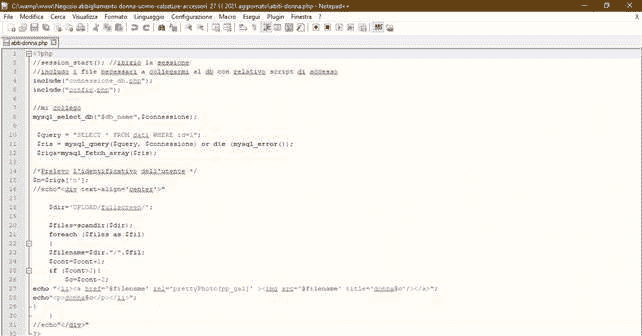

`HTML` 代表网站的结构，而 `CSS` 可以被视为网站的衣着（图形界面）。

`HTML` 是一种标记语言，而不是编程语言。事实上，浏览器翻译代码并允许我们查看网页。

标签（tags）对于赋予页面结构至关重要，随后这些会被浏览器翻译。

元素或标签示例：

```html
<h1> Page title </h1>
<h2> Paragraph title </h2>
<p> Page title </p>
```

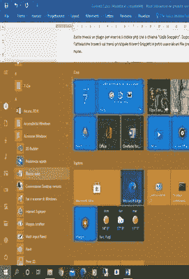

如果我们将这段代码复制到记稿纸并以 `HTML` 扩展名保存，我们将看到原始网站出现。

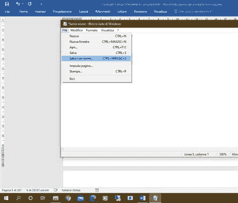

然后我们以 `HTML` 扩展名保存文件。将其命名为 `index.html`，因为这是浏览器识别为我们网站主页的名字。

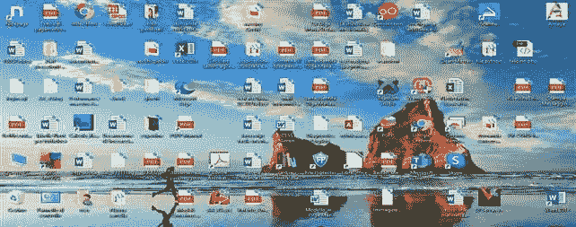

如果双击桌面上的该文件，它将在浏览器中显示：

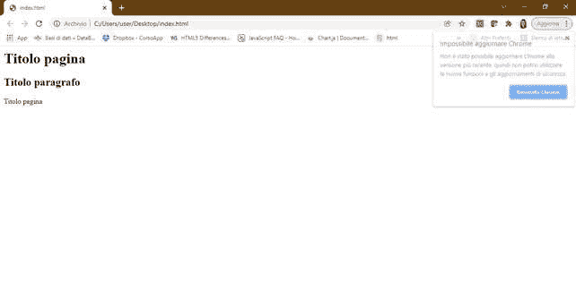

你可以看到浏览器识别了标签并按照我们的意格式化了文本。这是浏览器读取 `HTML` 页面的简单示例。

浏览器随后将标签翻译成网页的元素。

在 Chrome 中，如果我们输入：

`Ctrl + u` 将显示任何网页的 `HTML` 代码。

**Index.html：**

```html
<!DOCTYPE html>
<html>
<head>
<title>Sample Web Designer | Welcome</title>
</head>
<body>
<header>
<h1>Web Design Example</h1>
</header>
<nav>
<ul>
<li class="current"><a href="index.html">Home</a></li>
<li><a href="about.html">About</a></li>
<li><a href="services.html">Services</a></li>
</ul>
</nav>
<p>Body of the site</p>
<footer>
</body>
</html>
```

```html
<html>
<head>
<link rel="stylesheet" href="./style.css">
<title>示例网页设计师 | 欢迎</title>
</head>
<body>
<header>
<h1>网页设计示例</h1>
</header>
<nav>
<ul>
<li><a href="index.html">首页</a></li>
<li class="current"><a href="contacts.html">联系方式</a></li>
</ul>
</nav>
<p>您可以通过以下方式找到我们：xxxxxx n. xxx <br> 我们的电话是 xxxx</p>
<footer>
<p>示例网页设计者，版权所有 &copy; 2022</p>
</footer>
</body>
</html>
```

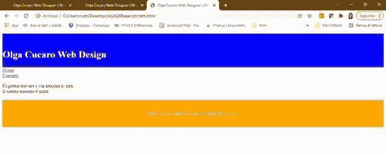

我们插入到文件夹中的所有 `HTML` 页面都将具有与 `style.css` 样式表中插入相同的格式。

另一种选择是使用在线上提供的其他资源来创建或编辑 `CSS` 样式表。

你可以用于此的一些在线工具，例如：

- [https://www.toptal.com/developers/css3maker/](https://www.toptal.com/developers/css3maker/)
- [https://css3generator.com/](https://css3generator.com/)
- [https://webcode.tools/generators/css/background-color](https://webcode.tools/generators/css/background-color)
- [https://css-generator.netlify.app/](https://css-generator.netlify.app/)

显然，除了 `CSS` 样式表之外，我们必须创建 `HTML` 文件来编写网站的内容。

在这方面，我们还可以使用 Amaya 软件，通过它我们可以同时创建 `CSS` 和 `HTML` 文件。

- [https://amaya.it.uptodown.com/windows](https://amaya.it.uptodown.com/windows)

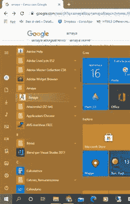

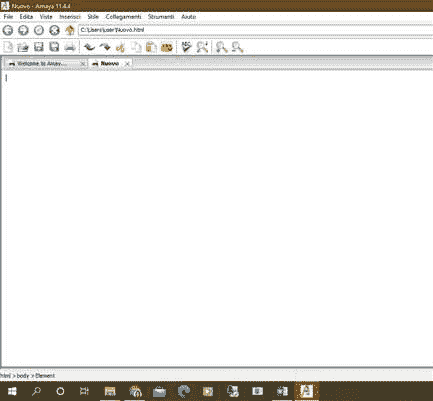

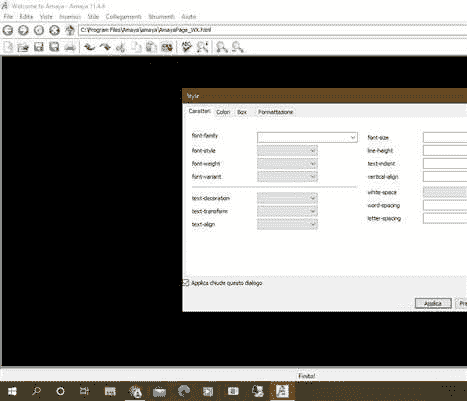


现在，创建一个可以在任何设备上运行并具有各种链接和页面的响应式网站可能非常复杂且耗费时间，因此从网上下载已经准备好的模型（如 Bootstrap）或直接从网上下载完整网站的示例是非常有用的，可以根据需要进行修改，并始终遵守用户可用的许可。

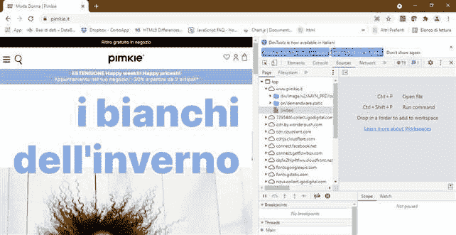

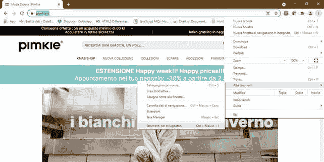

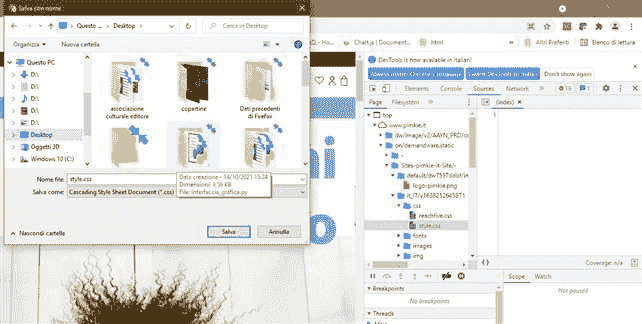

## 动态与静态网站

静态网站是过去几年中代表互联网大部分网站的站点。今天情况正在发生剧烈变化，静态网站的数量越来越少。

静态网站最容易创建，并提供一个在程序员通过代码进行更改之前保持不变的网站。动态网站更加复杂，要求在网站页面内进行客户端和服务器类型的分级编程。动态网站允许用户通过对底层数据库进行查询，并通过代码中存在的脚本与网站本身进行交互。

动态网站的示例包括：

- 具有实时产品选择的电子商务
- 社交网站

这些网站通过与用户的交互来实现持续更新。

## 响应式与 Bootstrap 网站

响应式意味着反应，在 IT 术语中意味着自适应。当一个网站可以在所有类型的设备上查看而不检测到任何显示问题，完美通过自动调整大小并以最佳方式排列其每个部分时，它就被识别为响应式的。

在过去，由于设备类型不多，网站只能为 PC 制作，我们根本没有考虑过响应式网站，但现在它已成为创建网站的基本要求。

首先，我们可以说使一个网站完全响应式是一项困难的工作。我们可以说，如果在样式表中使用百分比而不是像素，并在页面的 HTML 代码中插入：

```html
<meta name="viewport" content="width=device-width, initial-scale=1">
```

这将页面适配到设备的表面，但重要的是在样式表中以百分比进行考虑。

然而，考虑到制作响应式网站的固有困难，如果你不想浪费时间且不是 `CSS` 和 `HTML` 专家，最好使用互联网上的资源（正如我们在本书中所做的那样），以便我们专注于编程。资源可以是 Bootstrap 和 WordPress。

## 如何在互联网上使用 Bootstrap

## 下载 Bootstrap

在网上，我们可以找到付费的和免费的 Bootstrap，这取决于网站创建者的可用资源和其需求。

- [https://azmind.com/free-bootstrap-themes-templates/](https://azmind.com/free-bootstrap-themes-templates/)

从该网站，你可以下载满足个人需求的模板和主题，也就是说，可以实际应用以获得真实的网站。

- [https://getbootstrap.com/docs/3.4/customize/](https://getbootstrap.com/docs/3.4/customize/)
- [https://templatemo.com/tm-571-hexashop](https://templatemo.com/tm-571-hexashop)
- [https://www.free-css.com/free-css-templates/page273/interior-design](https://www.free-css.com/free-css-templates/page273/interior-design)
- [https://www.free-css.com/free-css-templates/page272/be](https://www.free-css.com/free-css-templates/page272/be)

首先，我们可以从上述强调的各种网站中选择一个你喜欢的主题。选择主题后，我们还需要根据给定的许可来进行。事实上，有个人和商业许可，你必须小心使用什么种类型的许可。对于我们从互联网下载并想重新用到项目中的任何东西，这是一个非常有用的提示。

- [https://azmind.com/free-bootstrap-business-template-gioia/](https://azmind.com/free-bootstrap-business-template-gioia/)

在网站上你会找到这段描述：

**免费 Joy 模板 - Bootstrap 商业主题**

更新于：2018 年 5 月 29 日，作者：Anli

今天的网页设计资源是一个名为 Gioia 的新免费 Bootstrap 模板，它是机构或你自己或你客户的作品集网站的完美商业主题。

Gioia 与 Andia 模板非常相似，它带有 5 个响应式页面：首页、作品集、服务、关于和联系我们。

它的某些功能包括：响应式图片幻播片、现代过滤作品集、AJAX 联系和邮件订阅表、Flickr 照片、字体图标、CSS3 动画、Google 地图等。

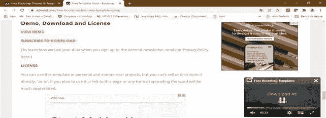

**许可：**

你可以在个人和商业项目中使用此模板，但你不能直接“按现状”销售或分发它。如果你计划使用它，提供此页面的链接或任何形式的宣传，我们将不胜感激。


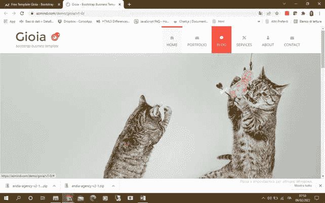

- [https://azmind.com/free-html-template-andia-responsive-agency-portfolio-template-twitter-bootstrap/](https://azmind.com/free-html-template-andia-responsive-agency-portfolio-template-twitter-bootstrap/)

在网站上你会找到这段描述：

**免费 HTML 模板 Andia：响应式机构 / 作品集 Bootstrap 主题**

今天的免费网页设计资源是一个巨大的！这是一个名为 Andia 的响应式机构/作品集 HTML 模板，使用 Bootstrap 构建。Andia 带有 7 个完全响应式的页面：首页、首页 2、作品集、服务、关于、联系我们、价格表，它是为小型企业或个人作品集创建网站的完美选择。

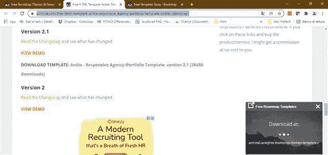

你可以在个人项目中使用此模板。你不能移除页脚版权链接。不支持实时支持。

**商业许可：**

你可以在你自己或你客户的商业项目中使用此模板。你可以移除页脚版权链接。支持是免费且快速的。

（目前不可用）

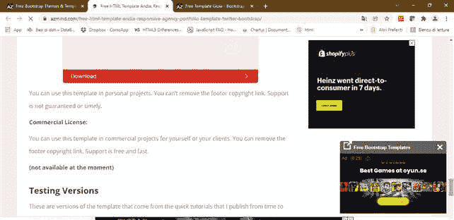


下载文件夹后，你将找到这些文件：

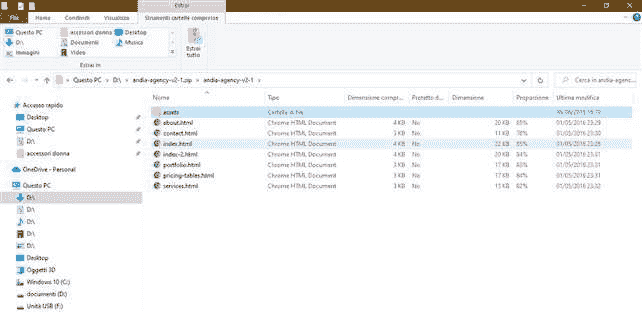

你也可以选择单页 Bootstrap 主题，这现在非常常见。

[免费单页业务 Bootstrap 主题](https://azmind.com/riona-free-one-page-business-bootstrap-theme/)

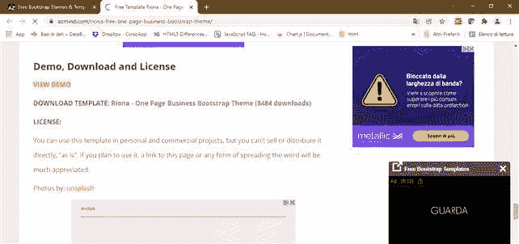

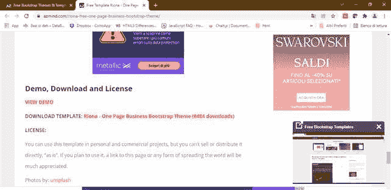

我解压下载的文件夹并修改其内容，以获得我想象中的网站。


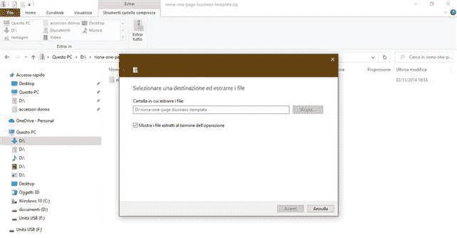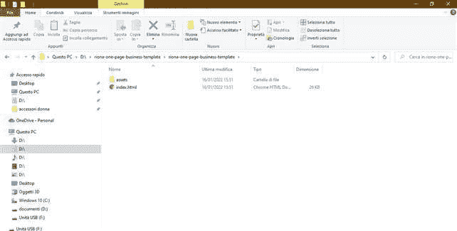

## 创建或修改样式表，从而修改网站的图形

如果许可允许，我可以使用桌面和移动端的各种应用程序来更改页面和 CSS，包括：

### `Nicepage`

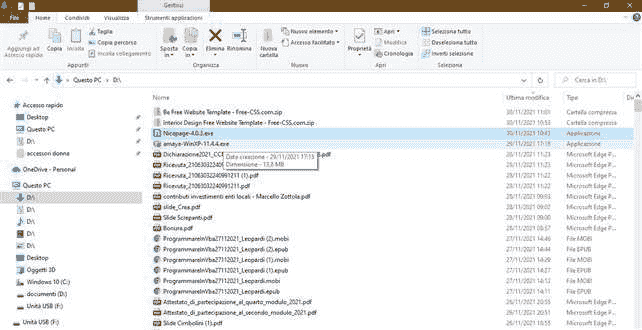

使用 Nicepage 编辑 HTML 页面和 CSS

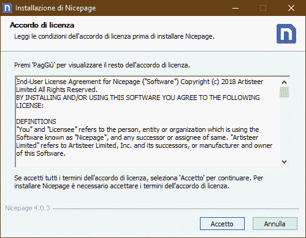

开始使用该软件的教程

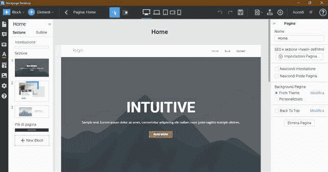

它非常适合快速更改页面。

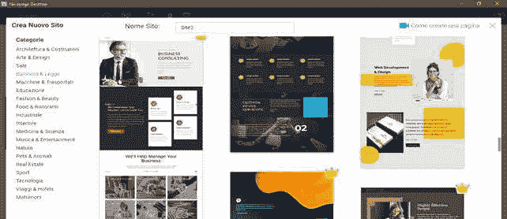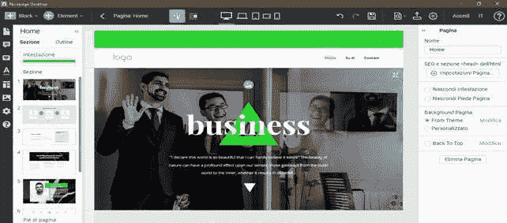

如果你点击图片，可以将其切换为免费图片的自动搜索。

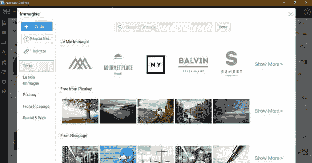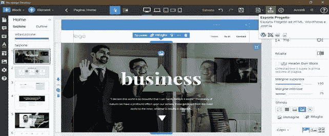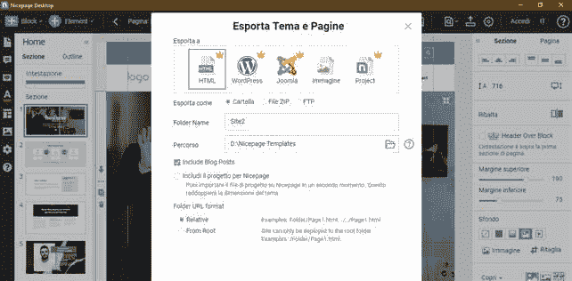

在移动端我们可以使用：

### `TrebEdit`

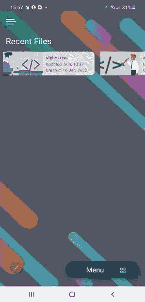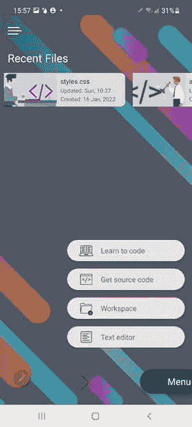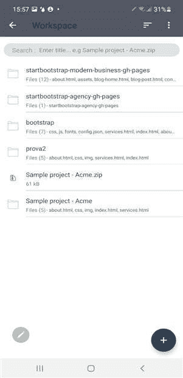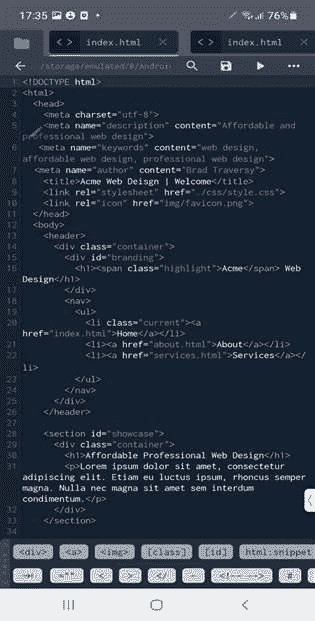

由于是响应式的，网站将适应所有设备，因此它在 PC 上的显示如下：

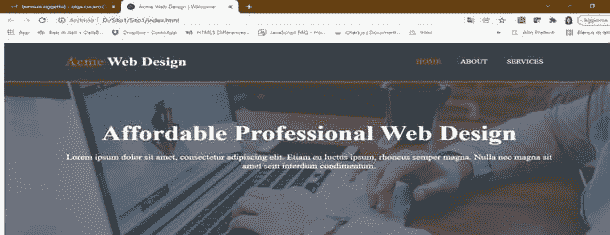

该应用已经包含了一个带有三个页面的响应式网站示例，你可以轻松编辑。

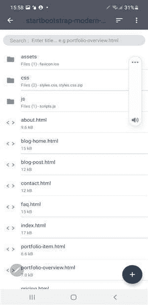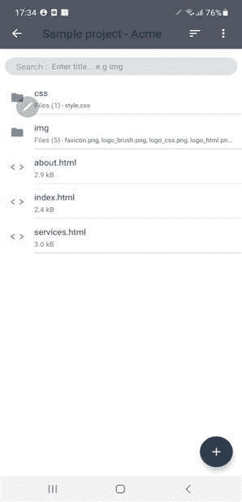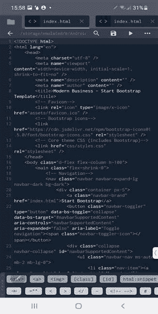

要从代码查看页面，你需要点击右上角的播放箭头。

通过在应用程序示例中更改`style.css`文件中的一些背景颜色和字体颜色、更改初始图像、更改某些标签的大小并添加一个框，然后在样式表中调整框的大小以适应四个框而不是原本是三个框），我们得到了一个完全不同的索引文件：


该应用程序非常易用，侧边菜单中提供了选择颜色的功能，并自动将后者的代码插入样式表。

由于是响应式的，网站将适应所有设备，因此它在 PC 上的显示如下：

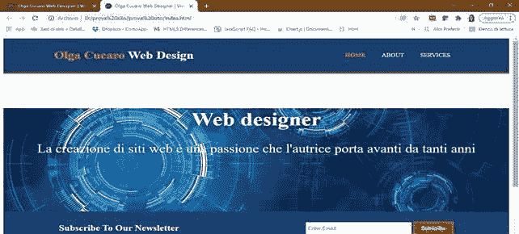

### `Index.html`

```html
<! DOCTYPE html>
<html>
<head>
<meta charset = "utf-8">
<meta name = "description" content = "Affordable and professional web design">
<meta name = "keywords" content = "web design, affordable web design, professional web design">
<meta name="author" content = "Brad Traversy">
<title> Sample Designer | Welcome </title>
<link rel="stylesheet" href "./style.css">
<link rel="icon" href "./favicon.png">
</head>
<body>
<header>
<div class="container">
<div id="branding">
<h1><span class="highlight"> Example </span> Web Design </h1>
</div>
<nav>
<ul>
<li class="current"> <a href="index.html"> Home </a></li>
<li> <a href="about.html"> About </a></li>
<li> <a href="services.html"> Services </a></li>
</ul>
</nav>
</div>
</header>
<section id="showcase">
<h1><span> Web designer </span></h1>
<p> Creating websites is a passion that the author has been pursuing for many years </p>
</section>
<section id="newsletter">
<div class="container">
<h1>Subscribe Our Newsletter </h1>
<form>
<input type="email" placeholder="Enter Email ...">
<button type="submit" class="button_1"> Subscribe </button>
</form>
</div>
</section>
<section id="boxes">
<div class="container">
<div class="box">

<h3>HTML Markup</h3>
<p> Writing pages in html is easier than think </p>
</div>
<div class="box">

<h3>CSS Styling</h3>
<p> Creating an attractive style sheet is crucial for the success of a website </p>
</div>
<div class="box">

<h3>Graphic Design</h3>
<p> The graphics of a site can determine the success of the site </p>
</div>
<div class="box">

<h3>Programmer</h3>
<p> Client-side and server-side programming can make your site dynamic </p>
</div>
</div>
</section>
<footer>
<p> Exampleisner, Copyright ©2022 </p>
</footer>
</body>
</html>
```


### `Style.css`

```css
background {
font: 15px /1.5 Arial, sans-serif;
padding: 0;
margin: 0;
background-color: #ff5dc;
}
/* Global */
.container{
width: 80%;
margin: auto;
overflow: hidden;
}
ul {
margin: 0;
padding: 0;
}
.button_1 {
height: 38px;
background: #fff2a;
border: 0;
padding-left: 20px;
padding-right: 20px;
color: #ffffff;
}
.dark {
padding: 15px;
background: #5f2420;
color: #ffffff;
margin-top: 10px;
margin-bottom: 10px;
}
/* Header */
header {
background: #1c3d6e;
color: #ffffff;
padding-top: 30px;
min-height: 70px;
border-bottom: #e8491d 3px solid;
}
header to {
color: #ffffff;
text-decoration: none;
text-transform: uppercase;
font-size: 16px;
}
header li {
float: left;
display: inline;
padding: 0 20px 0 20px;
}
header #branding {
float: left;
}
header #branding h1 {
margin: 0;
}
header nav {
float: right;
margin-top: 10px;
}
header .highlight, header .current a {
color: #ff6940;
font-weight: bold;
}
header a: hover {
color: #cccccc;
font-weight: bold;
}
/* Showcase */
#showcase {
min-height: 300px;
background: url('../img / showcase.jpg') no-repeat;
background-position: center;
background-size: cover;
text-align: center;
color: #ffffff;
}
#showcase h1 {
margin-top: 100px;
font-size: 55px;
margin-bottom: 10px;
}
#showcase p {
font-size: 35px;
}
/* Newsletter */
#newsletter {
padding: 15px;
color: #ffffff;
background: #1b456d
}
#newsletter h1 {
float: left;
}
#newsletter form {
float: right;
margin-top: 15px;
}
#newsletter input [type = "email"] {
padding: 4px;
height: 25px;
width: 250px;
}
/* Boxes */
#boxes {
margin-top: 20px;
}
#boxes .box {
float: left;
text-align: center;
width: 22%;
padding: 10px;
}
#boxes .img {
width: 70px;
}
/* Sidebar */
aside # sidebar {
float: right;
width: 30%;
margin-top: 10px;
}
aside # sidebar .quote input, aside # sidebar .quote textarea {
width: 90%;
padding: 5px;
}
/* Main-col */
article # main-col {
float: left;
width: 65%;
}
/* Services */
ul # services li {
list-style: none;
padding: 20px;
border: #cccccc solid 1px;
margin-bottom: 5px;
background: #e6ee6;
}
footer {
padding: 20px;
margin-top: 20px;
color: #ffffff;
background-color: #ff6940;
text-align: center;
}
/* Media Queries */
@media (max-width: 768px) {
header #branding,
header nav,
header nav there,
#newsletter h1,
#newsletter form,
#boxes .box,
article # main-col,
aside # sidebar {
float: none;
text-align: center;
width: 100%;
}
header {
padding-bottom: 20px;
}
#showcase h1 {
margin-top: 40px;
}
#newsletter button, .quote button {
display: block;
width: 100%;
}
#newsletter form input [type = "email"], .quote input, .quote textarea {
width: 100%;
margin-bottom: 5px;
}
}
```

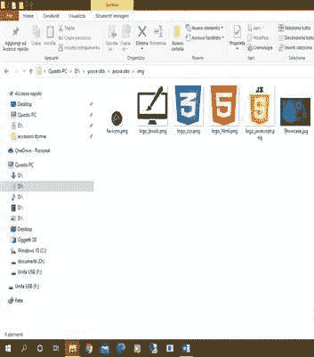

你也可以上传从网上下载的文件夹并随心所欲修改。通过少量练习，你可以直接修改 CSS 样式表，特别是`css`文件夹中的`.css`文件，它改变的是网站的视觉效果而不是内容。然而，要更改页面内容，我们必须修改单个 HTML 表格。通过点击播放箭头，我们可以在 App 内置的 Web 模拟器上查看结果。


## 什么是数据库以及它们有什么用

什么是数据库？每当我们想要存储需要进行操作的数据时，我们一定会有一个数据库。数据库就像是容器，里面盛装了我们想要存储的数据。数据库不仅用于网页，还用于用各种编程语言（Visual Basic、C、Python、Java、JavaScript 等）创建的各种应用程序。

数据库分为关系型和非关系型。在大多数情况下，使用的是关系型数据库，正如你从术语中理解的那样，它是基于关系的，特别是通过表与表之间的一对一、一对多、多对多关系连接的型表。

现有的关系类型：

表通过键（可以是主键或外键）连接在一起。

我提醒你，主键必须是唯一的，并且标识我们所考虑的实体的实例。

我提醒你，一个表的主键可以成为另一个表的外键，第一个表与该表存在关系。

要创建一个数据库，我们首先从包含我们需要所有数据的单表开始，稍后我们将删除各种表中重复的字段，这些字段在数据库中不应重复，因为它们可以通过简单的数据库查询检索到。

具有关系表（通过主键和外键链接）的关系型数据库的一个例子可以是员工工资或产品仓库，以及其他通过某些被标识为“键”的字段连接在一起的数据结构。例如，员工主数据表可以通过员工代码链接到工资单表，或者产品表可以链接到发票表和客户表等。

在本项目中，数据库将仅用于在我们网站上插入我们选择的图片以及在主页插入新闻，因此它们将由只有主键的非关系表组成。特别是我们将会有三个表：一个用于图片和包含在主页（`index.php`）中的新闻文本，一个用于服装，一个用于登录。在图片表中，我们将只有主键作为自动 ID，并将`n`作为插入的图片数量；而在新闻表中，我们将同时拥有带有变量`n`的图片及其相关的文本。在最后一个登录表中，我们有用户名和加密后的密码。

## 使用 phpMyAdmin 创建和管理数据库

可以使用各种软件创建数据库，包括 Office Application Access 或其他各种软件。可以在数据库上插入、选择、修改和删除数据。查询关系型数据库的语言是`SQL`。

为了管理数据库，我们可以从网上下载`MySql`或下载包含`MySql`的包，例如用于网页的`WAMP`或`XAMPP`，我们稍后会详细解释。现在我们指定这两个应用程序都包含了`phpMyAdmin`。

在我们的情况下，它们将用于使我们的示例网站变为动态，根据与用户的交互更改数据，在这方面，我们将使用`phpMyAdmin`。

*我提醒你，数据库也可以用于 WordPress。*

## 数据库管理

在这项工作中，我们不必解决所有关于数据库疑问的结，但我们打算对该主题进行简要介绍，这对于示例示例非常有用。

要管理数据库，我们必须使用`MySql`语言。查询是向数据库提出的请求，带有子句。

通过`SELECT`子句，你选择数据库中选定表的记录：

```
query = "SELECT * FROM data WHERE id = 1";
```

在这种情况下，我们将选择所有列，因为我们输入了`*`。

`DELETE`子句删除选定的记录：

```
query = "DELETE FROM data_news WHERE id2 = '$ i'";
```

`UPDATE`子句用我们想要插入的数据更新记录：

```
query = "UPDATE data_news set id2 = '$ o' WHERE id = $ id";
```

所有这些子句都将包含在数据库的管理中。

## 客户端语言和服务端语言


编写网页时，你需要同时使用服务器端和客户端语言。如果程序员没有预见到对连接到服务器自身数据库的请求，那么客户端语言就足够了，因此在网站（`html` 和 `javascript`）的情况下是如此。另一方面，如果网站提供了对服务器端数据库的访问，因此网络上的所有客户端都可以访问，那么它必须用服务端语言（如 `PHP`）编写。例如使用 CMS 创建动态网站或通过选择在线产品创建电子商务网站。

## PHP

`Php` 是一种诞生于 1994 年的服务端编程语言，用于创建动态网页。它随着 WordPress 管理的用 `PHP` 创建的 CMS 遍布全球。`PHP` 解释器免费分发。

`Php` 是最著名的服务端语言，用于与外部服务器通信。

`php` 代码可以直接插入 HTML，也可以单独保存为 `.php` 扩展名，但始终标识为：

```

```

`.php` 文件必须包含在 HTML 页面中：

```
include ("view-home");
```

## JavaScript

`JavaScript` 是一种用于事件页的客户端编程语言。通过 `JavaScript` 用户可以与网站交互并将网站变为动态。`JavaScript` 的示例是用户选择的键。一个带有语言的翻译器可能是 `JavaScript` 程序。

`JavaScript` 从上到下读取，因此它必须插入代码的特定部分。它是解释型代码的一种，与编译代码不同，编译器将编程语言翻译成机器语言。

尽管 `JavaScript` 成为客户端语言已有多年，但现在有了 `NodeJS` 将 `JavaScript` 转换为服务端语言。这无疑将是本书的话题。

`JavaScript` 代码可以嵌入 HTML 网页中，也可以插入单独的 `js` 文件并仅从 HTML 页面调用。

它可以插入页面的 `body` 中：

```html
<script type="text/javascript" src="js/search.js"></script>
```

它可以插入页面的特定部分，例如在 bootstrap 中：

```html
<! - Javascript ->
<script src="js/jquery-1.1.1.min.js"></script>
<script src="bootstrap/js/bootstrap.min.js"></script>
<script src="js/bootstrap-hover-dropdown.min.js"></script>
<script src="js/wow.min.js"></script>
<script src="js/retina-1.1.0.min.js"></script>
<script src="js/jquery.magnific-popup.min.js"></script>
<script src="flexslider/jquery.flexslider-min.js"></script>
<script src="js/jflickrfeed.min.js"></script>
<script src="js/masonry.pkgd.min.js"></script>
<script src="http://maps.google.com/maps/api/js?sensor=true"></script>
<script src="js/jquery.ui.map.min.js"></script>
<script src="js/scripts.js"></script>
```

我提醒你，为了被识别为 JavaScript 代码，你必须插入 `<script> </script>` 标签。

# 创建项目

我们的示例网站涉及一家拥有三家门店的服装店，用于在其中插入各个商店展示的系列照片。该示例并非电子商务网站，仅需展示系列集合的照片。

我们在本示例中的目标将是通过 `phpMysql`、`php` 和 `javascript` 实现通过加密密码访问，直接从网站中插入图像。

首先，我们需要确定网站必须由多少个页面组成，以及这些页面应该是哪些（首页、关于我们、服务或产品以及联系我们）。我们也可以决定创建一个单页滚动页面（单页网站）或多个拆分页面。考虑到如今用户在社交网络上不断滚动的习惯，也许创建一个“单页”网站会更好。如果之后我们想引导用户执行特定操作，我们将创建一个着陆页（landing page），这些页面例如是为特定营销活动导向的页面。

在我们的示例中，我们决定创建四个主页面，并可以通过主菜单直接访问，同时增加两个针对两个系列（男装和女装）的页面，以及三个通过主导航栏子菜单访问的商店页面。

在此阶段，我们既可以写出各个页面必须具备的主要特征，又可以在纸上画出页面本身的图形设计。你还可以创建页面图形的视觉模型（模板），以理解在项目中需要修改的内容。

## 使用记事本

我们已经提到，所有用于 Web 的 `html`、`javascript` 和 `php` 文件都可以用简单的记事本轻松地编写，重要的是用特定的扩展名（`.html`、`.php` 等）保存文件。显然，在这种情况下，我们必须非常熟悉我们想要使用的语言，否则文件将无法运行。为了解决这个问题，我们可以使用记事本，与简单的记事本不同，它会在我们编写该语言的单词时提供建议，以避免代码编写错误。


## 创建页面

在项目的这一阶段，我们可以选择独立使用 `html` 创建页面，或使用互联网上的各种资源，例如已经创建的 Bootstrap，我们需要根据自己的需求对其进行修改。

我们之前已经解释了创建一个符合当今市场特定需求（如动态和响应式网站）的 `CSS` 所需的困难和时间。这就是为什么在旨在教学、特别是创建一个用于插入图像的动态菜单的工作中，我们决定使用互联网上已经免费提供的资源。

正如我们稍后在页面创建的第一阶段将看到的，我们将用 `html` 代码编写所有主页面，并随着工作的进行，我们将意识到在 `javascript` 和 `php` 语言方面深入哪些用处，然后将某些页面保存为 `php`，因为它们包含 `php` 代码。

## 修改页面布局

在创建主页面之后，我们致力于将页面适应我们想要创建的网站的需求。在此阶段，我们必须理解网站将要做，它将如何与用户交互，以及我们想要输入并给用户的信息，通过在静态显示的内容与用户动态选择的内容之间进行筛选。

在此阶段，我们明确了网站将要做，它将如何与用户交互，以及我们想要输入并给用户的信息，通过在静态显示的内容与用户动态选择的内容之间进行筛选。

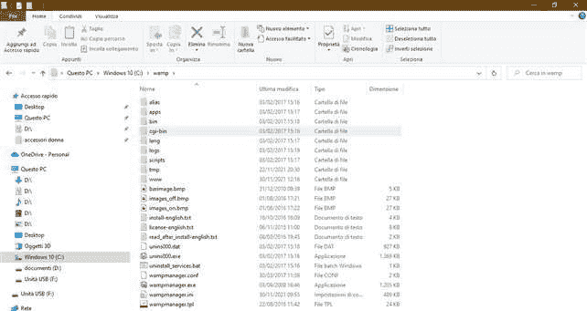

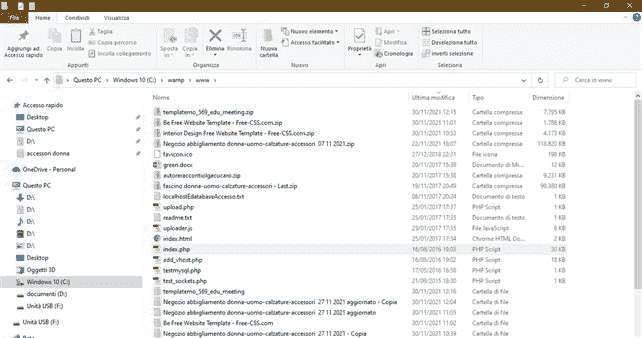


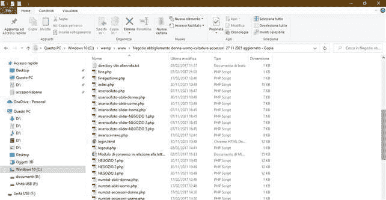

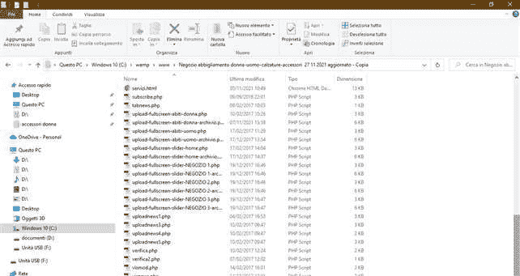

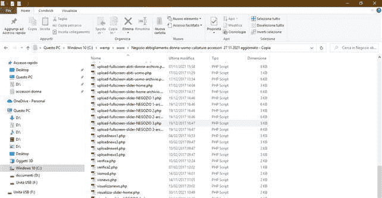

要进入 WAMP 菜单，请点击 `wamp` 文件夹中的 `wampmanager.exe` 或者点击桌面上的 `W` 图标。

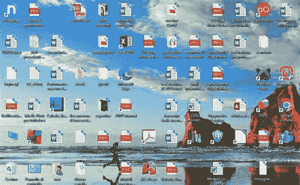

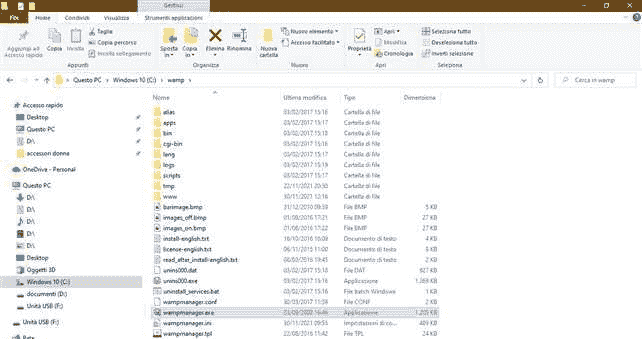


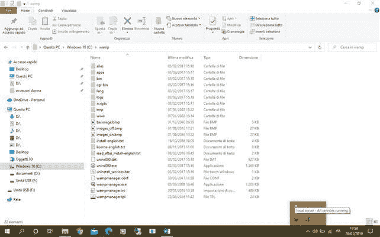

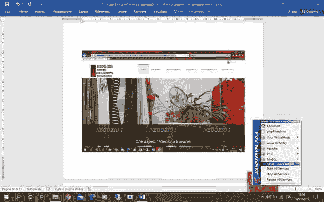

我提醒你，也可以通过复制 `wamp` 文件夹下 `www` 文件夹中的 `wordpress` 文件夹来配合 WAMP 使用 WordPress。在 `phpMyAdmin` 中创建数据库后，直接进行安装，我们将在 WordPress 配置中插入该数据库。

## phpMyAdmin 和 MySQL

使用数据库并不简单。首先，我们必须选择直接在 Web 上创建站点，还是在本地 Web 模拟器上进行测试然后迁移到 Web。然而，即使我们决定在 PC 上测试站点，我们仍然需要在购买或免费获取的托管主机上创建相同的数据库。每个带有网站链接的托管主机都将包含如 `phpMyAdmin` 这样的数据库管理软件。

我提醒你，数据库数据将重新输入到与网站地址关联的软件中，而 `php` 中的页面和各种文件可以直接从托管主机上传。

我们项目的数据库结构如下：

- 数据表（Data table）；
- 新闻数据表（Data_news table）；
- 登录表（Login table）。

第一表包含用于上传系列图片和轮播图的数据。第二表包含上传新闻的有用数据，第三表包含登录的有用数据（用户名和密码）。

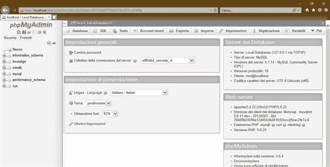

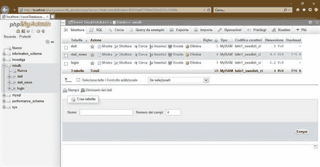


在字段中：

- `n` 将保存女装系列的图片数量；
- `n2` 将是男装系列的图片数量；
- `N3` 将是首页、shop 1、shop 2 和 shop 3 页面的轮播图数量。


在此表中，我们将有一个新闻字段，包含所有插入我们网站首页的新闻，我们可以删除和修改它们，也可以通过控制面板插入新新闻。


我提醒你，为了更高的安全，我们以 `SHA1` 代码的形式输入了密码。

特别是，我们访问网站对密码进行加密和解密：

`https://www.online-toolz.com/tools/sha1-generator.php`

我们选择了 `SHA1` 代码并将此代码复制到数据库中。随后，建议将原始密码保存在数据文件中，你在访问数据库时会需要它。

我提醒你，访问登录时你将输入原始用户名和密码，我们的 `php` 代码将对其进行加密，并与数据库中输入的 `SHA1` 代码进行比对。

## 登录以及插入图片和新闻的菜单

我们将从网站页面顶部的登录页访问控制面板，该页面通过小人图标和“Login（登录）”字样识别。


```html
<!DOCTYPE html>
<html lang="en">
<head>
<meta http-equiv="Content-Type" charset="utf-8">
<meta http-equiv="X-Compatible" content="IE=edge">
<meta name="viewport" content="width=device-width, initial-scale=1">
<meta name="description" content="SHOP 1 - WOMEN'S CLOTHES">
<meta name="keywords" content="suits, dresses, man, woman, elegant, comfortable, sweaters, trousers, shirts, belts, shoes">
<meta name="copyright" content="Example">
<title>STORE 1 - MEN'S / WOMEN'S SUITS</title>

<!-- CSS -->
<link href="css/reset.css" rel="stylesheet" type="text/css" media="screen" />
<link rel="stylesheet" href="https://fonts.googleapis.com/css?family=Open+Sans:italic,400">
<link rel="stylesheet" href="https://fonts.googleapis.com/css?family=Montserrat:700,400">
<link rel="stylesheet" href="bootstrap/css/bootstrap.min.css">
<link rel="stylesheet" href="elegant-font/code/style.css">
<link rel="stylesheet" href="css/animate.css">
<link rel="stylesheet" href="css/magnific-popup.css">
<link rel="stylesheet" href="flexslider/flexslider.css">
<link rel="stylesheet" href="css/form-elements.css">
<link rel="stylesheet" href="css/style.css">
<link rel="stylesheet" href="css/media-queries.css">

<!-- Favicon and touch icons -->
<link rel="shortcut icon" href="ico/favicon.png">
<link rel="apple-touch-icon-precomposed" sizes="144x144" href="ico/apple-touch-icon-144-precomposed.png">
<link rel="apple-touch-icon-precomposed" sizes="114x114" href="ico/apple-touch-icon-114-precomposed.png">
<link rel="apple-touch-icon-precomposed" sizes="72x72" href="ico/apple-touch-icon-72-precomposed.png">
<link rel="apple-touch-icon-precomposed" href="ico/apple-touch-icon-57-precomposed.png">
```


```html
<script type="text / javascript" src="js / search.js"></script>
</head>
<body>
  <div id="first-line" class="visible-desktop">
    <div id="top-line" class="container">
      <div class="pull-right login">
        <a href="login.html" class="login-lnk"> 登录</a>
      </div>
    </div>
  </header>
  <!-- 顶部菜单 -->
  <nav class="navbar" role="navigation">
    <div class="container">
      <div class="navbar-header">
        <button type="button" class="navbar-toggle collapsed" data-toggle="collapse" data-target="# top-navbar-1">
          <span class="sr-only"> 切换 </span>
          <span class="icon-bar"></span>
          <span class="icon-bar"></span>
          <span class="icon-bar"></span>
        </button>
        <a class="navbar-brand" href="index.php"></a>
      </div>
      <!-- 收集导航链接、表单和其他内容用于切换 -->
      <div class="collapse navbar-collapse" id="top-navbar-1">
        <ul class="nav navbar-nav navbar-right">
          <li><a href='index.php'> 首页</a></li>
          <li class="active"><a href='#'> 关于我们</a></li>
          <li><a href='servizi.html'> 我们的服务</a></li>
          <li class="dropdown">
            <a href="#" class="dropdown-toggle" data-toggle="dropdown"> 画廊 <b class="caret"></b></a>
            <ul class="dropdown-menu">
              <li><a href='collezione_woman.php'> 女装系列</a></li>
              <li><a href='men's_collection.php'> 男装系列</a></li>
            </ul>
          </li>
          <li class="dropdown">
            <a href="#" class="dropdown-toggle" data-toggle="dropdown"><b class="caret"></b> 销售门店</a></li>
            <ul class="dropdown-menu">
              <li><a href='STORE 1.php'> 门店 1</a></li>
              <li><a href='STORE 3.php'> 门店 3</a></li>
              <li><a href='STORE 2.php'> 门店 2</a></li>
            </ul>
          </li>
          <li><a href='contatti.html'> 联系我们</a></li>
        </ul>
      </div>
    </div>
  </nav>
  <div id="google_translate_element"></div>
  <script type="text / javascript">
    function googleTranslateElementInit() {
      new google.translate.TranslateElement({pageLanguage: 'it', layout: google.translate.TranslateElement.InlineLayout.SIMPLE}, 'google_translate_element');
    }
  </script>
  <script type="text / javascript" src="// translate.google.com/translate_a/element.js?cb=googleTranslateElementInit"></script>
  <div class="wrap-clear"></div>
  <div class="container">
    <div></div>
    <br>
    <br>
    <div class="testimonial-image wow fadeInUp">
      <div class="">
        <div class='row'>
          <h6>
            <div class='col-sm-4'>门店 1</div>
            <div class='col-sm-4'>门店 3</div>
            <div class='col-sm-4'>门店 2</div>
            <div class='col-sm-4'></div>
            <div class='col-sm-4'></div>
            <div class='row'>
              <br>
            </div>
          </h6>
        </div>
      </div>
    </div>
    <br>
    <div class="testimonial-image wow fadeInUp">
      <h4> 男装 - 女装 <br>宴礼服 <br>大码 <br>配饰与鞋履 <br></h4>
    </div>
  </div>
  <div class="container">
    <div class="col-sm-2 about-us-text wow fadeInLeft" style="text-align: justify"></div>
    <div class="col-sm-8 about-us-text wow fadeInLeft" style="text-align: justify">
      <p>
        <br>
        我们公司是各年龄段男女服饰制造的领导者，将实用性、优雅和高品质与优惠的价格相结合。我们的格号是为所有年龄段和尺码提供低成本的优雅。
      </p>
      <br> <br>
      <h2 style="text-align: CENTER">我们为每一个场合为您寻找价格实惠的最佳礼服</h2>
      <br>
      <br>
    </div>
  </div>
  <!-- 页脚 -->
  <footer>
    <div class="container">
      <div class="row">
        <div class="col-sm-3 footer-box fadeInUp">
          <h4>公司</h4>
          <div class="footer-box">
            <p>传统与创新、现代与优雅。NEGOZIO 1 Srl 是一家领先的男女服饰公司。</p>
            <p><a href="who_we are.html"> 更多...</a></p>
        </div>
        <div class="col-sm-3 footer-box fadeIn">
          <h4>隐私</h4>
          <div class="footer-box">
            <p>第 196/2003 号法令（个人数据保护法）将第 675/1996 号法令整合在一个语境中...</p>
            <p><a href="privacy.html"> 更多...</a></p>
          </div>
        </div>
        <div class="col-sm-3 footer-box fadeInUp">
          <h4>门店</h4>
          <div class="footer-box footer-contact">
            <p>NEGOZIO 1<br></p>
            <p>3<br></p>
            <p>2<br></p>
          </div>
        </div>
        <div class="col-sm-3 footer-box fadeIn">
          <h4>联系我们</h4>
          <div class="footer-box footer-contact">
            <p>地址：</p>
            <p>电话：009</p>
            <p>传真：009</p>
            <p>邮箱：<a href="@gmail.com">1@gmail.com</a></p>
          </div>
        </div>
      </div>
      <div class="row">
        <div class="col-sm-12 fadeIn">
          <div class="footer-border"></div>
        </div>
      </div>
      <div class="row">
        <div class="col-sm-7 footer-copyright">
          <p>&copy; 2017 - NEGOZIO 1 SRL - <a href="webcredits.html"> 网站制作</a>。</p>
          <script>document.write(document.lastModified)</script>
        </div>
        <div class="col-sm-7 footer-copyright">
          <p>&copy; Gioia - 版权所有。模板由 <a href="http://azmind.com"> Azmind</a> 提供。</p>
        </div>
          <a href="#"></a>
          <a href="#"></a>
          <a href="#"></a>
          <a href="#"></a>
        </div>
      </div>
  </footer>
  <!-- Javascript -->
  <script src="js /jquery-11.1.min.js"></script>
  <script src="bootstrap / js /bootstrap.min.js"></script>
  <script src="js /bootstrap-hover-dropdown.min.js"></script>
  <script src="js /wow.min.js"></script>
  <script src="js / retina-1.1.0.min.js"></script>
  <script src="js /jquery.magnific-popup.min.js"></script>
  <script src="flexslider / jquery.flexslider-min.js"></script>
  <script src="js / jflickrfeed.min.js"></script>
  <script src="js / masonry.pkgd.min.js"></script>
  <script src="http://maps.google.com/maps/api/js?sensor=true"></script>
  <script src="js / jquery.ui.map.min.js"></script>
  <script src="js / scripts.js"></script>
</body>
</html>
<!DOCTYPE html>
<html lang="en">
<!-- 文件名: contacts.html -->
<head>
  <meta http-equiv="Content-Type content="text / html; charset = windows-1252">
  <meta http-equiv="X-UA-Compatible" content="IE = edge">
  <meta name="viewport" content="width = device-width, initial-scale = 1">
  <meta name="description" content="商店 1 - 男装 / 女装">
  <meta name="keywords" content="商店 1, 西装, 礼服, 宴会, 服装, 男, 女, 优雅, 皮草, 鞋履, 尺寸, 舒适, 商店 1,, 毛衣, 长裤, 衬衫, 牛裤, 腰带 , 鞋子 ">
  <meta name="copyright" content="示例">
  <meta name="author" content="示例">
  <title> 门店 1 - 男装 / 女装</title>
  <!-- CSS -->
  <link href="css / reset.css" rel="stylesheet" type="text / css" media="screen" />
  <link href="css / menu-style.css" rel="stylesheet" type="text / css" media="screen" />
  <link rel="stylesheet" href="http://fonts.googleapis.com/css?family=Open+Sans:400italic,400">
  <link rel="stylesheet" href="http://fonts.googleapis.com/css?family=Montserrat:700,400">
  <link rel="stylesheet" href="bootstrap / css / bootstrap.min.css">
  <link rel="stylesheet" href="elegant-font / code / style.css">
```

```html
<link rel="stylesheet" href="css / animate.css">

<link rel="stylesheet" href="css / magnific-popup.css">

<link rel="stylesheet" href="flexslider / flexslider.css">

<link rel="stylesheet" href="css / form-elements.css">

<link rel="stylesheet" href="css / style.css">

<link rel="stylesheet" href="css / media-queries.css">

<!-- - Favicon and touch icons -->

<link rel="shortcut icon" href="ico / favicon.png">

<link rel="apple-touch-icon-precomposed" sizes="144x144" href="ico / apple-touch-icon-144-precomposed.png">

<link rel="apple-touch-icon-precomposed" sizes="114x114" href="ico / apple-touch-icon-114-precomposed.png">

<link rel="apple-touch-icon-precomposed" sizes="72x72" href="ico / apple-touch-icon-72-precomposed.png">

<link rel="apple-touch-icon-precomposed" href="ico / apple-touch-icon-57-precomposed.png">

<script type="text / javascript" src="js / search.js"></script>

</head>

<body>

<div id="first-line" class="visible-desktop">
```


```html
<div id="top-line" class="container">
  <div class="pull-right login">
    <a href="login.html" class="login-lnk"> 登录</a>
  </div>
</div>

<!-- - Top menu -->

<nav class="navbar" role="navigation">
  <div class="container">
    <div class="navbar-header">
      <button type="button" class="navbar-toggle collapsed" data-toggle="collapse" data-target="#top-navbar-1">
        <span class="sr-only"> 切换导航</span>
        <span class="icon-bar"></span>
        <span class="icon-bar"></span>
        <span class="icon-bar"></span>
      </button>

      <a class="navbar-brand" href="index.php"></a>
    </div>

    <!-- - Collect the nav links, forms, and other content for toggling -->

    <div class="collapse navbar-collapse" id="top-navbar-1">
      <ul class="nav navbar-nav navbar-right">
        <li><a href="index.php">首页</a></li>
        <li><a href="who_are.html">关于我们</a></li>
        <li><a href="servizi.html">我们的服务</a></li>

        <li class="dropdown">
          <a href="#" class="dropdown-toggle" data-toggle="dropdown">画廊 <b class="caret"></b></a>
          <ul class="dropdown-menu">
            <li><a href="collezione_woman.php">女装系列</a></li>
            <li><a href="men's_collection.php">男装系列</a></li>
          </ul>
        </li>

        <li class="dropdown">
          <a href="#" class="dropdown-toggle" data-toggle="dropdown"><b class="caret"></b> 销售门店</a>
          <ul class="dropdown-menu">
            <li><a href="STORE 1.php">1 号门店</a></li>
            <li><a href="STORE 3.php">3 号门店</a></li>
            <li><a href="STORE 2.php">2 号门店</a></li>
          </ul>
        </li>

        <li class="active"><a href="#">联系我们</a></li>
      </ul>
    </div>
  </div>
</nav>

<div id="google_translate_element"></div>

<script type="text / javascript">
function googleTranslateElementInit() {
  new google.translate.TranslateElement({pageLanguage: 'it', layout: google.translate.TranslateElement.InlineLayout.SIMPLE}, 'google_translate_element');
}
</script>

<script type="text / javascript" src="//translate.google.com/translate_a/element.js?cb=googleTranslateElementInit"></script>

<div class="container">
  <div></div>
  <br>
  <br>

  <div class="testimonial-image wow fadeInUp">
    <div>
      <div class="row">
        <h6>
          <div class="col-sm-4">1 号门店</div>
          <div class="col-sm-4">3 号门店</div>
          <div class="col-sm-4">2 号门店</div>
          <div class="col-sm-4"></div>
          <div class="col-sm-4"></div>
          <div class="row">
            <br>
          </div>
        </h6>
      </div>
    </div>
  </div>

  <br>

  <div class="testimonial-image wow fadeInUp">
    <div>
      <div class="row">
        <h4>
          男装紧身 - 连衣裙
          <br>
          女装系列
          <br>
          尺码
          <br>
          配饰与鞋履
        </h4>
      </div>
    </div>
  </div>

  <!-- Page Title -->

  <div class="page-title">
    <div class="container">
      <div class="row">
        <div class="col-sm-7 col-offset-1">
          <span class="sr-only">
            <h1>联系我们</h1>
          </span>
        </div>
      </div>
    </div>
  </div>

  <!-- Contact Us -->

  <div class="contact-us">
    <div class="container">
      <div class="row">
        <div class="col-sm-6 col-offset-3">
          <form action="contact.php" method="post">
            <div class="form-group">
              <label for="surname">姓氏</label>
              <input type="text" name="surname" class="form-control">
            </div>

            <div class="form-group">
              <label for="name">姓名</label>
              <input type="text" name="name" class="form-control">
            </div>

            <div class="form-group">
              <label for="phone">电话</label>
              <input type="text" name="phone" class="form-control">
            </div>

            <div class="form-group">
              <label for="email">邮箱</label>
              <input type="text" name="email" class="form-control">
            </div>

            <div class="form-group">
              <label for="message">消息</label>
              <textarea name="message" class="form-control"></textarea>
            </div>

            <div class="form-group">
              <input type="checkbox" name="privacy" value="yes" id="checkbox">
              <label for="checkbox">我授权 *</label>
            </div>

            <button type="submit" class="btn">提交</button>
          </form>
        </div>
      </div>
    </div>
  </div>
</div>

</div>
```

(*) 强制数据

## 公司

传统与创意与现代与优雅完美融合。

`NEGOZIO 1 Srl` 是一家领先的意大利男女装服装公司。

了解更多 ...

## 隐私

第 196/2003 号法令（称为《个人数据保护法》）将第 675/1996 号法律和其他法令整合在一个单一背景下……

了解更多 ...

## 门店

- 商店 1
- 商店 3
- 商店 2

## 联系我们

- 地址：
- 电话：
- 传真：
- 邮箱：`STORE 1@gmail.com`

## 页脚

```javascript
document.write(document.lastModified)
```

© Gioia - 版权所有。由 [Azmind](http://azmind.com) 设计。

## Javascript 依赖

- `js/jquery-1.11.1.min.js`
- `bootstrap/js/bootstrap.min.js`
- `js/bootstrap-hover-dropdown.min.js`
- `js/wow.min.js`
- `js/retina-1.1.0.min.js`
- `js/jquery.magnific-popup.min.js`
- `flexslider/jquery.flexslider-min.js`
- `js/jflickrfeed.min.js`
- `js/masonry.pkgd.min.js`
- `http://maps.google.com/maps/api/js?sensor=true`
- `js/jquery.ui.map.min.js`
- `js/scripts.js`

## 文件结构：`privacy.html`

### 导航

- 首页
- 关于我们
- 我们的服务
- 画廊
  - 女装系列
  - 男装系列
- 销售网点
  - 商店 1
  - 商店 3
  - 商店 2
- 联系我们

### 账户

- 登录 - `img/user-login2.png`

立法法令 `196/2003` 被称为《个人数据保护法》，它将法律 `675/1996` 以及近年来在个人数据处理方面出其他立法法令、法规和伦理准则整合在一个单一语境下。

立法法令 `196/2003` 规定了一系列指令，旨在确保个人数据的处理符合个人的权利、基本自由和尊严，并特别关注机密性和个人身份。同样，该法令也保障法人及任何其他机构或协会的权利。

保护我们对方个人数据的机密性是我们的首要承诺。

本信息根据立法法令 `196/2003` 第 13 条的规定提供，涉及所有通过 `http://www.STORE1.it` 地址电子访问网络服务的人员所提供的数据。

1. 本信息仅适用于 `NEGOZIO 1 SRL` 网站，而不适用于用户可能通过链接访问的其他网站。
2. 您的个人数据由 `NEGOZIO 1 SRL` 处理，并根据网站页面上包含或显示的针对特定服务或请求的特定信息所示的目的和方式使用。
3. 提供您的个人数据是自愿的，但不提供将导致签署人无法提供请求的服务。
4. 您的个人数据也可能披露给 `NEGOZIO 1 SRL` 控制和关联的公司，用于特定信息中随时强调的目的。数据在任何情况下都不会被泄露。
5. 您的个人数据使用自动化工具进行处理，时间严格限于实现收集数据目的所需的时间。
6. 您的个人数据处理符合立法法令 `196/2003` 施加的安全措施，以防止数据丢失、非法或未经授权的使用或未经授权的访问。
7. 我们通知您，关于您的个人数据，您有权行使上述法令第 7 条规定的权利，特别是访问您的个人数据的权利、请求更正、更新和删除（如果不完整、错误或违反法律收集），以及出于正当理由反对对其处理的权利。
8. 数据控制者为 `NEGOZIO 1 SRL`。
9. 如需行使上述权利或获取有关更多信息，请通过以下电子邮件地址与我们联系：`STORE 1@gmail.com`

这种方法允许您改变对合同的传统看法，以建立一种面向目标共享和结果保障的真实伙伴关系。

## 页脚

## 公司

传统与创意与现代优雅完美结合。`NEGOZIO 1 Srl` 是一家意大利领先的男装和女装公司。

了解更多 ...

## 隐私

立法法令 `196/2003` 被称为《个人数据保护法》，将法律 `675/1996` 和其他立法法令整合在一个单一语境下……

了解更多 ...

### 商店

- `STORE 1`
- `SHOP 3`
- `STORE 2`

## 联系我们

- 地址：
- 电话：
- 传真：
- 电子邮件：`STORE 1@gmail.com`

---

```javascript
document.write(document.lastModified)
```

```html
<link rel="shortcut icon" href="ico / favicon.png">

<link rel="apple-touch-icon-precomposed" sizes="144x144" href="ico / apple-touch-icon-144-precomposed.png">

<link rel="apple-touch-icon-precomposed" sizes="114x114" href="ico / apple-touch-icon-114-precomposed.png">

<link rel="apple-touch-icon-precomposed" sizes="72x72" href="ico / apple-touch-icon-72-precomposed.png">

<link rel="apple-touch-icon-precomposed" href="ico / apple-touch-icon-57-precomposed.png">

<script type="text / javascript" src="js / search.js"></script>

</head>

<body>

<div id="first-line" class="visible-desktop">
  <div id="top-line" class="container">
    <div class="pull-right login">
      <a href="login.html" class="login-lnk"> 登录</a>
    </div>
  </div>
</div>

<!-- 顶部菜单 -->

<nav class="navbar" role="navigation">
  <div class="container">
    <div class="navbar-header">
      <button type="button" class="navbar-toggle collapsed" data-toggle="collapse" data-target="# top-navbar-1">
        <span class="sr-only"> 切换导航</span>
        <span class="icon-bar"></span>
        <span class="icon-bar"></span>
        <span class="icon-bar"></span>
      </button>

      <a class="navbar-brand" href="index.php"></a>
    </div>

    <!-- 收集导航链接、表单和其他内容以进行切换 -->
  </div>
</nav>
```


# 商店 1 - 男装 / 女装套装

## 页面元信息

```html
<meta http-equiv = Content-Type content = "text / html; charset = windows-1252">
<meta http-equiv = "X-UA-Compatible" content = "IE = edge">
<meta name = "viewport" content = "width = device-width, initial-scale = 1">
<meta name="description" content="商店 1 - 男装 / 女装">
<meta name="keywords" content="商店 1, 西装, 连衣裙, 礼服, 服装, 男, 女, 优雅, 皮草, 鞋履, 尺寸, 舒适, 商店 1,, 毛衣, 裤子, 衬衫, 牛仔裤, 腰带 , 鞋 ">
<meta name="copyright" content="示例">
<meta name="author" content="示例">
<title> 商店 1 - 男装 / 女装套装 </title>
```

## 样式与脚本引用

```html
<!-- CSS -->
<link href = "css / reset.css" rel="stylesheet" type="text / css" media="screen" />
<link href = "css / menu-style.css" rel="stylesheet" type="text / css" media="screen" />
<link rel="stylesheet" href="http://fonts.googleapis.com/css?family=Open+Sans:400italic,400">
<link rel="stylesheet" href="http://fonts.googleapis.com/css?family=Montserrat:700,400">
<link rel="stylesheet" href="bootstrap / css / bootstrap.min.css">
<link rel="stylesheet" href="elegant-font / code / style.css">
<link rel="stylesheet" href="css / animate.css">
<link rel="stylesheet" href="css / magnific-popup.css">
<link rel="stylesheet" href="flexslider / flexslider.css">
<link rel="stylesheet" href="css / form-elements.css">
<link rel="stylesheet" href="css / style.css">
<link rel="stylesheet" href="css / media-queries.css">

<!-- Favicon and touch icons -->
<link rel="shortcut icon" href="ico / favicon.png">
<link rel="apple-touch-precomposed" sizes="144x144" href="ico / apple-touch-icon-144-precomposed.png">
<link rel="apple-touch-precomposed" sizes="14x14" href="ico / apple-touch-icon-14-precomposed.png">
<link rel="apple-touch-precomposed" sizes="72x72" href="ico / apple-touch-icon-72-precomposed.png">
<link rel="apple-touch-precomposed" href="ico / apple-touch-icon-57-precomposed.png">

<script type="text / javascript" src="js / search.js"></script>
```

## 页面主体

### 顶部导航

```html
<nav class="navbar" role="navigation">
  <div class="container">
    <div class="navbar-header">
      <button type="button" class="navbar-toggle collapsed" data-toggle="collapse" data-target="#top-navbar">
        <span class="sr-only"> 导航</span>
        <span class="icon-bar"> </span>
        <span class="icon-bar"> </span>
        <span class="icon-bar"> </span>
      </button>
      <a class="navbar-brand" href="index.php"></a>
    </div>

    <!-- Collect the nav links, forms, and other content for toggling -->
    <div class="collapse navbar-collapse" id="top-navbar">
      <ul class="nav navbar-nav navbar-right">
        <li><a href='index.php'>首页</a></li>
        <li><a href='who_are.html'>关于我们</a></li>
        <li><a href='#'>我们的服务</a></li>
        <li class="dropdown">
          <a href="#" class="dropdown-toggle" data-toggle="dropdown">画廊 <b class="caret"> </b></a>
          <ul class="dropdown-menu">
            <li><a href='collezione_woman.php'>女装系列</a></li>
            <li><a href='men's_collection.php'>男装系列</a></li>
          </ul>
        </li>
        <li class="dropdown">
          <a href="#" class="dropdown-toggle" data-toggle="dropdown">销售点 <b class="caret"> </b></a>
          <ul class="dropdown-menu">
            <li><a href='STORE 1.php'>商店 1</a></li>
            <li><a href='STORE 3.php'>商店 3</a></li>
            <li><a href='STORE 2.php'>商店 2</a></li>
          </ul>
        </li>
        <li><a href='contatti.html'>联系我们</a></li>
      </ul>
    </div>
  </div>
</nav>
```

### 页面翻译组件

```html
<div id="google_translate_element"></div>
<script type="text / javascript">
function googleTranslateElementInit () {
  new google.translate.TranslateElement({pageLanguage: 'it', layout: google.translate.TranslateElement.InlineLayout.SIMPLE}, 'google_translate_element');
}
</script>
<script type="text / javascript" src="//translate.google.com/translate_a/element.js?cb=googleTranslateElementInit"></script>
```

### 门店展示区域

```html
<div class="wrap-clear"></div>
<div class="wrapper">
  <div class="testimonial-image wow fadeInUp">
    <div class="testimonial-image wow fadeInUp">
      <br><br>
      <div class="">
        <div class='col-sm-4'>门店 1</div>
        <div class='col-sm-4'>门店 3</div>
        <div class='col-sm-4'>门店 2</div>
        <div class='col-sm-4'></div>
        <div class='col-sm-4'></div>
        <div class="row'><br></div>
      </div>
    </div>
  </div>
  <br>
  <div class="testimonial-image wow fadeInUp">
    <h4> 男装 - 女装 <br>礼服服 <br>大码 <br>配饰与鞋履 <br></h4>
  </div>
</div>
```

### 服务标题

```html
<div class="page-title-container">
  <div class="container">
    <div class="row">
      <div class="col-sm-10 col-sm-offset-1 page-title wow fadeIn">
        <span aria-hidden="true" class="icon_group"></span>
        <h1> 提供的服务</h1>
        <p></p>
      </div>
    </div>
  </div>
</div>
```

### 服务内容

```html
<div class="about-us-container">
  <div class="container">
    <div class="row">
      <div class="col-sm-4">
        <div class="work wow fadeInUp">
          
          <div class="testimonial-text">
            <h3> 协助销售</h3>
            <p></p><br>
          </div>
        </div>
      </div>
      <div class="col-sm-4">
        <div class="work wow fadeInUp">
          
          <div class="testimonial-text">
            <h3> 协助销售</h3>
            <p></p>
          </div>
        </div>
      </div>
      <div class="col-sm-4">
        <div class="work wow fadeInUp">
          
          <div class="testimonial-text">
            <h3> 协助销售</h3>
            <p></p>
          </div>
        </div>
      </div>
    </div>
  </div>
</div>
```

### 版权声明

```html
<div class="about-us-container">
  <div class="container">
    <div class="row">
      <div class="col-sm-12 about-us-text wow fadeInLeft" style="text-align: justify">
        <h3></h3>
        <br>
        <br>
        <td class="col-sm-12 about-us-text wow fadeInLeft" style="text-align: justify">
          <P>
            本网站所有页面图像均受版权保护，严禁部分复制图像和内容。
            <BR>
            <BR>
            本站由制作：
            <BR> <a href="http://xxxxx.org/"> 示例</a>。
          </p>
        </td>
      </div>
    </div>
  </div>
</div>
```

### 页脚

```html
<footer>
  <div class="container">
    <div class="row">
      <div class="col-sm-4">
        <div class="work wow fadeInUp">
          
          <div class="testimonial-text">
            <h3> 协助销售</h3>
            <p></p><br>
          </div>
        </div>
      </div>
    </div>
  </div>
</footer>
```

```html
<footer>
  <div class="container">
    <div class="row">
      <div class="col-sm-3 footer-box wow fadeInUp">
```


## 公司信息

传统与创意与现代、优雅完美结合。

`NEGOZIO 1 Srl` 是一家领先的意大利男装和女装公司。

[了解更多 ...](who_we_are.html)

## 隐私政策

第 196/2003 号法令称为《个人数据保护法》，整合了第 675/1996 号法律和

## 商店

- [商店 1](STORE 1)
- [商店 3](STORE 3)
- [商店 2](STORE 2)

## 联系我们

地址：

电话：

传真：

邮箱：[1@gmail.com](1@gmail.com)

---

& copy Gioia - 版权所有。模板由 [Azmind](http://azmind.com) 制作。

[Facebook](#) [Dribbble](#) [Twitter](#) [Pinterest](#)

---

下方插入以 `php` 格式保存的页面，因为它们包含了一些 `php` 代码。如果将它们保存为 `html`，该代码将无法工作。

```html
<! DOCTYPE html>

<html lang = "it">
<!-- file name: index.php -->
<head>

<meta http-equiv = "Content-Type" content = "text / html; charset = utf-8" />
<meta http-equiv = Content-Type content = "text / html; charset = windows-1252">
<meta http-equiv = "X-UA-Compatible" content = "IE = edge">
<meta name = "viewport" content = "width = device-width, initial-scale = 1">
<meta name="description" content="SHOP 1 - MEN'S / WOMEN'S CLOTHES">
<meta name="keywords" content="SHOP 1, suits, dresses, ceremony, apparel, man, woman, elegant, fur, footwear, sizes, comfortable, SHOP 1, cheaters, sweaters, sweaters, trousers, shirts, jeans, belts, shoes ">
<meta name="copyright" content="Example">
<meta name="author" content="Example">
<title> STORE 1 - MEN'S / WOMEN'S SUITS </title>

<!-- CSS -->
<link href = "css / reset.css" rel = "stylesheet" type = "text / css" media = "screen" />
<link href = "css / menu-style.css" rel = "stylesheet" type = "text / css" media = "screen" />
<link rel = "stylesheet" href="http://fonts.googleapis.com/css?family=Open+Sans:400italic,400">
<link rel = "stylesheet" href="http://fonts.googleapis.com/css?family=Montserrat:700,400">
<link rel = "stylesheet" href="bootstrap / css / bootstrap.min.css">
<link rel = "stylesheet" href="elegant-font / code / style.css">
<link rel = "stylesheet" href="css / animate.css">
<link rel = "stylesheet" href="css / magnific-popup.css">
<link rel = "stylesheet" href="flexslider / flexslider.css">
<link rel = "stylesheet" href="css / form-elements.css">
<link rel = "stylesheet" href="css / style.css">
<link rel = "stylesheet" href="css / media-queries.css">

<!-- HTML5 Shim and Respond.js IE8 support of HTML5 elements and media queries -->
<!-- WARNING: Respond.js doesn't work if you view the page via file: // -->
<!-- [if lt IE 9]-->
<script src = "https://oss.maxcdn.com/libs/html5shiv/3.7.0/html5shiv.js"></script>
<script src = "https://oss.maxcdn.com/libs/respond.js/1.4.2/respond.min.js"></script>
<!-- [endif]-->

<!-- Favicon and touch icons -->
<link rel = "shortcut icon" href="ico / favicon.png">
<link rel = "apple-touch-icon-precomposed" sizes = "114x114" href = "ico / apple-touch-icon-114-precomposed.png">
<link rel = "apple-touch-icon-precomposed" sizes = "72x72" href = "ico / apple-touch-icon-72-precomposed.png">
<link rel = "apple-touch-icon-precomposed" href = "ico / apple-touch-icon-57-precomposed.png">

<script type = "text / javascript" src = "js / search.js"></script>
</head>

<body>

<div id = "first-line" class = "visible-desktop">
<div id = "top-line" class = "container">
<div class="pull-right login">
<a href="login.html" class="login-lnk"> Login</a>
</div>
</div>
</div>

<!-- Top menu -->
<nav class = "navbar" role = "navigation">
<div class = "container">
<div class="navbar-header">
<button type = "button" class="navbar-toggle collapsed" data-toggle = "collapse" data-target = "# top-navbar-1">
<span class="sr-only"> Toggle navigation</span>
<span class="icon-bar"></span>
<span class="icon-bar"></span>
<span class="icon-bar"></span>
</button>
<a class="navbar-brand" href="index.php"></a>
</div>

<!-- Collect the nav links, forms, and other content for toggling -->
<div class="collapse navbar-collapse" id = "top-navbar-1">
<ul class="nav navbar-nav navbar-right">
<li class="active"><a href='#'> Home</a></li>
<li><a href='who_are.html'> Who we are</a></li>
<li><a href='servizi.html'> Our services</a></li>
<li class="dropdown">
<a href="#" class="dropdown-toggle" data-toggle="dropdown">Gallery<b class="caret"></a>
<ul class="dropdown-menu">
<li><a href='colzione.php'> Women's collection</a>
<li><a href='man_collection.php'> Men's collection</a>
</ul>
</li>
<li class="dropdown">
<a href="#" class="dropdown-toggle" data-toggle="dropdown">points of sale<b class="caret"></a>
<ul class="dropdown-menu">
<li><a href='STORE_1.php'> STORE 1</a>
<li><a href='STORE_3.php'> STORE 3</a>
<li><a href='STORE_2.php'> STORE 2</a>
</ul>
</li>
<li><a href='contatti.html'> Contact us</a></li>
</ul>
</div>
</nav>

<div id = "google_translate_element"></div>
<script type = "text / javascript">
function googleTranslateInit() {
new google.translate.TranslateElement({pageLanguage: 'it', layout: google.translate.TranslateLayout.SIMPLE}, 'google_translate_element');
}
</script>
<script type = "text / javascript" src="//translate.google.com/translate/element/js?cb=googleTranslateInit"></script>

<!-- Slider -->
<div class="slider-container">
<div class="slider">
<div class="flexslider">
<ul class="slides">
<?php include("view-home.php"); ?>
</ul>
</div>
</div>
<div class="wrap-clear">
<div class="container">
<div class="testimonial-image fadeInUp">
<br><br>
<h1>MEN'S - WOMEN'S CLOTHING<br>CEREMONY DRESSES<br>PLUS SIZES<br>ACCESSORIES AND FOOTWEAR</h1>
</div>
<div class="testimonial-image fadeInUp"></div>
</div>
<div class="testimonials-container">
<div class="container">
<div class="row">
<div class="col-sm-12 testimonials-title fadeIn" style="text-align: center;"><h2><a class="big-link-2"style="text-align:center;"><span class="icon_document"></span> News</a></h2></div>
</div>
<div class="row">
<div class="col-sm-10 testimonial-list fadeInLeft">
<div role="tabpanel">
<!-- Tab panes -->
<div class='tab-content'>
<?php include("visnews.php"); ?>
<!-- -->
<div role="tabpanel" class="tab-pane fade" id = "tab2">
<div class="testimonial-image">

</div>
<div class="testimonial-text">
<p><br><a href="#"></a></p>
</div>
</div>
<div role="tabpanel" class="tab-pane fade" id = "tab3">
<div class="testimonial-image">

</div>
<div class="testimonial-text">
<p><br><a href="#"></a></p>
</div>
</div>
<div role="tabpanel" class="tab-pane fade" id = "tab4">
<div class="testimonial-image">

</div>
<div class="testimonial-text">
<p><br><a href="#"></a></p>
</div>
</div>
</div>
</div>
</div>
</div>
</div> -->
<!-- Nav tabs -->
<ul class="nav nav-tabs" role = "tablist">
<?php include("tabnews.php"); ?>
<!-- -->
<li role="presentation" class="active">
<a href="#tab1" aria-controls="tab1" role="tab" data-toggle="tab"></a>
</li>
<li role="presentation">
<a href="#tab2" aria-controls="tab2" role="tab" data-toggle="tab"></a>
```


# 门店信息

## 门店 1 - 服装与正装

P.IVA：`STORE 1`（[Facebook 页面](https://www.facebook.com/STORE 1-Bari-1510212975727828/)）

---

# 公司简介

传统与创意与现代与优雅完美融合。

`NEGOZIO 1 Srl` 是一家领先的意大利男女装服装公司。

[了解更多 ... ]

## 隐私政策

第 196/2003 号法令（称为《个人数据保护法典》）将第 675/1996 号法律和其他法令整合在一个单一语境中……

[了解更多 ... ]

## 门店

- 1 号商店
- 3 号商店
- 2 号商店

## 联系我们

- 地址：
- 电话：0039
- 传真：0039
- 电子邮箱：`STORE 1@gmail.com`

---

`document.write (document.lastModified)`

© Gioia - 版权所有。模板由 [Azmind] 提供。

## 脚本依赖

- `js/jquery-1.11.1.min.js`
- `bootstrap/js/bootstrap.min.js`
- `js/bootstrap-hover-dropdown.min.js`
- `js/wow.min.js`
- `js/retina-1.1.0.min.js`
- `js/jquery.magnific-popup.min.js`
- `flexslider/jquery.flexslider-min.js`
- `js/jflickrfeed.min.js`
- `js/masonry.pkgd.min.js`
- `http://maps.google.com/maps/api/js?sensor=true`
- `js/jquery.ui.map.min.js`
- `js/scripts.js`

## 文件配置：`login.php`

样式表：

- `ipad-portrait.css`
- `ipad-landscape.css`
- `pretty2.css`
- `reset.css`
- `prettyPhoto.css`
- `bootstrap/css/bootstrap.min.css`
- `elegant-font/style.css`
- `css/animate.css`
- `css/magnific-popup.css`
- `flexslider/flexslider.css`
- `css/form-elements.css`
- `css/style.css`
- `css/media-queries.css`

## 初始化

```javascript
$(document).ready(function () {
  $("a [rel='prettyPhoto']").prettyPhoto ();
});
```

## 联系我们

- `contatti.html`

## Google 翻译

```javascript
function googleTranslateElementInit () {
  new google.translate.TranslateElement ({pageLanguage: 'it', layout: google.translate.TranslateElement.InlineLayout.SIMPLE}, 'google_translate_element');
}
```

```html
<script type="text / javascript" src="// translate.google.com/translate_a/element.js?cb=googleTranslateElementInit"></script>
```

## 内容 - 门店

- 商店 1
- 商店 3
- 商店 2

### 男装 - 女装

- 礼服
- 大码
- 配饰与鞋履

## 登录表单

动作：`verification.php`
方法：`post`

- 用户名（`username`）
- 密码（`password`）

## 页脚

### 公司

我们的公司是领先的各年龄段男女服装制造商，将实用性、优雅与高品质完美结合，并提供极具竞争的价格。我们的口号是为所有年龄、所有尺码提供低成本优雅。

了解更多 ...

### 隐私

第 196/2003 号法令（即《个人数据保护法》）将第 675/1996 号法律和其他法令整合在一个统一框架内……

了解更多 ...

### 门店

- 商店 1
- 商店 3
- 商店 2

### 联系我们

- 地址：
- 电话：
- 传真：
- 邮箱：`STORE 1@gmail.com`

## 版权

## 脚本

- `js/jquery-1.11.min.js`
- `bootstrap/bootstrap.min.js`
- `js/bootstrap-dropdown.min.js`
- `js/wow.min.js`
- `js/retina-1.0.min.js`
- `js/magnific-popup.min.js`
- `flexslider/flexslider-min.js`
- `js/jfeed.min.js`
- `js/masonry.min.js`
- `http://maps.google.com/maps/api/js?sensor=true`
- `js/ui.map.min.js`
- `js/scripts.js`
- `js/search.js`
- `js/jquery.prettyPhoto.js`

```html
<script type="text / javascript" charset="utf-8">
$(document).ready(function () {
  $("a [rel ^='prettyPhoto']").prettyPhoto ();
});
</script>
```

<!-- 图库结束：PRETTY PHOTO -->

```javascript
<script>
window.twttr = (function (d, s, id) {
  var js, fjs = d.getElementsByTagName(s)[0],
  t = window.twttr || {};
  if (d.getElementById(id)) return t;
  js = d.createElement(s);
  js.id = id;
  js.src = "https://platform.twitter.com/widgets.js";
  fjs.parentNode.insertBefore(js, fjs);
  t._e = [];
  t.ready = function (f) {
    t._e.push(f);
  };
  return t;
} (document, "script", "twitter-wjs"));
</script>
```

# 页面头部

```html
<div id="first-line" class="visible-desktop">
  <div id="top-line" class="container">
    <div class="pull-right login">
      <a href="login.html" class="login-lnk">  登录 </a>
    </div>
  </div>
</div>

<nav class="navbar" role="navigation">
  <div class="container">
    <div class="navbar-header">
      <button type="button" class="navbar-toggle collapsed" data-toggle="collapse" data-target="#top-navbar-1">
        <span class="sr-only"> 切换导航 </span>
        <span class="icon-bar"> </span>
        <span class="icon-bar"> </span>
        <span class="icon-bar"> </span>
      </button>
      <a class="navbar-brand" href="index.php"> </a>
    </div>
    <!-- 收集用于折叠的导航链接、表单和其他内容 -->
    <div class="collapse navbar-collapse" id="top-navbar-1">
      <ul class="nav navbar-nav navbar-right">
        <li> <a href='index.php'> 首页 </a></li>
        <li> <a href='who_are.html'> 关于我们 </a></li>
        <li> <a href='servizi.html'> 我们的服务 </a></li>
        <li class="dropdown">
          <a href="#" class="dropdown-toggle" data-toggle="dropdown">
            画廊 <b class="caret"> </b> </a>
          <ul class="dropdown-menu">
            <li class="active"> <a href='#'> 女装系列 </a></li>
            <li> <a href='men's_collection.php '> 男装系列 </a></li>
          </ul>
        </li>
        <li class="dropdown">
          <a href="#" class="dropdown-toggle" data-toggle="dropdown">
            <B class="caret"> </b> </a> 销售网点
          <ul class="dropdown-menu">
            <li> <a href='STORE 1.php'> 1 号门店 </a></li>
            <li> <a href='STORE 3.php'> 3 号门店 </a></li>
            <li> <a href='STORE 2.php'> 2 号门店 </a></li>
          </ul>
        </li>
        <li> <a href='contatti.html'> 联系我们 </a></li>
      </ul>
    </div>
  </div>
</nav>

<div id="google_translate_element"> </div>

<script type="text / javascript">
function googleTranslateElementInit () {
  new google.translate.TranslateElement ({pageLanguage: 'it', layout: google.translate.TranslateElement.InlineLayout.SIMPLE}, 'google_translate_element');
}
</script>

<script type="text / javascript" src="// translate.google.com/translate_a/element.js?cb=googleTranslateElementInit"> </script>
```

# 页面内容

```html
<div class="wrap-clear"> </div>
<div class="wrap-clear"> </div>

<div class="container">
  <div class="testimonial-image wow fadeInUp">
    <br>
    <br>
    <div class="">
      <div class='row'>
        <h6>
          <div class='col-sm-4'>1 号门店 </div>
          <div class='col-sm-4'>3 号门店 </div>
          <div class='col-sm-4'>2 号门店 </div>
          <div class='col-sm-4'> </div>
          <div class='col-sm-4'> </div>
          <div class='row'><br></div>
        </h6>
      </div>
    </div>
  </div>
  <br>
  <div class="testimonial-image wow fadeInUp">
    <h4> 男装 - 女装 <br>
    礼礼服 <br>
    大尺码 <br>
    配饰与鞋履 <br>
     </h4>
  </div>
</div>

<script>
/*
(document).ready(function () {
  $(document).bind ('contextmenu', function (e) {
    return false;
  });
});
*/
</script>
```

# 内容区域

```html
<div align="center">
  <div class="container-clothes">
    <div class="row">
      <ul id="grid">
        <?php
        includes ("dresses-woman.php");
        ?>
      </ul>
    </div>
  </div>
</div>

<div class="container" align="center">
  <div class="col-sm-2 about-us-text wow fadeInLeft" style="text-align: justify"> </div>
  <div class="col-sm-8 about-us-text wow fadeInLeft" style="text-align: justify">
    <p><br />
    我们是领先的男女女服装制造商，兼顾实用性、优雅感与高品质，且价格亲民。我们的宗旨是为所有年龄和尺码提供高高的优雅。
    <br /><br /> </p>
  </div>
</div>
```

# 页脚

```html
<footer>
  <div class="container">
    <div class="row">
      <div class="col-sm-3 wow fadeInUp">
        <h4>公司</h4>
        <p>我们是领先的男女女服装制造商，兼顾实用性、优雅感与高品质，且价格亲民。我们的宗旨是为所有年龄和尺码提供高高的优雅。</p>
      </div>
      <div class="col-sm-3 wow fadeInUp">
        <h4>隐私</h4>
        <p>第 196/2003 号法令，即个人数据保护法，融合了传统与现代。</p>
      </div>
      <div class="col-sm-3 wow fadeInUp">
        <h4>门店</h4>
        <p>1 号门店、3 号门店、2 号门店</p>
      </div>
      <div class="col-sm-3 wow fadeInUp">
        <h4>联系我们</h4>
      </div>
    </div>
  </div>
</footer>
```


地址：`123` 街道名称  
电话：`+123 456 789`  
邮箱：`info@example.com`

---

```html
<link rel="stylesheet" media="screen and (color)" href="pretty2.css" />

<meta http-equiv="Content-Type" content="text / html; charset = windows-1252">

<meta http-equiv="X-UA-Compatible" content="IE = edge">

<meta name="viewport" content="width = device-width, initial-scale = 1">

<meta name="description" content="商店 1 - 男装 / 女装">

<meta name="keywords" content="商店 1, 西装, 连衣裙, 礼服, 服装, 男士, 女士, 优雅, 皮草, 鞋履, 尺寸, 舒适, 商店 1,, 毛衣, 毛衣, 裤子, 衬衫, 牛仔裤, 腰带, 鞋子 ">

<meta name="copyright" content="示例">

<meta name="author" content="示例">

<title> 商店 1 - 男装 / 女装西装 </title>

<!-- CSS -->

<link href="css / reset.css" rel="stylesheet" type="text / css" media="screen" />

<link rel="stylesheet" media="max-width: 1024px" href="css / pretty2.css;" type="text / css" />

<link rel="stylesheet" href="css / prettyPhoto.css" type="text / css" media="all" />

<link rel="stylesheet" media="all and (max-width: 1024px)" href="css / pretty2.css;" type="text / css" />

<!-- CSS -->

<link rel="stylesheet" href="http://fonts.googleapis.com/css?family=Open+Sans:400italic,400">

<link rel="stylesheet" href="http://fonts.googleapis.com/css?family=Montserrat:700,400">

<link rel="stylesheet" href="bootstrap / css / bootstrap.min.css">

<link rel="stylesheet" href="elegant-font / code / style.css">

<link rel="stylesheet" href="css / animate.css">

<link rel="stylesheet" href="css / magnific-popup.css">

<link rel="stylesheet" href="flexslider / flexslider.css">

<link rel="stylesheet" href="css / form-elements.css">

<link rel="stylesheet" href="css / style.css">

<link rel="stylesheet" href="css / media-queries.css">

<!-- Favicon and touch icons -->

<link rel="shortcut icon" href="ico / favicon.png">

<link rel="apple-touch-icon-precomposed" sizes="144x144" href="ico / apple-touch-icon-144-precomposed.png">

<link rel="apple-touch-icon-precomposed" sizes="114x114" href="ico / apple-touch-icon-114-precomposed.png">

<link rel="apple-touch-icon-precomposed" sizes="72x72" href="ico / apple-touch-icon-72-precomposed.png">

<link rel="apple-touch-icon-precomposed" href="ico / apple-touch-icon-57-precomposed.png">

<script type="text / javascript" src="js / search.js"></script>

<script src="js / jquery-1.6.4.min.js" type="text / javascript"></script>

<!-- PHOTO GALLERY: PRETTY PHOTO -->

<script src="js / jquery.prettyPhoto.js" type="text / javascript"></script>

<script type="text / javascript" charset="utf-8">

$(document).ready(function () {

  $("a [rel ^ = 'prettyPhoto']").prettyPhoto ();

});

</script>

<!-- END PHOT GALLERY: PRETTY PHOTO -->

<script> window.twttr = (function (d, s, id) {

var js, fjs = d.getElementsByTagName(s)[0],

t = window.twttr || {};

if (d.getElementById(id)) return t;

js = d.createElement(s);

js.id = id;

js.src = "https://platform.twitter.com/widgets.js";

fjs.parentNode.insertBefore(js, fjs);

t._e = [];

t.ready = function (f) {

t._e.push(f);

};

return t;

} (document, "script", "twitter-wjs"));</script>

</head>

<body>

<!-- 头部 -->

<div id="first-line" class="visible-desktop">

  <div id="top-line" class="container">

    <div class="pull-right login">

      <a href="login.html" class="login-lnk"> 登录 </a>

    </div>

  </div>

</div>

<nav class="navbar" role="navigation">

  <div class="container">

    <div class="navbar-header">

      <button type="button" class="navbar-toggle collapsed" data-toggle="collapse" data-target="#top-navbar-1">

        <span class="sr-only">切换导航</span>

        <span class="icon-bar"></span>

        <span class="icon-bar"></span>

        <span class="icon-bar"></span>

      </button>

      <a class="navbar-brand" href="index.php"></a>

    </div>

    <!-- 收集导航链接、表单和其他切换内容 -->

    <div class="collapse navbar-collapse" id="top-navbar-1">

      <ul class="nav-nav navbar-right">

        <li><a href="index.php">首页</a></li>

        <li><a href="who_are.html">关于我们</a></li>

        <li><a href="servizi.html">我们的服务</a></li>

        <li class="dropdown">

          <a href="#" class="dropdown-toggle">画廊<span class="caret"></span></a>

          <ul class="dropdown-menu">

            <li><a href="collezione_woman.php">女装系列</a></li>

            <li class="active"><a href="#">男装系列</a></li>

          </ul>

        </li>

        <li class="dropdown">

          <a href="#" class="dropdown-toggle">销售点<span class="caret"></span></a>

          <ul class="dropdown-menu">

            <li><a href="STORE1.php">商店 1</a></li>

            <li><a href="STORE3.php">商店 3</a></li>

            <li><a href="STORE2.php">商店 2</a></li>

          </ul>

        </li>

        <li><a href="contatti.html">联系我们</a></li>

      </ul>

    </div>

  </div>

</nav>

<div id="google_translate_element"></div>

<script type="text / javascript">

function googleTranslateInit () {

  new google.translate.TranslateElement({pageLanguage: 'it', layout: google.translate.TranslateElement.InlineLayout.SIMPLE}, 'google_translate_element');

}

</script>

<script type="text / javascript" src="//translate.google.com/translate_a/element.js?cb=googleTranslateInit"></script>

<div class="wrap-clear"></div>

<div class="wrap-clear"></div>

<div class="container">

  <div class="testimonial-image fadeInUp">

    <br><br>

    <div class="">

      <div class="row">

        <h6>

          <div class="col-sm-4">商店 1</div>

          <div class="col-sm-4">商店 3</div>

          <div class="col-sm-4">商店 2</div>

          <div class="col-sm-4"></div>

          <div class="col-sm-4"></div>

          <div class="row"><br></div>

        </h6>

      </div>

    </div>

  </div>

  <br>

  <div class="testimonial-image fadeInUp">

    <h4>男装 - 女装<br>礼服礼服<br>大码<br>配饰与鞋履</h4>

  </div>

</div>

<script>

/*

$(document).ready(function () {

  $(document).bind('contextmenu', function (e) {

    return false;

  });

});

*/

</script>

<!-- 头部结束 -->

<!-- 内容 -->

<div align="center">

  <div class="container-clothes">

    <div class="row">

      <ul id="grid">

        <?php

        includes ("man-suits.php");

        ?>

      </ul>

    </div>

  </div>

</div>

<div class="container" align="center">

  <div class="col-sm-2 about-us-text fadeInUp" style="text-align: justify"></div>

  <div class="col-sm-8 about-us-text fadeInUp" style="text-align: justify">

    <p><br />

    我们公司是领先的各年龄段男女服装制造商，将实用性与优雅、高品质以及卓越的价格相结合。我们的格言是面向所有年龄和尺寸的低性价比优雅。

    <br /><br /></p>

  </div>

</div>

<!-- 页脚 -->

<footer>

  <div class="container">

    <div class="row">

      <div class="col-sm-3 footer-box fadeInUp">

        <h4>公司</h4>

        <div class="footer-box-text">

          <p>

            传统与创意与现代感及优雅相结合。

            NEGOZIO 1 Srl 是一家领先的意大利男装和女装公司

          </p>

          <p><a href="who_we_are.html">了解更多 ...</a></p>

        </div>

      </div>

      <div class="col-sm-3 footer-box fadeInDown">

        <h4>隐私</h4>

        <div class="footer-box-text">

          <p>

            第 196/2003 号法令，称为《个人数据保护法》，将第 675/1996 号法和其他法令整合在单一语境中...

          </p>

          <p><a href="privacy.html">了解更多 ...</a></p>

        </div>

      </div>

      <div class="col-sm-3 footer-box fadeInUp">

        <h4>商店</h4>

        <div class="footer-box-text footer-box-text-contact">

          <p><span aria-hidden="true" class="icon_pin"></span>商店 1<br><br /></p>

          <p><span aria-hidden="true" class="icon_pin"></span>商店 3<br><br /></p>

        </div>

      </div>

    </div>

  </div>

</footer>
```

# 商店 2

## 联系我们

- 地址：
- 电话：
- 传真：
- 邮箱：`STORE 1@gmail.com`

## 版权

© 版权 2017 - EXAMPLE - 网络致谢。  
© Gioia - 版权所有。模板由 Azmind 提供。

## 社交链接

- Facebook, Dribbble, Twitter, Pinterest

## Javascript 脚本

```javascript
js/jquery-1.11.1.min.js

bootstrap/js/bootstrap.min.js

js/bootstrap-hover-dropdown.min.js

js/wow.min.js

js/retina-1.1.0.min.js

js/jquery.magnific-popup.min.js
```


`flexslider/jquery.flexslider-min.js`

`js/jflickrfeed.min.js`

`js/masonry.pkgd.min.js`

`http://maps.google.com/maps/api/js?sensor=true`

`js/jquery.ui.map.min.js`

`js/scripts.js`

## 页面配置

文件名：`insert woman-dresses-photos.php`

### 元信息

- 标题：商店 1 - 礼服系列
- 描述：商店 1 - 礼服系列
- 关键词：商店 1、西装、连衣裙、礼服、服装、男士、女、优雅、皮草、鞋履、尺码、舒适、商店 1、毛衣、毛衣、裤子、衬衫、牛仔裤、带、鞋
- 作者：Example

### 样式表

```text
css/reset.css
css/pretty2.css
css/prettyPhoto.css
css/pretty2.css
http://fonts.googleapis.com/css?family=Open+Sans:400,400
http://fonts.googleapis.com/css?family=Montserrat:700,400
bootstrap/css/bootstrap.min.css
elegant-font/style.css
css/animate.css
css/magnific.css
flexslider/flexslider.css
css/form-elements.css
css/style.css
css/media-queries.css
```

### 附加脚本

```text
js/search.js
js/jquery-1.6.4.min.js
js/prettyPhoto.js
numtot.js
```

## 控制面板 - 管理

### 女装系列

#### 来自 `women_collection` 页面的连衣裙图片

在提供的空间输入您想要在“女装系列”页面上显示的连衣裙照片数量。

```javascript
var n = 0;
```

```html
<form method="get" action="numtot-dresses-woman.php">
  <div id="search-bar" class="clearfix">
    <input type="n" name="n" value="" size="20" onfocus="if (this.value == this.defaultValue) this.value = ''">
    <input type="submit" value="submit" name="send">
  </div>

  <form id="login" action="verification2.php" method="post">
    <input type="submit" value="insert number" name="send">
  </form>
</form>
```

#### 从压缩包（`.ZIP`）插入照片

请记住，单个压缩包的大小可达 2MB。如果您想覆盖照片，应始终使用如“1”、“2”等相同的名称，以便识别页面上的照片。

```html
<form enctype="multipart/form-data" action="upload-fullscreen-dresses-woman-archive.php" method="post">
  <input name="userimage" type="file" />
  <input type="submit" value="Upload photo" name="send">
</form>

<form enctype="multipart/form-data" action="woman-dresses.php" method="post">
  <input type="submit" value="View photo" name="send">
</form>
```

#### 插入单张照片

如果您想覆盖照片，应始终使用如“1”、“2”等相同的名称，以便识别页面上的照片。

```html
<form enctype="multipart / form-data" action="woman-dresses.php" method="post">
  <br>
  <input type="submit" value="查看照片" name="send">
</form>

<br>

</div>
```

#### 点击结束管理以结束操作

```html
<form enctype="multipart / form-data" action="finegestione.php" method="post">
  <input type="submit" value="结束管理" name="send">
</form>

<br>

<!-- Javascript -->

<script src="js/jquery-1.11.1.min.js"></script>
<script src="bootstrap/js/bootstrap.min.js"></script>
<script src="js/bootstrap-hover-dropdown.min.js"></script>
<script src="js/wow.min.js"></script>
<script src="js/retina-1.1.0.min.js"></script>
<script src="js/jquery.magnific-popup.min.js"></script>
<script src="flexslider/jquery.flexslider-min.js"></script>
<script src="js/jflickrfeed.min.js"></script>
<script src="js/masonry.pkgd.min.js"></script>
<script src="http://maps.google.com/maps/api/js?sensor=true"></script>
<script src="js/jquery.ui.map.min.js"></script>
<script src="js/scripts.js"></script>

</body>
<html>
```

```html
<! DOCTYPE html>
<html lang="it">

<!-- 文件名: insert photo-suits-men.php -->

<head>
  <link rel="stylesheet" media="all and (min-device-width: 481px) and (max-device-width: 1024px) and (orientation: portrait)" href="ipad-portrait.css" type="text/css"/>
  <link rel="stylesheet" media="all and (min-device-width: 481px) and (max-device-width: 1024px) and (orientation: landscape)" href="ipad-landscape.css" type="text/css"/>
  <link rel="stylesheet" media="screen and (color)" href="pretty2.css"/>

  <meta http-equiv="Content-Type" content="text/html; charset=windows-1252">
  <meta http-equiv="X-UA-Compatible" content="IE=edge">
  <meta name="viewport" content="width=device-width, initial-scale=1">
  <meta name="description" content="商店 1 - 婚礼礼服">
  <meta name="keywords" content="商店 1, 西装, 连衣裙, 礼服, 服装, 男装, 女装, 优雅, 毛皮, 鞋子, 尺寸, 舒适, 商店 1, 毛衣, 长裤, 衬衫, 牛裤, 腰带, 鞋子 ">
  <meta name="copyright" content="示例">
  <meta name="author" content="示例">

  <title>商店 1 - 婚礼礼服</title>

  <!-- CSS -->

  <link href="css/reset.css" rel="stylesheet" type="text/css" media="screen"/>
  <link rel="stylesheet" media="max-width: 1024px" href="css/pretty2.css;" type="text/css"/>
  <link rel="stylesheet" href="css/prettyPhoto.css" type="text/css" media="all"/>
  <link rel="stylesheet" media="all and (max-width: 1024px)" href="css/pretty2.css;" type="text/css"/>

  <!-- CSS -->

  <link rel="stylesheet" href="http://fonts.googleapis.com/css?family=Open+Sans:400italic,400">
  <link rel="stylesheet" href="http://fonts.googleapis.com/css?family=Montserrat:700,400">
  <link rel="stylesheet" href="bootstrap/css/bootstrap.min.css">
  <link rel="stylesheet" href="elegant-font/code/style.css">
  <link rel="stylesheet" href="css/animate.css">
  <link rel="stylesheet" href="css/magnific-popup.css">
  <link rel="stylesheet" href="flexslider/flexslider.css">
  <link rel="stylesheet" href="css/form-elements.css">
  <link rel="stylesheet" href="css/style.css">
  <link rel="stylesheet" href="css/media-queries.css">

  <!-- Favicon 和触摸图标 -->

  <link rel="shortcut icon" href="ico/favicon.png">
  <link rel="apple-touch-icon-precomposed" sizes="144x144" href="ico/apple-touch-icon-144-precomposed.png">
  <link rel="apple-touch-icon-precomposed" sizes="114" href="ico/apple-touch-icon-114-precomposed.png">
  <link rel="apple-touch-icon-precomposed" sizes="72x72" href="ico/apple-touch-icon-72-precomposed.png">
  <link rel="apple-touch-icon-precomposed" sizes="57" href="ico/apple-touch-icon-57-precomposed.png">

  <script src="js/search.js"></script>
  <script src="js/jquery-1.6.4.min.js"></script>

  <!-- 画廊: PRETTY -->

  <script src="js/prettyPhoto.js"></script>
  <script src="js/tot.js"></script>

  <script>
    $(document).ready(function () {
      $(".prettyPhoto");
    });
  </script>

  <meta http-equiv="Content-Type" content="text/html; charset=windows-1252">

<body>

<div class="container">

  <!-- 此处省略了未翻译的 JS 逻辑部分 -->

</div>

</body>
</html>
```


# 首页幻灯图管理页面

## 页面头部（`<head>`）

```html
<!-- - filename: 插入 首页幻灯图-home.php -> -->

<head>
<!-- -
<link rel="stylesheet" media="all and (min-device-width: 481px) and (max-device-width: 1024px) and (orientation: portrait)" href="ipad-portrait.css" type=" text / css "/>
<link rel="stylesheet" media="all and (min-device-width: 481px) and (max-device-width: 1024px) and (orientation: landscape)" href="ipad-landscape.css" type=" text / css "/>
<link rel="stylesheet" media="screen and (color)" href="pretty2.css" />
-->

<meta http-equiv="Content-Type" content="text / html; charset = windows-1252">
<meta http-equiv="X-UA-Compatible" content="IE = edge">
<meta name="viewport" content="width = device-width, initial-scale = 1">
<meta name="description" content="商店 1 - 男装/女装">
<meta name="keywords" content="商店 1, 西装, 连衣裙, 礼服, 服装, 男, 女, 优雅, 毛皮, 鞋履, 尺寸, 舒适, 商店 1, 毛衣, 毛衣, 裤子, 衬衫, 牛裤, 腰带, 鞋 ">
<meta name="copyright" content="示例">
<meta name="author" content="示例">
<title> 商店 1 - 男装/女装套装 </title>

<!-- CSS -> -->
<link href="css / reset.css" rel="stylesheet" type="text / css" media="screen" />
<!-- -
<link rel="stylesheet" media="max-width: 1024px" href="css / pretty2.css;" type="text / css" />
-->

<link rel="stylesheet" href="css / prettyPhoto.css" type="text / css" media="all" />
<link rel="stylesheet" media="all and (max-width: 1024px)" href="css / pretty2.css;" type="text / css" />
<!-- CSS -> -->
<link rel="stylesheet" href="http://fonts.googleapis.com/css?family=Open+Sans:400italic,400">
<link rel="stylesheet" href="http://fonts.googleapis.com/css?family=Montserrat:700,400">
<link rel="stylesheet" href="bootstrap / css / bootstrap.min.css">
<link rel="stylesheet" href="elegant-font / code / style.css">
<link rel="stylesheet" href="css / animate.css">
<link rel="stylesheet" href="css / magnific-popup.css">
<link rel="stylesheet" href="flexslider / flexslider.css">
<link rel="stylesheet" href="css / form-elements.css">
<link rel="stylesheet" href="css / style.css">
<link rel="stylesheet" href="css / media-queries.css">

<!-- 图标和触摸图标 -> -->
<link rel="shortcut icon" href="ico / favicon.png">
<link rel="apple-touch-icon-precomposed" sizes="144x144" href="ico / apple-touch-icon-144-precomposed.png">
<link rel="apple-touch-icon-precomposed" sizes="114x114" href="ico / apple-touch-icon-114-precomposed.png">
<link rel="apple-touch-icon-precomposed" sizes="72x72" href="ico / apple-touch-icon-72-precomposed.png">
<link rel="apple-touch-icon-precomposed" href="ico / apple-touch-icon-57-precomposed.png">
<script type="text / javascript" src="js / search.js"></script>
<script src="js / jquery-1.6.4.min.js" type="text / javascript"></script>

<!-- 照片画廊: PRETTY PHOTO -> -->
<script src="js / jquery.prettyPhoto.js" type="text / javascript"></script>
<script type="text / javascript" charset="utf-8">
$(document).ready(function () {
$("a [rel ^ = 'prettyPhoto']").prettyPhoto ();
});
</script>

<meta http-equiv="Content-Type" content="text / html; charset = windows-1252">
<script type="text / javascript" src="numtot.js"></script>
</head>
```

## 页面主体（`<body>`）

```html
<body>
<br>
<div class="container">
  <div class="col-sm-2">
    <p><br></p>
    <?php
    // 我开启会话并 ...
    session_start ();
    // 获取数据 ...
    $username = $_SESSION['username'];
    // 让我们打印出来！
    echo "Hello". $username;
    ?>
  </div>
  <div class="col-sm-8" style="background-color:powderblue; border:1px solid #333333; box-shadow:10px 10px 5px #888888">
    <h1>控制面板 - 管理</h1>
    <h1>首页幻灯图</h1>
  </div>
  <div align="center">
    <br>
    <h5>首页页面的幻灯图图片</h5>
    <p>在提供的空间内输入您想在“首页”页面上查看的照片数量</p>
    <script>var n3 = 0;</script>
    <!-- -
    <form method="get" action="numtot-accessories.php">
      <div id="search-bar" class="clearfix">
        <input name="n3" value="" size="20" onfocus="if (this.value == this.defaultValue) this.value = ''" type="submit" name="send">
      </div>
    </form>
    -->
    <form id="login" action="verification2.php" method="post">
      <input type="submit" value="数量">
    
    <h4>从压缩包 (.ZIP) 插入照片</h4>
    <p>请记住单个压缩包大小可达 2MB。如果您想覆盖照片，应始终使用相同的名称（如“1”、“2”等）以识别页面上的照片</p>
    <form enctype="multipart/form-data" action="upload-fullscreen-slider-home-archive.php" method="post">
      <input name="userimage" type="file" /><br>
      <input type="submit" value="上传照片" name="send">
    </form>
    <form enctype="multipart/form-data" action="view-slider-home.php" method="post">
      <input type="submit" value="查看照片" name="send">
    </form>

    <h4>插入单照片</h4>
    <p>如果您想覆盖照片，应始终使用相同的名称（如“1”、“2”等）以识别页面上的照片</p>
    <form enctype="multipart/form-data" action="upload-fullscreen-slider-home.php" method="post">
      <input name="userimage" type="file" /><br>
      <input type="submit" value="上传照片" name="send">
    </form>
    <form enctype="multipart/form-data" action="view-slider-home.php" method="post">
      <input type="submit" value="查看照片" name="send">
    </form>
  </div>
  <br>
  <h4>点击结束结束管理</h4>
  <form enctype="multipart/form-data" action="finegestione.php" method="post">
    <input type="submit" value="结束管理" name="send">
  </form>
  <br>
  <!-- Javascript -->
  <script src="js/jquery-1.1.1.min.js"></script>
  <script src="bootstrap /js/bootstrap.min.js"></script>
  <script src="js/bootstrap-hover-dropdown.min.js"></script>
  <script src="js/wow.min.js"></script>
  <script src="js/retina-1.1.0.min.js"></script>
  <script src="js/jquery.magnific-popup.min.js"></script>
  <script src="flexslider/jquery.flexslider-min.js"></script>
  <script src="js/jflickrfeed.min.js"></script>
  <script src="js/masonry.pkgd.min.js"></script>
  <script src="http://maps.google.com/maps/api/js?sensor=true"></script>
  <script src="js/jquery.ui.map.min.js"></script>
  <script src="js/scripts.js"></script>
</body>
</html>
```

## 资源文件引用

### CSS 样式表

```html
<link href = "css / reset.css" rel="stylesheet" type="text / css" media="screen" />
```

```html
<link rel = "stylesheet" href="css / prettyPhoto.css" type="text / css" media="all" />
<link rel = "stylesheet" media="all and (max-width: 1024px)" href="css / pretty2.css;" type="text / css" />
```

```html
<link rel = "stylesheet" href="http://fonts.googleapis.com/css?family=Open+Sans:400italic,400">
<link rel = "stylesheet" href="http://fonts.googleapis.com/css?family=Montserrat:700,400">
<link rel = "stylesheet" href="bootstrap / css / bootstrap.min.css">
<link rel = "stylesheet" href="elegant-font / code / style.css">
<link rel = "stylesheet" href="css / animate.css">
<link rel = "stylesheet" href="css / magnific-popup.css">
<link rel = "stylesheet" href="flexslider / flexslider.css">
<link rel = "stylesheet" href="css / form-elements.css">
<link rel = "stylesheet" href="css / style.css">
<link rel = "stylesheet" href="css / media-queries.css">
```

### 图标和触摸图标

```html
<link rel = "shortcut icon" href="ico / favicon.png">
<link rel = "apple-touch-icon-precomposed" sizes="144x144" href="ico / apple-touch-icon-144-precomposed.png">
<link rel = "apple-touch-icon-precomposed" sizes="114x114" href="ico / apple-touch-icon-114-precomposed.png">
<link rel = "apple-touch-icon-precomposed" sizes="72x72" href="ico / apple-touch-icon-72-precomposed.png">
<link rel = "apple-touch-icon-precomposed" href="ico / apple-touch-icon-57-precomposed.png">
```

### JavaScript 脚本

```html
<script type="text / javascript" src="js / search.js"></script>
<script src="js / jquery-1.6.4.min.js" type="text / javascript"></script>
```

### 照片画廊（PRETTY PHOTO）

```html
<script src="js / jquery.prettyPhoto.js" type="text / javascript"></script>
<script type="text / javascript" charset="utf-8">
$(document).ready(function () {
  $("a [rel ^ = 'prettyPhoto']").prettyPhoto ();
});
</script>
```


```html
<meta http-equiv="Content-Type" content="text / html; charset = windows-1252">
<script type="text / javascript" src="numtot.js"></script>

</head>

<body>

<br>

<div class="container">
  <div class="col-sm-2">
    <p><br></p>
    <?php
    // 我开启会话并 ...
    session_start();
    // 获取数据 ...
    $username = $_SESSION['username'];
    // 让我们打印出来！
    echo "Hello".$username;
    ?>
  </div>
  <div class="col-sm-8" style="background-color: powderblue; border: 1px solid # 333333; box-shadow: 10px 10px 5px # 888888; text-shadow: 2px 2px # f8f8f8">
    <h1>控制面板 - 管理</h1>
    <h1>轮播图管理 商店 1</h1>
  </div>
</div>

<div>
  <div align="center">
    <br>
    <h5>商店 1 页面的轮播图图片</h5>
    <!--
    <p> 在提供的空间输入您想在“商店 1”页面上查看的配件照片数量 </p>
    -->
    <script>var n3 = 0;</script>
    <form method="get" action="numtot-accessories-woman.php">
      <div id="search-bar" class="clearfix">
        <input type="n3" name="n3" value="" size="20" onfocus="if (this.value == this.defaultValue) this.value = ''">
        <input type="submit" value="提交" name="send">
      </div>
      <!--
      <form id="login" action="verification2.php" method="post">
        <input type="submit" value="插入数字" name="send">
      </form>
      -->
    </form>
    <br>
    <h4>从压缩包 (.ZIP) 插入照片</h4>
    <p>记住，单个 zip 包的大小最大为 2MB。如果你想覆盖照片，应该始终使用如 `1`、`2` 等相同的名称来识别页面上的照片</p>
    <form enctype="multipart / form-data" action="fullscreen-slider-STORE 1-archive.php" method="post">
      <input name="userimage" type="file" />
      <input type="submit" value="上传照片" name="send">
    </form>
    <form enctype="multipart / form-data" action="view-slider-STORE 1.php" method="post">
      <input type="submit" value="查看照片" name="send">
    </form>
    <br>
    <h4>插入照片</h4>
    <p>如果你想覆盖照片，应该始终使用如 `1`、`2` 等相同的名称来识别页面上的照片</p>
    <form enctype="multipart / form-data" action="fullscreen-slider-STORE 1.php" method="post">
      <input name="userimage" type="file" />
      <input type="submit" value="上传照片" name="send">
    </form>
    <form enctype="multipart / form-data" action="view-slider-STORE 1.php" method="post">
      <input type="submit" value="查看照片" name="send">
    </form>
    <br>
    <h4>点击结束管理</h4>
    <form enctype="multipart / form-data" action="fineione.php" method="post">
      <input type="submit" value="结束管理" name="send">
    </form>
    <br>
  </div>
</div>

<!-- Javascript -->
<script src="js/jquery-1.1.min.js"></script>
<script src="bootstrap/bootstrap.min.js"></script>
<script src="js/bootstrap-dropdown.min.js"></script>
<script src="js/wow.min.js"></script>
<script src="js/retina-1.0.min.js"></script>
<script src="js/magnific-popup.min.js"></script>
<script src="flexslider/flexslider-min.js"></script>
<script src="js/flickrfeed.min.js"></script>
<script src="js/masonry.pkgd.min.js"></script>
<script src="http://maps.google.com/maps/api/js?sensor=true"></script>
<script src="js/jquery.ui.min.js"></script>
<script src="js/scripts.js"></script>

</body>
<!DOCTYPE html>
<html lang="it">
<!-- 文件名: insert photo-slider-STORE 2.php -->
<head>
<!--
<link rel="stylesheet" media="all (min-width: 481px) and (max-width: 1024px) (orientation: portrait)" href="ipad-portrait.css" type="text / css" />
<link rel="stylesheet" media="all (min-width: 481px) and (max-width: 1024px) (orientation: landscape)" href="ipad-landscape.css" type="text / css" />
<link rel="stylesheet" media="screen and (color)" href="pretty2.css" />
-->

```html

<meta http-equiv="Content-Type" content="text / html; charset = windows-1252">

<meta http-equiv="X-UA-Compatible" content="IE = edge">

<meta name="viewport" content="width = device-width, initial-scale = 1">

<meta name="description" content="商店 1 - 男装/女装">

<meta name="keywords" content="商店 1, 西装, 连衣裙, 仪式, 服装, 男, 女, 优雅, 皮草, 鞋类, 尺寸, 舒适, 商店 1, 毛衣, 裤子, 衬衫, 牛仔裤, 腰带, 鞋子">

<meta name="copyright" content="示例">

<meta name="author" content="示例">

<title>商店 1 - 男装/女装套装</title>

<!-- CSS ->

```html
<link href="css / reset.css" rel="stylesheet" type="text / css" media="screen" />
```

<!--

<link rel = "stylesheet" media="max-width: 1024px" href="css / pretty2.css;" type="text / css" />

-->

```html
<link rel = "stylesheet" href="css / prettyPhoto.css" type="text / css" media="all" />
<link rel = "stylesheet" media="all and (max-width: 1024px)" href="css / pretty2.css;" type="text / css" />
```

<!-- CSS ->

```html
<link rel = "stylesheet" href="http://fonts.googleapis.com/css?family=Open+Sans:400italic,400">
<link rel = "stylesheet" href="http://fonts.googleapis.com/css?family=Montserrat:700,400">
<link rel = "stylesheet" href="bootstrap / css / bootstrap.min.css">
<link rel = "stylesheet" href="elegant-font / code / style.css">
<link rel = "stylesheet" href="css / animate.css">
<link rel = "stylesheet" href="css / magnific-popup.css">
<link rel = "stylesheet" href="flexslider / flexslider.css">
<link rel = "stylesheet" href="css / form-elements.css">
<link rel = "stylesheet" href="css / style.css">
<link rel = "stylesheet" href="css / media-queries.css">
```


```html
<link rel="stylesheet" href="css / media-queries.css">

<!-- 网站图标和触摸图标 -->

<link rel="shortcut icon" href="ico / favicon.png">

<link rel="apple-touch-icon-precomposed" sizes="144x144" href="ico / apple-touch-icon-144-precomposed.png">

<link rel="apple-touch-icon-precomposed" sizes="114x114" href="ico / apple-touch-icon-114-precomposed.png">

<link rel="apple-touch-icon-precomposed" sizes="72x72" href="ico / apple-touch-icon-72-precomposed.png">

<link rel="apple-touch-icon-precomposed" href="ico / apple-touch-icon-57-precomposed.png">

<script type="text / javascript" src="js / search.js"></script>

<script src="js / jquery-1.6.4.min.js" type="text / javascript"></script>

<!-- 相库：PRETTY PHOTO -->

<script src="js / jquery.prettyPhoto.js" type="text / javascript"></script>

<script type="text / javascript" charset="utf-8">
$(document).ready(function () {
$$("a [rel ^ = 'prettyPhoto']").prettyPhoto();
});
</script>

<meta http-equiv="Content-Type" content="text / html; charset = windows-1252">

<script type="text / javascript" src="numtot.js"></script>
</head>

<body>

<br>

<div class="container">
  <div class="col-sm-2">
    <p><br></p>
    <?php
    // 打开会话并...
    session_start();
    // 获取数据...
    $username = $_SESSION['username'];
    // 让我们打印出来！
    echo "Hello".$username;
    ?>
  </div>
  <div class="col-sm-8" style="background-color: powderblue; border: 1px solid #333333; box-shadow: 10px 10px 5px #888888; text-shadow: 2px 2px #f8f8f8">
    <h1>控制面板 - 管理</h1>
    <h1>轮播图管理商店 2</h1>
  </div>
</div>

<div>
  <div align="center">
    <br>
    <h5>SHOP 2 页面的轮播图图片</h5>
    <!--  -->
    <p>在提供的空间内输入您想在“SHOP&quot; 2”页面上查看的配件照片数量</p>
    <script>var n3 = 0;</script>
    <form method="get" action="numtot-accessories-woman.php">
      <div id="search-bar" class="clearfix">
        <input type="n3" name="n3" value="" size="20" onfocus="if (this.value == this.defaultValue) this.value = ''">
        <input type="submit" value="提交" name="send">
      </div>
      <form id="login" action="verification2.php" method="post">
        <input type="submit" value="插入数字" name="send">
      </form>
    <!-- -> -->
    </form>
    <br>
    <h4>从压缩包 (.ZIP) 插入照片</h4>
    <p>请记住，单个压缩包的大小最大为 2MB。如果您想覆盖照片，应该始终使用如“1”、“2”等相同的名称，以便在页面上识别这些照片</p>
    <form enctype="multipart / form-data" action="upload-fullscreen-slider-STORE 2-archive.php" method="post">
      <input name="userimage" type="file"/>
      <br>
      <input type="submit" value="上传照片" name="send">
    </form>
    <form enctype="multipart / form-data" action="view-slider-STORE 2.php" method="post">
      <br>
      <input type="submit" value="查看照片" name="send">
    </form>
    <br>
    <br>
    <br>
    <h4>插入单张照片</h4>
    <p>如果您想覆盖照片，应该始终使用如“1”、“2”等相同的名称，以便在页面上识别这些照片</p>
    <form enctype="multipart / form-data" action="upload-fullscreen-slider-STORE 2.php" method="post">
      <input name="userimage" type="file"/>
      <br>
      <input type="submit" value="上传照片" name="send">
    </form>
    <form enctype="multipart / form-data" action="view-slider-STORE 2.php" method="post">
      <br>
      <input type="submit" value="查看照片" name="send">
    </form>
    <br>
  </div>
  <br>
  <h4>点击管理以结束</h4>
  <form enctype="multipart / form-data" action="fineione.php" method="post">
    <input type="submit" value="结束管理" name="send">
  </form>
  <br>
  <!-- Javascript -->
  <script src="js /jquery-1.1.min.js"></script>
  <script src="bootstrap /bootstrap.min.js"></script>
  <script src="js /bootstrap-dropdown.min.js"></script>
  <script src="js /wow.min.js"></script>
  <script src="js /retina-0.min.js"></script>
  <script src="js /magnific-popup.min.js"></script>
  <script src="flexslider /flexslider-min.js"></script>
  <script src="js /flickrfeed.min.js"></script>
  <script src="js /masonry.min.js"></script>
  <script src="http://maps.google.com/maps/api/js?sensor=true"></script>
  <script src="js /jquery-ui.min.js"></script>
  <script src="js /scripts.js"></script>
</body>
```


```html
<script type="text / javascript" src="numtot.js"></script>
</head>
<body>
<br>
<div class="container">
  <div class="col-sm-2">
    <p><br></p>
    <?php
    // 我开启会话并 ...
    session_start();
    // 获取数据 ...
    $username = $_SESSION['username'];
    // 我们来打印一下！
    echo "Hello". $username;
    ?>
  </div>
  <div class="col-sm-8" style="background-color: powderblue; border: 1px solid # 333333; box-shadow: 10px 10px 5px # 888888; text-shadow: 2px 2px # f8f8f8">
    <h1> 控制面板 - 管理</h1>
    <h1>SHOP 3 轮播图管理</h1>
  </div>
</div>
<div>
  <div align="center">
    <br>
    <h5> 首页的轮播图图像</h5>
    <p> 在提供的空间内输入您想在“SHOP 3”页面上查看的配件照片数量 </p>
    <script> var n3 = 0; </script>
    <form method="get" action="numtot-accessories-woman.php">
      <DIV id="search-bar" class="clearfix">
        <input type="n3" name="n3" value="" size="20" onfocus="if (this.value == this.defaultValue) this.value = ''">
        <input type="submit" value="提交" name="send">
      </div>
      <form id="login" action="verification2.php" method="post">
        <input type="submit" value="插入数字" name="send">
      </form>
    </form>
    <br>
    <h4> 从压缩包 (.ZIP) 插入照片 ####</h4>
    <p> 请记住，单个压缩包的大小可达 2MB。如果您想覆盖照片，应该始终使用如“1”、“2”等相同的名称，以便在页面上识别照片 </p>
    <form enctype="multipart / form-data" action="upload-fullscreen-slider-STORE 3-archive.php" method="post">
      <input name="userimage" type="file" />
      <br>
      <input type="submit" value="上传照片" name="send">
    </form>
    <form enctype="multipart / form-data" action="view-slider-SHOP 3.php" method="post">
      <br>
      <input type="submit" value="查看照片" name="send">
    </form>
    <br><br><br>
    <h4> 插入单张照片 ####</h4>
    <p> 如果您想覆盖照片，应该始终使用如“1”、“2”等相同的名称，以便在页面上识别照片 </p>
    <form enctype="multipart / form-data" action="upload-fullscreen-slider-SHOP 3.php" method="post">
      <input name="userimage" type="file" />
      <br>
      <input type="submit" value="上传照片" name="send">
    </form>
    <form enctype="multipart / form-data" action="view-slider-SHOP 3.php" method="post">
      <br>
      <input type="submit" value="查看照片" name="send">
    </form>
    <br>
  </div>
</div>
<br>
  <h4> 点击结束管理以结束管理 ####</h4>
  <form enctype="multipart / form-data" action="finegestione.php" method="post">
    <input type="submit" value="结束管理" name="send">
  </form>
  <br>
  <!-- Javascript -->
  <script src="js / jquery-1.11.1.min.js"></script>
  <script src="bootstrap / js / bootstrap.min.js"></script>
  <script src="js / bootstrap-hover-dropdown.min.js"></script>
  <script src="js / wow.min.js"></script>
  <script src="js / retina-1.1.0.min.js"></script>
  <script src="js / jquery.magnific-popup.min.js"></script>
  <script src="flexslider / jquery.flexslider-min.js"></script>
  <script src="js / jflickrfeed.min.js"></script>
  <script src="js / masonry.pkgd.min.js"></script>
  <script src="http://maps.google.com/maps/api/js?sensor=true"></script>
  <script src="js / jquery.ui.map.min.js"></script>
  <script src="js / scripts.js"></script>
</body>
</html>
<!DOCTYPE html>
<html lang="it">
<!-- 文件名: insert-news.php -->
<head>
<!-- -->
<link rel="stylesheet" media="all and (min-device-width: 481px) and (max-device-width: 1024px) and (orientation: portrait)" href="ipad-portrait.css">
<link rel="stylesheet" media="all and (min-device-width: 481px) and (max-device-width: 1024px) and (orientation: landscape)" href="ipad-landscape.css">
<link rel="stylesheet" media="screen and (color)" href="pretty2.css">
<meta http-equiv="Content-Type" content="text / html; charset = windows-152">
<meta http-equiv="UA-Compatible" content="edge">
<meta name="viewport" content="device-width, initial-scale=1">
<meta name="description" content="商店 1 - 男装">
<meta name="keywords" content="商店、西装、男、女、优雅、鞋子、毛衣、裤子、牛仔裤">
<meta name="copyright" content="示例">
<meta name="author" content="示例">
<title>商店 1 - 西装</title>
<!-- CSS -->
<link href="css / reset.css" rel="stylesheet" media="screen">
<!-- -->
<link rel="stylesheet" media="max-width:1024px" href="pretty2.css">
<!-- -->
<link rel="stylesheet" media="max-width:1024px)" href="pretty2.css">
<!-- CSS -->
<link rel="stylesheet" href="http://fonts.googleapis.com/css?family=Open+Sans:400,400">
<link rel="stylesheet" href="http://fonts.googleapis.com/css?family=Montserrat:700,400">
<link rel="stylesheet" href="bootstrap / css / bootstrap.min.css">
<link rel="stylesheet" href="elegant-font / code.css">
<link rel="stylesheet" href="css / animate.css">
<link rel="stylesheet" href="css / popup.css">
<link rel="stylesheet" href="flexslider / flexslider.css">
<link rel="stylesheet" href="css / form-elements.css">
<link rel="stylesheet" href="css / style.css">
<link rel="stylesheet" href="css / media-queries.css">
<!-- 图标和触摸图标 -->
<link rel="shortcut icon" href="ico / favicon.png">
<link rel="apple-touch-icon-precomposed" sizes="144x144" href="ico / apple-touch-icon-144-precomposed.png">
<link rel="apple-touch-icon-precomposed" sizes="114x14" href="ico / apple-touch-icon-114-precomposed.png">
<link rel="apple-touch-icon-precomposed" sizes="72x72" href="ico / apple-touch-icon-72-precomposed.png">
<link rel="apple-touch-icon-precomposed" href="ico / apple-touch-icon-57-precomposed.png">
<script type="text / javascript" src="js / search.js"></script>
<script src="js / jquery-1.6.4.min.js" type="text / javascript"></script>
<!-- 照片库: PRETTY PHOTO -->
<script src="js / jquery.prettyPhoto.js" type="text / javascript"></script>
<script type="text / javascript" charset="utf-8">
$(document).ready(function () {
  $("a[rel^='prettyPhoto']").prettyPhoto();
});
</script>
<meta http-equiv="Content-Type" content="text / html; charset = windows-152">
<script type="text / javascript" src="numtot.js"></script>
</head>
<body>
<br>
<div class="container">
  <div class="col-sm-2">
    <p><br></p>
    <?php
    // 我开启会话并 ...
    session_start();
    // 获取数据 ...
    $username = $_SESSION['username'];
    // 我们来打印一下！
    echo "Hello". $username;
    ?>
  </div>
  <div class="col-sm-8" style="background-color: powderblue; border: 1px solid # 333333; box-shadow: 10px 10px 5px # 888888; text-shadow: 2px 2px # f8f8f8">
    <h1> 控制面板 - 管理</h1>
    <h1>SHOP 3 轮播图管理</h1>
  </div>
</div>
<div>
  <div align="center">
    <br>
    <h5> 首页的轮播图图像</h5>
    <p> 在提供的空间内输入您想在“SHOP 3”页面上查看的配件照片数量 </p>
    <form method="get" action="numtot-accessories-woman.php">
      <DIV id="search-bar" class="clearfix">
        <input type="n3" name="n3" value="" size="20" onfocus="if (this.value == this.defaultValue) this.value = ''">
        <input type="submit" value="提交" name="send">
      </div>
      <form id="login" action="verification2.php" method="post">
        <input type="submit" value="插入数字" name="send">
      </form>
    </form>
    <br>
    <h4> 从压缩包 (.ZIP) 插入照片 ####</h4>
    <p> 请记住，单个压缩包的大小可达 2MB。如果您想覆盖照片，应该始终使用如“1”、“2”等相同的名称，以便在页面上识别照片 </p>
    <form enctype="multipart / form-data" action="upload-fullscreen-slider-STORE 3-archive.php" method="post">
      <input name="userimage" type="file" />
      <br>
      <input type="submit" value="上传照片" name="send">
    </form>
    <form enctype="multipart / form-data" action="view-slider-SHOP 3.php" method="post">
      <br>
      <input type="submit" value="查看照片" name="send">
    </form>
    <br><br><br>
    <h4> 插入单张照片 ####</h4>
    <p> 如果您想覆盖照片，应该始终使用如“1”、“2”等相同的名称，以便在页面上识别照片 </p>
    <form enctype="multipart / form-data" action="upload-fullscreen-slider-SHOP 3.php" method="post">
      <input name="userimage" type="file" />
      <br>
      <input type="submit" value="上传照片" name="send">
    </form>
    <form enctype="multipart / form-data" action="view-slider-SHOP 3.php" method="post">
      <br>
      <input type="submit" value="查看照片" name="send">
    </form>
    <br>
  </div>
</div>
<br>
  <h4> 点击结束管理以结束管理 ####</h4>
  <form enctype="multipart / form-data" action="finegestione.php" method="post">
    <input type="submit" value="结束管理" name="send">
  </form>
  <br>
```


```html
<form enctype = "multipart / form-data" action = "uploadnews1.php" method = "post">
  <input name = "userimage" type = "file" />
  <br>
  <input type = "submit" value = "上传新闻图片" name = "send">
</form>
```

<!-- <form enctype = "multipart / form-data" action = "uploadnews2.php" method = "post">

  <input name = "userimage" type = "file" />

  <input type = "submit" value = "上传新闻" name = "send">

</form> -->

</div>

<br>

#### 发布新闻

在下方的文本框中输入新闻

```html
<form method = get action = "uploadnews3.php">
  <DIV id = "search-bar" class = "clearfix">
    <textarea rows = "6" cols = "40" type = news name = news value = "" size = "20" onfocus = if (this.value == this.defaultValue) this.value = ""></textarea>
    <input type = "submit" value = "发送" name = "send">
  </DIV>
</form>
```

<br>

#### 编辑现有新闻

**通过在下方的框中输入新闻编号和新文本**

记住在更改之前务必始终使用“查看新闻”按钮查看新闻，因为`id`数字可能已经变化

```html
<form method = get action = "uploadnews4.php">
  <DIV id = "search-bar" class = "clearfix">
    <input type = i name = i value = 0 size = "20" onfocus = if (this.value == this.defaultValue) this.value = "">
    <br><br>
    <textarea rows = "6" cols = "40" type = news name = news value = "" size = "20" onfocus = if (this.value == this.defaultValue) this.value = ""></textarea>
    <input type = "submit" value = "发送" name = "send">
  </DIV>
</form>
```

<br>

#### 删除新闻

**通过在下方的框中输入要删除的新闻编号**

记住在删除任何新闻之前务必始终使用“查看新闻”按钮查看新闻，因为`id`数字在每次删除后会自动更新

```html
<form method = get action = "uploadnews5.php">
  <DIV id = "search-bar" class = "clearfix">
    <input type = i name = i value = 0 size = "20" onfocus = if (this.value == this.defaultValue) this.value = "">
    <input type = "submit" value = "发送" name = "send">
  </DIV>
</form>
</div>
</div>

<br>

#### 要结束管理，点击结束管理

```html
<form enctype = "multipart / form-data" action = "finegestione.php" method = "post">
  <input type = "submit" value = "结束管理" name = "send">
</form>
```

<br>

<!-- Javascript -->

```html
<script src = "js / jquery-1.11.1.min.js"></script>
<script src = "bootstrap / js / bootstrap.min.js"></script>
<script src = "js / bootstrap-hover-dropdown.min.js"></script>
<script src = "js / wow.min.js"></script>
<script src = "js / retina-1.1.0.min.js"></script>
<script src = "js / jquery.magnific-popup.min.js"></script>
<script src = "flexslider / jquery.flexslider-min.js"></script>
<script src = "js / jflickrfeed.min.js"></script>
<script src = "js / masonry.pkgd.min.js"></script>
<script src = "http://maps.google.com/maps/api/js?sensor=true"></script>
<script src = "js / jquery.ui.map.min.js"></script>
<script src = "js / scripts.js"></script>
```

</body>

<html>

<!DOCTYPE html>
<html lang = "it">

<!-- 文件名: STORE 1.php -->

<head>
  <meta http-equiv = "Content-Type" content = "text / html; charset = utf-8" />
  <meta http-equiv = Content-Type content = "text / html; charset = windows-1252">
  <meta http-equiv = X-UA-Compatible" content = "IE = edge">
  <meta name = "viewport" content = "width = device-width, initial-scale = 1">
  <meta name = "description" content="商店 1 - 男装 / 女装">
  <meta name = "keywords" content="商店 1, 西装, 连衣裙, 礼, 服装, 男, 女, 优雅, 皮草, 鞋子, 尺寸, 舒适, 商店 1,, 毛衣, 毛衣, 裤子, 衬衫, 牛仔裤, 腰带, 鞋 ">
  <meta name = "copyright" content="示例">
  <meta name = "author" content="示例">
  <title> 商店 1 - 男装 / 女装</title>

<!-- CSS -->
```html
<link href = "css / reset.css" rel = "stylesheet" type = "text / css" media = "screen">
<link href = "css / menu-style.css" rel = "stylesheet" type = "text / css" media = "screen">
<link href = "http://fonts.googleapis.com/css?family=Open+Sans:400" rel = "stylesheet">
<link href = "http://fonts.googleapis.com/css?family=Montserrat:700,400" rel = "stylesheet">
<link href = "bootstrap / bootstrap.min.css" rel = "stylesheet">
<link href = "elegant-font / style.css" rel = "stylesheet">
<link href = "css / animate.css" rel = "stylesheet">
<link href = "css / magnific-popup.css" rel = "stylesheet">
<link href = "flexslider / flexslider.css" rel = "stylesheet">
<link href = "css / form-elements.css" rel = "stylesheet">
<link href = "css / style.css" rel = "stylesheet">
<link href = "css / media-queries.css" rel = "stylesheet">
```

<!-- HTML5 Shim 和 Respond.js -->

<!-- 警告：如果你通过以下查看页面，Respond.js 将不起作用 -->

```html
<script src = "https://oss.maxcdn.com/libs/html5shiv/3.7.0/html5shiv.js"></script>
<script src = "https://oss.maxcdn.com/libs/respond.js/1.4.2/respond.min.js"></script>
```

<!-- Favicon 和触摸图标 -->

```html
<link rel = "shortcut icon" href = "ico / favicon.png">
<link rel = "apple-touch-icon-144" sizes = "144x144" href = "ico / apple-touch-icon-144.png">
<link rel = "apple-touch-icon-14" sizes = "14x14" href = "ico / apple-touch-icon-14.png">
<link rel = "apple-touch-icon-72" sizes = "72x72" href = "ico / apple-touch-icon-72.png">
<link rel = "apple-touch-icon-57" sizes = "57x57" href = "ico / apple-touch-icon-57.png">
```

```html
<script type = "text / javascript" src = "js / search.js"></script>
```

</head>

<body>
<div id = "first-line" class = "visible-desktop">
  <div id = "top-line" class = "container">
    <div class = "pull-right login">
      <a href="login.html" class="login-lnk">
         登录
      </a>
    </div>
  </div>
</div>

<!-- 顶部菜单 -->
```html
<nav class = "navbar" role = "navigation">
  <div class="container">
    <div class="navbar-header">
      <button type = "button" class = "navbar-toggle collapsed" data-toggle = "collapse" data-target = "#top-navbar-1">
        <span class="sr-only">切换导航</span>
        <span class="icon-bar"></span>
        <span class="icon-bar"></span>
        <span class="icon-bar"></span>
      </button>
      <a class="navbar-brand" href="index.php"></a>
    </div>
    <!-- 收集用于切换的导航链接、表单和其他内容 -->
    <div class="collapse navbar-collapse" id = "top-navbar-1">
      <ul class="nav navbar-nav navbar-right">
        <li><a href='index.php'>首页</a></li>
        <li><a href='who_are.html'>关于我们</a></li>
        <li><a href='servizi.html'>我们的服务</a></li>
        <li class="dropdown">
          <a href="#" class="dropdown-toggle" data-toggle="dropdown">画廊 <b class="caret"></b></a>
          <ul class="dropdown-menu">
            <li><a href='collezione_woman.php'>女装系列</a></li>
            <li><a href = 'men's_collection.php '>男装系列</a></li>
          </ul>
        </li>
        <li class="dropdown">
          <a href="#" class="dropdown-toggle" data-toggle="dropdown"><b class="caret"></b> 销售点</a></a>
          <ul class="dropdown-menu">
            <li class="active"><a href='#'>商店 1</a></li>
            <li><a href='STORE 3.php'>商店 3</a></li>
            <li><a href='STORE 2.php'>商店 2</a></li>
          </ul>
        </li>
        <li><a href='contatti.html'>联系我们</a></li>
      </ul>
    </div>
  </div>
</nav>
```

```html
<div id = "google_translate_element"></div>
```

```html
<script type = "text / javascript">
function googleTranslateElementInit () {
  new google.translate.TranslateElement ({pageLanguage: 'it', layout: google.translate.TranslateElement.InlineLayout.SIMPLE}, 'google_translate_element');
}
</script>
```

```html
<script type = "text / javascript" src = "// translate.google.com/translate_a/element.js?cb=googleTranslateElementInit"></script>
```

<div>

<!-- 幻灯片 -->
<div class = "slider-container">

```html
<div class="slider">
  <div class="flexslider">
    <ul class="slides">
      <?php
      include ("view-slider-STORE 1.php");
      ?>
    </ul>
  </div>
</div>
```

<div class="wrap-clear"></div>

<div class="container">
  <div class="testimonial-image wow fadeInUp">
    <br>
    <br>
    <h1> 男装 - 女装 <br>
    礼服服 <br>
    大码服饰 <br>
    配饰与鞋履 <br></h1>
  </div>
  <div class="testimonial-image wow fadeInUp"></div>
</div>

<div class="testimonials-container">
  <div class="container">
    <div class="row">
      <div class="col-sm-12 contact-address wow fadeInUp">
        <h3> 我们在此这里</h3>


## 门店信息

### 地址

街道

电话：`0039`

传真：

邮箱：`STORE 1@gmail.com`

### 营业时间

周一至周六 `09:00-13:00/16:00-20:30`

`STORE 1` - 服装与正装 - 增税号 [Facebook](https://www.facebook.com/STORE 1 - -1510212975727828/)

## 页脚

### 公司

传统与创意与现代、优雅完美结合。`NEGOZIO 1 Srl` 是一家领先的意大利男女装服装公司

[了解更多 ...](who_we_are.html)

### 隐私

第 `196/2003` 号法令，即《个人数据保护法》，将第 `675/1996` 号法律和其他立法法令整合在一个单一语文中……

[了解更多 ...](privacy.html)

### 门店

- `STORE 1`
- 门店 3
- 门店 2

### 联系我们

- 地址：
- 电话：
- 传真：`0039`
- 邮箱：[`STORE 1@gmail.com`](STORE 1@gmail.com)

---

&copy; 版权所有 `2017` - [网站制作](webcredits.html).

&copy; `Gioia` - 版权所有。模板由 [Azmind](http://azmind.com) 提供。

---

# 导航菜单结构

- **我们的服务**: `servizi.html`
- **画廊**:
  - 女装系列：`collezione_woman.php`
  - 男装系列：`men's_collection.php`
- **门店地址**:
  - 门店 1：`STORE 1.php`
  - 门店 3：`STORE 3.php`
  - 门店 2（激活状态）
- **联系我们**: `contatti.html`

## 语言翻译

```javascript
function googleTranslateElementInit () {
    new google.translate.TranslateElement ({pageLanguage: 'it', layout: google.translate.TranslateElement.InlineLayout.SIMPLE}, 'google_translate_element');
}
```

```html
<script type="text / javascript" src="// translate.google.com/translate_a/element.js?cb=googleTranslateElementInit"></script>
```

## 轮播图 (Slider)

```html
<div class="slider-container">
    <div class="slider">
        <div class="flexslider">
            <ul class="slides">
                <?php
                include ("view-slider-STORE 2.php");
                ?>
            </ul>
        </div>
    </div>
</div>
```

## 主题内容

### 男装 - 女装
- 礼服
- 大尺码
- 配饰与鞋履

## 联系我们

### 我们在此为您服务
- **地址**: Via [空]
- **电话**: [空]
- **传真**: [空]
- **邮箱**: `STORE 1@gmail.com`

### 营业时间
- 周一至周六：`09:00-13:00/16:00-20:30`

`STORE 1` - 服装与正装 - 增值税：[Facebook](https://www.facebook.com/STORE 1- -1510212975727828/)

## 页脚 (Footer)

### 关于公司
传统与创意与现代、优雅完美融合。
`NEGOZIO 1 Srl` 是意大利领先的男女装服装公司。
[了解更多...](who_we_are.html)

### 隐私政策
法令 `196/2003` 被称为《个人数据保护法》，将法律 `675/1996` 和其他法令整合在一个统一背景下……
[了解更多...](privacy.html)

## 门店
- 门店 1
- 商店 3
- 门店 2

## 联系我们
- **地址**: [空]
- **电话**: [空]
- **传真**: [空]
- **邮箱**: `STORE 1@gmail.com`

---
**版权信息**
Copyright `2017` - EXAMPLE - [web.html](web.html)
保留所有权利。模板提供自 [azmind.com](http://azmind.com)。

---

```html
<link rel="apple-touch-icon-precomposed" sizes="72x72" href="ico/apple-touch-icon-72-precomposed.png">
<link rel="apple-touch-icon-precomposed" href="ico/apple-touch-icon-57-precomposed.png">
<script type="text/javascript" src="js/search.js"></script>
</head>
<body>
<div id="first-line" class="visible-desktop">
  <div id="top-line" class="container">
    <div class="pull-right login">
      <a href="login.html" class="login-lnk"> 登录</a>
    </div>
  </div>
</div>

<!-- 顶部菜单 -->
<nav class="navbar" role="navigation">
  <div class="container">
    <div class="navbar-header">
      <button type="button" class="navbar-toggle collapsed" data-toggle="collapse" data-target="#top-navbar-1">
        <span class="sr-only">切换导航</span>
        <span class="icon-bar"></span>
        <span class="icon-bar"></span>
        <span class="icon-bar"></span>
      </button>
      <a class="navbar-brand" href="index.php"></a>
    </div>
    <!-- 收集导航链接、表单和其他内容以进行切换 -->
    <div class="collapse navbar-collapse" id="top-navbar-1">
      <ul class="nav navbar-nav navbar-right">
        <li><a href='index.php'>首页</a></li>
        <li><a href='who_are.html'>关于我们</a></li>
        <li><a href='servizi.html'>我们的服务</a></li>
        <li class="dropdown">
          <a href="#" class="dropdown-toggle" data-toggle="dropdown">画廊 <b class="caret"></b></a>
          <ul class="dropdown-menu">
            <li><a href='collezione_woman.php'>女装系列</a></li>
            <li><a href='men's_collection.php'>男装系列</a></li>
          </ul>
        </li>
        <li class="dropdown">
          <a href="#" class="dropdown-toggle" data-toggle="dropdown"><b class="caret"></b> 销售点</a>
          <ul class="dropdown-menu">
            <li><a href='STORE 1.php'>门店 1</a></li>
            <li class="active"><a href='STORE 3.php'>门店 3</a></li>
            <li><a href='SHOP 2.php'>商店 2</a></li>
          </ul>
        </li>
        <li><a href='contatti.html'>联系我们</a></li>
      </ul>
    </div>
  </div>
</nav>

<div id="google_translate_element"></div>
<script type="text/javascript">
function googleTranslateInit() {
  new google.translate.TranslateElement({pageLanguage: 'it', layout: google.translate.TranslateElement.InlineLayout.SIMPLE}, 'google_translate_element');
}
</script>
<script type="text/javascript" src="//translate.google.com/translate_a/element.js?cb=googleTranslateInit"></script>

<!-- 轮播图 -->
<div class="slider-container">
  <div class="slider">
    <div class="flexslider">
      <?php
      include("slider-SHOP 3.php");
      ?>
    </div>
  </div>
</div>

<div class="wrap-clear">
  <div class="container">
    <div class="testimonial-image">
      <h1>男装 - 女装</h1>
      晚礼服<br>大码<br>配件与鞋履
    </div>
  </div>
</div>

<div class="testimonials-container">
  <div class="container">
    <div class="row">
      <div class="col-sm-12 contact-address">
        <h3>我们在这里</h3>
        <div class="map"></div>
        <h3>地址</h3>
        <p>街道：</p>
        <p>电话：</p>
        <p>传真：</p>
        <p>邮箱：`STORE 1@gmail.com`</p>
        <h3>营业时间</h3>
        <p>周一至周六 `09:00-13:00/16:00-20:30`</p>
      </div>
    </div>
    <p>`STORE 1` - 服装与正装 - `PIVA`<a href="https://www.facebook.com/STORE1-151021297527828/" target="_blank"></a></p>
  </div>
</div>

<!-- 页脚 -->
<footer>


```html
<div class="container">
  <div class="row">
    <div class="col-sm-3 footer-box">
      <h4>公司</h4>
      <div class="footer-box">
        <p>我们致力于男装和女装的生产，将品质与实惠的价格完美结合。</p>
        <p><a href="who_are.html">了解更多</a></p>
      </div>
    </div>

    <div class="col-sm-3 footer-box">
      <h4>隐私</h4>
      <div class="footer-box">
        <p>根据第 196/3 号法令，保护您的个人隐私。</p>
        <p><a href="privacy.html">了解更多</a></p>
      </div>
    </div>

    <div class="col-sm-3 footer-box">
      <h4>商店</h4>
      <div class="footer-box">
        <p>门店 1</p>
        <p>商店 2</p>
        <p>商店 3</p>
      </div>
    </div>

    <div class="col-sm-3 footer-box">
      <h4>联系我们</h4>
      <div class="footer-box">
        <p>地址：</p>
        <p>电话：</p>
        <p>传真：</p>
        <p>邮箱：STORE 1@gmail.com</p>
      </div>
    </div>
  </div>

  <div class="row">
    <div class="col-sm-7">
      <p>&copy; 2017 - <a href="web.html">网站制作</a></p>
    </div>

    <div class="col-sm-5">
      <p>&copy; 2017 - 版权所有</p>
    </div>
  </div>
</div>
</footer>

<!-- JavaScript -->

<script src="js/jquery-1.1.1.js"></script>
<script src="js/bootstrap.min.js"></script>
<script src="js/bootstrap-hover-dropdown.min.js"></script>
<script src="js/wow.min.js"></script>
<script src="js/retina-1.0.min.js"></script>
<script src="js/magnific-popup.min.js"></script>
<script src="flexslider/jquery.flexslider.min.js"></script>
<script src="js/flickrfeed.min.js"></script>
<script src="js/masonry.pkgd.min.js"></script>
<script src="http://maps.google.com/maps/api/js?sensor=true"></script>
<script src="js/jquery.ui.map.min.js"></script>
<script src="js/scripts3.js"></script>

</body>
</html>
```

# 放置在站点文件夹中的 PHP 文件

***现在插入用于数据库管理的 PHP 脚本：***

```php
<?php
// filename woman-dresses.php
// session_start(); // 会话
// 包含连接数据库所需的必要文件
include("connection_db.php");
include("config.php");

// 连接
mysql_select_db($db_name, $connection);

$query = "SELECT * FROM data WHERE id = 1";
$ris = mysql_query($query, $connection) or die(mysql_error());
$line = mysql_fetch_array($ris);

/* 获取用户 ID */
$n = $line['n'];

// echo "<div text-align = 'center'>"
$dir = 'UPLOAD/fullscreen/';
$files = scandir($dir);

foreach ($files as $fil) {
  $filename = $dir . "/" . $fil;
  $cont = $cont + 1;

  if ($cont > 2) {
    $c = $cont - 2;
    echo "<li><a href='$filename' rel='prettyPhoto [] []]></a></li>";
    echo "<p>woman $c</p></li>";
  }
}

// echo "</div>"
?>
```


```php
// session_start (); // 开始会话

// 我包含了连接数据库所需的必要文件及其登录脚本

include ("connection_db.php");

include ("config.php");

// 我连接数据库

mysql_select_db ("$ db_name", $ connection);

$query = "SELECT * FROM data WHERE id = 1";

$ris = mysql_query ($ query, $ connection) or die (mysql_error ());

$line = mysql_fetch_array ($ ris);

/ * 我收集用户 ID * /

$n2 = $ line ['n2'];

// echo "<div text-align = 'center'>"

$dir = 'UPLOAD2 / fullscreen /';

$files = scandir ($ dir);

foreach ($ files as $ fil)
{

$filename = $ dir. "/". $ fil;

$cont = $ cont + 1;

if ($ cont> 2) {

$c = $ cont-2;
echo "<li> <a href='$filename' rel='prettyPhoto []]>  </a>";

echo "<p> man $ c </p> </li>";

}

}

// echo "</div>"

?>
```

```php
<?php
// filename: config.php
// 通用配置

$website_internet = "";

$date = (date ("dmy"));

$vers = "2.0";

// HTACCESS 的 URL
// $ base_url = "http: // localhost / yoursite";

// 数据库连接

$host = "localhost";

$db_user = "root";

$db_psw = "";

$db_name = "mydb";
?>
```

```php
<?php
// filename: connection_db.php

include ("config.php"); // 包含配置文件以获取变量

$connection = mysql_connect ("$ host", "$ db_user", "$ db_psw");

if (! $ connection)
{

die ("数据库连接关键错误". mysql_error ());

}

?>
```

```php
<?php
<! - file name: contact.php ->

// 邮箱地址验证

function isEmail ($ email) {

return (preg_match ("/ ^ [-_. [: alnum:]] + @((([[: alnum:]] | [[: alnum:]] [[: alnum:]] - * [[: alnum:]]) \.) + (ad | ae | aero | af | ag | ai | am | an | ao | aq | ar | ar | arpa | as | at | au | aw | az | ba | bb | bd | be | bf | bg | bh | bi | biz | bj | bm | bn | bo | br | bs | bt | bv | bw | by | bz | ca | cc | cd | cf | cg | ch | ci | ck | cl | cm | cn | co | com | coop | cr | cs | cu | cv | cx | cy | cz | de | dj | dk | dm | do | dz | ec | edu | ee | eg | eh | er | es | et | eu | fi | fj | fk | fm | fo | fr | ga | gb | gd | ge | gf | gh | gi | gl | gm | gn | gov | gp | qq | gr | gs | gt | gu | gw | gy | hk | hm | hn | hr | ht | hu | id | ie | il | in | info | int | io | iq | ir | is | it | jm | jo | jp | ke | kg | kh | ki | km | kn | kp | kr | kw | ky | kz | la | lb | lc | li | lk | ​​lr | ls | lt | lu | lv | ly | ma | mc | md | mg | mh | mil | mk | ml | mm | mn | mo | mp | mq | mr | ms | mt | mu | museum | mv | mw | mx | my | mz | na | name | nc | ne | net | nf | ng | ni | nl | no | np | nr | nt | nu | nz | om | org | pa | pe | pf | pg | ph | pk | pl | pm | pn | pr | pro | ps | pt | pw | py | qa | re | ro | ru | rw | sa | sb | sc | sd | se | sg | sh | si | sj | sk | sl | sm | sn | so | sr | st | su | sv | sy | sz | tc | td | tf | tg | th | tj | tk | tm | tn | to | tp | tr | tt | tv | tw | tz | ua | ug | uk | um | us | uy | uz | va | vc | ve | vg | vi | vn | vu | wf | ws | ye | yt | yu | za | zm | zw) $ | (([0-9] [0-9]? | [0-1] [0-9] [0- 9] | [2] [0-4] [0-9] | [2] [5] [0-5]) \.) {3} ([0-9] [0-9]? | [0-1] [0-9] [0-9] | [2] [0-4] [0-9] | [2] [5] [0-5])) $ / i ", $ email));
}

if ($ _ POST) {

// 输入你想要接收消息的邮箱

$emailTo = '@ gmail.com';

$clientName = addslashes (trim ($ _ POST ['name']));

$clientSurname = addslashes (trim ($ _ POST ['surname']));

$clientEmail = addslashes (trim ($ _ POST ['email']));

$message = addslashes (trim ($ _ POST ['message']));

$clientPhone = addslashes (trim ($ _ POST ['phone']));

$privacy = addslashes (trim ($ _ POST ['privacy']));

$array = array ();

$array['nameMessage'] = '';

$array['surnameMessage'] = '';

$array['emailMessage'] = '';

if ($clientSurname == '') {

$array['surnameMessage'] = '请输入姓氏。';
}

if ($clientName == '') {

$array['nameMessage'] = '请输入姓名。';
}

if (! isEmail ($clientEmail)) {

$array['emailMessage'] = '请输入有效的邮箱地址。';
}

if ($message == '') {

$array['messageMessage'] = '请输入消息。';
}

$content_mail = "Surname: $clientSurname";
$content_mail .= "Name: $clientName";
$content_mail .= "Phone: $clientPhone";
$content_mail .= "Privacy: $privacy";

if ($clientSurname != '' && $clientName != '' && isEmail ($clientEmail) && $message != '') {

// 发送邮件

$headers = "From: $clientName. "<$clientEmail. ">". "\ r \ n". "Reply-To: $clientEmail;

mail ($emailTo, $subject, $content_mail);
}

echo json_encode ($array);
}

?>
```

```php
<?php
// filename: logout.php

session_start ();

$SESSION = array ();

session_destroy (); // 销毁所有会话

// 创建带有消息的变量
// 通过 GET 获取并打印并在屏幕上显示消息

$msg = urlencode ($msg);

header ("location: index.php? msg = $msg");

exit ();
?>
```

```php
<?php
// filename: subscribe.php

// 邮箱地址验证

function isEmail ($ email) {

return (preg_match ("/ ^ [-_. [: alnum:]] + @((([[: alnum:]] | [[: alnum:]] [[: alnum:]] - * [[: alnum:]]) \.) + (ad | ae | aero | af | ag | ai | am | an | ao | aq | ar | ar | arpa | as | at | au | aw | az | ba | bb | bd | be | bf | bg | bh | bi | biz | bj | bm | bn | bo | br | bs | bt | bv | bw | by | bz | ca | cc | cd | cf | cg | ch | ci | ck | cl | cm | cn | co | com | coop | cr | cs | cu | cv | cx | cy | cz | de | dj | dk | dm | do | dz | ec | edu | ee | eg | eh | er | es | et | eu | fi | fj | fk | fm | fo | fr | ga | gb | gd | ge | gf | gh | gi | gl | gm | gn | gov | gp | qq | gr | gs | gt | gu | gw | gy | hk | hm | hn | hr | ht | hu | id | ie | il | in | info | int | io | iq | ir | is | it | jm | jo | jp | ke | kg | kh | ki | km | kn | kp | kr | kw | ky | kz | la | lb | lc | li | lk | ​​lr | ls | lt | lu | lv | ly | ma | mc | md | mg | mh | mil | mk | ml | mm | mn | mo | mp | mq | mr | ms | mt | mu | museum | mv | mw | mx | my | mz | na | name | nc | ne | net | nf | ng | ni | nl | no | np | nr | nt | nu | nz | om | org | pa | pe | pf | pg | ph | pk | pl | pm | pn | pr | pro | ps | pt | pw | py | qa | re | ro | ru | rw | sa | sb | sc | sd | se | sg | sh | si | sj | sk | sl | sm | sn | so | sr | st | su | sv | sy | sz | tc | td | tf | tg | th | tj | tk | tm | tn | to | tp | tr | tt | tv | tw | tz | ua | ug | uk | um | us | uy | uz | va | vc | ve | vg | vi | vn | vu | wf | ws | ye | yt | yu | za | zm | zw) $ | (([0-9] [0-9]? | [0-1] [0-9] [0- 9] | [2] [0-4] [0-9] | [2] [5] [0-5]) \.) {3} ([0-9] [0-9]? | [0-1] [0-9] [0-9] | [2] [0-4] [0-9] | [2] [5] [0-5])) $ / i ", $ email));
}

if ($ _ POST) {

// 输入当有人订阅时，你想要接收通知的邮箱

$emailTo = '@ gmail.com';

$subscriber_email = addslashes (trim ($ _ POST ['email']));

if (! isEmail ($subscriber_email)) {

$array = array ();

$array['valid'] = 0;

$array['message'] = '请输入有效的邮箱地址!';

echo json_encode ($array);
}

else {

$array = array ();

$array['valid'] = 1;

$array['message'] = '感谢您的订阅！';

echo json_encode ($array);

// 发送邮件

$subject = '新订阅者（喜悦）!';

$body = "你有一个新的订阅者！ \n \n 邮箱:". $subscriber_email;

// 解消此注释以设置发件人和回复人邮箱，然后将 $ headers 变量传递给下面的 "mail" 函数

// $ headers = "From:". $subscriber_email. "<". $subscriber_email. ">". "\ r \ n". "Reply-To:". $subscriber_email;

mail ($emailTo, $subject, $body);
}

}

?>
```

```php
print "<center> <p> Your search did not return any results </p> </center>";

} else {

    while ($number > $i) {

        if ($u == 1) {

            "<li role = 'presentation' class = 'active'> <a href = '# tab $u' aria-controls = 'tab $u' role = 'tab' data-toggle = 'tab'> </a </li>";

        } else {

            echo "<li role = 'presentation'> <a href='#tab$u' aria-controls='tab$u' role='tab' data-toggle='tab'> </a> </li>";

        }

        $i ++;

        $u = $i + 1;

    }

}

?>
```

```php
<?php

// filename: upload-fullscreen-women's-dresses.php

// Various settings to be changed at will

$max_size = '12600000'; // 照片的最大尺寸

$upload_dir = 'UPLOAD / fullscreen'; // 我存放照片的文件夹

$extensions = array ("png", "jpg", "gif", "PNG", "JPG", "GIF"); // 允许的文件类型

$noSubmitSend = 'No upload done!'; // 直接调用 PHP 脚本时的错误信息

$wrongExt = 'Invalid file extension!'; // 文件类型不受允许的错误信息

$tooBig = 'The file exceeds the max size!'; // 文件超过最大的错误信息

$thatsAll = 'Photo uploaded successfully!'; // 上传成功的成功消息

$wrongUp = 'Something wrong here!'; // 脚本上传失败时的错误信息

// ***************************************

// 检查 HTML 表单的提交情况 ...

if (isset($_POST['send'])) {

    $file = $_FILES['userimage']['name'];

    // 检查文件类型 ...
```


```php
if (in_array(array_pop(explode('.', $file)), $extensions)) {

    // 检查文件大小 ...

    $file_size = $_FILES['userimage']['size'];

    if ($file_size > $max_size) {

        print $tooBig;

    } else {

        doUpload($file, $upload_dir);

    }

} else {

    print $wrongExt;

}

} else {

    print $noSubmitSend;

}

function doUpload($file, $upload_dir) {

    global $thatsAll;

    $filename = $_FILES['userimage']['tmp_name'];

    $realname = $_FILES['userimage']['name'];

    $realname = htmlentities(strtolower($realname));

    if (is_uploaded_file($filename)) {

        $newname = ($realname);

        $ext = end(explode('.', $realname));

        $filename = explode('.', $realname);

        /*

        if (file_exists($upload_dir . '/' . $realname)) {

            $filename[0] = '.';

            for ($a = 0; $a <= 9; $a ++)

                $filename[0] = chr(rand(97,122));

            }

            $newname = $filename[0] . '.' . $ext;

        }

        */

        $newname = str_replace('', '_', $newname);

        @move_uploaded_file($filename, ($upload_dir . '/' . $newname));

        print $thatsAll;

    } else print $wrongUp;

}

?>
```

```php
<?php

// filename: upload-fullscreen-women's-dresses-archive.php

// Various settings to be changed at will

$max_size = '100000000000000'; // 照片的最大尺寸

$upload_dir = 'UPLOAD / fullscreen'; // 我存放照片的文件夹

$extensions = array ("png", "jpg", "gif", "PNG", "JPG", "GIF", "zip", "ZIP"); // 允许的文件类型

$noSubmitSend = 'No upload done!'; // 直接调用 PHP 脚本时的错误信息

$wrongExt = 'Invalid file extension!'; // 文件类型不受允许的错误信息

$tooBig = 'The file exceeds the max size!'; // 文件超过最大的错误信息

$thatsAll = 'Photo uploaded successfully!'; // 上传成功的成功消息

$wrongUp = 'Something wrong here!'; // 脚本上传失败时的错误信息

$name = '';

$filen = '';

// ***************************************

// 检查 HTML 表单的提交情况 ...

if (isset($_POST['send'])) {

    $file = $_FILES['userimage']['name'];

    // 检查文件类型 ...

    if (in_array(array_pop(explode('.', $file)), $extensions)) {

        // 检查文件大小 ...

        $file_size = $_FILES['userimage']['size'];

        if ($file_size > $max_size) {

            print $tooBig;

        } else {

            doUpload($file, $upload_dir);

            print $file;

            print $upload_dir;

            require_once('pclzip.lib.php');

            // $filename = "backup.zip"; // 输入 .zip 文件的精确路径和名称

            $archive = new PclZip($upload_dir . '/' . $file);

            if ($archive->extract(PCLZIP_OPT_PATH, $upload_dir, PCLZIP_OPT_REMOVE_PATH, 'install / release') == 0) {

                die("Error:"". $archive->errorInfo(true));

            }

            echo "Extract files successfully";

            if (unlink($upload_dir . '/' . $file)) {

                    echo 'the file was deleted';

            } else {

                    echo 'the file was NOT deleted';

            }

        }

    } else {

        print $wrongExt;

    }

} else {

    print $noSubmitSend;

}

function doUpload($file, $upload_dir) {

    global $thatsAll;

    $filename = $_FILES['userimage']['tmp_name'];

    $realname = $_FILES['userimage']['name'];

    $realname = htmlentities(strtolower($realname));

    if (is_uploaded_file($filename)) {

        $newname = ($realname);

        $ext = end(explode('.', $realname));

        $filename = explode('.', $realname);

        /*

        if (file_exists($upload_dir . '/' . $realname)) {

            $filename[0] = '.';

            for ($a = 0; $a <= 9; $a ++)

                $filename[0] = chr(rand(97,122));

            }

            $newname = $filename[0] . '.' . $ext;

        }

        */

        $newname = str_replace('', '_', $newname);

        /*

        // 创建特定文件夹的 zip 文件

        $path = getcwd();

        if ($handle = opendir($path)) {

            $x = 0;

            while ($arrayfile = readdir($handle)) {

                if ($arrayfile != '..' && $arrayfile != '.') {

                    $newname = $arrayfile;

                    $x++;

                }

            }

            closedir($handle);

        }

        // PclZip 库的基础调用

        require_once('pclzip.lib.php');

        $archive = new PclZip($filename);

        // 文件列表

        $listOfFilesToCompress = implode(",", $arrayfile);

        // 将文件添加到存档

        $v_list = $archive->create($listOfFilesToCompress);

        if ($v_list == 0) {

            die("Error:". $archive->errorInfo(true));

        }

        echo "Archive created.";

        */

        @move_uploaded_file($filename, ($upload_dir . '/' . $newname));

        print $thatsAll;

    } else print $wrongUp;

}

?>
```


```php
$thatsAll = 'Photo uploaded successfully!'; // 上传成功的成功消息

$wrongUp = 'Something wrong here!'; // 脚本上传失败时的错误消息

// ***************************************

// 检查 HTML 表单的提交情况 ...

if (isset($_POST['send'])) {
    $file = $_FILES['userimage']['_name'];

    // 检查文件类型 ...
    if (in_array(array_pop(explode('.', $file)), $extensions)) {
        // 检查文件大小 ...
        $file_size = $_FILES['userimage']['_size'];
        if ($file_size > $max_size) {
            print $tooBig;
        } else {
            doUpload($file, $upload_dir);
        }
    } else {
        print $wrongExt;
    }
} else {
    print $noSubmitSend;
}

function doUpload($file, $upload_dir) {
    global $thatsAll;
    $filename = $_FILES['userimage']['_tmp_name'];
    $realname = $_FILES['userimage']['_name'];
    $realname = htmlentities(strtolower($realname));
    if (is_uploaded_file($filename)) {
        $newname = ($realname);
        $ext = end(explode('.', $realname));
        $filename = explode('.', $realname);
        /*
        if (file_exists($upload_dir . '/' . $realname)) {
            $filename[0] = '.';
            for ($a = 0; $a <= 9; $a ++) {
                $filename[0] = chr(rand(97,122));
            }
            $newname = $filename[0] . '.' . $ext;
        }
        */
        $newname = str_replace('', '_', $newname);
        @move_uploaded_file($filename, ($upload_dir . '/' . $newname));
        print $thatsAll;
    } else {
        print $wrongUp;
    }
}
?>

<?php
// filename: upload-fullscreen-men's-suits-archive.php
// 可根据需要更改的各种设置
$max_size = '10000000000000'; // 照片的最大大小
$upload_dir = 'UPLOAD2 / fullscreen'; // 我存放照片的文件夹
$extensions = array("png", "jpg", "gif", "PNG", "JPG", "GIF", "zip", "ZIP"); // 允许的文件类型
$noSubmitSend = 'No upload done!'; // 直接调用 PHP 脚本时的错误消息
$wrongExt = 'Invalid file extension!'; // 文件类型不受的错误消息
$tooBig = 'The file exceeds the max size!'; // 文件过大的错误消息
$thatsAll = 'Photo uploaded successfully!'; // 上传成功的成功消息
$wrongUp = 'Something wrong here!'; // 脚本上传失败时的错误消息
$name = '';
$filen = '';

// ***************************************
// 检查 HTML 表单的提交情况 ...
if (isset($_POST['send'])) {
    $file = $_FILES['userimage']['_name'];

    // 检查文件类型 ...
    if (in_array(array_pop(explode('.', $file)), $extensions)) {
        // 检查文件大小 ...
        $file_size = $_FILES['userimage']['_size'];
        if ($file_size > $max_size) {
            print $tooBig;
        } else {
            doUpload($file, $upload_dir);
            print $file;
            print $upload_dir;
            require_once('pclzip.lib.php');
            // $filename = "backup.zip"; // 输入 .zip 文件的确路径和名称
            $archive = new PclZip($upload_dir . '/' . $file);
            if ($archive->extract(PCLZIP_OPT_PATH, $upload_dir, PCLZIP_OPT_REMOVE_PATH, 'install / release') == 0) {
                die("Error:" . $archive->errorInfo(true));
            }
            echo "Extract files successfully";
            if (unlink($upload_dir . '/' . $file)) {
                echo 'the file was deleted';
            } else {
                echo 'the file was NOT deleted';
            }
        }
    } else {
        print $wrongExt;
    }
} else {
    print $noSubmitSend;
}

function doUpload($file, $upload_dir) {
    global $thatsAll;
    $filename = $_FILES['userimage']['_tmp_name'];
    $realname = $_FILES['userimage']['_name'];
    $realname = htmlentities(strtolower($realname));
    if (is_uploaded_file($filename)) {
        $newname = ($realname);
        $ext = end(explode('.', $realname));
        $filename = explode('.', $realname);
        /*
        if (file_exists($upload_dir . '/' . $realname)) {
            $filename[0] = '.';
            for ($a = 0; $a <= 9; $a ++) {
                $filename[0] = chr(rand(97,122));
            }
            $newname = $filename[0] . '.' . $ext;
        }
        */
        $newname = str_replace('', '_', $newname);
        /*
        // 创建特定文件夹的 .zip 文件
        $path = getcwd() . '/'; // 要压缩的文件所在的服务器路径
        $filename = $newname; // 压缩 .zip 文件的名称
        $x = 0;
        if ($handle = opendir($path)) {
            while ($arrayfile = readdir($handle)) {
                if ($arrayfile != "." && $arrayfile != "..") {
                    // 创建特定文件夹的 .zip 文件
                    $x++;
                }
            }
            closedir($handle);
        }
        // PclZip 库的底层调用
        require_once('pclzip.lib.php');
        $archive = new PclZip($filename);

        // 文件列表
        $listOfFiles = implode(", ", $arrayfile);

        // 将文件添加到压缩包
        if ($archive->addFile($path, $arrayfile)) {
            // 压缩包已创建
            if ($archive->close() == 0) {
                die("Error:" . $archive->errorInfo(true));
            }
        }
        */
        // (注：压缩创建逻辑在原始源码中被注释掉或不完整)
        
        $newname = str_replace('', '_', $newname);
        @move_uploaded_file($filename, ($upload_dir . '/' . $newname));
        print $thatsAll;
    } else {
        print $wrongUp;
    }
}
?>
```


```php
$filename[0] = '.';

for ($a = 0; $a <= 9; $a ++) {
    $filename[0] = chr(rand(97,122));
    $newname = $filename[0].'.'.$ext;
}

/* */

$newname = str_replace('', '_', $newname);

@move_uploaded_file($filename, ($upload_dir.'/'.$newname));

print $thatsAll;

} else {
    print $wrongUp;
}

?>

<?php

// filename: upload-fullscreen-slider-home-archive.php
// Various settings to be changed at will

$max_size = '10000000000000'; // Maximum size of photos
$upload_dir = 'UPLOAD3 / fullscreen'; // Folder where I place the photos
$extensions = array("png", "jpg", "gif", "PNG", "JPG", "GIF", "zip", "ZIP"); // Allowed File Types
$noSubmitSend = 'No upload done!'; // Error message when the PHP script is invoked directly
$wrongExt = 'Invalid file extension!'; // Error message for file type not allowed
$tooBig = 'The file exceeds the max size!'; // Error message for file too large
$thatsAll = 'Photo uploaded successfully!'; // OK message for successful upload
$wrongUp = 'Something wrong here!'; // Error message when script fails to upload
$name = '';
$filen = '';

// ***************************************
// Check the submit of the HTML form ...

if (isset($_POST['send'])) {
    $file = $_FILES['userimage']['name'];
    // Check the file type ...
    if (in_array(array_pop(explode('.', $file)), $extensions)) {
        // Check the file size ...
        $file_size = $_FILES['userimage']['size'];
        if ($file_size > $max_size) {
            print $tooBig;
        } else {
            doUpload($file, $upload_dir);
            print $file;
            print $upload_dir;
            require_once('pclzip.lib.php');
            // $filename = "backup.zip"; // enter the exact path and name of the .zip file
            $archive = new PclZip($upload_dir.'/'.$file);
            if ($archive->extract(PCLZIP_OPT_PATH, $upload_dir, PCLZIP_OPT_REMOVE_PATH, 'install / release') == 0) {
                die("Error:".$archive->errorInfo(true));
            }
            echo "Extract files successfully";
            if (unlink($upload_dir.'/'.$file)) {
                echo 'the file was deleted';
            } else {
                echo 'the file was NOT deleted';
            }
        }
    } else {
        print $wrongExt;
    }
} else {
    print $noSubmitSend;
}

function doUpload($file, $upload_dir) {
    global $thatsAll;
    $filename = $_FILES['userimage']['tmp_name'];
    $realname = $_FILES['userimage']['name'];
    $realname = htmlentities(strtolower($realname));
    if (is_uploaded_file($filename)) {
        $newname = ($realname);
        $ext = end(explode('.', $realname));
        $filename = explode('.', $realname);
        /* */
        if (file_exists($upload_dir.'/'.$realname)) {
            $filename[0] = '.';
            for ($a = 0; $a <= 9; $a ++) {
                $filename[0] = chr(rand(97,122));
            }
            $newname = $filename[0].'.'.$ext;
        }
        /* */
        $newname = str_replace('', '_', $newname);
        /*
        // Create .zip file of a specific folder
        $path = getcwd().'/'; // path of the server folder (Indicate the path of the folder that contains the files to be compressed)
        $filename = $newname; // name of the archive .zip file
        $x = 0;
        if ($handle = opendir($path)) {
            while (false != ($arrayfile = readdir($handle))) {
                if ($arrayfile != '.' and $arrayfile != '..') {
                    $array_all_file[$x] = $path.$arrayfile; // list of files and folders
                    $x++;
                }
            }
            closedir($handle);
        }
        // fundamental call of the PclZip library
        require_once('pclzip.lib.php');
        $archive = new PclZip($filename);
        // A list of filenames to be compressed
        $listOfFilesToCompress = implode(",", $array_all_file);
        // I add the files to the archive
        $v_list = $archive->create($listOfFilesToCompress);
        if ($v_list == 0) {
            die("Error:".$archive->errorInfo(true));
        }
        echo "Archive created successfully.";
        */
        @move_uploaded_file($filename, ($upload_dir.'/'.$newname));
        $filename = $upload_dir.'/'.$newname;
        print $thatsAll;
        // print $filename;
    } else {
        print $wrongUp;
    }
}

/*
// $archive = new PclZip ("archive.zip");
*/
require_once('pclzip.lib.php');
$archive = new PclZip("C:/wamp /www /STORE 1 woman-man-footwear-accessories - Last / UPLOAD / fullscreen /fullscreen.zip");
$list = $archive->extract(PCLZIP_OPT_EXTRACT_DIR_RESTRICTION, './base_dir');
if ($list == 0) {
    die("ERROR: '".$archive->errorInfo(true)."'");
}
/* */

// unzip the zip file
// fundamental call of the PclZip library
/*
function unzip($location, $newLocation) {
    if (exec("unzip $location", $arr)) {
        mkdir($newLocation);
        for ($i = 1; $i < count($arr); $i ++) {
            $file = trim(preg_replace("~ inflating: ~", "", $arr[$i]));
            copy($location.'/'.$file, $newLocation.'/'.$file);
            unlink($location.'/'.$file);
        }
        return TRUE;
    } else {
        return FALSE;
    }
}
*/
if (unzip($filename, $upload_dir))
    echo 'Successful!';
else
    echo 'Error';

$archive = new ZipArchive();
$filename = $filename;
if ($archive->open($filename) != TRUE) {
    echo "Unable to open";
}
```


```php
$name = '';

$filen = '';

// ***************************************

// 检查 HTML 表单的提交 ...

if (isset($_POST['send'])) {
    $file = $_FILES['userimage']['name'];
    // 检查文件类型 ...
    if (in_array(array_pop(explode('.', $file)), $extensions)) {
        // 检查文件大小 ...
        $file_size = $_FILES['userimage']['size'];
        if ($file_size > $max_size) {
            print $tooBig;
        } else {
            doUpload($file, $upload_dir);
            print $file;
            print $upload_dir;
            require_once('pclzip.lib.php');
            // $filename = "backup.zip"; // 输入 .zip 文件的精确路径和名称
            $archive = new PclZip($upload_dir . '/' . $file);
            if ($archive->extract(PCLZIP_OPT_PATH, $upload_dir, PCLZIP_OPT_REMOVE_PATH, 'install / release') == 0) {
                die("Error:" . $archive->errorInfo(true));
            }
            echo "Extract files successfully";
            if (unlink($upload_dir . '/' . $file)) {
                echo 'the file was deleted';
            } else {
                echo 'the file was NOT deleted';
            }
        }
    } else {
        print $wrongExt;
    }
} else {
    print $noSubmitSend;
}

function doUpload($file, $upload_dir) {
    global $thatsAll;
    $filename = $_FILES['userimage']['tmp_name'];
    $realname = $_FILES['userimage']['name'];
    $realname = htmlentities(strtolower($realname));
    if (is_uploaded_file($filename)) {
        $newname = ($realname);
        $ext = end(explode('.', $realname));
        $filename = explode('.', $realname);
        /*
        if (file_exists($upload_dir . '/' . $realname)) {
            $filename[0] = '.';
            for ($a = 0; $a <= 9; $a ++)
                $filename[0] = chr(rand(97,122));
            $newname = $filename[0] . '.' . $ext;
        }
        */
        $newname = str_replace('', '_', $newname);
        /*
        // 为特定文件夹创建 .zip 文件
        $path = getcwd() . '/'; // 服务器文件夹的路径（指定包含压缩文件的文件夹路径）
        $filename = $newname; // 压缩包 .zip 文件名
        $x = 0;
        if ($handle = opendir($path)) {
            while (false != ($arrayfile = readdir($handle))) {
                if ($arrayfile != '.' and $arrayfile != '..') {
                    $array_all_file[$x] = $path . $arrayfile; // 文件和文件夹列表
                    $x++;
                }
            }
            closedir($handle);
        }
        // PclZip 库的基础调用
        require_once('pclzip.lib.php');
        $archive = new PclZip($filename);
        // 需要压缩的文件名列表
        $listOfFilesToCompress = implode(",", $array_all_file);
        // 将文件添加到压缩包
        $v_list = $archive->create($listOfFilesToCompress);
        if ($v_list == 0) {
            die("Error:" . $archive->errorInfo(true));
        }
        echo "Archive created successfully.";
        */
        @move_uploaded_file($filename, ($upload_dir . '/' . $newname));
        $filename = $upload_dir . '/' . $newname;
        print $thatsAll;
        // print $filename;
    } else 
        print $wrongUp;
}

/*
// $archive = new PclZip("archive.zip");
require_once('pclzip.lib.php');
$archive = new PclZip("C:/wamp/www/STORE1woman-man-footwear-accessories-Last/UPLOAD/fullscreen/fullscreen.zip");
$list = $archive->extract(PCLZIP_OPT_EXTRACT_DIR_RESTRICTION, './base_dir');
if ($list == 0) {
    die("ERROR: '" . $archive->errorInfo(true) . "'");
}
*/

// 解压 zip 文件
// PclZip 库的基础调用
/*
function unzip($location, $newLocation) {
    if (exec("unzip $location", $arr)) {
        mkdir($newLocation);
        for ($i = 1; $i < count($arr); $i ++) {
            $file = trim(preg_replace("~ inflating: ~", "", $arr[$i]));
            copy($location . '/' . $file, $newLocation . '/' . $file);
            unlink($location . '/' . $file);
        }
        return TRUE;
    } else {
        return FALSE;
    }
}
*/
if (unzip($filename, $upload_dir))
    echo 'Successful!';
else
    echo 'Error';

$archive = new ZipArchive();
$filename = $filename;
if ($archive->open($filename) != TRUE) {
    @exit("Unable to open <$filename> \n");
}
echo "<pre>";
print_r($archive);
var_dump($archive);
echo "</pre>";
echo "The archive" . $filename . "contains the following files: \n <br>";
echo "<pre>";
for ($j = 0; $j < $archive->numFiles; $j ++) {
    print_r($archive->statIndex($j));
}
echo "</pre>";
$archive->extractTo('./folder/');
$archive->close();
*/
?>

<?php
// filename: upload-fullscreen-slider-STORE 2.php
// 可随意更改的各种设置
$max_size = '12600000'; // 照片最大大小
$upload_dir = 'UPLOAD5 / fullscreen'; // 存放照片的文件夹
$extensions = array("png", "jpg", "gif", "PNG", "JPG", "GIF"); // 允许的文件类型
$noSubmitSend = 'No upload done!'; // 直接调用 PHP 脚本时的错误消息
$wrongExt = 'Invalid file extension!'; // 文件类型不允许的错误消息
$tooBig = 'The file exceeds the max size!'; // 文件过大的错误消息
$thatsAll = 'Photo uploaded successfully!'; // 上传成功的成功消息
$wrongUp = 'Something wrong here!'; // 脚本失败上传时的错误消息

// ***************************************
// 检查 HTML 表单的提交 ...
if (isset($_POST['send'])) {
    $file = $_FILES['userimage']['name'];
    // 检查文件类型 ...
    if (in_array(array_pop(explode('.', $file)), $extensions)) {
        // 检查文件大小 ...
        $file_size = $_FILES['userimage']['size'];
        if ($file_size > $max_size) {
            print $tooBig;
        } else {
            doUpload($file, $upload_dir);
        }
    } else {
        print $wrongExt;
    }
} else {
    print $noSubmitSend;
}

function doUpload($file, $upload_dir) {
    global $thatsAll;
    $filename = $_FILES['userimage']['tmp_name'];
    $realname = $_FILES['userimage']['name'];
    $realname = htmlentities(strtolower($realname));
    if (is_uploaded_file($filename)) {
        $newname = ($realname);
        $ext = end(explode('.', $realname));
        $filename = explode('.', $realname);
        /*
        if (file_exists($upload_dir . '/' . $realname)) {
            $filename[0] = '.';
            for ($a = 0; $a <= 9; $a ++)
                $filename[0] = chr(rand(97,122));
            $newname = $filename[0] . '.' . $ext;
        }
        */
        $newname = str_replace('', '_', $newname);
        @move_uploaded_file($filename, ($upload_dir . '/' . $newname));
        print $thatsAll;
    } else 
        print $wrongUp;
}
?>
```


# PHP 文件上传与数据库操作脚本

## 文件上传脚本（`upload-fullscreen-slider-STORE 3.php`）

```php
<?php
// 文件名：upload-fullscreen-slider-STORE 3.php
// 可根据需要任意更改的各种设置
$max_size = '12600000'; // 照片的最大大小
$upload_dir = 'UPLOAD6 / fullscreen'; // 我存放照片的文件夹
$extensions = array("png", "jpg", "gif", "PNG", "JPG", "GIF"); // 允许的文件类型
$noSubmitSend = 'No upload done!'; // 直接调用 PHP 脚本 时的错误消息（未完成上传）
$wrongExt = 'Invalid file extension!'; // 文件类型不支持的错误消息
$tooBig = 'The file exceeds the max size!'; // 文件过大的错误消息
$thatsAll = 'Photo uploaded successfully!'; // 上传成功的提示消息
$wrongUp = 'Something wrong here!'; // 脚本上传失败时的错误消息

// ***************************************
// 检查 HTML 表单的提交 ...
if (isset($_POST['send'])) {
  $file = $_FILES['userimage']['name'];
  // 检查文件类型 ...
  if (in_array(array_pop(explode('.', $file)), $extensions)) {
    // 检查文件大小 ...
    $file_size = $_FILES['userimage']['size'];
    if ($file_size > $max_size) {
      print $tooBig;
    } else {
      doUpload($file, $upload_dir);
    }
  } else {
    print $wrongExt;
  }
} else {
  print $noSubmitSend;
}

function doUpload($file, $upload_dir) {
  global $thatsAll;
  $filename = $_FILES['userimage']['tmp_name'];
  $realname = $_FILES['userimage']['name'];
  $realname = htmlentities(strtolower($realname));

  if (is_uploaded_file($filename)) {
    $newname = ($realname);
    $ext = end(explode('.', $realname));
    $filename = explode('.', $realname);

    /*
    if (file_exists($upload_dir. '/' . $realname)) {
      $filename[0]. = '.';
      for ($a = 0; $a <= 9; $a ++) {
        $filename[0]. = chr(rand(97, 122));
      }
      $newname = $filename[0] . '.' . $ext;
    }
    */

    $newname = str_replace('', '_', $newname);

    /*
    // 创建特定文件夹的 .zip 文件
    $path = getcwd() . '/'; // 服务器文件夹路径（指定包含要压缩文件的文件夹路径）
    $filename = $newname; // 压缩包 .zip 文件的
    $x = 0;
    if ($handle = opendir($path)) {
      while (false! == ($arrayfile = readdir($handle))) {
        if ($arrayfile! != '.' and $arrayfile! != '..') {
          $array_all_file[$x] = $path. $arrayfile; // 文件和文件夹列表
          $x++;
        }
      }
      closedir($handle);
    }
    // PclZip 库的底层调用
    require_once('pclzip.lib.php');
    $archive = new PclZip($filename);
    // 要压缩的文件名列表
    $listOfFilesToCompress = implode(",", $array_all_file);
    // 将文件添加到压缩包
    $v_list = $archive->create($listOfFilesToCompress);
    if ($v_list == 0) {
      die("Error:". $archive->errorInfo(true));
    }
    echo "Archive created successfully.";
    */

    @move_uploaded_file($filename, ($upload_dir . '/' . $newname));
    $filename = $upload_dir . '/' . $newname;
    print $thatsAll;
  } else {
    print $wrongUp;
  }
}
?>
```

## 文件压缩与解压操作

```php
$x ++;

}

}

closedir($handle);

}

// PclZip 库的基础调用
require_once('pclzip.lib.php');

$archive = new PclZip($filename);

// 需要压缩的文件列表
$listOfFilesToCompress = implode(",", $array_all_file);

// 我将文件添加到压缩包中
$v_list = $archive->create($listOfFilesToCompress);

if ($v_list == 0) {
    die("Error:".$archive->errorInfo(true));
}

echo "Archive created successfully.";

/* */
@move_uploaded_file($filename, ($upload_dir.'/'.$newname));
$filename = $upload_dir.'/'.$newname;
print $thatsAll;

// print $filename;
} else print $wrongUp;

}

/* */
// $archive = new PclZip("archive.zip");
require_once('pclzip.lib.php');
$archive = new PclZip("C:/wamp/www/STORE1/woman-man-footwear-accessories-Last/UPLOAD/fullscreen/fullscreen.zip");
$list = $archive->extract(PCLZIP_OPT_EXTRACT_DIR_RESTRICTION, './base_dir');

if ($list == 0) {
    die("ERROR: '".$archive->errorInfo(true)."'");
}
/* */
// 解压 zip 文件
// PclZip 库的基础调用
/* */
function unzip($location, $newLocation) {
    if (exec("unzip $location", $arr)) {
        mkdir($newLocation);
        for ($i = 1; $i <count($arr); $i ++) {
            $file = trim(preg_replace("~ inflating: ~", "", $arr[$i]));
            copy($location.'/'.$file, $newLocation.'/'.$file);
            unlink($location.'/'.$file);
        }
        return TRUE;
    } else {
        return FALSE;
    }
}

if (unzip($filename, $upload_dir))
    echo 'Successful!';
else
    echo 'Error';

$archive = new ZipArchive();
$filename = $filename;
if ($archive->open($filename)! == TRUE) {
    @exit("Unable to open <$filename> \n");
}

echo "<pre>";
print_r($archive);
var_dump($archive);
echo "</pre>";
echo "The archive".filename."contains the following files: \n <br>";
echo "<pre>";
for ($j = 0; $j <$archive->numFiles; $j ++) {
    print_r($archive->statIndex($j));
}
echo "</pre>";
$archive->extractTo('./folder/');
$archive->close();
/* */
?>
```

## 新闻图片上传脚本（`uploadnews1.php`）

```php
<?php
// 文件名：uploadnews1.php
// 可随意更改的各种设置
$max_size = '12600000'; // 照片最大大小
$upload_dir = 'UPLOAD/news/img'; // 我放置照片的文件夹
$extensions = array("png", "jpg", "gif", "PNG", "JPG", "GIF"); // 允许的文件类型
$noSubmitSend = 'No upload done!'; // 直接调用 PHP 脚本时的错误消息
$wrongExt = 'Invalid file extension!'; // 文件类型不支持的错误消息
$tooBig = 'The file exceeds the max size!'; // 文件过大的错误消息
$thatsAll = 'Photo uploaded successfully!'; // 上传成功的成功消息
$wrongUp = 'Something wrong here!'; // 脚本上传失败时的错误消息

// ***************************************
// 检查 HTML 表单的提交情况 ...
if (isset($_POST['send'])) {
    $file = $_FILES['userimage']['name'];
    // 检查文件类型 ...
    if (in_array(array_pop(explode('.', $file)), $extensions)) {
        // 检查文件大小 ...
        $file_size = $_FILES['userimage']['size'];
        if ($file_size>$max_size) {
            print $tooBig;
        } else {
            doUpload($file, $upload_dir);
        }
    } else {
        print $wrongExt;
    }
} else {
    print $noSubmitSend;
}

function doUpload($file, $upload_dir) {
    global $thatsAll;
    $filename = $_FILES['userimage']['tmp_name'];
    $realname = $_FILES['userimage']['name'];
    $realname = htmlentities(strtolower($realname));
    if (is_uploaded_file($filename)) {
        $newname = ($realname);
        $ext = end(explode('.', $realname));
        $filename = explode('.', $realname);
        /* */
        if (file_exists($upload_dir.'/'.$realname)) {
            $filename[0]. = '.';
            for ($a = 0; $a <= 9; $a ++)
                $filename[0]. = chr(rand(97,122));
            $newname = $filename[0].'.'.$ext;
        }
        /* */
        $newname = str_replace('', '_', $newname);
        @move_uploaded_file($filename, ($upload_dir.'/'.$newname));
        print $thatsAll;
    } else print $wrongUp;
}
?>
```

## 新闻类型参数获取脚本（`uploadnews3.php`）

```php
<?php
// 文件名：uploadnews3.php
// 获取 "type" 参数的值
$news = $_POST['type'];
// ... (其余逻辑保持)
?>
```

## 数据库操作脚本

```php
$query = "DELETE FROM data_news WHERE id2 = '$ i'";

$result = mysql_query ($ query);

// 检查结果

if (! $ result) {

  die ("Error in query $ query:". mysql_error ());

}

// $ query = "ALTER TABLE data_news AUTO_INCREMENT = $ i";

/*

// 获取 MySQL 为新记录生成的自增 id

// 使用预处理语句通过 id 列插入记录

$query = 'DELETE FROM data_news WHERE id =: id';

// 准备语句

$_stmt = $ pdo-> prepare ($ query);

// 在设置 id 预处理语句的同时执行语句

$result = $ stmt-> execute (array (': id' => $ id));

if ($ result) {

  echo 'Record Successfully Deleted';

}

*/

$query = "SELECT * FROM data_news ORDER BY 'id'";

$ris = mysql_query ($ query, $ connection) or die (mysql_error ());

$line = mysql_fetch_array ($ ris);

/* 我收集用户 ID * /

$number = mysql_num_rows ($ ris);

$i = 0;

$o = $ i + 1;

if ($ number <1) {

} else {

  while ($ number> $ i) {

    $id = mysql_result ($ ris, $ i, "id");

    $query = "UPDATE data_news set id2 = '$ o' WHERE id = $ id";

    $result = mysql_query ($ query);

    // 检查结果

    if (! $ result) {

      die ("Error in query $ query:". mysql_error ());

    }

    $i ++;

    $o = $ i + 1;

  }

}

echo '<script language = javascript> document.location.href = "insert photo.php" </script>';

?>
```

## 用户验证脚本（`verify.php`）

```php
<?php

// 文件名: verify.php

session_start (); // 启动会

// 我包含连接数据库所需的必要文件及其登录脚本

include ("connection_db.php");

include ("config.php");

// 连接

mysql_select_db ("$ db_name", $ connection);

// 带有防 SQL 注入的 POST 变量

$username = mysql_real_escape_string ($ _ POST ['username']); // 转义恶意字符

$password = mysql_real_escape_string (sha1 ($ _ POST ['password'])); // 这里也使用 sha1 加密密码，与数据库中的对应

$_SESSION ['username'] = $username;
```


```php
$query = "SELECT * FROM login WHERE username = '$username' AND password = '$password'";

$ris = mysql_query($query, $connection) or die(mysql_error());

$line = mysql_fetch_array($ris);

/* 我收集用户 ID */

$cod = $line['username'];

/* 我检查 */

if ($cod == NULL) {
    $found = 0;
} else {
    $found = 1;
}

/* 用户名和密码正确 */

if ($found === 1) {
    /* 记录会话 */

    // session_register('authorized');

    $_SESSION["authorized"] = 1;

    /* 注册用户代码 */

    $_SESSION['cod'] = $cod;

    /* 重定向到预留页面 */

    echo '<script language="javascript">document.location.href = "insert photo.php"</script>';
} else {
    /* 用户名和密码错误，重定向到登录页面 */

    echo '<script language="javascript">document.location.href = "login.html"</script>';
}
?>
```

```php
<?php

// 文件名：verify2.php

include("connection_db.php");

include("config.php");

// 连接

mysql_select_db("$db_name", $connection);

$query = "SELECT * FROM data WHERE id = 1";

$ris = mysql_query($query, $connection) or die(mysql_error());

$line = mysql_fetch_array($ris);

/* 我收集用户 ID */

$n = $line['n'];

echo $n;

$num = $n + 1;

for ($i = 1; $i <= $num; ++$i) {
    echo "ceremony0 $i.jpg";

    echo "<a href='UPLOAD/fullscreen/cerimonia0$i.jpg' rel='prettyPhoto'></a>";
}

?>
```

```php
<?php

// 文件名：vismod.php

// session_start(); // 启动会话

// 我包含连接数据库所需的必要文件及其登录脚本

include("connection_db.php");

include("config.php");

$i = $_GET['i'];

mysql_select_db("$db_name", $connection);

// $i = mysql_real_escape_string($_POST['i']);

$query = "SELECT * FROM data_news WHERE id2 = '$i'";

$ris = mysql_query($query, $connection) or die(mysql_error());

$line = mysql_fetch_array($ris);

/* 我收集用户 ID */

$news = $line['news'];

$_SESSION['news'] = $news;

echo $_POST['$news'];

echo '<script language="javascript">document.location.href = "insert photo.php"</script>';

?>
```

```php
<?php

// 文件名：visnews.php

// session_start(); // 启动会话

// 我包含连接数据库所需的必要文件及其登录脚本

include("connection_db.php");

include("config.php");

// 连接

mysql_select_db("$db_name", $connection);

$query = "SELECT * FROM data_news";

$ris = mysql_query($query, $connection) or die(mysql_error());

$line = mysql_fetch_array($ris);

/* 我收集用户 ID */

$number = mysql_num_rows($ris);

$i = 0;

$o = $i + 1;

if ($number < 1) {
} else {
    while ($number > $i) {
        $id = mysql_result($ris, $i, "id");

        $query = "UPDATE data_news SET id2 = '$o' WHERE id = $id";

        $result = mysql_query($query);

        // 检查结果

        if (!$result) {
            die("Error in query $query:" . mysql_error());
        }

        $i++;

        $o = $i + 1;
    }
}

echo '<script language="javascript">document.location.href = "insert photo.php"</script>';

?>
```

```php
<?php

$ris = mysql_query($query, $connection) or die(mysql_error());

$line = mysql_fetch_array($ris);

/* 我收集了用户 ID */

$n3 = $line['n3'];

$dir = 'UPLOAD4/fullscreen/';

$files = scandir($dir);

foreach ($files as $fil) {
    $filename = $dir . "/" . $fil;

    $cont = $cont + 1;

    if ($cont > 2) {
        $c = $cont - 2;

        echo "
<li>

<div class='flex-caption'>
<h5>
<div class='row'>
STORE 1
<br>
</div>
</h5>
</li>";
    }
}

?>
```

```php
<?php

// filename: view-slider-STORE 2.php

// session_start(); // 开始会话

// 我包含了连接到数据库所需的文件及其登录脚本

include("connection_db.php");

include("config.php");

// 我连接

mysql_select_db("$db_name", $connection);

$query = "SELECT * FROM data WHERE id = 1";

$ris = mysql_query($query, $connection) or die(mysql_error());

$line = mysql_fetch_array($ris);

/* 我收集了用户 ID */

$n3 = $line['n3'];

$dir = 'UPLOAD5/fullscreen/';

$files = scandir($dir);

foreach ($files as $fil) {
    $filename = $dir . "/" . $fil;

    $cont = $cont + 1;

    if ($cont > 2) {
        $c = $cont - 2;

        echo "
<li>

<div class='flex-caption'>
<h5>
<div class='row'>
STORE 2
<br>
</div>
</h5>
</li>";
    }
}

?>
```

```php
<?php

// filename: view-slider-STORE 3.php

// session_start(); // 开始会话

// 我包含了连接到数据库所需的文件及其登录脚本

include("connection_db.php");

include("config.php");

// 我连接

mysql_select_db("$db_name", $connection);

$query = "SELECT * FROM data WHERE id = 1";

$ris = mysql_query($query, $connection) or die(mysql_error());

$line = mysql_fetch_array($ris);

/* 我收集了用户 ID */

$n3 = $line['n3'];

$dir = 'UPLOAD6/fullscreen/';

$files = scandir($dir);

foreach ($files as $fil) {
    $filename = $dir . "/" . $fil;

    $cont = $cont + 1;

    if ($cont > 2) {
        $c = $cont - 2;

        echo "
<li>

<div class='flex-caption'>
<h5>
<div class='row'>
STORE 3
<br>
</div>
</h5>
</li>";
    }
}

?>
```

# 站点文件夹中其他文件

文件 `pclzip.lib.php` 可以从互联网下载，用于压缩和解压文件：

[`github.com/chamilo/pclzip/blob/master/pclzip.lib.php`](https://github.com/chamilo/pclzip/blob/master/pclzip.lib.php)

记得下载此文件并将其插入站点文件夹中，否则你将无法从站点菜单上传压缩后的图片。

如果你无法下载它，可以从互联网上复制并粘贴到记事本中，然后保存为名为 `pclzip.lib.php` 文件。如果你不知道把它们放在哪里，千万不要更改文件的名称，因为它们与其他文件相关联。

本项目中用 JavaScript 编写的 js 文件实际上是从 Bootstrap 下载或从互联网免费获取，用于像 `prettyPhoto` 这样的图片滚动功能。在书中，我们不想深入研究 JavaScript 语言，那将是书籍的主题。

我提醒你，`prettyPhoto` 也以 WordPress 插件的形式存在。

JS 文件夹中的 js 文件有：


我提醒你，在你的站点中，你可以整合你在互联网上找到的所有代码，只要遵守相应的许可协议（如果有），但始终要注意网站的整体运行以及程序过多导致的加载变慢。

# 更改站点样式

在这种情况下，如果我们处于项目开始阶段，我们可以通过下载 Bootstrap 或从头开始创建，直接更改整个站点，如之前所示；否则，如果工作已经结束，我们只能通过记事本手动更改 CSS 样式表，或者从另一个 Bootstrap 或其他站点复制样式文件夹，并使用 Nicepage 或移动应用（如 `TrebEdit` 或 `Html Creator`，以及之前提到的在各种商店中的许多程序）进行修改。

原始页面如下：


这是一个更改整个 Bootstrap 样式文件夹的示例，在完成站点后：


我提醒你，如果你更改了在 HTML 页面中的文件名，你必须更改所有包含该链接的页面，然后在浏览器或 WAMP 中更新每个页面。建议在进行任何更改之前对工作进行备份，因为完成的页面越多，更新就越复杂。

# 站点发布

在获取完整的数据库和内存空间托管后发布站点时，我们将复制 WAMP `www` 文件夹的文件，在托管中创建数据库，并稍后将更改数据库的一些连接文件。

事实上，当我们不修改从 WAMP 文件夹复制的文件并在托管上发布站点时，它肯定无法工作。在这种情况下请不要担心，因为随着时间的推移，某些代码会过时并无法运行。你还需要根据在托管本身中创建数据库时选择的密码和数据库名称来配置数据库，使用之前描述的操作步骤。

事实上，在 WAMP 中数据库默认设置为：

```php
// $base_url = "http://localhost/yoursite";

// DB 连接

$host = "localhost";

$db_user = "root";

$db_psw = "";

$db_name = "mydb";

?>
```


你需要在高亮的行中修改文件：

```php
<?php

// 通用

$website_internet = "";

$date = date("dmy");

$vers = "2.0";

// HTACCESS 的 URL

// $base_url = "http://localhost/yoursite";

// DB 连接

$host = "localhost";

$db_user = "my_user";

$db_psw = "";

$db_name = "my_nomedb";

?>
```

我提醒你，在 MySQL 中，随着时间的推移，某些指令可能会过时，导致整个代码无法运行。在这种情况下，我们必须修改以下文件：

### `connection_db.php` 文件

```php
<?php

include_once("mysql-fix.php");

include("config.php"); // 包含配置文件以获取变量

$connection = mysql_connect("$host", "$db_user", "$db_psw");

if (!$connection) {
    die("致命数据库连接错误" . mysql_error());
}

?>
```

### `mysql-fix.php` 文件


```php
<?php

if (! function_exists ("mysql_connect")) {
/* 警告：如果函数在 php.ini 中通过 disable_functions 禁用了，会导致“无法重复声明”的致命错误：
disable_functions = mysql_connect, mysql_pconnect, mysql_select_db, mysql_ping, mysql_query, mysql_fetch_assoc, mysql_num_rows, mysql_fetch_array, mysql_error, mysql_insert_id, mysql_real_stress_close, mysql_strata_close, mysql_strata_close
*/
define ("MYSQL_ASSOC", MYSQLI_ASSOC);
define ("MYSQL_NUM", MYSQLI_NUM);
define ("MYSQL_BOTH", MYSQLI_BOTH);

function mysql_fetch_array ($ result, $ result_type = MYSQL_BOTH) {
$row = mysqli_fetch_array ($ result, $ result_type);
return is_null ($ row)? false: $row;
}

function mysql_fetch_assoc ($ result) {
$row = mysqli_fetch_assoc ($ result);
return is_null ($ row)? false: $row;
}

function mysql_fetch_row ($ result) {
$row = mysqli_fetch_row ($ result);
return is_null ($ row)? false: $row;
}

function mysql_fetch_object ($ result) {
$row = mysqli_fetch_object ($ result);
return is_null ($ row)? false: $row;
}

function mysql_connect ($ host, $username, $password, $ new_link = FALSE, $ client_flags = 0) {
global $ global_link_identifier;
$global_link_identifier = mysqli_connect ($ host, $username, $password);
return $global_link_identifier;
}

function mysql_pconnect ($ host, $username, $password, $ client_flags = 0) {
global $ global_link_identifier;
$global_link_identifier = mysqli_connect ("p:". $ host, $username, $password);
return $global_link_identifier;
}

function mysql_select_db ($ dbname, $ link_identifier = null) {
global $ global_link_identifier;
if ($ link_identifier == null) {
$link_identifier = $global_link_identifier;
}
return mysqli_select_db ($ link_identifier, $dbname);
}

function mysql_ping ($ link_identifier = null) {
global $ global_link_identifier;
if ($ link_identifier == null) {
$link_identifier = $global_link_identifier;
}
return mysqli_ping ($ link_identifier);
}

function mysql_query ($ stmt, $ link_identifier = null) {
global $ global_link_identifier;
if ($ link_identifier == null) {
$link_identifier = $global_link_identifier;
}
return mysqli_query ($ link_identifier, $stmt);
}

function mysql_num_rows ($ result) {
return mysqli_num_rows ($ result);
}

function mysql_affected_rows ($ link_identifier = NULL) {
// TODO: 检查在不带参数调用时是否正常：mysql_affected_rows ()
global $ global_link_identifier;
if ($ link_identifier == null) {
$link_identifier = $global_link_identifier;
}
return mysqli_affected_rows ($ link_identifier);
}

function mysql_list_tables ($ dbname, $ link_identifier = null) {
global $ global_link_identifier;
if ($ link_identifier == null) {
$link_identifier = $global_link_identifier;
}
$sql = "SHOW TABLES FROM $dbname";
$result = mysql_query ($ sql, $link_identifier);
return $result;
}

function mysql_error ($ link_identifier = null) {
global $ global_link_identifier;
if ($ link_identifier == null) {
$link_identifier = $global_link_identifier;
}
return mysqli_error ($ link_identifier);
}

function mysql_errno ($ link_identifier = null) {
global $ global_link_identifier;
if ($ link_identifier == null) {
$link_identifier = $global_link_identifier;
}
return mysqli_errno ($ link_identifier);
}

function mysql_insert_id ($ link_identifier = null) {
global $ global_link_identifier;
if ($ link_identifier == null) {
$link_identifier = $global_link_identifier;
}
return mysqli_insert_id ($ link_identifier);
}

function mysql_close ($ link_identifier = NULL) {
return true;
}

function mysql_real_escape_string ($ unescaped_string, $ link_identifier = null) {
global $ global_link_identifier;
if ($ link_identifier == null) {
$link_identifier = $global_link_identifier;
}
return mysqli_real_escape_string ($link_identifier, $unescaped_string);
}

function mysql_data_seek ($ result, $row_number) {
return mysqli_data_seek ($ result, $row_number);
}

function mysql_result ($ result, $row = 0, $col = 0) {
$numrows = mysqli_num_rows ($ result);
if ($numrows && $row <= $numrows-1) && $row >= 0) {
mysqli_data_seek ($ result, $row);
$resultrow = (is_numeric ($col))? mysqli_fetch_row ($ result): mysqli_fetch_assoc ($result);
if (isset ($resultrow [$col])) {
return $resultrow [$col];
}
}
return false;
}

function mysql_escape_string ($ s, $ link_identifier = null) {
global $ global_link_identifier;
if ($ link_identifier == null) {
$link_identifier = $global_link_identifier;
}
return mysqli_escape_string ($link_identifier, $s);
}

function mysql_field_name ($ result, $i) {
return mysqli_fetch_field_direct ($ result, $i);
}

function mysql_free_result ($ result) {
return mysqli_free_result ($ result);
}

function mysql_get_server_info ($ link_identifier = null) {
global $ global_link_identifier;
if ($ link_identifier == null) {
$link_identifier = $global_link_identifier;
}
return mysqli_get_server_info ($link_identifier);
}

function mysql_set_charset ($ csname, $ link_identifier = null) {
global $ global_link_identifier;
if ($ link_identifier == null) {
$link_identifier = $global_link_identifier;
}
return mysqli_set_charset ($link_identifier, $csname);
}

}

?>
```
