# HTML 到 MadCap Flare：自动化内容迁移与维护指南

如果你必须从各种来源将 HTML 导入 Flare 中……你会发现这本书极其有用。

Neil Perlin，Hyper/Word Services

Peter Lavin

Neil Perlin 序序


序言

前言

10.2.2.1. 迷你目录 (Mini-TOC)

16.3. 模板

18.7. 使用 Flare

D. 示例

## 前言

技术文档通常包含静态文档（由技术写作人员创建的内容）和动态内容。动态内容从外部元素生成，例如从数据库或电子表格中提取的文件，可能还有源代码注释和函数签名。在寻找文档工具时，你希望一种既能处理静态元素又能处理动态元素的工具。你还希望它能产生多种不同的输出，而且为了方便维护，它应该是一个单源工具。你需要一个既强大又直观、易于使用的工具。你希望能够鱼和兼得。

MadCap Flare 是一款运行在 Microsoft Windows 上的单源、基于开放标准和 XML 的文档工具。*Flare Key Features Guide*（由 MadCap 软件公司出版）将 Flare 描述为“易于与其他 XML 或 XHTML 应用集成”，并声称由于其开放的 XML 架构，“Flare 项目完全开放、透明且易于访问的。”

这些说法站得住脚吗？你能够鱼和兼得吗？本书试图回答这些问题。

## 注意事项

书中所有对 MadCap Flare 的引用均指版本 12。然而，书中使用的所有脚本也适用于 Flare 版本 11、2016 r2 和 2017。第 7 章“词表”中的脚本仅适用于 12 及更高版本，但你可以在附录 C“Flare 版本 11 词表脚本”中找到对应的脚本。书中在适当的地方说明了版本之间的差异。

### 1. 谁需要这本书？

本书主要关注将 HTML 导入 MadCap Flare。Flare 可以直接导入多种格式的文件，包括：Microsoft Word、FrameMaker、*达尔信息类型架构* (DITA) 和 HTML。然而，由于 Flare 的内容文件是 HTML 文件，如果你先将文件转换为 HTML 然后再导入，可能会获得更好的效果。

尽管主要重点是将 HTML 导入 Flare，但本书也可以帮助你判断 Flare 是否是适合你的工具。大多数关于 Flare 的书籍仅关注用户界面（UI），对底层 HTML、CSS（*级联样式表*）或 XML 结构提及很少——一个值得注意的例外是 *MadCap Flare for Programmers* [Tregner, 2015]。理解 UI 可以帮助你评估 Flare，但你真的需要对底层结构有洞察才能判断它是否适合你。根据你工作团队的性质以及你计划如何使用 Flare，对底层结构的洞察可以帮助判断 Flare 作为你环境中文档工具的适用性。

例如，如果你计划从外部文件（如数据库表）生成部分文档，对 Flare 内部原理的了解可以帮助你评估 Flare 创建动态文档的适用性。如果你目前使用自动化来创建文档或部分文档，你可以评估 Flare 是否能与你当前的流程集成。

如果你的写作团队只有部分人使用 Flare 作为主要工具，而其他人使用其他工具，本书将帮助你确定 Flare 在使用混合文档工具的环境中运行如何，以及外部内容有多容易接入。

如果你正在选择文档框架，本书可以帮助你做出决策。你将能够回答诸这样的问题：“Flare 的 XML 标准性到底如何？”、“Flare 是否允许我利用现有的 XML、XSLT、HTML 和 CSS 知识？”或“我可以在 Flare 项目中使用现有的 CSS 文件吗？”

如果你精通 CSS、HTML 和 XML，你可能会发现使用 GUI 工具完成一项可以通过直接操作源文件更快完成的任务感到沮丧。本书可以帮助你理解 Flare 如何使用这些技术，以便你可以安全地处理它的源文件。

在开始使用新的文档工具时，大多数人有一组现有文档需要为该工具进行调整。如果这些内容已经是 HTML 格式，本书将帮助你导入它们。但如果你的文档是多种易于转换为 HTML 的格式，本书可以为你提供一条迁移到 Flare 的单一路径。你可能会发现，先转换为 HTML 然后再导入文档效率更高；这种工作流可能比直接导入多种不同格式更好。

书中的脚本可以从 `http://xmlpress.net/publications/flare-html` 下载。

### 2. 本书是如何组织的？

本书包含五部分的十七个章节，外加五个附录、一个词表、一份参考文献和一个索引。

#### 2.1. 第一部分：入门

第 1 章“Flare 和 HTML”描述了 Flare 主题文件与标准 (X)HTML 文件的区别，以及 HTML 文件导入 Flare 的不同方式。

第 2 章“关于 Flare 你所需要了解的知识”概述了 Flare 项目的文件结构。

第 3 章“工具箱”描述了你将需要的工具。这包括将文件转换为 HTML、将 HTML 转换为 XHTML 以及执行其他任务的工具。除了 XML 编辑器外，所有工具都是你可以免费下载和使用的开源软件。

第 4 章“CSS 和 Flare”描述了 Flare 如何处理 CSS，以及 Flare 的处理方式与标准 CSS 的不同。

#### 2.2. 第二部分：准备导入

第 5 章“预处理”展示了如何为导入准备 HTML。你通常可以对这些任务编写脚本，从而缩短转换现有文件的时间。

第 6 章“目录”涵盖目录。

第 7 章“词表”涵盖词表。

#### 2.3. 第三部分：导入 HTML

第 8 章“导入文件”引导你完成导入过程。

第 9 章“导入之后”识别了导入后必须执行的任务。

#### 2.4. 第四部分：脚本

第 10 章“Flare 中的动态内容”展示了 Flare 的架构如何支持动态内容。

第 11 章“任务脚本”提供了自动化任务的脚本。

第 12 章“项目创建脚本”描述了一个可以作为未来项目基础的项目原型。

#### 2.5. 第五部分：带有全局项目链接的模板项目

第 13 章“Flare ”解释了全局项目链接。

第 14 章“创建模板”展示了如何使用模板简化新链接项目的创建。

第 15 章“创建派生项目”处理你在从模板创建新项目后应该执行的任务。

第 16 章“链接现有项目”展示了如何将现有项目与链接项目关联。

第 17 章“管理链接项目”讨论了最佳实践。

#### 2.6. 附录

附录 A“在 Flare 中使用 Apache Ant”描述了如何在 Flare 中使用 Apache Ant。

附录 B“快速参考”列出了书中使用的 Flare XML 类型。

附录 C“Flare 版本 11 词表脚本”包含了用于 Flare 11 的词表处理脚本。

附录 D“打印词表输出文件”包含一个输出词表文件。

附录 E“导入 DocBook”描述了如何将 DocBook XML 文件导入 Flare。

Flare。

书中还包含一个常用术语表、一个参考文献和一个索引。

## 入门

本节概述了 Flare 如何与 HTML 协同工作，详细介绍了 Flare 项目的结构，并讨论了 Flare 如何实现 CSS。它还包含一个章节，介绍了一些在你在使用 Flare 时能让你的工作更轻松的工具。

## 第 1 章.Flare 与 HTML

如果你熟悉 HTML，你可能会认为未经处理的 Flare *topic*（主题）文件——我们暂称其为源文件——是标准的 *XHTML*。然而，尽管 Flare 的*输出*是标准的 XHTML，但 Flare 源文件可能包含无法通过 XHTML 验证的专有标签。Flare 源文件与标准 XHTML 在以下四个方面不同：

- 它们需要 XML 声明。

- 它们可能包含专有标签和属性。

- 它们不需要 `<title>` 标签。

- `<a>` 标签使用 `name` 属性而不是 `id` 属性。

在将 HTML 导入 Flare 时，这些差异都会产生影响。如果你调整了 HTML 文件以考虑这些差异，就可以显著缩短迁移文件的时间，并可能实现某些过程的自动化。

虽然 Flare 源文件并不一定是标准的 XHTML 文件，但好消息是，你可以无需修改即可直接导入任何带有 XML 声明的有效 XHTML 文件。

你可以通过三种方式将 HTML 或 XHTML 文件导入 Flare：

- 将单个 HTML 文件集成到现有项目中

- 链接一组在 Flare 之外维护的文件（*自动同步*）

- 将现有文档永久转换为 Flare 格式

将单个 HTML 文件导入现有项目通常是轻而举的。如果你通过 UI 导入，Flare 会验证你的文件，如果文件尚未包含 XML 声明，它将添加一个。如有必要，Flare 会将 HTML 转换为 XHTML。

后两种情况稍微有趣且复杂。

*自动同步*功能允许你将一组文件链接到 Flare 项目，但在 Flare 之外维护这些文件。例如，假设你使用 *Doxygen*（一种能够创建 HTML 输出的文档生成工具）从源代码创建 API 文档。自动同步让你通过链接原始文件将 Doxygen 文件导入 Flare，从而让 Doxygen 保持你的文档为更新。每当你启动文档构建时，Flare 都会重新导入链接的文件。这意味着 Flare 构建将始终使用最新文件。链接的文件不应在 Flare 内进行编辑——当你重新生成文档时，任何更改将被覆盖。

当你的文档集包含外部内容时，自动同步就有意义了。例如，你可以将外部 API 文档集成到同样包含技术作家手动创建内容的参考手册中。

**注意**

你还可以链接到在其他 Flare 项目中找到 Flare 文件，并以与同步 Flare 之外维护的文件完全相同的方式进行自动同步。

如果你打算将文件从另一个文档框架迁移到 Flare 并在 Flare 中维护这些文件，那么链接原始文件就没有意义了。如果 Flare 是你的主要文档工具且你正在永久导入文件，那么你将希望在 Flare 内部维护导入的文件。这是 Flare 最常用的用例。

**关于文档转换的说明**

你可以导入 HTML 以外的文档类型。但无论你使用什么文件格式或工具，你可能都需要手动编辑文件。

你无法把苹果变成橘子。在概念上不同的格式之间转换可能会出现问题。例如，如果你尝试将一个无结构的 Word 文档导入 Flare 并创建 DITA 输出，你可能需要对导入的文件进行大量的手动调整。

结构不佳的内容会带来其他困难。例如，你可能可以无缝地导入一系列短小的、独立的 HTML 文件，因为 Flare 设计上就是支持这类内容的；但如果你尝试导入一个大型单页文档，你可能需要对其进行编辑。没有任何导入工具能神奇地转换结构不良的内容。

### 1.1. 动态文档

Flare 提供了多种功能帮助你创建动态或自动化文档。实现可能的某些功能包括：

- **直接导入 XHTML 文件：** 这个主题已经提到过，但值得重复。带有 XML 声明的有效 XHTML 文件不需要处理或手动导入。这对于自动同步的文件是必不可少的，因为你可以在 Flare 之外维护内容，Flare 会构建时将其直接复制到你的项目中。

- **链接文件：** 通过链接文件，你可以最大化文件重用，并在源文件和链接文件之间同步更改，从而减少维护工作。同步功能会将一个文件中的更改传播到一个或多个其他文件中。

- **Open XML 架构：** 你可以使用程序来查看、编辑和创建 Flare 使用的 XML 对象。在将现有文档转换为 Flare 文档时，这是无价，但也意味着你可以在 Flare 界面之外创建 XML 对象。

- **命令行构建：** Flare 提供了一个命令行工具，因此你不需要使用 UI 生成输出。你可以使用 Windows 任务计划程序自动触发文档构建。

### Flare 专有 XML 格式

MadCap 无疑继续支持将有效的 XHTML 内容文件直接复制到 Flare 项目，因为这是 Flare 自动同步功能的基石。然而，Flare 专有 XML 文件的情况并不十分明确。

**请注意，MadCap 未对其专有 XML 文件的结构进行说明。** Flare 文档识别了通过 UI 暴露的 XML 文件的位置，但没有记录它们的结构。可以假设 MadCap 保留了根据需要更改这些内容以支持新功能的权利。每当你升级到新版本时，都应该做好面对变化的准备。

## 第 2 章. 关于 Flare 你需要知道的

在上一章中，你看到了 Flare 文件与标准 XHTML 的不同之处，以及在将文件导入 Flare 时这意味着什么。本章讨论了 Flare 项目的结构。

如果你想直接将文件复制到 Flare 或直接操作 XML 文件，那么你需要了解 Flare 项目是如何结构的。Flare 按项目组织。顶层目录包含项目文件（扩展名为 `.flprj` 的文件）。Flare 还会创建几个子目录。我们将关注的两个子目录是 `Content` 和 `Project`。

`Content` 目录包含内容文件，包括 HTML 文件、图像、样式表、页面布局、主页和代码段。你可以通过打开“Content Explorer”（内容资源）窗口在 UI 中查看 `Content` 目录及其内容。

`Project` 目录包含与项目结构和组织相关的文件，包括条件信息、术表、皮肤、目标和目录。你可以通过打开“Project Organizer”（项目组织）窗口在 UI 中查看此目录及其内容。

示例 2.1 显示了 Flare 项目的结构。为了清晰起见，省略了一些目录和文件，并对文件顺序进行了调整。

**示例 2.1 – Flare 项目**

```
| myproject |
| :--- |
| |-- myproject.flprj |
| |-- Content |
| | | |-- myfile.htm |
| | | |-- otherfile.htm |
| | |-- Resources |
| | | |-- Images |
| | | | |-- draft.png |
| | | | |-- logo.png |
| | | |-- MasterPages |
| | | | |-- MasterPage.flmsp |
| | | |-- PageLayouts |
| | | | |-- copyrightPage.flpgl |
| | | | |-- cover.flpgl |
| | | | |---- normalPage.flpgl |
| | |---- Snippets |
```


```
| | | |---- third_party.flsnp |
| | |---- StyleSheets |
```


```
| | |---- flare.css |
| |---- Project |
```


```
| |---- Advanced |
| |---- ConditionTagSets |
```


```
| | |---- General.flcts |
| |---- Destinations |
| | |---- Glossaries |
```


```
| | |---- myglossary.flglo |
| |---- Imports |
```


```
| | |---- source_project.flimpfl |
| | |---- external_html.flimphtml |
| |---- Skins |
```


```
| | |---- blueprint.flskn |
| | |---- HTML5 - Tripane.flskn |
| | |---- LightGrey.flskn |
| |---- Targets |
```


```
| | |---- HTML5_Tripane.fltar |
| | |---- PDF.fltar |
| | |---- word.fltar |
| | |---- TOCs |
```


```
| | |---- mytoc.fltoc |
| |---- Users |
| | |---- Username |
| |---- Variables |
```


```
| |---- General.flvar |
```

**Project (项目)** 是你项目的顶级目录。默认情况下，Flare 在 `My Projects` 目录中创建项目，该目录可以在 `Documents` 或 `My Documents` 目录中找到。但是，你可以将项目放置在文件系统的任何位置。当标签或属性引用项目资源时，路径将相对于此目录进行映射。


项目文件与目录同名，并使用扩展名 `.flprj`。


**Content (内容)** 目录包含内容文件和相关的子目录。Flare 主题文件（topic files）可以出现在此目录或子目录。当导入 HTML 文件时，Flare 会在此目录下创建一个新的子目录并保留现有的文件扩展名。


`Resources (资源)` 目录包含项目资源，如 CSS、图像和 JavaScript 文件。当导入 HTML 文件时，你可以告诉 Flare 将资源复制到此目录下的子目录（例如，用于图像文件的 `Images`）。Flare 会自动调整内容文件中的路径以便能够找到资源。


`Images (图像)` 目录是图像文件的默认目录。


`MasterPages (主页)` 目录包含 Flare 主页，它们提供了一种方便的方法来设置每页都应该显示的内容，例如页眉或页脚。


`PageLayouts (页面布局)` 目录包含用于格式化打印输出的模板。


`Snippets (代码片段)` 目录包含被称为 `snippets`（代码片段）的内容碎片。与其通过复制粘贴来复用内容，你可以创建一个片段并在多处引用它。


`StyleSheets (样式表)` 目录包含 CSS 文件。当导入 HTML 文件时，Flare 会在该目录下创建一个默认样式表，你可以将自己的样式表复制进去。


`Project (项目)` 目录包含确定项目各种属性的文件，例如内容如何呈现给用户以及主题如何排序。


`ConditionTagSets (条件标签集)` 目录包含控制条件内容的文件。参见第 10.2 节“Conditional text”获取更多关于条件内容的信息。


`Glossaries (词表)` 目录包含词表文件。词表定义可能包含在词表文件中，也可能在 `Content` 目录下的独立主题文件中。参见第 7 章“Glossaries”获取更多词表信息。


`Imports (导入)` 目录包含跟踪导入文件的文件。`.flimp` 文件标识项目，`.flhtml` 文件跟踪导入的 HTML。


`Skins (皮肤)` 目录包含 `skin`（皮肤）文件，它们决定了 HTML 输出的行为和外观。


`Targets (目标)` 目录包含 `target`（目标）文件。每个项目必须有一个目标文件。


`TOCs (目录)` 目录包含 Flare TOC 文件，它们决定了主题文件之间的顺序和关系。每个项目必须至少有一个 TOC 文件。


`Variables (变量)` 目录包含变量定义。Flare 使用的每种文件类型都有自己的扩展名。你可以在附录 B，“Flare XML files”中查找这些扩展名。

## 第 3 章 工具包（The Tool Kit）

现有的 HTML 文件或转换为 HTML 的文件在成功导入 Flare 之前，可能需要大量的清理。如果你遇到许多需要手动修复的问题，可能会认为从头开始或复制粘贴纯文本是更好的替代方案。

幸运的是，有多种工具可以使用来避免大多数手动修复。本节描述了这些工具中最重要的及其功能。当有现成的锤子时，为什么不用锤子呢？

这些工具可以帮助完成以下任务：

- 创建 XHTML 文件
- 修复和验证 HTML 文件
- 格式化 HTML 文件
- 移除专有样式
- 添加 XML 声明
- 正确格式化代码块

如果你处理 XML 或 HTML 文件，你可能熟悉这里介绍的一些工具。尽管如此，除非你已经知道如何处理移除冗余命名空间声明或为 `anchor` 标签添加 `name` 属性等任务，否则不要跳过本章。

这里讨论的所有工具适用于 Windows、Mac OS X 和 Linux，因此如果你从 Windows 以外的操作系统导入 HTML 文件，可以在移动它们之前准备好文件。大部分是命令行工具，因此你需要熟悉命令行提示符，但也意味着你可以编写脚本使用这些工具来自动化任务。

### 3.1. tidy

某些 HTML 文件（特别是从其他工具转换来的）包含专有标签和内联 CSS 代码，这可能令人望畏。`tidy` 命令将帮助你清理杂质并让你的 HTML 更具可读性。`tidy` 已存在多年，但最近被 HTML Tidy Advocacy Community Group (http://www.htacg.org/) 更新并重新激活。为了利用 `tidy` 最近的改进，请确保从 http://binaries.html-tidy.org 下载适用于你平台的最新可执行文件。

`Tidy` 还可以验证并修复 HTML 标记并移除专用属性，例如 Microsoft Word 导出 HTML 时创建的属性。当使用 `tidy` 验证 HTML 并移除不必要的标记时，将内容导入 Flare 会变得容易得多。

> **注意**
>
> 在导入期间，Flare 会尝试修复 HTML 并将 HTML 转换为 XHTML。然而，导入过程并非万无一失，因此最好在开始导入之前发现并处理问题。此外，如果你想通过将文件复制到 `Content` 目录而不是使用 Flare 界面来导入文件，这些文件必须是有效的 XHTML。

#### 示例 3.1：tidy 配置文件

```text
// 按以下方式使用：
// tidy -config \path\to\tidy.conf -m <file>.html.
// 如果设置了 HTML_TIDY，不需要指定配置文件
// -m 原地更新文件

clean: yes
merge-divs: yes
bare: yes
drop-empty-paras: yes
show-warnings: no
drop-proprietary-attributes: yes
output-xhtml: yes

// 字符编码选项
ascii-chars: no
char-encoding: utf8

// 空行: CRLF

// 格式化打印选项
indent: auto
indent-spaces: 2
word-2000: yes
```

`wrap: 72`

`tab-size: 2`

`preserve-entities: no`

`join-styles: yes`

`add-xml-decl: yes`

`//drop-empty-paras: yes`

`add-xml-space: yes`

`anchor-as-name: yes`

示例 3.1 中设置的选项有：

- `clean` – 将表现性标签替换为 CSS。显示应该由 CSS 而非嵌入的 HTML 标签控制。此选项将移除如 `<center>` 等标签，并在 HTML 页面的 `<head>` 中创建一个 CSS 样式块。
- `merge-divs` – 合并嵌套的 `<<div>>` 标签。转换为 HTML 有时会引入不必要的 `<<div>` 标签。此选项不会影响带有 `id` 或 `class` 属性的标签。
- `bare` – 剥离特定的 HTML。
- `drop-empty-paras` – 丢弃空的 `<p>` 标签。转换为 HTML 有时会引入不必要的 `<p>` 标签。
- `show-warnings` – 显示或抑制警告。警告可能会令人干扰，但在某些情况下你可能希望显示它们。
- `drop-proprietary-attributes` – 移除私有属性。私有属性可能会导致失败。
- `output-xhtml` – 告诉 `tidy` 是否生成 XHTML。Flare 期望符合 XML 的 HTML，如果你导入的 HTML 不是 XHTML，此选项将创建 XHTML。从命令行可以使用 `-asxhtml` 指定此选项。
- `char-encoding` – 指定输入和输出的字符编码。如果输出中出现未定义的字符，使用 `ascii` 代替 `utf8` 可以解决任何问题。
- `newline` – 指定换行符。如果你从非 Windows 操作系统移动文件，应该指定 `CRLF`。
- `ascii-characters` – 指定是否将命名实体（如 `&ndash;`）转换为最接近 ASCII 的等效字符。此选项修改 `clean` 选项的行为。
- `indent` – 定义 `tidy` 如何缩进块级标签。
- `indent-spaces` – 指定缩进的空格数。
- `word-2000` – 移除多余的插入。如果你的 HTML 文件是 Word 文件，将此选项设置为 `yes`。
- `wrap` – 指定文本换行的列宽。
- `tab-size` – 指定制表符的空格数。
- `preserve-entities` – 指定是否保留实体。
- `join-styles` – 指定在检测到多种样式时是否合并元素。这可以简化你的 CSS。
- `add-xml-decl` – 为文件添加 XML 声明。如果 HTML 文件是有效的且包含 XML 声明，Flare 可以使用文件而不进行额外处理。换句话说，你不需要将文件导入 Flare；只需将其复制到 `Content` 目录，行为将与在 Flare 内创建的文件相同。此选项应始终设置为 `yes`。
- `add-xml-space` – 指定是否为 `<pre>` 等标签添加 `space="preserve"`。如果你的文档包含了代码块，最好将此选项设置为 `yes`。
- `anchor-as-name` – 为带有 `id` 属性的 `<a>` 标签创建 `name` 属性。Flare 使用 `name` 属性作为书签。如果你想使用交叉引用，将此选项设置为 `yes`。

创建配置文件后，按如下方式调用 `tidy`：

`tidy -config path\to\tidy.conf -m file.html`

`-m` 选项用清理后的输出替换原始文件。如果不使用此选项，`tidy` 将输出发送到屏幕。除了 `-config` 选项，你可以使用环境变量 `HTML_TIDY` 指向你的配置文件。

本节描述的配置选项并非定义。有关所有选项的列表，请参见 `tidy` 快速参考。你可能会发现可以节省数小时工作的选项。例如，如果你处理从 Google 文导出的 HTML，`doc` 选项提供了一种清理标记的方法。

> **警告**
>
> 谨慎使用 `force-output` 选项。如果你开启它并对包含私有标记的文件运行 `tidy`，你可以移除那些标记。

### 3.2. Pandoc

`Pandoc` 是一个通用的工具，可以将文件从一种标记格式转换为另一种。`Pandoc` 支持以下输入格式：

- Microsoft Word Open XML 格式（`.docx`）
- DocBook
- Textile
- reStructured text
- HTML
- MediaWiki
- Haddock
- Markdown（各种类型）
- LaTeX

你可以从 GitHub 下载 `pandoc` 的最新版本。

#### 3.2.1. 转换为 HTML

以下命令将 Markdown 文件 `in.md` 转换为 HTML：

`pandoc -s -f markdown -t html in.md -o out.html`

- `-s` 创建独立文档。
- `-f markdown` 输入格式为 Markdown。
- `-t html` 输出格式为 HTML。
- `-o out.html` 输出文件名 `out.html`。

此命令使用默认模板创建一个独立的 XHTML 文件。如果不指定 `-s` 选项，`pandoc` 输出一个片段——即没有 `<html>` 根元素的文件。如果你想在另一个文件中 Include 内容，这将非常有用。`-t` 选项定义目标格式，`-f` 选项定义源格式。在这种情况下，输入文件 `in.md` 不需要选项。使用 `-o` 选项指定输出文件；如果不使用此选项，输出将显示在你的终端窗口（stdout）。

> **注意**
>
> 使用 Apache Ant 等构建工具可以使 `pandoc` 变得简单得多。相关示例请参见附录 A。

`pandoc -h` 命令显示所有选项列表，包括输入和输出格式列表。有关所有可用选项的完整说明，请参见 Pandoc 用户指南。

#### 3.2.2. 默认 HTML 模板

要查看 `pandoc` 使用的默认 HTML 模板，请运行命令：

`pandoc -s --print-method`

### 3.3. 使用 tidy

`tidy` 工具可以管理 HTML 工作。虽然有很多验证方法，但 `tidy` 有时能更精确地识别问题。使用此选项验证文件。除了验证外，`tidy` 还有许多实用的选项，包括：

- `--format` 创建 HTML 输出。默认值为 `html`。
- `--output` 指定输出名称。默认情况下，输出到 stdout。
- `--noout` 抑制输出。默认情况下，`tidy` 将输出到文件。
- `--indent` 定义 `tidy` 如何缩进块级标签。
- `--indent-spaces` 指定缩进的空格数。
- `--nsclean` 移除冗余的命名空间声明。合并文件（如示例 7.7 中的脚本）有时会导致冗余声明。
- `--xpath` 求值 XPath 表达式。关于结合 `--html` 选项使用此选项的示例，请参见第 X 节。

使用此选项执行 XPath 表达式。

### 创建 EPUB 文件

#### `tidy`

在 Web 类别下，你会找到 `tidy` 命令。然而，这个版本的 `tidy` 是原始版本。**不要安装这个版本！**请从 http://www.html-tidy.org/ 获取最新的版本。

#### `PHP`

安装 PHP 类别以添加 `PHP`，这是本书中使用的脚本语言。

#### `perl`

安装 Perl 类别以添加 `Perl` 脚本语言。只有当你计划使用 `Perl` 时，才需要此包。

#### `dos2unix` 和 `unix2dos`

在 Util 类别下，`dos2unix` 将 DOS 格式的文本文件转换为 UNIX 格式，而 `unix2dos` 则相反（有关这些工具的更多信息，请参见第 3.5 节“unix2dos”）。

#### `ghostscript`

在 Graphics 类别下，`ghostscript` 命令允许你操作和合并 PDF 文件。

#### `chere`

在 Shells 类别下，`chere` 命令使你能够通过在 Windows 资源管理器中右键点击目录来打开 Cygwin 终端窗口。

如果在安装后发现缺少某些包，可以重新运行设置执行文件并安装缺失的包。如需查找特定包，请使用搜索框。

使用默认设置安装 Cygwin 会在你的根目录下创建一个名为 `cygwin`（或 `cygwin64`）的目录，并将所有 Cygwin 文件放在该目录下。你的 Cygwin 主目录为 `C:\cygwin\home\`*name*`，其中，`*name*` 是你的用户名。

如果你在桌面上为 Cygwin 创建快捷方式，就可以轻松地打开 Cygwin 驱动器。然而，某些情况下你可能需要导航到 Windows 目录来执行命令；例如，你可能想使用 `grep` 搜索文本文件。为了避免从 Cygwin 主目录反复导航到 Windows 目录的繁琐，你可以使用 `chere` 命令创建快捷方式。

要执行操作，请以管理员身份打开 Cygwin 并运行以下命令：

`chere -i`

此命令会在你在 Windows 资源管理器中右键点击任何文件夹时的弹出菜单上安装一个标记为“在此处打开 Bash 命令”的快捷方式。现在，你可以立即在任何 Windows 目录中打开 Cygwin 终端窗口。

### 3.5. unix2dos

在 Microsoft Windows 上工作时，你可能打开过 Mac 用户发送的文本文件，并发现所有内容都在同一行且没有换行符。你在 Linux 上创建的文本也可能遇到同样的情况。这是因为 Windows 使用的行结束符与 Linux 和 Mac OS X 等类 Unix 系统不同。

同样的情况也发生在 HTML 原样输出标签（如 `<pre>`）的内容上。幸运的是，你不需要手动修复这些问题；`unix2dos` 命令会将 UNIX 换行符转换为 DOS 格式，从而解决这两个问题。如果你的系统中安装了 Cygwin，你可以如前述所示，在 Util 类别下找到 `unix2dos` 命令及其反向命令 `dos2unix`。

> **注意**
>
> 此工具也适用于类 Unix 操作系统。如果你有在 Windows 以外操作系统创建的 API 文档，调整换行符的能力将特别有用。如果你从另一个操作系统导入内容，可以在内容离开其原生操作系统之前使其完全符合 Flare 标准。

### 3.6. XML 编辑器


Flare 内置了一个 WYSIWYG（所见即所得）XML 编辑器，它是插入内容和控件的极佳工具。但如果你已经处理了相当长时间的 XML，你可能会有自己喜欢的 XML 编辑器。迁移到新文档工具的挫败感之一（无论新工具有多好）就是放弃一个老朋友。你熟悉它的快捷键，可以毫不费力地插入文档模板，并轻松执行许多其他任务。

放松。你不仅可以在 Flare 中继续使用你喜欢的 XML 编辑器，还可能发现你的编辑器可以帮助你迁移内容。你可以从 Flare 用户界面使用外部编辑器轻松地打开文件。在内容视图中，右键点击文件并选择“打开方式”选项（见图 3.1）。

**图 3.1 – 使用外部编辑器**

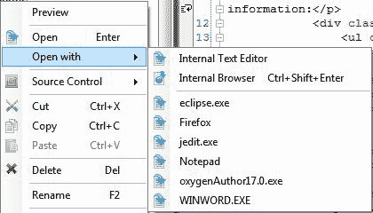

除了使用外部编辑器编辑内容文件外，你还可以打开并编辑 Flare UI 中可以的任何 XML 文件。例如，你可以编辑词表或目录文件。只需右键点击文件，你就会看到与图 3.1 所示相同的弹出菜单选项。

为了让应用程序出现在与“打开方式”菜单选项相关的列表中，你必须先在 Flare 界面之外使用该程序打开该类型的文件。

如果你还没有使用 XML 编辑器，你可以在此处找到可用编辑器的概览：XML 编辑器比较（维基百科）。

## 外部编辑器与打印输出

在创建 HTML 输出时，标题标签内部的回车符或单词之间的额外空格不需要担心。然而，它们可能会在 PDF 输出中显示为不必要的空白，尤其是在 PDF 阅读器的书签侧边栏中。这也可能发生在非原样标签上，例如表格内部的 `<p>` 标签。

如果你使用外部编辑器，这个问题特别容易发生，如果你有在 Windows 以外操作系统创建的 API 文档，这尤其有用。如果你从另一个操作系统导入内容，可以在内容离开其原生操作系统之前使其完全符合 Flare 标准。

### 3.7. PHP

标题标签内部的回车符或单词之间的额外空格不需要担心 concern。然而，它们可能会在 PDF 输出中显示为不必要的空白，尤其是在 PDF 阅读器的书签侧边栏中。这也可能发生在非原样标签上，例如表格内部的 `<p>` 标签。如果你使用外部编辑器，这个问题特别容易发生，如果你有在 Windows 以外操作系统创建的 API 文档，这尤其有用。如果你从另一个操作系统导入内容，可以在内容离开其原生操作系统之前使其完全符合 Flare 标准。

### 3.8. Browser

标题标签内部的回车符或单词之间的额外空格在创建 HTML 输出时不需要担心 concern。然而，它们可能会在 PDF 输出中显示为不必要的空白，尤其是在 PDF 阅读器的书签侧边栏中。这也可能发生在非原样标签上，例如表格内部的 `<p>` 标签。如果你使用外部编辑器，这个问题特别容易发生，如果你有在 Windows 以外操作系统创建的 API 文档，这尤其有用。如果你从另一个操作系统导入内容，可以在内容离开其原生操作系统之前使其完全符合 Flare 标准。

## 第 4 章. CSS 与 Flare

如果你熟悉 CSS，那么你可能对 Flare 中使用 CSS 有疑问。例如，“我可以用现有的样式表，还是需要从零开始？”“如果我跳过 UI 直接操作 CSS，会遇到问题吗？”“我的样式会与内置冲突吗，哪个具有优先级？”为了回答这些问题，让我们看看 Flare 如何处理 CSS。

在标准 HTML 中，你通过包含样式块或链接来管理 CSS。由于 Flare 生成 HTML 文件，它可以在更高层次管理 CSS。这种差异在你将 HTML 文件导入 Flare 时至关重要。最好的起点是查看与 CSS 关联的标准方式：

- 通过为要样式的元素添加 `style` 属性。
- 通过向 HTML 页面的 `<head>` 添加 `<style>` 块。
- 通过在 HTML 页面的 `<head>` 中使用 `<link>` 引用外部样式表。

内联样式（使用 `style` 属性）优先级最高。之后，你在 `<head>` 中包含 CSS 的顺序决定了优先级。在 `<head>` 中后定义的 CSS 优先级高于先定义的。按照惯例，链接先出现，然后是样式块（见示例 4.1）。

**示例 4.1 – 从 HTML 引用 CSS**

```html
<head>
  <title>示例页面</title>

  <link rel="stylesheet" type="text/css" href="sample.css" />

  <style type="text/css">
    body {
      background-color: white;
      color: black;
    }
  </style>
</head>
<body style="color: white; background-color: black">
...
```

在示例 4.1 中，`<body>` 标签中定义的内联样式优先级高于 `<head>` 中 `<style>` 标签中定义的样式，而后者又高于 `<link>` 标签中样式的属性。简单来说，后定义的胜出。

如果你对特定类的标签有统一的样式，并且这些标签出现在大多数页面中，那么通过内联样式或嵌入在 `<head>` 中的 `<style>` 块对这些标签设置样式并不是好主意。在标准 HTML 中，处理适用于大多数页面的样式（全局样式）的最佳实践是在每个页面的 `<head>` 中链接到外部 CSS 文件。

**这就是 Flare 不同于标准 HTML 做法之处。** 你通常不会直接对 Flare 源文件应用样式。相反，Flare 在生成输出时会添加 CSS 引用。由于这个原因，在 Flare 内部你可以在以下级别应用样式：

- **项目 (Project)：** 将样式表与`项目`（project）关联。这是一个项目级主样式表。
- **目标 (Target)：** 将样式表与`目标`（target）关联。这是一个目标级主样式表。
- **主题 (Topic)：** 通过从 `<head>` 元素链接，将样式表与某个主题关联。Flare 文档将此类样式表称为本地样式表。（如果你熟悉 HTML，这是 HTML 页面最常用的样式设置方法。[4]）
- **主页 (Master pages)：** 对于在线输出，主页充当模板并可以与它们关联样式表。虽然名称使用了`master`（主）一词，但通过这种方式实现的样式是本地、特定主题样式表的变体。它们只是更容易将样式表与多个主题文件关联。
- **嵌入 (Embedded)：** Flare 文档将 HTML 页面 `<head>` 中的 `<style>` 标签称为嵌入样式。在 Flare 中创建嵌入样式的唯一方法是通过 Flare 文本编辑器。
- **内联 (Inline)：** 在页面内的单个标签上添加 `style` 属性。在 Flare 中创建内联样式的唯一方法是通过 Flare 文本编辑器或 XML 编辑器。

主样式表通常是你的最佳选择。你很少需要使用嵌入、内联或特定主题的样式。对于适用于整个项目的样式，请使用项目级主样式表。对于适用于特定目标的样式，请使用目标级主样式表。（详情请第 9.3 节“资源文件”。）

正如你预期的，当 Flare 构建输出时，它通过在每个需要的输出页面的 `<head>` 元素中添加对这些文件的链接，关联项目级和目标级主文件。这节省了你自己在每个主题文件中单独维护链接的工作。

因为 Flare 可以通过主样式表管理 CSS，你通常可以在导入 HTML 之前移除嵌入 CSS 和指向外部 CSS 文件的链接。使用 Flare 主样式表比在项目中每个文件的 `<head>` 元素中链接 CSS 文件要简单得多。

## 页面特定样式

考虑到从每个页面的 `<head>` 中移除样式表链接的建议，你可能会奇怪如何覆盖特定 HTML 页面中的样式。选项有：

- 导入后与主题文件关联本地样式表。
- 覆盖主题页面 `<head>` 元素内部 `<style>` 块中的样式。
- 使用现有的项目或目标主样式表，但创建新类来覆盖现有样式，然后在 HTML 中需要的地方使用这些类。

### 4.1. Flare 特有样式

Flare 的`皮肤`（skins）、控件、导航链接、代理和其他对象都具有 Flare 特有的样式表，用于控制它们的外观和位置。当 Flare 生成输出时，它会自动在 `<head>` 元素中包含指向这些样式表的链接。

例如，假设你将自己的样式表 `myflare.css` 作为项目级主样式表。如果你查看 HTML 输出的源代码，你会发现 Flare 为每个页面的 `<head>` 添加了几个样式表（参见示例 4.2）。

**示例 4.2 – Flare 生成的样式表链接**

```html
<head>
  ...
  <link href="../../Skins/Default/Stylesheets/Topic.css" rel="stylesheet" data-mc-generated="True" />
  <link href="../../Skins/Default/Stylesheets/Components/Styles.css" rel="stylesheet" data-mc-generated="True" />
  <link href="../Resources/StyleSheets/myflare.css" rel="stylesheet" />
</head>
```

`data-mc-generated` 属性表示 Flare 生成样式表链接。在示例 4.2 中，注意带有此属性的链接出现在 `myflare.css` 之前。这意味着你的样式具有优先级。

然而，你的样式可能仍与内置的 Flare 样式冲突。许多 Flare 控件（如代理）使用表格来组织内容；如果你在 CSS 文件中直接对表格设置样式，可能会产生意外副作用。为了避免冲突，请为表格分配 `class` 属性并仅对该类设置样式。不要创建像 `table { … }` 这样的选择器，而是为你的类专门创建一个选择器 `table.mytable { … }`。你可以在第 5.1 节“避免类冲突”中找到创建表格 `class` 属性的脚本。

#### Flare 特有标签和属性

Flare 源文件确实使用一些 Flare 特有的属性（在讨论样式表时称为属性）。示例包括 `mc-auto-number-format` 属性（它在第 4.2.1.2 节“标记和编号”中进行了讨论），以及 `mc-format` 属性，它为 Flare`交叉引用`（cross-references）执行着至关重要的功能。Flare 还使用了专有标签。

#### 导入准备

一旦你拥有了有效的 XHTML 文件，就需要对它们进行导入准备。接下来的三个章节将介绍如何对文件进行预处理，以使导入过程尽可能清晰。

第 5 章“预处理”概述了整体流程并涵盖了若干项清理任务。

第 6 章“目录”描述了如何为你的文件创建 Flare 目录（TOC）并将 HTML 目录转换为可导入格式。

第 7 章“词汇表”描述了如何创建 Flare 词汇表。

## 第 5 章 预处理

拥有有效的 XHTML 文件是将内容导入 Flare 的第一步。然而，在导入文件之前，你应该执行以下几项任务。以下是我为导入预处理文件时采取的步骤列表：

- 根据需要应用本章描述的进程清理 HTML。
- 创建 Flare 目录文件（扩展名为 `.fltoc`）。如果你有分块的 HTML 文件，你肯定有一个目录。Flare 使用了不同的导航机制，因此你不需要 HTML 目录，但你可能可以将你的 HTML 目录转换为 Flare 目录（详见第 6 章）。
- 创建 Flare 词汇表文件（扩展名为 `.flglo` 文件）和词汇表主题文件。与目录一样，HTML 词汇表文件与 Flare 词汇表不同。不过，你可以从 HTML 词汇表创建一个 Flare 词汇表（详见第 7 章）。
- 通过向源锚点添加 `name` 属性创建 Flare 书签。见第 5.5 节“添加书签”。
- 向你计划用 CSS 样式的表格和其他元素添加 `class` 属性。这将有助于避免与 Flare CSS 发生冲突。见第 5.1 节“避免类名冲突”。
- 移除指向 CSS 和 JavaScript 文件的链接。见第 5.4 节“移除指向资源的链接”。
- 创建一个目录（可选包含子目录），并将所有想要导入的主题文件放在该目录中。
- 将 TOC 文件等 Flare XML 文件放在单独的目录中。
- 移除任何你不想导入的 HTML 文件，包括原始的 HTML 词汇表文件（除非你打算将其用于打印输出）和原始的 HTML 目录文件。

### 5.1. 避免类名冲突

Flare 大量使用了表格和 CSS，你可以很容易创建与 Flare 已经创建的规则冲突的 CSS 规则。你不希望在表格样式上与 Flare 发生争执。你可以通过向所有表格添加 `class` 属性，然后创建仅适用于该类表格的样式来避免这种冲突。

示例 5.1 包含一个执行此操作的脚本。如果你在不传递任何参数的情况下调用该脚本，它会为任何尚未具有 `class` 属性的表格添加 `class` 属性。

**示例 5.1 – 设置元素类的脚本**

```php
<?php
/**
 * 为元素设置 class 属性以便对其进行单独样式化
 * © 2017 Moneris Solutions Corporation, CC-BY-NC -SA 4.0
 * @param string argv[1] 如果不是 "table" 则为元素类型
 */
if ($argc == 1){ 
```


```php
 $tag = "table";
} else {
 $tag = $argv[1];
}
// 在当前目录中查找所有 HTML 文件
foreach (glob("./*.{xhtml,html,htm}", GLOB_BRACE) as $file){
 $d = new DOMDocument();
 $d->load($file);
 $xpath = new DOMXPath($d);
 $ns = $d->documentElement->namespaceURI;
 if($ns) {
 $xpath->registerNamespace("ns", $ns);
 $query = "//ns:" . $tag . "[not(@class)]"; 
```


```php
 } else {
 $query = "//". $tag . "[not(@class)]";
 }
 $elements = $xpath->query($query);
 if($elements->item(0)){
 foreach ($elements as $node) {
 // 创建属性
 $node->setAttribute("class", "my".$tag); 
```


```php
 }
 }
 $d->save($file);
}
?>
```


如果你不传递参数，此函数将为任何没有 `class` 属性的表格创建一个值为 `mytable` 的 `class` 属性。


此查询找到所有不具有 `class` 属性的 `$tag` 元素。


此代码添加了一个 `class` 属性，其值为“my”与标签连接的字符串。该类表格的 CSS 块将是：`table.mytable { }`。此范围内的样式仅适用于 `class="mytable"` 的表格。要对此表格中的行、表头和列进行样式设置，请使用此声明 `table.mytable th, td { }`。

```php
* © 2017 Moneris Solutions Corporation, CC-BY-NC -SA 4.0
*/
error_reporting(E_ERROR);

// 查找当前目录下的所有 HTML 文件
foreach (glob("./*.{xhtml,html,htm}", GLOB_BRACE) as $file){
 $changed = false;
 $d = new DOMDocument();
 $d->load($file);
 $xpath = new DOMXPath($d);
 $ns = $d->documentElement->namespaceURI;
 if($ns) {
 $xpath->registerNamespace("ns", $ns);
 $query = "//ns:ol[@type and not(@style)]"; 
```


```php
 } else {
 $query = "//ol[@type and not(@style)]";
 } 
 $elements = $xpath->query($query);
 if($elements->item(0)){ 
 foreach ($elements as $node){
 $style = "";
 $type = $node->getAttribute("type");
 switch ($type) {
 case "a":
 $style = "lower-alpha";
 break;
 case "A":
```


```php
$style = "upper-alpha";
break;
case "i":
$style = "lower-roman";
break;
case "I":
$style = "upper-roman";
break;
default:
}
if($style != ""){
$node->setAttribute("style", "list-style-type: " . $style . ";
$changed = true;
}
}
}
}
if ($changed){
echo "已保存 $file.";
$d->save($file);
}
}
?>
```


此行关闭了除致命运行时错误之外的所有错误报告。如果你在页面中嵌入了 MadCap 标签，此这将抑制关于这些标签的通知。如果为了调试或想查看所有通知，请注释掉此行。


此 XPath 查询查找所有具有 `type` 属性但缺少 `style` 属性的 `<ol>` 标签。


此代码创建内联 CSS，根据 `type` 属性的值对有序列表进行样式设置。

### 5.4. 移除资源的链接

正如我们在第 2 章中所看到的，在 HTML 页面的 `<head>` 元素内部链接 CSS 文件通常是适得其反的。如果你使用 Flare 界面导入 HTML 目录，可以选择不导入资源。通过此选项，Flare 将移除指向 CSS 文件的链接，但它也可能移除指向图像文件的链接。示例 5.4 中的脚本移除指向 CSS 文件的链接，而不移除指向图像文件的链接。它还可以移除 JavaScript 文件的链接。

在包含 HTML 文件的目录中运行示例 5.4 中的脚本。传入参数 `js` 代表 JavaScript，传入 `css` 代表 CSS。脚本将在原文件上操作。

**示例 5.4 – 移除引用的脚本**

```php
<?php

/**
 * 从当前目录下每个页面 head 中移除样式链接
 *
 * <link rel="stylesheet" type="text/css" ... 或
 * <script type="text/javascript" ... />
 *
 * @param string $argv[1] 输入 "js" 或 "css"
 */

$type = $argv[1];
```


```php
if ($type == "js"){
    $query = "script\[@type='text/javascript'\]";
```


```php
} elseif ($type == "css"){
    $query = "link\[@rel='stylesheet'\]\[@type='text/css'\]";
} else {
    echo "\"js\" 或 \"css\"\n";
    exit(1);
}

//查找当前目录下的所有 HTML 文件
foreach (glob("./*.xhtml,html,htm}", GLOB_BRACE) as $file){
    $d = new DOMDocument();
    $d->load($file);
    $xpath = new DOMXPath($d);
    $ns = $d->documentElement->namespaceURI;

    if($ns) {
        $xpath->registerNamespace("ns", $ns);
        $q = "//ns:head/ns:" . $query;
```


```php
    } else {
        $q = "//head/" . $query;
    }

    $elements = $xpath->query($q);

    if($elements->item(0)){
        foreach ($elements as $node) {
            $parent = $node->parentNode;
            $parent->removeChild($node);
```


```php
        }
    }

    $d->save($file);
}
?>
```


向此脚本传递 `js` 或 `css`。要同时移除脚本和 CSS 链接，请运行脚本脚本。


如果你的 HTML 文件没有为 CSS 或 JavaScript 链接指定 `type` 属性，此脚本将无法工作。在这种情况下，请从 XPath 表达式中移除 `type` 属性。


此 XPath 表达式查找 `<head>` 中的 `<script>` 或 `<link>` 标签。


此行移除对 CSS 或 JavaScript 文件的引用。你可以通过在项目文件或目标文件中设置 `Stylesheet` 属性来继续使用这些 CSS 文件。参见第 9.3 节“资源文件”了解如何操作。

### 5.5. 添加书签

在 HTML5 之前的版本中，使用 `id` 或 `name` 属性识别目标锚点。HTML5 不再支持 `name` 属性，因此所有 HTML5 锚点都使用 `id` 属性。然而，被称为书签的 Flare 锚点必须使用 `name` 属性进行标识。

**注意** Flare 交叉引用也要求目标锚点使用 `name` 属性。此外，内部交叉用的源格式与 HTML 不同。参见第 9.5 节“将内部链接转换为交叉引用”获取完整讨论和处理此任务的脚本。你可以通过带有 `anchor-as-name` 的 `tidy` 命令创建作为 Flare 书签的锚点。然而，你并不总是可以使用 `tidy`——例如，如果你的文件包含专用标签，它将不起——因此有一个可以创建 `name` 属性的脚本是有用的。示例 5.5 中的脚本查找具有 `id` 属性但没有 `name` 属性的目标锚点，并添加 `name` 属性。

**示例 5.5 – 创建脚本**

```php
<?php

/**
 * 为任何具有 id 但没有 name 的锚点创建 name 属性。
 *
 * 没有 href 的 id 锚点是目标锚点。
 * 此脚本创建一个用于 Flare xref 的 Flare 书签。
 */

//查找当前目录下的所有 HTML 文件
foreach (glob("./*.{xhtml,html,htm}", GLOB_BRACE) as $file){
```


```php
    $d = new DOMDocument();
    $d->load($file);
    $xpath = new DOMXPath($d);
    $ns = $d->documentElement->namespaceURI;

    if($ns) {
        $xpath->registerNamespace("ns", $ns);
        $elements = $xpath->query("//ns:a[@id and not(@name)]");
```


```php
    } else {
        $elements = $xpath->query("//a[@id and not(@name)]");
    }

    if($elements->item(0)){
        foreach ($elements as $node) {
            $node->setAttribute("name", $node->getAttribute("id"));
```


```php
        }
    }

    $d->save($file);
}
?>
```

`id` 属性必须是唯一的。将 `name` 属性设置为 `id` 的值可以在 PDF 阅读器的书签窗格中显示书签。更多信息请参见第 12.3 节“创建 PDF 目标”。

## 第 6 章 目录

如果你有分段 HTML 文件，那么你肯定有一个目录（ToC）来导航这些文件。Flare 使用不同的机制，因此没有理由将 TOC 导入 Flare。然而，如果你的 TOC 使用 HTML 列表（`<ul>`、`<ol>` 或 `<dl>`），你可以将该 HTML 列表转换为 Flare TOC。

**注意** 我使用小写的 TOC 指代通用目录，使用大写的 TOC 指代 Flare 目录文件或 Flare 目录编辑器。

Flare TOC 是一个扩展名为 `.fltoc` 的 XML 文件，位于 `Project\TOCs` 目录。它映射了不同主题之间的关系——功能类似于 DITA map 文件。示例 6.1 包含带有嵌套条目的示例 Flare TOC 文件。

此文件类型。要探索此文件和其他 Flare XML 文件的结构，请使用 GUI 设置属性，然后检查生成的 XML 文件。表 B.1“Flare XML 文件”列出了 Flare XML 文件及其扩展名。

### 在 `<TocEntry>` 元素上设置打印属性

以下是 `<TocEntry>` 标签的一些与打印打印的属性：

- `StartSection`
- `PageNumberReset`
- `SectionNumberReset`
- `VolumeNumberReset`
- `ChapterNumberReset`
- `PageLayout`

赋值给 `Title` 属性的值取决于你如何创建 `<TocEntry>`。对于 Flare 2017 之前的版本，当你在 TOC 编辑器中使用拖放界面将主题添加到 Flare 局部目录（TOC）中时，Flare 会根据以下规则为 `Title` 属性分配一个值：

1. 如果存在 `<title>` 标签且其具有文本节点，Flare 将使用此文本值。
2. 在缺少 `<title>` 标签的情况下，Flare 使用第一个标题标签get文本节点。
3. 作为最后的手段，Flare 将使用不带扩展名的文件名。

Flare 将 `Title` 属性的值作为该主题在用户界面上的标签（Label）。当你在 Flare 2017 中拖放主题时，将使用系统变量作为 `Title` 属性，这有助于保持 TOC 编辑器和主题文件的同步。有关此功能的详细信息，请参见章节第 6.3 节“Flare 2017 中的 TOC 和系统变量”。

当你将 HTML 文件导入到新项目时，Flare 会创建一个默认 TOC，它按字母顺序列出你导入的所有文件，并将每个条目的 `Title` 属性值设为文件名（不带扩展名）。Flare 2017 对此行为没有任何更改。

当 Flare 生成 HTML 输出时，它使用 `Title` 属性的值作为导航窗中的链接文本（但在生成 PDF 书签或 Word 导航时不使用）。了解 Flare 如何生成链接文本可以帮助你为该属性选择最佳值。

**注意**

当 `<TocEntry>` 指向页面内的锚点时，该目标锚点（anchor）必须通过 `name` 属性标识，而不是 `id` 属性。有关此主题的更多信息，请参见章节第 5.5 节“添加书签”。

你还可以将 `<TocEntry>` 的 `Link` 属性指向另一个 TOC 文件。这在你分批导入文件时非常有用。假设你正在按章节逐章地导入一本书。如果你在导入之前为你的章节创建了 TOC，你可以将每个新章节的 TOC 添加到现有的书籍 TOC 中。

### 6.1. HTML TOC

对于较小的项目，默认的 Flare TOC 可能很有用。如果你对文档很熟悉，你可以使用 TOC 编辑器（TOC Editor）快速重新排列文件，它可以让你拾取文件并将其放在你希望它们出现的地方。然而，当你处理包含许多文件的大型项目时，手动拖放文件来创建 TOC 是枯燥且容易出错的。此外，你可能想要更改与每个 TOC 条目关联的 `Title` 属性。自动化创建 Flare TOC 文件可以提高准确性并节省时间。如果你要导入的 HTML 文件已经有了目录，你可以使用该 TOC 自动创建 Flare TOC。示例 6.2 包含了示例 6.1 所示的 Flare TOC 的 HTML 版本。

**示例 6.2 – HTML `<ul>` 目录**

```html
<ul class="toc">
  <li><a href="index.html">第一页</a></li>
  <li><a href="second.html">第二页</a></li>
  <li><a href="third.html">第三页</a>
    <ul>
      <li><a href="table1.html">表一</a></li>
      <li><a href="table2.html">表二</a></li>
    </ul>
  </li>
  <li><a href="fourth.html">第四页</a></li>
</ul>
```

`<ul>` 标签包裹了整个 TOC，每个 `<li>` 标签都是一个 TOC 条目。嵌套的 `<ul>` 标签用于嵌套的 TOC 条目。示例 6.2 与示例 6.1 之间的相似性使得编写一个将 HTML TOC 转换为 Flare TOC 的脚本变得简单。有序列表（`<ol>`）也经常用于 HTML TOC。国际数字出版论坛（IDPF）在他们的 EPUB 3 无障碍指南中推荐使用它们，该指南包含一个使用 `<ol>` 标签的 TOC，但在其他方面与示例 6.2 中的 TOC 相似。较少的情况下，你可能会发现使用定义列表（`<dl>`）的 TOC。

如果你有一个使用 `<ul>`、`<ol>` 或 `<dl>` 标签或其组合的现有 HTML TOC，你可以使用示例 6.3 中的脚本来创建 Flare TOC。如果你没有现有的 HTML TOC，或者 Flare 创建的默认 TOC 文件不适用，你可能会发现示例 9.1 节“从文件列表创建 Flare TOC 的脚本”有用。此脚本创建一个与默认 TOC 相似的 TOC，但它使用标题标签作为 TOC 标题。

### 6.2. 从 HTML TOC 创建 Flare TOC

示例 6.3 中的脚本从 HTML TOC 创建 Flare TOC（例如示例 6.2 所示）。它也适用于使用 `<ol>` 或 `<dl>` 标签创建的 TOC。脚本接受一个参数：包含 TOC 的文件名。

**示例 6.3 – 创建 Flare TOC 的脚本**


```php
<?php
/**
 * 将 HTML TOC 转换为 Flare TOC。
 * TOC 可以是有或无序的。
 * @param string $argv[1] 带有目录的文件
 */
if ($argc != 2){
  echo "参数数量错误.";
  exit(1);
}

$source = $argv[1]; // 带有目录的文件
$filename = "import.toc";
$doc = new DOMDocument();
$doc->load($source);
$new_doc = new DOMDocument();
$new_doc->formatOutput = true;
makeRoot($new_doc);
$xpath = new DOMXPath($doc);
$ns = $doc->documentElement->namespaceURI;
if($ns) {
  //检查所有列表类型
  $xpath->registerNamespace("ns", $ns);
  $elements = $xpath->query("//ns:ul or ns:ol or ns:dl");
} else {
  $elements = $xpath->query("//self::ul or self::ol or self::dl");
}
//只有第一个元素
$node = $elements->item(0);
if(! $node) {
  exit("未找到 元素.");
}
createFlareXML($node, $new_doc->documentElement);
$new_doc->save($filename);
//结束

/**
 * 创建文档的根节点。
 * @param DOMDocument $new_doc 新 TOC 文件
 */
function makeRoot($new_doc){
  //创建带有 Toc 的根节点
  $root = $new_doc->createElement('Toc');
  //创建根节点
  $root->setAttribute("Version","1");
  $new_doc->appendChild($root);
  return;
}

/**
 * 转换为 Flare TOC。HTML 的列表类型必须 ul, ol 或 dl。
 * 递归调用。
 * @param DOMNode $node 当前 HTML 节点
 * @param DOMDocument $new_doc Flare TOC 文件
 * @param DOMNode $parent 挂载新节点的地方
 */
function createFlareXML($node, $new_doc, $parent){
  foreach ($node->childNodes as $n) {
    $type = $n->nodeName;
    switch ($type) {
      case "dl":
      case "ul":
      case "ol":
        //必须子级所以重置父级
        $p = $parent->lastChild;
        createFlareXML($n, $new_doc, $p);
        break;
      case "a":
        //所有信息在这里
        $href = $n->getAttribute("href");
        $title = trim($n->nodeValue);
        $entry = $new_doc->createElement('TocEntry');
        //设置属性
        $entry->setAttribute("Title", $title );
        //使用 getcwd() 获取当前目录
        $dir = basename(getcwd());
        $entry->setAttribute("Link", "/Content/$dir/" . $href );
        if($parent === $new_doc->documentElement) {
          $entry->setAttribute("BreakType", "chapter" );
        }
        //追加新节点
        $parent->appendChild($entry);
        break;
      default: //对其他标签再次调用
        if($n->hasChildNodes()){
          createFlareXML($n, $new_doc, $parent);
        }
    }
  }
}
```

```php
 }
}
?>
```


检查参数数量。第一个参数（`$argv[0]`）始终是包含脚本的文件名，因此你需要检查的是两个参数，而不是一个。


此参数是包含目录（ToC）的文件名。此参数未经过验证，因此如果参数错误，该脚本将失败。


`createFlareXML` 函数执行所有工作。当它被首次调用时，参数为：用于 TOC 的顶层 HTML 节点、一个新的*文档对象模型* (DOM) 文档（代表正在创建的 Flare TOC 文件），以及 DOM 中的根节点（它将作为 TOC 条目的父节点）。


最初，父节点是新文档的根节点。当函数遇到任何类型的嵌套列表时，它会重置父节点并递归调用自己。


当函数遇到 `<a>` 标签时，它会创建一个 `<TocEntry>` 并从 `href` 属性中复制 URL。脚本假设输入文件是一个独立的 TOC，且所有引用都指向其他文件。因此，指向与 TOC 在同一文件内锚点的引用将无法运行。


`<a>` 标签的文本将成为 TOC 条目的 `Title`（标题）。如果此文本包含标题以外的信息——例如，元素类型和编号，如 `Chapter 6`——你可能在运行此脚本之前想要移除此类标识符。如果你使用的是 Flare 2017，可以通过将 `Title` 属性设置为系统变量而不是字面量来完全避免此问题（详见第 6.3 节“Flare 2017 中的 TOC 和系统变量”）。


此行决定了你运行此脚本的目录名称。当你将 HTML 目录导入 Flare 时，Flare 会将该目录复制为 `Content` 下的子目录。下一行根据你的文件位于该子目录且你在那里运行脚本的假设生成 `Link` 属性。


如果你计划创建打印输出，那么为父节点为根节点的 TOC 条目将 `BreakType` 属性设置为 `chapter` 是很有用的。被识别为此类条目将始终会在新页上开始。如果你不创建打印输出，此属性也不会产生影响。


忽略其他节点并递归调用函数，除非当前节点没有子节点。例如，如果你的 `<a>` 标签被封装在 `<span>` 标签中，`<span>` 标签将在默认情况下在此捕获并忽略。

此脚本将输出放在运行所在目录下的 `myimport.fltoc` 文件中。当将文件传输到 Flare 项目时，请将此文件复制到 `Project\TOCs` 目录（见第 9.1 节“更新 TOC 文件”）。

**警告**

如果你的任何 TOC 条目指向使用 `id` 属性而非 `name` 属性的锚点，它们将无法工作。要解决此问题，请参见第 5.5 节“添加书签”。

### 6.3. Flare 2017 中的 TOC 和系统变量

在 Flare 2017 添加的功能中，“主题标题与 TOC 条目的同步”对本书而言意义重大。此功能允许你使用系统变量设置 TOC 条目的 Label（标签）。这会自动将主题的主标题或标题与其在 TOC 编辑器中的描述同步。在 Flare 2017 之前，如果你更改了主题的主标题或标题，为了让两者匹配，必须手动在 TOC 编辑器中更改 Label。

#### 6.3.1. 将 TOC 条目设置为系统变量

Flare TOC 编辑器中显示的主题描述由该主题属性窗口中 Label 字段的值决定。要设置该值，请打开 TOC 编辑器并双击你想更改的主题。你应该看到类似于图 6.1 的内容：

**图 6.1 – 设置 Label 属性**

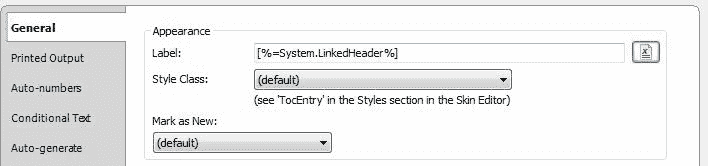

你可以将此值设置为字符串或变量。要将其设置为变量，点击 Label 框右侧的图标。这将打开一个显示系统变量的窗口。你可以选择任何系统变量，但在这种背景下有意义的有：

- `LinkedTitle`：`<title>` 元素的值

- `LinkedHeader`：主题文件中的顶层标题

- `LinkedFile`：主题文件名

如果你将 Label 设置为 `LinkedTitle`，当你将主题拖入 TOC 时，Flare 使用相同的过程分配值。也就是说，如果 `<head>` 中存在 `<title>` 标签，Flare 将使用该值。否则，它使用第一个顶层标题的值或不带扩展的文件名。在之前的版本中，一旦设置了初始值，你就必须手动更改；而在 Flare 2017 中，当你将 Label 设置为系统变量时，Flare 每当显示 Label 时都会重新计算该值。

如果你将 Label 设置为 `LinkedHeader`，Flare 将使用第一个标题标签的值。如果没有标题，Flare 将使用不带扩展的文件名。因为主题的标题并不直观，且主题通常没有 `<title>`，我建议使用 `LinkedHeader` 变量。将 Label 设置为 `LinkedHeader` 可以让 Flare 轻松匹配主题。要在 `.fltoc` 文件中使用此功能，请将 `Title` 属性设置为系统变量，如 6.4 所示：

```xml
<TocEntry Title="%System.LinkedHeader%" ...
```

在 Flare 2017 中，当你将 Label 设置为系统变量时，Flare 在每次显示 Label 时都会重新计算该值。

### 6.4. 使用 xmllint 验证 TOC 文件

你可以从 Flare 界面（见第 9.6 节“使用分析”）验证你的 TOC 文件。你也可以比较 HTML 文件中的 `<li>` 标签数量与 TOC 文件中的 `<TocEntry>` 标签数量。以下命令可以实现这一点：

`xmllint --html --xpath 'count(li)' toc.html`
`xmllint --xpath 'count(TocEntry)' myimport.fltoc`

这两个值应该相等。这种测试至少可以确保 TOC 文件中的条目数量正确。如果包含 TOC 的 HTML 文件没有其他内容，你可以移除它。

## 7. 词表

Flare 词表文件是扩展名为 `.glo` 的 XML 文件。Flare 将词表放在项目目录下的 `Glossaries` 目录。Flare 通常将词条显示为侧边栏。你可以对内容中的词条进行样式设置以便易于识别。词条可以是简单的文本项，也可以是独立的主题文件。

示例 7.1 中的词表文件显示了两种类型的词条。第一个 `<TocEntry>` 拥有一个包含术语定义的 `<Definition>` 标签。第二个 `<TocEntry>` 拥有一个指向包含定义的文件的 `<Definition>` 标签。这两种类型分别称为*文本*定义和*链接*定义。

**示例 7.1 – 词表文件**

```xml
<?xml version="1.0" encoding="utf-8"?>

<Glossary>

  <TocEntry TermClass="Popup" Stem="True" IgnoreCase="true" SortAs="term" glossTerm="myglossary.Term0">

    <Terms>

      <Term>term</Term>

    </Terms>

    <Definition Link="">

      文本术语定义在这里。

    </Definition>

  </TocEntry>

  <TocEntry TermClass="Popup" Stem="True" IgnoreCase="true" glossTerm="myglossary.Term2">

    <Terms>

      <Term>Another Term</Term>

    </Terms>

    <Definition Link="/Content/gloss/AnotherTerm.htm">

    </Definition>

  </TocEntry>

</Glossary>
```


`<TocEntry>` 标签上的 `TermClass` 属性决定了词条的行为。此属性的值如下：

- `Popup`：打开包含定义的弹出窗口（默认值）
- `Expanding`：在术语位置展开定义
- `Hyperlink`：用定义替换当前面板

如果你没有为 `TermClass` 属性分配值，它默认为 `Popup`。另外两个值取决于定义的类型。链接定义无法具有值为 `Expanding`，且纯文本定义不能具有 `Hyperlink`（链接）值。

`GlossaryEntry` 标签的 `SortAs` 属性允许根据术语本身以外的值对词表术语进行排序。例如，您可能想根据缩写对条目进行排序，或者该条目可能以下划线等非字母数字字符开头。在示例 7.1 中，术语为 `_term`（`term`），而 `SortAs` 属性的值为 `term`。如果存在 `SortAs` 属性，Flare 在排序条目时将使用该值。`SortAs` 属性是在 Flare 12 中添加的。

`glossTerm` 属性是在 Flare 12 中添加的，它充当唯一标识符，类似于数据库表中的主键。在此之前，唯一的标识符是 `<Term>` 标签中的文本节点，这意味着正文中对词表术语的引用必须与 `<Term>` 标签的值完全匹配。由于指向词表的链接现在使用此唯一标识符，因此您的链接文本可以是任何内容。例如，只要正确设置 `glossTerm` 属性，您可以使用以下文本引用术语 `bookmark`（书签）的词表条目：

- Bookmark
- bookmarks
- bookmarking
- dog-eared page

Flare 可以匹配文本与术语来生成词表术语的引用。`Stem` 和 `IgnoreCase` 属性告诉 Flare 在生成引用时是否包含变体。例如，如果您定义了术语 `bookmark` 并在目标编辑器（Target Editor）中选择了“转换术语的所有出现处”（Convert all occurrences of a term），Flare 将 `Bookmark`、`bookmarks` 和 `bookmarking` 链接到词表中的术语 `bookmark`。当然，术语 `dog-eared page`（折角）不会被链接。

Flare 的词表实现相当健壮，能够适应长条目和短条目的能力非常有用。然而，仍然存在一些不完善的地方。例如，如果您混合使用链接型和纯文本词表条目并生成 `Trip` HTML 目标，当您点击词表侧边栏中的条目时，链接词表条目将在主面板中打开，而纯文本条目将在侧边栏中通过展开展开打开。

如果您希望词表条目的行为保持一致，则需要创建其中一种类型的词表条目。纯文本词表条目对于简单的词表项可能是合理的，但定义通常需要多个段落以及使用 HTML 标签的能力——例如，您可能需要使用 `<ul>` 标签来创建列表。

对所有条目使用词表主题似乎是最佳解决方案。然而，链接条目有一个严重的缺陷：Flare 不支持为打印输出生成链接词表条目。

对于 HTML 目标，您可以通过项目组织器（Project Organizer）窗口包含词表文件：选择所需的目标，选择词表（Glossary）选项卡，并勾选所需的或多个词表复选框。您还必须更改皮肤（Skin）属性以确保词表出现在输出中。请在皮肤编辑器（Skin Editor）中，在常规（General）选项卡的特性（Features）框架下选择您想要使用的词表。

向打印输出中添加词表的过程类似，但您还必须在希望词表出现的主题文件中添加词表*代理*（`proxy`）。Flare 代理是您插入到内容中的 XML 标签，用于标识目录、索引或词表等自动生成的内容应该出现的位置。Flare 在构建生成目标时会解析代理。

尽管如此，词表代理仍未达到理想状态。当您在打印输出中使用词表代理时，Flare 仅使用纯文本词表条目；它完全忽略了链接条目。从表面上看，纯文本和链接条目都不行。

本章展示了如何创建一个避免这些问题的打印输出词表；它还展示了您如何自动化以下任务：

- 将 HTML 词表转换为一系列准备好导入的 Flare 词表主题。
- 将 HTML 词表页面转换为 Flare 词表文件（扩展名 `.flglo`）。
- 将 HTML 词表超链接转换为 Flare `<MadCap:glossaryTerm>` 标签。

如果您有一个使用单个定义列表（`<dl>`）的 HTML 词表，可以使用本章中的所有脚本。如果不是，您仍然可以创建一个用于打印输出的词表，并将词表超链接转换为 `<MadCap:glossaryTerm>` 标签。

**注意**

除示例 7.4 外，本章提供的脚本专门用于 Flare 12，无法适用于 Flare 11。附录 C《Flare 版本 11 词表脚本》描述了 Flare 11 词表与 Flare 12 词表的区别，并包含了这些脚本的 Flare 11 版本。

### 7.1 HTML 词表

创建 HTML 词表最好的方法是使用 `<dl>` 列表，将词表术语封装在 `<dt>` 标签内，将定义封装在 `<dd>` 标签内。示例 7.2 包含了此类 HTML 词表的示例。

**示例 7.2 – HTML 词表**

```html
<dl class="glossary">
  <dt>
    <a name="glossary.entities"></a>
    <span class="glossterm">entities</span>
  </dt>
  <dd class="glossdef">
    <p>
      实体用于表示键盘无法提供的字符，但它们也可以作为任意字符序列的宏。在 Flare 中，您可以使用变量替换充当宏的实体。
    </p>
  </dd>

  ...

  <dt>
    <a name="glossary.xpath"></a>
    <span class="glossterm">XPath</span>
  </dt>
  <dd class="glossdef">
    <p>
      XPath 是是*可扩展样式表语言*（Extensible Stylesheet Language）的语言。
    </p>
  </dd>
</dl>
```

```php
<?php

// 从 $titles_array[$index] 创建 <h1>1
$h = $new_doc->createElement('h1', $titles_array[$index]);
$h->setAttribute("class", "no_number");
$body_node->appendChild($h);

// 检查是否仅包含文本
if ($node->childNodes->length == 1) {
    $p = $new_doc->createElement("p", $node->nodeValue);
    $body_node->appendChild($p);
} else {
    foreach ($node->childNodes as $n) {
        $import = $new_doc->importNode($n, true);
        $body_node->appendChild($import);
    }
}

// 清理文件名
$pattern = "(\[\/\s\-_~,;:\\[\]\(\).\])";
$value = preg_replace($pattern, "", $titles_array[$index]);
$value = strtolower($value);

$new_doc->save("gloss_entries/$value" . ".html");
```

```php
$index++;

/**
 * 执行查询并返回节点列表
 * @param DOMDocument $doc DOMDocument 文档
 * @param string $query 要执行的查询
 * @return DOMNodeList
 */
function getNodes($doc, $query) {
    $xpath = new DOMXPath($doc);
    $ns = $doc->documentElement->namespaceURI;

    if ($ns) {
        $xpath->registerNamespace("ns", $ns);
    } else {
        // 移除 "ns:"
        $query = str_replace("ns:", "", $query);
    }

    $nodes = $xpath->query($query);
    return $nodes;
}

?>
```

将 HTML 词表文件的文件名作为参数传递。

这一行为主题文件创建了一个目录（`gloss_entries`）。

此 XPath 表达式捕获了词表术语。命名空间前缀（`ns:`）将由 `getNodes` 函数使用或丢弃，取决于输入是否包含命名空间前缀。

此数组将保存词表术语。

此 XPath 表达式捕获了术语的定义。

为当前的词表术语创建一个主题页面。你必须包含 XML 声明，但不需要定义 MadCap 命名空间；如果它不存在，Flare 会自动添加。

如果只有一个子节点，它必须是文本节点，因此将其封装在 `<p>` 标签中。否则，按原样追加内容。

通过移除术语中的空格和不需要的字符并添加目录名称来创建文件名：`gloss_terms`。

在包含 HTML 词表文件的目录中运行此脚本。它会创建一个名为 `gloss_terms` 的目录，并将各个词表主题文件放置在该目录中。当导入父目录时，该目录将被导入。

### 7.3 创建 Flare 词表

你可以通过映射 HTML 词表文件的结构来创建一个 Flare 词表文件。示例 7.5 中的脚本会创建一个名为 `myglossary.flglo` 的 Flare 词表文件，它链接到示例 7.4 创建的主题文件。两个脚本使用相同的 HTML 词表文件作为输入。

尽管你可以在任何目录创建主题文件，但为了让 Flare 将它们作为词表主题使用，它们必须位于计划导入项目的目录中名为 `gloss_entries` 的子目录内。一旦导入，路径将变为 `/Content/*dir_name**/gloss_entries/`，其中 `*dir_name*` 是你计划导入的目录名称。该目录可以取任何名称；脚本将使用 `getcwd` 函数捕获目录名称。示例 7.5 创建主题文件命名的方式与示例 7.4 相同，因此词表引用应与词表文件名匹配。

### 示例 7.5 – 创建 Flare 词表的脚本

```php
<?php

/**
 * 创建一个 Flare 词表 (.flglo) 文件
 * 链接到词表主题
 * 来自 HTML 的 <dl>。
 * © 2017 Moneris Solutions, CC-BY-SA 4.0
 * @param string $argv[1] HTML 词表文件
 */

$source = $argv[1];
$filename = "myglossary";

$d = new DOMDocument();
$d->load($source);

$xpath = new DOMXPath($d);
$ns = $d->documentElement->namespaceURI;

if ($ns) {
    $xpath->registerNamespace("ns", $ns);

    // 查找所有 dt
    $nodeslist = $xpath->query('//ns:dt');
} else {
    // 查找 dt
    $nodeslist = $xpath->query('//dt');
}

if (!nodeslist->item(0)) {
    exit("未找到元素.");
}

// 遍历节点
$counter = 0;

foreach ($nodeslist as $node) {
    $id = $filename . $counter;

    // 结束主
    $counter++;

    // 保存词表文件
    $flare_doc->save($filename . ".flglo");
}

/**
 * 创建带有根节点的 DOMDocument
 * @return DOMDocument
 */
function makeRoot() {
    $flare_doc = new DOMDocument();

    // 带有根节点
    $root = $flare_doc->createElement('Glossary');
    $flare_doc->appendChild($root);

    return $flare_doc;
}

/**
 * 创建词表条目
 * @param DOMNode $node 节点的节点
 * @param DOMDocument $flare_doc 新文档
 * @param string $id 标识 Term 的标识符
 */
function createGlossary($node, $flare_doc, $id) {
    // 词表条目
    $glossentry = $flare_doc->createElement('GlossaryEntry');

    // 总是创建 popup
    $glossentry->setAttribute("Class", "Popup");

    // 添加 Stem 和 IgnoreCase
    $glossentry->setAttribute('Stem', "True");

    // glossTerm 属性的唯一 id
    $glossentry->setAttribute('glossTerm', $id);

    // 获取术语的文本
    $text = trim($node->nodeValue);

    // 创建 Terms
    $terms = $flare_doc->createElement('Terms');
    $term = $flare_doc->createElement('Term', $text);
    $terms->appendChild($term);
    $glossentry->appendChild($terms);

    // 创建定义
    $def = $flare_doc->createElement('Definition');

    // 清理文件名
    $value = preg_replace($pattern, "", $text);
    $value = strtolower($value);

    // 获取当前目录
    $current_dir = basename(getcwd());

    $url = "/Content/$current_dir/gloss_entries/" . $value . ".html";

    // 链接
    $def->setAttribute("Link", $url);
    $glossentry->appendChild($def);

    $flare_doc->documentElement->appendChild($glossentry);
}
```

获取当前目录名称。

基于词表主题文件创建于要导入的目录下的子目录 `gloss_entries` 的假设，构建路径名称。它还会添加 Flare 放置导入内容的目录的名称（`Content`）。

此脚本会创建一个名为 `myglossary.flglo` 的文件（参见示例 7.6）。将此文件放在 Flare 项目的 `Project\Glossaries` 目录中（见图 9.1）。

此脚本创建的词表文件链接到 Flare 放置导入的词表主题文件的目录。第 9 章第 9.2 节“词表文件”描述了如何设置词表。

**示例 7.6 – 示例 7.5 中的脚本创建的 Flare 词表文件**

```xml
<?xml version="1.0"?>

<CatapultGlossary>
  <GlossaryEntry TermClass="Popup" glossTerm="myglossary.Term0">
    <Terms>
      <Term>entities</Term>
    </Terms>


`<Definition Link="/Content/testfiles/gloss\_entries/entities.html" />`

`</GlossaryEntry>`

`<GlossaryEntry TermClass="Popup" glossTerm="myglossary.Term1">`

`<Terms>`

`<Term>XPath</Term>`

`</Terms>`

`<Definition Link="/Content/testfiles/gloss\_entries/xpath.html" />`

`</GlossaryEntry>`

`</CatapultGlossary>`

### 7.4. 为打印输出创建术语表

如前所述，Flare 在生成打印目标时不会包含链接的术语主题。如果您使用了链接的主题——如此处建议的那样——那么你的打印术语表将是空的；如果混合了链接条目和纯文本条目，打印术语表将仅包含纯文本主题。这两种情况都不令人满意。

解决方案是为打印创建一个单独的术语文件，并绕过 Flare 的常规术语处理。然后，为打印使用单独的目录（TOC），或者为术语中的顶层 `<html>` 标签标记 `MadCap:conditions` 属性，将其值设置为 `Default.PrintOnly`。这（配合正确配置的目标文件）会告诉 Flare 仅在构建打印目标时使用您的 HTML 术语表。

准备用于打印的单独术语表有两种选择。可以使用现有的 HTML 术语表，或者可以使用本章之前描述的脚本创建一个 Flare 术语文件（`.flglo`），然后使用示例 7.7 所示的脚本生成术语表文件。

如果您计划在将术语表导入 Flare 后对其进行编辑或添加内容，则可以直接将您的 HTML 术语表用于打印。在这种情况下，您唯一的额外准备工作就是为打印创建一个单独的目录，或者添加 `MadCap:conditions` 属性。

然而，如果您计划对术语表进行更改，请使用示例 7.7 所示的脚本生成打印术语表。这允许您在一个地方维护术语表。当您编辑术语主题文件时，只需再次运行脚本即可更新打印版本。脚本会将纯文本和链接主题条目复制到输出文件中，因此生成的文件包含两种类型条目的完整文本。脚本还保留了 `SortAs` 属性的值，并在该属性存在时按其进行排序。

要使用此脚本，请执行以下操作：

- 创建 Flare 术语表文件（`.flglo`）。示例 7.5 所示的脚本构建的可以配合此脚本的 Flare 术语表。使用此文件名作为参数调用脚本。
- 确保所有术语主题文件都在同一个目录下。如果您使用示例 7.4 所示的脚本创建了术语主题，则没有这个问题。
- 从包含术语主题文件的目录中执行脚本。

**示例 7.7 – 创建打印术语表的脚本**

```php
<?php

/**
 * 链接的术语条目无法输出到 PDF。
 * 此脚本为 PDF 输出创建一个自定义术语页。
 * 所有术语主题文件必须位于同一
 * 目录下，且脚本必须在该
 * 目录下执行。p.gloss\_term 和
 * p.gloss\_letter 的样式位于页面 <head> 中。
 * © 2017 Moneris Solutions Corporation, CC-BY-NC -SA 4.0
 * @param string $argv[1] flglo 文件的路径
 */

// flglo file
$source = $argv[1];
```


```php
//保存到当前目录
$dest = "pdf\_glossary.html";

$doc = new DOMDocument();
$doc->formatOutput = true;
$doc->load($source);

$xpath = new DOMXPath($doc);

//获取所有 GlossaryEntry 节点
$nodes = $xpath->query("//GlossaryEntry");

// 创建排序值和唯一 ID 数组
$arr = Array();

foreach ($nodes as $node) {
```


```php
$sort = getSortAs($node);
$arr[$sort] = $node->getAttribute("glossTerm");

//按排序值排序
ksort($arr, NATURAL | SORT_CASE);
```


```php
$new_doc = createPage($arr, $doc);
```


```php
//保存文件
$new_doc->save($dest);

//结束

/**
 * 按术语或 SortAs 排序
 * @param DOMNode 包含术语的节点
 */

function getSortAs($node) {
```


```php
if ($node->hasAttribute("SortAs") && $node->getAttribute("SortAs") != "") {
    return $node->getAttribute("SortAs");
} else {
    // 获取术语
    $term = getNodeValues($node);
}

return $term;
}

/**
 * 可能有多个 Term
 * 获取所有术语
 * @param DOMNode 包含术语的节点
 * @return 所有 Terms 的字符串
 */

function getNodeValues($node) {
```


```php
$value = "";

foreach ($node->childNodes as $n) {
    if ($n->nodeName == "Terms") {
        foreach ($n->childNodes as $t) {
            if ($t->nodeName == "Term") {
                $value .= trim($t->nodeValue) . ", ";
            }
        }
    }
}

return trim($value, ", ");
}

/**
 * 创建术语页，样式嵌入在 head 中
 * @param Array $a glossTerm (value), SortAs (key)
 * @param DOMDocument $doc Flare 术语表
 */

function createPage($a, $doc) {
    $new_glossary = '<?xml version="1.0" encoding="utf-8"?>

<html xmlns="http://www.w3.org/1999/xhtml"

xmlns:MadCap="http://www.madcapsoftware.com/Schemas/MadCap.xsd"

MadCap:conditions="Default.PrintOnly">';
```


```html
<head>
    <title>Glossary</title>
    <style type="text/css">
```


```css
p.gloss_letter {
    padding: .25em;
    margin-top: .5em;
    margin-bottom: .75em;
    font-size: 16pt;
    background-color: #ddd;
    page-break-after: avoid;
}

p.gloss_term {
    font-weight: bold;
    page-break-after: avoid;
}

h1.no_number {
    mc-auto-number-format: '';
}
```


```html
    </style>
</head>
</html
";
    
//为 HTML 页创建新的 DOMDocument
$new_doc = new DOMDocument();
$new_doc->loadXML($new_glossary);

$ns = "http://www.w3.org/1999/xhtml";
$body_node = $new_doc->createElementNS($ns, 'body');
```


```php
$new_doc->documentElement->appendChild($body_node);

$header = $new_doc->createElement('h1', "Glossary");
$header->setAttribute("class", "no_number");
$body_node->appendChild($header);

//跟踪之前的字母以确定
//何时开始新标题
$previous_letter = "";

foreach ($a as $key => $value) {
    // 根据 glossTerm (value) 查找术语和定义
    $glossary_entry_node = getGlossaryEntry($value, $doc);
    $term = getNodeValues($glossary_entry_node);
    $def = getDefinition($glossary_entry_node);

    // 从 SortAs/Term 获取第一个字母
    $first_letter = strtolower(substr($key, 0, 1));

    if ($first_letter != $previous_letter) {
        // 创建新的 p
```


```php
        $letter_p = $new_doc->createElement(
            'p',
            strtoupper($first_letter)
        );

        // 设置类属性
        $letter_p->setAttribute("class", "gloss_letter");

        // 附加到 body
        $body_node->appendChild($letter_p);

        $previous_letter = strtolower($first_letter);
    }

    $term_p = $new_doc->createElement('p', $term);
    $term_p->setAttribute("class", "gloss_term");
```


```php
    //现在加载文件并添加到正文
    termDescription($new_doc, $body_node, $def);
}

return $new_doc;
}

/**
 * 使用 glossTerm 查找术语和定义
 * @param string $glossTerm 术语词
 * @param DOMDocument $doc Flare 词汇表的 DOM
 * @return DOMNode 与 glossTerm 关联的节点
 */

function getGlossaryEntry($glossTerm, $doc) {
```


```php
$xpath = new DOMXPath($doc);
$nodes = $xpath->query(
    "//GlossaryEntry[@glossTerm='" . $glossTerm . "']"
);

// 只有一个节点
$n = $nodes->item(0);

return $n;
}

/**
 * 遍历节点并返回定义或链接
 * @param Node $node 包含定义的节点
 * @return string (链接或文本定义)
 */

function getDefinition($node) {
```


```php
$definition = "";

foreach ($node->childNodes as $n) {
    if ($n->nodeName == "Definition") {
        // 链接或文本
        if (trim($n->nodeValue) != "") {
            $definition = trim($n->nodeValue);
        } else {
            $definition = basename($n->getAttribute("Link"));
        }
    }
}

return $definition;
}

/**
 * 构建每个术语的描述
 * $value 参数包含文件名或简单的文本值
 * @param DOMDocument $new_doc 新的 HTML 文档
 * @param DOMNode $body_node 将新术语添加到正文
 * @param string $value 定义（或指向主题的链接）
 */

function termDescription($new_doc, $body_node, $value) {
    //检查 value 是否为文件
    if (file_exists($value)) {
        $d = new DOMDocument();
        $d->formatOutput = true;
        $d->load($value);

        $xp = new DOMXPath($d);
        $ns = $d->documentElement->namespaceURI;

        if ($ns) {
            $xp->registerNamespace("ns", $ns);
            $nodes = $xp->query("//ns:body");
        } else {
            $nodes = $xp->query("//body");
        }

        // 获取 body 的所有子节点排除标题
        foreach ($nodes->item(0)->childNodes as $node) {
            if (!preg_match('/h[1-3\]/', $node->nodeName)) {
```


```php
                $import = $new_doc->importNode($node, true);
```


```php
                $body_node->appendChild($import);
            }
        }
    } else {
        // 纯文本，创建一个 <p>
```


```php
        $pnode = $new_doc->createElement('p', $value);
        $body_node->appendChild($pnode);
    }
}

?>
```


唯一的参数是你的`.flglo`词汇表文件。该文件可以使用示例 7.5 中的脚本创建，也可以是使用 Flare 创建的词汇表文件。你可以在导入你的项目之前或之后运行此脚本。


遍历输入文件中所有的`<GlossaryEntry>`标签并创建一个数组。对于每个`<GlossaryEntry>`，创建一个数组元素，其索引为术语，或者（如果存在）为`<GlossaryEntry>`标签上`SortAs`属性的值。每个数组元素的值是与`<GlossaryEntry>`的`glossTerm`属性关联的唯一标识符。


对输出进行排序；通常 Flare 的`.flglo`文件没有特定的顺序。`ksort`函数执行不区分大小的排序。


`createPage`函数创建词汇表页面并执行大部分工作。


`getSortAs`函数返回词汇表条目的排序键。如果`SortAs`标签存在且有非空值，该函数返回该值。否则，它返回`<Term>`标签的值。


`getNodeValues`函数返回与词汇表条目关联的所有术语。


将`MadCap:conditions`属性设置为`Default.PrintOnly`。此专有属性告诉 Flare 仅为打印目标包含此文件。更多信息请参阅第 10.2.1 节，“条件文本”。


在`<head>`标签中嵌入为此脚本创建的标签/类编写 CSS。你可以根据需要进行调整，或者删除并将 CSS 嵌入样式表中。


将`mc-auto-number-format`设置为空字符串。通过将`mc-auto-number-format`设置为空字符串来确保`<h>`标签不编号。如果你已为`<h>`标签分配了类，可以通过将`mc-auto-number-format`设置为空字符串来使用它。关于 Flare 专有属性的更多信息请参见“Flare 标签和属性”。


为词汇表字母创建一个`<p>`标签。


`getNodeValues`函数返回与词汇表条目关联的所有术语。该词汇表字母类名为`gloss_letter`，你可以为该类创建样式。


为词汇表术语创建一个`<p>`标签。该标签类名为`gloss_term`，你可以为该类创建样式。


`getGlossaryEntry`函数返回与`glossTerm`关联的节点。


`getDefinition`函数返回定义或指向主题的链接。


为`<html>`标签设置正确的命名空间。


为`<body>`创建一个`<p>`标签。


唯一的参数是你的`.flglo`词汇表文件。该文件可以使用示例 7.5 中的脚本创建，也可以是使用 Flare 创建的词汇表文件。你可以在导入你的项目之前或之后运行此脚本。


遍历输入文件中所有的`<GlossaryEntry>`标签并创建一个数组。对于每个`<GlossaryEntry>`，创建一个数组元素，其索引为术语，或者（如果存在）为`<GlossaryEntry>`标签上`SortAs`属性的值。每个数组元素的值是与`<GlossaryEntry>`的`glossTerm`属性关联的唯一标识符。


对输出进行排序；通常 Flare 的`.flglo`文件没有特定的顺序。`ksort`函数执行不区分大小的排序。


`createPage`函数创建词汇表页面并执行大部分工作。


`getSortAs`函数返回词汇表条目的排序键。如果`SortAs`标签存在且有非空值，该函数返回该值。否则，它返回`<Term>`标签的值。


`getNodeValues`函数返回与词汇表条目关联的所有术语。


将`MadCap:conditions`属性设置为`Default.PrintOnly`。此专有属性告诉 Flare 仅为打印目标包含此文件。更多信息请参阅第 10.2.1 节，“条件文本”。


在`<head>`标签中嵌入为此脚本创建的标签/类编写 CSS。你可以根据需要进行调整，或者删除并将 CSS 嵌入样式表中。


将`mc-auto-number-format`设置为空字符串。通过将`mc-auto-number-format`设置为空字符串来确保`<h>`标签不编号。如果你已为`<h>`标签分配了类，可以通过将`mc-auto-number-format`设置为空字符串来使用它。关于 Flare 专有属性的更多信息请参见“Flare 标签和属性”。


为词汇表字母创建一个`<p>`标签。该标签类名为`gloss_letter`，你可以为该类创建样式。


为词汇表术语创建一个`<p>`标签。该标签类名为`gloss_term`，你可以为该类创建样式。


`getGlossaryEntry`函数返回与`glossTerm`关联的节点。


`getDefinition`函数返回定义或指向主题的链接。


为`<html>`标签设置正确的命名空间。


为`<body>`创建一个`<p>`标签。


由于脚本会检查链接是否与 HTML 术表文件名匹配，因此它不会转换指向单页 HTML 术表中、仅使用井号（`#`）和命名锚点的内部引用。任何此类术表引用必须手动调整。

## 示例 7.8 – 用于创建`<MadCap:glossaryTerm>`标签的脚本

```php
<?php

/**
 * 将 glossary href 替换为 glossaryTerms。此脚本
 * 将任何内部术表 hrefs：
 * <a href="glossary.html#term">Term </a>
 * 转换为：
 * <MadCap:glossaryTerm glossTerm="NewGlossary.Term27">Term</MadCap:glossaryTerm>
 *
 * 注意 glossary.html 将替换为
 * HTML 术表文件的名称 ($argv[1])。
 *
 * @param string $argv[1] HTML 术表文件
 * @param string $argv[2] Flare 术表文件 (.flglo)
 */

$html_glossary = $argv[1];

$flare_glossary = $argv[2];

// 检查所有文件中包含术表引用
foreach (glob("./*.{xhtml,html,htm}", GLOB_BRACE) as $file) {
  $changed = false;

  $d = new DOMDocument();
  $d->formatOutput = true;
  $d->load($file);

  $xpath = new DOMXPath($d);

  // 获取命名空间
  $ns = $d->documentElement->namespaceURI;

  if ($ns) {
    $xpath->registerNamespace("ns", $ns);

    // 查找所有
    $elements = $xpath->query("//ns:a[@href]");
  } else {
    $elements = $xpath->query("//a[@href]");
  }

  if ($elements->item(0)) {
    foreach ($elements as $node) {
      $href = $node->getAttribute("href");

      // 是否引用了术表文件？
      if (strpos($href, $html_glossary) !== false) {
        // 清理文本，移除 CR、制表符并
        // 单词之间仅保留单个空格
        $term = preg_replace('/\s+/', ' ', $node->nodeValue);

        // 在 flglo 文件中查找术语
        $attribute = getglossTermAttribute($term, $flare_glossary);

        // 可能会失败
        if ($attribute == "") {
          echo "Failed to find $term.\n";
        } else {
          $glossaryTerm = $d->createElement('MadCap:glossaryTerm', $term);
          $glossaryTerm->setAttribute("glossTerm", $attribute);

          $parent = $node->parentNode;
          $parent->replaceChild($glossaryTerm, $node);

          $changed = true;
        }
      }
    }
  }

  if ($changed) {
    $d->save($file);
  }
}

/**
 * 在术表中查找 glossaryTerm 属性
 *
 * @param string $term 要查找的术语
 * @param string $flare_glossary Flare 术表
 * @return string glossTerm 属性
 */
function getglossTermAttribute($term, $flare_glossary) {
  $glossterm = "";

  $d = new DOMDocument();
  $d->load($flare_glossary);

  $xpath = new DOMXPath($d);
  $elements = $xpath->query("//Term");

  foreach ($elements as $node) {
    if ($term == trim($node->nodeValue)) {
      // 需要 Term 的父级节点
      $glossaryEntry = $node->parentNode->parentNode;
      $glossterm = $glossaryEntry->getAttribute("glossTerm");
      break;
    }
  }

  return $glossterm;
}

?>
```


此脚本同时使用了 HTML 术表文件和 Flare 术表文件。它使用 Flare 术表来检索 `glossTerm`，使用 HTML 术表文件来识别术表链接。

仅选择包含术表文件名的链接。如果术表术语是一个短语，它可能会跨行显示。此代码删除了换行符和多余的空白。`getglossTermAttribute` 函数在 Flare 术表中搜索与 HTML 链接中的锚点匹配的 `glossTerm` 属性。如果没有匹配，该函数将返回空字符串并显示错误消息。

5. 使用 Flare 2016 版本，你可以创建一个预生成事件，在生成打印目标之前自动执行此脚本（参见第 1.7 节，“预/后生成过程（Flare 2016 及更高版本）”）。
6. 此行有助于避免创建重复的命名空间。重复的命名空间无害，但你可以使用 `htmltidy -n file.html`。

## 导入 HTML 文件

**图 8.3 – 导入选项**

勾选“导入已链接的 HTML 文件”（Import Linked HTML Files）可以导入从你的 HTML 文件引用的任何文件。如果你的文件包含指向外部网站页面的链接，Flare 将尝试导入它们并失败。

勾选“导入资源”（Import Resources）可以导入 HTML 文件引用的任何图像文件。Flare 还会导入其他资源文件，例如 JavaScript 和 CSS 文件，但你应该按照第 5.4 节“移除对资源的链接”中的描述先删除这些链接。

如果您选择了“保留现有结构”（Keep existing structure）单选按钮，Flare 将保留资源的原始文件路径。相反，如果您选择了“到项目资源文件夹”（To project resources folder）单选按钮，Flare 将资源文件复制到 `Content\Resources` 文件夹并相应调整对这些资源的任何引用。

**注意**

“‘生成输出’之前自动导入”（Auto-import before 'Generate Output'）复选框告诉 Flare 在生成目标时更新链接文件。它启用了*自动同步*功能，该功能在第 8.2 节“同步文档”中进行了解释。当你将现有项目永久移动到 Flare 时，此选项不适用。

点击“完成”（Finish）按钮将显示您的进度，随后是确认屏幕。您可以查看每个文件，或按“接受”（Accept）按钮导入所有文件。Flare 期望有效的 XHTML 文件，但它会尝试修正无效文件并在导入失败时通知您。

## 8.1.1. 发生了什么？

使用导入向导导入文件会创建一个项目结构（参见第 2.1 节“Flare 项目结构”）。如果你在 Windows 资源管理器中打开项目目录，你将看到一个项目文件（扩展名为 `.flprj`）和四个目录：`Analyzer`、`Content`、`Output` 和 `Project`。`Analyzer` 目录供 Flare 内部使用，`Output` 目录是 Flare 存储文档构建的地方。项目文件以及 `Content` 和 `Project` 目录是重点。

### 8.1.1.1. 项目文件

Flare 项目文件位于项目目录中的 XML 文件。该文件与项目同名，并使用 `.flprj` 扩展名。要在 Flare 中打开项目，请打开此文件。

项目文件的根元素是 `<CatapultProject>`。此标签有两个重要的属性：`MasterToc` 和 `MasterStylesheet`。当 Flare 创建新项目时，它会创建一个默认 TOC 文件和一个默认样式表，并将这些属性设置为指向这两个文件。

### 8.1.1.2. 内容文件

项目目录包含一个名为 `Content` 的子目录。当你向新项目导入 HTML 文件时，Flare 会在 `Content` 下创建一个新的子目录，其名称与你导入的目录相同。Flare 将你在导入期间选择的 HTML 文件（见图 8.2）置于该子目录中。如果你使用示例 7.4 中的脚本为词术表表条目创建了目录，你也应该在导入的目录中找到该目录。

**注意**

当你向新项目导入 HTML 文件时，Flare 总是创建一个新目录，无论你导入的是整个目录还是仅选的文件。

如果你想直接将文件导入到 `Content` 目录，你需要将它们导入到现有项目，或者在不使用 Flare 用户界面的情况下直接将它们复制到目录中。

`Content` 目录还包含一个 `Resources` 目录。如果你将资源导入到项目资源文件夹，你将在 `Content\Resources` 文件夹下找到它们。图像文件位于 `Content\Resources\Images` 目录。Flare 会更新对这些资源的任何链接以匹配它们的新位置。

### 8.1.1.3. 对 HTML 文件的更改

如果你导入的 HTML 文件是有效的 XHTML，那么 Flare 仅更改以下内容：

如果导入的 XHTML 文件没有 XML 声明，Flare 将以以下格式添加一个：

`<?xml version="1.0"?>`

Flare 为 `<html>` 标签添加了 MadCap 命名空间声明：

`xmlns:MadCap="http://www.madcapsoftware.com/Schemas/MadCap.xsd"`

Flare 可能会为 `<html>` 标签添加一些专有属性，例如 `MadCap:sourceDocument` 或 `MadCap:lastHeight`。你可以忽略这些 Flare 使用的属性。

**导入单个 HTML 文件**

如果你需要向项目导入单个 HTML ，可以打开 Windows 资源管理器并将移动或复制到项目的 `Content` 目录。如果你的文件是有效的 XHTML 且具有 XML 声明，Flare 将静默导入该文件。如果没有 XML 声明，当你尝试在 Flare 编辑器中打开文件时，会打开对话框询问是否要将文件转换为 XML。

### 8.1.1.4. Project 目录

`Project` 目录包含可以直接生成输出的默认文件。由于我们在导入期间选择了 HTML5 输出类型，此输出类型将是默认类型。你可以通过查看 `Project\Targets` 目录来确认，该目录目前包含一个目标文件。由于所有目标文件都需要 TOC 文件，你还会找到一个默认 TOC 文件，其名称与导入的目录相同。默认 TOC 文件位于 `Project\TOCs` 目录。

你可以使用默认目标文件生成输出。但是，由于默认 TOC 文件……（注：内容见后页）

## 8.1.1.5. 导入摘要

- 作为安全措施，如果你尝试在 Flare 界面内部更改链接文档，Flare 会打开一个警告对话框，提示你的更改可能会被覆盖。（注：源文本此部分的 OCR 结果存在严重损坏/重复，已根据可用片段进行了重构）。

### 8.2. 同步文档

[注：源文本中第 8.2 节的内容非常碎片，已根据提供的标题和关键句子进行处理]。

## 第 9 章 导入 HTML 之后

导入文件后，很难抑制立即创建输出的冲动。

然而，还有其他事情是你必须优先完成的本章描述了在导入文件后需要采取的步骤，包括：

- 更新或替换默认的 Flare 目录（TOC）。
- 更新或替换默认的 Flare 词汇表（Glossary）。
- 更新或替换默认的 Flare CSS 文件。
- 查找并修复任何损坏链接。
- 将内部链接转换为交叉引用。
- 运行 Flare 项目分析工具查找并解决常见问题。

### 9.1. 更新 TOC 文件

Flare 在 `Project\TOCs` 目录下创建一个默认的 TOC 文件，并以导入的目录命名。Flare 会为每个文件创建一个条目——使用文件名（不含扩展名）作为标题——并按文件名对条目进行排序。

默认 TOC 对于小型项目以及按文件名字母顺序排序有意义的情况非常有用，但如果你已经创建了 Flare TOC，就不需要这个文件了。你可以在 Flare 内部通过打开项目组织器（Project Organizer）、展开 `TOCs` 文件夹、右键点击 TOC 文件并选择删除来将其移除。你也可以像删除任何文件一样在 Windows 资源管理器中删除此文件，但从 Flare 内部删除更安全。

如果你按照第 6 章所述创建了 Flare TOC 文件，可以使用 Windows 资源管理器将此文件复制到项目中，或者通过 Flare 界面将其导入。要使用 Flare 导入，打开项目组织器窗口，右键点击 `TOCs` 文件夹，并选择添加目录（Add Table of Contents ....

如果你导入的 TOC 文件是唯一的 TOC 文件，它将成为默认 TOC，你不需要将其与项目或目标（target）关联。然而，了解如何通过用户界面（UI）和操作 XML 文件将 TOC 与项目关联是很有用的。

要将 TOC 设置为项目的主 TOC，右键点击项目文件夹打开项目属性。选择“默认”（Defaults）选项卡，并在“主 TOC”下拉框中选择 TOC。

从 XML 的角度来看，与项目的 TOC 由项目文件 (`*project_name*.flprj`) 中 `<CatapultProject>` 标签上的 `MasterToc` 属性控制。要手动将 TOC 与项目关联，请将此属性的值设置为 TOC 文件的相对路径，例如：`/Project/TOCs/myfile.fltoc`。项目文件位于项目的根目录，在 Flare UI 中不可见。因此，要手动编辑其内容，需要在 Flare 之外进行操作。

要将 TOC 设置为*目标*（target）的主 TOC，打开项目组织器窗口，展开 `Targets` 文件夹，双击所需的目标打开*目标编辑器*（Target Editor）。转到“常规”（General）选项卡，并在“主 TOC”下拉框中选择 TOC。

从 XML 的角度来看，与目标的 TOC 由 `MasterToc` 属性控制。但在情况下，`MasterToc` 是目标文件（扩展名为 `.fltar`）`<CatapultTarget>` 标签上的属性，它位于 `Project\Targets` 目录下。要手动将 TOC 与目标关联，请将 `MasterToc` 属性的值设置为 `.fltoc` 文件的相对路径。你可以通过 Flare 界面或 Windows 资源管理器在外部编辑器中打开此文件。目标文件见示例 9.3。

#### 9.1.1. 为同步文件更新 TOC 文件

当你使用自动同步功能时，每次生成输出，Flare 都会创建一个新的 TOC 文件。即使你删除了原始的默认 TOC 文件，也是如此。Flare 会重新创建 TOC 文件以确保任何新文件都被包含在内。

如果默认自动生成的 TOC 文件符合你的需求，这非常方便。然而，如果自动生成的 TOC 不合适，且你希望避免每次 Flare 自动同步时都手动创建 TOC，可以通过脚本来解决这个问题。

示例 9.1 中的脚本创建一个按文件名字母顺序的 Flare TOC 文件——你可以修改脚本来更改这一点。但与自动生成的 TOC 文件不同，此脚本使用文件的第一个标题（`<h1>`、`<h2>` 或 `<h3>`）为每个条目设置标题。脚本创建一个名为 `file_list.fltoc` 的文件，包含运行脚本的目录中每个文件的条目。然后将此文件复制到 `Project\TOCs` 目录。

**示例 9.1 – 从文件生成 Flare TOC 的脚本**

```php
<?php

/**
 * 从文件列表构建 TOC。按字母顺序创建 TOC
 * 但从第一个标题创建标题。
 */

error_reporting(E_ERROR);

$FlareDOM = new DOMDocument();

$FlareDOM->formatOutput = true;

makeRoot($FlareDOM);

//查找当前目录下的所有 HTML 文件

foreach (glob("./{xhtml,html,htm}", GLOB_BRACE) as $file){

    $d = new DOMDocument();

    $d->load($file);

    $xpath = new DOMXPath($d);

    $file = basename($file);

    $ns = $d->documentElement->namespaceURI;

    if($ns) {

        $xpath->registerNamespace("ns", $ns);

        $query = "//ns:h1 //ns:h2 //ns:h3";

    } else {

        $query = "//h1 //h2 //h3";

    }

    $elements = $xpath->query($query);

    if($elements->item(0)){

        $title = trim($elements->item(0)->nodeValue); 

        $entry = createEntry($FlareDOM, $file, $title);

        appendEntry($FlareDOM, $entry);

    } else {

        echo "Missed file " . $file;

    }

}

$dest = "file_list.fltoc";

$FlareDOM->save($dest);

exit(0);

//end main

/**

 * 创建 Flare 的根节点

 * @param DOMDocument $doc 新的 TOC 文件

 */

function makeRoot($doc){

    //创建 CatapultToc 文档

    $root = $doc->createElement('CatapultToc');

    //创建根节点

    $root->setAttribute("Version","1");

    $doc->appendChild($root);

    return;

}

/**

 * 创建 Flare TocEntry

 * @param DOMDocument $doc 新的 TOC 文件

 * @param string $file 文件名

 * @param string $title 使用的标题

 * @return DOMNode 新创建的 TocEntry

 */

function createEntry($doc, $file, $title){

    $entry = $doc->createElement('TocEntry');

    $entry->setAttribute("Title", $title);

    //使用 getcwd() 获取当前目录

    $dir = basename(getcwd());

    $entry->setAttribute("Link", "$dir/$file"); 

    return $entry;

}

/**

 * 向 CatapultToc 添加 TOC Entry

 * @param DOMDocument $doc 新的 TOC 文件

 * @param DOMNode $entry TocEntry 节点

 */

function appendEntry($doc,$entry){

    // 这仅仅是添加 $entry。

    // 实现逻辑来更改此处。

    $doc->documentElement->appendChild($entry);

}

?>
```


此查询查找文件中的第一个标题标签（`<h1>`、`<h2>` 或 `<h3>`）。

如果你使用 Flare 2017，则不需要为 `Title` 属性查找标题标签。只需将标题设置为如 `%=System.LinkedHeader%]` 的系统变量。更多信息请参见第 6.3 节“Flare 2017 中的 TOC 和系统变量”。

此代码假设当前目录位于（或将位于）`Contents` 目录下，并据此设置 `Link` 属性。

此函数将 TOC 条目添加到输出中。在实践中，这意味着条目将按文件名字母顺序排序。如果你想要不同的排序，可以在此处或调用此函数的 `foreach` 循环中实现不同的逻辑。

**警告**

如果你为自动同步的文件创建了自己的 TOC，你需要移除自动生成的 TOC 文件，或确保 Flare 不使用它。

### 9.2. 词汇表文件

Flare 为每个新项目创建一个名为 `Glossary` 的默认词汇表文件。你可以在项目组织器的 `Glossaries` 文件夹中找到此文件。你可以通过右键点击它并选择删除选项或使用 Windows 资源管理器来删除它。

要将词汇表文件添加到项目中，将其复制到 `Project\Glossaries` 目录。如果你删除了默认词汇表，新的将自动成为默认值。

### 图 9.1 – 目标与词表

您项目中的任何词表文件都会显示在词表文件列表中。点击词表名称旁边的复选框可以选择或取消选择该词表。“词表术语转换”（Glossary Term Conversion）标题下的按钮允许您选择 Flare 如何处理词表术语。

如第 7 章所述，您可以让 Flare 自动为词表术语创建链接（首次或所有出现处），或者使用您已使用 `<MadCap:glossaryTerm>` 标记标记的术语。第 7 章详细描述了这些选项。

**示例 9.2 – 将词表与目标文件关联**

```xml
<?xml version="1.0" encoding="utf-8"?>
<CatapultTarget
  ...
  Skin="/Project/Skins/HTML5 - Tripane.flskn"
  GlossaryTermConversion="marked">
  <Glossaries>
    <Glossary Link="/Project/Glossaries/myglossary.flglo" />
  </Glossaries>
</CatapultTarget>
```

Flare 将您的选择记录在相应的目标文件（`.fltar`）中，您可以在 `Project\Targets` 目录中找到该文件。示例 9.2 显示了如果您选择了“仅转换已标记的术语”（Convert only marked terms）选项，该文件将如下。

词表出现在 `<Glossaries>` 元素内部，并通过 `Link` 属性标识。在示例 9.2 中，`GlossaryTermConversion` 属性设置为 `marked`，这意味着 Flare 将激活由 `<MadCap:glossaryTerm>` 标记标识的词表超链接。每个链接的行为取决于链接指向的词表条目的 `TermClass` 属性值。有关此属性的说明，请参阅第 7 章。

#### 9.2.1. 词表文件与皮肤

任何 HTML 目标都必须有一个皮肤（skin）。皮肤 XML 文件的扩展名为 `.flskn`，位于 `Project\Skins` 目录。默认情况下，Flare 12 使用“HTML5 - Top Navigation”皮肤。您可以从目标编辑器的“皮肤”（Skin）选项卡更改皮肤。您也可以通过编辑目标文件的 `Skin` 属性更改皮肤。（参见示例 9.2）。

您还应该确保所选的皮肤显示词表。要进行检查，请从项目管理器（Project Organizer）窗口中双击皮肤以打开它。选择“常规”（General）选项卡，并勾选功能（Features）框架中的“词表”（Glossary）复选框。当选择此选项时，Flare 会向 `<CatapultSkin>` 元素的 `Tabs` 属性添加 `Glossary` 值。`Tabs` 属性包含用逗号分隔的值列表，告诉 Flare 在皮肤中显示哪些标签。参见示例 12.4“`<CatapultSkin>` 元素”显示词表标签的皮肤文件示例。

### 9.3. 资源文件

在导入 HTML 文件时，Flare 允许您导入资源文件。根据您选择的选项，Flare 将保留原始项目结构，或者将资源移动到 `Resources` 目录并调整导入 HTML 中对这些资源的引用。

虽然让 Flare 某些资源（如图像文件）是有意义的，大多数情况下，您应该移除嵌入的 CSS 和指向 CSS 文件的链接，并而使用 Flare 的 CSS 能力。如第 4 章所述，您可以将主样式表与项目或目标关联。要执行此操作，请将您的 CSS 文件复制到 `Contents\Resources` 目录下的 `Stylesheets` 目录。然后，要将该文件设置为目标级主样式表，打开目标编辑器，右键点击目标文件并选择“常规”（General）选项卡。从“主样式表”（Master Stylesheet）下拉框中选择您想要使用的 CSS 文件。您还可以通过如示例 9.3 所示设置 `MasterStylesheet` 属性将 CSS 文件与目标关联。

**示例 9.3 – HTML5 CatapultTarget 文件**

```xml
<?xml version="1.0" encoding="utf-8"?>
<CatapultTarget
  Version="2"
  Comment="HTML5 Output"
  Type="WebHelp2"
  Destinations=""
  GlossaryTermConversion="marked"
  ConditionTagExpression="include["General.Audience A" or Ge"
  InsertMOTW="true"
  AliasFile="/Project/Advanced/AliasFile.flali"
  EnableSitemap="false"
  IncludeStopWords="true"
  GenerateWebSafeImages="true"
  WebSafeFileExtension="png"
  MasterPage="/Content/Resources/MasterPages/MasterPage.flmsp"
  Skin="/Project/Skins/LightGrey.flskn"
  conditions="General.online,General.Audience A"
  MasterStylesheet="/Content/Resources/StyleSheets/flare.css">
```

`MasterStylesheet` 属性指定了此目标的 CSS 文件。

要将 CSS 文件与项目而非目标关联，请打开项目管理器，右键点击目标文件，并选择“常规”（General）选项卡。从“主样式表”下拉框中选择您想要使用的 CSS 文件。

**示例 9.4 – HTML5 CatapultTarget 文件**

```xml
<?xml version="1.0" encoding="utf-8"?>
<CatapultTarget
  Version="2"
  Comment="HTML5 Output"
  Type="WebHelp2"
  Destinations=""
  GlossaryTermConversion="marked"
  ConditionTagExpression="include["General.Audience A" or Ge"
  InsertMOTW="true"
  AliasFile="/Project/Advanced/AliasFile.flali"
  EnableSitemap="false"
  IncludeStopWords="true"
  GenerateWebSafeImages="true"
  WebSafeFileExtension="png"
  MasterPage="/Content/Resources/MasterPages/MasterPage.flmsp"
  Skin="/Project/Skins/LightGrey.flskn"
  conditions="General.online,General.Audience A"
  MasterStylesheet="/Content/Resources/StyleSheets/flare.css">
```

`MasterStylesheet` 属性指定了此目标的 CSS 文件。

要将 CSS 文件与项目而非目标关联，请打开项目管理器，右键点击目标文件，并选择“常规”（General）选项卡。从“主样式表”下拉框中选择您想要使用的 CSS 文件。

### 9.4 检查链接

您的 HTML 文件可能包含指向外部页面、本地页面和锚点的链接。本节描述的脚本（示例 9.5）可以帮助您识别这些链接类型。

```php
// //check for internal reference and add page
// //so that it can be validated
if (substr($href, 0, 1) == "#"){ 
```

```php
$href = $file . $href;
}
$contents .= "<p> line: " . $single->getLineNo() . " $nt ";
$contents .= "$span <a href='" . $href . "'>" .
$href . "</a></span></p>\n";
}
}
}
$contents .="</body></html>";
file_put_contents($dest, $contents);
/*exec("firefox $dest*/ 
```

```php
?>
```

关闭除致命运行时错误以外的所有错误报告。这将抑制关于页面中嵌入的 MadCap 标签的警告信息。注释掉此行可以查看所有消息。

搜索源*锚点*（包含 `href` 属性的 `<a>` 标签）。

识别本地链接，这些链接不包含 `$schemes` 数组中列出的方案。此代码为本地链接提供了阴影背景，以便将其识别为交叉引用的候选。任何指向词表页的本地链接都是 `<MadCap:glossaryTerm>` 链接的候选。

如果内部链接没有文本内容，则无法转换为交叉引用。此代码通过 `(non-text)` 标记识别此类链接。

为指向同一文件中锚点的任何链接添加文件名。这允许你在在浏览器中打开脚本输出页面时验证链接。

取消此行的注释以在浏览器中自动打开目标文件。你可能需要调整命令以匹配你的浏览器。

你可以通过在浏览器中加载输出文件（`_urls.html`）来查看结果。你应该看到类似示例 9.6 的输出：

**示例 9.6 – 来自示例 9.5 的脚本输出**

```text
...
Extracting links from myfile.html
--------------------------------
line: 38 http://www.prince.com
line: 327 no_wizard.pdf.html
line: 335 (non-text) about.html#proto10
...
```

#### 9.4.1. 检查并转换链接

`_urls.html` 中的链接是活跃的，你可以在浏览器中点击它们来检查链接。你也可以使用链接检查器，例如 Firefox 的 LinkChecker 扩展。

如果你有要转换为词词表的链接（`<MadCap:glossaryTerm>` 标签），可以使用第 7.5 节中的“创建 `<MadCap:glossaryTerm>` 标签”脚本。在运行其他链接转换脚本之前运行此脚本，因为那些脚本会将任何本地链接转换为交叉引用。转换词表链接后，可以将指向其他内部页面的链接转换为交叉引用。但首先有两个重要的点需要考虑：

如果你想从指向锚点的链接创建交叉引用，必须确保这些锚点是*书签*，这意味着它们必须具有 `name` 属性。第 5.5 节的“添加书签”脚本为任何没有 `name` 属性的目标锚点添加该属性。Flare 根据目标处的文本生成交叉引用文本。对于指向文件顶链接效果良好。但对于指向锚点的链接，锚处的文本可以是任何内容，包括长段文本。因此，你应该检查目标锚点以确保关联文本是适当的。

### 9.5. 将内部链接转换为交叉引用

交叉引用的功能类似于超链接，但它可以指向当前项目中的页面或书签。示例 9.7 中的脚本将 HTML 超链接替换为如下：
`<a href="report.html#table.codes" title="Codes Table">Codes Table</a>`

由此超链接创建的 Flare 代码为：
`<MadCap:xref href="report.html#table.codes">Codes Table</MadCap:xref>`

示例 9.7 使用与第 7.5 节“创建 glossary 标签”相同的技术识别源锚点。但是，它不是选择指向 HTML 词表中锚点的链接，而是选择所有 `href` 属性不包含 URI 的链接。你可以选择脚本选择所有本地链接还是仅选择无锚点的链接。

**示例 9.7 – 创建交叉引用的脚本**

```php
<?php
/**
 * 将 hrefs 替换为 xrefs。此脚本
 * 将任何内部：
 * <a href="page">Text</a>
 * 转换为：
 * <MadCap:xref href="page">Text</MadCap:xref>
 * © 2017 Moris Solutions, CC-BY-NC-SA 4.0
 */
$schemes = Array ("http", "https", "ftp", "mailto", "file");
// 查找当前目录下所有的 HTML 文件
foreach (glob("./*.xhtml,html,htm}", GLOB_BRACE) as $file){
    $changed = false;
    $d = new DOMDocument();
    $d->formatOutput = true;
    $d->load($file);
    $xpath = new DOMXPath($d);
    // 获取命名空间
    $ns = $d->documentElement->namespaceURI;
    if($ns) {
        $xpath->registerNamespace("ns", $ns);
        // 查找所有
        $elements = $xpath->query("//ns:a[@href]");
    } else {
        $elements = $xpath->query("//a[@href]");
    }
    if($elements->item(0)){
        foreach ($elements as $node) {
            $href = $node->getAttribute("href");
            // 忽略外部链接
            $scheme = parse_url($href, PHP_URL_SCHEME);
            // 同时也排除任何锚点，因为它们
            // 一定有效
            if (!in_array($scheme, $schemes)) { 
```

```php
/* if (!in_array($scheme, $schemes) &&
 * (strpos($href, "#") === false ) */
            if($node->textContent != "") { 
```


```php
$xref = $d->createElement('MadCap:xref', $node->nodeValue);

// 设置属性

$xref->setAttribute("href", $href);

$parent = $node->parentNode;

$parent->replaceChild($xref, $node);

$changed = true;

}

}

}

if ($changed) {

$d->save($file);

}

}

?>
```

默认值为`{paratext}`，它告诉 Flare 复制书签处找到文本。如果你需要，可以通过向你的样式表添加 CSS 样式定义来覆盖此设置，如示例 9.8 所示：

**示例 9.8 – `mc-format` 属性的 CSS 定义**

```css
MadCap|xref
{
  mc-format: '{quote}{paratext}{quote}, {filename}';
}
```

示例 9.8 所示的样式将文本括在引号中，并添加了逗号和文件名（不包括扩展名）。Flare 将生成的文本作为交叉引用的链接文本。有关此属性语法的描述，请参考 Flare 文档。

## 9.6. 故障排除

如果你在导入文件之前使用了`tidy`命令，你不应该看到任何基础问题，例如无效的 HTML 语法。此外，Flare 会在文件导入时会识别并修复任何细微问题。然而，如果你的某些文件存在更严重的问题——例如，如果你的 HTML无法通过 XHTML 验证——Flare 将不会在 XML 编辑器中打开这些主题文件。相反，文本编辑器将在顶部的状态栏中标记任何错误。如果你遇到这种情况，最佳解决方案可能是使用外部编辑器来修复这些文件。

### 9.6.1 使用项目分析

Flare 项目分析（Project Analysis）工具会检查项目各个方面的有效性。你可以检查导入文件是否存在以下潜在错误：

- 损坏的链接
- 损坏的书签
- 数据库错误
- 文件已更改
- 带有注释的文件
- 不在索引中的主题
- 不在所选 TOC 中的主题

**注意**

MadCap Professional Suite 包含了 MadCap Analyzer 实用程序，它也执行这些任务（以及额外的任务）。本书不涉及该独立产品的扩展功能。

导入后使用的相关报告包括“损坏的链接”（Broken Links）、“损坏的书签”（Broken Bookmarks）和“不在所选 TOC 中的主题”（Topics Not In Selected TOC）。如果你使用了示例 11.5 中的脚本文件，“带有注释的文件”（Files With Annotations）也将非常有用。你可以在“视图”菜单下找到“项目分析”菜单选项。

#### 9.6.1.1 损坏的链接

此测试检查损坏的内部链接，包括 HTML 链接、TOC 条目和 Flare 交叉引用。它*不*检查指向外部网站的链接。错误通过错误类型`Missing File`报告。拼写错误的链接也会显示为缺失文件。

项目分析工具会检查不存在的词表主题文件。然而，它不检查`<MadCap:glossaryTerm>`标签上`glossTerm`属性的值。如果你使用示例 7.8 中的脚本创建词表链接，你应该手动确认每个链接。

#### 9.6.1.2 损坏的书签

如果你通过将锚点`id`属性转换为`name`属性来创建 Flare 书签，请运行“损坏的书签”报告以检查转换情况。此测试识别引用不存在的书签的`<MadCap:xref>`标签和`<a>`标签。

#### 9.6.1.3 不在所选 TOC 中的主题

如果你从 HTML ToC 文件创建了 Flare TOC，请运行此报告以识别未出现在 TOC 文件中的主题文件。你可以检查一个 TOC，或者如果你有多个，可以同时检查所有 TOC。此报告中出现的任何文件都不所检查的 TOC 文件中。[7]

### 9.6.2 生成 HTML 目标

当你按照第 8 章所述的方法导入 HTML 文件时，默认输出类型是`HTML5`。除非你添加了其他目标，否则这应该是项目中的唯一目标。你可以从“项目组织器”（Project Organizer）或“生成”（Build）菜单运行默认目标。当生成输出时，“生成”（Builds）窗口会在 Flare 界面的底部打开并显示进度。除非出现严重错误，当生成完成后，项目将在你的默认浏览器中打开。

Flare 在“生成”窗口中报告生成错误。详细信息，请在“生成”窗口中右键点击相应的行，并从弹出菜单选择“打开生成日志”（Open Build Log），如图 9.2 所示。

**图 9.2 – 生成错误**

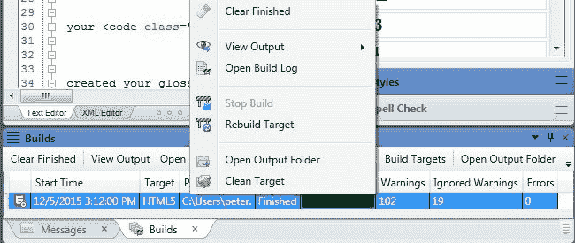

日志文件在主窗口中打开并显示“消息”（Messages）、“警告”（Warnings）和“错误”（Errors）选项卡。要查看警告列表，请在目标编辑器（Target Editor）中打开“警告”选项卡。可以使用目标编辑器配置显示哪些警告。

日志文件是一个 XML 文件，因此你可以在文本编辑器中打开它或用程序进行处理。默认输出目录为`Output\*username%\*target_name`，文件扩展名为`.mclog`。

[7] 如果你按照第 7.2 节“创建词表主题”所述创建了词表主题文件，你应该在该报告中这些它们，因为它们*不应该*出现在 TOC 中。

## 第 10 章 Flare 中的动态内容

你已经看到了如何在 Flare 界面内部使用自动同步以及在 Flare 外部使用脚本创建动态文档。本章引入了结合动态内容的其他几种方法。

### 10.1 包含内容

许多用例需要你在文档中包含内容，而不是在本地创建。高效地这样做可以减少你的工作量。

```html
<html xmlns:MadCap="http://www.madcapsoftware.com/Schemas/MadCap.xsd">

  <body>

    <script type="text/javascript">

      onload = function(){alert("Hello world!")}

    </script>

  </body>

</html>
```

当你在将此片段包含在主题中时，脚本将在页面加载时执行。

#### 10.1.2 变量

如果你以前处理过 XML，你可能熟悉实体（entities），特别是命名实体（named entities）。命名实体通常用于代表无法通过键盘直接键入的字符。例如，你可能使用一个实体来表示欧元货币符号 (€）。不过，你也可以将实体作为宏来管理你已知将会发生变化或在文档中重复的文本。

例如，如果你反复引用位于同一网站的文档，你可以定义一个名为`baseURL`的实体，如示例 10.2 所示：

**示例 10.2 – 实体定义**

```xml
<!DOCTYPE html
[
  <!ENTITY baseURL "http://www.example.com/productname/documentation/">
]>
```

你通过插入`&baseURL;`来引用此定义，而不是输入完整的 URL。

当你的文档被处理时，实体会被替换为它们定义的值。Flare 支持 XML 标准实体集（`&quot;`、`&amp;`、`&apos;`、`&lt;`和`&gt;`）。

然而，它并不完全支持本地定义的实体。你可以在 HTML 文件的 DOCTYPE 中定义命名实体。但是，Flare 不允许你在文件的主体中使用这些实体。这意味着你必须在导入时解析本地定义的实体，或者将它们转换为 Flare 变量，后者具有相同的作用。

##### 10.1.2.1 Flare 变量

假设你正在为一个尚没有固定名称的产品编写手册。你可以使用变量来代表产品名称，一旦确定了名称，你只需要更改一个文件中某行代码即可将文档更新为官方名称。

当你在 Flare 中创建变量时，你是在`Project\Variables`目录下的变量文件（扩展扩展为`.flvar`的 XML 文件）中创建一个条目。

示例 10.3 显示了`.flvar`文件的结构。

**示例 10.3 – 变量 Set 文件（`General.flvar`）**

```xml
<CatapultVariableSet conditions="">

  <Variable
    Name="ProductName"
    Comment="We're not sure what the final
    name for this product will be.
    This is the code name."
    Definition="">
    Vintage Port
  </Variable>

</CatapultVariableSet>
```

要在 Flare 主题中引用变量，请插入以下 XML 标签：

`<MadCap:variable name="General.ProductName" />`

在这种情况下，`General`标识 VariableSet 文件（`General.flvar`），该文件包含了变量`ProductName`的变量定义。如果你在导入到 Flare 的 HTML 文件中使用命名实体作为宏，你可以使用搜索和替换工具将这些实体转换为 Flare 变量。

变量让你能够更方便地在构建时自定义文档。你不再直接操作一个或多个主题文件的内容，而是操作单个 VariableSet 文件。第 12.4 节“创建文档标题”展示了如何进行操作。

### 10.1.3 使用 XInclude

*XInclude*是一种用于在 XML 文件中包含文档或文档部分的 XML 规范。通常情况下，片段（snippets）是重用 XML 文档片段的最佳方式。然而，对于某些用例，XInclude 可能是更好的选择。

例如，假设你的文档包含一个在其他地方维护的源代码文件。为了将该源代码作为 Flare 片段包含，你需要在包含之前将其封装在相应的 HTML 标签中。XInclude 允许你跳过此步骤，并如示例 10.4 所示包含该文件。

**示例 10.4 – 在 Flare 中使用 XInclude 文本文件**

```xml
<?xml version="1.0" encoding="utf-8"?>

<html xmlns:MadCap="http://www.madcapsoftware.com/Schemas/MadCap.xsd"
      xmlns:xi="http://www.w3.org/2001/XInclude">

  <head><title>Source Code</title></head>

  <body>

    <h1>Source Code</h1>

    <pre><xi:include href="external_file.c" parse="text" /></pre>

  </body>

</html>
```

这种方式的优点是，你可以原样使用该源代码文件。然而，Flare 不处理 XInclude 语句，因此你必须在生成输出之前处理包含操作。你可以使用带有`--xinclude`选项的`xmllint`命令来解析 XInclude 语句。

示例 10.4 显示了如何使用 XInclude 包含文本文件，但你也可以动态包含 HTML。假设你在文档库之外维护*Markdown*文件，并且在每次构建输出时都需要包含这些内容。要实现这一点，请采取以下步骤：

1. 使用`pandoc`[9]将你的 Markdown 文件转换为 XML 片段：

   `pandoc -f markdown -t html -o markdown.html mymarkdown.md`

2. 引用输出文件`markdown.html`。

**示例 10.5 – 在 Flare 中使用 XInclude HTML 文件**

```xml
<?xml version="1.0" encoding="utf-8"?>

<html xmlns:MadCap="http://www.madcapsoftware.com/Schemas/MadCap.xsd"
      xmlns:xi="http://www.w3.org/2001/XInclude">

  <body>

    <p>Some text here.</p>

    <xi:include href="markdown.html">

      <xi:fallback>

        <p>Markdown file not found.</p>

      </xi:fallback>

    </xi:include>

    <p>More text here.</p>

  </body>

</html>
```

3. 使用以下`xmllint`命令解析包含：

   `xmllint --xinclude main.html --output new.html`

这将创建一个名为`new.html`的文件，其包含`main.html`的内容。如果`xmllint`无法找到`markdown.html`，它将插入`<xi:fallback>`的内容。

**注意** 包含的内容必须是有效的 HTML。例如，你不能将带有`<body>`标签的内容包含到已有页面中。你可以使用 Ant 自动化 XInclude 任务（参见 A.7 节“包含文件”），并在 Flare 2016 r2 中，你可以使用构建前命令确保在生成输出之前包含文件（参见 11.7 节“构建前后处理”）。

### 10.2 其他 XML 对象

创建动态文档的其他重要元素包括：

- 条件允许你更改输出的内容或格式。
- 代理对象允许你创建 TOC 等对象。
- 主页允许你将相同的内容应用于不同的主题。
- Flare 内置的 JavaScript 控制可以帮助你呈现更吸引人的 HTML。

#### 10.2.1 条件文本

条件使 Flare 作为单源解决方案发挥工作并帮助动态文档。条件允许你确定相关内容是否出现在文档中。你可以将条件应用于整个页面，也可以应用于短语或单词等片段。条件文件位于`Project\ConditionSets`目录，扩展名为`.flcts`。根节点是`<CatapultConditionSet>`标签。示例 10.6 显示了一个示例条件。

**示例 10.6 – `<CatapultConditionSet>` XML 文件**

```xml
<CatapultConditionSet
  Comment="My set of condition tags"
  conditions="">

  <ConditionTag
    Comment="For print output only."
    Name="PrintOnly"
    BackgroundColor="Red" />

  <ConditionTag
    Comment="Exclusive to HTML"
    Name="online"
    BackgroundColor="Yellow" />

</CatapultConditionSet>
```


你可以通过 Flare UI 将内容标记为条件，也可以在 XML 中通过以下方法标记条件：

将内容封装在 `<MadCap:conditionalText>` 标签中，如下：

`<MadCap:conditionalText MadCap:conditions="Default.PrintOnly">`

与 Flare 变量一样，`MadCap:conditions` 属性引用条件文件名（不带扩展名）以及特定条件的 `Name` 属性。要使整个主题变为条件化，请为主题添加 `MadCap:conditions` 属性。

### 条件标记方法

- 根标签 `<html>`。（示例 7.7 中创建的词表文件使用了此种方法。）
- 在某些 Flare 专有标签上添加 `conditions` 属性。[10]

**注意**

对于图像文件等文件，Flare 会创建一个独立的 XML 属性文件来定义条件。此主题在标题为“属性文件”（Property files）的侧边栏中进行了讨论。

将 `Default.PrintOnly` 等条件与主题关联，本身并不足以完成工作。目标文件也必须感知这些条件。你目标文件中的 `ConditionTagExpression` 和 `conditions` 属性控制着条件。

要了解这些标签如何工作，请打开目标编辑器（Target Editor）并转到“条件文本”（Conditional Text）选项卡。要排除标记为 `Default.PrintOnly` 的主题或主题部分，请选择“条件文本”选项卡并勾选 `Default.PrintOnly` 对应的“排除”（Exclude）复选框。

Flare 会向目标文件添加以下属性：

`ConditionTagExpression="exclude[Default.PrintOnly]"`

要探索更复杂的条件表达式，请在 UI 中尝试不同的可能性，然后查看生成的目标文件。

#### 10.2.1.1. 条件与 TOC 文件

条件通常用于控制输出哪些文件或文件的部分。如预期的，如果你为 TOC 中 `<TocEntry>` 标签的 `conditions` 属性分配一个值，该条件就可以决定是否包含或排除该条目及其指向的内容。

然而，如果 `<TocEntry>` 标签指向另一个 TOC，且该 TOC 中的 `<CatapultToc>` 标签包含一个条件，则 Flare 在创建输出时将忽略 `<CatapultToc>` 标签上的条件。`<CatapultToc>` 标签上的条件仅在使用全局项目链接时有效（详情请参见第 V 部分“带有全局项目链接的模板项目”）。

对于主题级条件，除了使用条件外，你还有另一种选择。只需为每种输出类型创建单独的 TOC 文件，并在每个 TOC 中仅包含适当的文件。虽然这样做会导致重复，但有时可以更明确你的表达意图。

### 10.2.2. 代理 (Proxies)

Flare *代理*（proxy）是一个 XML 标签，告诉 Flare 在何处插入某些内容。代理可用于创建目录、词表、列表以及许多其他对象。如果代理引用的对象发生变化，相关的代理将自动更新；这是使用代理的主要优势。

我在第 7 章中讨论过词表代理。这里是另外两个实用的代理：

- **迷你目录 (Mini-TOC)：** 创建一个部分目录。
- **列表 (List-Of)：** 创建特定元素的列表。

#### 10.2.2.1. 迷你目录 (Mini-TOC)

Mini-TOC 代理允许你在特定位置插入本地目录。要从 Flare UI 创建迷你目录，请打开一个主题文件，将光标置于想要创建本地目录的地方，然后从“插入”（Insert）菜单下的“代理”（Proxy）菜单中插入迷你目录。

当你插入 Mini-TOC 代理时，你可以选择指定目录的深度。这决定了哪些标题标签会显示出来。例如，如果你将深度设置为 `2` 且当前标题标签为 `<h2>`，则该目录将仅包含当前位置下方的 `<h3>` 和 `<h4>` 标签；较低级别的标签（如 `<h5>` 或 `<h6>`）将不会出现。

Mini-TOC 代理的 XML 非常简单。以下是一个深度为 `2` 的代理示例：

`<MadCap:miniTocProxy style="mc-toc-depth: 2;" />`

#### 10.2.2.2. List-Of 代理

List-Of 代理创建一组指向具有相同标签和相同 `class` 属性值的元素的超链接列表。例如，如果你使用 `<div>` 标签标记插图标题，并将 `class` 属性设置为 `fig-title`，你就可以通过引用标签类型及其类名来创建插图列表。你可以像插入 Mini-TOC 代理相同的方法，从 Flare UI 中通过“代理”（Proxy）菜单插入此列表的代理。以下是生成的代理：

`<MadCap:listOfProxy style="mc-list-of-tag:div;mc-list-of-class:fig-tit`

此示例创建了一个列表，显示了所有 `class` 属性值为 `fig-title` 的 `<div>` 标签的文本超链接。Flare 使用每个 `<div>` 标签的文本作为链接文本。此功能让你能够创建图像文件、示例、表格和类似元素的列表。

### 10.2.3. 主页 (Master pages)

要将片段（snippets）或代理应用到多个页面，你可以将它们添加到主页，而不是单个主题中。主页的文件扩展名为 `.flmsp`，可以在 `Content\Resources\MasterPages` 目录下找到。你可以将主页与目标文件或特定主题关联。你可以从零开始创建一个新的主页，也可以编辑现有的主页并以新名称保存，使用扩展名 `.flmsp`。

主页让你在每个页面的相同位置添加内容，如页眉、页脚和代理。主页还让你能够轻松地为每个页面添加动态内容。

当你想要添加可以放置在页面任何地方的内容（如脚本块）时，主页也非常有用。如果你有一个片段，例如侧边栏中标题为“片段和 JavaScript”（Snippets and JavaScript）所示的，你可以将其包含在主页中，而不是包含在每个主题中。

#### 10.2.3.1. 主页与主题

从 Flare UI，你可以在“属性”（Properties）选项卡将主题与新主页关联。然而，如果你想手动执行此操作，可以在 CSS 文件创建一个指向主页样式。步骤如下：

1. 在 `<html>` 标签上添加带有 `class` 属性的属性 `other`。
2. 在所示 CSS 文件中添加主页的引用：

   ```css
   html.other
   {
    mc-master-page: url('../MasterPages/other.flmsp');
   }
   ```

3. 设置 `url` 的值为相对于 CSS 文件的位置。在前面的示例中，CSS 文件位于。

#### 10.2.3.2. 主页与目标

如果你为项目设置了 `MasterStylesheet` 属性，目标主页将默认使用该值。要更改目标的主页，打开目标编辑器并在“高级”（Advanced）选项卡上更改主页属性。这指向 `<Target>` 标签。

### 10.2.4. 折叠器 (Toggler) 与弹出窗口 (Popups)

Flare 拥有两个类似于 JQuery 库的功能：折叠器和弹出窗口。Flare 折叠器控制元素的可见性。例如，假设你有一张只有部分读者感兴趣的大表。你可以添加一个折叠器控件以免干扰其他读者。

要设置折叠器，将表格封装在 `<MadCap:toggler>` 标签中：

`<MadCap:toggler targets="My Table">My Table Title</MadCap:toggler>`

然后，通过为表格添加 `MadCap:targetName` 属性来识别目标表格：

`<table MadCap:targetName="My Table">`

`MadCap:targetName` 和 `targets` 属性的值必须匹配。你可以在 `targets` 属性中命名多个目标。

当你打开包含折叠器的主题文件时，封装在 `<MadCap:toggler>` 标签中的文本左侧会出现折叠器图标。点击此图标将显示隐藏的文本。

Flare 弹出窗口创建类似于 JQuery 弹出窗口的效果。要创建文本弹出窗口，请在希望弹出窗口出现的位置插入以下 XML 文本：

```xml
<MadCap:popup>
 <MadCap:popupHead>某些文本</MadCap:popupHead>
 <MadCap:popupBody>在此处放置解释性文本。</MadCap:popupBody>
</MadCap:popup>
```

[8] 此示例假设你的片段文件位于

[9] 请确保省略 `-s` 参数，因为你需要的是*片段*，而不是完整的 HTML 文件。

[10] `conditions` 属性有效于大多数 Flare 专有根标签以及某些非根标签。例如，`<TocEntry>` 标签支持 `conditions` 属性。由于 MadCap 不发布其专有架构，你可能需要通过实验来确定何时何可以使用 `conditions` 属性。

## 第 11 章 脚本任务

由于 Flare 文件是 XML 文件，你可以使用脚本来执行某些无法通过用户界面完成，或者通过界面操作会非常繁琐的任务。在本章中，我将探索几个可以使用脚本自动化的任务，包括删除空 `<p>` 标签、格式化 JSON 代码以及将 XML 注释转换为 Flare 注释。

这里提供的脚本可以用于任何*格式良好*的 HTML 文件，而不仅仅是 Flare 生成的文件。只要你的文件格式正确，它们就不不必是有效的 XHTML。例如，它们可以缺少 `<head>` 标签，或者可以包含 Flare 专有标记。

出于这个原因，这些脚本可以在导入之前或之后使用。但是，请注意，创建注释的脚本会添加 Flare 专有标记，这会抑制 `tidy` 等工具的功能。

Ant 可以帮助你自动化脚本的执行（详情请参见附录 A，“在 Flare 中使用 Apache Ant”）。如果你运行 Flare 2016 r2 版本，第 11.7 节“预/后构建过程（Flare 2016 r2 及更高版本）”描述了如何在每次文档构建之前自动触发脚本。

### 11.1. 删除空 `<p>` 标签

当你将文档转换为 HTML 格式时，转换器可能会创建空 `<p>` 标签。Flare XML 编辑器有时也会创建空 `<p>` 标签。`tidy` 工具具有删除空段落的选项，但你无法对包含 MadCap 专有 XML 的 HTML 文件使用 `tidy`。因此，有一个脚本来执行此操作非常方便。

**注意**

Flare XML 编辑器可能会创建带有指示分页的 `class` 属性的空段落，有时还会创建一个带有 `id` 属性的空段落。为了保留这些信息，此脚本不会移除包含属性的 `<p>` 标签。示例 11.1 中的脚本移除当前目录下每个 HTML 文件中的空 `<p>` 标签并在更新每个文件时输出消息。

**示例 11.1 – 删除空 `<p>` 标签的脚本**

```php
<?php

/**
 * 在 Flare 中很容易意外创建空
 * <p> 标签（或仅包含 nbsp 的 <p> 标签）。
 * 在当前目录中搜索没有 class 或 id 属性的空 <p> 标签并将其删除。
 * © 2017 Moneris Solutions Corporation, CC-BY-NC -SA 4.0
 */

error_reporting(E_ERROR);

//在当前目录中查找所有 HTML 文件
foreach (glob("./*.xhtml,html,htm}", GLOB_BRACE) as $file) {
  $d = new DOMDocument();
  $d->formatOutput = true;
  $changed = false;

  // 加载文档
  $d->load($file);
  $xpath = new DOMXPath($d);
  $ns = $d->documentElement->namespaceURI;

  if ($ns) {
    $xpath->registerNamespace("ns", $ns);
    $nodelist = $xpath->query("//ns:p[not(@*) and normalize-space(text())='' and not(*)]");
  } else {
    $nodelist = $xpath->query("//p[not(@*) and normalize-space(text())='' and not(*)]");
  }

  // 在此处遍历列表
  if ($nodelist->item(0)) {
    foreach ($nodelist as $node) {
      $parent = $node->parentNode;
      $parent->removeChild($node);
      $changed = true;
    }
  }

  if ($changed) {
    $d->save($file);
    echo "Updated $file.\n";
  }
}
?>
```

此查询选择了没有属性、没有文本（空白除外）且没有子节点的 `<p>` 标签。为了保留仅包含注释的 `<p>` 标签，请在此行（最后的“]”之前）添加以下代码：`and not(./comment())`

此循环删除了之前的 XPath 查询选中的标签。如果你不是 XPath 专家，另一种可选方法是选择所有 `<p>` 标签，然后在此循环内部运行一系列测试，并移除符合所需标准的标签。

### 11.2. 改进搜索结果

Flare HTML 目标具有搜索功能，为你的读者提供此功能通常是一个好主意。与其他搜索引擎一样，Flare 搜索使用 `<title>` 标签的内容作为搜索结果的链接文本。如果你的源文件中没有 `<title>` 标签，Flare 在生成输出时会创建一个，并将一级标题复制到其中。

在 Flare 内部，你可以创建没有 `<title>` 标签的主题文件。由于在这种情况下 Flare 会自动从一级标题创建 `<title>` 标签，因此标题和头部将始终匹配。然而，在 Flare 之外创建的 HTML 文件通常都有 `<title>` 标签，因为你无法创建一个没有标题的 XHTML 页面。

当你将文档转换为 HTML 并导入 Flare 时，`<title>` 和一级标题之间很容易不同步。这两个元素之间的差异可能会误导读者，而且由于某些目标（例如 WebHelp）只返回 `<title>` 标签的内容，该标签的准确性非常重要。

由于 `<title>` 不直观，你可能不知道它是否与标题匹配。因此，需要另一种方法来确定标题和头部不一致的情况。如果你按照第 5.2 节删除了 `<title>` 标签，可以使用此脚本创建一个显示所有标题和头部不匹配的文件。此脚本会忽略没有 `<title>` 标签的文件。

**示例 11.2 – 识别不匹配标题的脚本**

```php
<?php

/**
 * 对比标题和头部。
 * 识别它们不同的页面。
 * Flare 中的搜索工具显示头部的值，可能会产生误导。
 * © 2017 Moneris Solutions Corporation, CC-BY-NC -SA 4.0
 */

error_reporting(E_ERROR);

$dest = "_titles.html";

//创建头部数组，键名为文件名
$headers = getHeaders();

$contents = findDifferences($headers);

file_put_contents($dest, $contents);

exec("firefox $dest");

/**
 * 创建头部数组
 * @return Array
 */
function getHeaders() {
  $headers = Array();

  foreach (glob("./*.xhtml,html,htm}", GLOB_BRACE) as $file) {
    $file = basename($file);
    $query = "//ns:h1 or self::h2 or self::h3";
    $nodelist = getNodes($file, $query);

    //获取第一个项
    if ($nodelist->item(0)) {
      //文件名作为键，头部为值
      $headers[$file] = $nodelist->item(0)->nodeValue;
    } else {
      $headers[$file] = "";
    }
  }

  return $headers;
}

/**
 * 将头部数组与标题对比
 * @param Array $headers 头部数组
 * @return $contents HTML页面
 */
function findDifferences($headers) {
  $s = " style=\"font-family: Courier;";
```


`$contents = "<<html><body $s><h1>Title & Header Differences</h1>";`

在当前目录中查找所有 HTML 文件：

```
foreach (glob("./*.xhtml,html,htm}", GLOB_BRACE) as $file){ 
```


```
$file = basename($file);
$query = "//ns:title";
$elements = getNodes($file, $query);
if($elements->item(0)){ //仅关注有标题的情况
```


去除空白：

```
$title = preg_replace('/\s+/', '', $elements->item(0)->nodeValue;
$header = preg_replace('/\s+/', '', $headers[$file]); 
if ($title != $header){ 
```


```
$message = "Mismatch in " . $file;
$length = strlen($message); 
$contents .= "\n<br /><p>$message</p>\n";
$contents .= "<p>" . str_repeat("-", $length) . "</p>\n"; 
$contents .= "<p> &nbsp;title: " . $elements->item(0)->nodeValue;
$contents .= "<br />header: " . $headers[$file] . "</p>\n";
}
}
}
$contents .="</body></html>";
return $contents;
}
```

执行查询并返回列表：

```
/**
 * 执行查询并返回列表
 * @param string $file 文件名
 * @param string $query 要执行的查询
 * @return DOMNodeList
 */
function getNodes($file, $query){ 
  $d = new DOMDocument();
  $d->load($file);
  $xpath = new DOMXPath($d);
  $ns = $d->documentElement->namespaceURI;
  if($ns) {
    $xpath->registerNamespace("ns", $ns);
  } else {
    //移除 "ns:"
    $query = str_replace("ns:", "", $query);
  }
  return $xpath->query($query);
}
```

```
$nodes = $xpath->query($query);
return $nodes;
}
?>
```


输出文件名不应与其他主题文件名冲突。如果冲突，请更改它。


如果 Firefox 在你的环境变量中，此行代码将打开输出文件。请根据你的环境对其进行必要的修改。


查找第一个标题标签。此脚本不会查找大于 `<h3>` 的标签。


将第一个标题作为关联数组中的值。如果没有找到标题，则将值设置为空字符串。使用文件名作为键。


再次遍历文件，以比较标题文本与头部文本。


只有在存在 `<title>` 的情况下，才对标题和 `<title>` 进行比较。如果没有 `<title>`，则没有混淆的理由。


去除头部和标题中的空白，以便进行准确的比较。


如果没有匹配，捕获文件名并记录差异。如果完全没有差异，输出页面将仅显示页面头部 `Title & Header Differences`。

运行此脚本并将输出文件加载到浏览器后，你应该看到类似示例 11.3 的内容。

**示例 11.3 – 示例 11.2 的样本输出**

```
Title & Header Differences
Mismatch in about.css.controls.html
-----------------------------------
title: Styles
header: Flare-specific styles
Mismatch in flglo.html
----------------------
title: Create a Flare glossary
header: Create a glossary 
```

根据输出结果，你可以决定是否删除或修改你的 `<title>` 标签。

## 11.3 将注释转换为注解

如果你想向 XML 文档添加注释，可以通过将其封装在如下所示的注释块中：

`<!--Comment text-->`。

Flare 还支持使用注释向文档添加注释。Flare 注释的优点是在 Flare XML 编辑器中可见，并可以使用项目分析工具轻松定位。

MadCap 注释具有以下结构：

**示例 11.4 – `<MadCap:annotation>` 标签**

```xml
<MadCap:annotation
  MadCap:createDate="2017-01-06T09:47:15.8548167-04:00"
  MadCap:creator="Your.Name"
  MadCap:initials="YN"
  MadCap:comment="This term is not yet defined."
  MadCap:editor="Your.Name"
  MadCap:editDate="2017-01-06T09:47:27.0019313-04:00">
  Text for annotation goes here.
</MadCap:annotation>
```

如示例 11.4 所示，`<MadCap:annotation>` 标签有多个属性，并包裹了它所注解的内容。

示例 11.5 中的脚本将所有以 `<!--Annotation:` 开头的注释转换为 Flare 注释。它对当前目录下的所有 HTML 文件进行操作。通过只转换标记过的注释，你可以选择想要将哪些注释转换为 Flare 注释。

如果你在 Flare 之外编辑主题并想添加注解，此脚本也很有有用。由于其属性众多，手动实现 `<MadCap:annotation>` 是繁琐的。相反，你可以添加一个以 `Annotation:` 开头的注释，稍后运行示例 11.5 中的脚本将该注释转换为注解。

**示例 11.5 – 创建注解的脚本**

```php
<?php
/**
 * 将当前目录下所有文件的注释转换为注解
 * <!--Annotation: ... --> 变为 <MadCap:annotation>
 * 更改 $username 和 $initials 变量的值
 * © 2017 Moneris Solutions Corporation, CC-BY-NC -SA 4.0
 */
error_reporting(E_ERROR);
$username = "YourName";
$initials = "YN";
$tz = "America/New_York";

// 查找当前目录下的所有 HTML 文件
foreach (glob("./{xhtml,html,htm}") as $file) {
    $changed = false;
    $d = new DOMDocument();
    $d->load($file);
    $xp = new DOMXPath($d);
    // 无命名空间
    $nodelist = $xp->query('//comment');
    // 检查列表中是否有内容
    if ($nodelist->length > 0) {
        foreach ($nodelist as $node) {
            // 检查是否以 "Annotation:" 开头
            $quest = trim(substr($node->nodeValue, 0, 11));
            if($quest == "Annotation:") {
                $note = $d->createElement('MadCap:annotation');
                $note->setAttribute("MadCap:creator", $username);
                $note->setAttribute("MadCap:initials", $initials);
                // 设置时区
                date_default_timezone_set($tz);
                $date = date('Y-m-d\TH:i:s');
                $note->setAttribute("MadCap:createDate", $date);
                $note->setAttribute("MadCap:comment", $node->nodeValue);
                // $note->setAttribute("class", "annotation");
                $note->nodeValue = htmlentities($node->nodeValue);
                $parent = $node->parentNode;
                $parent->replaceChild($note, $node);
                $changed = true;
            }
        }
        if ($changed) {
            $d->save($file);
            echo "Saved $file.\n";
        }
    }
}
?>
```

请确保初始化此以及后续变量并赋予适当的值。

```php
$char = $json[$i];
$new_line_level = NULL;
$post = "";
if( $ends_line_level !== NULL ) {
    $new_line_level = $ends_line_level;
    $ends_line_level = NULL;
}
if( $char === '"' && $prev_char != '\\' ) {
    $in_quotes = !$in_quotes;
} else if( ! $in_quotes ) {
    switch( $char ) {
        case '}': case '\]':
            $level--;
            $ends_line_level = NULL;
            $new_line_level = $level;
            break;
        case '{': case '\[':
            $level++;
        case ',':
            $ends_line_level = $level;
            break;
        case ':':
            $post = " ";
            break;
        case " ": case "\t": case "\n": case "\r":
            $char = "";
            $ends_line_level = $new_line_level;
            $new_line_level = NULL;
            break;
    }
}
if( $new_line_level !== NULL ) {
    $result .= "\n".str_repeat( $tab, $new_line_level );
}
$result .= $char.$post;
$prev_char = $char;
}
return $result;
}
?>
```


将输入文件名作为参数传递给此函数。


`<pre>` 标签必须将 `class` 属性设置为 `json`。


调用 `pretty_print` 函数，该函数会格式化 `<pre>` 标签的内容。用格式化的 JSON 文本替换原始 JSON 文本。


改编自 Kendall Hopkins 在 stackoverflow 网站发布的代码。


将制表符定义为两个空格。根据需要进行调整。

**警告**

仅对包含纯文本且无标记的 `<pre>` 标签使用此脚本。如果文中嵌入了其他 HTML 标签，将无法运行。在使用脚本之前，请备份您的文件，或者如果您使用版本控制软件，请提交任何未完成的更改。

此脚本不会格式化格式错误的 JSON，因此你可以用它来验证 JSON 代码块。

## 11.5 设置最大行长度

对于 PDF 等固定宽度输出格式，`<pre>` 等逐字标签中的长行代码可能会出现问题；如果行长度超过了页边距，内容将被截断。调整长行并不困难，但当你使用 XInclude 等工具自动包含逐字内容时，你必须同时自动检测并处理长行。

CSS 提供了一种解决方案：添加媒体打印样式，例如：`pre {white-space: pre-wrap;}`。这种样式允许 `<pre>` 标签中的文本换行。然而，这种解决方案并没有告知读者引入了换行，而且你无法控制换行发生的位置。示例 11.7 中的脚本在固定位置断行，因此行不会被截断。与示例 11.6 一样，你应该只对由 `<pre>` 标签包围的纯文本使用此脚本。但与示例 11.6 不同，此脚本处理所有的 `<pre>` 标签，而不仅仅是 `class` 属性设置为 `json` 的标签。

**示例 11.7 – 用于断长行的脚本**

```php
<?php
/**
 * 查找带有长行的 pre 标签并使用 » 字符将其中断。
 * @param string $argv[1] 正在处理的文件
 */
$source = $argv[1];
$wrap = 78; 
```


```php
$d = new DOMDocument();
$d->load($source);
$xp = new DOMXPath($d);
$ns = $d->documentElement->namespaceURI;
if ($ns) {
    $xp->registerNamespace("ns", $ns);
    $elements = $xp->query('//ns:pre');
} else {
    $elements = $xp->query('//pre');
}
for ($i = 0; $i < $elements->length; $i++) {
    $element = $elements->item($i);
    $content = $element->textContent;
    $newcontent = truncate($content, $wrap);
    if ($newcontent != "") { //赋值给文本节点
```


```php
$element->replaceChild(new DOMText($newcontent), $element);
```

```php
function truncate($all, $wrap) {
    $array = explode("\n", $all);
    $contents = "";

    foreach ($array as $val) {
        if (strlen($val) > $wrap) {
            $val = substr($val, 0, $wrap) . "»";
        }

        $contents .= $val . "\n";
    }

    return trim($contents);
}
```

[11] 有关 `madbuild.exe` 命令的详细讨论，请参阅 *MadCap Flare for Programmers* [Tregner, 2015] 和 *Flare Project Guide* [MadCap Project, 2016]。

[12] 由于显示行长度限制，示例中的 PHP 调用似乎分成了两行。然而，你应该单行输入该命令。

## 第 12 章 项目的脚本化创建

尽管你可能从哈利·波特那里中学到了一些东西，但巫师们并没有他们那么神。他们执行一次性操作非常容易，但如果你有许多项目需要导入，创建一个是有是有的。有些任务无法自动化，但许多任务可以通过脚本实现，通过这种方式创建项目可以节省时间并提高准确性。

到为止，我们已经看到了如何实现：

- 从现有的 HTML 目录创建 Flare TOC
- 从 HTML 词表创建 Flare 词汇表文件
- 直接将 HTML 文件复制到项目中
- 在 Flare 项目中使用你自己的 CSS 文件

本章描述了你需要执行的任务，并识别了为了创建一个完整的 Flare 项目而需要修改的 XML 文件。它没有提供示例脚本；任何示例脚本都需要经过大量的编辑才能满足你的需求。

如果你能像前面的章节描述的那样操作 HTML 文件，那么使用脚本创建新的 Flare 项目将相当。第一步是导出一个可以作为项目原型的项目。

### 12.1. 导出项目

如果你有一个常用设置的现有项目，可以导出该项目来创建一个原型。你可以通过从 `Content` 和 `Project` 目录复制选定的文件来实现，但使用 Flare 界面要简单得多。

要从 Flare 界面创建原型项目，请选择文件（File）菜单下的导出项目（Export Project）选项。这将导出项目向导。

在初始屏幕上，为你的原型命名并选择新项目路径（New Project Path）。在“源自”（Export From）下拉框中，选择选择文件（Select Files）。这允许你选择 `Content` 和 `Project` 目录中的任何或所有文件或目录。

你还需要从“输出”（Output:）下拉列表中选择一种输出类型。选项有：Zip 文件（Zip Files）、项目文件（Project Files）、项目模板（Project Template）和增强现实项目（Augmented Reality Project）。选择项目文件，如果你计划从其他项目创建类似的原型，请勾选保存设置（Save settings）复选框。

你接下来还有一个可以将变量和片段转换为文本的选项。此选项会将变量和片段的内容嵌入到相应位置。当你的内容文件引用了变量或片段，但你不想导出包含这些变量或片段的文件时，请使用此选项。

进入下一个屏幕后，你可以选择 `Content` 目录中的文件。你应该能看到类似于图 12.1 的屏幕：

**图 12.1 – 导出内容文件**

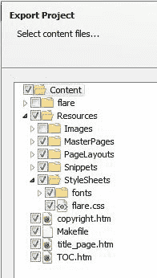

展开目录以选择你想要在原型中的哪些文件以及想要排除哪些文件。你可能想要保存的文件包括：CSS 文件、页面布局、主页、片段（snippets）和图像文件。另一方面，大多数主题文件将特定于某个项目，因此你可能会跳过大部分文件。

点击“下一步”进入用于选择从 `Project` 目录中文件的屏幕。你无疑不想保留 `Project\TOCs` 目录中的 TOC 文件，因为它们与特定的内容文件相关。否则，根据你的需要选择或丢弃文件。如有疑问，请选择文件——从你的原型中删除文件很容易的。

完成后，点击“完成”（Finish）按钮。

### 12.2. 检查导出的项目

创建原型项目后，你应该检查每个文件，并决定是按原保留、修改还是删除它们。你可能会发现只需要某些文件的部分内容。例如，如果你导出了词表，某些术语可能是项目特定的，应该被删除。以下是一些需要特别注意的项：

- **图像文件：** 保留你在不同项目中使用的图像文件，例如公司 Logo 或背景图像。
- **主页中的嵌入内容：** 寻找可以用变量或片段替换的字文本。
- **打印特定的页面布局：** 如果你的原型仅用于 HTML 输出，请删除它们。
- **片段 (Snippets)：** 如果你还没有嵌入它们，请保留片段。
- **CSS 样式：** 某些样式适用于多个项目，但你可能需要编辑你的 CSS。
- **MasterStylesheet 属性：** 如果你没有复制主样式表，请更新项目文件的 `MasterStylesheet` 属性。此操作详见第 12.5 节“从原型创建新项目”。
- **标题页：** 你可能可以使用现有标题页的格式，但内容可能需要更改。
- **条件 (Conditions)：** 某些条件适用于多个项目。然而，你可能需要更新项目特定的条件。
- **链接的主题：** 如果你的词表包含链接主题，请确保导出主题文件。如果你正在使用 Flare 12 或更高版本，请考虑在词表中使用条件。
- **皮肤文件 (Skin files)：** 皮肤文件的存在与否可能需要更改皮肤（skin）。对皮肤的更改请见阅第 12.5 节“从原型创建新项目”。
- **目标文件 (Target files)：** 你可能不需要更改，但你可能需要更改。
- **TOCs 目录：** 该目录通常是空的，至少对于 HTML 而言是如此。
- **变量：** 检查以确定变量是否为多个项目共有。在 Flare 12 中，你可以将此字段设置为变量。
- **项目文件：** 项目文件非常重要。每当你创建一个新项目时，你可能都需要更改它。

### 12.3. 创建 PDF 目标

当你导出 PDF 目标时，需要进行一些更改。例如，如果你在原始项目中分配了输出文件名，你很可能需要更改它，你可以通过用户界面完成操作。

你也可以使用文本编辑器更改目标文件（`.fltar`）根节点的 `OutputFile` 属性来分配输出文件名，但我建议你第一次使用界面，这样你就可以熟悉目标属性。通过在 Flare 中打开新项目并选择 PDF 目标来实现操作。在目标编辑器（Target Editor）中打开它并点击常规（General）选项卡；你应该看到类似于图 12.2 的内容：

**图 12.2 – PDF 目标编辑器**

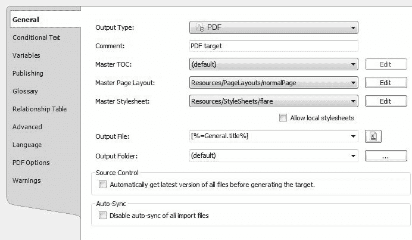

**注意**

图 12.2 截自 Flare 12。版本 11 不提供允许本地样式表（Allow local stylesheets）复选框，且不支持在输出文件字段中使用变量。在 Flare 2016 r2 中，目标编辑器还有一个生成事件（Build Events）选项卡。有关该功能的描述，请参阅第 11.7 节“生成前后生成过程（Flare 2016 r2 及更高版本）”。

使用目标编辑器中的选项卡设置属性。以下是最常用的选项卡：

- **常规 (General)：** 如果你有一个 TOC 文件，不需要担心主 TOC 文件名。同样，如果你导出了页面布局和样式表，就不必担心主页面布局和 `MasterStylesheet` 属性。然而，输出文件属性默认使用项目名称。你可能需要将其更改为适用于你当前项目的值。在 Flare 12 中，你可以将此字段设置为变量。此外，注意自动同步（Auto-Sync）复选框。如果你需要在 Flare 构建输出时更新导入的 HTML 文件，请不要禁用自动同步。
- **词表 (Glossary)：** 此选项卡调整 PDF 目标的词汇表属性。
- **高级 (Advanced)：** 此选项卡设置 TOC、词表和索引代理。如果你不是通过自定义这些元素，你可以从此选项卡自动包含它们。
- **PDF 选项：** 在其他方面，此选项卡设置了文档标题和作者等元数据。你可能需要更改这些大多数属性。若要在 PDF 阅读器的书签窗格中显示书签，请设置“在书签窗格中包含非目录书签”选项。

要使用脚本进行此类更改，你需要更改 PDF 目标文件。目标文件使用扩展名 `.fltar`，并位于 `Project\Targets` 目录。示例 12.1 显示了一个示例 `.fltar` 文件。

**示例 12.1 – 示例 PDF `.fltar` 文件**

```xml
<?xml version="1.0" encoding="utf-8"?>
<CatapultTarget
  Version="2"
  Comment="New Target"
  Type="PDF"
  Destinations=""
  InjectEmptyPages="true"
  ConditionTagExpression="exclude[General.online]"
  Medium="print"
  PatchHeadingLevels="false"
  MasterPageLayout="/Content/Resources/PageLayouts/normalPage.flpgl"
  GlossaryTermConversion="marked"
  DisableAutoSync="false"
  OutputFile="[%=General.title%]">
  <PrintedOutput
    CollapseMargins="true"
    GenerateTOCProxy="false"
    GenerateIndexProxy="false"
    GenerateGlossaryProxy="false" />
  <PDF
    ShowUsedBookmarks="false"
    PageLayout="SinglePage"
    TitleBar="FileName" />
  <Glossaries />
  <DocumentProperties
    Title="[%=General.title%]"
    Author="[%=General.author%]"
    Subject="[%=General.subjects%]" />
</CatapultTarget>
```


要设置 PDF 目标的输出文件名，请设置 `CatapultTarget` 元素的 `OutputFile` 属性。从 Flare 12 开始，将其设置为变量。使用变量可能比更新 PDF 目标文件更简单。请注意在 XML 文件内部引用变量时使用的语法。为变量赋值的脚本描述见第 12.4 节“创建文档标题”。

通过将 `<PrintedOutput>` 标签的 `GenerateGlossaryProxy` 属性设置为 `True` 来包含术语表代理。你可以对其他代理属性执行相同的操作。

要更改文件元数据，请更改 `DocumentProperties` 属性。你可以在 PDF 阅读器中查看这些内容；例如，在 Adobe Reader 中，你可以从文件菜单下的属性项查看它们。在 Flare 12 中你可以对这些属性使用变量。

### 12.4. 创建文档标题

当你通过 Flare 用户界面创建 PDF 文档时，你需要添加文档名称。前一节显示了如何使用变量和 `Title` 属性来实现。但你还需要在内容文件、标题页以及可能的页脚中设置文档名称或标题。在 Flare 中通过使用变量可以轻松实现。

在构建时设置变量的值比操作主题文件的内容简单得多，特别是当你在不同位置引用同一个变量时。你可以通过更改一个 `CatapultVariableSet` 文件中的一个变量来更新整个项目。例如，你可以使用 Flare UI 定义一个名为 `title` 的变量但不为其赋值。结果是一个类似于如下所示的 Flare 变量定义文件：

**示例 12.2 – 带有空变量的变量定义文件**

```xml
<?xml version="1.0" encoding="utf-8"?>
<CatapultVariableSet>
  <Variable Name="title"></Variable>
</CatapultVariableSet>
```

在项目的适当位置插入对此变量的引用，例如：

`<p class="DocumentTitle"><MadCap:variable name="General.title" /></p>`

**注意**

在主题文件内部引用变量名时，使用不带扩展名（`.flvar`）的变量集文件名，后跟变量名。示例 12.2 假设 `title` 变量定义在名为 `General.flvar` 的文件中。你也可以从页面布局和主页引用变量。

使用示例 12.3 中的脚本在构建时设置 `title` 变量的值。

**示例 12.3 – 设置变量值的的脚本**

```php
<?php

/**
 * 通过为变量赋值，在运行时
 * 处设置文档名称。
 * @param $argv[1] .flvar 文件名
 * @param $argv[2] 文档名称的值
 */

if ($argc != 3) {
    echo "Incorrect number of parameters.";
    exit(1);
}

$source = $argv[1];
$value = $argv[2];

$doc = new DOMDocument();
$doc->load($source);

$xpath = new DOMXPath($doc);

// 查找变量
$nodes = $xpath->query("//Variable[@Name='title']");

// 创建文本节点
$text = $doc->createTextNode($value);

// 此名称应该只有一个变量
$nodes->item(0)->appendChild($text);

$doc->save($source);
?>
```

如果你使用变量集文件的完整路径，可以从任何目录运行此脚本。你想要赋值给 `title` 变量的值。XPath 查询将找到 `Name="title"` 的变量。将文本节点附加变量。

### 12.5. 从原型创建新项目

现在我们已经看了如何创建原型，让我们看看如何使用原型创建一个新项目。自然地，你需要做的更改取决于特定的项目和原型。同样，从原型创建新项目的步骤也会所不同。但通常情况下，创建新项目的脚本包含以下步骤：

- 创建一个以新项目命名的目录，并将原型目录的内容复制到该目录。
- 将项目文件（`.flprj`）重命名为项目名称。
- 为任何变量赋值（注意 Flare 中变量的限制）。
- 如果原型不包含 CSS 文件，请将新的 CSS 文件复制到 `Content\Resources\StyleSheets` 目录。
- 如果你使用的是新的 CSS 文件，在项目文件或目标文件中设置 `MasterStylesheet` 属性的值。以下是在项目文件中设置的方法：

```xml
<?xml version="1.0" encoding="utf-8"?>
<CatapultProject
  Version="1"
  xml:lang="en-us"
  MasterStylesheet="/Content/Resources/StyleSheets/flare.css"/>
```


要将 CSS 文件与特定目标关联，请更改目标文件的 `MasterStylesheet` 属性。

- 准备导入 HTML 文件。当使用 Flare 界面导入 HTML 时，Flare 会检查有效性、修正任何小错误并在时添加 XML 声明。**如果你手动将 HTML 文件复制到 Flare 项目，这些文件必须是有效的 XML 并且具有 XML 声明。** 将有效的 HTML 文件复制到 `Content` 目录或子目录。如果你正在导入 TOC 文件，请确保将 HTML 文件复制到 TOC 中定义的位置。
- 如果你有一个新的 Flare TOC 文件，将其复制到 `Project\TOCs` 目录，然后将项目文件 `<CatapultProject>` 元素的 `MasterToc` 属性设置为你的 TOC 文件名，如下所示：

`MasterToc="/Project/TOCs/myimport.fltoc"`

如果你的 TOC 文件与目标文件而非项目文件关联，请更改目标文件的 `MasterToc` 属性。
- 如果你有新的术语表文件，将其复制到 `Project\Glossaries` 目录。此外，如果你正在创建一个 HTML 项目，请确保皮肤具有术语表标签页。通过设置 `Project\Skins` 目录中相应皮肤文件中 `<CatapultSkin>` 元素的 `Tabs` 属性来实现。示例 12.4 包含一个示例 HTML5 三栏式 `<CatapultSkin>` 元素。

如果你的词语表使用了链接主题文件，请确保这些文件位于 `Content` 目录下的正确位置。例如，如果所有的词语表主题文件都在 `Content\glossary_entries` 目录下，那么词语表文件中每个 `<Definition>` 的 `Link` 属性应该指向 `/Content/glossary_entries` 目录。如果适用，你还应该在 `Tabs` 属性中添加 `Index` 或 `Search`。

9. 将任何其他资源复制到 `Content\Resources` 目录。注意，并不要求将图像文件等资源放置在此目录中。例如，你可以指向 `Content` 目录下的 `images` 目录。

你可能可以创建一个脚本，用来创建项目、打开 Flare 并立即生成 HTML 输出。如果生成失败，请遵循第 9.6 节“故障排除”中的故障排除指南。

### 12.6. 创建自定义文档

Flare 鼓励创建类似 DITA 的独立主题。这种主题结合了从原型创建项目的能力，暗示了混合和组合现有主题的可能性——换句话说就是创建自定义文档。

你对这个想法的追求程度取决于你的需求和文档的性质。在光谱的一端，它可能仅意味着从现有项目中导入主题，然后重新排列它们以创建自定义文档。这让你只需花很少精力就能一个新文档，而且如果你对导入的主题进行自动同步，Flare 将会在每次重新生成自定义文档时应用更新。

在光谱更有野心的一端，你可能可以在不使用 Flare UI 的情况下动态构建文档。你可以创建一个接口，让任何用户（即使是不熟悉 Flare 的用户）也能创建自定义文档。创建此类文档的步骤如下：

1. 将原型项目复制到新目录。
2. 为复制后的项目创建一个空目标文件。
3. 创建通用的标题页、版权声明和其他前导（front matter）。
4. 确保任何现有主题都是独立页面，并且它们具有准确描述其内容的元数据。
5. 创建一个（Web）界面，允许用户搜索文档文件并识别感兴趣的主题。
6. 让用户选择并安排主题顺序，并为自定义文档分配标题。你可以使用示例 12.3 中的脚本将标题值分配给已嵌入文档页的变量。
7. 按照第 6 章描述创建一个 Flare TOC 文件，并将其复制到 `Project\TOCs` 目录。
8. 将用户识别的主题文件复制到项目的 `Content` 目录。
9. 使用 `madbuild.exe` 构建新文档，然后将其下载或发布到可访问的位置。

你将这个想法推向多远取决于你的需求和实际情况，但最重要的是，它取决于你的文档的模块化程度和可重配置性。

**带有全局项目链接的模板项目**

假设你有一个适用于不同项目的小代码片段（snippet）。当你创建一个新项目时，你从现有项目将此片段复制到新项目。由于你有许多项目，因此最终在不同位置拥有了相同文本的多个副本。有时你从一个位置复制，有时从另一个位置复制。

偶尔你也会对片段进行细小的更改，导致副本略有不同。某天，营销部门决定更改你片段中引用的一个产品的名称。你现在必须找到该片段的每个实例并更新它。你搜索每个项目，找到片段，并多次进行相同的更改。不同版本之间的细微差异加剧了这种情况。

很容易看出这种方法的缺点：它是重复的、耗时的且容易出错的。虽然以这种方式处理单个片段相对简单，但如果你使用这种方法，你可能已经从一个项目复制了许多文件到另一个项目，使问题变得大得多。是否有办法管理你的项目以避免这个问题？

模板提供了一个部分解决方案，这显然比剪切粘贴更不容易出错。然而，使用模板让你在更新时处于完全相同的境地：你拥有同一文件的多个副本，并且需要单独更新每个副本。

在单个项目的语境下，变量解决了类似的问题；它们提供了一种通过在某处进行一次更改来更新多个位置的方法。是否有方法对跨不同项目使用的文件进行类似的操作？

## 第 13 章 Flare 解决方案

如果你对导入的 HTML 文件使用自动同步，那么你就知道它对于维护 Flare 之外的内容有多么用。例如，对于使用 Javadoc 生成 Java API 文档，Flare 可以自动包含你对源代码所做的更改。你可以通过使用 MadCap 所说的“全局项目链接”对任何 Flare 文件类型执行相同的操作。你可以使用此功能链接到主题文件、资源文件或结构化 XML 文件。这种能力让你在某处进行单一更改，并更新许多项目中的许多文件。

你可以使用全局项目链接到任意数量的项目。你可以从一个项目选择主题文件，从另一个项目选择片段，从第三个项目选择 TOC 文件。Flare 还会允许你使用现有的工作项目作为源项目。

然而，我推荐一种更简单易于管理的方法：创建一个源项目。源项目是一个用于共享内容的专用项目。你绝不使用源项目生成输出。如果你使用专用的源项目，当需要更新源文件时，不必担心源文件位于何；你将在一个地方找到它们。而且，因为源项目从不生成输出，所以源项目的需求与派生项目的需求之间永远不会冲突。[13]

一旦你创建了源项目，就可以将新项目链接到它。实现此的最简单方法是创建一个包含全局项目链接的模板，然后对每个新项目使用此模板。步骤如下：

1. 创建源项目
2. 创建空项目
3. 使用全局项目链接向导将源项目链接到空项目
4. 将你的链接项目保存为模板项目
5. 使用此模板创建新项目

本章和后续四章将解释这些步骤。

### 13.1. 术语

当你使用全局项目链接时，相同的文件出现在不同的上下文中，这可能会导致混淆。为了清晰起见，我使用了以下定义：

**源项目（Source Project）：** 用于创建模板项目的基础的文件集合。这些文件同时来自 `Content` 和 `Project` 目录。文件在源项目中进行维护，并重新导入到从源项目派生出的项目中。源项目从不用于生成输出文件；其唯一目的是作为派生项目的父级项目。

**原型项目（Prototype Project）：** 为了作为其他项目的模型而开发的项目。第 12 章描述的项目就是原型项目的良好示例。本章创建的源项目与原型项目非常相似，如果你创建了原型项目，可以将其作为源项目的起点。这两种项目类型的主要区别在于，源项目的设计目标是减少文档维护，而原型项目的设计目标是易于进行程序化操作。

**模板项目（Template Project）：** 作为派生项目模板的文件集合。要创建模板项目，请将源项目中的所有文件导入到空项目中并保存该项目。然后你使用该项目作为模板创建新项目。使用带有链接文件的模板让你能够在单处位置（即源项目）维护公共文件。从模板创建的项目即为派生项目。

**派生项目（Derived Project）：** 从模板创建的项目。你创建并使用派生项目来生成输出。注意，派生项目中的链接内容从源项目管理，并使用项目导入编辑器或自动同步进行重新导入。

**链接文件（Linked File）：** 派生项目中链接到源项目中文件的文件。只有当源文件更改且链接文件重新导入时，链接文件才会发生变化；你永远不在派生项目中更改链接文件。可以使用项目导入编辑器或自动同步重新导入链接文件。

**存根文件（Stub File）：** 源项目中的不完整文件，可以作为派生项目中的启动文件。例如，包含封页和目录页但空无其他内容的 Flare TOC 文件。存根文件是链接的，以确保你每次创建新项目时都能获得最新的文件。然而，一旦你创建了新项目，就应该断开所有存根文件的链接，并在派生项目中维护它们，而不是在源项目中维护。

**未链接文件（Unlinked File）：** 已导入到派生项目但不再链接到源项目的文件。你应该断开派生项目中存根文件以及任何你需要的文件的链接。此类操作详见第 15.1.1 节“移除链接”。

**排除文件（Excluded File）：** 存在于源项目但未导入到派生项目（或已断开链接）的文件。例如，如果源项目中的词语表不适用于特定的派生项目，你应该将其排除。如果你计划将现有项目链接到源项目，排除文件尤为重要。被排除的文件永远不会导入到派生项目。

除非你更改从项目导入器（Project Import Editor）设置的排除规则。

排除文件的方法在第 16.2 节“排除文件”中描述。

**跳过的文件（Skipped File）：** 临时排除导入的文件（参见图 14.3）。如果启用了自动同步，跳过的文件将在下次调用自动同步时被导入。跳过的文件存在风险在于它们可能会覆盖现有文件。

在使用全局项目链接时，你应该始终排除文件，而不是跳过它们。

### 13.2. 自动同步

为了充分利用全局项目链接的优势，你应该使用自动同步。当开启自动同步时，Flare 每次生成目标（target）时都会从任何链接的项目更新文件。

链接项目的自动同步与链接 HTML 文件的自动同步相似，但存在一些重要的区别，包括：

当你导入一个 HTML 文件集时，你导入的是一个文件夹，并且通常将该文件夹中的文件与其他内容文件分开。这减少了文件名冲突的概率。而使用全局项目链接时，链接文件可能出现在项目的任何位置，这增加了冲突的可能性。

当向导入的 HTML 文件集的源目录中添加新的 HTML 文件时，它们会自动导入到派生项目中。而对于链接项目，你可以选择排除新文件。

你可以将任何类型的文件导入到链接项目中，但对于 HTML 文件集，你只能导入 HTML 文件（以及相关资源）。

Flare 会为 HTML 文件集生成 TOC（目录）文件，但它不会为链接项目生成 TOC。

当在 Flare 项目之外维护内容时，自动同步的优势是显而易见的。你不需要考虑原始文件是否已更改；Flare 在生成输出之前会自动更新你的文件。

通过自动同步，你可以从全局项目链接中获得最大的收益。但这种收益并不是免费得的：使用自动同步比手动同步文件更具风险。存在不小心覆盖文件的危险。这可能通过两种方式发生：

- 如果你向源项目添加一个与你项目中现有文件同名的新文件，Flare 将覆盖你的文件，除非你告诉 Flare 排除该文件。
- 如果你决定将一个现有项目链接到源项目，你可能会覆盖文件。

如果你了解文件是如何从项目中排除的，并在添加新源文件时加小心（特别是在更新现有项目时），就可以降低这种风险（关于此主题的更多信息，请参见第 16.1 节“准备”）。

#### 13.2.1. 链接文件命名约定

当项目中的文件名称与你链接的项目的文件名称匹配时，自动同步会覆盖现有文件。使用专用的源项目并为链接文件制定命名约定可以极大减少这种危险。例如，如果你专用源项目中的所有链接文件都以前缀 `lnk\_` 开头，且你从未对未链接的文件未使用该缀，你就永远不会意外覆盖文件。

Flare 为链接文件关联了一个图标，这可以帮助你识别它们。然而，如果你在 Flare 中使用版本控制，你将看到版本控制图标而不是链接文件图标。这很遗憾，因为这剥夺了你识别链接文件的简单方法。因此，我建议你使用命名约定来识别链接文件。

### 13.3. 创建源项目

要创建源项目，你需要选择哪些文件符合你的需求。如果你已经创建了几个项目，你应该对源项目中需要什么有了良好的了解。本节介绍了可能适用于你情况的各种内容和项目文件。

#### 13.3.1. 源项目与原型项目

这里描述的源项目类似于第 12.1 节“导出项目”中描述的原型项目，许多文件对两者都是通用的。然而，在决定哪种项目类型最适合你的情况时，需要考虑差异：

- 从链接到源项目的模板创建的派生项目由于共享内容，在 Flare 内部更容易维护。当你有文件需要在多个项目之间共享，且不会针对单个项目进行修改时，它们是很好的选择。
- 从源项目创建的派生项目更具移植性，并且更容易使用脚本进行操作，因为你不需要处理项目之间的链接内容。对于创建自定义文档或使用导入的 HTML 内容的项目，它们是很好的选择。
- 由于源项目使用自动同步，你可能需要以不同于原型项目的结构组织它们。例如，第 13.3.2.4 节“链接 CSS 文件”描述了如何拆分 CSS 文件以从自动同步中获益。

**注意**
MadCap 强烈建议在创建链接项目时，使用条件（conditions）来控制导入哪些文件。当你将文件导入到现有项目时，这种策略是合理的。但当你从模板创建新项目时，你会导入所有文件，因此你不需要应用条件。

### 13.3.2. 为源项目选择内容文件

本节为选择包含在源项目中的内容文件提供了指南。

#### 13.3.2.1. 主题文件

以下类型的题文件适用于链接项目：

- **使用变量或片段替换文本的文件：** 例如，在标题页上你可以使用变量来代替字面标题。（在此种情况下使用变量。）
- **可重用内容：** 如果你的内容是为重用而设计的（例如你使用了类似 DITA 的结构），你将会有适合包含在源项目中的。
- **目录文件：** 包含 TOC 代理的文件是包含在源项目的自然候选者。

#### 13.3.2.2. 图像文件

跨项目使用的任何图像或图标应包含在源项目中。这些可能包括
- Logo
- 水印
- 带有警告信息的图像

#### 13.3.2.3. 片段文件

根据定义，片段文件是包含在源项目的自然候选者。

#### 13.3.2.4. 链接 CSS 文件

从上看，向源项目添加 CSS 文件是没有意义的。每个项目都有独特的样式，向链接 CSS 文件添加样式可能是很尴尬的，因为你每次更改都需要编辑源文件并更新派生项目。此外，你将得到一个充斥着通用样式的 CSS 文件。最好的情况下，它看起来像是一个占位文件。

然而，你可以兼得。创建一个在项目中使用的链接 CSS 文件（例如 `master.css`）。然后，为本地样式创建一个单独的 CSS 文件（例如 `local.css`）。通过在 `master.css` 顶部添加如下行将这两个样式表关联到项目中：

```css
@import 'local.css';
```

此行从当前目录导入名为 `local.css` 的样式表。然后将 `master.css` 设置为项目的默认样式表并将本地样式信息放在 `local.css` 文件中。创建 `local.css` 文件，打开文本编辑器并添加以下内容：

```css
/* 将项目特定的 CSS 自定义放在此处，并在
 导入后断开此文件。 */
p.test
{
 color: #ff0000;
}
```

将此文件保存为源项目 `StyleSheets` 目录下的 `local.css`。由于该文件被导入到主样式表中，其中出现的任何样式都可以在当前项目中使用。该文件是一个占位文件。因此，当你将其导入到派生项目时，应该断开链接，以免你的本地更改被覆盖。要确认 `local.css` 文件在项目中可用，请在 Flare 中选择 `local.css` 样式表，打开样式编辑器并查找 `p.test` 类。

**警告**
如果你使用这种策略，请将项目或目标的主样式表设置为你的共享 CSS 文件（`master.css`），而不是本地 CSS 文件（`local.css`）。你的共享 CSS 文件中的 `@import` 语句确保了 `local.css` 被包含。

然而，当您使用样式编辑器编辑本地样式时，请选择您的本地 CSS 文件（`local.css`），这样您的更改将应用到未链接的文件，而不是共享文件。

由于 `local.css` 导入在 `master.css` 的顶部，您无法通过在 `local.css` 中重新声明它们来覆盖现有的样式。如果您需要调整现有样式，请在 `local.css` 中创建一个新类或添加内联样式。

#### 13.3.2.5. 布局

您可以调整页面布局和主页，以供源项目使用。变量允许你在不同的项目中使用相同的布局。要实现这一点，您需要在源项目的布局文件中包含变量，以表示例如页眉和页脚内容、标题或其他项目特定的文本。您必须可以在每个派生项目中为这些变量定义值。这样做还要求您导入一个变量集存根文件（stub file）。

如果您从目标文件中引用了某个布局，请务必确保将其包含在源项目中。如果可能，最好在项目级别而不是目标级别指派主页布局。通过这样做，如果您需要更改布局，就可以避免取消与目标文件的链接。

为项目文件（`.flprj`）的属性赋值的讨论将在第 14.2 节“使用导入 Flare 项目向导”的最后进行。

## 13.3.2.6. 内容摘要表

表 13.1 包含了源项目内容文件的摘要。

### 表 13.1 – 源项目内容文件摘要

| 用途 | 类型 | 扩展名 | 输出 | 存根 | | |
| :--- | :--- | :--- | :--- | :--- | :--- |
| 首页 | 主题 | (x)html | 打印 | 否 | 用于打印的标准标题页可能会链接到图像文件并引用文档名称和作者等变量。 |
| 目录页 | 主题 | (x)html | 打印 | 可能 | 目录页可能会引用目录代理，可能还会引用列表代理。 |
| 概念 | 主题 | (x)html | 全部 | 否 | 您在不同项目中复用的内容文件。 |
| 页面布局的背景图形，例如标识草稿版本。 | 水印 | 图像 | png/jpeg/svg 等 | 打印 | 否 | |
| 企业 ID | 图像 | png/jpeg/svg 等 | 全部 | 否 | 用于不同项目中的企业标志。 |
| 通用样式 | CSS | css | 全部 | 否 | 共享的 CSS 文件。 |
| 本地样式 | CSS | css | 全部 | 是 | 项目特定的 CSS 文件存根。 |
| 摘段 | 代码段 | flsnp | 全部 | 否 | 代码段文件。 |
| 布局(s) | 页面布局 | flpgl | 打印 | 否 | 您可能有多个页面布局来涵盖不同的情况。 |
| 布局(s) | 主布局 | flmsp | 全部 | 否 | 您可能有多个主布局来涵盖不同的情况。 |

## 13.3.3. 为源项目选择项目文件

本节提供了选择包含在源项目中的项目文件的指南。

#### 13.3.3.1. 条件

如果任何链接文件引用了条件，您必须包含一个 `ConditionTagSet` 文件。使用此文件处理适用于所有项目的通用条件。如果您需要项目特定的条件，请在创建新项目后创建一个新的 `ConditionTagSet` 文件。

### 13.3.3.2. 词表文件

词表文件可能需要存根文件，也可能不需要。如果您有许多项目通用的术语，那么在源项目中包含词表文件是有意义的。对于不跨项目更改的词汇，请创建一个链接的词表文件，如果您使用了词表主题文件，也将它们包含进来并保留指向这些文件的路径。

对于项目特定的词汇，您可以创建一个存根文件，并在派生项目中对其取消链接并进行编辑。

#### 13.3.3.3. 皮肤 (Skins)

对相同类型的文件相同的皮肤对读者很有帮助。如果您包含了一个引用皮肤的目标文件，您必须也包含该皮肤。

#### 13.3.3.4. 目标

您的目标文件在不同项目之间可能会有所不同。尽可能使用变量来处理目标配置选项（如输出文件名）。然而，目标文件的变化可能会超出变量可以处理的范围。例如，您可能需要在 PDF 输出时使用词表代理。因此，目标可能是也不可能是存根文件。

如果您包含了目标文件，您必须决定是在目标级别、项目级别还是两个级别上分配样式表和布局。

**注意** 与目标文件不同，项目文件（`.flprj`）不能是链接文件。因此，您可以更改项目级别设置的属性，而无需担心取消链接。

#### 13.3.3.5. Flare TOC 文件

如果某些文件始终出现在您的 TOC 文件中，那么在源项目中包含 TOC 文件是有意义的。然而，此 TOC 文件（或多个文件）将始终是存根文件，因为您需要编辑它以添加项目特定的主题。

### 13.3.3.6. 链接文件和变量

在为源项目创建文件时，变量起着重要作用，特别是考虑到它们在 Flare 12 中扩展的功能。它们使得文件（如首页）可以拥有相同的内容，而这些内容本应有所不同。

## 13.3.3.7. 适用于源项目的项目文件

表 13.2 包含了源项目项目文件的摘要。

### 表 13.2 – 源项目项目文件摘要

| 用途 | 扩展名 | 输出 | 存根 | 备注 |
| :--- | :--- | :--- | :--- | :--- |
| 条件 | flcts | 全部 | 否 | 如果您需要项目特定的条件，请添加本地标记。 |
| 词表 | flglo | 全部 | 可能 | 您可能想要一个带有术语的共享词表文件。 |
| 皮肤 | flskn | HTML | 否 | 通用皮肤文件提供一致的 UI。 |
| 目标 | fltar | 全部 | 可能 | 在 Flare 12 中，对目标文件中变量的支持使得处理变得更简单。 |
| 内容 | fltoc | 全部 | 是 | 一个引用通用页面的 TOC 存根是有意义的。 |
| 变量 | flvar | 全部 | 是 | 嵌入如 DocumentTitle 等变量 |

## 第 14 章 创建模板

一旦您创建了源项目，您不能直接将源项目复制到模板中；您需要创建一个链接到源项目的模板项目。本章描述了创建模板的步骤。这些步骤如下：

1. 创建一个空项目。
2. 使用项目向导导入源项目。
3. 创建模板项目。

### 14.1. 创建空项目

源项目包含了所需的所有文件。为了创建模板项目，您首先需要一个链接到源项目的空项目。当您使用 Flare 界面创建项目时，Flare 会创建一组默认文件，即使您选择了 `Empty` 模板项目。您可以使用此空项目并删除需要的文件，但在 Flare 之外创建空项目要简单得多。

要执行操作，请遵循以下步骤：

1. 打开 Windows 资源管理器，在包含其他项目的目录下创建一个名为 `source_project` 的目录。
2. 使用文本编辑器创建以下文本文件：

```xml
<?xml version="1.0"?>
<CatultProject />
```

3. 将此文件保存为 `source_project.flprj` 并放在 `source_project` 目录中。

您可以双击此文件在 Flare 中打开它，并在退出项目时 Flare 会创建一个目录结构。为了重复使用此空项目，将其保存为模板。Flare 已经有一个名为 `Empty` 的模板，因此请使用不同的名称。

### 14.2. 使用导入项目向导

现在您已经创建了源项目和空项目，可以导入您的源项目了。以下步骤将使用导入 Flare 项目向导将您的源项目导入到链接文件的模板项目中：

1. 双击您在第 14.1 节（“创建空项目”）中创建的项目来打开您的空项目。

3. 选择 Project（项目）选项卡并点击 Content（内容）部分中的 Import（导入）。选择 Flare Project 选项。这些步骤将启动向导并显示图 14.1 所示的屏幕。

**图 14.1 – 选择项目屏幕**

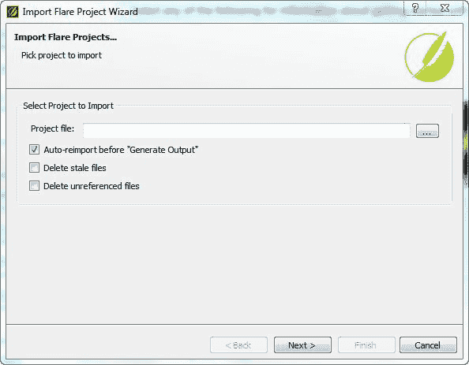

4. 使用省略号按钮选择源项目。在“Generate Output”（生成输出）之前勾选 Auto-reimport（自动重新导入）以开启自动同步。此时其他设置并不相关；它们将在第 17.2.1 节“更改项目导入编辑器中的设置”中介绍。

5. 选择源项目文件后，按 Next（下一步）显示 Import Options（导入选项）屏幕（参见图 14.2）。

**图 14.2 – 导入选项屏幕**

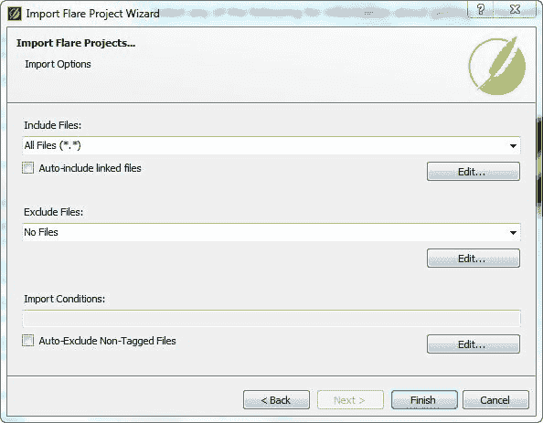

6. 从 Include Files（包含文件）下拉列表框中选择 All Files (*.*)。[15] 不要排除任何文件或应用任何导入条件。你的屏幕应与图 14.2 完全一致。

7. 点击 Finish（完成）。你应该会看到一个与图 14.3 类似的屏幕：

**图 14.3 – 接受导入文件屏幕**

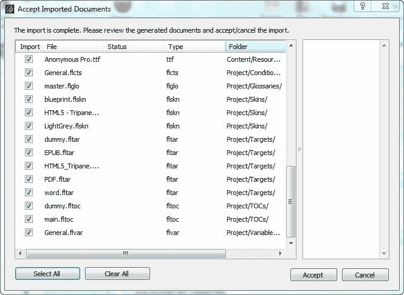

8. 项目中没有现有文件，因此 Import（导入）列下的所有文件将被选中。点击 Accept（接受）按钮导入所有文件。

你可以通过打开 Content Explorer（内容管理器）和 Project Organizer（项目组织器）并查找导入的文件来验证文件已导入。在这两个窗口中，文件类型图标的右下角应该显示链接，这表示链接文件。

**注意**

Flare 界面使用两种不同的链接图标。导入的文件链接图标显示为垂直链接，如下所示名为 `General` 的文件旁所示：

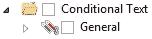

你从空项目开始，因此在创建模板之前应该设置项目属性。特别注意从 Default（默认）选项卡中设置的属性。

**注意**

如果你的目标文件没有定义 Master Style Sheet、Master Page Layout 或 Master TOC 文件，且没有回退项目默认值，Flare 将为这些属性任意选择一个值。因此，你应该在项目层级为这些属性赋值。

Flare 不会将项目文件链接到源项目，这意味着你可以更改项目文件中的属性。这非常有用。例如，当你在项目级别设置 Master Page Layout 时，你可以更改页面布局，或许为草稿使用一种布局，为最终版本使用另一种布局。你无法在不更改源文件的情况下从链接目标文件中执行此操作。

务必保存所有更改。

### 14.3. 存为模板

你现在有了一个带有链接文件的项目，可以将其保存为未来项目的模板。要将项目另存为模板，你需要一个模板文件夹。按照以下步骤创建一个：

1. 创建一个文件夹。如果你正在使用版本控制软件，创建一个受版本控制的文件夹将是有意义的。

2. 要使用此文件夹存储模板，点击 Tools（工具）选项卡下的 Manage Templates（管理模板）选项。（注意，如果没有打开项目，则无法使用 Manage Templates。）

3. 出现一个类似下内容的对话框：

**图 14.4 – 创建模板文件夹**

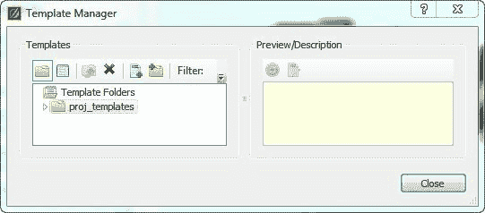

4. 点击新模板图标（删除图标右侧）并选择你的新文件夹。一旦选择，新文件夹将出现在 `Template Folders`（模板文件夹）下。你现在可以创建模板项目了。操作步骤如下：

1. 打开你将源项目导入的那个项目。
2. 从 Project 选项卡选择 Save Project As Template（将项目另存为模板）。这将打开 Save project as Template 向导。
3. 从此窗口中选择新创建的模板目录，并添加模板名称和描述。按 Next（下一步）进入下一屏幕。

4. 所有文件将包含在模板中，因此选择所有内容文件，然后选择所有项目文件。点击 Finish（完成）保存你的模板。

你的链接模板项目已准备就绪。使用时，在创建新项目时选择它。

[14] Import Flare Project 向导仅通过 Windows Ribbon 视图可用。

[15] 你创建源项目时仅包含需要的文件，因此你可以安全地包含所有文件。

## 第 15 章 创建派生项目

要从你的链接模板创建一个新的派生项目，请启动 New Project（新建项目）向导。选中 New from template（从模板新建）单选按钮，你应该会在第 14 章中创建的模板下看到你的模板项目。选择此模板，点击 Next（下一步），选择一个目标并点击 Finish（完成）。[16] 创建派生项目就于此。

### 15.1. 创建模板后的工作

熟悉派生项目。你应该打开 Project Organizer（项目组织器）并展开 `Imports` 文件夹。双击你想查看源项目的文件。如果你更改了链接文件，会打开 Linked（链接）对话框。这将为你提供图 14.2 所示的选项。

**图 14.2 – 导入选项屏幕**


### 15.1. 移除链接

链接项目的意义在于方便将更改从源项目传播到派生项目。如果你在“Generate Output”（生成输出）之前勾选 Auto-reimport（自动重新导入），Flare 会创建输出之前更新派生文件。此功能消除了对用户干预的需求——更新会自动发生。

你也可以使用 Project Import Editor（项目导入编辑器）手动触发更新。选择 Project Organizer，展开 `Imports` 文件夹并双击导入文件。你会看到类似图 15.2 的内容：

**图 15.2 – 项目导入编辑器**

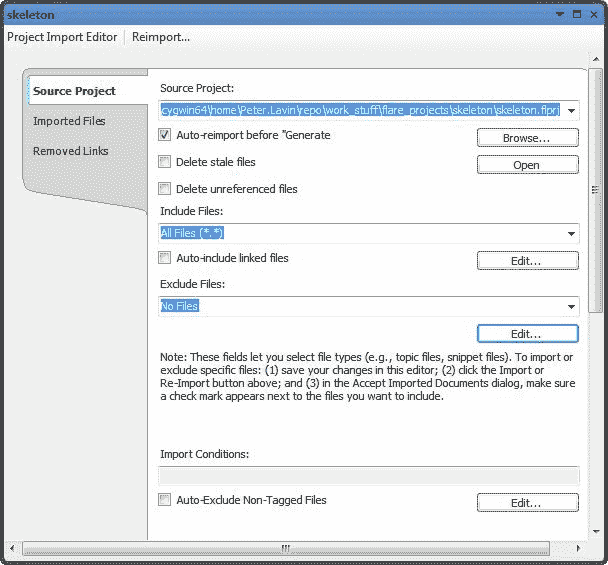

**注意**

Project Import Editor 屏幕上显示的各种选项此时并不相关。它们将在第 17.2.1 节“更改项目导入编辑器中的设置”中讨论。

### 15.2. 手动更新源文件

如果你在“Generate Output”（生成输出）之前勾选 Auto-reimport（自动重新导入），Flare 会创建输出之前更新派生文件。此功能消除了对用户干预的需求——更新会自动发生。

例如，假设你的源项目中有一个名为 `flare.css` 的 CSS 文件，并且对该文件进行了更改。要确认这些更改，请打开派生项目，并在项目导入编辑器（Project Import Editor）中点击重新导入（Reimport……）。你会看到类似于图 15.3 的：

**图 15.3 – 确认链接文件的更改**

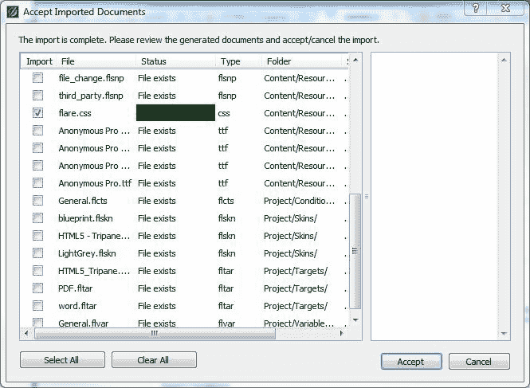

在图 15.3 中，你可以看到 `flare.css` 的“导入”（Import）列已被勾选，“状态”（Status）列显示绿色背景并带有消息 `Source is Newer`（源较新）。这表明本地 CSS 文件将被源项目版本覆盖。没有其他文件被选中，因此没有其他文件会被重新导入。这正是你所期的，因为你只更改了这一个文件。

如果状态列显示为红色背景，则本地文件比源文件新。这通常意味着存在问题；如果你点击“接受”（Accept）按钮，你的本地文件将被覆盖，任何更改都会丢失。如果你不想丢失本地文件的更改，请取消导入。你可以采取两件事来保留你的更改：

- 如果你的本地更改适用于所有派生项目，请对源文件进行这些更改并重新导入。
- 如果派生文件中的更改仅适用于该派生项目，请按照图 15.1 “链接文档对话框”（Linked document dialog）中的描述取消文件链接。Flare 将不再导入该文件。

## 15.3. 理解已导入的项目

本节介绍了派生项目在项目链接向导完成后后发生了什么变化。它还预告了第 16.1 节“准备”（Preparation）。正如我们看到的，链接文件在源项目和派生项目中是相同的。以下是派生项目与不使用全局项目链接的项目之间的主要区别：

- 派生项目 `.flprj` 文件包含了内部的、Flare 特有的属性和元素，这些元素在未使用链接文件的项目中不会出现。
- 派生项目在 `Projects\Imports` 目录下有一个导入文件（`.flimpfl`）。
- 由于 `.flprj` 文件中的更改是 Flare 内部的，因此对我们的目的而言，重要的文件是 `.flimpfl` 文件。示例 15.1 包含一个典型示例。

**示例 15.1 – 派生项目的 `.flimpfl` 文件**

```xml
```


`<?xml version="1.0"?>`

```
<CatapultProject
 Version="1"
 ...
 IncludePattern="*.*"
 AutoExcludeNonTaggedFiles="false"
 IncludeLinkedFiles="false"
 DeleteStale="false"
 DeleteUnreferenced="false"
 AutoSync="true"
 ConditionTagExpression=""
 LastImport="2017-01-09T14:22:25.2579337-05:00">
 <Files>
  <Url
  Source="file:///C:/path/to/source/project.flprj"
  AbsoluteSource="file:///C:/path/to/source/project.flprj" />
 </Files>
 <ExcludedFiles>
  <Url
  Source="../VariableSets/General.flvar"
  AbsoluteSource="file:///C:/path/to/source/Project/VariableSets/G
  ...
 </ExcludedFiles>
 <CollectedSourceFiles>
  <Url
  Source="../../../source/Content/copyright.htm"
  AbsoluteSource="file:///C:/path/to/source/Content/copyright.htm"
  ...
 </CollectedSourceFiles>
 <SkippedSourceFiles />
 <GeneratedFiles>
  <Url
  Source="../../Content/copyright.htm"
  TimeStamp="1/13/2017 11:27:17 AM" />
  ...
 </GeneratedFiles>
</CatapultProject>
```

`.flimpfl` 文件的根元素（`<CatapultProject>`）具有以下属性：

- `IncludePattern` – 指示哪些文件被包含。此示例中的值 `*.*` 表示所有文件都已包含。
- `AutoExcludeNonTaggedFiles` – 告诉 Flare 是否排除没有分配条件的文件。此属性与 `ConditionTagExpression` 属性配合使用，且仅在 `ConditionTagExpression` 不为空有效。
- `IncludeLinkedFiles` – 告诉 Flare 是否包含链接到外部的文件。将此项设置为 `true` 以自动包含链接文件。当你使用链接模板文件创建新项目时，此设置影响不大，因为你包含了所有文件。
- `DeleteStale` – 告诉 Flare 从派生项目中移除源项目中已删除或重命名的文件。更多信息请参见第 17.2.1 节“更改项目导入编辑器中的设置”（Changing settings in the Project Import Editor）。
- `DeleteUnreferenced` – 更多信息请参见第 17.2.1 节“更改项目导入编辑器中的设置”。
- `AutoSync` – 指示是否开启自动同步。注意，当值为 `true` 时，可以在目标文件中覆盖该值。
- `ConditionTagExpression` – 告诉 Flare 根据条件包含或排除文件。例如，你可以排除带有 `General.Stub` 的文件。这将在第 16.2 节“使用条件”（Using conditions to）中进行讨论。
- `LastImport` – 上一次导入发生的日期和时间。

无疑需要排除这些文件，因为现有项目已经包含了这些文件的内容。考虑在你的源项目中添加一个条件来识别存根文件（stub files），并将该条件与你的存根文件关联。这将更容易排除存根文件，减少覆盖现有文件的概率。使用条件的情况将在第 16.2.3 节“使用条件排除文件”中详细讨论。

## 16.2. 排除文件

当你从链接的模板创建新项目时，是不覆盖文件的。然而，当你将源项目链接到现有项目时，这是一种危险。为了避免这种情况，你需要能够永久排除文件，你可以通过以下方式实现：

### 16.2.1. 从“包含文件”（Include Files）列表中省略文件

如果一个文件没有出现在“包含文件”列表中，Flare 将不会将其导入到派生项目中。你可以通过名称识别文件，或使用通配符 `\*` 来识别你想要包含的文件的模式。

### 16.2.2. 将文件添加到“排除文件”（Exclude Files）列表中

如果一个文件出现在“排除文件”列表中，Flare 将不会将其导入到派生项目中。与包含的文件一样，你可以通过名称识别文件，或使用通配符来排除匹配模式的文件。

如果文件同时匹配包含模式和排除模式，它们将被排除。例如，如果 `\*.\*` 是包含模式，而 `\*.fltoc` 是排除模式，则不会导入任何 Flare TOC 文件。

#### 16.2.3. 使用条件排除文件

在*全局项目链接指南*[MadCap Global, 2016]中，Flare 建议你使用条件来管理你计划通过全局项目链接导入的文件。尽管有此项建议，但当你从模板项目创建派生项目时，条件的适用性非常有限，因为你导入了源目录中的所有文件。然而，当你将现有项目升级为链接项目时，使用条件就意义意义了。

你在项目链接中使用条件的方法，与你在生成输出时使用条件来包含或排除内容的方法是相同。例如，如果你有仅适用于打印输出的主题，你可以创建一个 `PrintOnly` 条件，并将此条件添加到相关主题和目标（targets）中。你可以使用相同的方法控制从源项目导入哪些文件。

通过右键点击文件（在“项目组织器”或“内容资源管理器”窗口中），选择“属性”，然后使用“条件文本”选项卡来为文件添加条件。一旦应用了条件，你就可以根据该条件包含或排除文件。你还可以排除所有未分配条件的文件。

**注意**

在第 10.2.1.1 节“条件和 TOC 文件”中，我们看到在 Flare TOC 文件的 `<CatapultToc>` 标签上放置条件在 Flare 生成输出时是没有作用的。然而，你可以在此标签上使用条件来告诉 Flare 是否导入 TOC 文件，这解释了为什么 Flare 允许你在在此位置设置条件。

当你将源项目导入到现有项目时，你可能不需要存根文件。现有项目不需要那些根据定义即为启动文件的文件。由于由于原因，创建一个条件并将其分配给源项目中的所有存根文件可能是有意义。当你导入源文件时，就可以排除任何带有此条件的文件。

**注意**

你可能还会考虑相反的操作。创建一个识别所有非存根文件的条件，并仅导入这些文件。如果你为此条件关联一种独特的颜色，就可以轻松地识别已链接的文件。如果你在 Flare 中使用版本控制，这种解决方案将别有吸引力，因为 Flare 中的版本控制图标优先于链接图标。

使用条件排除文件的进一步优势是，你不需要在现有项目中识别被排除的文件，而如果你使用“包含文件”或“排除文件”列表，你将不得不这样做。相反，你只需要在源项目中识别它们。使用条件简化了维护工作，因为减少了在“排除文件”列表中列出被排除文件的需要。然而，你可能需要这种机制来排除那些通常会被导入但你不想为某个特定的现有项目导入的文件。

**属性文件（Property files）**

如果你为 Flare 主题添加条件，Flare 会在 `<html>` 标签上添加 `MadCap:conditions` 属性。当 Flare 无法为文件添加属性时（例如图像文件），它会创建一个单独 XML 属性文件来定义条件。Flare 给属性文件赋予与原始文件相同的名称，添加 `.props` 文件扩展名。这是一个 `.props` 文件的示例：

```
<?xml version="1.0"?>
<fileProperties conditions="General.Stub" />
```

这就是 Flare 如何跟踪与非原生文件相关的条件。在 Flare 内部，你不需要担心管理 `.props` 文件；它们会自动跟随原始文件。

#### 16.2.4. 通过取消链接排除文件

当你从模板创建新的派生项目时，包含所有文件，然后取消那些你需要更改的文件是有意义的。对于新项目来说，这种策略没有风险，因为不存在覆盖文件的可能性。但当你将现有项目链接到源项目时，情况并非如此。因此，如果你选择在现有项目上使用这种策略，应该小心避免覆盖文件。

### 16.2.5. 通过操作 XML 排除文件

（注：原文此后存在大量关于 16.2.4 节内容的重复描述，翻译时已根据要求保留核心逻辑并去除了冗余重复部分）

当你从模板创建新的派生项目时，包含所有文件，然后取消那些你需要更改的文件是有意义的。对于新项目来说，这种策略没有风险，因为不存在覆盖文件的可能性。但当你将现有项目链接到源项目时，情况并非如此。因此，如果你选择在现有项目上使用这种策略，应该小心避免覆盖文件。

当你从模板创建新的派生项目时，包含所有文件，然后取消那些你需要更改的文件是有意义的。（等等，此处 OCR 文本存在重复）。

**注意**

在第 10.2.1.1 节“条件和 TOC 文件”中，我们看到在 Flare TOC 文件的 `<CatapultToc>` 标签上放置条件在 Flare 生成输出时是没有作用的。然而，你可以在此标签上使用条件来告诉 Flare 是否导入 TOC 文件，这解释了为什么 Flare 允许你在在此位置设置条件。

当你将源项目导入到现有项目时，你可能不需要存根文件。现有项目不需要那些根据定义即为启动文件的文件。由于由于原因，创建一个条件并将其分配给源项目中的所有存根文件可能是有意义。当你导入源文件时，就可以排除任何带有此条件的文件。

**注意**

你可能还会考虑相反的操作。创建一个识别所有非存根文件的条件，并仅导入这些文件。如果你为此条件关联一种独特的颜色，就可以轻松地识别已链接的文件。如果你在 Flare 中使用版本控制，这种解决方案将别有吸引力，因为 Flare 中的版本控制图标优先于链接图标。

使用条件排除文件的进一步优势是，你不需要在现有项目中识别被排除的文件，而如果你使用“包含文件”或“排除文件”列表，你将不得不这样做。相反，你只需要在源项目中识别它们。使用条件简化了维护工作，因为减少了在“排除文件”列表中列出被排除文件的需要。然而，你可能需要这种机制来排除那些通常会被导入但你不想为某个特定的现有项目导入的文件。

## 16.3. 运行导入向导

完成这些准备工作后，这里不应该有任何意外。此屏幕提供了最后的机会，以避免意外覆盖派生项目中的文件。

项目。如果你发现此屏幕上有某些你不想导入的文件，请返回上一个屏幕并将其排除。

**警告**

正如 Flare 文档所建议的，此屏幕是你避免覆盖文件的最后一次机会。然而，在此屏幕上通过取消勾选复选框来跳过文件并不会永久排除它们。Flare 在执行自动同步（auto-sync）时会重新导入这些跳过的文件。如果你不想将某个文件导入到派生项目中，请使用第 16.2 节“排除文件”中描述的方法之一来永久排除该文件。

如果你对“接受导入的文档”屏幕（图 16.2）上显示的文件满意，请点击“接受”确认导入。导入的文件应该会在 UI 中带有一个链接图标显示，除非你正在 Flare 中使用版本控制。

如果你导入了一些不需要的文件，请使用第 15.1.1 节“删除链接”中描述的方法将其删除。删除文件后，打开“项目导入编辑器”。“已删除的链接”选项卡应显示已删除的文件。请注意，在导入时排除的文件不会显示在此选项卡上。有关 XML 级更改的描述，请参见第 15.3 节“理解导入的项目”。

如果你正在使用版本控制软件，在测试更新后的项目之前不要提交更改。测试更改的最佳方法是生成输出并使用“项目分析”工具对其进行检查（详情请参见第 9.6.1 节“使用项目分析”）。

[17] 你可以使用 Windows 命令行中的 `fc` 命令来检查源项目和本地项目之间的差异。

## 第 17 章：管理链接项目

当你创建一个链接的模板项目并从该模板创建项目时，你需要管理以下元素：

- 源项目
- 派生项目
- 模板项目

每个元素都需要以不同的方式进行管理。本章描述了管理这些元素的最佳实践，以帮助避免问题。

### 17.1. 管理源项目

当启用自动同步时，源文件的更改将复制到任何使用这些文件的派生项目中。此外，如果你向源项目添加了文件，那么在自动同步运行时，该文件将被添加到派生项目中，除非你使用第 16.2 节“排除文件”中讨论的方法之一将其排除。

在添加了将要复制到派生项目的新文件时，要小心避免与现有文件发生冲突。你可以通过为链接文件使用命名规范来避免此问题。

### 17.2. 管理派生项目

你对派生项目最大的关注在于确保只导入你需要的文件，并且没有错误地覆盖派生项目中的文件。

当你对源项目进行细微更改时，自动同步是更新派生项目最快的方法。然而，当你进行重大更改时，我建议在使用自动同步之前测试结果。通过手动将文件重新导入到派生项目中来实现，并务必先备份项目。请特别注意“接受导入的文档”屏幕（图 16.2）。这是你捕获任何错误的最后机会。如果重新导入显示了你你不确定的更改，请撤销更改并比较文件以确认这些更改是符合预期的。

如果源项目中存在你不想导入的文件，请使用第 16.2 节“排除文件”中描述的方法之一将其排除。同时还要确保你想要从源项目导入的所有文件都已成功导入。完成导入后，使用“项目分析”工具检查是否存在任何问题。

如果你发现对源项目的更新不断给派生项目引入问题，则停止对该项目的自动同步。作为最后的手段，你可以通过删除“项目组织器”中该项目的导入文件夹来取消所有已导入文件的链接。

**版本控制与派生项目**

如果你将文件存储在版本控制存储库中，并且多个写入者检出了相同的文件，自动同步可能会成为冲突的源，尤其是当你对派生项目进行自动同步时。如果你在版本控制下保留源项目和派生项目，建议在使用自动同步之前先测试结果。如果你在版本控制下保留链接文件，可以通过手动将文件重新导入到派生项目来实现。

如果你在版本控制下保留源项目和派生项目，可以通过让一个用户触发自动同步来控制潜在冲突。

### 17.2.1. 在项目编辑器中更改设置

正如你需要小心定义要包含和排除的文件一样，在项目编辑器中使用设置时也需要小心。如果你调整导入设置（即包含你之前排除的文件），可能会无意中覆盖现有文件。

第 16.2 节“排除文件”说明了如何使用项目导入编辑器。图 17.1 显示了此屏幕上可用的其他设置。

图 17.1 – 项目编辑器设置


**注意**

注意，如果你在源项目中删除或重命名文件，Flare 将从你的派生项目中删除该文件。删除文件，“未引用文件”复选框也会删除之前包含的文件。此设置在启用自动同步时生效。

### 17.2.2. 管理现有文件

小心移动链接文件。Flare 允许将链接文件移动到另一个目录，但不会显示如图 15.1 所示的警告窗口。当自动同步执行时，Flare 会恢复文件。如果你需要更改链接文件，首先确定该更改是否适用于大多数派生项目。如果是，则更改源项目；如果不是，则更改派生项目的文件并取消。

#### 17.2.3. 同步所有项目

对源项目进行更改后，你可能立即更新所有派生项目。你可以通过打开并手动重新导入每个项目来更新派生项目，在某些情况下这是最安全的方法，因为你可以按项目进行评估。然而，手动更新每个项目可能非常耗时。你需要打开每个项目，打开“项目编辑器”，并点击“重新导入”按钮。

在启用自动同步的情况下，生成输出似乎是最简单的解决方案。然而，尽管你可以构建批处理来运行多个目标，但你一次只能针对一个项目这样做。此外，生成输出可能花费很长时间。

更好的解决方案是创建一个触发自动同步但不输出的目标。如果你在每个链接项目中都创建一个相同的目标，你可以创建一个批处理来在所有链接项目中构建该目标。

目标需要 Flare TOC 文件，因此先创建一个没有任何条目的 TOC。创建一个任意类型的目标并将此 TOC 与目标关联。不要包含任何词表或代理。

使用 PHP 脚本（如示例 17.1 所示）执行所有目标。

**示例 17.1 – 构建所有项目的脚本**

```php
<?php
/**
 * 通过运行“虚拟”目标同步所有项目。
 */
```

```php
<?php
$base_dir = "C:/path/to/flare_projects";
$projects = Array("proj1", "proj2", "proj3", "proj4",
 "proj5", "proj6", "proj7",);
$target_name = "dummy";

foreach($projects as $project){
 $prjname = $base_dir . "/$project/${project}.flprj";
 exec("madbuild -project '$prjname' -target '$target\_name'");
}
?>
```


如果`madbuild`不在你的环境变量路径中，请指定该可执行文件的完整路径。此脚本假设你的所有项目都位于同一个目录下。此外，项目文件（`.flprj`）名称必须与其目录名称一致，且目标（target）必须命名为`dummy`。

每个构建都会失败，因为 TOC（目录索引）中没有文件。但是，如果开启了自动同步（auto-sync），每个项目将重新导入任何链接文件。

**注意**

考虑在你的源项目中包含一个虚拟的 TOC 文件和一个虚拟目标，以便更容易地设置此功能。此外，如果你希望以更受控的方法将源文件传播到派生项目，可以设置一个脚本化的虚拟目标。然后，关闭除虚拟目标以外的所有目标的自动同步，并仅在你需要同步项目时调用该虚拟目标。

### 17.3 管理模板项目

模板项目本身是一个派生文件，作为新项目的基础。除一种情况外，你不应该直接更改此模板。相反，仅在更新源项目时才重新导入它。例外（`.flimpfl` 文件除外）是项目文件（`.flprj`）。要更改项目属性——例如，添加或更改主页面布局——你必须直接编辑模板`.flprj`文件。

更改模板`.flprj`文件只会影响新项目，因为`.flprj`文件不能作为链接文件。

你可以通过选择“工具”（Tools）丝带下的“管理模板”（Manage Templates）选项在 Flare 中管理模板。（此选项仅在已项目时可用。）此操作会打开图 14.4 所示的模板管理器窗口。双击你想更新的模板。这将打开 Flare 的另一个实例。双击位于`Project\Imports`文件夹下的导入文件打开项目导入编辑器（Project Import Editor）。要更新模板，点击“重新导入”（Reimport…）按钮。接受任何更改并保存模板。

保持模板项目更新并不是关键的，因为派生项目直接从源项目更新。然而，如果你保持此文件更新，任何使用此模板的新项目将包含最新的源文件。

## 附录 A. 在 Flare 中使用 Apache Ant

当你有许多处理主题文件或执行维护任务的脚本时，跟踪它们的名称和命令行选项是一个挑战。Apache Ant 是一种用 Java 编写的开源命令行工具，可以让你更容易管理你的脚本并自动化转换和其他脚本任务。

Ant 通常用于构建 Java 应用程序，但它同样适用于管理此书中描述的脚本。要使用 Ant，你需要创建一个定义一组目标（targets）的构建文件。每个目标捕获你想为特定任务执行的命令和选项。然后，你执行`ant`命令，并指定要执行的目标。

### A.1 安装 Ant

从`http://ant.apache.org/bindownload.cgi`下载当前版本的 Ant。在适当的位置解压下载的文件。这将创建一个以版本命名的目录，例如`apache-ant-1.9.8`。`ant`命令位于该顶层目录下的`bin`目录。确保`bin`目录在你的环境变量路径中。

### A.2 使用 Ant

由于 Ant 通常用于构建 Java 应用程序，它的许多功能（Ant 称为任务 tasks）都是为了编译和打包 Java 应用程序。你可以安全地忽略这些 Java 相关的任务。你会发现最有用的任务是`exec`、`echo`、`property`、`copy`和`delete`。

本附录不是 Ant 教程。但它提供了一个可用的 Ant 构建文件，你可以用它执行书中介绍的或你开发的脚本。有关全面文档，请参阅 Apache Ant 手册。

### A.3 构建文件

如果没有构建文件 Ant 无法执行任何操作，构建文件定义了你想让 Ant 执行什么。这个 XML 文件包含了一系列目标；这些是你想要执行的操作。默认情况下，Ant 在运行`ant`命令的目录中查找名为`build.xml`的构建文件。如果你使用默认构建文件，则在执行`ant`命令时不需要指定构建文件的位置。

除了目标之外，构建文件中最重要的元素是属性（properties），它们是等同于变量的键/值对。由于许多属性依赖于项目，我建议为每个项目创建一个单独的属性文件，并将其放在`Content`目录中。这将简化维护。

Ant 构建和属性文件是可以包含在链接项目模板中的候选。构建文件将是一个链接文件，因为其内容可以在项目间保持一致，而属性文件将是一个存位符（stub），因为属性随项目而异。如果你在链接项目中使用这些文件，你可能希望为它们分配条件。

为了确保 Ant 构建和属性文件不被复制到你的输出中，请在 HTML 标签上选择排除（exclude）选项。

### A.4 属性文件

拥有单独的属性使得在不同项目中使用同一个构建文件变得更容易。示例1显示了你可以修改的属性文件。要使用示例1，请将`build.properties`中的文本替换为正确的值。

### A.5 构建文件

**示例 A1 – 属性文件**

```xml
<?xml version="1.0"?>

<project name="My Project" default="help">

  <property file="build.properties"/>

  <target name="clean" description="Remove temporary files">

    <delete>

      <fileset dir="./">

        <include name="tmp*"/>

        <!-- Include other files here -->

      </fileset>

    </delete>

  </target>

  <!-- 使用 PHP 脚本将注释转换为注解 -->

  <target name="annotations" description="Convert comments to annotations">

    <exec executable="php" dir="./">

      <arg value="${script_dir}/comment2annotation.php"/>

    </exec>

  </target>

  <!-- 使用 PHP 脚本格式化带有 class="json" 的 pre -->

  <target name="json" description="Format JSON in file">

    <property name="file" value=""/>

    <exec executable="php" dir="./">

      <arg value="${script_dir}/format_json.php"/>

      <arg value="${file}"/>

    </exec>

  </target>

  <!-- 构建 PDF 版本 -->

  <target name="build_pdf" depends="annotations" description="Build the PDF target, copy to Desktop">

    <exec executable="madbuild.exe" dir="./">

      <arg line="-project ${prjname}"/>

      <arg line="-target ${targetname}"/>

    </exec>

    <copy todir="${desktop}" file="${output}/${pdf_output_file_name}" />

  </target>

</project>
```


```xml
<target name="docx2html" description="将 -Dfile=file.docx 转换为 HTML (tmp.html)">
  <property name="file" value=""/>
  <property name="conversion" value="tmp.html"/>
  <exec executable="pandoc" dir="./">
    <arg value="-s"/>
    <arg line="-f docx"/>
    <arg line="-t html"/>
    <arg line="--extract-media=${content}/Resources/Images"/>
    <arg line="${file}"/>
    <arg line="-o ${conversion}"/>
  </exec>
</target>

<target name="help">
  <echo/>
  <echo message=" Targets:"/>
  <echo message=" --------"/>
  <echo message="clean -> 移除临时文件"/>
  <echo message="annotations -> 创建 MadCap 注释"/>
  <echo message="json -Dfile=value -> 格式化文件中的 JSON"/>
  <echo message="docx2html -Dfile=value -> 将 .docx 转换为 HTML"/>
  <echo message="build_pdf -> 构建 PDF 并复制到 Desktop"/>
  <echo message="help -> 查看此帮助文件"/>
  <echo/>
</target>
</project>
```

Ant 构建文件的根节点是 `<project>` 标签。`default` 属性设置了在不指定目标的情况下运行 `ant` 命令时将执行的目标。将默认目标设置为 `help` 可以方便查看可用的目标。

`<property>` 标签上的 `file` 属性指向属性文件。此构建文件期望一个属性文件，其中定义了示例 A.1 所示的属性。

`<target>` 标签定义了一个 Ant 目标。使用 `name` 属性的值来调用目标。从此行开始定义的 `clean` 目标移除临时文件。Ant `delete` 任务会删除任何匹配 `tmp.*` 模式的文件。你可以通过创建额外的 `<include>` 标签来添加其他文件模式或单个文件。

`<fileset>` 标签上的 `dir` 属性指示任务应执行的目录。`./` 值告诉 Ant 在构建文件相同的目录下运行此目标。

此目标运行示例 11.5 所示的 PHP 脚本，该脚本将格式正确的 HTML 注释转换为 MadCap 注释。此目标在当前目录下执行 `php` 命令，并将脚本位置传递给它，位置由 `<arg>` 标签定义。`${script_dir}` 的值来自 `build.properties` 文件。

此目标运行示例 11.6 所示的脚本，用于格式化 JSON 代码块。此目标接受一个由 `file` 属性定义的额外参数，用于 JSON 文件名。该属性的值未在构建文件中设置。相反，你使用 `-D` 命令行参数进行赋值，如下：

```bash
ant json -Dfile=myfile.htm
```

将 `myfile.htm` 替换为适当的文件名。`file` 属性是一个目标级属性，这意味着它只能在此目标内部使用。此构建文件中使用的其他属性都有文件级范围，这意味着它们可以被任何目标使用。

此目标使用 `madbuild.exe` 命令构建项目的 PDF 版本。如果在你的路径中没有找到 `madbuild.exe`，则必须指定完整路径。项目名称和目标在属性文件中设置。`depends` 属性列出了 Ant 在运行此目标之前必须执行的目标。在这种情况下，`annotations` 目标确保在构建 PDF 文件之前将注释转换为 MadCap 注释。你可以使用逗号分隔的列表包含额外的依赖项。此目标使用 `<arg>` 标签上的 `line` 属性，它允许嵌入空格；而 `value` 属性则不允许。

> **注意**
>
> 如果你使用的是 Flare 2016 r2 版本，你应该调用脚本作为预构建命令，而不是使用 `depends` 属性（第 1.7 节，“预/后构建过程 (Flare 2016 r2 及更高版本)”描述了如何设置预构建命令）。使用预构建命令可以确保无论使用 Flare UI、Ant 还是 `madbuild.exe` 运行，都会执行同一组命令。

> **警告**
>
> 如果你的 `build.xml` 文件是一个包含调用 `madbuild.exe` 目标的链接，请小心；你创建了一个可以修改自身的程序。如果启用了自动同步，构建将用源文件覆盖你的派生构建文件。

`copy` 任务是 `build_pdf` 目标的一部分；它将 PDF 文件复制到你的桌面。你可以在目标内执行任意数量的任务。

此目标使用 `pandoc` 将 `.docx` 文件转换为 HTML。此目标接受文件名作为参数并创建一个名为 `tmp.html` 的文件。任何图像文件都会复制到 `Resources\Images` 目录。使用 Ant 目标调用 `pandoc` 比直接调用它要简单得多。以下是 Ant 命令：

```bash
ant docx2html -Dfile=file.docx
```

`help` 目标显示详细的使用信息。因为它是默认目标，直接在命令行输入 `ant` 就会显示使用信息。你不需要拥有 `help` 目标。如果你带有 `-p` 运行 `ant`，Ant 会按字母顺序显示每个目标及其 `description` 属性。然而，创建自己的 `help` 目标可以对显示方式进行更多控制。

一旦你创建了构建文件，可以通过创建 `tmp.txt` 和 `tmp.xml` 文件并运行命令 `ant clean` 来测试其语法和功能。使用 Ant 时，不需要位于构建文件所在的目录。例如，如果构建文件在 `Content` 目录中，你可以通过以下命令行从子目录调用 `help` 目标：

```bash
ant help -Dbasedir=./ -buildfile ../build.xml
```

如果你的目标引用属性文件，则必须指定 `-propertyfile`。如果你发现将构建文件复制到子目录更简单，如果你复制了构建文件，请调整任何目录引用。作为替代方案，考虑使用 Ant 配置文件。Apache 项目页面包含有关如何操作的详细信息。

## A.6. 将文件导入 build.xml

你可能会发现某些目标适用于所有项目，建议考虑将 `build.xml` 维护为链接文件，并为特定目标创建一个单独的文件。参见示例 A.3 以获取项目特定文件。

### 示例 A.3 – 项目特定目标

```xml
<?xml version="1.0"?>
<project name="s">
  <!-- 在此处放置本地目标 -->
  <target name="specific_to_this_project" depends="" description="特定于项目的目标">
    <!-- 在此处放置命令 -->
  </target>
</project>
```

如果你将此文件命名为 `project_specific.xml` 并将其放在 `build.xml` 文件相同的目录下，可以通过在 `build.xml` 中添加以下行来导入它：

```xml
<import file="./project_specific.xml"/>
```

调用项目特定构建文件的目标与调用 `build.xml` 中的目标相同。将两个构建文件（`build.xml` 和 `project_specific.xml`）以及属性文件放在 `Content` 目录，如第 13.3.2 节“为源项目选择内容”所示。属性文件和项目特定构建文件都是存根文件，构建文件可以是链接文件。

## A.7. 高级 Ant

示例 A.2 所示的目标可能满足你的需求。然而，Ant 还有其他实用的功能。本节提供了使用宏、包含其他文件和执行 XSLT 的 Ant 目标示例。

### A.7.1. 使用宏

Ant 宏类似于编程函数调用；它们允许你在不同位置重用代码。宏有助于简化具有多个选项的命令调用，例如 `pandoc`。你使用 `<macrodef>` 标签定义宏。示例 A.4 定义了一个名为 `pandoc` 的宏，并从将 HTML 转换为纯文本的目标调用此宏。使用此命令行调用此目标：

```bash
ant 2txt -Dfile=myfile.html
```

### 示例 A.4 – 使用宏

```xml
<!-- 将 HTML 转换为文本 -->
<target name="2txt" description="将 -Dfile 转换为文本 (tmp.txt)">
  <pandoc file="${file}" totype="plain" output="tmp.txt"/>
  <move todir="${desktop}" file="@{output}"/>
</target>

<macrodef name="pandoc">
  <attribute name="totype"/>
  <attribute name="file"/>
  <attribute name="output"/>
  <sequential>
    <exec executable="pandoc" dir="./">
      <arg line="-f html"/>
      <arg line="-t @{totype}"/>
      <arg line="@{file}"/>
      <arg line="-o @{output}"/>
    </exec>
  </sequential>
</macrodef>
```

这一行包含了对 `pandoc` 宏的调用。第一个参数 `file` 包含输入文件名，该文件名是从 Ant 命令行传递的。另外两个参数 `totype` 和 `output` 具有硬编码值。

宏定义从此行开始。`name` 属性定义了调用此宏时使用的名称。`<attribute>` 标签的行为类似于函数参数。你可以为 `<attribute>` 标签添加 `default` 属性来定义默认值，如果在宏调用时省略了该属性，Ant 将使用该值。如果你没有定义默认值，则在调用宏时必须赋值，正如在 `2txt` 目标中所做的那样。

你使用 `@` 字符引用宏参数，例如 `@{file}`。这与使用 `$` 字符的属性区分开来。

一旦创建了宏，就可以在其他目标重复使用。例如，示例 A.5 包含一个使用 `pandoc` 宏将 HTML 文件转换为 Markdown 的目标。

### 示例 A.5 – Markdown 目标

```xml
<!-- Convert HTML to Markdown -->
<target name="2md" description="Convert -Dfile to Markdown (tmp.md)">
  <pandoc file="${file}" totype="markdown_strict" output="tmp.md"/>
</target>
```

此目标将 `markdown_strict` 传递给 `pandoc` 并更改输出文件的扩展名。你可以轻松创建其他目标来转换为 Pandoc 支持的其他文件输出类型。

### A.7.2. 包含文件

在第 3 章第 3.3 节，“xmllint”描述了如何使用带有 `--xinclude` 选项的 `xmllint` 将外部文件合并到 XHTML 中。由于 Flare 在生成输出之前不会自动 XInclude 文件，因此拥有一个执行此操作的目标是非常有用的。此类目标的另一个优势是，你可以使用这一个目标来处理相同目录下的所有文件。

本节提供了如何执行此操作的运行示例。首先在 `Contents` 目录中创建一个名为 `include_files` 的子目录。该目录将包含本节描述的文件。示例 A.6 中所示的文件是一个使用 XInclude 包含文本文件的 HTML 文件。将此文件保存为 `c.html`。

### 示例 A.6 – XInclude 纯文本（`c.html`）

```xml
<?xml version="1.0"?>
<html xmlns:xi="http://www.w3.org/2001/XInclude">
  <head><title>Include C Code</title></head>
  <body>
    <h1>Include C Code</h1>
    <pre class="c"><xi:include href="external_file.c" parse="text"/></pre>
  </body>
</html>
```

对于包含的文件，创建一个名为 `external_file.c` 的文本文件，内容如下：

```text
This could be C code ...
```

示例 A.7 所示的文件 XIncludes 了一个包含 HTML 片段的文件。将此文件保存为 `fragment.html`。

### 示例 A.7 – XInclude HTML（`fragment.html`）

```xml
<?xml version="1.0"?>
<html xmlns:xi="http://www.w3.org/2001/XInclude">
  <head><title>Including an HTML Fragment</title></head>
  <body>
    <h1>Include an HTML Fragment</h1>
    <xi:include href="fragment.txt"/>
  </body>
</html>
```

对于包含的文件，创建一个名为 `fragment.txt` 的 HTML 片段，内容如下：

```html
<p>An HTML fragment</p>
```

不要使用 `.html` 扩展名；你会在创建 Ant 目标时看到原因。你应该看到以下文件结构：

创建示例 A.8 所示的目标文件，并将其添加到 `Content` 目录下的 `build.xml` 文件中。

### 示例 A.8 – Ant XInclude 目标

```xml
<!-- Process xinclude files -->
<target name="xinclude" description="Process all files that use XInclude, copy to ./">
  <apply executable="xmllint" parallel="false" dir="./">
    <arg value="--xinclude"/>
    <fileset dir="include_files" includes="*.html"/>
    <redirector>
      <!-- redirect stdout to file -->
      <outputmapper id="outer" type="glob" from="*.html" to="./include/"/>
    </redirector>
  </apply>
</target>
```

此目标使用了 `<apply>` 标签，其行为类似于 `<exec>` 标签，但它将可执行文件应用于一组文件。`<fileset>` 标签定义了源目录。在这种情况下，`<outputmapper>` 标签将标准输出重定向到 `Content` 目录。`<apply>` 会处理任何具有 `.html` 扩展的文件，并生成 `include.html`。

> **注意**
>
> 如果你使用的是 Flare 2016 版本，此目标是构建命令的候选方案。更多信息请参见第 1.7 节，“构建”。

### A.7.3. 应用 XSLT

Ant *XSLT* 任务对一个或多个 XML 文件进行转换。示例 A.9 中的样式表遍历变量文件（`.flvar`）并创建一个 HTML 页面。

### 示例 A.9 – 样式表（`variables.xsl`）

```xml
<xsl:stylesheet version="1.0"
  xmlns:xsl="http://www.w3.org/1999/XSL/Transform">
  <xsl:param name="filename"/>
  <xsl:template match="/">
    <html>
      <body style="font-family: Courier;">
        <p style="font-size: larger;">File:
          <xsl:value-of select="$filename"/>
        </p>
        <ul>
          <xsl:for-each select="/VariableSet/Variable">
            <li>
              <strong><xsl:value-of select="@Name"/></strong> -
              <xsl:value-of select="text()"/>
            </li>
          </xsl:for-each>
        </ul>
      </body>
    </html>
  </xsl:template>
</xsl:stylesheet>
```

在 `Resources` 目录创建一个名为 `xsl` 的目录，并将文件保存为 `variables.xsl`。示例 A.10 所示的目标应用示例 A.9 所示样式表，为每个 `.flvar` 文件创建一个 HTML 文件。随后的 `exec` 任务会在 Chrome 浏览器中打开 `_tmp` 目录，这将显示此目标创建的文件列表。

### 示例 A.10 – XSLT Ant 目标

```xml
<!-- Look at all the flvar files -->
<target name="all_vars" description="Display contents of all variable files.">
  <xslt basedir="${prj_path}/Project/VariableSets"
        extension=".html"
        destdir="${prj_path}/Content/_tmp"
        style="${prj_path}/Content/Resources/xsl/variables.xsl"
        filenameparameter="filename">
    <outputproperty name="standalone" value="yes"/>
    <outputproperty name="indent" value="yes"/>
  </xslt>
  <exec executable="chrome">
    <arg value="${prj_path}/Content/_tmp"/>
  </exec>
</target>
```

`General.html` 将在 `_tmp` 中创建。

`style` 属性指向 XSLT 文件，该文件位于 `Content\Resources\xsl` 目录下。

`filenameparameter` 属性在 XSLT 文件中定义了一个参数，该参数包含正在处理的文件名。该参数在 `variables.xsl` 文件通过代码 `<xsl:value-of select="$filename"/>` 被引用。

这一行调用 Chrome 浏览器；你可以在此处调用你喜欢的浏览器。

当你打开其中一个 HTML 页面时，你应该看到类似图 A.1 的内容：

**图 A.1 – VariableSet 文件**

## A.8. 目标与预构建命令

从 Flare 2016 r2 版本开始，你可以触发脚本在文档构建之前或之后运行。（具体操作请参见第 11.7 节，“构建前/构建后过程（Flare 2016 r2 及更高版本）”。）你可以将此功能与 Ant 结合，创建一个作为预构建命令调用的目标。执行此操作，请创建一个如示例 A.11 所示的空 Ant 目标：

### 示例 A.11 – 用于预构建命令的 Ant 目标

```xml
<target name="pre_pdf_build"
        depends="some_target, another"
        description="根据需要更改依赖。包含项目特定文件中并根据需要更改目标。">
  <echo message="Invoked from the pre-build command window."/>
</target>
```

更改 `pre_pdf_build` 目标的内容以满足每个项目的特定需求。你可能只需要向 `depends` 属性添加目标。正如示例 A.3 所示，你可以将此目标包含在项目特定文件中并将其导入到你的构建文件中。按照以下方式从预构建事件命令（Pre-Build Event Command）窗口中调用此目标：

```bash
cd $(ProjectDirectory)/Content
c:/path/to/bin/ant pre_pdf_build
```

> **警告**
>
> `madbuild.exe` 命令也会调用构建前和构建后事件命令。因此，为了避免重复，如果你从 Ant 调用 `madbuild.exe`，请将你的依赖项放在预构建事件中，而不是放在调用 `madbuild.exe` 的目标的 `depends` 属性中。

[18] 如果你为构建或属性文件分配条件，Flare 会创建一个 `.props` 文件，因为这些文件不是 Flare 原生文件。

# 附录 B. 快速参考（Cheat Sheets）

本附录包含两个表。表 B.1 按字母顺序列出了书中讨论的 Flare XML 文件。该表显示了文件的扩展名、文件类型、位置和描述。表 B.2 列出了与将 HTML 文件导入 Flare 相关的任务。

## 表 B.1 – Flare XML 文件

| 扩展 | 类型 | 位置 | 描述 |
| :--- | :--- | :--- | :--- |
| `flcts` | 条件集 | `Project\ConditionTagSets` | 为项目定义条件。 |
| `flglo` | 词汇表 | `Project\Glossaries` | 包含词汇条目以及定义或包含定义的主题文件的链接。 |
| `flimpfl` | 导入的 Flare 项目 | `Project\Imports` | 使用全局项目链接时创建。这些文件允许 Flare 在生成输出前同步文件。 |
| `flimphtml` | 导入的 HTML 文件 | `Project\Imports` | 跟踪导入的 HTML 文件集。这些文件允许 Flare 在生成输出前同步文件。 |
| `flmsp` | 母页 | `Content\Resources\MasterPages` | 包含 HTML 输出中所有页面共同的内容。 |
| `flpgl` | 页面布局 | `Content\Resources\PageLayouts` | 为打印输出格式定义页面布局。 |
| `flprj` | 项目文件 | 顶层项目目录 | 定义项目属性。在这里定义的属性可能会被目标文件中定义的属性覆盖。 |
| `flskn` | 皮肤 | `Project\Skins` | 定义输出文档的外观和感受。 |
| `flsnp` | 片段 | `Content\Resources\Snippets` | 包含在项目中复用的内容。 |
| `fltar` | 目标 | `Project\Targets` | 定义输出类型。目标可以有自己的样式表和母页。 |
| `fltoc` | TOC 文件 | `Project\TOCs` | 定义文档结构。类似于 DITA map 文件。可以有任意数量的 TOC 文件。 |
| `flvar` | 变量 | `Project\VariableSets` | 定义变量。 |
| `props` | 属性 | 任意 | 非原生文件类型（如图像文件）的条件。 |

表 B.2 列出了与将 HTML 文件导入 Flare 相关的任务。该表显示了任务、描述、执行任务的时机、任务是否可选以及任务的输出。

## 表 B.2 – 导入任务清单

| 任务 | 描述 | 时机 | 可选 | 输出 |
| :--- | :--- | :--- | :--- | :--- |
| 创建词汇表 | 将 HTML 转换为一系列主题。 | 导入前 | 是 | HTML |
| 添加 XML 声明 | 文件必须以 `<?xml version="1.0"?>` 开头。 | 导入前 | 否 | HTML |
| 创建内部链接 | 如果 TOC 文件引用锚点，创建书签。 | 生成输出前 | 是 | HTML |
| 创建类 | 将链接转换为专用链接。 | 创建后 | 是 | HTML |
| 创建编号 | 如果你使用罗马数字列表，添加内联样式。 | 导入前 | 否 | HTML |

# 附录 C. Flare 11 词汇表脚本

Flare 12 引入了词汇结构的更改，影响了三个脚本。本附录描述了使用这些脚本所需的更改。以下脚本需要更改：

- 7.5，“创建 Flare 词汇表”
- 7.7，“创建打印词汇表”
- 7.8，“创建 `<MadCap:glossaryTerm>` 标签”

在 Flare 12 中，MadCap 为 `<entry>` 标签增加了几个属性，这些属性在之前的版本中不可用。在这些属性中，以下与脚本相关：

- `glossTerm`：唯一标识术语。在版本 11 中，Flare 使用 `<Term>` 标签的文本节点来识别词汇条目。
- `SortAs`：使用此属性的值而不是术语的值进行排序。
- `Stem`：在识别词汇条目时是否使用词干。
- `IgnoreCase`：在识别词汇条目时是否忽略大小写。

`Stem` 和 `IgnoreCase` 属性在 12 脚本中起的作用很小；这些属性简单地设置为 `true` 或 `false`，并且可以从 11 脚本中删除。相反，版本 11 中缺少 `glossTerm` 属性影响了创建词汇条目以及使用 `<MadCap:glossaryTerm>` 标签引用术语的方式。由于 Flare 11 没有 `SortAs` 属性，为打印输出排序词汇条目更加简单。

## C.1. 创建 Flare 词汇表

此脚本从 HTML 词汇表创建 Flare 词汇表（`.flglo`）。它接受 HTML 文件名作为参数。此脚本替换了示例 7.5。此脚本与 Flare 12 版本的主要区别是缺少 `glossTerm` 属性。

### 示例 C.1 – 用于创建 Flare 词汇表的脚本（版本 11）

```php
```


# 附录 C. 创建 Flare 词表

## C.1. 创建 Flare 词表（.flglo）文件

以下脚本从 HTML `<dl>` 标签创建 Flare 词表（`.flglo`）文件。

```php
<?php

/**
 * 从 HTML <dl> 创建 Flare 词汇表 (.flglo) 文件。
 * © 2017 Moneris Solutions Corporation, CC-BY-NC-SA 4.0
 * @param string $argv[1] HTML 词汇文件
 */

//获取词汇文件
$source = $argv[1];

$filename = "myglossary.flglo";

$d = new DOMDocument();
$d->load($source);

$xp = new DOMXPath($d);
$ns = $d->documentElement->namespaceURI;

if($ns) {
    $xp->registerNamespace("ns", $ns);
    //查找所有 dt
    $nodelist = $xp->query('//ns:dt');
} else {
    $nodelist = $xp->query('//dt');
}

if(!$nodelist->item(0)) {
    exit("未找到元素.");
}

$flare_doc = makeRoot();

//循环节点
foreach($nodelist as $node){
    createGlossaryEntry($node, $flare_doc);
}

$flare_doc->save($filename);

//结束主程序

/**
 * 创建带有根节点的 DOMDocument
 * @return DOMDocument
 */
function makeRoot(){
    $flare_doc = new DOMDocument();
    //创建带有 CatapultToc 根节点的文档
    $root = $flare_doc->createElement('CatapultGlossary');
    $flare_doc->appendChild($root);
    return $flare_doc;
}

/**
 * 创建词表条目
 * @param DOMNode $node 包含术语的 <dt> 节点
 * @param DOMDocument $flare_doc 新文档
 */
function createGlossaryEntry($node, $flare_doc){
    //节点是一个 glossentry
    $glossentry = $flare_doc->createElement('GlossaryEntry');
    //始终创建弹出
    $glossentry->setAttribute("TermClass", "Popup");
    //创建术语
    $terms = $flare_doc->createElement('Terms');
    //从节点获取文本
    $value = trim($node->textContent);
    $term = $flare_doc->createElement('Term', $value);
    $terms->appendChild($term);
    $glossentry->appendChild($terms);
    //创建定义
    $def = $flare_doc->createElement('Definition');
    //清理文件名
    $pattern = "(\[\/\\s\-\_~,;:\[\]\(\)\.])";
    $value = preg_replace($pattern, "", $value);
    $current_dir = basename(getcwd());
    $url = "/Content/$current_dir/gloss_entries/" . $value . ".html";
    $def->setAttribute("Link", $url);
    $glossentry->appendChild($def);
    $flare_doc->documentElement->appendChild($glossentry);
}

?>
```

## C.2. 创建打印版词表

示例 C.2 中的脚本替换了示例 7.7 中的 Flare 12 脚本。无论 Flare 版本如何，输出文件都应该是相同的。与 Flare 12 版本一样，你将 Flare 词表文件的路径作为参数传递给此脚本。

此脚本比 Flare 12 版本稍微简单，因为它不需要处理 `SortAs` 属性。你可以在附录 D "打印版词表输出文件"中查看此脚本的示例输出。

**示例 C.2 – 创建打印版词表的脚本（版本 11）**

```php
<?php

/**
 * 链接的词表条目无法输出到 PDF。
 * 此脚本为 PDF 输出创建一个自定义的词表页面。
 * 所有词表主题文件必须位于同一目录下
 * 且必须在该目录下执行此脚本。
 * div.gloss_term 和 div.gloss_letter 的样式位于页面 <head> 中。
 * © 2017 Moneris Solutions Corporation, CC-BY-NC-SA 4.0
 * @param string $argv[1] 你的 flglo 文件的路径
 */

$source = $argv[1];

//保存到当前目录
$dest = "pdf_glossary.html";

$doc = new DOMDocument();
$doc->formatOutput = true;
$doc->load($source);

$xpath = new DOMXPath($doc);

//查找所有词表条目
$nodes = $xpath->query("//GlossaryEntry");

$arr = Array();

foreach ($nodes as $node){
    $value = getDefinition($node);
    $term = getNodeValues($node);
    $arr[$term] = $value;
}

ksort($arr, SORT_NATURAL | SORT_FLAG_CASE);

$new_doc = createPage($arr);

//在词表主题文件所在的目录下创建。
//这样任何 href 都是有效的。
$new_doc->save($dest);

//结束主程序

/**
 * 遍历节点并返回定义或链接
 * @param DOMNode $node 包含定义的节点
 * @return string
 */
function getDefinition($node){
    $definition = "";
    foreach($node->childNodes as $n) {
        if($n->nodeName == "Definition"){
            //链接或文本
            if(trim($n->nodeValue) != ""){
                $definition = $n->nodeValue;
            } else {
                $definition = $n->getAttribute("Link");
            }
        }
        return $definition;
    }
}

/**
 * 节点可能包含多个术语所以。
 * @param DOMNode $node 包含术语的节点
 * @return string
 */
function getNodeValues($node){
    $value = "";
    foreach ($node->childNodes as $n) {
        if($n->nodeName == "Terms"){
            foreach($n->childNodes as $t){
                $value .= $t->nodeValue;
            }
        }
    }
    return $value;
}

/**
 * 创建带有嵌入样式的词表页面。
 * @param Array $a 术语及其值
 * @return DOMDocument
 */
function createPage($a){
    $new_doc = new DOMDocument();
    $html = "<?xml version=\"1.0\" encoding=\"UTF-8\"?>
    <html xmlns=\"http://www.w3.org/1999/xhtml\">
    <head><title>Glossary</title>
    <style type=\"text/css\">
    div.gloss_term {
        padding: .25em; margin-top: .5em; margin-bottom: .75em;
    }
    div.gloss_letter {
        float: left; font-size: 16pt; background-color: #ddd;
    }
    h1.number {
        font-weight: bold; page-break: avoid;
    }
    </style>
    </head>
    <body>";

    $last_letter = "";
    foreach ($a as $key => $value){
        $first_letter = strtolower($key);
        if($first_letter != $last_letter){
            $div_letter = $new_doc->createElement('div');
            $div_letter->setAttribute("class", "letter");
            $new_doc->documentElement->body->appendChild($div_letter);
            $last_letter = $first_letter;
        }
        $div_term = $new_doc->createElement('div');
        $div_term->setAttribute("class", "term");
        $div_term->appendChild($new_doc->createTextNode($key));
        if($value){
            $div_term->appendChild($new_doc->createTextNode(" \: " . text_decode($value)));
        } else {
            $link = $new_doc->createElement('a');
            $link->setAttribute("href", "#$value");
            $link->appendChild($new_doc->createTextNode($key));
            $div_term->appendChild($link);
        }
        $new_doc->documentElement->body->appendChild($div_term);
    }

    $html .= "</body></html>";
    $new_doc->loadHTML($html);
    return $new_doc;
}

?>
```

## C.3. 创建 `<MadCap:glossaryTerm>` 标签

与版本 12 脚本一样，此脚本将任何 HTML 词表替换为 `<glossaryTerm>` 标签。因为版本 11 没有 `glossTerm` 属性，生成的 `<glossaryTerm>` 标签更简单。这里有一个术语引用示例：

```xml
<glossaryTerm>术语</glossaryTerm>
```

如果你升级到版本 12，你可以选择自动升级任何词表引用。要确定脚本是否成功，请按照第 9 章第 9.6.1 节"使用项目分析"中的说明操作。

```php
<?php

/**
 * 到:
 * * <MadCap:glossaryTerm>Term</MadCap:glossaryTerm>
 * @param string $argv[1] HTML 词表文件
 */
$glossary = $argv[1];

//在当前目录中查找所有的 HTML 文件
foreach (glob("./*.{xhtml,html,htm}", GLOB_BRACE) as $file){
    $changed = false;
    $d = new DOMDocument();
    $d->formatOutput = true;
    $d->load($file);
    $xpath = new DOMXPath($d);
    //获取命名空间
    $ns = $d->documentElement->namespaceURI;
    if($ns) {
        $xpath->registerNamespace("ns", $ns);
        //查找所有元素
        $elements = $xpath->query("//ns:a[@href]");
    } else {
        $elements = $xpath->query("//a[@href]");
    }
    if($elements->item(0)){
        foreach ($elements as $node) {
            $href = $node->getAttribute("href");
            if (strpos($href, $glossary) !== false ) {
                $xref = $d->createElement('MadCap:glossaryTerm', $node->nodeValue);
                $parent = $node->parentNode;
                $parent->replaceChild($xref, $node);
                $changed = true;
            }
        }
        if ($changed){
            $d->save($file);
        }
    }
}

?>
```

[19] 为 Flare 11 创建的词表可以用于 Flare 12。如果您升级到第 12 版本，可以选择升级您的词表。

# 附录 D. 打印示例词表输出文件

本附录包含一个适用于 Flare 打印输出的 HTML 词表页。要在 Flare 12 中创建 HTML 词表，请使用示例 7.7 中的脚本；在 Flare 11 中创建，请使用示例 C.2 中的脚本。

```xml
<?xml version="1.0" encoding="utf-8"?>
<!DOCTYPE html>
<html xmlns="http://www.w3.org/1999/xhtml"
xmlns:MadCap="http://www.madcapsoftware.com/MadCap.xsd"
MadCap:conditions="Default.PrintOnly">
<head>
  <title>Glossary</title>
  <style type="text/css">
  p.gloss_letter {
    padding: .25em;
    margin-top: .5em;
    margin-bottom: .75em;
    font-size: 16pt;
    background-color: #ddd;
    page-break-after: avoid;
  }
  p.gloss_term {
    font-weight: bold;
    page-break-after: avoid;
  }
  h1.no_number {
    mc-auto-number-format: ''; /*无 h1 编号*/
  }
  </style>
</head>
<body>
  <h1 class="no_number">Glossary</h1>
  <p class="gloss_letter">
    A
  </p>
  <p class="gloss_term">
    Apache FOP
  </p>
  <p>Apache FOP 是一个开源 Java ，用于将 XSL 格式对象转换为 PDF 格式。有 DocBook 转换文件用于创建 <a class="link" href="db.gloss.html#db.gloss.fo" title="(XSL) 格式对象">FO</a> 输出。该程序的最新稳定版本是第 1.1 版本。</p>
  ...
  <p class="gloss_letter">
    X
  </p>
  <p class="gloss_term">
    XHTML
  </p>
</body>
</html>
```


XHTML 是一个更良好的 HTML 版本；与 HTML 不同，它需要严格的 XML 语法。EPUB 文件必须使用 XHTML 而不是 HTML。在书中，“HTML”和“XHTML”术语通常互换使用。

### XInclude

使用 `XInclude` 语句将文档包含在“主”文档中。DocBook 中的 `XInclude` 使用请参见名为“Including Files”的节。`XInclude` 由世界维网联盟（W3C）标准在 [XML Inclusions (XInclude) 版本 1.0](http://www.w3.org/TR/xinclude/) 中定义。

```html
</body>

</html>
```

此示例包含带有 CSS 指令的 `<style>` 元素。您也可以将 `<style>` 元素的内容放入 `Content\Resources\Stylesheets` 目录下的 CSS 文件中，并将 CSS 文件与您的目标文件或项目文件关联。然后您可以使用编辑器操作这些样式。由于这些样式适用于打印输出，请将它们放在 CSS 文件的 `@media print` 部分。

## 附录 E. 导入 DocBook

DocBook 是由 OASIS 维护的 XML 标准。与 DITA 类似，DocBook 是为技术传播人员设计的。它在计算机行业和开源社区中被广泛使用。DocBook 是创建 Flare 内容的极佳选择。如果您需要将内容从 DocBook 迁移到 Flare，应该能够轻松地做到。

您无法直接将 DocBook 内容导入 Flare。然而，DocBook 拥有一套开源工具……（注：原文此处有截断，根据要求仅翻译现有文本）。

（由于原文部分文本缺失，此处翻译遵循了原文的逻辑结构。）

例如，章节作为章节内的嵌套元素出现，遵循它们在 DocBook 源码中出现的顺序。

如果你想使用从 DocBook 创建的 HTML 目录（ToC）来生成 Flare 目录，有三个参数需要考虑：

- `generate.toc`：确定输出中哪些元素应该包含目录。要创建一个 Flare 目录文件，你只需要一个顶层目录，因此按如下方式设置此参数：

```xml
<xsl:param name="generate.toc">
 article toc,title
 book toc,title
</xsl:param>
```

要在其他层级创建目录，请使用 Flare 节点型目录代理（mini-TOC proxy）。例如，如果你想在章节开头创建一个目录，请在该处添加一个微型目录代理。

- `toc.section.depth`：确定目录条目的最深标题层级。默认情况下，此参数设置为 `2`，这意味着目录将包含深到二级章节（包含二级章节）的标题。

如果 `chunk.section.depth` 和 `toc.section.depth` 的值相同，则每个输出文件都有一个目录项。这是最常见的情况。

如果 `chunk.section.depth` 大于 `toc.section.depth`，某些 HTML 文件将没有目录项，这会导致它们无法访问。

如果 `chunk.section.depth` 小于 `toc.section.depth`，某些目录项将指向页面内的锚点而不是直接指向页面。如果是这种情况，请确保你的目标锚点具有 `name` 属性，因为 Flare 目录项只能指向具有 `name` 属性的锚点标签。你可以使用 `tidy`（参见第 3.1 节，“tidy”）或示例 5.5 中的脚本“创建书签的脚本”来创建书签。

- `toc.list.type`：确定样式表用于 ToC 输出的 HTML 列表类型。默认值为 `dl`，但你可以自由地更改此值，因为用于创建 Flare 目录的脚本（示例 6.3，“创建 Flare 目录的脚本”）可以处理 DocBook 产生的任何目录列表类型。

### E.4. 标签与编号

默认情况下，DocBook HTML 样式表为章节、附录、插图、表格和示例分配编号和标签。编号遵循这些元素在 DocBook 实例中的顺序。

相反，Flare 项目通常是相关主题的集合，可能并非按固定顺序呈现。因此，当你为导入创建 HTML 时，传统的标签（如“第 5 章”）通常没有意义。

DocBook 样式表提供了一组参数，方便移除章节、附录、章节和部分的编号及标签。要实现这一点，将以下参数的值设置为 `0`：

- `chapter.autolabel`
- `appendix.autolabel`
- `section.autolabel`
- `part.autolabel`

样式表没有关闭表格、插图、示例和词表标签及编号的参数。要实现这一点，你需要添加一个简单的单行样式表自定义。该行如下：

```xml
<xsl:template match="table|figure|example|glossary" mode="label.markup">
```

你还需要关闭生成的交叉引用中的编号和标签。示例 E.1 包含一个 DocBook 样式表自定义，它修改了生成的文本参数以移除交叉引用中的标签和编号。

**示例 E.1 – 从 DocBook 生成的交叉引用移除编号**

```xml
<!-- Remove labels and numbers from xrefs -->
<xsl:param name="local.l10n.xml" select="document('')"/>
<l:i18n xmlns:l="http://docbook.sourceforge.net/xmlns/l10n/1.0">
 <l:l10n language="en">
  <l:context name="title">
   <l:template name="table" text="%t Table"/>
   <l:template name="figure" text="Figure - %t"/>
   <l:template name="example" text="Example - %t"/>
  </l:context>
  <l:context name="xref-number-and-title">
   <l:template name="table" text="the &#8220;%t&#8221; table"/>
   <l:template name="figure" text="the &#8220;%t&#8221; figure"/>
   <l:template name="example" text="the &#8220;%t&#8221; example"/>
   <l:template name="section" text="&#8220;%t &#8221;"/>
   <l:template name="appendix" text="&#8220;%t &#8221;"/>
   <l:template name="chapter" text="&#8220;%t &#8221;"/>
  </l:context>
 </l:l10n>
</l:i18n>
```

如果你按照建议设置了这些参数，并使用示例 6.3 显示的脚本将 DocBook 创建的 HTML 目录转换为 Flare 目录，你应该可以直接使用生成的目录。

### E.5. CSS 参数

如第 4 章所述，处理 CSS 的最佳实践是使用外部样式表。然而，以下参数可以简化你的 CSS 输出：

（注：文本在 OCR 源码中存在重复或乱码。）

将没有二级或三级条目的项——使用示例 E.3 中的脚本转换为 Flare 关键词。

要执行此操作，请将 DocBook 参数 `index.links.to.section` 设置为 `0`，这会告诉样式表创建一个 `class` 属性设置为 `indexterm` 的目标锚点标签（`destination anchor tags`）。这些目标锚点出现在本应放置 `<MadCap:keyword>` 标签的位置。

在包含索引文件的目录中运行示例 E.3 中的脚本，并将该文件名作为参数传递。该脚本将所有的 `indexterm` 锚点捕获到数组中，对它们进行查找，并将它们替换为 `<MadCap:keyword>` 标签。

**示例 E.3 – DocBook 索引的脚本**

```php
<?php

/**
 * 转换 DocBook 生成的索引文件，
 * 仅适用于 <primary> 标签。
 * index.links.to.section 必须关闭
 * @param string $argv[1] 索引文件
 */

$source = $argv[1];

$doc = new DOMDocument();

$doc->load($source);

$arr = createArray($doc);

createIndexEntry($arr);

/**
 * 创建链接和索引项的键值对数组
 * @param DOMDocument $doc 索引文件
 * @return Array
 */

function createArray($doc) {
```


```php
    $a = Array();

    $xpath = new DOMXPath($doc);

    $ns = $doc->documentElement->namespaceURI;

    if ($ns) {
        $xpath->registerNamespace("ns", $ns);
        $elements = $xpath->query("//ns:dt/ns:a");
    } else {
        $elements = $xpath->query("//dt/a");
    }

    $node = $elements->item(0);

    if (!$node) {
        exit("Anchors not found.");
    }

    foreach ($elements as $e) {
        $val = trim($e->parentNode->firstChild->nodeValue, ", ");
        $a[$e->getAttribute("href")] = $val;
    }

    return $a;
}

/**
 * 为索引文件中的每个项创建 MadCap:keyword。
 * @param Array $arr 锚点和项的键值对数组
 */

function createIndexEntry($arr) {
    foreach ($arr as $i => $value) {
```


```php
        // 从 $i 获取文件名
        $file = parse_url($i, PHP_URL_PATH);

        // 查找锚点
        $anchor = parse_url($i, PHP_URL_FRAGMENT);

        $doc = new DOMDocument();

        $doc->load($file);

        $xpath = new DOMXPath($doc);

        $ns = $doc->documentElement->namespaceURI;

        if ($ns) {
            $xpath->registerNamespace("ns", $ns);
            $elements = $xpath->query("//ns:a[@id='$anchor']");
        } else {
            $elements = $xpath->query("//a[@id='$anchor']");
        }

        // 应该只有一个锚点
        $node = $elements->item(0);

        if (!$node) {
            echo "Anchor not found!";
            continue;
        }

        // 替换节点
        $key = $doc->createElement('MadCap:keyword');

        $key->setAttribute("term", $value);

        $parent = $node->parentNode;

        $parent->replaceChild($key, $node);

        // 保存文件
        $doc->save($file);
    }
}

?>
```


在包含 HTML 文件的目录中运行，传入索引文件的文件名。


此函数创建锚点和项的关联数组。


遍历锚点/项数组。


从锚点中分离页面名称，以便加载正确的文档。


用 `<MadCap:keyword>` 标签替换锚点。一旦运行此脚本，请删除生成的索引文件。

## 术语表

### anchor（锚点）

HTML 锚点标签 `<a>` 有两个功能：它可以作为超链接的源或目标。当作为源锚点时，`<a>` 标签具有 `href` 属性；当作为目标锚点时，它具有 `id` 属性或 `name` 属性。源锚点可以直接指向内部或外部 HTML 页面，也可以指向页面内的目标锚点。当你直接指向 HTML 页面时，不需要目标锚点；只有当你需要标识页面内的特定位置时，才需要目标锚点。在本书，*source anchor*（源锚点）和 *destination anchor*（目标锚点）术语按照此处定义使用。

在 Flare 中，引用内部目标（即同一网站上的目标）的源锚点可以用 Flare 的 *cross-references*（交叉引用）替换。当你创建一个指向目标锚点的交叉引用时，必须在目标锚点上使用 `name` 属性，而不是 `id` 属性。

### auto-sync（自动同步）

Flare 的自动同步功能将导入的文件与其原始源链接，并在每次 Flare 生成输出时重新导入这些文件。当你通过 Flare UI 导入文件时，Flare 会提供此选项。

### bookmark（书签）

Flare 书签是一个 *destination anchor*（目标锚点）。你使用带有 `name` 属性的 HTML `<a>` 标签创建它。你使用 `<MadCap:xref>` 标签（一种 *cross-reference* 交叉引用）链接到书签。使用 `<MadCap:xref>` 相于普通链接的优势是，与普通链接不同，Flare 会使用书签处的文本动态确定交叉引用文本。如果你更改了该文本，Flare 会自动更新交叉引用文本。

你可以为任何主题页创建 `<MadCap:xref>` 交叉引用。然而，要创建指向页面内特定位置的 `<MadCap:xref>`，该位置必须有一个书签。当你使用 Flare 12 UI 创建交叉引用时，如果书签不存在，Flare 将自动创建一个。对于较早的版本，或者如果你使用脚本创建交叉引用，则必须先创建书签。

对于 PDF 输出，Flare 提供了在 PDF 输出中包含书签链接的选项。如果你选择此选项，书签将作为可点击链接在 Adobe Acrobat Reader 的左侧边栏中与目录（TOC）项目一起显示。

### Cascading Style Sheets（层叠样式表）

层叠样式表（CSS）用于格式化 HTML 文件。当你将 HTML 文件导入 Flare 时，你也可以导入关联的 CSS 文件以保留原始样式。即使你导入了自己的样式表，Flare 在生成输出时也会包含 Flare 特定元素（如目录代理）的样式。

当 Flare 创建打印目标时，它使用 CSS 对输出进行样式化。你可以使用 CSS 文件中的 `@media print` 块为 PDF 或 Word 输出添加特定打印的样式指令。

### conditions（条件）

Flare 条件允许你在构建中包含或排除某些内容。你可以将条件应用于整个主题，也可以应用于小如一个短语的内容片段。当将 Flare 作为单源解决方案使用时，条件是一个至关重要的组件。条件处理也称为 *profiling*（配置方案）。

### Content Explorer（内容资源管理器）

Flare Content Explorer 是用于查看和更改内容文件以及主页等其他相关文件的窗格。此窗口提供了内容的内容的文件系统视图，通常停靠在 Flare 界面的左侧。你可以双击此窗口中的主题文件以在编辑器中打开它们，也可以右键点击它们在外部编辑器中打开它们。

### cross-reference（交叉引用）

Flare 交叉引用充当内部超链接：指向项目内部页面或位置的指针。你使用 `<MadCap:xref>` 标签创建交叉引用，并通过 `href` 属性指定终点。Flare 从终点动态创建交叉引用的文本。从 Flare 12 开始，如果你使用 Flare UI 创建交叉引用且终点是页面内的位置，如果书签不存在，Flare 将创建一个 *bookmark*（书签）。

### Darwin Information Typing Architecture（达尔文信息类型架构）

Darwin Information Typing Architecture（DITA）是一种用于技术文档的 XML 标准。与 Flare 类似，DITA 是面向主题的，具有专门的主题，如任务、参考和概念。

### DITA map（DITA 映射）

DITA 映射为 DITA 主题文件创建一个组织结构。在 DITA 项目中，它的功能类似于 Flare TOC（目录）文件；它选择哪些主题出现在文档中，并确定这些主题出现的位置。

### DOCTYPE

DOCTYPE（或文档类型声明）指令位于 XML 文件中的根标签之前或 HTML 页面中的 `<html>` 标签之前。它告诉软件（如浏览器）使用何种 XML 架构，对于 HTML，则使用何种版本的 HTML 标准。你可以使用目标编辑器的高级（Advanced）选项卡来告诉 Flare 为某些类型的 HTML 输出添加 DOCTYPE 声明。只有当你希望浏览器以严格模式而非奇异模式渲染页面时，才需要 DOCTYPE 声明。[22]

### Document Object Model（文档对象模型）

文档对象模型（DOM）是将 HTML 或 XML 文档表示为树结构的方法，计算机程序可以对其操作。书中的脚本通常使用 XPath 表达式搜索 DOM 对象。

### Doxygen

与 *Javadoc* 类似，Doxygen 是一种文档生成工具，可以根据函数签名和格式化正确的注释创建 HTML 格式的 API 文档。使用 *auto-sync*，你可以轻松导入文档。

### entities（实体）

实体代表键盘无法提供的字符。然而，实体也可以作为任意字符序列的宏。你可以使用 Flare *variables*（变量）替换作为宏的实体。要插入键盘无法提供的字符，请使用插入（Insert）选项。

### fragment（片段）

XML 片段是指缺少根节点的 XML。例如，如果你使用 Pandoc 将文件转换为 HTML，会创建一个 XML 片段。通常情况下，如果添加了根节点，XML 将是良好格式且有效的。

### glossary（词汇表）

Flare 词表文件是一个包含术定义或指向主题文件的 XML 文件。词表文件使用扩展名 `.fl`。

### inline markup（内联标记）

XML 标记分为两大类：内联和块。块标记用于段落等内容，通过引入换行符中断前一个元素的流。内联标记用于强调短语，它留在块的流中。内联标签可以包含在其他内联标签或块内部。然而然而内联标签不能包含块标签。要为内联 HTML 内容添加样式，使用 `<span>` 标签。要为块 HTML 内容添加样式，使用 `<div>` 标签。

### Javadoc

Javadoc 是一个根据特殊格式注释的 Java 源代码创建 API 文档的程序。Javadoc 输出 HTML。这种生成的文档非常适合配合自动同步，它会在每次构建输出时重新导入内容。

### JavaScript Object Notation（JavaScript 对象表示法）

JavaScript Object Notation（JSON）是一种开放标准的文本格式，通常用于在 Web 界面传输数据。未格式化的 JSON 文本可能难以阅读。本书提供了一个脚本，可以将 JSON 文本格式化为更易读的形式。

### Markdown

Markdown 是一种轻量级的纯文本标记，可以很容易转换为 HTML。由于 Markdown 设计用于转换为 HTML，因此使用 Pandoc 等工具将其导入 Flare 非常简单。

### master page（主页）

主页提供了一种在输出的每个页面上包含内容的方法。主页通常用于在线输出。通过在主页中包含内容，你可以在一个位置维护该内容，而不是在多个位置。主页的扩展名为 `.flmsp`，位于 `Content\Resources\MasterPages` 目录。

### namespace（命名空间）

XML 命名空间允许合并来自不同 XML 架构的内容而不必担心命名冲突。Flare 使用 `MadCap:` 命名空间将 Flare 特定的元素与 Flare 主题中的 HTML 元素区分开。

### Pandoc

Pandoc 是一个由 John McFarlane 开发的命令行工具，用于在文档格式之间进行转换。例如，Pandoc 擅长将 *Markdown* 和 Microsoft Word 格式（`.docx`）转换为 HTML。请参见第 3.2 节“Pandoc”，了解如何使用 Pandoc 将各种格式转换为 HTML 以便导入 Flare。

### 显示标签（presentational tags）

显示标签表达了作者希望内容呈现的方式。例如，HTML `<i>` 标签表达了作者的意图，即包含的内容应使用斜体显示。在大多数情况下，您应该使用 CSS 而不是显示标签来定义内容的显示方式。例如，如果您想用斜体字体显示变量名，可以进行如下标记：

```html
<span class="variable">myvar</span>
```

然后，使用 CSS 为 `class` 属性设置为 `variable` 的 `<span>` 标签内部的内容指定斜体。这样，如果您以后决定将变量的样式更改为等宽字体，您只需要更改 CSS 文件，而无需更改内容。

### 项目（project）

Flare 将相关的主题文件分组为项目。一个项目可以包含任意数量的主题文件。Flare 项目目录包含项目的所有内容文件以及一个 Flare 项目文件，这是一个名为 `.flprj` 的 XML 文件。请参见第 2.1 节“Flare 项目结构”查看示例项目。

### 项目组织器（Project Organizer）

Flare 项目组织器是用于查看和更改项目属性以及项目范围内任何对象的窗格。此窗口提供了项目属性的文件系统视图，并通常停靠在 Flare 界面的左侧。您可以从此窗口添加、更改或编辑项目属性。

### 代理（proxy）

Flare 代理是一个 XML 标签，告诉 Flare 在生成文档时在何处插入特定类型的内容。Flare 代理可用于主题文件和页面布局，以创建目录、词汇表、列表和其他对象。

### reST 结构化文本（reSTructured text）

reSTructured text 是一种轻量级标记语言，通常用于 Python 开发者编写代码文档。与 *Markdown* 类似，它可以很容易转换为 HTML。

### 根节点（root node）

根节点是 XML 层级结构中的顶层节点；一个 XML 文档中只能有一个根节点。对于 HTML 页面，根节点是 `<html>` 标签。在论述文档片段的顶层标签时，也会使用根节点一词。

### 单源（single sourcing）

单源是指创建一个文档（通常为 XML 格式），该文档可以被转换为多种输出格式，例如 HTML、EPUB 和 PDF。当您需要编辑单源内容时，您只需更改源文档。这降低了维护成本，因为您只需要在一个地方进行更改。Flare 提供了您创建单源文档所需的工具。然而，无论您使用什么工具，单源化绝不会像您想象的那么简单。您可能需要进行调整以适应不同的输出格式。例如，您可能需要不同的输出格式不同的图形文件。Flare 的 *conditions*（条件）让支持此类调整成为可能。

### 皮肤（skin）

皮肤是定义 Flare 输出文件特征的 XML 文件；其中一个特征是是否包含词汇表。皮肤文件位于 `Project\Skins` 目录下，扩展名为 `.flskn`。

### 片段（snippets）

Flare 片段是可插入到文档中的文档片段。文本片段是纯文本，而块片段可能包含标记。块片段对于插入在构建目标时生成的内容很有用。请参见第 10.1.1 节“Flare 段落”获取关于片段的完整讨论。

### Flare 源文件（Flare source file）

Flare 源文件是指 Flare 项目中的任何主题文件。虽然 Flare 主题文件可能是有效的 XHTML 文件，但它们也可能包含专用标签或具有导致其无效的其他差异。尽管 Flare 源文件可能不是有效的 XHTML，但 Flare 为 HTML 输出类型生成有效的 XHTML。当您将 HTML 导入 Flare 时，这一点尤为重要。请参见第 1 章获取更详细的讨论。

### 目标（target）

目标是输出类型的实例。常见的目标有 PDF、Word 和 HTML5。您还可以有多种不同的 HTML 输出类型，每种类型构成一个目标。Flare 目标文件具有 `.fltar` 扩展名并存储在 `Project\Targets` 目录下。可以使用程序操作某些目标属性，例如 `MasterToc` 属性。Flare UI 提供了一个“目标编辑器”来操作目标文件。在项目组织器中双击目标即可打开此编辑器。

### 目标编辑器（Target Editor）

目标编辑器提供了一种操作目标文件的简单方法。您可以在项目组织器窗口中通过双击打开目标文件。使用此工具所做的任何更改都会更改位于 `Project\Targets` 目录下的 XML `.fltar` 文件。

### 目录编辑器（TOC Editor）

Flare TOC 编辑器是用于编辑 Flare TOC 文件的图形界面。您可以从 `Content` 文件夹中选择文件并拖入目录中。目录编辑器操作位于 `Project\TOCs` 目录下的 `.fltoc` 文件。在项目组织器中双击 TOC 文件即可打开此编辑器。

### Flare 目录（Flare TOC）

Flare TOC 文件是一个类似于 DITA 映射文件的 XML 文件。它具有 `.fltoc` 扩展名，并位于 `Project\TOCs` 目录下。

### 主题（topic）

Flare 主题是自包含的单元。该概念源于 DITA。DITA 和 Flare 之间的一个主要区别是 Flare 对主题内部结构的要求没那么严格。主题通常是一个独立的 HTML 页面。

### 三栏皮肤（Tripane）

Tripane 是一种用于 HTML5 目标的三个部分的皮肤。Tripane 包含三个框架：顶部的工具栏、右侧的内容和左侧的导航。

### UTF-8

UTF-8 是一种针对 Unicode 标准的字符编码。Unicode 是一种能够表示世界语言字符集的国际标准。UTF-8 是 Web 的主流编码，也是 XML 的推荐默认编码。UTF 来自 Universal（通用）、Transformation（转换）和 Format（格式）。数字 8 表示 8 位字符集。

### 变量（variable）

Flare 变量的功能与编程语言中的变量相似。当 Flare 构建目标时，会将每个变量引用替换为关联的值。变量使得管理可能会更改的小部分内容（如产品名称）变得更容易。当变量的值更改时，您只需在一个地方更改。在创建项目原型时变量非常有用，因为可以使用变量替换文字，然后为您创建的每个项目设置这些变量。

### 原样（verbatim）

XML 或 HTML 标签中的原样文本按原样渲染——文本中的换行会被字面解释，且不会像 `<p>` 标签内那样换行。原样标签对于 PDF 和 EPUB 输出可能会有问题。如果原样元素的文本超过了 PDF 页的宽度，它将被截断。电子阅读器的行为各不相同，但通常允许原样标签内的文本在需要时重流。

HTML `<pre>` 标签是一个原样标签。如果您担心某些输出类型的原样文本会被截断，可以使用 CSS 将标签的 `white-space` 属性设置为 `pre-wrap`。这允许阅读器或浏览器换行而不是截断长行。

## XHTML

XHTML 是符合 XML 标准的 HTML 版本；与 HTML 不同，XHTML 必须遵守严格的 XML 语法。本书交替使用 HTML 和 XHTML 术语。但请注意，Flare 要求导入的任何 HTML 文件必须是有效的 XHTML。如果文件不是有效的 XHTML，Flare 将尝试将其转换为 XHTML。例如，如果导入了使用 `<br>` 标签的文件，Flare 将这些标签转换为 `<br />` 标签。

如果您直接将 HTML 文件复制到 Flare 项目中而跳过导入过程，请确保这些文件是有效的 XHTML。您可以使用 `xmllint` 或 `tidy` 来实现。请注意，Flare XHTML 文件必须包含 XML 声明，尽管这对标准 XHTML 文件并非强制要求。

## XInclude

XInclude 标准允许在 XML 页面中包含外部文档。XInclude 由世界维网联盟（W3C）定义。[24] XML 和纯文本文件都可以被 XInclude。在 Flare 内容中，片段（snippets）通常承担 XInclude 功能。

## XML

XML（可扩展标记语言）是一种文本标记语言，定义了可以被机器和人类读取和处理的文档创建规则。XML 是一种用于创建特定领域标记语言的元语言。定义特定 XML 语言的规则集被称为 *schema*。

## XPath

XPath 是一种用于在 XML 文档中定位信息的语言。XPath 设计用于供 *XSLT* 使用，但也用于其他语境，包括 PHP（书中的许多脚本都使用了 PHP）。您还可以使用带有 `--xpath` 选项的 `xmllint` 命令从命令行执行 XPath 表达式。

## XSLT

XSLT（可扩展样式表语言转换）是一种用于将 XML 文档转换为不同格式的语言，可以是其他形式的 XML 或完全不同的格式（例如纯文本）。缩写 XSL 常作为 XSLT 的同义词。

[22] 怪异模式（Quirks mode）是一种浏览器模式，旨在与旧版浏览器（如 Internet Explorer 5）保持兼容。

[23] https://www.w3.org/TR/xml/

[24] XML 包含（XInclude）版本 1.0

## 参考文献

以下是书中列出的部分资源。有关本书的更多信息（包括可下载的示例），请访问：http://xmlpress.net/publications/flare-html。

[Stayton, 2007] Bob Stayton. DocBook XSL: The Complete Guide. Sagehill Enterprises. 2007. http://sagehill.net.

[MadCap Global, 2016] MadCap Software. *Flare Global Project Linking Guide.* MadCap Software. 2017. http://docs.madcapsoftware.com/Flare2017/FlareGlobalProjectLinkingGuide.pdf.

[MadCap Project, 2016] MadCap Software. *Flare Project Creation Guide.* MadCap Software. 2017. http://docs.madcapsoftware.com/Flare2017/FlareProjectCreationGuide.pdf.

[MadCap Styles, 2016] MadCap Software. *Flare Styles Guide.* MadCap Software. 2017. http://docs.madcapsoftware.com/Flare2017/FlareStylesGuide.pdf.

[Tregner, 2015] Tregner, Thomas, and David Owens. *MadCap Flare for Programmers.* XML Press. 2015.

## 索引

### A

- 告告（admonitions），样式化 DocBook，E.8
- 锚点（anchors），6，9.4，9.4.1，术表
- 书签（bookmarks and），5.5
- 使用 `tidy` 创建，5.5
- 目录（TOC）文本，6.2
- 类型，9.4
- 注释（annotations），11.3
- 使用 `class` 属性高亮，11.3
- Ant，A-A.8
- 高级，A.7
- 使用……自动化 XInclude，A.7.2
- 构建文件（build files），A.3
- `build.xml` 文件，A.5
- 安装，A.1
- 宏（macros），A.7.1
- PHP 和，3.7
- 构建前事件命令和，A.8
- 属性（properties），A.5
- 属性文件（properties file），A.4
- XSLT 任务，A.7.3
- API 文档，导入，1
- 属性（attributes）
  - Flare 特有的，4.1
  - `TocEntry`，6
- 自动同步（auto-sync），1，8，8.2，9.1.1，术表
  - 与重新导入相比，16.3
  - 为 PDF 目标启用，12.3
  - 导入时启用，8.1
  - 链接项目和，17.1
  - 模板项目和，13.2
  - 使用……处理目录（TOC），9.1.1
  - 为多个项目触发，17.2.3
  - 使用虚拟目标触发，17.2.3
- `AutoExcludeNonTaggedFiles` 属性，15.3
- `AutoSync` 属性，8.2，15.3

### B

- 最佳实践
- 衍生项目（derived projects），17.2–17.2.1
- 模板项目，17.3
- 块标记（block markup），术表
- 块片段（block snippets），10.1.1
- 示例，10.1.1
- 图书读者，P
- 书签（bookmarks），5.5，9.4.1，9.5，术表
  - 使用 `tidy` 创建，5.5
  - PDF，5.5
  - 验证，9.6.1
- `BreakType` 属性，6.2
- 浏览器扩展，3.8
- 构建错误，9.6.2
- 构建日志，9.6.2
- `build.properties`，Ant，A.4
- `build.xml`，Ant，A.5
- 自动化构建，11.6

### C

- 层叠样式表（Cascading Style Sheets，见 CSS）
- `ConditionTagSet` 标签，10.2.1
- `ConditionProject` 标签，9.3，15.3
- `ConditionSkin` 标签，12.5
- `ConditionTarget` 标签，9.1，12.3
- `ConditionToc` 标签，6
- `ConditionVariableSet` 标签，10.1.2
- 备查表（cheat sheets），B
- 检查清单（checklist），导入任务，B
- 命令，Cygwin，3.4
- 分块（chunking），DocBook，E.2
- `class` 属性，4.1
  - 添加到元素，5.1
  - 避免冲突，5.1
  - 使用……注释，11.3
- `CollectedSourceFiles` 标签，15.3
- 命令行工具，Flare，1.1，Windows，3.4
- 注释，XML，11.3
- 条件（conditions），10.2.1–10.2.1
- 配置选项，`tidy`，3.1
- 动态内容，10–10.1.3
- 内容目录，2.1
- 目录，2.1
  - 使用……排除文件，16.2.3
  - 链接文件和，16.2.3
  - 源项目和，13.3.1
  - TOC 文件和，10.2.1
- `ConditionTagExpression` 标签，15.3
- `ConditionTagSet` 标签，10.2.1
- Content Explorer，2.1，术表
- 内容文件，源项目摘要，13.3.6
- 转换文档，1
- 交叉引用，9.4，9.4.1，术表
  - 转换链接到，9.5
  - `name` 属性和，5.5
  - 样式化，9.5.1
  - 更新，9.5
- CSS，4–4.2.1.4，术表（见 Flare）
  - 应用 Flare，4
  - 使用……样式，4
  - 使用……主页，10.2.3.1
  - 避免冲突，5.1
  - 目录，2.1
  - 与标准，4
  - Flare 特有的，4.1
  - 全局项目链接和，13.3.2.4
  - 内联，4
  - 本地，15.1.2
  - 主样式表，4
  - 媒体类型，4.2
  - 打印中的有序列表，4.2.1.3
  - 页面特定样式，4
  - 导入后步骤，9.3
  - 优先级，4
  - 打印考虑因素，4.2–4.2.1.4
  - 打印字体，4.2.1.4
  - 移除链接到，5.4
  - 打印的空白处理，4.2.1.1
  - 自定义文档，12.6
- Cygwin，3.4
- PHP 和，3.7

### D

- Darwin 信息类型体系（见 DITA）
- 定义，纯文本对比链接术语表，7
- `DeleteStale` 属性，15.3
- `DeleteUnreferenced` 属性，15.3
- 衍生项目
  - 创建，15–15.3
  - 定义，13.1
  - 与源项目断开，15.3
  - 管理，17.2–17.2.1
- 项目目录，2.1
- DITA，P，术表
- DITA 映射，术表
- DocBook，E
  - 告告（admonitions），E.8
  - `autabel` 参数，E.4
  - 分块参数，E.2
  - CSS 参数，E.5
  - 术语表，E.9
  - JavaScript 参数，E.6
  - 标签和编号，E.4
  - 样式表自定义摘要，E.10
  - 表格参数，E.7
  - ToC 参数，E.3
- DOCTYPE，术表
- 文档对象模型，6.2，术表
- `DocumentProperties` 属性，12.3
- 自定义文档，12.6
- DOS 换行符，3.5
- `dos2unix`，3.5
- Cygwin，3.4
- Doxygen，1，8.2，术表
- 动态内容，10–10.1.3
- 动态文档，P

### E

- 编辑器（editors）
  - 外部，3.6
  - XML，3.6
- 空项目，14.1
- 实体，3.1，10.1.2，术表
- 错误，构建，9.6.2
- 排除的文件，13.1
- `ExcludedFiles` 标签，15.3
- 排除文件
  - 排除文件列表，16.2.2
  - 使用 XML，16.2.5
- 导出
  - 内容文件，12.1
  - PDF 项目，12.3
  - 项目，12.1
- 可扩展标记语言（见 XML）
- 可扩展样式表语言转换（见 XSLT）
- 浏览器扩展，3.8
- 外部编辑器，3.6

### Flare 项目结构，2.1

- Flare 源文件，1，术表
- Flare 目录（TOC）
  - 目录，2.1
  - 标题标签不匹配，5.2
- Flare 目录文件，术表
- Flare 主题，术表
- 文件扩展名，2.1
- Flare XML 文件摘要，B
- `.flcts` 文件类型，10.2.1
- `.flglo` 文件类型，7，术表
- `.flimpfl` 文件类型，15.1
- 派生项目，15.3
- 删除，15.3
- `.flimphtml` 文件类型，8.1.1.4
- `.flmsp` 文件类型，10.2.3，术表
- `.flsnp` 文件类型，10.1.1
- `.flprj` 文件类型，术表
- `.flskn` 文件类型，9.2.1，术表
- `.fltar` 文件类型，9.1，12.3–12.4，术表
- `.fltoc` 文件类型，6，6.3.1，术表
- 条件与，16.2.3
- `.flvar` 文件类型，10.1.2.1，A.7.3
- 字体，4.2.1.4
- 片段，3.2.1，3.3，10.1.1，术表（参见片段）

### G

- `GeneratedFiles` 标签，15.3
- `ghostscript`，Cygwin，3.4
- 全局项目链接，13
  - 介绍
  - 术表，7–7.5，术表
  - 与目标关联，9.2
  - 转换 HTML，7–7.1
  - 将 HTML 链接转换为术表引用，9.4.1
  - 为版本 11 创建，C.1
  - 创建术表主题文件，7.2
  - 目录，2.1，9.2
  - DocBook，E.9
  - Flare 11 相比 Flare 12，7
  - 生成引用，7
  - 从 HTML 链接生成引用，7.5
  - HTML 示例，7.1
  - 打印，7.4
  - 打印输出的代理，7
  - 用于创建 Flare 的脚本，7.3
  - 创建术表主题的脚本，7.2
  - 用于的皮肤，9.2.1
  - `TermClass` 属性，7
  - 术表定义
  - 纯文本 vs. 链接，7
  - 术表文件
    - 默认，9.2
    - 示例，7
    - 包含在项目中，7
    - 输出样本，D
    - 源项目和，13.3.3.2
  - `glossaryTerm` 标签，7.5
  - 创建的脚本，7.5
  - 版本 11，C.3
  - `glossTerm` 属性，7，C

### H

- `head` 标签
  - 与标题标签的关系，5.2
  - 标题、标题标签及第一个，5.2
- 帮助，弹出窗口（tripane），术表
- `href` 属性，9.5，术表

### HTML

- 清理，3.3
- 从 Markdown 转换，3.2.1
- 从 HTML 转换为 Flare 目录，6.1
- Flare 的使用，1，8.1.1.3
- 术表示例，7.1
- 导入到 Flare，8–8.2
- 永久导入，8.1–8.1.1.5
- 标题标签，5.2

### HTML5

- 作为默认输出类型，8.1，9.6.2
- 中的 `id` 和 `name` 属性，5.5
- 目标文件，9.3
- 弹出窗口帮助示例，12.5
- `HTML_TIDY` 变量，3.1
- 超链接（参见链接）

### I

- `id` 属性，6，术表
  - 支持，5.5
- `IgnoreCase` 属性，C
- 文件目录，2.1
- 图片文件链接，9.5
- 导入 Flare 项目向导，8–8.1.1.5，14.2，16.3
  - 选项，14.2
  - 屏幕捕捉，14.2
- 导入任务清单，B
- 已导入项目，15.3
- 导入
  - API 文档，1
  - CSS 文件，9.3
  - 将 HTML 导入 Flare，8–8.2
  - 将 HTML 永久导入 Flare，8.1–8.1.1.5
  - 导入向导，8–8.1.1.5
  - 单个 HTML 文件，8.1.1.3
  - 链接文件，8，8.1，8.2
  - 导入后步骤，9–9.5.1
  - 为准备文件，5
  - 资源，8.1
  - 策略，1
  - 标题标签及，5.2
  - 故障排除，9.6–9.6.2
  - 使用项目分析工具验证，16.3
- 包含文件列表，16.2.1
- `IncludeLinkedFiles` 属性，15.3
- `IncludePattern` 属性，15.3
- 内联 CSS，4
- 内联列表样式，5.3
- 内联标记，术表

### J

- Javadoc，13，术表

### JavaScript

- DocBook 参数引用，E.6
- JQuery 库，10.2.4
- 主页面及，10.2.3
- 片段，10.1.1
- JavaScript 对象表示（参见 JSON）
- JQuery，10.2.4
- JSON，术表
- Ant 目标，A.5
- 格式，11.4

### L

- 删除 DocBook，E.4
- `Import` 属性，15.3
- 布局，源项目和，13.2.5
- `libxml2`，Cygwin，3.4
- 换行符，DOS vs. UNIX，3.5
- 换行，11.5
- LinkChecker，3.8，9.4.1
- 链接文件，1.1，13.1
  - 条件与，16.2.3
  - CSS，13.2.4
  - 目录，2.1
  - 导入，8.2
  - 在项目编辑器中定位，15.1.1
  - 移动，17.2.2
  - 命名规范，13.2.1
  - 构建前事件及，A.8
- 链接项目
  - 管理，17.3
  - 内部，转换为交叉引用，9.5
  - 删除，15.1.1
  - 删除 CSS，5.4
  - 删除资源，5.4
  - 亮亮脚本，9.4
  - 验证，9.4，9.6.1
- List-Of，10.2.2
- 列表，有序（参见列表）
- 本地 CSS 文件，13.2.4
- 日志文件，构建，9.6.2，11.6

### M

- 宏，Ant，A.7.1
- 参数在，A.7.1
- `madbuild.exe`，11.6–11.7，A.5
- MadCap Analyzer，9.6.1
- Map，DITA，术表
- Markdown，术表
  - Ant 目标，A.7.1
  - 转换为 HTML，3.2.1
  - 链接到，8.2
  - 包含，10.1.3
- 标记，内联 vs. 块，术表
- 主页面，10.2.3–10.2.3.2，术表
- 目录，2.1
- 主样式表，4
- `MasterPage` 属性，10.2.3.2
- `MasterStylesheet`，5.4，10.2.3.2，12.5
- 项目文件，9.3
- 目标文件，9.3
- `MasterToc` 属性，9.1
- `mc-auto-number-format`，7.4
- `mc-format` 属性，9.5.1
- `mc-master-page` 属性，10.2.3.1
- `.mclog` 文件类型，9.6.2，11.6
- 媒体类型，CSS，4.2
- Mini-TOC，10.2.2.1

### N

- `name` 属性，3.1，6，术表
  - 支持，5.5
- 命名空间，3.3，术表
  - MadCap，4.1
- 文件的命名规范，13.2.1

### O

- 选项
  - `tidy` 配置，3.1
  - `xmllint` 配置，3.3
- 有序列表
  - 打印，4.2.1.3
  - 设置样式的脚本，5.3

### P

- 页面布局目录，2.1
- Pandoc，3.2–3.2.1.1，10.1.3，术表
- PDF 目标
  - 创建，12.3
  - `PreserveTrackedChanges`，11.3
  - 示例，12.3
- `perl`，Cygwin，3.4
- PHP，3.7
- Cygwin，3.4
- 弹出窗口，10.2.4
- 构建前/后过程功能，11.7
- 预处理，5–5.5
- 表现标签，3.1，术表
- 打印
  - CSS，4.2–4.2.1.4
  - 字体，4.2.1.4
  - 术表，7.4
  - 有序列表在，4.2.1.3
- 项目分析工具
  - 注释，11.3
  - 使用检查有效性，9.6.1
  - 使用验证交叉引用，9.5
  - 使用验证导入，16.3
- 项目目录，2.1，8.1.1.4
- 项目文件，2.1，8.1.1.1
- 源项目和，13.3.3–13.3.3.7
- 项目导入编辑器
  - 自动包含链接文件设置，17.2.1
  - 删除旧文件设置，17.2.1
  - 删除未引用文件设置，17.2.1
  - 文件状态报告，15.2
  - 重新导入文件，15.2
  - 设置，17.2.1
- 项目组织器，2.1，9.2，术表
- 项目结构，2.1
- 项目，术表
- 自动同步模板，13.2
- 派生创建，15–15.3
- 从原型创建，12.5
- 使用脚本创建，12–12.6
- 导出，12.1
- 导出 PDF，12.3
- 跟踪修订保留，11.3
- 示例，12.3

### Flare 项目结构，2.1

- Flare 源文件，1，术表
- Flare 目录（TOC）
  - 目录，2.1
  - 标题标签不匹配，5.2
- Flare 目录文件，术表
- Flare 主题，术表
- 文件扩展名，2.1
- Flare XML 文件摘要，B
- `.flcts` 文件类型，10.2.1
- `.flglo` 文件类型，7，术表
- `.flimpfl` 文件类型，15.1
- 派生项目，15.3
- 删除，15.3
- `.flimphtml` 文件类型，8.1.1.4
- `.flmsp` 文件类型，10.2.3，术表
- `.flsnp` 文件类型，10.1.1
- `.flprj` 文件类型，术表
- `.flskn` 文件类型，9.2.1，术表
- `.fltar` 文件类型，9.1，12.3–12.4，术表
- `.fltoc` 文件类型，6，6.3.1，术表
- 条件与，16.2.3
- `.flvar` 文件类型，10.1.2.1，A.7.3
- 字体，4.2.1.4
- 片段，3.2.1，3.3，10.1.1，术表（参见片段）

### G

- `GeneratedFiles` 标签，15.3
- `ghostscript`，Cygwin，3.4
- 全局项目链接，13
  - 介绍
  - 术表，7–7.5，术表
  - 与目标关联，9.2
  - 转换 HTML，7–7.1
  - 将 HTML 链接转换为术表引用，9.4.1
  - 为版本 11 创建，C.1
  - 创建术表主题文件，7.2
  - 目录，2.1，9.2
  - DocBook，E.9
  - Flare 11 相比 Flare 12，7
  - 生成引用，7
  - 从 HTML 链接生成引用，7.5
  - HTML 示例，7.1
  - 打印，7.4
  - 打印输出的代理，7
  - 用于创建 Flare 的脚本，7.3
  - 创建术表主题的脚本，7.2
  - 用于的皮肤，9.2.1
  - `TermClass` 属性，7
  - 术表定义
  - 纯文本 vs. 链接，7
  - 术表文件
    - 默认，9.2
    - 示例，7
    - 包含在项目中，7
    - 输出样本，D
    - 源项目和，13.3.3.2
  - `glossaryTerm` 标签，7.5
  - 创建的脚本，7.5
  - 版本 11，C.3
  - `glossTerm` 属性，7，C

### H

- `head` 标签
  - 与标题标签的关系，5.2
  - 标题、标题标签及第一个，5.2
- 帮助，弹出窗口（tripane），术表
- `href` 属性，9.5，术表

### HTML

- 清理，3.3
- 从 Markdown 转换，3.2.1
- 从 HTML 转换为 Flare 目录，6.1
- Flare 的使用，1，8.1.1.3
- 术表示例，7.1
- 导入到 Flare，8–8.2
- 永久导入，8.1–8.1.1.5
- 标题标签，5.2

### HTML5

- 作为默认输出类型，8.1，9.6.2
- 中的 `id` 和 `name` 属性，5.5
- 目标文件，9.3
- 弹出窗口帮助示例，12.5
- `HTML_TIDY` 变量，3.1
- 超链接（参见链接）

### I

- `id` 属性，6，术表
  - 支持，5.5
- `IgnoreCase` 属性，C
- 文件目录，2.1
- 图片文件链接，9.5
- 导入 Flare 项目向导，8–8.1.1.5，14.2，16.3
  - 选项，14.2
  - 屏幕捕捉，14.2
- 导入任务清单，B
- 已导入项目，15.3
- 导入
  - API 文档，1
  - CSS 文件，9.3
  - 将 HTML 导入 Flare，8–8.2
  - 将 HTML 永久导入 Flare，8.1–8.1.1.5
  - 导入向导，8–8.1.1.5
  - 单个 HTML 文件，8.1.1.3
  - 链接文件，8，8.1，8.2
  - 导入后步骤，9–9.5.1
  - 为准备文件，5
  - 资源，8.1
  - 策略，1
  - 标题标签及，5.2
  - 故障排除，9.6–9.6.2
  - 使用项目分析工具验证，16.3
- 包含文件列表，16.2.1
- `IncludeLinkedFiles` 属性，15.3
- `IncludePattern` 属性，15.3
- 内联 CSS，4
- 内联列表样式，5.3
- 内联标记，术表

### J

- Javadoc，13，术表

### JavaScript

- DocBook 参数引用，E.6
- JQuery 库，10.2.4
- 主页面及，10.2.3
- 片段，10.1.1
- JavaScript 对象表示（参见 JSON）
- JQuery，10.2.4
- JSON，术表
- Ant 目标，A.5
- 格式，11.4

### L

- 删除 DocBook，E.4
- `Import` 属性，15.3
- 布局，源项目和，13.2.5
- `libxml2`，Cygwin，3.4
- 换行符，DOS vs. UNIX，3.5
- 换行，11.5
- LinkChecker，3.8，9.4.1
- 链接文件，1.1，13.1
  - 条件与，16.2.3
  - CSS，13.2.4
  - 目录，2.1
  - 导入，8.2
  - 在项目编辑器中定位，15.1.1
  - 移动，17.2.2
  - 命名规范，13.2.1
  - 构建前事件及，A.8
- 链接项目
  - 管理，17.3
  - 内部，转换为交叉引用，9.5
  - 删除，15.1.1
  - 删除 CSS，5.4
  - 删除资源，5.4
  - 亮亮脚本，9.4
  - 验证，9.4，9.6.1
- List-Of，10.2.2
- 列表，有序（参见列表）
- 本地 CSS 文件，13.2.4
- 日志文件，构建，9.6.2，11.6

### M

- 宏，Ant，A.7.1
- 参数在，A.7.1
- `madbuild.exe`，11.6–11.7，A.5
- MadCap Analyzer，9.6.1
- Map，DITA，术表
- Markdown，术表
  - Ant 目标，A.7.1
  - 转换为 HTML，3.2.1
  - 链接到，8.2
  - 包含，10.1.3
- 标记，内联 vs. 块，术表
- 主页面，10.2.3–10.2.3.2，术表
- 目录，2.1
- 主样式表，4
- `MasterPage` 属性，10.2.3.2
- `MasterStylesheet`，5.4，10.2.3.2，12.5
- 项目文件，9.3
- 目标文件，9.3
- `MasterToc` 属性，9.1
- `mc-auto-number-format`，7.4
- `mc-format` 属性，9.5.1
- `mc-master-page` 属性，10.2.3.1
- `.mclog` 文件类型，9.6.2，11.6
- 媒体类型，CSS，4.2
- Mini-TOC，10.2.2.1

### N

- `name` 属性，3.1，6，术表
  - 支持，5.5
- 命名空间，3.3，术表
  - MadCap，4.1
- 文件的命名规范，13.2.1

### O

- 选项
  - `tidy` 配置，3.1
  - `xmllint` 配置，3.3
- 有序列表
  - 打印，4.2.1.3
  - 设置样式的脚本，5.3

### P

- 页面布局目录，2.1
- Pandoc，3.2–3.2.1.1，10.1.3，术表
- PDF 目标
  - 创建，12.3
  - `PreserveTrackedChanges`，11.3
  - 示例，12.3
- `perl`，Cygwin，3.4
- PHP，3.7
- Cygwin，3.4
- 弹出窗口，10.2.4
- 构建前/后过程功能，11.7
- 预处理，5–5.5
- 表现标签，3.1，术表
- 打印
  - CSS，4.2–4.2.1.4
  - 字体，4.2.1.4
  - 术表，7.4
  - 有序列表在，4.2.1.3
- 项目分析工具
  - 注释，11.3
  - 使用检查有效性，9.6.1
  - 使用验证交叉引用，9.5
  - 使用验证导入，16.3
- 项目目录，2.1，8.1.1.4
- 项目文件，2.1，8.1.1.1
- 源项目和，13.3.3–13.3.3.7
- 项目导入编辑器
  - 自动包含链接文件设置，17.2.1
  - 删除旧文件设置，17.2.1
  - 删除未引用文件设置，17.2.1
  - 文件状态报告，15.2
  - 重新导入文件，15.2
  - 设置，17.2.1
- 项目组织器，2.1，9.2，术表
- 项目结构，2.1
- 项目，术表
- 自动同步模板，13.2
- 派生创建，15–15.3
- 从原型创建，12.5
- 使用脚本创建，12–12.6
- 导出，12.1
- 导出 PDF，12.3
- 跟踪修订保留，11.3
- 示例，12.3

### 目标，词汇表

- 与词汇表关联，9.2
- 与主页关联，10.2.3.2
- 构建 HTML5，9.6.2
- 默认，8.1.1.4
- 导出 PDF，12.3
- HTML5，9.3
- 示例 PDF，12.3
- TOC 文件与，9.1
- 使用占位符触发自动同步，17.2.3
- 目标目录，2.1，8.1.1.4

### 模板项目

- 添加 Ant 文件到，A.3
- 添加全局项目链接，13
- 与……自动同步，13.2
- 创建，14–14.3
- 定义，13.1
- 管理，17.3
- 保存，14.3

- `TermClass` 属性，7，9.2
- 术语，13.1
- 文本片段，10.1.1
- `tidy`，3.1，词汇表
  - 配置文件，3.1
  - 配置选项，3.1
  - 创建书签，5.5
  - Cygwin，3.4
  - Word 文档与，3.1

### title 标签

- 使用 `title` 标签改进搜索，11.2
- 删除的脚本，5.2
- `title` 标签与 `head` 标签的关系，5.2
- 标题和层级，5.2
- 查找不匹配的脚本，11.2
- PDF 目标的设置，12.4

### TOC Editor，词汇表

- 在……使用变量，6.3.1

### TOC 文件

- 条件与，10.2.1.1
- Flare 默认，9.1
- 设置主 TOC，9.1
- 源项目与，13.3.3.5
- 导入后更新，9.1–9.1.1
- 使用 `xmllint` 验证，6.4

- TOC 标签同步，6，6.3
- TOC，Flare，6–6.4（另见目录）
- `TocEntry` 属性，6
- TOCs 目录，8.1.1.4，9.1
- 切换器（togglers），10.2.4

- 工具，3–3.8
  - Flare 命令行，1.1
  - 主题文件，13.3.2.1

### 主题

- 与主页关联，10.2.3.1
- 条件触发的，10.2.1
- 识别缺失，9.6.1.3

- tripane 帮助，词汇表
- 词汇表目与，7
- 导入故障排除，9.6–9.6.2

### U

- UNIX 结束符，3.5
- `unix2dos`，3.5
- Cygwin，3.4
- 未链接文件，13.1
- 解除文件，15.1.1，16.2.4
- 未引用的文件，17.2.1
- URI 方案，9.4，9.5
- UTF-8，词汇表

### V

验证

- 使用 `xmllint` 处理 TOC 文件，6.4
- 验证链接，9.4
- 变量，10.1.2–10.1.2.1，词汇表
- 目录，2.1
- 使用设置文档标题，12.4
- 使用设置 Flare TOC 标签，6.3.1
- 源项目与，13.3.3.6
- `VariableSet` 文件，10.1.2.1，A.7.3
- `verbatim` 标签，3.1
- 结束符，3.5
- `verbatim`，定义，词汇表

### 版本控制

- 派生项目与，17.2

### W

- Web Developer，3.8
- WebHelp，`title` 标签与，11.2
- 良好，词汇表
- 空格，3.6
- 打印处理，4.2.1.1
- Windows 任务调度程序，11.6
- Windows，Cygwin 工具，3.4

### 向导

- 导出项目，12.1
- 导入，8–8.1.1.5
- 导入项目，14.2
- 使用 `tidy` 清理 Word 文档，3.1

### X

- XHTML，词汇表
  - 直接导入的，1.1
  - Flare 的使用，1，8.1.1
  - 验证，3.3
- XInclude，10.1.3，词汇表
  - Ant 目标，A.7.2
  - 回退，10.1.3
  - 文本，A.7.2
  - 使用 Ant，A.7.2
- XML，A.7.2，词汇表
  - 注释，11.3
  - Flare 的使用，1，8.1.1
  - 验证，3.3
  - 打印输出空格，3.6
  - XML 声明，1，8.1.1
- `xmllint`，3.3，A.7.2
  - 解析 XInclude，10.1.3，A.7.2
  - XPath 处理，6.4
  - XPath 和，6.4
- XSLT，P，A.7.3
  - Ant 目标用于，A.7.3

### Z

- zip，Cygwin，3.4

## 版后

### 作者

Peter Lavin 是一位居住在多伦多的技术作家，熟悉各种编写工具和技术。他喜欢写作并通过自动化提高准确性和速度。他也是 *Object-oriented PHP* 和 *DocBook for Writers* 的作者。

### 出版社

XML Press (http://xmlpress.net) 成立于 2008 年，旨在出版帮助技术人员提高效率的内容。我们的书籍支持经理、媒体从业人员、策略师和工程师。我们的书籍可以在大多数零售商购买，针对商业、教育或促销用途提供折扣。更多信息请发送电子邮件至 orders@xmlpress.net 或拨打 (970) 231-3624。

## 附录 F 版权与法律通知

Peter Lavin

Copyright © 2017 Peter Lavin

保留所有权利。除非包含短引用，否则本书的任何部分不得以任何形式通过任何手段复制或传输。

### 免责声明

书中的信息按“原样”提供，不作任何保证。Peter Lavin 和 XML Press 在编写本书时已尽一切努力，但对于书中包含的信息引起的任何损失或损害，不承担任何责任。书中包含指向不受作者或 XML Press 控制的第三方网站链接。

### 商标

XML Press 和 XML Press 标志是 XML Press 的商标。书中提及的所有商标或服务标记的术语均已适当大写。

Moneris Solutions Corporation, 3300 Bloor Street West, Legal Department, 10th Floor West Tower, Toronto, Ontario, M8X 2X.

ISBN: 978-1-93734-52-6（纸质版）

ISBN: 978-1-93734-53-3（电子版）

XML Press

Laguna Hills, California

http://xmlpress.net

## 目录

电子版简介 — 8

前言 — 9

前言 — 10

1. 谁需要这本书？10

2. 本书是如何组织的？11

2.1. 第一部分：入门 — 12

2.2. 第二部分：准备导入 — 12

2.3. 第三部分：导入 HTML — 12

2.4. 第四部分：脚本编写 — 12

2.5. 第五部分：带全局项目链接的模板项目 — 13

2.6. 附录 — 13

I. 入门 — 15

1. Flare 和 HTML — 16

1.1. 动态文档 — 17

2. 你需要了解 — 19

2.1. Flare 结构 — 19

3. 工具包 — 23

3.1. `tidy` — 23

3.2. Pandoc — 26

3.2.1. 转换为 HTML — 27

3.2.1.1. HTML 模板 — 27

3.3. `xmllint` — 28

3.4. Cygwin — 29

3.5. `unix2dos` — 31

3.6. XML 编辑器 — 31

3.7. PHP — 32

3.8. 浏览器 — 33

4. CSS 和 Flare — 34

4.1. Flare 特定样式 — 36

4.2. CSS 和打印 — 37

4.2.1. 打印样式的奇癖 — 37

4.2.1.1. 空格 — 37

4.2.1.2. 标记和编号 — 37

4.2.1.3. 有序列表编号 — 37

4.2.1.4. 字体 — 38

II. 准备导入 — 39

5. 预处理 — 40

5.1. 避免类冲突 — 40

5.2. HTML `<title>` 标签 — 42

5.3. `<ol>` 标签样式 — 43

5.4. 移除资源链接 — 45

5.5. 添加书签 — 46

6. 目录 — 48

6.1. HTML TOC — 50

6.2. 从 HTML TOC 创建 Flare TOC — 51

6.3. Flare 2017 中的 TOC 和系统变量 — 54

6.3.1. 将 TOC 条目设置为系统变量 — 54

6.4. 使用 `xmllint` 验证你的 TOC 文件 — 56

7. 词汇表 — 57

7.1. HTML 词汇表 — 59

7.2. 创建词汇表主题 — 60

7.3. 创建 Flare 词汇表 — 63

7.4. 为打印输出创建词汇表 — 66

7.5. 创建 `<MadCap:glossaryTerm>` 标签 — 73

III. 导入 HTML — 77

8. 导入 HTML 文件 — 78

8.1. 永久导入 HTML 文件 — 79

8.1.1. 发生了什么？— 82

8.1.1.1. 项目文件 — 82

8.1.1.2. 内容文件 — 82

8.1.1.3. HTML 文件的更改 — 83

8.1.1.4. 项目目录 — 83

8.1.1.5. 永久导入摘要 — 84

8.2. 同步文档 — 84

9. 导入 HTML 后 — 86

9.1. 更新 TOC 文件 — 86

9.1.1. 更新同步文件的 TOC — 87

9.2. 词汇表 — 89

9.2.1. 词汇表文件和皮肤 — 91

9.3. 资源文件 — 91

9.4. 检查链接 — 92

9.4.1. 检查并转换链接 — 95

9.5. 将内部链接转换为交叉引用 — 95

9.5.1. 交叉引用的样式 — 98

9.6. 故障排除 — 98

9.6.1. 使用项目分析 — 98

9.6.1.1. 损坏的链接 — 99

9.6.1.2. 损坏的书签 — 99

9.6.1.3. 未在所选目录中的主题 — 99

9.6.2. 构建 HTML 目标 — 99

IV. 脚本入门 — 101

10. Flare 中的动态内容 — 102

10.1. 包含内容 — 102

10.1.1. Flare 代码段（snippets）— 102

10.1.2. 变量 — 104

10.1.2.1. Flare 变量 — 104

10.1.3. 使用 XInclude — 105

10.2. 其他 XML 对象 — 107

10.2.1. 条件文本 — 107

10.2.1.1. 条件与 TOC 文件 — 108

10.2.2. 代理（Proxies）— 109

10.2.2.1. 微型目录（Mini-TOC）— 109

10.2.2.2. 列表-Of 代理 — 109

10.2.3. 主页（Master pages）— 110

10.2.3.1. 主页与主题 — 110

10.2.3.2. 主页与目标 — 110

10.2.4. 切换器（Togglers）与弹窗（popups）— 111

11. 脚本任务 — 112

11.1. 删除空的 `<p>` 标签 — 112

11.2. 改进搜索结果 — 113

11.3. 将注释转换为注解 — 117

11.4. 格式化 JSON 文本 — 119

11.5. 设置最大行长度 — 122

11.6. 自动化构建过程 — 124

11.7. 构建前/构建后处理（Flare 2016 r2 及更高版本）— 124

12. 脚本创建项目 — 127

12.1. 导出项目 — 127

12.2. 审核导出的项目 — 128

12.3. 创建 PDF 目标 — 129

12.4. 创建文档标题 — 132

12.5. 从原型创建新项目 — 133

12.6. 创建自定义文档 — 135

V. 带有全局项目链接的模板项目 — 137

13. Flare 解决方案 — 138

13.1. 术语 — 138

13.2. 自动同步 — 140

13.2.1. 链接文件命名规范 — 141

13.3. 创建源项目 — 141

13.3.1. 源项目与原型项目 — 141

13.3.2. 为源项目选择内容文件 — 142

13.3.2.1. 主题文件 — 142

13.3.2.2. 图像文件 — 142

13.3.2.3. 代码段文件 — 142

13.3.2.4. 链接的 CSS 文件 — 143

13.3.2.5. 布局（Layouts）— 144

13.3.2.6. 摘要内容表 — 144

13.3.3. 为源项目选择项目文件 — 145

13.3.3.1. 条件 — 145

13.3.3.2. 词表文件 — 145

13.3.3.3. 皮肤（Skins）— 145

13.3.3.4. 目标 — 146

13.3.3.5. Flare TOC 文件 — 146

13.3.3.6. 链接文件与变量 — 146

13.3.3.7. 适用于源项目的项目文件 — 147

14. 创建模板 — 148

14.1. 创建空项目 — 148

14.2. 使用导入 Flare 项目向导 — 148

14.3. 保存为模板 — 152

15. 创建派生项目 — 154

15.1. 创建派生项目后的后续步骤 — 154

15.1.1. 删除链接 — 154

15.1.2. `local.css` 文件 — 155

15.2. 手动更新源文件 — 156

15.3. 理解导入的项目 — 158

16. 链接现有项目 — 161

16.1. 准备 — 161

16.2. 排除文件 — 162

16.2.1. 从包含列表中排除文件 — 162

16.2.2. 在排除列表中添加文件 — 162

16.2.3. 使用条件排除文件 — 162

16.2.4. 通过取消链接排除文件 — 164

16.2.5. 通过 XML 排除文件 — 164

16.3. 运行导入向导 — 164

17. 链接项目 — 168

17.1. 管理源项目 — 168

17.2. 管理派生项目 — 168

17.2.1. 导入编辑器中的设置 — 169

17.2.2. 管理现有链接文件 — 171

17.2.3. 同步所有项目 — 171

17.3. 管理模板项目 — 172

## A. 在 Flare 中使用 Ant — 173

### A.1. 安装 Ant — 173

### A.2. 使用 Ant — 173

### A.3. 文件 — 173

### A.4. 属性文件（`build.properties`）— 174

### A.5. 构建文件（`build.xml`）— 175

### A.6. 将文件导入 `build.xml` — 178

### A.7. 高级 Ant — 179

### A.7.1. 使用宏（macros）— 179

### A.7.2. 包含文件 — 180

### A.7.3. 应用 XSLT — 182

### A.8. 目标与构建前命令 — 184

## B. 抄表（Cheat Sheets）— 186

## C. 用于 Flare 11 的词表脚本 — 189

### C.1. 创建 Flare 词表 — 189

### C.2. 创建打印词表 — 191

### C.3. 创建 `<glossaryTerm>` 标签 — 194

## D. 打印词表输出文件 — 196

## E. 导入 DocBook — 198

### E.1. 输出格式 — 198

### E.2. 分段参数（chunking）— 199

### E.3. ToC 参数 — 200

### E.4. 标签与编号 — 200

### E.5. CSS 参数 — 201

### E.6. JavaScript 参数 — 202

### E.7. 表格 — 202

### E.8. 样式化 DocBook 提示（admonitions）— 203

### E.9. 词表与索引 — 203

### E.10. 总结 — 206
