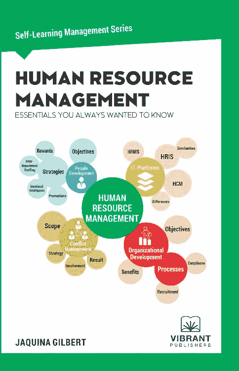
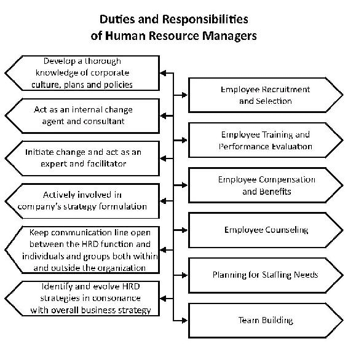
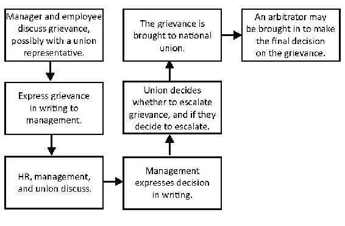
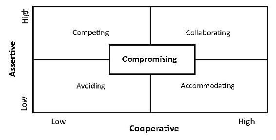
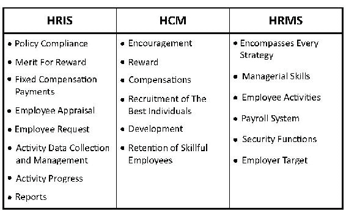
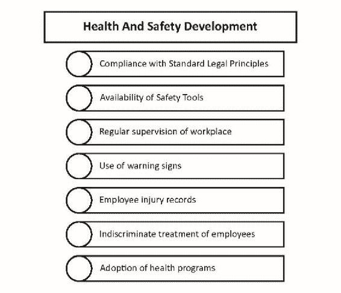
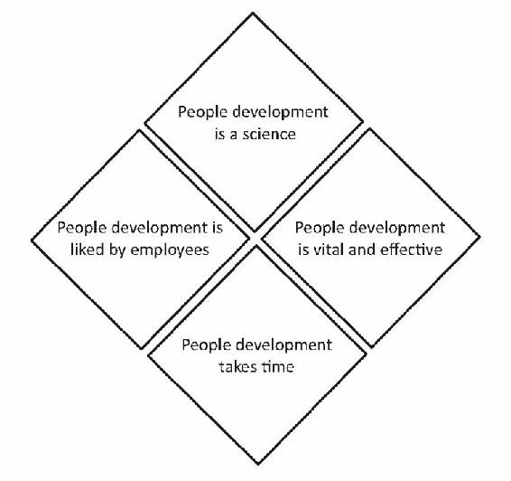

# 你一直想的人力资源管理必备（自学管理系列）

## 专家对这本书的评价如何！

“《人力资源管理基础》对组织内人力资源职能的宗旨和多方面角色提供了一个清晰且全面的基础概述。Gilbert 女士在工业革命前后工作性质的历史基础上进行了进一步构建，建立了一个重要的编年史，描绘了‘工作’和‘劳动者’如何响应不断变化的社会需求而演变，以及有效地管理人力资源如何是组织取得成功和可持续发展的商业必然。通过理论与概念性内容、相关流程模型以及现实世界实践和资源的引人整合，Gilbert 女士为建立完善的人力资源管理知识体系和技能组提供了具有战略性和战术性的资源，这些资源可以用于对每个 HR 主题进行更高级的深入探讨，并应用于实际职业环境和背景中。”

– Carrie A. Picardi，博士（组织心理学家），布里奇波特大学管理学副教授

“《人力资源管理基础》这本书提供了 HRM 的强实职功能知识，将使学生清晰地理解归属于 HRM 的目的、实践和程序。作者对该领域拥有全面的知识，并分享了极佳的现实案例。在他们毕业并投身职业生涯很久之后，这本书将是 HRM 专业学生以及不同方向的商务专业学生的桌面参考书。”

– Fernán R. Cepero，硕士, 硕士, PHR, SHRM-CP，组织与全球领导者资深人力资源业务伙伴，罗彻斯特大都会区 YMCA 协会 - 协会办公室

“这本书提供了人力资源全方位的完整视角。读完这本书后，你将对员工生命周期有全面的理解——从招聘到离开组织。这本教材充当了理解人力资源各方面基础的指南。它的原则可以在任何组织中作为人力资源专业人士工作时应用。”

– Rhea Doshi（心理咨询硕士），巴斯夫印度有限公司全球业务服务经理 - 学习与发展

“Jaquina Gilbert 关于人力资源管理的这本针对性强的文本，为成为一名伟大的 HR 领导者的基础提供了深思熟虑的介绍。内容既广博又易于理解。Gilbert 在建立 HR 的商业案例方面做得非常出色，同时对最复杂的案例提供了切实的回应。我向任何考虑在该领域从事职业生涯的人推荐这本书。”

– Anthony W. Caputo，Remesh 副总裁，塞顿霍尔大学兼职教授

“Jaquina Gilbert 编写了一本简单而有力的《人力资源管理基础》指南。她巧妙地拨开了噪音，并对现代 HR 领导者对 21 世纪 HRM 系统的看法提供了系统性的概述。她以易于阅读的方式解释了有效 HRM 策略的核心组成部分。这本书不仅对 HR 学生和领导者有效，对涉及人力规划和其他 HR 决定的非 HR 从业新手也有效。我非常推荐 Jaquina Gilbert 的书作为新兴业务领导者的必读本。”

– Yogita Abichandani，博士，穆尔希巴德管理发展学院 HR 与组织行为副教授，北卡罗来纳州 SECU 董事成员 | 美国印度 HRD 学院联合主席 - SIG 主席 - 国际关系主席 - 乔治亚大学校友

“在过了这么久之后，能遇到一本提供人力资源管理详细信息的书籍真是太好了。作者详细涵盖了 HRM 的各个方面，从 HRM 的演变到关键角色、法律事务、薪资、薪酬与福利、HR 中的 IT、健康与安全等。每个方面都从不同的角度进行了审视，并考虑了现状。这本书将受益于现任 HR 专业人士和未来的 HR 经理。”

– Paras Panchamia，Insight Business Machines Pvt. Ltd HR 与行政经理

“这本关于人力资源管理基础的文本是一本扎实的读物，是对基础 HR 原则非常好的介绍。这本书组织良好、编写流畅，包含了易于阅读且实用的‘如何做’片段，是日常 HR 操作员、领导和经理的极佳资源。”

– Paul W. Thurman，管理博士，哥伦比亚大学管理与分析教授

“《人力资源管理基础》对于任何想要获得人力资源概念通知识的人来说，都是本基础性的、非技术性的且易读的书。对于小企业以及任何目前处于 HR 以外但想了解该领域要素的人来说，这是一个很好的资源。”

– Felicia D. Harris-Foster，MBA, MS-HRM, CFE & 兼职教员

## 关于作者

Jaquina Gilbert 拥有超过 20 年多学科的人力资源经验，持有 SHRM 和 PHR 认证。她编写了三本书，并为各行业的企业主和作者撰写过 HR 相关内容。Jaquina 在德克萨斯大学丹顿分获得人力资源管理与组织行为学士学位，并在安伯顿大学获得人力资源培训与发展硕士学位。

## 9.1 安全工作环境的要求

---

广义上，公司包含了商品化的资源（即组织商品）以提高生产力。对于许多公司来说，最丰富的资源之一就是人。因此，人力资源成为生产力以及后续组织绩效的关键要素。寻求有效解决合规性问题、员工表现不佳、产出低及其他痛点的组织，必须首先保护其核心资源——员工。

# 雇主与员工之间的关系可能是复杂的

由于这种关系引入了抽象和具体的互动，例如分享想法、行为、情感、人力资本、有形工作产品、态度、绩效等，因此组织必须通过一种微妙的方式来处理对这些关系的保护。人力资源管理试图保护驱动人力生产力要素的关系，而这种要素有助于组织的成功。这种保护最好的方式是制定并实施适当的策略，解决损害员工、管理层与公司之间关系的问题。许多组织建立了一个名为 `Human Resource Management` 的个人业务部门或职能，作为这些解决方案策略的制定者、维护者和执行者。

机构的 `Human Resource Management` 部门通常被赋予了指向员工全面发展的任务。这源于面试、对组织立场（财务和所有权）的分析、向员工传卓越且富有成果的知识、工作纪律、遏制公司员工之间的骚扰和恐吓行为，最重要的是维持和保持组织的工业化和进步性关系。在本文随后的部分，我们将探索 `HRM` 通常被采用和接受的通用功能。

大量且各样的报告建议了正确或适当的人力资源与员工比例。领先的顾问、`SHRM`（人力资源管理协会）、商业博客主等人都分享了他们认为的何时聘用 HR 人员的最佳实践或最常见且有效的策略。平均而言，大多数报告和信息表明，当公司大约有 40 名员工时，就应该聘请人力资源专业人员。最重要的是要知道，如果任何现代组织中缺乏这种关键的权威，将会出现一系列影响公司各个方面的挑战。从本质上说，如人员配置不当、员工关系紧张、雇主与员工关系疏远以及其他各种障碍将成为日常常发生的事情。关键在于在过程中尽早寻求人力资源专业人员，以避免与合规、法律、招聘、绩效、发展、留任和离职相关的各种失误。

`Human Resource Management` 一词可以追溯到古代中世纪。然而，近期的研究表明，`Human Resource Management` 的概念可以追溯到远古。虽然人力资源的概念和时间一样古老，但早期并没有明确地承认 `Human Resource Management` 这一术语。此外，雇主与员工之间的关系程度在很大程度上是糟糕的，这就是为什么这个概念与早期历史并不紧密。

在 20 世纪 20 年代，出现了新的正式职位来促进 `Human Resources` 的增长。其中之一是 `Labor Manager` 或 `Employment Manager` 职位，它的出现是作为对行业整体建设的一种制衡，特别关注劳动力和员工。这主要适用于生产率高的工厂，以便于生产和生产检查/管理。反过来，这触发了生产力的异常提升，但是以牺牲对员工的单纯鼓励为代价的，有时是为了获得与其他工厂的竞争优势。

`Human Resource Management` 在 20 世纪 80 年代进入了更充分的使用。然而，它仍然出现在一个未能理解雇主与员工之间关系的时代，而这种关系我们现在现代机构中经常看到。此外，人们认为其近现代的起点源于女性对自己和孩子寻求安全立足之地的渴望。除此之外，该概念的关注点还在工业中更好产出的生命力。

`Human Resource Management` 作为一个术语和一个研究领域并非凭空产生。它经历了几个阶段和劳动分工，才在组织内部形成了其显赫地位。事实上，中世纪见证了 `Human Resource Management` 的兴起，以及它从一个限于农业的时代向工业化再到后工业化时代的进程。

正如其名称所示，这场革命涵盖了社会中有限的职业。主要职业是农业，并伴随着手工业。当时缺乏工业化的理念，因此，以自然方式利用大部分自然资源占据了那个时期。

为了简化这一理念，这里有在三个方面显著的三个类别——奴隶、农奴制和契约劳动。

将人类作为劳动力使用始于奴隶制的基石。劳动力的来源主要是主主购买在农场工作的奴隶。主主通常不关心或不关心人员配置的任何方面，包括福利、健康和工作时间。在此基础上，主主无法从田里筛选出无生产率的工人。相反，无能力的奴隶受到了极其糟糕的对待，被迫在困难且有时是不可能的条件下工作。然而，主主与奴隶之间存在着亲近的关系。忠诚的奴隶通常会获得某种奖励，或者被卖到更好的工作环境。最终，一些工人会离开并建立自己的产业，而另一些人则留在主主那里。

农奴被束缚在土地上并被封建主所有。由于那个时代主要是封建的，农奴的责任始于和结束于农业。农奴享受来自封建主的某种待遇，封建主经常奖励他们。奖励可以是金或任何有价值的物质。

随着时间的推演，人力资源发生了变化，这改变了劳动的整体观念。时代开始见证契约劳动或合同劳动，他们拥有比奴隶和农奴更多的自由。在此期间，主主倾向于尊重劳动者，这很大程度上是因为交易的契约性质。主主看到勤奋的工人，意图通过延长合同或终身合同留住他们。为了实现这一点，主主引入了多种工作福利、激励以及一些积极的激励影响，让工人保持快乐并延长合同。

工人的时间伴随着低薪水。为了解决这个问题，工会在 1790 年左右显著兴起，这为工业工人提供了更多的权威性。人事管理部门提升了他们的水平，采用了更熟练的模式来处理涉及公共事务的情况。

在此期间，弗雷德里克·泰勒（Frederick Taylor）的科学管理原则运而生，他不断改进工业效率，并成为最早的管理顾问之一。泰勒侧重于管理简单任务以提高生产力。他认为，从更科学的方法来处理工作可以增加产量，并减轻仅落在工人身上的责任。当时的工人曾被要求去思考如何获得提高生产力的激励或主动性。

乔治·埃尔顿·梅奥（George Elton Mayo）被视为人力资源管理的之父。埃尔顿·梅奥与弗里茨·罗特利斯伯格（Fritz Roethlisberger）共同观察了“霍桑效应”（Hawthorne Effect）的发现，该效应认为需要高效的工人和卓越的工作条件。这把增加人力资源生产力的想法转化为了更具吸引力的产出效率。

随着这一时期学术方法的日益盛行，人力资源管理的性质迅速传播到更现代的结构。人力资源管理的概念现在促进了行业对关注员工福利的需求。它进一步帮助机构采用效率而非非技能劳动力。尽管雇佣了熟练工人，人力资源管理也鼓励需要培训工人使其变得更有胜任。相反，行业将看到更具生产率的财务增长。

人力资源管理的普遍主义理论建立在最佳实践和高绩效工作实践的理念之上。它认为，行业的表现主要取决于可用人力资源的利用实践。这表明，缺陷的人力资源会对整个组织产生负面影响。

权变理论与人力资源管理的普遍主义理论完全对立的。该理论认为，全球范围内不存在相似的做法。就此而言，行业和组织应该制定一种符合其业务环境的模式。例如，麦当劳（McDonald’s）的员工有特定的送餐方式，以及为客户包装快餐的方法。如果将这种做法转移到像银行这样的机构，整个方法将产生冲突，反而会对日常活动构成威胁。这就是为什么理论或模型反对普遍性。这种观点认为，在 `Y` 公司有效的方法在 `X` 公司可能不会奏效。

这在很大程度上被视为一种传统方法，因为它只关注公司的生产立场。这种方法涉及将员工商品化，并在实现目标后完全可以淘汰这些员工。有时，这些员工会被留任，但其核心意义是公司在任何时候都主宰发生的一切。这与关注组织的人力资源管理“硬性模型”是一致的。

## 系统方法

主动管理团队可以为组织节省大量的生产和收益方面的损失和挫折。当一个组织采取主动方法时，更有可能做出更有效的决策来改善该组织。

另一方面，当一个组织采取被动方法时，持续下降的趋势将不可避免。这种反应可能是解决人员配置问题、生产问题、管理问题等。以被动的正式形式持续处理组织障碍，最终将导致组织部分或整个组织的崩溃。

## 1.4 人力资源管理的基本功能

- a) 计划
- b) 人员配置
- c) 组织
- d) 指导
- e) 控制

运作功能被建议得广泛，因为不同人士对其综合清单做出了贡献。最熟悉的运作功能特征是：

- i) 维护与留才
- j) 劳动与员工关系

为了获得更好的公司表现，员工必须具备资质、技能并经过培训。要么允许员工适应系统，要么通过培训让他们以更快的速度发展。让员工自然适应会浪费时间并产生无效产出。然而，培训此类人员将对组织产生巨大帮助。

人力资源经理职位属于职业类型。它需要主动和被动处理情况的心理能力。决策具有极大的影响力，可能给公司留下污点，也可以建立健全、一致的实践。此外，人力资源经理的一些传统品质包括口才好、思维活跃、缓解压力的能力、卓越的沟通技巧，以及最重要的卓越的领导能力。所有这些共同构成了人力资源经理的描述。

- b) 建立能够使即时或后期产出有利于组织生产能力的程序
- c) 开发针对组织及员工共同成长的新想法
- o) 确保适当的人员配置以维持高效的工作流程
- p) 就经理和员工提出的有关安全、健康、高效且合适的工作环境及文化的问题，提供倾听和建议

要管理那些涉及个人性格、教养、宗教信仰、情感以及其他定义员工身份的非实质特征的行为是困难的。这些抽象因素往往导致雇主无法确定员工的期望或愿望。人力资源经理的任务是帮助在这些无形特征之间建立桥梁，并利用它们来巩固强大且可靠的雇主与员工关系，使双方受益。这是具有挑战性的，因为人力资源经理在过程中保持公正的同时，试图为双方提供理由。在雇主采取专横的情况下，会影响组织，因为员工将失去适当的鼓励。这时，就需要人力资源经理来补偿这种情况，并激发员工的“工作就绪”因素。

公司的表现可能落在人力资源人员的肩上，无论是失败还是成功都会吸引所有人的目光来检查这一影响性角色。

并非所有组织都有工会劳动力或工会化的员工队伍。在由工会代表员工的公司中，处理疑虑有非常具体的流程和规则。通常，会出现公司的决策与员工需求冲突的情况。员工可能会寻求其工会代表的咨询或指导，以帮助与雇主进行对话。人力资源人员最常参与其中，并且必须运用极强的沟通、领导、倾听以及谈判和调解技巧来处理这种情况。这些人才对于确保过程的专业性并保证获得更好的解决结果至关重要。人力资源经理应该以高智商处理情况，确保充分理解员工的观点和工会代表的影响。人力资源经理应避免做出可能在财务和法律领域对公司造成巨大损失的话语或决策。

## 案例与问题

2) Dan 是一家大型零售连锁的 CEO。他的好朋友 John 是一家大型成功酒店帝国的副总裁。Dan 和 John 讨论了提高员工生产力的方法，以增加底线。Dan 最终采取了 John 在其公司实施的所有实践和流程。Dan 对员工生产力的观点可能包含了：

- c) 指挥 (Directing)
- d) 大多数 HR 挑战是不可预测的，但适当的规划、科学的决策和实施解决问题的策略可以帮助应对挑战。

在绩效管理策略问题上，还没有传统上接受的形式。然而，随着时间的推移，已经引入了一些基于测试的系统性计划-行动方案。

### 通知并带领团队

一种健全的绩效管理策略绝不要假设团队已经知道发生了什么。对管理团队提出质疑并要求他们去质疑员工是具有战略意义的。你的新模型可能在某些方面让所有发现沟通有挑战的人感到困惑。当最优秀的人才表现突然下降时，通常是因为他们“认为”自己已经了然于胸。这同样会导致某些偏离轨道且远离新模型的员工，在不知情的情况下继续表现不佳。当公司进行需要适应的创新时，情况通常就是如此。让雇主充分知情，并确保每个可用人员都保持在正轨。一些人力资源人员养成了起草总结的习惯，定期向员工提示对他们的要求。考虑也这样做，但要谨慎不要用不受欢迎或不合理的提醒轰炸员工。

以下是绩效管理的基础及其对系统的影响：

任何绩效管理策略的目标都是审查和奖励卓越。让员工目标与公司目标相对应至关重要。受雇人员可能在工作，但与公司目标不一致。未能对齐目标可能导致巨大的事故，导致底线数字下降、员工士气下降等等。通过正确对齐目标，个人可以表现出影响业务创造力的企业核心价值观，并带来高生产力。

根据 Armstrong 和 Baron (2004) 的观点，绩效管理是“一个对个人和团队进行有效管理、以实现高水平组织绩效的过程”。这一定义表明，绩效管理不仅仅是个个人的事务，而是一个集体的组织事务，包含了组织、人力资源人员以及人力资源或员工。

绩效监控和发展应该是持续的过程，如果结合有效的目标设定，就能建立起通往员工成功的桥梁。

3) 将员工纳入绩效改进计划（`PIP`）应该发生在绩效管理周期的哪个阶段？

### 收集相关数据

每个识别出的问题都有来源。从现在起，来源必须成为关注焦点。也就是说，任何产生问题的部门都必须接受密切监督，以检索相关数据。这可以通过获取该部门的每日或每周活动报告的形式来实现。请注意，必须按照建议只检索相关数据。除此之外，系统化的方法将会丢失，整个过程将变得复杂。

### 审查与规划

在检索相关的活动或政策数据后，建立一个团队并指派其对这些数据进行审查。告知团队做什么，并确保定期监控个人进度。将此任务分配给管理团队的重要性在于，长期运行审查可能会导致不准确。接下来，从团队获取报告并作为一个团队进行汇总。执行一个与问题相符的计划。

### 计划实施

在收集必要信息并制定合适计划后，起草草案以确保清晰。将计划发送给每个受影响的部门，并确保执行新计划。定期审查并检查进度。

### 获取实施的计划数据

在一段时间之后，获取实施计划的数据。寻找改进之处并找出变化的原因。根据目标对新政策进行修订或修改，以深化目标。监控进度直到业务期结束，届时将进行评估。

### 分析结果

在业务期结束时，确认结果并识别积极因素。写下所有积极因素以及伴随它的有效策略。分析结果并进入下一个业务季度。对于导致结果不理想的计划行动，重新审视策略，以确定是否应该对某些流程进行修订或终止。

## 4.3.1. 战略规划

没有有效的战略，组织就无法维持增长和成功。战略定义或描述了为了实现目标而利用一系列行动的方法。当一家公司制定战略时，该公司有一个意图要达的高度。因此，战略规划的概念不断演变。

### 定义战略规划

这个术语源于战略，指的是一个简单的行动计划。它是思想、政策的安排，最后是为实现组织内成就而采取的决定性措施。战略规划的主要目标是确保只有有效的方法发挥效用。如果一个通常针对提高产出的策略失败了，说明缺乏规划或管理规划不当。然而，当战略有效时，意味着管理层已深入发现可行的方法，而且这是通过程序完成的。

在战略规划过程中，我们将制定战略团队称为战略家。他们的工作非常简单，难度取决于涉及人员的技能。

传统上预计战略家在处理事务时具有系统性。必须建立若干方法来为机构规划战略。这是因为战略规划的概念繁盛于从僵化向能产生成果的演变。上上所述，让我们识别为任何组织提高生产力制定或规划有效战略的必要程序。

## 战略规划流程

以下是规划战略的传统流程：

### 制定

这一阶段仅涉及在制定计划之前识别行动。一旦确定，接下来就是对将作为策略的思想进行另一种简单安排。例如，如果一家公司希望建立内部政策，他们必须提出能使此类政策符合管辖区法律标准的想法。

### 执行

这一阶段涉及将生成的计划应用到过程中。这里的过程指的是使用策略所需的内容。

### 评估

在此阶段，管理层应对实施的计划进行跟进，以确定其是否有效。

## 为什么战略规划是必要的

有些组织没有意识到战略规划的需要。结果，此类公司往往处于预期的错误端。例如，一家寻求表现良好但无法规划出增强这种动机的策略的公司将失败。任何大型机构都应该拥有一个专注于战略规划的专门部门以便在竞争中立足。

以下是战略规划必要的理由：

a) 政策的有效性

b) 提高产出

c) 制定清晰的政策

d) 提高生产力

e) 符合管辖区法律标准的能力

f) 符合且组织化的管理方式

g) 在某些情况下招聘高技能的人才

## 4.3.2. 招聘

人力资源管理必须精通招聘。招聘涉及为了生产活动而引入人力资源。然而，招聘这一概念需要一个战略性的行动计划。也就是说，它必须是科学的；否则会对组织产生负面影响。例如，一家公司如果招募了没有技能的人员，就会发现生产力和产出正在持续下降。据此，足以认为，在任何环境下，适当招聘的贡献都不应被忽视。如何实现这一恰当的要求呢？如前所述，它应该遵循科学流程来获得合适的人才，这意味着会有更显著的产出。

DeCenzo 和罗宾斯对招聘有自己的见解。根据这些学者的观点“招聘是发现实际或预期组织空缺潜力的过程。”然而，他们的定义未能强调这种发现必须是高技能的，因为除非对人才进行额外的培训和开发投资，否则缺乏技能的发现对组织的增长是毫无用处的。

通过强调技能，约德（Yoder）的定义提供了我们所需的内容。对于约德来说“招聘是一个发现人力资源来源以满足人员配置计划要求，并采取有效措施吸引足够数量的人力，以促进对高效劳动力进行有效选择的过程。”仔细观察约德的观点，招聘基本上是对最“有技能”的人员进行选择。在管理中，未能拥有高技能且敬业的员工队伍将意味着“零”和“下降”。

## 招聘流程

由于招聘是组织中不可或缺的力量，因此它必须是战略性和程序化的。

### 确定所需职位

第一步是确定组织中的空缺职位。注意，确定职位并不意味着它必须是空缺。这意味着招聘可以在需要人力资源支持的领域进行。也就是说，需要另一名员工来提升特定职位的生产能力。

### 概述其需求

此类职位对什么要求？潜在员工必须具备多高的技能？为了能够正确概述所需职位的需求，必须回答这些等方面的问题。此外，确保特定职位不包含使其陷入复杂条件的因素是明智的。为了揭示这一点，人力资源人员必须审查内部和外部政策，以确保它们不冲突且符合法律规定。

### 生成清晰的工作描述

描述必须足够清晰，让潜在员工理解他们签署的是什么。可以咨询此类职位的前员工以获取更多信息，从而对职位提供更好的描述。

### 寻找与筛选

最后要做的工作是寻找并筛选个人。小心不要筛选出错误的候选人。在筛选职位的申请人时，以下提示可能有所帮助：

a) 申请人的资质必须符合描述

b) 申请人必须适应氛围

c) 无论是否有经验，申请人必须能够陈述他们在工作困难和严苛的情况下可能会做什么。

如有必要，将筛选分为几个阶段。这有助于进一步帮助排除错误的人才和思想。目前有一系列面试方法可用。虽然传统的面试方法对某些组织有效，但行为面试法对另一些组织效果更好。这取决于所属公司的类型，以决定采用何种面试方法。

### 评估候选人表现

在做出选择后，考虑定期或持续地检查并审查新聘员工的进展。必要时，培训这些员工使其在该领域变得更好。有必要将新员工介绍给现有员工。这有助于为更快的学习提供空间和更具社区结构的环境。此外，员工之间的学习效果最好，因为没有畏惧感。大多数公司都实行这一点，以帮助员工快速学习和适应，从而提高产量。

## 4.3.3. 强制合规

合规是执行符合概述标准的活动、制定政策和提供待遇的行为。对于组织而言，合规意味着拥有不与司法管辖区法律冲突的政策。几个执法机构一直在固定寻找无视法律原则的组织。此类组织被认为以不合规的方式运作，这是受到惩罚的。

合规机构主要负责维护整个司法管辖区的合规性。机构接收有关组织的投诉，着手调查和审查此类投诉。如果发现某组织有罪，例如使用水和煤气等的方式不符合监管规定，该组织将受到惩罚。除了物质上的不合规外，机构还可能在人力资源方面不合规。例如，未能提供标准的工作环境或忽视初始工作条件将被视为该组织违反了法律。

从管理的角度来看，无论发生什么，合规都应该是一个重点。活动、政策甚至员工待遇都必须符合标准规范。由于任何原因而不尊重任何政府政策都只会给公司带来不必要的负面影响。根据法律的结构，这甚至可能导致公司生产能力的下降。

人力资源团队必须确保公司政策不与法律冲突。必须对涵盖法律标准的任何文件进行定期咨询，以保持公司处于正轨。此外，遵守司法管辖区的法律可能会产生费用。尽管如此，违反法律的代价非常高，并可能使公司在很一段时间失去竞争优势。

## 4.4 组织发展的益处

公司的发展过度依赖于管理。有时，当公司未能实现大规模交付时，责任会转移到管理团队。事实上，管理因素负责组织发展，他们被授权去筛选并实施有效的方法。

目标是让一家公司或机构从低性能区域转移到高性能区域。这涉及雇主、员工、管理层甚至生产资源。

为了让组织成长，此类组织必须有一个清晰描述的设定，从利益相关者的情感方面开始鼓励发展。组织发展在许多方面都是至关重要的。

以下是组织效益的四个基本优势：

### 员工成长

公司的首要目标是利润最大化。即使拥有正确的资源，缺乏人力资源也无法实现愿景。因此，必须有员工来实现这一愿景，因为他们是组织生产的核心。就此，组织发展倾向于关注员工的成长，以建立适当劳动力来实现盈利。

### 改善雇佣关系

这一概念同样有助于工人与其雇主之间的关系。它建立了一个有效沟通的链接，从而提高生产力、士气、投入度和工作环境。

### 稳定且上升的产出

除了盈利之外，公司努力获得比其他企业的竞争优势。这是必要的，因为组织建立的权威越高，它在社会中的地位就越突出、越相关。组织发展通过应对和驱逐可能阻碍组织快速进步的挑战来发挥作用。

### 监管/法律合规

法律机构讨厌违反标准的公司。公司同样讨厌在行事时被抓包，因为深知这种行为随伴的后果。因此，组织发展试图审查并确保组织政策与法律政策之间不冲突。

## 章节总结

a) 组织发展是一个战略过程，指的是组织各种职能的渐进且实际的发展，并识别哪些方法有效，哪些方法无效。

b) 战略规划、招聘和合规执行是组织发展的三个关键部分。

c) 战略规划涉及三个传统阶段，包括制定、执行和评估。

d) 产生适当招聘实践的各种流程应包括识别空缺、概述职位要求、生成职位描述、寻找和筛选，最后对招聘人员的绩效进行评估。

e) 增强沟通、员工成长、竞争优势和增加利润都是人力资源管理（HRM）发展的目标。

## 测验 4

### 1) 哪一组词最准确地完成了组织发展的定义？

“组织发展是一个 _____________ 过程，帮助一个 ___________ 达成目标。”

a) 战略的、组织

b) 科学的、员工

c) 方法的、组织

d) 概念、员工

### 2) 在考虑组织发展时，为了获得更好的结果而实施的通用程序的正确顺序是？

a) 收集数据、分类问题、检查诊断后的问题、审查并计划、实施计划、检索计划数据并分析结果

b) 收集数据、检索计划数据、分类问题、检查诊断后的问题、审查并计划、实施计划并分析结果

c) 分类问题、检查诊断后的问题、收集数据、审查并计划、实施计划、检索计划数据并分析结果

d) 分类问题、检查诊断后的问题、收集数据、检索计划数据、审查并计划、实施计划并分析结果

### 3) 下列所有都是战略规划必要的理由，除了：

a) 提高输出

b) 提高生产率

c) 政策有效性

d) 避免员工挑战

### 4) 以下哪些是人力资源管理发展的目标？[选择所有适用项]

a) 员工成长

b) 使公司获得竞争优势

c) 解雇表现不佳的人员

d) 增加利润

e) 以上所有

### 5) 增强 ____________ 和 ____________ 之间的关系建立了良好沟通的纽带。这种增强导致生产率、____________、__________ 和工作环境的提高

a) 员工、员工、牺牲、工龄

b) 雇主、员工、士气、投入度

c) 雇主、利益相关者、流动、忠诚

d) 雇主、员工、士气、留存

上述问题的答案可以从本书的[在线资源](http://www.vibrantpublishers.com)部分下载。

# 第 5 章：冲突管理

冲突是任何组织中不可避免的现象，可能由个人或小组引发。第五章重点介绍冲突以及可能消除冲突的各种方法。

本章使读者具备解释以下内容的能力：

a) 冲突的定义和示例

b) 冲突的特征

c) 冲突的影响以及避免冲突的必要性

d) 冲突的不同分类

e) 冲突解决方法和策略

f) 组织内部产生冲突的因素

一个组织依赖人力资源、管理层和雇主之间的和平共处来良好运作。当这些群体之间发生冲突时，会导致绩效不佳，从而导致产出低下。冲突也可能由其他利益相关者（如客户、客户、董事或志愿者）引发或涉及。因此，为了实现任何计划目标，任何业务环境或组织中都必须像瘟疫一样避免冲突。

冲突是任何引起组织系统内部动荡的事物。它通常是对不利政策的反应。从管理的角度来说，冲突仅仅是针对公司计划或行动采取的蓄意煽动措施。它在人力资源部门通常很显著，但在组织的其他职能中同样普遍。

## 冲突管理的定义与困难

冲突管理是一种反应性措施，旨在衡量冲突对公司整体绩效的影响。该概念识别问题的来源、提供并实施解决方案。冲突是否与合规有联系？许多人力资源人员曾思考过冲突与监管合规之间的联系。简单的回答是，只要管辖法律反对冲突，它就适用于组织管理层、员工和雇主之间的冲突。

此外，冲突管理是一个基于科学的概念。原因在于它要求在管理组织绩效不佳、关系失衡和产出低的原因方面采取措施和步骤。如果不对冲突做出快速反应或尝试进行管理，将会出现许多困难。某些困难包括以下方面。

### 沟通薄弱

冲突不鼓励沟通。因此，它促进了管理层、雇主和员工之间糟糕的关系。组织中的冲突等同于一个缺乏互动的社会。这是因为冲突通常会导致可能引发争斗的误解。沟通的缺失不仅会影响组织关系，还会影响客户。在此类冲突明显的情况下，客户可能会撤回支持。

### 绩效不佳

一个充满活力的组织拥有一支投入的员工。然而，当员工遇到冲突时，它会剥夺他们投入和奉献任务的意愿。自然地，这会吸引一个不鼓励生产率的沉闷环境。充满冲突的组织不鼓励员工发展，因为没有功能性关系来增强这种发展。

### 生产率低下

在任何组织中，冲突导致生产率低下都是常态。一个充满冲突的组织在任何职能上表现良好将是令人惊讶的。在商业环境中，有显示公司增长的图表；这样的公司通常会发现自己处于下降趋势并保持在低水平。这同样意味着该组织在现有竞争中是不活跃的。随后，他们将被排除在业务环境的竞争之外。

## 5.1. 冲突的特征

虽然冲突不可避免的，但受到冲突影响的组织始终可以通过冲突方的适当理解和调解渡过。调解冲突是理想的，因为它们可以在瞬间摧毁公司中现有的任何关系。

此外，组织中的冲突有时可能是向新标准迈进的运动。这意味着冲突在破坏之后具有重建的潜力。一个最近调和了内部分歧的组织会注意到，在冲突之前和期间，存在某种最初缺乏的宽容度。与其他许多概念不同，冲突具有其定义特征。

### 不可避免性

任何组织都应该做好充分准备，因为在一个运营中的业务结构中，冲突是不可避免的。无论组织多么有序，冲突的挑战总会降临。这可能是管理层与雇主之间的冲突、雇主与员工之间的冲突、员工之间、或管理层与员工之间的冲突。这些统称为组织间冲突。此外涉及员工的组织内冲突。然而，组织管理的定义在于其调和差异的能力。

### 可避免性

这意味着通过采取正确的措施，可以在组织内部外部消除或将冲突降至最低。大多数公司都会建立资源管理团队之外的团队，以定期识别并驱除组织内的冲突。在管理部门对冲突不积极的情况下，冲突就会产生。当冲突发生时，需要巨大的策略和资源来进行调和。设计一种主动的策略来防止冲突最终发生会是更好的做法。

### 调和

这种理念是，冲突并不是一个完全封锁公司的概念，而是一个任何时候发生都可以解决的必要现象。冲突作为一个过程发生，并可以通过程序来解决。这只需要一个计划周密的策略，说服相关方去调和悬而未决误解。无论是内部还是外部，一个充分的解决方案都不是遥不可及。此外，修复内部冲突比修复外部冲突更容易。原因是外部冲突双方可能拥有矛盾的政策，这些政策往往会产生分歧。

### 可可见

存在问题的公司无法掩盖他们的问题。这导致了竞争的恶化，冲突在两家公司处理对方事务的方式上总是显而易见的。如果处于拥有同一细分市场的多个环境中，其他公司将抓住机会在竞争中更具优势。

### 迅速传播

冲突传播迅速。它像传染病一样，几家公司或个人可能会卷其中。例如，在组织中，当冲突发生时，它会从一张桌传到另一张桌。在移动过程中，公司的其他成员会站队。每个个人的支持者倾向于讨厌支持对方的人员。这也发生在组织层面，公司会选边并指责另一公司。这将引发对立，并可能影响整个业务环境的健康。此类问题应及时解决以避免生产力低下。

## 5.2. 冲突的分类

工作场所偶尔会发生冲突。冲突背后的范围通常在于谁对谁错。双方往往倾向于认为自己是正确的，而忽视了双方可能都是错的事。大卫·L·奥斯汀（1976）认为：“它可以被定义为两个或多个个人或群体之间的分歧，每个个人或群体都试图让他人接受自己的观点或目标。”

借鉴奥斯汀的观点，显而易见的是组织冲突基于个人目标。很多时候，双方都不愿意听对方的，而是觉得自己是正确的。这种冲突产生于各种基础。基于策略、结果、参与程度或范围。无论何种方式，焦点仍然在于冲突的发生是因为组织中的涉及或冲突双方拒绝听取对方的观点和目标，并拒绝以某种形式接受它们。只要任何一方只重视自己的目标，冲突就会持续存在。

传统上，冲突的范围很广，其类型也很多。冲突的某些类型包括关系冲突、价值观冲突、任务冲突、组织内冲突、组织间冲突、人际冲突、内在冲突。

### 关系冲突

这涉及到雇主与员工、雇主与管理层、管理层与员工、甚至员工与员工之间恶化的关系。此类冲突的基础是沟通方式变得恶化。处理幸福感变得困难，因此组织遭受了损失。要修复此类冲突，人力资源管理必须识别并调和冲突双方。这可以通过有效的沟通策略来实现。

### 价值观冲突

价值观的差异是导致冲突发生的因性原因。这在管理人员中尤为显著，因为他们负责组织政策的制定。一个管理团队可能由具有不同信仰的个人组成。在大多数情况下，这些个人倾向于要求他们的建议获得比他人建议更高的认可。有时，这可能是个人利益的结果。

### 任务冲突

这是一种在分配的任务存在困难或巨大差异时产生的冲突类型。它通常是雇主与员工、雇主与管理层或管理层与员工之间的冲突。例如，当员工拥有一项共同职责时，它最初看起来是一项简单的任务。最终，它会变得更加困难，并且在大多数情况下超出了工作条件。员工可能会遇到困难并试图向管理层表达。而管理层认为他们已经规划或制定了支持组织的完美任务，员工可能会强烈反对。

### 人际与内在冲突

人际冲突发生在组织内的两个个人之间。它通常发生在具有不同信仰体系的员工之间。有时，它与不涉及组织的外部事务有关。此外，由于两个个人看待某些事物的方式存在差异。例如，如果一个员工被分配了一项任务，另一个员工可能会带着不同的想法来，认为最初的想法是不标准的或是无效的。另一方面，内在冲突指的是组织内个人内心的困扰。这些困难可能是对现行政策的矛盾想法。它通常导致此类员工在组织中的参与度降低。

### 组间与组内冲突

与人际和内在冲突不同，组间和组内冲突涉及组织中的一个团队或群体。组间冲突在负责不同职责以提升组织业务业绩的团队中很常见。例如，组织中的福利部门和社会事务部门之间可能会发生冲突。社会部门可能会因为发放的金额不符合要求而对福利部门产生问题。不同的小组可能认为他们最初的要求是荒谬的，而要求的团队则认为他们在试图欺骗。组内冲突则不同。这种冲突发生在负责某目标的工人团队内部。组间冲突和组内冲突的区别在于，组间冲突发生在两个或多个不同的小组之间，而组内冲突发生在同一个团队或小组内部。

此外，了解组织所遭受的冲突类型有助于设计可以解决问题的策略。然而，冲突可以根据结果、参与度、范围、策略以及其他几个方面进行分类。

## 5.2.1 基于结果的冲突

当基于结果发生冲突时，它可能对预期目标产生非常负面影响。这是一种破坏性事件，会增加单一团队或组织内多个团队或群体之间的混乱。大多数组织的设计目标是利润最大化，这是建立各类企业时广为人知的范围。此外，公司为了实现利润最大化，必须有计划的战略方法。在这种情况下，需要大量的资源管理人力来确保一切进入成功的轨道。例如，组织的人力资源部门将负责照看或管理组织的人力方面，以实现某一结果。为了成功，不能存在冲突，因为冲突会扼杀实现目标的愿景。

当冲突进入一个组织时，它会引发破坏。它剥夺了所需的认可，并引入了染污的氛围。必要的活动可能会被暂停或取消，因为基于结果的冲突表明，在那种情况下无法实现计划中的目标。这是如何发生的？个人、团队或组织会在情感上产生极化。此外，这种个人、团队或组织的士气会受到损害。可能会爆发斗殴、争吵、言语攻击、操纵和合谋行为。想象一下，当客户聚集时，某些员工之间正在发生人际斗争。

基于结果的冲突影响组织的大部分。然而，重点在于，冲突源于哪一个方面并不重要。其范围在于，它破坏了每一个计划，并让个人、群体和组织处于不利地位。

令人放心的是，影响结果的冲突可以通过简单的战略计划消除。以下是遏制此类冲突时应采取的措施。

### 识别源头

没有源头就没有冲突。负责预期目标的个人肯定知道冲突的源头。根据组织的大小，建立一个大约二到三人的调查小组。在发现真实原因或根源之前，调查发现过程不应超过三天。

### 审查

此时，必须对揭露出的原因进行审查。如果不审查此类原因，要学会如何永久消除发生的问题将具有挑战性。在涉及的个人或群体被分配了特定完成任务的情况下，重点应放在为什么其中一个个人或群体鄙视另一个。事实上，在大多数记录的案例中，错误总是由于将错误的人员分配给了错误的个人或团队导致的。

### 执行

审查之后，进行补救并重新启动计划。冲突并不意味着任何行动计划的绝对结束。它通常只是一段短暂的问题性中断。在一段时间内，监控针对最初冲突原因实施的新政策。检查新计划的运行情况，并确保不再有任何与预期结果冲突。

## 5.2.2 基于参与度的冲突

基于参与度，冲突呈现出个人、群体或组织层面。无论涉及其中哪一个，冲突仍然会对系统产生影响。让我们在下文中详细说明基于参与度的冲突方面。

根据个人层面的参与情况，如前所述，有两种类型。它们包括：

a) 人际冲突

b) 个人内部冲突

基于参与度的个人冲突这两个方面具有相似之处。人们经常混淆组织中的人际冲突与个人内部冲突。这两类冲突的相似之处在于都与员工有关。然而，区别在于人际冲突涉及多个个人，而个人内部仅涉及一个个人，其想法与政策或指向目标的计划发生冲突。这类冲突对组织总是不利的，因为人力资源是任何组织的生产力大脑。为了调和这种冲突，应该邀请受影响的个人或多个人进行简短的审查对话。这可以通过管理部门完成，甚至在必要时由雇主完成。但随后建议将其转交给人力资源中心，以进行更好的审查和永久解决。

基于群体层面的参与，类别包括：

a) 群体间冲突

b) 群体内部冲突

如果个人冲突严重打击了组织，那么群体冲突的打击会更大。这不是一个范围，而是根据清晰的判断得出的结论。群体间冲突是组织内多个群体或团队之间存在的对立。它与群体内部冲突的区别在于，群体内部冲突发生在组织内某个特定群体或团队的成员之间。研究表明，群体间冲突的影响比群体内部冲突更高。这一说法是可靠的，因为群体间冲突可能涉及的人员比群体内部冲突更多。由于人力资源是每个组织生产力后的大脑，劳动力的增加意味着更负面的影响。通常运作的战略计划是对此类团队或群体进行重组。这应该在理清冲突源头之后进行。

基于参与度的第三种冲突是组织级冲突。组织冲突包括两种，分别是：

a) 组织间冲突

b) 组织内部冲突

虽然组织间冲突涉及不同组织之间的对立，但组织内部冲突是特定组织内部的冲突。这两种类型的冲突对组织的影响都不小。这类冲突完全可能导致一个组织的生存终结。原因是冲突的每个部门通常都参与其中。它可以是雇主与员工之间的冲突、雇主与管理层之间的冲突，以及管理层与员工之间的冲突。糟糕的是冲突是组织间类型的冲突。两个组织的碰撞不仅会影响一个或多个组织，还会给同一领域的其他机构带来巨大的竞争优势。

相反，情感冲突涉及个体之间的关系。这可能是一种情感上的或具体的（物理的）关系。它既涉及组织中的一个员工群体，也涉及整个组织。因此，足以说，有效的冲突从人际关系延伸到群体关系，再扩展到组织层面。

从范围来看，实质性冲突与情感冲突相比，实质性冲突是最耐受的。实质性冲突关乎组织生产力，它体现了一个可以实现的目标。而有效的冲突是不可忍受的、成本高昂的，并可能阻止机构实现预期目标。

## 5.2.4 基于策略的冲突

在策略的基础上，冲突产生于实现目标的计划上。策略性冲突大多涉及组织。然而，在少数情况下，它也涉及特定组织内的个人和群体。只有当此类方或这些方被分配了必须在竞争或合作基础上完成的任务时，才能说它们涉及同一组织的一个或多个方。从本质上，基于策略的冲突可能以竞争的形式或为了实现目标的共同努力的形式出现。

从概念上说，当不同的组织或个人承担相同的目标时（此类目标的结果将取决于谁先到达或谁取得了了更好的成功），他们通过斗争来决定最终由谁领先，这种冲突就被认为是竞争性的。在竞争性冲突中，重要的是“赢”。因此，每个参与方（组织或个人）都会采用策略——无论是理性的还是非理性的——以获得相对于其他竞争对手的优势。在过程中，任何一方都会对另一方产生无意识的反感。所谓“无意识”，意味着双方中的任何一方可能都没有意识到对另一个组织或群体的仇恨。

基于合作的冲突也可以称为协作性冲突。它是发生在具有相同目标、相同愿景和对等目标的机构之间的冲突。这些组织可能以合并的形式运作，并共同遭受损失或共同获得收益。尽管处于同一路线并有相似的追求，但从长远来看，反对是不可避免的。

结论是，竞争冲突或合作冲突都不助于组织的增长。两者都会留产生负面影响，但会促进竞争力，而这种竞争力可能是健康的，也可能是不健康的。然而，协作性冲突最受多个组织的认可和实践，以宣布一种理想的竞争环境和自由。

## 5.3 冲突管理方法

从前工业化向工业化的转型后，组织管理面临另一个困难，即冲突。然而，管理专业人员已做出多次尝试来遏制这一问题。最初的计划策略没有显示出积极效果，直到 20 世纪 70 年代由领先的五种冲突解决技术被发现。在冲突管理突破中，享有声誉且具有知识分子身份的是 Kenneth Thomas 和 Ralph Kilmann。该方法以竞争、顺从、回避、协作和妥协为基石。

今天，许多组织深受冲突的困扰。这是由于冲突具有不可避免但回避成本高昂性质。从范围上讲，它倾向于组织破坏而非组织发展。它影响任何组织的多个生产性因素，包括人力资源开发。

为了防止冲突成为组织中的常态，这里有普遍接受的采用方法。

### 竞争型（Competing）

这种方法会触发竞争对手或双方之间的“无意识仇恨”。其范围是优胜劣汰，因此每个方都想成为获胜者。这在某种意义上并不是真正可能的，因为在任何受竞争限制的事件中，只有强者才能获胜。这种方法要求任何想要获胜的竞争对手拥有足够的资源和智慧。参与方通常采用尽可能理性或非理性的策略，以求保持领先。因此，竞争变得负担沉重，至于竞争对手不得不通过失败来维持地位。它模仿了运动中的积极性，例如鼓励快速思考、快速执行、提高生产力以及随时准备采取行动。

### 顺从型（Accommodating）

这种方法与竞争型相反，它的功能是作为一种从属性的合并。其理念是，作为冲突的竞争对手或参与方，一方通过同意避开对方的目标来消解自己。这不是冲突管理最有前景的方法；然而，它鼓励团结。但随后，它可能会完全消除对计划的参与。研究发现，这不是最积极实践的方法，因为它完全或部分地将一个参与方排除在外。

### 回避型（Avoiding）

这里的概念很简单。它与竞争型方法几乎同义。然而，区别在于这种方法向另一方屈服。这可能是自愿的，也可能是由于撤退方无法抵抗的巨大压力。这并不健康，因为它打击了竞争精神，并且往往会导致一方的极端主导。在冲突涉及组织内的两个团队或群体的情况下，它可能会导致另一方的豁免。在组织基础上，公司的竞争实力和存在感可能会变得荒凉。

### 协作型（Collaborating）

这意味着冲突的个人、群体或组织为了实现目标而共同努力。这种方法引发了某种单方面操作，使得每个冲突方都相互制约。`X` 方胜利就是 `Y` 方的胜利，`Y` 方的损失就是 `X` 方的损失。从本质上说，在某些情况下是资源的整合，并遵循对每个人都有利的知情路线。此外，对于任何解决方案，策略性的解决措施必须与冲突方的政策、信念和利益一致。最后，它确保了有利于双方的解决方案的产生。

### 妥协型（Compromising）

这更像是回避型和竞争型方法的中介替代方案。它从上述方法中汲取了某些方面，冲突双方都对解决当前冲突的计划做出贡献。

## 5.4 冲突的成因因素

冲突是可以避免和解决的，但仍然是不可避免的。一些组织认为自己太完美而不会经历冲突。然而，这在几个角度上都是错误的。冲突不是计划的产物；它让所有人措手不及。它可能发生在那些对可能引起的问题关注很少或不关注的组织中。例如，最不实质性的冲突如公司政策，可能会引发个人内部的冲突，这被称为个体内冲突。它让员工在情感上不适，从而影响组织的工作流。还有其他冲突的成因，每个管理部门都应该意识到。了解这些因素有助于管理组织，使其远离遭受冲突的侵扰。上述提到的某些原因与 Bell 和 Hart 对冲突成因的断言一致。

### 目标矛盾

这是任何组织中冲突最常见的原因。正是这种诱发因素使得我们可以断定，职场冲突是不可避免的。当个人目标发生冲突时，就会引发多个维度的冲突。这在同类组织部门之间最为常见。例如，如果组织中的一个小组被赋予了确保法律合的职责，成员们可能各自都有不一致的见解。如此，小组的每个成员都会对彼此的想法皱眉露色。此时，这项工作就停滞了，因为缺乏成员间集体决策所带来的良性领先优势。

### 缺乏认可与奖励

金钱激励人们工作，但正如戴尔·卡内基（Dale Carnegie）所言，当员工得到适当的认可时，他或她会变得非常投入。在这种情况下产生的冲突是内部冲突。它会动摇员工的稳定性并增加其心理上的懒惰。这仅仅是因为员工最初的优秀表现没有得到认可。这样的员工会感到被拒绝，并转而导致低生产率。冲突发生在个人内部，导致该个人感到悲伤或失去动力。任何组织都不希望容忍这种冲突，因为从那个角度来看，生产力将会下降。如果公司一半的员工都是这种情况，那么足以说这样一个组织正处于表现不佳的状态。

### 分配错误职责

将角色分配给错误的员工是冲突的另一个诱发因素。它渗透了恐惧、不一致性（如果该员工表现良好的话），并让员工感到无能。

### 荒谬的角色描述

当角色描述缺乏清晰度时，个人、小组或整个组织都很难在不导致冲突的情况下执行。

### 员工发展不力

员工发展不力会在工作表现方面产生冲突。未经过发展过程或培训的员工要么无法及时适应，要么掉队。内部冲突是许多组织所遭受的一种严重冲突类别，必须规避。

冲突的其他诱发因素还包括：

a) 不遵守工作条款

b) 歧视（例如：性别、种族、宗教、教育、语言、角色或职位）

c) 偏袒员工保护

为了解决上述任何一种情况，必须在试错的基础上制定适当的战略计划。修复使得任何组织都能迅速转到导致高产出的活动中。

## 5.5 冲突解决实践

当冲突在组织内被允许妥协时，会导致完全的崩溃。因此，必须制定解决这些冲突的战略计划。组织中的雇主应该考虑定义或遵循下面概述的测试策略。此外，建议将此职责分配给管理部门，以便实施更出色的战略。

### 组建团队溯源原因

如果相关方（个人或组织）在公司内部，请建立一个团队来溯源冲突的原因。这个团队也可以被称为“战略家”，他们近乎简单的任务就是找到原因。解决原因的难度可能复杂，也可能简单，取决于冲突因素和涉及的冲突方。该团队应该进入冲突中心进行调查。正是通过这些调查，战略家们才能接触到冲突双方的心灵。在此之前，该团队必须充分了解导致冲突的职责或责任。例如，如果是组织中两个小组之间的对立，则必须审查他们的任务，以更好地理解每方将提出的诉求。在内部冲突的情况下，必须遵循类似的方法。

### 邀请冲突方

这应该在发现冲突原因后立即进行。在他们工作的岗位上对当方进行询问是不够的。这次，无论是一组个人还是单个人，在大多数情况下他们必须提交给纪律委员会。此时，目标不应是批评，而是发现并思考解决方案。

### 质问状况

必须对冲突的员工或管理层再次询问。焦点应放在以下几点：

a) 分配的任务

b) 个人目标

c) 个人利益

d) 个人在组织中的认可

e) 个人冲突

f) 初始不和

g) 个人（们）执行此类任务的熟练程度

问题可能源于上述任何一点。让相关方看到自己的错误，不要误认为支持任何一方的个人利益或个人意见。不要带有评判性，避免说出威胁此类个人技能水平的话。

### 要求建议

大多数组织都跳过了冲突管理的这一阶段。这里的建议必须是反对方的。然而，这并不意味着人力资源管理（HRM）或管理层应该实施他们的建议，因为结果可能对双方都不利。但是，要求各方提供投入显示了对解决问题的承诺。此外，允许任何一方提出潜在的解决方案，可以建立各方对该过程的诚信和信任。通常，冲突的产生是因为一方认为对方并不重视他们的意见，或者没有以理解为意图听取他们的话。这会让双方放下防御，因为他们被允许表达自己的不和以及可能的解决方案。战略家或人力资源人员应清楚地解释，虽然正在采取建议，但不能保证特定的建议会被实施。

### 审查原因

审查已解决的问题可能由战略家团队完成，也可能。然而，理想的情况是作为战略家团队运行，以便产生更具前景的想法。在审查时，应该特别关注冲突的原因而非解决方案。其原因是了解问题会导致通向解决方案。例如，解决两个对相似目标有不同目标的个人之间的冲突，需要让这两个个人都卸任任务，或者都在该项任务中提供具体的职责。此外，了解原因无疑会让战略家最终形成主动预防同类或类似性质再次发生的解决方案。

### 实施

实施是任务中最简单的一个。这发生在导致冲突的任务双方都可能被免除或被替换时。无论是引入新个人还是团队，或是留任当事人，都应该实施新战略。用新团队实施旧策略可能有效，但冲突初始原因再次出现的概率各占五五。如果没有对新授权的个人（们）进行严密的审查和研究，这种前景既不明朗也不值得尝试。

### 监控新政策并进行补偿

必须对新的计划战略进行跟进。关注新政策以及执行该政策的人员。

## 章节总结

a) 冲突管理是一种反应性措施，有助于识别问题的来源并识别解决方案。

b) 冲突根据结果、参与程度、范围或策略进行分类。每一类冲突在任何尝试尝试都需要特定的方法。

c) 冲突管理方法包括竞争、妥协、回避、协作和折中。

d) 冲突产生于某些因素，并可以通过采用某些解决实践来轻松解决，例如追溯原因、邀请冲突双方、质询状况、审查原因、实施计划以及监控执行情况。

## 测验 5

1) 冲突可能发生在以下任何双方之间（可多选）：

a) 雇主

b) 管理层

c) 员工

d) 客户

2) 哪些是国际公认的冲突管理方法？

a) 竞争、分配错误职责、指派团队寻找原因、质询状况

b) 竞争、接纳、回避、协作与妥协

c) 竞争、终止、实施、邀请冲突双方进行讨论

d) 竞争、适应、回避、沟通与妥协

3) 下列哪不是因冲突而可能产生的困难？

a) 生产率低下

b) 生产率提高

c) 通讯薄弱

d) 表现不佳

4) 通过适当的计划和策略，冲突是可以完全避免的，并且在大多数组织中永远不会发生。[正确或错误]。

a) 正确

b) 错误

5) Molly 和 Pam 是同事。他们一直在一起小组中工作。在一次团队会议期间，Molly 表示她无法再和 Pam 一起工作，因为他们意见不合。管理层也参加了这次会议。显然 Molly 和 Pam 陷入了冲突。根据冲突的各种分类和提供的信息，哪种类型最明显？

a) 价值冲突

b) 关系冲突

c) 任务冲突

d) 心理冲突

上述问题的答案可以从[在线资源](http://www.vibrantpublishers.com)部分下载。

***

# 第 6 章：工资与薪酬

本章的重点是工资和薪酬。对这些概念及其在组织中的相关性进行了广泛介绍。

读者在完成本章后应该能够确定以下内容：

a) 不同的工资支付方法

b) 各种类型的工资系统

c) 不同组织通用的薪酬类型

d) 在公司实施有效的工资和薪酬计划背后的战略计划

e) 工资和薪酬如何提高公司的能力水平

f) 组织通用的各种补偿形式

工资可以用两个定义或功能来表征。第一是，它仅仅是员工及其薪资的集合。它列出了组织中的员工，也列出了薪资或工资。按日、每周或每月支付的金额即是在谈判期间可能约定的薪资或工资。也就是说，公司要么支付符合其政策的金额，要么支付个人所需的金额。第二是工资是指人力资源管理，负责向组织的员工管理和发放资金。除此之外，人力资源管理还决定什么薪酬适合某个职位或员工。

另一方面，薪酬是另一个术语。它仅仅是额外的福利，可能一直作为补偿、表现卓越的奖励、奖励或对减免的支付。它与薪资无关，除非是固定薪酬，否则通常不会作为工资和薪金进行谈判。此外，薪酬不是被辩论的内容。它可能是基于功绩或价值的自愿行为。薪酬可以被归类为奖励。作为一种奖励，它是说服高技能员工对组织保持投入和忠诚的合适方法。

将这两个概念并列在一起，足以说两者中生存需要的是工资。然而，当薪酬是固定的而非可变的时，它可能是必要的。可变薪酬不需要一组人力资源经理制定旨在产生正确决策的战略计划，但固定薪酬则需要。通常情况下，薪酬需要某种审查，并且可能也可能是不必要的。另一方面，当一笔长期支付（工资或薪资）在员工不知情的情况下超过协议时，它被认为是一种补偿。这是因为员工最初并不知道支付额外的费用。

组织拥有一个充满活力的人力资源部门是一个良好的做法。该部门应该能够控制、管理、确定并决定有效的工资结构。它必须不仅符合组织的独特政策，而且能够设计员工和组织的功能。

## 6.1 工资与薪酬的概念

工资的概念比看起来要宽泛一点。按照传统，在任何组织中，它被认为是列出并分配给员工的归属支付，或者作为管理支付的人力资源管理团队。工资实际上是吸引高技能人才和脑力的动力。此外，由于它指的是薪资和工资，它具有一个标准水平，除非约定，否则从规定上不能减少或超过。此外，当薪资或工资未达到工作条件的要求时，将变成一种违反法律的行为，可能导致任何组织支付高昂的费用。

### 工资支付方法

- `Wages`：这种工资支付方法在位于发达国家的组织中很常见。它为员工带来了几个优点，例如不在约定时间之外工作。此外，雇主不倾向于长期保留按小时付费的员工，因为这将需要支付更多的钱来补偿额外的小时。
- `Salary`：这种薪资方法在发展中国家和欠发达国家很流行。这是一种比工资支付方法更廉的方法，在大多数情况下，支付并不显著。它可能不是最好的，但某些员工绝对喜欢这种，因为款项将一次性支付，而不是分散支付。
- `Commission`：佣金方法与薪资和工资方法不同，它不会将个人绑定在公司上。它通常是合同制的，包含许多缺点。其中一个缺点是工作保障，很少保证。

### 工资系统类型

主要有四种工资系统。它们包括：

#### 内部工资系统

在这里，支付由组织内部的个人或小组进行管理。该个人或小组负责记录，这既可以手动也可以电子化进行。它最适用于较小的组织。

#### 外部工资系统

这是内部工资系统的相反。组织对员工的工资薪资管理没有完全控制权。外部实体通常是一个获得许可或授权的机构，在支付时收取约定的百分比。在这种系统中，薪资支付出现问题的概率非常低。

#### 工资专业人士

可能会聘请一名专业人士监督组织的员工支付。除非他最初是公司的一部分，否则他作为一个外部实体运作。大多数中等人数的组织都实行这种系统。

#### 管理电子系统

也可以称为机器管理。该系统的准确性很高。但是，仍然需要人类维护服务器、审查并不时修改系统。

如前所述，补偿可以是一种福利，也可以是赔偿。它定义或补充了某种行为。补偿并非自动必要，也不受任何司法管辖区监管系统的约束。合规规则并未过度覆盖组织内的补偿范围。然而，最近的一项研究确定了如“赔偿”等某些方面，对员工补偿是必要的。因此，这使得补偿对员工来说或是必少的，特别是当它是固定补偿时。此外，任何组织如果未能补偿员工都是不妥的，特别是对于那些在公司内部面临不确定命运的员工。制造业中的受伤案例非常普遍，因此，通常会对此类员工支付补偿金用于治疗。

## 补偿类型

### 固定补偿

这类似于工资。但从意义上说，它并不是绝对的工资，因为它补偿的是某项职责或责任，而这种责任可能仅适用于特定的业务时期。固定补偿可以是非货币的、直接的或间接的。

### 可变补偿

只有组织可以决定提供可变补偿。任何司法管辖区的监管法律均未强制要求。可变补偿也可以是非货币的、直接的或间接的。

总的来说，补偿的范围是对员工某些可能属于或不属于工作内容的奖励。对于一些公司来说，实行可变补偿是一种鼓励员工投入的巧妙手段。它也是一种确保员工的贡献得到良好认可的手段。

## 6.2 补偿的目标和目的

每个组织都希望从员工那里获得最好的结果。因此，补偿他们的努力是实现这一目标的众多战略方法之一。没有义务发放可变补偿（无论是非货币的、直接的还是间接的）。然而，当补偿是固定时，发放是有必要的。这是因为固定补偿的功能类似于工资或薪金。

根据基思·戴斯（1984）的观点，“补偿是员工因对组织做出贡献而收到的报酬。”尽管戴斯的定义没有明确说明是什么种类型的补偿，但很清楚，这要么基于必要性，要么基于组织的自愿。

以下是补偿的几个目标和目的：

### 留住高技能员工

有时员工会觉得他们应该放弃某份工作去更好的选择。考虑到这一点，这类员工通常是高技能员工，他们觉得自己的表现和贡献没有得到认可。作为一种策略，引入补偿可以说服此类员工，组织非常关注他的存在和贡献。这里适用的补偿类别是可变补偿。它可能是非货币补偿，例如赠送汽车、晋升或休假。它也可以是直接或间接补偿。有离开公司计划的员工可能会重新考虑延长留职时间，使他们确信自己得到了更好的对待。

### 鼓励投入的工具

大多数员工需要鼓励来维持生产力。当没有任何形式的鼓励策略时，此类员工会感到沮丧，效率下降。与员工相关的因素将经历快速且稳的下降，这在组织中可能明显，也可能不明显。当引入补偿时，此类员工的士气就会得到提高。补偿员工就像一根金绳。它诱导员工为了公司的利益自愿地约束自己。这一概念让员工能够对公司感到自豪。

### 最小化开支

实行固定补偿的公司往往处于优位。通过这种做法，公司可以决定向谁支付特定金额。而对于赚取几乎对等利润的薪资员工来说，这样做是不可能的。此外，固定补偿的员工不受监管法律的太大约束，因为公司可以在任何时候解雇他们。简而言之，许多顶尖组织都实行这一标准，特别是当存在需要短期责任的空缺时。

### 监管合规

某些司法管辖区的法律规定，必须对表现卓越的给予奖励。然而，这不像其他涉及公平的监管规则那样严重。但是，包含固定补偿的工作条款是监管准则的一部分。公平政策不应该是乞求来的政策，而应该是付诸实践的，确保值得的员工得到应有的补偿。这可能意味着增加一些支出，但它有助于提高员工表现，而这也是补偿的目标之一。

### 鼓励员工自我自律

员工带入官僚主义的观念非常普遍，特别是在那些零员工纪律的组织中。官僚主义观念盛于政府机构，但最近已扩展到私营机构。员工倾向于这样做，其支持信念是：公司到底没有做什么来鼓励他们的表现。

## 6.3 补偿的益处

补偿员工具有从情感到身体层面的益处。这些方面对公司的增长发挥着不同的作用。此外，为了效率，补偿是每个员工都应该享有的。

一些学者对补偿概念发表了看法，其中一个就是埃德温的思想。埃德温·菲波（1980）推测，“补偿的功能被定义为根据人员对组织目标所做出的贡献给予充分且公平的报酬。”尽管埃德温的定义不够广泛，但从该定义中可以提取许多内容。作为雇主，众多目标之一是达到某种水平的成功。在这种情况下，员工补偿等策略需要在业务中流行。补偿提供了多种益处。这些益处同时适用于员工和雇主。

对于员工，益处包括：

a) 访问理想目的地的机会

b) 晋升

c) 管理角色

d) 额外激励

e) 卓越奖

对组织的主要益处包括员工的快速发展、员工的忠诚和投入、留住高人才以及对系统的绝对控制。

### 员工快速发展

补偿促进员工以更快的速度发展。无论补偿类型是可变的还是固定的，其积极的意义都是鼓励员工发展。新入职或需要适应工作变化的个人需要为了获得更好高效的表现而发展。一旦补偿相应或不相应地到位，这类个人就会重新思考他们正在做的事情。员工可能会认为：“看起来有人重视我正在做的事，我应该做得更好。”为了更快速的发展，他们可能会通过参加在线课程和更多地了解系统来发明新的影响力的想法。

一个拥有 10 名员工的组织可以比拥有 40 名员工的组织表现得更好或更具竞争力。这其中并没有神奇之处，如果真的有的话，那么“技能”就是魔力。招聘的目标并不是简单地接纳所有申请组织内职位的人。相反，其核心思想是要具有选择性，并挑选能够为公司产出高质量成果的人才。因此，薪酬使得高标准的员工能够被留存在组织中。人力资源管理应该非常关注人类管理的这方面面，因为一名明星员工的离职可能会导致组织的绩效遭受损失。

## 货币体系的绝对控制

对货币体系的绝对控制特别适用于基于固定薪酬的约定工作条件。请记住，固定薪酬可以是薪水，也可以是工资。然而，在大多数情况下，它们并不作为薪水，因为该岗位通常是契约制的（即基于合同的）。这又如何为雇主提供货币控制呢？这是几家组织采取的做法，以减少招聘错误的人才和低效且昂贵的劳动力带来的成本。

## 6.4 工资发放策略

该策略适用于人力资源管理的几个领域。如果没有良好的计划，将很难克服突出且没有前景的困境。在工资发放方面，不当的工资管理可能导致组织失去竞争力甚至破产。广而言之，糟糕的、无法确定的支付标准将会产生问题。在这种情况下，组织要么对劳动力支付过高，要么支付过低。无论哪种情况，在纠正之前，一切都无法产生积极影响。

工资可以通过手动或自动方式进行管理和计算。对于一些小型组织，更倾向于手动系统，但手动系统并不适用于大型组织。采用人工处理操作的大型组织可能会面临问责问题。尽管如此，无论是手动还是自动，如果没有适当的战略计划，它将是没有意义的。请考虑以下筛选的策略，以实现完美的工资管理。

### 采用有序的方法

实现有效工资管理的首要尝试依赖于有序性。要求的标准是一个从最高类别到最低类别的阶梯式斜率。决定工资控制系统取决于整个组织如何定位职责。一个职责混乱且缺乏专业性的组织将导致无序，这同样会影响工资管理。要解决这个问题，必须进行审查和纠正。确保拥有一套组织的分类员工系统。他们每个人都应该有自己的任务，并且必须对员工资质以及职责类型进行审查。

### 选择一个工资管理系统

基本的工资管理系统包括内部系统、外部系统、专业人员系统以及自动或电子系统。内部、外部和专业管理也可以根据组织的性质决定操作手动或电子方法。起初理出一个可行的系统可能有点棘手。

### 非货币性福利

这包括汽车、公寓等礼物。其目的是为员工提供舒适感，并激励员工在工作中保持投入和纪律。

## 章节总结

a) 薪资（`Payroll`）具有两种定义或功能：1) 员工及其薪资的集合；2) 人力资源管理的一项任务，即向组织内的员工进行资金管理和发放。

b) 补偿可能是一种额外福利，通常旨在说服或鼓励个人或员工表现得更好。

c) 补偿的主要方法包括工资、薪金和补偿。

d) 各种类型的薪资系统（包括内部系统、外部系统、专业薪资系统和电子系统）都对组织产生确定性的影响。

e) 组织实施的薪资系统必须符合其标准。

f) 补偿为员工提供了若干益处，同时也为组织提供了利益。

## 第 6 次测试

1) 内部、外部、专业薪资和管理电子系统都是以下类型：

a) 薪资系统

b) 管理系统

c) 会计系统

d) 通信系统

2) 下列哪项被视为对员工的补偿福利？

a) 员工忠诚度

b) 优秀奖

c) 晋升

d) 旅游

3) 补偿员工有助于鼓励 ____________。

a) 不合规

b) 人员流失

c) 投入

d) 加班

4) 薪水、工资、补偿和佣金都是一回事。[正确或错误]。

a) 正确

b) 错误

5) 大型组织更倾向于使用 _______ 薪资系统而不是 ________ 系统。

a) 外包、自动

b) 自动、手动

c) 内部、手动

d) 手动、自动

**上述问题的答案可以从本书的[在线资源](http://www.vibrantpublishers.com)部分下载。**

# 第 7 章：人力资源管理中的 IT 概念

信息技术（`IT`）是任何组织不可或缺的构建。

第七章强调了以下内容：

a) `IT` 对人力资源管理的影响

b) `IT` 在人力资源管理中的缺点

c) `IT` 在人力资源管理中的相关性以及在组织中使用 `IT` 系统的必要性

d) `IT` 在人力资源管理中面临的主要挑战

任何组织对技术的需求都不应忽视。尽管有些人担心技术会促进机器人作为劳动力被引入，但人类仍然在担任岗位。许多组织已经承认信息技术（`IT`）的重要性，因为它有助于近乎完美地实现目标。在此之前，手工的操作使得许多事情难以完成。然而，信息技术的基础由于其自动性，能够以优化和有序的方式处理繁重且耗时的任务。

按照传统，要整理如组织合规性的更新监管政策等小事，可能需要几天甚至几周时间。然而，人力资源管理对技术的敏锐可以在在线并检索更新的监管政策数据后的几分钟内解决这个问题。不仅检索模式看起来简单，而且理解政策也变得更加容易，因为人力资源人员可能不需要亲自联系管理机构以获得有关特定政策的说明。

### 信息技术与人力资源管理

人力资源管理负责职责包括员工发展、招募技能员工、培训、确保法律合规、鼓励员工工作、制定新政策等。所有这些功能现在可以在技术的帮助下轻松完成，技术结合了多条预设的指令，使得大型任务更容易被拆分；不用说，像组织中的薪资管理这样的方面。更大比例的组织已经切换到自动或电子薪资系统，这些系统在问责方面具有准确性和透明度。

随着 `IT` 引入人力资源管理，现在出现了“责任转移”。人力资源管理几乎不需要翻阅页面来审查员工绩效，也不需要经历获取更新监管政策和原则的烦恼，这些原则随后被整合到组织的管理系统中。与其处理这些，管理可以将战略规划作为重点，以保持竞争的活力和健康。

### IT 在人力资源管理中的缺点

没有一项研究怀疑技术在人力资源管理中的相关性。然而，少数研究对技术的负面影响表示怀疑。例如，一个拥有 80 名员工的组织预计至少有一名人力资源人员。根据这一估计，在一个拥有 150 名员工的组织中，人数将增加到至少两个，并且会继续增加。通常，大型组织应该有足够的人力资源人员组成一个战略家团队。然而，技术将人数减少了一半以上，因为在使用适当的技术的人就可以管理一大群体。以下是 `IT` 在人力资源管理中的主要缺点。

a) 人力资源专业人员失业的风险

b) 组织中人力资源人数减少

c) 意外的员工数据泄露/崩溃

d) 人力资源管理的懒惰心态

e) 对机器的过度依赖

这扩展到了组织中的员工。其影响与人力资源管理一样，对员工产生了负面影响。员工不是由人类判断，而是面临被机器判断或评估的风险，这在情感方面将是无效的。技术对员工的一些显著影响包括失业、认可度降低、机器给出的错误/未定义评分，以及其他可以列举的点。总而言之，取决于组织如何管理技术，它可以成为公司一个极佳的补充。

## 7.1 IT 在人力资源管理中的重要性

在人力资源管理中提到技术作为一种灵活手段引起了立即关注。无论报酬如何，一项艰巨的任务都是疲惫的，但当工作灵活时，人们会想做更多。这是人力资源管理中技术的通用益处，许多人力资源人员认为非常有向往。

技术给管理层带来了一种速度感。它记录了活动，最有优势的是让这些记录易于访问。在每个计算机软件中都提供了 `search` 功能。该功能使得能够快速访问给定文件，无论其位于何处。有时需要指示计算机显示什么结果。与非技术人力资源管理相比，搜索特定文件需要翻阅页面，这消耗了精力和。

### 绝对关注管理

有了技术，人力资源管理的重点将放在战略规划上。记住，HR 的相关性本质上是管理。然而，这通常是棘手的，因为人力资源部门必须同时关注公司的所有方面。简单来说，这意味着组织的管理团队将不必担心其他其他事情，而更多地关注技术开发领域。

### 自动评分员工

绩效评分卡正被引入多个机构，作为监控和审查员工绩效的手段。人力资源部门（HR）建立这些系统，并将其安装在组织内部相应的系统中。这可能也包括员工的工作电脑。有些公司匿名安装这些系统来监控员工的活动，以了解谁在投入工作，而谁没有。这也可以称为电子考评。

### 灵活性、速度与准确性

这之前被提到是技术的核心范围。人力资源管理具有高度的灵活性。通过技术，管理的各个方面（包括思维方面）都变得灵活灵活。`IT` 在思维中有什么相关性？它仅仅为有效决策提供了获取所需统计/更新的便捷途径。此外，人力资源人员不需要堆叠的文件来存储运行组织所需的数据。

在速度方面，业务正在飞速发展。这里的速度甚至包括决策过程。有了技术，这不再是一个不可解决的难题。例如，它为快速对市场进行全面分析提供了空间，从而确保更好的风险管理。它有助于紧市场变化，并制定出增强公司竞争力或维持其水平的新策略。

### 问责制

按照手动标准操作可能会使会计任务变得困难且难以理解。以非计算机化的方式管理工资单会导致记录不准确并引起混乱。当涉及技术时，情况并非如此，因为其具备计算能力。简单的代码就能收集数据、编译、求和，并呈现出一个可以核核的完美结果。为了在组织中实现这一点，该组织必须对薪资系统进行外包，例如聘请外部薪资机构或专业人士来监督员工薪金和工资流程。`IT` 甚至可以帮助正确地确定组织中新招人员的价值。

## 7.2 IT 在人力资源管理中面临的挑战

有必要了解重大的技术漏洞，以便在需要出现时更好地管理状况。尽管技术在业务系统中具有相关性，但为了有效性，不能忽视某些负面影响。

组织中任何与技术相关的事务都受司法管辖区法律和法规的约束。例如，`1989 年工作用电条例`强制组织执行管理原则，以消除或减少对环境产生有害影响的电击危害。此外，`1998 年燃安全条例`强调了采用特定措施以防止灾难性事故的有效性，这些事故可能导致生命损失。正如一直提到的，未能遵守这些原则将导致处罚，可能包括罚款、停职/禁止、长期的司法程序，以及面临某些限制。

话虽如此，以下是 `IT` 在人力资源管理面临的三个主要挑战。

### 安全

一旦组织中整合了技术，攻击就会接踵而来。最糟糕的情况是该组织完全无线化。这将需要高水平无线安全，因为黑客会试图在连接中安装恶意软件以获取公司网络系统的访问。此外，组织中使用的每项数据输入都是风险的，因为可能存在随此类数据传输的木马。同时，竞争对手之间的竞争激烈程度已达到：竞争对手会雇佣程序员设计恶意软件，以未经授权地访问竞争对手的网络平台。这样做是为了监控竞争对手的进展和变化，以便制定出表现更好并保持竞争领先水平的策略。

### 数据丢失

数据丢失是技术领域的一个普遍问题。无论数据存储在在线还是离线，都有发生泄露的可能性，数据会被盗取或崩溃。作为一个案例，`Yahoo` 在 `2013 年` 遭受了泄露，影响了约 30 亿账户，这意味着该公司的巨大损失。现在，本应作为快速通信媒介的东西变成了巨大的问题。这同样适用于人力资源管理，他们面临着被黑客丢失员工和组织数据的风险。由于这不符合个人数据安全标准，不仅会遭受损失，还会面临因违反数据安全规定而法律指控。

### 管理成本

人力资源管理中技术的整合并不具有成本效益。管理层必须雇佣或支付专业人员不断对系统进行安全检查。保护平台免受黑客的成本并不便宜；然而，支付保护数据的成本比丢失它们要好。管理组织网络系统的软件必须是高级的，这意味着需要每月或每年支付一些订阅费用。

## 7.3 IT 在人力资源管理中的应用

人力资源管理中技术的引入改变了整个管理流程。例如，人力资源人员不再关注组织的通用管理，技术帮助将重点转向战略管理，而战略管理更像是一个主动的问题解决者。技术的重要性适用于员工和管理层。员工已经利用技术的存在来轻松且高效地处理工作。当员工必须居家办公以及从任何地方向管理层提供反馈时，情况如此。

管理层将信息技术引入系统以实现更快速的操作。这包括员工费率卡、便捷的监管和合规政策更新、招聘最优秀的人才以及员工及时交付工作。在某种程度上，技术抑制了员工和雇主之间毫无前景的疏远感。作为今天的雇主，与你选择的任何员工联系都是毫不费。从家里或办公室发送一个简单的信号，员工就会收到。此外，讨论烦人的问题可以在卧室进行。更不用说目前大型组织中实行的先进会议概念，即无需物理在场。

不再需要等待市场探员的报告，因为在互联网上点击几次就能显示准确数据并呈现市场状况。由于 `IT` 提供的多种工具，员工的自我发展现在比任何时候都容易。例如，网站提供免费和付费的在线课程及教程——文字和视觉类的。员工需要的是简单的数据连接以及像 `YouTube` 和 `Udemy` 这样的软件。`YouTube` 上有一系列视频教程，`Udemy` 上有在线付费和免费课程。为其中任何一项内容投入时间的员工，其发展和表现可能会比冗余的员工好十倍。人力资源管理的职责也是鼓励员工进行这类自我培训，以应对竞争。

坦率地说，技术引入业务组织带来了许多积极影响。现在出现了这样的情况：员工通过在 `iPads` 和笔记本电脑上轻点即可完成日常工作。客户被冷落了吗？完全没有；相反，他们继续享受人力资源人员在开发更好标准和提高效率方面的创新能力。

## 章节总结

a) 理解人力资源管理中的 `IT` 框架至关重要。

b) 人力资源管理中的 `IT`（信息技术）有时会出现缺陷，这通常是由于管理策略不当或自然原因引起的。缺陷是一种自然原因，指的是程序失败或发生故障。

c) 尽管 `IT` 在人力资源管理中存在缺点，但它是公司的一个重要方面。

d) 技术遏制了员工与雇主之间那种毫无前景的疏远感。

e) 客户也享有 `IT` 为组织发展和生产力贡献的创新性。

## 测验 7

1) 随着技术的到位，人力资源管理可以更多地关注 ________。

a) 招聘

b) 工资发放

c) 战略规划

d) 合规性

2) 下列哪项不认为是人力资源管理中 `IT` 的缺点？

a) 被机器判断或评估的风险

b) 人力资源专业人员失业的风险

c) 人力资源管理的懒

d) 提高问制的准确性和透明度

3) 下列哪些是人力资源管理中 IT 面临的挑战[选择所有适用项]？

a) 管理技术的成本

b) 安全性

c) 问制

d) 数据丢失

4) 黑客可能尝试安装恶意软件以获取系统访问权限。竞争对手也这样做的一个原因是为了：

a) 帮助竞争对手获得竞争优势

b) 进行文件共享以建立针对大型公司的更强大的力量

c) 监控竞争对手的进展和变化

d) 减少病毒和数据丢失的概率

5) 未能遵守数据安全要求可能会被处以法律指控[正确或错误]。

a) 正确

b) 错误

上述问题的答案可以从此书的[在线资源](http://www.vibrantpublishers.com)部分下载。

# 第 8 章：人力资源管理中的 IT 平台：HRMS VS HRIS VS HCM

第八章讨论并比较了不同的 IT 平台。重点关注以下内容：

a) 人力资源管理中三个 IT 平台：`HRMS`、`HRIS` 和 `HCM`

b) 三个特定 IT 平台之间的相似之处与差异。

c) `HRMS`、`HRIS` 和 `HCM` 的特征。

人力资源管理中的技术扩展到多个领域，包括人力资源管理系统 (`HRMS`)、人力资源信息系统 (`HRIS`) 和人力资本管理 (`HCM`)。这涵盖了组织管理的方方面面，并在应用得当时会非常有效。人力资源管理中的技术概念也延伸到各个领域。正如前面提到的，这是一个宽泛的概念，它的发展取决于管理技术流程的个人能力。大多数拥有专门资源管理部门的组织仍然会将责任委托给特定的个人。

在任何管理中，如果没有对技术进行妥善的规划和实施，管理系统将会变差，并影响组织。如果意识到技术的关联性并将其引入系统，情况将相反。在技术到位的情况下，系统削弱的概率很低。这是因为管理层可以从组织事务的多个方面中抽出精力，专注于制定更有效的策略。例如，在政策管理方面，人力资源管理不需要派遣一个团队或个人去法院排队学习并带回更新信息。司法系统只需在互联网上上传新数据，而管理部门则下载评审结果以确保合规，并更新现有的政策。

本节将比较资源管理的三个方面，包括 `HRMS`、`HRIS` 和 `HCM`。这些基石之间没有任何区别。然而，它们是人力资源管理的组成部分。简而言之，一个智能的人力资源部门必须将管理分为单位。

`HRMS` 有时可以与 `HRIS` 通用。然而，这两个系统是不同的。`HRMS` 完全管理组织的劳动力数据、活动数据、策略和计划。该系统包含有助于透视组织并跟踪相关活动的条目。它也可以定义组织的数据集合。这意味着 `HRMS` 是组织信息的核心。每个人力资源人员可能都必须参考这些工具，以便更全面地了解自己的职责。

`HRIS` 纯粹关注信息。这个技术工具存储了相关数据，如公司政策、运营模式、员工详情、公司预算、公司目标等。它是 `HRMS` 的一个子系统，但区别在于它更关注信息的存储和检索。由于其敏感性，它是最关乎安全性的工具。

本研究的第三个点是人力资本管理 (`HCM`)。`HCM` 同样是人力资源管理中 `HRMS` 的一个方面。`HCM` 主要与员工发展有关。它仅仅是对被称为“人力资本”的优秀劳动力的寻找，以及对这种劳动力的发展和留任。

## 8.1 人力资源管理系统 (HRMS)

`HRMS` 涉及组织、劳动力以及其他部分的整体管理。它直接涉及在系统运行中应用任何科学的、有序且简单的原则。它有时被称为人力资源信息 (`HRIS`)，但这将限制其目的。与 `HRIS` 不同，`HRMS` 涵盖了每个策略、管理技能、员工活动、工资系统、安全功能和雇主目标。许多组织认为这是管理的未来方向。作为数据库管理，它使得数据可以随时方便快捷地存储和检索。`HRMS` 也可以称为用于雇主、员工和管理的自动化工具。通过系统集成，组织可以轻松、方便地在线运行特定任务。例如，某些组织的员工可以在线申请请假或休息，而无需向管理层发送纸质材料。当此请求到达系统时，系统会自动扫描并评估该请求。随后会将回复给员工，通知其是否符合条件。

在不久之前，维护员工记录的过程要困难得多。组织不得不面临手动存储数据的丢失，有时这种丢失是由火灾、洪水、地震等自然灾害造成的。一个良好的 `HRMS` 将所有相关数据备份在某处，以便任何丢失的信息都能在世界任何地方被轻松替换或检索。

组织喜欢与最有技能和最投入的人才合作。第一步是确保这一成就的招聘。系统有助于收集和招聘能够做出贡献的合格人才。`HRMS` 是每个组织在业务每个部门保持活跃所需的。此外，在该部门拥有正确的人员很重要。素质较低的人力资源人员难以应对需求。即使有技术资源，如果困难很大，考虑投入更多人员来加强并提升结果。

## 8.2 人力资源信息系统 (HRIS)

人力资源信息系统 (`HRIS`) 是 `HRMS` 的一个子方面。这个方面涉及信息的获取。这些信息是组织规划策略和跟踪其进展所需的。从实际上，它是人力资源管理中最敏感的方面，也是 `HRMS` 的子方面。

广泛而言，`HRIS`（人力资源信息系统）是一种支持组织各个方面的工具，例如政策合规、绩效奖励、固定薪资支付、员工考核、员工申请、活动数据收集与管理、活动进度以及报告。

`HRIS` 鼓励透明度。它还作为监督、审查和处理与资金相关活动的工具或软件。

信息系统的出现消除了最初混乱的计算和难以掌握的记录模式。此外，职责的转移也变得更加轻松，因为相关人员可能不需要经过漫长但相关的培训过程。例如，在一个招聘了新薪资助理的组织中，新入职者可能只需要几天就能适应该系统。信息管理是如何做到这一点的呢？这只需通过为入职者提供一份包含组织所有财务方面的已排序数据来实现。员工姓名将与收入并列显示，总和后称为工资单。简而言之，由于系统被设计为自动收集、编制和报告员工收入，新入职者可能无事可做。在大多数高级场景下，系统可以根据所谓的“成绩单”对员工进行评分。这张成绩单将使公司能够判断哪些员工表现最好，哪些表现不佳。公司随后可以决定奖励高绩效员工，或邀请、告知并找出特定员工表现不佳的原因。

这种基于 Web 的系统最引人注目的特点是安装运行简单。对于非该领域的专业人士来说这可能并不简单，但对于专业人士来说无疑如此。组织可能需要聘请专业人士设计并设置系统，使其人力资源人员易于工作并取得成果。

`HRIS` 面临一些与安全相关的问题。组织必须对可能导致数据泄露的可疑活动保持警惕。有时，个人的安全协议级别可能不足以进行系统管理。因此应该养成主动安全维护的习惯。其中两个包括频繁备份组织数据。这包括员工工资、公司政策、每日和每月活动、高级安全软件的订阅，以及聘请安全管理团队对系统进行检查。

## 8.3. 人力资本管理 (HCM)

这一方面更简练地涉及人力资本的管理。威廉·亚瑟·刘易斯爵（Sir William Arthur Lewis）被认为是首位将“人力资本”一词引入管理领域的经济学家。它指的是为了确保员工从鼓励、奖励、补偿、招聘优秀人才、发展和留住技能员工方面获得良好起点而所做的目标、形式、策略和尝试。

`HCM` 承认劳动力在组织中的重要性。`HCM` 的范围是说服员工对公司投入并忠诚。`HCM` 的范围还鼓励组织特别关注员工，因为他们是生产性大脑。没有员工，所有其他资源都将徒劳无功。没有驱动组织成功的劳动力，组织就无法存在。任何组织中发生的各种活动都有一个目标，该目标通常是获取竞争实力并利用其相对于竞争对手的优势。

员工或人力资本在人力资本管理中也起着作用。他们的作用在于其活动必须符合组织的内部政策，并且必须达到要求或按照最初约定的工作条款工作。在处理人力资本时，不应忽略两个基本情况。第一，当培训和开发员工的尝试未产生预期结果时，应解除其职务。允许此类员工继续履行职责可能会导致影响组织各个方面的断层。其次，不快乐的员工不应被迫留在组织内。尽管 `HCM` 的范围鼓励对人力资本进行关注和补偿，但它无疑反对留住不意愿的员工。这对于组织的增长可能是有害的且相对危险的。

## 8.4. HRMS、HRIS 和 HCM 之间的相似之处

`HRMS`、`HRIS` 和 `HCM` 通常被识别为相似的概念。这并非完全错误，因为它们之间存在显著的相似之处。正是这三个概念的相同性，使得组织很难决定实践哪一个或以哪个为重点。连接这些概念的总目标是它们都是为了实现计划目标而构建的。从这一目标中衍生出了各种相似的目标，作为在组织中整合这些概念的结果。

`HRMS`、`HRIS` 和 `HCM` 的基本相似之处如下：

### 员工发展

上述概念引发了对员工发展的讨论。`HRMS`、`HRIS` 和 `HCM` 均承认人力资本在任何组织中的作用。因此，这些概念促进了员工发展，因为员工被视为“生产的核心”。没有员工，组织将无法设定目标。即使这样的组织设定了目标，它也将缺乏活力。

### 科学衡量

适当的管理经过一系列成功的规划和设计的科学尝试。例如，纯处理员工管理的 `HCM` 需要时间来构思和决定。由于它涉及个人的招聘、鼓励、发展和培训，负责的人力资源人员必须制定出经过系统化开发的测试想法，以从任何角度解决员工的困难。

### 实现组织目标的策略

管理的总目标是开发或建设一个走向成功的组织。这三个概念没有一个是不离基础工作的。也就是说，总有一个预期的成就触发了这些管理概念的应用。为了实现目标，必须实施包括员工培训、留住技能工人、招聘优秀人才等在内的策略。

### 要求整合技术

实践中，`HRMS`、`HRIS` 和 `HCM` 都是基于技术的概念。虽然这些概念中的任何一个都可以手动运行，但在工业时代，不建议手动操作系统，特别是当员工人数很多时。这些管理系统中的技术使工作流变得敏捷。它确保了准确性并提高了产出。超过 80% 的组织（无论大小）已采用电子管理方法。这些组织的结果是鼓舞人心的，而且数量每年增长，这意味着全球许多机构已经遇到需要通过可用软件和硬件依赖技术的需求。

### 由专业人士或小组运行

这些系统没有一个可以离开人员运行。必须有雇佣或聘请的专业人士或人士来监督系统、审查、修改并实施相关变更。

### 维护成本高

运行这些系统是有成本的。然而，这些成本通常是值得的。某些成本包括数据连接的续费、系统管理费、对高级安全服务的月度或年度订阅等。如果不投入资金维护这些流程并进行定期更新，系统可能会发生故障。

## 8.5. HRMS、HRIS 和 HCM 之间的区别

从广义上说，这些系统具有某种相似之处，但也存在显著差异。在所有三个系统中，最相似的系统是 `HRMS` 和 `HRIS`。这是因为这两个系统都与组织相关的人力和非人力资源的直接管理有关。相比之下，`HCM` 指的是人力资本，该系统完全围绕员工或劳动力的开发展开。

传统上，`HRM` 的概念是一个单一概念。`HRMS`、`HRIS` 和 `HCM` 只是 `HRM` 概念下的不同系统，使组织管理有了侧重点。也就是说，每个系统都有其侧重点，这更好地描述了它们在人力资源管理中的目的。让我们识别 `HRMS`、`HRIS` 和 `HCM` 管理系统之间的根本区别。

### HRMS 的功能

基本上，`HRMS` 包含了 `HRIS` 和 `HCM` 的功能。因此，可以说 `HRMS` 是 `HRIS` 和 `HCM` 的集合。从本质上说，没有区分 `HRMS` 与其同类系统的特殊特征，这使其成为理想的系统。然而，它不仅是一个理想系统，而且是一种复杂的类型。它对 `HRIS` 和 `HCM` 的要求是双倍的。`HRMS` 的基本功能包括：

**薪资管理**

`HRMS` 管理员工薪水，自动直接银行存款，并在需要时扣除税款。它有时可以程序化为评分优秀的员工增加金钱激励。

**劳动力管理**

`HRMS` 能够按日、按周或按月记录员工活动。它汇总并将报告提交给管理层，管理层审查报告并在必要时进行后续修正。

**时间管理**

它还计算劳动或工作时间，并可以进行预测，同时为某些活动准确安排时间。

**招聘**

该系统可以安排时间将职位公告发布到招聘公告板，并附带清晰的职位描述。它拥有一个评分系统，有助于识别出该工作的最佳候选人。

### HRIS 的功能

`HRIS` 没有像 `HRMS` 那么广泛；然而，该系统与 `HRMS` 几乎相同。`HRIS` 的基本功能包括：

**员工发展**

`HRIS` 旨在帮助员工快速发展。它为组织提供了所需的相关数据，以便对定期的员工数据进行评估，这些评估可能导致奖励或培训计划建议。这里的系统基于数字或分值。对于每个活动周期，系统都会计算并报告员工的绩效得分。鉴于没有员工喜欢成为评分最低的，每位员工都会尝试欺骗系统或获得足够击败他人的分值。因此，他们会想出办法来完善职位要求，并积极参与在线和线下的教程，使自己在在该职位中表现更好，以获得认可和可能的变动薪酬。

**DIY 门户**

该系统为组织的每个成员提供了修改和更新个人资料的媒介。通过这种方式，员工不需要任何纸质文件输入即可实现这一目标。它使得变更操作的处理流程变得更加快捷。

**员工和管理记录**

所有员工和管理记录都安全地存储，便于检索和参考。

**招聘**

`HRIS` 在招聘过程中起着作用。它可以被程序化，让符合要求的求职者能够获得空缺职位。

### HCM 的功能

`HCM` 与“人力资本”同义。它更关注员工发展，以提高组织的竞争优势。以下是 `HCM` 管理中的基本功能。

**员工培训/人才管理**

它通过发布培训措施来鼓励员工发展。它有助于识别人才，并将员工调整到合适的职责。

**员工薪酬**

`HCM` 跟踪员工活动并计算变动奖励以及固定奖励。它跟踪支付情况，并可能根据完成的任务建议个人应该获得什么。

**评分卡和薪计划**

它对个人进行评分并将报告提交给管理层进行员工考核。它还决定了个人应得薪水或工资。系统同样决定了组织中的招聘人员应该获得什么。

**访问内部政策**

员工可以访问更新的组织政策，并按照规定的政策工作。员工还可以对某项政策或整个政策提交意见、建议或担忧。

## 章节总结

a) `HR` 部门必须将管理分为三个维度。

b) 尽管这些平台的分类不同，但它们之间仍然存在显著的相似之处。

c) `HRMS`、`HRIS` 和 `HCM` 之间存在根本相似之处，包括：员工发展、科学衡量、实现目标的策略、技术集成、系统的运行方式以及维护成本。

## Quiz 8 验

1) 以下是 `HRMS`、`HRIS` 和 `HCM` 之间的相似之处[选出所有适用]。

a) 员工发展

b) 科学衡量

c) 达成目标的策略

d) 需要 IT 集成

e) 由专业人士或小组运行

f) 维护成本高昂

g) 以上都不是

**2) _____ 系统是一个支持组织某些方面的工具，例如政策合规、绩效奖励依据、固定薪酬支付、员工考核、员工请求、活动数据收集与管理、活动进度以及报告。**

a) `HRMS`

b) `HRIS`

c) `HCM`

d) `IT`

3) ____ 系统与组织的人力和非人力资源的直接管理有关。它根据可用的科学、简单的原则进行运行。

a) `HRMS`

b) `HRIS`

c) `HCM`

d) `IT`

4) `HRMS` 包含了 ____ 和 ____ 的功能。因此，它是这两个系统的集合。

a) `HRIS`, `HCM`, `HRMS`

b) `HCM`, `HRIS`, `HRMS`

c) `HRMS`, `HRIS`, `HCM`

d) `IT`, `HRMS`, `HRIS`

5) 下列哪不是 IT 平台（`HRIS`、`HCM` 或 `HRMS`）的功能？

a) 采购管理

b) 薪资管理

c) 员工发展

d) 招聘

e) 时间管理

f) 员工补偿

**上述问题的答案可以从本书的[在线资源](http://www.vibrantpublishers.com)部分下载。**

***

# 第九章 健康安全发展

本章更关注健康合规。

读者将发现：

a) 健康安全发展在组织中的作用，以及缺乏健康管理的组织可能的结果

b) 良好工作环境的要求

c) `HRM` 在确保工作安全方面的相关性

d) 为增强场所健康安全而采取的适当做法

组织中的员工可能由于健康问题而表现不佳。当组织对健康系统投入很少或完全不投入时，可能会出现这种情况。此外，不健康的环境不符合任何法律法规制度。不实践健康安全管理系统的组织可能会在司法管辖区面临法律诉讼。

当关注健康领域时，会产生许多益处，从鼓励员工表现优异开始。它同样能吸引并留组织中的顶尖人才，以提高生产力。

一个没有健康和安全措施的机构可能距离崩溃和灾难仅一步之遥。例如，组织内部对电缆损坏的疏忽可能导致触电事故，使员工住院。如果不注意此类问题，可能会导致生命损失，这对任何公司来说都是最不利的影响。

实施适当的健康安全管理体系不仅能确保健康计划符合规定，还能增加员工或劳动力在行动过程中受伤的概率。这种方法将减少使员工遭受心理或身体伤害的有害环境。

健康管理方法将进一步确保持续进行检查，以保持环境无害。此外，这种健康管理不仅关乎环境卫生，还关乎为工作提供一个良好且健康的环境。它甚至涉及雇佣关系以及其与业务增长的关系。

在 10 分的比例上，约有 6.1 个组织采取了主动的适当健康管理方法。剩余的部分则采取治疗性方法，这种方法可能是积极的也可能是部分不活跃的。积极实践会将员工暴露于情绪或身体伤害中，这可能会从两个方面影响该组织：

a) 生产率低

b) 可能面临监管违规惩罚

低产的公司会被高产公司抑制，并可能在短时间内被迫屈服于压力。另一方面，不符合司法管辖区法律原则的针对身心健康的公司政策可能会面临法律指责。公司可能必须在此过程中规划适当的健康管理体系，否则因对员工状况的疏忽而面临法律的愤怒。

## 9.1. 安全工作环境的要求

组织负责为员工提供安全的工作环境。为了让雇主了解组织健康实践的正确程度，雇主应参考法律和监管原则所规定的健康管理指南。此外，必须充分执行上述指南，以确保员工良好的情绪和身体健康。

然而，在本节中，将确定安全工作环境的基本要求，使雇主不会发现理解这些困难。

### 符合标准法律原则

在具有法律合规战略计划的地方，将有一个安全的工作环境。雇主必须确保对依据法律的监管原则进行持续审查。如果健康政策不符合所陈原则，说明存在问题。对于大多数组织而言，批准的法律和监管指南是判断工作场所健康实践是否良好的标准。`HRM` 部门负责审查并确保公司的健康实践符合规定的法律法案。

### 安全工具的可用性

在组织中管理安全和健康的范围极其广泛。组织中必须随时提供特定的安全工具。在许多工具中，少数几个包括危险放大器、情绪检查计划和安全计划。这个简短列表远非所有，应根据行业、工作类型、设施、管辖区（州法律和地方法律）等进行更深入的探索。

### 工作场所的定期监督

环境的物理状况或性质必须定期进行监督。监督是维持符合健康管理要求的监管合规的一种。公司可以聘请专业人士或机构的服务，检查并修复对人体健康构成风险的业务部分。许多组织设有`风险管理`或`健康与风险管理`部门。这个特定部门有时可以是`人力资源`的一个子单位，也可以独立运行。

### 警告标志的用途

必须在相关位置放置警告标志或符号，以提醒每个员工危险。这些标志必须以显眼的颜色打印，以便于。

### 员工受伤记录

雇主需要为在公司内遭受危险损害或受伤的员工建立记录文件。

### 对员工的无差别对待

恰当投诉权利被剥夺的员工不得受到歧视。每位员工都有权对公司的不利政策表示不同意。邀请此类员工沟通他们的顾虑并探索解决问题的方案是良好的做法。

### 采纳健康计划

应该有针对工作场所健康改进的、性且相关的计划。此类计划的范围应涵盖沟通的有效性、遵守内部外部政策的需求、在健康方面可以做什么和不做什么、如何管理工作工具以及危险放大器（如`灭火器`或`AED`——自动外外除颤器）的用途。

## 9.2. HRM 在安全发展中的作用

`HRM` 是安全发展和管理中的至关器官。安全是`HRM`的主要职责之一，在许多现代组织中都是如此。`HRM`被认为负责公司的整体增长，而导致这种增长的许多管理方面之一就是安全。不健康的业务环境不是一个健康的土壤。这种环境可能会出现员工、群体和管理层之间的冲突。此外，可能存在情绪崩溃，影响个人的表现，从而导致生产率低下。简而言之，公司面临着失去维持其高竞争水平能力的风险。

以下是`HRM`在任何组织安全发展中的主要作用：

### 提供医疗检查

`HRM`的责任是为员工提供医疗检查。这作为了对员工健康的检查，并确保受影响的员工得到照顾。最近，在行业中，曾出现员工遭受工业损害的案例，范围从精子减少、渐进性听力下降、血压、关节损坏和其他疾病。这些都是与有毒废物工作以及处理重型设备的结果。管理层没有关注此类员工的健康，他们后来在难以持续的治疗中挣扎。暴露并遭受此类恶劣条件且没有获得定期医疗检查益处的员工，寿命通常较短。当雇主定期检查员工以适当促进良好的健康、安全和工作条件时，这种情况就可以避免。

### 确保法律健康合规

`HRM`管理合规职责。他们必须学习并培训有关员工身体健康的新生效监管政策。他们只需确保公司的运作符合既定原则，且没有员工受到歧视。这种合规实践对于防止因法律诉讼产生的不必要开支是必要的。

### 与员工保持沟通

职场中缺乏适当沟通是有害的。这很容易导致员工与管理层或雇主之间产生误解。当缺乏沟通时，冲突就会产生。这种冲突可能是个人内部、小组之间以及小组内部的冲突。它往往会阻碍信息的有效传递，组织的每个成员都会受到沟通不畅、缺失或误导的痛苦。人力资源管理（`HRM`）必须及时采取主动或反应措施，以避免任何此类冲突升级。

## 健康计划

这告知雇主和员工，双方在确保适当健康管理方面都承担着责任。这可能涉及对有效沟通必要性、投入以及奖励值得奖励的员工的讨论。健康计划对于那些在潜在雇主中寻找差异化的员工来说，也是一种强有激励。它们不仅是卓越的招聘工具，也是留住人才、维护员工健康、保持生产力以及建立良好的雇佣关系的明智策略。

## 9.3. 促进员工健康与安全的策略

适当的策略必须经过科学的方法。如果计划的策略是不科学的，它将包含可能破坏整个计划的缺陷。尽管如此，在商业环境中实践健康标准对于提高生产力至关重要。从个人在职场中的互动方式开始，健康至关重要。此外，组织在向员工发放危险工作物品时必须始终小心。此类员工必须接受有关如何处理此类设备的充分培训，并且在该领域拥有经验；否则，应聘请专业人士承担该任务。

许多组织面临着法律问题。这是由于缺乏符合法律和监管原则的员工健康管理工作策略导致的。制定一个有效的策略并不昂贵。请遵循以下四步战略计划，以卓越地促进员工的健康与安全。

### 第 1 步 — 研究现状

第一步是研究现状。研究现状并提出准确待解决问题的一种方法是对员工进行调查。管理层在发现问题方面可能并不完美。员工更直接地接触活动，可能更好地理解必须修复哪些问题以帮助健康管理。在内部难以理清状况的情况下，公司也可以聘请专家来检查状况。

### 第 2 步 — 制定健康政策

制定不与监管法规冲突的内部政策应始终是一个选项。在发现问题源后，应进行政策制定的跟进。这一过程涉及简单的战略规划，旨在为心理或身体健康问题提供解决方案。例如，如果健康问题涉及员工团队的情绪问题，则应减轻该团队的责任，或为每个个人分配特定角色并指导他们如何做。这样，团队内部就不会因谁的目标更出色而产生反对。然而，邀请团队的每位成员并了解他们自己的想法是好的。

### 第 3 步 — 引入健康计划

员工的健康不仅关乎环境健康，还涉及员工及非环境健康问题，如个人冲突和对立观点。引入强制性的健康问题计划，并将当前的健康问题作为讨论的焦点。在环境健康方面，指导并教授员工如何更好地处理工具、遵守警告标志的重要性，以及在火灾等灾难爆发期间如何使用可用的防护工具。

### 第 4 步 — 强调

培训员工可能不足以创造解决方案。因此，要随时强调良好健康的益处，范围从员工关系、环境危害到遏制职场毒性情绪的需要。培训并鼓励员工做到投入和自律。鼓励员工有多种方法，其中一种就是向表现优秀的员工发放奖励。

## 本章总结

a) 健康安全与发展能提高组织内员工的士气。

b) 人力资源管理人员不应忽视组织的健康状况。

c) 安全工作环境的要求包括安全工具的可用性、职场监督、警告标志的使用、员工受伤记录、对员工的无差别对待以及健康计划的采用。

d) 人力资源管理应考虑制定若干计划来促进或增强员工健康。

## 第 9 练习

1) 以下哪项不被认为是人力资源管理在组织安全发展中的主要作用？

a) 确保法律合规

b) 健康计划

c) 与员工保持沟通

d) 提供现场健康诊所

2) _______ 是寻找潜在雇主差异的员工的激励措施。

a) 员工关系

b) 员工沟通

c) 健康计划

d) 健康危害

3) 选择代表实施员工健康安全战略计划正确顺序的词组。

a) 研究现状、制定政策、引入计划、强调

b) 制定政策、研究现状、强调、引入计划

c) 制定政策、强调、研究现状、引入计划

d) 研究现状、强调、制定政策、引入计划

4) 任何组织都应该具备 (3) 种主要的安全工具。[正确或错误]

a) 正确

b) 错误

5) _________ 工作环境不符合任何法律、监管体系。

a) 安全

b) 健康

c) 不健康

d) 开放空间

上述问题的答案可以从此书的[在线资源](http://www.vibrantpublishers.com)部分下载。

***

# 第 10 章：人才开发

本章的重点是开发，更准确地说，劳动力开发。该主题揭示了相关概念，包括员工开发、个人发展、劳动力开发和人才开发。

十章涵盖了以下概念：

a) 员工开发

b) 人才开发的定义

c) 人才开发的构成

d) 人才开发在组织中尝试实现

e) 为什么在组织中实施这一概念是必要的

f) 人才开发的各种工作策略

g) 人力资源管理中培训、辅导和导师制的广泛概述

员工开发一段时间以来已成为大多数进步性组织的突出的承诺和目标。这涉及组织的每个领域，但特别关注员工的身心成长。

人才开发是管理层为了发展其劳动力的一系列尝试、行动和努力。这一范围可以被认为是实现目标或将潜在目标变为现实的战略计划。管理这一方面的主要目标是培养员工，并赋予他们运行业务所需的知识。

员工发展是控制组织最终表现的核心线索。人才开发是指研究、重新审视并评估这些个体。这表明，它不仅关乎让员工变得更好，还意味着这些员工经过了各种严格的审查。员工并不总是意识到其工作中的这一方面。然而，他们总会有这样一种意识，即有人在观察，并且那个人需要更多。尽管如此，当组织没有表现出对员工的认可（无论是通过奖励卓越表现还是仅仅是认可），这样的员工可能对入职发展策略产生反应。

从本质上说，人才开发隐含地是一种调整员工使其个人变得更好的行为。它关乎将业务的所有技术方面面向员工。它涉及了通过研讨会、公司赞助的教育计划和意识活动进行的培训。

## 人才开发的构成

### 人才开发是一门科学

任何发展策略都必须是科学的。以学习机构为例，其所一切都遵循科学，以实现成功的学习。从所有者开始，管理层有着等级制度。在作为主要发展方面的学习方面，有基于时间的研究，每门课程都有特定的时期。这是科学的，因为涉及到顺序、方法和方法论。这也是任何组织人才开发的基础。总结这一组成部分，雇主对员工的态度是决定员工对发展尝试反应的主要因素。

### 它至关重要且有效

人才开发不是法律或合规性要求，但它对全面发展至关重要。它不需要被强加于系统，因为它是一个自然渗透到组织存在中的范围。组织是否应该在商业领域争取认可的地位？劳动力是否应该被激励做得更好？大多数人力资源和业务专业人士都会给出肯定的回答。那么，这就是为什么人才开发至关重要，如果做得恰当，它将非常有用。记住，这个系统的实施需要科学的方法，以实现成功最大化。

### 它需要时间

通常，要完全发挥作用不需要长时间。员工的内在能力决定了系统生效所需的长短。这更像是使用“适应”一词。并不是所有员工都能快速适应发展方法。有些人可能需要更多的时间，甚至需要鼓励才能这样做。鼓励员工会让他们想要竭尽全力为公司变得更好。他们可能会投入时间和金钱到在线课程和其他外部培训中，仅仅为了学习并变得更好。

### 员工喜欢它

在一家从事在线推广、网络管理和博客的机构中，搜索引擎优化（`SEO`）是一项必须掌握的技术。一个对`SEO`了解太少的新人在这一领域的表现将很糟糕。然而，提议对这样的员工进行培训不仅会让他感到高兴，还会让他受到鼓励。

## 10.1 人才开发的目标

开发服务于组织的个体通常旨在实现组织的整体改进。目标非常简单，它完全关乎产出的整体增加。如果将两者并列，会发现一个实践人才开发艺术的组织其表现至少是那些期望员工无知一切的竞争对手的好两倍。人才开发的目标或目的很容易理解。人力资源的任务是让员工的发展成为公司持续增长的焦点。人才开发系统还针对其他几个焦点领域。

这些包括：

### 卓越绩效

人才开发针对绩效，因为绩效决定了组织的成功或既定目标的实现。如果没有高水平的绩效，组织可能会表现不佳。为了防止员工表现不佳，采用人才开发系统将寻求解决问题。因此，这意味着员工发展的目标是培养个人使其成为组织绩效职能中的一种影响力量。

### 技能提升

拥有新招聘的员工需要对这些员工投入关注。如果允许此类员工通过从他们工作环境中发现的事物中学习，适应将花费几天时间。这意味着从那个角度来看，生产力将遭受损失。也正如此，员工或人才开发系统针对此类个体的快速技能提升。

### 创新性

人力资源应该更多关注员工技能，因为某些员工能够引入有助于公司发展的技术。通过整合适当的人才开发或管理系统，这些员工可以被轻松识别和挖掘。因此，此处所涉及的个体系统（人才开发）目标是为员工的创新能力创造空间。

### 更快的适应

实际上，招聘人员的适应需要很长的时间。研究表明，员工经历的第一次适应是环境适应。这是个人在理解工作性质之前，先尝试习惯她的工作场所。在理解了工作性质后，员工会尝试在向同事学习之前熟悉组织政策。所有这些都将花费时间，并且不符合公司的进度。人才开发随之介入，使个体在短时间内适应。这也适用于见证工作场所变化的员工。

## 10.2 人才开发的重要性

人才开发的重要性主要在于增强员工的能力，以组织的集体利益为目标。围绕人才开发有两种强有力的观点或视角。虽然一些批评者认为整个系统完全基于组织发展，而非员工的利益，但另一些人则认为它直接造福了员工。

支持“开发系统有利于组织而非员工”这一观点的观点之一是`Chay`等人（2003）的立场：员工开发被视为对员工的一种感知投资，通过赋予其相对于竞争对手的竞争优势来使组织获益。这种意见的性质强调，人才开发系统侧重于培养员工，在员工自身获得很少或没有足够收益的情况下肥组织。

对于第二种观点，书籍、期刊、网站、图书馆、文章和杂志中的几种视角提出，人才开发对员工和雇主都重要。通常情况下，让我们考虑这一发展系统对于员工表现和组织生产力的核心重要性。

### 员工自我成长

这与批评者认为人员发展是双刃剑的观点一致。这种观点认为，这种开发系统同样让组织的员工受益。这种概念并非远离事实，因为员工学习的知识并不是存储在组织的大脑中，而是存储在自己的大脑中。组织所的回报仅仅是对这些所得技能的应用，辅以智能以获得更好的结果。在某种程度上，一个通过特定开发计划培训其劳动力的组织，实际上是在帮助这些个人。本质上，人员发展是培养个人使其成为劳动力市场中具有竞争力的劳动力。这些机的员工在积累了几个月或几年经验后，往往会成为自己的老板。

### 改善雇佣关系

许多人认为，任何旨在组织发展的开发系统都创造了一个员工与雇主相互互动的环境。取决于雇主的性格，员工可能幸运地与雇主建立友好且随意的关系。这使得培训变得更有趣。员工还能向其老板沟通、告知并就什么对公司可能合适或不合适提供建议。最好的开发过程通常具有各种互动环节。当学习氛围变得沉闷时，个人的发展速度可能会迅速下降。

### 及时生产

发展的目标是构建，而构建是针对某个目标的。`HR`设计这一系统是为了提高员工，从而加速生产以实现更快的交付。例如，麦当劳员工为了快速服务而接受的培训。员工速度越快，服务的客户就越多。服务的客户越多，意味着在竞争对手接触此类潜在买家进行相同业务之前可以获得更多的钱。此外，虽然可能是快速生产，但质量至关重要。因此，经过培训快速工作的员工也应该应用智能来保证质量。

### 员工之间的竞争

组织间的竞争往往是昂贵的。其中一个原因是广告成本，这是竞争对手保持知名度所必需的。尽管竞争会让组织在竞标或争取客户时亏损，但它确保了某种具有吸引力的竞争，这正是每个人所希望的。

## 10.3 有效的人员发展策略

发展等同于增长。增长本身仅仅是指事物在性质、规模、范围和能力上的逐步增加。它可以是情感上的、财务上的以及身体上的增长。

在现代组织中，增长管理是获得高效绩效的关键。为了实现这种增长，必须有科学计划的开发行动。有效的开发策略遵循适当的程序，否则目标可能会失效。因此，采取方法论过程来实现有效的开发不是必须的，而是至关重要的。

放弃认为人员发展对组织及其员工有效的想法是有必要的。注意，员工会发展，但如果没有任何尝试，他们就不会得快。此外，在没有适当战略计划引导的情况下开始尝试，目标从一开始就会偏离。请参见章节`10.3.1.`到`10.3.6.`，获取经过充分测试、可行且有效的开发策略，这些策略可以培养员工并增强任何组织的绩效。

### 10.3.1 专业深度培训

员工并非继承了产生影响力的天赋能力。相反，他们通过开发和培训来提高他们对组织的影响力。大多数组织利用研讨会作为击败竞争对手劳动力的尝试。这有助于构建或塑造员工不仅成为专业人士，更是影响者或有影响力的资源。任何此类训练的目标必须建立在员工中传播信心之上。它触及了真实人力资本的内核。培训基本上应该依赖于使个人模式化变得自高效、能够应变，并能够以智能探索工作角色。

专业培训和开发方法带来了一种秩序感。它教员工要得体和放松，特别是在高压力下工作时。

一些员工不知道现在或以后决定做什么和不做什么。这涉及到他们在优先考虑某项任务或行动计划而非另一项方面的效率低下。另一个与人员发展相关的普遍问题是沟通。普通的未受过培训或开发不足的员工在沟通方面落后。这涵盖了从客户沟通、雇主沟通，甚至与其他同事之间的沟通。

`HR`应该考虑培训计划的氛围条件。这里的氛围同时指的是情感和物理两个方面。如果存在缺陷或苦涩，例如关系问题、个人冲突、生硬的理论方法、雇主过于严肃，对于员工来说，学习将变得具有挑战性。与其受到鼓励，此类员工可能会陷入沮丧或杂乱无章的状态。

本质上，战略性地利用研讨会、专业辅导等将塑造员工理解战略性的需求，并在没有外部指导的情况下解决问题。

### 10.3.2 辅导与指导

辅导（`Coaching`）和指导（`Mentoring`）是有助于员工发展的不同渠道。个人可能会努力取悦公司，不是为了别的，也是为了他收到的薪水。这两种已经得到了实践并被认为是最接近战略规划的形式，即雇主和员工之间要求的非距离性沟通。然而，辅导是最普遍的系统，因为它不像指导那样鼓励某种“能力研究”。

让我们对比这两个术语，以确定它们如何运作，以及雇主或公司应该对这种情况采取什么措施。

#### 辅导（Coaching）

让我们使用一个许多人熟悉的结构——运动，美式橄榄球。在橄榄球中，两支队对抗。每支队都有一个主教练，他的职责仅仅是让自己自己的一成为胜者。教练提供监督、指导、咨询、责备、决策指导等元素。在这方面，没有教练的团队可能会变得杂乱无章并容易受到对手的攻击。

这一概念适用于这种员工开发方法。员工并不一定需要教练，但教练会让事情变得更容易。教练是管理层中的战略家。他必须积极主动，研究业务环境，并知道员工哪些职责可以做得更好且应该去做。作为雇主，员工开发应该针对`HR`人员。

为什么辅导是必要的：

a) 辅导挑战员工，去实现一个类似于运动球队的目标。

b) 员工被分配了有助于建立其能力的任务。

c) 员工会意识到自己正被观察，并表现得足够好以留下深刻印象。

d) 它弥补了员工与其雇主之间可能存在的差距。

#### 指导（Mentoring）

指导作为发展的一个方面在许多方面与辅导不同。它是一种让管理层更接近员工的实践。指导涉及对个人的心理学研究。为了让这种研究取得成效，必须有一种亲近感，使`HR`人员甚至能理解困扰员工的问题。

导师制并非必不可，但与员工的成长密切相关。它能让员工被分配到最合适的任务，缩小关系差距，并让员工更容易在特定领域变得非常精通。

最终，构思、辅导和导师制是现代管理中应当实践的优秀发展体系。在大型机构中，实践辅导是理想的，而在较小的机构中，实行导师制就足够了。

### 10.3.3 跨部门人员配置

这涉及到多个部门的职能。工作的性质已经演变到组织要求员工具备多项技能的程度。作为一种趋势，许多专业人士已使在需要时，不仅在单一部门而且在其他部门也通精多艺成为一种理想状态。员工的发展就围绕这一范围展开。当员工被安排在能够接触新技能的学习岗位时，他们注定会学习并完善这门艺术。

现代劳动力不再仅仅认为单一技能是理想的。现在的愿景要求拥有那些能够在多个岗位上工作且仍保持良好专业水平的人才。多才技能并没有错，无论这些技能是否相关。对于员工来说，在至少两个角色上精通技能是明智的。这样的员工有机会获得好评，并可能因其表现获得奖励。

管理中成功的未来方法之一是频繁的角色转换。没有此类做法的公司，每当情况需要转换角色时，表现可能无法足够好。

#### 跨部门人员配置的优缺点

尽管优点很多，但我们仍将概述跨部门人员配置的基本优缺点。

#### 优点

a) 多才多能员工的出现

b) 可便捷的选择

c) 多个替代者

d) 新的工作体验

e) 公司内部多任务处理的实践提升了生产

f) 公司生产力的逐步提高

g) 员工之间的竞争

h) 为了发展而致力于学习

#### 缺点

a) 员工工作量过度

b) 额外工作的额外报酬

c) 尝试应对冲突职责的压力

d) 跨部门配置是应当采用的策略，特别是当存在频繁的工作变化需要更替和快速适应时。

### 10.3.4 培养情感智能

这种充分联系员工情感的战略性方法可以赢得他们的部分思想。一旦人力资源人员或经理能够通过理解员工更具情感智力的方面来建立联系，他们就可以利用他们的能力并引导他们看到需要更高级的方式来处理压力任务。

情感智能简单来说就是雇主对员工情感方面（关于如何控制）的关注。这涉及到通过询问来意识到员工在思考，以及这如何影响他们的表现。雇主在控制员工情感方面方面可能并不完美，因为他们中有些人非常擅长隐藏情感。然而，以某种方式培养情感智能往往是坚决的。有时，雇主可能不需要对员工保持冷酷或严厉。例如，在意识到员工的情感状态和对生产力的态度时，雇主/经理可能会变得容易烦，这需要某种程度的自控和理解。建议，如果缺乏管理这种敏感性的心理灵活，让合适的部门或专业人士来做。

### 10.3.5 个人发展

个人发展涉及员工在研讨会、网络研讨会、课程或任何培训计划之后的个人成长。这种进步出现并不是因为需要，而是因为这种个人被鼓励在组织内部成长。

在经过一段时间的训练后，个人会看到从那里自所需的。也就是说，完全依赖自己的能力和处理任务模式，而不是依赖导师的建议。员工将理解，发展是必须的，而且为了在组织中获得正确的认可。这通常发生在关系方式具有包容性的，例如，当员工在知识获取上经历的是某种温和的方法而非强硬的方法时。

在发展阶段和过程中，建议对员工进行测试以确定他们的进展。兴趣低或完全脱节的培训生将表现不佳。然而，将此类员工宣称为没有能力将是非常不妥当的。相反，要寻找导致这些人注意力集中的低谷片段，并阻止表现不佳。

个人尝试个人发展的弊端是，它为员工提供了一个决定的空间，这可能导致懒惰。个人发展围绕个人的环境展开。这强烈地吸引了想要做更多的人的情感。作为一种行动计划，个人发展可以产生各种活动，其中一些包括：

a) 在线课程

b) 视频教程

c) 空闲期间的额外课程

d) 对可能对目标有了解的其他员工提问

e) 列表是无尽的，它涵盖了员工尊重个人发展并为组织设的目标做出更多贡献的每个方面或视角。

### 10.3.6 晋升与奖励

当个人工作时，他们期待薪水和工资之外的东西。简而言之，工人需要认可，而这些认可可能以有形或无形奖励的形式出现。奖励可以是现金、物品，或者专门为这种表现优秀的个人设立的特殊时刻。

晋升和奖励分别指的是补偿。然而，这些术语有所不同，并且可能以不同的方式影响员工表现。

让我们分别评估这些术语，并确定它们与员工成长的相关性水平：

### 晋升

这可以是固定的或可变的。当员工和雇主会面谈判并达成一致，达成特定目标后该员工将获得晋升时，它是固定的。另一方面，可变晋升发生在员工意识到之前。晋升只是从较低责任水平向更高水平的转变。晋升并不总是随着加薪（增加工资）而来，它们要求员工在处理事务时变得积极。

这种策略从人类劳动的早期阶段就引入了。它是雇主试图将个人拥有的每一丝技能引入到商业环境中。

### 奖励

奖励可能是金钱的或非货币的。它通常基于公司鼓励员工做得更好的意愿。它可能取决于协议。然而，必要的通观点是，奖励是为服务组织的每个个人争取最佳表现的复杂且昂贵的尝试。

晋升和奖励通常有助于提高员工的参与度。这些做法已被几家组织常用，以快速实现员工发展。强烈建议将这些做法引入公司，并体验增强的表现、积极性以及处理组织内每项给定任务的明智方式。

#### 总结

a) 人才发展侧重于有利于公司的人力资源。如果被忽视，公司可能会看到其竞争力和收入的下降。

b) 实施有效的开发实践有助于公司获得预期的生产力水平和成功。

c) 在公司采用开发实践对于增强员工成长是重要的，但并非必须的，而这种成长会对业务产生积极影响。

d) 有效的人才发展策略包括深度专业培训、辅导与指导、跨部门调配、培养情商、个人发展以及晋升和奖励。

## 测验 10

1) 人才发展在隐含中是一种调整员工使其变得更 ____________ 好的行为。

a) 心理上

b) 情感上

c) 集体上

d) 个人上

2) 哪项不是人才发展的重点领域？

a) 创新能力

b) 技能提升

c) 更快的适应

d) 卓越绩效

e) 以上都不是

3) 关于人才发展的一种观点是，开发系统有利于 _________ 而不是 _________。另一种观点则认为它对双方都有益。

a) 员工、经理

b) 经理、员工

c) 员工、雇主

d) 雇主、员工

4) 大多数员工天生就具有与生的天赋，使他们能够对组织、其生产力和增长产生重大影响。[正确或错误]

a) 正确

b) 错误

5) _________ 涉及对个体的心理学研究。为了使此类研究取得成效，必须存在一种亲密关系，让人力资源人员能够理解困扰员工的问题。

a) 管理

b) 辅导

c) 指导

d) 雇佣关系

上述问题的问题的答案可以从本书的[在线资源](http://www.vibrantpublishers.com)部分下载。

# 参考文献

“Bill Gates on Business”。2020 年 1 月 24 日，检索于`www.webwriterspotlight.com`。

“Carnegie D. Leadership”。2020 年 1 月 22 日，检索于`www.dalecarnegie.com/en/courses/leadership-cape-province`。

“John Quincy Adams’ Quote”。2020 年 1 月 21 日，检索于`www.google.com/amp/s/quoteinvestigator.com/2011/07/03/inspire-dream-leader/amp/`。

“Mohammad Ali’s Quote on Obedience”。2020 年 1 月 27 日，检索于`www.quotefancy.com`。

“Paul Koziarz, CSI President and General Manager of Regulatory Compliance on Managing Compliance”。2020 年 1 月 25 日，检索于`www.compliancebridge.com`。

“President John F. Kennedy on the Alliance for Progress”。`www.goooglerads.com`。2020 年 1 月 23 日检索。

Alpkan, Lutfihak & Bulut, Cagri & Gunday, Gurhan & Ulusoy, Gunduz & Kilic, Kemal. (2010). Organizational support for intrapreneurship and its interaction with human capital to enhance innovative performance. Management Decision. 48. 732-755.`10.1108/02517471080000697`.

Amele, M. (2017 年 11 月 17 日). Re: Effective business management skills for beginners. 2020 年 1 月 23 日，检索于`www.trainingzone.co.uk/community/blogs/markamele/effective-business-management-skills-for-beginners`。

Austin, D. (1976). Conflict: A more professional approach Personnel Administrator. 2020 年 1 月 27 日检索。doi:`10.1177/105960117900400406`。

Bauer, S. and Maylander, A. (1919). The Road to the Eight-Hour Day. Monthly Labour Review, 9(2), 41-65. 2020 年 1 月 19 日，检索于`www.jstor.org/stable/41827595`。

Beach, D. (1980). Personnel: the management of people at work. New York: Macmillan.

Beckhard, R. (1969). Organization Development: strategies and models. United States: Reading, Mass, Addison-Wesley.

Bell, A. (2002). Six ways to resolve workplace conflicts. San Francisco: CA: University of San Francisco.

Benjamin, A., Campbell, C. and Kryscynski (2012). Rethinking Sustained Competitive Advantage from Human Capital. Academy of Management Review. Vol. 37. 2020 年 1 月 21 日，检索于`www.joirnals.aom.org`。

Burke, W. (1982). Organization development principles and practices. United States: Scott, Foresman.

Chay Hoon Lee and Norman T. Bruvold, (2003). ‘Creating value for employees: investment in employee development, Int. J. of Human Resource Management Vol.14 No.6 p981-1000.

Cummings, T. and Worley, C. (1997). Organization Development and Change. (6th Edition). United States: South-Western College Pub.

Davies, K. (1984). Law of compulsory purchase and compensation. London: Butterworth.

DeCenzo, D and Robbins, S. (1999). Human resource management. New Jersey, United States: Wiley.

Essays, UK. (2018 年 11 月). Benefits and Strategies of Performance Management. 检索于`https://www.ukessays.com/essays/management/armstrong-and-`。

Flippo, E. (1980). Personnel management. (5th) New York: McGraw-Hill.

Flippo, E. (2007). Personnel management. (6th) New York: McGraw-Hill.

Hart, B. (2009). Conflict in the workplace. Behavioral Consultants, P.C. 检索于`Excellife.com`。

Hart, B. (2009). Conflict in the workplace. Behavioral Consultants, P.C. 检索于`www.excellife.com/articles_at_work`。

Smriti Chand. Conflict Management: characteristics, types, stages, causes and other details. 2020 年 1 月 29 日，检索于`yourarticlelibrary.com/business/conflict-management-characteristics-types-stages-causes-and-other-details-5431`。

Stiglitz, J. (2007). The Right to Know: Transparency for an Open World (Florini A, Ed.). Columbia University Press. 2020 年 1 月 31 日，检索于`www.jstor.org/stable/10.7312/flor14158`。
