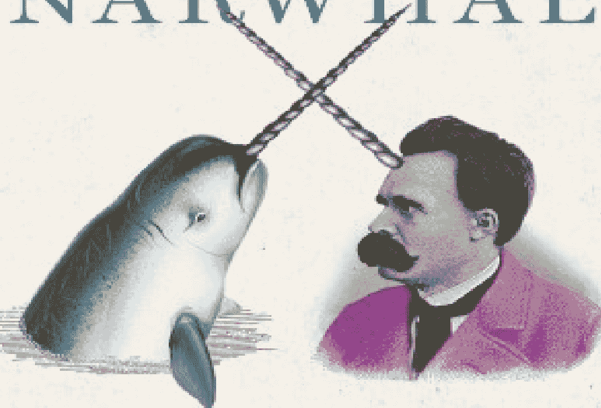

# 如果尼采是一只一角鲸：动物智能如何揭示人类的愚蠢

## 动物智慧揭示了人类愚蠢的什么真相

## 如果尼采是一头独角鲸

我将这本书献给兰克·德弗里斯（`Ranke de Vries`）：我的生活伴侣、配偶以及最喜爱的同谋。

**探索书籍赠送、预览、优惠及更多内容。**

点击此处了解更多信息。

> “纯粹的动物不可能做到这一点。你必须是一个人类才能变得如此愚蠢。”
>
> 特里·普拉切特，《金字塔》（圆世界系列，#7）

## 引言

弗里德里希·威廉姆·尼采（1844–1900）留着一撮华丽的胡须，与动物之间有着奇特的关系。一方面，他怜悯动物，因为正如他在《不合时的时代记》中所写的，它们“盲目而疯狂地紧贴生命，没有其他目标……带着愚者那所有扭曲的欲望。”¹

他认为，动物在生活中跌跌撞撞地过，完全不知道自己在做什么，也不知道为什么要这样做。更糟糕的是，他认为它们缺乏智能，无法像我们人类这样深刻地体验快乐或痛苦。²

对于像尼采这样的存在主义哲学家来说，这确实令人沮丧；在苦难中寻找意义是尼采的拿手戏。但他也嫉妒他们的缺乏焦虑，写道：

> 看看那些牛，它们在从你身边经过时正在吃草：它们不知道昨天或今天意味着什么，它们跳跃、进食、休息、消化、再次跳跃，就这样从早晨到深夜，从日复一日，被束缚在当下及其快乐或不悦中，因此既不忧郁也不无聊。这对于人类来说是一个难以面对的景象；因为尽管他认为自己作为人类而比动物高级，但他不禁羡慕它们的幸福。³

尼采既希望自己能像牛一样愚蠢，这样就不用思考生存，又怜悯牛如此愚蠢以至于无法思考生存。正是这种产生伟大思想的认知失调。尼采对哲学的贡献包括挑战真理和道德的本质，著名地宣布“上帝已死”，以及与意义缺失和虚无主义问题作斗争。但这些作品的代价是极其惨痛的。在个人生活中，他一团乱糟，是过度深邃如何从字面上面上击碎大脑的典型范例。

尼采在小时候曾患有严重的头痛，让他连续几天无法下床。⁴ 在他学术产出的巅峰时期，他经历了持续的抑郁、幻觉和自杀念。到1883年，39岁的岁的他宣布自己“疯了”——那一年也是他的名著《查拉图斯特拉如是》出版的一。随着哲学产出的飞速增长，他的精神状态持续恶化。1888年，他写了三本书。1889年1月3日，尼采在走过阿尔贝托广场时看到一辆马车在抽打它的马。他崩溃了，夺眶而出，抱住动物的脖子，瘫倒在地。在附近报亭工作的菲诺（Fino）发现了他，并带他回到公寓。他在昏迷状态几天后，被送往瑞士的一家精神院。他再也没有恢复神智。关于他精神病的病因有许多推测。可能是慢性梅毒感染，或者是会侵蚀大脑的血管疾病（CADASIL）。无论医学上如何，毫无疑问尼采的问题因他的智慧天才而加剧，这种天才使他以牺牲健康为代价追求意义、美和真理。

## 什么是智能？

人类理解和体验世界的方式与其他所有动物之间存在着一种令人困惑的鸿沟。我们从未怀疑过，我们的头脑中发生的事情在独角鲸的头脑中并没有发生。我们可以把机器人送上火星。独角鲸不行。我们可以创作交响乐。独角鲸不行。我们可以在死亡中寻找意义。独角鲸不行。我们大脑所产生这些奇迹的，显然是那种所谓的`智能`的东西的结果。

考虑人工智能（AI）领域。这是我们试图创建计算机软件或机器人系统，正如其名称所示，是智能的。但人工智能研究人员对于如何定义智能并没有达成共识。

他们如此热衷于创造的这件事。在最近对567位 AI 领域顶尖专家的调查中，少数多数（58.6%）认为，AI 研究员王鹏（Pei Wang）对智能的定义可能是最好的:^(10)

> 智能的本质是在知识和资源不足的情况下适应环境的原则。因此，一个智能系统应该依赖有限的处理能力、实时工作、对意外任务保持开放，并从经验中学习。

这一工作性定义将“智能”解释为一种“相对理性”。^(11)

换句话说，41.4% 的 AI 科学家认为这根本不是智能。在《通用人工智能期刊》（`Journal of Artificial General Intelligence`）的一期特别刊上，几十位专家有机会对王鹏的定义发表评论。在完全出乎意料的发展中，编辑们得出结论：“如果读者期望对 AI 的定义达成共识，我们恐怕要让他们失望了。”^(12) 对于一个完全专注于创造智能的科学领域来说，关于智能是什么，且永远不会有共识。这是一个相当荒谬的局面。

顺便说一下，心理学家也做得并不比。将智能定义为人类精神单一属性的历史是一团糟。20世纪的英国心理学家查尔斯·爱德华·斯皮尔曼（`Charles Edward Spearman`）提出了一般智因素（即 `g` 因子）的概念，以此解释为什么在某类心理测试中表现良好的孩子往往在其他类型的心理测试中也表现。^(13) 该理论认为，这是人类精神中一种可量化的属性，某些人比其他人拥有更多。这就是 SAT 或 IQ 测试所揭示的内容。当你把这类测试给全球各地的人做时，无论他们的文化背景如何，你确实会发现某些人在测试的所有方面都比其他人更优秀。但目前还没有共识，认为这些性能差异是因为精神的某个单一属性——`g` 因子——产生了思维，还是说 `g` 因子只是我们用来描述大脑中不断运转的一大类认知能力子集的集体性能的简写。这些认知能力是独立工作并恰好紧密相关的，还是存在某种神奇的“智能尘埃”散布在所有的认知系统中，导致一切都运行得更好？没有人知道。人类精神智能研究的核心正是这种对我们到底在谈论什么的极度困惑。

然后是动物。如果你想强调智能作为一个概念的难以捉摸，只需问一个动物行为研究员解释为什么乌鸦比鸽子更智能。你通常会得到像我这样的人的回答：“嗯，你真的不能这样比较不同物种的智能。”这其实是代码表示：“这个问题没有意义，因为没人知道智能到底是什么，也不知道如何衡量它。”

但如果你想看到最后的定棺之笔，证明处理智能是困难到近乎荒谬、甚至可能的，只需看看 SETI：地外智能搜索。这一运动的灵感来自1959年发表在《自然》（`Nature`）上的一篇文章，由菲利普·莫里森（`Philip Morrison`）和朱塞佩·科科尼（`Giuseppe Cocconi`）编写——两位来自康奈大学的科学家建议，如果外星文明试图进行通信，他们最可能会通过无线电波进行。这导致科学家在1960年11月在西吉尼亚尼亚的格林银行（`Green Bank`）聚集，在那里，无线电天文学家弗兰克·德雷（`Frank Drake`）介绍了著名的德雷公式，对银河系中足够产生无线电波的外星文明数量进行估计。该方程本身充满了极其离谱的估计因素（即凭空产生的因素），包括可能支持生命的行星平均数量，以及这些行星中可能演化出智能生命的百分比。

SETI 和德雷公式的特点在于，它们甚至懒得提供关于智能是什么的定义。我们似乎应该都知道它是什么。它是那种生物能够产生无线电信号的能力。根据这种默认的定义，直到马可尼（`Marconi`）在1896年无线无线电之前，人类是不智能的。大约一个世纪后，当我们所有的通信都由光传输而非无线电处理时，我们可能也会停止变得智能。这种愚蠢正是为什么菲利普·莫里森总是讨厌“寻找地外智能”这个短语，他说：

> SETI 总是让我感到不安，因为它以某种方式贬低了这种情况。我们检测到的不是智能，而是我们检测到的通信。是的，它们暗示了智能，但那是显而易见的，所以讨论获取信号更好。^(14)

AI 研究员、人类心理学家、动物认知研究员和 SETI 科学家的共同点是，他们相信智能是一种可量化的现象，但缺乏公认的量化方法。我们只是在看到时才知道它。外星无线电波？是的，那是智能。乌鸦用树枝从木头里钓蚂蚁？是的，那是智能。数据副尉（Data）为他心爱的宠物猫作首诗？是的，那绝对是智能。这种“看到时才知道”的方法是……

在1935年，她在纳粹政权中极受欢迎，以至于阿多夫·希特勒都参加了她的葬礼。

根据所有记录，尼采的哲学思想对于纳粹党的形成和成功至关重要，并为大大屠杀提供了辩护。

尽管尼采蔑视反犹太主义，并且很可能厌恶纳粹，^(23) 他曾建议人们“将那些反犹主义的传播者驱出国外”。^(24) 在普普战争中担任过医护后，尼采见识过许多暴行，这对他产生了深远的影响。他并不是暴力的追随者。他无疑拒绝像纳粹这种极端民族主义政治运动所采用的国家资助式暴力。尽管尼采声称要“用锤子搞哲学”，^(25) 但但他众所周知是一个善良、有礼貌且温和的男人。^(26) 这一点确实属实。记住，这正是那个因为目睹有人伤害马匹而精神彻底崩溃的人。

而这凸显了人类智能的一个巨大缺陷。我们可以（而且经常这样做）利用人类智力来推测宇宙的秘密，并产生基于生命脆弱和转瞬即逝的哲学理论。但我们也（而且经常这样做）利用这些秘密来制造死亡和毁灭，并扭曲这些哲学来为我们的野蛮行为辩护。对世界如何构建的理解，也伴随着破坏它的知识。人类既有能力将种族灭绝合理化，也有执行它的技术能力。伊莉莎白·福尔斯特-尼采利用她哥哥那源于惊人人类智力的哲学著作，来验证一种导致六百万万犹太人死亡的世界观。^(27) 在这，人类完全不像独角鲸。独角鲸不会建造毒气室。

## 巨大的麦格芬（`MacGuffin`）

智能并非生物学事实。这种人类智力或行为特殊性的观点在科学上并没有根据。我们直觉认为智能既是真实的也是好的。但当我们观察非人类动物在这个星球上赖以生存的所有方式——它们为解决生态问题想出的那些令人瞠的解决方案——就会变得很明显，这两种直觉信念都经不起推敲。智能就是那个巨大的“麦格芬”——一个我们在人类、动物和机器人大脑研究中一直在追求的概念，它让我们偏离了自然世界的现实。在这个现实中，自然选择从未对任何可以被提炼为单一概念（即`智能`）的生物特征起作用。在这个现实中，我们的智力和技术成就——源于许多其他物种共有的认知特征的混合体——并不像我们希望相信的那样重要或特殊。在这个现实中，地球上充满了各种物种，它们找到了过良好生活的方案，令的人类物种感到羞愧。

这是一本关于智能问题的书，以及它到底是好事还是坏事。我想我们大多数人都认为智能（无论这个词对你来说意味着什么）本质上是好的。我们总是通过我们自己人类智能的棱镜来观察这个世界——以及这个世界中非人类动物的价值。但如果我们安静下那个大叫着我们物种特殊性的声音，转而听听其他物种告诉我们的故事会怎样？如果我们承认，有时我们所谓的人类成就从进化的角度来看其实是相当糟糕的解决方案呢？这样做会让整个天翻地覆。那么，那些所谓的脑子不灵明的动物——如牛、马和独角鲸——看起来就像天才。动物界突然爆发出美丽、简单的心灵，它们为生存问题找到了优雅的解决方案。

人类智能有什么用？这是一个困扰尼采的问题，也困扰着我。让我们看看是否能一起回答它。

# 第一章：为什么专家

## 一个关于帽子、赌注和鸡屁股的故事

> 渐渐地，人类变成了一种奇特的动物，必须比任何其他动物多满足一个生存条件：人类必须经常去相信、去知道自己为什么存在。
>
> ——尼采¹

迈克·麦斯基尔（`Mike McCaskill`）花了二十年时间才战胜股市。但当他做到时，老天，他确实太成功了。

迈克从小做起，在父母的家具店工作的同时把交易廉价股当作爱好。² 当2007年商店关闭时，他决定全职投入他的爱好。他以1万美元卖了汽车，然后将这笔钱投入了他的交易账户。在接下来的两年里，波动的市场和次贷贷款危机导致标普500指数跌了一半的价值，这只让像迈克这样的日内交易员感到更加兴奋。他沉迷于揭开市场走向之谜底的机会。他预测股市将在奥巴马总统当选后不久飙升，于是他把在廉价股中赚到的几十万美元投入了普通股市。

但他错了。

当奥巴马于2009年1月20日就职时，迈克看着道琼斯指数继续暴跌，最终在3月5日金融危机期间触及6,594.44点的最低点。这是从2007年10月14,164.43点的历史高点下跌了50%，距离引发大萧条的破纪录崩盘仅差3%。迈克的情况很糟糕。他的交易账户亏空了。

但迈克重新整了旗，凑了一些钱放回账户，尽管这次他改变了策略，以便在市场下跌时获利。换句话说，他要做空；这是一种高风险策略，借入股票卖出，并承诺以后买回。如果股价下跌，他就能盈利；如果股价上涨，他就被迫买入并遭受巨额损失。这正是《大空头》中的人物迈克尔·伯瑞（`Michael Burry`）和马克·鲍姆（`Mark Baum`）在2007年做空住房市场时使用的技巧。在当时，住房市场被认为是最安全的投资之一，因此押注它会下跌既冒险又愚蠢。当然，正如我们现在所知，他们的预测是正确的，并大赚了一笔。但对迈克来说，他的预测是错误的。美国政府通过“危机资产救援计划”注入经济的7000亿美元开始发挥作用。截至4月初，市场反弹了。而押注市场崩溃的迈克再次失去了一切。

感到沮丧的迈克辞掉了全职交易，在接下来的十年里，在肯基州路易斯维尔国王路易体育中心工作，最终成为了排球球和高尔夫的项目总监。他仍然涉足股票，投机可能让他成为百万富翁的冷门股。就在那时，他发现了游戏精灵（`GameStop`）。

那是2020年的夏天，这家公司正在挣扎：在一个由数字零售主导的市场中，一家实体游戏店正努力生存。几乎没有人去逛商场像游戏精灵这样的商店挑选商品了。他们直接从亚马逊订购，或者直接在`PlayStation`上下载游戏。迈克尔·帕切（`Michael Pachter`）是韦德证券的视频游戏及数字媒体电子产品分析师，他将游戏精灵形容为“正在融化的冰块”。他在2020年1月告诉《商业内部 {》：“它终会消失，”预计该公司将在十年内完。”³ 安德鲁·李（`Andrew Left`）是`Citron Research`的一位知名投资者，专长做空，他将游戏精灵指为“一家失败的商场零售商”，正在“溺水”，⁴ 这就是他和其他许多投资者开始做空该股票的原因。

大量买入股票。就像2009年的迈克以及2007年少数看空房地产市场的人士一样，这些专业人士决定从游戏争头（`GameStop`）即将到来的崩溃中获利。至少在纸面上看，这似乎是合理的。

但迈克并不认为`GameStop`注定会破产。恰恰相反。他不仅确定`GameStop`是一家有前景的公司，而且这些对冲基金经理持有的所有空单意味着其股价可能会在所谓的*空挤压*（`short squeeze`）中一冲云霄。如果股价开始上涨，持有空单的投资者将试图迅速抛售股票以止损。这种大规模抛售会导致股票上涨得更快，从而形成一种“挤压”，并让任何在股票几乎一文不值时买入股票的聪明人赚到笔巨款。

迈克的直觉告诉他，空挤压就在眉睫。他开始购买股票期权，这意味着一旦股价达到特定价格他就会买入股票。但最初股价波动并不大，他的期权过期了，迈克多次让自己的账户清零。接着，在2020年底，迈克在另一只选股——`Bionano Genomics`上大赚了一笔，给了他一笔新的现金注入，他将其投入了`GameStop`。不久后，在2021年1月，挤压开始了。一系列不可思议且令人困惑的事件导致了`GameStop`市场价值的飙升，其中包括关注`Reddit`上`wallstreetbets`子版的数百万粉丝：他们识别出该公司拥有数量极其惊人的空单，这引发了一场协调一致的买入潮。正如你可以想象的，这一举动让像安德鲁·莱特（`Andrew Left`）这样的投资者惨了，因为在那些`Reddit`用户的眼中，这些人是在冷酷地赌注一家脆弱公司的灭亡。这种做法确实奏效了。`GameStop`的价值以极其荒谬的增长——从迈克开始买入时的每股约4美元，飙升到1月27日347.51美元的高位。迈克套现了。他赚了2500万美元。

我们该如何看待这一切？这里的教训并不是说需要过人的智慧和多年的股市研究经验才能正确预测股价涨跌的原因和时机。迈克没有可能知道`wallstreetbets`的“市场 vigil者”们正计划或有能力对`GameStop`制造这样历史性的、人为的空挤压。迈克的直觉中没有任何地方具有某种神奇的预见性。事实上，正如我们所看到的，在押注股市方面，他的错误往往比正确多。在`GameStop`身上，他只是运气好。

考虑一个类似的故事，它也涉及运气，但主角却出乎意料。2012年，英国周日报《观察者报》（`The Observer`）在三个小组之间举行了一场比赛：一群小学生、三位专业投资经理和一只名叫奥兰多（`Orlando`）的家猫。⁵ 每个小组被赋予5,000英镑（约7,000美元）用于投资富业全股指数（`FTSE All-Share index`）的股票，并且每三个月可以更换一次股票。一年后账户资金最多的团队获胜。奥兰多通过将玩具老鼠掉在数字网格上（数字对应于它可以购买的股票）来“挑选”股票。经过一年的投资后，孩子们赔了钱，账户里剩下4,840英镑。基金经理们有5,176英镑。奥兰多以5,542英镑击败了他们。

与孩子们或基金经理不同，猫是不可能知道发生了什么的。尽管某些动物可以被教用代币换取奖励，从而赋予无价值物体以任意价值，但“钱”的抽象概念，更不用说“股市”，只存在于`智人`（`Homo sapiens`）的大脑中。奥兰多的选股技巧只是研究者生成随机选股以证明某个观点的巧妙方法。这个观点是：投资股市的人就像在往板上扔飞镖。在挑选优胜股方面，这完全是一场大赌博。

考虑到奥兰多，我想知道迈克·麦斯基尔（`Mike McCaskill`）如何形容他的选股能力。因此，在2021年3月，我打电话给他询问。我告诉他我正在写一本关于人类和动物智能的书。我告诉他奥兰多对阵基金经理的故事，看起来在涉及到股市时，运气而非知识起了巨大的作用。令我惊讶的是，研究了二十年股市且刚刚赚了2500万美元的迈克·麦斯基尔说：“我同意。这百分之百全是运气。”

现在，迈克确实研究过`GameStop`并推断它正处于挤压边缘。但安德鲁·莱特同样坚信挤压是不可能的。莱特错了。回溯2020年，迈克尔·帕彻（`Michael Pachter`）曾确定`GameStop`会在本世纪结束前消失，尽管截至2021年3月，他改变了说法，现在声称`GameStop`将“留在这里”。⁶ 这些预测中显然有一个是错的。`wallstreetbets`的`Reddit`用户确定`GameStop`将面临空挤压，他们是对的。但他们也确定挤压会超过347.51美元……（此处由于原文存在重复循环，已按逻辑清理）

筑一个窝并安顿过夜。另一组则更加熟悉。那是一群现代人类——智人（`Homo sapiens`）——数量与黑猩猩小组相当。事实上，在几乎每一个方面都很相似。那里有带着幼崽的女性，还有一组正在向森林行进的男性，他们打算在晚上在那里扎营。

人类和黑猩猩都源于七百万年前游荡在非洲的同一种类人猿祖先：乍得勒人（`Sahelanthropus tchadensis`）。在未经训练的眼睛看来，这种来自西非洲的古老猿类看起来就像黑猩猩。它们的祖先会分化，一方演化为现代黑猩猩，另一方则演变为我们的人类亲属，包括南方古人和直立人（`Homo erectus`）。

你可能在自然历史博物馆或教科书中见过这组生物：那条著名的“人类起源”进化路线已成为无数恶搞剧和梗图的基础。在非洲生活了七百万年后，黑猩猩和人类仍然与它们的古老猿类祖先在几乎相同的条件下过着非常相似的生活。我们从化石记录中知道，24万年前，人类和黑猩猩在东非裂谷的这一地区并肩生活。⁷

我引导我们的时空气球来到这一时期的特定位置，因为这是科学家现在认为是现代人类的首次出现。⁸它们在可以想象的所有方面——生理和认知——都与你或我几乎完全相同。⁹然而，它们的生活方式没有任何一点与我们现在21世纪的生活方式相似。

就像那些在树上睡觉的黑猩猩兄弟一样，这些早期人类在湖岸徘徊，寻找果丛和动物尸体。它们很可能是赤裸的，没有珠宝、衣服，或我们今天所使用的任何艺术或象征性装饰。然而，它们的裸露体揭示了与黑猩猩的一些显著差异：毛囊少得多，暴露皮肤更多，旨在让汗水能够快速蒸发，并在它们在烈日下行走时保持身体凉爽。

人类还拥有更长的腿，下肢肌肉相对更多，这是支持我们直立行走生活的另一种适应。^(10)

当然，还有头部的问题。人类和黑猩猩头部的前半部分——脸部区域非常相似，唯一的例外是下巴。人类有下巴，但黑猩猩没有。奇怪的是，在历史上没有其他人类类人物种在智人出现之前进化出下巴。尽管如此，科学家们仍然不知道我们为什么会有下巴。^(11)

但真正惊的是我们头部的后半部分。人类的头部是圆的，看起来像一个充过的水球。那额外的颅内空间充满了脑组织——是我们的黑猩猩兄弟的三倍大。

还有一些行为特征区分了人类。他们手里拿着原始的石器，并用它们从死掉的大象身上切下肉。一位年长的女性人类正在帮助孩子将一根木轴旋转进干木的凹槽中，以制造营火，并用人类语言特有的节奏向他下达指令。^(12)

相比之下，黑猩猩大多保持沉默，拥有的只有用来破壳的石头（不是锋利的刀片），而且没有黑猩猩制造的火。它们根本没有那种能够创造这些东西的心灵。直到今天，创造火和石刃的能力仍然在它们的认知能力之外。

尽管在认知上存在一些导致火种和石刃等突破的明显差异，但早期人类和黑猩猩在大部分奇班纪（Chibanian）时期仍然保持相对相似。随着该时期在2.6万年前结束，人类开始了他们臭名昭彰的离开非洲之旅，利用那长而肌肉发达的腿将自己带到了欧洲，在那里遇到了尼德特人和丹尼索瓦人——这两个人类类人物种是从200万年前离开非洲的共同祖先在亚洲和欧洲进化而来的。

和人类一样，他们也会使用火、矛和石器，并可能在某种程度上具有语言能力。人类与其他物种既有交配也存在竞争，直到我们的 DNA 中只留下了它们的痕迹。然后，在我们最初乘坐热气球前往巴林戈湖20万年后，证据表明我们的人类祖先开始提出一些重要的“为什么”问题，这些问题导致了我们即将对这个星球的统治，并首次以洞穴画的形式出现。

大约4.39万年前，一群居住在印度尼西亚苏拉威西岛的人类进入了该岛西南端的一个山洞并开始作画。他们使用红色颜料创作了一系列狩猎场景——人类用绳子和矛追逐野猪。

但画中描绘的人类有些奇怪：他们长着动物头。这些半人半兽的形象被称为兽人（`therianthropes`，源自希腊语 `theri/θῆρ` 意为“兽”，“Anthropos/ἄνθρωπος”意为“人”）。

几千年后，一位欧洲祖先雕刻了狮人（Löwenmensch）：这是一尊石灰岩兽人像，描绘了一个长着狮头的人，发现于德国巴登-符腾堡附近的霍伦莱斯坦-斯塔德尔洞穴系统。

真正有一个原因，[根据原始提示中提供的OCR流，文本已截断/中断]……

一点也不特别。事实上，长期以来，所有动物（包括我们自己）在不需要提问“为什么”的情况下都生活得很好。是时候重新考虑它的相对重要性了。虽然它产生了不可否认的益处——比如巴杀牛奶——但它也是导致我们濒临灭绝的最可能原因。但在踏上那条黑暗之路之前，让我们先了解作为“为什么”专家与其他动物思考世界的方式有何不同。

## 灌木丛后的熊

去年秋天，我和朋友安德里亚和她的狗露西一起在金黄枫叶的遮蔽下森林里散步。突然，森林的宁静被一声深沉的咚声打破，这声响在我们脚下的地面上回荡。前方的小路上，一棵赤木丛的叶子在沙沙作响。我们停在原地，担心也许可能有一只熊潜伏在我们附近。

我过去调查了一下。发现的不是熊，而是一棵早已死的树的一大树枝，它一定是先从山上滚落几英尺后才靠在赤木丛上，产生了那个惊了我们三人的声音。

这种场景是动物处理了数百万年的问题。自然选择建立在无数次迭代之上：动物听到突然响声，确定其含义，并决定如何反应。对于像科莫罗龙（一种以吃人而闻名的巨大印度尼西亚大蜥蜴）这样的顶级捕食者来说，灌木丛中的随机噪音可能会引发好奇心，因为可能是食物。而对于松鼠等猎物物种来说，突然的噪音可能是相反的：一个潜在的捕食者或威胁，会让它们向相反方向逃跑。

动物只有两种方式来解释突然噪音的意义。第一种是通过关联来学习，即从灌木丛后发出的响声通常预示着生物的出现。第二种是推断噪音是由生物引起的。

这听起来很细微，但这种差异——学习性关联与因果推理之间的区别——正是非人类动物思维的终点，成为“为什么”专家的起点。

考虑穴居袋鼠（Bettong）。这种来自西澳的奇异小有袋类看起来像一只长着老鼠脸的微型袋鼠、有着粗大的鼠尾巴和胖松鼠身体的动物。它们曾是澳大利亚数量最多的哺乳动物之一，但现在只剩下19,000只了。(16)

穴居袋鼠近乎灭绝是因为欧洲殖民者引入了非本土野生动物，其中包括臭名昭彰的家猫和红狐。你看，穴居袋鼠对猫或狐并没有多少自然恐惧。大多数体型的有袋类动物会逃跑，但穴居袋鼠只是若经心地站在那里。不出意外，这让它们成为了容易的猎物。

在最近的一次实验中，研究人员比较了接触过猫类捕食者的穴居袋鼠与第一次看到猫类捕食者的行为。(17) 正如你所预期的，此类经验的穴居袋鼠逃跑了，而从未见过猫的穴居袋鼠没有理由逃窜。换句话说，穴居袋鼠需要学习猫和狐是威胁。

因此，该地区的环保人士一直在积极教穴居袋鼠恐惧猫狐，以便它们重新释放到野外，从而保护物种免于灭绝。但这并不容易。如果没有天生的恐惧，每只穴居袋鼠都需要亲身经历威胁才能建立正确的学习性关联。换句话说，自我保护必须通过经验来教授。

另一方面，人类可以跳过这个过程，不需要一定亲身经历就能学习。人类的“为什么”专家思维为我们提供了穴居袋鼠等动物缺乏的两种认知能力：想象力和对因果关系的理解。

人类能够在脑中循环灵长类研究者伊莉莎贝塔·维萨尔贝吉（Elisabetta Visalberghi）和米克尔·托马塞洛（Michael Tomasello）所说的无限“可能性网”(18)，为我们的感官捕捉的信息寻找解释。

比较心理学家托马斯·萨德多夫（Thomas Suddendorf）在他的著作《差距：区分我们与其他动物的科学》中将这种想象力描述为“一种创建嵌套心理场景的开放式能力”，并认为这种能力是人类与动物理解世界方式的根本区别。(19)

在我分享的例子中，我能够想象以前在森林散步时见过的任何动物，比如豪猪或臭鼬，在赤木丛后到处找东西并发出奇怪的声音，然后根据响声的大小断定那一定是一只熊。但我也可以想象我从未经历过但抽象理解的事物（例如，如果我在科幻小说或奇幻剧里读到过）。

在这方面，它可以是任何东西，比如陨石从天空坠落在灌木丛后。这种奇幻的知识就是哲学家鲁丝·加雷特·米利坎（Ruth Garrett Millikan）所谓的死事实。(20) 这些是关于世界的事实，动物在日常生活中毫无用处。

根据米利坎的说法，非人类动物“通常对不直接涉及实际活动的事实感兴趣。它们不代表或记忆死事实。”动物积累与其日常生活息相关的活事实：蜜蜂记得花蜜的位置……（等等，文本在此处结束）

动物是否理解因果关系？另一些人认为它们并不理解，而许多人认为这些实验的设计并不完善，根本无法让我们对动物的因果推理问题提供任何见解。

大多数时候，动物是否理解因果关系并不重要；无论如何，它们仍然能做出良好的（或糟糕的）决定。如果一只像露西（Lucy）这样的狗听到灌木丛后传来突然的声响，并且它已经学会了森林里的随机声音通常与熊等捕食者的出现有关，那么它会正确地决定谨慎靠近。

另一方面，如果我听到一个声音并开始列举可能的原因（例如：陨石、熊、一只从动物园逃脱的科莫罗龙），我最终会做出一个同样有效的决定（谨慎靠近）。

露西和我都能通过完全不同的认知路径得出相同的推论（即对事物的运作状态得出结论）：我通过因果推理，而露西则通过良好的旧习得关联。

这里有一个你可以对自己的狗做的实验，可以展示它们的推理推理能力，以及这种能力在不需要理解因果关系的情况下对它们有多么有用。

拿一块狗零食把它塞进你的鞋里。现在，在让你的狗把鼻子伸进去拿零食之前，摇晃鞋子几秒。现在，在狗看不到的情况下，拿起两只鞋，在其中一只里塞入零食。让你的狗看着你摇晃两只鞋，然后把它们分别拿出来让狗观察。

极可能，狗第一次尝试就能找到零食。为什么？因为它们听到其中一只鞋发出了声音（零食在里面跳动），而另一只没有。这被称为诊断性推理（diagnostic inference）。^(24)

这是一种高级的习得关联，狗已经发现声音与零食是并随而来的。然而，重要的是，狗并不理解零食是引起声音的物体。那才是因果推理。但狗不需要它。它仍然找到了零食。

正如你想象的，诊断性推理有其局限性。这里有一个例子展示了我们的因果推理能力优于其他动物。

现在想象我手里拿着两只鞋。一只装满了 `florps`，另一只装满了 `boopers`。我给你看一张 `florps` 的照片（一种像小棉花糖的糖果）和一张 `boopers` 的照片（小金属球）。

尽管你从未见过 `florps` 或 `boopers`——除了照片，你对它们一无所知——但在我摇晃鞋子的一刻，你会知道哪只装的是 `boopers`：是声音更大的那只鞋。这是因为你从深层理解了物体的因果属性。软物体产生的噪音比硬物体小。

狗是无法做到这一点的：在产生习得关联之前，它们需要这些物体发出的不同声音的示例。

显然，诊断性推理和基础习得关联只能带动物走多远。如果没有对底层因果关系的理解——或对其产生兴趣——动物永远不会问那种“为什么”的问题，而这些问题导致了智人（`Homo sapiens`）所享有的成就：火、农业、粒子加速器等等。

显而易见，得益于人类的大脑，在基础（例如：是什么引起了声音）和复杂（例如：知道病毒会导致疾病）的生存技能方面，比其他动物具有巨大的优势。我们能够在无限的可能性和既定事实的网络中进行循环，这帮助我们追求对因果关系的理解。

但这让我们回到了最初的谜团：如果因果理解相对于其他思考方式具有如此明显的优势，为什么我们的物种花费了 200,000 年才开始利用这种能力来开启现代文明的传播？

答案是，有时成为一个“为什么”专家会导致我们的物种走向意想不到的荒谬，这种荒谬从进化的角度来说对我们的物种太糟糕了，以至于让你怀疑我们是否仅仅依赖习得关联反而更好。

## 鸡屁股解决方案

想象一下，我们回到了时空旅行热气球上，这次访问 100,000 年前的巴林戈湖（Lake Baringo）。我们在湖岸一个看起来稍显永久的营地发现了我们的群体。

从我们的视角来看，我们目证了一个不幸但常见的事件。一个小男孩的小腿最近被一条蝰蛇（puff adder，非洲最毒的蛇）咬了。如果没有治疗，他极可能会死。

幸运的是，一位成年带着一种带有宽阔棕形叶的大植物茎（称为 `ensete`，或假香蕉）的茎冲了过来。当她折断茎子时，渗出汁液，她迅速将其抹在伤口上。

尽管效果远不如现代抗毒蛇，但这种植物具有镇痛和消毒特性（现代肯尼亚的当地人仍在使用它治疗蛇咬伤）。^(25)

这个史前人类是如何知道这么做的？我们对植物医药的古代知识基于习得关联和因果推理的结合。

可能在某个时刻，一位古代巴林戈亲人在丛林中狩猎时割伤了手臂，随机抓取了几片假香蕉叶子来止血。几天后，他们可能注意到伤口比正常情况下愈得更快。他们可能会问自己：为什么？

这将导致结论：叶子中某种有助于愈合的属性。这种知识会流传下去…… [注：原文在后半部分包含大量的重复/乱码循环]。

查理曼、阿奎赤的埃莉诺诺、拿破仑——他们都曾知道并相信体液学。

这一概念最早出现在公元前 500 年左右的古希腊。`humor`（体液）一词是希腊语 `χυμóς` 的翻译，字面意思是 `sap`（汁液）。

希腊医生希波克拉底（以《希波拉底誓言》而闻名）与这一理念的推广联系密切，他对其描述如下：

> “人体包含血液、粘液、黄胆和和黑胆。这些是构成其体质并导致其痛苦或健康的物质。健康本质上是这些成分物质在强度和数量上彼此保持正确比例，并且混合良好的良好状态。当其中一种物质出现匮乏或过剩，或者在体内分离而未与其他物质混合时，痛苦就会发生。”^(28)

公元 2 世纪末到 3 世纪初的希腊医生盖伦和 10 世纪的波斯医学家、博学者阿维森纳被归功扩展了这些思想，创造了当时流行的现代体液学形式——正当我们乘坐时光气球访问威尔士时，这种理论非常流行。

体液失衡描述了疾病是如何产生的。体液本身——血液、粘液、黄胆和黑胆——由四种对立属性组成：热、冷、湿、干。黄胆是热而干的，血液是热而湿的，粘液是冷而湿的，黑胆是冷而干的。

这四种对立形成了宇宙中的万物，包括四元素：火、水、气、土。例如，火是热而干的，而水是冷而湿的。

医生可以使用对这些相反力量的知识来治疗任何疾病。发烧的人会太热且太干，导致其体液失调（即产生过多的黄胆）。因此，治疗发烧涉及让患者暴露在冷湿的东西中——如生菜——以恢复体液的平衡。

用公鸡臀治疗蛇咬的解释根源于体液学，尽管那份威尔士手稿并没有涉及细节。尽管如此，这种观点认为，将公鸡的臀部按在蛇伤上会将毒液从人体排出并转移到公鸡身上。这无疑是因为体液失衡与对立属性之间的魔法结合导致的。^(29)

体液学是一个完全建立在因果推理之上的美丽而复杂的医学体系。从业者在这一点上是正确的：疾病和损伤确实涉及我们体内调节生物活动的许多物质（包括血液、胆汁等）的变化和问题。他们只是在因果机制上是错误的。

体液学最终在 19 世纪中叶被现代医学取代。现代医学诞生于科学方法，该方法包含了一种对于区分相关性与因果关系至关重要的技术：临床试验。^(30)

通过它，你可以对一个因果关系的推论（如公鸡臀揉在伤口上导致毒液离开身体）进行验证。例如，你可以给一百名蛇咬患者使用公鸡臀疗法，给一百名患者使用安慰剂（如用大蒜面包揉搓伤口），并让一百名患者不接受治疗。

如果你观察结果发现这三组的治愈率相同，你现在知道公鸡臀（和面包）并不能真正治愈蛇咬伤。从那里回溯，你可以测试体液学所有的底层假设，直到你最终发现关于体液如何运作的推论从一开始就是错的。

当然，科学方法和临床试验并不总是产生准确的结果。在很长一段时间里，科学方法让我们认为胃溃疡的原因是压力——直到 1984 年，巴里·J·马歇尔和罗宾·沃伦显示幽门螺杆菌（`Helicobacter pylori`）才是根源。

他们发现这一点是因为马歇尔从一个胃炎患者的胃里提取了一些细菌，将其加入汤中并喝下。三天后他患了胃炎，这证明了这种细菌是罪魁祸首。

遗憾的是，科学方法发现真实现象需要时间，这导致我们在此产生了许多体液学式的糟糕答案。对于更大的“为什么”问题，糟糕的答案不仅仅是不便；有时它们如此糟糕，让你怀疑成为一个“为什么”专家是否可能是我们物种的终结。

## “为什么”专家特别的吗？

从我们物种在巴林湖湖岸诞生之起，我们就拥有了“为什么”专家的能力，但在史史的大部分时间里，这并没有什么作用。十万年来，我们的人口数量就像黑猩猩。

在人类进化史上，直到最近（例如 4 万年前），像农业这样的技术进步——我们对植物为何生长的理解产物——才让我们定居，并一代又一代地扩大了人口规模，使我们走向了全球统治的道路。

一方面，这证明了成为一个“为什么”专家帮助我们物种相比于非“为什么”专家的黑猩猩亲戚繁殖到了荒谬的程度。

但对于回答人类方式是否特别这个问题，这意味着什么？或者成为一个“为什么”专家是否可能是我们物种的终结？

以及基础的关联学习，让鸽子在识别癌症组织方面甚至能优于放射科医生。

但成为一个“为什么”的专家（why specialist）所带来的负面后果，真正让这种特殊性和普遍酷之处受到了质疑。

考虑一下，当人类（而非黑猩猩）在处理使用苦叶治疗胃部不适这一案例中的因果关系时，可能会产生潜在的后果。很容易想象这样一个场景：当面对“为什么我吃了苦叶后感觉好受了？”这个问题时，人类提问为什么的能力可能会引导我们走入黑暗的道路。

人类可能会得出结论，这种植物包含了仁慈神赋予的超自然属性。随后，这种植物可能会在社会中占据神圣的地位，并被用于提取其魔法属性。也许这种植物会被用于某种特殊的仪式，被熬成一种浓缩的高汤喂给新生婴儿，以赋予他们在这人生的旅程中具有超自然的韧性。

结果，许多婴儿会死于这种仪式，因为植物中浓缩毒素杀害了他们。

我们物种的历史充满了这类对“为什么”问题的糟糕答案。根据19世纪美国医生萨缪尔·乔治·莫顿（Samuel George Morton）的观点，世界不同地区的人类之所以长相不同（例如肤色深浅、身高高矮、鼻子和眼睛的形状不同），是由于多源论（polygenism）。

这种观点认为，现代人类的不同群体要么进化自早期人类的独立谱系，要么是由上帝分别创造的。无论何种，根据莫顿的说法，你可以通过观察他们的头骨来看到这些群体（他将其归为五个种族）之间的差异，白人的头骨最大且最圆，因此含有最多的脑组织，并且显然是最聪明的。

我提到过莫顿是白人吗？在他部臭名昭著的著作《美国颅骨》（`Crania Americana`）中，他将“高加索人种”描述为“以获得最高智力天赋的快捷而著称”。^(35)

我们现在知道，这一论点的基础是错误的。头骨大小（以及大脑大小）与智力之间没有关系。有几十个例子表明，有些人切除了一半大脑，或者患脑积肿导致颅内液体使其大脑缩小到正常人类大脑的一小部分，但他们仍然过着完全正常的生活，甚至拥有完全正常的 IQ。

对于人类来说，大脑大小与认知能力是完全脱节的。正如我们在后面的章节中看到的，有理由相信大脑大小也无法告诉我们关于动物智力的任何信息。

正是这种种族主义——科学种族主义——推动了美国奴隶制的合理化，以及几个世纪以来白人至上主义给数百万人造成了无法想象的痛苦。这一切都基于对一个原本无害的为什么问题的可怕（且完全错误）回答。

更糟糕的是，我们物种的未来正受到对“为什么”问题提出的无意糟糕答案的威胁。内燃机是一项奇妙的技术，它允许我们创造微爆炸来驱动轴，从而推动轮子或喷气涡轮等。它源于对为什么热和压力会导致物体运动这一问题的答案。不幸的是，我们为了产生这些微爆炸而燃烧的燃料（如木材、煤炭、汽油）释放出的二氧化碳进入大气层并在那里吸收并辐射热量。由于我们在过去一个世纪里运行了数百万台内燃机，大气中产生了如此额外的二氧化碳，导致地球正在迅速变暖，正如气候科学家一直在警告的那样，这是糟糕的。糟糕到它已经开始撕裂我们社会的结构，而且根据全球挑战基金会的说法，这导致了我们物种在百年内灭绝的可能性达到十分之一。^(36) 所以是的，黑猩猩无法制造石器或内燃机，是因为它们缺乏像人类一样问“为什么”的能力，但从进化的角度来说，它们并没有在自自脚。

进化仍在决定如何看待人类的因果推理能力。我们物种的未来如何受到我们这种“为什么”专家本质的影响，尚且待观察。我们自己创造的生存威胁（如气候变化）的解决方案将植根于最初创造这些威胁的因果推理认知系统。解决方案是否及时到来，或者我们“为什么”专家的本质是否注定了我们所有人，这是一个悬而的问题。

底线是，要成为一个成功的物种，你并不需要对因果关系有那种专家式的理解（事实上，这甚至可能让你变得不成功）。成为一名百万富日内交易员也不需要理解因果关系。迈克·麦卡斯尔（Mike McCaskill）花了二十时间，基于他对股票市场内部因果关系的仔细考虑的理解来做出股票购买决策。但这本质上并不比猫奥斯兰（Orlando）能做的随机赌博多不了。“我父亲说我只是在赌博，”迈克告诉我，“如果我早按常理交易，我早就富有了。”

如果你愿意，你可以使用你“为什么”专家的推理能力来选择投资组合中的股票和债券，或者你可以让你的猫为你来选。因为你拥有“为什么”专家的天赋而产生的智智力优越的错觉，仅仅是：一种错觉。

# 第二章：老实说

*谎言的力量与陷阱*

那么真理是什么？

格林伍德（Greenwood）在2004年于位于斯坦迪什（Standish）的诊所遇到了奥克斯（Oakes）。她对奥克斯的技巧、知识以及她所所谓的“天赋异华”留留下了深刻印象。但并非所有人都对他留下了印象。此时的西马斯·米勒（Seamus Miller）是兰开郡拉夫福德兽医小组（Rufford Veterinary Group）的一名马科医生，他对奥克斯获得证书的速度感到困惑。作为一名全职骨疗师，他如何能同时读医学院？米勒决定联系皇家兽医学院进行自己的背景调查，但一切看起来良好。他们向他保证奥克斯是一个良好的成员，他的证书也是可靠的。

随后，在2008年2月，米勒被传到安因斯代尔（Ainsdale）的一家农场处理一起由奥克斯造成的紧急情况。奥克斯被农场聘用为一只名叫鲁（Roo）的四岁威尔士矮进行阉割。目击者报告他在混合麻醉剂时手忙脚乱（花了二十多分钟才调好），并在寻找注射静脉时遇到困难。在进行手术时，奥克斯割断了动脉，导致小马失控地流血。那是米勒被叫来救鲁一命的时候（他确实做到了）。米勒向皇家兽医学院报告了此事，并再次坚持让他们调查奥克斯。这一次，他们调查了。

事实证明奥克斯根本不是什么医生。挂在他墙上的那个来自澳大利亚默多奇大学（Murdoch University）的学位是从一家生成假毕业的在线公司购买的。之后，当地警方开始对他的活动进行调查，并发现了长期的欺诈行为。在他的骨疗诊所里，他伪造了化验结果，说服一位老年妇女患有心脏和肾脏问题，并使用虚假的血液报告诊断出一个五岁男孩患有过敏，随后他开始采取了无麸质饮食。这导致他的体重急剧减轻，以至于住院。⁸

奥克斯斯（Oakes）被捕了，但他很难理解这一切为什么闹得这么大。他告诉警察，他相信自己在网上获得的兽医文凭是真的。⁹他坚持认为，他所做的一切都是出于他想要减轻人类和动物痛苦的诚挚意愿，他没有犯下任何错误。在接受《马与猎狗》（Horse & Hound）杂志采访时，此案的首席调查员之一——默西赛德警察刑事侦查局（CID）的约翰·博尔顿（John Bolton）警解释道，奥克斯斯“在所有的警察审讯中都撒了谎，完全没有表现出任何悔意。他似乎真的已经说服了自己是无辜的”。

塞尔·奥克斯斯（Russell Oakes）撒谎是如此频繁且高明，以至于他甚至骗了自己。从人类的本质来看，这并不意外。你、我以及奥克斯斯都是同一根绳上出来的熟练谎者。就像我们进行因果推理的能力一样，人类撒谎的能力是塑造我们成功的支柱之一。与所有人类行为一样，撒谎在动物界也有起源和类似物，但我们的物种将其推向了荒谬的。正如我们在本章中看到的，这种创造并相信虚假信息的倾向帮助我们的物种脱颖而出。遗憾的是，这可能预示着我们的灭亡。

## 欺骗的起源

要理解人类（Homo sapiens）是如何演化出撒谎能力的，更广泛地理解动物界的通信演化至关重要。生物学家是如何定义通信的？这里有一个：一种将包含真实信息的信号传输给另一个生物的方法，其目的是改变该生物的行为。自生命首次进化以来，通信一直是生物世界的核心。考虑公英的黄色花瓣。这些花瓣演化是为了向授粉昆虫传递有关花蜜和花粉存在的准确信息。昆虫（与花朵同步）也演化出了解码这些信息的能力。于是，花朵向昆虫发出信号，那里有食物，从而改变昆虫的行为（即让它们落在花上）。这种通信系统对双方都有益：昆虫得到了食物，而花粉也随着昆虫在花与花之间飞翔而传播。

动物界几乎所有的通信都是通过传输有用、准确的信息运作的。红毒蛙呈鲜艳的红色：这是向其他动物的一种视觉信号，表明它们含有致命毒。现在，这只青蛙并没有想要传达这一信息；它只是生来如此，并不知道自己的红色意味着什么。青蛙的捕食者（如蛇）天生带有一种本能知识，即红色的青蛙是难吃的。这不是它们需要通过试错来学习的。当它们看到红色的青蛙时，它们会避开。拥有鲜艳的颜色（如红毒蛙）、高对比度的条纹（如臭鼬）或炫眼夺目的蓝色斑点（如蓝环章）被称为警戒性信号（aposematic signaling）：在希腊语中，apo意味着“离开”，而sema意味着“信号”。作为人类，你也天生对与我们演化历史相关的警戒性信号产生本能恐惧。人类天生会警惕，例如三角形形状，像响蛇皮肤上的之字形图案。^(10) 这种古老的恐惧可能是针恐惧症（aichmophobia，“对锋利或尖锐物体（如剪刀或针）的病态恐惧”）的根源，^(11)这种恐惧不仅限于蛇、刀和针等明显危险的东西。对于患有严重针恐惧症的人来说，即使是餐桌的尖角也会引起与看到响蛇同样的恐惧反应。

然而，并非所有的动物通信都是值得信任的。动物界充满了演化出形态特征的物种，这些特征也会传递模糊的信息。这引导我们定义另一个术语。

**欺骗**（Deception）：一种将包含虚信息的信号传输给另一个生物的方法，其目的是改变另一个生物的行为。

在生物学中，欺骗性信号的一个经典例子是一个物种假装成某个物体或其他动物。这种现象被称为拟态（mimicry）。竹虫是经典的例子。它们是那种身体看起来完全像树枝或树枝的昆虫。还有蝴蝶鱼，它们的侧面有一个大黑点（称为眼斑，或oculus），这创造了一种视觉幻觉，让它们的身体看起来像捕食者的头部。贝茨氏拟态（Batesian mimicry）是拟态的一种形式，指无害动物演化出模仿危险动物的警戒性信号。例如，大甲虫有黑黄相间的条纹，使它们看起来像致命的黄蜂，但实际上是害的。食蚜蝇（不蜇刺）具有条纹状颜色，让它们看起来完全像蜜蜂。血毒蛙像红毒蛙一样红，但它并没有毒性。贝茨氏拟态是一种廉价的（从进化的角度来看）防御机制，用来威慑潜在的捕食者。与产生真正的有毒刺器所需的许多变异相比，食蚜蝇的遗传和形态演化出条纹不需要太多的变异或改变。成为有刺动物是一种极佳的防御机制，但产生毒素需要大量的能量和细胞资源。通过假装成有刺动物而实际上不在这维持毒刺上浪费能量，我们在通信系统中发现了一个漏洞。重要的是，在生物学中描述动物通信时，“欺骗”一词并不带有负面内涵。我们认为欺骗是人的坏事，但在大多数情况下，它只是意味着信号不准确。对于非人类动物，欺骗性信号的发生并没有欺骗意图。将其与奥克斯斯的行为对比一下。他有意识地控制自己的欺骗，并且完全想要欺骗。为了实现这一目标，人类演化出了让我们成为欺骗者的特征。但我们有意欺骗的能力在动物界也有起源和类似物，正如我们在下一节所示。

## 意图即一切

我们为止分析的动物通信可以被描述为被动或无意的：它只是动物的一种物理属性（如狒类的的犬齿或欧洲驼鹿的角），这种演化是为了传递信息。然而，动物也可以主动、有意地通信。以家猫为例。当猫想传达它不开心时，它会抖尾巴并经常在地上敲击。敲尾巴是一种向其他猫传递重要信息的信号。它是诚实的：这种行为与猫的负面情绪状态准确相关。然而，一个问题出现了：猫敲尾巴是有意的吗？如果一个动物决定为了某个目标而产生通信信号，我们就可以将其描述为有意。动物通过有意通信想要实现的目的是改变另一个动物的行为。正因为他们心里有目标，他们会监控情况，看看信号是否产生了预期效果。例如，当我摸我的猫奥克斯斯时它会敲尾巴，是因为它想让我停止摸它。尾巴敲击只是猫的行为库中表示它们不开心的许多信号之一。如果我没理解奥克斯斯的意图，它会升级到另一种更清楚的通信信号：咬我的手。再次，他做出选择（意图）咬我，目标是让我停止它（即改变我的行为）。奥克斯斯会循环使用它行为库中所有与其情绪状态相关的通信信号，直到实现它的意图目标。

奥克斯斯的敲尾巴信号是诚实的，因为它对其情绪状态的准确表述。但有时，动物会产生不诚实的有意通信信号，看起来它们正试图通过关于自身、情绪状态或想法的虚假信息来欺骗。考虑一下鸡。

这指的是鸡的一种行为，如果你把其中一只鸡倒朝下，并在它们面前的地上画一条线（或在它们周围画一个圈），它们就会完全静止。为什么呢？这和画线无关。是因为你把鸡倒过来说并将其固定在地面上。科学家将这种现象称为肌性僵直（tonic immobility），或者一种装死的形式。^(13) 当受到威胁时，负鼠也会装死，倒在地上吐出舌头。这种行为在蛇、蜘蛛、昆虫、鱼类、鸟类和青蛙中非常普遍。它之所以有效，是因为大多数捕食者会避免吃掉死的（可能已经腐烂的）动物。通过假装死亡，鸡提供了关于其腐烂状态的虚假信息。这是鸡使用的一种行为欺骗，用来操纵潜在的攻击者，阻止攻击者吃掉它。

在许多地巢鸟类中也能发现类似的行为。在沙丘筑巢的环鸻会进行一种被称为断翼展示的行为。当察觉到捕食者靠近鸻的巢时，母鸟会飞起并鸣叫，试图将捕食者引向自己并远离巢。然后她做了一件惊不起的事：她飞到地面上，一边拖着翅膀一边笨拙地行走。它看起来像是翅膀断了。大多数捕食者都热衷于追逐这只“受伤”的鸟，这会成为一顿大便餐。但这完全是一个骗局。一旦威胁离她的巢足够远，她就会停止表演并飞向安全区域。

断翼展示在鸻中演化成一种欺骗行为，是一种非常聪明的计策。而且她通过监控这种行为来观察自己的欺骗是否有效，因此它是刻意欺骗的例子。但世界上还有更聪明的欺骗者。少数物种参与一种被称为战术欺骗（tactical deception）的行为，这是你在动物界能发现的最接近人类风格谎言的行为。战术欺骗可以定义为“个体能够将他们正常行为范围内的‘诚实’行为用于不同的语境，以误导熟悉的个体”。^(14) 这个定义来自进化心理学家理查德·W·伯恩和安德鲁·怀特，他们通过一系列描述狒狒和其他灵长类动物欺骗行为的文章引入了这一观点。其观点是，动物利用一种它们在大多数时候用于传递真实信息的通信信号来误导另一只动物。然而，“真实信息”是一个关键区别。鸻的断翼展示或鸡的假死在设计上就是具有欺骗性的，这意味着它们不符合战术欺骗的定义。只有当动物决定以欺骗的方式使用一种诚实信号，迫使接收者误解正在发生的情况时，它才具有战术性。

研究人员在灵长类动物、狗和鸟类中发现了战术欺骗的例子，但我最喜欢的例子来自哀悼墨鱼鱼（mourning cuttlefish），这是一种头足类动物。这类有触手的软体动物包括章鱼和乌贼，它们在认知方面比你对蜗牛和蛞这些近亲所想象的要复杂得多。哀悼墨鱼看起来像乌贼，过着惊人复杂的社会生活。它们生活在澳大利亚东岸，聚集成规模大的社交群体，这是一个引人入胜的景象：被称为色素细胞（chromatophores）的充满色素的细胞功能类似于电子阅读器的电子墨水，将它们的身体每个部分变成了复杂的视觉展示。这些错复杂的图案和形状被用于伪装和交流。在一天中，雄性墨鱼通常展示出独特的条纹图案，而雌性则展示斑点图案。

当它们的交配习性时，雄性墨鱼在求偶时不会容忍附近较小的同性下属。科学家观察到较小的雄性会进行一种罕见且狡猾的战术欺骗，以智胜优势雄性，并在不引起怀疑的情况下增加与雌性交配的机会。当一个较小的雄性发现追求一只优势雄性看中的雌性时，它会将自己放在它们之间。然后它会做一件神奇的事。在面对竞争雄性的一侧，它的颜色会变得像雌性的斑纹。在面对雌性的一侧，它保持正常的颜色模式不变。较大的雄性会被骗，认为它看到的是两个雌性，而较小的那只就可以按计划继续求爱。^(15) 这种战术性欺骗（而不是普通欺骗）之处在于，信号本身——斑纹——通常是指示雌身份的诚实信号。更狡猾的是，它们只在有一个雄性在场时才会采取这种行为。如果周围更多雄性，它们就不会去麻烦，因为不同的观察角度会揭露它们在做什么。这种解析何时使用这种战术的能力（是一个雄性还是多个雄性）本身就非常了不起。它们在积极监控周围环境并根据情况改变自己的欺骗行为。这种这类战术性的、刻意的欺骗在动物界中极罕见——比我们在动物身上看到的其他形式的欺骗要见得多。在日常生活中，你遇到动物战术欺骗的唯一可能就是在与狗互动时。研究人员发现，狗会欺骗它们的训练员，通过热情地引导它们去一个不那么理想的食物奖励，如果那个训练员

`[16] dogs will deceive their handlers by enthusiastically leading them to a less desirable food reward if that handler`

会欺骗它们的训练员，通过热情地引导它们去一个不那么理想的食物奖励，如果那个训练员

然而，战术是另一回事。这是人类撒谎能力与动物区别开来的关键因素之一，但正如我们在下一节中看到的，还有一项与语言结合的更基础的技能，使我们成为星球上最高明的欺骗者。

## 心理操纵者

要理解为什么人类是如此擅长撒谎的人，我们首先对什么是谎言有一个清晰的定义。

- **谎言**：故意向另一个生物传递虚假信息的方法，其明确目的是让对方相信不真实的事，以操纵其行为。

当人类撒谎时，我们的意图不仅是改变接收者的行为，还要改变他们的信念。这是一个关键的区别——也是一个让我们与众不同的特征。操纵别人的信念需要我们知道（或至少猜测）其他人类的/

首先是信念，让内心充满了思想、情感、欲望、意图等。人类轻而易举就能做到，这就是为什么我们有时默认会将那些我们知道没有心灵的无机物视作拥有心灵。加里·罗斯·达尔（Gary Ross Dahl）在20世纪70年代利用这种奇特的人类心理学赚了数百万。达尔是“宠物石”（Pet Rock）的发明者——一种放在有气孔的纸盒里草垫上的小石头。只需将其称为“宠物”，人们就开始半开玩笑性地将这块石头视为一个具有情感、欲望和需求的生命实体。这种行为既非常奇怪，也非常具有人性。

人类不断在预测其他生物为什么要这样做，或者根据我们对它们脑子里在想什么的猜测，预测它们未来可能会做什么。这与我们作为“为什么”专家的因果推断本能密切相关。例如，我可能会问：“我的猫现在在叫什么？”答案是什么？因为他想要我打开正门。我猜测我的猫想要什么的能力被称为心理理论（theory of mind，有时也称为读心或心理状态归因）。我们可以生成一个理论或模型，描述我们预计其他生物内心正在发生什么。^(17) 它允许我们询问为什么生物之所以这样做，并根据我们对它们脑海中运行的目标、欲望和信念的最优猜测得出答案。

通过心理理论操纵信念，当你在尝试改变其他生物的行为时会有更多的控制权。想象你正被一只鬣狗追逐。如果你利用心理理论猜鬣狗追你是因为它觉得饿了，你可能会尝试向它扔你的火腿三明治。它可能就会吃掉三明治而不是吃你。大多数动物不会这样做，因为它们没有在考虑鬣狗的动机。它们只会逃跑和躲起来。

人类是地球上极少数拥有心理理论的动物（如果不是唯一的的话）之一。科学家们花了四十年时间设计实验，以寻找非人类动物理解他人信念和动机的证据。^(18) 在我写这些时，我们关于非人类动物拥有心理理论的最佳证据来自错误信念测试（false belief test）。这项测试判断动物是否知道另一个动物/人对世界某种状况有一个在事实上是错误的信念。这种能力的最佳证据来自我们的同类——大类人猿。在一个著名的实验中，几只猿类（黑猩猩、倭猩和猩猩）接受了测试，看它们是否理解人类研究人员可能会被骗相信某些不真实的事。猿类透过窗户观察一个戏剧性的场景，该场景是专门为吸引它们的注意力而设计的。^(19) 窗外，它们可以看到两个巨大的草堆和一个穿着大大猩服的实验人员。随后，一名人类演员从门进入，面对了那只“大猩”（如果你是大类人猿，这场打斗戏看起来非常吸引人）。大猩随后躲在其中一个草堆后面，而人类演员在观察。接着，人类回到屋内拿了一根大木棍去打大猩。但在他离开期间，大猩从草堆里爬出来逃了。这设定了一个场景：人类没有看到大猩已经离开，现在对大猩在草堆后面有一个错误信念。如果观察这一场景的猿类拥有心理理论，它们会预期人类会在错误的位置寻找大猩：即人类最后看到大猩的草堆后面。使用眼动追踪设备，研究人员测量了当人类拿着木棍回到门外时，窗后的猿类看向哪里。大多数猿类的目光都停留在大猩原本所在的草堆上（而不是大猩逃跑的方向），可能是因为它们知道人类——对大猩位置持有错误信念的人类——会去那里寻找。这是大类人猿拥有心理理论的有力证据；它们正在对那个拿着打大猩棍的人类所认为的真实情况做出有理推测的判断。

理解他人可能产生错误信念以及这决定了他们的行为的能力，在动物界是很罕见的，也许仅限于大类人猿和某些鸦类（例如：乌鸦、渡鸦、灰松鸦）。理解他人可以持有错误信念是解释人类如何成为如此多谎言的关键要素。大多数动物似乎缺乏这种技能——也许只有上述少数几个例外——这表明人类在预测和操纵他人心理方面确实是独特的。大多数动物对其他动物将做什么预测不是通过心理理论，而是通过视觉线索。

例如，当你看到一只狗露出牙齿时，你可以预测它可能会咬人。这是在露牙这一交流信号与最可能发生的行为（即咬人）之间简单的学习关联。你不需要猜狗是否在生气，或者这只狗想要咬你，或者这只狗相信你正在……

1923年11月，他们乘坐一艘轮船前往巴拿马。他们渴望逃离芝加哥寒冷的冬季，更渴望看到巴拿马的油田，因为那里已成为他们新财富的源泉。在巴拿马市待了几天寻找巴亚诺河辛迪（Bayano River Syndicate）的办公室后，投资者们产生了怀疑：他们交谈过的没有一个人听说过巴亚诺，也没有过利奥·科雷特兹（Leo Koretz）。他们最终发现了一个芝加哥同乡人——C. L. Peck，他来自另一家在当地拥有土地的投资公司。投资者向佩克展示了一张科雷特兹提供的地图，上面是巴亚诺声称在巴拿马拥有的土地。“先生们，”佩克说，“我认为你们被骗了。”佩克的公司拥有那片土地的大部分。游戏玩砸了。

事实证明，巴亚诺河辛迪并没有持有任何类型的投资物业。科雷特兹对一切都撒了谎。科雷特兹只是在玩一个庞氏骗局。但他比庞氏本人更擅长此道，他骗了投资者3000万美元，而庞氏只是2000万美元。尽管投资者们注意到甚至开玩笑提到过种种红旗，他们还是被骗了。这怎么可能呢？

“我们天生就容易被骗，”蒂莫西·R· 莱恩（Timothy R. Levine）在自己的书《被骗：真值默认理论与谎言及欺骗的社会科学》中论证道。莱恩是阿拉巴马大学伯明翰分校传播学系的卓越教授兼主任，他职业生涯一直研究人类的谎言，其研究获得了联邦调查局（FBI）和国家安全局（NSA）的资助。莱恩的工作认为，尽管我们显然具有撒谎的能力和倾向，但人类物种的默认设置是接受所听到的事情为真，莱恩称之为真相默认理论（TDT）。“TDT认为，接收到的信息内容通常被不加批判地接受为真，在大多数情况下这对我们来说是一件好事，”他认为，“相信别人的倾向是人类进化的适应性产物，能够实现高效的通信和社会协调。”^(22)

作为一个物种，人类天生既易信又善于撒谎。正是这种特质组合——人类撒谎能力与识破谎言能力之间这种奇异的不匹配——使得我们对自己构成了危险。

## 天生的谎言者

在欺骗能力方面，人类与其他动物不同。因为我们是“为什么”专家（why specialists），我们的大脑中充满了关于世界运作方式的构想——即死板的事实——这为我们提供了无数可以撒谎的主题。我们还拥有一种交流媒介——语言，它让我们将这些死板的事实转化为文字，轻松地滑入他人的脑海。更有甚，我们能够理解他人也拥有大脑；这些大脑蕴载着关于世界面貌（即什么是真相）的信念，因此大脑可能会被误导相信虚假信息。正如莱恩所指出的，我们也特别不擅长识破虚假信息。这构成了一个局面，正如我们在本节中看到的，在一个充斥着易信受害者的世界里，成为一个满口谎言的艺术家可能是一通往成功的道路，正如塞尔·奥克斯（Russell Oakes）经历那样。

公认的常识是，人类平均每天说一到两次口头谎言。^(23) 然而，那是对全人口的估计平均值。十个人中有六个人声称完全不撒谎（这很可能是个谎言），大多数谎言是由一小部分病态性撒谎者说的，他们平均每天撒十个谎。^(24) 随着年龄增长，我们撒的谎越少，这可能与我们日益成熟的道德感较小，而与认知能力的下降有关，这种下降让我们更难跟上自己所吐出的那些胡言乱语所需的心理体操。^(25)

编造谎言需要更努力地思考并保持专注，这就是为什么你经常在电视剧中看到这样的桥段：屏幕上的侦探对嫌疑人进行连珠炮式的提问，直到他们无意中脱口而出真相，因为他们思考不够快了。^(26) 这也是“in vino veritas”（酒后吐真）这句话的含义所在：这种观点认为饮酒的作用有点像真言水剂，当人们的高级思维受到损害时，他们更倾向于揭露真实的感受（并停止撒谎）。

一旦孩子大到会说话（随着心理理论的出现），谎言就开始了——通常在两到四岁之间。^(27) 如果你告诉孩子盒子里有一个好玩的玩具，然后告诉他们不要偷看并离开房间，无论他们来自哪里，几乎任何孩子不仅会看盒子里，而且会在事后撒谎说没看。^(28) 正如无数研究所示，幼儿期的撒谎是人类的普遍现象。一旦青春期开始，谎言就会不断。美国的一项研究发现，82%的青少年在过去一年内就朋友、酒精/毒品、派对、金钱、约会或性方面向父母撒过谎。^(29) 一旦青少年离开家，撒谎行为就开始转向浪漫伴，92%的大学生承认曾就性史对他们正在性关系的人撒过谎。^(30)

公认的常识是，人类平均每天说一到两次口头谎言。^(23) 然而，那是对全人口的估计平均值。十个人中有六个人声称完全不撒谎（这很可能是个谎言），大多数谎言是由一小部分病态性撒谎者说的，他们平均每天撒十个谎。^(24) 随着年龄增长，我们撒的谎越少，这可能与我们日益成熟的道德感较小，而与认知能力的下降有关，这种下降让我们更难跟上自己所吐出的那些胡言乱语所需的心理体操。^(25)

编造谎言需要更努力地思考并保持专注，这就是为什么你经常在电视剧中看到这样的桥段：屏幕上的侦探对嫌疑人进行连珠炮式的提问，直到他们无意中脱口而出真相，因为他们思考不够快了。^(26) 这也是“in vino veritas”（酒后吐真）这句话的含义所在：这种观点认为饮酒的作用有点像真言水剂，当人们的高级思维受到损害时，他们更倾向于揭露真实的感受（并停止撒谎）。

一旦孩子大到会说话（随着心理理论的出现），谎言就开始了——通常在两到四岁之间。^(27) 如果你告诉孩子盒子里有一个好玩的玩具，然后告诉他们不要偷看并离开房间，无论他们来自哪里，几乎任何孩子不仅会看盒子里，而且会在事后撒谎说没看。^(28) 正如无数研究所示，幼儿期的撒谎是人类的普遍现象。一旦青春期开始，谎言就会不断。美国的一项研究发现，82%的青少年在过去一年内就朋友、酒精/毒品、派对、金钱、约会或性方面向父母撒过谎。^(29) 一旦青少年离开家，撒谎行为就开始转向浪漫伴，92%的大学生承认曾就性史对他们正在性关系的人撒过谎。^(30)

公认的常识是，人类平均每天说一到两次口头谎言。^(23) 然而，那是对全人口的估计平均值。十个人中有六个人声称完全不撒谎（这很可能是个谎言），大多数谎言是由一小部分病态性撒谎者说的，他们平均每天撒十个谎。^(24) 随着年龄增长，我们撒的谎越少，这可能与我们日益成熟的道德感较小，而与认知能力的下降有关，这种下降让我们更难跟上自己所吐出的那些胡言乱语所需的心理体操。^(25)

可能会制造出不和的。^(37) 根据起诉书，该机构被美国政府指控干预了2016年美国总统选举，其手段是“对候选人及整个政治系统散布不信任”。^(38) 如果说2021年1月6日对美国国会大冲击是某种迹象的话，那么这种做法似乎进展得相当顺利。科学家们此前已经看到该机构通过从2013年开始的持续煽动反疫苗辩论，在向美国医疗体系中播种不信任方面是多么有效。^(39) 这似乎也奏效了。2020年的一项盖民调查显示，只有84%的美国人认为给孩子接种疫苗很重要；而在2001年，这一比例为94%。^(40)

这种虚假信息的“消防水攻击”是典型的胡言行为。在互联网研究局（Internet Research Agency）工作的黑客不太可能熟悉疫苗科学的方方面面，或者美国选举系统的具体细节。但他们不需要熟悉。他们的目标是在网上传播胡言——即旨在误导美国公众的信息。他们对真实或准确的内容没有真正的兴趣，而是致力于在美国内部制造不和，从而在相比之下，让俄罗斯国家看起来更有能力、更有吸引力。

进化生物学家卡尔·T·伯格斯特和信息科学家杰文·斯特在华盛顿大学教授门名为《识破胡言》（Calling Bullshit）的课程，并将其编写成同名书籍。虽然门课程和书籍在某种程度上是轻松的，目标是“为你那些相信水晶和顺势法的姨妈或随意的种族歧视叔叔提供一种易于理解且有说服力的解释，说明为什么某个主张是胡言”，^(41) 但对于互联网时代胡言传播对人类文明构成的严重威胁，他们并没有含讳。他们写道：“足够的胡言检测对于自由民主的生存至关重要。民主一直依赖于具有批判性思维的选民，但在当前虚假新闻和通过社交媒体传播宣传来干预选举过程的时代，这比以往任何时候都要重要。”^(42)

芬兰关注这一胡言问题已有近十年。在受到来自俄罗斯的虚假新闻的轰炸后，该国在2014年调整了其教育体系，以帮助学生学习识别媒体中的谎言。“目标是培养积极、负责任的公民和选民，”卡里·基维宁告诉《卫报》。^(43) 基维宁是赫尔辛基法芬兰学校的校长，曾任欧洲学校系统总秘书。“批判性地思考、事实核查、解释和评估你收到的所有信息，无论出现在哪里至关重要。我们已将其作为所有学科教学的核心部分。”

而且这样做是有效的。《2019年媒体素养指数》（衡量一个国家对虚假新闻的敏感程度）将芬兰优势地排在首。^(44) 这里的教训是，如果一个人——或一个国家——想要更擅长识破胡言，需要共同且持久的努力来克服我们对所听一切相信的默认倾向。但至少这是可能的——即使在一个我们淹没在胡言的世界里。^(45)

## 我们的撒谎能力是负担还是福音？

许多动物都能进行欺骗，比如环鸻类或假死鸡。某些动物可能会进行战术欺骗，比如试图秘密交配的乌贼。但即使是与我们最亲近的灵长类亲属，其欺骗能力与我们自身的撒谎和胡言能力相比也是不可比拟的，这归功于我们在语言、心理理论和专业化方面的独特能力。

我们应该对此何感受？在某种程度上，我们的不诚实能力需要力量的汇聚，揭示了一个卓越大脑的运作。成为一个胡言者是我们独有的，而且我们看到，成为一个优秀的撒谎者——或者多产的胡言者——与我们物种内的社会（及财务）成功相关。

但是，从大局来看，人类撒谎的能力——特别是胡言的能力——有一个阴暗面，其影响可能超过利好。通过[文本截断]的行为传播疑点、混乱或虚假信息

幼崽落了。它的身体沉到了太平洋底部。几天后，来自华盛顿州周五哈港鲸类研究中心的科学家确认，塔勒库亚（Tahlequah）已经恢复活动，正在圣胡安群岛岸外捕猎鲑鱼。她恢复了往日的自我。

如果现在还不清楚，塔勒库亚并不是人类。她是一头虎鲸——俗称杀手鲸，豚科中最大的物。珍妮·阿金森（Jenny Atkinson）不仅是一个见证者，还是华盛顿州鲸鱼博物馆的院长，一直关注着这一史所未有的事件。在同行评审的科学文献中，有很多关于海豚这种行为的例子：母亲会将死幼的尸体衔在喙部，不断将它们推向水面。海豚通过这种照顾生病或受伤的家人，将它们支撑在水面附近帮助其呼吸。然而，携带幼崽通常只持续几小时。这正让塔勒库亚长达十七天的守候显得如此独特。时间之久，以至于她自己的健康受到了影响。在连续几周没有进后，她明显变瘦了，精力完全集中在推着幼崽穿过水面。即使是那些受过冷静观察动物行为训练的科学家也而易见地受到了震撼。“我在抽泣，”华盛顿大学保护生物学中心的研究科学家德博波拉·吉尔斯（Deborah Giles）说，“我无法相信她仍然一直背着她的幼崽移动。”⁴

许多报纸记者将塔勒库亚的行为描述为哀悼的例子，是动物悲伤不容置疑的证明。这些故事中充斥着守灵和葬礼等词汇，这些概念与对死亡的理解及反应紧密相连，而我们通常认为这些是人类的领域，而非动物的领域。然而，一些动物行为专家认为，将携带幼崽视为悲伤的产物无非是拟人化，是不公正地将动物赋予了类人类的情感和认知。动物学家朱尔斯·霍华德（Jules Howard）在《卫报》中反驳道：“通过在没有任何任何科学严谨性的情况下就随意地赋予其他动物相同的情感，我们稀释了一种真实、强大且可观察的人类情感。”⁵

但我不想花这一章去辩论拟人化的陷阱。相反，我想解决的是非人类动物眼中死亡意味着什么这一特定问题。因为死亡对它们来说意味着某种意义。对塔勒库亚来说意味着意义。但意义是什么？这一章专门为了揭开答案。在本章的末尾，即使我们确定人类对死亡意义的理解比塔勒库亚或其他动物更深一层——深到以至于我们应该只将悲伤和哀悼等词汇留给我们人类物种——我们仍然面临着更大的问题：人类是否因为我们对死亡的理解而比其他物种更优？

## 死亡的智慧

动物对死亡了解多少？达尔文本人对此也感到好奇，他在《人类起源》（The Descent of Man）中问道：“当牛聚在一起紧盯着垂死或死的同伴时，谁能说它们感受到了什么？”⁶ 几乎150年后，人类学家芭芭拉·J·金（Barbara J. King）出版了一本书——《动物如何哀》（How Animals Grieve），引用了跨越分类谱系的无数例子，这些动物对社交伙伴或家庭成员死亡的反应与塔勒库亚相似。她的例子涵盖了我们通常认为具有智性的动物（如海豚），一直到我们认为不具备的动物。金写道：“鸡和黑猩、大象和山羊一样，具有哀伤的能力。”⁷

动物对死亡的了解（以及它们如何哀悼）的问题是比较死亡学（comparative thanatology）的一部分——这是一门试图理解动物死亡知识的科学研究领域。⁸ 比较死亡学学家想知道动物如何判断一个东西是生是死，以及死亡对它们意味着什么。例如，蚂蚁对死亡有所了解，因为死去的蚂蚁会释放“尸素”（necromones）——这只有在腐烂开始时才会出现的化学物质。当另一只蚂蚁在死尸身上闻到尸素时，它会把尸体带走并丢在巢穴外。但你可以通过在任何一只蚂蚁身上喷洒尸素来触发这种同样的移除尸体反应（称为尸体回避性（necrophoresis）），看着其他蚂蚁一边踢一边尖叫着把它们带出巢穴。这并不意味着蚂蚁对死亡有特别复杂的认知，而且识别方式非常有限。

但其他动物对死亡的反应对我们来说是可以立即识别的。携带死幼崽不仅限于海豚。在大多数灵长类动物中也经常观察到。母亲会连续携带幼崽尸体几天甚至几周。这通常伴随着在人类看来看起来像悲伤的行为：社交退缩、哀伤的鸣叫，以及芭芭拉·金所描述的“无法进食或睡眠”。⁹ 但悲伤，如果我们确实是在目睹这种现象，它并不等同于对死亡的理解。

苏珊娜·蒙索博士（Dr. Susana Monsó）是维也纳兽医大学的一位哲学家，她的研究重点是动物的死亡概念。她认为“悲伤并不一定意味着一个[死亡概念]——它所信号的是对死去的个体强烈的情感依恋。”^(10) 这设定了一个场景，即在动物理解死亡方面，存在不同程度的复杂性。最基础的被称为死亡的最小概念（minimal concept of death），这是许多（如果不是大多数）动物都拥有的死亡知识。蒙索认为，一个动物要拥有死亡的最小概念，只需要能够识别简单的属性：1) 功能丧失（死亡停止了所有功能），以及 2) 不可逆性（死亡是一种永久状态）。¹¹ 动物并非生来就知道这些点，而是通过接触来学习死亡。蒙索向我解释道，“一个动物要发展出死亡的最小概念，它必须首先对生物的行为有预期。”蒙索认为，死亡的最小概念“相对容易获得，并且在自然界中相当广泛。”它并不需要特别复杂的认知。因此，悲伤可以作为对社交伙伴或家庭成员功能丧失的一种直接情感反应而出现。然而，重要的是，仅仅因为海豚能识别死亡，并不意味着她理解自己的终死性。或者所有生物都必须死。这是非人类动物所缺乏的两个额外理解层次。根据蒙索的观点，“非常复杂的死亡性概念还包含了必然性、不可预测性和因果关系。它们可能通过对死亡经验的积累，获得它们可以死的概念，但可能不会获得它们会死的概念。科学家和哲学家似乎认为，人类和动物对死亡的理解存在本质区别，特别是对死亡性自身的意识。”金在《动物如何哀》中写道：“在动物中，只有我们能预见到死亡的必然性。”这被称为死亡凸显（mortality salience）：即你和其他人终有一天会死的科学术语。我更喜欢这个更有诗意的词汇：死亡智慧。

## 时间与尴尬分数的诅咒

根据苏珊娜·蒙索，动物拥有的死亡最小概念“既不需要显式的时间概念，也不需要太多的心理时间旅行或情景预见。”这些是获得死亡智慧所需的认知成分——可能是人类大脑所独有的。

我们将逐一处理这些问题，以便看到究竟是什么让我们这一物种对死亡有了如此深刻的理解。让我们先从显性时间概念开始。

显性时间概念是指理解会有明天、有后天，以及大后天。这种知识可以延伸到未来的几个小时，也可以延伸到几天、几年、几年或数千年。它之所以是“显性的”，是因为这种知识是我们可以用意识大脑来分析的，并因此在概念上对其进行理解和思考。关于时间向前流逝的显性知识，其主要的益处在于，你可以为未来做计划。

相比之下，动物并不需要真正理解什么是时间或“未来”是什么，但依然能过上非常体面的生活。例如，一只家猫只需要在饿了的时候吃东西，累了的时候睡觉，而对明天会带来什么完全不感兴趣。尼采认为，这让动物具有优于人类的优势。

> “动物的生活是非历史的：因为它被包含在当下，就像
>
> 一个没有留下任何冗余分数的数字。”^(12)

尼采在感叹动物遭受的痛苦可能比人类少得多，因为它们没有受过去知识的负担，并且完全对未来将发生什么一无不知。尼采认为动物像孩子一样，“在过去和未来的篱篱之间在快乐的盲目中嬉耍”。

这种观点——即动物的生活停留在当下——是广为人知的，也是科学家们长期以来争论的话题。除了本节中将学到的少数案例外，似乎并没有许多物种按照人类的标准拥有显性的时间概念。

虽然动物不会沉思未来，但时间对它们仍然意味着意义。它们可能没有在概念上显性理解时间的含义，但几乎所有生物的DNA中都刻有了隐性的时间概念。

莱克湖大学生物学教授、昼律生物学专家迈克尔·卡迪纳尔-奥因（Michael Cardinal-Aucoin）说：“所有动物的生理、生化学和行为生活都是围绕24小时天来组织的。它们的生活是有时间性的；它们会预判定期发生的周期性事件。”

作为哺乳动物，我们深受一个特定周期性事件的影响：日出。当我写下这些文字时，预计这一天的长度是23小时59分钟59.9988876秒。月球在一天之中会远离地球也会靠近地球。这意味着月球对地球的引力不是恒定的，反过来也意味着地球的自转速度始终处于变化之中。正因如此，地球的一天很少恰好是24小时。平均而言，月球每年额外远离地球约两英寸，这就是为什么地球一天的长度在数千年里一直在缓慢膨。七千万年前，一天只有二十三半小时。^(13)

这些对一天长度的波动和变化——从宏观来看——是微不足道的，这使得许多物种演化出了基于太阳升落可靠性的行为模式。例如，人类利用自然光来校准我们的内部时钟。和许多哺乳动物种一样，我们在太阳落山时睡觉。随着光线在一天结束时变暗，我们的松果体产生褪黑激素，作为大脑的信号，告诉我们该睡觉了。^(14) 这与一种名为腺苷（adenosine）的化学物质的积累相一致，这种物质在大脑中全天积累，并在日落后不久就会达到关键水平，产生最终迫使我们睡觉的睡意感。其他物种，如夜行的蝙蝠，在晚上活跃，因此具有相反的睡眠产生系统：它们在太阳升起时感到困意。在这两种情况下，太阳都是时间流逝的可靠指标。

在所有生物的细胞中存在一种更古老的记录时间的系统，这种系统不涉及光。卡迪纳尔-奥因告诉我：“我们的细胞中存在一种标记时间流逝的分子机制。”这种内部时钟系统由我们DNA中的`时钟基因`调节。一旦被激活，这些基因就会开始产生蛋白质——被称为`PER蛋白`——它们在夜间流向细胞。最终，产生的蛋白质足够多达到一个阈值，时钟基因停止产生蛋白质。随后，`PER蛋白`缓慢分解，直到它们的数量减少到时钟基因重新开启并再次产生蛋白质。这个过程几乎恰好需要24小时——地球的一个完整自转。这种机制被称为`转录-翻译反馈环路`（`TTFL`），存在于从植物、细菌到人类的大多数生物的细胞中。它解释了为什么地球上的所有所有生物——包括生活在黑暗洞穴或光线无法到达的海底的动物——仍然对24小时的太阳周期敏感。杰弗里·C·哈尔（Jeffrey C. Hall）、迈克尔·罗巴什（Michael Rosbash）和迈克尔·W·杨（Michael W. Young）因在20世纪80年代发现时钟基因获得2017年诺贝尔生理学奖。在他们发现之前，科学家知道人类（和其他动物）有一种不需要太阳就能校准自身的内部时钟，但`TTFL`的发现为我们提供了细胞是如何做到的解释。

然而，通过`TTFL`对时间流逝的古老细胞反应，以及告诉我们处于昼夜循环什么阶段的太阳外部线，并不一定意味着对时间的显性意识。例如，猫极不可能以人类的方式思考时间。我的猫奥斯卡（Oscar）和所有家猫一样，是晨昏性动物：在黎明和黄昏最活跃。和其他哺乳动物一样，它的细胞使用`TTFL`来调节它的内部时钟，它的大脑通过释放激素利用相对光量来诱导或抑制它的晨间/晚活动。它对时间的流逝很敏感。但这并不意味着奥斯卡知道“明天”等抽象时间概念的意思，更不用说“明年”的概念了。这种显性知识需要苏珊娜·蒙索（Susana Monsó）提到人类死亡智慧能力时提到的其他认知技能：心理时间旅行和情景预见。

想象你自己正坐在河流的一条船上。

回想一下昨晚。你记得你晚晚餐吃了什么吗？你记得你是否喜欢那顿饭吗？你记得你吃饭时坐在哪里吗？很可能你能回想起很多事情。也许你对吃过的东西有强烈的视觉记忆，就像一张印在脑海里的照片。或者这种记忆是通过语言编码的：菜名、食材等。也许它是通过某种感觉被回想起来，比如愉悦或厌恶。

现在想象你明天晚上在吃晚餐。想象那是一盘波隆肉酱意大利面，你坐在你最好朋友客厅的地板上。你没有叉子或勺子，所以你用手吃意大利面。你的朋友正在唱着《我心心永不灭》，那是1997年电影《泰坦尼克号》的主题曲。这是一个奇怪的场景，完全独一无二，我用它来说明我们的想象力有多么特别。你可以设想可能永远不会发生的事情，但你仍然可以设想它。

既能回忆过去又能思考未来的能力被称为`心理旅行`。心理学家托马斯·苏德多夫（Thomas Suddendorf）和迈克尔·科巴利斯（Michael Corballis）将其简洁地定义为“允许人类在心理上向时间回溯以重温或向前投射事件的能力。”^(15) 它与另一种认知能力`情景预见`紧密相关，即“在心理上投射到未来，以模拟想象的事件和可能的结果。”^(16) 动物要拥有人类的死亡智慧，它们也需要情景预见能力。但对于大多数物种来说，几乎没有证据它们拥有这种能力。这表面看起来很奇怪。如果动物不能想象自己处于未来，它们又是如何为未来做计划的？

为了解决这个问题，让我们考虑一下松鼠传奇的未来计划能力。

`tookottsi鼠`的主要食物来源是松树种子，这些种子在秋季非常丰富，但在冬季很稀缺。因此，`tookottsi鼠`掌握了囤积的艺术。秋季，它们会从松果中取出种子，并将它们（也称为“储藏点”）隐藏在整个领地的各处——远达20英里——这样它们在整个冬季都能获得食物。它们一次会将十几个左右的种子埋在地下几英寸深的地方，让松鼠或其他鸟类难以发现。

在一个特定的季节里，`tookottsi鼠`可以将多达10,000颗种子隐藏在多达万个独立的储藏点中 (18), (19)。令人惊讶的是，它们可以记住这些大多数储藏点的位置，长达九个月。(20)

这看起来似乎是`tookottsi鼠`在做规划，利用情景预见来想象自己处于一个食物匮乏的冬季景观中，而储存种子是防止饥饿的最佳方式。但事实并非如此。一只出生在春季的`tookottsi鼠`会经历储藏种子的过程，尽管它从未经历过种子稀缺的冬季。它在为一个可能无法感知或想象的未来做计划。驱动`tookottsi鼠`脑中储藏食物的机制根植于它们的进化历史，这是一种储藏本能，不需要动物将自己置于未来的情景中。几乎所有动物规划未来的例子——蜜蜂采集花蜜并制作蜂蜜以备过冬、乌鸦为它们的蛋筑巢——都可以归因于这些本能驱动，而非心理意义上的“时间旅行”。

德国心理学家多丽丝·比斯乔霍夫-科尔勒（Doris Bischof-Köhler）曾提出过一个著名的观点，认为只有人类有能力进行这种心理时间旅行，使他们能够想象并以此规划一个与当前动机状态冲突的未来动机状态。(21) 然而，有几种动物似乎具备这种能力，因此它们是我们所知的非人类动物心理时间旅行能力的最佳例子。正如通常情况，最好的例子来自我们最亲近的亲属：黑猩猩。为了正确理解这个例子，你需要了解关于它们行为的一个重要点。你熟悉那种电影和电视里的梗吗：黑猩猩在愤怒时会扔东西，包括它们的粪便？好吧，这是真的。珍·古德尔研究所（Jane Goodall Institute）对丢粪行为有如下说明：

> “在自然栖息地，当黑猩猩愤怒时，它们通常会站起来，挥动手臂，并扔树枝或石头——任何附近能得到的物品。圈养的黑猩猩失去了在自然界中可以找到的多样物体，最容易获得的投掷物就是粪便。由于它们在扔粪便时往往会引起人们强烈的反应，这种行为得到了强化并很可能重复，这解释了为什么YouTube上有大量关于它的视频。(22)”

现在，让我向大家介绍桑提诺（Santino），他扔物的愤怒闻名全球。桑提诺出生于1978年，是瑞典富鲁维克（Furuvik）动物园的一只雄黑猩猩。它一直以向围栏附近指定观察区的人类游客扔石头而闻名。1997年，动物管理员注意到，桑提诺在几天内似乎投出了异常数量的投掷物（主要是石头，而不是粪便）。当他们进入围圈进行调查时，在游客观察区附近的护城河岸边植丛下发现了一堆隐藏的石头和其他物体。甚至还有几块被它从围圈另一侧搬过来的混凝土块。研究人员后来发现，桑提诺会在动物园开门前花上几个小时收集并储藏它的石头以做准备。(23), (24)

现在，正如我们在`tookottsi鼠`身上看到的那样，隐藏东西并不存在复杂未来规划的证据，这种规划并不一定涉及情景预见。然而，让桑提诺的行为变得特殊的是，它在陷入扔石头的愤怒爆发之前很久就开始准备它的物资了。根据所有记录，它在制造物资时看起来很冷静。这表明桑提诺正在为一个未来做准备，它知道自己会感到愤怒（尽管在那个时刻它并没有愤怒）。与`tookottsi鼠`不同，桑提诺似乎在脑海中进行时间旅行，并利用这些记忆来想象自己置于未来的情景中。由于桑提诺似乎在想象一个其感受与当时感受不同的未来，它挑战了比斯乔霍夫-科尔勒假设——即这是人类特有的特征。研究桑提诺行为的首席研究员马蒂亚斯·奥瓦斯（Mathias Osvath）表示：“数据的不断积累对‘情景认知系统是人类所有’这一观点产生了严重怀疑。”(25)

另一个对比斯乔霍夫-科尔勒假设的挑战来自西方灰鸦（western scrub jays）。灰鸦是鸦科类动物，像乌鸦、大嘴嘴鸦和`tookottsi鼠`一样。和其他鸦科类动物一样，灰鸦也会储藏食物。在一个著名的实验中，灰鸦被隔夜关在两个笼子之一中：一个笼子在早餐提供狗饲料，另一个笼子在早餐提供花生。它们并不知道自己晚上会被关在哪个笼子里，因此无法确定晚上会吃什么食物……（注：此处原文存在大量重复句，翻译已剔除）

## 对死亡的心理理解和反应是随时间演化的

由于要探测已经死去数百万年的物种的心理状态相当困难，一个容易得多的起点是观察我们最亲近的现代亲戚：黑猩。在一系列揭示演化死亡学（`evolutionary thanatology`）领域的文章中，心理学家詹姆斯·安德森（James Anderson）考虑了我们对黑猩对死亡的理解所为人知（以及所不知）的知，他写道：

> “黑猩是否理解所有生物都会死（普适性）尚不不清楚，但一个合理的建议是，它们知道其他生物会死。这种知识可能包含了对自身脆弱性的认知，如果不是对自身死亡的不可避免性的话。(29)”

在涉及死亡时，对死亡不可避免性的理解是人类与动物心理之间的关键区别。人类知道死亡是不可避免的。黑猩可能理解这一点，但根据提到的科学证据，它们可能并不理解。这意味着在智人（`Homo sapiens`）从与黑猩共同拥有的祖先演化的某个阶段，我们在想象死亡的能力上与最亲近的类人亲属分道扬扬了。我们祖先的大脑/大脑中发生了某些事情，将我们微弱的死亡概念变成了全面的死亡智慧。

想象一下，当人类猿基因组中出现一次基因突变，导致一个婴儿出生时第一次具有认知能力，学会它的死亡是不可避免的。这不仅仅是一个假设性情景，而是过去七百万年里某处发生的真实事件。当然，单一突变不太可能凭空产生出一个死亡智慧基因。它应该是一个跨越数千年的自然选择过程，建立在一系列不断演化的认知技能之上——例如心理时间旅行或片段式预见所需的技能。但在我们物种的历史中，无疑存在过这样一个时刻，一个人类猿婴儿出生时具有完全的死亡凸显性（`mortality salience`）能力，而其父母缺乏这种程度的能力。这是地球生命史上死亡智慧首次在孩子脑中绽放的时刻。

想象一下那个可怜的孩子，在非洲的某处长大。我们叫她卡珊德拉（Kassandra）。在青春期，在通过目睹家人和周围动物的死亡学习了一辈子的死亡知识后，卡珊德拉感受到死亡智慧带来的第一次痛苦抓住了她的大脑。就像在我女儿八岁左右时一样。如果卡珊德拉尝试用她物种当时拥任何语言能力向父母解释她焦虑的本质，她的父母根本无法理解。她将生活在一个存在主义焦虑的私人地狱里，地球上真的没有任何人能理解她正在经历的一切。

这种新发现的知识对那个小女孩有什么好处？有理由相信，死亡智慧像那样爆发进一个年轻的大脑，会造成如此巨大的创伤，以至于卡珊德拉无法正常运作。至少，从演化的角度来说，很难看出这种知识如何增加她的适应度（`fitness`）。卡珊德拉的父母和姐妹们无疑已经在为维持生存而挣扎，这符合我们史前祖先的常态。他们已经生活在恐惧中。*知道*自己终有一天会死，这有什么可能的益呢？根据所有说明，这个小女孩本应该已经遭受了足够的心理创伤，在那时就结束了她的基因谱延续。

但事实并没有发生。相反，卡珊德拉的基因谱变成了主导谱系。她在家庭和部落中作为个体的成功导致了死亡智慧传播到整个物种。从卡珊德拉的基因库中诞生了`Homo sapiens`，它不仅是最后幸存的人类猿物种，也是行走在这个星球上以来最成功的哺乳动物物种。

卡珊德拉是如何做到的？在《否定：自我欺骗、错误信念与人类大脑的起源》（`Denial: Self-Deception, False Beliefs, and the Origins of the Human Mind`）书中，医生阿吉·瓦基（Ajit Varki）解释了与已故生物学家丹尼·布劳（Danny Brower）的对话如何导致了一个关于人类起源的假设，该假设专门处理卡珊德拉的问题，他写道：

> “这种动物已经具有对危险或威胁生命情况的恐惧反射机制。但这种无意识的恐惧现在将变成意识的恐惧，一种对即将死的持续恐惧，并且这种死亡可能随时随随地发生。在这个模型中，选择只会有利于那些在获得完全心理理论（`ToM`）的同时，也获得了否定自身死亡之能力的个体。这种结合将是一个非常罕见的事件。这甚至可能是行为现代人类原始物种分化的决定性时刻。这是我们人类似乎跨过的卢比孔河。(30)”

《否定》中提出的观点是，如果像卡珊德拉这样的动物出生时具有导致死亡智慧的认知技能组合（等同于页引用中所谓的“完全`ToM`”），它将因为“极度负面的直接后果”而无法生存。(31)本质上，它会发疯且无法产生任何后代（更不用说生存童年）。只有通过演化将这些死亡思想隔离开的能力（瓦基称之为`否定的能力`，capacity for denial），像卡珊德拉这样的动物才能保持足够的理智来繁衍。

那么，死亡智慧的演化优势是什么？……（此处后续原文存在重复和乱码，已根据逻辑整合翻译）。

除了那些显然已经偏离正轨的项目（例如种族灭绝），还有死亡智慧在日常生活中的负面后果。诸如抑郁、焦虑和自杀。尽管情绪障碍的起源非常复杂，可能涉及大量原因（例如季节性情感障碍，它可能由由于缺乏光照导致激素水平变化而引发，或由产后女性身体激素变化引发的产后抑郁症），但毫无疑问，我们思考死亡的能力会对我们的情绪产生负面影响。以至于虚无主义感、绝望感和死亡念头往往被包含在抑郁症的诊断中，而它们本身就是自杀的潜在原因。目前这个地球上有2.8亿人患有抑郁症。今年将有超过70万人自杀去世；它是5岁至29岁人群死亡的第四大主要死因。^(33) 虽然死亡智慧本身无疑不是导致这些抑郁和自杀数字的原因，但毫无疑问它参与了其中。尼采本人或许就是一个经典的例子，他一生与抑郁症作斗，同时还在与虚无主义的哲学问题作斗。这些事情无疑是不可分割的。

我从自己的生活中知道，我并没有花很多时间去思考死亡。偶尔，像我的女儿一样，在深夜尝试入睡时，死亡的现实会潜入我的脑海，恐惧随之袭来。但这些想法是转瞬即逝的，很快就被歌词或明天的待办清单所取代。我怀疑，这才是大多数人的现实。仅仅因为我们可以思考自己的终结，并不意味着我们真的花费了太多时间去想它。因此，我们否认死亡的能力让我们保持了理智。它让我们忽略这些病态的、侵入性的念头足够长，以便我们能完成洗衣服的工作。

可以说，权衡来看，发发性远见的益处以及专业化的优势超过了死亡智慧的负面后果。全球遍布着80亿人，每个人都曾在某一个时刻思考过死亡，这一简单事实表明死亡智慧是可以的。从进化的角度来说，死亡智慧产生的问题还不足以影响我们作为一个物种的成功。

但死亡智慧在日常生活中的后果确实非常糟糕。我相信动物与死亡的关系比我们更好。正如我们在这一章中看到的，许多动物确实知道自己会死。它们知道死亡是什么。它们并不无知到能像尼采所引的那句名言那样，“在过去与未来的篱笆之间在幸福的盲目中嬉戏”。但尽管有这种认知，它们并不像我们这样痛苦，简单的原因在于它们无法想象自己的死亡。独角鲸永远不会像尼采那样哀悼死亡幽灵。如果他是一头独角鲸，他将从虚无主义的恐惧中解脱。如果我是一头独角鲸，我就不必坐在女儿床边，看着她在思考不可避免的死亡时眼中充满泪水。我愿意交易我任何喜爱的永生项目，只为从我女儿脑中抹除死亡智慧的诅咒。

# 第四章：我们脖子上的彩色的信海鸟

## 人类道德的问题

我们不认为动物是道德实体。但你认为动物认为我们是道德实体吗？一个曾拥有言语能力的动物曾说：“人性是一种偏见，我们动物至少没有受此之害。”

—尼采¹

角爪爱平（Hashizume Aihei）是日本帝国陆军第六步兵师的一名士兵。1868年3月8日，当角爪所在的师驻在堺（大阪附近）的海滨小镇时，一艘停泊在港口的法国战舰——“杜普号”（`Dupleix`）上的士兵登陆了。这是日本明治维新开始仅一年，是从幕府（军事独裁者）统治的封建制度向中央帝国政府的转型，这也是几个世纪以来首次允许西方人进入日本土地。这是堺镇居民第一次见到外国人，当法国士兵开始悠闲地穿过他们神圣的寺庙并与当地人调情时，他们感到非常沮丧。

社会文化和历史背景对我们所认为的正确或错误行为具有如此巨大的影响，这表明我们的道德感并非一种由外部超自然力量赋予我们的统一代码。它看起来更像是一套受文化微调的遗传指令。如果事实如此，那么我们的道德能力就像任何其他认知特征一样演化而来的。至少，在研究动物行为的科学家看来是这样的。灵长类动物学家弗兰斯·德·瓦尔（Frans de Waal）关于动物社会复杂性主题出版了许多优秀著作，并普及了人类道德演化的“自下而上”观点。这种观点认为，人类道德（包括宗教性）并不是神（们）传给我们的。它并非完全源于对对错本质的高层次思考。相反，它是所有社会性动物共有的行为和认知（受进化塑造）的自然露头。“道德法则不是从上而加的，也不是源于逻辑严密的原则，”德瓦尔在《倭猩猩与无神论者》（`The Bonobo and the Atheist`）中写道，“而是源于自时间之初就存在的根深蒂固的价值观。”³

例如，考虑一下受古老根深蒂固价值观驱动的其他灵长类物种将如何处理类似于酒井事件的社会冲突。例如短尾猴（stump-tailed macaque），一种生活在越亚日本对海的旧世界猴类。和大多数灵长类动物一样，冲突是它们社会世界的正常部分。打斗决定了谁是老大以及每个人在社会阶梯上处于什么位置。短尾猴以多达六十只为群生活，Alpha雄是群体主要的保护者，也是获得与女性交配并产生后代独占权利的人。Alpha雄偶尔会受到年轻雄性的挑战，必须维护自己的主导地位。想象这样一个假设性场景：一只年轻雄性走到了领头雄正忙于为女性梳毛的地方。年轻雄性坐下，开始用手指穿过雌性的毛发寻找螨虫。考虑到他的地位，Alpha雄拥有优先梳理这只雌性的权利，因此这种侵入是无法容忍的。Alpha通过拍打头部来责备这个早熟的年轻雄性。为了弥补，年轻雄性转过身向领头雄展示他的后臀——在他脸上附近扭动屁股。领头雄认出这是一种悔意的表现，抓住年轻雄性的屁股，抱住并保持了几刻。这是一个信号，表明他们的关系已经恢复，一切大好。这里的教训是，两种动物都知道他们违反了某种规则，必须采取行动来明确谁是主导者。⁴

社会性动物（如猴类）根据代码生活，这些代码规定了它们在社会世界中应该和不应该如何行为。科学家将这些代码称为动物`规范`（`norms`）。正如我们将学到的，人类也有引导我们行为的规范。但人类还有以道德形式引导我们行为的额外代码。与规范不同，道德不仅告诉我们应该以某种方式行为，还告诉我们*为什么*应该这样做。例如，滨爪（Hashizume）认为他应该切腹，*是因为*这荣誉了皇帝，并能让他以武士的身份死去。杜佩蒂杜瓦尔（du Petit-Thouars）认为他应该停止执行，*是因为*这造成了不必要的痛苦。与在后台运行的默认规则不同，道德立场经过了个人、社会/文化，甚至是我们的神明的明确考虑、评估和决定的。

本章旨在展示我们在书中迄为止遇到的人类认知技能——如专业化、死亡智慧、心理理论——如何从动物规范性的泥土中塑造了人类的道德感。但我也将证明，尽管动物缺乏完全的人类道德思维能力，但通常是动物占据了伦理上的高地。你会发现，人类的道德推理导致的死亡、暴力和破坏往往比我们在非人类动物的规范行为中发现的更多。这就是为什么我将论证的那样，人类道德有点很糟糕。

考虑一下酒井事件如何通过猴类式的恢复性正义得到解决。想象一下，法国人承认由于他们拥有类Alpha雄的地位，日本人有权保护自己的村庄，而应该是杜佩蒂杜瓦尔为他的士兵在岸上假期间的糟糕行为负责。当坐在户外凉亭周围的武士们目旁视时，身穿军装的杜佩蒂杜瓦尔走向跪在地的滨爪，在他面前蹲下，并撅起屁股。滨爪随后会抓住杜佩蒂杜瓦尔的屁股，紧紧地抱在怀里几分钟，人群中的每个人都赞赏地点头。没有人需要死去。不会有荣誉的概念或政治动机的报复。只有和解，以及一个武士抱着法国人屁股的温馨画面。

## 举杯向上

所有动物（包括人类）似乎都根据隐含的、未经审查的和未说明的规则生活和死去。科学家和哲学家使用“规范”（*norms*）一词来标记决定动物社会世界内哪些行为是被允许或预期的隐含规则。约克大学的哲学家克里斯汀·安德鲁斯（Kristin Andrews）和伊万·韦斯特（Evan Westra）使用“规范性规律”（*normative regularity*）一术来描述治理动物社会的基于规范的系统，他们将……

在关于向饥饿儿童分配食物的决策中，大脑负责情绪反应的区域——岛叶皮层——在食物分配不公时被激活。⁷ “考虑到岛叶皮层参与了情绪和公平性判断，”首席作者明旭（Ming Hsu）告诉 ABC 新闻，“我们得出结论，情绪是公平性判断的基础。”⁸ 换句话说，公平与公正并非人类大脑中的高层次道德判断，而是潜伏在我们意识边缘的由情绪驱动的规范。这就是为什么我们在其他动物的心中发现公平与公正，并不令人感到意外。

也许展示动物中存在公平性最著名的实验是由莎拉·布罗斯斯南（Sarah Brosnan）和弗兰斯·德·瓦尔（Frans de Waal）进行的。他们通过为完成相同任务的任务提供不同的食物奖励，测试了一组毛尾猴对社会不平等的敏感性。在 2011 年的 TED 演讲中，瓦尔为观众播放了一段视频，视频显示两只母猴（Lance 和 Winter）在并排的笼子里。一名研究人员在 Lance 的笼子里放了一块石头，她把石头还给研究人员，并收到一片黄瓜作为奖励。研究人员随后在 Winter 的笼子里放了一块石头，她也把石头还了，并收到了一个葡萄作为奖励。毛尾猴远比黄瓜更喜欢葡萄，Lance 很有兴趣地观察着这一交换。研究人员再次在 Lance 的笼子里放了一块石头，并再次给 Lance 一根黄瓜作为回报。Lance 尝了尝，发现是黄瓜而不是葡萄，于是猛地将其扔回给研究人员。她随后愤怒地拍桌子并摇晃她的笼子。这证明了 Lance 觉得在相同任务中获得较少的食物奖励是不公平的。Lance 是对公平规范的违背做出的反应。

然而，这并不意味着 Lance 一定具有道德感。显然，导致道德准的公平感是人类正义和法律体系建立的基石。它促使了法国和日本人在堺事件（Sakai incident）期间表现出那种行为。但潜意识中的公平观念仅仅是武士道等领域发现的道德复杂性的缩影。“这是因为情感是不够的，”瓦尔认为道，“我们追求一个逻辑自洽的系统，并对死刑如何符合生命神圣性的论点进行辩论，或者未选择的性倾向是否在道德上是错误的。这些辩论是人类特有的。这体现了人类道德的独特之处：向通用标准转变，并结合一套复杂的证明、监控和惩罚系统。”⁹

与动物不同，人类对于“正确”和“错误”拥有正式、明确的规则，并伴有深思熟虑的理由。而且，与动物不同，随着文化和社会的演变，我们不断调整所认为的正确与错误。我们的这些正式理念源于关于道德和伦理本质的哲学和宗教讨论。考虑我们能为吃猪是错误的提供的许多理由。例如，一位犹太基督教宗教领袖可能会认为吃猪是错误的，因为《圣经》将它们视为“不洁”的动物。^(10) 一个废除主义哲学家——即认为任何形式的利用动物在本质上都是错误的哲学家——可能会认为吃猪是错误的，因为有感知的非人类动物拥有不被视为财产的固有权利。立法者可能会决定吃猪是可以的，但前提是必须在授权的屠宰场由获得许可的屠宰师宰杀，并且肉类根据相关的健康条例进行了处理。所有这些标示正确与错误的道德和法律体系（以及*正确*和*错误*本身的定义）很大程度上取决于人类将这些理念保持在意识脑中，并通过语言媒介将其正式化的能力。

那么，智人（*Homo sapiens*）是如何从我们在其他动物身上发现的规范系统中创造出我们的道德系统的？语言等认知技能是必要的吗？发展心理学家迈克尔·托马塞洛（Michael Tomasello）在他的著作《人类道德自然史》（*A Natural History of Human Morality*）中，将人类道德描述为“一种合作的形式”，这种形式随着人类“适应新的物种特有的社交互动和组织形式”而出现，导致人类变成了“超合作灵长类”。^(11) 对于托马塞洛来说，这种基于合作的道德的演进最初并不主要依赖语言，而是依赖心智理论（theory of mind）的前身。他想象了我们进化史中的一个时期——在我们在第一章看到的巴林戈戈湖附近的祖先出现之前——当时的古人类开始做一种新颖的事：成对共同狩猎。与伙伴一起狩猎需要理解对方拥有与你相同的目标（例如，杀死一只羚羊）。这种理解（称为*共同意图性*，joint intentionality）即你理解另一个生物的目标，是心智理论的前身（让你理解信念而不仅仅是目标）。有证据表明，某些非人类物种——如黑猩猩——参与了涉及此类共同意图的狩猎活动。^(12) 在托马塞洛的场景中，一种“我们”的感觉产生于这些场景，每个伙伴对对方应该如何行动以协作狩猎羚羊都有明确的预期。规则和规范开始出现，帮助我们决定例如，猎杀后分配肉的正确方式，以便“我们”的两个成员都能对狩猎的贡献获得公平的回报。

一旦人类开始成更大的群体聚集，人类进化的下一个阶段就开始了：从共同意图性向*集体意图性*（collective intentionality）的转变。十万年前，这种“我们”的感觉产生于这些场景，每个伙伴对对方应该如何行动以协作狩猎羚羊都有明确的预期。规则和规范开始出现，帮助我们决定例如，猎杀后分配肉的正确方式，以便“我们”的两个成员都能对狩猎的贡献获得公平的回报。

宗教和文化仪式。

但政府认为需要一个更积极的系统来确保同化的快速发生。一个显而易见的起点就是对原住民青少年进行重新教育。基于此，寄宿学校制度于1883年获得授权，其目标是“将原住民儿童与其家庭分离，以尽可能地减少和削弱家庭纽带和文化联系，并将孩子们灌输一种新的文化——即法律主导地位的欧裔基督教加拿大社会的文化。”^(13) 约翰·亚历山大·麦道唐爵在1883年向下议院演讲时，对寄宿学校的建立曾表示：

“当学校位于保护区内时，孩子与父母住在一起，而父母是野蛮人；他被野蛮人包围，尽管他可能会学会读写，他的习惯、训练和思维模式仍然是印第人的。他只是一个会读字的野蛮人。作为部门负责人，一直向我强调，印第儿童应该尽可能从父母的影响中撤出来，唯一的方法就是将他们放在中央训练工业学校，在那里他们将获得白人的习惯和思维模式。”

加拿大寄宿学校系统由联邦政府资助，但由罗马主教、圣公会、卫斯公会、长老会和加拿大联合教会运。。到1896年，全加拿大已有四十所学校。1920年，所有七至十六六岁的原住民儿童都必须强制入学。这里有无数令人心碎的故事，年仅四五岁的儿童被强行从家里带走，送往数千英外的寄宿学校。寄宿学校幸存者艾萨克·丹尼尔（Isaac Daniels）在1945年于萨斯喀彻彻省詹姆斯·史密斯保护区的家中解释了他所经历的一切，当时一名“印第人代理”（联邦政府代表）来带他去寄宿学校：

“我一个字也听不懂，因为我说的是克里语（Cree）。克里语是我们家里的主要语言。所以，我爸爸非常生气。我一直看到他指着那个印第人代理。那天晚上我们要睡觉了，我们都住在一间单间的小屋里，我听到爸爸在那里和妈妈说话，他有些在哭，但他现在说的是克里语。他说‘要么让我的儿子去寄宿学校，要么我去坐牢。’他是用克里语说的。所以我偷听到了。所以第二天早上，我们都都起来了，我说‘好吧，我要去寄宿学校了’，因为我不想让我爸爸去坐牢。”

一旦进入学校，兄弟姐妹就会被分开（以进一步切断他们的家庭纽带），并被禁止说母语。学校的条件极其恶劣：漏风、寒冷、拥挤、卫生条件极差，且食物和饮水供应不足。疾病蔓延，教会领袖和学校员工的肉体和性侵待也随处可见。一份政府报告指出，“未能制定、实施和监督有效的纪律，传递了一个言而明的信号，即在寄宿学校的墙内，对原住民儿童所做的一切没有任何真正的限制。大门早已开启，让学生遭受令人震惊的肉体和性虐待，并且在整个系统存在期间一直敞开。”^(14)

在1956–57学年，寄宿学校的入学人数达到了11,539人的峰值。总之，直到1996年最后一所学校关闭为止，共有15万儿童上过加拿大的寄宿学校。在寄宿学校制度的一百多年里，在校去世的儿童至少有3,200人。大多数记录的死亡是由结核引起的，但大部分死亡（51%）没有列出具体原因。学校的死亡率和疾病率远高于当时的全国平均水平。在学校去世的孩子很少被送回家乡安葬。相反，他们被埋在校园内的（通常是无标记的）墓地。

加拿大印第人寄宿学校系统的恐怖真相在2015年真相与和解委员会（TRC）的一份报告中暴露无遗。TRC的建立是七千多名寄宿学校幸存者对加拿大联邦政府提起集体诉讼成功后谈判协议的一部分。根据TRC报告，加拿大政府从与加拿大原住民首次接触开始，其目标就是文化种族灭。TRC报告指出，“校长在年度报告中说明去年有特定数量的学生死亡但不列出姓名的情况并不常见。”当学校最终关闭时，这些无名儿童的遗体被遗忘了。在第一民族数十年的诉求后，这些地点直到现在才开始调查，这些儿童的遗体（以及名字）终于被找回。

2021年5月27日，一名为列属颠比亚省坎卢普斯Tk’emlúps te Secwépemc第一民族工作的探地雷达专家发布了一份初步报告，揭露了旧坎卢普斯印第人寄宿学校地面发现的215名儿童遗骸。一个月后，在萨斯喀彻省马里瓦尔的马里瓦尔印第人寄宿学校旧址发现了751个无标记墓地。截至2021年夏季写本文时，加拿大新闻正在揭露在寄宿学校犯下的暴行，该国家正努力应对参与寄宿学校的教会已道歉的现实。经营了70%寄宿学校的罗马主教会直到2022年4月才发表道歉，那是在第一民族、因纽人和梅蒂斯代表前往罗马要求教皇承认并对其加拿大的角色道歉之后。人们只能推测延迟道歉的原因，但这很可能是因为教会并不认为自己做错了。一些教会领袖正是这样认为的。在坎卢普斯发现遗骸的消息传出，安大略省密西沙市的一位天主教发布了一段YouTube视频，他在讲道中说：“全国三分之二的人在指责我们爱的教会，为那里发生的悲剧负责。我同样会感谢教会在学校里所做的事，但当然，我们绝不曾说那是那里所做的。”^(16)

这个例子展示了道德能力的黑暗面：

我们作为一个物种，可以从道德上合理化——gen..不仅是文化种族灭，还有杀害整个人口和种族，包括儿童。在纽伦堡审判纳粹战犯期间，党卫军领奥托·奥伦多夫（Otto Ohlendorf）冷静地解释了为什么他监督杀害成千上万犹太儿童是合理的。“我认为如果从事实开始解释非常简单，[领导人的]命令不仅试图实现安全，还试图实现*永久*的安全，免得这些儿童作为被杀父母的孩子，长大后无疑会构成不亚于其父母的危险。”^(17)换句话说，为了确保德国后代的安全，必须消灭犹太儿童，以免他们长大后怨恨纳粹杀害他们的父母。从试图减少社会影响来看，这是一种逻辑上的道德立场。

从加拿大寄宿学校建立之初，

许多政治和宗教领袖认为，他们——就像纳粹分子一样——是善的力量。他们认为原住民儿童的苦难和死亡最终是值得的。考虑一下 1913 年至 1932 年间印度事务副总监邓肯·坎贝尔·斯科特（Duncan Campbell Scott）对这些学校的价值所写的令人不骨悚然的话：

众所周知，印第人儿童在这些学校中紧密生活，失去了对疾病的自然抵抗力，他们的死亡率远高于在村庄时的水平。但仅此此不能作为本部门政策变化的理由，该政策正致力于解决我们“印第人问题”的最终解决方案。^(18)

这种道德推理只有在人类水平的认知下才是可能的。相比之下，特定物种社会群体内的动物行为——在规范性的引导下——通常暴力和破坏性要小得多，正如我将在下一节中所示。虽然动物确实存在杀幼等行为（如我们在亲属的大类猿或海豚中看到的那样），或群体内部暴力导致个体死亡的情况，但动物并没有认知能力根据对道德权威的正式主张，去系统地杀死整个同种族群。

## 男同性信翁的智慧

在人类之外，最令人反感的（还是最？）同种暴力例子出现在黑猩猩身上。与其他非人类大类猿相比，黑猩猩以嗜血而闻名。我是字面上的意思。竞争性的黑猩猩群体为了保卫领土会发生公开战斗，期间偶尔会将对方打死。他们还会对敌方领土进行秘密袭击，针对竞争对手雄性进行杀戮。在《恶魔般的雄性：猿类与人类暴力的起源》一书中，灵长类学家理查德·W·兰格汉（Richard W. Wrangham）和科学作家戴尔·彼得森（Dale Peterson）指出，这些袭击“以一种毫无无故的残忍为特征——例如，撕下皮肤碎片、扭断肢体直到其折断，以及喝受害者的血——这让人联想起人类中在和平时期被视为不可理喻的犯罪、战争时期视为暴行的行为。”^(19)

灵长类学家萨拉·布莱弗·赫尔迪（Sarah Blaffer Hrdy）在她 2011 年的书《母亲和其他母亲：相互理解的演化起源》的开头描述了黑猩猩的暴力本质。^(20) 她指出，人类可以挤在飞机上待上几个小时而不诉诸暴力，即使面对的是无礼的乘客和哭泣的婴儿。“如果我带着一整机的黑猩猩旅行会怎样？”她问，“我们中的任何一个人下飞机时十指十趾依然完好无，婴儿依然呼吸且没有残肢，就已经走运了。血淋的耳垂和其他肢体会散满过道。”换句话说，黑猩猩极其残暴且往往公然杀人，他们互相施加这种痛苦。

但即使是这种行为，与人类表现出的暴力相比也显得苍白无力，而且我们的道德推理还为其提供了合理性。从未观察到黑猩猩会杀死竞争群体内的每一个个体（雄性、雌性、幼体和新生儿）；黑猩猩在战斗时遵循的默契行为规则或规范是只移除少数特定个体（通常是成年雄性），以减小竞争群体的威胁。也许，如果它们拥有人类那样的认知能力，允许它们将规范形式化为道德，这些袭击将具有远为广泛的破坏性。但它们没有。相比之下，当人类上战时，如果杀死装满非战斗员（包括儿童）的整个城市符合赢得战争以带来和平这一更大（道德上可辩护）的目标，他们就会认为这样做是合理的。这就是为什么我们有了那句名言：“为了拯救这座城市，必须毁它，”这是一位美国陆军少校在越南战争期间为边镇（Bến Tre）的轰炸辩护时说的，尽管镇上还有儿童。^(21) 就像许多人类的道德决策一样，军队杀害平民的决定源于我们独特的道德推理能力（即大规模形式化、分析、修正和传播规范性行为的能力），这种技能是黑猩猩所缺乏的，这也是为什么即使是我们最残暴的动物亲属仍然比我们不残暴的原因。虽然人类合作能力确实是正如萨拉·布莱弗·赫尔迪在《母亲和其他母亲》中所述的那样，“对于人类来说，面对面的杀戮比黑猩猩要困难得多”，这也是为什么尽管每年有 16 亿飞机乘客，“尚未报告过任何肢体断裂事件”，但正是这种人类的合作能力赋予了人类（而非黑猩猩）轰炸边镇儿童并建立印第人宿舍学校的能力。^(22)

但为了强调我的观点，即人类由于我们复杂的道德推理能力，往往会导致不必要的暴力行为规范，我不想谈论战争。我想谈谈同性恋。在《同性恋生物学》一书引言中，生物学家雅克·巴尔扎尔（Jacques Balthazart）写道：“人类的同性恋在很大程度上，如果不是完全，是由出生前或出生后不久起的生物因素决定的。”换句话说，人的性取向在出生时很大程度上决定了。他通过对动物同性行为的研究得出这一结论，那里有大量的证据表明，同性恋并非人类特有，反而是大多数动物物种的常态。换句话说，同性恋并非人类特有，而是大多数动物物种的常态。这通常正如巴尔扎尔在其书中论的那样，这些公羊天生就是同性恋的。这一切都是为了说明动物界中（先天的）同性恋并没有特别异常或具有争议。尽管同性吸引出现频繁，但它并没有威胁到观察到同性恋的数百个物种的生存。这就是为什么没有任何动物物种似乎进化出了任何惩罚同性行为的社会规范。换句话说，虽然同性吸引并非人类特有，但同性恋症是。

当然，在许多过去和现在的文化中，同性恋是被正常化、接受甚至鼓励的。例如，在日本大部分历史时期，同性关系并没有被污名化，男性之间的爱情和性行为长期以来与武士阶层相关，^(25)，对于井留爱（Hashizume Aihei）和他的武士同伴来说，这些可能是完全没有争议的。但在许多现代文化中——特别是具有犹太基督教根源的西欧、中东和非洲文化——同性恋不仅在社会上不可接受或具有争议，而且

是非法的并可判死刑。伊朗《伊斯兰刑法》——1979年伊斯兰革命后制定——宣布男性间的同性行为为死罪，处以处死刑。皮尤研究中心2013年的一项调查显示，许多中东国家对同性恋持有负面观点，约旦97%、埃及95%和黎巴嫩80%的人认为同性恋“应该被排斥”。^(26) 即使在目前表面上宽容LGBTQ群体的西方国家，反同性恋情绪随处不在，其根源在于犹基督教价值观。转化治疗——一种试图通过各种形式的“治疗”来改变人们不想要的且“不自然”的性取向尝试——通常针对未成年人，并且在美国大部分地区是合法的。这种治疗通常由基于基督教信仰的治疗师进行，尽管根据美国心理协会工作小组2009年的一份报告，“科学有效研究的结果表明，个体不太可能通过[转化治疗]减少同性吸引力或增加对异性的性吸引力。”^(27)

这种对同性恋的道德排斥并非总是源于宗教。臭名昭著的世俗化纳粹并不赞同同性恋（尤其是男性同性恋），理由仅仅是因为它偏离了规范，而任何异常的事物都不适合被纳入第三帝国。随后，超过10万男同性恋被捕，数万人在集中营中被处决。现实是，在近现代史上，全球有数百万人类因为反同性恋情绪而遭受了暴力或死亡。

LGBTQ群体成为暴力犯罪受害者的概率是普通人的四倍，这仅仅是在美国，那里的同性行为已不再被犯罪化，麦当劳等公司在自豪月期间还会自豪地悬挂彩虹。^(28) 人只能推测俄罗斯等国家（该国不收集恐同恋攻击的数据）的暴力发生率会有多。2018年的一项调查发现，63%的俄罗斯人认为同性恋者正在策划“通过对非传统性关系的宣传来‘破坏俄罗斯人的精神价值’”，^(29)，每五个俄罗斯人中就有一个认为同性恋者应该被“消除”。^(30) 尽管同性恋在人类中的普遍程度与其他物种完全一样。

这一切尽管美国有约4%的人认同为女同性恋、男同性恋、双性恋或跨性别者，^(31) 而报告中有超过8%的人参与过同性性行为，11%的人承认对异性至少有某种吸引力。^(32) 这些数字与羊的数量相当，但显著*低于*在黑猩猩猿身上发现的同性活动比例。这里的结论是，人类通过我们复杂的道德思维能力，将一个对任何其他物种来说都不构成规范性问题的问题，变成了一个我们可以合理化边缘化、刑事化、处决甚至种族灭绝的问题。我认为，这是一个动物在处理差异方面拥有一套比几乎所有人类文化都优越得多的——也就是说，更不暴力且不具破坏性的——规范体系的案例。同性恋在动物世界显然不仅是正常的，而且是完全非破坏性的，或许对维持动物社会还有益。

那么，为什么人类唯独恐惧同性恋？这是一个谜，只有当你理解我们如何通过道德思维能力将自己陷入死胡同时才能解决它。少数文化和宗教说服自己同性恋是一个道德问题，数百万同胞必须为此遭受痛苦。反同性恋情绪在任何其他物种的行为中都没有真实的对应，而且它积极创造了我们物种成功的障碍。它不仅播种了社会不和谐，还导致了大量人口的痛苦。我们围绕同性恋这个并非问题的“问题”摆出的怪异道德姿态，为我们物种带来了什么生物学益处？完全没有。这是对人类道德推理残酷性的悲哀见证。

## 失去我们的道德权威

我们物种的历史是一部为暴力行为道德辩护的历史，这些行为导致了数十亿被归为“他者”的同胞遭受痛苦、折磨和死亡。他们可能是加拿大的原住民、LGBTQ群体、犹太人、黑人、残疾人、女性等。相比之下，大多数动物的规范是为了维持社会平衡，以最大限度地减少痛苦、折磨和死亡的需求。如果我们从痛苦、折磨和死亡通常是坏事的基本原则出发，那么似乎动物在大多数时候都有正确的想法（并拥有更高的道德高地）。但这是否意味着人类的道德在进化意义上是“坏的”呢？有没有可能我们的道德推理能力——我们的哲学、宗教和法律结构——正是赋予我们物种在过去几千年里优势的因素？是帮助我们组织社会并在大文明中传遍全球的因素？

我不认为我们的道德能力*本身*是我们成功的根源，而是人类大脑的其他成分赋予了我们协调努力的能力，比如语言和心理理论。[注：OCR源文件中此处文本似乎变得重复/乱码]

# 第五章

## 快乐蜜蜂之谜

*是时候谈谈那个以字母“c”开头的词了*

我在乎一个像猫一样无法爱的人呼噜声吗？

——尼采¹

随着秋天的临近，每日气温下降，我的蜜蜂开始为越冬做最后的准备。我过去养了三年蜂，已经习惯了它们季节末的戏码。采蜜季节几乎结束了，它们现在正忙于将最后的蜂蜜干燥，以便在冬季期间储存。在三月蒲公英花再次绽放之前，这是它们唯一的食物来源。为了避免饥饿风险并确保有足够的蜂蜜共享，它们开始缩减数量。蜂群中只需要足够的蜜蜂（大约四万只）来保暖，但不能多到在春天到来之前就耗尽食物储备。这意味着九月是处理掉这些寄生者的时间了。换句话说，工蜂。

维护成本高且价值低。这就是为什么当九月来临时，雌蜂会把所有的工蜂聚在一起，将它们拖到巢穴门口，然后把它们推出去。如果它们试图回来，就会受到攻击或被杀死。由于它们无法自己进食，很快它们就会饿死或冻死。在一年中的这个时候，我蜂巢的前方到处都是被放逐且困惑不安的工蜂。

这是一种相当悲剧——但完全自然——的状况，我不禁同情这些可怜的小家伙。最近，我开始收集这些不幸的工蜂，并把它们放在我甲板上的小纸箱里。我在里面给它们放了一些蜂蜜，好让它们在不可避免的死亡之前，最后尝试一次自己喂自己。我想给它们一个最后的幸福时刻。

上周，我向朋友安德亚（Andrea）展示了我的工蜂收藏，她总是对我的动物探险活动觉得有趣。“这看起来像是在做很多无用功，”她说，“你并没有真正让它们变得更‘快乐’。它们又没有意识。它们并不会感激你的努力。”

“我不确定是否同意这一点，”我说，“出于好奇，你认为哪些动物是有意识的？克洛弗（Clover）有吗？”克洛弗是安德亚新养的边牧犬——一只精力充沛的小狗，正聚精会神地盯着我栅栏后的鸡。

“是的，我想是的，”安德亚回答道。

“那些鸡呢？”

“嗯。鸡？我不确定。不吧？如果它们有的话，那意识也比克洛弗少得多。但这些蜜蜂是没有意识的。它们没有自我意识。昆虫只是靠本能生存。”

“如果你知道，”我说，“许多科学家和哲学家会认为这些小工蜂实际上是有意识的，你会感到惊讶吗？”

“什么？那太荒谬了。他们怎么可能提出那种论点？”

这是一个好问题。

## 什么是意识？

意识一直被认为是区分人类与其他动物的特征之一。一种我们拥有而它们没有的东西。或者，正如安德亚认为的那样，也许我们拥有的比其他动物多。但事实并非如此。正如我们将看到的，人类与意识确实存在着独特的关系，这种关系在理解人类智能的本质（及其价值）中起着至关重要的作用。但意识绝非我们所独有。

意识是指任何形式的主观体验。你知道那种刚躺在床上就想尿尿的失望感觉吗？那就是一种意识体验。同样，当你知道自己为即将到来的数学考试复习得不够时所感到的焦虑。或者是当你读到一本捕捉了你想象力的书的最后一页时，那种苦乐交织的忧伤感。甚至只是海浪拍打船体的声音、香蕉的黄色，或是陈咖啡的味道。

意识就是当你的大脑产生你所意识到的任何感觉、情感、感知或想法时所发生的事情。

为了理解关于动物是否具有意识的争议，我们需要花时间深入研究构成其定义的两个词：*主观的*（subjective）和*体验*（experience）。让我们从“主观”这个概念开始。

如果某事是主观的，意味着它是由某人从自己的视角去理解或体验的。哲学家托马斯·内格尔（Thomas Nagel）在他著名的论文《成为蝙蝠是什么感觉？》中认为，个体（人类或动物）感受到的世界的主观体验并不是某种可以用客观术语来观察或解释的。² 根本无法进入另一个生物的大脑并衡量它们的体验。这就是哲学家所说的*他心问题*（problem of other minds），即一个无法回避的事实：他人的主观体验将永远隐藏在黑盒之中。

*体验*一词是指情感或想法出现时在你脑海中表现出的实际感觉。例如，如果你吃一碗麦片圈（Cheerios），它会产生你的大脑体验的一系列生理和情感感官。这些*意识体验的属性*就是哲学家所说的*质性*（qualia）。³ 你可以用词来描述你吃麦片圈的质性，比如*甜的*、*脆脆的*或*难吃的*，以此告诉别人你吃它们时的感受。也许如果我吃同样一碗麦片圈，我会用同样的词来描述我吃麦片圈的质性。但这并不意味着我们描述的是同样的意识现象。可能在你吃麦片圈时脑海中浮现的感觉——如果它们*能够*被客观衡量的话——完全与我的完全不同。但质性始终是私人的体验，无法被客观衡量，因此我们无法得知。

尽管如此，我们通常认为大多数人类对周围的世界有着相似的体验，因为我们描述的质性往往是匹配的。这让我很有把握地预测，你更倾向于吃一碗麦片圈而不是一碗人发。即使我吃头发的质性与你的略有不同，但绝大多数人类在尝试吞下一团头发时都会感到厌恶。然而，一旦我面对不同的物种，我的信心水平就开始直线下降。例如，地毯虫会喜欢撕咬一碗满是的人发。即使吃头发的质性与你的略有不同，但绝大多数人类在尝试吞下一团头发时感到厌恶的概率很高。（注：此处原文存在多处重复及逻辑混乱，译文已按要求保留结构）

与地毯甲虫的大脑相比，大脑结构也几乎相同，然而黑猩猩永远无法像戈登那样做出美味的惠灵顿牛排。仅凭相似的大脑结构并不能作为其他动物拥有相似主观体验或认知能力的证据。这就是为什么你需要将大脑结构与动物表现得像是有意识的行为证据结合起来。

行为证据有两种类型。第一种是最有趣的，因为涉及到醉酒。当人类摄入酒精时，它对我们心理功能的影响经过充分的研究。它可能导致我们的抑制能力下降、运动协调性缺失，以及——如果你喝得不对——意识丧失。但我们忍受了这些不尽人意的副作用，因为饮酒会释放多巴胺，给我们的大脑带来那种愉悦感。换句话说，我们喝酒是因为它是快乐的。事实证明，大象也是如此。

在20世纪80年代初的一项科学研究中——当时以科学的名义给大象喂酒精似乎是一件可以接受的事——研究人员向加利福尼亚州游野生动物公园的一群圈养大象提供了装有不同浓度乙醇的水桶：0、7、10、14、25和50%。⁶ 随后，大象可以自由选择它们想要的任何桶。它们更倾向于7%的酒精溶液，而不是其他任何东西（包括白水）。喝酒后，大象的行为非常像醉酒的人类；有几只闭着眼睛双脚摇摇晃晃。有几只趴在地上。大多数大象用象鼻子绕住自己——这是大象在感到不适时会做的。几只较具攻击性的大象变得更加好斗（任何见证酒吧斗殴的人都会熟悉这种场景）。*In vino veritas*，意为“酒中自有真理”，似乎不仅适用于人类，也适用于大象。这项（在伦理上存在争议的）实验表明，大象似乎在寻找能让它们醉酒（但不会太醉）的浓度酒精，以体验那种我们都非常熟悉的愉悦感。这种寻求酒精的行为只有在以下两点成立时才有意义：1）酒精对大象大脑的影响就像人类大脑；2）大象在喝酒时会体验主观的愉悦感受，就像人类一样。

第二类行为证据涉及《剑桥意识宣言》中描述的“表现出意图行为的能力”。记得第2章提到的，意图行为是指动物脑中有一个目标，并积极监测状况以确定该目标是否已经实现。这种定义假设了对目标有主观意识；将某事“记在心中”意味着意识到自己的意图。换句话说，任何看起来是有意图要做某事的动物，都可以被理解为展示了意识的行为证据。

考虑布鲁斯（Bruce）的案例。他是一只啄羊鹦鹉（kea），一种原产于新西兰的鹦鹉，以好奇和解决问题的能力闻名。2013年，布鲁斯在失去喙的上半部后从野外被救了。一个没有功能的喙对于啄羊鹦鹉来说——或对任何鸟类来说——都是件巨大的不幸。这让进食变成了一种挑战，但也让更难以进行被称为“理毛”的行为。理毛是鸟类用喙的两部分之间摩擦它们的羽毛，以去除污垢和寄生虫。尽管有残疾，布鲁斯想出了一个解决方案，这成为了关于任何动物物种中存在意图行为的最有力的论据之一。⁷

当需要理毛时，布鲁斯会在它的围圈里寻找一块小石头。石头的尺寸必须恰好，能够舒适地放在它的下喙和舌头之间。然后它将羽毛滑入石头和舌头之间，结果羽毛变得非常干净。奥克兰大学的Amalia Bastos及其同事提出了一个优雅的论点，认为布鲁斯的石头理毛是意图行为的明确证据。首先，在布鲁斯捡起石头的93.75%案例中，他用它来理毛。Bastos认为：“布鲁斯对石头的操控几乎总是伴随着理毛，这表明他捡起石头的目的是将其作为理毛工具。”而在布鲁斯理毛时掉落石头的95.42%案例中，他要么重新捡起来，要么抓了一块类似的石头继续理毛。他定位正确工具的能力和完成任务的坚持表明，布鲁斯并不是在胡乱地撞进理毛问题的解决方案。他一定是想要清洁羽毛，并想出了一个不属于啄羊鹦鹉正常行为范畴的解决方案。Bastos告诉《卫报》：“啄羊鹦鹉在野外并不经常规律地展示工具使用，所以一个个体为了应对残疾而创新工具使用，显示了它们智力极大的灵活性。它们能够适应并灵活地解决出现的新问题。”⁸

在我看来，这是一个关于动物意图行为的铁证如山的案例（此处玩了双关语）。当你将布鲁斯的证据与“鹦鹉已知会故意醉酒”的事实（澳大利亚有一种树叫“醉酒鹦鹉树”，上面的发酵果实会吸引红肩澳洲鹦鹉）结合起来，再加上科学家在鹦鹉等鸟类中发现“与意识相关的丘脑皮层系统具有实质性的解剖同源性和功能相似性”⁹这一事实，你就有了一个理由证明鹦鹉符合《剑桥意识宣言》中列出的意识的所有标准。

很容易看到这种逻辑推理如何适用于我们观察到的具有创新性、灵活性或意图行为的其他物种，如海豚、大象和乌鸦。或者大脑结构与人类类似的物种，如大型猿类。但蜜蜂呢？正如我向Andrea说的那样，科学家真的认为昆虫拥有支持意识所需的大脑结构吗？它们表现出像布鲁斯那样的意图行为吗？答案是：是的、是的，而且绝对。

## 蜜蜂的大脑

为了支持我的论点，我需要向你介绍Lars Chittka。作为蜜蜂认知的专家，Chittka是伦敦玛丽女王大学的一位行为生态学家，也是目前最著名的昆虫智能倡导者。他广泛发表过这样的观点，即昆虫的大脑尽管很小，但拥有产生复杂认知所需的一切。支持“意识需要大脑”观点的基本依据是，在产生复杂性方面，重要的不是神经元的数量，而是连接的方式。蜜蜂的大脑有一百万个神经元，而人类有八百六十亿。但这的一百万个神经元可以产生十亿个突触（与其他神经元的连接），这足以创建一个具有巨大处理能力的神经网络。¹⁰Chittka认为：“在大脑中，我们往往无法发现复杂性，只是相同电路的不断重复。这可能会为图像或声音增加细节，但不会增加任何程度的复杂性。在许多情况下，更大的大脑可能是更大的硬盘，而不是更好的处理器。”¹¹

那么大脑结构呢？难道人类（或其他大脑动物）的大脑在连接方式上确实有什么特别之处，是产生意识的吗？Chittka反驳道：“人类尚未发现人们梦寐以求的意识神经相关物（NCC），因此不能认为某些动物没有NCC。”换句话说，由于我们不理解意识是如何从神经元的连接和触发中产生的，我们没有依据假设昆虫大脑缺乏必要的结构。

虽然科学尚未发现产生主观体验的确切结构（或结构的组合），但我们确实知道昆虫的大脑拥有我们怀疑与意识相关的结构。对于昆虫来说，有一个被称为中央复合体（central complex）的结构产生了我们与意识相关的认知过程。它是它们大脑中一个整合感官信息的地方，有助于昆虫通过建立自身及其周围环境模型来导航。哲学家Colin Klein和神经生物学家Andrew Barron认为，由于哺乳动物在中脑中具有类似的结构并似乎执行相同的功能，而且这些结构和认知能力通常被认为参与了意识，因此“有力的证据表明昆虫大脑具有支持主观体验的能力。”¹²

这项任务与它们在自然界可能遇到的任何任务都不同。一个小塑料球被放在一个中心画有标记的盘子里。如果蜜蜂能抓取并拖动小球到目标位置，它们就能获得糖水奖励。大黄蜂在野外的觅食行为并不需要这种技能，但它们却做到了。这本身是一项了不起的成就，但还没有随后发生的事情那么了不起。在后续实验中，三个球被放置在距离盘中心不同的位置。^(13) 离中心最近的两个球被胶在了底子上，为了完成任务，大黄蜂学会了她需要移动最远的那一个。与此同时，一只对实验不熟悉的观察蜜蜂一直在测试区域外观察这些“演示”蜜蜂解决任务。当这只观察蜜蜂第一次被进入测试区域时，她做的一件事揭示了她真正理解了当前任务的本质。这一次，球不再被胶住。她并没有简单地模仿她看到其他蜜蜂所做的（即抓取最远的球），而是直奔最近的球，并将其拖到目标位置。她不仅仅是通过关联学习在模仿其他蜜蜂的行为。她知道必须有一个球放在目标位置，而且抓取最近的球是最合理的。她思考了这个问题并制定了一个更好的策略。Chittka认为，这证明蜜蜂具有“对自己行为以及其他蜜蜂行为结果的基本理解：即，类似意识的现象或意图性。”^(14) 如果确实如此，那么这些证据证明蜜蜂满足了《剑桥意识宣言》中概述的意图行为标准。

最后，有证据表明昆虫会寻找改变精神的物质。考虑一下神经科学家Galit Shohat-Ophir的这项异常但优雅的研究。^(15) 她的团队培育了一种果蝇，这种果蝇的大脑在接触红光时会产生特定的神经肽——心脏腺肽（corazonin）。当雄性果蝇射精时，心脏腺肽通常会冲击大脑，因此开启红光应该引发一种类似于高潮的情感（情绪）状态。不出意外，研究人员发现这些改变的果蝇显然更喜欢待在围栏内被红光照射的区域。作为实验的一部分，一组雄性果蝇在几天内暴露在大量红线下，而另一组从未开启过诱导高潮的红光。在两种食物中进行选择时，那些被剥夺了红光（因此连续三天没有高潮）的果蝇吃了更多含有乙醇的食物。换句话说，它们自己醉了。与此同时，那些一直享受红光诱导的快乐的果蝇并不想要含有酒精的食物。被剥夺高潮的果蝇选择改变精神的药物（可能是为了寻找内啡肽的冲动），这一事实表明它们对自己的幸福水平下降具有某种感知，并刻意地转向酒精来让自己感觉好受。正如Lars Chittka在回应这项研究时说的：“当没有可以改变精神的物质时，有机体为什么要寻找改变精神的物质呢？”^(16)

所有这些证据都指向一个非常真实的可能性：主观体验——意识——是昆虫所拥有的。如果是这样，意识是一种在我们的进化史上非常早时期就已经演化的特征，源自人类和果蝇的远古共同祖先，这种祖先可能是一种生活在五亿年前的海洋无脊椎动物。^(17) 这意味着，根据我的定义，今天绝大多数动物可能都具有意识。如果是这样，为什么普通的Joe（或者在我的情况下是普通的Andrea）认为昆虫（或鸡）可能有意识是如此荒谬呢？正如Andrea所说，它们只是像小机器人一样靠本能运行？这种看待动物的方式有着悠久的历史，可以追溯17世纪的哲学家勒内·笛卡尔，他将非人类标记为*bête machine*：动物/野兽机器。换句话说，Andrea的想法并不孤单。我敢说，许多动物认知领域的人对昆虫具有主观体验的说法仍然持怀疑态度，尽管我个人站在Chittka一边。

怀疑的原因非常简单。当大多数人使用*意识*（consciousness）这个词时，他们不仅仅是在谈论主观体验。他们包含了其他认知特征，如自我意识。Andrea曾说，假设我的蜜蜂雄蜂是有意识的是疯狂的，因为她认为它们不可能具有自我意识。但自我意识和意识并不是同义词。人们在思考意识时，还会包括诸如情景预见甚至心理理论等认知技能。事实上，有许多我们与意识混淆的认知特征。我将在本章的晚些部分详细解释这些差异，这将帮助我们对人类意识的价值产生更细致的理解。但在此之前，我们需要更多地了解意识如何与所有其他过程协同工作，从而产生人类和动物的心智。

## 大脑的即兴发挥

有很多描述与认知和神经生物学相关的意识本质的模型，但这并不容易理解。（此处由于原文存在大量重复和乱码，已根据要求进行清理处理）。

舞台。这种饥饿的即兴者在你大脑中大量的认知系统中引发了连锁反应。某些负责你动作控制的潜意识系统开始合上你的书——现在是时候找点零食了。也许你突然渴望吃士力架（Snickers）巧克力棒——也许是对你昨晚在电视上看到的士力架广告的无意识反应。这等同于观众大喊“士力架！”，而即兴者必须对此做出反应。一名舞台经理会对表演者耳语，说他记得在厨房看到过士力架。这位舞台经理代表了你的无意识记忆系统。现在，另一个即兴者进入聚光灯下停留了一秒：情节预见（episodic foresight）。他们上场提供支持，帮助推动场景进行。情节预见产生了一种意识体验，即你正在厨房的零食抽屉里寻找，而舞台经理说士力架就在那里。这种认知系统的结合——包括舞台上和舞台下的——现在导致了你走进厨房寻找士力架的决定。

每当动物必须做出需要一些思考和权衡的决定时，主观体验的聚光灯就需要出现，以便产生感受质（qualia）。感受质是行动的货币。或者正如哲学家苏珊·兰格（Susanne Langer）所写的，“感受就是做某事。”^(19) 这就是动物最初进化出主观体验的原因，也是为什么将意识视为任何动物大脑至关重要的部分是最合理的。

## 更有意识并不是一种状态

我希望你现在还在听我，安德里亚（Andrea），因为现在我可以揭示为什么人类意识看起来与动物如此不同了。这个即兴表演模型揭示了一些重要的东西。人类意识确实因为这个原因而特殊：作为一个物种，我们拥有数量更多的认知过程，它们潜在能够进入意识的聚光灯并为我们产生感受质。我们并不是更有意识，只是意识到了更多的事情。这是一个需要理解的重要区别，所以我将提供一个我生活中的例子来解释这一点。

几年前，我的朋友莫妮卡（Monica）向我解释了心盲症（aphantasia）的概念，那是她患的一种疾病。这是指某些人（约占人口的1%）无法在脑海中看到图像。“患有心盲症的人在闭上眼睛时，他们看到的只有一片黑暗，永远无法想象出比如苹果这样的图像，”她解释道。

“那太可怜了。等一下——如果你闭上眼睛，你就无法思考苹果了？”我问道。

“不。不是那样。我可以思考苹果，我无法像看照片那样看到它。就像正常人那样。”

“对，”我说，“但当然，没有人能真的在自己的脑海中看到一张像照片一样真实的苹果图像。那太疯狂了。”

“大多数人是可以的。”

“但那是不可能的。我的意思是，当我闭上眼睛时，我知道我在想苹果长什么样。我只是没有看到苹果。”

“嗯，贾斯汀（Justin）？我想你可能也有心盲症。”

我问我妻子，当她闭上眼睛试图想象一个苹果时，她是否真的“看到”了一张苹果的图片。她说可以。我问过的其他人都确认他们可以在脑海中看到像照片一样的苹果图像，细节和强度各不相同。但我什么也看不见。莫妮卡是对的。事实证明我也患有心盲症。

与神经典型的人类不同，我的意识无法生成事物的想象图像来帮助自己判断，例如，超市里的花生酱在哪里。问题是，我知道花生酱在店里的位置，并可以用文字描述它的位置。我能以某种方式“感觉”到它的位置。我只是无法在脑海中“看到”商店的布局。我缺乏意识视觉想象的能力。当我读科幻小说时，我无法构思出书中描述的空间站图像。我无法闭上眼睛看到女儿的脸。然而，我保证我的意识并不比其他生物更少。我那穿梭于舞台之上的意识体验感觉和你们一样。我只是有一个即兴者在等候上场。

## 舞台的感觉

每当动物必须做出需要一些思考和权量的决定时，主观体验的聚光灯就需要出现，以便产生感受质（qualia）。感受质是行动的货币。或者正如哲学家苏珊·兰格（Susanne Langer）所写的，“感受就是做某事。”^(19) 这就是动物最初进化出主观体验的原因，也是为什么将意识视为任何动物大脑至关重要的部分是最合理的。

当我们思考动物时，我们真正想知道的是它们是否有（因为它们有），或者它们拥有多少。当我说人类意识到了更多的事情时，这意味着什么？这意味着存在于大多数人类身上的许多认知过程是：

- 寻求
- 欲望
- 关怀
- 游戏
- 愤怒
- 恐惧
- 恐慌

等一下，我在下面又列了一次：

- 寻求
- 欲望
- 关怀
- 游戏
- 愤怒
- 恐惧
- 恐慌

除了情绪，动物大脑还会产生稳态感觉，如饥饿或口渴。鉴于这些感觉对刺激我们行动至关重要，它们也很可能被动物主观地体验到。而且，还有感官影响，包括疼痛、温度、压力，或任何我们的感官（眼睛、耳朵、皮肤、舌头等）发送大脑的信号。所有这些基础感官信号都被大脑的非意识部分用于生成自动的、系统1风格的行为（例如，当你触碰到滚烫的饼干盘时会缩回手）。但是，感官信号通常也会进入意识层面。这有助于我们规划更复杂的行为，比如寻找一个烤箱手套戴在手上，这样就不会再次被饼干盘烫伤了。潘塞普（Panksepp）认为，所有哺乳动物的大脑（正如《意识宣言》所言，可能也包括其他物种）都具有下皮层区域，能够产生这些情绪、稳态态和感官情感状态。

非人类情感系统的奇妙之处在于，每种物种都有一套独特的感官织锦，这些感觉与其感官、生理或社会系统相对应。例如，海豚可以通过它们的回声定位能力将奇异的感知信息传输到意识大脑中。通过向水中发出点击声，海豚可以创建详细描述环境中物体形状、密度和运动声学图像。回声定位甚至可以穿透某些物质，允许它们利用声音“看到”埋在沙子里的鱼。海豚还可以偷听旁边其他海豚的回声定位信号。这让海豚能够以一种超越人类理解的水平，精确地知道它们的朋友正在感知什么。这有点就像我坐在你身沙发上，闭上眼睛，就能在脑海中得到你在智能手机上看到的图像一样。这对于人类来说是一个完全陌生的认知和意识过程，但它在海豚的生活中起着主要作用。动物界完全充斥着动物认知、情感和感官过程，而这些过程在人类身上并没有同类物。这并不意味着这些动物物种比我们“更有意识”。它只是为每种物种的即兴舞台提供了一组不同的即兴者来表演。

这让我们回到人类。除了拥有其他动物可能缺乏的少数复杂情绪/感受外，人类的独特之处在于我们的意识可以处理的事物数量之多，以及这些事的复杂性。让我们从“自我意识”这个概念开始。并没有所谓的“单一自我意识概念”。这个术语包含了许多“意识”，不同的物种以不同的形式拥有这些意识。主要有三类：时间自我意识、身体自我意识和社会自我意识。^(24) 重要的是，动物可能拥有其中一种类型的自我意识，而它并不一定对意识可见。这听起来很奇怪，但运作方式是这样的。

例如，时间自我意识是大脑理解自己将在（近期）未来继续存在的能力。几乎所有的大脑都内置了这种能力。否则，动物永远无法拥有目标或意图。例如，名叫布鲁斯（Bruce）的鹦鹉意图借助石头的帮助来理它的羽毛。它的大脑协调这种行为的唯一可能方式，就是它的大脑意识到它将在未来继续存在。但这并不意味着布鲁斯的时间自我意识正站在那个即兴舞台上，接受意识的聚光灯。对于人类来说，我们知道当我们意识到自己的时间自我意识时会发生什么：我们可以进行心理时间旅行和片段式预见（mental time travel and episodic foresight）。当时间自我意识登上舞台时，我们可以捕获那种“我的大脑存在并将继续存在下去”的情感，并将其广播给所有其他认知系统。这样做允许我们想象自己的大脑存在于过去、未来，并最终不再存在（即：死亡智慧）。但由于布鲁斯（或许多其他动物）似乎无法设想自己处于类似的情况，我们只能假设时间自我意识对他而言从未登过台。尽管如此，他仍然可以参与目标导向的行为，因为他的时间自我意识提供了大脑赖以存在的无意识骨架。

身体自我意识也是如此。这是意识到自己的身体是世界上存在的一个物体，并与其他物体分离，且可以被大脑控制的意识。任何动物似乎能够在空间中移动身体并与物体相互作用，这一事实表明身体自我意识是一种相当基本的认知技能。动物自我意识的经典测试之一是镜子自我识别测试（MSR）。这涉及到在不引起它们注意的情况下，在动物的身体或头部上画一个标记，然后让它们接触镜子。如果它们利用镜子检查自己身上看到的奇怪新标记，我们就可以假设它们知道镜子里看到的是自己，因此具有“自我意识”。许多物种都“通过”了这项测试，包括黑猩猩、海豚、大象等。但这项测试可能揭示的事实是，对于某些物种来说，它们的身体自我意识是可以意识考虑的。对于狗或猫等未能通过该测试的物种，认为它们没有意识到自己的身体是荒谬的。它们大脑整天都在忙于控制那个身体，所以它们大脑里一定隐藏了一些身体自我意识的概念。但狗和猫完全可能像黑猩猩那样意识地考虑它们身体的本质，这就是为什么猫和狗会对镜子感到困惑。

最后，我们有社会自我意识。这是在涉及到你的社会世界时，意识地意识到你与他人关系的能力。

多亏了我们具备因果推理和情节预见的能力，我们可以为自己面临的问题想象出无限的解决方案。

人类完成那些我们乐于标记为“智能”的复杂任务，其解释实际上与我们的意识能力有关。但这种联系仅限于我们脑海中有一系列认知过程，我们可以借此训练主观体验的聚光灯，使我们能够更高效地协调这些认知过程来解决复杂问题。所有的动物都过着丰富的感受（qualia）的生活，无论它们拥有多少种或多少个认知过程可以站在那个即兴舞台上接受意识主观体验聚光灯的照亮。

所以，亲爱的朋友安德里亚，我深信我实际上让那些注定灭亡的无人蜂的生活稍微快乐了一点。我怀疑它们那小小的头脑在死前，意识到了最后一次享用蜂蜜的快乐。然而，毫无疑问，人类大脑意识到的东西远比那些无人蜂要得多。你是对的，正如我们所看到的，我们意识的内容确实有些不同。问题是：那又怎样？我们作为一个物种所取得的所有成就，是因为这些认知能力以及我们对这些能力的主观意识吗——这究竟是 1) 我们物种成功的标志，还是 2) 对地球的一件好事？这些是我们将处理的大问题。

# 第6章

## 预言性近视

*我们的短视性远见*

新闻、机器、铁路、电报是前提，但其千年的结论尚无人敢于得出。

—— 尼采¹

卡帕比蒂·布朗（Capability Brown）是英国最著名的园丁。他对于人类物种即将到来的灭绝也负有微小的责任。他本兰斯洛·布朗出生于1715年，被赋予了“卡帕比蒂”（能力）这一绰号；他在向英国贵族解释时，经常使用这个词来说他们的庄园具有“巨大的改进潜力”。² 他更倾向于让花园呈现自然风格：用17世纪法国式正式园林中典型的修剪整齐的树篱、石质小径和宏伟喷泉，代之以俯瞰湖泊、雕塑般的树木丛和广阔草坪的壮丽景观。他改良了他时代170个英国庄园的园林，其中包括海格莱尔城堡（Highclere Castle），该城堡已因历史剧《唐顿庄园》的外取景地而闻名。片头字幕描述了一个男人和他的狗在修剪得极其完美的草坪上散步——这片草坪最初是由卡帕比蒂设计的——城堡在背景中屹立。卡帕比蒂危险的遗产正是由这种草坪塑造的。

值得注意的是，乔治·华盛顿和托马斯·杰斐都是他作品的忠实粉丝。杰斐的蒙西塞庄园（Monticello）和华盛顿的弗弗农庄园（Mount Vernon）都模仿卡帕比蒂的设计，被认为是美国最著名的园林之一。到19世纪初，它们出现在无数明信片上，散落在数百万美国家庭的厨房桌上。这些标志性的房屋拥有广阔的草坪，如果明信片是真的的话，衣着优雅的绅士们会打着遮阳伞在上面散步、打羽毛球。草坪是一种新兴美学理念的一部分，暗示着美国的实验将为所有渴望努力工作并有所作为的人带来国内繁荣——以及大量用来打羽毛球的空闲时间。这是一个适用于每个人的梦想，但那些被强迫修剪和维护这些草坪的奴隶除外，这也是该国家至今仍在应对的悖论之一。

19世纪初，美国人没有时间、金钱或奴隶劳动来经营草坪。只有极富才能负担得起这种奢侈品。然而，随着1830年埃德温·比德·巴丁（Edwin Beard Budding）发明了草坪机，草坪变得遥不可及。在随后的一个世纪里，它们成长为个人乃至国家繁荣的象征。随着汽车成为美国主要的交通工具，前花园变成了展示个人成功的机会，让司机们在驶过郊区街道时发出噢和哇的声。躲在白色木栅栏后的修剪短的前草坪很快成为并至今仍是美式风格的终极象征。

美国人热爱他们的草坪。现在美国有163,812平方公里（约4000万英亩）的家庭草坪。³ 这相当于佛罗里达州的大小。马萨诸塞州、罗德岛州、特拉华州和康涅狄格州20%的地区被草坪覆盖。⁴ 美国1160万户家庭中高达75%的家庭拥有某种草坪。⁵ 撇开我们物种改造地球的所有其他方式不谈，我们对创造草坪的痴迷改变了景观，这种改变在动物界是无比比的。你最接近的情况是巴西东部庞大的古代蚁丘网络。这些巨大的蚁丘（通常高8英尺）横跨一个总面积为230,000平方公里的地区，可以从太空看到。⁶ 它们大约每20米建成一个，总共有两亿个。蚂蚁大约在四千年前开始建造这些蚁丘。随着蚂蚁来到地面，掏出它们为了运输和居住区而挖掘的隧道网络中不需要的泥土，这些蚁丘缓慢形成。它们本质上是宏伟的垃圾场。但与人类的草坪不同，这些蚁丘对环境产生了积极影响，形成了卡亚廷加（caatinga）植被的底层：这是一种生物多样性极其丰富的沙漠森林，栖息着187种蜜蜂、516种鸟类和148种哺乳动物，更不用说上千种植物了。⁷ 我的一生中可能因为个人或职业原因割过上千小时的草。坦率地说，我觉得被卡帕比蒂·布朗和开国元父们骗了。草坪是单一种栽培的荒地，作为栖息地几乎毫无用处。它们没有为我们提供任何食物，但仍需要投入大量金钱和资源。它们是炫耀性消费的情书，这个词是由经济学家索尔斯坦·凡布伦（Thorstein Veblen）在他的著作《闲暇阶级论》中提出的，并定义为“为了展示财富而购买商品或服务”。⁸ 草坪还是对环保运动的巨大蔑视。美国人每天在草坪上消耗90亿加仑水——这占所有家庭用水的三分之一。其中大约一半被浪费了，由于蒸发、风和径流未能到达根部。再加上每年用于草坪机的12 亿加仑汽油，这对环境的影响比听起来还要糟糕。由于草坪机的引擎效率远不如汽车引擎，它们消耗了更多的汽油并产生了更多的二氧化碳。换句话说，使用汽油动力草坪机一小时相当于开车行驶一百英里。⁰ 环保保护署估计，草坪维护占美国每年二氧化碳排放总量的4%。¹¹¹

当然，这真的不是卡帕比蒂的错，对吧？他无法预见他的园艺活动将向何方发展。然而，让我们假设一个假设。如果一个来自今天的旅行者回到18世纪，让卡帕比蒂坐下，解释他的草坪理念如何演变成一种文化痴迷，并导致气候变化和威胁人类物种的生存，他是否会搁置这个想法？我深怀疑。人类拥有一种惊人的能力来为自己的行为辩护，即使有证据表明未来将会产生负面后果。即使是最具魅力、最有说服力的时间旅行者，也很难说服放弃他一生的心血。这样想：我们现在已经知道了燃烧化石燃料的危险性，但我们对草坪的执着仍在继续。末日后地球的威胁无法阻止我们维护草坪，即使我们理解这种荒谬却普遍的习惯所伴的风险。

这种认知失调就是我所说的**预测性近视（prognostic myopia）**。

预测性近视是指人类具有思考和改变未来的能力，但实际上却并不那么在乎未来会发生什么。这是由于人类能够利用我们独特的认知技能做出复杂的决策，从而导致长期的后果。但由于我们的大脑演化主要是为了处理即时的——而非未来的——结果，因此我们很少体验、甚至无法理解这些长期决定的后果。这是人类思维中最危险的缺陷。如此危险，以至于可能导致我们物种的灭绝。这就是为什么我将用一整章的内容来解释预测性近视是什么、它是如何产生的、它如何影响我们的日常生活，以及为什么它是对人类的灭绝级威胁。

## 什么是预测性近视？

和所有动物一样，人类生活在一个必须每天做出决策以满足日常需求的世界里：食物、避护所、性等。这种即时的决策模式与生命本身一样古老，并且是生物学的基础。但人类的因果推理、情景预见、意识审议等能力，使我们能够实施解决这些“当下的日常问题”的方案，且这些方案具有未来影响，其规模在地球生命的历史中是前所未有的。我们可以发明依赖技术和工程的解决方案，正如尼采所写的，这些方案的“尚无人敢于得出一个‘千年结论’。”像所有动物一样，我们的生物学迫使我们处理此时此地，但与其他动物不同，我们的决策可以产生对未来几代人的世界将产生有害影响的技术。这种脱节正是预测性近视的核心。

这里举个例子。假设你现在想吃点零食。一万年前，你可能会走进森林几英尺，把手伸进树干里，拽出一把美味的白蚁。砰。问题解决了。零食到手。如今，你可能会走进厨房几英尺拿一根香蕉。同样的问题（饥饿），同样的解决方案（食物）。

两者的区别在于，今天香蕉的供应完全是由人类制造的技术过程所塑造的，这些过程为拿零食的这一简单行为增加了不可想象的复杂性。而且这些过程产生了我们未考虑过的长期后果。

## 我说的这些人类制造的过程是指什么？

如果你和我一样，你生活在一个香蕉不自然生长的地区。大多数香蕉——由 Dole、Del Monte、Chiquita 等公司出售的——都是在南美洲种植园里种植的。这意味着这些香蕉需要被卡车运到最近的南美港口，装上飞机或轮船，运往世界另一端，在当地进行加工，在杂货店分销，然后因为你购买了它，它进入了你的果盘。如果你在包装政策荒谬的超市里购物，你可能需要先从塑料袋里拆开香蕉。然后你会对它的颜色和形状感到惊奇，这两个因素是用于种植它们的化肥和农药混合物的工程产物。显然，在全球范围内运送香蕉并将它们塞进石油制品制成的袋子里伴随着剧烈的碳足迹。更不用说基于农药和化肥的单一种作物对土地（通常是古老的雨林）的生态影响，为了支持我们对香蕉的渴望，这些土地上的原生植被已被清除。重点是，我们在21世纪对零食的渴望与一万年前完全相同，但我们复杂的认知允许我们大规模地参与某些活动（例如石油和天然气提取、机械化农业、土壤枯竭），这些活动正在将这个星球变成一个不可居住的粪窟。我们的厨房里充满了来自全球农业工业复合体的食物，这个复合体对于人类物种的生存具有根本性的问题。

这个香蕉例子凸显了预测性近视的两个主要负面后果。第一是人类与其他动物不同，可以为我们的问题创建长期解决方案，这些方案会对后代产生无法预见的后果。例如为了满足对香蕉的欲望而砍伐雨林，或者耗尽我们的水储备来种植受卡佩比·布朗启发的草坪。第二是，即使在那些我们可以预见到长期解决方案具有负面后果的情况下，我们的大脑也没有设计成去真正在乎这些后果，如果这些后果更具直接性，我们会有所不同。你并没有被设计去在乎为了香蕉单一种作物而砍伐巴西雨林对未来的影响。你天生就会在杂货店拿起那根香蕉并把它扔进购物车。这种冷漠正是为什么时间旅行者永远无法说服卡佩比·布朗取消发明草坪。

要理解预测性近视是如何产生的，我们首先需要理解为什么动物决策在处理未来方面是如此糟糕。人类无法感受未来。我们在上一章中学习了……（注：此处原文似乎存在重复或乱码，已按要求翻译对应内容）。

显然，一个做出草断决策的大脑是一个没有考虑长期后果的大脑。因此，下意识的草断决策是预测性近视问题不可缺的一部分。为了理解它的作用，我们需要意识到这些下意识的启发法在人类决策中是多么常见。

如果你在过去的二十年里走过机场书店，你很可能偶然发现过许多科普读物，这些书中充满了各种例子，说明了人类决策是如何受无意识过程主导——如果不是完全主宰的。正如马尔科·格拉德威尔的《瞬闪》（Blink）那样，该书中认为我们自动做出的决定（即在没有有意识思考的情况下做出的）往往比我们花费几个小时或几天去思考的决定要好。或者丹尼尔·卡尼曼的《思考，快与慢》（Thinking, Fast and Slow），该书展示了我们多频繁地依赖快速/自动/无意识的思维来做决策（即系统 1），而不是缓慢/计算/有意识的思维（即系统 2）。他这样描述它们：“每当我们醒着时，系统 1 和系统 2 都是活跃的。系统 1 自动运行，而系统 2 通常处于舒适的低效率模式，只有容量的一小部分被调用。系统 1 持续为系统 2 产生建议：印象、直觉、意图和感受。如果得到系统 2 的认可，印象和直觉就会变成信念，冲动就会变成自愿行为。当一切进展顺利（大多数时候都是如此），系统 2 会采纳系统 1 的建议，几乎不做任何修改。”^(12)

许多影响力书籍阐述了无意识思维的力量和普遍性，包括理查德·H·赛勒的《助推》（*Nudge*）、查尔斯·杜希克的《习惯的力量》（*The Power of Habit*）、乔纳·莱勒的《我们如何决定》（*How We Decide*）、奥里·布拉夫曼的《左右为》（*Sway*）以及里德·蒙塔古的《为什么选择这本书？》（*Why Choose This Book?*）。其中包括《预测性不理性》（*Predictably Irrational*）的作者丹·阿里里（Dan Ariely）。阿里里是一位行为经济学家，他研究人类决策，并帮助推广了这样一种观点：人类并不是我们希望自己的那种理性的、有意识的决策者。他认为，我们下意识地被周围环境的结构推着做出决定的。正是外部环境触发了启发法和认知偏差，产生了我们的行为，而不需要任何有意识的反思或理性思考。他经常引用的一个例子是器官捐献行为。^(13) 埃里克·约翰逊（Eric Johnson）和丹尼尔·戈德斯坦（Daniel Goldstein）的一项现在著名的研究发现，某些欧洲国家的人同意死后捐献器官的比例极高，而另一些国家的比例则很低。^(14) 这些同意率似乎与文化差异毫无关系。荷兰等国的器官捐献同意率为 27.5%，而与其紧邻的比利时——他们与他们共享着紧密的文化和语言联系——其同意率却为 98%。这种显著差异与他们对器官捐献或临终决策的感受无关。相反，这与他们在申请许可证时被要求填写的器官捐献表格有关。

荷兰的表格要求人们如果愿意加入器官捐献计划就勾选一个框。相比之下，比利时的表格要求他们如果愿意退出就勾选一个框。事实证明，在任何一种表格上勾框的决定并不是因为人们对器官捐献问题进行了深入思考。他们通常只是在两个表格上都留了空框。人类有一种对维持现状的无意识偏见。当我们被赋予采取行动改变现状与维持现状的任务时，我们会选择阻力最小的路径。在这种情况下，人们只是不想费力去勾选框。当国家将许可证表格改为“勾选此框以退出”的版本时，器官捐献的同意率就会飙升。正是环境——在这种情况下是表格——引导着人们使用隐藏的启发法做出无意识的决策。

重要的是，当你询问人们为什么决定加入（或不加入）器官捐献计划时，他们完全不知道那些推使他们行动的无意识想法。“发生的情况是，人们会讲述他们为什么做出那些决定的故事，”阿里里告诉 NPR 的盖·拉兹（Guy Raz）。“他们把这些决定描述为——好像他们为了那个决定花费了整整周的时间。填写‘加入’表格的人会说类似的话：你知道，我很担心医疗系统，担心如果我这样做，某些医生会不会太早地拔掉插头。而填写‘退出’表格的人会说：你知道，我的父母把我培养成了一个富有关怀、完美的人。”^(15)

这些人并不是在撒谎。他们的有意识大脑只是在为他们所做的事情寻找一个*事后性*（*post hoc*）的解释。但这是一种幻觉。“阿里里在《预测性不理性》中写道：“我们通常认为自己坐在驾驶位上，对我们所做出的决策和生活的方向拥有最终控制权。但是，唉，这种感知更多是与我们的欲望——与我们如何看待自己有关，而不是与现实有关。”

它们对我们决策的影响，丝毫不亚如果我们*现在*饥饿时那么大。这些无意识过程的设计初衷并不是理解未来。这就是“预测性近视”（prognostic myopia）的悖论所在：我们可以想象自己未来的感受，但那些感受对我们而言的意义远不如我们现在的感受。当片段式远见（episodic foresight）进入主观体验的那个即兴舞台，并传输到大脑的潜意识部分时，其中某些部分根本无法理解它们看到的是什么。它们是数亿年来演化而来的为了处理当下的古老过程。遥远的未来对它们来说毫无意义。因此，我们理解未来甚至设想自己身处其中的能力，正在与决策系统竞争，而这些决策系统的组成部分并不真正理解它们被要求做什么。

现在我们对人类物种决策机制如何运作、以及预测性近视是如何介入其中的有了一定的了解，是时候看看当关注未来的决策出现问题时会发生什么了。

## 预测性近视的日常问题

预测性近视使我们很难对未来做出明智决定，因为我们深受此时此刻问题的影响。为了说明这种困难如何在日常生活中影响我们，我将提供我生活中的例子。我将把过去48 小时内做的决策，与一个总是知道我所有问题最优解决方案的决策机器人的建议进行对比。我把这个机器人命名为“预测星”（Prognostitron）。假设预测星的目标是让我我的健康和幸福最大化，同时也让我未来后代的健康和幸福最大化。你可能认为我有同样的目标，但正如你将从我的实际决策中看到的，事实并非如此。

## 案例一：贾斯汀想唱一首歌。

过去几年里，我每周都会和几个朋友聚在一起玩音乐。我们都是中年父亲，高中时组过摇滚乐队。这可能是所有可能的中年危机情景中最陈词滥调的一种了。在最近的一次排练中，当晚上 10 点半时，我们正处于兴头上。对于我们的孩子来说，那是上学，所以我们中没有人真的应该在 11 点后还在外面，但我们玩得非常开心。当我们看着乐器盒并准备收拾离开时，其中一个伙计问：“我们还有时间再唱一首歌吗？”

决策时刻。现在，“预测星”会说，唯一合理的行动方案就是拒绝——收拾好装备，在11点前回到家里睡觉。如果我能获得至少7 小时的睡眠，我的健康和幸福水平将达到最大。这是一个不可否认的事实。那么我是怎么做的？

“再来一首吧，”我说。

在那个时刻，我清意识地知道什么是正确做法。但我的大脑充满了大量竞争的信息——其中一些是无意识的——促使我留下来。我显然很享受，所以我的大脑渴望继续获得大声竭力歌唱 90 年代垃圾摇滚带来的内啡肽冲击。但也许我也担心如果我早离开会让其他哥们失望。我的小组特别不容易受到毒性同伴压力，但无法逃避那种对人类生存的根深蒂固的社会关虑。我与同伴维持社交纽带的无意识欲望推着我留下来。而且，当然我有能力（通过片段式远见）想象出如果我决定熬夜，第二天我会变成什么样：一个脾气暴躁、昏昏欲睡的烂团子。我们都知道这种感觉——有多少人在明知第二天早上要早起的情况下，还是会熬夜刷剧？尽管我有片段式远见的能力，并且在理智上理解自己会累，但那一刻我享受的乐趣让我无法选择最佳方案。

于是，我们又多了几首歌，我直到午夜才回到家。第二天我整个人彻底垮了。这就是预测性近视的实际运作：我能够在理智上确切知道熬夜会对我未来的情感和生理状态产生什么影响，但我的大脑为做错误的事情找到了正当，因为我无法以一种对决策过程有意义的方式感受到我行为的后果。我在理智上知道我会很累。当我第二天早上醒来时，我确实是那样：很累。但在那一刻发生之前，我决策的全部后果还没有击中我。

## 案例二：贾斯汀想看一部 Hallmark（霍牌）电影。

作为一名自由职业者，我大部分时间都在家里办公室工作。没有老板在身后盯着我确保我正在执行任务。我只有自己的待办事项列表、截止日期以及一种“你应该做点什么事”的模糊感。换句话说，自律决定了我的生产力。然而，昨天我真的没状态。我的拖延水平达到了新高。为了帮助我度过低谷，我妻子问我午饭后是否想和她一起看一部 Hallmark 圣诞电影。我们的关系涉及到很多一起看电影的，我们会为电影里的灾难现场笑得直肚子。这是提振精神的可靠方法，而不是拒绝。预测星会给出一个显而易见的答案：跳过电影，去工作。那么我选择了什么？显然，我看了《圣诞王子》（*A Christmas Prince）。顺便说一下，这完全不是什么灾难。但是，我是如何合理化这一点的？作为“预测星”，我非常清楚风险在哪里，以及正确的做法是什么。但我也想做点什么来消除脑海中的负面念头。这是一个不言而喻的选择：跳过电影，直接去工作。那么我选择了什么？显然，我看了《圣诞王子》。

（注：原文此处似乎存在逻辑重复/错乱，翻译时已根据语意进行了平顺处理）

（更正：根据提供的英文文本，该段似乎有重复描述，以下是基于原文逻辑流的连贯翻译）：

（重新审视原文）我能够在理智上确切知道熬夜会对我未来的情感和生理状态产生什么影响，但我的大脑为做错误的事情找到了正当，因为我无法以一种对决策过程有意义的方式感受到我行为的后果。我在理智上知道我会很累。当我第二天早上醒来时，我确实是那样：很累。但在那一刻发生之前，我决策的全部后果还没有击中我。

## 预测性近视的灾难性未来

全球挑战基金会（Global Challenges Foundation）在2016年发布了一份报告，计算出在未来百年内人类灭绝的概率为“9.5%”。最可能的途径被确定为核浩劫、气候变化和生态崩溃。这每一种都是人类认知将技术引入世界（例如核武器、内燃机）的结果，这些技术将以如此可怕的方式破坏地球，使其无法维持人类生存。这并不是说我们在这些技术最初出现时，不理解它们潜在的负面后果。例如，分裂原子的追求正是因为我们想要那种负面后果（即想要发明能一次杀死数百万人的炸弹）。制造核武器的人公开归咎于预测性近视允许他们这么做。

曼哈顿计划的科学家之一罗伯特·克里斯蒂（Robert Christy）曾说：

“我看到过广岛的照片，那些人们遭受了极其严重的烧伤，肉体从手臂上破碎地垂下。当你致力于这项工作时，你不会考虑这些事情。你考虑的是解决眼下的问题。”^(22)

我们很容易将那些预测未来的认知技能移出意识舞台，转而将注意力集中在处理当下的问题上。这种能力与阿吉特·瓦尔基（Ajit Varki）怀疑的否认机制密切相关，他认为这种机制对于人类隔化自身（以及他人）死亡的想法至关重要。否认帮助我们把这些想法推入无意识的黑暗中，继续制造炸弹的工作。

这让我们看到了**预测性近视**（prognostic myopia）所带来的生存威胁的最佳案例。这是一个关于决策与否认的故事，涵盖了由全球挑战基金会（Global Challenges Foundation）指出的的人类灭绝可能性最大的第二、第三途径。它涉及到一个在完全知晓将造成何破坏的情况下，将某物引入世界的决定。当然，我谈论的是化石燃料。

让我们从这个警告开始。在近代历史上，并没有一个特定的时刻，让我们从“知道燃烧化石燃料产生的碳排放*可能*会导致气候变化”转变为“*确定*它们确实会导致这种变化”。共识的形成需要时间。尽管如此，这是我们所知的石油行业对其对全球环境造成严重、灭绝级损害之作用的了解。1968年，来自斯坦福研究所的两位研究员埃尔默·罗宾森（Elmer Robinson）和 R. C. 罗宾斯（R. C. Robbins）向美国石油协会提交了一份关于大气污染物的报告。^(23) 他们极力包含了有关燃烧化石燃料释放二氧化碳之危险的信息。他们警告说，“二氧化碳在建立地球热平衡方面起着重要作用”，大气中过多的二氧化碳会导致“温室效应”，从而导致“南极冰盖融化、海平面上升、海洋变暖以及光合作用增强”。他们得出结论：“人类现在正在对环境——地球进行一项宏大的地球物理实验。到2000年几乎会发生显著的温度变化，这些可能会带来气候变化”，而且“毫无疑问，对我们环境的潜在损害可能是严重的”。换句话说，罗宾森和罗宾斯向石油行业解释了当时主流科学得出的结论。这其中的任何内容都不令人意外——五十多年后的，这些发现完全处于主流地位。

然而，石油行业的回是没有是没有缓化石燃料的开采。

十年后，即1978年，美国国家航空航天局（NASA）空间研究所所长詹姆斯·汉森（James Hansen）博士被传到美国参议院能源和自然资源委员会。在证词中，他向美国政府以及世界证实，罗宾森和罗宾斯所警告的确实是一个不可否认的现实。他表示，“全球变暖已经达到了这样一个水平，我们可以以很高的信心确定温室效应与观测到的变暖之间存在因果关系……在我看来，温室效应已被检测出来，它现在正在改变我们的气候。”汉森向参议院解释说，原因是燃烧化石燃料释放的二氧化碳。

然而，石油行业的再次回应是没有减缓化石燃料的开采。

2014年，埃克森美孚（ExxonMobil）发布了一份报告，其中指出：“埃克森美孚认真对待气候变化的风险，并继续采取有意义的步骤来帮助应对风险，并确保我们的设施、运营和投资是在考虑到这一风险的情况下管理的。”^(24) 这被广泛报道为埃克森美孚首次承认气候变化是“真实的”，且化石燃料行业在纠正错误方面发挥了作用。

然而，石油行业的回应是——你猜得到吗？——是没有减缓化石燃料的开采。

为什么科学证据没有动摇化石燃料行业的人？为什么自1968年罗宾森和罗宾斯发布第一份报告以来，化石燃料的开采量每年总体增加并一直持续到今天？^(25) 如果代价如此高——而且我们已经知道了这么久——为什么该行业没有早早行动？答案是，化石燃料行业的决策者在问题被摆在他们面前的每个阶段，都没有感到紧迫感。他们被要求考虑的问题涉及遥远的未来。百年后的以后。那时他们早已离世了。此外，从他们的直接利益来看，化石燃料行业产生了多少财富？它创造了多少万富翁或亿富翁？它创造了多少工作岗位？我们现在和即刻未来的繁荣依赖于汽车、火车和飞机的激增，而这一切都运行在石油行业的产品之上。这就是**预测性近视**的体现。他们可以完全忽视证据，无论证据多么确凿，因为他们关注的是眼下的问题（以及眼前的利益）。正如罗伯特·克里斯蒂在钻原子弹时所做的。当然，有时他们做的不仅仅是忽视；有时他们会积极掩盖真相。埃克森美孚（现任）高级总监在2021年7月被录音承认气候变化是真实的，且化石燃料行业在纠正错误方面发挥了作用。

面向所有现在和未来的世代。^(30)

预见性短视显然影响着我们的世界领袖，也影响着我们所有人。

没有人能免于它产生的认知失调。即使风险关乎全球灭绝。考虑一下，今天出生的孩子死于全球灭绝事件的概率是死于车祸的五倍。

想一想。想想人们开车有多频繁，然后再读一遍这句话。然而，诚实地说，我个人完全*感觉*不到那种危险。

如果你告诉我，如果我继续每天送女儿上学，她有9.5%的概率死于车祸，我几乎会以最快速度找到替代方案。我能从骨子里感受到那种危险。但如果你告诉我，如果我继续送女儿上学，我的曾曾孙女有9.5%的概率死于生态崩溃，我会停止开车吗？

不会。尽管那是未来等待着我家人的，但我现在正坐在这里，开着我的斯斯巴鲁汽车，仿佛一切无大碍。

人类根本无法用我们评估短期决策的相同标准来评估行为的长期后果。格蕾塔（Greta）呢？与我们许多人相比，她为什么是独特的，或者说看起来独特？格蕾塔将她的自闭症归于让她能够专注于未来问题，而不被预见性短视的影响所干扰。^(31) “我患有阿斯伯格综合症，这意味着我有时与常人有点不同，”她推特道，“而且——在适当的情况下，不同是一种超能力。”^(32) 除了少数具有先见之明的例外，我们作为一个物种，天生的设计并不是为了对自己的决定产生那种感觉。我们许多人并没有像格蕾塔那样的超能力；我们只是被预见性短视所致残了。

我想花点时间直接对那些在千年交替之际阅读这些文字的人，包括我自己的曾曾孙说话。代表我这一代，向大家道歉。我出生于20世纪70年代，在80年代和90年代席卷北美的工业和资本热潮中成年。当时几乎没有讨论过我们的行为如何影响地球的健康。尽管当时有很多科学家在谈论“回收”、“酸雨”或“全球变暖”等问题，但普通人直到在当前千年交替之际发现我们正走向一条黑暗道路时，才真正开始关注气候变化。我也想个人道声歉：尽管我很清楚这对你们意味着什么，但我仍然开着我的斯斯巴鲁到处跑。

作为人类，我们是自己成功的受害者。这个星球上从未有一个物种能像我们这样从根本上改变地球环境。现在，是时候重新审视一切了。在预见性短视的阴影黑暗地笼罩在我们头上，是时候决定人类智慧的价值了。

# 第7章：人类例外论

*我们赢了吗？*

科学现在必须为哲学家未来的任务铺路；这项任务被理解为哲学家必须解决价值问题；他必须确定价值的层次。

—尼采¹

埃里克·巴尔西亚（Eric Barcia）曾仔细计算过弗吉尼亚州斯林菲尔德阿科廷克公园（Lake Accotink Park）铁路桥的高度。从桥边缘到下方混凝土溢道有70英尺。巴西亚是一个被奶奶描述为“在学校很聪明”²的业余蹦极爱好者，他将许多蹦跳绳粘在一起，做出了一根约70英尺长的单绳。1997年7月12日早晨，巴西亚将简制的绳子固定在脚踝上，另一端系在桥上，从桥上跳了下去。

不久后一名跑步者发现了他的身体。由于蹦跳绳在拉伸时会伸长（这是巴西亚忽略的一点），他高估了大约60英尺的长度。

这里的诱是嘲嘲巴西亚的愚蠢。但这不是一个愚蠢的故事。巴西亚对绳长度的计算错误只是人类认知能力这一宏大故事中一个悲伤的脚注。站在那座桥上设计出如此复杂的计划，证明了人类大脑所有奇妙的方面。他的死是一个简单数学错误的结果。即使是高智的火箭科学家也会犯类似的错误。还记得1999年价值1.2亿美元的火星气候轨道器（Mars Climate Orbiter）在红色行星的大气中烧毁了吗？美国国家航空航天动力实验室的工程师使用公制计算轨道器的轨迹，但洛克希德·马丁航天公司（制造轨道器软件）的工程师使用的是英寸、英尺和磅。结果如何？当它进入轨道时，这个太空探测器低了170公里。像巴西亚一样，它毫无尊严地坠落身，为一个非凡的人类智慧故事画上了悲剧性的句号。

这本书的目标是确定像巴西亚这样的故事告诉了我们关于人类智慧价值的什么。从第一章开始，我一直在分类属于人类智慧范畴的认知技能。（注：此处原文存在大量重复段落，已按要求去重）

……纸张，表现得更聪明，*恰恰是因为*他的智力并没高。

换句话说，智慧有时会导致非常愚蠢的行为。

考虑这个人类与动物之间的智智斗斗例子，它凸显了人类智慧的陷阱——或者说是无能。

有三种床虫会在我们睡眠时吸食人类的血血（即 *Cimex lectularius*、*Cimex hemipterus* 和 *Leptocimex* *boueti*）。⁴ 臭虫被我们的体热量、体味以及我们呼吸时呼出的二氧化碳所吸引。⁵ 它们是奇特的扁平型昆虫，这有助于它们躲在人类绝不会想到去寻找的地方。它们可以滑进仅如一张纸薄的缝隙中。由于它们只以我们的血液为食，所以它们会在我们睡觉的地方寻找躲藏处。当我们躺在床上不动时，它们最喜欢我们——因为那是更容易的目标。

它们的整个生物学特性都围绕着观察人类行为，以试图弄清我们什么时候最脆弱。“在你放松警备之前，它们不会出来觅食，”乔迪·格林（Jody Green）博士通过 Zoom 向我解释道。乔迪是内布拉斯加大学林肯分校的城市昆虫学推广教育员，也是那些让我们疯狂的昆虫行为专家：臭虫、头虱、白蚁、跳蚤等。“它们会学习你的作息。如果你上夜班，只在白天睡觉，它们就会适应——跟上你的睡眠作息。如果你去度假，它们可以一直等你回来。”

臭虫的躲藏策略可以非常复杂。随着年龄的增长，臭虫会蜕掉外壳，留下一个幽灵般的空壳。当你向家里喷洒杀虫剂时，幼小的臭虫有时会向较大成年臭虫留下的最近的外壳冲去，并在杀虫剂喷过它们上方时躲在里面。“为了获得额外的保护，”乔迪解释道。

但臭虫主要的策略是躲在没有人看或不想去喷毒药的地方。考虑一下酒店房间。它每天都会经过彻底的擦洗，包括更换床单。然而，酒店房间却是臭虫臭名的重灾区。这是因为酒店房间就像我们的家一样，在日常清扫时，有很多地方被忽视了。有些物品很少被清洗，比如窗帘，或者床裙。这些地方往往布满了臭虫。

也许酒店里最狡猾的躲藏处就是你最不可能打扰的地方：床头柜里的《圣经》。北美几乎每个酒店房间都有一本，这得益于基甸石国际会（`Gideons International`）的活动：这是一个基督教福音团体，一个多世纪以来一直在发放免费的《圣经》。《圣经》有数百页纸，一只扁平的臭虫可以穿插其中。这对于整个臭虫文明来说，是完美的藏身之。乔迪建议，如果你在搜查酒店房间以检查臭虫，这是你应该首先查看的地方。“我知道翻阅圣经找臭虫可能不太好，但是……”

正如我们在之前的章节中看到的，臭虫利用相对简单的决策技能来产生这些复杂的躲藏策略，这些技能并没有利用情景预见或因果推理等能力。然而，在躲迷猫大战中，这些简单的头脑经常能胜过我们复杂的人类头脑。但这并不是这个故事最重要的教训。因为臭虫太难发现和拍死了，人类被迫释放出最先进的“为什么”专家能力，来想出杀灭它们的方案。⁶

氯二二苯滴滴烷——更广为人知的 `DDT`——是一种强效杀虫剂，最初用于杀死蚊子，并在二战期间广泛部署，以阻止疟疾和伤寒等蚊媒疾病的传播。但它在杀死臭虫方面同样有效。战争结束后，`DDT` 在北美商业化，普通公民开始肆放地在家里周围喷洒它。这不无来之。。20 世纪初，美国每一个家庭都经历过臭虫侵害。然而，在十年内，在我们意识到它对人类健康危害有多大之前，北美的大规模喷洒 `DDT` 几乎让臭虫在整个大陆灭绝。差一点点。

在这次清理中幸存下来的臭虫是那些产生了 `DDT` 抗性的个体。当人类在绕胜利圈时，这些具有抗性的臭虫开始繁殖——起初很慢。但到了 20 世纪 90 年代，臭虫数量呈爆炸式增长。到 21 世纪中期，美国每个州都遭受了臭虫侵害。2018 年的一份报告发现，美国 97% 的害虫公司在过去一年内处理过臭虫。⁸ 换句话说，`DDT` 抗性臭虫无处不在。事实上，现代臭虫对市面上几乎所有的杀虫剂都有抗性。因此，我们最聪明的解决方案仍然敌不过臭虫简单的头脑。但这个故事还有后续，它凸显了人类大脑由于预见性短视而导致的巨大衰败。

事实证明，在与臭虫的斗争中向环境中释放大量的 `DDT` 是一个相当愚蠢的解决方案。它以我们现在才开始意识到的方式，渗透到了我们生活的每一个肌理中。尽管美国在 1972 年禁止了使用 `DDT`……（此处由于原文存在大量重复错误，已按逻辑流结束）。

数百万年前——在白垩纪中期。^(16) 这意味着当鳄鱼在河岸边晒太阳时，霸王龙、迅猛龙、三角龙以及《侏罗纪公园》中的所有其他物种正悠闲地走过。鳄类动物成功度过了这场杀死地球上四分之三物种的全球大灭绝事件，其中包括恐龙。

鳄鱼可能是地球历史以来最成功的大型脊椎动物物种。然而，鳄鱼和大多数爬行动物一样，在复杂认知方面并不出名。尽管它们表现出嬉戏行为^(17) 甚至使用工具，^(18)，但它们并不是高明的问题解决者。它们没有表现出任何情境性预见、因果推理、心理理论，或任何我们在人类身上发现的那些硬核技能。这可能是由于抽样偏差；据我所知，并没有专门鳄鱼认知实验室。我无法想象会有多少大学研究实验室愿意让一群心理学本科生把一条鳄鱼塞进 `fMRI` 机器。但这并不重要。没有这些认知技能，鳄鱼也过得很好。因为从认知的角度来说，有时少即是多。

要理解进化对复杂性的漠视，请考虑海鞘的境地。海鞘是属于被壳动物亚门的海洋动物。大约有 2150 个不同物种。在幼虫阶段，它们看起来很像蝌蚪。它们有头尾以及一个带有小型大脑的脊髓，帮助它们游泳。一旦成熟，它们就会把自己固定在岩石上。然后它们消化掉大脑和脊髓，余生都在那块岩石上进行过滤食物。这就是自然选择得出的结论：海鞘成功的最佳途径是主动消除任何思考的可能性。正如我对人类所论证的那样，复杂认知可能成为一种生存负担。简单生物（从细菌到海鞘再到鳄鱼）已经在自然选择的游戏中赢了数百万年，不需要任何复杂认知。这表明简单的认知特征——比如我们在臭虫身上发现的那种无聊的老旧关联学习——在产生成功行为方面拥有无可敌的战绩。

第一章中的狗 Lucy 利用关联学习理解到，我们在森林里散步时看到的摇动的桤树枝可能预示着危险。当我和看到那些树枝时，都僵在原地。我作为“为什么”专家的能力可能让我对树枝移动的原因有更深层的理解，但 Lucy 和我随后表现出的行为是完全相同的。自然选择不在乎产生我们警觉的复杂程度，只在乎它是否有效地让我们生存。

我们人类的因果推理能力似乎令人印象深刻，成为一个“为什么”专家帮助我们取得了这么多成就，但因果推理是这个领域的新手。它需要坚持好十亿年，我们才能将其视为一种可以与关联学习相提的稳健认知解决方案。由于预见短视使我们的物种面临迫在眉睫的灭绝风险（例如通过气候变化、核战争或生态崩溃），我们的物种极不可能再存在一千年，更不用另一个十亿年了。苏拉威西那些古老的兽人洞穴画已成为我们自身命运的预言性符号；它们是我们对道德和生命意义进行复杂思考的证据。然而，这些绘画本身正开始消失。在生存了四万年后，它们现在正被迅速破坏，由于人类引起的气候变化导致的干旱和高温而剥落。^(19)

因此，Barcia 是我们物种关于“例外主义悖论”的终极符号。正是他人类式的卓越认知复杂性导致他被移出基因库。我们被预见短视所诅咒，似乎痴迷于在脚踝上系上自灭的跳绳绳。在宏大格局，我们注定会在细菌或鳄鱼之前从地球上消失。这是一个阴暗且忧郁的观察角度。也许这并不是你希望的宏大结论。幸运的是，并不是所有人认同我对人类智慧价值的悲观评估。

## Winning

我的朋友 Brendan 是一个记者，在拆解论点或挑战想法时并不害羞。我们经常在一家小餐馆吃早餐，在那里我们喝过多的咖啡，抱怨着我们的爱好和问题。在长时间讨论了为什么《权力》（`Borgen`）第一季中丹麦总理 Birgitte Nyborg 的丈夫是一个如此不近人情的角色后，我们转向了人类智力的话题。我主张智力是一个带有价值偏的词汇，我们应该完全抛弃它，而代之的是简单地分类和描述个体认知技能，而不作判断。如果我们判断认知的价值不是根据其复杂性，而是根据生物学成功，那么人类在舞台上出现时间太短，无法进行适当评估，并且可能因为预见短视而触犯自然选择。如果我们认为认知的价值在于其产生具有进化优势行为的能力，那么鳄鱼可能是智能动物这一称号更合适的候选者。

“从这个意义上说，鳄鱼正在赢，”我说。

“不。我们赢了，”Brendan 辩论道，“没有其他动物像我们这样主导世界。”

“你说的主导是指什么意思？”我反驳道，“没有其他动物像我们这样主导世界。因为现在活着的生物比人类还要多。如果我们根据纯数量来判断主导地位，细菌正在赢。”

“从这个意义上说，鳄鱼正在赢，”我说。

“不。我们赢了，”Brendan 辩论道，“没有其他动物像我们这样主导世界。”

“你说的主导是指什么意思？”我反驳道，“没有其他动物像我们这样主导世界。因为现在活着的生物比人类还要多。如果我们根据纯数量来判断主导地位，细菌正在赢。”

“那简直是胡扯，”Brendan 说，“难道我真的在认为这些像登上月球之类的成就没有真正的价值吗？如果我们不根据数量游戏（例如，我们的物种有多少个体）或寿命游戏（例如，我们的物种存在了多久）来归因价值，我们还有什么其他方法来判断我们认知的价值？这就是 Brendan 建议的。他正在与一种与生物脱钩的价值概念斗争，对知识、真理和美的追求本身就是一个值得的目标。而我，是从适应性的角度确定价值的。对我来说，哥白和阿达·洛芙莱斯是人类智慧成就的闪耀灯塔，但如果我们的物种只活 30 万年，它们意义不大。对于 Brendan 来说，像鳄鱼一样嬉水十亿年，如果不能产生一个哥白或洛芙莱斯来帮助揭开宇宙的秘密，那是毫无价值的。”

我认为这里存在中间地带。我认为存在一种确定价值的方法，可以将 Brendan 的哲学倾向与我冷酷的科学主义结合起来。正如我生活中的一切一样，这一切都回到了我的鸡身上。

## What Matters

人类智力的价值是什么？人类有几件事是其他物种无法做到的，这产生了 Brendan 所推崇的一长系列人类成就，也是我们独特认知的结果。我一直在纠结对于这些成就来说，“好”应该意味着什么问题，并得出结论：好的认知是指那些对个体动物和整个世界在现在及可预未来都能产生最大快乐的东西。对我来说，这种确定什么是构成“成功”的中间地带最符合逻辑。

鳄类动物之所以能生存如此久，原因就在于：地球将在几十亿年后被太阳吞噬。这是一个事实。在这一发生之前，会有数百万种新物种由于我们无法想象的奇特选择压力而形成。也许人类会灭绝，取而代之的是一种具有抓握尾巴、完全心理理论以及对太空探索充满渴望的巨型乌鸦物种。谁知道呢？这重要吗？太阳最终会摧毁这些新的超级乌鸦，以及星球上的每一个生物，因此，所有关于人口数量或生物寿命的讨论从长远来看究竟有什么意义？那时，生命的价值必须置于此时此地来定义。而对你、我或此时此刻任何活着的动物物种来说，最重要的是快乐。每一个生命体的存在都只是生命的一瞬。在那一瞬里，如果足够幸运地拥有一个大脑，它将在感质（qualia）的垫上上日一日地漂浮。是感质驱动了生命，推动动物去行为、思考和存在。感质对我们来说很重要，所以它们很重要。我们可以重新审视价值的问题，将其从统治的概念中抽离，并应用于一个看似是普世的领域：对积极感质的追求。换句话说，就是对快乐的追求。我认为布兰丹和我同意，所有动物价值的一件事就是快乐最大化和痛苦最小化。

从生物学角度来看，这种快乐最大化的想法是合理的，因为大脑的工作是产生有助于动物生存和繁衍的行为。因此，大脑会创造快乐感质，让动物知道自己处于正确的道路上。动物行为研究者乔纳森·巴尔姆在他的书《快乐王国》（`Pleasurable Kingdom`）中探讨了这一观点：

> 动物世界充斥着各种各样的呼吸、感知、感受的生物，它们不仅仅是活着，而且在生活。每种生物都在努力生存——觅食和寻找避难所、繁衍、趋善避恶。可以获得的好东西是多样化的：食物、水、运动、休息、避难所、阳光、阴凉、发现、期待、社交互动、游戏和性爱。因为获得这些物资具有适应性，进化赋予了动物体验这些奖励的能力。和我们一样，它们是快乐的追求者。(20)

快乐感质是进化的驱动力。快乐对于体验它的大脑来说，既是内在的奖励，在生物学上也是奖励，因为它激励了动物去追求增加其生物适应性的目标。从伦理角度来看，你可以认为，为绝大多数意识生物产生最大快乐的行为，就是价值最高的行为。布兰丹列出的人类成就（例如，疫苗、农业）正是做到这一点，这就是为什么布兰丹认为它们具有内在价值。

这种以快乐为中心的价值观是老派伦理学的东西。快乐是杰米·边沁和约翰·斯图亚特·米在两个多世纪以前描述的功利主义哲学的核心。(21) 边沁将他基于快乐的功利主义道德哲学描述如下：

> 自然将人类置于两个主权主者的统治之下：痛苦和快乐。只有它们能指引我们应该做什么，并决定我们将做什么。一方面是对错的标准，另一方面是因果链被固定在它们的宝座上。它们在我们的一言、行、所说、所想中统治着我们：我们能做出的摆脱屈从地位的每一个努力，都将是为了证明和确认。(22)

将这种功利主义与感质的生物价值结合起来，你就拥有了一套系统，用来判断哪些动物正如布兰丹所说的正在“赢家”。获胜的物种是那些能够在体验最多快乐的情况下生活的物种。不幸的是，如果我们把成功重新定义为在世界上产生快乐的能力，那么人类仍然陷入了“例外论悖论”（`Exceptionalism Paradox`）。

考虑语言，这是布兰丹特别指出的、人类之所以如此特殊的不可或缺的认知技能之一。事实上，这种行为在非人类物种中是无与伦比的。和认知技能一样，语言的基石可以在许多其他物种的通信系统中找到，从土鼠的指代鸣叫（它们可以描述它们看到的动物的大小、颜色和物种）(23)，到鸟鸣或鲸鱼歌的复杂结构（我们可以感觉到那是语法的原始形式）(24)。但除了人类之外，没有没有其他任何物种拥有生成性语法系统，能够将有意义的单词元素组合成句子，以代表我们脑海中浮出的任何每一个想法。

第一个问题是，我们作为一个物种，从使用语言中获得的快乐是否比与我们共享星球的非语言动物多？一方面，语言可以用来创作歌曲、笑话和故事，这在我生命中，或许正是我经常经历的快乐单一最大来源。我的鸡永远不会知道这种快乐。但这会让它们变得不那么快乐吗？这是一个棘手的问题。鸡进化并不是为了使用语言，就像人类进化并不是为了去栖息一样。因为我晚上不睡在树枝上，我的生活就变得贫乏了吗？显然不是。我的生物构造并非为了栖息而设计。然而，它是为了学习和使用语言而设计的，如果我是在没有任何接触语言的情况下长大的，我很可能会过上悲伤得的生活。因此，鸡并不知道它们错过了什么，因为它们并没有被设计成去想念。它们的快乐来自于抓挠地面和吃幼虫。它们在看一集《枯枯女王》（`Borgen`）时不会获得类似的快乐。因此，没有理由假设我们的非语言动物兄弟在快乐上会有净损失。

但人类可能会有净损失，恰恰是因为我们的语言能力。第二章探讨了人类的语言能力。语言可以用来创作歌曲、笑话和故事，这在我生命中，或许正是我经常经历的快乐单一最大来源。我的鸡永远不会知道这种快乐。但这会让它们变得不那么快乐吗？这是一个棘手的问题。鸡进化并不是为了使用语言，就像人类进化并不是为了去栖息一样。因为我晚上不睡在树枝上，我的生活就变得贫乏了吗？显然不是。我的生物构造并非为了栖息而设计。然而，它是为了学习和使用语言而设计的，如果我是在没有任何接触语言的情况下长大的，我很可能会过上悲伤得的生活。因此，鸡并不知道它们错过了什么，因为它们并没有被设计成去想念。它们的快乐来自于抓挠地面和吃幼虫。它们在看一集《枯枯女王》（`Borgen`）时不会获得类似的快乐。因此，没有理由假设我们的非语言动物兄弟在快乐上会有净损失。

（注：此处原文出现了部分重复，已根据要求去重处理，继续后续翻译）

将这种功利主义与感质的生物价值结合起来，你就拥有了一套系统，用来判断哪些动物正如布兰丹所说的正在“赢家”。获胜的物种是那些能够在体验最多快乐的情况下生活的物种。不幸的是，如果我们把成功重新定义为在世界上产生快乐的能力，那么人类仍然陷入了“例外论悖论”。

考虑语言，这是布兰丹特别指出的、人类之所以如此特殊的不可或缺的认知技能之一。事实上，这种行为在非人类物种中是无与伦比的。和认知技能一样，语言的基石可以在许多其他物种的通信系统中找到，从土鼠的指代鸣叫（它们可以描述它们看到的动物的大小、颜色和物种）(23），到鸟鸣或鲸鱼歌的复杂结构（我们可以感觉到那是语法的原始形式）(24)。但除了人类之外，没有其他任何物种拥有生成性语法系统，能够将有意义的单词元素组合成句子，以代表我们脑海中浮出的任何每一个想法。

第一个问题是，我们作为一个物种，从使用语言中获得的快乐是否比与我们共享星球的非语言动物多？一方面，语言可以用来创作歌曲、笑话和故事，这在我生命中，或许正是我经常经历的快乐单一最大来源。我的鸡永远不会知道这种快乐。但这会让它们变得不那么快乐吗？这是一个棘手的问题。鸡进化并不是为了使用语言，就像人类进化并不是为了去栖息一样。因为我晚上不睡在树枝上，我的生活就变得贫乏了吗？显然不是。我的生物构造并非为了栖息而设计。然而，它是为了学习和使用语言而设计的，如果我是在没有任何接触语言的情况下长大的，我很可能会过上悲伤得的生活。因此，鸡并不知道它们错过了什么，因为它们并没有被设计成去想念。它们的快乐来自于抓挠地面和吃幼虫。它们在看一集《枯枯女王》（`Borgen`）时不会获得类似的快乐。因此，没有理由假设我们的非语言动物兄弟在快乐上会有净损失。

但人类可能会有净损失，恰恰是因为我们的语言能力。……（此处重复内容已跳过，直接翻译后文部分）……这种能力可以导致欺骗和误骗，而语言加速了这种能力。我们欺骗和诱骗的能力部分导致了这个世界上所有的恶。语言的天赋赋予了独裁者和领袖权力；想想希特勒的演讲（以及尼采的著作）如何推动了德国纳粹主义的兴起。在广大的范围内，尽管语言负责了我们物种的伟大成就（例如，文化、艺术），它也导致了大量的死亡。如果我们作为一个物种，没有它，我们会更快乐吗？很有可能。语言沦为了“例外论悖论”：它是人类大脑独特性的终极象征，尽管如此奇妙，它产生的痛苦比快乐多。

那么科学和数学呢？就像语言一样，我们的数学能力根源深植于所有动物的心脑中。斑鬣狗可以数出竞争群体中有多少个体，这有助于它们决定是否值得打一架。(25) 刚生的孔鱼能数到至少三，倾向于加入三只鱼的群体而不是两只，这在数量优势面前是实用的技能。(26) 蜜蜂可以计算它们从蜂巢飞往食物来源经过的地标，帮助它们找到花丛，例如通过计算沿途房屋的数量。(27) 但人类将这些数学能力推向了一个新的水平。爱因斯坦解释引力如何扭曲时空的场方程，其根源可能在于鬣狗和蜜蜂共有的数字能力，但这种相似性就像我的肉桂味蜡烛与太阳的相似性一样牵强。科学在类似的水平上运作。它是加强版的因果推理能力。科学方法为我们提供了测试假设和发现因果关系的工具，为我们带来了如病原体理论或量子力学等改变范式的思想。我们的集体文化建立在科学和数学之上，现代世界之所以存在是因为有了这些技能。而这些技能在非人类动物中根本不存在，除了最基础的形式。

那么科学和数学是否为我们物种产生了非常数量的快乐？可以说是肯定的。虽然科学和数学给我们带来了死亡和毁灭（例如，原子弹），它也负责了现代医学和食品生产。因此，平均而言，我们因为它而看到了快乐的增长。而这种增长可能意味着我们的日常生活比其他物种少那么痛苦。

比普通人类更容易患上。

但话虽如此，科学和数学确实带给了我们原子弹，以及让我们拥有满屋香蕉的机械化耕作实践，但也带来了充满了碳的大气。所以这并不全是好事。就像语言一样，它是一把双刃剑。得益于技术和科学发现，普通人类现在可能比 10 万年前得更好，但地球本身（以及上面的生物）的情况要糟糕得多。由于主要源于人类的行为，目前面临灭绝威胁的数百万物种所享有的快乐要少得多^(28)。而且，如果我们最终在本世纪结束前灭绝（这种情况有 9.5% 的概率），那么所有这些快乐的净增益将是徒劳的。我们科学思维的能力和数学能力是“例外论悖论”（`Exceptionalism Paradox`）的另一个绝佳例子：伟大与可怕并存。

## 最终裁定

人类是否在赢呢？即从平均而言，我们产生和体验的快乐是否比其他物种更多？在我回答这个问题之前，我们需要对“平均”这个概念进行坦诚的讨论。我并不是一个平均人类。作为一个生活在健康、教育和生活水平指数名列前茅的国家的中年白男性，我的生活特权到了荒谬的地步。我可以无忧无事地喝着进口咖啡，看着我的宠物鸡在院子里散步，完全不用担心下一顿饭从哪里来。这并不正常。目前，地球上每四个人中就一人经历着中度到严重的粮食不安全，这意味着他们没有办法获得足够的食物来维持健康饮食，或者完全没有食物了^(29)。尽管自本世纪初以来粮食不安全率一直在下降，但对于普通人类来说，没有足够的食物吃仍然相当正常。在加拿大，我的预期寿命是 82.4 岁，比全球平均 72.6 岁的寿命长近十年。而且比中非共和国要长近三十年，后者的寿命最低，仅为五十三岁^(30)。在中非共和国生活，那里自 2012 年以来饱受内战困扰，460 万人口中有 250 万人需要人道主义援助^(31），那里的普通人类过着与我完全不同的生活。我打赌，对于中非共和国的一万四千名童兵中的每一个人来说，快乐和幸福的时刻是极其稀有的。因此，“平均”人类过着比我困难得多、快乐少得多的生活。由于人类智能的悖论，我们创造了一个在快乐最大化（在我这边）和快乐赤字（如我们现在在中非共和国看到的）方面极端极端的世界。在早餐桌上讨论人类经验的价值时，必须考虑自己的特权。

那么，这就是最终的裁定。智人（*Homo sapiens*）平均体验快乐的可能性并不比其他物种更高。无论我们的语言、数学、科学等能力带给了我们什么礼物，都没有证据表明我的生活——尽管它是如此特权——比我的鸡的生活充满了更多快乐。

即使是最快乐的人类也不一定能比我的鸡更快乐。考虑一位佛教僧侣的生活，他们整天都在静静冥想，掌握了极力减少负面思想或情绪所带来的不适的能力。例如，马修·里卡德（Matthieu Ricard）被认为是世界上最幸福的人，是一位藏传佛教僧。在他状态最好的一天，可以说里卡德只感受到快乐，没有任何任何负面思想或感受。他的大脑充满了积极的质感（qualia），让他知道自己的生理、社交和情感需求已得到满足，没有什么需要忧虑的。这与我的鸡每天经历的真有什么不同吗？可以争论的是，我的鸡每天几乎没有负面质感；它们可以在巨大的封闭区域内觅食（避开了捕食动物的威胁），并获得所需的所有食物和水。它们可以栖在高处的横梁上（即它们晚上最喜欢待的地方），并生活在一个群体中，根据对鸡社交认知的研究，这正是它们物种的常态（即一只公鸡十只母鸡）。我的鸡和里卡德一样，过着快乐最大化的生活。他和我的鸡拥有完全相同的浸泡在快乐中的大脑。这意味着，任何生活比里卡德快乐少的人类（例如：我、你、一个童兵、其他人）在人生的游戏中从技术上都输给了我的鸡。

当然，我的鸡的生活方式并不是该物种的常态。这也是人类智能的产物，也是例外论悖论的悲剧结果。人类有能力为鸡创造一种快乐最大化的生活。但我们通常利用这种力量为它们创造了远比你在野外看到的的“平均”鸡所遭受的更多的痛苦。因为人类发明了精简蛋和肉生产的方法以最大化我们食物的获取，我们为养殖鸡创造了噩梦般的境地。今天大多数活鸡被困在电池笼里，被失去了正常的栖息、觅食和社交。

## 人类智能的未来

人类大脑是卓越的。我们拥有所有物种都缺乏的能力：情景预见（episodic foresight）和心理理论（theory of mind），我们明白行为可以产生快乐和痛苦，无论是人类还是动物。我们理解我们可以尽可能、广泛地最大化快乐。

它们的食物源于可持续发展的农业，这种农业不需要那么多土地或水资源，而且我们已经消除了当前耕作模式造成的动物痛苦。那是我女儿对世界的梦想。浮动城市。森林。生命。

在我们前往哈利法克斯参加气候变化青年集会的途中，她向我讲述了这些。我们开着我的斯巴鲁车在横贯加拿大公路上行驶，路过新斯科舍亚省景观中点缀的一片片新被砍伐的森林。我们在巨大的的人潮中穿过街头——这是哈利法克斯见以来规模最大的人潮——要求各国政府采取行动应对气候变化。回家的路上，我们停下来买了咖啡和甜圈，讨论了人类破坏地球的所有方式，以及我们需要做什么来修复它。

燃化石燃料的汽车？进口咖啡？砍伐森林？气候集会？仅仅这一天，这些行为就包含了太多相互矛盾的信息。我深陷于预言性的短视。我们也都深陷于预言性的短视。

我希望我们能找到应对迎向我们而来的生存威胁的解决方案。我相信我们可以制定法律，绕过我们决策中的盲点，将我们的集体行动转化为停止气候变化和生态崩溃的威胁。我希望我们内心的那种*星际迷航*式的乌托邦能够变成。我只是不确定这种希望何时会变成幻觉。

## 如果尼采是一头纳独角鲸

让我们重温一下老朋友尼采。以下是他对动物快乐的看法：

看看那些牛，它们在路过你时悠闲吃草：它们不知道昨天或今天意味着什么，它们跳跃、进食、休息、消化、再次跳跃，就这样如此从早晨到傍晚，从日复一日，被束缚在这一刻及其快乐或不悦中，因此既不忧郁也不无聊。对人类来说，这是一个难以面对的景象；因为尽管他认为自己作为人类而比动物更好，但他禁不住羡慕它们的快乐。^(34)

事实是，尼采在牛的问题上写错了。它们并没有“被束缚在当下”。牛和大多数动物一样，也会制定计划，尽管是针对近期的。而且它们也会经历忧郁。它们对死亡有一个极微的概念，并在失去朋友和家人时会感到某种悲伤。但他承认它们感受快乐的能力是对的。羡慕它们的快乐也是对的。取决于具体的某只牛，一头牛一生中所经历的快乐可能比受灵魂折磨的尼采要多。与通过消除欲望来终结痛苦的佛教徒不同，尼采将痛苦视为通往意义的道路。对他而言，痛苦是一个值得的老师。他的人类认知能力——他的死亡智慧、因果推理能力和认知语言天赋——没有带给他快乐。没有快感。只有他渴望的痛苦。最终，尼采如果是一头纳独角鲸会更好。如果我们认真考虑在全球范围内增加快乐和减少痛苦——功利主义的乌托邦——那么如果我们都是纳独角鲸，世界将会更好。想象一下，如果人类突然停止所有让我们成为人类的破坏性行为，那将在动物界带来怎样的快乐。

人类智能并不是我们所想象的那种进化奇迹。我们热爱自己的小成就——登月和特大城市——就像父母爱新生婴儿一样。但没有人像父母那样爱孩子。地球对我们的爱并不如我们对智慧的热爱。因为我们确实是异常的，不一定“好”，我们在这个星球上造成的生命死亡和破坏比过去现在的任何动物都多。我们的许多智慧成就目前正朝着导致我们自身灭绝的方向发展，而这正是进化淘汰糟糕适应性的方式。我们拥有一个似乎执迷于自我毁灭的异常头脑，这是最巨大的悖论之一。除非我们能及时给出一个平金基式的*星际迷航*式解决方案，否则人类智能将消失无踪。

所以，不要去怜悯生命中的牛、鸡和纳独角鲸，因为它们缺乏人类的认知能力，而是首先考虑这些能力的价值。你因为这些能力而感受到了比宠物更多的快乐吗？得益于我们物种的智慧，世界变得更好了吗？如果我们对这些问题的答案保持诚实，那么我们充分的理由收敛我们的自傲。因为，取决于我们此后的去向，人类智能可能一直是发生过最愚蠢的事情。

# 结语

*为什么要救一只蛞牛？*

我的前花园在晚春时布满了蛞牛。它们发亮的粘液痕覆盖了我们的车道，每天早晨都有几十只会在我的车附近躲避。我现在的日常仪式现在包括检查蛞牛，把它们从我的轮胎下移开。我无法想象仅仅是想开车压死一只蛞牛。对我来说，那种感觉像是一个反社会人格的行为。

这一直是我生活中的宿命。我在一个母亲对所有动物都好的家庭里长大。当我还是个小男孩时，记得她驱散了一群正威胁着要踩死一只在药店前人行道上挣扎的蝙蝠。我的母亲本可以因为胆小而获得诺贝尔奖，她大声让所有人退后。她找到一个纸箱，把蝙捡起来并救了它。

我们的大部分想法并不是经过深思熟虑或来自某种复杂的伦理计算的。我们大多数人是从周围的文化（无论是社会还是家庭）中学学会对待动物的。我们遵循未经审视的规范生活。例如，在加拿大部分地区，我们吃猪但不吃狗。但并没有法律禁止这种做法。事实上，如果你为了食用而专门养狗，你可以自由地将它们变成香肠或汤或任何东西。尽管如此，加拿大并没有广泛的食狗现象。这只是我们遵守的一种规范。

我在日本进行研究时，一位同事问我是否想尝试由鲸肉做的汉堡。我拒绝了。在对我为什么不吃鲸肉进行了长时间讨论后，我问他是否会考虑吃狗肉做的汉堡。他不会的。日本人认为狗是宠物，而不是食物。对他来说这是一个荒谬的想法。我解释说，在日本吃狗肉的文化禁忌与许多北美人对鲸肉的禁忌是一样的。我不需要引用任何关于鲸鱼智力、种群数量或残忍捕鱼行为的任何类论点。因为像我这样的非原住民北美人不吃鲸肉的原因，是因为他们没有（近期的）吃鲸肉的文化历史。这是一种文化禁忌。伦理论往往像蛞牛留下的粘液一样紧跟在这些禁忌之后。这一切是如此随机。我自己的信念在纸面上看起来并不合理。例如，我并不是素食主义者。尽管我花费了大量时间照顾我的鸡，并努力提高它们的健康和

考虑到快乐，我还是会吃一个鸡肉堡。我为此找到了理由，因为鸡肉已经被加工成了肉饼。现在去担心它们的快乐水平已经太晚了。当然，如果我自己养的鸡死掉了，我绝不会吃它；我们会为它们举行葬礼并妥善安葬。很疯狂，对吧？我没有一个统一一致的道德框架来概括我与动物之间的整体关系。有时，我的信念会发生直接冲突，并显得很虚伪。

在逻辑上的不一致方面，我并不孤单。在美国，根据《动物福利法》，用于研究的小鼠、大鼠和鸟类不被视为动物，这就是研究实验室可以规避有关其对待方式的福利规则的原因¹。美国实验室研究中使用的动物多达 95% 免于本应确保其福利的联邦法律。这是一个漏洞，它的基础不是关于动物痛苦的伦理论证，而是基于关于这些动物对医学科学和/或财务利益相关者价值的法律论证。

当我们开始寻找有关动物心灵的事实，以帮助我们判断动物遭受的程度时，科学就会卷入伦理讨论。书中充满了关于动物心灵的趣闻，我希望这些内容能让你接触关于动物王国的新思考方式。但如果你希望读到某些能一劳解决（例如开车压过蛞蝓是否可以或不可以）的内容，那么你将会非常失望。动物心灵的科学本身无法告诉你关于你行为的道德性的任何信息。

我希望我已令人信服论证了所有动物都具有意识：即帮助它们做出决策并产生行为的主观体验。动物对时间流逝有一定的了解，并对未来做出计划——通常只是眼前的几刻，但有时是几天后。动物对死亡也有所了解。它们通过积累关于*什么*在*何时*发生什么的关联信息来学习世界是如何运作的，尽管可能并不理解*为什么*。动物并不是通过僵化的本能产生行为，而是通过内在倾向与受环境接触和习得信息影响的预期相结合产生行为。动物可以具有欺骗性。动物有意图和目标。动物有引导其社会行为的规范，让它们对公平以及它们（以及他人）应该如何被对待有了想法。所有这些认知技能都帮助非人类动物繁衍了数百万年。帮助人类完成我们所做事的额外认知点缀（例如语言、心理理论、因果推论、死亡智慧等）是相对新的补充，尚未在有用性这一伟大的仲裁者——自然选择中证明自己有多有价值。

鉴于我们对动物认知的了解，我每天早上救下车道上的蛞蝓真的那么疯狂吗？这取决于两个问题，这两个问题对我来说都有意义。第一个是，蛞蝓如何体验世界？其次是，这告诉了我们应该如何对待它们？

蛞蝓体验世界的方式赋予了它们欲望和目标，以及对快乐、痛苦、满足等意识到的感官。我救下蛞蝓是因为对我来说，夺走这些东西看起来很悲哀。对一个在经历了数十亿年不存在后奇迹般产生的心灵视漠视。存在于此时此地并拥有体验这个世界的能力是多么巨大的奇迹。我想尽我之力，确保自己不是导致蛞蝓生命提前终结的原因。

我希望这本书能帮助读者接受这样一个观点：动物拥有微小的、充满质感（qualia）的心灵，值得被考虑。而且你的大脑并非卓越的终点，仿佛我们感知的智力优越性能证明对动物痛苦的漠视是合理的。快乐最大化是生命的终极目标吗？我想是。或者可能是爱的最大化。我知道，当你试图像科学家一样思考时，提到“爱”这个词会让人不舒服。但不要太严厉地评价它出现在关于动物认知的书中。爱正是用更华丽的笔写下的快乐。它的生物学价值是显而易见的。我爱我的鸡，它们可能也爱我，这让我们所有人不仅变得更快乐，而且更健康。快乐健康的动物才能生出最好的后代，而这就是进化关心的全部。进化重视爱，是因为*我们*重视爱，即使宇宙对它没有真正的用途。“凡出于爱而行的一切，总是超越了善与恶，”尼采曾写道²。朋友，这种情感我完全赞同。

## 致谢

写书可能是一个奇特的情感过程——充满了自我怀疑、犹豫不决、令人崩溃的感悟和半幻觉般的顿悟。是你周围的人引导着你在保持理智的情况下走向终点，手中还握着一杯新鲜的咖啡。所以，让我向你介绍这些人。

我主要的理智守护者一直是——也将永远是——我的妻子，兰克·德·弗里斯斯（Ranke de Vries）。她不仅通常是做咖啡的人，还对我发给她的每一个书籍草稿提供反馈，并在我构思想法时倾听我的沙发椅独白。这一定很枯燥，但她总是无如既往地做到，从不埋怨。我再感激不过了。还要感谢我的女儿米拉（Mila），虽然她完全没想听我的独白，但她每天都让我大笑。整本书之所以出现是因为……

也要感谢 StFX 的许多同事和朋友，并特别感谢我在海豚交流项目（Dolphin Communication Project）的长期朋友和伙伴：Kathleen Dudzinski、Kelly Melillo-Sweeting 和 John Anderson；多年来你们一直是如此出色的同事，我的成功很大程度上归功于我们的合作。

非常感谢 Mijke、Marcel van den Berg，以及 Thijmen、Pepijn 和 Madelief，感谢你们加入我们这场加拿大的冒险！感谢我远在新英格兰和荷兰的家人，以及多年来与我分享欢笑的全球许多朋友和伙伴。

还要特别感谢我生命中所有的动物。如果没有我与接触过的许多动物（无论是野生还是家养）之间建立的联系，这本书永远不会存在。从每天早晨在露台上打候我的乌鸦，到 Oscar（他也出现在书中），还有那些带给我们带来许多快乐的鸡们（Echo、Dr. Becky、Ghost、Specter、Topaz、Shadow, Mist, Coffee, Brownie, Muffin, Mocha、Song 和 Dragon）。当然，还有我生命中最初的动物伙伴 Tigger。

谢谢大家，请期待我的下一本书！

## 发现你的下一本好读物

获取你喜爱的作者的预览、书籍推荐和新闻。

点击此处了解更多。

## 关于作者

**Justin Gregg** 是海豚交流项目的高级研究员，圣弗朗西斯埃泽弗大学（St. Francis Xavier University）兼职教授，在该校教授动物行为与认知。他来自佛蒙特州，曾在日本和巴哈马研究过野生海豚的回声定位能力。他目前住在新斯科舍亚州的农村，在那里撰写科学，并思考家乌鸦的内心世界。

## 注释

*引言*

1. Nietzsche, F. W. (1964). *Thoughts out of season, part II*（参见“作为教育者的叔华”）。Trans. A. Collins. Russell and Russell.

2. “所有时代深刻的思想都怜悯动物，因为它们没有力量将痛苦的刺转向自身，无法从形而上学理解它们的存在。”出自 Nietzsche, F. W. (2011). *Thoughts out of season, part II*.Project Gutenberg.

3. Nicholsen, S. W. (1997). *Untimely meditations,* trans. R. J. Hollingdale.

4. Hemelsoet, D., Hemelsoet, K., & Devreese, D. (2008). Friedrich Nietzsche 的神经系统疾病。*Acta neurologica belgica,* *108*(1), 9.

5. 《权力意志》（Ecce Homo）、偶像的黄昏》以及《反基督》。

6. Young, J. (2010). *Friedrich Nietzsche: A philosophical biography*。Cambridge University Press, 531.

7. Diethe, C. (2003). *尼采的姐姐与权力意志：Elisabeth Förster-Nietzsche传*（第 22 卷）。University of Illinois Press.

8. 有人推测都灵黑马事件可能是伪造的。

9. Hemelsoet, D., Hemelsoet, K., & Devreese, D. (2008). Friedrich Nietzsche 的神经系统疾病。*Acta neurologica belgica,* *108*(1), 9.

10. Monett, D. and Lewis, C. W. P. (2018). 通过定义人工智能获得清晰——综述。In Muller, V. C., ed., *人工智能的哲学与理论* 2017, volume SAPERE 44. Springer. 212–214.

11. Wang, P. (2008). 你说的“AI”是什么什么意思？在 Wang, P., Goertzel, B., and Franklin, S., eds., *通用人工智能* 2008. 第一届 AGI 会议论文，人工智能与应用前沿，第 171 卷。IOS Press. 362–373.

12. Monett, D., Lewis, C. W., & Thórisson, K. R. (2020). JAGI 特刊“关于定义人工智能”简介——评述与作者回复。*Journal of Artificial General Intelligence, 11*(2), 1–100.

13. Spearman, C. (1904). 客观确定和衡量的“一般智能”。*American Journal of Psychology, 15*(2): 201–293. doi:10.2307/1412107

14. aip.org/history-programs/niels-bohr-library/oral-histories/30591-1

15. Lattman, P. (2007, 9月 27日). Stewart 法官“我眼看就知道”的起源。*华尔街日报*。LawBlog. 检索于 2014 年 12 月 31 日。

16. Diethe, C. (2003). *尼采的姐姐与权力意志：Elisabeth Förster-Nietzsche传*（第 22 卷）。University of Illinois Press.

# 参考文献

17. Salmi, H. (1994). 寻找德意志理想。 Bernhard Förster (1843–1889) 作为瓦格纳主义的开启。*Zeitschrift für Geschichtswissenschaft, 6*, 485–496.

18. Ellison, K. (1998, 9月 10日). 种族纯洁在丛林中死亡：创始人们认为巴拉圭定居点会产生超人，但他们没有考虑到疾病和近亲繁殖。*巴尔摩太阳报*。检索于 `baltimoresun.com/news/bs-xpm-1998-09-10-199825312-story`.

19. Leiter, B. (2015, 12月 21日). 尼采对“犹太人的”仇恨。Robert C. Holub。*The Rambler*.

20. Nietzsche, F. W. (1901). *权力意志：研究与片段*。

21. Macintyre, B. (2013). 被遗忘的祖国：寻找尼采。CG Black.

22. Santaniello, W. (2012). 尼采、上帝与犹太人：他对犹太基督教的批判。SUNY Press.

23. Golomb, J., & Wistrich, R. S. (Eds.). (2009). 纳粹主义的使用与滥用。Princeton University Press.

24. Southwell, G. (2009). 《尼采善恶入门指南》。John Wiley & Sons.

25. Nietzsche, F. W. (2018). *偶像的黄昏*。Jovian Press.

26. 我的邻居尼采学者 Dan Ahern 将其描述为一个“善良、温柔、有礼貌的人——不是预期的那种厌世者”。

27. 美国大屠杀纪念馆。（2019, 2月 4日）。记录大屠杀受害者和纳粹迫害者。

# 第 1 章

1. Nietzsche, F. W. (1887). *快乐的科学（La gaya scienza）*。E. W. Fritzsch 译自此处：“人类逐渐变成了一种奇特的动物，必须满足比任何动物更多的生存条件：人类必须经常知道自己为什么存在。”

2. 感谢 David Hill 在 Ringer 上介绍 Mike。Hill, D. (2021, 2月 16日)。击败华尔街并在 GameStop 上赚得百万的滩光汉。*The Ringer*。`tinger.com/2021/2/16/22284786/gamestop-stock-wall-street-short-squeeze-beach-eree`

3. Gilbert, B. (2020, 1月 23日)。全球最大的游戏零售商 GameStop 正在死去：这就是导致这家巨头衰落的原因。*Business Insider*。`businessinsider.com/gamestop-worlds-biggest-video-game-retailer-explained-2019-7`

4. `markets.businessinsider.com/news/stocks/gamestop-stock-price-retail-traders-shorts-citron-andrew-left-gme-2021-1-10299426`

5. King, M. (2013, 1月 13日)。投资：选选股。《卫报》。`theguardian.com/money/2013/jan/13/investments-stock-picking`

6. 视频游戏分析师 Michael Pachter 评价 GameStop 的财报电话。（2021, 3月 26日）CNBC。`youtube.com/watch?v=fOJV_qaJ2ew`

7. McBrearty, S., & Jablonski, N. G. (2005)。第一只化石黑猩猩。*Nature, 437*(7055), 105–108.

8. Karmin, M., (2015). Y染色体多样性的近期瓶颈与全球文化变化同步。*Genome Research, 25*(4), 459–466.

9. 人类大脑的精确形状（尽管大小）在 100,000 年到 35,000 年之间形成，但我们的这些 Baringo 亲属在认知上可能与现代人相似。参见 Neubauer, S., Hublin, J., & Gunz, P. (2018)。现代脑形状的进化。*Science Advances, 4*(1), ao5961.

10. Zihlman, A. L., & Bolter, D. (2015)。倭黑猩猩与人类的身体成分对比对人类进化过程中的变化具有意义。*美国国家科学院院, 112*(24), 7466–7471.

11. `bbc.com/earth/story/20160204why-dodohumans-have-chins`

12. Brown, K. S., et al. (2009)。作为早期现代人类工具的火。*Science, 325*(5942), 859–862.

13. Aubert, M., et al. (2019)。史前艺术中最早的狩猎场景。*Nature, 576*(7787), 442–445.

*Processes, 42*(2-3), 189–203.

19. Suddendorf, T. (2013). *鸿沟：区分我们与其他动物的科学*. Constellation 出版。

20. Millikan, R. (2006). 理性的风格。收录 S. Hurley & M. Nudds (编). *理性动物？*, 117–126.

21. Jacobs, I. F., & Osvath, M. (2015). 比较心理学中的拉绳子范式。*Journal of Comparative Psychology, 129*(2), 89.

22. Heinrich, B. (1995). 普通乌鸦 (Corvus corax) 洞力的实验性研究。*The Auk, 112*(4), 994–1003.

23. Taylor, A. H., 等. (2010). 新喀里多尼亚乌鸦自发性拉绳子背后的认知研究。*PloS one, 5*(2), e9345.

24. Völter, C. J., & Call, J. (2017). 动物的因果与推理推理。收录 G. M Burghardt, I. M. Pepperberg, C. T. Snowdon, & T. Zentall (编). *APA比较心理学手册第2卷：感知、学习与认知*。美国心理协会, 643–671.

25. Owuor, B. O., & Kisangau, D. P. (2006). 作为抗蛇毒的肯尼亚药植物：植物用途的比较。*Journal of Ethnobiology and Ethnomedicine, 2*(1), 7.

26. Luft, D. (2020). 中世纪威尔士语医学文本。第一卷：配方。威尔士大学出版社, 96 (97页为威尔士语原文)。

27. Harrison, F., 等. (2015). 一种具有抗葡萄球菌活性的1000年历史抗菌药物。MBio, 6(4)。

28. Mann, W. N. (1983). G. E. R. Lloyd (编). 希波克拉底著作。J. Chadwick译。企鹅出版社, 262.

29. 这种运作的机制并不完全清楚。阿维森纳和其他体液学专家认为蛇毒是热的。阿维森纳也认为鸡屁是热的，可能是因为那些屁产生了粪便——而所有的粪便和排泄都被认为是热的。所以，也许粪便覆盖的鸡屁吸引了蛇毒，是因为它们都是热的？我的妻子是这些方面的专家，建议我不要推测，以免得罪中世纪历史学家。关于这个主题，以下文章中有大量阅读资料：Walker-Meikle, K. (2014). 毒理学与治疗：中世纪的医学权威与蛇咬。*Korot, 22*: 85–104。Vries, R. de (2019). 关于动物粪便药用的简短论。*North American Journal of Celtic Studies, 3*(2), 111–136.

30. Collier, R. (2009). 豆类、柠檬和链霉素：临床试验的简史。*Canadian Medical Association Journal, 180*(1): 23–24.

31. Schloegl, C., & Fischer, J. (2017). 非人类动物的因果推理。*The Oxford Handbook of Causal Reasoning,* 699–715.

32. Huffman, M. A. (1997). 灵长类动物自我药疗的现有证据：多学科视角。*American Journal of Physical Anthropology: 美国体人类学协会官方出版物, 104*(S25), 171–200.

33. `pnas.org/content/111/49/17339`

34. Levenson, R. M., Krupinski, E. A., Navarro, V. M., & Wasserman, E. A. (2015). 鸽子 (Columba livia) 作为病理学和放射学乳腺癌图像的可训练观察者。*PloS one, 10*(11), e0141357.

35. Morton, S. G., & Combe, G. (1839). *美洲颅骨学；或南北美洲各原住民民族头骨的比较视角：其附有一篇关于人类物种变性的论文*。费城：J. Dobson；伦敦：Simpkin, Marshall.

36. Cotton-Barratt, O., 等. (2016). 全球灾难性风险。全球挑战基金会/全球优先事项项目报告。

# 第2章

1. 尼采，F. W. (2015). *论在道德之外意义上的真理与谎言：“这一切意味着什么？”*。Reclam 出版社。

译自这段文字：“那么什么是真理？是一个由比喻、借喻、拟人化组成的流动的军队，简单来说，是人类关系的总和，这些关系经过诗意和修辞的升华、迁移、装饰，并且在长期使用后，被一个民族认为是固定的、规范的且具有约束力的：真理是人们忘记了它们是幻觉的幻觉。”

2. 虚假的兰开夏郡兽医入狱。

3. 虚假的兰开夏郡兽医入狱。(2010年1月11日)。BBC 新闻。`news.bbc.co.uk/2/hi/uk_news/england/merseyside/845320.stm`

4. 欺骗了患者的医生。(2010)。*Liverpool Echo*.

5. 利用骨科学位注册成为兽医。(2008)。*Horse & Hound*.

6. 欺骗了患者的医生。(2010)。*Liverpool Echo*.

7. 虚假的兰开夏郡兽医入狱。(2010年1月11日)。BBC 新闻。`news.bbc.co.uk/2/hi/uk_news/england/merseyside/845320.stm`

8. 欺骗了患者的医生。(2010)。*Liverpool Echo*.

9. 诈骗兽医：2010)。皇家兽医学院。

10. 心理理论。(2010)。*Liverpool Echo*.

11. 韦氏词典。(无日期)。恐高症。

12. 尼采，F. W. (2015). *论在道德之外意义上的真理与谎言：“这一切意味着什么？”*。Reclam 出版社。

13. 鸡的紧张僵直。*Animal Behavior*.

14. 比电击更反感吗？(2010)。

15. 心理理论 (2019)。

16. 欺骗了患者的医生。(2010)。*Liverpool Echo*.

17. 利用骨科学位注册成为兽医。(2008)。*Horse & Hound*.

18. 欺骗了患者的医生。(2010)。*Liverpool Echo*.

19. 虚假的兰开夏郡兽医入狱。(2010年1月11日)。BBC 新闻。`news.bbc.co.uk/2/hi/uk_news/england/merseyside/845320.stm`

20. 欺骗作为语言的一种派生功能。(2016)。*Frontiers in Psychology*.

21. 我在这里转述的 Leo·科雷兹的故事可以在 Dean Jobb 编写的精彩研究著作《欺骗帝国》(Harper Avenue, 2015) 中找到。

22. Levine, T. R. (2019). *受骗：真相默认理论与谎言及欺骗的社会科学*。阿拉巴马大学出版社。

23. 美国谎言率：三项自报告研究。(2010)。*Human Communication Research*.

24. 病理性谎言：诊断实体的理论与实证支持 (2020)。*Psychiatric Research and Clinical Practice*.

25. 年龄对谎言影响记忆的影响。(2019)。*Brain and Cognition*.

26. 这是一项审问证人的真实方法。见：

Walczyk, J. J., Igou, F. D., Dixon, L. P., & Tcholakian, T. (2013). 通过诱导谎者认知负荷来推进测谎技术：基于测谎仪方法的教示性指导的相关理论与技术综述。*Frontiers in Psychology, 4*, 14.

27. Chandler, M., Fritz, A. S., & Hala, S. (1989). 小规模欺骗：欺骗作为两、三、四岁儿童早期心理理论的标记。*Child Development, 60*(6), 1263–1277.

28. Talwar, V., & Lee, K. (2008). 儿童说谎行为的社会与认知相关因素。*Child Development, 79*(4), 866–881.

29. Jensen, L. A., Arnett, J. J., Feldman, S. S., & Cauffman, E. (2004). 做错误的权利：青少年和新兴成年人对父母说谎言。*Journal of Youth and Adolescence, 33*(2), 101–112.

30. Knox, D., Schacht, C., Holt, J., & Turner, J. (1993). 大学生中的性谎言。*College Student Journal, 27*(2), 269–272.

31. 释请参见：Petrocelli, J. V. (2018). 胡说八道的先兆因素。*Journal of Experimental Social Psychology, 76*, 249–258。以及 Turpin, M. H., 等 (2021)。 作为智能诚实信号的胡说八道能力。*Evolutionary Psychology, 19*(2), 14747049211000317.

32. *Truthiness*（真实性）由史蒂芬·科伯特在2005年通过《科伯特报告》首次引入世界，并随后在2006年被宣布为梅林-韦斯特词典的年度词汇。此处提供的定义出自牛津词典。

33. Turpin, M. H., 等 (2021)。 作为智能诚实信号的胡说八道能力。*Evolutionary Psychology, 19*(2), 14747049211000317.

34. Templer, K. J. (2018). 暗黑人格、工作绩效评分和政治技能的作用：为什么毒性人格可能在工作中取得进展的说明。*Personality and Individual Differences, 124*, 209–214.

35. Templer, K. (2018). 为什么毒性的人会升职？和谦逊的人的原因一样：政治技能。*Harvard Business Review, 10*.

36. `cnn.com/2017/10/17/politics/russian-oligarch-putin-chef-troll-factory/index.html`

37. Rosenblum, N. L., & Muirhead, R. (2020). *许多人说：新的阴谋论和对民主的攻击*。普林斯大学出版社。

38. 司法部。(2018)。大审团起诉十三名俄罗斯个人和三家俄罗斯公司，涉嫌干预美国政治系统的计划。司法部。

39. Broniatowski, D. A., 等 (2018)。 武器化的健康传播：Twitter机器人和俄罗斯喷子放大了疫苗辩论。*American Journal of Public Health, 108*(10), 1378–1384.

40. Reinhart, R. (2020, 1月14日)。美国仍有少数人认为疫苗仍然重要。*Gallup.*

41. `callingbullshit.org/syllabus.html`

42. Bergstrom, C. T., & West, J. D. (2020). *质疑胡说八道：数据驱动世界中的怀疑艺术*。随机屋。

43. Henley, J. (2020, 1月29日)。芬兰如何在小学开始反对虚假新闻的斗争。*卫报*。`theguardian.com/world/2020/jan/28/fact-from-fiction-finlands-new-lessons-in-combating-fake-news`

44. Lessenski, M. (2019)。 只要想想。2019年媒体素养指数调查结果。开放社会协会。`osis.bg/?p=3356&lang=en`

45. 欲了解检测胡说八道的实用方法，请参阅卡尔·萨根在其1995年的著作*《被鬼魂缠扰的世界》中的章节——“检测伪装的精艺术”，以及社会心理学家约翰·彼特罗塞利的《检测胡说八道的改变生活的科学》。

# 第3章

1. 尼采，F. W. (1887). *《快乐的科学》（（“La gaya scienza”）*。E. W. Fritzsch。译自此段落：“多么奇怪，这种唯一的安全性和共性几乎无法提供关于人类的任何信息，而且他们比死亡兄弟会的感觉要遥得多！”

2. Selk, A. (2018年8月12日)。更新：虎鲸在经历了心碎的、数周的旅程后放弃了幼崽的尸体。*华盛顿邮报*。`washingtonpost.com/news/animal/wp/2018/08/10/the-stunning-devastating-weeks-long-journey-of-orca-and-her-dead-calf/`

3. 虎鲸现在轮流带着浮动的幼崽（2018年7月31日）。CBC广播。`cbc.ca/radio/happens-tuesday-edition1.476834`

4. Mapes, L.（2018年8月8日）。“我在哭”母虎鲸16天后仍带着它的幼崽。*西雅图时报*。`seattletimes.com/seattle-news/environment/i-am-sobbing-mother-still-carrying-her-dead-calf-16-days-later/`

5. Howard, J.（8月14日）。向动物投射情感是一个错误。*卫报*。`theguardian.com/comment/2018/aug/14/grie-orca-emotions-mistake`

6. 达尔文，C.（1871）。*《人类起源》*。伦敦：John Murray。

7. King, B.（2013）。*《动物如何哀伤》*。芝加哥大学出版社。

8. Gonçalves, A., & Biro, D.（2018）。比较死亡学，一种整合方法：探索脊椎动物和无脊椎动物识别死亡的感知方面。*Philosophical Transactions of the Royal Society B: Biological Sciences, 373*(1754)。

9. Mayer, P.（2013年5月27日）。动物如何哀伤》作者Barbara J. King的问题。NPR。`npr.org/2013/05/27/1858145/questions-for-barbara-j-king-author-of-animals-grieve`

10. Monsó, S., & Osuna-Mascaró, A. J.（2021）。死亡是常态，理解也是。其他物种的死亡概念。*Synthese, 19*, 2251–2275。

11. Monsó, S., & Osuna-Mascaró, A. J.（2021）。死亡是常态，理解也是。其他物种的死亡概念。*Synthese, 19*, 2251–2275。

12. Nicholsen, S. W.（1997）。*《不时的冥想》*，R. J. Holling译。

13. de Winter, N. J., 等（2020）。`Torreites sanchezi`壳的日尺度化学变异：对壳类生物学和白垩纪昼夜循环的影响。*Paleoceanography and Paleoclimatology, 35*(2), e2019PA00373。

14. 关于睡眠的更多信息请见以下精彩书籍：Walker, M.（2017）。*《我们为什么睡眠：解锁睡眠与梦想的力量》*。西蒙与舒斯特。

15. Suddendorf, T., & Corballis, M. C.（2007）。预见的进化：什么是心理旅行，它是人类特有的吗？*Behavioral and Brain Sciences, 30*(3), 299–313。

16. 改编自：Hudson, J. A., Mayhew, E. M., & Prabhakar, J.（2011）。情节性预见的发展：新兴的概念与方法。*Advances in Child Development and Behavior, 40*, 95–137。

17. 感谢Marianna Di Paolo，犹他大学WRMC肖肖族语言项目及美国印第人语言中心主任。她确认了这种鸟的肖肖族语名称，并指出“`tooki`一词在整个肖肖族土地被广泛使用，可能追溯到一千年前”。

18. Ogden, L.（2016年11月11日）。更好地了解鸟：美国松鼠及其对种子的执着囤积。*Audubon*。`audubon.org/news/better-know-bird-clarks-nutcracker-and-its-obsessive-seed-hoarding`

19. Hutchins, H. E., & Lanner, R. M.（1982）。美国松鼠在白刺松传播和建立中的核心作用。*Oecologia, 55*(2), 192–201。

20. Balda, R. P., & Kamil, A. C.（1992）。美国松鼠（`Nucifraga columbiana`）的长期空间记忆。*Animal Behaviour, 44*(4), 761–769。

21. Suddendorf, T., & Redshaw, J.（2017）。未来事件的预期。*Encyclopedia of Animal Cognition and Behavior*, 1–9。

22. McCbridge F.（无日期）。这就是为什么黑猩猩向我们投掷粪便。加拿大珍·古道尔研究所。`janegoodall.ca/our-stories/why-chimpanzees-throw-poop-at-us/`

23. Osvath, M.（2009）。雄性黑猩猩对未来投石的自发计划。*Current Biology, 19*(5), R190–R191。

24. Osvath, M., & Karvonen, E.（2012）。雄性黑猩猩对未来欺骗的自发创新。*PloS One, 7*(5), e36782。

25. Osvath, M.（2010）。大灵猿的预见能力非常出色。*Animal Cognition, 13*(5), 777–781。

26. 生技术与生物科学研究委员会。（2007年2月26日）。发现鸟类能为未来计划。*ScienceDaily*。`sciencedaily.com/releases/2007/02/070222160144.htm`

27. Raby, C. R., Alexis, D. M., Dickinson, A., & Clayton, N. S.（2007）。西部灌木鸦的未来规划。*Nature, 445*(7130), 919–921。

28. Anderson, J. R., Biro, D., & Pettitt, P.（2018）。进化论终终学。*Philosophical Transactions of the Royal Society B: Biological Sciences, 373*(1754), 20170262。

29. Anderson, J. R.（2018）。黑猩猩与死亡。*Philosophical Transactions of the Royal Society B: Biological Sciences, 373*(1754), 20170257。

30. Varki, A., & Brower, D.（2013）。*否认：自我欺骗、错误信念与人类心灵的起源*。Hachette UK。

31. Varki, A.（2009）。人类的独特性与对的否定。*Nature, 460*(7256), 684。

32. Becker, E.（1997）。*死亡的否定*。Simon and Schuster。

33. 抑郁症。（2021年9月13日）。世界卫生组织。`who.int/news-room/fact-sheets/detail/depression`

## 第四章

1. 尼采，F. W.（1881）。*晨光*。译自这段文字：“我们不认为动物是道德物种。但你们认为动物认为我们是道德物种吗？——一只会说话的动物说：‘人性是一种偏见，至少我们动物并不忍受这种偏见。’”

2. 关于堺事件的描述，请参阅Bargen, D. G.（2006）。*自杀的荣誉：乃木将军与森外斋、夏目漱石的作品*。夏威夷大学出版社。

3. De Waal, F.（2013）。*倭黑猩与无神论者：在灵长类动物中寻找人性*。W. W. Norton。

4. 这种行为的描述可以在de Waal, F. B. M., & R. Ren（1988）中找到。短尾猴与猕猕猴和解行为的比较。*Ethology, 78*, 129–142。

5. 我第一次在Westra于2021年6月由Andrews和Westra组织的名为“规范性动物在线会议”的会议报告中看到这个定义。它将出现在Andrews和Westra即将发表的一篇期刊文章中，题为“规范心理学的新框架”。

6. 一些哲学家和动物行为科学家确实使用“道德”一词来描述那些依靠这些更复杂的情感/情绪来达到行为准则的动物。在《荒野正义》一书中，认知生态学家Marc Bekoff和哲学家Jessica Pierce引用利他主义、宽容、宽恕和公平是引导动物规范行为的情感，他们认为这些情感复杂到足以上升到道德的高度。Bekoff, M., & Pierce, J.（2009）。*荒野正义：动物的道德生活*。芝加哥大学出版社。哲学家Mark Rowlands在他的书《动物有道德吗》中指出，“动物可以以道德的方式行动，因为它们可以根据道德情绪行动。”这些道德情绪包括Brosnan和de Waal为猕猕猴描述的公平感，以及“同情与怜悯、善良、宽容和耐心，以及它们的负面对应物，如愤怒、愤慨、恶意和嫉恨”。Rowlands, M.（2015）。*动物有道德吗？*牛津大学出版社。

7. Hsu, M., Anen, C., & Quartz, S. R.（2008）。权利与善：分配公正与公平效率的神经编码。*Science, 320*(5879), 1092–1095。

8. Reingberg, S.（2008）。公平是一种与生编码的情感。ABC新闻。`abcnews.go.com/Health/Healthday/story?id=4817130&page=1`

9. De Waal, F.（2013）。*倭黑猩与无神论者：在灵长类动物中寻找人性*。W. W. Norton。

10. 旧约（利未纪记11:27）。

11. Tomasello, M.（2016）。*人类道德的自然史*。哈佛大学出版社。

12. Boesch, C.（2005）。野生黑猩猩的共同合作狩猎：严肃对待自然观察。*Behavioral and Brain Sciences, 28*(5), 692–693。

13. 加拿大真相与和解委员会。（2015）。*尊重真相，为未来和解：加拿大真相与和解委员会最终报告摘要*。加拿大：麦吉尔-奎大学出版社。

14. 加拿大真相与和解委员会。（2015）。*尊重真相，为未来和解：加拿大真相与和解委员会最终报告摘要*。加拿大：麦吉尔-奎大学出版社。

15. Graham, E.（1997）。*泥洞：寄宿学校的生活*。Heffle Pub。

16. `cbc.ca/news/canada/toronto/mississauga-past-catholic-schools-1`

17. Wolfe, R.（1980）。作为种族灭绝防御的虚假国家安全威胁。*美国政治与社会科学学院年报, 450*(1), 46–67。

18. Rheault, D.（2011）。解决“印第人问题”。法律与安大略家庭中心。

19. Wrangham, R. W., & Peterson, D.（1996）。*魔性的男性：灵长类与暴力的起源*。Houghton Mifflin Harcourt。

20. Hrdy, S.（2011）。*母亲》。大学出版社。

21. 联美社。（1968年2月8日）。描述。

22. Hrdy, S.（2011）。*母亲》。大学出版社。

23. Young, L. C., Zaun, B., & VanderWerf, E.（2008）。海天 albatross成功的同性配对。*Biology Letters, 4*(4), 323–325。

24. Resko, J., et al.（1996）。公羊偏好的内分泌相关性。*Biology of Reproduction, 55*(1), 120–126。

25. Leupp, Gary P.（1995）。*男性色彩*。加州大学出版社。

26. `economist.com/future/2018/06/06/同性恋如何成为一种犯罪`

27. Glassgold, J. M., et al.（2009）。美国心理学会关于性取向适当反应的任务组。*美国心理学会*。

28. Flores, A. R., Langton, L., Meyer, I. H., & Romero, A. P.（2020）。美国性少数群体受侵害率：国家受侵害调查结果。*Science Advances, 6*(40), eaba6910。

29. 译自`wciom.ru/analytical-reviews/analitiches-obzor/teoriya-zagovora-protiv-rossii-`

30. `nbcnews.com/feature/nbc-out/1-5-俄罗斯人希望同性恋和女同恋被消除-调查发现`

31. Graham, R., et al.（2011）。女同恋、男同、双性恋和跨性别者的健康：建立更好的理解基础。华盛顿特区：医学研究所。

32. Gates, G. J.（2011）。有多少人是同性恋、双性或跨性别？威姆斯学院。

# 第五章

1. 尼采，F. W.（1977）。*遗稿片段：1882年7月至1883—1884年冬*。Walter Gruyter。译自这段文字：“我不在乎那个会猫的人的声音。”

2. Nagel, T.（1974）。蝙蝠是什么感觉？*Philosophical Review, 83*, 435–450。

3. Dennett, D. C.（1988）。质疑质感。收录于Marcel, A., & Bisiach, E.（编）。*现代科学中的意识*。牛津大学出版社。

4. van Giesen, L., Kilian, P. B., Allard, C. A., & Bellono, N. W.（2020）。章鱼化学触觉感觉的分子基础。*Cell, 183*(3), 594–604。

5. 剑桥意识宣言（存档）。2012年7月7日。Low, P.编写，Panksepp, J., Reiss, D., Edelman, D., Van Swinderen, B., Low, P., 和 Koch, C.编辑。剑桥大学出版社。

6. Siegel, R. K., & Brodie, M.（1984）。大象的自服酒精。*心理学学会公报, 22*(1), 49–52。

7. Bastos, A. P., et al.（2021）。凯鸟（`Nestor notabilis`）的自我照顾工具创新。*Scientific Reports*。

8. Corlett, E.（2021年9月10日）。“这只残疾的新西兰鹦鹉正在使用工具理毛。”*《卫报》*。

9. Edelman, D., & Seth, A.（2009）。动物意识：一种综合方法。*神经科学趋势, 32*(9), 476–484。

10. Chittka, L., & Wilson, C.（2019）。扩张意识。*美国科学家, 107*, 364–369。

11. （2009年11月18日）。关于大脑，大并不一定越好。科学日报。`sciencedaily.com/releases/2009/11/09112409.htm`

12. Barron, A. B., & Klein, C.（2016）。昆虫能告诉我们关于意识起源的什么。*美国科学院进展, 113*(18), 4900–4908。

13. Shohat-Ophir, et al.（2012）。性剥夺增加了果蝇对乙醇的摄入。*Science, 335*(6074), 1351–1355。

14. Chittka, L.（2017）。蜜蜂认知。*Current Biology, 27*(19), R1049–R1053。

公司。

23. `foodplot`。（2011年3月8日）。丹佛官方记录的愧狗视频。

`https://www.youtube.com/watch?v=B8ISzf2pryI`

24. 本内容部分改编自哲学家大卫·德格拉齐（David DeGrazia）的讨论：DeGrazia, D.（2009）。动物的自我意识。在Lutz, R. W.（编辑）。*动物心灵哲学*。英国剑桥：剑桥大学出版社，201–217。

## 第六章

1. 尼采，F. W.（1894）。*人性的，过于人性的：一本给自由精神的书*（第1卷）。C. G. Naumann。译自这段文字：“报纸、机器、铁路、电报是前提，但尚未有人敢对它们得出千年的结论。”

2. 有能力的警长（A Capable Sheriff）（无日期）。`capabilitybrown.org/news/capable-sheriff/`

3. Milesi, C., 等（2005）。美国草坪生态效应的映射与建模策略。*J. Turfgrass Manage, 1*(1), 83–97。

4. Ingraham, C.（2015年8月4日）。草坪是极度消耗灵魂的时间杀手，我们大多数人没有它们反而会更好。*华盛顿邮报*。`washingtonpost.com/news/wonk/wp/2015/08/04/lawns-are-a-soul-crushing-timesuck-and-most-of-us-would-be-better-off-without-them/`

5. Brown, N. P.（2011年3月）。当草地并不更绿时。*哈佛杂志*。`harvardmagazine.com/2011/03/when-grass-isnt-greener`

6. Martin, S. J., Funch, R. R., Hanson, P. R., & Yoo, E. H.（2018）。一种跨越4000年的白蚁丘空间模式。*当代生物学（Current Biology）, 28*(22), R1292–R1293。

7. Santos, J. C., 等（2011）。喀蒂加纳（`Caatinga`）：干旱热带林林所经历的科学忽视。*热带保护科学（Tropical Conservation Science）, 4*(3), 276–286。

8. Kenton, W. (2021). 显性消费。投资百科（Investopedia）。`investopedia.com/terms/c/conspicuous-consumption.asp`

9. 减少你的户外用水。(2013). 美国环保保护局。`19january2017snapshot.epa.gov/www3/watersense/docs/factsheet_outdoor_water_use_508.pdf`

10. Miles, C., 等 (2005). 美国草坪生物化学循环的映射与建模。*环境管理（Environmental Management）, 36*(3):426–438。Christensen, A., Westerholm, R., & Almén, J. (2001). 带有和无氧化催化剂的割草机受控与非受控排放的测量：两种不同燃料的比较。*环境科学与技术（Environmental Science and Technology）*, 35*(11), 2166–2170。

11. 2011的数据：`epa.gov/sites/production/files/2015-09/documents/banks.pdf`

12. Kahneman, D. (2011). *思考，快与慢*。麦锡伦（Macmillan）。

13. Ariely, D. (2008年5月5日). 心理学的三个主要教训。`danariely.com/2008/05/05/3-main-lessons-of-psychology/`

14. Johnson, E. J., & Goldstein, D. (2003). 默认选项能救命吗？*科学（Science）, 302*(5649), 1338–1339。DOI: `10.1126/science.1091721`

15. Ariely, D. (2017年3月10日). 我们的决定何时是替我们做的？美国公共广播（NPR）。`npr.org/transcripts/519270280`

16. Gangestad, S. W., Thornhill, R., & Garver-Apgar, C. E. (2005). 跨排卵周期的女性性兴趣取决于主要伴侣的发育稳定性。*英国皇家学报 B：生物科学*, 272*(1576), 2023–2027。

17. Eberhardt, J. L., Goff, P. A., Purdie, V. J., & Davies, P. G. (2004). 审视黑人：种族、犯罪与视觉处理。*人格与社会心理学（Journal of Personality and Social Psychology）*, 87*(6), 876–893。`doi.org/10.1037/0022-3514.87.6.876`

18. Iyengar, S. S., & Lepper, M. R. (2000). 当选择成为一种负担：对好事是否可能过度渴望？*心理学杂志（Journal of Psychology）*, 79*(6), 995。

19. Wasserman, E. (2020年8月4日). 度过新冠19意味着遵循简单的规则。这就是为什么这很难。NBC新闻。`nbcnews.com/think/opinion/surviving-covid-19-means-following-simple-rules`

20. Cotton-Barratt, O., 等 (2016). 全球风险。全球挑战基金会（Global Challenges/Global Priorities）。

21. 全球风险（无日期）。全球挑战基金会。`globalchallenges.org/global-risks/`

22. `globalzero.org/updates/and-the-bomb-destroyer-of-worlds/`

23. Robinson, E., & Robbins, R. 来源、丰富度与大气污染物的命运。美国。

24. 该报告可在在线查阅：“能源与碳——管理风险”。更多信息见 Clark, M. (2014年4月）. 埃克森美孚（ExxonMobil）首次承认气候变化风险。*国际商业杂志（International Business Times）*。`ibtimes.com/exxon-mobil-acknowledges-climate-change-risk-business-first-time-156583`

25. 数据见：Ritchie, H., & Roser, M. (2020). 能源。`ourindata.org/energy`。提取率的波动反映了石油供应和价格，而非气候变化政策。

26. 全球风险2020 (2020). 全球挑战基金会（Challenges/Global Priorities）。

27. Thunberg, G. (2019年1月25日). “我们的房子着火了”：格蕾塔·通伯敦促领导人采取行动。*卫士报（The Guardian）*。`theguardian.com/environment/2019/jan/25/our-house-is-on-fire-gretathunberg16-urges-leaders-to-act`

28. `unfccc.int/news/full-ndc-synthesis-report-some-progress-but-a-big-concern`

29. Milman, O., Witherspoon, A., Liu, R., & Chang, A. (2021年10月14日). 气候灾难已至。*卫士报（The Guardian）*。`theguardian.com/environment/ng-interactive/2021/oct/14/climate-change-happening-now-stats-graphs2`

30. 引用自：Carrington, D. (2021年9月28日) “废话，废话，废话”：格蕾塔·通伯指责领导人应对气候危机。*卫士报（The Guardian）*。`theguardian.com/environment/2021/sep/28/blah-greta-thunberg-leaders-climate-crisis-co2-emissions`

31. Rourke, A. (2019年9月2日). 回自闭症批评者：“这是一种超能力。”*卫士报（The Guardian）*。`theguardian.com/environment/2019/sep/02/greta-thunberg-responds-to-aspergers-critics-its-a-superpower`

32. Thunberg, G. (2019年8月31日). “当黑者攻击你的外表和差异时，意味着他们无处可去了。那时你知道你赢了！我有自闭症，这意味着我有时与常常不同。而且——在适当的情况下——不同是一种超能力。”#aspiepower。Twitter。`twitter.com/GretaThunberg/status/1167916177927991296`

## 第7章

1. 尼采，F. W. (1892). *道德谱系*。C. G. Naumann。德国莱比锡，38。译自这段文字：“所有人现在都要为哲学家未来的任务做准备：这项任务被理解为哲学家必须解决价值的问题，确定价值的等级。”

2. Allen, M. (1997年7月13日). 瑞斯顿一名22岁男子在利用蹦索跳下桥架后去世。*华盛顿邮报（The Washington Post）*。`washingtonpost.com/archive/local/1997/07/13/reston-man-22-dies-after-using-bungee-cords-to-jump-off-trestle/f9a074b2-837d-4008-a0a7-68793326f62/`

3. Downer, J. (编) Downer, J. (导). (2017). “恶作剧”（第一季第4集）。*荒野间谍（Spy in the Wild）*。BBC全球发行。

4. Roth, S., 等 (2019). 床虫在它们的蝙蝠宿主之前就已经进化了，并未与古代人类共同物种。*当代生物学（Current Biology）*, 29*(11), 1847–1853。

5. Hentley, W. T., 等 (2017). 脏衣物上的床虫聚集：一种被动扩散的机制。*科学报告（Scientific Reports）*, 7*(1), 11668。

6. 关于北美床虫的历史，请参阅：Doggett, S. L., Miller, D. M., & Lee, C. Y. (编辑). (2018). *现代床虫的生物学与管理*。John Wiley & Sons。

7. Longnecker, M. P., Rogan, W. J., & Lucier, G. (1997). DDT（滴氯二二醚）和PCBs（多氯联）对人类健康的影响以及公共卫生中有机氯化合物的概述。*公共卫生年度综述（Annual Review of Public Health）*, 18*(1), 211–244。

8. 害虫防治人员看到夏季床虫求电话激增。(n.d.). `pestworld.org/news-hub/press-releases/pest-control-professionals-see-summer-spike-in-bed-bug-calls/`

9. 北美不再使用 DDT。(n.d.). 北美洲环境合作委员会。`cec.org/islandora/en/item/1968-ddt-no-longer-used-in-north-america-en.pdf`

10. DDT（技术事实表，2000年）。国家农药信息中心。`npic.orst.edu/factsheets/archive/ddttech.pdf`

11. Cirillo, P. M., La Merrill, M. A., Krigbaum, N. Y., & Cohn, B. A. (2021). 祖母围产期血清 DDT 与孙女早期初潮及成人肥胖之间的关系：儿童健康与发展研究队列中的三代。*癌症流行病学与预防生物标记, 30*(8), 1430–1488。

12. 研究人员将 DDT 与肥胖联系起来。(2013, 10月22日) *ScienceDaily*。华盛顿州大学。`sciencedaily.com/releases/2013/10/131022205119.htm`

13. Sender, R., Fuchs, S., & Milo, R. (2016). 人体细胞和细菌细胞数量的修订估计。*PLoS biology, 14*(8), e1002533。

14. 这是一个最佳估计：Stephen, A. M., & Cummings, J. H. (1980). 微生物对人类粪便质量的贡献。*医学微生物学杂志, 13*(1), 45–56。

15. 行星细菌 (1998, 8月26日). BBC。`news.bbc.co.uk/2/hi/science/nature/158203.stm`

16. Brochu, C. A. (2003). 趋鳄类历史的系统发育学方法。*地球与行星科学年度评论, 31*(1), 357–397。

17. Dinets, V. (2015). 鳄鱼类的游戏行为。*动物行为与认知, 2*(1), 49–55。

18. Dinets, V., Brueggen, J. C., & Brueggen, J. D. (2015). 鳄鱼类使用工具狩猎。*动物行为、生态学与进化论, 27*(1), 74–78。

19. Huntley, J., 等 (2021). 气候变化对苏拉威锡更新世时期岩画的影响。*科学报告* 11, 9833。

20. Balcombe, J. (2006). *快乐的王国：动物与感觉感觉的本质*。St. Martin’s Press。

21. Balcombe, J. (2009). 动物快乐及其道德意义。*应用动物行为科学, 118*(3-4), 208–216。

22. Bentham, J. (1970). *道德与立法原理导论* (1789)。J. H. Burns & H. L. A. Hart (编)。

23. Slobodchikoff, C. N., Paseka, A., & Verdolin, J. L. (2009). 棱鼠的警报声编码了关于捕食者颜色的标签。*动物认知, 12*(3), 435–439。

24. Zuberbühler, K. (2020). 动物通信中的语法和组合性。*英国学会 B 院学报, 375*(1789), 20190062。

25. Benson-Amram, S., Gilfillan, G., & McComb, K. (2018). 野外中的数值评估：社会性肉食动物的洞察。*英国学会 B 院学报：生物科学, 373*(1740), 20160508。

26. Bisazza, A., Piffer, L., Serena, G., & Agrillo, C. (2010). 鱼类数量能力的发育。*PLoS One, 5*(11), e15516。

27. Chittka, L., & Geiger, K. (1995). 蜜蜂能数地标吗？*动物行为, 49*(1), 159–164。

28. 联合国报告：自然的危险性下降“前所未有”；物种灭绝率“加速”。(2019, 5月6日). 联合国。`un.org/sustainabledevelopment/blog/2019/05/nature-decline-unprecedented-report/`

29. Roser, M., & Ritchie, H. (2013). 饥饿与营养不良。`ourworldindata.org/hunger-and-undernourishment`

30. Roser, M., Ortiz-Ospina, E., & Ritchie, H. (2013). 预期寿命。`ourworldindata.org/life-expectancy`

31. 2019年世界报告：中非共和国的权利。(2019). 人权观察。`hrw.org/world-report/2019/central-african-republic`

32. Weintraub, K. (2018). 史蒂芬·平克认为未来是光明的。*纽约时报*。`nytimes.com/2018/11/19/science/steven-pinker-future.html`

33. Pinker, S. (2019). 我们对2020年代期待什么？*金融时报*. `ft.com/content/e448f4ae-224e-11ea-92da-f0c92e957a6`

34. Nicholsen, S. W. (1997). *时代的冥想*。Hollingdale 译。

1. Frasch, P. D. (2017). 美国实验动物动物福利法的缺陷：一位动物法律师的观点。*ILAR 杂志, 57*(3), 285–292。

2. 尼采，F. W. (1894). *善恶彼：未来哲学的预言* (第1卷). Naumann。译自这段话：“凡出于爱的所做，总是在善恶彼岸之外”。
