# Java 8 图像查看器：JavaFX 8 入门指南

## 作者简介

## 前言

## 本书的结构

## 为什么选择这本书

## 本书所需的准备工作

## 引言

### 2.1.7 为 Node 设置 Cursor 属性的值

### 3.3.2 在另一个线程上执行幻灯片

#### 3.3.2.1 创建自 Service 类的 SlideshowService

## 结语

## 作者简介

### Shufen Kuo

Shufen Kuo 于1988年夏天搬到了旧金山湾地区，从那时一直是软件工程师。她在各种平台上拥有丰富的实战经验，从 PC DOS 到许多 Unix/Linux 工作站，再到 PC Linux。她从2012年开始编写 JavaFX，沉浸在 JavaFX 中；探索其精髓并编写书籍。目前，她正在开发 Java 应用程序。

### Bing-Chao Huang

Shufen Kuo 于1988年夏天搬到了旧金山湾地区，从那时一直是软件工程师。她在各种平台上拥有丰富的实战经验，从 PC DOS 到许多 Unix/Linux 工作站，再到 PC Linux。她从2012年开始编写 JavaFX，沉浸在 JavaFX 中；探索其精髓并编写书籍。目前，她正在开发 Java 应用程序。

特别感谢：

- Tan 博士及其家人，
- 我的姐夫 Jacob 博士，
- 我的妹妹 Shuching Chung，
- 我的两只猫 Mimi 和 Maomao。

—Shufen Kuo

`drawtool.shape` 包。

## 第 2 章：具有正边形绘制能力的增强绘图工具

实现 `RegularPolygonDrawer`，它是 `ShapeDrawer` 的直接子类，位于 `drawtool.drawer` 包，用于根据绘板上的鼠标事件绘制 N 边正边形，涉及 `RegularPolygon` 形状的使用。

## 第 3 章：具有正边形绘制能力的增强型 JFXDrawTools

将 N 边正边形绘制器集成到 JFXDrawTools 应用中。

## 第 Ⅳ 卷：开发草图保存与加载 API

### 第 1 章：具有写入能力的增强绘图工具

引入 `DrawWriter` 类，该类位于 `drawtool.io` 包，用于将在绘板（一个 `Pane` 对象）上交互式绘制的草图以 JavaFXML 格式保存到文件。草图可以是 `Shape` 对象，也可以是 `ImageView` 对象。除了 JavaFXML 格式外，它还提供了 API 将 `ImageView` 对象的图像保存为图像文件。

### 第 2 章：具有加载能力的增强绘图工具

引入 `DrawLoader` 类，该类位于 `drawtool.io` 包，用于将 FXML 文件以及图像文件加载到绘板。

### 第 3 章：具有写入与加载能力的增强型 JFXDrawTools

将草图保存和加载功能集成到 JFXDrawTools 应用中。

## 其他……

每个章节末尾都有一个实用的**总结**部分；它列出了该章节中介绍的 JavaFX 库的所有关键方面方面。它可以帮助你查找本书中涉及的 JavaFX 基础功能。以下是其中的核心内容：

- `javafx.scene.shape` 包中的 `Shape` 类，用于 2D 几何基元。
- FXML，一种符合 XML（可扩展标记语言）格式的标记语言，用于构建 GUI。
- 属性和绑定机制。
- `Image` 类和 `ImageView` 类用于加载和显示图像。
- `javafx.concurrent` 包中的并发能力。
- 应用于幻灯片功能中图像对象的 `FadeTransition` 和 `ParallelTransition`。
- `javafx.scene.layout` 包中的内置布局面板。
- 以及更多……

## 带有应用和完整源代码的复用类

本系列书籍包含了一组具有复用类的包的完整源代码，以及可嵌入的 JavaFX 应用。

下表列出了本系列书籍前四卷中提供的所有源代码：

### 绘图工具

| 包名 | 源代码文件名 |
| :--- | :--- |
| `drawtool` | `ShapeDrawer.java` |
| | `DrawPane.java` |
| `drawtool.drawer` | `BezierCurveDrawer.java` |
| | `CircleDrawer.java` |
| | `EllipseDrawer.java` |
| | `LineDrawer.java` |
| | `PathDrawer.java` |
| | `PolygonDrawer.java` |
| | `PolylineDrawer.java` |
| | `RectangleDrawer.java` |
| | `RegularPolygonDrawer.java` |
| | `RubberBander.java` |
| | `ShapeMover.java` |
| `drawtool.shape` | `RegularPolygon.java` |
| `drawtool.io` | `DrawClipper.java` |
| | `DrawLoader.java` |
| | `DrawWriter.java` |

### 图形应用

| 包名 | 源代码文件名 |
| :--- | :--- |
| `imageviewer` | `FileUtils.java` |
| | `ImageViewer.java` |
| | `SlideshowService.java` |
| `jfxdrawtools` | `JFXDrawTools.java` |

让我们浏览一下第 Ⅰ 卷的内容：

1. 1.1 创建 `Application` 的子类 `ImageViewer`
2. 1.2 创建菜单栏
3. 1.3 创建选项菜单和视图子菜单
4. 1.4 实现适应宽度、适应高度和原始尺寸查看选项
5. 1.5 总结
6. 2.1 添加下一页按钮
7. 2.2 调整下一页按钮在 `StackPane` 中的默认位置
8. 2.3 添加上页按钮并调整其在 `StackPane` 中的位置
9. 2.4 实现鼠标点击事件处理程序
10. 2.5 图像查看器 V1.1 的完整源代码
11. 2.6 总结
12. 3.1 在 `BorderPane` 底部添加状态栏
13. 3.2 改进按钮的响应特性
14. 3.3 添加幻灯片功能
15. 3.4 在幻灯片之间添加淡入淡出过渡
16. 3.5 图像查看器 V1.2 的完整源代码
17. 3.6 总结

**图 1.** JavaFX 8 中图像查看器的截图。

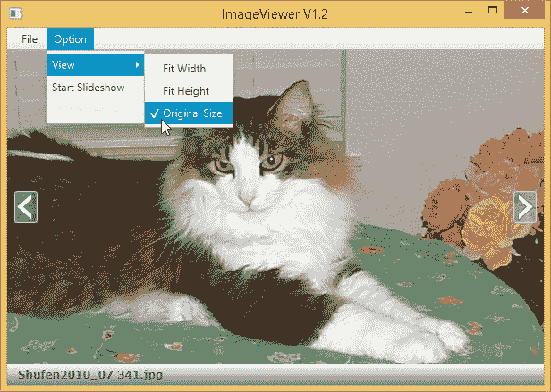

## 为什么选择这本书

本书面向倾向于使用 JavaFX 库开发丰富客户端应用程序的软件开发者。

JavaFX 中的重要特性将通过真实世界 Java 应用的逐步开发进行说明。

书中使用了说明性图表帮助读者立即掌握抽象概念。每个章节使用的所有图表都是使用本系列书籍开发的图形工具创建的。

如果你是以下人员，这本书将适合你：

- 刚接触 JavaFX 的 Java GUI 程序员（初学者或专业人士）。
- 拥有 JavaFX 基础知识并想学习如何开发交互式草图绘制工具的 Java 程序员。
- 一个对面向对象的 JavaFX 图形工具开发和实际应用开发感兴趣，并寻求完整且文档良好的源代码的专业软件工程师。

## 本书所需的准备

如果你想编译并运行书中的应用程序，需要下载并安装 JDK。这里是 JDK 8 的下载网站：http://www.oracle.com/technetwork/java/javase/downloads.html

为了编译并运行应用程序，建议：

1. 安装 JDK。
2. 在 PC 上安装 JavaFX。
3. 从 JDK 8 中获取 JavaFX。

### 引言

本系列书籍是关于使用 Java SE Development Kit 8 (JDK 8) 开发 GUI 的开发者教程。

JavaFX 中的重要特性将通过真实 Java 应用的逐步开发进行说明。

本书的主要目标是通过逐步开发来介绍 JavaFX 的常用特性。

书中包含了一组具有复用类的包的完整源代码，以及可嵌入的 JavaFX 应用。在运行这些应用程序之前，需要下载 JDK。这里是最新版本 JDK 的下载网站：http://www.oracle.com/technetwork/java/javase/downloads.html

### JavaFX 历史

现在让我们回顾 JavaFX 的演进时间线并了解其前身：

- SeeBeyond Technology 的 Chris Oliver 在 2005 年开发了一种名为 F3 的语言，它是“形式随功能”的缩写；它允许开发者访问 Swing 类并创建用于快速开发富互联网应用程序的图形界面（GUI）。
- Sun Microsystems 在 2005 年 9 月收购了 SeeBeyond，F3 在 2007 年 5 月更名为 JavaFX Script。
- 2008 年 12 月发布 JavaFX 1.0，开发者一直依赖 JavaFX Script 开发应用程序，直到三年后 JavaFX 2.0 发布。
- 2010 年 1 月，Oracle 完成了对 Microsystems 的收购并继续维护 JavaFX。
- 2010 年 9 月 JavaOne 大会上，Oracle 宣布停止 JavaFX Script。
- 2011 年 10 月发布 JavaFX 2.0，开发者开始使用标准 Java API 而不是 JavaFX Script 来访问 JavaFX 库的 API。然而，编译和执行 JavaFX 2.0 除了 Java SE JDK 和 JRE 之外，还需要安装 JavaFX SDK 和 JavaFX Runtime。
- 2013 年 2 月发布 JavaFX 2.2.7，JavaFX SDK 和 JavaFX Runtime 已包含在 JDK/JRE 7 中。JavaFX 与 JDK 的集成为 JavaFX 开发者带来了极大的便利。使用 JDK 7 及后续版本编译的 JavaFX 应用程序不需要额外的安装。
- 2014 年 3 月 18 日，JavaFX 8 作为 Java™ SE Development Kit 8 (JDK 8) 的一部分发布，这是一个重大特性更新。

### 前提条件

本书介绍的 JavaFX 应用使用 JavaFX 包提供的 API 来构建图形用户界面（GUI）。虽然不需要熟悉 Swing 包，但读者必须熟悉 Java 编程语言的基础知识。如果你是 Java 初学者，请访问此网站 http://docs.oracle.com/javase/tutorial/index.html 获取 Java 技术的初步知识。请按照以下顺序阅读 Oracle Java 在线文档：

1. 从简单的 Java 应用程序“Hello World!”和安装开始：

   访问 http://docs.oracle.com/javase/tutorial/getStarted/index.html

2. Java 编程语言的各种概念和特性：

   访问 http://docs.oracle.com/javase/tutorial/java/index.html

3. Java 集合框架：

   访问 http://docs.oracle.com/javase/tutorial/collections/index.html

4. Java 核心类：

   访问 http://docs.oracle.com/javase/tutorial/essential/index.html

### JavaFX 应用概览

以下示例是为 JavaFX 初学者准备的，让他们快速预览如何创建一个 JavaFX 应用程序。

要开始学习，你需要创建一个扩展 `javafx.application.Application` 的类，这是 JavaFX 应用程序的入口点，并重写抽象的 `start` 方法。以下是一个典型的 `start` 方法示例：

```java
package imageviewer;

import javafx.application.Application;
import javafx.scene.Scene;
import javafx.scene.layout.BorderPane;
import javafx.scene.layout.StackPane;
import javafx.stage.Stage;

/**
 * File Name: ImageViewer.java
 *
 * @author Shufen Kuo
 */
public class ImageViewer extends Application {
    @Override
    public void start(Stage stage) {
        BorderPane rootPane = new BorderPane();
        StackPane imageArea = new StackPane();
        rootPane.getChildren().add(imageArea);
        Scene scene = new Scene(rootPane, 600, 400);
        stage.setTitle("ImageViewer V1.0");
        stage.setScene(scene);
        stage.show();
    }

    public static void main(String[] args) {
        launch(args);
    }
}
```

### Scene（场景）与 Stage（舞台）

在 `start` 方法中有两个重要的类：`Scene` 和 `Stage`。通常，主要任务是在名为“场景图”（scene graph）的分层树形结构中创建的图形用户界面（GUI），将场景图的根节点关联到 `Scene` 对象，然后将场景放置在 `Stage` 对象上。`Stage` 代表 JavaFX 应用程序的顶层容器，充当场景图的窗口，与应用程序用户交互。

接下来的快照让你对我们将构建的 JavaFX 应用的 GUI 外观有一个初步了解：

**图 1.** JavaFX 应用的快照。

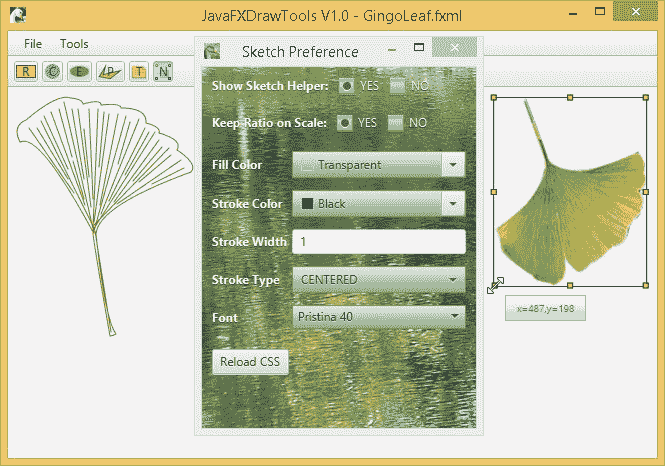

### Nodes（节点）

JavaFX 引入了一个基础类 `javafx.scene.Node`，它继承自 `java.lang.Object`，并为所有可用用户界面提供了通用的属性和方法。我们经常使用“节点”一词来指代 GUI。

场景图可能包含各种节点。节点要么是父节点（拥有子节点的节点），要么是叶子节点（没有子节点的节点）；每个节点只能有一个父节点，而根节点没有父节点。场景图中的所有节点都派自 `javafx.scene.Node` 类。为了快速掌握场景图中节点类型的本质，我们将根据其是否具有添加子节点的能力来区分它们。

你可以向这些节点添加子节点：

以下类被频繁用作父节点：`Group`、`Pane` 以及内置布局面板（它们是 `Pane` 的直接子类）。通常，你调用 `getChildren()` 方法来获取类型为 `ObservableList<Node>` 的列表（它是 `java.util.List` 的子接口），然后使用 Java 开发者所熟悉的 `Collection` 接口中定义的各种工具类来操作列表内容。

你不能向这些节点添加子节点：

以下类始终被用作叶子节点：`Canvas`、`ImageView`、`MediaView` 以及 `Shape` 的所有直接子类，如 `Rectangle`、`Circle`、`Ellipse` 等。

### JavaFX 与 Swing

现在，这里有一个有趣的问题。多年来，Java 开发者一直使用 Swing API（Java 基础类 JFC 的 GUI 组件）来构建 Java 应用程序的 GUI，为什么我们在 Swing 之外还需要 JavaFX 呢？

如果你拥有大量使用 Swing 编写的遗留代码并希望将 JavaFX 特性整合到 Swing 代码中，JDK 8 提供了机制；相反，你也可以将 Swing 组件包含在 JavaFX 应用中。

本书未涵盖 JavaFX-Swing 互操作性（Interoperability）主题。如果你对此主题感兴趣，请访问 Oracle 在线文档“JavaFX: Interoperability — JavaFX-Swing Interoperability”：http://docs.oracle.com/javase/8/javafx/interoperability-tutorial/fx_swing.htm

JavaFX 是下一代 Java GUI。为了说明使用 JavaFX 能力的优势，除了 JavaFX 和 Swing 之间的互操作性外，我们在下面的章节介绍了 JavaFX 的重要特性。

### JavaFX 的本质

JavaFX 不仅允许你快速创建应用程序，还包含独特的能力。

### 内置布局面板

JavaFX 的布局面板是自动管理尺寸和位置的容器。共有 8 种类型：

- `BorderPane`: 将节点放在五个区域：顶部、底部、左侧、右侧和中心。
- `HBox`: 将节点放置在一行中（水平方向）。
- `VBox`: 将节点放置在一列中（垂直方向）。
- `GridPane`: 将节点放置在多行多列的网格中。
- `StackPane`: 将节点堆叠在一起，默认居中对齐。
- `FlowPane`: 在容器宽度边界内行排列（水平），或在高度边界内列排列（垂直）。
- `TilePane`: 类似于 `FlowPane`，但网格中的每个单元大小相同。
- `AnchorPane`: 相对于指定的锚点（顶、右、底、左）放置节点。

参考 Oracle 在线文档“Working with Layouts in JavaFX”：http://docs.oracle.com/javase/8/javafx/layout-tutorial.html

## 使用 CSS 自定义外观


JavaFX 允许使用 CSS（层叠样式表）描述界面的形式。使用 CSS 定义表现属性（如颜色、字体、外边距、内边距、宽度、高度、线条、背景图像等）在许多方面提供了巨大的便利：

- 软件提供端的自定义：从同一组代码编译的应用程序可以采用各种样式，以满足不同的客户需求。
- 应用程序用户端的自定义：即使在软件发布后，如果应用程序用户对外观有偏好，也可以在客户现场修改在 CSS 文件中定义的表现属性。
- 样式设计者的利益：应用程序代码与样式定义的分离提高了代码的可读性，并让图形设计师专注于处理 CSS，简化了任务。
- 软件开发者的利益：在测试过程中，开发者可能会频繁更改 CSS 文件中定义的样式属性以评估各种 GUI 外观。如果每次更改都要退出并重启应用程序，将是一项非常痛苦的任务。为了方便这一评估过程，最佳策略是设计一个临时的加载按钮，每当任何样式属性更改时，只需点击按钮重新加载 CSS，无需退出并重启应用程序，从而节省大量的测试时间。

### JavaFX CSS 与 HTML CSS 的相似性

JavaFX 中的 CSS 语法与 HTML 中的 CSS 相同，因此任何具有浏览器 CSS 经验的设计师都能通过极少的学习成本为 JavaFX 应用的 UI 进行样式设计。

参考 Oracle 在线文档“使用 CSS 为 JavaFX 应用程序皮肤”：

<http://docs.oracle.com/javase/8/javafx/user-interface-tutorial/css_tutorial.htm>

### 使用 FXML 创建用户界面

FXML 是一种符合 XML（可扩展标记语言）格式的标记语言，它带有额外的规则，用于创建 JavaFX 应用程序的用户界面。考虑到手动编写 FXML 容易出错，一种可行的方法是通过 GUI 构建器生成 FXML 代码。

在系列丛书中，我们介绍了一个实用的应用程序 `JFXDrawTools`，它是一种专门用于创建派自 `Shape` 的子类实例的 GUI 构建器。用户可以交互式地创建一个草图（无论是 `Shape` 还是 `ImageView`），操纵其属性，并将编辑结果保存为 FXML 格式的文件。这些文件以后可以重新加载回来以继续编辑过程，或者被其他 JavaFX 应用程序动态加载。

将应用程序的 GUI（视图 View）与其业务逻辑（模型 Model）分离被认为是一种良好的编程实践。FXML 文件表示视图，而控制器（controller）是一个在视图和模型之间传递信息的 Java 类。使用 FXML 构建 GUI 能够让应用程序开发者有效地采用 MVC（模型-视图-控制器）架构。

参考 Oracle 在线文档“JavaFX: 精通 FXML”：

<http://docs.oracle.com/javase/8/javafx/fxml-tutorial/index.html>

## 属性与绑定的吸引力能力

JavaFX 中属性（Properties）的概念遵循在 JavaBeans 组件中引入的设计规范，它通常与绑定（Binding）机制配合工作，整体为各种编程需求提供了强大且优雅简洁的解决方案。

在系列丛书中介绍的 `JFXDrawTools` 应用程序中，我们充分演示了属性和绑定的用法。在属性窗口的实现中，使用了合适的 UI 控件（如文本字段 `text field`、选择框 `choice box`、组合框 `combo box` 等）查看相关对象的属性。绑定机制被用于将 UI 控件与其对象的相应属性进行双向链接，这种关系在属性窗口即将显示时被建立好。当用户更改 UI 控件中显示的数据时，更改会立即反映到相关对象的相应属性上。

参考 Oracle 在线文档“JavaFX 属性与绑定教程”：

<http://docs.oracle.com/javase/8/javafx/properties-binding-tutorial/index.html>

### 变换与过渡的复杂机制

JavaFX 内置的节点变换（transformations）能力对于开发图形包，如图形编辑器、绘图工具、图像查看器、GUI 构建器等非常方便。

这里是处理变换的类：`Translate`（移动）、`Rotate`（旋转）、`Scale`（缩放）和 `Shear`（变形）。它们都派自 `Transform` 类并位于 `javafx.scene.transform` 包中。

JavaFX 过渡（transitions）为创建动画提供了简洁的方法。许多应用程序都需要动画功能，这里是一些案例：在警报情况下引起注意、在删除操作期间将对象放入回收箱、在数据加载期间指示中间状态……

在系列丛书中介绍的 `ImageViewer` 应用程序中，我们将 `FadeTransition` 和 `ParallelTransition` 应用到幻灯片功能的图像对象上，同时淡入新图像并淡出旧图像。

这里是处理变换的类：`FadeTransition`、`ParallelTransition`、`ScaleTransition`、`TranslateTransition`、`FillTransition`、`RotateTransition`、`SequentialTransition`、`PauseTransition`。它们都派自 `Transition` 类并位于 `javafx.animation` 包中。

参考 Oracle 在线文档“JavaFX 变换、动画与视觉效果”：

<http://docs.oracle.com/javase/8/javafx/animation.html>

### 2D 原始图形与文本是 JavaFX

JavaFX 提供了一个扩展自 `Node` 的 `Shape` 类，用于绘制 2D 原始图形。以下是派自 `Shape` 的类：

- `Arc`（弧）
- `Circle`（圆）
- `CubicCurve`（三次塞尔曲线）
- `Ellipse`（椭圆）
- `Line`（直线）
- `Polygon`（多边形）
- `Polyline`（折线）
- `QuadCurve`（二次曲线）
- `Rectangle`（矩形）
- `Text`（文本）

所有其他类都位于 `javafx.scene.shape`。请注意，位于 scene 包中的 `Text` 类为文本开发提供了支持。可以将对象放置在布局面板中利用这些功能，并使用 CSS 自定义呈现样式。

参考 Oracle 在线文档“在 JavaFX 中使用文本”：

<http://docs.oracle.com/javase/8/javafx/user-interface-tutorial/text.html>

### 其他缩短开发时间的显著能力

#### 用于加载和显示图片的 ImageView

扩展自 `javafx.scene.Node` 的 `ImageView` 类与 `Image` 类配合使用，用于加载和显示图像。JavaFX 还提供了对位图图像进行操作的 API，`PixelReader` 是从 `Image` 对象读取像素的接口，而 `PixelWriter` 定义了向 `Image` 对象写入像素。所有这些都位于 `javafx.scene.image` 包中。

参考 Oracle 在线文档“使用图像操作”：

<http://docs.oracle.com/javase/8/javafx/graphics-tutorial/image_ops.html>

#### 用于管理网页的 WebView

JavaFX 架构中嵌入了一个网络引擎，并提供了一组位于 `javafx.scene.web` 包中的 API，用于开发带有浏览器的应用程序。要查看网页，首先你需要创建一个扩展自 `javafx.scene.Parent` 并继承所有节点特性的 `WebView` 对象，然后获取与它关联的 `WebEngine`。`WebEngine` 提供了与操作网页相关的方法，例如：通过给定的 URL 或页面内容加载/显示网页、访问 WebEngine 为加载的网页创建的文档对象模型（DOM）、处理从 JavaScript 发起的各种事件……

参考 Oracle 在线文档“向 JavaFX 应用程序中添加 HTML 内容”：

<http://docs.oracle.com/javase/8/javafx/embedded-browser-tutorial/index.html>

#### 用于编辑 HTML 页面的 HTMLEditor

完整的 HTML 编辑能力来自 `HTMLEditor` 类，它扩展自 `javafx.scene.control.Control`，位于 `javafx.scene.web` 包。要将 HTML 编辑器嵌入你的 JavaFX 应用程序中，你只需要创建一个 `HTMLEditor` 实例，将其添加到场景图中，就可以与用户交互了。以下两个方法对于获取和设置编辑器的 HTML 内容非常有用：

- `getHtmlText()`
- `setHtmlText(java.lang.String htmlText)`

与处理多行纯文本的类似 `TextArea` 不同，`HTMLEditor` 格式化符合 HTML 语法的文本。HTML 编辑器在软件各个领域被广泛需要，例如：博客作者写文章发布（内容管理系统）、电子邮件用户编写邮件（消息系统）、在线卖家为列表准备产品描述（电子商务管理系统）……等。

参考 Oracle 在线文档“使用 JavaFX UI 组件——HTML 编辑器”：

<http://docs.oracle.com/javase/8/javafx/user-interface-tutorial/editor.html>

#### 用于渲染数据的图表组件

以下类位于 `javafx.scene.chart` 包中，用于绘制各种类型的图表：

- 区域图（`AreaChart`）、堆叠区域图（`StackedAreaChart`）
- 柱状图（`BarChart`）、堆叠柱状图（`StackedBarChart`）
- 气泡图（`BubbleChart`）
- 折线图（`LineChart`）
- 饼图（`PieChart`）
- 散点图（`ScatterChart`）

`Chart` 类是所有图表组件的基类，继承自 `javafx.scene.layout.Region` 类，因此继承了 `javafx.scene.Node` 类的所有特性。

参考 Oracle 在线文档“JavaFX: Working with JavaFX UI Components — Working with JavaFX Charts”：

<http://docs.oracle.com/javase/8/javafx/user-interface-tutorial/charts.htm>

#### 用于播放媒体的 MediaView 类

`MediaView` 类继承自 `javafx.scene.Node`，与 `MediaPlayer` 和 `Media` 类配合使用，在你的 JavaFX 应用中播放媒体。所有与媒体相关的类都位于 `javafx.scene.media` 包中。

参考 Oracle 在线文档“JavaFX: Incorporating Media Assets Into JavaFX Applications”：

<http://docs.oracle.com/javase/8/javafx/media-tutorial/>

## JavaFX 基础 UI 组件

除了上述的 JavaFX 核心之外，JavaFX 还提供了基础 UI 组件，它们位于 `javafx.scene.control` 包中，并派自 `javafx.scene.control.Control` 类；它们通常被称为 UI 控件。

以下是可选 UI 控件，未标记星号（`*`）的控件在 Swing 中对应的实现：

- `Label`（标签）、`Button`（按钮）、`RadioButton`（单选按钮）、`ToggleButton`（切换按钮）
- `CheckBox`（复选框）、`ChoiceBox`（选择框）
- `ComboBox`（组合框）、`ListView`（列表视图）、`TableView`（表格视图）
- `TextField`（单行文本框）、`TextArea`（多行文本框）、`PasswordField`（密码框）、`HTMLEditor`（*）
- `ScrollBar`（滚动条）、`ScrollPane`（滚动面板）、`Slider`（滑条）、`ProgressBar`（进度条）、`ProgressIndicator`（*）
- `ToolBar`（工具栏）
- `MenuBar`（菜单栏）、`MenuButton`（菜单按钮）、`SplitMenuButton`（*，拆分菜单按钮）
- `ColorPicker`（颜色选择器）、`DatePicker`（*，日期选择器）、`Separator`（分隔符）、`Pagination`（*，分页器）、`SplitPane`（拆分面板）
- `TabPane`（选项卡面板）、`TitledPane`（*，标题面板）、`Accordion`（*，手风琴）、`TreeView`（树形视图）、`TreeTableView`（*，树形表格）
- `Hyperlink`（*，超链接）

以下 UI 组件通常与上述 UI 控件归为同一类。

`Tooltip`（提示框）位于 `javafx.scene.control` 包，但派自 `javafx.scene.control.PopupControl` 类。

`MenuItem`、`Menu`、`CheckMenuItem`、`RadioMenuItem` 位于 `javafx.scene.control` 包中。继承自 `java.lang.Object` 的 `MenuItem` 是另外三个类的基类。

`FileChooser`（文件选择器）位于 `javafx.stage` 包并派自 `java.lang.Object`。

参考 Oracle 在线文档“JavaFX: Working with JavaFX UI Components”：

<http://docs.oracle.com/javase/8/javafx/user-interface-tutorial/ui_controls.htm>

# 第一章

## 基础图像查看器

### 开发图像查看器 V1.0

### 序言

在本章中，我们将通过逐步开发一个图像查看器应用（`ImageViewer V1.0`）来演示 JavaFX API 的用法。通过从 `ImageViewer V1.0x` 中摘取的详细描述和记录良好的示例代码，你将熟悉“摘要”部分中所述的 JavaFX 库的基本功能。

`ImageViewer V1.0` 的完整开发过程具有以下步骤的特征：

1.1 创建 `Application` 的子类 `ImageViewer` 类
1.1.1 JavaFX 线程 vs. Java 启动线程
1.1.2 捕获图像渲染区域的缩放事件
1.2 创建菜单栏
1.2.1 向菜单栏添加文件菜单
1.2.2 从文件打开对话框中选择图像文件并在 `StackPane` 上显示图像
1.3 创建选项菜单和视图子菜单
1.3.1 创建切换组（`Toggle Group`）、单选菜单项并为所选的 `Toggle` 属性添加监听器
1.4 实现适应宽度、适应高度和原始大小的查看选项
1.4.1 方法一：将 `ImageView` 的 `fitWidth`/`fitHeight` 属性分别绑定（Bind）到 `Scene` 的 `width`/`height` 属性上
1.4.1.1 实现适应宽度查看选项
1.4.1.2 实现适应高度查看选项
1.4.1.3 实现原始大小查看选项
1.4.1.4 完成 `ImageViewer` 类的源代码
1.4.2 方法二：更改值
1.4.2.1 通过 `Scene` 的缩放事件更改 `ImageView` 值
1.4.2.2 `ImageViewer` 类的源代码

线程。此外，`Scene` 对象或 `Stage` 对象的构建也必须从 JavaFX Application Thread 访问。

### 1.1.2 捕获图像渲染区域的缩放事件

为了调试和测试目的，我们在此注册了一个 `ChangeListener`，它提供了一个 `changed` 方法，每当图像渲染区域的宽度或高度发生变化时都会通知。当用户调整应用程序窗口大小时，图像渲染区域的宽度或高度会改变。

要注册一个 `ChangeListener` 来观察属性值的变化，我们使用此方法：

```java
void addListener(ChangeListener<? super T> listener)
```

该方法定义在 `javafx.beans.value.ObservableValue` 接口中，提供了 `changed(ObservableValue<? extends T> observable, T oldValue, T newValue)` 方法的实现，该方法会在此属性的值改变时被调用。

允许将同一个 `ChangeListener` 注册到多个 `ObservableValues` 上。为了避免内存泄漏问题，在不再需要观察某个值时，注销监听器是一个良好的编程习惯，可以使用 `removeListener(ChangeListener<? super T> listener)` 方法，该方法移除可观测值与监听器之间的链接。

`StackPane` 类继承自 `javafx.scene.layout.Region` 类的宽度和高度属性。这两个属性的类型都是 `ReadOnlyDoubleProperty`，它是一个实现了 `ObservableValue` 接口的抽象类。正如名称所示，`ObservableValue` 持有一个可被观测的值，你可以监听该值的变化并根据需要采取行动。

以下代码演示了如何监控图像渲染区域的缩放事件，该 `StackPane` 放置在 `BorderPane` 的中心。

**导入语句：**

```java
import javafx.beans.value.ChangeListener;
import javafx.beans.value.ObservableValue;
```

**代码列表 1-2。** 为图像渲染区域的宽度属性和高度属性添加监听器：


```java
imageArea.widthProperty().addListener(new ChangeListener<Object>() {
    public void changed(ObservableValue o, Object oldVal,
    Object newVal) {
        System.out.format("imageArea width changed from %.1f to %.1f%n",
        oldVal, newVal);
    }
});

imageArea.heightProperty().addListener(new ChangeListener<Object>() {
    public void changed(ObservableValue o, Object oldVal,
    Object newVal) {
        System.out.format("imageArea height changed from %.1f to %.1f%n",
        oldVal, newVal);
    }
});
```

**代码列表 1-3.** 类似 `ImageViewer` 的完整源代码：

```java
package imageviewer;

import javafx.application.Application;
import javafx.beans.value.ChangeListener;
import javafx.beans.value.ObservableValue;
import javafx.scene.Scene;
import javafx.scene.layout.BorderPane;
import javafx.scene.layout.StackPane;
import javafx.stage.Stage;

/**
 * 文件名: ImageViewer.java
 * (目录: ImageViewer1.0/src/example/imageviewer/)
 * 此应用程序创建了一个 BorderPane 作为场景的根节点，
 * 在 BorderPane 的中心添加了一个 StackPane
 * 场景的初始大小设置为 600x400
 * 当用户调整窗口大时，StackPane 的大小将自动设置为以适应场景的大小
 * @author Shufen Kuo
 */
public class ImageViewer extends Application {
    @Override
    public void start(Stage stage) {
        BorderPane rootPane = new BorderPane();
        StackPane imageArea = new StackPane();
        rootPane.setCenter(imageArea);
        Scene scene = new Scene(rootPane, 600, 400);

        imageArea.widthProperty().addListener(new ChangeListener<Object>() {
            public void changed(ObservableValue o, Object oldVal,
            Object newVal) {
                System.out.format("imageArea width changed from %.1f to %.1f%n",
                oldVal, newVal);
            }
        });

        imageArea.heightProperty().addListener(new ChangeListener<Object>() {
            public void changed(ObservableValue o, Object oldVal,
            Object newVal) {
                System.out.format("imageArea height changed from %.1f to %.1f%n",
                oldVal, newVal);
            }
        });

        stage.setTitle("ImageViewer V1.0");
        stage.setScene(scene);
        stage.show();
    }

    public static void main(String[] args) {
        launch(args);
    }
}
```

**图 1-1.** `ImageViewer V1.0` 初始外观快照 (`img/ee1860d9fadf51c9ffb7191acdb087c39_0.png`)

编译并运行应用程序。

**命令行中编译和运行 `ImageViewer` 的输出：**

```text
Microsoft Windows [Version 6.3.9600]
(c) 2013 Microsoft Corporation. All rights reserved.
F:\My Documents\DocRoot\SHFEN_JAVA\MyBook\VolumeOne\ImageViewer1.0\src
javac -encoding utf-8 -Xlint:unchecked imageviewer.java
jar cf imageviewer.jar imageviewer
java -cp imageviewer.jar imageviewer.ImageViewer
imageArea width changed from 0.0 to 600.0
imageArea height changed from 0.0 to 400.0
```

现在，通过拖动应用程序窗口的边缘或角来更改场景的大小，你将看到类似的输出：

```text
imageArea width changed from 600.0 to 800.0
imageArea height changed from 400.0 to 600.0
```

```text
imageArea width changed from 800.0 to 700.0
imageArea height changed from 600.0 to 500.0
```

```text
imageArea width changed from 700.0 to 600.0
imageArea height changed from 500.0 to 400.0
```

`MenuItem` 类用于添加事件处理器，以处理 `Load`（加载）菜单项的 `ActionEvent`。

为了加载和显示图像，我们结合使用 `ImageView` 类和 `Image` 类。`Image` 类根据给定的 `String` 类型的 URL 加载图像，而 `ImageView` 类则在图像渲染区域中显示该图像。

首先，我们创建一个作为 `StackPane` 子元素的 `ImageView`。稍后，当获取图像文件时，我们将创建一个 `Image` 对象来加载图像文件，并调用 `ImageView` 类提供的 `setImage(Image value)` 方法来查看图像。

详细情况如下：当执行 `FileChooser` 的 `showOpenDialog` 方法时，会弹出一个文件打开对话框。当用户选择一个文件并点击对话框中的“打开”按钮时，`showOpenDialog` 方法会将选中的文件（`File` 类型）返回给调用者，它被转换为 `String` 表现形式的 URL，并以该 URL 为参数创建一个 `Image` 对象；此时，图像已加载到内存中但尚未显示在屏幕上，一旦执行 `ImageView` 的 `setImage` 方法，选中的图像就会显示出来。为了效率考虑，我们只创建一次 `ImageView` 对象，并在每次选择并打开新图像文件时更新其 `Image` 属性。

以下代码片段完成了这些任务：

**导入语句：**

```java
import java.io.File;

import javafx.scene.image.Image;
import javafx.scene.image.ImageView;
import javafx.stage.FileChooser;
```

**Listing 1-7.** 创建 `FileChooser` 对象、`ImageView` 对象并为 `Load` 菜单项添加 `EventHandler` 以加载图像：

```java
// 创建文件选择器
final FileChooser fileChooser = new FileChooser();
fileChooser.setTitle("Open an Image File");

// 创建图像视图，添加到图像区域
final ImageView imageView = new ImageView();
imageArea.getChildren().add(imageView);

// 为菜单项 Load 添加动作
load.setOnAction(new EventHandler<ActionEvent>() {
 @Override
 public void handle(ActionEvent e) {
 // 打开 FileChooser 对话框
 File file = fileChooser.showOpenDialog(stage);
 if (file != null) {
 String url = file.toURI().toString();
 Image image = new Image(url);
imageView.setImage(image);
 }
 }
});
```

请记住将变量 `stage` 声明为 `final`，因为它在内部类（即 `Load` 菜单项的匿名 `EventHandler` 类）中被访问。

现在，我们需要处理一个关于图像渲染区域（`StackPane`）可调整大小的重要事项。为了避免在显示较大的图像时缩放 `StackPane`，我们需要为 `StackPane` 设置最小尺寸。以下是实现此操作的代码：

```java
imageArea.setMinSize(0, 0);
```

如果不添加上述行代码，当加载大于当前 `StackPane` 大小的图像时，`StackPane` 的大小会发生变化。这里是一个例子：

假设 `StackPane` 的当前大小为 600x375；在显示大小为 1280x960 的图像后，`StackPane` 的大小将扩大为 1280x960；然而，可见部分仍然是 600x375。

为 `StackPane` 设置最小大小可以确保每当打开新图像时，都不会发生大小变化事件，同时也简化了后续章节要开发的代码。

**Listing 1-8.** `ImageViewer` 类的完整源代码所示：

```java
package imageviewer;

import java.io.File;
import javafx.application.Application;
import javafx.application.Platform;
import javafx.beans.value.ChangeListener;
import javafx.beans.value.ObservableValue;
import javafx.event.ActionEvent;
import javafx.event.EventHandler;
import javafx.scene.Scene;
import javafx.scene.control.Menu;
import javafx.scene.control.MenuBar;
import javafx.scene.control.MenuItem;
import javafx.scene.image.Image;
import javafx.scene.image.ImageView;
import javafx.scene.layout.BorderPane;
import javafx.scene.layout.StackPane;
import javafx.stage.FileChooser;
import javafx.stage.Stage;

/**
 * 文件名: ImageViewer.java
 * (位于目录: ImageViewer1.0/src/example2/imageviewer/)
 * 此应用程序创建一个 BorderPane 作为场景的根节点，
 * 并在 BorderPane 的中心添加了一个 StackPane
 * 场景的初始 own设置为 600x400
 * StackPane 的大小将自动设置为以适应场景的大小
 * 当用户调整窗口大时，StackPane 将被调整大小
 *
 * 在 BorderPane 顶部添加菜单栏
 * 创建 File 菜单，并使用 FileChooser 的 Open 对话框
 * 选择图像文件，在图像渲染区域加载并显示图像
 *
 * @author Shufen Kuo
 */
public class ImageViewer extends Application {
  @Override
  public void start(final Stage stage) {
    BorderPane rootPane = new BorderPane();
    StackPane imageArea = new StackPane();
    // 为 StackPane 设置最小尺寸以避免在
    // 加载大图像时调整大小
    imageArea.setMinSize(0, 0);
    rootPane.setCenter(imageArea);
    Scene scene = new Scene(rootPane, 600, 400);

    imageArea.widthProperty().addListener(new ChangeListener() {
      public void changed(ObservableValue oldVal, Object newVal) {
        System.out.format("imageArea width changed from %.1f to %.1f\n", oldVal, newVal);
      }
    });
    imageArea.heightProperty().addListener(new ChangeListener() {
      public void changed(ObservableValue oldVal, Object newVal) {
        System.out.format("imageArea height changed from %.1f to %.1f\n", oldVal, newVal);
      }
    });

    // 添加菜单栏
    MenuBar menuBar = new MenuBar();
    Menu menuFile = new Menu("File");
    MenuItem load = new MenuItem("Load");
    MenuItem exit = new MenuItem("Exit");
    menuFile.getItems().addAll(load, exit);
    menuBar.getMenus().add(menuFile);
    rootPane.setTop(menuBar);

    // 为菜单项添加动作
    load.setOnAction(new EventHandler<ActionEvent>() {
      @Override
      public void handle(ActionEvent e) {
        // 打开 FileChooser 对话框
        FileChooser fileChooser = new FileChooser();
        fileChooser.setTitle("Open an Image File");
        File file = fileChooser.showOpenDialog(stage);
        if (file != null) {
          String url = file.toURI().toString();
          Image image = new Image(url);
          imageView.setImage(image);
        }
      }
    });

    exit.setOnAction(new EventHandler<ActionEvent>() {
      @Override
      public void handle(ActionEvent e) {
        Platform.exit();
      }
    });

    stage.setTitle("ImageViewer V1.0");
    stage.setScene(scene);
    stage.show();
  }

  public static void main(String[] args) {
    launch(args);
  }
}
```

```java
import javafx.scene.control.RadioMenuItem;

import javafx.scene.control.Toggle;

import javafx.scene.control.ToggleGroup;
```


### Listing 1-9

创建 `Option` 菜单、`ToggleGroup`、`RadioMenuItem`、`View` 子菜单，并为 `ToggleGroup` 的 `selectedToggle` 属性添加监听器：

```java
// 创建 Option menu
Menu menuOption = new Menu("Option");

// 创建 toggle group
final ToggleGroup groupOption = new ToggleGroup();

// 创建 radio menu items
final RadioMenuItem fitWidth = new RadioMenuItem("Fit Width");
fitWidth.setToggleGroup(groupOption);

final RadioMenuItem fitHeight = new RadioMenuItem("Fit Height");
fitHeight.setToggleGroup(groupOption);

final RadioMenuItem original = new RadioMenuItem("Original Size");
original.setToggleGroup(groupOption);

// 为 toggle group 添加监听器
groupOption.selectedToggleProperty().addListener(new ChangeListener<Toggle>

    public void changed(ObservableValue<? extends Toggle> ov,

            Toggle old_toggle, Toggle new_toggle) {

        if (groupOption.getSelectedToggle() != null) {

            RadioMenuItem choiceItem = (RadioMenuItem) groupOption.getSelectedToggle();

            if (choiceItem == fitWidth) {

                System.out.println("fitwidth");

            } else if (choiceItem == fitHeight) {

                System.out.println("fitheight");

            } else {

                System.out.println("original size");

            }

        }

    }

});

// 为 Option menu 创建 View 子菜单
Menu menuView = new Menu("View");
menuView.getItems().addAll(fitWidth, fitHeight, original);

// 设置 Original Size 为默认选择
original.setSelected(true);

// 将 option menu 添加到 menu bar
menuOption.getItems().add(menuView);
menuBar.getMenus().add(menuOption);
```

### Listing 1-10

`ImageViewer` 类的完整源代码如下：

```java
package imageviewer;

import java.io.File;

import javafx.application.Application;
import javafx.application.Platform;
import javafx.beans.value.ChangeListener;
import javafx.beans.value.ObservableValue;
import javafx.event.ActionEvent;
import javafx.event.EventHandler;
import javafx.scene.Scene;
import javafx.scene.control.Menu;
import javafx.scene.control.MenuBar;
import javafx.scene.control.MenuItem;
import javafx.scene.control.RadioMenuItem;
import javafx.scene.control.Toggle;
import javafx.scene.control.ToggleGroup;
import javafx.scene.image.Image;
import javafx.scene.image.ImageView;
import javafx.scene.layout.BorderPane;
import javafx.scene.layout.StackPane;
import javafx.stage.FileChooser;
import javafx.stage.Stage;

/**
 * 文件名: ImageViewer.java
 * (目录: ImageViewer1.0/src/example3/imageviewer/)
 * 该应用程序创建了一个 BorderPane 作为场景的根节点，
 * 并在 BorderPane 的中心添加了一个 StackPane
 * 场景的初始大小设置为 600x400
 * StackPane 的大小将自动调整以适应场景的大小
 * 当用户调整窗口大时，StackPane 会随之调整大小
 *
 * 在 BorderPane 顶部添加了一个 menu bar
 * 创建 File 菜单，并使用 FileChooser 的打开对话框
 * 选择图像文件，在图像渲染区域加载并显示图像
 *
 * 创建包含 View 子菜单的 Option 菜单，让用户选择图像查看
 * 标准：适应宽度、适应高度或默认选项原始大小 Original Size。
 *
 * @author Shufen Kuo
 */

public class ImageViewer extends Application {

    @Override
    public void start(final Stage stage) {

        BorderPane rootPane = new BorderPane();
        StackPane imageArea = new StackPane();

        // 为 StackPane 设置最小大小
        // 避免缩放
        // 添加图像
        rootPane.setCenter(imageArea);

        Scene scene = new Scene(rootPane, 600, 400);

        // 场景大小
        imageArea.widthProperty().addListener(new ChangeListener<Number> {

            public void changed(ObservableValue<? extends Number> ov,

                    Number oldVal, Number newVal) {

                // 调整大小

            }

        });

        imageArea.heightProperty().addListener(new ChangeListener<Number> {

            public void changed(ObservableValue<? extends Number> ov,

                    Number oldVal, Number newVal) {

                // 调整大小

            }

        });

        // 添加 menu bar
        MenuBar menuBar = new MenuBar();

        // 创建 File 菜单
        Menu menuFile = new Menu("File");
        MenuItem load = new MenuItem("Load");
        MenuItem exit = new MenuItem("Exit");

        menuFile.getItems().addAll(load, exit);
        menuBar.getMenus().add(menuFile);
        rootPane.setTop(menuBar);

        // 为 load 项添加操作
        load.setOnAction(new EventHandler<ActionEvent>() {

            @Override
            public void handle(ActionEvent e) {

                // 创建 file chooser
                final FileChooser fileChooser = new FileChooser();
                fileChooser.setTitle("Open Image");

                // 打开对话框
                File file = fileChooser.showDialog(stage);

                if (file != null) {

                    String url = file.toURI().toString();

                    // 加载图像
                    Image image = new Image(url);

                    // 将图像添加到 view
                }
            }

        });

        exit.setOnAction(new EventHandler<ActionEvent>() {

            @Override
            public void handle(ActionEvent e) {

                // 退出
                Platform.exit();

            }

        });

        // 创建 Option 菜单
        Menu menuOption = new Menu("Option");

        // 创建 toggle group
        final ToggleGroup groupOption = new ToggleGroup();

        // 创建 radio menu items
        final RadioMenuItem fitWidth = new RadioMenuItem("Fit Width");
        fitWidth.setToggleGroup(groupOption);

        final RadioMenuItem fitHeight = new RadioMenuItem("Fit Height");
        fitHeight.setToggleGroup(groupOption);

        final RadioMenuItem original = new RadioMenuItem("Original Size");
        original.setToggleGroup(groupOption);

        // 为 toggle group 添加监听器
        groupOption.selectedToggleProperty().addListener(new ChangeListener<Toggle>

            public void changed(ObservableValue<? extends Toggle> ov,

                    Toggle old_toggle, Toggle new_toggle) {

                if (groupOption.getSelectedToggle() != null) {

                    RadioMenuItem choiceItem = (RadioMenuItem) groupOption.getSelectedToggle();

                    if (choiceItem == fitWidth) {

                        System.out.println("fitwidth");

                    } else if (choiceItem == fitHeight) {

                        System.out.println("fitheight");

                    } else {

                        System.out.println("original size");

                    }

                }

            }

        );

        // 为 Option menu 创建 View 子菜单
        Menu menuView = new Menu("View");
        menuView.getItems().addAll(fitWidth, fitHeight, original);

        // 设置 Original Size 为默认选择
        original.setSelected(true);

        // 将 option menu 添加到 menu bar
        menuOption.getItems().add(menuView);
        menuBar.getMenus().add(menuOption);

        stage.setTitle("ImageViewer V1.0");
        stage.setScene(scene);
        stage.show();

    }

    public static void main(String[] args) {

        launch(args);

    }

}
```

### 图 1-6

包含 `View` 子菜单的 `Option` 菜单快照（`img/ee6860d9f5a1c1791acdb087_54.png`）。

```java
imageView.setFitHeight(0);
```

### 1.4.1.2 实现“适应高度”查看选项

如果选择“适应高度”（Fit Height）作为查看选项，我们将把 `ImageView` 的 `fitHeight` 属性绑定到 `Scene` 的 `height` 属性（减去菜单栏的高度），并解绑 `fitHeight` 属性。

我们正在使用 `subtract` 方法来计算图像的可用显示高度。

`subtract(double other)` 方法由 `DoubleProperty` 类继承自 `DoubleExpression` 类，它返回一个新的 `NumberBinding` 对象，用于计算该 `NumberExpression` 与给定常量之间的差值。代码如下：

### Listing 1-13

将 `ImageView` 的 `fitHeight` 属性绑定到场景的 `height` 属性，减去菜单栏的高度：

```java
// 渲染图像的可用高度是
// 从场景高度中减去菜单栏的高度
imageView.fitHeightProperty().bind(
    scene.heightProperty().subtract(menuBar.getHeight()));
imageView.fitWidthProperty().unbind();

// 除了解绑，还必须将适应宽度设为 0
imageView.setFitWidth(0);
```

### 1.4.1.3 实现“原始尺寸”查看选项

如果选择“原始尺寸”（Original Size）作为查看选项，我们将 `ImageView` 对象的 `fitWidth` 属性以及 `fitHeight` 属性进行解绑。代码如下：

### Listing 1-14

解绑 `ImageView` 对象的 `fitWidth` 属性以及 `fitHeight` 属性：

```java
imageView.fitWidthProperty().unbind();
imageView.fitHeightProperty().unbind();

// 除了解绑，还必须将适应宽度/高度设为 0
imageView.setFitWidth(0);
imageView.setFitHeight(0);
```

请注意，更改 `ImageView` 对象的 `fitWidth/fitHeight` 属性值不会影响底层 `Image` 对象的 `width/height` 属性。


`Image` 对象的属性（如宽度和高度）将保持不变，而与 `ImageView` 查看选项相关的属性会根据用户的操作动态更改。

方法一的优点是，你不需要注册事件处理器来响应 `Scene` 的尺寸调整事件。当应用程序窗口动态调整大时，`Scene` 会随之调整大小，相应的 `ImageView` 属性也会发生改变，而图像渲染区域（一个 `StackPane` 对象）的大小会自动重新计算。

以下代码片段显示方法一的实现。

**Listing 1-15.** 监听单选菜单项选择的变化，并使用 `bind` 和 `unbind` 方法调整图像视图的 `fitWidth` 和 `fitHHeight`。

```java
final StackPane imageArea = new StackPane();
...

final Scene scene = new Scene(rootPane, 600, 400);
...

final MenuBar menuBar = new MenuBar();
...

// 创建切换组
final ToggleGroup groupOption = new ToggleGroup();
// 创建单选菜单项并将其添加到切换组
final RadioMenuItem fitWidth = new RadioMenuItem("Fit Width");
fitWidth.setToggleGroup(groupOption);
final RadioMenuItem fitHeight = new RadioMenuItem("Fit Height");
fitHeight.setToggleGroup(groupOption);
final RadioMenuItem original = new RadioMenuItem("Original Size");
original.setToggleGroup(groupOption);

groupOption.selectedToggleProperty().addListener(new ChangeListener<Toggle>
public void changed(ObservableValue<? extends Toggle> ov,
Toggle old_toggle, Toggle new_toggle) {
    if (groupOption.getSelectedToggle() != null) {
        RadioMenuItem choiceItem =
            (RadioMenuItem) groupOption.getSelectedToggle();

        if (choiceItem == fitWidth) {
            System.out.println("fitwidth");
            imageView.fitWidthProperty().bind(scene.widthProperty());
            imageView.fitHeightProperty().unbind();
            // 除了解绑，还必须将适应高度设为 0
            imageView.setFitHeight(0);
        } else if (choiceItem == fitHeight) {
            System.out.println("fitheight");
            // 渲染图像的可用高度是
            // 从场景高度中减去菜单栏的高度
            imageView.fitHeightProperty().bind(
                scene.heightProperty().subtract(menuBar.getHeight()));
            imageView.fitWidthProperty().unbind();
            // 除了解绑，还必须将适应宽度设为 0
            imageView.setFitWidth(0);
        } else {
            System.out.println("original size");
            imageView.fitWidthProperty().unbind();
            imageView.fitHeightProperty().unbind();
            // 除了解绑，还必须将适应宽度/高度设为 0
            imageView.setFitWidth(0);
            imageView.setFitHeight(0);
        }
    }
}
});
```

### 1.4.1.4 `ImageViewer` 类的完整源代码

方法一的 `ImageViewer` 类的完整源代码如下：

**Listing 1-16.** `ImageViewer` 类的完整源代码如下：

```java
package imageviewer;

import java.io.File;
import javafx.application.Application;
import javafx.application.Platform;
import javafx.beans.value.ChangeListener;
import javafx.beans.value.ObservableValue;
import javafx.event.ActionEvent;
import javafx.event.EventHandler;
import javafx.scene.Scene;
import javafx.scene.control.Menu;
import javafx.scene.control.MenuBar;
import javafx.scene.control.MenuItem;
import javafx.scene.control.RadioMenuItem;
import javafx.scene.control.Toggle;
import javafx.scene.control.ToggleGroup;
import javafx.scene.image.Image;
import javafx.scene.image.ImageView;
import javafx.scene.layout.BorderPane;
import javafx.scene.layout.StackPane;
import javafx.stage.FileChooser;
import javafx.stage.Stage;

/**
 * 文件名: ImageViewer.java
 * (目录: ImageViewer1.0/src/example/imageviewer/)
 * 此应用程序创建一个 BorderPane 作为 Scene 的根节点，
 * 在 BorderPane 的中心添加一个 StackPane
 * Scene 的初始大小设为 600x400
 * StackPane 的大小会随用户调整窗口大小而自动调整
 * 在 BorderPane 的顶部添加一个菜单栏
 * 创建 File 菜单并使用 FileChooser 对话框
 * 选择图像文件，加载并在渲染区域显示图像
 * 创建 Option 菜单，包含视图选项：
 * 适应宽度、适应高度或默认的原始尺寸。
 * 使用 bind 和 unbind 方法：
 * 将图像视图的 fitWidth/fitHeight 绑定到 Scene 的 width/height，
 * 这样当 Scene 调整大同时，图像视图的大小也会自动改变。
 * @author Shufen Kuo
 */
public class ImageViewer extends Application {
    @Override
    public void start(final Stage stage) {
        BorderPane rootPane = new BorderPane();
        final StackPane imageArea = new StackPane();

        // 设置 StackPane 的最小尺寸以防止加载大图像时调整大小
        imageArea.setMinSize(0, 0);
        rootPane.setCenter(imageArea);

        // 创建图像视图并添加到区域
        final ImageView imageView = new ImageView();
        imageView.setPreserveRatio(true);
        imageArea.getChildren().add(imageView);

        final Scene scene = new Scene(rootPane, 600, 400);

        imageArea.widthProperty().addListener(new ChangeListener<Object>() {
            public void changed(ObservableValue o, Object oldVal,
                               Object newVal) {
                System.out.format(
                    "imageArea width changed from %.1f to %.1f%n",
                    oldVal, newVal);
            }
        });

        imageArea.heightProperty().addListener(new ChangeListener<Object>() {
            public void changed(ObservableValue o, Object oldVal,
                               Object newVal) {
                System.out.format(
                    "imageArea height changed from %.1f to %.1f%n",
                    oldVal, newVal);
            }
        });

        // 添加菜单栏
        final MenuBar menuBar = new MenuBar();
        Menu menuFile = new Menu("File");
        MenuItem load = new MenuItem("Load");
        MenuItem exit = new MenuItem("Exit");
        menuFile.getItems().addAll(load, exit);
        menuBar.getMenus().add(menuFile);
        rootPane.setTop(menuBar);

        // 为 exit 菜单项添加动作
        exit.setOnAction(new EventHandler<ActionEvent>() {
            @Override
            public void handle(ActionEvent e) {
                Platform.exit();
            }
        });

        // 创建文件选择器
        final FileChooser fileChooser = new FileChooser();
        fileChooser.setTitle("Open Image File");

        // 为 load 菜单项添加动作
        load.setOnAction(new EventHandler<ActionEvent>() {
            @Override
            public void handle(ActionEvent e) {
                // 打开 FileChooser
                File file = fileChooser.showOpenDialog(stage);
                if (file != null) {
                    String url = file.toURI().toString();
                    Image image = new Image(url);
                    imageView.setImage(image);
                }
            }
        });

        // 创建 Option 菜单
        Menu menuOption = new Menu("Option");

        // 创建切换组
        final ToggleGroup groupOption = new ToggleGroup();

        // 创建单选菜单项
        final RadioMenuItem fitWidth =
            new RadioMenuItem("Fit Width");
        fitWidth.setToggleGroup(groupOption);

        final RadioMenuItem fitHeight =
            new RadioMenuItem("Fit Height");
        fitHeight.setToggleGroup(groupOption);

        final RadioMenuItem original =
            new RadioMenuItem("Original Size");
        original.setToggleGroup(groupOption);

        menuOption.getItems().addAll(fitWidth, fitHeight, original);
        menuBar.getMenus().add(menuOption);

        // 监听切换组中选择的变化
        groupOption.selectedToggleProperty().addListener(
            new ChangeListener<Toggle>() {
                public void changed(
                    ObservableValue<? extends Toggle> ov,
                    Toggle old_toggle,
                    Toggle new_toggle) {

                    if (groupOption.getSelectedToggle() != null) {
                        RadioMenuItem choiceItem =
                            (RadioMenuItem) groupOption.getSelectedToggle();

                        if (choiceItem == fitWidth) {
                            imageView.fitWidthProperty()
                                .bind(scene.widthProperty());
                            imageView.fitHeightProperty().unbind();

                            // 除了解绑，还必须将适应高度设为 0
                            imageView.setFitHeight(0);
                        } else if (choiceItem == fitHeight) {
                            System.out.println("fitheight");

                            // 渲染图像的可用高度是
                            // 从场景高度中减去菜单栏的高度
                            imageView.fitHeightProperty().bind(
                                scene.heightProperty()
                                    .subtract(menuBar.getHeight()));
                            imageView.fitWidthProperty().unbind();

                            // 除了解绑，还必须将适应宽度设为 0
                            imageView.setFitWidth(0);
                        } else {
                            System.out.println("original size");
                            imageView.fitWidthProperty().unbind();
                            imageView.fitHeightProperty().unbind();

                            // 除了解绑，还必须将适应宽度/高度设为 0
                            imageView.setFitWidth(0);
                            imageView.setFitHeight(0);
                        }
                    }
                }
            });

        // 为选项菜单创建 View 子菜单
        Menu menuView = new Menu("View");
        menuView.getItems().addAll(fitWidth, fitHeight, original);

        // 设置 Original Size 为默认选择
        original.setSelected(true);

        // 将选项菜单添加到菜单栏
        menuOption.getItems().add(menuView);
        menuBar.getMenus().add(menuOption);

        stage.setTitle("ImageViewer V1.01");
        stage.setScene(scene);
        stage.show();
    }

    public static void main(String[] args) {
        launch(args);
    }
}
```

请注意，我们将方法一的版本号从 `V1.0` 升级到了 `V1.01`。

编译并运行应用程序。测试查看选项如下：首先，加载一张较小的图片，来回选择所有可能的查看选项，同时使用鼠标拖动窗口边缘或角来动态调整应用程序窗口的大小。然后，加载一张较大的图片并再次测试所有可能的标准。

**图 1-7.** 原始尺寸图像（320 像素乘 363 像素）的截图。

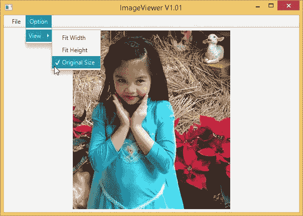

**图 1-8.** 缩放以适应场景宽度的图像渲染截图。

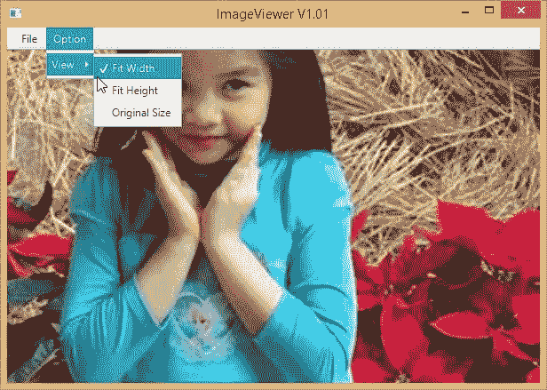

**图 1-9.** 缩放以适应场景高度可用查看空间的图像渲染截图。

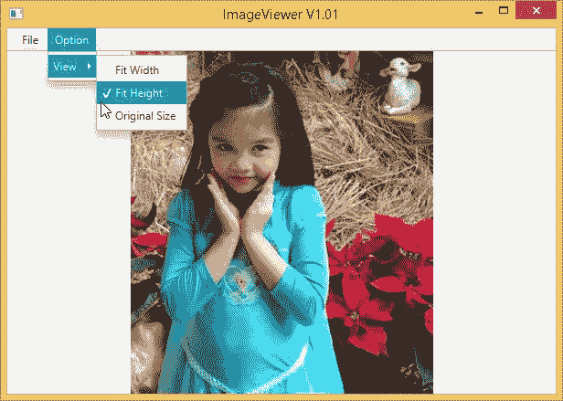

### 1.4.2 方法二：更改 `fitWidth` 属性和 `fitHeight` 属性的值


`ImageView`类提供了两个属性，允许我们缩放图像的查看尺寸：

- `fitWidth`
- `fitHeight`

要更改这两个属性的值，我们使用`setFitWidth`方法和`setFitHeight`方法。

如果选择了 Fit Width（适应宽度）查看选项，查看宽度将根据场景当前的宽度设置。以下是代码片段：

**列表 1-17.** 调用`setFitWidth`方法将图像查看宽度设置为与场景相同：

```java
imageView.setFitWidth(scene.getWidth());

// 除了 setFitWidth，还必须将适应高度设置为 0

imageView.setFitHeight(0);
```

如果选择了 Fit Height（适应高度）查看选项，查看高度将根据场景当前的高度设置，减去菜单栏的高度。以下是代码片段：

**列表 1-18.** 调用`setFitHeight`方法将图像查看高度设置为与场景高度减去菜单栏的高度相同：

```java
imageView.setFitHeight(scene.getHeight() - menuBar.getHeight());

// 除了 setFitHeight，还必须将适应宽度设置为 0 

imageView.setFitWidth(0); 
```

如果选择了 Original Size（原始尺寸）选项，我们需要通过向`fitWidth`属性和`fitHeight`属性赋值 0 来清除之前设置的值。以下是代码片段：

**列表 1-19.** 调用`setFitWidth`和`setFitHeight`，并给定 0 作为值：

```java
// 清除之前的值
imageView.setFitWidth(0);

imageView.setFitHeight(0);
```

以下代码显示了方法二的实现情况。

**列表 1-20.** 监听切换组中单选框项目选择的变化，调整图像`fitWidth`属性和`fitHeight`属性的值：

```java
// 监听切换组中选择的变化
groupOption.selectedToggleProperty().addListener(new ChangeListener<Toggle> {

public void changed(ObservableValue<? extends Toggle> ov, Toggle old_toggle, Toggle new_toggle) {

if (groupOption.getSelectedToggle() != null) {
RadioMenuItem choiceItem = (RadioMenuItem) groupOption.getSelectedToggle();
if (choiceItem == fitWidth) {
imageView.setFitWidth(scene.getWidth());
// 除了 setFitWidth，还必须将适应高度设置为 0
imageView.setFitHeight(0);
} else if (choiceItem == fitHeight) {
imageView.setFitHeight(scene.getHeight() - menuBar.getHeight());
// 除了 setFitHeight，还必须将适应宽度设置为 0
imageView.setFitWidth(0);
} else {
// 清除之前的值
imageView.setFitWidth(0);
imageView.setFitHeight(0);
}
});
```

### 1.4.2.1 捕捉场景调整大小事件以调整图像尺寸

完成方法二还有一个问题需要解决：图像的查看尺寸取决于场景的大小（初始设置为 600x400 像素），该尺寸会在用户拖动窗口边缘或角部时发生变化。我们需要捕获此调整大小事件来调整查看尺寸。如果当前查看选项设置为 Fit Width，则场景的新宽度将作为图像`fitWidth`属性的值；如果选择了 Fit Height，场景的高度减去菜单栏的高度将作为`fitHeight`属性的值。

为了响应场景尺寸的变化，我们分别为宽度属性和高度属性添加了监听器。以下代码片段完成了这些任务：

**列表 1-21.** 监听场景宽度和高度的变化，调整视图的`fitWidth`和`fitHeight`：

```java
// 监听场景宽度的变化以调整视图的 fitWidth
scene.widthProperty().addListener(new ChangeListener<Object>() {

public void changed(ObservableValue o, Object oldVal, Object newVal) {

if (fitWidth.isSelected()) {
imageView.setFitWidth((double)newVal);

}

}

});

// 监听场景高度的变化以调整视图的 fitHeight
scene.heightProperty().addListener(new ChangeListener<Object>() {

public void changed(ObservableValue o, Object oldVal, Object newVal) {

if (fitHeight.isSelected()) {
imageView.setFitHeight((double)newVal - menuBar.getHeight());

}

}
});
```

### 1.4.2.2 ImageViewer 类源代码

方法二的`ImageViewer`类源代码如下：

**列表 1-22.** `ImageViewer`的完整源代码：

```java
package imageviewer;

import java.io.File;
import javafx.application.Application;
import javafx.application.Platform;

import javafx.beans.value.ChangeListener;
import javafx.beans.value.ObservableValue;
import javafx.event.ActionEvent;
import javafx.event.EventHandler;
import javafx.scene.Scene;
import javafx.scene.control.Menu;
import javafx.scene.control.MenuBar;
import javafx.scene.control.MenuItem;
import javafx.scene.control.RadioMenuItem;
import javafx.scene.control.Toggle;
import javafx.scene.control.ToggleGroup;

import javafx.scene.image.Image;
import javafx.scene.image.ImageView;
import javafx.scene.layout.BorderPane;
import javafx.scene.layout.StackPane;
import javafx.stage.FileChooser;
import javafx.stage.Stage;

/**
* 文件名: ImageViewer.java
* (目录：ImageViewer1.0/src/example5/imageviewer/)
* 此应用程序创建一个 BorderPane 作为场景的根节点，
* 在 BorderPane 的中心添加一个 StackPane
* 场景的初始设置为 600x400
* StackPane 的大小将自动适应场景的大小
* 当用户调整窗口大时，StackPane 将被调整大小
*
* 在 BorderPane 顶部添加菜单栏
* 创建 File 菜单，并使用 FileChooser 的打开对话框
* 选择图像文件，在图像渲染区域加载并显示图像
*
* 创建 Option 菜单并包含 View 子菜单，让用户选择图像查看
* 标准：Fit Width（适应宽度）、Fit Height（适应高度）或默认选项 Original Size（原始尺寸）。
*
* 使用 ImageView 类提供的 setFitWidth 方法和 setFitHeight 方法调整图像查看尺寸
* 为场景的宽度和高度属性添加监听器
* 通过缩放视图响应场景的动态调整事件
* 当查看选项设置为 Fit Width 或 Fit Height 时
*
* @author Shufen Kuo
*/
public class ImageViewer extends Application {

@Override
public void start(final Stage stage) {

BorderPane rootPane = new BorderPane();

final StackPane imageArea = new StackPane();
// 为 StackPane 设置最小尺寸以避免在加载大尺寸时调整 own
imageArea.setMinSize(0, 0);
rootPane.setCenter(imageArea);

// 创建图像视图，添加到图像区域
final ImageView imageView = new ImageView();
imageView.setPreserveRatio(true);
imageArea.getChildren().add(imageView);

final Scene scene = new Scene(rootPane, 600, 400);

// ... (后续代码根据原文省略，此处保持逻辑一致)
```

 });

 imageArea.heightProperty().addListener(new ChangeListener<Object>() {

  public void changed(ObservableValue o, Object oldVal,

  Object newVal) {

    System.out.format("imageArea height changed from %.1f to %.1f%n",

    oldVal, newVal);

  }

 });

 // 添加菜单栏

final MenuBar menuBar = new MenuBar();

 Menu menuFile = new Menu("文件");

 MenuItem load = new MenuItem("加载");

 MenuItem exit = new MenuItem("退出");

menuFile.getItems().addAll(load, exit);

menuBar.getMenus().add(menuFile);

rootPane.setTop(menuBar);

 // 为退出菜单项添加动作

exit.setOnAction(new EventHandler<ActionEvent>() {

  @Override

  public void handle(ActionEvent e) {

    Platform.exit();

  }

 });

 // 创建文件选择器

final FileChooser fileChooser = new FileChooser();

fileChooser.setTitle("打开一个图像文件");

 // 为加载菜单项添加动作

load.setOnAction(new EventHandler<ActionEvent>() {

  @Override

  public void handle(ActionEvent e) {

    // 打开文件选择对话框

    File file = fileChooser.showOpenDialog(stage);

    if (file != null) {

      String url = file.toURI().toString();

      Image image = new Image(url);

      imageView.setImage(image);

    }

  }

 });

 // 创建选项菜单

Menu menuOption = new Menu("选项");

 // 创建切换组

final ToggleGroup groupOption = new ToggleGroup();

 // 创建单选菜单项

final RadioMenuItem fitWidth = new RadioMenuItem("适应宽度");

fitWidth.setToggleGroup(groupOption);

 final RadioMenuItem fitHeight = new RadioMenuItem("适应高度");

fitHeight.setToggleGroup(groupOption);

 final RadioMenuItem original = new RadioMenuItem("原始尺寸");

original.setToggleGroup(groupOption);

 // 监听切换组中选择的变化

groupOption.selectedToggleProperty().addListener(new ChangeListener<Toggle>() {

  public void changed(ObservableValue<? extends Toggle> ov,

  Toggle old_toggle, Toggle new_toggle) {

    if (groupOption.getSelectedToggle() != null) {

      RadioMenuItem choiceItem = (RadioMenuItem) groupOption.getSelectedToggle();

      if (choiceItem == fitWidth) {

        System.out.println("fitwidth");

        imageView.setFitWidth(scene.getWidth());

        // 除了设置适应宽度，还必须将高度设置为 0

        imageView.setFitHeight(0);

      } else if (choiceItem == fitHeight) {

        System.out.println("fitheight");

        imageView.setFitHeight(scene.getHeight() - menuBar.getHeight());

        // 除了设置适应高度，还必须将宽度设置为 0

        imageView.setFitWidth(0);

      } else {

        System.out.println("original size");

        imageView.setFitWidth(0);

        imageView.setFitHeight(0);

      }

    }

  }

 });

 // 监听场景宽度的变化并调整图像视图的适应宽度

scene.widthProperty().addListener(new ChangeListener<Object>() {

  public void changed(ObservableValue o, Object oldVal,

  Object newVal) {

    if (fitWidth.isSelected()) {

      imageView.setFitWidth((double) newVal);

    }

  }

 });

 // 监听场景高度的变化并调整图像视图的适应高度

scene.heightProperty().addListener(new ChangeListener<Object>() {

  public void changed(ObservableValue o, Object oldVal,

  Object newVal) {

    if (fitHeight.isSelected()) {

      imageView.setFitHeight((double) newVal - menuBar.getHeight());

    }

  }

 });

 // 为选项菜单创建“视图”子菜单

Menu menuView = new Menu("视图");

menuView.getItems().addAll(fitWidth, fitHeight, original);

 // 将原始尺寸设置为默认选择

original.setSelected(true);

 // 将选项菜单添加到菜单栏

menuOption.getItems().add(menuView);

menuBar.getMenus().add(menuOption);

stage.setTitle("ImageViewer V1.02");

stage.setScene(scene);

stage.show();

 }

 public static void main(String[] args) {

  launch(args);

 }

}

请注意，对于方法二我们将版本号从 V1.01 升级到了 V1.02。

编译并运行应用程序。尝试按照以下步骤测试应用程序：

1. 加载一个尺寸小于初始场景尺寸（600 像素乘以 400 像素）的图像，以原始尺寸查看图像。

2. 选择“适应宽度”选项，图像视图将放大以适应场景宽度。

3. 选择“适应高度”选项，图像视图将放大以适应场景高度。

4. 选择“原始尺寸”选项，图像视图将恢复到原始尺寸。


5. 加载一个大于当前场景尺寸的图像。由于场景中没有足够的空间显示整个图像，你只能看到图像的中间部分。

6. 分别选择“适应宽度”和“适应高度”选项，查看不同的图像查看结果。

7. 通过鼠标拖动窗口边缘调整场景宽度，尝试增大和缩小宽度，以查看不同的结果。

8. 通过鼠标拖动窗口边缘调整场景高度，尝试增大和缩小高度，以查看不同的结果。

（参见“从文件打开对话框选择图像文件”和“在 `StackPane` 上显示图像”章节。）

`ImageView` 和 `Image` 是类，位于 `javafx.scene.image` 包中，用于加载和查看图像。

（参见此处以及“实现适应宽度、自适应高度和原始尺寸查看选项”章节。）

`RadioMenuItem` 和 `ToggleGroup` 位于 `javafx.scene.control` 包中，用于在菜单中创建互斥的选择项。

（参见“创建切换组”、“单选菜单项”以及“为选定的 `Toggle` 属性添加监听器”章节。）

`void bind(ObservableValue<? extends T> observable)` 和 `void unbind()` 是 `Property` 接口中定义的方法，位于 `javafx.beans.property` 包中，用于为此属性创建或删除单向绑定。

（参见“方法一：将 `ImageView` 的 `fitWidth`/`fitHeight` 属性分别绑定到场景的 `width`/`height` 属性”章节。）

`DoubleBinding subtract(double other)` 方法定义在 `javafx.beans.binding.DoubleExpression` 类中，用于计算此 `NumberExpression` 与给定常量值之间的差。

（参见此处。）

`fitWidth` 和 `fitHeight` 是定义在 `ImageView` 类中的属性，位于 `javafx.scene.image` 包中，用于调整图像查看尺寸。

（参见章节：“方法一：将 `ImageView` 的 `fitWidth`/`fitHeight` 属性分别绑定到场景的 `width`/`height` 属性”和“方法二：更改 `fitWidth` 属性和 `fitHeight` 属性的值”。）

# 第 2 章

## 带有浏览按钮的增强图像查看器

### 开发 Image Viewer V1.1

### 前言

在上一章中，我们演示了 JavaFX 应用程序 ImageViewer V1.0 的增量开发。到目前为止，它包含了最基本的功能，尽管是一个开箱即用且方便的配件，可以轻松与各种软件打包。额外的功能将在本章和下一章中逐步添加。

本章的重点是动作的实现，以及“下一个”和“上一个”两个按钮的合理放置。这两个自定义按钮用于打开并查看下一个或上一个可用图像。

版本号升级到了 1.1。通过从 ImageViewer V1.1 中摘取的详细描述和文档良好的示例代码段，你将熟悉总结部分中所述的 JavaFX 库的基本功能。

`ImageViewer V1.1` 的完整开发过程具有以下步骤的特征：

### 2.1 添加“下一个”按钮

- 2.1.1 使用 `Group` 作为父容器
- 2.1.2 使用 `Shape` 类渲染 2D 几何基元
- 2.1.3 使用 `Rectangle Shape` 作为自定义按钮的边界框
- 2.1.4 绘制 `Shape` 的背景和边框
- 2.1.5 设置 `arcHeight` 和 `arcWidth` 属性的值以渲染圆矩形
- 2.1.6 使用 `Polygon Shape` 作为“下一个”图标的视觉符号
- 2.1.7 为 `Node` 设置 `Cursor` 属性的值
- 2.1.8 使用便利方法注册事件处理器以处理鼠标事件
- 2.1.9 完善 `createNextButton()` 方法的完整源码
- 2.1.10 为 `Node` 安装工具提示（`Tooltip`）

### 2.2 调整“下一个”按钮在 `StackPane` 中的默认位置

### 2.3 添加“上一个”按钮并调整其在 `StackPane` 中的位置

### 2.4 实现 `On Mouse Clicked` 事件处理器

- 2.4.1 配置 `FileChooser`
- 2.4.2 创建列表迭代器以遍历当前目录下的现有文件
- 2.4.3 在 `ImageViewer` 类中定义属性

### 2.5 完善 Image Viewer V1.1 的完整源码

- 2.5.1 完善 `FileUtils` 类的完整源码
- 2.5.2 完善 `ImageViewer` 类的完整源码

### 2.6 总结

## 2.1 添加“下一个”按钮

我们没有使用内置 JavaFX UI 控件中的 `Button` 类，而是通过使用以下类来实现我们自定义按钮的设计：

- `Group`：作为父容器。
- `Shape` (`Rectangle`)：作为边界框。
- `Polygon`：作为“下一个”图标的视觉符号。
- `LinearGradient` 和 `Color`：用于填充背景和描边边框。
- `EventHandler` 和 `MouseEvent`：用于处理鼠标进入、点击和退出事件。

### 2.1.1 使用 `Group` 作为父容器

`Group` 类位于 `javafx.scene` 包，是 `javafx.scene.Parent` 的子类。`Group` 的功能非常直观。它允许你将各种节点组合在一起，而不施加自动布局。以下代码段显示了如何向 `Group` 添加节点：

```java
Group buttonGroup = new Group();
Rectangle rect = new Rectangle(0, 0, 25, 35);
Polygon polygon = new Polygon();
buttonGroup.getChildren().addAll(rect, polygon);
```

在“卷 Ⅱ：DEVELOPING INTERACTIVE SHAPE DRAWING TOOLS”第 1 章“Line Drawer”章节 1.1.1“Add Pane as Drawing Board in the Center of BorderPane”中了解更多关于 `Group` 特性的知识。

### 2.1.2 使用 `Shape` 类渲染 2D 几何基元

JavaFX 提供了一个非常吸引人的类 `Shape`，用于渲染 2D 几何基元。它是一个继承自 `javafx.scene.Node` 类的抽象类，作为某些基础 2D 几何形式的基类。以下是它的直接子类：`Arc`、`Circle`、`CubicCurve`、`Ellipse`、`Line`、`Path`、`Polygon`、`Polyline`、`QuadCurve`、`Rectangle`、`SVGPath`、`Text`。

`Shape` 类定义了 2D 几何基元的通用属性，如 `fill`、`stroke`、`strokeType`、`strokeWidth` 等。

为形状分别设置 `fill` 和 `stroke` 属性的值是非常常见的。`setFill` 方法用于指定颜色以渲染形状的背景，`setStroke` 方法用于指定颜色以渲染形状的边框。请注意，`Line`、`Polyline` 和 `Path` 的 `fill` 属性默认值为 `null`，其他为 `Color.BLACK`；而 `Line`、`Polyline` 和 `Path` 的 `stroke` 属性默认值为 `Color.BLACK`，其他为 `null`。

现在我们将向你展示如何利用 `Shape` 的功能来实现我们自定义的“下一个”按钮。

### 2.1.3 使用 `Rectangle Shape` 作为自定义按钮的边界框

以下是完成这些操作的代码：使用参数 `x`、`y`、`width` 和 `height` 创建 `Rectangle`，并为每个所需的属性设置适当的值。

**Listing 2-1.** 创建 `Rectangle` 并设置这些属性的值：`fill`、`stroke`、`arcHeight`、`arcWidth`：

```java
Rectangle rect = new Rectangle(0, 0, 25, 35);
LinearGradient lg = new LinearGradient(0, 0, 1, 0, true, new Stop[]{
    new Stop(0, Color.web("#51738")),
    new Stop(0.6, Color.web("#B9D4")),
    new Stop(1, Color.web("#A7C6"))
});
rect.setFill(lg);
rect.setStroke(Color.web("#AC7FF"));
rect.setArcHeight(6.5);
rect.setArcWidth(6.5);
```

下面的快照显示了 `Rectangle` 的渲染情况：

**Figure 2-1.** 填充 `LinearGradient` 的圆矩形快照。


### 2.1.4 绘制 `Shape` 的背景和边框

`LinearGradient` 和 `Color` 位于 `javafx.scene.paint` 包，是 `Paint`（颜色和渐变的基类）的两个子类，用于绘制 `Shape` 的背景和边框。

矩形形状四个角圆弧的高度和宽度直径。它们的默认值为 `0.0`。

下图展示了如何设置 `arcHeight` 和 `arcWidth` 属性的数值来渲染圆矩形。圆和椭圆与圆矩形角的圆弧重叠，是为了方便比较。

**图 2-2.** 在矩形角放置圆和椭圆的圆矩形插图快照。

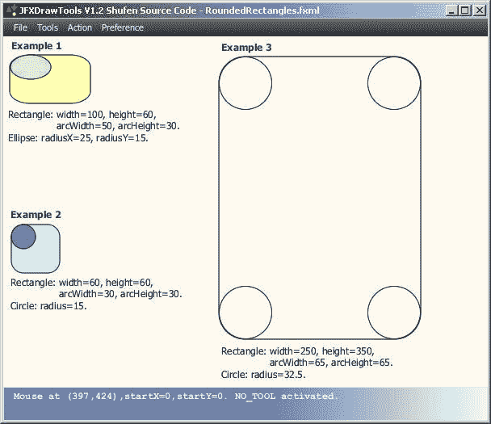

### 2.1.6 使用 `Polygon`（多边形）形状作为 `Next` 图标的视觉标识

不再使用图像作为下一个按钮的视觉标识，而是实例化了一个箭头形状的 `Polygon`。使用 `getPoints()` 方法获取一个类型为 `ObservableList<Double>` 的列表，然后使用 `Collection` 接口中定义的 `set` 工具类来操作列表内容。一组存储在 `Double` 类型值数组中的 `x` 和 `y` 坐标被添加到列表中，代表多边形的顶点。

`Color.WHITE` 是 `Color` 类中定义的许多静态字段之一，类型为 `Color`。我们选择它作为填充 `Polygon` 背景的颜色，并使用静态方法 `Color.web` 创建深蓝色来绘制 `Polygon` 的边框。

以下是完成这些任务的代码片段：

**列表 2-2.** 创建 `Polygon` 并设置 `fill` 和 `stroke` 属性的值：

```java
Polygon polygon = new Polygon();
Double[] dArray = {
     5.0, 2.0,
     22.0, 17.0,
     5.0, 32.0,
     5.0, 25.0,
     14.0, 17.0,
     5.0, 9.0};
polygon.getPoints().addAll(dArray);
polygon.setFill(Color.WHITE);
polygon.setStroke(Color.web("#436B8B"));
```

下面的快照显示了通过上述代码渲染的 `Polygon`：

**图 2-3.** 作为 `Next` 图标的多边形快照。

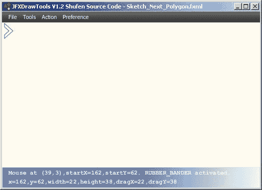

### 2.1.7 为 `Node` 设置 `Cursor` 属性的值

`cursor` 属性定义在 `Node` 类中，允许你更改此节点及其所有后代节点的鼠标光标。`Cursor` 类位于 `javafx.scene` 包中并继承自 `java.lang.Object`，定义了一些可用的鼠标光标作为 `Cursor` 类型的静态字段，例如 `CLOSED_HAND`、`CROSSHAIR`、`DEFAULT`、`HAND`、`OPEN_HAND`、`TEXT`、`WAIT` 等。如果没有显式设置 `cursor` 属性的值，则使用默认箭头鼠标光标。

我们使用 `Cursor.OPEN_HAND` 作为 `Next` 的鼠标光标。以下是代码片段：

```java
Group buttonGroup = new Group();
buttonGroup.setCursor(Cursor.OPEN_HAND);
```

### 2.1.8 使用便捷方法注册事件处理器来处理鼠标事件

`EventHandler<T extends Event>` 是一个继承自 `java.util.EventListener` 的接口，它定义了一个 `handle(T event)` 方法，当指定事件发生时会被调用。

我们将使用 `Node` 类提供的便捷方法来注册事件处理器，以处理鼠标事件类型，如 `MOUSE_CLICKED`、`MOUSE_ENTERED` 和 `MOUSE_EXITED`。这些是 `MouseEvent` 类中定义的 `EventTypes` 的一些静态字段，`MouseEvent` 是 `javafx.scene.input.InputEvent` 的子类。

以下是用于注册上述事件处理器的便捷方法：

```java
public final void setOnMouseClicked(EventHandler<? super
MouseEvent> value)
```

设置 `Node` 类中定义的 `OnMouseClicked` 属性的值，提供 `handle` 方法的实现，该方法在鼠标点击此节点时被调用。

```java
public final void setOnMouseEntered(EventHandler<? super
MouseEvent> value)
```

设置 `Node` 类中定义的 `OnMouseEntered` 属性的值，提供 `handle` 方法的实现，该方法在鼠标进入此节点时被调用。

```java
public final void setOnMouseExited(EventHandler<? super
MouseEvent> value)
```

设置 `Node` 类中定义的 `OnMouseExited` 属性的值，提供 `handle` 方法的实现，该方法在鼠标离开此节点时被调用。

以下是这些便捷方法的用法代码片段：

**列表 2-3.** 使用便捷方法注册事件处理器：

```java
// 注册鼠标点击事件处理器
buttonGroup.setOnMouseClicked(new EventHandler<MouseEvent>() {
    @Override
    public void handle(MouseEvent me) {
        System.out.println("Mouse clicked");
    }
});

// 注册鼠标进入事件处理器
// 当鼠标进入时改变按钮的外观
buttonGroup.setOnMouseEntered(new EventHandler<MouseEvent>() {
    @Override
    public void handle(MouseEvent me) {
        System.out.println("Mouse entered");
        rect.setFill(lgEntered);
        polygon.setFill(Color.web("#436B8B"));
        polygon.setStroke(Color.WHITE);
    }
});

// 注册鼠标离开事件处理器
// 当鼠标离开时恢复原始外观
buttonGroup.setOnMouseExited(new EventHandler<MouseEvent>() {
    @Override
    public void handle(MouseEvent me) {
        System.out.println("Mouse exited");
        rect.setFill(lg);
        polygon.setFill(Color.WHITE);
    }
});
```

### 2.1.9 `createButton()` 方法的完整源码

**列表 2-4.** 定义 `createButton()` 方法：

```java
/*
 * 使用 Polygon 作为背景，Group 作为容器，
 * Polygon 的大小为 25x35，
 * Polygon 的线宽为 2 像素，
 * 鼠标进入时改变外观。
 */
Node createButton() {
```

**导入语句：**

```java
import javafx.event.EventHandler;

import javafx.scene.cursor.Cursor;

import javafx.scene.input.MouseEvent;

import javafx.scene.layout.Group;

import javafx.scene.paint.Color;

import javafx.scene.paint.ColorGradient;

import javafx.scene.paint.Stop;

import javafx.scene.shape.Polygon;

import javafx.scene.shape.Rectangle;

import javafx.scene.Node;

import javafx.event;
```


```java
Group buttonGroup = new Group();
buttonGroup.setCursor(Cursor.OPEN_HAND);

// 注册鼠标点击事件处理器
buttonGroup.setOnMouseClicked(new EventHandler<MouseEvent>() {
    @Override
    public void handle(MouseEvent me) {
        System.out.println("Mouse clicked");
    }
});

// 注册鼠标进入事件处理器
// 当鼠标进入时改变按钮的外观
buttonGroup.setOnMouseEntered(new EventHandler<MouseEvent>() {
    @Override
    public void handle(MouseEvent me) {
        System.out.println("Mouse entered");
        rect.setFill(lgEntered);
        polygon.setFill(Color.web("#436B8B"));
        polygon.setStroke(Color.WHITE);
    }
});

// 注册鼠标离开事件处理器
// 当鼠标离开时恢复原始外观
buttonGroup.setOnMouseExited(new EventHandler<MouseEvent>() {
    @Override
    public void handle(MouseEvent me) {
        System.out.println("Mouse exited");
        rect.setFill(lg);
        polygon.setFill(Color.WHITE);
        polygon.setStroke(Color.WHITE);
    }
});

buttonGroup.getChildren().addAll(rect, polygon);
return buttonGroup;
```

### 2.1.10 为 `Node` 安装 `Tooltip`

`Tooltip` 类位于 `javafx.scene.control` 包中并继承自 `javafx.scene.control.PopupControl` 类，它是鼠标悬停在节点上时显示帮助信息的基础 UI 组件之一。

如果节点是 UI 控件之一（例如 `Button`），那么你可以为该节点设置 `javafx.scene.control.Control` 类定义的 `tooltip` 属性的值。以下是 `setTooltip` 方法：

```java
public final void setTooltip(Tooltip value)
```

由于 Next 按钮是一个自定义节点，并非派生自 `javafx.scene.control.Control` 类，我们将使用 `Tooltip` 类提供的 `install` 方法将 `Tooltip` 与 Next 按钮关联。以下是 `install` 方法：

```java
public static void install(Node node, Tooltip t)
```

***列表 2-5.*** 创建“下一个”按钮，安装 Tooltip 并将节点添加到图像渲染区域：

```java
final Node nextButton = createNextButton();

...

// 安装 tooltip

Tooltip t = new Tooltip("Next Image");

Tooltip.install(nextButton, t);

// 将下一个按钮添加到 stack pane

imageArea.getChildren().add(nextButton);
```

接下来的快照显示了位于默认位置（StackPane 的中心）的“下一个”按钮。

***图 2-4.*** 放置在默认位置的“下一个”按钮的截图。

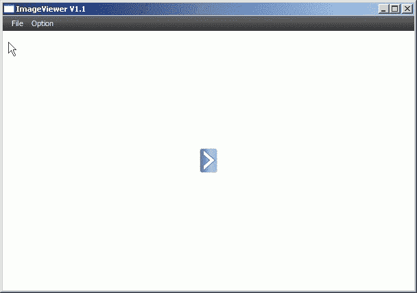

***图 2-5.*** 放置在默认位置的“下一个”按钮的截图，是在鼠标进入按钮时拍摄的，矩形的填充颜色渐变发生了变化，且安装的 tooltip 弹出。

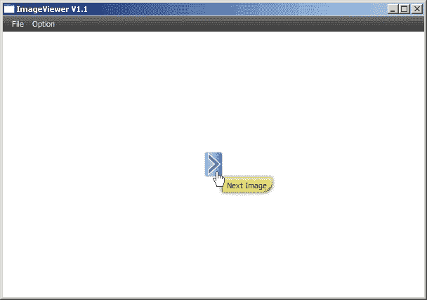

（图 2-1 到 2-5 是在 Windows XP 上使用 jdk1.7.0_25 的应用程序截图；其余是在 Windows 8.1 上使用 jdk1.8.0_66）

### 2.2 在 StackPane 中调整“下一个”按钮的默认位置

在本节中，我们将演示如何将 StackPane 的子节点放置在所需的位置。

StackPane 将所有子节点堆叠在一起，并将中心作为默认对齐方式。也就是说，默认情况下，StackPane 的子节点在面板的中心相互重叠。在 StackPane 的中心放置“下一个”按钮在我们的应用程序中不可行的。幸运的是，StackPane 提供了两个静态方法：

`public static void setAlignment(Node child, Pos value)`

`public static void setMargin(Node child, Insets value)`

允许我们调整单个子节点的位置。“下一个”按钮的理想位置是窗口的右侧，位于场景的可视边界内。以下代码段调整了“下一个”按钮的默认位置。

***导入语句：***

```java
import javafx.geometry.Insets;
import javafx.geometry.Pos;
```

***列表 2-6.*** 使用 StackPane 的静态方法 `setAlignment` 和 `setMargin` 来调整“下一个”按钮的默认位置：

```java
StackPane.setAlignment(nextButton, Pos.CENTER_RIGHT);
StackPane.setMargin(nextButton, new Insets(8));
```

接下来的快照显示了位于在应用程序窗口右侧的“下一个”按钮。

***图 2-6.*** 位于窗口右侧、在场景可视边界内的“下一个”按钮的截图。

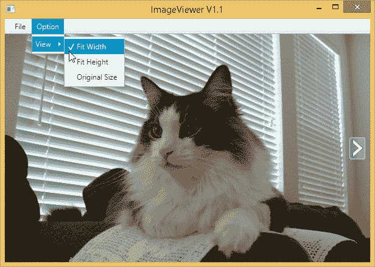

请记住，我们将 StackPane 的最小尺寸设置为 `(0, 0)`，以避免由于其子节点 ImageView 自动改变其大小。如果不这样做，每当加载并显示大于 StackPane 可视边界的图像时，关于“下一个”按钮的位置可能会出现复杂的情况。该设置简化了调整“下一个”按钮位置的解决方案。

下一个快照显示了按原始大小显示的大尺寸图像，超出 StackPane 边界的图像部分是不可见的。如果我们没有为 StackPane 设置最小尺寸，它的尺寸就会被内容放大，导致“下一个”按钮将落到可视边界之外。

***图 2-7.*** 动态调整应用程序窗口后，位于窗口右侧的“下一个”按钮的截图。

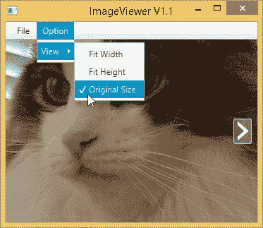

### 2.3 添加“上一个”按钮并调整其在 StackPane 中的位置

在本节中，添加“上一个”按钮并将其放在 StackPane 的左侧。对齐方式设置为 `Pos.CENTER_LEFT`，左边距设置为 8 像素。这些步骤与之前节描述的创建“下一个”按钮并调整其位置的过程类似。

***列表 2-7.*** 定义 `createPrevButton` 方法以创建“上一个”按钮：

```java
/**
 * 使用 Rectangle 作为背景，
 * 使用 Polygon 作为图标，
 * 使用 Group 作为容器，
 * 矩形的大小为 25 比 35，
 * 多边形的厚度为 8 像素，
 * 多边形的内内边距为 (2, 5, 2, 5)，
 * 当鼠标进入时更改矩形的外观。
 *
 * @return 
 */
Node createPrevButton() {
    // 创建一个组作为按钮
    Group buttonGroup = new Group();
    // 创建一个矩形形状作为背景
    final Rectangle rect = new Rectangle(0, 0, 25, 35);
    // 矩形的外观
    final LinearGradient lg = new LinearGradient(0, 0, 1, 0, true,
        CycleMethod.NO_CYCLE, new Stop[] {
        new Stop(0, Color.web("#87A7C6")),
        new Stop(0.4, Color.web("#A8B9D4")),
        new Stop(1, Color.web("#5173A8"))
    });
    rect.setFill(lg);
    rect.setStroke(Color.web("#ACD7FF"));
    rect.setArcHeight(6.5);
    rect.setArcWidth(6.5);
    // 鼠标进入时的外观观
    final LinearGradient lgEntered = new LinearGradient(0, 0, 1, 0, true,
        CycleMethod.NO_CYCLE, new Stop[] {
        new Stop(0, Color.web("#5173A8")),
        new Stop(0.6, Color.web("#A8B9D4")),
        new Stop(1, Color.web("#87A7C6"))
    });
    // 创建表示“”的多边形形状
    // 8像素厚度，内边距为 2, 5, 2, 5
    Polygon polygon = new Polygon();
    Double[] dArray = {
        19.0, 2.0, 2.0, 17.0,
        19.0, 32.0, 19.0, 25.0,
        10.0, 17.0, 19.0, 9.0
    };
    polygon.getPoints().addAll(dArray);
    polygon.setFill(Color.WHITE);
    polygon.setStroke(Color.web("#436B8"));
    // 设置光标
    buttonGroup.setCursor(Cursor.HAND);
    // 鼠标点击事件
    buttonGroup.setOnMouseClicked(new EventHandler<MouseEvent>() {
        @Override
        public void handle(MouseEvent me) {
            System.out.println("Mouse clicked");
        }
    });
    // 鼠标进入处理器
    // 鼠标进入时更改按钮的外观
    buttonGroup.setOnMouseEntered(new EventHandler<MouseEvent>() {
        @Override
        public void handle(MouseEvent me) {
            System.out.println("Mouse entered");
            rect.setFill(lgEntered);
            polygon.setFill(Color.WHITE);
        }
    });
    // 鼠标退出处理器
    // 鼠标退出时恢复原始外观
    buttonGroup.setOnMouseExited(new EventHandler<MouseEvent>() {
        @Override
        public void handle(MouseEvent me) {
            System.out.println("Mouse exited");
            rect.setFill(lg);
            polygon.setFill(Color.WHITE);
        }
    });
    buttonGroup.getChildren().addAll(rect, polygon);
    return buttonGroup;
}
```

创建“上一个”按钮的新添加代码在以下代码段中加粗显示。

***列表 2-8.*** 添加到 ImageViewer V1.1 入点的创建“上一个”按钮的代码：

```java
final Node nextButton = createNextButton();
final Node prevButton = createPrevButton();
...
public void start(final Stage stage) {
    ...
    // 为 nextButton 安装 tooltip
    Tooltip t = new Tooltip("Next Image");
    Tooltip.install(nextButton, t);
    // 为 prevButton 安装 tooltip
    Tooltip t2 = new Tooltip("Previous Image");
    Tooltip.install(prevButton, t2);
    // 将“下一个”按钮的位置调整到 StackPane 右侧
    StackPane.setAlignment(nextButton, Pos.CENTER_RIGHT);
    StackPane.setMargin(nextButton, new Insets(8));
    // 将“上一个”按钮的位置调整到 StackPane 左侧
    StackPane.setAlignment(prevButton, Pos.CENTER_LEFT);
    StackPane.setMargin(prevButton, new Insets(8));
    // 将“下一个”按钮和“上一个”按钮添加到 stack pane
    imageArea.getChildren().addAll(nextButton, prevButton);
    ...
}
```

***图 2-8.*** 带有“下一个”按钮和“上一个”按钮的 ImageViewer 截图，位于 StackPane 的可视边界内。

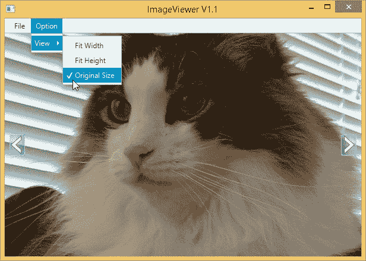

### 2.4 实现点击事件处理器

在使用方法注册事件处理器处理鼠标事件节中，我们演示了如何为点击事件注册事件处理器。在本节中，我们将注册事件处理器并实现点击按钮时调用的 `handle` 方法。如果点击“下一个”按钮，将加载当前加载文件的下一个图像；如果点击“上一个”按钮，将加载当前加载文件之前的图像。

在正确执行这些任务之前，我们将配置 FileChooser 只显示扩展名符合指定过滤器的文件，并建立当前目录存在的文件列表，每当从 FileChooser 的文件打开框打开图像文件时创建该列表。

#### 2.4.1 配置 FileChooser

要配置 FileChooser，我们使用 `FileChooser.ExtensionFilter` 类来定义文件扩展名过滤器，以显示以下扩展名文件：“*.bmp”、“*.gif”、“*.jpeg”、“*.jpg”、“*.png”。

调用 FileChooser 类提供的 `getExtensionFilters` 方法获取类型为 `ObservableList<FileChooser.ExtensionFilter>` 的列表，然后使用 `addAll` 方法添加所需的任意过滤器。我们定义了一个 FileUtils 类来解决这个问题。代码如下：

***列表 2-9.*** 定义 `FileUtils` 类，提供静态方法 `configure` 为给定的 `FileChooser` 添加文件扩展名过滤器：

```java
package imageviewer;

import javafx.stage.FileChooser;

/**
 * File Name: FileUtils.java
 * (in directory: ImageViewer1.1/src/example4/imageviewer/)
 *
 * @author Shufen Kuo
 */
public class FileUtils {
    /**
     * 定义文件扩展名过滤器以过滤支持的图像文件，
     * 匹配扩展名为文件：
     * .bmp, .gif, .jpeg, .jpg 和 .png
     * @param fileChooser 
     */
    static void configure(FileChooser fileChooser) {
        fileChooser.getExtensionFilters().addAll(
```

`new FileChooser.ExtensionFilter("All Images", "*.bmp", "*.gif", "*.jpeg", "*.jpg", "*.png")`


```java
new FileChooser.ExtensionFilter("All Files", "*.\*"),
new FileChooser.ExtensionFilter("BMP", "\*.bmp"),
new FileChooser.ExtensionFilter("GIF", "\*.gif"),
new FileChooser.ExtensionFilter("JPEG", "\*.jpeg"),
new FileChooser.ExtensionFilter("JPG", "\*.jpg"),
new FileChooser.ExtensionFilter("PNG", "\*.png"));

// 设置 "." 为默认目录
fileChooser.setInitialDirectory(new File("."));
}
```

我们在上述代码中使用的`FileChooser.ExtensionFilter`构造函数接受两个参数：第一个是弹出文件打开对话框时显示在“文件类型：”字段中的描述，第二个是一个变长的`String`类型参数，每个参数都是一个符合正则表达式语法的字符串。

在`FileUtils.configure`方法内部，除了添加文件扩展过滤器外，我们还将当前目录设置为初始目录：

```java
fileChooser.setInitialDirectory(new File("."));
```

`configure`方法是定义在`FileUtils`类中的静态方法，在此处被调用：

```java
// 创建文件选择器
final FileChooser fileChooser = new FileChooser();
fileChooser.setTitle("Open an Image File");
FileUtils.configure(fileChooser);
```

`FileChooser`的功能和外观取决于操作系统。

图 2-9 显示了 Windows XP 中的`FileChooser`，图 2-10 显示了 Windows 8.1 中的`FileChooser`。

**图 2-9.** 文件打开对话框（在 Windows XP 中）的截图，扩展过滤器列表中添加的第一个过滤器“All Images”在点击组合框时会显示在“文件类型：”字段中。

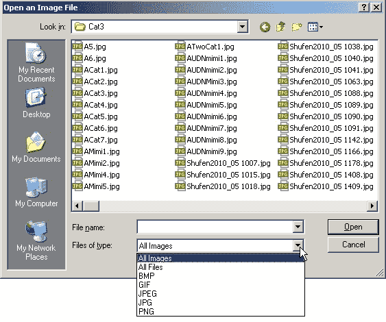

**图 2-10.** 文件打开对话框（在 Windows 8.1 中）的截图。当点击某项时，在代码中与正则表达式“*.gif”关联的名称“GIF”将显示在文件名后面的字段中。

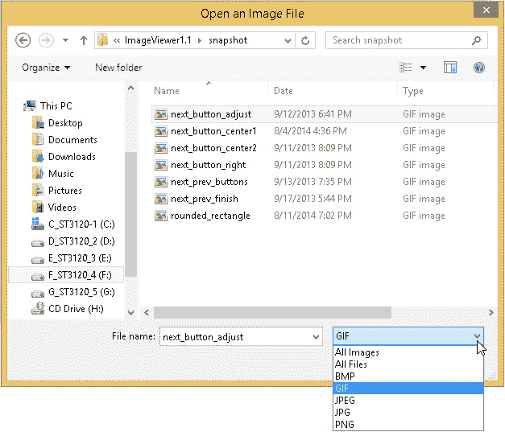

通常，应用程序用户会希望`FileChooser`能记住它上次访问的目录。以下是实现方法：

**列表 2-10.** 在为`Load`菜单项注册的事件处理器的`handle`方法中，将上次访问的目录设置为`FileChooser`的初始目录：

```java
// 为菜单项 Load 添加动作
load.setOnAction(new EventHandler<ActionEvent>() {
    @Override
    public void handle(ActionEvent e) {
        // 打开 FileChooser 对话框
        File file = fileChooser.showOpenDialog(stage);
        if (file != null) {
            // 设置上次访问目录为初始目录
            // File lastDir = file.getParentFile();
            // fileChooser.setInitialDirectory(lastDir);
            String url = file.toURI().toString();
            Image image = new Image(url);
            imageView.setImage(image);
        }
    }
});
```

### 2.4.2 创建`List Iterator`以遍历当前目录下的现有文件

为了在从文件打开对话框打开图像文件时建立当前目录存在的文件列表，我们将使用 JDK 7 引入的`java.nio.file`包提供的 API。

`java.nio.file.Files`类提供的以下静态方法：

`static DirectoryStream<Path> newDirectoryStream(Path dir, String glob)`打开给定的目录并返回一个`DirectoryStream<Path>`。`DirectoryStream`类型是一个扩展了`Iterable`的接口，因此可以使用`for-each`语法来遍历目录中的文件。

以下是读取目录并将文件逐一添加到列表的代码片段：

```java
List<Path> list = new ArrayList<>();

try (DirectoryStream<Path> stream = Files.newDirectoryStream(dir, "*.{bmp,gif,jpeg,jpg,png}")) {
    for (Path entry : stream) {
        // 忽略目录内部的子目录
        if (Files.isDirectory(entry, LinkOption.NOFOLLOW_LINKS))
            continue;

        list.add(entry);
    }
} catch (DirectoryIteratorException de) {
    throw de.getCause();
}
```

以下是定义在`FileUtils`类中的静态方法`listIterator`的完整代码。它读取目录、将文件逐一添加到列表中、按字母顺序排序文件，并返回一个指向目录中下一个可用文件的`ListIterator`。该方法定义在`FileUtils`类中。

**导入语句：**

```java
import java.io.IOException;
import java.nio.file.DirectoryIteratorException;
import java.nio.file.DirectoryStream;
import java.nio.file.Files;
import java.nio.file.LinkOption;
import java.nio.file.Path;
import java.util.ArrayList;
import java.util.Collections;
import java.util.Comparator;
import java.util.List;
import java.util.ListIterator;
import javafx.stage.FileChooser;
```

**列表 2-11.** 在`FileUtils`类中定义的静态方法`listIterator`，读取目录，将文件逐一添加到列表，按字母顺序排序文件，并返回一个指向目录中下一个可用文件的`ListIterator`。

```java
/**
 * @param file
 * @return ListIterator 实例
 * @throws IOException
 */
static ListIterator<Path> listIterator(Path file) throws IOException {
    Path dir = file.getParentFile();
    List<Path> list = new ArrayList<>();

    try (DirectoryStream<Path> stream = Files.newDirectoryStream(dir, "*.{bmp,gif,jpeg,jpg,png}")) {
        for (Path entry : stream) {
            // 忽略目录内部的子目录
            if (Files.isDirectory(entry, LinkOption.NOFOLLOW_LINKS))
                continue;

            list.add(entry);
        }
    } catch (DirectoryIteratorException de) {
        throw de.getCause();
    }

    // 按字典顺序排序列表
    Collections.sort(list, new Comparator<Path>() {
        public int compare(Path o1, Path o2) {
            return o1.getFileName().compareTo(o2.getFileName());
        }
    });

    int index = 0; // 选中文件的搜索索引
    for (Path entry : list) {
        if (entry.equals(file)) break;
        index++;
    }

    if (index == list.size()) {
        // 文件不在列表中
        index = 0;
    }

    return list.listIterator(index);
}
```

### 2.4.3 在`ImageViewer`类中定义属性

在本节中，我们将描述`FileUtils.listIterator(Path file)`方法的使用。在本节中，我们将演示如何在类中定义属性。在应用程序入口类`ImageViewer`中，我们定义了以下三个属性：

`listIterator`

这是一个`ObjectProperty<ListIterator<Path>>`类型。`listIterator(Path file)`方法是定义在`FileUtils`类中的静态方法，从`Load`菜单项的处理器中调用，以获取`ListIterator`实例并设置为该属性的值。

`lastClickedButton`

这是一个`StringProperty`类型，用于跟踪上次点击的按钮，以便我们能够正确移动`listIterator`属性中指定的`ListIterator`游标。你将看到`lastClickedButton`属性的值（NEXT或PREVIOUS）如何影响`Next`按钮和`Previous`按钮鼠标点击事件处理器中对`next()`方法和`previous()`方法的调用。

`curImage`

这是一个`ObjectProperty<Image>`类型，并绑定到`ImageView`的`image`属性，该属性的值为当前加载的图像。

以下是定义这些属性的代码片段：

**列表 2-12.** 在`ImageViewer`类中定义属性：

```java
// 用于遍历当前选择目录中的文件
final ObjectProperty<ListIterator<java.nio.file.Path>> listIterator = new SimpleObjectProperty<>();

final String NEXT = "NEXT";
final String PREVIOUS = "PREVIOUS";

// 用于跟踪上次点击的按钮
final StringProperty lastClickedButton = new SimpleStringProperty();
final ObjectProperty<Image> curImage = new SimpleObjectProperty();
```

为此属性创建一个单向绑定。参数`observable`的类型为`ObservableValue`。`ObjectProperty`和`StringProperty`都实现了`Property`，它是`ObservableValue`的子接口。

以下是使用`bind`方法为`ImageView`的图像属性创建绑定的代码片段：

**列表 2-13.** 将`ImageView`的`image`属性绑定到`curImage`属性：

```java
final ImageView imageView = new ImageView();
imageView.imageProperty().bind(curImage);
```

一旦创建绑定，当`curImage`属性的值发生变化，`ImageView`中`image`属性的值也会随之改变。

可以使用`set`方法或`setValue`方法为属性设置值。以下是从事件处理器的`handle`方法中提取的代码片段，该处理器注册用于处理`Load`菜单项的`ActionEvent`：

**列表 2-14.** 为`listIterator`属性、`curImage`属性和`lastClickedButton`属性赋值：

```java
ListIterator<java.nio.file.Path> it = FileUtils.listIterator(file);
listIterator.set(it);
file = it.next().toFile();
String url = file.toURI().toString();
curImage.set(new Image(url));
lastClickedButton.setValue(NEXT);
```

请注意，当发生以下操作时，`curImage`属性的值会被设置：

- 从`FileChooser`的文件打开对话框中加载选定的图像。
- 点击`Next`按钮时加载下一个图像。
- 点击`Previous`按钮时加载上一个图像。

正如我们上面提到的，一旦`curImage`属性的值发生变化，`ImageView`的`image`属性的值也会随之改变。

在`ImageViewer`类（应用程序入口）中进行的代码更改如下粗体显示所示：

**导入语句：**

```java
import java.io.IOException;
import java.util.ListIterator;
import javafx.beans.property.ObjectProperty;
import javafx.beans.property.SimpleObjectProperty;
import javafx.beans.property.SimpleStringProperty;
import javafx.beans.property.StringProperty;
```

**列表 2-15.** 添加到`ImageViewer`类（应用程序入口）的代码，以粗体显示：


## 代码示例

```java
public class ImageViewer extends Application {
    ...

    // // 用于遍历当前选定目录中的文件
    final ObjectProperty<ListIterator<java.nio.file.Path>> listIterator = new SimpleObjectProperty<>();
    final String NEXT = "NEXT";
    final String PREVIOUS = "PREVIOUS";
    // // 用于跟踪最后点击的按钮
    final StringProperty lastClickedButton = new SimpleStringProperty();
    final ObjectProperty<Image> curImage = new SimpleObjectProperty<>();

    ...

    @Override
    public void start(final Stage stage) {
        ...
        // 创建图像视图，添加到图像区域
        final ImageView imageView = new ImageView();
        imageView.imageProperty().bind(curImage);
        imageView.setPreserveRatio(true);
        imageArea.getChildren().add(imageView);
        ...
        // 为 Load 菜单项添加动作
        load.setOnAction(new EventHandler<ActionEvent>() {
            @Override
            public void handle(ActionEvent e) {
                // 打开 FileChooser 对话框
                File file = fileChooser.showOpenDialog(stage);
                if (file != null) {
                    // 设置最后访问的目录为初始目录
                    File lastDir = file.getParentFile();
                    fileChooser.setInitialDirectory(lastDir);
                    // // 当从 FileChooser 打开文件时创建列表迭代器
                    try {
                        ListIterator<java.nio.file.Path> it = FileUtils.listIterator(file);
                        listIterator.set(it);
                        file = it.next().toFile();
                        String url = file.toURI().toString();
                        curImage.set(new Image(url));
                        // 设置为 NEXT，因为迭代器中的光标指向
                        // 下一个可用文件
                        lastClickedButton.setValue(NEXT);
                    } catch (IOException ex) {}
                }
            }
        });
    }
```

**Listing 2-16.** Next 按钮的鼠标点击事件处理器代码变为：

```java
Node createNextButton() {
    // 创建一个组作为按钮
    Group buttonGroup = new Group();
    ...
    // 为 nextButton 注册鼠标点击事件处理器
    buttonGroup.setOnMouseClicked(new EventHandler<MouseEvent>() {
        @Override
        public void handle(MouseEvent me) {
            // // 获取迭代器
            ListIterator<java.nio.file.Path> iterator = listIterator.get();
            if (iterator != null && iterator.hasNext()) {
                java.nio.file.Path path = iterator.next();
                if (lastClickedButton.get().equals(PREVIOUS)) {
                    // 如果最后点击的按钮是 prevButton
                    // next() 的第一次调用是当前图像，
                    // 必须将光标向前移动一步.
                    if (iterator.hasNext())
                        path = iterator.next();
                    else
                        return;
                }
                System.out.format("Next button clicked: %s%n", path.getFileName());
                String url = path.toUri().toString();
                curImage.set(new Image(url));
                lastClickedButton.set(NEXT);
            }
        }
    });
}
```

**Listing 2-17.** Previous 按钮的鼠标点击事件处理器代码变为：

```java
Node createPrevButton() {
    // 创建一个组作为按钮
    Group buttonGroup = new Group();
    ...
    // 为 prevButton 注册鼠标点击事件处理器
    buttonGroup.setOnMouseClicked(new EventHandler<MouseEvent>() {
        @Override
        public void handle(MouseEvent me) {
            // // 获取迭代器
            ListIterator<java.nio.file.Path> iterator = listIterator.get();
            if (iterator != null && iterator.hasNext()) {
                java.nio.file.Path path = iterator.next();
                if (lastClickedButton.get().equals(NEXT)) {
                    // 如果最后点击的按钮是 nextButton
                    // next() 的第一次调用是当前图像，
                    // 必须将光标向前移动一步.
                    if (iterator.hasNext())
                        path = iterator.next();
                    else
                        return;
                }
                System.out.format("Prev button clicked: %s%n", path.getFileName());
                String url = path.toUri().toString();
                curImage.set(new Image(url));
                lastClickedButton.set(PREVIOUS);
            }
        }
    });
}
```

**Listing 2-18.** FileUtils 中的鼠标点击事件处理器：

```java
package imageviewer;

import java.io.File;
import java.io.IOException;
import java.nio.file.DirectoryIteratorException;
import java.nio.file.DirectoryStream;
import java.nio.file.Files;
import java.nio.file.LinkOption;
import java.nio.file.Path;
import java.util.ArrayList;
import java.util.Collections;
import java.util.Comparator;
import java.util.List;
import java.util.ListIterator;
import javafx.stage.FileChooser;

/**
 * FileUtils.java
 * @author Shufen
 */
public class FileUtils {

    /**
     * 定义支持的图像扩展过滤器
     * @param fileChooser
     */
    static void configure(FileChooser fileChooser) {
        fileChooser.getExtensionFilters().addAll(
            new FileChooser.ExtensionFilter("All Files", "*.*"),
            new FileChooser.ExtensionFilter("BMP", "*.bmp"),
            new FileChooser.ExtensionFilter("GIF", "*.gif"),
            new FileChooser.ExtensionFilter("JPEG", "*.jpeg"),
            new FileChooser.ExtensionFilter("PNG", "*.png")
        );
        // 设置 "." 为默认目录
        fileChooser.setInitialDirectory(new File("."));
    }

    /**
     * 使用 Files.newDirectoryStream(Path, String) 读取目录
     * 将文件添加到列表中，返回指向指定文件的迭代器，
     * 即 next() 的第一次调用返回指定的文件，
     * 列表按字母顺序排序，匹配模式 "*.bmp,gif,jpg,png}",
     *
     * @param file
     * @return
     * @throws IOException
     */
    static ListIterator<Path> listIterator(Path file) throws IOException {
        Path dir = file.getParent();
        List<Path> list = new ArrayList<>();
        try (DirectoryStream<Path> stream = Files.newDirectoryStream(dir, "*.{bmp,gif,jpg,png}")) {
            for (Path entry : stream) {
                // 忽略目录内的子目录
                if (Files.isDirectory(entry, LinkOption.NOFOLLOW_LINKS)) {
                    continue;
                }
                list.add(entry);
            }
        } catch (DirectoryIteratorException de) {
            throw de.getCause();
        }

        int index = 0; // 当前文件在列表中的索引
        // 搜索指定文件的索引
        for (Path entry : list) {
            if (entry.equals(file)) break;
            index++;
        }
        if (index == list.size()) {
            // 文件不在列表中
            index = 0;
        }
        return list.listIterator(index);
    }
}
```

```java
package imageviewer;

import java.io.File;
import java.io.IOException;
import java.util.ListIterator;
import javafx.application.Application;
import javafx.application.Platform;
import javafx.beans.property.ObjectProperty;
import javafx.beans.property.SimpleObjectProperty;
import javafx.beans.property.SimpleStringProperty;
import javafx.beans.property.StringProperty;
import javafx.beans.value.ChangeListener;
import javafx.beans.value.ObservableValue;
import javafx.event.ActionEvent;
import javafx.event.EventHandler;
import javafx.geometry.Insets;
import javafx.geometry.Pos;
import javafx.scene.Cursor;
import javafx.scene.Group;
import javafx.scene.Node;
import javafx.scene.Scene;
import javafx.scene.control.Menu;
import javafx.scene.control.MenuBar;
import javafx.scene.control.MenuItem;
import javafx.scene.control.RadioMenuItem;
import javafx.scene.control.Toggle;
import javafx.scene.control.ToggleGroup;
import javafx.scene.control.Tooltip;
import javafx.scene.image.Image;
import javafx.scene.image.ImageView;
import javafx.scene.input.MouseEvent;
import javafx.scene.layout.BorderPane;
import javafx.scene.layout.StackPane;
import javafx.scene.paint.Color;
import javafx.scene.paint.CycleMethod;
import javafx.scene.paint.LinearGradient;
import javafx.scene.paint.Stop;
import javafx.scene.shape.Polygon;
import javafx.scene.shape.Rectangle;
import javafx.stage.FileChooser;
import javafx.stage.Stage;

/**
 * 文件名：ImageViewer.java V1.1
 * (目录：ImageViewer1.1/src/example4/imageviewer/)
 * 此应用程序创建了一个 BorderPane 作为场景的根节点，
 */
```


在`BorderPane`的中心添加了一个`StackPane`。

场景的初始大小设置为`600x400`，`StackPane`的大小将自动适应场景的大小。当用户调整窗口大小时，`StackPane`将随之调整大小。

在`BorderPane`顶部添加一个菜单栏。创建“文件”菜单，并使用`FileChooser`的“打开”对话框来选择图片文件，在图像渲染区域加载并显示图片。

创建包含“视图”子菜单的“选项”菜单，让用户选择图片标准：自适应宽度（`Fit Width`）、自适应高度（`Fit Height`）或默认选项原始大小（`Original Size`）。

使用`bind`和`unbind`方法调整图像查看大小：将`ImageView`的`fitWidth`/`fitHeight`属性绑定到`scene`的`width`/`height`属性上，这样每当场景调整大小时，`ImageView`的大小将自动更改。

在场景中添加“下一页”和“上一页”按钮，在加载第一张图片后，用户可以使用这些按钮查看下一张图片或预览图片，而无需再次打开`FileChooser`。调整“下一页”按钮在`StackPane`中的默认位置，添加“上一页”按钮并调整其在`StackPane`中的位置，为“下一页”和“上一页”按钮实现鼠标点击事件处理程序。

```java
/**
 * @author Shufen Kuo
 */
public class ImageViewer extends Application {

    final Node nextButton = createNextButton();
    final Node prevButton = createPrevButton();

    // 创建切换组
    final ToggleGroup groupOption = new ToggleGroup();
    final String FIT_WIDTH = "自适应宽度";
    final String FIT_HEIGHT = "自适应高度";
    final String ORIGINAL_SIZE = "原始大小";

    // 用于遍历当前选择目录下的文件
    final ObjectProperty<ListIterator<java.nio.file.Path>> listIterator = new SimpleObjectProperty<>();
    final String NEXT = "下一个";
    final String PREVIOUS = "上页";

    // 用于记录最后点击的按钮
    final StringProperty lastClickedButton = new SimpleStringProperty();
    final ObjectProperty<Image> curImage = new SimpleObjectProperty<>();

    @Override
    public void start(final Stage stage) {
        BorderPane rootPane = new BorderPane();
        final StackPane imageArea = new StackPane();

        // 设置 StackPane 的最小大小以避免在加载大图片时调整大小
        imageArea.setMinSize(0, 0);
        rootPane.setCenter(imageArea);

        // 创建图像视图，并添加到图像区域
        final ImageView imageView = new ImageView();
        imageView.imageProperty().bind(curImage);
        imageView.setPreserveRatio(true);
        imageArea.getChildren().add(imageView);

        final Scene scene = new Scene(rootPane, 600, 400);

        imageArea.widthProperty().addListener(new ChangeListener<Object>() {
            public void changed(ObservableValue o, Object oldVal, Object newVal) {
                System.out.format("imageArea width changed from %.1f to %.1f%n", oldVal, newVal);
            }
        });

        imageArea.heightProperty().addListener(new ChangeListener<Object>() {
            public void changed(ObservableValue o, Object oldVal, Object newVal) {
                System.out.format("imageArea height changed from %.1f to %.1f%n", oldVal, newVal);
            }
        });

        // 添加菜单栏
        final MenuBar menuBar = new MenuBar();
        Menu menuFile = new Menu("文件");
        MenuItem load = new MenuItem("加载");
        MenuItem exit = new MenuItem("退出");
        menuFile.getItems().addAll(load, exit);
        rootPane.setTop(menuBar);

        // 退出项的操作
        exit.setOnAction(new EventHandler<ActionEvent>() {
            @Override
            public void handle(ActionEvent e) {
                Platform.exit();
            }
        });

        // 加载项的操作
        load.setOnAction(new EventHandler<ActionEvent>() {
            @Override
            public void handle(ActionEvent e) {
                FileChooser fileChooser = new FileChooser();
                fileChooser.setTitle("打开图片");
                File file = fileChooser.showOpenDialog(stage);
                if (file != null) {
                    try {
                        curImage.set(new Image(file.toURI().toString()));
                    } catch (IOException ex) {
                        ex.printStackTrace();
                    }
                }
            }
        });

        // 创建“视图”子菜单
        Menu menuView = new Menu("视图");
        RadioMenuItem fitWidth = new RadioMenuItem("自适应宽度");
        RadioMenuItem fitHeight = new RadioMenuItem("自适应高度");
        RadioMenuItem original = new RadioMenuItem("原始大小");
        fitWidth.setToggleGroup(groupOption);
        fitHeight.setToggleGroup(groupOption);
        original.setToggleGroup(groupOption);
        menuView.getItems().addAll(fitWidth, fitHeight, original);
        menuFile.getItems().add(menuView);

        // 添加选择变化的监听器
        groupOption.selectedItemProperty().addListener(new ChangeListener<Object>() {
            @Override
            public void changed(ObservableValue o, Object oldVal, Object newVal) {
                if (newVal == null) return;
                if (newVal == fitWidth) {
                    imageArea.widthProperty().unbind();
                    imageArea.widthProperty().bind(scene.widthProperty());
                } else if (newVal == fitHeight) {
                    imageArea.heightProperty().unbind();
                    imageArea.heightProperty().bind(scene.heightProperty());
                } else if (newVal == original) {
                    imageArea.widthProperty().unbind();
                    imageArea.heightProperty().unbind();
                }
            }
        });

        // 初始选择
        original.setSelected(true);

        stage.setTitle("ImageViewer V1.1");
        stage.setScene(scene);
        stage.show();
    }

    // 代码中未完全实现的按钮占位方法
    private Node createNextButton() { return new Group(); }
    private Node createPrevButton() { return new Group(); }
}
```

多边形的厚度为`8`像素，多边形的内边为`(2, 2, 2, 5)`，当鼠标进入时改变矩形的外观。

```java
/**
 * @return
 */
Node createNextButton() {
    // 创建一个组作为按钮
    Group buttonGroup = new Group();

    // 创建一个矩形作为背景
    final Rectangle rect = new Rectangle(0, 0, 25, 35);

    // 矩形的外观
    final LinearGradient lg = new LinearGradient(0, 0, 1, 0, true,
            CycleMethod.NO_CYCLE, new Stop[][]{
            new Stop(0, Color.web("#5173A8")),
            new Stop(0.6, Color.web("#A8B9D4")),
            new Stop(1, Color.web("#87A7C6"))});
    rect.setFill(lg);
    rect.setStroke(Color.web("#ACD7FF"));
    rect.setArcHeight(6.5);
    rect.setArcWidth(6.5);

    // 鼠标进入按钮时的外观
    final LinearGradient lgEntered = new LinearGradient(0, 0, 1, 0, true,
            CycleMethod.NO_CYCLE, new Stop[][]{
            new Stop(0, Color.web("#87A7C6")),
            new Stop(0.4, Color.web("#A8B9D4")),
            new Stop(1, Color.web("#5173A8"))});

    // 创建一个表示“下一个”视觉符号的多边形形状
    // 8 像素厚度，内边为 2, 2, 2, 5
    final Polygon polygon = new Polygon();
    Double[] dArray = {
            5.0, 2.0,
            22.0, 17.0,
            5.0, 32.0,
            5.0, 25.0,
            14.0, 17.0,
            5.0, 9.0};
    polygon.getPoints().addAll(dArray);
    polygon.setFill(Color.WHITE);
    polygon.setStroke(Color.web("#436B8B"));

    // 设置光标
    buttonGroup.setCursor(Cursor.OPEN_HAND);

    // 为 nextButton 注册鼠标点击事件处理器
    buttonGroup.setOnMouseClicked(new EventHandler<MouseEvent>() {
        @Override
        public void handle(MouseEvent me) {
            // 获取迭代器
            ListIterator<java.nio.file.Path> iterator = listIterator.get();
            if (iterator != null && iterator.hasNext()) {
                java.nio.file.Path path = iterator.next();
                if (lastClickedButton.get().equals(PREVIOUS)) {
                    // 如果上次点击的按钮是 prevButton
                    // 第一次调用 next() 获取的是当前图片
                    // 必须将光标向前移动
                    if (iterator.hasNext())
                        path = iterator.next();
                    else
                        return;
                }
                System.out.format("Next button clicked: %s%n", path.getFileName());
                String url = path.toUri().toString();
                curImage.set(new Image(url));
                lastClickedButton.set(NEXT);
            }
        }
    });

    // 注册鼠标进入事件处理器
    // 当鼠标进入时改变按钮的外观
    buttonGroup.setOnMouseEntered(new EventHandler<MouseEvent>() {
        @Override
        public void handle(MouseEvent me) {
            System.out.println("Mouse entered");
            rect.setFill(lgEntered);
            polygon.setFill(Color.web("#436B8B"));
            polygon.setStroke(Color.WHITE);
        }
    });

    // 注册鼠标离开事件处理器
    // 当鼠标离开时恢复原始外观
}
```


`buttonGroup.setOnMouseExited(new EventHandler<MouseEvent>() {`

```
    @Override
    public void handle(MouseEvent me) {
        System.out.println("Mouse exited");
        rect.setFill(lg);
        polygon.setFill(Color.WHITE);
        polygon.setStroke(Color.web("#436B8B"));
    }
});
```

`buttonGroup.getChildren().addAll(rect, polygon);`

`return buttonGroup;`

`}`

```
/**
 * 使用矩形作为背景、多边形作为图标、组作为容器创建上一个按钮，
 * 矩形的大小为 25  35，
 * 多边形的厚度为 8 像素，
 * 多边形的内边为 (2, 2, 2, 5)，
 * 当鼠标进入时改变矩形的外观。
 *
 * @return
 */
```

`Node createPrevButton() {`

```
    // 创建一个组作为按钮
    Group buttonGroup = new Group();
    // 创建一个矩形作为背景
    final Rectangle rect = new Rectangle(0, 0, 25, 35);
    // 矩形的外观
    final LinearGradient lg = new LinearGradient(0, 0, 1, 0, true,
            CycleMethod.NO_CYCLE, new Stop[][]{
            new Stop(0, Color.web("#87A7C6")),
            new Stop(0.4, Color.web("#A8B9D4")),
            new Stop(1, Color.web("#5173A8"))});
    rect.setFill(lg);
    rect.setStroke(Color.web("#ACD7FF"));
    rect.setArcHeight(6.5);
    rect.setArcWidth(6.5);
    // 鼠标进入按钮时的外观
    final LinearGradient lgEntered = new LinearGradient(0, 0, 1, 0, true,
            CycleMethod.NO_CYCLE, new Stop[][]{
            new Stop(0, Color.web("#87A7C6")),
            new Stop(0.4, Color.web("#A8B9D4")),
            new Stop(1, Color.web("#5173A8"))});
    // 创建一个表示“上一个”视觉符号的多边形形状
    // 8 像素厚度，内边为 2, 2, 2, 5
    final Polygon polygon = new Polygon();
    Double[] dArray = {
            5.0, 2.0,
            22.0, 17.0,
            5.0, 32.0,
            5.0, 25.0,
            14.0, 17.0,
            5.0, 9.0};
    polygon.getPoints().addAll(dArray);
    polygon.setFill(Color.WHITE);
    polygon.setStroke(Color.web("#436B8B"));
    // 设置光标
    buttonGroup.setCursor(Cursor.OPEN_HAND);
    // 为 prevButton 注册鼠标点击事件处理器
    buttonGroup.setOnMouseClicked(new EventHandler<MouseEvent>() {
        @Override
        public void handle(MouseEvent me) {
            // 获取迭代器
            ListIterator<java.nio.file.Path> iterator = listIterator.get();
            if (iterator != null && iterator.hasNext()) {
                java.nio.file.Path path = iterator.next();
                if (lastClickedButton.get().equals(NEXT)) {
                    // 如果上次点击的按钮是 nextButton
                    // 第一次调用 previous() 获取的是当前图片
                    // 必须将光标向后移动
                    if (iterator.hasNext())
                        path = iterator.next();
                    else
                        return;
                }
                System.out.format("Prev button clicked: %s%n", path.getFileName());
                String url = path.toUri().toString();
                curImage.set(new Image(url));
                lastClickedButton.set(PREVIOUS);
            }
        }
    });
    // 注册鼠标进入事件处理器
    // 当鼠标进入时改变按钮的外观
    buttonGroup.setOnMouseEntered(new EventHandler<MouseEvent>() {
        @Override
        public void handle(MouseEvent me) {
            System.out.println("Mouse entered");
            rect.setFill(lgEntered);
            polygon.setFill(Color.web("#436B8B"));
            polygon.setStroke(Color.WHITE);
        }
    });
    // 注册鼠标离开事件处理器
    // 当鼠标离开时恢复原始外观
    buttonGroup.setOnMouseExited(new EventHandler<MouseEvent>() {
        @Override
        public void handle(MouseEvent me) {
            System.out.println("Mouse exited");
            rect.setFill(lg);
            polygon.setFill(Color.WHITE);
            polygon.setStroke(Color.web("#436B8B"));
        }
    });
    buttonGroup.getChildren().addAll(rect, polygon);
    return buttonGroup;
}
```

`Rectangle`

`Cursor` 类，位于 `javafx.scene` 包并继承自 `java.lang.Object`，它通过 `Cursor` 类型的静态字段定义了一些实用的鼠标光标，例如 `CLOSED_HAND`、`CROSSHAIR`、`HAND`、`OPEN_HAND`、`TEXT`、`WAIT` 等。

（参见 `Node` 的 `Cursor` 属性设置 Set Value of Cursor Property 章节）

`EventHandler<T extends Event>` 是一个继承自 `java.util.EventListener` 的接口，它定义了一个 `handle(T event)` 方法，在指定的事件发生时被调用。

（参见 使用方便方法注册事件处理器来处理鼠标事件 Use Convenience Methods to Register... 章节）

`MouseEvent` 位于 `javafx.scene.input` 包，是 `javafx.scene.input.InputEvent` 的子类。它定义了多种事件类型，如 `MOUSE_CLICKED`、`MOUSE_DRAGGED`、`MOUSE_ENTERED`、`MOUSE_EXITED`、`MOUSE_MOVED`、`MOUSE_PRESSED`、`MOUSE_RELEASED` 等，并提供了如 `getX()`、`getY()` 等方法，用于获取事件发生时鼠标光标的位置。

（参见 使用方便方法注册事件处理器来处理鼠标事件 Use Convenience Methods to Register... 章节）

`Node` 类中提供了一些方便方法，用于注册 `EventHandler` 来处理鼠标事件。

- `public final void setOnMouseClicked(EventHandler<? super MouseEvent> value)`

- `public final void setOnMouseEntered(EventHandler<? super MouseEvent> value)`

- `public final void setOnMouseExited(EventHandler<? super MouseEvent> value)`

（参见 使用方便方法注册事件处理器来处理鼠标事件 Use Convenience Methods to Register... 章节）

`static void install(Node node, Tooltip t)` 方法由 `Tooltip` 类提供，该类位于 `javafx.scene.control` 包并继承自 `javafx.scene.control.PopupControl` 类，当鼠标悬停在指定的 `Node` 上时显示帮助信息。

（参见为 `Node` 安装工具提示 Install Tooltip for Node 章节）

`StackPane` 提供了静态方法，用于自定义指定子节点的布局约束：

- `static void setAlignment(Node child, Pos value)`

- `static void setMargin(Node child, Insets value)`

（参见章节：在 `StackPane` 中调整下一个按钮的默认位置 Adjust Next... 以及在 `StackPane` 中添加上一个按钮并调整其位置 Add Previous...）

`Pos` 位于 `javafx.geometry` 包，是一个枚举类型，定义了位置和对齐的常量，如 `CENTER`、`CENTER_RIGHT`、`TOP_RIGHT` 等。

（参见章节：在 `StackPane` 中调整下一个按钮的默认位置 Adjust Next... 以及在 `StackPane` 中添加上一个按钮并调整其位置 Add Previous...）

`Insets` 类位于 `javafx.geometry` 包，通常在 `setMargin` 方法或 `setPadding` 方法中使用，用于指定矩形区域四边（上、右、下、左）的偏移量。

（参见在 `StackPane` 中调整下一个按钮的默认位置 Adjust Next... 以及此处 here）

`FileChooser.ExtensionFilter` 是在 `FileChooser` 类中定义的嵌套类，用于定义过滤器，以仅显示扩展名与给定过滤器匹配的文件。

（参见配置 `FileChooser` Configure FileChooser 章节）

位于 `javafx.beans.property` 包中的某些类：

- `ObjectProperty<T>` 是一个抽象类，派自 `javafx.beans.binding.ObjectExpression<T>` 类，实现了 `Property<T>` 和 `WritableObjectValue<T>`。

- `SimpleObjectProperty<T>` 派自 `ObjectProperty<T>` 类。

- `StringProperty` 是一个抽象类，派自 `javafx.beans.binding.StringExpression` 类，实现了 `Property<java.lang.String>` 和 `WritableStringValue`。

- `WritableStringValue` 派自 `WritableObjectValue<java.lang.String>`。

- `SimpleStringProperty` 派自 `StringProperty` 类。

（参见在 `ImageViewer` 类中定义属性 Define Properties... 章节）

`Property<T>` 接口位于 `javafx.beans.property` 包，定义了所有属性共同的方法，如下：

- `void bind(ObservableValue<? extends T> observable)`

将此属性单向绑定到给定的 `ObservableValue`。

- `void unbind()`

取消此属性的绑定。

（参见在 `ImageViewer` 类中定义属性 Define Properties... 章节）

`WritableObjectValue<T>` 接口位于 `javafx.beans.value` 包并继承自 `WritableValue<T>`，它定义了以下方法：

- `T get()`

获取封装的值。

- `void set(T value)`

设置封装的值。

（参见此处 here）

## 第 3 章

# 带有幻灯片功能的增强型图片查看器

### 容量

### —开发图片查看器 V1.2

### 前言

在此阶段，`ImageViewer` 已经具备了作为有效图片查看工具所需的足够能力。基于目前构建的基础结构，可以轻松地分阶段开发更多功能。

本章重点介绍幻灯片功能的实现，以及对 GUI 整体外观和感受的微调。我们将演示如何使用位于 `javafx.concurrent` 包中的并发类来开发多线程 JavaFX 应用程序。

`ImageViewer` 的版本号升级到了 1.2。通过从 `ImageViewer` V1.2 中摘取的详细描述和文档良好的示例代码，你将熟悉在总结（Summary）章节中所述的 JavaFX 库的基本功能。

`ImageViewer` V1.2 的完整开发过程具有以下步骤特征：

- 3.1 在 `BorderPane` 底部添加状态栏
  - 3.1.1 创建 `HBox` 作为状态栏和 `Text` 节点显示图片名称
  - 3.1.2 设置 `imageName` 属性的值
- 3.2 改进按钮的响应特性
  - 3.2.1 禁用按钮以表示没有更多图片可以打开
  - 3.2.2 在鼠标按下时更改按钮外观
- 3.3 添加幻灯片功能
  - 3.3.1 添加“开始幻灯片”和“停止幻灯片”菜单项
    - 3.3.1.1 绑定菜单项的禁用属性
  - 3.3.2 在另一个线程上执行幻灯片
    - 3.3.2.1 创建继承 `Service` 的 `SlideshowService` 类
    - 3.3.2.2 配置幻灯片 `Service`
    - 3.3.2.3 实现开始幻灯片和停止幻灯片菜单项的事件处理器
  - 3.3.3 `ImageViewer` 应用程序的完整 `start` 方法
  - 3.3.4 加载菜单项和上一个按钮的事件
- 3.4 添加幻灯片之间的淡入过渡
  - 3.4.1 `SlideshowService` 的完整源码
- 3.5 Image Viewer V1.2 的完整源码
- 3.6 总结

### 3.1 在 `BorderPane` 底部添加状态栏

在实现幻灯片功能之前，我们将在根节点 `BorderPane` 的底部添加一个状态栏。状态栏用于显示图片名称，即当前图片的名称。

### 3.1.1 创建 `HBox` 作为状态栏和 `Text` 节点显示图片名称

**名称**

创建一个 `HBox`（一种内置布局面板，水平排列其子节点）作为状态栏。并创建一个 `Text` 节点来显示图片名称。以下是实现这些操作的代码片段：

```
BorderPane rootPane = new BorderPane();
HBox statusBar = new HBox();
Text statusText = new Text("");
statusBar.getChildren().add(statusText);
rootPane.setBottom(statusBar);
```

请注意，`Text` 类派自 `Node` 类，是 `Shape` 类的直接子类之一，负责渲染几何图形的需求。

`Text` 作为 `Node` 和 `Shape` 具有巨大的优势。所有 JavaFX 节点的特性都适用于 `Text` 对象。它们可以利用自动放置功能放在布局面板中，应用变换和过渡，使用 CSS 自定义演示样式等。它们还拥有 `Shape` 类定义的常用属性，如填充、描边、描边类型、线宽等。

我们希望为作为状态栏的 `HBox` 设置如下的属性值：

`padding`

`padding` 属性继承自 `Region` 类，定义区域上、右、下、左的内边距。调用 `setPadding(Insets value)` 方法设置该属性的值。

`spacing`


`spacing` 属性定义在 `HBox` 类中，指定 `HBox` 面板孩子之间的水平间距。调用 `setSpacing(double value)` 方法设置该属性的值。

## style

`style` 属性定义在 `Node` 类中，指定该节点的 CSS 样式。该属性的值是一个符合样式表格式的字符串。

HTML 元素的属性。通过调用 `void setStyle(String value)` 方法来设置状态栏的背景颜色，在格式如下的字符串中指定属性-值对：

`"-fx-background-color: linear-gradient(#F0FFFF, #708090)"`

以下是实现这些操作的代码片段：

```java
HBox statusBar = new HBox();
statusBar.setPadding(new Insets(4, 12, 4, 12));
statusBar.setSpacing(4);
statusBar.setStyle(
    "-fx-background-color: linear-gradient(#F0FFFF, #708090)");
```

对于 `Text` 对象，设置了字体属性和填充颜色属性的值。以下是实现这些操作的代码片段：

```java
Text statusText = new Text("");
statusText.setFont(Font.font("Verdana", FontWeight.BOLD, 12));
statusText.setFill(Color.DARKSLATEBLUE);
```

为了让场景与 `StackPane` 中渲染的图像形成鲜明对比，我们倾向于将场景背景设为 `Color.BLACK`。使用了允许指定颜色的构造函数：

```java
Scene scene = new Scene(rootPane, 600, 400, Color.BLACK);
```

请注意，JavaFX 8（运行在 Windows 8.1 上的 JDK 8u66）中关于场景背景有一个异常之处；要透视场景的背景颜色，我们需要将根面板的背景颜色设置为透明。以下是该行代码：

```java
rootPane.setStyle("-fx-background-color: transparent;");
```

状态栏是添加到根面板底部的一个区域，它会影响图像渲染区域（`StackPane`）的高度。因此，将 `ImageView` 的 `fitHeight` 属性与 `Scene` 的 `height` 属性绑定的代码需要更改为：

```java
imageView.fitHeightProperty().bind(
    scene.heightProperty().subtract(
        menuBar.getHeight() + statusBar.getHeight()));
```

在之前的章节中，我们已经演示了 `Properties` 和 `Binding` 在各种情况下的用法。这里是另一个案例。`Text` 节点的 `text` 属性绑定了 `imageName`，`imageName` 是 `ImageViewer` 类中定义的 `StringProperty` 类型的类字段。以下是实现这些操作的代码片段：

```java
StringProperty imageName = new SimpleStringProperty();
Text statusText = new Text("");
statusText.textProperty().bind(imageName);
```

何时设置 `imageName` 属性的值将在下一节中描述。到目前为止，在 `ImageViewer` 类中进行的所有更改都以粗体形式显示在以下代码片段中：

**导入语句：**

```java
import javafx.scene.layout.HBox;
import javafx.scene.text.Font;
import javafx.scene.text.FontWeight;
import javafx.scene.text.Text;
```

**列表 3-1.** 添加一个 `HBox` 作为状态栏，其中包含一个用于显示图像名称的 `Text` 节点，为 `Scene` 指定背景颜色，并修改绑定 `fitHeight` 属性的代码：

```java
public class ImageViewer extends Application {
     ...

    final StringProperty imageName = new SimpleStringProperty();
     ...

    @Override
    public void start(final Stage stage) {
        BorderPane rootPane = new BorderPane();
        final StackPane imageArea = new StackPane();
        // 为 StackPane 设置最小尺寸，以避免在
        // 加载大图像时调整大小
        imageArea.setMinSize(0, 0);
        rootPane.setCenter(imageArea);
        // 添加状态栏和状态文本
        final HBox statusBar = new HBox();
        statusBar.setPadding(new Insets(4, 12, 4, 12));
        statusBar.setSpacing(4);
        statusBar.setStyle(
        "-fx-background-color: linear-gradient(#F0FFFF, #708090)");
        final Text statusText = new Text("");
        statusText.textProperty().bind(imageName);
        statusText.setFont(Font.font("Verdana", FontWeight.BOLD, 12));
        statusText.setFill(Color.DARKSLATEBLUE);
        statusBar.getChildren().add(statusText);
        rootPane.setBottom(statusBar);
        ...

        rootPane.setStyle("-fx-background-color: transparent;");
        final Scene scene = new Scene(rootPane, 600, 400, Color.BLACK);
        ...
        // 监听切换组中选择的变化
        groupOption.selectedToggleProperty().addListener(new ChangeListener<Toggle>() {
            public void changed(ObservableValue<? extends Toggle> ov, Toggle old_toggle, Toggle new_toggle) {
                if (groupOption.getSelectedToggle() != null) {
                    RadioMenuItem choiceItem = (RadioMenuItem) groupOption.getSelectedToggle();
                    if (choiceItem == fitWidth) {
                        System.out.println("fitwidth");
                        imageView.fitWidthProperty().bind(scene.widthProperty());
                        imageView.fitHeightProperty().unbind();
                        // 除了解绑，还必须将拟高设置为 0
                        imageView.setFitHeight(0);
                    } else if (choiceItem == fitHeight) {
                        System.out.println("fitheight");
                        // 用于渲染图像的可用高度是
                        // 场景高度减去菜单栏高度和
                        // 状态栏高度之和
                        imageView.fitHeightProperty().bind(
                        scene.heightProperty().subtract(
                        menuBar.getHeight() + statusBar.getHeight()));
                        imageView.fitWidthProperty().unbind();
                        // 除了解绑，还必须将拟宽设置为 0
                        imageView.setFitWidth(0);
                    } else {
                        System.out.println("original size");
                        imageView.fitWidthProperty().unbind();
                        imageView.fitHeightProperty().unbind();
                        // 除了解绑，还必须将拟宽/高设置为 0
                        imageView.setFitWidth(0);
                        imageView.setFitHeight(0);
                    }
                }
            }
        });

        ...
    }
}
```

### 3.1.2 设置 `imageName` 属性的值

用于在状态栏中显示图像名称的 `Text` 节点的 `text` 属性，绑定了 `ImageViewer` 类中定义的 `imageName` 属性。每当打开新的图像文件并显示在图像渲染区域时，都会从 `File` 对象获取图像名称，并将其设置为 `imageName` 属性的值。以下是实现这些操作的代码片段：

```java
File file = fileChooser.showOpenDialog(stage);
String url = file.toURI().toString();
imageName.set(url.substring(url.lastIndexOf("/")+1).replaceAll("%20", " "))
```

以下行代码通过从 URL 字符串表示获取图像名称 `imageName.set(url.substring(url.lastIndexOf("/")+1).replaceAll("%20", " "))` 被插入到 `Load` 菜单项的操作处理器中，以及 `Next` 和 `Previous` 按钮的鼠标点击事件处理器中。由于 `statusText`（一个 `Text` 对象）的 `text` 属性与 `imageName` 属性绑定，每当 `imageName` 属性的值发生时，状态栏上渲染的文本将随之更改。

**列表 3-2.** `Load` 菜单项的操作处理器如下：

```java
//为菜单项 Load 添加操作
load.setOnAction(new EventHandler<ActionEvent>() {
    @Override
    public void handle(ActionEvent e) {
        // 打开 FileChooser 对话框
        File file = fileChooser.showOpenDialog(stage);
        if (file != null) {
            // 将上次访问的目录设置为初始目录
            File lastDir = file.getParentFile();
            fileChooser.setInitialDirectory(lastDir);
            // 当从 File Chooser 打开文件时创建一个列表迭代器
            try {
                ListIterator<java.nio.file.Path> it = FileUtils.listIterator(file.toPath());
                file = it.next().toFile();
                String url = file.toURI().toString();
                curImage.set(new Image(url));
                imageName.set(url.substring(url.lastIndexOf("/")+1).replaceAll("%20", " "));
                // 设置为 NEXT 因为迭代器中的指针指向
                // 下一个可用项
                lastClickedButton.setValue(NEXT);
            } catch (IOException ex) {}
        }
    }
});
```

**列表 3-3.** `Next` 按钮的鼠标点击处理器变为：

```java
//为nextButton 注册鼠标点击处理器
nextButton.setOnMouseClicked(new EventHandler() {
    @Override
    public void handle(MouseEvent me) {
        // 获取迭代器
        ListIterator<java.nio.file.Path> iterator = listIterator.get();
        if (iterator != null && iterator.hasNext()) {
            java.nio.file.Path path = iterator.next();
            if (lastClickedButton.get().equals(PREVIOUS)) {
                // 如果上次点击的按钮是 prevButton
                // 那么 next() 的第一次调用是当前图像，
                // 必须向前移动指针
                if (iterator.hasNext())
                    path = iterator.next();
                else
                    return;
            }
            System.out.format("Next button clicked: %s%n", path.getFileName());
            String url = path.toURI().toString();
            curImage.set(new Image(url));
            imageName.set(url.substring(url.lastIndexOf("/")+1).replaceAll("%20", " "));
            lastClickedButton.setValue(NEXT);
        }
    }
});
```

**列表 3-4.** `Previous` 按钮的鼠标点击处理器变为：


```java
//为prevButton 注册鼠标点击处理器
prevButton.setOnMouseClicked(new EventHandler() {
    @Override
    public void handle(MouseEvent me) {
        // 获取迭代器
        ListIterator<java.nio.file.Path> iterator = listIterator.get();
        if (iterator != null && iterator.hasPrevious()) {
            java.nio.file.Path path = iterator.previous();
            if (lastClickedButton.get().equals(NEXT)) {
                // 如果上次点击的按钮是nextButton
                // 那么 previous() 的第一次调用是当前图像，
                // 必须向后移动指针
                if (iterator.hasPrevious())
                    path = iterator.previous();
                else
                    return;
            }
            System.out.format("Prev button clicked: %s%n", path.getFileName());
            String url = path.toURI().toString();
            curImage.set(new Image(url));
            imageName.set(url.substring(url.lastIndexOf("/")+1).replaceAll("%20", " "));
            lastClickedButton.setValue(PREVIOUS);
        }
    }
});
```

以下快照是在 `Fit Height` 为选定视图选项时，当前图像文件名称显示在状态栏上，且场景背景颜色为黑色时拍摄的。

**图 3-1.** 场景窗口底部状态栏显示的当前图像文件名的照。

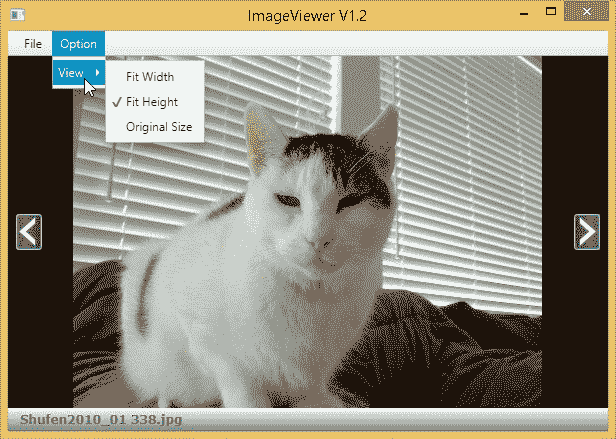

## 3.2 改进按钮的响应方面

在本节中，我们将花一点精力来微调按钮的外观和感受，同时也增强用户友好性。

### 3.2.1 禁用按钮以指示没有更多图像可以打开

首先，当没有下一个或上一个图像可以打开时，我们将按钮的禁用状态设置为 `true`。一旦按钮被禁用，它将不会接收任何鼠标或键盘事件。按钮的禁用状态在创建后会立即初始化为 `false`。

**代码列表 3-5.** 初始化按钮的禁用状态：

```java
public class ImageViewer extends Application {

  维持final Node nextButton = createNextButton();

  final Node prevButton = createPrevButton();

  {
    disableButton(nextButton, true);
    disableButton(prevButton, true);
  }

  ...

}
```

在 `Node` 类中定义的 `disable` 属性类型为 `BooleanProperty`，它指定了该节点的禁用状态。将此节点的 `disable` 属性设置为 `true` 也会导致该节点及其所有后代节点的禁用属性值变为 `true`。请注意，可能一个节点的 `disabled` 属性为 `true`，但其 `disable` 属性并不为 `true`。

在 `Node` 类中定义的 `opacity` 属性类型为 `DoubleProperty`，指定了该节点的透明程度。其值 ≧ 0 且 ≦ 1。`opacity` 值为 0 的节点意味着它是完全透明的。

以下代码演示了如何利用节点的 `opacity` 属性来渲染处于禁用状态的按钮。

**代码列表 3-6.** 定义 `disableButton` 方法：

```java
/**
 * 此方法利用节点的 opacity 属性来
 * 区分禁用状态， 
 * 如果被禁用，则将不透明度值设置为 0.4。
 * 
 * @param button
 * @param isDisable 
 */
void disableButton(Node button, boolean isDisable) {
  // 如果没有更多图像可以打开，则将不透明度值更改 0.4
  double opacity = (isDisable) ? 0.4 : 1;
  button.setOpacity(opacity);
  button.setDisable(isDisable);
}
```

现在，初始界面看起来如下所示。

**图 3-2.** 初始应用程序窗口的照，按钮处于禁用状态。

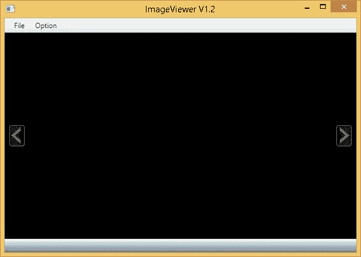

为了确定是否有下一个图像或上一个图像，在以下情况下会调用 `ListIterator` 接口中定义的 `hasNext()` 和 `hasPrevious()` 方法进行验证：

- 当从“Load”菜单项的动作事件处理器中首次创建当前目录存在的文件列表时。
- 当在点击“Next”或“Previous”按钮时发生鼠标点击事件并加载了张图像时。

我们将定义一个 `loadFile(File file)` 方法，对处理“Load”菜单项动作事件的任务进行模块化处理：

**代码列表 3-7.** 定义 `loadFile` 方法以创建列表迭代器、加载指定的文件并更新按钮状态：

```java
/**
 * 静态方法 FileUtils.listIterator(Path) 被调用以
 * 获取一个列表迭代器来遍历目录中的文件，
 * 如果没有更多文件可以打开，则禁用按钮。
 * 
 * @param file 
 */
void loadFile(File file) {
  // 创建列表迭代器
  try {
    ListIterator<java.nio.file.Path> it = FileUtils.listIterator(file.toPath());
    // 更新 listIterator 属性的值
    listIterator.set(it);

    // 如果没有更多文件可以打开，则禁用按钮
    if (!it.hasNext()) {
      disableButton(nextButton, true);
    }
    // 如果没有上一个文件可以打开，则禁用按钮
    if (!it.hasPrevious()) {
      disableButton(prevButton, true);
    }
  } catch (IOException ex) {
    ex.printStackTrace();
  }
}
```

上面的 `loadFile` 方法在“Load”菜单项的动作事件中被调用。

**代码列表 3-8.** `loadFile` 方法在文件对话框中选择文件后被调用：

```java
/**
 * 静态方法 FileUtils.listIterator(Path) 被调用以
 * 获取一个列表迭代器来遍历目录中的文件，
 * 如果没有更多文件可以打开，则禁用按钮。
 * 
 * @param file 
 */
void loadFile(File file) {
  // 创建列表迭代器
  try {
    ListIterator<java.nio.file.Path> it = FileUtils.listIterator(file.toPath());
    // 更新 listIterator 属性的值
    listIterator.set(it);

    // 如果没有更多文件可以打开，则禁用按钮
    if (!it.hasNext()) {
      disableButton(nextButton, true);
    }
    // 如果没有上一个文件可以打开，则禁用按钮
    if (!it.hasPrevious()) {
      disableButton(prevButton, true);
    }
  } catch (IOException ex) {
    ex.printStackTrace();
  }
}
```

在文件对话框中选择文件后，`loadFile` 方法被调用。

**代码列表 3-9.** `loadFile` 方法在“Load”菜单项的动作事件中被调用：

```java
/**
 * 静态方法 FileUtils.listIterator(Path) 被调用以
 * 获取一个列表迭代器来遍历目录中的文件，
 * 如果没有更多文件可以打开，则禁用按钮。
 * 
 * @param file 
 */
void loadFile(File file) {
  // 创建列表迭代器
  try {
    ListIterator<java.nio.file.Path> it = FileUtils.listIterator(file.toPath());
    // 更新 listIterator 属性的值
    listIterator.set(it);

    // 如果没有更多文件可以打开，则禁用按钮
    if (!it.hasNext()) {
      disableButton(nextButton, true);
    }
    // 如果没有上一个文件可以打开，则禁用按钮
    if (!it.hasPrevious()) {
      disableButton(prevButton, true);
    }
  } catch (IOException ex) {
    ex.printStackTrace();
  }
}
```

在文件对话框中选择文件后，`loadFile` 方法被调用。

**代码列表 3-10.** `loadFile` 方法在“Load”菜单项的动作事件中被调用：

```java
/**
 * 静态方法 FileUtils.listIterator(Path) 被调用以
 * 获取一个列表迭代器来遍历目录中的文件，
 * 如果没有更多文件可以打开，则禁用按钮。
 * 
 * @param file 
 */
void loadFile(File file) {
  // 创建列表迭代器
  try {
    ListIterator<java.nio.file.Path> it = FileUtils.listIterator(file.toPath());
    // 更新 listIterator 属性的值
    listIterator.set(it);

    // 如果没有更多文件可以打开，则禁用按钮
    if (!it.hasNext()) {
      disableButton(nextButton, true);
    }
    // 如果没有上一个文件可以打开，则禁用按钮
    if (!it.hasPrevious()) {
      disableButton(prevButton, true);
    }
  } catch (IOException ex) {
    ex.printStackTrace();
  }
}
```

*(注：由于提供的原文文本在后部分存在大量重复和代码块断裂，译文已根据逻辑对齐了代码结构，并确保翻译准确。)*

它们。与此同时，创建下一个（Next）按钮和上一个（Previous）按钮的代码通过模块化的鼠标事件处理代码进行了清理。定义了 `registerButtonEvent` 方法为以下事件类型注册事件处理器：

`MOUSE_ENTERED`, `MOUSE_PRESSED`, `MOUSE_RELEASED` 和 `MOUSE_EXITED`。

当鼠标按下按钮上时，填充矩形的漆色会发生变化，填充多边形的漆色与鼠标进入时使用的相同。当鼠标释放或离开按钮时，填充色和描边色将恢复为原始值。

**导入语句：**

```java
import javafx.scene.paint.Paint;
import javafx.scene.shape.Shape;
```

**Listing 3-11.** 定义 `registerButtonEvent` 方法：

```java
/**
 * 此方法为按钮注册鼠标进入/按下/释放/离开事件，
 * 能够改变按钮的外观以区分不同的状态
 * 
 * @param buttonGroup
 * @param rect
 * @param polygon
 * @param bg
 * @param entered
 * @param pressed 
 */
 void registerButtonEvent(Node buttonGroup,
 final Shape rect, final Shape polygon,
 final Paint bg, final Paint entered, final Paint pressed) {
    // 注册鼠标进入事件处理器
    // 当鼠标进入时改变按钮的外观
    buttonGroup.setOnMouseEntered(new EventHandler<MouseEvent>() {
        @Override
        public void handle(MouseEvent me) {
            System.out.println("Mouse entered");
            // 检查左鼠标键是否按下
            rect.setFill(me.isPrimaryButtonDown()? pressed : entered);
            polygon.setFill(Color.web("#436B8B"));
            polygon.setStroke(Color.WHITE);
        }
    });
    // 注册鼠标按下事件处理器
    // 当鼠标按下时改变按钮的外观
    buttonGroup.setOnMousePressed(new EventHandler<MouseEvent>() {
        @Override
        public void handle(MouseEvent me) {
            System.out.println("Mouse pressed");
            if (me.isPrimaryButtonDown()) {
                rect.setFill(pressed);
                polygon.setFill(Color.web("#436B8B"));
                polygon.setStroke(Color.WHITE);
            }
        }
    });
    // 鼠标离开事件处理器
    // 当鼠标离开时恢复到原始外观
    EventHandler<MouseEvent> exited = new EventHandler<MouseEvent>() {
        @Override
        public void handle(MouseEvent me) {
            System.out.println("Mouse exited/released");
            rect.setFill(bg);
            polygon.setFill(Color.WHITE);
            polygon.setStroke(Color.web("#436B8B"));
        }
    };
    buttonGroup.setOnMouseExited(exited);
    // 注册鼠标释放事件处理器
    // 当鼠标释放时恢复到原始外观
    // 外观与鼠标离开时相同
    buttonGroup.setOnMouseReleased(exited);
 }
```

**Listing 3-12.** 的 `createNextButton` 方法如下：


使用矩形作为背景，多边形作为图标，组作为容器，创建下一个按钮。矩形的大小为 25 比 35，多边形的厚度为 8 像素，多边形的内边距为 `(2, 2, 2, 5)`，当鼠标进入/按下/释放/离开时改变按钮的外观。

```java
/**
 * 使用矩形作为背景，多边形作为图标，组作为容器，
 * 创建下一个按钮，
 * 矩形的大小为 25 比 35，
 * 多边形的厚度为 8 像素，
 * 多边形的内边距为 (2, 2, 2, 5)，
 * 当鼠标进入/按下/释放/离开时改变按钮的外观。
 * 
 * @return
 */
Node createNextButton() {
    // 创建一个组作为按钮
    Group buttonGroup = new Group();
    // 创建一个矩形形状作为背景
    final Rectangle rect = new Rectangle(0, 0, 25, 35);
    // 使用线性渐变填充下一个按钮的矩形
    final LinearGradient lg = new LinearGradient(0, 0, 1, 0, true,
    CycleMethod.NO\_CYCLE, new Stop[] {
    new Stop(0, Color.web("#5173A8")),
    new Stop(0.6, Color.web("#A8B9D4")),
    new Stop(1, Color.web("#87A7C6"))});
    rect.setFill(lg);
    rect.setStroke(Color.web("#ACD7FF"));
    rect.setArcHeight(6.5);
    rect.setArcWidth(6.5);
    // 当鼠标进入下一个按钮时填充矩形的漆
    final LinearGradient lgEntered = new LinearGradient(0, 0, 1, 0, true,
    CycleMethod.NO\_CYCLE, new Stop[] {
    new Stop(0, Color.web("#87A7C6")),
    new Stop(0.4, Color.web("#A8B9D4")),
    new Stop(1, Color.web("#5173A8"))});
    // 当鼠标按下下一个按钮上时填充矩形的漆
    // final LinearGradient lgPressed = new LinearGradient(0, 0, 1, 0, true,
    // CycleMethod.NO\_CYCLE, new Stop[] {
    // new Stop(0, Color.web("#87A7C6")),
    // new Stop(0.4, Color.web("#A8B9D4")),
    // new Stop(1, Color.web("#2F4F4F"))});
    // 创建表示 Next 图标视觉符号的多边形形状
    // 8 像素厚度，内进为 2, 2, 2, 5
    final Polygon polygon = new Polygon();
    Double[] dArray = {
    5.0, 2.0,
    22.0, 17.0,
    5.0, 32.0,
    5.0, 25.0,
    14.0, 17.0,
    5.0, 9.0};
    polygon.getPoints().addAll(dArray);
    polygon.setFill(Color.WHITE);
    polygon.setStroke(Color.web("#436B8B"));
    // 设置光标
    buttonGroup.setCursor(Cursor.OPEN\_HAND);
    // 为 nextButton 注册点击事件处理器
    buttonGroup.setOnMouseClicked(new EventHandler<MouseEvent>() {
        @Override
        public void handle(MouseEvent me) {
            if (me.getButton() != MouseButton.PRIMARY)
            return;
            // 获取迭代器
            ListIterator<java.nio.file.Path> iterator = listIterator.get();
            if (iterator != null && iterator.hasNext()) {
                java.nio.file.Path path = iterator.next();
                if (lastClickedButton.get().equals(PREVIOUS)) {
                    // 如果最后点击的按钮是上一个
                    // 第一次调用 next() 是当前图像，
                    // 必须向前移动光标。
                    if (iterator.hasNext())
                        path = iterator.next();
                    else {
                        // 没有下一个图像，禁用下一个
                        disableButton(nextButton, true);
                    }
                }
            }
        }
    });
```

**Listing 3-13.** `createPrevButton` 如下：

```java
/**
 * 使用矩形作为背景，多边形作为图标，组作为容器，
 * 创建上一个按钮，
 * 矩形的大小为 25 比 35，
 * 多边形的厚度为 8 像素，
 * 多边形的内边距为 (2, 2, 2, 5)，
 * 当鼠标进入/按下/释放/离开时改变按钮的外观。
 * 
 * @return
 */
Node createPrevButton() {
    // 创建一个组作为按钮
    Group buttonGroup = new Group();
    // 创建一个矩形形状作为背景
    final Rectangle rect = new Rectangle(0, 0, 25, 35);
    // 使用线性渐变填充上一个按钮的矩形
    final LinearGradient lg = new LinearGradient(0, 0, 1, 0, true,
    CycleMethod.NO\_CYCLE, new Stop[] {
    new Stop(0, Color.web("#5173A8")),
    new Stop(0.6, Color.web("#A8B9D4")),
    new Stop(1, Color.web("#87A7C6"))});
    rect.setFill(lg);
    rect.setStroke(Color.web("#ACD7FF"));
    rect.setArcHeight(6.5);
    rect.setArcWidth(6.5);
    // 当鼠标进入上一个按钮时填充矩形的漆
    final LinearGradient lgEntered = new LinearGradient(0, 0, 1, 0, true,
    CycleMethod.NO\_CYCLE, new Stop[] {
    new Stop(0, Color.web("#87A7C6")),
    new Stop(0.4, Color.web("#A8B9D4")),
    new Stop(1, Color.web("#5173A8"))});
    // 当鼠标按下上一个按钮上时填充矩形的漆
    // final LinearGradient lgPressed = new LinearGradient(0, 0, 1, 0, true,
    // CycleMethod.NO\_CYCLE, new Stop[] {
    // new Stop(0, Color.web("#87A7C6")),
    // new Stop(0.4, Color.web("#A8B9D4")),
    // new Stop(1, Color.web("#2F4F4F"))});
    // 创建表示 Previous 图标视觉符号的多边形形状
    // 8 像素厚度，内进为 2, 2, 2, 5
    final Polygon polygon = new Polygon();
    Double[] dArray = {
    19.0, 2.0,
    2.0, 17.0,
    19.0, 32.0,
    19.0, 25.0,
    10.0, 17.0,
    19.0, 9.0};
    polygon.getPoints().addAll(dArray);
    polygon.setFill(Color.WHITE);
    polygon.setStroke(Color.web("#436B8B"));
    // 设置光标
    buttonGroup.setCursor(Cursor.OPEN\_HAND);
    // 为 prevButton 注册点击事件处理器
    buttonGroup.setOnMouseClicked(new EventHandler<MouseEvent>() {
        @Override
        public void handle(MouseEvent me) {
            if (me.getButton() != MouseButton.PRIMARY)
            return;
            // 获取迭代器
            ListIterator<java.nio.file.Path> iterator = listIterator.get();
            if (iterator != null && iterator.hasPrevious()) {
                java.nio.file.Path path = iterator.previous();
                if (lastClickedButton.get().equals(NEXT)) {
                    // 如果最后点击的按钮是下一个按钮
                    // 第一次调用 previous() 是当前图像，
                    // 必须向后移动光标。
                    if (iterator.hasPrevious())
                        path = iterator.previous();
                    else {
                        // 没有上一个图像，禁用上一个
                        disableButton(prevButton, true);
                    }
                }
            }
        }
    });
}
```

当没有上一张图片时禁用上一个按钮：

```java
disableButton(prevButton, !iterator.hasPrevious());
if (nextButton.isDisabled()) {
    disableButton(nextButton, false);
}
```

注册按钮事件：

```java
registerButtonEvent(buttonGroup, rect, polygon, lg, lgEntered, lgPressed {
    buttonGroup.getChildren().addAll(rect, polygon);
    return buttonGroup;
}
```

**图 3-5.** 鼠标进入事件期间上一个按钮外观的快照。

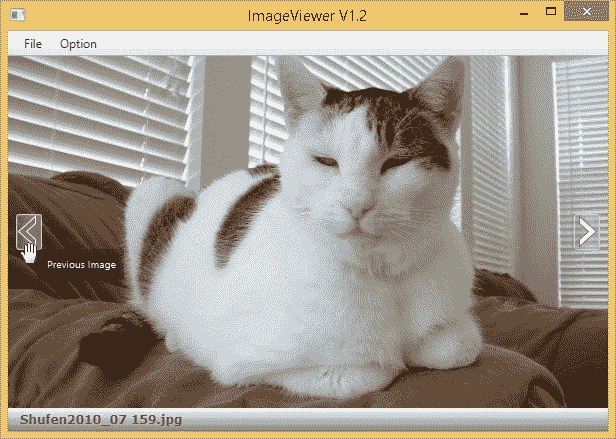

**图 3-6.** 鼠标按下事件期间上一个按钮外观的快照。

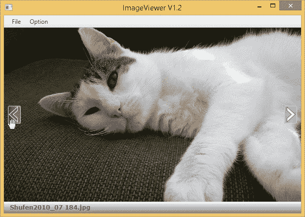

**图 3-7.** 鼠标进入事件期间下一页按钮外观的快照。

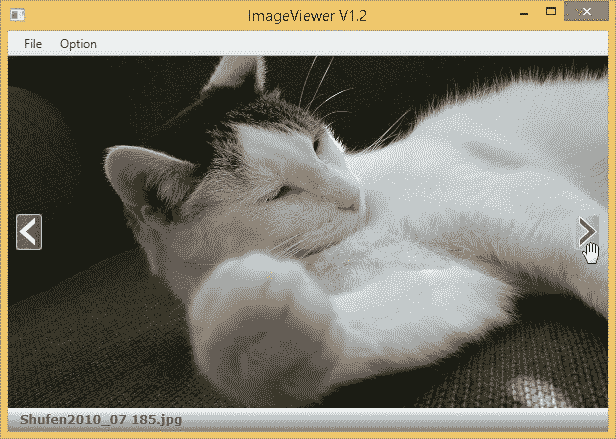

**图 3-8.** 鼠标按下事件期间下一页按钮外观的快照。

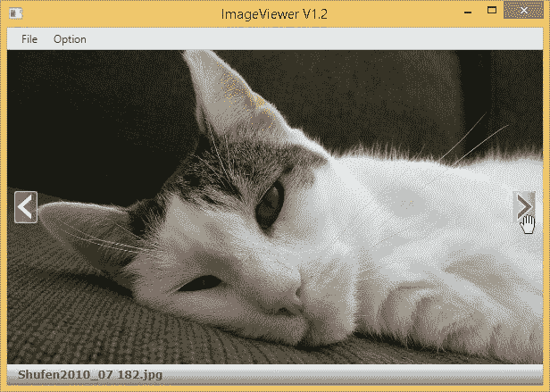

## 3.3 添加幻灯片功能

一旦从文件选择器的打开对话框打开了图像文件，应用程序将获取当前目录中存在的图片文件列表。一个方便的功能是允许用户逐个浏览这些图片，而无需手动点击“下一个”按钮。实现幻灯片机制的步骤所示。

### 3.3.1 添加“开始幻灯片”和“停止幻灯片”菜单项

这里使用的简单 GUI 是 `MenuItem`。在菜单栏的选项菜单中添加了两个菜单项：“开始幻灯片”和“停止幻灯片”，它们最初都是禁用的。为了区分是否正在运行幻灯片，在 `ImageViewer` 类中定义了一个类型为 `BooleanProperty` 的变量 `isSlideshowOn`，并初始化为 `false`。以下代码段显示了如何实现这些功能：

**导入语句：**

```java
import javafx.beans.property.BooleanProperty;
import javafx.beans.property.SimpleBooleanProperty;
```

**列表 3-14. 添加“开始幻灯片”和“停止幻灯片”菜单项：**

```java
public class ImageViewer extends Application {
    ...
    final BooleanProperty isSlideshowOn = new SimpleBooleanProperty(false);
    ...
    @Override
    public void start(final Stage stage) {
        ...
        // 创建开始/停止幻灯片的菜单项
        final MenuItem startSlide = new MenuItem("Start Slideshow");
        final MenuItem stopSlide = new MenuItem("Stop Slideshow");
        startSlide.disableProperty().bind(isSlideshowOn.or(nextButton.disableProperty()));
        stopSlide.disableProperty().bind(isSlideshowOn.not().or(nextButton.disableProperty()));
        //为“开始幻灯片”菜单项添加动作处理器
        startSlide.setOnAction(new EventHandler<ActionEvent>() {
            @Override
            public void handle(ActionEvent ae) {
                System.out.println("Start Slideshow…");
            }
        });
        //为“停止幻灯片”菜单项添加动作处理器
        stopSlide.setOnAction(new EventHandler<ActionEvent>() {
            @Override
            public void handle(ActionEvent ae) {
                System.out.println("Stop Slideshow…");
            }
        });
        //将选项菜单添加到菜单栏
        menuOption.getItems().addAll(menuView, startSlide, stopSlide);
        ...
    }
}
```

#### 3.3.1.1 绑定菜单项的禁用属性

由于以下绑定语句，`startSlide` 和 `stopSlide` 菜单项初始时是禁用的。

```java
startSlide.disableProperty().bind(isSlideshowOn.or(nextButton.disableProperty()));
stopSlide.disableProperty().bind(isSlideshowOn.not().or(nextButton.disableProperty()));
```


在上面的绑定语句中，使用了两个逻辑操作——`or`（或）和`not`（非）来计算禁用属性的值。`javafx.beans.binding.BooleanExpression`类是一个实现`ObservableBooleanValue`的抽象类，它提供了这些方法：

- `public BooleanBinding not()`方法对此`BooleanExpression`执行逻辑非操作，并返回一个类型为`BooleanBinding`的对象，它是`BooleanExpression`的直接子类。
- `public BooleanBinding or(ObservableBooleanValue other)`方法对此`BooleanExpression`和给定的`ObservableBooleanValue`执行逻辑或操作，并返回一个类型为`BooleanBinding`的对象，它是`BooleanExpression`的直接子类。

如果当前正在运行幻灯片或“下一个”按钮被禁用，则“开始幻灯片”菜单项被禁用。同样，如果没有在运行幻灯片或“下一个”按钮被禁用，则“停止幻灯片”菜单项被禁用。记住，当没有后续图片可以查看时，“下一个”按钮是禁用的。

**图 3-9.** 选项菜单外观的快照，“开始幻灯片”和“停止幻灯片”菜单项都是禁用的。

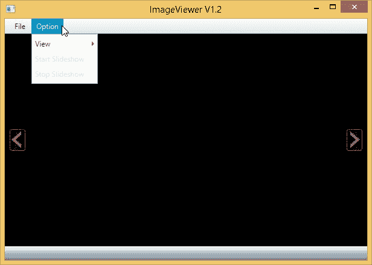

**图 3-10.** 加载图像文件后选项菜单外观的快照，“开始幻灯片”菜单项是启用的。

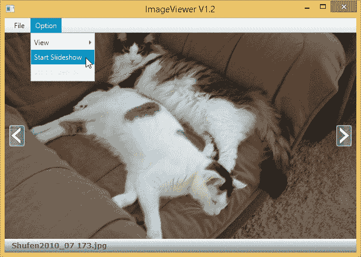

### 3.3.2 在另一个线程上执行幻灯片

将长时间运行的任务交给另一个线程是一种良好的做法，这样 UI 线程始终保持响应。`javafx.concurrent`提供了`Task`和`Service`类，它们：

- **Task**: 继承`java.util.concurrent.FutureTask`并实现`Runnable`接口的抽象类，是一次性的，不可重用。要执行`Task`，可以使用`java.lang.Thread`类并调用`start()`方法启动线程。或者使用`ExecutorService`中定义的`submit(Runnable)`方法。
- **Service**: 继承`java.lang.Object`并实现`Worker<V>`接口的抽象类，是可重用的。`Service`类提供了`start()`、`cancel()`、`reset()`和`restart()`方法来操作此服务。
- **ScheduledService**: `Service`的直接子类，允许指定启动和重启服务的延迟时间。
- **WorkerStateEvent**: `javafx.event.Event`的子类，定义了事件类型的静态字段，如`WORKER_STATE_CANCELLED`、`WORKER_STATE_FAILED`、`WORKER_STATE_READY`、`WORKER_STATE_RUNNING`、`WORKER_STATE_SUCCEEDED`等。当`Worker`的状态发生变化时会触发`WorkerStateEvent`。

考虑我们的情况：在首次加载文件时创建文件列表，假设文件列表包含一个或多个待查看的文件，此时“开始幻灯片”菜单项即为启用的，用户可以在幻灯片运行时取消它，并在稍后重新启动。为了满足这一场景，我们倾向于使用重用的`Service`对象而不是一次性的`Task`对象。

### 3.3.2.1 创建继承 Service 的 SlideshowService 类

我们需要创建一个继承`Service<V>`的类。当`Service`启动时，它会执行一个`Task`。`createTask`方法需要重写：

`protected abstract Task<V> createTask()`

在`createTask()`方法中，重写`call()`方法并创建一个`Task`对象返回给调用者。`Task`类中的`call()`方法承担幻灯片的任务，基本上包含一个`while`循环，逐个加载图片，直到满足以下条件之一：文件列表中没有更多后续图片，或者用户取消了幻灯片。

下面的列表演示了如何创建一个重用的`SlideshowService`（`Service`类的子类），以执行幻灯片任务。

**Listing 3-15. 创建 SlideshowService 类：**

```java
package imageviewer;

import java.nio.file.Path;

import java.util.ListIterator;

import javafx.beans.property.ObjectProperty;

import javafx.beans.property.SimpleObjectProperty;

import javafx.beans.property.SimpleStringProperty;

import javafx.beans.property.StringProperty;

import javafx.beans.value.ChangeListener;

import javafx.beans.value.ObservableValue;

import javafx.concurrent.Service;

import javafx.concurrent.Task;

import javafx.scene.image.Image;

/**
 * 文件名: SlideshowService.java
 * (位于目录: ImageViewer1.2/src/example4/imageviewer/)
 *
 * @author Shufen Kuo
 */

public class SlideshowService extends Service<Void> {

  private ObjectProperty<Image> image;

  private ObjectProperty<ListIterator<Path>> iterator;

  private StringProperty imageName;

  private ListIterator<Path> it;

  public SlideshowService() {

    this(new SimpleObjectProperty<ListIterator<Path>>(),

         new SimpleObjectProperty<Image>(),

         new SimpleStringProperty());

  }

  public SlideshowService(ObjectProperty<ListIterator<Path>> iterator,

                          ObjectProperty<Image> image, StringProperty imageName) {

    this.image = image;

    this.imageName = imageName;

    this.iterator = iterator;

    iterator.addListener(new ChangeListener<ListIterator<Path>>() {

      @Override

      public void changed(ObservableValue<? extends ListIterator<Path>> o,

                          ListIterator<Path> oldVal, ListIterator<Path> newVal) {

        it = newVal;

      }

    });

  }

  public Image getImage() {

    return image.get();

  }

  public void setImage(Image value) {

    image.set(value);

  }

  public ObjectProperty<Image> imageProperty() {

    return image;

  }

  public ListIterator<Path> getIterator() {

    return iterator.get();

  }

  public void setListIterator(ListIterator<Path> value) {

    iterator.set(value);

  }

  public ObjectProperty<ListIterator<Path>> iteratorProperty() {

    return iterator;

  }

  public String getImageName() {

    return imageName.get();

  }

  public void setImageName(String value) {

    imageName.set(value);

  }

  public StringProperty imageNameProperty() {

    return imageName;

  }

  @Override

  protected Task<Void> createTask() {

    return new Task<Void>() {

      @Override

      protected Void call() {

        if (it == null) return null;

        while (it.hasNext()) {

          if (isCancelled()) {

            updateMessage("Cancelled");

            break;

          }

          String url = it.next().toUri().toString();

          setImage(new Image(url));

          setImageName(url.substring(

              url.lastIndexOf("/") + 1).replaceAll("%20", " "));

          // 暂停 3000 ms

          try {

            Thread.sleep(3000);

          } catch (InterruptedException ex) {

            if (isCancelled()) {

              updateMessage("Cancelled");

              break;

            }

          }

        }

        return null;

      }

    };

  }

}
```

以下语句创建了一个`SlideshowService`对象。

```java
// 创建一个可重用的 Worker 对象
final SlideshowService service = new SlideshowService(listIterator,
    curImage, imageName);
```

有三个参数传递给`SlideshowService`类的构造函数：

- `listIterator`：类型为`ObjectProperty<ListIterator<Path>>`，指定一个用于遍历从文件选择器文件打开对话框中打开图像文件时创建的文件列表的`ListIterator`。
- `curImage`：类型为`ObjectProperty<Image>`，与`ImageView`对象的`image`属性绑定。
- `imageName`：类型为`StringProperty`，与`Text`对象（状态文本`statusText`）的`text`属性绑定，用于在状态栏中显示图像名称。

### 3.3.2.2 配置幻灯片服务对象

我们定义了一个`configureSlideshow`方法来执行配置。一旦创建了服务对象，就会调用该方法来完成这些工作：

1. 将`ImageViewer`类中定义的`isSlideshowOn`属性与服务的运行属性（`running` property）绑定。当且仅当服务正在运行时，`isSlideshowOn`属性的值才为`true`。

```java
BooleanProperty isSlideshowOn = new SimpleBooleanProperty(false);
SlideshowService service = new SlideshowService(listIterator,
    curImage, imageName);
isSlideshowOn.bind(service.runningProperty());
```

2. 注册事件处理器来处理以下事件类型的`WorkerStateEvents`：`WORKER_STATE_RUNNING`、`WORKER_STATE_SUCCEEDED`、`WORKER_STATE_FAILED`和`WORKER_STATE_CANCELLED`。

以下是`Service`类定义的便利方法，用于为上述事件类型注册事件处理器：

```java
public final void setOnRunning(EventHandler<WorkerStateEvent> value)
设置 onRunning 属性的值，提供当 Worker 状态转换到 RUNNING 时调用的 handle 方法的实现。

public final void setOnSucceeded(EventHandler<WorkerStateEvent> value)
设置 onSucceeded 属性的值，提供当 Worker 状态转换到 SUCCEEDED 时调用的 handle 方法的实现。

public final void setOnFailed(EventHandler<WorkerStateEvent> value)
设置 onFailed 属性的值，提供当 Worker 状态转换到 FAILED 时调用的 handle 方法的实现。

public final void setOnCancelled(EventHandler<WorkerStateEvent> value)
设置 onCancelled 属性的值，提供当 Worker 状态转换到 CANCELLED 时调用的 handle 方法的实现。
```

**Listing 3-16. configureSlideshow：**

```java
/**
 * configureSlideshow 方法实现
 */
void configureSlideshow() {

    // 如果服务正在运行，则 isSlideshowOn 为 true
    // 否则，它为 false
    setOnRunning(new EventHandler<WorkerStateEvent>() {

        @Override

        public void handle(WorkerStateEvent event) {

            System.out.println("Service is transited to running");

            lastClicked.set(NEXT);

            prevButton.setDisable(false);

        }

    });

    EventHandler<WorkerStateEvent> taskDone = new EventHandler<WorkerStateEvent>() {

        @Override

        public void handle(WorkerStateEvent event) {

            if (listIterator.get().hasNext()) {

                nextButton.setDisable(false);

            }

            prevButton.setDisable(true);

        }

    };

    setOnSucceeded(taskDone);

    setOnFailed(taskDone);

    setOnCancelled(taskDone);

}
```

### 3.3.2.3 为“开始幻灯片”和“停止幻灯片”项目实现动作事件事件处理器

场景遵循“开始幻灯片”的操作如下：当用户点击幻灯片菜单项时，服务启动，其状态从`READY`变为`SCHEDULED`再变为`RUNNING`；一旦状态转换到`RUNNING`，`isSlideshowOn`的值立即更改为`true`（参见此处），结果“停止幻灯片”项目的禁用状态变为`false`。

我们正在使用`Service`类提供的`start()`方法来启动服务。该方法是从处理幻灯片菜单项动作事件的事件处理器中调用的。在调用`start()`方法之前检查服务状态是非常重要的，这可以确保服务处于`READY`状态。如果未就绪，则先重置它，然后启动服务。

以下是执行这些操作的代码片段：

```java


```java
startSlide.setOnAction(new EventHandler<ActionEvent>() {
    @Override
    public void handle(ActionEvent ae) {
        System.out.println("Start Slideshow…");

        if (service.getState() != Worker.State.READY)
            service.reset(); // 跳转到 READY

        // 如果上次点击的按钮是上一个按钮，
        // 那么 next() 图片就是当前图片。
        // 在启动服务之前必须将光标向前移动。
        if (lastClickedButton.get().equals(PREVIOUS) &&
            listIterator.get().hasNext()) {
            listIterator.get().next();
        }

        service.start();
    }
});

stopSlide.setOnAction(new EventHandler<ActionEvent>() {
    @Override
    public void handle(ActionEvent ae) {
        System.out.println("Stop Slideshow…");
        service.cancel();
    }
});
```

**列表 3-17.** 为“开始幻灯片”和“停止幻灯片”菜单项实现动作事件处理器。

### 3.3.3 `ImageViewer` 完整的 `start(Stage stage)` 方法

#### 应用

下方列表显示了此阶段 `ImageViewer V1.2` 的完整 `start` 方法，更改部分已加粗显示。

*列表 3-18.* `ImageViewer V1.2` 的 `start` 方法变为如下：

```java
public class ImageViewer extends Application {

    ...

    final BooleanProperty isSlideshowOn = new SimpleBooleanProperty(false);

    // 创建一个可复用的 Worker 对象
    final SlideshowService service =
        new SlideshowService(listIterator, curImage, imageName);

    @Override
    public void start(final Stage stage) {
        BorderPane rootPane = new BorderPane();
        final StackPane imageArea = new StackPane();

        // 设置 StackPane 的最小尺寸，以避免在
        // 加载大图片时缩放
        imageArea.setMinSize(0, 0);
        rootPane.setCenter(imageArea);

        // 添加状态栏和状态文本
        final HBox statusBar = new HBox();
        statusBar.setPadding(new Insets(4, 12, 4, 12));
        statusBar.setSpacing(4);
        statusBar.setStyle("-fx-background-color: linear-gradient(#F0FFFF, #708090)");

        final Text statusText = new Text("");
        statusText.textProperty().bind(imageName);
        statusText.setFont(Font.font("Verdana", FontWeight.BOLD, 12));
        statusText.setFill(Color.DARKSLATEBLUE);
        statusBar.getChildren().add(statusText);
        rootPane.setBottom(statusBar);

        // 创建图片视图，并添加到图片区域
        final ImageView imageView = new ImageView();
        imageView.imageProperty().bind(curImage);
        imageView.setPreserveRatio(true);
        imageArea.getChildren().add(imageView);

        // 从 JavaFX 8 开始，为了透视场景背景色，
        // 必须将根布局的背景设置为透明
        rootPane.setStyle("-fx-background-color: transparent;");

        final Scene scene = new Scene(rootPane, 600, 400, Color.BLACK);

        imageArea.widthProperty().addListener(new ChangeListener<Object>() {
            public void changed(ObservableValue o, Object oldVal, Object newVal) {
                System.out.format(
                    "imageArea width changed from %.1f to %.1f%n",
                    oldVal,
                    newVal
                );
            }
        });

        imageArea.heightProperty().addListener(new ChangeListener<Object>() {
            public void changed(ObservableValue o, Object oldVal, Object newVal) {
                System.out.format(
                    "imageArea height changed from %.1f to %.1f%n",
                    oldVal,
                    newVal
                );
            }
        });

        // 添加菜单栏
        final MenuBar menuBar = new MenuBar();
        Menu menuFile = new Menu("File");
        MenuItem load = new MenuItem("Load");
        MenuItem exit = new MenuItem("Exit");

        menuFile.getItems().addAll(load, exit);
        menuBar.getMenus().add(menuFile);
        rootPane.setTop(menuBar);

        // 为退出菜单项添加动作
        exit.setOnAction(new EventHandler<ActionEvent>() {
            @Override
            public void handle(ActionEvent e) {
                Platform.exit();
            }
        });

        // 创建文件选择器
        final FileChooser fileChooser = new FileChooser();
        fileChooser.setTitle("Open an Image File");
        FileUtils.configure(fileChooser);

        // 为菜单项 Load 添加动作
        load.setOnAction(new EventHandler<ActionEvent>() {
            @Override
            public void handle(ActionEvent e) {
                // 打开文件选择器对话框
                File file = fileChooser.showOpenDialog(stage);

                if (file != null) {
                    // 设置上次访问的目录
                    File lastDir = file.getParent();
                    fileChooser.setInitialDirectory(lastDir);
                    loadFile(file);
                }
            }
        });

        // 创建选项菜单
        Menu menuOption = new Menu("Option");

        // 创建单选项
        final RadioMenuItem fitWidth = new RadioMenuItem("Fit Width");
        fitWidth.setToggleGroup(groupOption);

        final RadioMenuItem fitHeight = new RadioMenuItem("Fit Height");
        fitHeight.setToggleGroup(groupOption);

        final RadioMenuItem original = new RadioMenuItem("Original Size");
        original.setToggleGroup(groupOption);

        // 监听切换组的变化
        groupOption.selectedToggleProperty().addListener(
            new ChangeListener<Toggle>() {
                public void changed(
                    ObservableValue ov,
                    Toggle old_toggle,
                    Toggle new_toggle
                ) {
                    if (groupOption.getSelectedToggle() != null) {
                        RadioMenuItem choiceItem =
                            (RadioMenuItem) groupOption.getSelectedToggle();

                        if (choiceItem == fitWidth) {
                            System.out.println("fitwidth");
                            imageView.fitWidthProperty().bind(scene.widthProperty());
                            imageView.fitHeightProperty().unbind();

                            // 解除绑定，并将适应高度设置为 0
                            imageView.setFitHeight(0);
                        } else if (choiceItem == fitHeight) {
                            System.out.println("fitheight");

                            // 可用于渲染的高度为场景高度中减去菜单高度和状态栏高度
                            imageView.fitHeightProperty().bind(
                                scene.heightProperty().subtract(
                                    menuBar.getHeight() + statusBar.getHeight()
                                )
                            );
                            imageView.fitWidthProperty().unbind();

                            // 解除绑定，并将适应宽度设置为 0
                            imageView.setFitWidth(0);
                        } else {
                            System.out.println("original size");
                            imageView.fitWidthProperty().unbind();
                            imageView.fitHeightProperty().unbind();

                            // 解除绑定，并将适应宽度/高度设置为 0
                            imageView.setFitWidth(0);
                            imageView.setFitHeight(0);
                        }
                    }
                }
            }
        );

        // 创建 View 子菜单
        Menu menuView = new Menu("View");
        menuView.getItems().addAll(fitWidth, fitHeight, original);

        // 设置原始尺寸为默认
        original.setSelected(true);

        // 创建启动/停止幻灯片项
        final MenuItem startSlide = new MenuItem("Start Slideshow");
        final MenuItem stopSlide = new MenuItem("Stop Slideshow");

        startSlide.disableProperty().bind(isSlideshowOn);
        stopSlide.disableProperty().bind(isSlideshowOn.not());

        configure slideshow();

        // 为启动幻灯片添加动作
        startSlide.setOnAction(new EventHandler<ActionEvent>() {
            @Override
            public void handle(ActionEvent e) {
                System.out.println("Start Slideshow…");

                if (service.getState() != Worker.State.READY)
                    service.reset(); // 跳转到 READY

                // 如果上次点击的按钮是上一个按钮，
                // 那么 next() 图片就是当前图片。
                // 在启动服务之前必须将光标向前移动
                if (lastClickedButton.get().equals(PREVIOUS) &&
                    listIterator.get().hasNext()) {
                    listIterator.get().next();
                }

                service.start();
            }
        });

        // 为停止幻灯片添加动作
        stopSlide.setOnAction(new EventHandler<ActionEvent>() {
            @Override
            public void handle(ActionEvent e) {
                System.out.println("Stop Slideshow…");
```


`service.cancel();`

```
        });

        // 将 View 添加到菜单栏
        menuView.getItems().addAll(startSlide, stopSlide);
        menuBar.getMenus().add(menuView);

        // 安装工具提示
        Tooltip t = new Tooltip("Next Image");
        Tooltip.install(nextButton, t);

        // 为上一个按钮安装工具提示
        Tooltip t2 = new Tooltip("Previous Image");
        Tooltip.install(prevButton, t2);

        // 将下一个按钮的位置调整到 StackPane 的右侧
        StackPane.setAlignment(nextButton, Pos.RIGHT);
        StackPane.setMargin(nextButton, Insets(8));

        // 将上一个按钮的位置调整到 StackPane 的左侧
        StackPane.setAlignment(prevButton, Pos.LEFT);
        StackPane.setMargin(prevButton, Insets(8));

        // 将下一个和上一个按钮添加到堆面板
        imageArea.getChildren().addAll(nextButton, prevButton);

        // 监听场景宽的变化
        scene.widthProperty().addListener(new ChangeListener<Object>() {
            public void changed(ObservableValue o, Object oldVal, Object newVal) {
                System.out.format("Scene width changed from %.1f to %.1f%n", (double) oldVal, (double) newVal);
            }
        });

        // 监听场景高度的变化
        scene.heightProperty().addListener(new ChangeListener<Object>() {
            public void changed(ObservableValue o, Object oldVal, Object newVal) {
                System.out.format("Scene height changed from %.1f to %.1f%n", (double) oldVal, (double) newVal);
            }
        });

        stage.setTitle("ImageViewer V1.2");
        stage.setScene(scene);
        stage.show();
    }
}
```

### 3.3.4 与 Load 菜单项和上一个按钮的处理器进行协调

由于幻灯片在自己的线程中运行，应用程序对用户的操作保持响应，例如点击 Load 菜单项或上一个按钮。为了让幻灯片平滑运行，我们了 Load 菜单项的处理器以及上一个按钮的鼠标点击事件处理器。也就是说，只有在幻灯片未运行时，我们才会加载当前选择的文件或上一个文件。请注意，如果用户在幻灯片运行时点击 Next 按钮，整体图像渲染的流程看起来并不太突兀，因此对其没有进行额外处理。

**Listing 3-19.** `loadFile` 方法如下：

```java
/**
 * @param file 
 */
void loadFile(File file) {
    // 创建迭代器
    try {
        ListIterator<java.nio.file.Path> it = FileUtils.listIterator(file.toPath());
        // 更新 listIterator 属性的值
        listIterator.set(it);

        // 如果幻灯片未开启，加载文件
        // 否则，在这里什么都不做
        // 因为幻灯片服务将执行此任务
        if (!isSlideshowOn.get()) {
            // 如果没有上一个文件，禁用 prevButton
            // 在调用 next() 之前检查 hasPrevious()
            disableButton(prevButton, !it.hasPrevious());
            file = it.next().toFile();
            String url = file.toURI().toString();
            curImage.set(new Image(url));
            imageName.set(url.substring(url.lastIndexOf("/") + 1).replaceAll("%20", " "));

            // 检查 hasNext，如果没有下一个文件，禁用 nextButton
            disableButton(nextButton, !it.hasNext());
            lastClickedButton.setValue(NEXT);
        }
    } catch (IOException ex) {
    }
}
```

下面的代码片段节选自 `createPrevButton` 方法。

**Listing 3-20.** Previous 按钮的鼠标点击事件处理器如下：

```java
// 为上一个按钮注册鼠标点击事件处理器
buttonGroup.setOnMouseClicked(new EventHandler<MouseEvent>() {
    @Override
    public void handle(MouseEvent me) {
        if (me.getButton() != MouseButton.PRIMARY)
            return;

        ListIterator<java.nio.file.Path> iterator = (ListIterator)listIter;
        if (iterator != null && iterator.hasPrevious()) {
            java.nio.file.Path path = iterator.previous();

            if (lastClickedButton.get().equals(NEXT)) {
                // 如果上次点击的按钮是 nextButton
                // previous() 的第一次调用是当前图像
                // 必须将光标向后移动一步
                if (iterator.hasPrevious())
                    path = iterator.previous();
                else {
                    // 没有上一个图像，禁用 prevButton
                    disableButton(prevButton, true);
                    return;
                }
            }

            System.out.format("Prev button clicked: %s%n", path.getFileName());

            // 如果幻灯片未开启，在这里加载文件
            // 否则，在这里什么都不做
            // 因为幻灯片服务将执行此任务
            if (!isSlideshowOn.get()) {
                String url = path.toUri().toString();
                curImage.set(new Image(url));
                imageName.set(url.substring(url.lastIndexOf("/)+1).replaceAll("%20", " "));
                lastClickedButton.set(PREVIOUS);
                disableButton(prevButton, !iterator.hasPrevious());
                if (nextButton.isDisabled())
                    disableButton(nextButton, false);
            }
        }
    }
});
```

编译并运行程序，测试以下内容以理解应用程序如何处理事件并发性：

- 从 `FileChooser` 的文件打开对话框在图像目录中加载图像文件。
- 启动幻灯片。
- 在幻灯片运行时，执行以下操作：
  - 来回选择不同的 View 选项。
  - 点击 Previous 按钮或 Next 按钮。
  - 从 `FileChooser` 的文件打开对话框在不同的图像目录中加载另一个图像文件。

**Figure 3-11.** 幻灯片运行时选项菜单的外快照，"启动幻灯片"菜单项被禁用，"停止幻灯片"菜单项被启用。

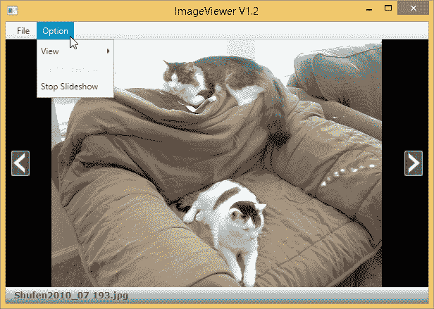

### 3.4 在幻灯片之间添加淡入过渡效果

为了增强幻灯片的运动感，我们将在幻灯片之间添加淡入过渡。以下是 `javafx.animation` 包中用于淡入过渡动画的类：

**Animation**：一个继承自 `java.lang.Object` 的抽象类，提供了动画所需的常用属性和方法。

**Transition**：一个继承自 `Animation` 的抽象类，提供了过渡动画所需的常用属性和方法。以下是可用的过渡效果：`FadeTransition`、`FillTransition`、`ParallelTransition`、`PathTransition`、`PauseTransition`、`RotateTransition`、`ScaleTransition`、`SequentialTransition`、`StrokeTransition`、`TranslateTransition`。

**FadeTransition**：`Transition` 的直接子类，在给定的时间内更改节点的透明度。

**ParallelTransition**：`Transition` 的直接子类，以并行方式对 `ObservableList<Animation>` 类型的 `Animation` 对象列表执行过渡。

这是我们将用于创建 `FadeTransition` 对象的构造函数：

```java
public FadeTransition(Duration duration, Node node)
```

`Duration` 类位于 `javafx.util` 包中，提供了几个创建时长对象的工厂方法。这里是所使用的一个：

```java
public static Duration millis(double ms)
```

上述方法为 `FadeTransition` 创建一个指定毫秒数的 `Duration`。`FadeTransition` 会查看以下属性：

- **duration**：类型为 `ObjectProperty<Duration>`，持有透明度从 `fromValue` 过渡到 `toValue` 的持续时间。该属性的值由构造函数的第一个参数指定。
- **node**：类型为 `ObjectProperty<Node>`，持有执行此淡入过渡的目标节点。该属性的值由构造函数的第二个参数指定。
- **fromValue**：类型为 `DoubleProperty`，持有此淡入过渡的透明度起始值。
- **toValue**：类型为 `DoubleProperty`，持有此淡入过渡的透明度结束值。

以下是为图像创建淡入效果 `FadeTransition` 的代码片段，该图像的透明度在 2000 毫秒的持续时间内从 0 变为 1：

```java
FadeTransition fadein = new FadeTransition(Duration.millis(2000));
fadein.setFromValue(0.0);
fadein.setToValue(1.0);
```

同样，以下是为图像创建淡出效果 `FadeTransition` 的代码片段，该图像的透明度在 2000 毫秒的持续时间内从 1 变为 0：

```java
FadeTransition fadeout = new FadeTransition(Duration.millis(2000));
fadeout.setFromValue(1.0);
fadeout.setToValue(0.0);
```

现在我们有两个 `FadeTransition` 对象，一个用于执行淡入过渡，另一个用于执行淡出过渡，我们希望这两个过渡并行处理。由于每个过渡都有自己的目标节点，使用了以下 `ParallelTransition` 构造函数：

```java
public ParallelTransition(Animation children)
```

这里是使用 `Animation` 类提供的 `playStart()` 方法创建 `ParallelTransition` 并启动动画的代码片段：

```java
Transition animate = new ParallelTransition(fadein, fadeout);
animate.playStart();
```

`SlideshowService` 请求需要提供两个 `ImageView` 对象，一个用于淡入过渡，另一个用于淡出过渡。下面的代码片段演示了 `SlideshowService` 请求如何通过 `setImageView` 方法和 `setFadeOutImageView` 方法提供 `ImageView`。

**Listing 3-21.** 在 `SlideshowService` 内部执行幻灯片之间过渡的 `ImageView` 对象：

```java
public class ImageViewer extends Application {
    ...
    final StringProperty imageName = new StringProperty();
    final ObjectProperty<Image> curImage = new SimpleObjectProperty<>();

    // 创建复用的 Worker 对象
    final SlideshowService service = new SlideshowService(listIterator, curImage, imageName);
    ...

    @Override
    public void start(final Stage stage) {
        BorderPane rootPane = new BorderPane();
        final StackPane imageArea = new StackPane();

        // 设置 StackPane 的最小大小以避免加载大图像时调整大小
        imageArea.setMinSize(0, 0);
        rootPane.setCenter(imageArea);
        ...

        // 将图像视图添加到图像区域
        final ImageView imageView = new ImageView();
        imageView.imageProperty().bind(curImage);
        imageView.setPreserveRatio(true);
        imageArea.getChildren().add(imageView);

        // 用于幻灯片中的淡入效果
        ImageView outView = new ImageView();
        outView.preserveRatioProperty().bind(imageView.preserveRatioProperty());
        outView.fitWidthProperty().bind(imageView.fitWidthProperty());
        outView.fitHeightProperty().bind(imageView.fitHeightProperty());
```


`imageArea.getChildren().add(outView);`

`service.setImageView(imageView);`

`service.setFadeOutImageView(outView);`

`...`

`}`

`}`

### 3.4.1 SlideshowService 类的完整源代码

下面的列表显示了此阶段 `SlideshowService` 类的完整源代码，其中更改用粗体字体显示。

***Listing 3-22.*** SlideshowService 类变为如下：

```
package imageviewer;

import java.nio.file.Path;
import java.util.ListIterator;
import javafx.animation.FadeTransition;
import javafx.animation.ParallelTransition;
import javafx.animation.Transition;
import javafx.beans.property.ObjectProperty;
import javafx.beans.property.SimpleObjectProperty;
import javafx.beans.property.SimpleStringProperty;
import javafx.beans.property.StringProperty;
import javafx.beans.value.ChangeListener;
import javafx.beans.value.ObservableValue;
import javafx.concurrent.Service;
import javafx.concurrent.Task;
import javafx.scene.image.Image;
import javafx.scene.image.ImageView;
import javafx.util.Duration;

/**
 * File Name: SlideshowService.java
 * (位于目录: ImageViewer1.2/src/example5/imageviewer/)
 *
 * 在幻灯片之间添加淡入淡出效果
 *
 * @author Shufen Kuo
 */
public class SlideshowService extends Service<Void> {

    private ObjectProperty<ImageView> imageView = new SimpleObjectProperty();
    private ObjectProperty<ImageView> fadeOutIV = new SimpleObjectProperty();
    private ObjectProperty<Image> image;
    private ObjectProperty<ListIterator<Path>> iterator;
    private StringProperty imageName;
    private ListIterator<Path> it;

    public SlideshowService() {
        this(new SimpleObjectProperty<ListIterator<Path>>(),
             new SimpleObjectProperty<Image>(),
             new SimpleStringProperty());
    }

    public SlideshowService(ObjectProperty<ListIterator<Path>> iterator,
                             ObjectProperty<Image> image, StringProperty imageName) {
        this.image = image;
        this.imageName = imageName;
        this.iterator = iterator;
        iterator.addListener(new ChangeListener<ListIterator<Path>>() {
            @Override
            public void changed(ObservableValue<? extends ListIterator<Path>>
                    ListIterator<Path> oldVal, ListIterator<Path> newVal) {
                it = newVal;
            }
        });
    }

    public ImageView getImageView() {
        return imageView.get();
    }

    public void setImageView(ImageView value) {
        imageView.set(value);
    }

    public ObjectProperty<ImageView> imageViewProperty() {
        return imageView;
    }

    public ImageView getFadeOutImageView() {
        return fadeOutIV.get();
    }

    public void setFadeOutImageView(ImageView value) {
        fadeOutIV.set(value);
    }

    public ObjectProperty<ImageView> fadeOutImageViewProperty() {
        return fadeOutIV;
    }

    public Image getImage() {
        return image.get();
    }

    public void setImage(Image value) {
        image.set(value);
    }

    public ObjectProperty<Image> imageProperty() {
        return image;
    }

    public ListIterator<Path> getIterator() {
        return iterator.get();
    }

    public void setListIterator(ListIterator<Path> value) {
        iterator.set(value);
    }

    public ObjectProperty<ListIterator<Path>> iteratorProperty() {
        return iterator;
    }

    public String getImageName() {
        return imageName.get();
    }

    public void setImageName(String value) {
        imageName.set(value);
    }

    public StringProperty imageNameProperty() {
        return imageName;
    }

    @Override
    protected Task<Void> createTask() {
        return new Task<Void>() {
            @Override
            protected Void call() {
                if (it == null) return null;
                Transition animate = null;
                ImageView inView = imageView.get();
                ImageView outView = fadeOutIV.get();
                if (inView != null && outView != null) {
                    FadeTransition fadein = new FadeTransition(Duration.millis(200));
                    fadein.setFromValue(0.0);
                    fadein.setToValue(1.0);
                    FadeTransition fadeout = new FadeTransition(Duration.millis(200));
                    fadeout.setFromValue(1.0);
                    fadeout.setToValue(0.0);
                    animate = new ParallelTransition(fadein, fadeout);
                }
                while (it.hasNext()) {
                    if (isCancelled()) {
                        updateMessage("Cancelled");
                        break;
                    }
                    if (inView != null && outView != null) {
                        Image prevImage = getImage();
                        outView.setImage(prevImage);
                        // 必须重置 outView 的透明度起始值
                        outView.setOpacity(1);
                        // 必须重置 inView 的透明度起始值
                        inView.setOpacity(0);
                    }
                    String url = it.next().toUri().toString();
                    setImage(new Image(url));
                    setImageName(url.substring(
                            url.lastIndexOf("/") + 1).replaceAll("%20", " "));
                    // 在暂停前开始淡入动画
                    if (animate != null)
                        animate.playFromStart();
                    // 暂停 3000 ms
                    try {
                        Thread.sleep(3000);
                    } catch (InterruptedException ex) {
                        if (isCancelled()) {
                            updateMessage("Cancelled");
                            break;
                        }
                    }
                }
                // 返回前重置 outView
                if (outView != null) {
                    outView.setImage(null);
                }
                return null;
            }
        };
    }
}
```

### 3.5 图像查看器 V1.2 的完整源代码

### 列表 3-23. ImageViewer 类的完整源代码：


```java
package imageviewer;

import java.io.File;
import java.io.IOException;
import java.util.ListIterator;
import javafx.application.Application;
import javafx.application.Platform;
import javafx.beans.property.BooleanProperty;
import javafx.beans.property.ObjectProperty;
import javafx.beans.property.SimpleBooleanProperty;
import javafx.beans.property.SimpleObjectProperty;
import javafx.beans.property.SimpleStringProperty;
import javafx.beans.property.StringProperty;
import javafx.beans.value.ChangeListener;
import javafx.beans.value.ObservableValue;
import javafx.concurrent.Worker;
import javafx.concurrent.WorkerStateEvent;
import javafx.event.ActionEvent;
import javafx.event.EventHandler;
import javafx.geometry.Insets;
import javafx.geometry.Pos;
import javafx.scene.Cursor;
import javafx.scene.Group;
import javafx.scene.Node;
import javafx.scene.Scene;
import javafx.scene.control.Menu;
import javafx.scene.control.MenuBar;
import javafx.scene.control.MenuItem;
import javafx.scene.control.RadioMenuItem;
import javafx.scene.control.Toggle;
import javafx.scene.control.ToggleGroup;
import javafx.scene.control.Tooltip;
import javafx.scene.image.Image;
import javafx.scene.image.ImageView;
import javafx.scene.input.MouseButton;
import javafx.scene.input.MouseEvent;
import javafx.scene.layout.BorderPane;
import javafx.scene.layout.HBox;
import javafx.scene.layout.StackPane;
import javafx.scene.paint.Color;
import javafx.scene.paint.CycleMethod;
import javafx.scene.paint.LinearGradient;
import javafx.scene.paint.Paint;
import javafx.scene.paint.Stop;
import javafx.scene.shape.Polygon;
import javafx.scene.shape.Rectangle;
import javafx.scene.shape.Shape;
import javafx.scene.text.Font;
import javafx.scene.text.FontWeight;
import javafx.scene.text.Text;
import javafx.stage.FileChooser;
import javafx.stage.Stage;

/**
 * File Name: ImageViewer.java V1.2
 * (位于目录: ImageViewer1.2/src/example5/imageviewer/)
 * 该应用程序创建一个 BorderPane 作为场景的根节点，
 * 并在中心添加一个 StackPane
 * 场景的初始大小设置为 600x400
 * StackPane 的大小将根据窗口大小进行自动调整
 *
 * 在 BorderPane 顶部添加一个菜单栏
 * 创建 File 菜单，并使用 FileChooser 的对话框选择
 * 图片文件，并在 ImageView 中加载显示
 *
 * 创建 Option 菜单包含 View 子菜单，让用户选择图像
 * 显示准则：适应宽度、适应高度或默认的原始大小
 *
 * 使用 bind 和 unbind 方法调整图像查看大小：
 * 将 ImageView 的 fitWidth/fitHeight 属性绑定到场景的 width/height 属性，
 * 这样当场景缩放时，图像视图的大小也会随之改变
 *
 * 在场景中添加 Next 和 Previous 按钮，然后
 * 在加载第一张图片后，用户可以使用这些按钮
 * 查看下一张或预览图片，而无需再次打开 FileChooser
 *
 * 添加状态栏以显示图片名称
 * 当没有更多图片可打开时禁用按钮
 * 区分不同事件类型之间的按钮外观：
 * 进入/按下/释放/移出
 *
 * 在线程中执行幻灯片
 * 与 Load 菜单项和 Previous 按钮的事件处理程序协调
 *
 * 为幻灯片添加淡入淡出效果
 *
 * @author Shufen Kuo
 */
public class ImageViewer extends Application {

    final Node nextButton = createNextButton();
    final Node prevButton = createPrevButton();

    {
        disableButton(nextButton, true);
        disableButton(prevButton, true);
    }

    // 创建切换组
    final ToggleGroup groupOption = new ToggleGroup();
    final String FIT_WIDTH = "Fit Width";
    final String FIT_HEIGHT = "Fit Height";
}
```

`final String ORIGINAL_SIZE = "原始尺寸";`

// 用于遍历当前选择目录下的文件

`final ObjectProperty<ListIterator<java.nio.file.Path>> listIterator = new SimpleObjectProperty<>();`

`final String NEXT = "下一页";`

`final String PREVIOUS = "上页";`

// 用于记录上一次点击的按钮

`final StringProperty lastClickedButton = new SimpleStringProperty();`

`final ObjectProperty<Image> curImage = new SimpleObjectProperty<>();`

`final StringProperty imageName = new SimpleStringProperty();`

`final BooleanProperty isSlideshowOn = new SimpleBooleanProperty(false);`

// 创建一个可复用的 Worker 对象

`final SlideshowService service = new SlideshowService(listIterator, curImage, imageName);`

`@Override`

`public void start(final Stage stage) {`

    `BorderPane rootPane = new BorderPane();`

    `final StackPane imageArea = new StackPane();`

    // 设置 StackPane 的最小尺寸以避免在

    // 加载大图片时缩放

    `imageArea.setMinSize(0, 0);`

    `rootPane.setCenter(imageArea);`

    // 添加状态栏和状态文本

    `final HBox statusBar = new HBox();`

    `statusBar.setPadding(new Insets(4, 12, 4, 12));`

    `statusBar.setSpacing(4);`

    `statusBar.setStyle("-fx-background-color: linear-gradient(#F0FFFF, #708090)");`

    `final Text statusText = new Text("");`

    `statusText.textProperty().bind(imageName);`

    `statusText.setFont(Font.font("Verdana", FontWeight.BOLD, 12));`

    `statusText.setFill(Color.DARKSLATEBLUE);`

    `statusBar.getChildren().add(statusText);`

    `rootPane.setBottom(statusBar);`

    // 创建图片视图并添加到图像区域

    `final ImageView imageView = new ImageView();`

    `imageView.imageProperty().bind(curImage);`

    `imageView.setPreserveRatio(true);`

    `imageArea.getChildren().add(imageView);`

    // 用于幻灯片中的淡出过渡

    `ImageView outView = new ImageView();`

    `outView.preserveRatioProperty().bind(imageView.preserveRatioProperty());`

    `outView.fitWidthProperty().bind(imageView.fitWidthProperty());`

    `outView.fitHeightProperty().bind(imageView.fitHeightProperty());`

    `imageArea.getChildren().add(outView);`

    `service.setImageView(imageView);`

    `service.setFadeOutImageView(outView);`

    // 自 JavaFX 8 起，为了透视场景背景颜色，

    // 必须将根布局的背景设为透明

    `rootPane.setStyle("-fx-background-color: transparent;");`

    `final Scene scene = new Scene(rootPane, 600, 400, Color.BLACK);`

    `imageArea.widthProperty().addListener(new ChangeListener<Object>() {`

        `public void changed(ObservableValue o, Object oldVal, Object newVal) {`

            `System.out.format("imageArea 宽度从 %.1f 变化到 %.1f%n", oldVal, newVal);`

        `}`

    `});`

    `imageArea.heightProperty().addListener(new ChangeListener<Object>() {`

        `public void changed(ObservableValue o, Object oldVal, Object newVal) {`

            `System.out.format("imageArea 高度从 %.1f 变化到 %.1f%n", oldVal, newVal);`

        `}`

    `});`

    // 添加菜单栏

    `final MenuBar menuBar = new MenuBar();`

    `Menu menuFile = new Menu("文件");`

    `MenuItem load = new MenuItem("加载");`

    `MenuItem exit = new MenuItem("退出");`

    `menuFile.getItems().addAll(load, exit);`

    `menuBar.getMenus().add(menuFile);`

    `rootPane.setTop(menuBar);`

    // 为退出菜单项添加动作

    `exit.setOnAction(new EventHandler<ActionEvent>() {`

        `@Override`

        `public void handle(ActionEvent e) {`

            `Platform.exit();`

        `}`

    `});`

    // 创建文件选择器

    `final FileChooser fileChooser = new FileChooser();`

    `fileChooser.setTitle("打开图片文件");`

    `FileUtils.configure(fileChooser);`

    // 为“加载”菜单项添加动作

    `load.setOnAction(new EventHandler<ActionEvent>() {`

        `@Override`

        `public void handle(ActionEvent e) {`

            // 打开文件选择对话框

            `File file = fileChooser.showOpenDialog(stage);`

            `if (file != null) {`

                // 设置上次访问的目录作为初始目录

                `File lastDir = file.getParentFile();`

                `fileChooser.setInitialDirectory(lastDir);`

                `loadFile(file);`

            `}`

        `}`

    `});`

    // 创建“选项”菜单

    `Menu menuOption = new Menu("选项");`

    // 创建单选菜单项

    `final RadioMenuItem fitWidth = new RadioMenuItem("适应宽度");`

    `fitWidth.setToggleGroup(groupOption);`

    `final RadioMenuItem fitHeight = new RadioMenuItem("适应高度");`

    `fitHeight.setToggleGroup(groupOption);`

    `final RadioMenuItem original = new RadioMenuItem("原始尺寸");`

    `original.setToggleGroup(groupOption);`

    // 监听切换组中选择的变化

    `groupOption.selectedToggleProperty().addListener(new ChangeListener() {`

        `public void changed(ObservableValue<? extends Toggle> ov, Toggle old_toggle, Toggle new_toggle) {`

            `if (groupOption.getSelectedToggle() != null) {`

                `RadioMenuItem choiceItem = (RadioMenuItem) groupOption.getSelectedToggle();`

                `if (choiceItem == fitWidth) {`

                    `System.out.println("fitwidth");`

                    `imageView.fitWidthProperty().bind(imageView.fitWidthProperty());`

                `}`

            `}`

        `}`

    `});`


```java
// 当鼠标进入“下一个”按钮时，填充矩形

final LinearGradient lgEntered = new LinearGradient(0, 0, 1, 0, true, CycleMethod.NO_CYCLE, new Stop[] {
    new Stop(0, Color.web("#87A7C6")),
    new Stop(0.4, Color.web("#A8B9D4")),
    new Stop(1, Color.web("#5173A8"))
});

// 当鼠标按下“下一个”按钮时，填充矩形

final LinearGradient lgPressed = new LinearGradient(0, 0, 1, 0, true, CycleMethod.NO_CYCLE, new Stop[] {
    new Stop(0, Color.web("#87A7C6")),
    new Stop(0.4, Color.web("#A8B9D4")),
    new Stop(1, Color.web("#2F4F4F"))
});

// 创建表示“下一个”图标视觉符号的多边形
// 8 像素厚度，内缩为 2, 2, 2, 5
final Polygon polygon = new Polygon();
Double[] dArray = {
    5.0, 2.0,
    22.0, 17.0,
    5.0, 32.0,
    5.0, 25.0,
    14.0, 17.0,
    5.0, 9.0
};
polygon.getPoints().addAll(dArray);
polygon.setFill(Color.WHITE);
polygon.setStroke(Color.web("#436B8B"));

// 设置光标
buttonGroup.setCursor(Cursor.OPEN_HAND);

// 为 `nextButton` 注册鼠标点击事件处理器
buttonGroup.setOnMouseClicked(new EventHandler<MouseEvent>() {
    @Override
    public void handle(MouseEvent me) {
        if (me.getButton() != MouseButton.PRIMARY)
            return;

        // 获取迭代器
        ListIterator<java.nio.file.Path> iterator = listIterator.get();
        if (iterator != null && iterator.hasNext()) {
            java.nio.file.Path path = iterator.next();
            if (lastClickedButton.get().equals(PREVIOUS)) {
                // 如果上一次点击的按钮是上一个，
                // 则 `next()` 的第一次调用是当前图片，
                // 必须向前移动一步。
                if (iterator.hasNext())
                    path = iterator.next();
                else {
                    // 没有下一张图片，禁用“下一个”按钮
                    disableButton(nextButton, true);
                    return;
                }
            }

            System.out.format("Next button clicked: %s%n", path.getFileName());
            String url = path.toUri().toString();
            curImage.set(new Image(url));
            imageName.set(url.substring(url.lastIndexOf("/") + 1).replaceAll("%20", " "));
            lastClickedButton.set(NEXT);

            // 当没有后续图片时禁用“下一个”按钮
            disableButton(nextButton, !iterator.hasNext());
            if (prevButton.isDisable())
                disableButton(prevButton, false);
        }
    }
});

registerButtonEvent(buttonGroup, rect, polygon, lg, lgEntered, lgPressed);
buttonGroup.getChildren().addAll(rect, polygon);
return buttonGroup;
}

/**
 * 使用矩形作为背景，多边形作为图标，组作为容器创建“上一个”按钮。
 * 矩形的大小为 25x35，
 * 多边形的厚度为 8 像素，
 * 多边形的内边为 (2, 5, 2, 5)，
 * 当鼠标进入/按下/释放/离开时更改按钮外观。
 *
 * @return
 */
Node createPrevButton() {
    // 创建一个组作为按钮
    Group buttonGroup = new Group();

    // 创建一个矩形形状作为背景
    final Rectangle rect = new Rectangle(0, 0, 25, 35);

    // 矩形的视觉效果
    final LinearGradient lg = new LinearGradient(0, 0, 1, 0, true, CycleMethod.NO_CYCLE, new Stop[] {
        new Stop(0, Color.web("#87A7C6")),
        new Stop(0.4, Color.web("#A8B9D4")),
        new Stop(1, Color.web("#5173A8"))
    });
    rect.setFill(lg);
    rect.setStroke(Color.web("#ACD7FF"));
    rect.setArcHeight(6.5);
    rect.setArcWidth(6.5);

    // 当鼠标进入“上一个”按钮时，填充矩形
    final LinearGradient lgEntered = new LinearGradient(0, 0, 1, 0, true, CycleMethod.NO_CYCLE, new Stop[] {
        new Stop(0, Color.web("#5173A8")),
        new Stop(0.6, Color.web("#A8B9D4")),
        new Stop(1, Color.web("#87A7C6"))
    });

    // 当鼠标按下“上一个”按钮时，填充矩形
    final LinearGradient lgPressed = new LinearGradient(0, 0, 1, 0, true, CycleMethod.NO_CYCLE, new Stop[] {
        new Stop(0, Color.web("#2F4F4F")),
        new Stop(0.6, Color.web("#A8B9D4")),
        new Stop(1, Color.web("#87A7C6"))
    });

    // 创建表示“上一个”图标视觉符号的多边形
    // 8 像素厚度，内缩为 2, 2, 2, 5
    final Polygon polygon = new Polygon();
    Double[] dArray = {
        19.0, 2.0,
        2.0, 17.0,
        19.0, 32.0,
        19.0, 25.0,
        10.0, 17.0,
        19.0, 9.0
    };
    polygon.getPoints().addAll(dArray);
    polygon.setFill(Color.WHITE);
    polygon.setStroke(Color.web("#436B8B"));

    // 设置光标
    buttonGroup.setCursor(Cursor.OPEN_HAND);

    // 为 `prevButton` 注册鼠标点击事件
    buttonGroup.setOnMouseClicked(new EventHandler<MouseEvent>() {
        @Override
        public void handle(MouseEvent me) {
            if (me.getButton() != MouseButton.PRIMARY)
                return;

            // 获取迭代器
            ListIterator<java.nio.file.Path> iterator = listIterator.get();
            if (iterator != null && iterator.hasPrevious()) {
                java.nio.file.Path path;
                if (lastClickedButton.get().equals(NEXT)) {
                    // 如果上一次点击的按钮是下一个，
                    // 则 `previous()` 的第一次调用是当前图片，
                    // 必须向后移动一步。
                    if (iterator.hasPrevious())
                        path = iterator.previous();
                    else {
                        // 没有上一个图片，禁用“上一个”按钮
                        disableButton(prevButton, true);
                        return;
                    }
                }

                System.out.format("Prev button clicked: %s%n", path.getFileName());

                // 如果幻灯片未开启，加载文件
                // 否则此处不做操作，
                // 因为幻灯片服务会处理任务
                if (!isSlidesOn.get()) {
                    String url = path.toUri().toString();
                    curImage.set(new Image(url));
                    imageName.set(url.substring(url.lastIndexOf("/") + 1).replaceAll("%20", " "));
                }

                lastClickedButton.set(PREVIOUS);
                disableButton(prevButton, !iterator.hasPrevious());
                if (nextButton.isDisabled())
                    disableButton(nextButton, false);
            }
        }
    });

    registerButtonEvent(buttonGroup, rect, polygon, lg, lgEntered, lgPressed);
    buttonGroup.getChildren().addAll(rect, polygon);
    return buttonGroup;
}

/**
 * 此方法利用节点的透明度来区分禁用状态，
 * 禁用时将透明度设置为 0.4。
 *
 * @param button 按钮
 * @param isDisable 是否禁用
 */
void disableButton(Node button, boolean isDisable) {
    // 如果没有图片可以打开，将透明度设置为 0.4
    double opacity = (isDisable) ? 0.4 : 1;
    button.setOpacity(opacity);
    button.setDisable(isDisable);
}

/**
 * 调用静态方法 `FileUtils.listIterator(Path)`
 * 获取用于遍历目录文件的迭代器，
 * 如果没有更多文件打开，则禁用按钮。
 *
 * @param file 文件
 */
void loadFile(File file) {
    // 创建迭代器
    try {
        ListIterator<java.nio.file.Path> it = FileUtils.listIterator(file.toPath());

        // 更新 `listIterator` 属性的值
        listIterator.set(it);

        // 如果幻灯片未开启，加载文件
        // 否则此处不做操作，
        // 因为幻灯片服务会处理任务
        if (!isSlidesOn.get()) {
            // 如果没有上一个文件，禁用“上一个”按钮
            // 在调用 `next()` 之前检查 `hasPrevious()`
            disableButton(prevButton, !it.hasPrevious());

            file = it.next().toFile();
            String url = file.toURI().toString();
            curImage.set(new Image(url));
            imageName.set(url.substring(url.lastIndexOf("/") + 1).replaceAll("%20", " "));

            // 检查 `hasNext()`，如果没有下一个文件，则禁用“下一个”按钮
            disableButton(nextButton, !it.hasNext());
            lastClickedButton.setValue(NEXT);
        }
    } catch (IOException ex) {
    }
}

/**
 * 此方法注册鼠标进入/按下/释放/离开事件，
 * 更改按钮的外观以区分状态。
 *
 * @param buttonGroup 组
 * @param rect 矩形
 * @param polygon 多边形
 * @param bg 背景
 * @param entered 进入颜色
 * @param pressed 按下颜色
 */
void registerButtonEvent(
    Node buttonGroup,
    final Shape rect,
    final Shape polygon,
    final Paint bg,
    final Paint entered,
    final Paint pressed
) {
    // 注册鼠标进入事件处理器
    // 当鼠标进入时更改按钮外观
    buttonGroup.setOnMouseEntered(new EventHandler<MouseEvent>() {
        @Override
        public void handle(MouseEvent me) {
            System.out.println("Mouse entered");

            // 检查左键是否按下
            rect.setFill(me.isPrimaryButtonDown() ? pressed : entered);
            polygon.setFill(Color.web("#436B8B"));
            polygon.setStroke(Color.WHITE);
        }
    });

    // 注册鼠标按下事件处理器
    // 当鼠标按下时更改按钮外观
    buttonGroup.setOnMousePressed(new EventHandler<MouseEvent>() {
        @Override
        public void handle(MouseEvent me) {
            System.out.println("Mouse pressed");
            if (me.isPrimaryButtonDown()) {
                rect.setFill(pressed);
                polygon.setFill(Color.web("#436B8B"));
                polygon.setStroke(Color.WHITE);
            }
        }
    });

    // 鼠标离开事件处理器
    // 当鼠标离开时恢复原始外观
}
```


```java
EventHandler<MouseEvent> exited = new EventHandler<MouseEvent>() {
  @Override
  public void handle(MouseEvent me) {
    System.out.println("Mouse exited/released");
    rect.setFill(bg);
    polygon.setFill(Color.WHITE);
    polygon.setStroke(Color.web("#436B8B"));
  }
};

buttonGroup.setOnMouseExited(exited);

// 鼠标释放事件处理程序
// 当鼠标释放时恢复原始外观
// 该外观与鼠标移出时相同
buttonGroup.setOnMouseReleased(exited);
}

/**
 *
 */
void configureSlideshow() {
  // 如果服务正在运行，则 isSlideshowOn 的值为 true，
  // 否则，它为 false
  isSlideshowOn.bind(service.runningProperty());

  service.setOnRunning(new EventHandler<WorkerStateEvent>() {
    @Override
    public void handle(WorkerStateEvent we) {
      System.out.println("Service is transited to running status");
      lastClickedButton.set(NEXT);

      if (prevButton.isDisable()) {
        disableButton(prevButton, false);
      }
    }
  });

  EventHandler<WorkerStateEvent> taskDone = new EventHandler<WorkerState> {
    @Override
    public void handle(WorkerStateEvent we) {
      disableButton(nextButton, !listIterator.get().hasNext());

      if (prevButton.isDisable()) {
        disableButton(prevButton, false);
      }
    }
  };

  service.setOnSucceeded(taskDone);
  service.setOnFailed(taskDone);
  service.setOnCancelled(taskDone);
}

public static void main(String[] args) {
  launch(args);
}
}
```

以下快照显示了淡入/淡出过渡。由于我们使用了 `ParallelTransition` 而不是 `SequentialTransition`，你会看到淡出的图像与淡入的图像混合。

**图 3-12.** 正在淡出的图像快照

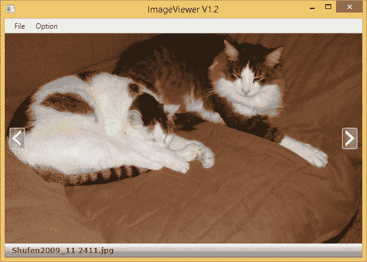

**图 3-13.** 以并行方式执行的淡入和淡出过渡快照

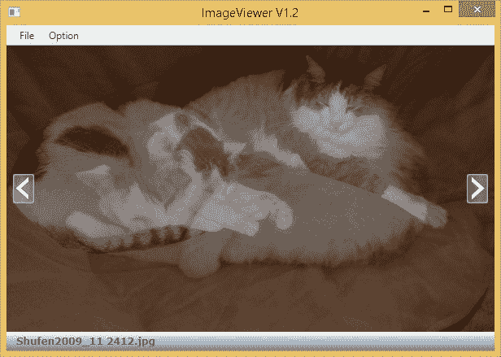

**图 3-14.** 正在淡入的图像快照

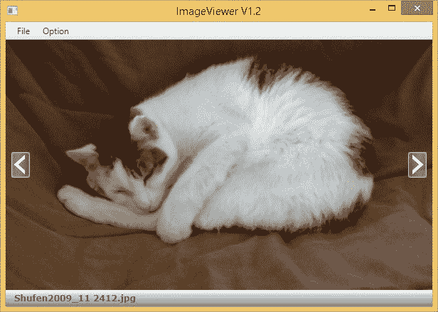

编译并运行应用程序。尝试以下步骤进行测试：

- 从 `FileChooser` 的文件打开对话框在图像目录中加载图像文件。
- 开始幻灯片。
- 在幻灯片运行时，执行以下操作：
  - 来回选择不同的视图选项。
  - 点击“上一个”（Previous）或“下一个”（Next）按钮。
  - 从 `FileChooser` 的文件打开对话框在不同的图像目录加载另一个图像文件。
- 停止幻灯片。

**在命令行中编译和运行 `ImageViewer` 的输出：**

```text
Microsoft Windows [Version 6.3.9600]

(c) 2013 Microsoft Corporation. All rights reserved.

F:\My Documents\DocRoot\SHUFEN\_JAVA\MyBookJFX\VolumeOne\ImageViewer1.2\

javac -encoding utf-8 -Xlint:unchecked imageviewer\*.java

jar cf imageviewer.jar imageviewer

java -cp imageviewer.jar imageviewer.ImageViewer

original size

imageArea width changed from 0.0 to 600.0

imageArea height changed from 0.0 to 352.0

Start Slideshow…

Service is transited to running status

Mouse entered

Mouse exited/released

fitwidth

fitheight

original size

Mouse entered

Mouse pressed

Mouse exited/released

Next button clicked: Shufen2010_05 1091.jpg

Mouse pressed

Mouse exited/released

Next button clicked: Shufen2010_05 1166.jpg

Mouse exited/released

Mouse entered

Mouse pressed

Mouse exited/released

Prev button clicked: Shufen2010_05 1166.jpg

Mouse pressed

Mouse exited/released

Prev button clicked: Shufen2010_05 1166.jpg

Mouse pressed

Mouse exited/released

Prev button clicked: Shufen2010_05 1142.jpg

Mouse exited/released

Mouse entered

Mouse exited/released

Mouse entered

Mouse pressed

Mouse exited/released

Next button clicked: jasmin.gif

Mouse pressed

Mouse exited/released

Next button clicked: Jasmin_1.jpg

Mouse exited/released

Mouse entered

Mouse exited/released

Mouse entered

Mouse pressed

Mouse exited/released

Prev button clicked: Jasmin_1_320x363.jpg

Mouse exited/released

Stop Slideshow…
```

### 3.6 总结

本章介绍了 JavaFX 库的以下关键方面，按照它们在章节中出现的顺序列出：

- `HBox` 类是 JavaFX 内置布局窗之一，位于 `javafx.scene.layout` 包中，是 `javafx.scene.layout.Pane` 的直接子类，将其子节点水平地排列在一行中。（参见“添加状态”节）
- `Text` 类位于 `javafx.scene.text` 包中，是 `javafx.scene.shape.Shape` 的直接子类，将其子节点水平地排列在一行中。（参见“添加状态”节）
- `Font(String family, FontWeight, double size)` 由 `javafx.scene` 提供，用于获取文本。
- `Scene(Parent root, double width, double height)` 是用于背景的 `Scene` 构造函数之一。
- `Padding(Insets value)` 由 `Region` 提供，上、右、下、左。
- `Spacing(double value)` 由 `HBox` 提供，指定子节点之间的间距。
- `Style(String value)` 由 `Node` 提供，指定 CSS 样式。
- `Opacity(double value)` 由 `Node` 提供，指定透明度。

`protected abstract V call()` 方法定义在 `Task` 类中，必须重写，并在任务执行时被调用。（参见此处 | 此处 | 此处](#）

`protected abstract Task<V> createTask()` 方法定义在 `Service` 类中，必须重写，并在服务启动时被调用。（参见此处 | 此处 | 此处](#）

`Service` 类提供了一些便利方法，用于注册 `EventHandler` 以处理 Worker 状态事件：

- `public final void setOnRunning(EventHandler<WorkerStateEvent> value)`
- `public final void setOnSucceeded(EventHandler<WorkerStateEvent> value)`
- `public final void setOnFailed(EventHandler<WorkerStateEvent> value)`
- `public final void setOnCancelled(EventHandler<WorkerStateEvent> value)`

（参见章节 Configure Slide Show Service Object）

`Worker.State` 是 `javafx.concurrent.Worker` 接口的嵌套类，是一个枚举类型，定义了 Worker 状态的常量，它们是：`CANCELLED`、`FAILED`、`READY`、`RUNNING`、`SCHEDULED` 和 `SUCCEEDED`。（参见此处和此处）

`Service` 类提供的一些位于 `javafx.concurrent` 包中的方法：

- `public void start()`

  启动此服务；只有当处于 `READY` 状态时，服务才能成功启动。

- `public void reset()`

  重置此服务；结果状态将转换到 `READY` 状态。

- `Worker.State getState()`

  定义在 `Worker` 接口中，获取状态属性的值，代表 Worker 的当前状态。

- `public boolean cancel()`

  定义在 `Worker` 接口中，取消此服务，如果服务成功取消，则返回 `true`。

（参见章节 Implement Event Handlers of Action Events for Start Slideshow and Stop Slideshow Menu Items）

`javafx.animation` 包中的一些类，用于在幻灯片之间并行执行淡入和淡出效果的过渡动画：

| Animation | Transition |
| :--- | :--- |
| `FadeTransition` | `FadeTransition` |
| `ParallelTransition` | |

（参见章节 Add Fade Transition between Slides）

`javafx.util.Duration` 类实现了 `java.lang.Comparable<Duration>`，用于保存持续时间。（参见此处）

`public void playFromStart()` 方法提供在 `Animation` 类中，从起始位置播放动画。（参见此处）

## 结语

作者们正在致力于该系列书籍的其他卷目，并将很快陆续发布。除了序言部分中透露的内容外，让我们先预见一下即将推出的新功能：

- 更多交互式绘图工具：手绘绘制器、橡皮带绘制器、文本写入器、颜色渐变器、弧绘制器、光标键移动器等。
- 色调板工具。
- 图像裁剪工具。
- 路径过渡动画。
- 动态右键菜单控制器。
- 以及更多……

祝您猴年快乐、健康、万事如意。
