# Java 8 图像查看器


郭淑芬（Shufen Kuo）于 1988 年夏天搬往旧金湾区，之后一直担任软件工程师。她在各种平台上拥有丰富的实战经验，从 PC DOS 到许多 Unix/Linux 工作站，再从 PC Linux 到 PC Windows。

她从 2001 年开始编写 Java 程序。多年来，她一直使用 `Abstract Windowing Toolkit`（`AWT`）和 `Swing`（`Java Foundation Classes`（`JFC`）的 GUI 组件）来为她的 Java 项目开发图形界面。从 2012 年起，她沉浸在 `JavaFX` 世界中；对其本质的探索激发了她编写书籍来推广 `JavaFX` 的强大之处。

在开发 Java 应用程序之前，她在运行 X Window 系统的 UNIX/Linux/Solaris 上拥有超过 12 年的 `C/C++` 应用程序开发经验。

郭淑芬于 1987 年从华盛顿州立大学获得计算机科学（Computer Science）硕士学位。

目前，她正在使用 `JavaFX` 开发具有丰富 GUI 的 Java 应用程序，并编写关于 `JavaFX` 编码的教程，利用她在设计和开发面向对象图形工具方面的专业知识。

她的出版物包括：

* “两步字符串匹配程序，”`Pattern Recognition`，24(7), 711-716, 1991。
* “一种寻找两个字符串最长公共子序列长度的改进算法，”`ACM SIGIR Forum`，1989 年春夏季，第 23 卷，第 3-4 期，89-99 页。

## 黄超（Bing-Chao Huang）

黄超博士于 1987 年从华盛顿州立大学获得计算机科学博士学位。他于 1984 年从斯坦福大学获得计算机科学硕士学位。

他的出版物包括：

* D.E. Knuth 著作的《计算机程序设计艺术》第 1 卷：基础算法，第三版（1997 年），第 116-177 页中的 `Algorithm I`。
* “恒定额外空间下的快速稳定合并与排序，”`The Computer Journal` 35(1992), 643-650
* “最优时间和空间下的稳定集合与多集合操作，”`Information Processing Letters` 16(1991), 131-136
* “最优时间和空间界限下的稳定重复键提取，”`Acta Informatica` 26(1989), 473-484
* “实用的原地合并，”`CACM` 31(1988), 348-352
* “最优时间和空间下的稳定集合与多集合操作，”第七届 ACM SIGACT-SIGMOD-SIGART 数据库原理研讨会（1988）
* “实用的原地合并，”ACM-IEEE/CS 秋季联合计算机会议（1987）
* “一种单向无栈快速排序算法，”`BIT` 26(1986), 127-130，与 D.E. Knuth 合著
* “一种反转排列的算法，”`Information Processing Letters` 12(1981), 237-238

# 致谢

| 特别感谢：Tan 博士及其家人，我的姐妹 Jacob Chung 博士，我的姐姐 Shuching Chung 博士，以及我的两只猫 Mimi 和 Maomao。 |
| --- |
| -- 郭淑芬 |

# 前言

## 本书的组织结构

本书是 `Coding in JavaFX Step by Step Build Graphics Toolkit` 系列书的第一卷（`VOLUME Ⅰ`）。由于内容非常丰富，无法整合在一本书中管理，因此章节被组织在不同的卷册中：

### 1. 第一卷：开发图像查看组件

* **第 1 章**：基础图像查看器
* **第 2 章**：带有浏览按钮的增强图像查看器
* **第 3 章**：具有幻灯片功能的增强图像查看器

### 2. 第二卷：开发交互式形状绘制工具

* **第 1 章**：线条绘制器

  根据绘板上的鼠标事件绘制线条。

* **第 2 章**：折线绘制器

  根据绘板上的鼠标事件绘制折线。

* **第 3 章**：多边形绘制器

  根据绘板上的鼠标事件绘制多边形。

* **第 4 章**：路径绘制器

  根据绘板上的鼠标事件绘制路径。

* **第 5 章**：二次贝塞尔曲线绘制器

  根据绘板上的鼠标事件绘制由二次贝塞尔曲线组成的路径。

* **第 6 章**：基础绘制工具

  在名为 `drawtool` 的包中创建集成类，以方便各种形状绘制器的开发——矩形绘制器、圆形绘制器和椭圆绘制器。

* **第 7 章**：带有预定义绘制器的增强绘制工具

  增强 `drawtool` 包并实现多种绘制器，位于 `drawtool.drawer` 包中，包含这些预定义的形状绘制器——`LineDrawer`、`PolylineDrawer`、`PolygonDrawer`、`PathDrawer`、`BazierCurveDrawer`、`RectangleDrawer`、`CircleDrawer`、`EllipseDrawer` 和 `ShapeMover`——它们都是 `ShapeDrawer` 的子类。

* **第 8 章**：初始 `JFXDrawTools`

  通过集成所有预定义的形状绘制器并利用增强的形状绘制 API，开发 `JFXDrawTools` 的初始版本。

### 3. 第三卷：开发交互式正多边形绘制工具

* **第 1 章**：具有正多边形形状能力的增强绘制工具

  引入 `RegularPolygon` 类。

* **第 2 章**：带有正多边形的增强绘制工具

  引入 `RegularPolygonDrawer`，它是 `ShapeDrawer` 的子类，位于 `drawtool.drawer`。

* **第 3 章**：带有正多边形绘制器的 JFXDrawTools

  将正多边形绘制器集成到 JFXDrawTools。

### 4. 第四卷：草稿保存与加载

* **第 1 章**：带有写入器的增强绘制工具

  引入 `DrawWriter` 类，位于 `drawtool.io`。

* **第 2 章**：带有加载器的增强绘制工具

  引入 `DrawLoader` 类，位于 `drawtool.io`。

* **第 3 章**：带有写入器和加载器的 JFXDrawTools

  将草稿保存和加载功能集成到 JFXDrawTools。

### 5. 其他

每章末都有一个总结部分，列出了该章节涉及的 JavaFX 库的关键方面。这里是一些核心内容：

* `javafx.scene.shape` 包中的 `Shape` 类，用于几何图形。
* `FXML`，一种符合 `XML` 的标记语言，用于构建 GUI。
* 属性和绑定机制。
* 用于加载和显示图像的 `Image` 类和 `ImageView` 类。
* `javafx.concurrent` 包中的并发能力。
* 应用于幻灯片对象的 `FadeTransition` 和 `ParallelTransition`。
* `javafx.scene.layout` 包中的内置布局面板。

| jfxdrawtools | `JFXDrawTools.java` |

# 第 卷目录

让我们浏览一下第 卷的内容：

* 第 1 章: 基础图像查看器
  * 1.1 作为 `Application` 的子类创建 `ImageViewer` 类
  * 1.2 创建菜单栏
  * 1.3 创建选项菜单和视图子菜单
  * 1.4 实现自适应宽度、自适应高度和原始尺寸查看选项
  * 1.5 总结
* 第 2 章: 带有浏览按钮的增强型图像查看器
  * 2.1 添加“下一页”按钮
  * 2.2 在 `StackPane` 中调整“下一页”按钮的默认位置
  * 2.3 添加“上一页”按钮并调整其在 `StackPane` 中的位置
  * 2.4 实现鼠标点击事件处理器
  * 2.5 `Image Viewer V1.1` 的完整源代码
  * 2.6 总结
* 第 3 章: 带有幻灯片轮的增强型图像查看器
  * 3.1 在 `BorderPane` 底部添加状态栏
  * 3.2 改进按钮的响应效果
  * 3.3 添加幻灯片功能
  * 3.4 在幻灯片之间添加淡入过渡
  * 3.5 `Image Viewer V1.2` 的完整源代码
  * 3.6 总结

图 1. JavaFX 8 中图像查看器的快照。

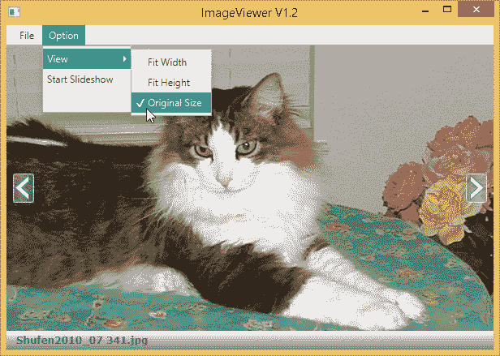

## 为什么选择这本书

本书适用于兴趣使用 JavaFX 库开发丰富客户端应用程序的 GUI 的软件开发者。

书中通过分步开发真实的 Java 应用程序，展示了 JavaFX 中的重要功能。

书中使用了说明性图表来帮助读者立即掌握抽象概念。每章中使用的所有图表都是使用本系列书中开发的图形工具创建的。

如果你属于以下情况，这本书就适合你：

* Java GUI 程序员（无论是新手还是专业人士），刚开始接触 JavaFX。
* 具备 JavaFX 基础知识并想学习如何开发交互式工具的 Java 程序员。
* 对面向对象的 JavaFX 图形工具和实际应用感兴趣，并希望获得完整且文档良好的源代码的专业软件工程师。

## 本书所需

如果你想编译和运行书中包含的应用程序，你需要下载并安装 `JDK 8`。这里是下载最新版本 `JDK 8` 的网站。要从此 Kindle 电子书中复制完整源代码，建议如下：

1. 在你的电脑上安装 `Calibre`（一个免费开源软件）。
2. 使用 `Calibre` 中的“添加书籍”功能添加 `Calibre` 的 .mobi 文件。
3. 从 `Calibre` 中打开书籍并将源代码复制到 Java 文件中。

### 引言

本系列书籍是一份针对软件开发者使用 JavaFX 构建 Java 应用程序 GUI 的教程，JavaFX 已成为 Java SE 开发工具包 (JDK 8) 的一部分。系列书籍的主要目标是提供一份全面的手册，介绍 JavaFX 的常用功能和精髓。通过分步开发复杂的工具包，展示了 JavaFX 提供的 API 的用法。系列书中包含了图形工具包的完整源代码、一组可重用的类以及可嵌入的 JavaFX 应用程序。

## JavaFX 历史

现在让我们浏览 JavaFX 演进的时间线，并领略 JavaFX 的前身：

SeeBeyond Technology Corporation 的 Chris Oliver 开发了一项名为 `F3` 的脚本，它是“形式跟随功能”（Form Follows Function）的缩写；它允许开发者访问 Swing 类并为快速开发丰富的互联网应用程序创建用户界面 (GUI)。

Sun Microsystems 在 2005 年 9 月收购了 SeeBeyond，`F3` 在 2007 年 5 月更名为 JavaFX Script。

2008 年 12 月，JavaFX 1.0 发布，开发者一直依赖 JavaFX Script 开发 JavaFX 应用程序，直到三年后 JavaFX 2.0 发布。

2010 年 1 月，Oracle 完成了对 Sun Microsystems 的收购并继续维护 JavaFX。

2010 年 9 月的 JavaOne 大上，Oracle 宣布 JavaFX Script 将停止使用。

2011 年 10 月，JavaFX 2.0 发布，开发者开始使用标准 Java 语言而非 JavaFX Script 来访问 JavaFX 库的 API。然而，除了 Java SE JDK 和 JavaFX Runtime 之外，开发和运行使用 JavaFX 2.0 编译的应用程序还需要安装 JavaFX SDK。

2013 年 2 月，JavaFX 2.2.7 发布，JDK7 包含了 JavaFX SDK 和 JavaFX Runtime。JavaFX 与 JDK 的集成为 JavaFX 开发者带来了极大的便利。使用 JDK 7 及更高版本编译的 JavaFX 应用程序不需要额外的安装。

2014 年 3 月 18 日，JavaFX 8 作为 Java SE 开发工具包 (JDK 8) 的一部分发布。

截至本书 2016 年 3 月出版时，最新的 JDK 版本为：2015 年 10 月 20 日的 JDK 866 以及 2016 年 1 月的 JDK 872。

JDK 9 的发布（GA）计划于 2017 年 3 月 23 日。

## 前提

书中介绍的 JavaFX 应用程序使用 JavaFX 包提供的 API 构建 GUI。不需要熟悉 Swing 包，但读者必须熟悉 Java 编程语言的基础。如果你是 Java 新手，请访问此网站 `http://docs.oracle.com/javase/tutorial/index.html` 获取 Java 技术的初步知识。按以下顺序阅读 Oracle 在线文档：

1. 简单的 Java 应用程序“Hello World!”与安装：

   访问 `http://docs.oracle.com/javase/tutorial/getStarted/index.html`

2. Java 语言的概念和特性：

   访问 `http://docs.oracle.com/javase/tutorial/java/index.html`

3. Java 集合框架：

   访问 `http://docs.oracle.com/javase/tutorial/collections/index.html`

4. 核心 Java 类：

   访问 `http://docs.oracle.com/javase/tutorial/essential/index.html`

## JavaFX 应用程序简介

以下示例旨在让新接触 JavaFX 的读者快速预览如何创建 JavaFX 应用程序。

要开始学习，你需要创建一个继承自 `javafx.application.Application` 的类（这是 JavaFX 应用程序的入口），并重写必须覆盖的抽象 `start` 方法。一个典型的 `start` 方法如下：

```java
package imageviewer;

import javafx.application.Application;
import javafx.scene.Scene;
import javafx.scene.layout.BorderPane;
import javafx.scene.layout.StackPane;
import javafx.stage.Stage;

/**
 * File Name: ImageViewer.java
 *
 * @author Shufen Kuo
 */

public class ImageViewer extends Application {

  @Override
  public void start(Stage stage) {
    BorderPane rootPane = new BorderPane();
    StackPane imageArea = new StackPane();
    rootPane.getChildren().add(imageArea);

    Scene scene = new Scene(rootPane, 600, 400); 
    stage.setTitle("ImageViewer V1.0");
    stage.setScene(scene);
    stage.show();
  }

  public static void main(String[] args) {
    launch(args);
  }
}
```

### Scene 和 Stage

在 `start` 方法中出现了两个重要的类 `Scene` 和 `Stage`。通常情况下，主要任务是创建在名为场景图（scene graph）的分层次树结构中管理的图形用户界面（GUI），将场景图的根节点关联到 `Scene` 对象，然后将场景放置在 `Stage` 对象上。`Stage` 代表 JavaFX 应用程序顶层容器，作为场景图的窗口与用户进行交互。

接下来的快照让你对 JavaFX 应用程序的 GUI 外观有一个初步了解：图 1. JavaFX 应用程序快照。（Images/image00123.jpeg javafx_app_guis）

### 节点

JavaFX 引入了一个基础类 `javafx.scene.Node`，它继承自 `java.lang.Object` 并提供了对所有用户界面都有用的常用属性和方法。我们经常使用节点（nodes）一词来引用 GUI。

场景图可能包含各种节点。节点可以是父节点（带有子节点的节点）或叶子节点（没有子节点的节点）；每个节点只能有一个父节点，而根节点没有。场景图中的所有节点都派自 `javafx.scene.Node`。为了快速识别场景图中基本的节点类型，我们根据是否具有添加子节点的能力来区分它们。

* 你可能向这些节点添加子节点：

  以下类被频繁用作父节点：`Group`、`Pane` 以及内置的布局面板（它们是 `Pane` 的直接子类）。通常你调用 `getChildren()` 方法来获取类型为 `ObservableList<Node>` 的列表（它是 `java.util.List` 的子接口），然后使用开发者熟悉的 `Collection` 中定义的各种实用程序来操作列表的内容。

* 你可能无法向这些节点添加子节点：

  以下类始终被用作叶子节点：`Canvas`、`ImageView`、`MediaView` 以及 `Shape` 的所有直接子类，例如 `Rectangle`、`Ellipse` 等。

### JavaFX 和 Swing


现在，有一个有趣的问题。多年来，开发者一直使用 Swing API 构建 Java 应用程序的 GUI，这些是 Java Foundation Classes（JFC）的 GUI 组件。为什么除了 Swing 之外我们还需要 JavaFX？

如果你拥有大量用 Swing 编写的遗留代码，并希望将 JavaFX 特性整合到 Swing 代码中，JDK 8 提供了相应机制；反之，你也可以在 JavaFX 应用程序中包含 Swing 组件。

JavaFX-Swing 互操作性主题在本书中未介绍。如果你对该主题感兴趣，请访问 Oracle 在线文档“JavaFX: Interoperability -- Java-Swing Interoperability”：

[`docs.oracle.com/javase/8/javafx/interoperability-tutorial/fx_swing.htm`](http://docs.oracle.com/javase/8/javafx/interoperability-tutorial/fx_swing.htm)

JavaFX 是下一代 Java GUI。为了说明使用 JavaFX 的优势，除了 JavaFX 和 Swing 之间的互操作性外，下面的章节还介绍了 JavaFX 的重要特性。

## JavaFX 的精髓

JavaFX 不仅允许你快速创建具有视觉用户界面的应用程序，还包含了诱人且独特的能力。它们列举如下。

### 内置布局面板

JavaFX 的布局面板（layout panes）是容器，能够自动对节点执行各种类型的摆放操作。你可以在布局面板中放置任意数量的节点，布局面板本身也是一个节点，因此也可以嵌套在另一个布局面板中。使用布局面板的主要优势是避免手动指定每个节点的大小和位置的繁琐。由于场景图中的这些节点以树结构管理，布局算法会根据其布局类型和指定的布局属性，递归地计算每个节点的大小和位置；当窗口大小调整事件发生时，还会触发动态重新计算。

有 8 种内置布局面板，位于`javafx.scene.layout`包中：

- `BorderPane`：`BorderPane`将节点分别放置在五个位置，以创建经典窗口的外观。通常顶部区域用于菜单栏或工具栏，底部区域用于状态栏，左右侧区域用于导航面板，中心区域用于工作区域。
- `HBox`：`HBox`将节点放置在一行（水平方向）。
- `VBox`：`VBox`将节点放置在一列（垂直方向）。
- `GridPane`：`GridPane`将节点放置在具有多行多列的网格中。这是一个显示一系列键值对属性的实用用户界面。
- `StackPane`：`StackPane`将所有节点堆叠在一起，默认以居中对齐。所有子节点在容器中心相互重叠，后创建的节点位于先创建节点的上方。但你可以使用静态方法`StackPane.setAlignment(Node child, Pos value)`和`StackPane.setMargin(Node child, Insets value)`来调整节点的强制位置。
- `FlowPane`：你可以指定`FlowPane`的方向属性。对于水平`FlowPane`，节点从左到右排列，在容器宽度边界处换行。对于垂直`FlowPane`，节点从上到下排列，在容器高度边界处换列。
- `TilePane`：`TilePane`与`FlowPane`类似，不同之处在于`TilePane`网格中的每个单元具有相同的大小。
- `AnchorPane`：`AnchorPane`相对于指定的锚点放置节点，共有四个点：`topAnchor`、`rightAnchor`、`bottomAnchor`和`leftAnchor`。

### 参考 Oracle 在线文档“Working with Layouts in JavaFX”

[`docs.oracle.com/javase/8/javafx/layout-tutorial/index.html`](http://docs.oracle.com/javase/8/javafx/layout-tutorial/index.html)

## 使用 CSS 进行自定义

JavaFX 允许使用 CSS（层叠样式表）来描述应用程序用户界面的样式。通过 CSS 定义颜色、字体、外边距、内边距、宽度、高度、线条、背景图像等演示属性，并与应用程序代码分离，在许多方面显示了巨大的便利性：

- 从软件提供者的角度自定义：从同一组代码编译的应用程序可以呈现各种样式，每种样式符合不同的客户需求。
- 从应用程序用户的角度自定义：即使在软件发布后，如果应用程序用户对 UI 的外观有偏好，也可以在客户现场修改 CSS 文件定义的演示属性。
- 对样式设计者的利益：应用程序代码与样式定义的分离提高了代码的可读性，并通过让图形设计师专注于处理 CSS，简化了任务。
- 对软件开发者的利益：

  在测试过程中，开发者可能会频繁更改 CSS 文件中定义的样式属性，以评估 GUI（图形用户界面）的不同外观。如果每次更改都需要退出并重启应用程序，那将是一项非常麻烦的任务。为了方便这一评估过程，最佳策略是设计一个临时的`Load`按钮。当任何样式属性发生变化时，只需点击该按钮重新加载 CSS，而无需退出并重启应用程序，从而节省大量的测试时间。

## JavaFX 中的 CSS 与 HTML CSS 的相似性

JavaFX 中 CSS 的语法与 HTML 中的 CSS 相同，因此任何具有浏览器 CSS 经验的设计师都可以花费极少的学习成本，为 JavaFX 应用程序的 UI 设计样式。

### 参考 Oracle 在线文档“Skinning JavaFX Applications with CSS”

[`docs.oracle.com/javase/8/javafx/user-interface-tutorial/css_tutorial.htm`](http://docs.oracle.com/javase/8/javafx/user-interface-tutorial/css_tutorial.htm)

## 使用 FXML 创建用户界面

FXML 是一种符合 XML（可扩展标记语言）格式的标记语言，具有额外的规则，用于创建 JavaFX 应用程序的用户界面。考虑到手动编写 FXML 容易出错，一种可行的方法是通过 GUI 构建器生成 FXML 代码。

在本系列书籍中，我们介绍了一个实用的应用程序`JFXDrawTools`，它是一种专门用于创建自`Shape`子类实例的 GUI 构建器。用户可以交互式地创建草图（无论是`Shape`还是`ImageView`），操作其属性并将编辑结果保存为 FXML 格式的文件。这些文件稍后可以加载回以继续编辑过程，或者被其他 JavaFX 应用程序动态加载。

将应用程序的 GUI（视图 View）与其业务逻辑（模型 Model）分离，被认为是一种良好的编程实践。FXML 文件表示视图，而控制器（controller）是一个在视图和模型之间传递信息的 Java 类。使用 FXML 构建 GUI，使应用程序开发者能够有效地采用 MVC（模型-视图-控制器）架构。

### 参考 Oracle 在线文档“JavaFX: Mastering FXML”

[`docs.oracle.com/javase/8/javafx/fxml-tutorial/index.html`](http://docs.oracle.com/javase/8/javafx/fxml-tutorial/index.html)

## 属性与绑定的强大能力

JavaFX 特有的属性（Properties）概念遵循了 JavaBeans 组件中引入的设计规范，通常与绑定（Binding）机制结合使用，整体上为各种编程需求提供了强大、精炼且简洁的解决方案。

在本系列书籍介绍的`JFXDrawTools`应用程序中，我们详尽地演示了属性和绑定的用法。在属性窗口（Properties Window）的实现中，使用了合适的 UI 控件（如文本字段、选择框、组合框等）来查看相关对象的属性。绑定机制被用于 UI 控件与其对应的对象属性进行双向链接，这种关系在属性窗口即将显示时建立。当用户更改 UI 控件中显示的数据时，更改会立即反映到相关对象的相应属性。

### 参考 Oracle 在线文档“JavaFX: Properties and Binding Tutorial”

[`docs.oracle.com/javase/8/javafx/properties-binding-tutorial/index.html`](http://docs.oracle.com/javase/8/javafx/properties-binding-tutorial/index.html)

## 变换与过渡的复杂机制

JavaFX 内置的节点变换（transformations）能力对于开发图形编辑器、绘图工具、图像查看器、GUI 构建器等图形软件包非常方便。

这里是处理变换的类：`Translate`、`Rotate`、`Scale`和`Shear`。它们都派自`Transform`类，并位于`javafx.scene.transform`包中。

JavaFX 过渡（transitions）为创建动画提供了简洁的方法。有许多需要动画功能的应用，这里是一些案例：在警报情况下引起注意、在删除操作期间将对象投入回收站、在数据加载期间指示中间状态等……

在本系列书籍介绍的`ImageViewer`应用程序中，我们在幻灯片功能中对图像对象应用了`FadeTransition`和`ParallelTransition`，以同时使新图像淡入并将旧图像淡出。

这里是处理过渡的类：`FadeTransition`、`RotateTransition`、`ScaleTransition`、`TranslateTransition`、`FillTransition`、`StrokeTransition`、`PathTransition`、`ParallelTransition`、`SequentialTransition`和`PauseTransition`。它们都派自`Transition`类（这是一个定义动画基本功能的抽象类），并位于`javafx.animation`包中。

### 参考 Oracle 在线文档“JavaFX: Transformations, Animations, and Visual Effects”

[`docs.oracle.com/javase/8/javafx/visual-effects-tutorial/index.htm`](http://docs.oracle.com/javase/8/javafx/visual-effects-tutorial/index.html)

## 2D 几何原语与文本都是 JavaFX 节点

JavaFX 提供了一个`Shape`类，它继承自`javafx.scene.Node`类，是 2D 几何基本形式的超类。应用于几何原语的面向对象概念促进了图形应用程序的开发。

这里是派自`Shape`的类：`Arc`、`Circle`、`CubicCurve`、`Ellipse`、`Line`、`Path`、`Polygon`、`Polyline`、`QuadCurve`、`Rectangle`、`SVGPath`和`Text`。除了`Text`类外，其余位于`javafx.scene.shape`包中。

请注意，位于`javafx.scene.text`包的`Text`类也被视为形状，它为文本绘制工具的发展提供了支持。所有 JavaFX 节点的功能适用于文本对象。你可以像处理任何几何形状一样处理它。文本对象可以放置在布局面板中以利用自动布局能力、应用变换和过渡，以及使用 CSS 自定义样式等。

### 参考 Oracle 在线文档“Using Text in JavaFX”

[`docs.oracle.com/javase/8/javafx/user-interface-tutorial/text-settings.htm`](http://docs.oracle.com/javase/8/javafx/user-interface-tutorial/text-settings.htm)

## 其他处理许多复杂问题以缩短开发时间的显著功能

- `ImageView`类用于加载和显示图像。

  `ImageView`类继承自`javafx.scene.Node`，配合`Image`类用于加载和显示图像。JavaFX 还提供了对位图图像进行操作的 API，`PixelReader`定义了从`Image`对象读取像素的方法，而`PixelWriter`定义了向`Image`对象写入像素的方法。所有这些都位于`javafx.scene.image`包中。

  ### 参考 Oracle 在线文档“Using the Image Ops API”

  [`docs.oracle.com/javase/8/javafx/graphics-tutorial/image_ops.htm`](http://docs.oracle.com/javase/8/javafx/graphics-tutorial/image_ops.htm)

- `WebView`类用于管理网页。

  JavaFX 架构中嵌入了一个 Web 引擎组件，它位于`javafx.scene.web`包中，提供一组 API，用于开发具有浏览器功能的应用程序。要查看网页，首先需要创建一个扩展`javafx.scene.Parent`的`WebView`对象（该对象继承了节点（node）的所有特性），然后获取与之关联的`WebEngine`。`WebEngine`提供了与操作网页相关的方法，例如：加载或显示网页（通过提供给定的 URL 或页面内容）、访问由`WebEngine`为加载的网页创建的文档对象模型（DOM）、处理由 JavaScript 触发的各种事件等。

  ### 参考 Oracle 在线文档“JavaFX: Adding HTML Content to JavaFX Applications”

  [`docs.oracle.com/javase/8/javafx/embedded-browser-tutorial/index.html`](http://docs.oracle.com/javase/8/javafx/embedded-browser-tutorial/index.html)

### 用于编辑 HTML 页面的 `HTMLEditor` 类

对 HTML 编辑能力的完整支持来自`HTMLEditor`类，该类扩展自`javafx.scene.control.Control`并位于`javafx.scene.web`包中。要在 JavaFX 应用程序中嵌入 HTML 编辑器，你只需创建`HTMLEditor`的实例，将其添加到场景图（scene graph）中，它就可以与用户交互了。以下两个方法对于获取和设置编辑器的 HTML 内容有用：`getHtmlText()`和`setHtmlText(java.lang.String htmlText)`。

与处理多行纯文本的类似控件`TextArea`不同，`HTMLEditor`格式化符合 HTML 语法的文本。

HTML 编辑器的用法广泛应用于软件各个领域，例如：博主撰写并发布文章（内容管理系统）、邮件系统用户撰写消息（消息系统）、在线卖家为上架准备产品描述（电子商务管理系统）等。

### 参考 Oracle 在线文档“JavaFX: Working with JavaFX UI Components -- HTML Editor”

[`docs.oracle.com/javase/8/javafx/user-interface-tutorial/editor.htm`](http://docs.oracle.com/javase/8/javafx/user-interface-tutorial/editor.htm)

### 用于渲染数据的图表组件

以下类位于`javafx.scene.chart`包中，用于绘制各种类型的图表：

- `AreaChart`、`StackedAreaChart`
- `BarChart`、`StackedBarChart`
- `BubbleChart`
- `LineChart`
- `PieChart`
- `ScatterChart`

`Chart`类是所有图表组件的基类，扩展自`javafx.scene.layout.Region`类，因此继承了`javafx.scene.Node`类的所有适用特性。

### 参考 Oracle 在线文档“JavaFX: Working with JavaFX UI Components -- Working with JavaFX Charts”

[`docs.oracle.com/javase/8/javafx/user-interface-tutorial/charts.htm`](http://docs.oracle.com/javase/8/javafx/user-interface-tutorial/charts.htm)

### 用于播放媒体的 `MediaView` 类

扩展`javafx.scene.Node`的`MediaView`类与`MediaPlayer`和`Media`类一起使用，在 JavaFX 应用程序中播放媒体。所有与媒体相关的类都位于`javafx.scene.media`包中。

### 参考 Oracle 在线文档“JavaFX: Incorporating Media Assets Into JavaFX Applications”

[`docs.oracle.com/javase/8/javafx/media-tutorial/`](http://docs.oracle.com/javase/8/javafx/media-tutorial/)

# JavaFX 基础 UI 组件


除了上述的 JavaFX 核心外，JavaFX 还提供了基础 UI 组件，它们位于`javafx.scene.control`包中并派自`javafx.scene.control.Control`类；它们通常被称为 UI 控件。

以下是可用的 UI 控件，未标记星号 (\*) 的控件在 Swing 中有对应的控件：

* `Label`, `Button`, `RadioButton`, `ToggleButton`
* `CheckBox`, `ChoiceBox`
* `ComboBox`, `ListView`, `TableView`
* `TextField`, `TextArea`, `PasswordField`, `HTMLEditor`
* `ScrollBar`, `ScrollPane`, `Slider`, `ProgressBar`, `ProgressIndicator`, `ToolBar`
* `MenuBar`, `MenuButton`, `SplitMenuButton`
* `ColorPicker`, `DatePicker`, `Separator`, `Pagination`, `SplitPane`, `TabPane`, `TitledPane`, `Accordion`, `TreeView`, `TreeTableView`, `Hyperlink`

以下 UI 组件通常与上述 UI 控件归为同一类。

* `Tooltip`位于`javafx.scene.control`包中，但派自`javafx.scene.control.PopupControl`类。
* `MenuItem`, `Menu`, `CheckMenuItem`, `RadioMenuItem`位于`javafx.scene.control`包中。扩展`java.lang.Object`的`MenuItem`是另外三个类的基类。
* `FileChooser`位于`javafx.stage`包并扩展自`java.lang.Object`。

### 参考 Oracle 在线文档“JavaFX: Working with JavaFX UI Components”：

[`docs.oracle.com/javase/8/javafx/user-interface-tutorial/editor.htm`](http://docs.oracle.com/javase/8/javafx/user-interface-tutorial/editor.htm)

JavaFX 程序的图形用户界面是通过层次树结构管理的，这种结构被称为场景图（scene graph）。在`ImageViewer`应用中，我们使用`BorderPane`作为场景图的根节点，并将`StackPane`放在`BorderPane`的中心作为图像渲染区域。`BorderPane`和`StackPane`都是内置的布局面板，位于`javafx.scene.layout`包中，并且是`javafx.scene.layout.Pane`类的直接子类。

`BorderPane`类允许你创建具有经典主窗口外观的图形用户界面。在下一节中，你将看到在`BorderPane`顶部添加了一个菜单栏，在随后的章节中，会在底部添加一个状态栏。

`StackPane`类将其子节点按堆叠方式布局，将后创建的子节点置在前一个节点之上。在`ImageViewer`应用中，由于一次只查看一张图像，因此`StackPane`只有一个节点。如果图像的大小小于`StackPane`的大小，图像将放置在`StackPane`的中心。如果图像的大小大于`StackPane`，`StackPane`将自动扩展以容纳整个图像；如果应用程序窗口中的视图空间不够大，默认情况下只能看到图像的中心部分。在稍后的章节中，我们将演示如何避免`StackPane`被其内容重置大小，请参见此处。

`Scene`对象作为场景图的容器被创建，并接收一个根节点作为参数。在`ImageViewer`应用中，根节点是`BorderPane`，`Scene`对象的初始宽度和高度设置为 600 像素和 400 像素。`BorderPane`和`StackPane`都是可调整大小的布局面板；因此，如果用户动态调整应用程序窗口的大小，场景将调整大小，并将调整大小事件传递给其根节点，从而重新计算图像渲染区域的大小。

你使用`Stage`类中定义的`setScene`方法将场景放置在`Stage`上使其运行。`Stage`是`javafx.stage.Window`的直接子类；它是 JavaFX 应用的顶层窗口。

JavaFX 系统会创建一个`Stage`对象（称为主阶段，primary stage），并将其传递给`start`方法，`start`是`Application`类中定义的一个抽象方法。开发者可以根据需要为应用程序构建额外的`Stage`对象。

以下代码演示了如何创建一个作为`Application`直接子类的`ImageViewer`类，并重写`start`方法。代码如下：

列表 1-1. 创建扩展`Application`类的`ImageViewer`类，重写`start`方法，创建`BorderPane`作为场景的根节点，并将`StackPane`放在`BorderPane`的中心作为图像渲染区域：

```
package imageviewer;

import javafx.application.Application;
import javafx.scene.Scene;
import javafx.scene.layout.BorderPane;
import javafx.scene.layout.StackPane;
import javafx.stage.Stage;

/**
 * FileName:ImageViewer.java
 *
 * 此应用创建一个 BorderPane 作为场景的根节点，
 * 并在 BorderPane 的中心添加一个 StackPane
 * 场景的初始大小设置为 600x400
 * StackPane 的大小将自动设置以适应场景的大小。
 * 当用户调整窗口大时，StackPane 将会被调整大小。
 */

public class ImageViewer extends Application {

  @Override
  public void start(Stage stage) {
    BorderPane rootPane = new BorderPane();
    StackPane imageArea = new StackPane();
    rootPane.setCenter(imageArea);

    Scene scene = new Scene(rootPane, 600, 400); 
    stage.setTitle("ImageViewer V1.0");
    stage.setScene(scene);
    stage.show();
  }

  public static void main(String[] args) {
    launch(args);
  }
}
```

### 1.1.1 JavaFX 线程与 Java 启动线程

`Application`类是 JavaFX 应用的入口点。它定义了以下重要方法：

`public void init() throws Exception`

`public abstract void start(Stage primaryStage) throws Exception`

`public void stop() throws Exception`

`init`方法不执行任何操作，从 Java 启动线程中调用。而`start`方法是一个抽象方法且必须被重写，它在`init`方法返回后从 JavaFX 线程中调用。如果你需要在`start`方法之前执行一些初始工作，可以通过重写`init`方法来实现；但至关重要是，作为活跃场景成员的节点必须从 JavaFX 线程访问。同样，`Scene`对象或`Stage`对象的构造也必须从 JavaFX 线程访问。

### 1.1.2 捕获图像渲染区域的调整事件

出于调试和测试目的，在此处注册了一个`ChangeListener`，它提供了一个`changed`方法，以便在图像渲染区域的宽度或高度变化时收到通知。当用户调整应用程序窗口大时，图像渲染区域的宽度或高度就会发生变化。

为了观察属性值注册监听器，我们使用此方法：

```
void addListener(ChangeListener<? super T> listener) 
```

该方法定义在`javafx.beans.value.ObservableValue`接口中，提供了`changed(ObservableValue<? extends T> observable, T oldValue, T newValue)`方法的实现，当属性值更改时调用。

同一个`ChangeListener`允许注册到多个`ObservableValue`上。为了避免内存泄漏问题，当不再需要观察值时，使用`removeListener(ChangeListener<? super T> listener)`方法取消监听器是一种良好的编程习惯，该方法会移除可观测值与监听器之间的链接。

`StackPane`类从`javafx.scene.layout.Region`类继承`width`和`height`属性。这两个属性的类型都是`ReadOnlyDoubleProperty`，它是实现`ObservableValue`接口的抽象类。正如名称所示，`ObservableValue`持有一个可观测的值，你可以监听值的变化并采取必要的行动。

以下代码演示了如何监控放置在`BorderPane`中心`StackPane`图像渲染区域的调整大小事件。

导入语句：

```
import javafx.beans.value.ChangeListener;
import javafx.beans.value.ObservableValue;
```

列表 1-2. 为图像渲染区域的宽度和高度属性添加监听器：

```
imageArea.widthProperty().addListener(new ChangeListener<Object>() {
  public void changed(ObservableValue o, Object oldVal, Object newVal) {
    System.out.format("imageArea width changed from %.1f to %.1f%n",
      oldVal, newVal);
  }
});
imageArea.heightProperty().addListener(new ChangeListener<Object>() {
  public void changed(ObservableValue o, Object oldVal, Object newVal) {
    System.out.format("imageArea height changed from %.1f to %.1f%n",
      oldVal, newVal);
  }
});
```

列表 1-3. `ImageViewer`类的完整源代码如下：

```java
package imageviewer;

import javafx.application.Application;
import javafx.beans.value.ChangeListener;
import javafx.beans.value.ObservableValue;
import javafx.scene.Scene;
import javafx.scene.layout.BorderPane;
import javafx.scene.layout.StackPane;
import javafx.stage.Stage;

/**
 * File Name: ImageViewer.java
 * (in directory: ImageViewer1.0/src/example1/imageviewer/)
 * 此应用程序创建了一个 BorderPane 作为场景的根节点，
 * 并且在 BorderPane 的中心添加了一个 StackPane。
 * 场景的初始大小设置为 600 x 400。
 * StackPane 的大小将自动设置，以适应场景的大小。
 * 当用户调整窗口大时，StackPane 会随之调整大小。
 *
 * @author Shufen Kuo
 */

public class ImageViewer extends Application {

  @Override
  public void start(Stage stage) {
    BorderPane rootPane = new BorderPane();
    StackPane imageArea = new StackPane();
    rootPane.setCenter(imageArea);

    Scene scene = new Scene(rootPane, 600, 400);

    imageArea.widthProperty().addListener(new ChangeListener<Object>() {
      public void changed(ObservableValue o, Object oldVal,
        Object newVal) {
        System.out.format("imageArea width changed from %.1f to %.1f%n",
          oldVal, newVal);
      }
    });
    imageArea.heightProperty().addListener(new ChangeListener<Object>() {
      public void changed(ObservableValue o, Object oldVal,
        Object newVal) {
        System.out.format("imageArea height changed from %.1f to %.1f%n",
          oldVal, newVal);
     }
    });

    stage.setTitle("ImageViewer V1.0");
    stage.setScene(scene);
    stage.show();
  }

  public static void main(String[] args) {
    launch(args);
  }
}
```

图 1-1. `ImageViewer V1.0`初始外观截图。

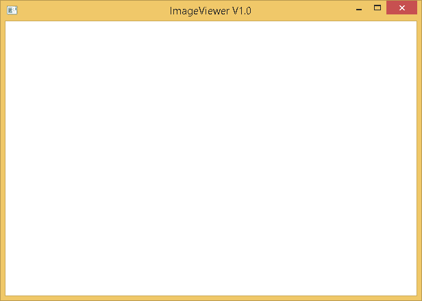

编译并运行该应用程序。

在命令行中编译和运行 ImageViewer 的输出：

```
Microsoft Windows [Version 6.3.9600]
(c) 2013 Microsoft Corporation. All rights reserved.

F:\My Documents\DocRoot\SHUFEN_JAVA\MyBookJFX\VolumeOne\ImageViewer1.0\src\example1>
javac -encoding utf-8 -Xlint:unchecked imageviewer\*.java

jar cf imageviewer.jar imageviewer

java -cp imageviewer.jar imageviewer.ImageViewer
imageArea width changed from 0.0 to 600.0
imageArea height changed from 0.0 to 400.0
```

现在，通过拖动应用程序窗口的边缘或角落更改场景的大小，你将看到类似的输出：

```
imageArea width changed from 600.0 to 437.0
imageArea height changed from 400.0 to 263.0
imageArea width changed from 437.0 to 636.0
imageArea height changed from 263.0 to 384.0
imageArea width changed from 636.0 to 587.0
imageArea height changed from 384.0 to 448.0
```

## 1.2 创建菜单栏

在本节中，我们正在创建一个`MenuBar`，并将其添加到`BorderPane`的顶部，`BorderPane`是场景图的根节点。

通常，一个`MenuBar`对象包含多个水平排列的`Menu`，而每个`Menu`又包含多个`MenuItem`。由于`Menu`类继承自`MenuItem`类，你可以在一个`Menu`内部放置另一个`Menu`，这种嵌套的称为子菜单。由于`MenuBar`渲染在窗口上，用户看到的只是菜单名称，只有当鼠标左键点击菜单名称，或者按下定义为菜单快捷键的内存助记键组合时，每个菜单的内容才会显示。

采用菜单用户界面的优点包括以下点：

* **占用空间更少**

  当用户不需要菜单时，它仅占用其名称所需的空间。

* **可组织性**


为了方便访问，你可以根据功能将菜单项组织成树形结构，将相似的菜单项分组在同一个菜单中，通过子菜单避免单个菜单过于拥挤，并将请求频繁的菜单项放置在较高层。通常最重要的项被放在树的顶层。

### 单按键调用动作

你可以使用助记键机制导航 `MenuBar` 内的菜单，并定义快捷键，使用户可以通过一个按键调用 `MenuItem` 的动作。例如，同时按下 Alt 和 F 键显示文件菜单，同时按下 Ctrl 和 S 键执行保存文件操作。

要向 `MenuBar` 添加一个 `Menu`，我们首先调用 `getMenus()` 方法，该方法返回一个包含 `Menu` 的 `ObservableList`。`ObservableList` 是 `java.util.List` 的子接口，因此我们可以使用 `add` 方法（Java `Collection` 接口中定义的内置工具方法之一）将菜单附加到列表中。代码如下：

```java
MenuBar menuBar = new MenuBar();
Menu menuFile = new Menu("File");
menuBar.getMenus().add(menuFile);
```

（注：此处原文中存在大量重复的说明和代码，已根据要求进行处理，保留核心逻辑与翻译）

### 1.2.1 将文件添加到菜单

在此应用程序中，`MenuBar` 包含 `File` 菜单。以下代码显示了如何完成这些任务。导入语句：

```java
import javafx.application.Platform;
import javafx.scene.control.Menu;
import javafx.scene.control.MenuBar;
import javafx.scene.control.MenuItem;
import javafx.event.ActionEvent;
import javafx.event.EventHandler;
```

列表 1-6：为 `ImageViewer` 应用程序添加菜单栏，将其放置在 `BorderPane` 的顶部：

```java
// 添加菜单栏
MenuBar menuBar = new MenuBar();
Menu menuFile = new Menu("File");
MenuItem load = new MenuItem("Load");
MenuItem exit = new MenuItem("Exit");
menuFile.getItems().addAll(load, exit);
menuBar.getMenus().add(menuFile);
rootPane.setTop(menuBar);

// 为退出菜单项添加动作
exit.setOnAction(new EventHandler<ActionEvent>() {
  @Override
  public void handle(ActionEvent e) {
    Platform.exit();
  }
});
```

### 1.2.2 从打开对话框选择图像文件并在 `StackPane` 中显示

为了导航文件系统，我们使用 `FileChooser` 类，它提供了一个方便的方法 `showOpenDialog(Window owner)` 用于选择打开的文件。

`Load` 菜单的动作是浏览本地文件系统、选择图像文件并显示在图像区域。

`setOnAction(EventHandler<ActionEvent> value)` 方法由 `MenuItem` 类提供，用于添加事件处理器来处理 `Load` 菜单的 `ActionEvent`。

为了加载并显示图像，我们结合使用 `ImageView` 类和 `Image` 类。`Image` 类根据字符串类型的 URL 加载图像，而 `ImageView` 类在图像区域显示图像。

首先，我们创建一个 `ImageView` 并作为 `StackPane` 的子节点。随后，当获取图像文件时，我们将创建一个 `Image` 对象来加载文件，并调用 `ImageView` 类提供的 `setImage(Image value)` 方法查看图像。

详细说明如下：当执行 `FileChooser` 的 `showOpenDialog` 方法时，会弹出文件打开对话框。当用户选择文件并点击对话框中的“打开”按钮时，`showOpenDialog` 方法会将所选的文件（类型为 `File`）返回给调用者，调用者将其转换为字符串表示的 URL，并根据该 URL 创建 `Image` 对象；此时，图像已加载到内存中，但尚未显示在屏幕上。

以下代码片段实现了这些任务：

### 导入语句

```java
import java.io.File;
import javafx.scene.image.Image;
import javafx.scene.image.ImageView;
import javafx.stage.FileChooser;
```

### 列表 1-7：创建 `FileChooser` 对象、`ImageView` 对象并为 `Load` 菜单项添加 `EventHandler` 以加载图像

```java
// 创建文件选择器
final FileChooser fileChooser = new FileChooser();
fileChooser.setTitle("Open an Image File");

// 创建视图，添加到图像区域
final ImageView imageView = new ImageView();
imageArea.getChildren().add(imageView);

// 为 Load 菜单项添加动作
load.setOnAction(new EventHandler<ActionEvent>() {
  @Override
  public void handle(ActionEvent e) {
    // 打开 FileChooser 对话框
    File file = fileChooser.showOpenDialog(stage);
    if (file != null) {
      String url = file.toURI().toString();
      Image image = new Image(url);
      imageView.setImage(image);
    }
  }
});
```

请记住将变量 `stage` 声明为 `final`，因为它在内部类（`Load` 菜单项的匿名 `EventHandler` 类）中被访问。

现在，我们需要处理关于图像渲染区域 `StackPane` 可缩放的重大事项。为了在显示较大的图像时避免调整 `StackPane` 的大小，我们需要为 `StackPane` 设置最小尺寸。以下是实现此操作的代码：

```java
imageArea.setMinSize(0, 0);
```

如果不添加上述代码，当加载大于 `StackPane` 当前尺寸的图像时，`StackPane` 的尺寸会发生变化。这是一个例子：

假设 `StackPane` 的当前尺寸为 600 x 375；在显示尺寸为 1280 x 960 的图像后，`StackPane` 的尺寸被扩大为 1280 x 960；然而，可见部分仍为 600 x 375。

为 `StackPane` 设置最小尺寸可以确保每当打开新图像时，都不会发生尺寸变化事件，同时也简化了后续章节中要开发的代码。

### 列表 1-8：`ImageViewer` 类的完整源代码如下

```java
package imageviewer;

import java.io.File;
import javafx.application.Application;
import javafx.application.Platform; 
import javafx.beans.value.ChangeListener;
import javafx.beans.value.ObservableValue;
import javafx.event.ActionEvent;
import javafx.event.EventHandler;
import javafx.scene.Scene;
import javafx.scene.control.Menu;
import javafx.scene.control.MenuBar;
import javafx.scene.control.MenuItem;
import javafx.scene.image.Image;
import javafx.scene.image.ImageView;
import javafx.scene.layout.BorderPane;
import javafx.scene.layout.StackPane;
import javafx.stage.FileChooser;
import javafx.stage.Stage;

/**
 * 文件名: ImageViewer.java
 * (目录: ImageViewer1.0/src/example2/imageviewer/)
 * 此应用程序创建了一个 BorderPane 作为场景的根节点，
 * 在 BorderPane 的中心添加了一个 StackPane
 * 场景的初始尺寸设置为 600 x 400
 * StackPane 的尺寸将自动设置以适应场景尺寸
 * 当用户调整窗口大时，StackPane 将被调整大小
 *
 * 在 BorderPane 顶部添加菜单栏
 * 创建 File 菜单，并使用 FileChooser 的 Open 对话框
 * 选择图像文件，加载并在图像渲染区域中显示图像。
 *
 * @author Shufen Kuo
 */

public class ImageViewer extends Application {

  @Override
  public void start(final Stage stage) {
    BorderPane rootPane = new BorderPane();
    StackPane imageArea = new StackPane();
    // 为 StackPane 设置最小尺寸，以避免
    // 加载大尺寸图像时调整大小
    imageArea.setMinSize(0, 0);
    rootPane.setCenter(imageArea);

    Scene scene = new Scene(rootPane, 600, 400);

    imageArea.widthProperty().addListener(new ChangeListener<Object>() {
      public void changed(ObservableValue o, Object oldVal,
          Object newVal) {
        System.out.format("imageArea width changed from %.1f to %.1f%n",
          oldVal, newVal);
      }
    });
    imageArea.heightProperty().addListener(new ChangeListener<Object>() {
      public void changed(ObservableValue o, Object oldVal,
          Object newVal) {
        System.out.format("imageArea height changed from %.1f to %.1f%n",
          oldVal, newVal);
      }
    });

    // 添加菜单栏
    MenuBar menuBar = new MenuBar();
    Menu menuFile = new Menu("File");
    MenuItem load = new MenuItem("Load");
    MenuItem exit = new MenuItem("Exit");
    menuFile.getItems().addAll(load, exit);
    menuBar.getMenus().add(menuFile);
    rootPane.setTop(menuBar);

    // 为 exit 菜单项添加动作
    exit.setOnAction(new EventHandler<ActionEvent>() {
      @Override
      public void handle(ActionEvent e) {
        Platform.exit();
      }
    });

    // 创建文件选择器
    final FileChooser fileChooser = new FileChooser();
    fileChooser.setTitle("Open an Image File");

    // 创建视图，添加到图像区域
    final ImageView imageView = new ImageView();
    imageArea.getChildren().add(imageView);

    // 为 Load 菜单项添加动作
    load.setOnAction(new EventHandler<ActionEvent>() {
      @Override
      public void handle(ActionEvent e) {
        // 打开 FileChooser 对话框
        File file = fileChooser.showOpenDialog(stage);
        if (file != null) {
          String url = file.toURI().toString();
          Image image = new Image(url);
          imageView.setImage(image);
        }
      }
    });

    stage.setTitle("ImageViewer V1.0");
    stage.setScene(scene);
    stage.show();
  }

  public static void main(String[] args) {
    launch(args);
  }
}
```

编译并运行应用程序。点击 `File` 菜单中的 `Load` 菜单，导航到包含图像文件的目录，选择一个图像文件，点击 `FileChooser` 对话框中的 `Open` 按钮，图像将被加载并显示在窗口中心。

图 1-2：菜单栏带有 `File` 时的截图

图 1-3：从文件选择器中选择图像文件的截图

图 1-4：在中心显示小尺寸图像的截图

图 1-5：在中心显示大尺寸图像的截图

## 1.3 创建 `Option` 菜单和 `View` 子菜单

我们需要一个 `Option` 菜单允许用户选择首选的视图标准。`Option` 菜单包含一个 `View` 子菜单，包含三个互斥的选择，如下：

`Fit Width`：通过调整 `ImageView` 的 `fitWidth` 属性来渲染图像，在保持原始宽比的同时，适应当前可用视图区域的宽度。

`Fit Height`：通过调整 `ImageView` 的 `fitHeight` 属性来渲染图像，在保持原始宽比的同时，适应当前可用视图区域的高度。

`Original Size`：按原始尺寸渲染图像，超出当前可用视图区域边界的图像外部部分将被隐藏。这被设置为初始视图选项。

请注意，可用视图空间是由应用程序窗口（称为 `Stage`）的当前宽度和高度决定的，这取决于 `Scene`（场景的容器）的当前尺寸。初始场景设置为 600 像素 x 400 像素，因此图像渲染区域的尺寸将与场景相同。在我们在 `BorderPane` 顶部添加了菜单栏后，可用渲染区域的高度变为场景高度减去菜单栏的高度，而宽度保持不变。

### 1.3.1 创建 `ToggleGroup`、单选框菜单项并为 `selectedToggle` 属性添加监听器

要在菜单中实现互斥选择，我们需要创建 `RadioMenuItem` 对象和单个 `ToggleGroup` 对象，然后将每个 `RadioMenuItem` 关联到同一个 `ToggleGroup`。

为了监听选中的单选菜单项的变化，我们使用：

```java
void addListener(ChangeListener<? super T> listener)
```

来为 `ToggleGroup` 对象的 `selectedToggle` 属性注册一个 `ChangeListener`。

下面的代码段展示了如何完成这些任务。

### 导入语句

```java
import javafx.scene.control.RadioMenuItem;
import javafx.scene.control.Toggle;
import javafx.scene.control.ToggleGroup;
```

### 列表 1-9：创建 `Option` 菜单、`ToggleGroup`、`RadioMenuItem`、`View` 子菜单并为 `ToggleGroup` 的 `selectedToggle` 属性添加监听器


### 列表 1-10. `ImageViewer` 类的完整源码如下：

```
package imageviewer;

import java.io.File;
import javafx.application.Application;
import javafx.application.Platform; 
import javafx.beans.value.ChangeListener;
import javafx.beans.value.ObservableValue;
import javafx.event.ActionEvent;
import javafx.event.EventHandler;
import javafx.scene.Scene;
import javafx.scene.control.Menu;
import javafx.scene.control.MenuBar;
import javafx.scene.control.MenuItem;
import javafx.scene.control.RadioMenuItem;
import javafx.scene.control.Toggle;
import javafx.scene.control.ToggleGroup;
import javafx.scene.image.Image;
import javafx.scene.image.ImageView;
import javafx.scene.layout.BorderPane;
import javafx.scene.layout.StackPane;
import javafx.stage.FileChooser;
import javafx.stage.Stage;

/**
 * 文件名: ImageViewer.java
 * (位于目录: ImageViewer1.0/src/example3/imageviewer/)
 * 此应用程序创建一个 BorderPane 作为场景的根节点，
 * 在 BorderPane 的中心添加一个 StackPane
 * 场景的初始大小设置为 600x400
 * StackPane 的大小将自动设置以适应场景的大小
 * 当用户调整窗口大时， StackPane 将被调整大小
 *
 * 在顶部添加一个菜单栏
 * 在菜单中实现互斥选择
 * 为了监听选中的单选菜单项的变化
 * 我们为 ToggleGroup 对象的 selectedToggle 属性注册一个 ChangeListener
 * 下面的代码段展示了如何完成这些任务
 *
 * 作者: Shufen
 */

public class ImageViewer extends Application {

  @Override
  public void start(final stage) {
    BorderPane rootPane = new BorderPane();
    StackPane imageArea = new StackPane();
    rootPane.setCenter(imageArea);

    MenuBar menuBar = new MenuBar();
    rootPane.setTop(menuBar);

    Scene scene = new Scene(rootPane, 600, 400);

    // 创建文件选择器
    FileChooser fileChooser = new FileChooser();
    fileChooser.setTitle("Open Image");

    // 添加 ImageView 到图像区域
    ImageView imageView = new ImageView();
    imageArea.getChildren().add(imageView);

    // 为 load 项添加动作
    MenuItem load = new MenuItem("Load");
    load.setOnAction(new EventHandler<ActionEvent>() {
      @Override
      public void handle(ActionEvent e) {
        // 打开文件选择对话框
        File file = fileChooser.showOpenDialog(stage);
        if (file != null) {
          String url = file.toURI().toString();
          Image image = new Image(url);
          imageView.setImage(image);
        }
      }
    });

    // 创建 Option 菜单
    Menu menuOption = new Menu("Option");

    // 创建切换组
    final ToggleGroup groupOption = new ToggleGroup();

    // 创建单选菜单项
    final RadioMenuItem fitWidth = new RadioMenuItem("Fit Width");
    fitWidth.setToggleGroup(groupOption);
    final RadioMenuItem fitHeight = new RadioMenuItem("Fit Height");
    fitHeight.setToggleGroup(groupOption);
    final RadioMenuItem original = new RadioMenuItem("Original Size");
    original.setToggleGroup(groupOption);

    // 为切换组添加监听器
    groupOption.selectedToggleProperty().addListener(new ChangeListener<Toggle>() {
      public void changed(ObservableValue<? extends Toggle> ov,
                          Toggle old_toggle, Toggle new_toggle) {
        if (groupOption.getSelectedToggle() != null) {
          RadioMenuItem choiceItem = (RadioMenuItem) groupOption.getSelectedToggle();
          if (choiceItem == fitWidth) {
            System.out.println("fitwidth");
          } else if (choiceItem == fitHeight) {
            System.out.println("fitheight");
          } else {
            System.out.println("original size");
          }
        } 
      }
    });

    // 为 Option 菜单创建 View 子菜单
    Menu menuView = new Menu("View");
    menuView.getItems().addAll(fitWidth, fitHeight, original);

    // 设置 Original Size 为默认选择
    original.setSelected(true);

    // 将 option 添加到菜单栏
    menuOption.getItems().add(menuView);
    menuBar.getMenus().add(menuOption);

    stage.setTitle("ImageViewer V1.0");
    stage.setScene(scene);
    stage.show();
  }

  public static void main(String[] args) {
    launch(args);
  }
}
```

图 1-6. `Option` 菜单包含 `View` 子菜单的快照

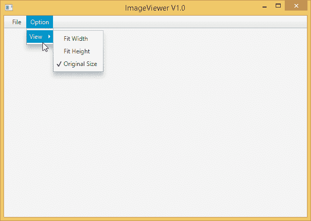

编译并运行应用程序。在 `View` 子菜单中选择不同的单选菜单，你将看到如下下面的输出：

命令行中运行程序的输出：

```
 Microsoft Windows [Version 6.3.9600]
(c) 2013 Microsoft Corporation. All rights reserved.

F:\My Documents\DocRoot\SHUFEN_JAVA\MyBookJFX\VolumeOne\ImageViewer1.0\src\example3>
javac -encoding utf-8 -Xlint:unchecked imageviewer\*.java

jar cf imageviewer.jar imageviewer

java -cp imageviewer.jar imageviewer.ImageViewer
original size
imageArea width changed from 0.0 to 600.0
imageArea height changed from 0.0 to 375.0
fitheight
fitwidth
```

## 1.4 实现“适应宽度”、“适应高度”和“原始尺寸”选项

在本节中，我们将演示如何调整图像的显示大小以适应应用程序窗口。`ImageView` 被创建为 `StackPane` 的子节点，根据 `StackPane` 的默认布局策略，图像会被放置在 `StackPane` 的中心；因此，如果图像尺寸大于当前可用显示空间（该空间取决于 `Scene` 的大小），图像的外围部分将被遮挡，导致用户无法查看整个图像。

在上一节中，我们创建了一个包含三个显示选项的 `Option` 菜单：`适应宽度 (Fit Width)`、`适应高度 (Fit Height)` 和 `原始尺寸 (Original Size)`。图像根据当前选择的选项进行渲染，初始设置为`原始尺寸`。默认情况下，我们在执行缩放时希望保留图像的原始宽高比例。为了实现这一点，我们如下所示将 `preserveRatio` 属性的值设置为 `true`：

列表 1-11. 将 `preserveRatio` 属性的值设置为 `true`：

```
 final ImageView imageView = new ImageView();
imageView.setPreserveRatio(true);
```

现在，让我们探索两种根据当前选择的选项渲染图像的方法。

### 1.4.1 方法一：分别将 `ImageView` 的 `fitWidth`/`fitHeight` 属性绑定到 `Scene` 的 `width`/`height` 属性

我们使用 `Property` 接口中定义的 `bind` 和 `unbind` 方法来实现“适应宽度”、“适应高度”和“原始尺寸”显示选项。

这里的吸引人之处在于，一旦绑定生效，每当 `Scene` 的宽度和/或高度动态发生变化时，图像的显示宽度和/或高度就会随之发生变化。

#### 1.4.1.1 实现“适应宽度”显示选项

如果用户选择“适应宽度”作为显示选项，我们将 `ImageView` 的 `fitWidth` 属性绑定到 `Scene` 的 `width` 属性上，并解绑 `fitHeight` 属性。代码如下：

列表 1-12. 将 `ImageView` 对象的 `fitWidth` 属性绑定到 `Scene` 的 `width` 属性：

```
 imageView.fitWidthProperty().bind(scene.widthProperty());
imageView.fitHeightProperty().unbind();
// 除了解绑，还必须将适应高度设置为 0
imageView.setFitHeight(0);
```

#### 1.4.1.2 实现“适应高度”显示选项

如果选择“适应高度”作为显示选项，我们将 `ImageView` 的 `fitHeight` 属性绑定到 `Scene` 的 `height` 属性（减去菜单栏的高度），并解绑 `fitHeight` 属性。

我们正在使用 `subtract` 方法来计算图像的可用显示高度。`DoubleProperty` 类继承自 `DoubleExpression` 类的 `subtract(double other)` 方法返回一个新的 `NumberBinding` 对象，该对象用于计算此 `NumberExpression` 与给定常量值之间的差。代码如下：

列表 1-13. 将 `ImageView` 的 `fitHeight` 属性绑定到 `scene` 的 `height` 属性，减去菜单栏的高度：

```
 // 渲染图像的可用高度是
// 从场景高度中减去菜单栏的高度
imageView.fitHeightProperty().bind(
   scene.heightProperty().subtract(menuBar.getHeight()));
imageView.fitWidthProperty().unbind();
// 除了解绑，还必须将适应宽度设置为 0 
imageView.setFitWidth(0); 
```

#### 1.4.1.3 实现“原始尺寸”显示选项

如果选择“原始尺寸”作为显示选项，我们将解绑 `ImageView` 对象的 `fitWeight` 属性以及 `fitHeight` 属性。代码如下：

列表 1-14. 解绑 `ImageView` 对象的 `fitWidth` 属性以及 `fitHeight` 属性：

```
imageView.fitWidthProperty().unbind();
imageView.fitHeightProperty().unbind();
// 除了解绑，还必须将宽度/高度设置为 0
imageView.setFitWidth(0);
imageView.setFitHeight(0);
```

请注意，更改 `ImageView` 对象的 `fitWidth`/`fitHeight` 属性的值不会影响底层 `Image` 对象的 `width`/`height` 属性。`Image` 对象的属性（如 `width` 和 `height`）保持不变，而与 `ImageView` 显示选项相关的属性则由用户进行动态更改。


方法一的优点是，你不需要注册事件处理程序来响应`Scene`的调整大小事件。当应用程序窗口动态调整大时，`Scene`随之调整大小，`ImageView`的相应属性也随之改变，图像渲染区域（一个`StackPane`对象）的大小会自动重新计算。

以下代码片段展示了方法一的实现。

列表 1-15. 监听选择的变化，并使用`bind`和`unbind`方法调整图像视图的`fitWidth`和`fitHeight`：

```java
final StackPane imageArea = new StackPane();

...

final Scene scene = new Scene(rootPane, 600, 400);

...

final MenuBar menuBar = new MenuBar();

...

// 创建切换组
final ToggleGroup groupOption = new ToggleGroup();

// 创建单选菜单并添加到切换组
final RadioMenuItem fitWidth = new RadioMenuItem("Fit Width");
fitWidth.setToggleGroup(groupOption);
final RadioMenuItem fitHeight = new RadioMenuItem("Fit Height");
fitHeight.setToggleGroup(groupOption);
final RadioMenuItem original = new RadioMenuItem("Original Size");
original.setToggleGroup(groupOption);

groupOption.selectedToggleProperty().addListener(new ChangeListener<Toggle>() {
  public void changed(ObservableValue<? extends Toggle> ov,
          Toggle old_toggle, Toggle new_toggle) {
    if (groupOption.getSelectedToggle() != null) {
      RadioMenuItem choiceItem = (RadioMenuItem) groupOption.getSelectedToggle();
      if (choiceItem == fitWidth) {
        System.out.println("fitwidth");
        imageView.fitWidthProperty().bind(scene.widthProperty());
        imageView.fitHeightProperty().unbind();
        // 除了解绑，还必须将适应高度设置为 0
        imageView.setFitHeight(0);
      } else if (choiceItem == fitHeight) {
        System.out.println("fitheight");
        // 渲染图像的可用高度是
        // 从场景高度中减去菜单栏的高度
        imageView.fitHeightProperty().bind(
          scene.heightProperty().subtract(menuBar.getHeight()));
        imageView.fitWidthProperty().unbind();
        // 除了解绑，还必须将适应宽度设置为 0
        imageView.setFitWidth(0);
      } else {
        System.out.println("original size");
        imageView.fitWidthProperty().unbind();
        imageView.fitHeightProperty().unbind();
        // 除了解绑，还必须将宽度/高度设置为 0
        imageView.setFitWidth(0);
        imageView.setFitHeight(0);
      }
    }
  }
});
```

#### 1.4.1.4 `ImageViewer`类的完整源代码

方法一的`ImageViewer`类的完整源代码如下：

列表 1-16. `ImageViewer`类的完整源代码如下所示：

```java
package imageviewer;

import java.io.File;
import javafx.application.Application;
import javafx.application.Platform;
import javafx.beans.value.ChangeListener;
import javafx.beans.value.ObservableValue;
import javafx.event.ActionEvent;
import javafx.event.EventHandler;
import javafx.scene.Scene;
import javafx.scene.control.Menu;
import javafx.scene.control.MenuBar;
import javafx.scene.control.MenuItem;
import javafx.scene.control.RadioMenuItem;
import javafx.scene.control.Toggle;
import javafx.scene.control.ToggleGroup;
import javafx.scene.image.Image;
import javafx.scene.image.ImageView;
import javafx.scene.layout.BorderPane;
import javafx.scene.layout.StackPane;
import javafx.stage.FileChooser;
import javafx.stage.Stage;

/**
 * File Name: ImageViewer.java
 * (目录: ImageViewer1.0/src/example4/imageviewer/)
 * 此应用程序创建了一个 BorderPane 作为场景的根节点，
 * 并在 BorderPane 的中心添加了一个 StackPane。
 * 场景的初始大小设置为 600x400。
 * StackPane 的大小将自动设置为以适应场景的大小。
 * 当用户调整窗口大时，StackPane 将随之调整大小。
 *
 * 在 BorderPane 顶部添加菜单栏。
 * 创建文件（File）菜单，并使用 FileChooser 的打开对话框
 * 选择图像文件，在图像渲染区域加载并显示图像。
 *
 * 创建选项（Option）菜单，包含一个视图（View）子菜单，让用户选择图像查看
 * 标准：适应宽度（Fit Width）、适应高度（Fit Height）或默认选项原始大小（Original Size）。
 *
 * 使用 bind 和 unbind 方法调整图像查看大小：
 * 将 imageView 的 fitWidth/fitHeight 绑定到场景的宽度/高度，
 * 这样每当场景调整大小时，imageView 的尺寸将自动更改。
 *
 * @author Shufen Kuo
 */
public class ImageViewer extends Application {

  @Override
  public void start(final Stage stage) {
    BorderPane rootPane = new BorderPane();
    final StackPane imageArea = new StackPane();
    // 为 StackPane 设置最小大小以避免在
    // 加载大图像时调整大小
    imageArea.setMinSize(0, 0);
    rootPane.setCenter(imageArea);

    // 创建 imageView 并添加到图像区域
    final ImageView imageView = new ImageView();
    imageView.setPreserveRatio(true);
    imageArea.getChildren().add(imageView);

    final Scene scene = new Scene(rootPane, 600, 400);

    imageArea.widthProperty().addListener(new ChangeListener<Object>() {
      public void changed(ObservableValue o, Object oldVal,
          Object newVal) {
        System.out.format("imageArea width changed from %.1f to %.1f%n",
            oldVal, newVal);
      }
    });
    imageArea.heightProperty().addListener(new ChangeListener<Object>() {
      public void changed(ObservableValue o, Object oldVal,
          Object newVal) {
        System.out.format("imageArea height changed from %.1f to %.1f%n",
            oldVal, newVal);
      }
    });

    // 添加菜单栏
    final MenuBar menuBar = new MenuBar();
    Menu menuFile = new Menu("File");
    MenuItem load = new MenuItem("Load");
    MenuItem exit = new MenuItem("Exit");
    menuFile.getItems().addAll(load, exit);
    menuBar.getMenus().add(menuFile);
    rootPane.setTop(menuBar);

    // 为退出菜单项添加动作
    exit.setOnAction(new EventHandler<ActionEvent>() {
      @Override
      public void handle(ActionEvent e) {
        Platform.exit();
      }
    });

    // 创建文件选择器
    final FileChooser fileChooser = new FileChooser();
    fileChooser.setTitle("Open an Image File");

    // 为 Load 菜单项添加动作
    load.setOnAction(new EventHandler<ActionEvent>() {
      @Override
      public void handle(ActionEvent e) {
        // 打开 FileChooser 对话框
        File file = fileChooser.showOpenDialog(stage);
        if (file != null) {
          String url = file.toURI().toString();
          Image image = new Image(url);
          imageView.setImage(image);
        }
      }
    });

    // 创建 Option 菜单
    Menu menuOption = new Menu("Option");

    // 创建切换组
    final ToggleGroup groupOption = new ToggleGroup();

    // 创建单选菜单项
    final RadioMenuItem fitWidth = new RadioMenuItem("Fit Width");
    fitWidth.setToggleGroup(groupOption);
    final RadioMenuItem fitHeight = new RadioMenuItem("Fit Height");
    fitHeight.setToggleGroup(groupOption);
    final RadioMenuItem original = new RadioMenuItem("Original Size");
    original.setToggleGroup(groupOption);

    // 监听切换组中选择的变化
    groupOption.selectedToggleProperty().addListener(new ChangeListener<Toggle>() {
      public void changed(ObservableValue<? extends Toggle> ov,
          Toggle old_toggle, Toggle new_toggle) {
        if (groupOption.getSelectedToggle() != null) {
          RadioMenuItem choiceItem = (RadioMenuItem) groupOption.getSelectedToggle();
          if (choiceItem == fitWidth) {
            System.out.println("fitwidth");
            imageView.fitWidthProperty().bind(scene.widthProperty());
          } else if (choiceItem == fitHeight) {
            System.out.println("fitheight");
            imageView.fitHeightProperty().bind(scene.heightProperty());
          } else {
            System.out.println("original size");
            imageView.fitWidthProperty().unbind();
            imageView.fitHeightProperty().unbind();
          }
        }
      }
    });

    // 为菜单创建 View 子菜单
    Menu menuView = new Menu("View");
    menuView.getItems().addAll(fitWidth, fitHeight, original);

    // 设置原始大小为默认
    original.setSelected(true);

    // 将 option 菜单添加到菜单栏
    menuOption.getItems().add(menuView);
    menuBar.getMenus().add(menuOption);

    stage.setTitle("ImageViewer V1.01");
    stage.setScene(scene);
    stage.show();
  }

  public static void main(String[] args) {
    launch(args);
  }
}
```

请注意，方法一将版本号从`V1.0`升级到了`V1.01`。

编译并运行应用程序。按照如下方式测试查看选项：首先，加载一个小图像，反复选择所有查看选项，同时使用鼠标拖动窗口边缘或角来动态调整窗口大小。然后，加载较大的图像再次测试所有可能的标准。

图 1-7。原始大小的图像渲染（320 像素 x 363 像素）。

`(Images/image00130.jpeg)`

图 1-8。缩放以适应场景宽度的图像。

`(Images/image00131.jpeg)`

图 1-9。缩放以适应场景高度可用查看空间的图像。

`(Images/image00132.jpeg)`

### 1.4.2 方法二：更改`fitWidth`属性和`fitHeight`属性的值

`ImageView`类提供了两个属性，允许我们缩放图像查看尺寸：

- `fitWidth`
- `fitHeight`

要更改这两个属性的值，我们我们使用`setFitWidth`方法和`setFitHeight`方法。

如果选择了`Fit Width`查看选项，查看宽度将根据当前场景宽度进行设置。以下是代码片段：

列表 1-17. 调用`setFitWidth`方法使图像查看宽度与场景宽度相同：


`imageView.setFitWidth(scene.getWidth());`
```java
// Besides setFitWidth, must also set fit height to 0
imageView.setFitHeight(0);
```

如果选择了 `Fit Height`（适应高度）查看选项，则查看高度将根据当前场景（`scene`）的高度减去菜单栏的高度来设置。以下是代码片段：

**Listing 1-18.** 调用 `setFitHeight` 方法将图像查看高度设置为场景高度减去菜单栏的高度：

```java
imageView.setFitHeight(scene.getHeight() - menuBar.getHeight());
// Besides setFitHeight, must also set fit width to 0 
imageView.setFitWidth(0); 
```

如果选择了 `Original Size`（原始尺寸）选项，我们需要通过将 `fitWidth` 属性和 `fitHeight` 属性均赋值为 `0` 来清除之前设置的值。以下是代码片段：

**Listing 1-19.** 调用 `setFitHeight` 和 `setFitHeight` 方法，并传入 `0` 作为值：

```java
// Clear previous set value
imageView.setFitWidth(0);
imageView.setFitHeight(0);
```

以下代码展示了目前方案二的实现情况。

**Listing 1-20.** 监听切换组（toggle group）中单选菜单项的变化，调整图像视图 `fitWidth` 和 `fitHeight` 属性的值：

```java
// Listen to the change of selection in the toggle group
groupOption.selectedToggleProperty().addListener(new ChangeListener<Toggle>() {
  public void changed(ObservableValue<? extends Toggle> ov,
          Toggle old_toggle, Toggle new_toggle) {
    if (groupOption.getSelectedToggle() != null) {
      RadioMenuItem choiceItem = (RadioMenuItem) groupOption.getSelectedToggle();
      if (choiceItem == fitWidth) {
        imageView.setFitWidth(scene.getWidth());
        // Besides setFitWidth, must also set fit height to 0
        imageView.setFitHeight(0);
      } else if (choiceItem == fitHeight) {
        imageView.setFitHeight(scene.getHeight() - menuBar.getHeight());
        // Besides setFitHeight, must also set fit width to 0 
        imageView.setFitWidth(0); 
      } else {
        // Clear previous set value
        imageView.setFitWidth(0);
        imageView.setFitHeight(0);
      }
    } 
  }
}); 
```

### 1.4.2.1 捕获场景缩放事件以调整图像查看尺寸

为了完成方案二，还有一个问题需要解决：图像的查看大小取决于场景的大小，初始设置为 600 像素乘以 400 像素，这可能会发生动态变化。当用户拖动应用程序窗口的边缘或角时，场景会被调整大小。我们需要捕获此缩放事件以相应调整图像的查看大小。也就是说，如果当前选查看选项是 `Fit Width`（适应宽度），则场景的新宽度将作为图像视图对象 `fitWidth` 属性的值。如果选的是 `Fit Height`，则场景的新高度减去菜单栏的高度将作为 `fitHeight` 属性的值。

为了响应场景大小的变化，我们分别为 `width` 属性和 `height` 属性添加了监听器，以捕获场景的缩放事件。

以下代码片段完成了这些任务：

**Listing 1-21.** 监听场景 `width` 和 `height` 的变化，调整图像视图的 `fitWidth` 和 `fitHeight`：

```java
// Listen to the width change of scene and adjust fitWidth of image view
scene.widthProperty().addListener(new ChangeListener<Object>() {
  public void changed(ObservableValue o, Object oldVal, Object newVal) {
    if (fitWidth.isSelected()) {
      imageView.setFitWidth((double)newVal);
    }
  }
});
// Listen to the height change of scene and adjust fitHeight of image view   
scene.heightProperty().addListener(new ChangeListener<Object>() {
  public void changed(ObservableValue o, Object oldVal, Object newVal) {
    if (fitHeight.isSelected()) {
      imageView.setFitHeight((double) newVal - menuBar.getHeight());
    }
  }
});
```

### 1.4.2.2 `ImageViewer` 类的完整源代码

方案二的 `ImageViewer` 类的完整源代码如下：

**Listing 1-22.** `ImageViewer` 的完整源代码如下：


```java
package imageviewer;

import java.io.File;
import javafx.application.Application;
import javafx.application.Platform;
import javafx.beans.value.ChangeListener;
import javafx.beans.value.ObservableValue;
import javafx.event.ActionEvent;
import javafx.event.EventHandler;
import javafx.scene.Scene;
import javafx.scene.control.Menu;
import javafx.scene.control.MenuBar;
import javafx.scene.control.MenuItem;
import javafx.scene.control.RadioMenuItem;
import javafx.scene.control.Toggle;
import javafx.scene.control.ToggleGroup;
import javafx.scene.image.Image;
import javafx.scene.image.ImageView;
import javafx.scene.layout.BorderPane;
import javafx.scene.layout.StackPane;
import javafx.stage.FileChooser;
import javafx.stage.Stage;

/**
 * 文件名: ImageViewer.java
 * (位于目录: ImageViewer1.0/src/example5/imageviewer/)
 * 该应用程序创建了一个 BorderPane 作为场景的根节点，
 * 并在 BorderPane 的中心添加了一个 StackPane。
 * 场景的初始大小设置为 600 x 400。
 * StackPane 的大小将自动设置为以适应场景的大小。
 * 当用户调整窗口大时，StackPane 将随之调整大小。
 *
 * 在 BorderPane 顶部添加菜单栏。
 * 创建文件（File）菜单，并使用 FileChooser 的打开对话框
 * 选择图像文件，在图像渲染区域加载并显示图像。
 *
 * 创建选项（Option）菜单，包含视图（View）子菜单，让用户选择图像查看
 * 标准：适应宽度（Fit Width）、适应高度（Fit Height）或默认选项原始大小（Original Size）。
 *
 * 使用 ImageView 类提供的 setFitWidth 方法和 setFitHeight 方法调整图像查看大小
 * 为场景的宽度属性和高度属性添加监听器。
 * 当查看选项设置为适应宽度或适应高度时，通过缩放图像视图来
 * 响应场景的动态缩放事件。
 *
 * @author Shufen Kuo
 */

public class ImageViewer extends Application {

  @Override
  public void start(final Stage stage) {
    BorderPane rootPane = new BorderPane();
    final StackPane imageArea = new StackPane();

    // 设置 StackPane 的最小尺寸以避免在
    // 加载大图像时调整大小
    imageArea.setMinSize(0, 0);
    rootPane.setCenter(imageArea);

    // 创建图像视图，并添加到图像区域
    final ImageView imageView = new ImageView();
    imageView.setPreserveRatio(true);
    imageArea.getChildren().add(imageView);

    final Scene scene = new Scene(rootPane, 600, 400);

    imageArea.widthProperty().addListener(new ChangeListener<Object>() {
      public void changed(ObservableValue o, Object oldVal,
          Object newVal) {
        System.out.format("imageArea width changed from %.1f to %.1f%n",
            oldVal, newVal);
      }
    });

    imageArea.heightProperty().addListener(new ChangeListener<Object>() {
      public void changed(ObservableValue o, Object oldVal,
          Object newVal) {
        System.out.format("imageArea height changed from %.1f to %.1f%n",
            oldVal, newVal);
      }
    });

    // 添加菜单栏
    final MenuBar menuBar = new MenuBar();
    Menu menuFile = new Menu("File");
    MenuItem load = new MenuItem("Load");
    MenuItem exit = new MenuItem("Exit");
    menuFile.getItems().addAll(load, exit);
    menuBar.getMenus().add(menuFile);
    rootPane.setTop(menuBar);

    // 为退出菜单项添加动作
    exit.setOnAction(new EventHandler<ActionEvent>() {
      @Override
      public void handle(ActionEvent e) {
        Platform.exit();
      }
    });

    // 创建文件选择器
    final FileChooser fileChooser = new FileChooser();
    fileChooser.setTitle("Open an Image File");

    // 为加载菜单项添加动作
    load.setOnAction(new EventHandler<ActionEvent>() {
      @Override
      public void handle(ActionEvent e) {
        // 打开 FileChooser 对话
        File file = fileChooser.showOpenDialog(stage);
        if (file != null) {
          String url = file.toURI().toString();
          Image image = new Image(url);
          imageView.setImage(image);
        }
      }
    });

    // 创建选项菜单
    Menu menuOption = new Menu("Option");

    // 创建切换组
    final ToggleGroup groupOption = new ToggleGroup();

    // 创建单选菜单项
    final RadioMenuItem fitWidth = new RadioMenuItem("Fit Width");
    fitWidth.setToggleGroup(groupOption);

    final RadioMenuItem fitHeight = new RadioMenuItem("Fit Height");
    fitHeight.setToggleGroup(groupOption);

    final RadioMenuItem original = new RadioMenuItem("Original Size");
    original.setToggleGroup(groupOption);

    // 监听切换组选择的改变
    groupOption.selectedToggleProperty().addListener(new ChangeListener<Toggle>() {
      public void changed(ObservableValue<? extends Toggle> ov,
          Toggle old_toggle, Toggle new_toggle) {
        if (groupOption.getSelectedToggle() != null) {
          RadioMenuItem choiceItem =
              (RadioMenuItem) groupOption.getSelectedToggle();

          if (choiceItem == fitWidth) {
            System.out.println("fit Width");
            imageView.setFitWidth(scene.getWidth());
          } else if (choiceItem == fitHeight) {
            System.out.println("Fit Height");
            imageView.setFitHeight(scene.getHeight());
          } else {
            System.out.println("Original Size");
            imageView.setFitWidth(0);
            imageView.setFitHeight(0);
          }
        }
      }
    });

    // 监听场景宽度改变并调整图像视图宽度
    scene.widthProperty().addListener(new ChangeListener<Object>() {
      public void changed(ObservableValue o, Object oldVal,
          Object newVal) {
        if (fitWidth.isSelected()) {
          imageView.setFitWidth((double) newVal);
        }
      }
    });

    // 监听场景高度改变并调整图像视图高度
    scene.heightProperty().addListener(new ChangeListener<Object>() {
      public void changed(ObservableValue o, Object oldVal,
          Object newVal) {
        if (fitHeight.isSelected()) {
          imageView.setFitHeight((double) newVal);
        }
      }
    });

    // 为选项菜单创建视图子菜单
    Menu menuView = new Menu("View");
    menuView.getItems().addAll(fitWidth, fitHeight, original);

    // 设置原始大小为默认选择
    original.setSelected(true);

    // 将选项菜单添加到菜单栏
    menuOption.getItems().add(menuView);

    stage.setTitle("ImageViewer V1.02");
    stage.setScene(scene);
    stage.show();
  }

  public static void main(String[] args) {
    launch(args);
  }
}
```

请注意我们将版本号从 `V1.01` 升级到了 `V1.02` 方法二。

编译并运行应用程序。按照以下步骤测试应用程序：

1. 加载小于初始场景尺寸（600 像素 x 400 像素）的图像，以原始大小查看。
2. 选择适应宽度（Fit Width）选项，图像视图将缩放以适应场景宽度。
3. 选择适应高度（Fit Height）选项，图像视图将缩放以适应场景高度。
4. 选择原始大小（Original Size）选项，图像视图将恢复原始大小。
5. 加载比当前场景尺寸更大的图像，由于场景中没有足够的空间显示整个图像，你将只看到中心部分。
6. 分别选择适应宽度（Fit Width）和适应高度（Fit height）选项以查看不同的查看结果。
7. 通过拖动窗口边缘调整场景宽度，尝试放大和缩小宽度以查看不同的结果。
8. 通过拖动窗口边缘调整场景高度，尝试放大和缩小高度以查看不同的结果。
9. 通过鼠标拖动窗口边缘调整场景宽度和高度，并分别测试三种查看选项。

在后续章节中将采用方法一（`V1.01`）来继续开发 `ImageViewer` `V1.1`。

图 1-10. 以原始尺寸（1280 像素乘 960 像素）查看图像的快照，图像的外部部分被遮挡。

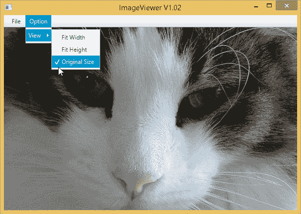

图 1-11. 图像缩放以适应场景宽度的快照，图像顶部和底部的小部分被遮挡。

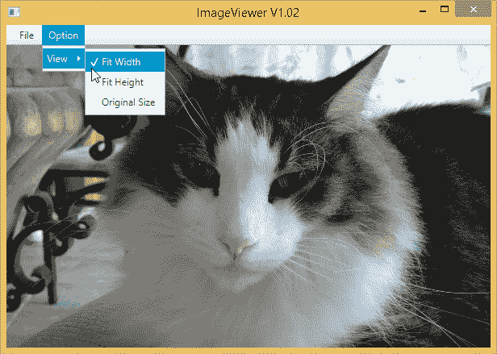

图 1-12. 图像缩放以适应场景窗口中可用高度的快照。

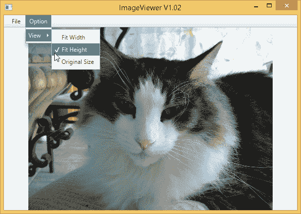

图 1-13. 图像缩放以适应宽度，同时场景高度动态增加的快照。

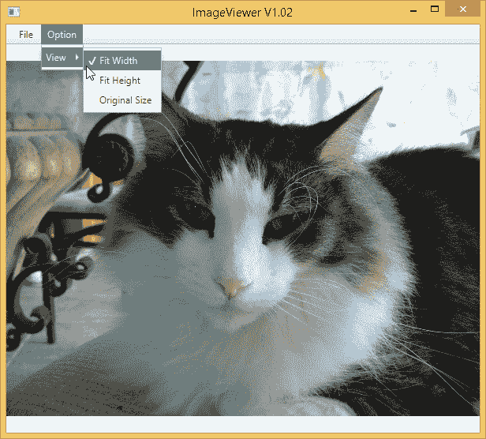

图 1-14. 图像缩放以适应高度，同时场景尺寸动态变化的快照。

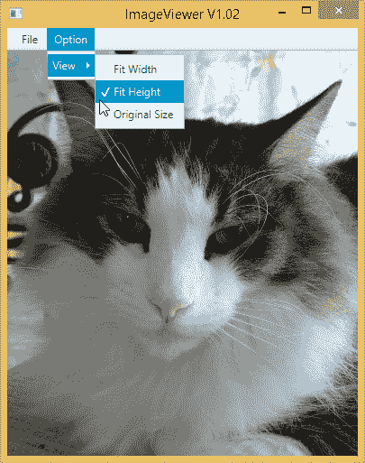

在命令行中编译并运行 `ImageViewer` 的输出：

```text
Microsoft Windows [Version 6.3.9600]
(c) 2013 Microsoft Corporation. All rights reserved.

F:\My Documents\DocRoot\SHUFEN_JAVA\MyBookJFX\VolumeOne\ImageViewer1.0\src\example5>
javac -encoding utf-8 -Xlint:unchecked imageviewer\*.java

jar cf imageviewer.jar imageviewer

java -cp imageviewer.jar imageviewer.ImageViewer
original size
imageArea width changed from 0.0 to 600.0
imageArea height changed from 0.0 to 375.0
fitwidth
fitheight
original size
fitwidth
fitheight
original size
imageArea height changed from 375.0 to 439.0
imageArea width changed from 600.0 to 615.0
imageArea width changed from 615.0 to 380.0
imageArea height changed from 439.0 to 527.0
```

## 1.5 总结

本章介绍了 JavaFX 库的以下关键方面，按它们在章节中出现的顺序列出：

- 内置的 JavaFX 布局面板，位于 `javafx.scene.layout` 包中：
  - `BorderPane`
  - `StackPane`

  （参见节 创建 `ImageViewer` 类作为 `Application` 子类）

- `Scene` 类，位于 `javafx.scene` 包中，是场景图的容器。

  （参见此处，节 方法一：分别将 `ImageView` 的 `fitWidth`/`fitHeight` 属性绑定到场景的 `width`/`height` 属性，以及节 捕获场景缩放事件以调整图像查看大小）

- `Stage` 类，位于 `javafx.stage` 包中，是 JavaFX 应用程序的顶层容器。

  （参见此处）

- `Application` 类，位于 `javafx.application` 包中，是 JavaFX 应用程序的入口点。

  （参见节 创建 `ImageViewer` 类作为 `Application` 子类）

- `void start(Stage stage)` 方法，`Application` 类中的抽象方法，必须重写。

  （参见列表 1-1，以及节 JavaFX 应用程序线程与 Java 启动器线程）


- `void addListener(ChangeListener<? super T> listener)` 方法定义在 `javafx.beans.value.ObservableValue` 接口中，通过提供 `changed(ObservableValue<? extends T> observable, T oldValue, T newValue)` 方法来添加 `ChangeListener`。该方法在属性值更改时被调用。

  （参见节：捕获图像渲染区域的缩放事件，以及捕获场景缩放事件以调整图像查看大小](#part0007.xhtml_scene-resize)）

- `MenuBar`、`Menu` 和 `MenuItem` 是基础 JavaFX UI 组件，位于 `javafx.scene.control` 包中，用于设计占用更少空间的紧凑外观图形用户界面。

  （参见节：创建菜单栏）

- `java.io.File showOpenDialog(Window ownerWindow)` 方法是 `javafx.stage.FileChooser` 类提供的方便方法，用于显示文件打开对话框，以浏览本地文件系统。

  （参见节：从文件打开对话框选择图像文件并在 `StackPane` 上显示图像）

- `void setOnAction(EventHandler<ActionEvent> value)` 方法由 `MenuItem` 类提供，用于在 `ActionEvent` 发生时注册 `EventHandler`。

  （参见节：从文件打开对话框选择图像并在 `StackPane` 上显示图像）

- `ImageView` 和 `Image` 是位于 `javafx.scene.image` 包中的类，用于加载和查看图像。

  （参见此处）

- `RadioMenuItem` 和 `ToggleGroup` 位于 `javafx.scene.control` 包中，用于创建互斥选择。

  （参见节：创建菜单栏）

- `void bind(Value<? extends T> observable)` 和 `void unbind()` 是 `Property` 接口中的方法，用于创建或移除绑定。

  （参见此处）

- `DoubleBinding subtract(double other)` 方法定义在 `DoubleExpression` 类中，用于计算此 `NumberExpression` 与给定常量之间的差。

  （参见此处）

- `fitWidth` 和 `fitHeight` 是定义在 `ImageView` 类中的属性，用于调整图像大小。

  （参见此处）

# 第 2 章：带有浏览按钮的增强图像查看器

## 开发 ImageViewer V1.1

### 引言

在之前的章节中，我们演示了 JavaFX 应用程序 `ImageViewer V1.0` 的迭代开发。到目前为止，它包含了基本功能，但是一个实用的方便工具。更多功能将在本章和下一章中逐步添加。

本章是动作的实现以及两个按钮 `Next` 和 `Previous` 的正确放置，用于打开下一个或上一个图像。

版本升级为 1.1。通过从 `ImageViewer` V1.1 提取的详细描述和良好的代码，你将熟悉总结节中提到的 JavaFX 基础功能。

`ImageViewer` V1.1 的完整开发过程具有以下步骤的特征：

- 2.1 添加 `Next` 按钮](#part0008.xhtml_add_next)
  - 2.1.1 使用 `Group` 作为父容器](#part0008.xhtml_group-as-container)
  - 2.1.2 使用 `Shape` 类渲染 2D 几何图形](#part0008.xhtml_shape-class)
  - 2.1.3 使用 `Rectangle` 形状作为自定义按钮的边界框](#part0008.xhtml_rectangle-as-bounding-box)
  - 2.1.4 绘制 `Shape` 的背景和边界](part0008.xhtml_paint-shape)
  - 2.1.5 设置 `arcHeight` 和 `arcWidth` 属性的值以渲染圆矩形](#part0008.xhtml_arc-height-arc-width)
  - 2.1.6 使用 `Polygon` 形状作为 `Next` 图标的视觉符号](#part0008.xhtml_polygon-as-icon)
  - 2.1.7 为 `Node` 设置 `Cursor` 属性的值](#part0008.xhtml_mouse-cursor)
  - 2.1.8 使用便利方法注册事件处理器以处理鼠标事件
  - 2.1.9 完善 `createNextButton()` 方法的源代码
  - 2.1.10 为 `Node` 安装 `Tooltip`
- 2.2 在 `StackPane` 中调整 `Next` 按钮的默认位置
- 2.3 在 `StackPane` 中添加 `Previous` 按钮并调整其位置
- 2.4 实现鼠标点击事件处理器
  - 2.4.1 配置 `FileChooser`
  - 2.4.2 创建列表迭代器以遍历当前目录下的现有文件
  - 2.4.3 在 `ImageViewer` 类中定义属性
- 2.5 完善 `Image Viewer V1.1` 的源代码
  - 2.5.1 完善 `FileUtils` 类的源代码
  - 2.5.2 完善 `ImageViewer` 类的源代码
- 2.6 总结

## 2.1 添加 `Next` 按钮

我们没有使用内置 JavaFX 控件中的 `Button` 类，而是通过使用以下类来实现自定义工具类，从而设计一个自定义按钮：

- `Group`

  作为父级容器。

- `Shape`

  - `Rectangle`

    作为边界框。

  - `Polygon`

    作为 `Next` 图标的视觉标识。

- `LinearGradient` 和 `Color`

  用于填充背景和描绘边框。

- `EventHandler` 和 `MouseEvent`

  用于处理鼠标进入、点击和离开事件。

### 2.1.1 使用 `Group` 作为父级容器

`Group` 类位于 `javafx.scene` 包中，是 `javafx.scene.Parent` 的子类。`Group` 的功能非常直观。它允许你将各种节点组合在一起而不施加自动布局。下面的代码段显示了如何向 `Group` 添加节点：

```java
Group buttonGroup = new Group();
Rectangle rect = new Rectangle(0, 0, 25, 35);
Polygon polygon = new Polygon();
buttonGroup.getChildren().addAll(rect, polygon);
```

关于 `Group` 特性的更多信息，请参阅卷Ⅱ：开发交互式形状绘制工具，第 1 章“线路绘制器”，第 1.1.1 节“在 `BorderPane` 中心添加 `Pane` 作为绘板”。

### 2.1.2 使用 `Shape` 类渲染 2D 几何基元

JavaFX 提供了一个非常有吸引力的类 `Shape` 用于渲染 2D 几何基元。它是一个继承自 `javafx.scene.Node` 类的抽象类，作为某些基础 2D 几何形状的基类。它的直接子类有：`Arc`、`Circle`、`CubicCurve`、`Ellipse`、`Line`、`Path`、`Polygon`、`Polyline`、`QuadCurve`、`Rectangle`、`SVGPath`、`Text`。`Shape` 类定义了 2D 几何基元的通用属性，如 `fill`、`stroke`、`strokeType`、`strokeWidth` 等。

为形状分别设置 `fill` 和 `stroke` 属性的值是非常常见的。使用 `setFill()` 方法指定渲染背景的颜色，使用 `setStroke()` 方法指定渲染边框的颜色。请注意，`Line`、`Polyline` 和 `Path` 的 `fill` 属性默认值为 `null`，而其他形状为 `Color.BLACK`；`Line`、`Polyline` 和 `Path` 的 `stroke` 属性默认值为 `Color.BLACK`，而其他形状为 `null`。

现在我们将展示你如何利用 `Shape` 的功能来实现自定义的 `Next` 按钮。

### 2.1.3 使用 `Rectangle` 形状作为自定义按钮的边界框

以下是完成这些操作的代码：使用带有参数 `x`、`y`、`width` 和 `height` 的构造函数创建一个 `Rectangle`，并为每个所需的属性设置适当的值。

列表 2-1。创建一个 `Rectangle` 并设置这些属性的值：`fill`、`stroke`、`arcHeight`、`arcWidth`：

```java
Rectangle rect = new Rectangle(0, 0, 25, 35);
rect.arcHeight = 10;
rect.arcWidth = 10;
rect.setFill(Color.GRAY);
rect.setStroke(Color.LIGHTGRAY);
```

### 2.1.4 绘制背景和边框

`LinearGradient` 和 `Color` 位于 `javafx.scene.paint` 包中，是 `Paint` 的两个子类，用于绘制背景和边框。

`LinearGradient` 和 `Color` 位于 `javafx.scene.paint` 包中，是 `Paint` 的两个子类，用于绘制背景和边框。

`LinearGradient` 和 `Color` 位于 `javafx.scene.paint` 包中，是 `Paint` 的两个子类，用于绘制背景和边框。

### 2.1.5 设置 `arcHeight` 和 `arcWidth` 属性渲染圆矩形

`arcHeight` 和 `arcWidth` 是 `Rectangle` 类中定义的属性，用于指定矩形形状四个角弧的高度和宽度直径。它们的默认值为 `0.0`。

接下来的图展示了如何为 `arcHeight` 和 `arcWidth` 属性设置正确的值以渲染圆矩形。与圆矩形角弧重叠的圆和椭圆是为了方便比较。

我们没有使用图像作为 `Next` 按钮的视觉标识，而是实例化了一个箭头形状的 `Polygon`。使用 `getPoints()` 方法获取一个类型为 `ObservableList<Double>` 的列表，然后使用 `Collection` 接口中定义的内置工具类来操作列表内容。存储在 `Double` 类型值数组中的一系列 `x` 和 `y` 坐标被添加到列表中，代表 `Polygon` 的顶点。

`Color.WHITE` 是 `Color` 类中定义的许多 `Color` 类型静态字段之一，我们选择它作为填充 `Polygon` 背景的颜色，并使用静态方法 `Color.web()` 创建一种深蓝色，用以绘制 `Polygon` 的边框颜色。

以下是完成这些任务的代码段：

列表 2-2。创建一个 `Polygon` 并为属性 `fill` 和 `stroke` 赋值：

```java
Polygon polygon = new Polygon();
Double[] dArray = {
      5.0, 2.0,
      22.0, 17.0,
      5.0, 32.0,
      5.0, 25.0,
      14.0, 17.0,
      5.0, 9.0};
polygon.getPoints().addAll(dArray);
polygon.setFill(Color.WHITE);
polygon.setStroke(Color.web("#436B8B"));
```

下面的快照显示了上述代码渲染的 `Polygon`：

图 2-3。作为 `Next` 图标的多边形快照。

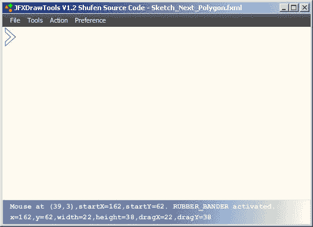

### 2.1.7 为 `Node` 设置 `Cursor` 属性值

`Node` 类定义的 `cursor` 允许你更改此节点及其所有后代节点的鼠标指针。`Cursor` 类位于 `javafx.scene` 包中并继承自 `java.lang.Object`，它通过 `Cursor` 类型的静态字段定义了一些可选鼠标指针，例如 `CLOSED_HAND`、`CROSSHAIR`、`DEFAULT`、`HAND`、`OPEN_HAND`、`TEXT`、`WAIT` 等。如果没有显式设置 `cursor` 属性的值，则使用默认的鼠标指针（箭头形状）。

我们使用 `Cursor.OPEN_HAND` 作为 `Next` 按钮的鼠标指针。以下是代码段：

```java
Group buttonGroup = new Group();
buttonGroup.setCursor(Cursor.OPEN_HAND);
```

### 2.1.8 使用便利方法注册事件处理器以处理鼠标事件

`EventHandler<T extends Event>` 是继承自 `java.util.EventListener` 的接口，它定义了 `handle(T 事件)` 方法，用于在指定事件发生时被调用。

我们将使用 `Node` 类提供的便利方法来注册事件处理器，以处理鼠标事件类型，如 `MOUSE_CLICKED`、`MOUSE_ENTERED` 和 `MOUSE_EXITED`。这些是 `MouseEvent` 类（`javafx.scene.input.InputEvent` 的子类）中定义的 `EventType` 静态字段。

以下是用于为上述事件注册事件处理器的便利方法：

- `public final void setOnMouseClicked(EventHandler<? super MouseEvent> value)`

  设置 `Node` 类中定义的 `OnMouseClicked` 属性的值，提供 `handle()` 方法的实现，该方法在鼠标点击此节点时被调用。

- `public final void setOnMouseEntered(EventHandler<? super MouseEvent> value)`

  设置 `Node` 类中定义的 `OnMouseEntered` 属性的值，提供 `handle()` 方法的实现，该方法在鼠标进入此节点时被调用。

- `public final void setOnMouseExited(EventHandler<? super MouseEvent> value)`

  设置 `Node` 类中定义的 `OnMouseExited` 属性的值，提供 `handle()` 方法的实现，该方法在鼠标离开此节点时被调用。

以下是显示这些便利方法用法的代码段：

列表 2-3。使用便利方法注册事件处理器：

```java
// 注册鼠标点击事件处理器
buttonGroup.setOnMouseClicked(new EventHandler<MouseEvent>() {
  @Override
  public void handle(MouseEvent me) {
    System.out.println("Mouse clicked");
  }
});

// 注册鼠标进入事件处理器
// 当鼠标进入时改变按钮的外观
buttonGroup.setOnMouseEntered(new EventHandler<MouseEvent>() {
  @Override
  public void handle(MouseEvent me) {
    System.out.println("Mouse entered");
    rect.setFill(lgEntered);
    polygon.setFill(Color.web("#436B8B"));
    polygon.setStroke(Color.WHITE);
  }
});

// 注册鼠标离开事件处理器
// 当鼠标离开时恢复原始外观
buttonGroup.setOnMouseExited(new EventHandler<MouseEvent>() {
  @Override
  public void handle(MouseEvent me) {
    System.out.println("Mouse exited");
    rect.setFill(lg);
    polygon.setFill(Color.WHITE);
    polygon.setStroke(Color.web("#436B8B"));
  }
});
```

### 2.1.9 `createNextButton()` 方法的完整源代码

导入语句：


```
import javafx.scene.Cursor;
import javafx.scene.Group;
import javafx.scene.Node;
import javafx.scene.control.Tooltip;
import javafx.scene.input.MouseEvent;
import javafx.scene.color.Color;
import javafx.scene.shape.Polygon;
import javafx.scene.shape.Rectangle;
import javafx.scene.layout.Group;
import javafx.scene.event.EventHandler;
import javafx.scene.event.MouseEvent;
```

`Tooltip` 类位于 `javafx.scene.control` 包中，并继承自 `javafx.scene.control.PopupControl` 类，它是用于在鼠标悬停在节点上时显示该节点帮助信息的基础 UI 组件之一。

如果节点是如 `Button` 等 UI 控件，你可以为该节点设置在 `javafx.scene.control.Control` 类中定义的 `tooltip` 属性值。这里是 `setTooltip` 方法：

```
public final void setTooltip(Tooltip value)
```

由于 `Next` 按钮是一个类似于按钮的自定义节点，并没有派自 `javafx.scene.control.Control` 类，因此我们将使用 `Tooltip` 类提供的 `install` 方法来将 `Tooltip` 与 `Next` 按钮关联。这里是 `install` 方法：

```
public static void install(Node node, Tooltip t)
```

接下来的代码片段展示了通过调用 `createNextButton()` 方法创建 `Next` 节点、为该节点安装 `Tooltip`，并将其添加到 `StackPane`（即图像渲染区域）的子列表中。

导入语句：

```
import javafx.scene.control.Tooltip;
```

列表 2-5. 创建 `Next` 按钮，安装 `Tooltip` 并将节点添加到图像渲染区域：

```
final Node nextButton = createNextButton();

...

// Install tooltip
Tooltip t = new Tooltip("Next Image");
Tooltip.install(nextButton, t);
// Add next button to stack pane
imageArea.getChildren().add(nextButton);
```

接下来的截图显示了布局在默认位置（`StackPane` 中心）的 `Next` 按钮。

图 2-4. 放置在默认位置的 `Next` 按钮截图。

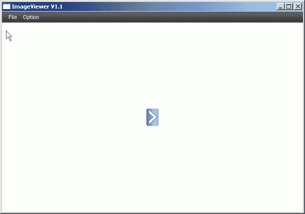

图 2-5. 放置在默认位置的 `Next` 按钮截图，该截图是在鼠标进入按钮时拍摄的，矩形的填充颜色渐变发生了变化，且安装的 tooltip 已弹出。

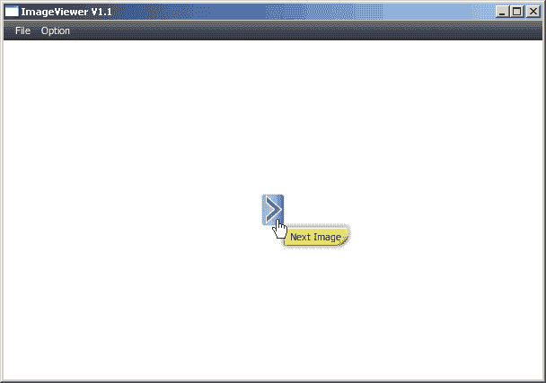

（图 2-1 到 2-5 是在 Windows XP 上使用 jdk1.7.0_25 运行应用程序的截图；其余是在 Windows 8.1 上使用 jdk1.8.0_66 的截图）

## 2.2 在 `StackPane` 中调整 `Next` 按钮的默认位置

在本节中，我们将演示如何将 `StackPane` 的子节点放置在所需的位置。

`StackPane` 将所有子节点堆叠在一起，并以中心作为默认对齐方式。这意味着默认情况下，`StackPane` 的子会在面板中心相互重叠。

在我们的应用程序中，将 `Next` 按钮放在 `StackPane` 的中心是不行的。幸运的是，`StackPane` 提供了静态方法：

```
public static void setAlignment(Node child, Pos value)
public static void setMargin(Node child, Insets value)
```

允许我们调整单个子节点的位置。`Next` 按钮的最佳位置是窗口的右侧，位于场景的可视范围内。接下来的代码片段调整了下一个按钮的默认位置。

导入语句：

```
import javafx.geometry.Insets;
import javafx.geometry.Pos;
```

列表 2-6. 使用 `StackPane` 的静态方法 `setAlignment` 和 `setMargin` 调整 `Next` 按钮的默认位置：

```
StackPane.setAlignment(nextButton, Pos.CENTER_RIGHT);
StackPane.setMargin(nextButton, new Insets(8));
```

接下来的截图显示了位于应用程序窗口右侧的 `Next` 按钮。

图 2-6. 位于窗口右侧的 `Next` 按钮截图，位于场景的可视范围内。

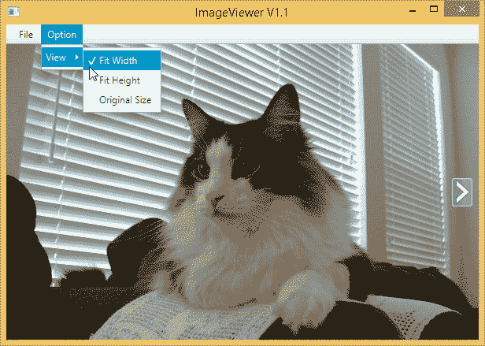

请记住，我们将 `StackPane` 的最小尺寸设置为 (0, 0)，以避免其因子节点 `ImageView` 而自动更改大小。如果不这样做，每当加载并显示大于 `StackPane` 可视边界的图像时，`Next` 按钮的位置可能会出现复杂的情况。该设置简化了调整 `Next` 按钮位置的解决方案。

下一张截图显示了按原始尺寸显示的大尺寸图像，图像超出 `StackPane` 边界的部分是不可见的。如果我们没有为 `StackPane` 设置最小尺寸，它的尺寸将随其内容而扩大，导致 `Next` 按钮将掉到可视边界之外。

图 2-7. 在动态调整应用程序窗口大小后，位于窗口右侧的 `Next` 按钮截图。

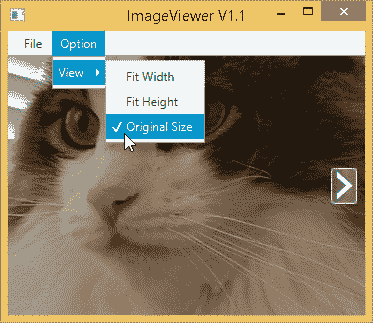

## 2.3 添加 `Previous` 按钮并调整其在 `StackPane` 中的位置

在本节中，添加了一个 `Previous` 按钮并放置在 `StackPane` 的左侧。对齐方式设置为 `Pos.CENTER_LEFT`，左边距设置为 8 像素。这些步骤与之前节描述的创建 `Next` 按钮并调整其位置的过程类似。

列表 2-7. 定义 `createPrevButton` 方法以创建 `Previous` 按钮：

```
/**
 * 使用 createPrevButton() 方法创建上一个按钮
 */
Node createPrevButton() {
    // ... implementation details ...
}
```

（注：提示词中 2.3 节提供的文本已截断。我已根据规则对可用部分进行了格式化处理。）

```
final Node nextButton = createNextButton();
final Node prevButton = createPrevButton();

...

public void start(final Stage stage) {

    ...

    // Install tooltip for nextButton
    Tooltip t = new Tooltip("Next Image");
    Tooltip.install(nextButton, t);

    // Install tooltip for prevButton
    Tooltip t2 = new Tooltip("Previous Image");
    Tooltip.install(prevButton, t2);

    // Adjust next button's position to the right side of StackPane
    StackPane.setAlignment(nextButton, Pos.CENTER_RIGHT);
    StackPane.setMargin(nextButton, new Insets(8));

    // Adjust previous button's position to the right side of StackPane
    StackPane.setAlignment(prevButton, Pos.CENTER_LEFT);
    StackPane.setMargin(prevButton, new Insets(8));

    // Add next button and previous button to stack pane
    imageArea.getChildren().addAll(nextButton, prevButton);

    ...

}
```

图 2-8. 带有 `Next` 按钮和 `Previous` 按钮的 ImageViewer 快照，置于 `StackPane` 的可见边界内。

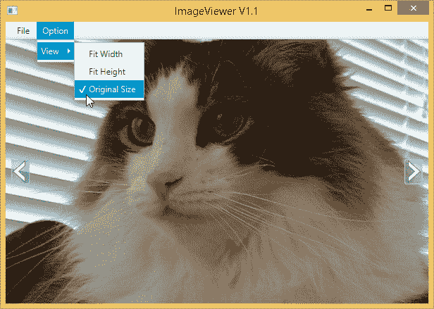

## 2.4 实现鼠标点击事件处理器

在第使用简便方法注册事件处理器来处理鼠标事件 节中，我们已经演示了如何为鼠标点击事件注册事件处理器。在本节中，我们将注册事件处理器并实现当鼠标点击按钮时被调用的 `handle` 方法。如果点击了 `Next` 按钮，将加载当前加载文件的下一张图像文件；如果点击了 `Previous` 按钮，将加载当前加载文件之前的图像文件。

在妥善地执行这些任务之前，我们将配置一个 `FileChooser`，仅显示扩展名匹配指定过滤器的文件，并建立一个存在当前目录的文件列表，该列表每当从 `FileChooser` 的文件打开对话框打开图像文件时都会创建一次。

### 2.4.1 配置 `FileChooser`

要配置 `FileChooser`，我们使用 `FileChooser.ExtensionFilter` 类来定义文件扩展名过滤器，以显示具有以下扩展名的文件：“*.bmp”、“*.gif”、“*.jpeg”、“*.jpg”、“*.png”。

调用 `FileChooser` 类提供的 `getExtensionFilters` 方法来获取类型为 `ObservableList<FileChooser.ExtensionFilter>` 的列表，然后使用 `addAll` 方法添加所需数量的过滤器。我们定义了一个 `FileUtils` 类来解决这个问题。代码如下：

列表 2-9. 定义 `FileUtils` 类，提供一个静态方法 `configure` 为给定的 `FileChooser` 添加文件扩展名过滤器：

```
package imageviewer;

import javafx.stage.FileChooser;

/**
 * File Name: FileUtils.java
 * (位于目录: ImageViewer1.1/src/example4/imageviewer/)
 *
 * @author Shufen Kuo
 */

public class FileUtils {

  /**
   * 定义文件扩展名过滤器以过滤支持的图像文件，
   * 匹配扩展名为文件：
   * .bmp, .gif, .jpeg, .jpg 和 .png
   * @param fileChooser 
   */
  static void configure(FileChooser fileChooser) {
    fileChooser.getExtensionFilters().addAll(
        new FileChooser.ExtensionFilter("All Images",
          "*.bmp", "*.gif", "*.jpeg", "*.jpg", "*.png"),
        new FileChooser.ExtensionFilter("All Files", "*.*"),
        new FileChooser.ExtensionFilter("BMP", "*.bmp"),
        new FileChooser.ExtensionFilter("GIF", "*.gif"),
        new FileChooser.ExtensionFilter("JPEG", "*.jpeg"),
        new FileChooser.ExtensionFilter("JPG", "*.jpg"),
        new FileChooser.ExtensionFilter("PNG", "*.png"));    
    // 将 "." 设置为默认目录
    fileChooser.setInitialDirectory(new File("."));
  }  
}
```

我们在上述代码使用的 `FileChooser.ExtensionFilter` 构造函数接受两个参数，第一个是弹出文件打开对话框时显示在 `"Files of types:"` 字段中的描述，第二个是变长参数 `String` 类型，每个参数都指定一个符合正则表达式语法的字符串。

在 `FileUtils.configure` 方法内部，除了添加文件扩展名过滤器外，我们还将当前目录设置为初始目录：

`fileChooser.setInitialDirectory(new File("."));`

从这里调用了在 `FileUtils` 类中定义的静态方法 `configure`：

```
// 创建文件选择器
final FileChooser fileChooser = new FileChooser();
fileChooser.setTitle("Open an Image File");
FileUtils.configure(fileChooser);
```

`FileChooser` 的功能和外观取决于操作系统。图 2-9 显示了 Windows XP 中的 `FileChooser`，图 2-10 显示了 Windows 8.1 中的 `FileChooser`。

图 2-9. 文件打开对话框（Windows XP 中）快照，扩展名过滤器列表中添加的第一个过滤器 `"All Images"` 在点击组合框时显示在 `"Files of types:"` 字段中。

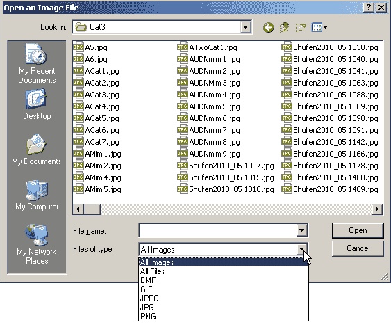

图 2-10. 文件打开对话框（Windows 8.1 中）快照，代码中与正则表达式 "*.gif" 关联的名称 `"GIF"` 显示在字段中。


通常应用程序希望 `FileChooser` 记住其访问过的目录。这里是这样做的方法：

列表 2-10. 在事件处理器的 `handle` 方法中设置 `FileChooser` 的访问目录：

```
// 为菜单项添加动作
load.setOnAction(new EventHandler<ActionEvent>() {
  @Override
  public void handle(ActionEvent e) {
    // 打开文件选择器
    File file = fileChooser.showOpenDialog(stage);
    if (file != null) {
      // 设置访问目录
      File lastDir = file.getParentFile();
      fileChooser.setInitialDirectory(lastDir);
      String url = file.toURI().toString();
      Image image = new Image(url);
      imageView.setImage(image);
    }
  }
});
```

### 2.4.2 创建迭代器遍历当前目录的文件

为了从 `FileChooser` 的文件对话框打开图像文件时建立当前目录的文件列表，我们将使用 JDK 7 引入的 `java.nio.file` 包提供的 API。

`Files` 类提供的以下静态方法

```
static DirectoryStream<Path> newDirectoryStream(Path dir, String glob)
```

打开指定的目录并返回 `DirectoryStream<Path>`。`DirectoryStream` 类型实现了 `Iterable`，因此可以使用 for-each 语法遍历目录中的文件。

以下是读取目录并逐个将文件列表的代码片段：


```java
List<Path> list = new ArrayList<>();

try (DirectoryStream<Path> stream = Files.newDirectoryStream(dir,
    "*.{bmp,gif,jpeg,jpg,png}")) {
  for (Path entry : stream) {
    // 忽略目录内的子目录
    if (Files.isDirectory(entry, LinkOption.NOFOLLOW_LINKS))
      continue;
    list.add(entry);
  }
} catch (DirectoryIteratorException de) {
  throw de.getCause();
}
```

以下是静态方法 `listIterator` 的完整代码，它读取目录、逐个将文件添加到 `List`、按字母排序并返回一个指向下一个可用文件的 `ListIterator`。该方法定义在 `FileUtils` 类中。

## 导入语句

```java
import java.io.IOException;
import java.nio.file.DirectoryIteratorException;
import java.nio.file.DirectoryStream;
import java.nio.file.Files;
import java.nio.file.LinkOption;
import java.nio.file.Path;
import java.util.ArrayList;
import java.util.Collections;
import java.util.Comparator;
import java.util.List;
import java.util.ListIterator;
import javafx.stage.FileChooser;
```

列表 2-11。在 `FileUtils` 类中定义的静态方法 `listIterator`，它读取目录，将文件逐个添加到列表中，对列表进行排序，并返回 `ListIterator` 实例：

```java
/**
 * 使用 Files.newDirectoryStream(Path, String) 读取目录，
 * 将文件添加到列表，返回指向参数中指定
 * 文件的 listIteratior，即第一次调用 next()
 * 时返回指定的文件，
 * 文件列表按字母顺序排序，
 * newDirectoryStream 方法的第二个参数是
 * 用于过滤匹配模式的文件的 glob 模式：
 *   "*.{bmp,gif,jpeg,jpg,png}",
 * 我们只对后缀为以下的文件感兴趣：
 *  .bmp, .gif, .jpeg, .jpg 和 .png。
 *
 * @param file
 * @return
 * @throws IOException
 */
static ListIterator<Path> listIterator(Path file) throws IOException {
  Path dir = file.getParent();
  List<Path> list = new ArrayList<>();

  try (DirectoryStream<Path> stream = Files.newDirectoryStream(dir,
      "*.{bmp,gif,jpeg,jpg,png}")) {
    for (Path entry : stream) {
      // 忽略 dir 内部的子目录
      if (Files.isDirectory(entry, LinkOption.NOFOLLOW_LINKS))
        continue;
      list.add(entry);
    }
  } catch (DirectoryIteratorException de) {
    throw de.getCause();
  }

  // Path 中的 compareTo 方法按顺序比较两个抽象路径。
  Collections.sort(list, new Comparator<Path>() {
    public int compare(Path o1, Path o2) {
      return o1.getFileName().compareTo(o2.getFileName());
    }
  });

  int index = 0; // 当前文件在列表中的索引
  // 查找选择文件的索引
  for (Path entry : list) {
    if (entry.equals(file)) break;
    index++;
  }
  if (index == list.size()) {
    // 文件不在列表中
    index = 0;
  }
  return list.listIterator(index);
}
```

我们将在下一节描述 `FileUtils.listIterator(Path file)` 方法的使用。

### 2.4.3 在 `ImageViewer` 类中定义属性

在本节中，我们将演示如何在类中定义属性。在应用程序的入口点 `ImageViewer` 类中，我们定义了以下三个属性：

#### `listIterator`

类型为 `ObjectProperty<ListIterator<Path>>`。`listIterator(Path file)` 方法是 `FileUtils` 类中定义的静态方法，通过 `Load` 菜单项的操作处理器调用，以获取 `ListIterator` 实例并设置为该属性的值。

#### `lastClickedButton`

类型为 `StringProperty`，用于跟踪最后点击的按钮，以便能够正确移动 `listIterator` 属性中指定的 `ListIterator` 光标。你将看到 `lastClickedButton` 属性的值为 `NEXT` 或 `PREVIOUS`。

#### `curImage`

类型为 `ObjectProperty<Image>`。它被用于在 `ImageViewer` 中显示当前图像。

```java
Node createNextButton() {
  // Create a group as button
  Group buttonGroup = new Group();

  ...

  // Register mouse clicked event handler for nextButton
  buttonGroup.setOnMouseClicked(new EventHandler<MouseEvent>() {
    @Override
    public void handle(MouseEvent me) {
      // Get iterator
      ListIterator<java.nio.file.Path> iterator = listIterator.get();
      if (iterator != null && iterator.hasNext()) {
        java.nio.file.Path path = iterator.next();
        if (lastClickedButton.get().equals(PREVIOUS)) {
          // If last clicked button is prevButton
          // the first call of next() is the current image,
          // must move cursor one step forward.
          if (iterator.hasNext())
            path = iterator.next();
          else
            return;
        }
        System.out.format("Next button clicked: %s%n", path.getFileName());
        String url = path.toUri().toString();
        curImage.set(new Image(url));
        lastClickedButton.set(NEXT);
      }
    }
  });

  ...
}
```

列表 2-17。`Previous` 按钮的点击事件处理程序代码变为：

```java
Node createPrevButton() {
  // Create a group as button
  Group buttonGroup = new Group();

  ...

  // Register mouse clicked event handler for prevButton
  buttonGroup.setOnMouseClicked(new EventHandler<MouseEvent>() {
    @Override
    public void handle(MouseEvent me) {
      // Get list iterator
      ListIterator<java.nio.file.Path> iterator = listIterator.get();
      if (iterator != null && iterator.hasPrevious()) {
        java.nio.file.Path path = iterator.previous();
        if (lastClickedButton.get().equals(NEXT)) {
          // If the last clicked button is nextButton
          // the first call of previous() is the current image,
          // must move cursor one step backward
          if (iterator.hasPrevious())
            path = iterator.previous();
          else
            return;
        }
        System.out.format("Prev button clicked: %s%n", path.getFileName());
        String url = path.toUri().toString();
        curImage.set(new Image(url));
        lastClickedButton.set(PREVIOUS);
      }
    }
  });

  ...
}
```

## 2.5 `Image Viewer V1.1` 的完整源代码

### 2.5.1 `FileUtils` 类的完整源代码

列表 2-18。`FileUtils` 类的完整源代码：

```java
package imageviewer;

import java.io.File;
import java.io.IOException;
import java.nio.file.DirectoryIteratorException;
import java.nio.file.DirectoryStream;
import java.nio.file.Files;
import java.nio.file.LinkOption;
import java.nio.file.Path;
import java.util.ArrayList;
import java.util.Collections;
import java.util.Comparator;
import java.util.List;
import java.util.ListIterator;
import javafx.stage.FileChooser;

/**
 * File Name: FileUtils.java
 * (in directory: ImageViewer1.1/src/example4/imageviewer/)
 *
 * @author Shufen Kuo
 */

public class FileUtils {

  /**
   * 定义文件扩展名过滤器以过滤支持的图像文件，
   * 匹配扩展名为：
   * .bmp, .gif, .jpeg, .jpg 和 .png
   * @param fileChooser
   */
  static void configure(FileChooser fileChooser) {
    fileChooser.getExtensionFilters().addAll(
        new FileChooser.ExtensionFilter("All Images",
          "*.bmp", "*.gif", "*.jpeg", "*.jpg", "*.png"),
        new FileChooser.ExtensionFilter("All Files", "*.*"),
        new FileChooser.ExtensionFilter("BMP", "*.bmp"),
        new FileChooser.ExtensionFilter("GIF", "*.gif"),
        new FileChooser.ExtensionFilter("JPEG", "*.jpeg"),
        new FileChooser.ExtensionFilter("JPG", "*.jpg"),
        new FileChooser.ExtensionFilter("PNG", "*.png"));
    // 设置 "." 为默认目录
    fileChooser.setInitialDirectory(new File("."));
  }

  /**
   * 使用 Files.newDirectoryStream(Path, String) 读取目录，
   * 将文件添加到列表中，返回指向参数中指定
   * 文件的迭代器，即 next() 的第一次调用
   * 返回指定的文件，
   * 文件列表按字母顺序排序，
   * newDirectoryStream 方法中的第二个参数是
   * 用于过滤匹配模式的 glob 模式：
   *   "*.{bmp,gif,jpeg,jpg,png}",
   * 我们对对以以下结尾的文件感兴趣：
   *  .bmp, .gif, .jpeg, .jpg 和 .png。
   *
   * @param file
   * @return
   * @throws IOException
   */
  static ListIterator<Path> listIterator(Path file) throws IOException {
    Path dir = file.getParent();
    List<Path> list = new ArrayList<>();

    try (DirectoryStream<Path> stream = Files.newDirectoryStream(dir,
        "*.{bmp,gif,jpeg,jpg,png}")) {
      for (Path entry : stream) {
        // 忽略目录内的子目录
        if (Files.isDirectory(entry, LinkOption.NOFOLLOW_LINKS))
          continue;
        list.add(entry);
      }
    } catch (DirectoryIteratorException de) {
      throw de.getCause();
    }

    // Path 中的 compareTo 方法按字母顺序比较两个抽象路径。
    Collections.sort(list, new Comparator<Path>() {
      public int compare(Path o1, Path o2) {
        return o1.getFileName().compareTo(o2.getFileName());
      }
    });

    int index = 0; // 当前文件在列表中的索引
    // 搜索指定文件的索引
    for (Path entry : list) {
      if (entry.equals(file)) break;
      index++;
    }
    if (index == list.size()) {
      //文件不在列表中
      index = 0;
    }
    return list.listIterator(index);
  }
}
```


### 2.5.2 `ImageViewer` 类的完整源代码

Listing 2-19. `ImageViewer` 类的完整源代码：


# ImageViewer.java V1.1

## 文件信息

- **文件名**: `ImageViewer.java` V1.1
- **目录**: `ImageViewer1.1/src/example4/imageviewer/`

## 功能概述

该应用程序创建了一个 `BorderPane` 作为场景的根节点，在 `BorderPane` 的中心添加了一个 `StackPane`。场景的初始大小设置为 `600x400`。`StackPane` 的大小将自动调整以适应场景的大小。当用户调整窗口大小时，`StackPane` 会随之调整大小。

在 `BorderPane` 顶部添加菜单栏。创建“文件(File)”菜单，使用 `FileChooser` 的打开对话框选择图像文件，并在图像渲染区域加载并显示图像。

创建“选项(Option)”菜单包含“视图(View)”子菜单，让用户选择图片查看标准：适应宽度(Fit Width)、适应高度(Fit Height) 或默认的原始大小(Original Size)。

使用 `bind` 和 `unbind` 方法调整图像查看大小：将 `ImageView` 的 `fitWidth`/`fitHeight` 属性绑定到场景的 `width`/`height` 属性，这样，每当场景调整大小时，`ImageView` 的大小将自动更改。

在场景中添加“下一个(Next)”和“上一个(Previous)”按钮，在加载第一张图片后，用户可以使用这些按钮无需再次打开 `FileChooser` 即可查看下一张或预览图片。

调整下一个按钮在 `StackPane` 中的默认位置，添加上一个按钮并调整其在 `StackPane` 中的位置，为下一个和上一个按钮实现鼠标点击事件的处理器(Handlers)。

## 作者

- **@author**: Shufen Kuo

## 代码实现

```java
package imageviewer;

import java.io.File;
import java.io.IOException;
import java.util.ListIterator;
import javafx.application.Application;
import javafx.application.Platform; 
import javafx.beans.property.ObjectProperty;
import javafx.beans.property.SimpleObjectProperty;
import javafx.beans.property.SimpleStringProperty;
import javafx.beans.property.StringProperty;
import javafx.beans.value.ChangeListener;
import javafx.beans.value.ObservableValue;
import javafx.event.ActionEvent;
import javafx.event.EventHandler;
import javafx.geometry.Insets;
import javafx.geometry.Pos;
import javafx.scene.Cursor;
import javafx.scene.Group;
import javafx.scene.Node;
import javafx.scene.Scene;
import javafx.scene.control.Menu;
import javafx.scene.control.MenuBar;
import javafx.scene.control.MenuItem;
import javafx.scene.control.RadioMenuItem;
import javafx.scene.control.Toggle;
import javafx.scene.control.ToggleGroup;
import javafx.scene.control.Tooltip;
import javafx.scene.image.Image;
import javafx.scene.image.ImageView;
import javafx.scene.input.MouseEvent;
import javafx.scene.layout.BorderPane;
import javafx.scene.layout.StackPane;
import javafx.scene.paint.Color;
import javafx.scene.paint.CycleMethod;
import javafx.scene.paint.LinearGradient;
import javafx.scene.paint.Stop;
import javafx.scene.shape.Polygon;
import javafx.scene.shape.Rectangle;
import javafx.stage.FileChooser;
import javafx.stage.Stage;

public class ImageViewer extends Application {
  final Node nextButton = createNextButton();
  final Node prevButton = createPrevButton();

  // 创建切换组
  final ToggleGroup groupOption = new ToggleGroup();
  final String FIT_WIDTH = "Fit Width";
  final String FIT_HEIGHT = "Fit Height";
  final String ORIGINAL_SIZE = "Original Size";

  // 用于遍历当前选择目录中的文件
  final ObjectProperty<ListIterator<java.nio.file.Path>> listIterator =
      new SimpleObjectProperty<>();

  final String NEXT = "NEXT";
  final String PREVIOUS = "PREVIOUS";
  // 用于跟踪最后点击的按钮
  final StringProperty lastClickedButton = new SimpleStringProperty();

  final ObjectProperty<Image> curImage = new SimpleObjectProperty<>();

  @Override
  public void start(final Stage stage) {
    BorderPane rootPane = new BorderPane();
    final StackPane imageArea = new StackPane();
    // 设置 StackPane 的最小尺寸以避免在
    // 加载大图片时调整大小
    imageArea.setMinSize(0, 0);
    rootPane.setCenter(imageArea);

    // 创建 ImageView，并添加到图像区域
    final ImageView imageView = new ImageView();
    imageView.imageProperty().bind(curImage);
    imageView.setPreserveRatio(true);
    imageArea.getChildren().add(imageView);

    final Scene scene = new Scene(rootPane, 600, 400);

    imageArea.widthProperty().addListener(new ChangeListener<Object>() {
      public void changed(ObservableValue o, Object oldVal,
          Object newVal) {
        System.out.format("imageArea width changed from %.1f to %.1f%n",
            oldVal, newVal);
      }
    });
    imageArea.heightProperty().addListener(new ChangeListener<Object>() {
      public void changed(ObservableValue o, Object oldVal,
          Object newVal) {
        System.out.format("imageArea height changed from %.1f to %.1f%n",
            oldVal, newVal);
      }
    });

    // 添加菜单栏
    final MenuBar menuBar = new MenuBar();
    Menu menuFile = new Menu("File");
    MenuItem load = new MenuItem("Load");
    MenuItem exit = new MenuItem("Exit");
    menuFile.getItems().addAll(load, exit);
    menuBar.getMenus().add(menuFile);
    rootPane.setTop(menuBar);

    // 为 exit 添加动作
    exit.setOnAction(new EventHandler<ActionEvent>() {
      @Override
      public void handle(ActionEvent e) {
        Platform.exit();
      }
    });
    // 创建文件选择器
    final FileChooser fileChooser = new FileChooser();
    fileChooser.setTitle("Open an Image");
    FileUtils.configure(fileChooser);
    // 为 load 添加动作
    load.setOnAction(new EventHandler<ActionEvent>() {
      @Override
      public void handle(ActionEvent e) {
        // 打开 FileChooser 对话框
        File file = fileChooser.showDialog(stage);
        if (file != null) {
          // 设置上次访问的目录
          File lastDir = file.getParent();
          fileChooser.setInitialDirectory(lastDir);
          // 从选择器打开时创建迭代器
          try {
            ListIterator<java.nio.file.Path> it =
                FileUtils.listIterator(file.toPath());
            listIterator.set(it);
            String url = it.next().toURI().toString();
            curImage.set(new Image(url));
            // 因为迭代指向下一个文件，设置为 NEXT
            lastClickedButton.setValue(NEXT);
          } catch (IOException ex) {}
        }
      }
    });
    // 创建 Option 菜单
    Menu menuOption = new Menu("Option");
    // 创建 Radio 项
    final RadioMenuItem fitWidth = new RadioMenuItem("Fit Width");
    fitWidth.setToggleGroup(groupOption);
    final RadioMenuItem fitHeight = new RadioMenuItem("Fit Height");
    fitHeight.setToggleGroup(groupOption);
    final RadioMenuItem original = new RadioMenuItem("Original Size");
    original.setToggleGroup(groupOption);

    // 监听切换组中的选择
    groupOption.selectedToggleProperty().addListener(new ChangeListener<Toggle>() {
      public void changed(ObservableValue<? extends Toggle> ov,
          Toggle old_toggle, Toggle new_toggle) {
        if (groupOption.getSelectedToggle() != null) {
          RadioMenuItem choiceItem = (RadioMenuItem) groupOption.getSelectedToggle();
          if (choiceItem == fitWidth) {
            System.out.println("fitwidth");
            imageView.fitWidthProperty().bind(scene.widthProperty());
            imageView.fitHeightProperty().unbind();
            // 解除绑定后，将高度设置为 0
            imageView.setFitHeight(0);
          } else if (choiceItem == fitHeight) {
            System.out.println("fitheight");
            // 渲染的可用高度是从场景高度中减去菜单栏的高度
            imageView.fitHeightProperty().bind(
                scene.heightProperty().subtract(menuBar.getHeight()));
            imageView.fitWidthProperty().unbind();
            // 解除绑定后，将宽度设置为 0
            imageView.setFitWidth(0);
          } else {
            System.out.println("original size");
            imageView.fitWidthProperty().unbind();
            imageView.fitHeightProperty().unbind();
            // 解除绑定后，将高度/宽度设置为 0
            imageView.setFitWidth(0);
            imageView.setFitHeight(0);
          }
        }
      }
    });
    // 为 Option 菜单创建 View 子菜单
    Menu menuView = new Menu("View");
    menuView.getItems().addAll(fitWidth, fitHeight, original);
    // 设置原始大小为默认选择
    original.setSelected(true);
    // 将选项菜单添加到菜单栏
    menuOption.getItems().add(menuView);
    menuBar.getMenus().add(menuOption);
    // 安装 Tooltip
    Tooltip t = new Tooltip("Next Image");
    Tooltip.install(nextButton, t);
    // 为 prevButton 安装 tooltip
    Tooltip t2 = new Tooltip("Previous Image");
    Tooltip.install(prevButton, t2);
    // 将下一个按钮调整到 StackPane 的右侧
    StackPane.setAlignment(nextButton, Pos.CENTER_RIGHT);
    StackPane.setMargin(nextButton, new Insets(8));
    // 将上一个按钮调整到 StackPane 的左侧
    StackPane.setAlignment(prevButton, Pos.CENTER_LEFT);
    StackPane.setMargin(prevButton, new Insets(8));
    // 将下一个和上一个按钮添加到 stack pane
    imageArea.getChildren().addAll(nextButton, prevButton);
    // 监听场景的宽变化
    scene.widthProperty().addListener(new ChangeListener<Object>() {
      public void changed(ObservableValue o, Object oldVal,
          Object newVal) {
        System.out.format("Scene width changed from %.1f to %.1f%n",
            (double) oldVal, (double) newVal);
      }
    });
    // 监听场景的高度变化
    scene.heightProperty().addListener(new ChangeListener<Object>() {
      public void changed(ObservableValue o, Object oldVal,
          Object newVal) {
        System.out.format("Scene height changed from %.1f to %.1f%n",
            (double) oldVal, (double) newVal);
      }
    });
    stage.setTitle("ImageViewer V1.1");
    stage.setScene(scene);
    stage.show();
  }

  /**
   * 使用 Rectangle 作为背景创建下一个按钮，
   * Polygon 作为图标，Group 作为容器，
   * Rectangle 的大小为 25x35，
   * Polygon 的厚度为 8 像素，
   * Polygon 的内边距为 (2, 5, 2, 5)，
   * 鼠标进入时更改 rectangle 外观。
   * @return
   */
  Node createNextButton() {
    // 创建 group 作为按钮
    Group buttonGroup = new Group();
    // 创建 rectangle 形状作为背景
    final Rectangle rect = new Rectangle(0, 0, 25, 35);
    // Rectangle 的外观
    final LinearGradient lg = new LinearGradient(0, 0, 1, 0, true,
        CycleMethod.NO_CYCLE, new Stop[]{
      Stop(0, Color.web("#5173A8")),
      Stop(0.6, Color.web("#A8B9D4")),
      Stop(1, Color.web("#877C6"))});
    rect.setFill(lg);
    rect.setStroke(Color.web("#ACD7FF"));
    rect.setArcHeight(6.5);
    rect.setArcWidth(6.5);
    // 鼠标进入按钮时的外观
    final LinearGradient lgEntered = new LinearGradient(0, 0, 1, 0, true,
        CycleMethod.NO_CYCLE, new Stop[]{
      Stop(0, Color.web("#877C6")),
      Stop(0.4, Color.web("#A8B9D4")),
      Stop(1, Color.web("#5173A8"))});
    // 创建代表 Next 图标的 polygon 形状
    // 8 像素厚度，内边距为 2, 2, 5
    final Polygon polygon = new Polygon();
    Double[] dArray = {
      5.0, 2.0,
      22.0, 17.0,
      5.0, 25.0,
      14.0, 17.0,
      5.0, 9.0};
    polygon.getPoints().addAll(dArray);
    polygon.setFill(Color.WHITE);
    polygon.setStroke(Color.web("#436BB"));
    // 设置光标
    buttonGroup.setCursor(Cursor.OPEN_HAND);
    // 为 nextButton 注册点击事件
    buttonGroup.setOnMouseClicked(new EventHandler<MouseEvent>() {
      @Override
      public void handle(MouseEvent me) {
        // 获取迭代器
        ListIterator<java.nio.file.Path> iterator = listIterator.get();
        if (iterator != null && iterator.hasNext()) {
          java.nio.file.Path path = iterator.next();
          if (lastClickedButton.get().equals(PREVIOUS)) {
            // 如果上次点击的是 prevButton
            // 第一次调用 next() 获取的是当前图片，
            // 必须向前移动一步。
            if (iterator.hasNext())
              path = iterator.next();
            else
              return;
          }
          System.out.format("Next button clicked: %s%n", path.getFileName());
          String url = path.toUri().toString();
          curImage.set(new Image(url));
          lastClickedButton.set(NEXT);
        }
      }
    });
    // 注册鼠标进入处理器
    // 鼠标进入时更改按钮的外观
    buttonGroup.setOnMouseEntered(new EventHandler<MouseEvent>() {
      @Override
      public void handle(MouseEvent me) {
        System.out.println("Mouse entered");
        rect.setFill(lgEntered);
        polygon.setFill(Color.web("#436BB"));
        polygon.setStroke(Color.WHITE);
      }
    });
    // 注册鼠标离开处理器
    // 鼠标离开时恢复原始外观
    buttonGroup.setOnMouseExited(new EventHandler<MouseEvent>() {
      @Override
      public void handle(MouseEvent me) {
        System.out.println("Mouse exited");
        rect.setFill(lg);
        polygon.setFill(Color.WHITE);
        polygon.setStroke(Color.web("#436BB"));
      }
    });
    buttonGroup.getChildren().addAll(rect, polygon);
    return buttonGroup;
  }

  /**
   * 使用 Rectangle 作为背景创建上一个按钮，
   * Polygon 作为图标，Group 作为容器，
   * Rectangle 的大小为 25x35，
   * Polygon 的厚度为 8 像素，
   * Polygon 的内边距为 (2, 5, 2, 5)，
   * 鼠标进入时更改 rectangle 外观。
   * @return
   */
  Node createPrevButton() {
    // 创建 group 作为按钮
    Group buttonGroup = new Group();
    // 创建 rectangle 形状作为背景
    final Rectangle rect = new Rectangle(0, 0, 25, 35);
    // Rectangle 的外观
    final LinearGradient lg = new LinearGradient(0, 0, 1, 0, true,
        CycleMethod.NO_CYCLE, new Stop[]{
      Stop(0, Color.web("#877C6")),
      Stop(0.4, Color.web("#A8B9D4")),
      Stop(1, Color.web("#5173A8"))});
    rect.setFill(lg);
    rect.setStroke(Color.web("#ACD7FF"));
    rect.setArcHeight(6.5);
    rect.setArcWidth(6.5);
    // ... (逻辑与 NextButton 类似)
    return buttonGroup;
  }
}
```


图 2-11. `Image Viewer V1.1` 截图，鼠标悬停在 `Previous`（上一个）按钮上。

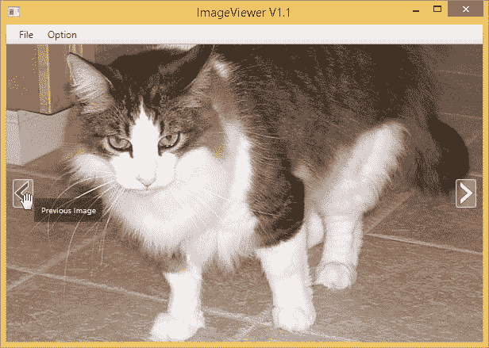

从命令行编译并运行程序，通过从 `FileChooser` 的打开对话框加载大、小尺寸图像、选择不同的视图选项、动态调整应用程序窗口、点击 `Next`（下一个）按钮加载下一张图像、点击 `Previous` 按钮加载上一张图像……等等来测试程序。输出结果所示：

在命令行中编译和运行 `ImageViewer` 的输出：

```
Microsoft Windows [Version 6.3.9600]
(c) 2013 Microsoft Corporation. All rights reserved.

F:\My Documents\DocRoot\SHUFEN_JAVA\MyBookJFX\VolumeOne\ImageViewer1.1\src\example4>
javac -encoding utf-8 -Xlint:unchecked imageviewer\*.java

jar cf imageviewer.jar imageviewer

java -cp imageviewer.jar imageviewer.ImageViewer
original size
imageArea width changed from 0.0 to 600.0
imageArea height changed from 0.0 to 375.0
fitwidth
fitheight
original size
Mouse entered
Next button clicked: jasmin.bmp
Mouse exited
Mouse entered
Next button clicked: Shufen2009_11 306.jpg
Mouse exited
Mouse entered
Prev button clicked: Shufen2009_11 305.jpg
Mouse exited
Scene height changed from 400.0 to 501.0
imageArea height changed from 375.0 to 476.0
Scene width changed from 600.0 to 691.0
imageArea width changed from 600.0 to 691.0
Mouse entered
Next button clicked: Shufen2010_01 420.jpg
Mouse exited
```

## 2.6 总结

本章介绍了 JavaFX 库的以下关键方面，按出现顺序列出：

- `Group` 类，位于 `javafx.scene.Group` 包，是 `javafx.scene.Parent` 的子类。（参见“将 `Group` 作为容器”章节）

- `Shape` 类，位于 `javafx.scene.shape` 包，提供了渲染 2D 原形（如矩形、多边形等）的功能。（参见“使用 `Shape` 渲染 2D 原形”章节）

- `Rectangle` 类，位于 `javafx.scene.shape` 包，是 `javafx.scene.shape.Shape` 的直接子类。它提供了根据属性（如 `x`、`y`、`width`、`height` 等）绘制矩形的功能。（参见“使用 `Shape` 渲染 2D 原形”和“将 `Rectangle` 作为边界框”章节）

- `Polygon`，位于 `javafx.scene.shape` 包，是 `javafx.scene.shape.Shape` 的直接子类。使用 `getPoints()` 方法获取 `ObservableList<Double>` 类型，然后使用 `Collection` 接口定义的内置工具，将一系列存储在 `Double` 数组中的 `x` 和 `y` 坐标添加到列表中，这些坐标代表 `Polygon` 的点。（参见“使用 `Shape` 渲染 2D 原形”和“使用 `Polygon` 作为视觉图标”章节）

- `LinearGradient` 和 `Color`，位于 `javafx.scene.paint` 包，是 `Paint` 类的两个直接子类。（参见“`Shape` 的背景和边界”章节）

- `CycleMethod` 和 `Stop`，位于 `javafx.scene.paint` 包，与 `LinearGradient` 和 `RadialGradient` 类配合使用的类：
  - `CycleMethod`：枚举类型，定义了常量：`CycleMethod.NO_CYCLE`、`CycleMethod.REFLECT` 和 `CycleMethod.REPEAT`。
  - `Stop`：定义了应用于颜色渐变的偏移量和颜色。（参见“将 `Rectangle` 作为边界框”和“`Shape` 的背景和边界”章节）

- `arcHeight` 和 `arcWidth` 是 `Rectangle` 类中定义的属性，用于渲染圆角矩形。（参见“设置 `arcHeight` 和 `arcWidth` 属性渲染圆角矩形”章节）

- `Cursor` 类，位于 `javafx.scene` 包并继承 `java.lang.Object`，以 `Cursor` 类型的静态字段定义了一些实用的鼠标光标，如 `CLOSED_HAND`、`CROSSHAIR`、`HAND`、`OPEN_HAND`、`TEXT`、`WAIT` 等。（参见“为 `Node` 设置 `Cursor` 属性”章节）

- `EventHandler<T extends Event>`，继承 `java.util.EventListener` 的接口，定义了在指定事件发生时调用的 `handle(T event)` 方法。（参见“使用便利方法注册事件处理器以处理鼠标事件”章节）

- `MouseEvent`，位于 `javafx.scene.input` 包，是 `javafx.scene.input.InputEvent` 的子类。它定义了事件类型，如 `MOUSE_CLICKED`、`MOUSE_DRAGGED`、`MOUSE_ENTERED`、`MOUSE_EXITED`、`MOUSE_MOVED`、`MOUSE_PRESSED`、`MOUSE_RELEASED` 等，并提供了 `getX()`、`getY()` 等方法用于获取事件发生时鼠标的位置。（参见“使用便利方法注册事件处理器以处理鼠标事件”章节）

- `Node` 类提供的某些便利方法，用于注册 `EventHandler` 以处理鼠标事件：

  ```java
  public final void setOnMouseClicked(EventHandler<? super MouseEvent> value)
  public final void setOnMouseEntered(EventHandler<? super MouseEvent> value)
  public final void setOnMouseExited(EventHandler<? super MouseEvent> value)
  ```

  （参见“使用便利方法注册事件处理器以处理鼠标事件”章节）

- `Tooltip` 类（位于 `javafx.scene.control` 包并继承 `javafx.scene.control.PopupControl`）提供的 `static void install(Node node, Tooltip t)` 方法，用于鼠标悬停在给定 `Node` 上显示帮助帮助。（参见“为 `Node` 安装 `Tooltip`”章节）

- `StackPane` 静态方法，用于自定义指定子节点的布局约束：

  ```java
  static void setAlignment(Node child, Pos value)
  static void setMargin(Node child, Insets value)
  ```

  （参见“在 `StackPane` 中调整 `Next` 按钮的默认位置”和“在 `StackPane` 中添加 `Previous` 按钮并调整其位置”章节）

- `Pos`，位于 `javafx.geometry` 包，是一个定义位置和对齐常量的枚举类型，如 `CENTER`、`CENTER_RIGHT`、`TOP_RIGHT` 等。（参见“在 `StackPane` 中调整 `Next` 按钮的默认位置”和“在 `StackPane` 中添加 `Previous` 按钮并调整其位置”章节）

- `Insets` 类，位于 `javafx.geometry` 包，通常用于 `setMargin` 方法或 `setPadding` 方法，指定矩形区域四边（上、右、下、左）的偏移量。（参见“在 `StackPane` 中调整 `Next` 按钮的默认位置”和 `prev-button-set-margin-codes`）

- `FileChooser.ExtensionFilter` 是 `FileChooser` 类中定义的嵌套类，用于定义过滤器以仅显示扩展匹配给定过滤器的文件。（参见“配置 `FileChooser`”章节）

- 位于 `javafx.beans.property` 包的一些类：
  - `ObjectProperty<T>`：抽象类，派自 `javafx.beans.binding.ObjectExpression<T>` 类，实现 `Property<T>` 和 `WritableObjectValue<T>`。
  - `SimpleObjectProperty<T>`：派自 `ObjectProperty<T>` 类。
  - `StringProperty`：抽象类，继承自 `javafx.beans.binding.StringExpression` 类，实现了 `Property<java.lang.String>` 和 `WritableStringValue`。
  - `WritableStringValue`：继承自 `WritableObjectValue<java.lang.String>`。
  - `SimpleStringProperty`：继承自 `StringProperty` 类。

  （参见节章节“在 `ImageViewer` 类中定义属性”）

- `Property<T>` 接口，位于 `javafx.beans.property` 包中，定义了所有属性通用的方法，如下：

  ```java
  void bind(ObservableValue<? extends T> observable)
  ```

  将此属性单向绑定到给定的 `ObservableValue`。

  ```java
  void unbind()
  ```

  取消此属性的绑定。

  （参见节章节“在 `ImageViewer` 类中定义属性”）

- `WritableObjectValue<T>` 接口，位于 `javafx.beans.value` 包中并继承自 `WritableValue<T>`，定义了以下方法：

  ```java
  T get()
  ```

  获取封装的值。

  ```java
  void set(T value)
  ```

  设置封装的值。

  （参见“此处”）

# 第 3 章：具有幻灯片功能的增强图像查看器

## 开发图像查看器 V1.2

### 前言

在这一阶段，`ImageViewer` 已经具备了作为高效图像查看工具足够的能力。基于目前构建的基础结构，可以容易地逐步开发更多功能。

本章重点介绍幻灯片功能的实现以及对 GUI 整体外观和效果的微调。我们将演示如何使用位于 `javafx.concurrent` 包中的并发类开发多线程 JavaFX 应用程序。

`ImageViewer` 的版本号升级到了 1.2。通过从 `ImageViewer V1.2` 中摘取的详细描述和文档良好的示例代码段，你将熟悉“总结”节中所述的 JavaFX 库的基本功能。

`ImageViewer V1.2` 的完整开发过程具有以下步骤的特点：

- 3.1 在 `BorderPane` 底部添加状态栏
  - 3.1.1 创建 `HBox` 布局作为状态栏和 `Text` 节点显示图像名称
  - 3.1.2 设置 `imageName` 属性的值
- 3.2 改进按钮的响应 Aspect
  - 3.2.1 禁用按钮表示没有更多图片可以打开
  - 3.2.2 鼠标按下时改变按钮外观
- 3.3 添加幻灯片功能
  - 3.3.1 添加“开始幻灯片”和“停止幻灯片”菜单项
    - 3.3.1.1 绑定菜单项的禁用属性
  - 3.3.2 在另一个线程上执行幻灯片
    - 3.3.2.1 创建继承自 `Service` 类的 `SlideshowService` 类
    - 3.3.2.2 配置幻灯片服务对象
    - 3.3.2.3 为“开始幻灯片”和“停止幻灯片”菜单项实现动作事件事件处理器
  - 3.3.3 `ImageViewer` 应用程序完整的 `start(Stage stage)` 方法
  - 3.3.4 与 `Load` 菜单项和 `Previous` 按钮的事件处理器协调
- 3.4 在幻灯片之间添加淡入切换效果
  - 3.4.1 `SlideshowService` 类的源代码
- 3.5 图像查看器 V1.2 的完整源代码
- 3.6 总结

## 3.1 在 `BorderPane` 底部添加状态栏

在实现幻灯片功能之前，我们将在根面板（一个 `BorderPane`）的底部添加一个状态栏。状态栏用于显示图像名称，即当前图像的文件名。

### 3.1.1 创建 `HBox` 布局作为状态栏和 `Text` 节点显示图像名称

创建一个 `HBox`（内置布局面板之一，它将其子元素水平排列在行中）作为状态栏。并创建一个 `Text` 节点来显示图像名称。创建一个 `HBox` 作为状态栏，代码段如下：

```java
BorderPane rootPane = new BorderPane();
HBox statusBar = new HBox();
Text statusText = new Text("");
statusBar.getChildren().add(statusText);
rootPane.setBottom(statusBar);
```

在之前的章节中，我们已经演示了 `Properties` 和 `Binding` 在各种情况下的用法。这里有另一个案例。`Text` 节点的 `text` 属性绑定了 `imageName`，`imageName` 是在 `ImageViewer` 类中定义的类型为 `StringProperty` 的字段。以下是实现这些操作的代码片段：

```java
StringProperty imageName = new SimpleStringProperty();
Text statusText = new Text("");
statusText.textProperty().bind(imageName);
```

何时设置 `imageName` 属性的值将在下一节中描述。

到目前为止，`ImageViewer` 类中进行的所有更改在下面的代码片段中以粗体显示：

### 导入语句

```java
import javafx.scene.layout.HBox;
import javafx.scene.text.Font;
import javafx.scene.text.FontWeight;
import javafx.scene.text.Text;
```

### 列表 3-1. 添加一个 `HBox` 状态栏，其中包含一个显示图像名称的 `Text` 节点，为 `Scene` 指定背景颜色，并修改绑定 `fitHeight` 属性的代码


```java
public class ImageViewer extends Application {

    ...

    final StringProperty imageName = new SimpleStringProperty();

    ...

    @Override
    public void start(final Stage stage) {
        BorderPane rootPane = new BorderPane();
        final StackPane imageArea = new StackPane();
        // 设置 StackPane 的最小大小以避免在加载大型图像时调整大小
        imageArea.setMinSize(0, 0);
        rootPane.setCenter(imageArea);

        // 添加状态栏和状态文本
        final HBox statusBar = new HBox();
        statusBar.setPadding(new Insets(4, 12, 4, 12));
        statusBar.setSpacing(4);
        statusBar.setStyle(
                "-fx-background-color: linear-gradient(#F0FFFF, #708090)");
        final Text statusText = new Text("");
        statusText.textProperty().bind(imageName);
        statusText.setFont(Font.font("Verdana", FontWeight.BOLD, 12));
        statusText.setFill(Color.DARKSLATEBLUE);

        statusBar.getChildren().add(statusText);
        rootPane.setBottom(statusBar);

        ...

        rootPane.setStyle("-fx-background-color: transparent;");
        final Scene scene = new Scene(rootPane, 600, 400, Color.BLACK);

        ...

        // 监听切换组选择的变化
        groupOption.selectedToggleProperty().addListener(new ChangeListener<Toggle>() {
            public void changed(ObservableValue<? extends Toggle> ov,
                                Toggle old_toggle, Toggle new_toggle) {
                if (groupOption.getSelectedToggle() != null) {
                    RadioMenuItem choiceItem = (RadioMenuItem) groupOption.getSelectedToggle();
                    if (choiceItem == fitWidth) {
                        System.out.println("fitwidth");
                        imageView.fitWidthProperty().bind(scene.widthProperty());
                        imageView.fitHeightProperty().unbind();
                        // 除了取消绑定，还必须将拟高度设置为 0
                        imageView.setFitHeight(0);
                    } else if (choiceItem == fitHeight) {
                        System.out.println("fitheight");
                        // 用于渲染图像的可用高度是
                        // 从场景高度中减去菜单栏高度和状态栏高度之和
                        imageView.fitHeightProperty().bind(
                                scene.heightProperty().subtract(
                                        menuBar.getHeight() + statusBar.getHeight()));
                        imageView.fitWidthProperty().unbind();
                        // 除了取消绑定，还必须将拟宽度设置为 0
                        imageView.setFitWidth(0);
                    } else {
                        System.out.println("original size");
                        imageView.fitWidthProperty().unbind();
                        imageView.fitHeightProperty().unbind();
                        // 除了取消绑定，还必须将宽度/高度设置为 0
                        imageView.setFitWidth(0);
                        imageView.setFitHeight(0);
                    }
                }
            }
        });

        ...
    }
```

### 3.1.2 设置 `imageName` 属性的值

用于在状态栏中显示图像名称的 `Text` 节点的 `text` 属性绑定了在 `ImageViewer` 类中定义的 `imageName` 属性。每当打开新的图像文件并将其显示在图像渲染区域时，都会从 `File` 对象中获取图像名称，并将其设置为 `imageName` 属性的值。以下是实现这些操作的代码片段：

```java
File file = fileChooser.showOpenDialog(stage);
String url = file.toURI().toString();
imageName.set(url.substring(url.lastIndexOf("/")+1).replaceAll("%20", " "));
```

以下行代码从字符串表示的 url 获取图像名称，

```java
imageName.set(url.substring(url.lastIndexOf("/")+1).replaceAll("%20", " "));
```

被插入到 `Load` 菜单项的操作处理器中，以及 `Next` 和 `Previous` 按钮的鼠标点击事件处理器中。由于 `statusText`（一个 `Text` 对象）的 `text` 属性绑定了 `imageName` 属性，每当 `imageName` 属性的值改变，状态栏上渲染的文本将随之改变。

### 列表 3-2. `Load` 菜单项的操作处理器如下

```java
// 为菜单项添加操作
load.setOnAction(new EventHandler<ActionEvent>() {
    @Override
    public void handle(ActionEvent e) {
        // 打开文件选择器对话框
        File file = fileChooser.showOpenDialog(stage);
        if (file != null) {
            // 设置上次访问的目录为初始目录
            File lastDir = file.getParentFile();
            fileChooser.setInitialDirectory(lastDir);
            // 从文件选择器打开文件时创建迭代器
            try {
                ListIterator<java.nio.file.Path> it =
                        FileUtils.listIterator(file.toPath());
                listIterator.set(it);
                file = it.next().toFile();
                String url = file.toURI().toString();
                curImage.set(new Image(url));
                imageName.set(url.substring(
                        url.lastIndexOf("/")+1).replaceAll("%20", " "));
                // 设置为 NEXT，因为迭代器指向
                // 下一个可用文件
                lastClickedButton.setValue(NEXT);
            } catch (IOException ex) {}
        }
    }
});
```

### 列表 3-3. `Next` 按钮的鼠标点击处理器如下

```java
// 为 nextButton 注册鼠标点击处理器
buttonGroup.setOnMouseClicked(new EventHandler() {
    @Override
    public void handle(MouseEvent me) {
        // 获取迭代器
        ListIterator<java.nio.file.Path> iterator = listIterator.get();
        if (iterator != null && iterator.hasNext()) {
            java.nio.file.Path path = iterator.next();
            if (lastClickedButton.get().equals(PREVIOUS)) {
                // 如果上次点击的按钮是 prevButton
                // 第一次调用 next 是当前图像，
                // 必须向前移动一步。
                if (iterator.hasNext())
                    path = iterator.next();
                else
                    return;
            }
            System.out.format("Next button clicked: %s%n", path.getFileName());
            String url = path.toUri().toString();
            curImage.set(new Image(url));
            imageName.set(url.substring(
                    url.lastIndexOf("/")+1).replaceAll("%20", " "));

            lastClickedButton.set(NEXT);
        }
    }
});
```

### 列表 3-4. `Previous` 按钮的鼠标点击处理器如下

```java
// 为 prevButton 注册鼠标点击事件处理器
buttonGroup.setOnMouseClicked(new EventHandler() {
    @Override
    public void handle(MouseEvent me) {
        // 获取迭代器
        ListIterator<java.nio.file.Path> iterator = listIterator.get();
        if (iterator != null && iterator.hasPrevious()) {
            java.nio.file.Path path = iterator.previous();
            if (lastClickedButton.get().equals(NEXT)) {
                // 如果上一次点击的按钮是 nextButton
                // 第一次调用 previous() 是当前图像，
                // 必须将光标后移动一步
                if (iterator.hasPrevious())
                    path = iterator.previous();
                else
                    return;
            }
            System.out.format("Prev button clicked: %s%n", path.getFileName());
            String url = path.toUri().toString();
            curImage.set(new Image(url));
            imageName.set(url.substring(
                    url.lastIndexOf("/")+1).replaceAll("%20", " "));

            lastClickedButton.set(PREVIOUS);
        }
    }
});
```

当选择 `Fit Height`（适应高度）视图选项时，拍摄如下快照，当前图像文件名显示在状态栏上，场景背景颜色为黑色。

图 3-1. 显示在场景窗口底部状态栏上的当前图像文件名的快照。

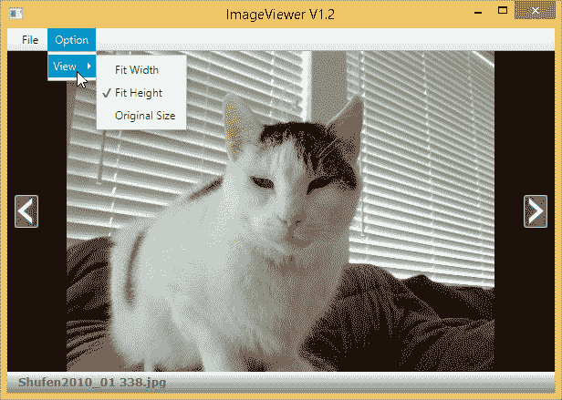

## 3.2 改进按钮的响应 Aspect

在本节中，我们将花一点精力微调按钮的外观和感受，同时也增强用户友好性。

### 3.2.1 禁用按钮以指示没有更多图像可以打开

首先，当没有下一张或上一张图像可以打开时，我们将按钮的禁用状态设置为 `true`。一旦按钮被禁用，它将不会接收任何鼠标或键盘事件。按钮在创建后立即，其禁用状态被初始化为 `false`。

列表 3-5. 初始化按钮的禁用状态：

```java
public class ImageViewer extends Application {
    final Node nextButton = createNextButton();
    final Node prevButton = createPrevButton();
    {
        disableButton(nextButton, true);
        disableButton(prevButton, true);
    }

    ...

}
```

`Node` 类中定义的 `disable` 属性类型为 `BooleanProperty`，它指定了该节点的禁用状态。将此节点的 `disable` 属性设置为 `true`，会导致该节点的 `disabled` 属性以及其所有后代的 `disabled` 属性都变为 `true`。请注意，可能一个节点的 `disabled` 属性为 `true`，但其 `disable` 属性并不为 `true`。

`Node` 类中定义的 `opacity` 属性类型为 `DoubleProperty`，指定了该节点的透明程度。其值范围 $\≧ 0$ 且 $\≦ 1$。不透明度值为 0 的节点意味着它是完全透明的。

以下代码演示了如何利用节点的 `opacity` 属性来渲染一个处于禁用状态的按钮。

列表 3-6. 定义 `disableButton` 方法：

```java
/**
 * 此方法利用节点的 opacity 属性来
 * 区分禁用状态，
 * 如果被禁用，则将透明度值设置为 0.4。
 *
 * @param button
 * @param isDisable
 */
void disableButton(Node button, boolean isDisable) {
    // 如果没有更多图像可以打开，将透明度值改为 0.4
    double opacity = (isDisable) ? 0.4 : 1;
    button.setOpacity(opacity);
    button.setDisable(isDisable);
}
```

现在，初始屏幕看起来如下。

图 3-2. 初始应用程序窗口的快照，按钮已禁用。

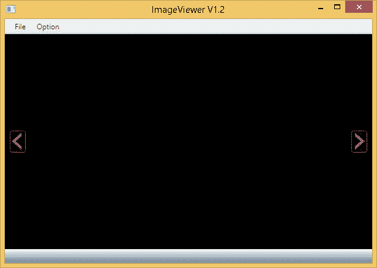

为了确定是否有下一张图像或上一张图像，会在以下时机调用 `ListIterator` 接口中定义的 `hasNext()` 和 `hasPrevious()` 方法进行验证：

*   当从 `Load` 菜单项的操作事件处理器中首次创建当前目录下的文件列表时。

*   当在 `Next` 或 `Previous` 按钮上发生鼠标点击事件并加载图像时。

我们将定义一个 `loadFile(File file)` 方法，以模块化处理 `Load` 菜单项操作事件的任务：

列表 3-7. 定义 `loadFile` 方法以创建列表迭代器、加载指定文件并更新按钮状态：


```java
/**
 * 调用静态方法 `FileUtils.listIterator(Path)` 以
 * 获取一个列表迭代器来遍历目录中的文件，
 * 如果没有更多文件可以打开，则禁用按钮。
 *
 * @param file
 */
void loadFile(File file) {
  // 创建列表迭代器
  try {
    ListIterator<java.nio.file.Path> it =
      FileUtils.listIterator(file.toPath());

    // 更新 listIterator 属性的值
    listIterator.set(it);

    // 如果没有上一个文件，则禁用 prevButton
    // 在调用 next() 之前检查 hasPrevious()
    disableButton(prevButton, !it.hasPrevious());

    file = it.next().toFile();
    String url = file.toURI().toString();
    curImage.set(new Image(url));
    imageName.set(url.substring(
        url.lastIndexOf("/") + 1).replaceAll("%20", " "));

    lastClickedButton.set(PREVIOUS);
  } catch (IOException ex) {
  }
}
```

上述`loadFile`方法是从`load`菜单项的操作事件调用的。更改如下文所示。

列表 3-8. 从`FileChooser`选择并打开文件后调用`loadFile`：

```java
// 为菜单项添加动作
load.setOnAction(new EventHandler<ActionEvent>() {
  @Override
  public void handle(ActionEvent e) {
    // 打开文件选择器
    File file = fileChooser.showDialog(stage);
    if (file != null) {
      // 设置初始目录
      File lastDir = file.getParentFile();
      fileChooser.setInitialDirectory(lastDir);
      loadFile(file);
    }
  }
});
```

当在`Next`按钮上发生鼠标点击事件时，将加载并显示下一张可用图像。与此同时，我们需要检查是否没有更多图像可以加载。以下是代码片段，更改如下。

列表 3-9. 在鼠标事件处理器内部更新`Next`按钮的禁用状态：

```java
Node createNextButton() {

  ...

  // 为 nextButton 注册鼠标点击事件处理器
  buttonGroup.setOnMouseClicked(new EventHandler() {
    @Override
    public void handle(MouseEvent me) {
      // 获取迭代器
      ListIterator<java.nio.file.Path> iterator = listIterator.get();
      if (iterator != null && iterator.hasNext()) {
        java.nio.file.Path path = iterator.next();
        if (lastClickedButton.get().equals(PREVIOUS)) {
          // 如果上一次点击的按钮是 prevButton
          // 第一次调用 next() 是当前图像，
          // 必须将光标向前移动一步
          if (iterator.hasNext())
            path = iterator.next();
          else {
            // 没有后续图像，禁用按钮
            disableButton(nextButton, true);
            return;
          }
        }
        System.out.format("Next button clicked: %s%n", path.getFileName());
        String url = path.toURI().toString();
        imageName.set(url.substring(
          url.lastIndexOf("/") + 1).replaceAll("%20", " "));
        curImage.set(new Image(url));
        lastClickedButton.set(NEXT);
        // 当没有更多图像时禁用下一个按钮
        disableButton(nextButton, !iterator.hasNext());
        if (prevButton.isDisable())
          disableButton(prevButton, false);
      }
    }
  });

  ...
}
```

当`Previous`按钮发生鼠标点击事件时，将加载上一张可用图像并将其显示在图像渲染区域。与此同时，我们需要检查是否没有更多以前的图像可以加载。以下是代码片段，更改部分已用粗体显示。

### 列表 3-10. 在鼠标点击事件处理器中更新`Previous`按钮的禁用状态

```java
Node createPrevButton() {

  ...

  // 为 prevButton 注册鼠标点击事件处理器
  buttonGroup.setOnMouseClicked(new EventHandler<MouseEvent>() {
    @Override
    public void handle(MouseEvent me) {
      // 获取迭代器
      ListIterator<java.nio.file.Path> iterator = listIterator.get();
      if (iterator != null && iterator.hasPrevious()) {
        java.nio.file.Path path = iterator.previous();
        if (lastClickedButton.get().equals(NEXT)) {
          // 如果上次点击的按钮是 nextButton
          // 第一次 previous() 是当前图像，
          // 必须将光标后移一步
          if (iterator.hasPrevious())
            path = iterator.previous();
          else {
            // 没有以前的图像，禁用 prevButton
            disableButton(prevButton, true);
            return;
          }
        }
        System.out.format("Prev button clicked: %s%n", path.getFileName());
        String url = path.toUri().toString();
        imageName.set(url.substring(
          url.lastIndexOf("/") + 1).replaceAll("%20", " "));
        curImage.set(new Image(url));
        lastClickedButton.set(PREVIOUS);
        // 当没有之前的图像时禁用之前的按钮
        disableButton(prevButton, !iterator.hasPrevious());
        if (nextButton.isDisabled())
          disableButton(nextButton, false);
      }
    }
  });

  ...
}
```

图 3-3. 当没有之前的文件可以打开时`Previous`按钮禁用的截图。

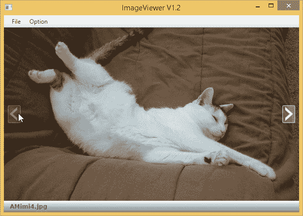

图 3-4. 当没有下一个文件可以打开时`Next`按钮禁用的截图。

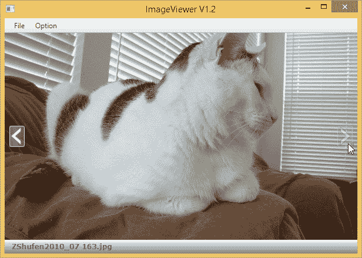

### 3.2.2 当鼠标按下时更改按钮的外观

现在，我们将当按钮上发生鼠标按下事件时更改按钮的背景绘制颜色。与此同时，创建`Next`按钮和`Previous`按钮的代码通过模块化的鼠标事件处理代码进行了整理。定义了`registerButtonEvent`方法用于为以下`EventType`注册事件处理器：`MOUSE_ENTERED`、`MOUSE_PRESSED`、`MOUSE_RELEASED`和`MOUSE_EXITED`。

当鼠标按下按钮上时，填充矩形的绘制颜色会发生变化，填充多边形的绘制颜色与鼠标进入时相同。当鼠标释放或离开按钮时，填充颜色和描边将恢复到原始值。

### 导入语句

```java
import javafx.scene.paint.Paint;
import javafx.scene.shape.Shape;
```

### 列表 3-11. 定义`registerButtonEvent`方法

```java
/**
 * 此方法为按钮注册鼠标进入/按下/释放/离开事件，
 * 改变按钮的外观以区分不同的事件类型。
 *
 * @param buttonGroup
 * @param rect
 * @param polygon
 * @param bg
 * @param entered
 * @param pressed
 */
void registerButtonEvent(Node buttonGroup,
  final Shape rect, final Shape polygon,
  final Paint bg, final Paint entered, final Paint pressed) {

  // 注册鼠标进入事件处理器
  // 当鼠标进入时改变按钮的外观
  buttonGroup.setOnMouseEntered(new EventHandler<MouseEvent>() {
    @Override
    public void handle(MouseEvent me) {
      System.out.println("Mouse entered");
      // 检查左鼠标键是否按下
      rect.setFill(me.isPrimaryButtonDown() ? pressed : entered);
      polygon.setFill(Color.web("#436B8B"));
      polygon.setStroke(Color.WHITE);
    }
  });

  // 注册鼠标按下事件处理器
  // 当鼠标进入时改变按钮的外观（注：此处原文可能有误，应为按下）
  buttonGroup.setOnMousePressed(new EventHandler<MouseEvent>() {
    @Override
    public void handle(MouseEvent me) {
      System.out.println("Mouse pressed");
      if (me.isPrimaryButtonDown()) {
        rect.setFill(pressed);
        polygon.setFill(Color.web("#436B8B"));
        polygon.setStroke(Color.WHITE);
      }
    }
  });

  // 鼠标离开事件处理器
  // 当鼠标离开时恢复到原始外观
  EventHandler<MouseEvent> exited = new EventHandler<MouseEvent>() {
    @Override
    public void handle(MouseEvent me) {
      System.out.println("Mouse exited/released");
      rect.setFill(bg);
      polygon.setFill(Color.WHITE);
      polygon.setStroke(Color.web("#436B8B"));
    }
  };

  buttonGroup.setOnMouseExited(exited);

  // 注册鼠标释放事件处理器
  // 当鼠标释放时恢复到原始外观
  // 外观与鼠标离开时相同
  buttonGroup.setOnMouseReleased(exited);
}
```

### 列表 3-12. `createNextButton`方法变得如下


```java
/**
 * 使用 Rectangle 作为背景创建下一个页按钮，
 * 使用 Polygon 作为图标，使用 Group 作为容器，
 * Rectangle 的尺寸为 25x 35，
 * polygon 的厚度为 8 像素，
 * polygon 的内边距为 (2, 2, 2, 5)，
 * 当鼠标进入/按下/释放/移出时更改按钮的外观。
 *
 * @return
 */
Node createNextButton() {

  // 创建一个 group 作为按钮
  Group buttonGroup = new Group();

  // 创建一个 rectangle 形形作为背景
  final Rectangle rect = new Rectangle(0, 0, 25, 35);

  // 使用线性渐变填充下一个按钮的矩形
  final LinearGradient lg = new LinearGradient(0, 0, 1, 0, true,
      CycleMethod.NO_CYCLE, new Stop[]{
    new Stop(0, Color.web("#5173A8")),
    new Stop(0.6, Color.web("#A8B9D4")),
    new Stop(1, Color.web("#87A7C6"))});
  rect.setFill(lg);
  rect.setStroke(Color.web("#ACD7FF"));
  rect.setArcHeight(6.5);
  rect.setArcWidth(6.5);

  // 当鼠标进入下一个按钮时，绘制填充矩形
  final LinearGradient lgEntered = new LinearGradient(0, 0, 1, 0, true,
      CycleMethod.NO_CYCLE, new Stop[]{
    new Stop(0, Color.web("#87A7C6")),
    new Stop(0.4, Color.web("#A8B9D4")),
    new Stop(1, Color.web("#5173A8"))});

  // 当鼠标按下下一个按钮时，绘制填充矩形
  final LinearGradient lgPressed = new LinearGradient(0, 0, 1, 0, true,
      CycleMethod.NO_CYCLE, new Stop[]{
    new Stop(0, Color.web("#87A7C6")),
    new Stop(0.4, Color.web("#A8B9D4")),
    new Stop(1, Color.web("#2F4F4F"))});

  // 创建一个表示下一个图标视觉标志的 polygon 形
  // 8 像素厚度，内缩为 2, 2, 2, 5
  final Polygon polygon = new Polygon();
  Double[] dArray = {
    5.0, 2.0,
    22.0, 17.0,
    5.0, 32.0,
    5.0, 25.0,
    14.0, 17.0,
    5.0, 9.0};
  polygon.getPoints().addAll(dArray);
  polygon.setFill(Color.WHITE);
  polygon.setStroke(Color.web("#436B8B"));

  // 设置光标
  buttonGroup.setCursor(Cursor.OPEN_HAND);

  // 为 nextButton 注册鼠标点击事件处理器
  buttonGroup.setOnMouseClicked(new EventHandler<MouseEvent>() {
    @Override
    public void handle(MouseEvent me) {
      if (me.getButton() != MouseButton.PRIMARY)
        return;
      // 获取迭代器
      ListIterator<java.nio.file.Path> iterator = listIterator.get();
      if (iterator != null && iterator.hasNext()) {
        java.nio.file.Path path = iterator.next();
        if (lastClickedButton.get().equals(PREVIOUS)) {
          // 如果上一次点击的按钮是 prevButton
          // next 的第一次调用是当前图像，
          // 必须将光标向前移动一步
          if (iterator.hasNext())
            path = iterator.next();
          else{
            // 有下一个图像，禁用下一个按钮
            disableButton(nextButton, true);
            return;
          }
        }
        System.out.format("Next button clicked: %s%n", path.getFileName());
        String url = path.toUri().toString();
        curImage.set(new Image(url));
        imageName.set(url.substring(
            url.lastIndexOf("/")+1).replaceAll("%20", " "));

        lastClickedButton.set(NEXT);
        // 当没有图像时禁用下一个按钮
        disableButton(nextButton, !iterator.hasNext());
        if (prevButton.isDisabled()) 
          disableButton(prevButton, false); 
      }
    }
  });

  registerButtonEvent(buttonGroup, rect, polygon, lg, lgEntered, lgPressed);

  buttonGroup.getChildren().addAll(rect, polygon);
  return buttonGroup;
}
```

列表 3-13. `createPrevButton` 方法变为：

```java
/**
 * 使用 Rectangle 作为背景创建上一个页按钮，
 * 使用 Polygon 作为图标，使用 Group 作为容器，
 * Rectangle 的尺寸为 25x 35，
 * polygon 的厚度为 8 像素，
 * polygon 的内边距为 (2, 2, 2, 5)，
 * 当鼠标进入/按下/释放/移出时更改按钮的外观。
 * 
 * @return
 */
Node createPrevButton() {

  // 创建一个 group 作为按钮
  Group buttonGroup = new Group();

  // 创建一个 rectangle 形形作为背景
  final Rectangle rect = new Rectangle(0, 0, 25, 35);

  // 使用线性渐变填充上一个按钮的矩形
  final LinearGradient lg = new LinearGradient(0, 0, 1, 0, true,
      CycleMethod.NO_CYCLE, new Stop[]{
    new Stop(0, Color.web("#87A7C6")),
    new Stop(0.6, Color.web("#A8B9D4")),
    new Stop(1, Color.web("#5173A8"))});
  rect.setFill(lg);
  rect.setStroke(Color.web("#ACD7FF"));
  rect.setArcHeight(6.5);
  rect.setArcWidth(6.5);

  // 当鼠标进入上一个按钮时，绘制填充矩形
  final LinearGradient lgEntered = new LinearGradient(0, 0, 1, 0, true,
      CycleMethod.NO_CYCLE, new Stop[]{
    new Stop(0, Color.web("#87A7C6")),
    new Stop(0.4, Color.web("#A8B9D4")),
    new Stop(1, Color.web("#5173A8"))});

  // 当鼠标按下上一个按钮时，绘制填充矩形
  final LinearGradient lgPressed = new LinearGradient(0, 0, 1, 0, true,
      CycleMethod.NO_CYCLE, new Stop[]{
    new Stop(0, Color.web("#87A7C6")),
    new Stop(0.4, Color.web("#A8B9D4")),
    new Stop(1, Color.web("#2F4F4F"))});

  // 创建一个表示上一个图标视觉标志的 polygon 形
  // 8 像素厚度，内缩为 2, 2, 2, 5
  final Polygon polygon = new Polygon();
  Double[] dArray = {
    19.0, 2.0,
    22.0, 17.0,
    19.0, 32.0,
    19.0, 25.0,
    14.0, 17.0,
    19.0, 9.0};
  polygon.getPoints().addAll(dArray);
  polygon.setFill(Color.WHITE);
  polygon.setStroke(Color.web("#436B8B"));

  // 设置光标
  buttonGroup.setCursor(Cursor.OPEN_HAND);

  // 为 prevButton 注册鼠标点击事件处理器
  buttonGroup.setOnMouseClicked(new EventHandler<MouseEvent>() {
    @Override
    public void handle(MouseEvent me) {
      if (me.getButton() != MouseButton.PRIMARY)
        return;
      // 获取迭代器
      ListIterator<java.nio.file.Path> iterator = listIterator.get();
      if (iterator != null && iterator.hasPrevious()) {
        java.nio.file.Path path = iterator.previous();
        if (lastClickedButton.get().equals(NEXT)) {
          // 如果上一次点击的按钮是 nextButton
          // previous 的第一次调用是当前图像，
          // 必须将光标向后移动一步
          if (iterator.hasPrevious())
            path = iterator.previous();
          else{
            // 有上一个图像，禁用上一个按钮
            disableButton(prevButton, true);
            return;
          }
        }
        System.out.format("Prev button clicked: %s%n", path.getFileName());
        String url = path.toUri().toString();
        curImage.set(new Image(url));
        imageName.set(url.substring(
            url.lastIndexOf("/")+1).replaceAll("%20", " "));

        lastClickedButton.set(PREVIOUS);
        // 当没有上一个图像时禁用上一个按钮
        disableButton(prevButton, !iterator.hasPrevious());
        if (nextButton.isDisabled()) 
          disableButton(nextButton, false); 
      }
    }
  });

  registerButtonEvent(buttonGroup, rect, polygon, lg, lgEntered, lgPressed);

  buttonGroup.getChildren().addAll(rect, polygon);
  return buttonGroup;
}
```

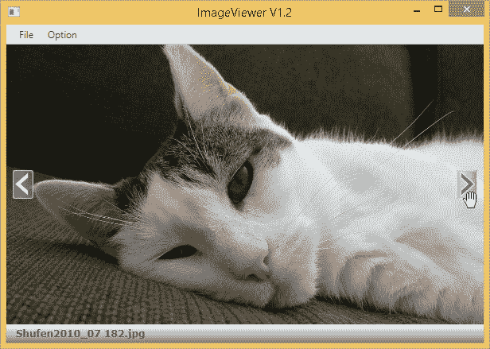

## 3.3 添加幻灯片功能

一旦从 `FileChooser` 的文件打开对话框打开图像文件，应用程序将获取当前目录下的图像文件列表。一个实用的功能是允许用户逐个浏览这些图像，而无需手动点击 `Next` 按钮。实现幻灯片机制的步骤所示。

### 3.3.1 添加“开始幻灯片”和“停止幻灯片”菜单项

这里使用的最简单 GUI 是 `MenuItem`。在菜单栏的 `Option` 菜单中添加了两个菜单项：`Start Slideshow` 和 `Stop Slideshow`，它们初始状态都是禁用的。为了区分是否正在运行幻灯片，在 `ImageViewer` 类中定义了一个作为类字段、类型为 `BooleanProperty` 的变量 `isSlideshowOn`，并初始化为 `false`。以下代码段展示了如何实现这些功能：

导入语句：

```java
import javafx.beans.property.BooleanProperty;
import javafx.beans.property.SimpleBooleanProperty;
```

列表 3-14. 添加 `Start Slideshow` 和 `Stop Slideshow` 菜单项：


```java
public class ImageViewer extends Application {

    ...

    final BooleanProperty isSlideshowOn = new SimpleBooleanProperty(false);

    ...

    @Override
    public void start(final Stage stage) {

        ...

        // 创建开始/停止幻灯片的菜单项
        final MenuItem startSlide = new MenuItem("Start Slideshow");
        final MenuItem stopSlide = new MenuItem("Stop Slideshow");

        startSlide.disableProperty().bind(isSlideshowOn.or(
            nextButton.disableProperty()));
        stopSlide.disableProperty().bind(isSlideshowOn.not().or(
            nextButton.disableProperty()));

        // 为开始幻灯片菜单项添加事件处理器
        startSlide.setOnAction(new EventHandler<ActionEvent>() {
            @Override
            public void handle(ActionEvent ae) {
                System.out.println("Start Slideshow...");
            }
        });

        // 为停止幻灯片菜单项添加事件处理器
        stopSlide.setOnAction(new EventHandler<ActionEvent>() {
            @Override
            public void handle(ActionEvent ae) {
                System.out.println("Stop Slideshow...");
            }
        });

        // 将选项菜单添加到菜单栏
        menuOption.getItems().addAll(menuView, startSlide, stopSlide);

        ...
```

#### 3.3.1.1 绑定菜单项的禁用属性

由于以下 `bind` 语句，初始时 `startSlide` 和 `stopSlide` 菜单项是禁用的：

```java
startSlide.disableProperty().bind(isSlideshowOn.or(
    nextButton.disableProperty()));
stopSlide.disableProperty().bind(isSlideshowOn.not().or(
    nextButton.disableProperty()));
```

在上述绑定语句中，使用了两个逻辑操作——`or` 和 `not`——来计算禁用属性的值。`javafx.beans.binding.BooleanExpression` 类是一个实现 `ObservableBooleanValue` 的抽象类，它提供了这些方法：

`public BooleanBinding not()` 方法

该方法对此 `BooleanExpression` 执行逻辑非（NOT）操作，并返回一个 `BooleanBinding` 类型的对象，该对象是 `BooleanExpression` 的直接子类。

`public BooleanBinding or(ObservableBooleanValue other)` 方法

该方法对此 `BooleanExpression` 和给定的 `ObservableBooleanValue` 执行逻辑或（OR）操作，并返回一个 `BooleanBinding` 类型的对象，该对象是 `BooleanExpression` 的直接子类。

如果当前正在运行幻灯片或 `Next` 按钮禁用，则 `Start Slideshow` 菜单项被禁用。同样，如果幻灯片未运行或 `Next` 按钮禁用，则 `Stop Slideshow` 菜单项被禁用。记住，当没有后续图像可以查看时，`Next` 按钮是禁用的。

图 3-9 初始 `Option` 菜单外观的截图，`Start Slideshow` 和 `Stop Slideshow` 菜单项均为禁用状态。

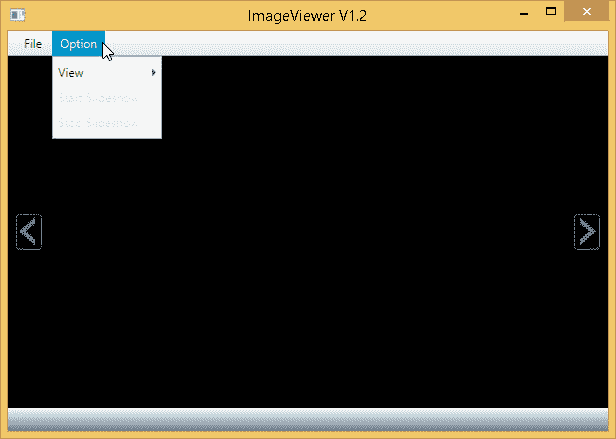

图 3-10 加载图像文件后 `Option` 菜单外观的截图，`Start Slideshow` 菜单项启用，因为没有开启幻灯片且至少有一个后续文件可以查看；而 `Stop Slideshow` 菜单项被禁用，因为没有开启幻灯片。

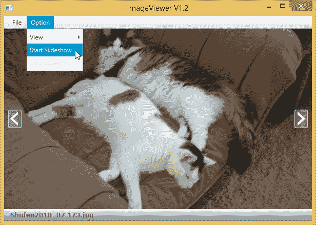

### 3.3.2 在另一个线程上执行幻灯片

将耗时任务委托给另一个线程是一种良好的编程习惯，这样 UI 线程（也称为 Java FX 线程）始终对用户的操作做出响应。

`javafx.concurrent` 包提供了 `Task` 和 `Service` 两个类，它们都实现了 `Worker` 接口，用于方便开发多线程 JavaFX 应用程序。

以下是位于 `javafx.concurrent` 包中的并发相关类：

`Task`

一个扩展 `java.util.concurrent.FutureTask` 并实现 `Worker<V>` 接口的抽象类，它是一个一次性的 `Worker` 对象，不可复用。由于其父类 `FutureTask` 实现了 `Runnable` 接口，它也是一个 `Runnable` 对象。

要开始执行 `Task`，你可以使用 `java.lang.Thread` 类的 API 或派自 `Executor` 和 `ExecutorService` 接口的 API，它们都位于 `java.util.concurrent` 包中。

`Service`

一个扩展 `java.lang.Object` 并实现 `Worker<V>` 接口的抽象类，是一个可复用的 `Worker` 对象。`Service` 类提供了 `start()`、`cancel()`、`reset()` 和 `restart()` 等方法来操作此服务。

`ScheduledService`

`Service` 的直接子类，允许指定自动启动和重启服务的延迟。

`WorkerStateEvent`

`javafx.event.Event` 的子类，定义了 `EventType` 的静态字段，如 `WORKER_STATE_CANCELLED`、`WORKER_STATE_FAILED`、`WORKER_STATE_READY`、`WORKER_STATE_RUNNING`、`WORKER_STATE_SUCCEEDED` 等。当 `Worker` 的状态发生变化时会触发 `WorkerStateEvent`。

考虑我们的情况：首次加载文件时创建文件列表，假设列表包含一个或多个后续文件，此时 `Start Slideshow` 菜单项启用，用户可以启动幻灯片，在幻灯片运行时取消它，稍后再次重启。为了满足这种场景，我们倾向于使用可复用的 `Service` 对象而不是一次性的 `Task` 对象。

#### 3.3.2.1 创建扩展 `Service` 类的 `SlideshowService` 类

我们需要创建一个扩展 `Service<V>` 的类。当 `Service` 启动时，它会执行一个 `Task`。需要重写下面的 `createTask` 方法：

```java
protected abstract Task<V> createTask()
```

在 `createTask()` 方法中，通过重写 `call()` 方法并创建一个 `Task` 对象返回给调用者。

`Task` 中的 `call()` 方法承担幻灯片的任务，基本上包含一个 `while` 循环，逐个加载图像，直到满足以下条件之一：文件列表中没有更多后续图像，或者幻灯片被用户取消。

以下列表演示了如何创建一个可复用的 `SlideshowService`（`Service` 类的子类），以执行幻灯片任务。

列表 3-15. 创建 `SlideshowService` 类：

```java
package imageviewer;

import java.nio.file.Path;
import java.util.ListIterator;
import javafx.beans.property.ObjectProperty;
import javafx.beans.property.SimpleObjectProperty;
import javafx.beans.property.SimpleStringProperty;
import javafx.beans.property.StringProperty;
import javafx.beans.value.ChangeListener;
import javafx.beans.value.ObservableValue;
import javafx.concurrent.Service;
import javafx.concurrent.Task;
import javafx.scene.image.Image;

/**
 * File Name: SlideshowService.java
 * (in directory: ImageViewer1.2/src/example4/imageviewer/)
 *
 * @author Shufen Kuo
 */

public class SlideshowService extends Service<Void> {
    private ObjectProperty<Image> image;
    private ObjectProperty<ListIterator<Path>> iterator;
    private StringProperty imageName;
    private ListIterator<Path> it;

    public SlideshowService() {
        this(new SimpleObjectProperty<ListIterator<Path>>(),
            new SimpleObjectProperty<Image>(),
            new SimpleStringProperty());
    }

    public SlideshowService(ObjectProperty<ListIterator<Path>> iterator,
        ObjectProperty<Image> image, StringProperty imageName) {
        this.image = image;
        this.imageName = imageName;
        this.iterator = iterator;
        iterator.addListener(new ChangeListener<ListIterator<Path>>() {
            @Override
            public void changed(ObservableValue<? extends ListIterator<Path>> o,
                ListIterator<Path> oldVal, ListIterator<Path> newVal) {
                it = newVal;
            }
        });
    }

    public Image getImage() {
        return image.get();
    }

    public void setImage(Image value) {
        image.set(value);
    }

    public ObjectProperty<Image> imageProperty() {
        return image;
    }

    public ListIterator<Path> getIterator() {
        return iterator.get();
    }

    public void setListIterator(ListIterator<Path> value) {
        iterator.set(value);
    }

    public ObjectProperty<ListIterator<Path>> iteratorProperty() {
        return iterator;
    }

    public String getImageName() {
        return imageName.get();
    }

    public void setImageName(String value) {
        imageName.set(value);
    }

    public StringProperty imageNameProperty() {
        return imageName;
    }

    @Override
    protected Task<Void> createTask() {
        return new Task<Void>() {
            @Override
            protected Void call() {
                if (it == null) return null;
                while (it.hasNext()) {
                    if (isCancelled()) {
                        updateMessage("Cancelled");
                        break;
                    }
                    String url = it.next().toUri().toString();
                    setImage(new Image(url));
                    setImageName(url.substring(
                        url.lastIndexOf("/") + 1).replaceAll("%20", " "));
                    // Pause for 3000 ms
                    try {
                        Thread.sleep(3000);
                    } catch (InterruptedException ex) {
                        if (isCancelled()) {
                            updateMessage("Cancelled");
                            break;
                        }
                    }
                }
                return null;
            }
        };
    }
}
```

以下语句创建了一个 `SlideshowService` 对象：

```java
// 创建一个可用的 Worker 对象
final SlideshowService service = new SlideshowService(listIterator,
    curImage, imageName);
```

向 `SlideshowService` 类的构造函数传递了三个参数：

`listIterator`

类型为 `ObjectProperty<ListIterator<Path>>`，指定一个 `ListIterator`，用于遍历文件列表。该列表是在从文件选择器的文件打开对话框打开图像文件时创建的。

`curImage`

类型为 `ObjectProperty<Image>`，与 `ImageView` 对象的 `image` 属性绑定。

`imageName`

类型为 `StringProperty`，与文本对象 `statusText` 的 `text` 属性绑定，用于在状态栏中显示图片名称。

### 3.3.2.2 配置幻灯片服务对象

我们定义了一个 `configureSlideshow` 方法来执行配置。一旦创建了服务对象，就会调用该方法执行这些工作：

2. 将 `ImageViewer` 类中定义的 `isSlideshowOn` 属性与 `service` 的 `running` 属性绑定。当且仅当服务正在运行时，`isSlideshowOn` 属性的值为 `true`。

```java
BooleanProperty isSlideshowOn = new SimpleBooleanProperty(false);
SlideshowService service = new SlideshowService(listIterator,
    curImage, imageName);
isSlideshowOn.bind(service.runningProperty());
```

3. 注册事件处理器来处理以下事件类型的 `WorkerStateEvent`：`WORKER_STATE_RUNNING`、`WORKER_STATE_SUCCEEDED`、`WORKER_STATE_FAILED` 和 `WORKER_STATE_CANCELLED`。

以下是 `Service` 类定义的便利方法，用于为上述事件类型注册事件处理器：

- `public final void setOnRunning(EventHandler<WorkerStateEvent> value)`

  设置 `onRunning` 属性的值，提供 `handle` 方法的实现，当 `Worker` 的状态转换到 `RUNNING` 时会调用该方法。


- `public final void setOnSucceeded(EventHandler<WorkerStateEvent> value)`

  设置`onSucceeded`属性的值，提供`handle`方法的实现，当`Worker`的状态转换到`SUCCEEDED`时会调用该方法。

- `public final void setOnFailed(EventHandler<WorkerStateEvent> value)`

  设置`onFailed`属性的值，提供`handle`方法的实现，当`Worker`的状态转换到`FAILED`时会调用该方法。

- `public final void setOnCancelled(EventHandler<WorkerStateEvent> value)`

  设置`onCancelled`属性的值，提供`handle`方法的实现，当`Worker`的状态转换到`CANCELLED`时会调用该方法。

`Worker.State`是`javafx.concurrent.Worker`的一个内部类，是一个枚举类型，定义了`Worker`的状态常量：`CANCELLED`、`FAILED`、`READY`、`RUNNING`、`SCHEDULED`和`SUCCEEDED`。

`Worker`对象初始处于`READY`状态。当`Worker`开始执行任务时，转换到`SCHEDULED`状态，不久后进入`RUNNING`状态，并一直保持`RUNNING`状态，直到发生以下情况之一：

任务成功完成：

`Worker`转换到`SUCCEEDED`状态。

抛出异常：

`Worker`转换到`FAILED`状态。

任务被取消：

`Worker`转换到`CANCELLED`状态。可以通过调用`Worker`接口定义的`cancel()`方法来取消`Worker`。如果取消成功，则返回`true`。

处理`WORKER_STATE_RUNNING`事件类型的事件处理器中执行的任务非常简单：

1. 将`lastClickedButton`属性的值设置为`NEXT`，因为幻灯片正在运行意味着`Next`按钮正在自动连续点击。
2. 检查`Previous`按钮是否禁用，如果是，则启用它。

并且创建一个单一的`EventHandler`来处理多种类型的事件。注册用于处理`WORKER_STATE_SUCCEEDED`的事件处理器也注册用于处理`WORKER_STATE_FAILED`和`WORKER_STATE_CANCELLED`。当`Worker`的状态转换到`SUCCEEDED`、`FAILED`或`CANCELLED`时，要执行的任务为：

1. 如果列表迭代器中没有下一个文件，则禁用`Next`按钮；否则启用它。
2. 如果`Previous`按钮是禁用的，则启用它。

以下是`configureSlideshow`方法的实现：

导入语句：

```java
import javafx.concurrent.WorkerStateEvent;
```

列表 3-16. `configureSlideshow`方法：

```java
/**
   * 
   */
  void configureSlideshow() {
    // 如果服务正在运行，那么 isSlideshowOn 的值值为 true，
    // 否则，它为 false 
    isSlideshowOn.bind(service.runningProperty());

    service.setOnRunning(new EventHandler<WorkerStateEvent>() {
      @Override
      public void handle(WorkerStateEvent we) {
        System.out.println("Service is transited to running status");
        lastClickedButton.set(NEXT);
        if (prevButton.isDisable()) {
          disableButton(prevButton, false);
        }
      }
    });

    EventHandler<WorkerStateEvent> taskDone = new EventHandler<WorkerStateEvent>() {
      @Override
      public void handle(WorkerStateEvent we) {
        disableButton(nextButton, !listIterator.get().hasNext());
        if (prevButton.isDisable()) {
          disableButton(prevButton, false);
        }
      }
    };

    service.setOnSucceeded(taskDone);
    service.setOnFailed(taskDone);
    service.setOnCancelled(taskDone);    
  }
```

### 3.3.2.3 为`Start Slideshow`和`Stop Slideshow`菜单项实现动作事件的事件处理器

执行`Start Slideshow`操作的场景如下：当用户点击`Start Slideshow`菜单项时，服务被启动，其状态从`READY`变为`SCHEDULED`，再变为`RUNNING`。一旦状态切换到`RUNNING`，`isSlideshowOn`属性的值就会更改为`true`（参见此处），并且结果是`Stop Slideshow`菜单项的禁用状态被更改为`false`（参见此处）。

我们使用`Service`类中提供的`void start()`方法来启动服务。该方法是从处理`Start Slideshow`菜单项动作事件的事件处理器中调用的。在调用`start()`方法之前检查服务的状态是非常重要的，以确保服务处于`READY`状态。

在`javafx.concurrent.Worker`接口中定义的`Worker.State getState()`方法用于检查服务的状态。只有当服务处于`READY`状态时，才能成功启动服务。如果它未就绪，请先重置，然后启动服务。

以下是执行这些操作的代码片段：

```java
 startSlide.setOnAction(new EventHandler<ActionEvent>() {
      @Override
      public void handle(ActionEvent ae) {
        System.out.println("Start Slideshow...");
        if (service.getState() != Worker.State.READY)
          service.reset(); // transit to READY
        service.start();
      }
    });
```

用户可以在幻灯片服务运行时运行时取消幻灯片。`boolean cancel()`方法是从处理`Stop Slideshow`菜单项动作事件的事件处理器中调用的。

以下代码演示了如何为`Start Slideshow`和`Stop Slideshow`菜单项实现动作事件的事件处理器。

导入语句：

```java
import javafx.concurrent.Worker;
```

列表 3-17. 为`Start Slideshow`和`Stop Slideshow`菜单项实现动作事件的事件处理器：

```java
 startSlide.setOnAction(new EventHandler<ActionEvent>() {
      @Override
      public void handle(ActionEvent ae) {
        System.out.println("Start Slideshow...");
        if (service.getState() != Worker.State.READY)
          service.reset(); // transit to READY
        // 如果最后点击的按钮是上一个按钮，
        // 则下一个图像是当前图像，
        // 必须在启动服务之前将光标向前移动一步
        if (lastClickedButton.get().equals(PREVIOUS) &&
            listIterator.get().hasNext()) {
          listIterator.get().next();
        }
        service.start();
      }
    });
    stopSlide.setOnAction(new EventHandler<ActionEvent>() {
      @Override
      public void handle(ActionEvent ae) {
        System.out.println("Stop Slideshow...");
        service.cancel();
      }
    }); 
```

### 3.3.3 `ImageViewer`应用程序完整的`start(Stage stage)`方法

接下来的列表显示了此阶段`ImageViewer` V1.2完整的`start`方法，更改部分已用粗体字体标记。

列表 3-18. `ImageViewer` V1.2的`start`方法如下：


```java
public class ImageViewer extends Application {

  ...

  final BooleanProperty isSlideshowOn = new SimpleBooleanProperty(false);
  // Create a reusable Worker object
  final SlideshowService service = new SlideshowService(listIterator,
      curImage, imageName);

  @Override
  public void start(final Stage stage) {
    BorderPane rootPane = new BorderPane();
    final StackPane imageArea = new StackPane();
    // Set min size for StackPane to avoid resizing
    // when loading large size image
    imageArea.setMinSize(0, 0);
    rootPane.setCenter(imageArea);

    // Add status bar and status text
    final HBox statusBar = new HBox();
    statusBar.setPadding(new Insets(4, 12, 4, 12));
    statusBar.setSpacing(4);
    statusBar.setStyle(
        "-fx-background-color: linear-gradient(#F0FFFF, #708090)");
    final Text statusText = new Text("");
    statusText.textProperty().bind(imageName);
    statusText.setFont(Font.font("Verdana", FontWeight.BOLD, 12));
    statusText.setFill(Color.DARKSLATEBLUE);

    statusBar.getChildren().add(statusText);
    rootPane.setBottom(statusBar);

    // Create image view, add to image area
    final ImageView imageView = new ImageView();
    imageView.imageProperty().bind(curImage);
    imageView.setPreserveRatio(true);
    imageArea.getChildren().add(imageView);

    // Since JavaFX 8, to see through background color of scene,
    // must set root pane's background to transparent
    rootPane.setStyle("-fx-background-color: transparent;");
    final Scene scene = new Scene(rootPane, 600, 400, Color.BLACK);

    imageArea.widthProperty().addListener(new ChangeListener<Object>() {
      public void changed(ObservableValue o, Object oldVal,
          Object newVal) {
        System.out.format("imageArea width changed from %.1f to %.1f%n",
            oldVal, newVal);
      }
    });
    imageArea.heightProperty().addListener(new ChangeListener<Object>() {
      public void changed(ObservableValue o, Object oldVal,
          Object newVal) {
        System.out.format("imageArea height changed from %.1f to %.1f%n",
            oldVal, newVal);
      }
    });

    // Add menu bar
    final MenuBar menuBar = new MenuBar();
    Menu menuFile = new Menu("File");
    MenuItem load = new MenuItem("Load");
    MenuItem exit = new MenuItem("Exit");
    menuFile.getItems().addAll(load, exit);
    menuBar.getMenus().add(menuFile);
    rootPane.setTop(menuBar);

    // Add action for exit menu item
    exit.setOnAction(new EventHandler<ActionEvent>() {
      @Override
      public void handle(ActionEvent e) {
        Platform.exit();
      }
    });

    // Create a file chooser
    final FileChooser fileChooser = new FileChooser();
    fileChooser.setTitle("Open an Image File");
    FileUtils.configure(fileChooser);

    // Add action for menu item Load
    load.setOnAction(new EventHandler<ActionEvent>() {
      @Override
      public void handle(ActionEvent e) {
        // Open FileChooser dialog
        File file = fileChooser.showOpenDialog(stage);
        if (file != null) {
          // Set last visited dir as initial directory
          File lastDir = file.getParentFile();
          fileChooser.setInitialDirectory(lastDir);
          loadFile(file);
        }
      }
    });

    // Create Option menu
    Menu menuOption = new Menu("Option");

    // Create radio menu items
    final RadioMenuItem fitWidth = new RadioMenuItem("Fit Width");
    fitWidth.setToggleGroup(groupOption);
    final RadioMenuItem fitHeight = new RadioMenuItem("Fit Height");
    fitHeight.setToggleGroup(groupOption);
    final RadioMenuItem original = new RadioMenuItem("Original Size");
    original.setToggleGroup(groupOption);

    // Listen to the change of selection in the toggle group
    groupOption.selectedToggleProperty().addListener(new ChangeListener<Toggle>() {
      public void changed(ObservableValue<? extends Toggle> ov,
          Toggle old_toggle, Toggle new_toggle) {
        if (groupOption.getSelectedToggle() != null) {
          RadioMenuItem choiceItem = (RadioMenuItem) groupOption.getSelectedToggle();
          if (choiceItem == fitWidth) {
            System.out.println("fitwidth");
            imageView.fitWidthProperty().bind(scene.widthProperty());
            imageView.fitHeightProperty().unbind();
            // Besides unbind, must also set fit height to 0
            imageView.setFitHeight(0);
          } else if (choiceItem == fitHeight) {
            System.out.println("fitheight");
            // Available height for rendering image is
            // subtract sum of menubar's height and statusBar's height
            // from scene height
            imageView.fitHeightProperty().bind(
                scene.heightProperty().subtract(
                  menuBar.getHeight() + statusBar.getHeight()));
            imageView.fitWidthProperty().unbind();
            // Besides unbind, must also set fit width to 0 
            imageView.setFitWidth(0);
          }
        }
      }
    });
  }
}
```

### 3.3.4 与 `Load` 菜单项和 `Previous` 按钮的事件处理器进行协调

由于幻灯片在独立的线程上运行，应用程序仍然对用户的操作保持响应，例如鼠标点击 `Load` 菜单项或 `Previous` 按钮。

为了让幻灯片运行得流畅，我们将完善 `Load` 菜单项的动作处理程序以及 `Previous` 按钮的鼠标点击事件处理器。也就是说，只有在幻灯片未运行时，我们才会继续加载当前选择的文件或上一个文件。后续列表中的更改以粗体显示。

请注意，如果用户在幻灯片运行时点击 `Next` 按钮，图像渲染的整体流程看起来并不突兀，因此我们没有对其进行额外的处理。

列表 3-19. `loadFile` 方法变为如下：

```java
/**
 * 
 * @param file 
 */
void loadFile(File file) {
  // 创建迭代器
  try {
    ListIterator<java.nio.file.Path> it =
      FileUtils.listIterator(file.toPath());

    // 更新 listIterator 属性的值
    listIterator.set(it);

    // 如果幻灯片未开启，则加载文件
    // 否则，在这里什么都不做
    // 因为幻灯片服务将执行此任务
    if (!isSlideshowOn.get()) {
      // 如果没有上一个文件，则禁用 prevButton
      // 在调用 next() 之前检查 hasPrevious()
      disableButton(prevButton, !it.hasPrevious());

      file = it.next().toFile();
      String url = file.toURI().toString();
      curImage.set(new Image(url));
      imageName.set(url.substring(
          url.lastIndexOf("/") + 1).replaceAll("%20", " "));

      // 检查 hasNext，如果没有下一个文件则禁用 nextButton
      disableButton(nextButton, !it.hasNext());

      lastClickedButton.setValue(NEXT);
    }
  } catch (IOException ex) {
  }
}
```

下面的代码片段节自 `createPrevButton` 方法。

列表 3-20. `Previous` 按钮的鼠标点击事件处理器变为：

```java
// 为按钮注册鼠标点击事件处理器
buttonGroup.setOnMouseClicked(new EventHandler<MouseEvent>() {
  @Override
  public void handle(MouseEvent me) {
    if (me.getButton() != MouseButton.PRIMARY)
      return;
    ListIterator<java.nio.file.Path> iterator = (ListIterator)listIterator.get();
    if (iterator != null && iterator.hasPrevious()) {
      java.nio.file.Path path = iterator.previous();
      if (lastClickedButton.get().equals(NEXT)) {
        // 如果上一次点击的按钮是 nextButton
        // 第一次调用 previous() 是当前图像
        // 必须向后移动一步
        if (iterator.hasPrevious())
          path = iterator.previous();
        else {
          // 没有上一个图像，禁用 prevButton
          disableButton(prevButton, true);
          return;
        }
      }
      System.out.format("Prev button clicked: %s%n", path.getFileName());
      // 如果幻灯片未开启，在此加载文件
      // 否则，在这里什么都不做
      // 因为幻灯片服务将执行此任务
      if (!isSlideshowOn.get()) {
        String url = path.toUri().toString();
        curImage.set(new Image(url));
        imageName.set(url.substring(
          url.lastIndexOf("/") + 1).replaceAll("%20", " "));

        lastClickedButton.set(PREVIOUS);
        disableButton(prevButton, !iterator.hasPrevious());
        if (nextButton.isDisabled()) 
          disableButton(nextButton, false);
      }
    }    
  }
});
```

编译并运行程序，测试以下内容以理解应用程序如何处理事件的并发：

- 从 `FileChooser` 的文件打开对话框在图像目录中加载一个图像文件。
- 启动幻灯片。
- 在幻灯片运行时，执行以下操作：
  - 来回选择不同的 `View` 选项。
  - 点击 `Previous` 按钮或 `Next` 按钮。


从`FileChooser`的文件打开对话框在不同的图像目录中加载另一个图像文件。

图 3-11. 幻灯片运行时`Option`菜单的外观，`Start Slideshow`菜单项被禁用，`Stop Slideshow`菜单项被启用。

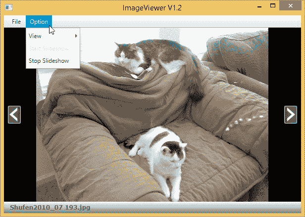

## 3.4 在幻灯片之间添加淡入过渡

为了增强幻灯片的运动感，将在幻灯片之间添加淡入过渡。以下是`javafx.animation`包中用于淡入过渡动画的类：

- `Animation`

  继承自`java.lang.Object`的抽象类，提供了动画所需的常用属性和方法。

- `Transition`

  继承自`Animation`的抽象类，提供了过渡动画所需的常用属性和方法。可用的过渡有：`FadeTransition`、`FillTransition`、`ParallelTransition`、`PathTransition`、`PauseTransition`、`RotateTransition`、`ScaleTransition`、`SequentialTransition`、`StrokeTransition`、`TranslateTransition`。

- `FadeTransition`

  `Transition`的直接子类，改变透明度。

- `ParallelTransition`

  `Transition`的直接子类，对`Animation`对象列表执行过渡。这是我们将用于创建`FadeTransition`对象的构造函数：

```java
public FadeTransition(Duration duration, Node node)
```

`Duration`类位于`javafx.util`，提供了几个用于创建持续对象的工厂方法。这里使用的是其中一个：

```java
public static Duration millis(double ms)
```

上述方法为`FadeTransition`创建了一个指定毫秒数的`Duration`属性：

- `duration`

  类型为`ObjectProperty<Duration>`，持有透明度从`fromValue`转换到`toValue`的持续时间。该属性的值通过构造函数的第一个参数指定。

- `node`

  类型为`ObjectProperty<Node>`，持有执行此过渡的目标节点。该属性的值通过构造函数的第二个参数指定。

- `fromValue`

  类型为`DoubleProperty`，持有此淡入过渡的起始透明度值。

- `toValue`

  类型为`DoubleProperty`，持有此淡入过渡的结束透明度值。

以下是创建用于图像淡入的`FadeTransition`的代码片段，该图像的透明度在 2000 毫秒内从 0 变为 1：

```java
FadeTransition fadein = new FadeTransition(Duration.millis(2000), inView);
fadein.setFromValue(0.0);
fadein.setToValue(1.0);
```

同样，以下是创建用于图像淡出的`FadeTransition`的代码片段，该图像的透明度在 2000 毫秒内从 1 变为 0：

```java
FadeTransition fadeout = new FadeTransition(Duration.millis(2000), outView);
fadeout.setFromValue(1.0);
fadeout.setToValue(0.0);
```

现在，我们有两个`FadeTransition`对象，一个用于执行淡入过渡，另一个用于执行淡出，我们希望这两个过渡并行处理。由于每个过渡都有自己的目标节点，采用了`ParallelTransition`的以下构造函数：

```java
public ParallelTransition(Animation... children)
```

以下是创建`ParallelTransition`并使用`Animation`类提供的`playFromStart()`方法启动动画的代码片段：

```java
Transition animate = new ParallelTransition(fadein, fadeout);
animate.playFromStart();
```

`SlideshowService`的请求者需要提供两个`ImageView`对象，一个用于淡入过渡，另一个用于淡出过渡。

下面的代码段演示了`SlideshowService`的请求者如何使用`setImageView`方法和`setFadeOutImageView`方法提供两个`ImageView`对象。

Listing 3-21. 为`SlideshowService`内部执行的幻灯片之间的淡过渡提供两个`ImageView`对象：

```java
public class ImageViewer extends Application {

  ...

  final StringProperty imageName = new SimpleStringProperty();

  final ObjectProperty<Image> curImage = new SimpleObjectProperty<>();

  // 创建可复用的 Worker 对象
  final SlideshowService service = new SlideshowService(listIterator,
      curImage, imageName);

  ...

  @Override
  public void start(final Stage stage) {
    BorderPane rootPane = new BorderPane();
    final StackPane imageArea = new StackPane();
    // 设置 StackPane 的最小尺寸以避免在
    // 加载大尺寸时调整大小
    imageArea.setMinSize(0, 0);
    rootPane.setCenter(imageArea);

    ...

    // 将图像视图添加到图像区域
    final ImageView imageView = new ImageView();
    imageView.imageProperty().bind(curImage);
    imageView.setPreserveRatio(true);
    imageArea.getChildren().add(imageView);

    // 用于幻灯片中的淡入过渡
    ImageView outView = new ImageView();
    outView.preserveRatioProperty().bind(imageView.preserveRatioProperty());
    outView.fitWidthProperty().bind(imageView.fitWidthProperty());
    outView.fitHeightProperty().bind(imageView.fitHeightProperty());
    imageArea.getChildren().add(outView);
    service.setImageView(imageView);
    service.setFadeOutImageView(outView);

    ...
```

## 3.4.1 `SlideshowService`类的完整源代码

下面的列表显示了此阶段`SlideshowService`类的完整源代码，其中更改已用粗体字体显示。

Listing 3-22. `SlideshowService`类如下：

```java
package imageviewer;

import java.nio.file.Path;

import java.util.ListIterator;

import javafx.animation.FadeTransition;

import javafx.animation.ParallelTransition;

import javafx.animation.Transition;

import javafx.beans.property.ObjectProperty;

import javafx.beans.property.SimpleObjectProperty;

import javafx.beans.property.SimpleStringProperty;

import javafx.beans.property.StringProperty;

import javafx.beans.value.ChangeListener;

import javafx.beans.value.ObservableValue;

import javafx.concurrent.Service;

import javafx.concurrent.Task;

import javafx.scene.image.Image;

import javafx.scene.image.ImageView;

import javafx.util.Duration;

/**
 * 文件名: SlideshowService.java
 * (位于目录: ImageViewer1.2/src/example5/imageviewer/)
 *
 * 在幻灯片之间添加淡入过渡
 *
 * @author Shufen Kuo
 */

public class SlideshowService extends Service<Void> {

  private ObjectProperty<ImageView> imageView = new SimpleObjectProperty<>();

  private ObjectProperty<ImageView> fadeOutIV = new SimpleObjectProperty<>();

  private ObjectProperty<Image> image;

  private ObjectProperty<ListIterator<Path>> iterator;

  private StringProperty imageName;

  private ListIterator<Path> it;

  public SlideshowService() {

    this(new SimpleObjectProperty<ListIterator<Path>>(),
        new SimpleObjectProperty<Image>(),
        new SimpleStringProperty());
  }

  public SlideshowService(ObjectProperty<ListIterator<Path>> iterator,

      ObjectProperty<Image> image, StringProperty imageName) {

    this.image = image;

    this.imageName = imageName;

    this.iterator = iterator;

    iterator.addListener(new ChangeListener<ListIterator<Path>>() {

      @Override

      public void changed(ObservableValue<? extends ListIterator<Path>> o,

          ListIterator<Path> oldVal, ListIterator<Path> newVal) {

        it = newVal;

      }

    });
  }

  public ImageView getImageView() {

    return imageView.get();

  }

  public void setImageView(ImageView value) {

    imageView.set(value);

  }

  public ObjectProperty<ImageView> imageViewProperty() {

    return imageView;

  }

  public ImageView getFadeOutImageView() {

    return fadeOutIV.get();

  }

  public void setFadeOutImageView(ImageView value) {

    fadeOutIV.set(value);

  }

  public ObjectProperty<ImageView> fadeOutImageViewProperty() {

    return fadeOutIV;

  }

  public Image getImage() {

    return image.get();

  }

  public void setImage(Image value) {

    image.set(value);

  }

  public ObjectProperty<Image> imageProperty() {

    return image;

  }

  public ListIterator<Path> getIterator() {

    return iterator.get();

  }

  public void setListIterator(ListIterator<Path> value) {

    iterator.set(value);

  }

  public ObjectProperty<ListIterator<Path>> iteratorProperty() {

    return iterator;

  }

  public String getImageName() {

    return imageName.get();

  }

  public void setImageName(String value) {

    imageName.set(value);

  }

  public StringProperty imageNameProperty() {

    return imageName;

  }

  @Override

  protected Task<Void> createTask() {

    return new Task<Void>() {

      @Override

      protected Void call() {

        if (it == null) return null;

        Transition animate = null;

        ImageView inView = imageView.get();

        ImageView outView = fadeOutIV.get();

        if (inView != null && outView != null) {

          FadeTransition fadein = new FadeTransition(Duration.millis(2000), inView);

          fadein.setFromValue(0.0);

          fadein.setToValue(1.0);

          FadeTransition fadeout = new FadeTransition(Duration.millis(2000), outView);

          fadeout.setFromValue(1.0);

          fadeout.setToValue(0.0);

          animate = new ParallelTransition(fadein, fadeout);

        }

        while (it.hasNext()) {

          if (isCancelled()) {

            updateMessage("Cancelled");

            break;

          }

          if (inView != null && outView != null) {

            Image prevImage = getImage();

            outView.setImage(prevImage);

            // Must reset opacity's from value for outView

            outView.setOpacity(1);

            // Must reset opacity's from value for inView

            inView.setOpacity(0);
          }
```


```java
String url = it.next().toUri().toString();

setImage(new Image(url));

setImageName(url.substring(
    url.lastIndexOf("/") + 1).replaceAll("%20", " "));

// 在暂停前启动淡入淡出动画
if (animate != null)
  animate.playFromStart();

// 暂停 3000 毫秒
try {
  Thread.sleep(3000);
} catch (InterruptedException ex) {
  if (isCancelled()) {
    updateMessage("Cancelled");
    break;
  }
}
}

// 返回前重置 outView
if (outView != null) {
  outView.setImage(null);
}

return null;
}
};
}
}
```

## 3.5 `Image Viewer V1.2` 的完整源代码

Listing 3-23. `ImageViewer` 类的完整源代码：

```java
package imageviewer;

import java.io.File;
import java.io.IOException;
import java.util.ListIterator;

import javafx.application.Application;
import javafx.application.Platform;
import javafx.beans.property.BooleanProperty;
import javafx.beans.property.ObjectProperty;
import javafx.beans.property.SimpleBooleanProperty;
import javafx.beans.property.SimpleObjectProperty;
import javafx.beans.property.SimpleStringProperty;
import javafx.beans.property.StringProperty;
import javafx.beans.value.ChangeListener;
import javafx.beans.value.ObservableValue;
import javafx.concurrent.Worker;
import javafx.concurrent.WorkerStateEvent;
import javafx.event.ActionEvent;
import javafx.event.EventHandler;
import javafx.geometry.Insets;
import javafx.geometry.Pos;
import javafx.scene.Cursor;
import javafx.scene.Group;
import javafx.scene.Node;
import javafx.scene.Scene;
import javafx.scene.control.Menu;
import javafx.scene.control.MenuBar;
import javafx.scene.control.MenuItem;
import javafx.scene.control.RadioMenuItem;
import javafx.scene.control.Toggle;
import javafx.scene.control.ToggleGroup;
import javafx.scene.control.Tooltip;
import javafx.scene.image.Image;
import javafx.scene.image.ImageView;
import javafx.scene.input.MouseButton;
import javafx.scene.input.MouseEvent;
import javafx.scene.layout.BorderPane;
import javafx.scene.layout.HBox;
import javafx.scene.layout.StackPane;
import javafx.scene.paint.Color;
import javafx.scene.paint.CycleMethod;
import javafx.scene.paint.LinearGradient;
import javafx.scene.paint.Paint;
import javafx.scene.paint.Stop;
import javafx.scene.shape.Polygon;
import javafx.scene.shape.Rectangle;
import javafx.scene.shape.Shape;
import javafx.scene.text.Font;
import javafx.scene.text.FontWeight;
import javafx.scene.text.Text;
import javafx.stage.FileChooser;
import javafx.stage.Stage;

/**
 * 文件名: ImageViewer.java V1.2
 * (位于目录: ImageViewer1.2/src/example5/imageviewer/)
 *
 * 此应用程序创建了一个 BorderPane 作为场景的根节点，
 * 并在 BorderPane 的中心添加了一个 StackPane。
 * 场景的初始大小设置为 600x400。
 * StackPane 的大小将自动调整以适应场景大小。
 * 当用户调整窗口大小时，StackPane 会随之调整。
 *
 * 在 BorderPane 顶部添加菜单栏。
 * 创建文件（File）菜单，并使用 FileChooser 的打开对话框
 * 选择图像文件，在图像渲染区域加载并显示图像。
 *
 * 创建选项（Option）菜单，包含一个视图（View）子菜单，让用户选择
 * 图片查看标准：适应宽度、适应高度或默认的原始大小（Original Size）。
 *
 * 使用 bind 和 unbind 方法调整图像查看大小：
 * 将图像视图的 fitWidth/fitHeight 属性绑定到
 * 场景的 width/height 属性，
 * 这样当场景调整大小时，图像视图的大小会自动更改。
 *
 * 在场景中添加下一个（Next）和上一个（Previous）按钮，
 * 在加载第一张图片后，用户可以使用这些按钮
 * 查看下一张或预览图像，而无需再次打开 FileChooser。
 *
 * 调整下一个按钮在 StackPane 中的默认位置
 * 添加上一个按钮并调整其在 StackPane 中的位置
 * 为下一个和上一个按钮实现鼠标点击事件处理器（Handlers）
 *
 * 添加状态栏显示图像名称
 * 禁用按钮以表示没有更多图像可以打开
 * 区分不同事件类型的按钮外观：
 *   进入/按下/释放/离开 (entered/pressed/released/exited)
 *
 * 在线程中执行幻灯片播放
 * 与加载菜单项和上一个按钮的事件处理器进行协调
 * 为幻灯片添加淡入淡出效果
 *
 * @author Shufen Kuo
 */
public class ImageViewer extends Application {
  final Node nextButton = createNextButton();
  final Node prevButton = createPrevButton();

  {
    disableButton(nextButton, true);
    disableButton(prevButton, true);
  }

  // 创建切换组
  final ToggleGroup groupOption = new ToggleGroup();

  final String FIT_WIDTH = "Fit Width"; // 适应宽度
  final String FIT_HEIGHT = "Fit Height"; // 适应高度
  final String ORIGINAL_SIZE = "Original Size"; // 原始大小

  // 用于遍历当前选择目录中的文件
  final ObjectProperty<ListIterator<java.nio.file.Path>> listIterator =
      new SimpleObjectProperty<>();

  final String NEXT = "NEXT";
  final String PREVIOUS = "PREVIOUS";

  // 用于跟踪最后点击的按钮
  final StringProperty lastClickedButton = new SimpleStringProperty();

  final ObjectProperty<Image> curImage = new SimpleObjectProperty<>();
  final StringProperty imageName = new SimpleStringProperty();
  final BooleanProperty isSlideshowOn = new SimpleBooleanProperty(false);

  // 创建可复用的 Worker 对象
  final SlideshowService service =
      new SlideshowService(listIterator, curImage, imageName);

  @Override
  public void start(final Stage stage) {
    BorderPane rootPane = new BorderPane();
    final StackPane imageArea = new StackPane();

    // 设置 StackPane 的最小大小以避免在
    // 加载大图像时调整 own
    imageArea.setMinSize(0, 0);
    rootPane.setCenter(imageArea);

    // 添加状态栏和文本
    final HBox statusBar = new HBox();
    statusBar.setPadding(new Insets(4, 12, 4, 12));
    statusBar.setSpacing(4);
    statusBar.setStyle("-fx-background-color: linear-gradient(#FFFF, #7080)");

    final Text statusText = new Text("");
    statusText.textProperty().bind(imageName);
    statusText.setFont(Font.font("Verdana", FontWeight.BOLD, 12));
    statusText.setFill(Color.DARKBLUE);
    statusBar.getChildren().add(statusText);
    rootPane.setBottom(statusBar);

    // 创建图像视图并添加到区域
    final ImageView imageView = new ImageView();
    imageView.imageProperty().bind(curImage);
    imageView.setPreserveRatio(true);
    imageArea.getChildren().add(imageView);

    // 用于幻灯片的淡入淡出
    ImageView outView = new ImageView();
    outView.preserveRatio().bind(imageView.preserveRatio());
    outView.fitWidthProperty().bind(imageView.fitWidthProperty());
    outView.fitHeightProperty().bind(imageView.fitHeightProperty());
    imageArea.getChildren().add(outView);

    service.setImageView(imageView);
    service.setFadeImageView(outView);

    // 从 JavaFX 8 开始，为了看到背景颜色
    // 必须将根节点的背景设置为透明
    rootPane.setStyle("-fx-background-color: transparent;");

    final Scene scene = new Scene(rootPane, 600, 400, Color.BLACK);

    imageArea.widthProperty().addListener(new ChangeListener<Object>() {
      public void changed(
          ObservableValue o, Object oldVal, Object newVal) {
        System.out.format(
            "imageArea width changed from %.1f to %.1f%n",
            oldVal, newVal);
      }
    });

    imageArea.heightProperty().addListener(new ChangeListener<Object>() {
      public void changed(
          ObservableValue o, Object oldVal, Object newVal) {
        System.out.format(
            "imageArea height changed from %.1f to %.1f%n",
            oldVal, newVal);
      }
    });

    // 添加菜单栏
    final MenuBar menuBar = new MenuBar();
    Menu menuFile = new Menu("File");
    MenuItem load = new MenuItem("Load");
    MenuItem exit = new MenuItem("Exit");

    menuFile.getItems().addAll(load, exit);
    menuBar.getMenus().add(menuFile);
    rootPane.setTop(menuBar);

    // 为退出菜单项添加动作
    exit.setOnAction(new EventHandler<ActionEvent>() {
      @Override
      public void handle(ActionEvent e) {
        Platform.exit();
      }
    });

    // 创建文件选择器
    final FileChooser fileChooser = new FileChooser();
    fileChooser.setTitle("Open an Image File");
    FileUtils.configure(fileChooser);

    // 为加载菜单项添加动作
    load.setOnAction(new EventHandler<ActionEvent>() {
      @Override
      public void handle(ActionEvent e) {
        // 打开文件选择对话框
        File file = fileChooser.showOpenDialog(stage);

        if (file != null) {
          // 设置上次访问的目录作为初始目录
          File lastDir = file.getParentFile();
          fileChooser.setInitialDirectory(lastDir);
          loadFile(file);
        }
      }
    });

    // 创建选项菜单
    Menu menuOption = new Menu("Option");

    // 创建单选菜单项
    final RadioMenuItem fitWidth = new RadioMenuItem("Fit Width");
```


`fitWidth.setToggleGroup(groupOption);`

`final RadioMenuItem fitHeight = new RadioMenuItem("Fit Height");`

`fitHeight.setToggleGroup(groupOption);`

`final RadioMenuItem original = new RadioMenuItem("Original Size");`

`original.setToggleGroup(groupOption);`

监听切换组的选择变化：

```java
groupOption.selectedToggleProperty().addListener(new ChangeListener<Toggle>() {

  public void changed(ObservableValue<? extends Toggle> ov, Toggle old_toggle, Toggle new_toggle) {

    if (groupOption.getSelectedToggle() != null) {

      RadioMenuItem choiceItem = (RadioMenuItem) groupOption.getSelectedToggle();

      if (choiceItem == fitWidth) {

        System.out.println("fitwidth");

        imageView.fitWidthProperty().bind(scene.widthProperty());

        imageView.fitHeightProperty().unbind();

        // 除了取消绑定，还必须将高度设置为 0

        imageView.setFitHeight(0);

      } else if (choiceItem == fitHeight) {

        System.out.println("fitheight");

        // 渲染图像的可用高度是

        // 从场景高度中减去菜单栏和状态栏的高度之和

        imageView.fitHeightProperty().bind(

            scene.heightProperty().subtract(menuBar.getHeight() + statusBar.getHeight()));

        imageView.fitWidthProperty().unbind();

        // 除了取消绑定，还必须将宽度设置为 0

        imageView.setFitWidth(0);

      } else {

        System.out.println("original size");

        imageView.fitWidthProperty().unbind();

        imageView.fitHeightProperty().unbind();

        // 除了取消绑定，还必须将高度/宽度设置为 0

        imageView.setFitWidth(0);

        imageView.setFitHeight(0);

      }

    }

  }

});
```

为选项菜单创建视图子菜单：

```java
Menu menuView = new Menu("View");

menuView.getItems().addAll(fitWidth, fitHeight, original);
```

设置原始大小为默认值：

```java
original.setSelected(true);
```

创建开始/停止幻灯片项：

```java
final MenuItem startSlide = new MenuItem("Start Slideshow");

final MenuItem stopSlide = new MenuItem("Stop Slideshow");

startSlide.disableProperty().bind(isSlideshowOn.or(nextButton.disableProperty()));

stopSlide.disableProperty().bind(isSlideshowOn.not().or(nextButton.disableProperty()));

configureSlideshow();
```

为开始幻灯片菜单项添加处理器：

```java
startSlide.setOnAction(new EventHandler<ActionEvent>() {

  @Override

  public void handle(ActionEvent ae) {

    System.out.println("Start slideshow...");

    if (service.getState() != Worker.READY)

      service.reset(); // 到 READY 状态

    // 如果最后点击的是上一个按钮，

    // 则 next() 是当前图像，

    // 向前移动一步

    if (lastClickedButton.get().equals(PREVIOUS) && listIterator.get().hasNext()) {

      listIterator.get().next();

    }

    service.start();

  }

});
```

为停止幻灯片菜单项添加处理器：

```java
stopSlide.setOnAction(new EventHandler<ActionEvent>() {

  @Override

  public void handle(ActionEvent ae) {

    System.out.println("Stop slideshow...");

    service.cancel();

  }

});
```

将选项菜单添加到菜单栏：

```java
menuOption.getItems().addAll(menuView, startSlide, stopSlide);

menuBar.getMenus().add(menuOption);
```

安装工具提示：

```java
Tooltip t = new Tooltip("Next Image");

Tooltip.install(nextButton, t);
```

为上一个按钮安装工具提示：

```java
Tooltip t2 = new Tooltip("Previous Image");

Tooltip.install(prevButton, t2);
```

将下一个按钮的位置调整到 `StackPane` 的右侧：

```java
StackPane.setAlignment(nextButton, Pos.CENTER_RIGHT);

StackPane.setMargin(nextButton, new Insets(8));
```

将上一个按钮的位置调整到 `StackPane` 的左侧：

```java
StackPane.setAlignment(prevButton, Pos.CENTER_LEFT);

StackPane.setMargin(prevButton, new Insets(8));
```

将下一个和上一个按钮添加到 `stack pane`：

```java
imageArea.getChildren().addAll(nextButton, prevButton);
```

监听场景宽的变化：

```java
scene.widthProperty().addListener(new ChangeListener<Object>() {

  public void changed(ObservableValue o, Object oldVal, Object newVal) {

    System.out.format("Scene width changed from %.1f to %.1f%n", oldVal, newVal);

  }

});
```

监听场景高度的变化：

```java
scene.heightProperty().addListener(new ChangeListener<Object>() {

  public void changed(ObservableValue o, Object oldVal, Object newVal) {

    System.out.format("Scene height changed from %.1f to %.1f%n", oldVal, newVal);

  }

});

stage.setTitle("ImageViewer V1.2");

stage.setScene(scene);

stage.show();
```

使用矩形作为背景、多边形作为图标、组作为容器创建下一个按钮，矩形的大小为 25x35，多边形的厚度为 8 像素，多边形的内边距为 (2, 2, 2, 5)，在鼠标进入/按下/释放/离开时更改按钮外观。

```java
Node createNextButton() {

  // 创建组作为按钮

  Group buttonGroup = new Group();

  // 创建矩形形状作为背景

  final Rectangle rect = new Rectangle(0, 0, 25, 35);

  // 矩形的视觉效果

  final LinearGradient lg = new LinearGradient(0, 0, 1, 0, true,

      CycleMethod.NO_CYCLE, new Stop[]{

        new Stop(0, Color.web("#5173A8")),

        new Stop(0.6, Color.web("#A8B9D4")),

        new Stop(1, Color.web("#87A7C6"))});

  rect.setFill(lg);

  rect.setStroke(Color.web("#ACD7FF"));

  rect.setArcHeight(6.5);

  rect.setArcWidth(6.5);

  // 当鼠标进入下一个按钮时绘制填充矩形

  final LinearGradient lgEntered = new LinearGradient(0, 0, 1, 0, true,

      CycleMethod.NO_CYCLE, new Stop[]{

        new Stop(0, Color.web("#87AC6")),

        new Stop(0.4, Color.web("#A8BD4")),

        new Stop(1, Color.web("#5173A8"))});

  // 当鼠标按下下一个按钮时绘制填充矩形

  final LinearGradient lgPressed = new LinearGradient(0, 0, 1, 0, true,

      CycleMethod.NO_CYCLE, new Stop[]{

        new Stop(0, Color.web("#877C6")),

        new Stop(0.4, Color.web("#A8BD4")),

        new Stop(1, Color.web("#2F4FF"))});

  // 创建多边形形状表示 Next 图标

  // 8 像素厚度，内边距为 2, 2, 5

  final polygon = new Polygon();

  Double[] dArray = {

    5.0, 2.0,

    22.0, 17.0,

    5.0, 32.0,

    5.0, 25.0,

    14.0, 17.0,

    5.0, 9.0};

  polygon.getPoints().addAll(dArray);

  polygon.setFill(Color.WHITE);

  polygon.setStroke(Color.web("#436B8"));

  // 设置光标

  buttonGroup.setCursor(Cursor.OPEN_HAND);

  // 为下一个按钮注册鼠标点击事件

  buttonGroup.setOnMouseClicked(new EventHandler<MouseEvent>() {

    @Override

    public void handle(MouseEvent me) {

      if (me.getButton() != MouseButton.PRIMARY)

        return;

      // 获取迭代器

      ListIterator<java.nio.file.Path> iterator = listIterator.get();

      if (iterator != null && iterator.hasNext()) {

        java.nio.file.Path path = iterator.next();

        if (lastClickedButton.get().equals(PREVIOUS)) {

          // 如果最后点击的是上一个按钮，

          // 则 next() 调用的是当前图像，

          // 向前移动一步。

          if (iterator.hasNext())

            path = iterator.next();

          } else {

            // 没有下一个图像，禁用下一个按钮

            disableButton(nextButton, true);

            return;

          }

        }

        System.out.format("Next button clicked: %s%n", path.getFileName());

        String url = path.toUri().toString();

        curImage.set(new Image(url));

        imageName.set(url.substring(url.lastIndexOf("/") + 1).replaceAll("/", " "));

        lastClickedButton.set(NEXT);

        // 当没有更多图像时禁用下一个

        disableButton(nextButton, !iterator.hasNext());

        if (prevButton.isDisable())

          disableButton(prevButton, false);

      }

    }

  });

  registerButtonEvent(buttonGroup, rect, polygon, lgEntered, lgPressed);

  buttonGroup.getChildren().addAll(rect, polygon);

  return buttonGroup;

}
```

使用矩形作为背景、多边形作为图标、组作为容器创建上一个按钮，矩形的大小为 25x35，多边形的厚度为 8 像素，多边形的内边距为 (2, 5, 2, 5)，在鼠标进入/按下/释放/离开时更改按钮外观。

```java
Node createPrevButton() {

  // 创建组作为按钮

  Group buttonGroup = new Group();

  // 创建矩形形状作为背景

  final Rectangle rect = new Rectangle(0, 0, 25, 35);

  // 矩形的视觉效果

  final LinearGradient lg = new LinearGradient(0, 0, 1, 0, true,

      CycleMethod.NO_CYCLE, new Stop[]{

        new Stop(0, Color.web("#87A7C6")),
```


以下代码片段展示了如何为按钮创建渐变填充、多边形图标以及注册鼠标事件：

```java
new Stop(0.4, Color.web("#A8B9D4")),
new Stop(1, Color.web("#5173A8"))});

rect.setFill(lg);
rect.setStroke(Color.web("#ACD7FF"));
rect.setArcHeight(6.5);
rect.setArcWidth(6.5);

// 当鼠标进入上一个按钮时绘制填充矩形
final LinearGradient lgEntered = new LinearGradient(0, 0, 1, 0, true,
    CycleMethod.NO_CYCLE, new Stop[]{
      new Stop(0, Color.web("#5173A8")),
      new Stop(0.6, Color.web("#A8BD4")),
      new Stop(1, Color.web("#87A7C6"))});

// 当鼠标按下上一个按钮时绘制填充矩形
final LinearGradient lgPressed = new LinearGradient(0, 0, 1, 0, true,
    CycleMethod.NO_CYCLE, new Stop[]{
      new Stop(0, Color.web("#2F4F4F")),
      new Stop(0.6, Color.web("#A8BD4")),
      new Stop(1, Color.web("#87A7C6"))});

// 创建多边形形状表示 Next 图标
// 8 像素厚度，内边距为 2, 2, 5
final polygon = new Polygon();
Double[] dArray = {
  19.0, 2.0,
  2.0, 17.0,
  19.0, 32.0,
  19.0, 25.0,
  10.0, 17.0,
  19.0, 9.0};
polygon.getPoints().addAll(dArray);
polygon.setFill(Color.WHITE);
polygon.setStroke(Color.web("#436B8"));

// 设置光标
buttonGroup.setCursor(Cursor.OPEN_HAND);

// 为上一个按钮注册鼠标点击事件
buttonGroup.setOnMouseClicked(new EventHandler<MouseEvent>() {
  @Override
  public void handle(MouseEvent me) {
    if (me.getButton() != MouseButton.PRIMARY)
      return;

    // 获取迭代器
    ListIterator<java.nio.file.Path> iterator = listIterator.get();
    if (iterator != null && iterator.hasPrevious()) {
      java.nio.file.Path path = iterator.previous();
      if (lastClickedButton.get().equals(NEXT)) {
        // 如果最后点击的是下一个按钮，
        // 第一次调用 previous() 是当前图像，
        // 向后移动一步
        if (iterator.hasPrevious())
          path = iterator.previous();
      } else {
        // 没有上一个图像，禁用上一个按钮
        disableButton(prevButton, true);
        return;
      }

      System.out.format("Prev button clicked: %s%n", path.getFileName());

      // 如果幻灯片未开启，加载文件
      if (!isSlideshowOn.get()) {
        String url = path.toUri().toString();
        curImage.set(new Image(url));
        imageName.set(url.substring(url.lastIndexOf("/") + 1).replaceAll("/", " "));
        lastClickedButton.set(PREVIOUS);

        // 当没有更多上一个图像时禁用上一个
        disableButton(prevButton, !iterator.hasPrevious());
        if (nextButton.isDisable())
          disableButton(nextButton, false);
      }
    }
  }
});

registerButtonEvent(buttonGroup, rect, polygon, lgEntered, lgPressed);
buttonGroup.getChildren().addAll(rect, polygon);
return buttonGroup;
```

`disableButton` 方法利用节点的透明度属性来区分禁用状态，如果禁用，将透明度设置为 0.4：

```java
/**
 * 方法利用节点的透明度属性来区分禁用状态，
 * 如果禁用，将透明度设置为 0.4。
 *
 * @param button 按钮
 * @param isDisable 是否禁用
 */
void disableButton(Node button, boolean isDisable) {
  // 如果没有更多图像可以打开，将透明度设置为 0.4
  double opacity = isDisable ? 0.4 : 1;
  button.setOpacity(opacity);
  button.setDisable(isDisable);
}
```

`loadFile` 方法调用静态方法 `FileUtils.listIterator(Path)` 获取遍历目录下的文件的迭代器，并在没有更多文件时禁用按钮：

```java
/**
 * 静态方法 FileUtils.listIterator(Path) 被调用以获取遍历目录下的文件的迭代器，
 * 在没有更多文件时禁用按钮。
 *
 * @param file 文件
 */
void loadFile(File file) {
  // 创建迭代器
  try {
    ListIterator<java.nio.file.Path> it =
      FileUtils.listIterator(file.toPath());

    // 更新 listIterator 属性
    listIterator.set(it);

    // 如果幻灯片未开启，加载文件
    // 否则这里什么都不做，
    // 因为幻灯片服务会执行任务
    if (!isSlideshowOn.get()) {
      // 如果没有上一个文件，
      // 在调用 next() 之前检查 hasPrevious()
      disableButton(prevButton, !it.hasPrevious());
      file = it.next().toFile();
      String url = file.toURI().toString();
      curImage.set(new Image(url));
      imageName.set(url.substring(
          url.lastIndexOf("/") + 1).replaceAll("/", " "));

      // 检查 hasNext，没有更多文件时禁用下一个按钮
      disableButton(nextButton, !it.hasNext());
      lastClickedButton.setValue(NEXT);
    }
  } catch (IOException ex) {
  }
}
```

`registerButtonEvent` 方法为按钮注册进入、按下、释放、离开事件，以区分不同事件类型：

```java
/**
 * 方法为按钮注册进入/按下/释放/离开事件，
 * 按钮的外观以区分不同事件类型。
 *
 * @param buttonGroup 组
 * @param rect 矩形
 * @param polygon 多边形
 * @param bg 背景
 * @param entered 进入
 * @param pressed 按下
 */
void registerButtonEvent(Node buttonGroup,
  final Shape rect, final Shape polygon,
  final Paint bg, final Paint entered, final Paint pressed) {

  // 鼠标进入事件处理器
  // 当鼠标进入时更改按钮的外观
  buttonGroup.setOnMouseEntered(new EventHandler<MouseEvent>() {
    @Override
    public void handle(MouseEvent me) {
      System.out.println("Mouse entered");
      // 检查左鼠标键是否按下
      rect.setFill(me.isPrimaryButtonDown() ? pressed : entered);
    }
  });

  // 鼠标按下处理器
  // 当鼠标按下时更改按钮的外观
  buttonGroup.setOnMousePressed(new EventHandler<MouseEvent>() {
    @Override
    public void handle(MouseEvent me) {
      System.out.println("Mouse pressed");
      if (me.getButton() == MouseButton.PRIMARY) {
        rect.setFill(pressed);
      }
    }
  });

  // 鼠标释放处理器
  // 当鼠标释放时更改按钮的外观
  buttonGroup.setOnMouseReleased(new EventHandler<MouseEvent>() {
    @Override
    public void handle(MouseEvent me) {
      System.out.println("Mouse released");
      rect.setFill(bg);
    }
  });

  // 鼠标离开处理器
  // 当鼠标离开时更改按钮的外观
  buttonGroup.setOnMouseExited(new EventHandler<MouseEvent>() {
    @Override
    public void handle(MouseEvent me) {
      System.out.println("Mouse exited");
      rect.setFill(bg);
    }
  });
}
```

此处原文本已截断，缺少完整的 `configureSlideshow` 方法和类结束括号。根据逻辑推断，后续应为：

```java
void configureSlideshow() {
  // ... 逻辑在上方翻译中
}
```

以下快照显示了淡入/淡出过渡。由于我们使用了 `ParallelTransition` 而不是 `SequentialTransition`，你会看到淡出的图像与淡入图像混合在一起。

### 图 3-12. 要淡出的图像快照

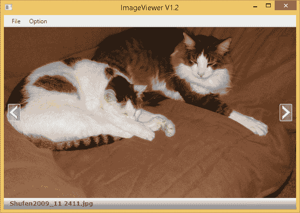

### 图 3-13. 以并行方式执行的淡入和淡出过渡的快照。

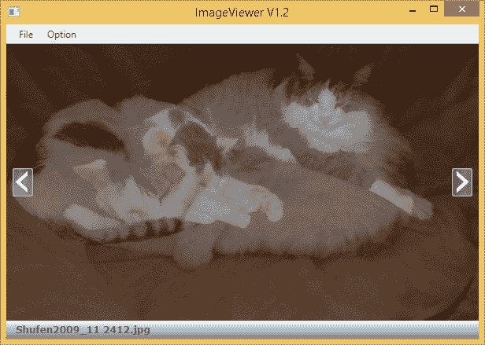

### 图 3-14. 正在淡入的图像快照。

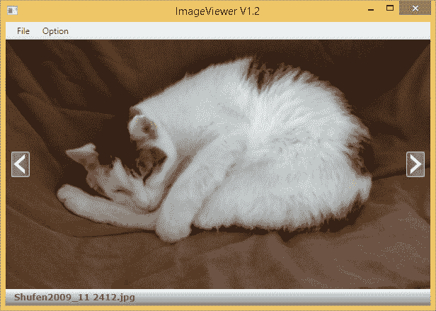

编译并运行应用程序。尝试以下步骤进行测试：

- 从 `FileChooser` 的文件打开对话框在图像目录中加载图像文件。
- 开始幻灯片。
- 在幻灯片运行时，执行以下操作：
  - 反复选择不同的 `View` 选项。
  - 点击 `Previous`（上一个）或 `Next`（下一个）按钮。
  - 从 `FileChooser` 的文件打开对话框在另一个图像目录中加载另一个图像文件。
- 停止幻灯片。

在命令行中编译和运行 `ImageViewer` 的输出：

```
Microsoft Windows [Version 6.3.9600]
(c) 2013 Microsoft Corporation. All rights reserved.

F:\My Documents\DocRoot\SHUFEN_JAVA\MyBookJFX\VolumeOne\ImageViewer1.2\src\example5>

javac  -encoding utf-8 -Xlint:unchecked imageviewer\*.java
jar cf imageviewer.jar imageviewer
java -cp imageviewer.jar imageviewer.ImageViewer

original size
imageArea width changed from 0.0 to 600.0
imageArea height changed from 0.0 to 352.0
Start Slideshow...
Service is transited to running status
Mouse entered
Mouse exited/released
fitwidth
fitheight
original size
Mouse entered
Mouse pressed
Mouse exited/released
Next button clicked: Shufen2010_05 1091.jpg
Mouse pressed
Mouse exited/released
Next button clicked: Shufen2010_05 1166.jpg
Mouse exited/released
Mouse entered
Mouse pressed
Mouse exited/released
Prev button clicked: Shufen2010_05 1166.jpg
Mouse pressed
Mouse exited/released
Prev button clicked: Shufen2010_05 1166.jpg
Mouse pressed
Mouse exited/released
Prev button clicked: Shufen2010_05 1142.jpg
Mouse exited/released
Mouse entered
Mouse exited/released
Mouse entered
Mouse pressed
Mouse exited/released
Next button clicked: jasmin.gif
Mouse pressed
Mouse exited/released
Next button clicked: Jasmin_1.jpg
Mouse exited/released
Mouse entered
Mouse exited/released
Mouse entered
Mouse pressed
Mouse exited/released
Prev button clicked: Jasmin_1_320x363.jpg
Mouse exited/released
Stop Slideshow...
```


## 3.6 总结

本章介绍了 JavaFX 库的以下关键方面，按它们在章节中出现的顺序列出：

* `HBox` 类是内置的 JavaFX 布局面板之一，位于 `javafx.scene.layout` 包中，是 `javafx.scene.layout.Pane` 的直接子类，将其子节点水平地排列在一行中。（参见章节 在 BorderPane 底部添加状态栏）
* `Text` 类位于 `javafx.scene.text` 包中，是 `javafx.scene.shape.Shape` 类的直接子类之一，负责处理渲染几何图形状的常见需求。（参见章节 在 BorderPane 底部添加状态栏）
* `void setPadding(Insets value)` 方法由 `Region` 类提供，定义了区域的上、右、下、左内边距。（参见此处）
* `void setSpacing(double value)` 方法由 `HBox` 类提供，指定 HBox 面板中子节点之间的水平间距。（参见此处）
* `void setStyle(String value)` 方法由 `Node` 类提供，指定此节点的 CSS 样式。（参见此处）
* `static Font font(java.lang.String family, FontWeight weight, double size)` 方法位于 `javafx.scene.text.Font` 类，用于获取渲染文本的字体。（参见此处）
* `Scene(Parent root, double width, double height, Paint fill)` 是 `Scene` 类的构造函数之一，用于创建一个具有指定背景色的 `Scene`。（参见此处）
* 某些类位于 `javafx.beans.property` 包中：
  * `StringProperty` 是一个抽象类，派自 `javafx.beans.binding.StringExpression` 类，实现了 `Property<java.lang.String>` 和 `WritableStringValue`。
  * `WritableStringValue` 扩展了 `WritableObjectValue<java.lang.String>`。
  * `SimpleStringProperty` 派自 `StringProperty` 类。（参见此处）
* `void bind(ObservableValue<? extends T> observable)` 方法定义在 `Property` 接口中，位于 `javafx.beans.property` 包中，将此属性单向绑定到给定的 `ObservableValue`。（参见此处 | 此处 | 此处）
* `DoubleBinding subtract(double other)` 方法定义在 `javafx.beans.binding.DoubleExpression` 类中，计算此 `NumberExpression` 与给定常量之间的差。（参见此处）
* `void setDisable(boolean value)` 方法由 `Node` 类提供，指定此节点的 `disable`。（参见章节 禁用按钮以表示无图像可打开 和 此处）
* `void setOpacity(double value)` 方法由 `Node` 类提供，指定节点的透明度。（参见此处）
* `MouseEvent` 位于 `javafx.scene.input` 包中，是 `javafx.scene.input.InputEvent` 的子类。它定义了如 `MOUSE_CLICKED`、`MOUSE_DRAGGED`、`MOUSE_ENTERED`、`MOUSE_EXITED`、`MOUSE_MOVED`、`MOUSE_PRESSED`、`MOUSE_RELEASED` 等事件类型，并提供了如 `getX()`、`getY()` 等获取鼠标事件位置的方法。（参见章节 鼠标按下时更改外观）
* `void setOnMousePressed(EventHandler<? super MouseEvent> value)` 是 `Node` 类提供的便利方法，注册处理 `MouseEvent` `MOUSE_PRESSED` 类型的 `EventHandler`。（参见章节 鼠标按下时更改外观）
* `MenuBar`、`Menu` 和 `MenuItem` 是基础 JavaFX UI 组件，位于 `javafx.scene.control` 包中，用于使用更少的空间设计紧凑视觉的用户界面。（参见章节 添加幻灯片和停止幻灯片菜单）
* 来自 `javafx.beans.property` 包的一些类：
  * `BooleanProperty` 是一个抽象类，派自 `javafx.beans.binding.BooleanExpression` 类，实现了 `Property<java.lang.Boolean>` 和 `WritableBooleanValue`。
  * `WritableBooleanValue` 扩展了 `WritableValue<java.lang.Boolean>`。
  * `SimpleBooleanProperty` 派自 `BooleanProperty` 类。（参见章节 添加幻灯片和停止幻灯片菜单 和 此处）
* `BooleanBinding` 类是位于 `javafx.beans.binding` 包中的抽象类，它扩展了 `BooleanExpression` 类并实现了 `Binding<java.lang.Boolean>`。（参见此处）

* `BooleanExpression` 类位于 `javafx.beans.binding` 包中，是一个实现 `ObservableBooleanValue` 的抽象类，`ObservableBooleanValue` 是扩展 `ObservableValue<java.lang.Boolean>` 的接口。`BooleanExpression` 类提供了执行 AND、OR 和 NOT 等逻辑操作的便利方法。（参见此处）

* `BooleanExpression` 类中的一些便利方法：

  `BooleanBinding not()`
  对此 `BooleanExpression` 执行逻辑 NOT 操作，并返回一个 `BooleanBinding` 类型的对象，该对象是 `BooleanExpression` 的直接子类。

  `BooleanBinding or(ObservableBooleanValue other)`
  对此 `BooleanExpression` 和给定的 `ObservableBooleanValue` 执行逻辑 OR 操作，并返回一个 `BooleanBinding` 类型的对象，该对象是 `BooleanExpression` 的直接子类。（参见此处）

* `Worker<V>` 是位于 `javafx.concurrent` 包中的接口，它为并发实现定义了通用 API。（参见章节在线程上执行幻灯片）

* 位于 `javafx.concurrent` 包中的并发类：

  `Task`
  实现 `Worker<V>` 接口的抽象类，是一个一次性的 `Worker` 对象。

  `Service`
  实现 `Worker<V>` 接口的抽象类，是一个可重用的 `Worker` 对象。

  `ScheduledService`
  `Service` 类的直接子类，允许指定启动和自动重启服务的延迟时长。

  `WorkerStateEvent`
  `javafx.event.Event` 的子类，定义了事件类型的静态字段，如 `WORKER_STATE_CANCELLED`、`WORKER_STATE_FAILED`、`WORKER_STATE_READY`、`WORKER_STATE_RUNNING`、`WORKER_STATE_SUCCEEDED` 等。当 `Worker` 的状态发生转换时，会触发 `WorkerStateEvent`。（参见章节在线程上执行幻灯片）

* `protected abstract V call()` 方法定义在 `Task` 类中，必须重写，并在任务执行时被调用。（参见此处 | 此处 | 此处）

* `protected abstract Task<V> createTask()` 方法定义在 `Service` 类中，必须重写，并在服务启动时被调用。（参见此处 | 此处 | 此处）

* `Service` 类提供的某些用于注册 `EventHandler` 以处理 Worker 状态事件的便利方法：

  `public final void setOnRunning(EventHandler<WorkerStateEvent> value)`
  `public final void setOnSucceeded(EventHandler<WorkerStateEvent> value)`
  `public final void setOnFailed(EventHandler<WorkerStateEvent> value)`
  `public final void setOnCancelled(EventHandler<WorkerStateEvent> value)`（参见章节配置幻灯片服务对象）

* `Worker.State` 是 `javafx.concurrent.Worker` 接口的嵌套类，是一个定义 `Worker` 状态常量的枚举类型，它们是：`CANCELLED`、`FAILED`、`READY`、`RUNNING`、`SCHEDULED` 和 `SUCCEEDED`。（参见此处 和 此处）

* `javafx.concurrent` 包中 `Service` 类提供的某些方法：

  `public void start()`
  启动此服务；只有当服务处于 `READY` 状态时才能成功启动。

  `public void reset()`
  重置此服务；结果服务的状态将转换为 `READY` 状态。

  `Worker.State getState()`
  定义在 `Worker` 接口中，获取 `state` 属性的值，该值代表 `Worker` 的当前状态。

  `public boolean cancel()`
  定义在 `Worker` 接口中，取消此服务，如果服务取消成功则返回 `true`。（参见章节为“开始幻灯片”和“停止幻灯片”菜单项实现动作事件的处理程序）

* `javafx.animation` 包中用于在幻灯片之间并行执行淡入淡出效果过渡动画的类：

  `Animation`
  `Transition`
  `FadeTransition`
  `ParallelTransition`（参见章节在幻灯片之间添加淡入过渡）

* `javafx.util.Duration` 类实现了 `java.lang.Comparable<Duration>`，持续时间。（参见此处）

* `public void playFromStart()` 方法由 `Animation` 类提供，从起始位置播放动画。（参见此处）

## 结语

作者正在编写该系列书籍的其他卷，并将陆续发布。让我们在序言部分揭示的功能之外，预览一下即将推出的特性：

* 更多交互式绘图工具：自由手绘制工具、橡皮带绘制工具、文本写入、颜色渐变、圆弧绘制、光标移动工具等。
* 调色板工具
* 图像裁剪工具
* 路径过渡动画器
* 动态上下文菜单控制器
* 以及更多……

祝猴年快乐、健康、万事如意。
