# Java 和 Oracle 实现 Fuzzy C-Means 聚类

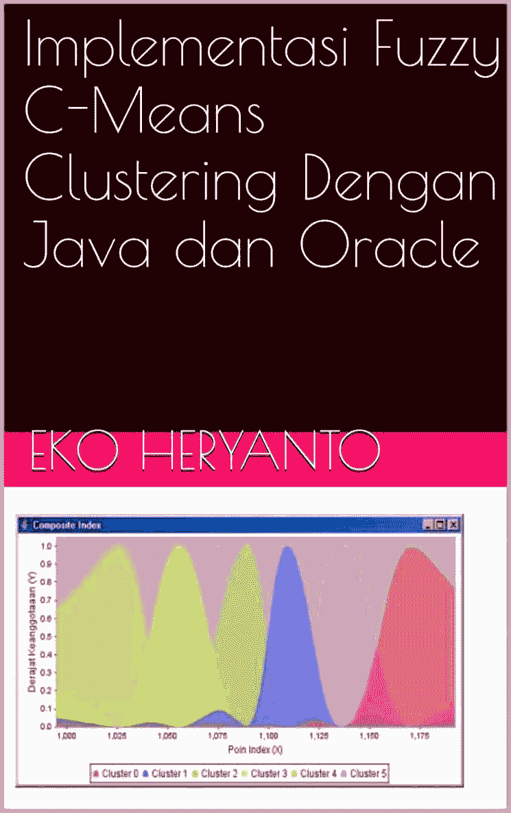

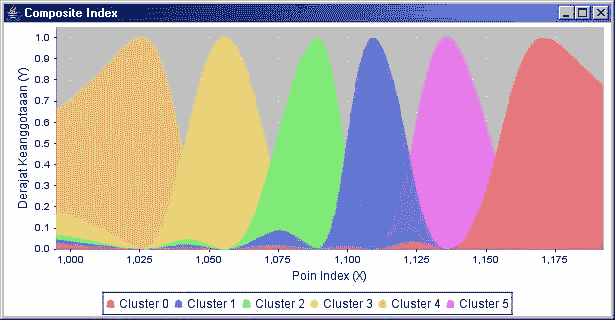

## 摘要

基准测试（Benchmarking），即在雅加达证券交易所综合价格指数（IHSG BEJ）点之间设定明确界限的过程，这对于确定和了解哪些指数点属于高、低或平均水平组至关重要。这作为一种标准，用于确定特定的指数点进入哪一组。如果没有基准测试，随着人类对指数点评估产生的各种不同感知（基于每个个人的估算），将会产生问题，即某个特定指数点到底属于高、低还是平均类别？一个指数点与另一个指数点之间没有明确的界限。Fuzzy C-Means，即一种通过平均划分数据集将其划分为若干个数据组的方法，是对 IHSG BEJ 进行基准测试的方法之一。Fuzzy C-Means 基于模糊逻辑，根据质心与数据之间的距离对数据进行分组。每条数据对每个簇都有一个隶属度。隶属度最高的数据将成为其隶属度所指向的簇的成员。

在书中，将实现对 2005 年 IHSG BEJ 进行基准测试的 Fuzzy C-Means 聚类，以便用户对这些数据进行历史技术数据分析。

通过对多种 IHSG BEJ 进行测试得出结论：基准测试可以适用于多种 IHSG BEJ，如果深入分析 IHSG BEJ 的模式并将其与时间变量起来，就可以获得一些有用信息。

关键词：基准测试、Fuzzy C-Means 聚类、IHSG、IHSG BEJ。

本书并非完美之，尽管如此，作者希望它能对读者有所帮助。作者将欢迎读者的任何建议，以促进科学特别是信息学领域的进步。

作者祝读者阅读愉快，希望对全人类有所益。

Sidoarjo，2016 年 9 月 13 日

Eko Heryanto

在深入撰写本书之前，让我们通过了解基准测试的定义以及基准作为标准的正确性来完善现有概念。以下是来自多个来源的基准（benchmark）定义：

* [www.askoxford.com](http://www.askoxford.com)

Benchmark 是 (1) 一个标准或参考点，(2) 刻在墙上的测量员标记，用作测量高度的参考点。

从上述来源可以获得 benchmark 是 (1) 一个标准或参考界限 (2) 刻在墙上的切割标记，作为测量高度的参考界限。

* [www.encarta.msn.com](http://www.encarta.msn.com)

Benchmark 是 (1) 标准：用于衡量和评估某物的基准标准，(2) 计算机性能测试：用于衡量计算机硬件或软件性能的测试测试。

上述来源说明了 benchmark 的定义，即 (1) 标准：一个可以对事物进行衡量和评估的标准，(2) 计算机性能测试：用于衡量计算机硬件和软件性能的标准测试。

* [`www.investorwords.com`](http://www.investorwords.com)

Benchmark 是一个标准，用于比较。例如，Nasdaq 可以用作基准，用来比较科技股票的性能。

根据 `http://www.investorwords.com` 的定义，benchmark 是一个标准，用于比较。例如，`Nasdaq` 可以用作对比 `IHSG BEJ` 性能的 `benchmark`。

从上述定义中得到了 benchmark 的几个要点：标准、可衡量和评估的事物、用于比较。如果将这些点结合起来，benchmark 的定义就是用于与某物比较的可衡量和评估的标准/基准。而基准测试（benchmarking）本身是一个执行基准测试的过程。

根据上述解释，IHSG BEJ 基准测试的定义是一种标准化的过程，用于对某点进行评估，以便比较 IHSG BEJ 点之间的值。

聚类是将数据分为若干类或簇的过程，使得对象与某个簇与其他簇相比具有高度的相似性（similarity），但与其他簇的对象具有差异性（dissimilar）。通常在聚类中使用 `distance measure`（距离量）。聚类可应用于多个领域，例如数据挖掘、统计学、生物学和机器学习。

簇（Cluster）是数据对象的集合，同一簇内的对象之间具有相似性，而与其他簇的对象则不具有或缺乏相似性（不相似性）。

聚类分析是人类活动中重要的一点。在年轻时，人类反复学习猫和狗、动物和植物之间的性格差异，这会产生一种潜意识聚类方案。聚类分析已广泛应用于许多领域。

聚类有多种应用，以下是各个领域的示例：

* 商业：聚类可以帮助营销人员在客户基数中获取不同的群体，并根据购买模式对客户群体进行特征分析。

* 生物学：可用于植物动物的分类学、具有相同功能的基因分类，并获取种群内部结构信息。

* 聚类还可以帮助识别用于农业的相同区域，并将其纳入地球观测数据库。

* 根据房屋类型、价格和地理位置识别城市中房屋的集合。

* 帮助对网页文档进行分类以进行信息。

## Fuzzy C-Means 聚类

Fuzzy C-Means (FCM) 是一种数据聚类方法，它使单条数据成为两个或多个簇的成员。该方法由 `Dunn` 于 1973 年提出，并由 `Bezdek` 于 1981 年开发。FCM 的基于以下目标函数的最小化：

```
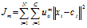, 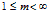
```

(2.1)

其中：

*   `m` 是一个大于 1 的任意实数，

*   `uij` 是 `xi` 在聚类 `j` 中的隶属度，

*   `xi` 是第 `i` 个观测数据，

*   `cj` 是聚类中心，且

*   `||*||` 是一个表示任意观测数据与聚类中心之间等关系的任意范式。

下述模糊划分（Fuzzy Partition）通过对上述目标函数的迭代优化得到。符号 `cj` 是聚类中心，`uij` 是数据隶属度的更新。

```
 (2.2)
```

```
 (2.3)
```

该迭代在满足 `` 时停止，其中 ``

通过图 2.5，可以从两个密集数据中识别出两个相邻的聚类。这些聚类被命名为聚类‘A’和聚类‘B’。在第一种方法——K-Means 算法中，每个数据仅连接到一个质心。其隶属函数将如图 2.5 所示：

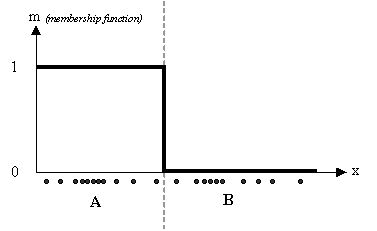

在 Fuzzy C-Means（模糊均值）方法中，相同的数据不再排他地属于某个聚类，而是数据可以位于中间。在这种情况下，隶属函数遵循特殊路径，指示每条数据都可以以不同的隶属度存在于多个聚类中。

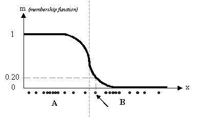

在图 2.6 中，红色标记的数据显示其位置比在聚类 A 中更靠近聚类 B。`m` 的值 0.2 表示该数据在 A 中的隶属度。

现在，利用图形表示，可以构建一个矩阵 `U`，其因子取自隶属函数。该矩阵 `U` 如图 2.7 所示。

```
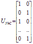 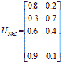
```

图 2.7 U 矩阵

行列数取决于数据和聚类的数量。具体来说，如果有一列 `C = 2` 和行 `N`，那么 `C` 是聚类的总数，`N` 是由 `uij` 表示的数据数量。

上面的示例使用了 K-Means 和 FCM 情况。可以注意到，在第一种（K-means）中，系数始终为 1（单位）。这表明每条数据只属于一个聚类。而 FCM 的系数可以始终大于 1。这意味着数据可以根据不同的隶属度成为多个聚类的成员。隶属度最高将被作为参考，说明该数据属于哪个聚类的成员。

在灵活性方面，FCM 优于 K-Means。FCM 更灵活，因为它对数据到每个聚类的隶属具有容差。这在 K-Means 算法中是不存在的。

| 数据 | | | | | | |
| --- | --- | --- | --- | --- | --- | --- |
| `xi` | 1 | 2 | 3 | 4 | 5 | 6 |
| `yi` | 7 | 8 | 9 | 10 | 11 | 12 |

| 数据 | 硬性隶属 | 模糊隶属度 |
| --- | --- | --- |
| `xi` | `yi` | | | |
| 1 | 7 | 1 | 0 | 0,8737 | 0,1262 |
| 3 | 9 | 1 | 0 | 0,7047 | 0,2952 |
| 4 | 10 | 0 | 1 | 0,2952 | 0,7047 |
| 5 | 11 | 0 | 1 | 0,0707 | 0,9292 |
| 6 | 12 | 0 | 1 | 0,1262 | 0,8737 |

在硬性集合（crisp set）中，项目 `x` 在集合 `A` 中的隶属值（通常写为 `μA[x]`）有两种可能性：

*   一 (1)，意味着该项目成为集合的成员，或

*   零 (0)，意味着该项目不是集合的成员。

*   项目 2 在集合 `A` 中的隶属值 `μA[2]` 为 1，

*   项目 3 在集合 `A` 中的隶属值 `μA[3]` 为 1，

（注：此处修正了原文示例中可能存在的逻辑对应关系描述，以符合数学逻辑）

在清晰集合（crisp set）中，隶属度只有 2 种可能，即 0 或 1；而在模糊集合（fuzzy set）中，隶属度处于 0 到 1 之间。如果 `x` 的模糊隶度 `μA[x] = 0`，意味着 `x` 不属于集合 A；同理，如果 `x` 的模糊隶度 `μA[x] = 1`，意味着 `x` 是集合 A 的完全成员。

低：`0 ≤ indeks < 105`；正常：`1050≤ umur ≤ 1250`；高：`indeks > 1250`

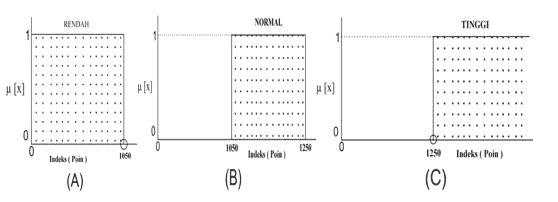

在图 2.10 中，可以解释为：

*   如果索引值为 1049，则称为低（`μRENDAH[1049] = 1`）；

*   如果索引值为 1050，则称为非低（`μRENDAH[1050]=0`）；

*   如果索引值为 1050 缺少 0.001 点，则称为非正常（`μNORMAL[ 1050 – 0,001 ] = 0`）；

*   如果索引值为 1250，则称为正常（`μNORMAL[1250] = 1`）；

*   如果索引值为 1250 缺少 0.001 点，则称为非高（`μTINGGI[ 1250 – 0,001 ] = 0`）。

由此可以说，使用清晰集合表示指数是非常不的，数值的微小变化就会导致显著的类别差异。

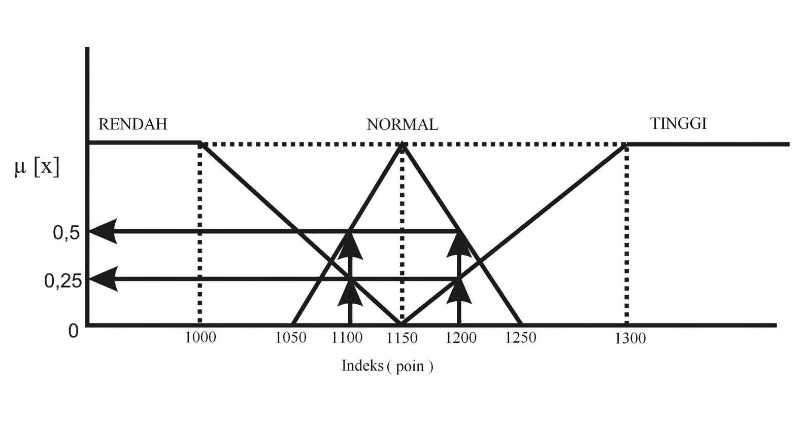

图 2.11 模糊隶属度函数：指数水平

在图 2.11 中，可以看到：

*   值为 1100 的索引属于低集合，其 `μRENDAH[1100] = 0,25`；但同时也属于正常集合，其 `μNORMAL[1100] = 0,5`。

*   值为 1200 的索引属于高集合，其 `μTINGGI[1200] = 0,25`；但它也属于正常集合，其 `μPAROBAYA[1200] = 0,5`。

关于股票指数（IHS）的知识被比作进入房屋的门。如果想进入房子，当然必须经过门。为此，投资者必须知道门在哪里以及如何打开。因此，如果想在资本市场进行投资，投资者必须先了解 IHS。成功打开门后，投资者必须确定位置，是去客厅、餐厅还是卧室。为了确定位置，投资者需要了解市场状况。在资本市场，尤其是股市中，市场状况由牛市、正常市场和熊市市场组成的市场周期所示。因此，如果想在资本市场进行投资，投资者必须先了解可用于分析该资本市场状况的指标 [[Wid96]](XXXXXXXXXXXXXXXXXXXXXXXXXXXXXXXXXX)。

以下将提供关于股票指数和综合股票指数的一些知识。

IHS 实际上是一个经过专门编制和计算的股票价格指数，旨在产生趋势（倾向）。指数数字是经过处理的数字，用于比较活动或事件，这些活动可以是股票价格随时间推移的变化。

在计算这些指数数字时，使用了两个时间基准，即基准期（base period）和现期/执行期（current period）。基准期是将某一事件作为与现期对比的时间。而现期是某个活动或事件发生的时间，之后将与其基准期进行比较。

综合股票指数（IHSG）用于衡量和报告所有上市（listing）股票总价值相对于总基础价格价值变化的指标。因此，确定指数数字必须有于一组数据，因为必须确定基础价格和交易所有效的股票价格 [[Wid96]](XXXXXXXXXXXXXXXXXXXXXXXXXXXXXXXXXX).

根据 Jack Clark Francis 的观点，IHSG 的作用包括：

1. 快速了解市场价格（IHSG）对资本市场投资价值的影响。

2. 此 IHS 也用于历史分析。通过分析市场指数（IHSG）和其他其他经济指标，分析师可以检测指数与经济部门之间的关系。如果该指数是 `dependable indicator`（依赖指标），这种关系类型将非常有用，有助于做出预测 [[Fra93].](XXXXXXXXXXXXXXXXXXXXXXXXXXXXXXXXXX)

原则上讲，IHSG 的计算与个体 IHS 的计算没有区别。个体 IHS 是用于单一公司股票的 IHS。每只公司的股票都有个体 IHS。个体 IHS 有助于评估公司状况。个体 IHS 有助于评估上市股票的状况。

```
 (2.4)
```

其中：

*   `IHS` : 股票指数。

*   `Ht` : 现期（current period）。

*   `Ho` : 基准期（base period）。

其标准如下：

*   如果指数值 > 100，表示市场处于牛市。

*   如果指数值 < 100，表示市场处于熊市。

IHSG 的计算有三种方法，接下来是各方法的讨论。

该计算方法使用当时上市（listing）的所有股票数据。假设所有股票对市场的影响是相同的。

根据基础公式，可以找到计算 IHSG 的通用公式：

```
```

其中：

*   `Ht`: 现期股票总价格。

*   `Ho`: 基准期股票总价格。

与之前的方法不同，这种方法考虑了股票对市场的影响力，这意味着某些特定股票价格的变化会影响所有价格。正是基于这种影响权重，计算了加权 IHSG。股票影响权重的确定取决于上市股票的数量。上市数量越多，该股票形成 IHSG 的能力越强。加权方法包含四种 IHSG 计算模型：Laspeyres、Paasche、Irving Fisher 和 Drobisch。每种加权模型将详细说明并附带其公式。

在这种计算模型中，股票数量的标准是发行时或基准期的股票数量。如果使用基准期的存股数量作为标准，则使用 Laspeyres 提出的公式。Laspeyres 的通用公式如下：

在此计算模型中，使用的股票数量标准是以生效期间的股票数量作为考虑。如果使用生效期间的流通股数量作为标准，则使用帕斯奇（Paasche）提出的公式。

其中：

* `Ht`: 有效期间的股票价格。

* `Ho`: 基础期的股票价格。

* `Kt`: 有效期间所有流通股的总数。

### 伊文·费舍尔（Irving Fisher）计算模型

伊文·费舍尔提出的这一计算模型是莱斯尔（Laspeyres）计算模型和帕斯奇计算模型的结合。其计算结果可以通过将莱斯尔方法和帕斯奇方法得到的 IHSG 相乘，然后对两者进行开根获得。公式如下：

```
IHSG = 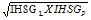 (2.8)
```

其中：

* `IHSGL`: 莱斯尔计算模型的 IHSG。

* `IHSGP`: 帕斯奇计算模型的 IHSG。

与伊文·费舍尔提出的方法一样，罗比施也发现了一种比前两种方法（莱斯尔和帕斯奇）更简单的方法。该方法将莱斯尔方法和帕斯奇方法两种方法相加，然后将相加的结果除以二，并通过乘以 100% 以百分比的形式表示。罗比施方法旨在均分分配莱斯尔和帕斯奇两种方法。

```
IHSG = 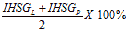 (2.9)
```

其中：

* `IHSGP`: 帕斯奇计算模型的 IHSG。

如果将交易所上市的所有股票全部纳入，IHSG 的计算效率将会降低。这是因为如果上市股票数量达到数万只，计算 IHSG 将非常复杂。

与资本市场相关的术语有很多，但书中仅讨论一些与本书相关的术语。以下是相关讨论。

基于 IHSG 指标值波动的牛市市场特征如下：

* IHSG 数值随时间推移呈现上升趋势

* 新的高点始终高于之前的最高点，直到第三阶段结束。

熊市市场是牛市市场的反，特征如下：

* 新的指数高点始终低于之前的最高点，直到第三阶段结束。

* 在 IHSG 数值波动中，新的低点始终低于之前的指数低点。

* 在熊市中，进行交易的投资者并非真实投资者，而大部分是投机者，他们只希望从短期价格波动中获利。

* 在熊市中，交易频率往往较小，因为在高风险下可能获得的利润较小。

* 在熊市中，股票价格下跌发生在几乎所有高价值股票上[[Wid96]](XXXXXXXXXXXXXXXXXXXXXXXXXXXXXXXXXX)。

为了向公众提供有关交易所发展的更完整信息，BEJ 已通过纸质和电子媒体传播股票价格波动数据。该股票价格波动的指标是 IHS。

1. `IHSG`，使用所有上市股票作为指数计算的组件。

2. `行业指数`，使用每个行业中的所有股票。

3. `LQ45 指数`，经过若干筛选阶段后使用的 45 只特定股票。

4. `个体指数`，即基于基础价格的每只股票指数。

1983 年 4 月 1 日，`IHSG` 首次引入，基础价值为 100，当时的上市股票为 13 只。IHSG 的计算方法是 BEJ 所有股票的市值总和。公式如下：

```
images/00029.gif
```

指数计算代表了通过竞价系统进行的股票波动。当有新发行、`HMETD`（配股）、部分上市、认证以及退市时，基础价值将进行调整。在拆股、股息或送股的情况下，基础价值不进行调整，因为：


`images/00030.gif`
(2.11)

行业指数是 IHSG 的一部分。BEJ 上市的所有公司根据 BEJ 规定的行业分类分为 9 个部门，称为 `JASICA`（雅加达交易所工业分类）。这九个部门是：

- `部门 1`: 农业。
- `部门 2`: 矿业。

B. 第二部门（加工/制造业）

- `部门 4`: 综合工业。
- `部门 5`: 消费品工业。

C. 第三部门（服务业）

- `部门 7`: 交通与基础设施。
- `部门 8`: 金融。
- `部门 9`: 贸易、服务与投资。

除了这九个部门外，BEJ 还计算了一个制造业指数，代表了归类为第 3 部门、第 4 部门和第 5 部门的股票集合。

为了入选该指数，股票必须满足特定标准并通过以下主要筛选：

1. 进入常规市场股票总交易额的前 60 名（过去 12 个月的平均交易额）。
2. 在 `BEJ` 上市至少 3 个月。
3. 公司的财务状况、公司增长前景、以及在常规市场的交易频率和数量。

`BEJ` 持续监控进入 `LQ45` 计算的股票成分的发展情况。每 3 个月对进入 `LQ45` 指数计算的股票排名进行回顾。股票更换每 6 个月进行一次，即每年的 2 月和 8 月初。

如果某只股票不符合标准，该股票将从指数计算中剔除，并由符合标准的股票取代。排名 1-35 的股票在指数计算中被快速计算。而排名 36-45 的股票则不需要纳入指数计算。

### 2.5.5 雅加达伊斯兰指数 (JII)

为了满足对投资感兴趣的投资者，`BEJ` 和 `Danareksa Investment Management` (`DIM`) 推出了一个基于伊斯兰教律法的指数，被称为雅加达伊斯兰指数 (`JII`)。

`JII` 于 2000 年 7 月 3 日发布。`JII` 回溯至 1995 年 1 月 1 日作为基准日，基值为 100。

#### 2.5.5.1 不进入 JII 的股票标准

根据 `PT DIM` 伊斯兰教监督委员会的指示，发行人违反伊斯兰教法的主要活动类型包括：

- 属于赌博或禁止交易的赌博和游戏业务。
- 生产、分销及贸易属于哈禁（haram）食品饮料的业务。
- 生产、分销和/或提供破坏道德且有害物品或服务的业务。

确定进入 `JII` 指数计算的股票筛选顺序如下：

1. 根据最新的年度或中期财务报表选择股票，其负债率最高为 90%。
2. 根据过去一年平均市值（`market capitalization`）从大到小的顺序从上述股票中选出 60 只。
3. 根据过去一年平均交易价值的流动性水平选出 30 只。

进入 `JII` 的股票对那些只想投资于清真（halal）公司的民众具有很高的吸引力。许多国内外穆斯林投资者投资了这些股票。

2000 年 7 月 13 日，`BEJ` 发布了关于上市领域的新规定，即“双板上市系统”。该系统的实施是为了推动印尼交易所。

上市板块分类包括：

- 开发板：用于涵盖尚未满足主板要求但属于有前景类别的公司。此外，开发板也适用于经历重组或业绩恢复的公司。

为了提供监控进入各板块类别股票的指标，`BEJ` 于 2002 年 4 月 8 日发布了两个新指数：主板指数和开发板指数。这两个指数使用与其他指数类似的计算方法，例如使用市值加权法。主板和开发板指数的计算基准日为 2001 年 12 月 28 日，基值为 100。当时 24 只股票在主板，28 只股票在开发板。这两个指数的市值占比分别为 62% 和 38%。

本章描述了以软件形式开发的理论和算法的核心内容。软件设计中需要注意的三个方面是数据设计、过程设计和界面设计。为了使其更简单，软件设计被分为以下几个阶段：

1. 过程设计
2. 界面设计

软件中使用的数据可以分为三类：输入数据、过程数据和输出数据。这些数据类型将在后续章节中解释。数据处理成信息的流向是必要的。这些数据流如图所示：

图 3.1 数据信息流

### 3.1.1 输入数据

#### 3.1.1.1 选择所需数据并转换为 CSV 格式

本书中所需的数据是 2005 年的 `IHSG` `BEJ` 数据。这些数据是扩展名为 `txt` 的文件，格式如图 3.2 所示：

图 3.2 IHSG BEJ 原始数据格式

文本文件的数量为 238 个，这意味着一年内（2005 年）大约发生了 238 次 `trading time`（交易时间）。

指数列是指数名称，表格显示共有 15 个指数。每个指数都有其自身的特性，根据其特性和行业划分。

然而，根据问题限制，聚类对象是 2005 年的 IHSG 数据，这意味着所需的数据是所有类型 IHSG 且位于“today”列的数据。完成数据选择后，将数据转换为 `CSV`（逗号分隔值）格式。这样做是为了便于后续转换到数据库。

#### 3.1.1.2 转换为 Oracle 数据库

仍处于 `CSV` 格式的输入数据需要转换并存储到数据库中。这有助于应用程序的开发，因为应用程序可以通过数据库访问数据。使用的 DBMS（数据库管理系统）是 `Oracle Database 10G`。

进入数据库的输入数据尚未经过良好筛选，不同类型的索引数据仍然混合在一起。因此，需要根据每种索引类型进行数据划分。这可以通过为每种索引类型创建 `view` 来实现。

处理数据是指在聚类过程中使用的数据，即通过 FCM 聚类算法寻找聚类中心的过程以及寻找最优隶属度的过程。这些数据由输入数据处理并用于生成输出数据。输入数据经过两个阶段的处理：

#### 3.1.2.1 寻找聚类中心

在此阶段，对原始输入数据进行处理以生成每个聚类的聚类中心。聚类中心的计算符合模糊 C 均值（Fuzzy C-Means）聚类的寻找中心公式（公式 2.2）。

#### 3.1.2.2 寻找最优隶属度

此阶段包括寻找每个原始数据在每个聚类中的隶属度阶段，以及寻找最优隶属度数据的阶段。

##### 隶属度寻找阶段

在此阶段，将聚类中心寻找阶段的处理数据与原始输入数据结合处理。每个聚类的隶属度计算是通过 Fuzzy C-means 聚类方法中的隶属度 `update` 公式计算的（公式 2.3）。

##### 最优隶属度寻找阶段

在此阶段，寻找最优隶属度阶段的结果数据被查找并存储在一个矩阵中。执行比较算法以获得最优值。

### 3.1.3 输出数据

输出数据是软件在经过聚类结果显示过程后为用户产生的信息。该信息通过 FCM 聚类方法对原始数据进行聚类处理。在此阶段，用户可以清晰地看到数据，因为每个聚类及其输出数据都有不同的颜色。在此阶段，处理后的数据在图表中被着色，因此使用户更容易区分聚类区域。

该软件的设计针对 FCM 聚类所经历的各个阶段。流程如下：

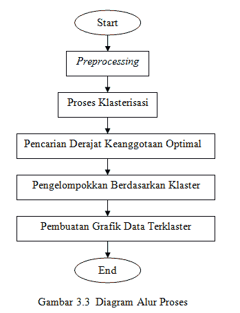
图 3.3 流程图

在此阶段，根据用户的要求对输入数据进行处理。输入数据根据用户输入的参数进行处理。用户输入的参数包括：索引类型、聚类数量、精度界限和 `fuzziness`。除了索引类型外，所有这些输入都是 Fuzzy C-Means 聚类方法的参数条件。索引类型影响将要处理的输入数据。每个输入后续都将被赋予输入要求，以确保进入应用程序的输入是正确的且符合 FCM 算法要求的。下图将阐述该过程。

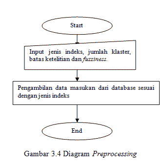

聚类过程是即将开发的应用程序的核心过程。该过程的流程如图 3.5 所示。

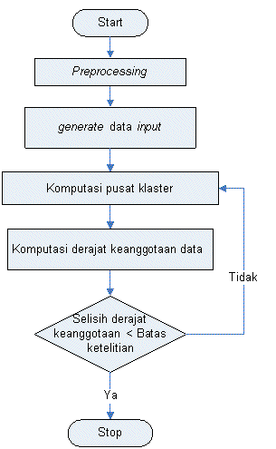
图 3.5 聚类流程图

该过程是初始化每个数据隶属度的过程。此过程的初始化获取自 `generate random`（随机数）。

在此处，输入数据被处理成若干聚类中心，其数量与用户输入的聚类数量一致。此阶段通过以下公式进行：

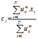
(3.1)

在此处，聚类中心寻找阶段的结果数据与原始索引数据的输入数据相结合处理。通过计算每个数据对每个聚类的隶属度，公式如下：

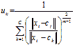
(3.2)

执行决策，即如果数据隶属度的差值小于精度界限（来自预处理阶段），则过程停止；否则继续进入聚类中心计算阶段。

这符合以下公式：

(3.3)

### 3.2.5 最优隶属度寻找阶段

在此阶段，隶属度更新阶段的结果数据通过比较算法进行处理，以获得每个聚类的最优隶属度。然后获取值最大的隶属度。

在此阶段，最优隶属度寻找阶段的数据将根据其聚类等进行分组。数据将根据具有相似聚类的数据进行分组。分组后续将使用 `sorting` 算法。

### 3.2.7 聚类数据图表制作阶段

根据聚类相似性分组的数据将被创建一个图表，代表特定聚类的数据。该图表后续将是彩色的。这有助于用户区分聚类区域并便于获取信息。

## 界面设计

界面设计旨在方便用户运行软件。用户与软件的交互使用鼠标和键盘。用户可以选择所需的 IHSG 类型，输入数据，并点击按钮开始过程，包括生成数据、运行过程以及按步执行（step by step）执行过程。除了聚类过程的输入，还有查看数据聚类结果图表的输入。这些输入是 `radio button`，可以根据用户的意愿进行点击。当用户想要查看数据和图表时，可以选择这些选择按钮，选项如下：

- IHSG 图表，即用户可以查看数据聚类前的索引随时间图。
- 聚类数据，用户可以查看数据聚类后的索引随时间图。
- 排序数据详情，用户可以查看按 `ascending` 排序的聚类索引数据详情。

以下是界面设计，并对表单中的每个组件都进行了说明。所有内容见图 3.6。

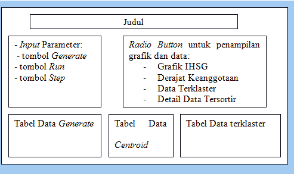
图 3.6 界面设计

# 软件实现

本章将阐述所创建软件设计的实现。讨论内容包括软件实现环境、过程实现和类实现。

实现环境包括所使用的硬件和软件。实现中所使用的硬件和软件规格见表 4.1：

表 4.1 软件实现环境

| :--- | :--- |
| 处理器 | `Intel(R) Pentium(R) 4 CPU 2.8 GHz`，内存：`1024 MB RAM` |
| 软件 | 操作系统：`Microsoft Windows Server 2003`，IDE 软件：`NetBeans 5`，Java 组件：`JFreeChart`，驱动：`JDBC Oracle 10G` |

# 数据实现

数据实现章节解释了第 3 章中数据设计的实现。与数据设计一样，数据实现分为三部分：输入数据、处理数据和输出数据。

### 4.2.1 输入数据

文本形式的输入数据通过转换为 `CSV`（逗号分隔值）文件格式进行处理。仅转换所需的数据。进行此类转换是为了使数据更容易录入到数据库中。选择 `CSV` 格式是因为这种格式的数据可以转换为多个数据库，这意味着某些数据库在导入到数据库的过程中支持该格式。

所需的输入数据被迁移到数据库（`Oracle Database 10G`）中，具有以下属性：

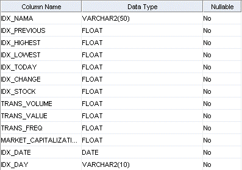
图 4.1 IHSG BEJ 表属性

将创建的表对应的 `DDL`（数据定义语言）如下：

图 4.2 创建表 IHSG BEJ

以下是数据迁移到 Oracle 数据库后的若干部分数据。

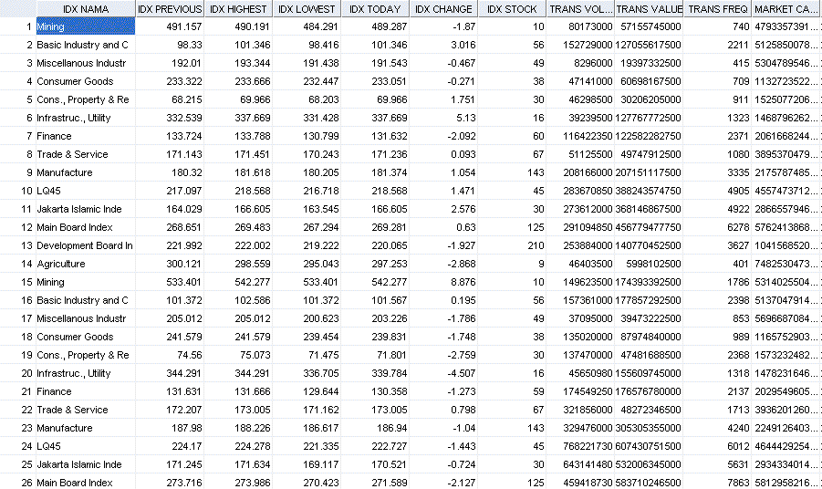
图 4.3 Oracle IHSG BEJ 数据

各索引类型的 `View` 具有以下属性：

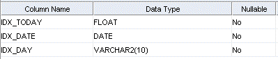
图 4.4 视图属性

以下是用于各 IHSG 的视图类型：

- `VIEW_COMP2`: 用于获取复合索引（composite index）类型的 BEJ IHSG 视图
  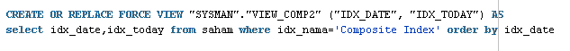
  图 4.5 复合视图
- `VIEW_AGRI`: 用于获取属于农业行业部门索引的 BEJ IHSG 视图
  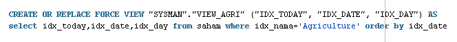
  图 4.6 农业视图
- `VIEW_MINING`: 用于获取属于矿业行业部门索引的 BEJ IHSG 视图
  图 4.7 矿业视图
- `VIEW_BASIC`: 用于获取属于工业和化工行业部门索引的 BEJ IHSG 视图
  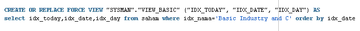
  图 4.8 基础工业视图
- `VIEW_MISCELL`: 用于获取属于杂项行业的 BEJ IHSG 视图
  图 4.9 杂项索引视图
- `VIEW_CONSUME`: 用于获取消费品行业部门索引的 BEJ IHSG 视图
  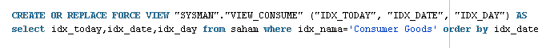
  图 4.10 消费品视图
- `VIEW_FINANCE`: 用于获取金融行业部门索引的 BEJ IHSG 视图
  图 4.11 金融视图
- `VIEW_INFRA`: 用于获取属于交通和基础设施部门索引的 BEJ IHSG 视图
  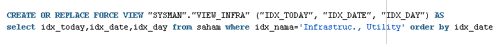
  图 4.12 基础设施视图
- `VIEW_PROPERTY`: 用于获取属于房地产和地产行业部门索引的 BEJ IHSG 视图
  图 4.13 房地产索引视图
- `VIEW_TRADE`: 用于获取属于贸易、服务和投资部门索引的 BEJ IHSG 视图
  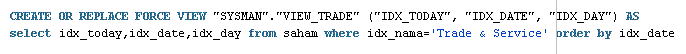
  图 4.14 贸易索引视图
- `VIEW_LQ`: 用于获取属于 LQ45 的 BEJ IHSG 视图
  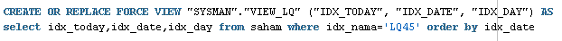
  图 4.15 LQ45 索引视图
  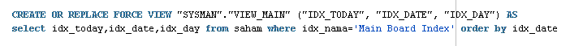
  图 4.16 主板视图
- `VIEW_ISLAM`: 用于获取属于 JII 的 BEJ IHSG 视图
  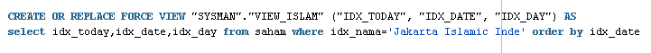
  图 4.17 雅兰视图
  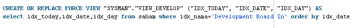
  图 4.18 开发板索引视图

### 4.2.2 处理数据

1. **聚类中心查找**：在矩阵查找后，将聚类中心存储在一个维矩阵中。该矩阵的行数与用户输入的簇数量对应。该矩阵命名为 `clustercentroid`。
2. **最优隶属度查找**：此阶段包括每个簇中每个输入数据的隶属度查找，以及最优隶属度数据的查找。
   - **隶属度查找**：在此阶段，将聚类中心查找的处理数据与输入数据进行处理。处理结果进入二维矩阵，其每个索引分别表示数据索引和簇索引。矩阵包含每个数据在特定簇中的隶属度。该矩阵命名为 `u1`。
   - **最优隶属度查找**：在此阶段，查找并存储最优隶属度阶段的结果到一个矩阵中。该矩阵是一个维矩阵，其内容为最优簇的索引。

### 4.2.3 输出数据

输出数据是软件为用户产生的信息。经过处理并获得特定簇成员的数据被设计为每个簇具有不同的显示颜色。这存在于 `createDataset` 方法中，该方法存储聚类处理后的数据。

此阶段是用户向应用程序输入数据的阶段。用户的输入需要根据 `Fuzzy C-Means` 聚类算法的要求进行过滤。以下是输入要求的程序代码：

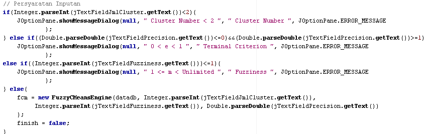

此阶段还包括根据索引类型从数据库获取输入数据的过程。通过 Oracle 提供的组件（即 `Oracle Data Source`）直接连接数据库进行获取。`ConnectDbFix` 是一个包含数据库连接和数据数据的类。该过程的访问程序代码如下：

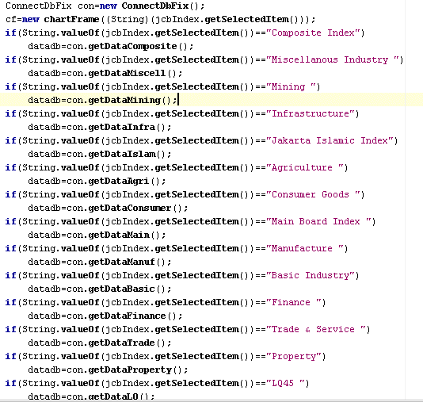

### 4.3.2 聚类过程阶段

在聚类过程阶段，包含了在软件设计章节中解释过的几个步骤。以下是反映这些设计阶段的一些程序代码。

以下是获取 `Fuzzy C-Means` 聚类方法所需的随机值的程序代码。该代码使用了现有的 `random` 类。

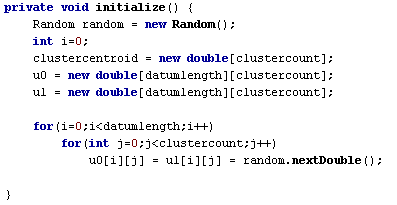

以下是根据 `Fuzzy C-Means` 聚类公式获取聚类中心的程序代码。

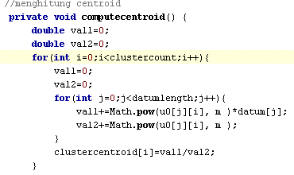

需要计算每个数据对于每个类的隶属度。每个数据不断更新隶属度，直到满足停止条件。以下是获取数据在每个类中隶属度的公式程序代码。

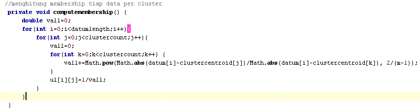

以下是第 3 章中描述的停止阶段程序代码。

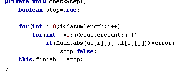

此阶段是获取优化隶属度数据的阶段。以下是该阶段的程序代码。在此阶段执行了一个比较算法。该算法对矩阵中具有最高隶属度的数据进行筛选。如果获得了最高隶属度，则将聚类的矩阵索引作为返回值存储。该返回值对后续过程非常有用。

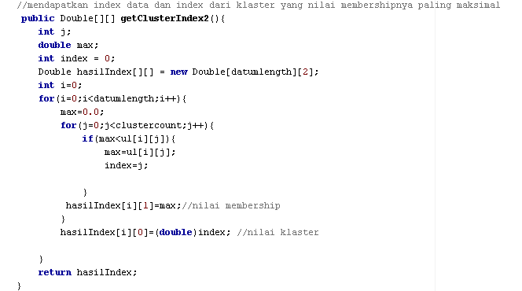

根据聚类对数据进行分组的程序代码如下：

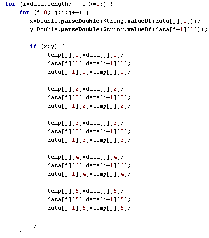

本书中的应用程序中有几个图表。下面将分别说明。

#### 4.3.5.1 `hariFrame` 类

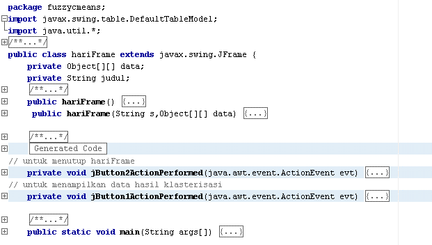

#### 4.3.5.2 `chartFrame` 类

`chartFrame` 类用于显示未聚类的 IHSG BEJ 数据图形。该类由三个主要部分组成：

- `createDataSet`：用于存储将使用的数据。
- `createChart`：根据存储在 `DataSet` 中的数据创建图形。
- `createDemoPanel`：图形容器。

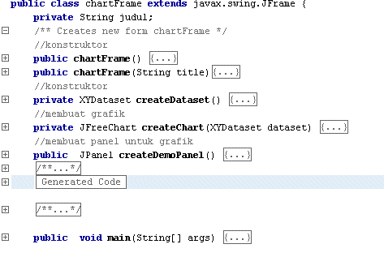

#### 4.3.5.3 `markerFrame` 类

`markerFrame` 类用于显示已聚类 IHSG BEJ 数据的图形。该类具有与 `chartFrame` 类相同的三个主要部分。区别在于标记（marker）。这些标记被用于区分不同的聚类。这便于用户清晰地查看信息。以下是 `markerFrame` 类在 Java 中的实现。

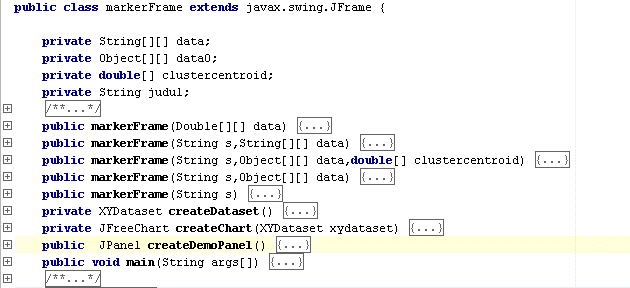

#### 4.3.5.4 `MbfFrame` 类

`MbfFrame` 类用于详细全面地显示每个 IHSG BEJ 的隶属度。该类与 `hariFrame` 相似但又有不同。区别在于每个 IHSG BEJ 的隶属度数量。该类将显示每个类中 IHSG BEJ 的隶属度，而 `hariFrame` 只显示最大的隶属度。

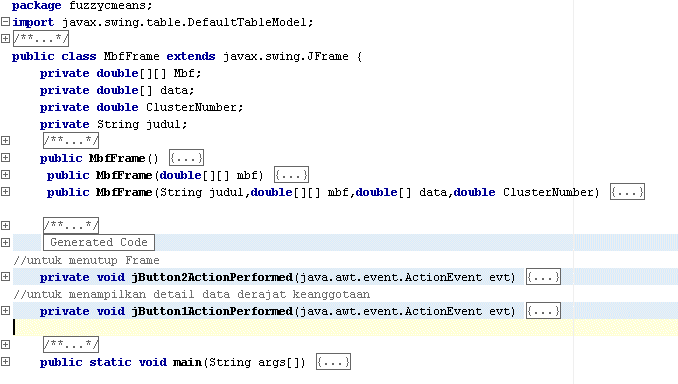

#### 4.3.5.5 `degreeFrame` 类

`degreeFrame` 类用于显示每个聚类中每个 IHSG BEJ 的隶属度数据图形。


| B 类 | 此类意味着 IHSG 数值仍处于良好状态，交易仍处于平均水平。 |
| C 类 | 此类意味着 IHSG 数值处于中等水平，并倾向于下跌，将进入熊市（Bearish）。 |
| D 类 | 此类意味着 IHSG 数值点非常低且处于低迷，状态意味着市场处于熊市（Bearish）。 |

## 1. 方案 1 的执行

### 5.2.2.1 参数输入

根据上述方案，必须输入某些参数。必须输入的参数为：

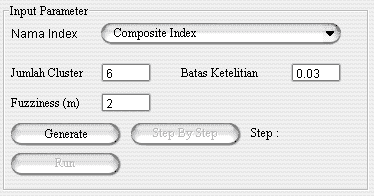
图 5.1 方案 1 输入

然后，在 `Nama Index` 标签旁边的组合框中选择“Composite Index”。这是因为对“Composite Index” IHSG BEJ 进行基准测试。

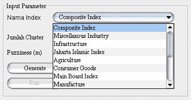
图 5.2 方案 1 索引类型输入

### 5.2.2.2 基准测试过程

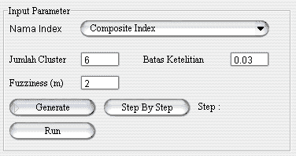
图 5.3 生成随机数据

然后点击 `Run` 按钮进行后续过程，即寻找 `centroid` 并寻找每个数据相对于每个簇的隶属度，并不断更新隶属度直到达到精度限制。

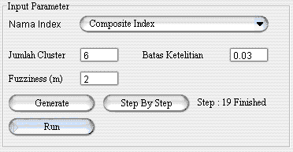
图 5.4 运行基准测试过程

### 1. 基准测试输出


图 5.5 方案 1 隶属度

图 5.5 是 IHSG BEJ 数据相对于每个簇隶属度的图表。图中存在的若干颜色区域代表各个簇。图中共有 6 种颜色，意味着有 6 个簇。每个数据可以成为多个簇的成员。如果用图表表示，每个数据可以进入多个颜色区域。

而下方的图表是一个表示每个聚类数据的图表，它与 `variable waktu`（索引发生时）相连。还可以看到每个簇的 `centroid`。

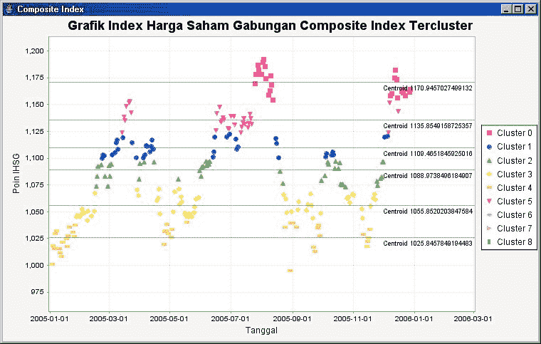
图 5.6 方案 1 聚类数据图

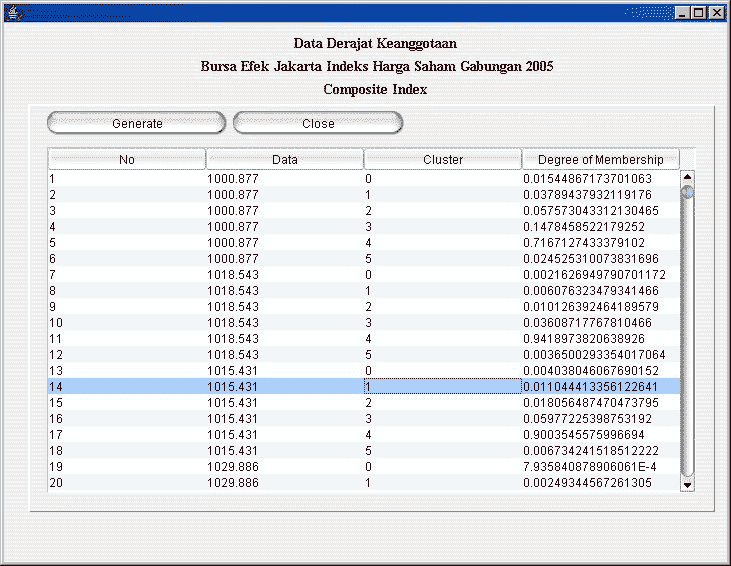
图 5.7 方案 1 隶属度输出

在图 5.7 中可以看到什么？该图提供了每个数据在每个簇中的隶属度信息。这是 `FCM` 具有灵活性的典型特征。从这些隶属度中可以获得特定索引点的趋势。例如，数据 `1000,877`。该数据的最大隶属度位于簇 4，值为 `0,716`，而第二高隶属度位于簇 3，值为 `0,147`。观察图 5.6，簇 4 为棕色，而簇 3 为黄色，则表明索引点 `1000,877` 属于簇 4 并倾向于簇 3。

数据表结果为已升序 `ascending` 排序的聚类 IHSG BEJ 复合数据，以及每个数据的最大隶属度及其对应的 `variable waktu`，见下图 5.8：

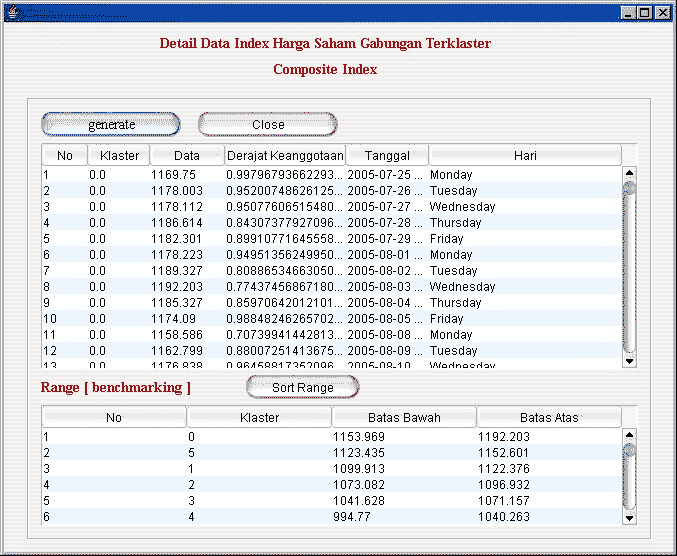

#### 1. 输出分析

在图 5.9 中可以看到，值为 `1.041,628` 的 IHSG BEJ 点尚未知属于哪一组。

图 5.9 方案 1 盲图

但通过现有的图表可以看到它属于组 `A`、`B`、`C` 还是 `D`。从图 5.10 可以非常清楚地看到数据进入哪一组。


现在，让我们寻找图 5.10 中包含的信息。观察组 A（红色），它是该组中的最高等级。如果观察得更仔细，可以发现索引在这些月份将会较高（在 A 组中）。这可以为交易所提供关于市场参与者应该做什么的信息。


图 5.11 方案 1 基准范围

## 2. 方案 2：测试方案 2

此测试提供了一个方案，旨在了解所创建应用程序的功能。

### 5.3.1 方案 2 概述

从用户角度出发，对 2005 年 LQ45 类型 IHSG BEJ 值进行了基准测试的案例研究。

作者选择 LQ45 是因为 `PT Bursa Efek Surabaya` 有一种销售 LQ45 索引点的市场产品。该索引的每个点由产品发行方（在此处为 `PT Bursa Efek Surabaya`）给出特定价格。投资者对该索引点进行买卖操作。投资者从该索引点的买卖差价中获利。名称为 `LQ Futures` 和 `Mini LQ Futures`。`LQ Future` 于 2001 年 8 月 13 日推出，是交易所特别是 `future` 索引 `derivative` 产品的先驱。`LQ Futures` 使用 `LQ45` `IHSG BEJ` 作为 `underlying`。

# 场景 3

## 测试场景

### 5.4.1 场景大纲

在雅加达证券交易所（BEJ）上市的公司被分为 9 个行业，即 `JASICA`（雅加达证券交易所行业分类）。每个行业都有与其领域相对应的特征。在此场景中，选择了 `Agriculture`（农业）作为多个行业的代表。

IHSG BEJ 分为以下组别：

表 5.4 场景分组

| 组别/类别 | 说明 |
| :--- | :--- |
| A 类 | 此类意味着 IHSG BEJ Agriculture 的数值处于极高点，意味着市场处于牛市（Bullish）。 |
| C 类 | 此类意味着 IHSG BEJ Agriculture 的数值极低且低迷，这种状态意味着市场处于熊市（Bearish）。 |

### 5.4.2 场景执行

测试通过执行上述场景的内容来进行测试。该场景的执行将经过几个阶段，即参数输入阶段、基准测试过程、查看基准测试输出以及对输出进行分析。每个阶段将在下面的子章节中详细说明。

根据上述场景，必须输入某些参数。

必须输入的参数为：

`Jumlah Cluster = 3`; `Fuzziness (m) = 2`; `Batas ketelitian = 0.03`


图 5.23 场景 3 参数输入

然后，在“索引名称”标签旁边的组合框中选择 `Agriculture`。这是因为将对 `Agriculture` 类型的 IHSG BEJ 进行基准测试。


图 5.24 场景 3 索引类型输入

### 5.4.2.2 基准测试过程

执行基准测试需要经过几个过程。该过程是模糊 C 均值聚类（Fuzzy C-Mean Clustering）的阶段。首先，点击 `Generate` 按钮初始化隶属度，这将随机值初始化隶属度变量。


图 5.25 场景 3 数据生成数据

然后点击 `Run` 按钮执行后续过程，即寻找质心以及每个数据相对于每个簇的隶属度，并持续更新隶属度直到达到精度极限。


图 5.26 场景 3 运行过程

#### 1. 基准测试输出

在基准测试过程经过若干阶段后，可以通过图 5.27 的图形表示查看结果。该图表是 IHSG BEJ Agriculture 数据相对于每个簇隶属度的图表。图中的不同颜色代表不同的簇。图中共有 3 种颜色，意味着有 3 个簇。


图 5.27 场景 3 隶属度图表

而图 5.28 图表是表示每个聚类数据与时间变量（索引发生时）连接的图表。每个簇通过颜色区分。图中还可以看到每个簇的质心。红色点群是簇 C，蓝色是簇 B，绿色是簇 C。


图 5.28 场景 3 聚类数据图表

图 5.29 是数据在每个簇中具有隶属度的聚类结果。


图 5.29 场景 3 最大隶属度输出

在图 5.29 中可以看到什么？该图提供了每条数据在特定簇中的隶属度信息。从这些隶属度中可以获得特定索引点的趋势。例如，数据 303,318。该数据的最高隶属度位于簇 0，值为 0.994，而第二高隶属度位于簇 1，值为 0.004。观察图 5.28，簇 0 为红色而簇 1 为蓝色，这提供了索引点 303,318 属于簇 0 并倾向于簇 1 的信息。

图 5.30 是升序排序后的聚类结果，以及带有时间变量的每个数据的最大隶属度：


图 5.30 场景 3 与时间相关的数据输出

#### 2. 输出分析

以下是盲图，图中指定的数据属于哪一组，是属于 A 组、B 组还是 C 组？


图 5.31 场景 3 盲图

但是，通过图 5.32 中的图表可以清楚地看到该数据位于 A 组，因为它属于上方的第一个簇。可以清楚地看到数据属于哪一组。


图 5.32 场景 3 基准测试图表

通过查看几个图表可以获得信息。指数在 10 月、11 月和 12 月处于较高水平（位于 A 组）。根据这些信息可以得出一个依据，即农业股市在这些月份处于高位。这可以作为信息和经验教，供资本市场参与者（特别是投资者）在明年应对此类情况的参考。

以下图 5.33 是 IHSG BEJ agriculture 的基准：


图 5.33 场景 3 基准范围

图 5.38 场景 4 隶属度图

而图 5.39 的图表表示了每个聚类数据与时间变量（指数发生时）的连接情况。每个簇通过颜色进行区分。在图中还可以看到每个簇的质心（centroid）。


图 5.39 场景 4 聚类数据图

`IHSG BEJ JII` 数据的聚类结果以及数据在每个聚类类中的隶属度如图 5.40 所示：


图 5.40 场景 4 隶属度输出

从图 5.40 中可以看到什么呢？该图提供了每个数据在特定簇中的隶属度信息。例如，数据 `166,605`。该数据具有最高隶属度位于簇 4，数值为 `0,562`，而第二高隶属度位于簇 5，数值为 `0,338`。观察图 5.39，簇 4 为棕色，而簇 5 为紫色，这表明指数点 `166,605` 进入了簇 4 并趋向于簇 5。

图 5.41 是 `IHSG BEJ JII` 数据按簇进行升序排序后的聚类结果，并附带每个数据在时间变量下的最大隶属度：


图 5.41 场景 4 与时间相关数据输出

#### 1. 输出分析

以下是一个盲图，图中指定的数据属于哪一组，是属于 A 组、B 组还是 C 组？


图 5.42 场景 4 盲图

但通过图 5.43 中的图表可以清楚地看到，数据位于 AB 组，因为它们属于从上起的第二个簇。


图 5.43 场景 4 基准测试图

通过查看某些图表可以获得信息。指数在 8 月和 12 月处于较高（处于 A 组）。根据这些信息，可以建立一个依据：`JII` 股市在这些月份处于高位。这可以作为经验信息，告诉资本市场参与者（特别是投资者）来年应该如何应对这种情况。

`IHSG BEJ JII` 的基准详情如下：


图 5.44 场景 4 基准范围

# 场景 5

## 测试场景 5

在本次测试中，提供了一个旨在了解所创建应用程序功能的场景。该应用程序上测试了一个场景。

### 5.6.1 场景 5 概述

从用户视角进行了案例研究，该用户将作为决策辅助工具，或对 2005 年 `Main Board` 类型的 `IHSG BEJ` 数值进行报告。

`IHSG BEJ` `Main Board` 类型被分为以下组/类：

表 5.6 场景 5 分组

| 组 / 类别 | 说明 |
| :--- | :--- |
| A 类 | 此类意味着存在极高点的 `IHSG BEJ Main Board` 数值，意味着市场处于牛市（Bullish）。 |
| B 类 | 此类意味着 `IHSG BEJ Main Board` 数值仍处于良好，交易仍处于平均水平。 |
| C 类 | 此类意味着存在极低且低迷的 `IHSG BEJ Main Board` 数值，意味着市场处于熊市（Bearish）。 |

### 1. 场景 5 的执行

通过执行上述场景中编写的内容来进行测试。场景执行将通过几个阶段，即参数输入阶段、基准测试处理、查看基准测试输出以及对输出进行分析。

#### 5.6.2.1 参数输入

根据上述场景，必须输入参数。必须输入的参数是：

`Jumlah Cluster = 3`；`Fuzziness (m) = 2`；`Batas ketelitian = 0.03`


图 5.45 场景 5 参数输入

在 Index 名称标签旁边的组合框中选择“Main Board”。因为将对“Main Board”类型的 `IHSG BEJ` 进行基准测试。这可以通过下面的图 5.46 看到。


图 5.46 场景 5 指类型输入

#### 5.6.2.2 基准测试处理

执行基准测试需要经过几个过程。这些过程是 `FCM` 的阶段。首先，通过点击 `Generate` 按钮初始化隶属度，这会将变量 `derajat keanggotaan` 初始化为随机值。


图 5.47 场景 5 Generate

然后点击 `Run` 按钮执行后续过程，即寻找簇中心并持续更新数据对每个簇的隶属度，直到达到精度限制。


图 5.48 场景 5 Run

### 1. 基准测试输出

在经过基准测试的几个阶段后，从下面的图 5.49 可以看到结果。


图 5.49 场景 5 隶属度

该图是 `IHSG BEJ Main Board` 数据相对于每个簇隶属度的图表。存在的颜色代表每个簇。图中包含 3 种颜色意味着有 3 个簇。有些数据进入了两个簇。这可以通过观察簇区域看出。在图中可以看到某些颜色重叠。蓝色簇区域被绿色簇区域部分覆盖。

而 5.50 的图是表示每个聚类数据与时间变量（指数发生时）连接的图。还可以看到每个簇的质心。


图 5.50 场景 5 聚类数据图

图 5.51 是包含聚类数据以及数据在每个簇中隶属度的表格：


图 5.51 场景 5 隶属度输出

从图 5.51 中可以看到什么呢？该图提供了每个数据在特定簇中的隶属度信息。这是 `FCM` 具有灵活性的特征。从这些隶属度可以获得特定指数点的趋势。例如，数据 `269,281`。该数据具有最高隶属度位于簇 1，数值为 `0,837`，而第二高隶属度位于簇 2，数值为 `0,123`。观察图 5.50，簇 1 为蓝色，而簇 2 为红色，这表明指数点 `269,281` 进入了簇 1 并趋向于簇 2。

图 5.53 场景 5 盲图

通过图 5.54 中的图表，可以清楚地看到数据位于 B 组。可以区分数据属于哪个组。


图 5.54 场景 5 基准测试图

可以通过查看现有的图表获取信息。指数在 8 月和 12 月处于高位（位于 A 组）。根据这些信息可以得出一个依据，即主板（Main Board）在这些月份处于高位。这可以作为信息和经验教，告诉资本市场参与者（特别是投资者）来年应该如何应对。

以下是更详细的基准：


图 5.55 场景 5 基准范围

# 结论与建议

本章解释了已进行测试的结论以及对本书的改进建议。

## 6.1 结论

第 5 章对 5 种不同类型的 IHSG（印尼股票综合指数）进行了测试。所测试的 IHSG 类型包括综合指数（Composite Index）、LQ45、农业板块（Agriculture Sector）、JII 和主板指数（Main Board Index）。在查看上述第 5 章的测试结果后，可以得出测试结论。以下结论已获得资本市场从业者的认可。

从书中可以得出的结论是：

- 实施 `Fuzzy C-Means Clustering` 对 BEJ IHSG 进行聚类，可以用于基准测试过程，即在 BEJ IHSG 数据点之间设定明确界限的过程。
- 在完成基准测试后，可以对 BEJ IHSG 的历史数据进行分析，然后将其与指数发生的时间变量关联。

## 6.2 建议

建议是追求人类工作成果完美时必须的努力。因此，本书非常需要建议。本书的建议来自资本市场从业者。以下是针对本书的建议：

- `Fuzzy C-Means Clustering` 的实施不应仅限于单一维度（指数维度），而可以与其他变量联系起来，从而支持基准测试过程。
- 使用的数据不应仅限于 2005 年，而应该是更长的时间跨度。

# 参考文献

| [Agr04] | Ashish Kumar Agrawal, Mini Project Report: Design and approaches implementation of a classification system based on soft computing and statistical approaches, 2004, IIIT Deemed University. |
| [Bez81] | J. C. Bezdek, Pattern Recognition with Fuzzy Objective Function Algoritms, Plenum Press, New York., 1981. |
| [Dun73] | J. C. Dunn, A Fuzzy Relative of the ISODATA Process and Its Use in Detecting Compact Well-Separated Clusters, Journal of Cybernetics 3: 32-57, 1973. |
| [Fra93] | Jack Clark Francis, (trans) Handoyo, Prasetyo, Management of Investment,3rd ed.McGraw Hill International Editions,New York, 1993. |
| [Han01] | Jiawei Han, and Micheline Kamber, Data Mining : Concepts and Techiques, Morgan Kaufmann Publisher.San Francisco, 2001. |
| [Huang90] | Stanley S.C. Huang, (trans) Lamarto Yohannes, Timing The Stock USA, Market For Maximum Profit, Probus Publishing Company,Chichago, Illinois, 1990. |
| [Jang97] | Jyh-Shing Roger Jang, Chuen-Tsai Sun, dan Eiji Mizutani, Neuro-Fuzzy and Soft Computing : A Computational Approach to Learning and Machine Intelligence, New Jersey : Prentice-Hall International Inc, 1997. |
| [Jak05] | Jakarta Stock Exchange Research and Development Division, JSX Monthly Statistics Volume 14 No 11, November 2005. |
| [Kann] | S R Kannan, Segmentation of MRI Using New Unsupervised Fuzzy C-Mean Algorithm, ICTP, DISI, Universitaa di Genova Italy. |
| [Mic06] | Microsoft, http://www.encarta.msn.com, 2006. |
| [Muc] | Hans-Joachim Mucha and Hizir Sofyan, : Nonhierarchical Clustering. http://www.quantlet.com/mdstat/scripts/xag/html/xaghtmlframe149.html. |
| [Oxf06] | Oxford Press, http://www.askoxford.com, 2006. |
| [Pring91] | Martin J. Pringring,trans) Investment : Explained,3rd ed, McGraw International Editions, New York, 1991. |
| [Ras] | Tariq Rashid, Clustering http://www.bris.ac.uk/home/tr1690/documentation/fuzzy_clustering_initial_report/node11.html |
| [Web97] | WebFinance, Inc, http://www.investor.com, 1997-2006. |
