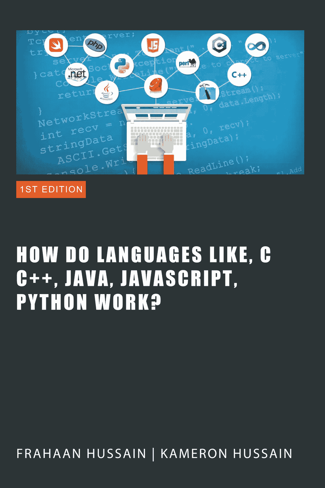

# 代码内部：揭秘 C、C++、Java、JavaScript 和 Python 等语言的工作原理



```c
int value = 42;

ptr = &value; // 将 value 的地址赋给 ptr
```

### 5. 栈与堆

在 C 中，内存可以分配在栈或堆上。栈内存是自动管理的，用于函数调用帧和局部变量。堆内存是显式管理的，适用于动态分配的数据。

### 6. 内存安全

C 不提供内置的内存安全功能（如边界检查），这意味着开发者必须小心以避免缓冲区溢出和其他内存相关错误。

### 7. 内存泄漏

当动态分配的内存没有被正确释放时，就会发生内存泄漏。检测和修复内存泄漏对于维持程序的稳定高效至关重要。

### 8. 内存对齐

内存对齐确保数据存储在内存中的地址是特定值的倍数。适当的对齐可以提高内存访问速度和效率。

```c
struct Data {
    int x;
    double y;
};

int main() {
    struct Data data;  // 对齐良好的结构体

    // ...

    return 0;
}
```

## 9. 内存管理最佳实践

为了确保在 C 中进行高效且安全的内存管理，请考虑以下最佳实践：

- 在不再需要时，务必释放动态分配的内存。
- 注意缓冲区大小和数组边界，以防止缓冲区溢出。
- 负责任地使用指针以避免与内存相关的错误。
- 考虑使用链表和数组等数据结构来高效管理动态内存。

C 的内存管理要求对语言的内存模型有深入理解以及严谨的编码实践。虽然它提供了内存提供了细粒度的控制，但也要求开发者承担责任，以避免与内存分配和释放相关的常见陷阱和问题。

***

## 2.4 C 对操作系统和软件的贡献

C 编程语言在操作系统和广泛软件应用的发展中发挥了关键作用。它将底层控制能力与可移植性相结合，使其成为构建健壮高效系统的首选。在本节中，我们将探索 C 如何为操作系统的创建和各种软件领域做出贡献。

### 1. 操作系统

C 接近硬件的特性和可移植性使其成为开发操作系统（OS）的理想语言。一些最著名的操作系统，包括 Unix、Linux 和 Windows NT 内核，主要用 C 语言编写。C 高效管理硬件资源并提供高程度控制的能力对于操作系统的开发至关重要。

### 2. 系统软件

除了操作系统之外，C 还被广泛用于开发系统软件，如设备驱动程序、编译器、汇编器和链接器。系统软件直接与硬件交互，并且需要具备高效性和可移植性，这使得 C 成为极佳的选择。

```c
#include <stdio.h>

int main() {
    printf("Hello, System Software!\n");

    return 0;
}
```

### 3. 嵌入式系统

C 的高效性和底层控制使其适用于嵌入式系统开发。嵌入式系统存在于各种，包括汽车控制单元、医疗设备和消费电子产品。

```c
void controlMotor(int speed) {
    // 在嵌入式系统控制控制电机速度
}
```

### 4. 网络软件

网络软件（包括网络协议和服务器）通常依赖 C 的性能和可移植性。C 的套接字库允许开发者创建在不同平台上高效运行的网络应用程序。

```c
#include <stdio.h>
#include <stdlib.h>
#include <sys/socket.h>
#include <netinet/in.h>

int main() {
    // 此处编写网络代码

    return 0;
}
```

### 5. 编译器和解释器

C 具有自托管特性，这意味着 C 编译器和解释器通常是用 C 语言本身编写的。这种引导过程产生了许多 C 编译器，例如 `GCC`（GNU 编译器集合）和 `Clang`。

```c
int main() {
    printf("This program was compiled by a C compiler written in C!\n");

    return 0;
}
```

### 6. 科学计算

C 因其计算效率被应用于科学计算。诸如 `BLAS`（基本线性代数程序）和 `LAPACK`（线性代数包）等库是用 C 语言编写的，为数值计算提供了基本函数。

```c
#include <stdio.h>
#include <math.h>

int main() {
    double result = sqrt(25.0);  // 平方计算

    printf("The square root of 25 is %f\n", result);

    return 0;
}
```

### 7. 游戏开发

C 和 C++ 因其性能成为视频游戏开发的流行选择。Unreal Engine 和 Unity 等游戏引擎大量使用 C++，而游戏逻辑经常利用 C。

```c
#include <stdio.h>

int main() {
    // 此处编写游戏代码

    return 0;
}
```

### 8. 跨平台开发

C 的可移植性允许跨平台开发，使软件能够以极少的修改在不同的操作系统和架构上运行。

C 的影响扩展到许多其他领域，包括数据库系统、安全工具和嵌入式控制系统。它的生命力和适应性使其成为现代软件开发的基石，对技术格局产生了深远影响。理解 C 对这些领域的贡献，对于理解其在计算机科学领域的持续适用性和重要性关重要。

***

## 2.5 C 的局限性与遗产

虽然 C 是一项突破性且具有影响力的编程语言，但它并非没有局限性和挑战。在本节中，我们将探索 C 的一些局限性，并讨论它在软件开发世界的持久遗产。

### 1. 缺乏内存安全

C 的底层特性允许开发者对内存进行直接控制，但也意味着没有内置机制来防止常见的内存相关错误，如缓冲区溢出、空指针解引用和内存泄漏。程序员必须勤谨地管理内存。

```c
char buffer[10];

strcpy(buffer, "This is a long string that can overflow the buffer.");
```

### 2. 可移植性挑战

虽然 C 以可移植性闻名，但编写真正的平台无关代码仍然具有挑战性。硬件架构、编译器和操作系统的差异可能会引入细微的问题。

### 3. 标准库有限

C 的标准库提供了基础功能，但缺乏像 Python 或 Java 那样丰富的标准库。开发者通常需要依赖第三方库。

### 4. 冗长

与现代语言相比，C 可能比较冗长。例如，字符串操作或动态内存分配需要更多的代码行且容易出错。

```c
// 用 C 拼接两个字符串

char str1[20] = "Hello, ";
char str2[10] = "world!";

strcat(str1, str2);
```

### 5. 缺乏面向对象特性

C 没有原生支持类和继承等面向对象概念，使其不适合需要 OOP 原则的大型项目。

### 6. 并发支持有限

C 缺乏对现代并发和并行的内置支持。虽然可以多线程和多处理，但可能非常复杂且容易出错。

### 7. 错误处理复杂性

C 中的错误处理通常涉及检查返回值或错误代码，这可能导致代码杂乱并降低可读性。

```c
FILE *file = fopen("example.txt", "r");

if (file == NULL) {
    perror("Error opening file");

    return 1;
}
```

### 8. 遗留代码库维护

由于缺乏现代编程结构，遗留的 C 代码库可能难以维护和扩展。重构或添加新功能可能需要巨大的精力。

尽管存在这些局限性，C 在软件开发世界的遗产依然强大。它继续作为一门基础性语言，并作为许多其他编程语言的基础，包括 `C++`、Objective-C 和 `Rust`。C 的底层控制和效率使其在嵌入式系统、操作系统开发和系统编程等领域不可或缺的。

此外，C 的局限性启发了更安全、更现代的语言开发，这些语言解决了上述问题。例如，`Rust` 专注于内存安全和并发，同时不牺牲性能，而 `C++` 在 C 的基础上引入了面向对象的特性。

总之，C 语言的局限性被其持久的遗产以及对编程领域的贡献所平衡。它在软件开发历史上的重要性不言而喻，其原则继续影响着新语言和系统的设计。对于在各种软件领域工作的开发者来说，理解它的优缺点都是至关重要的。

***

# 第 3 章：C++：桥接过程化编程与面向对象编程

## 3.1 从 C 到 C++ 的演进

C++ 的发展标志着编程语言的一次重大演进，弥补了过程化编程与面向对象编程（OOP）之间的差距。在本节中，我们将探索从 C 到 C++ 的历程，以及定义 C++ 为一种多功能强大语言的核心概念。

### 1. C++ 的起源

C++ 由 Bjarne Stroustrup 在 20 世纪 80 年代初创建，是 C 编程语言的扩展。Stroustrup 的目标是将 C 的效率和底层能力与高级特性相结合，实现更具结构化模块化的代码。

```cpp
#include <iostream>

int main() {
    std::cout << "Hello, C++!" << std::endl;

    return 0;
}
```

### 2. 面向对象编程（OOP）

与 C 相比，C++ 的根本转变之一是引入了 OOP。在 C++ 中，你可以定义类和对象，将数据和行为封装成可重用且组织的单元。

```cpp
class Rectangle {
public:
    int width;
    int height;

    int area() {
        return width * height;
    }
};

int main() {
    Rectangle rect;

    rect.width = 5;
    rect.height = 10;

    int area = rect.area();

    return 0;
}
```

### 3. 类与对象

C++ 中的类充当创建对象的蓝图。它们封装了数据（属性）和对这些数据进行操作函数（方法）。对象是类的实例。

### 4. 继承

C++ 支持继承，允许你根据现有类创建新类。继承实现了代码复用和类层次结构的创建。

```cpp
class Square : public Rectangle {
public:
    Square(int side) {
        width = side;
        height = side;
    }
};
```

### 5. 多态

C++ 中的多态允许不同类的对象被视为共同基类的对象。这促进了动态方法调用和运行时的灵活性。

```cpp
class Shape {
public:
    virtual void draw() {
        // 默认实现
    }
};

class Circle : public Shape {
public:
    void draw() override {
        // 绘制圆圆
    }
};
```

### 6. 封装

C++ 支持封装，隐藏类的内部细节并只暴露必要的内容。访问修饰符（如 `public`、`private` 和 `protected`）控制类成员的可见性。

```cpp
class BankAccount {
private:
    double balance;

public:
    void deposit(double amount) {
        if (amount > 0) {
            balance += amount;
        }
    }

    double getBalance() {
        return balance;
    }
};
```

### 7. 模板

C++ 引入了模板，实现了泛型编程。模板允许你编写处理不同数据类型的代码，同时保持类型安全。

```cpp
template <typename T>
T add(T a, T b) {
    return a + b;
}
```

### 8. 标准模板库（STL）

STL 是 C++ 中一组预定义的类和函数，用于常见的数据结构（如 vectors、lists 和 maps）和算法。它简化了复杂任务并提升了代码的可重用性。

```cpp
#include <vector>
#include <algorithm>

int main() {
    std::vector<int> numbers = {5, 2, 8, 1, 9};

    std::sort(numbers.begin(), numbers.end());

    return 0;
}
```

从 C 到 C++ 的演进带来了丰富的特性和编程范式，使 C++ 成为适用于各种应用程序的多功能语言。它无缝结合过程化编程和面向对象编程的能力，使其使其在软件开发中经久不衰。理解 C++ 的核心概念对于在现代编程中充分利用其潜力至关重要。

***

## 3.2 C++ 中面向对象编程的核心概念

面向对象编程（OOP）是 C++ 中的一种基本范式，允许开发者创建更有组织、模块化且易于维护的代码。在本节中，我们将深入探讨 C++ 中 OOP 的核心概念。

### 1. 类与对象

C++ 面向对象编程的核心是类和对象。类是创建对象的蓝图。它定义了描述对象行为和属性的属性（数据成员）和方法（函数）。

```cpp
class Circle {
public:
    double radius;

    double calculateArea() {
        return 3.14159 * radius * radius;
    }
};
```

在这个示例中，`Circle` 是一个类，具有 `radius` 属性和一个用于计算圆面积的 `calculateArea()` 方法。

### 2. 封装

封装是将数据（属性）和操作这些数据的方法（函数）封装在类中的做法。在 C++ 中，你可以使用访问修饰符控制类成员的可见性：`public`、`private` 和 `protected`。

```cpp
class BankAccount {
private:
    double balance;

public:
    void deposit(double amount) {
        if (amount > 0) {
            balance += amount;
        }
    }

    double getBalance() {
        return balance;
    }
};
```

在这里，`balance` 属性是 `private`（私有的）。

### 3. 继承

继承允许你根据现有的类（基类或父类）创建新类（派生类或子类）。派生类继承基类的属性和方法，从而实现代码复用。

```cpp
class Shape {
public:
    virtual double calculateArea() {
        return 0.0;
    }
};

class Circle : public Shape {
public:
    double radius;

    double calculateArea() override {
        return 3.14159 * radius * radius;
    }
};
```

在这个示例中，`Circle` 是 `Shape` 的派生类，并重写了 `calculateArea()` 方法。

### 4. 多态

多态允许不同类的对象被视为共同基类的对象。这促进了动态方法调用和运行时的灵活性。

```cpp
Shape* shape = new Circle();
double area = shape->calculateArea();
```

在这里，一个 `Circle` 对象被视为 `Shape` 对象，并调用了 `calculateArea()` 方法。

### 5. 抽象

抽象是将复杂系统建模为具有特定行为和属性的对象以简化过程。类通过封装相关细节提供了抽象层次。

```cpp
class Car {
public:
    virtual void start() = 0;
    virtual void stop() = 0;
};

class ElectricCar : public Car {
public:
    void start() override {
        // 启动电车
    }

    void stop() override {
        // 停止电车
    }
};
```

在这个示例中，`Car` 是一个抽象类，拥有纯虚函数，强制 `ElectricCar` 等派生类提供 `start()` 和 `stop()` 的实现。

### 6. 组合

组合是通过将简单的对象作为属性来构建复杂对象的做法。它促进了代码的模块化和重用性。

```cpp
class Engine {
public:
    void start() {
        // 启动引擎
    }

    void stop() {
        // 停止引擎
    }
};

class Car {
private:
    Engine engine;

public:
    void start() {
        engine.start();
    }

    void stop() {
        engine.stop();
    }
};
```


在这个示例中，`Car` 包含一个 `Engine` 属性，允许它将任务委托给 `Engine` 对象。

理解这些 C++ 核心 OOP 概念对于以结构化和模块化方法设计开发软件至关重要。这些概念为构建复杂且可维护的系统提供了基础，并广泛应用于从游戏开发到企业软件的各种应用程序。

---

## 3.3 内存管理：从 `Malloc` 到构造函数

内存管理是 C++ 编程的一个关键方面，由于类和对象的引入，它与 C 有显著不同。在本节中，我们将探索 C++ 如何管理内存，包括构造函数和析构函数的使用。

### 1. 构造函数

在 C++ 中，构造函数是定义在类中的特殊成员函数，在创建类对象时被调用。构造函数初始化对象的属性并在必要时分配资源。

```cpp
class Student {
public:
    Student() {
        // 构造函数
        age = 0;
        name = "Unknown";
    }

private:
    int age;
    std::string name;
};
```

在这个示例中，`Student` 类有一个构造函数，它在创建 `Student` 对象时为 `age` 和 `name` 属性设置默认值。

### 2. 析构函数

析构函数是另一个特殊成员函数，当对象离开范围或被显式删除时被调用。析构函数用于释放对象分配的资源，例如动态内存或文件句柄。

```cpp
class FileHandler {
public:
    FileHandler(const std::string& filename) {
        // 构造函数：打开文件
        file.open(filename);
    }

    ~FileHandler() {
        // 析构函数：关闭文件
        file.close();
    }

private:
    std::ifstream file;
};
```

在这个示例中，`FileHandler` 类有一个打开文件的构造函数和一个在对象销毁时关闭文件的析构函数。

### 3. 动态内存分配

C++ 提供了 `new` 和 `delete` 运算符用于动态内存的分配和释放。当你使用 `new` 创建对象时，会调用它的构造函数并在堆上分配内存。

```cpp
Student* studentPtr = new Student(); // 动态创建对象
```

要释放内存并调用析构函数，你使用 `delete`：

```cpp
delete studentPtr; // 调用析构函数并释放内存
```

### 4. RAII（资源获取即初始化）

RAII 是一种 C++ 编程范式，它将资源（如内存或文件句柄）的生命周期与对象的生命周期绑定。构造函数获取资源，析构函数释放资源，确保资源得到妥善管理。

```cpp
class DatabaseConnection {
public:
    DatabaseConnection() {
        // 构造函数：打开数据库连接
    }

    ~DatabaseConnection() {
        // 析构函数：关闭数据库连接
    }
};
```

通过 RAII，资源管理变得自动且确定，最大限度地减少了资源泄漏的风险。

### 5. 拷贝构造函数

C++ 提供了拷贝构造函数，用于创建现有对象的副本。默认情况下，C++ 会生成一个执行成员级拷贝的拷贝构造函数。然而，你可以定义自定义的拷贝构造函数以确保资源的正确拷贝。

```cpp
class MyString {
public:
    MyString(const MyString& other) {
        // 自定义拷贝构造函数
        data = new char[strlen(other.data) + 1];
        strcpy(data, other.data);
    }

private:
    char* data;
};
```

在这个示例中，`MyString` 类定义了一个自定义拷贝构造函数来对字符数据进行深拷贝。

理解 C++ 中的内存管理对于创建健壮且高效的程序至关重要。构造函数和析构函数在管理资源方面起着关键作用，而 RAII 范式鼓励资源管理的最佳实践。通过有效使用这些特性，C++ 开发者可以确保在对象的整个生命周期内内存和其他资源的正确分配和释放。

---

## 3.4 标准模板库（STL）

标准模板库（STL）是 C++ 的核心组件，提供了一组用于常用数据结构和算法的预定义类和函数。它通过提供一组经过良好设计且高效的组件简化了复杂任务并促进了代码的重用。在本节中，我们将探索 STL 的一些关键组件。

### 1. 容器

STL 提供了几种容器类用于高效地存储和管理数据。常用的容器包括：

- `Vector`：动态数组，在添加或删除元素时会自动调整大小。
- `List`：双向链表，允许在列表任何位置高效地插入和删除元素。
- `Map`：关联容器，存储键值对，通过键提供快速查找。
- `Set`：存储唯一元素的容器，适用于维护一组不同的值集合。

```cpp
#include <vector>
#include <map>

std::vector<int> numbers = {1, 2, 3, 4, 5};
std::map<std::string, int> ageMap;
```

### 2. 迭代器

迭代器用于遍历和操作容器中的元素。它们提供了一种统一的访问元素的方式，无论底层的容器类型如何。

```cpp
for (auto it = numbers.begin(); it != numbers.end(); ++it) {
    // 使用 'it' 访问或修改元素
}
```

### 3. 算法

STL 包含了大量在容器上操作的算法。这些算法执行排序、搜索和修改等任务。常用的算法包括：

- `std::sort`：排序容器中的元素。
- `std::find`：在容器中查找元素。
- `std::for_each`：将函数应用于容器中的每个元素。

```cpp
#include <algorithm>

std::sort(numbers.begin(), numbers.end());
auto result = std::find(numbers.begin(), numbers.end(), 3);
```

### 4. 函数对象（仿函数）

函数对象是行为像函数的对象。它们通常与算法一起使用以自定义其行为。你可以通过重载 `operator()` 来定义自己的函数对象。

```cpp
struct Square {
    int operator()(int x) const {
        return x * x;
    }
};

std::transform(numbers.begin(), numbers.end(), numbers.begin(), Square());
```

### 5. 字符串

C++ 作为 STL 的一部分提供了 `std::string` 类，提供了一种比 C 风格字符数组更友好且多用途的替代方案。`std::string` 处理内存管理并提供各种操作函数。

```cpp
#include <string>

std::string greeting = "Hello, World!";
```

### 6. 智能指针

STL 包含了智能指针，如 `std::shared_ptr`、`std::unique_ptr` 和 `std::weak_ptr`，用于高效管理内存。这些指针在对象不再需要时自动处理内存释放，减少了内存泄漏的风险。

```cpp
#include <memory>

std::shared_ptr<int> sharedPtr = std::make_shared<int>(42);
std::unique_ptr<double> uniquePtr = std::make_unique<double>(3.14);
```

### 7. 工具函数

STL 提供了工具函数 `std::pair` 和 `std::tuple` 用于处理对和元组。这些通常用于返回多个值的函数和算法。

```cpp
#include <utility>

std::pair<int, std::string> person = std::make_pair(25, "Alice");
std::tuple<int, double, std::string> data = std::make_tuple(42, 3.14, "Hello");
```

标准模板库是 C++ 开发者的强大工具，提供了大量的可重用组件和算法，简化了常见的编程任务。通过有效利用 STL，程序员可以编写更高效、更易维护的代码，减少在数据结构和算法方面重复发明轮子的需求。理解 STL 组件及其如何使用它们对于任何 C++ 开发者来说都是至关重要的。

---

## 3.5 C++ 的真实世界应用

C++ 是一种多功能的编程语言，以其高性能和高效性闻名。在本节中，我们将探索 C++ 的一些真实世界应用，以及它如何在各个领域被使用。

### 1. 系统编程

C++ 广泛用于系统编程任务。它在开发操作系统、设备驱动程序和嵌入式系统固件等方面起着至关重要的作用。它的底层能力使其适用于管理硬件资源以及与外围设备交互。

```cpp
// Example of systems programming in C++

#include <iostream>
#include <fstream>
#include <unistd.h>

int main() {
    std::cout << "Hello, C++ Systems Programming!" << std::endl;

    std::ofstream outputFile("data.txt");
    outputFile << "Data written to a file." << std::endl;

    close(1); // Close standard output

    return 0;
}
```

### 2. 游戏开发

由于其性能和处理资源密集型任务的能力，C++ 是游戏开发的流行选择。像虚幻引擎（Unreal Engine）和 Unity 这样的游戏引擎广泛使用 C++ 构建其核心系统。

```cpp
// Game development in C++

#include <iostream>

class Game {
public:
    void run() {
        // Game loop
        while (isRunning) {
            // Game logic and rendering
        }
    }

private:
    bool isRunning = true;
};
```

### 3. 高性能计算（HPC）

C++ 在高性能计算领域备受青睐，因为该领域需要最大的计算能力。C++ 的底层内存控制和优化能力使其适用于科学模拟、天气建模和金融分析。

```cpp
// High-performance computing in C++

#include <iostream>
#include <vector>
#include <omp.h>

int main() {
    std::vector<double> data(1000000, 0.0);

#pragma omp parallel for
    for (int i = 0; i < data.size(); ++i) {
        data[i] = i * 2.0;
    }

    std::cout << "HPC task completed." << std::endl;

    return 0;
}
```

### 4. 航空航天与国防

C++ 用于航空航天和国防行业，执行飞行控制系统、雷达信号处理等任务。它的底层能力使其适用于对可靠性要求极高的环境。

```cpp
// Example of systems programming in C++

#include <iostream>

class FlightSystem {
public:
    void control() {
        // Flight control
    }
};
```

### 5. 金融

在金融领域，C++ 被用于高频交易和风险管理。其低延迟和高效执行能力对于交易策略至关重要。

```cpp
// Game development in C++

#include <iostream>

class TradingAlgorithm {
public:
    void execute() {
        // Trading logic
    }
};
```

### 6. 游戏引擎与图形库

虽然 Java 具有移植性，但某些任务可能需要依赖平台的代码。在这种情况下，Java 提供了与 C++ 交互的机制。

```cpp
// High-performance computing in C++

#include <iostream>

class GraphicsEngine {
public:
    void render() {
        // Rendering logic
    }
};
```

### 7. 汽车行业

C++ 用于汽车行业，包括车载控制单元（ECU）和信息系统。其实时能力对于自动驾驶技术至关重要。

```cpp
// High-performance computing in C++

#include <iostream>

class AutonomousSystem {
public:
    void drive() {
        // Autonomous driving logic
    }
};
```

### 8. Web 应用

Java 广泛用于 Web 开发。基于 Java 的 Web 应用程序可以在任何支持 Java Servlets 的 Web 服务器上运行。Java EE（企业版）等技术提供了构建可扩展 Web 应用程序的工具。

---

## 3.6 Java 虚拟机（JVM）

Java 虚拟机（JVM）是 Java 平台的关键组件，负责执行 Java 字节码并确保跨平台兼容性。在本节中，我们将深入探讨 JVM 并理解它在使 Java 成为“一次编写，到处运行”语言中的作用。

### 1. JVM 架构

JVM 是一个虚拟运行时环境，它抽象了底层硬件和操作系统。它由几个部分组成，包括：

- **类加载器（Class Loader）**：负责在运行时加载类和接口。
- **执行引擎（Execution Engine）**：解释执行字节码或将其编译为原生代码以提高性能。
- **内存区域（Memory Area）**：分为不同的区域，如方法区、堆、栈和本地方法栈。
- **Java Native Interface（JNI）**：允许 Java 代码与特定平台的原生库交互。
- **原生方法接口（NMI）**：在 JVM 和原生库之间提供桥梁。

### 2. 字节码执行

当 Java 源代码被编译时，会生成字节码指令，这些指令存储在 `.class` 文件中。这些字节码指令与平台无关，可以被任何 JVM 执行。

```java
public class HelloWorld {
    public static void main(String[] args) {
        System.out.println("Hello, Java!");
    }
}
```

### 3. 即时编译（JIT）编译

为了提高性能，许多 JVM 实现使用了即时编译（JIT）编译。JIT 编译器不再解释字节码，而是在运行时将其翻译成原生机器码，从而实现更快的执行。

### 4. 类加载

类加载器负责在需要时将类加载到 JVM 中。主要有三种类加载器：启动类加载器（Bootstrap Class Loader）、扩展类加载器（Extension Class Loader）和应用类加载器（Application Class Loader）。它们共同工作，分别从系统库、扩展和应用程序代码加载类。

```java
ClassLoader classLoader = MyClass.class.getClassLoader();
```

### 5. 内存管理

JVM 使用不同的段管理内存，包括堆（用于存储对象）、方法区（用于类元数据）、栈（用于方法调用和局部变量）以及本地方法栈（用于本地方法调用）。

```java
int[] array = new int[1000]; // 在堆上分配内存
```

### 6. 垃圾回收

Java 采用自动垃圾回收来回收不再使用的对象所占用的内存。JVM 定期识别并释放不可达对象的内存。

```java
// 显式触发垃圾回收
System.gc();
```

### 7. Java Native Interface（JNI）

JNI 允许 Java 代码调用用 C 和 C++ 等语言编写的函数。它在需要特定平台的功能或与现有原生库集成时使用。

```java
public class NativeLibraryExample {
    // 加载原生库
    static {
        System.loadLibrary("myplatformlibrary");
    }

    // 声明原生方法
    public native void platformSpecificMethod();
}
```


## 8. 多线程

JVM 支持多线程，允许 Java 并发执行多个线程。Java 的`java.lang.Thread`类和各种同步机制允许开发者创建多线程应用程序。

```java
class MyThread extends Thread {

    public void run() {

        // 线程执行逻辑

    }

}

MyThread thread1 = new MyThread();

thread1.start(); // 启动线程
```

## 9. 安全与沙箱

JVM 结合安全功能以创建一个安全的执行环境。它强制访问控制、字节码验证，并提供安全管理器来限制潜在的有害操作。

理解 JVM 的内部工作机制对于 Java 开发者优化代码和有效解决问题至关重要。它还能让开发者充分利用 Java 平台无关性的潜力，并编写健壮的跨平台应用程序。

## 4.3 Java 中的面向对象原则

Java 以其严格遵守面向对象编程 (OOP) 原则而闻名。在本节中，我们将深入探讨 Java 中 OOP 的核心概念以及它们如何贡献于语言的设计和结构。

### 1. 类和对象

Java 面向对象范式的核心是类和对象。类定义了对象的蓝图，指定了它们的属性（字段）和行为（方法）。

```java
public class Student {

    // 字段

    String name;

    int age;

    // 构造函数

    public Student(String name, int age) {

        this.name = name;

        this.age = age;

    }

    // 方法

    public void study() {

        System.out.println(name + " is studying.");

    }

}
```

### 2. 封装

Java 鼓励封装，即将数据（字段）和操作数据的方法封装在单个单元（类）中的做法。

```java
public class BankAccount {

    private double balance;

    public void deposit(double amount) {

        balance += amount;

    }

    public double getBalance() {

        return balance;

    }

}
```

### 3. 继承

继承允许一个类（子类或派生类）继承另一个类（父类或基类）的属性和行为。

```java
class Animal {

    void eat() {

        System.out.println("Animal is eating.");

    }

}

public class Dog extends Animal {

    void bark() {

        System.out.println("Dog is barking.");

    }

}
```

### 4. 多态

多态允许不同类的对象被视为公共父类的对象。它实现了方法重写和动态绑定。

```java
class Shape {

    void draw() {

        System.out.println("Drawing a shape.");

    }

}

class Circle extends Shape {

    @Override

    void draw() {

        System.out.println("Drawing a circle.");

    }

}

class Square extends Shape {

    @Override

    void draw() {

        System.out.println("Drawing a square.");

    }

}
```

### 5. 抽象

抽象是通过根据基本属性和行为建模类来简化复杂现实的过程。抽象类和接口用于在 Java 中定义抽象。

```java
abstract class Shape {

    abstract void draw();

}

class Circle extends Shape {

    @Override

    void draw() {

        System.out.println("Drawing a circle.");

    }

}
```

### 6. 接口

Java 支持接口，接口定义了类必须遵守的合同。一个类可以实现多个接口，实现行为的多重继承。

```java
interface Drawable {

    void draw();

}

class Circle implements Drawable {

    @Override

    void draw() {

        System.out.println("Drawing a circle.");

    }

}
```

Java 强大的面向对象（OOP）基础使其适用于构建模块化、可维护且可扩展的软件系统。理解并应用封装、继承、多态和抽象等 OOP 原则对于有效的 Java 开发至关重要。

## 4.4 Java 中的垃圾回收

Java 的自动垃圾回收（GC）是一项基本功能，通过回收不再被引用的对象所占内存来帮助管理内存。在本节中，我们将探索 Java 垃圾回收的工作原理，以及它在防止内存泄漏中的意义。

### 1. Java 中的内存管理

在 Java 中，开发者使用`new`关键字为对象分配内存。`JVM`的内存管理系统将内存分为若干区域，包括堆、方法区、栈和原生方法栈。

- `Heap`（堆）：堆是分配和释放对象的地方。它是垃圾回收器管理的主要区域。
- `Method Area`（方法区）：该区域存储类元数据、静态变量和常量池数据。
- `Stack`（栈）：每个线程都有自己的栈，其中包含方法调用帧和局部变量。
- `Native Method Stack`（原生方法栈）：用于原生方法调用。

### 2. 引用计数

在某些编程语言中，对象通过引用计数进行跟踪，每个对象都记录指向它的引用数量。当引用计数降为零时，该对象被认为不再使用并可以被释放。

```java
class MyObject {

    int data;

    MyObject reference;

    MyObject(int data) {

        this.data = data;

    }

}

MyObject obj1 = new MyObject(1);

MyObject obj2 = new MyObject(2);

obj1.reference = obj2;

obj2.reference = obj1;
```

然而，Java 不使用引用计数作为主要的内存管理技术，因为它无法有效处理循环引用。

### 3. 可达性分析

Java 采用可达性分析来确定对象是否仍在在使用。如果对象可以通过根集（root set）的引用访问，则被认为是可达的。根集包括活动线程引用的对象、局部变量和静态变量。

```java
public class ReachabilityExample {

    public static void main(String[] args) {

        MyObject obj1 = new MyObject(1);

        MyObject obj2 = new MyObject(2);

        obj1.reference = obj2;

        obj2.reference = obj1;

        // obj1 和 obj2 仍然可达

    }

}
```

在这个示例中，尽管`obj1`和`obj2`相互引用，但由于可以通过局部变量`obj1`和`obj2`访问，它们被认为是可达的。

### 4. 垃圾回收器的角色

垃圾回收器的主要作用是识别并回收不再可达的对象所占内存。它通过定期从根集遍历对象图并标记可达对象来实现。不可达的对象随后会被释放，为未来的分配释放内存。

### 5. 垃圾回收器的类型

Java 提供了几种垃圾回收算法，每种都适用于特定的场景。常见类型包括：

- `Serial Garbage Collector`（串口垃圾回收器）：适用于单线程应用程序。
- `Parallel Garbage Collector`（并行垃圾回收器）：为停顿时间要求较低的多线程应用设计。
- `Concurrent Mark-Sweep (CMS) Garbage Collector`（并发标记清除垃圾回收器）：减少对延迟敏感的应用的停顿时间。
- `G1 Garbage Collector`（G1 垃圾回收器）：为大堆设计，并在低停顿时间的同时提高吞吐量。

### 6. 显式垃圾回收

虽然`JVM`自动管理内存，但开发者可以使用`System.gc()`或`Runtime.getRuntime().gc()`请求显式垃圾回收。然而，通常不建议这样做，因为`JVM`在判断何时运行 GC 方面通常更高。

```java
System.gc(); // 显式请求垃圾回收
```

### 7. 内存泄漏

当对象没有正确解除引用而被无意保留在内存中时，就会发生内存泄漏。Java 的垃圾回收器通过回收不可达对象的内存帮助防止内存泄漏。然而，开发者应该小心处理对对象的长期引用，以避免无意保留。

理解 Java 垃圾回收的工作原理对于编写高效且内存安全的应用程序至关重要。Java 的自动内存管理系统有助于简化内存处理，但开发者仍应注意最佳实践，以确保优化内存使用并避免内存泄漏。

## 4.5 企业解决方案中的 Java

Java 的多功能性和强大特性使其成为开发企业级应用程序和解决方案的热选。在本节中，我们将探索为什么 Java 非常适用于企业，并深入研究其一些突出的用例。

### 1. 平台无关性

Java 在企业中的关键优势之一是平台无关性。Java 应用程序可以在各种操作系统和硬件上运行，使其更容易部署和维护。

### 2. 可扩展性

Java 具有高度的可扩展性，允许企业构建能够处理不断增加的工作负载并适应增长的用户群的应用程序。Java 支持多线程和分布式计算使其适用于大型系统。

### 3. 可靠性和稳定性

Java 以稳定和可靠闻名。企业依赖 Java 处理关键任务应用程序，在这些应用中，系统崩溃或意外行为是不可接受的。Java 的内存管理和异常处理增强了它的健壮性。

### 4. 安全性

安全性在企业解决方案中至关重要，Java 拥有许多安全特性。它拥有强大的安全模型，包括使用`Security Manager`来控制不可信代码。Java 定期发布安全更新以解决漏洞。

### 5. 企业版 (Java EE)

`Java EE`现在被称为`Jakarta EE`，是一系列扩展了`Java SE`平台的规范，用于构建大规模的分布式企业应用程序。它为数据库访问、消息传递和 Web 服务等任务提供了标准的 API。

```java
@WebServlet("/HelloServlet")

public class HelloServlet extends HttpServlet {

    protected void doGet(HttpServletRequest request, HttpServletResponse response) throws ServletException, IOException {

        response.getWriter().write("Hello, Enterprise!");

    }

}
```

### 6. Web 应用程序

Java 广泛用于 Web 应用程序的开发。`Java Servlets`和`JavaServer Pages (JSP)`是常用的构建动态交互式 Web 应用程序的技术。`Spring`和`JavaServer Faces (JSF)`等框架促进了 Web 开发。

### 7. 企业集成

许多企业运行遗留系统和数据库。Java 提供了库和工具来与这些系统集成，确保在不干扰现有业务的情况下平滑过渡到现代解决方案。

### 8. 微服务架构

Java 非常适用于微服务架构，在那种架构中，应用程序被分为较小的、独立部署的服务。`Docker`等容器和`Kubernetes`等编排工具通常与 Java 配合用于管理微服务。

### 9. 大数据与分析

Java 在大数据和分析领域占有一席之地。`Apache Hadoop`和`Apache Spark`这两个广泛的大数据框架主要使用 Java 开发。Java 的性能和可扩展性是处理大型数据集的资产。

### 10. DevOps 与持续集成

Java 与 DevOps 实践以及持续集成/持续部署（CI/CD）流水线集成良好。`Jenkins`、`Maven`和`Gradle`等工具常用于构建、测试和部署 Java 应用程序。

### 11. 移动与 IoT 应用

虽然 Android 主要使用`Java`进行移动应用开发，但`Java`的可移植性以及对嵌入式系统的适用使其成为物联网（IoT）应用的可行选择。

### 12. 金融服务

由于`Java`具有低延迟和高吞吐量的特性，金融行业严重依赖`Java`来构建交易平台、风险管理系统和电子交易解决方案。

### 13. 医疗与电信

`Java`广泛应用于医疗系统，管理患者记录和医院运营。在电信领域，它用于网络管理和通信协议。

随着企业不断寻求可靠、可扩展且安全的技术来驱动其运营，`Java`在企业解决方案中的地位持续增长。它对各个领域的适应性，加之丰富的库和框架生态系统，使`Java`成为各行业企业的信赖选择。

# 第 5 章：JavaScript：Web 语言

## 5.1 从简单脚本到丰富的 Web 应用

JavaScript 是一种动态且多功能的编程语言，在现代 Web 开发中起着至关重要的作用。在本节中，我们将探索 JavaScript 从最初作为简单脚本语言到如今成为构建丰富 Web 应用强大工具的历程。

### 1. 简史

JavaScript 由 Brendan Eich 在 1995 年于 Netscape Communications 工作期间创建。它最初名为“LiveScript”，后来为了利用`Java`的人气而被更名为“JavaScript”。JavaScript 的早期阶段侧重于通过客户端脚本来增强网页的交互性。

```javascript
// 一个早期的 JavaScript 示例

function greet(name) {

  return "Hello, " + name + "!";

}
```

### 2. DOM 操作

JavaScript 的最初用例之一是操作文档对象模型（DOM），以动态与网页元素进行交互。开发者现在可以在不需要重新加载整个页面的情况下更改内容、样式和行为。

```javascript
// 更改 HTML 元素的文本内容

document.getElementById("greeting").textContent = "Welcome!";
```

### 3. AJAX 的兴起

在 21 世纪初，JavaScript 在异步 JavaScript 和 XML（AJAX）的兴起中起了关键作用。这项技术允许 Web 应用在不重新加载整个页面的情况下从服务器获取数据，从而带来了更具响应性和交互性的 Web 体验。

```javascript
// 使用 XMLHttpRequest 发起 AJAX 请求

var xhr = new XMLHttpRequest();

xhr.open("GET", "https://api.example.com/data", true);

xhr.onreadystatechange = function() {

  if (xhr.readyState === 4 && xhr.status === 200) {

    var data = JSON.parse(xhr.responseText);

    console.log(data);

  }

};

xhr.send();
```

### 4. 库与框架的诞生

随着 Web 应用变得越来越复杂，JavaScript 库和框架应运而生以简化开发工作。2006 年发布的 jQuery 因其 DOM 操作能力和跨浏览器兼容性而获得了巨大的人气。

```javascript
// jQuery 示例：切换 CSS 类

$("#myButton").click(function() {

  $("#myElement").toggleClass("highlight");

});
```

### 5. 使用 Node.js 进行服务器端 JavaScript

Node.js 于 2009 年引入，将 JavaScript 引入了服务器端，允许开发者使用单一语言同时编写客户端和服务器应用程序。这种统一的方法导致了全栈开发领域的显著进展。

```javascript
// 一个简单的 Node.js 服务器

const http = require("http");

const server = http.createServer((req, res) => {

  res.writeHead(200, { "Content-Type": "text/plain" });

  res.end("Hello, Node.js!");

});

server.listen(8080, "localhost");
```


### 6. 前端框架与单页应用（SPA）

Angular、React 和 Vue.js 等前端框架的出现使 JavaScript 成为构建 SPA 的关键力量。这些框架提供了基于组件的架构和改进的状态管理。

```javascript
// React 组件示例

import React from "react";

function Greeting(props) {
  return <h1>Hello, {props.name}!</h1>;
}
```

### 7. 现代 Web 生态系统

今天，JavaScript 是现代 Web 系统中不可或缺的一部分。它不仅驱动着 Web 应用，还通过 React Native 和渐进式 Web 应用（PWA）等技术驱动移动应用开发。

### 8. 浏览器之外

得于 Node.js 和 Electron 等项目，JavaScript 的多功能已超出 Web 开发。它被用于机器人、物联网、无服务器计算等领域。

```javascript
// 使用 Electron 构建桌面应用

const { app, BrowserWindow } = require("electron");

app.on("ready", () => {
  const mainWindow = new BrowserWindow({ width: 800, height: 600 });
  mainWindow.loadFile("index.html");
});
```

JavaScript 已经从一种简单的脚本语言演变为 Web 开发及其他领域强大且无处不在的工具。它持续的增长和适应性使其成为寻求创建动态交互应用的开发人员眼中极具吸引力的选择。

## 5.2 理解 DOM 和浏览器渲染

要在 Web 开发中有效使用 JavaScript，理解文档对象模型（DOM）以及浏览器如何渲染网页至关重要。在本节中，我们将探索 DOM 及其渲染过程，这些是 JavaScript 增强 Web 交互性作用的基础。

### 1. 什么是 DOM？

DOM 是 Web 文档的编程接口。它代表了网页的结构，允许脚本（如 JavaScript）访问并操作内容、结构和样式。DOM 是一个树形结构，HTML 文档中的每个元素都表示为一个节点。

```html
<!DOCTYPE html>

<html>
<head>
    <title>DOM 示例</title>
</head>
<body>
    <h1>欢迎来到 DOM</h1>
    <p>这是一个段落。</p>
</body>
</html>
```

在这个 HTML 示例中，DOM 的表示由 `<html>`、`<head>`、`<title>`、`<body>`、`<h1>` 和 `<p>` 等节点组成。

### 2. JavaScript 如何与 DOM 交互

JavaScript 通过浏览器提供的 API 与 DOM 交互。这些 API 允许你：

- 访问并操作 HTML 元素。
- 更改元素的属性和内容。
- 添加或删除元素。
- 响应点击等用户事件。

这是一个 JavaScript 如何更改元素内容的简单示例：

```javascript
// 获取 ID 为 "myElement" 的元素

var element = document.getElementById("myElement");

// 更改其文本内容

element.textContent = "新文本";
```

### 3. 浏览器渲染过程

在使用 JavaScript 时，理解浏览器如何渲染网页是非常重要的。渲染过程涉及多个步骤：

1. **解析 HTML**：浏览器解析 HTML 文档创建 DOM 树。
2. **构建渲染树**：浏览器将 DOM 树与 CSSOM（CSS 对象模型）结合创建渲染树，代表了应该在屏幕上显示的内容。
3. **布局（Layout）**：浏览器计算每个元素的布局，确定它们在屏幕上的尺寸和位置。
4. **绘制（Painting）**：最后，浏览器根据布局信息将元素绘制到屏幕上。

### 4. 高效的 DOM 操作

在操作 DOM 时效率至关重要。过度的 DOM 操作会导致性能问题，尤其是在大型网页上。优化 DOM 操作的方法：

- 在循环中减少对 DOM 的直接访问和操作。
- 使用事件委托在父元素上高效处理事件。
- 为频繁交互的元素缓存 DOM。
- 使用 jQuery 等库或现代框架来简化 DOM 操作。

### 5. 异步 JavaScript

JavaScript 的异步特性是 Web 交互的基石。诸如 `setTimeout` 和 `addEventListener` 这样的函数允许你调度代码执行，并响应用户交互，而不阻塞主线程，从而确保流畅的用户体验。

```javascript
// Execute a function after a delay

setTimeout(function() {
  console.log("Delayed code execution");
}, 2000);
```

理解 `DOM` 和浏览器渲染过程对于使用 JavaScript 进行高效 Web 开发至关重要。通过操作 `DOM` 并优化你的代码，你可以创建动态且交互式的 Web 应用程序，提供无缝的用户体验。

## 5.3 JavaScript 中的事件驱动编程

事件驱动编程是 JavaScript 的核心概念，允许开发者创建交互性和响应式的 Web 应用程序。在本节中，我们将深入探讨 JavaScript 中的事件驱动编程，解释事件如何工作、如何处理它们以及它们在现代 Web 开发中的意义。

### 1. 理解事件

在 JavaScript 中，事件是一种可以被代码检测并响应的动作或发生。事件的示例包括点击、键盘输入、鼠标移动和窗口缩放等用户交互。事件由各种源产生，包括用户、浏览器或外部设备。

```javascript
// Adding a click event listener to a button element

var button = document.getElementById("myButton");

button.addEventListener("click", function() {
  console.log("Button clicked!");
});
```

在这个示例中，我们为按钮元素挂载了一个点击事件监听器。当按钮被点击时，就会执行提供的函数。

### 2. 事件处理

JavaScript 中的事件处理涉及：

- 在 HTML 元素上注册事件监听器。
- 指定事件类型（例如，“click”，“keydown”）。
- 提供一个在事件发生时执行的回调函数。

```javascript
// Handling a keyboard event

document.addEventListener("keydown", function(event) {
  console.log("Key pressed: " + event.key);
});
```

在这里，我们在整个文档上注册了一个 `keydown` 事件监听器。当某个按键被按下时，回调函数会将按下的按键值打印到控制台。

### 3. 事件传播

`DOM` 中的事件遵循传播模型，包括两个阶段：捕获阶段和冒泡阶段。捕获阶段从根节点开始移动到目标元素，而冒泡阶段从目标元素开始向根节点移动。

```javascript
// Event propagation example

var container = document.getElementById("container");

var button = document.getElementById("myButton");

container.addEventListener("click", function() {
  console.log("Container clicked");
}, true);  // Capturing phase

button.addEventListener("click", function() {
  console.log("Button clicked");
});  // Bubbling phase
```

在这个示例中，当按钮被点击时，容器和按钮的点击事件处理程序都会触发。捕获阶段的处理器先运行，随后是冒泡阶段的处理器。

### 4. 阻止默认行为

许多 `DOM` 事件都有与其相关联的默认行为。例如，点击链接默认会导航到新页面。JavaScript 你在需要时阻止事件的默认行为。

```javascript
// Preventing the default behavior of a link

var link = document.getElementById("myLink");

link.addEventListener("click", function(event) {
  event.preventDefault();
  console.log("Link click prevented");
});
```

在这个示例中，点击链接阻止了默认的导航行为，并停止了事件的传播。

### 5. 事件委托

事件委托是一种技术，将单个事件监听器挂载在父元素上，以处理多个子元素的事件。这在处理动态生成的内容时特别有用。

```javascript
// Event delegation example

var container = document.getElementById("container");

container.addEventListener("click", function(event) {
  if (event.target.tagName === "LI") {
    console.log("List item clicked");
  }
});
```

在这个示例中，我们监听容器元素上的点击，并检查被点击元素是否为 `<li>`（列表项）。这允许我们通过单个事件监听器处理多个列表项的点击事件。

### 6. 异步事件处理

JavaScript 的异步特性非常适合事件驱动编程。事件可以用于触发异步操作，例如发送 AJAX 请求、更新 UI 元素或处理用户交互，而不阻塞主线程。

事件驱动编程是现代 Web 开发的核心。JavaScript 响应用户操作和外部事件的能力使得能够创建动态交互的 Web 应用程序。理解事件处理和传播对于在浏览器中构建响应式且用户友界面至关重要。

## 5.4 异步编程与回调

异步编程是 JavaScript 的关键方面，允许开发者在不阻塞主线程的情况下执行任务，确保响应式用户界面。回调函数是处理异步操作的基础。在本节中，我们将探索使用回调进行 JavaScript 异步编程。

### 1. 异步操作

JavaScript 经常遇到需要时间完成的任务，例如从服务器获取数据或读取文件。同步执行这些任务会冻结用户界面，导致应用程序无响应。异步编程通过允许任务在后台运行来解决这一问题。

### 2. 回调函数

回调是作为参数传递给其他函数。它们在特定任务完成后被执行。回调通常用于处理异步操作。

```javascript
// Example of callback

function fetchData(url, callback) {
  // Simulate fetching

  setTimeout(function() {
    var data = "Data fetched from " + url;
    callback(data);
  }, 1000);
}

// Using the callback

fetchData("https://example.com/api/data", function(result) {
  console.log(result);
});
```

在这个示例中，`fetchData` 函数模拟了获取过程并在数据就绪时执行回调函数。

### 3. 回调地狱（金字塔狱）

在处理多个异步操作时，回调函数会导致被称为“回调地狱”或“金字塔狱”的问题。这会导致代码难以阅读和维护。

```javascript
// Example of callback hell

asyncFunc1(function(result1) {
  asyncFunc2(result1, function(result2) {
    asyncFunc3(result2, function(result3) {
      // More nested callbacks...
    });
  });
});
```

### 4. Promises

为了缓解回调地狱问题，JavaScript 引入了 `Promises`。`Promise` 代表一个可能尚未可用但在未来某个时刻会存在的值。`Promises` 提供了一种更清晰的方式处理异步操作。

```javascript
// Example using Promises

function fetchData(url) {
  return new Promise(function(resolve, reject) {
    setTimeout(function() {
      var data = "Data fetched from " + url;
      resolve(data); // Resolve the Promise with data
    }, 1000);
  });
}

// Using Promises

fetchData("https://example.com/api/data")
  .then(function(result) {
    console.log(result);
  })
  .catch(function(error) {
    console.error(error);
  });
```

`Promises` 允许你链式调用 `.then()` 处理成功情况，调用 `.catch()` 处理错误，使代码更具可读性和维护性。

### 5. Async/Await

ES2017 引入了 `async` 和 `await` 关键字，进一步简化了异步代码。`async` 函数返回一个 `Promise`，而 `await` 可以在其内部暂停执行，直到被等待的 `Promise` 解析。

```javascript
// Example using async/await

async function fetchData(url) {
  return new Promise(function(resolve, reject) {
    setTimeout(function() {
      var data = "Data fetched from " + url;
      resolve(data);  // Resolve the Promise with data
    }, 1000);
  });
}

// Using async/await

async function getData() {
  try {
    const result = await fetchData("https://example.com/api/data");
    console.log(result);
  } catch (error) {
    console.error(error);
  }
}

getData();
```

`Async/await` 语法让异步代码看起来更像同步代码，提高了代码的可读性。

理解异步编程和回调函数对于构建响应且高效的 JavaScript 应用程序至关重要。虽然 `callbacks` 是一个基础概念，但 `Promises` 和 `async/await` 已成为管理异步操作和减少 `callback hell` 的标准做法。

***

## 5.5 Node.js 的兴起与服务器端 JavaScript

`Node.js` 已成为服务器端开发领域的游戏规则改变者，允许 JavaScript 的应用扩展到浏览器之外。在本节中，我们将探索 `Node.js` 的兴起、其架构以及它在现代 Web 开发中的意义。

### 1. Node.js 简介

`Node.js` 由 `Ryan Dahl` 于 2009 年发布，是一个开源跨平台的运行时环境，允许开发者在服务器端运行 JavaScript。它利用 Google 的 `V8` JavaScript 引擎来实现快速代码执行，并为服务器端任务提供了丰富的内置库和模块。

```javascript
// 使用 Node.js 编写的简易 HTTP 服务器

const http = require('http');

const server = http.createServer((req, res) => {
  res.statusCode = 200;
  res.setHeader('Content-Type', 'text/plain');
  res.end('Hello, Node.js!');
});

server.listen(8080, 'localhost', () => {
  console.log('Server running at http://localhost:8080/');
});
```

### 2. 事件驱动与非阻塞架构

`Node.js` 遵循事件驱动、非阻塞的 I/O 模型，使其在处理并发连接时非常高效。这种架构允许 `Node.js` 同时处理多个请求，而不需要基于线程的并发。相反，它依赖 `callbacks` 和 `event loops`（事件循环）来处理异步操作。

```javascript
// Node.js 中的异步文件读取

const fs = require('fs');

fs.readFile('file.txt', 'utf8', (err, data) => {
```


```
if (err) throw err;

console.log(data);
```

### 3. npm (Node 包管理器)

`npm` 是 `Node.js` 的包管理器，提供了访问庞大的开源库和模块生态系统的权限。开发者可以轻松安装、管理和共享包，以扩展 `Node.js` 应用程序的功能。

# 使用 npm 安装包

```bash
npm install package-name
```

### 4. 全栈 JavaScript 开发

通过服务器端使用 `Node.js` 而浏览器端使用 JavaScript，开发者可以采用全栈 JavaScript 方法，使用同一种语言同时开发客户端和服务器应用程序。这种统一性简化了开发过程，并减少了上下文切换的需求。

### 5. 实时应用

`Node.js` 擅长构建实时应用，如聊天应用、在线游戏平台和协作工具。它的事件驱动特性和低延迟性能使其适合处理多个并发连接。

### 6. RESTful APIs 与微服务

由于其轻量级和快速的特性，`Node.js` 常用于开发 `RESTful APIs` 和 `microservices`。开发者可以为 Web 和移动应用创建可扩展且响应良好的 API。

```javascript
// 使用 Express.js（一个 Node.js 框架）创建一个简单的 RESTful API
const express = require('express');
const app = express();
const port = 3000;

app.get('/api/users', (req, res) => {
  res.json({ users: ['Alice', 'Bob', 'Charlie'] });
});

app.listen(port, () => {
  console.log(`Server is listening at http://localhost:${port}`);
});
```

### 7. 可扩展性与性能

`Node.js` 处理高水平并发的能力及其非阻塞架构使其非常适合构建可扩展且高性能的应用程序。它被 `Netflix`、`LinkedIn` 和 `PayPal` 等科技巨头广泛用于后端服务。

### 8. 无服务器计算

`Node.js` 在 `AWS Lambda` 和 `Azure Functions` 等无服务器计算平台中起着重要作用。开发者可以使用 JavaScript 编写无服务器函数，实现自动伸缩和成本优化。

`Node.js` 通过引入 JavaScript 作为该领域的强有力者，彻底改变了服务器端开发。它的事件驱动、非阻塞架构结合 `npm` 生态系统，使其成为构建实时应用、`RESTful APIs` 和可扩展 `microservices` 的首选方案。

---

# 第 6 章：Python：简单与优雅的语言

## 6.1 Python 的哲学与设计原则

Python 以其简单性和可读性而闻名，这是其设计的内核。Python 的创建者 Guido van Rossum 在“Python 之禅”（`PEP 20`）中总结了这种哲学，这是一组捕捉了 Python 精质的格言。让我们来探索其中的一些原则以及它们如何影响：

- **可读性至重要（Readability Counts）**：Python 代码旨在易于阅读和理解。使用缩进而非大括号来强制执行代码结构。
- **显式优于隐式（Explicit is Better than Implicit）**：Python 鼓励编写明确且清晰的代码。这减少了歧义和意外情况。
- **简单优于复杂（Simple is Better than Complex）**：Python 倾向于简单而非复杂。在解决问题时，Python 开发者力求使用直观的方法。
- **面对复杂优于晦涩（Complex is Better than Complicated）**：虽然追求简单，但 Python 承认某些问题本质是复杂的。在这种情况下，Python 旨在提供清晰的解决方案。
- **扁平优于嵌套（Flat is Better than Nested）**：Python 不鼓励过度嵌套代码块。这有助于保持代码清晰，并防止出现难以追踪的深度嵌套。
- **稀疏优于密集（Sparse is Better than Dense）**：Python 代码通常更稀疏、不那么密集，这符合代码阅读次数远大于编写次数的观点。
- **特殊情况不足以打破规则（Special Cases Aren’t Special Enough to Break the Rules）**：Python 促进编码规范的一致性。尽管可能存在例外，但通常遵循规则。
- **错误不应静默传递（Errors Should Never Pass Silently）**：Python 鼓励错误处理和报告。当发生错误时，Python 会抛出异常使问题显性化，而不是被忽略。
- **面对歧义，拒绝猜测（In the Face of Ambiguity, Refuse the Temptation to Guess）**：Python 强调避免代码中的歧义。与其做出假设，Python 鼓励显式规范。
- **应该有一种且最好只有一种明显的方法（There Should Be One—and Preferably Only One—Obvious Way to Do It）**：Python 推广任务的单一清晰方法。这减少了关于“最佳”方式的困惑和争议。
- **现在好于不（Now is Better than Never）**：Python 鼓励采取行动并取得进展，而不是等待“完美”方案。这种务实的方法在软件开发中非常有价值。

Python 的设计原则促进了其在从 Web 开发到科学计算等各个领域的广泛采用和成功。这些原则使 Python 成为初学者和资深开发者的理想选择，因为它营造了高效且愉快的编码体验。在本章的后续章节中，我们将深入探讨 Python 的特性、其动态类型系统、库，以及它在数据科学、AI、脚本编写、自动化和 Web 开发中的应用。

---

## 6.2 Python 解释器与动态类型

Python 解释器是该语言吸引力的核心。它允许开发者交互式编写和执行代码，使得实验和学习变得简单。在本节中，我们将探索 Python 解释器及其关键特性。

### 交互模式

Python 提供了一种交互模式，你可以直接在解释器中输入命令，它会立即执行。这个交互式 shell 是测试代码片段、调试和学习语言的极佳工具。你可以在终端中运行 `python` 来启动交互式解释器。

```
$ python
Python 3.9.7 (default, Sep 3 2021, 14:55:47)
[GCC 8.4.0] on linux
Type "help", "copyright", "credits" or "license" for more information.
>>> print("Hello, Python!")
Hello, Python!
```

### 脚本执行

Python 也支持脚本执行。你可以在扩展名为 `.py` 的文本文件中编写 Python 代码，并在命令行中使用 `python` 命令加上脚本文件名来执行它。

```python
# hello.py
print("Hello, Python!")

$ python hello.py
Hello, Python!
```

### 动态类型

Python 是动态类型语言，这意味着变量类型是在运行时确定的，而不是显式声明的。这一特性简化了编码并使 Python 更加灵活。这里有一个示例：

```python
x = 5 # x 是一个整数
x = "Hello" # x 现在是一个字符串
x = [1, 2, 3] # x 现在是一个列表
```

在这段代码中，变量 `x` 会随着赋予不同的值而改变其类型。这种动态类型允许编写更加通用和简洁的代码。然而，它也需要注意变量类型，以避免意外行为。

### 强类型

虽然 Python 是动态类型语言，但它也是强类型的。这意味着 Python 强制执行严格的类型检查，在没有显式转换的情况下不允许不兼容类型之间进行操作。例如，你不能在将其中一个转换为相应类型的情况下将字符串和整数相加：

```python
# 这将引发 TypeError
result = "Hello, " + 5
```

要修复这个问题，你需要将整数转换为字符串：

```python
result = "Hello, " + str(5)
```

Python 动态与强类型的结合有助于防止细微的 bug 并提高代码的可靠性。

### 总结

Python 的交互模式、脚本执行、动态类型和强类型是其基本特性，共同贡献了它的易用性、多功能性和可靠性。这些特性使 Python 成为广泛应用的优秀选择，从快速的脚本任务到复杂的软件开发和数据分析。

---

## 6.3 Python 中的库与框架

Python 庞大的库和框架生态系统是其突出特征之一。这些库和框架为各种任务提供了预构建解决方案，节省了开发者的时间和精力。在本节中，我们将探索 Python 中一些重要的库和框架。

### 标准库

Python 的标准库是与 Python 本身一起的模块和包集合。它涵盖了从处理文件和数据到网络通信以及 Web 开发的广泛功能。一些著名的模块包括用于与操作系统交互的 `os`、用于处理日期和时间的 `datetime` 以及用于处理 JSON 数据的 `json`。

```python
import os

# 列出当前目录下的所有文件
files = os.listdir()

import datetime

# 获取当前日期和时间
now = datetime.datetime.now()

import json

# 解析 JSON 字符串
data = json.loads('{"name": "John", "age": 30}')
```

### NumPy

NumPy 是 Python 中数值和科学计算的基础库。它提供了对多维数组和矩阵的支持，并有一系列用于操作这些数组的数学函数。NumPy 被广泛应用于数据分析、机器学习和科学研究等领域。

```python
import numpy as np

# 创建一个 NumPy 数组
arr = np.array([1, 2, 3, 4, 5])

# 对数组进行数学运算
mean = np.mean(arr)
```

### Pandas

Pandas 是一个构建在 NumPy 之上的库，提供了强大的数据结构和数据分析工具。它特别适用于处理表格形式的结构化数据，例如 CSV 文件和 SQL 数据库表。Pandas 引入了 `DataFrame`，一种处理数据的多功能数据结构。

```python
import pandas as pd

# 从 CSV 文件创建 DataFrame
df = pd.read_csv('data.csv')

# 对 DataFrame 执行操作
mean_age = df['age'].mean()
```

### Matplotlib

Matplotlib 是一个用于在 Python 中创建静态、动画和交互式可视化的流行库。它提供了广泛的绘图函数和自定义选项，用于创建信息丰富且视觉上吸引人的图形和图表。

```python
import matplotlib.pyplot as plt

# 创建一个折线图
x = [1, 2, 3, 4, 5]
y = [10, 8, 6, 4, 2]

plt.plot(x, y)
plt.xlabel('X-axis')
plt.ylabel('Y-axis')
plt.title('Simple Line Plot')
plt.show()
```

### Flask

Flask 是一个用于 Python 构建 Web 应用的轻量级且灵活的框架。它以简单主义著称，是中小型 Web 项目的优秀选择。Flask 提供了路由、模板渲染和处理 HTTP 请求的工具。

```python
from flask import Flask, render_template

app = Flask(__name__)

@app.route('/')
def hello_world():
    return 'Hello, Flask!'

if __name__ == '__main__':
    app.run()
```

### Django

Django 是一个高级 Web 框架，遵循“内置电池”哲学，为构建 Web 应用提供全面的工具集。它提供了身份验证、数据库 ORM 和强大的管理界面等功能，适用于大型 Web 项目。

```python
from django.shortcuts import render

def hello(request):
    return render(request, 'hello.html', {'message': 'Hello, Django!'})
```

这些只是 Python 庞大生态系统的示例。无论你从事数据分析、Web 开发、机器学习还是科学计算，Python 的库和框架都提供了简化开发流程和高效构建应用程序所需的工具。

---

## 6.4 数据科学与 AI 中的 Python

由于其多功能性、丰富的库和易用性，Python 在数据科学和人工智能（AI）领域获得了巨大的流行。在本节中，我们将探索 Python 如何在数据科学和 AI 应用中使用。

### 使用 Python 进行数据科学

Python 是数据科学家和分析师的首选语言。它的库和工具简化了数据清洗、探索和分析等任务。Python 数据科学中的一些关键库包括：

1. `NumPy`：如前所述，NumPy 对于数值运算以及处理数组和矩阵至关重要，是数据的基础。
2. `Pandas`：Pandas 提供了 `DataFrame` 和 `Series` 等数据结构，处理结构化数据变得简单。它提供了数据索引、合并、过滤和聚合的函数。
3. `Matplotlib` 和 `Seaborn`：这些库用于数据可视化。它们允许数据科学家创建各种类型的图形和图表，以更好地理解数据模式。

### AI 与机器学习

Python 在 AI 和机器学习领域的流行归功于其易于使用的库和框架。以下是 Python 中一些显著的 AI 和机器学习库与工具：

#### 1. Scikit-Learn
如前所述，Scikit-Learn 是一个用于传统机器学习任务的多功能库。它提供了数据预处理、模型选择和评估的工具。

#### 2. TensorFlow 和 PyTorch
这些深度学习框架处于 AI 研发的前沿。它们为构建复杂的神经网络提供了高层 API，并为研究人员和工程师提供了低级控制。

#### 3. Keras
Keras 是一个易于使用的高层神经网络 API，运行在 TensorFlow 或其他后端之上。它简化了构建和训练神经网络的过程。

#### 4. 自然语言工具包 (NLTK)
NLTK 是一个用于自然语言处理（NLP）的库。它为分词、词干、标记和解析等任务提供了工具。

#### 5. OpenCV
OpenCV 是一个计算机视觉库，用于图像和视频处理、目标检测和人脸识别等任务。

### Jupyter Notebooks

Jupyter Notebooks 是使用 Python 的数据科学家和研究人员的流行选择。它们提供了一个交互环境，可以在单个文档中结合代码、可视化和解释性文本。Jupyter Notebooks 被广泛用于共享和展示数据分析以及机器学习项目。

```python
# Jupyter Notebook 单元格示例
import pandas as pd

# Load a dataset
df = pd.read_csv('data.csv')

# Perform data analysis and visualization
```

### 结论

Python 的多功能、丰富的库生态系统以及活跃的社区使其成为数据科学和 AI 的理想选择。无论你是分析数据、构建机器学习模型还是从事高级 AI 项目，Python 都能提供你在这些快速增长的领域成功所需的工具和支持。

---

## 6.5 使用 Python 进行脚本、自动化和 Web 开发

Python 的多功能性不仅限于数据科学和 AI；它也是脚本、自动化和 Web 开发的强大语言。在本节中，我们将探索 Python 如何在这些领域中使用。

### 脚本

Python 的简单性和可读性使其成为脚本任务的绝佳选择。无论你需要自动化重复任务、处理文件还是操作数据，Python 都能提供高效完成工作的工具。

这里是一个简单的 Python 脚本示例，用于重命名目录中的多个文件：

```python
import os

# List all files in the directory
files = os.listdir()

# Rename files with a specific prefix
prefix = "new_"

for file in files:
    if file.endswith(".txt"):
        new_name = prefix + file
        os.rename(file, new_name)
```

### 自动化

Python 擅长自动化，允许你简化工作流并减少人工干预。它可以自动化发送电子邮件、管理文件和与外部系统交互等任务。

例如，你可以使用 Python 的 `smtplib` 库程序化地发送电子邮件：

```python
import smtplib
from email.mime.text import MIMEText
from email.mime.multipart import MIMEMultipart

# Email configuration
sender_email = "your_email@gmail.com"
```


`receiver_email = "recipient_email@gmail.com"`

`password = "your_password"`

# 创建邮件内容

`message = MIMEMultipart()`

`message["From"] = sender_email`

`message["To"] = receiver_email`

`message["Subject"] = "Automated Email"`

`body = "This is an automated email sent from Python."`

`message.attach(MIMEText(body, "plain"))`

# 发送邮件

```
try:
    server = smtplib.SMTP("smtp.gmail.com", 587)
    server.starttls()
    server.login(sender_email, password)
    text = message.as_string()
    server.sendmail(sender_email, receiver_email, text)
    server.quit()
    print("Email sent successfully!")
except Exception as e:
    print(f"Email could not be sent. Error: {e}")
```

## Web 开发

Python 提供了几个用于构建 Web 应用的框架。两个流行的选择是 Flask 和 Django，它们满足不同的需求。

### Flask

Flask 是一个轻量级易于上手的 Web 框架。它适用于小型 Web 项目并遵循极简主义哲学。Flask 提供了路由、请求处理和模板渲染的核心功能，同时允许你根据需要添加额外的库。

```python
from flask import Flask, render_template

app = Flask(__name__)

@app.route('/')
def home():
    return render_template('index.html')

if __name__ == '__main__':
    app.run()
```

### Django

另一方面，Django 是一个功能完备的 Web 框架，包含了 ORM、验证和管理界面等。它适用于大型 Web 应用。

```python
from django.shortcuts import render

def home(request):
    return render(request, 'home.html')
```

Flask 和 Django 都有活跃的社区和广泛的文档，使得 Web 开发变得简单。

# 7. 理解编程中的语法

在编程语言的世界中，语法是指规定该语言编写的程序如何结构的规则集。语法是编写代码的基础，理解它对任何开发者来说都是至关重要的。在本节中，我们将探索语法在编程语言中的意义以及它是如何影响代码编写方式的。

## 语法的重要性

语法在编程语言中起着至关重要的作用，原因如下：

1. **代码可读性**：清晰一致的语法让代码更容易阅读和理解。开发者花费阅读代码的时间通常比编写代码的多，因此结构良好且语法一致的代码对于协作和维护至关重要。
2. **错误检测**：语法规则有助于识别和防止错误。当代码遵循正确的语法时，它可能没有错误，从而减少了调试的需求。
3. **解释与编译**：编程语言的解释器或编译器依赖语法来理解和处理代码。正确的语法确保了程序可以成功执行或编译。
4. **标准化**：语法提供了一种表达指令和数据的标准化方式。这种标准化允许不同的开发者在同一代码库上工作，并确保了跨平台的可移植性。

## 语法元素

编程语言由各种语法元素组成，包括：

### 1. 关键字

关键字是编程语言中具有定义含义的保留字。它们不能用作标识符（例如变量或函数名），是语言语法不可或缺的一部分。在许多语言中示例包括 `if`、`else`、`while` 和 `for`。

### 2. 运算符

运算符是用于对数据执行操作的符号或关键字。它们定义了在表达式中如何操作数据。常见的运算符包括 `+`、`-`、`*`、`/` 和 `==`。

### 3. 变量

变量用于存储和处理数据。它们拥有名称（标识符）和关联的数据类型，其声明和使用必须遵守语言的语法规则。

### 4. 语句

语句是组成程序的单个指令。在 `C`、`C++` 和 `Java` 等语言中，语句通常以分号结束。语句必须遵循语言的语法才能正确执行。

### 5. 括号和分隔符

括号（如大括号 `{ }` 和圆括号 `( )`）用于定义代码块的范围和分组。分隔符如逗号 `,` 和冒号 `:` 用于分隔元素或指示块的开始。

## 特定语言的语法

每种编程语言都有其独特的语法规则。例如，`C` 和 `C++` 使用大括号来定义代码块，而 `Python` 使用缩进。理解特定语言的语法对于用该语言编写正确的代码至关重要。

```c
// 使用大括号的 C 代码示例
#include <stdio.h>

int main() {
    int x = 10;
    if (x > 5) {
        printf("x is greater than 5\n");
    }
    return 0;
}
```

```python
# 使用缩进的 Python 代码示例
x = 10

if x > 5:
    print("x is greater than 5")
```

## 语法错误

当代码违反编程语言的语法规则时，会导致语法错误。在代码执行或编译之前，必须纠正这些错误。语法错误通常由语言的解释器或编译器检测并报告给开发者。

## 结论

语法是编程语言的骨干，定义了开发者和计算机如何结构和理解代码。掌握语法是编写可读、无错误且功能完整代码的基础。在探索不同的编程语言时，请密切关注它们独特的语法规则，以便成为每种语言中高效且熟练的开发者。

***

## 7.2 语义在代码执行中的作用

虽然语法规范了程序的结构和形式，但语义定义了程序的意义和行为。在本节中，我们将深入探讨语义在编程语言中的重要性以及它们如何影响代码执行。

### 理解语义

语义涉及代码的解释和执行。它定义了代码应该如何行为、应该执行哪些操作以及应该如何处理数据。虽然语法确保代码格式正确并符合语言规则，但语义确保代码行为符合预期。

### 语义的关键方面

1. **变量赋值**：语义规定了如何给变量赋值、它们如何存储数据以及如何对它们执行操作。例如，在 `Python` 中，变量是动态类型的，这意味着它们的数据类型在执行过程中可以发生变化。
2. **控制流**：语义定义了语句执行的顺序、条件语句如何确定分支以及循环如何控制重复。控制流语义确保代码逻辑地执行并产生预期的输出。
3. **函数调用**：函数调用语义规定了如何将参数传递给函数、如何处理返回值以及函数作用域如何影响变量的可见性。
4. **数据处理**：语义控制如何使用运算符、表达式和内置函数来处理数据。即使语法相似，不同的语言在数据处理上可能具有不同的语义。

### 特定语言的语义

每种编程语言都有其自身的语义，这些语义在不同语言之间可能存在差异。例如，在 `JavaScript` 中，异步操作和回调函数是其语义的基础，实现了非阻塞代码执行。相比之下，`C++` 将手动内存管理作为核心语义特征。

### 处理语义错误

与通常由解释器或编译器检测的语法错误不同，语义错误通常更加微妙且更难检测。这些错误源于逻辑错误或对语言特性的误用，导致意外行为。

这里是一个 `Python` 中的语义错误示例：

```python
# 语义错误：计算错误
x = 5
y = "2"
result = x + y  # 尝试将整数和字符串相加
print(result)
```

在此代码中，语义错误来自于尝试将整数和字符串相加，这在 `Python` 中不是有效操作。程序将运行，但结果不会符合预期。

### 语义的重要性

理解编程语言的语义对于编写正确且高效的代码至关重要。它允许开发者准确地表达意图，并确保代码行为符合预期。此外，了解语言的语义使开发者能够有效地排除故障和调试代码，因为他们可以识别并纠正语义错误。

结论，语法定义了代码应该什么样子，而语义定义了代码应该如何行为。这两个方面对于有效编程都至关重要，深入理解语义对于编写不仅能编译而且运行正常的代码至关重要。

***

## 7.3 跨语言比较语法

编程语言在语法方面的差异巨大，这使得开发者在处理不同项目时适应不同的语言结构至关重要。在本节中，我们将探索编程语言之间语法的差异与相似之处，并讨论这种多样性的挑战和优势。

### 语法多样性

编程语言随时间演进以适应不同的领域和范式，导致了广泛的语法结构。某些语言强调简洁且丰富的语法，而另一些语言优先考虑显性和控制。例如，`Python` 以其整洁易读的语法闻名，而 `C` 和 `C++` 等语言提供了低级控制和灵活性。

以下是不同语言语法元素的简要比较：

- **变量声明**：在 `C` 和 `C++` 中，变量用显式类型声明（例如 `int x;`）。在 `Python` 中，数据类型是推断的（例如 `x = 5`）。
- **循环结构**：循环的语法各异；`C` 使用带有显式控制的 `for` 循环，`Python` 使用迭代对象的 `for` 循环，而 `JavaScript` 提供了 `for` 和 `forEach` 结构。
- **函数定义**：在 `C++` 中，函数用返回类型显式定义（例如 `int add(int a, int b) { return a + b; }`），而 `Python` 定义函数时不带显式类型（例如 `def add(a, b): return a + b`）。
- **条件语句**：条件的语法也各异；`C` 使用 `if`、`else if` 和 `else`，`Python` 使用 `if`、`elif` 和 `else`，`JavaScript` 使用 `if`、`else if` 和 `else`。

### 语法多样性的优势

1. **领域特定语言 (DSLs)**：某些语言为特定领域设计，例如用于数据库的 `SQL` 或用于网页开发的 `HTML/CSS`。这些语言具有针对其用途定制的语法，使其处理特定任务时更高效。
2. **表现力**：多样化的语法允许开发者选择符合其解决问题风格的语言。有些人喜欢 `Python` 的简洁，而另一些人可能喜欢 `C++` 提供的控制。
3. **语言互操作性**：在软件开发中，在一个项目中使用多种语言是常见的。多样化的语法允许开发者为每个任务选择最佳语言，同时保持兼容性。

### 语法多样性的挑战

1. **学习曲线**：学习并掌握具有不同语法的多种语言对开发者来说具有挑战性，特别是对于初学者。
2. **维护**：使用多种语法不同语言的项目维护起来可能复杂，需要对每种语言都有专业知识。
3. **集成**：由于语法、数据结构和调用约定的差异，集成不同语言编写的代码可能具有挑战性。
4. **易错性**：在不同语法的语言之间切换时，当开发者犯下与当前工作语言语法相关的错误时，可能会导致语法错误。

## 跨语言开发

现代软件开发通常涉及多种语言的使用。例如，Web 开发人员可能使用 `JavaScript` 进行前端开发，使用 `Python` 处理后端服务器逻辑，并使用 `SQL` 进行数据库查询。为了应对语法多样性带来的复杂性，开发者依赖工具、库和框架来提供语言之间的无缝集成并简化开发过程。

总之，编程语言语法的多样性反映了语言的多功能性及其对各种任务的适用性。虽然这带来了挑战（例如陡峭的学习曲线和复杂性的增加），但它在表达力和领域优化方面提供了优势。作为开发者，在快速变化的技术格局中，理解并适应不同的语法结构是一项基本技能。

## 7.4 错误处理与调试

错误处理和调试是软件开发不可或缺的一部分。在本节中，我们将探索不同的编程语言如何处理错误和调试，并讨论通常用于识别和解决代码问题的工具和技术。

### 错误处理

### C 和 C++

在 C 和 C++ 中，错误处理通常通过返回值和错误代码来实现。可能遇到错误的函数返回特定的错误代码或使用哨兵值（例如 `-1`）来指示失败。开发者负责检查这些返回值，并在错误发生时采取适当措施。

```c
FILE* file = fopen("example.txt", "r");
if (file == NULL) {
    perror("Error opening file");
    // 处理错误
} else {
    // 继续文件操作
}
```

### Python

Python 采用基于异常的不同错误处理方法。当错误发生时，Python 会抛出一个异常，程序流会被中断，直到异常被异常处理程序捕获并处理。Python 鼓励使用 `try`、`except` 和 `finally` 块进行健壮的错误处理。

```python
try:
    result = 10 / 0
except ZeroDivisionError as e:
    print("Error:", e)
    # 优雅地处理错误
```

### 调试

### C 和 C++

在 C 和 C++ 中调试通常涉及使用如 `GDB` 之类的调试器。开发者可以设置断点、检查变量值并单步执行代码以识别并修复问题。使用 `printf` 语句打印调试信息也是常见的做法。

```c
int main() {
    int x = 10;
    printf("Value of x: %d\n", x);
    // 插入断点并调试程序
    return 0;
}
```

### Python

Python 提供了一系列调试工具，包括内置的 `pdb` 调试器。开发者可以插入断点、检查变量并交互式地单步执行代码。像 `PyCharm` 这样的集成开发环境（IDE）提供了图形调试界面。

```python
import pdb

def divide(x, y):
    result = x / y
    return result

pdb.set_trace()  # 从此处开始调试
result = divide(10, 0)
```

### 挑战与最佳实践

1. 特定语言调试：每种语言都有自己的调试工具和规范。处理多种语言的开发者必须精通每种语言的调试技术。
2. 错误传播：在 C++ 等语言中，通过返回值或异常进行正确的错误传播对于确保错误得到有效处理至关重要。
3. 日志：日志对于跟踪代码执行流和记录错误至关重要。使用如 `log4j` (Java) 或 `logging` (Python) 等日志框架会很有帮助。
4. 单元测试：编写单元测试有助于在开发早期发现错误，并确保代码运行正常。
5. 代码审查：同行代码审查是在错误进入代码库之前识别和纠正错误的有效方法。
6. 静态分析工具：像 linter 和静态分析器之类的工具可以在代码执行前检测出潜在问题。

总之，错误处理和调试是开发者的基本技能。不同的编程语言为这些任务提供了独特的方法和工具。理解你正在使用的语言的错误处理和调试机制对于编写健壮且无错误的代码至关重要。

## 7.5 可读与可维护代码的最佳实践

编写不仅具有功能性而且具有可读性和可维护性的代码是软件开发的一个关键方面。代码在整个生命周期内通常由多个开发者读取和修改，因此遵循增强清晰度和易于维护的最佳实践至关重要。

### 1. 有意义的变量和函数名

为变量和函数选择描述性且有意义的名称。名称应指示它们所代表实体的目的或角色。避免可能混淆读者的单字母或晦涩名称。

坏的：
`s = "Hello, World"`

对的：
`greeting_message = "Hello, World"`

### 2. 一致的缩进和格式

遵循一致的缩进和格式标准。统一使用空格或制表符进行缩进，并在项目中遵循一致的编码风格。linter 等工具可以强制代码格式。

坏的：
```python
if condition:
result = perform_action()
```

对的：
```python
if condition:
    result = perform_action()
```

### 3. 注释与文档

使用有意义的注释和文档字符串（docstrings）对代码进行说明。解释函数、类和复杂逻辑的目的。良好的文档更容易让他人（以及你未来的自己）理解。

```python
def calculate_average(numbers):
    """
    计算数字列表的平均值。

    参数:
        numbers (list): 要计算平均值的数字列表。

    返回:
        float: 平均值。
    """
    total = sum(numbers)
    return total / len(numbers)
```

### 4. 模块化

将代码拆分为模块化和可重用的组件。使用函数或类来封装特定功能。这促进了代码的可重用性并简化了测试。

坏的：
```python
# 单一巨大的函数
def process_data(data):
    # 这里有复杂且冗长的逻辑
```

对的：
```python
# 模块化方法
def validate_data(data):
    # 验证逻辑

def transform_data(data):
    # 转换逻辑

def load_data(data):
    # 加载逻辑
```

### 5. 避免魔法数字和硬编码

避免在代码中使用魔法数字（未解释的常量）和硬编码值。相反，使用命名常量或配置设置，以便在处处更容易更新值。

坏的：
```python
if status_code == 404:
    # 处理未找到
```

对的：
```python
NOT_FOUND_STATUS_CODE = 404
```


```
if status_code == NOT_FOUND_STATUS_CODE:
    # 处理未找到
```

### 6. 版本控制与协作

使用如`Git`等版本控制系统跟踪更改并与团队成员有效协作。为功能开发创建分支并使用拉取请求（pull requests）进行代码审查。

### 7. 单元测试

为你的代码编写单元测试以确保其运行正确可靠。单元测试可以帮助发现回归并在更改时维护代码的完整性。

### 8. 重构

定期审查并重构代码以提高其结构和可维护性。重构是保持代码库整洁高效的重要部分。

### 9. 遵循语言最佳实践

每种编程语言都有自己的最佳实践和惯用法。熟悉这些特定语言的指南有助于编写出符合社区标准的代码。

总结来说，编写可读且易于维护的代码对于软件项目的长期成功至关重要。通过遵循这些最佳实践，你可以让代码更易于理解、减少出错，并便于他人工作和扩展。

---

# 第 8 章：数据类型与结构

## 8.1 跨语言的原始数据类型

数据类型是编程语言中的一个基本概念。它们定义了变量可以存储的数据类型以及可以对其执行的操作。虽然不同的编程语言可能有它们自己的数据类型，但许多语言中存在共同的原始数据类型。在本节中，我们将探索这些原始数据类型以及它们在不同语言中的表示方式。

### 整数类型

整数表示整数，包括正数和负数。大多数编程语言提供各种尺寸整数类型，例如：

- `int`: 标准整数类型。
- `long` 或 `int64`: 较大的整数类型，能够存储更大的值。
- `short` 或 `int16`: 较小的整数类型，范围有限。

以下是整数在不同语言中的表示方式：

#### C 和 C++

在 C 和 C++ 中，你可以使用`int`、`long`和`short`等关键字来声明整数类型：

```cpp
int myInteger = 42;
long myLongInteger = 1234567890;
short myShortInteger = 10;
```

#### Java

Java 提供了指定尺寸的整数类型：

```java
int myInteger = 42;
long myLongInteger = 1234567890L;  // 注意 long 的 'L' 后缀
short myShortInteger = 10;
```

#### Python

Python 的整数类型可以根据需要自动调整大小：

```python
my_integer = 42
my_long_integer = 12345678901234567890
```

### 浮点类型

浮点数类型用于表示带有小数点的实数。这些类型包括：

- `float`: 单精度浮点数。
- `double`: 双精度浮点数，提供更高的精度。
- `decimal`: 具有固定精度的小数浮点类型，用于财务计算（并非所有语言都可用）。

以下是浮点数在不同语言中的表示方式：

#### C 和 C++

在 C 和 C++ 中，你可以使用`float`和`double`来声明浮点类型：

```cpp
float myFloat = 3.14;
double myDouble = 3.141592653589793;
```

#### Java

Java 提供了用于浮点数的`float`和`double`：

```java
float myFloat = 3.14F;  // 注意 float 的 'F' 后缀
double myDouble = 3.141592653589793;
```

#### Python

Python 使用单一的`float`类型处理浮点数：

```python
my_float = 3.14
```

### 布尔类型

布尔类型表示真或假。在大多数编程语言中，这种类型被称为`bool`或`boolean`：

#### C 和 C++

C 和 C++ 使用`_Bool`类型，通过宏可以作为`bool`使用：

```cpp
_Bool myBool = 1;  // 1 代表真
```

#### Java

Java 使用`boolean`类型：

```java
boolean myBoolean = true;
```

#### Python

Python 使用`bool`：

```python
my_bool = True
```

### 字符类型

字符类型用于表示单个字符，如字母、数字或符号。在 C 和 C++ 中，`char`用于此目的：

#### C 和 C++

```cpp
char myChar = 'A';
```

在 Java 中，`char`类型的使用方式类似：

#### Java

```java
char myChar = 'A';
```

另一方面，Python 没有单独字符类型。相反，你可以使用长度为 1 的字符串来表示字符：

#### Python

```python
my_char = 'A'
```

### 结论

这些是跨编程语言存在的一些常见原始数据类型。理解数据类型对于编写既正确又高效的代码至关重要。虽然这些类型的特定名称和大小在语言之间可能会有所不同，但基本概念保持一致。在接下来的内容中，我们将探索更复杂的数据结构及其在不同语言中的实现。

---

## 8.2 复杂数据结构及其实现

除了原始数据类型外，编程语言还提供了复杂的数据结构，以便高效地组织和操作大量数据。这些结构提供了存储、检索和处理信息的多种方式，使其成为软件开发中不可或缺的工具。让我们探索一些常见的复杂数据结构及其在不同编程语言中的实现。

### 数组

数组是最简单的复杂数据结构之一，允许你在连续的内存块中存储相同数据类型的元素集合。它们通过整数索引，并提供对元素的常数时间访问。以下是你如何在不同语言中使用数组：

#### C 和 C++

在 C 和 C++ 中，你可以这样声明数组：

```cpp
int myArray[5] = {1, 2, 3, 4, 5};
```

#### Java

在 Java 中，数组声明方式为：

```java
int[] myArray = {1, 2, 3, 4, 5};
```

#### Python

在 Python 中，你可以这样使用数组：

```python
my_array = [1, 2, 3, 4, 5]
```

### 列表（动态数组）

列表被称为动态数组，它们可以在添加或删除元素时自动调整大小。它们在 Python 和 Java 等语言中非常常见：

#### Java

```java
import java.util.ArrayList;

ArrayList<Integer> myList = new ArrayList<>();
myList.add(1);
myList.add(2);
myList.add(3);
```

#### Python

Python 列表默认就是动态数组：

```python
my_list = [1, 2, 3, 4, 5]
```

### 链表

链表是由一系列节点组成的数据结构，每个节点包含一个值和一个指向下一个节点的引用（链接）。它们可以是单链表（每个节点指向下一个）或双向链表（每个节点指向前一个和下一个节点）。链表通常在频繁插入和删除时使用。以下是你如何在 C++、Java 和 Python 中实现它们：

#### C++

在 C++ 中，你可以使用自定义结构体定义链表：

```cpp
struct Node {
    int data;
    Node* next;
};

Node* head = nullptr;
```

#### Java

在 Java 中，你可以定义链表：

```java
class Node {
    int data;
    Node next;

    Node(int data) {
        this.data = data;
        this.next = null;
    }
}

Node head = null;
```

#### Python

在 Python 中，你可以使用类来实现链表：

```python
class Node:
    def __init__(self, data):
        self.data = data
        self.next = None

head = None
```


### 结论

复杂数据结构（如数组、列表和链表）是编程语言的重要组成部分。它们为数据管理提供了灵活性和效率，允许开发者创建更复杂的优化算法。理解这些结构及其在不同语言中的实现对于有效的软件开发至关重要。在下一节中，我们将探索数据类型的内存分配，并讨论它们在不同语言之间的差异。

## 8.3 数据类型的内存分配

内存分配是编程语言中的基本概念，因为它决定了数据如何在以及存储在计算机内存中。不同的数据类型所需的内存量不同，语言处理内存的方式也不同。让我们深入研究数据类型的内存分配并探索各种语言采用的策略。

### 栈和堆分配

大多数编程语言在两个主要区域分配内存：栈和堆。

#### 栈分配

- **栈（Stack）**：栈是一个用于存储局部变量和函数调用信息的内存区域。它遵循后进先出（LIFO）的原则，最近分配的内存最先被释放。
- **数据类型（Data Types）**：基本数据类型（如整数、浮点数和指针）通常存储在栈上。这些数据类型具有固定的大小，使得栈分配非常高效。

#### 堆分配（Heap Allocation）

- **堆（Heap）**：堆是一个用于动态内存分配的内存区域。在堆上分配的数据 get 生命周期超出函数的作用范围，并且需要手动释放。
- **数据类型（Data Types）**：数组、字符串等具有可变大小复杂数据结构通常分配在堆上。`C` 和 `C++` 等语言提供了 `malloc` 和 `free` 等函数来管理堆内存。

### 自动与手动内存管理

语言主要通过两种方式处理内存管理：自动和手动的。

#### 自动内存管理

- **自动（Automatic）**：`Python`、`Java` 和 `JavaScript` 等语言通过垃圾回收等机制使用自动内存管理。这些语言会自动跟踪并回收不再使用的内存，降低了内存泄漏的风险。
- **优势（Advantages）**：简化了开发者的内存管理，减少了内存相关 bug 的风险，并增强了代码安全性。

#### 手动内存管理

- **手动（Manual）**：`C` 和 `C++` 等语言提供手动内存管理，要求开发者显式地分配和释放内存。这让程序员对内存拥有精粒度的控制，但如果管理不当会增加内存泄漏和 bug 的风险。
- **优势（Advantages）**：允许对内存分配和释放进行精确控制，实现了高效资源利用。

### 垃圾回收机制（Garbage Collection Mechanisms）

具有自动内存管理的语言采用各种垃圾回收机制来识别和回收未使用的内存。

#### Java

- `Java` 使用分代垃圾收集器，将对象分为新生代和老年代代。新生对象的回收频率更高，而老旧对象的回收频率较低，以优化性能。

#### Python

- `Python` 采用引用计数和循环垃圾回收。它跟踪对象的引用计数，并定期识别和收集循环引用。

### 结论（Conclusion）

内存分配是编程语言的一个关键方面，影响着代码的效率和安全性。理解数据类型如何分配（是在栈上还是堆上）以及现有的内存管理机制，对于编写健壮高效的程序至关重要。在下一节中，我们将探索内存优化策略，包括防止内存泄漏和提高资源利用率的技术。

## 8.4 比较 `C`、`C++`、`Java`、`JavaScript` 和 `Python` 中的数据处理

数据处理是编程的一个基础方面，不同的编程语言为处理数据提供了不同的机制。在本节中，我们将比较 `C`、`C++`、`Java`、`JavaScript` 和 `Python` 如何处理数据，突出每种语言在数据操作和管理方面的优缺点。

### `C`

`C` 是一种以简单和高效著称的低级编程语言。`C` 中的数据处理涉及手动内存管理和显式类型声明。

- **数据类型（Data Types）**：`C` 提供了多种基本数据类型，包括整数、浮点数、字符和指针。自定义数据结构使用 `struct` 创建。
- **内存管理（Memory Management）**：在 `C` 中内存分配和释放是手动任务，使用 `malloc` 和 `free` 等函数。这提供了精确的控制，但需要细心管理以防止内存泄漏和段错误。
- **类型系统（Type System）**：`C` 具有弱类型系统，允许灵活的数据操作，但如果处理不当可能会导致类型相关的错误。
- **数组（Arrays）**：`C` 中的数组是固定大小的，并且可以是多维的。然而，它们缺乏边界检查，如果管理不当，会导致缓冲区溢出漏洞。

### `C++`

`C++` 是 `C` 的扩展，增加了许多功能，包括对面向对象编程的支持。它提供了更高级的数据处理能力。

- **数据类型（Data Types）**：`C++` 继承了 `C` 的基本数据类型，但增加了用于实现用户定义数据结构的类（classes）和对象。
- **内存管理（Memory Management）**：`C++` 支持使用 `new` 和 `delete` 运算符进行手动内存管理，但也提供了智能指针来实现自动内存管理。这在控制和便利性之间达了平衡。
- **类型系统（Type System）**：与 `C` 相比，`C++` 具有更强的类型系统，减少了类型错误的风险。
- **STL**：`C++` 中的标准模板库（`STL`）提供了丰富的数据结构和算法，简化了数据操作任务。

### `Java`

`Java` 以其可移植性和强内存管理而闻名。它通过垃圾回收使用自动内存管理。

- **数据类型（Data Types）**：`Java` 提供了一组基本数据类型（例如 `int`、`float`）和用于复杂数据结构的对象。所有用户定义类型都派自类（classes）。
- **内存管理（Memory Management）**：`Java` 的特点是自动内存管理，垃圾收集器会自动回收不再使用的内存。这降低了内存泄漏的风险，但可能会引入开销。
- **类型系统（Type System）**：`Java` 强制执行强类型系统。
- **集合框架（Collections Framework）**：`Java` 包含一个集合框架，拥有广泛 `ArrayList`、`HashMap` 和 `LinkedList`，简化了数据操作。

### `JavaScript`

`JavaScript` 是一种动态类型的脚本语言，广泛用于 Web 开发。它提供了灵活性，但需要仔细处理。

- **数据类型（Data Types）**：`JavaScript` 包含了 `numbers`、`strings` 和 `booleans` 等基本类型，以及作为 `objects` 和 `arrays` 的复杂类型。它的动态类型允许变量在运行时更改类型。
- **内存管理（Memory Management）**：`JavaScript` 使用带有垃圾回收器的自动内存管理，消除了手动内存任务。
- **类型系统（Type System）**：`JavaScript` 的动态类型如果管理不当，可能会导致意外的类型问题。
- **对象与原型（Objects and Prototypes）**：`JavaScript` 高度依赖 `objects` 和原型继承，这可能非常强大但也会引入复杂性。

### `Python`

`Python` 以其简单易读性著称，提供了动态类型和自动内存管理。

- **数据类型（Data Types）**：`Python` 包含了大量的内置数据类型，如 `integers`、`floats`、`strings`、`lists` 和 `dictionaries`。它的动态类型允许灵活的数据操作。
- **内存管理（Memory Management）**：`Python` 通过引用计数和垃圾回收采用自动内存管理，减少了内存相关 bug 的风险。
- **类型系统（Type System）**：`Python` 的动态类型允许更灵活的编码，但需要仔细处理以避免意外的类型问题。
- **库（Libraries）**：`Python` 拥有丰富的库和框架生态系统，处理各种数据类型和执行复杂数据操作变得简单。

总结来说，每种编程语言处理数据的方式都有其独特的方法，以及优势和权衡。语言的选择取决于项目需求、开发团队的知识以及对内存管理和数据操作所需的控制程度。理解这些差异可以帮助程序员在为特定任务选择语言时做出明智决策。

## 8.5 高效数据操作技术

高效的数据处理是编程中的一个关键方面，因为它直接影响软件应用程序的性能和功能。在本节中，我们将探索在 `C`、`C++`、`Java`、`JavaScript` 和 `Python` 等编程语言中优化数据处理的各种技术。

## `C` 和 `C++`

### 指针与内存布局

`C` 和 `C++` 通过指针直接访问内存。高效的数据处理通常涉及指针运算和内存布局的操作。通过仔细管理内存并减少不必要的复制，开发者可以在这些语言中实现高性能。然而，不恰内存管理会导致内存泄漏和缓冲区溢出等错误。

### 低级操作

`C` 和 `C++` 提供了用于位操作的底层操作，这对于特定任务极其高效。例如，使用位运算来操作整数或字符中的单个位可以生成紧凑且快速的代码。

### 内联汇编

在 `C` 和 `C++` 中，开发者可以使用内联汇编编写针对特定机器的代码，以优化数据处理。虽然这提供了细粒度的控制，但具有挑战性且依赖平台。

## `Java`

### Java 集合框架

`Java` 的集合框架提供了高效的数据结构，如 `ArrayLists`、`HashMaps` 和 `LinkedLists`。为特定任务选择合适的数据结构会显著影响性能。例如，`ArrayLists` 在随机访问方面非常高效，而 `LinkedLists` 则适用于频繁的插入和删除。

### Stream API

`Java` 的 `Stream API` 允许开发者以函数和声明式的风格表达数据处理操作。它提供了一种简洁易读的方法来对集合执行 `filtering`、`mapping` 和 `reducing` 等操作。

## `JavaScript`

### 数组方法

`JavaScript` 提供了内置数组方法如 `map`、`filter`、`reduce` 和 `forEach`，允许开发者高效操作数组。这些方法在现代 JavaScript 引擎中经过高度优化。

### 避免同步操作

在 `JavaScript` 中，避免同步操作并利用回调或 `Promises` 进行异步编程可以提高性能。这对于在不阻塞事件循环的情况下处理 I/O 密集型任务至关重要。

## `Python`

### 列表推导式

`Python` 的列表推导式提供了一种创建列表并执行操作简洁高效的方法。它们通常比等效 `for` 循环更快。

### 内置函数

`Python` 提供了 `map`、`filter` 和 `reduce` 等内置函数，在处理可迭代数据结构时可以增强代码的可读性和性能。

### NumPy

对于科学和数值计算，`Python` 的 `NumPy` 库提供了极高效的数据处理能力。`NumPy arrays` 设计用于快速数值运算并支持向量化操作，这可以显著加快计算。

## 通用技巧

无论使用哪种编程语言，一些通用技巧都可以帮助提高数据处理效率：

- 最小化数据复制：避免不必要的数据复制，因为这可能是性能瓶颈。
- 性能分析与优化：使用分析工具识别代码中的性能瓶颈，并将优化精力集中在关键部分。
- 选择正确的算法和数据结构：为特定任务选择合适的算法和数据结构对效率产生巨大影响。
- 利用并行性和并发性：在多核系统中，可以使用并行处理和并发来加速数据处理任务。

高效的数据处理对于编写高性能软件至关重要。开发者应该注意编程语言的特性和最佳实践，在保持代码可读性和可维护性的同时实现最佳性能。

# 第 9 章：控制结构与流程

## 9.1 理解条件语句

条件语句是编程中的基础控制结构，允许你根据特定条件在代码中做出。这些语句允许你在程序的执行中创建分支，使其具有响应能力适应性。在本节中，我们将探索各种编程语言中的条件语句，包括 `C`、`C++`、`Java`、`JavaScript` 和 `Python`。

### If 语句

#### `C` 和 `C++`

在 `C` 和 `C++` 中，`if` 语句用于条件分支。它评估一个布尔表达式，如果条件为真则执行代码块。这里是一个 `C` 语言的简单示例：

```c
if (condition) {
    // 条件为真时执行的代码
} else {
    // 条件为假时执行的代码
}
```

#### `Java`

`Java` 在 `if` 语句上遵循相似的语法：

```java
if (condition) {
    // 条件为真时执行的代码
} else {
    // 条件为假时执行的代码
}
```

#### `JavaScript`

在 `JavaScript` 中，`if` 语句用于条件执行：

```javascript
if (condition) {
    // 条件为真时执行的代码
} else {
    // 条件为假时执行的代码
}
```

#### `Python`

`Python` 的 `if` 语句简洁且易于阅读：

```python
if condition:
    # 条件为真时执行的代码
else:
    # 条件为假时执行的代码
```

### Switch 语句

#### `C` 和 `C++`

`C` 和 `C++` 提供了 `switch` 语句用于多路分支。它评估一个表达式并根据表达式的值执行代码块。这是一个 `C` 语言的示例：

```c
switch (expression) {
    case value1:
        // 表达式匹配 value1 时执行的代码
        break;
    case value2:
        // 表达式匹配 value2 时执行的代码
        break;
    default:
        // 未找到匹配项时执行的代码
}
```

#### `Java`

`Java` 也包含了 `switch` 语句：

```java
switch (expression) {
    case value1:
        // 表达式匹配 value1 时执行的代码
        break;
    case value2:
        // 表达式匹配 value2 时执行的代码
        break;
    default:
        // 未找到匹配项时执行的代码
}
```

### 三元运算符

#### 所有语言

三元运算符是在所有上述语言中编写条件表达式的简洁方式。它的语法如下：

`result = value_if_true if condition else value_if_false`

### 条件语句最佳实践

- 保持条件简单且易读。
- 使用缩进和格式化使代码清晰。
- 尽可能避免嵌套条件语句以提高可维护性。
- 使用三元运算符编写简洁的条件表达式。
- 对复杂或异常条件进行注释。

条件语句对于创建动态的程序至关重要。它们允许你根据特定条件控制代码流程，增强软件的功能。

## 9.2 不同语言中的循环结构

循环结构是执行重复任务所。它们允许多次执行代码块，这在处理数据集合、遍历元素或实现算法时特别有用。在本节中，我们将探索几种编程语言中的循环结构，包括 `C`、`C++`、`Java`、`JavaScript` 和 `Python`。

### For 循环

#### `C` 和 `C++`

在 `C` 和 `C++` 中，`for` 循环通常用于遍历值范围。它的语法如下：

```c
for (初始化; 条件; 递增/减) {
    // 每次迭代执行的代码
}
```

这是一个用 `C` 语言打印 1 到 5 的示例：

```c
for (int i = 1; i <= 5; i++) {
    printf("%d ", i);
}
```

#### `Java`

`Java` 也使用相似语法的 `for` 循环：

```java
for (initialization; condition; increment/decrement) {
    // 每次迭代执行的代码
}
```

这里是 `Java` 中相同的示例：

```java
for (int i = 1; i <= 5; i++) {
    System.out.print(i + " ");
}
```

#### `JavaScript`

在 `JavaScript` 中，`for` 循环是非常多功能的。它可以遍历数组、对象或数值值范围：

```javascript
for (initialization; condition; increment/decrement) {
    // 每次迭代执行的代码
}
```

这里是 `JavaScript` 中遍历数组的示例：

```javascript
const numbers = [1, 2, 3, 4, 5];

for (let i = 0; i < numbers.length; i++) {
    console.log(numbers[i]);
}
```

#### `Python`

`Python` 使用 `for-in` 循环，该循环用于遍历列表、元组和字典等集合：

```python
for element in iterable:
    # 每次迭代执行的代码
```

这里是 `Python` 中遍历列表的示例：

```python
numbers = [1, 2, 3, 4, 5]

for num in numbers:
    print(num)
```

### While 循环

#### 所有语言

`while` 循环用于无限迭代，直到满足特定条件。它具有以下语法：

```java
while (condition) {
    // 只要条件为真就执行的代码
}
```

这里是 `Python` 中 `while` 循环的示例：

```python
count = 1

while count <= 5:
    print(count)

count += 1
```

### Do-While 循环

#### `C` 和 `C++`

`C` 和 `C++` 也支持 `do-while` 循环，它确保循环体至少执行一次，即使之后条件为假。它具有以下语法：

```c
do {
    // 执行的代码
}


} while (condition);

```

这里是 C 语言中的示例：

```c
int count = 1;

do {
  printf("%d ", count);
  count++;
} while (count <= 5);
```

循环结构是编程中的基础，允许你高效地自动化重复性任务。根据语言的不同，你可以选择最适合你特定需求的循环结构，无论是遍历数据结构、执行计算还是控制程序流。

## 9.3 递归函数及其用法

递归是一种强大的编程概念，允许函数调用自己。当问题可以被分成更小的相似子问题时，就会使用递归函数。在本节中，我们将探索递归函数在各种编程语言中的用法，包括 C、C++、Java、JavaScript 和 Python。

### C 和 C++ 中的递归函数

C 和 C++ 支持递归函数，可用于解决计算阶乘、生成斐波那契序列或遍历树结构等问题。

#### 阶乘计算

这里是 C 语言中使用递归函数计算数字阶乘的示例：

```c
#include <stdio.h>

int factorial(int n) {
  if (n <= 1) {
    return 1;
  } else {
    return n * factorial(n - 1);
  }
}

int main() {
  int num = 5;
  printf("Factorial of %d is %d\n", num, factorial(num));
  return 0;
}
```

这段代码定义了一个`factorial`函数，它会递归地调用自己直到`n`变为 1。它计算给定数字的阶乘。

#### 递归斐波那契

另一个经典示例是在 C 语言中使用递归生成斐波那契序列：

```c
#include <stdio.h>

int fibonacci(int n) {
  if (n <= 1) {
    return n;
  } else {
    return fibonacci(n - 1) + fibonacci(n - 2);
  }
}

int main() {
  int num = 6;
  printf("Fibonacci sequence up to %d terms:\n", num);
  for (int i = 0; i < num; i++) {
    printf("%d ", fibonacci(i));
  }
  printf("\n");
  return 0;
}
```

这段代码定义了一个`fibonacci`函数，它通过递归地调用自己来计算斐波那契数。

### Java 中的递归函数

Java 也支持递归函数。让我们来看几个例子。

#### 二分查找

可以使用递归在 Java 中实现二分查找：

```java
public class BinarySearch {
  public static int binarySearch(int[] arr, int target, int left, int right) {
    if (left <= right) {
      int mid = left + (right - left) / 2;
      if (arr[mid] == target) {
        return mid;
      }
      if (arr[mid] < target) {
        return binarySearch(arr, target, mid + 1, right);
      } else {
        return binarySearch(arr, target, mid - 1);
      }
    }
    return -1;
  }

  public static void main(String[] args) {
    int[] arr = {1, 2, 3, 4, 5, 6, 7, 8, 9, 10};
    int target = 5;
    int result = binarySearch(arr, target, 0, arr.length - 1);
    if (result != -1) {
      System.out.println("Element found at index: " + result);
    } else {
      System.out.println("Element not found");
    }
  }
}
```

这段 Java 代码展示了如何使用递归来查找元素。

### JavaScript 中的递归函数

JavaScript 也可以使用递归来实现二分查找：

```javascript
function binarySearch(arr, target, left, right) {
  if (left <= right) {
    let mid = Math.floor(left + (right - left) / 2);
    if (arr[mid] === target) {
      return mid;
    }
    if (arr[mid] < target) {
      return binarySearch(arr, target, mid + 1, right);
    } else {
      return binarySearch(arr, target, left, mid - 1);
    }
  }
  return -1;
}

const arr = [1, 2, 3, 4, 5, 6, 7, 8, 9, 10];
const target = 5;
const result = binarySearch(arr, target, 0, arr.length - 1);
console.log(`Element found at index: ${result}`);
```

### Python 中的递归函数

Python 支持递归并易于实现。这里是计算阶乘的示例：

```python
def factorial(n):
  if n <= 1:
    return 1
  else:
    return n * factorial(n - 1)

num = 5
print(f"Factorial of {num} is {factorial(num)}")
```

递归是一种强大的技术，但应该谨慎使用。必须有一个基准情况以确保递归调用终止。理解如何使用递归对于高效的代码至关重要。

## 9.4 异常处理与流程控制

异常处理是编程中的一个重要方面，允许开发者处理意外情况或错误。在本节中，我们将探索不同的编程语言如何处理异常和流程控制。

### C++ 中的异常处理

C++ 使用健壮的异常处理机制，允许开发者使用`try`、`catch`和`throw`关键字来捕获和处理异常。

```cpp
#include <iostream>
#include <stdexcept>

int main() {
  try {
    int x = 10;
    int y = 0;
    if (y == 0) {
      throw std::runtime_error("Division by zero is not allowed.");
    }
    int result = x / y;
    std::cout << "Result: " << result << std::endl;
  } catch (const std::exception& e) {
    std::cerr << "Exception: " << e.what() << std::endl;
  }
  return 0;
}
```

在段 C++ 代码中，我们尝试除以零，这是不允许的。程序会抛出一个异常，我们使用`catch`块捕获它。处理异常后，程序会继续执行。

### Java 中的异常处理

Java 也提供了通过`try`、`catch`和`throw`关键字的健壮异常处理机制。

```java
public class ExceptionHandlingExample {
  public static void main(String[] args) {
    try {
      int x = 10;
      int y = 0;
      if (y == 0) {
        throw new ArithmeticException("Division by zero is not allowed.");
      }
      int result = x / y;
      System.out.println("Result: " + result);
    } catch (ArithmeticException e) {
      System.err.println("Exception: " + e.getMessage());
    }
  }
}
```

这段 Java 代码演示了如何通过抛出和捕获处理`ArithmeticException`。

### JavaScript 中的异常处理

JavaScript 使用不同的方法来处理异常，依赖`try`、`catch`和`finally`块。

```javascript
try {
    let x = 10;
    let y = 0;
    if (y === 0) {
        throw new Error("Division by zero is not allowed.");
    }
    let result = x / y;
    console.log("Result: " + result);
} catch (error) {
    console.error("Exception: " + error.message);
} finally {
    console.log("Execution completed.");
}
```

在这个 JavaScript 代码中，我们使用`try`、`catch`和`finally`来处理异常，并确保无论是否发生异常，`finally`块都会执行。

### Python 中的异常处理

Python 提供了一种直接且清晰的方法，使用`try`和`except`块来处理异常。

```python
try:
    x = 10
    y = 0
    if y == 0:
        raise ZeroDivisionError("Division by zero is not allowed.")
    result = x / y
    print("Result:", result)
except ZeroDivisionError as e:
    print("Exception:", e)
```

这段 Python 代码演示了如何通过`try`和`except`抛出并捕获处理`ZeroDivisionError`。

异常处理对于编写健壮且可靠的代码至关重要。它允许开发者预测并管理错误，提高软件的整体质量。每种编程语言都有其处理异常的方法，但识别、处理以及可能传播错误的基本原则在各种语言中是一致的。适当的异常处理有助于代码的韧性和用户满意度。

## 9.5 编写高效有效的控制结构

在编程世界，编写高效有效的控制结构对于优化代码性能和维护代码可读性至关重要。控制结构（包括条件语句和循环）控制程序的执行流，并决定在不同条件下执行哪些代码块。在本节中，我们将探索构建在性能与可维护性平衡的控制结构的最佳实践和策略。

### 优化条件语句

条件语句（如`if`、`else if`和`else`）用于在代码中做出决策。优化它们涉及确保首先检查最可能的条件，从而减少不必要的检查次数。这种做法被称为“短路逻辑”，可以显著提高代码的执行速度。

#### 低效示例

```python
if condition1:
    # condition1 的代码
elif condition2:
    # condition2 的代码
```

#### 更高效示例（如果 condition1 更有可能）

```python
if condition1:
    # condition1 的代码
else:
    # condition2 的代码
```

通过根据可能性对条件进行排序，你可以减少程序必须执行的检查次数。

### 循环优化

循环对于重复性任务至关重要，优化循环可以带来巨大的性能提升。一种常见的技术是循环展开，即手动展开循环体以减少循环控制开销。

#### C 语言中的循环展开

```c
for (int i = 0; i < 10; i += 2) {
    // 对于 i 的循环体
    // 对于 i+1 的循环体
}
```

另一种优化策略是循环融合，将多个循环合并为一个循环，以最小化内存访问和开销。

### 避免嵌套循环

嵌套循环会迅速增加代码复杂性并降低性能。尽可能，请考虑替代方案，例如使用字典（`dictionary`）或集合（`set`）进行查找操作，而不是嵌套循环。

#### 嵌套循环

```python
for item1 in list1:
    for item2 in list2:
        if item1 == item2:
            # 执行某些操作
```

#### 使用集合的替代方案

```python
set1 = set(list1)
set2 = set(list2)
common_items = set1.intersection(set2)
for item in common_items:
    # 执行某些操作
```

### 谨慎使用 Break 和 Continue

`break`和`continue`语句是控制流强大工具，但应该谨慎使用。过度使用会导致代码可读性降低且难以维护。考虑替代的控制结构或重构代码以减少对这些语句的需求。

### 定期代码审查和性能分析

同行的定期代码审查和性能分析工具（`Profiling tools`）可以帮助识别控制结构中的性能瓶颈。分析工具可以提供关于代码哪些部分消耗最多资源的见解，帮助你将优化精力集中在最重要的地方。

### 选择合适的数据结构

数据结构的选择会影响控制结构的效率。例如，使用哈希映射（`hash map`）进行快速查找或使用优先级队列（`priority queue`）进行排序可以提高算法效率。

总之，编写高效有效的控制结构对于优化代码性能和可维护性至关重要。通过遵循最佳实践、优化条件语句和循环、避免过度嵌套以及使用性能分析器等工具，你可以创建不仅运行更快，而且更易维护和调试的代码。记住，优化应该由性能分析结果引导，而不是过早优化，因为这可能会在没有显著收益的情况下增加代码的复杂性。

# 第 10 章：跨语言的面向对象编程

## 10.1 OOP 的核心概念：封装、继承、多态

面向对象编程（OOP）是一种编程范式，侧于将代码组织成对象，对象可以封装数据和行为。OOP 并不局限于特定的编程语言，而是应用于许多现代语言的概念，包括 C++、Java、Python 等。在本节中，我们将深入探讨 OOP 的核心概念，即封装、继承和多态。

### 1. 封装

封装是将数据（属性）和操作这些数据的方法（函数）打包成名为对象的单一单元的概念。它旨在隐藏对象的内部实现细节，并提供一个良好的接口。封装有助于实现数据抽象和模块化。

在大多数 OOP 语言中，你通过类来定义对象及其行为。这里有一个 Python 示例：

```python
class Circle:
    def __init__(self, radius):
        self.radius = radius

    def area(self):
        return 3.14 * self.radius
```

在这个示例中，`Circle`类封装了`radius`属性和`area`方法。

### 2. 继承

继承机制允许基于现有类（父类或基类）定义新类（子类或派生类）。子类继承父类的属性和方法，并扩展或覆盖它们。继承促进了代码重用和层次化组织。

```java
class Animal {
    void speak() {
        System.out.println("动物叫");
    }
}

class Dog extends Animal {
    @Override
    void speak() {
        System.out.println("狗在叫");
    }
}
```

在这个 Java 示例中，`Dog`类继承了`Animal`类的`speak`方法，并提供了自己的实现。

### 3. 多态

多态是允许不同的类被视为其共同基类实例的能力。它允许你编写以一致方式处理不同类对象的代码。多态通常通过方法重写（`override`）和接口实现。

```python
class Shape:
    def area(self):
        pass

class Circle(Shape):
    def __init__(self, radius):
        self.radius = radius

    def area(self):
        return 3.14 * self.radius * self.radius

class Square(Shape):
    def __init__(self, side):
        self.side = side
```


`def area(self):`

```
    return self.side * self.side
```

在这个示例中，计算面积时，`Circle` 和 `Square` 都被视为 `Shape` 类的实例。

这些面向对象编程（OOP）的核心概念为构建复杂的模块化软件系统提供了基础。它们增强了代码的可重用性、可维护性和灵活性，使得 OOP 语言在软件开发的各个领域广受欢迎。在接下来的章节中，我们将探索这些概念如何在特定的编程语言中实现，以及它们在现实中的应用。

## 10.2 比较 C++、Java 和 Python 中的 OOP

面向对象编程（OOP）是一种用于多种编程语言的通用范式。在本节中，我们将比较三种流行语言（C++、Java 和 Python）是如何实现 OOP 的。这些语言都有各自实现 OOP 原则的语法和特性。

### C++

C++ 以其对 OOP 的强大支持闻名。它提供了类、对象、继承、多态和封装等特性。以下是 C++ 中 OOP 的简要概述：

- **类与对象**：C++ 允许你定义类并创建对象。类是对象的蓝图，而对象是类的实例。
- **继承**：C++ 支持单继承和多继承，允许类从一个或多个基类继承属性和行为。
- **多态**：C++ 支持编译时多态和运行时多态。编译时多态通过函数重载实现，而运行时多态通过虚函数实现。
- **封装**：C++ 提供了访问修饰符（`public`、`private`、`protected`）来控制类成员的可见性，实现封装。

```cpp
class Shape {
public:
    virtual double area() const = 0;
};

class Circle : public Shape {
private:
    double radius;
public:
    Circle(double r) : radius(r) {}
    double area() const override {
        return 3.14 * radius * radius;
    }
};

int main() {
    Circle c(5.0);
    Shape* s = &c;
    double result = s->area();  // Polymorphic call
    return 0;
}
```

### Java

Java 是一种广泛用于构建面向对象应用的语言。以下是 Java OOP 的概述：

- **类与对象**：Java 遵循基于类的模型，一切都定义在类中。对象是类的实例。
- **继承**：Java 支持类的单继承，但允许通过接口实现多继承。Java 中的所有类都隐式继承自 `Object` 类。
- **多态**：Java 通过方法重写实现运行时多态。你可以使用 `@Override` 注解指示该方法重写了父类方法。
- **封装**：Java 使用访问修饰符（`public`、`private`、`protected`）来控制类成员的可见性，确保封装。

```java
abstract class Shape {
    abstract double area();
}

class Circle extends Shape {
    private double radius;
    Circle(double r) {
        radius = r;
    }
    double area() {
        return 3.14 * radius * radius;
    }
}

public class Main {
    public static void main(String[] args) {
        Circle c = new Circle(5.0);
        Shape s = c;  // Polymorphic assignment
        double result = s.area();  // Polymorphic call
    }
}
```

### Python

Python 是一种动态类型语言，追求简单性和可读性。它提供了一种不同的 OOP 方法：

- **类与对象**：Python 支持像 C++ 和 Java 一样的类和对象，但由于其动态特性，更加灵活。
- **继承**：Python 支持单继承和多继承。它使用方法解析顺序（`MRO`）在多继承冲突时确定方法调用的顺序。
- **多态**：Python 中的多态通过鸭子类型（duck typing）实现，只要不同类型的对象支持所需的方法或属性，就可以互换使用。
- **封装**：Python 使用约定来表示私有成员，没有像 C++ 或 Java 那样严格的访问控制。

```python
class Shape:
    def area(self):
        pass

class Circle(Shape):
    def __init__(self, radius):
        self.radius = radius
    def area(self):
        return 3.14 * self.radius * self.radius

c = Circle(5.0)
s = c # Polymorphic assignment
result = s.area()
```

## 10.3 设计模式与最佳实践

设计模式是解决常见软件问题的复用方案。它们提供了解决问题的结构化方法。在本节中，我们将讨论 C++、Java 和 Python 中的设计模式和最佳实践。

### C++

C++ 支持各种设计模式，并鼓励内存管理的最佳实践。C++ 中一些流行的模式包括：

- **单例模式 (Singleton Pattern)**：确保一个类只有一个实例，并为其提供全局访问点。
- **工厂模式 (Factory Pattern)**：为创建对象提供接口，但允许子类更改创建对象的类型。
- **观察者模式 (Observer Pattern)**：定义对象之间的一多依赖关系，当一个对象发生变化时，通知所有的依赖者。

C++ 最佳实践包括使用智能指针（`std::shared_ptr`、`std::unique_ptr`）进行内存管理，遵循 RAII（资源获取初始化）原则，以及使用标准模板库（STL）处理容器和算法。

### Java

Java 拥有丰富的设计模式，并鼓励开发者遵循面向对象原则。Java 中一些著名的模式包括：

- **单例模式**：Java 提供了使用 `Enum` 或静态字段实现线程安全单例的简单方法。
- **工厂模式**：Java 鼓励使用接口和抽象类来创建相关对象族。工厂模式在 Java 中非常常用。
- **观察者模式**：Java 通过 `java.util.Observable` 类和 `java.util.Observer` 接口提供了对观察者模式的支持。

Java 最佳实践包括适当的异常处理、遵循命名规范、使用接口定义约定以及利用 Java 丰富的标准库。

### Python

Python 提倡简单易读，并有自己实现设计模式的方法。Python 中的一些模式和最佳实践包括：

- **单例模式**：Python 模块默认是单例的。你可以通过重写 `__new__` 方法创建一个单例类。
- **工厂模式**：Python 使用函数和类来创建对象。你可以使用函数作为工厂创建不同类型的对象。
- **观察者模式**：Python 提供了一种使用内置装饰器或自定义事件处理机制实现观察者模式的简单方法。

Python 最佳实践包括遵循 PEP 8 风格指南、使用上下文（`with` 语句）进行资源管理，并优先使用鸭子类型和组合而非继承。

请记住，设计模式应该谨慎使用，而不应强行应用到每种情况下。设计模式的选择应该符合项目的特定需求以及良好的软件设计原则。此外，遵循特定语言的最佳实践可以确保你的代码具有可维护性、可读性，并符合社区规范。

## 10.4 OOP 对软件开发的影响

面向对象编程（OOP）多年来对软件开发产生了深远的影响。它引入了思考和组织代码的新方式，使软件更具可维护性、模块化和可复用。在本节中，我们将探索 OOP 对软件开发的重大影响。

### 封装与模块化

OOP 鼓励封装，这意味着将数据（属性）和操作这些数据的方法（`functions()`）封装在一个名为 `class` 的单一单元中。这一概念有助于创建模块化代码，其中每个 `class` 负责功能的某特定部分。这种模块化使得理解和维护大型代码库变得更容易。

```java
// Java example demonstrating encapsulation
public class Employee {
    private String name;
    private double salary;
    public Employee(String name, double salary) {
        this.name = name;
        this.salary = salary;
    }
    public void increaseSalary(double amount) {
        if (amount > 0) {
            this.salary += amount;
        }
    }
}
```

### 继承与代码复用

继承是 OOP 的基本概念，允许 `class` 继承另一个 `class` 的属性和行为。它通过允许开发者基于现有类创建新类，促进了代码复用。继承有助于层级结构的创建并促进了 DRY（不要重复）原则。

```python
# Python example demonstrating inheritance
class Animal:
    def __init__(self, name):
        self.name = name
    def speak(self):
        pass

class Dog(Animal):
    def speak(self):
        return "Woof!"

class Cat(Animal):
    def speak(self):
        return "Meow!"
```

### 多态与灵活性

多态允许不同类的对象被视为共同基类的对象。这一概念通过允许运行时根据对象的实际类型调用方法的不同实现，提供了灵活性。多态对于编写通用代码和设计可扩展系统至关重要。

```cpp
// C++ example demonstrating polymorphism
class Shape {
public:
    virtual double area() const = 0;
};

class Circle : public Shape {
private:
    double radius;
public:
    Circle(double radius) : radius(radius) {}
    double area() const override {
        return 3.14 * radius * radius;
    }
};
```

### 状态与行为的封装

OOP 通过将对象的状态（属性）和行为（`methods()`）封装在一起，与现实世界的建模契合得很好。这种建模方法使得在软件中表示实体及其交互变得直观，便于在开发过程中的沟通与协作。

### 软件设计模式

OOP 引入了许多在软件开发中广泛采用的设计模式。这些模式为常见问题提供了可复用的解决方案，并有助于维护高质量代码。示例包括单例模式、工厂模式和观察者模式。

### 挑战与批评

虽然 OOP 有许多优点，但并非没有挑战和批评。它可能导致复杂的类层次结构，这些结构可能变得难以维护。过度使用继承会导致紧耦合，降低代码的灵活性。此外，一些开发者认为 OOP 并不是所有类型软件的最佳范式。

结论，面向对象编程通过促进封装、模块化、代码复用、灵活性和设计模式，对软件开发产生了重大影响。虽然它不是一种万能的解决方案，但理解并适当使用 OOP 原则可以带来结构良好且可维护的软件。

## 10.5 OOP 的挑战与批评

面向对象编程（OOP）是一种广泛采用的编程范式，正如前面的节所述，具有许多优点。然而，它并非没有挑战和批评。在本节中，我们将探索与 OOP 相关的一些常见挑战和批评。

### 复杂的类层次结构

OOP 的挑战之一是类复杂的类层次结构。随着软件项目的增长，类的数量及其关系可能会变得难以应对。这种复杂性会使得理解、导航和维护代码库充满挑战。

```java
// Example of a complex class hierarchy
class Animal { /* ... */ }
class Mammal extends Animal { /* ... */ }
class Reptile extends Animal { /* ... */ }
```

### 紧耦合

继承作为 OOP 的基本概念，可能会导致紧耦合。紧耦合意味着一个类的变化可能会对其他类产生级联影响，使得代码的灵活性降低。过度使用继承会加剧这个问题。

```python
# Example of tight coupling through inheritance
class Shape:
    def area(self):
        pass

class Circle(Shape):
    def area(self):
        return 3.14 * self.radius * self.radius

class Rectangle(Shape):
    def area(self):
        return self.width * self.height
```

### 开销与性能

OOP 在内存和处理能力方面可能会引入一些开销。对象通常带有其实际数据之外的额外信息（例如 C++ 中用于方法分发的 vtables），这可能会影响性能，特别是在资源受限的环境中。

```cpp
// C++ example showing vtable overhead
class Shape {
public:
    virtual double area() const = 0;
};

class Circle : public Shape {
private:
    double radius;
public:
    Circle(double radius) : radius(radius) {}
    double area() const override {
        return 3.14 * radius * radius;
    }
};
```


### 学习困难

与其他范式相比，OOP 对初来说可能难以掌握。对象、类、继承和多态的概念可能是抽象的，并且需要不同的思维方式。这种学习曲线可能会减慢初接触 OOP 的开发者来说的开发进度。

### 并非总是最佳选择

OOP 并不是所有软件项目的最佳选择。某些系统具有特征，使得其他范式（如过程化或函数式编程）更加合适。在这些情况下强制使用 OOP 方法会导致不必要的复杂性。

结论，尽管 OOP 有许多优点并显著影响了软件开发，但意识到其挑战和批评是关重要的。开发者应该仔细考虑 OOP 是否是给定项目的正确选择，并谨慎地使用其原则，以避免复杂的层次结构和紧耦合等常见陷阱。

函数式编程的核心围绕着函数作为一等公民的概念展开。在函数式语言中，函数可以被赋值给变量、作为参数传递并作为值返回。这种高阶函数能力是函数式编程语言的关键区别特征之一。

函数式编程中的一个基本概念是不可变性。在函数式语言中，数据一旦被赋值，就不能被修改。相反，每次转换都会创建新的数据。这种不可变性确保了数据保持不变，减少了副作用发生的概率，并使代码更具预测性。

函数式编程语言通常包含模式匹配和高阶函数等特征，这些特征简化了代码并使其更具表达力。这些语言还鼓励递归作为主要的重复手段，对于某些问题来说，递归比传统的循环更优雅。

### 函数式编程的优势

函数式编程具有许多优势：

1. **简洁性**：函数式代码通常比等效的命令式代码更简洁、丰富。这可以导致更快的开发和更容易维护。
2. **可预测性**：不可变性和副作用的消除使得函数式程序更具预测性，更容易推理。
3. **并行性**：函数式编程鼓励使用纯函数，这些函数可以很容易地并行化，利用多核心处理器的优势。
4. **可重用性**：函数式代码往往更加模块化，更容易在代码库的不同部分复用函数。
5. **测试**：函数式代码通常更容易测试，因为它们依赖于具有定义输入输出的纯函数。

### Python 和 JavaScript 中的函数式特性

虽然 Haskell 和 Lisp 等语言以其纯函数式方法而闻名，但 Python 和 JavaScript 等主流语言也从不同程度上支持函数式编程。

在 Python 中，你可以使用`map`、`filter`和`reduce`等函数以函数式风格处理列表。Python 还支持列表推导式，它允许对列表进行简洁的迭代和转换。

另一方面，JavaScript 具有匿名函数、闭包和一等函数等特征，这使其有利于函数式编程。`Underscore.js`和`lodash`等库为 JavaScript 中的函数式编程提供了实用函数。

函数式编程不是一种“全或无”的选择；你可以根据需要将函数式原则整合到代码中，即使在非纯函数式的语言中也是如此。

在接下来的章节中，我们将深入探讨 Python 和 JavaScript 中特定的函数式特性和用例，探索函数式编程如何增强你的编码技能和解决问题的能力。

---

## 第 11.2 节：Python 和 JavaScript 中的函数式特性

函数式编程概念不仅限于 Haskell 等纯函数语言；它们可以有效地应用于 Python 和 JavaScript 等主流语言中。在本节中，我们将探索这些语言中可用的一些函数式特性和技术。

### Python 与函数式编程

Python 支持多种函数式编程特性和结构，允许开发者编写更简洁、更有表达力的代码。

1. **Lambda 函数**：Python 允许使用`lambda`关键字创建匿名函数。这些函数经常作为`map`、`filter`和`reduce`等高阶函数的参数。

```python
square = lambda x: x ** 2

result = list(map(square, [1, 2, 3, 4, 5]))  # [1, 4, 9, 16, 25]
```

2. **Map, Filter, 和 Reduce**：这些内置函数允许对列表等序列进行函数式风格的操作。`map`将函数应用于每个元素，`filter`根据条件选择元素，而`reduce`聚合元素。

```python
# 使用 map 将每个元素翻倍
numbers = [1, 2, 3, 4]
doubled = list(map(lambda x: x * 2, numbers))  # [2, 4, 6, 8]

# 使用 filter 选择偶数
even = list(filter(lambda x: x % 2 == 0, numbers)) # [2, 4]

# 使用 reduce 找到元素之和
from functools import reduce
total = reduce(lambda x, y: x + y, numbers) # 10
```

3. **列表推导式**：Python 的列表推导式提供了一种基于现有列表创建的简洁方法方法通常消除了对显式循环的需求。

```python
squares = [x ** 2 for x in range(1, 6)]  # [1, 4, 9, 16, 25]
```

4. **不可变数据结构**：Python 的`tuples`和`frozensets`是不可变数据结构，符合函数式编程原则。一旦创建，它们的值就无法更改。

```python
point = (3, 4)
```

### JavaScript 与函数式编程

JavaScript 对函数式编程的支持深植其设计设计，具有鼓励函数式编码实践的特征。

1. **一等函数**：在 JavaScript 中，函数是一等公民，这意味着它们可以被赋值给变量、作为参数传递并作为值返回。这可以使用高阶函数。

```javascript
const square = x => x ** 2;

const result = [1, 2, 3, 4, 5].map(square);  // [1, 4, 9, 16, 25]
```

2. **闭包**：JavaScript 闭包允许函数捕获并记住周围的词法作用域。这对于创建私有变量和数据封装非常有用。

```javascript
function makeCounter() {
  let count = 0;

  return () => {
    count++;
    return count;
  };
}

const counter = makeCounter();

console.log(counter()); // 1
console.log(counter()); // 2
```

3. **高阶函数**：JavaScript 拥有一套丰富的高阶函数，如`map`、`filter`和`reduce`，处理数组变得简单。

```javascript
const numbers = [1, 2, 3, 4];

const doubled = numbers.map(x => x * 2);  // [2, 4, 6, 8]
const even = numbers.filter(x => x % 2 === 0);  // [2, 4]
const total = numbers.reduce((x, y) => x + y, 0);  // 10
```

4. **不可变性**：虽然 JavaScript 的对象是可变的，但`Immutable.js`等库提供了不可变数据结构，促进了函数式编程。（注：此处合并了部分文本）。

Python 和 JavaScript 都为函数式编程提供了强大的工具，使得编写更清晰、模块化且通常高效的代码成为可能。通过采用函数式原则，开发者可以编写更容易推理和维护的代码，最终提高软件质量。

---

## 第 11.3 节：命令式方法与函数式方法的比较

在本节中，我们将探索命令式方法和函数式方法之间的区别，并理解每种方法的最适用场景。

### 命令式编程

命令式编程是一种编码风格，专注于描述实现目标所需的步骤。它通常以改变程序状态的语句为特征。在命令式程序中，你指定解决问题的“如何”，详细说明达到所需结果的每一个操作。

```python
# 一个命令式的 Python 函数，计算从 1 到 n 的平方和。
def sum_of_squares(n):
    total = 0

    for i in range(1, n + 1):
        total += i ** 2

    return total
```

上面的代码演示了计算平方的命令式方法。它显式地定义了一个循环并逐步累加结果。

### 函数式编程

另一方面，函数式编程强调“做什么”而不是“怎么做”。它将计算视为数学函数的求值，并避免改变状态和可变数据。函数式代码往往更简洁、模块化且更容易推理。

```python
# 使用高阶函数的函数式 Python 实现。
def sum_of_squares(n):
    return sum(map(lambda x: x ** 2, range(1, n + 1)))
```

```python
return sum(map(lambda x: x ** 2, range(1, n + 1)))
```

在函数式方法中，我们使用`map`和`sum`函数来更具声明性地表达计算。我们不指定具体的步骤，而是描述要应用于数据上的转换。

### 如何选择每种方法

命令式编程和函数式编程之间的选择取决于问题本身和上下文：

- 命令式编程通常适用于涉及复杂状态更改、可变数据结构和低级操作的任务。当性能或资源利用是关键关注点时，它可能是一个更好的选择。
- 函数式编程在强调简单性、可维护性和正确性时表现得尤为出色。它对于涉及数据转换、过滤或聚合的任务特别有效，因为它鼓励了更具声明性且不易出错的编码风格。

在实践中，许多现代编程语言（包括`Python`和`JavaScript`）都允许你混合使用命令式和函数式方法。这种灵活性使开发者能够为代码库的每个特定部分选择最合适的范式。

采取平衡并选择最符合问题本质和项目要求的方法至关重要。这种灵活性可以带来既高效又可维护的代码库。

---

## 第 11.4 节：函数式编程用例

函数式编程（FP）是一种具有独特特征的范式，适用于某些类型的问题。在本节中，我们将探索 FP 发挥作用的常见用例。

### 1. 数据转换与处理

函数式编程非常适合涉及数据转换、过滤和聚合的任务。`map`、`filter`和`reduce`等操作是函数式编程语言和库中的常备，使得以简洁的方式处理数据变得简单。

#### 使用函数式编程处理数字列表

```python
numbers = [1, 2, 3, 4, 5]

# 计算所有大于 2 的数字的平方。
squares = list(map(lambda x: x ** 2, filter(lambda x: x > 2, numbers)))

# Result: [9, 16, 25]
```

### 2. 并行与并发编程

FP 对不可变性和无状态的强调使其成为并行并发编程的极佳选择。因为函数是隔离的且不修改共享状态，因此更容易推理和管理并发。

#### 在 Python 的多进程库中使用函数式编程

```python
from multiprocessing import Pool

def square(x):
    return x ** 2

if __name__ == '__main__':
    numbers = [1, 2, 3, 4, 5]

    with Pool() as pool:
        squares = pool.map(square, numbers)

        # Result: [1, 4, 9, 16, 25]
```

### 3. 复杂的数学计算

函数式编程语言，尤其是那些对一等函数有强大支持的语言，在解决数学问题方面表现。FP 的数学基础允许对复杂的数学函数和算法进行简洁且丰富的表示。

```haskell
-- 一个简单的 Haskell 函数，用于计算数字的阶乘。
factorial :: Integer -> Integer
factorial 0 = 1
factorial n = n * factorial (n - 1)
```

### 4. 处理流与事件

在数据流和事件很常见的事件驱动或响应式编程中，FP 概念非常有价值。`JavaScript`中的`RxJS`等库和响应式框架利用函数式编程原理来处理异步数据流。

```javascript
// 使用 RxJS 过滤和映射观测流中的值。
import { from } from 'rxjs';
import { filter, map } from 'rxjs/operators';

const numbers = from([1, 2, 3, 4, 5]);

const squares = numbers.pipe(
  filter(x => x > 2),
  map(x => x ** 2)
);

// Result: 9, 16, 25 (as an observable)
```

### 5. 领域特定语言（DSL）

函数式编程经常用于创建为特定问题领域定制的领域特定语言（DSL）。DSL 允许开发者编写与问题领域相似的代码，提高了可读性和可维护性。

```haskell
-- 一个 Haskell 中处理金融交易的 DSL 示例。
transfer :: Account -> Account -> Amount -> Transaction

transfer fromAccount toAccount amount =
  Transaction fromAccount toAccount (negate amount) :+
  Transaction toAccount fromAccount amount
```

函数式编程对这些用例的适用性源于它对不可变性、纯粹性和无副作用的强调。虽然并不是所有问题都是最适合用 FP 解决的，但识别何时应用其原则可以在特定场景下产生更整洁、更易维护的代码。

---

## 第 11.5 节：函数式编程的未来

函数式编程（FP）近年来越来越受到关注，其未来前景广阔。在这里，我们将讨论一些指示 FP 持续相关性和增长的趋势和发展。

### 1. 主流语言的广泛采用

许多主流编程语言一直在引入函数式编程特性。`Python`、`JavaScript`和`C#`等语言引入了函数构造，使得开发者无需切换到纯函数式语言即可采用 FP 原则。

```python
# Python 引入了 lambda 函数和推导式。
squares = [x ** 2 for x in range(1, 6)]

# Result: [1, 4, 9, 16, 25]
```

### 2. 函数式优先语言

`Haskell`、`Elm`和`Clojure`等函数式优先语言继续繁荣。它们为 FP 原则提供了强大的支持，并被选择需要正确性、可靠性和可维护性的项目。

```haskell
-- 一个简单的 Haskell 函数，用于反转列表。
reverseList :: [a] -> [a]
reverseList [] = []
reverseList (x:xs) = reverseList xs ++ [x]
```

### 3. 响应式与事件驱动系统

随着响应式和事件驱动架构的兴起，函数式编程变得更加重要。用于`Scala`的`Akka`和用于`JavaScript`的`RxJS`等库和框架允许开发者使用 FP 概念构建高响应可扩展的系统。

```scala
// 在 Scala 中使用 Akka Streams 进行事件驱动处理。
import akka.actor.ActorSystem
import akka.stream._
import akka.stream.scaladsl._

implicit val system: ActorSystem = ActorSystem("akka-streams-example")
implicit val materializer: Materializer = ActorMaterializer()

val numbers = Source(1 to 5)
val squares = numbers.map(x => x * x)

// Result: 1, 4, 9, 16, 25 (as a stream)
```

### 4. 类型系统的进展

函数式语言的类型系统变得越来越复杂，能够实现更好的类型推断和安全代码。依赖类型、精细类型和渐进类型正在出现，增强了 FP 代码的表达能力和正确性。

```elm
-- 一个表示正整数的 Elm 类型别名。
type alias PositiveInt = Int |> where (\x -> x > 0)
```

### 5. 用于数据科学和 AI 的函数式

函数式编程正应用于数据科学和人工智能。`Python`中的`TensorFlow`为深度学习提供了函数式 API，`Scala`等语言用于大数据环境下的分布式数据处理。

```python
# TensorFlow 用于深度学习的函数 API。
import tensorflow as tf

model = tf.keras.Sequential([
    tf.keras.layers.Dense(128, activation='relu'),
    tf.keras.layers.Dense(10, activation='softmax')
])
```

### 6. 区块链与智能合约中的函数式

区块链平台正在采用`Solidity`等函数式语言来编写智能合约。FP 的确定性和可验证性与区块链系统的需求高度契合。

```solidity
// 一个简单的 Solidity 智能合约。
pragma solidity ⁰.8.0;

contract SimpleStorage {
    uint256 storedData;

    function set(uint256 x) public {
        storedData = x;


```
    }

    function get() public view returns (uint256) {

```

```
    return storedData;

}

}
```

函数式编程的未来不仅限于这些趋势。随着软件开发的不断演进，函数式编程的不可变性、纯性和组合性原则预计将在解决现代软件工程挑战方面发挥重要作用，使其成为开发者学习和掌握的一项价值技能。

# 第 12 章：跨语言的内存管理

## 第 12.1 节：理解栈分配与堆分配

内存管理是编程语言的一个关键方面，因为它直接影响程序执行期间内存的分配和释放。内存管理中的一个基本概念是栈（Stack）与堆（Heap）分配的区别。

### 栈分配 (Stack Allocation)

栈内存遵循后进先出（LIFO）方案的内存区域。它通常用于存储局部变量、函数调用信息以及管理函数执行。栈分配是快速且确定的，因为内存是按照已知顺序进行分配和释放的。

在`C`和`C++`等语言中，当你在函数内部声明局部变量时，它通常被分配在栈上。

```cpp
void foo()  {
    int x =  42;  // 'x' 被分配在栈上
}
```

栈内存的大小有限，其作用域通常仅限于函数调用的持续时间。当函数退出时，分配在栈上用于局部变量的内存会被自动释放。

### 堆分配 (Heap Allocation)

另一方面，堆内存是用于动态内存分配的内存区域。它不受与栈相同的 LIFO 限制，适用于管理具有不同大小和生命周期的数据结构。堆内存由程序员显式管理，因此正确地分配和释放内存以避免内存泄漏或访问违规至关重要。

`C`和`C++`等语言提供了`malloc`和`free`等函数用于在堆上分配和释放内存。

```c
int  *arr =  (int  *)malloc(5  *  sizeof(int));  // 在堆上分配数组
free(arr);  // 在不再需要时释放内存
```

堆内存允许动态内存分配，并且其生命周期可以超出单个函数或块的作用范围，因此适用于链表、树和具有复杂生命周期的对象等数据结构。

### 在栈和堆之间选择

栈和堆分配之间的选择取决于程序的程序：

- 对于生命周期可预测的短期对象，使用栈分配。
- 对于具有动态或更长生命期的对象，使用堆分配。
- 使用堆内存要小心，因为需要手动管理以防止内存泄漏。

理解栈和堆内存之间的差异对于编写高效且健壮的程序至关重要。它对于不同编程语言编写的软件性能和可靠性也起着重要作用。

## 第 12.2 节：自动与手动内存管理

编程语言中的内存管理可以分为两种主要方法：自动内存管理（垃圾回收）和手动内存管理。每种方法都有其优缺点，它们之间的选择通常取决于语言的设计目标和程序员的偏好。

### 自动内存管理（垃圾回收）

自动内存管理通常称为垃圾回收，是`Java`、`Python`、`C#`和`JavaScript`等语言使用的内存管理技术。在这种方法中，语言运行时会自动跟踪并回收不再使用的内存，将程序员从显式内存分配和释放的责任中解放出来。

垃圾回收使用算法识别并收集程序无法访问的内存。这包括不再被引用的对象占用的内存、循环引用以及其他不可达的内存。

这里是`Python`中的一个简单示例：

### 自动内存管理 (Python)

```python
def create_and_use_list():
    my_list = [1, 2, 3]  # 创建列表
    print(my_list[0])    # 使用列表

create_and_use_list() # 列表超出作用范围并符合垃圾回收条件
```

在这个示例中，当`create_and_use_list`函数完成时，`my_list`对象超出了作用范围，变得不可达并最终被垃圾回收。

自动内存管理有助于防止常见的内存相关错误，如内存泄漏和悬挂指针。然而，由于需要垃圾回收算法，可能会引入一些运行时开销，这可能会在回收期间短暂暂停程序执行。

### 手动内存管理

手动内存管理要求程序员显式地分配和释放内存。`C`和`C++`等语言依赖手动内存管理，赋予程序员对内存使用的精细粒度控制。

在具有手动内存管理的语言中，内存分配通常使用`malloc`（分配）函数，释放使用`free`（释放）函数。程序员负责确保内存的正确分配和释放，这在执行正确时是高效的，但也出错。

```c
// 手动内存管理 (C)
int  *arr =  (int  *)malloc(5  *  sizeof(int));  // 分配内存
free(arr);  // 释放内存
```

手动内存管理高效，但也面临内存泄漏、重复释放和悬挂指针等挑战。使用手动内存管理的语言编写的程序需要仔细的内存管理以避免这些问题。

### 方法的选择

自动和手动内存管理之间的选择取决于语言设计目标、程序员经验和项目需求。自动内存管理的语言通常是为了生产力和安全性，而手动内存管理的语言则用于性能敏感的应用。混合方法（如`C++`中的智能指针）尝试结合两者的优点。

## 第 12.3 节：Java 和 Python 中的垃圾回收机制

垃圾回收是现代编程语言内存管理的关键方面。它有助于防止内存泄漏，并确保在不再需要时高效回收内存。在本节中，我们将探索`Java`和`Python`中垃圾的工作原理。

### Java 中的垃圾回收

`Java`采用自动垃圾回收来管理内存。它使用多种技术的组合来识别和回收不可达对象。`Java`中常用的垃圾回收算法是分代回收。

在分代垃圾回收中，内存分为两个主要区域：新生年代和老年代。新对象分配在新生年代。当新生年代填满时，会触发 Minor 垃圾回收以回收内存。存活多次 Minor 回收的对象会被提升到老年代。Major 垃圾回收频率较低，发生在老年代。

这里是`Java`中的一个简单示例：

```java
// Java 中的垃圾回收
class MyClass {
    public void finalize() {
        System.out.println("对象已终结");
    }
}

public class GarbageCollectionDemo {
    public static void main(String[] args) {
        MyClass obj1 = new MyClass();
        MyClass obj2 = new MyClass();
        obj1 = null;  // 使 obj1 符合垃圾回收条件
        System.gc();  // 建议 JVM 垃圾回收
    }
}
```

在这个示例中，我们创建了两个`MyClass`对象，然后将`obj1`设置为`null`以使其符合垃圾回收条件。随后，我们使用`System.gc()`建议 JVM 执行垃圾回收。当 JVM 决定收集垃圾时，它会在回收其内存之前调用符合条件对象的`finalize`方法。

## Python 中的垃圾回收

Python 也使用自动垃圾回收，但它采用了不同的机制。Python 使用引用计数技术结合循环检测器。

引用计数用于跟踪指向某个对象的引用数量。当对象的引用计数降为零时，意味着该对象不再可被访问，可以安全地回收。

```python
import gc

class MyClass:
    def __del__(self):
        print("Object finalized")

obj1 = MyClass()
obj2 = obj1 # 为 obj1 创建一个引用
del obj1 # 减少 obj1 的引用计数

# 显式运行垃圾回收
gc.collect()
```

在这个 Python 示例中，我们创建了`MyClass`的实例，通过`obj2`创建了指向它的引用，然后删除了`obj1`。对象的引用计数减少了，当我们显式运行`gc.collect()`时，Python 的垃圾回收器就会回收内存。

Python 的循环检测器用于在对象相互引用用时检测并打破引用循环，确保即使在复杂的数据结构中内存也能被正确释放。

Java 和 Python 都通过垃圾回收提供了自动内存管理，将开发者从手动内存分配和释放中解放出来，并减少了内存相关 bug 的风险。然而，理解底层机制有助于优化内存使用并避免常见的陷阱。

## 12.4 节：C 和 C++ 中的内存泄漏与管理

C 和 C++ 中的内存管理与 Java、Python 等带有垃圾回收机制的语言显著不同。虽然它对内存提供了更多的控制，但如果处理不当，也会引入内存泄漏和未定义行为的风险。

### C 和 C++ 中的内存泄漏

在 C 和 C++ 中，开发者可以使用`malloc`、`calloc`、`realloc`和`free`等函数显式控制内存分配和释放。当开发者忘记显式释放内存时，这种控制可能导致内存泄漏。当分配的内存不再可访问但尚未被释放时，就会发生内存泄漏，导致程序随着时间的推移消耗越来越多的内存。

这里有一个 C 语言示例展示了内存泄漏：

```c
#include <stdio.h>
#include <stdlib.h>

int main() {
    int *arr = (int *)malloc(5 * sizeof(int)); // 为整数数组分配内存
    if (arr == NULL) {
        perror("Memory allocation failed");
        return 1;
    }

    // 对 arr 执行一些操作

    // 内存泄漏：忘记释放分配的内存
    // free(arr);

    return 0;
}
```

在此示例中，使用`malloc`为整数数组分配了内存，但代码忘记使用`free`释放内存。这导致了内存泄漏，因为分配的内存从未被显式释放。

### C 和 C++ 中的管理策略

为了在 C 和 C++ 中有效地管理内存，遵循最佳实践是至关重要的：

1. **始终释放分配的内存**：确保使用`malloc`等函数进行的每次内存分配都有一个对应的`free`，以便在不再需要时释放内存。
2. **使用智能指针 (C++)**：在 C++ 中，你可以使用`std::shared_ptr`和`std::unique_ptr`等智能指针来自动化内存管理。它们在内存不再被引用时会自动释放内存，减少内存泄漏的风险。
3. **Valgrind (C/C++)**：像`Valgrind`这样的工具可以帮助检测 C 和 C++ 程序中的内存泄漏和其他内存相关问题。在开发期间通过`Valgrind`运行代码可以尽早发现内存泄漏。
4. **RAII（资源获取初始化）**：在 C++ 中，RAII 原则涉及在构造函数中获取内存等资源并在析构函数中释放它们。RAII 可以帮助确保资源在对象离开作用域时自动管理。
5. **静态分析工具**：使用静态分析工具分析代码，查找潜在的内存泄漏和未定义行为。

C 和 C++ 的内存管理需要勤奋和对细节的关注。虽然这些语言提供了更大的内存控制权，但开发者必须负责正确地分配和释放内存，以避免泄漏并确保程序的稳定性。

## 12.5 节：高效使用内存的最佳实践

高效的内存使用在编程中至关重要，因为它直接影响应用程序的性能和稳定性。在本节中，我们将探索在各种编程语言中高效管理内存的最佳实践，重点关注 C 和 C++。

### 1. 在适当的情况下使用栈内存

栈内存的分配和释放比堆内存快。使用栈来处理函数内的局部变量等小型、短寿命变量。这些变量在离开作用域时会自动释放，减少内存泄漏的风险。

```cpp
void exampleFunction() {
    int x = 5; // x 是栈变量
    // ...
} // x 在函数退出时自动被释放
```

### 2. 限制动态内存分配

动态内存分配（例如使用`malloc`或`new`）应谨慎使用。频繁的动态内存分配和释放会导致碎片和内存开销。相反，当已知最大大同时，考虑使用固定大小的数组或数据结构。

### 3. 避免内存泄漏

始终释放你分配的内存。在 C 和 C++ 中，使用`free`或`delete`。在带有垃圾回收的语言中，依赖垃圾回收器回收内存。`Valgrind`等工具可以帮助检测。

### 4. 在 C++ 中使用 RAII

在 C++ 中，RAII 原涉及在构造函数中获取内存等资源，并在析构函数中释放它们。RAII 可以帮助确保资源在对象离开作用域时自动管理。

```cpp
class ResourceWrapper {
public:
    ResourceWrapper() {
        // 获取资源，例如分配内存
    }

    ~ResourceWrapper() {
        // 释放资源，例如释放内存
    }
};
```

### 5. 采用智能指针 (C++)

在 C++ 中，优先使用`std::shared_ptr`和`std::unique_ptr`等智能指针而非原始指针。智能指针会自动管理内存，减少内存泄漏的可能性，并确保及时释放。

```cpp
std::shared_ptr<int> shared = std::make_shared<int>(42);
std::unique_ptr<int> unique = std::make_unique<int>(42);
```

### 6. 性能分析与优化

使用性能分析工具识别代码中的内存瓶颈。分析工具有助于定位内存分配过度或效率低的地方。据此优化内存使用。

### 7. 避免全局变量

全局变量在整个程序运行期间一直留在内存中，导致不必要的内存消耗。尽量减少全局变量的使用，并尽可能使用局部作用域。

### 8. 检查分配函数的返回值

在动态分配内存时，始终检查分配函数（例如`malloc`、`new`）的返回值以确保它们执行成功。如果不这样做，分配失败会导致未定义行为。

```c
int *ptr = (int *)malloc(sizeof(int));
if (ptr == NULL) {
    // 分配失败，处理错误
}
```

### 9. 在错误处理路径中释放资源

在处理错误或异常时，确保任何已分配的资源（包括内存）都被正确释放。在错误路径中未释放资源会导致资源泄漏。

高效的内存管理是开发者的一项基本技能，无论他们使用何种编程语言。通过遵循这些最佳实践，你可以编写出不仅节省内存，还能最大限度地减少内存泄漏和碎片等内存相关问题风险的代码，最终实现更健壮、更高效软件。

# 第 13 章：并发与并行

在本章中，我们将深入探讨编程中令人迷人的并发与并行世界。并发和并行是核心概念，允许程序同时执行多个任务，从而高效地利用现代多核心处理器。我们将探索并发、多线程、异步编程、同步以及并发编程的实际应用基础。

## 第 13.1 节：并发与并行的基础

并发和并行经常被交替使用，但在编程世界中代表着不同的概念：

### 并发 (Concurrency)

并发指的是程序看似同时管理多个任务的能力。它并不意味着任务是并行运行的，但它提供了一种执行重叠的错觉。在任务涉及等待外部事件或资源的场景下，并发尤为有用。

例如，在 Web 服务器中，多个客户端可能同时请求资源。并发允许服务器处理这些请求，而无需等待上一个请求完成后再开始下一个。

### 并行 (Parallelism)

并行涉及多个任务的实际同时执行，通常利用多个 CPU 核心或处理器。并行旨在通过真正的同时执行来提高性能。

在并行处理中，任务被划分为更小的子任务，每个子任务都可以在独立的处理器或核心上并发执行。这对于本质上可并行的任务可以显著加速计算。

让我们来看 Python 代码片段，它展示了使用`threading`模块编写的并发程序：

```python
import threading

def print_numbers():
    for i in range(1, 6):
        print(f"Number {i}")

def print_letters():
    for letter in 'abcde':
        print(f"Letter {letter}")

# Create two threads
thread1 = threading.Thread(target=print_numbers)
thread2 = threading.Thread(target=print_letters)

# Start the threads
thread1.start()
thread2.start()

# Wait for both threads to finish
thread1.join()
thread2.join()
```

在这个示例中，创建了两个线程，每个线程并发执行不同的函数。

并发和并行对于提高程序性能、响应速度和资源利用率至关重要。然而，管理共享资源的并发访问和处理同步是必须解决的挑战，以避免竞态条件和死锁等问题，我们将在随后的章节中进一步探讨。

## 第 13.2 节：Java 和 C++ 中的多线程

多线程是一个强大的概念，允许程序并发执行多个任务，从而高效利用现代硬件。在本节中，我们将探索 Java 和 C++ 中的多线程，这两种流行的编程语言以对多线程应用的强大支持而闻名。

### Java 多线程

Java 通过`java.lang.Thread`类提供了多线程的内置支持。在 Java 中创建多线程应用程序，通常遵循以下步骤：

1. 创建一个继承`Thread`类或实现`Runnable`接口的类。
2. 在类中重写`run()`方法。该方法包含线程要执行的代码。
3. 创建该类的实例并调用`start()`方法开始线程的执行。

这是一个简单的 Java 示例：

```java
class MyThread extends Thread {
    public void run() {
```


## 第 13.3 节：JavaScript 和 Python 中的异步编程

异步编程对于构建响应良好的应用程序至关重要，特别是当任务需要完成时。

### JavaScript 中的异步编程

在 JavaScript 中，异步编程通常通过回调、Promise 和 async/await 实现。

1. **回调 (Callbacks)**：回调是传递给其他函数。它们在操作完成时执行。在处理多个操作时，回调会导致“回调地狱”。

```javascript
function fetchData(callback) {
    setTimeout(() => {
        const data = "Async data";
        callback(data);
    }, 1000);
}

fetchData((data) => {
    console.log(data);
});
```

2. **Promise**：Promise 提供了一种更结构化的处理异步代码的方法。它们代表一个现在可用、未来或永远不存在的值。Promise 允许链式调用和错误处理。

```javascript
function fetchData() {
    return new Promise((resolve, reject) => {
        setTimeout(() => {
            const data = "Async data";
            resolve(data);
        }, 1000);
    });
}

fetchData()
    .then((data) => {
        console.log(data);
    })
    .catch((error) => {
        console.error(error);
    });
```

3. **Async/Await**：async/await 于 ECMAScript 2017 是 Promise 的语法改进。它让异步代码看起来更像同步代码，增强了可读性。

```javascript
async function fetchData() {
    return new Promise((resolve) => {
        setTimeout(() => {
            const data = "Async data";
            resolve(data);
        }, 1000);
    });
}

async function main() {
    try {
        const data = await fetchData();
        console.log(data);
    } catch (error) {
        console.error(error);
    }
}

main();
```

### Python 中的异步编程

（注意：Python 通常使用 `asyncio` 库来实现类似的模式。）

Python 还提供了几种异步编程的机制，包括回调函数、线程以及用于更高级异步操作的 `asyncio` 库。

1. **回调函数 (Callbacks)**：与 JavaScript 类似，Python 可以使用回调函数处理异步任务。像 `asyncio` 这样的库提供了创建和管理回调的工具。

```python
import time

def fetch_data(callback):
    time.sleep(1)  # 模拟异步操作
    data = "Async data"
    callback(data)

def data_handler(data):
    print(data)

fetch_data(data_handler)
```

2. **线程 (Threading)**：Python 支持通过线程进行并发执行。线程适用于 I/O 密集型任务，但由于全局解释器锁 (`GIL`)，它们可能无法有效利用多个 CPU 核心。

```python
import threading

def print_numbers():
    for i in range(5):
        print("Thread 1:", i)

def print_letters():
    for letter in "ABCDE":
        print("Thread 2:", letter)

thread1 = threading.Thread(target=print_numbers)
thread2 = threading.Thread(target=print_letters)

thread1.start()
thread2.start()

thread1.join()
thread2.join()
```

3. **Asyncio**：Python 中的 `asyncio` 库提供了一个强大的异步编程框架。它允许开发者使用 `async/await` 语法编写异步代码，并高效地管理异步 I/O 操作。

```python
import asyncio

async def fetch_data():
    await asyncio.sleep(1)  # 模拟异步操作
    return "Async data"

async def main():
    data = await fetch_data()
    print(data)

asyncio.run(main())
```

JavaScript 和 Python 都为异步编程提供了强健的支持，允许开发者创建响应迅速且高效的应用程序，有效处理并发任务。这些语言之间的选择通常取决于项目的具体需求和用例。

---

## 第 13.4 节：同步与竞态条件

在并发编程中，同步和竞态条件是理解和管理的关键概念。它们处理多个线程或进程在访问共享资源时的协调与交互。同步确保并发操作以可预测的方式发生。

并发编程中，同步和竞态条件是理解和管理的关键概念。它们处理多个线程或进程在访问共享资源时的协调与交互。同步确保并发操作以可预测的方式发生。

并发编程中，同步和竞态条件是理解和管理的关键概念。它们处理多个线程或进程在访问共享资源时的协调与交互。同步确保并发操作以可预测的方式发生。

并发编程中，同步和竞态条件是理解和管理的关键概念。它们处理多个线程或进程在访问共享资源时的协调与交互。同步确保并发操作以可预测的方式发生。

并发编程中，同步和竞态条件是理解和管理的关键概念。它们处理多个线程或进程在访问共享资源时的协调与交互。同步确保并发操作以可预测的方式发生。

并发编程中，同步和竞态条件是理解和管理的关键概念。它们处理多个线程或进程在访问共享资源时的协调与交互。同步确保并发操作以可预测的方式发生。

并发编程中，同步和竞态条件是理解和管理的关键概念。它们处理多个线程或进程在访问共享资源时的协调与交互。同步确保并发操作以可预测的方式发生。

并发编程中，同步和竞态条件是理解和管理的关键概念。它们处理多个线程或进程在访问共享资源时的协调与交互。同步确保并发操作以可预测的方式发生。

并发编程中，同步和竞态条件是理解和管理的关键概念。它们处理多个线程或进程在访问共享资源时的协调与交互。同步确保并发操作以可预测的方式发生。

并发编程中，同步和竞态条件是理解和管理的关键概念。它们处理多个线程或进程在访问共享资源时的协调与交互。同步确保并发操作以可预测的方式发生。

并发编程中，同步和竞态条件是理解和管理的关键概念。它们处理多个线程或进程在访问共享资源时的协调与交互。同步确保并发操作以可预测的方式发生。

并发编程中，同步和竞态条件是理解和管理的关键概念。它们处理多个线程或进程在访问共享资源时的协调与交互。同步确保并发操作以可预测的方式发生。

并发编程中，同步和竞态条件是理解和管理的关键概念。它们处理多个线程或进程在访问共享资源时的协调与交互。同步确保并发操作以可预测的方式发生。

并发编程中，同步和竞态条件是理解和管理的关键概念。它们处理多个线程或进程在访问共享资源时的协调与交互。同步确保并发操作以可预测的方式发生。

并发编程中，同步和竞态条件是理解和管理的关键概念。它们处理多个线程或进程在访问共享资源时的协调与交互。同步确保并发操作以可预测的方式发生。

并发编程中，同步和竞态条件是理解和管理的关键概念。它们处理多个线程或进程在访问共享资源时的协调与交互。同步确保并发操作以可预测的方式发生。

并发编程中，同步和竞态条件是理解和管理的关键概念。它们处理多个线程或进程在访问共享资源时的协调与交互。同步确保并发操作以可预测的方式发生。

### 同步机制

为了缓解并发问题，以下是常用的机制：

1. **互斥锁 (Mutex)**：保护关键区域，确保同一只有一个线程访问。在多线程程序中，互斥锁用于确保同步的。

```python
import threading

lock = threading.Lock()

def critical_section():
    with lock:
        # 执行关键操作
        pass
```

2. **信号量 (Semaphore)**：限制同时访问共享资源的线程数量。

```python
import threading

semaphore = threading.Semaphore(3) # 允许 3 个线程同时访问

def access_resource():
    with semaphore:
        # 执行受限访问的操作
        pass
```

3. **条件变量 (Condition Variable)**：允许线程等待某个条件满足后继续执行。

```python
import threading

condition = threading.Condition()

def wait_for_event():
    with condition:
        while not ready:
            condition.wait()
        # 处理就绪
```

### 竞态条件 (Race Conditions)

竞态条件发生在多个线程并发地访问共享资源时，结果取决于执行顺序的不可预测性。以下是 Python 中的一个示例：

```python
import threading

counter = 0

def increment_counter():
    global counter
    for _ in range(1000000):
        counter += 1

thread1 = threading.Thread(target=increment_counter)
thread2 = threading.Thread(target=increment_counter)

thread1.start()
thread2.start()

thread1.join()
thread2.join()

print("Final counter:", counter) # 结果可能不等于 2000000
```


## 第 13.5 节：并发编程的现实应用

并发编程在现代软件开发中起着至关重要的作用，允许应用程序高效利用多核心处理器。在本节中，我们将探讨并发编程的现实应用和场景。

### 1. Web 服务器
Web 服务器需要并发处理进入的请求，以确保高效处理和快速响应。每个请求通常在独立的线程或进程中处理，允许服务器同时处理大量客户端。`Node.js`、`Django` 和 `Apache` 都使用了并发编程。

### 2. 游戏引擎
游戏引擎需要复杂的模拟和渲染。并发编程用于管理物理模拟、AI 行为和渲染。多线程和并行有助于将这些任务分配到不同的 CPU 核心。

### 3. 数据库系统
数据库系统通常需要管理多个客户端连接并执行查询。并发控制机制（如锁）有助于在多用户数据库环境中确保数据的一致性。

### 4. 操作系统
操作系统本身就是并发实体。它们并发地管理进程、线程和硬件资源，为运行程序提供响应且高效的环境。调度器、文件系统和设备驱动都是依赖并发的组件。

### 5. 并行计算
高性能计算 (HPC) 应用、科学模拟和数据处理任务受益于并行和并发编程。`OpenMP` 和 `MPI` 等技术允许开发者创建充分利用超级计算机集群的并行程序。

### 6. 网络
网络应用（如点对点文件共享、在线游戏和实时通信）需要高效处理来自多个源的数据流。并发编程有助于管理网络连接和数据传输。

### 7. 金融系统
金融系统处理海量数据，例如股票市场交易。并发编程确保了金融数据的及时准确处理，允许实时分析和决策。

### 8. 物联网 (IoT)
IoT 设备经常生成并传输数据。云端 IoT 平台使用并发编程来处理来自大量设备的摄取、处理和存储。

### 9. 视频流
视频流服务必须同时为数百万用户处理高带宽数据流，利用缓冲和自适应比特率技术确保播放流畅。

视频流服务需要同时向多个查看者传输视频和音频数据。并发编程优化了数据分发，并确保了流畅的流体验。

## 10. 搜索引擎

像 `Google` 这样的搜索引擎并行索引和检索互联网上的网页。搜索查询的并发处理和分布式系统有助于提供快速且相关的搜索结果。

总之，并发编程是现代软件开发中不可或缺的一个方面。它使应用程序能够高效利用硬件资源，实时响应用户需求，并处理大规模数据处理。理解并发编程的原理并选择正确的并发机制，对于在各个领域构建健壮且可扩展的软件系统至关重要。

## 第 14 章：库、框架和 API

### 第 14.1 节：库在软件开发中的作用

库、框架和 `APIs`（应用程序编程接口）是现代软件开发的基础组件。它们在简化和加速软件开发过程方面发挥着至关重要的作用。在本节中，我们将重点关注库的重要性以及它们如何有助于构建健壮且高效的软件。

库是预写代码、函数和例程的集合，开发者可以使用它们来执行常见任务，而无需重复造轮子。它们封装了特定功能，使其通过定义良好的接口进行访问。以下是关于库在软件开发中意义的一些关键点：

1. **代码可重用**：库促进了代码的可重用。开发者可以利用现有库来解决常见问题，节省时间和精力。这种可重用性减少了代码库中的冗余，使软件更具维护性。
2. **加速开发**：库为实现复杂功能提供了捷径。开发者无需从头编写代码，而是集成已经解决了类似挑战的库。这加快了开发周期，并允许更快地上市。
3. **可靠性**：成熟的库经过过广泛开发者社区的测试和使用。这种集体经验增强了代码的可靠性。错误和问题通常会被迅速发现并修复，减少了严重故障的风险。
4. **性能优化**：库通常针对性能进行了优化。它们由关注效率和正确性的专家编写。利用经过优化的库可以显著提高应用程序的性能。
5. **跨平台兼容性**：许多库被设计为跨平台，这意味着它们可以在各种操作系统和平台上使用。这简化了针对多个环境开发的应用程序的流程。
6. **生态系统支持**：库通常是更大生态系统的一部分。例如，`JavaScript` 库在 Web 开发中被广泛使用，而 `Python` 拥有用于数据科学和机器学习的丰富库生态系统。开发者可以受益于支持性的社区和丰富的资源。
7. **专业化功能**：库通常关注特定的领域或功能。例如，有用于图形渲染、网络、密码学等领域的库。这种专业化允许开发者利用特定领域的专业知识。
8. **互操作性**：库实现了不同软件组件之间的互操作性。它们提供了标准化的接口，应用程序可以使用这些接口进行通信，无论底层技术如何。
9. **降低复杂性**：库将复杂的操作抽象为简单的函数调用。这种抽象减少了开发者的认知负载，使他们能够关注更高层次的应用程序逻辑而非低层细节。
10. **社区贡献**：开源库受益于全球开发者社区的贡献。这种协作方法确保了库能够保持更新、安全并适应不断变化的需求。

总结来说，库是软件开发中不可或缺的工具。它们赋予了开发者构建功能丰富、可靠且高性能应用程序的能力，同时减少了开发的时间和精力。随着技术的不断演进，库将一直是高效有效软件工程的基石。

## 第 14.2 节：Web 开发的流行框架

Web 开发在多年间发生了巨大变化，这种演变背后的关键原因之一就是强大框架的出现。这些框架为开发者提供了构建复杂 Web 应用程序所需的工具、结构和最佳实践。在本节中，我们将探索 Web 开发中使用的一些流行框架。

1. **Angular**：由 `Google` 开发和维护，`Angular` 是一个健壮的 `JavaScript` 框架，用于构建动态单页 Web 应用程序。它提供了双向数据绑定、依赖注入以及一套用于路由、表单处理和测试的完整工具。`Angular` 通过促进模块化和维护性简化了复杂 Web 应用程序的开发。
2. **React**：由 `Facebook` 创建，`React` 是一个用于构建用户界面的 `JavaScript` 库。虽然不是完整的框架，但 `React` 常与其他库和工具结合使用，创建交互且可重用的 UI 组件。它的虚拟 DOM 和基于组件的架构使其在构建现代 Web 应用程序时非常高效。
3. **Vue.js**：`Vue.js` 是一个渐进式的 `JavaScript` 框架，专注于 Web 应用程序的视图层。它以简单易于集成到现有项目中而闻名。`Vue.js` 允许开发者增量地采用其功能，使其成为大小应用程序的理想选择。
4. **Ruby on Rails**：通常被称为 `Rails`，`Ruby on Rails` 是用 `Ruby` 编写的 Web 应用框架。它遵循约定优于配置 (`CoC`) 和不要重复 (`DRY`) 的原则，这些原则强调简单性和生产力。`Rails` 为构建数据库支持的 Web 应用提供了一套强大的工具。
5. **Django**：`Django` 是一个高级 `Python` Web 框架，优先考虑快速开发和清洁实用的设计。它内置了 `ORM`（对象关系映射）系统、验证和管理界面，简化了数据库驱动型 Web 应用程序的开发。
6. **Express.js**：`Express.js` 是一个极简且灵活的 `Node.js` Web 应用框架，为 Web 和移动应用程序提供了一套强大的功能。它常用于构建 API 和服务端应用程序。`Express.js` 以简单和快速著称。
7. **Laravel**：`Laravel` 是一个流行的 `PHP` 框架，以其优雅的语法和开发者友好的功能而闻名。它简化了路由、身份验证、缓存和数据库管理等任务，让开发者专注于构建功能丰富的 Web 应用程序。
8. **Spring Boot**：`Spring Boot` 是 `Spring` 框架的扩展，用于构建基于 `Java` 的 Web 应用程序。它通过为设置 Spring 应用提供生产就绪配置来简化开发过程。`Spring Boot` 非常适合构建企业级应用程序。
9. **Flask**：`Flask` 是一个轻量级的 `Python` Web 框架，由于其简单和极简，通常被称为微框架。它具有高度的可扩展性，适用于中小型 Web 应用程序和 API。

## 10. ASP.NET Core

`ASP.NET Core` 由微软开发，是一个用于构建现代、云和连接的应用程序的跨平台框架。它支持多种编程语言，并包含了构建 Web API 和 Web 应用程序的功能。

这些只是 Web 开发中许多可用框架的几个示例。框架的选择通常取决于编程语言偏好、项目需求、可扩展性以及开发团队对框架的熟悉程度等因素。无论选择哪种，框架在简化开发过程和确保创建健壮的 Web 应用程序方面起着至关重要的作用。

## 第 14.3 节：API 集成与管理

现代 Web 开发中，应用程序通常依赖外部服务和数据源来增强其功能。这种集成通过应用程序编程接口（API）实现，它允许不同的软件系统相互通信。在本节中，我们将探索 API 集成的重要性，以及在 Web 开发中如何管理它。

### API 集成的意义

API 就像是连接不同软件组件、服务和平台的桥梁。它们允许开发者利用应用程序中的现有功能和数据，减少了重复造轮的需求。以下是 API 集成具有重要的一些原因：

1. **访问外部服务**：API 提供了对广泛外部服务的访问，例如社交媒体平台、支付网关、地图服务等。这种访问允许开发者丰富应用程序的功能，而这些功能从头构建是非常耗时或不切的。
2. **数据增强**：API 允许应用程序从外部源获取实时数据。例如，天气应用程序可以使用 API 根据气象服务的数据提供当前的天气状况和预报。
3. **提升用户体验**：集成 API 可以通过提供额外的功能和服务来增强用户体验。例如，电子商务网站可以集成支付网关 API 以促进安全的在线交易。
4. **可扩展性**：API 集成通过将某些任务交给专门的服务，使应用程序高效地扩展。这种可扩展性对于处理增加的用户流量和数据处理需求至关重要。

### API 管理

虽然 API 集成带来了许多好处，但也带来了与安全、可扩展性和维护相关的挑战。API 管理在解决这些挑战方面发挥着至关重要的作用：

1. **安全性**：API 可能会暴露敏感数据和功能。适当的身份验证和授权机制对于保护 API 端点并确保只有授权的用户或应用程序可以访问它们至关重要。
2. **频率限制**：为了防止滥用或过度使用 API，可以应用频率限制。这限制了客户端在特定时间范围内可以进行的请求次数，确保了公平使用和资源可用性。
3. **文档**：对于想要集成 API 的开发者来说，清晰且全面的 API 文档必不可少。它应该提供有关可用端点、请求参数、响应格式和用法示例的细节。
4. **监控与分析**：API 管理工具通常包含监控和分析功能。这些工具跟踪 API 使用情况，识别性能瓶颈，并提供有关 API 如何被使用的见解。
5. **版本控制**：随着 API 的演进，维护向后兼容性至关重要，以避免破坏现有集成。版本控制允许开发者指定他们想要使用的哪个版本的 API。

### 流行的 API 管理工具

有多种 API 管理工具和平台可以简化集成和管理 API 的过程。一些流行的选项包括：

- **Apigee**：谷歌的 `Apigee` 提供了一个全面的 API 管理平台，具有安全、分析和开发者协作的功能。
- **AWS API Gateway**：亚马逊云服务提供了一种托管的 `API Gateway` 服务，可以轻松地创建、发布和监控 API。
- **Azure API Management**：微软的 `Azure API Management` 提供了一个用于构建、部署和扩展 API 的平台。
- **Postman**：虽然 `Postman` 主要作为一种流行的 API 测试工具而闻名，但它也提供了 API 协作和监控功能。
- **Swagger (OpenAPI)**：`Swagger` 是一个用于设计、构建和记录 RESTful API 的开源框架。它提供了一种描述 API 的标准化方式。

结论，API 集成是现代 Web 开发的一个基本方面，它使应用程序能够访问外部服务和数据。有效的 API 管理对于维护安全性、可扩展性和开发者友好的体验至关重要。随着 Web 应用程序继续依赖外部 API，API 集成和管理的角色在软件开发领域中将只会变得更加重要。

## 第 14.4 节：跨语言兼容性与桥接

在编程语言的多样化格局中，遇到不同语言需要在同一个软件项目内进行交互和协作的情景是很常见的。这可能由于多种原因引起，例如利用现有库、使用具有不同优势的语言或集成遗留代码。在本节中，我们将探索实现跨语言兼容性和桥接涉及的挑战和技术。

### 为什么跨语言兼容性很重要

跨语言兼容性出于几个原因是至关重要的：

1. **利用现有代码**：组织可能在不同语言编写的代码库上投入了大量。重用这些代码可以节省时间和资源。
2. **专业化**：某些语言在特定领域表现出色。例如，`C` 和 `C++` 以其性能著称，而 `Python` 因其简单性而受到青睐。结合这些语言允许开发者利用它们的优势。
3. **遗留系统**：遗留系统通常用不再广泛使用的语言编写。用现代语言与这些系统桥接可以延长它们的寿命和功能。
4. **互操作性**：项目的不同组件可能会选择不同的语言。例如，Web 应用程序在前端使用 `JavaScript`，在后端服务器逻辑使用 `Python`。

### 跨语言兼容性技术

实现跨语言兼容性通常涉及以下技术：

### 1. 外部函数接口 (FFI)

`FFI` 是一种允许用一种语言编写的代码调用另一种语言实现的函数的机制。它提供了一种与原生代码接口的标准化方式。许多语言为此目的提供了 FFI 库或扩展。例如，`Python` 拥有用于调用 `C` 函数的 `ctypes` 库，而 `Java` 拥有用于与原生代码交互的 `Java Native Interface (JNI)`。

### 2. 语言绑定

语言绑定为与另一种语言编写的库或框架交互提供更高层级的 API。这些绑定通常是根据目标语言的约定自动生成的。例如，有为 `C` 或 `C++` 编写的库提供的 `Python` 绑定，为这些库提供了 Python 式的接口，使得 Python 开发者更容易使用它们。

#### 3. Web API

在处理 Web 应用程序时，使用 Web API 是实现跨语言兼容性的有效方法。例如，`RESTful APIs` 允许通过 `HTTP` 发送和接收 `JSON` 或 `XML` 等标准化格式的数据来实现不同语言之间的通信。这种方法与语言无关，并在微服务架构中非常常见。

#### 4. 消息队列与协议

像 `RabbitMQ` 消息队列系统和 `MQTT` 等协议允许不同语言编写的组件之间进行通信。这些系统允许异步交换消息，促进了解耦和分布式架构的发展。

## 5. 标准数据格式

使用 `JSON`、`XML`、`Protocol Buffers` 或 `Apache Avro` 等标准数据格式可以使不同语言无缝交换数据。大多数编程语言都有用于解析和生成这些格式的库。

## 跨语言兼容性的挑战

虽然跨语言兼容性非常有价值，但也带来了许多挑战：

1. 数据类型不匹配：不同语言对数据类型的表示可能不同。在语言之间映射数据类型可能会产生错误。
2. 内存管理：不同语言可能有不同的内存管理模型（例如 `C/C++` 中的手动内存管理和 `Python` 中的自动内存管理）。在它们之间传递数据时必须小心。
3. 错误处理：跨语言边界的错误和异常处理非常复杂，因为每种语言可能有自己的错误处理机制。
4. 性能开销：语言之间的接口可能会引入性能开销，特别是在数据需要转换或复制的情况下。
5. 调试与测试：调试和测试跨多种语言的代码具有挑战性，因为调试工具可能无法无缝支持所有涉及的语言。

总之，在构建涉及不同语言的复杂软件系统时，实现跨语言兼容性和桥接至关重要。它让开发者能够充分利用每种语言的优势并重用现有代码。然而，这也带来了与数据类型、内存管理、错误处理、性能、调试和测试相关的挑战。仔细的规划对这些挑战的考虑对于软件开发项目中成功的跨语言集成至关重要。

## 第 14.5 节：评估并选择合适的工具

为你的软件项目选择合适的库、框架和 API 是一项关键决策，会显著影响其成功。在本节中，我们将讨论评估并为工作选择工具的过程。

### 工具选择的重要性

选择正确的工具至关重要，原因有以下：

1. 效率：正确的工具可以帮助开发者工作得更高效，缩短开发时间和成本。
2. 功能性：不同的工具提供不同程度的功能。选择与你的项目需求匹配的工具至关重要。
3. 兼容性：工具应该与你现有的技术栈兼容。不兼容的工具可能会导致集成问题和效率低下。
4. 可扩展性：工具应该能够随着项目的增长而扩展。可扩展性确保了你的软件能够处理增加的用户负载和数据。
5. 社区与支持：具有活跃社区和健良好支持系统的工具更容易获得更新、错误修复和安全补丁。

### 评估工具

在评估工具时，考虑以下因素：

#### 1. 项目需求
从理解项目需求开始。你的软件需要什么功能？你已经在使用哪些技术？你的工具选择应该符合这些需求。

#### 2. 用户体验
考虑你的工具提供的用户体验。它好用吗？它有友好的界面吗？简化开发者任务的工具可以提高生产力。

#### 3. 文档
检查工具文档的质量和完整性。良好的文档可以节省开发者的时间并帮助他们解决问题。

#### 4. 社区与支持
评估工具的社区和支持。是否有开发者寻求帮助的活跃论坛或邮件列表？是否有定期更新和修复？

#### 5. 许可与成本
了解与工具相关的许可和成本。某些工具可能是开源的，而另一些则需要许可费用。考虑你的预算和许可限制。

#### 6. 性能
性能至关重要。工具不应引入巨大的性能开销。在采用之前测试工具对你软件性能的影响。

#### 7. 集成
确保工具与你现有的技术栈无缝集成。集成困难会导致延迟和兼容性问题。

#### 8. 安全性
安全高于一切。评估工具的安全特性和历史记录。使用不安全的工具可能会导致你的软件出现漏洞。

#### 9. 供应商锁定
警惕会导致供应商锁定的工具，这使得切换到替代方案变得困难。倾向提供灵活性和操作性的工具。

#### 10. 可扩展性
考虑工具的可扩展性。它可以处理你项目的增长吗？可扩展性确保你的软件在用户负载增加时保持响应。

### 做出决策

根据这些因素评估工具后，创建一个最符合你项目需求的候选清单。考虑进行概念验证或试点项目，以评估工具在你的特定背景下的表现。

最后，让你的开发团队参与决策过程。将使用这些工具的开发者对其实用性和有效性具有宝贵的见解。

记住，工具选择不是一次性的决定。随着项目的演进，定期重新评估你的工具集，以确保它继续满足你的需求。对你所使用的工具做出明智的选择对于你的软件开发项目的成功至关重要。

## 第 15 章：调试与测试

调试和测试是软件开发过程中不可或缺的。在本章中，我们将深入探讨有效调试测试技术的原则和实践。

## 第 15.1 节：有效调试的原则

调试是识别并修复软件中错误或 bug 的过程。有效的调试不仅有助于解决问题，还能提高你的整体编程水平。以下是有效调试的一些基本原则：

### 1. 重现问题
在修复 bug 之前，你需要能够一致地重现它。理解导致问题发生的条件和步骤。如果没有可靠的方法来触发问题，调试将变得具有挑战性。

### 2. 理解代码
彻底理解与问题相关的代码。这不仅包括 bug 发生的代码，还包括任何相关的依赖。对代码理解越深，越容易定位问题。

### 3. 使用版本控制
像 `Git` 等版本控制系统对于跟踪代码库的变化非常有价值。提交可以作为检查点，在必要时允许回滚到工作状态。使用有意义的提交信息来记录更改。

### 4. 从断言开始
在代码中引入断言以尽早发现问题。断言是检查某些条件是否成立的语句。如果断言失败，说明存在问题。断言可以帮助你更接近源头检测问题。

### 5. 分治法
将复杂问题分解为更小、更容易管理的部分。单独调试每个部分以确定根源。这种方法在处理大型代码库时特别有用。

### 6. 使用调试工具
现代集成开发环境（IDE）提供了强大的调试工具。学习如何使用断点、监视变量和单步执行代码。这些工具允许你在执行的不同点检查程序状态。

### 7. 复制环境

考虑发生 bug 的环境。操作系统、硬件或外部因素的差异可能会影响行为。如果可能，请复制该环境以进行有效的测试和调试。

### 8. 保留日志
日志记录是一种价值贵的调试技术。在代码的策略性位置插入日志语句以跟踪其执行情况。日志可以提供对程序流程的洞察，并识别意外的行为。

### 9. 协作与寻求帮助
不要犹豫向同事或在线开发者社区寻求帮助。向他人解释问题往往能带来灵感。协作调试可能更高效。

### 10. 测试你的修复
一旦你识别并修复了 bug，请务必严谨地测试该解决方案。验证问题是否已解决，并且修复没有引入新问题。自动化测试可以帮助确保行为的一致性。

### 11. 文档化
记录 bug 的细节、复现步骤以及解决方案。良好的文档不仅有助于你未来的自己，也能帮助其他可能遇到类似问题的团队成员。

调试是一项随着实践而进步的技能。将挑战视为增强你解决问题能力的机会。请记住，你遇到的每一个 bug 都是成为更优秀程序员的机会。

在本章的接下来的章节中，我们将探索不同的测试方法、工具和最佳实践，以补充你的调试技能。

## 第 15.2 节：单元测试与测试驱动开发

单元测试是软件开发中的一项基础实践，专注于隔离地测试代码中的单个组件（或单元）。测试驱动开发 (TDD) 是一种强调在编写实际代码之前编写测试的方法。在本节中，我们将更详细地探讨这些概念。

### 什么是单元测试？
单元测试涉及将你的代码分解为小的、可测试的单元。这些单元通常是执行特定任务的函数、方法或类。单元测试的目标是验证在给定特定输入时，每个代码单元的行为是否符合预期。

单元测试是自动化的，可以频繁运行，以确保代码库的更改不会引入回归。它们提供了一个安全网，帮助在开发过程早期发现并修复问题。

### 单元测试的好处
1. **早期检测 bug**：单元测试可以在 bug 引入时立即捕获，使其修复变得更容易且廉廉。
2. **提高代码质量**：编写测试迫使你思考代码的设计和接口，从而产生更模块化、更易维护的代码。
3. **文档作用**：单元测试充当了代码预期行为的文档。这对于维护代码库的其他开发者来说特别有帮助。
4. **防止回归**：随着代码库的增长，单元测试有助于确保在添加新功能时，现有功能继续按预期工作。

### 测试驱动开发 (TDD)
TDD 是一种围绕在编写实际代码之前编写测试的开发方法论。TDD 周期通常包含三个步骤：

1. **编写测试**：从编写一个单元测试开始，指定你想要实现的行为。该测试最初将会失败，因为它所测试的代码尚不存在。
2. **编写代码**：实现使测试通过所需的最少代码。这通常涉及创建新函数或修改现有的函数。
3. **重构**：一旦测试通过，你就可以对代码进行重构以改进设计或性能，同时保持测试为绿色（通过）。这一步确保了你在添加新功能时保持了代码质量。

### TDD 示例
让我们考虑一个使用 `Python` 和内置 `unittest` 库的简单示例。假设你想创建一个两个数字之和的函数。以下是你可能遵循 TDD 过程的方式：

1. **编写测试 (test_addition.py)**：
```python
import unittest

def add(a, b):
    return a + b

class TestAddition(unittest.TestCase):
    def test_add(self):
        self.assertEqual(add(2, 3), 5)

if __name__ == '__main__':
    unittest.main()
```


```python
import unittest

from my_math import add

class TestAddition(unittest.TestCase):

    def test_add_positive_numbers(self):

        result = add(2, 3)

        self.assertEqual(result, 5)

    def test_add_negative_numbers(self):

        result = add(-2, -3)

        self.assertEqual(result, -5)
```

## 2. 编写代码（`my_math.py`）

```python
def add(a, b):

    return a + b
```

## 3. 运行测试

使用测试运行器（例如`unittest`或类似`pytest`的测试框架）运行测试。如果所有测试都通过，你就可以代码的正确性充满信心。

单元测试和 TDD 是非常有价值的实践，有助于确保代码质量、减少 bug 并让你的代码库更具维护性。将这些实践融入你的开发工作流，可以构建出更健壮的软件。

## 第 15.3 节：各语言的调试工具与技术

调试是开发者的一项关键技能，因为它允许他们识别并修复代码中的问题。不同的编程语言带有各种调试工具和技术。在本节中，我们将探索一些流行编程语言的调试工具和最佳实践。

### Python

Python 提供了一系列调试工具和技术：

1. **`print()`语句**：调试 Python 代码最简单的方法是在代码中添加`print`语句，在程序的特定点输出变量值或消息。虽然简单，但它对调试来说是有效的。
2. **`pdb`调试器**：Python 内置的调试器`pdb`允许你设置断点、单步执行代码并交互式检查变量。你可以通过导入`pdb`并在代码所需位置添加`pdb.set_trace()`来启动调试器。
3. **支持调试的 IDE**：如 PyCharm 和 Visual Studio Code 这样的集成开发环境（IDE）提供了强大的调试功能。

### Java

Java 开发者可以使用几种调试工具：

1. **`System.out.println()`**：类似于 Python 的打印语句，Java 开发者经常使用`System.out.println()`向控制台打印消息和变量值。
2. **IDE 调试**：Eclipse、IntelliJ IDEA 和 NetBeans 等 Java IDE 提供了复杂的调试功能。
3. **`jdb`调试器**：Java 还包含一个名为`jdb`的命令行调试器。

### C 和 C++

调试 C 和 C++ 代码通常涉及涉及：

1. **`printf`语句**：开发者经常使用`printf`语句向控制台打印调试信息。
2. **GDB 调试器**：GNU 调试器（`GDB`）是 C 和 C++ 强大的命令行调试器。
3. **IDE 调试**：Visual Studio、CLion 和 Code::Blocks 等 IDE 提供了集成调试工具。

### JavaScript

JavaScript 调试可以通过多种方法实现：

1. **`console.log()`**：开发者经常使用`console.log()`将信息输出到浏览器控制台。
2. **浏览器开发者工具**：现代网络浏览器带有内置 JavaScript 调试器。
3. **Node.js 调试**：对于服务器端 JavaScript（Node.js），你可以使用`--inspect`或`--inspect-brk`标志来启用调试。

## 调试的最佳实践

无论使用什么编程语言，以下都是进行有效调试的一些最佳实践：

1. 从小开始：遇到问题时，尝试通过将代码精简到能够重现该问题的最小示例来隔离该问题。
2. 使用版本控制：将你的代码库维护在版本控制之下（例如`Git`），这样在需要时可以轻松地恢复到工作状态。
3. 记录问题：在识别出问题时，创建清晰且详细的 bug 报告或注释。这些文档在团队协作时会非常有帮助。
4. 学习工具：花时间学习你所选语言和开发环境特有的调试工具和技术。
5. 实践与耐心：调试是一项随着练习而进步的技能。保持耐心，当遇到卡壳时，不要犹豫向在线社区或同事寻求帮助。

有效的调试是开发者的一项关键技能，掌握你所编程语言的可用工具和技术可以显著提高你的生产力和代码质量。

## 第 15.4 节：集成测试与系统测试

集成测试和系统测试是软件开发生命周期中不可不可少的阶段。它们有助于确保软件系统的单个组件或模块无缝工作，并确保整个系统按预期运行。在本节中，我们将讨论集成测试和系统测试的概念、目标、技术和最佳实践。

### 集成测试

集成测试侧重于验证不同软件组件或模块之间的交互和接口。其主要目标是：

1. 检测接口问题：集成测试可以识别不同模块或组件在通信时可能出现的问题。这些问题包括数据流问题、参数不匹配和错误的函数调用。
2. 评估数据流：确保数据在集成的组件之间正确流动。这包括测试模块之间的数据转换、验证和传输。
3. 功能验证：集成测试还验证了集成组件的组合功能是否符合特定需求。

有几种集成测试的策略：

- 自顶向下测试（Top-Down Testing）：在这种方法中，测试从主模块开始，逐步引入低级模块。可以使用`Stubs`（低级模块的简化版本）来模拟它们的行为。
- 自底向上测试（Bottom-Up Testing）：在这里，测试从低级模块开始，逐级添加高级模块。`Drivers`（高级模块的简化版本）模拟它们的行为。
- 爆炸式测试（Big Bang Testing）：所有组件同时集成，并对整个系统进行测试。这种方法适用于小型项目，但对于大型系统可能具有挑战性。

### 系统测试

系统测试从整体上评估完整的软件系统。其目标是确保集成的组件协调工作并满足特定需求。系统测试的关键目标是：

1. 验证系统行为：系统测试验证软件系统行为正确，符合功能性和非功能需求。
2. 性能和可扩展性测试：评估系统在各种条件下的性能，包括负载测试、压力测试和可扩展性测试。
3. 安全测试：安全测试检查漏洞，例如数据泄露、未经授权的访问和身份验证问题。
4. 可用性和用户验收：用户体验和验收测试确保系统易于使用并符合用户预期。

系统测试包括多种类型的测试：

- 功能测试：验证软件是否根据特定需求正确运行。
- 性能测试：评估系统在不同负载下的性能，以识别瓶颈并优化性能。
- 安全测试：侧重于识别漏洞并确保数据保护。
- 可用性测试：评估用户界面、导航易用性和用户满意度。
- 兼容性测试：确保软件在不同的平台、浏览器或设备上正常运行。
- 回归测试：验证新的更改或功能没有导致现有功能的回归退化。

### 集成测试与系统测试的最佳实践

有效的集成测试和系统测试需要周密的规划和执行。以下是可以遵循的一些最佳实践：

1. 定义清晰的测试目标：明确定义每个测试要实现的目标，包括预期结果。
2. 使用真实的测试数据：确保测试数据尽可能接近真实场景，以准确验证系统行为。
3. 自动化测试：自动化重复和复杂的测试场景以提高效率和可重复性。
4. 执行全面的测试用例：涵盖广泛的场景，包括边界情况和错误条件。
5. 监控并记录结果：持续监控测试执行，并记录测试结果以及遇到的任何问题。
6. 安全优先：在整个开发过程中包含安全测试，以便尽识别漏洞。
7. 让利益相关者：让最终用户或利益相关者参与验收测试，以验证系统是否符合他们的预期。
8. 定期进行回归测试：通过进行回归测试确保新更改不会破坏现有功能。

集成测试和系统测试是软件开发过程中的关键阶段，有助于确保软件系统正确运行、表现良好并符合用户预期。适当的规划和执行测试可以显著减少发布后问题的风险并提高整体质量。

## 第 15.5 节：构建健壮的测试框架

构建健壮的测试框架是软件开发的基本方面。结构良好的测试框架可以简化测试流程、增强测试覆盖范围并确保软件符合质量标准。在本节中，我们将讨论创建有效测试框架的关键考虑和最佳实践。

### 测试框架的关键考虑因素

1. 测试策略：首先定义清晰的测试策略。决定你的项目需要哪些类型的测试（单元、集成、系统等）以及将如何实现它们。
2. 测试自动化：尽可能将你的测试自动化。自动化测试是重复的、高效的，并提供快速反馈。`JUnit`、`Selenium`和`PyTest`等工具是测试自动化的热门选择。
3. 测试数据：确保你的测试框架包含管理测试数据的机制。拥有一致且可靠的数据集对于测试各种场景至关重要。
4. 测试报告：实现健壮的报告机制，提供有关测试执行的详细信息，包括通过和失败的测试、覆盖率指标和性能数据。
5. 测试环境：维护与生产环境密切的独立测试环境。这有助于在不影响实时系统的情况下测试真实场景。
6. 持续集成：将你的测试框架与持续集成（CI）系统（如`Jenkins`、`Travis CI`或`CircleCI`）集成。这确保每次提交代码时自动执行测试，为开发者提供早期反馈。
7. 测试覆盖率：通过确保测试覆盖各种代码路径来追求高覆盖率。`JaCoCo`（Java）、`coverage.py`（Python）和`Istanbul`（JavaScript）等工具可以帮助衡量代码覆盖率。

## 构建测试框架的最佳实践

在构建测试框架时，请考虑以下一些最佳实践：

1. **模块化**：设计你的测试框架为模块化，允许你轻松添加、删除或修改测试和测试用例。
2. **可重用性**：创建可重用的测试组件，例如工具函数和固件（fixtures），以避免代码重复。
3. **测试数据管理**：实现管理测试数据的机制，包括数据生成、填充和清理。使用测试数据库或模拟数据（mock data）可能会很有帮助。
4. **测试套件**：根据功能或模块将测试组织成套件。这使得运行特定的测试组变得更容易。
5. **参数化测试**：使用参数化测试用多组输入数据运行相同的测试，减少代码重复。
6. **并行执行**：如果你的测试框架支持，请并行运行测试以节省时间和数资源。
7. **失败处理**：实现优雅处理测试失败的机制，包括捕截图或日志以供进一步分析。
8. **持续维护**：定期更新和维护你的测试框架，使其保持与不断进的代码库和不断变化的要求的兼容。
9. **文档**：记录你的测试框架，包括如何编写和执行测试，以便团队成员能够有效使用。
10. **与 CI/CD 集成**：确保与你的 CI/CD 流线无缝集成，实现每次代码提交和部署时的自动化测试。

## 示例测试框架（Python 使用 PyTest）

这里是一个使用 Python 和 PyTest 构建测试框架的简化示例：

```python
# File: test_calculator.py

import pytest

from calculator import add, subtract, multiply, divide

@pytest.mark.parametrize("a, b, expected", [
    (2, 3, 5),
    (10, 5, 5),
    (0, 0, 0),
])

def test_addition(a, b, expected):

    result = add(a, b)

    assert result == expected

def test_subtraction():

    result = subtract(10, 5)

    assert result == 5

def test_multiplication():

    result = multiply(2, 3)

    assert result == 6

def test_division():

    result = divide(10, 2)

    assert result == 5
```


在这个示例中，我们为计算器应用程序提供了一个简单的测试框架。我们使用 `PyTest` 的参数化功能用不同的输入值运行相同的加法测试。这演示了测试框架如何简化和自动化测试过程。

记住，你的测试框架的复杂度应与项目的需求匹配。对于较大的项目，你可能需要更复杂的设置，包括测试数据管理、模拟和高级报告。构建健壮的测试框架是一项投资，通过确保软件质量和可靠性获得回报。

# 第 16 章：版本控制与协作

## 16.1 节：版本控制系统简介

版本控制系统（VCS）是软件开发的本质工具，允许团队高效管理代码、跟踪更改、无缝协作并维护项目演进的历史。在本节中，我们将深入探讨版本控制的基本概念，并探索它们在现代软件开发中的重要性。

### 什么是版本控制？

从核心本质来说，版本控制是一个随时间记录文件变化的系统。它允许开发者：

1. **跟踪更改**：版本控制系统对项目进行的每次修改都保留详细记录，包括谁做了更改、何时做的更改以及更改的性质。
2. **有效协作**：多个团队成员可以同时在同一代码库上工作。版本控制系统确保更改不会冲突并可以平滑地合并。
3. **恢复到之前的状态**：如果出现问题或发生错误，开发者可以轻松回滚到之前的之前的版本，度地减少数据丢失的风险。
4. **维护历史**：VCS 维护按时间顺序排序的历史，允许开发者查看以前的版本，理解为什么做出某些决策，并追踪项目的演进。

### 版本控制系统的类型

版本控制系统主要分为两大类：

1. **集中式 VCS**：在集中式 VCS 中，有一个单一的中央仓库保存了整个项目的历史。开发者从这个中心位置检出代码，进行更改，然后将它们提交回中央仓库。示例包括 `CVS`（并发版本系统）和 `SVN`（Apache Subversion）。
2. **分布式 VCS**：分布式版本控制系统也称为 `DVCS`，提供了一种更去中心化的方法。每个开发者都维护仓库的本地副本，包括完整的历史。他们可以独立工作并将更改与他人的仓库同步。`Git` 和 `Mercurial` 是流行的分布式 VCS。

### 版本控制系统的优势

版本控制系统提供了许多优势：

- **协作**：团队成员可以在同一个项目上共同工作，而不会互相干扰。
- **历史跟踪**：更改的详细日志有助于诊断问题、理解代码演进和审计。
- **分支与合并**：开发者可以创建分支来独立开发新功能或修复漏洞。将分支合并回主代码库通常是简单的。
- **代码审查**：VCS 促进了代码审查过程，确保更改经过彻底检查。
- **备份与恢复**：由于整个历史都存储在 VCS 中，数据丢失的风险降低了。

在接下来的章节中，我们将探索特定的版本控制系统，重点关注 `Git`，它是最常用的版本控制系统之一。我们将深入研究它的功能、最佳实践以及如何设置和使用它。

请关注以解锁版本控制的力量并提升你的开发水平。

## 16.2 节：使用 Git 进行协作开发

Git 是一种强大且广泛使用的分布式版本控制系统（DVCS），它改变了开发者在软件项目上的协作方式。在本节中，我们将深入探讨 Git 的核心概念并探索它如何实现协作编码。

### 理解 Git 基础

Git 基于分布式版本控制原理，这意味着每个开发者都拥有仓库的完整副本，包括其历史。这里是一些基础概念：

1. **仓库 (Repository)**：Git 仓库是包含所有项目文件及其历史的文件夹。它是跟踪更改的中心。
2. **提交 (Commit)**：提交是项目在特定时间点的快照。它记录了对文件的更改，并带有描述更改目的的消息。
3. **分支 (Branch)**：分支是独立的开发线。它允许开发者开发新功能或修复漏洞，而不影响主代码库。分支可以创建、切换和合并。
4. **远程 (Remote)**：远程是存储在不同服务器上的 Git 仓库副本。开发者可以将更改 `push`（推送）到远程，并 `pull`（拉）更改。常见的远程托管服务包括 `GitHub`、`GitLab` 和 `Bitbucket`。
5. **拉请求 (Pull Request)**：在 Git 协作中，拉请求是一个开发者想要合并到另一个分支的建议代码更改。它作为请求他人审查并批准更改的机制。

### 协作工作流

Git 促进了各种协作工作流，允许团队高效工作。以下是一些常见的 Git 工作流：

1. **特性分支工作流**：开发者创建特性分支来开发特定功能或修复漏洞。准备就绪后，提交拉请求以将其更改合并到主分支。
2. **Gitflow 工作流**：这种结构化的工作流为特性（features）、发布（releases）和热修复（hotfixes）定义了特定的分支。它适用于频繁发布的项目。
3. **Fork 工作流**：在开源项目中，贡献者 fork 主仓库（fork），创建自己的分支并提交拉取请求（pull requests）。项目维护者负责审查并合并更改。

### 设置 Git 进行协作

要开始使用 Git 进行协作，请遵循以下核心步骤：

1. 安装 Git：如果你尚未安装，请在你的本地机器上下载并安装 Git。你可以在 Git 官方网上找到不同平台的安装说明。
2. 配置 Git：使用 `git config` 命令配置你的姓名和电子邮件地址，以设置你的 Git 身份。这些信息将出现在你的提交历史中。
3. 克隆仓库：要对现有项目进行工作，请使用 `git clone` 命令从远程服务器克隆仓库。这会在你的机器上创建一个该项目的本地副本。
4. 创建分支：使用 `git checkout -b <branch-name>` 创建新分支，将你的工作与主代码库隔离开。
5. 提交更改：对项目文件进行更改，并使用 `git commit -m "Your commit message"` 提交。
6. 推送与拉取：使用 `git push` 将更改推送到远程仓库，并使用 `git pull` 从远程获取更新。
7. 协作与审查：通过创建拉取请求、审查代码更改以及讨论改进方案与团队成员协作。

Git 的灵活性和健壮性使其成为协作编程不可价值的工具。无论你是在开源项目还是开发团队中工作，掌握 Git 都能极大提高你高效、高效地工作能力。在接下来的章节中，我们将探索高级 Git 主题和团队开发的最佳实践。

## 16.3 节：团队开发的最佳实践

软件开发中的有效协作不仅涉及使用像 Git 这样的工具，还需要遵循确保工作流顺畅、高代码质量和高效协作的最佳实践。在本节中，我们将探索一些团队开发的最佳实践，这些实践将帮助你和你的团队高效工作并产高质量的软件。

### 1. 清晰且一致的代码风格

在整个项目中保持一致的代码风格对于可读性和协作至关重要。使用编码标准和风格指南，并考虑采用代码检查工具（linters）和格式化工具（formatters）。流行语言通常有工具，如 JavaScript 的 `ESLint`、Python 的 `Pylint` 和 Java 的 `Checkstyle` 来强制编码标准。

### 2. 版本控制礼仪

在使用 Git 或任何版本控制系统时，请遵循礼仪指南。提交具有描述性提交信息的微小、逻辑化的更改。避免提交注释掉的代码或不属于仓库的大型二进制文件。与团队沟通分支和提交的命名约定。

### 3. 代码审查

代码审查对于维护代码质量至关重要。鼓励对每次更改进行同行评审。审查应关注正确性、代码风格以及对项目指南的遵循。使用 `GitHub Pull Requests` 或 `GitLab Merge Requests` 等工具来方便代码审查。

### 4. 自动化测试

将自动化测试作为开发过程的一部分。编写单元测试、集成测试和端到端测试以尽早发现问题。持续集成（CI）工具如 `Jenkins`、`Travis CI` 或 `GitHub Actions` 可以在每次代码更改时自动运行测试。

### 5. 文档

适当的文档对于新团队成员入职和长期维护项目至关重要。记录代码、API、配置和项目架构。考虑使用如 Python 的 `Sphinx` 或 Java 的 `Javadoc` 来生成文档。

### 6. 分支策略的使用

采用适合你项目需求的分支策略。常见的策略包括特性分支、Gitflow 或基于主干开发（trunk-based development）。选择一个与你的工作流和项目需求一致的。

### 7. 持续集成与部署 (CI/CD)

实现 CI/CD 流线以自动化构建、测试和部署过程。这确保了更改经过充分测试，并可以信赖地部署到生产环境。`Jenkins`、`Travis CI` 和 `CircleCI` 等服务提供了强大的 CI/CD 能力。

### 8. 沟通

有效的沟通对于成功的团队至关重要。使用 `Slack`、`Microsoft Teams` 或 `Discord` 等协作工具进行实时通信。在项目 wiki 或文档记录重要的决策和讨论。

### 9. 安全最佳实践

安全性应该是首要任务。定期更新依赖项以修复漏洞，实施安全扫描工具，并向团队普及安全最佳实践。考虑使用 `OWASP Dependency-Check` 等工具进行漏洞扫描。

### 10. 代码所有权与责任

在团队内部明确定义代码所有权和责任。鼓励团队成员对代码库的特定部分负责。这有助于问责并确保代码得到良好的维护。

### 11. 持续学习

促进持续学习的文化。鼓励团队成员关注最新的行业趋势、工具和最佳实践。这可以包括参加会议、在线课程或内部知识分享会议。

### 12. 反馈与回顾

定期进行回顾会议（retrospectives），反思你的开发过程中哪些方面做得良好，哪些可以改进。收集团队成员和利益相关者的反馈以做出明智调整。

通过实施这些最佳实践，你可以在开发团队内部营造一种协作且高效的环境。有效的团队合作和对这些原则的遵循将带来更高质量的软件和更好的开发体验。

## 16.4 节：代码审查与质量保证

代码审查在维护代码质量、识别问题以及确保你的软件项目保持正轨方面发挥着关键作用。在本节中，我们将深入探讨代码审查的重要性，并探索进行有效代码审查的最佳实践。

### 为什么代码审查很重要

代码审查是由一个或多个开发人员对代码更改进行的系统性检查，通常在这些更改合并到主代码库之前进行。它们提供了许多益处：

1. 缺陷检测：代码审查有助于在问题进入生产环境之前发现并修复漏洞、逻辑错误和其他。
2. 知识共享：代码审查为团队成员提供了学习的机会。有助于知识传递和交叉培训。
3. 代码一致性：代码审查确保代码库遵循编码标准和风格指南，维护代码库的一致性。
4. 质量保证：通过审查代码，团队可以评估更改的质量、性能和安全性。
5. 符合目标：代码审查有助于确保更改符合项目目标、需求和架构。

### 代码审查的最佳实践

为了充分利用代码审查，请考虑以下最佳实践：

1. 建立代码审查指南：为代码审查制定清晰的指南。这些指南应涵盖关注重点、预期详细程度以及提供反馈的礼仪。
2. 定期进行审查：将代码审查作为开发过程的常规部分。频繁的小规模审查比偶尔的大型审查要好。
3. 涉及多个审查者：在审查过程中涉及多个团队成员可以带来不同的视角，并更有效地发现问题。
4. 使用工具自动化：利用 `GitHub`、`GitLab` 或 `Bitbucket` 等代码审查工具和平台。这些工具可以简化审查流程、跟踪更改并允许讨论。
5. 保持小规模审查：审查较小、易于管理的代码部分，而不是大型变更集。较小的审查更具针对性且更容易处理。
6. 提供建设性反馈：在提供反馈时，要具有建设性且具体。明确指出问题，建议解决方案，并保持积极的语气。
7. 优先处理高影响问题：优先关注关键问题，例如安全漏洞或功能缺陷。之后再处理不那么关键的问题。
8. 使用代码检查器和静态分析：实施代码检查器和静态分析工具来自动捕获常见问题。这些工具可以在审查过程中节省大量时间。
9. 平衡速度与彻底性：目标是在彻底审查和及时交付之间取得平衡。在保持开发节奏稳定的同时，优先考虑关键审查。
10. 记录决策：保留审查决策和讨论的记录。这些文档可以作为参考，并为过去的决策提供见解。
11. 从反馈中学习：开发者应该将代码审查视为学习机会。大度接受反馈，并利用它来提高你的编码技能。
12. 跟进：在处理完审查意见后，确保对更改进行重新审查，以确认问题已正确解决。
13. 考虑结对编程：结对编程是传统代码审查的替代方案，两个开发者同时一起工作。它可以减少对后续审查的需求。
14. 自动化测试：将自动化测试集成到你的 `CI/CD` 流线中。自动化测试提供了人工审查之外的额外保障。
15. 审查非功能性属性：除了代码的正确性，还要关注性能、安全和扩展性等非功能性属性。

有效的代码审查对代码质量、团队协作和整个项目的成功有巨大贡献。通过遵循这些最佳实践，你可以建立一个稳健的代码审查流程，增强软件的质量和可靠性。

## 16.5 节：跨团队管理大型代码库

跨多个团队甚至整个组织管理大型代码库可能是一项艰巨的任务。在本节中，我们将探索有效处理大规模代码库的策略和最佳实践，以确保协作并维护代码质量。

### 大型代码库的挑战

大型代码库带来了独特的挑战：

1. **复杂性**：随着代码的增长，它往往会变得越来越复杂，难以理解和维护。
2. **团队协作**：协调多个团队或开发者之间的工作可能具有挑战性，导致冲突和低效。
3. **一致性**：随着代码库的增长，维护编码标准和风格的一致性变得至关重要。
4. **性能**：大型代码库可能会出现性能问题，降低开发速度并影响用户体验。
5. **测试与调试**：随着代码库的扩大，测试和调试变得更加耗时且复杂。

### 管理大型代码库的策略

为了应对这些挑战，请考虑以下策略：

1. **模块化**：将代码库拆分为较小的、易于管理的模块。每个模块应该有定义的用途和接口，使其更容易开发和测试。
2. **版本控制**：使用版本控制系统（例如 `Git`）来跟踪更改、协作并有效管理分支。像 `GitFlow` 这样的分支策略有助于组织开发工作。
3. **代码审查**：即使在团队较大的情况下也要继续强调代码审查。代码审查有助于维护代码质量并确保一致性。
4. **编码标准**：严格执行编码标准和风格指南。使用 `linters` 和 `code formatters` 来自动遵循这些标准。
5. **文档**：为代码库维护详尽的文档。包括高层架构图、模块级文档以及必要的行内注释。
6. **自动化测试**：实施稳健的自动化测试策略。包括单元测试、集成测试和端到端测试，以尽早发现问题。
7. **持续集成 (CI)**：设置 `CI` 流线以自动化构建、测试和部署过程。`CI` 确保更改能够以自动且一致的方式经过测试。
8. **监控与分析**：实施监控和分析工具来实时检测性能瓶颈和问题。
9. **代码所有权**：将代码所有权分配给特定的团队或个人。每个团队负责维护其指定的代码库部分。
10. **跨职能团队**：鼓励来自不同领域（例如开发、`QA`、运维）的成员组成跨职能团队，共同进行功能开发和错误修复。
11. **冲刺计划**：采用 `Scrum` 或 `Kanban` 等敏捷方法来有效规划和管理开发冲刺。
12. **代码库健康指标**：监控代码库健康指标，如代码变动率、`cyclomatic complexity` 和测试覆盖率。识别需要改进的领域。
13. **重构**：定期分配时间进行重构和代码清理。处理技术债以防止其累积。
14. **代码审计**：定期进行代码审计，以识别架构问题、性能瓶颈和潜在的安全漏洞。
15. **沟通**：在团队之间建立清晰开放的沟通渠道。定期更新文档并举办知识共享会议。
16. **扩展性基础设施**：确保基础设施（包括服务器和数据库）能够处理日益增长的代码库的需求。
17. **错误处理与日志**：实施稳健的错误处理和日志机制，以有效捕捉问题并诊断故障。
18. **安全**：保持对安全的关注，包括定期的安全审计和漏洞评估。

管理大型代码库是一个持续的过程，需要警惕和适应能力。通过实施这些策略，你可以保持代码库的可维护性，确保代码质量，并支持在同一项目上的多个团队协作。

# 第 17 章：优化与性能调优

## 17.1 节：分析与改进代码性能

在本节中，我们将探索代码优化和性能调优的核心概念。性能是软件开发的一个关键方面，影响着用户体验、资源消耗和整体系统效率。因此，理解如何分析并优化代码性能至关重要。

### 代码性能的重要性

性能调优是为了让代码运行更快、使用更少资源，并对用户交互做出更高效的响应。代码性能重要的原因如下：

1. **用户体验**：缓慢无响应的应用程序会让用户感到，并对软件产生负面感知。
2. **资源效率**：优化的代码消耗更少的资源（如 `CPU` 和内存），从而降低运营成本。
3. **扩展性**：性能改进允许您的应用程序处理更多的用户或数据，而无需按比例增加资源。
4. **竞争优势**：更快的应用程序可以通过提供卓越的用户体验为您的业务赢得竞争优势。

### 剖析与分析

剖析（Profiling）是衡量和分析程序运行时行为的过程。它有助于识别代码中的瓶颈和性能问题。以下是常见的剖析技术：

- `CPU Profiling`：分析 `CPU` 使用情况，以识别消耗过多处理时间的函数或代码段。
- **内存分析 (Memory Profiling)**：检测内存泄漏、内存过度使用以及低效的内存管理。
- **网络分析 (Network Profiling)**：分析网络通信的延迟和低效之处。
- **I/O 分析 (I/O Profiling)**：测量输入/输出操作，识别缓慢的文件或数据库访问。

### 优化策略

一旦识别了性能瓶颈，就可以应用优化策略来提高代码性能：

1. **算法优化**：重新评估算法和数据结构的效率。有时，更改算法可以带来显著的性能提升。
2. **代码重构**：重组代码以消除冗余并提高可读性。结构良好的代码通常性能更高。
3. **并行性与并发**：利用多线程或并行处理来利用多个 CPU 核心。
4. **缓存**：缓存频繁使用的数据或计算结果以减少重复工作。
5. **懒加载**：按需加载资源或数据，而不是一次性加载所有内容。
6. **减少 I/O 操作**：通过批量处理或缓存数据，尽地减少文件、数据库和网络操作。
7. **最小化垃圾回收**：在具有垃圾回收机制语言中，减少对象创建并仔细管理内存。
8. **分析引导优化 (PGO)**：使用分析数据指导编译器优化，根据特定的使用模式对可执行文件进行定制。
9. **编译器优化**：启用编译器优化以改进生成的机器码。
10. **硬件加速**：利用硬件特性（例如 GPU 加速）处理特定任务。
11. **负载均衡**：将负载均匀分布在资源上以防止瓶颈。
12. **数据库查询优化**：通过使用适当索引和尽量减少连接来优化数据库查询。

### 持续监控与测试

性能优化是一个持续的过程。在改进之后，监控应用程序的性能并进行性能测试至关重要，以确保更改产生了积极影响。自动化测试和基准测试可以帮助跟踪性能变化并识别回归问题。

总之，理解和优化代码性能是软件开发人员的基本技能。通过分析、评估和应用优化策略，你可以创建运行良好、符合用户预期并在各种环境中高效运行的软件。

## 17.2 节：分析工具与技术

分析工具在识别性能瓶颈和优化代码方面起着至关重要的作用。这些工具提供了程序如何消耗资源的见解，帮助开发人员确定需要改进的区域。在本节中，我们将探索软件开发中使用的各种分析工具和技术。

### 分析工具的类型

1. **CPU 分析器**：CPU 分析工具分析程序随时间的 CPU 使用情况。它们识别哪些函数或代码段消耗最多的 CPU 周期。示例包括 Linux 的 `perf`、macOS 的 `Instruments` 以及 Windows 的 `Visual Studio CPU Profiler`。
2. **内存分析器**：内存分析工具跟踪内存使用情况，帮助开发人员找到内存泄漏、低效的内存分配和过度消耗。流行的内存分析工具包括 `Valgrind`、Xcode 的 `Instruments` 以及 Visual Studio 的 `Memory Profiler`。
3. **代码分析工具**：这些工具测量每行代码的执行次数以及每个每个中花费的时间。它们有助于在细粒度上识别性能瓶颈。Python 的 `cProfile`、Go 的 `pprof` 和 Java 的 `VisualVM` 属于这一类。
4. **网络分析工具**：网络分析工具捕获网络相关信息，例如 HTTP 请求和响应、DNS 查询和网络延迟。`Wireshark`、`Fiddler` 和浏览器开发者工具都是网络分析工具的示例。
5. **I/O 分析工具**：I/O 分析工具监控输入输出操作，包括文件读写和数据库查询。如 `strace` (Linux)、`Process Monitor` (Windows) 和 `DTrace` (macOS 和 Linux) 可以帮助识别 I/O 瓶颈。

### 分析技术

1. **采样 vs 插桩**：分析工具使用采样或插桩技术。基于采样的分析器定期采样程序状态以收集数据，而基于插桩的分析器向程序中插入代码以跟踪执行。采样侵入性较小，但可能会错过短暂的性能问题。
2. **堆分析**：堆分析工具分析内存分配和释放模式，帮助检测内存泄漏和低效的内存使用。它们提供了关于代码哪些部分分配了最多内存的见解。
3. **跟踪 (Tracing)**：跟踪分析器捕获程序事件及其时机的详细日志。这有助于可视化化程序的执行流并识别延迟问题。`strace` 和 `DTrace` 是跟踪工具的示例。
4. **调用图 (Call Graphs)**：分析器通常生成调用图，说明函数调用层级。这些图帮助开发人员理解函数之间是如何相互关联的以及哪些函数对性能问题产生了贡献。
5. **火焰图 (Flame Graphs)**：火焰图是分析数据的可视化表示，显示了程序内部的时间消耗。它们帮助开发人员快速识别代码中的热点。

### 分析最佳实践

- **隔离问题**：分析工具会生成大量数据。从代码中你怀疑有性能问题的特定区域开始进行分析。
- **复现问题**：在使用分析工具之前，确保性能问题是可复现的。这使得验证优化的效果变得更容易。
- **使用多种工具**：不同的分析工具提供互补的见解。结合 CPU、内存和代码分析器的结果，以获得性能的全局视图。
- **在真实条件下分析**：在类生产环境中进行分析至关重要，因为性能可能会根据硬件和网络条件等因素而变化。
- **迭代与测试**：根据分析数据进行优化后，重新运行测试并再次分析以验证改进。
- **定期分析**：分析应该是开发工作流的一部分。定期分析你的代码以尽早发现性能回归。

分析是优化软件性能的强大技术。通过使用正确的分析工具和技术，开发人员可以识别瓶颈、减少资源消耗并为用户提供更快更高效的应用程序。

## 17.3 节：内存优化策略

内存优化是软件开发中的关键方面，因为低效的内存使用会导致性能问题甚至应用程序崩溃。在本节中，我们将探索各种内存优化策略和最佳实践，帮助开发人员编写内存高效的代码。

### 1. 数据结构选择

选择数据结构可以显著影响内存使用。使用减少内存开销的数据结构。例如，如果你在 C++ 中需要动态元素集合，考虑使用 `std::vector` 而不是 `std::list` 以降低内存消耗。

### 2. 对象池

对象池涉及重用对象而不是创建新对象。这可以减少内存碎片和分配开销。对于频繁创建和销毁的对象（例如游戏中的子弹或数据库连接）特别有用。

```python
# 示例代码
class ObjectPool:
    def __init__(self, create_func):
        self.create_func = create_func
        self.pool = []

    def acquire(self):
        return self.pool.pop() if self.pool else self.create_func()

    def release(self, obj):
        self.pool.append(obj)
```


# Python 使用对象池的示例

```python
class Bullet:

    def __init__(self):

        self.active = False

# 对象池

bullet_pool = [Bullet() for _ in range(100)]

# 重用子弹

def fire_bullet():

    for bullet in bullet_pool:

        if not bullet.active:

            bullet.active = True

            return bullet
```

### 3. 懒加载

懒加载（Lazy loading）是一种仅在需要时将数据加载到内存的技术。这在处理大型数据集时特别有用。懒性加载数据可以减少应用程序的初始内存占用。

### 4. 内存映射文件

内存映射文件允许将文件的部分直接映射到内存。这在处理大文件时非常有益，因为它减少了将整个文件读取到内存的需求。`C` 和 `C++` 等语言提供了内存映射文件 API。

### 5. 垃圾回收优化

对于 `Java` 和 `Python` 这种带有垃圾回收器的语言，理解垃圾回收的工作原理并减少不必要的对象保留可以提高内存效率。避免创建过多的短命对象，因为它们会导致频繁的垃圾回收。

### 6. 内存分析

使用内存分析工具来识别应用程序中的内存泄漏和高内存消耗区域。如 `Valgrind` (`C/C++`)、Python 的内存分析器 (`memory_profiler`) 以及 Visual Studio 的 `Memory Profiler` (`C#`) 等工具都可以为此提供帮助。

### 7. 正当释放资源

在 `C` 和 `C++` 等具有手动内存管理的语言中，当资源不再需要时，释放分配的内存和其他资源至关重要。这样做会导致内存泄漏。

```c
// C 示例 - 释放分配的内存
int* numbers = (int*)malloc(100 * sizeof(int));
// 使用分配的内存
free(numbers);  // 完成后释放内存
```

### 8. 最小化拷贝

避免不必要的数据拷贝，特别是对于大型对象。在适当的地方使用引用或指针，以避免在内存中复制数据。在 `C++` 等语言中，移动语义（move semantics）可以帮助减少拷贝。

### 9. 紧凑数据结构

紧凑的数据结构使用更少的内存表示相同的信息。例如，使用位集（bitsets）或紧凑数组来存储布尔标志，比使用单个布尔变量更节省内存。

### 10. 监控与分析

定期监控应用程序的内存使用情况并进行分析，以检测内存相关问题。分析工具可以为内存分配模式和潜在优化方案提供宝贵的见解。

内存优化是一个持续的过程，需要在整个开发生命周期中进行仔细考虑。通过实施这些策略并定期对代码进行分析，你可以创建出内存效率更高、提供更好性能和用户体验的软件。

***

## 第 17.4 节：优化 CPU 使用与效率

高效的 CPU 使用对于软件应用程序的性能至关重要。在本节中，我们将探索优化 CPU 使用和提高代码效率的策略和技术。

### 1. 算法选择

为特定任务选择正确的算法会显著影响 CPU 使用率。分析算法的时间复杂度，并选择一个以最小计算开销提供所需功能的算法。例如，在排序大型数据集时，使用 `quicksort`（快速排序）代替 `bubblesort`（泡排序）。

```python
# Python 示例 - 使用快速排序排序
def quicksort(arr):
    if len(arr) <= 1:
        return arr
    pivot = arr[len(arr) // 2]
    left = [x for x in arr if x < pivot]
    middle = [x for x in arr if x == pivot]
    right = [x for x in arr if x > pivot]
    return quicksort(left) + middle + quicksort(right)
```

### 2. 数据结构优化

高效的数据结构可以降低 CPU 使用率。例如，使用哈希表进行快速查找。

### 3. 缓存

缓存涉及将频繁访问的数据存储在内存中。这减少了重新计算或从较慢源检索数据的需求。

```java
import java.util.HashMap;
import java.util.Map;

public class DataCache {
    private Map<String, String> cache = new HashMap<>();

    public String fetchData(String key) {
        if (cache.containsKey(key)) {
            return cache.get(key);
        } else {
            // 模拟从源获取数据
            String data = fetchDataSource(key);
            cache.put(key, data);
            return data;
        }
    }

    private String fetchDataSource(String key) {
        // 模拟获取数据源
        return "Data for " + key;
    }
}
```

### 4. 多线程与并行

利用多线程和并行将 CPU 密集型任务分布到多个线程或处理器上。

### 5. 分析并优化热点

使用分析工具识别代码中的性能瓶颈（“热点”）。一旦识别出来，就专注于通过更高效的算法或数据结构来优化这些区域。

### 6. 批量处理

对于涉及大量项目的任务，考虑批量处理。不要逐个处理项目，而是分批处理。

### 7. 编译器与语言特性

利用旨在提高效率的编译器优化和特定语言特性。对于 `C` 和 `C++`，你可以使用 `-O2` 或 `-O3` 等编译器标记。在 `Java` 中，你可以使用 `final` 关键字允许 JVM 应用优化。

### 8. 最小化 I/O 操作

I/O 操作（如从磁盘读取或写入）通常比 CPU 操作慢。通过缓存数据、批量处理 I/O 请求和优化文件访问模式来减少不必要的 I/O。

### 9. 使用延迟求值

延迟求值是一种在需要结果之前不计算表达式的技术。这可以减少不必要的计算。`Haskell` 等函数式语言以及具有函数式特性的 `Python` 等使用了延迟求值。

优化 CPU 使用是软件开发的重要部分，特别是对于需要高性能和响应能力的应用程序。通过采用这些策略并持续对代码进行分析和测量，你可以确保你的软件高效运行并满足性能目标。

***

## 第 17.5 节：平衡可读性与性能

平衡可读性和性能是软件开发中一个至关重要的方面。虽然为了性能优化代码是必要的，但不应以代码的可读性和维护性为代价。在本节中，我们将探索在这两个重要方面取得平衡的策略。

### 1. 代码注释与文档

维护清晰的代码注释和文档对于可读性非常重要。描述函数、类和复杂算法的目的。在优化代码时，确保更新注释以反映更改。

```python
# Python 示例 - 添加代码注释
def calculate_total(items):
    """
    计算购物车中物品的总价。

    参数:
        items (list): 物品价格列表。

    返回:
        float: 总价。
    """
    total = sum(items)
    return total
```

### 2. 描述性变量和函数名

使用能够表达目的的描述性变量和函数名。避免单字母变量名或过度缩写的名称。清晰的让其他开发者（以及未来的你）更容易理解代码。

```javascript
// JavaScript 示例 - 描述性变量名
function calculateAreaOfRectangle(length, width) {
  return length * width;
}
```

### 3. 模块化

将你的代码拆分为更小、易于管理的模块或函数。每个模块应该具有单一职责，使其更容易理解和维护。这有助于代码重用。

### Java 示例 - 模块化

```java
public class Calculator {
    public static int add(int a, int b) {
        return a + b;
    }

    public static int subtract(int a, int b) {
        return a - b;
    }
}
```

### 4. 代码格式与风格指南

一致的代码格式和对风格指南的遵循有助于提高可读性。使用自动化代码格式化工具并遵循你编程语言的既定约定。

### 5. 避免过早优化

不要过早优化代码。专注于编写清晰、正确且易于维护的代码。之后，使用性能分析工具识别性能瓶颈，仅在需要的地方进行优化。

### 6. 可维护性优于微观优化

微层面的优化（例如循环展开）可以提高性能，但通常会降低代码的可读性。除非这些优化对应用程序的性能至关重要，否则应优先考虑可维护性而非微观优化。

### 7. 代码审查

涉及同伴的定期代码审查有助于维护代码质量。审查人员可以对代码的可读性提供反馈并提出改进建议。

### 8. 测试与测试驱动开发 (TDD)

单元测试和 TDD 确保代码运行正确，并在优化时防止回归。测试还充当了文档，展示了如何使用这些函数。

### Python 示例 - 编写单元测试

```python
import unittest

def add(a, b):
    return a + b

class TestAddFunction(unittest.TestCase):
    def test_add_positive_numbers(self):
        self.assertEqual(add(2, 3), 5)

    def test_add_negative_numbers(self):
        self.assertEqual(add(-2, -3), -5)

if __name__ == '__main__':
    unittest.main()
```

### 9. 代码重构

定期回顾并重构代码以提高可读性能。重构可以带来设计更优、更易维护且保持高效的代码。

平衡可读性和性能是一个持续的过程。请记住，以可读性为优先的优化应该是默认方法，并应根据性能分析和实际需求审慎地进行优化。找到正确的平衡点将产生不仅高效，而且能让你的开发团队理解和维护的代码。

***

# 第 18 章：编程语言的未来

## 第 18.1 节：新兴趋势

编程语言的未来标志着创新、适应性，以及对技术和软件开发中新兴趋势的响应。开发者和组织应该密切关注这些趋势，以便在语言采用方面做出明智决策，并在不断演变的软件工程世界中保持竞争力。

### 软件开发中的新兴趋势

人工智能 (AI) 正在日益塑造软件开发的格局。编程语言正在演进以集成 AI 能力，帮助开发者编写、调试甚至生成代码。

### 机器学习集成

机器学习 (ML) 已经获得了巨大的关注。`TensorFlow` 和 `PyTorch` 等库使得将机器学习模型集成到应用程序中变得更容易。

### 量子计算

量子计算已指日可见，随之而来的是对新语言的需求。这些语言正在开发中以解决量子计算的独特挑战。

### WebAssembly (Wasm)

WebAssembly 是一种二进制指令格式，能够在浏览器中实现高性能执行。虽然它没有取代编程语言，但它为 Web 开发开启了可能性。

### 用于系统级编程的 Rust

Rust 由于对安全性能的关注，在系统级编程领域日益流行。在可靠性至关重要的行业中，其采用率正在增长。

### 领域特定语言 (DSL)

为特定行业或用例定制的领域特定语言变得越来越普遍。例如，`SQL`（结构化查询语言）就是数据库查询的 DSL。

### 低代码与无代码平台

低代码和无代码平台通过允许非开发者参与来简化应用程序开发。虽然它们没有取代传统的编程，但正在改变格局。

### 并发与并行

随着多核处理器的出现，并发和并行变得越来越重要。编程语言正在演进以为这些提供更好的支持。例如，`Go` (Golang) 设计时就考虑了并发。

### 伦理与可持续编程

随着技术对社会的影响增长，人们对伦理和可持续编程实践的日益重视。有助于构建伦理 AI 系统、减少能量消耗和最大限度减少环境影响的语言和工具可能会脱颖而出。

### 现有语言的持续演进

`Python`、`JavaScript` 和 `Rust` 等现有编程语言将继续演进以满足开发者不断变化的需求。语言维护者和开源社区将引入新功能，确保它们的寿命。

### 互操作性

在连接的世界中，不同编程语言和系统之间的互操作性至关重要。促进不同组件之间于集成和通信的语言将受到青睐。

## 第 18.2 节：编程范式的演进

编程范式是通过软件开发解决问题的根本方法。多年来，各种范式出现、演变并塑造了我们思考和编写代码的方式。在本节中，我们将探索编程范式的演进及其对我们所用语言的影响。

### 1. 过程式编程

过程式编程以使用过程或函数为特征，是最的范式之一。`Fortran` 和 `COBOL` 等语言是这一领域的先驱。开发者将代码编写为过程序列，使得程序的结构化和组织变得更容易。

### 2. 面向对象编程 (OOP)

OOP（面向对象编程）出现于 20 世纪 60 年代，并随着 `Smalltalk` 以及后来的 `C++` 等语言而流行。OOP 专注于将代码组织成封装了数据和行为的对象。这种范式引入了类、继承和多态等概念，使得代码更加模块化和可重用。

```python
class Animal:
    def __init__(self, name):
        self.name = name

    def speak(self):
        pass

class Dog(Animal):
    def speak(self):
        return "Woof!"

class Cat(Animal):
    def speak(self):
        return "Meow!"

dog = Dog("Buddy")
cat = Cat("Whiskers")
print(dog.speak()) # Output: Woof!
print(cat.speak()) # Output: Meow!
```

### 3. 函数式编程

函数式编程根于 Lambda 演算，强调不可变性和纯函数的使用。`Lisp` 和 `Haskell` 等语言是这种范式的典型。函数式编程语言将计算视为数学函数的求值，可以产生简洁且可预测的代码。

```haskell
-- Haskell 示例
square :: Int -> Int
square x = x * x

main :: IO ()
main = do
    let numbers = [1, 2, 3, 4, 5]
    let squares = map square numbers
    print squares -- Output: [1, 4, 9, 16, 25]
```

### 4. 逻辑编程

逻辑编程以 `Prolog` 为代表，围绕着以声明的方式定义规则和关系展开。开发者指定的是“实现什么”，而不是“如何实现”。这种范式常用于人工智能和自然语言处理等领域。

```prolog
% Prolog 示例
mortal(X) :- human(X).
human(socrates).
?- mortal(socrates).
% Output: true
```

### 5. 事件驱动与响应式编程

随着图形用户界面和实时系统的兴起，事件驱动和响应式编程范式变得主流。`JavaScript` 等语言和 `RxJS` 等库允许开发者构建能够响应事件和数据流的应用。

```javascript
// 使用 RxJS 的 JavaScript 示例
import { fromEvent } from 'rxjs';

const button = document.getElementById('myButton');
const clickObservable = fromEvent(button, 'click');

clickObservable.subscribe(() => {
    console.log('Button clicked!');
});
```

### 6. 并发与并行编程

随着硬件架构演进到包含多个核心，并发和并行编程范式变得至关重要。`Go` (`Golang`) 和 `Erlang` 等语言提供了对并发的支持。这些范式允许开发者编写能够高效利用可用计算资源的代码。

```go
// Go 示例
package main

import (
    "fmt"
    "sync"
)

func main() {
    var wg sync.WaitGroup
    wg.Add(2)

    go func() {
        defer wg.Done()
        fmt.Println("Goroutine 1")
    }()

    go func() {
        defer wg.Done()
        fmt.Println("Goroutine 2")
    }()

    wg.Wait()
}
```


### 7. 领域特定语言（DSLs）

DSL 是为特定领域或任务设计的。虽然它们不是一种独立的范式，但它们代表了解决特定问题的聚焦方法。DSL 通常被嵌入在其他语言中，允许开发者以更具领域特定性且易读的方式表达解决方案。

#### SQL（结构化查询语言）示例

```sql
SELECT name, age FROM employees WHERE department = 'Engineering';
```

### 8. 低代码与无代码范式

低代码和无代码平台正在改变软件开发的方式。这些范式赋予了编程经验有限的个人通过视觉化或极少脚本创建应用程序。虽然它们不是传统的编程范式，但它们正在重塑软件解决方案的产生方式。

### 9. 混合方法

现代编程通常涉及混合使用各种范式来解决复杂问题。`Python` 和 `JavaScript` 等语言提供了在同一代码库中使用过程化、面向对象和函数式方法的灵活性。这种混合化允许开发者为应用程序的每个部分选择最佳范式。

结论，编程范式的演进反映了

---

## 第 18.3 节：对 C、C++、Java、JavaScript 和 Python 的预测

编程语言的世界不断演变，虽然我们无法绝对确定地预测未来，但可以对一些最流行语言的轨迹做出有理的推测。在本节中，我们将探索 `C`、`C++`、`Java`、`JavaScript` 和 `Python` 的未来预测。

### 1. C 和 C++

`C` 和 `C++` 拥有悠久的历史，以性能和系统级编程能力闻名。虽然这些语言可能不会发生剧变，但它们可能会继续进化以满足现代软件开发的需求。

对于 `C`，预计它仍然是嵌入式系统和操作系统的核心。`C++` 可能继续向更现代、更有表现力的语言特征进化，例如最近标准中引入的智能指针将更加普及。

### 2. Java

`Java` 凭借其“编写一次，处运行”的承诺，将在企业世界继续保持活力。预计它将适应新趋势，例如微服务架构和云原生开发。

随着每六个月发布一个新版本，`Java` 的发布周期已经加速。这使得 `Java` 能够更快整合新功能。Project Valhalla、`Panama` 和 `Loom` 将在性能、原生交互和并发方面带来显著增强。

### 3. JavaScript

`JavaScript` 在 Web 开发中的统治地位不太可能削弱。它将继续进化，重点是让 Web 应用更高效、安全且可维护。`WebAssembly` 的兴起允许 `JavaScript` 将触角延伸到由其他语言（如 `C` 和 `C++`）执行的任务。JavaScript 引擎将进一步优化 WebAssembly 的执行。`React`、`Angular` 和 `Vue.js` 等框架和库将继续塑造构建 Web 应用的方式。

### 4. Python

由于其简单性、可读性和通用性，预计 `Python` 的流行将进一步增长。它将继续作为科学、机器学习和人工智能的主导语言。

随着静态类型特性的采用，`Python` 的性能将得到提高。预计 `Python 4.x` 将解决不兼容更改的同时引入新的语言特性。`Django` 和 `Flask` 等 Web 框架将看到增强，使 `Python` 在其优势领域之外成为 Web 开发的可行选择。

### 5. 跨语言互操作性

可能会变得更加突出的趋势是语言之间的互操作性。开发者将越来越多在单个项目中使用多种语言，为每个任务选择最佳工具。`WebAssembly` 和语言无关的接口将促进这一趋势。

人工智能（AI）在各个行业中引起了波动，编程领域也不例外。在本节中，我们将探索 AI 在编程中日益增长的角色，包括它如何被使用、其优势以及它带来的挑战。

### 1. 自动化代码生成

AI 正被用于自动生成代码片段、函数甚至整个程序。诸如 OpenAI 的 `GPT-3` 等工具已经证明了根据自然语言描述编写代码的能力。这可以显著加快开发速度，并减少对重复编码任务的需求。

例如，开发者可以描述一个函数的行为，AI 就可以生成实现该行为的代码。虽然这是一个前景广阔的发展，但确保生成的代码是正确、高效且安全的至关重要。

### 2. 代码审查与质量保证

AI 驱动的代码审查工具正变得越来越复杂。它们可以识别编码风格违规、潜在的 Bug 和安全漏洞。这些工具为开发者提供即时反馈，帮助他们编写更整、更可靠的代码。

某些 AI 系统甚至可以为识别出的问题建议修复。例如，它们可能会提出更高效的算法或指出潜在的空指针异常。这种帮助可以显著提高代码质量并减少调试工作。

### 3. Bug 检测与预测性维护

AI 可以分析代码库，以识别潜在的 Bug 或容易出现问题的代码区域。通过分析代码中的模式和历史 Bug 数据，AI 可以预测问题可能发生的地方并建议预防性修复。这在大型且复杂的软件项目中特别有价值。

此外，AI 可以通过分析日志和使用模式来预测并防止系统故障或性能下降，从而帮助预测性维护。这种主动的方法可以最大限地减少停机时间并提高用户体验。

### 4. 优化代码性能

AI 可用于优化代码性能。机器学习算法可以对代码执行进行分析，并提出改进以提高速度和效率。这在性能至关重要的应用中特别有价值，例如游戏、高频交易或科学模拟。

AI 驱动的性能优化可以涉及从建议算法改进到建议编译器标志以生成更好的代码等任何内容。

### 5. 编程自然语言接口

AI 驱动的自然语言接口正变得越来越流行。开发者可以使用英语或其他自然语言与代码进行交互，AI 会解释他们的意图并生成相应的代码。

例如，开发者可以说：“创建一个按升序排序数组的函数”，AI 就会生成该排序函数。这种方法降低了编程的门槛，使其对非技术利益相关者更容易上手。

### 6. 挑战与伦理考量

虽然 AI 为编程带来了许多好处，但也带来了挑战。确保 AI 生成代码的正确性至关重要，因为错误可能会导致严重后果。开发者必须彻底审查并测试 AI 生成的代码。

伦理考量，如 AI 模型中的偏差和职业流失的风险也需要解决。开发者和组织必须负责任地使用 AI，并考虑其使用的更广泛影响。

总之，AI 正在成为编程领域不可或缺的一部分。它具有提高生产力、代码质量和软件性能的潜力。然而，它的采用必须伴随着严格的测试、伦理考量以及对负责任使用的承诺。随着 AI 的不断进步，它可能会重塑我们处理编程和软件开发的方式。

---

## 第 18.5 节：为下一代语言做好

随着科技世界的飞速发展，编程语言也是如此。在本节中，我们将讨论开发者如何为下一代编程语言做好准备、预测新兴趋势并适应软件开发变化的格局。

### 1. 保持信息灵通

为了给下一代编程语言做好准备，开发者必须关注该领域的最新进展。这包括关注新兴语言、语言扩展和新范式。订阅行业新闻、博客和论坛可以帮助开发者与时同步。

### 2. 学习多种范式

编程范式不断演变，函数式编程、响应式编程和其他范式正变得流行。学习多种范式可以使开发者更具适应性，并能够利用不同语言和范式的优势来完成特定任务。

### 3. 精通基础知识

虽然语言和范式可能会发生，但数据结构、算法和软件设计原则等基础概念仍然至关重要。无论使用哪种编程语言，在这些领域拥有坚实的基础将始终具有价值。

### 4. 尝试新语言

探索新的编程语言（即使它们尚未被广泛采用）也是有益的。尝试新语言允许开发者拓宽视野，汲取对不同方法的见解，并发现解决问题的创新方案。

### 5. 开源贡献

参与与编程语言相关的开源项目是获得实践经验并为新语言和工具开发贡献极佳方法。它还提供了与专家合作并从他们的专业知识中学习的机会。

### 6. 采用现代开发实践

现代开发实践如 `DevOps`、持续集成和持续交付（`CI/CD`）以及敏捷方法对于在软件行业中保持竞争力至关重要。开发者应该接受这些实践，以保持敏捷并对变化的响应。

### 7. 跨平台开发

随着对跨平台应用的需求增长，开发者应该探索有助于跨平台开发的语言框架。这包括像 `Rust` 这样的语言和像 `Flutter` 这样的框架。精通跨平台开发可以开启新的机会。

### 8. 考虑领域特定语言（DSL）

为特定行业或问题领域定制的领域特定语言正在兴起。当 DSL 是完成特定任务的最有效解决方案时，开发者应该开放学习和创建它们。

### 9. 伦理考量

开发者还应该考虑他们所使用的语言和所构建的软件的伦理影响。隐私、安全和可访问性等伦理考量变得越来越重要，开发者应该优先考虑负责任且符合伦理的代码实践。

### 10. 培养成长型思维

最后，培养成长型思维至关重要。拥抱变化，将挑战视为学习的机会，并对探索新想法和新技术保持开放态度。随着编程语言和软件开发的不断演变，适应和进化的能力将成为关键资产。

总之，为下一代编程语言做好准备需要一种主动且灵活的方法。开发者应该投资于持续学习，关注行业趋势，并对实验保持开放态度。通过精通基础知识、采用现代实践并考虑伦理影响，开发者可以在这个不断变化的领域中取得成功。

在本节中，我们将深入探讨使用各种编程语言实现的成功软件项目的案例研究，重点介绍每种语言的独特特性和优势如何促进这些项目的成功。这些真实世界的示例展示了编程语言的实际应用，以及它们对创新解决方案开发可能产生的影响。

## 1. Linux 内核（C）

Linux 操作系统内核由 `C` 语言编写，是世界上最著名的开源项目之一。`C` 的低级能力和可移植性对于开发运行在各种硬件架构上的操作系统至关重要。它的性能、可靠性和扩展性使其成为从嵌入式设备到数据中心的许多计算系统的骨干。

```c
#include <stdio.h>

int main() {
    printf("Hello, Linux!\n");
    return 0;
}
```

## 2. Facebook（PHP 和 Hack）

Facebook 作为最大的社交媒体平台之一，最初使用 `PHP` 进行 Web 开发。随着平台的增长，Facebook 开发了 `Hack`，这是一种静态类型语言，可以与 `PHP` 无缝互操作。这种组合允许在保持高度类型安全性的同时，快速开发动态 Web 应用程序。

```php
<?php
echo "Hello, Facebook!";
?>
```

## 3. Netflix（Java）

流媒体巨头 Netflix 依赖 `Java` 构建其后端基础设施和各种微服务。`Java` 的平台独立性和健壮的生态系统，结合 `Spring Boot` 等技术，让 Netflix 能够向全球数百万用户提供高质量的流媒体服务。

```java
public class HelloWorld {
    public static void main(String[] args) {
        System.out.println("Hello, Netflix!");
    }
}
```

## 4. Twitter（Scala）

Twitter 采用了 `Scala` 这种结合了面向对象和函数式编程特性的语言，以增强其系统的性能和可维护性。`Scala` 的简洁与 `Java` 库的兼容性使其成为构建高并发可扩展应用程序的优秀选择。

```scala
object HelloWorld {
  def main(args: Array[String]): Unit = {
    println("Hello, Twitter!")
  }
}
```

## 5. Instagram（Python）

照片共享平台 Instagram 利用 `Python` 构建其后端基础设施。`Python` 的简单性、可读性以及丰富的库（如 `Django` 和 `Flask`），加速了 Instagram Web 服务和 API 的开发。

```python
print("Hello, Instagram!")
```

## 6. SpaceX（C++、Python）

私营航空航天制造商 SpaceX 使用 `C++` 和 `Python` 的组合来处理从飞行软件开发到数据分析的各种任务。`C++` 为火箭系统提供了所需的底层控制，而 `Python` 的易用性和数据处理能力则被用于分析和模拟。

```cpp
#include <iostream>

int main() {
    std::cout << "Hello, SpaceX!" << std::endl;
    return 0;
}
```

这些案例研究展示了编程语言的多功能性以及它们对不同领域和项目的适用性。每种语言的选择都是根据其优势和特点得出的，强调了为任务选择正确工具的重要性。成功的项目不仅依赖于熟练的开发者，还依赖于根据项目需求和目标对编程语言及技术的战略性选择。

---

## 第 19.2 节：编程语言的跨学科应用

在本节中，我们探索编程语言如何不仅限于单一领域，而是经常被用于各个学科来解决复杂问题。编程语言的适应性和多功能性使不同领域的专业人员能够根据特定需求利用技术。

### 1. 生物信息学（Python 和 R）

在生物信息学领域，研究人员分析生物数据，例如 `DNA 序列`和`蛋白质结构`。`Python` 和 `R` 广泛用于序列比对、数据可视化和统计分析等任务。生物学家和遗传学家受益于这些语言为生物研究定制的广泛库。

```python
import numpy as np
import matplotlib.pyplot as plt

# Analyzing DNA sequences
sequence = "ATCGGTA"
gc_content = (sequence.count("G") + sequence.count("C")) / len(sequence)
print(f"GC content: {gc_content}")

# Visualizing data
data = np.random.rand(100)
plt.hist(data, bins=10)
plt.show()
```

### 2. 金融（Java 和 C++）

金融机构依赖 `Java` 和 `C++` 构建高频交易系统和风险管理工具。这些语言提供了处理大型数据集和在毫秒内执行交易所需的运行和精度。

```java
public class TradingAlgorithm {
    public static void main(String[] args) {
        // Implementing trading logic in Java
        // ...
    }
}
```

```cpp
#include <iostream>

int main() {
    // Risk assessment in C++
    // ...
    return 0;
}
```

### 3. 地理信息系统（GIS）（Python 和 JavaScript）

GIS 专业人员使用 `Python` 和 `JavaScript` 开发地图应用并分析地理数据。`Python` 的库（如 `Geopandas`）简化了地理空间数据操作，而 `JavaScript` 的多功能性为交互式 Web 地图提供了动力。

```python
import geopandas as gpd

# Analyzing geographic data
gdf = gpd.read_file('shapefile.shp')
print(gdf.head())
```

```javascript
// Creating interactive maps with JavaScript
const map = L.map('map').setView([51.505, -0.09], 13);
L.tileLayer('https://{s}.openstreetmap.org/{z}/{y}/{x}.png').addTo(map);
```

### 4. 人工智能（AI）（Python 和 TensorFlow）

AI 研究人员和从业者利用 `Python` 的简单性和 `TensorFlow` 的强大功能构建机器学习模型和神经网络。`Python` 丰富的库和框架包括 `TensorFlow`，促进了深度学习。

```python
import tensorflow as tf

# Creating a neural network
model = tf.keras.Sequential([
    tf.keras.layers.Dense(64, activation='relu'),
    tf.keras.layers.Dense(10)
])
```

### 5. 数字艺术（Processing 和 JavaScript）

艺术家和创意程序员使用 `Processing` 和 `JavaScript` 创建交互式艺术。这些语言为视觉设计和交互提供了工具，允许艺术家将代码与艺术表达相结合。

```javascript
// Creating generative art with JavaScript
// ...
```

这些示例说明了编程语言如何超越边界，使不同领域的专业人员能够根据特定需求利用技术。编程语言的选择通常取决于易用性、可用库以及学科的具体要求，强调了跨学科背景下编程语言的适应性。

---

## 第 19.3 节：大型系统及其挑战

大型软件系统中随处可见，驱动着从社交媒体平台到金融机构以及云服务的各个领域。这些系统同时为数百万甚至数十亿用户服务。在本节中，我们将深入大型系统的复杂性及其面临的挑战。

### 1. 可扩展性

大型系统面临的首要挑战之一是扩展性。系统必须设计为处理增长的用户和数据。可以通过负载均衡、水平扩展和高效数据库管理等技术实现扩展性。

```bash
# Load balancing in a web application
# ...
```

### 2. 可用性和可靠性

保持高可用性和可靠性对于大型系统至关重要。停机会导致巨大的财务损失和用户不满意。冗余、故障转移机制和分布式架构是实现高可用性的关键组件。

```cpp
// 在分布式系统中实现故障备转移机制
// ...
```


### 3. 数据管理

大规模系统通常处理海量数据。高效的数据存储、检索和处理至关重要。`Cassandra` 等 NoSQL 数据库和 `Hadoop` 等分布式文件系统被广泛用于管理海量数据集。

```cpp
// 使用 Hadoop 处理大规模数据处理
// ...
```

### 4. 安全与隐私

随着用户群的扩大，安全考量也随之增加。大规模系统是网络攻击的肥利目标。实施稳健的安全措施，包括加密、访问控制和持续监控，是必不可少的。

```cpp
// 在 Web 应用中实现加密
// ...
```

### 5. 性能优化

大规模系统必须对性能进行优化，以确保响应速度和用户满意度。分析工具、缓存机制和代码优化对于实现高性能至关重要。

```cpp
#include <iostream>

int main() {
    // 对代码进行分析和优化
    // ...
    return 0;
}
```

### 6. 监控与分析

持续监控和分析对于识别和缓解大规模系统中的问题至关重要。`Prometheus` 和 `Grafana` 等工具能够实现实时监控和数据驱动决策。

```cpp
// 使用 Prometheus 和 Grafana 设置监控
// ...
```

### 7. 成本管理

运行大规模系统的成本可能非常高。高效的资源分配和成本管理策略（如无服务器计算和自动伸缩）有助于控制运营费用。

```cpp
// 实现无服务器计算以优化成本
// ...
```


## 8. 可维护性与 DevOps

大规模系统需要频繁的更新和维护。采用 DevOps 实践（包括持续集成和持续部署（`CI/CD`））可以简化开发和部署流程。

### 为大型应用实现 `CI/CD` 流水线

...

总之，大规模系统面临着独特的挑战，从可扩展性和可用性到安全成本管理无不有。应对这些挑战需要周密的规划、稳健的架构设计以及适当工具和技术的运用。随着技术的不断进步，大规模系统的复杂性可能会增加，因此对于组织而言，保持信息更新并积极应对这些挑战至关重要。

---

## 第 19.4：开源贡献与社区影响

开源软件开发已成为技术行业不可或缺的一部分，促进了协作、创新和社区驱动的项目发展。在本节中，我们将探索开源贡献的意义及其对编程世界的影响。

### 1. 开源运动

开源运动倡导软件应该是可以自由访问、修改和分发的。这种哲学催生了许多开源项目和社区，开发者可以在这些社区中共同开发感兴趣的项目。

### 2. 开源贡献的好处

为开源项目贡献为开发者和社区带来了许多好处：

- 技能提升：开发者通过参与真实项目和与同行协作，获得宝贵的经验。
- 社区建设：开源项目培养了社区感，开发者可以在这里分享知识并相互指导。
- 简历增强：向知名的开源项目贡献可以提升开发者的简历和职业发展前景。
- 解决现实问题：开源软件通常解决现实世界的问题，让贡献者产生意义的影响。

### 3. 热门开源项目

许多流行的编程语言和工具都是开源的，包括 `Linux`、`Python`、`Git` 和 `Node.js`。这些项目拥有繁荣的社区，欢迎全球开发者的贡献。

### 4. 参与开源

向开源项目贡献可以有多种形式：

- 代码贡献：编写、测试并提交代码更改或修复 Bug。
- 文档：改进项目文档以提高可访问性。
- 问题报告：识别并报告 Bug 或问题。
- 社区支持：在社区论坛中帮助其他用户和开发者。

### 5. `GitHub` 与协作平台

`GitHub` 是一个广泛用于托管开源项目和促进协作的平台。开发者可以 fork 项目、提交 pull request（拉请求）并参与讨论。

如何 fork `GitHub` 仓库并进行贡献：

1. 访问 `GitHub` 项目仓库。
2. 点击“Fork”按钮，在你的账户下创建仓库的副本。
3. 将你的 fork 仓库克隆到本地机器。
4. 修改代码，提交并推送到 `GitHub` 上的 fork 仓库。
5. 创建 pull request 以向原始项目建议更改。
6. 与维护者和同行协作，完善并合并你的贡献。

### 6. 许可与法律考量

开源项目通常拥有许可，规定了如何使用、修改和分发软件。开发者应该注意这些许可，以确保合规性和法律上的清晰性。

### 7. 社区礼仪

在贡献开源时，遵循社区准则和礼仪至关重要。这包括尊重维护者的决策、提供建设性反馈并遵守行为规范标准。

### 8. 开源的影响

开源贡献对技术行业产生了深远影响，使关键软件基础设施成为并促进了创新。许多广泛应用的技术和库的成功归功于开源社区。

总结，开源贡献为开发者提供了增长技能、与志同道合的人联系以及对软件生态系统产生积极影响的途径。通过参与开源项目，开发者可以在提升自身知识和职业的同时，为编程社区做出贡献。

---

## 第 19.5：从行业巨头处汲取的教训

从编程领域的行业巨头身上学习对于志向开发者和经验丰富的开发者来说都是无价的。在本节中，我们将深入探讨从知名科技公司和个人的实践与经验中汲取的一些教训。

### 1. 持续学习与适应

行业领导者的基本教训之一是持续学习和适应的重要性。技术演进极快，跟上最新趋势、工具和方法论的人往往能表现出色。例如，`Google` 鼓励员工将其时间的 20% 用于个人项目，以促进创新和学习。

### 2. 以用户为中心的设计

以用户为中心的设计强调创建符合用户需求和偏好的产品解决方案。`Apple` 的成功通常归功于其对提供无缝用户体验的关注。优先考虑用户反馈并进行可用性测试可以提高软件质量。

### 3. 迭代开发

迭代开发涉及增量地构建和改进软件。由 `Amazon` 等公司倡导的敏捷方法推广迭代实践。将项目分解为更小、易于管理的任务可以实现快速发布、快速反馈并适应变化的需求。

### 4. 自动化与 DevOps

自动化是软件开发效率和可靠性的关键驱动力。`Netflix` 和 `Amazon` 等公司已经采用了 DevOps 实践，将开发与运维相结合，实现流程自动化并确保快速、无错误的部署。实施 `Jenkins` 和 `Docker` 等自动化工具可以简化开发流水线。

### 5. 数据驱动的决策

数据驱动决策是行业巨头提供的另一个关键教训。例如，`Google` 和 `Facebook` 高度依赖数据分析为产品决策和营销策略提供支持。开发者应该重视数据收集和分析，以优化应用程序和服务。

### 6. 可扩展性与性能

构建可扩展且高性能的系统至关重要，特别是对于处理海量用户的公司而言。`Twitter` 和 `Airbnb` 等公司的经验强调了高效算法、缓存机制和负载均衡在处理增长流量的重要性。

### 7. 安全与隐私

确保用户数据的安全和隐私是首要任务。数据泄露会在法律和声誉方面产生严重后果。微软等公司在安全措施上投入巨资，并鼓励开发者遵循最佳实践，包括定期安全审计和代码审查。

### 8. 协作与沟通

有效的协作和沟通在基于团队的软件开发中至关重要。微软和 `Google` 等科技巨头强调清晰的沟通渠道、定期会议以及使用 `Slack` 和 `Microsoft Teams` 等协作工具来促进团队。

### 9. 多样性与包容性

促进多样性和包容性是一个日益受到重视的行业教训。多元化的员工带来了不同的视角和观点，促进了创新。`IBM` 和 `Salesforce` 等公司在招聘实践和企业文化中优先考虑多样性。

### 10. 伦理考量

科技公司日益关注开发过程中的伦理考虑。伦理 AI、负责任的数据使用和可持续实践是受到关注的领域。开发者应该意识到其工作的伦理影响，并努力编写负责任的代码。

总之，编程世界可以从行业巨头那里汲取宝贵教训，包括持续学习、以用户为中心的设计、迭代开发、自动化、数据驱动决策、可扩展性、安全、协作、多样性和伦理考虑的重要性。通过将这些教训融入实践，开发者可以创建更好的软件，为技术社区做出贡献，并有效应对不断变化的编程领域格局。

# 第 20 章：程序员的之旅：学习与精通语言

## 第 20.1 节：学习新编程语言的策略

学习新的编程语言是每位开发者的基本技能。无论你是刚刚开始编码之旅的初学者，还是正在拓宽视野的资深程序员，高效掌握新语言的能力都是非常有价值的。在本节中，我们将探索帮助你有效学习和精通编程语言的策略和技巧。

### 1. 从基础开始

在深入学习新语言之前，请确保你理解编程的基本概念。熟悉数据类型、控制结构和基础算法。这个基础将使你更容易掌握特定的语言特性。

### 2. 选择合适的语言

选择一种与你的目标和兴趣相的编程语言。如果你对 Web 开发感兴趣，`JavaScript`、`Python` 或 `Ruby` 等语言可能适合。对于系统编程，可以考虑 `C` 或 `Rust`。学习与目标相关的语言将让你保持动力。

### 3. 利用在线资源

互联网是学习编程语言的宝库。探索在线课程、教程和文档。`Codecademy`、`Coursera`、`edX` 和 `YouTube` 等平台提供了丰富的编程课程。

### 4. 动手实践

单靠理论无法让你精通。实践至关重要。使用新语言编写代码、构建项目并解决问题。利用 `LeetCode` 和 `HackerRank` 等平台上的编程挑战来强化你的技能。

### 5. 真实项目

通过参与真实项目来应用你的知识。从小应用程序开始，逐渐处理更复杂的项目。构建实践项目可以增强你的解决问题能力，并向潜在雇主展示你的技能。

### 6. 学习语言特性

每种编程语言都有独特的特性和语法。专注于理解这些特定的语言方面。注意该语言中常用的数据结构、库和框架。

### 7. 阅读代码和文档

学习你正在学习的语言中由经验开发者编写的代码。阅读开源项目和文档可以让你对最佳实践和地道表达产生见解。

### 8. 加入编码社区

参与与语言相关的编码社区和论坛。参与讨论、提问，并在需要时寻求帮助。从他人那里学习并分享经验可以加速你的进步。

### 9. 实验与尝试

不要害怕实验和犯错。学习通常涉及试错。对代码进行捣鼓和探索不同的方法可以加深你的理解。

### 10. 教会他人

教学是巩固知识的有效方式。通过导师指导、博客或创建教程与他人分享你学到的。教学迫使你清晰地阐述概念。

### 11. 坚持与耐心

学习一种新的编程语言需要时间和努力。保持坚持，对自己耐心，并拥抱学习过程。在此过程中遇到挑战是正常的。

### 12. 保持更新

编程语言在不断演进，新版本不断发布。关注语言的变化和最佳实践。关注博客、参加会议并订阅与语言相关的时事。

总之，学习和精通编程语言是一段持续的旅程。通过从基础开始、选择合适的语言、利用在线资源、实践、参与项目、理解语言特性、阅读代码、加入社区、实验、教他人、坚持和保持更新，你可以有效地将新语言加入你的技能树。拥抱探索新语言的兴奋感以及它们为你的编程生涯带来的机会。

---

## 第 20.2 节：平衡语言熟练度的广度与深度

作为一名在学习和精通编程语言之旅上的程序员，你会遇到一个常见的困境：是专注于获取多种语言的广博知识，还是深入研究单一语言的复杂细节。本节探讨了在语言熟练度上平衡广度和深度的概念。

### 广度：探索多种语言

学习多种编程语言在以下几个方面具有优势：

1. 多功能性：不同的语言是为特定目的设计的。掌握多种语言使你你为特定的任务或项目选择最合适的工具。
2. 解决问题能力：接触不同的语言会让你接触到各种编程范式和解决问题的方法。这拓宽了你的视野，并增强了你应对不同挑战的能力。
3. 市场竞争力：多样化的技能组合使你对雇主更有吸引力。随着项目要求的演变，公司通常寻找能够适应不同技术栈和语言的开发者。
4. 语言特性：每种语言都有独特的特性和优势。学习多种语言可以帮助你有效利用这些特性。

然而，探索多种语言需要投入时间和精力。以下是一些平衡广度与深度的策略：

- 专注于基础：确保你在跨语言通用的编程基础知识方面有坚实的基础，例如数据结构和算法。
- 选择互补的语言：选择互补的语言。例如，同时学习 `Python` 和 `SQL` 对数据分析非常有价值。
- 学习生态系统：了解每种语言常用的库、框架和工具。对更广泛的生态系统的熟练程度可能与语言本身一样重要。
- 保持条理：为你学习每种语言的知识维护作品集或文档。这有助于你快速参考语法和特性。

### 深度：精通单门语言

或者，你可以选择深耕某门编程语言。成为特定语言大师有其优势：

1. 专业性：对语言的深入了解允许你编写高效且优化的代码。你可以有效利用高级语言特性和设计模式。
2. 专精化：专攻特定语言可以开启利基市场的职业机会。例如，成为 `JavaScript` 专家可以通往 Web 开发或基于 `Node.js` 的后端开发职位。
3. 问题领域：某些语言特别适合特定的问题领域。在这些语言方面的深厚知识将使你成为该领域的权威。
4. 社区贡献：深厚的知识使你能够为语言社区做出贡献，无论是创建库、编写文档还是参与开源项目。

为了实现深度，请考虑以下因素：

- 深入研究：投入专注的时间来彻底学习该语言。探索高级主题、最佳实践和设计模式。
- 构建项目：通过使用所选语言构建复杂项目来应用你的知识。实战经验会加深你的理解。
- 导师指导：寻求该语言专家的导师或指导。从经验丰富的实践者身上学习可以加速你的精通过程。
- 跟进潮流：关注语言更新、新库和新兴模式。在快速演变的语言中停滞不前是有害的。

最终，优先考虑广度还是深度的取决于你的职业目标和兴趣。有些开发者选择从广度开始并逐渐专精某门语言，而另一些人则喜欢深度专注于符合他们热情的语言。无论你选择哪条路径，请记住编程世界是巨大且不断变化的，为通用人才和专家提供了机会。

## 第 20.3 节：构建个人代码作品集

个人代码作品集对任何程序员来说都是强大的资产，无论你是初学者还是经验丰富的开发者。它是你技能、项目和成就的展示，是职业发展和自我提升的宝贵工具。

### 为什么要构建代码作品集？

1. 展示你的技能：作品集允许你向潜在雇主或客户展示你的编程技能、解决问题的能力和创造力。它是你能力的切实证明。
2. 展示你的项目：无论是 Web 应用、移动应用还是开源贡献，你的作品集都展示了你参与过的真实世界项目。这有助于他人理解你的实践经验。
3. 突出你的专长：如果你有特定的利基领域或专长，你的作品集可以强调这种专业知识。它使你成为所选领域的权威。
4. 个人品牌：精心策划的作品集有助于建立你作为开发者的个人品牌。它反映了你的专业素养、对细节的关注以及对事业的投入。
5. 学习与成长：构建作品集可以是一个持续学习的过程。每个项目都提供了获取新技能和改进现有技能的机会。

### 如何构建有效的作品集

#### 1. 选择平台

决定你想在哪里托管你的作品集。选项包括个人网站、`GitHub Pages` 或如 `LinkedIn` 和 `Behance` 等平台。确保平台与你的目标和受众一致。

#### 2. 明智选择项目

展示你最好的项目组合。如果可能，请包含个人项目、开源贡献和工作相关的项目。突出多样化的技能和技术。

#### 3. 提供详细描述

为每个项目提供描述，解释你解决的问题、使用的技术、你的角色以及项目的影响。使用清晰明了的语言。

#### 4. 包含代码示例

在合适的情况下，分享代码片段或链接到 `GitHub` 仓库。这允许访问者深入研究你的代码并评估你的编码风格。

#### 5. 展示结果

突出你项目的成果或结果。它是否提高了效率、解决了问题或实现了特定目标？在可能的情况下量化其影响。

#### 6. 保持一致性

在整个作品集中保持一致的视觉主题和布局。使用高质量的图片并确保所有内容都井井有条。

#### 7. 突出学习与成长

包含一个展示你作为开发者历程的章节。讨论你克服的挑战、获得的新技能以及你对编程的热爱。

#### 8. 联系信息

让访问者能够与你联系。提供清晰的联系方式或指向你社交个人资料和电子邮件的链接。

#### 9. 保持更新

定期用新项目和经验更新你的作品集。最新的作品集展示了你对持续学习和改进的承诺。

#### 10. 收集反馈

从同仁、导师或在线社区寻求反馈。建设性的反馈可以帮助你完善作品集并使其更具吸引力。

记住，构建代码作品集是一个持续的过程。随着你获得更多经验并完成新项目，请继续展示你的成长和专业知识。你的作品集是你作为开发者技能和历程的动态表示，它在职业发展中可以起着重要作用。

## 第 20.4 节：跟上技术进步

在快速发展的编程世界中，跟上技术进步对于个人和职业成长至关重要。技术、语言和工具在不断演变，程序员必须适应这些变化以在该领域保持相关性和竞争力。以下是跟上最新进展的一些策略：

### 1. 持续学习

编程是一个永无止境的学习领域。致力于终身学习，并定期花时间探索新技术、新语言和框架。在线课程、教程和文档是获取新知识的优秀资源。

### 2. 关注行业趋势

订阅涵盖行业趋势和发展的科技网站、博客和新闻邮件。`Hacker News`、`Reddit` 和 `Stack Overflow` 等平台可以提供关于科技趋势的热点见解。

### 3. 参加会议和聚会

技术会议、聚会和网络研讨会是与同行建立联系并学习最新创新的绝佳机会。许多会议提供在线版本，无论你身在何处都更容易参加。

### 4. 加入在线社区

参与在线编程社区，例如 `GitHub`、`GitLab` 以及与编程相关的 `Reddit` 子板块。与其他开发者交流可以引发关于新技术和最佳实践的讨论。

### 5. 尝试侧边项目

开展侧边项目允许你能够在实际语境下尝试新技术。这是一种在构建有意义的内容的同时学习并保持与时俱进的实操方法。

### 6. 阅读书籍和文档

书籍和官方文档是获取深度知识的宝贵来源。考虑阅读你领域专家编写的书籍，或探索你所使用的语言和框架的文档。

### 7. 在线课程和教程

像 `Coursera`、`edX` 和 `Udemy` 这样的在线学习平台提供了各种编程主题的广泛课程。参加涵盖新兴技术的课程以获得专业知识。

### 8. 贡献开源

为开源项目做贡献允许你与经验丰富的开发者合作，并参与使用最新技术的项目。这是学习和产生实际影响的实用方法。

### 9. 关注思想领袖

识别编程社区中的思想领袖和有影响力的人物。在社交媒体上关注他们，阅读他们的博客并倾听他们的播客，以获取见解和建议。

### 10. 制定个人学习计划

创建一个个性化的学习计划，概述你的目标和想要掌握的技术。将其分解为易于操作的步骤，并跟踪你的进度。

### 11. 拥抱新挑战

不要回避工作或个人项目中的新挑战和机会。承担需要你学习和适应的任务是保持与时代同步的一种极有回报感的方式。

### 12. 与同伴交流

与程序员同行交流可以引发关于新兴技术和最佳实践的宝贵讨论。参加当地的聚会或虚拟网络活动。

### 13. 保持好奇心

保持好奇的心态，遇到不熟悉的事物时要提问。好奇心是成功程序员的基本特质。

记住，跟上技术进步是一项持续的投入。将变化视为增长和创新的机会。通过采用这些策略并保持适应能力，你可以确保自己在动态变化的编程世界中不断蓬勃发展。

---

## 第 20.5 节：培养对编码的终身热情

编码不仅是一份职业，对许多程序员来说更是一种热情。培养对编码的终身热情可以显著提升你的职业和个人满足感。这里是一些帮助你维持和培养编程热忱的小建议：

### 1. 构建有意义的项目

保持编码热情的最佳方式之一是从事对你来说重要的项目。无论是个人网站、移动应用程序还是游戏，构建有意义的东西都能保持你的兴趣。

### 2. 与他人协作

编程不必是一项孤独的活动。在编码项目中与他人协作可以带来新鲜视角和新想法，让过程变得更加有趣。

### 3. 保持好奇

永远不要停止好奇。继续提问、探索新技术并寻找答案。发现的快感可以重新点燃你的热情。

### 4. 教学与指导

与他人分享你的知识是非常有回报的。教学或指导某人（无论是同事还是学生）都能让你想起学习的兴奋感，并帮助你欣赏自己的专业知识。

### 5. 参与编码挑战

编码挑战和竞赛（如黑客松和编程比赛）既有趣又具有智力刺激性。它们提供了测试你的技能和从他人身上学习的机会。

### 6. 探索不同领域

编程可以应用于各个领域，从游戏开发到数据科学和机器人。探索不同的领域可以开启新的视野和兴趣。

### 7. 定期阅读和编写代码

就像任何技能一样，编码通过练习而进步。定期阅读和编写代码可以保持你的技能敏锐和热情常青。

```python
```


```python
def main():
    print("Hello, World!")

if __name__ == "__main__":
    main()
```

### 8. 参加技术活动
技术会议、研讨会和聚会可以让你接触行业最新的趋势和创新。成为社区的一员可以产生动力。

### 9. 设定个人目标
用个人编码目标挑战自己。这可以是掌握一种新语言、为开源项目做贡献或构建一个特定的应用程序。

### 10. 庆祝你的成就
花时间承认并庆祝你的编码成就，无论它们多么微小。认可你的进步可以增强你的动力。

### 11. 保持信息通
关注行业新闻、编程语言和新兴技术的更新。保持信息通可以帮助你看到大局和可能性。

### 12. 平衡工作与生活
保持健康的工作生活平衡对于防止倦怠和保持对编码的热情至关重要。不要忘记放松和充电。

### 13. 加入编码社区
参与在线或线下的编码社区。与志同道合的人分享经验、挑战和成功可以带来启发。

### 14. 探索创意编码
尝试创意性编码和艺术项目。艺术与技术的结合可以为传统的编码任务带来一种耳目一新的变化。

### 15. 记录编码日志
考虑写一份编码日志，在其中记录你的编码之旅、灵感和反思。它可以作为灵感的来源以及你进步的记录。

培养对编码的终身热情不仅关乎职业成功，还关乎个人实现。记住，在编码之旅中起起伏落是正常的，但通过保持好奇心并拥抱创造的快乐，你可以与编程建立一段富有回报且持久的关系。
