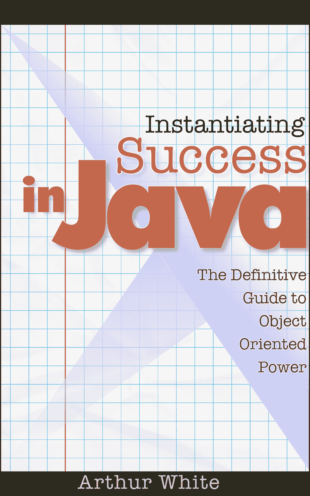

# Java 实例化成功：面向对象力量终极指南



## 引言

书中有很多内容是你在这书中找不到的，这是作者的刻意之为。书中没有对数据结构、框架或算法的冗长描述，只有它们共同拥有的语言级特性。

作为一名 Java 开发者，你会发现自己正在与许多不同的库、框架和应用程序交互。它们都由类（classes）、接口（interfaces）、构造函数（constructors）和方法（methods）组成。即使你认为其中某些特性是高级进的，你也无法无限地推迟学习它们。要在 `Java` 中进行任何严肃的编程，都需要与这些面向对象的概念交互并理解它们。

如果直接跳入复杂的程序和框架并期望仅仅通过“渗透”来学习，那是愚蠢的。你可能已经发现，面向对象编程倾向于模糊代码的来源以及其他代码是如何作用于它的。`Java` 天生的冗长增加了这一挑战，并为我们提供了大量的代码来阅读和编写，而这些代码很多时候意义不大。

在寻找答案时，你最可能会找到两种东西之一：要么是一本海量的、有时昂贵的、涵盖 `Java` 语言和标准库中每一个特性的百科全书；要么是一堆杂乱的在线教程，这些教程虽然简短，但展示的远多于说明的，并让你对这一切是如何运作的感到困惑。本书两者都不是。

你将在书页中发现的是 `Java` 特性的精简子集，并通过平实的的示例和解释进行呈现。你将学习构造函数、接口、泛型、抽象方法以及如何将它们相互结合，以便你能够自己理解并使用它们。

如果你仍在为许多有抱负的程序员苦恼的特性的“如何做”和“为什么”感到挣扎，那么这本书就是适合你的。拆除混乱的铁锁，挣脱歧义的枷锁。现在是时候让你在 `Java` 中实例化成功（Instantiate Success）了。

# 第一章：入门

在开始之前，拥有一个合适的开发环境来跟随书中的示例至关重要。如果你已经有集成开发环境（`IDE`）和一个可以运行的 `Java 开发工具包`（`JDK`），那么你可以跳到本章的最后部分，阅读一些命名规范，可以作为复习，也可以作为我们即将遇到的术语和语法的入门预习。

## 1.1 选择 IDE

你可能会发现一个专门构建的 `Java IDE` 使用起来既舒适又方便。这里列出的前三个编辑器就是此类软件，且它们每一个都是跨平台且免费的。只有其中一个对高级功能收费，但为了跟随随后的代码示例，你不需要那些功能。

### IntelliJ

这个来自 `JetBrains` 的 `IDE` 是最流行的 IDE 之一，并为 `Java` 开发提供了许多方便的特性。该程序对某些高级插件收取额外费用，但即使没有这些插件，这个编辑器仍然强大且易用。

### Eclipse

与 `JetBrains` ，`Eclipse` 基金会了一系列专门的代码编辑器。`Eclipse Java IDE` 除了构建工具集成和项目管理功能外，还有许多选项和插件。你会发现 `Eclipse` 和 `Intelliij` 之间的差异更多取决于个人喜好，而非质量。两者都是稳妥的选择。

### Netbeans

`Netbeans` 是 `Java` 历史的一部分。它自 1996 年以来一直存在，来自著名的 `Apache 软件基金会`，该基金会为我们带来了如 `Maven`、`Tomcat`、`Log4j` 等许多程序。不要让这个 `IDE` 的年龄欺骗了你，它在不断更新，是新老 `Java` 开发者经久考验的选择。

### 其他选项

除了这些流行的选择之外，你仍然有很多选择。我们时代最流行的 `IDEs` 之一是目前的 `VSCode`。如果你已经熟悉了这个编辑器并想将其用于 `Java`，那么你需要安装几个插件来集成 `Maven` 或 `Gradle` 等构建工具。

对于 `Java IDE`，最后一个也是最不推荐的选项是选择文本编辑器。像 `Vim` 和 `Emacs` 等程序支持插件，可以使其中任何一个成为其他 `IDs` 的可行替代，但学习此类软件需要花费的时间和精力，以至于你应该完全将其视为一项独立的尝试。

如果选项让你无无从从，只需从 `Intelliij` 开始并看看它是否适用。它的流行是有原因的，并且完全胜任接下来的示例。

## 1.2 Java 开发工具包

编写 `Java` 程序需要一个 `JDK`。书中的特性可能适用于旧如 `8` 的版本，尽管它们是在 `Java 17` 中编写和测试的，因此建议你坚持使用版本 `17` 或更高版本。

安装自己的 `JDK` 有多种方法。取决于你选择的 `IDE`，它在你开始新项目时可能会直接为你下载一个。如果不是如此，另一个选项是使用你操作系统的包管理器来搜索可用的最新 `JDK` 版本。

取决于你对包管理器的熟悉程度，你可能仍然选择手动下载并安装 `JDK`。这就像访问 `Oracle.com` 网站并为你的操作系统选择正确的文件一样简单。该网站拥有你可能需要的安装和故障排除信息。

## 1.3 命名规范

为了让你编写的代码能够编译并正常运行，它必须遵循某些语法和逻辑规则。为了让程序员识别彼此的代码，我们有一套额外的规则和规范。这些规范是双向的。

假设代码遵循了通用共约（common conventions），你仅仅从它在文件中的位置和字母大小就能判断出许多关于它的信息。

### 简单变量

原始类型变量通常是简短且具有描述性的。当变量名增长为多个单词时，它采用驼峰命名法，如示例所示。

```java
int tax;
int taxRate;
```

`Java` 中有几种原始类型，如 `int`、`char`、`byte` 等。它们在变量名上采用这种命名规范，尽管非原始类型变量也使用这种命名规范。

### 方法

方法的命名像普通变量。此外，它们有一对括号来持有参数或参数。它们还根据它们的功能和返回的内容命名，例如 `addReference()`、`getClass()` 或 `setValue()`。

```java
int numberGetter() {
    return this.number;
}
```

此方法定义返回一个整数。

方法也可以解析为值，因此在某些情况下它们将作为赋值给字段的右值。

```java
int myInt;
myInt = numberGetter();
```

赋值给变量。

### 常量值

常量值不会改变，这意味着它们必须都是 `static` 和 `final`。常量命名源于 `C` 语言，该语言早于 `Java`。

命名规范是全大写并用下划线分隔单词。

```java
static final float DIAMETER;
static final float CYLINDER_DIAMETER;
```

### 枚举项

枚举要么作为独立的文件出现，要么嵌套在另一个类中。它们作为常量值选择组，因此每个元素都用大写字母写。

```java
public Enum FruitEnum {
    APPLES, BANANAS, ORANGES, GRAPEFRUITS
}
```

当我们引用一个枚举选择时，枚举器的名称和选择通过点操作符连接在一起。

```java
public class Main {
    FruitEnum fruit; //这将会存储一个枚举值
    FruitEnum fruit = Fruit.ORANGES; //将枚举选择赋值为一个值
    void enumChooser(FruitEnum fruit) {
        //此方法接受一个枚举选择作为参数
    }
    FruitEnum fruitGetter() {
        return FruitEnum.BANANAS;
    }
    //此方法的返回类型是一个枚举
}
```

枚举器（Enumerators）要么出现在类内部，要么作为独立的文件存在。无论哪种情况，它们都采用与类相同的命名方案。

### Classes

类及其源文件必须具有完全相同的名称，且区分大小写。它们用一个或多个名词命名，并且每个单词的首字母大写。此规则适用于其他文件，如 `enums`、`interfaces` 和 `abstract classes`。

类和接口也作为类型出现，因此你会在变量名之前、方法参数内部以及返回类型看到它们。

`Graphics2D g2d;` // 作为字段的类引用。

`String stringGetter() {}` // 作为返回值的类类型。

`void stringSetter(String st1, String st2) {}` // 作为两个方法参数的类类型。

某些原始值出现在所谓的包装类（wrapper classes）中。当你看到如 `Boolean` 和 `Integer` 的类时，它们确实是类，并遵循正确的命名规范。

### Constructors

尽管某些类构造函数是不可访问的，但它们都以其类名命名并带有括号。如果你使用帕斯卡命名法（Pascal case）命名类，那么将更容易将它们与方法区分开，特别是当它们带有参数时。

区分构造函数和方法的另一种方法是观察其返回类型。构造函数返回一个类类型的引用变量，而方法可以返回任何类型的值。

`MyClass variable = new MyClass();`

### Packages

最后我们有包（Packages）。包名出现在 import 语句中，并在你的代码环境中表现为系列由点分隔的全小写名称。我们将在下一章学习更多关于包的内容。

`com.domain.appname;`

---

完成本章后，你应该已经准备好了可以使用的 IDE 和 `JDK`。此外，我们查看了常见的命名规范以及类和包的命名方式。为了进行任何形式的编程，我们需要编译并加载类文件，因此下一章将对此进行详细介绍。

# 第 2 章：类与包

类文件在加载到 Java 虚拟机（JVM）之前对我们来说没有用处。你编写自己代码的方式将反映出 Java 类加载器定位和加载类文件的需求。在本章中，我们将学习更多关于类加载过程，以及包以及它们如何与类结合形成完全限定名。

## 2.1 什么是包？

尽管功能全的 IDE 非常方便，但你会发现它有时会掩盖 Java 编程中更混乱、更技术性的方面。当 IDE 压缩长路径并并我们添加包语句时它很方便，但它可能会让你困惑实际上发生了什么。

包无非是包含 Java 类文件的文件夹，只要这些类文件具有包名，且包名与这些文件夹的名称匹配。

假设以下类位于你 IDE 的源文件夹中，文件路径为 `com/domain/app/`。如果你使用 Windows，它看起来像这样：`com\domain\app`。如果你编写了以下类文件并省略了包语句，你的 IDE 可能会给你一些警告或自动为你添加包语句。

```java
// 此文件没有包语句
public class MyClass {
  //...
}
```

为了使此文件成为包的一部分，我们必须添加包语句。每个文件夹名称之间使用系统无关的点操作符分隔，而不是正斜杠或反斜杠。

```java
package com.domain.app;
public class MyClass {
  //...
}
```

这就是让一个类文件成为包所需的一切。构建工具和 IDE 获取原始代码并将其编译为一组镜像我们源文件夹的文件夹。输出通常存储在标记为 `target` 的文件夹中。

如果我们的源代码这样存储：

`src\main\java\com\domain\app\MyClass.java`

那么输出看起来像这样：

`target\com\domain\app\MyClass.class`

你的文件、文件夹和包名在整个构建和部署过程中都会被保留。取任何 `.jar` 文件并使用 `Winrar` 或 `7Zip` 等归管理器打开它，你会看到文件夹和类文件都整齐地排列着，仿佛它们仍在 `Target` 文件夹中。该 `.jar` 文件的作者将其包和类得以保留，以便它们能够正常运行。

类文件和包必须保持正确顺序的原因是，JVM 的类加载器可以找到并加载这些文件。只有这样，应用程序才能运行。

## 2.2 完全限定名

JVM 使用三种不同类加载器的组合来搜索目录并加载类文件。前两个主要不受我们的控制，其用于加载对 JVM 本身至关重要的类文件。你编写类文件时使用的是应用程序类加载器。

应用程序类加载器有一个名为 `CLASPATH` 的环境变量，它始终是空的。这样做是为了它可以默认指向你调用虚拟机的目录。从那里开始，它搜索 `main` 方法来启动程序，然后根据需要继续加载类文件。应用程序类加载器识别类文件的方式是使用它们的完全限定名。

类文件的完全限定名是由文件名和所在包的组合而成的（注：此处原文逻辑为类名与包的组合）。允许不同包中存在同名的类。类文件的完全限定名由类名及其所在的包组成。使用完全限定名而非仅仅类名的的好处是，你可以在不同的包中拥有相同的类。以下是在没有完全限定名的情况下命名冲突的示例：

```java
package com.domain.app;
public class MyClass {
}
```

JVM 在搜索类文件时并不是在寻找 `MyClass`。相反，它寻找的是 `com.domain.app.MyClass`。通过使用这个特定名称，它知道要找什么，并且它与下一个不同：

```java
package otherdomain.library;
public class MyClass {
}
```

我们创建了两个同名的类。这通常是不被鼓励的，但在有很多文件和依赖的项目中这是不可避免的。幸运的是，完全限定名让我们避免了同名类的麻烦，并将这两个类文件视为：

`com.domain.app.MyClass;`

`com.otherdomain.library.MyClass;`

包及其命名空间也有助于我们的 import 语句。我们将查看它们。

## 2.3 导入语句

import 语句使用包名来定位和导入类文件。没有它们，我们必须使用完全限定名引用每个类类型和构造函数。以下是在没有 import 语句帮助的情况下，你的代码会变成什么样：

```java
package com.domain.app;
public class MyClass {
    public static void main(String[]args) {
        com.otherdomain.library.MyClass Obj = new com.otherdomain.library.MyClass();
        /* 注意我们可以拆分行并且可以编译，尽管我们必须缩进后续行。 */
    }
}
```

像这样的完全限定名最终会让我们的代码变得混乱且不可读。幸运的是，import 语句有助于保持简洁。

```java
package com.domainname.app;

import com.otherdomain.library.MyClass;

public class MyClass {
    public static void main(String[]args) {
        MyClass obj = new MyClass();
    }
}
```

可以说，当你将一个源文件放在包中时，你实际上已经重命名了它。对于我们的类加载器和构建工具来说，这就是我们指定的。

JVM 需要访问正确的类文件，以便它能够正确编译并运行我们的代码。一旦这些类被加载到 JVM 中，我们就可以开始将它们实例化对象。这就是我们接下来要学习的内容。

回顾本章：

- 文件夹变为包（packages）。
- 包有助于形成全限定名（fully qualified names）。
- 全限定名可以防止命名冲突。
- JVM 类加载器使用全限定名来查找类文件。
- 即使是 `.jar` 文件也保持相同的文件夹结构，以防任何全限定名失效。

现在我们已经对类、包和类加载器是如何工作的有了了初步了解，我们将开始编写并实例化我们自己的类文件。

# 第 3 章：数据类型与对象

在本章中，我们终于将处理类及其实例。你可能对这些话题已经有些熟悉，但很容易忽略类定义的深层含义，特别是当涉及到数据和类型时。

在继续之前，重要的是要注意：当你看到“对象（object）”和“类实例（class instance）”这两个词时，它们是同一个东西。它们指的都是将类实例化到虚拟机的堆内存区域。

## 3.1 类如何与对象相关

我们将类写成代码，编译代码并将其加载到 Java 虚拟机中，使其作为程序的一部分运行。类通常被称为对象的蓝图或模板，但类中看到的所有代码并不都会变成对象。此外，有时类对象会获得来自我们编写的类之外的代码。

类的另一种思考方式是将类看作既定义又描述用户定义数据类型的代码单元。类文件包含了告诉我们以下信息的代码：

- 它与哪些类共享成员和数据。
- 类的哪些部分可能只以对象的形式存在。
- 类成员之间如何相互访问。
- 如何从外部访问类的成员。
- 一个新的用户定义数据类型。

如果我们想要理解对象和引用变量，就必须考虑最后这一点。

### 用户定义类型

Java 有两大类类型分类。原始类型（primitive types）是简单的。任何 `int`、`char`、`short` 或 `long` 都是一种类型，我们在编写程序时为这些类型命名并赋值。第二类类类型是引用类型（reference types），即我们自己定义的类型。

每当你为一个新类命名时，你就在命名一个新的引用类型。取决于你提供什么样的方法和变量组合作为引用类型，以及该新引用类型如何融入到更大的程序或框架中。

下面是一个简单的用户定义类型示例。它是一个方法和字段的简单集合，但比原始类型要复杂得多。

```java
public class Coordinate {
    private int x;
    private int y;
    public int getX() {
        return x;
    }
    public int getY() {
        return y;
    }
    public void setBothCoords(int x, int y) {
        this.x = x;
        this.y = y;
    }
}
```


这个`Coordinate`类是一种可以修改自身值的新数据类型。访问这些值的唯一方法是通过一对实例方法，因此我们必须实例化这个类才能正确使用它。让我们为新的新的`Coordinate`类声明一些实例变量。

```java
public class Main {
    public static void main(String[]args) {
        int a;
        int b;
        int c;
        Coordinate position1;
        Coordinate position2;
        Coordinate position3;
    }
}
```

作为对比，我们有三个整数值和三个`Coordinate`引用变量。正如我们使用`a`、`b`和`c`等名称来区分它们所持有的整数值一样，我们需要像`position1`、`position2`和`position3`这样的引用变量，以便存储和访问存在 JVM 内存中的`Position`类的不同实例。

## 3.2 类实例

现在你将看到如何实例化类。首先，我们使用类名声明类型，然后添加变量名，最后调用类的构造函数（构造函数也与类命名）。

```java
//Main.java
public class Main {
    public static void main(String[]args) {
        Coordinate position1; //类型 ^
        Coordinate position2; //变量^
        Coordinate position3 = new Coordinate(); //构造函数 ^
    }
}
```

现在让我们重写上面的代码，使每个实例变量都获取不同类实例的内存地址。我们将调用一些方法并打印出值。

```java
//Main.java
public class Main {
    public static void main(String[]args) {
        Coordinate position1 = new Coordinate();
        Coordinate position2 = new Coordinate();
        Coordinate position3 = new Coordinate();
        position1.setBothCoords(3,3);
        position2.setBothCoords(7,7);
        position3.setBothCoords(9,9);
        System.out.println("position1 " + position1.getX());
        System.out.println("position2 " + position2.getX());
        System.out.println("position3 " + position3.getX());
    }
}
```

我们不需要打印`Y`值就可以看到这些类实例实际上是相互分离的。它们是内存中存在的`Coordinate`类的可修改副本。在这里，我们的类很大程度上像是一个要在内存中构建并存在的对象的蓝图。让我们继续学习类成员。

## 3.3 静态成员

静态成员（static members）无论我们创建多少个类变量，都不会在内存中重复实例化。静态成员与实例成员的行为不同，但仍然共享某些属性。下面我重写了`Coordinate`类，使得变量现在是静态的。

```java
public class Coordinate {
    private static int globalX = 100;
    private static int globalY = 100;
    public int setXY(int x, int y) {
        globalX = x;
        globalY = y;
    }
    public int getGlobalX() {
        return globalX;
    }
    public int getGlobalY() {
        return globalY;
    }
}
```

`private`访问修饰符使得这些静态变量从外部变得不可访问。

```java
public class Main {
    public static void main(String[]args) {
        Coordinate.globalX = 10;
        Coordinate.globalY = 10;
        int myInt = Coordinate.globalX;
        myInt = Coordinate.globalY;
        // 这些都无法工作
    }
}
```

从`Coordinate`类外部，我们无法访问它的私有字段。setter 和 getter 方法是公开的，因此它们是在我们的`main`方法访问这两个静态变量的唯一方法。让我们实例化类来获取变量。

```java
public class Main {
    public static void main(String[]args) {
        Coordinate coordinate1 = new Coordinate();
        coordinate1.setXY(10, 17);
        myIntY = coordinate1.getGlobalY();
        myIntX = coordinate1.getGlobalX();
        System.out.println("global x value: " + myIntX);
        System.out.println("global y value: " + myIntY);
    }
}
```

这是行得通的，而且很有道理。访问`Coordinate`类中两个私有类成员的唯一方法是公开的实例方法。在这种情况下，该类完全不像蓝图，但仍然值得实例化到内存中以便我们访问私有变量。创建该类的额外实例将是意义的，因为变量在内存中并不作为副本存在。下一个示例展示了为什么只有一组 X 和 Y 值。

```java
public class Main {
    public static void main(String[]args) {
        Coordinate coordinate1 = new Coordinate();
```

```java
Coordinate coordinate2 = new Coordinate();

coordinate1.setGlobalXY(5,5);

System.out.println(coordinate1.getGlobalX());

System.out.println(coordinate1.getGlobalY());
System.out.println(coordinate2.getGlobalX());
System.out.println(coordinate2.getGlobalY());

//这将在每个实例中打印五

coordinate1.setGlobalXY(10,10);

System.out.println(coordinate1.getGlobalX());
System.out.println(coordinate2.getGlobalY());

//现在它们都是十了

}
```

无论我们使用哪一个引用变量，它们都指向同一对类成员。

## 3.4 静态内存与实例内存

我们编写的代码预测了两种不同的运行时场景。在一种情况下，我们的类被加载并初始化到`JVM`中，其静态方法和变量已经是可以访问的。

在第二种场景下，类以对象的的形式存在。在类的实例外部，我们使用引用变量来引用内存对象。在实例化的类内部，未标记为`static`的成员只有在实例化时才会存在并运行。

下方的示例类展示了同一个类的实例成员和类成员的行为并不相同。

```java
public class MemberExample {
    static int staticVar;
    int instanceVar;

    public static void staticMethod() {
        staticVar +=1;        // 可以工作
        instanceVar +=1;     // 无法工作
        instanceMethod();     // 无法工作
    }

    public void instanceMethod() {
        staticVar += 1;           // 可以工作
        this.instanceVar += 1;   // 可以工作
        staticMethod();  // 可以工作
    }
}
```

`MemberExample`类不包含任何引用变量，但你仍然可以看到哪些被标记为`static`，哪些不是。这两个静态成员可以立即访问，尽管在没有实例变量的情况下，它们无法与实例成员进行交互。实例变量可以保证当我们调用静态方法时，它作用于一个内存中已经存在的实例成员。

不过，实例成员非常不同，当我们编写它们时，我们隐含地表示我们在某个时刻一定会有该类的实例，以便它可以执行我们指定的动作。这就是为什么它要灵活得多。

## 3.5 “this”关键字

你可以使用`this`关键字来区分实例变量和同名的参数。书中的示例经常使用该关键字，但你可以选择不使用，并保持实例变量和方法参数的名称不同。

```java
public class Example {
    public int value;

    static void valueSetter(int value) {
        this.value = value;
        // 无法工作！
    }

    void numberSet(int value) {
        this.value = value;
        // 这可以工作
    }
}
```

你甚至可以使用`this`关键字引用当前类的实例变量。这看起来是一件奇怪的事情，但有时你会遇到构造函数不可用的类实例。

```java
public class Example {
    public Example instanceGetter() {
        return this;
    }
}
```

类没有地址，但实例有地址，因此`this`唯一可以引用的就是实例本身。这就是为什么返回类型与类相同。调用该方法将返回一个引用。

***

关于类和对象我们有很多需要学习的。了解类成员和实例成员的区别是有好处，但如果你从这一章中只记住一件事，那应该是类是由用户定义的。

* 类定义了类型。
* 类以文件的形式存在。
* 对象以实例的形式存在于内存中。
* 类内部的所有内容都不会变成对象。
* 静态方法在没有实例变量的情况下无法访问实例成员。
* 实例方法可以自由访问类成员和实例成员。
* 访问修饰符等内容适用于实例成员和类成员。

在下一章中，我们将运用所学知识并开始使用实例变量。

# 第 4 章：对象引用

我们在 Java 中编写的几乎所有代码都会以某种方式访问、创建或存储引用变量。当我们通过字段或方法接收一个引用变量时，我们允许一个类的实例与另一个实例交互。正是通过这个过程，聚合或组合等编程技术才成为可能。在本章中，我们将通过存储实例引用将简单对象组合更大的对象。我们还将学习空引用如何引起问题，以及我们检查它们的一种方法。

## 4.1 按值传递还是引用传递

在继续之前，值得解决一个感知内存的程序员在创建对象并将引用变量从一个位置移动到另一个位置时所关注的的问题。

Java 是一种按值传递的语言，我们用于发送、存储和接收的值仅仅是内存位置的地址。这就像将地址保存到文本文件中。它有一定的大小，但与页面上所有的图像相比是微不足道的。请放心，在 Java 中传递对象是廉价的，这是一件好事，因为随着我们的成长，我们会经常这样做。

我们的最后一种方法`echoLine`会为每个点引用变量调用一次`pointString`方法并构造一个字符串，然后将它们都打印出来。这就是`LineUtils`类的全部内容。注意，某些方法是私有的。这是因为我们不希望以错误的顺序调用它们，并在还没有获取值之前就尝试打印它们。

```java
public class Main {
    public static void main(String[]args) {
        Line2D line = LineUtils.lineInit(2,8,10,5);
        LineUtils.echoLine(line);
    }
}
```

与`Point2D`和`Line2D`类进行交互只需要这些操作。我们甚至没有直接调用它们的构造函数来创建对象，并将它们发送到它们需要的地方。值得注意的是，将实例化细节保持分离并不总是合理的，我们可以将静态方法放在线类和点类内部，但你将在下一章中看到一种更好的类实例化方法。

## 4.4 空引用（Null References）

实例化`Line2D`类并然后将其打印出来需要三个对象引用。如果我们编写`lineInit`方法时忘记实例化一个或两个`Point2D`对象，那么程序将无法编译，我们可能会在 IDE 中看到关于空引用的错误。

Java 中的`null`关键字允许我们对对象引用变量进行几项不同的操作。首先，让我们使用`null`来模拟缺失的对象引用。

```java
public class Main {
    public static void main(String[]args) {
        Line2D line = LineUtils.lineInit(2,8,10,5);
        line.point1 = null;
        LineUtils.echoLine(line);
        //此代码将失败
    }
}
```

我们使用`null`关键字将线对象的其中一个点设置为`null`。现在代码将无法编译，因为缺少了一个关键组件。我们现在可以使用相同的关键字作为测试条件，以防止此类情况发生，如下代码所示。

```java
public class LineUtils {  //...
    public static void echoLine(Line2D line) {
        if(line.point1 == null || line.point2 == null) {
            System.out.println("the line is null!");
        } else {
            String p1 = pointString(line.point1);
            String p2 = pointString(line.point2);
            System.out.println(p1+"\n"p2);
        }
    }
}
```

现在，当我们使用`null`对象引用调用方法时，程序仍然可以编译。我们甚至可以设置条件语句来为我们调用构造函数并填充任何空引用变量。

当我们开始创建和实例化类时，我们必须通过引用变量来管理它们的内存对象。在 Java 中，我们将一直这样做，这种做法允许编写出非常复杂的程序，只要我们记得根据需要填充引用变量即可。

* 对象引用的发送、接收和存储成本是很低廉的。
* 方法和构造函数都可能返回对象引用。
* 一个对象引用可能依赖其他引用才能正常工作。
* 空引用变量为`null`，并且会引入一组我们必须警惕的问题。

完成本章后，我们将学习构造函数以及我们如何利用它们来自动更多的实例化并防止空引用。

# 第 5 章：构造函数（CONSTRUCTORS）

当你编写一个新类时，你实际上也在编写一个新的默认构造函数。你可以使用提供的默认构造函数来实例化你的类，也可以编写自己的构造函数来自定义实例化过程。

在本章中，你将看到编写默认构造函数的几种方法，以及它们如何帮助自动化、限制、甚至禁止类的实例化。

## 5.1 默认初始化器（Default Initializer）

默认初始化器在我们实例化类时运行。这种默认构造函数的变体是最简单的，因为它是对构造函数的简单扩展，在对大括号之间添加了一些代码。注意它开始看起来很像一个方法。

这是我们来自上一章的旧的`Line2D`类：

```java
public class Line2D {
    Point2D point1;
    Point2D point2;
}
```

现在再次是该类，但带有一个简单的默认初始化器。

```java
public class Line2D {
    Point2D point1;
    Point2D point2;
    public Line2D() {
        point1 = new Point2D;
        point2 = new Point2D;
    }
}
```

这段代码比我们在旧`LineUtils`类中使用的笨重静态方法集要简洁方便得多。在`Line2D`的所有实例中，我们都将拥有这对空白的`Point2D`对象，因此该类现在不再有空引用的风险。

我们知道构造函数可以运行足够的代码来实例化其他类。那么运行我们自己的方法呢？惊讶的是，从构造函数本身运行实例方法是可能的，正如你将在下一个示例所示。


```java
public class Line2D {
    Point2D point1;
    Point2D point2;
    public Line2D() {
        point1 = new Point2D;
        point2 = new Point2D;
        echoInstantiation();
    }
    public void echoInstantiation() {
        System.out.println("Line2D");
    }
}
```

通过使用构造函数已经节省了大量工作。让我们进一步自定义以看看它们的作用。

## 5.2 参数化构造函数（Parameterized Constructors）

你可以像对方法一样对构造函数进行参数化。你提供的参数可以像 setter 方法一样，在创建期间填充字段。我们将构造函数添加到`Line2D`类。

```java
public class Point2D {
    float x;
    float y;
    public Point2D(float x, float y) {
        x = x;
        y = y;
    }
}
```

当构造函数是参数化的时，强制要求提供参数。构造函数可以重载。只要每个构造函数都有参数，我们可以拥有任意数量的。

```java
public class Line2D {
    Point2D p1;
    Point2D p2;
    Line2D(Point2D p1, Point2D p2) {
        p1 = p1;
        p2 = p2;
    }
    Line2D(float x2, float y2) {
        p1 = new Point2D();
        p2 = new Point2D(x2, y2);
    }
    Line2D(float x1, float y1, float x2, float y2) {
        p1 = new Point2D(x1, y1);
        p2 = new Point2D(x2, y2);
    }
    void echoLine() {
        System.out.println("x1 value: " + p1.x + "\n" + "y1 value: " + p1.y);
        System.out.println("x2 value: " + p2.x + "\n" + "y2 value: " + p2.y);
    }
}
```

通常我们不会在一个类中看到这么多构造函数，尽管每一个都展示了实例化`Line2D`的不同方法。在我们开始`Line2D`之前，让我们先创建一个包含多条线的类。

## 5.3 绘制三角形（Plotting a Triangle）

直到现在，我们一直严格要求自己为所有构造函数提供参数。对于新的`Triangle`类，我们将采取不同的做法。

首先我们添加`Line2D`字段和参数化构造函数。

```java
public class Triangle {
    Line2D line1,line2,line3;
    Triangle(Line2D l1, Line2D l2, Line2D l3) {
        line1 = l1;
        line2 = l2;
        line3 = l3;
    }
}
```

我们可能无法一次性准备好所有的线对象，因此我们将重新为`Triangle`类引入默认构造函数。这样做实际上非常简单。我们只需重述没有任何参数或初始化代码的默认类即可。

```java
public class Triangle {
    Line2D line1,line2,line3;
    Triangle() {}
    Triangle(Line2D l1, Line2D l2, Line2D l3) {
        line1 = l1;
        line2 = l2;
        line3 = l3;
    }
    echoTriangle() {
}
```

```java
line1.echoLine();
line2.echoLine();
line3.echoLine();
}
}
```

我们可以将默认构造函数转换为默认初始化器，或者保持原样，选择权完全在我们手中。现在我们准备好使用所有的自定义构造函数来实例化`Triangle`类。

## 5.4 调用带参数的构造函数

我们现在有了三个不同的类。其中一个是一对构成二维点的坐标对，下一个是由两个点构成的线，第三个是由三条线组成的三角形。在实际的图形程序中，这些看起来可能有所不同，并且仅依赖点来绘制线条，但在这里我们更关注的是类和构造函数。

这里是`Triangle`类实例化的示例。注意我们使用`Line2D`构造函数的各种不同方式。

```java
public class Main {
    public static void main(String[]args) {
        Line2D line1 = new Line2D(0,0,10,0);
        Line2D line2 = new Line2D(new Point2D(10,0),10,10);
        Line2D line3 = new Line2D(new Point2D(0,0),new Point2D(10,10));
        Triangle triangle = new Triangle(line1,line2,line3);
        triangle.echoTriangle();
    }
}
```

既然我们已经使用了点和线来创建一个三角形，我们将进入私有构造函数。

## 5.5 私有构造函数和静态方法

有时构造函数被设置为私有，以便无法从任何外部类访问。我们有其他方法使实例化变得不可能，但有时我们希望将构造函数设为私有，以便限制或严格控制实例化。单例设计模式就是其中这种情况。

单例设计模式是指我们只想一个类的实例。编写这种单例类的方法是将构造函数设为私有，并使用类内部的静态方法来获取其地址。

```java
public class SingleTriangle {
    Line2D line1;
    Line2D line2;
    Line2D line3;
    private static SingleTriangle SINGLETON_REFERENCE;
    private SingleTriangle() {};
    public static SingleTriangle singletonGetter() {
        if(SINGLETON_REFERENCE == null) {
            SINGLETON_REFERENCE = new SingleTriangle();
        }
        // 注意，这是 'null' 关键字的良好用例。
        return SINGLETON_REFERENCE;
    }
}
```

记得在第三章中，我们有私有变量和访问它们的公共方法。这个单例是另一个并非纯模板的类示例，它充分利用了类成员访问权限。

通过额外的方法，我们可以为`Line2D`编写 setter 和 getter。最重要的是，我们的单例类实际上给了我们同一个对象的地址，而不是它的副本。我们可以通过将引用赋值给两个变量并检查它们的哈希值是否匹配来测试这一点。

```java
public class Main {
    public static main(String[]args) {
        SingleTriangle triangle1 = Triangle.singletonGetter();
        SingleTriangle triangle2 = Triangle.singletonGetter();
        System.out.println(triangle1.hashCode());
        System.out.println(triangle2.hashCode());
    }
}
```

上述代码应该为`triangle1`和`triangle2`变量打印出相同的哈希值。这表明每个变量都持有指向同一个对象的引用。

***

编写我们自己的构造函数意味着我们可能决定类是如何被实例化的。从运行默认代码到要求构造函数参数，当我们开始利用自定义构造函数带给灵活性时，我们有了更多的选择。它们是如此灵活，以至于我们可能通过向类中重新引入默认构造函数来让它们变为可选。

* 默认初始化器允许我们在类被实例化时自动运行代码。
* 构造函数可以带有在实例化时必须填充的参数。
* 每个类可以有多个构造函数。
* 在同一个类中可以同时拥有带参数的构造函数和默认构造函数。
* 构造函数可以设为私有以限制实例化。

本章结束后，现在我们将学习继承。

***

# 第 6 章：继承

Java 中的继承既强大又充满危险。通过继承你可以做很多事情，但显然远比你应该做的要多。许多人对继承有自己的观点，有些人会说我们应该完全避免它。无论你计划是否使用继承，有一点是肯定的：你最终会发现自己在与之打交道，无论如何都应该理解它。

我们必须再次思考类文件的内容告诉了我们什么。它们定义了数据类型，以及该类和实例成员的访问和行为特性。类可能指示的另一件事是它扩展了另一个类。扩展意味着继承，继承在添加父类类型的基础上，将任何合格的实例成员添加到子类中。

由于子类也是子类型，它们与其父类共享共同的身份标识。在任何你通常使用父类类型的实例变量的地方，你也可以使用子类类型的实例变量。尽管子类型是兼容的，但你可能会发现你添加了一些并不完全契合的代码。在本章中，我们将首先学习成员，在下一节中我们将探索类型。

## 6.1 子类规则

Java 不允许单个子类扩展两个父类。我们可以一个接一个地扩展类，像首尾相接连接管道一样，许多类可以共享同一个父类。以下是我们必须遵循的规则的一些示例。

```java
class First{}
class Second extends First{}
class Third extends Second{}
class Fourth extends Third{}
```

```java
class First{}
class Second extends First{}
class Third extends First{}
class Fifth extends First{}
```

Java 不允许我们用一个子类扩展两个父类。

```java
class First{}
class Second{}
class Third extends First, Second{} // 这不可行！
```

使用`extends`关键字的规则非常简单。现在让我们看看子类如何继承父类。

## 6.2 `super`关键字

子类继承其父类的非私有非静态成员。继承的成员在扩展类内部是不可见的，但你可以通过子类的引用或在子类内部使用`super`关键字来访问它们。

保持继承代码隐藏的好处是，我们的子类不会有来自一个或多个父类的杂乱。缺点是你并不会总是看到自己在处理的内容，当你处理不是自己编写的代码时，这可能会特别令人困惑。在本节中，我们将扩展并访问我们自己的父类成员。

```java
public class OriginalGreeting {
    public void greeting() {
        System.out.println("hello from the original superclass");
    }
}
```

这个类有一个简单的问候，告诉我们它来自哪里。现在我们添加一个子类。

```java
public class SecondGenGreeting extends OriginalGreeting {
    public void secondGenGreeting() {
        System.out.println("hello from the 2ndGen class");
    }
}
```

这个最终的类我们先留空。

```java
public class ThirdGenGreeter {}
```

现在从`main`实例化`ThirdGenGreeter`类，看看它继承了什么。

```java
public class Main {
    public void Main(String[]args) {
        ThirdGenGreeter greet = new ThirdGenGreeter();
        greet.greeting();
        greet.secondGenGreeting();
    }
}
```

继承允许我们根据需要，在继承链中尽向上调用父类的成员。让我们向`ThirdGenClass`中添加一些代码，看看`super`关键字能为我们做什么。

```java
public class ThirdGenGreeter extends {
    public void finalGreeting() {
        super.greeting();
        super.secondGenGreeting();
        System.out.print("hello from the third gen greeting!");
    }
}
```

现在为了访问所有三个方法，我们可以实例化`ThirdGenGreeter`类并调用`finalGreeting`。

```java
public class Main {
    public static void main(String[]args) {
        ThirdGenGreeter thirdGreeter = new ThirdGenGreeter();
        thirdGreeter.finalGreeting();
    }
}
```

特别需要关注的是，我们来自`ThirdGenGreeter`类的`finalGreeting`方法依赖于两个父类才能运行。如果你更改或重命名了`FirstGenGreeter`或`SecondGenGreeter`类或它们的方法，你将会破坏`finalGreeting`方法。这个例子是微不足道的，但在较大的程序中，你必须进行规划，以免在经常频繁更改的情况下写出这种紧耦合的代码。

现在让我们看看继承和构造函数是如何协同工作的。

## 6.3 超类构造函数

当一个类继承另一个类时，如果该父类有一个参数化构造函数，子类将继承对构造函数参数的需求。当然，如果由于默认构造函数的存在使得参数化构造是可选的，那么这些参数对于子类也是可选的。

让我们修改`SecondGenGreeting`类，使其通过参数化构造函数接收一些文本。

```java
public class SecondGenGreeting extends OriginalGreeting {
    String message;
    SecondGenGreeting(String msg) {
        message = msg;
    }
    public void secondGenGreeting() {
        System.out.println("hello from the 2ndGen class");
    }
}
```

现在`SecondGenGreeter`在实例化需要一个参数。因此，`ThirdGenGreeter`类也需要相同的构造函数参数。

```java
public class ThirdGenGreeter extends SecondGenGreeting {
    ThirdGenGreeter(String msg) {
        super(msg);
        //注意 'super' 关键字也指向构造函数
    }
    public void finalGreeting() {
        super.greeting();
        super.secondGenGreeting();
        System.out.print("hello from the third gen greeting!");
    }
}
```

注意`super`关键字如何像方法一样接收字符串参数。该字符串值存储在我们从父类继承的`message`字段中。这是有意义的，因为如果你在没有填充`message`字段的情况下调用`secondGenGreeting`，程序将会失败，而填充构造函数参数可以防止这种情况。

## 6.4 保护成员继承

Java 有四种访问修饰符：`public`、`private`、`protected`和默认（default）。在同一个包内，访问是简单的。你要么访问类成员，要么不能。然而，当你的程序拆分在不同的包时，你只能访问被标记为`public`或`protected`的其他包成员。`protected`类需要通过扩展来访问其内容。让我们看看下方的几个例子。

假设以下两个类位于不同的包中。

```java
package mypackage.subpackage;

public class OriginalGreeting {
    protected void originalGreeting() {}
    public void greeting() {
        System.out.println("hello from the original superclass");
    }
}
```

如果我们尝试从`main`方法中实例化这个类，且该类没有继承`OriginalGreeting`，那么它将无法工作。


```java
package mypackage;

public class Main {
    public static void main(String[] args) {
        OriginalGreeting ogGreet = new OriginalGreeting();
        // 不起作用
    }
}
```

`OriginalGreeting`类的访问修饰符`protected`限制了我们跨包访问构造函数。通过使用`SecondGenGreeting`子类，我们可以通过继承来访问父类的成员。

```java
package mypackage;

public class Main {
    public static void main(String[] args) {
        SecondGenGreeting greet = new SecondGenGreeting("");
        greet.greeting();
    }
}
```

在处理多个包时，你本打算访问的入口点通常是`public`的。在某些情况下，类是`protected`的，只要你使用继承，你仍然能够访问它们。

关于继承我们还有很多要学习的。你已经看到了如何扩展类以及访问它们的内容。接下来，你将看到如何使用继承来共享类型。

- 继承允许我们在子类之间共享数据和方法。
- 一个子类只能有一个父类。
- 继承隐藏了代码，尽管它也可能模糊代码的位置。
- 修改父类可能会破坏任何继承它的子类。一个类继承得越远，它们就越容易被破坏。
- 继承是类之间访问保护成员的唯一方法。

# 第 7 章：抽象类与方法

在上一章中，我们对继承有了初步介绍。我们看到了访问修饰符、成员继承和`super`参数。现在我们学习学习一种场景，即我们想要继承父类的类型及其方法，以及一种新的类和方法如何解决继承的某些局限性。

## 7.1 初始类

首先，我们将创建一个基础`Shape`类，用于存储各种形状的表面。然后我们将对其进行子类化并使用继承以相同的方式处理每个类的引用变量。

```java
public class Shape {
    double side;
    // 我们将 side 用于正方形和圆形
    double area;

    Shape(double side) {}

    double getArea() {
        return this.area;
    }
}
```

现在我们有了一个基础`shape`类，我们将使用它来创建特定的形状。首先，我们将它扩展为`square`类。

```java
public class Square extends Shape {
    Square(double side) {
        super(side);
    }

    void calcArea() {
        double s = super.side;
        super.area = s * s;
    }
}
```

接下来是`circle`类。为了方便，我们将使用边长作为半径。

```java
public class Circle extends Shape {
    Circle(double radius) {
        super(radius);
    }

    void calcArea() {
        double r = super.side;
        this.area = 3.1415 * (r * r);
    }
}
```

我们现在在`main`中实例化它，看看我们拥有什么。

```java
public class Main {
    public static void main(String[] args) {
        Circle circle = new Circle(4);
        Square sq = new Square(3);
        sq.calcArea();
        circle.calcArea();
    }
}
```

这段示例代码应该会给你每个形状的几个近似值。我们可能会发现大量的形状对象，因此我们将使用数组来组织它们。

```java
public class Main {
    public static void main(String[] args) {
        Shape[] shapes = new Shapes[2];
        shapes[0] = new Circle(4);
        shapes[1] = new Square(3);
        // shapes[0].calcArea();
        // shapes[1].calcArea();
        // 这将无法编译。为什么？
    }
}
```

在我们重写这两个形状类之前，让我们简单学习一下 Java 的抽象类和抽象方法。诚然，面向对象编程在本质上是非常抽象的，因此你可能会好奇抽象类与普通类有什么区别。简而言之，抽象类具有以下特点：

- 使用`abstract`关键字。
- 不能实例化。
- 可能包含抽象方法。

看起来我们为了获得这些所谓的抽象方法，将牺牲很多。它们到底有什么特别之处呢？它们的实现可能在不同的类之间有所不同。下面是一个抽象方法的示例。

```java
abstract int changesX(int x);
```

`abstract`关键字允许我们编写一个没有方法体的方法。即使没有方法体，我们也是在做出一种承诺，表示我们在每个扩展类中都会提供一个实现。我们写的每个非抽象子类都必须有一个同名的方法，且该方法必须返回一个`int`并接受一个`int`作为参数。

以下是其中一个子类的实现。

```java
// ...
int otherNumber;

@Override
int changesX(int x) {
    otherNumber += x;
    return otherNumber;
}
// ...
```

这是另一个子类的实现。注意方法体是如何不同的。它与另一个子类对`changesX`方法的定义不同，但它仍然符合我们在抽象类中编写的抽象方法头。

```java
// ...
@Override
int changesX(int x) {
    int result = x * x * x;
    return result;
}
// ...
```

从这些示例中可以看出，抽象类和抽象方法允许我们声明一次方法，并多次定义其具体实现。当然，抽象引用的类型能够识别抽象方法的存在。

现在让我们回到`Shape`类示例中，看看抽象类和方法将如何解决我们的问题。

## 7.3 抽象形状类和方法

我们将回到`Shape`类，并在类头中将其标记为抽象。接下来，我们写一个名为`calcArea`的抽象方法，然后在每个子类中以不同的方式实现它。

```java
public abstract class Shape {
    double side;
    double area;

    Shape(double side) {
        this.side = side;
    }

    double getArea() {
        return this.area;
    }

    abstract void calcArea();
}
```

这就是使类和方法抽象所需的全部内容。注意，现在我们无法直接实例化它。

让我们回到`Square`类并实现`Shape`的抽象方法。

```java
public class Square extends Shape {
    Square(double side) {
        super(side);
    }

    @Override
    double calcArea() {
        double d = super.side;
        super.area = d * d;
    }
}
```

接下来是`circle`类。我们将扩展`Shape`类并实现它的抽象方法。

```java
public class Circle extends Shape {
    public Circle(double radius) {
        super(radius);
    }

    @Override
    public void calcArea() {
        double r = super.side;
        this.area = 3.1415 * (r * r);
    }
}
```

注意`@Override`注解的使用。它并不是完全强制，尽管它有助于调试错误并提醒我们该方法实际上源自其他地方。出于这些原因，我们应该始终优先以此方式标注我们的抽象方法。

一旦更新了这两个类，我们就可以将它们存储在数组中，并根据需要调用公共`calcArea`。我们的最终代码看起来如下。

```java
public class ShapeManager {
    Shape[] shapes;

    ShapeManager(int size) {
        this.shapes = new Shape[size];
    }

    void reportAll() {
        for (Shape shape : shapes) {
            shape.calcArea();
            System.out.println("shape area: " + shape.getArea());
        }
    }
}
```

现在我们可以通过`ShapeManager`引用变量调用`calcArea`方法。它们都存储在`Shape`引用类型的数组中。

```java
public class Main {
    public static void main(String[] args) {
        ShapeManager sManager = new ShapeManager(5);
        sManager.shapes[0] = new Circle(4);
        sManager.shapes[1] = new Square(3);
        sManager.shapes[2] = new Square(4);
        sManager.shapes[3] = new Circle(7);
        sManager.shapes[4] = new Square(2);
        sManager.reportAll();
    }
}
```

现在我们可以通过`ShapeManager`引用变量调用`calcArea`方法。它们都存储在`Shape`引用类型的数组中。它们到底有什么特别之处呢？它们的实现可能在不同的类之间有所不同。下面是一个抽象方法的示例。

第 7 章结束。我们将开始处理接口。

- 继承允许我们使用抽象方法。
- 抽象类允许我们。
- 抽象方法可以在每个子类中被实现。

# 第 8 章：接口

上一章中的抽象类允许我们做一些有用事情。首先，我们使用继承来创建子类型。在本章中，我们将学习如何在没有继承的情况下共享类型。

什么是接口？它们是完全不能实例化且没有字段的类。你会在接口内部发现三种方法：默认、静态和抽象。

## 8.1 按实现类型

类定义了新的数据类型。我们在类头中看到的内容告诉我们很多信息，特别是当存在`extends`关键字时。我们知道，当一个类扩展另一个类时，它获得了父类的类型及其所有成员。同样，`implements`关键字告诉我们类获得了一个或多个接口的类型，并提供了这些接口中任何方法的实现。

- 让我们用一个接口和一个抽象方法替换旧的`Shape`类。

```java
public interface CalculateArea {
    double calcArea();
}
```

我们不再需要用关键字来标记抽象方法。只要它出现在接口中且没有方法体，它就是隐式抽象的。

正如旧`Shape`类中的抽象方法一样，你必须为实现`CalculateArea`接口获得的抽象方法提供实现。我们甚至使用了相同的注解。

```java
public class Circle implements CalculateArea {
    double radius;

    public Circle(double radius) {
        this.radius = radius;
    }

    @Override
    public double calcArea() {
        double r = this.radius;
        double pi = 3.1415;
        return pi * (r * r);
    }
}
```

这是实现我们相同的`CalculateArea`接口的方形类。再次，我们提供了符合我们实现。

```java
public class Square implements CalculateArea {
    double side;

    Square(double side) {
        this.side = side;
    }

    @Override
    public double calcArea() {
        double s = this.side;
        return s * s;
    }
}
```

每个实现`CalculateArea`接口的类都有共同点。首先，它必须为`CalculateArea`中的所有抽象方法提供实现。其次，这些类的对象引用可以通过接口的类型来引用。

我们可能会存储一个对象引用数组，并将类型设置为`CalculateArea`。这将允许你以相同的方式处理`Circle`和`Square`类的实例。

```java
public class ShapeManager {
    CalculateArea[] shapes;

    public ShapeManager(int size) {
        this.shapes = new CalculateArea[size];
    }

    public void reportAll() {
        for (CalculateArea shape : shapes) {
            System.out.println("area: " + shape.calcArea());
        }
    }
}
```

现在我们所做的就是实例化`ShapeManager`类，向它的数组中添加成员，并观察它的工作原理。

```java
public class Main {
    public static void main(String[] args) {
        ShapeManager sManager = new ShapeManager(5);
        sManager.shapes[0] = new Circle(4);
        sManager.shapes[1] = new Square(3);
        sManager.shapes[2] = new Square(4);
        sManager.shapes[3] = new Circle(7);
        sManager.shapes[4] = new Square(2);
        sManager.reportAll();
    }
}
```

通过告诉`ShapeManager`类期望来自实现`CalculateShape`接口的类的对象，我们完全消除了对旧`Shape`类的需求。

## 8.2 多重实现

如果我们把二维对象变成三维的呢？有很多方法可以实现这一点。继承是一个选项，但我们目前会避免它，以展示接口的灵活性。

让我们从一个计算体积的接口开始。

```java
public interface CalculateVolume {
    double calculateVol();
}
```

现在我们将创建一个`cube`类，并使用这两个接口来计算尺寸和体积。请注意，我们必须使用不同的数学方法来获取立方体的所有六面。

```java
public class Cube implements CalculateArea, CalculateVolume {
    double side;

    public Cube(double side) {
        this.side = side;
    }

    @Override
    double calculateArea() {
        double s = this.side;
        return 6 * (s * s);
    }

    @Override
    double calculateVolume() {
        double s = this.side;
        return s * s * s;
    }
}
```

Java 中严格禁止状态的继承，因为冲突的值会导致技术问题。抽象类和具体类都可能有成员字段，因此每个类不能扩展超过一个父类是有意义的。接口不能拥有任何类型的数据字段，因此没有理由将它们限制在这一单继承规则上。

一个类可以继承多个接口，接口之间也可以相互扩展多个。

```java
public interface Calculate3D extends CalculateArea, CalculateVolume {}
```

我们还没有任何方法要放入这个接口中，但它对我们的示例是有效的。

现在我们可以如下重写我们的`Cube`类的声明：


```java
public class Cube implements Calculate3D { //...  }
```

相同的实现规则也适用于这里。我们新的`Cube`类必须实现来自`CalculateArea`和`CalculateVolume`接口的所有方法，以及我们在`Calculate3D`中添加的任何抽象方法。

在我们创建和计算`Cube`类的任何实例之前，让我们把圆变成球。我们将以不同的方式编写这个示例，以展示接口和抽象类是如何工作的。

## 8.3 混合实现与继承

我们将为我们的`Sphere`类结合继承和实现。首先，我们将编写一个实现`Calculate3D`接口的抽象类`Rounded3D`。请注意它是如何忽略`Calculate3D`的抽象方法的。

```java
public abstract class Rounded3D implements Calculate3D {
    double volume;
    double totalArea;
    double radius;
    double circleArea;

    public Rounded3D(double radius) {
        this.radius = radius;
    }

    public void calculateCircle() {
        double pi = 3.14;
        double r = this.radius;
        this.circleArea = pi * (r*r);
    }
}
```

`Rounded3D`抽象类向我们展示了一个有助于我们编写更多代码的有用特性。记住抽象类的优势是它们可以拥有抽象方法而不实现它们。正因为如此，是否实现`Calculate3D`或其扩展的接口中的某些、全部或没有抽象方法，取决于你。

扩展`Rounded3D`的类呢？如果一个扩展类不是抽象的，那么它必须实现任何抽象方法，无论这些方法源自父类还是父类实现的接口。

```java
public class Sphere extends Rounded3D {
    public Sphere(double radius) {
        super(radius);
    }

    @Override
    public double calculateArea() {
        double circle = super.calculateCircle();
        return circle * 4;
    }

    @Override
    public double calculateVolume() {
        double r = super.radius;
        double rCubed = (r*r*r);
        volume = (4*pi*rCubed)/3;
        return volume;
    }
}
```

`Sphere`类现在将接收输入并我们计算体积和面积。抽象`Rounded3D`类提供了辅助方法，但将重要的实现留给我们。这使得`Rounded3D`类对其他形状有用。

### 8.3.1 可选的圆柱

此部分展示了我们如何通过扩展`Rounded3D`类来添加另一个圆形形状。你可以选择跳过此部分，因为它不像其他两个那样重要。

我们新的`Cylinder`类扩展了`Rounded3D`并增加了一个新的`height`维度。我们将继承的成员和自定义实现来计算这个新形状的表面积和体积。

```java
public class Cylinder extends Rounded3D {
    double height;

    public Rounded3D(double radius, double height) {
        super(radius);
    }

    @Override
    public double calculateArea() {
        double rh;
        double flatSide;
        flatSide = super.calculateCircle();
        rh = this.radius * this.height;
        this.area = 2*pi*rh + 2*flatSide;
        return area;
    }

    @Override
    public double calculateVolume() {
        double rSq,flatSide;
        flatSide = super.calculateCircle();
        this.volume = flatSide * height;
        return volume;
    }
}
```

现在我们使用`Rounded3D`类处理两个不同的三维形状，它们共享一个共同父类型。此外，这两个类与`Cube`类共享相同的实现。

现在我们所做的就是编写我们的`ShapeManager`类，以便它可以预测我们将发送给它的什么类型的引用。

## 8.4 接收接口引用

假设我们希望`ShapeManager`类将所有的引用存储在一个方便的数组中。我们必须设置该数组的类型以持有我们编写的所有不同类以及可能的一些新类。最好覆盖所有三维形状的类型是`Calculate3D`接口。它拥有我们需要的所有方法，因此它将是数组的类型。

```java
public class Main {
    public static void main(String[]args) {
        ShapeManager3D shape3d = new ShapeManager3D(5);
        shape3d.shapes[0] = new Cube(5);
        shape3d.shapes[1] = new Sphere(10);
        shape3d.shapes[2] = new Cylinder(5);
        shape3d.shapes[3] = new Cube(7);
        shape3d.shapes[4] = new Sphere(3);
        shape3d.reportAll();
    }
}
```

我们的三个新形状都共享一个通用的`Calculate3D`接口，因此这是我们用于数组的类型。

我们可能会添加更多的三维形状，并让它们实现`Calculate3D`接口。这样我们就可以在不类继承的情况下，通过许多不同的对象引用调用`calculateVolume`和`calculateArea`方法。

我们的示例程序只展示了接口带给我们的部分功能。我们可以创建几个抽象类，让它们实现全部、部分或不实现接口的抽象方法。我们甚至可以创建抽象类的子类，使得每个子类实现的比上一个类更多的抽象方法。

总结一下：

*   实现和继承是分开的，但它们仍然允许我们共享通用类型。

*   抽象类实现接口中的抽象方法是可选的。

*   一个类可以实现多个接口。

*   接口可以通过多重继承相互扩展。

完成本章后，我们将继续学习接口，并将其与泛型结合。

# 第 9 章：泛型 I

当你用一个类扩展另一个类时，该子类就获得了其父类的类型。如果子类、父类或两者都实现了一个或多个接口，那么子类也将获得该类型数据。以`Sphere`类为例。它是一个实现了多个接口（通过接口扩展）的父类的子类。

就类型而言，我们知道`Sphere`类具有以下类型：

*   `Sphere`

*   `Rounded3D`

*   `CalculateVolume`

*   `CalcluateArea`

我们有四种不同的类型可以设置为方法参数或变量类型。

随着程序中添加越来越多的类和接口，在何处方法参数和实例变量声明引用类型时，我们预期的类型就变得模糊了。我们想要`Sphere`是因为它是圆的吗？也许我们只是想要一个具有周长或体积的对象。

我们受益于一种语法，它可以帮助我们说明：接受一个扩展此类并实现这些接口的引用类型。幸运的是，Java的泛型为我们提供了一种高效且类型安全的方法来实现这一点。

整章都是关于泛型的以及它们如何帮助我们处理多个引用类型的。当你读完这个相当长的章节后，我们将回到3D形状来应用所学知识。

## 9.1 泛型增长的需求

假设我们正在添加两个新的3D形状类。每个类都实现一个名为`HasCoordinates`的新接口。现在我们既有旧的3D形状也有这些新的移动形状，我们希望规划未来，以便添加更多形状以及可能用于颜色或图像数据的其他接口。

我们将拥有某个类、某个字段或它们任意组合引用类型的字段和方法。我们可以通过更多的接口和继承将类分组，但向程序中添加更多类型只会让事情变得混乱。我们要做的的是使用泛型来明确什么放在什么位置。

## 9.2 边界泛型类型

泛型允许我们在尖括号对中指定特定的类型数据。你可能以前见过这种语法，其中某些大写字母表示未知的元素或值。这些字母仅仅是一种命名规范，我们通常使用`T`表示类型，`E`表示元素，`K`、`V`表示键值对等等。

这些单字母类型变量仅仅是变量。它们只是实际类或接口名称的占位符。当我们作为引用变量引用该类时（例如在实例化期间），泛型变量会被替换为真实的类型参数。

```java
public class ShapeUtils <T> {
    T shape3D;
}
```

这个泛型类有一个名为`T`的类型参数。当我们实例化该类时，必须提供一个实际的类型参数来填充泛型类的类型参数。

```java
public class Main {
    public static void main(String[]args) {
        ShapeUtils<MovingSphere> mSphereUtils = new ShapeUtils<>();
    }
}
```

编写和使用泛型类型类只需要这些，尽管这个泛型类并不完全是我们想要的。

当我们将泛型变量设置为如`T`这样的单个字母时，我们可以提供任何类型作为参数。有时我们想要这样，但这种无边界类型缺乏特定性。为了限制我们可以作为泛型参数提供的内容，我们可以指定一个边界。

```java
public class ShapeUtils <T extends Calculate3D> {
    T shape3D;
}
```

现在我们添加了一个泛型`T`，我们作为此类参数提供的任何内容必须扩展或实现`Calculate3D`。下面是`ShapeUtils`使用两个不同参数的示例。

```java
public class Main {
    public static void main(String[]args) {
        MovingCube mCube = new MovingCube();
        MovingSphere mSphere = new MovingSphere();
        ShapeUtils<MovingCube> mSphereUtils = new ShapeUtils<>();
        mSphereUtils.shape3D = mSphere; // 这将不起作用

        ShapeUtils<MovingSphere> mSphereUtils = new ShapeUtils<>();
        mSphereUtils.shape3D = mCube; // 这两个都不行
    }
}
```

上面的示例表明，尽管`MovingCube`和`MovingSphere`类型参数对`T`来说是有效的，但在提供了类型参数后，它们之间不能相互互换。原因是Java采用了一种类型擦除，删除了我们指定为类型参数之外的所有类型数据。

类型擦除是一个相当技术的过程，超出了本书的范范围。我们在这里只需要知道它是既类型安全又高效的，因为它消除了Java编译器的猜测。

## 9.3 边界泛型类型

我们已经写了一个带有单个类型边界的泛型类型参数。现在我们将通过添加另一个边界来进一步限制`T`的类型参数。为了展示多个类型边界如何帮助我们，我们再次回到`ShapeUtils`类并修改泛型类型变量，使其绑定多个类型。我们在类型变量的每个额外边界之间使用和符号`&`运算符。

```java
public class ShapeUtils<T extends RoundedShape & HasCoordinates> {
    T shape;
    public ShapeUtils(T shape) {
        this.shape = shape;
    }
}
```

在指定多个类型边界时，我们必须注意几条规则。如果边界中的任何一个是类名，那么该名称必须排在第一。类名之后的所有内容必须是接口，因为我们不能命名一个扩展两个类的类型。

任何用于替换`T`的类型必须实现或继承类型参数列表中的所有内容。泛型要求类型参数必须满足所有的边界，而不仅仅是其中某些，这是好事，因为我们追求特殊性。

```java
public class Main {
    public static void main(String[]args) {
        MovingCube mCube = new MovingCube();
        Cube normalCube = new Cube();
        MovingSphere mSphere = new MovingSphere();
        ShapeUtils<MovingCube> mCubeUtils = new ShapeUtils<>(mCube)
        //这正是我们想要的
        ShapeUtils<MovingSphere> mSphereUtils = new ShapeUtils<>(mSphere)
        //这同样适用于可移动的球体
        ShapeUtils<Cube> mCubeUtils = new ShapeUtils<>(normalCube)
        //这不符合泛型类型要求
        ShapeUtils<MovingCube> mCubeUtils = new ShapeUtils<>(normalCube)
        // 类型参数是正确的，但普通的立方体是不不起的！
    }
}
```

通过指定它们还必须实现`HasCoordinates`接口，我们有效地过滤掉了非移动3D形状。

## 9.4 类型边界的泛型方法

方法也可以拥有类型参数，有两种方法指定它们。一种方法是与方法共享一个泛型类`variable`。另一种方法是让方法声明自己的类型变量和边界。在任何一种情况下，我们在调用方法时都不向方法提供类型参数。

```java
public class ShapeUtils<T extends Calculate3D & HasCoordinates> {
    T currentShape;
    void setShape(T shape3D) {
        this.currentShape = shape3D;
    }
    T getShape() {
        return this.currentShape;
    }
}
```

注意方法类型变量是裸露的，没有被困在角括号之间，因为它们在其他地方定义。

我们将像之前的示例一样实例化该类。向任何泛型方法发送对象引用不需要额外的步骤，尽管我们仍然受限于类类型参数所指定的发送引用。

```java
public class Main {
    public static void main(String[]args) {
        MovingCube mCube = new MovingCube();
        ShapeUtils<MovingCube> mCubeUtils = new ShapeUtils<>()
        mCubeUtils.setShape(mCube);
        MovingCube duplicateRef = getShape();
    }
}
```

一旦`ShapeUtils`类知道了确切的类型，我们的方法也知道了。这非常简单。现在让我们尝试移除类的类型变量和边界，以便方法指定它们自己的泛型类型变量。

```java
public class ShapeUtils {
    <T1 extends HasCoordinates & CalculateArea> void echoCoordinates(T1 shape) {
        //...
    }
    <T2 extends CalculateVolume> void echoVolume(T2 shape) {
        //....
    }
}
```

注意，现在我们为方法类型变量需要角括号，因为方法本身是泛型的。我们可以使用相同的`&`运算符添加额外的类型。

```java
public class Main {
    public static void main(String[]args) {
        ShapeUtils sUtils = new ShapeUtils();
        MovingCube mCube = new MovingCube();
        sUtils.echoCoordinates(mCube);
        sUtils.echoVolume(mCube);
    }
}
```

泛型方法的行为非常像普通方法，因为类型要求在方法调用期间会使用Java内置的类型推断过程进行解析。


为什么没有泛型返回值？

我们的第一个示例使用了类的类型变量来确定所需的类型。实例方法使用该类型，因此很清楚它们必须返回什么。对于拥有自己的类型变量的方法，情况变得更复杂了。方法需要一些提示来指示它们将返回什么，否则我们必须使用反射或类型转换来使之工作。

我们还必须问这是否是我们想要的。如果一个方法返回一个类型且我们需要存储它，那么如果我们知道要预期的类型，这样做将变得更容易。

## 9.5 作为方法参数和返回类型的泛型引用变量

当我们编写接受来自泛型类的引用变量的方法时，我们必须在方法的参数中提供类型参数。对于在方法头中指定的任何返回类型也是如此。它们也必须为它们将返回的引用提供类型参数。

假设我们有一个接受我们的形状之一的泛型类。为了接受或返回该类的实例，我们必须编写考虑到该类泛型类型的方法。

```java
public class CubeHolder<T extends Cube> {
    T cube;
}
```

`CubeHolder` 类在实例化时需要一个参数。我们为该类编写简单的 setter 或 getter 方法的方法如下：

```java
public class ShapeUtils {
    CubeHolder<Cube> myCube;
    public void cubeSetter(CubeHolder<Cube> myCube) {
        myCube = myCube;
    }
    public CubeHolder<Cube> cubeGetter() {
        return CubeHolder<>();
    }
}
```

重要的是要意识到这个版本的 `ShapeUtils` 类不是泛型的，尽管它发送、接收和持有泛型类的对象引用。记住，一旦我们为泛型类提供了类型参数，它就不再发生变化。这就是为什么 `cubeGetter` 返回类型不需要任何转换。它被设置为返回 `CubeHolder` 类的一个非常具体的实例。

## 9.6 多类型变量

一旦你熟悉了单个泛型变量，添加更多变量就很简单。我们必须做的只是添加另一个泛型变量并用逗号将其隔开。我们可以在 JDK 的 `HashMap` 中观察多个泛型变量。

```java
public class ShapeUtils<T1 extends HasCoordinates, T2 extends CalculateVolume> {
    //...
}
```

逗号分隔了不同的类型变量。我们可能希望为变量边界添加更多类型，所以我们必须使用 `&` 运算符添加它们。

```java
public class ShapeUtils<T1 extends HasCoordinates & Rounded3D, T2 extends CalculateVolume & CalculateArea> {
    //...
}
```

为了实例化这些示例中的任何一个，我们必须按照我们在类中声明顺序提供一对类型参数。

```java
public class Main {
    public static void main(String[]args) {
        ShapeUtils<MovingCylinder, Cube> shapeUtils = new ShapeUtils<>();
    }
}
```

我们可以在单个类或方法中添加许多类型变量，但出于考虑，我们现在只使用两个。

### 9.6.1 多方法参数

具有多个类型变量的方法与其单个变量的方法相似。记住，如果没有访问修饰符（如 `public` 或 `protected`），方法看起来可能有点奇怪，因为它们将以类型开头。放心，它们运行得很正常。

```java
public class ShapeUtils {
    <T1 extends HasCoordinates, T2 extends CalculateArea> void echoCoordsAndVolume(T1 shapeLocation, T2 shapeArea) {
        //...
    }
}
```

此方法处理两个不同的类型变量。就像单个方法一样，当我们调用此类类中的泛型方法时，不需要提供任何类型参数。

```java
public class Main {
    public static void main(String[]args) {
        MovingCube cube = new MovingCube();
        MovingSphere sphere = new MovingSphere();
        ShapeUtils utils = new ShapeUtils();
        utils.echoCoordsVolume(cube, sphere);
    }
}
```

## 9.7 使用原始类型擦除过多

我们必须记住泛型会擦除类型数据。如果在不提供类型参数的情况下实例化泛型类，那么我们实际上是在告诉 Java 编译器擦除所有类型数据，直到只剩下基础 `Object` 类型。

这让我们付出了类型安全性和清晰度。下面是一个我们必须避免的示例。

```java
public class ShapeUtils<T extends Cube> {
    T rawType;
    //...
}
```

现在我们忘记为泛型类添加类型参数……

```java
public class Main {
    public static void main(String[]args) {
        ShapeUtils shapeUtils = new ShapeUtils();
    }
}
```

```java
ShapeUtils cubeUtils = new ShapeUtils();

cubeUtils.rawType = new Cube();
//此行代码可以通过编译，但这不是我们想要的。
}

/* 这段代码可能会或可能不会给你产生警告，取决于
你的 IDE 和编译器的设置。 */
}
```

由于我们已经擦除了 `ShapeUtils` 类型参数的所有类型数据，因此我们无法从 `rawType` 字段调用 `Cube` 类对象的任何对象方法。从类型的角度来看，存储在 `rawType` 字段中的引用仅仅是基础 `Object` 类型。

即使 `ShapeUtils` 类中的泛型变量没有边界（bounds），通过在实例化时提供类型参数，我们仍然可以获得一些类型安全性和特殊性。

当涉及到泛型方法，它们可能会将参数化类型声明为原始类型（raw types），我们也不希望这样做。这特别别棘手，因为我们在调用方法时并没有声明任何类型参数。

```java
public class ShapeUtils {
    CubeHolder myCube;
    public void cubeSetter(CubeHolder myCube) {
        myCube = cube;
    }
    public CubeHolder cubeGetter() {
        return new CubeHolder();
    }
}
```

上面是旧的 `CubeHolder` 示例。该类是参数化的，但当我们在两个方法中省略类型参数时，它就变成了原始类型。这意味着我们将知道对象引用的类型，但不知道它所持有的类型。我们也必须避免这样做。

在方法和类中都提供类型参数是非常重要的，以避免将任何参数化类型视为原始类型，即使在类型参数未绑定的情况下也是如此。至于 Java 为什么甚至允许原始类型，这是为了保留在 Java 泛型系统之前的遗留代码库的措施，因此我们在代码中使用原始类型的情况很少见，甚至可能没有。

***

本章引入了许多关于 Java 泛型类型的概念。为了简要地总结这些思想：我们分配一个类型变量并描述哪些类型可以替换它。然后，在声明该泛型类时，为它的参数提供一个或多个兼容的类型。泛型方法也是一样，但类型参数是从方法接收的对象引用中推断出来的。

以下是本节的一些要点：

- 类型边界的泛型参数既具有表现力又精确。
- 类型参数出现在方法、类或两者中。
- 我们可以使用 `ampersand` 运算符来指定满足泛型变量的额外类型。
- 我们在类实例化时用类或接口名称来填充泛型参数。
- 当我们调用方法并发送对象引用时，方法会解析类型需求。

现在我们已经看到了泛型能带给我们提供什么，我们将在下一章讲解完整的示例。

***

# 第 10 章：完整的泛型示例

上一章引入了许多在代码中需要学习和使用的新概念。该章中的示例没有完全写完，是为了保持内容尽可能简短。现在我们已经对泛型的样貌以及它们如何工作有了一些了解，我们将编写 `MovingSphere` 和 `MovingCube` 类，以便它们能够充分利用泛型。

## 10.1 `HasCoordinates` 接口与 `ShapeCoordinates` 类

首先，我们需要一个 `MovingCube` 和 `MovingSphere`。这两者都需要一组 `x` 和 `y` 坐标以及几个用于获取/设置值的方法。与其为每个可移动的 3D 对象完整实现 `HasCoordinates` 接口，我们将使用装饰器模式中接口的一种巧妙技巧。

首先，我们编写 `HasCoordinates` 接口。

```java
public interface HasCoordinates {
    void setCoordinates(int x, int y, int z);
    int getCoordinateX();
    int getCoordinateY();
    int getCoordinateZ();
}
```

现在我们有了用于位置和移动的接口，将在 `ShapeCoordinates` 类中实现它。

```java
public class ShapeCoordinates implements HasCoordinates {
    int coordinateX;
    int coordinateY;
    int coordinateZ;

    public ShapeCoordinates(int x, int y, int z) {
        setCoordinates(x,y,z);
    }

    @Override
    public void setCoordinates(int x, int y, int z) {
        this.coordinateX = x;
        this.coordinateY = y;
        this.coordinateY = z;
    }

    @Override
    public int getCoordinateX() {
        return this.coordinateX;
    }

    @Override
    public int getCoordinateY() {
        return this.coordinateY;
    }

    @Override
    public int getCoordinateZ() {
        return this.coordinateZ;
    }
}
```

我们现在有了 `HasCoordinates` 接口的实现。我们将转向 `Movable` 类，并为每个类提供一个 `ShapeCoordinates` 类的实例。

## 10.2 `MovingCube` 和 `MovingSphere`

现在我们将创建两个新类，尽管由于我们对代码的结构设计使其可复用，我们可以创建任意数量的新形状。首先是立方体。

```java
public class MovingSphere implements HasCoordinates {
    ShapeCoordinates coordinates;

    MovingSphere(double radius, int x, int y, int z) {
        super(radius);
        this.coordinates = new ShapeCoordinates(x,y,z);
    }

    @Override
    public void setCoordinates(int x, int y, int z) {
        coordinates.setCoordinates(x,y,z);
    }

    @Override
    public int getCoordinateX() {
        return coordinates.getCoordinateX();
    }

    @Override
    public int getCoordinateY() {
        return coordinates.getCoordinateY();
    }

    @Override
    public int getCoordinateZ() {
        return coordinates.getCoordinateZ();
    }
}
```

注意，当我们实现 `HasCoordinates` 接口时，我们简单地引用位置字段中的变量。这避免了重写代码。立方体 Java

```java
public，，Sphere implements Coordinates {
    Coordinates coordinates;

    MovingSphere(double radius, int x, int y, int z) {
        super(radius);
        coordinates = new ShapeCoordinates(x,y,z);
    }

    @Override
    public void setCoordinates(int x, int y, int z) {
        coordinates.setCoordinates(x,y,z);
    }

    @Override
    public int getCoordinateX() {
        return coordinates.getCoordinateX();
    }

    @Override
    public int getCoordinateY() {
        return coordinates.getCoordinateY();
    }

    @Override
    public int getCoordinateZ() {
        return coordinates.getCoordinateZ();
    }
}
```

## 10.3 `ShapeUtils` 类

在这里我们将编写一个专门为三维对象定制的简单工具型类。使用泛型方法来处理存储的内容。

```java
public class ShapeUtils {
    private <T1 extends HasCoordinates> String coordsText(T1 shape) {
        String msg;
        msg = "x coordinate: " + shape.getCoordinateX();
        msg += "\n" + "y coordinate: " + shape.getCoordinateY();
        msg += "\n" + "z coordinate: " + shape.getCoordinateZ();
        return msg;
    }

    private <T2 extends CalculateVolume & CalculateArea> String measurementText(T2 shape) {
        String msg;
        msg = "surface: " + shape.calculateArea();
        msg += "\n" + "volume: " + shape.calculateVol() + "\n";
        return msg;
    }

    public <T extends Calculate3D & HasCoordinates> String fullReport(T shape, String shapeName) {
        String report = shapeName + "\n";
        report += coordsText(shape);
        report += measurementText(shape);
        return report;
    }

    public <M extends HasCoordinates> void moveShape(M shape, int x, int y, int z) {
        int updateX, updateY, updateZ;
        updateX = shape.getCoordinateX() + x;
        updateY = shape.getCoordinateY() + y;
        updateZ = shape.getCoordinateZ() + z;
        shape.setCoordinates(updateX, updateY, updateZ);
    }
}
```

这个工具型类只是我们用泛型类型方法和类所能做的开始。现在我们将在主方法中运行它，以查看它是如何运作的。


```java
public class Main {
    public static void main(String[]args) {
        MovingCube mCube = new MovingCube(10, 10,30,43);
        MovingSphere mSphere = new MovingSphere(7 ,50,10,65);
        ShapeUtils utils = new ShapeUtils();
        System.out.println(utils.fullReport(mCube,"cube"));
        System.out.println(utils.fullReport(mSphere,"sphere"));
        utils.moveShape(mCube,-20,2,2);
        System.out.println(utils.fullReport(mCube,"movedCube"));
    }
}
```

该工具类现在将接收兼容的对象引用并打印结果。它还将通过`moveShape`方法修改你类的坐标。

你可能决定继续此示例，并添加更多用于比较和修改三维对象的方法。也可以编写额外的对象以增加多样性。就示例而言，我们已经完成了形状类的部分，但泛型部分还没有结束。

# 第 11 章：泛型类型 II - 泛型接口

在最后一个章节中，我们将继续学习泛型，并用另一个示例作为结束。在这里，我们将泛型、接口和抽象方法结合起来。通过使用这三者，我们将看到 Java 抽象的完整威力。

让我们开始。

## 11.1 泛型接口

泛型类和接口之间存在一些关键区别。首先，我们已经知道对于接口的每种实现，其行为可能会不同。泛型接口更进一步，允许我们在类中每次实现它们时都指定一个类型参数。

首先，我们将编写一个名为`ItemBox`的类，它包含一个必须扩展或实现`Item`的类型变量。

```java
public class Item{}
```

在这些示例中，我们不需要填充类的细节。

```java
public interface ItemBox<T extends Item> {  ///  }
```

当我们编写`ItemStorage`类时，我们使用`Interface`作为`T`的类型绑定。

```java
public class ItemStorage implements ItemBox<Item> { }
```

我们在这里实现接口并填充类型参数，而不是在实例化时。如果你将所有的接口要求都视为实现类的责任，那么这个规则将很容易记住。

```java
public class Main {
    public static void main(String[]args) {
        ItemStorage storage = new ItemStorage();
    }
}
```

当一个类在拥有自己的类型变量的同时实现一个泛型类型变量时，看起来可能有些复杂，但一旦我们处理了接口的类型参数，就可以像往一样实例化泛型类了。

```java
public class ItemUtils {}

public class ItemStorage<T extends ItemUtils> implements ItemBox<Item> {
    T utils;
}
```

在这里，我们在实例化时必须先填充接口的类型参数，然后是类的类型参数。

```java
public class Main {
    public static void main(String[]args) {
        ItemStorage<ItemUtils> storage = new ItemStorage<>();
    }
}
```

泛型接口允许我们为它们出现的每个类设置不同的类型参数。这使得我们的接口比以前更具可用性。

在下一节，我们将为`ItemBox`添加一些泛型抽象方法。

## 11.2 泛型抽象方法

泛型抽象方法与普通泛型方法没有太大区别。参数化类型要么通过接口的类型参数解析类型数据，要么使用与非抽象方法相同的类型推断过程来自己处理。

这里是一个示例，同一个类型变量出现在接口和方法的参数中。方法的类型变量从接口获取其绑定。

```java
public interface ItemBox<T extends Item> {
    void setItem(T item);
    T getItem();
}
```

这两个简单的泛型方法将使用类型变量`T`来确定它们将接受和返回什么对象引用。在这里它们在`ItemStorage`类中实现。

```java
public class ItemStorage implements ItemBox<Item> {
    Item item;
    @Override
    void setItem(Item item) {
        this.item = item;
    }
    @Override
    Item getItem() {
        return this.item;
    }
}
```

方法从其接口的实现获取`Item`参数。如果我们移除接口的类型变量，我们就必须像下面的示例一样指定两个泛型类型边界。

```java
public interface ItemBox {
    <T extends Item> void setItem(T item);
    Item getItem();
}
```

我使用了`Item`作为`getItem`类的返回类型。我们可以做的另一件事是将接口的参数加回接口，或者将`getItem`方法移动到另一个接口，其中类型参数属于接口且返回类型将不会产生义。

```java
public interface ItemBox {
    <T extends Item> void setItem(T item);
}
public interface ItemCollector<I> {
    I getItem();
}
```

要使用这两个方法，我们只需要在`ItemStorage`类中实现这两个接口即可。

```java
public class ItemStorage implements ItemBox, ItemCollector<Item> {
    Item item;
    @Override
    Item getItem() {
        return this.item;
    }
    @Override
    void setItem(Box<Item> m) {
        this.item = m;
    }
}
```

## 11.3 最终示例

使用接口有无数种方法，也有许多细节需要涵盖。我们在这一节中将做的是展示如何以不同的方式实例化泛型。

首先，我们将创建一个`enum`来标记可保存和可打印的。

```java
enum MessageTypes {
    SAVE, PRINT;
}
```

现在我们将创建一个`TextItem`类，它持有两种状态之一。

```java
public class TextItem {
    String text;
    MessageTypes type;
    public TextItem(String msg, MessageTypes type) {
        this.text = msg;
        this.type = type;
    }
}
```

我们需要一种方法用不同的类型调用相同的方法。

```java
public interface TextConsumer<T extends TextItem> {
    void processText(T text);
}
```

我们第一个实现`TextConsumer`的类将很简单。它所做的就是接收文本将其打印到我们的终端。

```java
public class MessageReader implements TextConsumer<TextItem> {
    @Override
    public void processText(TextItem item) {
        System.out.println(item.text);
    }
}
```

这并没有证明使用抽象方法的合理，所以让我们添加另一个类，用于处理设置为 SAVE 的消息。它会复杂一些，并且需要从`JDK`导入一些。

```java
import java.io.IOException;
import java.io.FileWriter;

public class MessageWriter implements TextConsumer<TextItem> {
    String path;
    String text;
    FileWriter write;
    public MessageWriter(String path) {
        this.path = path;
    }
    @Override
    public void processText(TextItem item) {
        try {
            write = new FileWriter(this.path, true);
            // 'true' 意味着它将追加文本
            write.write(item.text);
            write.close();
        } catch (IOException e) {
            e.printStackTrace();
        }
    }
}
```

```java
public class MessageDispatcher implements TextConsumer<TextItem> {
    MessageWriter write;
    MessageReader read;
    public MessageDispatcher(String savePath) {
        this.read = new MessageReader();
        this.write = new MessageWriter(savePath);
    }
    @Override
    public void processText(TextItem item) {
        switch(item.type) {
            case PRINT: read.processText(item);
                break;
            case SAVE: write.processText(item);
                break;
        }
    }
}
```

现在我们已经收集了所有的类，让我们通过系统发送几条消息看看会发生什么。

```java
public class Main {

  public static void main(String[]args) {

    String greet = "hello in final example";
    String farewell = "thank you for reading "
        + "Instantiating Success in Java. \n A book by Arthur White";

    TextItem myGreeting = new TextItem(greet, MessageTypes.PRINT);

    TextItem myFarewell = new TextItem(farewell, MessageTypes.SAVE);

    MessageDispatcher handleMessage = new MessageDispatcher("messageFile.txt");

    handleMessage.processText(myGreeting);

    handleMessage.processText(myFarewell);

  }
}
```

上面的示例应该会获取这两个文本项，并根据它们的枚举值分别进行打印或保存。本书的最后一个示例到此结束。

# 书籍结语

书中的概念将出现在你遇到的所有主要框架和库中。你最终将仅通过语法就能理解这些编程概念，并在自己的代码中实现它们，我们鼓励你这样做。

谈到实践，古语云“多能益善”确实是真理。没有什么比尽可能地将其付诸实践来更好地熟悉一个想法的方法了。然而，在生产环境或项目代码中，你还必须学会判断何时此类功能除了增加混乱之外没有其他用处。当然，这是另一个话题题了。

`Instantiating Success in Java`到此结束。编写这本书是一件乐事，如果你喜欢阅读它，或者至少发现它有所帮助，请考虑给这本书写一个好评并推荐给朋友，这样他们也能“实例化成功”。

# Instantiating Success in Java：面向对象力量的终极指南

## 引言

## 第 1 章：入门

### 1.1 选择 IDE

- `Intellij`
- `Eclipse`
- `Netbeans`
- 其他选项

### 1.2 Java 开发工具包

### 1.3 命名规范

- 简单变量
- 方法
- 常量值
- 枚举器
- 类
- 构造函数
- 包

# 第 2 章：类与包

### 2.1 到底什么是包？

### 2.2 全限定名

## 2.3 导入语句

# 第 3 章：数据类型与对象

## 3.1 类如何与对象相关

- 用户定义类型

### 3.2 类实例（注：原文此处锚重复，已保留结构）

## 3.3 静态成员

### [3.4 `this`](#part0005.xhtml_aUJ)（注：原文为 aUH）

# 第 4 章：对象引用

### 4.1 按值传递

### 4.2 获取与设置引用

### 4.3 的

### 4.4 空引用

## 第 5 章：构造函数

### 5.1 默认构造函数

### 5.2 参数化构造函数

### 5.3 参数化构造函数

### 5.4 静态方法

# 第 6 章：继承

### 6.1 子类

### 6.2 `super`关键字

### 6.3 继承

### 6.4 保护性成员

# 第 7 章：抽象类与方法

### 7.1 抽象类

### 7.2 抽象类与方法

### 7.3 抽象类方法

# 第 8 章：接口

### 8.1 类型实现

## 8.2 多重实现

### 8.3 实现与继承的混合

#### 8.3.1 一个

### 8.4 接口引用

# 第 9 章：泛型 I

### 9.1 对泛型日益增长的需求

### 9.2 边界泛型

## 9.3 多重边界泛型

### 9.4 类型受限泛型方法

### 9.5 泛型引用变量作为方法参数和返回值

### 9.6 多重类型变量

#### 9.6.1 多重方法类型参数

### 9.7 使用原始类型擦除过度信息

# 第 10 章：完整的泛型示例

## 10.1 `HasCoordinates`接口与`ShapeCoordinates`类

### 10.2 移动立方体与移动球体

## 10.3 `ShapeUtils`类

## 第 11 章：泛型 II - 泛型接口

## 11.1 泛型接口

## 11.2 泛型抽象方法

### 11.3 最后的泛型示例
