# Java 编程入门指南：高级特性（核心系列）更新至 Java 8

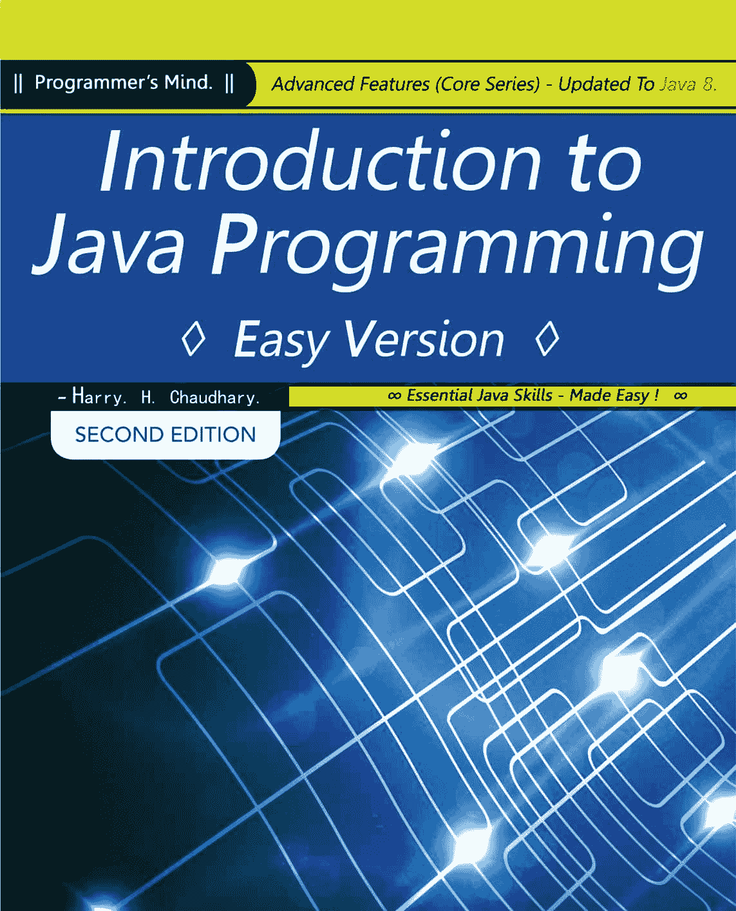


 

## 献词

“本书献给所有做出日常牺牲的人，特别是那些为了确保我们的自由与安全而做出牺牲的人。”

非常感谢湿婆神（Lord Shiva）赋予我生命中写作的技术和一切能力。

亲爱的爸爸，谢谢你 baauji，以身作则教我基于原则生活的意义。

亲爱的两位妈妈，谢谢你们向我真实地展示了如何根据最重要的原则和无私的爱去生活。

亲爱的姐姐、兄弟+Priya，谢谢你，你的笑容点亮了我的每一天。你的热情让我的心歌唱。我爱你们所有人。

我想特别提到生命中那些帮助我应对忧伤的优美脸庞的名字：

谢谢你 Priyanka，你是我生命的意义，是我的眼中之明，我对你的爱无法言表。

谢谢你们 Hem Zizu, Navneet, Aman(Rajjo) Eminem - 你们是我的灵感来源，你们让我“为运动而歌唱”。

感谢全球所有的匿名者（Anonymous）和黑帽黑客。

深怀我爱的亲人——我的舅舅 Lt. G.C。

深怀我爱的亲人——我的外祖母。

你曾告诉我，最后一切都会好起来，你也告诉我，如果现在还不好，那就还没有结束。

“我将在 1000 个世界和 10000 个世纪中寻找你，直到找到你。”

## 关于作者

Harry 是一位匿名组织黑客活动分子、GOC 著名计算机程序员、畅销的 Java 作者以及科学黑客专业人士，在计算机编程、黑客攻击和网络安全领域拥有独特经验。

他曾帮助全球范围内许多国家的政府和许多跨国软件公司保护其网络和安全。他编写了多本关于各种计算机编程语言以及计算机安全与黑客攻击的书籍。

他是一位技术类软件工程师和硕士。他是 `C Programming`、`C++ Programming` 以及 `Core Java`、数据结构和算法的领先权威。他的 `C` 和 `C++`、`C#` 及 `Java` 书广受誉。他拥有超过 5 年的软件方法论经验。他的教学和研究兴趣在人工智能、编程语言领域。

他过着两种生活。一种生活是在一家受誉软件公司的计算机程序编写员。另一种生活在计算机中，他使用黑客别号“Chief Hacker – Captain Harry”。目前，他在世界著名的匿名社区 Anonymous international 担任离线 IT 经理 - Team Anonymous。

### 作者的话

你可能注意到这里缺少了什么：没有令人印象深刻的资历。我没有在某所著名大学当过四分之一世纪的教授；我也不是硅谷的高管。

在这些年里我发现，如果能以易于理解的方式让人们理解技术，那么就太棒了。我并不是一个糟糕的程序员，我只是才开始发现如何解释计算机技术。

# 从畅销书 Java 编程作者 Harry. H. Chaudhary（销量超过 167,000 本！）那里，快速掌握 Java 编程的所有基础和高级特性。本 Java 指南从基础开始，通过数千个 Java 代码详细引导你进入 Java 的高级特性，我承诺这本书将让你成为 Java 专家级冠军。任何人都可以通过这本书达到专家水平学习 Java。

工程专业的学生和新手开发者也可以使用这本书。这本书涵盖了所有计算机科学专业学位的核心课程大纲。如果你是认真的，请尽管开始用这本终极 Java 书开启你的一天。

本 Java 书的主要目标不仅仅是给你提供 Java 编程知识，我遵循了一种模式，针对每个 Java 主题问题，通过不同复杂度的理论解释改进了数千个代码的解决方案，你会发现复杂的 Java 问题有多种解决方案。

## 特别之处

在书中，我为开发者和新手详细涵盖并解释了最新的 Java 8 特性的几个主题，如——`Lambdas`、`Java 8 泛式接口`、以及 `Java 8` 中的 `Stream` 和 `Time API`。

如果你读过这本书，你就知道可以期待什么：一种根据你大脑工作方式设计的视觉丰富的格式。如果你还没读过，你将有一场享受。你会发现为什么人们说它和你读过的任何其他 Java 书不同。

学习一门新语言并非易事，尤其是对于像 `Java` 这样一种面向对象的编程语言而言。你可能会认为问题出在你的大脑上。它似乎有自己的主意，并不总是想接受你被迫学习的枯燥技术内容。事实是，你的大脑渴望新奇感。

它不断地寻找、扫描，等待着不寻常的事情发生。毕竟，它是为了帮助你生存而构建的。它将所有常规、普通、无聊的内容过滤到背景中，以确保它们不会干扰你大脑的真正工作——记录重要的事情。你的大脑是如何知道什么是重要的呢？

本 Java 书不需要之前的编程经验。然而，如果你拥有 `C` 或 `C++` 编程背景，那么你将学得更快。

正因如此，本 Java 书对 Java 的几个关键特性提供了快速详细的概述。这里描述的内容将为你提供一个立足点，让你能够编写和理解简单且典型的程序。讨论的大部分主题将在后续章节中通过数千个现场 Java 代码示例进行更详细的检查。

正如我们过去几年文档所记录的事实：Web 不可逆转地重塑了计算的面貌，而不愿掌握其环境的程序员将被遗留。以上是一个强有力的论述，它也是事实。

越来越多的应用程序必须与 Web 接口。应用程序本身已不再重要，几乎通用的 Web 访问正在拉动、推动并诱导程序员为在线世界编写程序，而 `Java` 是许多人将使用它来实现这一目标的语言。坦率地说，熟练掌握 `Java` 对于专业程序员来说已不再是一个选项，而是一项要求。这本书将帮助你获得这项技能。

    


# 第 ∞ 1 章

## (Java 概述)

## 引言

`Java` 是一种由 Sun Microsystems 公司于 1991 年开发的强大面向对象编程语言。`Java` 最初为消费电子设备开发，但后来转向了互联网。现在，`Java` 已成为互联网广泛使用的编程语言。`Java` 是一种平台中性的语言（机器无关）。用 `Java` 开发的程序可以运行在世界上任何硬件或任何操作系统上。

Sun Microsystems (Oracle) 在 1995 年 5 月的一次大型会议上正式宣布了 `Java`。通常情况下，这样的事件不会引起太大关注。然而，由于人们对万维网巨大的兴趣，`Java` 立即引起了商业界的兴趣。

`Java` 现在用于创建具有动态和交互内容的 Web 页面，开发大型企业应用程序，增强全球网的功能。

## Java 的需求

`Java` 的开发是因为需要一种平台中性的语言，可以用于创建嵌入到各种消费电子设备（如微波炉和遥控器）中的软件。用 `C` 和 `C++` 编写的程序是针对特定的硬件编译的，该程序无法在任何其他硬件上运行。因此，我们需要平台中性的语言。这种需求导致了 Java 的诞生。

## Java 类库

Java 程序由称为“类”的部分组成。类由方法组成，方法执行完成任务时返回信息。类库主要由编译器供应商提供，但许多类库由独立软件供应商 (ISVs) 提供。此外，许多类库作为免费软件或共享软件从网上获取。你可以下载免费产品并根据版权所有者指定的任何限制进行免费使用。Java APIs（应用程序接口）。

## 典型 Java 环境的基础

Java 系统通常由几个部分组成：环境、语言、Java 编程接口 (`API`) 和各种类库。以下解释说明了一个典型的 Java 程序开发环境，Java 程序通常经过五个阶段才能执行。这些阶段是：编辑、编译、加载、验证和执行。随后的描述使用了 Oracle 提供的标准 `Java SE 7 开发工具包` (`JDK 7`)。

如果你在使用不同的 Java 开发环境，则可能需要遵循不同的程序来编译和执行 Java 程序。在这种情况下，请咨询编译器的文档获取详情。

注意：如果你没有使用 UNIX/Linux、Windows 95/98/ME 或 Windows NT/2000，请参考你系统 Java 环境的手册，或询问你的导师如何在你的环境中完成这些任务。第一阶段包括编辑文件。

这是通过编辑器程序（通常称为编辑器）完成的。程序员使用编辑器输入 Java 程序，并在需要时进行修正。当程序员指定编辑器中的文件应保存时，程序被存储在次级存储设备（如磁盘）上。Java 程序文件名以 `.java` 扩展名结尾。

在 UNIX/Linux 系统上广泛使用的编辑器是 `vi` 和 `emacs`。在 Windows 95/98/ME 和 Windows NT/2000 上，简单的编辑程序（如 DOS Edit 命令和 Windows 记事本）就足够了。

Java 集成开发环境（IDE），例如用于 Java 社区版的 Forte、NetBeans、Borland 的 JBuilder、Symantec 的 Visual Cafe 以及 IBM 的 Visual Age，内置了集成到编程环境中的编辑器。

我们假设读者知道如何编辑文件。像 `Java` 这样的语言是面向对象的——在这种语言中编程被称为`面向对象编程`（`OOP`），它允许设计人员将面向对象的设计实现为运行系统。相比之下，`C` 等语言是过程化语言，因此编程倾向于以操作为中心。

在 `C` 中，编程的单元是 `function`（函数）。在 `Java` 中，编程的单元是 `class`（类），最终从类实例化对象（这是“创建”的一种高级说法）。`Java` 类包含 `methods`（实现类行为的方法）和 `attributes`（实现类数据的属性）。

`C` 程序员侧重于编写 `functions`。执行某些共同任务的操作组被组合成 `functions`，而 `functions` 被组合在一起形成程序。数据在 `C` 中无疑是重要的，但观点是数据主要存在是为了支持 `functions` 执行的动作。系统规范中的动词帮助 `C` 程序员确定实现该系统所需的 `functions` 集合。

`Java` 程序员侧重于创建自己的自定义类型，称为 `classes`（类）和 `components`（组件）。每个 `class` 包含数据以及操作这些数据的 `functions` 集合。`Java` 类的数据组件被称为 `attributes`。

`Java` 类的 `function` 组件被称为 `methods`。正如 `int` 等内置类型的实例被称为 `variable`（变量）一样，自定义类型（即 `class`）的实例被称为 `object`（对象）。程序员使用内置类型作为构建自定义类型的“构建基块”。

`Java` 的重点在于 `classes`（我们从中创建对象）而不是 `functions`。系统规范中的名词帮助 `Java` 程序员确定 `classes` 的集合，将从这些类中创建对象，而这些对象将共同工作以实现系统。

`Classes` 之于 `objects` 就像蓝图之于房屋。我们可以从一张蓝图建造许多房屋，也可以从一个 `class` 实例化许多对象。`Classes` 也可以与其他 `classes` 存在关系。

例如，在银行的面向对象设计中，“银行柜员” `class` 需要与“客户” `class` 建立联系。这些关系被称为 `associations`（关联）。我们将看到，当软件封装成 `classes` 时，这些类可以在未来的软件系统中被重用。相关的 `classes` 组通常被封装成可重用的组件。

你创建的每个新 `class` 都有潜力成为有价值的软件资产，你和其他程序员可以使用它来加速并提高未来软件开发工作的质量——这是一个令人兴奋的可能性。

# Java 与 C, C++, 及 C# 的关系

`Java` 从 `C` 继承了其语法，从 `C++` 继承了面向对象的特性。它不是 `C++` 的增强版本。`Java` 既不向上也不向下兼容 `C++`。我想告诉你们的一个重要点是，`Java` 语言的设计并不是为了取代 `C++` 和 `C#`。另一种由微软开发用于支持 `.NET Framework` 的语言 `C#` 与 `Java` 密切相关，因为它们共享 `C++` 和 `C` 风格的语法，支持分布式编程，并使用相同的对象模型。

## Java 的主要目标是实现 -

## 1. 安全性：

当我们使用 `Java` 兼容的浏览器时，没有病毒感染的威胁。此外，也没有恶意程序从本地机器收集隐私信息（如信用卡号、银行账户余额和密码）的威胁。

`Java` 在网络应用程序和我们的计算机之间提供防火墙。

## 2. 可移植性：

`Java` 程序可以从一台计算机迁移到另一台运行不同操作系统且具有不同硬件的计算机。

## Java 字节码 -

`Java` 编译器的输出是 `bytecode`（字节码）而不是机器码（`.class` 文件）。`bytecode` 是一组高度优化的指令，旨在由 `Java` 运行时系统执行，该系统被称为 `JVM`（Java Virtual Machine）。

`JVM` 是解释 `bytecode` 的解释器。编译后的程序运行得更快，但 `Java` 仍然使用解释器来实现可移植性，因此 `Java` 程序的运行速度稍慢。现在，通过 `Java` 编译器编译的程序可以在任何环境中运行，但每个平台都需要实现 `JVM`。`Java` 程序是被解释的。这也有助于提高安全性，因为每个 `Java` 程序的执行都受到 `JVM` 的控制。

## JIT (即时编译)：-

`JIT` 是 `JVM` 用于将 `bytecode` 翻译成实际机器码的翻译器。它并不翻译整个 `bytecodes`，而是根据需要按需翻译。

## Java 的各个版本:-

### Java 1

* `JDK 1.0`

* `JDK 1.1`

### Java 2

* `JDK 1.2`

* `JDK 1.3`

* `JDK 1.4`

* `JDK 1.5` 或 `JDK 5`

* `JDK 1.6` 或 `JDK 6`

* `Java 1.7` 或 `SE 7`

* `Java 8` (2014 年 4 月)

注 1：`JDK` (`Java Development Kit`)

注 2：旧 Java 版本的许多功能已被新版本弃用

# Java 可以开发的应用程序类型:-

### 1. 独立应用程序

独立应用程序是一种运行在我们的本地计算机操作系统上的程序，类似于 `C` 或 `C++` 程序。

### 2. Applets（小程序）

`applet` 是一个小型程序，在互联网上传输并在客户端机器的 `Java`-兼容浏览器（如 `Internet Explorer` 或 `Netscape Navigator`）上执行。

`applet` 实际上是一个跨网络动态下载的微 Java 程序。`applet` 程序存储在 Web 服务器上，并在接到客户端机器请求时传输到客户端机器。

`applet` 不能像独立应用程序那样执行。`applet` 只能通过嵌入 HTML 页面来执行，类似于声音文件、图像文件或视频剪辑。

现在，这个嵌入了 `applet` 的 HTML 页面可以在通过浏览器下载此类 HTML 页面后运行。`applet` 是一个可以响应用户输入并能够动态变化的程序。它不会重复播放相同的动画或声音。

### 3. Web 应用程序

这些是运行在 Web 服务器上的程序。当我们通过在浏览器中指定 `URL`（通用资源定位符）访问网站时，浏览器会向 Web 服务器发送请求。接收到请求后，服务器运行一个程序，该程序被称为 Web 应用程序。我们使用 `Java Servlets` 和 `JSP` (`Java Server Pages`) 来编写此类程序。

这些程序运行在服务器上，然后将结果/响应发送给客户端。`JSP` 页面可以被视为 HTML 和 Java 代码的结合。Web 服务器在执行之前会将 `JSP` 页面转换为 `Java Servlets`。

当客户端请求特定的 `URL` 且 `URL` 对应 HTML 页面时，Web 服务器直接将 HTML 页面返回给客户端，由客户端显示。如果 `URL` 对应 `servlet` 或 `jsp`，则它在服务器上执行并将结果返回给客户端，由客户端显示。

### 4. 分布式应用程序

`Java` 应用程序被分成运行在单独机器上的小程序。这些程序中的对象可以相互通信。这些应用程序被称为分布式应用程序。这允许两个不同计算机上的对象远程执行过程。为此，使用了 `RMI` (`远程方法调用`)。

### 1. 简单

Java 的语法与 C 和 C++ 几乎相似，因此熟悉 C/C++ 的程序员不需要从头开始学习语法。但 C/C++ 中许多复杂或导致歧义的特性在 Java 中被移除了。

1. Java 不支持多重继承，因为这个概念有点复杂并可能导致歧义。

2. Java 不支持全局变量，这导致了 C/C++ 程序中出现许多 bug。

3. Java 不使用指针，也不允许指针算术，由于其固有的复杂性，这是 C/C++ 程序中大多数 bug 的根源。

4. Java 不支持运算符重载，因为它可能会导致混淆。

5. Java 中没有垃圾值的概念。我们必须在使用变量之前对其进行初始化。

### 2. 安全

Java 程序运行在 `JVM`（Java 虚拟机）内部，其他部分无法访问它们。这极大地提高了安全性。由于这一特性，Java 程序很少发生挂起。这与频繁挂起的 C/C++ 程序大不相同。Java 的安全模型包含三个主要组件：

1. 类加载器（Class loader）。

2. 字节码验证器（Bytecode Verifier）。

3. 安全管理器（Security Manager）。


Java 使用不同的类加载器从本地机器和远程机器加载类文件（执行文件）。从远程机器加载的类（如 Applet 类）不允许读取或写入本地机器的文件。这防止了恶意程序损坏本地文件系统。

字节码验证器在类加载器完成工作后立即验证字节码。它确保字节码是有效的 Java 代码，几乎消除了 Java 程序访问`JVM`之外内存等恶意活动的可能性。管理器控制许多关键操作，如删除文件、创建线程等。只有当 Java 程序具有足够的权限时，才允许这些操作，否则安全管理器将不允许并生成`Security Exception`。

### 3. 可移植

Java 程序是平台无关的。它们遵循“编写一次，到处运行”的策略。为 Windows 平台编写的 Java 程序只需拷贝字节码（`.class` 文件）即可运行在任何其他平台（Unix、Linux、Sun Solaris 等）。不需要像 C/C++ 程序那样复制源代码并重新编译。这一特性使 Java 成为了一门强大的语言。

只要机器拥有`JVM`，我们就可以在任何机器上运行字节码。`JVM`本身依赖于平台，但它让 Java 代码与平台无关。实际上是`JVM`将字节码转换为机器码并执行它们。

因此我们可以说 Java 是一门可移植的语言。另一个让 Java 高度可移植的特性是原始数据类型的长度与平台无关，固定的。例如，Java 中的`int`始终是 4 字节。这与 C/C++ 不同，`int`的大小在某些机器上可能是 2 字节，而在另一些机器上可能是 4 字节。

### 4. 面向对象

Java Almost 是一门纯面向对象的语言，但出于性能考虑，它支持原始数据类型如`byte`、`short`、`int`、`long`、`float`、`double`、`char`、`boolean`。

### 5. 健壮

大多数程序失败于两个原因之一：

1. 内存管理。
2. 运行时的异常情况。

在设计语言时，目标之一是确保 Java 程序尽可能健壮，即它们很少失败。因此，Java 特别重视上述两个因素。

在 Java 中，内存的分配和释放由语言本身处理，这消除了由于 C/C++ 中动态内存管理功能引起的许多问题。Java 还支持面向对象的异常处理功能来处理运行时发生的异常情况。这允许 Java 程序在发生异常情况后能够恢复并继续执行。

### 6. 多线程

Java 的设计是为了满足创建交互式、网络化程序的现实需求。Java 提供了编写多线程程序的支持来实现这一点。这允许程序员编写可以并发执行许多任务的程序。

例如，一个基于 GUI（图形用户界面）的应用程序可能正在监听用户事件并采取适当行动，另一个线程可能正在打印，另一个线程可能正在从网络上的某机器下载文件，这一切都是并发完成的。这导致了更好的性能和更好的 CPU 利用率。

在其他语言中也可以编写多线程程序，但那仅通过使用系统调用来实现，而在 Java 中，这可以通过使用语言本身的特性来实现。

### 7. 架构中性

程序员面临的主要问题之一是，无法保证我们今天写的程序明天是否还能运行——即使在同一台机器上也是。操作系统的升级、处理器的升级以及核心系统资源的变化都可能导致程序发生故障。但 Java 程序的目标是“编写一次，到处运行”。

### 8. 解释型与高性能

Java 程序是被解释执行的，但与其他解释器相比，它们运行得很快。

### 9. 分布式

Java 是为互联网的分布式环境设计的。Java 内置了对各种基于 TCP/IP 协议的支持。此此，使用`URL`访问资源与访问本地机器上的文件类似。

Java 还具有远程方法调用（Remote Method Invocation）功能，这与远程过程调用（RPC）有些相似。这允许不同计算机上的对象远程执行过程。Java 为此目的提供了内置 API，称为`RMI`。

### 10. 动态

每个 Java 类都是一个独立的执行单元。类只有在需要时才在运行时加载。Java 中绑定方法的默认机制也是动态的（运行时绑定）。

## 运行独立的 Java 应用程序

当 C 或 C++ 程序被编译时，它会被直接翻译成机器码。

## Step 2

输入`CD \JAVAPRG`并按回车。

## Step 3

输入`Edit Sum.Java`并按回车。

## Step 4

输入 Java 程序并点击`File`→`Save`，然后点击`File`→`Exit`。

## Step 5

输入`javac Sum.Java`并按回车进行编译。这将创建一个`Sum.class`文件。该文件被称为字节码。

## Step 6

输入`java Sum`并按回车运行。这将调用`JVM`。

## Step 7

输入`Exit`然后按回车退出命令提示符。

注意 - 我们也可以通过上述步骤使用记事本运行 Java 程序，但我们不使用`Edit`命令，而是使用`Notepad`。在输入 Java 程序后，在另存为对话框中选择`All files`，将其保存到文件夹`C:\JAVAPRG`。编译和运行仍需要遵循上述步骤。

## Java 程序语法

```java
class <class name> {
    public static void main(String args[]) or (String [] args) {
        // - - - - - - - -
    }
}
```

## 第一个 Java 程序 - 两个数字相加（Sum.Java）

```java
class Sum {
    public static void main(String args[]) {
        int a,b,sum;
        a = 5;
        b = 6;
        sum = a + b;
        System.out.print("Sum is " + sum);
    }
}
```

输出：Sum is 11

## 示例 2 程序 - 交换两个数字（Swap.Java）

```java
class Swap {
    public static void main(String args[]) {
        int a=5,b=7;
        t = a;
        a = b;
        b = t;
        System.out.print("After Swap Values are " + a +"," + b);
    }
}
```

输出：After Swap Values are 7,5

## 注释

有 3 类型的注释：

- 单行注释：`//`
- 多行注释：`/* */`
- 文档注释：`/** */`

- 每一个 Java 程序必须包含一个类。在 Java 中，`main()`方法只能定义在类内部。
- 源文件可以有任意数量的类或接口定义，但最多有一个公共类（public class）。
- 源文件可能包含也不包含带有`main()`方法的类，但独立程序始终从`main()`方法开始执行。因此，我们想要开始执行的类必须内部定义了`main()`方法。
- `main()`方法必须具有以下签名：`public static void main(String[])`

注意 - Java 中将方法原型称为签名（signature）。

- `public`关键字表示该方法可以从任何地方访问。`main()`方法必须声明为`public`，因为它是由代码调用的，而该代码是`JVM`的一部分并位于包含`main()`方法类的外部。
- `static`关键字表示`main()`是一个类级方法，可以在调用`main()`之前不创建任何对象即可调用，任何对象的创建只发生在`main()`方法内部。
- 在`main()`方法前的`void`关键字表示它不返回任何值。
- `main()`方法接收一个参数，即`String`数组。数组的每个元素代表一个命令行参数。
- `System`是一个预定义类，提供访问系统的接口，`out`是连接到控制台的输出流。`print()`方法可显示任何类型的信息。

## Java 程序结构

所有 Java 源文件必须以`.java`结尾。Java 是区分大小大小的。注意在上面的程序中，类`Sum`和`System`的第一个字母是大写的。最好将 Java 程序保存为与类名相同的文件，但并非强制要求。如果类被声明为`public`，则强制将该类保存到与类同名的文件中。

一个文件可以只包含一个公共类，但可以包含许多非公共类。如果一个文件包含多个类，则编译后每个类会被放入以类名命名的、使用`.class`扩展名的独立输出文件中。

- 文档部分 - 文档部分包含一组注释行，给出程序名称、作者和其他程序员在以后阶段参考的细节。注释解释了算法的“为什么”和“是什么”。除了单行、多行注释外，Java 还使用了第三种注释样式`/**...*/`。
- 包声明 - 源文件最多有一个包声明（package statement）。如果存在包声明，它必须是 Java 程序中的第一个语句。只有注释可以出现在包声明之前。
- 导入语句 - 源文件可以有零或多个导入语句（import statements）。导入语句类似于 C/C++ 中的`#include`。如果存在，所有导入语句必须位于包声明之后类/接口定义之前。
- 接口语句 - 接口（Interface）类似于类，但包含一组方法声明。这也是一个可选部分，仅当我们希望在程序中实现多重继承特性时使用。
- 不包含 main 方法的类定义 - Java 程序可以包含多个类定义。类是 Java 程序中主要且核心的元素。这些类用于映射现实世界问题的对象。
- 包含 main 方法的类定义 - 由于每个独立程序都需要一个`main`方法作为起点，因此该类是 Java 程序的组成部分。一个简单的 Java 程序可能只包含这部分。`main()`方法创建各种类的对象并在它们之间建立通信。到达`main`结束，程序终止并将控制权交回操作系统。

## 垃圾回收

Java 对象的内存分配是完全动态的，但 Java 不像 C/C++ 那样支持指针算术。当我们运行 Java 程序时，`JVM`还会后台运行另一个名为垃圾回收器（Garbage Collector）的程序。

垃圾回收器持续检查 Java 对象。当一个 Java 对象不再被使用时，它会被垃圾回收器收集，即分配对象的内存被添加到空内存池/堆中并可以重复使用。这在很大程度上简化了程序员的工作，同时也消除了许多由于不当使用指针算术和内存管理功能（如手动释放内存）导致的错误。

## 选择题

1. 以下哪些是应用程序`main()`方法的有效定义？

   (a) `public static void main();`

   (b) `public static void main(String args);`

   (c) `public static void main(String args[]);`

   (d) `public static void main(Graphics g);`

   (e) `public static boolean main(String args[]);`

2. 哪个组织开发了 Java 语言？

   (a) Microsoft

   (b) IBM

   (c) Sun Microsytems Inc.

   (d) AT&T

3. Java 属于以下哪种语言分类？

   (a) 面向对象

   (b) 过程化

   (c) (a) 和 (b) 均是

   (d) 以上都不是

4. 下列哪项陈述是不正确的？

   (a) Java 的垃圾回收是自动的。

   (b) Java 为分布式应用提供支持。

   (c) 与 C/C++ 相比，Java 更高效。

   (d) 与 C/C++ 相比，Java 更安全。

5. 下列哪项陈述是正确的？

   (a) Java 是一种平台无关语言？

   (b) Java 是一种面向对象的语言？

   (c) Java 支持多线程。

   (d) 以上皆是。

**答案：**1. (c) 2. (c) 3. (a) 4. (c) 5. (d)

### 理论题

1. 解释 Java 虚拟机（`JVM`）的工作原理。
2. C++ 和 Java 有什么区别？
3. “APPLET（小程序）”与“APPLICATION（应用程序）”的区别。
4. Java 的缺点。
5. 垃圾回收是如何工作的？
6. 什么是`BYTE` Code（字节码）？
7. Java 是完全面向对象的编程吗？如果不是，为什么？
8. Java 应用程序/程序有哪些类型？
9. Java 可执行文件的后缀名是什么？
10. Java 源文件/程序文件的后缀名是什么？
11. 使用哪个命令来编译 Java 程序？
12. 哪个组织开发了 Java 语言？
13. 是什么让 Java 变得平台无关？
14. 为什么 Java 比 C/C++ 更安全？
15. 为什么 Java 比 C 语言更健壮？
16. 我们如何理解分布式应用？
17. 描述 Java 的任何特性。
18. 描述编译和运行程序所需的步骤。
19. Java 流行的主要原因是什么？
20. 为什么 Java 移除了 C/C++ 的许多特性？列举其中一些。
21. 写出 Java 中的三种注释类型。
22. 列出 C 和 Java 之间的 10 个主要区别。
23. 描述一个 Java 程序的结构。

## 编程练习

1. 编写程序计算两个整数的平均值。
2. 编写程序在不使用第三个变量的情况下交换两个数字的值。
3. 编写程序将小时、分钟和秒转换为总秒数。
4. 编写程序计算给定圆的面积和周长。

# Java 语言

## 标记

最小的独立单位被称为标记，包括`keywords`（关键字）、`identifiers`（标识符）、`strings`（字符串）和`Operators`（运算符）。

A. `Keywords`（关键字）是语言的保留名称，不能用作变量名等。

B. `Identifier`（标识符）指变量、`arrays`（数组）、`classes`（类）等的名称。

C. `Constants/Literals`（常量/字面量）指程序无法更改的值。

D. `Operators`（运算符）是作用于变量和常量的特殊符号，形成`expression`（表达式）。

E. `Separators`（分隔符）是用于分隔语句的特殊字符，如`()`、`{}`、`[]`、`;`、`,`。

### 关键字

```text
abstract, assert, boolean, break, byte, catch, char, class, continue, default, do, do, double, else, extends, final, finally, float, import, implements, instanceof, int, interface, native, package, private, public, return, short, static, super, synchronized, this, throws, transient, void, volatile
```

Java 提供了丰富的运算符集合。运算符将常量、变量和子表达式组合成表达式。Java 中的大多数运算符的行为与 C/C++ 相似，但存在少数差异，本文将介绍这些差异。

运算符可以分类为以下几类：

### 算术运算符（`+`、`-`、`*`、`/`、`%`）

- 这些运算符与 C/C++ 中的相同。
- `%`运算符也可以用于浮点数。
- 当二元运算符应用于两个不同类型的操作数时，在求值之前，低类型的操作数会被转换为高类型，结果的类型将与高类型操作数的类型相同。
- 对于`int`类型，除以零或取模零会导致`ArithmeticException`（运行时错误），但对于浮点数则不会。
- 当我们对`int`应用算术运算符且结果超出了`int`的范围时，额外的高位位将被截断，这个新值将赋值给接收结果的变量；但在浮点类型中，溢出将导致`Infinity`或`-Infinity`，而下溢将导致为`0`。

### 递增与递减运算符（`++`、`--`）

这些运算符与 C/C++ 中的相同。

```java
int a=5,b;
b = ++a*++a;
System.out.print(b); //42
a = 5;
System.out.print(++a*++a); //42
```

### 关系运算符（`<`、`>`、`<=`、`>=`、`instanceof`）

这些运算符与 C/C++ 相同，但`<`、`<=`、`>`、`>=`不能应用于布尔类型和引用类型。

### instanceof 运算符

`instanceof`运算符用于测试对象的类型。`instanceof`运算符的通用形式为：

```java
if(object instanceof type)
```

在这里，`object`是类的实例，`type`是一个类类型。如果`object`是指定类型的实例或该指定类型任何子类的实例，则`instanceof`运算符返回`true`，否则其结果为`false`。

### 赋值运算符（`=`、`+=`、`-=`、`*=`、`/=`、`%=`）

这些运算符与 C/C++ 中的相同。

### 相等运算符（`==`、`!=`）

这些运算符与 C/C++ 中的相同。

### 逻辑运算符（`&&`、`||`、`!`）

这些运算符与 C/C++ 中的相同。

### 三元运算符（`? :`）

该运算符与 C/C++ 中的相同。

### 位运算运算符（`&`、`|`、`^`、`~`、`<<`、`>>`、`>>>`）

这些运算符与 C/C++ 相同，位移运算符除外。位移运算符仅作用于整数类型。

#### 左移（`<<`）运算符


要获得`<<`运算符的结果，左侧操作数中的位将根据右侧操作数的指定向左移动，右侧的空位将用零填充。左移 1 位等于乘以 2。结果的符号可能与左侧操作数的符号不同。这可能是因为符号取决于最左侧位，而该位可能会从 0 变为 1 或从 1 变为 0，从而导致符号改变。

示例`b = a << 2;`要获得`b`的值，将`a`中的位向左移动 2 位，并用 0 填充右侧 2 位。

#### 右移 (`>>`) 运算符（带符号）

要获得`>>`运算符的结果，左侧操作数的位将根据右侧操作数的指定向右移动，左侧的空位将用符号位填充。右移 1 位等于除以 2。该运算符永远不会改变结果的符号，即它与左侧操作数的符号相同。

示例`b = a >> 2;`要获得`b`的值，将`a`中的位向右移动 2 位，并用符号填充右侧 2 位（如果`a`为正则填充 0，如果`a`为负则填充 1）。

#### 零填充右移 (`>>>`) 运算符（无符号）

要获得`>>>`运算符的结果，左侧操作数的位将根据右侧操作数的指定向右移动，左侧的空位将用 0 填充。右移 1 位等于除以 2。如果发生了位移，结果将始终为正数，因为最右侧位将变为 0。

示例`b = a >>> 2;`要获得`b`的值，将`a`中的位向右移动 2 位，并用 0 填充右侧 2 位。


#### 运算符优先级

| 级别 | 运算符 | 关联性 |
| :--- | :--- | :--- |
| 1 | `()`, `[]` | 函数调用、下标、从左到右 |
| 2 | `++`, `--`, `~`, `!` | 递增、递减、位取反、逻辑非、从右到左 |
| 3 | `*`, `/`, `%` | 乘法、除法、取模、从左到右 |
| 4 | `+`, `-` | 加法、减法、从左到右 |
| 5 | `>>>`, `>>`, `<<` | 无符号右移、带符号右移、左移 |
| 6 | `>=`, `instanceof` | 大于等于、实例检查 |
| 7 | `==`, `!=` | 等于、不等于 |
| 8 | `&` | 位与 |
| 9 | `^` | 位异或 |
| 10 | `|` | 位或 |
| 11 | `&&` | 逻辑与 |
| 12 | `||` | 逻辑或 |
| 13 | `? :` | 三元运算符 |
| 14 | `=`, `+=`, `-=`, `*=`, `/=`, `%=`, `&=`, `^=`, `<<=`, `>>=` | 赋值、加赋值、减赋值、乘赋值、除赋值、取模赋值、位与赋值、位异或赋值、左移赋值、右移赋值 |

#### 分隔符

| 符号 | 名称 | 用途 |
| :--- | :--- | :--- |
| `()` | 括号 | 用于方法调用、参数 |
| `{}` | 大括号 | 用于代码块 |
| `[]` | 方括号 | 用于声明数组 |
| `;` | 分号 | 终止语句 |
| `,` | 逗号 | 分隔标识符 |
| `.` | 点 | 用于分隔包名、访问成员 |

# 数据类型

Java 中的数据类型大致分为两类：

#### 1. 基本数据类型 / 简单类型

Java 是一种面向对象的语言，但基本数据类型不是对象。出于性能考虑，它们被保留了下来。它们是我们程序定义的其他类型的基础。Java 是一种强类型语言。

**数值数据类型**

- `byte` (1 字节)：范围 -128 到 127
- `short` (2 字节)：范围 -32768 到 32767
- `int` (4 字节)：范围 -2147483648 到 2147483647
- `long` (8 字节)：范围 -9223372036854775808 到 9223372036854775807

包含`byte`、`short`、`int`的表达式会自动转换为`int`。

**浮点型数据类型**

- `float` (4 字节)：范围 1.401298464324817E-45f 到 3.4028234663852886E38f
- `double` (8 字节)：范围 4.9E-324d 到 1.7976931348623157E308d

**布尔数据类型**：`boolean`

**字符数据类型**

- `char` (2 字节)：范围 0 到 65535

*注*：Java 字符也可以用于整数表达式。当字符作为整数表达式的一部分时，使用其 Unicode 值。

#### 2. 非基本数据类型 / 派生数据类型或引用

引用数据类型也称为派生数据类型，因为它们派生自原始数据类型。

### 类

1. 内置类/库类
2. 用户定义类

## 接口

3. 内置类/库类
4. 用户定义类

# 数组

在 Java 中，数组也被视为对象。

## Java 的自动转换

在以下情况下会发生：

1. 两个类型是兼容的。
2. 目标类型大于源类型。

## 变量

变量是用于存储值的内存位置名称。在向变量中存储值之前，必须对其进行声明。或者说，变量是主内存中的位置（内存位置），我们可以在其中存储数据或值。

变量有三种：

### 局部变量

局部变量用于块或方法内部。局部变量（也称为自动变量）默认不初始化。局部变量在第一次使用之前必须显式初始化，否则将出现编译错误“变量可能未初始化”（Variable might not have been initialized）。

示例

```java
int a,b=5;
if(b>2)
{
    a = b;
}
System.out.print(a);
```

在上面的程序中，如果`if`条件为假，则`a`的值未定义，因此编译器将给出错误“变量 a 可能未初始化”。

在 Java 中，我们不能在内部块中定义与外部块同变量。

```java
int a=5;
{
    int a=7; // 错误
}
```

### 实例变量

实例变量用于定义对象的属性或状态。

### 类变量

类变量用于定义类的所有对象共有的属性/状态。

## Math 类的库方法

| 方法 | 描述 |
| :--- | :--- |
| `public static double sin(double x);` | 返回弧度角`x`的正弦 |
| `public static double cos(double x);` | 返回弧度角`x`的余弦 |
| `public static double tan(double x);` | 返回弧度角`x`的正切 |
| `public static double asin(double x);` | 返回正弦对应的角度`x` |
| `public static double acos(double x);` | 返回余弦对应的角度`x` |
| `public static double atan(double x);` | 返回正切对应的角度`x` |
| `public static double toRadians(double x);` | 将角度`x`转换为弧度 |
| `public static double toDegrees(double x);` | 将弧度`x`转换为角度 |
| `public static double exp(double x);` | 返回`e`的`x`次方(`ex`) |
| `public static double log(double x);` | 返回`x`的自然对数 |
| `public static double log10(double x);` | 返回以 10 为底的对数对数 |
| `public static double sqrt(double x);` | 返回`x`的平方根 |
| `public static double ceil(double x);` | 返回大于等于`x`的最小整数（向上取整） |
| `public static double floor(double x);` | 返回小于等于`x`的最大整数（向下取整） |
| `public static double rint(double x);` | 返回`x`的舍舍五入值 |
| `public static double atan2(double x, double y);` | 返回正值为`x/y`的角度 |
| `public static double pow(double x, double y);` | 返回`x`的`y`次方(`xy`) |
| `public static int round(float x);` | 返回`int`类型的`x`舍五入值 |
| `public static long round(double x);` | 返回`long`类型的`x`舍五入值 |
| `public static double random();` | 返回 0 到 0.999999999999999999 之间的随机数 |
| `public static int abs(int x);` | 返回`x`的绝对值 |
| `public static long abs(long x);` | 返回`x`的绝对值 |
| `public static float abs(float x);` | 返回`x`的绝对值 |
| `public static double abs(double x);` | 返回`x`的绝对值 |
| `public static int max(int x, int y);` | 返回`x`和`y`的最大值 |
| `public static long max(long x, long y);` | 返回`x`和`y`的最大值 |
| `public static float max(float x, float y);` | 返回`x`和`y`的最大值 |
| `public static double max(double x, double y);` | 返回`x`和`y`的最大值 |
| `public static int min(int x, int y);` | 返回`x`和`y`的最小值 |
| `public static long min(long x, long y);` | 返回`x`和`y`的最小值 |
| `public static float min(float x, float y);` | 返回`x`和`y`的最小值 |
| `public static double min(double x, double y);` | 返回`x`和`y`的最小值 |
| `public static double sinh(double x);` | 返回双曲正弦 |
| `public static double cosh(double x);` | 返回双曲余弦 |
| `public static double tanh(double x);` | 返回双曲正切 |

(c) goto (d) null

8. Java 中数据类型`int`的大小是多少？

(a) 2 字节 (b) 4 字节
(c) 未定义 (d) 2 或 4 字节

答案：

1 (b,e) 2 (d) 3 (b) 4 (a)
5 (d) 6 (b,e) 7 (c) 8 (b)

### 理论题

1. 为什么 Java 不是 100% 面向对象的语言？
2. Java 中的基本类型（primitive types）有哪些？
3. 列出可能出现在 Java 源文件中四个顶层元素。
4. 在 package 语句之前还可以出现哪些语句？
5. 列出三个用作字面量（literals）的 Java 留关键字。
6. 列出两个在语言中未使用的 Java 留关键字。
7. Java 中哪些基本数据类型在 C 语言不存在？
8. 列出 Java 中的三种变量。
9. 简述标识符（identifiers）的规则。
10. Java 程序中注释的作用是什么？
11. 列出任意数值数据类型及其范围。
12. Java 数组与 C 数组有何不同？
13. 什么是标记（tokens）？简述其类型。
14. 什么是字面量（literals）？举例说明。
15. 有哪些不同的数据类型？详细描述。

## 编程练习

1. 编写一个程序显示所有位运算符的使用。
2. 编写一个程序显示显式和隐式转换。
3. 编写一个程序求解不同数据类型的方程并显示结果。
4. 编写一个程序证明内部作用域变量不同于外部作用域。
5. 编写一个程序计算圆面积（使用`final`声明常量）。
6. 编写一个程序将`char`转换为 Unicode。
7. 编写一个程序类型转换`int`到`float`。
8. 编写一个程序计算两个浮点数的取模`%`。
9. 编写一个程序求二次方程的根。

# 第 3 章：控制语句

## 引言

控制语句用于改变执行流。Java 的控制语句可以分为三类。

### 1. 选择语句（决策控制结构）

选择语句允许程序根据表达式的结果或变量的状态，从一组不同的执行路径中选择任意一条。

1. `if`
2. `if else`
3. 嵌套`if else`
4. `if-else-if`, `switch`

(a) `if`的语法

```java
if(condition) {
    statements;
}
```

(b) `if else`的语法

```java
if(condition) {
    statements;
} else {
    statements;
}
```

(c) 嵌套`if else`的语法

```java
if(condition) {
    if (condition) {
        statements;
    } else {
        statements;
    }
} else {
    if(condition2) {
        statements;
    } else if(condition3) {
        statements;
    } else {
        statements;
    }
}
```

(d) `if-else-if`链梯的语法

```java
if(condition1) {
    statements;
} else if(condition2) {
    statements;
} else {
    statements;
}
```

(e) `switch case`的语法

```java
switch(expression) {
    case 1:
        statement 1 sequence;
        break;
    case 2:
        statement 2 sequence;
        break;
    case 3:
        statement 3 sequence;
        break;
    case n:
        break;
    default:
        default statement sequence;
}
```

#### 示例 3.1 程序

```java
class Max {
    public static void main(String args[]) {
        int a, b, max;
        a = 0;
        b = 20;
        if(a > b) {
            max = a;
        } else {
            max = b;
        }
        System.out.println("Max of two numbers is " + max);
    }
}
```

**输出：** `Max of two numbers is 20`

### 2. 迭代语句（循环控制结构）

循环是一个我们可以重复单条语句或一组语句 n 次的过程。

1. `for`
2. `while`
3. `do while`

(a) `for`循环的语法

```java
for(initialize; condition; increment/decrement) {
    statements;
}
```

(b) `while`循环的语法

```java
initialize;
while(condition) {
    statements;
    increment/decrement;
}
```

(c) `do while`的语法

```java
initialize;
do {
    statements;
    increment/decrement;
} while(condition);
```

该条件可以是任何布尔表达式。只要条件表达式为真，循环体就会执行。当`condition`变为假时，控制将立即传递到紧随循环的下一行代码。

### 示例 3.2


```java
class Loop1 {
    public static void main(String args[]) {
        int n=5;
        for(int i=1;i<=n;i++) {
            for(int j=1;j<=i;j++) {
                System.out.print(j);
                System.out.println();
            }
        }
    }
}
```

**输出：**

```
1
12
123
1234
12345
```

## 跳转语句

跳转语句允许我们的程序以非线性方式工作。

1. `break`
2. `labeled break`
3. `labeled continue`
4. `return`

- 大多数语句的语法与 C/C++ 中对应的语句相同。但存在一些差异。
- 在 `if`、`for`、`while` 和 `do` 中使用的条件表达式必须是有效的布尔表达式，即它们的值应为 `true` 或 `false`。我们不能像 C/C++ 中那样用 `0` 代替 `false` 或用非零值代替 `true`。
- Java 没有 `goto` 语句，尽管 `goto` 是该语言中的一个关键字。Java 提供了 `labeled break` 和 `labeled continue` 语句，它们通常被称为 `goto` 的文明形式，因为它们被认为是 `goto` 的替代品。
- 在 Java 中，`switch` 表达式可以是任何整数表达式 `long`，即 `switch` 的类型可以是 `byte`、`short` 或 `int`。但 Java 的 `int` 是 4 字节，与 C/C++ 中 `long` 的大小相同。
- `case` 标签像 C/C++ 一样是常量表达式，但 `case` 标签的值必须在 `switch` 表达式类型的范围范围内，否则程序将无法编译。
- `labeled break` 语句用于终止由 `break` 语句中指定标签的块。与简单的 `break` 语句不同，我们可以终止任何块。例如，可以从深层嵌套的 `for` 循环内部终止最外循环。
- `labeled continue` 语句指定要继续的包含循环的标签。标签不需要与最近的闭包循环对应。

### (a) break

```java
for(int i=1;i<=10;i++) {
    if(i == 5)
        break; // 如果 i 是 5 则终止循环
    System.out.print( i );
}
```

**输出：** 1 2 3 4

### (b) labeled break

```java
boolean t =true;
first : {
    second: {
        third: {
            System.out.println("Before the break");
            if(t) break second; // 跳出第二个代码块
            System.out.println("This not execute");
        }
        System.out.println("This not execute");
    }
    System.out.println("This is after second block");
}
```

**输出：** Before the break

This is after second block

### (c) continue

```java
for(int i=0;i<10;i++) {
    System.out.print( i + " ");
    if ( i % 2 == 0 )
        continue;
    System.out.println();
}
```

**注意：** 此代码使用 `%` 运算符来检查 `i` 是否为偶数。如果是偶数，则循环将继续而不打印换行。

**输出：**

```
0 1
2 3
4 5
6 7
8 9 
```

### (d) labeled continue

```java
outer : for(int i=0;i<5;i++) {
    for(int j=0;j<5;j++) {
        if ( j > i ) {
            System.out.println();
            continue outer;
        }
        System.out.print("\t"+ ( i * j ) );
    }
}
```

**输出：**

```
0
0	1
0	2	4
0	3	4	6
0	4	6	8	12
```

### (e) return

```java
int sum(int a, int b) {
    int c;
    c = a+b;
    return(c);
}
```

## 多选择题

1. 给定下面定义的变量：

```java
int one = 1;
int two = 2;
char initial = '2';
boolean flag = true;
```

以下哪项是有效的？

(a) `if( one )`

(b) `if( one = two )`

(c) `If( one == two )`

(d) `if( flag )`

(e) `switch( one )`

(f) `switch( flag )`

(g) `switch( initial )`

2. 如果下面的代码中 `val = 1`：

```java
switch( val )
{case 1: System.out.print("P");
case 2:
case 3: System.out.print("Q");
    break;
case 4: System.out.print("R" );
default: System.out.print("S");
}
```

哪些值会被打印？

(a) P

(b) Q

(c) R

(d) S

3. 假设 `val` 在下面的代码中定义为正整数：

```java
if( val > 4 )
System.out.println("Test A" );
else if( val > 9 )
System.out.println("Test B" );
else
System.out.println("Test C" );
```

哪些 `val` 的值会导致打印 "Test C"：

(a) `val < 0`

(b) `val 在 0 到 4 之间`

(c) `val 在 4 到 9 之间`

(d) `val > 9`

(e) `val = 0`

(f) 没有满意的 val

4. 对于代码：

```java
m = 0;
while( m++ < 2 )
    System.out.println( m );
```

以下哪些打印到标准输出？

(a) 0

(b) 1

(c) 2

(d) 3

(e) 什么都不打印并抛出异常

5. 考虑下面的代码片段：

```java
outer: for( int i = 1; i <3; i++ )
inner: for( j = 1; j < 3; j++ )
{
    if( j==2 )
        continue outer;
    System.out.println( "i = " + i+", j = " + j );
}
```

以下哪些会被打印到标准输出？

(a) i = 1, j = 1

(b) `i = 1, j = 2`

(c) `i = 1, j = 3`

(d) `i = 2, j = 1`

(e) `i = 2, j = 2`

(f) `i = 2, j = 3`

(g) `i = 3, j = 1`

(h) `i = 3, j = 2`

答案：1(c,d,e,f,g) 2(a,b) 3(b) 4(b,c) 5(a,d)

## 理论题

1. Java 有 "goto" 吗？

2. 什么是标签循环（labeled loops）。

## 编程练习

1. 编写一个程序检查指定的年份是否为闰年。

2. 编写一个程序打印指定月份的天数（使用 `switch`）。

3. 编写一个程序打印斐波契契。

4. 编写一个程序检查指定的数字是否为质数。

5. 编写一个菜单驱动的程序来计算两个数字的加、减、乘、除。

   - 1 加

   - 2 减

   - 3 乘

   - 4 除 

   - 5 退出（提示：使用 `do while` 和 `switch`）

6. 编写一个程序打印数字的反转。（提示：1234 结果为 4321）。

7. 编写一个程序找到给定三个数字中的最大值。

8. 编写一个程序使用跳转语句打印前 10 个偶数。

![Images/image01219.jpeg] ISBN 13: 978-1500730413.

![Images/image01215.jpeg]

# 第 4 章：Scanner 类与数组

## 命令行参数

## 引言

### Scanner 类

这是 Java 在 JDK 1.5-6-7 版本中新增的类，用于从用户处获取基本数据类型的输入。使用此类类获取输入非常简单，因为只需要创建该类的对象并调用特定方法即可。该类位于 `java.util` 包中。

| `public java.util.Scanner(java.io.InputStream);` |

| `public java.util.Scanner(java.io.File) throws java.io.FileNotFoundException;` |

| `public java.util.Scanner(java.lang.String);` |

| `public void close();` |

| `public boolean hasNext();` |

| `public java.lang.String next();` 输入不包含任何空格的字符串。 |

| `public java.lang.String nextLine();` 输入可能包含空格的字符串。 |

| `public boolean hasNextBoolean();` |

| `public boolean nextBoolean();` |

| `public boolean hasNextByte();` |

| `public byte nextByte();` |

| `public boolean hasNextShort();` |

| `public short nextShort();` |

| `public boolean hasNextInt();` 检查输入缓冲区中的下一个值是否为 `int`。 |

| `public int nextInt();` 输入整数值。 |

| `public boolean hasNextLong();` |

| `public long nextLong();` |

| `public boolean hasNextFloat();` |

| `public float nextFloat();` |

| `public boolean hasNextDouble();` |

| `public double nextDouble();` |

#### 示例 4.1

```java
import java.util.*;
class SumInput
{
    public static void main(String args[])
    {
        Scanner sc=new Scanner(System.in);
        int a,b,sum;
        System.out.print("Enter Ist number");
        a = sc.nextInt();
        System.out.print("Enter 2nd number");
        b = sc.nextInt();
        sum = a+b;
        System.out.println("Sum is " + sum);
    }
}
```

**输出：**

Enter Ist number 45

Enter 2nd number 55

Sum is 100

# 数组

Java 中的数组是相同类型变量或数据项目的有序集合。Java 允许任意维度的数组。Java 数组与 C/C++ 有些不同。我们在声明时时不指定数组的大小。内存分配始终是动态的。Java 中的每个数组都被视为一个对象，并有一个特殊的属性 `length`，它指定数组中元素的数量。

## 一维数组

- **声明**: `type array_name[];` // 声明时不分配内存空间。

- 或 `type[] array_name;` 需要注意的是，声明并没有实际创建数组。它只是声明了一个可以指向数组对象的引用。

- `int a1[], a2; int a3[], a4;` 这两个声明声明了 `a1`、`a3` 和 `a4` 为可以指向 `int` 数组的引用变量，但变量 `a2` 不能指向 `int` 数组。它仅仅是一个 `int` 变量。当 `[]` 跟在类型后面，声明中的所有变量都是数组。否则，`[]` 跟在声明中的每个名称后面。

- **使用 new 操作符分配内存**: `array_name = new type[SIZE];` // `SIZE` 可以是常量或变量。

- **注意 1**: 数组的所有元素都将自动初始化为零。

- **注意 2**: 要用不同的值初始化数组，可以在数组本身初始化：`int a[]={5,7};`。

- **注意 3**: 在 Java 中，所有数组都将大小存储在一个名为 `length` 的变量中。我们通过属性 `array_name.length` 访问数组长度。

- **注意 4**: `int a[], b = new int[5];` 在上述步骤中 `new` 创建了一个数组，该引用将存储在 `b` 中。因此 `a` 和 `b` 指向同一个数组。赋值引用不会创建副本。

#### 示例 4.2 数组存储的所有数字的和

```java
class SumArr
{
    public static void main(String args[])
    {
        int a[]={10,50,20,40,30};
        int n=a.length,sum=0;
        for(int i=0;i<n;i++)
            sum+=a[i];
        System.out.println("Sum of numbers is " + sum);
    }
}
```

**输出：** Sum of numbers is 150

#### 示例 4.3 使用选择排序法对数组排序的程序

```java
import java.util.Scanner;
class Sort
{
    public static void main(String args[])
    {
        int n;
        Scanner sc = new Scanner(System.in);
        System.out.println("Enter many elements");
        n = sc.nextInt();
        int a[] = new int[n]; // 输入数组
        for(int i=0;i<n;i++)
        {
            System.out.print("Enter element " + (i+1) + " ");
            a[i] = sc.nextInt();
        }
        // 排序
        for(int i=0;i<n-1;i++)
            for(int j=i+1;j<n;j++)
                if(a[i] > a[j])
                {
                    int t=a[i];
                    a[i] = a[j];
                    a[j] = t;
                }
        // 输出
        for(int i=0;i<n;i++)
            System.out.println(a[i]);
    }
}
```

# 内存分配

```java
array_name = new type[ROWS][COLUMNS];
//ROWS & COLUMNS 可以是常量或变量
```

到目前为止，我们讨论了可以存储值列表的数组变量。在[某些]情况下，需要存储一个数值表。考虑下面的数据表，它显示了三名销售人员三种商品的销售额。

该表总共包含 12 个值，每行三个。我们可以将此表看作一个由四行三列组成的矩阵。每一行代表特定销售人员的销售额，每一列代表特定商品的销售额。

## 示例 4.4 打印矩阵转置的程序


```java
import java.util.*;

class Transpose
{
    public static void main(String args[])
    {
        Scanner sc=new Scanner(System.in);
        int r,c;
        System.out.print("Enter how many rows");
        r=sc.nextInt();
        System.out.print("Enter how many cols.");
        c=sc.nextInt();

        int m[][]=new int[r][c];
        //input
        for(int i=0;i<r;i++)
            for(int j=0;j<c;j++)
            {
                System.out.print("Enter" + (i+1) + "," +(j+1));
                m[i][j]=sc.nextInt();
            }
        //transpose
        for(int i=0;i<c;i++)
        {
            for(int j=0;j<r;j++)
                System.out.print(m[j][i]+"\t");
            System.out.println();
        }
    }
}
```

## 示例 4.5 将两个矩阵相乘得到第三个矩阵的程序

```java
import java.util.*;

class MatrixMult
{
    public static void main(String args[])
    {
        Scanner sc=new Scanner(System.in);
        int r1,c1;
        System.out.print("Enter how many rows");
        r1=sc.nextInt();
        System.out.print("Enter how many cols.");
        c1=sc.nextInt();
        int r2,c2;
        System.out.print("Enter how many rows");
        r2=sc.nextInt();
        System.out.print("Enter how many cols.");
        c2=sc.nextInt();
        if(c1 != r2)
        {
            System.out.println("Can't mult");
            System.exit(1);
        }
        int m1[][]=new int[r1][c1];
        //input m1
        for(int i=0;i<r1;i++)
            for(int j=0;j<c1;j++)
            {
                System.out.print("Enter" + "element " + (i+1) + "," + (j+1);
                m1[i][j]=sc.nextInt();
            }
        int m2[][]=new int[r2][c2];
        //input m2
        for(int i=0;i<r2;i++)
            for(int j=0;j<c2;j++)
            {
                System.out.print("Enter" + "element " + (i+1) + "," +(j+1));
                m2[i][j]=sc.nextInt();
            }
        int m3[][]=new int[r1][c2];
        //matrix mult
        for(int i=0;i<r1;i++)
            for(int j=0;j<c2;j++)
                for(int k=0;k<c1;k++)
                    m3[i][j]+=m1[i][k]*m2[k][j];
        //Output m3
        for(int i=0;i<r1;i++)
        {
            for(int j=0;j<c2;j++)
                System.out.print(m3[i][j]+"\t");
            System.out.println();
        }
    }
}
```

## 3. 可变大小数组

数组将多维数组视为“数组的数组”，可以按照如下方式声明一个二维数组：

```java
int arr[ ] [ ] = new int [4][ ];
arr[0] = new int [1];
arr[1] = new int [2];
arr[2] = new int [3];
arr[3] = new int [4];
```

这意味着数组总共有 4 行，其列从 1 开始并逐个增加。因此，它们在内存中是这样表示的。

**注意-1**：数组的所有元素都将自动初始化为零，但为了用不同的值初始化数组，可以在声明时进行初始化。数组声明、内存分配和初始化步骤可以合并为：

`int a[][] ={5,7,1}, {1,7,9}, {4,5,7}, {1,1,1} };`

**注意 2**：在上面的数组中，`a.length` 将显示行数（即 4），而 `a[0].length` 将显示第 0 行的列数。

## 命令行参数

有时我们希望在运行程序时向程序传递信息。这通过向 `main()` 传递命令行参数来实现。命令行参数是在执行程序时，直接跟在程序名称后面的命令行信息。

要在 Java 程序内部访问命令行参数，我们必须使用传递给 `main()` 的 `String` 数组。JVM 调用 `main()` 方法并将命令行参数作为字符串数组传递给它。在示例中，数组的长度（即命令行参数的数量）是通过属性 `length` 获取的。

`for` 循环在控制台/显示器上显示命令行参数。

## 示例 4.6 从命令行参数输入名称的程序

```java
class Hello
{
    public static void main(String args[])
    {
        for(int i=0;i<args.length;i++)
```

```java
6.             System.out.println("Hello " + args[i]);
7.         }
8.     }
```

`javac Hello.java`

`java Hello Ravi Ajay Vijay`

**输出：**

Hello Ravi

Hello Ajay

Hello Vijay

### 示例 4.7 程序通过命令行参数输入数字求和

```java
class SumCmd {
    public static void main(String args[]) {
        int sum=0;
        for(int i=0;i<args.length;i++)
            sum+=Integer.parseInt(args[i]);
        System.out.println("Sum is " + sum);
    }
}
```

`javac SumCmd.java`

`java SumCmd 5 6`

**输出：**

Sum is 11

### 示例 4.8 对从命令行输入的数组进行排序的程序

```java
class SortCmd {
    public static void main(String args[]) {
        int n=args.length;
        int a[]=new int[n];
        //将 args 数组复制到数组 a 中
        for(int i=0;i<n;i++)
            a[i] = Integer.parseInt(args[i]);
        //排序
        for(int i=0;i<n-1;i++)
            for(int j=i+1;j<n;j++)
                if(a[i]>a[j]) {
                    int t=a[i];
                    a[i]=a[j];
                    a[j]=t;
                }
        //输出数组
        for(int i=0;i<n;i++)
            System.out.print(a[i]+"\t");
    }
}
```

`javac SortCmd.java`

`java SortCmd 5 4 1 3 2`

**输出：** 1 2 3 4 5

### 单选题

1. 如果将 `MyProg.java` 编译为应用程序并在命令行中如下如下：`java MyProg I like tests`，那么 `main()` 方法内部 `args[1 ]` 的值是多少？

   (a) `MyProg`

   (b) `"I"`

   (c) `"like"`

   (d) 3

   (e) 4

   (f) 直到赋值前一直为 `null`

2. 在声明 `char[] c = new char[100];` 之后，`c[50]` 的值是多少？

   (a) 50

   (b) 49

   (c) `'\u0000'`

   (d) `'\u0020'`

3. 下列哪些是整数二维数组的合法声明？

   (a) `int[5][5]a = new int[];`

   (b) `int a = new int[5,5];`

   (c) `int[][]a = new int[5][5];`

   (d) `int[][]a = new [5]int[5];`

4. 下列哪些是初始化数组 "high" 包含 7 个值的正确方法？

   (a) `int high = { 2, 3, 4, 5, 5, 3, 1 };`

   (b) `int high[] = { 2, 3, 4, 5, 5, 3, 1 };`

   (c) `int[] high = { 2, 3, 4, 5, 5, 3, 1 };`

   (d) `int high [] = new int[2, 3, 4, 5, 5, 3, 1];`

   (e) `int high = new[2, 3, 4, 5, 5, 3, 1];`

5. 下列哪项是正确的描述？

   (a) Java 数组是一个 `Object`。

   (b) 数组的内存分配始终是动态的。

   (c) Java 数组通过元素的默认值进行初始化。

   (d) 以上所有项。

**答案：** 1(c), 2(e), 3(c), 4(b, c), 5(d)

**编程练习：**

1. 写一个程序使用线性查找搜索数组中的某个元素。

2. 写一个程序使用二分查找在数组中的某个元素。

---

# 第 5 章：类与对象

## 引言

### 类定义

类代表 ADT（抽象数据类型）。它像一个模板，我们可以通过它创建多个对象（实例）。类的声明只创建一个模板，而不会创建实际的对象。类创建了一种可以用于创建对象的新数据类型。也就是说，类创建了一个定义了其成员之间关系的逻辑框架。当我们声明一个类的对象时，我们是在创建该类的一个实例。因此，类是一个逻辑结构。而对象具有物理现实（也就是说，对象占用内存空间）。

```java
modifiers class <类名> {
    modifiers 类型 变量名;
    modifiers 类型 方法 1(参数列表) {
        //方法体
    }
}
```

### 声明对象

```java
Student s1;
```

在上面的示例中，`s1` 不是一个对象。在 C++ 中，`s1` 被视为对象，但在 Java 中，`s1` 仅仅是一个变量，可以持有对象的引用。在赋值 `Student` 类型的对象引用之前，该变量将持有垃圾值或 `null` 引用。它尚未指向任何实际的对象。在此时点尝试使用该变量将导致编译时错误。它就像 C/C++ 中对象的指针。如果该变量声明在任何块或方法内部，它是局部变量，不会初始化为 `null`；但如果它声明在类中，它就是实例变量并自动初始化为 `null`。

### 分配内存

在 Java 中，通过 `new` 运算符动态分配内存。

```java
s1 = new Student();
```

在上面的示例中，`new` 运算符为 `Student` 类的对象分配内存并返回其引用，然后赋值给引用类型变量 `s1`。它还会调用构造函数来初始化成员变量。

**注意 1：** `new` 在运行时为对象分配内存。如果 `new` 无法分配内存，将产生运行时异常/错误。

**注意 2：** 如果我们将一个引用变量赋值另一个引用变量，传递的只是引用（地址）。不会产生对象的副本。例如，如果我们创建另一个引用变量 `s2` 然后执行 `s1 = s2`，这不会复制对象，同一个对象由 `s1` 引用。在 `s2` 中进行的更改将反映在 `s1` 中。如果我们将 `s1` 赋值为 `null`，该对象将被垃圾回收器销毁，对象占用的内存将被释放。

### 示例 5.1 包含成员变量的类

```java
class A {
    private int x;
    private int y;
}
```

### 示例 5.3 定义类自身的对象

```java
class A {
    private int x;
    private int y;
    void setdata(int x1, int y1) {
        x = x1;
        y = y1;
    }
    void display() {
        System.out.println(x + "\t" + y);
    }
}

class ClassTest2 {
    public static void main(String args[]) {
        A a1 = new A();
        A a2 = new A();
        //a1.x=10; 因为 x 是私有的，报错
        a1.setdata(10,20);
        a2.setdata(5,7);
        a1.display();
        a2.display();
    }
}
```

输出：

```
10	20
5	7
```

注意：我们可以在类内部声明类的对象。

### 类成员的修饰符 / 访问性标签

访问性修饰符仅适用于成员，而不适用于局部变量。

1. `private`：如果我们为成员变量或方法指定 `private` 修饰符，那么该成员在声明它的类外部是不可见的。这将该类的成员对其他类隐藏。

2. `public`：如果我们为成员变量或方法指定 `public` 修饰符，那么该成员对所有类可见。该成员甚至可以在包外部被访问。`main()` 方法始终定义为 `public`，因为 `main()` 方法是由 JVM 访问的，而 JVM 在定义 `main()` 方法类的外部。

3. `protected`：声明为 `protected` 的成员可以被同一包中的所有类访问。保护成员也可以被其他包的任何子类访问。

4. `default` / 无修饰符：如果在声明之前没有指定访问性修饰符，则该成员可以被同一包中的所有类访问。该成员无法在包外部访问。

### 类或接口的访问性修饰符

1. `public`：如果一个类要对无论包包的所有类可见，则必须通过指定修饰符 `public` 声明为 `public`，该修饰符应该出现在 `class` 关键字之前。

2. `default` / 无修饰符：如果类之前没有任何访问/可见性修饰符，它的可见性仅在定义它的包（类组）内有效。

### `this` 关键字

`this` 是一个引用变量，存储当前用于调用方法的对象的引用。`this` 的引用在运行时会被调用对象的引用所替换。有时，方法需要引用调用它的对象。这可以通过 `this` 的帮助来实现。`this` 可以用于任何方法内部来引用当前对象。

注意：局部变量会隐藏实例变量，因此我们必须显式地使用 `this` 关键字。

### 实例变量隐藏

众所周知，在 Java 中在相同或嵌套的作用域内声明两个同名的局部变量是非合法的。但我们可以让局部变量（成员方法的参数）与类的实例成员变量具有相同的名称。当局部变量与实例变量同名时，局部变量会隐藏实例变量。但 `this` 关键字允许我们即使在局部变量隐藏了它的情况下也能引用实例变量。

#### 示例 5.4 `this` 关键字的使用


```java
class A {
    private int x;
    private int y;
    void setdata(int x, int y) {
        this.x = x; //this.x 是类成员，x 是局部变量
        this.y = y;   
    }
    void display() {
        System.out.println(x + "\t" + y);
    }
}
class ClassTest4 {
    public static void main(String args[]) {
        A a1 = new A();
        A a2 = new A();
        a1.setdata(10,20);
        a2.setdata(5,7);
        a1.display();
        a2.display();
    }
}
```

输出：

```
10	20
5	7
```

## 方法重载

我们可以拥有多个同名方法，只要它们在参数数量、参数类型或参数顺序上有所不同即可。这被称为方法重载。

在调用重载方法时，传递的实际参数的类型可能与任何重载方法的形式参数不完全匹配。在这种情况下，参数将提升到下一个更高的类型，直到找到匹配项为止。如果提升参数后仍未找到匹配，则会发生编译错误。

**示例 5.5**：在此示例中，有两个同名的`setdata()`方法，但它们的参数不同，因此这是方法重载。

```java
class A {
    private int x,y;
    void setdata(int x1) {
        x = x1;
    }
    void setdata(int x1, int y1) {
        x = x1;
        y = y1;
    }
    void display() {
        System.out.println(x + "\t" + y);
    }
}
class ClassTest5 {
    public static void main(String args[]) {
        A a1 = new A();
        a1.setdata(5);
        a1.display();
        A a2 = new A();
        a2.setdata(10,20);
        a2.display();
    }
}
```

输出：

```
5	5
10	20
```

## 构造函数

创建对象后立即初始化对象是非常常见的需求。我们可以为此目的定义实例方法，但它们必须被显式调用。

# Java 构造函数

Java 为这一需求提供了解决方案。Java 允许对象在通过构造函数创建时进行初始化。它具有相同的特性。

构造函数的语法与实例方法非常相似。它们的名称与类名相同，并且没有返回类型。

这是因为类构造函数的隐式返回类型是类本身。构造函数可以像方法一样进行重载。

当使用运算符`new`创建类的实例/对象时，`JVM`会为对象分配内存，然后将实例变量初始化为它们的默认初始值，最后调用相应的构造函数来初始化实例变量。

### 注意

`constructor`这个名字有点容易误导。看起来构造函数的目的是创建对象/实例。但实际上，在调用构造函数之前，对象已经创建，且实例变量和静态变量已经初始化为它们的默认初始值。

因此，构造函数的目的是用默认值以外的值来初始化实例变量。

## 构造函数的类型

### 默认构造函数

每个类都有一个默认构造函数（如果没有定义显式的构造函数），它不接受任何参数，且方法体不包含任何语句。编译器会自动生成默认构造函数。

一旦我们添加了自己的构造函数，编译器就会停止生成默认构造函数。当我们不在类中创建任何构造函数时，`JVM`将创建默认构造函数并将实例变量初始化为默认值`null`或`zero`。

#### 示例 5.6 默认构造函数的使用

```java
class A {
    private int x;
    private int y;
    void display() {
        System.out.println(x + "\t" + y);
    }
}
class ClassTest6 {
    public static void main(String args[]) {
        A a1 = new A();
        a1.display();
    }
}
```

**输出：**

```
0       0
```

注意：在这里我们没有创建任何构造函数，因此`JVM`在创建对象后自动创建默认构造函数，并将实例变量初始化为 0 或 null。

### 默认零参数构造函数

我们可以用自己的零参数构造函数替换默认构造函数。这允许我们将实例变量初始化为任何值。

### 参数化构造函数

带有参数的构造函数称为参数化构造函数。注意：构造函数可以像方法一样进行重载。

#### 示例 5.7 构造函数的使用

```java
class A {
    private int x;
    private int y;

    A() // 参数构造函数 {
        x = y = 0;
    }

    A(int x1) // 单参数参数化构造函数 {
        x = x1;
    }

    A(int x1, int y1) // 双参数参数化构造函数 {
        x = x1;
        y = y1;
    }

    void display() {
        System.out.println(x + "\t" + y);
    }
}
class ClassTest7 {
    public static void main(String args[]) {
        A a1 = new A();
        a1.display();
        A a2 = new A(5);
        a2.display();
        A a3 = new A(4,7);
        a3.display();
    }
}
```

**输出：**

```
0       0
5
4       7
```

### 示例 5.8

```java
import java.util.Scanner;

class Complex {
    private int real, imag;

    Complex() // 零参数构造函数 {
        real = imag = 0;
    }

    Complex(int real, int imag) {
        this.real = real;
        this.imag = imag;
    }

    void getdata() {
        Scanner sc = new Scanner(System.in);
        System.out.print("Enter real");
        real = sc.nextInt();
        System.out.print("Enter imag");
        imag = sc.nextInt();
    }

    void display() {
        if (imag >= 0)
            System.out.println(real + "+" + imag + "i");
        else
            System.out.println(real + "" + imag + "i");
    }

    Complex(Complex c) {
        Complex t = new Complex();
        t.real = real + c.real;
        t.imag = imag + c.imag;
        return t; // 或者
        return new Complex(real + c.real, imag + c.imag);
    }

    Complex mult(Complex c) {
        Complex t = new Complex();
        t.real = real * c.real - imag * c.imag;
        t.imag = real * c.imag + imag * c.real;
        return t;
    }

    public static void main(String args[]) {
        Complex c1 = new Complex();
        Complex c2 = new Complex();
        Complex c3 = null, c4 = null;
        c1.getdata();
        c2.getdata();
        c3 = c1.sum(c2);
        System.out.print("Sum is ");
        c3.display();
        c4 = c1.mult(c2);
        System.out.print("Product is ");
        c4.display();
    }
}
```

### finalize() 方法

有时对象在被销毁时需要执行某些操作。例如，如果一个对象持有某些非 Java 资源（如文件句柄），我们可能希望在对象被销毁之前释放这些资源。

为了处理此类情况，Java 提供了一种名为最终化（finalization）的机制。通过使用最终化，我们可以定义在对象即将被垃圾回收器回收时执行的特定操作。`finalize()`仅在垃圾收集之前被调用。它在对象离开作用域时不会被调用。在 C++ 中，使用析构函数的概念来实现最终化，但它与 Java 中的`finalize()`并不完全相同。

```java
protected void finalize() {
    // 这里是最终化代码
}
```

**注意**：除了使用`protected`修饰符，我们也可以使用`public`。

## 变量类型

Java 有三种变量：

### 1. 实例变量

在类中声明且位于所有成员方法之外的变量称为实例变量。该变量的数量将与对象的数量相同（每个对象有一个拷贝）。

在 Java 中不需要初始化实例变量，因为这些变量在对象创建并使用`new`运算符分配内存时就会被初始化。

变量根据其类型进行初始化。所有数值型变量都自动初始化为`0`，`Boolean`变量初始化为`false`，引用变量（对象）初始化为`null`值。

我们可以通过对象名和点（`.`）运算符来访问这些变量（`对象引用变量.实例变量名`）。我们不能像 C/C++ 那样使用`->`运算符分隔对象引用变量和实例变量。

### 2. 局部变量

在方法内部声明的变量称为局部变量。它与实例变量不同。局部变量没有自动初始化。

### 3. 静态变量

静态变量像实例一样也声明在方法/块之外。但静态变量在数据类型之前使用了`static`修饰符。静态变量对于类及其所有的实例（对象）来说都是全局的。

它们对于跟踪全局状态非常有用。例如，类中的静态变量`count`可以存储程序在任何时刻创建的该类的实例/对象数量。

对象之间可以使用静态变量进行通信，就像 C 函数通过全局变量进行通信一样。对于静态变量，无论程序中创建了多少实例/对象，该变量只有一个拷贝，并且在所有实例之间共享。

点（`.`）运算符也用于访问类变量，但我们可以使用类名也可以对象名来访问静态变量。如果我们对不同的对象声明它，它们都将指向静态变量的同一个拷贝。

静态变量在类加载/使用时会自动用它们的默认值（零、false 或 null）初始化。

它们只能调用其他静态方法。它们必须只能访问静态数据。它们不能以任何方式引用`this`或`super`。（关键字`super`与继承有关，稍后会描述。）

### 示例 5.9

```java
class A {
    int x;         //实例变量
    static int y; //静态变量或类变量
}

class ClassTest8 {
    public static void main(String args[]) {
        A a1 = new A();
        A a2 = new A();
        A a3 = new A();
        a1.x = 10;
        a1.y = 20;
        a2.x = 11;
        a2.y = 21;
        a3.x = 12;
        a3.y = 22;
        System.out.println(a1.x + "\t" + a1.y);
        System.out.println(a2.x + "\t" + a2.y);
        System.out.println(a2.x + "\t" + a3.y);
    }
}
```

**输出：**

```
10  22
11  21
12  22
```

## 方法类型

1. 实例方法。

2. 静态方法。

### 实例方法

这些与 C++ 函数相同。实例方法只能通过对象调用。如果我们在同类的静态方法内部调用实例方法，那么我们必须使用对象名。

### 静态方法

静态方法可以使用对象或类名调用。静态方法只能访问静态成员。静态方法可以从同类的静态方法中直接调用（不需要对象或类名）。

### 示例 5.10

```java
class A {
    int x;
    static int y;

    static int sum(int a, int b) {
        // y = 5; // 错误：静态方法可以访问静态变量
        // x = 0; // 错误：静态方法无法访问实例变量
        // A a1 = new A();
        // a1.x = 10; // 错误：静态方法可以通过对象访问实例变量
        // this.x = 10; // 错误：静态方法无法访问 this 或 super 关键字
        int c;
        c = a+b;
        return(c);
    }

    static float avg(int a, int b) {
        return (float)(a+b)/2;
    }
}

class ClassTest9 {
    public static void main(String args[]) {
        System.out.println(A.sum(5,6)); // 静态方法可以通过类名调用
        System.out.println(A.avg(5,6));
        A a1 = new A();
        System.out.println(a1.sum(5,6)); // 静态方法也可以通过对象调用
    }
}
```

**输出：**

```
1
5
```

## 块

块（Block）用于初始化类的成员变量，静态块用于初始化类的静态变量。但构造函数这些块之后被调用。

#### 示例 5.11

```java
class A {
    int x;
    static int y;

    {
        // 初始化块初始化变量
        x = 10;
    }

    static {
        // 静态块初始化变量
        y = 5;
    }
}

class ClassTest10 {
    public static void main(String args[]) {
        A a1 = new A();
        System.out.println(a1.x + "\t" + a1.y);
    }
}
```

**输出：**

```
10  5
```

### 最终变量

如果变量被声明为`final`，则我们不能改变它的值（`final PI=3.14;`）。final 变量不在每个实例占用内存。final 变量是常量，其值不能改变。final 引用类型不能改变其引用。

### 示例 5.12

```java
class A {
    void m1() {
        System.out.println("Inside m1()");
    }
}

class ClassTest11 {
}
```

```java
public static void main(String args[])
{
    final int x=10; // 不能更改
    final int y;    // 变量 y 未初始化，所以稍后可以初始化 y
    y=20;           // 现在 y 已初始化，此之后我们不能改变它的值
    // y=30;         //错误
    System.out.println(x);
    System.out.println(y);
    final A a1=new A();  // a1 是常量引用，所以我们不能
    // 将其他对象的引用赋值给 a1。
    a1.m1();
    A a2 = new A();
    // a1 = a2;  错误
}
```

输出：

```
10
20
在 m1() 内部
```

# 参数传递机制

1. 值传递（Call by Value）。

2. 引用传递（Call by reference）。


当将基本类型（`int`、`float`、`long` 等）传递给方法时，它是使用值传递的方式。对于对象，实际传递的是对象的引用。

对象引用也是通过值传递的方式传递的。然而，由于所传递的值引用一个对象，因此该值的拷贝将仍然指向与其对应的参数相同的对象。

例如，如果我们将一个存储了对象引用的引用变量 `a1` 传递给函数，而在函数中 `a2` 是形式参数，那么 `a1` 和 `a2` 指向同一个对象。

通过 `a2` 修改对象的值将反映在 `a1` 中。但如果我们给 `a2` 赋值一个新引用，则不会影响 `a1`。

### 示例 5.11

```java
class Box
{
    private int feet;
    private int inches;

    Box(int feet, int inches)
    {
        this.feet = feet;
        this.inches = inches;
    }

    void display()
    {
        System.out.println("Feet is " + feet + "\nches is " + inches);
    }

    void swap(Box obj)
    {
        this.feet = obj.feet;
        this.inches = obj.inches;
    }
}

class Outer
{
    class Inner
    {
        int feet;
        int inches;

        void display()
        {
            System.out.println("Feet is " + feet + "\nches is " + inches);
        }

        void swap(Inner obj)
        {
            this.feet = obj.feet;
            this.inches = obj.inches;
        }
    }
}

class ClassTest
{
    public static void main(String args[])
    {
        Outer outer = new Outer();
        Outer.Inner in1 = outer.new Inner();
        in1.feet = 5;
        in1.inches = 6;
        in1.display();

        Outer.Inner in2 = outer.new Inner();
        in2.feet = 8;
        in2.inches = 9;
        in2.display();

        in1.swap(in2);
        in1.display();

        in2.swap(in1);
        in2.display();
    }
}
```

**Output:**

```text
Feet is 5
Inches is 6
Feet is 8
Inches is 9
Feet is 8
Inches is 9
Feet is 5
Inches is 6
```

## 嵌套类

允许在一个类内部定义另一个类；这种类被称为嵌套类。嵌套类的作用域受其外部类的限制。

嵌套类有两种类型：静态和非静态。静态嵌套类可以访问外部类的所有成员（包括私有成员），但不能直接访问外部类的非静态成员。非静态嵌套类可以访问外部类的所有成员。静态嵌套类必须通过外部类的实例来访问其非静态成员。

### 5.12

```java
class Box
{
    private int feet;
    private int inches;

    Box(int feet, int inches)
    {
        this.feet = feet;
        this.inches = inches;
    }

    void display()
    {
        System.out.println("Feet is " + feet + "\nches is " + inches);
    }

    void swap(Box obj)
    {
        this.feet = obj.feet;
        this.inches = obj.inches;
    }
}

class Outer
{
    static class Inner
    {
        int feet;
        int inches;

        void display()
        {
            System.out.println("Feet is " + feet + "\nches is " + inches);
        }

        void swap(Inner obj)
        {
            this.feet = obj.feet;
            this.inches = obj.inches;
        }
    }
}

class ClassTest
{
    public static void main(String args[])
    {
        Outer.Inner in1 = new Outer.Inner();
        in1.feet = 5;
        in1.inches = 6;
        in1.display();

        Outer.Inner in2 = new Outer.Inner();
        in2.feet = 8;
        in2.inches = 9;
        in2.display();

        in1.swap(in2);
        in1.display();

        in2.swap(in1);
        in2.display();
    }
}
```

**Output:**

```text
Feet is 5
Inches is 6
Feet is 8
Inches is 9
Feet is 8
Inches is 9
Feet is 5
Inches is 6
```

### 5.13

```java
class Box
{
    private int feet;
    private int inches;

    Box(int feet, int inches)
    {
        this.feet = feet;
        this.inches = inches;
    }

    void display()
    {
        System.out.println("Feet is " + feet + "\nches is " + inches);
    }

    void swap(Box obj)
    {
        this.feet = obj.feet;
        this.inches = obj.inches;
    }
}

class Outer
{
    class Inner
    {
        int feet;
        int inches;

        void display()
        {
            System.out.println("Feet is " + feet + "\nches is " + inches);
        }

        void swap(Inner obj)
        {
            this.feet = obj.feet;
            this.inches = obj.inches;
        }
    }
}

class ClassTest
{
    public static void main(String args[])
    {
        Outer outer = new Outer();
        Outer.Inner in1 = outer.new Inner();
        in1.feet = 5;
        in1.inches = 6;
        in1.display();

        Outer.Inner in2 = outer.new Inner();
        in2.feet = 8;
        in2.inches = 9;
        in2.display();

        in1.swap(in2);
        in1.display();

        in2.swap(in1);
        in2.display();
    }
}
```

（注：此处示例 5.13 内容与 5.12 逻辑相似，已根据原文结构对翻译）

### 5.14

```java
class Box
{
    private int feet;
    private int inches;

    Box(int feet, int inches)
    {
        this.feet = feet;
        this.inches = inches;
    }

    void display()
    {
        System.out.println("Feet is " + feet + "\nches is " + inches);
    }

    void swap(Box obj)
    {
        this.feet = obj.feet;
        this.inches = obj.inches;
    }
}

class Outer
{
    static class Inner
    {
        int feet;
        int inches;

        void display()
        {
            System.out.println("Feet is " + feet + "\nches is " + inches);
        }

        void swap(Inner obj)
        {
            this.feet = obj.feet;
            this.inches = obj.inches;
        }
    }
}

class ClassTest
{
    public static void main(String args[])
    {
        Outer.Inner in1 = new Outer.Inner();
        in1.feet = 5;
        in1.inches = 6;
        in1.display();

        Outer.Inner in2 = new Outer.Inner();
        in2.feet = 8;
        in2.inches = 9;
        in2.display();

        in1.swap(in2);
        in1.display();

        in2.swap(in1);
        in2.display();
    }
}
```

（注：原文中 5.14 代码块与 5.12 重复，此处保持格式翻译）

### 5.15

```java
class Box
{
    private int feet;
    private int inches;

    Box(int feet, int inches)
    {
        this.feet = feet;
        this.inches = inches;
    }

    void display()
    {
        System.out.println("Feet is " + feet + "\nches is " + inches);
    }

    void swap(Box obj)
    {
        this.feet = obj.feet;
        this.inches = obj.inches;
    }
}

class Outer
{
    static class Inner
    {
        int feet;
        int inches;

        void display()
        {
            System.out.println("Feet is " + feet + "\nches is " + inches);
        }

        void swap(Inner obj)
        {
            this.feet = obj.feet;
            this.inches = obj.inches;
        }
    }

    private int feet;

    // 此处根据原文逻辑推断可能存在缺失的变量定义
}
```

（注：原文 5.15 代码块不完整，此处已按提供的内容翻译）

### 5.16

```java
import java.util.Random;

class RandomTest
{
    public static void main(String args[])
    {
        Random r1 = new Random();

        for (int i = 1; i <= 10; i++)
        {
            System.out.println(Math.abs(r1.nextInt()));
        }
    }
}
```

## 理论问题

### 1. 如果我们希望一个成员变量在类外部完全无法访问，在声明变量时应该在其名前加上什么关键字？

### 2. 在 Java 中，对象/值是如何传递的？

### 3. 考虑以下代码：

```java
public static void main(String args[])
{
    int a = 5;
    System.out.println(cube(a));
}

int cube(int theNum)
{
    return theNum * theNum * theNum;
}
```

解释 `static` 关键字的重要性。

当我们尝试编译并运行此代码时会发生什么？

a) 它无法编译，因为 `cube` 在 `java.lang.Math` 类中已经定义。

b) 它无法编译，因为 `cube` 不是静态的。

c) 它可以编译，但会抛出算术异常（arithmetic exception）。

d) 它可以完美运行并在标准输出打印 `"125"`。

### 4. 什么是静态内部类？它与其他任何静态成员有什么区别？

### 5. 我们如何在 Java 中声明常量？

### 6. `"final"` 关键字的含义是什么？

### 7. 什么是类变量？

**答案：**

当我们创建一个相同类的多个对象时，每个对象将共享变量的公共副本。这意味着无论创建了多少个对象，每个类都只有一个副本。类变量或 `static` 变量在类中使用 `static` 关键字声明。

这些变量存储在静态内存中。类变量主要用于常量，即其初始值永远不会改变的变量。`static` 变量始终通过类名进行调用。

该变量在程序启动时创建，即在使用 `new` 操作符创建类的实例之前创建，并在程序停止时销毁。类变量的作用域与实例变量相同。

类变量可以在类级别的任何地方使用 `static` 关键字定义。它的初始值与实例变量相同。当类变量被定义为 `int` 时，其默认值为零；当声明为 `boolean` 时，其默认值为 `false`；对象引用为 `null`。类变量与类相关，而不是与任何对象相关。

### 8. 解释垃圾回收。

**答案：**垃圾回收（Garbage collection）是 Java 最重要的特性之一。垃圾回收也被称为自动内存管理，因为 `JVM` 会自动从内存中移除未使用的变量/对象（值为 `null`）。用户程序无法直接从内存中释放对象，相反，垃圾回收器自动释放不再被程序引用的对象。每个类都从 `java.lang.Object` 继承 `finalize()` 方法，当垃圾回收器确定不再存在该对象的引用时，就会调用 `finalize()` 方法。

在 Java 中，当变量不再使用时，显式地将其赋值 `null` 是一个好习惯。在 Java 中调用 `System.gc()` 和 `Runtime.gc()` 时，`JVM` 会尝试回收未使用的对象，但无法保证所有对象何时会被垃圾回收。

### 9. 如果类有多个构造方法，我们可以从一个构造方法调用另一个吗？

可以。使用 `this()` 来调用另一个构造方法。

### 10. 构造方法和普通方法之间的区别是什么？

构造方法必须与类名相同且不能返回值。它们只被调用一次，而普通方法可以被调用多次，并且可以返回结果或为 `void`。

### 11. 我们如何强制垃圾回收？

垃圾回收是自动过程，无法强制。我们可以通过调用 `System.gc()` 来请求它。`JVM` 不保证 GC 会立即启动。

### 12. 下列哪一陈述不是正确的？

(a) Java 中的局部变量总是由默认值初始化。

(b) Java 中的局部变量必须在使用之前进行初始化。

(c) 内部块中的局部变量不能与外部块中的局部变量具有相同的名称。

(d) 两个同层级块中的局部变量可以同名。


    


# 第 6 章 继承

## 引言

当一个类的属性转移到另一个类时，被称为继承。在这种情况下，被继承的类被称为超类（super class）、基类（base class）或父类（parent class），而被继承的类被称为子类（child class）、子类（sub class）或派生类（derived class）。

继承允许我们通过添加额外功能来扩展现有的类（基类）。它鼓励代码重用，这有助于减少代码量，尽管在某些情况下可能会导致复杂性。例如，如果我们已经完成了一个简单计算器的代码。之后我们需要开发科学计算器，我们有两种选择：

(i) 创建一个新类（重写该类）

(ii) 扩展类。在大多数情况下，第二种方案是更好的选择。在这种情况下，我们只需要编写一小段代码。同时，我们不需要花费大量时间进行调试和测试，因为基类已经过测试并运行了长时间。当我们需要将一个类继承到另一个类时，必须使用 `extends` 关键字。

语法：`class sub_class extends base_class`

`Class A`（超类或基类或父类）。`Class B`（子类或派生类或子类）。子类将拥有基类的所有特征，加上扩展类中定义的新特征。Java 不支持多重继承，但支持多级继承，因此子类可以扩展一个基类。

### 示例 6.1

```java
class A {
    int x;
    void setX(int x1) {
        x = x1;
    }
    void displayX() {
        System.out.println(x);
    }
}

class B extends A {
    int y;
    void setY(int y1) {
        y = y1;
    }
    void displayY() {
        System.out.println(y);
    }
}

class InheritTest {
    public static void main(String args[]) {
        A a1 = new A(); // 4 bytes
        a1.setX(5);
        a1.displayX();
        B b1 = new B(); // 8 bytes
        b1.setX(10);
        b1.setY(20);
        b1.displayX();
        b1.displayY();
    }
}
```

输出：

```text
5
10
20
```

## 成员隐藏

如果子类的成员与超类的成员具有相同的名称（对于方法来说具有相同的签名），则它会隐藏超类的成员。

虽然两个成员在子类中可能都可用，但使用成员名称时，只能访问子类成员，因为它隐藏了超类中同名的成员。

## 使用 `super` 关键字

当子类需要引用其直接超类时，可以通过 `super` 关键字来实现。`super` 有两种通用用途：

1. 调用超类的构造方法。

   子类可以通过以下形式的 `super` 调用其超类定义的构造器方法：`super(parameter-list);`

   在这里，`parameter-list` 指定了超类构造方法所需的任何参数。事实上，`super()` 必须是子类构造方法内部执行的第一条语句。

2. 访问被子类隐藏的类成员。

   `super` 关键字可以按如下方式访问超类的隐藏成员：

   `super.member;`

   在这里，成员可以是方法，也可以是数据成员。

# 方法重载与方法重写

## 方法重载

当两个或多个方法具有相同名称但参数不同时，称为方法重载。当对象需要执行相似的任务但使用不同的输入参数时，就会使用方法重载。

当我们调用一个方法时，`java` 首先匹配方法名，然后匹配参数的数量和类型。决定调用哪一个方法定义被称为多态。

## 方法重写

我们已经看到，超类中的方法会被其子类继承，并由子类创建的对象使用。方法继承允许我们在子类中重复定义和使用方法，而无需在子类中再次定义该方法。

在类层次结构中，当子类中的实例方法与其超类中的实例方法（非私有）具有相同的签名时，子类中的方法被认为重写了超类中的方法。

当从子类内部调用被重写的方法时，它将始终引用子类定义的该方法版本。超类定义的方法版本将被隐藏。


### Example 6.2

```java
class A {
    int x;
    void set(int x1) {
        x = x1;
    }
    void display() {
        System.out.println(x);
    }
}
class B extends A {
    int y;
    void set(int x1,int y1) // B 类的 set 方法没有重写 A 类的 set
                             // 方法，因为参数不同
    {
        set(x1);  // 调用了 A 类的 set()
        y = y1;
    }
    void display() // B 类的 display 方法重写了
                    A 类的 display 方法
    {
        super.display(); // 调用了 A 类的 display
        System.out.println(y);
    }
}
class Inherit2 {
    public static void main(String args[]) {
        B b1 = new B();
        b1.set(10,20);
        b1.display();
    }
}
```

输出：

```text
10
20
```

Java 支持以下继承形式：

[1] 单独继承。

[2] 多级继承。

[3] 层层级继承。

### [1] 单独继承

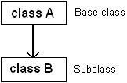

### Example 6.3

```java
class A {
    private int x;
    A() {
        x = 0;
    }
    A(int x1) {
        x = x1;
    }
    void display() {
        System.out.print(x);
    }
}
class B extends A {
    private int y;
    B() {
        super();
        //x=0;  错误，因为 x 是私有的
        y=0;
    }
    B(int x1, int y1) {
        super(x1);
        //x = x1; 错误，因为 x 是私有的
        y = y1;
    }
    void display() {
        super.display();
        System.out.print(y);
    }
}
class Inherit3 {
    public static void main(String args[]) {
        B b1 = new B();
        b1.display();
        B b2 = new B(10,20);
        b2.display();
    }
}
```

输出：

```text
0 10
20
```

### [2] 多级继承

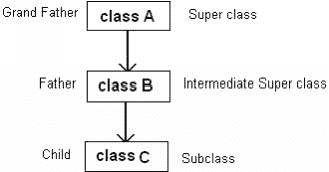


### Example 6.4

```java
class A {
    private int x;
    A() {
        x = 0;
    }
    A(int x1) {
        x = x1;
    }
    void display() {
        System.out.println(x);
    }
}
class B extends A {
    private int y;
    B() {
        super();
        y=0;
    }
    B(int x1, int y1) {
        super(x1);
        y = y1;
    }
    void display() {
        super.display();
        System.out.println(y);
    }
}
class C extends B {
    private int z;
    C() {
        super();
        z=0;
    }
    C(int x1, int y1, int z1) {
        super(x1,y1);
        z = z1;
    }
    void display() {
        super.display();
        System.out.println(z);
    }
}
class Inherit4 {
    public static void main(String args[]) {
        C c1 = new C();
        c1.display();
        C c2 = new C(10,20,30);
        c2.display();
    }
}
```

# 构造函数的调用顺序

## 类层次结构中的构造函数执行

当创建一个类层次结构时，构成该层次结构的类的构造函数按什么顺序调用？答案是，在类层次结构中，构造函数按照派生顺序从父类到子类调用。

此外，由于 `super()` 必须是子类构造函数中执行的第一条语句；无论是否使用 `super()`，这种顺序都是相同的。如果不使用 `super()`，则将执行每个父类的默认或无参数的构造函数。

构造函数按照派生顺序执行。因为父类对任何子类一无所知，它需要执行的任何初始化都是独立的，并且可能是子类执行的任何初始化的前决条件。因此，它必须首先执行。

## `super` 关键字

`super` 关键字在满足以下条件下可以使用：

- `super()` 构造函数只能在子类的构造方法内部被调用。
- 对父类构造函数的调用必须作为子类构造函数中的第一条语句。
- `super` 调用中的参数必须与父类构造函数的参数顺序和类型匹配。

# 动态方法绑定

## 动态方法分发（运行时绑定）

方法重写构成了 Java 强大概念之一的基础：动态方法分发是在运行时解析对被重写实例方法的调用的机制，而不是在编译时。动态方法分发非常重要，因为这是 Java 实现运行时多态的方式。

父类引用变量可以指向子类对象。Java 利用这一事实在运行时解析对重写方法的调用。当通过父类引用调用重写方法时，Java 会根据调用发生时所引用对象的类型来决定执行该方法的哪个版本。

因此，这种确定是在运行时进行的，当引用到不同类型的对象时，将调用重写方法的不同版本。换句话说，是所引用对象的类型（而不是引用的类型）决定了将执行哪个版本的重写方法。

被重写的方法允许 Java 支持运行时多态。多态对于面向对象编程（OOP）来说至关重要，原因在于：它允许通用类指定所有派生类都共有的方法，同时允许父类定义这些方法中某些或全部方法的具体实现。

通过将继承与重写方法相结合，父类可以定义所有子类都将使用的方法的通用形式。现有代码库在不重新编译的情况下调用新类实例的方法，同时保持整洁的抽象接口的能力，是一项极其强大的工具。

基类引用可以接受子类引用，但子类引用不能接受基类引用。


### 6.5

```java
class Shape {
    void getdata() {
        System.out.println("getdata() of Shape");
    }
    void area() {
        System.out.println("area() of Shape");
    }
    void display() {
        System.out.println("display() of Shape");
    }
}

class Circle extends Shape {
    void getdata() {
        System.out.println("getdata() of Circle");
    }
    void area() {
        System.out.println("area() of Circle");
    }
    void display() {
        System.out.println("display() of Circle");
    }
}

class Rectangle extends Shape {
    void getdata() {
        System.out.println("getdata() of Rectangle");
    }
    void area() {
        System.out.println("area() of Rectangle");
    }
    void display() {
        System.out.println("display() of Rectangle");
    }
}

class InheritTest {
    public static void main(String args[]) {
        // super 引用变量可以接受子类对象
        // 动态绑定
        Shape s[] =new Circle(), new Rectangle()};
        for (int i = 0; i < s.length; i++) {
            s[i].getdata();
            s[i].area();
            s[i].display();
        }
    }
}
```

**输出：**

```text
getdata() of Circle
area() of Circle
display() of Circle
getdata() of Rectangle
area() of Rectangle
display() of Rectangle
```

# 抽象类与抽象方法

我们已经看到，通过将方法标记为 `final`，我们可以确保该方法不会在子类中被重定义。Java 允许我们做与此完全相反的事情。即我们可以指示某个方法必须在子类中重定义，从而使重写成为强制性。这是通过在方法定义中使用修饰符 `abstract` 实现的。

在某些情况下，我们希望定义一个父类，它声明结构但不提供每个方法的完整实现。也就是说，有时我们想创建一个父类，定义一个由所有子类共享的通用形式，而让每个子类去填充细节。这种情况发生在父类无法创建有意义的实现时。要声明抽象方法，使用 `return_type name(parameter-list)`；任何包含一个或多个抽象方法的类也必须声明为抽象类。要声明一个类，只需在类前面使用 `abstract` 关键字。抽象类不能有对象；也就是说，抽象类不能用 `new` 运算符实例化。这样的对象将毫无用，因为抽象类没有被完全定义。此外，我们不能声明抽象构造函数。抽象类的任何子类必须实现所有抽象方法，或者被声明为抽象类。

**示例 6.6：**

```java
abstract class Shape {
    abstract void getdata();
    abstract void area();
    abstract void display();
}

class Circle extends Shape {
    void getdata() {
        System.out.println("getdata() of Circle");
    }
}
```


```java
    }

    void display() {
        System.out.println("display() of Circle");
    }
}
class Rectangle extends Shape {
    void getdata() {
        System.out.println("getdata() of Rectangle");
    }
    void area() {
        System.out.println("area() of Rectangle");
    }
    void display() {
        System.out.println("display() of Rectangle");
    }
}
class InheritTest6 {
    public static void main(String args[]) {
        //父引用变量接受子类对象
        //动态绑定
        Shape s[]={new Circle(), new Rectangle()};
        for(int i=0;i<s.length;i++) {
            s[i].getdata();
            s[i].area();
            s[i].display();
        }
    }
}
```

Output:

```
getdata() of Circle
area() of Circle
display() of Circle
getdata() of Rectangle
area() of Rectangle
display() of Rectangle
```

#### Final 方法 (Final method)

如果我们不希望某个方法被派生类重写，可以将基类定义为 `final`。任何尝试重写该方法的行为都会导致编译错误。

```java
class A {
    final void method1() {
        -----
    }
}
class B extends A {
    void method1() // 
        -----
    }
}
```

#### Final 类 (Final class)

有时出于安全考虑，我们可能希望防止一个类被进一步子类。不能被子类的类被称为 final 类。在 Java 中通过使用 `final` 关键字来实现这一点：

```java
final class A1 {
    -----
    -----
}
```

任何尝试继承 `A` 的行为都会导致错误，编译器将不允许。声明 `final` 类可以防止对该类进行意外的扩展。

#### 理论题 (Theory Questions)

1. 什么是继承？

2. Java 中共有多少种继承？

3. 默认构造函数和参数化构造函数之间有什么区别？

4. `final` 类和 `final` 方法之间有什么区别？

5. 什么是 `super` 类？

6. 什么是抽象类？

7. 编译时绑定和运行时绑定有什么区别？

8. 方法重载和方法重写有什么区别？

#### 简介 - 面向对象编程对比过程化编程 (Introduction - Object oriented programming vs/ procedural programming)

所有程序由两个元素组成：过程（逻辑）和数据。根据主要关注的是处理还是数据，有两种不同的方法。过程化语言（`c`、`FORTRAN`、`PASCAL`、`COBOL`）关注处理部分，即它们更重视“发生了什么”（过程），而不太重视“谁受了影响”（数据）。

随着程序变得巨大且复杂，过程化方法变得越来越不适用。开发面向对象的语言是为了克服过程化编程语言的局限性。与过程化语言中的类似程序相比，面向对象的编程语言相对简单得多。面向对象的程序围绕数据（即对象）和一组定义良好的接口（方法）组织。

Java 基于面向对象范式。Java 几乎是纯面向对象的语言。我们使用“几乎”一词是因为出于性能考虑，Java 也支持基本数据类型。`C++` 并不是纯面向对象的语言。`C++` 是 `C` 的扩展，因此它使用一种混合了面向过程方法和面向对象方法的方法。

两种方法的基本区别总结如下：

(i) 面向对象的程序是以数据为中心的，而用过程化语言编写的程序是以过程为中心的。

(ii) 面向对象的程序围绕数据（对象）组织，因此它们能更好地模拟现实世界的对象。

(iii) 与过程化方法相比，面向对象方法的代码重用性和扩展性非常高。因此代码量更少。

(iv) 面向对象的程序更容易维护，因为它们相对简单且尺寸较小。

(v) 面向对象的程序基于自底向上的设计方法，而过程化程序基于自顶向下的设计方法。

#### OOP（面向对象编程）的基本概念 (Basic concepts of OOP)

以下提到了面向对象编程的一些基本元素：

- 抽象 (Abstraction)

- 对象和类 (Objects and classes)

- 三大 OOP 原：

    - 封装 (Encapsulation)

    - 继承 (Inheritance)

    - 多态 (Polymorphism)

- 持久化 (Persistence)

- 泛型 (Genericity)

- 组合 / 聚合 (Composition / Aggregation)

#### 1. 抽象 (Abstraction)

抽象是包括过程化语言在内的任何编程语言的基本元素之一。内置数据类型的概念也是一种抽象。在 `C` 语言中使用 `struct` 定义自己的数据类型的特征进一步扩展了这种抽象。

抽象的基本目的是通过隐藏细节来降低复杂性。例如，一座建筑不被认为是建筑材料的集合，而是一个具有独特特征和属性的定义良好的对象。抽象可以定义为识别对象的本质属性和行为的行为，而不涉及细节。对象的属性和行为使其与其他相似类型的对象区分开来，并有助于对对象分类/分组。面向对象的编程语言使用类和对象来建模抽象。

#### 2. 对象和类 (Object and Classes)

**对象 (Object)**：对象是一个物理或抽象的实体或事物，可以与其他相似类型的对象区分来。对象具有三个特征：

(i) 标识性。

(ii) 属性（特征）。

(iii) 行为（方法 / 操作 / 函数）。

对象也可以被看作 `class` 的实例，其中 `class` 类似于内置数据类型，而 `object` 是变量。

**类 (Class)**：类通过抽象其属性和行为来表示一类对象。`class` 可以被看作创建对象的蓝图。对象具有由其 `class` 定义的属性和行为。`class` 可以看作用户自定义的数据类型，而 `object` 是 `class` 所代表的数据类型的变量/实例。

类（Class）也可以被认为是一种用户定义的数据类型，而对象（Object）是该数据类型的变量。一旦定义了类，我们就可以创建任意属于该类的对象。

## 3. 三大 OOP 原则

### 封装

封装（Encapsulation）代码及其所操作的数据绑定在一起的机制。Java 类支持这一点，因为它们允许我们将代码和数据定义在一起。封装还通过将某些类成员声明为 `private` 来帮助实现数据隐藏，使得这些成员无法被类之外的代码访问。

### 继承

在面向对象编程中，继承（Inheritance）指的是一个类的属性提供给其他子类或派生类。子类或派生类是派自现有类的类。它继承了现有类的所有特征，现有类也被称为基类（base-class）或超类。因此，继承可以定义为从超类或基类派生类的过程。继承类不会给基类/超类引入任何更改。与基类相比，派生类/子类具有更多的属性和行为。

继承的主要优势是代码重用。如果基类已经使用了长时间，并且需要添加一些额外的属性和方法，我们可以通过派生另一个类来实现。派生类将能够使用基类的代码而无需调试，因为它已经运行了很久。

#### 类层次结构

所有派生自共同基类的类都属于一个家族并形成类层次结构。类层次结构可以与树形结构相比，其中一个基类位于根节点且没有超类。

所有其他类要么派生自层次结构根节点类，要么派生自某些直接或间接派生自根类的类。随着我们在树向下移动，添加的功能越来越多。由叶子节点表示的类没有任何子类。以下示例显示了一些类层次结构。


### 多态

多态（Polymorphism）是一种允许用同一接口用于通用动作的特性。大多数面向对象的语言在以下情况使用多态：

- 运算符重载（Operator Overloading）。

- 方法重载（Method Overloading）。

- 方法重写（Method Overriding）。

#### 运算符重载

大多数语言使用这种形式的多态用于内置操作。例如，C/C++ 或 Java 中所有的算术运算符都可以用于许多类型的操作数（`int`、`long`、`float`、`double` 等）。因此，相同的加法运算符既可以加两个整数，也可以加两个浮点数。

C++ 允许用户重载内置运算符。例如，我们可以重载算术运算符来处理复数。虽然 Java 对内置运算符使用了运算符重载，但它不允许用户重载运算符。

#### 方法重载

这一特性允许我们编写多个具有相同名称的方法。C++ 和 Java 都具有这一特性。同名的方法（C++ 中称为 `function`）根据参数（参数）进行区分。重载的方法必须具有不同数量的参数，或者如果参数数量相同，则参数类型必须不同。

如果对重载方法的调用可以在编译时解析，即如果编译器可以决定调用哪一个重载方法，则称为静态绑定（static binding），这是编译时多态的示例。

如果对重载方法的调用无法在编译时解析，即如果编译器无法决定调用哪一个重载方法，则称为动态绑定（dynamic binding），这是运行时多态的示例。

通常，Java 在运行时解析对重载方法的调用，但在许多情况下，对重载方法的调用是在编译时解析的。

#### 方法重写

子类可以定义一个与父类中同名的方法，且参数的数量和类型也相同。这被称为方法重写（method overriding）。

编译器无法解析对重写方法的调用。Java 通常使用动态绑定来解析对重写方法的调用，即发生在发生在。

## 4. 持久化

某些面向对象的语言允许我们从/到持久存储介质存储/检索程序的状态，例如次级存储等永久存储介质。这被称为持久化（Persistence）。

Java 允许我们在次级存储中存储任何对象并在稍后检索它。如果我们尝试在对象图的顶端存储对象，所有其他引用的对象将被递归地定位并保存。同样，当以后检索该对象时，所有对象及其引用（即整个对象图）都会主内存中正确创建。

例如，可以通过保存树的根来保存整个树形结构。在后续阶段，可以通过保存树的根在内存中重建整个树形结构。C++ 不支持这一特性。

## 5. 泛型

这种定义一次算法（独立于任何特定数据类型）并然后将该算法应用于各种数据类型而无需任何额外努力的概念被称为泛型（Genericity）。C++ 使用模板（templates）支持这一特性。Java 也通过 `Object` 类支持这一特性，该类位于 Java 中任何类层次结构的顶端。

例如，使用这一特性，我们可以实现一个泛型数据类型 `stack`，以便在栈中存储任何类型的元素。这一特性在很大程度上提高了重用性。

## 6. 组合 / 聚合

一个对象可能由其他对象组成。这样的对象被称为组合（Composite）或聚合（Aggregate）对象。例如，如果 `vehicle` 类的对象定义为由 `Engine`、`Body`、`Axle`、`Seats` 等对象组成的组合对象是合适的。

### 继承与组合

从现有类派生新类的基本机制有两种：继承和组合。`Bus` 类可以通过继承 `vehicle` 类的属性来派生。这里 `Bus` 是车辆的一种，除了所有车辆共属性外，它还有额外的属性。

也就是说，`Bus` 类与 `vehicle` 类之间存在“是一个”的关系，因为我们可以说 `Bus` 是一种车辆。

`vehicle` 类本身可能通过组合从许多其他类派生。例如，一个 `vehicle` 类的对象可能由属于 `Engine`、`Gear Box`、`Seats`、`Driver’s Seat Body` 和 `Steering Wheel` 等类的对象组成。

在这种情况下，派生类与代表组合对象部分的类之间存在整体与部分的关系。我们不能说 `vehicle` 是一个 `Engine` 或 `Vehicle` 是一个 `Gear Box`。

# 超类与子类

通常，一个类的对象也是另一个类的对象。矩形显然是四边形（正方形、平行四边形和梯形也是如此）。因此，可以说 `Rectangle` 类继承自 `Quadrilateral` 类。在这种背景下，`Quadrilateral` 类是超类，`Rectangle` 类是子类。矩形是四边形的一种特定类型，但声称四边形是矩形是不错误的（四边形可能是平行四边形）。图显示了几个超类和潜在子类的简单继承示例。

## 继承概览

然而，对这些术语还有另一种视角，它是完全合理的。因为每个子类对象“都是”其父类的对象，而且由于一个父类可以有多个子类，所以父类代表的对象的集合通常大于该父类的任何子类所代表的对象的集合。

例如，父类 `Vehicle` 以通用的方式表示所有车辆，如汽车、卡车、船只、自行车等。然而，子类 `Car` 只代表了世界上所有 `Vehicles` 中的一小部分。继承关系形成了类树的层级结构。

父类与其子类之间存在层级关系。一个类完全可以独立存在，但只有当一个类配合继承机制使用时，它才会变成向其他类提供属性和行为的父类，或者是继承这些属性和行为的子类。通常，一个类既是子类也是父类。

| 父类 | 子类 |

| :--- | :--- |

| Student | 研究生、本科生 |

| Shape | 圆形、三角形、矩形 |

| Loan | 汽车贷款、住房贷款、教育贷款 |

| Employee | 教职员工、行政员工 |

| Account | 支票账户、储蓄账户 |

    


# 第 8 章：包

## 引言

当我们开发项目时，必须将程序拆分成几个类。为了组织这些类，我们使用了包（Packages）。包既是一种命名机制，也是一种可见性控制机制。包是相互相关的类和接口的集合。在包的帮助下，只要类定义在不同的包中，就可以给多个类赋予相同的名称。

单个包不能包含两个同名的类。

程序（PROGRAMS）被组织成包的集合。每个包都有自己的子包集合，这有助于防止命名冲突。只有当顶层包被声明为 `public` 时，才能在包外部访问。包的命名结构是层级的。包的成员包括类类型、接口类型和子包。Java 中的包是一种封装机制，用于将相关的类、接口和子包组合在一起。

对于小型程序，包可以是未命名的或具有简单的名称，但如果代码要广泛分发，则应该选择唯一的包名。这可以防止当两个开发小组恰好选择相同的包名，且这些包后来被用在同一个程序时，本可能发生的冲突。如果我们不为 Java 类指定包，那么该类将是 Java 默认包（称为“未命名包”）的一部分。但这要求每个类必须有唯一的名称以避免冲突。

## 未命名包的示例

```java
class A {
    // - - - - - - -
    // - - - - - - -
}

class A_demo {
    public static void main(String args[]) {
        // - - - - - -
        // - - - - - - -
    }
}
```

## 如何定义包

要创建一个包，请在 Java 文件的第一条语句中包含 `package` 命令。在该文件中声明的任何类将属于指定的包。如果我们省略了包语句，类将被放入没有名称的默认包，即未命名包。Java 使用文件系统目录来存储包。记住大小是敏感的，目录名必须与包名匹配。多个文件可以包含相同的包语句。

语法：

```java
package package_name; // 包声明
class A // 类声明
    // 类 A 的主体
}
```

`package` 是一个关键字。`p1` 是类 `A` 存储的包名。

### 示例 8.1

```java
package p1;
class A {
    public static void main(String args[]) {
        System.out.println("First Package program.");
    }
}
```

我们假设当前文件夹是 `c:\javaprg\p1>`

```bash
C:\javaprg\p1>javac A.java
C:\javaprg\p1>java p1.A
```

输出：

```
First Package
```

注意：如果我们在 `c:\javaprg>` 下使用 `javac -d A.java` 编译上述程序，则会创建 `p1` 文件夹，并将上述程序的 `.class` 文件保存在该文件夹中。如果我们不使用 `-d` 选项编译，则我们需要负责创建 `p1` 文件夹并将 `.class` 文件放在当前文件夹。如果我们想在其他地方创建文件夹，也可以输入完整路径，如 `javac -d c:\javaprg A.java`。

## 导入包

Java 的内置类都存储在命名的包中；由于包内的类必须使用包名进行完全限定，因此为每个想要使用的类输入长长的点分隔路径可能会变得繁琐。因此，Java 包含了 `import` 语句，以将某些类或整个包引入可见范围。一旦导入，就可以直接使用类名引用类。`import` 语句是一种便利措施，编写完整程序时不需要它。如果我们要在应用程序中引用几个类，那么 `import` 语句将节省大量的工作。


在 Java 源文件中，`import` 语句紧随包语句之后、任何类定义之前。这是 `import` 语句的通用形式。

```java
import pkg1.classname;
import pkg1.*;
```

### 示例 8.2

```java
// 使用 Random 类打印 10 个随机数
// 不使用 import 语句的 java.util
import java.util.Random
class RandomTest1 {
    public static void main(String args[]) {
        java.util.Random r1 = new java.util.Random();
        for(int i=1;i<=10;i++) {
            System.out.println(Math.abs(r1.nextInt()));
        }
    }
}
```

输出：

```
1588659525
481996564
210875677
386971039
360473512
1922641171
393055462
889442536
1836112189
320882863
```

### 示例 8.3

```java
// 使用 Random 类打印 10 个随机数
// 使用 import 语句的 java.util
import java.util.Random;
class RandomTest2 {
    public static void main(String args[]) {
        Random r1 = new Random();
        for(int i=1;i<=10;i++) {
            System.out.println(Math.abs(r1.nextInt()));
        }
    }
}
```

```java
System.out.println(Math.abs(r1.nextInt()));
}
}
```

输出：

```
686722541
1154462827
452959606
1235134497
1421490552
1065881855
424893046
731473166
1217844570
437181304
```

### CLASSPATH

如果我们从当前文件夹以外的任何位置运行程序，它将无法运行。默认情况下，Java 运行时系统使用当前工作目录作为起点。

因此，如果我们的包在当前目录或当前目录的子目录下，它就能被找到。但要从任何其他文件夹运行上述程序，我们必须在命令提示符中使用命令 `SET CLASSPATH=.;C:\JAVAPRG` 来设置类路径。`CLASSPATH` 是一个环境变量。我们每次第一次启动计算机时都要输入此命令。但如果我们把此命令放在 `我的电脑属性高级环境变量` 中，那么就不需要再反复输入此命令了。

我们也可以在不设置 `CLASSPATH` 环境变量的情况下运行程序。要这样做，请输入：

```bash
java –classpath c:\javaprg p1.A own
```

**注意 4** - 我们可以创建包的层级结构。要这样做，只需使用点将每个包名与其上一个包隔开。多级包语句的通用形式为：

`package package_name1[.package_name2][.package_name3];`

包层次结构必须反映在 Java 开发系统的文件系统中。例如，包 `java.awt.Image` 需要存储在 `java\awt\image` (WINDOWS) 或 `java/awt/image` (UNIX) 或 `java:swt:image` (MACINTOSH) 文件系统中。

包层次结构代表了 Java 类和接口的组织。它并不代表类和接口的源代码组织。

每个 Java 源文件（也称为编译单元）可以包含零或多个类和接口定义，但编译器会为其中的每一个项生成一个包含 Java 字节码的独立类文件。类或接口可以使用包声明来指示其 Java 字节码被放置在特定的包中。

- 包 `java` 有子包 `awt`、`applet`、`io`、`lang`、`net` 和 `util`，但没有类或接口。

- 包 `java.awt` 有一个子包 `image` 以及许多类和接口。

- 因为包 `java.awt` 有子包 `image`，它不能包含名为 `image` 的类或接口类型的声明。

- 如果一个包的全限定名是 `P`，且 `Q` 是 `P` 的子包，那么 `P.Q` 就是该子包的全限定名。

- 如果存在一个名为 `mouse` 的包，且该包中有一个成员类 `Button`（这可能被称为 `mouse.Button`），则不能存在任何全限定名为 `mouse.Button` 或 `mouse.Button.Click` 的包。

- 一个源文件中最多出现一个包语句，且它必须是 Java 源文件的第一个语句。

### 类成员的可见性

类和包都是封装和包含变量及方法命名空间与作用域的手段。包作为类和其他从属包的容器。类作为数据和方法代码的容器。

类是 Java 最小的抽象单元。由于类和包之间的相互作用，Java 处理类成员的五类可见性。

1. 类内部的可见性。

2. 同一包内子类中的可见性。

3. 同一包内非子类的可见性。

4. 不同包间子类中的可见性。

5. 既不在同一包内也不是子类的类中的可见性。

**注意 1** - 顶层类和接口只有两种可能的访问权限：默认（default）和 `public`。

**注意 2** - 如果类被声明为 `public`，则可以使用其他代码来访问它。

**注意 3** - 如果类具有默认访问权限，则它只能被同一包内的其他代码访问。

**注意 4** - 成员可见性只有在类可见的情况下才有意义。如果类的可见性修饰符是默认的，那么即使是类的 `public` 成员也只在包内可见。

### 访问修饰符

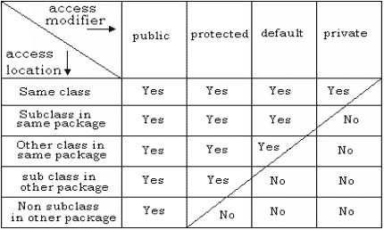

### JAR 文件（Java 档文件）

为了压缩文件，我们使用如 winzip 等程序。JAR 提供以下选项：

| 选项 | 描述 |

| :--- | :--- |

| `c` | 创建新归档。 |

| `C` | 执行期间更改目录。 |

| `f` | 文件列表第一个元素是要创建的归档名称。 |

| `i` | 应提供索引信息。 |

| `m` | 文件列表第二个元素是外部清单文件的名称。 |

| `M` | 不创建清单文件。 |

| `t` | 应列出归档内容。 |

| `u` | 更新现有 JAR 文件。 |

| `v` | 提供详细输出。 |

| `x` | 从归档中提取的文件。 |

| `o` | 不使用压缩。 |

**创建 JAR 文件：**

```bash
jar -cf Myjar.jar pack1
```

这将创建一个名为 `Myjar.jar` 的 JAR 文件，包含 `pack1` 的所有文件。

**提取 JAR 文件：**

此命令用于提取 jar 文件（类似于 unzip）

```bash
jar -xf Myjar.jar
```

**列出 jar 文件的内容：**

以下命令列出 `Myjar.jar` 的内容。

```bash
jar -tf Myjar.jar
```

**更新现有 JAR 文件：**

以下命令用于更新文件。

```bash
jar -uf Myjar.jar pack1
```

**创建可执行的 JAR 文件：**

```bash
jar -cmf mainClass Myjar.jar pack1
```

其中 `mainClass` 是一个文本文件，包含 `Main-Class: pack1.pack2.pack3.A`，并保存在 `javaprg` 文件夹中。

**执行 jar 文件：**

```bash
java -jar Myjar.jar
```

### 理论题

1. 我们对包有什么理解？

2. 解释所有的修饰符及其在不同包、子包、子类和其他类中的作用域范围。

3. JAR 文件有什么用？

4. `import` 语句有什么用？

# 第 9 章：接口

## 简介

接口本质上是类的一种。和类一样，接口包含方法和变量，但有一个主要的区别。区别在于接口只定义抽象方法和最终变量（常量/Constants）。这意味着接口不编写任何代码来实现这些方法，且数据字段只包含常量。

## 接口

因此，类的责任是实现接口，该接口定义了实现这些方法的代码。接口在语法上与类相似，但它们缺少实例变量，且其方法声明时没有方法体。在实践中，这意味着我们可以定义接口，而不对它们的实现方式做任何假设。接口的目的是将类的接口与其实现分离。接口仅仅定义了类必须做什么，而没有对实现做任何说明。接口只定义方法签名，不包含任何实例变量。

嵌套接口是指任何声明位于另一个类或接口体内的接口。顶层接口不是嵌套接口的接口。定义接口的语法与定义类非常相似。接口定义的通用形式如下：

```java
interface interface_name {
    variable declarations;
}
```

这里 `interface` 是关键字，`interface_name` 是任何有效的 java 标识符（与类名一样）。

**注意：** 当我们定义一个接口时，默认它是 `public` 且 `abstract`。

## 接口修饰符

顶层接口可以使用的修饰符是 `abstract` 和 `public`。即使我们不使用 `abstract` 修饰符，接口也会隐式地声明为 `abstract`，因此不需要使用 `abstract` 修饰符。顶层接口的可见性可以是包级（package）或 `public`，就像顶层类一样。如果没有使用可见性修饰符，则接口的可见性假设为包级。

## 数据变量成员声明

接口中只能定义常量。接口中的所有变量都是隐式的 `public`、`final` 和 `static`，这意味着它们不能被实现类更改。它们还必须用常量值进行初始化。

```java
public static final type variable_name=value;
```

在接口中声明的变量是 `public`、`static` 和 `final`。这意味着它是一个具有公共访问权限的静态变量。变量也被声明为 `final`，这意味着它必须在声明时赋值，并且之后不能再修改。关键字 `final` 类似于 C/C++ 中的 `const`。

## 方法声明

方法声明仅包含方法列表，而不包含任何语句。它们在参数列表后以分号结束。它们本质上是抽象方法，接口内指定的任何方法都不能有默认实现。

接口中的所有方法默认都是 `public` 和 `abstract` 修饰符。我们不能在接口中声明静态方法。

```java
public abstract return_type method_name(parameter_list);
```

这里是一个包含两个变量和一个方法的接口定义示例。

```java
interface item {
    static final int code = 1001;
    static final String name = "Matrix";
    abstract void display();
}
```

**注意：** 方法的代码不包含在接口中，方法声明仅以分号结束。

另一个接口的示例：

```java
interface area {
    float pi = 3.142;
    float compute(float x, float y);
    void show();
}
```

### 扩展接口

像类一样，接口也可以被扩展，即一个接口可以从其他接口派生。新接口将以子类的方式继承子接口的所有成员。这是通过使用 `extends` 关键字实现的，如下：

```java
interface interface_1 {
    int code = 1001;
    String name = "Matrix";
}

interface interface_2 extends interface_1 {
    void display();
}
```

`interface_2` 将继承其中的常量 `code` 和 `name`。

**注意：** 变量 `name` 和 `code` 是像普通变量一样声明的。这在这里是被允许的，但接口中的所有变量都被视为常量、公共且静态，尽管这里没有 `public`、`static` 和 `final` 关键字。

我们可以将多个接口组合在一个接口中。以下声明是有效的：

```java
interface interface_1 {
    int code = 1001;
    String name = "Matrix";
}

interface interface_2 {
    void display();
}

interface interface_3 extends interface_1, interface_2 { }
```

**注意：** 始终记住接口不能扩展类。这违反了接口只能有抽象方法和常量的规则。

## 实现接口

接口被用作“超类”，其属性被类继承。因此，有必要创建一个继承给定接口的类。一旦定义了接口，一个或多个类就可以实现该接口。

要实现一个接口，需要在类定义中包含 `implements` 子句，然后创建接口声明的方法。实现类必须提供所有接口的方法体，否则它必须声明为 `abstract`。实现类还可以扩展一个类并实现多个接口。

```java
class <class-name> implements <interface-name> { }
```

Java 不支持多继承，但支持多接口继承，如下：

```java
class <class-name> implements <interface-1>, <interface-2>, <interface-3>, ....<interface-n> { }
```

**注意：** 当我们实现接口方法时，必须将其声明为 `public`。实现接口方法类似于重写，因此不能降低可见性。

**示例 9.1**

```java
interface interface_1 {
    void show(int x);
}

class class_1 implements interface_1 {
    public void show(int x) { }
}
```

**抽象类的 9.2 示例**

```java
interface common {
    void push(int x);
    int pop();
}

abstract class stack implements common {
    void disp();
}
```

在这里 `stack` 类没有实现 `push()` 和 `pop()` 方法。因此，我们必须将 `stack` 类声明为抽象类，这种技术被称为部分实现。

## 接口继承的各种形式：

(a)

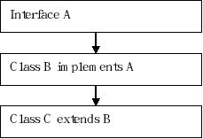

(单级接口继承)

(b)

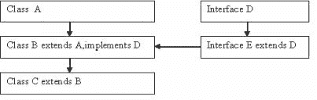

(多级接口继承)

(c)

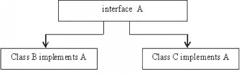

(层级接口继承)

(d)

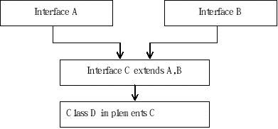

(混合接口继承)

## 通过接口引用访问实现类对象

我们可以声明使用接口而非类类型作为对象引用的变量。任何实现已声明接口的类的任何实例，都可以通过此类变量进行引用。当我们通过这些引用之一调用方法时，将根据所引用的接口的实际实例来调用正确版本。

这是接口的重要特性之一。要执行的方法将在运行时动态查找，这允许类在调用其方法的代码之后再创建。调用代码可以通过接口进行分发，而无需了解关于“调用者”的任何信息。这个过程类似于使用父类引用来访问子类对象。

由于在运行时动态查找方法与 Java 中的普通方法调用相比会产生巨大的开销，我们应该注意不要在性能关键的代码中随意使用接口。

### 示例 9.3

```java
interface Math_function {
    void display(int x);
}

class Sqrt implements Math_function {
    public void display(int x) {
        System.out.println("sqrt of x ="+Math.sqrt(x));
    }
}

class Log implements Math_function {
    public void display(int x) {
        System.out.println("log of x = "+Math.log(x));
    }
}

class Math_Demo {
    public static void main(String args[]) {
        Math_function f1 = new Sqrt();
        Math_function f2 = new Log();
        f1.display(27);
        f2.display(3);
        Math_function f3;
        f3=f1; // 多态（赋值引用）
        f3.display(30);
        f3=f2; // 多态（赋值引用）
        f3.display(5);
    }
}
```

输出：

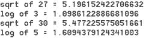

## 接口的特点

- `Interface` 是一个关键字。

- 接口可以声明为抽象，但它默认就是抽象的，因此不需要添加 `abstract` 关键字。

- 所有变量始终是 `public static final` 的。

- 接口的所有方法必须在类中实现。

- 实现类实现的所有方法必须是 `public` 的。

- 接口仅包含方法的声明。

- 接口方法不能声明为 `static`。它们始终被声明为实例方法。


- 类既不能缩小接口方法的访问权限，也无法在方法的 `throws` 子句中指定新的异常；因为尝试这样做等同于更改接口，这将是违法的。重写方法的标准也适用于实现接口方法。
- 所有方法在实现类中都需要被定义为 `public`。
- 此处通过 `abstract` 关键字允许部分实现。
- 无论类直接或间接实现多少接口，对于可能在接口中具有多个声明的方法，它只提供单一的实现。
- 方法原型声明也可以像类一样进行重载。
- 接口常量可以通过任何客户端（类或接口）使用其全限定名来访问，无论该客户端是否扩展或实现了该接口。然而，如果客户端是实现此接口的类或扩展此接口的接口，那么客户端也可以直接访问此类常量，而无需使用全限定名。此类客户端继承了接口常量。
- 在接口常量多继承的情况下，任何名称冲突都可以使用相关常量的全限定名来解决。

## 接口变量

接口中的所有变量始终是 `public static` 和 `final` 的，因为它们是实现访问数据类型和方法的公共部分。

### 接口变量的内存管理

静态变量在我们的程序加载时总是获取内存，它们占用独立的内存，不与任何对象的内存共享。它们也被称为常量变量。可以使用接口名和 `.` 运算符直接访问。

#### 示例 9.4

```java
interface Static_Var {
    int sun=1;
    int mon=2;
    int tues=3;
    int wed=4;
    int thurs=5;
    int fri=6;
    int sat=7;
}

class Week_Day implements Static_Var {
    public static void main(String args[]) {
        System.out.println(sun);
        System.out.println(mon);
        System.out.println(tues);
        System.out.println(wed);
        System.out.println(thurs);
        System.out.println(fri);
        System.out.println(sat);
    }
}

class Week_Day {
    public static void main(String args[]) {
        System.out.println(Static_Var.sun);
        System.out.println(Static_Var.mon);
        System.out.println(Static_Var.tues);
        System.out.println(Static_Var.wed);
    }
}
```

```java
System.out.println(Static_Var.thurs);
System.out.println(Static_Var.fri);
System.out.println(Static_Var.sat);
}
```

输出：

```
1
2
3
4
5
6
7
```

#### 示例 9.5

```java
interface Two_Methods {
    void m1();
    void m2();
}

class Three_Methods implements Two_methods {
    public void m1() {
        // m1 的方法体
    }
    public void m2() {
        // m2 的方法体
    }
    public void m3() {
        // m3 的方法体
    }
}

class Methods_Demo {
    public static void main(String args[]) {
        Two_methods tm1 = new Three_methods();
        tm1.m1();
        tm1.m2();
        //tm1.m3(); 错误
        Three_Methods tm2 = new Three_Methods();
        tm2.m3();
    }
}
```

注意：这里我们不使用接口引用调用`m3()`，因为该方法在接口中并没有声明。因此，接口引用只能访问在接口块中声明的方法。否则，我们可以调用相同类的对象或扩展类的对象。

#### 示例 9.6 在一个类中实现两个接口

```java
interface Two_Methods {
    void m1();
    void m2();
}

interface One_Method extends Two_Methods {
    void m3();
}

class Three_Methods implements One_methods {
    public void m1() {
        // m1 的方法体
    }
    public void m2() {
        // m2 的方法体
    }
    public void m3() {
        // m3 的方法体
    }
}

class Methods_Demo {
    public static void main(String args[]) {
        Three_methods tm1 = new Three_methods();
        tm1.m1();
        tm1.m2();
        tm1.m3();
    }
}
```

非接口方法：当任何类实现了接口的方法并同时在类中定义了额外的方法时，我们可以说这些额外的方法是非接口方法。使用接口的引用变量无法调用这些额外方法。

#### 示例 9.7

```java
interface Two_Methods {
    void push(int x);
    int pop();
}

class Stack implements Two_Methods {
    int arr[] = new int[5];
    int top= -1;
    public void push(int item) {
        if(top == 4) {
            System.out.println("Overflow");
            return;
        }
        top++;
        arr[top]=item;
    }
    public int pop() {
        if(top == -1) {
            System.out.println("Underflow");
            return -1;
        }
        int item = arr[top];
        top--;
        return (item);
    }
    void disp() {
        for(int i=top;i>=0;i--) {
            System.out.println(arr[i]);
        }
    }
}

class Stack_Demo {
    public static void main(String args[]) {
        Two_Methods s1=new Stack();
        s1.pop();
        for(int i=0;i<5;i++) {
            s1.push(i+100);
        }
        s1.push(600);
        System.out.println("----Displaying All Item----");
        s1.disp(); //非接口方法
        System.out.println("----Removing All Items----");
        for(int i=0;i<5;i--) {
            System.out.println(s1.pop()); // 下溢
        }
    }
}
```


# 第 10 章

## String 和 StringBuffer

### 简介

在 Java 中，字符串是类对象，通过两个类实现，即`String`和`StringBuffer`。与 C 语言字符串相比，Java `String`更可靠且可预测。这基本上是因为 C 语言缺乏边界检查。Java 的`String`并不是字符数组，也不是 NULL 终止的。通常情况下，Java 不允许对`String`对象应用运算符。

这条规则的唯一例外是`+`和`+=`运算符，它们会连接两个字符串并产生一个`String`对象。在 Java 中，字符数组不被视为字符串。Java 的`String`类用于执行所有的字符串操作。`String`类和`StringBuffer`类是`java.lang`包的一部分。

#### String 类

```java
String s1 = new String("matrix");
String s2 = "matrix";
System.out.println(s1);
System.out.println(s1.length);
System.out.println("matrix".length);
```

`String`在 Java 中具有以下特性：

##### [i] String 在 Java 中是一个对象

`String`代表一个字符序列，但与许多将`String`实现为字符数组的语言不同，Java 将字符串实现为`string`类型的对象。

字符串操作是许多 Java 程序中最常见的部分。将字符串实现为内置对象允许 Java 提供全套功能支持，使得字符串处理变得非常方便。此外，字符串对象可以通过多种方式构造，从而在需要时易于获取字符串。

##### [ii] String 是不可变的

`String`是不可变的，也就是说，我们在创建字符串后无法更改该字符串。然而，声明为`String`引用的变量可以随时更改以指向其他字符串对象。

我们仍然可以执行所有类型的字符串操作。每当我们需要一个现有字符串的修改版本时，就会创建一个包含修改内容的新字符串对象。

原始字符串保持不变。使用这种方法是因为固定的、不可变的字符串比可更改的字符串实现得更高效。

对于那些需要修改字符串的情况，有一个名为`StringBuffer`的伴随类，它的对象包含在创建后可以被修改的字符串。

##### [iii] String 类是 final 的

`String`和`StringBuffer`类都是`final`的。这意味着我们不能在任何类中扩展`String`类。这允许某些优化以提高常用字符串操作的性能。

#### String 类的构造函数与方法

| # | 方法 | 说明 |
| :--- | :--- | :--- |
| 1 | `public String()` | 初始化新创建的`String`对象，使其表示一个空字符序列。`String s1 = new String();` |
| 2 | `public String(String str)` | 初始化新创建的`String`对象，使其表示与参数相同的字符序列；换句话说，新创建的字符串是参数字符串的拷贝。`String s1 = new String("Matrix"); String s2 = new String(s1);` 字符串`s2`是字符串`s1`的拷贝。虽然内容相同，但`s1`和`s2`指向不同的字符串对象。 |
| 3 | `public String(char ch[])` | 分配一个新的`String`，使其表示当前字符数组参数中包含的字符序列。`char ch[] = {'a', 'b', 'c'}; String s1 = new String(ch);` //`s1`将持有 "abc" |
| 4 | `public String(char value[], int offset, int count)` | 分配一个新的`String`，其包含来自字符数组参数子数组的字符。`char ch[] = {'a', 'b', 'c', 'd', 'e', 'f'}; String s1 = new String(ch,2,3);` //`s1`将持有 "cde" |
| 5 | `public String(int value[], int offset, int count)` | 分配一个新的`String`，其包含来自整数数组参数子数组的字符（包含字符的 Unicode）。`int a[] = {97, 98, 99, 100, 101, 102}; String s1 = new String(a,2,3);` //`s1`将持有 "cde" |
| 6 | `public String(byte b[], int offset, int count)` | 使用平台的默认字符集解码指定的字节子数组以构造一个新的`String`。`byte b[] = {97, 98, 99, 100, 101, 102}; String s1 = new String(b,2,3);` //`s1`将持有 "cde" |
| 7 | `public String(byte[])` | 使用平台的默认字符集解码指定的字节数组以构造一个新的`String`。`byte b[] = {97, 98, 99}; String s1 = new String(b);` //`s1`将持有 "abc" 尽管 Java 的`char`类型使用 16 位来表示 Unicode 字符集，但互联网上的典型字符串格式使用由 ASCII 字符集构造的 8 位字节数组。由于 8 位 ASCII 字符串很常见，`String`类提供了在给定字节数组时初始化字符串的构造函数。在上述每个构造函数中，字节到字符的转换都是使用平台的默认字符编码完成的。 |
| 8 | `public String(StringBuffer)` | 初始化新创建的`String`对象，使其包含与`StringBuffer`参数相同的字符序列。 |
| 9 | `public int length()` | 显示字符串的字符数量。 |
| 10 | `public boolean isEmpty()` | 如果字符串为空则显示 `true`，否则为 `false`。`String s1 = new String(); System.out.println(s1.isEmpty());` |
| 11 | `public char charAt(int index)` | 返回指定索引处的`char`值。索引范围从 0 到`length()-1`。序列的第一个位于索引 0，下一个位于 1，依此类推。如果索引无效则抛出`StringIndexException`。`String s1 = "matrix"; System.out.println(s1.charAt(0));` // 将打印 "m" |
| 12 | `public void getChars(int srcBegin, int srcEnd, char[] dst, int dstBegin)` | 将字符串中的字符复制到目标数组中。要复制的第一个字符位于`srcBegin`，最后一个位于`srcEnd-1`。此方法可能会抛出`ArrayIndexOutOfBoundsException`和`StringIndexException`。 |
| 13 | `public void getBytes(int srcBegin, int srcEnd, byte[] dst, int dstBegin)` | 将字符串中的字符复制到目标字节数组中。 |
| 14 | `public byte[] getBytes()` | 使用平台的默认字符集将字符串编码为字节序列，并将结果存储在新的字节数组中。当我们把值导出到不支持 16 位 Unicode 的环境中时，此方法非常有用。例如，大多数互联网协议和文本格式使用 8 位 ASCII 处理所有文本。 |
| 15 | `public boolean equals(Object)` | 将调用字符串与指定的对象进行比较。仅当参数不为空且是与调用字符串表示相同字符序列的`String`对象时，结果为 `true`。 |
| 16 | `public boolean equalsIgnoreCase(String)` | 在忽略大小写的情况下比较调用字符串与另一个字符串。 |
| 17 | `public int compareTo(String)` | 按字典顺序比较调用字符串与作为参数的字符串。如果调用字符串小于字符串则返回 `<0`，如果调用字符串大于字符串则返回 `>0`，两个字符串相等则返回 `0`。 |
| 18 | `public int compareToIgnoreCase(String)` | 按字典顺序比较两个字符串，忽略大小差异。 |
| 19 | `public boolean regionMatches(int startIndex, String str2, int str2StartIndex, int len)` | 测试两个字符串区域是否相等。 |
| 20 | `public boolean regionMatches(Boolean ignoreCase, int startIndex, String str2, int str2StartIndex, int len)` | 测试两个字符串区域是否相等。如果`ignoreCase`标志为 `true`，则忽略大小差异。 |


| 方法 | 说明 |
| :--- | :--- |
| `public boolean startsWith(String prefix, int startIndex)` | 测试此字符串是否从指定的索引开始于指定的前缀。此方法不返回任何异常，但如果 `startIndex` 越界则返回 `false`。 |
| `public boolean startsWith(String)` | 测试此字符串是否以指定的前缀开头。 |
| `public boolean endsWith(String suffix)` | 检查此字符串是否以指定的后缀结束。 |
| `public int indexOf(char ch)` | 返回指定字符在此字符串中首次出现的索引。 |
| `public int indexOf(char ch, int fromIndex)` | 从指定的索引开始搜索，返回指定字符在此字符串中首次出现的索引。 |
| `public int indexOf(String str)` | 返回指定子串在此字符串中首次出现的索引。 |
| `public int indexOf(String str, int fromIndex)` | 从指定的索引开始搜索，返回指定子串在此字符串中首次出现的索引。 |
| `public int lastIndexOf(int ch)` | 返回指定字符在此字符串中最后一次出现的索引。 |
| `public int lastIndexOf(int ch, int fromIndex)` | 从指定的索引开始向后搜索，返回指定字符在此字符串中最后一次出现的索引。 |
| `public int lastIndexOf(String str)` | 返回指定子串在此字符串中最后一次出现的索引。 |
| `public int lastIndexOf(String str, int fromIndex)` | 从指定的索引开始向后搜索，返回指定子串在此字符串中最后一次出现的索引。 |
| `public String substring(int)` | 获取从第 n 个字符开始的子串。 |
| `public String substring(int n, int m)` | 获取从第 n 个字符开始到第 m 个字符的子串（不包含第 m 个字符）。 |
| `public String concat(String str)` | 将字符串 `str` 拼接在调用字符串对象的末尾。 |
| `public String replace(char x, char y)` | 将所有的 `x` 替换为 `y`。 |
| `public String replaceFirst(String, String)` |  |
| `public String replaceAll(String, String)` |  |
| `public String toLowerCase()` | 将字符串转换为小写。 |
| `public String toUpperCase()` | 将字符串转换为大写。 |
| `public String trim()` | 移除开头结尾的空格。 |
| `public char[] toCharArray()` | 将调用的字符串转换为新的字符数组。提供此函数是为了方便，因为可以使用 `getChars()` 达到相同的结果。 |
| `public static String valueOf(Object)` | 创建参数 `p`（简单类型或对象）的字符串对象。 |

### 字符串数组

我们也可以创建并使用包含字符串的数组。

#### 示例 10.1

```java
import java.util.Scanner;
class StringArrSort {
    public static void main(String args[]) {
        Scanner sc = new Scanner(System.in);
        System.out.print("Enter how many names ");
        int n = sc.nextInt();
        String s[] = new String[n];
        // input
        for (int i = 0; i < n; i++) {
            System.out.println("Enter " + (i + 1));
            s[i] = sc.next();
        }
        // sorting
        for (int i = 0; i < n - 1; i++) {
            for (int j = i + 1; j < n; j++) {
                if (s[i].compareTo(s[j]) > 0) {
                    String t = s[i];
                    s[i] = s[j];
                    s[j] = t;
                }
            }
        }
        // output
        for (int i = 0; i < n; i++) {
            System.out.println(s[i]);
        }
    }
}
```

### 字符串转换与 `toString()`

当 Java 在拼接过程中将数据转换为其字符串表示时，它是通过调用 `String` 类定义的重载字符串转换方法 `valueOf()` 来的。`valueOf()` 是一个针对所有简单类型和 `Object` 类型重载的静态方法。

对于简单类型，`valueOf()` 返回一个包含调用时值的人类可读等价值的字符串。对于对象，`valueOf()` 调用对象上的 `toString()` 方法。

每个类都继承了 `toString()`，因为它们是由 `Object` 类定义的。然而，`toString()` 的默认实现通常是不够的。它显示类名，后跟一个符号“@”，然后是对象 ID（例如 `Box@ab1342`），这通常没有用处。对于我们创建的大多数重要类，我们希望重写 `toString()` 并提供我们自己的字符串表示。

#### 示例 10.2

```java
class A {
    private int x,y;
    A() {
        x = y = 0;
    }
    A(int x1, int y1) {
        x = x1;
        y = y1;
    }
}
class ToString1 {
    public static void main(String args[]) {
        A a1 = new A(5,6);
        System.out.println(a1); // 调用 Object 类的 toString()
        String s1 = "Object a1 is " + a1; // 对象与字符串拼接
        // 再次调用 Object 的 toString()
        System.out.println(s1);
    }
}
```

**输出：**

```text
A@3e25a5
Object a1 is A@3e25a5
```

#### 示例 10.3

```java
class A {
    private int x,y;
    A() {
        x = y = 0;
    }
    A(int x1, int y1) {
        x = x1;
        y = y1;
    }
    public String toString() {
        return (x + "," + y);
    }
}
class ToStringTest2 {
    public static void main(String args[]) {
        A a1 = new A(5,6);
        System.out.println(a1); // 调用 A 类的 toString()
        String s1 = "Object a1 is " + a1; // 对象与字符串拼接
        // 再次调用 A 的 toString()
        System.out.println(s1);
    }
}
```

**输出：**

```text
5,6
Object a1 is 5,6
```

#### 示例 10.4

```java
import java.util.*;
class FindTest {
    public static void main(String args[]) {
        Scanner sc = new Scanner(System.in);
        String s1,s2;
        System.out.print("Enter a string");
    }
}
```

```java
s1=sc.next();
System.out.print("Enter string to search");
s2=sc.next();
int ans = s1.indexOf(s2);
if(ans == -1)
    System.out.println("Not Found");
else
    System.out.println("found at pos " + ans);
```

## `StringBuffer`

`StringBuffer` 是 `String` 的对等类，提供了 `String` 的大部分功能。众所周知，`String` 代表固定长度且不可变的字符序列。与 `String` 不同，`StringBuffer` 代表可增长和可写的字符序列。`StringBuffer` 可以在中间插入字符和子字符串，也可以在末尾追加。

`StringBuffer` 会自动增长以为这些添加留出空间，通常预分配的字符比实际需要的更多，以便留出增长空间。Java 大使用了这两个类，但许多程序员只处理 `String`，而 Java 会通过使用重载的 `+` 运算符在后台操作 `StringBuffer`。

### 关于 `StringBuffer` 类的几个重要点

- `StringBuffer` 像 `String` 一样是一个 `Object`。
- `StringBuffer` 类也像 `String` 类一样是 `final`。
- `StringBuffer` 对象是可变的（可以修改），与 `String` 对象不同。

### `StringBuffer` 类的构造函数和方法

| 方法 | 说明 |
| :--- | :--- |
| `public StringBuffer()` | 默认构造函数预留了 16 个字符的空间，无需重新分配。 |
| `public StringBuffer(int)` | 此构造函数接受一个整数参数，显式地设置缓冲区的大小。 |
| `public StringBuffer(String)` | 此构造函数接受一个 `String` 参数，设置 `StringBuffer` 对象的初始内容，并预留额外 16 个字符的空间，无需重新分配。 |
| `public synchronized int length()` | 返回 `StringBuffer` 的当前长度。 |
| `public synchronized int capacity()` | 返回当前容量。容量是为新插入的字符提供的可用存储空间，超过该容量将发生内存分配。 |
| `public synchronized void ensureCapacity(int)` | 确保容量至少等于指定的最小容量。如果我们想在 `StringBuffer` 构造后为特定数量的字符预留空间，可以使用 `ensureCapacity()` 方法设置缓冲区的大小。如果我们预先知道将向 `StringBuffer` 追加大量小字符串，这种方法非常有用。 |
| `public synchronized void trimToSize()` | 这将移除额外的空闲空间。现在 `Capacity` 将等于 `length`。 |
| `public synchronized void setLength(int newLength)` | 设置字符序列的长度。`newLength` 必须是非负数。当我们增加缓冲区大小时，会在现有缓冲区末尾添加空字符。如果调用 `setLength()` 传入的值小于 `length()` 返回的当前值，则存储在新长度之外的字符将丢失。 |
| `public synchronized char charAt(int index)` | 返回此序列中指定索引处的 `char` 值。 |
| `public synchronized void getChars(int srcBegin, int srcEnd, char[] dst, int dstBegin)` | 将字符从此序列复制到目标字符数组 `dst`。第一个复制的字符位于索引 `srcBegin`；最后一个复制的字符位于索引 `srcEnd-1`。要复制的字符总数为 `srcEnd-srcBegin`。字符被复制到 `dst` 中从 `dstBegin` 开始的子数组中。注意：确保目标目标数组足够大以容纳这些字符。 |
| `public synchronized void setCharAt(int index, char ch)` | 将指定索引处的字符设置为 `ch`。如果 `index` 为负或大于等于 `length()`，则会发生 `IndexOutOfBoundsException`。 |
| `public synchronized StringBuffer append(Object)` | `append` 方法将任何其他类型数据的字符串表示追加到调用 `StringBuffer` 对象的末尾。 |
| `public synchronized StringBuffer delete(int start, int end)` | 删除从 `start` 到 `end-1` 的字符。 |
| `public synchronized StringBuffer deleteCharAt(int index)` | 删除指定位置的字符。 |
| `public synchronized StringBuffer replace(int start, int end, String str)` | 用指定 `str` 中的字符替换从 `start` 到 `end-1` 的字符。 |
| `public synchronized String substring(int)` | 返回一个新的 `String`，包含此字符序列中的字符子序列。该子字符串从指定的索引开始并延伸到此序列的结束。 |
| `public synchronized String substring(int start, int end)` | 返回一个新的 `String`，包含此字符序列中的字符子序列。该子字符串从指定的 `start` 开始并延伸到 `end-1` 处的字符。 |
| `public synchronized StringBuffer insert(int, Object)` | 将一个 `String` 插入另一个 `String`。它被重载以接受所有简单类型的值加 `Objects`。 |
| `public int indexOf(String)` |  |
| `public int indexOf(String, int)` |  |
| `public int lastIndexOf(String)` |  |
| `public int lastIndexOf(String, int)` |  |
| `public synchronized StringBuffer reverse()` | 反转 `StringBuffer` 的内容。 |

### 示例 1.5

```java
import java.util.Scanner;

class SortStr {
    public static void main(String args[]) {
        Scanner sc = new Scanner(System.in);
        System.out.print("Enter a string");
        StringBuffer sb1 = new StringBuffer(sc.next());
        //排序
        for(int i=0; i<sb1.length()-1; i++)
            for(int j=i+1; j<sb1.length(); j++) {
                if(sb1.charAt(i) > sb1.charAt(j)) {
                    char t=sb1.charAt(i);
                    sb1.CharAt(i,sb1.charAt(j));
                    sb1.CharAt(j,t);
                }
            }
        System.out.println(sb1);
    }
}
```

**输出：** `Enter a string SHIVAM -> AHIMSV`

### 示例 10.6：统计给定句子中单词数的程序


```java
class WordCnt {
    public static void main(String args[]) {
        String s1 = "Mohan Das Karam Chand Gandhi";
        boolean flag=false;
        int cnt=0;
        for(int i=0; i<s1.length(); i++) {
            if(s1.charAt(i) == ' ') {
                flag = false;
            } else {
                if(flag == false) {
                    cnt++;
                    flag = true;
                }
            }
        }
    }
}
```

```java
                System.out.print("No. of Words=" + cnt);
    }
}
```

Output: No. of Words=5


# 第 11 章：异常处理

## 引言

异常是由程序中的运行时错误导致的条件，它会破坏程序的正常流程。当 Java 解释器遇到如整数除以零等错误时，它会创建一个 `Exception` 对象并将其抛出（即：我们发生了错误）。

每当运行时发生异常时，Java 异常/错误都是 `Exception` 类或其任一子类的对象。异常对象包含有关异常的详细信息，可以使用为此目的提供的公共方法访问这些信息。

在某些旧版语言中，我们必须使用 `if`、`goto` 和 `return` 码来进行错误处理。

异常是代码序列在运行时出现的一种异常状态。换句话说，异常是一种运行时错误。在不支持异常处理的计算机语言中，必须手动检查并处理错误——通常通过使用错误代码等。

这种方法既繁琐又麻烦。Java 的异常处理避免了这些问题，并在此过程中将运行时错误管理带入了面向对象的世界。

## 异常处理基础

Java 异常是一个描述代码中发生的异常（即错误）状态的对象。当异常状态出现时，会产生一个代表该异常的对象，并在导致错误的方法中将其抛出。该方法可以选择自己处理该异常，也可以将其传递下去。

无论何种方式，异常在某一点点都会被捕获并处理。异常可以由 Java 运行时系统生成，也可以由你的代码手动生成。Java 抛出的异常与违反 Java 语言规则或 Java 执行环境限制的根本错误有关。手动生成的异常通常用于向方法的调用者报告某些错误状态。

Java 异常处理通过五个关键字管理：`try`、`catch`、`throw`、`throws` 和 `finally`。简而言，它们的工作原理如下：你想要监控异常的程序语句包含在 `try` 块中。如果 `try` 块内部发生异常，异常会被抛出。你的代码可以捕获此异常（使用 `catch`）并以某种方式处理它。系统生成的异常由 Java 运行时自动抛出。要手动抛出异常，请使用关键字 `throw`。任何抛出方法的异常都必须由 `throws` 子句指定。任何在 `try` 块完成后绝对必须执行的代码都放在 `finally` 块中。

这是异常处理块的通用形式：

```java
try {
    // 监控错误的代码块
} catch (Exception ex) {
    // 针对 Exception 的异常处理程序
} .........
finally {
    // 在 try 结束后之后要执行的代码块
}
```

### 异常类型

所有异常类型都是内置类 `Throwable` 的子类。因此，`Throwable` 处于异常层次结构的顶端。`Throwable` 紧下方有两个子类，它们将异常分为两个不同的分支。一个分支由 `Exception` 引导。该类用于用户程序应该捕获的异常状态。你也将通过派生该类来创建你自己的异常类型。

`Exception` 有一个重要的子类，称为 `RuntimeException`。这种类型的异常对于你编写的程序自动定义，包括如除以零和无效数组索引等内容。

另一个分支由 `Error` 引导，它定义了在正常情况下你的程序不预期捕获的异常。`Error` 类型的异常由 Java 运行时系统用于指示与运行时环境本身相关的错误。`Stack overflow`（堆栈溢出）就是此类错误的示例。本章将不会处理 `Error` 类型的异常，因为这些通常是响应你的程序无法处理的灾难性故障而产生的。

顶层异常层次结构所示：


#### 示例 11.1

```java
class ErrorTest1 {
    public static void main(String args[]) {
        int a=5,b=2,c=2,d;
        d=a/(b-c); // 发生了 ArithmeticException(Divide by zero)
        System.out.println(d);
        System.out.println("This will not be printed");
    }
}
```

程序将在运行期间终止，不会运行剩余的语句。

### 示例 1.2

```java
class A {
    void display() {
    }
}
class ErrorTest2 {
    public static void main(String args[]) {
        A a1=null;
        a1.display(); // 发生了 NullPointerException
    }
}
```

在上述程序中会发生 `NullPointerException`。引用变量没有用 `new` 初始化。在这种情况下程序也会终止。

#### 示例 11.3

```java
class ErrorTest3 {
    public static void main(String args[]) {
        int a[] = {10,20,30};
        System.out.println(a[3]); // 发生了 ArrayIndexOutOfBoundsException
    }
}
```

在上述情况下，数组长度为 3，索引从 0 到 2，所以如果我们打印 `a[3]`，那么它是第 4 个元素，不是一个有效的索引。这将产生一个异常错误。在 C/C++ 中这是允许的，但在 Java 中不允许。

### 注意

JDK 7 增加了一种 `try` 语句的新形式，支持自动资源管理。这种新的 `try` 形式称为 `try-with-resources`，在文件章节中结合文件的上下文进行描述，因为文件是常用资源之一。

### 异常的其他其他情况

1. 我们尝试打开的文件可能不存在。

2. 我们想要创建一个新对象但没有可用内存。

3. 我们想要加载的类文件可能丢失或格式错误。

4. 我们想要转换为数字的字符串包含无效字符，导致无法转换为数字。

如果异常对象没有被妥善捕获和处理，解释器将显示错误消息并终止程序。如果我们想继续执行剩余代码，那么我们应该尝试捕获由错误条件抛出的异常对象。

# 异常处理

此任务被称为异常处理。异常处理机制的目的是提供一种检测和报告“异常情况”的手段，以便采取适当措施。该机制建议引入一段独立的错误处理代码，该代码执行以下任务：

1. 发现问题。（发生异常 `Exception occur`）

2. 通知错误发生。（抛出异常 `throw`）

3. 接收错误信息。（捕获异常 `catch`）

4. 采取纠正措施。（处理异常 `handle`）

## Java 异常处理关键字

Java 异常处理通过五个关键字管理：

`try`、`catch`、`throw`、`throws` 和 `finally`。

我们想要监控的程序语句包含在 `try` 块中，每当发生错误时，它会被抛出到 `catch` 块。我们的代码可以捕获此异常（使用 `catch`）并以合理的方式进行处理。系统生成的异常由 Java 运行时系统自动抛出。

若要手动抛出异常，请使用关键字 `throw`。任何从方法抛出的异常都必须通过 `throws` 子句指明。在方法返回之前必须执行的代码放在 `finally` 块中。

## Try-Catch 机制

`try` 块必须封装在大括号之间，即使其中只有一个语句。可以有一个或多个 `catch` 语句，以及零或一个 `finally` 语句。`catch` 和 `finally` 块都是可选的，但必须至少有一个 `catch` 块或一个 `finally` 块。

`try` 块中的代码像任何其他 Java 代码一样被执行。如果 `try` 块中的代码执行成功，则控制将进入 `finally` 块（如果存在），然后从 `finally` 块结束后的语句开始继续执行（即 `try` 语句结束之后）。如果不存在 `finally` 块，则执行从最后一个 `catch` 块结束后的语句继续执行（即 `try` 语句结束之后）。

如果在执行 `try` 块中的代码时发生某些运行时错误，`JVM` 将抛出一个 `Exception Error`。这意味着将根据运行时错误的类型创建一个 `Exception Error` 类型的对象或其子类之一。然后，它将按照从上到下的顺序与 `catch` 块中的 `Exception`/`Error` 类型进行比较。

如果找到匹配的 `catch` 块，则异常/错误被处理，即程序不会终止。执行将从 `catch` 块中的第一个语句继续。完成 `catch` 块后，执行从 `try` 和 `catch` 语句结束后的语句继续执行。

无论有多少个 `catch` 块，最多只有一个 `catch` 块会被执行。如果异常/错误与任何 `catch` 块的异常/错误类型不匹配，我们说它未被处理。

执行将立即从 `try` 块返回。即使异常/错误未被处理，`finally` 块中的代码也将执行。如果存在外层的 `try` 块，异常/错误将由其处理，否则必须在调用当前方法的方法中处理。异常/错误将向上层传递，直到它被处理，或者即使在 `main()` 方法（执行开始的第一个方法）中未被处理，也会作为未处理异常传递给 `JVM`。随后，`JVM` 直接终止程序，并在显示器/控制台上显示异常/错误详情。

## 使用 Try 和 Catch

尽管 Java 运行时系统提供的默认异常处理器对于调试很有用，但你通常想自己处理异常。这样做有两个好处。首先，它允许你修复错误。其次，它防止程序自动终止。如果你的程序每当发生错误就停止运行并打印堆栈跟踪，大多数用户会感到困惑（至少可以这样说）！幸运的是，防止这种情况非常容易。

为了防止并处理运行时错误，只需将你想要监控的代码封装在 `try` 块中。紧随在 `try` 块之后，包含一个 `catch` 子句，指定你想要 `catch` 的异常类型。

为了说明如何而而地完成这一点，以下程序包含一个 `try` 块和一个 `catch` 子句，后者用于处理由除零错误产生的 `ArithmeticException`：

```java
class Exc2 {
    public static void main(String args[]) {
        int d, a;
        try {
            //监控一段代码块。
            d = 0;
            a = 42 / d;
            System.out.println("这不会被打印.");
        } catch (ArithmeticException e) {
            // 捕获除零错误
            System.out.println("Division by zero.");
        }
        System.out.println("After catch statement.");
    }
}
```

此程序产生输出：

```
Division by zero.
After catch statement.
```

注意 `try` 块内部的 `println()` 永远不会被执行。一旦抛出异常，程序就会跳出 `try` 块进入 `catch` 块。一旦执行 `catch` 块，执行将从 `try` 语句结束后的语句继续执行。

`catch` 的作用范围局限于受 `try` 保护的语句。构建良好的 `catch` 子句的目标应该是解决异常情况然后继续。例如，在接下来的程序中，循环的每次迭代都会获取两个整数。这两个整数相互相除，结果放入 `a` 中。如果任何一次除法导致了除零错误，它将被捕获，`a` 的值被设置为零，程序继续。

### 处理异常并继续。

```java
import java.util.Random;

class HandleError {
    public static void main(String args[]) {
        int a=0, b=0, c=0;
        Random r = new Random();
        for(int i=0; i<3000; i++) {
            try {
                b = r.nextInt();
                c = r.nextInt();
                a = 12345 / (b/c);
            } catch (ArithmeticException e) {
                System.out.println("Division by zero.");
                a = 0; // 将 a 设置为零并继续
            }
            System.out.println("a: " + a);
        }
    }
}
```

## 显示异常描述

`Throwable` 重写了 `toString()` 方法（由 `Object` 定义），使其返回一个包含异常描述的字符串。你可以通过将异常作为参数传递给 `println()` 来显示此描述。例如，上述程序中的 `catch` 块可以重写为：

```java
catch (ArithmeticException e) {
    System.out.println("Exception: " + e);
    a = 0; // 将 a 设置为零并继续
}
```

当替换此版本并运行程序时，每次除零错误都会显示以下消息：

`Exception: java.lang.ArithmeticException: / by zero`

虽然这在这种背景下没有特别价值，但显示异常描述的能力在其他情况下是有价值的——特别是在你在实验异常或进行调试时。

| 异常类型 | 异常原因 |

| :--- | :--- |

| `ArithmeticException` | 算术错误，例如 - 除以 0 |

| 异常 | 说明 |

| :--- | :--- |

| `ArrayIndexOutOfBoundsException` | 数组索引越界 |

| `ArrayStoreException` | 在数组中存储了错误类型的数据 |

| `FileNotFoundException` | 访问不存在的文件 |

| `IOException` | 无法从文件中读取 |

| `NullPointerException` | 由引用空对象引起 |

| `NumberFormatException` | 字符串与数字之间的转换失败 |

| `OutOfMemoryException` | 没有足够的内存来分配新对象 |

| `SecurityException` | Applet 尝试执行浏览器安全设置不允许的操作 |

| `StackOverflowException` | 系统栈空间不足 |

| `StringIndexOutOfBoundsException` | 程序尝试访问字符串中不存在的字符位置 |

# Java 的内置异常

在标准包 `java.lang` 中，Java 定义了若干异常类。其中几个已在之前的示例中使用过。这些异常中最通用的是标准类型 `RuntimeException` 的子类。

正如之前所解释的，这些异常不需要包含在任何方法的 `throws` 列表中。在 Java 语言中，这些被称为**未检查异常**（unchecked exceptions），因为编译器不会检查方法是否处理或 `throws` 这些异常。`java.lang` 中定义的未检查异常列于表 -1。表 -2 列出了 `java.lang` 定义的异常，如果该方法可能产生这些异常且本身不进行处理，则必须包含在方法的 `throws` 列表中。这些被称为**检查异常**（checked exceptions）。Java 还定义了其他几种与其各种类库相关的异常类型。

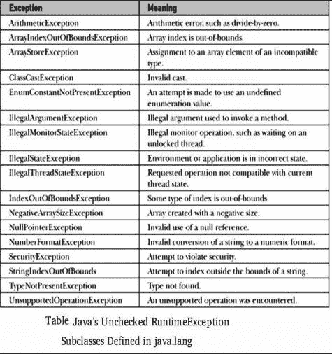

# 异常处理的一形式

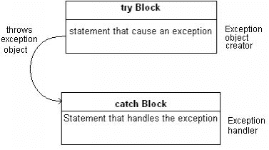

（异常处理机制）

### 语法：

```text
- - - - - - - - - - - -
- - - - - - - - - - - - -
try
{
    statement;          //产生异常
}
catch (Exception-type e)
{
    statement;          //处理异常
}
- - - - - - - - - - - -
- - - - - - - - - - - - -
```

# 多个 catch 子句

在某些情况下，一段代码可能会抛出多个异常。为了处理这种情况，你可以指定两个或多个 catch 子句，每个捕获不同类型的异常。


当异常抛出时，会顺序检查每个`catch`语句，并执行第一个与异常类型匹配的`catch`语句。在一个`catch`语句执行后，其他的将被跳过，执行在`try`/`catch`块之后继续。下面的示例捕获了不同的异常类型：

```java
// 多个 catch 语句。
class MultipleCatches {
    public static void main(String args[]) {
        try {
            int a = args.length;
            System.out.println("a = " + a);
            int b = 42 / a;
            int c[] = { 1 };
            c[42] = 99;
        } catch(ArithmeticException e) {
            System.out.println("Divide by 0: " + e);
        } catch(ArrayIndexOutOfBoundsException e) {
            System.out.println("Array index oob: " + e);
        }
        System.out.println("After try/catch blocks.");
    }
}
```

如果在没有命令行参数的情况下启动此程序，由于`a`等于 0，它会导致除以零异常。如果你提供了命令行参数并将`a`设置为大于 0 的值，它将跳过除法错误。但它会导致`ArrayIndexOutOfBoundsException`，因为`int`数组`c`的长度为 1，但程序尝试给`c[42]`赋值。

以下是以两种运行方式生成的输出：

```
C:\>MultipleCatches
a = 0
Divide by 0: java.lang.ArithmeticException: / zero
After try/catch blocks.
C:\>MultipleCatches
a = 1
Array index oob: java.lang.ArrayIndexOutOfBoundsException: 42
After try/catch blocks.
```

当你使用多个`catch`语句时，重要的是记住异常子类必须在任何父类之前。这是因为使用父类的`catch`语句会捕获该类型的异常以及其任何子类的异常。因此，如果子类排在父类之后，则永远无法被访问。此外，在 Java 中，不可达代码是一个错误。例如，考虑以下程序：此程序包含一个错误。在系列`catch`语句中，子类必须在父类之前。否则，将创建不可达代码并导致编译时错误。

```java
class SuperCatch {
    public static void main(String args[]) {
        try {
            int a = 0;
            int b = 2 / a;
        } catch(Exception e) {
            System.out.println("Generic catch.");
            /* 此 catch 永远不会被到达，因为 ArithmeticException 是 Exception 的子类。 */
            catch(ArithmeticException e) { // 错误 – 不可达
            
        }
    }
}
```

如果你尝试编译此程序，将收到错误消息，第二个`catch`语句是不可达的，因为异常已经被捕获。由于`ArithmeticException`是`Exception`的子类，第一个`catch`语句将处理所有基于`Exception`的错误，包括`ArithmeticException`。这意味着第二个`catch`语句将不会执行。要解决这个问题，请反转`catch`语句的顺序。

# 嵌套 try

`try`语句是可以嵌套的。也就是说，`try`语句可以位于另一个`try`块内部。每当进入`try`语句时，异常的上下文就会推入栈中。如果内部`try`语句没有特定异常的`catch`处理器，栈将回溯并检查下一个`try`语句的`catch`处理器。这将一直持续，直到某个`catch`语句成功，或者所有的嵌套`try`语句执行完毕。如果没有`catch`语句匹配，则 Java 运行时系统将处理该异常。

这是一个使用嵌套`try`语句的示例：当有多个`catch`语句时，被称为多个 catch 语句。

```java
try {
    statement; //产生异常
} catch(Exception-type-1 e) {
    statement 1; //处理异常 type1
} catch(Exception-type-2 e) {
    statement 2; //处理异常 type2
}
catch(Exception-type-n e) {
    statement n; //处理异常 n
}
```

多个 catch 语句示例

```java
class Test4 {
    public static void main(String args[]) {
        try {
            int a = 10, b = 2, d;
            System.out.println("Before Exception ");
            d = a / (b - c);
        } catch(Exception e) {
            System.out.println("After Exception ");
        }
    }
}
```

输出：


在这里我们没有捕获异常，因此程序将在显示消息 "Before Exception " 之后终止。现在我们使用异常处理解决了这个问题。

示例 11.5

```java
class ErrorTest5 {
    public static void main(String[] args) {
```

```java
int a=10, b=2, c=2, d;

try {
    System.out.println("Before Exception");
    d=a/(b-c);
    System.out.println("This Will Not Print");
} catch(ArithmeticException e) {
    System.out.println("After Exception");
    System.out.println("error : Division by zero");
}
```

Output:

```
Before Exception
After Exception
error : Division by zero
java.lang.ArithmeticException: / by zero
```

(Image: `image0241.jpeg`)

### 异常处理的优势

- 我们可以很容易地指定异常/错误将在哪里被处理。异常/错误会在运行时沿着调用栈向上传播，直到被外层的`try`块捕获。

- 由于可以使用完整的堆栈轨迹信息（stack trace），异常/错误发生的位置是确切的。这对于调试非常有帮助。

- 程序员获得了从错误/异常状态中恢复的机会。

- 将错误处理与正常的程序流分离，从而提高了代码的可读性和可维护性。

- 在 Java 中，无需测试是否会发生异常/错误。添加更多的错误/异常只需要添加`catch`子句，而无需触动原始程序流。

#### 异常类的层次结构

所有`Exception`/`Error`的根类是`throwable`，它是`object`类的直接子类。在 Java 中，异常/错误也是对象。

#### Error（错误）

`Error`类子类主要用于信号异常状态，例如：

1. `OutOfMemoryError`: Java 虚拟机内存耗尽，且垃圾器无法回收任何内存。

2. `StackOverflowError`: 解释器发生栈溢出。

通常情况下，这些错误是不可恢复的，不应该被处理。

#### Exception（异常）

`Exception`类的子类通常是可以恢复的。例如，`EOFException`表示我们打开的文件没有更多数据可读。`FileNotFoundException`则表示我们想要打开的文件在文件系统中不存在。

(Image: `image0242.jpeg`)

### 异常分为两种类型

#### 检查异常 (Checked Exception)

如果必须捕获某个异常，则它被称为检查异常。如果`try`块中可能发生检查异常且未被处理，程序将无法编译。编译器确保了如果一个方法可以直接或间接地抛出检查异常，那么该方法必须显式地处理它。该方法要么捕获异常并采取适当措施，要么将异常传递给其调用者。

注意：`Exception`及其所有子类（`runtime-exception`及其子类除外）都是检查异常，必须被捕获。

#### 非检查异常 (Unchecked Exception)

如果不必须捕获某个异常，则它称为非检查异常。即使未处理非检查异常，程序也可以编译。如果程序中发生了任何未处理的非检查异常，程序执行将在该点终止。但如果异常被处理，程序将不会因为异常而终止。

注意：`Error`及其所有子类都是非检查异常，不需要捕获。运行时异常（Runtime Exception）及其所有子类都是非检查异常。所有用户定义的异常都是检查异常。

#### Exception 类中的可用方法

| 方法 |  |

| :--- | :--- |

| `String getMessage()` | 获取与异常或错误相关的消息。 |

| `void printStackTrace()` | 打印堆栈轨迹，显示异常/错误发生的位置。 |

| `String toString()` | 显示异常/错误名称以及由`getMessage()`返回的消息。 |

### 示例 1.6

```java
class ErrorTest6 {
    public static void main(String[] arr) {
        try {
            int a=10, b=2, c=2, d;
            System.out.println("Before Exception");
            d=a/(b-c);
            System.out.println("This Will Not Print");
        } catch(ArithmeticException e) {
            System.out.println("After Exception");
            System.out.println("error : Division zero");
            System.out.println(e); // 调用了 toString()。
            e.printStackTrace();
        }
    }
}
```

Output:

```
Before Exception
After Exception
error : by zero
java.lang.ArithmeticException: / by zero
at ErrorTest6.main(ErrorTest6.java:0)
```

### 示例 1.7 多重捕获

```java
class ErrorTest7 {
    public static void main(String[] args) {
        try {
            int a=args.length;
            System.out.println("Before Exception");
            int b=58/a;
            int c[] = {1};
            c[47]=100;
            System.out.println("After Exception");
        } catch(ArithmeticException e) {
            System.out.println("Divide by zero "+e);
        } catch(ArrayIndexOutOfBoundsException e) {
            System.out.println("Array oob :"+e);
        }
        System.out.println("After try/catch block");
    }
}
```

Output 1: 当我们通过`java ErrorTest7`运行上述程序时：

```
Before Exception
Divide by zero : java.lang.ArithmeticException: / by zero
After try/catch block
```

Output 2: 当我们通过`java ErrorTest7 45`运行上述程序时：

```
Before Exception
Array oob: java.lang.ArrayIndexOutOfBoundsException: 47
After try/catch block
```

## 嵌套 try-catch

如果我们在另一个`try`块中使用`try`和`catch`语句，则被称为嵌套 try-catch。

## 语法

```java
try //外部 try
{
    try //内部 try
    {
        statement ;
    }
    catch1() //内部 catch
    {
        statement ;
    }
    catch2() //内部 catch
    {
        statement ;
    }
}
catch() //外部 catch
{
    statement ;
}
```

## 示例 11.8 嵌套的 try 和 catch-

```java
class Nested {
    public static void main(String args[]) {
        try {
            int a=args.length;
            int b=58/a;
            System.out.println("a="+a);
            try {
                if(a==1)
                    a=a/(a-a);
                if(a==2) {
                    int c[]={1};
                    c[42]=100;
                }
            } catch (ArrayIndexException e) {
                System.out.println("ArrayIndex oob "+e);
            }
        } catch (ArithmeticException e) {
            System.out.println(e.getMessage());
        }
    }
}
```

**输出 I:**

当我们运行`java ErrorTest8`执行上述程序时：`/ zero`

**输出 II:**

当我们运行`java ErrorTest8 10`执行上述程序时：`a=1 / by zero`

**输出 III:**

当我们运行`java ErrorTest8 10 20`执行上述程序时：`a=2`

`ArrayIndex oob java.lang.ArrayIndexOutOfBoundsException: 42`

# finally 语句

Java 支持另一种名为`finally`的语句，它可以用于处理未被任何之前的`catch`语句捕获的异常。`finally`块可以用于处理`try`块中生成的任何异常。无论是否发生错误，它都会被执行。它可以紧跟在`try`块之后，或者最后一个`catch`块之后，如下所示：

## 语法

```java
try
{
    // ...
}
catch (...)
{
    // ...
}
catch (...)
{
    // ...
}
finally
{
    // ...
}
```

### 示例 1.9 finally 语句


```java
class ErrorTest9 {
    public static void main(String args[]) {
        int a[] = {5,10};
        int b=5;
        try {
            int x=a[2]/b-a[1];
        } catch (ArithmeticException e) {
            System.out.println("Division Zero");
        } catch (ArrayIndexException e) {
            System.out.println("Array error");
        } catch (ArrayStoreException e) {
            System.out.println("Wrong Data Type");
        } finally //始终执行
        {
            System.out.println("Always Execute");
            int y=a[1]/a[0];
            System.out.println("y = "+y);
        }
    }
}
```

**输出：**

```
Array error
Always Execute
y = 2
```

到目前为止，只捕获的是 Java 运行时系统抛出的异常。然而，我们的程序也可以使用 `throw` 语句显式地抛出异常，`throw` 的通用形式所示：

```java
throw instance;
```

在这里，`instance` 必须是 `Throwable` 类型的对象或其子类。简单类型如 `int` 或 `char`，以及非 `Throwable` 类（如 `String` 和 `Object`）不能作为异常。我们有两种方法获取 `Throwable` 对象：使用 `catch` 子句中的参数，或者使用 `new` 操作符创建一个。执行流在 `throw` 语句之后立即停止；任何后续语句都不会执行。将检查最近的嵌套 `try` 块，查看是否有与异常类型匹配的 `catch` 语句。如果找到了匹配项，控制将转移到该语句。如果没有，则检查下一个外层的 `try` 语句，以此此类推。如果未找到匹配的 `catch`，默认处理程序将停止程序并打印堆栈跟踪。我们选取了一个创建并抛出异常的程序。捕获异常的处理器会将其重新抛给外层处理器。

## 示例 1.10

```java
class ErrorTest0 {
    int age;
    void setAge(int a) {
        if(a>0)
            age = a;
        else
            throw new NullPointerException("Invalid");
    }
    public static void main(String args[]) {
        ErrorTest0 a1 = new ErrorTest0();
        try {
            a1.setAge(20);
            a1.setAge(-10);
        } catch (NullPointerException e) {
            System.out.println(e.getMessage());
        }
    }
}
```

## throws

如果一个方法可能会产生它自身未处理的异常，则它必须指定这种行为，以便方法的调用者能够防范该异常。我们通过在方法的声明中包含一个 `throws` 子句来实现这一点。`throws` 子句列出了方法可能抛出的异常类型。

这对于所有检查异常（checked exceptions）来说都是必要的。方法可以抛出的所有异常都必须在 `throws` 子句中声明。如果没有声明，将导致编译错误。这是一个包含 `throws` 子句的方法声明的通用形式：

## 语法

```java
type method-name(parameter list)throws exception-list
{
    //方法正文
}
```

在这里，`exception list` 是方法可以抛出的异常的逗号分隔的列表。

## 示例 11.11

```java
import java.io.*;

class ErrorTest11
{
    int age;
    void setAge(int a) throws IOException
    {
        if(a>0)
            age = a;
        else
        {
            IOException e = new IOException("Invalid Age");
            throw e;
        }
    }
    public static void main(String args[])
    {
        ErrorTest11 a1 = new ErrorTest11();
        try
        {
            a1.setAge(20);
            a1.setAge(-10);
        }
        catch(IOException e)
        {
            System.out.println(e.getMessage());
        }
    }
}
```

输出：

```
Invalid Age
```

## 创建用户定义的异常子类

这非常，只需定义 `Exception` 的子类即可。我们的子类不需要实现任何内容。`Exception` 类本身没有定义任何方法。当然，它继承了由 `Throwable` 提供的方法。

尽管 Java 的内置异常处理了大多数错误，但你可能想要创建自己的异常类型来处理特定应用程序的情况。这非常简单：定义 `Exception` 的子类（当然，它是 `Throwable` 的子类）。你的子类实际上不需要实际实现任何内容——正是它们在类型系统中的存在，允许你将其作为异常使用。

`Exception` 类本身没有定义任何方法。它当然继承了由 `Throwable` 提供的那些方法。因此，所有异常（包括你创建的异常）都可以使用 `Throwable` 定义的方法。

`Exception` 定义了四个构造函数。其中两个支持链式异常，将在下一节中描述。另外两个显示在此处：`Exception()` 和 `Exception(String msg)`。第一种形式创建一个没有描述的异常。第二种形式允许你指定异常的描述。

尽管在创建异常时指定描述通常有用，但有时重写 `toString()` 更好。原因如下：`Throwable` 定义（并 `Exception` 继承）的 `toString()` 版本显示异常名称，后面跟着冒号，然后是你的描述。通过重写 `toString()`，你可以防止异常名称和冒号的显示。这使得输出更加整洁，在某些情况下是理想的。

## 示例 11.12

```java
class AgeException extends Exception
{
    AgeException(String msg)
    {
        super(msg);
    }
}

class ErrorTest12
{
    int age;
    void setAge(int a) throws AgeException
    {
        if(a>0)
            age = a;
        else
        {
            AgeException e = new AgeException("Invalid Age");
            throw e;
        }
    }
    public static void main(String args[])
    {
        ErrorTest12 a1 = new ErrorTest12();
        try
        {
            a1.setAge(20);
            a1.setAge(-10);
        }
        catch(AgeException e)
        {
            System.out.println(e.getMessage());
        }
    }
}
```

输出：

```
Invalid Age
```

下面的示例声明了一个 `Exception` 的新子类，然后使用该子类在方法中信号错误条件。它重写了 `toString()` 方法，允许显示经过精心定制的异常描述。

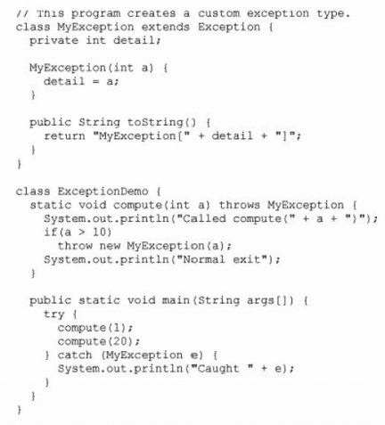

此示例定义了一个名为 `MyException` 的 `Exception` 子类。该子类非常简单：它只包含一个构造函数和一个重写的 `toString()` 方法，该方法显示异常的值。

`ExceptionDemo` 类定义了一个名为 `compute()` 的方法，该方法抛出一个 `MyException` 对象。当 `compute()` 的整数参数大于 10 时，会抛出异常。`main()` 方法为 `MyException` 设置了异常处理程序，然后用合法值（小于 10）和非法值调用 `compute()`，以展示代码的两种路径。

结果如下：

```
Called compute(1)
Normal exit
Called compute(20)
Caught MyException[20]
```

## 链式异常

链式异常功能允许我们将另一个异常与异常关联。第二个异常描述了第一个异常的原因。例如，想象一种情况：方法由于尝试除以零而抛出 `ArithmeticException`。然而，问题的实际原因是发生了 I/O 错误，这导致除数被设置不当。

尽管方法必须抛出 `ArithmeticException`（因为这是发生的错误），但我们可能还想让调用代码知道根本原因是 I/O 错误。

为了允许链式异常，Java 2 1.4 版本为 `Throwable` 类增加了两个构造函数和两个方法。

```java
Throwable(Throwable causeExc)
Throwable(String msg, Throwable causeExc)
```

在第一种形式中，`causeExc` 是发生的异常。第二种形式允许我们在指定原因异常的同时指定一个描述。这两个构造函数也被添加到了 `Error`、`Exception` 和 `RuntimeException` 类中。

添加到 `Throwable` 类的链式异常方法有 `getCause()` 和 `initCause()`。

```java
Throwable getCause()
Throwable initCause(Throwable causeExc)
```

`getCause()` 方法返回作为当前异常底层的异常。如果没有底层异常，则返回 `null`。`initCause()` 方法将 `causeExc` 与调用的异常关联起来，并返回该异常的引用。因此，我们可以在异常创建后为异常关联一个原因。然而，原因异常只能设置一次。

因此，每个异常对象我们只能调用一次 `initCause()`。此外，如果原因异常是通过构造函数设置的，那么我们无法再次使用 `initCause()` 方法来设置它。通常情况下，`initCause()` 用于为那些不支持前述两个额外构造函数的旧异常类设置原因。Java 大多数内置异常都没有定义这些额外的构造函数。因此，如果我们需要为这些异常添加异常链，我们将使用 `initCause()`。

链式异常并不是每个程序都需要的。然而，在了解底层原因有用的情况下，它们提供了一种优雅的解决方案。

## 示例 11.13

1. 类 `ErrorTest13`

2.

```java
class ErrorTest13 {
    int age;
    void setAge(int a) {
        if(a>0)
            age = a;
        else {
            NullPointerException e = new NullPointerException("Admission Failed");
            e.initCause(new ArithmeticException("Age is invalid"));
            throw e;
        }
    }
    public static void main(String args[]) {
        ErrorTest13 a1 = new ErrorTest13();
        try {
            a1.setAge(20);
            a1.setAge(-10);
        } catch(NullPointerException e) {
            System.out.println(e.getMessage());
            System.out.println(e.getCause());
        }
    }
}
```

**输出：**

```
Admission Failed
Age is Invalid
```


在这个示例中，顶层异常是 `NullPointerException`。它被添加了一个原因异常 `ArithmeticException`。当异常从 `setAge()` 抛出时，它被 `main()` 捕获。在那里，显示了顶层异常，随后是通过调用 `getCause()` 获取的底层异常。链式异常可以根据所需的深度持续延续。因此，原因异常本身也可以拥有原因。请注意，过长的异常链可能表明设计不当。链式异常并不是每个程序都需要的。然而，在了解底层原因有用的情况下，它们提供了一种优雅的解决方案。

## 三个新的 JDK 7 异常特性（已更新）

JDK 7 为异常系统增加了三个有趣且实用的特性。第一个特性自动化了资源（如文件）在不再需要时释放的过程。它是基于 `try` 语句的扩展形式，称为 `try-with-resources`，将在介绍介绍文件的后续章节中描述。第二个新特性称为 `multi-catch`（多异常捕获），第三个有时被称为 `final rethrow`（最终重新抛出）或更精确的重新抛出。这里描述了后两个特性。

`multi-catch` 特性允许两个或多个异常被同一个 `catch` 子句捕获。两个或多个异常处理器使用相同的代码序列并不罕见，尽管它们响应的是不同的异常。与其不得不单独捕获每种异常类型，现在可以使用单个 `catch` 子句来处理所有异常，而无需代码重复。要使用 `multi-catch`，用 OR 运算符分隔 `catch` 子句中的每个异常类型。每个 `multi-catch` 参数都是隐式 `final` 的（如果需要，你可以显式地指定 `final`，但没有必要）。因为每个 `multi-catch` 参数都是隐式的 `final`，所以它们不能被赋予新值。

这是一个使用 `multi-catch` 特性同时捕获 `ArithmeticException` 和 `ArrayIndexOutOfBoundsException` 的 `catch` 语句：

```java
catch(ArithmeticException | ArrayIndexOutOfBoundsException e) {
```

以下程序展示了 `multi-catch` 特性的用法：

```java
// 展示 JDK 7 的 multi-catch 特性。
class MultiCatch {
    public static void main(String args[]) {
        int a=10, b=0;
        int vals[] = { 1, 2, 3 };
        try {
            int result = a / b; // 生成一个 ArithmeticException
            // vals[10] = 19; // 生成一个 ArrayIndexOutOfBoundsException
            // 这个 catch 子句捕获了这两个异常。
        } catch(ArithmeticException | ArrayIndexOutOfBoundsException e) {
            System.out.println("Exception caught: " + e);
        }
        System.out.println("After multi-catch.");
    }
}
```

当尝试除零时，程序将生成一个 `ArithmeticException`。如果你注释掉除法语句并移除下一行的注释符号，就会生成一个 `ArrayIndexOutOfBoundsException`。这两个异常都被同一个 `catch` 语句捕获。

更精确的重新抛出特性限制了可以重新抛出的异常类型，仅限于关联的 `try` 块抛出的检查异常、未被之前的 `catch` 子句处理的且是参数子类或超类的异常。虽然这种能力可能并不经常需要，但现在已经可以使用。为了使更精确的重新抛出特性生效，`catch` 参数必须是有效的 `final` 的（即在 `catch` 块内部不能被赋值新值），或者显式声明为 `final`。

## 使用异常


异常处理提供了一种强大的机制，用于控制具有许多动态特征的程序。将`try`、`throw`和`catch`视为处理程序逻辑中错误和异常边界条件的清晰方式是很重要的。与其他使用错误返回码指示失败的语言不同，Java 使用异常。因此当方法可能失败时，让它抛出一个异常。

这是处理失败模式的一种更清晰的方法。最后一点：Java 的异常处理语句不应被视为远程跳转的通用机制。如果你这样做，只会混乱你的代码并使其难以维护。

## 理论问题

1. 什么是异常？

2. 如何定义`try`块？

3. 如何定义`catch`块？

4. 列举 Java 中可能发生的一些常见异常类型。给出示例。

5. 捕获所有类型的异常是必要的吗？

6. 一个`try`块可以配合多少个`catch`块？

7. 创建一个可能产生三种异常的`try`块，并结合必要的`catch`块来捕获并适当地处理这些异常。

8. 什么是`finally`块？它在什么时候以及使用？给出一个合适的示例。

9. 解释如何利用异常处理机制来调试程序。

    


## 多线程编程（第 12 章）

## 引言

线程是程序内部的控制流。线程与进程非常相似。事实上，线程也被称为轻量级进程。

### 线程对比进程

通常情况下，不同的进程占用不同的内存空间。当 CPU 从一个进程切换到另一个进程时，会保存当前运行进程的状态并恢复另一个进程的状态。在状态切换期间，没有进行任何有用的工作。为了最大化 CPU 的利用率，状态切换时间应该尽可能短。

线程也像独立的进程，但它们共享内存和状态。各个线程也有独立的状态，但与进程状态相比，这种状态非常小。状态可能只包含程序计数器和栈指针。因此，从一个线程切换到另一个线程所需的时间非常短。与进程相比，线程的上下文切换时间非常短。因此，在多线程的情况下，CPU 的利用率比多进程的情况下高。

### 多线程程序

多线程程序包含两个或多个可以并发运行的部分。此类程序的每个部分被称为线程，每个线程都定义了一条单独的执行路径。因此，多线程是多任务的一种特殊形式。

例如，一个程序可能有三个线程：

* 一个负责打印。

* 一个负责编辑。

* 一个负责从互联网下载文件。

所有这些线程可能都在并发运行，从而使 CPU 利用率最大化。

### 基于进程的多任务处理

大多数操作系统都允许我们同时运行两个或多个程序。这被称为基于进程的多任务处理。例如，我们可以运行一个 Java 程序，同时编辑一个 Word 文档。基于进程的多任务处理确保了大部分时间会有程序被执行，从而提高了 CPU 的利用率。

在基于进程的多任务处理中，程序是调度程序可以分发的代码最小单元。

### 基于线程的多任务处理

在基于线程的多任务环境中，线程是执行的最小单元。一个进程可以被分为若干个并发执行的线程。这允许我们在单个程序中并发处理多个任务。

例如，我们可以编辑一个 Word 文档的同时打印另一个文档。基于线程的多任务处理像基于进程的多任务处理一样提高了 CPU 利用率。但同时，它通过在单独线程中并发执行程序的不同部分，有效加快了单个程序的执行速度。

因此，基于进程的多任务处理处理的是“大局”，而基于线程的多任务处理的是细节。

### Java 线程模型

Java 运行时系统依赖线程完成许多工作，所有的类库在设计时都考虑了多线程。事实上，Java 使用线程来实现整个环境的异步化。这有助于通过防止 CPU 周期的浪费来减少低效。单线程系统使用一种称为带轮询的事件循环的方法。在这种模型中，单个控制线程在无限循环中运行，轮询单个事件队列以决定下一步做什么。在单线程环境中，当线程因为等待某些资源而阻塞（即暂停执行）时，整个程序都会停止运行。

Java 多线程的益处是消除了主循环/轮询机制。当 Java 程序中的线程被阻塞时，只有被阻塞的那个线程会暂停，所有其他线程继续运行。

### 线程生命周期（线程状态）

线程存在多种状态。线程可以处于运行状态。它一旦获得 CPU 时间就可以进入就绪状态。运行中的线程可以被挂起，这会暂时停止它的活动。被挂起的线程随后可以恢复，让它从中断的地方继续执行。线程在等待资源时可能会被阻塞。在任何时刻，线程都可以被终止，这将立即停止其执行。一旦终止，线程将无法恢复。

#### 1. 新生状态 (Newborn State)

当我们创建一个线程对象时，线程就出生了，处于新生状态。该线程尚未被调度运行。在此状态下，我们只能对它执行以下操作之一：

1. 使用`start()`调度它运行。

2. 使用`stop()`将其杀死。

如果被调度，它将进入可运行状态。如果在此状态下尝试使用任何其他方法，将抛出异常。

#### 2. 可运行状态 (Runnable State)

可运行状态意味着线程已准备好执行，并等待处理器的可用。也就是说，线程已经进入了等待执行的线程队列。如果所有线程的优先级相同，它们将以轮流的方式获得执行时间片。

放弃控制权的线程会进入队列末尾并再次等待轮到。然而，如果我们想让一个线程在轮到它之前放弃控制权给同优先级的线程，可以通过调用`yield()`实现。

#### 3. 运行状态 (Running State)

运行意味着处理器已经为线程分配了执行时间。运行中的线程在以下情况下可能会放弃控制权：

* 时间片结束。

* 被高优先级线程抢占。

* 让位，即自愿放弃控制权。

* 完成了执行。

* 被其他线程停止。

* 被`suspend()`挂起。被挂起的线程可以通过`resume()`恢复。这种方法在我们想要由于某些原因挂起线程一段时间但不想杀死它时非常有用。

* 被告知等待某些事件发生。这是通过`wait()`实现的。线程可以通过`notify()`重新调度运行。

* 正在执行 I/O 操作。

#### 4. 阻塞状态 (Blocked State)

当线程被阻止进入可运行状态并随后进入运行状态时，被称为被阻塞。这发生在线程为了挂起、睡眠或等待以满足某些需求时。阻塞的线程被认为“不可运行”但并未死亡，因此完全有资格再次运行。

#### 5. 死亡状态 (Dead State)

每个线程都有生命周期。运行中的线程在完成执行`run()`方法后结束生命。它有自然死亡。然而，我们在任何状态下向它发送停止消息来杀死它，导致过早死亡。

### 线程优先级 (Thread Priorities)

Java 为每个线程分配一个优先级，该优先级决定了对待其他线程的方式。线程优先级是整数，指定了一个线程相对于另一个线程的相对优先级。

作为一个绝对值，优先级是没有意义的；如果一个线程是唯一运行的线程，那么高优先级线程的运行速度不会比低优先级线程快。相反，线程的优先级用于决定何时从一个运行中的线程切换到下一个线程。这被称为上下文切换。决定何时切换的规则如下：

* 线程可以自愿地（自己）放弃控制权。这通过显式地让（yielding）、睡眠（sleeping）、阻塞（blocking）或等待 I/O（pending I/O）来实现。在这种情况下，将检查所有其他线程，通常会将 CPU 分给就绪运行的高优先级线程。

* 线程可以被高优先级线程抢占。在这种情况下，一个不让出处理器的低优先级线程无论正在做什么，都会被一个高优先级线程简单地抢占。基本上，只要高优先级线程想要运行，它就会运行。这被称为抢占式多任务处理。

* 某些操作系统支持非抢占式优先级调度。在这种情况下，高优先级线程只有在低优先级线程完成时才有机会运行。

* 当两个优先级相同的线程竞争 CPU 周期时，情况会变得有点复杂。对于像`windows98`这样的操作系统，等优先级的线程必须自愿地（自己）让出（放弃）控制权给同级线程。如果它们这样做，其他线程将不会运行。

注意：操作系统切换相同优先级线程的方式差异可能会产生问题。

## 同步

由于多线程为我们的程序引入了异步行为，因此在需要时，必须有一种方法让我们强制执行同步。例如，如果我们想让两个线程通信并共享一个复杂的数据结构（如链表），我们需要某种方法来确保它们不会发生冲突。

也就是说，我们必须防止一个线程在另一个线程正在读取数据时进行写入操作。Java 使用监视器（monitor）进行线程间同步。我们可以将监视器想象为一个只能容纳一个线程的小盒子。一旦线程进入监视器，监视器就可以用来保护共享资源不被多个线程同时操作。

大多数多线程系统以对象的形式暴露，我们的程序必须显式地获取并锁定。Java 提供了一个更简洁的解决方案。

并没有`monitor`类，相反，每个对象都有自己的隐式监视器，当调用对象的某个`synchronized`方法时，该监视器会自动进入。一旦线程进入`synchronized`方法，任何其他线程都无法调用该对象上的任何其他`synchronized`方法。这使我们能够编写非常清晰且简洁的多线程代码，因为同步支持内置在语言中。

## 消息传递

使用大多数其他语言进行编程时，我们必须依赖操作系统建立线程之间的通信。

这无疑增加了开销。相比之下，Java 提供了一种简洁、低成本的方法让两个或多个线程相互通信，通过调用所有对象都具有的预定义方法。Java 的消息传递系统允许线程进入对象的`synchronized`方法，并在那里等待，直到其他某些线程显式通知其退出。

## Thread 类和 Runnable 接口

Java 的多线程系统构建在`Thread`类、其方法及其伴侣接口`Runnable`之上。该类属于`java.lang`包，因此不需要显式导入。

`Thread`封装了一个执行线程，由于我们无法直接引用运行线程的内部状态，我们通过其代理（即创建它的`Thread`实例）来处理它。要创建一个新线程，我们的程序将扩展`Thread`类或实现`Runnable`接口。`Thread`类定义了几个有助于管理线程的方法：

| 方法 | 描述 |
| :--- | :--- |
| `String getName()` | 返回此线程的名字 |
| `int getPriority()` | 返回此线程的优先级 |
| `boolean isAlive()` | 测试此线程是否仍在运行 |
| `void join()` | 等待此线程死亡（终止） |
| `void run()` | 如果此线程是使用独立的`Runnable`对象构造的，则调用该`Runnable`对象的`run`方法；否则，此方法什么都不做并返回；如果扩展了类并在子类中重写了`run()`方法，则调用被重写的`run()`方法。 |
| `void setName(String name)` | 将此线程的名字更改为参数名 |
| `static void sleep(long millis) throws InterruptedException` | 使当前执行的线程睡眠指定的毫秒数（临时停止执行）。(1 sec = 1000ms) |
| `static void sleep(long millis, int nanos) throws InterruptedException` | 使当前执行的线程睡眠指定的毫秒加上指定的纳秒数（停止执行）。 |
| `void start()` | 使此线程开始执行，Java 虚拟机调用此线程的`run`方法。 |
| `static void yield()` | 使当前执行的线程对象临时暂停并允许其他线程执行。 |
| `static Thread currentThread()` | 返回当前执行线程对象的引用。 |

### 主线程

当一个 Java 程序启动时，一个线程会立即开始。这通常被称为我们程序的主线程，因为它是程序启动时执行的那个线程。主线程是创建“子”线程的线程。虽然主线程是在程序启动时创建的，但可以通过`Thread`对象进行控制。要这样做，我们必须通过调用`currentThread()`获取它的引用，它是`Thread`类的公共静态成员。该方法返回调用它的方法的线程引用。一旦获取了主方法的引用，我们就可以像控制其他线程一样控制它。

示例 2.1 下面的示例演示了如何获取主线程的引用并使用`Thread`类的方法访问其属性。

```java
class CurrentTest {
    public static void main (String args[]) {
        Thread t = Thread.currentThread();
        System.out.println("Current thread:" + t);
        System.out.println("Name:"+ t.getName());
        System.out.println("Priority:"+ t.getPriority());
        t.setName("MyThread");
        t.setPriority(Thread.MAX_PRIORITY);
        System.out.println("After name and priority change :" + t);
        System.out.println("Name:" + t.getName());
        System.out.println("Priority:" + t.getPriority());
        for (int n=1; n<=5; n++) {
            System.out.println(n);
            try {
                Thread.sleep(1000);
            } catch (InterruptedException e) {
                System.out.println("Main thread interrupted");
            }
        }
    }
}
```

注意 1：`Thread`类中的`sleep()`方法可能会抛出`InterruptedException`，这是一个检异常（checked exception）。如果其他线程想要中断正在睡眠的这个线程，就会发生这种情况。

注意 2：注意当`t`（线程引用）作为`println()`的参数时产生的输出。将按顺序显示：线程名称、其优先级以及线程组名称。它的优先级是 5，这是默认值，而`main`也是该线程所属线程组名称。线程组是一个控制整个线程集合状态的数据结构。

## 创建线程

在最通用的意义上，我们通过实例化`Thread`类型的对象来创建线程。Java 识别了两种实现这一目标的方法：

1. 我们可以实现`Runnable`接口。

2. 我们可以扩展`Thread`类本身。

## 实现 Runnable

创建线程最简单的方法是创建一个实现`Runnable`接口的类。要实现`Runnable`，类只需要实现一个名为`run()`的方法。

```java
public void run()
```

在`run()`方法内部，我们将定义构成新线程的代码。`run()`可以调用其他方法、使用其他类并声明变量，就像主线程一样。

唯一的区别是`run()`为我们程序中的另一个并发执行的线程建立了入口点。该线程会在`run()`返回时结束。

在我们创建了一个实现`Runnable`的类之后，我们将在该类内部使用以下构造函数之一来实例化`Thread`类型的对象：

```java
Thread(Runnable threadObj)
Thread(Runnable threadObj, String threadName)
```

这里`threadObj`是被调用`run`方法的对象，`threadName`是新线程的名称。在新线程创建后，在我们调用`start()`方法之前，它将不会开始运行。

`start()`方法将线程放入就绪队列（可运行状态）。每当线程被调度时，它的执行将从`run()`方法开始。

### 示例 12.2

```java
class A implements Runnable {
    public void run() {
        for(int i=1;i<=5;i++) {
            System.out.println("Child Thread:" + i);
        }
        System.out.println("Exiting child thread");
    }
}

class RunnableTest {
    public static void main(String args[]) {
        A a1=new A();
        Thread t1 = new Thread(a1,"Demo Thread");
        t1.start();
        System.out.println("Main thread exiting");
    }
}
```

Output:

```
Main thread exiting
Child Thread:1
Child Thread:2
Child Thread:3
Child Thread:4
Child Thread:5
Exiting child thread
```

### 示例 12.3


```java
class A implements Runnable {
    Thread t;
    A() {
        t= new Thread(this, "Demo Thread");
        System.out.println("Child thread: "+ t);
        t.start();
    }
    public void run() {
        for (int i=1; i<=5; i++) {
            System.out.println("Child Thread: + i );
            try {
                Thread.sleep(500);
            } catch (InterruptedException e) {
                System.out.println(e);
            }
        }
        System.out.println("Exiting thread");
    }
}

class RunnableTest2 {
    public static void main (String args ) {
        A a1=new A();
        for (int i=1; i<=5; i++) {
            System.out.println ("Main Thread:"+ i);
            try {
                Thread.sleep (100);
            } catch(InterruptedException e) {
                System.out.println("main thread interrupted");
            }
        }
        System.out.println("End of Main thread");
    }
}
```

Output:

```
Child thread: Thread[Demo Thread,5,main]
Main Thread:1
Child Thread: 1
Child Thread: 2
Main Thread:2
Child Thread: 3
Child Thread: 4
Main Thread:3
Child Thread: 5
Exiting Child thread
Main Thread:4
Main Thread:5
End of Main thread
```

## 扩展 `Thread` 类

创建线程的另一种方法是创建一个扩展 `Thread` 的类，然后创建该类的实例。扩展类必须重写 `run()` 方法，这是新线程的入口点。它还必须调用 `start()` 来开始新线程的执行。

### 示例 12.4

```java
class A extends Thread {
    A( ) {
        super ("Test");
        System.out.println ("Child thread:" + this);
        start();
    }
    public void run () {
        for (int i=1; i<=5; i++) {
            System.out.println("Child Thread:"+i);
            try {
                Thread.sleep(500);
            }
        }
    }
}
```

```java
        System.out.println ("Exiting Child thread");
    }
}

class ThreadTest {
    public static void main(String args[]) {
        new A();
        for (int i=1; i<=5; i++) {
            System.out.println("Main Thread: "+i);
            try {
                Thread.sleep(100);
            } catch (InterruptedException e) {
                System.out.println("Main thread interrupted");
            }
        }
        System.out.println ("Main thread exiting");
    }
}
```

输出:

```
Child thread:Thread[Testing Thread,5,main]
Main Thread: 1
Child Thread:1
Child Thread:2
Main Thread: 2
Child Thread:3
Child Thread:4
Main Thread: 3
Child Thread:5
Exiting Child thread
Main Thread: 4
Main Thread: 5
Main thread exiting
```

注：如果 `Thread` 没有被分配任何名称，它将是：`Thread-1`、`Thread-2`、`Thread-3` 等。

### 选择方法：

`thread` 类定义了几个可以被派生类重写的方法。在这些方法中，唯一必须重写的是 `run()`。当然，这与我们实现 `Runnable` 接口时需要的方法相同。

许多 Java 程序员认为，只有当类被某种方式进行增强或修改时才应该被扩展。因此，如果我们不重写 `Thread` 的其他任何方法，最好的办法可能是简单实现 `Runnable` 接口。

### 创建多个线程：

示例 12.5

```java
class A implements Runnable {
    String name;
    Thread t;
    A(String threadName) {
        name=threadName;
        t=new Thread(this, name);
        System.out.println("Child thread:"+t);
        t.start();
    }
    public void run() {
        for(int i=1;i<=5;i++) {
            System.out.println(name + ":"+ i );
            try {
                Thread.sleep(1000);
            } catch(InterruptedException e) {
                System.out.println(e);
            }
        }
        System.out.println(name+ "Exiting");
    }
}

class MultiThreadTest {
    public static void main(String[] ) {
        A a1=new("One");
        A a2=new("Two");
        A a3=new("Three");
        try {
            Thread.sleep(10000);
        } catch(InterruptedException e) {
            System.out.println("main thread interrupted");
        }
        System.out.println ("Main thread exiting");
    }
}
```

输出:

```
Child thread:Thread[One,5,main]
Child thread:Thread[Two,5,main]
Child thread:Thread[Three,5,main]
One:1
Two:1
Three:1
One:2
Two:2
Three:2
One:3
Two:3
Three:3
One:4
Two:4
Three:4
One:5
Two:5
Three:5
OneExiting
TwoExiting
ThreeExiting
Main thread exiting
```

### 使用 `isAlive()` 和 `join()` 方法强制排序：

通常我们希望主线程最后结束。实现此点的一种方法是在 `main` 方法中调用 `sleep()`。这相当粗糙。有两种方法可以判断一个线程是否已完成。首先，我们可以在线程上调用 `isAlive()`。该方法由 `Thread` 定义，其通用形式为：`boolean isAlive()`。如果调用该方法的线程仍在运行，则 `isAlive()` 返回 `true`，否则返回其他值。虽然 `isAlive()` 有时很有用，但我们通常用于等待线程完成的方法是 `join()`，此处所示：`void join() throws InterruptedException`。该方法会等待直到调用它的线程终止。`join()` 的其他形式允许我们指定等待指定线程终止的最长时间。接下来的示例使用了 `join()` 来确保主线程是最后一个停止的线程。它还演示了 `isAlive()` 方法。

示例 2.6

```java
class A implements Runnable {
    String name;
    Thread t;
    A(String threadName) {
        name=threadName;
        t=new Thread(this, name);
        System.out.println("Child thread:"+t);
        t.start();
    }
    public void run() {
        for(int i=1;i<=5;i++) {
            System.out.println(name + ":"+ i );
            try {
                Thread.sleep(1000);
            } catch(InterruptedException e) {
                System.out.println(e);
            }
        }
        System.out.println(name+ "Exiting");
    }
}
```

```java
        }
    }
    System.out.println(name + "Exiting");
    }
}
class DemoJoin {
    public static void main(String args[]) {
        A ob1 = new A("One");
        A ob2 = new A("Two");
        A ob3 = new A("Three");
        System.out.println("Thread One is alive?:" + ob1.t.isAlive());
        System.out.println("Thread Two is alive?:" + ob2.t.isAlive());
        System.out.println("Thread Three is alive?:" + ob3.t.isAlive());
        try {
            ob3.t.join();
            ob2.t.join();
            ob1.t.join();
        } catch (InterruptedException e) {
            System.out.println("main interrupted");
        }
        System.out.println("Thread One is alive?:" + ob1.t.isAlive());
        System.out.println("Thread Two is alive?:" + ob2.t.isAlive());
        System.out.println("Thread Three is alive?:" + ob3.t.isAlive());
        System.out.println("Main thread exiting");
    }
}
```

输出：

```text
Child thread:Thread[One,5,main]
Child thread:Thread[Two,5,main]
Child thread:Thread[Three,5,main]
Thread One is alive?:true
Thread Two is alive?:true
Thread Three is alive?:true
```

```java
class Clicker implements Runnable {
    long click = 0;
    Thread t;
    volatile boolean running = true;
    Clicker(int p) {
        t = new Thread(this);
        t.setPriority(p);
    }
    public void run() {
        while (running) {
            click++;
        }
    }
    void stop() {
        running = false;
    }
    void start() {
        t.start();
    }
}
class HiLoPri {
    public static void main(String args[]) {
        Thread.currentThread().setPriority(Thread.MAX_PRIORITY);
        Clicker hi = new Clicker(Thread.NORM_PRIORITY + 1);
        Clicker lo = new Clicker(Thread.NORM_PRIORITY - 1);
        lo.start();
        hi.start();
        try {
            Thread.sleep(10000);
        } catch (InterruptedException e) {
            System.out.println(e);
        }
        lo.stop();
        hi.stop();
        try {
            lo.join();
            hi.join();
        } catch (InterruptedException e) {
            System.out.println(e);
        }
        System.out.println("Low : " + lo.click);
        System.out.println("High : " + hi.click);
    }
}
```

高优先级线程获取了超过 98% 的 CPU 时间。但线程仍然发生了上下文切换，尽管它们既没有主动释放 CPU，也没有因为 I/O 而阻塞。当在非抢占式系统中运行相同的程序时，将获得不同的结果。

注意：变量 `running` 前面带有 `volatile` 关键字，以确保在每次迭代以下循环时都会检查 `running` 的值。

```java
while (running) {
    click++;
}
```

如果不使用 `volatile`，Java 可以自由对循环进行优化，创建一个 `running` 的局部副本。使用 `volatile` 可以防止这种优化，告诉 Java `running` 可能会以即时代码中无法直接看出的方式发生变化。

## 同步

当两个或多个线程需要访问共享资源时，它们需要某种方法来确保资源在同一时刻只有一个线程使用。实现这一目标的过程被称为同步。

同步的核心是监视器（monitor）概念（也称为信号量）。监视器是一个用作互斥锁的对象。在给定时刻只有一个线程可以拥有监视器。

当一个线程获取锁时，就它进入了监视器。所有其他尝试进入被锁监视器的线程都将被挂起，直到第一个线程退出监视器。这些其他线程被称为等待监视器。拥有监视器的线程如果愿意，可以重新进入同一个监视器。我们可以通过两种方式之一同步我们的代码：

(i) 使用 `synchronized` 方法

(ii) 使用 `synchronized` 语句

## 使用 `synchronized` 方法

在 Java 中同步是非常简单的，因为所有对象都有与其关联的隐式监视器。要进入对象的监视器，只需调用用 `synchronized` 关键字修改的方法。当一个线程在同步方法内部时，所有尝试在同一实例上调用它（或任何其他同步方法）的其他线程都必须 `wait()`。要退出监视器并将对象的控制权交给下一个等待线程，监视器的所有者只需从同步方法返回即可。

### 示例 12.8

以下程序说明了三个线程在并发运行时，其生成的输出会混杂。


```java
class A {
    void display(String msg) {
        System.out.print("[" + msg);
        try {
            Thread.sleep(1000);
        } catch (InterruptedException e) {
            System.out.println(e);
        }
        System.out.println("]");
    }
}

class B implements Runnable {
    A obj;
    String msg;
    Thread t;
    B(A obj1, String m) {
        msg = m;
        obj = obj1;
        t = new Thread(this);
        t.start();
    }
    public void run() {
        obj.display(msg);
    }
}

class Synch1 {
    public static void main(String args[]) {
        A a1 = new A();
        B b1 = new B(a1,"Hello");
        B b2 = new B(a1,"World");
        B b3 = new B(a1,"Matrix");
    }
}
```

输出：

```
[Hello[World[Matrix]
]
]
```

正如我们所看到的，通过调用 `sleep()`，`display()` 方法允许执行切换到另一个线程。这导致了三个字符串字符串的混杂。在这个程序中，没有任何机制可以防止三个线程在同一时间对同一个对象调用同一个方法。

这被称为竞态条件（race condition），因为这三个线程正在相互竞争以完成该方法。这个示例使用 `sleep()` 来使效果可重复且明显。在大多数情况下，竞态条件更加微妙且难以预测，因为我们无法确定上下文切换何时发生。这可能导致程序在一次运行时是正确的，而在下次运行时是错误的。

为了做到，我们只需要在方法 `display()` 的定义之前加上 `synchronized` 关键字。这可以防止任何线程在另一个线程正在使用它时进入 `display()`。

## 示例 12.9

```java
class A {
    synchronized void display(String msg) {
        System.out.print("[" + msg);
        try {
            Thread.sleep(100);
        } catch (InterruptedException e) {
            System.out.println(e);
        }
        System.out.println("]");
    }
}

class B implements Runnable {
    A obj;
    String msg;
    Thread t;
    B(A obj1, String m) {
        msg = m;
        obj = obj1;
        t = new Thread(this);
        t.start();
    }
    public void run() {
        obj.display(msg);
    }
}

class Synch2 {
    public static void main(String args[]) {
        A a1 = new A();
        B b1 = new B(a1,"Hello");
        B b2 = new B(a1,"World");
        B b3 = new B(a1,"Matrix");
    }
}
```

虽然在我们创建的类中使用 `synchronized` 方法是实现同步的一种简单且有效的方法，但它在所有情况下都不起作用。为了理解为什么，请考虑以下情况：假设我们要同步对一个并非为多线程访问设计的类对象的访问。也就是说，该类没有使用 `synchronized` 方法。此外，该类不是我们创建的，而是由第三方创建的；我们无法访问其源代码。因此，我们无法在类内部适当的方法上添加 `synchronized` 修饰符。那么如何通过 `synchronized` 实现对该类对象的访问呢？

解决方案是将对该类定义的方法调用放在 `synchronized` 块内部。`synchronized` 语句的一般形式如下：

```java
synchronized(object)
{
    //需要同步的语句
}
```

在这里，`object` 是指向被同步对象的引用。`synchronized` 块确保了对 `object` 成员方法的调用只有在当前线程成功进入 `object` 的监视器（monitor）时才会发生。

## 示例 12.10

上一个示例的变体版本，在 `run()` 方法中使用 `synchronized` 块：

```java
class A
{
    void display(String msg) {
        System.out.print("[" + msg);
        try {
            Thread.sleep(1000);
        } catch(InterruptedException e) {
            System.out.println(e);
        }
        System.out.println("]");
    }
}

class B implements Runnable
{
    A obj;
    String msg;
    Thread t;
    B(A obj1, String m) {
        msg = m;
        obj = obj1;
        t = new Thread(this);
        t.start();
    }
    public void run() {
        synchronized(obj) {
            obj.display(msg);
        }
    }
}

class Synch3
{
    public static void main(String args[]) {
        A a1 = new A();
        B b1 = new B(a1,"Hello");
        B b2 = new B(a1,"World");
        B b3 = new B(a1,"Matrix");
    }
}
```

输出：

```
[Hello]
[World]
[Matrix]
```

## 多线程在不同对象上调用同一个方法

### 示例 12.11

线程可以并发地对类的不同对象调用同一个 `synchronized` 实例方法，因为每个对象都有不同的锁。这再次导致输出混杂。

```java
class A
{
    synchronized void display(String msg) {
        System.out.print("[" + msg);
        try {
            Thread.sleep(100);
        } catch(InterruptedException e) {
            System.out.println(e);
        }
        System.out.println("]");
    }
}

class B implements Runnable
{
    A obj;
    String msg;
    Thread t;
    B(A obj1, String m) {
        msg = m;
        obj = obj1;
        t = new Thread(this);
        t.start();
    }
    public void run() {
        obj.display(msg);
    }
}

class Synch4
{
    public static void main(String args[]) {
        A a1 = new A();
        A a2 = new A();
        A a3 = new A();
        B b1 = new B(a1,"Hello");
        B b2 = new B(a2,"World");
        B b3 = new B(a3,"Matrix");
    }
}
```

输出：

```
[Hello[World[Matrix]
```

## 静态同步方法

### 示例 12.2

在下面的示例中，尽管我们在不同对象上调用了 `display()` 方法，但输出并没有错乱。原因是 `display()` 是 `static` 的，因此锁是针对整个类 `A` 的，而不是针对单个对象。

```java
class A
{
    static synchronized display(String msg) {
        System.out.print("[" + msg);
        try {
            Thread.sleep(1000);
        } catch(InterruptedException e) {
            System.out.println(e);
        }
        System.out.println("]");
    }
}

class B implements Runnable
{
    A obj;
    String msg;
    Thread t;
    B(A obj1, String m) {
        msg = m;
        obj = obj1;
        t = new Thread(this);
        t.start();
    }
    public void run() {
        obj.display(msg);
    }
}

class Synch5
{
    public static void main(String args[]) {
    }
}
```

```java
A a1 = new A();
A a2 = new A();
A a3 = new A();
B b1 = new B(a1, "Hello");
B b2 = new B(a2, "World");
B b3 = new B(a3, "Matrix");
```

**输出：**

```
[Hello]
[World]
[Matrix]
```

## 线程间通信

如前所述，多线程通过将我们的任务划分为离散的逻辑单元，取代了事件循环编程。线程还证明了一个次要优势：它们消除了轮询（polling）。轮询通常通过一个循环实现，用于反复检查某些条件。一旦条件为真，就会采取相应的行动。这会浪费 CPU 周期。例如，考虑队列问题，一个线程在生产数据，另一个线程在消费数据。为了让该问题产生交互，假设生产者必须等待消费者完成任务才能生成更多数据。在轮询系统中，消费者在等待生产者生产数据时会浪费许多 CPU 周期。一旦生产者完成工作，它就会开始轮询，再次浪费更多的 CPU 周期来等待消费者完成，以此此类推。

为了避免轮询，Java 通过 `wait()`、`notify()` 和 `notifyAll()` 方法包含了一种优雅（智能）的进程间通信机制。这些方法被实现为 `Object` 类中的 `final` 方法，因此所有类都拥有它们。这三个方法只能在 `synchronized` 上文中调用。使用这些方法有某些规则。`wait()` 通知调用线程释放监视器并睡眠，直到其他线程进入同一个监视器并调用 `notify()`。`notify()` 唤醒一个在同一对象上调用过 `wait()` 的线程（通常是第一个）。`notifyAll()` 唤醒所有在同一对象上调用过 `wait()` 的线程。通常，优先级高的线程会先运行。这些方法在 `Object` 中声明，如下所示：

```java
final void wait() throws InterruptedException
final void notify()
final void notifyAll()
```

### 示例

下面的示例程序实现了一个简单的生产者/消费者问题。它由四个类组成：`Q`，我们试图同步的队列；`Producer`，产生队列目的线程对象；`Consumer`，消费队列目的线程对象；以及 `PC`，创建 `Producer` 和 `Consumer` 的微型类。

```java
class Q {
    int n;
    synchronized int get() {
        System.out.println("Got:"+n);
        return n;
    }
    synchronized void put(int n) {
        this.n=n;
        System.out.println("Put:"+n);
    }
}
class Producer implements Runnable {
    Q q1;
    Producer(Q q2) {
        q1=q2;
        new Thread("Producer").start();
    }
    public void run() {
        int i=0;
        while(true) {
            q1.put(++i);
        }
    }
}
class Consumer implements Runnable {
    Q q1;
    Consumer(Q q2) {
        q1=q2;
        new Thread("Consumer").start();
    }
    public void run() {
        while (true) {
            q1.get();
        }
    }
}
class PC {
    public static void main(String args[]) {
        Q q1=new Q();
        new Producer(q1);
        new Consumer(q1);
        System.out.println("Press Control-C to stop");
    }
}
```

尽管 `Q` 上的 `put()` 和 `get()` 是 `synchronized` 的，但没有什么能阻止生产者运行消费者，也没有能阻止消费者两次消费同一个值。因此，我们可能会得到如下的错误输出：

```
Press Control-C to stop
Put:1
Put:2
Put:3
Put:4
Put:5
Put:6
Put:7
Got:7
Got:7
Got:7
Got:7
Got:7
Put:8
Put:9
Put:10
Put:11
Put:12
Got:4
Got:5
Got:5
Got:5
Got:5
```

编写此程序的正确方法是使用 `wait()` 和 `notify()` 在两个方向上进行信号，如下所示：

```java
class Q {
    int n;
    boolean valueSet=false;
    synchronized int get() {
        if(!valueSet) {
            try {
                wait();
            } catch (InterruptedException e) {
                System.out.println(e);
            }
        }
        System.out.println("Got :" + n);
        valueSet = false;
        notify();
        return n;
    }
    synchronized void put (int n) {
        if(valueSet) {
            try {
                wait();
            } catch (InterruptedException e) {
                System.out.println(e);
            }
        }
    }
}
```


```java
        }

        this.n = n;
        valueSet = true;
        System.out.println("Put :" + n);
        notify();
    }
}

class Producer implements Runnable {
    Q q1;

    Producer(Q q2) {
        q1 = q2;
        new Thread(this, "Producer").start();
    }

    public void run() {
        int i = 0;
        while (true) {
            q1.put(++i);
        }
    }
}

class Consumer implements Runnable {
    Q q1;

    Consumer(Q q2) {
        q1 = q2;
        new Thread(this, "consumer").start();
    }

    public void run() {
        while (true) {
            q1.get();
        }
    }
}

class PC2 {
    public static void main(String args[]) {
        System.out.println("Press Control-C to stop");
        Q q1 = new Q();
        new Producer(q1);
        new Consumer(q1);
    }
}
```

**输出：**

```text
Press Control-C to stop
Put:1
Got:1
Put:2
Got:2
Put:3
Got:3
Put:4
Got:4
Put:5
Got:5
```

### 死锁

一种我们需要避免的、与多任务相关的特殊错误是死锁。当两个线程对一对同步对象产生循环依赖时，就会发生死锁。例如，假设一个线程进入对象 `X` 的监视器，另一个线程进入对象 `Y` 的监视器。如果 `X` 中的线程尝试调用 `Y` 上的任何同步方法，它将预期地阻塞。然而，如果 `Y` 中的线程反过来尝试调用 `X` 上的任何同步方法，该线程将永远等待，因为为了访问 `X`，它必须释放对 `Y` 的锁，以便第一个线程能够完成。死锁是一种很难调试的错误，因为：

1. 通常情况下，当线程以正确的方式进行时间切片时它很少发生。
2. 它可能涉及两个以上的线程和对象。

### 示例 1

```java
class A {
    synchronized void foo(B b1) {
        System.out.println("Method called and then blocked");
        try {
            Thread.sleep(1000);
        } catch (InterruptedException e) {
            System.out.println(e.getMessage());
        }
        System.out.println("Trying to call b1.last()");
        b1.last();
    }

    synchronized void last() {
        System.out.println("This not be printed");
    }
}

class B {
    synchronized void bar(A a1) {
        System.out.println("Method called and then blocked");
        try {
            Thread.sleep(1000);
        } catch (InterruptedException e) {
            System.out.println(e.getMessage());
        }
        System.out.println("Trying to call a1.last()");
        a1.last();
    }

    synchronized void last() {
        System.out.println("This not be printed");
    }
}

class DeadLock implements Runnable {
    A a1 = new A();
    B b1 = new B();

    DeadLock() {
        Thread t = new Thread(this);
        t.start();
        a1.foo(b1);
    }

    public void run() {
        b1.bar(a1);
    }

    public static void main(String args[]) {
        new DeadLock();
    }
}
```

**输出：**

```text
Method called and then blocked
Method called and then blocked
Trying to call b1.last()
Trying to call a1.last()
```

### 示例 2

在 Java 2 之前，`suspend()` 和 `resume()` 由 `Thread` 定义，用于暂停和重启线程的执行。它们的形式如下：

```java
class A implements Runnable {
    String name;
    Thread t;

    A(String threadname) {
        name = threadname;
        t = new Thread(this, name);
        System.out.println("Child Thread: " + t);
        t.start();
    }

    public void run() {
        for (int i = 1; i <= 30; i++) {
            System.out.println(name + ": " + i);
            try {
                Thread.sleep(100);
            } catch (InterruptedException e) {
                System.out.println(e);
            }
        }
        System.out.println(name + " exiting");
    }
}

class SuspendResume {
    public static void main(String args[]) {
        A ob1 = new A("One");
        A ob2 = new A("Two");

        try {
            Thread.sleep(100);
            ob1.t.suspend();
            System.out.println("Suspending one");
            Thread.sleep(100);
            ob1.t.resume();
            System.out.println("Resuming one");
            ob2.t.suspend();
            System.out.println("Suspending two");
            Thread.sleep(100);
            ob2.t.resume();
            System.out.println("Resuming two");
        } catch (InterruptedException e) {
            System.out.println(e);
        }

        try {
            System.out.println("Waiting for threads to finish");
            ob1.t.join();
            ob2.t.join();
        } catch (InterruptedException e) {
            System.out.println(e);
        }
    }
}
```

**输出：**

```text
Child Thread: Thread[One,5]
Child Thread: Thread[Two,5]
One: 1
Two: 1
One: 2
Two: 2
One: 3
Two: 3
One: 4
Two: 4
One: 5
Two: 5
One: 6
Two: 6
One: 7
Two: 7
One: 8
Two: 8
One: 9
Two: 9
One: 10
Two: 10
Suspending one
Two: 11
Two: 12
Two: 13
Two: 14
Two: 15
Two: 16
Two: 17
Two: 18
Two: 19
Two: 20
Resuming one
Suspending two
One: 11
One: 12
One: 13
One: 14
One: 15
One: 16
One: 17
One: 18
One: 19
One: 20
Resuming two
One: 21
Two: 21
One: 22
Two: 22
One: 23
Two: 23
One: 24
Two: 24
One: 25
Two: 25
One: 26
Two: 26
One: 27
Two: 27
One: 28
Two: 28
One: 29
Two: 29
One: 30
Two: 30
One exiting
Two exiting
Waiting for threads to finish
```

注意：`thread` 类还定义了一个名为 `stop()` 的方法来停止线程。其签名所示：

```java
final void stop()
```

一旦线程被停止，就无法使用 `resume()` 方法重新启动。

### 使用 Java 2 挂起、恢复和停止线程

**示例 12.17：**

```java
class A implements Runnable {
    String name;
    Thread t;
    boolean suspendFlag;

    A(String thread) {
        name = thread;
        t = new Thread(this, name);
        System.out.println("Child: " + t);
        suspendFlag = false;
        t.start();
    }

    void myspend() {
        suspendFlag = true;
    }

    synchronized void myresume() {
        suspendFlag = false;
        notify();
    }

    public void run() {
        for (int i = 1; i <= 15; i++) {
            System.out.println(name + ": " + i);
            try {
                Thread.sleep(20);
            } catch (InterruptedException e) {
                System.out.println(e);
            }

            synchronized (this) {
                if (suspendFlag) {
                    wait();
                }
            }
        }

        System.out.println(name + "exiting");
    }
}

class Suspend1 {
    public static void main(String args[]) {
        A ob1 = new A("One");
        A ob2 = new A("Two");

        try {
            Thread.sleep(1000);

            ob1.myspend();
            System.out.println("Suspending one");

            Thread.sleep(1000);

            ob1.myresume();
            System.out.println("Resuming one");

            ob2.myspend();
            System.out.println("Suspending two");

            Thread.sleep(1000);

            ob2.myresume();
            System.out.println("Resuming two");
        } catch (InterruptedException e) {
            System.out.println(e);
        }
    }
}
```

```java
catch (InterruptedException e) {
    System.out.println(e);
}

System.out.println("main exiting");
}
```

**输出：**

```text
Child Thread: Thread[One,5,main]
Child Thread: Thread[Two,5,main]
One: 1
Two: 1
One: 2
Two: 2
One: 3
Two: 3
One: 4
Two: 4
One: 5
Two: 5
Suspending Thread one
Two: 6
Two: 7
Two: 8
Two: 9
Two: 10
Resuming Thread one
One: 6
Suspending Thread two
One: 7
One: 8
One: 9
One: 10
Resuming Thread two
Two: 11
Waiting for threads to finish
One: 11
Two: 12
One: 12
Two: 13
One: 13
Two: 14
One: 14
Two: 15
One: 15
Twoexiting
Oneexiting
main exiting
```


# 章节：∞ 13 ∞

## (修饰符 / 可见性模式)

## 简介

修饰符是 Java 关键字，为编译器提供有关代码、数据、类或接口性质的信息。例如，我们一直在使用可见性修饰符 `public`、`private`、`protected`、`package public` 等来指定类成员的可见性。除了可见性，我们还使用了修饰符 `static`、`final` 和 `abstract`。

为了方便理解，修饰符可以分类为：

1. 顶层类和接口的访问权限修饰符。
2. 类的成员访问权限/可见性修饰符。
3. 接口的成员访问权限/可见性修饰符。
4. 顶层类的其他修饰符。
5. 顶层接口的其他修饰符。
6. 接口成员的其他修饰符。
7. 类成员的其他修饰符。

### 1. 顶层类和接口的访问权限修饰符

* `public`
* `default`（包级）访问权限

### 2. 类的成员访问权限/可见性修饰符

通过指定成员访问权限修饰符，类可以控制哪些信息对客户端（即其他类）可见。这些修饰符帮助类定义一个约定，让客户端确切知道该类提供了哪些服务。

成员的访问权限/可见性可以是以下之一：

* `public`
* `protected`
* `default`（也称为包级访问）
* `private`

注意：成员访问权限修饰符只有在类（或其任何一个子类）对客户端可见时才有意义。另外请注意，一个成员可以指定一个访问权限修饰符。

该讨论同时适用于类的实例成员和静态成员。

### 3. 接口的成员访问权限/可见性修饰符

可以与接口数据成员和方法使用的唯一成员访问权限/可见性修饰符是 `public`。

`public` 也是接口成员的隐式访问权限/可见性修饰符，即使我们不使用 `public` 修饰符，成员总是被隐式假设为公共的。

### 4. 顶层类的其他修饰符

除了可见性修饰符，我们还可以在顶层类之前使用以下修饰符：

**(a) `abstract`**

可以使用关键字 `abstract` 指定一个类，表示它不能被实例化。包含抽象方法的类必须是 `abstract` 的。

**(b) `final`**

可以使用关键字 `final` 指定一个类，表示它不能被扩展。

### 5. 顶层接口的其他修饰符

**(a) `abstract`**

这是除可见性修饰符外，唯一可用于接口的修饰符。

### 6. 接口成员的其他修饰符

**数据成员：**

除了可见性修饰符 `public` 外，我们还可以使用 `static` 和 `final`。

**方法：**

除了可见性修饰符 `public` 外，我们还可以使用 `abstract`。

### 7. 类成员的其他修饰符

可以通过以下关键字在声明中指定字段和方法的某些特性：

1. `static`
2. `final`
3. `abstract`
4. `synchronized`
5. `native`
6. `transient`
7. `volatile`

#### A. `static` 修饰符

`static` 成员属于它们声明的类，而不是该类的任何实例的一部分。根据类中静态成员的访问权限修饰符，客户端可以使用类名或通过类的对象引用来访问这些成员。

#### B. 静态变量（也称为类变量）

这些变量仅存在于它们定义的类中。当类被加载时，如果没有指定显式初始化表达式，静态变量将初始化为默认值。静态成员变量通常用于跟踪实例的全局信息。

#### C. 静态方法

这些也被称为类方法。类中的静态方法可以直接访问类中的其他静态成员。它无法访问类的实例（即非静态）成员，因为静态方法没有与对象关联的概念。

* 它们只能调用其他静态方法。
* 它们只能访问静态数据成员。
* 它们无法以任何方式引用 `this` 或 `super`。

### 静态初始化块 (static initialization block)

一个 Java 类可以有一个或多个静态初始化块。静态初始化块的语法如下：

```java
static
{
    code
}
```

静态块可以被视为一种静态方法，它在类加载时被隐式/自动调用。

静态块在以下情况下非常有用：

* 静态变量的动态初始化。
* 在类加载时执行一次性活动。例如，加载 jdbc 驱动类。
* 在 `Hashtable`、`HashMap`、`Properties` 等中加载较小的数据库/配置文件。

### B. final 修饰符

`final` 修饰符可以用于：

* 局部变量
* 实例变量/数据成员
* 静态变量/数据成员
* 实例方法

#### final 变量

final 变量通常在声明时初始化，一旦赋值，其值就不能被修改。以下是关于 final 变量的一些重要点：

* 尽管被称为变量，但 final 变量是一个常量。一旦初始化，它的值就无法更改。这适用于实例变量、静态和局部变量，包括声明为 `final` 的参数。
* `final` 是唯一适用于局部变量或形式参数的修饰符。
* 基本数据类型的 final 变量一旦初始化，其值就无法更改。
* 引用类型的 final 变量一旦初始化，其引用值就无法更改，但它所指向的对象的状态仍然可以更改。
* 通常，final 变量在声明时初始化，但并非必须如此。这种 final 变量也称为空白 final 变量（blank final variable），在使用之前必须初始化一次。
* `final static` 变量通常用于定义具名常量，例如 `Integer.MAX_VALUE`，它是 int 的最大值。

#### 局部 final 变量

**示例 13.1**

以下示例说明了如上所述，局部 final 变量可以留空，但在首次使用之前必须初始化。变量 `x` 是在显示器上显示其值之前才进行初始化的。

```java
class FinalTest1 // 使用了空白 final
{
    public static void main(String args[])
    {
        final int x;           // 声明时不必初始化
        x = 50;
        System.out.println(x);
    }
}
```

输出：50

**示例 13.2**

以下代码将无法编译，因为 final 变量被初始化两次。

```java
class FinalTest2 // 使用了空白 final
{
    public static void main(String args[])
    {
        final int x;
        x = 0;
        System.out.println(x);
        x = 60;
    }
}
```

#### 实例 final 变量

实例 final 可以留空，但在获取包含 final 变量的类的对象引用之前必须进行初始化。因此，如果不在声明时初始化，final 变量可以初始化的其他地方是：

* 构造方法
* 代码块

**示例 13.3**

以下程序将无法编译，因为 final 变量没有初始化。默认初始化的概念不适用于 final 变量，因为它们在初始化后不会被修改。

```java
class FinalTest3 // 使用了 final
{
    final int x; // 实例变量没有初始化
}

class MyClass
{
    public static void main(String args[])
    {
        FinalTest3 f = new FinalTest3();
        System.out.println(f.x);
    }
}
```

输出：（编译时错误）：variable `x` might not have been initialized.

**示例 13.4**

以下程序也将无法编译，因为 final 变量在获取引用后才被初始化。

```java
class FinalTest4
{
    final int x;
}

class MyClass
{
    public static void main(String args[])
    {
        FinalTest4 f = new FinalTest4();
        f.x = 0;
        System.out.println(f.x);
    }
}
```

**示例 13.5**

以下示例说明空白实例变量可以在构造方法中初始化。

```java
class FinalTest5
{
    final int x;

    public static void main(String args[])
    {
        FinalTest5 f = new FinalTest5();
        System.out.println(f.x);
    }

    FinalTest5()
    {
        x = 0;
    }
}
```

输出：0

**示例 13.6**

以下程序说明空白 final 变量可以使用动态值初始化，并可以使用 `this` 关键字引用。因此，同一类的对象可以有不同的 final 变量值。

```java
class FinalTest6
{
    final int x;

    FinalTest6(int x1)
    {
        x = x1;
    }

    public static void main(String args[])
    {
        FinalTest6 f1 = new FinalTest6(10);
        FinalTest6 f2 = new FinalTest6(20);
        System.out.println(f1.x);
        System.out.println(f2.x);
    }
}
```

初始化块可以被视为一种构造函数，它在对象创建时被隐式地/自动调用。事实上，如果一个类包含初始化块，它们会在任何构造函数执行之前，按照定义的从上到下的顺序执行。

**示例 13.7**

```java
class FinalTest7
{
    final int x;

    public static void main(String args[])
    {
        FinalTest7 f = new FinalTest7();
        System.out.println(f.x);
    }

    {
        x = 20;
    }
}
```

初始化块在以下情况下非常有用：

* 实例变量的动态初始化。
* 定义所有构造函数通用的代码。这将增加代码的可重用性并减少维护工作。

### static final 变量

`static final` 变量可以留空，但必须在类被程序使用之前完成初始化。因此，如果我们在声明时没有进行初始化，那么 `static final` 变量唯一的初始化位置就是：

* `static` 初始化块

**示例 13.8**

以下示例说明了空白的 `static final` 变量可以在 `static` 块中初始化。

```java
class FinalTest8
{
    static final int x;

    public static void main(String args[])
    {
        System.out.println(FinalTest8.x);
    }

    static
    {
        x = 20;
    }
}
```

输出：`20`

### Final 方法

* 类中的 `final` 方法是完整的（即具有实现），不能在任何子类中被重写。因此，子类在更改方法行为方面受到了限制。
* 编译器能够对 `final` 方法执行某些代码优化，因为可以对此类成员做出某些假设。当调用非静态方法时，运行时会确定对象的实际类型，将方法调用绑定到该类型的正确实现上，然后进行调用。
* 对于 `final` 方法，我们确定子类无法重写该方法，因此像处理 `private` 和 `static` 方法的情况一样，绑定是在编译时完成的，这绝对提升了性能。

### abstract 修饰符

`abstract` 修饰符只能用于实例方法。`abstract` 方法没有实现，也就是说，`abstract` 方法没有定义方法体，类中仅提供方法原型。

其所在的类也是 `abstract` 的（即不完整的），并且必须显式声明为 `abstract`。`abstract` 类的子类必须提供方法的实现；否则，它们也是抽象的。

以下是与抽象方法相关的一些重要点：

* `abstract` 方法不能声明为 `private`。这是显而易见的，因为我们无法重写 `private` 方法，而在 `abstract` 方法的情况下，方法体始终由子类通过重写抽象方法来提供。
* 只有实例方法可以声明为 `abstract`，因为 `static` 方法不能被重写；声明 `abstract static` 方法没有意义，并将导致编译错误。
* `final` 方法不能是 `abstract` 的，反之亦然。
* 关键字 `abstract` 不能与方法的任何访问修饰符结合使用。
* 在接口中指定的方法隐式地是 `abstract` 的，因为接口中只定义了方法原型。

### synchronized 修饰符

`synchronized` 关键字可以用于方法和代码块。程序中可以有多个线程同时执行。它们可能会尝试在同一个对象上同时执行多个方法。如果希望一次只有一个线程可以执行对象中的某个方法，可以将这些方法声明为 `synchronized`。它们的执行在所有线程之间是互斥的。

在任何给定时刻，最多有一个线程可以执行对象上的 `synchronized` 方法。此讨论也适用于类的 `static synchronized` 方法。

注意：`synchronized` 修饰符不适用于类或成员变量。

### native 修饰符

`native` 修饰符只能引用方法。与 `abstract` 关键字一样，`native` 表示方法的体将在其他地方找到。`native` 方法体完全位于 `JVM` 之外，位于库中。`Native` 代码用非 Java 语言编写（通常是 `C` 或 `C++`），并针对单一目标机器类型进行编译。因此，Java 的平台独立性被破坏了。将 Java 移植到新平台的人通过实现大量的 `native` 代码来支持 GUI 组件、网络通信以及广泛其他特定平台的功能。然而，应用程序和 Applet 程序员需要编写 `native` 代码的情况非常罕见。

### transient 修饰符

可以使用序列化存储对象。序列化将对象转换为有利于存储对象的输出格式。稍后可以以序列化时的相同状态检索对象，这意味着包含在序列化中的所有字段将具有与序列化时相同的值。此类对象被称为持久化对象。

在类声明中可以将字段指定为 `transient`，表示当类的对象被写入持久化存储时，其值不应被保存。

```java
class Experiment implements Serializable
{
    transient int currentTemperature; // transient
    double mass; // 持久化值
}
```

对静态变量指定 `transient` 修饰符是冗余的，因此不建议这样做。静态变量不是序列化对象持久化状态的一部分。

### volatile 修饰符

在执行期间，编译后的代码可能会出于效率考虑缓存字段的值。由于多个线程可以访问同一个字段，因此不允许缓存在读取和写入字段值时导致不一致是至关重要的。`volatile` 修饰符可以用于告知编译器不要尝试对该字段进行优化。

# 包装类 (Wrapper Classes)

Java 为每个基本数据类型都提供了对应的包装类，如下所示：

| 基本数据类型 | 包装类 |
| :--- | :--- |
| boolean | `Boolean` |
| char | `Character` |
| byte | `Byte` |
| short | `Short` |
| int | `Integer` |
| long | `Long` |
| float | `Float` |
| double | `Double` |

## Number 类

抽象类 `Number` 定义了一个超类，被封装数值类型 `byte`、`short`、`int`、`long`、`float` 和 `double` 的类实现。`Number` 类拥有抽象方法，用于返回不同数字格式的对象值。这些方法是：

| 方法 | 说明 |
| :--- | :--- |
| `byte byteValue()` | 将指定的数字作为 `byte` 返回值。 |
| `short shortValue()` | 将指定的数字作为 `short` 返回值。 |
| `abstract int intValue()` | 将指定的数字作为 `int` 返回值。 |
| `abstract long longValue()` | 将指定的数字作为 `long` 返回值。 |
| `abstract float floatValue()` | 将指定的数字作为 `float` 返回值。 |
| `abstract double doubleValue()` | 将指定的数字作为 `double` 返回值。 |

**注意**：`byteValue()`、`shortValue()`、`intValue()`、`longValue()`、`floatValue()` 和 `doubleValue()` 方法返回的值可能涉及舍入或截断。

### 示例 14.1

下面的示例演示了在调用 `Number` 类的方法时是如何发生舍入和截断的。

```java


```java
class Wrapper {

    public static void main(String args[ ]) {

        Integer iObj = new Integer(128);

        System.out.println(iObj.byteValue()); // truncation

        Long lObj = new Long(123456789123456789L);

        System.out.println(lObj);

        System.out.println(lObj.doubleValue());

        Float fObj = new Float(3.99f);

        System.out.println(fObj.intValue()); truncation

    }

}
```

**输出：**

```text
-128

123456789123456789

1.23456789123456784E17

3
```

## 使用包装类的构造函数将基本类型转换为对象，以及将数值对象转换回基本类型

### 示例 14.2

下面的示例演示了如何将基本类型封装在对象中，以及如何将其转换回基本类型。

```java
class Convert {

    public static void main(String args[]) {

        System.out.println("primitive numbers to objects " + "using constructors");

        byte b = 105;

        Byte bObj = new Byte(b);

        System.out.println(bObj); // toString()

        short s = 205;

        Short sObj = new Short(s);

        System.out.println(sObj);

        int i=32717;

        Integer iObj = new Integer(i);

        System.out.println(iObj);

        long l = 234543335565675L;

        Long lObj = new Long(l);

        System.out.println(lObj);

        float f = 3.145f;

        Float fObj = new Float(f);

        System.out.println(fObj);

        double d = 3.1415;

        Double dObj = new Double(d);

        System.out.println(dObj);

        System.out.println("numeric objects to primitive numbers");

        byte b1 = bObj.byteValue();

        short s1 = sObj.shortValue();

        int i1 = iObj.intValue();

        long l1 = lObj.longValue();

        float f1 = fObj.floatValue();

        double d1 = dObj.doubleValue();

        System.out.println(b1);

        System.out.println(s1);

        System.out.println(i1);

        System.out.println(l1);

        System.out.println(f1);

        System.out.println(d1);

    }

}
```

**输出：**

```text
primitive numbers to objects using constructors

105

205

32717

234543335565675

3.145

3.1415

numeric objects to primitive numbers

105

205

32717

234543335565675

3.145

3.1415
```

## 使用包装类的 `toString()` 静态方法将基本类型转换为字符串

### 示例 14.3

```java
class ConvertToString {

    public static void main(String args[]) {

        System.out.println("primitive numbers to String " + "using toString() static method of wrapper class:");

        byte b = 105;

        String str=Byte.toString(b);

        System.out.println(str);

        short s=303;

        str = Short.toString(s);

        System.out.println(str);

        int i=100;

        str = Integer.toString(i);

        System.out.println(str);

        long l=45444444444l;

        str = Long.toString(l);

        System.out.println(str);

        float f=3.444f;

        str=Float.toString(f);

        System.out.println(str);

        double d=3.44444;

        str=Double.toString(d);

        System.out.println(str);

    }

}
```

**输出：**

```text
primitive numbers to String using toString() static method of wrapper class:

105

303

100

45444444444

3.444

3.44444
```

## 使用包装类的 `toString()` 方法将对象转换为字符串

```java
class ObjectDemo {

    public static void main(String args[]) {

        System.out.println("Converting objects to Strings" + "toString() method of wrapper class:");

        byte b = 105;

        Byte bObj = new Byte(b);

        String str=bObj.toString();

        System.out.println(str);

        short s=203;

        Short sObj=new Short(s);

        str = sObj.toString();

    }

}
```

### 使用相应包装类的 `toString()` 方法将对象类型数字转换为字符串

**输出：**

```text
103

203

32000

4544444444444

3.1444

4.1444
```

```java
System.out.println(str);

Integer iObj = new Integer(32000);

str = iObj.toString();

System.out.println(str);

str = new Long(4544444444444l).toString();

System.out.println(str);

str = new Float(3.1444f).toString();

System.out.println(str);

str = new Double(4.1444).toString();

System.out.println(str);
```

## 使用相应包装类的静态 `valueOf()` 方法将 String 对象（数字型字符串）转换为数值对象

### 示例 14.5

```java
class StringToNumericObjectDemo {

    public static void main(String args[]) {

        String str = "30";

        String str2 = "30.33";

        Byte bObj = Byte.valueOf(str);

        System.out.println(bObj);

        //Byte b1 = new Byte(str2); //NumberFormatException

        Short sObj = Short.valueOf(str);

        System.out.println(sObj);

        Integer iObj = Integer.valueOf(str);

        System.out.println(iObj);

        Long lObj = Long.valueOf("344324232432");

        System.out.println(lObj);

        Float fObj = Float.valueOf("3.333");

        System.out.println(fObj);

        Double dObj = Double.valueOf(str2);

        System.out.println(dObj);

    }

}
```

**输出：**

```text
30

30

44324232432

3.33

30.33
```

注：如果字符串不包含可解析的数字，所有 `valueOf()` 方法都会抛出 `NumberFormatException`。

## 使用相应类的构造函数将字符串（数字型字符串）转换为数值对象

### 示例 4.6

```java
class StringToNumericDemo1 {

    public static void main(String args[]) {

        String str = new String("30");

        //String str="30";

        String str2=new String("30.333");

        Byte bObj = new Byte(str);

        System.out.println(bObj);

        //Byte bObj=new Byte(str2); //NumberFormatException

        Short sObj=new Short(str);

        System.out.println(sObj);

        Integer iObj=new Integer(str);

        System.out.println(iObj);

        Long lObj=new Long(str);

        System.out.println(lObj);

        Float fObj=new Float(str);

        System.out.println(fObj);

        Double dObj=new Double(str);

        System.out.println(dObj);

    }

}
```

**输出：**

```text
30

30

30

30

30.333

30.333
```

注：如果字符串不包含可解析的数字，上述构造函数将抛出 `NumberFormatException`。

## 使用相应包装类的解析方法将 String 对象（数字型字符串）转换为原始类型数字

### 示例 14.7

```java
class StringToPrimitiveDemo {

    public static void main(String args[]) {

        String str = new String("30");

        //String ="30";

        String str2= new String("30.33");

        byte b = Byte.parseByte(str);

        System.out.println(b);

        //byte b1=Byte.parseByte(str2); //NumberFormatException

        short s = Short.parseShort(str);

        System.out.println(s);

        int i = Integer.parseInt(str);

        System.out.println(i);

        long l = Long.parseLong(str);

        System.out.println(l);

        float f = Float.parseFloat(str2);

        System.out.println(f);

        double d = Double.parseDouble(str2);

        System.out.println(d);

    }

}
```

（注：原文文本中 14-23 行的代码逻辑存在混乱和错位，已根据语义进行了结构化对齐）


# Byte 类

| `static Byte decode(String nm)` | 返回一个包含字符串 `nm` 所指定值的 `Byte` 对象。接受由以下语法提供的十进制、十六进制和八进制数：可解码字符串:[-] 十进制数值[-] 0x 十六进制数字[-] 0X 十六进制数字[-] # 十进制数字[-] 0 八进制数字 |
| :--- | :--- |
| `boolean equals(Object obj)` | 将此对象与指定的对象进行比较。 |
| `int hashCode()` | 返回此 `Byte` 的哈希值。 |

## Short 类中的其他方法

`Short` 类中的方法与 `Byte` 类的方法相同，只是在上表中使用 `short` 和 `Short` 单词替换了 `byte` 和 `Byte` 单词。

## Integer 类中的其他方法

某些方法与 `Byte` 或 `Short` 类的方法相同。其他一些方法在下文中描述：

| `static String toBinaryString(int i)` | 返回整数参数 `i` 的字符串表示，作为基 2 的无符号整数。 |
| `static String toHexString(int i)` | 返回整数参数 `i` 的字符串表示，作为基 16 的无符号整数。 |
| `static String toOctalString(int i)` | 返回整数参数 `i` 的字符串表示，作为基 8 的无符号整数。 |

## Long 类中的其他方法

`Long` 类中的方法与 `Integer` 类的方法几乎相同。

# Character 类

字符类将基本类型 `char` 的值封装在对象中。

## 构造函数

`Character(char value)`

构造一个新的分配的 `Character` 对象，该对象表示指定的 `char` 值。

示例：`Character chObj = new Character('A');`

## 方法

`Character` 类的某些方法在下表中描述：

| `char charValue()` | 返回此 `Character` 对象的值。 |
| `static boolean isDefined(char ch)` | 确定指定的字符 `ch` 是否在 Unicode 中。 |
| `static boolean isDigit(char ch)` | 确定指定的字符 `ch` 是否为数字。 |
| `static boolean isJavaIdentifierPart(char ch)` | 确定指定的字符 `ch` 是否可以作为 Java 标识符的一部分（除第一个字符外）。 |
| `static boolean isJavaIdentifierStart(char ch)` | 确定指定的字符 `ch` 是否允许作为 Java 标识符的第一个字符。 |
| `static boolean isLetter(char ch)` | 确定指定的字符 `ch` 是否为字母。 |
| `static boolean isLetterorDigit(char ch)` | 确定指定的字符 `ch` 是否为字母或数字。 |
| `static boolean isLowerCase(char ch)` | 确定指定的字符 `ch` 是否为小写字母。 |
| `static boolean isSpaceChar(char ch)` | 确定指定的字符 `ch` 是否为 Unicode 空格字符。 |
| `static boolean isTitleCase(char ch)` | 确定指定的字符 `ch` 是否为标题大小写字符。 |
| `static boolean isUpperCase(char ch)` | 确定指定的字符 `ch` 是否为大写字母。 |
| `static boolean isWhitespace(char ch)` | 根据 Java 确定指定的字符 `ch` 是否为空白字符。 |
| `static char toLowerCase(char ch)` | 将字符参数 `ch` 转换为小写。 |
| `static char toUpperCase(char ch)` | 将字符参数 `ch` 转换为大写。 |
| `static char toTitleCase(char ch)` | 将字符参数 `ch` 转换为标题大小写。 |
| `int compareTo(Character anotherCharacter)` | 数值上比较两个 `Character` 对象。 |
| `int hashcode()` | 返回此 `Character` 的哈希值。 |
| `boolean equals(Object obj)` | 将此对象与指定的对象进行比较。 |

# Boolean 类

`Boolean` 类将基本类型 `boolean` 的值封装在对象中。

## 构造函数

`Boolean(boolean value)`

构造一个新的分配的 `Boolean` 对象，该对象表示指定的 `boolean` 值。

示例：`Boolean boolObj = new Boolean(true);`

## 方法

`Boolean` 类的某些方法在下表中描述：

| `boolean booleanValue()` | 返回此 `Boolean` 对象的值。 |
| `static boolean parseBoolean(String s)` | 将字符串参数解析为 `boolean` 值。 |
| `static String toString(boolean b)` | 返回指定 `boolean` 值的 `String` 对象表示。 |
| `int compareTo(Boolean anotherBoolean)` | 数值上比较两个 `Boolean` 对象。 |
| `int hashCode()` | 返回此 `Boolean` 的哈希值。 |
| `boolean equals(Object obj)` | 将此对象与指定的对象进行比较。 |

# 流类概述

我们也可以根据流读取或写入的源或目的类型对流进行跨组处理。源（或目的）可以是内存、文件或管道。


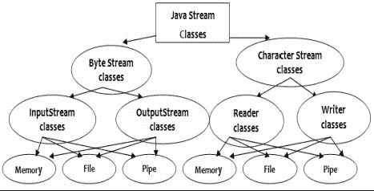

(Java 流类的分类)

## 字节流类概览

字节流类通过两个类层次结构来定义。顶层有两个抽象类：

(1) `InputStream` 和 (2) `OutputStream`

这些抽象类中的每一个都有若干具体的子类，用于处理各种设备之间的差异，例如磁盘文件、网络连接甚至内存缓冲区。

### InputStream 类

用于读取 8 位字节的 `InputStream` 类包括一个名为 `InputStream` 的超类，以及若干支持各种输入相关函数的子类。


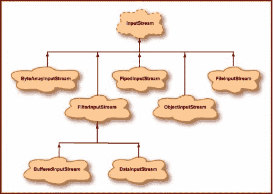

输入流类的层次结构。

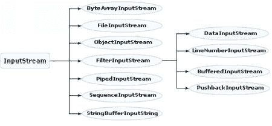

输入流类的层次结构。

### InputStream 类

超类 `InputStream` 是一个抽象类，它定义了执行输入功能的方法，例如：

*   读取字节。
*   关闭流。
*   在流中标记位置。
*   在流中向前跳过。
*   查找流中的字节数。

### InputStream 类的方法：

| 方法 | 描述 |
| :--- | :--- |
| `int available()` | 提供输入中可用的字节数（必须由子类重写）。`InputStream` 类的 `available` 方法始终返回 0。 |
| `void close()` | 关闭此输入流并释放与流相关的任何系统资源。`InputStream` 的 `close` 方法什么都不做。 |
| `void mark(int readlimit)` | 标记此输入流中的当前位置。`InputStream` 的 `mark` 方法什么都不做。 |
| `boolean markSupported()` | 测试此输入流是否支持 `mark` 和 `reset` 方法。`InputStream` 的 `markSupported` 方法返回 false。 |
| `abstract int read()` | 从输入流中读取下一个字节的数据。子类必须提供此方法的实现。 |
| `int read(byte[] b)` | 从输入流中读取若干字节并将其存储在缓冲区数组 `b` 中。实际读取的字节数作为整数返回。 |
| `int read(byte[] b, int offset, int len)` | 从输入流中读取若干字节，并从参数 `off` 指定的位置开始存储在缓冲区数组 `b` 中。实际读取的字节数作为整数返回。 |
| `void reset()` | 将此流重新定位到上一次在此输入流上调用 `mark` 方法时的位置。`InputStream` 的 `reset` 方法什么都不做并始终抛出 `IOException`。 |
| `long skip(long n)` | 从此输入流中跳过并丢弃最多 `n` 个字节的数据，并返回实际跳过的字节数。 |

### DataInput 接口

`DataInput` 是一个接口，它定义了从 `InputStream` 读取原始数据类型的方法。

### DataInput 接口的方法：

| 方法 | 描述 |
| :--- | :--- |
| `boolean readBoolean()` | 读取一个输入字节，如果该字节非零则返回 true，如果为零则返回 false。 |
| `byte readByte()` | 读取并返回一个字节输入。 |
| `char readChar()` | 读取一个输入字符并返回其值。 |
| `double readDouble()` | 读取八个输入字节并返回一个 double 值。 |
| `float readfloat()` | 读取四个输入字节并返回一个 double 值。 |
| `void readFully(byte[] b)` | 从输入流读取若干字节并将其存储在缓冲区数组 `b` 中。如果流在读取所有字节之前到达末尾，此方法将抛出 `EOFException`。 |
| `void readFully(byte[] b, int off, int len)` | 从输入流读取 `len` 个字节，并从 `off` 指定的位置开始存储在缓冲区数组 `b` 中。如果流在读取所有字节之前到达末尾，此方法将抛出 `EOFException`。 |
| `int readInt()` | 读取四个输入字节并返回一个 int 值。 |
| `String readLine()` | 从输入流读取下一行。 |
| `long readLong()` | 读取八个输入字节并返回一个 long 值。 |
| `short readShort()` | 读取两个输入字节并返回一个 short 值 |
| `Strig readUTF( )` | 读取使用修改后的 UTF-8 格式编码的字符串。 |
| `int skipBytes(int n)` | 尝试从输入流中跳过 `n` 个字节的数据，忽略跳过的字节。返回实际跳过的字节数。 |

## InputStream 类总结

`FilterInputStream` 包含另一个输入流，它将其作为基本数据源，并可能在处理过程中转换数据以提供额外功能。

`FilterInputStream` 类本身简单地重写了 `InputStream` 的所有方法，这些版本会将所有请求传递给包含的输入流。`FilterInputStream` 的子类可能会进一步重写其中某些方法，并可能提供额外的方法和字段。

注意，`DataInputStream` 类继承自 `FilterInputStream` 并实现了 `DataInput` 接口。因此，`DataInputStream` 继承 `FilterInputStream`，除了使用 `InputStream` 类的方法外，还实现了 `DataInput` 中描述的方法。

### InputStream 类总结：

| 类 | 描述 |
| :--- | :--- |
| `InputStream` | 此抽象类是所有表示字节输入流类的父类。 |
| `BufferedInputStream` | `BufferedInputStream` 为另一个输入流增加了功能——即缓冲输入并支持 `mark` 和 `reset` 方法。 |
| `ByteArrayInputStream` | `ByteArrayInputStream` 包含一个内部缓冲区，其中包含可以从流中读取的字节。 |
| `DataInputStream` | `DataInputStream` 允许应用程序从输入流读取 Java 原始数据类型。 |
| `FileInputStream` | `FileInputStream` 包含来自文件的输入字节。 |
| `FilterInputStream` | `FilterInputStream` 包含另一个输入流，它将其作为基本数据源，并可能在传输数据过程中提供额外功能。 |
| `PipedInputStream` | `PipedInputStream` 应该连接到管道输出流，随后管道输入流提供写入管道输出流的字节。 |
| `PushbackInputStream` | `PushbackInputStream` 为另一个输入流增加了功能，即“回退”或“重读”一个字节的能力。 |
| `SequenceInputStream` | `SequenceInputStream` 表示流的逻辑连接。 |
| `ObjectInputStream` | `ObjectInputStream` 反序列化之前使用 `ObjectOutputStream` 写入的原始数据对象。 |

### OutputStream 类

`OutputStream` 类派生自基类 `OutputStream`，该类是一个抽象类，并拥有若干支持各种输出相关函数的子类。

### OutputStream 类的方法：

| 方法 | 描述 |
| :--- | :--- |
| `void close()` | 关闭此输出流并释放与流相关的任何资源。 |
| `void flush()` | 刷新此输出流并强制写出缓冲的输出字节。 |
| `void write(byte[] b)` | 从指定的字节数组中写入 `b.length` 个字节到其输出流。 |
| `void write(byte[] b, int off, int len)` | 从指定的字节数组从偏移量 `off` 开始写入 `len` 个字节到其输出流。 |
| `abstract void write(int b)` | 将指定的字节写入其输出流。 |

### DataOutput 接口

`DataOutput` 是一个接口，它定义了向 `OutputStream` 写入原始数据类型的方法。

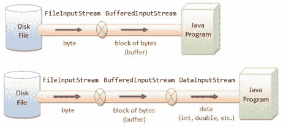


## DataOutput 接口的方法

| 方法 | 描述 |
| :--- | :--- |
| `void writeBoolean(boolean v)` | 向输出流写入一个布尔值。 |
| `void writeByte(int v)` | 向输出流写入参数 `v` 的低 8 位。 |
| `void writeBytes(string s)` | 将字符串写入输出流。按照顺序取字符串 `s` 中的每个字符，向输出流写入一个字节。 |
| `void writeChar(int v)` | 向输出流写入一个由两个字节组成的字符值。 |
| `void writeChars(string s)` | 将字符串 `s` 中的每个字符按八个字节的顺序写入输出流。 |
| `void writeDouble(double v)` | 向输出流写入一个由八个字节组成的 double 值。 |
| `void writeFloat(float v)` | 向输出流写入一个由四个字节组成的 float 值。 |
| `void writeInt(int v)` | 向输出流写入一个由四个字节组成的 int 值。 |
| `void writeLong(long v)` | 向输出流写入一个由八个字节组成的 long 值。 |
| `void writeShort(int v)` | 向输出流写入一个由两个字节组成的 short 值。 |
| `void writeUTF(String str)` | 向输出流写入两个字节的长度信息，随后是字符串 `s` 中每个字符的修改 UTF-8 表示。 |

## OutputStream 类的总结

`DataOutputStream` 是 `DataInputStream` 的对应类。`DataOutputStream` 类除了使用 `OutputStream` 类的方法外，还实现了在 `DataOutput` 接口中描述的方法。

### OutputStream 类总结

| 类 | 描述 |
| :--- | :--- |
| `OutputStream` | 此抽象类是所有表示字节输出流类的超类。 |
| `BufferedOutputStream` | 该类实现了一个缓冲输出流。 |
| `ByteArrayOutputStream` | 该类实现了一个将数据写入字节数组的输出流。 |
| `DataOutputStream` | 数据输出流允许应用程序以可移植的方式向输出流写入 Java 原始数据类型。 |
| `FileOutputStream` | 文件输出流是向 `File` 写入数据的输出流。 |
| `PipedOutputStream` | 管道输出流可以连接到管道输入流以创建通信管道。 |
| `FilterOutputStream` | `FilterOutputStream` 包含一些其他输出流，它将其作为目标，可能在传输过程中转换数据或提供额外功能。 |
| `PrintStream` | `PrintStream` 为另一个输出流添加功能，即能够方便地打印各种数据值的表示。 |

## 字符流类概述

字符流通过使用两个类层次结构定义。顶端是两个抽象类：`Reader` 和 `Writer`。这些抽象类处理 Unicode 字符流。

Java 为这些每个类提供了几个具体的子类。抽象的 `Reader` 和 `Writer` 类定义了其他流类实现的几个关键方法。其中最重要的两个方法是 `read()` 和 `write()`，它们分别读取和写入数据字符。这些方法被派生的流类重写。

## Reader 流类

Reader 流类设计用于从文件中读取字符。`Reader` 类是该组中所有其他类的基类。这些类在功能上与输入流类非常相似，区别在于输入流使用字节作为信息的基本单位，而 reader 流使用字符。

`Reader` 类包含与 `InputStream` 类中相同的方法。因此，`Reader` 类可以执行输入流类实现几乎的所有功能。

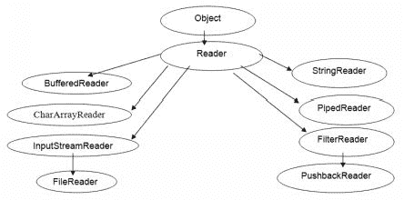

(Reader 流类的层次结构)

### Reader 类

`Reader` 是一个抽象类，定义了 Java 的字符输入流模型。该类中的所有方法都会抛出 `IOException`。

#### Reader 类的方法

| 方法 | 描述 |
| :--- | :--- |
| `abstract void close()` | 关闭流。一旦流被关闭，进一步的 `read()`、`ready()`、`mark()` 或 `reset()` 调用将抛出 `IOException`。然而，关闭一个之前已关闭的流没有影响。 |
| `void mark()` | 标记流中的当前位置。随后的 `reset()` 调用将尝试将流重置到此点。并不是所有的字符输入流都支持 `mark()` 操作。 |
| `boolean markSupported()` | 告知此流是否支持 `mark()` 操作 |
| `int read()` | 读取单个字符，并返回来自调用输入流的下一个可用字符的整数表示。遇到文件末尾时返回 -1。 |
| `int read(char[] buffer)` | 尝试读取最多 `buffer` 长度的字符到 `buffer` 中，并返回成功读取的字符数。遇到文件末尾时返回 -1。reader 子类必须实现此方法。 |
| `abstract int read(char[] buffer, int offset, int numChar)` | 尝试从 `buffer[offset]` 开始读取最多 `numChar` 个字符缓冲区，返回成功读取的字符数。遇到文件末尾时返回 -1。reader 子类必须实现此方法。 |
| `boolean ready()` | 告知此流是否准备好被读取。如果下一次输入请求不会等待，则返回 true，否则返回 false。 |
| `void reset()` | 重置流。并不是所有的字符输入流都支持此方法。 |
| `long skip(long n)` | 跳过最多 `n` 个字符并返回跳过的字符数。如果 `n` 为负数，则抛出 `IllegalArgumentException`。 |

#### Reader 类总结

| 类 | 描述 |
| :--- | :--- |
| `Reader` | 用于读取字符流的抽象类 |
| `BufferedReader` | 从字符输入流读取文本，对字符进行缓冲，以便高效读取字符、数组和行。 |
| `CharArrayReader` | 该类实现了一个可以作为字符输入流使用的字符缓冲区。 |
| `FileReader` | 用于读取字符文件的便利类。 |
| `FilterReader` | 用于读取过滤字符流的抽象类。 |
| `InputStreamReader` | `InputStreamReader` 是字节流到字符流的桥梁：它读取字节并使用指定的字符集解码为字符。 |
| `PipedReader` | 管道字符输入流。 |
| `PushbackReader` | 允许将字符推回流的字符读取器。 |
| `StringReader` | 源自字符串的字符流。 |

## Writer 流类

Writer 流类设计用于将字符写入文件/输出设备。writer 类是一个抽象类，作为所有其他 writer 流类的基类。

基类通过定义与 `OutputStream` 类相同的方法来提供所有输出操作的支持。

`Writer` 类包含与 `OutputStream` 类中可用的方法。因此，`Writer` 类可以执行输出流类实现几乎的所有功能。

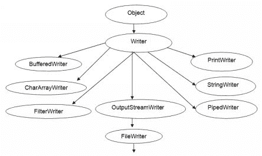

(Writer 流类的层次结构)


### Writer 类

`Writer` 是一个抽象类，定义了流字符输出。该类中的所有方法都返回 void 值并在发生错误时抛出 `IOException`。

#### Writer 类的方法

| 方法 | 描述 |
| :--- | :--- |
| `abstract void close()` | 关闭流并刷新。 |
| `abstract void flush()` | 刷新流。 |
| `void write(char[] cbuf)` | 写入字符数组。 |
| `abstract void write(char[] cbuf, int off, int len)` | 从指定的偏移量开始写入字符数组的一部分。子类必须实现此方法。 |
| `void write(int c)` | 向调用的输出流写入单个字符。注意，该参数为 `int` 类型，这允许你直接对表达式调用 `write`，而无需将它们转换回 `char`。 |
| `void write(String str)` | 写入一个字符串。 |
| `void write(String str, int off, int len)` | 写入字符串从指定偏移量开始的部分。 |


## Writer 类总结

| 类 | 描述 |
| :--- | :--- |
| `Writer` | 用于写入字符流的抽象类。 |
| `BufferedWriter` | 将文本写入字符输出流，并对字符进行缓冲，以便高效写入单个字符、数组和字符串。 |
| `CharArrayWriter` | 此类实现了一个字符缓冲区，可以作为 `Writer` 使用。 |
| `FileWriter` | 用于写入字符文件的便利类。 |
| `FilterWriter` | 用于写入过滤后的字符流的抽象类。 |
| `OutputStreamWriter` | `OutputStreamWriter` 是字符流到字节流的桥梁：写入它的字符使用指定的 `charset` 编码为字节。 |
| `PipedWriter` | 管道字符输出流。 |
| `PrintWriter` | 将对象的格式化表示写入文本输出流。 |
| `StringWriter` | 一种字符流，将其输出收集在字符串缓冲区，然后可以使用其来构建字符串。 |

# File 类

尽管 `java.io` 定义的大多数类都操作于流，但 `File` 类并不如此。它直接处理文件和文件系统。也就是说，`File` 类并没有指定如何从文件中检索信息或向文件中存储信息。它描述的是自身的属性。

`File` 对象用于获取或操纵与磁盘文件相关的信息，例如权限、时间、日期和目录路径，以及导航子目录层次结构。

虽然出于安全考虑，文件在 applet 中的用法受到严格限制，但文件仍然是存储持久和共享信息的核心资源。

Java 中的目录被简单地视为一个文件，多了一个额外的属性——可以通过 `list()` 方法检查的文件名列表。

| 方法 | 描述 |
| :--- | :--- |
| `public File(String)` | 通过将给定的路径名字符串转换为抽象路径名来创建一个新的 `File` 实例。 |
| `public File(String, String)` | 从父路径名字符串和子路径名字符串创建新的 `File` 实例。 |
| `public File(File, String)` | 从父抽象路径名和子路径名字符串创建新的 `File` 实例。 |
| `public File(URI)` | 通过将给定的 `file:` URI 转换为抽象路径名来创建新的 `File` 实例。此构造函数由 Java 2（版本 1.4）添加。 |
| `public String getName()` | 返回文件或目录的名称。 |
| `public String getParent()` | 返回对象创建期间指定的路径中的文件父目录，如果此路径名没有表示父目录，则返回 null。 |
| `public String getPath()` | 返回相对路径。 |
| `public boolean isAbsolute()` | 测试此抽象路径是否为绝对路径。 |
| `public String getAbsolutePath()` | 返回从根目录开始的绝对（完整）路径。 |
| `public boolean canRead()` | 测试应用程序是否可以读取由此抽象路径指示的文件。 |
| `public boolean canWrite()` | 测试应用程序是否可以修改由此抽象路径指示的文件。 |
| `public boolean exists()` | 测试由此抽象路径指示的文件或目录是否存在。 |
| `public boolean isDirectory()` | 测试由此抽象路径指示的文件是否为目录。 |
| `public boolean isFile()` | 测试由此抽象路径指示的文件是否为普通文件。 |
| `public boolean isHidden()` | 测试由此抽象路径命名的文件是否为隐藏文件。 |
| `public long lastModified()` | 返回由此抽象路径指示的文件最后修改的时间。 |
| `public long length()` | 返回由此抽象路径指示的文件长度。 |
| `public boolean createNewFile() throws java.io.IOException` | 仅当不存在以此路径命名的文件时，自动创建一个由此路径名命名的新空文件。 |
| `public boolean delete()` | 删除由此抽象路径指示的文件或目录。 |
| `public String[] list()` | 返回一个字符串数组，命名由此抽象路径指示的目录中的文件和目录。如果 `File` 对象对应文件，则返回 null。 |
| `public boolean mkdir()` | 创建由此抽象路径命名的目录。 |
| `public boolean mkdirs()` | 创建由此抽象路径命名的目录，包括任何必要的不存在的目录。 |
| `public boolean setLastModified(long)` | 设置由此抽象路径命名的文件或目录的最后修改时间。 |
| `public boolean setReadOnly()` | 标记由此抽象路径命名的文件或目录，使其只允许操作。 |
| `public boolean setWritable(boolean)` | 设置由此抽象路径命名的文件或目录的写权限。 |
| `public boolean setReadable(boolean)` | 设置由此抽象路径命名的文件或目录的读权限。 |
| `public boolean canExecute()` | 测试应用程序是否可以执行由此抽象路径指示的文件。 |
| `public long getTotalSpace()` | 返回由此抽象路径命名的分区的总大小（以字节为单位）。 |
| `public long getFreeSpace()` | 返回由此抽象路径命名的分区中未分配的字节数。 |
| `public long getUsableSpace()` | 返回由此抽象路径命名的分区中可用于虚拟机的字节数。 |
| `boolean renameTo(File)` | 重命名由此抽象路径指示的文件。 |

## 示例

```
File f1 = new File("");
File f2 = new File("/autoexec");
File f3 = new File(f1,"autoexec");
```

注意：Java 会正确处理 UNIX 和 Windows 之间的路径分隔符。如果你在 Windows 版本的 Java 上使用斜杠 (`/`），路径仍然正确解析。记住，如果你在字符串中使用 Windows 习惯（`\\`），Java 的惯例是使用 UNIX 风格的正斜杠作为路径分隔符。

`File` 定义了许多获取 `File` 对象标准属性的方法。然而，`File` 类并不是对称的。这意味着，虽然有主要方法允许你检查简单文件的属性，但不存在相应的函数来更改这些属性。

示例 15.1：遵循该类的几个方法

```java


# 文件操作示例

```java
import java.io.*;

class FileTest {

    public static void main(String args[]) throws IOException {

        File f = new File("/javaprog/ch15/15.1/FileTest.java");

        if(!f.exists())

            f.createNewFile();

        System.out.println("Length="+f.length()+" bytes");

        System.out.println("Name="+f.getName());

        System.out.println("Parent="+f.getParent());

        System.out.println("Path="+f.getPath());

        System.out.println("Absolute="+f.getAbsolutePath());

        System.out.println(f.exists() ? "Exists" : "Does not exist");

        System.out.println(f.isFile() ? "file" : "not a file");

        System.out.println(f.canRead() ? "readable" : "not readable");

        System.out.println(f.canWrite() ? "writable" : "not writable");

        System.out.println(f.isDirectory() ? "directory" : "not a directory");

        System.out.println(f.isHidden() ? "hidden" : "not hidden");

        System.out.println(f.isAbsolute() ? "absolute" : "not absolute");

        System.out.println("File modified:"+f.lastModified());

        f.delete();

        File f3 = new File("C:/772");

        String[] nm = f3.list();

        System.out.println("List of Files & Directories of C:/772");

        for(int i=0;i<nm.length;i++) {

            System.out.print(nm[i]);

            File f4 = new File("c:/772/"+nm[i]);

            if(f4.isFile() == true)

        }

    }

}
```

```java
31. System.out.println(" It is a File");
32. else
33. System.out.println(" It is a Directory");
34. }
35. File f5=new File("zzz");
36. f5.mkdir();
37. File f6=new File("yyy/aaa");
38. f6.mkdirs();
39. }
40. }
```

### 输出

```text
Length=1782 bytes
Name=FileTest.java
Parent=\javaprog\ch15\15.1
Path=\javaprog\ch15\15.1\FileTest.java
Absolute Path=C:\javaprog\ch15\15.1\FileTest.java
Exists
is file
is readable
is writable
not a directory
not hidden
is not absolute
File last modified :1236824168000
List of Files & Sub-Directories of c:/tally72
TALLY.REW It is a File
Tally.ini It is a File
sentinel.sys It is a File
sentinel.vxd It is a File
spnsrv9x.exe It is a File
spnsrvnt.exe It is a File
stat.slk It is a File
tally72.exe It is a File
tallylic9xserver.exe It is a File
tallylicserver.exe It is a File
tallysav.dat It is a File
tallywin.dat It is a File
tally.imp It is a File
Data It is a Directory
```

# FileInputStream

它是`InputStream`类的直接子类。要打开文件进行读取，我们只需创建一个`FileInputStream`类的对象，并将文件名（直接或间接）作为构造函数的参数指定。

| Method Signature | Description |
| :--- | :--- |
| `public FileInputStream(String) throws FileNotFoundException` | 通过打开指向实际文件的连接来创建`FileInputStream`，该文件由文件系统中路径名`filePath`命名的。 |
| `public FileInputStream(File) throws FileNotFoundException` | 通过打开指向实际文件的连接来创建`FileInputStream`，该文件由文件系统中的`File`对象`file`命名的。 |
| `public native int read() throws IOException` | |
| `public int read(byte[]) throws IOException` | |
| `public int read(byte[], int int) throws IOException` | |
| `public native long skip(long) throws IOException` | |
| `public native int available() throws IOException` | |
| `public void close() throws IOException` | |

# FileOutputStream

它是`OutputStream`类的直接子类。要打开文件进行写入，我们只需创建一个`FileOutputStream`类的对象，并将文件名（直接或间接）作为构造函数的参数指定。

| Method Signature | Description |
| :--- | :--- |
| `public FileOutputStream(String) throws FileNotFoundException` | 创建一个输出流写入指定命名的文件。 |
| `public FileOutputStream(String, boolean) throws java.io.FileNotFoundException` | 创建一个输出流写入指定命名的文件。 |
| `public FileOutputStream(File) throws FileNotFoundException` | 创建一个输出流写入由`File`对象表示的文件。 |
| `public FileOutputStream(File, boolean) throws FileNotFoundException` | 创建一个输出流写入由`File`对象表示的文件。 |
| `public native void write(int) throws java.io.IOException` | |
| `public void write(byte[]) throws java.io.IOException` | |
| `public void write(byte[], int int) throws java.io.IOException` | |
| `public void close() throws java.io.IOException` | |

## 示例 5.2

```java
1. import java.io.*;
2. class FileRead
3. {
4. public static void main(String args[])
5. {
6. FileInputStream fin=null;
7. int a;
8. try
9. {
10. fin=new FileInputStream(args[0]);
11. System.out.println("No. of characters to read="+fin.available());
12. fin.skip(3);
13. a = fin.read();
14. while(a != -1)
15. {
16. System.out.print((char)a);
17. a = fin.read();
18. }
19. System.out.println("No. of characters to read="+fin.available());
20. fin.close();
21. }
22. catch(ArrayIndexOutOfBoundsException e)
23. {
24. System.out.println(e);
25. }
26. catch(FileNotFoundException e)
27. {
28. System.out.println(e);
29. }
30. catch(IOException e)
31. {
32. System.out.println(e);
33. }
34. }
35. }
```

**输出：**

```text
java FileRead A.txt
No. of characters to read=20
Matrix Computers
No. of characters to read=0
```

## 示例 15.3

```java
1. import java.io.*;
2. class FileCopy
3. {
4. public static void main(String args[]) throws IOException
5. {
6. FileInputStream fin=null;
7. FileOutputStream fout=null;
8. fin=new FileInputStream(args[0]);
9. fout=new FileOutputStream(args[1]);
10. int a;
11. a = fin.read();
12. while(a != -1)
13. {
14. fout.write(a);
15. a = fin.read();
16. }
17. fin.close();fout.close();
18. }
19. }
```

## 示例 15.4

```java
1. import java.io.*;
2. class CopyFile
3. {
4. public static void main(String args[]) throws IOException
5. {
6. int n;
7. FileInputStream fin = new FileInputStream("A.txt");
8. FileOutputStream fout = new FileOutputStream("B.txt");
9. byte b[]= new byte[10];
10. n = fin.read(b);
11. while(n != -1)
12. {
13. fout.write(b,0,n);
14. n = fin.read(b);
15. }
16. fin.close();
17. fout.close();
18. }
19. }
```

# FileReader

`FileReader`类创建了一个`Reader`，你可以用它来读取文件的内容。它最常用的两个构造函数是：

- `FileReader(File file)`：创建一个`FileReader`流，用于从指定的`file`读取内容。
- `FileReader(String fileName)`：创建一个`FileReader`流，用于从指定的`file`读取内容。

**注意：** 如果文件不存在、是一个目录而不是普通文件，或者由于其他原因无法打开读取，则任一个构造函数都可能抛出`FileNotFoundException`。

# FileWriter

`FileWriter`类创建一个`writer`，你可以用它向文件写入。它最常用的两个构造函数是：

## 构造函数

- `FileWriter(File file)`：构造一个`FileWriter`对象以写入指定的`file`。
- `FileWriter(String fileName)`：构造一个`FileWriter`对象以写入指定的`file`。
- `FileWriter(File file, boolean append)`：构造一个`FileWriter`对象，以`append`模式写入指定的`file`。
- `FileWriter(String filename, boolean append)`：构造一个`FileWriter`对象，以`append`模式写入指定的`file`。如果使用前两个构造函数，则总是创建一个新文件。如果存在指定名称的文件，它将被删除。如果使用后两个构造函数且`append`标志为`false`，则它们的行为与前两个相同。

如果`append`标志为`true`，则文件以`append`模式打开，即如果文件已存在，文件指针将放在文件末尾；如果文件不存在，则创建一个新文件。

**注意：** 如果文件存在但是一个目录而不是普通文件、不存在但无法创建，或由于其他原因无法打开，这些构造函数可能会抛出`IOException`。例如，当你尝试打开一个只读文件时，将抛出`IOException`。

## 示例 15.5

```java
import java.io.*;

class FileCopy {

    public static void main(String args[]) throws IOException {

        FileReader fin=null;

        FileWriter fout=null;

        fin=new FileReader(args[0]);

        fout=new FileWriter(args[1]);

        int a;

        a = fin.read();

        while(a != -1) {

            fout.write((char)a);

            a = fin.read();

        }

        fin.close();

        fout.close();

    }

}
```


# RandomAccessFile

`RandomAccessFile` 封装了一个随机访问文件。`RandomAccessFile` 允许我们从文件的某个位置读取和写入字节、文本和原始数据类型（当使用适当的访问权限时）。它没有继承自 `InputStream`，而是实现了 `DataInput` 和 `DataOutput` 接口，这些接口定义了基本的 I/O 方法。它还支持定位请求——也就是说，你可以将文件指针指向文件的任何位置。

`mode` 参数指定打开文件的访问模式。允许的值及其含义如下：

| 值 | 含义 |
| :--- | :--- |
| `"r"` | 仅用于读取打开。调用结果对象的任何写入方法将导致抛出 `IOException`。 |
| `"rw"` | 以读写打开。如果文件不存在，则将尝试创建它。 |
| `"rws"` | 以读写打开（与 `"rw"` 相同），并且对文件内容或元数据的每次更新都同步写入底层存储设备。 |
| `"rwd"` | 以读写打开（与 `"rw"` 相同）。并且对文件内容（数据）的每次更新都同步写入底层存储设备。 |

## RandomAccessFile 类的方法

除了 `DataInput` 和 `DataOutput` 接口的方法外，该类的一些常用方法包括：

- `public RandomAccessFile(String, String) throws java.io.FileNotFoundException;`：创建一个随机访问文件流，用于读取指定的 `name` 文件，并可选地写入。
- `public RandomAccessFile(File, String) throws FileNotFoundException;`：创建一个随机访问文件流，用于读取由 `File` 参数指定的文件，并可选地写入。
- `public native int read() throws java.io.IOException;`
- `public int read(byte[], int, int) throws java.io.IOException;`
- `public int read(byte[]) throws java.io.IOException;`
- `public int skipBytes(int) throws java.io.IOException;`
- `public native void write(int) throws java.io.IOException;`
- `public void write(byte[]) throws java.io.IOException;`
- `public void write(byte[], int) throws java.io.IOException;`
- `public native long getPointer() throws java.io.IOException;`
- `public native void seek(long) throws java.io.IOException;`
- `public native long length() throws java.io.IOException;`
- `public void setLength(long) throws java.io.IOException;`
- `public void close() throws java.io.IOException;`
- `public final boolean readBoolean() throws java.io.IOException;`
- `public final byte readByte() throws java.io.IOException;`
- `public final int readUnsignedByte() throws java.io.IOException;`
- `public final short readShort() throws java.io.IOException;`
- `public final int readUnsignedShort() throws java.io.IOException;`
- `public final char readChar() throws java.io.IOException;`
- `public final int readInt() throws java.io.IOException;`
- `public final long readLong() throws java.io.IOException;`
- `public final float readFloat() throws java.io.IOException;`
- `public final double readDouble() throws java.io.IOException;`
- `public final String readLine() throws java.io.IOException;`
- `public final String readUTF() throws java.io.IOException;`
- `public final void writeBoolean(boolean) throws java.io.IOException;`
- `public final void writeByte(int) throws java.io.IOException;`
- `public final void writeShort(int) throws java.io.IOException;`
- `public final void writeChar(int) throws java.io.IOException;`
- `public final void writeInt(int) throws java.io.IOException;`
- `public final void writeLong(long) throws java.io.IOException;`
- `public final void writeFloat(float) throws java.io.IOException;`
- `public final void writeDouble(double) throws java.io.IOException;`
- `public final void writeBytes(String) throws java.io.IOException;`
- `public final void writeChars(String) throws java.io.IOException;`
- `public final void writeUTF(String) throws java.io.IOException;`

### 示例 15.6

```java
import java.io.*;

class RandomIO {

}
```

### 代码示例

```java
public static void main(String args[]) throws IOException {

    RandomAccessFile file = null;

    try {

        file = new RandomAccessFile("rand.dat", "rw");

        file.writeChar('X');

        file.writeInt(1999);

        file.writeDouble(222.44);

        System.out.println("File pointer Pos:"+file.getFilePointer());

        file.seek(0);

        System.out.println(file.readChar());

        System.out.println(file.readInt());

        System.out.println(file.readDouble());

        System.out.println("File pointer Pos:"+file.getFilePointer());

        file.seek(2);

        System.out.println("File pointer Pos:"+file.getFilePointer());

        System.out.println(file.readInt());

        file.seek(file.length());

        file.writeBoolean(false);

        file.seek(14);

        System.out.println(file.readBoolean());

        System.out.println("File pointer Pos:"+file.getFilePointer());

        System.out.println(file.readInt());//EOF Exception

    } catch(EOFException e) {

        System.out.println("Trying to read after end of file");

    } finally {

        file.close();

    }

}
```

输出：

```
File pointer Pos:14
X
1999
222.44
File pointer Pos:14
File pointer Pos:2
1999
false
File pointer Pos:15
Trying to read after end of file
```

注意：如果尝试在文件末尾之后进行读取，则会发生 `EOFException`。

# ByteArrayInputStream

`ByteArrayInputStream` 包含一个内部缓冲区，其中包含可以从流中读取的字节。`ByteArrayInputStream` 是使用字节数组作为源的输入流实现。该类有两个构造函数，每个构造函数都需要一个字节数组来提供数据源。`ByteArrayInputStream` 实现了 `mark()` 和 `reset()` 方法。但是，如果没有调用过 `mark()`，则 `reset()` 将将流指针设置为流的开头。

| 方法 |
| :--- |
| `public ByteArrayInputStream(byte[]);` |
| `public ByteArrayInputStream(byte[], int, int);` |
| `public synchronized int read();` |
| `public synchronized int read(byte[], int, int);` |
| `public synchronized long skip(long);` |
| `public synchronized int available();` |
| `public boolean markSupported();` |
| `public void mark(int);` |
| `public synchronized void reset();` |
| `public void close() throws IOException;` |

### 示例 15.7

```java
import java.io.*;

class ByteArrayInputStreamTest {

    public static void main(String args[]) throws IOException {

        String s1="abcdefghij";

        byte b[]=s1.getBytes();

        ByteArrayInputStream b1 = new ByteArrayInputStream(b);

        int a;

        while((a=b1.read())=-1) {

            System.out.print((char)Character.toUpperCase(a));

        }

        b1.close();

    }

}
```

输出：`ABCDEFGHIJK`

# ByteArrayOutputStream

`ByteArrayOutputStream` 实现了一个输出流，其中数据被写入字节数组中。`ByteArrayOutputStream` 是使用字节数组作为目的地的输出流实现。缓冲区保存在 `ByteArrayOutputStream` 的受保护字段 `buf` 中。如果需要，缓冲区的大小将增加。缓冲区持有的字节数包含在 `ByteArrayOutputStream` 的受保护字段 `count` 中。

| 方法 |
| :--- |
| `public java.io.ByteArrayOutputStream();` |
| `public java.io.ByteArrayOutputStream(int);` |
| `public synchronized void write(int);` |
| `public synchronized void write(byte[], int, int);` |
| `public synchronized void writeTo(java.io.OutputStream) throws java.io.IOException;` |
| `public synchronized void reset();` |
| `public synchronized byte[] to_array();` |
| `public synchronized int size();` |
| `public synchronized java.lang.String toString();` |
| `public synchronized java.lang.String toString(java.lang.String) throws java.io.UnsupportedEncodingException;` |
| `public synchronized java.lang.String toString(int);` |
| `public void close() throws java.io.IOException;` |

### 示例 15.8

```java
import java.io.*;

class ByteArrayOutputStreamTest {

    public static void main(String args[]) throws IOException {

        ByteArrayOutputStream b1 = new ByteArrayOutputStream();

        b1.write('a');

        String s1 = "abcdefghij";

        byte arr1[]= s1.getBytes();

        b1.write(arr1);

        System.out.println(b1);  //toString()

        // 使用 for 循环显示

        byte arr2 [] = b1.toByteArray();

        for(int i=0;i<arr2.length;i++) {

            System.out.print((char)arr2[i]);

        }

        System.out.println();

        // 使用 for 循环显示

        for(int i:arr2) {

            System.out.print((char)i);

        }

        b1.close();

    }

}
```

根据指定的字符数组创建一个 `CharArrayReader`。生成的读取器将从给定的偏移量开始读取。从此读取器中可以读取的字符总数将是 `length` 或 `buf.length`。

### 示例 15.9

```java
import java.io.*;

class CharArrayReaderTest {

    public static void main(String args[]) throws IOException {

        String tmp = "abcdefghijklmnopqrstuvwxyz";

        int length = tmp.length();

        char c[] = new char[length];

        tmp.getChars(0, length, c, 0);

        CharArrayReader input1 = new CharArrayReader(c);

        CharArrayReader input2 = new CharArrayReader(c, 0, 5);

        int i;

        while ((i = input1.read()) != -1) {

            System.out.print((char)i);

        }

        System.out.println();

        while ((i = input2.read()) != -1) {

            System.out.print((char)i);

        }

    }

}
```


**输出:**

```
abcdefghijklmnopqrstuvwxyz
abcde
```

# CharArrayWriter

`CharArrayWriter` 是一个写入流的实现，它使用字符数组缓冲区作为目标。

## 构造函数

- `CharArrayWriter()`: 在第一种形式下，创建一个具有默认大小的缓冲区。
- `CharArrayWriter(int initialSize)`: 在第二种形式下，创建一个大小等于参数`initialSize`指定的缓冲区。

缓冲区存储在`CharArrayWriter`的`buf`字段中。如果需要，将增加缓冲区的大小。缓冲区中的字符数量包含在`CharArrayWriter`的`count`字段中。`buf`和`count`都是保护字段。

## 示例 15.10

```java
import java.io.*;

class CharArrayWriterTest {

    public static void main(String args[]) throws IOException {

        CharArrayWriter f = new CharArrayWriter();

        String s = "This should end up in the array";

        char buf[] = new char[s.length()];

        s.getChars(0, s.length(), buf, 0);

        f.write(buf);

        System.out.println(f.toString());

        char c[] = f.toCharArray();

        for (int i = 0; i < c.length; i++) {

            System.out.print(c[i]);

        }

        FileWriter f2 = new FileWriter("test.txt");

        f.writeTo(f2);

        f2.close();

        f.reset();

        System.out.println();

        System.out.println("After:" + f.toString());

        for (int i = 0; i < 3; i++) {

            f.write('A');

            System.out.println(f.toString());

        }

    }

}
```

**输出:**

```
This should end up in the array
This should end up in the array
After:
AAA
```

## PushbackInputStream

`PushbackInputStream` 为另一个输入流增加了功能，即“回退”或“取消读取”一个字节的能力。缓冲的用途之一就是实现回退。`pushback` 用于输入流上，允许读取一个字节然后将其返回到流中。除了`InputStream`类熟悉的方法外，`PushbackInputStream` 还提供了`unread()`方法，如下：

| 方法 |  |
| :--- | :--- |
| `public java.io.PushbackInputStream(java.io.InputStream, int)` | 创建一个具有指定大小回退缓冲区的`PushbackInputStream`，并保存其参数（输入流）以备后用。这允许将多个字节返回到输入流。 |
| `public java.io.PushbackInputStream(java.io.InputStream)` | 创建一个`PushbackInputStream`并保存其参数（输入流）以备后用。这允许将一个字节返回到输入流。 |
| `public int read() throws java.io.IOException` | |
| `public int read(byte[], int, int) throws java.io.IOException` | |
| `public void unread(int) throws java.io.IOException` | 通过将其复制到回退缓冲区的头部来回退一个字节 |
| `public void unread(byte[], int, int) throws java.io.IOException` | 通过将字节数组的一部分复制到回退缓冲区的头部来回退字节数组的一部分。 |
| `public void unread(byte[]) throws java.io.IOException` | 通过将字节数组复制到回退缓冲区的头部来回退字节数组。 |
| `public int available() throws java.io.IOException` | |
| `public long skip(long) throws java.io.IOException` | |
| `public boolean markSupported()` | `PushbackInputStream`的副作用是使创建它的`InputStream`的`mark()`或`reset()`方法失效。使用`markSupported()`方法检查任何你将对其使用`mark()/reset()`的流。 |
| `public synchronized void mark(int)` | |
| `public synchronized void reset() throws java.io.IOException` | |
| `public synchronized void close() throws java.io.IOException` | |

### 示例 15.11

```java
import java.io.*;

class PushbackInputStreamTest {

    public static void main(String args[]) throws IOException {

        FileInputStream fin = new FileInputStream("A.txt");

        PushbackInputStream p1 = new PushbackInputStream(fin);

        int ch = p1.read();

        System.out.println((char)ch);

        ch = p1.read();

        System.out.println((char)ch);

        ch = p1.read();

        System.out.println((char)ch);

        p1.unread(ch); // or p1.unread('z')

        ch = p1.read();

        System.out.println((char)ch);

    }

}
```

**输出:**

```
A.txt contains “Matrix Computers”
m
a
t
```

## PushbackReader

`PushbackReader` 允许将字符推回到流中。其方法如下：

| 方法 |  |
| :--- | :--- |
| `public int read(char[], int, int) throws java.io.IOException;` | |
| `public void unread(int) throws java.io.IOException;` | 推回一个单个字符。 |
| `public void unread(char[], int, int) throws java.io.IOException;` | 将字符数组的一部分拷贝到推回缓冲区的头部，将其推回。 |
| `public void unread(char[]) throws java.io.IOException;` | 将一个数组拷贝到推回缓冲区的头部，将其推回。 |
| `public boolean ready() throws java.io.IOException;` | |
| `public void mark(int) throws java.io.IOException;` | |
| `public void reset() throws java.io.IOException;` | |
| `public boolean markSupported();` | |
| `public void close() throws java.io.IOException;` | |
| `public long skip(long) throws java.io.IOException;` | |

注意：当在推回缓冲区满的情况下尝试返回字符时，将抛出`IOException`。

### 示例 15.12

```java
import java.io.*;

class PushbackReaderTest {

    public static void main(String args[]) throws IOException {

        FileReader fr = new FileReader("A.txt");

        PushbackReader pr = new PushbackReader(fr);

        int ch = pr.read();

        System.out.println((char)ch);

        ch = pr.read();

        System.out.println((char)ch);

        ch = pr.read();

        System.out.println((char)ch);

        pr.unread(ch);

        ch = pr.read();

        System.out.println((char)ch);

    }

}
```

**输出:**

```
m
a
t
t
```

## SequenceInputStream

`SequenceInputStream` 类是一个字节流，允许你连接多个`InputStreams`。`SequenceInputStream`的构造与其他任何`InputStream`都不同。`SequenceInputStream`构造函数使用一对`InputStream`类或一个`InputStream`类的`Enumeration`作为其参数：

- `SequenceInputStream(InputStream is1, InputStream is2)` 通过记住两个参数来初始化新创建的`SequenceInputStream`，这两个参数将按顺序（`is1`然后是`is2`）读取，为`SequenceInputStream`提供要读取的字节。
- `SequenceInputStream(Enumeration e)` 通过记住参数来初始化新创建的`SequenceInputStream`，该参数必须是一个产生运行时类型为`InputStream`的对象的`Enumeration`。理想情况下，该类将满足来自第一个`InputStream`的请求直到其耗尽，然后切换到第二个。在`Enumeration`的情况下，它将继续遍历所有的`InputStreams`直到最后一个流的结束。

示例 15.13 在下面将文件名作为命令行参数提供：

```java
import java.io.*;

class SequenceInputStreamTest {

    public static void main(String args[]) throws IOException {

        FileInputStream f1 = new FileInputStream(args[0]);

        FileInputStream f2 = new FileInputStream(args[1]);

        FileOutputStream f3 = new FileOutputStream(args[2]);

        SequenceInputStream sis = new SequenceInputStream(f1,f2);

        int c;

        while((c = sis.read()) != -1) {

            f3.write(c);

        }

        f3.close();f1.close();f2.close();

    }

}
```

**输出:**

```
A.txt
B.txt
C.txt
```

## PrintStream

这是一个继承自`OutputStream`的字节流类。`PrintStream`为另一个输出流增加了功能，即方便地打印各种值的表示形式的能力。可选地，可以创建一个`PrintStream`以便自动刷新；这意味着在写入字节数组、调用其中一个`println`方法或写入换行符（`\n`）之后，将调用`flush`方法。通过`PrintStream`打印的所有字符都将使用平台的默认字符编码转换为字节，然后写入构造函数中指定的`OutputStream`或`File`。`PrintStream`支持针对所有类型的`print()`和`println()`方法。如果参数不是简单类型，`PrintStream`方法将调用对象的`toString()`方法然后打印结果。

构造函数：

- `PrintStream(File file)` 使用指定的文件创建一个新的打印流，且不进行行自动刷新。
- `PrintStream(String fileName)` 使用指定的文件名创建一个新的打印流，且不进行行自动刷新。
- `PrintStream(OutputStream out)` 为指定的`OutputStream`创建一个新的打印流。
- `PrintStream(OutputStream out, boolean autoFlush)` 连接到指定的`OutputStream`创建一个新的打印流。

### 示例 15.14

```java
import java.io.*;

class PrintStreamTest {

    public static void main (String args[]) throws IOException {

        PrintStream ps = new PrintStream(System.out, true);

        ps.println("This is a string");

        int i = -7;

        ps.println(i);

        double d = 4.5e-7;

        ps.println(d);

    }

}
```

**输出:**

```
This is a string
-7
4.5E-7
```

### 示例 15.5

```java
import java.io.*;

class PrintStream2 {

    public static void main (String argv[]) throws IOException {

        FileOutputStream fout = new FileOutputStream("test.dat");

        PrintStream ps = new PrintStream(fout, true);

        ps.println("This is a string");

        int i = -7;

        ps.println(i);

        double d = 4.5e-7;

        ps.println(d);

    }

}
```


## `PrintWriter` 类

创建一个新的 `PrintWriter`，不具备自动行刷新功能，用于写入指定的 `OutputStream`。

`PrintWriter(OutputStream out, boolean autoFlush)`

创建一个新的 `PrintWriter`，用于写入指定的 `OutputStream`。

`PrintWriter(Writer out)`

创建一个新的 `PrintWriter`，不具备自动行刷新功能，用于写入指定的 `Writer`。

`PrintWriter(Writer out, Boolean autoFlush)`

创建一个新的 `PrintWriter`，用于写入指定的 `Writer`。

最常用的构造函数是：

`PrintWriter(OutputStream os, boolean flushOnNewLine)`

在这里，`os` 是 `OutputStream` 类型的对象，`flushOnNewLine` 控制 Java 是否在每次调用 `println()` 方法时都冲刷输出流。如果 `flushOnNewLine` 为 `true`，则会自动进行冲刷。如果为 `false`，则不进行自动冲刷。

`PrintWriter` 支持针对所有类型（包括对象）的 `print()` 和 `println()` 方法。如果参数不是简单类型，`PrintWriter` 方法将调用对象的 `toString()` 方法然后打印结果。

要使用 `PrintWriter` 写入控制台，请指定 `System.out` 为输出流，并在每行之后冲刷流。例如，这行代码创建了一个连接到控制台输出的 `PrintWriter`。

`PrintWriter pw = new PrintWriter(System.out, true)`

### 示例 15.16

```java
import java.io.*;

class PrintWriterTest {

    public static void main (String argv[]) throws IOException {

        PrintWriter pw = new PrintWriter(System.out, true);

        pw.println("This is a string");

        int i = -7;

        pw.println(i);

        double d = 4.5e-7;

        pw.println(d);

    }

}
```

**输出：**

```text
This is a string

-7

4.5E-7
```

### 示例 15.17

```java
import java.io.*;

class PrintWriterTest1 {

    public static void main (String argv[]) throws IOException {

        FileWriter fout = new FileWriter("test.dat");

        PrintWriter pw = new PrintWriter(fout, true);

        pw.println("This is a string");

        int i = -7;

        pw.println(i);

        double d = 4.5e-7;

        pw.println(d);

    }

}
```

### 示例 15.18

```java
import java.io.*;

class PrintWriterTest2 {

    public static void main (String argv[]) throws IOException {

        PrintWriter pw = new PrintWriter("test.dat");

        pw.println("This is a string");

        int i = -7;

        pw.println(i);

        double d = 4.5e-7;

        pw.println(d);

        pw.close();

    }

}
```

## `PipedInputStream` 和 `PipedOutputStream`

管道输出流可以连接到管道输入流以创建一个通信管道。管道输出流是管道的发送端。管道输入流应该连接到管道输出流；随后，管道输入流将读取写入管道输出流的任何字节。通常，数据由一个线程从 `PipedInputStream` 对象读取，并由另一个线程写入相应的 `PipedOutputStream`。不建议在单个线程中同时使用这两个对象，因为可能会导致线程死锁。

### 构造函数

- `PipedInputStream()`：创建一个 `PipedInputStream`，其尚未连接。
- `PipedInputStream(PipedInputStream src)`：创建一个 `PipedInputStream`，使其连接到输出流 `src`。
- `PipedOutputStream()`：创建一个 `PipedOutputStream`，其尚未连接到管道输入流。
- `PipedOutputStream(PipedInputStream snc)`：创建一个连接到指定管道输入流的 `PipedOutputStream`。

### 示例 15.19

```java
import java.io.*;

class TextGenerator extends Thread {

    OutputStream out;

    TextGenerator(OutputStream out) {

        this.out = out;

    }

    public void run() {

        try {

            for(byte b = 65; b<=90; b++) {

                out.write(b);

            }

        } finally {

            out.close();

        } catch (IOException e) {

            System.out.println(e);

        }

    }

}

class Pipe {

    public static void main(String args[]) throws IOException {

        PipedOutputStream out = new PipedOutputStream();

        PipedInputStream in = new PipedInputStream(out);

        TextGenerator data = new TextGenerator(out);

        data.start();

        int ch;

        while((ch = in.read()) != -1) {

            System.out.print((char) ch);

        }

    }

}
```

**输出：**

```text
ABCDEFGHIJKLMNOPQRSTUVWXYZ
```

## `PipedReader` 和 `PipedWriter`

它们的功能与 `PipedInputStream` 和 `PipedOutputStream` 相同，区别在于它们是字符流。

### 构造函数

- `PipedReader()`：创建一个 `PipedReader`，其尚未连接。
- `PipedReader(PipedWriter src)`：创建一个 `PipedReader`，使其连接到管道写入器 `src`。
- `PipedWriter()`：创建一个 `PipedWriter`，其尚未连接到管道读取器。
- `PipedWriter(PipedReader snk)`：创建一个连接到指定管道读取器的 `PipedWriter`。

### 示例 15.20

```java
import java.io.*;

class TextGenerator extends Thread {

    Writer out;
```

### `TextGenerator(Writer out)`

```java
TextGenerator(Writer out) {

    this.out = out;

}

public void run() {

    try {

        try {

            for(char c = 'a'; c<='z'; c++)

                out.write(c);

        }

        finally {

            try {

                Thread.sleep(2000);

            } catch (Exception e) {}

            System.out.println("aaaaaaaaaaaaa");

            if(true) {

                return; // IOException: Broken

                out.close(); //IOException: Write dead

            } //OK thread after closing the pipe

        }

    } catch(IOException e) { System.out.println(e);}

}
```

### `Pipe2`

```java
class Pipe2 {

    public static void main (String argv[]) throws IOException {

        PrintStream ps = new PrintStream(System.out);

        PipedWriter out = new PipedWriter();

        PipedReader in = new PipedReader(out);

        TextGenerator data = new TextGenerator(out);

        data.start(); int ch;

        while((ch = in.read()) != -1) {

            System.out.print((char) ch);

        }

    }

}
```

输出：

`abcdefghijklmnopqrstuvxyzaaaaa`

`Exception in thread "main" java.io.IOException: Pipe broken`

`at java.io.PipedReader.read(Unknown Source)`

`at Pipe2.main(Pipe2.java:43)`

## 过滤字节流（Filtered Byte Streams）

过滤流只是输入或输出流的包装器，能够透明地提供某些扩展功能。常见的扩展包括缓冲、zip 压缩/解压等。过滤字节流是 `FilterInputStream` 和 `FilterOutputStream`。它们的构造函数如下：

- `FilterInputStream(InputStream in)`：通过将参数 `in` 赋值给字段 `this.in` 来创建一个 `FilterInputStream`，以便稍后使用。
- `FilterOutputStream(OutputStream out)`：创建一个在指定的输出流之上构建的输出过滤器。这些类中提供的方法与 `InputStream` 和 `OutputStream` 中的方法相同。

## 缓冲字节流（Buffered Byte Streams）

对于面向字节的流，缓冲流通过在 I/O 流上附加内存缓冲区来扩展过滤流类。该缓冲区允许 Java 一次处理多个字节的 I/O 操作，从而提高性能。由于缓冲区的存在，对流进行跳过（skipping）、标记（marking）和重置（reset）变得可能。缓冲流类是 `BufferedInputStream` 和 `BufferedOutputStream`。`PushbackInputStream` 也实现了缓冲流。

### `BufferedInputStream`

缓冲 I/O 是一种常见的性能优化。Java 的 `BufferedInputStream` 类允许你将任何 `InputStream` “包装”成缓冲流并实现这种性能提升。`BufferedInputStream` 有两个构造函数：

- `BufferedInputStream(InputStream in)`：创建一个 `BufferedInputStream` 并保存参数 `in` 以供稍后使用。创建一个内部缓冲区数组并存储在 `buf` 中。
- `BufferedInputStream(InputStream in, int size)`：创建一个具有指定缓冲区大小的 `BufferInputStream`，并保存参数 `in` 以供稍后使用。

缓冲输入流还提供了支持在可用缓冲区向后移动的基础。除了任何 `InputStream` 实现的 `read()` 和 `skip()` 方法外，`BufferedInputStream` 还支持 `mark()` 和 `reset()` 方法。这种支持通过 `BufferedInputStream.markSupported()` 返回 `true` 反映出来。

### 示例 15.21

```java
import java.io.*;

class BufferedInputStreamTest {

    public static void main(String args[])throws IOException {

        FileInputStream fin=new FileInputStream("A.txt");

        BufferedInputStream b1 = new BufferedInputStream(fin);

        for(int i=1;i<=10;i++) {

            System.out.print((char)b1.read());

        }

        System.out.println();

        if(b1.markSupported()) {

            b1.mark(500);

            for(int i=1;i<=10;i++) {

                System.out.print((char)b1.read());

            }

            System.out.println();

            b1.reset();

            for(int i=1;i<=10;i++) {

                System.out.print((char)b1.read());

            }

        } else {

            System.out.println("Marking option is not availabel");

        }

        b1.close();

        fin.close();

    }

}
```

输出：

`matrix Research`

`earch And`

`earch And`

**注意：**

`mark(32)` 为下次读取的 32 个字节保留标记（这足够包含所有实体引用）。`mark` 的使用限制在缓冲区内的访问。这意味着你只能为 `mark()` 指定一个小于流的缓冲区大小的参数。

### `BufferedOutputStream`

与缓冲输入不同，缓冲输出不提供额外的功能。它仅被用于提高性能。以下是可用的构造函数：

- `BufferedOutputStream(OutputStream out)`

#### `BufferedOutputStream`

创建一个新的缓冲输出流，将数据写入到指定的底层输出流。它使用一个大小为 512 字节的缓冲区。

`BufferedOutputStream(OutputStream out, int size)`

创建一个新的缓冲输出流，使用指定的缓冲区大小将数据写入到指定的底层输出流。

### 示例 15.22

```java
import java.io.*;

class BufferedOutputStreamTest {

    public static void main(String args[ ]) throws IOException {

        BufferedOutputStream f = new BufferedOutputStream (System.out,100);

        byte buf[ ] = "This will not be displayed without flush()\n".getBytes();

        f.write(buf);

        f.write(buf);

        System.out.println("testing...");

        f.write(buf);

        //f.flush(); or

        //f.close();

    }

}
```


**输出：**

```
testing...

This will not be displayed without flush()

This will not be displayed without flush()

This will not be displayed without flush()
```

## BufferedReader

`BufferedReader` 通过缓冲输入来提高性能。它有两个构造函数：

- `BufferedReader(Reader in)`：创建一个使用默认大小输入缓冲区的缓冲字符输入流。
- `BufferedReader(Reader in, int sz)`：创建一个使用指定大小输入缓冲区的缓冲字符输入流。

### 示例 15.23

```java
import java.io.*;

class BufferedReaderTest {
    public static void main(String args[]) throws IOException {
        FileReader fr = new FileReader("A.txt");
        BufferedReader b1 = new BufferedReader(fr);

        for (int i = 1; i <= 10; i++) {
            System.out.print((char) b1.read());
        }
        System.out.println();

        if (b1.markSupported()) {
            b1.mark(5);
            for (int i = 1; i <= 10; i++) {
                System.out.print((char) b1.read());
            }
            System.out.println();
            b1.reset();
            for (int i = 1; i <= 10; i++) {
                System.out.print((char) b1.read());
            }
        } else {
            System.out.println("Marking option is not availabel");
        }

        b1.close();
        fr.close();
    }
}
```

## BufferedWriter

使用 `BufferedWriter` 通过减少数据实际写入流的次数来提高性能。

#### 构造函数

- `BufferedWriter(Writer out)`：创建一个使用默认大小缓冲区的缓冲字符输出流。
- `BufferedWriter(Writer out, int sz)`：创建一个使用给定大小输出缓冲区的缓冲字符输出流。

### 示例 15.4

```java
import java.io.*;

class Test {
    public static void main(String args[]) throws IOException {
        BufferedWriter f = new BufferedWriter(new PrintWriter(System.out));
        String s = "will not be displayed without flush()\n";
        char buf[] = new char[s.length()];
        s.getChars(0, s.length(), buf, 0);
        f.write(buf);
        f.write(buf);
        System.out.println("testing...");
        f.write(buf);
        // f.flush();
        // f.close();
    }
}
```

**输出：**

```
testing...
```

# 使用字节流处理原始数据类型

基本的输入和输出流提供的读/写方法只能用于读/写字节或字符。

如果我们想读/写像整数和双点数这样的原始数据类型，可以使用过滤器类作为现有输入输出流的包装，以对原始流中的数据进行过滤。

用于创建处理原始类型的"数据流"的两个过滤器类是 `DataInputStream` 和 `DataOutputStream`。这些类使用了所示的多重继承概念，并实现了父类和接口中包含的所有方法。

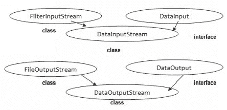

从文件输入数据流可以如下创建：

```java
FileInputStream fis = new FileInputStream(infile);
DataInputStream dis = new DataInputStream(fis);
```

这些语句基本上是将 `dis` 包装在 `fis` 之上并将其作为"过滤器"。同样，以下语句创建了输出数据流 `dos` 并将其封装在输出文件之上：

```java
FileOutputStream fos = new FileOutputStream(outfile);
DataOutputStream dos = new DataOutputStream(fos);
```

### 示例 15.5

以下程序演示了原始数据类型的读和写。

```java
import java.io.*;

class ReadWritePrimitive {
    public static void main(String[]) throws IOException {
        File primitive = new File("prim.dat");
        FileOutputStream fos = new FileOutputStream(primitive);
        DataOutputStream dos = new DataOutputStream(fos);

        dos.writeInt(1999);
        dos.writeDouble(22.44);
        dos.writeBoolean(false);
        dos.writeChar('X');

        dos.close();
        fos.close();

        FileInputStream fis = new FileInputStream(primitive);
        DataInputStream dis = new DataInputStream(fis);

        System.out.println(dis.readInt());
        System.out.println(dis.readDouble());
        System.out.println(dis.readBoolean());
        System.out.println(dis.readChar());

        dis.close();
    }
}
```

```java
fis.close();
}
}
```

Output:
1999
222.44
false
X

## 预定义流

`System` 类包含三个预定义的流变量：`in`、`out` 和 `err`。这些字段在 `System` 类中被声明为 `public` 且 `static`。这意味着它们可以被程序的任何部分使用，而无需引用特定对象。

`System.out` 指标准输出流。默认情况下，它是控制台。`System.out` 是一个 `PrintStream` 类型的对象。

`System.in` 指标准输入，默认是键盘。`System.in` 是一个 `InputStream` 类型的对象。

`System.err` 指标准错误流，默认情况下也是控制台。`System.err` 是一个 `PrintStream` 类型的对象。

这些是字节流，尽管它们通常用于从控制台读取和写入字符。如果需要，你可以将这些流封装在基于字符的流中。

### InputStreamReader

`InputStreamReader` 是字节流到字符流的桥梁；它读取字节并使用指定的 `charset` 将其解码为字符。它使用的字符集可以显式指定，也可以接受平台的默认字符集。

#### 构造函数

- `InputStreamReader(InputStream in)`：创建一个使用默认字符集的 `InputStreamReader`。
- `InputStreamReader(InputStream in, String charsetName)`：创建一个使用指定名称字符集的 `InputStreamReader`。

### 示例 15.26

```java
import java.io.*;

class InputStreamReaderTest {
    public static void main(String argv[]) throws IOException {
        char c;
        InputStreamReader is = new InputStreamReader(System.in);
        System.out.println("Enter characters, 'q' to quit");
        c = (char) is.read();
        while (c != 'q') {
            System.out.print(c);
            c = (char) is.read();
        }
    }
}
```

Output:
Enter characters, 'q' to quit
abcd
q

## 示例 15.27

对上一个示例进行了修改，使用缓冲区来提高性能。

```java
import java.io.*;

class BufferedReaderTest {
    public static void main(String args[]) throws IOException {
        char c;
        BufferedReader br = new BufferedReader(new InputStreamReader(System.in));
        System.out.println("Enter characters, 'q' to quit");
        c = (char) br.read();
        while (c != 'q') {
            System.out.print(c);
            c = (char) br.read();
        }
    }
}
```

Output:
Enter characters, 'q' to quit
abcd
q

## 示例 15.28

`InputStreamReader` 没有提供 `readLine()` 方法，因此 `InputStreamReader` 与提供了 `readLine()` 方法的 `BufferedReader` 关联。

```java
import java.io.*;

class BufferedReaderTest {
    public static void main(String argv[]) throws IOException {
        BufferedReader br = new BufferedReader(new InputStreamReader(System.in));
        System.out.println("Enter 'stop' to quit");
        String str = br.readLine();
        while (!str.equals("stop")) {
            System.out.println("Your Name:" + str);
            str = br.readLine();
        }
    }
}
```

Output:
Enter 'stop' to quit
Harry Feat
Your Name:Harry Feat

## 示例 15.29

此示例演示了我们可以直接从 `System.in` 读取。

```java
import java.io.*;

class ReadFromConsole {
    public static void main(String arg[]) throws IOException {
        char c;
        System.out.println("Enter characters, 'q' to quit");
        c = (char) System.in.read();
        while (c != 'q') {
            System.out.print(c);
            c = (char) System.in.read();
        }
    }
}
```

Output:
Enter characters, 'q' to quit
abcd
abcd
q

## OutputStreamWriter

`OutputStreamWriter` 是字符流到字节流的桥梁：写入它的字符将使用指定的 `charset` 编码为字节。它使用的字符集可以显式指定，也可以接受平台的默认字符集。

#### 构造函数

- `OutputStreamWriter(OutputStream out)`：创建一个使用默认编码的 `OutputStream`。
- `OutputStreamWriter(OutputStream out, String charsetName)`：创建一个使用指定名称字符集的 `OutputStream`。

## 读取控制台输入

在 Java 中，执行控制台输入的唯一方法是使用字节流，这种方法存在于旧代码。今天，使用字节流读取控制台仍然可行，但可能需要使用过弃的方法，且这种方法并不推荐。在 Java 中，控制台输入通过读取 `System.in` 实现。为了获得连接控制台的字符流，你可以将 `System.in` 封装在 `InputStreamReader` 对象中，然后进一步封装在 `BufferedReader` 对象中以提高性能。

## 输出控制台输出

控制台输出可以通过 `print()` 和 `println()` 直接完成。这些方法由 `PrintStream` 类定义（它是 `System.out` 的类型）。尽管 `System.out` 是字节流，但用它进行简单的程序输出是可以接受的。

然而，基于字符的替代方案是正确的选择。因为 `PrintStream` 是派自 `OutputStream` 的输出流，它还实现了底层的 `write()` 方法。`PrintStream` 定义的最简单 `write()` 形式为：

```java
void write(int byteval)
```

该方法向流写入由 `byteval` 指定的字节。尽管 `byteval` 被声明为整数，但只有低 8 位会被写入。

### 示例 15.30

```java
import java.io.*;

class WriteTest {
}
```


# Java 中的序列化

## 序列化概述

序列化是将对象的状态写入字节流的过程。当你想要将对象的状态存储到字节流中时，这种方法非常有用。当你想要将程序状态保存到持久化区域（如文件）时，它同样有用。在之后的某个时刻，你可以通过反序列化过程恢复这些对象。

实现`RMI`也需要序列化。`RMI`允许一台机器上的 Java 对象调用另一台机器上 Java 对象的方法。对象可以作为远程方法的参数传递。发送端对对象进行序列化并转换，接收端对其进行反序列化。

如果你尝试对对象图顶部的对象进行序列化，所有引用的对象都会被递归定位并序列化。同样，在反序列化过程中，所有这些对象及其引用都会被正确存储。声明为`transient`或`static`的变量不会被序列化机制保存。

注意：你通常不会使用`write()`执行控制台输出，因为`print()`和`println()`使用起来要简单得多。

## Externalizable 接口

Java 的序列化和反序列化设施设计使得保存和恢复对象状态的大部分工作可以自动完成。然而，在某些情况下，程序员可能需要对这些过程进行控制。例如，使用压缩或加密技术可能是必要的。`Externalizable`接口正是为了这种情况设计的。实现`Externalizable`的对象也可以被序列化反序列化，但控制权在用户手中，即用户可以决定序列化序列化哪些部分。序列化代码写在`writeExternal()`方法中，反序列化代码写在`readExternal()`中。

### Externalizable 接口的方法
- `void readExternal(ObjectInput in)`：对象实现`readExternal`方法，通过调用用于基本类型的`DataInput`方法以及用于对象、字符串和数组的`readObject`方法来恢复内容。
- `void writeExternal(ObjectOutput out)`：对象实现`writeExternal`方法，通过调用用于其基本值的`DataOutput`方法或调用用于对象、字符串和数组的`ObjectOutput` `writeObject`方法来保存内容。

## ObjectOutput 接口

`ObjectOutput`接口扩展了`DataOutput`接口并支持对象序列化。除了`DataOutput`接口定义的方法外，`ObjectOutput`接口只定义了一个方法：

- `Void writeObject(Object object)`：调用以序列化对象。`ObjectOutput`接口的所有方法在错误条件下都会抛出`IOException`。

### ObjectOutputStream
`ObjectOutputStream`类扩展了`OutputStream`类并实现了`ObjectOutput`接口。它负责将对象写入流中。

**构造函数：**
`ObjectOutputStream(OutputStream out)`：创建一个向指定的`OutputStream`写入数据的`ObjectOutputStream`。参数`out`是将写入序列化对象的输出流。

**写入对象的方法：**
`void writeObject(Object obj)`：将对象写入底层存储或流。

### ObjectInput 接口

`ObjectInput`接口扩展了`DataInput`接口。它支持对象序列化。除了`DataInput`接口定义的方法外，`ObjectInput`接口只定义了一个方法：

- `Object readObject()`：调用以反序列化对象。

### ObjectInputStream
`ObjectInputStream`类扩展了`InputStream`类并实现了`ObjectInput`接口。`ObjectInputStream`负责从流中读取对象。

**构造函数：**
`ObjectInputStream(InputStream in)`：创建一个从指定的`InputStream`读取数据的`ObjectInputStream`。参数`in`是应该从其读取序列化对象的输入流。

**反序列化方法为：**
`Object readObject()`：从`ObjectInputStream`中读取对象。

## 示例 15.31

```java
import java.io.*;

class SerializationTest {

    public static void main(String args[]) throws IOException {

        try {

            MyClass object1 = new MyClass("Hello", 23, 1.3);

            MyClass object2 = new MyClass("Hello1", 1, 2);

            System.out.println(object1);

            System.out.println(object2);

            FileOutputStream fos = new FileOutputStream("serial.dat");

            ObjectOutputStream oos = new ObjectOutputStream(fos);

            oos.writeObject(object1);

            oos.writeObject(object2);

            oos.flush();

            oos.close();

        } catch (Exception e) {

            System.out.println(e);

        }

        try {

            MyClass object3, object4;

            FileInputStream fis = new FileInputStream("serial.dat");

            ObjectInputStream ois = new ObjectInputStream(fis);

            object3 = (MyClass)is.readObject();

            object4 = (MyClass)is.readObject();

            ois.close();

            System.out.println("After deserialization");

            System.out.println(object3);

            System.out.println(object4);

        } catch (Exception e) {

            System.out.println(e);

        }

    }

}
```

```java
public static void main (String argv[ ]) throws IOException {

{

    // ...

    int b;

    // ...

    b = 'A';

    // ...

    System.out.write(b);

    // ...

    System.out.flush();to flush

    System.out.write('\n');//to flush

    System.out.write(b);

}
```

```java
class MyClass implements Serializable {

    String s;

    int i=100;

    double d;

    MyClass(String s, int i, double d) {

        s = s;

        i = i;

        d = d;

    }

    public String toString() {

    }

}
```

```java
return "s = "+ s +"; i = "+ i + " ; d = " +d;

}
```

**输出:**
```text
s = Hello; i = 123 ; d = 1300.0

s = Hello1; i = 1 ; d = 2.0
```

**反序列化后**
```text
s = Hello; i = 123 ; d = 1300.0

s = Hello1; i = 1 ; d = 2.0
```

> **注意：** 我们可以在一个文件中保存多个相同类型的对象，也可以在同一个文件中保存不同类型的对象。

### 示例 15.32

此示例演示了`transient`和`static`变量在序列化过程中不会持久化。

```java
import java.io.*;

class SerializationTest2 {

    public static void main (String args[]) throws IOException {

        try {

            MyClass object1 = new MyClass("Hello", 123, 1.3e3);

            MyClass object3 = new MyClass("Hello1", 1, 2);

            object3.x = 200;

            A object5 = new A();

            System.out.println(object1);

            System.out.println(object3);

            System.out.println(object5);

            FileOutputStream fos = new FileOutputStream("serial.dat");

            ObjectOutputStream oos = new ObjectOutputStream(fos);

            oos.writeObject(object1);

            oos.writeObject(object3);

            oos.writeObject(object5);

            object3.x = 400;

            oos.flush();

            oos.close();

        } catch (Exception e) {

            System.out.println(e);

        }

        try {

            MyClass object2, object4;

            A object6;

            FileInputStream fis = new FileInputStream("serial.dat");

            ObjectInputStream ois = new ObjectInputStream(fis);

            object2 = (MyClass) ois.readObject();

            object4 = (MyClass) ois.readObject();

            object6 = (A) ois.readObject();

            ois.close();

            fis.close();

            System.out.println("After deserialization");

            System.out.println(object2);

            System.out.println(object4);

            System.out.println(object6);

        } catch (Exception e) {

            System.out.println(e);

        }

    }

}

class MyClass implements Serializable {

    String s;

    transient int i=100;

    public static int x = 0;

    double d;

    MyClass(String s, int i, double d) {

        this.s = s;

        this.i = i;

        this.d = d;

        x = 100;

    }

    public String toString() {

        return "s = " + s + "; i = "+ i + " ;d = " + d +"; x = "+ x;

    }

}

class A implements Serializable {

    public String toString() {

        return "A";

    }

}
```

### 示例 15.3 使用 Externalizable

```java
import java.io.*;

class SerializationTest {

    public static void main (String args[]) throws IOException {

        try {

            MyClass object1 = new MyClass("Hello", 99, 123.45);

            System.out.println(object1);

            FileOutputStream fos = new FileOutputStream("serial.dat");

            ObjectOutputStream oos = new ObjectOutputStream(fos);

            System.out.println("before writing object");

            oos.writeObject(object1);

            System.out.println("after writing");

            oos.flush();

            oos.close();

        } catch (Exception e) {

            System.out.println(e);

        }

        try {

            MyClass object2;

            FileInputStream fis = new FileInputStream("serial.dat");

            ObjectInputStream ois = new ObjectInputStream(fis);

            System.out.println("before reading");

            object2 = (MyClass) ois.readObject();

            System.out.println("after reading");

            ois.close();

            fis.close();

            System.out.println(object2);

        } catch (Exception e) {

            System.out.println(e);

        }

    }

}

class MyClass implements Serializable {

    String s;
```

```java
int i = 100;

double d;

public MyClass() {}; // 这是必须的

public MyClass(String s, int i, double d) {

    this.s = s;

    this.i = i;

    this.d = d;

}

public String toString() {

    return "s = " + s + "; i = " + i + " ;d = " + d;

}

public void writeExternal(ObjectOutput oos) throws IOException {

    System.out.println("Inside writeExternal");

    oos.writeObject(s);

    oos.writeInt(i);

    oos.writeDouble(d);

}

public void readExternal(ObjectInput ois) throws ClassNotFoundException, IOException {

    System.out.println("Inside readExternal");

    s = (String) ois.readObject();

    i = ois.readInt();

}
```


```text
输出：
```

`s = Hello; i = 99 ;d = 123.45`

before writing object

after writing object

before reading object

after reading object

`s = Hello; i = 99 ;d = 123.45`
```

注意：

在反序列化期间，对象将使用默认构造函数进行构建（与 `serializable` 接口不同），然后进行初始化。状态测试应该在 `readExternal()` 中进行。同样，在序列化期间，只保存类标识。任何状态必须在 `writeExternal()` 中显式保存。

# Applet

## 简介

Applet 是一种设计用于在互联网传输并在兼容 Java 的网络浏览器（如 Internet Explorer 或 Netscape Navigator）客户端上执行的应用程序。Applet 也是 Java 程序，但它们存储在服务器上。

Applet 不能像独立应用程序那样运行。Applet 只能通过嵌入图像或声音文件的 HTML 文件来执行。运行 applet 需要访问一个嵌入了 applet 的 HTML 页面。当网络浏览器下载此类 HTML 页面时，随后会加载包含 applet 代码的可执行文件并在本地机器上执行。

Applet 到达客户端后，它对资源的访问有限，这样它可以生成任意的多媒体用户界面并运行复杂的计算，而不会引入病毒风险或破坏数据完整性。

## Applet 架构

Applet 与普通的 Java 程序不同：

- Applet 是基于 GUI（窗口化）的程序。
- Applet 是事件驱动的。

当一个普通的 Java 程序（非基于 GUI 的）需要输入时，它会提示用户并调用某些输入方法，例如 `readLine()`，即交互是由程序发起的。这并不是 GUI 程序的运行方式。是由用户发起与程序的交互，而不是由程序发起动作。例如，在文字处理软件中，用户通过点击按钮发起动作，产生一个事件，结果是执行一段代码并相应地发生动作。

Applet 使用 `awt` 包（抽象窗口工具包）来提供 GUI 和处理事件。之所以被称为 `awt`，因为它依赖于底层操作系统的功能。applet 类似于一组中断例程，等待事件发生。awt 通过调用 applet 提供的事件处理程序来通知 applet。一旦发生这种情况，applet 必须采取适当行动并迅速将控制权还给 AWT。

这是一个至关重要的点。在绝大多数情况下，我们的 applet 不应该进入一种长时间保持控制的运行“模式”。相反，它必须响应事件执行特定操作，然后将控制权返回给 AWT 运行时。在 applet 需要独立执行重复任务的情况下（例如在窗口跨区域显示消息），我们必须启动额外的执行线程。

## 编写 Applet

所有的 applet 都是 `Applet` 类的子类。`Applet` 类位于 `java.applet` 包中。Applet 类的层次结构如下：

```text
java.lang.Object
      |
java.awt.Component
      |
java.awt.Container
      |
java.awt.Panel
      |
java.applet.Applet
```

`Applet` 类为 applet 的执行提供了必要的支持，如启动和停止。它提供了加载和显示图像的方法。它还为所有基于窗口的活动提供了必要的支持。

我们扩展 `Applet` 的子类必须声明为 `public`，因为它是由网络浏览器实例化（创建对象）并执行的。浏览器在实例化 applet 时使用无参构造函数，因此它必须提供具有 `public` 可见性的无参构造函数。

建议我们不要在 `Applet` 类中提供构造函数，以防编译器提供默认的参数构造函数。我们可以利用 `init()` 方法进行初始化。

在编写 applet 代码时，我们通常会重写 `Applet` 类的一些方法，这些方法在 applet 执行期间会被自动调用。重写 `paint()` 方法是非常常见的。`paint()` 方法中的代码主要在 applet 窗口中显示输出。

### 示例 16.1：App1.java

以下程序演示了一个简单的 applet，它在窗口内显示“Hello World”。在下面的示例中，applet 窗口的背景被设置为红色，前景颜色设置为绿色，因此背景将显示为红色，文字“Hello”将以绿色显示。

```java
import java.awt.*;
import java.applet.Applet;

/*applet code="App1" width=500 height=100*/

class App1 extends Applet {

    public void init() {
        setBackground(Color.red);
        setForeground(Color.green);
    }

    public void paint(Graphics g) {
        g.drawString("Hello World", 20, 20);
    }
}
```

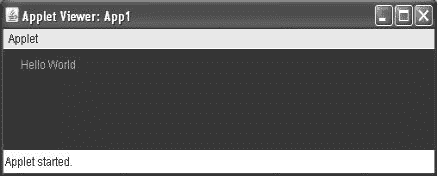

## 执行 Applet

Applet 并不是通过基于控制的 Java 运行时解释器执行的。有两种方法可以运行 applet：

1. 在兼容 Java 的网页浏览器中执行 applet。
2. 使用 `appletviewer`，例如标准的 SDK 工具 `appletviewer`。`appletviewer` 会在一个窗口中执行我们的 applet。这是测试 applet 最快且最简单的方法。

## 在网页浏览器中执行 Applet

我们需要编写一个短的 HTML 文本文件，其中包含适当的 `APPLET` 标签。`applet` 标签必须包含以下三个属性：

- `Code`
- `Width`
- `Height`

属性 `code` 的指定包含 applet 代码的类名。`width` 和 `height` 属性分别指定 applet 窗口的宽度和高度。

这里是嵌入了 "App1" applet 的 HTML 文件 `RunApp.Html`：

```html
<html>
<head>
<title>Simple Applet</title>
</head>
<body>
<h1>Simple “Hello World” Application </h1>

<applet code= “App1” width =500 height=100>
</applet>

</body>
</html>
```

你可以通过在浏览器中打开文件 `RunApp.html` 来执行 applet。该文件可以位于本地文件系统上，也可以从网络服务器加载。

## 使用 appletviewer 执行 Applet

然而，存在一种更方便的方法可以用来加速测试。只需在你的 Java 源代码文件中包含一个带有 `APPLET` 标签的注释即可。通过这样做，我们的代码就包含了必要 HTML 语句的原型，我们只需通过启动 `appletviewer` 并加载我们的 Java 源代码文件即可测试编译后的输出。

如果我们使用这种方法，在编译后可以按照如下方式执行 applet：

```bash
appletviewer SimpleApplet.Java
```

## Applet 生命周期方法

AppApplet 重写了一组方法，这些方法提供了浏览器或 `appletviewer` 与 applet 接口交互并控制其执行的基本机制。

这些方法也被称为生命周期方法，因为浏览器或 applet 查看器会在 applet 生命周期的不同阶段自动调用它们。总共有五种生命周期方法：

- `public void init()`
- `public void start()`
- `public void stop()`
- `public void destroy()`
- `public void paint(Graphics g)`

这五个方法中的 `init()`、`start()`、`stop()` 和 `destroy()` 是在 `applet` 类中定义的。

`paint()` 是由 `awt Component` 类定义的，并为所有这些方法提供了默认实现。Applet 不需要重写它们没有用到的方法。然而，非常简单的 applet 不需要定义它们。

## Applet 的初始化和终止

当 applet 开始时，将按顺序调用以下方法：

1. `init()`
2. `start()`
3. `paint()`

当 applet 终止时，会发生以下方法调用序列：

4. `stop()`
5. `destroy()`

### init 方法

这是第一个被调用的方法。在这里我们应该初始化变量并为其他初始化活动编写代码。该方法在 applet 的生命周期内仅在实例化后立即被调用一次。

### start 方法

`start()` 方法在 `init()` 之后被调用它它用于在 applet 停止后重启 applet。当 `init()` 在第一次加载 applet 时被调用一次，而 `start()` 在每次 applet 的 HTML 文档显示在屏幕上时都会被调用。因此，如果用户离开网页并返回，applet 将从 `start()` 恢复执行。

### paint 方法

`paint()` 在 applet 开始执行时于 `init()` 和 `start()` 方法之后被调用。每当 applet 的输出需要重绘时，也会调用 `paint()` 方法。这种情况可能由于几个原因发生。例如，运行 applet 的窗口可能被另一个窗口覆盖然后重新显示，或者 applet 窗口可能被最小化然后恢复。

### stop 方法

当网页浏览器离开包含 applet 的 HTML 文档转到另一个页面时，`stop()` 方法会被调用。当 `stop()` 被调用时，applet 可能正在运行。

我们应该使用 `stop()` 来挂起 applet 不可见时不需要运行的线程。如果用户返回页面，我们可以在调用 `start()` 时重新启动它们。我们还可以在 `start()` 方法中释放任何昂贵的资源并重新获取。

### destroy 方法

当环境确定我们的 applet 需要从内存中完全移除时，`destroy()` 方法会被调用。在此时，我们应该释放 applet 可能正在使用的任何资源。`stop()` 方法始终在 `destroy()` 之前被调用。

### 示例 16.2

一个简单的 applet，将背景颜色设置为青色，前景颜色设置为红色，并显示一条消息，说明 applet 启动时 `init()`、`start()` 和 `paint()` 方法被调用的顺序。

```java
import java.awt.*;
import java.applet.*;

/*<applet code="App2" width=500 height=100></applet>*/

class App2 extends Applet {

    String msg="";

    public void init() {
        System.out.println("Inside init");
        setBackground(Color.cyan);
        setForeground(Color.red);
        msg = "Inside init --";
    }

    public void start() {
        System.out.println("Inside start");
        msg += "Inside start --";
    }

    public void stop() {
        System.out.println("Inside stop");
        msg += "Inside stop --";
    }

    public void paint(Graphics g) {
        System.out.println("Inside paint");
        msg += "Inside paint --";
        g.drawString(msg,10,30);
    }

    public void destroy() {
        System.out.println("Inside destroy");
    }
}
```

输出：


## 动态 Applet

Applet 窗口中显示的输出可以是动态的。例如，我们可以显示移动的横幅。Applet 也可以用于应用程序，例如通过从服务器获取板球比赛得分和其他统计数据；显示股票价格等。

### 示例 16.3

以下示例显示了一个移动的横幅。它演示了使用 `repaint()` 方法来刷新显示。该 applet 在 applet 窗口上从右向左滚动消息。

由于消息滚动是一项重复性任务，它由一个独立的线程执行，该线程在 applet 初始化时被创建。此程序还演示了可以在 `stop()` 方法中释放资源并在 `start()` 方法中重新获取。

```java
import java.awt.*;
import java.applet.*;

/*<applet code="App3" width=500 height=100></applet>*/

class App3 extends Applet implements Runnable {

    String msg="A Simple Moving Banner." ;
    Thread t = null;
    boolean stopFlag;

    public void init ()
```

```java
{
    setBackground(Color.cyan);
    setForeground(Color.red);
}

public void start()
{
    t=new Thread(this);
    stopFlag = false ;
    t.start ();
}

public void stop()
{
    stopFlag=true;
    t=null;
}

public void paint(Graphics g)
{
    g.drawString(msg, 0, 0);
}

public void run()
{
    for (;;) {
        repaint();

        try {
            Thread.sleep(250);
        } catch(InterruptedException e) {
            System.out.println(e);
        }

        msg = msg.substring(1) + msg.charAt(0);

        if (stopFlag) {
            break;
        }
    }
}
```

输出：


## 使用状态窗口

除了在窗口中显示信息外，Applet 还可以向运行它的浏览器或 `appletviewer` 的状态窗口输出消息。

要做到这一点，请调用 `showStatus()` 并传入我们想要显示的字符串。状态窗口是向用户提供 Applet 正在发生的情况反馈、建议选项或报告某些类型错误的好地方。状态窗口也是极佳的调试助手（帮助），因为它为我们提供了一种输出关于 Applet 信息的简单方法。

### 示例 16.4

以下示例演示了如何使用状态窗口。

```java
import java.awt.*;
import java.applet.*;

/*<applet code="App4" width=500 height=100></applet>*/

public class App4 extends Applet {

    public void init() {
        setBackground(Color.cyan);
    }

    public void paint(Graphics g) {
        g.drawString("This is in the applet window",10,20);
        showStatus("This is shown in the status window");
    }
}
```

输出：


## HTML 的 APPLET 标签

`APPLET` 标签用于从 HTML 文档和 `appletviewer` 启动 applet。`appletviewer` 会在单独窗口中执行找到的每个 `APPLET` 标签；而像 Netscape Navigator 和 Internet Explorer 等浏览器允许在单个页面上运行多个 applet。

标准 `APPLET` 标签的语法为：

```html
<APPLET
    CODE=applet class
    CODEBASE=codebase URL
    ALT=alternate Text,
    NAME=appletInstename
    WIDTH=pixels
    HEIGHT=pixels
    ALIGN=alignment
    VSPACE=vertical space in pixels
    HSPACE=horizontal space in pixels
>

<PARAM NAME=attributeName-1 VALUE=Attribute Value-1>
```


```html
<PARAM NAME=attributeName-2 VALUE=Attribute Value-2>

-------------

<PARAM NAME=attributeName-N VALUE=Attribute Value-N>

………在没有 Java 的情况下显示的 HTML………

</APPLET>
```

### 属性

- **CODE**：`CODE` 是一个必需属性，提供包含 applet 编译类文件的文件名。该文件相对于 applet 的 `CODEBASE` URL（如果设置了 `CODEBASE` 则由其指明）。
- **CODEBASE**：`CODEBASE` 是一个可选属性，指定 applet 的基础 URL，即搜索 applet 可执行文件（由 `CODE` 标签指定）的目录。如果未指定此属性，则使用 HTML 文档的目录作为 `CODEBASE`。`CODEBASE` 不一定位于读取 HTML 文档的主机。
- **ALT**：`ALT` 标签是一个可选属性，用于指定浏览器理解 `APPLET` 标签但无法运行 Java 时应显示的短文本。这是为不支持 applet 的浏览器提供的替代方案。
- **NAME**：`NAME` 是一个可选属性，用于指定 applet 实例名称。applet 必须命名，以便同页的其他 applet 通过名称找到它们并与其通信。通过名称获取 applet 请使用 `getName()`，它由 `Applet` 接口定义。
- **WIDTH 和 HEIGHT**：`WIDTH` 和 `HEIGHT` 是显示区域的大小（像素）。
- **ALIGN**：`ALIGN` 是一个可选属性，指定 applet 的对齐方式。该属性的处理方式与 `IMG` 标签相同，可能的值有 `LEFT`、`RIGHT`、`BOTTOM`、`TEXTTOP`、`MIDDLE` 和 `BOTTOM`。
- **VSPACE 和 HSPACE**：这些属性是可选的；`VSPACE` 指定 applet 上下的像素间隔。`HSPACE` 指定 applet 两侧的像素间隔。它们的处理方式与 `IMG` 标签的 `VSPACE` 和 `HSPACE` 相同。

### PARAM 标签

`PARAM` 标签允许我们在 HTML 中指定 applet 参数。applet 使用 `getParameter()` 方法访问属性。`PARAM` 标签有两个属性：`NAME` 和 `VALUE`。

#### 示例 16.5：此示例演示了如何从 HTML 页面向 Applet 传递参数

```java
import java.awt.*;
import java.applet.*;

/*<applet code="App5" width=500 height=100>

    <param name="fontName" value="Arial">

    <param name="fontSize" value="30">

</applet>*/

public class App5 extends Applet
{
    String fName;
    int fSize;

    public void init()
    {
        fName = getParameter("fontName");

        if (fName == null)
            fName = "Courier";

        fSize = Integer.parseInt(getParameter("fontSize"));

        Font f1 = new Font(fName, Font.PLAIN, fSize);
        setFont(f1);
    }

    public void paint(Graphics g)
    {
        g.drawString("Font Name : " + fName, 0, 25);
    }
}
```

```java
g.drawString("Font Size : " + fSize, 0, 50);

g.drawString("Hello world", 0, 75);

}
```

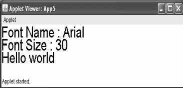

## 获取 DocumentBase 和 CodeBase

通常，我们会创建需要显式加载媒体和文本的 applet。Java 允许 applet 从启动 applet 的 HTML 文件所在的目录（文档基 base）以及加载 applet 类文件所在的目录（代码基 base）加载数据。

这些目录以 `URL` 对象的形式返回。它们可以与命名我们想要加载的文件的字符串拼接。要实际加载另一个文件，我们将使用由 `Applet` 上文接口定义的 `showdocument()` 方法。

### 示例 16.6：以下示例演示了如何在 applet 代码中获取文档基和代码基

#### App6.java

```java
import java.awt.*;
import java.applet.*;
import java.net.URL;

public class App6 extends Applet
{
    public void paint(Graphics g)
    {
        URL u1 = getCodeBase();
        g.drawString("Code base:-" + u1, 10, 20);

        URL u2 = getDocumentBase();
        g.drawString("Document base:-" + u2, 10, 40);
    }
}
```

#### App6.html

```html
<html>
<body>
    <applet code="App6" width=500 height=200></applet>
</body>
</html>
```

输出：

## AppContext 和 Document

Java 的应用之一是使用活跃的图像和动画来提供一种图形化的网页导航手段，这比超文本使用的下划线文字更有趣。为了允许我们的 applet 将控制权转移到另一个 URL，我们必须使用 `AppContext` 接口定义的 `document()` 方法。

`AppContext` 是一个接口，允许我们从 applet 的执行环境中获取信息。当前执行的 applet 的上下文通过调用 `Applet` 类定义的 `getContext()` 方法获得。

在 applet 内部，一旦获取了 applet 的上下文，我们就可以通过 `showDocument()` 方法将另一个文档引入视线。该方法没有返回值，如果执行失败也不会抛出异常，因此请谨慎使用。共有两个 `showDocument()` 方法：

1. `void showDocument(URL url)`：用给定的 `URL` 当前正在查看的网页。
2. `void showDocument(URL url, String where)`：在浏览器窗口的指定位置显示指定的文档。“where”的有效参数：
   - `"_self"`（在当前帧中）
   - `"_parent"`（在父帧中）
   - `"_top"`（在顶层帧中）
   - `"_blank"`（在新浏览器窗口中）

### 示例 16.7：以下 applet 演示了 AppContext 和 `showDocument()` 的用法

执行时，它获取当前的 applet 上下文并使用该上下文将控制权转移到名为 A.html 的文件。该文件必须与 applet 位于同一目录下。Test.html 可以包含你喜欢的任何有效超文本。

#### App7.java

```java
import java.awt.*;
import java.applet.*;
import java.net.*;

public class App7 extends Applet
{
    AppContext ac;
    URL u1;

    public void init()
    {
        setBackground(Color.cyan);
    }

    public void start()
    {
        ac = getContext();
        u1 = getCodeBase();

        try
        {
            Thread.sleep(300);
            ac.showDocument(new URL(u1 + "A.html"), "_blank");
        }
        catch (MalformedURLException e)
        {
            showStatus("Invalid URL");
            e.printStackTrace();
        }
        catch (InterruptedException e)
        {
            showStatus("Invalid URL");
            e.printStackTrace();
        }
    }

    public void paint(Graphics g)
    {
        g.drawString(u1 + "A.html", 0, 20);

        try
        {
            Thread.sleep(300);
        }
        catch (InterruptedException e)
        {
            System.out.println(e);
        }
    }
}
```

#### App7.html

```html
<html>
<head>
    <Title>Applet Demo</Title>
</head>
<body>
    <applet code="App7" width=200 height=200></applet>
</body>
</html>
```

#### A.html

```html
<html>
<head>
    <title>New Page</title>
</head>
<body bgcolor=blue text=red>
    <h1>matrix</h1>
</body>
</html>
```

#### 示例 16.8

```java
import java.applet.*;
import java.awt.*;
import java.awt.event.*;

/*<applet code="CopyApp" width=500 height=200></applet*/

public class CopyApp implements ActionListener
{
    TextField tf1, tf2;
    Button b1;

    public void init()
    {
        setForeground(Color.red);

        Font f1 = new Font("Arial", Font.BOLD + Font.ITALIC, 20);

        tf1 = new TextField(8);
        tf2 = new TextField(8);

        tf1.setFont(f1);
        tf2.setFont(f1);

        b1 = new Button("Copy");
        b1.addActionListener(this);
        b1.setFont(f1);

        add(tf1);
        add(tf2);
        add(b1);
    }

    public void paint(Graphics g)
    {
        g.drawString("Matrix", 0, 150);
    }

    public void actionPerformed(ActionEvent ae)
    {
        String s1 = tf1.getText();
        tf2.setText(s1);
    }
}
```

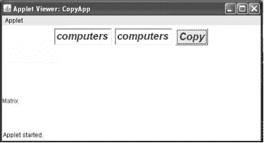

## 示例 16.9：使用 Applet 计算两个数的和

```java
import java.applet.*;
import java.awt.*;
import java.awt.event.*;

/*<applet code="SumApplet" width=400 height=400></applet>*/

public class SumApplet extends Applet implements ActionListener
{
    TextField tf1, tf2, tf3;
    Label l1, l2, l3;
    Button b1;

    public void init()
    {
        setLayout(new GridLayout(4, 2));

        l1 = new Label("No. 1");
        l2 = new Label("No. 2");
        l3 = new Label("Result");

        tf1 = new TextField(8);
        tf2 = new TextField(8);
        tf3 = new TextField(8);

        b1 = new Button("Sum");
        b1.addActionListener(this);

        add(l1);
        add(tf1);
        add(l2);
        add(tf2);
        add(l3);
        add(tf3);
        add(b1);
    }

    public void actionPerformed(ActionEvent ae)
    {
        Button abc = (Button) ae.getSource();

        if (abc == b1)
        {
            int a, b, c;

            a = Integer.parseInt(tf1.getText());
            b = Integer.parseInt(tf2.getText());
            c = a + b;

            tf3.setText(String.valueOf(c));
        }
    }
}
```


# 第 17 章：抽象窗口工具包 - AWT

## 引言

Java 提供了大量的内置类，帮助我们设计图形用户界面（GUI）。这些类大部分属于`java.awt`包，统称为抽象窗口工具包（AWT）。

我们熟悉如`MS-WORD`、`MS-EXCEL`等软件。所有这些软件都有 GUI，即当我们运行这些软件时，可以看到图形用户界面。我们通过键盘或鼠标选择不同的选项来访问这些软件的各种功能。显示用户界面需要大量的编程工作。

AWT 中帮助设计图形用户界面的三个重要部分是：

* 组件 (Components)
* 容器 (Containers)
* 布局管理器 (Layout Managers)

以上所有内容在设计 GUI 中都起着重要作用。

## 组件

组件是 Java 创建 GUI 的构建块。组件是一个具有图形表示的对象，可以显示在屏幕上并与用户交互。典型图形用户界面的组件示例包括按钮、复选框和滚动条。`java.awt.Component`类是非菜单相关 AWT 组件的抽象超类。组件类也可以直接扩展以创建轻量级组件。轻量级组件是不与原生不透明窗口相关的组件。

某些组件类型（如按钮和滚动条）直接用于 GUI 控制。其他类型的组件（继承自`Container`类的组件）提供了特殊的组织方式。而`TextField`、`TextArea`、`List`等组件用于接受用户输入。`label`是不同类型的组件，其目的仅仅是显示相应的标签以识别其他组件。

Java 组件通过`java.awt.Component`和`java.awt.Menu`组件超类的许多子类来实现。组织这些大量类的一种方法是将它们分为以下几类：

* 可视组件
* 容器组件
* 菜单组件

### 组件层次结构

下图显示了 AWT 的组件层次结构。

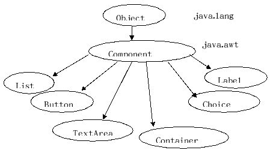

## 容器

下图描述了容器层次结构。

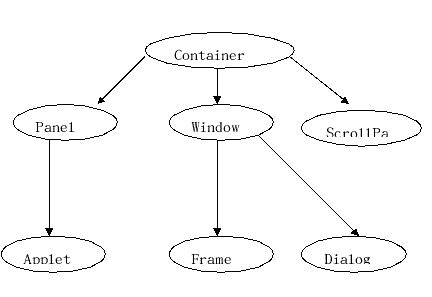

所有基于窗口的应用程序都从屏幕上可见的顶层窗口开始。同样，所有基于 GUI 的 Java 程序也从顶层窗口开始，在 Java 术语中被称为顶层容器。

容器也是包含其他组件的 Java 组件。只有通过将组件添加到容器或将其放入容器内部，组件才能变得可见。所有的 Java GUI 都存在于`applet`或`Frame`中。`applet`和`frame`是 Java 中的两个顶层容器。

## 布局管理器

在将组件添加到容器时，一个重要问题是关于组件的位置和大小。组件的位置可以通过两种方式指定：

### (i) 绝对定位

在绝对定位中，我们指定组件应该添加的精确位置。这种方法为我们提供了精细的控制，如果我们只为某一个平台设计 GUI，这可能是最佳选择。

### (ii) 相对定位

另一种方法是相对定位，它可能不允许我们指定组件的精确位置，但在我们希望组件始终位于容器中间的情况下，它是合适的。

在`java`中，可以使用绝对定位，但并不建议这样做。`AWT`设计初为了使用相对定位。我们可以通过相对规范来指定组件布局，例如：组件将添加到上一个组件的右侧、组件将添加到其他组件的下方、组件将出现在顶部、组件的大小将是容器宽度的 1/4 等。即使在不知道组件尺寸的情况下，这些规范也有用。

Java 鼓励相对定位，是因为它是平台无关的，相同的 GUI 应该可以在无需修改的情况下运行在各种平台上。

被称为布局管理器（layout managers）的内置`java`类处理将相对位置映射到实际/物理位置的任务。Java 支持许多类型的布局管理器，我们将讨论以下布局管理器：

1. `FlowLayout`
2. `GridLayout`
3. `BorderLayout`
4. `CardLayout`
5. `GridBagLayout`

### 使用布局管理器时的两个观察结果

- 我们不必承担指定每个组件精确位置和尺寸的负担。
- 我们不再拥有指定每个组件精确位置和尺寸的权力。

### 为什么 Java 使用布局管理器？

原因有两个：

1. 理论上在于，精确布局（即以像素指定每个组件的尺寸和位置）是一项重复且经常执行的任务；因此，根据 OOP 的布局功能，布局应该被封装在一个或多个类中以自动化该任务。显然，布局管理器消除了大量的开发繁琐工作。许多程序员起初不喜欢布局管理器，但随着繁琐选择的消除，他们变得越来越欣赏它们。

2. 使用布局管理器的实际原因源于`java`的平台无关性。在`java`中，`AWT`组件从运行`JVM`的底层硬件窗口系统中继承其行为。因此，在 Macintosh 上，`AWT`按钮就像任何其他 Mac 按钮；在 motif 平台上，`java`按钮看起来就像其他 motif 按钮，以此类推。问题在于，按钮和其他组件在不同平台上实例化时具有不同的尺寸。如果`java`鼓励精确的像素级尺寸和定位，那么会有很多`java` GUI 在其源平台上看起来很精美，但在其他平台上看起来很糟糕甚至无法使用。

如上所述，布局管理器通过使用相对定位解决了这个问题。

### 布局策略

每个`java`组件都有首选尺寸（preferred size）。首选尺寸表示在不与布局管理器冲突的情况下，组件希望有多大。首选尺寸通常是渲染组件以使其在视觉上具有意义的、所需的最小尺寸，例如，一个按钮的首选尺寸是其标签文本的大小，加上文本周围的一点空隙边框，再加上标记按钮边界的阴影装饰，因此按钮的首选尺寸是“恰好足够的”。首选尺寸是取决于平台的，因为组件的边界装饰会随系统而异。

当布局管理器对其容器的子组件进行布局时，它必须平衡两个考量：
(i) 布局策略和
(ii) 每个组件的首选尺寸

首要任务是强制执行布局策略。如果尊重组件的首选尺寸意味着违反了布局策略，则布局管理器将覆盖组件的首选尺寸。理解布局管理器意味着理解它将把组件放在什么位置，以及它将如何处理组件的首选尺寸。

### 1. FlowLayout

流式布局管理器的功能封装在`java.awt.FlowLayout`类中。

流式布局管理器（Flow Layout）将组件按水平行排列。它是面板（panels）和应用程序（applets）的默认布局管理器类型。流式布局管理器尽可能将多个组件放入第一行，并将其他组件移动到第二行。如果第二行没有留空间，组件将移动到第三行，以此类推。这与在文档中输入文字非常相似。

当我们到达当前行的末尾时，下一个单词将移动到下一行，以此类推。如果我们更改了文档的宽度或高度，整个文档将重新进行格式化。组件始终从左到右，按照它们被添加到容器的顺序出现。

默认情况下，流式布局管理器在水平和垂直方向上组件之间留有五像素的间隙。此默认可以通过调用`FlowLayout`构造函数的重载版本并传入所需的水平和垂直间隙来更改。

在每一行内，组件是等距离分布的，组件簇是居中的。簇的对齐方式（有时称为“对齐”）可以通过向流式布局构造函数传递参数来控制。可能的值为：
- `FlowLayout.LEFT`
- `FlowLayout.CENTER`
- `FlowLayout.RIGHT`

#### 示例 17.1

```java
import java.awt.*;

class MyFrame1 {

    public static void main(String args[ ]) {

        Frame f=new Frame( );

        FlowLayout flow=new FlowLayout();

        f.setLayout(flow);

        Label l1 = new Label("Name ");

        f.add(l1);

        TextField tf1=new TextField("Matrix");

        f.add(tf1);

        tf1.setBackground(Color.green);

        tf1.setForeground(Color.red);

        Button b1 = new Button("ok");

        Font f1 = new Font("Arial", Font.BOLD, 24);

        b1.setFont(f1);

        f.add(b1);

        f.setSize(50,100);

        f.setVisible(true);

    }

}
```

注意：如果我们减小上述窗口的大小且三个组件无法放入单行内，组件将移动到下一行，从最后一个组件开始。
输出：`Images/image27.jpeg`

#### 示例 17.2

```java
import java.awt.*;

class MyFrame2 extends Frame {

    public static void main (String args [] ) {

        MyFrame2 f=new MyFrame2();

        f.setLayout(new FlowLayout(FlowLayout.CENTER));

        System.out.println(f.paramString());

        Label l1=new Label("Name :");

        f.add(l1);

        TextField tf1=new TextField("Sample Program");

        f.add(tf1);

        tf1.setBackground(Color.GREEN);

        tf1.setForeground(Color.RED);

        Button b1=new Button("OK");

        b1.setFont(new Font("Serif",Font.BOLD,24));

        b1.setEnabled(false);

        Dimension d = b1.getSize( );

        System.out.println("Button Size :" + d.width + " " + d.height);

    }

}
```

```java
// f.setResizable(false);
// f.setUndecorated(true);
f.setVisible(true);

Dimension d1=b1.getSize( );
System.out.println("Button Size: " + d1.width + " " + d1.height);

Dimension d2=f.getSize();
System.out.println("Frame Size: " + d2.width + " " + d2.height);

try {
    Thread.sleep(5000);
} catch(InterruptedException e) { }

f.setVisible(false);
f.setSize(500,100);
f.setVisible(true);

try {
    Thread.sleep(500);
} catch(InterruptedException e){ }

f.setVisible(false);
f.setBounds(20, 20, 100, 100);
f.setVisible(true);

Dimension d3=f.getSize();
System.out.println("Frame Size : " + d3.width + " " + d3.height);

System.out.println(f.paramString());

}
```

**输出：**


```text
frame0,0,0,0x0,invalid,hidden,layout=java.awt.FlowLayout,title=,resizable,normal
Button Size :0 0
Button Size: 52 35
Frame Size: 123 34
Frame Size : 123 100
frame0,20,20,123x100,layout=java.awt.FlowLayout,title=,resizable,normal
```

### FlowLayout 布局（续）

#### 示例 17.3
如果我们将行`f.setLayout(new FlowLayout(FlowLayout.CENTER));`改为`f.setLayout(new FlowLayout(FlowLayout.LEFT));`，组件将左对齐。
**输出：**


#### 示例 17.4
如果我们将行`f.setLayout(new FlowLayout(FlowLayout.LEFT));`改为`f.setLayout(new FlowLayout(FlowLayout.RIGHT));`，组件将右对齐。
**输出：**


#### 示例 17.5
我们可以在设置布局时使用重载的构造函数来更改组件之间的间距（水平间距）以及行之间的间距（垂直间距）：
`f.setLayout(new FlowLayout(FlowLayout.CENTER, 20 ,20))`
**输出：**


### 3. GridLayout

`GridLayout`布局管理器的功能封装在`java.awt.GridLayout`类中。`GridLayout`以表格形式在行和列中排列组件。我们可以将容器空间看作一个由行和列组成的网格。在指定布局时，我们需要指定行数和列数。`GridLayout`会根据行的大小（即布局中指定的列数）将尽可能多的组件放入第一行，并将其他组件移动到第二行，依此类推。这类似于电子表格，它被分为固定数量的行和列。

流布局管理器（`FlowLayout`）始终尊重组件的首选尺寸。而`GridLayout`布局管理器采取了相反策略：当它在给定空间内执行布局时，它会忽略组件的首选尺寸。`GridLayout`中的每一行和每一列的大小都是相同的，布局的可用区域在行数和列数之间平均分配。`GridLayout`使用“行主优先”符号，即组件按照它们添加的顺序从左到右、一行一行地出现。

当我们添加的组件很少（即远少于行数乘以列数）或很多（即多于行数乘以列数）时，`GridLayout`的行为会很奇怪。如果将相同的组件在一个更高、更窄的框架中布局，那么每个组件都会按比例变得更高、更窄，反之亦然。

#### 示例 17.6

```java
import java.awt.*;

public class MyFrame6 extends Frame {

    public static void main(String args[]) {

        Frame f = new MyFrame6( );

        f.setLayout(new GridLayout(5,3));

        for(int row=0; row<5; row++) {

            f.add(new Label("Label" + row ));

            f.add(new Button("Button" + row ));

            f.add(new TextField("TextField" + row ));

        }

        f.setSize(500,200);

        f.setVisible(true);

    }

}
```


**输出：**


## 4. BorderLayout

`BorderLayout` 布局管理器的功能封装在 `java.awt.BorderLayout` 类中。`BorderLayout` 是框架的默认管理器，因此应用程序程序员迟早都会熟悉它。

它强制执行了一种非常有用的布局策略，但可能没有流布局或网格布局管理器那么直观。流布局管理器始终尊重组件的首选尺寸；而 `Grid` 布局管理器则从如此。`Border` 布局管理器则介于两者之间。

`BorderLayout` 管理器将可用的容器空间分为五个部分：`North`（北）、`South`（南）、`East`（东）、`West`（西）和 `Center`（中心）。我们可以在每个区域添加一个组件。这五个区域中的每一个可以是空的，也可以包含一个组件（即每个区域不需要包含组件，但每个区域只能包含一个组件）。

`Border` 布局管理器尊重 `North` 和 `South` 组件的首选高度，并强制它们的宽度恰好与容器一样。`North` 和 `South` 区域适用于工具栏、状态行以及任何应该尽可能宽但高度不超过必要的控件。

`East` 和 `West` 区域与 `North` 和 `South` 相反。在 `East` 和 `West` 中，组件获得其首选宽度，但高度受到限制。在这里，组件在垂直方向上延伸到 `North` 组件的底部（如果有）或到容器的顶部（如果没有 `North` 组件）。

同样，组件在垂直方向上延伸到 `South` 组件（如果有）或到容器的底部（如果没有 `South` 组件）。

正确使用 `Border` 布局管理器要求第二个参数必须是 `BorderLayout` 类本身定义的常量。重载形式的 `add()` 方法接受两个参数：

- 第一个是要添加的组件；
- 第二个是一个对象。

### BorderLayout

- `BorderLayout.SOUTH`
- `BorderLayout.EAST`
- `BorderLayout.WEST`
- `BorderLayout.CENTER`

`Border` 布局管理器控制的第五个区域被称为 `Center`。`Center` 只是容器在分配了 `North`、`South`、`East` 和 `West` 后剩余的部分。

在向中心添加组件时，向 `add()` 调用传递第二个参数是合法的但非常不明智的。在 Java Platform 中，`Border` 布局管理器会假设我们的意思是 `center`。

然而，在旧版本中，这种行为是不可预测的，通常会导致组件完全不可见。

### 示例 17.7

```java
import java.awt.*;

public class MyFrame7 {

    public static void main(String args[]) {

        Frame f = new Frame();

        Scrollbar sbRight = new Scrollbar(Scrollbar.VERTICAL);

        f.add(sbRight, BorderLayout.EAST);

        Scrollbar sbLeft = new Scrollbar(Scrollbar.VERTICAL);

        f.add(sbLeft, BorderLayout.WEST);

        Label labelTop = new Label("This is North");

        labelTop.setFont(new Font("Serif", Font.ITALIC, 36));

        labelTop.setForeground(Color.white);

        labelTop.setBackground(Color.black);

        f.add(labelTop, BorderLayout.NORTH);

        Label labelBottom = new Label("This is south");

        labelBottom.setFont(new Font("Monaced", Font.BOLD, 18));

        labelBottom.setForeground(Color.white);

        labelBottom.setBackground(Color.black);

        f.add(labelBottom, BorderLayout.SOUTH);

        f.setSize(50, 20);

        f.setVisible(true);

    }

}
```

输出：


### 示例 17.8

```java
import java.awt.*;

public class MyFrame8 extends Frame {

    public static void main(String args[]) {

        Frame f = new MyFrame8();

        // f.setLayout(new BorderLayout());

        f.add(new Button("N"), BorderLayout.NORTH);

        f.add(new Button("S"), BorderLayout.SOUTH);

        f.add(new Button("E"), BorderLayout.EAST);

        f.add(new Button("W"), BorderLayout.WEST);

        Panel p = new Panel();

        p.setBackground(Color.green);

        f.add(p, BorderLayout.CENTER);

        // f.add(p); default center

        f.setSize(300, 300);

        f.setVisible(true);

    }

}
```

输出：


### 示例 17.9

```java
import java.awt.*;

class BorderLayout3 extends Frame {

    public static void main(String args[]) {

        Frame f = new BorderLayout3();

        // f.setLayout(new BorderLayout());

        Panel toolbar = new Panel();

        toolbar.setLayout(new FlowLayout(FlowLayout.LEFT));

        toolbar.setBackground(Color.lightGray);

        toolbar.add(new Button("This"));

        toolbar.add(new Button("Is"));

        toolbar.add(new Button("The"));

        toolbar.add(new Button("Toolbar"));

        f.add(toolbar, BorderLayout.NORTH);

        TextField status = new TextField("Status.");

        status.setFont(new Font("Monaced", Font.BOLD, 48));

        f.setSize(300, 300);

        f.setVisible(true);

    }

}
```

输出：


## CardLayout

在 `CardLayout` 中，我们可以存储许多卡片，但一次只显示一张卡片。一次只有一张卡片是可见的，但你可以在不同卡片之间切换。

### 构造函数

- `CardLayout()`：创建一个 `CardLayout`。
- `CardLayout(int h, int v)`：创建一个具有指定水平和垂直间隙的 `CardLayout`。

### 方法

- `first(Container parent)`：切换到第一张卡片。
- `next(Container parent)`：切换到下一张卡片。如果当前卡片是最后一张，它将切换到第一张。
- `previous(Container parent)`：切换到上一个卡片。如果当前卡片是第一张，它将切换到最后一张。
- `last(Container parent)`：切换到最后一张卡片。
- `show(Container parent, String name)`：切换到带有给定名称的布局中的组件。如果不存在此类组件，则什么都不会发生。

### 如何使用 CardLayout

1. 创建一个新的 `Panel` 和一个 `CardLayout` 对象。
2. 使用 `CardLayout` 实例为 `Panel` 设置布局。
3. 对于每张卡片，创建一个单独的 `Panel` 并添加你任何组件（按钮、复选框等）。
4. 将第 3 步中创建的每个 `Panel` 添加到第 1 步创建的主 `Panel` 中，并为每张卡片指定一个唯一名称。
5. 最后，将主 `panel` 添加到 applet 窗口。

### 示例 17.10

```java
import java.awt.*;
import java.awt.event.*;
import java.applet.*;

/*<applet code="CardLayoutTest" width=500 height=100></applet>*/

public class CardLayoutTest extends Applet implements ActionListener, MouseListener {

    Panel mp;

}
```

```java
CardLayout c1;

public void init()
{
    Button b1 = new Button("First");

    Button b2 = new Button("Second");

    b1.addActionListener(this);

    b2.addActionListener(this);

    add(b1);

    add(b2);

    Panel p1 = new Panel();

    Label l1 = new Label("INDIA");

    p1.add(l1);

    Panel p2 = new Panel();

    Label l2 = new Label("USA");

    p2.add(l2);

    mp = new Panel();

    c1 = new CardLayout();

    mp.setLayout(c1);

    mp.add(p1, "Country1");

    mp.add(p2, "Country2");

    add(mp);

    addMouseListener(this);
}

public void actionPerformed(ActionEvent ae)
{
    Button b = (Button) ae.getSource();

    if (b.getLabel().equals("First"))
        c1.show(mp, "Country1");
    else
        c1.show(mp, "Country2");
}

public void mousePressed(MouseEvent me)
{
    c1.next(mp);
}

public void mouseReleased(MouseEvent me) {}

public void mouseClicked(MouseEvent me) {}

public void mouseEntered(MouseEvent me) {}

public void mouseExited(MouseEvent me) {}

}
```

输出：


## GridBagLayout

`GridBagLayout` 是标准布局管理器中最复杂且最灵活的一种。尽管它听起来似乎应该是 `GridLayout` 的子类，但它完全不同。在 `GridLayout` 中，元素的排列方式为

### 示例 17.11

AWT 组件可以分类为：

1. 视觉组件。
2. 容器组件。
3. 菜单组件。

视觉组件和容器组件都是从 `java.awt.Component` 类开始的组件层次结构的一部分。

### `java.awt.Component` 类的方法

由于继承自 `java.awt.component`，所有的视觉组件和容器组件都实现了几个方法（菜单组件继承自 `java.awt.MenuComponent`，因此它们不继承相同的父类功能）。这些方法在下文中讨论：

- `Dimension getSize()`：以 `Dimension` 对象的格式返回此组件的大小，该对象具有 `int` 类型的公共数据成员 `height` 和 `width`。
- `void setBackground(Color c)`：设置组件的背景颜色。通常，背景颜色用于渲染组件的非文本区域。
- `void setForeground(Color c)`：设置组件的前景颜色。通常，组件的前景颜色用于渲染文本。如果我们不显式地设置组件的前景或背景颜色，组件将使用其直接容器的前景颜色和背景颜色。
- `void setFont(Font f)`：`setFont()` 方法决定组件在渲染其需要显示的任何文本时使用的字体。如果我们不显式地设置组件的字体，组件将使用其容器的字体。
- `void setEnabled(Boolean b)`：如果参数为 `true`，则组件具有正常外观。如果参数为 `false`，则组件将置灰且对用户输入没有响应。
- `void setSize(Dimension d)`：设置组件的大小。
- `void setSize(int width, int height)`：设置组件的大小。
- `void setBounds(int x, int y, int width, int height)`：尝试移动并调整组件的大小。左上角的新位置由 `x` 和 `y` 指定，新大小由 `width` 和 `height` 指定。
- `void setVisible(Boolean b)`：此方法接受一个 `Boolean` 参数，决定组件是否在屏幕上可见。此方法通常用于帧（frames）。

**注意：** 如果我们已经尝试过调用 `setSize()` 或 `setBounds()`，我们就知道这通常是徒劳的。我们尝试赋予组件的大小和位置会被布局管理器覆盖。事实上，这两个方法存在很大程度上是为了供布局管理器使用的。此规则的例外是 `Frame` 类，它不受布局管理器的控制，并且完全接受拥有自己的大小或边界。

### 视觉组件

视觉组件是用户能够看到并与之交互的组件。AWT 支持以下视觉组件：

- `Button`
- `Canvas`
- `Checkbox`
- `Choice`
- `Dialog`
- `List`
- `ScrollPane`
- `Scrollbar`
- `TextField`

要在 GUI 中使用这些组件之一，我们首先通过调用相应的构造函数来创建一个实例。然后将组件添加到容器中。

### Button

`Button` 类实现了一个按钮。

**构造函数：**

- `Button()`
- `Button(String)`：构造函数接收一个字符串参数，用于指定按钮的标签。当按钮按下时，它会发送一个事件。

**方法：**

- `String getLabel()`：获取此按钮的标签。
- `void setLabel(String label)`：将按钮的标签设置为指定的字符串。
- `void addActionListener(ActionListener l)`：添加指定的动作监听器以接收来自此按钮的动作事件。

#### 示例 17.2

```java
import java.awt.*;

class ButtonTest {

    public static void main(String args[]) {

        Frame f = new Frame("Testing Button Component");

        f.setLayout(new FlowLayout());

        Font f1 = new Font("Arial", Font.BOLD, 40);

        Color c1 = new Color(255, 0, 0);

        Color c2 = new Color(0, 25, 0);

        Button b1 = new Button();

        Button b2 = new Button("Cancel");

        b1.setForeground(c1);

        b2.setForeground(c1);

        b1.setBackground(c2);

        b2.setBackground(c2);

        b1.setFont(f1);

        b2.setFont(f1);

        b1.setLabel("Ok");

        System.out.println(b2.getLabel());


`f.add(b1);`

`f.add(b2);`

`f.setSize(500,200);`

```
f.setVisible(true);
```

输出：


## Canvas

`Canvas` 是一种组件，它没有默认的外观或行为。我们可以通过派生类`Canvas`来创建自定义绘制区域、工作区域、组件等。`Canvas`接收来自鼠标和键盘的输入事件，由程序员将这些输入转换为有意义的视觉效果和体验。

`Canvas`的默认大小（或者更准确地说，首选大小）小得毫无意义。处理这个问题的一种方法是使用可以调整`Canvas`大小的布局管理器。另一种方法是自己为`Canvas`调用`setSize()`，`Canvas`是少数这种方法实际上可能有效的例子，因为我们传递给`setSize()`方法的值将成为`Canvas`的首选大小。

### 示例 17.13

```java
import java.awt.*;

class CanvasTest
{
    public static void main (String args [])
    {
        Frame f = new Frame ();
        f.setLayout(new FlowLayout());
        Canvas c=new MyCanvas();
        c.setSize(100, 100);
        f.add(c) ;
        f.setSize(300, 300 );
        f.setVisible(true);
    }
}

class MyCanvas extends Canvas
{
    public void paint(Graphics g )
    {
        setBackground(Color.green);
        g.setColor(Color.red );
        g.drawLine(0, 0, 9, 9 );
    }
}
```

输出：


## Checkbox

复选框是一个双状态按钮。这两个状态为`true`（选中）和`false`（未选中）。

构造函数的三种基本形式：
- `Checkbox()`：创建一个标签为空字符串的复选框。
- `Checkbox(String label)`：创建一个带有指定标签的复选框。
- `Checkbox(String label, boolean state)`：创建一个带有指定标签并设置指定状态的复选框。如果我们不指定状态，默认认为`false`。

方法：
- `getLabel()`：获取此复选框的标签。
- `setLabel(String label)`：将此复选框的标签设置为字符串参数。
- `getState()`：确定此复选框处于“开启”还是“关闭”状态。
- `setState(boolean state)`：将此复选框的状态设置为指定状态。
- `addItemListener(ItemListener)`：添加指定的监听器以接收此复选框的项目事件。

### 示例 17.4

```java
import java.awt.*;

class CheckboxTest
{
    public static void main(String args[])
    {
        Frame f = new Frame("Testing Checkbox Component");
        f.setLayout(new GridLayout(3,1));
        Checkbox c1=new Checkbox();
        Checkbox c2=new Checkbox("Lunch",true);
        Checkbox c3=new Checkbox("Dinner");
        c1.setLabel("BreakFast");
        c3.setState(true);
        f.add(c1);f.add(c2);f.add(c3);
        if(c1.getState())
            System.out.println(c1.getLabel());
        if(c2.getState())
            System.out.println(c2.getLabel());
        if(c3.getState())
            System.out.println(c3.getLabel());
        f.setSize(100,100);
        f.setVisible(true);
    }
}
```

输出：


### 另一个示例

```java
import java.awt.*;
import java.awt.event.*;

class CheckboxTest extends Frame implements ItemListener
{
    Checkbox c1;
    TextField tf1;
    CheckboxTest()
    {
        setLayout(new GridLayout(2,1));
        c1=new Checkbox("Red");
        c1.addItemListener(this);
        add(c1);
        tf1=new TextField();
        add(tf1);
        setSize(100,100);
        setVisible(true);
    }
    public static void main(String args[])
    {
        new CheckboxTest();
    }
    public void itemStateChanged(ItemEvent ie)
    {
        if(c1.getState())
            tf1.setBackground(Color.red);
        else
            tf1.setBackground(Color.white);
    }
}
```

## Radio button

复选框可以组合成复选框组，它们具有单选行为。在单选行为下，复选框组内同时只有一个成员可以为`true`；选择新成员会将之前选中的成员状态改为`false`。我们可以通过创建多个复选框并使用`java.awt.CheckboxGroup`将它们分组来实现单选行为。在 Java 中，`java.awt.CheckboxGroup`类不是一个组件；它仅仅是一个组织复选框的类。这意味着 Java 没有在组内成员之间施加空间关系。如果我们愿意，可以将组中的一个成员放在左上角，另一个成员放在右下，第三个成员放在不同的框架中。当然，结果将违背逻辑和大多数样式指南。

`CheckboxGroup`类有两个方法支持获取和设置当前选中的成员或组：
- `getSelectedCheckbox()`：从此复选框组获取当前选择。
- `setSelectedCheckbox(Checkbox box)`：将此组中当前选中的复选框设置为指定的复选框。

### 示例 17.15

```java
import java.awt.*;

class CheckboxGroupTest
{
    public static void main(String args[])
    {
        Frame f = new Frame("Testing RadioButton Component");
    }
}
```

# AWT 组件详解

## Button 组件

`Button`是 AWT 中最常用的控件之一，用于允许用户通过点击来触发操作。

### 构造函数
- `Button()`：创建一个空按钮。
- `Button(String label)`：创建一个带有指定文本的按钮。
- `Button(String label, int align)`：创建一个带有指定文本和对齐方式的按钮。

### 主要方法
- `String getLabel()`：获取按钮上的文本。
- `void setLabel(String label)`：设置按钮上的文本。
- `void addActionListener(ActionListener l)`：为按钮添加动作事件监听器。

### 示例代码

```java
import java.awt.*;
import java.awt.event.*;

class ButtonTest extends Frame implements ActionListener {
    Button b;
    TextField tf;
    ButtonTest() {
        setLayout(new FlowLayout());
        b = new Button("点击我");
        b.addActionListener(this);
        tf = new TextField(20);
        add(b);
        add(tf);
        setSize(300, 200);
        setVisible(true);
    }
    public void actionPerformed(ActionEvent e) {
        tf.setText("按钮被点击了！");
    }
    public static void main(String args[]) {
        new ButtonTest();
    }
}
```

```java
import java.awt.*;

class LabelTest
{
    public static void main(String args[])
    {
        Frame f = new Frame("Testing Label Component");
        f.setLayout(new GridLayout(3,3));
        f.setFont(new Font("Arial",Font.PLAIN, 20));
        Label l1 = new Label("India",Label.LEFT);
        Label l2 = new Label("Pakistan",Label.LEFT);
        Label l3 = new Label("UK",Label.LEFT);
        Label l4 = new Label("India",Label.CENTER);
        Label l5 = new Label("Pakistan",Label.CENTER);
        Label l6 = new Label("UK",Label.CENTER);
        Label l7 = new Label("India",Label.RIGHT);
        Label l8 = new Label("Pakistan",Label.RIGHT);
        Label l9 = new Label("UK",Label.RIGHT);
        l3.setText("USA");
        System.out.println(l1.getText());
        f.add(l1);f.add(l4);f.add(l7);
        f.add(l2);f.add(l5);f.add(l8);
        f.add(l3);f.add(l6);f.add(l9);
        f.setSize(500,200);
        f.setVisible(true);
    }
}
```

输出：


## List

列表是垂直排列的文本项目集合。如果列表包含的项目多于其显示范围，它会自动获取一个垂直滚动条。

### 构造函数
- `List()`：创建一个新的滚动列表。此构造函数未指定可见行数，但会产生四行的默认首选高度。当然，在许多情况下，列表的实际高度将由布局管理器决定。
- `List(int rows)`：创建一个新的滚动列表，并初始化指定数量的可见行数。
- `List(int rows, boolean multipleMode)`：创建一个新的滚动列表，初始化为显示指定数量的行并允许多项选择。

### 示例 17.18

```java
import java.awt.*;

class ListTest
{
    public static void main(String args[])
    {
        Frame f = new Frame () ;
        f.setLayout (new FlowLayout());
        List l1=new List(3,true);
        l1.add("India");
        l1.add("Nepal");
        l1.add("Shri Lanka");
        l1.add("USA");
        l1.add("UK");
        f.add(l1);
        System.out.println(l1.getRows());
        f.setSize(300, 300);
        f.setVisible(true);
    }
}
```

输出：


列表有五个项目，但只有 3 行可见，因此提供了滚动条以访问底行。注意：在列表中选择一个项目会导致列表发送 Item 事件（项目事件）；双击一个项目会发送 Action 事件（动作事件）。

- `void add(String item)`：将指定的项目添加到滚动列表末尾。
- `void add(String item, int index)`：将指定的项目添加到滚动列表中由索引指示的位置。
- `void addActionListener(ActionListener i)`：添加指定的监听器以接收此列表的动作事件。
- `void addItemListener(ItemListener i)`：添加指定的监听器以接收此列表的项目事件。
- `String getItem(int index)`：获取与指定索引关联的项目。
- `int getItemCount()`：获取列表中的项目数量。
- `String[] getItems()`：获取列表中的项目。
- `int getRows()`：获取此列表中可见的行数。
- `int getSelectedIndex()`：获取列表中被选中项目的索引。
- `int[] getSelectedIndexes()`：获取列表中被选中的索引。
- `String getSelectedItem()`：获取此滚动列表中的项目。
- `String[] getSelectedItems()`：获取此滚动列表中的被选中项目。
- `void remove(int position)`：从此滚动列表中移除指定位置的项目。
- `void remove(String item)`：从列表中移除项目的第一次出现项。
- `void removeAll()`：从列表中移除所有项目。
- `void replaceItem(String newValue, int index)`：用新字符串替换滚动列表中指定索引处的项目。
- `void select(int index)`：选中滚动列表中指定索引处的项目。
- `void setMultipleMode(boolean b)`：设置标志以决定此列表是否允许多项选择。

```java
import java.awt.*;
import java.awt.event.*;

class ListTest extends Frame implements ActionListener
{
    Button b1,b2,b3,b4,b5,b6;
    List l1,l2;
    TextField tf1,tf2;
    ListTest()
    {
        setLayout(new GridLayout(3,3));
        l1=new List(3,true);
        l2=new List(3,true);
        b1=new Button(">");
        b2=new Button(">>");
        b3=new Button("<");
        b4=new Button("<<");
        b5=new Button("Add");
        b6=new Button("Add");
        b1.addActionListener(this);
        b2.addActionListener(this);
        b3.addActionListener(this);
        b4.addActionListener(this);
        b5.addActionListener(this);
```


```java
b6.addActionListener(this);

tf1 = new TextField();

tf2 = new TextField();

}

}
```

```java
Panel p1 = new Panel();

p1.setLayout(new GridLayout(4, 1));

p1.add(b1);

p1.add(b2);

p1.add(b3);

p1.add(b4);

add(l1);
add(p1);
add(l2);

add(tf1);
add(new Label());
add(tf2);

add(b5);
add(new Label());
add(b6);

setSize(300, 300);

setVisible(true);

}

public static void main(String args[]) {

    new Test();

}

public void actionPerformed(ActionEvent ae) {

    Button b = (Button) ae.getSource();

    if (b == b1) {

        String s[] = l1.getSelectedItems();

        for (int i = 0; i < s.length; i++) {

            l2.add(s[i]);

            l1.remove(s[i]);

        }

    } else if (b == b2) {

        String s[] = l1.getItems();

        for (int i = 0; i < s.length; i++) {

            l2.add(s[i]);

            l1.remove(s[i]);

        }

    } else if (b == b3) {

        String s[] = l2.getSelectedItems();

        for (int i = 0; i < s.length; i++) {

            l1.add(s[i]);

            l2.remove(s[i]);

        }

    } else if (b == b4) {

        String s[] = l2.getItems();

        for (int i = 0; i < s.length; i++) {

            l1.add(s[i]);

            l2.remove(s[i]);

        }

    } else if (b == b5) {

        l1.add(tf1.getText());

    } else if (b == b6) {

        l2.add(tf2.getText());

    }

}

```

### `TextField` 和 `TextArea`

`TextField` 和 `TextArea` 类实现了用于文本输入和显示的一维和二维组件。它们都继承了 `TextComponent` 类：`Object` → `TextComponent` → (`TextField`, `TextArea`)。

`TextField` 和 `TextArea` 都有多种构造函数，可以提供指定初始字符串或大小的选项。未指定首选大小的构造函数在布局管理器将忽略组件首选大小的情况下最为合适。

### `TextField` 类构造函数

- `TextField()`：构造一个新的文本字段。
- `TextField(int columns)`：构造一个具有指定列数的文本字段。
- `TextField(String text)`：构造一个包含指定文本的文本字段。
- `TextField(String text, int columns)`：构造一个包含指定文本的文本字段，宽度足够容纳指定列数的文本。

### `TextArea` 类构造函数

- `TextArea()`：构造一个带有空字符串的新区域。
- `TextArea(int rows, int columns)`：构造一个具有指定行数和列数的空字符串文本区域。
- `TextArea(String text)`：构造一个包含指定文本的文本区域。
- `TextArea(String text, int rows, int columns)`：构造一个包含指定文本、行数和列数的文本区域。
- `TextArea(String text, int rows, int columns, int ScrollPolicy)`：构造一个包含指定文本、行数、列数以及指定滚动策略的文本区域。

`TextArea` 类定义了几个常量可以作为 `scrollPolicy` 参数的值：

- `SCROLLBARS_BOTH`
- `SCROLLBARS_VERTICAL_ONLY`
- `SCROLLBARS_HORIZONTAL_ONLY`
- `SCROLLBARS_NONE`

对于这两个类，`columns` 参数都存在一些出人意料的问题。首先，列数是根据特定字体渲染的文本列数来衡量的宽度。使用极小字体的 25 列文本区域将非常窄，而使用巨大字体的 5 列文本区域将极其宽。其次是等比例字体的问题。对于固定宽度的字体，列宽应该是多少是显而易见的。但对于等比例字体，列宽被认为是字体中所有字符宽度的平均值。这个平均值是集合中所有字符的简单算术平均值；它没有考虑使用频率。因此在大多数情况下，包含大量小写字母的文本组件显示的字符数将超过请求的数量。

### `TextComponent` 类方法

- `String selectText()`：从此文本组件显示的文本中返回选中的文本。
- `String getText()`：返回此文本组件显示的文本。
- `void setEditable(Boolean b)`：设置决定此文本组件是否可编辑的标志。
- `void setText(String t)`：将此文本组件显示的文本设置为指定的文本。

### 示例 17.19

```java
import java.awt.*;

class TextFieldTest {

    public static void main(String args[]) {

        Frame f = new Frame();

        f.setLayout(new FlowLayout());

        TextField tf1 = new TextField();

    }

}
```

```java
TextField tf2 = new TextField(8);

TextField tf3 = new TextField("matrix");

TextField tf4 = new TextField("matrix", 20);

TextArea ta1 = new TextArea();

TextArea ta2 = new TextArea(3, 8);

TextArea ta3 = new TextArea("abc\nxyz\naaa");

TextArea ta4 = new TextArea("abc\nxyz\naaa", 2, 2);

TextArea ta5 = new TextArea("abc\nxyz\naaa", 4, 20, TextArea.SCROLLBARS_BOTH);

f.add(tf1);
f.add(tf2);
f.add(tf3);
f.add(tf4);

f.add(ta1);
f.add(ta2);
f.add(ta3);
f.add(ta4);

f.add(ta5);

tf1.setText("abc");

System.out.println(tf3.getText());

tf3.setEditable(false);

f.setSize(800, 400);

f.setVisible(true);
```

![Images/image01290.jpeg]

### `FileDialog`

该类表示一个文件打开或保存对话框。文件对话框是一个模态对话框，这意味着只要对话框留在屏幕上，来自对话框父帧的输入将重定向到对话框。当用户指定文件或点击取消按钮时，对话框会自动移除。最有用的 `FileDialog` 构造函数具有以下形式：

`FileDialog(Frame parent, String title, int mode)`

对话框的 `parent` 是对话框将出现的帧。`title` 字符串显示在对话框的标题栏中。`mode` 应该是：

- `FileDialog.LOAD`
- `FileDialog.SAVE`

在用户指定文件后，可以使用以下方法获取文件名称或其目录：

- `String getDirectory()` 获取此文件对话框所选的目录。
- `String getFile()` 获取此文件对话框所选的文件。

### 示例 17.20

```java
import java.awt.*;

public class FileDialogTest {

    public static void main(String args[]) {

        Frame f = new Frame();

        f.setLayout(new FlowLayout());

        f.setSize(200, 200);

        f.setVisible(true);

        FileDialog fd = new Dialog(f, "Load file", FileDialog.LOAD);

        fd.setVisible(true);

        System.out.println(fd.getFile());

        System.out.println(fd.getDirectory());

    }

}
```

### `ScrollPane`

滚动面板可以包含单个组件，该组件可能比滚动面板本身更高或更宽。如果容器大于滚动面板，则滚动面板的默认行为是根据需要获取水平或垂直滚动条。该类有两个构造函数：

- `ScrollPane()` 创建一个滚动条策略为“按需”的新窗格容器。
- `ScrollPane(int scrollDisplayPolicy)` 创建一个具有指定滚动条行为的新滚动面板。滚动面板的显示策略应该是以下之一：
  - `ScrollPane.SCROLLBARS_AS_NEEDED`（默认）
  - `ScrollPane.SCROLLBARS_ALWAYS`
  - `ScrollPane.SCROLLBARS_NEVER`

下面的代码创建了一个具有默认（按需）滚动条行为的滚动面板。该滚动面板包含包含一个非常大的按钮；因此肯定需要滚动条。

#### 示例 17.21

```java
import java.awt.*;

class SPaneTest {

    public static void main(String args[]) {

        Frame f = new Frame();

        f.setLayout(new GridLayout(1, 2));

        f.setSize(250, 150);

        ScrollPane spane = new ScrollPane();

        spane.setBackground(Color.green);

        f.add(spane);

        f.add(new TextArea());

        Button b1 = new Button("Push Me !");

        b1.setFont(new Font("Serif", Font.ITALIC, 100));

        spane.add(b1);

        f.setVisible(true);

    }

}
```

![Images/image01291.jpeg]

### `Scrollbar`

调整列表和滚动面板的 `Scrollbar` 组件可以作为一个独立的组件使用。有三个构造函数：

- `Scrollbar()` 构建一个新的垂直滚动条。
- `Scrollbar(int orientation)` 构建一个具有指定方向的新滚动条。
- `Scrollbar(int orientation, int initialValue, int sliderSize, int minValue, int maxValue)` 构建一个具有指定方向、初始值、滑块大小以及最小值和最大值的新滚动条。`sliderSize` 参数控制滑块的大小，但不是以像素为单位。对于接受方向参数的构造函数，该值应该是以下之一：
  - `Scrollbar.HORIZONTAL`
  - `Scrollbar.VERTICAL`

#### 示例 17.2

```java
import java.applet.*;

import java.awt.*;

import java.awt.event.*;

<applet code="RGB" width=500 height=20></applet>

class RGB extends Applet implements AdjustmentListener {

    TextField tf1;

    Scrollbar sb1, sb2, sb3;

    public void init() {

        setLayout(new GridLayout(4, 1));

        sb1 = new Scrollbar(Scrollbar.HORIZONTAL, 0, 10, 0, 255);

        sb2 = new Scrollbar(Scrollbar.HORIZONTAL, 0, 10, 0, 255);

        sb3 = new Scrollbar(Scrollbar.HORIZONTAL, 0, 10, 0, 255);

        sb1.addAdjustmentListener(this);

        sb2.addAdjustmentListener(this);

        sb3.addAdjustmentListener(this);

        tf1 = new TextField(8);

        add(tf1);

        add(sb1);

        add(sb2);

        add(sb3);

    }

    public void adjustmentValueChanged(Adjustment ae) {

        int a = 0, b = 0, c = 0;

        a = sb1.getValue();

        b = sb2.getValue();

        c = sb3.getValue();

        Color c1 = new Color(a, b, c);

    }

}
```

```java
29. tf1.setBackground(c1);

30. }

31. }
```


    


# 章节：∞ 18 ∞

## AWT 事件简介

## 简介

当一个普通的 Java 程序（非 GUI 类的）需要输入时，它会提示用户然后调用某些输入方法，例如`readline()`，也就是说交互是由程序发起的。这并不是基于 GUI 的程序的行为方式。是由用户与程序进行交互，而不是由程序发起动作。

例如，在文字处理软件中，用户通过点击不同的按钮来启动动作，这产生一个事件并执行相应的代码，从而地发生某些动作。点击保存按钮将调用将内容保存到文件的方法。

| 接口 | 事件(方法) | 类 | 方法 |
| :--- | :--- | :--- | :--- |
| `ActionListener` | `actionPerformed()` | `ActionEvent ae` | `getSource` |
| `ItemListener` | `itemStateChanged()` | `ItemEvent ie` | `getItem` |
| `AdjustmentListener` | `adjustmentValueChanged()` | `AdjustmentEvent ae` | `getAdjustable()` |
| `MouseListenerMouseAdapter` | `mouseEnteredmouseExitedmouseClickedmousePressedmouseReleased` | `MouseEvent me` | `getX()`、`getY()`、`getPoint()`、`getClickCount()`、`getButton()`、`getModifiersEx()`、`getModifiersExText()` |
| `MouseMotionListenerMouseMotionAdapter` | `mouseMovedmouseDragged` | `MouseEvent me` | 同上。 |
| `KeyListenerKeyAdapter` | `keyTypedkeyPressedkeyReleased` | `KeyEvent ke` | `getKeyChar()`、`getKeyCode()` |
| `FocusListenerFocusAdapter` | `focusGainedfocusLost` | `FocusEvent fe` | `getSource()` |
| `WindowListenerWindowAdapter` | `windowOpendwindowClosingwindowClosedwindowActivatedwindowDeactivatedwindowIconifiedwindowDeiconified` | `WindowEvent we` | `getWindow()` |

Java 使用事件委托模型进行事件处理。在事件委托模型中，可以告诉一个组件当该组件产生特定类型的事件时，应该通知哪个对象。

如果一个组件对某种类型的事件感兴趣，那么该类型的事件将不会被传播。委托模型基于以下核心概念：

*   事件类。
*   事件监听器。
*   适配器（Adapters）。

### 事件类

点击按钮会产生一个事件。该事件包含许多相关信息，例如：时间、产生事件的组件、点击发生点的坐标等。

这些信息被放在事件类内部。这个概念与异常处理相似。每当发生异常时，就会创建一个适当异常类的对象，并将所有异常相关的信息放入此对象中。

我们有一个事件类的层次结构，它与异常类的层次结构有些相似。每当发生某些事件时，会被事件处理机制检测到，该机制创建适当事件类的对象并将所有事件相关的信息放入其中。

### 事件监听器

事件监听器负责在事件发生时采取适当的动作。事件监听器是一个对象，组件将处理特定类型事件的任务委托给该对象。

当组件经历输入时，会构造一个相应类型的事件，然后该事件作为参数传递给监听器上的方法调用。监听器必须实现包含该事件处理方法的接口。

我们可以将事件监听器与处理异常的`catch`块进行比较。我们需要提供一个与要处理的异常相对应的`catch`块。同样地，如果我们想处理由某些组件生成的事件，我们需要提供适当的监听器。

监听器与组件相关联。不同的事件有不同的监听器。当事件发生时，会调用适当的监听器方法并将事件对象作为参数传递。

## 适配器 (Adapters)

语言中定义的监听器仅是接口。我们需要提供适当监听器的实现。某些监听器具有 2 个或更多方法。

要实现一个拥有多个方法的监听器，即使我们只对一个方法感兴趣，也需要提供所有方法的实现。适配器类为这个问题提供了解决方案。

适配器类提供了监听器所有方法的空实现（dummy implementation）。这有助于减少编程工作。如果我们只想使用包含 5 个方法的监听器类中的一个方法，我们可以简单地扩展该适配器类并重写所需的方法。

### 事件层次结构

AWT 拥有定义良好的事件层次结构。通常，事件层次结构中叶子节点对应的类代表实际事件。而非叶子节点的类则作为基类并封装……。

AWT 事件层次结构在如下所示。

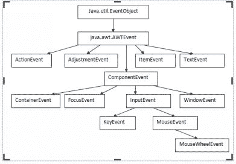

### java.util.eventObject 类

这是所有事件类的最顶级父类。它是一个非常用的类，只有一个感兴趣的方法，返回产生事件的物体。

`Object getsource()`

### java.awt.AWTEvent 类

`event object` 的一个子类是`java.awt.AWTEvent`，它是所有委托模型事件类的父类。同样，只有一个感兴趣的方法，返回事件的 ID。

`int getID()`

事件的 ID 是一个`int`，用于指定事件的性质。例如，`MouseEvent`类的实例可以表示七种情况：点击、拖拽、进入、退出、按下、释放。这些可能性都通过`int` `MouseEvent.CLICKED`、`MouseEvent.DRAGGED`等表示。

`java.awt.AWTEvent`的子类表示由各种 AWT 组件生成的各种事件类型，并包含与触发事件相关的所有信息。

非超类事件类型（即实际由组件触发的类型）包括：

1.  `ActionEvent`：组件激活产生，例如。点击按钮、双击列表项以及在`TextField`中按回车键产生。
2.  `AdjustmentEvent`：滚动条等可调整组件的调整产生。
3.  `ContainerEvent`：组件被容器或移除时产生。
4.  `FocusEvent`：组件接收或丢失焦点时产生。
5.  `ItemEvent`：从列表、选择或复选框选择项目时产生。
6.  `KeyEvent`：键盘活动产生。
7.  `MouseEvent`：鼠标活动产生。
8.  `MouseWheelEvent`：指示鼠标轮在组件中旋转的事件。
9.  `WindowEvent`：窗口活动产生（如最小化或还原等）。
10. `TextEvent`：文本组件被修改时产生。

### java.awt.event 包

该包提供了用于处理 AWT 组件触发的各种类型事件的接口和类。事件由事件源触发。事件监听器向事件源注册以接收特定类型事件的通知。

该包定义了事件和事件监听器，以及事件监听器适配器，后者是简化编写事件监听器的便利类。

### 事件监听器接口

每个事件类都有相应的监听器接口，并定义了一个或多个方法。常用的监听器接口在以下章节中描述。

#### Action Listener 接口：

这是用于接收动作事件的监听接口。感兴趣处理动作事件的类实现此接口，并使用该类创建的对象注册到组件中，使用组件的`addActionListener()`方法。当动作事件发生时，将调用动作监听器的`actionPerformed()`方法，其方法签名如下：

| 签名 | 描述 |
| :--- | :--- |
| `void actionPerfomed (ActionEvent e)` | 当动作发生时调用。 |

## AdjustmentListener 接口

这是用于接收调整事件的监听接口。

| 签名 | 描述 |
| :--- | :--- |
| `void adjustmentValueChanged(Adjustment event e)` | 当滑块/滑动条的值改变时调用。 |

## ContainerListener 接口

这是用于接收组件被添加到或从容器中移除时的事件的监听接口。

### 方法：

| 签名 | 描述 |
| :--- | :--- |
| `void componentAdded(containerEvent e)` | 当组件被添加到容器时调用。 |
| `void componentRemoved(containerEvent e)` | 当组件从容器中移除时调用。 |

## FocusListener 接口

这是用于接收组件获得或失去焦点时的事件的监听接口。

### 方法：

| 签名 | 描述 |
| :--- | :--- |
| `void focusGained(focusEvent e)` | 当组件获得键盘焦点时调用。 |
| `void focusLost (focusEvent e)` | 当组件失去键盘焦点时调用。 |

## ItemListener 接口

这是用于接收项目事件的监听接口。

### 方法：

`void itemStateChanged (ItemEvent e)`

当用户选中或取消选择某个项目时调用。

## keyListener 接口

这是用于接收键盘事件（按键输入）的监听接口。

| 签名 | 描述 |
| :--- | :--- |
| `void keyPressed(KeyEvent e)` | 当按下键时调用。 |
| `void keyReleased(KeyEvent e)` | 当释放按键时调用。 |
| `void keyTyped(KeyEvent e)` | 当输入按键（按下并释放）时调用。 |

## MouseListener 接口

这是用于接收组件上鼠标事件（按下、释放、点击、进入和退出）的监听接口。

### 方法：

`void mouseClicked(MouseEvent e)`
当在`Component`上点击（按下并释放）鼠标按钮时调用。

`void mouseEntered(MouseEvent e)`
当鼠标进入组件时调用。

`void mouseExited(MouseEvent e)`
当鼠标退出组件时调用。

`void mousePressed(MouseEvent e)`
当在组件上按下鼠标按钮时调用。

`void mouseReleased(MouseEvent e)`
当在组件上释放鼠标按钮时调用。

## MouseMotionListener

这是用于接收组件上鼠标移动事件（移动和拖动）的监听接口。

### 方法：

`void mouseDragged(MouseEvent e)`
当在组件上按下鼠标按钮并拖动时调用。

`void mouseMoved(MouseEvent e)`
当鼠标光标在组件上移动但未按下按钮时调用。

## MouseListener 接口

这是用于接收组件上鼠标事件的监听接口。

### 方法：

`void mouseWheel(MouseEvent e)`
当滚动鼠标轮时调用。

## WindowListener

当窗口状态由于打开、关闭、激活或最小化而发生变化时，将调用监听器中的相关方法，并将事件传递给它。

### 方法：

- `void activated(WindowEvent e)`: 当窗口被设置为激活窗口时调用。
- `void closed(WindowEvent e)`: 当调用窗口的`dispose()`导致窗口关闭时调用。
- `void closing(WindowEvent e)`: 当用户尝试从窗口系统菜单关闭窗口时调用。
- `void deactivated(WindowEvent e)`: 当窗口不再是激活窗口时调用。
- `void iconified(WindowEvent e)`: 当窗口从正常状态变为最小化状态时调用。
- `void opened(WindowEvent e)`: 当窗口第一次变为可见时调用。

处理 ActionEvent：示例 18.1

以下示例解释了如何处理点击按钮产生的事件。

```java
import java.awt.*;
import java.awt.event.*;

class A1 {
    public static void main(String args[]) {
        Frame f = new Frame();
        f.setLayout(new FlowLayout());
        f.setSize(500,100);
        Button b1 = new Button("Push me");
        Button b2 = new Button("Click me");
        b1.addActionListener(new B());
        b2.addActionListener(new C());
        f.add(b1);
        f.add(b2);
        f.setVisible(true);
    }
}

class B implements ActionListener {
    public void actionPerformed(ActionEvent ae) {
        System.out.println("Pushed");
    }
}

class C implements ActionListener {
    public void actionPerformed(ActionEvent ae) {
        System.out.println("Clicked");
    }
}
```

输出： (Images/image0123.jpeg)

示例 18.2：

```java
import java.awt.*;
import java.awt.event.*;

class A2 implements ActionListener {
    static Button b1=null,b2=null;
    public static void main(String args[]) {
        Frame f = new Frame();
        f.setLayout(new FlowLayout());
        f.setSize(500,100);
        b1 = new Button("Push me");
        b2 = new Button("Click me");
        b1.addActionListener(new A2());
        b2.addActionListener(new A2());
        f.add(b1);
        f.add(b2);
        f.setVisible(true);
    }

    public void actionPerformed(ActionEvent ae) {
        if(ae.getSource() == b1) {
            System.out.println("Pushed");
        } else {
            System.out.println("Clicked");
        }
    }
}
```

### 示例 18.3

输出：与上示例相同。

```java
import java.awt.*;
import java.awt.event.*;

class A3 implements ActionListener
{
    Button b1=null,b2=null;
    A3()
    {
        Frame f=new Frame();
        f.setLayout(new FlowLayout());
        f.setSize(500,100);
        b1=new Button("Push me");
        b2=new Button("Click me");
        b1.addActionListener(this);
        b2.addActionListener(this);
        f.add(b1);
        f.add(b2);
        f.setVisible(true);
    }

    public static void main(String args[])
    {
        A3();
    }

    public void actionPerformed(ActionEvent ae)
    {
        if(ae.getSource() == b1)
            System.out.println("Button Pushed");
        else
            System.out.println("Button Clicked");
    }
}
```

输出：与上示例相同。

### 示例 18.4

```java
import java.awt.*;
import java.awt.event.*;

class A4 implements ActionListener
{
```


# Java AWT 事件处理示例

## 示例 18.4：按钮事件处理

```java
static Button b1=null,b2=null;

static TextField tf1=null,tf2=null, tf3=null;

public static void main(String args[])
{
    Frame f=new Frame();
    f.setLayout(new GridLayout(4,2));
    f.setSize(500,300);

    Label l1 = new Label("No1.");
    Label l2 = new Label("No2.");
    Label l3 = new Label("Result");

    tf1 = new TextField();
    tf2 = new TextField();
    tf3 = new TextField();

    b1=new Button("Sum");
    b2=new Button("Avg");

    b1.addActionListener(new A4());
    b2.addActionListener(new A4());

    f.add(l1);f.add(tf1);
    f.add(l2);f.add(tf2);
    f.add(l3);f.add(tf3);
    f.add(b1);f.add(b2);

    f.setVisible(true);
}

public void actionPerformed(ActionEvent ae)
{
    int a,b,c;
    float av;

    a=Integer.parseInt(tf1.getText());
    b=Integer.parseInt(tf2.getText());

    if(ae.getSource() == b1)
        tf3.setText("" +(a+b));
    else
        tf3.setText("" +(a+b)/2);
}
```

注意：一个组件可以关联多个监听器。无法保证监听器会按照它们被添加的顺序被通知。同样无法保证所有的监听器通知都会在同一个线程中发生，因此，监听器必须采取措施防止损坏共享数据。可以通过调用`XXXListener()`方法并传入要移除的监听器从组件的监听器列表中移除它。例如，从按钮移除监听器`al`：`btn.removeActionListener(al);`。

## 处理窗口事件

### 示例 18.5

```java
import java.awt.*;
import java.awt.event.*;

class A5
{
    public static void main(String args[])
    {
        Frame f= new Frame();
        f.setLayout(new FlowLayout());
        f.setSize(300,300);
        f.addWindowListener(new B( ));
        f.setVisible(true);
    }
}

class B implements WindowListener
{
    public void windowOpened (WindowEvent we)
    {
        System.out.println("Window Opened");
    }

    public void windowActivated(WindowEvent we)
    {
        System.out.println("Window Activated");
    }

    public void windowDeactivated(WindowEvent we)
    {
        System.out.println("window Deactivated");
    }

    public void windowClosing(WindowEvent we)
    {
        System.out.println("Window Closing");
        Frame f = (Frame) we.getWindow( );
        f.dispose();
    }

    public void windowClosed(WindowEvent we)
    {
        System.out.println("Window Closed");
    }

    public void windowIconified(WindowEvent we)
    {
        System.out.println("Window Iconified");
    }

    public void windowDeiconified(WindowEvent we)
    {
        System.out.println("Window Deiconified");
    }
}
```

## 适配器（Adapters）

某些事件监听器接口包含多个方法。最大的接口`WindowListener`有七个方法。假设我们想要捕获`windowClosing()`事件以便执行关闭窗口的代码。虽然我们在实现`WindowListener`的类中只需要`windowClosing()`一个方法，但我们必须为所有方法提供空位实现。

`java.awt.event`包提供了几个适配器类（adapter classes），每个类对应一个定义了多个方法的监听器接口。

适配器仅仅是一个通过提供“什么都不做”的方法来实现接口的类。例如，`WindowAdapter`类实现了`WindowListener`接口，并包含了七个空实现的方法。

### 适配器类及其对应的接口

| 适配器类 | 监听器接口 |
| :--- | :--- |
| `ContainerAdapter` | `ContainerListener` |
| `FocusAdapter` | `FocusListener` |
| `KeyAdapter` | `KeyListener` |
| `MouseAdapter` | `MouseListener` |
| `MouseMotionAdapter` | `MouseMotionListener` |
| `WindowAdapter` | `WindowListener` |

### 示例 18.6 WindowAdapter 类的使用

```java
import java.awt.*;
import java.awt.event.*;

class A6 {
    public static void main(String args[]) {
        Frame f = new Frame();
        f.setLayout(new FlowLayout());
        f.setSize(300,300);
        f.addWindowListener(new B( ));
        f.setVisible(true);
    }
}

class B extends WindowAdapter {
    public void windowClosing(WindowEvent we) {
        System.out.print("Window Closing");
        Frame f = (Frame) we.getWindow();
        f.dispose();
    }
}
```

## InputEvent 类

这是所有组件输入事件的根事件类。输入事件在由源组件进行正常处理之前，会先投递给监听器。这允许监听器和子类“消费”事件，使得源组件不会以默认方式处理它们。例如，在`Button`组件上消费鼠标事件将防止`Button`被激活。

### 方法

- `void consume()`：消费此事件，使其不会被源源组件以默认方式处理。
- `int getModifiers()`：返回此事件的修饰掩码（Modifier mask）。
- `int getModifiersEx()`：返回此事件的扩展修饰掩码。
- `static String getModifiersExText(int modifiers)`：返回一个描述扩展修饰键的字符串，例如“shift”、“Ctrl + Shift”等。
- `long getWhen()`：返回事件发生的时间戳。
- `boolean isAltDown()`：返回此事件中是否按下了 Alt 修饰键。
- `boolean isConsumed()`：返回此事件是否已被消费。
- `boolean isControlDown()`：返回此事件中是否按下了 Control 修饰键。
- `boolean isShiftDown()`：返回此事件中是否按下了 Shift 修饰键。

## MouseEvent 类

它是`InputEvent`的子类。该事件表示组件中发生了鼠标操作。当且仅当鼠标指针位于组件或顶层窗口的未遮挡部分时，才认为鼠标操作发生在特定组件中。该事件既用于鼠标事件（点击、按下、释放），也用于移动事件（移动和拖拽）。

### 方法

- `int getButton()`：返回哪个鼠标键发生了变化（如果有发生变化的话）。
- `int getClickCount()`：返回与此事件相关的鼠标点击次数。
- `static String getModifiersText(int modifiers)`：返回一个描述事件发生期间按下的修饰键的字符串，例如“Shift”或“Ctrl + shift”。
- `Point getPoint()`：返回相对于源组件的事件 x, y 位置。
- `int getX()`：返回相对于源组件的事件水平 x 位置。
- `int getY()`：返回相对于源组件的事件垂直 y 位置。
- `boolean isPopupTrigger()`：返回此鼠标事件是否为该平台的弹出菜单触发事件。

**注意**：弹出菜单在不同系统上的触发方式不同。因此，为了实现良好的跨平台功能，应该在`mousePressed`和`mouseReleased`中都检查`isPopupTrigger()`。

## 处理鼠标事件：示例 18.7

```java
import java.awt.*;
import java.awt.event.*;

class A7 {
    public static void main(String args[]) {
        Frame f = new Frame();
        f.setLayout(new FlowLayout());
        f.setSize(300,30);

        Button b1 = new Button("Push Me");
        b1.addMouseListener(new B());
        b1.addMouseMotionListener(new C());
        b1.addActionListener(new D());

        f.add(b1);
        f.setVisible(true);
    }
}

class B implements MouseListener {
    public void mouseEntered(MouseEvent me) {
        System.out.println("Mouse Entered...");
        System.out.println(me.getX());
        System.out.println(me.getY());
    }

    public void mouseExited(MouseEvent me) {
        System.out.println("Mouse Exited...");
        Point p1=me.getPoint();
        System.out.println(p1.x);
        System.out.println(p1.y);
    }

    public void mousePressed(MouseEvent me) {
        System.out.println("Mouse pressed...");
        int ms = me.getModifiersEx();
        String s = me.getModifiersExText(ms);
        System.out.println(s);
    }

    public void mouseReleased(MouseEvent me) {
        System.out.println("Mouse Released...");
        System.out.println("ClickCount-->" + me.getClickCount());
    }
}
```

```java
public void mouseClicked(MouseEvent me)
{
    System.out.println("Mouse Clicked...");
    System.out.println("Button-->"+me.getButton());
}

class C implements MouseMotionListener
{
    public void mouseMoved(MouseEvent me)
    {
        System.out.println("Mouse Moved...");
    }

    public void mouseDragged(MouseEvent me)
    {
        System.out.println("Mouse Dragged...");
    }
}

class D implements ActionListener
{
    public void actionPerformed(ActionEvent ae)
    {
        System.out.println("Button Pressed...");
    }
}
```

## ActionEvent 类

这是一种语义化事件，表示组件发生了某个动作。这种高层事件是由组件（如`Button`）在发生特定动作时（如被按下时）生成的。该事件会被传递给每个通过组件的`addActionListener`方法注册的接收此类事件的`ActionListener`。实现`ActionListener`接口的对象在事件发生时会获取此事件。因此，监听器可以省去处理单个鼠标移动和点击的细节，而是可以处理诸如“按钮被按下”之类的“有意义”的事件。注意：要在`Button`上触发`ActionEvent`，请使用空格键。

### 方法

- `String getAction()`：返回与动作相关的命令字符串。
- `int getModifiers()`：返回动作事件发生期间按下的修饰键。
- `long getWhen()`：返回事件发生的时间戳。

### 示例 18.8

此示例说明了我们如何在`ActionEvent`发生时识别有效的键修饰键。

```java
import java.awt.*;
import java.awt.event.*;

public class KeyModifierDemo extends Frame implements ActionListener
{
    Button b;

    KeyModifierDemo()
    {
        b = new Button("Button");
        b.addActionListener(this);
        setLayout(new FlowLayout());
        add(b);
        setBounds(0,0,20,20);
        setVisible(true);
    }

    public static void main(String args[])
    {
        new KeyModifierDemo();
    }

    public void actionPerformed(ActionEvent ae)
    {
        System.out.println("Button Pressed");
        int ms = ae.getModifiers();

        if ((ms & InputEvent.CTRL_DOWN_MASK)!=0)
        {
            System.out.println("CTRL key was pressed");
        }

        if ((ms & InputEvent.SHIFT_DOWN_MASK)!=0)
        {
            System.out.println("Shift Key was pressed");
        }
    }
}
```


```java
if ((ms & InputEvent.ALT_DOWN_MASK) != 0) {
    System.out.println("ALT key was pressed");
}
```

### 处理多个动作命令

`Action` 事件是最简单的。当我们发现滚动条发送了调整事件时，显而易见的问题是“现在滚动条的值是多少？”当我们发现鼠标被点击时，自然会想：“鼠标的 x 坐标和 y 坐标是多少？”但当我们发现一个按钮发送了 `ActionEvent` 时，似乎并没有任何额外的信息需要寻找；按钮已经被点击了，这似乎就是全部的已知信息。

然而，`ActionEvent` 关联了一个额外信息。这条信息是一个字符串，被称为动作命令（Action command）。我们可以通过 `getActionCommand()` 方法提取 `ActionEvent` 的动作命令。如果 `ActionEvent` 是文本字段发送的，`getActionCommand()` 返回文本字段当前的内容（当用户输入回车键时，文本字段会发送 `ActionEvent`）。如果 `ActionEvent` 是按钮发送的，默认行为是 `getActionCommand()` 返回按钮标签的字符串。然而，我们可以通过调用 `setActionCommand(String a)` 方法显式地设置按钮的动作命令。

```java
Button btn = new Button("Hello");
btn.setActionCommand("Hello");
```

当按钮的 `ActionListener` 需要决定如何对 `ActionEvent` 做出反应时，动作命令对按钮的优势是显而易见的。单个监听器作为多个组件的监听器是很常见的；在我们的语境中，单个对象可以是几个或多个按钮的 `ActionListener`。在这种情况下，对象的 `actionPerformed()` 方法必须通过判断是哪个按钮被命中来执行。以下示例演示了这一点：

### 示例 18.9

```java
import java.awt.*;
import java.awt.event.*;

class ButtonTest {
    Button b1, b2, b3;

    ButtonTest() {
        Frame f = new Frame();
        f.setLayout(new FlowLayout());
        f.setSize(300, 300);

        b1 = new Button("Push Me");
        b2 = new Button("Click Me");
        b3 = new Button("Hit Me");

        f.add(b1);
        f.add(b2);
        f.add(b3);

        B obj = new B(b1, b2, b3);
        b1.addActionListener(obj);
        b2.addActionListener(obj);
        b3.addActionListener(obj);

        f.setVisible(true);
    }

    public static void main(String args[]) {
        new ButtonTest();
    }
}

class B implements ActionListener {
    Button b4, b5, b6;

    B(Button b1, Button b2, Button b3) {
        b4 = b1;
        b5 = b2;
        b6 = b3;
    }

    public void actionPerformed(ActionEvent ae) {
        Button b = (Button) ae.getSource();

        if (b == b4) {
            System.out.println("First Button was pressed");
        } else if (b == b5) {
            System.out.println("Second Button was pressed");
        } else if (b == b6) {
            System.out.println("Third Button was pressed");
        }
    }
}
```

### 示例 18.10

```java
import java.awt.*;
import java.awt.event.*;

class GetLabelTest {
    Button b1, b2, b3;

    GetLabelTest() {
        Frame f = new Frame();
        f.setLayout(new FlowLayout());
        f.setSize(300, 300);

        b1 = new Button("Push Me");
        b2 = new Button("Click Me");
        b3 = new Button("Hit Me");

        f.add(b1);
        f.add(b2);
        f.add(b3);

        B obj = new B();
        b1.addActionListener(obj);
        b2.addActionListener(obj);
        b3.addActionListener(obj);

        f.setVisible(true);
    }

    public static void main(String args[]) {
        GetLabelTest();
    }
}

class B implements ActionListener {
    public void actionPerformed(ActionEvent ae) {
        Button b = (Button) ae.getSource();
        String s = b.getLabel();

        if (s.equals("Push Me")) {
            System.out.println("First Push Me Button was pressed");
        } else if (s.equals("Click Me")) {
            System.out.println("Second Push Me Button was pressed");
        } else if (s.equals("Hit Me")) {
            System.out.println("Third Push Me Button was pressed");
        }
    }
}
```

### 示例 18.11：使用 `ActionCommand` 方法设置 Action Command

```java
import java.awt.*;
import java.awt.event.*;

class ActionCommandTest {
    Button b1, b2, b3;

    ActionCommandTest() {
        Frame f = new Frame();
        f.setLayout(new FlowLayout());
        f.setSize(300, 300);

        b1 = new Button("Push Me");
        b2 = new Button("Push Me");
        b3 = new Button("Push Me");

        b1.setActionCommand("First");
        b2.setActionCommand("Second");
        b3.setActionCommand("Third");

        f.add(b1);
        f.add(b2);
        f.add(b3);

        B obj = new B();
        b1.addActionListener(obj);
        b2.addActionListener(obj);
        b3.addActionListener(obj);

        f.setVisible(true);
    }

    public static void main(String args[]) {
        ActionCommandTest();
    }
}

class B implements ActionListener {
    public void actionPerformed(ActionEvent ae) {
        Button b = (Button) ae.getSource();
        String s = b.getActionCommand();

        if (s.equals("First")) {
            System.out.println("First Me Button was pressed");
        } else if (s.equals("Second")) {
            System.out.println("Second Me Button was pressed");
        } else if (s.equals("Third")) {
            System.out.println("Third Me Button was pressed");
        }
    }
}
```

### 处理按键事件

### 示例 18.12

```java
import java.awt.*;
import java.awt.event.*;

class KeyTest extends Frame implements KeyListener {
    String msg = "";
    int x = 50, y = 10;

    public static void main(String args[]) {
        Frame f = new KeyTest();
        f.setSize(300, 300);
        f.addKeyListener((KeyTest) f);
        f.setVisible(true);
    }

    public void keyReleased(KeyEvent ke) {
        System.out.println("Key Up...");
    }

    public void keyTyped(KeyEvent ke) {
        System.out.println("Key Typed...");
        msg = msg + ke.getKeyChar();
        repaint();
    }

    public void keyPressed(KeyEvent ke) {
        System.out.println("Key Pressed...");
        int key = ke.getKeyCode();

        switch (key) {
            case KeyEvent.VK_F1:
                msg = msg + "<F1>";
                break;

            case KeyEvent.VK_F2:
                msg = msg + "<F2>";
                break;

            case KeyEvent.VK_F3:
                msg = msg + "<F3>";
                break;

            case KeyEvent.VK_PAGE_DOWN:
                msg = msg + "<PgDn>";
                break;

            case KeyEvent.VK_PAGE_UP:
                msg = msg + "<PgUp>";
                break;

            case KeyEvent.VK_LEFT:
                msg = msg + "<Left Arrow>";
                break;

            case KeyEvent.VK_RIGHT:
                msg = msg + "<Right Arrow>";
                break;

            case KeyEvent.VK_CONTROL:
                msg = msg + "<Ctrl>";
                break;
        }

        repaint();
    }

    public void paint(Graphics g) {
        g.setColor(Color.red);
        g.drawString(msg, x, y);
    }
}
```

### 示例 18.13：`FocusListener` 演示 `TextField` 在失去或获得焦点时颜色变化

```java
import java.awt.*;
import java.awt.event.*;

class FocusTest extends Frame implements FocusListener {
    static TextField tf1, tf2;

    public static void main(String args[]) {
        FocusTest f = new FocusTest();
        f.setLayout(new FlowLayout());

        tf1 = new TextField(8);
        tf1.setBackground(Color.blue);
        tf1.addFocusListener(f);

        tf2 = new TextField(8);
        tf2.setBackground(Color.blue);
        tf2.addFocusListener(f);

        f.add(tf1);
        f.add(tf2);
        f.setSize(20, 20);
        f.setVisible(true);
    }

    public void focusGained(FocusEvent fe) {
        TextField tf = (TextField) fe.getSource();
        tf.setBackground(Color.red);
    }

    public void focusLost(FocusEvent fe) {
        TextField tf = (TextField) fe.getSource();
        tf.setBackground(Color.blue);
    }
}
```

### 示例 18.14：`requestFocus()` 演示

我们不能在同一个类中使用 `WindowListener`，因此定义了两个类，一个用于 `Frame`，另一个用于 `WindowListener`。

```java
import java.awt.*;
import java.awt.event.*;

class A extends Frame implements ActionListener {
    static TextField tf1, tf2;
    static Button b1;

    public static void main(String args[]) {
        A f = new A();
        f.setLayout(new FlowLayout());
        f.addWindowListener(new B());

        tf1 = new TextField(8);
        tf2 = new TextField(8);
        b1 = new Button("Set");

        b1.addActionListener(f);

        f.add(tf1);
        f.add(tf2);
        f.add(b1);

        f.setSize(200, 200);
        f.setVisible(true);
    }

    public void actionPerformed(ActionEvent ae) {
        tf2.requestFocus();
    }
}

class B extends WindowAdapter {
    public void windowClosing(WindowEvent we) {
        Frame f = (Frame) we.getWindow();
        f.dispose();
    }
}
```

### 示例 18.15：显示对话框

```java
import java.awt.*;

class DialogTest {
    public static void main(String args[]) throws InterruptedException {
```


### 示例 18.16 菜单栏演示

```java
import java.awt.*;
import java.awt.event.*;

class MyMenu extends Frame implements ActionListener, WindowListener, ItemListener {
    TextField tf1;
    String msg="";
    CheckboxMenuItem item4;

    MyMenu() {
        super("Matrix");
        setLayout(new FlowLayout());
        tf1 = new TextField(8);
        MenuBar mbar = new MenuBar();
        Menu file = new Menu("File");
        MenuItem item1 = new MenuItem("New...");
        item1.addActionListener(this);
        file.add(item1);
        MenuItem item2 = new MenuItem("Open...");
        item2.addActionListener(this);
        file.add(item2);
        Menu sub = new Menu("Sub Menu");
        MenuItem item3 = new MenuItem("Option1");
        sub.add(item3);
        file.add(sub);
        item4 = new CheckboxMenuItem("TextBox", true);
        item4.addItemListener(this);
        file.add(item4);
        mbar.add(file);
        addWindowListener(this);
        setMenuBar(mbar);
        setSize(400, 400);
        setVisible(true);
    }

    public void paint(Graphics g) {
        g.drawString(msg, 150, 250);
    }

    public void actionPerformed(ActionEvent ae) {
        String s = (String) ae.getAction();
        if (s.equals("New")) {
            tf1.setText("New Selected");
            msg = "New Selected";
        } else if (s.equals("Open")) {
            tf1.setText("Open Selected");
            msg = "Open Selected";
        }
        repaint();
    }

    public void window(WindowEvent we) {
        Frame f = (Frame) we.getWindow();
        f.dispose();
    }

    public void windowClosed(WindowEvent we) {}
    public void windowActivated(WindowEvent we) {}
    public void windowDeactivated(WindowEvent we) {}
    public void windowIconified(WindowEvent we) {}
    public void windowDeiconified(WindowEvent we) {}
    public void windowOpened(WindowEvent we) {}

    public void itemStateChanged(ItemEvent ie) {
        tf1.setVisible(ie.getState());
    }

    public static void main(String args[]) {
        MyMenu();
    }
}
```

### Listbox 演示

```java
import java.awt.*;
import java.awt.event.*;

class ListTest extends Frame {
    static List l1, l2;

    public static void main(String args[]) {
        ListTest f = new ListTest();
        f.setLayout(new FlowLayout());
        l1 = new List(3, true);
        l1.add("India");
        l1.add("Pakistan");
        l1.add("USA");
        l1.add("UK");
        l1.add("China");
        l2 = new List(3, true);
        Button b1 = new Button("Transfer");
        b1.addActionListener(f);
        f.add(l1);
        f.add(l2);
        f.add(b1);
        f.setSize(200, 200);
        f.setVisible(true);
    }

    public void actionPerformed(ActionEvent ae) {
        /*
        for(int i=l1.getItemCount()-1; i>=0; i--) {
            l2.add(l1.getItem(i));
            l1.remove(i);
        }
        */
        String[] s1 = l1.getSelectedItems();
        for (int i = 0; i < s1.length; i++) {
            l2.add(s1[i]);
            l1.remove(s1[i]);
        }
    }
}
```

### 使用 frame 计算两个数之和

```java
import java.awt.*;
import java.awt.event.*;

class Sum implements ActionListener {
    static Button b1, b2;
    static TextField tf1, tf2, tf3;
    static Frame f;

    public static void main(String args[]) {
        f = new Frame();
        Sum s1 = new Sum();
        f.setLayout(new GridLayout(4, 2));
        Label l1 = new Label("Enter No. 1:");
        tf1 = new TextField(8);
        Label l2 = new Label("Enter No. 2:");
        tf2 = new TextField(8);
        Label l3 = new Label("Result :");
        tf3 = new TextField(8);
        b1 = new Button("Sum");
        b2 = new Button("Close");
        b1.addActionListener(s1);
        b2.addActionListener(s1);
        f.add(l1);
        f.add(tf1);
        f.add(l2);
        f.add(tf2);
        f.add(l3);
        f.add(tf3);
        f.add(b1);
        f.add(b2);
    }
}
```

```java
Button b = (Button) ae.getSource();
if (b == b1) {
    int n1 = Integer.parseInt(tf1.getText());
    int n2 = Integer.parseInt(tf2.getText());
    tf3.setText(String.valueOf(n1 + n2));
}
if (b == b2) {
    f.dispose();
}
```

### 示例 18.19 在 Applet 上显示图像

```java
import java.awt.*;
import java.net.*;
import java.applet.*;
/*applet code="ScrollPane" width=20 height=20></applet*/
class ScrollPane extends Applet {
    Image img1;
    URL file1;

    public void init() {
        try {
            file1 = new URL("FILE:///c:/java/a.jpg");
        } catch (MalformedURLException e) {
            System.out.print(e);
        }
        img1 = getImage(file1);
    }

    public void paint(Graphics g) {
        g.drawImage(img1, 0, this);
    }
}
```

### 示例 18.20 圆形的演示

```java
import java.awt.*;
import java.awt.event.*;

class Circle1 extends Frame implements MouseListener, Runnable {
    int x, y, w;
    static Circle1 f;

    public void run() {
        y = 50;
        w = 50;
        h = 50;
        for (x = 0; x < 500; x += 10) {
            try {
                Thread.sleep(50);
            } catch (InterruptedException e) {
                System.out.println(e);
            }
            repaint();
        }
    }

    public static void main(String args[]) {
        f = new Circle1();
        Thread t = new Thread(f);
        t.start();
        f.addMouseListener(f);
        f.setSize(50, 50);
        f.setVisible(true);
    }

    public void paint(Graphics g) {
        g.setColor(Color.RED);
        g.drawOval(x, y, w, h);
        g.setColor(Color.BLUE);
        g.fillOval(x + 1, y + 1, w - 1, h - 1);
    }

    public void mousePressed(MouseEvent me) {
        x = me.getX();
        y = me.getY();
        w = 50;
        h = 50;
        Graphics g = f.getGraphics();
        g.clearRect(0, 0, 200, 200);
        paint(g);
    }

    public void mouseReleased(MouseEvent me) {}
    public void mouseClicked(MouseEvent me) {}
    public void mouseEntered(MouseEvent me) {}
    public void mouseExited(MouseEvent me) {}
}
```

---

# 第 19 章：AWT 中的绘图

## 介绍

许多类型的`AWT`组件（例如按钮和滚动条）的外观由底层窗口系统决定。其他组件类型，特别是`applets`、`frames`、`panels`和`canvases`没有内在外观。如果我们仅仅将这些类中的任何类作为容器使用，并希望我们的组件看起来有用，我们必须提供实现该组件外观的代码。

每个组件都关联着一个图形上下文（graphics context）。该图形上下文与组件相关的帧缓冲区对应。

我们可以使用`Graphics Context`支持的方法在组件上进行绘制。绘制在`Graphics context`上的任何内容都会显示在组件上。

在任何组件上绘图的正确方法是重写它的`paint()`方法并提供适当的代码。

`paint()`方法有一个`Graphics`类型的参数，代表组件的`Graphics Context`。也可以在不使用`paint()`方法的情况下在组件上绘图，尽管这种方法并不被推荐。

### paint() 方法和图形上下文

以下示例中`frame`的一个有趣点是，没有对`paint()`方法进行任何显式调用；该方法仅仅是被提供了。环境似乎很好地在正确的时刻调用了`paint()`。

在组件上进行绘图是通过调用`Graphics context`（它是`Graphics`类的实例）来实现的。图形上下文知道如何渲染到单个目标。`Graphics Context`可以渲染到的三个介质是：

1. 组件。
2. 图像。
3. 打印机。

任何类型的组件都可以与`Graphics context`关联。这种关联是永久的；上下文不能重新分配给新的组件。

按钮、`Choices`、`Checkboxes`、`Labels`、`Scrollbars`、`TextFields`和`TextAreas`通常不需要程序员级别的渲染。大多数情况下，这些组件仅使用它们从组件父类继承的`paint()`版本。

然而，存在四类“空白”组件，它们没有默认外观，并且会显示为空矩形，除非它们被子类化并赋予了`paint()`方法。

这四个组件类是：

* `Applet`
* `Canvas`
* `Frame`
* `Panel`

### 示例 19.1 扩展`Frame`类并重写`paint()`方法以改变框架的外观

```java
import java.awt.*;

public class SimplePaint extends Frame {
    public static void main(String args[]) {
        Frame f = new SimplePaint();
        f.setSize(200, 200);
        f.setVisible(true);
    }

    public void paint(Graphics g) {
        g.setColor(Color.white);
        g.fillRect(0, 0, 300, 300);
        g.setColor(Color.grey);
        g.fillOval(30, 30, 50, 50);
    }
}
```


输出：

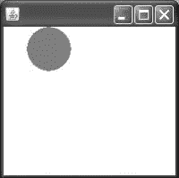

当我们对组件类进行子类化并赋予子类自己的 `paint()` 方法时，环境会在适当的时间调用该方法，并传入一个 `Graphics` 实例。

### graphics 类支持的操作

`graphics` 类（`graphics` 上下文）提供的四大类操作是：

* 选择颜色。
* 选择字体。
* 绘制与填充。
* 裁剪。

#### 选择颜色

通过调用 `setColor()` 方法来选择颜色。所需的参数是 `Color` 类的实例。

有 13 种预定义的颜色，可以通过 `Color` 类的 `static final` 变量访问。（这些变量本身是 `Color` 类的实例。这让一些人感到不安，但 Java 处理这类事情没有问题）。预定义的颜色有：

1. `Color.black`
2. `Color.blue`
3. `Color.cyan`
4. `Color.darkGray`
5. `Color.gray`
6. `Color.green`
7. `Color.gray`
8. `Color.magenta`
9. `Color.orange`
10. `Color.pink`
11. `Color.red`
12. `Color.white`
13. `Color.yellow`

如果我们我们需要不在列表中的颜色，可以自己构造。`Color` 构造函数有几个版本，最简单的是：

`Color(int redLevel, int greenLevel, int blueLevel)`

三个参数是主色在 0 到 255 范围内的强度级别。颜色是相加的，这意味着它们的混合方式像光，而不是像颜料。

* `new Color(0,0,0)`：黑色（光的缺失）
* `new Color(255,0,0)`：红色（仅包含红色色调）
* `new Color(255,255,255)`：白色（所有颜色同时发光）

下面的代码片段列出了 `paint()` 方法的第一部分，它将其图形上下文的颜色设为绿色：

```java
public void paint(Graphics g) {
    Color c= new Color(170,255,170);
    g.setColor(c);
}
```

在上述代码调用 `setColor()` 之后，所有的图形都将绘制成绿色，直到下一次调用 `setColor()`。调用 `setColor()` 不会改变已经绘制内容的颜色；它影响的是后续的操作。

#### 选择字体

设置图形上下文的字体就像设置绘图操作将使用新字体，而之前绘制的字符串则不受影响。在设置字体之前，我们必须先创建一个。`Font` 类的构造函数如下：

`Font(String fontName, int style, int size)`

第一个参数是字体的名称。字体的可用性取决于平台。我们可以通过如下调用工具包上的 `getFontList()` 方法来获取可用字体名称列表，返回结果为字符串数组：

`String fontNames[]= Toolkit.getDefaultToolkit().getFontList();`

有三种样式：`style` 参数可以传递以下任意一个常量：

1. `Font.PLAIN`
2. `Font.BOLD`
3. `Font.ITALIC`

下面的代码片段将图形上下文的字体设为 24 点加粗无衬线字体：

```java
Font f = new Font("SansSerif",Font.BOLD,24);
gc.setFont(f);
```

我们可以通过传递样式的之和来指定样式的组合，例如加粗斜体，如下：

`Font.BOLD + Font.ITALIC`

### 绘制与填充

`graphics` 类的所有渲染方法都指定了它们所渲染形状的坐标位置。每个组件都有自己的坐标系，原点位于组件的左上角，x 向右增加，y 向下增加。下图显示了组件坐标系：


`graphics` 上下文类并没有大量的绘图方法（复杂的渲染由 `2d`、`3d` 和动画等扩展 API 处理）。我们需要了解的图形类中的方法有：

| 方法 |  |
| :--- | :--- |
| `void drawLine(int x1,int y1, int x2, int y2)` | 在此图形上下文坐标系中使用当前颜色，在点 `(x1,y1)` 和 `(x2,y2)` 之间绘制一条线。 |
| `void drawRect(int x, int y, int width, int height)` | 绘制指定矩形的轮廓。 |
| `void fillRect(int x, int y, int width, int height)` | 填充指定的矩形。 |
| `void drawOval(int x, int y, int width, int height)` | 绘制指定矩形边界的椭圆轮廓。 |
| `void fillOval(int x, int y, int width, int height)` | 用当前颜色填充指定矩形边界的椭圆。椭圆由矩形边界框定义。椭圆位于框内，并在每边的中点相切。 |
| `void drawArc(int x, int y, int width, int height, int startAngle, int arcAngle)` | 绘制覆盖指定矩形的圆形或椭圆弧轮廓。 |
| `void fillArc(int x, int y, int width, int height, int startangle, int arcangle)` | 填充覆盖指定矩形的圆形或椭圆弧。弧是椭圆的一部分。我们像 `drawOval()` 和 `fillOval()` 一样指定椭圆的边界框。还需要指定弧的终点，通过指定起始角度和弧所扫描的角度来实现。填充弧是由弧本身以及从椭圆中心到弧端点的两个半径围成的区域。 |
| `void drawPolygon(int[]xPoints, int[]yPoints, int nPoints)` | 使用 x y 坐标数组绘制闭合多边形。 |
| `void fillPolygon (int[] xPoints , int[]yPoints, int nPoints)` | 使用 x y 坐标数组填充闭合多边形。多边形是具有任意数量顶点的封闭图形。 |
| `void drawPolyLine(int[] xPoints, int[]yPoints , int nPoints)` | 根据 x y 坐标数组绘制一系列连接线。折线与多边形相似，但它是开放的而非闭合的。 |

| 方法签名 | `void drawString(String str, int x, int y)` | 使用此图形上下文当前的字体和颜色绘制指定字符串的文本。`x`、`y` 参数指定字符串基准线（baseline）的左边缘。带有下伸部 get 字符（在大多数字体中为 g, j, p, q 和 y）延伸到基准线以下。文本坐标是相对于基准线的，这一点非常重要。例如，在简单的文本中，我们可能会尝试在 `(0,0)` 处绘制字符串，期望它出现在区域的左上角。然而，由于基准线的存在，我们只能看到字符串的伸部，这可能意味着我们什么也看不到。默认情况下，图形上下文使用关联组件的字体，但我们可以通过调用图形上下文的 `setFont()` 方法设置不同的字体。 |
| --- | `boolean drawImage(Image img, int x, int y, ImageObserver observer)` | 绘制当前可用的所有指定图像。这里，`img`是要渲染的图像，`x` 和 `y` 是目标组件中图像左上角的坐标。图像观察者必须是一个实现 `ImageObserver` 接口的对象。图像是矩形像素值集合离屏表示。Java 的图像支持非常复杂。目前，假设我们某种方式获取了一个图像（即 `java.awt.Image` 类的实例），我们想要使用特定的图形上下文将其渲染到屏幕。这样做的方法是调用图形上下文的 `drawImage()` 方法。 |

### 示例 19.2

此示例说明了如何创建一个图像，然后使用其图形上下文在其进行绘制。然后可以使用 `drawImage()` 方法在 applet 窗口中显示图像。

```java
import java.awt.*;
import java.applet.*;
import java.net.URL;

/*<applet code="PaintImage" width=200 height=100></applet>*/
public class PaintImage extends Applet {
    private Image im;
    public void init() {
        im = createImage(100,50);
        Graphics imgc=im.getGraphics();
        imgc.setColor(Color.gray);
        imgc.fillRect(0,0,100,50);
        imgc.setColor(Color.black);
        imgc.fillOval(0,0,5,0);
    }
    public void paint(Graphics g) {
        g.drawImage(im,10,10,this);
    }
}
```

输出: 

### 示例 19.3

此示例说明了如何从现有图像创建一个图像对象。然后可以使用 `drawImage()` 方法在 applet 窗口中显示该图像。

```java
import java.awt.*;
import java.applet.*;
import java.net.*;

/*
<applet code="PaintImage" width=500 height=500>
</applet>
*/
public class PaintImage extends Applet {
    private Image im;
    public void init() {
        try {
            im=getImage(new URL("file:///c:/matrix/logo.gif"));
            //im=getImage(new URL("http://127.0.0.1/logo.gif"));
        } catch (MalformedURLException e) {
            System.out.println(e);
        }
    }
    public void paint(Graphics g) {
        g.drawImage(im,10,10,this);
    }
}
```

### 裁剪 (Clipping)

程序员对图形上下文的大多数调用都涉及颜色选择或绘制和填充。不常用的操作是裁剪。裁剪简单来说限制图形上下文可以修改的区域。

每个图形上下文，即每个 `Graphics` 类的实例都有一个裁剪区域（clip region），该区域定义了关联组件的所有或部分。当我们调用 `Graphics` 类的任一个 `drawXXX()` 或 `fillXXX()` 方法时，只有位于图形上下文裁剪区域内的像素会被修改。

图形上下文的默认裁剪区域是关联组件的整个可见区域。有方法可以获取和修改裁剪区域。考虑以下 `paint` 方法。

### 示例 19.4

```java
import java.awt.*;

class Clip extends Frame {
    public static void main(String args[]) {
        Frame f=new Clip();
        f.setSize(30,30);
        f.setVisible(true);
    }
    public void paint(Graphics g) {
        for(int i=0; i<300; i=i+100) {
            for(int j=30; j<330; j=j+100) {
                g.fillOval(i,j,100,100);
            }
        }
    }
}
```

输出: 

上述程序的 `paint()` 方法绘制了一个点图案。考虑当这是一个 200*200 像素的 applet frame 的 `paint()` 方法时会发生什么。由于计数器一直到 500，该方法尝试在 applet frame 边界之外绘制。这并不是问题，因为图形上下文默认的裁剪区域与 applet frame 重合。

要为图形上下文设置矩形裁剪，我们可以调用 `setClip(x,y, width, height)` 方法，传入四个描述所需矩形位置和大小的 int。例如，上面的代码可以修改如下：

### 示例 19.5

```java
import java.awt.*;

class Clip2 extends Frame {
    public static void main(String args[]) {
        Frame f=new Clip2();
        f.setSize(300,330);
        f.setVisible(true);
    }
    public void paint(Graphics g) {
        g.setClip(50,80,200,200);
        for(int i=0; i<300; i=i+100) {
            for(int j=30; j<330; j=j+100) {
                g.fillOval(i,j,100,100);
            }
        }
    }
}
```

输出：

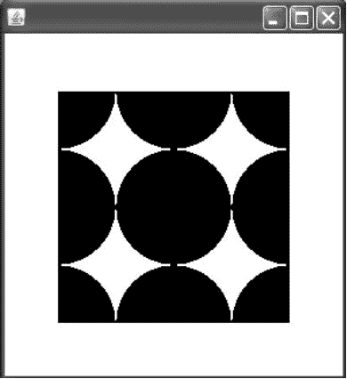

如上所示，现在绘画被裁剪到 300 * 300 Applet 框架中心的 200 * 200 矩形内。

裁剪（Clipping）本身是一项值得了解的知识。当环境需要修复组件的暴露部分时，裁剪也会发挥作用。

### 关于 `paint()` 方法和图形上下文的总结：

`Graphics` 上下文专门用于单个组件。要在组件上进行绘制，我们调用图形上下文的 `drawXXXX()` 和 `fillXXXX()` 方法。若要更改图形操作的颜色或字体，我们分别调用图形上下文的 `setColor()` 或 `setFont()` 方法。

### GUI 线程与绘制

Java 运行时环境会创建并控制其在后台运行的各个线程，其中一个线程负责 GUI 管理。

GUI 线程是环境用于接收用户输入事件以及调用需要绘制组件的 `paint()` 方法的工具。

对 `paint()` 的调用并非都由环境生成。Java 程序当然进行自己的调用，可以是直接调用，也可以通过 `repaint()` 方法间接调用。

还可以使用组件的图形上下文在组件上绘制。这种方法不需要调用 `paint()` 或 `repaint()` 方法。

在组件上绘制的不同方法如下：

(i) 获取组件的图形上下文后直接绘制。
(ii) 自发绘制（由 GUI 线程隐式/自动调用 `paint()` 方法）。
(iii) 显式调用 `paint()` 方法。
(iv) 显式调用 `repaint()` 方法，然后其间接调用 `paint()` 方法。

### 在获取组件图形上下文后直接绘制

由于可以使用 `getGraphics()` 方法获取组件 `Graphics` 上下文的引用，人们很容易认为自己可以从任何方便的方法直接在组件上绘制。通常，这种方法存在严重缺陷。

假设我们有一个 Applet，想要在最近一次鼠标点击的位置画一个红点。Applet 的其余部分应该是黄色。假设该 Applet 正在处理自己的鼠标事件。我们可能会考虑如下这样的事件处理器：

示例 19.6：

```java
1. import java.awt.*;
2. import java.awt.event.*;
3. class PaintApproach extends Frame implements MouseListener
4. {
5. public static void main (String args [])
6. {
7. PaintApproach f = new PaintApproach ();
8. f.setSize(300,300);
9. f.addMouseListener(f);
10. f.setVisible(true);
11. }
12. public void mouseEntered(MouseEvent e) { }
13. public void mouseExited(MouseEvent e) { }
14. public void mousePressed(MouseEvent e) { }
15. public void mouseReleased(MouseEvent e) { }
16. public void mouseClicked(MouseEvent e)
17. {
18. System.out.println("Mouse Clicked...");
19. Graphics g = getGraphics();
20. g.setColor(Color.yellow);
21. g.fillRect(0,0, getSize().width, getSize().height);
22. g.setColor(Color.Red);
```


23. `g.fillOval(e.getX()-10, e.getY()-10,20,20);`

24. `}`

### 自发绘制（由 GUI 线程隐式/自动调用 `paint()` 方法）

自发绘制并不是一个正式术语，但它通过程序发生。例如，当每个 Applet 启动时，在 `init()` 方法完成后不久，就会调用 `paint()`。是 GUI 线程执行了这些调用。每个带有 GUI 的 Applet 都有一个 GUI 线程。

当组件需要重绘时，GUI 线程会自发调用 `paint()`：

* 暴露后。
* 最小化后。
* 首次显示后。

当浏览器返回到之前包含该 Applet 的页面时（只要该 Applet 至少部分可见）。

### 显式调用 `paint()` 方法

如果在组件上的绘制操作是在 `paint()` 方法以外的方法中执行的，组件可能不会刷新。如果绘制是在 `paint()` 方法中进行的，那么当我们显式调用 `paint()` 方法以及 GUI 线程隐式调用 `paint()` 方法时，它都会被显示。

上一个示例中的 `mouseClicked()` 方法被重写，以便在每次鼠标点击发生时只需修改实例变量 `mouseX` 和 `mouseY`。

红点仅在 `paint()` 方法中绘制，这样即使 Applet 被覆盖并重新暴露，它也能被修复。

**示例 19.7：**

上一节中的示例经过修改，使得组件显示在上述情况下可以得到刷新。这种现象是因为红点是在 `paint()` 方法中绘制的。

```java
1. import java.awt.*;
2. import java.awt.event.*;
```

### PaintApproach1 实现

```java
public class PaintApproach1 extends Frame implements MouseListener {

    int mouseX, mouseY;

    public static void main(String arg[]) {

        PaintApproach1 f = new PaintApproach2();

        f.setSize(300, 300);

        f.addMouseListener(f);

        f.setVisible(true);

    }

    public void mouseEntered(MouseEvent e) {}

    public void mouseExited(MouseEvent e) {}

    public void mousePressed(MouseEvent e) {}

    public void mouseReleased(MouseEvent e) {}

    public void mouseClicked(MouseEvent e) {

        System.out.println("Mouse Clicked...");

        mouseX = e.getX();

        mouseY = e.getY();

        Graphics g = getGraphics();

        paint(g);

    }

    public void paint(Graphics g) {

        g.setColor(Color.yellow);

        g.fillRect(0, 0, getSize().width, getSize().height);

        g.setColor(Color.red);

        g.fillOval(mouseX - 10, mouseY - 10, 20, 20);

    }

}
```

### 显式调用 `repaint()` 方法，从而间接调用 `paint()` 方法

显式调用 `paint()` 方法可能会导致两个严重的问题。

第一个问题是 GUI 线程会根据需要随时调用 `paint()` 方法。这通常发生在需要处理窗口暴露（exposure）时。这可能会导致线程交互问题。坦率地说，我们会发现即使使用首选方法，可能仍然需要处理这些问题中的某些，因为 `paint()` 方法将使用我们正在其他线程中修改的数据。然而，如果我们允许只在 GUI 线程中调用 `paint()`，就能将该问题降到最低。

第二个问题是关于 CPU 使用率的。考虑以下情景：我们的程序定期收到通知，要求它用动画的下一帧或类似的连续移动图形更新显示。此外假设绘图过程是复杂且耗时的。如果我们简单地调用整个 `paint()` 方法，可能在帧帧发生时我们只完成了一部分的绘图。这将导致程序所有时间都花在绘图上，而且绘图会越来越落后于应该显示的进度。

这些问题可以通过使用首选的处理方法来简单地解决。其核心思想是主程序维护描述应该呈现给用户的绘图数据，但不直接调用绘图程序。相反，程序请求 GUI 线程运行绘图程序，这大致与线程处理暴露时的方式相同。为了支持这种方法，GUI 系统提供了一个名为 `repaint()` 的方法。该方法定义在 `Component` 类中，因此 GUI 中的任何可见对象都可以使用。当我们调用此方法时，我们是在向 GUI 线程发出请求，让它执行绘图程序。GUI 线程会在合理时间内完成，尽管这可能会受到其他高优先级活动的限制。这种方法确保了 GUI 与线程之间的交互减少到最低。自然地，我们必须确保在数据处于不一致状态时 GUI 线程绝不会使用它。然而，使用同步或双缓冲技术可以很容易地实现这一点。这种行为的另一个结果是，无论程序尝试做多少，系统都会与当前帧保持同步。例如，如果在 GUI 线程能够处理第一次调用之前，我们调用了十次 `repaint()` 方法，那么结果将是执行一次绘画系统。这意味着程序员可以编写代码，在特定平台上获得最佳性能，而在任何其他平台上都能良好地运行。以下代码实现了这种方案。

### 示例 1.9

```java
import java.awt.*;

import java.awt.event.*;

class PaintApproach2 extends Frame implements MouseListener {

    int mouseX, mouseY;

    public static void main(String args[]) {

        PaintApproach2 f = new PaintApproach2();

        f.setSize(300, 300);

        f.addMouseListener(f);

        f.setVisible(true);

    }

    public void mouseEntered(MouseEvent e) {}

    public void mouseExited(MouseEvent e) {}

    public void mousePressed(MouseEvent e) {}

    public void mouseReleased(MouseEvent e) {}

    public void mouseClicked(MouseEvent e) {

        System.out.println("Mouse Clicked …");

        mouseX = e.getX();

        mouseY = e.getY();

        repaint();

    }

    public void paint(Graphics g) {

        g.setColor(Color.white);

        g.fillRect(0, 0, getSize().width, getSize().height);

        g.setColor(Color.gray);

        g.fillOval(mouseX - 10, mouseY - 10, 20, 20);

    }

}
```

线程之间的交互（尝试绘制的前台线程与 GUI 线程之间）是控制且可预测的。

虚拟机永远不会被绘制操作所淹。

当所有代码都以此方式编写时，对于尝试调试代码的其他程序员来说，就不会有任何意外。

尽管这种方法效果良好，但在某些情况下仍需要进一步的改进：动画。如果我们完全按照描述的方法进行操作，可能会注意到动画在运行时会产生不愉快的闪烁。

### 平滑动画

重绘机制的默认行为中有一个我们可能并不总是需要的特性：系统在响应我们的 `repaint()` 调用的准备阶段，会清除我们的绘制区域。这会导致动画和其他实时绘制出现不愉快的闪烁。事实证明，当我们调用 `repaint()` 时，GUI 线程并没有调用 `paint()`；而是调用 `update()` 方法。`update()` 的默认行为是做两件事：清除背景，然后调用 `paint`。如下所示：

```java
public void update (Graphics g)

{

    g.clearRect (0,0,width, height);

    paint(g);

}
```

我们可能会合理地问，为什么 `repaint()` 一开始就清除窗口，因为这会导致闪烁。嗯，在许多情况下，绘制是使用在背景上绘制线、矩形、椭圆等完成的。

如果我们试图制作一个旋转的棒子，我们需要在绘制新线之前移除旧线。考虑此问题的另一种方式是：如果我们试图绘制一个新图形，应该先擦除旧的图形。

那么，我们如何让新图形出现，而不需要先清除整个显示器呢？我们只需要找到另一种移除旧图形的方法。通用方法是确保我们在每次绘制帧时都绘制整个图形——包括背景和前景。如果我们能安排好这一点，就不需要清除组件，闪烁也就消失了。

为了防止组件在调用 `paint()` 之前被清除，我们只需要重写 `update()` 方法，使其直接调用 `paint()`，如下所示：

```java
public void update (Graphics g)

{

    paint (g);

}
```

这是一项标准技术并且工作非常完美，前提是我们的 `paint()` 方法确实刷新了显示器的所有像素。处理此问题的特别简单的方法是使用离屏图像来存储应该显示在显示器上的绘制内容。

这种技术在速度或内存方面并不总是最高效的，但它简单且易于实现，并且通常被 Java 程序员所理解。

    


# 第 20 章

## (Java.Lang.Object 类)

字体 简介

`java.lang` 包中的 `Object` 类是 Java 中所有层次结构的根。所有类都直接或间接地继承 `Object` 类。

即使你写了一个简单的类（即它没有继承任何基类），它也会隐式地继承内置的 `Object` 类。因此，该类的特征将在所有类中可用。

### Object 类中的方法

`object` 类定义了以下方法，所有类都继承了这些方法：

1. `public int hashCode()`
2. `public boolean equals(Object obj)`
3. `public final Class getClass()`
4. `public String toString()`
5. `protected void finalize() throws Throwable`
6. `protected Object clone() throws CloneNotSupportedException`
7. `public final void wait(long timeout) throws InterrputedException`
8. `public final void wait(long timeout, int nanos) throws InterrputedException`
9. `public final void wait() throws InterrputedException`
10. `public final void notify()`
11. `public final void notifyAll()`

#### 1. `public int hashCode()`

在哈希表中存储对象时，可以使用此方法获取对象的哈希值。该值在程序执行期间被保证是一致的。

#### 2. `boolean equals(Object obj)`

如果每个对象都被认为是唯一的，那么没有必要重写 `Object` 类的 `equals()` 方法。该方法比较对象引用的相等性。

#### 3. `final Class getClass()`

返回对象的运行时类，该类在运行时由 `java.lang.Class` 类的对象表示。

**示例 20.1：** 下面的示例说明了此方法可以用于获取任何 Java 对象对应的 `Class` 对象。我们随后可以使用 `Class` 类的方法通过反射/内省来获取有关对象类的信息。`getMethods()` 和 `getFields()` 将显示所有公共成员，而 `getDeclaredMethods()` 和 `getDeclaredFields()` 将显示所有的。

```java
import java.lang.reflect.Method;

import java.lang.reflect.Field;

class DispClass1 {

    public static void main(String args[]) {

        String s = new String("Hello");

        Class c = s.getClass();

        Method m[] = c.getMethods();

        System.out.println("…… Methods (" + m.length + ")……”);

        for(int i=0; i < m.length; i++)

            System.out.println(m[i]);

        Field f[] = c.getFields();

        System.out.println("……Public Fields (" + f.length + ")……”);

        for(int i=0; i< f.length; i++)

            System.out.println(f[i]);

        m = c.getDeclaredMethods();

        System.out.println("……Declared Methods (" + m.length + ")……”);

        for(int i=0; i < m.length; i++)

            System.out.println(m[i]);

    }

}
```

```java
public static java.lang.String java.lang.String.format(java.util.Locale,java.lang.String,java.lang.Object[])

public byte[] java.lang.String.getBytes()

public byte[] java.lang.String.getBytes(java.nio.charset.Charset)

public byte[] java.lang.String.getBytes(java.lang.String) throws java.io.UnsupportedEncodingException

public void java.lang.String.getBytes(int,int,byte[],int)

public void java.lang.String.getChars(int,int,char[],int)

public native java.lang.String java.lang.String.intern()

public boolean java.lang.String.isEmpty()

public int java.lang.String.lastIndexOf(int)

public int java.lang.String.lastIndexOf(java.lang.String)

public int java.lang.String.lastIndexOf(java.lang.String,int)

public int java.lang.String.lastIndexOf(int,int)

public int java.lang.String.length()

public boolean java.lang.String.matches(java.lang.String)

public int java.lang.String.offsetByCodePoints(int,int)

public boolean java.lang.String.regionMatches(boolean,int,java.lang.String,int,int)

public boolean java.lang.String.regionMatches(int,java.lang.String,int,int)

public public java.lang.String java.lang.String.replace(java.lang.CharSequence,java.lang.CharSequence)
```


# Java `String` 类方法及字段列表

以下是 `java.lang.String` 类的公有方法、声明方法及字段的完整列表。

## 公有字段 (1)

```java
public static final java.util.Comparator java.lang.String.CASE_INSENSITIVE_ORDER
```

## 声明方法 (70)

```java
public int java.lang.String.hashCode()
public int java.lang.String.compareTo(java.lang.String)
public int int.lang.String.compareTo(java.lang.Object)
public int java.lang.String.indexOf(int,int)
public int java.lang.String.indexOf(int)
public int java.lang.String.indexOf(java.lang.String)
public int java.lang.String.indexOf(java.lang.String,int)
static int java.lang.String.indexOf(char[],int,int,char[],int,int,int)
public boolean java.lang.String.equals(java.lang.Object)
public public java.lang.String java.lang.String.toString()
public char java.lang.String.charAt(int)
private static void java.lang.String.checkBounds(byte[],int,int)
public int java.lang.String.codePointAt(int)
public int java.lang.String.codePointBefore(int)
public int java.lang.String.codePointCount(int,int)
public int java.lang.String.compareToIgnoreCase(java.lang.String)
public public java.lang.String java.lang.String.concat(java.lang.String)
public boolean java.lang.String.contains(java.lang.String)
public boolean java.lang.String.contains(java.lang.CharSequence)
public int java.lang.String.contentEquals(java.lang.String)
public boolean java.lang.String.contentEquals(java.lang.CharSequence)
public static java.lang.String java.lang.String.valueOf(char[])
public static java.lang.String java.lang.String.valueOf(int,int)
public boolean java.lang.String.endsWith(java.lang.String)
public boolean java.lang.String.equalsIgnoreCase(java.lang.String)
public static java.lang.String java.lang.String.format(java.lang.String,Object[])
public static java.lang.String java.lang.String.format(java.util.Locale,java.lang.String,java.lang.Object[])
public static java.lang.String java.lang.String.valueOf(java.Object)
public byte[] java.lang.String.getBytes()
public byte[] java.lang.String.getBytes(java.nio.charset.Charset)
public byte[] java.lang.String.getBytes(java.lang.String) throws java.io.UnsupportedEncodingException
public void java.lang.String.getBytes(int,int,byte[],int)
public void java.lang.String.getChars(int,int,char[],int)
public native java.lang.String java.lang.String.intern()
public boolean java.lang.String.isEmpty()
public int java.lang.String.lastIndexOf(int)
public int java.lang.String.lastIndexOf(java.lang.String)
public int java.lang.String.lastIndexOf(java.lang.String,int)
public int java.lang.String.lastIndexOf(int,int)
static int java.lang.String.indexOf(char[],int,int,char[],int,int,int)
public int java.lang.String.length()
public boolean java.lang.String.matches(java.lang.String)
public int java.lang.String.offsetByCodePoints(int,int)
public boolean java.lang.String.regionMatches(boolean,int,java.lang.String,int,int)
public boolean java.lang.String.regionMatches(int,java.lang.String,int,int)
public public java.lang.String java.lang.String.replace(java.lang.CharSequence,java.lang.CharSequence)
public public java.lang.String java.lang.String.replace(char,char)
public public java.lang.String java.lang.String.replaceAll(java.lang.String,java.lang.String)
public public java.lang.String java.lang.String.replaceFirst(java.lang.String,java.lang.String)
public java.lang.String[] java.lang.String.split(java.lang.String,int)
public java.lang.String[] java.lang.String.split(java.lang.String)
public boolean java.lang.String.startsWith(java.lang.String,int)
public boolean java.lang.String.startsWith(java.lang.String)
public java.lang.CharSequence java.lang.String.subSequence(int,int)
public java.lang.String java.lang.String.substring(int,int)
public java.lang.String java.lang.String.substring(int)
public char[] java.lang.String.toCharArray()
public java.lang.String java.lang.String.toLowerCase()
public java.lang.String java.lang.String.toLowerCase(java.util.Locale)
public java.lang.String java.lang.String.toUpperCase()
public java.lang.String java.lang.String.toUpperCase(java.util.Locale)
public java.lang.String java.lang.String.trim()
public static java.lang.String java.lang.String.valueOf(boolean)
public static java.lang.String java.lang.String.valueOf(char[],int,int)
public static java.lang.String java.lang.String.valueOf(int)
public static java.lang.String java.lang.String.valueOf(long)
public static java.lang.String java.lang.String.valueOf(float)
public static java.lang.String java.lang.String.valueOf(double)
public static java.lang.String java.lang.String.valueOf(char[])
public static java.lang.String java.lang.String.valueOf(java.lang.Object)
public static java.lang.String java.lang.String.valueOf(char)
```

## 声明字段 (7)

```java
private final char[] java.lang.String.value
private final int java.lang.String.offset
private final int java.lang.String.count
private int java.lang.String.hash
private static final long java.lang.String.serialVersionUID
private static final java.io.ObjectStreamField[] java.lang.String.serialPersistentFields
public static final java.util.Comparator java.lang.String.CASE_INSENSITIVE_ORDER
```

## 示例 20.2

之前的示例经过了修改，以便从命令行参数读取全限定类名，然后使用反射/内省显示关于类的方法和字段的信息。

```java
import java.lang.reflect.Method;
import java.lang.reflect.Field;

class DispClassMembers2 {
    public static void main(String args[]) throws ClassNotFoundException {
        Class c = Class.forName(args[0]);
        Method m[] = c.getMethods();
        System.out.println("……公共方法 (" + m.length + ")……");
        for(int i=0; i< m.length; i++)
            System.out.println(m[i]);
        Field f[] = c.getFields();
        System.out.println("……公共字段 (" + f.length + ")……");
        for(int i=0; i< f.length; i++)
            System.out.println(f[i]);
        m = c.getDeclaredMethods();
        System.out.println("……声明方法 (" + m.length + ")……");
        for(int i=0; i<m.length; i++)
```


```java
System.out.println(m[i]);

f = c.getDeclaredFields();

System.out.println("……声明字段 (" + f.length + ")……");

for (int i = 0; i < f.length; i++)
    System.out.println(f[i]);
```

**输出：**

与之前相同，但从命令行参数传递了类名 `"String"`。

```bash
javac DispClassMembers2.java
java DispClassMembers2 String
```

## 4. `String` 的 `toString()`

如果子类没有重写此方法，它将返回对象的文本表示，其格式如下：

`<类名>@<对象的哈希码值>`

该方法通常会被重写并用于调试。方法调用 `System.out.println(Objref)` 会隐式地使用 `toString()` 方法将其参数转换为文本表示。

### 示例 20.3

此示例演示了当我们尝试显示 `Box` 类对象时会显示什么。对象使用 `Object` 类的 `toString()` 方法转换为文本表示。

```java
class Box {
    double w, h, d;

    Box(double w, double h, double d) {
        this.w = w;
        this.h = h;
        this.d = d;
    }
}

class ToString1 {
    public static void main(String args[]) {
        Box b = new Box(10, 12, 4);

        String s = "Box:" + b;

        System.out.println(b);
        System.out.println(s);
    }
}
```

**输出：**

```text
Box1@82b41
Box1: Box1@82b41
```

### 示例 20.4

此示例演示了如果我们在 `Box` 类中重写了 `toString()` 方法，那么将使用重写后的方法将对象转换为文本表示。

```java
class Box {
    double w, h, d;

    Box(double w, double h, double d) {
        this.w = w;
        this.h = h;
        this.d = d;
    }

    public String toString() {
        return "Dimensions are " + w + " by " + h + " by " + d + ".";
    }
}

class ToStringDemo2 {
    public static void main(String args[]) {
        Box b = new Box(8, 11, 13);

        String s = "Box b:" + b; // 拼接 Box 对象并调用 toString() 方法

        System.out.println(b); // 调用 toString() 方法
        System.out.println(s);
    }
}
```

**输出：**

```text
Dimensions are 8.0 by 11.0 by 13.0.
Box b: Dimensions are 8.0 by 11.0 by 13.0.
```

## 5. `protected void finalize() throws Throwable`

它在对象被垃圾回收之前被调用，以便进行任何清理工作。然而，`Object` 类中的默认 `finalize()` 方法没有做任何有用的工作。这对于释放非 Java 资源可能有用，但不推荐。如果可用内存足够，`finalize()` 方法可能永远不会被调用，在这种情况下资源可能永远不会释放。

## 6. `protected Object clone() throws CloneNotSupportedException`

通过 `clone()` 方法可以创建与当前对象完全相同（即具有相同状态）的新对象，即基本类型值和引用值被复制，这被称为浅克隆。

类可以重写 `clone()` 方法以提供其自己的克隆概念。例如，通过递归克隆组成对象来克隆复合对象被称为深克隆。

如果重写 `clone()` 方法依赖于 `Object` 类中的 `clone()` 方法，则子类必须实现 `Cloneable` 标记接口，以指示其对象可以安全地克隆。否则，`Object` 类中的 `clone()` 方法将抛出检查异常 `CloneNotSupportedException`。

### 使用 `clone()` 和 `Cloneable` 接口

`clone()` 方法生成被调用对象的一个副本。以下是关于 `clone()` 方法的一些重要事实：

- 实现了 `Cloneable` 接口的类才能被克隆。`Cloneable` 接口没有定义成员。它用于指示类允许对对象进行位拷贝，即克隆。
- 如果你尝试对未实现 `Cloneable` 接口的对象调用 `clone()`，则会抛出 `CloneNotSupportedException`。
- `Cloneable` 接口是一个空接口。这种接口被称为标记接口或标签接口。在创建克隆时，被克隆对象的构造函数不会被调用。
- 克隆仅仅是原始对象的完全复制。克隆是一种潜在的危险操作，因为它会导致意外的副作用。
- 例如，如果被克隆的对象包含一个名为 `objRef` 的引用变量，那么在创建克隆时，克隆中的 `objRef` 将与原始对象中的 `objRef` 指向同一个对象。如果克隆更改了 `objRef` 所指向对象的内容，原始对象也会随之改变。

### 示例 20.5

以下示例演示了 `clone()` 方法的使用。`CloneDemo1` 类通过间接调用 `clone2()` 方法调用 `clone()` 方法，为 `TestClone1` 类的对象创建克隆。

```java
class TestClone1 implements Cloneable {
    int a;
    float b;

    public TestClone1 clone2() throws CloneNotSupportedException {
        return (TestClone1) clone();
    }
}

class CloneDemo1 {
    public static void main(String a[]) throws CloneNotSupportedException {
        TestClone1 tc1 = new TestClone1();
        TestClone1 tc2;

        tc1.a = 8;
        tc1.b = 4.5f;

        tc2 = tc1.clone2();

        System.out.println(tc2.a);
        System.out.println(tc2.b);
    }
}
```

**输出：**

```text
8
4.5
```

在这里，`clone2()` 方法调用了 `Object` 类的 `clone()` 并返回结果。注意，`clone()` 返回的对象必须强制转换为其适当类型，即 `TestClone1`。

### 示例 2.6

在下面的示例中，重写了 `clone()` 方法，以便可以在类外部进行调用。为了做到这一点，访问修饰符必须是 `public`。

```java
class TestClone2 implements Cloneable {
    int a;
    float b;

    public Object clone() throws CloneNotSupportedException {
        return super.clone();
    }
}

class CloneDemo2 {
    public static void main(String args[]) throws CloneNotSupportedException {
        TestClone2 tc1 = new TestClone2();
        TestClone2 tc2;

        tc1.a = 8;
        tc1.b = 4.5f;

        tc2 = (TestClone2) tc1.clone();

        System.out.println(tc2.a + " , " + tc2.b);
    }
}
```

**输出：**

```text
8 , 4.5
```

### 示例 2.7

在下面的示例中，重写了 `clone()` 方法，使其不使用 `Object` 类的 `clone()` 方法。我们正在编写自己的 `clone()` 方法。

```java
class TestClone3 {
    int a;
    float b;

    public Object clone() {
        TestClone3 tc = new TestClone3();

        tc.a = a;
        tc.b = b;

        return tc;
    }
}

class CloneDemo3 {
    public static void main(String args[]) {
        TestClone3 tc1 = new TestClone3();
        TestClone3 tc2;

        tc1.a = 8;
        tc1.b = 4.5f;

        tc2 = (TestClone3) tc1.clone();

        System.out.println(tc2.a + " " + tc2.b);
    }
}
```

**输出：**

```text
8 , 4.5
```

### 克隆的副作用

注意：如果实现自己的 `clone()` 方法，则不需要声明 `CloneNotSupportedException`，但需要实现 `Cloneable`。克隆引起的副作用起初很难发现。人们很容易认为一个类可以安全克隆，而实际上并非如此。通常情况下，如果没有充分理由，你不应该为任何类实现 `Cloneable`。

### 示例 2.8

此示例演示了克隆的副作用。

```java
class TestShallow implements Cloneable {
    int a;
    float b;
    int c[];

    public Object clone() throws CloneNotSupportedException {
        return super.clone();
    }
}

class ShallowCloneDemo {
    public static void main(String arg[]) throws CloneNotSupportedException {
        TestShallow tc1 = new TestShallow();
        TestShallow tc2;

        tc1.a = 8;
        tc1.b = 4.5f;

        int c[] = new int[4];

        for (int i = 0; i < 4; i++) {
            c[i] = i;
        }

        tc1.c = c;

        for (int i = 0; i < 4; i++) {
            System.out.println("tc1.c[" + i + "]=" + tc1.c[i]);
        }

        tc2 = (TestShallow) tc1.clone();

        System.out.println("tc2.a" + tc2.a);
        System.out.println("tc2.b" + tc2.b);

        for (int i = 0; i < 4; i++) {
            System.out.println("tc2.c[" + i + "]=" + tc2.c[i]);
        }

        for (int i = 0; i < 4; i++) {
            tc2.c[i] = i + 4;
        }

        for (int i = 0; i < 4; i++) {
            System.out.println("tc2.c[" + i + "]=" + tc2.c[i]);
        }

        for (int i = 0; i < 4; i++) {
            System.out.println("tc1.c[" + i + "]=" + tc1.c[i]);
        }
    }
}
```

**输出：**

```text
tc1.c[0]=0
tc1.c[1]=1
tc1.c[2]=2
tc1.c[3]=3
tc2.a=8
tc2.b=4.5
tc2.c[0]=0
tc2.c[1]=1
tc2.c[2]=2
tc2.c[3]=3
tc2.c[0]=4
tc2.c[1]=5
tc2.c[2]=6
tc2.c[3]=7
tc1.c[0]=4
tc1.c[1]=5
tc1.c[2]=6
tc1.c[3]=7
```

### 示例 2.9

下面的代码通过实现深克隆解决了上一个示例中面临的问题。

```java
class TestDeepClone implements Cloneable {
    int a;
    float b;
    int c[];

    public Object clone() throws CloneNotSupportedException {
        TestDeepClone tc = (TestDeepClone) super.clone();

        int d[] = new int[4];

        for (int i = 0; i < 4; i++) {
            d[i] = c[i];
        }

        tc.c = d;

        return tc;
    }
}

class DeepDemo {
    public static void main(String arg[]) throws CloneNotSupportedException {
        TestDeepClone tc1 = new TestDeepClone();
        TestDeepClone tc2;

        tc1.a = 8;
        tc1.b = 4.5;

        int c[] = new int[4];

        for (int i = 0; i < 4; i++)
            c[i] = i;

        tc1.c = c;

        for (int i = 0; i < 4; i++)
            System.out.println("tc1.c[" + i + "]=" + tc1.c[i]);

        tc2 = (TestDeepClone) tc1.clone();

        System.out.println("tc2.a" + tc2.a);
        System.out.println("tc2.b" + tc2.b);

        for (int i = 0; i < 4; i++)
            System.out.println("tc2.c[" + i + "]=" + tc2.c[i]);

        for (int i = 0; i < 4; i++)
            tc2.c[i] = i + 4;

        for (int i = 0; i < 4; i++)
            System.out.println("tc2.c[" + i + "]=" + tc2.c[i]);

        for (int i = 0; i < 4; i++)
            System.out.println("tc1.c[" + i + "]=" + tc1.c[i]);
    }
}
```


### 输出

```text
tc1.c[0]=0
tc1.c[1]=1
tc1.c[2]=2
tc1.c[3]=3
tc2.a=8
tc2.b=4.5
tc2.c[0]=0
tc2.c[1]=1
tc2.c[2]=2
tc2.c[3]=3
tc2.c[0]=4
tc2.c[1]=5
tc2.c[2]=6
tc2.c[3]=7
tc1.c[0]=0
tc1.c[1]=1
```

### 在多线程环境下有方法

除了上述讨论的方法外，`object` 类通过以下方法在同步代码中提供线程通信支持：使当前线程等待，直到另一个线程调用此对象的 `notify()` 方法或 `notifyAll()` 方法。

8. `final void wait(long timeout) throws InterruptedException`

9. `final void wait(long timeout, long nanos) throws InterruptedException`

   使当前线程等待，直到另一个线程调用此对象的 `notify()` 方法或 `notifyAll()` 方法，或者其他线程中断了当前线程，或者指定的时间已过。

10. `final void notify()`

    唤醒一个在该对象监视器上等待的线程。

11. `final void notifyAll()`

    唤醒所有在该对象监视器上等待的线程。线程通过调用其中一个 `wait` 方法在对象的监视器上等待。线程在它持有的锁对象上调用这些方法。线程等待另一个线程的通知。

# 集合框架（Collection Framework）

## 简介

Java 集合框架标准化了程序处理对象组的方式。在 Java2 之前，Java 提供了如 `Vector`、`Stack`、`Dictionary`、`Hashtable` 和 `Properties` 等临时类来存储和操作对象组。

尽管这些类非常有用，但它们缺乏一个中央的统一主题。我们使用 `Vector` 的方式与使用 `properties` 类的方式不同，而且之前的临时方法并非设计为易于扩展或适应。集合框架是对这些（以及其他）问题的答案。

### 目标

Java 集合框架的设计具有以下几个目标：

- 框架必须是高性能的。
- 框架必须允许不同类型的集合。
- 框架必须是可扩展或可适应的。
- 框架提供了高度的互操作性。

为了实现这些目标，框架定义了以下特性：

- 标准接口。
- 高效的实现（动态数组、链表、树、哈希表）。
- 迭代器（Iterator）。

### 集合接口

框架定义了多个接口。具体类仅提供不同的实现。支撑集合的接口是：

- `Collection`：允许你处理对象组；它位于集合层次结构的顶端。
- `List`：扩展集合以处理序列（对象列表）。
- `Set`：扩展集合以处理集合，集合必须包含唯一元素。
- `SortedSet`：扩展集合以处理排序集合。

除了集合接口，集合还使用了 `Comparator`、`Iterator` 和 `RandomAccess` 接口。`Comparator` 定义了两个对象如何比较；`Iterator` 和 `ListIterator` 枚举集合中的对象。通过实现 `RandomAccess`，列表表示它支持对其元素进行高效的随机访问。

### Iterator 接口

`Iterator` 接口定义了以下方法：

- `boolean hasNext()`：如果迭代还有更多元素，则返回 true。
- `Object next()`：返回迭代中的下一个元素。
- `void remove()`：从底层集合中移除迭代器返回的上一个元素。这是一个可选操作，因此如果迭代器不支持此操作，可能会抛出 `UnsupportedOperationException`。

`ListIterator` 是列表的迭代器，允许程序员以正反两个方向遍历列表，在迭代过程中修改列表，并获取迭代器在列表中的当前位置。

### 方法总结

| 方法 | 描述 |
| :--- | :--- |
| `void add(Object obj)` | 将指定的元素插入列表中（可选操作）。 |
| `boolean hasNext()` | 如果在正向遍历列表时此列表迭代器还有更多元素，则返回 true。 |
| `boolean hasPrevious()` | 如果在反向遍历列表时此列表迭代器还有更多元素，则返回 true。 |
| `Object next()` | 返回列表中的下一个元素。 |
| `int nextIndex()` | 返回后续调用 `next` 将返回的元素的索引。 |
| `Object previous()` | 返回列表中的上一个元素。 |
| `int previousIndex()` | 返回后续调用 `previous` 将返回的元素的索引。 |
| `void remove()` | 从列表中删除上一个由 `next` 或 `previous` 返回的元素（可选操作）。 |
| `void set(Object obj)` | 用 `next` 或 `previous` 返回的最后一个元素替换为指定的元素（可选操作）。 |

### RandomAccess 接口

这是一个由 `List` 实现类使用的标记接口，用于指示它们支持随机访问。`ArrayList` 和 `Vector` 实现了此接口。

### Comparator 接口

比较器用于控制某些数据结构（如 `TreeSet` 或 `TreeMap`）的顺序。

### 方法

| 返回值 | 描述 |
| :--- | :--- |
| `Int compare(Object o1,Object o2)` | 比较两个参数的顺序。 |
| `Boolean equal(Object obj)` | 表明某个其他对象是否“等于”此 `Comparator`。 |

### Collection 接口

集合接口是构建集合框架的基础。它声明了所有集合都将具有的核心方法。由于所有集合都实现了 `collection interface`，因此熟悉它的方法对于清晰理解该框架是必要的。某些方法可能会抛出 `UnsupportedOperationException`。当一个对象与另一个对象不兼容时（例如尝试向集合中添加不兼容的对象时），会生成 `ClassCastException`。

#### Collection 接口中的方法

| 方法 | 描述 |
| :--- | :--- |
| `boolean add(Object obj)` | 确保此集合包含指定的元素（可选操作）。将对象添加到调用者的集合中。如果元素 `obj` 已添加到集合中，则返回 true。如果元素 `obj` 是集合的成员且集合不允许重复，则返回 false。 |
| `boolean addAll(Collection c)` | 将指定集合中的所有元素添加到此集合中（可选操作）。 |
| `void clear()` | 从此集合中移除所有元素（可选操作）。 |
| `boolean contain(Object o)` | 如果此集合包含指定的元素，则返回 true。 |
| `boolean containAll(Collection c)` | 如果此集合包含指定集合中的所有元素，则返回 true。 |
| `boolean equal(Object o)` | 将指定的对象与此集合进行等性比较。 |
| `int hashCode()` | 返回此集合的哈希值。 |
| `boolean isEmpty()` | 如果此集合不包含任何元素，则返回 true。 |
| `Iterator iterator()` | 返回一个用于此集合元素的迭代器。 |
| `boolean remove(Object o)` | 如果指定的元素存在，则从集合中移除该元素的单个实例（可选操作）。 |
| `boolean removeAll(Collection c)` | 移除所有包含指定集合中的元素（可选操作）。 |
| `boolean retainAll(Collection c)` | 保留此集合中包含指定集合中的元素（可选操作）。 |
| `int size()` | 返回此集合中元素的数量。 |
| `Object[] toArray()` | 返回一个包含此集合中所有元素的数组。 |

可以通过调用 `equals()` 方法比较两个集合的等性。“等性”的精确含义可能根据集合的不同实现而异。

例如，你可以实现 `equals()` 以便比较集合中存储的元素的值。或者，`equals()` 可以比较这些元素的引用。

### List 接口

列表是一种有序的集合，也称为序列（sequence）。`List` 接口扩展了 `Collection` 并声明了存储元素序列的集合的行为。

可以使用从 0 开始的索引根据元素在列表中的位置插入或访问元素。列表可以包含重复元素。除了 `collection` 定义的方法外，`List` 还定义了自己的一些方法。

#### List 接口中的方法

| 方法 | 描述 |
| :--- | :--- |
| `boolean add(Object o)` | 将指定的元素添加到此列表的末尾（可选操作）。该方法定义在 `Collection` 接口中，但作为 `List` 接口的一部分，它应该实现为始终将元素添加到列表的末尾。 |
| `void add(int index, Object element)` | 将指定的元素插入列表的指定位置（可选操作）。插入点处或之后的任何现有元素都会向后移动。因此，元素不会被覆盖。 |
| `boolean addAll(Collection c)` | 将指定集合中的所有元素添加到此列表的末尾，其顺序与指定集合迭代器返回的顺序相同（可选操作）。该方法定义在 `Collection` 接口中，但作为 `List` 接口的一部分，它应该实现为始终将元素添加到列表的末尾。 |
| `boolean addAll(int index, Collection c)` | 将指定集合中的所有元素插入列表的指定位置（可选操作）。如果调用者的列表发生变化，则返回 true，否则返回 false。 |
| `boolean addAll(int index, Collection c)` | （此处上重复描述）如果调用者的列表发生变化，则返回 true，否则返回 false。 |
| `Object get(int index)` | 返回列表中指定位置的元素。 |
| `int indexOf(Object o)` | 返回元素在列表中首次出现的索引，如果不包含该元素则返回 -1。 |
| `int lastIndexOf(Object o)` | 返回元素在列表中最后一次出现的索引，如果不包含该元素则返回 -1。 |
| `ListIterator iterator()` | 返回一个此列表元素的迭代器（按顺序）。 |
| `ListIterator iterator(int index)` | 返回一个从列表指定位置开始的列表元素迭代器（按顺序）。 |
| `Object remove(int index)` | 删除指定位置的元素（可选操作）并返回被删除的元素。结果列表将压缩。也就是说，后续元素的索引减一。 |
| `Object set(int index, Object element)` | 用指定的元素替换列表中指定位置的元素（可选操作）。 |
| `List subList(int fromIndex, int toIndex)` | 返回一个包含调用者列表中从 `fromIndex` 到 `toIndex-1` 的列表。返回列表中的元素也被调用对象引用。 |

注意：如果集合不可修改，这些方法中的某些将抛出 `UnsupportedOperationException`；当对象与集合不兼容时，会生成 `ClassCastException`。

由 `collection` 接口定义的 `add(Object o)` 和 `addAll(Collection c)` 方法的语义被 `list` 改变，变为将元素添加到列表末尾。

### Set 接口

`Set` 接口定义了一个集合。它扩展了 `Collection` 并声明了不允许重复元素的行为。

因此，当尝试向集合添加重复元素时，`add()` 方法返回 false。它没有定义任何额外的方法。

### SortedSet 接口

`SortedSet` 接口扩展了 `Set` 并声明了按升序排序的集合的行为。

| 方法 | 描述 |
| :--- | :--- |
| `Comparator comparator()` | 返回与此排序集合关联的比较器；如果使用其元素的自然排序，则返回 null。 |
| `Object first()` | 返回此排序集合中的第一个元素。 |
| `SortedSet headSet(Object toElement)` | 返回此排序集合的一个部分视图，其中的元素严格小于 `toElement`。 |
| `Object last()` | 返回此排序集合中的最后一个元素。 |
| `SortedSet subSet(Object fromElement, Object toElement)` | 返回此排序集合的一个部分视图，其中的元素范围从 `fromElement`（包含）到 `toElement`（不包含）。 |
| `SortedSet tailSet(Object fromElement)` | 返回此排序集合的一个部分视图，其中的元素大于等于 `fromElement`。 |

当调用的集合中不包含任何项时，有几个方法会抛出 `NoSuchElementException`。当对象与集合中的元素不兼容时，会抛出 `ClassCastException`。如果尝试使用 null 对象且集合不允许 null，则会抛出 `NullPointerException`。

### 集合类

某些集合类提供了完整的实现，可以直接使用。另一些是抽象类，它们提供了骨架实现，作为创建具体集合的起点。

没有任何集合类是同步版本。标准集合类如下：

| 类 | 描述 |
| :--- | :--- |
| `AbstractCollection` | 实现了大部分 `Collection` 接口。 |
| `AbstractList` | 扩展 `AbstractCollection` 并实现了大部分 `List` 接口。 |
| `AbstractSequenceList` | 扩展 `AbstractList`，用于对元素进行顺序访问而非随机访问的集合。 |
| `AbstractSet` | 扩展 `AbstractCollection` 并实现了 `Set` 接口。 |
| `LinkedList` | 通过扩展 `AbstractSequentialList` 实现链表列表。 |
| `ArrayList` | 通过扩展 `AbstractList` 实现动态数组。它对元素使用随机访问。 |
| `HashSet` | 扩展 `AbstractSet`，用于与哈希表配合。 |
| `LinkedHashSet` | 扩展 `HashSet` 以允许按插入顺序迭代。 |
| `TreeSet` | 扩展 `AbstractSet` 并实现 `SortedSet` 接口。它使用二叉搜索树按排序顺序存储元素。 |

注意：除了集合类外，一些旧有的类如 `Vector`、`Stack`、`Hashtable` 也经过重写以支持集合。

### 通过 Iterator 和 ListIterator 访问集合

通常，你想要遍历集合中的元素。到目前为止，最简单的方法是使用迭代器（iterator），这是一个实现了 `Iterator` 或 `ListIterator` 接口的对象。

`Iterator` 允许你通过遍历集合来获取或移除元素。`ListIterator` 扩展了 `Iterator`，允许对列表进行双向遍历并修改元素。

通过迭代器访问集合之前，你必须获取它。每个集合类都提供了一个 `iterator()` 方法，返回一个指向集合开头的迭代器。通过使用这个迭代器对象，你可以一次访问集合中的每个元素。

对于实现 `List` 的集合，你还可以通过调用 `ListIterator` 获取迭代器。列表迭代器允许你以正向或反向方向访问集合，并且你可以修改元素。否则，`ListIterator` 的用法与 `Iterator` 一样。

### ArrayList 类

`ArrayList` 类扩展了 `AbstractList` 并实现了 `List` 接口。`ArrayList` 支持按需增长的动态数组。在 Java 中，标准数组是固定长度的。

数组创建后，它们就不能增长或缩小，这意味着我们必须提前知道数组将持有多少个元素。但有时，我们在运行时之前不知道数组的大小。为了处理这种情况，集合框架定义了 `ArrayList`。

一个 `ArrayList` 是一个变长度的对象引用数组，也就是说，`ArrayList` 的大小可以动态增加或减少。数组列表在创建时具有初始大小。

当超过当前大小时，集合会自动扩大；当对象被移除时，数组可能会缩小。使用 J2SE 5 引入的泛型功能，可以限制添加到 `ArrayList` 中的元素类型。

注意：旧类 `Vector` 也支持动态数组。

### ArrayList 类的构造函数与方法

| 方法 | 描述 |
| :--- | :--- |
| `public ArrayList(int)` | 一个具有指定初始容量的空列表。当元素被添加到数组列表中时，容量会自动增长。 |
| `public ArrayList()` | 一个初始容量为十的空列表。 |
| `public ArrayList(Collection)` | 构造一个包含指定集合元素的列表。元素按照集合的 `Iterator` 返回的顺序排列。 |
| `public void trimToSize()` | 反之，如果我们想减小 `ArrayList` 对象底层数组的大小，使其恰好等于当前持有的项数，可以调用 `trimToSize()` 方法。 |
| `public void ensureCapacity(int)` | 尽管 `ArrayList` 对象的容量在存储对象时会自动增加，但我们可以通过调用 `ensureCapacity()` 方法手动增加 `ArrayList` 对象的容量。通过在开始时增加一次容量，可以防止后续的多次重新分配。因为重新分配在时间上是昂贵的，防止不必要的分配可以提高性能。 |
| `public int size()` | |
| `public Boolean isEmpty()` | |
| `public Object clone()` | |
| `public Object[] toArray()` | 处理 `ArrayList` 时，我们有时想要获取一个包含其内容的实际数组。可以通过调用 `toArray()` 方法来实现。许多原因导致将集合转换为数组，例如：<ul><li>为某些操作获得更快的速度</li><li>将数组传递给不支持集合的方法</li><li>与不支持集合的旧代码集成</li></ul> |
| `public Object[] toArray(Object[])` | |
| `public Object get(int)` | |
| `public Object set(int, Object)` | |
| `public boolean add(Object)` | |
| `public void add(int, Object)` | |
| `public Object remove(int)` | |
| `public boolean remove(Object)` | |
| `public void clear()` | |
| `public boolean addAll(Collection)` | |
| `public boolean addAll(int, Collection)` | |
| `public boolean contains(Object)` | |
| `public int indexOf(Object)` | |
| `public int lastIndexOf(Object)` | |

#### 示例 1


```java
import java.util.*;

class ArrayListTest {

    public static void main(String args[]) {

        ArrayList a1 = new ArrayList();//存储不同类型的对象容量为 10

        System.out.println("Initial size of a1 " + a1.size());

        a1.add("A");
        a1.add("C");
        a1.add(new Integer(56));
        a1.add("E");
        a1.add("F");
        a1.add(1, "B");

        System.out.println("Size of a1 after additions: " + a1.size());

        System.out.println("Contents of a1 : a1);

        a1.remove("F");
        a1.remove(2);

        System.out.println("Size of a1 after deletions: " + a1.size());

        System.out.println("Content of a1  " + a1);

        ArrayList<String> a2 = new ArrayList<String>(20);//可以只添加 String 对象容量为 20

        a2.ensureCapacity(25); //将容量从 20 增加到 25。
        a2.ensureCapacity(22); //由于已经多了，容量不会改变

        a2.add("A");
        a2.add("B");
    }
}
```

```java
a2.add("C");
a2.add("D");
a2.add("E");

//a2.add(new Integer(5));//无法通过编译

System.out.println("Contents of a2 : " + a2);

a2.remove("D");

System.out.println(a2);

a2.remove(0);

System.out.println(a2);

a2.clear();

System.out.println(a2);

ArrayList<Integer> a3 = new ArrayList<Integer>(); //只能添加 Integer 对象

a3.add(new Integer(1));
a3.add(new Integer(2));
a3.add(new Integer(3));
a3.add(4); // 自动箱

System.out.println("Contents of a3 : " + a3);

for (int i = 0; i < a3.size(); i++)
    System.out.print(a3.get(i) + " ");

System.out.println();

Object b[] = a3.toArray();

for (int i = 0; i < b.length; i++)
    System.out.print((Integer) b[i] + " ");

System.out.println();

System.out.println("Contents of a3 using iterator: ");

Iterator itr = a3.iterator();

while (itr.hasNext()) {
    int x = ((Integer) itr.next()).intValue();

    System.out.print(x + " ");
}

System.out.println();

// 使用 ListIterator 修改列表

ListIterator<Integer> litr = a3.listIterator();

while (litr.hasNext()) {
    Integer element = litr.next();

    litr.set(element + 10);
}

// 倒序打印列表只有在到达末尾后才有效

while (litr.hasPrevious()) {
    Integer element = litr.previous();

    System.out.print(element + " ");
}

System.out.println();

System.out.println("Contents of a3 for each loop");

for (int i : a3) // 自动拆箱
    System.out.print(i + " ");

System.out.println();

Integer ia[] = new Integer[a3.size()];

a3.toArray(ia);

int sum = 0;

for (int i = 0; i < ia.length; i++)
    sum = sum + ia[i].intValue();

System.out.println("Sum is " + sum);

a3.trimToSize();
```

**输出：**

```text
a1 的初始大小： 0
a1 添加后的大小： 6
a1 的内容：[A, B, C, 56, E, F]
a1 删除后的大小： 4
a1 的内容：[A, B, 56, E]
a2 的内容：[A, B, C, D, E]
[A, B, C, E]
[B, C, E]
[]
a3 的内容：[1, 2, 3, 4]
1 2 3 4
1 2 3 4
使用 iterator 的 a3 内容：
1 2 3 4
14 13 12 11
使用 for each 循环的 a3 内容
11 12 13 14
总和为 50
```

### LinkedList 类

`LinkedList` 类继承 `AbstractSequentialList` 并实现了 `List` 接口。它提供了一个链表数据结构。

#### 构造函数与方法

| 方法 | 描述 |
| :--- | :--- |
| `public LinkedList()` | 构建一个空列表。 |
| `public LinkedList(Collection c)` | 构建包含元素的列表，元素顺序按照指定集合的 `Iterator` 返回的顺序。 |
| `public Object getFirst()` | |
| `public Object getLast()` | |
| `public Object removeFirst()` | |
| `public Object removeLast()` | |
| `public void addFirst(Object o)` | |
| `public void addLast(Object o)` | |
| `public boolean contains(Object o)` | |
| `public int size()` | |
| `public boolean add(Object o)` | |
| `public boolean remove(Object o)` | |
| `public boolean addAll(Collection c)` | |
| `public boolean addAll(int index, Collection c)` | |
| `public void clear()` | |
| `public Object get(int index)` | |
| `public Object set(int index, Object o)` | |
| `public void add(int index, Object o)` | |
| `public Object remove(int index)` | |
| `public int indexOf(Object o)` | |
| `public int lastIndexOf(Object o)` | |
| `public Object element()` | |
| `public Object remove()` | |
| `public boolean removeFirstOccurrence(Object o)` | |
| `public boolean removeLastOccurrence(Object o)` | |
| `public ListIterator listIterator(int index)` | |
| `public Iterator descendingIterator()` | |
| `public Object clone()` | |
| `public Object[] toArray()` | |
| `public Object[] toArray(java.lang.Object[] a)` | |

#### 示例 1

```java
import java.util.*;

class LinkedListTest {

    public static void main(String args[]) {

        // 创建一个链表。

        LinkedList<String> l1 = new LinkedList<String>();

        // 向链表添加元素。

        l1.add("F");
        l1.add("B");
        l1.add("D");
        l1.add("E");
        l1.add("C");
        l1.addLast("Z");
        l1.addFirst("A");
        l1.add(1, "A2");

        System.out.println("Original Contents of l1 : " + l1);

        // 从链表中删除元素。

        l1.remove("F");
        l1.remove(2);

        System.out.println("Contents of l1 after deletion:" + l1);

        // 删除第一个和最后一个元素。

        l1.removeFirst();
        l1.removeLast();

        System.out.println("l1 after deleting first and last :" + l1);

        // 获取并设置值

        String val = l1.get(2);

        l1.set(2, val + "Changed");

        System.out.println("l1 after change:" + l1);

        // 倒序迭代器

        Iterator itr = l1.descendingIterator();

        while (itr.hasNext()) {
            System.out.println(itr.next());
        }
    }
}
```

**输出：**

```text
l1 的原始内容：[A, A2, F, B, D, E, C, Z]
删除后的 l1 内容：[A, A2, B, D, E, C, Z]
删除第一个和最后一个元素后的 l1：[A2, B, D, E, C]
修改后的 l1：[A2, B, D, EChanged, C]
C
EChanged
D
A2
```

构造一个新的空集合，其底层的 `HashMap` 实例具有指定的初始容量和指定的负载因子。填充率必须在 0.0 到 1.0 之间。

```java
public java.util.Iterator iterator();

public int size();

public boolean isEmpty();

public boolean contains(java.lang.Object);

public boolean add(java.lang.Object);

public boolean remove(java.lang.Object);

public void clear();

public java.lang.Object clone();
```

`HashSet` 不保证其元素的顺序，因为哈希过程通常不适用于创建排序集合。如果你需要排序存储，那么另一个像 `TreeSet` 这样的集合会是更好的选择。

### 示例 21.3

```java
import java.util.*;

class HashSetTest {

    public static void main(String args[]) {

        HashSet<String> hs = new HashSet<String>();

        hs.add("B");
        hs.add("A");
        hs.add("E");
        hs.add("C");
        hs.add("F");

        System.out.println(hs);
    }
}
```

**输出：**

`[E, F, A, B, C]`

元素不是按排序顺序存储的，精确输出可能会有所不同。

### LinkedHashSet 类

`LinkedHashSet` 类扩展了 `HashSet` 并没有添加任何自己的成员。`LinkedHashSet` 类维护了集合中条目的链表，按照它们被插入的顺序排列。

这也是在对 `LinkedHashSet` 对象调用 `toString()` 方法时返回的字符串中所包含顺序。要查看 `LinkedHashSet` 的效果，请尝试将前面的程序中的 `HashSet` 替换为 `LinkedHashSet`。输出将是：`[B, A, E, C, F]`，这是元素的插入顺序。

### TreeSet 类

`TreeSet` 提供了 `Set` 接口的实现，它使用树进行存储。对象按升序排序存储。访问和检索速度非常快，这使得在存储必须快速查找大量排序信息时，`TreeSet` 是极佳的选择。

#### 构造函数

它具有以下构造函数：

- `TreeSet()`：构造一个新的空集合，根据元素的自然顺序进行排序。
- `TreeSet(Collection c)`：构造一个新的集合，包含指定集合中的元素，并根据元素的自然顺序进行排序。
- `TreeSet(Comparator c)`：构造一个新的空集合，根据比较器进行排序。
- `TreeSet(SortedSet ss)`：构造一个新的集合，包含指定排序集合中的元素，并具有相同的排序顺序。

```java
public java.util.Iterator iterator();

public java.util.Iterator descendingIterator();

public int size();

public boolean isEmpty();

public boolean contains(java.lang.Object);

public boolean add(java.lang.Object);

public boolean remove(java.lang.Object);

public void clear();

public boolean addAll(java.util.Collection);

public java.lang.Object clone();
```

#### 示例 2.4

```java
import java.util.*;

class TreeSetTest {

    public static void main(String args[]) {

        TreeSet<String> ts = new TreeSet<String>();

        ts.add("C");
        ts.add("A");
        ts.add("D");
        ts.add("E");
        ts.add("F");
        ts.add("B");

        // 显示元素。

        Iterator i = ts.iterator();

        while (i.hasNext()) {
            Object o = i.next();

            System.out.println(o + " ");
        }
    }
}

class MyComp implements Comparator {

    public int compare(Object a, Object b) {

        String aStr, bStr;

        aStr = (String) a;
        bStr = (String) b;

        // 反转比较。

        return bStr.compareTo(aStr);
    }
}
```


```text
输出：`F E D C B A`
```

`TreeSet` 和 `TreeMap` 都按排序顺序存储元素。然而，正是 `comparator` 精确地定义了“排序顺序”的含义。

默认情况下，这些类使用 Java 中所谓的“自然排序”来存储元素，这通常是我们预期的顺序。如果我们想以不同的方式对元素进行排序，则在构造集合或映射时指定一个 `comparator` 对象。这样做使我们能够精确控制元素在排序集合或映射中的存储方式。

`comparator` 接口定义了两个方法：如之前讨论过的 `compare()` 和 `equals()`。`compare()` 方法对两个元素的顺序进行比较：

`int compare(T obj1, T obj2)`

- `obj1` 和 `obj2` 是要比较的对象。
- 如果对象相等，则返回零。
- 如果 `obj1` 大于 `obj2`，则返回正值。
- 如果 `obj1` 小于 `obj2`，则返回负值。
- 如果对象的类型不兼容比较，这些方法可能会抛出 `ClassException`。

通过重写 `compare()`，你可以更改对象的排序方式。例如，要按反序排序，你可以创建一个反转比较结果的 `comparator`。`equals(Object obj)` 测试一个对象是否等于调用的 `comparator`。

## 操作 Map

map（映射）是一个存储键和值之间关联（或键/值对）的对象。给定一个键，我们可以找到它的值。

键和值都是对象。键必须是唯一的，但值可以重复。某些 map 接受空键和空值，另一些不允许。

## Map 接口

基于以下接口的 Map 类：

| 接口 | 描述 |
| :--- | :--- |
| `Map` | 将唯一的键映射到值。 |
| `Map.Entry` | 描述 map 中的元素（键/值对）。 |
| `SortedMap` | 扩展 `Map`，使键按升序维护。 |

`Map` 接口将唯一的键映射到值。给定一个键和一个值，你可以将值存储在 `Map` 对象中。在存储值后，你可以使用其键来检索它。

### 方法摘要

- `void clear()`：从此 map 删除所有映射（可选操作）。
- `boolean containsKey(Object key)`：如果此 map 包含指定键的映射，则返回 true。
- `boolean containsValue(Object value)`：如果此 map 将一个或多个键映射到指定值，则返回 true。

| 方法 | 说明 |
| :--- | :--- |
| `Set entrySet()` | 返回一个包含 map 中所有条目的集合。该集合包含类型为 `Map.Entry` 的对象。此方法提供了调用者 map 的集合视图。 |
| `boolean equals(Object o)` | 如果 `o` 是 `Map` 且包含这些条目，则返回 true，否则返回 false。 |
| `Object get(Object key)` | 返回此 map 映射到指定键的值。 |
| `int hashCode()` | 返回此 map 的哈希值。 |
| `boolean isEmpty()` | 如果此 map 不包含任何键值映射，则返回 true。 |
| `Set keySet()` | 返回此 map 中包含的键的集合视图。 |
| `Object put(Object key, Object value)` | 将指定的值与此 map 中的指定键相关联（可选操作），并覆盖与该键关联的任何之前的值。如果键不存在，则返回 `null`。否则，返回与该键关联的旧值。 |
| `void putAll(Map m)` | 将指定 map 中的所有映射复制到此 map（可选操作）。 |
| `Object remove(Object key)` | 如果此 map 中存在该键，则从 map 中移除该键的映射（可选操作）。 |
| `int size()` | 返回此 map 中键值映射的数量。 |
| `Collection values()` | 返回此 map 中包含的值的集合视图。 |

当调用者 map 中不存在项时，某些方法会抛出 `NoSuchElementException`。当对象与 map 中的元素不兼容时，会抛出 `ClassCastException`。

如果尝试使用 `null` 对象且 `Map` 不允许 `null`，则会抛出 `NullPointerException`。当尝试更改不可修改 map 时，会抛出 `UnsupportedOperationException`。

`Map` 围绕两个基本操作 `get()` 和 `put()` 展开。

Map 并不是集合，因为它们没有实现 `Collection` 接口，但我们可以获取 map 的集合视图。集合视图是指 map 整合到集合框架中的方式。

## SortedMap 接口

`SortedMap` 接口扩展了 `Map`。它确保条目按升序顺序维护。

### 方法摘要

| 方法 | 说明 |
| :--- | :--- |
| `Comparator comparator()` | 返回与此排序 map 关联的比较器，如果使用其键的自然排序，则返回 `null`。 |
| `Object firstKey()` | 返回此排序 map 中的第一个键。 |
| `SortedMap headMap(Object toKey)` | 返回此排序 map 的部分视图，其键严格小于 `toKey`。 |
| `Object lastKey()` | 返回此排序 map 中的最后一个键。 |
| `SortedMap subMap(Object fromKey, Object toKey)` | 返回此排序 map 的部分视图，其键大于等于 `fromKey` 且不包含 `toKey`。 |
| `SortedMap tailMap(Object fromKey)` | 返回此排序 map 的部分视图，其键大于等于 `fromKey`。 |

当调用者 map 中不存在项时，某些方法会抛出 `NoSuchElementException`。当对象与 map 中的元素不兼容时，会抛出 `ClassCastException`。

如果尝试使用 `null` 对象且 `Map` 不允许 `null`，则会抛出 `NullPointerException`。

## Map.Entry 接口

`Map.Entry` 接口允许你处理 map 条目。回想 `Map` 接口声明的 `entrySet()` 方法返回一个包含 map 条目的集合。该集合中的每个元素都是一个 `Map.Entry` 对象。

### 方法摘要

| 方法 | 说明 |
| :--- | :--- |
| `boolean equals(Object o)` | 将指定对象与此条目进行等值比较。如果 `o` 是一个 `Map.Entry` 对象，且其键和值与调用对象的对应相等，则返回 `true`。 |
| `Object getKey()` | 返回对应此条目的键。 |
| `Object getValue()` | 返回对应此条目的 `Value`。 |
| `int hashCode()` | 返回此 map 条目的哈希值。 |
| `Object setValue(Object value)` | 用指定的值替换对应此条目的的值（可选操作）。如果 `value` 的类型不是 map 的正确类型，则抛出 `ClassCastException`。如果 `value` 为 `null` 且 map 不允许 null 键，则抛出 `NullPointerException`。如果 map 无法更改，则抛出 `UnsupportedOperationException`。 |

## Map 类

多个类提供了 map 接口的实现。

| 类 | 说明 |
| :--- | :--- |
| `AbstractMap` | 此类提供了 map 接口的骨架实现，以尽量减少实现此接口所需的努力。 |
| `HashMap` | 基于哈希表的 map 接口实现。扩展 `AbstractMap` 类。 |
| `TreeMap` | 扩展 `AbstractMap` 并实现 `SortedMap` 接口以使用树。 |
| `LinkedHashMap` | 扩展 `HashMap` 以允许按插入顺序迭代。 |

`AbstractMap` 是所有具体 map 实现的父类。

## HashMap 类

`HashMap` 类使用哈希表来实现 `Map` 接口。这使得基本操作（如 `get()` 和 `put()`）的执行时间即使对于大型集合也能保持不变。

### 构造函数

`HashMap` 具有以下构造函数：

- `HashMap()`：构造一个默认容量(16)的空 `HashMap`。
- `HashMap(int initialCapacity)`：构造具有指定容量和默认负载因子(0.75)的空 `HashMap`。
- `HashMap(Map m)`：构造与指定 map 具有相同映射的空 `HashMap`。

`HashMap` 类扩展了 `AbstractMap` 并实现了 `Map`。它没有定义任何自己的方法。你应该注意，哈 map 不保证元素的顺序。

### 示例 21.6

```java
import java.util.*;

class HashMapTest {

    public static void main (String args[]) {

        HashMap<String,Integer> hm = new HashMap<String,Integer>();

        hm.put("C",1000);

        hm.put("C++",1000);

        hm.put ("Java",1500);

        Set s = hm.entrySet();

        Iterator itr = s.iterator();

        while(itr.hasNext()) {

            Map.Entry me = (Map.Entry) itr.next();

            System.out.print(me.getKey() + " ");

            System.out.println(me.getValue());

        }

        System.out.println();

        int fees = ((Integer)hm.get("Java")).intValue();

        hm.put("Java", fees + 1000);

        System.out.println("New of Java:"+hm.get("Java"));

    }

}
```

**输出：**

```text
C: 1000

C++: 1000

Java: 1500

New of Java:2500
```

## TreeMap 类

`TreeMap` 类使用树来实现 `Map` 接口。`TreeMap` 提供了一种按排序存储键值对的有效方法，且树保证其元素将按升序排序。

### 构造函数

`TreeMap` 具有以下构造函数：

- `TreeMap()`：根据键的自然排序构造一个空 map。
- `TreeMap(Comparator c)`：根据指定的比较器构造一个新的空 map。
- `TreeMap(Map m)`：构造与给定 map 具有相同映射的新 map，按键的自然排序排序。
- `TreeMap(SortedMap m)`：构造与 `SortedMap` 具有相同映射的新 map，按相同的排序排序。

`TreeMap` 实现了 `SortedMap` 并扩展了 `AbstractMap`。它没有定义任何额外的方法。

### 示例 21.7

以下程序重构了之前的示例，使其使用 `TreeMap`。键将按第一个名字排序。可以通过在创建 map 时指定比较器来更改这种行为，以便键可以按姓或任何其他顺序排序。

```java
import java.util.*;

class TreeMapTest {

    public static void main (String args[]) {

        TreeMap <String,Integer> tm = new TreeMap<String,Integer>();

        tm.put("C",1000);

        tm.put("C++",1000);
    }
}
```

```java
tm.put("Java",1500);

Set<Map.Entry<String,Integer>> s = tm.entrySet();

for(Map.Entry<String,Integer> me : s)

{

    System.out.print(me.getKey() + ": " );

    System.out.println(me.getValue() );

}

System.out.println();

int fees = tm.get("Java");

tm.put("Java", fees + 1000);

System.out.println("New fees of Java:"+tm.get("Java"));
```

输出：

```text
C: 1000

C++: 1000

Java: 1500

New fees of Java:2500
```


## LinkedHashMap 类

Java 2 的 1.4 版本增加了`LinkedHashMap`类。该类扩展了`HashMap`。`LinkedHashMap`在 map 中维护了一个项的链表，按照它们被插入的顺序排列。

这允许按照插入顺序对 map 进行迭代。也就是说，在遍历`LinkedHashMap`时，元素将按照它们被插入的顺序返回。

## 遗留类和接口

原始的`java.util`版本并不包含集合框架。相反，它定义了几个类和一个接口，提供了一种存储对象的临时存储方法。随着 Java 2 增加了`Collection`，原始类中的几个类被重新设计以支持`Collection`接口。

因此，它们与该框架完全兼容。虽然实际上没有类被弃用，但有一个类已经过时了。当然，当集合重复了遗留类的功能时，你通常希望在新代码中使用集合。总的来说，支持这些遗留类是因为仍然有代码在使用它们。

某些集合类是同步的，但所有的遗留类都是同步的。这一操作在某些情况下可能非常重要。当然，我们也可以轻松地对集合进行同步。

## Enumeration 接口

`Enumeration`接口定义了通过这些方法可以对对象集合中的元素进行枚举（一次获取一个）。遗留接口已被`Iterator`取代。

尽管`Enumeration`没有被弃用，但对于新代码它被认为是过时的。然而，它被遗留类使用的几个方法（如`Vector`和`Properties`）使用，被其他几个 API 类使用，并且最近在应用代码中广泛使用。

`Enumeration`规范了以下两个方法：

`Boolean hasMoreElements()`

测试此枚举器是否包含更多元素。当还有更多元素可以提取时，此方法必须返回`true`。当所有元素都已枚举时，返回`false`。

`Object nextElement()`

如果此枚举器对象至少还有一个元素可以提供，则返回此枚举器的下一个元素。

## Vector 类

`Vector`实现了一个动态数组。它与`ArrayList`相似，但有两个不同点：

1. `Vector`是同步的，并且`Vector`包含许多不是集合框架的遗留方法。
2. 随着集合的出现，`Vector`被重新设计为扩展`AbstractList`并实现`List`接口。

这意味着`Vector`与集合完全兼容，可以使用增强型 for 循环对 vector 的内容进行迭代。

### 构造函数

`Vector`有几个构造函数：

- `Vector()`: 创建一个初始容量为 10 的空 vector。
- `Vector(int initialCapacity)`: 创建一个具有指定初始容量的空 vector。
- `Vector(Collection c)`: 创建一个包含指定`Collection`中元素的 vector。
- `Vector(int initialCapacity, int loadFactor)`: 创建一个具有指定初始容量和负载因子的空 vector。

### 方法摘要

除了`List`之外，`Vector`定义了几个遗留方法：

- `void addElement(Object obj)`: 将指定的对象添加到此 vector 的末尾。
- `int capacity()`: 返回 vector 的当前容量。
- `Object clone()`: 返回此 vector 的克隆。
- `void copyInto(Object[] array)`: 将组件拷贝到指定的数组中。
- `Object element(int index)`: 返回指定索引处的元素。
- `Enumeration elements()`: 返回组件的枚举。
- `void ensureCapacity(int minCapacity)`: 如果需要容纳至少数量的元素，则增加容量。
- `Object firstElement()`: 返回此 vector 的第一个组件。
- `int indexOf(Object element)`: 搜索指定元素的第一次出现。
- `int indexOf(Object element, int index)`: 从索引开始搜索指定元素的第一次出现。
- `void insertElementAt(Object obj, int index)`: 在指定的索引处将指定的对象作为组件插入。
- `boolean isEmpty()`: 测试此 vector 是否没有组件。
- `Object lastElement()`: 返回 vector 的最后一个组件。
- `int lastIndexOf(Object element)`: 返回指定元素在此 vector 中最后一次出现的索引。
- `int lastIndexOf(Object element, int index)`: 从索引开始反向搜索指定元素。
- `void removeAllElements()`: 移除此 vector 中的所有组件并将大小置零。
- `boolean removeElement(Object obj)`: 从此 vector 中移除参数的第一次（索引最低的）出现。
- `void removeElementAt(int index)`: 删除指定索引处的组件。
- `protected void removeRange(int fromIndex, int toIndex)`: 从列表中移除所有索引在`fromIndex`（包含）和`toIndex`（不包含）之间的元素。
- `void setElementAt(Object obj, int index)`: 将此 vector 指定索引处的组件设置为指定的对象。
- `void setSize(int newSize)`: 设置此 vector 的大小。如果新大小小于旧大小，元素将丢失。如果新大小更大，则添加空元素。
- `int size()`: 返回 vector 中组件的数量。
- `List subList(int fromIndex, int toIndex)`: 返回列表中从`fromIndex`（包含）到`toIndex`（不包含）部分的视图。
- `Object[] toArray()`: 返回一个包含此 vector 中所有元素的正确数组。
- `String toString()`: 返回此 vector 的字符串表示，包含每个元素的字符串表示。
- `void trimToSize()`: 将 vector 的容量设置为其当前持有的元素数量。

```java
{
    Vector<Integer> v1 = new Vector<Integer>();
    System.out.println("Size is " + v1.size() + " Capacity is " + v1.capacity());
    for(int i=1;i<=15;i++)
        v1.addElement(i);
    System.out.println("Size is " + v1.size() + " Capacity is " + v1.capacity());
    Iterator itr=v1.iterator();
    while(itr.hasNext()) {
        System.out.print(itr.next() + " ");
    }
    System.out.println();
    for(int i:v1)
        System.out.print(i + " ");
    System.out.println();
    Enumeration e=v1.elements();
    while(e.hasMoreElements()) {
        System.out.print(e.nextElement() + " ");
    }
    System.out.println();
    Integer a[ ]=new Integer[v1.size()];
    v1.copyInto(a);
    for(int i=0;i<a.length;i++)
        System.out.print(a[i] + " ");
    System.out.println();
    System.out.println("First Element= " + v1.firstElement());
    System.out.println("Last Element= " + v1.lastElement());
}
```

**输出:**

```
Size is 0 Capacity is 10
Size is 15 Capacity is 20
1 2 3 4 5 6 7 8 9 10 11 12 13 14 15
1 2 3 4 5 6 7 8 9 10 11 12 13 14 15
1 2 3 4 5 6 7 8 9 10 11 12 13 14 15
1 2 3 4 5 6 7 8 9 10 11 12 13 14 15
First Element=1
Last Element=15
```

## Stack 类

`Stack`是`Vector`的子类，实现了一个标准的 LIFO（后进先出）栈。`Stack`只定义了默认构造函数（创建一个空栈），它包含了`Vector`定义的所有方法，并添加了若干它自己的方法。

### 总结

| 方法 | 描述 |
| :--- | :--- |
| `boolean empty()` | 测试栈是否为空。 |
| `Object peek()` | 返回此栈顶部的对象，但不从栈中移除。 |
| `Object pop()` | 移除此栈顶部的对象并将该对象作为此操作的值。如果栈为空，则抛出`EmptyStackException`。 |
| `Object push(Object item)` | 将一个项推入此栈的顶部。 |
| `int search(Object o)` | 返回对象在栈中的位置（位置从 1 开始计数）。 |

### 示例

以下示例创建了一个栈，将几个`Integer`对象推入栈中，然后将其弹出：

```java
import java.util.*;

class StackTest {
    public static void main(String args[]) {
        Stack<Integer> st=new Stack<Integer>();
        st.push(10);
        st.push(20);
        st.push(30);
        System.out.println("Stack is " + st);
        System.out.println("30 is at pos " + st.search(30));
        try {
            Integer iobj=st.pop();
            System.out.println("Popped value is " + iobj.intValue());
            iobj = st.peek();
            System.out.println("Peek value is " + iobj.intValue());
        } catch(EmptyStackException e) {
            System.out.println(e);
        }
    }
}
```

**输出:**

```
Stack is [10, 20, 30]
30 is at pos 1
Popped value is 30
Peek value is 20
```

## Dictionary 类

`Dictionary`是一个抽象类，表示键/值（key/value）存储库，其操作方式与`Map`非常相似。给定一个键值对，你可以将值存储在字典对象中；一旦存储了值，就可以使用其键检索它。

因此，像 map 一样，`dictionary`可以被视为键值对列表。尽管 Java 2 并没有真正将其废弃，但由于它被`Map`取代，已被归类为过时。

`Dictionary`类定义的抽象方法有：

| 方法 | 描述 |
| :--- | :--- |
| `Enumeration elements()` | 返回此字典中值的枚举器。 |
| `Object get(Object key)` | 返回字典中键映射到的值。 |
| `boolean isEmpty()` | 测试此字典是否没有将任何键映射到值。 |
| `Enumeration keys()` | 返回此字典中键的枚举器。 |
| `Object put(Object key, Object value)` | 将指定的键映射到字典中的指定的值。 |
| `Object remove(Object key)` | 从此字典中移除键（及其对应的值）。 |
| `int size()` | 返回此字典中条目（不同键）的数量。 |

## Hashtable 类

`Hashtable`是原始`java.util`的一部分，是`Dictionary`的具体实现。然而，Java 2 重新工程了`Hashtable`，使其实现了`Map`接口。

因此，`Hashtable`现在已集成到集合框架中。它与`HashMap`类似，但是同步的。像`HashMap`一样，`Hashtable`在哈希表中存储键值对。使用`Hashtable`时，指定作为键的对象以及与之关联的值。然后对键进行哈希处理，生成的哈希码被用作表中存储值的索引。

哈希表只能存储重写了`Object`类定义的`hashCode()`和`equals()`方法的对象。大多数使用`String`对象作为键，因为它已经实现了这两个方法。

### 构造函数

`Hashtable`有以下构造函数：

- `Hashtable()`：具有默认初始容量（11）和负载因子（0.75）的空`Hashtable`。
- `Hashtable(int initialCapacity)`：具有指定初始容量和默认负载因子（0.75）的空`Hashtable`。
- `Hashtable(int initialCapacity, float loadFactor)`：具有指定初始容量和指定负载因子的空`Hashtable`。
- `Hashtable(Map m)`：具有与指定的`Map`相同映射的新`Hashtable`。

`Hashtable`还定义了遗留方法：

| 方法 | 描述 |
| :--- | :--- |
| `void clear()` | 清空此哈希表，使其不包含任何键。 |
| `Object clone()` | 创建此哈希表的浅拷贝。 |
| `boolean contains(Object value)` | 测试此哈希表中是否有某个键映射到指定的值。 |
| `boolean containsKey(Object key)` | 测试指定的对象是否为此哈希表中的键。 |
| `boolean containsValue(Object value)` | 如果此 Hashtable 将一个或多个键映射到此值，则返回 true。 |
| `Enumeration elements()` | 返回此哈希表中值的枚举器。 |
| `Set entrySet()` | 返回包含此 Hashtable 中包含的条目的 Set 视图。 |

## Hashtable 方法

| 方法 | 说明 |
| :--- | :--- |
| `boolean equals(Object o)` | 将指定的 Object 与此 map 进行相等性比较。 |
| `Object get(Object key)` | 返回指定的键在此 hashtable 中映射的值。 |
| `int hashCode()` | 根据`Map`接口中的定义返回此`Map`的哈希值。 |
| `boolean isEmpty()` | 测试此 hashtable 是否没有映射任何键到值。 |
| `Enumeration keys()` | 返回此 hashtable 中所有键的枚举。 |
| `Set keySet()` | 返回此 hashtable 中包含的键的集合视图。 |
| `Object put(Object key, Object value)` | 将指定的键映射到此 hashtable 中指定的值上。 |
| `void putAll(Map m)` | 将指定的`Map`中的所有映射拷贝到此 Hashtable；这些映射将替换此 Hashtable 对指定`Map`中当前任何键的已有映射。 |
| `protected void rehash()` | 增加哈希表的大小并对其所有键进行重新哈希。 |
| `Object remove(Object key)` | 从此 hashtable 中移除指定的键（及其对应的值）。 |
| `int size()` | 返回此 hashtable 中条目（不同键）的数量。 |
| `String toString()` | 返回此 hashtable 对象的字符串表示，格式为一组条目，包含在大括号中，并用 ASCII 字符“，”（逗号和空格）分隔。 |
| `Collection values()` | 返回此 Hashtable 中包含的值的集合。 |

## 示例 21.10

以下示例使用`Hashtable`来存储存款人的姓名及其当前的余额。

```java
import java.util.*;

class HashtableTest {
    public static void main(String args[]) {
        Hashtable<String,Integer> ht = new Hashtable<String,Integer>();
        ht.put("C", 1000);
```


```java
ht.put("Java", 1500);
ht.put("Vb", 1500);

// 使用 Enumeration 显示列表
Enumeration<String> courses;
courses = ht.keys();

while (courses.hasMoreElements()) {
    String s1 = courses.nextElement();
    System.out.println("Course= " + s1 + " Fees= " + ht.get(s1));
}

// 使用 each 显示列表
Set s = ht.keySet();

for (Object ob : s) {
    System.out.println("Course= " + (String) ob + " Fees= " + ht.get((String) ob));
}

Integer fees = ht.get("Java");
ht.put("Java", fees + 1000);

System.out.println("After Update ");

// 使用 Iterator 显示列表
Iterator itr = s.iterator();

while (itr.hasNext()) {
    String s1 = (String) itr.next();
    System.out.println("Course= " + s1 + " Fees= " + ht.get(s1));
}
```

### 输出

```text
Course= Java Fees= 1500
Course= Vb Fees= 1500
Course= C Fees= 1000
Course= Java Fees= 1500
Course= Vb Fees= 1500
Course= C Fees= 1000
After Update
Course= Java Fees= 2500
Course= Vb Fees= 1500
Course= C Fees= 1000
```

## `Properties` 类

`Properties` 是 `Hashtable` 的子类。它用于维护一个键值列表，其中键是 `String` 类型，值也是字符串。许多其他 Java 类都会使用 `properties` 类。

例如，它是当获取环境变量值时由 `System.getProperties()` 返回的对象类型。

### 实例变量

`Properties defaults`：该变量持有一个与 `Properties` 对象关联的默认属性列表。

### 构造函数

`Properties` 具有以下构造函数：

- `Properties()`：创建一个带有默认属性的空属性列表。
- `Properties(Properties defaults)`：创建一个带有指定默认值的空属性列表。

### 方法摘要

除了 `Properties` 继承自 `Hashtable` 的方法外，`Properties` 还定义了一些更多方法。`save()` 被替换了，因为 `save()` 无法正确处理错误。

| 方法 | 说明 |
| :--- | :--- |
| `String getProperty(String key)` | 返回与键关联的值。如果键既不在列表中也不在默认属性中，则返回 `null` 对象。 |
| `String getProperty(String key, String defaultValue)` | 返回与键关联的值。如果键既不在列表中也不在默认属性中，则返回默认属性。 |
| `void list(PrintStream out)` | 将此属性打印到指定的输出流。 |
| `void list(PrintWriter out)` | 将此属性打印到指定的输出流。 |
| `void load(InputStream in)` | 从输入流中读取属性列表（键和元素对）。 |
| `Enumeration propertyNames()` | 返回所有键的枚举。这包括在默认属性中找到的键。 |
| `void save(OutputStream out, String comments)` | 已弃。如果在保存属性列表时发生 I/O 错误，此方法不会抛出 `IOException`。保存属性列表的首选方法是通过 `store(OutputStream out, String comments)` 方法。 |
| `void store(OutputStream out, String comments)` | 将此属性列表（键和元素对）写入输出流，其格式适用于使用 `load` 方法加载到 `Properties` 表。 |

### 示例 1.1

以下程序创建一个属性列表，其中键是课程名称，值是课程的时长。

```java
import java.util.*;

class PropertiesTest {
    public static void main(String args[]) {
        Properties def = new Properties();

        def.put("C", "2 months");
        def.put("C++", "3 months");

        Properties courses = new Properties(def);

        courses.put("Java", "4 months");
        courses.put("Dot Net", "6 months");

        System.out.println("Duration of Java is " + courses.getProperty("Java", "Not Found"));
        System.out.println("Duration of C is " + courses.getProperty("C", "Not Found"));
        System.out.println("Duration of VB is " + courses.getProperty("VB", "Not Found"));
        System.out.println("List of all Courses:-");

        Set s = courses.keySet();

        for (Object ob : s) {
            System.out.println(
                "Duration of Course " + (String) ob + " is " + courses.getProperty((String) ob)
            );
        }

        Iterator itr = s.iterator();

        while (itr.hasNext()) {
            String s1 = (String) itr.next();
            System.out.println("Course= " + s1 + " Fees= " + courses.get(s1));
        }
    }
}
```

### 输出

```text
Duration of Java is 4 months
Duration of C is 2 months
Duration of VB is Not Found
List of all Courses:-
Duration of Course Java is 4 months
Duration of Course C++ is 3 months
Duration of Course C is 2 months
Duration of Course Dot Net is 6 months
Course= Java Fees= 4 months
Course= C++ Fees= 3 months
Course= C Fees= 2 months
Course= Dot Net Fees= 6 months
```

`Dot Net` 课程时长为 6 个月。

## 使用 `store()` 和 `load()`

`Properties` 最实用的方面之一是，`Properties` 对象中包含的信息可以通过 `store()` 和 `load()` 轻松地存储到磁盘或从磁盘加载。

你可以随时将 `Properties` 对象写入流中或将其重新读回来。这使得属性列表在实现简单数据库时变得特别方便。

例如，以下程序使用属性列表创建一个简单的计算机电话簿，用于存储姓名和电话号码。要查找某人的号码，只需输入其姓名。

该程序使用 `store()` 和 `load()` 方法来存储和检索列表。当程序执行时，它会首先尝试从名为 `phonebook.dat` 的文件中加载列表。如果该文件存在，则加载列表。然后你可以向列表中添加内容。

  

    


章节

∞ 22 ∞

## 面向开发者的 Java 8 特性

Lambda、函数接口

Java 8 于 2014 年 3 月 18 日发布，现在是时候关注开发者的 Java 8 特性了。关于 Java 8 的资料还没有足够的。但在经过大量努力后，我在这里编写我期待的 Java 8 中引入的一些重要特性，如下：

1. `Iterable` 接口中的 `forEach()` 方法。
2. 接口中的 `default` 和 `static` 方法。
3. 函数式接口和 Lambda 表达式。
4. 用于集合上批量数据操作的 Java Stream API。
5. Java Time API。
6. Collection API 的改进。
7. Concurrency API 的改进。
8. Java IO 的改进。
9. 其他核心 API 的改进。

让我们简要回顾这些 Java 8 特性。我将提供一些代码段以便更好地理解，所以如果你想在 Java 8 中运行程序，必须按照以下步骤设置 Java 8 环境。

下载 JDK8 并安装它。安装过程与其他 Java 版本一样简单。在 Java 中编写、编译和运行程序需要安装 JDK。

注意：当前的 Eclipse IDE 不支持 Java8，因此你必须从 `efxclipse.org` 下载适用于 Java 8 的 Eclipse。针对 Mac OS、Windows 和 Linux 系统有不同版本的稳定构建，因此请下载最新版本以获取大多数功能。

我今天（2014 年 7 月 28 日）检查过，Eclipse Kepler 4.3.2 SR2 包可以用于 Java 8。你需要先下载它，然后从 Eclipse Marketplace 安装“Java 8 support for Eclipse Kepler SR2”插件。我尝试过了，它看起来运行得良好。

### 1. `Iterable` 接口中的 `forEach()` 方法

每当我们需要遍历一个 `Collection` 时，都需要创建一个 `Iterator`，其全部目的就是迭代，然后我们在循环中为 `Collection` 中的每个元素编写业务逻辑。如果迭代器使用不当，可能会得到 `ConcurrentModificationException`。

Java 8 在 `java.lang.Iterable` 接口中引入了 `forEach` 方法，这样我们在编写代码时只需关注业务逻辑。`forEach` 方法接受 `java.util.function.Consumer` 对象作为参数，因此它有助于将我们的业务逻辑保持在独立的位置，以便我们复用。让我们通过简单的示例来看 `forEach` 的用法。

**Java8ForEachExample.java**

```java
package com.journaldev.java8.foreach;

import java.util.ArrayList;
import java.util.Iterator;
import java.util.List;
import java.util.function.Consumer;
import java.lang.Integer;

public class Java8ForEachExample {
    public static void main(String[] args) {
        // 创建示例集合
        List<Integer> myList = new ArrayList<Integer>();

        for (int i = 0; i < 10; i++) {
            myList.add(i);
        }

        // 使用 Iterator 遍历
        Iterator<Integer> it = myList.iterator();

        while (it.hasNext()) {
            Integer i = it.next();
            System.out.println("Iterator Value::" + i);
        }

        // 使用匿名类通过 Iterable 的 forEach 方法遍历
        myList.forEach(new Consumer<Integer>() {
            public void accept(Integer t) {
                System.out.println("forEach class Value::" + t);
            }
        });

        // 使用 Consumer 实现遍历
        MyConsumer action = new MyConsumer();
        myList.forEach(action);
    }
}

// 可以复用的 Consumer 实现
class MyConsumer implements Consumer<Integer> {
    public void accept(Integer t) {
        System.out.println("Consumer impl::" + t);
    }
}
```

代码行数可能会增加，但 `forEach` 方法有助于将迭代逻辑和业务逻辑分离开来，从而实现更高的关注点分离和更整的代码。

### 2. 接口中的 `default` 和 `static` 方法

每当我们需要遍历一个 `Collection` 时，都需要创建一个 `Iterator`，其全部目的就是迭代，然后我们在循环中为 `Collection` 中的每个元素编写业务逻辑。如果迭代器使用不当，可能会得到 `ConcurrentModificationException`。

Java 8 在 `java.lang.Iterable` 接口中引入了 `forEach` 方法，这样我们在编写代码时只需关注业务逻辑。`forEach` 方法接受 `java.util.function.Consumer` 对象作为参数，因此它有助于将我们的业务逻辑保持在独立的位置，以便我们复用。让我们通过简单的示例来看 `forEach` 的用法。

代码行数可能会增加，但 `forEach` 方法有助于将迭代逻辑和业务逻辑分离开来，从而实现更高的关注点分离和更整的代码。

接口中的 `default` 和 `static` 方法

每当我们需要遍历一个 `Collection` 时，都需要创建一个 `Iterator`，其全部目的就是迭代，然后我们在循环中为 `Collection` 中的每个元素编写业务逻辑。如果迭代器使用不当，可能会得到 `ConcurrentModificationException`。

Java 8 在 `java.lang.Iterable` 接口中引入了 `forEach` 方法，这样我们在编写代码时只需关注业务逻辑。`forEach` 方法接受 `java.util.function.Consumer` 对象作为参数，因此它有助于将我们的业务逻辑保持在独立的位置，以便我们复用。

让我们通过简单的示例来看 `forEach` 的用法。

代码行数可能会增加，但 `forEach` 方法有助于将迭代逻辑和业务逻辑分离开来，从而实现更高的关注点分离和更整的代码。

`default` 和 `static` 方法

每当我们需要遍历一个 `Collection` 时，都需要创建一个 `Iterator`，其全部目的就是迭代，然后我们在循环中为 `Collection` 中的每个元素编写业务逻辑。如果迭代器使用不当，可能会得到 `ConcurrentModificationException`。

```java
default forEach(Consumer<? super T> action) {
```


`Objects.requireNonNull(action);`

```
for (T t : this) {
    action.accept(t);
}
```

**记住：**

注意到`forEach`方法在`Iterable`中定义，但我们知道接口不能有方法体。从 Java 8 开始，接口被增强了方法体。我们可以使用`default`和`static`关键字创建接口。

由于 Java 不支持类的多继承，这会导致菱问题。因此如何通过接口处理？解决方案在这种情况下编译器会抛出异常，我们需要在类中提供实现。

**Interface1.java**

```java
package com.journaldev.java8.defaultmethod;

@FunctionalInterface
public interface Interface1 {

    void method1(String str);

    default void log(String str) {
        System.out.println("I1 logging::"+str);
    }

    static void print(String str) {
        System.out.println("Printing "+str);
    }

    //尝试覆盖 Object 方法会导致编译错误，因为“A default method cannot override a method from java.lang.Object”
    // default String toString(){
    // return "i1";
    // }
}
```

**Interface2.java**

```java
package com.journaldev.java8.defaultmethod;

@FunctionalInterface
public interface Interface2 {

    void method2();

    default void log(String str) {
        System.out.println("I2 logging::"+str);
    }
}
```

注意到两个接口都有相同的`log()`方法实现逻辑。

**MyClass.java**

```java
package com.journaldev.java8.defaultmethod;

public class MyClass implements Interface1, Interface2 {

    @Override
    public void method2() {
    }

    @Override
    public void method1(String str) {
    }

    // 如果没有自己的 log() 实现，MyClass 将无法编译
    @Override
    public void log(String str) {
        System.out.println("MyClass logging::"+str);
        Interface1.print("abc");
    }
}
```

你可以看到`Interface1`有一个静态方法实现，该方法在`MYCLASS.LOG()`方法中使用。Java 8 在 Collection API 中大量使用默认和静态方法，添加默认方法是为了确保我们的代码向后兼容。

如果层次结构中的任何类具有相同签名的方法，那么默认方法将失效。由于任何实现接口的类已经有了`Object`作为父类，如果我们在接口中有`equals()`、`hashCode()`默认方法，它们将失效。因此为了更好的清晰，不允许接口拥有`Object`类的默认方法。

要了解 Java 8 接口更改的完整细节，请阅读下方的 Java 8 接口更改。

Java 8 最大的设计变化之一是接口概念的引入。在 Java 7 之前，我们只能在接口中定义方法声明。但从 Java 8 开始，我们可以在接口中使用`default methods`（默认方法）和`static methods`（静态方法）。

设计接口一直是一项艰巨的工作，因为如果我们要在接口中添加额外方法，将需要修改所有实现类。

随着接口的增长，实现它的类数量可能会增加到无法扩展接口的程度。这就是为什么在设计应用程序时，大多数框架都会提供一个基础实现类，然后我们扩展它并重写适用于我们应用程序的方法。让我们来看看接口的默认方法、静态方法以及引入它们的原因。

### 接口默认方法 (Interface Default Method)

为了在接口中创建默认方法，我们需要在方法签名时使用`default`关键字。例如：

**Interface1.java**

```java
package com.journaldev.java8.defaultmethod;

public interface Interface1 {

    void method1(String str);

    default void log(String str){
        System.out.println("I1 logging::"+str);
        print(str);
    }
}
```

注意`log(String str)`是`Interface1`中的默认方法。现在当一个类实现`Interface1`时，并不强制要求为默认方法提供实现。这一功能将帮助我们通过额外方法来扩展接口，我们只需要提供一个默认实现。假设我们有另一个包含以下方法的接口：

**Interface2.java**

```java
package com.journaldev.java8.defaultmethod;

public interface Interface2 {

    void method2();

    default void log(String str){
        System.out.println("I2 logging::"+str);
    }
}
```

我们知道 Java 不允许继承多个类，因为这会导致“菱形问题”（Diamond Problem），即编译器无法决定使用哪个父类方法。有了默认方法，接口也会出现菱形问题。

因为如果一个类同时实现了`Interface1`和`Interface2`但没有实现公共的默认方法，编译器将无法选择哪一个。

扩展多个接口是 Java 的不可或缺的一部分，你可以在 Java 核心类以及大多数企业级应用和框架中发现它。因此，为了确保这个问题在接口中不会发生，现在强制要求为公共默认方法提供实现。

所以，如果一个类实现了上述两个接口，它必须为`log()`方法提供实现，否则编译器将抛出错误。一个实现`Interface1`和`Interface2`的简单类如下：

**MyClass.java**

```java
package com.journaldev.java8.defaultmethod;

public class MyClass implements Interface1, Interface2 {

    @Override
    public void method2() {
    }

    @Override
    public void method1(String str) {
    }

    @Override
    public void log(String str){
        System.out.println("MyClass logging::"+str);
        Interface1.print("abc");
    }
}
```

关于接口默认方法的要点：

- 默认方法将帮助我们扩展接口，而无需担心破坏实现类。
- 默认方法缩小了接口和抽象类之间的差异。
- 默认方法将帮助我们避免工具类，例如，所有的 Collections 类方法都可以直接在接口本身提供。
- 默认方法将帮助我们移除基础实现类，我们可以提供默认实现，而实现类可以选择重写哪一个。
- 引入默认方法的主要原因之一是增强 Java 8 中的 Collections API 以支持 lambda 表达式。
- 如果层次结构中的任何类具有相同签名的方法，那么默认方法将变得无关。默认方法不能重写`java.lang.Object`中的方法。原因非常简单，因为`Object`是所有 Java 类的基类。因此，即使我们在接口中将 Object 类的方法定义为默认方法，它也是没用的，因为始终会使用 Object 类的方法。所以为了避免混淆，我们不能拥有重写 Object 类方法的默认方法。
- 默认方法也被称为防御方法（Defender Methods）或虚拟扩展方法（Virtual extension methods）。

### 接口静态方法 (Interface static methods)

静态方法与默认方法类似，但我们不能在实现类中重写它们。这一功能有助于我们避免在子类实现不当的情况下出现意外结果。让我们通过一个简单的例子来看。

**MyData.java**

```java
package com.journaldev.java8.staticmethod;

public interface MyData {

    default void print(String str) {
        if (!isNull(str))
    }

    static boolean isNull(String str) {
        System.out.println("Interface Null Check" + str);
        return str == null ? true : false;
    }
}
```

现在让我们看一个实现不当的实现类。

**MyDataImpl.java**

```java
package com.journaldev.java8.staticmethod;

public class MyDataImpl implements MyData {

    public boolean isNull(String str) {
        System.out.println("Impl Null Check");
        return str == null ? true : false;
    }

    public static void main(String args[]){
        MyDataImpl obj = new MyDataImpl();
        obj.print("");
        obj.isNull("abc");
    }
}
```

注意`isNull(String str)`是类方法，它并没有覆盖接口方法。例如，如果我们给`isNull()`方法添加`@Override`注解，将导致编译器错误。现在当我们运行应用程序时，我们得到以下输出。

```
Interface Null Check
Impl Null Check
```

如果我们将接口方法从静态改为默认，我们将得到以下输出。

```
Impl Null Check
MyData Print::Impl Null Check
```

关于接口静态方法的要点：

- 接口静态方法是接口的一部分，我们不能通过实现类对象来使用它。
- 接口静态方法非常适合提供工具方法，例如空检查、集合排序等。
- 接口静态方法通过不允许实现类重写它们来帮助我们提供安全性。
- 我们不能为 Object 类的方法定义静态方法，否则将得到编译器错误“This static method cannot hide the instance method from Object”。这是因为在 Java 中是不允许的，因为 Object 是所有类的基类，我们不能在一个类中拥有相同签名的类级静态方法实例方法。
- 我们可以使用接口静态方法来移除 Collections 这样的工具类，并将其所有的静态方法移动到相应的接口中，这样更容易查找和使用。

### 函数式接口 (Functional Interfaces)

在结束这个主题之前，我想简要介绍一下函数式接口。恰有一个抽象方法的接口被称为函数式接口。

引入了新的注解`@FunctionalInterface`来标记接口为函数式接口。`@FunctionalInterface`注解提供了一种防止在函数式接口中意外添加抽象方法的机制。它是可选的，但使用它是良好的习惯。

函数式接口是 Java 8 中受期待且深受许多特性，因为它使我们能够使用`lambda expressions`来实例化它们。新增的包`java.util.function`包含许多函数式接口，为 lambda 表达式和方法引用提供目标类型。

## 函数式接口与 Lambda 表达式

如果你观察上面的接口代码，你会发现`@FunctionalInterface`注解。函数接口是 Java 8 引入的一个新概念。恰好有一个抽象方法的接口就变成了函数接口。

我们不需要使用`@FunctionalInterface`注解来将接口标记为函数接口。`@FunctionalInterface`注解是一种避免在函数式接口中意外添加抽象方法的机制。

你可以将其比作`@Override`注解，并且使用它是最佳实践。具有单个抽象方法`run()`的`java.lang.Runnable`是函数接口的一个极佳示例。

函数式接口的一个主要优势是可以使用`lambda expressions`来实例化它们。虽然我们可以使用`anonymous class`来实例化一个接口，但代码看起来会非常臃肿。

```java
Runnable r = new Runnable(){
    @Override
    public void run() {
        System.out.println("My Runnable");
    }
};
```

由于函数式接口只有一个方法，lambda 表达式可以轻松地提供方法实现。

我们只需要提供方法参数和业务逻辑。例如，我们可以使用 lambda 表达式这样写上面的实现：

```java
Runnable r1 = () -> {
    System.out.println("My Runnable");
};
```

如果你在方法实现中只有单条语句，我们也不需要大括号。例如，上面的`Interface1`匿名类可以使用如下 lambda 表达式进行实例化：

```java
Interface1 i1 = (s) -> System.out.println(s);
i1.method1("abc");
```

因此，lambda 表达式是轻松创建函数式接口匿名类的手段。使用 lambda 表达式在运行时并没有任何性能上的收益，所以我我会谨慎地使用它，因为我并不介意多写几行代码。

新增的包`java.util.function`包含许多函数式接口，用于为 lambda 表达式和方法引用提供目标类型。

Lambda 表达式是一个庞大的话题，我将在将来（本书的下一版）对其撰写一个单独的说明（Note）。你可以阅读下方的完整教程：`Java 8 Lambda Expressions Tutorial`。

## Java 8 Lambda 表达式与函数式接口教程

Java 一直是一种`Object Oriented Programming`语言。这意味着 Java 编程中的一切都围绕着对象（为了简单起，某些基本类型除外）。Java 中不只有函数，函数是`Class`的一部分，我们需要使用类/对象来调用任何函数。

如果我们看其他一些编程语言，如`C++`、JavaScript；它们被称为`functional programming language`，因为我们可以编写函数并在需要时使用它们。这些语言中的一些也支持面向对象编程和函数式编程。

面向对象并不是坏事，但它给程序带来了大量的冗余。例如，假设我们需要创建一个`Runnable`实例。通常我们使用像下面的匿名类来完成：

```java
Runnable r = new Runnable(){
    @Override
    public void run() {
        System.out.println("My Runnable");
    }
};
```


如果你观察上面的代码，实际用的部分是`run()`方法内部的代码。其余所有代码都是由于 Java 程序结构的方式。

Java 8 为我们引入了`Functional Interfaces`和`Lambda Expressions`的概念，以避免编写那些我们可以通过让 Java 编译器变智能而轻松避免的无用代码。

## Functional Interface

恰好有一个抽象方法的接口被称为函数接口。添加`@FunctionalInterface`注解是为了将接口标记为函数接口。使用它不是强制的，但在函数接口中使用它是最佳实践，用以避免意外添加额外方法。如果接口标记了`@FunctionalInterface`注解且我们尝试拥有多个抽象方法，它会抛出编译器错误。

函数接口的主要优势是我们可以使用`lambda expressions`来实例化它们，避免使用臃肿的匿名类实现。

Java 8 Collections API 进行了重写，并提供了新的`Stream API`，它使用了大量的函数式接口。Java 8 在`java.util.function`包中定义了许多函数式接口，其中一些实用的包括`Consumer`、`Supplier`、`Function`和`Predicate`。你可以在`Java 8 Stream Example`中找到更多。

`java.lang.Runnable`是具有单个抽象方法`run()`的函数接口极佳示例。

```java
interface Foo {
    boolean equals(Object obj);
} // 不是函数，因为 equals 已经是 Object 的成员

interface Comparator<T> {
    int compare(T o1, T o2);
} // 是函数，因为 Comparator 有一个抽象方法

interface Foo {
    Object clone();
} // 不是函数，因为 clone 已经是 Object 的成员

interface X {
    int m(Iterable<String> arg);
}

interface Y {
    int m(Iterable<Integer> arg);
}

interface Z extends X, Y {} // 是函数：两个方法，但它们的签名相同

interface X {
    Iterable<String> m(Iterable arg);
}

interface Y {
    Iterable<String> m(Iterable arg);
}

interface Z extends X, Y {} // 是函数：Y.m 是子签名

interface X {
    int m(Iterable<String> arg, Class c);
}

interface Y {
    int m(Iterable arg, Class<?> c);
}

interface Z extends X, Y {} // 不是函数：签名不同，擦除相同

interface X {
    long m();
}

interface Y {
    int m();
}

interface Z extends X, Y {} // 不是函数：返回类型不可可替换

interface Foo<T> {
    void m(T arg);
}

interface Bar<T> {
    void m(T arg);
}

interface FooBar<X, Y> extends Foo<X>, Bar<Y> {} // 编译器错误：没有方法返回类型可替换
```

## Lambda Expressions

Lambda 表达式是在 Java 对象对象世界中实现`functional programming`的方式。对象是 Java 编程的基础，我们永远脱离函数，这就是为什么 Java 语言只支持配合函数式接口使用 lambda 表达式。

Lambda 表达式语法为`(argument) -> (body)`。现在让我们如何使用 lambda 表达式编写上面的匿名 Runnable。

```java
Runnable r1 = () -> System.out.println("My Runnable");
```

- 让我们尝试理解上面的 lambda 表达式发生了什么。
- `Runnable`是一个函数接口，这就是为什么我们可以使用 lambda 表达式创建它的实例。
- 由于`run()`方法没有参数，我们的 lambda 表达式也没有参数。
- 就像 if-else 块一样，由于方法体中只有一条语句，我们可以避免大括号`{}`。

### 为什么我们需要 Lambda Expressions

1. 减少代码量 - 使用 lambda 表达式的一个明显优势是减少了代码量，我们已经看到了如何轻松地使用 lambda 表达式创建函数式接口的实例而不是使用匿名类。
2. 顺序和并行执行支持

使用 lambda 表达式的另一个好处是我们可以从 Stream API 对顺序和并行操作的支持中受益。为了解释这一点，让我们来看一个简单的例子，我们需要编写一个方法来测试传递的数字是否为素数。

传统上，我们会像下面一样编写代码。代码没有经过完全优化，但为了演示目的，请见多包涵。

```java
// 传统方法
private static boolean isPrime(int number) {
    if(number < 2) return false;

    for(int i=2; i<number; i++){
        if(number % i == 0) return false;
    }

    return true;
}
```

上述代码的问题在于它在本质上是顺序的，如果数字非常大，将花费大量时间。代码的另一个问题是有许多个退出点，且可读性差。让我们看看如何使用 lambda 表达式和 Stream API 编写相同的方法。

```java
// 声明式方法
private static boolean isPrime(int number) {
    return number > 1
           && IntStream.range(2, number - 1).noneMatch(
                   index -> number % index == 0);
}
```

`IntStream`是一个原始 int 值的元素的序列，支持顺序和并行聚合操作。这是`Stream`的`int`原始类型特。为了提高可读性，我们也可以像下面这样写方法。

```java
private static boolean isPrime(int number) {
    IntPredicate isDivisible = index -> number % index == 0;

    return number > 1
           && IntStream.range(2, number - 1).noneMatch(
                   isDivisible);
}
```

如果你熟悉`IntStream`，它的`range()`方法返回一个从`startInclusive`（包含）到`endExclusive`（不包含）、增量步长为 1 的顺序有序`IntStream`。`noneMatch()`方法返回此流中没有元素匹配所提供的谓词。

如果对于确定结果不是必要的，它可能不会对所有元素求谓词。

### 3. 将行为传递给方法

让我们通过一个简单的例子，看看如何使用 lambda 表达式来传递方法的行为。假设我们需要编写一个方法，当列表中的数字符合给定标准时对它们求和。我们可以使用`Predicate`并像下面一样写方法。

```java
public static int sumWithCondition(List<Integer> numbers, Predicate<Integer> predicate) {
    return numbers.parallelStream()
                  .filter(predicate)
                  .mapToInt(i -> i)
                  .sum();
}
```

示例用法：

```java
// 所有数字之和
sumWithCondition(numbers, n -> true)

// 所有偶数之和
sumWithCondition(numbers, i -> i%2==0)

// 所有大于 5 的数字之和
sumWithCondition(numbers, i -> i>5)
```

### 4. 惰性带来的的高效率

使用 lambda 表达式的另一个优势是惰性求值，例如假设我们需要编写一个方法来找到 3 到 11 范围内最大的奇数，并返回它的平方。通常我们会这样写这个方法的代码：

```java
private static int findSquareOfMaxOdd(List<Integer> numbers) {
    int max = 0;

    for (int i : numbers) {
        if (i % 2 != 0 && i > 3 && i < 11 && i > max) {
            max = i;
        }
    }

    return max * max;
}
```

上面的程序将始终按顺序运行，但我们可以使用 Stream API 来实现这一点并获得惰性追求的收益。让我们看看如何使用 Stream API 和 lambda 表达式以函数的方式重写这段代码。

```java
public static int findSquareOfOdd(List<Integer> numbers) {
    return numbers.stream()
              .filter(NumberTest::isOdd) // Predicate 是函数式接口
              .filter(NumberTest::isGreaterThan3) // 我们使用 lambdas 初始化它
              .filter(NumberTest::isLessThan1) // 而不是匿名内部类
              .max(Comparator.naturalOrder())
              .map(i -> i * i)
              .get();
}

public static boolean isOdd(int i) {
    return i % 2 != 0;
}

public static boolean isGreaterThan3(int i){
    return i > 3;
}

public static boolean isLessThan1(int i){
    return i < 11;
}
```

如果你对双冒号`::`操作符感到惊讶，它是在 Java 8 中引入的，用于方法引用。Java 编译器会处理参数映射到被调用方法。它是 lambda 表达式`i -> isGreaterThan3(i)`或`i -> NumberTest.isGreaterThan3(i)`的简写形式。

#### Lambda 表达式示例

下面我提供了一些 lambda 表达式的代码片段，并附有简短的注释说明。

```java
() -> {} // 无参数

void () -> 42 // 无参数，表达式体

() -> null // 无参数，表达式体

() -> { return 42; } // 无参数，带返回的块体

() -> { System.gc(); } // 无参数，void 块体 带有多个返回的复杂块体

() -> {
    if (true) return 10;
    else {
        int result = 15;
        for (int i = 1; i < 10; i++)
            result *= i;
        return result;
    }
}

(int x) -> x+1 // 声明类型参数

(int x) -> { return x+1; } // 同上

x -> x+1 // 单推断类型参数，括号可选

x -> x+1 // 单推断类型情况

(String s) -> s.length() // 声明类型参数

(Thread t) -> { t.start(); } // 声明类型参数

s -> s.length() // 单推断类型参数

t -> { t.start(); } // 单推断类型参数

(int x, int y) // 多声明类型参数

(x,y) // 多推断类型参数

(x, final y) // 错误：不能修改推断类型参数

(x, int y) // 错误：不能混合推断和声明类型
```

### 方法引用和构造函数引用

方法引用用于引用方法而不调用它；构造函数引用同样用于引用构造函数而不创建命名类或数组类型的实例。

方法和构造函数引用的示例：

```java
System::getProperty
System.out::println
"abc"::length
ArrayList::new
int[]::new
```

这就是函数式接口和 Lambda 表达式教程的所有，强烈建议深入，因为这种语法对于 Java 来说是新的，需要一些时间来掌握并更好地使用它。

## 4. 用于集合批量操作的 Java Stream API

Java 8 引入了新的`java.util.stream`，用于对集合执行 filter/map/reduce 等操作。Stream API 允许顺序和并行执行。

这是对我来说最好的特性之一，因为我经常处理集合，而且通常在处理大数据时，我们需要根据某些条件过滤它们。Collection 接口扩展了`STREAM()`和`PARALLELSTREAM()`默认方法，以获取顺序和并行执行的 Stream。让我们通过简单的例子来看它们的用法。


| StreamExample.java |
|---|

```java
package com.journaldev.java8.stream;

import java.util.ArrayList;
import java.util.List;
import java.util.stream.Stream;

public class StreamExample {
    public static void main(String[] args) {
        List<Integer> myList = new ArrayList<>();

        for(int i=0; i<100; i++) myList.add(i);

        //sequential stream
        Stream<Integer> sequentialStream = myList.stream();

        //parallel stream
        Stream<Integer> parallelStream = myList.parallelStream();

        //using lambda with Stream API, filter example
        Stream<Integer> highNums = parallelStream.filter(p -> p > 90);

        //using lambda in forEach
        highNums.forEach(p -> System.out.println("High Nums parallel="+p));

        Stream<Integer> highNumsSeq = sequentialStream.filter(p -> p > 90);

        highNumsSeq.forEach(p -> System.out.println("High Nums sequential="+p));
    }
}
```


```

如果你运行上面的示例代码，将得到如下输出：

High Nums parallel=91
High Nums parallel=96
High Nums parallel=93
High Nums parallel=98
High Nums parallel=94
High Nums parallel=95
High Nums parallel=97
High Nums parallel=92
High Nums parallel=99
High Nums sequential=91
High Nums sequential=92
High Nums sequential=93
High Nums sequential=94
High Nums sequential=95
High Nums sequential=96
High Nums sequential=97
High Nums sequential=98
High Nums sequential=99

注意并行处理的值不是按顺序的，因此在处理庞大的集合时，并行处理将非常有帮助。在本主题中无法涵盖 `Stream API` 的所有内容，你可以在下一节的《Java 8 Stream API 教程》中阅读关于 `Stream API` 的所有内容。


# 章节

∞ 23 ∞

# Java 8 Stream 和时间 API

## Java 8 Stream API 示例教程

在最后几个主题中，我们研究了`Java 8 接口更改`以及`函数式接口和 Lambda 表达式`。

现在我们将介绍 Java 8 引入的主要 API 之一——`Java Stream API`。

1. `Stream API` 概述。
2. 与 `Stream`。
3. `Stream` 中常用的函数式接口。
   1. `Function` 和 `BiFunction`。
   2. `Predicate` 和 `BiPredicate`。
   3. `Consumer` 和 `BiConsumer`。
   4. `Supplier`。
4. `java.util.Optional`。
5. `java.util.Spliterator`。
6. 中间操作和终端操作。
7. 短路操作。
8. Java Stream 示例。
   1. 创建 `Stream`。
   2. 将 `Stream` 转换为集合或数组。
   3. `Stream` 中间操作。
   4. `Stream` 终端操作。
9. `Java Stream API` 的局限性。

## Stream API 概述

在查看 Java 8 `Stream API` 示例之前，让我们看看为什么需要它。假设我们想要遍历一个整数列表，并找到所有大于 10 的整数之和。在 Java 8 之前，实现的方法是：

```java
private static int sumIterator(List<Integer> list) {
    Iterator<Integer> it = list.iterator();
    int sum = 0;

    while (it.hasNext()) {
        int num = it.next();

        if (num > 10) {
            sum += num;
        }
    }

    return sum;
}
```

上述方法存在三个主要问题：

1. 我们只想知道整数之和，但还必须提供迭代如何进行，这被称为`外部迭代`，因为客户端程序在处理遍历列表的算法。
2. 程序在本质上是顺序的，我们无法轻松以并行的方式执行此操作。
3. 即使是一个简单的任务，也要编写大量的代码。

为了克服上述缺点，Java 8 引入了 `Stream API`。我们可以使用 `Stream API` 来实现`内部迭代`，这样更好，因为 Java 框架控制了迭代。`内部迭代` 提供了许多功能，例如顺序执行和并行执行、基于给定标准进行过滤、映射等。

大多数 `Stream API` 方法的参数都是函数式接口，因此 Lambda 表达式与它们配合得非常好。让我们看看如何用单行语句编写上面的逻辑。

```java
private static int sumStream(List<Integer> list) {
    return list.stream().filter(i -> i > 10).mapToInt(i -> i).sum();
}
```

注意，上述程序利用 Java 框架的迭代策略、过滤和映射方法，并将提高效率。首先，我们将研究 `Stream API` 的核心概念，然后通过一些示例来理解最常用的方法。

## 集合与 Stream

集合（`Collection`）是一种用于存储值的内存数据结构，在开始使用集合之前，所有值都应该已经被填充。而 `Stream` 是一种按需计算的数据结构。

`Stream` 不存储数据，它在源数据结构（集合和数组）上操作，并产生我们可以使用的流水线数据。

它代表一个接受单输入参数且不返回结果的操作。它可以用于对流中的所有元素执行某些操作。使用 `Consumer`、`BiConsumer` 或其原始类型特化接口的 `Stream` 方法包括：

- `Stream<T> peek(Consumer<? super T> action)`
- `void forEach(Consumer<? super T> action)`
- `void forEachOrdered(Consumer<? super T> action)`

### `Supplier`

`Supplier` 代表一种通过它可以在流中生成新值的操作。`Stream` 中接受 `Supplier` 参数的一些方法是：

- `public static<T> Stream<T> generate(Supplier<T> s)`
- `<R> R collect(Supplier<R> supplier, BiConsumer<R, ? super T> accumulator, BiConsumer<R, R> combiner)`

### `java.util.Optional`

`Optional` 是一个容器对象，可能包含也可能不包含非空值。如果存在值，`isPresent()` 将返回 `true`，`get()` 将返回该值。流的终端操作返回 `Optional` 对象。这些方法包括：

- `Optional<T> reduce(BinaryOperator<T> accumulator)`
- `Optional<T> min(Comparator<? super T> comparator)`
- `Optional<T> max(Comparator<? super T> comparator)`
- `Optional<T> findFirst()`
- `Optional<T> findAny()`

### `java.util.Spliterator`

为了支持 `Stream` API 的并行执行，使用了 `Spliterator` 接口。`Spliterator` 的 `trySplit` 方法返回一个新的 `Spliterator`，它管理原始 `Spliterator` 元素的子集。

### 中间操作与终端操作

返回新 `Stream` 的 `Stream API` 操作被称为中间操作。通常，这些操作本质上是懒性的，因此它们开始产生新的流元素并将其发送给下一个操作。中间操作永远不是产生结果的操作。

常用的中间操作是 `filter` 和 `map`。返回结果或产生副作用的 `Stream API` 操作被称为终端操作。一旦在流上调用终端方法，就会消耗该流，之后我们无法再次使用该流。终端操作本质上是急性的，即它们在返回结果之前会处理流中的所有元素。

常用的终端方法有 `forEach`、`toArray`、`min`、`max`、`findFirst`、`anyMatch`、`allMatch` 等。你可以通过返回类型识别终端方法，它们永远不会返回 `Stream`。

### 短路操作

如果一个中间操作可以为无限流产生有限流，则该操作被称为短路操作。例如，`limit()` 和 `skip()` 是两个短路中间操作。

如果一个终端操作可以在有限时间内针对无限流结束，则该操作被称为短路操作。例如，`anyMatch`、`allMatch`、`noneMatch`、`findFirst` 和 `findAny` 是短路终端操作。

### Java Stream 示例

我已经涵盖了 Java `Stream API` 的几乎所有重要部分。使用这些新的 API 特性令人兴奋，让我们通过一些示例来看看实际效果。

### 创建流

有多种方法可以从数组和集合创建流。让我们通过简单的示例来看。

1. 我们可以使用 `Stream.of()` 从相同类型的数据创建流。例如，我们可以从一组 `int` 或 `Integer` 对象创建整数的 `Stream`。

```java
Stream<Integer> stream = Stream.of(1, 2, 3, 4);
```

2. 我们可以使用 `Stream.of()` 配合 `Objects` 数组来返回流。注意它不支持自动装箱，所以我们不能传递原始类型数组。

```java
Stream<Integer> stream = Stream.of(new Integer[]{1, 2, 3, 4}); // 正常工作

Stream<Integer> stream1 = Stream.of(new int[]{1, 2, 3, 4}); // 编译错误，类型不匹配：无法从 Stream<int[]> 转换为 Stream<Integer>
```

3. 我们可以使用 `Collection` 的 `stream()` 创建顺序流，并使用 `parallelStream()` 创建并行流。

```java
List<Integer> myList = new ArrayList<>();

for (int i = 0; i < 100; i++) {
    myList.add(i);
}

// 顺序流
Stream<Integer> sequentialStream = myList.stream();

// 并行流
Stream<Integer> parallelStream = myList.parallelStream();
```

4. 我们可以使用 `Stream.generate()` 和 `Stream.iterate()` 方法创建 `Stream`。

```java
Stream<String> stream1 = Stream.generate(() -> {
    return "abc";
});

Stream<String> stream2 = Stream.iterate("abc", (i) -> i);
```

5. 使用 `Arrays.stream()` 和 `String.chars()` 方法。

```java
LongStream is = Arrays.stream(new long[]{1, 2, 3, 4});

IntStream is2 = "abc".chars();
```

### 将流转换为集合或数组

有多种方法可以从 `Stream` 获取 `Collection` 或 `Array`。

1. 我们可以使用 `Stream` 的 `collect()` 方法从流中获取 `List`、`Map` 或 `Set`。

```java
Stream<Integer> intStream = Stream.of(1, 2, 3, 4);

List<Integer> intList = intStream.collect(Collectors.toList());

Stream<Integer> intStream = Stream.of(1, 2, 3, 4);

List<Integer> intList = intStream.collect(Collectors.toList());

Stream<Integer> intStream = Stream.of(1, 2, 3, 4);

Map<Integer, Integer> intMap = intStream.collect(Collectors.toMap(i -> i, i -> i));
```

2. 我们可以使用 `Stream` 的 `toArray()` 从流创建数组。

```java
Stream<Integer> intStream = Stream.of(1, 2, 3, 4);

Integer[] intArray = intStream.toArray(Integer[]::new);
```

### 中间操作

让我们来看看常用的中间操作。

1. `filter()` 示例：我们可以使用 `filter()` 方法测试流元素是否满足条件。

```java
List<Integer> myList = new ArrayList<>();

for (int i = 0; i < 100; i++) {
    myList.add(i);
}

Stream<Integer> sequentialStream = myList.stream();

Stream<Integer> highNums = sequentialStream.filter(p -> p > 90);

highNums.forEach(p -> System.out.print(p + " "));
```

2. `map()` 示例：我们可以使用 `map()` 对流应用函数。

```java


`Stream<String> names = Stream.of("aBc", "d", "ef");`

`System.out.println(names.map(s -> s.toUpperCase()).collect(Collectors.toList()));`

### 3. `sorted()` 示例

我们可以通过传递参数使用 `sorted()` 对流元素排序。

```java
Stream<String> names2 = Stream.of("aBc", "d", "ef", "12346");

List<String> reverseSorted = names2.sorted(Comparator.reverseOrder()).collect(Collectors.toList());

System.out.println(reverseSorted);

Stream<String> names3 = Stream.of("aBc", "d", "ef", "12345");

List<String> naturalSorted = names3.sorted().collect(Collectors.toList());

System.out.println(naturalSorted);
```

### 4. `flatMap()` 示例

我们可以使用 `flatMap()` 从列表流创建流。

```java
Stream<List<String>> namesOriginalList = Stream.of(
    Arrays.asList("Pankaj"),
    Arrays.asList("David", "Lisa"),
    Arrays.asList("Amit")
);

Stream<String> flatStream = namesOriginalList.flatMap(strList -> strList.stream());

flatStream.forEach(System.out::println);
```

## 流终端操作

让我们来看看一些终端操作的示例。

### 1. `reduce()` 示例

我们可以使用 `reduce()` 对流元素进行归约，使用结合性累加函数并返回 `Optional`。

```java
Stream<Integer> numbers = Stream.of(1,2,3,4,5);

Optional<Integer> intOptional = numbers.reduce((i,j) -> {return i*j;});

if(intOptional.isPresent()) System.out.println("Multiplication = "+intOptional.get());
```

### 2. `count()` 示例

我们可以使用此终端操作统计流中元素的数量。

```java
Stream<Integer> numbers1 = Stream.of(1,2,3,4,5);
System.out.println("Number of elements in stream="+numbers1.count()); //5
```

### 3. `Stream.forEach()` 示例

这可以用于遍历流。我们可以用它代替 `iterator`。让我们看看如何使用它打印流中的所有元素。

```java
Stream<Integer> numbers2 = Stream.of(1,2,3,4,5);
numbers2.forEach(i -> System.out.print(i+",")); //1,2,3,4,5,
```

### 4. `Stream.match()` 示例

让我们来看一些 Stream API 中匹配方法的用法示例。

```java
Stream<Integer> numbers3 = Stream.of(1,2,3,4,5);
System.out.println("Stream contains 4? "+numbers3.anyMatch(i -> i==4));
//Stream contains 4? true

Stream<Integer> numbers4 = Stream.of(1,2,3,4,5);
System.out.println("Stream contains all elements less than 10? "+numbers4.allMatch(i -> i<10));
//Stream contains all elements less than 10? true

Stream<Integer> numbers5 = Stream.of(1,2,3,4,5);
System.out.println("Stream doesn't contain 10? "+numbers5.noneMatch(i -> i==10));
//Stream doesn't contain 10? true
```

### 5. `Stream.findFirst()` 示例

这是一个短路终端操作，让我们看看如何使用它从流中找到第一个以 D 开头的字符串。

```java
Stream<String> names4 = Stream.of("Pankaj","Amit","David", "Lisa");
Optional<String> firstNameWithD = names4.filter(i -> i.startsWith("D")).findFirst();
if(firstNameWithD.isPresent()){
    System.out.println("First Name starting with D="+firstNameWithD.get()); //David
}
```

## Java Stream API 局限性

Stream API 为列表和数组的操作带来了许多新功能，但它也有一些局限性。

### 1. 无状态 lambda 表达式

如果你在使用并行流且 lambda 表达式是有状态的，可能会导致随机的响应。让我们通过一个简单的程序来看。

`StatefulParallelStream.java`

```java
package com.journaldev.java8.stream;

import java.util.ArrayList;
import java.util.Arrays;
import java.util.List;
import java.util.stream.Stream;

public class StatefulParallelStream {
    public static void main(String[] args) {
        List<Integer> ss = Arrays.asList(1,2,3,4,5,6,7,8,9,10,11,12,13,14,15);
        List<Integer> result = new ArrayList<Integer>();
        Stream<Integer> stream = ss.parallelStream();
        stream.map(s -> {
            synchronized (result) {
                if (result.size() < 10) {
                    result.add(s);
                }
            }
            return s;
        }).forEach( e -> {});
        System.out.println(result);
    }
}
```

如果我们运行上面的程序，将得到不同的结果，因为它取决于流的迭代方式，而且我们没有为并行处理定义任何顺序。如果我们使用顺序流，那么这个问题就不会出现。

### 2. 流不可重用

一旦 `Stream` 被消费，它就不能再次被使用。正如你在上面的示例中看到的，我每次都在创建一个流。

### 3. 方法重载复杂

Stream API 中有很多方法，最令人困惑的部分是重载方法。这让学习曲线变得非常耗时。

以上就是 Java Stream API 的全部内容。我期待使用这个特性，通过并行处理提高代码的可读性并获得更好的性能。

## 5. Java Time API

在 Java 中处理日期、时间和时区一直很困难。Java 以前没有处理日期和时间的标准方法或 API。Java 8 中很棒的特性之一是 `java.time` 包，它将简化 Java 中处理时间的过程。

仅通过 Java Time API 的包，我感觉到它将非常易用。它有一些子包，如 `java.time.format` 提供了打印和解析日期时间的类，`java.time.zone` 提供了对时区及其规则的支持。

新的 Time API 使用枚举而不是整数常量来表示月份和星期。一个实用的类是 `DateTimeFormatter`，用于将日期时间对象转换为字符串。

## 6. Collection API 改进

我们已经看到了用于集合的 `forEach()` 方法和 Stream API。Collection API 中添加的一些新方法有：

- `Iterator` 默认方法 `forEachRemaining(action)`
- `Collection` 的 `removeIf(predicate)`
- `Collection` 的 `spliterator()`

## 7. Concurrency API 改进

一些重要的 API 增强是：

- `ConcurrentHashMap` 的 `compute()`、`forEach()`、`forEachEntry()`、`forEachValue()`、`merge()`、`reduce()`
- `CompletableFuture` 的 `completed(value)`
- `Executors` 的 `newStealingPool()`

## 8. Java IO 改进

我知道的一些 IO 改进：

- `Files.list(dir)` 返回一个 `Stream`
- `Files.lines(path)` 读取文件中的所有行
- `Files.find(root)` 返回一个 `Stream`
- `BufferedReader.lines()` 返回一个 `Stream`

## 9. 杂项核心 API

一些杂项 API 改进：

- `ThreadLocal` 静态 `withInitial(supplier)`
- `Comparator` 接口扩展了许多默认和静态方法
- `Integer`、`Long` 和 `Double` 的 `min()`、`max()` 和 `sum()` 方法
- `Boolean` 的 `logicalAnd()`、`logicalOr()` 和 `logicalXor()` 方法
- `ZipFile.stream()` 用于获取对 ZIP 条目的有序 `Stream`

## Java 安全模型

Java 的安全模型旨在通过“沙箱”帮助并保护用户不受来自网络不可信资源下载的恶意程序的影响。它允许所有 Java 程序仅运行在沙箱内部，并防止来自不可信资源的许多活动，包括读取或写入本地磁盘、创建任何新进程，甚至在调用本地方法时加载任何新的动态库。

### 不使用指针

C/C++ 语言使用指针，当其他程序获取指针值时，可能会导致内存块的未经授权访问。与传统的 C/C++ 语言不同，Java 从不使用任何类型的指针。Java 拥有其内部的内存管理机制。只有当程序获得适当的验证授权时，才会允许其访问数据。

### 异常处理概念

异常处理概念使 Java 能够捕获一系列错误，帮助开发者规避系统崩溃的风险。

### 定义的执行顺序

所有基本类型都有预定义的大小，且所有操作都按照特定的执行顺序定义。因此，在不同的 `Java Virtual Machines` 中执行的代码其执行顺序不会不同。

### 字节码是使 Java 更安全的另一个因素

每当用户编译 Java 程序时，Java 编译器都会创建一个包含 `Bytecode` 的类文件，这些文件会在程序执行时由 `JVM` 进行针对病毒或其他恶意文件的测试。

### 测试过的代码复用性

Java 对象的封装为“契约编程”概念提供了支持。这允许开发者在开发 Java 企业级应用时复用已经测试过的代码。

### 访问控制功能

Java 对对象内部变量和方法的访问控制功能通过防止不可信代码访问关键对象，提供了程序的安全性。

### 防御安全攻击

它允许开发者将类或方法声明为 `FINAL`。我们都知道，任何声明为 `final` 的类或方法都不能被重写，这有助于开发者保护代码免受安全攻击，例如创建子类替换原始类并重写方法。

### 垃圾回收机制

垃圾回收机制有助于 Java 的安全措施。它提供了透明的存储分配和未利用内存回收，而不是通过手动操作释放内存。这将帮助开发者确保程序在执行期间的完整性，并避免因释放内存导致的任何 `JVM` 崩溃。

### JVM 中的类型安全引用转换

每当你使用对象引用时，`JVM` 都会监控你。如果你尝试将引用转换为不同的类型，它将使该转换无效。

除了所有这些点，结构化错误处理通过增强程序的健壮性对 Java 的安全模型做出了巨大贡献。以上论点充分证明，与其他编程语言相比，Java 开发的项目更加安全。然而，开发企业级 Java 应用时，遵循某些最佳实践是开发者的责任。
