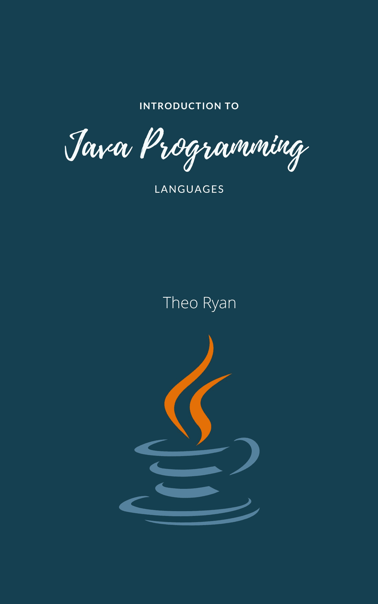
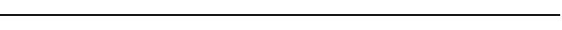

# Java 编程与语言入门指南



## 简介

本书面向信息科学与计算技术专业的学生，特别是 Java 技术方向的学生。它描述了 Java 编程语言的手段以及关于面向对象软件的相关信息。

前两章介绍了基本类型操作和运算符。这些章节中的大部分内容通过 Java 语言与类似的 C++ 进行了对比。

第 3–5 章阐述了面向对象编程并描述了实现这些原则的语言工具。第 6–8 章描述了 Java 标准库的特性、字符串数据处理问题以及流输入。

第 9–11 章介绍了某些相关技术，并使学生掌握基础功能。

手册末尾列出了所讨论主题的主要和补充参考文献。在列表中，我想强调 Java 应用中的错误，这些错误可以作为程序员的指南。

# 1. 数据类型、字面量、变量

## 1.1. 基本数据类型

Java 定义了 8 种基本类型。Java 中基本类型的主要特征是，这些类型的变量不是对象。所有其他类型（包括数组和字符串类型 `String`）都是对象引用。将在后文中详细讨论。

它们包括四种整数 `byte`、`short`、`int`、`long`，两种浮点数 `float` 和 `double`，字符 `char` 和逻辑型 `boolean`。其主要特征见表。

## 1.2. 字面量

整数字面量可以用十进制、八进制和十六进制形式指定。十进制形式的字面量直接编写，其余的使用类似于 C 语言的前缀：`0` 用于八进制字面量，`0x` 用于十六进制字面量。例如，字面量 `47` 可以表示为 `47`、`057` 或 `0x2F`。所有整数字面量都会自动赋予可能的最小类型，但不高于 `int`。长型字面量必须带有后缀 `L` 或 `l`（例如 `47L`）。

带小数点的字面量可以使用普通格式或科学计数法引入。`float` 类型的字面量应带有后缀 `F` 或 `f`（例如 `3.5F`），`double` 类型的字面量带有后缀 `D` 或 `d`，可以是 `3.5D` 或简单的 `3.5`。

| 数据类型 | 大小（字节） | 允许的范围 |
| :--- | :--- | :--- |
| `byte` | 1 | –128 到 127 |
| `short` | 2 | –32768 到 32767 |
| `int` | 4 | –2147483648 到 2147483647 |
| `long` | 8 | $-2^{63}$ 到 $2^{63} -1$ |
| `float` | 8 | $1.4 \times 10^{-45}$ 到 $3.4 \times 10^{38}$ |
| `double` | 16 | $1.7 \times 10^{-324}$ 到 $4.9 \times 10^{308}$ |
| `char` | 2 | 0 到 65535 |
| `Boolean` | — | true, false |

表 1.1. Java 中的基本类型数据

符号字面量限于单引号。因此，Unicode 中的十六进制表示也是可能的。在这种情况下，字面量写为带有 `\u` 前缀的四个十六进制数字序列。例如，字面量 `' yu '` 可以以 `'\u...'` 的形式呈现。

字符串字面量限于双引号。定义了两个不等于整数的布尔字面量 `true` 和 `false`。

## 1.3. 变量

在 Java 中声明变量与 C++ 类似。任何变量都可以在描述时初始化。局部变量的作用和生命周期限于其被描述的块。

与 C++ 不同，在内部块中不允许使用与外部块相同的名称进行声明。使用 `final` 修饰符声明的变量是不可变的（常量）。例如：

```java
final double PI = 3.141592653589793;
```

## 1.4. 类型转换

Java 中的类型转换分为隐式和显式。隐式转换自动执行。Java 中自动强制转换的规则比 C++ 严格得多。与 C++ 的隐式转换不同，Java 中的隐式转换仅在可能保证不会丢失精度的情况下执行。例如，下面这一行从 C++ 语言角度来看是正确的，但在 Java 中会导致编译错误：

```java
int x = 2.5; // 尝试从 double 到 int 的隐式转换
```

让我们给出隐式转换更正式的规则。赋值时如果满足以下条件，会进行自动类型转换：

- 需要将整数类型或 `char` 类型转换为某些数值类型或实数；
- 所需转换的类型比原始类型尺寸更大。

表达式中的自动类型转换针对连接操作的操作数执行：

- 如果二元运算的操作数之一类型为 `double`，则第二个转换为 `double`；
- 否则：如果操作数之一类型为 `float`，则第二个转换为 `float`；
- 否则：如果操作数之一类型为 `long`，则第二个转换为 `long`；
- 否则，两个操作数都转换为 `int`。

这里应该注意最后一点。在某些情况下，它的应用可能会导致不自然的结果。例如，以下代码段在语言层是错误的：

```java
short a = 5;
short b = a + 1; // 错误：需要 short，而不是 int
```

该错误与在给变量 `a` 的值加 1 时，结果被转换为了 `int` 类型有关。由于从 `int` 类型到 `short` 类型的转换会导致下溢，因此必须显式地进行：


```java
short b = (short)(a + 1);
```

这种“奇怪”行为的原因是 `byte` 和 `short` 类型数据并不是为了执行算术运算而设计的，而是为了与外部设备交换。执行算术运算应该使用 `int` 和 `long` 类型。

兼容类型的显式转换执行如下：

- 通过截断（`truncation`）产生的收缩（`constriction`）整数类型的旧位；
- 将实数类型赋值给整数结果时，其截断是通过丢弃小数部分并应用之前的 `future` 项完成的。

显式类型转换的语法与 `C` 中的强制类型转换相同（参见上文示例）。

最后，某些类型转换是无效的——例如，此类转换包括：任何两个 `Boolean` 类型之间的转换、类到原始类型的转换、以及原始类型到类的转换（某些例外除外）等。尝试执行此类转换会导致编译阶段错误。

## 1.5. 数组

Java 中的数组是对象，因此它们适用于处理对象的所有规则（参见节 3.3）。然而，由于数组独立于大多数广泛应用的数据结构，我们在这里将考虑它们。

一维数组的声明语法与变量的描述类似，但在变量名或数据类型名后添加了空括号。例如：

```java
int a[]; // 第一种方案
int [] b; // 第二种方案
```

在这种情况下，数组本身并没有被创建。要创建一个数组，使用 `new` 操作：

```java
a = new int [50];
```

可以同时声明并选择内存：

```java
int a[] = new int [50];
```

也可以在创建时对数组初始化：

```java
int a[] = { 20, 50, 166, 72, 0, –53 };
```

`[]` 运算符用于访问数组元素。数组元素从零开始编号。尝试引用不存在的数组元素会导致运行时错误。数组支持通过示例长度变量获取其大小的信息。

多维数组是数组的数组。它们可以像一维数组一样创建：

```java
int a[][] = new int [5][2];
```

也可以创建非矩形数组。处理非矩形数组的方法见下面的示例。

```java
// 示例：构建二项式系数表
public class Binomial {
    public static void main(String args[]) {
        final int N = ten;
        int c[][] = new int [N][];
        // 构建二项式系数表
        for (int i = 0; i < N; ++i) {
            c[i] = new int[i + 1];
            c[i][0] = c[i][i] = 1;
            for(int j = 1; j < i; ++j)
                c[i][j] = c[i - 1][j - 1] + c[i - 1][j];
        }
        // 输出表格
        for(int i = 0; i < c.length; ++i) {
            for(int j = 0; j < c[i].length; ++j) 
                System.out.print("\t" + c[i][j]);
            System.out.println();
        }
    }
}
```

# 2. 运算与运算符

## 2.1. 运算的一般特征

大多数 Java 运算与 C++ 运算相似，尽管某些运算的功能略有不同。由于 Java 中没有指针，因此自然没有获取地址（`&`）、引用（`*`）和间接寻址（`->`）的操作。Java 中的 `.`（点）用于通过对象引用访问对象的字段和方法（更多细节参见 P. 3.3）。

接下来的段落描述了基本的 Java 运算。优先级运算见表 2.1。

## 2.2. 算术运算

算术运算包括以下运算：保持和改变符号的一元运算（`+` 和 `-`）；一元递增递减运算符（`++` 和 `--`）；加、减、乘、除和取余的二元运算（`+`、`-`、`*`、`/`、`%`）；带赋值的一元运算（`+=`、`-=`、`*=`、`/=`、`%=`）使用 `int` 和 `long`。兼容类型的显式转换执行如下：

| 运算 |  |
| :--- | :--- |
| `+` | ... |
| `-` | ... |
| `*` | ... |
| `/` | ... |
| `%` | ... |
| `+=` | ... |
| `-=` | ... |
| `*=` | ... |
| `/=` | ... |
| `%=` | ... |
| `++` | ... |
| `--` | ... |
| `<<` | ... |
| `>>` | ... |
| `>>>` | ... |
| `&` | ... |
| `\|` | ... |
| `^` | ... |
| `==` | ... |
| `!=` | ... |
| `<` | ... |
| `>` | ... |
| `<=` | ... |
| `>=` | ... |

算术运算使用 `int` 和 `long`。兼容类型的显式转换执行如下：

- 通过截断产生的收缩整数类型的旧位；
- 将实数类型赋值给整数结果时，其截断是通过丢弃小数部分并应用之前的 `future` 项完成的。

显式类型转换的语法与 `C` 中的强制类型转换相同（参见示例）。

最后，某些类型转换是无效的——例如，此类转换包括：任何两个 `Boolean` 类型之间的转换、类到原始类型的转换、以及原始类型到类的转换（某些例外除外）等。尝试执行此类转换会导致编译阶段错误。

## 2.3. 比较运算

比较运算包括 `==`、`!=`、`<`、`>`。与对应的 C++ 运算唯一区别在于其结果总是 `Boolean`。

## 2.4. 逻辑运算

逻辑运算适用于 `Boolean` 参数并产生 `Boolean` 结果。包括：一元“非”运算（`!`）、二元“与”运算（`&&`、`&`）、“或”运算（`|`、`||`）以及“异或”运算（`^`），以及类似的赋值运算（`&=`、`|=`、`^=`）。

`&&` 和 `||` 只在结果可能的情况下计算第二个参数的值。相比之下，`&` 和 `|` 总是计算两个参数的值。例如：

```java
int x = 10, y = 10;
if(x == 10 || ++y == 10) System.out.println(y);
```

输出“ten”，所以没有计算第二个参数运算。

```java
int x = 10, y = 10;
if(x == 10 | ++y == 10) System.out.println(y);
```

结果将是“eleven”。

## 2.5. 条件运算

Java 有类似于 C++ 的条件运算 `?:`。其语法为：如果条件为真，则该运算的结果为表达式 `expression1`，否则为 `expression2`。在这种情况下，不是运算结果的表达式不会被求值。重要的是，Java 中的条件必须是 `boolean` 类型（另见 P. 2.7）。

## 2.6. 赋值运算符与表达式运算符

所有的 Java 语言语句（与所有其他语言一样）都有返回值。然而，除此之外，它们（在 C、C++ 中是，但在其他语言中不是）还可以改变其操作数。此类运算包括 `++`、`--`、`=` 以及所有赋值运算。

赋值操作是一种二元操作，它将第二个参数的值赋值给第一个参数。第一个参数 `operations` `assignments` 必须是 `lvalue`（左值），即“允许被赋值的”。赋值操作的结果等于其第二个参数的值。例如，接下来的操作：

```java
x = y = ten
```

将值 `10` 赋值给变量 `y`，之后将该操作的结果（即 `ten`）赋值给变量 `x`。

`expression` `operator` 的语法如下：

```java
expression ;
```

因此，在任何表达式后添加分号都会将其转换为 `operator` 语句；这种在一个表达式中组合多个操作的可能性允许一个运算符同时更改多个变量，这在使用 `assignments` 运算符时是不可能的。

与 C++ 不同，Java 还有一个额外要求，即运算符表达式中的最后一个操作必须更改其操作数，以防止程序中出现无效代码（无影响的代码）。例如，`operator`：

```cpp
x + 1;
```

在 C++ 中是有效的，但在 Java 中是无效的，因为它没有改变任何变量的值。

## 2.7. 控制语句

当前的控制运算符包括：条件语句 `if`、选择语句 `case`、循环运算符 `while`、`do-while` 和 `for`、提前退出循环的运算符 `break` 以及跳转到下次迭代的 `continue`，以及返回函数的运算符 `return`。这些运算符的语法与 C++ 相似，但有细微修改。特别是所有执行验证条件的运算符，都要求条件的类型为 `boolean`。这意味着，与 C++ 不同，`if (n)` 和 `if (n != 0)` 结构是不等价的，如果变量 `n` 的类型不是 `boolean`，则第一个结构在语法上是错误的。对于 `for` 语句，就像 C++ 一样，可以在其中声明多个变量。例如：

```java
for (int i = 0; i < N; ++i)
```

以此方式声明的变量仅在循环内部有效。你可以在 `for` 运算符的头部中使用多个表达式，并用逗号分隔：


```java
for (i = 0, j = 0; i + j < 20; ++i, ++j)
```

`case` 语句中的控制表达式必须是 `integer` 类型之一。

Java 不包含 `goto` 语句。相反，可以通过扩展的 `break` 语句和 `continue` 语句来退出多层嵌套循环。它们并不常见，因此在这里不作考虑。需要注意的是，Java 禁止在程序中存在不可达代码（例如，`return` 语句之后的代码），这会导致编译错误。

# 3. 类与对象

## 3.1. 面向对象编程的主要概念

Java 语言支持面向对象编程（OOP）范式。OOP 的核心概念是 `class`（类）。`class` 是由用户定义的数据类型。`class` 可以包含 `fields`（字段）和 `methods`（方法）。每个对象都有自己的 `fields`，它们决定了对象在任何时刻的状态。`methods` 决定了所有 `objects` 的行为。要注意，`fields` 和 `methods` 都不存在于 `class`。

`class` 的概念可以被视为数据类型。`methods` 提供了对 `class` 内部 `data` 的访问。

## 3.2. 类声明

以下用于声明 `class`：

```java
[access_spec] class name
{
    [access_spec] datatype fieldname = [initial_value];
    [access_spec] datatype method_name (argument_list)
    {
        method_body
    }
}
```

在 `class` 中声明 `fields` 和 `methods` 的顺序可以是任意的。可能的访问修饰符见 3.1 节。

## 3.3. 对象的创建

在 Java 中，所有对象都是动态创建的。C++ 中那种意义上的“变量对象”在 Java 中不存在；某种类型的变量实际上并不是对象，而是指向这些对象的引用（对象引用）。例如：

```java
MyClass myObject;
```

这声明了一个类型为 `MyClass`、名为 `myObject` 的对象引用，并没有创建对象本身。对象的实际创建是通过 `new` 运算符完成的：

```java
myObject = new MyClass();
```

也可以同时声明对象引用并初始化：

```java
MyClass myObject = new MyClass();
```

## 3.4. 访问字段和方法

一旦创建了对象，就可以通过操作符（`.`）访问其字段和方法：

```java
myObject.someMethod();
```

当从同一对象上调用的方法访问该对象的字段或方法时，可以省略对象的名称，或者用 `this` 关键字替换它。`this` 关键字也用于从另一个构造函数调用类的构造函数（参见下文示例）。在后一种情况下，此类调用必须是 `constructor` 中的第一条语句。


## 3.5. 示例

作为一个示例，考虑类`Box`（意为“盒子”），它用于存储某些箱子的尺寸（三个整数）。`Box`类包含具有不同参数的重载构造函数，以及一个计算箱子体积的`volume()`方法。`SimpleBoxDemo`类演示了`box`类副本的创建和使用。为了简化示例，此处没有使用访问控制（参见 3.10 访问控制）。在实践中，任何人都不应该使用这种方法！

```java
/** Class "Box" */
class Box {
    /** 尺寸字段 */
    int width, height, depth;

    /** 默认构造函数 */
    Box() { width = height = depth = 0; }

    /** 基本构造函数 */
    Box(int width, int height, int depth) {
        this.width = width;
        this.height = height;
        this.depth = depth;
    }

    Box(int size) {
        this(size, size, size); // width = height = depth = size;
    }

    /** 计算体积的方法 */
    int volume() { return width * height * depth; }
}

public class SimpleBoxDemo {
    static void main(String[] args[]) {
        Box b1 = new Box(5), b2 = new Box(5, 10, 20);
        b1.width = 10;
        System.out.println(b1.volume() + "\n" + b2.volume());
    }
}
```

## 3.6. 删除对象

Java 中的删除对象操作不需要手动查找。它的机制是自动垃圾回收。为了确保该机制运行，`JVM`（Java 虚拟机）会跟踪每个被创建对象的引用计数等，一旦某个对象没有引用，它就会成为删除的候选对象。对象的删除是定期执行的，并且仅在 Java 中提供了需要释放的内存时才会进行。由于内存释放是由`JVM`实现的，因此这种操作的需求并不频繁。如果仍然需要它们，你应该定义自己的方法并显式地调用它们。这里的例子是 Java 类中的`close()`方法，用于执行 I/O 流的关闭。

## 3.7. 静态字段和方法

静态字段和现有方法在每个类中只存在一个实例，也就是说，它们被该类的所有副本共享。

声明静态字段和方法需要使用特殊的修饰符`static`：

```java
static int static_field = ten;
```

静态字段在类加载时初始化，值可以是声明中指定的（参见段落 3.5 的示例），也可以在特殊的`static`块中初始化。

静态方法不能（在不显式指定对象的情况下）访问类的非静态字段和非静态方法。

调用静态字段和方法可以在不创建类实例的情况下进行。在这种情况下，在大多数情况下使用类名而不是实例名。例如：

```java
double x = Math.sqrt(2.0);
```

作为所有 Java 程序的入口的`main()`方法应该声明为`static`（参见段落 3.5 的示例）。

## 3.8. 引用传递方法与对象链接的特殊性

对象引用的行为类似于 C 语言中的指针，因此将一个对象引用赋值给另一个不会导致对象的复制。要执行对象的复制，类通常会实现一个拷贝构造函数，以及可能的`clone()`方法。

基本类型通过值传递给方法。这同样适用于对象引用，因此对象本身是通过引用传递的（类似于在 C 中拷贝指针）。

让我们考虑使用对象引用时的典型错误。假设在以下实现中有`Point`类：

```java
class point {
    public double x, y;
    public Coords(double _x, double _y) {
        x = _x;
        y = _y;
    }
}
```

假设需要实现一个交换两个对象的方法。在`point`类中，由于`point`对象是通过引用传递的，实现可能是：

```java
static void swap(Coords c1, Coords c2) {
    Coords s = c1;
    c1 = c2;
    c2 = s;
}
```

这是错误的，因为它只交换了局部引用。要交换实际的对象，我们应该交换它们的内容。这里是实现的一个示例：

```java
static void swap(Coords c1, Coords c2) {
    double temp = c1.x;
    c1.x = c2.x;
    c2.x = temp;
    double tempY = c1.y;
    c1.y = c2.y;
    c2.y = tempY;
}
```

最后，当将对象引用作为参数传递时，对象本身是可以被修改的。

## 3.9. 包与类的结构

包是 Java 程序中类型（类和接口）的分组。每个包可以包含一个或多个类以及其他包。通过包划分类有助于解决命名冲突并实现更高效的访问控制。

引用包的元素时，使用完整路径，该路径由点分隔的子包组成（例如`java.util`）。引用同一包中的类时，可以直接使用它们的名称。

Java 的翻译单元是一个文件。每个翻译单元以`package`语句开头，定义这些类所属的包。

```java
package package.mysubpackage;
```

如果没有`package`语句，类将属于一个没有名称的默认包，该包没有子包且对其他包可见。

翻译单元可以包含多个`import`语句，允许在引用类时省略包名。例如，如果模块中存在以下行：

```java
import java.util.*;
```

那么`java.util`包中的所有类（但不包括子包中的类！）都可以使用短名进行访问。从包导入单个类的示例为：

```java
import java.util.HashSet;
```

例如，对于`Togo`到`JVM`找到的字节码类`java.util.HashSet`，它必须位于`log/java/util`子目录下的`HashSet.class`文件中，这取决于任何类路径环境变量`CLASSPATH`。按照规则，它包含了当前目录以及包含标准 Java 库的目录。源文件通常也按照包的层级结构位于文件系统中。

## 3.10. 访问控制与封装

访问控制用于：一方面，防止由于误用或恶意使用导致对象中包含的数据发生未经授权的更改；另一方面，将类的接口与其实现分离（隐藏实现）。使用该类的程序员只能看到它的接口（具有`public`权限的字段和方法），而可能对该类的内部结构一无所知。后者允许你更改类的实际实现，而对程序员来说是透明的。例如，你可以将实现替换为更高效的、完全重构的内部类设备，而使用该类的程序将在不进行任何更改的情况下与新版本的类工作。

将字段和方法放在类内部并隐藏实现被称为封装。封装是面向对象编程的一个特征属性。

访问控制通过在类、字段和方法的描述中设置某些访问修饰符来实现。在`Java`中，类存在两种访问修饰符，字段和方法有四种。它们都与作用域一起，对应于下表列出的程序中存在的元素。3.1, 3.2。级别：

| 区域可见性 | private | default (默认) | protected | public |
| :--- | :--- | :--- | :--- | :--- |
| 同一个类 | 同一个类 | + | + | + |
| 包 | 另一个类 | - | + | + | + |
| 包包 | 子类 | - | - | + | + |
| 包 | 非子类 | - | - | - | + |

表 3.1. 字段和方法的访问级别

| 区域可见性 | default (默认) | public |
| :--- | :--- | :--- |
| 同一个包 | + | + |
| 另一个包 | - | + |

表 3.2. 类和接口的访问级别

访问级别通过它们的修饰符来指定的。除了 "default"（默认）访问级别外，它没有任何特殊的修饰符。

以下是在 Java 程序中使用访问控制的一些指南。主要的规则是访问权限管理：在设计程序的所有元素时，应该设置能够允许这些元素正确运行的最受限制的访问级别。类与类之间相互的越少，它们就越可能被重复使用。

类字段使用`private`访问。为了从外部读取和更改它们的值，使用了特殊的方法（setters 和 getters），这些方法具有`public`访问修饰符。例如：

```java
class MyClass {
    private int value;
    public void setValue(int value) { this.value = value; }
    public int getValue() { return value; }
}
```

这种方法非常灵活。例如，你可以通过删除或简单地不重写相应的 setter 来将某个字段设为只读字段，或者通过插入相关的检查来限制字段的可能值。

类方法具有`public`访问修饰符，构成了对该类数据的接口。只有通过这些方法，外部类才能访问由类封装的数据，并且只有它们决定了处理这些数据的可能方式。

## 3.12. 比较对象

标准操作`==`比较对象的引用。然而，按照规则，通常我们需要比较对象的内容而不是引用。为了这一目的，定义了`boolean equals(Object obj)`方法。该方法在`Object`类中（参见 4.1）中定义，因此包含在所有类中。该方法的默认实现与`==`运算符相同，即它比较对象的引用。程序员应该重写此方法，以便按照要求的方式进行比较。例如，对于`Coords`类（“平面点”），它包含两个整数坐标`x`和`y`，对应的方法可以如下所示实现：

```java
public boolean equals(Object obj) {
    if(!(obj instanceof Point))
        return false; Point c = (Point)obj;
    return x == c.x && y == c.y;
}
```

如果在程序中使用标准的容器类（参见 8.1），则通常不仅需要重写`equals()`方法，还需要重写`int hashCode()`方法。

返回哈希值对象。`哈希值对象`——这是一个根据对象的状态（其字段）计算出的整数。相等的对象（即`equals()`方法返回`true`的对象）必须具有相同的哈希值。对于不等的对象，哈希值不需要一定不同。尽管如此，我们应该努力做到这一点。此外，应该考虑到，哈希值对象的分布越均匀，内置集合（如集合和关联数组）的性能就越好。

对于需要重写的高级类，可以以以下方式定义`hashCode()`方法：

```java
int hashCode()
{
    return x + y;
}
```

## 3.13. 基本数据类型的包装类

Java 中的基本类型不是对象。但在某些情况下，需要将它们表示为对象（例如，为了存储在容器中，请参见第 8.1 节）。为此，使用了被称为基本类型包装类的类——封装了基本类型的类。

对于八种基本类型中的每一种，都有一个对应的包装类。在创建这些类型的实例时，包装类会通过相关类的构造函数传递一个对象：

`Byte(byte value)` `Short(short value)` `Integer(int value)` `Long(long value)` `Float(float value)` `Double(double value)` `Character(char value)` `Boolean(boolean value)`。此外，除`Character`之外，所有的包装类都有带有`String`类型参数的构造函数。它们执行到对应基本类型的转换并封装生成的结果。所有包装类都重新定义了`equals()`、`toString()`（参见第 3.12 页），并实现了`Comparable<T>`接口（参见第 8.4 页）。

执行从包装对象到基本类型的反转换，在相应对象上使用`byteValue()` `shortValue()` `intValue()`。从 Java 1.5 版本开始，大多数转换都是自动完成的。所有包装类都是不可变的（immutable）。

包装类还包含静态方法：

```java
static byte parseByte(String s)
static short parseShort(String s)
static int parseInt(String s)
```

这些方法可以用于转换到基本类型。如果转换失败，将抛出`NumberFormatException`异常。

# 4. 继承与多态

## 4.1. 继承

继承是一种基于现有类构建新类的机制。同时，类的继承者（子类）获得父类（超类）的属性和功能，并有机会进行更改和扩展。继承机制用于创建与父类相比更私有的、更专门的类。

为了声明某个类是另一个类的继承类，使用`extends`关键字，后跟被继承类的名，并添加到类声明中：

`[ 访问修饰符 ] class 子类名 extends 父类名`

Java 只允许从一个类继承。子类继承父类所有的字段和方法，但那些使用访问修饰符`private`声明以及默认声明的（后者仅当子类位于包含子类第一个类的包之外时）成员，对子类是不可访问的。

子类可以重写父类的字段和方法。在这种情况下，对父类字段和方法的访问被关闭，只能通过子类方法通过`super`关键字执行，其语法与通过`this`显式访问当前实例元素的语法相同。例如，下面的代码段显示了对子类中同名方法`overridenMethod`的调用。

```java
public void overridenMethod()
{
    super.overridenMethod();
    // ...
}
```

在重定义字段和方法时，可能会将访问范围改为更宽（从`private`改为其他；从默认改为其他，除 private 外）。

构造函数是不继承的，但子类构造函数必须调用父类。这可能显式发生（为此，构造函数的第一个语句必须通过`super`调用父类的构造函数）或隐式发生（在这种情况下默认调用构造函数）。父类的构造函数调用是在继承树自上下进行的。在下一个基于 "box" 的示例中：


```java
class box {
    protected int width, height, depth;

    public int getWidth() { return width; }
    public int getHeight() { return height; }
    public int getDepth() { return depth; }

    public Box(int w, int h, int d) {
        width = w;
        height = h;
        depth = d;
    }

    public Box(int size) {
        this(size, size, size);
    }

    public int volume() {
        return width * height * depth;
    }
}

class BoxWeight extends box {
    protected int weight;

    public int getWeight() { return weight; }

    public BoxWeight(int w, int h, int d, int wg) {
        super(w, h, d);
        weight = wg;
    }

    public BoxWeight(int size, int wg) {
        super(size);
        weight = wg;
    }
}
```

## 4.2. 限制与强制继承

如果方法`volume`使用`final`修饰符声明，则禁止对其重定义。如果使用相同的修饰符`final`声明`Class`，则禁止从该类继承。

单个类方法可以被声明为抽象的。在这种情况下，它们使用`abstract`修饰符声明且没有方法体：

```java
abstract void abstractMethod();
```

此类方法在子类中必须被重写。如果一个类包含至少一个抽象方法，它也必须被声明为抽象类。在这种情况下，禁止创建该类的对象。为了能够实例化此类类的子类，必须在它们中实现所有的抽象方法。如果子类没有实现父类所有的抽象方法，它也必须声明为抽象的。

## 4.3. 多态

多态是一种机制，允许你将继承自同一类的对象视为该类的对象。通过这种对子类对象的访问，它们将按照相应子类方法中定义的方式做出反应，而不是按照父类中的。在这种情况下，父类中定义的方法为所有子类形成了一个单一的数据访问接口。多态是面向对象编程中最强大的手段之一，因为它允许以统一的方式处理属于不同类的对象集合，并且特定操作的实现选择根据数据对象的类型自动完成。Java 中多态的实现基于以下规则：

1. 类对象的引用可以转换为继承层次结构中给定类之上的任何一个类的对象的引用。这种转换是扩展性的，并且可以自动完成。反向转换也可能产生，但它总是以显而易见的方式执行。当尝试将对象引用转换为无效类型时，不会抛出错误。要检查转换的有效性，应使用`instanceof`操作：

```java
if(myObject instanceof MyClass)
    ((MyClass)myObject).doSomethingSpecificForMyClass();
```

2. 如果父类方法的某些在子类中被重写，那么在访问这些方法时（即使通过父类对象的引用），重写的方法将被精确地调用一次。这与 C++ 中多态的实现不同，在描述描述的情况下，只有当相关方法被声明为虚函数（`virtual`）时，才会调用重写的方法。考虑一个例子。假设有一个基类“geometric figure”。它包含一个用于计算图形面积的`area()`方法。“shape”类的每个子类都重写了该方法，以计算相应图形的面积。指向特定图形类实例的链接存储在“shape”类型的链接数组中，然后以不同的方式统一处理：对于每个图形，显示其面积。这不需要任何对形状类型的检查，因为对于每个形状都会自动调用所需的方法。

3. 

```java
/** 抽象类 "Geometric figure" */
abstract class figure {
    /** 计算图形面积的方法 */
    abstract public double area();
}

/** 类 "Rectangle" */
class Rectangle extends figure {
    private double a, b;
    public Rectangle(double a, double b) {
        this.a = a;
        this.b = b;
    }
    public double area() {
        return a * b;
    }
}

/** 类 "круг" */
class Circle extends Figure {
    private double r;
    public Circle(double r) {
        this.r = r;
    }
    public double area() {
        return Math.PI * r * r;
    }
}

/** 类 "triangle" */
class triangle extends figure {
    private double a, b, c;
    public Triangle(double a, double b, double c) {
        this.a = a;
        this.b = b;
        this.c = c;
    }
    public double area() {
        double p = (a + b + c) / 2;
        return Math.sqrt(p * (p - a) * (p - b) * (p - c));
    }
}

public class FiguresPolymorphism {
    public static void main(String args[]) {
        figure f[] = new Figure[3]; // 对象引用数组
        f[0] = new Rectangle(2, 3);
        f[1] = new Triangle(3, 4, 5);
        f[2] = new Circle(1);
        for(int i = 0; i < f.length; ++i)
            System.out.println(f[i].area());
    }
}
```

## 4.4. 接口

Java 不允许一个类继承多个类。然而，存在多重继承的局限替代形式，即通过多个接口对一个类进行多次实现。函数式接口类似于带有某些限制的抽象类（只允许抽象方法和静态字段），但任何类都可以实现（等同于继承）某些接口。

对于接口（`interface`），使用以下语法：

```java
interface interface name [extends list_of_interface_ancestors_names]
```

接口的所有方法隐式地接收`abstract public`修饰符，所有接口变量都是`final static public`修饰符，并且必须立即初始化。接口中不允许使用其他特定的访问修饰符。

任何类都可以实现任何接口。

## 4.5. 接口链接

就像将类对象的引用转换为其父类对象的引用一样，也可以将此类引用转换为该类所实现的任何接口的引用。例如：

```java
interface Ifc1 {
    void f();
}

interface Ifc2 {
    void g();
}

class MyClass implements Ifc1, Ifc2 {
    public void f() {}
    public void g() {}
}

public class InterRef {
    public static void main(String args[]) {
        MyClass m = new MyClass();
        Ifc1 ir = m; // 转换为接口链接
        ir.f(); // 通过接口链接调用方法
        ((MyClass)ir).g(); // 反向转换到 MyClass
    }
}
```

## 4.6. 继承与多态的使用指南

在开发层次结构时，类的构建应遵循原则：子类相对于父类是一个更私有的、更专门的类。不遵守这一原则会导致严重的设计错误，表现为类之间的强耦合以及后续阶段设计的困难。尽管抽象类和接口之间有明显的相似之处，但通常来说，它们的目的是不同的。抽象类是一个抽象实体，由于其通用性，细节并没有被完全描述。不同的是，接口不是实体，而是可以由不同类实现的潜在特征集合，它们之间没有任何通用性。继承在遗传上支持通用方法的多态。而方法多态的性质不同，必须通过接口来实现。一个例子是`Comparable<T>`接口（见第 8.4 节）。

# 5. 异常处理

## 5.1. 异常概念

异常提供了一种面向对象的机制，用于处理程序执行期间的异常。与传统的错误处理方法（如返回特殊值或在 C 中使用`setjmp()`和`longjmp()`函数）相比，这种机制允许以更简单、概念更清晰的方式处理此类情况。

异常 — 一个在发生异常时被抛出的对象。它通常封装了该情况的描述信息。被抛出的异常会被某个异常处理器（一个处理异常情况的软件块）捕获。在执行处理器后，控制权将转移到紧随处理器之后的语句。通过这种方式，程序的一个部分跳转到另一个部分，并执行封装在异常情况形式中的某些特殊操作。

## 5.2. 抛出和处理异常

为了抛出异常，您使用以下语法：

```java
throw exception object;
```

通常`exception object`直接在`throw`操作符中创建，例如：

```java
throw new NullPointerException();
```

抛出异常的语句必须位于特殊的`try`块内部，其后紧跟异常异常处理器：

```java
try
{
    exception-throwing-operators
}
catch ( exception_class_name variable_name)
{
    exception_handler_body
}
[ finally
{
    operators
}]
```

如果`try`块中的某个语句抛出了异常，则该块中的所有后续操作将不再执行，并开始搜索处理器。处理器的头部包含一个与抛出的异常对象类型匹配的类型，或者其父类类型（不一定是直接父类）。搜索按照以下规则进行：

- 如果抛出异常的语句不在`try`-块中，则方法将退出，并在调用方法中继续搜索（这可能会重复多次），直到调用该方法的语句之一位于`try`块中；

- 在紧随数据`try`-块后的`catch`块中搜索处理器；

- 如果没有找到合适的处理器，搜索继续在与嵌套`try`块相关的`catch`块中进行（此时也可能发生从一个或多个方法的输出）；

- 如果完全没有找到合适的处理器，异常会被默认处理器捕获，该处理器会打印异常描述、堆栈跟踪并结束程序工作。如果找到了合适的处理器，它将被执行，异常对象将作为参数传递给处理器。在处理器执行结束，控制权将转移到处理完异常的块之后的所有`catch`块之后的操作符。

子类异常处理器必须在被处理之前存在。父类异常也是，否则所有此类异常将由父类异常处理器处理，导致代码中不可用。

在`finally`块可用时，该块的执行不取决于是否抛出了异常：

- 如果发生了异常并被处理，则`finally`块在异常处理器执行后执行；

- 如果没有找到处理器，则`finally`块在包含块内搜索处理器之前执行；

- 如果`try`-块的输出通过`return`操作符完成，则`finally`块在离开方法之前执行。

## 5.3. 示例

考虑一个对段落 3.11 内容进行改进的示例。这个“整数栈”类的实现执行了对栈栈操作的正确性检查，并在发生错误时抛出相应的异常。

```java
/** "整数栈" 类 */
class IntStack
{
    private final int MAXLEN = 64; // 栈的最大尺寸
    private int s[] = new int [MAXLEN], size = 0;

    /** 获取栈的大小 */
    public int getSize() {
        return size;
    }

    /** 在栈中压入元素 */
    public void push(int e)
    {
        if (size < MAXLEN) s[size++] = e;
        else
            throw new RuntimeException("栈溢");
    }

    /** 从栈中弹出元素 */
    public int pop()
    {
        if (size != 0) return s[--size];
        throw new RuntimeException("栈中没有元素");
    }

    /** 检查栈是否为空 */
    public boolean isEmpty() {
        return size == 0;
    }
}

public class IntStackExample
{
    /** 从栈顶移除 n 个元素并在屏幕上输出 */
    static void popAndPrint(IntStack st, int n)
    {
        for (int i = 0; i < n; ++i) System.out.println(st.pop());
    }

    /** 程序入口 */
    public static void main(String args[])
    {
        IntStack st = new IntStack();
        try
        {
            st.push(3); st.push(5); st.push(7); popAndPrint(st, 4);
        }
        catch (RuntimeException e)
        {
            System.out.println("抛出的异常: " + e);
        }
    }
}
```

## 5.4. 异常和错误的类层次结构

Java 中的所有异常对象必须属于一个类，该类继承自`Throwable`类，而该类有两个子类：`Exception`和`Error`。`Error`类型的异常是由 JVM 在发生严重错误时抛出的。按照惯，程序员既不应该抛出也不应该处理此类异常。所有剩余的异常都是`Exception`类及其子类的实例。此外，还有一组特殊的异常，由类`RuntimeException`及其子类表示。由于`Exception`类是所有抛出异常（无论其类型如何）的父类，可以使用以下构造结构：

```java
catch(Exception e)
{
    // . .
}
```

关于异常有一项重要特性，即`Exception`类及其子类的实例，但`RuntimeException`类及其子类除外。如果一个此类异常从方法抛出，则必须在断言中指定其类型。在方法头部中声明`throws`：

`[访问修符] 返回类型 方法名 ( 参数列表 ) [throws 方法抛出的异常类名列表]`

所有引起此类异常但未对异常进行处理的方法也必须在`throws`处声明。否则，编译器将给出错误信息。这样做是为了引起程序员对需要强制处理的异常情况的注意。在标准库中此类异常包括：I/O 错误（`IOException`）、数据库访问错误（`SQLException`）以及其他。当抛出是`RuntimeException`类及其子类实例的异常时，不需要特殊的声明。在库中，这些异常包括：实现中不可接受的数学运算（`ArithmeticException`）、访问数组不存在的元素（`IndexOutOfBoundsException`）、访问不存在对象的字段或方法（`NullPointerException`）以及其他。此类错误在正确的程序中不应该发生，但同时要求强制处理会导致源代码杂乱（例如，为了避免除以零错误而需要将每个操作都放在`try`块中）。

## 6.1. String 类

`String`类是用于存储和处理字符串的主要类。

为了创建或复制`String`类，可以使用以下构造函数之一：

```java
String()
String(String str)
String(StringBuffer strbuf)
String(char [] arr)
String(char[] arr, int first, int count)
```

第一个用于创建一个空字符串，第二个和第三个将`String`和`StringBuffer`类对象的内容复制到创建的对象中。最后两个构造函数允许你根据字符数组或其部分创建字符串。此外，任何`String`类型的对象引用都可以通过赋值字符串字面量来初始化：

```java
String filename = "data.txt";
```


`String` 类的一个可能出乎意料的特性是：该类的实例在创建后不能被更改（不可变性）。然而，这并没有限制它们的使用，因为所有本应该更改字符串的方法只是创建一个新的修改后的字符串，而让原始字符串保持不变。让我们通过示例来解释这一机制的工作：

```java
String s = "abcd";
s = s.toUpperCase();
```

在这里，`toUpperCase()` 方法创建了一个包含字符序列 `"ABCD"` 的新字符串，并返回该字符串的引用，将其赋值给变量 `s`，变量的旧值被丢弃。原始字符串保持不变，由于不再有其他对象引用，它将被垃圾回收器移除。

`String` 类的主要方法如表所示。


| 方法 | 说明 |
| :--- | :--- |
| `int length()` | 获取字符串长度 |
| `char charAt(int index)` | 提取字符 |
| `char[] toCharArray()` | 将字符串转换为字符数组 |
| `Boolean equals(String str)` | 比较字符串的相等性 |
| `boolean equalsIgnoreCase(String str)` | 忽略大小写的字符串比较 |
| `int compareTo(String str)` | 字典序字符串比较 |
| `int compareToIgnoreCase(String str)` | 忽略大小写的字典序比较 |
| `boolean startsWith(String prefix)` | 检查字符串是否以指定的子字符串开头 |
| `boolean endsWith(String suffix)` | 检查字符串是否以指定的子字符串结尾 |
| `int indexOf(String subStr)` |  |
| `int indexOf(String subStr, int fromIndex)` |  |
| `int lastIndexOf(String subStr)` |  |
| `int lastIndexOf(String subStr, int fromIndex)` |  |
| `String substring(int beginIndex, int endIndex)` | 从指定位置搜索子字符串的第一次出现。返回子字符串（`endIndex` 不包含在结果中） |
| `String substring(int beginIndex)` | 获取尾部字符串 |
| `String concat(String str)` | 字符串拼接 |
| `String toUpperCase()` | 字符串转换为大写 |
| `String toLowerCase()` |  |
| `String trim()` | 去字符串首尾的空格 |
| `String replace(String target, String replacement)` |  |

| 元字符 | 含义 |
| :--- | :--- |
| `\.\|\|` | 指定特殊符号或转义普通符号，此外还有行分隔符（`"\n"`、`"\r"` 等），从两个正则表达式中选择一个 |
| `[][^] [-]` | 给定集合中的一个符号、不在给定集合中的一个符号、在范围内的一个符号 |
| `^$` | 行开始符号、行结束符号 |
| `*+?{ k }{ k ,}{ k , m }` | 零或多个前一个符号、一个或多个前一个字符、零或一个前一个字符、精确 `k` 个前一个符号、不少于 `k` 个前一个符号、不少于 `m` 个前一个符号 |
| `( )` | 分组，保存 |
| `$` |  |

结论是，我们注意到正则表达式似乎是处理字符串数据最强大的工具，其功能比给定示例所展示的要广泛得多。更多关于正则表达式的内容将在后续介绍。

## 6.3. 字符串转换和拼接操作

`String` 类在某种意义上是 Java 中的一个特殊类，因为任何数据类型都可以转换为它。对于原始类型，这种转换赋予了它们自然的结构表示；对于对象，则调用 `toString()` 方法。该方法定义在 `Object` 类中，因此存在于任何 Java 类中。

字符串的拼接操作由符号 `+` 表示。这是一个二进制操作，其参数之一必须是 `String` 类型。它会执行将参数自动转换为 `String` 类型（如果需要）并合并生成的字符串。请注意，只有在这种情况下，向字符串的转换才是隐式完成的。

还有一个带有 `+=` 的字符串拼接赋值操作，其第一个参数必须是 `String` 类型（并且必须是左值 `lvalue`），而第二个参数可以是任意类型。在实现操作中，如果需要，第二个参数将被转换为 `String` 类型。

让我们来看一个使用字符串转换和字符串拼接操作符的示例。对于“平面上的点”类，可以如下所示定义字符串转换操作：

```java
class Point
{
    private double x, y;

    public String toString()
    {
        return "(" + x + ", " + y + ")";
    }

    public Point(double _x, double _y)
    {
        x = _x;
        y = _y;
    }
}
```

在这里，`double` 值到字符串的自动转换是在返回语句的表达式中完成的。上面定义的方法 `toString()` 可以如下所示使用：


```java
Point p = new Point(2.0, 5.0);
System.out.println(p); // 屏幕输出结论: (2.0, 5.0)
```

为了在屏幕上获取并显示字符串表示对象，`println()` 方法会调用 `Point` 类的 `toString()` 方法。

有时需要管理字符串表示。这可以使用 `String` 类的静态方法 `format()`：


```java
static String format(String format, Object... args)
```

它接受一个格式字符串和数量可变的表达式，并将它们按照特定的格式字符串转换为格式化字符串。编写格式字符串的规则通常对应于 `C` 语言中 `printf()` 函数编写格式行的规则。例如：


```java
System.out.println(String.format("%04d%4.1f", 25, 3.58));
```

将输出 `"0025 3.6"`。

## 6.4. `StringBuffer` 类

`StringBuffer` 类设计用于处理修改过的字符串。该类的每个对象都包含一个用于存储字符串的缓冲区。当字符串改变时，缓冲区的大小可能会自动改变。

在程序中使用 `StringBuffer` 类对象并不是必要的，因为所有这些操作都可以使用 `String` 类的对象完成。然而，在某些情况下，使用 `StringBuffer` 类可以提高程序的效率，因为它允许我们避免重复复制修改过的字符串。

创建 `StringBuffer` 类的实例，使用以下构造函数：

```java
StringBuffer()
```

```java
int length() // 获取字符串长度
```

```java
char charAt(int index) // 提取字符
char setCharAt(int index) // 修改字符
StringBuffer append(String str)
StringBuffer append(int i)
StringBuffer append(Object obj)
...
StringBuffer insert(int index, String str)
StringBuffer delete(int beginIndex, int endIndex)
StringBuffer replace(int beginIndex, int endIndex, String page)
```

- `append()`：在末尾添加字符串，对于所有基本类型和对象类型都有重载版本。
- `insert()`：在给定位置插入字符串。
- `delete()`：删除子字符串。
- `replace()`：用一个子字符串替换另一个子字符串。
- `StringBuffer reverse()`：反转字符串。

**表 6.4. `StringBuffer` 类方法**

| 构造函数 | 说明 |
| :--- | :--- |
| `StringBuffer(int capacity)` | 创建一个从开始存储空字符串的对象，缓冲区长度为 `capacity`。 |
| `StringBuffer(String str)` | 用指定的字符串初始化缓冲区，缓冲区大小设置为字符串长度并增加十六。 |

前两个构造函数创建一个从开始存储空字符串的对象。第一种情况下缓冲区长度为 16，第二种情况下为给定长度。第三个构造函数用指定的字符串初始化缓冲区。在这种情况下，缓冲区的大小设置为字符串的长度，并增加了十六。

`StringBuffer` 类的主要方法见表 6.4。

与 `String` 类的修改字符串方法不同，`StringBuffer` 类的相似方法恰恰改变的是它们被调用的对象。在执行过程中，它们返回该对象的引用（`this`）。这样做是为了能够将字符串上的一系列连续操作组合成一个表达式，就像在 `C` 语言标准库中实现的那样：

```java
StringBuffer sb = new StringBuffer("abc");
sb.append("ef").reverse();
System.out.println(sb); // 屏幕显示: fedcba
```

# 7. 输入输出

## 7.1. I/O 流

Java 中的输入输出意味着流类。所有流都分为字节流和字符流。字节流设计用于传输二进制数据，而字符流用于文本。为了呈现字符信息，字符流使用 Unicode。

Java 流库的设计使得，无论传输数据的源端和接收端如何，数据输入/输出都几乎是相同的。这一特性归因于所有流类都继承自相应的抽象类，这些抽象类决定了用户应用程序与流交互的方法。

作为超类的字节流是 `InputStream` 和 `OutputStream`，字符流是 `Reader` 和 `Writer`。这些类的主要方法见表 7.1。

在发生 I/O 错误时，类方法选择抛出 `IOException` 异常或其子类，例如 `FileNotFoundException`。这些异常本身不是 `RuntimeException` 类的子类，因此必须处理。


流 I/O 位于 `java.io` 包。

```java
void write(int a) throws IOException // 向流写入一个字节或字符
void write(byte[] a) throws IOException // 从数组写入内容
void write(byte[] a, int offset, int len) throws IOException // 将数组的一部分内容写入流
```


```java
void flush() throws IOException // 重置缓冲区，与输出相关
```

**表 7.1. `OutputStream` 和 `Writer` 抽象类的主要方法。字符流中使用 `char`，字节流中使用 `byte`。**


```java
void close() throws IOException // 关闭流
```

**表 7.2. `InputStream` 和 `Reader` 抽象类的主要方法。字符流中使用 `char`，字节流中使用 `byte`。**

## 7.2. 字节流与文件相关

与文件相关的字节流用于处理二进制文件。

```java
int read() throws IOException // 从当前位置读取一个字节或字符（文件结束时返回 -1）
int read(byte[] a) throws IOException // 填充数组内容，从流读取（返回实际读取的字节或字符数）
int read(byte[] a, int offset, int len) throws IOException // 填充数组的一部分，从流读取
```

```java
boolean ready() throws IOException // 流中数据的可用性
```

如果该方法返回 `false`，则下一次 `read()` 方法调用将等待数据并在接收到数据时完成。该方法仅由 `Reader` 接口定义。

```java
long skip(long n) throws IOException // 跳过给定数量的字节或字符
```

```java
void close() throws IOException // 关闭流
```

```java
FileInputStream(String fileName) throws FileNotFoundException
FileOutputStream(String fileName) throws FileNotFoundException
FileOutputStream(String fileName, boolean append) throws FileNotFoundException
```

所有构造函数都尝试打开作为参数传递给它们的文件。如果在创建输出流时，现有文件已经存在，它将被截断为零长度。然而，如果使用上述第三种构造函数并将 `append` 参数的值设置为 `true`，则文件将在追加模式下打开。

## 7.3. 字节流的字符流包装器

由于 Java 中所有的字符信息都以 Unicode 形式表示，而外部数据通常以其他编码呈现，因此为了让 Java 与外部世界有效通信，需要进行编码转换。此操作由字符包装流完成。它们可以连接任何字节流（“包装”它），并允许接收到的流被视为字符流，执行所有必要的转换。

这些流对应于 `InputStreamReader` 类（将从字节流读取的数据转换为 Unicode）和 `OutputStreamWriter` 类（将输出的字符数据从 Unicode 转换为字节流）。创建类对象使用以下构造函数：

```java
InputStreamReader(InputStream in)
InputStreamReader(InputStream in, String charSet)
OutputStreamWriter(OutputStream out)
OutputStreamWriter(OutputStream out, String charSet)
```

所需的编码由参数 `charSet` 决定。如果未指定，则使用系统区域设置的编码。

## 7.4. 与文件相关的字符流

与文件相关的字符流设计用于处理文本文件。事实上，它们是字节流和执行转换的字符包装流的结合。在这种情况下，总是使用系统区域设置的编码。

这些流对应于 `FileReader` 和 `FileWriter` 类，具有以下构造函数：

```java
FileReader(String filename) throws FileNotFoundException
FileWriter(String filename) throws FileNotFoundException
FileWriter(String filename, boolean append) throws FileNotFoundException
```

它们的使用方式与字节流构造函数相同。与文件相关的流见第 7.2 节。

## 7.5. 字符打印流

字符打印流（对应的类是 `PrintWriter`）是另一个字符流的包装流，它为输出添加了格式化功能，即方法 `print()` 和 `println()`。它们为所有原始类型和 `Object` 类型的参数定义。在后一种情况下，流会输出对象的字符串表示，详见第 6.3 节。

创建 `PrintWriter` 对象使用以下构造函数：

```java
PrintWriter(Writer out)
PrintWriter(Writer out, boolean autoFlush)
```

注意，`PrintWriter` 类不提供在字符转换字符串出现时自动刷新文件中缓冲区的功能。自动刷新只有通过使用 `println()` 方法实现，前提是在创建对象时，参数 `autoFlush` 的值被设置为 `true`。

在较新的 Java 版本中，`PrintWriter` 类包含了允许连接字节流甚至文件字节流的构造函数：

```java
PrintWriter(OutputStream out)
PrintWriter(OutputStream out, boolean autoFlush)
PrintWriter(String filename) throws FileNotFoundException
PrintWriter(String filename, String charset)
```

这些构造函数简单地创建中间类型 `InputStreamWriter` 和 `FileInputStream` 的对象，并与之连接。

注意，除了 `PrintWriter` 类外，还存在具有相似功能的 `PrintStream` 类。在新的 Java 程序中，不建议创建此类的对象，然而这种类型拥有对象 `System.out`（标准流输出）和 `System.err`（标准错误流）。这是由于历史原因。

## 7.6. 缓冲流


缓冲流是其他流的包装器。它们通过后台缓冲提高了 I/O 活动的效率。缓冲流的功能由类`BufferedInputStream`、`BufferedOutputStream`（带有缓冲功能的输入和输出字节流）、`BufferedReader`和`BufferedWriter`（类似的字符流）提供。创建这些类的对象使用构造函数，将被包装的流作为质量参数传递：


```java
BufferedInputStream(InputStream in)
BufferedOutputStream(OutputStream out)
BufferedReader(Reader in)
BufferedWriter(Writer out)
```

此外，缓冲输入字符流增加了方法


```java
String readLine() throws IOException
```

该方法用于从输入符号流中读取一行。在到达文件末尾时，该方法返回`null`。

## 7.7. 控制台 I/O

标准输出流和错误流在 Java 中由`System.out`和`System.err`对象表示，它们的类型为`PrintStream`（见第 7.5）。功能上，它们类似于符号打印流，因此输出时通常使用：

```java
System.err.println("This line output")
```

# 8. 容器

## 8.1. 容器概述

容器是存储其他对象的对象。它们在组织方式、执行基本操作（添加、提取和删除元素）的时间以及支持的方法方面有所不同。每种容器。

Java 中的容器可以分为三组：数组、集合和关联数组。数组在第 1.5 节讨论过。它们的显著特征是创建后无法调整大小。Java 中的所有其他容器在添加和删除元素时动态更改大小。

集合组成了最大的组。Java 中所有的集合类都是泛化类型（泛型）。泛化类型是带有类或接口。泛参数是在创建对象时必须指定的类型名称。泛化类型类似于 C++ 模板，最初引入是为了在编译时确保正确的类型保真性。它们代表了非常灵活且同时复杂的机制，详细考虑超出了本手册的范围。有关泛化类型的详细信息可以在文章 11 中找到。

Java 集合类的参数是它可以存储的对象类型（在此处及下，该类型由字母 E 表示）。参数可以是类或接口。对于集合中的存储，原始类型应使用类-包装器（见第 3.13）。

`Collection<E>`接口。该接口的基本方法如表所示。8.1。它们所有的操作在实际中都独立于集合的类型。最常用的集合类型包括动态数组、双向链表、集合和有序集合。实现这些集合功能的类描述在第 8.3 页和 8.5 页。关联数组（也使用术语“dictionary”和“display map”）是比集合更复杂的数据类型。实际上，它们本身呈现为数组，使用-


### 8.1 Collection 方法

- `boolean add(E e)` 在集合中添加元素（成功时返回 true）
- `boolean remove(Object o)` 从集合中删除元素
- `boolean contains(Object o)` 验证集合是否包含某个元素
- `int size()` 获取集合中的元素数量
- `boolean isEmpty()` 检查集合是否为空
- `boolean equals(Object o)` 比较集合的相等性
- `Iterator<E> iterator()` 获取集合的迭代器
- `object[] toArray()` 根据迭代器的遍历顺序将集合内容复制到数组


表 8.1 `Collection<E>`接口的主要方法

### 8.2. 迭代器 (Iterators)

迭代器用于按顺序遍历集合。使用迭代器是遍历集合所有元素最快的方法。迭代器类实现了`Iterator<E>`接口，该接口定义了三个方法：`hasNext()`、`next()`和`remove()`。

通过调用相应集合对象的`iterator()`方法可以获取迭代器。初始时，迭代器设置为位于集合第一个元素之前。每次调用方法

```java
E next()
```

返回迭代器在调用之前的元素，并移动迭代器，将其放置在返回的元素之后。如果迭代器在集合的最后一个元素之后，`next()`方法将抛出`NoSuchElementException`类型的异常。在使用迭代器方法前检查元素可用性可以使用方法


```java
boolean hasNext()
```

为了删除上一次返回的`next()`元素，可以使用方法

```java
void remove()
```

仅允许在调用`next()`方法后单次调用`remove()`方法。否则，或者在完全没有调用`next()`的情况下，将抛出类似`IllegalStateException`的异常。在下面的示例中，考虑使用迭代器输出集合内容，其中包含类型为`MyClass`的元素：

```java
for (Iterator<MyClass> it = collection.iterator(); it.hasNext(); ) System.out.println(it.next());
```

对于集合（以及数组）还有另一种替代方案进行循环：

```java
for ([ type data ] variable : collection)
```

它按照迭代器指定的顺序遍历集合的内容（对于数组，是从第一个元素到最后一个元素的顺序），而循环头中指定的变量随后将被分配到集合元素的引用上。例如：

```java
for(MyClass e : collection) System.out.println(e);
```

### 8.3. 列表 (Lists) 和动态数组

列表和动态数组（Lists and Dynamic Arrays）——这些是具有任意顺序元素的集合。此类集合中元素的顺序由它们的索引决定，与普通数组相同。所有提供此类集合性质功能的类都实现了`List<E>`接口（`Collection<E>`的子接口），其方法见表 8.2。

对于所考虑的集合，`add()`方法在`Collection<E>`接口中定义，它在集合末尾执行插入，`remove()`方法删除给定元素的首次出现处。

标准库包含以下具有任意顺序元素的集合：`LinkedList<E>`、`ArrayList<E>`和`Vector<E>`。

`LinkedList<E>`类是以双向链表形式组织的集合。它提供了根据索引获取元素的时间复杂度为 O( N )，以及在指定位置插入和删除元素的时间复杂度为 O(1) 。

为了创建`LinkedList<E>`类的副本，可以使用以下构造函数：

```java
void add( int index, E element)
```

添加`E get( int index)`获取指定位置的元素

`E set( int index, E element)`更改指定位置的元素

`E remove( int index)`删除指定位置的元素

`boolean remove( int index)`删除指定位置的元素

`int indexOf(Object o)`搜索指定元素的首次出现位置

`int lastIndexOf(Object o)`搜索指定元素的最后出现位置

`ListIterator<E> listIterator()`返回一个双向遍历列表的列表迭代器

`ListIterator<E> listIterator(int index)`返回一个从指定位置开始的列表迭代器

`ArrayList<E>`类是以动态数组形式组织的集合。它提供了根据索引获取元素的时间复杂度为 O(1)，以及在指定位置插入和删除元素的时间复杂度为 O(N) 。

`Vector<E>`类是以动态数组形式组织的集合。它提供了根据索引获取元素的时间复杂度为 O(1)，以及在指定位置插入和删除元素的时间复杂度为 O(N) 。

标准库包含以下构造函数/方法：

```java
void add( int index, E element)
```

添加`E get( int index)`获取指定位置的元素

`E set( int index, E element)`更改指定位置的元素

`E remove( int index)`删除指定位置的元素

`boolean remove( int index)`删除指定位置的元素

`int indexOf(Object o)`搜索指定元素的首次出现位置

`int lastIndexOf(Object o)`搜索指定元素的最后出现位置

`ListIterator<E> listIterator()`返回一个双向遍历列表的列表迭代器

`ListIterator<E> listIterator(int index)`返回一个从指定位置开始的列表迭代器

### 8.4. 对象的排序 (Ordering of objects)

许多容器处理任务与对象的某种排序有关。为了这一点，需要为对象定义某种操作，以便能够判断一个对象比另一个大还是小。Java 有两种标准方法来定义这种操作。第一种是需要排序的类实现`Comparable<T>`接口。类型参数 T 必须替换为实现该接口的类名。例如：

```java
class MyClass implements Comparable<MyClass>
```

`Comparable<T>`接口定义了方法

```java
int compareTo(T obj)
```

比较调用它的对象（this）与传递给该方法的对象，如果 this 大于对象 obj，则返回小于零的值；如果 this.equals(obj) 为 true，则返回零；如果 obj 大于 this，则返回大于零的值。“大于”关系本身可以是任意的，并对应相应的准则。

例如，如果有一个具有两个实部字段 re 和 im 的“复数”类，并且需要按照对应复数的模的升序或降序对该类对象进行排序，则可以如下定义 compareTo 操作：

```java
class ComplexNumber implements Comparable<ComplexNumber>

{

public double re, im;

public ComplexNumber(double re, double im)

{

this.re = re; this.im = im;

}

}
```

```java
public int compareTo(ComplexNumber c) {
    double diff = (re * re + im * im) – (c.re * c.re + c.im * c.im);
    return (int)(Math.signum(diff));
}
```

一种基于特定方式的比较操作对对象进行排序的方法，在`Java`中被称为自然排序（natural ordering）。每个类最多可以定义一种自然排序方式。

另一种排序方法是定义一个外部类（`comparator`比较器），该类将实现所需类的比较对象。`Comparator`类必须实现`Comparator<T>`接口，其中参数`T`定义了该比较器所比较的对象类型。`Comparator<T>`接口定义了方法：


```java
int compare(T o1, T o2)
```

它比较作为参数传递给它的两个对象，并返回正、负或零作为比较结果，这与`Comparable<T>`接口中的`compare()`方法类似。

因此，在示例中，对于给定的类，除了实现`compareTo()`方法，还可以通过以下方式实现比较器：

```java
class ComplexNumberLenComp implements Comparator<ComplexNumber> {

    public int compare(ComplexNumber c1, ComplexNumber c2) {

        double diff = (c1.re * c1.re + c1.im * c1.im) - (c2.re * c2.re + c2.im * c2.im);

        return ( int )(Math.sign(diff));

    }

}
```

很容易看出，对于一个类可以定义任意数量的比较器，因此这种方法通常用于程序对对象使用不同排序标准的情况。许多标准容器处理算法以及自包含容器都需要你定义如何对对象进行排序。在存储研究机构和处理迁入数据时使用各种排序方法的示例参见`P.` 8.8。

### 8.5. 集合与有序集合

`Sets`集合和有序集合是提供快速添加和删除元素的集合，但不允许你按照顺序对它们进行排列并保留重复元素。

`Set<E>`接口以及实现它的包装类`HashSet<E>`。它们与`Collection<E>`接口相比，没有添加任何新方法。存储器类`HashSet<E>`使用哈希表，因此存储在集合中的对象必须实现`equals()`和`hashCode()`方法。得益于哈希表，执行基本操作（添加、删除和检查元素在集合中的出现情况）的时间实际上不依赖于集合的大小。迭代器遍历集合元素的顺序被认为是任意的，因为它是由元素的哈希值决定的。创建副本的类`HashSet<E>`使用以下构造函数：


```java
HashSet()
```


```java
HashSet(Collection<? extends E> c)
```

有序集合由`SortedSet`接口表示，并用`TreeSet<E>`类实现它。后者使用平衡二叉树进行存储，这可以保证迭代器遍历集合的顺序是升序的。在集合中添加、删除和检查元素出现次数的时间复杂度为 N log N。

用于创建副本的类`TreeSet<E>`使用以下构造函数：


```java
TreeSet()
```

```java
TreeSet(Collection<? extends E> c)
TreeSet(SortedSet<E> s)
TreeSet(Comparator<? super E> c)
```

最后一种允许你创建任意顺序排序的集合，该顺序由传递给构造函数的比较器决定（参见章节 8.4）。在所有其他情况下，集合的排序按自然顺序排列。在这种情况下，集合元素类必须实现`Comparable<T>`接口。

### 8.6. 关联数组

如所述，关联数组可以被视为使用任意对象代替索引的数组。我们可以假设它们将一组键对象集合映射为一组值对象集合。它们不是意义上的集合，因为它们没有实现`Collection<E>`接口。取而代之的是`Map<K, V>`接口，它有两个选项。第一个定义关联数组的键的数据类型，第二个是其值的类型。基本接口方法`Map<K, V>`见表 8.3。

关联数组用于存储键值对。因此，两者的层次结构和属性都匹配：分别是`HashSet`和`HashMap`类、`HashSet`和`TreeMap`类，以及`SortedSet`和`SortedMap`接口。关联列表没有自己的迭代器。遍历它们时使用其键的迭代器。

表 8.3. `Map<K, V>`的主要方法

```java
TreeMap<String, String> capitals = new TreeMap<>();

capitals.put("Russia", "Moscow");

capitals.put("France", "Paris");

capitals.put("Italy", "London"); // 不对

capitals.put("Italy", "Rome"); // 修正

System.out.println("Capital Italy - " + capitals.get("Italy"));

for (String s : capitals.keySet()) System.out.println(s + ": " + capitals.get(s));
```

### 8.7. 继承（旧）容器类

除了`ArrayList<E>`、`HashSet<E>`和`HashMap<E>`类外，还有功能类似的`Vector<E>`、`Hashtable<E>`和`Dictionary<E>`类。这些是旧版本库中的遗留类。它们的主要目的是提供向后兼容性。虽然它们没有被认为过时，但可能在新程序中最好避免使用它们。

### 8.8. 标准容器处理算法

Java 标准库包含了标准的容器处理算法，以及一些辅助操作。所有这些都以`Collections`类（用于集合和关联列表）和`Arrays`用于数组）静态方法的形式给出。相关方法见表 8.4、8.5。特别注意返回不可变容器封装的方法（`unmodifiableCollection()`、`unmodifiableList()`等）。这些方法返回一个实现相应容器类型的对象。在使用返回对象的估计和获取值的方法时，后者的行为与原始对象完全相同。尝试调用任何容器更改方法都会抛出类型为`UnsupportedOperationException`的异常。

以下示例展示了在本章描述的工具的能力。

```java
void sort(int[] a)
```

```java
void sort(T[] a, Comparator<? super T> c)
int binarySearch(int[] a, int key)
int binarySearch(T[] a, T key, Comparator<? super T> c)
```


对对象数组进行排序，取决于指定的比较器。二分查找在引用行数组中查找元素的索引。如果没有找到该元素，则返回一个等于（元素应该所在的位置减去 1）的值。


```java
boolean equals(int[] a, int[] a2)
```

比较数组的相等性

```java
void fill(int[] a, int val)
```

给定数组的所有元素 - 含义


```java
List<T> asList(T[] a)
List<T> asList(t...a)
```

数组/集合转换 列表中的元素



表 8.5. `arrays` 类的主要方法。提供了用于操作 `int[]` 类型数组的方法。对于所有其他原始类型数组和 `Object` 类型数组也存在类似的方法。所有方法均为静态方法。

```java
import java.util.*;

/** 问卷数据人类类 */
class person implements Comparable<Person> {

    /** 接收数据和方法 */
    private String name;

    public String getName() {
        return name;
    }

    private int age;

    public int getAge() {
        return age;
    }

    /** 构造函数 */
    public Person(String name, int age) {
        this.name = name;
        this.age = age;
    }

    /** 对象转字符串 */
    public String toString() {
        return name + " (" + age + ")";
    }

    /** 对象的相等性比较 */
    public boolean equals(Object obj) {
        if (!(obj instanceof Person))
            return false;
        return ((Person)obj).name.equals(name) && ((Person)obj).age == age;
    }

    /** 对象的哈希码 */
    public int hashCode() {
        return name.hashCode() + age;
    }

    public int compareTo(Person p) {
        return name.compareTo(p.name);
    }
}

/** 用于年龄比较的比较类 */
class PersonAgeComparator implements Comparator<Person> {
    public int compare(Person p1, Person p2) {
        return p1.getAge() – p2.getAge();
    }
}

public class PersonsSortExample {
    public static void main(String[] args[]) {
        TreeSet<Person> data = new TreeSet<Person>();
        data.add(new Person("Petrov", 31));
        data.add(new Person("Ivanov", 45));
        data.add(new Person("Smirnov", 20));
        data.add(new Person("Smirnov", 20)); // 此元素已存在
        System.out.println(data); // 结论：按姓排序

        // 将集合的内容复制到列表
        ArrayList<Person> data2 = new ArrayList<Person>(data);
        Collections.sort(data2, new PersonAgeComparator());
        System.out.println(data2); // 输出：按年龄排序
    }
}
```

该程序的结论：
`[Ivanov (45) Petrov (31), Smirnov (20)]`
`[Smirnov (20), Petrov (31), Ivanov (45)]`

# 9. 多线程编程

## 9.1. 线程的创建与管理

多线程是一种组织程序执行的方法，其中程序的各个部分同时或伪同时地执行。

`Thread` 类封装了一个执行线程。该类的基本方法如表所示。9.1。程序中的每个执行线程都对应该类或其子类的实例。通常情况下，程序会创建 `Thread` 类的子类，并重写方法


```java
void run()
```

这是流的入口。创建当前类的实例时，对应的执行线程不会接收管理。要运行流，应该调用相关对象的方法


```java
void start()
```

在调用了 `start()` 方法的流上，执行继续进行，同时...

### 表 9.1. `Thread` 类的主要方法

| 方法 | 说明 |
| :--- | :--- |
| `start()` | 启动流 |
| `run()` | 流的入口 |
| `yield()` | 自愿的短期管理调度 |
| `sleep(long millis)` | 在指定的间隔内挂起流 |
| `join()` | 挂起流直到另一个流完成 |
| `isAlive()` | 检查流是否结束 |
| `interrupt()` | 设置中断标志 |
| `isInterrupted()` | 获取中断标志状态 |
| `setPriority(int newPriority)` | 改变流优先级 |
| `getPriority()` | 流的优先级 |
| `setDaemon(boolean on)` | 守护流 |

---

其他流。这通常用于当前流等待另一个流触发某些事件的情况。例如：

```java
if (!somethingHappened) yield();
```

使用 `yield()` 允许你提高程序速度，因为在其他线程有机会更改这些值之前，避免了多次无用的值检查。

不同线程获得的时间比例由它们的优先级决定。优先级是一个从 1（最低优先级）到 10（最高优先级）范围内的值。使用相应的方法设置和获取优先级值，分别为 `setPriority()` 和 `getPriority()`。创建的线程默认优先级等于 5。

有时候有必要过早终止线程并可能在将来恢复其执行。为了实现这一点，`Thread` 类中引入了 `stop()`、`suspend()` 和 `resume()` 方法，但它们后来被认为是不安全的，因为它们允许在停止线程之前不执行如（例如）释放指定的资源等的某些操作，因此可能导致程序挂起或运行异常。在新程序中不应使用这些方法。控制流的另一种替代方法是使用 `Thread` 类中的一个特殊标记 `interrupted`（中断）。为了中断当前的执行流，使用了 `setInterrupted()` 方法。如果此时流处于挂起状态（调用了 `sleep()`、`join()` 等方法），那么当它恢复工作时，在相应的方法调用处会抛出一个异常。否则，将设置特殊的标记 `interrupted`。线程必须通过调用 `isInterrupted()` 方法来自行检查该标记的状态，并在其被置为真时停止工作。例如：

```java
void run()
{
    boolean done = false ;
    while (!done)  // 主循环流
    {
        if (isInterrupted())
        {
            // 执行最终操作
            return ;
        }
    }
}
```

每次调用 `isInterrupted()` 方法都会重置标记 `interrupted`。请注意，如果流不检查标记 `interrupted`，可能会出现在它上被禁止的情况下停止的情况。

下面的示例演示了 `Thread` 类中各种方法的使用。在这个示例中，主线程实例化了 `helloThread` 类，在独立的执行流上在屏幕上输出“Hello, world!”字符串，并在完成前制造一个延迟。主线程则等待子线程的完成，之后它显示一条消息，表示子线程已完成。

```java
class hello thread extends Thread
{
    /** 流的入口点 */
    public void run()
    {
        System.out.println("Hello, world!");
        try
        {
            sleep(1000);
        }
        catch(InterruptedException e)
        {
            System.err.println("线程 MyHelloThread 被中断了");
        }
    }
}

public class SimpleThreadsExample
{
    public static void main(String args[])
    {
        Thread t = new HelloThread(); t.start();  // 启动流
        try
        {
            t.join();  // 等待流完成
        }
        catch (InterruptedException e)
        {
            System.err.println("主流被中断");
        }
        System.out.println("流 MyHelloThread 结束");
    }
}
```

## 9.2. 接口 `runnable`

有时候需要将 `Thread` 类的功能添加到已有的类中。直接继承 `Thread` 类是不允许的，因为该 `Class` 已经是其他类的子类。在这种情况下，可以使用 `Runnable` 接口。该接口定义了唯一的方法：

```java
void run()
```

与 `thread` 类的同义方法类似。

实现 `runnable` 接口的类如下所示使用：创建该类的实例，并将其传递给 `thread` 类的构造函数：

```java
MyRunnableClass r = new MyRunnableClass();
Thread t = new Thread(r);
t.start();
```

有时 `Thread` 类对象直接放置在实现 `Runnable` 接口的类内部，并在该类的构造函数中初始化：

```java
class MyRunnableClass implements runnable
{
    private Thread thread;

    /** 构造函数：创建 Thread 类对象并启动它 */
    public MyThread()
    {
        thread = new Thread( this ); thread.start();
    }

    /** 流的入口点 */
    public void run()
    {
        // . . .
    }
}
```

## 9.3. 同步

多线程应用程序通常不需要同一个对象或方法只被一个线程使用。为了提供这种可能性，使用了 `sync` 机制。

考虑一个可能需要同步的原型示例。

```java
/** 构造函数（保存名称流并启动流） */
public MyThread(String name) { super (name); start(); }

/** 流的入口点 */
public void run()
{
    try
    {
    }
    System.out.print("["); Thread.sleep(1); System.out.print(getName()); Thread.sleep(1); System.out.print("]");
}
catch(InterruptedException e)
{
    System.err.println("线程 " + getName() + " 被中断了");
}
}
}

public class SyncExample
{
    public static void main(String args[])
    {
        for (int i = 0; i < ten; ++i)
            new MyThread(String.valueOf(i));
    }
}
```

这个示例创建了 10 个线程，每个线程输出方括号中的数字：


在这种情况下，第一个进入 `System.in` 监视器的线程会挂起所有尝试进入同一个监视器的线程，并在完全执行结论后才释放监器。然后下一个流进入监器，依此类推。

同步的核心概念是监器（monitor）。监器是一个用于互斥阻塞的（隐式）对象。在 Java 中，每个对象都有自己的监器。当一个线程进入监器时，相应的块就会被检查。如果此时另一个线程尝试进入同一个监器，它将暂停，直到第一个线程离开监器。

Java 中有两种同步类型：同步方法和同步块。

要使方法同步同步，只需在其头部添加 `synchronized` 关键字。同步块（有时称为临界区域）具有以下语法：

```java
synchronized (object_name)
{
    // . . .
}
```

特别地，在上面的示例中可以将 `try` 块放在同步块中：

```java
synchronized (System.in)
{
    System.out.print("["); Thread.sleep(1); System.out.print(getName()); Thread.sleep(1); System.out.print("]");
}
```

这种方法在某种程度上足够灵活，因为 Java 应用程序与数据库的详细交互分离开了。数据库只需要提供某些 `JDBC` 接口的实现——为了兼容性，以便能够与 Java 应用程序兼容。

`JDBC` 类和接口托管在 `java.sql` 包中。关于 `JDBC` 技术的更多信息可以在书籍 [4, 5] 中找到。

### 10.2. 数据库驱动程序

要连接到数据库，必须首先加载与所用数据库对应的驱动程序。Java 的标准发行版仅包含这样一个驱动程序 - `JDBC` ODBC 桥。该驱动程序充当了 `JDBC` 接口与连接 Microsoft 数据库的 ODBC（开放数据库连接）标准接口之间的桥梁。这种方法是充分的且通用的，因为对于大多数数据库都有相应的 ODBC 驱动。然而，首选的连接方式仍然被认为是使用特定数据库的 `JDBC` 驱动，因为此类驱动通常比 `JDBC-ODBC Bridge` 功能更强、速度更快。此外，它们还可以提供跨平台的可变性（使用 `ODBC` 通常仅在 MS Windows 上可用）。在大多数现有 DBMS 的交付物中，或者可以通过以下地址找到 `JDBC` 驱动：

`JDBC` 驱动通常以 `jar` 归包的形式提供，必须放在 `CLASSPATH` 中列出的任何目录中（cm. P. 3.9），以便 JVM 能够找到所需的驱动程序。

加载驱动程序通过调用方法来实现：

```java
static void forName(String classname) throws ClassNotFoundException
```

示例：

```java
Class.forName("sun.jdbc.odbc.JdbcOdbc");
Class.forName("com.mysql.jdbc.Driver");
```

### 10.3. 连接

连接是通过调用以下方法执行的：

```java
static Connection getConnection(String url, String user, String password) throws SQLException
```

`DriverManager` 类实现了连接功能。为了创建连接，使用静态方法：

```java
static Connection getConnection(String url, String user, String password) throws SQLException
```

这里，`url` 参数定义了连接的格式：

```java
String url = "jdbc:mysql://localhost:3306/database";
```


驱动程序通常以`jar`包的形式提供，必须放在`CLASSPATH`中列出的任何目录中，以便 JVM 能够找到所需的驱动程序。加载驱动程序通过调用方法`forName(String classname) throws ClassNotFoundException`实现。

```java
Class.forName("sun.jdbc.odbc.JdbcOdbc");
Class.forName("com.mysql.jdbc.Driver");
```

### 10.4. 结果集

结果集是实现`ResultSet`接口的类，封装了查询执行的结果。为了创建结果集，使用：

```java
ResultSet rs = stmt.executeQuery("SELECT * FROM people");
```

遍历结果集时可以使用以下方法：

```java
while (rs.next()) {
    // 处理数据
}
```

处理完成后，应通过`close()`关闭结果集。如果结果集被创建，它会自动关闭。以下示例展示了如何通过 SQL 查询来操作：

```java
ResultSet rs = stmt.executeQuery("SELECT name FROM people");
while (rs.next()) {
    System.out.println(rs.getString("name"));
}
rs.close();
```

该数据集包含一个游标，允许你在该集合的行之间移动。使用游标的技术在很大程度上类似于使用集合迭代器的技术（请参见第 8.2 节）。首先，初始游标初始放置在第一个字符串集数据之前。

## 挑战方法


```java
boolean next() throws SQLException
boolean previous() throws SQLException
```

允许分别在字符串集上向前和向后移动（游标保持在行之间！）。方法


```java
boolean relative(int rows) throws SQLException
boolean absolute(int row) throws SQLException
```

| 含义 | 描述 |
| :--- | :--- |
| 参数`rsType` | |
| `TYPE_FORWARD_ONLY`（默认后），`TYPE_SCROLL_INSENSITIVE`，`TYPE_SCROLL_SENSITIVE` | 数据是单向懒加载的；游标可能只能在数据集上向前移动；允许游标在任意方向移动，同时也对数据集内容进行任意访问；允许游标在随机方向移动，并对数据集内容进行随机访问；当数据库内容更改时，结果中的内容会自动更新，以满足其他请求的结果 |
| 参数`rsConcurrency` | |
| `CONCUR_READ_ONLY`（默认），`CONCUR_UPDATABLE` | “仅可读”模式；禁止更改数据集数据，允许更改数据；这些更改将自动在数据库中生效 |
| 参数`rsHoldability` | |
| `HOLD_CURSORS_OVER_COMMIT`，`CLOSE_CURSORS_AT_COMMIT`（默认后） | 事务提交后数据集保持打开，且其中的游标在事务提交后被保留；事务提交后数据集关闭 |

表 10.1. 数据集参数的值。所有值均为`ResultSet`类的常量。

允许在数据集中对游标进行相对和绝对定位。指定的方法如果移动成功则返回值`true`，如果请求的元素不存在则返回`false`。注意记录的编号是以**为单位实现的！为了将游标定位在第一个元素之前和最后一个元素之后，使用了以下方法：

| SQL 数据类型 | Java 数据类型 | SQL 数据类型 | Java 数据类型 |
| :--- | :--- | :--- | :--- |
| `BOOLEAN` | `boolean` | `DOUBLE` | `double` |
| `TINYINT` | `byte` | `VARCHAR` | `String` |
| `SMALLINT` | `short` | `NUMERIC` | `BigDecimal` |
| `INTEGER` | `int` | `DATE` | `Date` |
| `BIGINT` | `long` | `TIME` | `Time` |
| `FLOAT` | `float` | `BLOB` | `blob` |

表 10.2. SQL 数据类型与 Java 类型的对应关系


```java
void beforeFirst() throws SQLException
void afterLast() throws SQLException
```

所有列出的高级方法除`next()`方法外，仅在数据集不是单向的情况下工作（即读取参数`rsType`不等于`TYPE_FORWARD_ONLY`）。

为了接收数据集最后几行的字段值，即在任何定位方法移动（`next()`、`previous()`等）后，使用了以下方法：


```java
*** get***(int columnIndex) throws SQLException
*** get***(String columnName) throws SQLException
```

在这里，替换名称的 Java 数据类型对应参数的 SQL 数据类型（参见表 10.2）。所需的字段通过其在数据库中的名称或请求中的编号指定（字段编号从一开始！）。除了`get***`方法，你可以使用通用方法：

```java
Object getObject(int columnIndex) throws SQLException
Object getObject(String columnName) throws SQLException
```

它将请求字段的值作为相应现有类型的一个一个对象返回（参见表 10.2）。如果该类型是基本类型，则会变为其包装类（例如用`Integer`代替`int`等；另请参见 P. 3.13）。

以下方法在屏幕上显示任意表的内容。作为参数传递给方法的名称。在示例中，使用了`ResultSetMetadata`类的对象，允许你获取数据集字段的数量和名称。关于此类的更多信息可以在 JDBC 文档中找到。

```java
/** 打印数据库表内容 */
public static void printDB(Connection conn, String tableName) {
    Statement s = conn.createStatement();
    ResultSet r = s.executeQuery("SELECT * FROM " + tableName);
    ResultSetMetaData md = r.getMetaData();
    while (r.next()) {
        for (int i = 1; i <= md.getColumnCount(); i++) {
            System.out.print(r.getObject(i) + "\t");
        }
    }
    s.close();
}
```

## 10.6. 可修改数据集

如果数据集持有主键且`rsConcurrency`选项设置为`CONCUR_UPDATABLE`，则可以使用调用方法来修改表：

```java
void update***(int columnIndex, *** x) throws SQLException
void update***(String columnName, *** x) throws SQLException
```

更改通过调用（Images/image00514.jpeg）记录在数据库中：

```java
void updateRow() throws SQLException
```

要删除数据集的当前记录，使用方法（Images/image0479.jpeg）：

```java
void deleteRow() throws SQLException
```

为了将游标返回到插入之前的位置，使用了方法：

```java
void moveToCurrentRow() throws SQLException
```

然后使用方法填充添加的记录（Images/image0479.jpeg）：

```java
void insertRow() throws SQLException
```

下一个示例从 P. [10.4] 数据修改数据库：

```java
Statement s = conn.createStatement(ResultSet.TYPE_SCROLL_INSENSITIVE, ResultSet.CONCUR_UPDATABLE);
ResultSet r = s.executeQuery("SELECT Id, Name, Telephone, Age FROM people");
// 为所有人年龄加 1
while (r.next()) {
    r.updateInt(4, r.getInt(4) + 1);
    r.updateRow();
}
// 添加新记录
r.moveToInsertRow();
r.updateString("Name", "Smirnov");
r.updateObject("Telephone", "26-08-58");
r.updateInt("Age", 43);
r.insertRow();
r.moveToCurrentRow();
s.close();
```

## 10.7. 使用预编译查询

在这些情况下，当执行大量相似的数据库请求且仅参数不同时，为了提高性能，你可以使用预编译查询。预编译请求对应于实现`PreparedStatement`接口的对象。通过以下方法创建此类对象：

```java
PreparedStatement prepareStatement(String sql) throws SQLException
PreparedStatement prepareStatement(String sql, int resultSetType, int resultSetConcurrency, int resultSetHoldability) throws SQLException
```

在连接对象上调用。这些方法接受请求模式字符串，其中包含参数位置的问号，例如：

```sql
INSERT INTO people(Name, phone, age) VALUES (?, ?, ?)
```

参数值通过调用方法给出：

```java
void set***(int parameterIndex, *** x) throws SQLException
void set***(String columnName, *** x) throws SQLException
```

```java
void setObject(int parameterIndex, Object x) throws SQLException
```

`*`被替换为与 SQL 参数数据类型对应的 Java 数据类型名称（参见表 10.2）。参数`parameterIndex`定义了要设置的预编译查询参数的编号。参数编号从 1 开始计数！

在设置好参数值后，通过调用以下方法执行查询：


```java
boolean execute() throws SQLException
result set executeQuery() throws SQLException
int executeUpdate() throws SQLException
```

这些是相似的同义方法接口`Statement`（见第 P. 10.4 页）。接下来的片段将示例 P. 10.4 中的数据（存储在数组对象中）使用该预编译查询来填充表。

```java
PreparedStatement s = conn.prepareStatement(
"INSERT INTO people(Name, Telephone, Age) VALUES(?, ?, ?)");
Object[][] data = {
{ "Ivanov", "12-02-00", 37 },
{ "Petrov", "43–55–47", 26 },
{ "Sidorov", "43–88–90", 59 } };
for(int i = 0; i < data.length; ++i)
{
    for(int j = 0; j < data[i].length; ++j) s.setObject(j + 1, data[i][j]);
    s.execute();
}
s.close();
```

### 10.8. 事务管理

默认模式是自动提交事务。这意味着对数据库的每一个请求都视为一个独立的自动提交的事务。然而，这种模式可以被禁用，通过方法：


```java
void setAutoCommit(boolean autocommit) throws SQLException
```

在这种情况下，所有事务必须通过调用以下方法显式地提交：


```java
void commit() throws SQLException
```

或者通过调用方法进行回滚：


```java
void rollback() throws SQLException
```

如果在执行事务期间发生错误，事务将自动被拒绝。

JDBC 不需要你显式定义事务的开始。事务首先在调用`setAutoCommit()`方法的时刻开始，随后的所有事务在调用`commit()`或`rollback()`方法提交或回滚之前的事务后直接开始。

# 11. 网络编程

## 11.1. 网络编程手段综述

Java 支持开发网络应用程序的各种工具和技术。这包括：使用 TCP 和 UDP 协议进行直接数据传输的方法、应用层协议（http, https, ftp 等）的协议支持工具、扩展客户端网页功能的技术（applets）、以及 Web 服务器功能（servlets 和 jsp）、远程过程调用技术 RMI（远程方法调用），以及构建分布式应用的 Enterprise Java beans 技术。

本章仅对 Java 网络编程进行简要介绍。它考虑了通过 TCP/IP 套接进行相互交互的方法，以及使用应用层协议获取网络资源的工具。它们都放置在`java.net`包中。

关于开发网络应用程序技术的详细描述可以在书籍 [1, 3, 4, 5] 中找到。

### 11.2. InetAddress 类

`InetAddress`类封装了 IP 地址和主机域名。它没有可见的（公有的）构造函数，要创建此类的实例，请使用以下静态工厂方法：


```java
static InetAddress getByName(String host) throws UnknownHostException
static InetAddress getByAddress(byte[] addr) throws UnknownHostException
static InetAddress getLocalHost() throws UnknownHostException
```

第一个通过主机名创建实例（例如 "www.google.com"），第二个通过字节数组创建实例，第三个获取本地主机的地址（通常是 127.0.0.1）。如果使用域名创建实例时未找到该主机，将抛出`UnknownHostException`异常。

### 11.3. 套接字 (Socket)

套接字是 TCP/IP 网络中的一种抽象，用于连接主机的“电缆”。由于同一个主机可以提供各种服务，因此使用端口号来识别特定的服务，1024 之前的端口留给系统服务。

`Socket`类是用于连接远程或本地主机的套接字类。创建此类可以使用以下构造函数：

```java
Socket(String host, int port) throws UnknownHostException, IOException
Socket(InetAddress address, int port) throws IOException
```

构造函数的参数是主机名字符串，或封装其 IP 地址的`InetAddress`对象，以及要连接的端口。创建 socket 对象时，会立即尝试与指定的主机建立连接。如果失败，将抛出异常。

连接建立后，可以使用以下方法：


```java
InputStream getInputStream() throws IOException
OutputStream getOutputStream() throws IOException
```

返回输入和输出字节流，用于接收和发送主机数据。

在使用后必须调用方法关闭 socket：


```java
void close() throws IOException
```

### 11.4. 服务端的连接建立

服务器端的交互通常包括以下步骤：监听某个端口（客户端可以通过该端口连接服务器）、建立连接以及与客户端交换数据。这些任务中的第二个由上述`Socket`类执行（如前所述，客户端和服务器套接字之间没有区别），第三个是输入/输出流类。对于第一个任务，使用了特殊的`ServerSocket`类。

```java
ServerSocket(int port)
```


在入口端口上接收监听。`ServerSocket` 类的一个新方法是：


```
Socket accept() throws IOException
```

这会阻塞程序的执行线程，直到没有客户端向服务器请求连接。与此同时，系统会自动建立连接并返回一个 socket 对象，通过该对象建立连接。通常，服务器会在循环中调用`accept()`方法，将 socket 对象传递给执行客户端服务的线程。

在工作结束时，你必须始终使用`close()`方法关闭监听器对象。

```
void close() throws IOException
```

### 11.5. 示例

此示例演示了最简单的客户端-服务器模型。“数学服务器”从客户端接收两个数字，计算它们的和并返回给客户端。

```java
import java.io.*;
import java.net.*;

/** "Mathematical server" 类 */
public class MathServer
{
    /**  端口号，监听器监听的端口 */
    public static final int PORT = 21370;

    /** 程序的入口 */
    public static void main(String[] args) throws IOException
    {
        ServerSocket serv = new ServerSocket(PORT);
        try
        {
            // 服务器主循环
            while ( true )
            {
                // 组合发送与接收流 I/O
                Socket s = serv.accept();
                try
                {
                    BufferedReader in = new BufferedReader(
                        new InputStreamReader(s.getInputStream()));
                    PrintWriter out = new PrintWriter(
                        new OutputStreamWriter(s.getOutputStream()),
                        true);

                    // 接收数据、处理并返回结果
                    try
                    {
                        if (!in.ready())
                            throw new NumberFormatException();
                        int a = Integer.parseInt(in.readLine());
                        if (!in.ready())
                            throw new NumberFormatException();
                        int b = Integer.parseInt(in.readLine());
                        out.println(a + b);
                        in.close();
                        out.close();
                    }
                    catch (NumberFormatException e)
                    {
                        out.println("Invalid format input data");
                    }
                }
                catch (Exception e)
                {
                    System.err.println("Error I/O");
                }
                finally
                {
                    s.close(); // 保证关闭客户端 socket
                }
            }
        }
        finally
        {
            serv.close(); // 保证关闭监听端口
        }
    }
}
```

服务器打开`21370`端口，随后进入无限循环服务客户端（在实际服务器中应提供全天候工作完成）。当客户端到达请求时，`accept()`方法打开相应的 socket。服务器处理客户端传输的数字，计算它们的和并返回给客户端。如果客户端发送的数据格式错误（例如，只有一个数字而不是两个，或者传输的不是数字），服务器将向客户端发送错误消息。如果在输入/输出过程中发生错误，服务器将在标准错误流中显示消息。无论是否发生错误，客户端 socket 都会关闭，服务器将等待下一个请求。如果端口未打开或`accept()`方法失败，则相关异常将被处理器拦截，服务器任务将结束。

“数学服务器”客户端是一个控制台程序。输入数据通过命令行参数传递给客户端。假设客户端运行在服务器相同的机器上，但通过修改`getByName()`方法传输的地址可以轻松更改这种行为。

```java
import java.io.*;
import java.net.*;

/** "Customer mathematical server" 类 */
public class MathClient
{
    public static void main(String[] args) throws IOException
    {
        if (args.length != 2)
        {
            System.out.println("Invalid call programs");
            return;
        }

        // 组合发送与接收流 I/O
        InetAddress addr = InetAddress.getByName("127.0.0.1");
        Socket s = new Socket(addr, MathServer.PORT);
        try
        {
            BufferedReader in = new BufferedReader(
                new InputStreamReader(s.getInputStream()));
            PrintWriter out = new PrintWriter(
                new OutputStreamWriter(s.getOutputStream()), true);

            // 发送数据给服务器
            out.println(args[0] + "\n" + args[1]);

            // 接收响应并显示在屏幕上
            System.out.println(in.readLine());
        }
        finally
        {
            s.close(); // 保证关闭客户端 socket
        }
    }
}
```

### 11.6 对应用层协议的支持

支持网络协议底层最重要的类之一是`URL`类。它封装了万维网 URL 资源，并允许通过以下协议获取该资源的内容：http, https, ftp, file, jar。

要创建类的实例，通常上使用构造函数：

```java
URL(String url) throws MalformedURLException
```

为了建立连接并发现输入流，绑定到所需的资源，使用了方法：

```java
InputStream openStream() throws IOException
```

它返回一个可以获取所请求资源的流。

下面的示例演示了`URL`类的用法。它读取 URL 指定资源的内容并写入文件。URL 资源和文件名是输入的两个参数。

```java
import java.io.*;
import java.net.*;

class getfile
{
    public static void main(String[] args)
    {
        if (args.length != 2)
        {
            System.out.println("Invalid call programs");
            return;
        }

        try
        {
            URL url = new URL(args[0]);
            String filename = args[1];
            InputStream in = url.openStream();
            FileOutputStream out = new FileOutputStream(filename);
            int b;
            while ((b = in.read()) != -1) out.write(b);
            in.close();
            out.close();
        }
        catch (IOException e)
        {
            System.err.println("Error I/O");
        }
    }
}
```
