# Java 编程入门指南，简要版，全球版

# 学生数字资源

您的新教材提供了为期 12 个月的数字资源访问权限，这些资源可能包括 VideoNotes（编程概念的逐步式视频教程）、源代码、网页章节、测验等。请参阅教材中的前言以获取详细资源列表。

请按照以下说明注册 Daniel Liang 编写的《Java 编程入门，精简版，第11版，全球版》的配套网站。

1. 访问 `www.pearsonglobaleditions.com/liang`
2. 输入您的教材标题或按作者姓名浏览。
3. 点击“Companion Website”（配套网站）。
4. 点击“Register”（注册）并按照屏幕上的指示创建用户名和密码。


> 使用硬币刮开涂层以显示您的激活码。

不要使用尖刀或其他尖利物体，以免损坏代码。

使用您在注册期间创建的用户名和密码开始使用与教材配套的数字资源。

# 注意

此预付费订阅不包括对 MyProgrammingLab 的访问权限，可以在 `www.myprogramminglab.com` 购买。

此激活码只能使用一次。该订阅自激活起有效期为 12 个月，且不可转让。如果激活码已被刮开，则可能失效。

如需技术支持请访问 `https://support.pearson.com/getsupport`

阿姆斯特朗州大学


以及遍布全球的

访问我们的全球网站：`www.pearsonglobaleditions.com`

在马来西亚印刷并装订

# 前言

亲爱的读者：

许多人对本书的早期版本提供了反馈，你们的意见和建议极大完善了本书。本版在演示、组织、示例、练习和补充方面进行了大幅增强。

许多读者对本书提供了反馈，你们的意见和建议大大提高了书中。在设计自定义类之前，书中介绍了基础编程概念和技术。选择语句、循环、方法和数组的基础概念是编程的基础。建立这一坚实的基础为学习面向对象的编程和高级 Java 编程做准备。

本书以问题驱动的方式教授编程，关注解决问题而非语法。我们通过清晰的背景让入门编程变得有趣。早期章节的核心线是解决问题。介绍适当的语法和库是为了让读者编写解决问题的程序。

本书在世界大学的编程课程中广泛使用。本书是《编程与数据结构，完整版，第十一版，全球版》的精简版。该版本专为入门编程课程（通常称为 CS1）设计，包含了编程基础、面向对象编程、GUI 编程、异常处理、I/O 和递归。完整版还有额外的二十六章，涵盖了数据结构、算法、并发、并行编程、网络、国际化、高级 GUI、数据库和 Web 编程。

最好的教学方法是通过示例，而学习的唯一方法是实践。基础概念通过示例解释，并提供了大量不同难度的练习供学生练习。在我们的编程课程中，我们会在每节课后布置编程练习。

我们的目标是编写一本在广泛背景下使用各种有趣的示例来教授解决问题和编程的教材。如果您对改进本书有任何意见或建议，请通过电子邮件联系我。

诚挚地，

Y. Daniel Liang

`ydaniel.liang@gmail.com`

# 本版更新了哪些？

本版在每一个细节上都进行了全面修订，以提高清晰度、演示效果、内容、示例和练习。主要改进如下：

- 更新到最新的 Java 技术。通过使用 Java 8 的新功能改进并简化了示例和练习。

# 教学特征

本书利用以下元素帮助学生从材料中获得最大的收益：

- 每章开头的**目标（Objectives）**列出了学生应该从该章节中学到的内容。这将帮助他们在完成该章节后判断自己是否达到了目标。
- **引言（Introduction）**通过代表性问题开启讨论，让读者对该章节的内容有一个概述。
- **要点（Key Points）**突出了每节涵盖的重要概念。
- **检查点（Check Points）**提供复习题，帮助学生在阅读章节时跟踪进度并评估学习情况。

**问题与案例研究（Problems and Case Studies）**经过精心选择，并以易于理解的方式呈现，教授解决问题和编程概念。本书使用了许多小型、简单且具有启发性的示例来展示重要的思想。

**章节总结（Chapter Summary）**回顾了学生应该理解和记忆的重要主题。它帮助他们强化在章节中学到的关键概念。

**测验（Quizzes）**可在在线访问，按节分组，供学生对编程概念和技术进行自测。

**编程练习（Programming Exercises）**按节分组，为学生提供独立应用所学新技能的机会。难度等级分为：简单（无星号）、中等（*）、困难（**）或具有挑战性（***）。编程的诀窍在于练习、再练习、再练习。为此，本书提供了大量的练习题。此外，教师资源中心为讲师提供了 200 多道带答案的编程练习。这些练习题未打印在书中。

**注释（Notes）**、**提示（Tips）**、**注意事项（Cautions）**和**设计指南（Design Guides）**贯穿全文，为程序开发的重要方面提供宝贵的建议和见解。


注释

提供关于该主题的额外信息并强化重要概念。


提示

教授良好的编程风格和实践。


注意事项

帮助学生避开编程错误的陷阱。


提供设计程序的指南。

- 第 4 章 数学函数、字符和字符串
- 第 7 章 单维数组
- 第 9 章 对象
- 第 12 章 异常处理
- 第 15 章 事件驱动编程
- 第 17 章 二进制/O

# Java 开发工具

可以使用文本编辑器（如 Windows 记事本或 Word）创建 Java 程序，并在命令行窗口编译和运行程序。你还可以使用 Java 开发工具（如 NetBeans 或 Eclipse）。这些工具支持集成开发环境（IDE），用于快速开发 Java 程序。编辑、编译、构建、执行和调试集成在一个图形界面中。有效使用这些工具可以大大提高你的编程效率。如果遵循教程，NetBeans 和 Eclipse 很容易使用。NetBeans 和 Eclipse 的教程可以在辅助网站的补充材料中找到。

# 资源

辅助网站（`www.pearsongeditions.com/Liang`）包含以下资源：

- Checkpoint 答案
- 大部分偶数编程练习的解答
- 书中示例的源代码
- 交互测验（按章节分组）
- 补充材料
- 调试技巧
- 视频笔记
- 算法动画

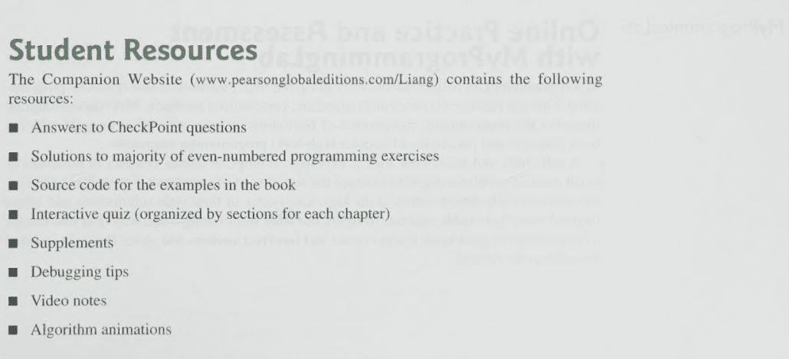

# 补充内容

本书涵盖了核心主题。补充内容扩展了正文，介绍了读者可能感兴趣的额外主题。补充内容可通过伴随网站获取。

# 教师资源

通过 `www.pearsonglobaleditions.com/Liang` 访问的伴随网站包含以下资源：

- Microsoft PowerPoint 幻灯片，带有交互式按钮，可查看全彩、语法高亮的源代码，并在不离开幻灯片的情况下运行程序。
- 大多数奇数编号编程练习的解答。
- 按章节组织的 200 多个额外编程练习和 300 个测验。这些练习和测验仅供教师使用。书中提供了这些练习和测验的解答。
- 基于 Web 的测验生成器。（教师可以选择章节，从超过两千道题的数据库中生成测验。）
- 示例考试。大多数考试包含四个部分：
  - 单选题或简答题
  - 修正编程错误
  - 跟踪程序执行
  - 编写程序
  - 带有 ABET 课程评估的示例考试。
- 项目。通常，每个项目都会提供一个描述，并要求学生对项目进行分析、设计和实现。

一些读者请求获取教师资源中心的材料。我们理解这些材料仅供教师使用。此类请求将不予回复。

## 使用 MyProgrammingLab 进行在线练习与评估

MyProgrammingLab 帮助学生充分掌握编程逻辑、语义和语法。通过练习题和即时的个性化反馈，MyProgrammingLab 提高了初级学者的编程能力，这些学生通常在流行的高级编程语言的基本概念和范式上感到困扰。

作为一种自学和作业工具，MyProgrammingLab 课程由围绕本教材结构组织的数百个小项目组成。对于学生来说，系统会自动检测其提交代码中的逻辑和语法错误，并提供针对性的提示，让学生能够弄清楚哪里出了问题以及为什么。对于教师来说，成绩单可以记录正确和错误的答案，并存储学生输入的代码供评审。

MyProgrammingLab 是与 Turing's Craft（CodeLab 交互式编程练习系统的制作者）合作向本书读者提供的。如需查看完整演示、查看教师和学生的反馈，或在课程中开始使用 MyProgrammingLab，请访问 `www.myprogramminglab.com`。

## 视频笔记

我们对新版中加入的“视频笔记”功能感到兴奋。这些视频通过展示关键主题的示例并演示如何从设计到编码完整解决问题，提供了额外的帮助。视频笔记可通过 `www.pearsonglobaledititions.com/Liang` 获取。


## 算法动画

我们为算法提供了许多动画。这些是演示算法如何工作的价值教学工具。可以通过伴随网站访问算法动画。


## 致谢

感谢阿姆斯特朗州大学（Armstrong State University）让我教授我所写的，并支持我编写我所教的。教学不断改进书籍的灵感来源。感谢那些提供评论、建议、错误报告和赞誉的教师和学生。

由于本版及之前版本的卓越评审，本书得到了极大增强。评审员包括：Elizabeth Adams (詹姆斯·麦迪逊大学), Syed Ahmed (北乔治亚学院与州立大学), Omar Aldawdi (伊利诺伊理工学院), Stefan Andrei (拉马尔大学), Yang An (澳大利亚伍伦贡大学), Kevin Berry (罗切斯特理工学院), James Chegwidden (塔兰特县学院), Anpar Drury (北达科他大学), Daryl Detrick (沃伦斯希尔斯高中), Charles Bierbach (德克萨斯大学), Frank Gehner (拉法叶大学), Erica Willey (威斯康星大学帕克斯赛德分校), Summer Bresner (Center Grove 高中), Daniel Engel (纽约大学), Henry A Engle (罗切斯特理工学院), Jen Eyck (玛丽学院), Myers Foreman (拉马尔大学), Olaf Fuentes (德克萨斯大学), Ed Harvey (北罗来纳大学), Harold Grossman (中央大学), Barbara Guiller (路易斯安州立大学), Stuart Hansen (威斯康星大学麦迪逊分校), Dan Harvey (南俄勒冈州立大学), John Hofmann (加拿大里河学院), Stephen Hughes (里士满学院), Vladan (乔治亚南方州立大学), Deborah Kabura Karim (石尼布鲁克高中), Edwin Kay (劳森大学), King (德克萨斯大学达拉斯分校), Noah Kofi (加拿大拉加拉学院), Robert Dan Lipssa (阿姆斯特朗州大学), James Madison (Resselee 理科学院), Frank Malinski (达顿学院), Tim Margaret (阿克隆大学), Deide Masada (Sun 微型系统), Blaine Mayfield (俄克拉荷马州立大学), John McGrath (P.J. McGrath 咨询), How McGuire (里河谷), Shyam Mittral (德克萨斯大学奥斯汀分校), Michel Jamie (詹姆斯·麦迪逊大学), Kenrick Mock (阿拉斯加大学安克雷分校), Frank Mergul (科罗拉多大学科罗拉斯普林斯分校), Maureen Opkins (加州州立大学长滩分校), Jun Ni (爱荷华大学), Gavin Osborne (萨斯喀大学), Mark Partkowski (佛里达海岸大学), Richard Povinelli (马凯特大学), Roger Pendergast (德克萨斯大学奥斯汀分校), Mary Ann Humphrey (Anza 学院), Pat Roth (南方理工学院大学), Sam Sable (科罗拉多州立大学), David Scott (曼尼托巴大学), Ashraf Sharif (圣何塞州立大学), Daniel Spiegel (Kutztown 大学), Josiah (Kutztown 大学)。

3.14 条件运算符 125

3.15 运算符优先级与结合性 126

3.16 调试 128

# 第 4 章 数学函数、字符与字符串 141

4.1 引言 142

4.2 常用数学函数 142

4.3 字符数据类型与操作 147

4.4 字符串类型 152

4.5 案例研究 161

4.6 格式化控制输出 167

# 第 5 章 循环 181

5.1 引言 182

5.2 while 循环 182

5.3 案例研究：猜数字 185

5.4 循环设计策略 188

5.5 使用用户确认或哨兵值控制循环 190

5.6 do-while 循环 192

5.7 for 循环 195

5.8 该使用哪种循环？ 198

5.9 嵌套循环 200

5.10 最小化数值误差 202

5.11 案例研究 204

5.12 使用 break 和 continue 208

5.13 案例研究：检查回文 211

5.14 案例研究：显示质数 213

# 第 6 章 方法 227

6.1 引言 228

6.2 定义方法 228

6.3 调用方法 230

6.4 void 与有返回值的方法 233

6.5 按值传递参数 236

6.6 模块化 239

6.7 案例研究：十六进制转十进制 241

6.8 方法重载 243

6.9 变量的作用域 246

6.10 案例研究：生成随机字符 247

6.11 方法抽象与逐步细化 249

# 第 7 章 单维数组 269

7.1 引言 270

7.2 数组基础 270

7.3 案例研究：分析数组 277

7.4 案例研究：扑克牌 278

7.5 复制数组 280

7.6 将数组传递给方法 281

7.7 从方法返回数组 284

7.8 案例研究：统计每个字母出现的次数 285

7.9 变长参数列表 288

7.10 搜索数组 289

7.11 排序数组 293

7.12 Arrays 类 294

7.13 命令行参数 296

# 第 8 章 多维数组 311

8.1 引言 312

8.2 二维数组基础 312

8.3 处理二维数组 315

8.4 将二维数组传递给方法 317

8.5 案例研究：多选题测试评分 318

8.6 案例研究：寻找最近点对 320

8.7 数独 322

8.8 多维数组 325

# 第 9 章 对象与类 345

9.1 引言 346

9.2 为对象定义类 346

9.3 示例：定义类与创建对象 348

9.4 使用构造函数构建对象 353

9.5 通过引用变量访问对象 354

9.6 使用 Java 库中的类 358

9.7 静态变量、常量与方法 361

9.8 可见性修饰符 366

9.9 数据字段封装 368

9.10 将对象传递给方法 371

9.11 对象数组 375

9.12 不变对象与类 377

9.13 变量的作用域 379

9.14 this 引用 380

# 第 10 章 面向对象思维 389

10.1 引言 390

10.2 类抽象与封装 390

10.3 以对象的方式进行思考 394

10.4 类的关系 397

10.5 案例研究：设计课程类 400

10.6 案例研究：为栈设计类 402

10.7 将基本数据类型值作为对象处理 404

10.8 基本数据类型与包装类类型之间的自动转换 407

10.9 BigInteger 和 BigDecimal 类 408

10.10 String 类 410

10.11 StringBuilder 和 StringBuffer 类 416

# 第 11 章 继承与多态 433

11.1 引言 434

11.2 父类与子类 440

11.3 使用 super 关键字 440

11.4 方法重写 443

11.5 覆盖 vs. 重载 444

11.6 Object 类与 toString() 方法 447

11.7 多态 447

11.8 动态绑定 447

11.9 对象强制转换与 instanceof 运算符 451

11.10 对象的 equals 方法 455

11.11 类 456

11.12 类的常用方法 462

11.13 案例研究：自定义栈 463

11.14 protected 数据与方法 464

11.15 防止覆盖 467

# 第 12 章 异常处理与 I/O 475

12.1 引言 476

12.2 异常处理 476

12.3 异常类型 481

12.4 更多异常处理 484

12.5 finally 子句 492

12.6 何时使用异常 493

12.7 抛出异常 494

12.8 链式类 495

12.9 定义异常类 496

12.10 File 类 499

12.11 文件输入输出 502

12.12 从网络读取数据 508

12.13 案例研究：爬虫 510

# 第 13 章 抽象类与接口 521

13.1 引言 522


### 13.2 抽象类

### 13.3 案例研究：抽象数

### 13.4 案例研究：格列日历

### 13.5 接口

### 13.6 `Comparable` 接口

### 13.7 `Cloneable` 接口

### 13.8 接口 vs. 抽象类

### 13.9 案例研究：有理数

### 13.10 类设计

# 第 14 章 JavaFX 基础

## 14.1 引言

## 14.2 JavaFX vs Swing 和 AWT

## 14.3 JavaFX 程序的基本结构

## 14.4 布局容器、组、UI 控件与形状

## 14.5 属性绑定

## 14.6 节点的常用属性

## 14.7 `Color` 类

## 14.8 `Font` 类

## 14.9 `Image` 和 `ImageView` 类

## 14.10 布局容器与组

## 14.11 形状

## 14.12 案例研究：开发井字棋

# 第 15 章 事件驱动编程与动画

## 15.1 引言

## 15.2 事件与事件源

## 15.3 注册处理器与处理事件

## 15.4 内部类

## 15.5 匿名内部类处理器

## 15.6 使用 Lambda 表达式简化事件处理

## 15.7 案例研究：贷款计算器

## 15.8 鼠标事件

## 15.9 按键事件

## 15.10 可观察对象的监听器

## 15.11 动画

## 15.12 案例研究：弹跳球

## 15.13 案例研究：美国地图

# 第 16 章 JavaFX UI 控件与多媒体

## 16.1 引言

## 16.2 `Labeled` 和 `Label`

## 16.3 `Button`

## 16.4 `CheckBox`

## 16.5 `Radio`

## 16.6 `TextField`

## 16.7 `TextArea`

## 16.8 `ComboBox`

## 16.9 `ListView`

## 16.10 `ScrollBar`

## 16.11 `Slider`

## 16.12 案例研究：开发井字棋游戏

## 16.13 视频与音频

## 16.14 案例研究：国旗与国歌

# 第 17 章 二进制 I/O

## 17.1 引言

## 17.2 Java 是如何处理 I/O 的？

## 17.3 文本 I/O vs. 二进制 I/O

## 17.4 二进制 I/O 类

## 17.5 案例研究：复制文件

## 17.6 对象 I/O

## 17.7 随机访问文件

# 第 18 章 递归

## 18.1 引言

## 18.2 案例研究：计算阶阶

## 18.3 案例研究：计算斐波那契数

## 18.4 使用递归的问题

## 18.5 递归辅助方法

## 18.6 案例研究：查找目录大小

## 18.7 案例研究：汉诺亚塔

## 18.8 案例研究：分形

## 18.9 递归 vs. 迭代

## 18.10 尾递归

| 章节 | 视频位置 |
| :--- | :--- |
| 第 1 章 | 计算机与 Java | 23 |
| 第 2 章 | 你的 Java 程序 | 34 |
| 第 3 章 | 编译并运行 Java 程序 | 39 |
| 第 4 章 | 数学函数、字符与字符串 | 45 |
| 第 5 章 | 循环 | 47 |
| 第 6 章 | 方法 | 55 |
| 第 7 章 | 单维数组 | 59 |
| 第 8 章 | 多维数组 | 74 |
| 第 9 章 | 对象与类 | 81 |
| 第 10 章 | 面向对象思维 | 94 |
| 第 11 章 | 继承与多态 | 109 |
| 第 12 章 | 异常处理与 I/O | 112 |
| 第 13 章 | 抽象类与接口 | 132 |
| 第 14 章 | JavaFX 基础 | 134 |

## 视频笔记

| 主题 | 位置 | 主题 | 位置 |
| :--- | :--- | :--- | :--- |
| 理解属性绑定 | 570 | 使用滑滑块 | 690 |
| 使用 `Image` 和 `ImageView` | 578 | 井棋 (Tic-Tac-Toe) | 693 |
| 使用布局面板 | 580 | 使用 `Media`、`MediaPlayer` 和 `MediaView` | 698 |
| 使用形状 | 589 | 使用单选按钮和文本 | 705 |
| 显示井棋盘 | 608 | 设置字体 | 707 |
| 显示柱状图 | 610 | | |
| 第 15 章 事件驱动编程与动画 | 615 | 第 17 章 二进制 I/O | 713 |
| 处理器及其注册 | 622 | 复制文件 | 726 |
| 匿名处理器 | 625 | 对象 I/O | 728 |
| 使用鼠标移动消息 | 634 | 拆分大文件 | 738 |
| 制作升旗动画 | 640 | 第 18 章 递归 | 741 |
| 闪烁计算器 | 646 | 二进制搜索 | 752 |
| 检查鼠标位置 | 658 | 目录大小 | 753 |
| 显示运行的的风扇 | 661 | 分形（谢尔宾斯基三角形） | 758 |
| 第 16 章 JavaFX UI 控制与多媒体 | 665 | 在目录中搜索字符串 | 769 |
| 使用 `ListView` | 684 | 递归树 | 772 |

## 动画

| 主题 | 位置 | 主题 | 位置 |
| :--- | :--- | :--- | :--- |
| 第 7 章 | | 第 8 章 | |
| 辅助网站上一维数组线性搜索动画 | 269 | 辅助网站上的多维数组最近对动画 | 311 |
| 辅助网站上的二进制搜索动画 | 290 | | 320 |
| 辅助网站上的选择排序动画 | 293 | | |

# 第 1 章

# 计算机、程序与 Java™ 简介

## 目标

- 理解计算机基础知识、程序和操作系统（OS）（§1.2–1.4）。
- 描述 Java 与万维网的关系（§1.5）。
- 理解 Java 语言规范、API、JDK™、JRE™ 和 IDE 的含义（§1.6）。
- 编写一个简单的 Java 程序（§1.7）。
- 在控制台上显示输出内容（§1.7）。
- 解释 Java 程序的基本语法（§1.7）。
- 创建、编译和运行 Java 程序（§1.8）。
- 使用规范的 Java 编程风格并妥当地记录程序（§1.9）。
- 解释语法错误、运行时错误和逻辑错误之间的区别（§1.10）。
- 使用 NetBeans™ 开发 Java 程序（§1.11）。
- 使用 Eclipse™ 开发 Java 程序（§1.12）。


# 24 章 I 计算机、程序与 Java™ 简介

## 1.1 引言

本书的核心主题是学习如何通过编写程序来解决问题。

本书完全关于编程的。什么是编程？编程术语意味着创建（或开发）软件，软件也被称为程序。从基本角度来说，软件包含了告诉计算机——或计算机设备——做什么的指令。

软件无处不在，出现在你可能没有想会包含它的设备中。当然，你期望在个人电脑上找到并使用软件，但软件在运行应用程序、汽车、手机和烤面包机方面也起着作用。在个人电脑上，你使用处理器编写文档，使用网络浏览器浏览互联网，使用电子邮件程序发送和接收消息。这些程序都是软件的示例。软件开发者借助名为编程语言的工具来创建软件。

本书将教你如何使用 Java 编程语言创建程序。有很多编程语言，其中一些已经有几十年的历史。每种语言的发明都是为了特定的目的——例如，为了在之前语言的基础上进行构建，或者为程序员提供一套全新的、独特的工具。市上有这么多编程语言可用，你好奇哪一种是最好的，这很自然。然而，事实上，并没有所谓的“最好”的语言。每种语言都有它们自己的优缺点。经验丰富的程序员在某些情况下精通一种语言，而在其他情况下，另一种语言可能更合适。由于这个原因，老练的程序员试图掌握许多不同的编程语言，以便他们可以使用一个海量的软件开发工具库。

如果你学会了使用一种语言进行编程，你应该发现学习其他语言并不容易。关键在于学习如何使用编程方法来解决问题。这是本书的主题。

你即将开始一段令人兴奋的旅程：学习如何编程。在开始时，回顾计算机基础知识、程序和操作系统（OS）是有帮助的。如果你已经熟悉如中央处理器（CPU）、内存、磁盘、操作系统和编程语言等术语，你可以跳过第 1.2–1.4 节。

## 1.2 什么是计算机？

计算机是一种电子设备，用于存储和处理数据。

计算机包含了硬件和软件。在通常，你期望在个人电脑上找到并使用软件，但软件在运行应用程序、汽车、手机和烤面包机方面也起着作用。在个人电脑上，你使用处理器编写文档，使用网络浏览器浏览互联网，使用电子邮件程序发送和接收消息。这些程序都是软件的示例。软件开发者借助名为编程语言的工具来创建软件。

计算机包含了硬件和软件。计算机的硬件组件包括：

- 中央处理器（CPU）
- 内存
- 磁盘
- 输出设备
- 输入设备

计算机组件通过一种称为总线的系统连接在一起。你可以把总线看作是各个组件之间传输数据的路径。

| 存储设备 | 内存 | 通信设备 | 输入设备 | 输出设备 |
| :--- | :--- | :--- | :--- | :--- |
| e.g. 磁盘、CD 和磁带 | | e.g. 调制解调器 | 鼠标 | |

**图 1.1** 计算机由 CPU、内存、存储设备、输出设备和通信设备组成。

### 1.2.1 中央处理器

中央处理器（CPU）是计算机的大脑。它从内存中提取指令并执行它们。CPU 有两个组件：控制单元和算术单元。控制单元协调其他组件的操作。算术单元执行数值运算和逻辑运算。今天的 CPU 是构建在含有数百万电子开关的小半导体芯片上的。每个计算机都有一个以恒定速率发射脉冲的单元。脉冲被用于同步操作。速度的单位是赫兹（Hz），1 Hz 每秒一次脉冲。在 90 年代，计算机以兆赫（MHz）衡量速度，但 CPU 速度一直在增加；计算机的速度通常以吉赫（GHz）衡量。英特尔最新的处理器速度约为 3 GHz。

CPU 最初只有一个核心。核心是处理器读取和执行指令的部分。为了提高 CPU 处理能力，芯片制造商现在生产包含多个核心的 CPU。多核 CPU 是具有两个或多个独立核心的单个组件。现在的消费者通常拥有三、四个核心。因此拥有几十或数百个核心的 CPU 将是可以负担起的。

### 1.2.2 位和字节

在讨论内存之前，让我们看看信息（数据和程序）是如何存储在计算机中的。

计算机实际上是一系列开关。每个开关都有两种状态：开启或关闭。在计算机中存储信息就是设置一组开启或关闭。如果开关是开启的，其值为 1；如果是关闭的，其值为 0。这些 0 和 1 在二进制数字系统中被解释，被称为位（bit）。计算机的最小单位是字节。一个字节由 8 位组成。数字如 3 可以存储在单个字节中。为了存储无法放入单个字节的数字，计算机使用多个字节。

各种数据（如数字和字符）被编码为字节的序列。作为程序员，你不需要担心数据的编码和解码，计算机会根据编码自动执行这些操作。编码方案是计算机如何将字符和数字转换为数据的规则。

# 第一章 计算机、程序与 Java™ 简介

预定义的比特流。例如，在 ASCII 编码方案中，字符 C 在 1 字节中表示为 01000011。

计算机的存储容量以字节及其倍数来衡量，如下：

- 1 千字节（KB）大约是 1,000 字节。
- 1 兆字节（MB）大约是 10 万字节。
- 1 吉字节（GB）大约是 10 亿字节。
- 1 太字节（TB）大约是 1 万字节。

一份典型的 Word 文档可能占用 20 KB。因此，1 MB 可以存储 50 页文档，1 GB 可以存储 50,000 页文档。一部典型的两小时高分辨率电影可能占用 8 GB，因此需要 160 GB 才能存储 20 部电影。

### 1.2.3 内存

计算机内存由一组有序的字节组成，用于存储作为你正在工作的数据程序。你可以将内存看作计算机执行程序的工作区域。程序及其数据在被 CPU 执行之前，必须移动到计算机内存中。

内存中的每个字节都有一个唯一的地址，如图 1.2 所示。地址用于定位存储和检索数据的字节。由于内存中的字节可以按任何顺序访问，因此内存也被称为随机存储器（RAM）。

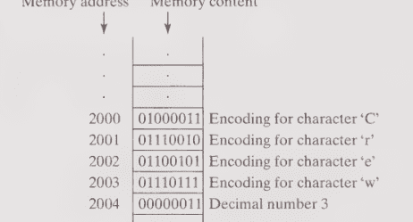

> 图 1.2 内现在无地址内存中存储数据和程序指令

今天的个人电脑通常至少有 4 GB 的 RAM，但通常安装了 6 到 8 GB。通常情况下，计算机的内存越大，运行得越快，但这个简单的经验法则是有极限的。

内存永远不会为空，但它的初始内容对你的程序可能没有意义。当新信息被放入内存时，当前的内容就会丢失。

与 CPU 类似，内存建立在硅半导体芯片上，芯片表面嵌入了数百万个晶体管。与 CPU 芯片相比，内存芯片较简单、速度较慢且价格更便宜。

### 1.2.4 存储设备

计算机内存（RAM）是一种易失性数据存储形式：存储在内存中的任何信息在系统掉电时都会丢失。程序和数据永久存储在存储设备上，当计算机活动使用它们时，会被移动到内存中，内存的运行速度远快永久存储设备。

存储设备主要有三种：

- 磁磁盘驱动器
- 光驱器（CD 和 DVD）
- 通用串接口（USB）闪存盘

驱动器是用于操作介质（如磁盘和 CD）的设备。存储驱动器物理地存储数据和程序指令。驱动器从介质中读取数据并将数据写入介质中。

### 磁盘

计算机通常至少有一个硬盘。硬盘用于永久存储数据和程序。较新的计算机拥有可以存储 500 GB 到 1 TB 数据的硬盘。硬盘通常装在计算机内部，但也有可移动式硬盘。


### CD 和 DVD

CD 代表紧光盘（compact disc）。CD 有三种类型：CD-ROM、CD-R 和 CD-RW。ROM 是压制光盘。它曾流行发行软件、音乐和视频。现在，软件、音乐和视频越来越多地通过互联网发行，而不再使用 CD。CD-R（可录制光）是一次性写入光盘。它可以记录一次数据并读取任意次数。CD-RW（可重写光）可以像硬盘一样使用；即你可以向它写入数据，然后用新数据覆盖它。单张 CD 最多可容纳 700 MB。

DVD 代表数字多功能性或数字视频光盘。DVD 和 CD 外观相似，你可以使用其中一种来存储数据。DVD 存储的信息比 CD 多；标准 DVD 存储容量为 4.7 GB。DVD 有两种类型：DVD-R（可录制）和 DVD-RW（可重写）。

### USB 闪存盘

通用串接口（USB）接口允许用户向计算机连接各种外围设备。你可以使用 USB 将打印机、数码相机、鼠标、外硬盘和其他设备连接到计算机。闪存盘用于存储和传输数据的设备。闪存盘很小——大约有一包口香糖大。它就像一个移动硬盘，可以插入你计算机的 USB 端口。目前的 USB 闪存盘存储容量高达 25 GB。

### 1.2.5 输入和输出设备

输入输出设备允许用户与计算机通信。最常见的输入设备是键盘和鼠标。最常见的输出设备是显示器和打印机。

### 键盘

键盘是用于输入的设备。有没有数字小区的紧凑型键盘。

功能键位于键盘顶部，以字母 F 开头。它们的功能取决于当前使用的软件。

修饰键是修改另一个按键动作的特殊键（如 Shift、Alt、Ctrl）。


方向键位于键盘右侧，用于向上、下、向左和向右移动光标。插入键（Insert）、删除键（Delete）、上页键（Page Up）和分页键（Page Down）用于逐屏浏览文档。

### 鼠标

鼠标是一种指向设备。它用于在屏幕上移动通常呈箭头形状的图形光标（cursor），或点击屏幕上的对象（如按钮）来触发它们。

### 显示器

显示器显示信息（文本和图形）。屏幕分辨率决定质量。

屏幕分辨率指定水平和垂直方向上的像素数量。像素（像素元素的元素）是形成图像的小点。例如，17 英寸屏幕的常见分辨率为宽 1024 像素、高 768 像素。分辨率可以手动设置。分辨率越高，图像越清晰。

点距是像素之间的距离，以毫米为单位。点距越小，显示越清晰。

### 1.2.6 通信设备

计算机可以通过通信设备建立网络，例如拨号调制器、数字用户线路（DSL）或调制器、有线网络接口或无线适配器。

#### 拨号调制器

- 拨号调制器使用电话线拨号号码连接互联网，数据传输速度高达 56,000 bps（比特每秒）。

#### 数字用户线路（DSL）

- 数字用户线路（DSL）也使用电话线，但其数据传输速度是标准拨号调制器的 20 倍。

#### 缆调制器

- 电缆调制器使用电缆公司维护的线路，速度通常比 DSL 快。

#### 网卡（NIC）

#### 局域网（LAN）

#### 百万比特每秒（mbps）

- 网卡（NIC）是连接计算机到局域网（LAN）的设备。局域网用于连接有限区域内的计算机，如学校、家庭和办公室。称为 1000BaseT 的高速网卡传输速度为每秒 1000 万比特（mbps）。
- 无线网络现在在家庭、企业和学校非常流行。今天出售的每台笔记本电脑都配备了无线适配器，使计算机能够连接互联网。

## 1.3 编程语言

1.2.3 CPU 的缩写代表什么？用什么单位来衡量 CPU 速度？

1.2.4 什么是位（bit）？什么是字节（byte）？

1.2.5 内存有什么用？RAM 的缩写代表什么？为什么内存被称为 RAM？

1.2.6 用什么单位来衡量内存大小？用什么单位来衡量磁盘大小？

1.2.7 内存和存储设备之间的主要区别是什么？

## 1.3 编程语言

计算机程序被称为软件，是告诉计算机做什么的指令。

计算机不能理解人类语言，因此程序必须用计算机可以使用的语言来编写。有成百种编程语言，它们的设计是为了让人们的编程过程变得简单。然而，所有程序都必须转换为计算机可以执行的指令。


### 1.3.1 机器语言

计算机的原生语言是机器语言，不同类型的计算机其语言也不同——它是一组内置的指令。这些指令以二进制代码的形式存在，因此如果你想用原生语言给计算机提供指令，你必须以二进制代码的形式输入该指令。例如，要两个两个数字，你可能需要编写如下所示的二进制代码指令：

```
1101101010011010
```

### 1.3.2 汇编语言

用机器语言编程是一项枯燥的过程。此外，用机器语言编写的程序非常难以阅读和修改。由于这个原因，汇编语言在计算早期作为机器语言的替代品被创建。汇编语言使用短的描述性单词（称为助记符）来表示每条机器语言指令。例如，助记符通常表示加法减法。要加数字 2 和 3 并得到结果，你可能编写如下的汇编代码指令：

```
add 2, 3, result
```

开发汇编语言是为了让编程更简单。然而，由于计算机无法执行汇编语言，因此需要另一个程序（称为汇编器）将汇编语言翻译成机器码，如图 1.3 所示。

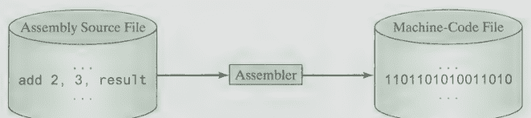

图 1.3 汇编器将汇编语言指令翻译成机器码。

用汇编语言编写代码比用机器语言简单。然而，用汇编语言编写仍然很枯燥。汇编语言中的指令本质上对应机器码中的一条指令。用汇编语言编写要求了解 CPU 是如何工作的。汇编语言被称为低级语言，因为汇编语言在本质上接近机器语言，并且依赖于机器。

一种被称为高级级语言的新一代编程语言出现了。它们是与平台无关的，这意味着你可以编写程序并在不同类型的机器上运行它。高级级语言类似于英语，易于学习和使用。高级级编程语言中的指令被称为语句。在这里，例如计算半径为 5 的圆面积的高级语言语句：

### 1.3.3 高级语言

```
area = 5 * 5 * 3.14159;
```

有很多高级级编程语言，每种语言都是为了特定的目的而设计的。表 1.1 列出了其中一些。

## 表 1.1 流行的高级编程语言

| 语言 | 描述 |
| :--- | :--- |
| Ada | 以 Ada Lovelace 命名，她曾从事机械通用计算机的工作。为国防部开发，主要用于国防项目。 |
| BASIC | 初学者全能符号指令代码。设计初是为了让初学者学习并轻松理解。 |
| C | 在贝尔实验室开发。结合了汇编语言的强大功能和高级语言的易用性和可移植性。 |
| C++ | 一种基于 C 的面向对象的语言。 |
| C# | 读作 "C Sharp"。由微软开发的面向对象的编程语言。 |
| COBOL | 常用面向业务的语言。用于业务应用程序。 |
| FORTRAN | 公式翻译。在科学和数学应用中很流行。 |
| Java | 由 Sun Microsystems 开发，现在是一种面向对象的编程语言，广泛用于开发与平台无关的应用程序。 |
| JavaScript | 由 Nestle 的 Web 编程语言 |
| Pascal | 以 Blaise Pascal 命名，他在 17 世纪开创了计算机。一种用于教学编程的简单、结构化、通用脚本语言。 |
| Python | 一种简单的通用脚本语言，适用于编写短程序 |
| Visual Basic | Visual Basic 由微软开发。使程序员能够快速开发基于 Windows 的应用程序。 |

用高级语言编写的程序称为程序。由于计算机无法执行汇编语言，因此使用另一个程序（称为解释器）将汇编语言翻译成机器码，如图 1.3 所示（注：此处原文逻辑似乎有误，通常汇编器翻译汇编语言，解释器翻译高级语言，但翻译遵循原文内容）。（注：此处原文多处存在重复描述）。

（注：由于原文最后几段存在逻辑重复或术语交叉，译文已严格按照要求翻译原文内容）

1995 年，Java 被更名为 Java，为了开发 Web 应用程序进行了重新设计。关于 Java 的历史，请访问`www.java.com/en/javahistory/index.jsp`。

Java 已经变得非常巨大。它的快速崛起和广泛应用可以归因于它的设计特性，特别是“编写一次程序并在任何处运行”的特性。正如其设计者所说，Java 是简单、面向对象、分布式、解释型、健壮、安全、架构中立、可移植、高性能、多线程和动态的。关于 Java 特性的本质，请参阅`liveexample.pearson.com/etc/JavaCharacteristics.pdf`。

Java 是一种功能齐全、通用的编程语言，可用于开发健壮的任务关键型应用程序。它不仅用于 Web 编程，还用于在服务器、桌面计算机和移动设备上开发跨平台的独立应用程序。它曾被用于开发与控制火星漫游车的通信程序。许多公司曾认为 Java 在互联网上更多是炒作而非业务。对于今天正在开发的每一个新项目，公司都在询问如何使用 Java 让他们的工作变得更轻松。

万维网（Wide Web）是一个电子信息库，可以在全球范围内任何地方通过互联网访问。作为万维网的基础，互联网已经存在了 40 多年。色彩丰富的万维网和复杂的 Web 浏览器是互联网流行的主要原因。

Java 最初变得具有吸引力是因为 Java 程序可以在浏览器中运行。某些程序被称为 applet（小程序）。由于安全问题，在最新版本的 Java 中，applet 不再允许从 Web 浏览器中运行。然而，Java 现在在开发 Web 上的应用程序方面非常流行。这些应用程序处理数据、执行计算并生成动态网页。许多商业网站的后端都是使用 Java 开发的。

Java 是一种多功能的编程语言：你可以用它为桌面计算机、服务器和小型手持设备开发应用程序。Android 手机的软件是使用 Java 开发的。

- 1.5.1 谁发明了 Java？现在哪个公司拥有 Java？
- 1.5.2 什么是 Java applet？
- 1.5.3 Android 使用什么种编程语言？


## 1.6 Java 语言规范、API、JDK、JRE 和 IDE

Java 语法定义在 Java 语言规范中，Java 库定义在 Java 应用程序接口（API）中。JDK 是用于编译和运行 Java 程序的软件。IDE 是一个用于快速开发程序的集成开发环境。

计算机语言有严格的用法规则。如果你在编写程序时不遵守这些规则，计算机将无法理解它。Java 语言规范和 Java API 定义了标准。

Java 语言语义是对 Java 编程语法和语义的技术性定义。你可以在`docs.oracle.com/javase/specs/`找到完整的 Java 语言规范。

应用程序接口（API）也称为库，它包含了开发 Java 程序的预定义类和接口。API 仍在扩展中。你可以在`download.java.net/jdk8/docs/api/`查看并下载最新版本的 Java API。


Java 语言规范

API 库

## 第 1 章 计算机、程序与 Java™ 简介

Java 是一种全面且强大的语言，可以以多种方式使用。它分为三个版本：

- Java 标准版 (Java SE) 用于开发客户端应用程序。这些应用程序可以在桌面上运行。
- Java 企业版 (Java EE) 用于开发服务器端应用程序，例如 Java servlets、JavaServer Pages (JSP) 和 JavaServer Functions (JSF)。
- Java 微型版 (Java ME) 用于为移动设备（如手机）开发应用程序。

本书使用 SE 来介绍 Java 编程。Java SE 是构建所有 Java 技术的基础。Java SE 有很多版本。书中使用了最新的 Java 8。Oracle 在发布每个版本时都会带上一个 Java 开发工具包 (JDK)。对于 Java 8，该开发工具包是 JDK 1.8（也称为 Java 8 或 JDK 8）。

JDK 由一组独立的程序组成，每个程序都从命令行调用，用于编译、运行和测试 Java 程序。运行 Java 程序的程序是 JRE（Java 运行时环境）。与其使用 JDK，你可以使用 Java 开发工具（IDE），如 NetBeans、Eclipse 和 Notepad——这些软件提供了一个集成开发环境（IDE），用于快速开发 Java 程序。编辑、编译、构建和在线帮助都集成在图形用户界面中。你只需要在一个窗口中输入源代码，或者在窗口中打开一个现有文件，然后点击按钮菜单项或按功能键来编译并运行程序。


- 1.6.1 什么是 Java 语言规范？
- 1.6.2 JDK 代表什么？JRE 代表什么？
- 1.6.3 IDE 代表什么？
- 1.6.4 像 NetBeans 和 Eclipse 这样的工具与 Java 是不同的语言，还是 Java 的方言或扩展？

## 1.7 一个简单的 Java 程序

Java 程序是从类中的`main`方法执行的。

让我们从一个简单的 Java 程序开始。这个简单的 Java 程序会在控制台中显示 Welcome to Java!（这个程序从`main`方法执行。）

### 列表 1.1 Welcome.java

```java
public class Welcome {
    public static void main(String[] args) {
        System.out.println("Welcome to Java!");
    }
}
```

 注意，行号仅供参考，它们不是程序的一部分。

# 36 第 1 章 计算机、程序与 Java™ 简介

## 表 1.2 特殊字符

| 字符 | way | 描述 |
| --- | --- | --- |
| `{}` | 左、右大括号 | 表示包含语句的块。 |
| `()` | 左、右括号 | 用于方法。 |
| `[]` | 左、右方括号 | 表示数组。 |
| `//` | 双斜杠 | 位于注释行之前。 |
| `""` | 左、右双引号 | 括起字符串（即字符序列）。 |
| `;` | 分号 | 标记语句的结束。 |

...语法规则。如果你的程序违反了规则——例如，如果缺少分号、缺少大括号、缺少双引号或单词拼写错误——编译器将报告语法错误。尝试编译这个带有错误的程序，并看看编译器报告了什么。

> 提示：你可能可能在想，为什么`main`方法要这样定义，以及为什么使用`System.out.println(...)`在控制台上显示消息。目前，只需接受这种操作方式即可。你的问题将在随后的章节中得到解答。

列表 1.1 中的程序显示了一条消息。一旦你理解了该程序，就可以扩展它来显示更多消息。你可以编写程序显示三条消息，如列表 1.2 所示。

# 列表 1.2 WelcomeWithThreeMessages.java

```java
1 public class WelcomeWithThreeMessages {
2 public static void main(String[] args) {
3 System.out.println("Programming is fun!");
4 System.out.println("Fundamentals First!");
5 System.out.println("Problem Driven");
6 }
7 }
```

此外，你还可以进行数学计算并将结果显示在控制台上。

列表 1.3 给出了计算`10.5 + 2 * 3 / 45 - 3.5`的示例。

# 列表 1.3 ComputeExpression.java

```java
1 public class ComputeExpression {
2 public static void main(String[] args) {
3 System.out.print("(10.5 + 2 * 3) / (45 - 3.5) = ");
4 System.out.println((10.5 + 2 * 3) / (45 - 3.5));
5 }
6 }
```

`(10.5 + 2 * 3) / (45 - 3.5) = 0.39759036144578314`

第 3 行中的`print`方法`System.out.print("(10.5 + 2 * 3) / (45 - 3.5) = ");`

与`println`方法相同，区别在于`println`在打印字符串后会移动到下一行的开头，而`print`在完成后不会移动到下一行。

Java 中的乘法运算符是`*`。如你所示，将算术表达式翻译为 Java 表达式是一个直接的过程。我们将在第 2 章中进一步讨论 Java 表达式。

- 1.7.1 什么是关键字？列出一些 Java 关键字。
- 1.7.2 区分大小写吗？Java 关键字的大小写要求如何？
- 1.7.3 什么是注释？编译器会忽略注释吗？如何标记注释行？在控制台上绘制形状的语句是什么？
- 1.7.4 显示以下代码的输出：

```java
public class Test {
    public static void main(String[] args) {
        System.out.println("3.5 * 4 / 2 - 2.5 is " + ();
        System.out.println(3.5 * 4 / 2 - 2.5);
    }
}
```

## 1.8 创建、编译和执行 Java 程序

你保存 Java 程序并将其编译为可执行文件。

你将 Java 程序保存为`.java`文件并将其编译为`.class`文件。`.class`文件由 Java 虚拟机（JVM）执行。

你可以使用任何文本编辑器来创建 Java 源码。1.1 和 1.2 部分将介绍使用 NetBeans 和 Eclipse 开发 Java 程序。从命令行，你可以使用记事本等编辑器创建 Java 源码文件，如图 7 所示。

> 提示：文件名必须以`.java`结尾，且与类名相同。例如，列表 1.1 中的文件应命名为`Welcome.java`。

在编译和运行程序之前，必须安装并配置 JDK。请参见补充 1.B 安装和配置 JDK，以了解如何安装 JDK 并设置环境。如果你在编译和运行方面遇到问题，请参见补充 1.C 编译和运行。

# 第 1 章 计算机、程序与 Java™ 简介

## 第一章 计算机、程序与 Java™ 简介

在执行程序时，JVM 会使用一个名为类加载器的程序将类的字节码加载到内存中。如果你的程序使用了其他类，类加载器会在恰需要它们之前动态地加载。类被加载后，JVM 会使用一个名为字节码验证器的程序来检查字节码的有效性，并确保字节码没有违反 Java 的安全限制。Java 实施严格的安全机制，以确保 Java 类不被篡改且不会损坏你的计算机。

你的老师可能要求你使用包来组织程序。例如，你可以将本章中的所有包放在一个名为`chapter1`的包中。关于如何使用包的说明，请参见 I.F 使用包组织文中的类。

- **1.8.1** Java 源文件的扩展名是什么？Java 字节码的扩展名是什么？
- **1.8.2** Java 编译器的输入和输出是什么？
- **1.8.3** 编译 Java 程序的命令是什么？
- **1.8.4** 运行 Java 程序的命令是什么？
- **1.8.5** 什么是 JVM？
- **1.8.6** Java 可以在任何机器上运行吗？在计算机上运行 Java 需要什么？
- **1.8.7** 如果在运行程序时发生`NoClassFoundError`，错误的原因是什么？
- **1.8.8** 如果在运行程序时发生`NoSuchMethodError`，错误的原因是什么？

良好的编程风格和适当的文档可以使程序易于阅读，并帮助程序员防止错误。

编程风格涉及程序的“喜好”。如果一个程序只写在一行，它可以正常编译和运行，但将所有内容写在一行是糟糕的编程行为，因为它难以阅读。文档是与程序相关的说明性备注和注释。编程风格和文档与编码一样重要。良好的编程风格和适当的文档可以减少错误概率并使程序易于阅读。本节提供了几条指南。更多详细信息，请参阅辅助网站上的补充 I.D Java 编码风格指南。

在程序开头包含一个总结，解释程序的功能、关键点以及它使用的任何独特技术。在长程序中，还应该包含注释来介绍每个主要步骤并解释难以阅读的部分。保持注释简洁非常重要，这样它们就不会拥挤程序或导致阅读困难。

除了行注释（以`//`开头）和块注释（以`/*`开头），Java 还支持一种特殊类型的注释，称为 javadoc 注释。javadoc 注释以`/**`开始并以`*/`结束。可以使用 JDK 的`javadoc`命令将它们提取为 HTML 文件。更多信息，请参阅辅助网站上的补充 III.J javadoc 注释。

## I.9 编程风格与文档

使用注释`/* ... */`对整个类或整个方法进行注释。这些注释必须呈现类或方法的头部，以便被提取到 javadoc HTML 文件中。对于方法内部步骤的注释，请使用行注释（`//`）。要查看 javadoc HTML 文件的示例，请检查`liveexample.pearsoncm.com/javadoc/Exercise1.html`。相应的 Java 代码显示`liveexample.pearsoncm.com/javdoc/Exercise1.txt`中。

### I.9.2 正确的缩进和间距

一致的缩进风格使程序清晰且易于阅读、调试和维护。缩进用于说明程序组件或语句之间的结构化关系。即使所有语句都写在一个长行上，Java 也可以读取程序，但对于对齐良好的代码，读写和维护会更容易。每个组件或语句至少比其嵌套的结构多两个空格。

在二元运算符的两侧都应该添加一个空格，如 (a) 所示，而不是 (b)。

```
System.out.println(3 + 4);
(a) 良好的风格
```


```java
System.out.println(3 + 4);
```

（b）糟糕的风格

### I.9.3 块样式

一个块是用花括号包围的一组语句。有两种流行的样式：换行样式和行尾样式，如下所示。

```java
public class Test {
    public static void main(String[] args) {
        System.out.println("Block Styles");
    }
}
```

换行样式

```java
public class Test {
    public static void main(String[] args) {
        System.out.println("Block Styles");
    }
}
```

行尾样式

换行样式垂直对齐并使程序易于阅读，而行尾样式节省了空间并可能有助于避免某些细微的编程错误。两种都是接受的块样式。选择取决于个人或组织的偏好。你应该一致地使用一种块样式——不建议混合使用。本书使用行尾样式以与 Java API 源代码保持一致。

### I.9.1 根据编程风格和文档指南重新格式化以下程序

使用行尾花括号样式。

```java
public class Test {
    // Main method
    public static void main(String[] args) {
        /* Display output */
        System.out.println("Welcome to Java");
    }
}
```


## 42 第一章 计算机、程序与 Java™ 简介


## 1.10 错误

编程错误分为三类：语法错误、运行时错误和逻辑错误。

### 1.10.1 语法错误

由编译器检测到的错误称为语法错误。它们源于构造错误，例如拼错关键字或省略标点符号。这些错误很容易发现，因为编译器会告诉你在哪里以及为什么。例如，列表 1.4 中的程序就有语法错误。

#### LISTING 1.4 SyntaxErrors

```java
1 public class Test {
2 public void main(String[] args) {
3 System.out.println("Welcome to Java");
4 }
5 }
```


> **提示**
>
> 如果不知道如何修正错误，请逐字符对比你的程序与示例。在课程的前几周里，你将花费大量时间修复语法。

### 1.10.2 运行时错误

运行时错误是导致程序异常终止的错误。它们在程序运行时发生，如果环境检测到无法执行的操作。输入错误会导致运行时错误。当程序期望读取值但用户输入了程序无法处理的值时，就会发生输入错误。

运行时错误的另一个例子是除以零。这发生在除数为 0 时。例如，列表 1.5 中的程序会导致运行时错误。

#### LISTING 1.5 RuntimeErrors

```java
public class RuntimeErrors {
    public static void main(String[] args) {
        System.out.println(1 / 0);
    }
}
```


图 1.11 运行时错误导致程序异常终止。

### 1.10.3 逻辑错误

当程序没有按照预期的方式执行时，就会发生逻辑错误。这类错误由于许多原因引起。例如，假设你编写了列表 1.6 中的程序将摄氏 35 度转换为华氏度：

#### LISTING 1.6 LogicErrors

```java
public class LogicErrors {
    public static void main(String[] args) {
        System.out.print("Celsius 35 is Fahrenheit degree " + 35 * 32);
        System.out.println((9 / 5) * 35);
    }
}
```

摄氏 35 是华氏度 67

你得到的是华氏度 67 度，这是错误的。这是因为在 Java 中，整数除法的结果是商——所以在 Java 中 `9 / 5` 等于 1。要获得正确的结果，你需要使用 `9.0 / 5`，结果为 1.8。

## 1.10.4 常见错误

缺少大括号、缺少分号、字符串缺少引号以及名称拼写错误是初级程序员常见的错误。

### 常见错误 1：缺少大括号

大括号用于表示程序中的代码块。每个左大括号必须与一个右大括号匹配。一种常见的错误是缺少大括号。为了避免这种错误，每当输入一个左大括号时，都要输入对应的符号，如下例所示：

```java
public class Welcome {
}}
```

立即输入这个右大括号以匹配左大括号。

如果你使用如 NetBeans 和 Eclipse 等 IDE，IDE 会在你输入的每个左大括号后自动插入右大括号。

### 常见错误 2：缺少分号

每条语句都以语句终止符（`;`）结束。通常，新程序员会忘记在代码块的最后一条语句后放置终止符，如下例所示：

```java
public static void main(String[] args) {
    System.out.println("Programming is fun!");
    System.out.println("Fundamentals First");
    System.out.println("Problem Driven");
}
```

缺少分号

### 常见错误 3：缺少引号

字符串必须放在引号内。通常，新程序员会忘记在字符串末尾加上引号，如下例所示：

```java
System.out.println("Problem Driven")
```

缺少引号

如果你使用如 NetBeans 和 Eclipse 等 IDE，IDE 会在你输入的每个左引号后自动插入右引号。

### 常见错误 4：名称拼写错误

Java 是区分大小写的。名称拼写错误是新程序员的常见错误。例如，在以下代码中，单词 `main` 被拼写成了 `Main`，而 `String` 被拼写成了 `string`：

```java
1 public class Test {
2 public static void main(String[] args) {
    System.out.println((10.5 + 2 * 3) / (45 - 3.5));
3 }
4 }
```

- 1.10.1 什么是语法错误（编译错误）、运行时错误和逻辑错误？
- 1.10.2 请举例语法错误、运行时错误和逻辑错误的例子。
- 1.10.3 如果你忘记在字符串上加上右引号，会产生哪种错误？
- 1.10.4 如果你的程序需要读取整数和用户输入的字符串，运行此程序时会发生。这是哪种错误？

## 1.11 使用 NetBeans 开发 Java 程序

- 1.10.5 假设你写了一个计算矩形周长的程序，但你错误地将程序写成了计算矩形面积的。这是哪种错误？
- 1.10.6 识别并修复以下代码中的错误：

```java
public class Welcome {
    public void Main(String[] args) {
        System.out.println("Welcome to Java!");
    }
}
```

> **注意**
>
> 第 1.8 节介绍了如何从命令行开发程序。我们的许多读者也使用 IDE。接下来的章节将介绍两个流行的 Java IDE：NetBeans 和 Eclipse。这两个章节可以跳过。

你可以使用 NetBeans 编辑、编译、运行和调试 Java 程序。NetBeans 和 Eclipse 是开发程序的两个流行的集成开发环境。如果你遵循一些说明，它们很容易学习。我们建议你使用其中之一来开发程序。本节提供了基本说明，引导新用户在 NetBeans 中创建项目、类、编译和运行类。Eclipse 的使用将在下一节中介绍。关于下载和安装最新版本 NetBeans 的说明，请参见附录 B。

### 1.11.1 创建 Java 项目

在创建 Java 程序之前，你需要首先创建一个项目。项目就像一个文件夹，用于存放 Java 程序和所有支持文件。你只需要创建一个项目即可。以下是创建 Java 项目的步骤：

1. 选择 `File` -> `New Project` 以显示新项目对话框，如图 1.12 所示。
2. 在 `Categories` 中选择 `Java`，在 `Projects` 部分选择 `Application`，然后点击 `Next` 显示应用程序对话框，如图 1.13 所示。
3. 在 `Project Name` 字段输入 `demo`，在 `Location` 字段输入 `c:\`。取消勾选 `Use Dedicated Folder for Libraries` 和 `Create Main`。
4. 点击 `Finish` 创建项目，如图 1.14 所示。


图 1.12 新项目对话框用于创建新项目并指定项目类型。来源：Copyright © 1995–2016 及其关联公司。保留所有权利。经许可使用。


图 1.13 应用程序对话框用于指定名称和位置。来源：Copyright © 1995–2016 及其关联公司。保留所有权利。经许可使用。


图 1.14 创建了 `demo` 项目。来源：Copyright © 1995–2016 及其关联公司。保留所有权利。经许可使用。

### 1.11.2 创建 Java 类

在创建项目后，你可以按照以下步骤在项目中创建类：

1. 右键点击 `demo` 节点选择 `New` -> `Java Class`。
2. 在 `Class Name` 字段输入 `Welcome`，选择 `default` 软件包。
3. 点击 `Finish` 创建 `Welcome` 类。
4. 修改代码，如图 1.15。

### 1.11.3 编译和运行类

要运行 `Welcome.java`，右键点击 `Welcome.java` 选择 `Run File`，或者简单按下 `Shift + F6`。输出显示在 `Output` 窗口中，如图 1.16 所示。如果程序已更改，会自动编译。

## 1.12 使用 Eclipse 开发 Java 程序


图 1.15 Java 类对话框用于创建新类。来源：Copyright © 1995–2016 及其关联公司。保留所有权利。经许可使用。


图 1.16 你可以在 NetBeans 中编辑并运行。来源：Copyright © 1995–2016 及其关联公司。

你可以使用 Eclipse 编译、运行和调试 Java 程序。前面的章节介绍了使用 NetBeans 开发程序。本节提供了基本说明，引导新用户使用 Eclipse 创建项目、类并编译/运行类。关于下载和安装最新版本 Eclipse 的说明，请参见附录 II.D。

### 1.12.1 创建 Java 项目

在 Eclipse 中创建 Java 程序之前，你需要首先创建一个项目来存放所有文件。以下是在 Eclipse 中创建 Java 程序的步骤：

1. 选择 `File` -> `New` -> `Java Project` 显示项目向向，如图 1.17 所示。
2. 在 `Project name` 字段输入 `demo`。随着输入，`Location` 字段会自动设置默认值。你可以自定义项目的位置。
3. 确保选择了 `Use project folder as root for sources and class files`，这样 `.java` 文件和 `.class` 文件就在同一个文件夹中，方便访问。
4. 点击 `Finish` 创建项目，如图 1.18 所示。


图 1.17 Java 项目对话框用于指定项目名称和属性。来源：Eclipse Foundation, Inc.


图 1.18 创建了名为 `demo` 的新 Java 项目。来源：Eclipse Foundation, Inc.

### 1.12.2 创建一个 Java 类

创建项目后，你可以按照以下步骤在项目中创建 Java 程序：

1. 选择 `File`（文件）、`New`（新建）、`Class`（类）以显示新建 Java 类向导。
2. 在 `Name`（名称）字段中输入名称。
3. 勾选 `public static void main(String[]) args` 选项。
4. 点击 `Finish`（完成）生成源代码 `Welcome.java` 的模板，如图 1.19 所示。

### 1.12.3 编译和运行类

要运行程序，在项目上右键点击类以显示上下文菜单，在上下文菜单中选择 `Run`（运行）、`Java Application`（Java 程序）来运行该类。输出显示在 `Console`（控制台）面板中，如图 1.20 所示。如果程序已更改，`Run` 命令会自动编译程序。


> 图 1.19 新建 Java 类对话框用于创建新的 Java 类。源自：Eclipse Foundation, Inc.

# 第 1 章 计算机、程序与 Java™ 简介


图 1.20 你可以在 Eclipse 中编辑并运行程序。源自：Eclipse Foundation, Inc.

## 关键术语

- 应用程序接口（API）33
- 汇编器（assembler）29
- 汇编语言（assembly language）29
- 位（bit）25
- 块（block）35
- 块注释（block comment）35
- 总线（bus）24
- 字节（byte）25
- 字节码（bytecode）28
- 字节码验证器（bytecode verifier）40
- 电缆调制解调调调器（cable modem）28
- 中央处理单元（CPU）25
- 类加载器（class loader）40
- 注释（comment）35
- 编译器（compiler）30
- 控制台（console）34
- 点间距（dot pitch）28
- DSL（数字用户用户线路）28
- 编码方案（encoding scheme）25
- 硬件（hardware）24
- 高级语言（high-level language）30
- 集成开发环境（IDE）34
- 解释器（interpreter）30
- `java` 命令 39
- Java 开发包（JDK）34
- Java 语言规范（Java language specification）33
- Java 运行环境（JRE）34
- Java 虚拟机（JVM）38
- `java` 命令 39
- 关键字（或保留字）（key word or reserved word）35
- 库（library）33
- 单行注释（line comment）35
- 逻辑错误（logic error）43
- 低级语言（low-level language）30
- 机器语言（machine language）29
- 主方法（main method）35
- 内存（memory）26
- 拨号调制解调器（dial-up modem）28
- 主板（motherboard）25
- 网络接口卡（NIC）28
- 操作系统（OS）31
- `p` 28
- 程序（program）24
- 编程（programming）24
- 屏幕分辨率（screen resolution）28
- 软件（software）24
- 源代码（source code）30
- 源程序（source program）30
- 语句（statement）30
- 语句终止符（statement terminator）35
- 存储设备（storage devices）26
- 语法错误（syntax error）42

> **注意**
>
> 上述术语在本章中定义。补充录 I.A 术语表列出了书中所有的术语和描述，并按章节组织。

补充录 I.A

## 章总结

1. 计算机是一种存储和处理数据的电子设备。
2. 计算机包含硬件和软件。
3. 硬件是计算机中可以触摸的物理部分。
4. 计算机程序称为软件，是控制硬件并使其执行任务的不可指令。
5. 计算机编程是为计算机执行编写指令（即代码）。
6. 中央处理单元（CPU）是计算机的大脑。它从内存中提取指令并执行它们。


- 7. 计算机使用 `0` 和 `1`，是因为数字设备有两个稳定状态，按照惯例称为 `0` 和 `1`。
- 8. 一位（bit）是一个二进制数字 `0` 或 `1`。
- 9. 字节（byte）是 `8` 位的序列。
- 10. 一个千字节大约是 `1000` 字节，一个兆字节约为 `100` 万字节，一个吉字节约为 `10` 亿字节，一个太字节大约是 `1000` 吉字节。
- 11. 内存存储供 `CPU` 执行的数据和程序指令。
- 12. 内存单元是字节的有序序列。
- 13. 内存是易失的，因为断电时信息会丢失。
- 14. 程序和数据永久存储在存储设备上，当计算机实际使用它们时移动到内存中。
- 15. 机器语言是内置在每台计算机中的原始指令集。
- 16. 汇编语言是一种低级编程语言，使用助记符来表示每条机器语言指令。
- 17. 高级语言类似于英语，易于学习和编程。
- 18. 用高级语言编写的程序称为源程序。
- 19. 编译器是将源程序翻译成机器语言程序的软件程序。
- 20. 操作系统（`OS`）是管理和控制计算机活动的程序。
- 21. `Java` 是平台无关的，这意味着你可以编写一次程序并在任何计算机上运行它。
- 22. `Java` 源文件名必须与程序中的类名匹配。`Java` 源代码文件必须以 `.class` 结尾。
- 23. 每个类都被编译成一个独立的字节码文件，其文件名与类名相同并以 `.class` 扩展名结尾。
- 24. 要从命令行编译 `Java` 源代码文件，请使用 `javac` 命令。
- 25. 要从命令行运行 `Java` 类，请使用 `java` 命令。
- 26. 内存单元是字节的有序序列。
- 27. 块以 `{` 开始，以 `}` 结束。
- 28. `main` 方法是 `Java` 程序的入口点。
- 29. `Java` 语句以分号（`;`）结束。
- 30. 保留字具有特定的含义。
- 31. 在 `Java` 中，行注释以两个斜杠（`//`）开头，而块注释位于 `/*` 和 `*/` 之间。
- 32. `Java` 是区分大小写的。
- 33. 错误分为三类：语法错误、运行时错误和逻辑错误。
- 34. 语法错误是由编译器报告的。

## 练习

> 注意：上述术语在本章中定义。补充录 I.A 术语表列出了书中所有的术语和描述，并按章节组织。

补充录 I.A

## 练习

> 注意：上述术语在本章中定义。补充录 I.A 术语表列出了书中所有的术语和描述，并按章节组织。

补充录 I.A

*1.13（代数：求解 `2 × 2` 线性方程组）* 你可以使用克莱姆法则求解以下 `2 × 2` 方程组，前提是 `ad - bc` 不为 `0`：

```
ax + by = e    x = (ed - bf) / (ad - bc)    y = (af - ec) / (ad - bc)
cx + dy = f    x = (bf - ed) / (ad - bc)    y = (af - be) / (ad - bc)
```

编写一个程序求解以下方程并显示 `x` 和 `y` 的值：（提示：将符号替换为数字以计算 `x` 和 `y`。此练习可以在第 1 章完成，无需使用后续章节的材料。）

```
3.4x + 50.2y = 44.5
2.1x + .55y = 5.9
```

> **注意**：教师资源网站为讲师提供了额外的 200 多道带答案的编程练习。

# 第 2 章

## 基础编程

## 目标

- 编写 `Java` 程序进行简单计算（§2.2）。
- 使用 `Scanner` 类从控制台输入数据（§2.3）。
- 使用标识符为变量、常量、方法和类命名（§2.4）。
- 使用变量存储数据（§2.5 和 2.6）。
- 使用赋值语句和赋值表达式进行编程（§2.6）。
- 使用常量存储持久性数据（§2.7）。
- 遵循命名规范为类、方法、变量和常量命名（§2.8）。
- 探索 `Java` 原始数据类型：`byte`、`short`、`int`、`long`、`float` 和 `double`（§2.9）。
- 从键盘读取 `byte`、`short`、`int`、`float` 或 `double` 值（§9.2）。
- 使用运算符 `+`、`-`、`*`、`/` 和 `%` 执行操作（§2.3）。
- 使用 `Math.pow(a, b)` 执行幂运算（§2.4）。
- 编写整数字面量、浮点数字面量和科学计数法字面量（§2.10）。
- 编写并求值数值表达式（§2.11）。
- 使用 `System.currentTimeMillis()` 获取当前系统时间（§2.12）。
- 使用复合赋值运算符（§2.13）。
- 区分后自增与前自增，以及后自减与前自减（§2.14）。
- 将一种类型的值强制转换为另一种类型（§2.15）。
- 描述软件开发过程并将其应用于贷款还款程序的开发（§2.16）。
- 编写一个将大金额转换为小单位的程序（§2.17）。
- 避免基础编程中的常见错误和陷阱（§2.18）。


## 2.1 引言

本章的重点是学习解决问题的基础编程技术。

> **要点**

在第 1 章中，你学习了如何创建、编译和运行非常基础的 `Java` 程序。你将学习如何通过编写程序来解决问题。通过这些问题，你将学习使用原始数据类型、变量、常量、表达式以及输入和输出进行基础编程。

假设，你需要申请一笔学生贷款。给定贷款金额、期限和年利率，你可以编写一个程序来计算每月还款额和总还款额？本章将展示如何编写此类程序。在此过程中，你将学习分析程序、设计解决方案以及通过创建程序来实现解决方案的基本步骤。

## 2.2 编写简单程序

编写程序涉及设计一种解决问题的策略，然后使用编程语言来实现该策略。

让我们首先考虑计算圆面积的简单问题。我们如何编写一个程序来解决这个问题？

编写程序涉及设计算法并将其转换为编程指令（或代码）。算法列出了解决问题可以遵循的步骤。算法可以帮助你在用编程语言编写程序之前进行规划。算法可以用自然语言或伪代码（混合了某些编程代码的自然语言）描述。计算圆面积的算法可以描述如下：

1. 读取圆的半径。
2. 使用以下公式计算面积：

   `area = radius × radius × π`

3. 显示结果。

> **提示**：在开始编码之前，以算法的形式概述你的程序（或其底层问题）始终是一个良好的做法。

当你编写代码时——即当你编写程序时——你将算法转换为程序。你已经知道每个 `Java` 程序都从一个类定义开始，其中 `class` 关键字后面紧跟着类名。假设你选择了 `ComputeArea` 作为类名。程序的大纲如下：

```java
public class ComputeArea {
  // 稍后提供细节
}
```

如你所知，每个 `Java` 程序都必须有一个程序开始的 `main` 方法。程序随后扩展如下：

```java
public class ComputeArea {
  public static void main(String[] args) {
    // 步骤 1: 读取半径
    // 步骤 2: 计算面积
  }
}
```

## 2.2 编写程序

程序需要从键盘读取半径。这涉及到两个问题：

- 读取半径
- 计算面积

让我们先处理第一个问题。为了在内存中存储值，程序需要一个符号变量。与其使用 `x` 和 `y` 作为名称，不如选择具有描述性的名称：`radius` 和 `area`。为了告诉编译器它们是什么数据，请指定它们的类型。`Java` 提供了整数、实数或布尔的数据类型。这些被称为原始类型。实数（即带有小数点的数字）被称为浮点数。第二步是通过赋值 `radius * 3.14159` 计算面积。在最后一步，程序将使用 `System.out.println` 显示结果。列表 2.1 显示了完整的程序：

## 列表 2.1 `ComputeArea.java`

```java
public class ComputeArea {
    public static void main(String[] args) {
        double radius;
        double area;

        // 步骤 1: 读取半径
        radius = 20;
        // 步骤 2: 计算面积
        area = radius * 3.14159;
        // 步骤 3: 显示结果
        System.out.println("The area of the circle of radius " + radius + " is " + area);
    }
}
```

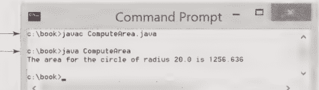

图 2.1 程序显示了圆的面积。

### 2.2.1 识别并修复以下代码中的错误

```java
public class Test {
  public static void main(String[] args) {
    double i = 50.0;
    double k = i + 50.0;
    double j = k + 1;

    System.out.println("j is " + j + " and
    k is " + k + ")");
  }
}
```


## 2.3 从控制台读取输入

从控制台读取输入允许程序接受用户的输入。

在列表 2.1 中，半径在源代码中是固定的。如果你想使用不同的半径，必须修改源代码并重新编译。显然，这是不方便的，因此你可以使用 `Scanner` 类进行控制台输入。

`Java` 使用 `System.out` 指向标准输出设备，使用 `System.in` 指向标准输入设备。默认情况下，输出设备是显示器，输入设备是键盘。要执行控制台输入，你只需使用 `println` 方法向控制台显示原始类型值或字符串。要执行控制台输入，你需要创建一个 `Scanner` 对象来从 `System.in` 读取输入，如下：

```java
Scanner input = new Scanner(System.in);
```

语法 `new Scanner(System.in)` 创建了一个 `Scanner` 类型的对象。语法 `Scanner input` 声明 `input` 是一个 `Scanner` 类型的变量。整行代码 `Scanner input = new Scanner(System.in)` 创建了一个 `Scanner` 对象并将引用赋值给变量 `input`。对象可以调用它的方法。在对象上调用方法是使用点运算符（`.`）。你可以使用 `nextDouble()` 方法读取一个 `double` 类型的值，如下：

```java
double radius = input.nextDouble();
```

该语句从键盘读取数字并赋值给 `radius`。

列表 2.1 提示用户输入半径。

## 列表 2.2 `ComputeAreaWithConsoleInput.java`

```java
import java.util.Scanner; // Scanner 位于 java.util 包中

public class ComputeAreaWithConsoleInput {
  public static void main(String[] args) {
    // 创建一个 Scanner 对象
    Scanner input = new Scanner(System.in);

    // 提示用户输入半径
    System.out.print("Enter a number for radius: ");
    double radius = input.nextDouble();

    // 计算面积
    double area = radius * radius * 3.14159;

    // 显示结果
    System.out.println("The area for the circle of radius " +
      radius + " is " + area + ")");
  }
}
```


60 第 2 章 基础编程

```text
Enter a number for radius: 2.5 --Enter
The area for the circle of radius 2.5 is 19.6349375
```


```text
Enter a number for radius: 23 --Enter
The area for the circle of radius 23.0 is 1661.901111
```

`Scanner` 类位于 `java.util` 包中。它在第 1 行被导入。第 6 行创建了一个 `Scanner` 对象。注意，如果你在第 6 行将 `Scanner` 替换为 `java.util.Scanner`，则可以省略 `import` 语句。

第 9 行向控制台显示字符串 `"Enter a number for radius: "`。这被称为提示（prompt），用于引导用户输入。当程序期望从键盘输入时，程序应该始终告诉用户需要输入什么。

回想第 9 行的 `print` 方法与 `println` 方法相同，区别在于 `println` 在显示字符串后会到下一行的开头，但在完成后不会移动到下一行。

第 6 行创建了一个 `Scanner` 对象。第 10 行的语句从键盘读取输入：

```java
double radius = input.nextDouble();
```

在用户输入数字并按下 `Enter` 键后，程序读取结果并将其赋值给 `radius`。

关于对象的更多细节将在第 9 章介绍。目前，只需接受这就是我们从控制台获取输入的方式即可。

`Scanner` 类位于 `java.util` 包中。它在第 1 行被导入。导入有两种类型：特定导入（specific import）和通配符导入（wildcard import）。特定导入在 `import` 语句中指定单一的类。例如，以下语句从 `java.util` 包导入了 `Scanner`。

```java
import java.util.Scanner;
```

通配符导入使用星号 `*` 作为通配符导入包中的所有类。例如，以下语句导入了 `java.util` 包中的所有类。

```java
import java.util.*;
```


除非类在程序中使用，否则导入包中的类信息在编译时或运行时不会被读取。除非类在程序中使用，否则导入包中的类信息在编译时或运行时不会被读取。除非类在程序中使用，否则导入包中的类信息在编译时或运行时不会被读取。除非类在程序中使用，否则导入包中的类信息在编译时或运行时不会被读取。除非类在程序中使用，否则导入包中的类信息在编译时或运行时不会被读取。除非类在程序中使用，否则导入包中的类信息在编译时或运行时不会被读取。除非类在程序中使用，否则导入包中的类信息在编译时或运行时不会被读取。除非类在程序中使用，否则导入包中的类信息在编译时或运行时不会被读取。除非类在程序中使用，否则导入包中的类信息在编译时或运行时不会被读取。除非类在程序中使用，否则导入包中的类信息在编译时或运行时不会被读取。除非类在程序中使用，否则导入包中的类信息在编译时或运行时不会被读取。除非类在程序中使用，否则导入包中的类信息在编译时或运行时不会被读取。除非类在程序中使用，否则导入包中的类信息在编译时或运行时不会被读取。除非类在程序中使用，否则导入包中的类信息在编译时或运行时不会被读取。除非类在程序中使用，否则导入包中的类信息在编译时或运行时不会被读取。除非类在程序中使用，否则导入包中的类信息在编译时或运行时不会被读取。除非类在程序中使用，否则导入包中的类信息在编译时或运行时不会被读取。除非类在程序中使用，否则导入包中的类信息在编译时或运行时不会被读取。除非类在程序中使用，否则导入包中的类信息在编译时或运行时不会被读取。除非类在程序中使用，否则导入包中的类信息在编译时或运行时不会被读取。除非类在程序中使用，否则导入包中的类信息在编译时或运行时不会被读取。除非类在程序中使用，否则导入包中的类信息在编译时或运行时不会被读取。除非类在程序中使用，否则导入包中的类信息在编译时或运行时不会被读取。除非类在程序中使用，否则导入包中的类信息在编译时或运行时不会被读取。除非类在程序中使用，否则导入包中的类信息在编译时或运行时不会被读取。除非类在程序中使用，否则导入包中的类信息在编译时或运行时不会被读取。除非类在程序中使用，否则导入包中的类信息在编译时或运行时不会被读取。除非类在程序中使用，否则导入包中的类信息在编译时或运行时不会被读取。除非类在程序中使用，否则导入包中的类信息在编译时或运行时不会被读取。除非类在程序中使用，否则导入包中的类信息在编译时或运行时不会被读取。除非类在程序中使用，否则导入包中的类信息在编译时或运行时不会被读取。除非类在程序中使用，否则导入包中的类信息在编译时或运行时不会被读取。除非类在程序中使用，否则导入包中的类信息在编译时或运行时不会被读取。除非类在程序中使用，否则导入包中的类信息在编译时或运行时不会被读取。除非类在程序中使用，否则导入包中的类信息在编译时或运行时不会被读取。除非类在程序中使用，否则导入包中的类信息在编译时或运行时不会被读取。除非类在程序中使用，否则导入包中的类信息在编译时或运行时不会被读取。除非类在程序中使用，否则导入包中的类信息在编译时或运行时不会被读取。除非类在程序中使用，否则导入包中的类信息在编译时或运行时不会被读取。除非类在程序中使用，否则导入包中的类信息在编译时或运行时不会被读取。除非类在程序中使用，否则导入包中的类信息在编译时或运行时不会被读取。除非类在程序中使用，否则导入包中的类信息在编译时或运行时不会被读取。除非类在程序中使用，否则导入包中的类信息在编译时或运行时不会被读取。除非类在程序中使用，否则导入包中的类信息在编译时或运行时不会被读取。除非类在程序中使用，否则导入包中的类信息在编译时或运行时不会被读取。

类在程序.，，导入包中的类信息在编译时或运行时 .读取。

。 列表 2.3 ComputeAverage.java

## 2.5 变量

变量用于表示程序中可能改变的值。存储稍后使用的值。因为它们的值可以改变，所以被称为变量。在程序 2.2 中，`radius` 和 `area` 都是 `double` 类型，你可以给 `radius` 和 `area` 赋值任何数值值，且 `area` 的值可以被重新赋值。例如，在以下代码中，`radius` 初始为 `1.0`（第 2 行），然后变为 `2.0`（第 7 行），而 `area` 被设置为 `3.14159`（第 3 行），然后重置为 `12.5663`（第 8 行）。

```java
// 计算第一个面积
radius = 1.0;
area = radius * radius * 3.14159;
System.out.println("The area is " + area + " for radius " + radius + ")");

// 计算第二个面积
radius = 2.0;
area = radius * radius * 3.14159;
System.out.println("The area is " + area + " for radius " + radius + ")");
```

变量用于表示特定类型的数据。要使用变量，你需要通过告诉编译器它的名称以及它能存储什么数据类型来声明它。变量声明告诉编译器根据数据类型为变量分配适当的内存。声明变量的语法如下：

```java
datatype variableName;
```

以下是一些变量声明的示例：

```java
// 声明 count 为整型变量
int count;

// 声明 radius 为双精度变量
double radius;

// 声明 interestRate 为双精度变量
double interestRate;
```

这些示例使用了 `int` 和 `double` 数据类型。以后你将学习更多的数据类型，例如 `byte`、`short`、`long`、`float`、`char` 和 `boolean`。

如果变量是相同类型，可以一起声明，如下：

```java
datatype variable1, variable2, ..., variableN;
```

变量之间用逗号分隔。例如：

```java
int i, j, k; // 将 i, j 和 k 声明为 int 变量
```

变量通常有初始值。你可以在一步内声明并初始化变量。例如，考虑以下代码：

```java
int count = 1;
```

这等同于以下两个语句：

```java
int count;
count = 1;
```

你也可以使用简写形式同时创建并初始化相同类型的变量。例如：

```java
int i = 1, j = 2;
```

> 提示：变量在赋值之前必须先声明。在方法中声明的变量在使用之前必须被赋值。

尽可能在一步内声明变量并为其分配初始值。这将使程序易于阅读并避免编程错误。

每个变量都有一个作用域（scope）。变量的作用域是程序中引用该变量的部分。定义变量作用域的规则将在书后部分逐渐介绍。现在，你只需要知道，变量在使用之前必须经过声明和初始化。


## 第二章 基础编程

### 2.5.1 识别并修复以下代码中的错误：

```java
public class Test {
    public static void main(String[] args) {
        int i = k + 2;
        System.out.println(i);
    }
}
```

## 2.6 赋值语句和赋值表达式

赋值语句为变量指定值。赋值语句在 Java 中可以作为表达式使用。

声明变量后，你可以使用赋值语句为其赋值。在 Java 中，等号（`=`）被用作赋值运算符。赋值语句的语法如下：

```java
variable = expression;
```

表达式表示涉及值、变量和运算符的计算，这些元素结合在一起时会求出一个值。例如，考虑以下代码：

```java
int y = 1;                    // 赋值给变量 y
double radius = 1.0;      // 将 1.0 赋值给变量 radius
int x = 5 * (3 / 2);       // 将表达式的值赋值给 x
x = y + 1;                // 将 y 和 1 的和赋值给 x
double area = radius * radius * 3.14159;// 计算面积
```

你可以在表达式中使用变量。变量也可以用于表达式的侧侧。例如：

```java
x = x + 1;
```

在这个赋值语句中，`x + 1` 的结果被赋值给 `x`。如果语句执行前 `x` 是 1，那么在语句执行后它变为 2。

要给变量赋值，你必须将变量名放在赋值运算符的左侧。因此，以下语句是错误的：

```java
1 = x; // 错误
```

> 在数学中，$x = 2 * x + 1$ 表示一个方程。但在 Java 中，$x = 2 * x + 1$ 是一个赋值语句，它求出表达式 $2 * x + 1$ 的值并将结果赋值给 $x$。

在 Java 中，赋值语句本质上是一个表达式，它求出要赋值给赋值运算符左侧的值。出于此原因，赋值语句也被称为赋值表达式。例如，以下语句是正确的：

```java
System.out.println(x = 1);
```

这等同于

```java
x = 1;
System.out.println(x);
```

## 2.7 命名常量

命名常量是一个值不会改变的标识符。声明常量的语法如下：

```java
final datatype = value;
```

如果一个值被赋值给多个变量，你可以使用以下语法：

```java
i = j = k = 1;
```

这等同于：

```java
k = 1;
j = k;
j = j;
```

> 在赋值语句中，左侧变量的数据类型必须与右侧兼容。例如，$x = 1.0$ 是错误的，因为 $x$ 是 `int` 类型而 $1.0$ 是 `double` 类型。


> 在赋值语句中，左侧变量的数据类型必须与右侧兼容。例如，`x = 1.0` 是错误的，因为 `x` 是 `int` 类型而 `1.0` 是 `double` 类型。

## 2.5 变量

```java
// 计算第一个面积
radius = 1.0;
area = radius * radius * 3.14159;
System.out.println("The area is " + area + " for radius " + radius + ")");

// 计算第二个面积
radius = 2.0;
area = radius * radius * 3.14159;
System.out.println("The area is " + area + " for radius " + radius + ")");
```

变量用于表示特定类型的数据。要使用变量，你需要通过告诉编译器它的名称以及它能存储什么数据类型来声明它。变量声明告诉编译器根据数据类型为变量分配适当的内存。声明变量的语法如下：

```java
datatype variableName;
```

以下是一些变量声明的示例：

```java
// 声明 count 为整型变量
int count;

// 声明 radius 为双精度变量
double radius;

// 声明 interestRate 为双精度变量
double interestRate;
```

这些示例使用了 `int` 和 `double` 数据类型。以后你将学习更多的数据类型，例如 `byte`、`short`、`long`、`float`、`char` 和 `boolean`。

如果变量是相同类型，可以一起声明，如下：

```java
datatype variable1, variable2, ..., variableN;
```

变量之间用逗号分隔。例如：

```java
int i, j, k; // 将 i、j 和 k 声明为 int 变量
```

变量通常有初始值。你可以在一步内声明并初始化变量。例如，考虑以下代码：

```java
int count = 1;
```

这等同于以下两个语句：

```java
int count;
count = 1;
```

你也可以使用简写形式同时创建并初始化相同类型的变量。例如：

```java
int i = 1, j = 2;
```

> 提示：变量在赋值之前必须先声明。在方法中声明的变量在使用之前必须被赋值。

尽可能在一步内声明变量并为其分配初始值。这将使程序易于阅读并避免编程错误。

每个变量都有一个作用域。变量的作用域是程序中引用该变量的部分。定义变量作用域的规则将在书后部分逐渐介绍。现在，你只需要知道，变量在使用之前必须经过声明和初始化。


### 2.5.1 识别并修复以下代码中的错误

```java
public class Test {
    public static void main(String[] args) {
        int i = k + 2;
        System.out.println(i);
    }
}
```

## 2.6 赋值语句和赋值表达式

赋值语句为变量指定值。赋值语句在 Java 中可以作为表达式使用。

声明变量后，你可以使用赋值语句为其赋值。在 Java 中，等号（`=`）被用作赋值运算符。赋值语句的语法如下：

```java
variable = expression;
```

表达式表示涉及值、变量和运算符的计算，这些元素结合在一起时会求出一个值。例如，考虑以下代码：

```java
int y = 1;                         // 赋值给变量 y
double radius = 1.0;               // 将 1.0 赋值给变量 radius
int x = 5 * (3 / 2);                // 将表达式的值赋值给 x
x = y + 1;                         // 将 y 和 1 的和赋值给 x
double area = radius * radius * 3.14159; // 计算面积
```

你可以在表达式中使用变量。变量也可以用于表达式的左侧。例如：

```java
x = x + 1;
```

在这个赋值语句中，`x + 1` 的结果被赋值给 `x`。如果语句执行前 `x` 是 1，那么在语句执行后它变为 2。

要给变量赋值，你必须将变量名放在赋值运算符的左侧。因此，以下语句是错误的：

```java
1 = x; // 错误
```

> 在数学中，`x = 2 * x + 1` 表示一个方程。但在 Java 中，`x = 2 * x + 1` 是一个赋值语句，它求出表达式 `2 * x + 1` 的值并将结果赋值给 `x`。

在 Java 中，赋值语句本质上是一个表达式，它求出要赋值给赋值运算符左侧的值。出于此原因，赋值语句也被称为赋值表达式。例如，以下语句是正确的：

```java
System.out.println(x = 1);
```

这等同于：

```java
x = 1;
System.out.println(x);
```

## 2.7 命名常量

命名常量是一个值不会改变的标识符。声明常量的语法如下：

```java
final datatype = value;
```

如果一个值被赋值给多个变量，你可以使用以下语法：

```java
i = j = k = 1;
```

这等同于：

```java
k = 1;
j = k;
j = j;
```

> 在赋值语句中，左侧变量的数据类型必须与右侧兼容。例如，`x = 1.0` 是错误的，因为 `x` 是 `int` 类型而 `1.0` 是 `double` 类型。

第 4 步：将公里显示到控制台。  
步骤 4 后公里是多少？

## 2.9 数值类型与运算

Java 有六种用于整数和浮点的数值类型，并带有运算符 `+`、`-`、`*`、`/` 和 `%`。


### 2.9.1 数值类型

每种数据类型都有取值范围。编译器为变量或常数的类型分配内存空间。Java 提供了八种基本数据类型，用于数值、字符和布尔值。本节介绍数值数据类型和运算符。

表 2.1 列出了六种数值数据类型、它们的范围和存储大小。

| 名称 | 范围 | 存储大小 |
| --- | --- | --- |
| `byte` | `-2⁷` 到 `2⁷ - 1`（`-128` 到 `127`） | 8 位符号字节类型 |
| `short` | `-2¹⁵` 到 `2¹⁵ - 1`（`-32768` 到 `32767`） | 16 位符号短类型 |
| `int` | `-2³¹` 到 `2³¹ - 1`（`-2147483648` 到 `2147483647`） | 32 位符号整型 |
| `long` | `-2⁶³` 到 `2⁶³ - 1`（即 `-9223372036854775808` 到 `9223372036854775807`） | 64 位符号长型 |
| `float` | 负数范围：`-1.4E-45` 到 `-3.4E38`。正数范围：`1.4E-45` 到 `3.402823E+38` | 32 位 IEEE 754 float 类型 |
| `double` | 负数范围：`-1.797693148621437e+308` 到 `-4.9E-308`。正数范围：`1.9E-324` 到 `1.797693148621437e+308` | 64 位 IEEE 754 double 类型 |

> **注意**  
> IEEE 754 是由电气电子工程师学会批准的用于在计算机上表示浮点数的标准。该标准已被广泛采用。Java 的 `float` 类型使用 32 位 IEEE 754，`double` 类型使用 64 位 IEEE 754。IEEE 754 还定义了特殊的浮点值，这些值列在附录 E 中。

Java 使用四种类型表示整数：`byte`、`short`、`int` 和 `long`。请为你的变量选择最合适的类型。如果你知道变量中存储的整数在 `byte` 的范围内，请将变量声明为 `byte`。为了简单起见和一致，我们在书中大部分时间将使用 `int`。

Java 使用两种类型表示浮点数：`float` 和 `double`。`double` 类型的大小是 `float` 的两倍，因此 `double` 被称为双精度，而 `float` 被称为单精度。通常情况下，你应该使用 `double` 类型，因为它比 `float` 类型更准确。

### 2.9.2 从键盘读取数字

你已经知道如何使用 `nextDouble()` 从键盘读取 `double` 类型的值。你还可以使用表 2.2 中列出的方法来读取 `byte`、`short`、`int`、`long` 和 `float` 类型数字。

### 表 2.2 `Scanner` 对象的方法

| 方法 | 描述 |
| --- | --- |
| `nextByte()` | 读取 `byte` 类型的整数。 |
| `nextShort()` | 读取 `short` 类型的整数。 |
| `nextInt()` | 读取 `int` 类型的整数。 |
| `nextLong()` | 读取 `long` 类型的整数。 |
| `nextFloat()` | 读取 `float` 类型数字。 |
| `nextDouble()` | 读取 `double` 类型的数字。 |

以下是从键盘读取各种类型值的示例：

```java
Scanner input = new Scanner(System.in);
System.out.print("Enter a byte value: ");
byteValue = input.nextByte();

System.out.print("Enter a short value: ");
shortValue = input.nextShort();

System.out.print("Enter an int value: ");
intValue = input.nextInt();

System.out.print("Enter a long value: ");
longValue = input.nextLong();

System.out.print("Enter a float value: ");
floatValue = input.nextFloat();
```

如果你输入的值范围或格式错误，将会发生运行时错误。例如，如果你在第 3 行使用 `128`，就会发生错误，因为 `128` 超出了 `byte` 类型的范围。

### 2.9.3 数值运算符

数值数据类型的运算符包括标准算术运算符：加法（`+`）、减法（`-`）、乘法（`*`）、除法（`/`）和取模（`%`），如表 2.3。操作数是运算符操作的值。

### 表 2.3 数值运算符

| 名称 | 示例 | 结果 |
| --- | --- | --- |
| 加法 | `34 + 1` | `35` |
| 减法 | `34 - 1` | `33` |
| 乘法 | `30 * 30` | `900` |
| 除法 | `1.0 / 2` | `0.5` |
| 取模 | `20 % 3` | `2` |

当除法的两个操作数都是整数时，除法的结果是商，余数被截断。例如，`5 / 2` 得到 `2`，`2 / 5` 得到 `0`，`-5 / 2` 得到 `-2`。要执行浮点除法，操作数之一必须是浮点数。例如，`5.0 / 2` 得到 `2.5`。

`%` 运算符被称为取模，产生除法的余数。操作数在左侧，除数在右侧。`7 % 3` 得到 `1`，`12 % 4` 得到 `0`，`26 % 8` 得到 `2`，`20 % 13` 得到 `7`。


`%` 运算符用于正整数，也可以用于浮点值。例如，`-7 % 3` 得到 `-1`，`-12 % 4` 得到 `0`，`-26 % 8` 得到 `-2`，`20 % -1` 得到 `7`。当整数为负时，余数才为负。

余数在编程中非常有用。例如，偶数 `% 2` 得到 `0`，奇数 `% 2` 得到 `1`。因此，你可以使用该属性判断一个数字是奇是偶。如果今天是周六，7 天后是周六。假设你和朋友 10 天后见面。你可以使用以下表达式找到周二：


列表 2.5 程序从时间中获取分钟和剩余秒。例如，500 秒包含 8 分钟 20 秒。

### 列表 2.5 `DisplayTime.java`

```java
import java.util.Scanner;

public class DisplayTime {
    public static void main(String[] args) {
        Scanner input = new Scanner(System.in);

        System.out.print("Prompt the user for seconds: ");

        int seconds = input.nextInt();

        int minutes = seconds / 60; // Find minutes
        int remainingSeconds = seconds % 60; // 剩余秒

        System.out.println(minutes + " minutes and " + remainingSeconds + " seconds");
    }
}
```

| 行 | `seconds` | `minutes` | `remainingSeconds` |
| --- | --- | --- | --- |
| 8 | 500 | | |
| 10 | | 8 | |
| 11 | | | 20 |

第 8 行读取整数作为秒。第 10 行使用 `seconds / 60` 获取分钟。第 11 行（`seconds % 60`）获取去掉分钟后的剩余秒。

`+` 和 `-` 运算符可以是一元的，也可以是二进制的。一元运算符有一个操作数；二进制运算符有两个。例如，`-5` 是取 5 反的一元运算符，而 `-5` 是减 4 的二进制运算符。

### 2.9.4 幂运算

`pow(a, b)` 方法可计算 $a^b$。`pow` 方法定义在 Java API 的 `Math` 类中。你使用语法 `Math.pow(a, b)`（例如 `Math.pow(2, 3)`）调用该方法，它返回 $a^b$ 的结果。在这里，`a` 和 `b` 是 `pow` 方法的参数，而 `2` 和 `3` 是调用该方法的实际值。

```java
System.out.println(Math.pow(2, 3)); // 输出 8.0
System.out.println(Math.pow(4, 0.5)); // 输出 2.0
System.out.println(Math.pow(2.5, 2)); // 输出 6.25
System.out.println(Math.pow(2.5, -2)); // 输出 0.16
```

第 6 章介绍了方法的更多细节。现在你只需要知道如何使用 `pow` 方法执行幂运算。

## 练习题

- **2.9.1**：在 `byte`、`short`、`int`、`float` 和 `double` 这些类型中，哪一个需要的内存最少？
- **2.9.2**：显示以下的结果：

```java
56 % 6;
78 % -4;
-34 % 5;
-34 % -5;
5 % 1;
1 % 5;
```

- **2.9.3**：如果今天是周二，100 天后是周几？
- **2.9.4**：`25 / 4` 的结果是多少？如果你希望结果是浮点数，你会如何重写表达式？
- **2.9.5**：显示以下代码的结果：

```java
System.out.println(25 / 5 / 2);
System.out.println(25 / 2 * 5 / 2);
System.out.println(2 * (5 / 2));
System.out.println(2 * 5 / 2);
```

- **2.9.6**：以下语句正确吗？如果是，显示输出：

```java
System.out.println("25 / 4 is " + 25 / 4);
System.out.println("25 / 4.0 is " + 25 / 4.0);
System.out.println("3 * 2 / 4 is " + 3 * 2 / 4);
System.out.println("3.0 * 2 / 4 is " + 3.0 * 2 / 4);
```


- 2.9.7：写一个语句显示`2^{3.5}`的结果。
- 2.9.8：使用整数`m`和`r`。写一个计算`mr^3`的 Java 表达式以获得浮点结果。

# 2.10 数字字面量

字面量是直接出现在程序中的值。例如，34 和 0.305 是以下语句中的字面量：

```java
int numberOfYears = 34;

double weight = 0.305;
```

## 2.10.1 整数字面量

只要整数字面量能够放入变量中，就可以将其赋值给整数变量。如果字面量对于变量来说太大了，导致无法容纳，则会发生编译错误。语句`b = 128;`将导致编译错误，因为 -128 无法存储在字节（byte）类型的变量中（注意：字节值的范围是从 -128 到 127）。

> 默认情况下，整数字面量是十进制数。要表示二进制字面量，使用前缀`0b`或`0B`（二进制零）；要表示八进制字面量，使用前缀`0`（零）；要表示十六进制字面量，使用前缀`0x`或`0X`（十六进制 x）。

```java
System.out.println(0B1111); // 显示 15

System.out.println(07777); // 显示 4095

System.out.println(0FFFF); // 显示 65535
```

十六进制数、二进制数和其他计数将在录 F 中介绍。

> 为了提高可读性，Java 允许在数字字面量的两个数字之间使用下划线。例如，以下字面量是正确的：

```java
long ssn = 232_45_4519;

long creditNumber = 2324_4545_4519_3415L;
```

然而，`_45`或`45_`是错误的。下划线必须放置在数字之间。

## 2.10.2 浮点字面量

浮点字面量用小数点书写。默认情况下，浮点字面量被视为`double`类型。例如，5.0 被视为`double`值，而不是`float`值。你可以通过附加字母`f`或`F`来创建一个`float`，通过附加字母`d`或`D`来创建一个`double`。例如，使用 100.2f 或 100.2F 表示浮点数，使用 100.2d 或 100.2D 表示双精度数。

> `double`类型的值比`float`类型精确。例如：

```java
System.out.println("1.0 / 3.0 is " + 1.0 / 3.0);

// 显示 1.0 / 3.0 is 0.3333333333333333
```

`float`值有 7–8 位有效数字，`double`值有 15–17 位有效数字。

## 2.10.3 科学计数法

浮点字面量可以以`a × 10^b`的形式用科学计数法书写。例如，123.456 的科学计数法是`1.23456 × 10^2`，0.0123456 的科学计数法是`1.23456 × 10^{-2}`。科学计数法使用特殊的语法来书写。例如，`1.23456 × 10^2`写为`1.23456E2`或`1.23456E+2`，而`1.23456 × 10^{-2}`写为`1.23456E-2`。E（或 e）代表指数，可以是小写，也可以是大写。

> **注意**
>
> `float`和`double`类型用于表示带有小数点的数字。为什么它们被称为浮点数呢？这些数字在内部使用科学计数法。当像 50.534 这样的数字被转换为科学计数法（如`5.0534E1`）时，它的小数点会移动（即浮动）到一个新位置。

为什么称为浮点数？

## 2.10.4 练习

### 2.10.4.1 `float`或`double`类型变量中存储了多少个精确数字？

### 2.10.4.2 下列哪些项是正确的浮点数字面量？

12.3, 1.2e+3, 23.4e-2, -334.4, 20.5, 39F, 400

### 2.10.4.3 下列哪些项与 52.534 相同？

5.2534e+1, 0.52534e+2, 5.324e-1, 5.2534e+0

### 2.10.4.4 下列哪些项是正确的字面量？

5.2534e+1, .2534, 5.2, 5

# 第 2 章 基础编程

## 2.11 表达式求值与运算符优先级


Java 表达式的评估方式与算术表达式相同。在 Java 中编写数值表达式涉及使用 Java 运算符对算术表达式进行直接翻译。例如，算术表达式：

$$\frac{3 + 4x}{5} \times \frac{10(y - 5)(a + b + c)}{x} \times \frac{4(9 + x)}{y}$$

可以翻译为如下 Java 表达式：

```java
(3 + 4 * x) / 5 - 10 * (y - 5) * (a + b + c) / x + 4 * (9 + x) / y
```

虽然 Java 有自己评估表达式的方法，但 Java 表达式的结果与其对应的算术表达式的结果是相同的。因此，你可以安全地应用算术规则来评估 Java 表达式。成对括号内的运算符首先计算。括号可以嵌套，在这种情况下内层括号中的表达式先计算。当一个表达式中使用多个运算符时，使用以下运算符优先级：

- 先应用乘法、除法和取模运算符。如果表达式包含多个乘法、除法和取模运算符，它们从左到右应用。
- 最后应用加法和减法运算符。如果表达式包含多个加法和减法运算符，它们从左到右应用。

## 2.11.1 表达式求值示例

这是一个表达式如何评估的示例：

```text
3 + 4 * 4 + 5 * (4 + 3) - 1
```

1. 括号内部

   ```text
   3 + 4 * 4 + 5 * 7 - 1
   ```

2. 乘法

   ```text
   3 + 16 + 35 - 1
   ```

3. 乘法

   ```text
   19 + 35 - 1
   ```

4. 加法

   ```text
   54 - 1
   ```

5. 减法

   ```text
   53
   ```

# 2.12 案例研究：显示当前时间

```java
// 获取总分钟数
long totalMinutes = totalSeconds / 60;

totalMinutes
```

```java
// 计算小时内的当前分钟
long currentMinute = totalMinutes % 60;

currentMinute
```

```java
// 获取总小时数
long totalHours = totalMinutes / 60;

totalHours
```

```java
// 计算当前小时
long currentHour = totalHours % 24;

currentHour
```

```java
// 显示结果
System.out.println("Current time is " + currentHour + ":"\n+ currentMinute + ":":" + currentSecond + " GMT");

display output
```

```text
Current time is 17:31:08
```

第 4 行使用`System.currentTimeMillis()`获取`long`类型的当前毫秒级时间。因此，程序中所有变量都声明为`long`类型。使用`/`和`%`运算符从当前时间中提取秒、分和小时（第 6–22 行）。

| 变量 | 4 | 7 | 10 | 13 | 16 | 19 | 22 |
|---|---:|---:|---:|---:|---:|---:|---:|
| `totalInMillis` | 120318306832 | | | | | | |
| `totalSeconds` | | | 1203183068 | | | | |
| `currentSecond` | | | | 8 | | | |
| `totalMinutes` | | | | | 200530551 | | |
| `currentMinute` | | | | | | 31 | |
| `totalHours` | | | | | | | 334217 | |
| `currentHour` | | | | | | | | 17 |

在示例运行中，秒数显示为单个数字 8。理想的输出应该是 08。这可以使用一个为单数字添加前缀 0 的格式化方法来修修复（参见编程练习 6.37）。

此程序显示的小时是 GMT 时间。编程练习 2.8 允许显示任何时区的小时。

Java 还提供了`System.nanoTime()`方法，返回以纳秒为单位的时间。`nanoTime()`比`currentTimeMillis()`更精确、准确。

### 2.12.1 如何获取当前的秒、分、小时？

## 2.13 复合赋值运算符

运算符`+`、`-`、`*`、`/`和`%`可以与赋值运算符结合形成复合运算符。

变量的当前值经常被用于修改并重新赋值给同一个变量。例如，以下语句将变量`count`增加了 1：

```java
count = count + 1;
```

Java 允许使用复合（或组合）赋值运算符结合赋值和加法运算符。例如，前面的语句可以写为：

```java
count += 1;
```

`+=`被称为加赋值运算符。表 2.4 显示了其他复合赋值运算符。

### 表 2.4 复合赋值运算符

| 运算符 | 名称 | 示例 | 等于 |
|---|---|---|---|
| `+=` | 加赋值 | `i += 8` | `i = i + 8` |
| `-=` | 减赋值 | `i -= 8` | `i = i - 8` |
| `*=` | 乘赋值 | `i *= 8` | `i = i * 8` |
| `/=` | 除赋值 | `i /= 8` | `i = i / 8` |
| `%=` | 取余赋值 | `i %= 8` | `i = i % 8` |

复合赋值运算符在所有其他运算符求值后最后执行。例如：

```java
x = 4 + 5.5 * 1.5;
```

等同于：

```java
x = x / (4 + 5.5 * 1.5);
```

> **注意：**复合赋值运算符之间没有空格。例如应该是`+=`。

> **提示：**与赋值运算符`=`一样，`+=`、`-=`、`*=`、`/=`和`%=`既可以用于语句也可以用于表达式。例如，第一行`x += 2;`是语句，而第二行`System.out.println(x += 2);`是表达式。

### 2.13.1 显示以下代码的输出

```java
double a = 6.5;

a += 1;
```

## 2.14 增减运算符

自增运算符`++`和自减运算符`--`是用于将变量增加或减少 1 的简写运算符。

这些运算符非常方便，因为它们取决于变量需要改变的数值。例如，以下代码将`i`增加了 1：

```java
int i = 3, j = 3;

i++; // i 变为 4

j--; // j 变为 2
```

`i++`称为“i加”，`i--`称为“i减”。这些运算符被称为后置自增（postfix increment）和后置自减（postfix decrement），因为运算符被放在变量之后。例如：

```java
int i = 3, j = 3;

++i // i 变为 4

--j // j 变为 2
```

运算符也可以放在变量之前。这些运算符被称为前置自增（prefix increment）和前置自减（prefix decrement）。正如你看到的，`i++`和`++i`在表达式中的效果是不同的。但在语句中使用它们的效果是相同的。表 2.5 描述了它们的差异并提供了示例。

### 表 2.5 增减运算符

| 运算符 | 名称 | 描述 | 示例（假设`i = 1`） |
|---|---|---|---|
| `++var` | 前置自增 | 变量增加 1，并使用新值 | `int j = ++i; // j 为 2` |
| `var++` | 后置自增 | 变量增加 1，但使用原始值 | `int j = i++; // j 为 1` |
| `--var` | 前置自减 | 变量减少 1，并使用新值 | `int j = --i; // j 为 0` |
| `var--` | 后置自减 | 变量减少 1，并使用原始值 | `int j = i--; // j 为 1` |

这里有额外的示例来说`++`（或`--`）的前缀形式之间的差异。考虑以下代码：

```java
int i = 10;

int newNum = 10 * i++;

System.out.print("i is " + i + ", newNum is " + newNum);
```

```text
i is 11, newNum is 100
```

在这种情况下，`i`增加了 1，然后在乘法中使用`i`的旧值。因此，`newNum`变为 100。如果将`i++`替换为`++i`则变为：

```java
int i = 10;

int newNum = 10 * (++i);

System.out.print("is " + i + "\n"; newNum is " + newNum);
```

```text
i is 11, newNum is 110
```

`i`增加了 1，并在乘法中使用`i`的新值。因此，`newNum`变为 110。这里另一个示例：

```java
double x = 1.0;

double y = 5.0;

double z = x-- - (--y);
```

执行所有三行后，`y`变为 6.0，`z`变为 7.0，`x`变为 0.0。在 Java 中，操作数从左到右求值。二元运算符的左操作数在右操作数的任何部分求值之前计算。此规则的优先级高于控制表达式的其他规则。例如：

```java
int i = 1;

int k = ++i + i + 3;
```

`++i`被求值并返回 2。在求值`i + 3`时，`i`现在是 2。因此，`k`变为 8。

> **提示：**使用增减运算符使表达式变短，但也使它们变得复杂且难以阅读。避免在修改多个变量或多次修改同一个变量的表达式中使用这些运算符，例如：`int k=++i+i;`

### 2.14.1 下述哪些是正确的？

- a. 任何表达式都可以作为语句。
- b. 表达式`x++`可以作为语句。
- c. 语句`x = x + 5`也是一个表达式。
- d. 语句`x = y = y = 0`是非法。

### 2.14.2 显示以下代码的输出

```java
int a = 6;

int b = a++;

System.out.println(a);

System.out.println(b);

a = 6;

b = ++a;

System.out.println(a);

System.out.println(b);
```

## 2.15 数值类型转换

### 2.15.1 浮点数可以使用显式强制转换转换为整数

### 2.15.2 你可以使用两个不同类型的操作数进行二元运算

如果二元运算中涉及整数和浮点数，Java 会自动将整数转换为浮点数。

然而，只要整数字面量在目标变量的允许范围内，将整数字面量赋值给`short`或`float`类型的变量时不需要显式转换（见第 2.10 节，数值字面量）。

# 列表 2.8 `SalesTax.java`

列表 2.8 中的程序显示小数点后两位位的销售税。

```java
import java.util.Scanner;

public class SalesTax {
    public static void main(String[] args) {
        Scanner input = new Scanner(System.in);

        System.out.print("Enter purchase amount: ");

        double purchaseAmount = input.nextDouble();

        double tax = purchaseAmount * 0.06;

        System.out.println("Sales tax is $" + (int)(tax * 100) / 100.0);
    }
}
```

```text
Enter purchase amount: 197.55
sales tax is $11.85
```


| | `purchaseAmount` | `tax` | Output |
|---:|---:|---:|---:|
| 8 | 197.55 | | |
| 10 | | 11.853 | |
| 11 | | | 11.85 |

使用示例运行中的输入值，变量`purchaseAmount`为 197.55（第 8 行）。销售税是价格的 6%，因此税额计算结果为 11.853（第 10 行）。注意：

- `tax * 100 = 1185.3`
- `(int)(tax * 100) = 1185`
- `(int)(tax * 100.0) = 1185.0`

因此，第 11 行显示了小数点后两位位的税额 11.85。注意表达式`(int)(tax * 100) / 100.0`将向下舍入到两位小数。如果税额是 3.456，`(int)(tax * 100) / 100.0`将是 3.45。它可以向上舍入到两位小数吗？任何`double`值`x`都可以使用`(int)(x + 0.5)`向上舍入为整数。因此，可以使用`(int)(tax * 100 + 0.5) / 100.0`将转换向上舍入到两位小数。

### 2.15.3 练习

- 2.5.1 计算中共同使用了不同类型的数值值？
- 2.5.2 转换为`double`的显式转换包含小数部分吗？转换会改变被转换的变量吗？
- 2.5.3 显示以下输出：

```java
float f = 12.5;

int i = (int)f;

System.out.println("f is " + f);

System.out.println("i is " + i);
```


- 2.5.4 如果你将列表 2.8 第 11 行的 `(int)(tax * 100) / 100.0` 改为 `(int)(tax * 100) / 100`，输入金额为 197.55 时的输出是什么？
- 2.5.5 显示以下代码的输出：

```java
double amount = 5;

System.out.println(amount / 2);

System.out.println(amount % 2);
```

- 2.5.6 编写一个表达式，将 `double` 值 `d` 向上舍入为整数。

## 2.6 软件开发过程

软件开发周期是一个多阶段的过程，包括需求规范、设计、实现、部署和维护。开发软件产品是一个工程过程。软件产品无论大小，都具有相同的生命周期：需求规范、分析、设计、实现、部署和维护，如图 2.3 所示。

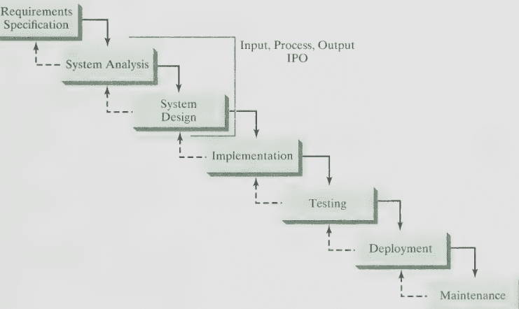

> 图 2.3 在软件开发周期的任何阶段，可能需要返回上一个阶段，或处理可能阻止软件按预期运行的其它问题。

需求规范是一个正式的过程，旨在理解问题并详细记录软件需要完成的任务。这一阶段涉及用户与开发者之间的紧密交互。书中的大多数示例都是简单的，其需求表述得很清楚。然而在现实世界中，问题并不总是定义良好的。开发者需要与使用软件的客户或组织紧密合作，并仔细研究该过程以识别需求。

系统分析旨在分析数据流并识别系统的输入和输出。当你进行分析时，首先识别输出是什么，然后确定为了产生输出需要哪些数据是有帮助的。

系统设计是设计从输入获取输出的过程。这一阶段使用许多层次的抽象，将过程分解为可管理的组件，并为实现每个组件设计设计策略。你可以将每个组件看作执行特定功能的子系统。分析和设计的本质是输入、处理和输出（IPO）。

实现涉及将设计转换为程序。为每个组件编写单独的程序，然后将其集成在一起工作。这一阶段需要使用如 Java 等编程语言。部署是使软件可用。维护涉及对软件进行更新。测试确保代码符合需求。

### 1. 需求规范（Requirements Specification）

需求规范是理解问题并详细记录软件需要完成的任务的正式过程。这一阶段涉及用户与开发者之间的紧密交互。书中的大多数示例都是简单的，其需求表述得很清楚。然而在现实世界中，问题并不总是定义良好的。开发者需要与使用软件的客户或组织紧密合作，并仔细研究该过程以识别需求。

### 2. 系统分析（System Analysis）

系统分析旨在分析数据流并识别系统的输入和输出。当你进行分析时，首先识别输出是什么，然后确定为了产生输出需要哪些数据是有帮助的。

### 3. 系统设计（System Design）

系统设计是设计从输入获取输出的过程。这一阶段使用许多层次的抽象，将过程分解为可管理的组件，并为实现每个组件设计策略。你可以将每个组件看作执行特定功能的子系统。分析和设计的本质是输入、处理和输出（IPO）。

### 4. 实现（Implementation）

实现涉及将设计转换为程序。为每个组件编写单独的程序，然后将其集成在一起工作。这一阶段需要使用如 Java 等编程语言。

### 5. 部署（Deployment）

部署是使软件可用。

### 6. 维护（Maintenance）

维护涉及对软件进行更新。

## 第 2 章 基础编程

```java
double loanAmount = input.nextDouble();

// 计算还款

double monthlyPayment = loanAmount * monthlyInterestRate / (1
    - Math.pow(1 + monthlyInterestRate, numberOfYears, 12));

double totalPayment = monthlyPayment * numberOfYears * 12;
```

输入 `loanAmount`、`monthlyPayment`、`totalPayment`，并进行类型转换。

```java
System.out.println("The monthly payment is $"
    + (int)(monthlyPayment * 100) / 100.0);

System.out.println("The total payment is $"
    + (int)(totalPayment * 100) / 100.0);
```

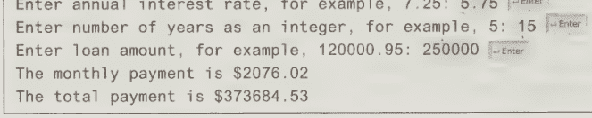

| 行# | 10 | 13 | 18 | 22 | 25 | 27 |
|---|---:|---:|---:|---:|---:|---:|
| 变量 | | | | | | |
| `annualInterestRate` | 5.75 | | | | | |
| `monthlyInterestRate` | | 0.0047916666666 | | | | |
| `numberOfYears` | | | | 15 | | |
| `loanAmount` | | | | | 250000 | |
| `monthlyPayment` | | | | | | 2076.0252175 |
| `totalPayment` | | | | | | 373684.53 |

### `java.lang` 包

第 10 行读取年利率，并在第 13 行将其转换为月利率。

为变量选择最合适的数据类型。例如，`numberOfYears` 最好声明为 `int`（18），尽管它也可以声明为 `long`、`float` 或 `double`。不过，`byte` 可能是 `numberOfYears` 最合适的类型。为了简单起见，书中的示例将使用 `int` 表示整数，使用 `double` 表示浮点值。

计算每月还款的公式在第 25-27 行中被翻译成 Java 代码。第 31 行和第 33 行使用了类型转换来获取保留两位小数的新 `monthlyPayment` 和 `totalPayment`。

程序使用了 `Scanner` 类，该类在第 1 行被导入。程序还使用了 `Math` 类，你可能在奇怪为什么没有在程序中导入类。`Math` 类位于 `java.lang` 包，而 `java.lang` 包中的所有类都是隐式导入的。因此，你不需要显式导入 `Math` 类。

## 第 5 阶段：测试

程序实现后，使用一些示例数据进行测试并验证输出是否正确。某些问题可能涉及很多情况，正如你将在后面的章节中看到的。对于这类问题，你需要设计覆盖所有的测试数据。

## 2.17 案例研究：货币单位计数

> **提示**
>
> 此示例中的系统设计阶段确定了几个步骤。一种良好的方法是通过逐个添加这些步骤来增量地编码和测试。这种方法更容易定位问题并调试程序。增量式代码和测试。

### 2.16.1

你如何编写以下算术表达式？

```text
$-b + \sqrt{b^2} - 4ac
```

## 2.17 案例研究：货币单位计数

本节介绍了一个将大额金额拆分为较小单位的程序。

假设你想开发一个程序，将给定的金额转换为较小的货币单位。该程序允许用户以 `double` 值输入金额（代表美元和美元的金额），并输出一份报告，以最大数量的美元、四元、一角、镍分和美分表示等值金额，按此顺序排列，以使硬币最少。

开发该程序的步骤如下：

1. 提示用户输入数字金额，例如 11.56。
2. 将金额（例如 11.56）转换为分（1156）。
3. 将分除以 100 得到美元。获取剩余分。
4. 将剩余分除以 25 得到四元。获取剩余分。
5. 将剩余分除以 10 得到一角。获取剩余分。
6. 将剩余分除以 5 得到镍分。获取剩余分。
7. 剩余的分即美分。
8. 显示结果。

完整的程序位于 Listing 2.10。`ComputeChange.java`

```java
import java.util.Scanner;

public class ComputeChange {

    public static void main(String[] args) {

        // 创建 Scanner

        Scanner input = new Scanner(System.in);

        // 接收金额

        System.out.print("enter an amount in double, for example11.56: ");

        double amount = input.nextDouble();

        int remainingAmount = (int) (amount * 100);

        // 美元的数量

        int numberOfOneDollars = remainingAmount / 100;

        remainingAmount = remainingAmount % 100;

        // 剩余分中的四元数量

        int numberOfQuarters = remainingAmount / 25;

        remainingAmount = remainingAmount % 25;

        // 剩余分中的一角数量

        int numberOfDimes = remainingAmount / 10;

        remainingAmount = remainingAmount % 10;

        // 剩余分中的镍分数量

        int numberOfNickels = remainingAmount / 5;

        remainingAmount = remainingAmount % 5;

        // 剩余分中的美分数量

        int numberOfPennies = remainingAmount;

        System.out.println("Your amount " + amount + " consists of:");

        System.out.println(numberOfOneDollars + " dollars");

        System.out.println(numberOfQuarters + " quarters");

        System.out.println(numberOfDimes + " dimes");

        System.out.println(numberOfNickels + " nickels");

        System.out.println(numberOfPennies + " pennies");
    }
}
```

| 行# | 11 | 13 | 16 | 17 | 20 | 21 | 24 | 28 | 32 |
|---|---:|---:|---:|---:|---:|---:|---:|---:|---:|
| 变量 | | | | | | | | | |
| `amount` | | 11.56 | | | | | | | |
| `remainingAmount` | | | 1156 | | 56 | | 6 | 6 | 1 | |
| `numberOfOneDollars` | | | | 11 | | | | | |
| `numberOfQuarters` | | | | | 2 | | | | |
| `numberOfDimes` | | | | | | 0 | | | | |
| `numberOfNickels` | | | | | | | 1 | | | |
| `numberOfPennies` | | | | | | | | 1 | |

`amount` 存储从控制台输入的金额（第 11 行）。该变量没有改变，因为金额需要在程序末尾显示结果。程序引入了变量 `remainingAmount`（第 13 行）来存储变化的金额。

`amount` 是代表美元和分的 `double`。它被转换为 `int` 变量 `remainingAmount`，代表所有的分。例如，如果 `amount` 为 11.56，初始的 `remainingAmount` 为 1156。除法运算符得到除法的商，1156 / 100 为 11。取模运算符得到除法的余数，1156 % 100 为 56。

程序从剩余分中提取最大数量的美元，并在变量 `remainingAmount` 中获得新的剩余金额（第 16-17 行）。从 `remainingAmount` 中提取最大数量的四元并获得新的 `remainingAmount`（第 20-21 行）。继续相同的过程，程序找到剩余分中最大数量的一角、镍分和美分。

此示例的一个严重问题是当将 `double` 转换为 `int remainingAmount` 时可能丢失精度。如果你尝试输入金额 10.03，10.03 * 100 变成 1002.9999999999。你会发现程序显示为 10 美元和 2 美分。要解决这个问题，请以代表分的整数值输入金额（参见编程练习 2.22）。

### 精度丢失

21.7. 显示 Listing 2.10 在输入值为 1.99 的输出。

## 2.18 常见错误和陷阱

常见的基础编程错误涉及未声明变量、未初始化变量、整数溢出、未初始化除法和舍入误差。


### 常见错误 1：未声明、未初始化变量以及未使用的变量

变量在使用之前必须先声明类型并赋值。一种常见错误是未声明或未初始化变量。考虑以下代码：

```java
double interestRate = 0.05;

double interest = interestRate * 45;
```

这段代码是错误的，因为 `interestRate` 被赋值为 0.05；但 `interest` 没有声明和初始化。Java 是大小敏感的，因此它认为 `interestRate` 和 `interest` 是不同的变量。

如果一个变量被声明但在程序中未使用，它可能是潜在的编程错误。因此，你应该从程序中删除未使用变量。例如，在以下代码中，`taxRate` 从未使用。

```java
double interestRate = 0.05;

double taxRate = 0.05;

double interest = interestRate * 45;

System.out.println("Interest is " + interest);
```

如果你使用 Eclipse 或 NetBeans 等 IDE，你会收到未使用变量的警告。

### 常见错误 2：整数溢出

数字以有限的位数存储。当给变量赋值一个太大（尺寸）而无法存储的值时，就会导致溢出。例如，执行以下语句会导致溢出，`int` 类型变量可以存储的最大值是 2147483647；2147483648 对于 `int` 值来说太大了：

```java
int value = 2147483647 + 1;

// value 实际上为 -2147483648
```

同样，执行以下语句也会导致溢出，因为 `int` 类型变量可以存储的最小值是 -2147483648，而 -2147483649 太大，无法存储在 `int` 变量中。

```java
int value = -2147483648 - 1;

// value 实际上是 2147483647
```

Java 在溢出时不会报告警告或错误，因此在处理接近给定类型最小值或范围的整数时，要务必小心。

当浮点数太小（即接近 0）以至于无法存储时，会发生下溢。Java 将其近似为 0，因此通常你不需要担心下溢。

### 什么是下溢？

## 常见错误 3：舍入误差

舍入误差（round-off error），也称为舍位误差，是指计算出的数字近似值与其数学值之间的差异。例如，1/3 如果保留三位小数，则约为 0.333；如果保留七位小数，则是 0.3333333。由于变量可以存储的位数有限的，舍入误差是不可避免的。涉及浮点数的计算是近似的，因为这些数字并不是以完全精确的方式存储的。例如：

### 浮点近似

```java
System.out.println(1.0 - 0.1 - 0.1 - 0.1 - 0.1);
```

显示 0.500000000000001，而不是 0.5，并且：

```java
System.out.println(1.0 - 0.9);
```

显示 0.9999999999999998，而不是 0.1。整数是精确存储的。因此，整数计算会产生精确的整数结果。

## 常见错误 4：无意的整数除法

Java 使用名为 `/` 的除运算符来执行整数除法和浮点除法。当两个操作数都是整数时，`/` 运算符执行整数除法。操作的结果是一个整数。小数部分被截断。要强制两个整数执行浮点除法，请将其中一个整数转换为浮点数。例如，下面第一个代码片段显示为 1，第二个代码片段显示为 1.5。

```java
int number1 = 1;

int number2 = 2;

double average = (number1 + number2) / 2;

System.out.println(average);
```

```java
int number1 = 1;

int number2 = 2;

double average = (number1 + number2) / 2.0;

System.out.println(average);
```


## 常见陷阱 1：冗余的输入对象

新程序员经常编写为每个输入创建多个对象的代码。例如，以下代码读取了一个整数和一个双精度值：

```java
Scanner input = new Scanner(System.in);

System.out.print("Enter an integer: ");

v1 = input.nextInt();
```

```java
Scanner input1 = new Scanner(System.in);

System.out.print("Enter a double value: ");

double v2 = input.nextDouble();
```

## 章节总结 89

这段代码并不好。它不必要地创建了两个输入对象并可能导致一些微妙的错误。你应该如下重写代码：

```java
Scanner input = new Scanner(System.in);

System.out.print("Enter an integer: ");

int v1 = input.nextInt();

System.out.print("Enter a double value: ");

double v2 = input.nextDouble();
```

### 复习题

- 2.18.1 你可以将一个变量声明为 `int` 稍后声明为 `double` 吗？
- 18.2 什么是整数溢出？浮点操作会导致溢出吗？
- 18.3 溢出会导致运行时错误吗？
- 18.4 什么是舍入误差？整数操作会导致舍入误差吗？浮点操作会导致舍入误差吗？

## 关键术语

- 算法 56
- 赋值运算符（`=`）64
- 赋值语句 64
- `byte` 类型 67
- 强制转换 79
- 常量 65
- 数据类型 57
- 递减运算符（`--`）77
- `double` 类型 67
- 表达式 64
- `final` 关键字 65
- `float` 类型 67
- 标识符 62
- 递增运算符（`++`）77
- 增量代码和测试 85
- `int` 类型 67
- 字面量 70
- `long` 类型 67
- 窄转换类型 79
- 操作数 68
- 溢出 87
- 后自增 77
- 原始数据类型 57
- 伪代码 56
- 需求规范 81
- 变量范围 63
- `short` 类型 67
- 特定导入 60
- 系统分析 81
- 系统设计 82
- 下溢 88
- 变量 57
- 宽转换类型 79
- 通配符导入 60

## 总结

1. 标识符是程序中变量、常量、方法和包的名称。
2. 标识符是由字母、数字、下划线（`_`）和美元符号（`$`）组成的字符序列。标识符必须以字母或下划线开头，不能以数字开头。标识符不能保留字。标识符可以是任意长度。
3. 变量用于存储程序中的数据。声明变量是告诉编译器变量可以持有什么类型。
4. 有两种导入语句：特定导入和通配符导入。特定导入指定单个类。通配符导入导入包中的所有类。
5. 在 Java 中，等号（`=`）用于赋值运算符。
6. 方法中声明的变量在使用之前必须赋值。
7. 命名常量（或简单的常量）代表永远改变的数据。
8. 命名常量通过使用 `final` 关键字声明。
9. Java 提供了四种整数类型（`byte`、`short`、`int` 和 `long`），表示不同大小的整数。
10. Java 提供了两种浮点类型（`float` 和 `double`），表示不同精度的浮点数。
11. Java 提供了执行数值运算的运算符：`+`（加法）、`-`（减法）、`*`（乘法）、`/`（除法）和 `%`（取模）。
12. 整数算术（`/`）产生整数结果。
13. Java 表达式中的数值运算符的应用方式相同。
14. Java 提供了复合赋值运算符 `+=`（加法赋值）、`-=`（减法赋值）、`*=`（乘法赋值）、`/=`（除法赋值）和 `%=`（取模赋值）。
15. 递增运算符（`++`）和递减运算符（`--`）将变量增加或减少 1。
16. 在评估具有混合类型的表达式时，Java 会自动将操作数转换为相应的类型。
17. 你可以使用 `(type)value` 表示法显式地从一种类型转换为另一种类型。
18. 将小范围类型的变量转换为大范围类型被称为宽转换。
19. 将大范围类型的变量转换为小范围类型被称为窄转换。
20. 宽转换可以自动执行而无需强制转换。窄转换必须显式执行。
21. 在计算机科学中，1970 年 1 月 1 日午夜称为 Unix（epoch）。

## 测试题

在伙伴网站在线回答本章测试题。

## 编程练习

### 调试提示

编译器通常会给出语法错误的原因。如果你不知道如何修正，请将你的程序与文本中的类似示例逐字符仔细比较。

### 教学说明

教师可能会要求你记录所选练习的分析和设计。用你自己的话分析问题，包括输入、输出和需要计算的内容，并用伪代码描述解决问题。

大多数偶数编程练习的答案提供给学生。这些练习作为各种程序的额外示例。为了充分利用这些答案的好处，学生应该先尝试完成偶数练习，然后与书中提供的答案进行比较。书中提供了大量的编程练习，完成所有偶数练习就足够了。

## 2.2–2.12 节

### 2.1（英里转换为公里）

编写一个程序从控制台读取双精度值的英里，将其转换为公里并显示结果。转换公式如下：

> 1 英里 = 1.6 公里

这是一个示例运行：

| 输入 | 输出 |
|---|---|
| 输入英里：96 | 96 英里是 153.6 公里 |

### 2.2（计算三角形体积）

编写一个程序读取等三角形的边长，并使用公式计算面积和体积：

```text
area = (length of sides)²
volume = area * length
```

这是一个示例运行：

| 输入 | 输出 |
|---|---|
| 输入等三角形的边长和高度：3.5 | 面积是 3.89；三角形体积是 19.48 |

# 第 2 章 基础编程

### 2.4（将平方米转换为平方）

编写一个程序，将平方米转换为平方。程序提示用户输入一个平方米的数值，并将其转换为平方。

1 平方米等于 0.3025 平方。

以下是示例运行：

| 输入 | 输出 |
|---|---|
| 输入平方米的数值：50 | 50.0 平方米是 15.125 平方 |

### 2.5（财务应用：计算小费）

编写一个程序，读取小计和费率，然后计算小费和总额。例如，如果用户输入的小计为 10，小费率为 12%，程序将显示小费为 $1.2，总额为 $11.2。

以下是示例运行：


| 输入 | 输出 |
|---|---|
| 输入小计和小费率：10 12 | 小费为 $1.2，总额为 $11.2 |

### 2.6（整数的各位数字）

编写一个程序，读取一个 0 到 1000 之间的整数，并乘以该整数中的所有数字。例如，如果整数是 932，则所有数字的乘积为 54。

提示：使用 `%` 运算符提取数字，使用 `/` 运算符移除已提取的数字。例如，`932 % 10 = 2` 且 `932 / 10 = 93`。

以下是示例运行：

| 输入 | 输出 |
|---|---|
| 999 | 999 中所有数字的乘积为 729 |


### 2.7（计算年数）

编写一个程序，提示用户输入分钟数（例如，10 亿），并显示这些分钟对应的年数和剩余天数。为了简单起见，假设一年为 365 天。

以下是示例运行：

| 输入 | 输出 |
|---|---|
| 输入分钟数：1000000000 | 1000000000 分钟大约是 1902 年 214 天 |


### 2.8（当前时间）

列表 2.7，`ShowCurrentTime.java` 提供了一个显示 GMT 当前时间的程序。修改该程序，提示用户输入相对于 GMT 的时间偏移，并显示指定时区的时间。

以下是示例运行：

| 输入 | 输出 |
|---|---|
| 输入相对于 GMT 的时区偏移：-5 | 当前时间是 4:50:34 |


### 2.9（物理：加速度）

平均加速度定义为速度的变化除以产生变化所需的时间，公式如下：

```text
a = \frac{V1 - V0}{t}
```

编写一个程序，提示用户输入初始速度 `v0`（米/秒）、末尾速度 `v1`（米/秒）和时间跨度 `t`（秒），然后显示平均加速度。

以下是示例运行：

```text
Enter v0, v1, and t: 5.5 50.9 4.5

平均加速度为 10.0889
```


### 2.10（科学：计算能量）

编写一个程序，计算水从初始温度加热到最终温度所需的能量。你的程序应提示用户输入以千克为单位的水量以及水的初始和最终温度。

计算能量的公式为 `Q = M * (finalTemperature - initialTemperature) * 4184`。`M` 是水的重量（千克），初始和最终温度为摄氏度，能量 `Q` 的单位是焦耳。

以下是示例运行：

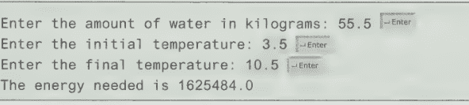

### 2.11（人口预测）

重写编程练习 1.11，提示用户输入年数并显示多年后的人口。此程序使用编程练习 1.11 中的提示。

以下是示例运行：


### 2.12（物理：寻找跑道长度）

给定飞机的加速度 `a` 和起飞速度 `v`，可以使用以下公式计算飞机所需的最小跑道长度：

```text
length = v^2 / 2a
```

编写一个程序，提示用户输入米/秒（m/s）的速度 `v` 和米/每秒平方（m/s²）的加速度 `a`，显示最小跑道长度。

以下是示例运行：

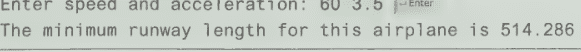

### 2.13（财务应用：复利价值）

假设每月在一个利率为 3.75% 的储蓄账户中存入 $100。那么月利率为 0.0375/12=0.003125。第一个月后账户价值变为 100 * (1 + 0.003125) = 100.3125。第二个月后账户价值变为 (100.3125 + 100) * (1 + 0.003125) = 200.9384765。以此类推。

编写一个程序，提示用户输入每月存款金额，并显示六个月后的账户价值。（在练习 5.30 中，你将使用循环来显示任意月的账户价值。）


| 项目 | 数值 |
|---|---:|
| 输入每月存款 | 100 |
| 第一个月后账户价值 | 100.3125 |
| 第二个月后账户价值 | 200.9384765 |
| 第三个月后账户价值 | 301.878903178 |
| 第六个月后账户价值 | 606.596786695037 |


### 2.14（健康：计算 BMI）

体质指数（BMI）是衡量体重健康的指标。可以通过千克为单位的体重除以米高的平方来计算。

编写一个程序，提示用户输入磅为单位的体重和英寸为单位的身高，并显示 BMI。1 磅等于 0.45392 千克，1 英寸等于 0.0254 米。

以下是示例运行：

| 输入 | 输出 |
|---|---|
| 输入磅：95.5 | BMI 为 26.8573 |
| 输入英寸：50 |  |

### 2.15（几何：两点间的距离）

编写一个程序，提示用户输入两个点 `(x1, y1)` 和 `(x2, y2)`，并显示它们之间的距离。

计算距离的公式为 `sqrt((x2-x1)² + (y2-y1)²)`。你可以使用 `Math.pow(a, 0.5)` 计算 `sqrt`。

以下是示例运行：

| 输入 | 输出 |
|---|---|
| 输入 x1 和 y1：1.5 -3.4 | 两点间的距离为 8.76413145485214 |
| 输入 x2 和 y2：4 5 |  |

### 2.16（几何：六边形面积）

编写一个程序，提示用户输入六边形的边长并显示其面积。六边形面积的计算公式为：

```text
Area = \frac{3\sqrt{3}}{2}s^2
```

其中 `s` 是边长。

以下是示例运行：

| 输入 | 输出 |
|---|---|
| 输入边长：5.5 | 六边形的面积为 78.5918 |


### 2.17（科学：风寒指数）

有多冷？仅凭温度不足以证明答案。风速、相对湿度、太阳等因素也决定了冷度。在 201 年，国家气象局（NWS）实施了新的风寒公式：

```text
t_hv = 35.7 + 0.6215t_a - 11.3v + 0.3965t_a v^0.16
```

其中 `t_a` 是摄氏度温度，`v` 是每小时英里的速度。

编写一个程序，提示用户输入 `-58°F` 到 `41°F` 之间的温度以及大于等于 2 的风速，显示风寒指数。使用 `Math.pow(a, b)` 计算 `v^0.16`。

以下是示例运行：

```text
输入 -58°F 到 41°F 之间的摄氏度温度

输入每小时英里的速度 (>= 2)：6

风寒指数 = -5.5607
```


### 2.18（打印表格）

编写一个程序显示以下表格。计算两个点的中点。

| `a` | `b` | 中点 |
|---|---|---|
| (0, 0) | (2, 1) | (1.0, 0.5) |
| (1, 4) | (4, 2) | (2.5, 3.0) |
| (2, 7) | (6, 3) | (4.0, 5.0) |
| (3, 9) | (10, 5) | (6.5, 7.0) |
| (4, 11) | (12, 7) | (8.0, 9.0) |

### 2.19（几何：三角形面积）

编写一个程序，提示用户输入三角形三个顶点 `(x1, y1)`、`(x2, y2)` 和 `(x3, y3)`，并显示其面积。

三角形面积的计算公式为：

```text
s = \sqrt{(s-side1)(s-side2)(s-side3)}
```

```text
area = V\sqrt{s(s-side1)(s-side2)(s-side3)}
```

以下是示例运行：

```text
输入用空格分隔的三个点的坐标

如 x1 y1 x2 y2 x3 y3: 1.5 -3.4 4.6 9.5 -3.4

三角形面积为 33.6
```

# 第 2 章 基础编程

## 2.13–2.17 节

### 2.20（财务应用：计算利息）

如果你知道余额和年百分比利率，可以使用以下公式计算下个月还款的利息：

```text
interest = balance × (annualInterestRate/1200)
```

编写一个程序，读取余额和年百分比利率，并显示下个月的利息。

以下是一个运行示例：

```text
输入余额和利率（例如，3 表示 3%）：1000 3.5
利息为 2.91667
```

### 2.21（财务应用：计算投资的未来价值）

编写一个程序，读取投资金额、年利率和投资的年限，并使用以下公式显示未来投资价值：

```text
futureInvestmentValue = investmentAmount × (1 + monthlyInterestRate)^numberOfYears
```

例如，如果你输入 1000，年利率 3.25%，年限 1，未来投资价值为 1032.98。

以下是一个运行示例：

```text
输入投资金额：1000.56
输入年利率（百分比）：4.25
输入年限：1
未来价值为 $1043.92
```

### 2.22（财务应用：货币单位）

重写代码清单 2.10 `ComputeChange.java`，以修复将 `double` 值转换为 `int` 值时丢失精度的问题。

输入应为整数，其最后两位代表角分。例如，输入 `1156` 代表 11 美元 56 分。

### 2.23（驾驶成本）

编写一个程序，提示用户输入行驶距离、汽车的每加仑英里里程以及每加仑的价格，然后显示行程费用。

以下是一个运行示例：

```text
输入行驶距离：900.5
每加仑英里程数：25.5
每加仑价格：3.55
驾驶费用为 $125.36
```

> **注意**  
> 教师资源网站上为教师提供了额外的 200 多道附加编程练习题及答案。

# 第 3 章：选择语句

## 章节目标

- 使用关系运算符声明布尔变量并编写布尔表达式（§3.2）。
- 使用单向 `if` 语句实现选择控制（§3.3）。
- 使用双向 `if-else` 语句实现选择控制（§3.4）。
- 使用嵌套 `if` 和多路 `if` 语句实现选择控制（§3.5）。
- 避免 `if` 语句中的常见错误和陷阱（§3.6）。
- 使用 `Math.random()` 方法生成随机数（§3.7）。
- 使用选择语句对各种示例进行编程（`SubtractionQuiz`、`BMI`、`ComputeTax`）（§3.7–3.9）。
- 使用逻辑运算符（`!`、`&&`、`||`、`^`）组合条件（§3.10）。
- 使用带有组合条件的选择语句进行编程（`Leapyear`、`Lottery`）（§3.11 和 §3.12）。
- 使用 `switch` 语句实现选择控制（§3.13）。
- 使用条件运算符编写表达式（§3.14）。
- 检查运算符优先级和结合性的规则（§3.15）。
- 应用常用技术调试错误（§3.16）。


## 3.1 引言

程序可以决定清单 2.2 `ComputeAreaWithConsole.java` 中的半径是否为负值，如果是，程序将显示无效结果。如果半径为负数，你不希望程序计算面积。你该如何处理这种情况？

### 关键点

与所有高级编程语言一样，Java 提供了选择语句：允许你根据替代方案选择选项的语句。你可以使用以下选择语句来替换清单 2.2 中的第 12–17 行。

### 选择语句

```java
if (radius < 0) {
    System.out.println("Incorrect input");
} else {
    double area = radius * 3.14159;
    System.out.println("Area is " + area);
}
```


## 第 3 章 选择语句

## 3.1 引言

程序可以决定清单 2.2 `ComputeAreaWithConsole.java` 中的半径是否为负值，如果是程序将显示无效结果。如果半径为负数，你不希望程序计算面积。你该如何处理这种情况？

**关键点**

与所有高级编程语言一样，Java 提供了选择语句：允许你根据替代方案选择选项的语句。你可以使用以下选择语句来替换清单 2.2 中的第 12-17 行：

**选择语句**

```
if (radius < 0) {
    System.out.println("Incorrect input");
} else {
    double area = radius * 3.14159;
    System.out.println("Area is " + area);
}
```

**布尔值**

选择语句使用布尔表达式作为表达式。布尔表达式是一个评估为布尔值（`true` 或 `false`）的表达式。我们现在介绍布尔类型和关系运算符。

### 3.2 boolean 数据类型

`boolean` 数据类型声明一个值为 `true` 或 `false` 的变量。

你如何比较两个值，例如判断半径是否大于 0、等于 0 还是小于 0？Java 提供了六个关系运算符（也称为比较运算符），如表 3.1 所示，可用于比较两个值（在表中 `radius` 为 5）。

**boolean 数据类型 关系运算符**

**关键点**

**表 3.1 关系运算符**

| Java 运算符 | 数学符号 | 名称 | 示例 (`radius` 为 5) | 结果 |
|---|---|---|---|---|
| `<` | `<` | 小于 | `radius < 0` | `false` |
| `<=` | `<=` | 小于或等于 | `radius <= 0` | `false` |
| `>` | `>` | 大于 | `radius > 0` | `true` |
| `>=` | `>=` | 大于或等于 | `radius >= 0` | `true` |
| `==` | `==` | 等于 | `radius == 0` | `false` |
| `!=` | `!=` | 不等于 | `radius != 0` | `true` |

**`==` 与 `=`**

**注意**
等值测试使用两个等号（`==`），而不是单个等号（`=`）。后者符号用于赋值。比较的结果是一个布尔值：`true` 或 `false`。例如，以下语句显示 `true`：

```
double radius = 1;
System.out.println(radius > 0);
```

**布尔变量**

持有布尔值的变量被称为布尔变量。`boolean` 数据类型用于声明变量。布尔变量可以持有两个值之一：`true` 或 `false`。例如，以下语句将 `true` 赋值给变量 `lightsOn`：

```
boolean lightsOn = true;
```

`true` 和 `false` 是字面量，就像数字一样。它们被视为保留字，不能用作标识符。假设你想开发一个程序，让一年级学生练习加法。程序随机生成两个两位整数 `number1` 和 `number2`，并显示给用户。程序随机生成两个两位整数，`number1` 和 `number2`，并显示给用户。程序随机生成两个两位整数，`number1` 和 `number2`，并显示给用户。程序随机生成两个两位整数，`number1` 和 `number2`。`img/6566598a24b3c0d7b1d7916f74a19570_98_0.png`

`true` 和 `false` 是字面量，就像数字一样。它们被视为保留字，不能用作标识符。假设你想开发一个程序，让一年级学生练习加法。程序随机生成两个两位整数，`number1` 和 `number2`，并显示给用户。输入应为整数。输入应为整数，其最后两位代表角分。例如，输入 `1156` 代表 11 美元 56 分分。输入 `1156` 代表 11 美元 56 分分。输入应为整数，其最后两位代表角分。例如，输入 `1156` 代表 11 美元 56 分分。输入 `1156` 代表 11 美元 56 分分。输入 `1156` 代表 11 美元 56 分分。`img/6566598a24b3c0d7b1d7916f74a19570_98_1.png`

## 3.3 if 语句

`if` 语句是一种允许程序指定替代执行路径的结构。

之前的程序显示消息为“6 + 2 = 7 is false”。如果你希望消息是“6 + 2 = 7 is incorrect”，你必须使用选择语句来进行这一微小更改。
Java 有多种类型的选择语句：单向 `if`、双向 `if` 语句、嵌套 `if` 语句、多路 `if-else` 语句、`switch` 语句和条件运算符。
单向 `if` 语句的语法如下：

流程图 3.1 展示了 Java 如何执行 `if` 语句。流程图描述了一个算法或过程，通过连接这些框来显示各种类型及其顺序。处理操作位于这些框中，箭头表示控制流。菱形框表示布尔条件，矩形框表示语句。

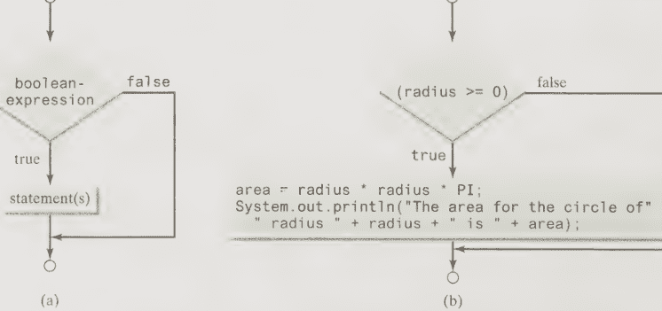

**图 3.1** 如果布尔表达式评估为真，则 `if` 语句将执行语句。

如果布尔表达式为真，则执行块中的语句。
作为示例，请看下面的代码：

```
if (radius >= 0) {
    area = radius * radius * PI;
    System.out.println("The area for the circle of radius " + radius + " is " + area);
}
```

上述语句的流程如图 3.1b 所示。如果 `radius` 的值大于或等于 0，则计算 `area` 并显示结果；否则，块中的两个语句将不会执行。
布尔表达式包含在括号中。例如，(a) 中的代码是错误的。它应该像 (b) 那样进行修正。

```
if (i >= 0) {
    System.out.println("i is positive");
}
```
(错误)

```
if (i > 0) {
    System.out.println("i is positive");
}
```
(正确)

如果块内只包含一条语句，可以省略大括号。例如，以下语句是等价的：

```
if (i > 0) {
    System.out.println("i is positive");
}
```
(a)

**等价**

```
if (i > 0)
    System.out.println("i is positive");
```
(b)

> **注意：** 省略大括号可以使代码更短，但容易引发错误。当你回过修改省略了大括号的代码时，忘记加上大括号是一个常见的错误。省略大括号不...

列表 3.2 显示了一个提示用户输入整数的程序。如果该数字是 5 的倍数，程序显示 `HiFive`。如果该数字能被 2 整除，它显示 `HiEven`。

**列表 3.2 `SimpleIfDemo.java`**

```java
import java.util.Scanner;

public class SimpleIfDemo {
    public static void main(String[] args) {
        Scanner input = new Scanner(System.in);
        System.out.print("Enter an integer: ");
        int number = input.nextInt();

        if (number % 5 == 0) {
            System.out.println("HiFive");
        }

        if (number % 2 == 0) {
            System.out.println("HiEven");
        }
    }
}
```

```
Enter an integer: 4 <Enter
HiEven
```

```
Enter an integer: 30 <Enter
HiFive
HiEven
```

程序提示用户输入整数（第 6–7 行），如果能被 5 整除则显示 `HiFive`（第 9–10 行），如果能被 2 整除则显示 `HiEven`（第 12–13 行）。

- **3.3.1** 编写一个 `if` 语句，如果 `y` 大 0 则给 `x` 赋值 1。
- **3.3.2** 编写一个 `if` 语句，如果 `score` 大于 90，则薪水增加 3%。
- **3.3.3** 下面代码的哪里错了？

```
if (radius >= 0) {
  area = radius * radius;
  System.out.println("The area for the circle of " +
  radius + radius + " is " + area);
}
```

## 3.4 双路 if-else 语句

`if-else` 语句根据条件的真假来决定执行路径。

单路 `if` 语句在指定条件为真时执行操作。如果条件为假，则什么都不做。但如果你想在条件为假时执行另一种操作呢？你可以使用双路 `if-else` 语句。双路 `if-else` 语句根据条件的真假指定不同的操作。
以下是双路 `if-else` 语句的语法：

```
if (boolean-expression) {
  statement(s)-for-the-true-case;
} else {
  statement(s)-for-the-false-case;
}
```

`if-else` 的流程如图 3.2 所示。

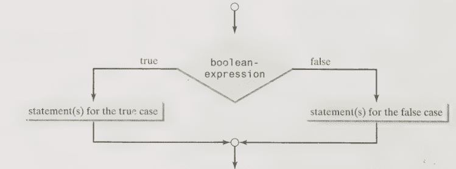

**图 3.2** 一个 `if-else` 语句在布尔表达式求值为真时执行真情况的语句；否则，执行假情况的语句。

如果布尔表达式求值为真，则执行真情况的语句；否则，执行假情况的语句。例如，考虑以下代码：

```
if (radius >= 0) {
    area = radius * radius;
    System.out.println("The area for circle of radius " +
    radius + " is " + area);
} else {
    System.out.println("Negative input");
}
```


如果 `radius >= 0` 为真，则计算并显示 `area`；如果为假，则显示消息 "Negative input"。
一如既往，如果内部只有一条语句，可以省略大括号。因此，在前面的示例中，可以省略包裹 `System.out.println("Negative input")` 语句的大括号。这里是另一个使用 `if-else` 语句的示例，它检查一个数字是偶数还是奇数：

```
if (number % 2 == 0) {
    System.out.println(number + " is even.");
} else {
    System.out.println(number + " is odd.");
}
```


**3.4.1** 编写一个 `if` 语句，如果 `score` 大于 90 则增加薪水 3%。
**3.4.2** 如果 `number` 为 30，(a) 和 (b) 代码的输出是什么？如果 `number` 为 35，输出是什么？

```
if (number % 2 == 0) {
    System.out.println(number + " is even.");
} else {
    System.out.println(number + " is odd.");
}
```
(a)

```
if (number % 2 == 0) {
    System.out.println(number + " is even.");
} else {
    System.out.println(number + " is odd.");
}
```
(b)

## 3.5 嵌套 if 和多路 if-else 语句

一个 `if` 可以放在另一个语句内部形成嵌套 `if`。
`if-else` 语句中的语句可以是任何合法的 Java 语句。内部 `if` 被嵌套在外部语句中；实际上，嵌套深度是没有限制的。例如，以下是一个嵌套语句：

```
if (i > k) {
    if (j > k) {


`System.out.println("i and j are greater than k");`

```
} else {
    System.out.println("i is less than or equal to k");
}
```


`if (j > k)` 语句嵌套在 `if (i > k)` 语句内部。嵌套 `if` 可以实现多选择。例如，3.3a 中的语句根据 `score` 输出字母等级：

```
if (score >= 90)
  System.out.print("A");
else
  if (score >= 80)
    System.out.print("B");
  else
  if (score >= 70)
      System.out.print("C");
  else
      if (score >= 60)
        System.out.print("D");
      else
        System.out.print("F");
```

```
if (score >= 90)
  System.out.print("A");
else
  if (score >= 80)
    System.out.print("B");
  else
  if (score >= 70)
      System.out.print("C");
  else
      if (score >= 60)
        System.out.print("D");
      else
        System.out.print("F");
```

等价

这种更好

图 3.3 (a) 和 (b) 显示使用多路 `if-else` 语句的多选择优选格式。

该 `if` 语句的执行过程如图 3.4 所示。测试第一个条件 (`score >= 90`)。如果为真，等级为 A。如果为假，测试第二个条件 (`score >= 80`)。如果第二个条件为真，等级为 B。如果该条件为假，则测试第三个条件（或其他剩余条件），直到满足某个条件或所有条件均证明为假。如果所有条件均假，等级为 F。注意，只有在之前的所有条件都为假时，才会测试某个条件。

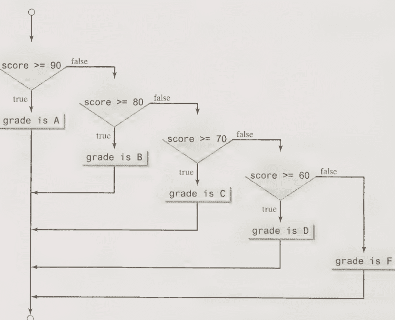

图 3.4 使用多路 `if-else` 语句来分配等级。

3.3a 中的 `if` 语句与 3.3b 中的 `if` 语句等价。事实上，图 3.3b 是多选择 `if` 语句的优选风格。这种被称为多路 `if-else` 语句的风格避免了深度缩进，并使程序易读。

- 3.5.1 假设 `x = 3` `y = 2`；显示以下代码的输出（如果有）。如果 `x = 3` `y = 4`，输出是什么？如果 `x = 2` `y = 2`，输出是什么？画出代码的流程图。

```java
if (x > 2) {
  if (y > 2) {
    int z = x + y;
    System.out.println("z is " + z);
  }
} else {
  System.out.println("x is " + x);
}
```


- 3.5.2 假设 `x = 2` `y = 3`。显示以下代码的输出（如果有）。如果 `x = 3` `y = 4`，输出是什么？如果 `x = 2` `y = 2`，输出是什么？画出代码的流程图。

- 3.5.3 下面代码的哪里错了？

```java
if (score >= 60) {
  System.out.println("D");
} else if (score >= 70) {
  System.out.println("C");
} else if (score >= 80) {
  System.out.println("B");
} else if (score >= 90) {
  System.out.println("A");
} else {
  System.out.println("F");
}
```

## 3.6 常见错误与陷阱

忘记必要的大括号、`if` 语句结束位置、将 `=` 误认为 `==` 以及悬空 `else` 子是选择语句中的常见错误。`if-else` 语句中的重复和双精度值的相等性测试是常见的陷阱。


# 常见错误1：忘记必要的大括号

如果块包含一条语句，可以省略大括号。然而，在需要组合多个语句时忘记大括号是一个常见的编程错误。如果你通过在没有大括号的 `if` 语句中添加新语句来修改代码，你将不得不插入大括号。例如，下面的代码 (a) 是错误的。它应该使用大括号来组合多个语句，如 (b) 所示。

# 第 3 章 选择

| (a) 错误 | (b) 正确 |
| :--- | :--- |
| ```java
if (radius >= 0) 
area = radius * radius * PI;
System.out.println("The area "
+ " is " + area);
``` | ```java
if (radius >= 0) {
area = radius * radius * PI;
System.out.println("The area "
+ " is " + area);
}
``` |

在 (a) 中，控制台输出语句并不是 `if` 语句的一部分。它与下面的代码相同：

```java
if (radius >= 0)
area = radius * radius * PI;
System.out.println("The area "
+ " is " + area);
```

无论 `if` 语句中的条件如何，控制台输出语句都会执行。

## 常见错误 2：错误的分号

在 `if` 行末尾添加分号（如 (a) 所示）是一个常见的错误。

| (a) | 等价 | (b) |
| :--- | :--- | :--- |
| ```java
if (radius >= 0);
area = radius * radius * PI;
System.out.println("The area "
+ " is " + area);
``` | | ```java
if (radius >= 0) {
area = radius * radius * PI;
System.out.println("The area "
+ " is " + area);
}
``` |

这个错误很难发现，因为它既不是编译错误，也不是运行时错误；它是一个逻辑错误。(a) 中的代码等价于 (b) 中带有一个空块的代码。

这种错误通常发生在你使用换行块样式时。使用行末块样式可以防止这种错误。

## 常见错误 3：对布尔值的冗余测试

在测试条件中测试布尔变量是真还是假，使用像 (a) 那样的等性测试运算符是冗余的：

| (a) | 等价 | (b) |
| :--- | :--- | :--- |
| ```java
if (even == true)
System.out.println(
"It is even.");
``` | 这样更好 | ```java
if (even)
System.out.println(
"It is even.");
``` |

相反，像 (b) 那样直接测试布尔变量更好。另一个很好的理由是避免难以检测的错误。在测试条件中用 `==` 运算符代替 `=` 运算符来比较两个项的相等性是一个常见错误。它可能导致以下错误语句：

```java
if (even = true)
System.out.println("It is even.");
```

该语句没有编译错误。它将 `true` 赋值给 `even`，因此 `even` 始终为真。

## 常见错误 4：悬空 else 歧义

下面的 (a) 代码有两个 `if` 子句和一个 `else` 子句。`else` 子句匹配哪一个子句？缩进表示 `else` 子句匹配第一个子句。然而，`else` 子句实际上匹配第二个子句。这种情况被称为“else 歧义”（else ambiguity）。`else` 子句总是匹配同一代码块中最近的 `if` 子句。因此，(a) 中的语句等价于 (b) 中的代码。

```java
int i = 1, j = 2, k = 3;
if (i > j)
  if (i > k)
    System.out.println("A");
else
  System.out.println("B");
```

```java
int i = 1, j = 2, k = 3;
if (i > j)
  if (i > k)
    System.out.println("A");
  else
    System.out.println("B");
```

等价

使用正确的缩进会更好

(a)

(b)

由于 `i > j` 为假，(a) 和 (b) 中的语句都不会显示任何内容。要强制让 `else` 子句匹配第一个子句，必须使用一对括号：

```java
int i = 1, j = 2, k = 3;
if (i > j) {
  if (i > k)
    System.out.println("A");
} else
  System.out.println("B");
```

该语句显示 B。

## 常见错误 5：两个浮点值的相等性测试

如 2.8 节中常见错误 3 所述，浮点数具有有限的精度和范围；涉及浮点数的计算可能会引入舍入误差。因此，两个浮点值的相等性测试是不可靠的。例如，你期望以下代码显示 `true`，但意外的是它显示了 `false`：

```java
double x = 1.0 - 0.1 - 0.1 - 0.1 - 0.1;
System.out.println(x == 0.5);
```

这里的 `x` 不精确等于 `0.5`，而是 `0.5000000000000001`。你无法可靠地测试两个浮点值的相等性。然而，你可以通过测试它们的差值是否小于某个阈值来比较它们是否足够接近。也就是说，如果 $|x-y| < \epsilon$（$\epsilon$ 是一个非常小的值，通常用希腊字母 epsilon 来表示一个小值），则两个数字 $x$ 和 $y$ 就非常接近。通常，在比较两个 `double` 类型的值时，你将 `epsilon` 设置为 $10^{-14}$，比较两个 `float` 类型时设置为 $10^{-7}$。例如，以下代码：

```java
final double EPSILON = 1e-14;
double x = 1.0 - 0.1 - 0.1 - 0.1;
if (Math.abs(x - 0.5) < EPSILON)
  System.out.println(x + " is approximately 0.5");
```

将显示 `0.5000000000000001 is approximately 0.5`。

`Math.abs()` 方法用于返回参数的绝对值。

## 陷阱 1：简化布尔赋值

新程序员经常会像 (a) 那样将测试条件赋值给布尔变量：

```java
if (number % 2 == 0)
  even = true;
else
  even = false;
```

这不是错误，但应该写成 (b)。

## 陷阱 2：避免重复代码

新程序员经常会在不同的情况下编写本应合并的代码。例如，以下语句中的代码重复了：

```java
if (state) {
  tuition = 5000;
  System.out.println("The tuition is " + tuition);
}
else {
  tuition = 5000;
  System.out.println("The tuition is " + tuition);
}
```

这不是错误，但应该写写如下：

```java
if (state) {
  tuition = 5000;
} else {
  tuition = 5000;
}
System.out.println("The tuition is " + tuition);
```

新代码消除了重复并使代码更容易维护，只需要修改一处。

### 3.6.1 下列哪些是等价的？哪些缩进是正确的？

```java
if (i > 0)
  if (j > 0)
    x = 0; 
else
    if (k > 0) y = 0;
```

```java
if (i > 0) {
  if (j > 0)
    x = 0;
  else
    if (k > 0) y = 0;
}
```

```java
if (i > 0) {
  if (j > 0)
    x = 0;
  else if (k > 0)
    y = 0;
}
```

```java
if (i > 0) {
  if (j > 0)
    x = 0;
  else
    if (k > 0)
    y = 0;
}
```

### 3.6.2 使用布尔表达式重写以下语句：

```java
if (count % 10 == 0)
  newLine = true;
else
  newLine = false;
```

### 3.6.4 如果 `number` 为 14、15 或 30，以下代码的输出是什么？

```java
if (number % 2 == 0)
  System.out.println(number + " is even");
if (number % 5 == 0)
  System.out.println(number + " is multiple of 5");
```

```java
if (number % 2 == 0)
  System.out.println(number + " is even");
else if (number % 5 == 0)
  System.out.println(number + " is multiple of 5");
```

(a)

(b)

## 3.7 生成随机数

你可以使用 `Math.random()` 获取一个 0.0 到 1.0 之间的随机 `double`（不包括 1.0）。

假设你想为一个一级学生开发一个练习减法的程序。程序随机生成两个单数字 `number1` 和 `number2`，且 `number1 >= number2`，并向学生显示如“9-2等于？”的问题。学生输入答案后，程序将显示答案是否正确。

之前的示例使用 `System.currentTimeMillis()` 生成随机数。更好的方法是使用 `Math` 类中的 `random` 方法。该方法返回一个满足 $0.0 < d < 1.0$ 的随机 `double`。因此，`(Math.random())` 返回 0 到 9 之间的随机整数。

程序的工作原理如下：


**重点视频笔记** **减法测试程序**

1. 生成两个单数字整数到 `number1` 和 `number2`。

2. 如果 `number1 < number2`，交换 `number1` 和 `number2`。

3. 提示学生回答：“`number1 - number2` 等于？”

4. 检查学生的答案并显示答案是否正确。

完整程序见列表 3.3。

# 3.3 SubtractionQuiz.java

```java
import java.util.Scanner;

public class SubtractionQuiz {
  public static void main(String[] args) {
    // 1. 生成两个单数字整数
    int number1 = (int)(Math.random() * 10);
    int number2 = (int)(Math.random() * 10);

    // 2. 如果 number1 < number2, swap number1 with number2
    if (number1 < number2) {
      int temp = number1;
```

# 110 第3章节选

```java
number1 = number2;
number2 = temp;
}
// 3. 提示学生回答“number1 - number2 是多少？”
System.out.print(
"What is " + number1 + " - " + number2 + " ");
Scanner input = new Scanner(System.in);
int answer = input.nextInt();
```

获取答案

```java
// 4. 判定答案并显示结果
if (number1 - number2 == answer) {
    System.out.println("You are correct!");
} else {
    System.out.println("Your answer is wrong.");
    System.out.println(number1 + " - " + number2 + 
    " should be " + (number1 - number2));
}
```

检查答案


| line# | number1 | number2 | temp | answer | output |
|---|---|---|---|---|---|


| 6 | 2 | | | | |
| 7 | | 9 | | | |
| 11 | | | 2 | | | |
| 12 | | | | | | |
| 13 | | | 2 | | | |
| 20 | | | | | 5 | 你的答案错误 9 - 2 应该等于 7 |
| 26 | | | | | | |

为了交换两个变量`number1`和`number2`，使用了一个临时变量`temp`（第 11 行）来首先存储`number1`中的值。将`number2`的值赋值给`number1`（第 12 行），并将`temp`中的值赋值给`number2`（第 13 行）。

## 3.7.1 下列哪项是调用`Math.random()`可能的输出？

`323.4`, `0.5`, `24`, `1.0`, `0.0`, `0.234`

- 3.7.2 a. 如何生成一个随机整数`i`，使得`0 ≤ i < 20`？
  b. 如何生成一个随机整数`i`，使得`10 ≤ i < 20`？
  c. 如何生成一个随机整数，使得`10 ≤ i ≤ 50`？
  d. 写一个表达式，随机返回`0`或`1`。

## 3.8 案例研究：计算体质量指数

你可以使用嵌套的`if`语句编写一个解释体质量指数的程序。

体质量指数（BMI）是一种基于身高和体重的健康标准。它可以通过将你的体重（公斤）除以身高（米）的平方来计算。20 岁及以上人群的 BMI 解释如下：


| BMI | 解释 |
| --- | --- |
| BMI < 18.5 | 体重减轻 |
| 18.5 ≤ BMI < 25.0 | 正常 |
| 25.0 ≤ BMI < 30.0 | 超重 |
| 30.0 ≤ BMI | 肥胖 |

编写一个程序，提示用户输入体重（磅）和身高（英寸），并显示 BMI。请注意，1 磅等于 0.45359237 公斤，1 英寸等于 0.0254 米。列表 3.4 给出了该程序。

### 3.4 ComputeInterpretBMI.java

```java
import java.util.Scanner;
public class ComputeInterpretBMI {
    public static void main(String[] args) {
        Scanner input = new Scanner(System.in);

        // 提示用户输入体重（磅）
        System.out.print("Enter weight in pounds: ");
        double weight = input.nextDouble();

        // 提示用户输入身高（英寸）
        System.out.print("Enter height in inches: ");
        double height = input.nextDouble();

        final double KILOGRAMS_PER_POUND = 0.45359237;
        final double METERS_PER_INCH = 0.0254;
        double bmi = weight * KILOGRAMS_PER_POUND / (height * METERS_PER_INCH);

        // 显示结果
        System.out.println("BMI is " + bmi);
        if (bmi < 18.5) {
            System.out.println("Underweight");
        } else if (bmi < 25) {
            System.out.println("Normal");
        } else if (bmi < 30) {
            System.out.println("Overweight");
        } else {
            System.out.println("Obese");
        }
    }
}
```

## 第3章节选


| line# | weight | height | weightInKilograms | heightInMeters | bmi | output |
|---|---|---|---|---|---|---|
| 9 | 146 | | | | | |
| 13 | | 70 | | | | |
| 19 | | | 66.2248602 | | | |
| 21 | | | | 1.778 | 20.9486 | |
| 25 | | | | | 20.95 | |
| 29 | | | | | | |

常量`KILOGRAMS_PER_POUND`和`METERS_PER_INCH`定义在第 15-16 行。使用这些常量使程序更易读。你应该测试所有 BMI 情况以确保程序正常工作。

### 测试所有情况

## 3.9 案例研究：计算税收

你可以使用`if`语句编写计算税收的程序。美国所得税根据报税身份和纳税收入计算。有四种报税身份：单身、共同申报、分开申报和户主。税率每年都会变化。表 3.2 显示了 2009 年的税率。如果单身且纳税收入为 $10,000，前 $8,350 按 10% 征税，其余 $1,650 按 15% 征税，因此总税为 $1,082.50。

| 税率 | 单身 | 共同申报 | 分开申报 | 户主 |
|---|---|---|---|---|
| 10% | $0–8,350 | $0–16,700 | $0–8,350 | $0–11,950 |
| 15% | $8,351–$33,950 | $16,701–$67,900 | $8,351–$33,950 | $11,951–$45,500 |
| 23% | $33,951–$82,250 | $67,901–$137,000 | $33,951–$68,525 | $45,501–$117,450 |
| 28% | $82,251–$171,550 | $137,051–$208,850 | $68,526–$104,425 | $117,451–$190,200 |
| 33% | $171,551–$372,950 | $208,851–$372,950 | $104,426–$186,475 | $190,201–$372,500 |
| 35% | $372,951+ | | | |

表 3.2 2009 年美国个人所得税率

你需要编写一个计算个人所得税的程序。你的程序应该提示用户输入报税身份和纳税收入并计算税额。单身输入 0，共同申报或寡妇输入 1，分开申报输入 2，户主输入 3。

你的程序根据报税身份计算纳税收入的税额。报税身份（`status`）可以使用如下`if`语句确定：

```java
if (status == 0) {
    // 计算单身申报者的税额
} else if (status == 1) {
    // 计算共同申报或寡妇的税额
} else if (status == 2) {
    // 计算分开申报者的税额
} else if (status == 3) {
    // 计算户主的税额
} else {
    // 显示身份
}
```

每种报税身份都有六种税率。每种税率适用于特定金额的纳税收入。例如，单身申报者的纳税收入为 $400,000，$8,350 按 10% 征税，($33,950–$8,350) 按 15% 征税，($82,250–$33,950) 按 25% 征税，($171,550–$82,250) 按 28% 征税，($372,950–$171,550) 按 33% 征税，以及 ($400,000–$372,950) 按 35% 征税。列表 3 给出了计算单身申报者税额的解决方案。完整解决方案留作练习待完成。

### LISTING 3 ComputeTax.java

```java
import java.util.Scanner;

public class ComputeTax {
    public static void main(String[] args) {
        // 创建 Scanner
        Scanner input = new Scanner(System.in);

        // 提示用户输入报税身份
        System.out.print("(0-single, 1-married jointly or widow, 2-separated, 3-head of household) Enter the filing status: ");
        int status = input.nextInt();

        // 提示用户输入纳税收入
        System.out.print("Enter the taxable income: ");
        double income = input.nextDouble();

        double tax;
        if (status == 0) { // 计算单身申报者的税额
            if (income < 8350) {
                tax = income * 0.10;
            } else if (income < 33950) {
                tax = 8350 + (income - 8350) * 0.15;
            } else if (income < 82250) {
                tax = 8350 + (33950 - 8350) * 0.15 + (income - 33950) * 0.25;
            } else if (income < 171550) {
                tax = 8350 + (33950 - 8350) * 0.15 + (82250 - 33950) * 0.25 + (income - 82250) * 0.28;
            } else if (income < 372950) {
                tax = 8350 + (33950 - 8350) * 0.15 + (82250 - 33950) * 0.25 + (171550 - 82250) * 0.28 + (income - 171550) * 0.33;
            } else {
                tax = 8350 + (33950 - 8350) * 0.15 + (82250 - 33950) * 0.25 + (171550 - 82250) * 0.28 + (372950 - 171550) * 0.33 + (income - 372950) * 0.35;
            }
        } else if (status == 1) { // 计算共同申报或寡妇的税额
            if (income < 16700) {
                tax = income * 0.10;
            } else if (income < 67900) {
                tax = 16700 + (income - 16700) * 0.15;
            } else if (income < 137000) {
                tax = 16700 + (67900 - 16700) * 0.15 + (income - 67900) * 0.23;
            } else if (income < 208850) {
                tax = 16700 + (67900 - 16700) * 0.15 + (137000 - 67900) * 0.23 + (income - 137000) * 0.28;
            } else if (income < 372950) {
                tax = 16700 + (67900 - 16700) * 0.15 + (137000 - 67900) * 0.23 + (208850 - 137000) * 0.28 + (income - 208850) * 0.33;
            } else {
                tax = 16700 + (67900 - 16700) * 0.15 + (137000 - 67900) * 0.23 + (208850 - 137000) * 0.28 + (372950 - 208850) * 0.33 + (income - 372950) * 0.35;
            }
        } else if (status == 2) { // 计算分开申报者的税额
            if (income < 8351) {
                tax = income * 0.10;
            } else if (income < 33951) {
                tax = 8351 + (income - 8351) * 0.15;
            } else if (income < 68525) {
                tax = 8351 + (33951 - 8351) * 0.15 + (income - 33951) * 0.23;
            } else if (income < 117451) {
                tax = 8351 + (33951 - 8351) * 0.15 + (68525 - 33951) * 0.23 + (income - 68525) * 0.28;
            } else if (income < 186475) {
                tax = 8351 + (33951 - 8351) * 0.15 + (68525 - 33951) * 0.23 + (117451 - 68525) * 0.28 + (income - 117451) * 0.33;
            } else {
                tax = 8351 + (33951 - 8351) * 0.15 + (68525 - 33951) * 0.23 + (117451 - 68525) * 0.28 + (186475 - 117451) * 0.33 + (income - 186475) * 0.35;
            }
        } else if (status == 3) { // 计算户主的税额
            if (income < 11950) {
                tax = income * 0.10;
            } else if (income < 45500) {
                tax = 11950 + (income - 11950) * 0.15;
            } else if (income < 95501) {
                tax = 11950 + (45500 - 11950) * 0.15 + (income - 45500) * 0.23;
            } else if (income < 190200) {
                tax = 11950 + (45500 - 11950) * 0.15 + (95501 - 45500) * 0.23 + (income - 95501) * 0.28;
            } else if (income < 372500) {
                tax = 11950 + (45500 - 11950) * 0.15 + (95501 - 45500) * 0.23 + (190200 - 95501) * 0.28 + (income - 190200) * 0.33;
            } else {
                tax = 11950 + (45500 - 11950) * 0.15 + (95501 - 45500) * 0.23 + (190200 - 95501) * 0.28 + (372500 - 190200) * 0.33 + (income - 372500) * 0.35;
            }
        } else {
            System.out.println("Error: invalid status");
            return;
        }

        // 显示结果
        System.out.println("Tax is " + (int)(tax * 100) / 100.0);
    }
}
```


```java
} else {
    // 显示身份
    System.out.println("Error: invalid status");
    System.exit(1);
}

// 显示结果
System.out.println("Tax is " + (int)(tax * 100) / 100.0);
```

## 3.10 逻辑运算符

为了测试一个程序，你应该提供覆盖所有情况的输入。对于这个程序，你的输入应该覆盖所有状态（0, 1, 2, 3）。对于每个状态，测试六个税率档中的每一个税额。总共有 24 种情况。

测试所有情况

> 提示
> 在所有程序中，你应该先编写少量的代码并进行测试，然后再继续添加更多代码。这被称为增量式开发和测试。这种方法让测试变得更容易，因为错误可能出现在刚刚添加的新代码中。

增量式开发和测试

### 3.9.1 下面两个语句等价吗？

```java
if (income <= 10000)
    tax = income * 0.1;
else if (income <= 20000)
    tax = 1000 - (income - 10000) * 0.15;
```

```java
if (income <= 10000)
    tax = income * 0.1;
else if (income <= 10000 && income <= 20000)
    tax = 1000 + (income - 10000) * 0.15;
```


## 3.10 逻辑运算符

逻辑运算符`!`、`&&`和`^`可用于创建布尔表达式。

有时，一个语句是由多个条件的组合执行的。你可以使用逻辑运算符来组合这些条件以形成布尔表达式。逻辑运算符也称为布尔运算符，它们作用于布尔值。表 3.3 列出了布尔运算符。表 3.4 定义了非（`!`）运算符，它将真变为假，将假变为真。表 3.5 定义了与（`&&`）运算符。两个布尔操作数的与（`&&`）当且仅当两个操作数都为真时，结果为真。表 3.6 定义了两个布尔操作数的或（`||`）只要至少有一个操作数为真，结果即为真。表 3.7 定义了异或（`^`）运算符。两个布尔操作数的异或（`^`）当且仅当两个操作具有不同的布尔值时，结果为真。注意`p1 ^ p2`等于`p1 != p2`。


### 表 3.3 布尔运算符

| 运算符 | 名称 | 描述 |
| :--- | :--- | :--- |
| `!` | 非 | 逻辑非 |
| `&&` | 与 | 逻辑与 |
| `||` | 或 | 逻辑或 |
| `^` | 异或 | 逻辑异或 |

### 表 3.4 运算符`!`的真值

| `p` | `!p` | 示例（假设`age = 24`, `weight = 140`） |
| :--- | :--- | :--- |
| `true` | `false` | `!(age > 18)`为`false`，因为`(age > 18)`为`true`。 |
| `false` | `true` | `!(weight == 150)`为`true`，因为`(weight == 150)`为`false`。 |

### 表 3.5 运算符`&&`的真值表

| `P1` | `P2` | `P1 && P2` | 示例（假设`age = 24`, `weight = 140`） |
|---|---|---|---|
| `false` | `false` | `false` | |
| `false` | `true` | `false` | `(age > 28) && (weight <= 140)`为`false`，因为`(age > 28)`为`false`。 |
| `true` | `false` | `false` | |
| `true` | `true` | `true` | `(age > 18) && (weight >= 140)`为`true`，因为`(age > 18)`和`(weight >= 140)`均为真。 |

### 表 3.6 运算符`||`的真值表

| `P1` | `P2` | `P1 || P2` | 示例（假设`age = 24`, `weight = 140`） |
|---|---|---|---|
| `false` | `false` | `false` | |
| `false` | `true` | `false` | `(age > 28) && (weight <= 140)`为`false`，因为`(age > 28)`为`false`。 |
| `true` | `false` | `false` | |
| `true` | `true` | `true` | `(age > 18) && (weight >= 140)`为`true`，因为`(age > 18)`和`(weight >= 140)`均为真。 |

### 表 3.7 运算符`^`的真值表

| `P1` | `P2` | `P1 ^ P2` | 示例（假设`age = 24`, `weight = 140`） |
|---|---|---|---|
| `false` | `false` | `false` | |
| `false` | `true` | `true` | |
| `true` | `false` | `true` | |
| `true` | `true` | `false` | |

（注：由于原文后部分存在大量重复和错乱，上述翻译已根据提供的逻辑的真值表逻辑进行了逻辑翻译。）

## 3.11 案例研究：确定闰年

3.10.9 编写一个布尔表达式，如果重量大于 50 磅或身高大于 60 英寸，该表达式的值为`true`。

3.10.10 编写一个布尔表达式，如果重量大于 50 磅且身高大于 60 英寸，该表达式的值为`true`。

3.10.11 编写一个布尔表达式，如果其中一个大于 50 磅或身高大于 60 英寸，但不同者都满足，该表达式的值为`true`。

## 3.11 案例研究：确定闰年

如果一个年份能被 4 整除但不能被 100 整除，或者能被 400 整除，则为闰年。

一年有 366 天。闰年的二月有 29 天。你可以使用以下布尔表达式来检查一个年份是否为闰年：


```java
// 闰年能被 4 整除
boolean isLeapYear = (year % 4 == 0);

// 闰年能被 4 整除但不能被 100 整除
isLeapYear = isLeapYear && (year % 100 != 0);

// 闰年能被 4 整除但不能被 100 整除或能被 400 整除
isLeapYear = isLeapYear || (year % 400 == 0);
```

或者你可以将所有这些表达式组合如下：

```java
isLeapYear = (year % 4 == 0 && year % 100 != 0) || (year % 400 == 0);
```

列表 3.7 给出了该程序，允许用户输入一个年份并检查其是否为闰年。

### 列表 3.7 `LeapYear.java`

```java
import java.util.Scanner;

public class LeapYear {
    public static void main(String[] args) {
        // 创建一个 Scanner
        Scanner input = new Scanner(System.in);
        System.out.print("Enter a year: ");
        int year = input.nextInt();

        // 检查年份是否为闰年
        boolean isLeapYear =
            (year % 4 == 0 && year % 100 != 0) || (year % 400 == 0);

        // 显示结果
        System.out.println(year + " is a leap year? " + isLeapYear);
    }
}
```

输入年份: 2008

2008 is a leap year? true


输入年份: 1900

1900 is a leap year? false


输入年份: 2002

2002 is a leap year? false

3.11.1 闰年的二月有多少天？以下哪一个是闰年？500、10000、2000、2016 和 2020？

## 3.12 案例研究：乐票

乐票程序涉及生成随机数、比较数字位以及使用布尔运算符。

假设你想开发一个玩乐票的程序。该程序随机生成一个双数的乐票号码，提示用户输入一个两位数，并根据以下规则判断用户是否中奖：

1. 如果用户输入与乐票号码顺序完全匹配，奖金为 $10,000
2. 如果用户输入中的所有数字与乐票号码中的所有数字匹配，奖金为 $3,000
3. 如果用户输入中的一个数字与乐票号码中的一个数字匹配，奖金为 $1,000

注意两位数的数字可能是 0。如果一个数字小于 10，我们假设该数字前面有一个 0 以形成两位数。例如，8 被视为 08，0 在程序中被视为 00。列表 3.8 给出了完整的程序。

### 列表 3.8 `Lottery.java`

```java
import java.util.Scanner;

public class Lottery {
    public static void main(String[] args) {
        // 生成一个乐票号码
        int lottery = (int)(Math.random() * 100);

        // 提示用户输入猜测
        Scanner input = new Scanner(System.in);
        System.out.println("Enter your lottery pick (two digits): ");
        int guess = input.nextInt();

        // 从乐票中获取数字
        int lotteryDigit1 = lottery / 10;
        int lotteryDigit2 = lottery % 10;

        // 从猜测中获取数字
        int guessDigit1 = guess / 10;
        int guessDigit2 = guess % 10;

        System.out.println("The lottery number is " + lottery);

        // 检查猜测
        if (guess == lottery) // 完全匹配
            System.out.println("Exact match: $10,000");
        else if (guessDigit1 == lotteryDigit1 && guessDigit2 == lotteryDigit2) // 所有数字匹配
            System.out.println("All digits: $3,000");
        else if (guessDigit1 == lotteryDigit1 || guessDigit2 == lotteryDigit2) // 一个数字匹配
            System.out.println("One digit: $1,000");
        else // 未中奖
            System.out.println("Sorry, no match");
    }
}
```

输入你的乐票选择（两位数）：15

乐票号码是 15

完全匹配: $10,000


输入你的乐票选择（两位数）：45

乐票号码是 54

所有数字匹配: $3,000


输入你的乐票选择（两位数）：23

乐票号码是 34

一个数字匹配: $1,000


3.12.1 如果你输入整数 05 会发生什么？


## 3.13 switch 语句

`switch`语句根据变量或表达式的值执行语句。

列表 3.5 `ComputeTax.java`中的`if`语句根据单一的真假条件进行选择。计算税务有四种情况，取决于`status`的值。为了考虑到所有情况，使用了嵌套`if`语句。过度使用嵌套会导致程序难以阅读。Java 提供了`switch`语句来简化多条件编码。你可以使用以下`switch`语句替换列表 3.5 中的嵌套`if`：

```java
switch (status) {
    case 0: 计算单身税者的税额
        break;
    case 1: 计算夫妻共同或符合条件的遗寡的税额
        break;
    case 2: 计算分开报税夫妻的税额
        break;
    case 3: 计算房主的税额
        break;
    default: System.out.println("Error: invalid status");
        System.exit(0);
}
```

`switch`语句的流程图如图 3.5 所示。


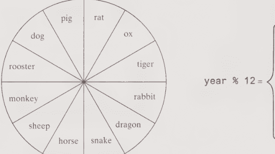

图 3.6 中国生肖基于12年为一个周期。

### 列表 3.9 `ChineseZodiac.java`

```java
import java.util.Scanner;

public class ChineseZodiac {
    public static void main(String[] args) {
        Scanner input = new Scanner(System.in);
        int year = input.nextInt();

        switch (year % 12) {
            case 0: System.out.println("monkey"); break;
            case 1: System.out.println("rooster"); break;
            case 2: System.out.println("dog"); break;
            case 3: System.out.println("pig"); break;
            case 4: System.out.println("rat"); break;
            case 5: System.out.println("ox"); break;
            case 6: System.out.println("tiger"); break;
            case 7: System.out.println("rabbit"); break;
            case 8: System.out.println("dragon"); break;
            case 9: System.out.println("snake"); break;
            case 10: System.out.println("horse"); break;
            case 11: System.out.println("sheep"); break;
        }
    }
}
```

输入年份

确定生肖符号


## 3.14 条件运算符

3.13.1 `switch`变量需要什么数据类型？如果处理完一个`case`后没有`break`关键字，下一条执行的语句是什么？你可以将`switch`语句转换为等效的`if`语句吗，反之亦然？使用`switch`语句的优势是什么？

> 检查点

3.13.2 执行以下`switch`语句后，`y`是什么？使用`if-else`语句重写代码。

```java
x = 3; y = 3;
switch (x + 3) {
    case 6: y = 1;
    default: y += 1;
}
```

3.13.3 执行以下`if-else`语句后，`x`是什么？使用`switch`语句重写它，并为新的`switch`语句画出流程图。

```java
int x = 1, a = 3;
if (a == 1)
    x += 5;
else if (a == 2)
    x = 10;
else if (a == 3)
    x += 16;
else if (a == 4)
    x += 34;
```


### 3.13.4

编写一个`switch`语句，如果天分别是`0`、`1`、`2`、`3`、`4`、`5`、`6`，则分别显示周日、周一、周二、周三、周四、周五、周六。

### 3.13.5

使用`if-else`语句重写列表 3.9。

## 3.14 条件运算符

> **关键点**

条件运算符根据条件评估表达式。

你可能想为一个受某些条件限制的变量赋值。例如，以下语句如果`x`大于 0，则给`y`赋值为 1；如果`x`小于等于 0，则给`y`赋值为 -1：

```java
if (x > 0)
    y = 1;
else
    y = -1;
```

或者，在下面的示例中，你可以使用条件运算符实现相同功能。

```java
y = (x > 0) ? 1 : -1;
```

符号`?`和`:`同时出现于条件运算符（也称为三元运算符）中，因为它使用了三个操作数。它是 Java 中唯一的三元运算符。条件运算符风格完全不同，语句中没有隐式的`if`。使用条件运算符的语法如下：

> **三元运算符**

```java
boolean-expression ? expression1 : expression2
```

如果`boolean-expression`为真，则表达式的结果为`expression1`；否则结果为`expression2`。

假设你想将变量`num1`和`num2`中较大的数赋值给`max`。你可以简单地使用条件运算符写一条语句：

```java
max = (num1 > num2) ? num1 : num2;
```

## 第3章 选节

作为另一个示例，以下语句如果`num`是偶数，则显示“num is even”，否则显示“num is odd”。

```java
System.out.println((num % 2 == 0) ? "num is even" : "num is odd");
```

从这些示例中可以看出，条件运算符允许你编写短而简洁的代码。


### 3.14.1

假设当你运行以下程序时，从控制台输入 2 3。输出是什么？

```java
public class Test {
    public static void main(String[] args) {
        java.util.Scanner input = new java.util.Scanner(System.in);
        double x = input.nextDouble();
        double y = input.nextDouble();
        double z = input.nextDouble();

        System.out.println((x < y && y < z) ? "sorted" : "not sorted");
    }
}
```

### 3.14.2

使用条件运算符重写以下`if`语句。

```java
if (ages >= 16)
    ticketPrice = 20;
else
    ticketPrice = 10;
```

### 3.14.3

使用`if-else`语句重写以下代码。

- a. `score = (x > 10) ? scale * 4 : scale;`
- b. `tax = (income > 10000) ? income * 0.2 : income + 1000;`
- c. `System.out.println((num % 3 == 0) ? 1 : -1);`

### 3.14.4

编写一个`switch`语句，如果天分别是`0`、`1`、`2`、`3`、`4`、`5`、`6`，则显示周日、周一、周二、周三、周四、周五、周六。

## 3.15 优先级和结合性

当在表达式中使用不同优先级的运算符时，优先级决定了先计算哪个运算符。如果运算符优先级相同，结合性决定了计算顺序。

### 表 3.8 优先级表

| 优先级 | 运算符 |
|---|---|
|  | `var++`、`var--`（后缀） |
|  | `+`、`-`（一元）、`++var`、`--var`（前缀） |
|  | `(type)`（强制） |
|  | `!`（非） |
|  | `*`、`/`、`%`（乘法、除法和取余） |
|  | `+`、`-`（二元加法和减法） |
|  | `<`、`<=`、`>=`、`>`（关系） |
|  | `==`、`!=`（相等） |
|  | `^`（逻辑与） |
|  | `&&`、`||`（逻辑或） |
|  | `+=`、`-=`、`*=`、`/=`、`%=`（赋值） |

赋值运算符是右结合的。因此，表达式

```java
a = b += c = d
```

等于：

```java
a = (b += (c = d))
```

假设赋值前`a`、`b`、`c`均为 1；表达式评估后，`a`变为 6，`b`变为 6，`c`变为 5。赋值运算符的左结合性是不合理的。

## 3.16 调试

调试是发现并修复程序错误的过程。

如第 1.10 节所述，语法错误很容易发现和修正，因为编译器会给出错误发生的索引以及产生原因。运行时错误也不难发现；当程序终止时，Java 解释器会在控制台上显示它们。相反，寻找逻辑错误可能非常具有挑战性。

逻辑错误被称为 bug（错误）。发现和纠正错误的过程被称为调试。调试的一种常用方法是结合多种方法来确定位 bug 所在的程序部分。你可以对程序进行人工跟踪（即通过阅读程序来捕捉错误），或者插入打印语句来显示变量的值或程序的执行流。这些方法适用于调试短小、简单的程序，但对于大型、复杂的程序，最有效的方法是使用调试器。

JDK 拥有一个命令行调试器`jdb`，它通过类名调用。`jdb`本身运行着它自己的 Java 解释器副本。像 Eclipse 和 NetBeans 等所有的 IDE 工具都包含了集成的调试器。调试器实用程序允许你跟踪程序的执行情况。这些工具在不同系统之间有所差异，但它们都支持大多数以下功能：

- **一次执行一条语句**：调试器允许你一次执行一条语句，以便你可以看到每条语句的效果。
- **进入（Step Into）或跳过（Step Over）一个方法**：如果正在执行一个方法，你可以要求调试器进入该方法，并在方法内一次执行一条语句，或者你也可以跳过整个方法。如果你知道该方法运行正常，就应该跳过整个方法，并且始终跳过系统实现的方法，例如`System.out.println`。
- **设置断点**：你还可以在特定语句处设置断点。当你的程序到达断点时，它会暂停。你可以设置任意数量的断点。当你知道编程错误从哪里开始时，断点特别有用。你可以在该语句处设置断点，并让程序执行到该断点为止。
- **显示变量**：调试器允许你选择几个变量并显示它们的值。当你跟踪程序执行时，变量的内容会不断更新。
- **显示调用堆栈**：调试器允许你跟踪所有的方法调用。当你需要查看程序执行流的宏观视图时，这个功能非常有帮助。
- **修改变量**：某些调试器允许你在调试时修改变量的值。当你想要用不同的样本测试程序但不想离开调试器时，这非常方便。

> **提示** 如果你使用 Eclipse 或 NetBeans 等 IDE，请参考配套网站上补充部分 II.C 和 II.E 中的《使用 Eclipse/NetBeans 有效学习 Java》。该补充将向你展示如何使用调试器跟踪程序，以及调试如何帮助有效学习 Java。

## 核心术语

| 术语 | 页码 |
|---|---|
| 布尔表达式 | 98 |
| 流程图 | 100 |
| 布尔数据类型 | 98 |
| 懒性运算符 | 118 |
| 布尔值 | 98 |
| 运算符结合性 | 127 |
| 条件运算符 | 125 |
| 运算符优先级 | 126 |
| 悬空 else 歧义 | 107 |
| 选择语句 | 98 |
| 调试 | 128 |
| 短路运算符 | 118 |
| 贯穿行为 | 123 |

## 章节总结

1. 布尔类型变量可以存储真（`true`）或假（`false`）值。
2. 关系运算符（`<`、`<=`、`==`、`!=`、`>=`、`>=`）产生布尔值。
3. 选择语句用于带有备选方案的编程。选择语句有几种类型：单向`if`语句、双向`if-else`语句、嵌套`if`语句、多路`if-else`语句、`switch`语句和条件运算符。
4. 各`if`语句根据布尔表达式做出控制决策。根据表达式的真假评估，这些语句采取两种可能路径中的一种。
5. 布尔运算符`&&`、`||`和`^`对布尔值和变量进行操作。
6. 在求`p1 && p2`时，Java 先求`p1`，如果`p1`为真，再求`p2`；如果`p1`为假，则不求`p2`。在求`p1 || p2`时，Java 先求`p1`，如果`p1`为真，则不求`p2`（注：原文可能有误）。因此，`&&`被称为短路或懒性与运算符，`||`被称为短路或懒性或运算符。
7. `switch`语句根据类型为`char`、`byte`、`short`、`int`和`String`的`switch`表达式做出控制决策。
8. `break`关键字在`switch`语句中是可选的，但它通常用于每个`case`的结尾，以跳过`switch`语句的剩余部分。如果没有`break`语句，将执行下一个`case`语句。
9. 表达式中的运算符的求值顺序由括号规则、运算符优先级和运算符结合性决定的。
10. 括号可以强制求值顺序按任何序列发生。
11. 优先级较高的运算符先求值。对于相同优先级的运算符，它们的结合性决定了求值顺序。
12. 除了赋值运算符外，所有二元运算符都是左结合的；赋值运算符是右结合的。

## 练习

在配套网站在线回答本章的练习。

## MyProgrammingLab 编程练习

### 在编码前思考

**教学注释：**对于每个练习题，在编码之前请仔细分析问题并设计策略。

**调试提示：**在寻求帮助之前，请自己使用 IDE 跟踪一遍问题。

### 3.1（代数：解二次方程）

二次方程`ax^2 + bx + c = 0`可以使用以下公式求解：

`r_1 = \frac{-b + \sqrt{b^2 - 4ac}}{2a}`和`r_2 = \frac{-b - \sqrt{b^2 - 4ac}}{2a}`

`b^2 - 4ac`被称为判别式。如果它是正的，方程有两个根。如果为零，方程有一个根。如果是负的，方程没有根。编写一个程序，提示用户输入`a`、`b`和`c`，根据判别式显示结果。

### 3.2（游戏：乘法）

列表 3.1`AdditionQuiz.java`生成两个整数并提示用户输入这些整数的积。修改程序生成三个单个整数，并提示用户输入这些整数的乘积。

### 3.3（代数：解线性方程）

线性方程可以使用克莱姆法则求解。编写一个程序，提示用户输入`a`、`b`、`c`、`d`、`e`和`f`，并显示结果。如果`ad - bc`为 0，报告“无解”。

### 3.4（随机月份）

编写一个程序，随机生成一个 1 到 12 之间的整数，并根据数字 1、2、...、12 显示对应的英文名称 January、February、...、December。

### 3.5（查找未来日期）

编写一个程序，提示用户输入今天的星期几（星期日为 0，星期一为 1，……到星期六为 6）。还要提示用户输入未来的后的天数，并显示未来的星期几。

### 3.6（健康应用：BMI）

修改列表 3.4`ComputeAndInterpretBMI.java`，让用户输入重量、身高和英寸。例如，如果某人高为 5 英尺 10 英寸，你将在英尺处输入 5，英寸处输入 10。

### 3.7（金融应用：货币单位）

修改列表 2.10`ComputeChange.java`，在显示非零分母时，对于一个单位使用单数词（如 1 dollar 和 1 penny），对于大于一个单位使用复数词（如 2 dollars 和 3 pennies）。

# 第3章节选


### 整数排序

（Sort integers）写一个程序，提示用户输入三个整数，并按非递顺序显示这些整数。

（业务：检查 ISBN-10）ISBN-10（国际标准书号）由 10 位数字组成：`d1 d2 d3 d4 d5 d6 d7 d8 d9 d10`。最后一位数字`d10`是校验和，通过以下公式从其他 9 位数字计算：

```text
d1 × 1 + d2 × 2 + d3 × 3 + d4 × 4 + d5 × 5 = (d6 × 6 + d7 × 7 + d8 × 8 + d9 × 9) % 10
```

如果校验和为 10，根据 ISBN-10 规范，最后一位表示为 X。编写一个程序，提示用户输入前 9 位数字，并显示 10 位 ISBN（包括零）。你的程序应以整数形式读取输入。以下是示例运行：

```text
Enter the first 9 digits of an ISBN as integer: 013601267
The ISBN-10 number is 0136012671
```

```text
Enter the first 9 digits of an ISBN as integer: 0130319977
The ISBN-10 number is 013031997X
```

（游戏：乘法测试）列表`SubtractionQuiz.java`随机生成一个减法题。修改该程序，随机生成两个小于 1000 的整数的乘法题。

## 3.8–3.16 节

（计算每月天数）写一个程序，提示用户输入月份和年份，并显示该月份的天数。例如，如果用户输入月份 2 年份 2012，程序应该显示 2012 年 2 月有 29 天。如果用户输入月份 3 年份 2015，程序应该显示 2015 年 3 月有 31 天。

（回文整数）写一个程序，提示用户输入一个三位整数，并判断它是否为回文整数。如果一个整数从右到左和从左到右相同，则它是回文整数。负整数被视为正整数。这是该程序的示例运行：

```text
Enter a three-digit integer: 121
121 is a palindrome
```

```text
Enter a three-digit integer: 123
123 is not a palindrome
```

（财务应用：计算税收）列表`ComputeTax.java`提供了计算单身纳税者税额的代码。完成此程序以计算所有纳税状态的税额。

（游戏：正面或反面）写一个程序，让用户猜硬币落后是正面还是反面。程序随机生成一个整数 0 或 1，代表正面或反面。程序提示用户输入猜测，并报告猜测是正确还是错误。

（游戏：彩票）修改列表 3.8`Lottery.java`，生成一个 3 位数的彩票。程序提示用户输入一个三位数，并根据以下规则判断用户是否中奖：

1. 如果用户输入与彩票数字完全匹配，奖金为 $12,000。
2. 如果用户输入的所有数字都与彩票数字的所有数字匹配，奖金为 $5,000。
3. 如果用户输入中有一个数字与彩票数字中的一个匹配，奖金为 $2,000。

### 3.16（随机点）

写一个程序，在矩形内显示一个随机坐标。该矩形中心位于 (0, 0)，宽度为 50，高度为 150。

### 3.17（游戏：剪刀、石头布）

写一个程序玩流行的剪刀石头布游戏。剪刀可以剪纸，石头可以打碎剪刀，布可以包石头。程序随机生成数字 0、1 或 2，分别代表剪刀、石头和布。程序提示用户输入数字 0、1 或 2，并显示消息指示是用户还是电脑获胜、输还是平局。以下是示例运行：


### 3.18（运费）

快递公司使用以下函数根据重量（磅）计算运费（美元）。

```text
c(w) = { 2.5, if 0 < w <= 2
        4.5, if 2 < w <= 4
        7.5, if 4 < w <= 10
        10.5, if 10 < w <= 20 }
```

写一个程序，提示用户输入包裹重量并显示运费。如果重量大于 20，显示消息“该包裹无法运输”。

### 3.19（计算三角形周长）

写一个程序，读取三角形的三条边，如果输入有效，则计算周长。如果任意两边之和大于第三条边，则显示输入无效。

### 3.20（科学：风寒指数）

练习 2.17 给出了 -58°F 到 41°F 之间的温度和大于 3 mph 的风速公式。写一个程序，提示用户输入温度和风速。如果输入有效，程序显示风寒指数；否则，显示输入无效。

### （科学：星期）

Zeller 同余式是 Christian Zeller 开发的计算周期的算法。公式为：

```text
h = (q + [26(m+1)/5] + K + K/4 - 2J) % 7
```

其中：

- `h`是星期（0：六，1：日，2：一，3：二，4：三，5：四）
- `q`是日期
- `m`是月份（3：三月，4：四月……12：十二月）。一月二月视为去年的 13 和 14。
- `j`是世纪（`year/100`）
- `k`是年份（`year%100`）

此练习中的所有除法均为整数除法。写一个程序，提示用户输入年份、月份和日期，并显示星期。以下是一些运行：


```text
Enter year: (e.g., 2012) 2012
Enter month: 1-12: 1
Enter day of the month: 1-31: 25
Day of the week is Sunday
```


```text
Enter year: (e.g., 2012) 2012
Enter month: 1-12: 5
Enter day of the month: 1-31: 12
Day of the week is Saturday
```

（提示：月份中一月二月被视为 13 和 14，因此你需要将用户输入的 1 和 2 转换为上一年的。如果用户输入`m=1`且`year=2015`，在公式中`m`将是 13，`year`将是 2014。）


## （几何：圆内点）

写一个程序，提示用户输入点 `(x, y)`，并检查该点是否在以 `(0,0)` 为中心、半径为 10 的圆内。例如，`(4, 5)` 在圆内，而`(9, 9)`在圆外，如图 3.7a 所示。

（提示：如果点到 `(0,0)` 的距离小于或等于 10，则在圆内。计算距离的公式为 $\sqrt{(x_2-x_1)^2 + (y_2-y_1)^2}$。测试你的程序以涵盖所有情况。）

下方是两个示例：


```text
Enter point with two coordinates: 4 5
Point (4.0, 5.0) is in the circle
```


```text
Enter point with two coordinates: 9 9
Point (9.0, 9.0) is not in the circle
```

# 编程练习 135

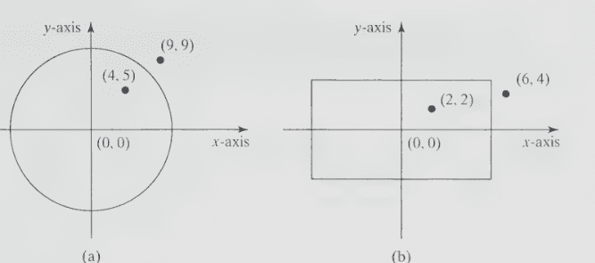

**图 3.7** （a）圆内点。（b）矩形点。

## 3.23（几何：矩形内点）

写一个程序，提示用户输入点 `(x, y)`，并检查该点是否在以 `(1,1)` 为中心、宽度为 10、高度为 5 的矩形内。例如，如图 3.7b 所示，`(2,2)`在矩形内，而`(6,4)`在矩形外。

（提示：如果点到 `(0,0)` 的水平距离小于或等于 `10/2` 且垂直距离小于或等于 `5/2`，则在矩形内。测试你的程序以涵盖所有情况。）

这里有两次运行：

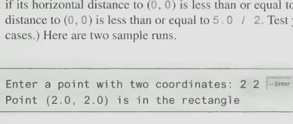

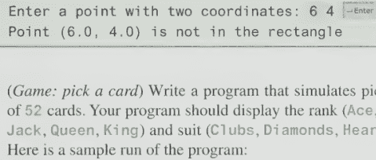

## 3.24（游戏：抽牌）

写一个程序模拟从 52 张牌中抽取一张牌。你的程序应该显示该牌的大小（A, 2, 3, 4, 5, 6, 7, 8, 9, 10, Jack, Queen, King）和花色（梅花、方、红红、桃）。这是该程序的示例运行：

```text
The card you picked is Jack of Hearts
```

## 3.25（几何：交点）

线 1 上的点分别为 `(x1, y1)` 和 `(x2, y2)`，线 2 上的点分别为 `(x3, y3)` 和 `(x4, y4)`，如图 3.8a 和 b 所示。两条线的交点可以通过求解以下线性方程找到：

```text
(y1 - y2)x - (x1 - x2)y = (y1 - y2)x1 - (x1 - x2)y1
(y3 - y4)x - (x3 - x4)y = (y3 - y4)x3 - (x3 - x4)y3
```

该线性方程组可以使用克莱姆法则求解（参见编程练习 3.3）。如果方程无解，则两条线平行（见图 3.8c）。

编写一个程序，提示用户输入四个点并显示它们的交点。以下是示例运行：

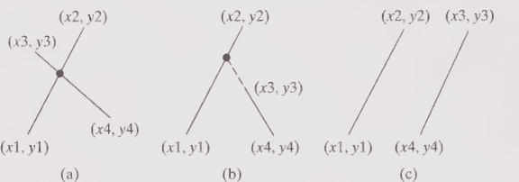

图 3.8 两线在（a 和 b）中相交，两条线在（c）中平行。


```text
输入 x1, y1, x2, y2, x3, y3, x4, y4: 2 2 7 6 0 4.0 2.0 -1.0 -2.0
两条线平行
```

## 3.26（使用 &&、|| 和 != 运算符）

编写一个程序，提示用户输入一个整数，并判断它是否能被 4 和 5 整除，是否能被 4 或 5 整除，以及是否能被 4 或 5 整除但不同时两者。以下是该程序的示例运行：

| 输入一个整数： | 10 |
|---|---|
| 10 能被 4 和 5 整除吗？ | false |
| 10 能被 4 或 5 整除吗？ | true |
| 10 能被 4 或 5 整除但不同时两者吗？ | true |

## 3.27（几何：三角形内的点？）

假设平面上有一个如下所示的直角三角形。直角位于 `(0, 0)`，另外两个点位于 `(200, 0)` 和 `(0, 100)`。编写一个程序，提示用户输入带有 x 坐标和 y 坐标的点并判断该点是否在三角形内部。以下是示例运行：

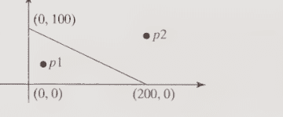

| 输入点的 x 和 y 坐标： | 100.5 25.5 |
|---|---|
| 点在三角形内 | |

# 137 编程练习

```text
输入点的 x 和 y 坐标: 100.5 50.5
该点不在三角形内
```

## 3.28（几何：两个矩形）

编写一个程序，提示用户输入两个矩形的中心 x 坐标、宽度和高度，并判断第二个矩形是在第一个矩形内部还是与第一个矩形重叠，如图 3.9 所示。测试你的程序以覆盖所有情况。

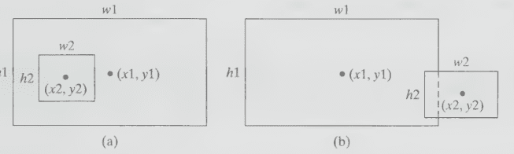

**3.9** （a）一个矩形在另一个内部。（b）一个矩形与另一个一个重叠。

以下是运行结果：

```text
输入 r1 的中心 x-、y-坐标，宽度和高度: 2.5 4 2.5 43
输入 r2 的中心 x-、y-坐标，宽度和高度: 1.5 0.5 0.3
r2 在 r1 内部
```

```text
输入 r1 的中心 x-、y-坐标，宽度和高度: 1 2 3 5.5
输入 r2 的中心 x-、y-坐标，宽度和高度: 3 4 4.5 5.5
r2 与 r1 重叠
```

```text
输入 r1 的中心 x-、y-坐标，宽度和高度: 1 2 3 3
输入 r2 的中心 x-、y-坐标，宽度和高度: 40 45 32 2
r2 不重叠 r1
```

## 3.29（几何：两个圆）

编写一个程序，提示用户输入两个圆的中心坐标和半径，并判断第二个圆是在第一个内部还是与第一个重叠，如图 3.10 所示。

（提示：如果两个圆之间的距离 `<= r1 - r2`，则 `circle2` 在 `circle1` 内部；如果距离 `<= r1 + r2`，则 `circle2` 与 `circle1` 重叠。测试你的程序以覆盖所有情况。）

以下是运行结果：

```text
输入 circle1 的中心 x-、y-坐标，半径: 0.5 5.1 13
输入 circle2 的中心 x-、y-坐标，半径: 1.7 4.5
circle2 在 circle1 内部
```

# 138 第3章 选

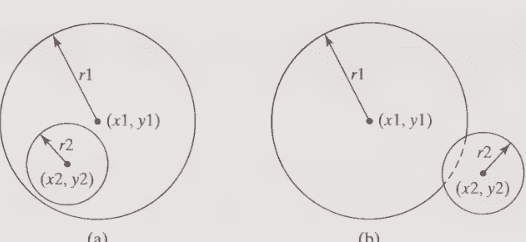

图 10 （a）一个圆在另一个内部。（b）一个圆与另一个重叠。

| 输入 circle1 的中心 x-、y-坐标，半径: | 3.4 5.7 5.5 |
|---|---|
| 输入 circle2 的中心 x-、y-坐标，半径: | 6.7 3.5 3 |
| 输入 circle1 的中心 x-、y-坐标，半径: | 3.4 5.5 1 |
| 输入 circle2 的中心 x-、y-坐标，半径: | 5.5 7.2 1 |
| circle2 不重叠 circle1 | |

## 3.30（当前时间）

修改练习 2.8，使用 12 小时制显示小时。以下是一个示例运行：

```text
输入 GMT 时间偏移: -5
当前时间是凌晨 4:50
```

## 3.31（财务：货币交换）

编写一个程序，提示用户输入美元到人民币的汇率。分别提示用户将美元转换为人民币，以及将人民币转换为美元。以下是示例运行：

| 输入美元到人民币的汇率: | 6.81 |
|---|---|
| 输入 0 将美元转换为人民币，1 反反之: | 0 |
| 输入美元金额: | 100 |
| 100.0 美元是 681.0 人民币 | |

| 输入美元到人民币的汇率: | 6.81 |
|---|---|
| 输入 0 将美元转换为人民币，1 反反之: | 1 |
| 输入人民币金额: | 10000 |
| 10000.0 人民币是 $14684.3 | |

# 139 编程练习

```text
输入美元到人民币的汇率: 6.81
输入 0 将美元转换为人民币，1 反反之: 5
输入错误
```

## 3.32（几何：点的位置）

给定从 $p0(x0, y0)$ 到 $p1(x1, y1)$ 的有向直线，可以使用以下条件判断点 $p2(x2, y2)$ 在直线的左侧、右侧还是同一线上（见图 3.11）：

```text
(x1 - x0)*(y2 - y0) - (x2 - x0)*(y1 - y0)>0 p2 在直线的左侧
=0 p2 在直线上
<0 p2 在直线的右侧
```

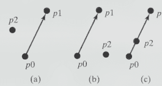

**图 3.11** （a）p2 在直线的左侧。（b）p2 在直线的右侧。（c）p2 在同一线上。

编写一个程序，提示用户输入 $p0, p1, p2$ 的三个点，并显示 `p2` 在从 `p0` 到 `p1` 的直线的左侧、右侧还是同一线上。以下是一些示例运行：

```text
输入 p0, p1, p2 的三个点: 4.4 2 6.5 9.5 -5 4
p2 在直线的左侧
```

```text
输入 p0, p1, p2 的三个点: 1 1 5 5 2 2
p2 在同一线上
```

```text
输入 p0, p1, p2 的三个点: 3.4 2 6.5 9.5 2.5
p2 在直线的右侧
```

## 3.33（财务：比较成本）

假设你购买了两个不同的包裹。你想写一个程序来比较成本。程序提示用户输入每个包裹的重量和价格，并显示价格更好的那个。以下是一个示例运行：

```text
输入包裹 1 的重量和价格: 50 24.59
输入包裹 2 的重量和价格: 25 11.99
包裹 2 的价格更好。
```

# 140 第3章 选


```text
输入包裹 1 的重量和价格: 50 25
输入包裹 2 的重量和价格: 25 12.5
两个包裹的价格相同。
```

## 3.34（几何：线段上的点）

3.32 显示了如何测试点是否在线上。修改练习 2.8 以测试点是否在线段上。编写一个程序，提示用户输入 $p0, p1, p2$ 的三个点，并显示 `p2` 在从 `p0` 到 `p1` 的直线的左侧、右侧还是同一线上。以下是示例运行：

```text
输入 p0, p1, p2 的三个点: 4.4 2 6.5 9.5 -5 4
p2 在直线的左侧
```

```text
输入 p0, p1, p2 的三个点: 1 1 5 5 2 2
p2 在同一线上
```

```text
输入 p0, p1, p2 的三个点: 3.4 2 6.5 9.5 2.5
p2 在直线的右侧
```

## 3.35（偶数或奇数）

编写一个程序，提示用户输入一个整数，并显示该整数是偶数还是奇数。以下是示例运行：

```text
输入一个整数: 200
200 是偶数
```

```text
输入一个整数: 211
211 是奇数
```

# 142 第 4 章 数学函数、字符与字符串

## 4.1 引言

本章的重点是介绍数学函数、字符、字符串对象，并使用它们来开发程序。

前面的章节介绍了基础编程技术，并教导你如何编写简单的程序来使用选择语句解决基础问题。本章将介绍执行常用数学运算的方法。你将在第 6 章中学习如何创建自定义方法。

假设你需要根据这四个城市的 GPS 位置（纬度和经度）来估计这四个城市所围成的面积，如下图所示。你会如何编写程序来解决这个问题呢？你将在本章中学会写出这样的程序。

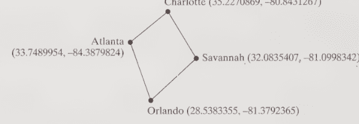

由于字符串在编程中频繁，介绍字符串是有益的，这样你可以开始使用它们来开发实程序。本章也对字符串进行了简要介绍；你将在第 9 和第 10 章中学习更多关于对象和字符串的知识。

## 4.2 常用数学函数

Java 的 `Math` 类提供了许多有用的方法来执行数学函数。

方法是一组执行特定任务的语句。你已经在 2.9.4 节“指数”中使用过 `pow(a, b)` 方法来计算 $a^b$，并在 3.7 节中使用 `random` 方法来生成随机数。本节介绍了 `Math` 类中的其他有用方法。它们可以分为三角函数方法、指数方法和服务方法。服务方法包括舍入、`min`、`max` 和 `random`。除了方法外，`Math` 类还提供了两个 `double` 类型常量：`PI` 和 `E`（自然对数的底）。你可以在任何程序中使用 `Math.PI` 和 `Math.E` 使用这些常量。

### 4.2.1 三角形函数方法

`Math` 类包含表 4.1 所示的以下用于执行三角函数的方法：

| 方法 | 说明 |
|---|---|
| `sin(radians)` | 返回弧度角的三角正弦值。 |
| `cos(radians)` | 返回弧度角的三角余弦值。 |
| `tan(radians)` | 返回弧度角的三角正切值。 |
| `toRadians(degree)` | 将角度转换为弧度。 |
| `toDegrees(radians)` | 将弧度转换为角度。 |
| `asin(a)` | 返回正弦函数的反弧度。 |
| `acos(a)` | 返回余弦函数的反弧度。 |
| `atan(a)` | 返回正切函数的反弧度。 |

`sin`、`cos` 和 `tan` 的参数是弧度单位的角。`asin` 和 `atan` 的返回值为 $-\pi/2$ 到 $\pi/2$ 之间的弧度角，而 `acos` 在 0 到 $\pi$ 之间。1 度等于 $\pi/180$ 弧度，90 度等于 $\pi/2$，30 度等于 $\pi/6$ 弧度。

例如：

- `Math.degrees(Math.PI / 2)` 返回 90.0。
- `Math.toRadians(30)` 返回 0.5236（相当于 $\pi/6$）。
- `Math.sin(Math.toRadians(90))` 返回 1.0。
- `Math.sin(Math.PI / 6)` 返回 0.5。
- `Math.sin(Math.PI / 2)` 返回 1.0。
- `Math.cos(0)` 返回 1.0。
- `Math.cos(Math.PI / 6)` 返回 0.866。
- `Math.cos(Math.PI / 2)` 返回 0.0。
- `Math.asin(0.5)` 返回 0.52359877（相当于 $\pi/6$）。
- `Math.acos(0.5)` 返回 1.0472（相当于 $\pi/3$）。
- `Math.atan(1.0)` 返回 0.7853（相当于 $\pi/4$）。

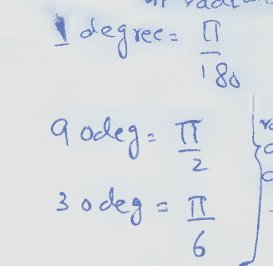

### 4.2.2 指数方法

`Math` 类中共有表 4.2 所示的五个与指数相关的方法。

**表 4.2** `Math` 类中的指数方法

| 方法 | 说明 |
|---|---|
| `exp(x)` | 返回 $e$ 的 $x$ 次方。 |
| `log(x)` | 返回 $x$ 的自然对数（$\ln(x)$）。 |
| `log10(x)` | 返回 $x$ 的常用对数（$\log_{10}(x)$）。 |
| `pow(a, b)` | 返回 $a$ 的 $b$ 次方（$a^b$）。 |
| `sqrt(x)` | 返回 $x$ 的平方根（$\sqrt{x}$），当 $x > 0$。 |

例如：

- $e^{3.5}$ 是 `exp(3.5)`，返回 33.1154。
- $\ln(3.5)$ 是 `log(3.5)`，返回 1.2527。
- $\log_{10}(3.5)$ 是 `log10(3.5)`，返回 0.544。
- $2^3$ 是 `pow(2, 3)`，返回 8.0。
- $3^2$ 是 `pow(3, 2)`，返回 9.0。
- $4^{2.5}$ 是 `pow(4, 2.5)`，返回 32.0。
- $\sqrt{4}$ 是 `sqrt(4)`，返回 2.0。

### 4.2.3 舍入方法

`Math` 类包含表 4.3 所示的四个舍入方法。

**表 4.3** `Math` 类中的舍入方法

| 方法 | 说明 |
|---|---|
| `ceil(x)` | 向上舍入到最近的整数。以 `double` 类型返回。 |
| `floor(x)` | 向下舍入到最近的整数。以 `double` 类型返回。 |
| `round(x)` | 舍入到最近的整数。如果 $x$ 靠近两个整数，则返回偶数那个。 |
| `round(x)` | 如果 $x$ 是 `float`，返回 `(int)Math.floor(x+0.5)`；如果 $x$ 是 `double`，返回 `(long)Math.floor(x+0.5)`。 |

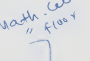

例如：

- `Math.ceil(2.1)` 返回 3.0。
- `Math.ceil(2.0)` 返回 2.0。
- `Math.ceil(-2.0)` 返回 -2.0。
- `Math.floor(2.1)` 返回 2.0。
- `Math.floor(2.0)` 返回 2.0。
- `Math.floor(-2.0)` 返回 -2.0。
- `Math.round(2.1)` 返回 2.0。
- `Math.round(-2.0)` 返回 -2.0。
- `Math.round(-2.1)` 返回 -2.0。
- `Math.round(2.5)` 返回 3.0。
- `Math.round(2.6f)` 返回 3。
- `Math.round(2.0)` 返回 2。
- `Math.round(-2.0f)` 返回 -2。
- `Math.round(2.6)` 返回 -3。
- `Math.round(-2.4)` 返回 -2。

### 4.2.4 `min`、`max` 和 `abs` 方法

`min` 和 `max` 方法返回两个数字（`int`、`long`、`float` 或 `double`）中的最小和最大。例如，`max(4.4, 4.5)` 返回 5.0，而 `min(3, 2)` 返回 2。


`abs` 方法返回数字（`int`、`long`、`float` 或 `double`）的绝对值。例如：

`Math.max(2, 3)` 返回 3。

`Math.min(2.5, 4.6)` 返回 2.5。

`Math.max(2.5, 4.6)`、`Math.min(3, 5.6)` 返回 4.6。

`Math.abs(-2)` 返回 2。

`Math.abs(-2.1)` 返回 2.1。

### 4.2.5 `random` 方法

你在上一章中使用了 `random()` 方法。该方法生成一个大于等于 0.0 且小于 1.0 的随机 `double`（`0.0 <= Math.random() < 1.0`）。你可以用它编写一个简单的表达式来生成任意范围内的随机数。

`(int)(Math.random() * 10)` 返回 0 到 9 之间的随机整数。

`50 + (int)(Math.random() * 50)` 返回 50 到 99 之间的随机整数。

通常情况下，`a + Math.random() * b` 返回 a 到 a + b 之间的随机数，不包括 a + b。

### 4.2.6 案例研究：计算三角形的角

你可以使用数学方法来解决许多计算问题。给定三角形的三条边，你可以通过以下公式计算角：

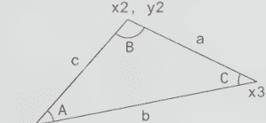

`A = Math.acos((a * a + b * b - c * c) / (-2 * b * c))`

`B = Math.acos((b * b - a * a - c * c) / (-2 * a * c))`

`C = Math.acos((c * c - b * b - a * a) / (-2 * a * b))`

不要被数学公式吓倒。正如在 2.9 节 `ComputeLoan.java` 中讨论的，你不需要知道公式是如何推导出来的就可以编写计算贷款的程序。在这里的例子中，给定边的长度你就可以使用这个公式计算角。为了计算边，我们需要三个点的坐标并计算它们之间的距离。

4.1 是一个提示用户输入三角形三个顶点的坐标并显示这三个角的程序。

# Listing 4.1 `ComputeAngles.java`

```java
import java.util.Scanner;

public class ComputeAngles {
    public static void main(String[] args) {
        Scanner input = new Scanner(System.in);

        // 用户输入三个点
        System.out.print("Enter three points: ");
        double x1 = input.nextDouble();
        double y1 = input.nextDouble();
        double x2 = input.nextDouble();
        double y2 = input.nextDouble();
        double x3 = input.nextDouble();
        double y3 = input.nextDouble();

        // 计算三边
        double a = Math.sqrt((x2 - x3) * (x2 - x3) + (y2 - y3) * (y2 - y3));
        double b = Math.sqrt((x1 - x3) * (x1 - x3) + (y1 - y3) * (y1 - y3));
        double c = Math.sqrt((x1 - x2) * (x1 - x2) + (y1 - y2) * (y1 - y2));

        // 计算三个角
        double A = Math.acos((a * a + b * b - c * c) / (-2 * b * c));
        double B = Math.acos((b * b - a * a - c * c) / (-2 * a * c));
        double C = Math.acos((c * c - b * b - a * a) / (-2 * a * b));
    }
}
```

# 146 第 4 章 数学函数、字符与字符串

```java
32 // 显示结果
33 System.out.println('The three angles are ' + 
34 Math.round(A * 100) / 100.0 + ' ' +
35 Math.round(B * 100) / 100.0 + ' ' +
36 Math.round(C * 100) / 100.0);
37 }
38 }
```


输入点：1 1 6 5 1 6 5 2 5 [_Enter

三个角度为 15.26 90.0 74.74。

该程序提示用户输入三个点（第 8 行）。这个提示信息并不清晰。你应该向用户提供如何输入这些点的明确指令：

```java
System.out.print('Enter the coordinates of three points separated " + "by spaces like x1 y1 x2 y2 x3 y3: ');
```

注意，两点 (`x1`, `y1`) 和 (`x2`, `y2`) 之间的距离可以使用公式 `$V=(x2-x1)^2+(y2-y1)^2$` 计算。程序计算了两个点之间的距离（第 17–22 行），并应用该公式计算角度（第 25–30 行）。程序使用了 `Math` 类，但没有导入，因为它位于 `java.lang` 包中。`java.lang` 包中的所有类在 Java 程序中都是隐式导入的。

## 检查点

### 4.2.1 求出以下方法调用的值

- (a) `Math.sqrt(4)`　(j) `Math.floor(-2.5)`
- (b) `Math.sin(2 * Math.PI)`　(k) `Math.round(-2.5f)`
- (c) `Math.cos(2 * Math.PI)`　(l) `Math.round(-2.5)`
- (d) `Math.pow(2, 2)`　(m) `Math.rint(2.5)`
- (e) `Math.log(Math.E)`　(n) `Math.ceil(2.5)`
- (f) `Math.exp(1)`　(o) `Math.floor(2.5)`
- (g) `Math.max(2, Math.min(3, 4))`　(p) `Math.round(2.5f)`
- (h) `Math.rint(-2.5)`　(q) `Math.round(2.5)`
- (i) `Math.ceil(-2.5)`　(r) `Math.round(Math.abs(-2.5))`

### 4.2.2

正确或错误？三角方法的参数是弧度制角度。

### 4.2.3

编写一条语句，将 47 度转换为弧度并将结果赋值给变量。

### 4.2.4

编写一条语句，将 PI 转换为角度并将结果赋值给变量。

### 4.2.5

编写一个表达式，获取 34 到 555 之间的随机整数。编写一个表达式，获取 5.5 到 55.5 之间的随机数。

### 4.2.6

为什么 `Math` 类不需要导入？

### 4.2.7

```java
Math.log(Math.exp(5.5)) 是多少？
Math.exp(Math.log(5.5)) 是多少？
Math.asin(Math.sin(Math.PI / 6)) 是多少？
Math.sin(Math.asin(Math.PI / 6)) 是多少？
```

## 4.3 字符数据类型与操作

字符数据类型表示一个单个字符。

除了数值值外，你可以在 Java 中处理字符。字符数据类型 `char` 用于表示单个字符。字符字面量括在单引号中。考虑以下代码：

```java
char letter = 'A';
char numChar = '4';
```

第一条语句将字符 A 赋值给字符变量 `letter`。第二个语句将字符 4 赋值给字符变量 `numChar`。

> **注意**
>
> 字符串字面量必须括在双引号（`""`）中。字符字面量是括在单引号（`''`）中的单个字符。因此，`"A"` 是一个字符串，但 `'A'` 是一个字符。

### 4.3.1 Unicode 和 ASCII 码

计算机使用二进制数。字符在计算机中存储为 0 和 1 的序列。将字符映射到其二进制表示称为编码。有多种方法可以编码字符。字符如何编码由编码方案定义。

Java 支持 Unicode，这是一种由 Unicode 协会建立的编码方案，用于支持世界上各种语言的书写文本的交换、处理和显示。Unicode 最初被设计为 16 位编码。引入原始数据类型 `char` 是为了利用这种设计，提供一种可以容纳任何字符的简单数据类型。然而，事实证明，16 位编码中可能性的 65,536 个字符还不足以表示世界上所有的字符。因此，Unicode 标准已经扩展，以允许超出 16 位的限制。超出 16 位限制的字符被称为补充字符。Java 支持对超出本书范围的补充字符进行处理和表示。为了简单起见，本节仅考虑原始的 16 位 Unicode 字符。这些字符可以存储在 `char` 类型中。

16 位 Unicode 占用两个字节，前面带有 `\u0000` 到 `\uFFFF`。十六进制数在数系统中章节中介绍。它们的范围从 0 到 FF。例如，英语单词 "me" 翻译成中文为你好。这两个字符的 Unicode 是 `\u44B2\u597D`。

大多数计算机使用 ASCII（美国信息交换标准）这种 8 位编码方案来表示所有大写和小写字母、数字、标点符号和控制字符。Unicode 包含 ASCII，其中 `\u0000` 到 `\u07F` 对应 128 个字符。表 4.4 显示了常用字符的 ASCII 码。附录 B“字符集”提供了 ASCII 字符及其十六进制的列表。

#### 表 4.4 常用字符的 ASCII 码

| 字符 | 十进制 | Unicode 值 |
| :--- | :--- | :--- |
| '0' 到 '9' | 48 到 57 | `\u0030` 到 `\u0039` |
| 'A' 到 'Z' | 65 到 90 | `\u0041` 到 `\u005A` |
| 'a' 到 'z' | 97 到 122 | `\u0061` 到 `\u007A` |


注意，两点 `(x1, y1)` 和 `(x2, y2)` 之间的距离可以使用公式 `$V=(x2-x1)^2+(y2-y1)^2$` 计算。程序计算了两个点之间的距离（第 17–22 行），并应用该公式计算角度（第 25–30 行）。程序使用了 `Math` 类，但没有导入，因为它位于 `java.lang` 包中。`java.lang` 包中的所有类在 Java 程序中都是隐式导入的。

## 检查点

### 4.2.1 求出以下方法调用的值

- (a) `Math.sqrt(4)`　(j) `Math.floor(-2.5)`
- (b) `Math.sin(2 * Math.PI)`　(k) `Math.round(-2.5f)`
- (c) `Math.cos(2 * Math.PI)`　(l) `Math.round(-2.5)`
- (d) `Math.pow(2, 2)`　(m) `Math.rint(2.5)`
- (e) `Math.log(Math.E)`　(n) `Math.ceil(2.5)`
- (f) `Math.exp(1)`　(o) `Math.floor(2.5)`
- (g) `Math.max(2, Math.min(3, 4))`　(p) `Math.round(2.5f)`
- (h) `Math.rint(-2.5)`　(q) `Math.round(2.5)`
- (i) `Math.ceil(-2.5)`　(r) `Math.round(Math.abs(-2.5))`

### 4.2.2

正确或错误？三角方法的参数是弧度制角度。

### 4.2.3

编写一条语句，将 47 度转换为弧度并将结果赋值给变量。

### 4.2.4

编写一条语句，将 `PI` 转换为角度并将结果赋值给变量。

### 4.2.5

编写一个表达式，获取 34 到 555 之间的随机整数。编写一个表达式，获取 5.5 到 55.5 之间的随机数。

### 4.2.6

为什么 `Math` 类不需要导入？

### 4.2.7

```java
Math.log(Math.exp(5.5)) 是多少？
Math.exp(Math.log(5.5)) 是多少？
Math.asin(Math.sin(Math.PI / 6)) 是多少？
Math.sin(Math.asin(Math.PI / 6)) 是多少？
```

## 4.3 字符数据类型与操作

字符数据类型表示一个单个字符。

除了数值值外，你可以在 Java 中处理字符。字符数据类型 `char` 用于表示单个字符。字符字面量括在单引号中。考虑以下代码：

```java
char letter = 'A';
char numChar = '4';
```

第一条语句将字符 A 赋值给字符变量 `letter`。第二个语句将字符 4 赋值给字符变量 `numChar`。

> **注意**
>
> 字符串字面量必须括在双引号（`""`）中。字符字面量是括在单引号（`''`）中的单个字符。因此，`"A"` 是一个字符串，但 `'A'` 是一个字符。

### 4.3.1 Unicode 和 ASCII 码

计算机使用二进制数。字符在计算机中存储为 0 和 1 的序列。将字符映射到其二进制表示称为编码。有多种方法可以编码字符。字符如何编码由编码方案定义。

Java 支持 Unicode，这是一种由 Unicode 协会建立的编码方案，用于支持世界上各种语言的书写文本的交换、处理和显示。Unicode 最初被设计为 16 位编码。引入原始数据类型 `char` 是为了利用这种设计，提供一种可以容纳任何字符的简单数据类型。然而，事实证明，16 位编码中可能性的 65,536 个字符还不足以表示世界上所有的字符。因此，Unicode 标准已经扩展，以允许超出 16 位的限制。超出 16 位限制的字符被称为补充字符。Java 支持对超出本书范围的补充字符进行处理和表示。为了简单起见，本节仅考虑原始的 16 位 Unicode 字符。这些字符可以存储在 `char` 类型中。

16 位 Unicode 占用两个字节，前面带有 `\u0000` 到 `\uFFFF`。十六进制数在数系统中章节中介绍。它们的范围从 0 到 FF。例如，英语单词 "me" 翻译成中文为你好。这两个字符的 Unicode 是 `\u44B2\u597D`。

大多数计算机使用 ASCII（美国信息交换标准）这种 8 位编码方案来表示所有大写和小写字母、数字、标点符号和控制字符。Unicode 包含 ASCII，其中 `\u0000` 到 `\u07F` 对应 128 个字符。表 4.4 显示了常用字符的 ASCII 码。附录 B“字符集”提供了 ASCII 字符及其十六进制的列表。

#### 表 4.4 常用字符的 ASCII 码

| 字符 | 十进制 | Unicode 值 |
| :--- | :--- | :--- |
| `'0'` 到 `'9'` | 48 到 57 | `\u0030` 到 `\u0039` |
| `'A'` 到 `'Z'` | 65 到 90 | `\u0041` 到 `\u005A` |
| `'a'` 到 `'z'` | 97 到 122 | `\u0061` 到 `\u007A` |

# 146 第 4 章 数学函数、字符与字符串

```java
32 // 显示结果
33 System.out.println('The three angles are ' + 
34 Math.round(A * 100) / 100.0 + ' ' +
35 Math.round(B * 100) / 100.0 + ' ' +
36 Math.round(C * 100) / 100.0);
37 }
38 }
```


输入点：1 1 6 5 1 6 5 2 5 `[_Enter`

三个角度为 15.26 90.0 74.74

该程序提示用户输入三个点（第 8 行）。这个提示信息并不清晰。你应该向用户提供如何输入这些点的明确指令：

```java
System.out.print('Enter the coordinates of three points separated " + "by spaces like x1 y1 x2 y2 x3 y3: ');
```

注意，两点 `(x1, y1)` 和 `(x2, y2)` 之间的距离可以使用公式 `$V=(x2-x1)^2+(y2-y1)^2$` 计算。程序计算了两个点之间的距离（第 17–22 行），并应用该公式计算角度（第 25–30 行）。程序使用了 `Math` 类，但没有导入，因为它位于 `java.lang` 包中。`java.lang` 包中的所有类在 Java 程序中都是隐式导入的。

## 检查点

### 4.2.1 求出以下方法调用的值

- (a) `Math.sqrt(4)`　(j) `Math.floor(-2.5)`
- (b) `Math.sin(2 * Math.PI)`　(k) `Math.round(-2.5f)`
- (c) `Math.cos(2 * Math.PI)`　(l) `Math.round(-2.5)`
- (d) `Math.pow(2, 2)`　(m) `Math.rint(2.5)`
- (e) `Math.log(Math.E)`　(n) `Math.ceil(2.5)`
- (f) `Math.exp(1)`　(o) `Math.floor(2.5)`
- (g) `Math.max(2, Math.min(3, 4))`　(p) `Math.round(2.5f)`
- (h) `Math.rint(-2.5)`　(q) `Math.round(2.5)`
- (i) `Math.ceil(-2.5)`　(r) `Math.round(Math.abs(-2.5))`

### 4.2.2

正确或错误？三角方法的参数是弧度制角度。

### 4.2.3

编写一条语句，将 47 度转换为弧度并将结果赋值给变量。

### 4.2.4

编写一条语句，将 `PI` 转换为角度并将结果赋值给变量。

### 4.2.5

编写一个表达式，获取 34 到 555 之间的随机整数。编写一个表达式，获取 5.5 到 55.5 之间的随机数。

### 4.2.6

为什么 `Math` 类不需要导入？

### 4.2.7

```java
Math.log(Math.exp(5.5)) 是多少？
Math.exp(Math.log(5.5)) 是多少？
Math.asin(Math.sin(Math.PI / 6)) 是多少？
Math.sin(Math.asin(Math.PI / 6)) 是多少？
```

## 4.3 字符数据类型与操作

字符数据类型表示一个单个字符。

除了数值值外，你可以在 Java 中处理字符。字符数据类型 `char` 用于表示单个字符。字符字面量括在单引号中。考虑以下代码：

```java
char letter = 'A';
char numChar = '4';
```

第一条语句将字符 A 赋值给字符变量 `letter`。第二个语句将字符 4 赋值给字符变量 `numChar`。

> **注意**
>
> 字符串字面量必须括在双引号（`""`）中。字符字面量是括在单引号（`''`）中的单个字符。因此，`"A"` 是一个字符串，但 `'A'` 是一个字符。

### 4.3.1 Unicode 和 ASCII 码

计算机使用二进制数。字符在计算机中存储为 0 和 1 的序列。将字符映射到其二进制表示称为编码。有多种方法可以编码字符。字符如何编码由编码方案定义。

Java 支持 Unicode，这是一种由 Unicode 协会建立的编码方案，用于支持世界上各种语言的书写文本的交换、处理和显示。Unicode 最初被设计为 16 位编码。引入原始数据类型 `char` 是为了利用这种设计，提供一种可以容纳任何字符的简单数据类型。然而，事实证明，16 位编码中可能性的 65,536 个字符还不足以表示世界上所有的字符。因此，Unicode 标准已经扩展，以允许超出 16 位的限制。超出 16 位限制的字符被称为补充字符。Java 支持对超出本书范围的补充字符进行处理和表示。为了简单起见，本节仅考虑原始的 16 位 Unicode 字符。这些字符可以存储在 `char` 类型中。

16 位 Unicode 占用两个字节，前面带有 `\u0000` 到 `\uFFFF`。十六进制数在数系统中章节中介绍。它们的范围从 0 到 FF。例如，英语单词 "me" 翻译成中文为你好。这两个字符的 Unicode 是 `\u44B2\u597D`。

大多数计算机使用 ASCII（美国信息交换标准）这种 8 位编码方案来表示所有大写和小写字母、数字、标点符号和控制字符。Unicode 包含 ASCII，其中 `\u0000` 到 `\u07F` 对应 128 个字符。表 4.4 显示了常用字符的 ASCII 码。附录 B“字符集”提供了 ASCII 字符及其十六进制的列表。

#### 表 4.4 常用字符的 ASCII 码

| 字符 | 十进制 | Unicode 值 |
| :--- | :--- | :--- |
| `'0'` 到 `'9'` | 48 到 57 | `\u0030` 到 `\u0039` |
| `'A'` 到 `'Z'` | 65 到 90 | `\u0041` 到 `\u005A` |
| `'a'` 到 `'z'` | 97 到 122 | `\u0061` 到 `\u007A` |

# 146 第 4 章 数学函数、字符与字符串

```java
32 // 显示结果
33 System.out.println('The three angles are ' + 
34 Math.round(A * 100) / 100.0 + ' ' +
35 Math.round(B * 100) / 100.0 + ' ' +
36 Math.round(C * 100) / 100.0);
37 }
38 }
```


输入点：1 1 6 5 1 6 5 2 5 `[_Enter`

三个角度为 15.26 90.0 74.74


该程序提示用户输入三个点（第 8 行）。这个提示信息并不清晰。你应该向用户提供如何输入这些点的明确指令：

```java
System.out.print('Enter the coordinates of three points separated " + "by spaces like x1 y1 x2 y2 x3 y3: ');
```

注意，两点（`x1, y1`）和（`x2, y2`）之间的距离可以使用公式 `$V=(x2-x1)^2+(y2-y1)^2$` 计算。程序计算了两个点之间的距离（第 17–22 行），并应用该公式计算角度（第 25–30 行）。程序使用了 `Math` 类，但没有导入，因为它位于 `java.lang` 包中。`java.lang` 包中的所有类在 Java 程序中都是隐式导入的。

## 检查点

### 4.2.1 求出以下方法调用的值

- (a) `Math.sqrt(4)`　(j) `Math.floor(-2.5)`
- (b) `Math.sin(2 * Math.PI)`　(k) `Math.round(-2.5f)`
- (c) `Math.cos(2 * Math.PI)`　(l) `Math.round(-2.5)`
- (d) `Math.pow(2, 2)`　(m) `Math.rint(2.5)`
- (e) `Math.log(Math.E)`　(n) `Math.ceil(2.5)`
- (f) `Math.exp(1)`　(o) `Math.floor(2.5)`
- (g) `Math.max(2, Math.min(3, 4))`　(p) `Math.round(2.5f)`
- (h) `Math.rint(-2.5)`　(q) `Math.round(2.5)`
- (i) `Math.ceil(-2.5)`　(r) `Math.round(Math.abs(-2.5))`

### 4.2.2

正确或错误？三角方法的参数是弧度制角度。

### 4.2.3

编写一条语句，将 47 度转换为弧度并将结果赋值给变量。

### 4.2.4

编写一条语句，将 PI 转换为角度并将结果赋值给变量。

### 4.2.5

编写一个表达式，获取 34 到 555 之间的随机整数。编写一个表达式，获取 5.5 到 55.5 之间的随机数。

### 4.2.6

为什么 `Math` 类不需要导入？

### 4.2.7

```java
Math.log(Math.exp(5.5))
Math.exp(Math.log(5.5))
Math.asin(Math.sin(Math.PI / 6))
Math.sin(Math.asin(Math.PI / 6))
```

# 4.3 字符数据类型与操作

字符数据类型表示一个单个字符。

除了数值值外，你可以在 Java 中处理字符。字符数据类型 `char` 用于表示单个字符。字符字面量括在单引号中。考虑以下代码：

```java
char letter = 'A';
char numChar = '4';
```

第一条语句将字符 A 赋值给字符变量 `letter`。第二个语句将字符 4 赋值给字符变量 `numChar`。

> **注意**
>
> 字符串字面量必须括在双引号（`""`）中。字符字面量是括在单引号（`''`）中的单个字符。因此，`"A"` 是一个字符串，但 `'A'` 是一个字符。

## 4.3.1 Unicode 和 ASCII 码

计算机使用二进制数。字符在计算机中存储为 0 和 1 的序列。将字符映射到其二进制表示称为编码。有多种方法可以编码字符。字符如何编码由编码方案定义。

Java 支持 Unicode，这是一种由 Unicode 协会建立的编码方案，用于支持世界上各种语言的书写文本的交换、处理和显示。Unicode 最初被设计为 16 位编码。引入原始数据类型 `char` 是为了利用这种设计，提供一种可以容纳任何字符的简单数据类型。然而，事实证明，16 位编码中可能性的 65,536 个字符还不足以表示世界上所有的字符。因此，Unicode 标准已经扩展，以允许超出 16 位的限制。超出 16 位限制的字符被称为补充字符。Java 支持对超出本书范围的补充字符进行处理和表示。为了简单起见，本节仅考虑原始的 16 位 Unicode 字符。这些字符可以存储在 `char` 类型中。

16 位 Unicode 占用两个字节，前面带有 `\u0000` 到 `\uFFFF`。十六进制数在数系统中章节中介绍。它们的范围从 0 到 FF。例如，英语单词 `"me"` 翻译成中文为你好。这两个字符的 Unicode 是 `\u44B2\u597D`。

大多数计算机使用 ASCII（美国信息交换标准）这种 8 位编码方案来表示所有大写和小写字母、数字、标点符号和控制字符。Unicode 包含 ASCII，其中 `\u0000` 到 `\u07F` 对应 128 个字符。表 4.4 显示了常用字符的 ASCII 码。附录 B“字符集”提供了 ASCII 字符及其十六进制的列表。

#### 表 4.4 常用字符的 ASCII 码

| 字符 | 十进制 | Unicode 值 |
| :--- | :--- | :--- |
| `'0'` 到 `'9'` | 48 到 57 | `\u0030` 到 `\u0039` |
| `'A'` 到 `'Z'` | 65 到 90 | `\u0041` 到 `\u005A` |
| `'a'` 到 `'z'` | 97 到 122 | `\u0061` 到 `\u007A` |

# 146 第 4 章 数学函数、字符与字符串

```java
32 // 显示结果
33 System.out.println('The three angles are ' + 
34 Math.round(A * 100) / 100.0 + ' ' +
35 Math.round(B * 100) / 100.0 + ' ' +
36 Math.round(C * 100) / 100.0);
37 }
38 }
```


输入点：`1 1 6 5 1 6 5 2 5` `[_Enter`

三个角度为 15.26 90.0 74.74

该程序提示用户输入三个点（第 8 行）。这个提示信息并不清晰。你应该向用户提供如何输入这些点的明确指令：

```java
System.out.print('Enter the coordinates of three points separated " + "by spaces like x1 y1 x2 y2 x3 y3: ');
```

注意，两点（`x1, y1`）和（`x2, y2`）之间的距离可以使用公式 `$V=(x2-x1)^2+(y2-y1)^2$` 计算。程序计算了两个点之间的距离（第 17–22 行），并应用该公式计算角度（第 25–30 行）。程序使用了 `Math` 类，但没有导入，因为它位于 `java.lang` 包中。`java.lang` 包中的所有类在 Java 程序中都是隐式导入的。

## 检查点

### 4.2.1 求出以下方法调用的值

- (a) `Math.sqrt(4)`　(j) `Math.floor(-2.5)`
- (b) `Math.sin(2 * Math.PI)`　(k) `Math.round(-2.5f)`
- (c) `Math.cos(2 * Math.PI)`　(l) `Math.round(-2.5)`
- (d) `Math.pow(2, 2)`　(m) `Math.rint(2.5)`
- (e) `Math.log(Math.E)`　(n) `Math.ceil(2.5)`
- (f) `Math.exp(1)`　(o) `Math.floor(2.5)`
- (g) `Math.max(2, Math.min(3, 4))`　(p) `Math.round(2.5f)`
- (h) `Math.rint(-2.5)`　(q) `Math.round(2.5)`
- (i) `Math.ceil(-2.5)`　(r) `Math.round(Math.abs(-2.5))`

### 4.2.2

正确或错误？三角方法的参数是弧度制角度。

### 4.2.3

编写一条语句，将 47 度转换为弧度并将结果赋值给变量。

### 4.2.4

编写一条语句，将 PI 转换为角度并将结果赋值给变量。

### 4.2.5

编写一个表达式，获取 34 到 555 之间的随机整数。编写一个表达式，获取 5.5 到 55.5 之间的随机数。

### 4.2.6

为什么 `Math` 类不需要导入？

### 4.2.7

```java
Math.log(Math.exp(5.5))
Math.exp(Math.log(5.5))
Math.asin(Math.sin(Math.PI / 6))
Math.sin(Math.asin(Math.PI / 6))
```

# 4.3 字符数据类型与操作

字符数据类型表示一个单个字符。

除了数值值外，你可以在 Java 中处理字符。字符数据类型 `char` 用于表示单个字符。字符字面量括在单引号中。考虑以下代码：

```java
char letter = 'A';
char numChar = '4';
```

第一条语句将字符 A 赋值给字符变量 `letter`。第二个语句将字符 4 赋值给字符变量 `numChar`。

> **注意**
>
> 字符串字面量必须括在双引号（`""`）中。字符字面量是括在单引号（`''`）中的单个字符。因此，`"A"` 是一个字符串，但 `'A'` 是一个字符。

## 4.3.1 Unicode 和 ASCII 码

计算机使用二进制数。字符在计算机中存储为 0 和 1 的序列。将字符映射到其二进制表示称为编码。有多种方法可以编码字符。字符如何编码由编码方案定义。

Java 支持 Unicode，这是一种由 Unicode 协会建立的编码方案，用于支持世界上各种语言的书写文本的交换、处理和显示。Unicode 最初被设计为 16 位编码。引入原始数据类型 `char` 是为了利用这种设计，提供一种可以容纳任何字符的简单数据类型。然而，事实证明，16 位编码中可能性的 65,536 个字符还不足以表示世界上所有的字符。因此，Unicode 标准已经扩展，以允许超出 16 位的限制。超出 16 位限制的字符被称为补充字符。Java 支持对超出本书范围的补充字符进行处理和表示。为了简单起见，本节仅考虑原始的 16 位 Unicode 字符。这些字符可以存储在 `char` 类型中。

16 位 Unicode 占用两个字节，前面带有 `\u0000` 到 `\uFFFF`。十六进制数在数系统中章节中介绍。它们的范围从 0 到 FF。例如，英语单词 `"me"` 翻译成中文为你好。这两个字符的 Unicode 是 `\u44B2\u597D`。

大多数计算机使用 ASCII（美国信息交换标准）这种 8 位编码方案来表示所有大写和小写字母、数字、标点符号和控制字符。Unicode 包含 ASCII，其中 `\u0000` 到 `\u07F` 对应 128 个字符。表 4.4 显示了常用字符的 ASCII 码。附录 B“字符集”提供了 ASCII 字符及其十六进制的列表。

#### 表 4.4 常用字符的 ASCII 码

| 字符 | 十进制 | Unicode 值 |
| :--- | :--- | :--- |
| `'0'` 到 `'9'` | 48 到 57 | `\u0030` 到 `\u0039` |
| `'A'` 到 `'Z'` | 65 到 90 | `\u0041` 到 `\u005A` |
| `'a'` 到 `'z'` | 97 到 122 | `\u0061` 到 `\u007A` |

# 146 第 4 章 数学函数、字符与字符串


```java
32 // 显示结果
33 System.out.println('The three angles are ' + 
34 Math.round(A * 100) / 100.0 + ' ' +
35 Math.round(B * 100) / 100.0 + ' ' +
36 Math.round(C * 100) / 100.0);
37 }
38 }
```


输入点：1 1 6 5 1 6 5 2 5 [_Enter

三个角度为 15.26 90.0 74.74

该程序提示用户输入三个点（第 8 行）。这个提示信息并不清晰。你应该向用户提供如何输入这些点的明确指令：

```java
System.out.print('Enter the coordinates of three points separated " + "by spaces like x1 y1 x2 y2 x3 y3: ');
```

注意，两点 `(x1, y1)` 和 `(x2, y2)` 之间的距离可以使用公式 $V=(x2-x1)^2+(y2-y1)^2$ 计算。程序计算了两个点之间的距离（第 17–22 行），并应用该公式计算角度（第 25–30 行）。程序使用了 `Math` 类，但没有导入，因为它位于 `java.lang` 包中。`java.lang` 包中的所有类在 Java 程序中都是隐式导入的。

## 检查点

### 4.2.1 求出以下方法调的值：

- (a) `Math.sqrt(4)` (j) `Math.floor(-2.5)`
- (b) `Math.sin(2 * Math.PI)` (k) `Math.round(-2.5f)`
- (c) `Math.cos(2 * Math.PI)` (l) `Math.round(-2.5)`
- (d) `Math.pow(2, 2)` (m) `Math.rint(2.5)`
- (e) `Math.log(Math.E)` (n) `Math.ceil(2.5)`
- (f) `Math.exp(1)` (o) `Math.floor(2.5)`
- (g) `Math.max(2, Math.min(3, 4))` (p) `Math.round(2.5f)`
- (h) `Math.rint(-2.5)` (q) `Math.round(2.5)`
- (i) `Math.ceil(-2.5)` (r) `Math.round(Math.abs(-2.5))`

4.2.2 正确或错误？三角方法的参数是弧度制角度。

4.2.3 编写一条语句，将 47 度转换为弧度并将结果赋值给变量。

4.2.4 编写一条语句，将 `PI` 转换为角度并将结果赋值给变量。

4.2.5 编写一个表达式，获取 34 到 555 之间的随机整数。编写一个表达式，获取 5.5 到 55.5 之间的随机数。

4.2.6 为什么 `Math` 类不需要导入？

```java
4.2.7 Math.log(Math.exp(5.5)) 是多少？
   Math.exp(Math.log(5.5)) 是多少？
   Math.asin(Math.sin(Math.PI / 6)) 是多少？
   Math.sin(Math.asin(Math.PI / 6)) 是多少？
```

## 4.3 字符数据类型与操作

字符数据类型表示一个单个字符。

除了数值值外，你可以在 Java 中处理字符。字符数据类型 `char` 用于表示单个字符。字符字面量括在单引号中。考虑以下代码：

```java
char letter = 'A';
char numChar = '4';
```

第一条语句将字符 A 赋值给字符变量 `letter`。第二个语句将字符 4 赋值给字符变量 `numChar`。

> **注意**
>
> 字符串字面量必须括在双引号（""）中。字符字面量是括在单引号（''）中的单个字符。因此，"A" 是一个字符串，但 'A' 是一个字符。

### 4.3.1 Unicode 和 ASCII 码

计算机使用二进制数。字符在计算机中存储为 0 和 1 的序列。将字符映射到其二进制表示称为编码。有多种方法可以编码字符。字符如何编码由编码方案定义。

Java 支持 Unicode，这是一种由 Unicode 协会建立的编码方案，用于支持世界上各种语言的书写文本的交换、处理和显示。Unicode 最初被设计为 16 位编码。引入原始数据类型 `char` 是为了利用这种设计，提供一种可以容纳任何字符的简单数据类型。然而，事实证明，16 位编码中可能性的 65,536 个字符还不足以表示世界上所有的字符。因此，Unicode 标准已经扩展，以允许超出 16 位的限制。超出 16 位限制的字符被称为补充字符。Java 支持对超出本书范围的补充字符进行处理和表示。为了简单起见，本节仅考虑原始的 16 位 Unicode 字符。这些字符可以存储在 `char` 类型中。

16 位 Unicode 占用两个字节，前面带有 `\u0000` 到 `\uFFFF`。十六进制数在数系统中章节中介绍。它们的范围从 0 到 FF。例如，英语单词 "me" 翻译成中文为你好。这两个字符的 Unicode 是 `\u44B2\u597D`。

大多数计算机使用 ASCII（美国信息交换标准）这种 8 位编码方案来表示所有大写和小写字母、数字、标点符号和控制字符。Unicode 包含 ASCII，其中 `\u0000` 到 `\u07F` 对应 128 个字符。表 4.4 显示了常用字符的 ASCII 码。附录 B“字符集”提供了 ASCII 字符及其十六进制的列表。

#### 表 4.4 常用字符的 ASCII 码

| 字符 | 十进制 | Unicode 值 |
| :--- | :--- | :--- |
| '0' 到 '9' | 48 到 57 | \u0030 到 \u0039 |
| 'A' 到 'Z' | 65 到 90 | \u0041 到 \u005A |
| 'a' 到 'z' | 97 到 122 | \u0061 到 \u007A |


# 146 第 4 章 数学函数、字符与字符串

```java
32 // 显示结果
33 System.out.println('The three angles are ' + 
34 Math.round(A * 100) / 100.0 + ' ' +
35 Math.round(B * 100) / 100.0 + ' ' +
36 Math.round(C * 100) / 100.0);
37 }
38 }
```

（抱歉，在之前的 4.3.1 节中有一处笔误 `\u5CE` 应修正为 `\u597D`（你好）的完整部分。）

输入点：1 1 6 5 1 6 5 2 5 [_Enter

三个角度为 15.26 90.0 74.74

该程序提示用户输入三个点（第 8 行）。这个提示信息并不清晰。你应该向用户提供如何输入这些点的明确指令：

```java
System.out.print('Enter the coordinates of three points separated " + "by spaces like x1 y1 x2 y2 x3 y3: ');
```

注意，两点 `(x1, y1)` 和 `(x2, y2)` 之间的距离可以使用公式 $V=(x2-x1)^2+(y2-y1)^2$ 计算。程序计算了两个点之间的距离（第 17–22 行），并应用该公式计算角度（第 25–30 行）。程序使用了 `Math` 类，但没有导入，因为它位于 `java.lang` 包中。`java.lang` 包中的所有类在 Java 程序中都是隐式导入的。

## 检查点

### 4.2.1 求出以下方法调的值：

- (a) `Math.sqrt(4)` (j) `Math.floor(-2.5)`
- (b) `Math.sin(2 * Math.PI)` (k) `Math.round(-2.5f)`
- (c) `Math.cos(2 * Math.PI)` (l) `Math.round(-2.5)`
- (d) `Math.pow(2, 2)` (m) `Math.rint(2.5)`
- (e) `Math.log(Math.E)` (n) `Math.ceil(2.5)`
- (f) `Math.exp(1)` (o) `Math.floor(2.5)`
- (g) `Math.max(2, Math.min(3, 4))` (p) `Math.round(2.5f)`
- (h) `Math.rint(-2.5)` (q) `Math.round(2.5)`
- (i) `Math.ceil(-2.5)` (r) `Math.round(Math.abs(-2.5))`

4.2.2 正确或错误？三角方法的参数是弧度制角度。

4.2.3 编写一条语句，将 47 度转换为弧度并将结果赋值给变量。

4.2.4 编写一条语句，将 PI 转换为角度并将结果赋值给变量。

4.2.5 编写一个表达式，获取 34 到 555 之间的随机整数。编写一个表达式，获取 5.5 到 55.5 之间的随机数。

4.2.6 为什么 `Math` 类不需要导入？

```java
4.2.7 Math.log(Math.exp(5.5)) 是多少？
   Math.exp(Math.log(5.5)) 是多少？
   Math.asin(Math.sin(Math.PI / 6)) 是多少？
   Math.sin(Math.asin(Math.PI / 6)) 是多少？
```

## 4.3 字符数据类型与操作

字符数据类型表示一个单个字符。

除了数值值外，你可以在 Java 中处理字符。字符数据类型 `char` 用于表示单个字符。字符字面量括在单引号中。考虑以下代码：

```java
char letter = 'A';
char numChar = '4';
```

第一条语句将字符 A 赋值给字符变量 `letter`。第二个语句将字符 4 赋值给字符变量 `numChar`。

> **注意**
>
> 字符串字面量必须括在双引号（""）中。字符字面量是括在单引号（''）中的单个字符。因此，"A" 是一个字符串，但 'A' 是一个字符。

### 4.3.1 Unicode 和 ASCII 码

计算机使用二进制数。字符在计算机中存储为 0 和 1 的序列。将字符映射到其二进制表示称为编码。有多种方法可以编码字符。字符如何编码由编码方案定义。

Java 支持 Unicode，这是一种由 Unicode 协会建立的编码方案，用于支持世界上各种语言的书写文本的交换、处理和显示。Unicode 最初被设计为 16 位编码。引入原始数据类型 `char` 是为了利用这种设计，提供一种可以容纳任何字符的简单数据类型。然而，事实证明，16 位编码中可能性的 65,536 个字符还不足以表示世界上所有的字符。因此，Unicode 标准已经扩展，以允许超出 16 位的限制。超出 16 位限制的字符被称为补充字符。Java 支持对超出本书范围的补充字符进行处理和表示。为了简单起见，本节仅考虑原始的 16 位 Unicode 字符。这些字符可以存储在 `char` 类型中。

16 位 Unicode 占用两个字节，前面带有 `\u0000` 到 `\uFFFF`。十六进制数在数系统中章节中介绍。它们的范围从 0 到 FF。例如，英语单词 "me" 翻译成中文为你好。这两个字符的 Unicode 是 `\u44B2\u597D`。

大多数计算机使用 ASCII（美国信息交换标准）这种 8 位编码方案来表示所有大写和小写字母、数字、标点符号和控制字符。Unicode 包含 ASCII，其中 `\u0000` 到 `\u07F` 对应 128 个字符。表 4.4 显示了常用字符的 ASCII 码。附录 B“字符集”提供了 ASCII 字符及其十六进制的列表。

#### 表 4.4 常用字符的 ASCII 码

| 字符 | 十进制 | Unicode 值 |
| :--- | :--- | :--- |
| '0' 到 '9' | 48 到 57 | \u0030 到 \u0039 |
| 'A' 到 'Z' | 65 到 90 | \u0041 到 \u005A |
| 'a' 到 'z' | 97 到 122 | \u0061 到 \u007A |


# 146 第 4 章 数学函数、字符与字符串


# 146 第 4 章 数学函数、字符与字符串

```java
32 // 显示结果
33 System.out.println('The three angles are ' + 
34 Math.round(A * 100) / 100.0 + ' ' +
35 Math.round(B * 100) / 100.0 + ' ' +
36 Math.round(C * 100) / 100.0);
37 }
38 }
```


输入点：1 1 6 5 1 6 5 2 5 [_Enter

三个角度为 15.26 90.0 74.74

该程序提示用户输入三个点（第 8 行）。这个提示信息并不清晰。你应该向用户提供如何输入这些点的明确指令：

```java
System.out.print('Enter the coordinates of three points separated " + "by spaces like x1 y1 x2 y2 x3 y3: ');
```

注意，两点 `(x1, y1)` 和 `(x2, y2)` 之间的距离可以使用公式 $V=(x2-x1)^2+(y2-y1)^2$ 计算。程序计算了两个点之间的距离（第 17–22 行），并应用该公式计算角度（第 25–30 行）。程序使用了 `Math` 类，但没有导入，因为它位于 `java.lang` 包中。`java.lang` 包中的所有类在 Java 程序中都是隐式导入的。

## 检查点

### 4.2.1 求出以下方法调的值：

- (a) `Math.sqrt(4)` (j) `Math.floor(-2.5)`
- (b) `Math.sin(2 * Math.PI)` (k) `Math.round(-2.5f)`
- (c) `Math.cos(2 * Math.PI)` (l) `Math.round(-2.5)`
- (d) `Math.pow(2, 2)` (m) `Math.rint(2.5)`
- (e) `Math.log(Math.E)` (n) `Math.ceil(2.5)`
- (f) `Math.exp(1)` (o) `Math.floor(2.5)`
- (g) `Math.max(2, Math.min(3, 4))` (p) `Math.round(2.5f)`
- (h) `Math.rint(-2.5)` (q) `Math.round(2.5)`
- (i) `Math.ceil(-2.5)` (r) `Math.round(Math.abs(-2.5))`

4.2.2 正确或错误？三角方法的参数是弧度制角度。

4.2.3 编写一条语句，将 47 度转换为弧度并将结果赋值给变量。

4.2.4 编写一条语句，将 `PI` 转换为角度并将结果赋值给变量。

4.2.5 编写一个表达式，获取 34 到 555 之间的随机整数。编写一个表达式，获取 5.5 到 55.5 之间的随机数。

4.2.6 为什么 `Math` 类不需要导入？

```java
4.2.7 Math.log(Math.exp(5.5)) 是多少？
   Math.exp(Math.log(5.5)) 是多少？
   Math.asin(Math.sin(Math.PI / 6)) 是多少？
   Math.sin(Math.asin(Math.PI / 6)) 是多少？
```

## 4.3 字符数据类型与操作

字符数据类型表示一个单个字符。

除了数值值外，你可以在 Java 中处理字符。字符数据类型 `char` 用于表示单个字符。字符字面量括在单引号中。考虑以下代码：

```java
char letter = 'A';
char numChar = '4';
```

第一条语句将字符 A 赋值给字符变量 `letter`。第二个语句将字符 4 赋值给字符变量 `numChar`。

> **注意**
> 字符串字面量必须括在双引号（`""`）中。字符字面量是括在单引号（`''`）中的单个字符。因此，`"A"` 是一个字符串，但 `'A'` 是一个字符。

### 4.3.1 Unicode 和 ASCII 码

计算机使用二进制数。字符在计算机中存储为 0 和 1 的序列。将字符映射到其二进制表示称为编码。有多种方法可以编码字符。字符如何编码由编码方案定义。

Java 支持 Unicode，这是一种由 Unicode 协会建立的编码方案，用于支持世界上各种语言的书写文本的交换、处理和显示。Unicode 最初被设计为 16 位编码。引入原始数据类型 `char` 是为了利用这种设计，提供一种可以容纳任何字符的简单数据类型。然而，事实证明，16 位编码中可能性的 65,536 个字符还不足以表示世界上所有的字符。因此，Unicode 标准已经扩展，以允许超出 16 位的限制。超出 16 位限制的字符被称为补充字符。Java 支持对超出本书范围的补充字符进行处理和表示。为了简单起见，本节仅考虑原始的 16 位 Unicode 字符。这些字符可以存储在 `char` 类型中。

16 位 Unicode 占用两个字节，前面带有 `\u0000` 到 `\uFFFF`。十六进制数在数系统中章节中介绍。它们的范围从 0 到 FF。例如，英语单词 "me" 翻译成中文为你好。这两个字符的 Unicode 是 `\u44B2\u597D`。

大多数计算机使用 ASCII（美国信息交换标准）这种 8 位编码方案来表示所有大写和小写字母、数字、标点符号和控制字符。Unicode 包含 ASCII，其中 `\u0000` 到 `\u07F` 对应 128 个字符。表 4.4 显示了常用字符的 ASCII 码。附录 B“字符集”提供了 ASCII 字符及其十六进制的列表。

#### 表 4.4 常用字符的 ASCII 码

| 字符 | 十进制 | Unicode 值 |
| :--- | :--- | :--- |
| `'0'` 到 `'9'` | 48 到 57 | `\u0030` 到 `\u0039` |
| `'A'` 到 `'Z'` | 65 到 90 | `\u0041` 到 `\u005A` |
| `'a'` 到 `'z'` | 97 到 122 | `\u0061` 到 `\u007A` |

### 4.3.3 Casting between char and Numeric Types

一个 `char` 可以转换为任何数值类型，反之亦然。当整数转换为 `char` 时，只有其低 16 位数据被使用；其他部分被忽略。例如：

```java
// Note hex integer is written using prefix 0x
char ch = (char)0x0041; // The lower 16 bits hex code 0041 is
// assigned to ch
// ch is character A
System.out.println(ch);
```

浮点值转换为 `char` 时，浮点值首先被转换为 `int`，然后被转换为 `char`。

```java
char ch = (char)65.25; // Decimal 65 is assigned to ch
System.out.println(ch); // ch is character A
```

当 `char` 转换为数值类型时，字符的 Unicode 值被转换为指定的数值类型。

```java
int i = (int)'A'; // The Unicode of character A is assigned to i
System.out.println(i); // i is 65
```

如果转换结果符合目标变量，则可以使用隐式转换。否则，必须使用显式转换。例如，由于 `'a'` 的 Unicode 是 97，在 `byte` 的范围内，隐式转换是：

```java
byte b = 'a';
int i = 'a';
```

但以下语句是错误的，因为 Unicode `\uFFFF` 无法放入 `byte` 中：

```java
byte b = '\uFFFF';
```

为了强制执行，使用显式转换：

```java
byte b = (byte)\uFFFF;
```


```java
System.out.print('Enter the coordinates of three points separated " + "by spaces like x1 y1 x2 y2 x3 y3: ');
```

注意，两点`(x1, y1)`和`(x2, y2)`之间的距离可以使用公式`V=(x2-x1)^2+(y2-y1)^2`计算。程序计算了两个点之间的距离（第 17–22 行），并应用该公式计算角度（第 25–30 行）。程序使用了`Math`类，但没有导入，因为它位于`java.lang`包中。`java.lang`包中的所有类在 Java 程序中都是隐式导入的。

（抱歉，在之前的 4.3.1 节中有一处笔误`\u5CE`应修正为`\u597D`(你好)的完整部分。）

## 4.2 复习题

### 4.2.1 求出以下方法调用的值

- (a) `Math.sqrt(4)`　(j) `Math.floor(-2.5)`
- (b) `Math.sin(2 * Math.PI)`　(k) `Math.round(-2.5f)`
- (c) `Math.cos(2 * Math.PI)`　(l) `Math.round(-2.5)`
- (d) `Math.pow(2, 2)`　(m) `Math.rint(2.5)`
- (e) `Math.log(Math.E)`　(n) `Math.ceil(2.5)`
- (f) `Math.exp(1)`　(o) `Math.floor(2.5)`
- (g) `Math.max(2, Math.min(3, 4))`　(p) `Math.round(2.5f)`
- (h) `Math.rint(-2.5)`　(q) `Math.round(2.5)`
- (i) `Math.ceil(-2.5)`　(r) `Math.round(Math.abs(-2.5))`

### 4.2.2

正确或错误？三角方法的参数是弧度制角度。

### 4.2.3

编写一条语句，将 47 度转换为弧度并将结果赋值给变量。

### 4.2.4

编写一条语句，将`PI`转换为角度并将结果赋值给变量。

### 4.2.5

编写一个表达式，获取 34 到 555 之间的随机整数。编写一个表达式，获取 5.5 到 55.5 之间的随机数。

### 4.2.6

为什么`Math`类不需要导入？

### 4.2.7

```java
Math.log(Math.exp(5.5)) 是多少？
Math.exp(Math.log(5.5)) 是多少？
Math.asin(Math.sin(Math.PI / 6)) 是多少？
Math.sin(Math.asin(Math.PI / 6)) 是多少？
```

## 4.3 字符数据类型与操作

字符数据类型表示一个单个字符。

除了数值值外，你可以在 Java 中处理字符。字符数据类型`char`用于表示单个字符。字符字面量括在单引号中。考虑以下代码：

```java
char letter = 'A';
char numChar = '4';
```

第一条语句将字符 A 赋值给字符变量`letter`。第二个语句将字符 4 赋值给字符变量`numChar`。

> **注意**
>
> 字符串字面量必须括在双引号（`""`）中。字符字面量是括在单引号（`''`）中的单个字符。因此，`"A"`是一个字符串，但`'A'`是一个字符。

### 4.3.1 Unicode 和 ASCII 码

计算机使用二进制数。字符在计算机中存储为 0 和 1 的序列。将字符映射到其二进制表示称为编码。有多种方法可以编码字符。字符如何编码由编码方案定义。

Java 支持 Unicode，这是一种由 Unicode 协会建立的编码方案，用于支持世界上各种语言的书写文本的交换、处理和显示。Unicode 最初被设计为 16 位编码。引入原始数据类型`char`是为了利用这种设计，提供一种可以容纳任何字符的简单数据类型。然而，事实证明，16 位编码中可能性的 65,536 个字符还不足以表示世界上所有的字符。因此，Unicode 标准已经扩展，以允许超出 16 位的限制。超出 16 位限制的字符被称为补充字符。Java 支持对超出本书范围的补充字符进行处理和表示。为了简单起见，本节仅考虑原始的 16 位 Unicode 字符。这些字符可以存储在`char`类型中。

16 位 Unicode 占用两个字节，前面带有`\u0000`到`\uFFFF`。十六进制数在数系统中章节中介绍。它们的范围从 0 到 FF。例如，英语单词"me"翻译成中文为你好。这两个字符的 Unicode 是`\u44B2\u597D`。

大多数计算机使用 ASCII（美国信息交换标准）这种 8 位编码方案来表示所有大写和小写字母、数字、标点符号和控制字符。Unicode 包含 ASCII，其中`\u0000`到`\u07F`对应 128 个字符。表 4.4 显示了常用字符的 ASCII 码。附录 B“字符集”提供了 ASCII 字符及其十六进制的列表。

#### 表 4.4 常用字符的 ASCII 码

| 字符 | 十进制 | Unicode 值 |
| :--- | :--- | :--- |
| `'0'`到`'9'` | 48 到 57 | `\u0030`到`\u0039` |
| `'A'`到`'Z'` | 65 到 90 | `\u0041`到`\u005A` |
| `'a'`到`'z'` | 97 到 122 | `\u0061`到`\u007A` |

### 4.3.2 字符数据类型

### 4.3.3 在 `char` 与数值类型之间进行转换

一个`char`可以转换为任何数值类型，反之亦然。当整数转换为`char`时，只有其低 16 位数据被使用；其他部分被忽略。例如：

```java
// Note hex integer is written using prefix 0x
char ch = (char)0x0041; // The lower 16 bits hex code 0041 is
// assigned to ch
// ch is character A
System.out.println(ch);
```

浮点值转换为`char`时，浮点值首先被转换为`int`，然后被转换为`char`。

```java
char ch = (char)65.25; // Decimal 65 is assigned to ch
System.out.println(ch); // ch is character A
```

当`char`转换为数值类型时，字符的 Unicode 值被转换为指定的数值类型。

```java
int i = (int)'A'; // The Unicode of character A is assigned to i
System.out.println(i); // i is 65
```

如果转换结果符合目标变量，则可以使用隐式转换。否则，必须使用显式转换。例如，由于`'a'`的 Unicode 是 97，在`byte`的范围内，隐式转换是：

```java
byte b = 'a';
int i = 'a';
```

但以下语句是错误的，因为 Unicode`\uFFFF`无法放入`byte`中：

```java
byte b = '\uFFFF';
```

为了强制执行，使用显式转换：

```java
byte b = (byte)\uFFFF;
```

## 4.3.4 字符的比较与测试

就像比较两个数字一样，可以使用关系运算符比较两个字符。这是通过比较两个字符的 Unicode 码实现的。例如：

```text
97 < 98 'a' < 'b' is true; 'a' 的 Unicode 码 (97) 小于 'b' 的 Unicode 码 (98)。
97 < 65 'a' < 'A' is false; 'a' 的 Unicode 码 (97) 大于 'A' 的 Unicode 码 (65)。
49 < 56 '1' < '8' is true; '1' 的 Unicode 码 (49) 小于 '8' 的 Unicode 码 (56)。
```

在程序中，你需要测试一个字符是字母、大写字母还是小写字母。如附录 B 所示，ASCII 字符集中小写字母的 Unicode 是`'a'`开始的连续整数，对于`'b'`、`'c'`... 到`'z'`。大写字母和数字字符也是如此。这一属性可以用于编写测试字符的代码。例如，以下代码显示了`ch`是否是大写字母、小写字母或数字字符：

```java
if (ch >= 'a' && ch <= 'z')
    System.out.println("is an uppercase letter");
else if (ch >= 'A' && ch <= 'Z')
    System.out.println("is a lowercase letter");
else if (ch >= '0' && ch <= '9')
    System.out.println("is a numeric character");
```

为了方便起见，Java 在`Character`类中提供了以下方法来测试字符，如表 4.6 所示。`Character`类定义在`java.lang`包中。

#### 表 4.6 `Character`类中的方法

| 方法 | 描述 |
| :--- | :--- |
| `isDigit(ch)` | 如果指定的字符是数字，则返回 true。 |
| `isLetter(ch)` | 如果指定的字符是字母，则返回 true。 |
| `isLetterOrDigit(ch)` | 如果指定的字符是字母或数字，则返回 true。 |
| `isLowerCase(ch)` | 如果指定的字符是小写字母，则返回 true。 |
| `isUpperCase(ch)` | 如果指定的字符是大大写字母，则返回 true。 |
| `toLowerCase(ch)` | 返回指定字符的小写形式。 |
| `toUpperCase(ch)` | 返回指定字符的大写形式。 |

例如：

```java
System.out.println("isDigit('a') is " + Character.isDigit('a'));
System.out.println("isLetter('a') is " + Character.isLetter('a'));
System.out.println("isLowerCase('a') is " + 
Character.isLowerCase('a'));
System.out.println("isUpperCase('a') is " + 
Character.isUpperCase('a'));
System.out.println("toLowerCase('T') is " + 
Character.toLowerCase('T'));
System.out.println("toUpperCase('q') is " + 
Character.toUpperCase('q'));
```

输出：

```text
isDigit('a') is false
isLetter('a') is true
isLowerCase('a') is true
isUpperCase('a') is false
toLowerCase('T') is t
toUpperCase('q') is Q
```

## 4.3 复习题

### 4.3.1

使用打印语句找出`'1'`、`'A'`、`'B'`、`'a'`和`'b'`的 ASCII 码。

使用打印语句找出进制 40、59、79、85、5A、71、72 和 7A 对应的字符。

### 4.3.2

以下哪些是字符的正确字面量？

### 4.3.3

如何显示字符`\`和`\"`?

### 4.3.4

求以下内容：

```java
int i = '1';
int j = '1' + '2' * ('4' - '3') + 'b' / 'a';
int k = 'a';
char c = 90;
```

### 4.3.5

是否允许以下涉及强制转换的转换？如果是，请找出转换结果。

```java
char c = 'A';
int i = (int)c;

float f = 1000.34f;
int i = (int)f;

double d = 1000.34;
int i = (int)d;

int i = 97;
char c = (char)i;
```

### 4.3.6

显示以下程序的输出：

```java
public class Test {
  public static void main(String[] args) {
    char x = 'a';
    char y = 'c';
    System.out.println(++x);
    System.out.println(y++);
    System.out.println(x - y);
  }
}
```

### 4.3.7

编写生成随机小写字母的代码。

### 4.3.8

显示以下语句的输出：

```java
System.out.println('a < 'B');
System.out.println('a <= 'B');
System.out.println('a > 'B');
System.out.println('a >= 'B');
System.out.println('a == 'B');
System.out.println('a != 'B');
```


## 4.4 `String`类型

字符串是字符序列。

`char`类型仅表示一个字符。要表示字符序列，使用`String`类型。例如，以下代码声明`message`为"Welcome to Java"：

```java
String message = "Welcome to Java";
int len = message.length();
```

`String`是 Java 中的预定义类，包括`StringBuilder`和`StringBuffer`。`String`不是基本类型，它是引用类型。`message`引用一个对象。引用类型将在第 9 章详细讨论。为了方便起见，你需要知道如何声明字符串、如何赋值以及如何使用这些方法。

### 4.4.1 获取字符串长度

可以使用`length()`方法返回字符串中的字符数量。例如，以下代码：

```java
String message = "Welcome to Java";
System.out.println("the length of " + message + " is " + message.length());
```

显示：

```text
The length of Welcome to Java is 15
```

### 4.4.2 获取字符串中的字符

可以使用`charAt(index)`方法检索字符，索引在 0 到`s.length()-1`之间。例如，`message.charAt(0)`返回字符 W，如图 4.1 所示。注意字符串的第一个字符是 0。

| 0 | 1 | 2 | 3 | 4 | 5 | 6 | 7 | 8 | 9 | 10 | 11 | 12 | 13 | 14 |
| :--- | :--- | :--- | :--- | :--- | :--- | :--- | :--- | :--- | :--- | :--- | :--- | :--- | :--- | :--- |
| message | W | c | o | m | e |  | t | o |  | J | a | v | a |

图 4.1 使用索引访问`String`对象中的字符

> 注意，访问字符串`s`是常见的编程错误。为了避免这种情况，请确保不要使用超出`s.length()-1`的索引。例如，`s.charAt(s.length())`将导致`StringOutOfBoundsException`。

### 4.4.3 拼接字符串

可以使用`concat`方法拼接两个字符串。下面的语句将字符串`s1`和`s2`拼接为`s3`：

```java
String s3 = s1.concat(s2);
```

由于字符串拼接在编程中被频繁使用，Java 提供了一种方便实现的方法。你可以使用`(+)`运算符拼接两个字符串，之前的语句是：

```java
String s3 = s1 + s2;
```

`+`运算符可以拼接数字与字符串。在这种情况下，数字在拼接之前会被转换为字符串。如果操作数中至少有一个是字符串，则会拼接。如果其中一个操作数是非字符串（例如一个非字符串值将被转换为字符串并与另一个字符串拼接）。

以下是一些示例：

```java
// 拼接三个字符串
String message = "Welcome " + "to " + "Java";

// 字符串 Character 与数字 2 拼接
String s = "Character" + 2; // s 变为 Character2

// 字符串 Supplement 与字符 B 拼接
String s1 = "Supplement" + "B"; // s1 变为 SupplementB
```

如果两个操作数中的任意一个是字符串，那么加号`(+)`就是一个相加两个数字的运算符。

复合赋值运算符`+=`也可以用于拼接。例如，以下代码将句字符串" and Java is fun"附加到`message`中的字符串"Welcome to Java"之后。

```java
message += " and Java is fun";
```

新的`message`变为"Welcome to Java and Java is fun"。

如果`i = 1`且`j = 2`，以下语句的输出是什么？

```java
System.out.println("i + j is " + i + j);
```

输出为"i + j is 12"，因为"i + j is"先与`i`的值进行了拼接。为了强制执行`i + j`，请将`i + j`括在括号中，如下：

```java
System.out.println("i + j is " + (i + j));
```

## 4.4.4 转换字符串


`toLowerCase()` 方法返回一个包含所有小写字母的新字符串，`toUpperCase()` 方法返回一个包含所有大写字母的新字符串。例如：

```java
"Welcome".toLowerCase()
```

返回一个新的字符串 `welcome`。

```java
"Welcome".toUpperCase()
```

返回一个新的字符串 `WELCOME`。

`trim()` 方法通过消除字符串两端的空白字符来返回一个新字符串。字符 `' '`、`\t`、`\f`、`\r` 或 `\n` 被称为空白字符。例如：

```java
" Good Night ".trim()
```

返回一个新的字符串 `Good Night`。

## 4.4.5 从控制台读取字符串

要从控制台读取字符串，请在 `Scanner` 对象上调用 `next()` 方法。例如，以下代码从键盘读取了三个字符串：

```java
Scanner input = new Scanner(System.in);
System.out.println("输入三个用空格分隔的单词: \ ");
String s1 = input.next();
String s2 = input.next();
String s3 = input.next();
System.out.println("s1: " + s1);
System.out.println("s2: " + s2);
System.out.println("s3: " + s3);
```

```text
输入三个用空格分隔的单词: Welcome to Java --Enter
s1 is Welcome
s2 is to
s3 is Java
```

`next()` 方法读取以空白字符结束的字符串。你可以使用 `nextLine()` 方法来读取整行文本。`nextLine()` 方法读取以按下 Enter 键结束的字符串。例如，以下语句读取了一行文本：

```java
Scanner input = new Scanner(System.in);
System.out.println("输入一行: ");
String s = input.nextLine();
System.out.println("输入的行是 " + s);
```

```text
输入一行: Welcome to Java --Enter
输入的行是 Welcome to Java
```

为了方便起见，你可以使用以下方法进行基于令牌的输入：`nextByte()`、`nextShort()`、`nextLong()`、`nextInt()` 和 `nextDouble()`。这些方法读取的是由空白字符分隔的单个元素，而不是整行。`nextLine()` 方法被称为基于行的输入。


> **注意：** 为了避免输入错误，不要在程序中在基于令牌的输入之后使用基于行的输入。原因将在 12.11.4 节“`Scanner` 是如何工作的？”中解释。

## 4.4.6 从控制台读取字符

要从控制台读取字符，使用 `nextLine()` 方法读取一个字符串，然后在字符串上调用 `charAt(0)` 方法返回一个字符。例如，以下代码从键盘读取了一个字符：

```java
Scanner input = new Scanner(System.in);
System.out.println("输入一个字符: ");
String s = input.nextLine();
char ch = s.charAt(0);
System.out.println("输入的字符是 " + ch);
```

## 4.4.7 比较字符串

`String` 类包含了如表 4.8 所示的方法，用于比较两个字符串。

**表 4.8 比较方法**

| 方法 | 描述 |
|---|---|
| `equals(s1)` | 如果此字符串与 `s1` 相等，则返回 `true`。 |
| `equalsIgnoreCase(s1)` | 如果此字符串与 `s1` 相等，则返回 `true`；不区分大小写。 |
| `compareTo(s1)` | 返回一个整数：如果此字符串小于 `s1`，返回负整数；如果相等，返回 `0`；如果大于 `s1`，返回正整数。 |
| `startsWith(prefix)` | 如果字符串以指定的 `prefix` 开头，则返回 `true`。 |
| `endsWith(suffix)` | 如果字符串以指定的 `suffix` 结尾，则返回 `true`。 |
| `contains(s)` | 如果字符串包含指定的 `s`，则返回 `true`。 |

## 4.4.8 获取子串

你可以使用 `charAt()` 方法从字符串中获取单个字符。你也可以使用 `String` 类中的 `substring()` 方法（见图 4.2）从字符串中获取子串，如表 4.9 所示。

例如：

```java
String message = "Welcome to Java";
String message = message.substring(0, 11);
```

字符串现在变为 `Welcome to HTML`。

**表 4.9 `String` 类获取子串的方法**

| 方法 | 描述 |
|---|---|
| `substring(beginIndex)` | 返回从指定的 `beginIndex` 开始并延伸到字符串末尾的子串，如图 4.2 所示。 |
| `substring(beginIndex, endIndex)` | 返回从指定的 `beginIndex` 开始并延伸到索引 `endIndex - 1` 处字符的子串，如图 4.2 所示。注意，`endIndex` 处的字符不属于字符串。 |

# 158 第 4 章 数学函数、字符与字符串

|  | 0 | 1 | 2 | 3 | 4 | 5 | 6 | 7 | 8 | 9 | 10 | 11 | 12 | 13 | 14 |
|---|---|---|---|---|---|---|---|---|---|---|---|---|---|---|---|
| 索引 `message` | W | e | l | c | o | m | e |  |  | J | a | v |  |  |  |

`message.substring(0, 11)`　`message.substring(11)`

**图 4.2** `substring()` 方法从字符串中获取子字符串。


> **注意：**
>
> 如果 `beginIndex == endIndex`，`substring(beginIndex, endIndex)` 返回一个长度为 0 的空字符串。如果 `beginIndex > endIndex`，则会导致运行时错误。
>
> ```java
> beginIndex <= endIndex
> ```

## 4.4.9 在字符串中查找字符或子字符串

`String` 类提供了多个版本的 `indexOf()` 和 `lastIndexOf()` 方法，用于在字符串中查找字符或子字符串，如表 4.10 所示。

**表 4.10 `String` 类包含的查找子字符串的方法**

| 方法 | 描述 |
|---|---|
| `indexOf(ch)` | 返回 `ch` 在字符串中首次出现的索引。如果未匹配，则返回 `-1`。 |
| `indexOf(ch, fromIndex)` | 返回字符串中 `fromIndex` 之后 `ch` 第一次出现的索引。如果未匹配，则返回 `-1`。 |
| `indexOf(s)` | 返回字符串 `s` 在此字符串中第一次出现的索引。如果未匹配，则返回 `-1`。 |
| `indexOf(s, fromIndex)` | 返回字符串中 `fromIndex` 之后 `s` 第一次出现的索引。如果未匹配，则返回 `-1`。 |
| `lastIndexOf(ch)` | 返回 `ch` 在字符串中最后一次出现的索引。如果未匹配，则返回 `-1`。 |
| `lastIndexOf(ch, fromIndex)` | 返回字符串中 `fromIndex` 之前 `ch` 最后一次出现的索引。如果未匹配，则返回 `-1`。 |
| `lastIndexOf(s)` | 返回 `s` 最后一次出现的索引。如果未匹配，则返回 `-1`。 |
| `lastIndexOf(s, fromIndex)` | 返回字符串中 `fromIndex` 之前 `s` 最后一次出现的索引。如果未匹配，则返回 `-1`。 |

例如：

- `"Welcome to Java!".indexOf('W')` 返回 `0`。
- `"Welcome to Java!".indexOf('o')` 返回 `4`。
- `"Welcome to Java!".indexOf('o')` 返回 `5`。
- `"Welcome to Java!".indexOf('come')` 返回 `3`。
- `"Welcome to Java!".indexOf('Java')` 返回 `11`。
- `"Welcome to Java!".indexOf('java')` 返回 `-1`。
- `"Welcome to Java!".lastIndexOf('W')` 返回 `0`。
- `"Welcome to Java!".lastIndexOf('o')` 返回 `5`。
- `"Welcome to Java!".lastIndexOf('o')` 返回 `4`。
- `"Welcome to Java!".lastIndexOf('come')` 返回 `3`。
- `"Welcome to Java!".lastIndexOf('Java')` 返回 `-1`。
- `"Welcome to Java!".lastIndexOf('java')` 返回 `11`。

假设一个字符串包含由空格分隔的名和姓。你可以使用以下代码从字符串中提取名和姓：

```java
int k = s.indexOf(' ');
String firstName = s.substring(0, k);
String lastName = s.substring(k + 1);
```

## 4.4 字符串类型

例如，如果 `s` 是 `Kim Jones`，下面的图展示了如何提取名和姓。

```text
012345678
s.substring(0, k) <- Kim Jones s.substring(k + 1)
Is Kim               Is Jones
             k is 3
```

## 4.4.10 字符串与数字之间的转换

你可以将数字字符串转换为数字。要将字符串转换为 `int` 值，使用 `Integer.parseInt()` 方法，如下所示：

```java
int intValue = Integer.parseInt(intString);
```

其中，`intString` 是一个如 `"123"` 的数字字符串。

要将字符串转换为 `double` 值，使用 `Double.parseDouble()` 方法，如下所示：

```java
double doubleValue = Double.parseDouble(doubleString);
```

如果字符串不是数字字符串，转换将导致运行时错误。`Integer` 和 `Double` 类都包含在 `java` 包中，因此它们会被自动导入。

你可以将数字转换为字符串；只需如下所示使用字符串拼接运算符：

```java
String s = number + ""; // 数字转字符串
```

## 练习题

### 4.4.1

假设 `s1`、`s2` 和 `s3` 是三个字符串，如下所示：

```java
String s1 = "Welcome to Java";
String s2 = "Programming is fun";
String s3 = "Welcome to Java";
```

以下表达式的结果是什么？

- (a) `s1 == s2`
- (b) `s2 == s3`
- (c) `s1.equals(s2)`
- (d) `s2.equals(s3)`
- (e) `s1.compareTo(s2)`
- (f) `s2.compareTo(s3)`
- (g) `s2.compareTo(s1)`
- (h) `s1.charAt(0)`
- (i) `s1.indexOf('j')`
- (j) `s1.indexOf('to')`
- (k) `s1.lastIndexOf('a')`
- (l) `s1.lastIndexOf("o", 15)`
- (m) `s1.length()`
- (n) `s1.substring(5)`
- (o) `s1.substring(5, 11)`
- (p) `s1.startsWith("Wel")`
- (q) `s1.endsWith("Java")`
- (r) `s1.toLowerCase()`
- (s) `s1.toUpperCase()`
- (t) `s1.concat(s2)`
- (u) `s1.contains(s2)`
- (v) `"t Wel \t".trim()`


### 4.4.2

假设 `s1` 和 `s2` 是两个字符串。以下哪些语句是错误的？

```java
String s = "Welcome "; 
s3 = s1 + s2;
String s3 = s1 - s2;
s1 = s2;
s1 >= s2;
s1.compareTo(s2);
int i = s1.length();
char c = s1(0);
char c = s1.length());
```

### 4.4.3

显示以下语句的输出（编写程序以验证）：

```java
System.out.println(" + ");
System.out.println("1 + ");
System.out.println("1 + ")");
System.out.println(" + ");
```

### 4.4.4

求以下表达式的值（编写程序以验证）：

```java
1 + "Welcome" + 1
```

## 4.5.1 案例研究：猜测生日

生日是出现在集合中第一个数字的和。例如，如果生日是 19，它出现在 `Set1`、`Set2` 和 `Set5` 中。这三个集合中的第一个数字是 1、2 和 16。它们的和是 19。

你可以通过问五个问题来找出朋友的日期。本节介绍了三个使用字符串解决问题的示例。字符串在编程中是基础性的。你将经常使用字符串编写实用的程序。

# 第 4 章 数学函数、字符与字符串


```java
String set3 = "10 11 14 15\n" +
              "18 19 22 23\n" +
              "26 27 30 31";

String set4 = "12 13 14 15\n" +
              "20 21 22 23\n" +
              "28 29 30 31";

String set5 = "24 25 26 27\n" +
              "28 29 30 31";

String set5 = "16 17 18 19\n" +
              "20 21 22 23\n" +
              "28 29 30 31";

int day = 0;

// Create a Scanner
Scanner input = new Scanner(System.in);

// Prompt the user to answer questions
System.out.print("Is your birthday in Set1?\n");
System.out.print(set1);
System.out.print("Enter 0 for No and 1 for Yes: ");
int answer = input.nextInt();
if (answer == 1) day += 2;

// Prompt the user to answer questions
System.out.print("Is your birthday in Set2?\n");
System.out.print(set2);
System.out.print("Enter 0 for No and 1 for Yes: ");
answer = input.nextInt();
if (answer == 1) day += 4;

// Prompt the user to answer questions
System.out.print("Is your birthday in Set3?\n");
System.out.print(set3);
System.out.print("Enter 0 for No and 1 for Yes: ");
answer = input.nextInt();
if (answer == 1) day += 8;

// Prompt the user to answer questions
System.out.print("Is your birthday in Set4?\n");
System.out.print(set4);
System.out.print("Enter 0 for No and 1 for Yes: ");
answer = input.nextInt();
if (answer == 1) day += 16;

System.out.println("\nYour birthday is " + day + "!");
```

## 4.5 案例研究

该彩票游戏基于生日日期的二进制表示。从 1 到 31 的每一天都可以用五位二进制数表示。

（注：提供的 OCR 文本非常碎片，但逻辑遵循基于二进制的生日游戏）。

### 数学函数、字符与字符串

这个游戏很容易编程。你可能会好奇这个游戏是如何创建的。数字并不是偶然分组的——它们在五个集合中的排列方式是刻意之意的。五个集合中的起始数字是 1、2、4、8 和 16，它们分别对应二进制的 1、10、100 和 1000（二进制数将在将在录录 F“数制”中介绍）。1 到 31 之间的整数的二进制数最多有五位，如图 4.3a 所示。它是二进制 `b4b3b2b1b0`。因此，`b4b3b2b1b0 = b40000 + b3000 + b2100 + b1110 + b0`。

如果某天的二进制数在 `bx` 位上有数字 1，则该数字应该出现在集合 `x` 中。例如，数字 19 的二进制是 10011，因此它出现在 Set1、Set2 和 Set5 中。它是二进制 `1 + 10 + 10000` 或十进制的 `1 + 2 + 16 = 19`。数字 31 的二进制是 11111，因此它出现在 Set1、Set2、Set3、Set4 和 Set5 中。它是二进制 `1 + 10 + 100 + 1000 + 10000 = 31`。

## 4.5.2 案例研究：将十六进制数字转换为十进制值

十六进制系统有 16 个数字：0–9、A–F。字母 A、B、C、D、E 和 F 分别对应十进制数字 10、11、12、13 和 15。我们编写一个程序，提示用户输入一个十六进制并显示其对应的值，如列表 4.4 所示。

### 列表 4.4 HexDigit2Dec.java

```java
import java.util.Scanner;

public class HexDigit2Dec {
    public static void main(String[] args) {
        Scanner input = new Scanner(System.in);
        System.out.print("Enter a hex digit: ");
        String hexString = input.nextLine();

        // 检查字符串是否恰好有一个字符
        if (hexString.length() == 1) {
            char ch = Character.toUpperCase(hexString.charAt(0));
            if (ch >= '0' && ch <= '9') {
                int value = ch - '0';
                System.out.println("The decimal value is " + value);
            } else if (ch >= 'A' && ch <= 'F') {
                int value = ch - 'A' + 10;
                System.out.println("The decimal value is " + value);
            }
        } else {
            System.out.println("You must enter exactly one character");
        }
    }
}
```

## 4.5.3 案例研究：使用字符串修订彩票程序

列表 3.8 中的彩票程序使用整数存储数字。列表 4.5 生成一个随机的两位字符串而不是数字，接收输入作为字符串，并使用以下逻辑判断用户是否中奖：

- 如果用户输入与彩票号码完全匹配，奖金为 $10,000。
- 如果用户输入中的所有数字都匹配彩票号码中的数字，奖金为 $3,000。
- 如果用户输入中的一个数字匹配彩票号码中的一个数字，奖金为 $1,000。

```java
else
  System.out.println("Sorry, no match");
}
```

输入你的彩票号码（两位数字）： 00 回车

彩票号码是 00

完全匹配：你赢了 $10,000


输入你的彩票号码（两位数字）： 45 回车

彩票号码是 54

数字全部匹配：你赢了 $3,000


输入你的彩票号码： 23 回车

彩票号码是 34

匹配一位数字：你赢了 $1,000


输入你的彩票号码： 23 回车

彩票号码是 14

抱歉：没有匹配


程序生成两个随机数字并拼接成字符串 `lottery`（第 6 和 7 行）。之后，`lottery` 包含两个随机数字。程序提示用户输入一个两位字符串作为猜测（第 12 行），并按以下顺序检查猜测彩票号码：

- 首先，检查猜测是否完全匹配（第 25 行）。
- 如果不是，检查猜测的反转后是否匹配彩票号码（第 27 行）。
- 如果不是，检查是否有一个数字在彩票号码中（第 30–33 行）。
- 如果不是，则没有匹配并显示“Sorry, no match”（第 36 行）。

**4.5.1** 如果你运行列表 4.3 `Birthday.java`，并将 Set1、Set3 和 Set4 的输入为 1，Set2 和 Set5 的输入为 0，生日将会是什么？

**4.5.2** 如果你输入小写字母如 b，列表 4.4 中的程序会显示 `B is 11`。请修改代码显示 `b is 11`。

**4.5.3** 如果将列表 4.5 中的第 6 和 7 行替换为以下代码：`String Lottery = "" + (Math.random() * 100);` 会出错？

## 4.6 格式化控制台输出

你可以使用 `System.out.printf` 方法在控制台上显示格式化输出。

通常情况下，希望以特定的格式显示数字。例如，以下代码在给定本金和年利率的情况下计算利息：


```java
double amount = 12618.98;
double interestRate = 0.0013;
double interest = amount * interestRate;
System.out.println("Interest is $" + interest);
```


```java
Interest is $16.404674
```

由于利息金额是货币，因此希望只显示小数点后两位数字。为了实现这一点，你可以像下面编写代码：

```java
double amount = 12618.98;
double interestRate = 0.0013;
double interest = amount * interestRate;
System.out.println("Interest is $" + (int)(interest * 100) / 100.0);
```

```
Interest is $16.4
```

然而，格式仍然不。小数点后应该是两个数字：16.40 而不是 16.4。你可以使用 `printf` 方法修复它：

```java
double amount = 12618.98;
double interestRate = 0.0013;
double interest = amount * interestRate; // 宽度
System.out.printf("Interest is $%.2f", interest);
```

```
Interest is $16.40
```

`printf` 中的 `f` 代表格式化，意味着该方法以某种格式打印项目。调用此方法的语法是：

```java
System.out.printf(format, item1, item2, ..., itemk);
```

其中 `format` 是一个可能包含格式符的字符串。格式符指定了如何格式化项目：数值、字符、布尔值或字符串。简单的格式由百分号 (%) 后跟转换代码组成。表 4.11 列出了一些常用的格式符。

### 常用格式符

| 格式符 | 输出类型 | 示例 |
| :--- | :--- | :--- |
| %b | 布尔值 | True or false |
| %c | 字符 | 'a' |
| %d | 整数 | 20 |
| %f | 浮点数 | 45.46000 |
| %e | 科学计数法数字 | 45.56000e+1 |
| %s | 字符串 | "Java is cool" |

这是一个示例：

```java
int count = 5;
double amount = 45.56;
System.out.printf("count is %d and amount is %.2f,", count, amount);
```

显示 count is 5 and amount is 45.56

### 指定宽度和精度的示例

| 示例 | 输出 |
| :--- | :--- |
| %5c | 输出字符并在前面四个空格，因为宽度是5。 |
| %6b | 输出布尔值并在 false 值前加一个空格，在 true 值前加两个空格。 |
| %5d | 输出宽度为 5 的整数。如果项目数字小于 5，在数字前加空格。如果项目数字大于 5，宽度会自动增加。 |
| %10.2f | 输出宽度为 10 的浮点数，包括小数点和后的两位数字。小数点前有七位数字。如果项目数字小于 7，在数字前加空格。如果项目数字大于 7，宽度会自动增加。 |
| %10.2e | 输出宽度为 10 的浮点数，包括小数点和指数后的两位数字。如果显示的科学计数法数字宽度小于 10，在数字前加空格。 |
| %12s | 输出宽度为 12 的字符串。如果字符串少于 12 个字符，在字符串前加空格。如果字符串大于 12 个字符，宽度会自动增加。 |

如果项目需要的空间大于指定的宽度，宽度会自动增加。例如，以下代码：

```java
System.out.printf("%3d%2s%4.2f\n", 1234, "Java", 51.6653);
```

显示1234 Java51.67

int 项目 1234 的宽度为 3，小于实际大小 4。宽度会自动增加到 4。字符串项目 Java 的宽度为 2，小于实际大小 4。宽度会自动增加到 4。double 项目 51.6653 的宽度为 4，但需要宽度 5 来显示 51.67，因此宽度会自动增加到 5。

你可以通过在数字分隔符前添加逗号来显示带逗号分隔的数字。例如，以下代码：

```java
System.out.printf("%8d,%10.1f\n", 12345678, 12345678.263);
```

显示12,345,678 12345678.3

你可以通过在数字分隔符前添加 0 用前零填充数字而不是空格。例如，以下代码：

```java
System.out.printf("%08d%08.1f\n", 1234, 5.63);
```

显示00001234 000005.6

默认情况下，输出是右对齐的。你可以在格式符中放入减号 (-) 来指定在指定字段输出内左对齐。例如，以下语句：

```java
System.out.printf("%d%8s%8.1f\n", 1234, "Java", 5.63);
```

| -8 | -8 |
| 1234 | Java |
| 6 |

其中 □ 表示空格。

> 注意

项目必须在顺序、数字和类型上匹配格式符。%f 或 %e 的项目必须浮点数，例如 40.0。整数变量不能匹配 %f 或 %e。你可以使用 %2f 指定小数点后两位的浮点数。

> 提示

% 是格式符。要在格式字符串中输出字面量 %，请使用 %%。例如，以下代码：

```java
System.out.printf("%%2f%%\n", 75.23);
```

显示75.23%

列表 4.6 给出了使用 printf 显示表格的图形。

# LISTING 4.6 FormatDemo.java

```java
public class FormatDemo {

  public static void main(String[] args) {

    // 显示表头
    System.out.printf("%-10s%-10s%-10s%-10s\n", "Degrees",
    "Radians", "Sine", "Cosine", "Tangent");

    // 显示 30 度的值
    int degrees = 30;
    double radians = Math.ToRadians(degrees);
    System.out.printf("%-10d%-4.1f%-4.1f%-4.1f\n",
    radians, Math.sin(radians), Math.cos(radians),
    Math.tan(radians));

    // 显示 60 度的值
    degrees = 60;
    radians = Math.ToRadians(degrees);
    System.out.printf("%-10d%-4.1f%-4.1f%-4.1f\n",
    radians, Math.sin(radians), Math.cos(radians),
    Math.tan(radians));

  }
}
```


# 章节总结

| 角度 (Degrees) | 弧度 (Radians) | 正弦 (Sine) | 余弦 (Cosine) | 正切 (Tangent) |
|---|---|---|---|---|
| 30 | 0.5236 | 0.5000 | 0.8660 | 0.5774 |
| 60 | 1.0472 | 0.8660 | 0.5000 | 1.7321 |

第4行和第5行的语句显示了表格的列名。列名是字符串。每个字符串使用指定符`%-1s`显示，该指定符使字符串左对齐。第10-12行的语句以整数和四个浮点数的形式显示角度。整数使用指定符`%-10d`显示，每个浮点数使用指定符`%-10.4f`显示，该指定符指定小数点后保留四位数。

## 4.6.1 输出布尔值、字符、小数浮点数和字符串的格式说明符是什么？

## 4.6.2 下列语句中哪里有错误？

- (a) `System.out.printf("%5d %d", 1, 2, 3);`
- (b) `System.out.printf("%5d %f", 1);`
- (c) `System.out.printf("%5d %f", 1, 2);`
- (d) `System.out.printf("%2fin\n%3fin", 1.23456, 23.34);`
- (e) `System.out.printf("%08s\n", "Java");`

## 4.6.3 显示下列语句的输出：

- (a) `System.out.printf("amount %f\n", 32.32, 32.32);`
- (b) `System.out.printf("amount is %.2f%%5.4e\n", 32.327, 32.32);`
- (c) `System.out.printf("%6b\n", (1 > 2));`
- (d) `System.out.printf("%6s\n", "Java");`
- (e) `System.out.printf("%-6b\n", (1 > 2), "Java");`
- (f) `System.out.printf("%6b-8s\n", (1 > 2), "Java");`
- (g) `System.out.printf("%.5d, %6.1f\n", 312345.962);`
- (h) `System.out.printf("%05d %06.1f\n", 32, 32);`

# 核心术语

| 字符类型 147 | 特定导入 152 |
| 编码 147 | 静态方法 152 |
| 转义字符 148 | 补充 Unicode 147 |
| 转义序列 148 | 基于令牌的输入 155 |
| 格式说明符 168 | Unicode 147 |
| 实例方法 152 | 空格字符 155 |
| 基于行的输入 155 | |

# 章节总结

1. Java 在`Math`类中提供了数学方法`sin`, `cos`, `tan`, `asin`, `acos`, `atan`, `toRadians`, `toDegrees`, `exp`, `log`, `log10`, `pow`, `sqrt`, `ceil`, `floor`, `round`, `min`, `max`, `abs`, 和`random`，用于执行数学函数。

2. 字符类型`char`代表单个字符。


# 172 第 4 章 数学函数、字符和字符串

3. 转义序列由一个反斜杠 (`\`) 后跟一个字符或数字组合组成。

字符`\`被称为转义字符。

字符`\`, `\t`, `\f`, `\r`和`\n`被称为空格字符。

可以使用关系运算符根据字符的 Unicode 对字符进行比较。

`Character`类包含`isDigit`, `isLetter`, `isLetterDigit`, `isLowerCase`和`isUpperCase`方法，用于测试字符是否为数字、字母、大写字母。它还包含`toLowerCase`和`toUpperCase`方法，用于返回小写或大写字母。

字符串是字符的序列。字符串值包含在双引号 (`""`) 中。字符值包含在单引号 (`''`) 中。

字符串是 Java 中的对象。只能从特定对象调用的方法称为实例方法。非实例方法称为静态方法，无需使用对象即可调用。

你可以通过调用`length()`获取字符串的长度，使用`charAt(index)`方法检索字符串中指定索引处的字符，并使用`indexOf`和`lastIndexOf`在字符串中查找字符或子字符串。

你可以使用`concat`方法拼接两个字符串，或使用加号 (`+`) 运算符拼接两个字符串。

你可以使用`substring`方法从字符串中获取子字符串。

你可以使用`equals`和`compareTo`方法来比较字符串。如果两个字符串相等，`equals`返回`true`；不等则返回`false`。`compareTo`返回`0`、正整数或负整数，取决于一个字符串是否等于、大于或小于另一个字符串。

4. `print`方法可以使用指定符显示格式化输出。

# 测验
在线回答本章的测验。

# 编程练习
4.2 节

- 4.1（几何：五边形面积）编写一个程序，提示用户输入五边形中心到顶点的长度，并计算五边形的面积，如图所示。


173 五边形面积的公式为 Area = $\frac{5s^2}{4\tan(\pi/5)}$，其中 $s$ 是边长。边长可以使用公式 $s=2r \sin(\pi/5)$ 计算，其中 $r$ 是五边形中心到顶点的长度。保留小数点后两位。示例运行：

```
顶点长度：5.5

五边形的面积为 71.92
```


- 4.2（几何：大圆距离）大圆距离是球上两点之间的距离。让 (x1, y1) 和 (x2, y2) 为两点的地理经纬度。两点之间的大圆距离可以使用以下公式计算：

```
d = radius \times \arccos(\sin(x1)\sin(x2) + \cos(x1)\cos(x2))
```

编写一个程序，提示用户输入地球上两点的经纬度并显示其大圆距离。地球半径为 6371.0 km。由于 Java 方法使用弧度，你可能需要使用`Math.toRadians`将角度转换为弧度。公式中的负表示东。示例运行：

```
点 1（经纬度）：39.55 -116.25

点 2（经纬度）：41.5 87.37

两点之间的距离为 10691.791823593 km
```


- 4.3（几何：面积估算）使用亚特兰大、佛罗里达、萨凡纳和北卡罗来纳的 GPS 位置计算由这四个城市围成的区域面积。（提示：使用练习 4.2 中的公式计算两个城市之间的距离。将多边形分为两个三角形，并练习 2.19 中的公式计算三角形的面积。）

- 4.4（几何：六边形面积）六边形的面积可以使用以下公式计算（s 为边长）：

Area = $\frac{6s^2}{4\tan(\pi/6)}$

编写一个程序，提示用户输入六边形的边长并显示其面积。示例运行：

```
边长：5.5

六边形的面积为 78.59
```


174 第 4 章 数学函数、字符和字符串

- 4.5（几何：正多边形面积）正多边形是指边相等且所有角度相同的 n 边多边形（即等边等角形）。正多边形面积的公式为：

```
Area = \frac{ns^2}{4\tan(\pi/n)}
```

这里，s 是边长。编写一个程序，提示用户输入正多边形的边数和边长并显示其面积。示例运行：


| 边数：5 |
| 边长：6.5 |
| 多边形的面积为 72.69017017483885 |

- 4.6（圆上的随机点）编写一个程序，在以 (0, 0) 为中心半径为 40 的圆上生成三个随机点，并显示这三个点组成的三角形，如图 4.4a 所示。（提示：在 0 到 $2\pi$ 之间生成一个弧度角 $\alpha$，如图 4.4b 所示，该角度确定的点为 $(r\cos(\alpha), r\sin(\alpha))$）

```
x = r\cos(\alpha) 和 y = r\sin(\alpha)
```

十二点位置


**图 4.4** (a) 由圆上的三个随机点形成三角形。(b) 可以使用随机角 $\alpha$ 生成圆上的随机点。(c) 五边形中心在 (0,0)，其中一个点在十二点位置。

- 4.7（顶点坐标）假设一个五边形中心在 (0, 0)，其中一个点在十二点位置，如图 4.4c 所示。编写一个程序，提示用户输入五边形外接圆的半径，并按顺序从 p1 到 p5 显示五边形五个顶点的坐标。

# 编程练习 175

使用控制台格式显示小数点后两位。以下是一个示例运行：

```
Enter the radius of the bounding circle: 100.52 Enter

The coordinates of five points on the pentagon are

(95.60, 31.08)

(0.00, 100.52)

(-95.60, 31.06)

(-58.08, -81.32)

(59.08, -81.32)
```

## 4.3–4.6

- *4.8 (查找 ASCII 码) 编写一个程序，接收一个字符并显示其 ASCII 码（0 到 127 之间的整数）。以下是一个示例运行：

```
Enter a character: E Enter

The ASCII code for character E is 69
```

- *4.9 (查找字符的 Unicode) 编写一个程序，接收一个字符并显示其 Unicode。以下是一个示例运行：

```
Enter a character: E Enter

The Unicode for character E is 69
```

- *4.10 (猜生日) 重写列表 4.3，`GuessBirthday.java`，提示用户输入 Y 表示是，输入 N 表示否，而不是输入 1 表示是，输入 0 表示否。

- *4.11 (二进制转十进制) 编写一个程序，提示用户输入二进制位并显示对应的十进制值。以下是一些示例运行：

```
Enter binary digits (0000 to 1111): 0111 Enter

The decimal value is 7
```

```
Enter binary digits (0000 to 1111): 1001 Enter

The decimal value is 9
```

```
Enter binary digits (0000 to 1111): 1100 Enter

The decimal value is 12
```

## 176 第4章 数学函数、字符和字符串

4.12 (十六进制转二进制) 编写一个程序，提示用户输入一个十六进制并显示对应的二进制数。对于错误的输入，显示 invalid input。以下是一个示例运行：

```
Enter a hex digit: B

The binary value is 1011
```

```
Enter a hex digit: G

G is an invalid input
```

*4.13 (元音还是辅音?) 编写一个程序，提示用户输入一个字母并检查该字母是元音还是辅音。对于非字母输入，显示 invalid input。以下是一个示例运行：

```
Enter a letter: B

B is a consonant
```

```
Enter a letter: a

a is a vowel
```

```
Enter a letter: #

# is an invalid input
```

*4.14 (字母转数字) 编写一个程序，提示用户输入字母 A, B, C, D 或 F，并显示其对应的数值 4, 3, 2, 1 或 0。对于其他输入，显示 invalid grade。以下是一个示例运行：

```
Enter a letter grade: B

The numeric value for grade B is 3
```

```
Enter a letter grade: T

T is an invalid grade
```

*4.15 (电话键盘) 电话上的国际标准字母/数字映射下所示：


## 编程练习 17

编写一个程序，提示用户输入一个小写或大写字母并显示对应的数字。对于非字母输入，显示 invalid input。

```
Enter a letter: A [Enter]

The corresponding number is 2
```


```
Enter a letter: a [Enter]

The corresponding number is 2
```


```
Enter a letter: + [Enter]

+ is an invalid input
```


- *4.16 (随机字符) 编写一个程序，使用`Math.random()`显示一个随机字母。

- *4.17 (每月天数) 编写一个程序，提示用户输入年份和月份名称的首字母（首字母大写），并显示该月份的天数。如果月份输入错误，显示如运行所示的消息：

```
Enter a year: 2001 [Enter]

Enter a month: Jan [Enter]

2001 has 31 days
```


```
Enter a year: 2016 [Enter]

Enter a month: jan [Enter]

jan is not a correct month
```


- *4.18 (学生专业和状态) 编写一个程序，提示用户输入两个字符，并显示这些字符代表的专业和状态。第一个字符表示专业，第二个数字 1, 2, 3, 4, 5 表示学生是否是大一、大二、大三或大四学生。假设使用以下字符表示专业：

I: 信息管理
C: 计算机科学
A: 会计

以下是一个示例运行：

```
Enter two characters: IC [Enter]

Information Management Freshman
```


```
Enter two characters: A [Enter]

Accounting Junior
Enter two characters: T [Enter]

Invalid input
```

- 4.19 (业务：ISBN-10) 重写编程练习 3，通过将 ISBN 号作为字符串输入。

- 4.20 (处理字符串) 编写一个程序，提示用户输入一个字符串并显示其长度和最后一个字符。

- 4.21 (检查 SSN) 编写一个程序，提示用户输入格式为 DDD-DD-DDDD 的社会安全号码，其中 D 是数字。你的程序应该检查输入是否有效。以下是示例运行：

```
Enter a SSN: 232-23-5435 [Enter]

232-23-5435 is a valid number
```

```
Enter a SSN: 23-23-5435 [Enter]

23-23-5435 is an invalid number
```

- 4.22 (检查子串) 编写一个程序，提示用户输入两个字符串并报告第二个字符串是否是第一个字符串的子串。

```
Enter string1: ABCD [Enter]

Enter string2: BC [Enter]

BC is a substring of ABCD
```

- *4.23 (财务应用：工资) 编写一个程序读取以下信息并打印工资单：

员工姓名（例如 Smith）
每周工作小时（例如 10）
时薪（例如 9.75）
联邦税率（例如 20%）
州税率（例如 9%）

示例运行如下：

```
Enter employee's name: Smith [Enter]

Enter number of hours worked in a week: 10 [Enter]

Enter hourly pay rate: 9.75 [Enter]

Enter federal tax withholding rate: 0.20 [Enter]

Enter state tax withholding rate: 0.09 [Enter]

Employee Name: Smith

Hours Worked: 10.0

Pay Rate: $9.75

Gross Pay: $97.5

Deductions:

  Federal Withholding (20.0%): $19.5

  State Withholding (9.0%): $8.77

  Total Deduction: $28.27

Net Pay: $69.22
```


- *4.24 (输入三个国家) 编写一个程序，提示用户输入三个国家并按降序显示。以下是一个示例运行：

```
Enter the first country: Germany [Enter]
Enter the second country: France [Enter]
Enter the third country: Switzerland [Enter]
The three countries in descending order are
Switzerland
Germany France
```

- *4.25 (生成车牌号) 假设车牌号由三个大写字母后跟四个数字组成。编写一个程序生成一个号码。

- *4.26 (财务应用：货币单位) 重写 2.10，`ComputeChange.java`，以修复将浮点值转换为整数值时的精度损失。以字符串形式读取输入，例如 `"11.56"`。你的程序应该使用 `indexOf` 和 `substring` 方法提取小数点前的美元金额，以及小数点后的分金额。

> 注意
> 教师资源库为讲师提供了 200 多个带答案的额外编程练习。

## 5.1 引言

循环可以用于告诉程序重复执行某些语句。

假设你需要显示字符串 `'Welcome to Java!'` 一百次。如果必须编写 100 次这样的语句，将非常繁琐。


```
System.out.println("Welcome to Java!");
System.out.println("Welcome to Java!");
System.out.println("Welcome to Java!");
```

那么，你如何解决这个问题呢？Java 提供了一种名为循环（loop）的强大结构，它用于控制某个操作或一系列操作连续执行的次数。使用循环语句，你可以简单地告诉计算机显示一百次字符串，而无需像下面那样编写打印语句：

```
int count = 0;
while (count < 100) {
    System.out.println("Welcome to Java!");
    count++;
}
```

变量 `count` 初始值为 0。循环检查 `count < 100` 是否为真。如果是，它会执行循环显示消息 `Welcome to Java!` 并将 `count` 加 1。它重复执行循环，直到 `count < 100` 变为假。当 `count < 100` 为假时（即 `count` 达到 100 时），循环终止，并执行循环语句之后的后续语句。

循环是创建语句块重复执行的结构。循环的概念是编程的基础。Java 提供了三种类型的循环语句：`while` 循环、`do-while` 循环和 `for` 循环。

## 5.2 while 循环

当条件为真时，循环重复执行语句。循环的语法如下：


```
while (loop-continuation-condition) {
    // 循环体
    Statement(s);
}
```

图 5a 显示了循环流程图。包含要执行语句的循环被称为循环体。循环的单次执行被称为循环的迭代（iteration）或重复（repetition）。每个循环包含一个循环继续条件，这是一个控制循环体执行的布尔表达式。它每次都会求值以确定是否执行循环。如果求值为假，循环将终止，程序控制继续执行循环之后的语句。

在前节中介绍的显示一百次 `Welcome to Java!` 的循环是循环的一个示例。它的流程图如图 5a 所示。

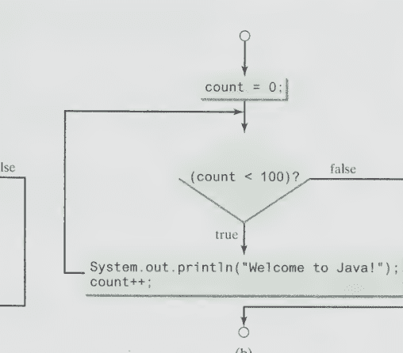

**图 5.1** 当 `loop-continuation-condition` 求值为真时，`while` 循环重复执行循环体中的语句。

在下面的代码中，`loop-continuation-condition` 是 `count < 100`，循环体包含两个语句：

```
int count = 0;
while (count < 100) {
    System.out.println("Welcome to Java!");
    count++;
}
```

在这个示例中，你确切知道循环体需要执行多少次，因为控制变量被用于计算迭代次数。这种类型的循环被称为计数控制循环（counter-controlled loop）。

> 注意 循环继续条件必须始终出现在括号内。只有当循环体包含一个语句或没有语句时，才能省略包裹循环体的大括号。

这里是另一个有助于理解循环如何运作的示例。

```
int sum = 0, i = 1;
while (i < 10) {
    sum = sum + i;
    i++;
}
System.out.println("sum is " + sum); // sum is 45
```

如果 `i < 10` 为真，程序将 `i` 加到 `sum` 中。变量 `i` 初始被设置为 1，然后递增到 2、3 直到 10。当 `i` 为 10 时，`i < 10` 为假，循环退出。因此，`sum` 等于 1 + 2 + 3 + ... + 9 = 45。

如果将循环错误地写成这样会发生什么？

```
int sum = 0, i = 1;
while (i < 10) {
    sum = sum + i;
}
```

这个循环是无限的，因为 `i` 始终是 1 且 `i < 10` 始终为真。

> 注意 确保循环继续条件最终变为假，以便循环能够终止。常见的编程错误涉及无限循环（即循环无限运行）。如果你的程序运行时间异常长且不停止，它可能存在无限循环。如果你在命令行窗口运行程序，请按 `CTRL+C` 停止。

- 无限循环 (infinite loop)
- 差一错误 (off-by-one error)

> 注意 程序员经常会犯循环执行多一次或少一次的错误。这通常被称为差一错误。例如，循环显示 `Welcome to Java` 101 次而不是 100 次。错误在于条件，条件应该是 `count < 100` 而不是 `count <= 100`。

```
int count = 0;
while (count < 100) {
    // 循环体
}
```

## 5.3 案例研究：猜数字

```java
System.out.print("Enter your guess: ");
guess = input.nextInt();

if (guess == number) {
    System.out.println("Yes, the number is " + number);
} else if (guess > number) {
    System.out.println("Your guess is too high");
} else {
    System.out.println("Your guess is too low");
} // 循环结束
```

完整的代码在列表 5.3 中。

### 列表 5.3 GuessNumber.java

```java
import java.util.Scanner;

public class GuessNumber {
    public static void main(String[] args) {
        // 生成一个待猜的随机数
        int number = (int)(Math.random() * 101);
        Scanner input = new Scanner(System.in);
        System.out.println("Guess a magic number between 0 and 100");

        int guess = -1;
        while (guess != number) {
            // 提示用户猜数字
            System.out.print("Enter your guess: ");
            guess = input.nextInt();

            if (guess == number) {
                System.out.println("Yes, the number is " + number);
            } else if (guess > number) {
                System.out.println("Your guess is too high");
            } else {
                System.out.println("Your guess is too low");
            }
        }
    }
}
```

| 行号 | 数字 | guess | 输出 |
|---|---|---|---|
| 6 | 39 | - | |
| 11 | | 15 | Your guess is too high |
| 15 | | 22 | Your guess is too low |
| 20 | | 42 | Your guess is too high |
| 25 | | 39 | Yes, the number is 39 |

生成一个数字，输入一个猜测。程序在第 6 行生成魔法数字，并在循环中不断提示用户输入猜测（第 12–23 行）。对于每次猜测，程序都会检查该猜测是否正确、太高还是太低（第 17–22 行）。当猜测正确时，程序退出循环（第 12 行）。注意 `guess` 被初始化为 -1。将其初始化为 0 到 100 之间的某个值是错误的，因为那可能是待猜的数字。

#### 5.3.1 如果在列表 5.3 的第 11 行将 `guess` 初始化为 0 会有什么问题？

## 5.4 循环设计策略

设计循环的关键是识别需要重复的代码，并编写一个终止循环的条件。

对于初学者来说，编写一个正确的循环并不是易事。在编写时考虑以下三个步骤：

- 步骤 1：识别需要重复的语句。
- 步骤 2：如下所示将这些语句封装在循环中：

```java
while (true) {
    Statements;
}
```

- 步骤 3：编写循环继续条件，并添加适当的语句控制循环。

```java
while (loop-continuation-condition) {
    Statements;
    用于控制循环的额外语句;
}
```

列表 5.3 中的减法练习程序 `SubtractionQuiz.java` 每次运行只生成一个问题。你会如何编写代码来生成五个问题呢？遵循循环设计策略。首先，识别需要重复的语句。这些是获取随机数、向用户提出减法问题以及进行评分的语句。其次，将这些语句封装在循环中。添加一个循环控制变量和循环继续条件以执行循环五次。

列表 5.4 提供了一个生成五个问题的程序，并在所有问题完成后报告正确答案的数量。该程序还显示了测试花费的时间并列出了所有问题。

### 列表 5.4 SubtractionQuizLoop.java

```java
import java.util.Scanner;

public class SubtractionQuizLoop {
    public static void main(String[] args) {
        final int NUMBER_OF_QUESTIONS = 5; // 问题数量
        int correctCount = 0; // 统计正确答案数量
        int count = 0; // 统计问题数量
        long startTime = System.currentTimeMillis();
        String output = ""; // 输出为空
        Scanner input = new Scanner(System.in);

        while (count < NUMBER_OF_QUESTIONS) {
            // 1. 生成两个随机整数
            int num1 = (int)(Math.random() * 10);
            int num2 = (int)(Math.random() * 10);

            // 2. 如果 num1 < num2，交换 num1 和 num2
            if (num1 < num2) {
                int temp = num1;
                num1 = num2;
                num2 = temp;
            }

            // 3. 提示学生回答“num1 - num2 等于？”
            System.out.print("What is " + num1 + " - " + num2 + "? ");
            int answer = input.nextInt();

            // 4. 对答案进行评分并显示结果
            if (num1 - num2 == answer) {
                System.out.println("You are correct!");
                correctCount++; // 增加正确计数
            } else {
                System.out.println("Your answer is wrong.\n" + (num1 - num2) + " should be");
            }

            // 增加问题计数
            count++;
            output += "In " + num1 + " - " + num2 + " = " + (num1 - num2 == answer ? " correct" : " wrong") + "\n";
        }

        long endTime = System.currentTimeMillis();
        long testTime = endTime - startTime;

        System.out.println("Correct count is " + correctCount);
        System.out.println("Test time is " + testTime / 1000 + " seconds");
        System.out.print(output);
    }
}
```

## 5.5 使用用户确认或哨值控制循环

使用哨值来终止输入是一种常见做法。

前面的示例执行了五次循环。如果你想让用户决定是否继续，可以使用确认机制。程序的模板可以编写如下：

```java
char continueLoop = 'Y';
while (continueLoop == 'Y') {
    // 执行循环体
    // 提示用户确认
    System.out.print("Enter Y to continue and N to quit: ");
    continueLoop = input.nextLine().charAt(0);
}
```

你可以用哨值重写列表 5.4，让用户决定是否进入下一个问题。

另一种控制循环的技术是在处理一组值时指定一个哨值。这个特殊值被称为哨值，它标志着输入的结束。使用哨值控制执行的循环被称为哨值控制循环。

列表 5.5 提供了一个读取并计算任意数量整数和的程序。输入 0 表示输入的结束。你需要为每个输入声明新变量吗？使用一个命名变量 `data`（第 12 行）存储输入值，并使用一个命名 `sum`（第 15 行）存储总和。每当读取一个值时，将其赋值给 `data`，如果它不是零，则将其加到 `sum` 中（第 17 行）。

```java
import java.util.Scanner;

public class SentinelValue {
    /** 主方法 */
    public static void main(String[] args) {
        // 创建 Scanner
        Scanner input = new Scanner(System.in);

        // 读取初始数据
        System.out.print("Enter integer (the input ends if it is 0): ");
        int data = input.nextInt();

        // 持续读取数据直到输入为0
        int sum = 0;
        while (data != 0) {
            sum += data;

            // 读取下一个数据
            System.out.print("Enter an integer (the input ends if it is 0): ");
            data = input.nextInt();
        }

        System.out.println("The sum is " + sum);
    }
}
```


## 循环结束

显示结果：

- 输入一个整数（如果为 0 则输入结束）：2 回车
- 输入一个整数（如果为 0 则输入结束）：3 回车
- 输入一个整数（如果为 0 则输入结束）：4 回车
- 输入一个整数（如果为 0 则输入结束）：0 回车
- 总和为 9

| 行号 | data | sum | 输出 |
|---|---:|---:|---|
| 12 | 2 | | |
| 15 | | 0 | |
| 17 | | 2 | |
| 迭代 1 | 2 | | |
| 17 | | 5 | |
| 迭代 2 | 2 | 4 | |
| 17 | | 9 | |
| 迭代 3 | 2 | | |
| 总和为 9 | | | |

如果`data`不为 0，它会被加到`sum`中（第 17 行），并读取下一个输入数据项（第 20–22 行）。如果`data`为 0，循环体将不再执行，`while`循环将终止。输入值 0 是此循环的哨兵值。如果读取的第一个输入是 0，则循环体将永远不会执行，结果总和为 0。

> **注意**  
> 不要在循环控制中使用浮点数进行等值性比较。因为浮点数是某些数值的近似值，使用它们可能会导致计数值不精确以及结果不准确。

考虑以下计算 `1 + 0.9 + 0.8 + ... + 0.1` 的代码：

```java
double item = 1;
double sum = 0;

while (item != 0) { // 不能保证 item 会为 0
    sum += item;
    item -= 0.1;
}

System.out.println(sum);
```

变量`item`从 1 开始，每次执行循环体时减少 0.1。当`item`变为 0 时，循环应该终止。然而，并不能保证`item`会恰好等于 0.0，因为浮点算术是近似的。这个循环表面上看起来没问题，但它是一个无限循环。

# 第 5 章 循环

在前面的示例中，如果你有大量数据需要输入，从键盘输入将非常繁琐。你可以将由空白符分隔的数据存储在文本文件中（例如`input.txt`），并使用以下命令运行程序：

```bash
java SentinelValue < input.txt
```

此命令被称为输入重定向。程序从文件`input.txt`获取输入，而不是在运行时使用用户从键盘上键入的内容。假设文件内容如下：

```text
2 3 4 5 6 7 8 9 10 12 23 32

23 45 67 89 92 12 34 35 3 1 2 4 0
```

程序得到的总和为 58。同样，还有输出重定向，它将输出发送到文件而不是显示在控制台上。输出重定向的命令是：

```bash
java ClassName > output.txt
```

输入和输出重定向可以在同一条命令中使用。例如，以下命令从`input.txt`获取输入并将输出发送到`output.txt`：

```bash
java SentinelValue < input.txt > output.txt
```

尝试运行程序以查看`output.txt`中的内容。

### 5.5.1 假设输入是 2 3 4 5 0。以下代码的输出是什么？

```java
import java.util.Scanner;

public class Test {
    public static void main(String[] args) {
        Scanner input = new Scanner(System.in);

        int number;

        number = input.nextInt();

        int max = number;

        while (number != 0) {
            number = input.nextInt();

            if (number > max) {
                max = number;
            }

            System.out.println("max is " + max);
            System.out.println("number is " + number);
        }
    }
}
```

## 5.6 do-while 循环

`do-while`循环与`while`循环相同，不同在于它先执行体，然后再检查循环条件。

`do-while`循环是`while`循环的一种变体。它的语法如下：

```java
do {
    // 循环体；
    Statement(s);
} while (loop-continuation-condition);
```

它的流程图如图 5.2a 所示。

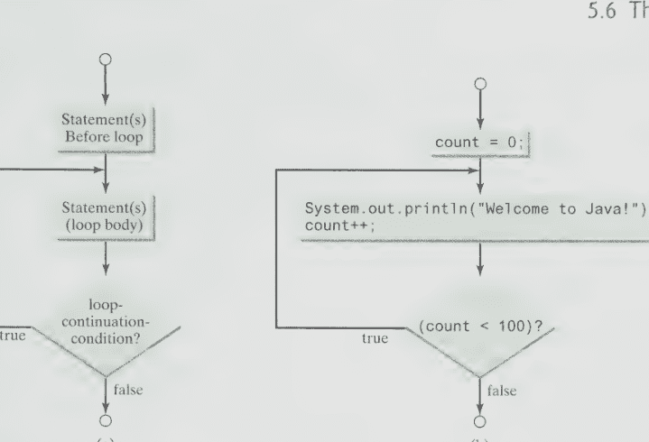

**图 5.2** `do-while`循环首先执行循环体，检查`loop-continuation-condition`以决定继续还是终止循环。

首先执行循环体，然后评估`loop-continuation-condition`。如果评估为真，则再次执行循环体；如果为假，则`do-while`循环终止。

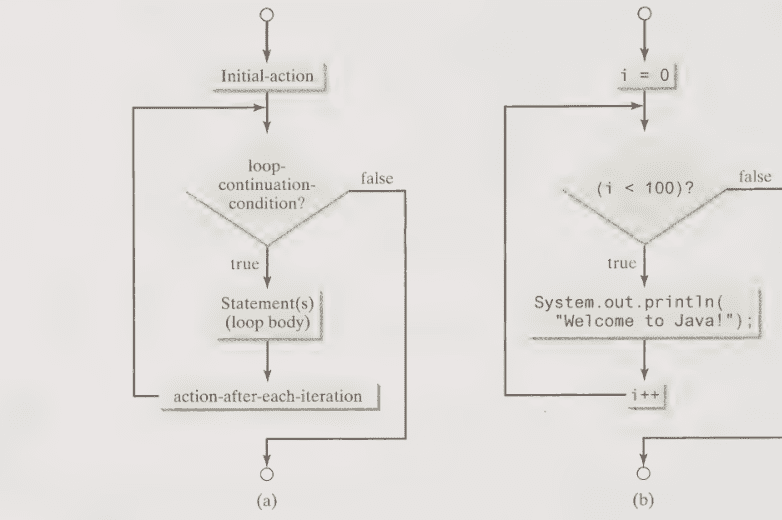

**图 5.3** `for`循环执行一次初始动作，重复执行循环体中的语句，并在循环继续条件求值为真时，在每次迭代后执行一个动作。它测试控制变量是否已经达到终止值。例如，该循环打印了一百次“Welcome to Java!”。

```java
int i;

for (i = 0; i < 100; i++) {
    System.out.println("Welcome to Java!");
}
```

该语句的流程图如图 5.3b 所示。`for`循环将`i`初始化为 0，然后当`i`小于 100 时，重复执行打印语句并评估`i++`。初始动作`i = 0`初始化了控制变量`i`。循环继续条件`i < 100`是一个布尔表达式。该表达式在初始动作之后以及每次迭代开始时进行评估。如果此条件为真，则执行循环体。如果为假，则循环终止，程序控制转到循环后的行。

`i++`是一个调整控制变量的语句。该语句在每次迭代后执行并使控制变量加 1。最终，控制变量的值应该强制循环继续条件变为假；否则，循环将是无限的。

控制变量可以在`for`循环中声明并初始化。例如：

```java
for (int i = 0; i < 100; i++) {
    System.out.println("Welcome to Java!");
}
```

如果循环体中只有一条语句，可以省略大括号。

> **提示**  
> 控制变量必须在循环的控制结构内部或在循环之前声明。如果循环变量仅在循环中使用，不在其他地方使用，那么将它包含在循环的初始动作中是一个良好的编程习惯；如果变量是在循环控制结构内部声明的，则不能在循环外被引用。例如，在先前的代码中，你不能在循环外引用`i`，因为它是在`for`循环内部声明的。

## 5.7 for 循环

`for`循环中的初始动作可以是零或多个用逗号分隔的变量声明语句或赋值语句列表。例如：

```java
for (int i = 0, j = 0; i < 10; i++, j++) {
    // 做什么
}
```

`for`循环中的每次迭代后的动作可以是零或多个用逗号分隔的语句列表。例如：

```java
for (int i = 1; i < 100; System.out.println(i), i++)
```

这个示例是正确的，但是一个糟糕的示例，因为它让代码难以阅读。通常情况下，你会在初始动作声明并初始化控制变量，并在每次迭代后的动作中增加或递减控制变量。

如果省略`for`循环中的循环继续条件，它隐含为真。因此，该语句变成了一个无限循环，与（b）相同。为了避免混淆，最好使用（c）中的`for`循环。

| | 等效于 | | 等效于 | |
|---|---|---|---|---|
| `for ( ; ; )` | | `for ( true; )` | | `while(true) {` |
| `// 执行某些操作` | | `// 执行某些操作` | | `// 执行某些操作` |
| （a） | （b） | （c） | | |

### 5.7.1 对应的两个循环得到的 sum 值相同吗？

| `for (int i = 0; i < 10; i++) {` | `for (int i = 0; i < 10; i++) {` |
|---|---|
| `sum += i;` | `sum += i;` |
| （a） | （b） |

### 5.7.2 for 循环控制的三个部分部分？？写一个打印从 1 到 100 数字的 for 循环。

假设输入是 2 3 4 5 0。以下代码的输出是什么？

```java
import java.util.Scanner;

public class Test {
    public static void main(String[] args) {
        Scanner input = new Scanner(System.in);

        int number, sum = 0, count;

        for (count = 0; count < 5; count++) {
            number = input.nextInt();
            sum += number;
        }

        System.out.println("sum is " + sum);
        System.out.println("count is " + count);
    }
}
```


# 第 5 章 循环

### 5.7.4 下述语句的作用是什么？

```java
for (;;) {
    执行某些操作
}
```

### 5.7.5 如果变量在 for 循环控制中声明，在循环退出后可以使用它吗？

### 5.7.6 将以下 for 循环语句转换为 while 循环和 do-while 循环：

```java
long sum = 0;

for (int i = 0; i <= 100; i++) {
    sum = sum + i;
}
```

### 5.7.7 统计以下循环的迭代次数。

```java
int count = 0;

while (count < n) {
    count++;
}
```

```java
int count = 5;

while (count < n) {
    count = count + 5;
}
```

## 5.8 使用哪种循环？

你可以使用`for`循环、`while`循环或`do-while`循环，它们都很方便。然而，你会发现`while`循环比`for`循环更容易学习。`for`循环控制变量初始化、循环继续和每次迭代后的调整。它更简洁，让你编写的代码错误更少。`while`循环是预测试的，因为在执行循环体之前检查条件。`do-while`循环被称为后测试循环，因为在循环体之后检查条件。三种形式——`while`、`do`和`for`——是等价的；你可以使用这三种形式中的任何一种。图中的`while`循环（a）可以转换为`for`循环（b）。

| | 等效于 | |
|---|---|---|
| `for (initial-action; loop-continuation-condition; action-after-each-iteration) {`<br>循环体 | `for (initial-action; loop-continuation-condition); {`<br>循环体 |

图中的`for`循环（a）通常可以转换为`while`循环（b），某些情况除外（见第 5.12 节）。

| | | |
|---|---|---|
| `for (initial-action; loop-continuation-condition; action-after-each-iteration) {`<br>循环体; | | `initial-action; while (loop-continuation-condition) {`<br>循环体; 迭代后的动作 |

使用对你来说最直观、舒适的循环语句。通常，如果重复次数是预先的（例如显示一百次），可以使用`for`循环。如果重复次数不固定（例如读取数字直到输入零），可以使用`while`循环。如果在继续测试之前执行循环体，可以使用`do-while`循环。

> **注意**  
> 在循环体之前的`for`子句末尾添加分号是一个常见错误，如下所示（a）。在（a）中，分号表示循环的结束。循环体实际上是空的，如（b）和（a）所示两者是等价的。两者都是错误的。

```java
for (int i = 0; i < 10; i++); {
    System.out.println("i is " + i);
}
```

（a）

```java
for (int i = 0; i < 10; i++) {
    System.out.println("i is " + i);
}
```

（b）

同样，（c）中的循环也是错误的。（c）与（d）等效。两者都是错误的。

```java
int i = 0;

while (i < 10) {
    System.out.println("i is " + i);
    i++;
}
```

（c）

```java
int i = 0;

while (i < 10) {
    System.out.println("i is " + i);
}
```

（d）

这些错误通常在你使用换行块样式时发生。使用行尾样式可以避免此类错误。在`do-while`循环的情况下，循环后面需要分号。

```java
int i = 0;

do {
    System.out.println("i is " + i);
    i++;
} while (i < 10);
```

正确

- 5.8.1 你可以将`for`循环转换为`while`循环吗？列出使用`for`循环的优点。
- 5.8.2 你可以将`while`循环转换为`for`循环吗？将以下`while`循环转换为`for`循环：

```java
int i = 1;

sum = 0;

while (sum < 10000) {
    sum = sum + i;
    i++;
}
```

# 200 第 5 章 循环

### 5.8.3 识别并修复以下代码中的错误：

```java
public class Test {
    public void main(String[] args) {
        for (int i = 0; i < 10; i++) {
            sum += j;
        }

        if (i < j) {
            System.out.println(i);
        } else {
            System.out.println(j);
        }

        while (j < 10) {
            j++;
        }
    }
}
```

### 5.8.4 下述程序有什么问题？

| `public class ShowErrors {` | `public class ShowErrors {` |
|---|---|
| `public static void main(String[] args) {` | `public static void main(String[] args) {` |
| `int i = 0;` | `for (int i = 0; i < 10; i++) {` |
| `do {` | |
| `System.out.println(i + 4);` | `System.out.println(i + 4);` |
| `i++;` | |
| `while (i < 10)` | |
| `}` | |
| `}` | |
| | |


## 5.9 嵌套循环

一个循环可以嵌套在另一个循环内部。

嵌套循环由外层循环和一个或多个内部循环组成。每当外层循环重复一次，内部循环就会重新进入并重新开始。列表 5.7 展示了一个使用嵌套循环显示乘法表的程序。

# LISTING 5.7 MultiplicationTable.java

```java
public class MultiplicationTable {
    // Main method /*

    public static void main(String[] args) {
        // 显示表头
        System.out.println("Multiplication Table");

        // 显示数字标题
        System.out.print(" ");

        for (int j = 1; j <= 9; j++) {
            System.out.print(j + "	 + ");
        }
    }
}
```

# 5.9 嵌套循环

```java
System.out.println("\n");

// 显示表格主体
for (int i = 1; i <= 9; i++) {
    System.out.print(i + " \ ");

    for (int j = 1; j <= 9; j++) {
        // 显示乘积并正确对齐
        System.out.printf("%4d", i * j);
    }

    System.out.println();
}
```


# 5.9 嵌套循环

```java
System.out.println("\n");

// 显示表格主体
for (int i = 1; i <= 9; i++) {
    System.out.print(i + " \ ");

    for (int j = 1; j <= 9; j++) {
        // 显示乘积并正确对齐
        System.out.printf("%4d", i * j);
    }

    System.out.println();
}
```

## 外循环与内循环

# 九九法表

| 1 | 2 | 3 | 4 | 5 | 6 | 7 | 8 | 9 |
|---|---|---|---|---|---|---|---|---|
| 2 | 4 | 6 | 8 | 10 | 12 | 14 | 16 | 18 |
| 3 | 6 | 9 | 12 | 15 | 18 | 21 | 24 | 27 |
| 4 | 8 | 12 | 16 | 20 | 24 | 28 | 32 | 36 |
| 5 | 10 | 15 | 20 | 25 | 30 | 35 | 40 | 45 |
| 6 | 12 | 18 | 24 | 30 | 36 | 42 | 48 | 54 |
| 7 | 14 | 21 | 28 | 35 | 42 | 49 | 56 | 63 |
| 8 | 16 | 24 | 32 | 40 | 48 | 56 | 64 | 72 |
| 9 | 18 | 27 | 27 | 36 | 45 | 54 | 63 | 72 | 81 |


程序在输出的第一行显示一个标题（第 5 行）。第一个 `for` 循环行（第 9 和 10 行）在第二行显示数字 1–9。第三行（第 12 行）显示一条虚线（--）。

下一个循环（15–22 行）是一个嵌套 `for` 循环，外循环使用控制变量 `i`，内循环使用控制变量 `j`。对于每次循环，内循环中的每一行都会显示乘积 `i * j`，其中 `j` 为 1, 2, 3, ..., 9。

> **注意**
>
> 注意，嵌套循环运行可能需要很长时间。考虑以下三层嵌套的循环：

```java
for (int i = 0; i < 10000; i++)
    for (int j = 0; j < 10000; j++)
        for (int k = 0; k < 10000; k++)
            Perform an action
```

该操作将执行万亿次。如果执行该操作需要一微秒，运行该循环的总时间将超过 277 小时。注意一微秒是秒的百万分之一（10⁻⁶）。

## 5.9.1 语句执行了多少次？

```java
for (int i = 0; i < 10; i++)
    for (int j = 0; j < i; j++)
        System.out.println(i * j)
```


# 第 5 章 循环

## 5.9.2 显示以下程序的输出

提示：画一张表并在列列出变量以跟踪这些程序。

```java
public class Test {
    public static void main(String[] args) {
        for (int i = 1; i < 5; i++) {
            int j = 0;

            while (j < i) {
                System.out.print(j + " ");
                j++;
            }
        }
    }
}
```

```java
public class Test {
    public static void main(String[] args) {
        int i = 0;

        while (i < 5) {
            for (int j = i; j > 1; j--) {
                System.out.print(j + " G");
            }

            System.out.println("");
            i++;
        }
    }
}
```

(a)

(b)

```java
public class Test {
    public static void main(String[] args) {
        int i = 5;

        while (i >= 1) {
            int num = 1;

            for (int j = 1; j <= i; j++) {
                System.out.print(num + " XXX");
            }

            num *= 2;
            System.out.println();
            i--;
        }
    }
}
```

```java
public class Test {
    public static void main(String[] args) {
        int i = 1;

        do {
            int num = 1;

            for (int j = 1; j <= i; j++) {
                System.out.print(num + " G");
            }

            num *= 2;
            System.out.println();
            i++;
        } while (i <= 5);
    }
}
```

(c)

(d)

# 5.10 最小化误差

在循环继续中使用浮点数可能会导致数值误差。涉及浮点数的数值误差是不可避免的，因为浮点数本质上是用近似值表示的。本节将通过示例讨论如何最小化误差。

列表 5.8 提供了一个从 0.01 开始到 1.0 结束的示例。序列中的数字将递增 0.01，如下：0.01 + 0.02 + 0.03 等。

## 列表 5.8 `Test.java`

```java
public class Test {
    public static void main(String[] args) {
        // 初始化和
        float sum = 0;

        // 添加 0.01, 0.02, ..., 0.99
        for (float i = 0.01f; i <= 1.0f; i += 0.01f) {
            sum += i;
        }

        // 显示结果
        System.out.println("The sum is " + sum);
    }
}
```


# 5.11 案例研究

循环在编程中是基础。编写循环的能力对于学习 Java 编程至关重要。

如果你会使用循环，你就已经学会了编程！因此，本节介绍了三个使用循环解决问题的额外示例。


## 5.11 案例分析 205

```java
}

System.out.println("The greatest common divisor for " + n1 +
    " and " + n2 + " is " + gcd);

}
```


```text
输入第一个整数: 125
输入第二个整数: 2525
125 和 2525 的最大公约数是 25
```


将逻辑转换为 Java 代码并不是唯一的。例如，你可以使用循环按如下方式重写代码：

```java
for (int k = 2; k < n1 && k <= n2; k++) {
  if (n1 % k == 0 && n2 % k == 0)
    gcd = k;
}
```

一个问题通常有多个解决方案，`gcd` 问题可以通过许多方法解决。编程练习 5.14 提供了另一种解决方案。一种更高效的解决方案是使用经典的欧几里得算法（参见第 22.6 节）。

你可能会认为数字 `n1` 的除数不能大于 `n1 / 2`，并尝试使用以下代码改进程序：

```java
for (int k = 2; k <= n1 / 2 && k <= n2 / 2; k++) {
  if (n1 % k == 0 && n2 % k == 0)
    gcd = k;
}
```

这个修改是错误的。你能找到原因吗？答案参见检查点 5.11.1。

## 5.11.2 案例分析：预测未来的学费

假设某大学今年的学费为 $10,000，且每年增长 7%。学费将在多少年后会翻一倍？

在编写程序解决这个问题之前，首先考虑如何手动解决它。第二年的学费是第一年学费 * 1.07。未来某年的学费是前一年学费 * 1.07。因此，每年的学费可以这样计算：

```java
double tuition = 10000; int year = 0; // 第 0 年

tuition = tuition * 1.07; year++; // 第 1 年

tuition = tuition * 1.07; year++; // 第 2 年

tuition = tuition * 1.07; year++; // 第 3 年
```

持续计算新一年的学费，直到至少达到 20000。到那时，你就知道学费翻一倍需要多少年了。现在现在可以将逻辑转换为以下循环：

```java
double tuition = 10000; // 第 0 年
int year = 0;

while (tuition < 20000) {
  tuition = tuition * 1.07;
  year++;
}
```

完整的程序位于列表 5.10 中。

## 列表 5.10 FutureTuition.java

```java
1 public class FutureTuition {
2   public static void main(String[] args) {
3     double tuition = 10000; // 第 0 年
4     int year = 0;
5     while (tuition < 20000) {
6       tuition = tuition * 1.07;
7       year++;
8     }
9     System.out.println("Tuition will be doubled in "
10        year + " years");
11    System.out.printf("Tuition will be $%.2f in %d years",
12        tuition, year);
13  }
14 }
```

学费将在 11 年后翻一倍。  
11 年后学费将是 $21048.52。

`while` 循环（第 5–8 行）用于重复计算新一年的学费。当学费大于或等于 20000 时，循环终止。

## 5.11.3 案例分析：将十进制转换为十六进制

十六进制常用于计算机系统编程（附录 F 为系统介绍）。如何将十进制数转换为十六进制数？将十进制数转换为十六进制就是寻找十六进制位 `h_n h_{n-1} h_{n-2} \dots h_2 h_1 h_0`，使得：

```text
d = h_n * 16^n + h_{n-1} * 16^{n-1} + \dots + h_2 * 16^2 + h_1 * 16^1 + h_0 * 16^0
```

这些十六进制位可以通过连续将 `d` 除以 16 直到商为 0 来找到。余数就是 `h_0, h_1, \dots h_{n-1}` 和 `h_n`。十六进制位包括十进制数字 0, 1, 2, 3, 4, 5, 6, 7, 8 和 9，加上 A, B, C, D, E 和 F。

例如，十进制数 123 在十六进制中是 7B。转换过程如下：将 123 除以 16。余数为 11（十六进制中的 B），商为 7。继续将 7 除以 16。余数为 7，商为 0。因此，7B 是 123 的十六进制数。

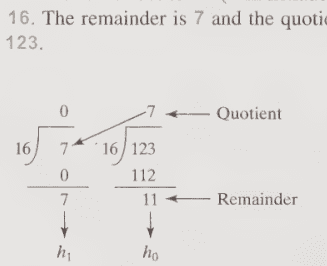

列表 5.11 提供了一个程序，提示输入十进制数并转换为十六进制字符串。

## 列表 5.11 Dec2Hex.java

```java
1 import java.util.Scanner;

2
3 public class Dec2Hex {
4   /* Main 方法 */
5   public static void main(String[] args) {
6     /* 创建 Scanner */
7     Scanner input = new Scanner(System.in);

8
9     /* 提示用户输入十进制整数 */
10    System.out.print("Enter a decimal number: ");
11    int decimal = input.nextInt();

12
13    /* 将十进制转换为十六进制 */
14    String hex = "";

15
16    while (decimal != 0) {
17      int hexValue = decimal % 16;

18
19      /* 将十进制值转换为十六进制位 */
20      char hexDigit = (0 <= hexValue && hexValue <= 9) ?
21          (char)(hexValue + '0') : (char)(hexValue - 10 + 'A');

22
23      hex = hex + hexDigit;
24      decimal = decimal / 16;
25    }

26
27    System.out.println("The number is " + hex);
28  }
29 }
```

```text
输入十进制数: 1234
数字是 4D2
```


| 行 | `decimal` | `hex` | `hexValue` | `hexDigit` |
|---|---:|---|---:|---|
| 14 | 1234 | | | |
| 17 | | | | |
| 迭代 1 | 77 | | "9" | |
| 24 | | | | |
| 17 | | | | |
| 迭代 2 | 23 | | "D" | |
| 24 | | | | |
| 17 | | | | |
| 迭代 3 | 23 | | | |
| 24 | | | | |


程序提示用户输入十进制整数（第 11 行），将其转换为十六进制字符串（第 14–25 行），并显示结果（第 27 行）。为了将十进制转换为十六进制，程序使用循环连续将十进制数除以 16 并提取余数（第 17 行）。余数转换为十六进制（第 20 和 21 行）。字符被添加到十六进制字符串（第 23 行）。十六进制字符串初始为空（第 14 行）。十进制除以 16 从数字中移除十六进制位（第 24 行）。当剩余的十进制数为 0 时，循环结束。

## 第 5 章 循环

程序将 0 到 15 之间的 `hexValue` 转换为十六进制字符。如果 `hexValue` 在 0 到 9 之间，则转换为 `(char) (hexValue + '0')`（第 21 行）。记住，当 `char` 与整数一起时，评估时使用的是字符的 Unicode。例如，如果 `hexValue` 为 5，`(char) (hexValue + '0')` 返回 5。同样，如果 `hexValue` 在 10 到 15 之间，则转换为 `(char) (hexValue - 10 + 'A')`。

- 5.11.1 如果将第 17 行的 `n1` 和 `n2` 替换为 `n1` 和 `n2 / 2`，程序将有效。
- 5.11.2 在列表 5.11 中，如果更改第 21 行的代码 `(char) (hexValue + '0')` 为什么错？
- 5.11.3 在列表 5.11 中，十进制数 245 的循环体执行多少次，数字 344 的循环体执行多少次？
- 5.11.4 E 之后的十六进制数是什么？F 之后的十六进制数是什么？
- 5.11.5 修改列表 5.12 的第 27 行，使程序在输入为 0 时显示 `hex 0`。

## 5.12 关键字 `break` 和 `continue`

`break` 和 `continue` 关键字在循环中提供了额外的控制。

> **教学提示**
>
> `break` 和 `continue` 两个关键字可以用于循环语句以提供额外的控制。在某些情况下使用 `break` 和 `continue` 可以简化编程。然而，过度使用或不恰当使用它们可能会导致程序难以阅读和调试。（给教师的注：你可以跳过此部分，而不影响学生对书中其他部分的理解）

你已经在 `switch` 语句中使用过 `break` 关键字。你也可以使用 `break` 立即终止循环。列表 5.12 展示了一个演示在循环中使用 `break` 的程序。

## 列表 5.12 TestBreak.java

```java
1 public class TestBreak {
2   public static void main(String[] args) {
3     int sum = 0;
4     int number = 0;

5
6     while (number < 20) {
7       number++;
8       sum += number;
9       if (sum >= 100)
10        break;
11    }

12
13    System.out.println("The number is " + number);
14    System.out.println("The sum is " + sum);
15  }
16 }
```

```text
数字是 14
和是 105
```

列表 5.12 中的程序按顺序将 1 到 20 的整数累加到 `sum` 中，直到 `sum` 大于或等于 100。如果没有 `if` 语句（第 9 行），程序将计算 1 到 20 所有数字的和。然而，有了 `if` 语句，当 `sum` 大于或等于 100 时循环就会终止。如果没有 `if` 语句，输出将如下：

```text
The number is 20
The sum is 210
```


你也可以在循环中使用 `continue` 关键字。当遇到它时，它会结束当前迭代，程序控制跳转到循环体的末尾。换句话说，`continue` 跳出当前迭代，而 `break` 关键字跳出循环。列表 5.13 展示了一个演示在循环中使用 `continue` 效果的程序。

## 列表 5.13 TestContinue.java

```java
1 public class TestContinue {
2   public static void main(String[] args) {
3     int sum = 0;
4     int number = 0;

5
6     while (number < 20) {
7       number++;
8       if (number == 10 || number == 11)
9         continue;
10      sum += number;
11    }

12
13    System.out.println("The sum is " + sum);
14  }
15 }
```


```text
The sum is 189
```


列表 5.13 中的程序将 1 到 20 的整数（除 10 和 11）加到 `sum` 中。如果程序中有 `if` 语句（第 8 行），当 `number` 变为 10 或 11 时，将执行 `continue` 语句。`continue` 语句结束当前迭代，导致循环体中其余语句不会执行；因此，当 `number` 为 10 或 11 时，它不会被加到 `sum` 中。如果没有程序中的 `if` 语句，输出将如下：

```text
The sum is 210
```


在这种情况下，所有的数字都加到了 `sum` 中，即使 `number` 是 10 或 11。因此，结果是 210，比使用 `if` 语句时多了 21。

> **注意**
>
> `continue` 语句始终位于循环内部。在 `while` 和 `do-while` 循环中，在 `continue` 语句之后会立即评估循环继续条件。对于 `for` 循环，会执行每次迭代后的操作。在 `continue` 语句之后也会立即评估循环继续条件。

# 第 5 章 循环

> **注意**
>
> 一些编程语言拥有 `goto` 语句。`goto` 语句不分区别地将控制转移到程序中的任何语句并执行它。这会使你的程序容易出现错误。Java 中的 `break` 和 `continue` 语句与 `goto` 语句不同。它们只在循环或 `switch` 语句有效。`break` 语句跳出循环，而 `continue` 语句跳出循环中的当前迭代。

你也可以编写一个不在在循环中使用 `break` 或 `continue` 的程序（参见检查点问题 5.12.3）。但通常情况下，如果使用 `break` 和 `continue` 可以简化代码并使程序更易读，那么它们就是合适的。

假设你需要编写一个程序来找到一个整数除 1 以外的最小因子（假设 `n ≥ 2`）。你可以使用 `break` 语句编写简单且直观的代码：

```java
int factor = 2;

while (factor <= n) {
  if (n % factor == 0) {
    break;
  }

  factor++;
}
```

```java
System.out.println("The smallest factor other than 1 for "
    + n + " is " + factor + ");
```

你可以按照如下方式不使用 `break` 来重写代码：

```java
boolean found = false;
int factor = 2;

while (factor <= n && !found) {
  if (n % factor == 0)
    found = true;
  } else
    factor++;
}
```

```java
System.out.println("The smallest factor other than 1 for "
    + n + " is " + factor + ");
```

显然，在这种情况下，`break` 语句使得程序更简单、更易读。然而，你应该谨慎使用 `break` 和 `continue`。过多的 `break` 和 `continue` 语句会产生一个具有许多出口点的循环，并使程序难以阅读。

> **注意**
>
> 编程是一项创造性活动。有许多编写代码的方法。事实上，你可以使用如下更简单的代码找到最小因子：

```java
int factor = 2;

while (n % factor != 0)
  factor++;
```

或：

```java
for (int factor = 2; n % factor != 0; factor++);
```


这里的代码寻找整数 `n` 的最小因子。练习 5.16 编写了一个寻找所有因子的程序。

（注：后续文本包含大量重复占位符，已根据上下文逻辑进行整合翻译）

最初，`low` 为 0，`high` 为 `s.length() - 1`。这两个位置上的字符如果匹配，则 `low` 加 1，`high` 减 1（第 26–27 行）。此过程持续直到 `(low >= high)` 或发现不匹配（第 21 行）。

程序使用布尔变量 `isPalindrome` 来表示字符串是否为回文。初始时，将其设置为 `true`（第 19 行）。当发现不匹配时（第 21 行），`isPalindrome` 设置为 `false`（第 22 行），并用 `break` 语句终止循环（第 23 行）。

### 5.1.3.1

如果将第 20 行的 `(low < high)` 改为 `(low <= high)`，程序会发生什么？

## 5.14 案例研究：显示质数

本节介绍了一个程序，用于用 5 行显示前 50 个质数，每行包含 10 个数字。

如果一个大于 1 的整数的因数只有 1 或其本身，则它为质数。例如，2、3、5 和 7 是质数，但 4、6、8 和 9 不是。

该问题是用 5 行显示前 50 个质数，每行包含 10 个数字。该问题可以分解为以下任务：

- 确定一个给定的数字是否为质数。
- 对于数字 = 2, 3, 4, 5, 6, ...，测试它是否为质数。
- 显示每个质数并每行显示 10 个数字。

显然，你需要编写一个循环并反复测试新数字是否为质数。如果该数字是质数，计数器加 1。计数器初始为 0。当它达到 50 时，循环终止。

以下是该问题的算法：

设置要打印的质数数量为常量 `NUMBER_OF_PRIMES`；  
使用 `count` 跟踪质数的个数并设置初始 `count` 为 0；  
设置初始数字 `number` 为 2。

```text
while (count < NUMBER_OF_PRIMES)

  Test whether number is prime:

  if number is prime {

    Display the prime number and increase the count;

  }

  Increment number by 1;

}
```

要测试一个数字是否为质数，检查它是否能被 2、3、4 等一直到 `number / 2` 整除。如果找到因数，则该数不是质数。该算法可以描述如下：

使用布尔变量 `isPrime` 表示该数字是否为质数；初始将 `isPrime` 设置为 `true`：

```java
for (int divisor = 2; divisor <= number / 2; divisor++))

  if (number % divisor == 0) {

    Set isPrime to false

    Exit the loop;

  }
```

## 214 第 5 章 循环

完整的程序见列表 5.15。

## 列表 5.15 `PrimeNumber.java`

```java
public class PrimeNumber {

    public static void main(String[] args) {

        final int NUMBER_OF_PRIMES = 50; // 要显示的质数数量

        final int NUMBER_OF_PRIMES_PER_LINE = 10; // 每行显示10个

        int count = 0; // 统计质数的个数

        int number = 2; // 要测试质性的的数字

        System.out.println("The first fifty prime numbers are \n\n"); // 反复寻找质数

        while (count < NUMBER_OF_PRIMES) {

            // 假设数字是质数

            boolean isPrime = true; // 当前是质数吗？

            // 测试数字是否为质数

            for (int divisor = 2; divisor <= number; divisor++) {

                if (number % divisor == 0) { // 如果为真，则数字不是质数

                    isPrime = false; // 将 isPrime 设置为 false

                    break; // 退出循环

                }

            }

            // 显示质数并增加计数

            if (isPrime) {

                count++; // 增加计数

                if (count % NUMBER_OF_PRIMES_PER_LINE == 0) {

                    System.out.println(number);

                }

            }

            // 检查下一个数字是否为质数

            number++;

        }

        // 前五十个质数是

        // 2 3 5 7 11 13 17 19 23 29

        // 31 37 41 43 47 53 59 61 67 71

        // 73 79 83 89 97 101 103 107 109 113

        // 127 131 137 139 149 151 157 163 167 173

        // 179 181 191 193 197 199 211 223 227 229

    }

}
```

对于初学者来说，这是一个复杂的问题。为这个问题以及许多其他问题开发程序解决方案的关键是将其分解为子问题，并逐一为每个子问题开发解决方案。不要尝试第一次就编写完整的解决方案。从编写代码判断一个数字是否为质数开始，然后扩展程序在循环中测试其他数字是否为质数。

判断一个数字是否为质数，检查它是否能被 2 和 `number` 整除（包含第 16–21 行）。如果是，则它不是质数（第 18 行）；否则，它是质数。对于质数，显示它（第 27–33 行），即显示该数字后跟一个换行符（第 27–30 行）。当 `count` 达到 50 时，程序结束。

程序使用第 19 行的 `break` 语句在发现非质数时立即退出 `for` 循环。你可以在不使用 `break` 语句的情况下重写循环（第 16–21 行），如下：

```java
for (int divisor = 2; divisor <= number / 2 && isPrime;
  divisor++);

// 如果为真，则数字不是质数

if (number % divisor == 0) {

  // 如果数字不是质数，将 isPrime 设置为 false

  isPrime = false;

}
```

然而，使用 `break` 语句使程序更简单且易于阅读。5.14 节将学习质数。

## 章总结

（注：原文中包含“214 Chapter 5 Loops”和“Chapter Summary 215”，这些可能是页眉页脚，我已根据上下文进行了整合）。

## 关键术语

- `break`: 208
- `continue`: 209
- `do-while loop`: 200
- `iteration`: 192
- `infinite loop`: 184
- `for loop`: 192
- `loop body`: 182
- `sentinel value`: 190
- `posttest loop`: 98
- `while loop`: 182

## 章总结

1. 循环有三种类型：`while` 循环、`do-while` 循环和 `for` 循环。
2. 循环体是重复的部分。
3. 当重复次数不确定时，使用 `while` 循环。
4. `for` 循环包含三个部分：第一部分通常初始化计数器；第二部分（循环条件）决定是否执行循环体；第三部分在每次迭代后执行，通常用于调整计数器。
5. `while` 循环和 `for` 循环是预测试循环，因为条件在执行循环前进行检查。
6. `do-while` 循环是后测试循环，因为条件在执行循环后进行检查。
7. `break` 和 `continue` 语句可以在循环中使用。
8. `break` 语句立即退出包含它的最内层循环。
9. `continue` 语句仅终止当前迭代。

## 编程练习

### MyProgrammingLab

在编码前阅读思考

### 5.2–5.7 节

- **5.1（通过或不通过）** 编写一个程序，提示学生输入 Java 分数。如果分数大于或等于 60，显示“you pass the exam”；否则显示“you don't pass the exam”。程序在输入 -1 时结束。以下是示例运行：

- **5.2（重复乘法）** 示例 5.4，`SubtractionLoop.java` 生成了五个随机减法题。修改该程序以生成 1 到 12 之间两个整数的随机乘法题。显示结果和测试时间。

- **5.3（摄氏度到华氏度的转换）** 编写一个程序显示下表（注意：华氏度 = 摄氏度 * 9/5 + 32）：

  | 摄氏度 | 华氏 |
  | :--- | :--- |
  | 0 | 32.0 |
  | 2 | 35.6 |
  | .. | .. |
  | 98 | 208.4 |
  | 100 | 212.0 |

- **5.4（英寸到厘米的转换）** 编写一个程序显示下表（注意：1 英寸 = 2.54 厘米）：

  | 英寸 | 厘米 |
  | :--- | :--- |
  | 1 | 2.54 |
  | 2 | 5.08 |
  | .. | .. |
  | 9 | 22.86 |
  | 10 | 25.44 |

- **5.5（摄氏度到华氏度及华氏度到摄氏度的转换）** 编写一个程序并排显示两个表：

  | 摄氏度 | 华氏 | 华氏 摄氏 |
  | :--- | :--- | :--- |
  | 0 | 32.000 | -6.667 |
  | 2 | 35.600 | -3.889 |
  | 98 | 208.400 | 129.444 |
  | 100 | 212.000 | 132.222 |

- **5.6（平方米到坪转换）** 编写一个程序并排显示两个表（注意：1 坪 = 3.305 平方米）：

  | 坪 | 平方米 | 平方米 坪 |
  | :--- | :--- | :--- |
  | 10 | 33.050 | 9.077 |
  | 15 | 49.575 | 10.590 |
  | 75 | 247.875 | 28.744 |
  | 80 | 264.400 | 30.257 |

- **5.7（财务应用：计算未来学费）** 假设学费为 $10,000，每年增加 6%。一年后，学费将变为 $10,600。编写一个程序计算十年后的学费，以及第十年后四年学费的总成本。

- **5.8（寻找最高分）** 编写一个程序，提示用户输入学生人数以及每个学生的姓名和分数，最后显示最高分学生的姓名。使用 `Scanner` 类中的 `next()` 方法读取名称，而不是使用 `nextLine()` 方法。

- **5.9（寻找两个最低分）** 编写一个程序，提示用户输入学生人数以及每个学生的姓名和分数，最后显示最低分和次低分学生的姓名。

## 第 5 章 循环

- **5.10（寻找能被 3 和 4 整除的数）** 编写一个程序，每行显示 100 到 1,000 之间所有能被 3 和 4 整除的数。数字之间仅隔一个空格。

- **5.11（寻找能被 3 或 4 整除但不能被同时整除的数）** 编写一个程序，每行显示 100 到 200 之间所有能被 3 或 4 整除但不能被同时整除的数。数字之间仅隔一个空格。

- **5.12（寻找使得 `n² > 12,000` 的最小 `n`）** 使用循环找到使得 `n²` 大于 12,000 的最小整数。

- **5.13（寻找使得 `n² < 12,000` 的最大 `n`）** 使用循环找到使得 `n²` 小于 12,000 的最大整数。

- **5.14（计算最大公约数）** 示例 5.9 寻找两个整数 `n1` 和 `n2` 最大公约数的另一种解决方案如下：首先找到 `n1` 和 `n2` 的最小值，然后依次检查 `d`、`d - 1`、`d - 2`、`...`、`1` 是否都是 `n1` 和 `n2` 的因数。第一个这样的公约数即为 `n1` 和 `n2` 的公约数。编写一个程序提示用户输入两个正整数并显示 `gcd`。

- **5.15（显示 ASCII 表）** 编写一个程序打印 ASCII 表中 1 到 10 的字符。每行显示 10 个字符。ASCII 表见附录 B。字符之间仅隔一个空格。

- **5.16（寻找整数的因数）** 编写一个程序读取一个整数并按增大顺序显示其所有的最小因数。例如，如果输入的整数是 120，输出应为：2, 2, 2, 3, 5。

- **5.17（显示金字塔）** 编写一个程序提示用户输入 1 到 15 之间的整数，并显示金字塔，如样例所示：

  

  ```text
  输入行数：7

  7 6 5 4 3 2 1 3 4 5

  6 5 4 3 2 1 2 3 4

  5 4 3 2 1 2 3 4

  4 3 2 1 2 3

  2 1 2

  1
  ```

- **5.18（使用循环显示模式）** 使用嵌套循环显示以下四个模式：

  | 模式 A | 模式 B | 模式 C | 模式 D |
  | :--- | :--- | :--- | :--- |
  | * * * * | * * * * | * * * * | * * * * |
  | * * * * | * * * * | * * * * | * * * * |
  | * * * * | * * * * | * * * * | * * * * |
  | * * * * | * * * * | * * * * | * * * * |
  | * * * * | | | * * * |
  | * | | | * |
  | * * * * * * * * * | * * * | * * * |
  | * * * * | * * * | * * * | * * * * |
  | * * * | * * * | * * * | * * * * * |
  | * * * * | | * * * * * * * * * * * * * * * * * * * * * * * * * * * * * * * * * * * * * * * * * * * * * * * * * * * * * |

- **5.19（在金字塔中显示数字）** 编写一个嵌套循环打印以下输出：

  ```text
  1

  1 3 1

  1 3 9 3 1

  1 3 27 27 3 1

  1 3 27 81 27 3 1
  ```

- **5.20（显示 2 到 1200 之间的质数）** 修改 5.15 以显示 2 到 1200 之间的所有质数。每行显示。数字之间用空格分隔。

- **5.21（财务应用：比较不同利率的贷款）** 编写一个程序让用户输入贷款金额和年限，并显示从 5% 到 10%（每次增加 1/4%）的每月还款和总金额。样例如下：

  

  | 利率 | 每月还款 | 总金额 |
  | :--- | :--- | :--- |
  | 5.000% | 188.71 | 11322.74 |
  | 5.250% | 189.86 | 11391.59 |
  | 5.500% | 191.01 | 11460.70 |
  | ... | ... | ... |
  | 9.750% | 211.24 | 12674.55 |
  | 10.000% | 212.47 | 12748.23 |

- **5.22（财务应用：贷款还款表）** 给定贷款的每月还款包含本金和利息。每月利息通过利率乘以余额（剩余本金）计算。每月偿还的金额为每月还款减去每月利息。编写一个程序让用户输入贷款金额、年限和利率，显示还款表。样例如下：

  

  每月还款：865.26  
  总金额：10383.21

  | 期 | 利息 | 余额 |
  | :--- | :--- | :--- |
  | 1 | 58.33 | 9193.07 |
  | 2 | 53.62 | 8381.43 |
  | 11 | 10.00 | 855.27 |
  | 12 | 5.01 | 860.25 |

  

## 第 5 章 循环

> 最后一次还款后的余额可能不为零。如果是这样，最后一次还款应该是正常的每月还款加上最终余额。

编写循环来显示表格。由于每月还款相同，因此应在循环之前计算。初始余额为贷款金额。在循环的每次迭代中，计算利息和本金并更新余额。循环可能如下：

```java
for (int i = 0; i < numberOfYears; i++) {

  interest = monthlyInterestRate * balance;

  principal = monthlyPayment - interest;

  balance = balance - principal;

  System.out.println(i + " : " + interest + " " + balance);

}
```

### 5.23（演示舍入误差）

当我们用一个大数操作一个小数时会发生舍入误差。大数可能会忽略小数。例如，$10000000.0 + 0.0000001$ 等于 $10000000.0$。为了避免舍入误差并获得更准确的结果，请仔细选择求和顺序。例如，在计算以下级数时，从右向左计算比从左向右获得准确的结果：

```text
1/2 + 1/3 + ... + 1/n
```


## 5.24 (求级数)

编写一个程序计算以下级数：

```
1/3 + 3/5 + 5/7 + 7/11 + 11/13 + ... + 95/97 + 97/99
```

## 5.25 (计算 π)

你可以使用以下公式近似 π：

```
π = 4(1 - 1/3 + 1/5 - 1/7 + 1/9 - 1/11 + ... + (-1)^(n-1)/(2n-1))
```

编写一个程序显示 $i = 10000, 20000, \dots, 100000$ 的 $\pi$ 值。

## 5.26 (计算 e)

你可以使用以下公式近似 e：

```
e = 1 + 1/1! + 1/2! + 1/3! + ... + 1/l!
```

编写一个程序显示 $i = 10000, 20000, \dots, 100000$ 的 $e$ 值。

（提示：$i! = i \times (i-1) \times \dots \times 2 \times 1$，

```
1! 是 i/(i-1)!
```

初始化 $e$ 和 `item` 为 1，并不断将新项加到 $e$。新项是上一个项除以 $i$，对于 $i \ge 2$）。

## 5.27 (显示闰年)

编写一个程序每行显示从 2014 到 2124 之间所有的闰年，仅隔一个空格。还要显示在此期间的闰年个数。

## 第 5 章 循环

### 5.28 (显示每月的第一天)

编写一个程序，提示用户输入年份和年的第一天星期几，然后显示该年份每个月的第一天。例如，如果用户输入年份 *2013*，且输入 2 代表 2013 年 1 月 1 日是星期二，你的程序应该显示以下输出：

```
January 1, 2013 is Sunday
December 1, 2013 is Sunday
```

### 5.29 (显示日历)

编写一个程序，提示用户输入年份和年的第一天，并在控制台上显示该年的日历表。例如，如果用户输入年份 *2013*，且输入 2 代表 2013 年 1 月 1 日是星期二，你的程序应该显示该年份每个月的日历，如下所示：

```
# January 2013
| Sun Mon Tue Wed Thu Fri Sat |
|---|---|---|---|---|---|---|
| | 1 2 3 4 5 | |
| 6 7 8 9 10 11 12 | |
| 13 14 15 16 17 18 19 | |
| 20 21 22 23 24 25 26 | |
| 27 28 29 30 31 | | |

# December 2013
| Sun Mon Tue Wed Thu Fri Sat |
|---|---|---|---|---|---|---|
| | 1 2 3 4 5 6 7 |
| 8 9 10 11 12 13 14 | |
| 15 16 17 18 19 20 21 | |
| 23 24 25 26 27 28 | |
| 29 30 31 | | |
```

### 5.30 (金融应用：复利值)

假设你每月在一个储蓄账户中存入 $100，年利率为 3.75%。每月利率为 $0.0375 / 12 = 0.003125$。一个月后，账户中的金额变为

```
100 * (1 + 0.003125) = 100.3125
```

第二个月后，账户中的金额变为

```
100 + 100.3125 * (1 + 0.003125) = 200.938
```

第三个月后，账户中的金额变为

```
100 + 200.938 * (1 + 0.003125) = 301.563
```

以此此类推。编写一个程序，提示用户输入金额（例如 100）、年利率（例如 3.75）和月份（例如 6），并显示指定月份后储蓄账户中的金额。

### 5.31 (金融应用：计算 CD 值)

假设你将 $10,000 存入一个年化收益率为 6.15% 的定期存单（CD）。一个月后，CD 的价值为

```
10000 + 10000 * 6.15 / 1200 = 10051.25
```

两个月后，CD 的价值为

```
10051.25 + 10051.25 * 6.15 / 1200 = 10102.76
```

三个月后，CD 的价值为

```
10102.76 + 10102.76 * 6.15 / 1200 = 10154.53
```

以此此类推。编写一个程序，提示用户输入金额（例如 10000）、年收益率（例如 6.15%）和月份（例如 18），并按示例所示显示表格：

| 月 | CD 价值 |
|---|---|
| 1 | 10051.25 |
| 2 | 10102.76 |
| 17 | 10907.90 |
| 18 | 10963.81 |

### 5.32 (游戏：彩票)

修改练习 3.8 的 `Lottery` Java 程序，生成一个两位数，这两个数字是互不同的。（提示：生成第一个数字。使用循环生成第二个数字，直到它与第一个数字不同。）

### 5.33 (完美数)

如果一个正整数等于它除本身以外的所有真因数之和，则被称为完美数。例如，6 = 3 + 2 + 1。下一个是 28 = 14 + 7 + 4 + 2。编写一个程序找到所有小于 10,000 的完美数。

### 5.34 (游戏：剪刀、石头、布)

修改练习 3.17 的剪刀-石头-布游戏程序，让用户玩，直到用户或计算机连续胜三次。

### 5.35 (求和)

编写一个程序计算以下求和：$\frac{1}{2} + \frac{1}{3} + \dots + \frac{1}{100}$。

### 5.36 (业务应用：检查)

使用循环简化练习 3.9。

### 5.37 (十进制二进制)

编写一个程序，提示用户输入整数并显示对应的二进制。使用 Java 的 `Integer.toString(int)`。

### 5.38 (十进制八进制)

编写一个程序，提示用户输入整数并显示对应的八进制。使用 Java 的 `Integer.toOctalString(int)`。

### 5.39 (金融应用：计算销售额)

你刚在一个商店上班。你的工资由基本工资和佣金组成。基本工资为 $5000。使用以下方案决定佣金率：

| 销售额 | 比例 |
|---|---|
| $0-$5000 | 6% |
| $5001-$10000 | 8% |
| $10001 及以上 | 10% |

注意这是一个阶梯率。前 $5,000 的比例为 6%，接下来的 $5,000 为 8%，剩余部分为 10%。如果你的销售额为 $25,000，佣金为 $5000 * 6% + $5000 * 8% + $15000 * 10% = $2200。你的目标是找到每年赚 $30,000 所需的销售额。

### 5.40 (模拟：正面或反面)

编写一个程序模拟抛掷百万次并显示正面次数。

### 5.41 (最大值的次数)

编写一个程序读取整数，找到最大值并统计次数。假设输入以 0 结束。假设你输入 3 5 2 5 0；程序显示最大值为 5，出现次数为 4。（提示：维护两个变量 `max` 和 `count` 来存储当前最大值及其次数。初始化时将第一个数字给 `max`，并将 `count` 置为 1。将后续每个数字与 `max` 比较。如果数字大于 `max`，则赋值给 `max` 并重置 `count` 为 1。如果数字等于 `max`，则将 `count` 加 1。）

```
输入数字: 3 5 2 5 0
最大数字是 5
最大值的出现次数是 4
```

### 5.42 (金融应用：计算销售额)

重写练习 5.39 如下：

- 使用 `while` 循环代替 `do-while` 循环。
- 让用户输入目标而不是固定为常量。

### 5.43 (数学：组合)

编写一个程序显示从 1 到 7 中选取两个数字的所有组合。同时也显示组合的总数。

```
1 2
1 3
...
```

组合总数为 21

### 5.44 (计算机体系：位操作)

字节值存储在 8 位中。一个程序提示用户输入字节整数并显示该整数的 8 位。以下是示例运行：

```
输入整数: 5 -> 回
8 位是 00000101
```

```
输入整数: -5 -> 回
8 位是 11111011
```

（提示：你需要使用右移运算符 `>>` 和位与运算符 `&`，这些在附录 G 位操作中有介绍。）

### 5.45 (统计学：计算平均值和标准差)

在业务应用中，你经常被要求计算数据的平均值和标准差。平均值仅仅是数字的平均数。标准差是一个描述一组数据中各种数据围绕平均值聚集程度的统计量。例如，平均年龄是多少？编写一个程序，提示用户输入数据直到输入以 0 结束。使用以下公式：

```
mean = \frac{x_1 + x_2 + \dots + x_n}{n}
standard deviation = \sqrt{\frac{(x_1-mean)^2 + (x_2-mean)^2 + \dots + (x_n-mean)^2}{n}}
```

假设你输入 3 5 2 5 0；程序显示最大值为 5，5 的出现次数为 4。

### 5.46 (反转字符串)

编写一个程序，提示用户输入字符串并反转显示字符串。

```
输入字符串: ABCD ->
反转后的字符串是 DCBA
```

### 5.47 (业务：检查 ISBN-13)

ISBN-13 是用于识别代码的标准。它使用 13 位数字 $d_1d_2d_3d_4d_5d_6d_7d_8d_9d_{10}d_{11}d_{12}d_{13}$。最后一位 $d_{13}$ 是校验位，通过其他数字使用以下公式计算：

```
d_{13} = 10 - (d_1 + 3d_2 + d_3 + 3d_4 + d_5 + 3d_6 + d_7 + 3d_8 + d_9 + 3d_{10} + d_{11} + 3d_{12})\%10
```

如果校验位为10，则将其替换为0。你的程序应该以字符串读取输入。以下是示例运行：

```
输入 ISBN-13 的前 12 位: 978013213080
ISBN-13 是 978013213086
```

```
输入 ISBN-13 的前 12 位: 978013213079
ISBN-13 是 978013213090
```

```
输入 ISBN-13 的前 12 位: 978013120
978013120 是无效输入
```

### 5.48 (处理字符串)

编写一个程序，提示用户输入一个字符串并显示偶数位置的字符。示例运行：

```
输入字符串: Beijing Chicago
ejnhcgo
```

### 5.49 (计数元音和辅音)

假设字母 A, E, I, O, U 是元音。编写一个程序，提示用户输入一个字符串，并显示字符串中元音和辅音的数量。

```
输入字符串: Programming is fun
元音有 5 个
辅音有 11 个
```

### 5.50 (打印乘法表)

编写一个使用 `for`、`while` 和 `do-while` 语句来显示乘法表的程序。这里是一个运行示例：

```
输入字符串：Welcome to Java
1*1=1 2*1=2 3*1=3 4*1=4 5*1=5 6*1=6 7*1=7 8*1=8 9*1=9
1*2=2 2*2=2 3*2=6 4*2=8 5*2=10 6*2=12 7*2=14 8*2=16 9*2=18
1*3=3 2*3=6 3*3=9 4*3=12 5*3=15 6*3=18 7*3=21 8*3=24 9*3=27
1*4=4 2*4=8 3*4=12 4*4=16 5*4=20 6*4=24 7*4=28 8*4=32 9*4=36
1*5=5 2*5=10 3*5=15 4*5=20 5*5=25 6*5=30 7*5=35 8*5=40 9*5=45
1*6=6 2*6=12 3*6=18 4*6=24 5*6=30 6*6=36 7*6=42 8*6=48 9*6=54
1*7=7 2*7=14 3*7=21 4*7=28 5*7=35 6*7=42 7*7=49 8*7=56 9*7=63
1*8=8 2*8=16 3*8=24 4*8=32 5*8=40 6*8=48 7*8=56 8*8=64 9*8=72
1*9=9 2*9=18 3*9=27 4*9=36 5*9=45 6*9=54 7*9=63 8*9=72 9*9=81
```

### 5.51 (最长公共前缀)

编写一个程序，提示用户输入两个字符串并显示这两个字符串的最大公共前缀。这里是一些示例运行：

```
输入第一个字符串：Welcome to C++
输入第二个字符串：Welcome to programming
公共前缀是 Welcome to
```

```
输入第一个字符串：Atlanta
输入第二个字符串：Macon
Atlanta 和 Macon 没有公共前缀
```

## 第 6 章 方法

### 目标

- 定义带有形式参数的方法 (§6.2)。
- 使用实际参数（即实参）调用方法 (§6.2)。
- 定义带有返回值的方法 (§6.3)。
- 定义没有返回值的方法，并区分 `void` 方法与有返回值的方法之间的区别 (§6.4)。
- 按值传递参数 (§6.5)。
- 开发模块化、易于阅读、易于调试且易于维护的可复代码 (§6.6)。
- 编写一个将十六进制转换为十进制的方法 (§6.7)。
- 使用方法重载并理解歧义重载 (§6.8)。
- 确定变量的作用范围 (§6.9)。
- 在软件开发中应用方法抽象的概念 (§6.10)。
- 使用分步细化设计并实现方法 (§6.11)。

### 6.1 引言

方法可以用于定义可复用代码并组织和简化编码。

假设你需要分别找到从 1 到 10、20 到 37 以及 35 到 49 的整数之和。你可以编写如下代码：

```java
int sum = 0;

for (int i = 1; i <= 10; i++)
    sum += i;

System.out.println("Sum from 1 to 10 is " + sum);

sum = 0;

for (int i = 20; i <= 37; i++)
    sum += i;

System.out.println("Sum from 20 to 37 is " + sum);

sum = 0;

for (int i = 35; i <= 49; i++)
    sum += i;

System.out.println("Sum from 35 to 49 is " + sum);
```

你可能观察到，计算 1 到 10、20 到 37 以及 35 到 49 的这些非常相似，除了起始和结束整数不同。难道不写一次代码并复用吗？我们可以通过定义方法并调用它来实现：

```java
public static int sum(int i1, int i2) {
    int result = 0;
    for (int i = i1; i <= i2; i++)
        result += i;
    return result;
}

public static void main(String[] args) {
    System.out.println("Sum from 1 to 10 is " + sum(1, 10));
    System.out.println("Sum from 20 to 37 is " + sum(20, 37));
    System.out.println("Sum from 35 to 49 is " + sum(35, 49));
}
```

方法是一组组合在一起执行特定操作的语句。在之前的章节中，你已经使用了诸如 `System.out.println`、`System.exit`、`Math.pow` 和 `Math.random` 等预定义方法。这些方法在 Java 库中。在本章中，你将学习如何定义自己的方法以及方法抽象来解决问题。

### 6.2 定义方法

定义包含方法名、参数、返回类型和方法体。定义方法的语法如下：

```java
returnType methodName(parameters) {
    // 方法体
}
```

让我们看一个用于查找两个整数之间较大值的方法。这个名为 `max` 的方法有两个参数 `num1` 和 `num2`，由方法返回其中的较大者。图 6.1 展示了该方法的组成部分。

#### 定义方法

| 修饰符 | 返回类型 | 形式参数 |
| :--- | :--- | :--- |
| 方法头 | `public static int` | `max(int num1, int num2) {` |
| 方法体 | `int result; if (num1 > num2) result = num1; else result = num2; return result; }` | |
| 参数列表 | 签名 | 返回值 |

#### 调用方法

```java


```java
int z = max(x, y); // 实际参数
```

## 方法的组成

图 6.1 方法定义由一个方法头和一个方法体组成。

方法头指定了修饰符、返回类型、方法名和参数。`static` 修饰符用于本章的所有方法。原因将在第 9 章“对象与类”中讨论。方法可以返回值。返回类型是方法返回值的类型。某些方法执行操作而不返回值。在这种情况下，返回类型是关键字 `void`。例如，`main` 方法中的返回类型 `void`，以及 `System.exit`、打印。

如果方法返回值，则称为有返回值的方法。方法头中定义的变量称为形式参数或参数。当调用方法时，参数就像占位符；传递给参数的值称为实际参数或实参。参数列表指的是方法的类型、顺序和参数数量。方法名和参数列表共同构成方法签名。

参数是可选的；这意味着方法可以不包含参数。例如，`Math.random()` 没有参数。

方法体包含实现方法的语句组。`max` 方法体使用 `if` 语句确定哪个数字较大并返回该数字的值。为了让有返回值的方法返回结果，需要使用关键字 `return` 的 `return` 语句。当执行 `return` 语句时，方法终止。

> **注意**
>
> 某些编程语言将方法称为过程和函数。在这些语言中，有返回值的方法称为函数，而 `void` 方法称为过程。

> **注意事项**
>
> 在方法头中，你需要单独声明每个参数。例如，`max(int num1, int num2)` 是正确的，但 `max(int num1, num2)` 是错误的。

## 第 6 章 方法

> **注意**
>
> 我们说“定义方法”和“声明变量”。我们正在做一个细微的区别。定义定义了定义的项，但声明通常涉及为声明的项分配内存数据。

### 定义 vs. 声明

## 6.3 调用方法

调用方法执行方法中的代码。

在定义中，你定义了方法要做什么。要执行它，你必须调用或触发它。调用函数的程序是调用者。调用方法有两种方法，取决于方法是否返回值。

如果方法返回值，则对方法的调用通常被视为一个值。例如：

```java
int larger = max(3, 4);
```

调用 `max(3, 4)` 并将方法的赋值赋值给变量 `larger`。另一个被视为值的调用示例是：

```java
System.out.println(max(3, 4));
```

它打印方法调用 `max(3, 4)` 的返回值。

如果方法返回 `void`，则对方法的调用必须是一条语句。例如，以下调用返回 `void`：

```java
System.out.println("Welcome to Java");
```

## 6.3 调用方法

5 和 2 的最大值是 5。

| 行号 | i | j | k | num1 | num2 | result |
|---|---|---|---|---|---|---|
| 4 | | | | | | |
| 5 | | | | | | |
| 12 | | | | | | |
| 13 | | | | | | undefined |
| 16 | | | | | | 5 |
| 6 | | | | | | |

该程序包含了 `main` 方法和 `max` 方法。`main` 方法与其他任何方法都一样，不同在于它是由 JVM 调用来启动程序的。

`main` 方法的头部始终是相同的。就像示例中的所示，它包含了修饰符和 `static`、返回值类型 `void`、方法名 `main` 以及一个 `String[]` 类型的参数。`String[]` 参数是一个 String 数组，这是第 7 章将讨论的主题。

`main` 方法中的语句可以调用定义在包含 `main` 方法的类或其他类中的方法。在本示例中，`main` 方法调用了 `max(i, j)`，它定义在与 `main` 方法相同的类中。

当 `max` 方法被调用时（第 6 行），`i` 的值 5 被传递给 `max` 方法中的 `num1`，`j` 的值 2 被传递给 `max` 方法中的 `num2`。控制流转移到 `max` 方法并执行该方法。当 `max` 方法中的 `return` 语句执行时，控制返回给调用者（在这种情况下，调用者是 `main` 方法）。这一过程如图 6.2 所示。

```java
public static void main(String[] args) {
    int i = 5;
    int j = 2;
    int k = max(i, j);
    System.out.println("The maximum of " + i + " is " + k);
}

public static int max(int num1, int num2) {
    if (num1 > num2)
        result = num1;
    else
        result = num2;

    return result;
}
```

图 6.2 当调用 `max` 方法时，控制流转移到它。一旦 `max` 方法完成，它就会返回到调用者。

> **注意**
>
> 有返回值的方法需要一个 `return` 语句。(a) 中的方法在逻辑上是正确的，但它有一个编译错误，因为 Java 编译器认为该方法可能没有返回任何。

## 第 6 章 方法

```java
public static int sign(int n) {
    if (n > 0)
        return 1;
    else if (n == 0)
        return 0;
    else if (n < 0)
        return -1;
}
```

```java
public static int sign(int n) {
    if (n > 0)
        return 1;
    else if (n == 0)
        return 0;
    else
        return -1;
}
```

应该是：

(a)

(b)

### 复用方法

为了修复这个问题，删除 (a) 中的 `if (n < 0)`，无论 `if` 语句是否被执行，编译器都会看到一个 `return` 语句。

> **注意**
>
> 方法实现了代码共享和复用。方法可以从任何类调用，而不仅仅是 `TestMax`。如果你创建一个新类，可以使用 `ClassName.methodName(TestMax.max)` 调用该方法。

### 激活记录

每当调用方法时，系统都会创建一个激活记录，用于存储该方法的参数和变量，并将激活记录存放在称为调用栈（call stack）的内存区域中。调用栈也被称为执行记录、运行时栈或机器栈，通常简短为“栈（stack）”。

当一个方法调用另一个方法时，调用者的激活记录保持完整，并为新方法创建一个新的激活记录。当方法执行完毕时，它返回到调用者，其激活记录从调用栈中移除。

### 调用栈

调用栈以后进先出的方式存储激活记录：被调用的方法的激活记录是最后移除的。例如，如果方法 `m1` 调用 `m2`，而 `m2` 调用 `m3`，运行时栈将 `m1` 的激活记录推入栈中，然后是 `m2` 的，最后是 `m3` 的。

在 `m3` 完成后，它的激活记录从栈中移除。在 `m2` 完成后，它的激活记录从栈中移除。在 `m1` 完成后，它的激活记录从栈中移除。

理解调用栈有助于理解方法是如何被调用的。第 6.1 行 `main` 方法定义的变量是 `i`、`j` 和 `k`。`max` 方法定义的变量是 `num1`、`num2` 和 `result`。变量 `num1` 和 `num2` 定义在方法签名中，是 `max` 方法的参数。图 6.3 展示了调用中方法的激活记录。

| max 方法的激活记录 | max 方法的激活记录 | main 方法的激活记录 | main 方法的激活记录 | 栈空 |
|---|---|---|---|---|
| result: 5 | result: 5 | k: 5 | k: 5 | |
| num2: 2 | num2: 2 | j: 2 | j: 2 | |
| num1: 5 | num1: 5 | i: 5 | i: 5 | |

- main 方法的激活记录
- (a) 调用了 `main` 方法。
- (b) 调用了 `max` 方法。
- (c) `max` 方法正在执行。
- (d) `max` 方法完成并返回。
- (e) `main` 方法完成。

图 6.3 当调用方法时，控制流转移到它。一旦 `max` 方法完成，它返回到调用者。

## 6.4 `void` 与有返回值的方法

`void` 方法不返回任何值。前面的部分给出了有返回值方法的示例。这部分内容将展示了如何定义和调用 `void` 方法。

### LISTING 6.2 TestVoidMethod.java

```java
public class TestVoidMethod {
    public static void main(String[] args) {
        System.out.print("The grade is ");
        printGrade(78.5);
        System.out.print("\nThe grade is ");
        printGrade(59.5);
    }

    public static void printGrade(double score) {
        if (score >= 90.0) {
            System.out.println('A');
        } else if (score >= 80.0) {
            System.out.println('B');
        } else if (score >= 70.0) {
            System.out.println('C');
        } else if (score >= 60.0) {
            System.out.println('D');
        } else {
            System.out.println('F');
        }
    }
}
```

`void` 方法不返回值，因此它必须作为语句调用。为了看到 `void` 和有返回值方法的区别，让我们重新设计 `printGrade` 方法以返回一个值。

### LISTING 6.3 TestReturnMethod.java

```java
public class TestReturnMethod {
    public static void main(String[] args) {
        System.out.print("The grade is " + getGrade(78.5));
        System.out.print("\nThe grade is " + getGrade(59.5));
    }

    public static char getGrade(double score) {
        if (score >= 90.0)
            return 'A';
        else if (score >= 80.0)
            return 'B';
        else if (score >= 70.0)
            return 'C';
        else if (score >= 60.0)
            return 'D';
        else
            return 'F';
    }
}
```

## 6.4 `void` 与有返回值的方法

### 6.4.1 使用方法有什么好处？

### 6.4.2 如何定义方法？如何调用方法？

### 6.4.3 如何使用条件运算符简化第 6.1 列表中的 `max` 方法？

### 6.4.4 正确还是错误？

对返回类型为 `void` 的方法的调用本身始终是一个语句，但对有返回值的方法的调用不能单独作为一个语句。

### 6.4.5 `main` 方法的返回类型是什么？

### 6.4.6 在有返回值的方法中不写 `return` 语句会有什么问题？

在 `void` 方法中可以有 `return` 语句吗？以下方法中的 `return` 语句会导致语法错误吗？

```java
public static void xMethod(double x, double y) {
    System.out.println(x + y);
    return x;
}
```

### 6.4.7 定义参数（parameter）、参数（argument）和方法签名（method signature）这些术语。

### 6.4.8 为以下方法编写方法头（不包括方法体）

- a. 给定销售额和佣金率，返回销售佣金。
- b. 给定月份和年份，显示该月的日历。
- c. 返回一个数的平方根。
- d. 测试一个数字是否为偶数，如果是则返回 `true`。
- e. 按指定的次数显示一条消息。
- f. 给定贷款金额、年限和年利率，返回每月还款额。
- g. 给定程序中的一个小写字母，返回对应的大写字母：

### 6.4.9 识别并修正以下内容的错误

```java
public class Test {
    public static void method1(int n, m) {
        n += m;
        method2(3.4);
    }

    public static int method2(int n) {
        if (n > 0)
            return 1;
        else if (n == 0)
            return 0;
        else if (n < 0)
            return -1;
    }
}
```

### 6.4.10 根据第 1.9 节“编程风格与文档”中提出的编程风格和文档指南对以下程序进行格式化

使用行尾大括号风格。

```java
public class Test {
    public static double method(double i, double j) {
        while (i < j) {
            j--;
        }

        return j;
    }
}
```

## 6.5 按值传递参数

在调用方法时，参数按值传递给形式参数。

方法的威力在于它与参数协作的能力。你可以使用 `println` 打印任何字符串，使用 `max` 找到任意两个 `int` 值的最大值。调用方法时，你需要提供参数，且提供的参数顺序必须与方法签名中相应形式参数的顺序一致。这被称为参数顺序关联。

例如，以下方法会打印 `n` 次消息：

```java
public static void println(String message, int n) {
    for (int i = 0; i < n; i++) {
        System.out.println(message);
    }
}
```

你可以使用 `println("Hello", 3)` 打印三次 Hello。`println("Hello", 3)` 将实际字符串参数 Hello 传递给形式参数 `message`，将 3 传递给 `n`，并打印三次 Hello。

然而，语句 `println(3, "Hello")` 是错误的。3 的数据类型与第一个参数 `message` 的数据类型不匹配，第二个参数 Hello 也不匹配第二个形式参数。

当你使用参数调用方法时，该参数的值被传递给形式参数。这被称为按值传递（pass-by-value）。如果参数是变量而不是字面量，则变量的值被传递给形式参数。无论方法内部对参数进行了什么修改，变量都不会受到影响。

如列表 6.4 所示，`x(1)` 的值被传递给形式参数 `n` 以调用递增方法（第 5 行）。参数 `n` 在方法中增加了 1（第 10 行），但无论方法如何操作，`x` 都不会改变。

### 列表 6.4 Increment.java

```java
1 public class Increment {
2     public static void main(String[] args) {
3         int x = 1;
4         System.out.println("Before the call, x is " + x);
5         increment(x);
6         System.out.println("After the call, x is " + x);
7     }
8
9     public static void increment(int n) {
10        n++;
11        System.out.println("inside the method is " + n);
12    }
}
```


列表 6.5 给出了另一个演示按值传递效果的程序。该程序创建了一个交换变量的方法。`swap` 方法通过两个参数调用。有趣的是，在方法调用后，参数的值并没有发生改变。

### 列表 6.5 TestByValue.java

```java
public class TestByValue {
    /** Main method */
    public static void main(String[] args) {
        // 声明并初始化变量
        int num1 = 1;
        int num2 = 2;

        System.out.println(
            "Before the call, num1=" + num1 + ", num2=" + num2
        );

        swap(num1, num2);

        System.out.println(
            "After the call, num1=" + num1 + ", num2=" + num2
        );
    }
}
```


```java
/** Swap method */

public static void swap(int n1, int n2) {
    int temp = n1;
    n1 = n2;
    n2 = temp;
    System.out.println("inside the method, n1=" + n1 + ", n2=" + n2);
}
```

```java
public class Test {
    public static void main(String[] args) {
        // Initialize times
        int times = 3;

        System.out.println("Before the call,\n " + "variable times is " + times);

        // Invoke nprintln and display times
        nprintln("Welcome to Java!", times);

        System.out.println("After the call,\n " + "variable times is " + times);
    }

    // Print the message n times
    public static void nprintln(String message, int n) {
        while (n > 0) {
            System.out.println("n = " + n);
            System.out.println(message);
            n--;
        }
    }
}
```

```java
public class Test {
    public static void main(String[] args) {
        int i = 0;

        while (i <= 4) {
            method1(i);
            i++;
        }

        System.out.println("i = " + i);
    }

    public static void method1(int i) {
        do {
            if (i % 3 == 0) {
                System.out.print(i + " ");
            }

            i--;
        } while (i >= 1);

        System.out.println();
    }
}
```

(c)

(d)

## 6.5.4

针对前面的问题 (a)，显示在方法 `max` 被调用之前、刚进入 `max` 时、`max` 返回之前以及 `max` 返回正之后，调用栈中激活记录（activation records）的内容。

## 6.6 代码的模块化

模块化使代码易于维护和调试，并使代码能够被复用。

方法可以减少冗余代码并实现代码复用。方法还可用于代码的模块化并提高程序的质量。

列表 5.9 提供了一个提示用户输入两个整数并显示它们的最大公约数的程序。你可以使用方法来重写该程序，如列表 6.6 所示。

### 列表 6.6 GreatestCommonDivisorMethod.java

```java
1 import java.util.Scanner;

2 public class GreatestCommonDivisorMethod {

3     /* Main method */

4     public static void main(String[] args) {

5         // Create a Scanner

6         Scanner input = new Scanner(System.in);

7

8         // Prompt the user to enter two integers

9         System.out.print("Enter first integer: ");

10        int n1 = input.nextInt();

11        System.out.print("Enter second integer: ");

12        int n2 = input.nextInt();

13        int n3
```

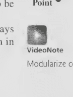

# 第 6 章 方法

```java
System.out.println("The greatest common divisor for " + n1
    + " and " + n2 + " is " + gcd(n1, n2));

}

/* Return the gcd of two integers */

public static int gcd(int n1, int n2) {
    int gcd = 1; // Initial gcd is 1
    int k = 2; // Possible gcd

    while (k <= n1 && k <= n2) {
        if (n1 % k == 0 && n2 % k == 0) {
            gcd = k; // Update gcd
        }

        k++;
    }

    return gcd; // Return gcd
}
```


将获取最大公约数的代码封装在一个方法中，该程序有几个优点：

1. 它将计算最大公约数的问题与主方法中的其他代码隔离开来。因此逻辑变得清晰，程序也更易读。
2. 计算最大公约数的错误被限制在 `gcd` 方法中，这缩小了调试范围。
3. `gcd` 方法现在可以被其他程序使用。

列表 6.7 将代码模块化的概念应用于改进列表 5.15 Prime-Number.java。

### 列表 6.7 PrimeNumberMethod.java

```java
public class PrimeNumberMethod {
    public static void main(String[] args) {
        System.out.println("The first 50 prime numbers are \n");
        printPrimeNumbers(50);
    }

    public static void printPrimeNumbers(int numberOf) {
        final int NUMBER_OF_PRIMES_PER_LINE = 10; // 每行显示 10 个质数
        int count = 0; // 统计质数数量
        int number = 2; // 待测试是否质数的数字

        // 重复寻找质数
        while (count < numberOf) {
            // 打印质数并增加计数
            if (isPrime(number)) {
                count++; // 增加计数
```

## 6.7 案例研究：将十六进制转换为十进制

```java
if (count % NUMBER_OF_PRIMES_PER_LINE == 0) {
    // 打印数字并换到新行
    System.out.printf("%-5d\n", number);
} else {
    System.out.printf("%-5d", number);
}

// 检查下一个数字
number++;

/** 检查下一个数字是否为质数 **/

public static boolean isPrime(int number) {
    for (int divisor = 2; divisor <= number / 2; divisor++) {
        if (number % divisor == 0) { // 如果为真，则不是质数
            return false; // 不是质数
        }
    }

    return true; // 是质数
}
```


前 50 个质数是：

| 2 | 3 | 5 | 7 | 11 | 13 | 17 | 19 | 23 |
|---|---|---|---|---|---|---|---|---|
| 29 | 31 | 37 | 41 | 43 | 47 | 53 | 59 | 61 |
| 67 | 71 | 73 | 79 | 83 | 89 | 97 | 101 | 103 |
| 107 | 109 | 113 | 127 | 131 | 137 | 139 | 149 | 151 |
| 157 | 163 | 167 | 173 | 179 | 181 | 191 | 193 | 197 |
| 199 | 211 | 223 | 227 |  |  |  |  |  |

我们将一个大问题分为两个子问题：判断数字是否为质数以及打印数字。结果是新程序更容易读。此外，`printNumbers` 和 `isPrime` 方法可以被其他程序。

**6.6.1** 追踪 `gcd` 获取 `gcd(4, 6)` 的返回值。

**6.6.2** 追踪 `isPrime` 方法找到 `isPrime(25)` 的返回值。

## 6.7 案例研究：十六进制转十进制

本节介绍了一个将十进制转换为十六进制的程序。

列表 5.1 DecHex.java 提供了一个将十进制转换为十六进制的程序。你想将十六进制转换为十进制吗？

给定一个十六进制数 `$h_nx^n + h_{n-1}x^{n-1} + \dots + h_0$`，其对应的十进制值为：

`$h_nx^n + h_{n-1}x^{n-1} + \dots + h_2x^2 + h_1x^1 + h_0$`

例如，十六进制数 AB8C：

`$10 \times 16^3 + 11 \times 16^2 + 8 \times 16^1 + 12 \times 16^0 = 43916$`

我们的程序将提示用户输入十六进制字符串并使用以下方法进行转换：

```java
public static int hexToDecimal(String hex)
```


# 第 6 章 方法

暴力方法是将每个十六进制字符转换为十进制，根据其所在的 i 位乘以 16，然后将所有项相加以得到数字对应的十进制值。

注意：

`$h_n = h_nx^0 + h_{n-1}x^1 + h_{n-2}x^2 + \dots + h_1x^{n-1} + h_0x^n$`

`$= (\dots ((h_n \times 16 + h_{n-1}) \times 16 + h_{n-2}) \times 16 + \dots + h_1) \times 16 + h_0$`

这种被称为霍纳算法（Horner's algorithm）的观察导致了以下将十六进制字符串转换为十进制的高效代码：

```java
int decimalValue = 0;

for (int i = 0; i < hex.length(); i++) {
    char hexChar = hex.charAt(i);
    decimalValue = decimalValue * 16 + hexCharToDecimal(hexChar);
}
```

这里是数字 AB8 的算法追踪：

|  | hexChar | hexCharToDecimal (hexChar) | decimalValue |
|---|---|---|---|
| 循环前 |  |  | 0 |
| 第一次迭代后 | 0 | A | 10 |
| 第二次迭代后 | 1 | B | 10 * 16 + 11 |
| 第三次迭代后 | 2 | 8 | (10 * 16 + 11) * 16 + 8 |
| 第四次迭代后 | 3 | C | 12 | ((10 * 16 + 11) * 16 + 12 |

列表 6.8 提供了完整的程序。

### 列表 6.8 HexDec.java

```java
+   1 import java.util.Scanner;

2 public class HexDec {

3     /* Main method */

4     public static void main(String[] args) {

5         // Create a Scanner

6         Scanner input = new Scanner(System.in);

7

8         // Prompt the user "Enter a hex string"

9         System.out.println("Enter a hex number: ");

10        String hex = input.nextLine();

11

12        System.out.println("The decimal value for hex number " + hex
             + " is " + hexToDecimal(hex.toUpperCase()));

13 public static int hexToDecimal(String hex) {

14    int decimalValue = 0;

15    for (int i = 0; i < hex.length(); i++) {

16        char hexChar = hex.charAt(i);

17        decimalValue = decimalValue * 16 + hexCharToDecimal(hexChar);

18    }

}
```

## 6.8 方法重载

```java
)
return decimalValue();
}

public static int hexCharToDecimal(char char) {
    if (char >= 'A' && char <= 'F') {
        return 10 + char - 'A';
    } else if (char >= '0' && char <= '9') {
        return char - '0';
    }
}
```

十六进制字符转十进制

检查大写


输入十六进制数：AB8C

十六进制数 AB8C 的十值为 43916


输入十六进制数：af71

十六进制数 af71 的十值为 44913

程序从控制台读取一个字符串（第 11 行），并调用 `hexDecimal` 方法将十六进制字符串转换为十进制数（第 14 行）。字符可以是小写或大写。在调用 `hexDecimal` 方法之前，它们会被转换为大写。

`hexDecimal` 方法定义在第 17-25 行，返回一个整数。字符串的长度通过调用第 19 行的 `hex length()` 确定。

`hexCharToDecimal` 方法定义在第 27-32 行，返回十六进制字符的十进制值。字符可以是小写或大写。记住是通过减去它们的 Unicode 值来实现的。例如，`'5' - '0'` 等于 5。

### 6.7.1

`hexCharToDecimal('B')` 是什么？

`hexCharToDecimal('7')` 是什么？

`hexToDecimal("A9")` 是什么？


## 6.8 方法重载

方法重载允许你定义具有相同名称的方法，只要它们的参数列表不同。

使用的 `max` 方法只对 `int` 数据类型有效。但如果你需要确定两个浮点数中哪一个值最大怎么办？解决方案是创建另一个名称相同但参数不同的方法，如下代码所示：

```java
public static double max(double num1, double num2) {
    if (num1 > num2)
        return num1;
    else
        return num2;
}
```


如果你使用 `int` 参数调用 `max`，将调用期望 `int` 参数的 `max` 方法；如果你使用 `double` 参数调用 `max`，则将调用期望 `double` 参数的 `max` 方法。这被称为方法重载；即在同一个类中，两个方法的名称相同但参数列表不同。Java 编译器根据方法签名来确定使用哪种方法。

方法重载

# 第 6 章 方法

列表 6.9 是一个创建了三个方法的程序。第一个找到最大的整数，第二个找到最大的 `double`，第三个找到三个 `double` 值中的最大值。这三个方法都命名为 `max`。

### 列表 6.9 TestMethodOverloading.java

```java
1 public class TestMethodOverloading {

2     /** 主方法 */
```


```java
public static void main(String[] args) {

    // 使用 int 参数调用 max 方法

    System.out.println("The maximum of 3 and 4 is "
        + max(3, 4));

    // 使用 double 参数调用 max 方法

    System.out.println("The maximum of 3.0 and 5.4 is "
        + max(3.0, 5.4));

    // 使用三个 double 参数调用 max 方法

    System.out.println("The maximum of 3.0, 5.4, and 10.14 is "
        + max(3.0, 5.4, 10.14));
}

}

/** 寻找两个 int 值的最大值 */

public static int max(int num1, int num2) {

    if (num1 > num2)
        return num1;
    else
        return num2;
}

/** 寻找两个 double 值的最大值 */

public static double max(double num1, double num2) {

    if (num1 > num2)
        return num1;
    else
        return num2;
}

/** 寻找三个 double 值的最大值 */

public static double max(double num1, double num2, double num3) {

    return max(max(num1, num2), num3);
}
```

| 重载的 `max` | 重载的 `max` | 重载的 `max` |
| :--- | :--- | :--- |
| 3 和 4 的最大值是 4 | 3.0 和 5.4 的最大值是 5.4 | 3.0, 5.4 和 10.14 的最大值是 10.14 |

当调用 `max(3, 4)`（第 6 行）时，调用寻找整数最大值的 `max` 方法。调用 `max(3.0, 5.4)`（第 10 行）时，调用寻找 `double` 最大值的 `max` 方法。调用 `max(3.0, 5.4, 10.14)`（第 14 行）时，调用寻找 `double` 最大值的 `max` 方法。你可以用一个 `int` 值和一个 `double` 值 2 调用 `max` 方法吗？如果是的话，调用的是哪一个 `max` 方法？第一个问题的答案是肯定的。第二个问题的答案是调用了寻找最大值的 `max` 方法。参数值 2 会被自动转换为 `double` 值。


## 6.9 局部变量

在两个非嵌套的块中声明 `int i` 是允许。

```java
public static void method1() {

    int x = 1;
    int y = 1;

    for (int i = 1; i < 10; i++) {
        x += i;
    }

    for (int i = 1; i < 10; i++) {
        y += i;
    }
}
```

在两个嵌套的块中声明 `int i` 是错误的。

```java
public static void method2() {

    int i = 1;
    int sum = 0;

    for (int i = 1; i < 10; i++) {
        sum += i;
    }
}
```

图 6.6 可以在非嵌套块中多次声明变量，但在嵌套块中只能一次。

**注意** 一个常见的错误是在 `for` 循环中声明变量并尝试在循环外部使用它。如下代码所示，`i` 在 `for` 循环中声明，但从循环外部访问它，这会导致语法错误。

```java
for (int i = 0; i < 10; i++) {
}

System.out.println(i); // 对 i 导致语法错误
```

最后一条语句会导致语法错误，因为变量 `i` 在循环外部未定义。

### 6.9.1 什么是局部变量？

### 6.9.2 局部变量的作用范围是什么？

## 6.10 案例研究：生成随机字符

字符使用整数进行编码。生成随机字符就是生成一个随机整数。

计算机程序处理普通数据和字符。你已经见过许多涉及数值数据的示例。理解字符以及如何使用它们非常重要。本节将介绍一个生成随机字符的示例。

正如第 4.3 节介绍的，每个字符都有一个十六进制介于 0 到 FFFF 之间的 Unicode 码（十进制为 65535）。生成随机字符就是使用以下表达式生成一个 0 到 65535 之间的随机整数（注意由于 `0 <= Math.random() < 1.0`，你必须对 65535 加 1）：

```java
(int)Math.random() * (65535 + 1)
```

现在让我们考虑如何生成一个随机的大写字母。字母是从 `'a'` 的 Unicode 开始，然后是 b, c, ..., z 的连续整数。`'a'` 的 Unicode 是：

```java
(int)'a'
```

因此，`(int)'a'` 和 `(int)'z'` 之间的随机整数是：

```java
(int)((int)'a' + Math.random()) * ((int)'z' - (int)'a' + 1))
```

正如第 4.3.3 节讨论的，所有的数值运算符都可以应用于 `char` 操作数。如果另一个操作数是数字或字符，则 `char` 操作数会被转换为数字。因此，前面的表达式可以简化如下：

```java
'a' + Math.random() * ('z' - 'a' + 1)
```

以及一个随机的小写字母：

```java
(char)('a' + Math.random() * ('z' - 'a' + 1)
```

因此，在两个字符 `ch1` 和 `ch2`（其中 `ch1 < ch2`）之间生成随机字符的方法如下：

```java
(char)(ch1 + Math.random() * (ch2 - ch1 + 1))
```

这是一个简单但用的发现。列表 6.10 定义了一个 `RandomCharacter` 类，它包含带有重载的方法来获取特定类型的随机字符。你可以在未来的项目中使用这些方法。

### 列表 6.10 `RandomCharacter.java`

```java
public class RandomCharacter {

    /* 生成一个 ch1 和 ch2 之间的随机字符 */
    public static char getRandomCharacter(char ch1, char ch2) {
        return (char)(ch1 + Math.random() * (ch2 - ch1 + 1));
    }

    /* 生成一个随机的小写字母 */
    public static char getRandomLowerCaseCaseLetter() {
        return getRandomCharacter('a', 'z');
    }

    /* 生成一个随机的大写字母 */
    public static char getRandomUpperCaseCaseLetter() {
        return getRandomCharacter('A', 'Z');
    }

    /* 生成一个随机的数字字符 */
    public static char getRandomDigitCharacter() {
        return getRandomCharacter('0', '9');
    }

    /* 生成一个随机字符 */
    public static char getRandomCharacter() {
        return getRandomCharacter('\u0000', '\uFFFF');
    }
}
```

列表 6.11 提供了一个测试程序，显示 17 个随机的小写字母。

### 列表 6.11 `TestRandomCharacter.java`

```java
public class TestRandomCharacter {

    public static void main(String[] args) {

        final int NUMBER_OF_CHARS = 17;
        final int CHAR_PER_LINE = 25;

        /* 打印 'a' 到 'z' 之间的随机字符，每行 25 个字符 */
        for (int i = 0; i < NUMBER_OF_CHARS; i++) {

            char ch = RandomCharacter.getRandomLowerCaseCaseLetter();

            if ((i + 1) % CHAR_PER_LINE == 0) {
                System.out.println();
            }
        }
    }
}
```

## 6.11 方法抽象和逐步细化

```java
else
    System.out.print(ch);
}
}
```


第 90 行调用了定义的 `getRandomLowerCaseLetter()`，它没有任何参数，但你仍然必须使用括号。

开发软件的关键是应用抽象。你将学习许多层次的抽象。方法抽象通过将方法的使用与其实现分离开来实现。抽象的概念可以应用于程序开发。在编写大型程序时，你可以使用分治策略（也称为逐步细化），将将其分解为更小、易于管理的问题。

假设你写了一个显示给定月份日历的程序。该程序提示用户输入年份和月份，然后显示该月的整个日历，如下示例所示：

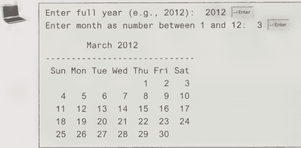

让我们用这个示例来演示分治法。

### 6.11.1 自顶向下设计

你会如何开始这样一个程序？你会立即开始编码吗？初学者通常从尝试解决每个细节开始。虽然细节在最终程序很重要，但在早期关注细节可能会阻塞问题的解决。为了尽可能顺利地解决问题，本示例通过方法抽象将设计与细节分离，然后再实现细节。

对于这个示例，问题首先被分解为两个子问题：获取输入和打印该月的日历。在这个阶段，你应该关注问题将实现什么，而不是如何获取输入和打印日历。你可以画一个结构图来可视化问题的分解（见图 6.8a）。

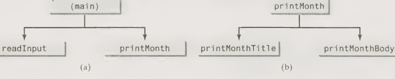

图 6.8 结构图显示 `printCalendar` 问题分解为两个子问题 `readInput` 和 `printMonth`（a），而 `printMonth` 被分解为两个更小的子问题 `printMonthTitle` 和 `printMonthBody`（b）。

我们使用 `Scanner` 来读取年份和月份的输入。打印给定月份日历的问题可以分解为两个子问题：打印月份标题和打印月份主体，如图 6.8b 所示。标题由三行组成：月份名称、虚线和星期七天的名字。你需要从数字月份（例如 1）获取月份名称（例如 January）。这是通过 `getMonthName` 完成的（见图 6.9a）。

为了打印月份主体，你需要知道月份的第一天是星期几（`getStartDay`）以及该月份有多少天（`getNumberOfDaysInMonth`）。


**图 6.9** (a) 要打印 `printMonthTitle`，你需要 `getMonthName`。(b) `printMonthBody` 问题被细化为若干几个更小的问题。

如图 6.9b 所示。例如，2013 年有 31 天，2013 年 12 月 1 日是星期日。你如何获取某月份第一日的起始星期呢？有几种方法可以实现。目前，我们将使用替代方法。假设你知道 1800 年 1 月 1 日的起始星期是星期三（`START_DAY_FOR_JAN_1800 = 3`）。你可以计算 1800 年 1 月 1 日到该月份第一天之间的总天数（`totalNumberOfDays`）。由于每周有 7 天，因此该月份的起始星期是 `(totalNumberOfDays + START_DAY_FOR_JAN_1800) % 7`。因此，`getStartDate` 问题可以进一步细化为 `getTotalNumberOfDays`，如图 6.10a 所示。

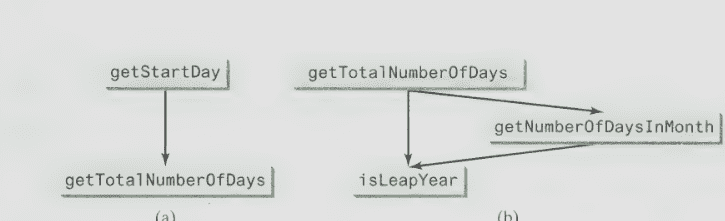

**图 6.10** (a) 要获取 `StartDate`，你需要 `getTotalNumberOfDays`。(b) `getTotalNumberOfDays` 问题被细化为两个更小的问题。

为了获取总天数，你需要知道该年份是否为闰年，以及每个月的天数。因此，`getTotalNumberOfDays` 可以进一步细化为两个子问题：`isLeapYear` 和 `getNumberOfDaysInMonth`，如图 6.10b 所示。完整的结构图如图 6.11 所示。

### 6.11.2 自顶向下的和/或自底向上的实现

现在我们将注意力转向实现。通常情况下，一个子问题对应于实现中的一个方法，尽管有些问题简单到没必要这样做。你需要决定哪些模块应该实现为方法，哪些模块应该与其他方法合并。此类决策应基于你的选择是否能使整个程序更易读。在这个示例中，`getInput` 可以简单地在 `main` 方法中实现。

你可以使用“自顶向下”或“自底向上”的方法。自顶向下的方法按照结构图从上到下的顺序实现方法。存根（Stubs）——即方法的简单不完整版本——可以用于等待实现的方法。使用存根允许你快速构建程序的框架。实现 `main` 方法：


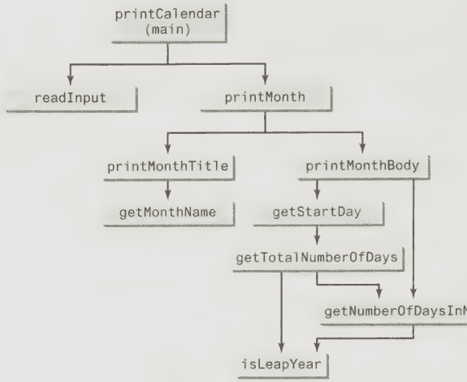

图 6.11 结构图显示了程序子问题的层级关系。

首先为 `printMonth` 方法使用一个存根。例如，让 `printMonth` 显示年份和月份。因此，你的程序可能如下所示：

```java
public class PrintCalendar {

    /** Main method */
    public static void main(String[] args) {

        Scanner input = new Scanner(System.in);

        // 提示用户输入年份
        System.out.print("Enter full year (e.g., 2012): ");
        int year = input.nextInt();

        // 提示用户输入月份
        System.out.print("Enter month as a number between 1 and 12: ");
        int month = input.nextInt();

        // 打印该年份的日历
        printMonth(year, month);
    }

    /* printMonth 的存根 */
    public static void printMonth(int year, int month) {
        System.out.print(month + " " + year + " ");
    }

    /* printMonthTitle 的存根 */
    public static void printMonthTitle(int year, int month) {
    }

    /* printMonthBody 的存根 */
    public static void printMonthBody(int year, int month) {
    }
}
```

```java
/** getMonthName 的存根 */
public static String getMonthName(int month) {
    return "January"; // 占位值
}
```

```java
/** getDay 的存根 */
public static int getDay(int year, int month) {
    return 1; // 占位值
}
```

```java
/** getTotalNumberOfDays 的存根 */
public static int getTotalNumberOfDays(int year, int month) {
```


```java
return 10000; // 占位值
}
```

```java
/** `getNumberDaysInMonth` 的存根 */
public static int getNumberDaysInMonth(int year, int month) {
    return 31; // 占位值
}
```

```java
/** `isLeapYear` 的存根 */
public static boolean isLeapYear(int year) {
    return true; // 占位值
}
```

编译程序并修复错误。现在你可以实现 `printMonth` 方法。从 `printMonth` 方法调用的方法可以使用存根。自底向上的方法从底到上一个实现结构图中的方法。对于每个实现的方法，编写一个驱动程序进行测试。自顶向下和自底向上的方法同样好：它们都是增量实现的，有助于隔离错误并方便调试。它们可以结合使用。

### 6.11.3 实现细节

`isLeapYear(int year)` 可以使用以下代码实现：

```java
return year % 400 == 0 || (year % 4 == 0 && year % 100 != 0);
```

使用以下事实实现 `getTotalDaysInMonth(int year, month)`：

- 一、三、五、八、十、十二月有 31 天。
- 四、六、九、十一月有 30 天。
- 二月在平年有 28 天，在闰年有 29 天。

因此，全年有 365 天，闰年有 366 天。

为了实现 `getTotalNumberOfDays(int year, month)`，你需要计算 1800 年 1 月 1 日到日历第一天之间的总天数（`totalNumberOfDays`）。你可以找到 1800 年到日历之前月份的总天数。这两个总数的之和就是 `totalNumberOfDays`。

要打印正文，首先在起始日留空，然后打印每一行。完整程序见列表 6.12。

#### 列表 6.12 `PrintCalendar.java`

```java
import java.util.Scanner;

public class PrintCalendar {

    /** Main method */
    public static void main(String[] args) {
        Scanner input = new Scanner(System.in);

        // 提示用户输入年份
        System.out.print("Enter full year (e.g., 2012): ");
        int year = input.nextInt();

        // 提示用户输入月份
        System.out.print("Enter month as a number between 1 and 12: ");
        int month = input.nextInt();

        // 打印该年份的日历
        printMonth(year, month);
    }

    /** 打印某个月的日历 */
    public static void printMonth(int year, int month) {
        // 打印日历头部
        printMonthTitle(year, month);

        // 打印日历正文
        printMonthBody(year, month);
    }

    /** 打印标题，例如 March 2012 */
    public static void printMonthTitle(int year, int month) {
        System.out.println(getMonthName(month) + " " + year);
    }

    public static void printMonthBody(int year, int month) {
        // 获取该月份第一日的起始星期
        int startDay = getStartDate(year, month);

        // 获取月份的天数
        int numberOfDaysInMonth = getNumberOfDaysInMonth(year, month);

        // 在月份第一天之前留空
        for (int i = 0; i < startDay; i++) {
            System.out.print("  ");
        }

        for (int i = 1; i <= numberOfDaysInMonth; i++) {
            System.out.printf("%4d", i);

            if ((i + 1) % 7 == 0) {
                System.out.println();
            }
        }

        System.out.println();
    }

    /** 获取月份/1/year 的起始星期 */
    public static int getStartDate(int year, int month) {
        final int START_DAY_FOR_JAN_1800 = 3;

        // 计算 1800 年到日历第一天之间的总天数
        int totalNumberOfDays = getTotalNumberOfDays(year, month);

        // 返回月份的起始星期
        return (totalNumberOfDays + START_DAY_FOR_JAN_1800) % 7;
    }

    /** 获取从 1800 年 1 月 1 日以来的总天数 */
    public static int getTotalNumberOfDays(int year, int month) {
        int total = 0;

        // 计算 1800 年到该年份的总天数
        for (int i = 1800; i < year; i++) {
            if (isLeapYear(i)) {
                total += 366;
            } else {
                total += 365;
            }
        }

        // 加上到日历之前月份的天数
        for (int i = 1; i < month; i++) {
            total = total + getNumberOfDaysInMonth(year, i);
        }

        return total;
    }

    public static int getNumberOfDaysInMonth(int year, int month) {
        if (month == 1 || month == 3 || month == 5 || month == 7
                || month == 8 || month == 10 || month == 12) {
            return 31;
        }

        if (month == 4 || month == 6 || month == 9 || month == 11) {
            return 30;
        }

        if (month == 2) {
            return isLeapYear(year) ? 29 : 28;
        }

        return 0;
    }

    public static boolean isLeapYear(int year) {
        return year % 400 == 0 || (year % 4 == 0 && year % 100 != 0);
    }

    public static String getMonthName(int month) {
        return "January"; // 简化处理
    }
}
```

该程序没有对用户输入进行验证。例如，如果用户输入的月份不在 1 到 12 之间，或者在 1800 年之前，该程序将生成错误的日历。为了避免这种情况，可以在打印日历之前添加一个 `if` 语句来检查输入。

该程序打印某月的日历，但可以修改为打印整年的日历。虽然它只能打印 1800 年 1 月之后的月份，但可以修改为打印 1800 年之前的月份。

`isLeapYear`

## 6.11.4 逐步细化的优势

逐步细化将一个大问题分解为更小的、易于管理的子问题。每个子问题都可以用一个方法来实现。这种方法使得程序更容易编写、复用、调试、测试、修改和维护。

## 更简单的程序

打印日历的程序很长。逐步细化并不是在一个方法中编写一长串的语句，而是将其细化为更小的方法。这简化了程序，使得整个程序更容易阅读和理解。

## 方法复用

逐步细化促进了程序内部的代码复用。`isLeapYear` 方法定义一次并在 `getTotalNumberOfOfDays` 和 `getNumberOfDaysInMonth` 方法中调用。这减少了冗余代码。

## 更容易开发、调试和测试

每个问题都在方法中解决，每个方法都可以单独进行开发、调试和测试。这隔离了错误，使得开发、调试和测试变得更容易。

在实现大型程序时，使用自顶向下或自底向上的方法。不要一次性编写整个程序。使用这些方法似乎需要更多的开发时间（因为你需要反复编译和运行程序），但实际上节省了时间并让调试更容易。

### 增量式开发与测试

## 促进团队协作

当一个大问题被分为子程序时，可以将子问题分配给不同的程序员。这使得程序员在团队中工作变得更容易。

## 关键术语

| 术语 | 页码 | 术语 | 页码 |
| :--- | :--- | :--- | :--- |
| 实际参数 | 229 | 方法重载 | 243 |
| 歧义调用 | 245 | 方法签名 | 229 |
| 参数 | 229 | 修饰符 | 229 |
| 分治法 | 249 | 形参数 | 229 |
| 形式参数（即参数） | 229 | 按值传递 | 236 |
| 信息隐藏 | 249 | 变量范围 | 246 |
| 方法 | 228 | 逐步细化 | 249 |
| 方法抽象 | 249 | 存根 | 251 |

## 章节总结

1. 使程序模块化和可复用是软件工程的核心目标之一。Java 提供了许多强大的构造来帮助实现这一目标。方法就是其中一种构造。
2. 方法头指定了方法的修饰符、返回值类型、方法名和参数。本章中的方法都使用了 `static` 修饰符。
3. 方法可以返回一个值。`returnType` 是方法返回的值的数据类型。如果方法不返回值，`returnType` 就是关键字 `void`。
4. 参数列表指的是方法参数的类型、顺序和数量。方法名和参数列表共同构成了方法签名。参数是可选的；如果方法不需要包含任何参数，则为空。
5. `return` 语句也可以用于 `void` 方法，用以终止方法并返回到方法的调用者处。这偶尔用于绕过方法中的正常控制流。
6. 传递给方法的参数的数量、类型和顺序应与方法签名中的参数相同。
7. 当程序调用方法时，程序控制权转移到被调用的方法。当执行其 `return` 语句或到达方法结束的右括号时，执行返回。
8. 返回值的方法在 Java 中也可以作为语句被调用。在这种情况下，调用者简单地忽略返回值。
9. 方法可以被重载。这意味着两个方法只要方法参数列表不同，它们就可以有相同的名字。
10. 在方法中声明的变量是局部变量。局部变量的作用从它的声明开始，一直到包含该变量的块的结束。局部变量必须在使用之前进行声明和初始化。
11. 方法抽象通过将方法的使用与其实现分离来实现。客户端可以在不知道其如何实现的情况下使用该方法。实现的细节封装在方法中，并对调用该方法的客户端隐藏。这被称为信息隐藏或封装。
12. 方法抽象以一种整洁的、层次化的方式使程序模块化。与其他情况相比，编写成一系列简练方法的程序更容易编写、调试、维护和修改。这种书写代码的风格促进了方法的复用性。
13. 在实现大型程序时，使用自顶向下和/或自底向上的编码方法。不要一次性编写整个程序。这种方法在编码上似乎需要更多时间（因为你需要反复重新编译和运行程序），但它节省了时间并让调试更容易。

## 编程练习

### 6.1–6.9

- **6.1（方法：数字）** 回答本章的在线测试。注意：本章的常见错误是学生没有实现方法。
- **6.2（数字之和）** 编写一个计算各位数字之和的方法。例如，234 返回 9。使用循环提取数字直到所有数字求和。
- **6.3（回文）** 编写一个具有以下头部的方法：

  ```java
  // 返回整数的翻转
  public static int reverse(int number)
  ```

  ```java
  // 如果数字是回文则返回 true
  public static boolean isPalindrome(int number)
  ```

  使用 `reverse` 方法判断该整数是否为回文。
- **6.4（显示整数）** 编写一个具有以下头部的方法：

  ```java
  public static void reverse(int number)
  ```

  例如，`reverse(345)` 显示 543。
- **6.5（三个数字排序）** 编写一个具有以下头部的方法，按降序显示它们：

  ```java
  public static void displaySortedNumbers(
      double num1, double num2, double num3)
  ```
- **6.6（显示模式）** 编写一个方法显示如下模式：

  ```
  1
  1 2
  1 2 3
  ...
  n n-1 ... 3 2 1
  ```

  方法头部为：

  ```java
  public static void displayPattern(int n)
  ```
- **6.7（财务应用：计算未来投资价值）** 编写一个方法计算给定利率下指定年份的未来投资价值。未来投资使用练习 2.21 中的公式。使用以下方法头部：

  ```java
  public static double futureInvestmentValue(
      double investmentAmount,
      double monthlyInterestRate,
      int years)
  ```

  例如，`futureInvestmentValue(10000, 0.05/12, 5)` 返回 12833.59。编写一个测试程序，提示用户输入投资金额（例如 1000）和利率（例如 9%），并显示从 1 到 30 年的未来价值表格，如下：

  | 项目 | 输入 |
  | :--- | :--- |
  | 投资金额 | 1000 |
  | 年利率 | 9% |

  | 年份 | 未来价值 |
  | :--- | :--- |
  | 1 | 1093.80 |
  | 2 | 1196.41 |
  | ... | ... |
  | 29 | 13467.25 |
  | 30 | 14730.57 |

- **6.8（英里和公里之间的转换）** 编写一个包含以下两个方法的类：

  ```java
  /** 将英里转换为公里 */
  public static double mileToKilometer(double kilometer)
  ```

  ```java
  /** 将公里转换为英里 */
  public static double kilometerToMile(double kilometer)
  ```

## 第 6 章 方法

转换公式为：

1 英里 = 1.6 公里

编写一个测试程序，调用这些方法来显示表格：

| 英里 | 公里 | 英里 | 公里 |
| :--- | :--- | :--- | :--- |
| 1 | 1.609 | 20 | 12.430 |
| 2 | 3.218 | 25 | 15.538 |
| 9 | 14.481 | 60 | 37.290 |
| 10 | 16.090 | 65 | 40.398 |

### 6.9（磅与公斤之间的转换）

编写一个包含以下两个方法的类：

```java
/** 将磅转换为公斤 */
public static double poundToKilogram(double pound)

/** 将公斤转换为磅 */
public static double kilogramToPound(double kilogram);
```


转换公式为：

```text
pound = 0.453 * kilogram
kilogram = 2.204 * pound
```

编写一个测试程序，调用这些方法来显示表格：

| 公斤 | 磅 | 磅 | 公斤 |
| --- | --- | --- | --- |
| 1 | 2.2 | 20 | 9.09 |
| 3 | 6.6 | 25 | 11.36 |
| 197 | 433.4 | 510 | 231.82 |
| 199 | 437.8 | 515 | 234.09 |

### 6.10（使用 `isPrime` 方法）

列表 6.7 `PrimeNumberMethod.java` 提供了 `isPrime(int number)` 方法，用于测试一个数是否为质数。使用该方法找到小于 10000 的质数的个数。

### 6.11（财务应用：计算佣金）

编写一个使用编程练习 5.39 中方案的类来计算佣金。方法头如下：

```java
public static double computeCommission(double salesAmount);
```

编写一个测试程序显示以下表格：

| 销售额 | 佣金 |
| --- | --- |
| 10000 | 900.0 |
| 15000 | 1500.0 |
| 95000 | 11100.0 |
| 100000 | 11700.0 |

### 6.12（显示数字）

编写一个使用以下方法头的方法：

```java
public static void printNumbers(int num1, int num2, int numberLine)
```

该方法按每行指定的数量打印 `num1` 和 `num2` 之间的字符。编写一个测试程序，从 1 到 100 每行打印十个字符。数字之间恰好隔一个空格。

### 6.13（级数和）

编写一个方法计算以下级数：

```text
m(i) = \frac{1}{3} + \frac{2}{4} + \dots + \frac{i}{i+2}
```

编写一个测试程序显示以下表格：

| `m(i)` |
| --- |
| 1 \| 0.3333 |
| 2 \| 0.8333 |
| ... \| ... |
| 19 \| 14.7093 |
| 20 \| 15.6184 |

### 6.14（估算 `π`）

`π` 可以使用求和公式计算：

```text
m(i) = 4\left(1 - \frac{1}{3} + \frac{1}{5} - \frac{1}{7} + \frac{1}{9} - \frac{1}{11} - \dots + \frac{(-1)^{(i+1)}}{2i-1}\right)
```

编写一个根据给定 `i` 返回 `m(i)` 的方法，并编写一个测试程序显示以下表格：

| i | `m(i)` |
| --- | --- |
| 1 | 3.4000 |
| 101 | 3.1515 |
| 201 | 3.1466 |
| 301 | 3.1449 |
| 401 | 3.1441 |
| 501 | 3.1436 |
| 601 | 3.1433 |
| 701 | 3.1430 |
| 801 | 3.1428 |
| 901 | 3.1427 |

### 6.15（财务应用：打印税率表）

列表 3.5 提供了一个计算税费的程序。编写一个使用以下头计算税费的方法：

```java
public static double computeTax(int status, double taxableIncome)
```

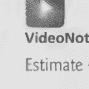

使用该方法编写程序，打印应纳税收入在 $50,000 到 $70,000 之间（间隔为 $100）的税率表：

| 应纳税收入 | 单身 | 夫妻共同或寡/守寡 | 夫妻分开 | 主户 |
| --- | --- | --- | --- | --- |
| 50000 | 8688 | 6665 | 8688 | 7353 |
| 50100 | 8713 | 6680 | 8713 | 7378 |
| ... | ... | ... | ... | ... |
| 69900 | 13663 | 9850 | 12328 | 9840 |
| 70000 | 13688 | 9675 | 12353 | 9853 |

### 6.16（年的天数）

编写一个使用以下头返回每年天数的方法：

```java
public static int numberOfDaysInYear(int year)
```

编写一个测试程序显示 2014 年到 2034 年之间的天数。

### 6.17（显示 0 和 1 矩阵）

编写一个使用以下头显示 `n × n` 矩阵的方法：

```java
public static void printMatrix(int n)
```

每个元素是随机生成的 0 或 1。编写一个测试程序，提示用户输入 `n` 并显示 `n × n` 矩阵。运行示例如下：


### 6.18（检查密码）

假设密码规则如下：

- 密码必须至少有十个字符。
- 密码由字母和数字组成。
- 密码必须包含三个数字。

编写一个程序，提示用户输入密码，符合规则则显示 `Valid`，否则显示 `Invalid`。

### 6.19（三角形）

实现以下两个方法：

```java
/** 如果两边之和大于第三边，则返回 true */
public static boolean isValid(double side1, double side2, double side3)

/** 返回三角形的面积 */
public static double area(double side1, double side2, double side3)
```

编写一个程序读取三角形的三条边，使用 `isValid` 方法测试输入是否有效，并使用 `area` 方法获取面积。如果输入有效则显示面积，否则显示输入无效。三角形面积的公式见编程练习 2.19。

### 6.20（统计字符串中的字母）

编写一个使用以下头统计字符串中字母的方法：

```java
public static int countLetters(String s)
```

编写一个程序，提示用户输入一个字符串并显示字符串中字母的数量。

### 6.21（电话键盘）

国际字母/数字映射见编程练习 4.15。编写一个根据大写字母返回数字的方法，如下：

```java
public static int getNumber(char uppercaseLetter)
```

编写一个程序，提示用户输入字符串格式的号码。输入可能包含字母。程序将字母（大写或小写）转换为数字并保留所有其他字符。以下是程序的运行示例：

| 输入字符串: 1-800-Flowers | |
| --- | --- |
| 1-800-3569377 | |
| 输入字符串: 1800flowers | |
| 18003569377 | |


### 6.22（数学：估算平方根）

在 `Math` 类中实现 `sqrt` 方法有多种技术。这种技术被称为巴比法。通过重复计算以下公式来估算数字 `n` 的平方根：

```text
nextGuess = (lastGuess + n / lastGuess) / 2
```

当 `nextGuess` 和 `lastGuess` 几乎相同时，`nextGuess` 就是估算的平方根。初始猜测可以是任何正值（例如 1）。该值作为 `lastGuess` 的起始值。如果 `nextGuess` 和 `lastGuess` 之间的差异小于一个极小的数（例如 0.0001），你可以认为 `nextGuess` 是 `n` 的估算平方根。如果不是，`nextGuess` 变为 `lastGuess` 并继续估算过程。实现以下返回 `n` 平方根的方法：

```java
public static double sqrt(long n)
```

### 6.23（指定字符的出现次数）

编写一个使用以下头的方法查找字符串中指定字符的出现次数：

```java
public static int count(String str, char c)
```

例如，`count("Welcome", 'e')` 返回 2。编写一个测试程序，提示用户输入一个字符串和一个字符，然后显示出现次数。

### 6.24（显示当前日期）

编写一个显示当前日期的方法。

### 6.25（将毫秒转换为小时）

编写一个使用以下头将毫秒转换为小时、分钟和秒的方法：

```java
public static String convertMillis(long millis)
```

该方法返回格式为小时:分钟:秒的字符串。例如，`convertMillis(5500)` 返回 `0:0:5`，而 `convertMillis(100000)` 返回 `0:19:40`。

### 6.26（回文质数）

回文质数是指同时也是回文数的质数。例如，131 是质数也是回文数，还有 313 和 757。编写一个程序显示前 120 个回文质数。每行显示 10 个，数字之间恰隔一个空格，如下：

```text
2 3 5 7 11 31 37 71 73 97 101 113 151 181 191 311 313 353 373 379
```

### 6.27（倒转质数）

倒转质数（质数倒过来）是指反转后也是质数的非回文质数。例如，17 是质数且 71 也是质数，所以 17 和 71 是倒转质数。编写一个程序显示前 120 个倒转质数。每行显示 10 个，数字之间恰隔一个空格，如下：

```text
13 17 31 37 71 73 79 97 107 113 149 157 167 179 199 311 331 337 349 359 389
```

### 6.28（梅森质数）

如果一个质数可以写成 `2^p - 1` 的形式（其中 `p` 为正整数），则它是一个梅森质数。编写一个程序找到 `p ≤ 31` 的所有梅森质数，并按格式输出：

| P | `2^p - 1` |
| --- | --- |
| 2 | 3 |
| 3 | 7 |
| 5 | 31 |

### 6.29（孪生质数）

孪生质数是指差为 2 的质数对。例如，3 和 5 是孪生质数，5 和 7 是孪生质数，11 和 13 是孪生质数。编写一个程序找到小于 1200 的所有孪生质数。输出格式如下：

```text
(3, 5)
(5, 7)
```

### 6.30（游戏：骰子点）

骰子点是一种赌场中流行的骰子游戏。编写一个程序来玩该游戏的变体，如下：

掷两次骰子。每个骰子有六个面，分别代表数值 1、2、……和 6。检查骰子的点和。如果和为 2、3 或 12（称为 craps），则你输了；如果和为 7 或 11（称为 natural，即点数），则你赢了；如果和为其他值（即 4、5、6、8、9 或 10），则建立一个点（point）。

继续掷骰子，直到掷出 7 或相同的点数。如果掷出 7，则你输了；否则，你赢了。你的程序作为一个单个玩家运行。以下是一些示例运行结果。

| 输入 | 输出 |
| --- | --- |
| 你掷了 5 + 6 = 11 | 你赢了 |
| 你掷了 1 + 2 = 3 | 你输了 |
| 你掷了 4 + 4 = 8 | 点是 8<br>你掷了 6 + 2 = 8<br>你赢了 |
| 你掷了 3 + 2 = 5 | 点是 5<br>你掷了 2 + 5 = 5<br>你输了 |

### 6.31（财务：信用卡号验证）

信用卡号遵循特定的模式。信用卡号必须在 13 到 16 位数字之间。它必须以以下开头：

- 对于 Visa 卡
- 对于 Master 卡
- 对于美国运（American Express）卡
- 对于发现（Discover）卡

1954 年，Hans Luhn 提出了一种用于验证信用卡号的算法。该算法有助于判断卡号是否输入正确，或者信用卡是否被扫描器正确扫描。信用卡号是根据此有效性检查生成的，通常被称为 Luhn 检查或 Mod 10 检查，其描述如下（为了说明，请考虑卡号 4388576018402626）：

从右到左每隔一个数字翻倍。如果某个数字翻倍后得到两位数，则将这两个数字相加得到一个一位数。

```text
4388576018402626

2*2=4

2*2=4

4*2=8

1*2=2

6*2=12 (1+2=3)

5*2=10 (1+0=1)

8*2=16 (1+6=7)

4*2=8
```

#### 第 6 章 方法

1. 现在将步骤 1 中的所有一位数相加。

```text
4 + 4 + 8 + 2 + 3 + 1 + 7 + 8 = 37
```

2. 将卡号从右到左所有奇数位的数字。

```text
6 + 6 + 0 + 8 + 0 + 7 + 8 + 3 = 38
```

3. 将步骤 2 和步骤 3 的结果相加。

```text
37 + 38 = 75
```

4. 如果步骤 4 的结果能被 10 整除，则该卡号是有效的；否则，它是无效的。例如，数字 4388576018402626 是无效的，但数字 438857601840707 是有效的。

编写一个程序，提示用户以长整型输入信用卡。显示该数字是有效还是无效。设计你的程序使用以下方法：

```java
/** 如果卡号有效则返回 true */
public static boolean isValid(long number)

/** 获取步骤 2 的结果 */
public static int sumOfDoubleEvenPlace(long number)

/** 如果这是一个一位数，则返回它；否则，
 * 返回两个数字之和 */
public static int getDigit(int number)

/** 返回 number 中奇数位数字之和 */
public static int sumOfOddPlace(long number)

/** 如果数字 d 是 number 的前缀，则返回 true */
public static boolean prefixMatched(long number, int d)

/** 返回 d 的长度（位数） */
public static int getSize(long d)

/** 获取 number 的前 k 位数字。如果
 * number 的位数少于 k，则返回 number */
public static int getPrefix(long number, int k)
```

这里是程序的示例运行：（你也可以通过将输入作为字符串读取并处理字符串来验证信用卡。）

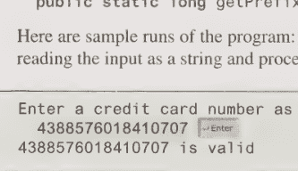

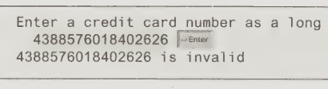

### 6.32（游戏：骰子游戏的胜率）

修改练习 6.30，运行 15,000 次并显示获胜游戏的次数。

### 6.33（当前日期和时间）

调用 `System.currentTimeMillis()` 返回自 1970 年 1 月 1 日午夜以来的毫秒数。编写一个显示日期和时间的程序。这里有一个示例运行：


## 编程练习 27

### 6.34（打印日历）

练习 21 使用 Zeller 同余式计算星期（`PrintCalendar.java`）。

### 6.35（几何：五边形的面积）

五边形的面积可以使用以下公式计算：

`Area = \frac{5s^2}{4}`

编写一个使用以下头部返回五边形面积的方法：

```java
public static double area(double side)
```

编写一个方法提示用户输入边长并显示五边形的面积。这里有一个示例运行：


### 6.36（几何：正边形的面积）

正边形是边长相等且角度相等的 `n` 边形，公式为：

`Area = \frac{ns^2}{4}`

编写一个使用以下头部返回正边形面积的方法：

```java
public static double area(int n, double side)
```

编写一个 `main` 方法提示用户输入边长并显示正边形的面积。这里有一个示例运行：


### 6.37（格式化为整数）

编写一个使用以下头部格式化整数：

```java
public static String format(int number, int width)
```


如果数字位数大于宽度，则返回数字字符串。例如，`format(34, 2)` 返回 `"34"`，`format(34, 5)` 返回 `"00034"`。（随机字符）使用 6.10 中的 `Random` 类打印每行 10 个随机大写字母。

# 第 7 章 一维数组

## 7.1 引言

单个数组变量可以引用一组大量的数据。

在程序执行期间，你通常需要存储大量的数值。例如，假设你需要读取 100 个数字，计算它们的平均值，并找出有多少个数字高于平均值。你的程序首先将每个数字与平均值进行比较，以确定它是否高于平均值。为了完成这项任务，这些数字必须存储在变量中。你需要声明 100 个变量，并重复编写 100 次几乎相同的代码。这样编写程序是不切实际的。那么，你如何解决这个问题呢？

你需要一种高效、有组织的方法。Java 和其他高级语言提供了一种数据结构——数组，它存储了一个固定大小的相同类型元素集合。在本例中，你可以将所有 100 个数字存储在一个数组中，并通过单个数组变量来访问它们。

本章将介绍单维数组。下一章将介绍二维数组和多维数组。

## 7.2 数组基础

一旦创建了数组，其大小就固定了。使用数组引用变量通过索引访问数组中的元素。

数组用于存储数据集合，但我们通常发现，将数组视为一组相同类型变量的集合更有用。与其声明单个变量（如 `number0`、`number1`……到 `number99`），不如声明一个如 `numbers` 的数组变量，并使用 `numbers[0]`、`numbers[1]`……`numbers[99]` 来表示单个变量。本节介绍了如何声明数组、创建数组以及使用索引访问它们。

### 7.2.1 声明数组变量

要使用数组，必须声明一个变量来引用该数组并指定数组的元素类型。声明数组变量的语法如下：

```java
elementType[] arrayRefVar;
```

或者：

```java
elementType arrayRefVar[]; // 允许，但不推荐
```

`elementType` 可以是任何数据类型，数组中的所有元素都将具有相同的数据类型。例如，以下代码声明了一个引用 `double` 类型数组的变量 `myList`。

```java
double[] myList;
```

或者：

```java
double myList[]; // 允许，但不推荐
```

> **注意**：你可以使用 `elementType arrayRefVar[]` 来声明数组变量。这种风格源于 C/C++ 语言，并被 Java 采用以适应 C/C++ 程序员。更倾向于使用 `elementType[]` 风格。

### 7.2.2 创建数组

与基本数据变量的声明不同，数组变量的声明不会为数组分配任何内存空间。它仅创建一个引用的存储位置。如果变量不包含数组的引用，则变量的值为 `null`。除非数组已经创建，否则你不能给数组赋值。在声明数组变量后，可以使用 `new` 运算符创建数组，并按照以下语法将其引用赋值给变量：

```java
arrayRefVar = new elementType[arraySize];
```

这做了两件事：

1. 使用 `new elementType[arraySize]` 创建一个数组；
2. 将新创建数组的引用赋值给 `arrayRefVar`。

声明数组变量、创建数组以及将数组引用赋值给变量可以在一个语句中完成：

```java
elementType[] arrayRefVar = new elementType[arraySize];
```

或者：

```java
elementType arrayRefVar = new elementType[arraySize];
```

以下是此类语句的示例：

```java
double[] myList = new double[10];
```

该语句声明了数组变量 `myList`，创建了一个包含 10 个 `double` 类型元素的数组，并将其引用赋值给 `myList`。要给元素赋值，请使用以下语法：

```java
arrayRefVar[index] = value;
```

例如，以下代码初始化了数组：

```java
myList[0] = 5.6;
myList[1] = 4.5;
myList[2] = 3.3;
myList[3] = 13.2;
myList[4] = 4.0;
myList[5] = 34.3;
myList[6] = 34.0;
myList[7] = 45.5;
myList[8] = 99.993;
myList[9] = 11123;
```

该数组如图 7.1 所示。

```java
double[] myList = new double[10];
```

| 数组元素 | 元素值 |
|---|---:|
| `myList[0]` | 5.6 |
| `myList[1]` | 4.5 |
| `myList[2]` | 3.3 |
| `myList[3]` | 13.2 |
| `myList[4]` | 4.0 |
| `myList[5]` | 34.3 |
| `myList[6]` | 34.0 |
| `myList[7]` | 45.5 |
| `myList[8]` | 99.993 |
| `myList[9]` | 11123 |

图 7.1 数组 `myList` 有 10 个 `double` 类型元素和从 0 到 9 的 `int` 索引。

### 7.2.3 数组大小和默认值

#### 大小

分配数组时，必须给出大小。数组的大小在创建后无法更改。使用 `array.length` 获取大小。

#### 默认值

当创建数组时，其元素会被分配一个默认值：对于数值类型、字符类型和布尔类型。

### 7.2.4 访问元素

#### 索引

通过索引访问元素。某些语言使用括号来引用元素，但 Java 使用方括号，例如 `myList[i]`。

#### 索引变量

要访问数组中的元素，请使用带索引的方括号。

### 7.2.5 数组初始化

Java 有一种简写表示称为数组初始化，它在一个语句中组合了数组的声明、创建和初始化，语法如下：

> **注意**：数组初始化不使用 `new` 运算符。拆分声明、创建和初始化会导致语法错误。

### 7.2.6 处理数组

在处理数组时，你通常使用 `for` 循环，原因有两个：

- 数组中的所有元素都是相同类型。它们以相同的方式被均匀处理。
- 由于数组的大小已知，使用 `for` 循环是很自然的。

处理数组的常见操作包括：

1. **寻找最大元素**：使用一个名为 `max` 的变量来存储最大元素。初始 `max` 为 `myList[0]`。要找到数组 `myList` 中的最大元素，将每个元素与 `max` 进行比较，如果该元素大于 `max`，则更新 `max`。

   ```java
   double max = myList[0];

   for (int i = 1; i < myList.length; i++) {
       if (myList[i] > max)
           max = myList[i];
   }
   ```

2. **寻找最大值的最小索引**：通常你需要定位数组中的某个元素。如果数组中有多个具有相同最大值的元素，请找到该元素的最小索引。假设数组 `myList{1, 5, 3, 4, 5, 5}`。最大元素是 5，5 的最小索引是 1。使用一个名为 `max` 的变量存储最大元素，并使用一个名为 `indexOfMax` 的变量表示最大元素的索引。初始 `max` 为 `myList[0]`，`indexOfMax` 为 0。将 `myList` 中的每个元素与 `max` 比较，如果该元素大于 `max`，则更新 `indexOfMax`。

   ```java
   double max = myList[0];
   int indexOfMax = 0;

   for (int i = 1; i < myList.length; i++) {
       if (myList[i] > max) {
           max = myList[i];
           indexOfMax = i;
       }
   }
   ```

3. **洗牌**：在许多应用中，你需要随机重新排列数组中元素的顺序。这被称为洗牌。为了实现这一点，对于每个元素 `myList[i]`，随机生成一个索引 `j`，并将 `myList[i]` 与 `myList[j]` 交换，如下所示：

   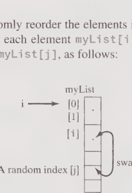

   ```java
   for (int i = 0; i < myList.length - 1; i++) {
       // 随机生成索引 j
       int j = (int)(Math.random() * myList.length);

       // 交换 myList[i] 和 myList[j]
       double temp = myList[i];
       myList[i] = myList[j];
       myList[j] = temp;
   }
   ```

4. **元素移动**：有时你需要将元素向左或向右移动。这里有一个元素向左移动一位并用第一个元素填充最后一个元素的示例：

   ```java
   double temp = myList[0]; // 保留第一个元素

   // 元素向左移动
   for (int i = 1; i < myList.length; i++) {
       myList[i - 1] = myList[i];
   }

   // 将第一个元素移动到最后一个位置
   myList[myList.length - 1] = temp;
   ```

   

5. **简化编码**：数组可以极大地简化某些任务的编码。例如，假设你希望通过数字获取月份的英文名称。如果月份存储在数组中，可以通过索引轻松访问给定月份名称。

   **随机洗牌**

   **视频笔记**

   **随机洗牌**

### 7.2.7 `foreach` 循环

Java 支持一种方便的 `for` 循环，被称为 `foreach` 循环，它允许你在不使用索引变量的情况下按顺序遍历数组。例如，以下代码显示了数组 `myList` 中的所有元素：

```java
for (double e : myList)
    System.out.println(e);
```

你可以将代码读为“对于 `myList` 中的每个元素 `e`，执行以下操作”。注意，变量 `e` 的声明类型必须与 `myList` 中元素的类型相同。通常情况下，`foreach` 循环的语法如下：

```java
for (elementType element : arrayRefVar) {
    // 处理元素
}
```

如果你想以不同的顺序遍历数组或更改数组中的元素，你仍然需要使用索引变量。

> **注意**：访问越界数组是一个常见的错误，它会抛出运行时 `ArrayIndexOutOfBoundsException`。为了避免这种错误，请确保不要使用低于 `arrayRefVar.length - 1` 的索引，或者在可能的情况下直接使用 `foreach` 循环。

程序员经常会错误地使用索引 1 引用数组的第一个元素，但它应该是 0。这就是所谓的“差一错误（off-by-one error）”。循环中另一个常见的差一错误是在本该使用 `<` 的地方使用了 `<=`。例如，以下 `foreach` 循环是错误的：

```java
for (int i = 0; i < list.length; i++)
```

`<=` 应该替换为 `<`。使用 `foreach` 循环可以避免差一错误。


## 7.2 练习题

### 7.2.1

如何声明数组？何时创建？

### 7.2.2

以下代码的输出是什么？

```java
int x = 30;
int[] numbers = new int[x];

System.out.println("x is " + x);
```

### 7.2.3

判断述语句对错：

- a. 数组中的每个元素类型相同。
- b. 数组的大小在声明后是固定的。
- c. 数组的大小在创建后是固定的。
- d. 数组元素必须是基本类型。

### 7.2.4

哪些语句是有效的？

- a. `int i = 30;`
- b. `double[] d = new double[30];`
- c. `float[] f = new float();`
- d. `int[] i = {2, 3, 4};`
- e. `double[] c = {2, 3, 4, 5};`

### 7.2.6

如何访问元素？

### 7.2.7

数组类型是什么？

### 7.2.8

编写语句完成以下操作：

- a. 创建存储值的数组。
- b. 给最后一个元素赋值。
- c. 显示第一个元素。
- d. 编写一个计算所有元素和的循环。
- e. 编写一个寻找最小元素的循环。
- f. 随机生成索引并显示索引处的元素。

### 7.2.9

当程序尝试访问无效索引时会发生什么？

### 7.2.10

识别并修复代码中的错误：

```java
public class Test {
    public void main(String[] args) {
        double[] r;
    }
}
```

### 7.2.11

以下代码的输出是什么？

## 7.3 案例研究：分析数字

问题是编写一个找到高于平均值的数量的项目。为了灵活处理任何数量的输入，我们将用户输入数量，而不是固定为 100。列表 7.1 给出了解决方案。

### 列表 7.1 `AnalyzeNumbers.java`

```java
public class AnalyzeNumbers {
    public static void main(String[] args) {
        Scanner input = new java.util.Scanner(System.in);

        System.out.print("Enter the number of items: ");
        int n = input.nextInt();

        double[] numbers = new double[n];
        double sum = 0;

        System.out.print("Enter the numbers: ");

        for (int i = 0; i < n; i++) {
            numbers[i] = input.nextDouble();
            sum += numbers[i];
        }

        double average = sum / n;
        int count = 0;

        for (int i = 0; i < n; i++) {
            if (numbers[i] > average)
                count++;
        }

        System.out.println("Average is " + average);
        System.out.println("Number of elements above the average is " + count);
    }
}
```

将数组中的每个数字与平均值比较，统计高于平均值的数值个数（第 7–20 行）。

## 7.4 案例研究：扑牌

该问题是创建一个程序，从一副扑牌中随机选择四张牌牌。

假设你想写一个程序，从 52 张扑牌中随机抽取四张牌牌。所有的牌牌可以使用一个名为 `deck` 的数组来表示，该数组填充了初始值 0–51，如下：

```java
int[] deck = new int[52];

// 初始化牌牌
for (int i = 0; i < deck.length; i++)
    deck[i] = 1;
```


牌牌号 0–12、13–25、26–38 和 39–51 分别代表 13 张黑桃、13 张红心、13 张方片和 13 张梅花。`deck[i] / 13` 决定牌牌的花色，如图 7.2 所示；`deck[i] % 13` 决定牌牌的等级，如图 7.3 所示。在洗牌数组 `deck` 后，从 `deck` 中取出前四张牌。程序显示这四个牌牌号对应的牌牌。

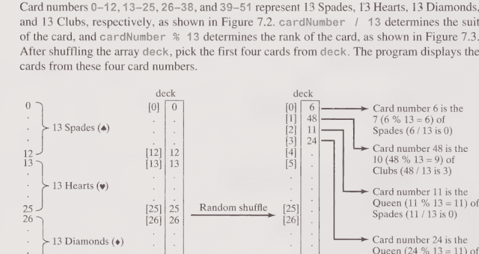

图 7.2 52 张牌存储在一个名为 `deck` 的数组中。

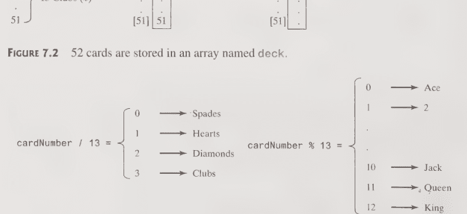

图 7.3 牌号识别牌牌的花色和等级。

代码列表 7.2 给出了问题的解决方案。

### 7.2 DeckOfCards.java

```java
public class DeckOfCards {

    public static void main(String[] args) {

        int[] deck = new int[52];

        String[] suits = {"Spades", "Hearts", "Diamonds", "Clubs"};

        String[] ranks = {"Ace", "2", "3", "4", "5", "6", "7", "8", "9", "10", "Jack", "Queen", "King"};

        // 初始化牌牌

        for (int i = 0; i < deck.length; i++)

            deck[i] = i;

        // 洗牌

        for (int i = 0; i < deck.length; i++) {

            // 随机生成索引

            int index = (int)(Math.random() * deck.length);

            int temp = deck[i];

            deck[i] = deck[index];

            deck[index] = temp;

        }

        // 显示前四张牌

        for (int i = 0; i < 4; i++) {

            String suit = suits[deck[i] / 13];

            String rank = ranks[deck[i] % 13];

            System.out.println("Card number " + deck[i] + ": " + rank + " of " + suit + "");

        }

    }

}
```

| 牌号 | 牌牌 |
| :--- | :--- |
| 牌号 6 | 7 of Spades |
| 牌号 48 | 10 of Clubs |
| 牌号 11 | Queen of Spades |
| 牌号 24 | Queen of Hearts |


程序创建包含四种花色的数组 `suits`（第 4 行）和一个包含每花色 13 张牌的数组 `ranks`（第 5 和 6 行）。这些数组中的每个元素都是字符串。程序在第 9 和第 10 行用值 0-51 初始化 `deck`。`deck` 的值 0 代表黑桃 A，1 代表黑桃 2，13 代表红心 A，14 代表红心 2。

第 13-19 行随机洗牌。洗牌后，`deck[i]` 包含一个任意值。`deck[i] / 13` 为 0、1、2 或 3，这决定了花色（第 23 行）。如果没有定义数组，你将不得不使用多分支 `if-else` 语句来确定花色，如下：

```java
if (deck[i] / 13 == 0) 

    System.out.print("suit is " + "Spades");

else if (deck[i] / 13 == 1) 

    System.out.print("suit is " + "Hearts");

else if (deck[i] / 13 == 2) 

    System.out.print("suit is " + "Diamonds");

else

    System.out.print("suit is " + "Clubs");
```

通过数组创建了 `suits = {"Spades", "Hearts", "Diamonds", "Clubs"}`，`suits[deck[i] / 13]` 提供了 `deck[i]` 的花色。使用数组极大简化了该程序的解决方案。

### 7.4.1 如果你将代码列表 7.2 `DeckOfCards.java` 中的第 22–27 行替换为以下代码，程序将选取四张随机牌牌：

```java
for (int i = 0; i < 4; i++) {

    int cardNumber = (int)(Math.random() * deck.length);

    String suit = suits[cardNumber / 13];

    String rank = ranks[cardNumber % 13];

    System.out.println("Card number " + cardNumber + " " + rank + " of " + suit);

}
```

## 7.5 复制数组

要将一个数组的内容复制到另一个数组，必须将数组的各个元素复制。在程序中，你可能需要复制数组或数组。在这种情况下可以使用赋值语句 (`=`)，如下：`list2 = list1;`

然而，该语句并没有复制 `list1` 引用的内容，而是复制了引用。赋值后，`list1` 和 `list2` 指向同一个数组，如图 7.4 所示。`list1` 之前的数组不再被引用，它变成了垃圾，会被 Java 虚拟机回收。这种过程被称为垃圾回收。

| 赋值前 | 赋值后 |
| :--- | :--- |
| list2 = list1; | list2 = list1; |
| list1 | list1 |
| list1 的内容 | list1 的内容 |
| list2 | |

在 Java 中，你可以使用赋值语句复制基本数据类型，但不能复制数组。将一个数组赋值给另一个实际上是复制了引用。有三种方法复制数组：

- 使用循环逐个复制元素。
- 使用 `System` 类中的 `arraycopy` 方法。
- 使用 `clone` 方法复制数组；这第 13 章介绍。

## 7.6 将数组传递给方法

你可以写一个循环，将源数组的每个元素复制到目标数组的相应元素。例如，以下代码使用 `for` 循环将 `sourceArray` 复制到 `targetArray`：

```java
int[] sourceArray = {2, 3, 1, 5, 10};

int[] targetArray = new int[sourceArray.length];

for (int i = 0; i < sourceArray.length; i++) {

    targetArray[i] = sourceArray[i];

}
```

另一种方法是使用 `java.lang.System` 类中的 `arraycopy` 方法来代替循环。`arraycopy` 的语法为：

```java
arraycopy(sourceArray, srcPos, tarPos, length);
```

参数 `srcPos` 和 `tarPos` 分别表示 `sourceArray` 和 `targetArray` 中的起始位置。从 `sourceArray` 复制到 `targetArray` 的元素数量由 `length` 指定。例如，你可以可以使用语句重写循环：

```java
System.arraycopy(sourceArray, 0, targetArray, 0, sourceArray.length);
```

`arraycopy` 方法不会为目标数组分配内存。目标数组必须已经创建并分配了空间。复制后，`targetArray` 和 `sourceArray` 内容相同但内存位置独立。

> `arraycopy` 方法违反了规范。根据规范，此方法应命名为 `arrayCopy`（大写 C）。

### 7.5.1 使用 `arraycopy` 方法将以下内容复制到目标数组 `t`：

```java
int[] source = {3, 4, 5};
```

### 7.5.2 一旦创建了数组，其大小就无法改变。以下代码会调整数组大小吗？

```java
int[] myList;

myList = new int[10];

// 有时你想给 myList 分配新数组

myList = new int[20];
```

## 7.6 将数组传递给方法

将数组传递给方法时，数组的引用被传递给了方法。就像可以将基本类型值传递给方法一样，你也可以数组传递给方法。例如，以下代码显示 `int` 数组中的元素：

```java
public static void printArray(int[] array) {

    for (int i = 0; i < array.length; i++) {

        System.out.print(array[i] + " ");

    }

}
```

你可以通过传递数组来调用它。例如，以下语句调用 `printArray` 方法显示 3, 1, 2, 6, 4 和 2。

```java
printArray(new int[]{3, 1, 2, 6, 4, 2});
```

> 注意
> 前述语句使用以下语法创建数组：
> ```java
> new elementType[] {value0, value1, ..., valuek};
> ```

匿名数组

数组没有显式的引用变量。这种数组被称为匿名数组。

按值传递

Java 使用按值传递将参数传递给方法。传递基本数据类型变量的值与传递数组之间存在重要区别。

- 对于基本类型参数，传递的是参数的值。
- 对于数组类型参数，参数的值是数组的引用；即按引用传递，也就是说方法中的数组与传递的数组是同一个。

按引用传递

以以下代码 `TestArrayArguments` 为例：

```java
public class TestArrayArguments {

    public static void main(String[] args) {

        int x = 1; // x 代表一个 int 值

        int[] y = new int[10]; // y 代表一个 int 值数组

        m(x, y); // 使用参数 x 和 y 调用 m

        System.out.println("x = " + x);

        System.out.println("y[0] = " + y[0]);

    }

}
```

```java
public static void m(int number, int numbers[]) {

    number = 1001; // 给 number 分配新值

    numbers[0] = 5555; // 给 numbers[0] 分配新值

}
```

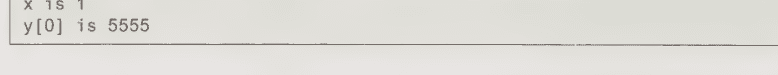

你可能会奇怪为什么调用 `m` 后 `x` 保持为 1，但 `y[0]` 变成了 5555。这是因为 `y` 和 `numbers` 尽管是独立的变量，但引用了同一个数组，如图 7.5 所示。

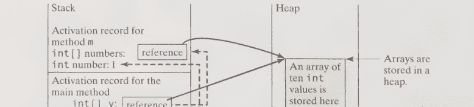

图 7.5 `x` 中的基本类型值被传递给了 `number`，`y` 中的引用值被传递给了 `numbers`。

## 7.6 将数组传递给方法

> 注意
> 在 Java 中，数组是对象（在第 9 章中介绍）。JVM 将对象存储在称为堆（heap）的内存区域，该区域用于动态内存分配。

列表 7.3 给出了另一个程序，展示了将基本数据类型值和数组引用传递给方法的区别。该程序包含两个用于交换数组元素的方法。第一个方法名为 `swap`，未能交换两个 `int` 参数。第二个方法名为 `swapFirstTwoArray`，成功地交换了数组参数的前两个元素。

# 列表 7.3 TestPassArray.java

```java
public class TestPassArray {

    /* Main method */

    public static void main(String[] args) {

        int[] a = {1, 2};

        // 使用 swap 方法交换元素

        System.out.println("Before invoking swap");

        System.out.println("array is " + a[0] + ", " + a[1] + "");

        swap(a, a[0]);

        System.out.println("After invoking swap");

        System.out.println("array is " + a[0] + ", " + a[1] + "");

        // 使用 swapFirstTwoArray 方法交换元素

        System.out.println("Before invoking swapFirstTwoArray");

        System.out.println("array is " + a[0] + ", " + a[1] + "");

        swapFirstTwoArray(a);

        System.out.println("After invoking swapFirstTwoArray");

        System.out.println("array is " + a[0] + ", " + a[1] + "");

    }

    /* 交换两个变量 */

    public static void swap(int n1, int n2) {

        int temp = n1;

        n1 = n2;

        n2 = temp;

    }

    /* 交换数组的前两个元素 */

    public static void swapFirstTwoArray(int[] array) {

        int temp = array[0];

        array[0] = array[1];

        array[1] = temp;

    }

}
```

Before invoking swap
array is 1, 2
After invoking swap
array is 1, 2
Before invoking swapFirstTwoArray
array is 1, 2
After invoking swapFirstTwoArray
array is 2, 1


如图 7.6 所示，元素没有通过 `swap` 方法进行交换。然而，它们通过 `swapFirstTwoArray` 方法成功了交换。由于 `swap` 方法中的参数是基本数据类型，因此在调用 `swap(a[0], a[1])` 时，`a[0]` 和 `a[1]` 的值被传递给方法内部的 `n1` 和 `n2`。`n1` 和 `n2` 的内存位置与 `a[0]` 和 `a[1]` 是相互独立的。数组的内容不受此影响。

| 栈 (Stack) | 堆 (Heap) |
| :--- | :--- |
| swap 方法的激活记录 | swapFirstTwoArray 方法的激活记录 |
| n2: <---> | int [a] 引用 |
| n1: <---> | a[0]:1 |
| main 方法的激活记录 | main 方法的激活记录 |
| int [a] 引用 | a[1]:2 |

调用 `swap(int n1, int n2)`。`a[0]` 和 `a[1]` 中的基本类型值被传递给 `swap` 方法。

数组存储在堆中。调用 `swapFirstTwoArray(int array)`。`array` 的引用值被传递给 `swapFirstTwoArray` 方法。

图 7.6 当向方法传递数组时，数组的引用被传递给方法。

`swapFirstTwoArray` 方法对数组操作。如图 7.6 所示，数组的引用被传递给方法。变量（方法外部）和数组（方法内部）都指向相同内存位置中的同一个数组。因此，在 `swapFirstTwoArray` 方法内部交换 `array[0]` 和 `array[1]` 等同于在方法外部交换 `a[0]`。

## 7.7 从方法返回数组

当方法返回数组时，返回的是数组的引用。

在调用方法时可以传递数组。方法也可以返回数组。例如，下面的方法返回一个另一个数组反后的数组。

```java
public static int[] reverse(int[] list) {

    int[] result = new int[list.length];

    for (int i = 0, j = list.length - 1; i < list.length; i++, j--) {
```


`result[j] = list[i];`

`return result;`

第 2 行创建了一个新数组`result`。第 4-7 行将元素从`list`拷贝到`result`。第 9 行返回数组。例如，以下语句返回了一个包含元素 6, 5, 4, 3, 2, 1 的新数组`list2`。

```java
int[] list1 = {1, 2, 3, 4, 5, 6};
int[] list2 = reverse(list1);
```

## 7.8 案例：统计每个字母出现的次数

7.7.1 假设编写了以下代码来交换数组中的内容，解释为什么它是错误的。你该如何修复它？

```java
int[] list = {1, 2, 3, 4, 5};
for (int i = 0, j = list.length - 1; i < list.length; i++, j--) {
    int temp = list[i];
    list[i] = list[j];
    list[j] = temp;
}
```


## 8 统计每个字母出现的次数

本节介绍了一个统计数组中每个字母出现次数的程序。列表 7.4 执行了以下操作：

1. 生成小写字母并将其赋值给数组，如图 7.7 所示。你可以通过`Random.toLowerCase()`方法获取字母。
2. 统计数组中每个字母的出现次数。为了这样做，创建一个数组（例如`counts`），如图 7.7 所示。`counts[0]`存储 a 的次数，`counts[1]`存储 b 的次数，以此类推。

| (a) | (b) |
| :--- | :--- |
| counts[0] | counts[0] |
| counts[1] | counts[1] |
| ... | ... |
| counts[25] | counts[25] |

## LISTING 7.4 CountLetters.java

```java
public class CountLetters {
    /* Main method */
    public static void main(String[] args) {
        char[] chars = createArray();
        // 显示数组
        System.out.println("The letters are:");
        displayArray(chars);
    }

    /* create array */
    public static char[] createArray() {
        // 声明数组
        char[] chars = new char[100];
        // 生成小写字母并赋值给数组
        for (int i = 0; i < chars.length; i++) {
            chars[i] = Random.toLowerCase();
        }
        // 返回数组
        return chars;
    }

    /* Display the array of characters */
    public static void displayArray(char[] chars) {
        // 每20个字母换行
        for (int i = 0; i < chars.length; i++) {
            if ((i + 1) % 20 == 0) {
                System.out.println(chars[i]);
            } else {
                System.out.print(chars[i] + " ");
            }
        }
    }

    /* Count occurrences of letter */
    public static int[] countLetters(char[] chars) {
        // 声明并创建一个 int 数组
        int[] counts = new int[26];
        // 对数组中的每个字母进行计数
        for (int i = 0; i < chars.length; i++) {
            counts[chars[i] - 'a']++;
        }
        return counts;
    }

    /* Display counts */
    public static void displayCounts(int[] counts) {
        for (int i = 0; i < counts.length; i++) {
            if ((i + 1) % 10 == 0) {
                System.out.println(counts[i] + " " + (char)(i + 'a'));
            } else {
                System.out.print(counts[i] + " " + (char)(i + 'a') + " ");
            }
        }
    }
}
```

7.7.1 假设编写了以下代码来交换数组中的内容，解释为什么它是错误的。你该如何修复它？

```java
int[] list = {1, 2, 3, 4, 5};
for (int i = 0, j = list.length - 1; i < list.length; i++, j--) {
    int temp = list[i];
    list[i] = list[j];
    list[j] = temp;
}
```

这段代码是错误的，因为在循环的中间，`i`和`j`会相遇，导致元素被交换回了位置。修复方法是修改循环条件为`i < j`。

```java
// 修复后的代码：循环条件改为 i < j
for (int i = 0, j = list.length - 1; i < j; i++, j--) {
    int temp = list[i];
    list[i] = list[j];
    list[j] = temp;
}
```

## 第 7 章 单维数组

| 栈 | 栈 | 堆 | 堆 |
| :--- | :--- | :--- | :--- |
| createArray 方法的激活记录 char[] chars:ref | | 100 个字符的数组 | 100 个字符的数组 |
| main 方法的激活记录 char[] chars:ref | | main 方法的激活记录 char[] chars:ref | |

(a) 在第 5 行执行 createArray

(b) 退出第 5 行的 createArray 后

**图 7.8** (A) 使用 createArray 时创建了一个包含 100 个字符的数组。(B) 该数组被返回并赋值给 main 方法中的变量 chars。

- 7.8.1 判断对错？当将数组被传递给一个方法时，会创建一个新数组并传递给该方法。（错误）

- 7.8.2 显示以下两个程序的输出：

```java
public class Test {
    public static void main(String[] args) {
        int number = 0;
        int[] numbers = new int[1];
        m(number, numbers);
        System.out.println("number is " + number + " and numbers[0] is " + numbers[0]);
    }

    public static void m(int x, int[] y) {
        x = 3;
        y[0] = 3;
    }
}
```

```java
public class Test {
    public static void main(String[] args) {
        int[] list = {1, 2, 3, 4, 5};
        reverse(list);
        for (int i = 0; i < list.length; i++) {
            System.out.print(list[i] + " ");
        }
    }

    public static void reverse(int[] list) {
        int[] newList = new int[list.length];
        for (int i = 0; i < list.length; i++) {
            newList[i] = list[list.length - 1 - i];
        }
        list = newList;
    }
}
```

- 7.8.3 运行期间数组存储在何处？显示在执行列表 7.4 中的 displayArray、countLetters 和 displayCounts 期间和之后栈与堆的内容。

## 7.9 变长参数列表

可以将相同类型的数量不确定的参数传递给方法，并将其视为数组处理。

你可以向方法传递数量不定的相同类型的参数。该参数声明如下：

```
typeName...parameterName
```

在方法声明中，你指定类型并在后紧跟三个省略号（...）。只能指定一个变长参数，且该参数必须是最后一个。任何普通参数必须在它之前。

Java 将变长参数视为数组。你可以将数组或数量不确定的参数传递给变长参数。在调用带有变长参数的方法时，Java 会创建一个数组并将参数传递给该数组。列表 7.5 展示了一个打印未指定数量值的列表中最大值的方法。

## 列表 7.5 VarArgsDemo.java

```java
public class VarArgsDemo {
    public static void main(String[] args) {
        printMax(34, 3, 2, 56, 5);
        printMax(new double[]{1, 2, 3});
    }

    public static void printMax(double... numbers) {
        if (numbers.length == 0) {
            System.out.println("No argument passed");
            return;
        }

        double result = numbers[0];
        for (int i = 1; i < numbers.length; i++) {
            if (numbers[i] > result)
                result = numbers[i];
        }
        System.out.println("The max value is " + result);
    }
}
```


变长参数列表传递数组

第 3 行调用 printMax 方法，并将变长参数列表传递给数组 numbers。如果没有传递任何参数，则数组长度为 0（第 8 行）。第 4 行使用数组调用 printMax 方法。

以下每个方法头部的哪里有错？

- a. `public static void print(String... strings, double... numbers)`
- b. `public static void print(double... numbers, String name)`
- c. `public static double print(double d1, double d2)`


你可以使用以下语句调用列表 7.5 中的 printMax 方法吗？

- a. `printMax(1, 2, 4)`
- b. `printMax(new double[]{1, 2, 3})`
- c. `printMax(new int[]{1, 2, 3})`

## 10 搜索数组

如果数组是排序的，那么二分查找在查找数组中的元素时比线性查找更高效。

搜索是在数组中寻找特定元素的过程——例如，某个分数是否包含在分数列表中。搜索是计算机编程中的常见任务。许多算法和数据结构都用于搜索。本节讨论了两种常用的方法：线性查找和二分查找。


关键点 线性查找 二分查找

### 10.1.1 线性查找方法

线性查找将键与数组中的每个元素进行比较，直到匹配到元素或数组耗尽。如果匹配，则返回数组中该元素的索引。如果未找到，则返回 -1。

## 列表 7.6 LinearSearch.java

```java
public class LinearSearch {
    /** 在列表中查找键的方法 */
    public static int linearSearch(int[] list, int key) {
        for (int i = 0; i < list.length; i++) {
            if (key == list[i])
                return i;
        }
        return -1;
    }
}
```


为了理解这个方法，请使用以下语句进行跟踪：

- `int[] list = {1, 4, 2, 5, 3, 6};`
- `int i = linearSearch(list, 4);` // 返回 1
- `int j = linearSearch(list, 7);` // 返回 -1
- `int k = linearSearch(list, 3);` // 返回 4

线性查找将键与每个元素进行比较。平均情况下，在找到键之前会检查数组的所有元素。线性查找的执行时间随元素数量的增加而线性增长；对于大数组，线性查找是低效的。

### 10.1.2 二分查找方法

二分查找是另一种常见的列表搜索方法。为了使二分查找生效，数组中的元素必须是有序的。考虑以下情况将键与数组的元素比较：

- 如果键小于中间元素，你需要在数组的前半部分继续搜索。
- 如果键等于中间元素，搜索结束并匹配。
- 如果键大于中间元素，你需要在数组的后半部分继续搜索。

显然，二分查找每次比较至少消除数组的一半。有时消除一半，有时消除一半加一。假设数组有 `n` 个元素。为了方便起见，让 `n` 为 2 的幂。第一次比较后，剩余 `n/2` 个元素进行搜索；第二次比较后，剩余 `n/4` 个元素。第 `k` 次比较后，剩余 `n/2^k` 个元素。当 `k=logn` 时，数组中只剩下一个元素，你还需要一次比较。在二分查找的最坏情况下，在排序数组中找到元素需要 `logn+1` 次比较。对于长度为 1024 (`2^10`) 的列表，二分查找只需要 11 次比较，而线性查找最坏情况下需要 1023 次比较。


每次比较搜索数组的位置。让 `low` 和 `high` 分别表示当前搜索的数组第一个和最后一个索引。初始 `low` 为 0，`high` 为 `list.length-1`。让 `mid` 表示中间元素的索引，因此 `mid` 为 `(low + high) / 2`。图 7.9 显示如何使用二分查找在数组 `{2, 4, 7, 10, 11, 45, 50, 55, 66, 69, 70, 79}` 中查找键 11。

## 7.10 搜索数组

| key | low | mid | high |
| :--- | :--- | :--- | :--- |
| key < 50 | [0] [1] [2] [3] [4] [5] [6] [7] [8] [9] [10] [11] [12] | | | |
| list | 2 | 7 | 10 | 11 | 45 | 50 | 59 | 60 | 66 | 69 | 70 | 79 |
| | low | mid | high | | | | | | | | | |
| | [0] [1] [2] [3] [4] [5] | | | | | | | | | | |
| key > 7 | 2 | 7 | 10 | 11 | 45 | | | | | | | |
| | | low | mid | high | | | | | | | | |
| | | | [3] [4] [5] | | | | | | | | |
| key == 11 | 10 | 11 | 45 | | | | | | | | | |

**图 7.9** 二分查找在第一次比较后从考虑范围内消除了列表的一半。

你现在知道二分查找是如何工作的。下一个任务是在 Java 中实现它。不要急于给出一个完整的实现。如图 7.10a 所示，一步一步增量地实现。它将键与数组中的中间元素进行比较。如果 `key < list[mid]`，将高索引设置为 `mid - 1`；如果 `key == list[mid]`，则找到匹配项并返回 `mid`；如果 `key > list[mid]`，将低索引设置为 `mid + 1`。

## 第 7 章 一维数组

完整的程序在列表 7.7 中给出。

### 列表 7.7 BinarySearch.java

```java
public class BinarySearch {

    /** 使用二分查找在列表中查找 key */

    public static int binarySearch(int[] list, int key) {

        int low = 0;

        int high = list.length - 1;

        while (high >= low) {

            int mid = (low + high) / 2;

            if (key < list[mid])

                high = mid - 1;

            else if (key == list[mid])

                return mid;

            else

                low = mid + 1;

        }

        return -1; // 现在 high < low，未找到 key

    }

}
```

如果 `key` 包含列表中，二分查找将返回其索引（第 12 行）。否则，它返回 `-low - 1`（第 17 行）。

如果我们将第 7 行的 `(high >= low)` 替换为 `(high > low)` 会发生什么？搜索将漏掉一个可能的匹配元素。考虑一个只有一个元素的列表。搜索将漏掉该元素。

如果列表中存在重复元素，该方法仍然有效吗？是的，只要元素是按升序排列的。如果元素在列表中，该方法会返回其中一个匹配元素的索引。

二分查找方法的**前置条件**是列表必须按升序排列。**后置条件**是如果 `key` 在列表中，方法返回该元素的索引；或者返回一个负整数 `k`，使得 `-k - 1` 是插入 `key` 的位置。前置条件和后置条件是在方法调用之前为真的项，而后置条件是在方法返回后为真的项：

为了理解这个方法，请使用以下语句进行跟踪，并识别方法返回时的 `low` 和 `high` 值。

```java
int[] list = {2, 4, 7, 10, 11, 45, 50, 60, 66, 69, 79};

int i = BinarySearch.binarySearch(list, 2); // 返回 0

int j = BinarySearch.binarySearch(list, 11); // 返回 4

int k = BinarySearch.binarySearch(list, 12); // 返回 -6

int l = BinarySearch.binarySearch(list, 1); // 返回 -1

int m = BinarySearch.binarySearch(list, 3); // 返回 -2
```

下表显示了方法退出时 `low` 和 `high` 的值，以及调用方法返回的值：

| 方法 | Low | High | 返回值 |
| :--- | :--- | :--- | :--- |
| `binarySearch(list, 2)` | 0 | 1 | 0 (mid) |
| `binarySearch(list, 11)` | 3 | 5 | 4 (mid) |
| `binarySearch(list, 12)` | 5 | 4 | -6 |
| `binarySearch(list, 1)` | 0 | -1 | -1 |
| `binarySearch(list, 3)` | 1 | 0 | -2 |

## 7.11 数组排序

> 注意
> 线性查找对于在小数组或未排序数组中查找元素很有用，但对于大数组来说效率很低。二分查找更高效，但它要求数组必须适用于二分查找。

如果 `high` 是一个很大的整数（例如最大值 2147483647），`(low + high) / 2` 可能会导致溢出。如何修复它以避免溢出？

以 7.9 为例，展示如何将二分查找方法应用于 `(2, 4, 7, 10, 11, 45, 50, 60, 66, 69, 79)` 中查找 key 10 和 key 12。

如果二分查找返回 -4，它是列表中的 key 吗？如果你想将 key 插入列表，应该插入到哪里？

排序和搜索一样，是计算机编程中的常见任务。针对排序已经开发了许多不同的算法。本节介绍了一种直观的算法：选择排序。

假设你想升序排序一个列表。选择排序找到列表中最小的数字，并将其与第一个元素交换。然后找到剩余元素中最小的，并与第二个元素交换，以此此类推，直到只剩下一个数字。图 7.11 显示了如何使用选择排序对列表 `{2, 9, 5, 4, 8, 1, 6}` 进行排序。


- 选择 1（最小的），并与列表中的 2（第一个）交换。
2 9 5 4 8 1 6

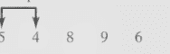

- 数字 1 现在处于正确的位置，不再需要考虑。
1 9 5 4 8 2 6


- 数字 2 现在处于正确的位置，不再需要考虑。
1 2 5 4 8 9 6


- 数字 3 现在处于正确的位置，不再需要考虑。（隐含）
- 数字 4 现在处于正确的位置，不再需要考虑。
1 2 4 5 8 9 6


- 数字 5 现在处于正确的位置，不再需要考虑。
1 2 4 5 8 9 6

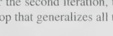

- 数字 6 现在处于正确的位置，不再需要考虑。
1 2 4 5 6 8 9

图 7.11 选择排序重复选择最小的数字并将其与列表中尚未排序的第一个数字交换。

你已经知道排序方法是有效的。现在的任务是在 Java 中实现它。初学者很难第一次尝试就开发出完整的解决方案。通过从第一次迭代开始找到第一个元素的最小元素，观察第二次迭代的不同，这种洞察将使你写出生成所有迭代的循环。解决方案可以描述如下：

```java
for (int i = 0; i < list.length - 1; i++) {

    // 在 list[i..length-1] 中选择最小元素

    // 如果需要，将最小元素与 list[i] 交换

    // list[i] 处于正确位置

    // 下一次迭代作用于 list[i+1..length-1]

}
```

列表 7.8 实现了解决方案。

### 列表 7.8 SelectionSort.java

```java
public class SelectionSort {

    /** 排序数字的方法 */

    public static void selectionSort(double[] list) {

        for (int i = 0; i < list.length - 1; i++) {

            // 在 list[i..length-1] 中找到最小值

            double currentMin = list[i];

            int currentIndex = i;

            for (int j = i + 1; j < list.length; j++) {

                if (currentMin > list[j]) {

                    currentMin = list[j];

                    currentIndex = j;

                }

            }

            // 如果需要，交换 list[i] 和 list[currentIndex]

            if (currentIndex != i) {

                list[currentIndex] = list[i];

                list[i] = currentMin;

            }

        }

    }

}
```

`selectionSort(double[] list)` 方法使用嵌套 `for` 循环实现。外部循环（第 4 行控制变量 `i`）遍历 `list[i]` 到 `list.length-1` 以寻找最小元素，并与 `list[i]` 交换。每次迭代后，`list[i]` 处于正确位置。最终，所有元素都就绪。为了更好地理解这一点，请使用以下语句进行跟踪：

```java
double[] list = {1, 9, 45, 2, 6, 4, 5};

selectionSort(list);
```

- 7.1.1 使用图 7.11 作为示例展示如何将排序方法应用于 `{3, 4, 5, 3, 5, 2, 1, 9}`。
- 7.1.2 如何修改列表 7.8 中的 `selectionSort` 方法进行降序排序？

## 7.12 Arrays 类

`java.util.Arrays` 类包含了数组操作的实用方法，如排序和搜索。`java.util.Arrays` 类包含了用于排序和比较数组、填充数组以及返回数组字符串表示的各种静态方法。这些方法针对所有基本类型进行了重载。你可以使用 `parallelSort` 方法排序整个数组或部分数组。例如，以下代码对数字数组和字符数组排序：

```java
double[] numbers = {6.0, 4.4, 1.9, 2.9, 3.4, 3.5};

java.util.Arrays.sort(numbers); // 排序数组

java.util.Arrays.parallelSort(numbers); // 排序整个数组
```

```java
char[] chars = {'a', 'A', 'a', 'F', 'P'};

java.util.Arrays.sort(chars); // 排序部分数组
```

`java.util.Arrays.binarySearch` 在数组中查找 key。数组必须是已排序的。如果 key 在列表中，方法返回其索引。如果 key 不在列表中，方法返回一个负值 `-(插入点) - 1`。例如，以下代码在整数和字符数组中查找 key：

```java
int[] list = {2, 4, 7, 10, 11, 45, 50, 60, 66, 69, 79};

System.out.println("Index is " + java.util.Arrays.binarySearch(list, 11));

System.out.println("Index is " + java.util.Arrays.binarySearch(list, 12));
```

```java
char[] chars = {'a', 'c', 'g', 'x', 'y', 'z'};

System.out.println("Index is " + java.util.Arrays.binarySearch(chars, 'a'));

System.out.println("Index is " + java.util.Arrays.binarySearch(chars, 'b'));
```

上述代码的输出如下：

```
Index is 4
Index is -6
Index is 0
Index is -1
```

你可以使用 `equals` 方法检查两个数组是否严格相等。如果两个数组对应的元素相同，则它们相等。在以下代码中，`list1` 和 `list2` 相等，但 `list2` 和 `list3` 不相等。

```java
int[] list1 = {2, 4, 7, 10};

int[] list2 = {2, 4, 7, 10};

int[] list3 = {4, 2, 7, 10};

System.out.println(java.util.Arrays.equals(list1, list2)); // true

System.out.println(java.util.Arrays.equals(list2, list3)); // false
```

你可以使用 `fill` 方法填充整个或部分数组。例如，以下代码将 `list1` 填充为 5，并将 8 填充到 `list2[2]` 到 `list2[5-1]`。

```java
int[] list1 = {2, 4, 7, 10};

int[] list2 = {2, 4, 7, 10};

java.util.Arrays.fill(list1, 5); // 整个数组填充 5

java.util.Arrays.fill(list2, 1, 5, 8); // 局部数组填充 8
```

# 296 第 7 章 单一维数组

你可以使用 `toString` 方法返回一个表示数组中所有元素的字符串。这是显示数组中所有元素的一种快速且简单的方法。例如，以下代码：

```java
int[] list = {2, 4, 7, 10};

System.out.println(java.util.Arrays.toString(list));
```

显示 `{2, 4, 7, 10}`。

### 7.12.1 哪些类型的数组可以使用 `java.util.Arrays.sort` 方法进行排序？该排序方法会创建一个新数组吗？

### 7.12.2 为了应用 `java.util.Arrays.binarySearch(array, key)`，数组应该按升序、降序排序还是二者都不是？

### 7.12.3 显示以下代码的输出：

```java
int[] list1 = {2, 4, 7, 10};

java.util.Arrays.fill(list1, 7);
```


`System.out.println(java.util.Arrays.toString(list1));`

```java
int[] list2 = {2, 4, 7, 10};

System.out.println(java.util.Arrays.toString(list2));

System.out.print(java.util.Arrays.equals(list1, list2));
```

## 7.13 命令行参数

`main` 方法可以接收来自命令行的参数。

也许你已经注意到 `main` 方法不寻常头部，它有一个 `String[]` 类型的参数 `args`。很明显 `args` 是一个字符串数组。`main` 方法就像一个带参数的普通方法。你可以通过传递实际参数来调用普通方法。你可以向 `main` 传递参数吗？是的，当然。在下面的示例中，`TestMain` 类中的 `main` 方法是由类 `A` 中的一个方法调用的：

```java
public class A {

    public static void main(String[] args) {

        String[] strings = {"New York",
            "Boston", "Atlanta"};

        TestMain.main(strings);
    }
}
```

```java
public class TestMain {

    public static void main(String[] args) {

        for (int i = 0; i < args.length; i++) {
            System.out.println(args[i]);
        }
    }
}
```

`main` 方法就像一个普通方法。此外，你可以从命令行向 `main` 方法传递参数。

### 7.13.1 向 `main` 方法传递字符串

在运行程序时，你可以从命令行向 `main` 方法传递字符串。例如，下面的命令行启动了带有三个字符串 `arg0`、`arg1` 和 `arg2` 的 `TestMain` 程序：

```bash
java TestMain arg0 arg1 arg2
```

`arg0`、`arg1` 和 `arg2` 是字符串，但它们在命令行上没有用双引号括。字符串之间用空格分隔。包含空格的字符串必须用双引号括起来。以下命令行是：

```bash
java TestMain "First name" alpha 53
```

它带有三个字符串启动程序：`First name`、`alpha` 和 `53`。由于 `First name` 是一个 "53" 字符串，它被包含在双引号中。注意 `53` 实际上被视为字符串。你可以在命令行中使用 `"53"` 代替 `53`。

当 `main` 方法被调用时，Java 解释器会创建一个数组来存放命令行参数，并将该数组传递给 `args`。例如，如果你带有 `n` 个参数调用程序，Java 解释器会创建一个如下的数组：

```java
args = new String[n];
```

Java 解释器随后传递 `args` 以调用 `main` 方法。

> **注意**
>
> 如果你在不传递任何字符串的情况下运行程序，数组将创建为 `new String[0]`。在这种情况下，数组是空的，长度为 0。`args` 指向空数组。因此，`args` 不是 null，但 `args.length` 是 0。

### 7.13.2 案例研究：计算器

假设你要开发一个对整数进行算术运算的程序。该程序接收一个空表达式。该表达式由一个整数、一个运算符和另一个整数组成。例如，要两个两个整数，使用此命令：

```bash
java Calculator 2 + 3
```

程序将显示以下内容：

```text
2 + 3 = 5
```

图 7.12 显示了传递给主程序的参数是如何存储在 `args` 中的，`args` 是字符串数组。第一个字符串存储在 `args[0]` 中，`args.length` 是传递的字符串数量。以下是程序中的步骤：

1. 使用 `args.length` 确定命令行是否作为三个参数提供了表达式。如果不是，使用 `System.exit(1)` 终止程序。
2. 使用 `args[1]` 中的运算符对操作数 `args[0]` 和 `args[2]` 执行二元算术运算。

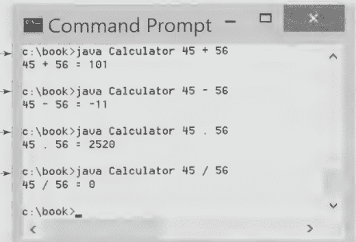

图 7.12 程序从命令行获取三个参数（operand1 operand2）并显示表达式和算术运算的结果。

# 第 7 章 单一维数组

程序位于列表 7.9。

### 列表 7.9

```java
public class Calculator {

    /** Main */
    public static void main(String[] args) {

        // number of strings
        if (args.length != 3) {
            System.out.println("Usage: Calculator operand1 operand2");
            System.exit(1);
        }

        // The result
        int result = 0;

        // Determine the operator
        switch (args[1].charAt(0)) {
            case '+':
                result = Integer.parseInt(args[0]) + Integer.parseInt(args[2]);
                break;

            case '-':
                result = Integer.parseInt(args[0]) - Integer.parseInt(args[2]);
                break;

            case '*':
                result = Integer.parseInt(args[0]) * Integer.parseInt(args[2]);
                break;

            case '/':
                result = Integer.parseInt(args[0]) / Integer.parseInt(args[2]);
                break;

            case '%':
                result = Integer.parseInt(args[0]) % Integer.parseInt(args[2]);
                break;
        }

        // Display the result
        System.out.println(args[0] + " " + args[1] + " = " + result);
    }
}
```

### 7.13.2 显示以下输出：

1. `java Test a`
2. `java Test "2"`
3. `java Test`

```java
public class Test {

    public static void main(String[] args) {

        System.out.println("Number of args is " + args.length);

        for (int i = 0; i < args.length; i++) {
            System.out.println(args[i]);
        }
    }
}
```

# 总结 29

## 关键术语

- 匿名数组 282
- 数组 270
- 数组初始化 272
- 二分查找 289
- 垃圾收集 280
- 索引 270
- 索引变量 272
- 线性查找 289
- 差一错误 275
- 后置条件 292
- 前置条件 292
- 选择排序 293

## 章总结

1. 使用语法 `elementType[] arrayRefVar` 或 `elementType arrayRefVar[]` 声明数组类型。`elementType[] arrayRefVar` 风格更优。
2. 与基本数据类型的声明不同，数组变量的声明不会为数组分配内存。数组变量不是基本数据变量。数组变量包含对数组的引用。
3. 在创建数组之前无法向数组赋值元素。你可以使用 `new` 运算符配合以下语法创建数组：`newType[arraySize]`
4. 数组中的每个元素使用语法 `arrayRefVar[index]` 表示。索引必须是整数或整数表达式。
5. 数组创建后，其大小是永久的，可以使用 `arrayRefVar.length` 查看。由于数组索引从 0 开始，最后一个索引始终是 `arrayRefVar.length - 1`。如果你尝试引用数组边界外的元素，将发生越界错误。

# 第 7 章 单维数组

7. 当数组被创建时，其元素将被分配默认值：数值基元类型为 0，char 类型为 `\0`，布尔类型为 `false`。
8. Java 有一种简写表示法，称为数组初始化器，它可以在一条语句中完成数组的声明和初始化，使用的语法格式为 `element[] = {value0, value1, ..., valuek};`。
9. 当你向方法传递数组参数时，可以使用传递数组的引用；也就是说，被调的方法可以修改调用者原始数组中的元素。
10. 如果数组已经过排序，对于查找数组中的某个元素而言，二分查找比线性查找更高效。
11. 选择排序找到列表中的最小数并将其与第一个元素交换。然后找到找到剩余数中的最小值，并将其与剩余列表中的第一个元素交换，依此类推，直到只剩下一个数字。


## 测验

在辅助网站上在线完成本章测验。

# 编程练习

## 7.2-7.5 节

### 7.1（分配等级）

编写一个程序读取学生分数，获取最高分，然后根据以下方案分配等级：

- 如果分数 >= 最高分-5，等级为 A；
- 如果分数 >= 最高分-10，等级为 B；
- 如果分数 >= 最高分-15，等级为 C；
- 如果分数 >= 最高分-20，等级为 D；
- 否则等级为 F。

该程序提示用户输入学生总数，并提示用户输入所有分数，最后显示等级。以下是示例运行：

```text
Enter the number of students: 4

Enter 4 scores: 40 55 70 58

Student 0 score is 40 and grade is F

Student 1 score is 55 and grade is C

Student 2 score is 70 and grade is A

Student 3 score is 58 and grade is C
```

### 7.2（比较数字）

编写一个程序读取 11 个整数，将每个整数与第 11 个整数比较，并显示这些整数是第 11 个整数的“大于”、“小于”还是“相等”。

### 7.3（统计数字出现）

编写一个程序读取 1 到 50 之间的整数并统计每个数字出现的次数。假设输入以 0 结束。以下是示例运行：

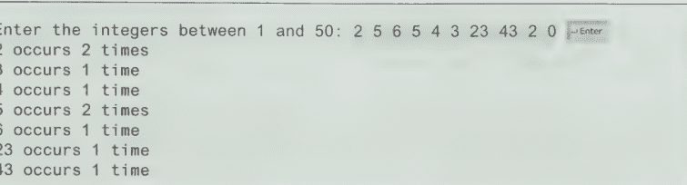

注意，如果一个数字出现多次，输出将使用复数形式 "times"。

### 7.4（分析分数）

编写一个程序读取任意数量的分数，并确定有多少分数高于或等于平均分，有多少分数低于平均分。输入负数表示输入结束。假设分数最大为 100。

### 7.5（偶数和奇数的个数）

编写一个程序读取整数，然后显示偶数和奇数的个数。假设输入以 0 结束。以下是程序的示例运行。


### 7.6（埃拉托尼筛法）

埃拉托尼筛法是一种寻找上限 `n` 内所有质数的算法。它的工作原理是创建一个布尔数组（大小为 `n+1` 的标记），在开始时将数组中的每个数字初始化为 `true`，然后从 2 到 `n` 迭代遍历这些数字，将其他数字倍数的对应索引值设置为 `false`。使用上述算法编写一个程序，并显示到 50 为止的所有质数。

### 7.7（统计单数字）

编写一个程序生成 200 个 0 到 9 之间的随机整数并显示每个数字的计数。（提示：使用一个包含十个整数的数组，例如 `counts`，来存储 0、1、...、9 的计数）。

## 7.6-7.8 节

### 7.8（数组平均值）

编写两个重载方法，返回数组的平均值，方法头（header）如下：

```java
public static int average(int[] array)

public static double average(double[] array)
```

编写一个测试程序，提示用户输入 10 个 double 类型的值，调用此方法，然后显示平均值。

# 第 7 章 单维数组

### 7.9（寻找最大元素）

编写一个方法，使用以下方法头在 double 数组中找到最大的元素：

```java
public static double max(double[] array)
```

编写一个测试程序，提示用户输入十个数字，调用此方法返回最大值并显示该最大值。以下是程序的示例运行：

| 输入十个数字: 1.9 2.5 3.7 2.1 5.6 3 4 5 2 |
| --- |
| 最小的数字是: 6 |

### 7.10（寻找最大元素的索引）

编写一个方法，返回 double 数组中最大元素的索引。使用以下方法头：

```java
public static int indexOfLargest(double[] array)
```

编写一个测试程序，提示用户输入十个数字，调用此方法返回最大值的索引并显示该索引。

### 7.11（统计学）

编写一个程序读取任意数量的分数，并确定有多少分数高于或等于平均分，有多少分数低于平均分。输入负数表示输入结束。假设分数最大为 100。使用以下公式计算标准差：

$$\text{mean} = \frac{\sum_{i=1}^{n}x_i}{n}$$

$$\text{deviation} = \sqrt{\frac{\sum_{i=1}^{n}(x_i - \text{mean})^2}{n}}$$

为了计算标准差，你需要包含以下方法：

```java
/* 计算标准差 */
public static double deviation(double[] x)

/* 计算平均值 */
public static double mean(double[] x)
```

编写一个测试程序，提示用户输入 10 个数字并显示平均值和标准差：

| 输入 10 个数字: 1.9 2.5 3.7 2.1 5.6 3 4 5 2 |
| --- |
| 平均值是: 3.1 |
| 标准差是: 1.5738 |

### 7.12（反转数组）

`7.7` 中的反转方法反转数组。编写一个方法反转数组并返回。编写一个测试程序，提示用户输入 10 个数字，调用该方法并显示结果。

# 7.9 节

### 7.13（随机数选择）

编写一个方法从传入的数字列表中返回一个随机数。方法头如下：

```java
public static int getRandom(int... numbers)
```

### 7.14（计算最小公倍数）

编写一个方法返回任意整数的最小公倍数（lcm）。方法头如下：

```java
public static int lcm(int... numbers)
```

编写一个测试程序，提示用户输入五个数字，调用该方法计算 `lcm` 并显示结果。

# 7.10-7.12 节

### 7.15（去重）

编写一个方法通过以下头消除数组中的重复值并返回新数组：

```java
public static int[] eliminateDuplicates(int[] list)
```

编写一个测试程序读取 10 个数字，调用该方法并用空格分隔显示不同的数字。以下是程序的示例运行：

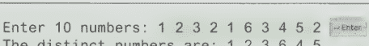

### 7.16（执行时间）

编写一个程序创建一个从 1 到 100,000,000 的升序数组。分别显示调用 7.6 和 7.7 中 `linearSearch` 方法和 `binarySearch` 方法的执行时间。显示以下数字两者的执行时间：1；25,000,000；50,000,000；75,000,000；100,000,000。你可以使用以下代码模板获取执行时间：

```java
long startTime = System.nanoTime();

perform the task();

long endTime = System.nanoTime();

long executionTime = endTime - startTime;
```


## 7.17 (学生排序)

编写一个程序提示用户输入学生人数、学生姓名并按分数降序排序。假设姓名是不带空格的字符串，使用`Scanner.next()`方法读取姓名。

## 7.18 (冒泡排序)

编写一个使用冒泡算法的排序。冒泡算法对数组进行多次遍历。在每次遍历中，比较相邻的一对元素。如果这对顺序不对，则交换它们的值。该技术被称为冒泡排序或下沉排序，因为较小的值逐渐“浮”到顶部，而较大的值则“沉”到底部。编写一个测试程序读取 10 个数字，调用该方法并显示排序后的数字。

# 第 7 章 单维数组

## (已排序？)

编写以下方法，如果列表已经是降序排列的，则返回`true`。

```java
public static boolean isSorted(int[] list)
```

编写一个测试程序，提示用户输入列表并显示该列表是否排序。以下是一个示例运行。注意，输入中的第一个数字表示列表中的元素个数。该数字不是列表的一部分。

| 输入 | 输出 |
| :--- | :--- |
| 输入列表: 8 10 1 5 16 61 9 11 1 | 列表未排序 |


| 输入 | 输出 |
| :--- | :--- |
| 输入列表: 10 21 11 9 7 5 4 3 1 1 | 列表已排序 |


## 7.20 (倒序冒泡排序)

修改练习 7.18 中的冒泡排序方法，将数组元素按降序而不是升序排序。编写一个测试程序读取 10 个数字，调用该方法并按降序显示排序后的数字。

# 7.13

## 7.21 (整数归一化)

编写一个程序，提示用户输入 10 个整数，并通过除以最大整数将这些整数归一化到 0 到 1 的范围内。显示这 10 个归一化后的数值。

## 7.22 (统计字符串中的元音数量)

编写一个程序，提示用户输入一个字符串，并显示字符串中大小写元音的数量。

# Comprehensive

## 7.23 (游戏：储物柜谜)

一所学校有100个储物柜和100个学生。开学第一天所有柜都是关闭的。当学生们进入时，第一个学生（标记为 S1）打开每个柜。第二个学生 S2 从第二个柜（标记为 L2）开始，关闭每隔一个柜。S3 从第三个柜开始，改变每第三个柜的状态（如果是打开的则关闭，如果是关闭的则打开）。学生 S4 从柜 L4 开始改变每第四个柜。学生 S5 从 L5 开始改变每第五个柜，直到 S10 改变 L100。

在所有学生通过建筑并改变了储物柜状态后，哪些储物柜是打开的？编写一个程序找到答案，并用一个空格分隔所有打开的储物柜编号。

（提示：使用一个包含 100 个布尔类型元素的数组，每个元素指示储物柜是打开的（`true`）还是关闭的（`false`）。初始时，所有柜都是关闭的。）


## 7.24 (模拟：收集者)

收集者是一个具有许多实际应用的经典问题。该问题是从一组对象中重复抽取对象，并找出需要多少次才能使所有对象至少被抽取一次。该问题的变体是从洗过的 52 张牌组中重复抽取牌，并找出在看到每种牌之前需要抽取多少次。假设在抽取另一张牌之前会将抽取的牌放回。

编写一个程序模拟获取每个花色四张牌所需的次数，并显示抽取的四张牌（某张牌可能会被抽取两次）。以下是程序的示例运行：

```
黑桃女王
梅花 5
红心女王
菱 4
抽取次数: 12
```


## 7.25 (代数：求解二次方程)

使用以下头编写一个求解二次方程的方法：

```java
public static int solveQuadratic(double[] eqn, double[] roots)
```

二次方程 ax² + bx + c = 0 的系数传递给数组`eqn`，实根存储在`roots`中。该方法返回实根的个数。编写练习 3.1，说明如何求解二次方程。编写一个程序提示用户输入 a、b、c 的值，并显示实根的个数和实根。

## 7.26 (检查数组是否排序)

要求数组列表按升序排序。使用以下头编写一个方法，如果列表已排序，则返回`true`：

```java
public static boolean isSorted(int[] list)
```

编写一个程序提示用户输入列表。注意输入中的第一个数字表示列表中的元素个数。该数字不是列表的一部分。

```
输入列表: 5 2 5 6 9 10
列表已排序
```


```
输入列表: 5 2 5 6 1 6
列表未排序。
```


## 7.27 (检查等差数组)

如果数组元素按升序排列且相邻元素之间存在恒定差，则该列表为等差数组。使用以下头编写一个方法，如果列表是等差的则返回`true`：

```java
public static boolean isSorted(int[] list)
```

编写一个程序提示用户输入列表。注意输入中的第一个数字表示列表中的元素个数。该数字不是列表的一部分。

```
输入列表: 5 2 5 6 9 10
列表不是等差的
```

```
输入列表: 5 2 4 6 8 10
列表是等差的。
```

## 7.28 (数学：排列)

编写一个程序提示用户输入四个整数，并显示它们的所有排列方式。

## 7.29 (游戏：骰子)

假设随机掷三个骰子。编写一个程序显示所有和为9的骰子组合。

## 7.30 (模式识别：连续数字)

编写以下方法测试数组是否有四个连续数字：

```java
public static boolean isConsecutive(int[] values)
```

编写一个程序提示用户输入一组整数，并显示该序列是否包含四个连续数字。你的程序应首先提示用户输入大小——即序列中的数值个数。以下是示例运行：

```
输入个数: 8
输入数值: 3 4 5 5 5 4
列表有四个连续数字
```

```
输入个数: 9
输入数值: 3 4 5 6 5 5 4
列表没有四个连续数字
```

## 7.31 (合并两个列表)

编写以下方法将两个排序列表合并为一个排序列表：

```java
public static int[] merge(int[] list1, int[] list2)
```

使用比较次数最多为`list1.length + list2.length`的方式实现该方法。查看 example.pearsonmc.com/MergeSortee.html 获取实现。编写一个程序提示用户输入两个排序列表并显示合并后的列表。以下是一个示例运行。注意输入中的第一个数字表示列表中的元素。该数字不是列表的一部分。

```
输入 list1 大小和内容: 5 1 5 6 11 11
输入 list2 大小和内容: 4 2 5 6
list1 为 1 5 6 11 11
list2 为 2 4 5 6
合并后的列表为 1 2 4 5 5 6 11 11
```


## 7.32 (列表分区)

编写以下方法使用第一个元素作为基准进行分区：

```java
public static int partition(int[] list)
```

分区后，列表中的元素被重新排列，使得基准之前的元素小于或等于基准，基准之后的元素大于基准。该方法返回基准在新列表中的索引。例如，假设列表为`[5, 2, 9, 3, 6, 8]`。分区后，列表变为`[3, 2, 5, 6, 8, 9]`。使用比较次数最多为`length`的方式实现该方法。查看 example.pearsoncm.com/animation/QuickSortNovel.html 获取动画。编写一个测试程序提示用户输入列表的大小和内容，并显示分区后的列表。以下是一个示例运行。

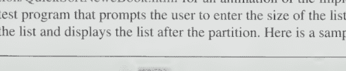

## 7.33 (月份)

编写一个程序提示用户输入1到12之间的整数，并显示与用户输入的整数对应的月份。例如，如果用户输入三，程序应该显示 March。

## 7.34 (对字符串中的字符排序)

使用以下头编写一个返回排序字符串的方法：

```java
public static String sort(String s)
```

例如，`sort("abc")`返回`abc`。

编写一个程序提示用户输入一个字符串并显示排序后的字符串。

## 7.35 (游戏：吊字游戏)

编写一个吊字游戏，随机生成一个单词，并如示例运行所示提示用户一次猜一个字母。单词中的每个字母都显示为星号。当用户做出正确猜测时，会显示实际字母。当用户完成一个单词时，显示错误次数并要求用户继续用另一个单词游戏。按如下方式声明你想要存储单词的数组：

```java
// String[] words = new String[] {"word", "that", ...};
```

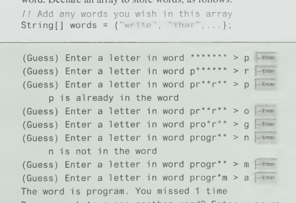

# 308 第 7 章 一维数组

## 7.36 (游戏：八皇后问题)

经典的八皇后问题是在国际棋盘上放置八个皇后，使得任何两个皇后都不能相互攻击（即没有两个皇后在同一行、同一列或同一条对角线上）。这有很多可能的解。编写一个程序显示其中一种解。示例输出所示：

```
| | | | | | | |
| | | | | | | |
| | | Q | | | | |
| | | Q | | | | |
| | | | Q | | | |
| | Q | | | | | |
| Q | | | | | | |
| | Q | | | | | |
```

## 7.37 (游戏：豆子机)

豆机，也称为五线阵（quincunx）或加尔顿盒（Galton box），是一种以英国科学家弗朗斯·加尔顿（Francis Galton）命名的统计实验设备。它由一块直立的板组成，板上呈三角形均匀分布着钉子（或销钉），如图 7.13 所示。


图 7.13 每个球都走随机路径并落入槽中。

球从板的开口落下。每当球撞击钉子时，它有 50% 的概率向左或向右落下。球堆积在板的底部。

编写一个模拟豆子机的程序。你的程序应提示用户输入球的数量和机器槽的数量。通过打印每个球的路径来模拟掉落过程。例如，图 7.13b 中的路径是 LLRLLLR，图 7.13c 中球的路径是 RLRLLLR。用直方图显示槽中球的最终积累情况。这里是程序的运行示例：

（提示：创建一个名为`slots`的数组。`slots`中的每个元素存储某个槽中球的数量。每个球通过一条路径落入一个槽中。路径中 R 的数量就是球落入槽的位置。例如，对于路径 LLR-LRR，球落入`slots[4]`；对于路径 RRLLLLL，球落入`slots[2]`。）

# 309 编程练习

```
输入要落下的球数: 5 [Enter]
输入豆子机中的槽数: 8 [Enter]
```

```
LRLRLRR
RRLLLR
LLRLLRR
RRLLLL
LRLRRLR
```

```
0
000
```


# 第 8 章 多维数组

## 目标

- 给出使用二维数组表示数据的示例 ($8.1)。
- 为二维数组声明变量、创建数组，并使用行、列索引访问二维数组中的元素 ($8.2)。
- 为二维数组编写常见操作程序（显示数组、求所有元素之和、寻找最小值和最大值、以及随机洗牌） ($8.3)。
- 将二维数组传递给方法 ($8.4)。
- 使用二维数组编写一个为多选择题评分的程序 ($8.5)。
- 使用二维数组解决最近点对问题 ($8.6)。
- 使用二维数组检查数独求解 ($8.7)。
- 使用多维数组 ($8.8)。


## 8.1 引言

表格或矩阵中的数据可以使用二维数组来表示。

上一章介绍了如何使用一维数组来存储线性元素集合。你可以使用二维数组来存储矩阵或表格。例如，下表列出了中心之间的距离，可以使用名为`distances`的二维数组来存储。

距离表（英里）

| 芝加哥 | 波士顿 | 纽约 | 亚特兰大 | 迈阿密 | 达拉斯 | 休斯顿 |
|---|---|---|---|---|---|---|
| 芝加哥 | 0 | 983 | 787 | 714 | 1375 | 781 | 1087 |
| 波士顿 | 983 | 0 | 214 | 1102 | 1763 | 1723 | 1824 |
| 纽约 | 787 | 214 | 0 | 888 | 1549 | 1548 | 1627 |
| 亚特兰大 | 714 | 1102 | 888 | 0 | 661 | 781 | 810 |
| 迈阿密 | 1375 | 1763 | 1549 | 661 | 0 | 1426 | 1187 |
| 达拉斯 | 781 | 1723 | 1548 | 781 | 1426 | 0 | 239 |
| 休斯顿 | 1087 | 1824 | 1627 | 810 | 1187 | 239 | 0 |

```java
int[][] distances = {
  {0, 983, 787, 714, 1375, 781, 1087},
  {983, 0, 214, 1102, 1763, 1723, 1824},
  {787, 214, 0, 888, 1549, 1548, 1627},
  {714, 1102, 888, 0, 661, 781, 810},
  {1375, 1763, 1549, 661, 0, 1426, 1187},
  {781, 1723, 1548, 781, 1426, 0, 239},
  {1087, 1824, 1627, 810, 1187, 239, 0}
};
```

## 8.2 二维数组基础

二维数组中的元素通过行和列索引访问。如何为二维数组声明变量？如何创建二维数组？如何访问二维数组中的元素？本节将介绍这些问题。

### 8.2.1 声明二维数组变量和创建二维数组

声明二维数组的语法如下：

```java
elementType[][] arrayVar;
```

或者

```java
elementType arrayVar[]; // 允许但不推荐
```

例如，这里是声明一个二维矩阵的方法：

```java
int[][] matrix;
```

或者

```java
int matrix[][]; // 这种风格允许但不推荐
```

你可以使用语法创建一个 5x5 的二维数组并赋值给`matrix`：

```java
matrix = new int[5][5];
```

二维数组中使用两个下标：一个用于行，另一个用于列。与一维数组一样，每个下标的索引都是其类型且从 0 开始，如图 8.1a 所示。

| [0][1][2][3][4] | [0][1][2] |
|---|---|---|---|---|---|---|---|
| [0] | 0 | 0 | 0 | 0 | 0 | 1 | 2 | 3 |
| [1] | 0 | 0 | 0 | 0 | 0 | 4 | 5 | 6 |
| [2] | 0 | 0 | 0 | 0 | 0 | 7 | 8 | 9 |
| [3] | 0 | 0 | 0 | 0 | 0 | 10 | 11 | 12 |
| [4] | 0 | 0 | 0 | 0 | 0 | | | |

```java
matrix = new int[5][5];
matrix[2][1] = 7;
```


图 8.1 二维数组每个下标的索引都是 int 值，从 0 开始。

要为行索引 2 和列索引 1 的特定元素赋值为 7（如图 8.1b 所示），可以使用以下语法：

```java
matrix[2][1] = 7;
```


> 注意：在 Java 中使用 `matrix[2, 1]` 访问第 2 行第 1 列元素是一个常见错误，每个下标必须包含在方括号。

你还可以使用数组初始化器来声明、创建和初始化二维数组。例如，(a) 中的以下代码创建一个具有指定初始值的数组，如图 8.1c 所示。这与 (b) 中的代码等价。

| (a) `int[4][3] = {{1, 2, 3}, {4, 5, 6}, {7, 8, 9}, {10, 11, 12} };` | 等价 | (b) `int[1][3] = {array[0][0] = 1; array[0][1] = 2; array[0][2] = 3; array[1][0] = 4; array[1][1] = 5; array[1][2] = 6; array[2][0] = 7; array[2][1] = 8; array[2][2] = 9; };` |

## 8.2 获取二维数组的长度

二维数组实际上是一个每个元素都是一维数组的数组。数组 `x` 的长度是数组中元素的数量，可以通过 `x.length`、`x[0].length` 以及 `x[x-1].length` 获取。

例如，假设 `x = new int[3][4]`，`x[0]`、`x[1]` 和 `x[2]` 是一维数组且每个都包含四个元素，如图 8.2 所示。


## 8.2.3 锯齿数组

二维数组中的每一行本身都是数组。那么，这些行的长度可以不同。这种类型的数组被称为锯齿数组（ragged array）。这里创建一个锯齿数组的示例：

```java
int[][] triangleArray = {
  {1, 2, 3, 4, 5},
  {2, 3, 4, 5},
  {3, 4, 5},
  {5}
};
```

你可以看到，`triangleArray[0].length` 是 5，`triangleArray[1].length` 是 4，`triangleArray[2].length` 是 3，`triangleArray[3].length` 是 2，而 `triangleArray[4].length` 是 1。

如果你事先不知道锯齿数组的值，但知道其大小——例如上图所示——可以使用以下语法创建锯齿数组：

```java
int[][] triangleArray = new int[5][];

triArray[0] = new int[5]; // 注意：此处误为 triArray 应为 triangleArray
triArray[1] = new int[4];
triArray[2] = new int[3];
triArray[3] = new int[2];
triArray[4] = new int[1];
```

你可以为数组赋值。例如：

```java
triangleArray[0][3] = 4;
triArray[4][0] = 5;
```

> 注意：创建数组的 `new int[5][]` 语法要求指定第一个索引。`new int[][]` 语法是错误的。

## 8.3 处理二维数组

### 练习

#### 8.2.1

声明一个 `int` 类型的二维数组的数组引用变量，创建一个 4 乘 5 的 `int` 矩阵，并将其赋值给该变量。

#### 8.2.2

二维数组的行长度可以不同吗？

#### 8.2.3

下列代码的输出是什么？

```java
int[] array = new int[5][6];

int[] x = {1, 2};

array[0] = x;

System.out.println("array[0][1] is " + array[0][1]);
```

#### 8.2.4

下述语句中哪一个是有效的？

```java
int[] r = new int[2];

int[] x = new int[];

int[] y = new int[3][];

int[] z = {1, 2};

int[][] m = {{1, 2}, {2, 3}};

int[][] n = {{1, 2}, {2, 3}, {}};
```

## 8.3 处理二维数组

嵌套数组通常用于处理二维数组。

假设创建了一个数组矩阵：

```java
int[][] matrix = new int[10][10];
```

以下是处理二维数组的一些示例。

### 1. 使用输入值初始化数组

以下循环使用用户输入的值初始化数组：

```java
java.util.Scanner input = java.util.Scanner(System.in);

System.out.println("Enter " + matrix.length + " rows and " + matrix[0].length + " columns: ");

for (int row = 0; row < matrix.length; row++) {
  for (int column = 0; column < matrix[row].length; column++) {
    matrix[row][column] = input.nextInt();
  }
}
```

### 2. 使用随机值初始化数组

以下循环使用 0 到 99 之间的随机值初始化数组：

```java
for (int row = 0; row < matrix.length; row++) {
  for (int column = 0; column < matrix[row].length; column++) {
    matrix[row][column] = (int)(Math.random() * 100);
  }
}
```

### 3. 打印数组

要打印二维数组，你必须使用如下循环打印数组中的每个元素：

```java
for (int row = 0; row < matrix.length; row++) {
  for (int column = 0; column < matrix[row].length; column++) {
    System.out.print(matrix[row][column] + " ");
  }

  System.out.println();
}
```


### 4. 累加所有元素

使用名为 `total` 的变量存储总和。初始 `total` 为 0。使用如下循环将数组中的每个元素累加到 `total`：

```java
int total = 0;

for (int row = 0; row < matrix.length; row++) {
  for (int column = 0; column < matrix[row].length; column++) {
    total += matrix[row][column];
  }
}
```

### 5. 按列累加元素

对于每一列，使用名为 `total` 的变量存储其总和。使用如下循环将列中的每个元素累加到 `total`：

```java
int total = 0;

for (int column = 0; column < matrix[0].length; column++) {
  for (int row = 0; row < matrix[row].length; row++) {
    System.out.println("Sum for column " + column + " is " + total);
  }
}
```

### 6. 哪一行的和最大？

使用变量 `maxRow` 和 `indexOfRow` 来跟踪最大和以及行的索引。对于每一行，计算其总和，如果新总和更大，则更新 `maxRow` 和 `indexOfRow`：

```java
int maxRow = 0;
int indexOfRow = 0;

// 获取第一行的和
for (int column = 0; column < matrix[0].length; column++) {
  maxRow += matrix[0][column];
}

for (int row = 1; row < matrix.length; row++) {
  int totalOfRow = 0;

  for (int column = 0; column < matrix[row].length; column++) {
    totalOfRow += matrix[row][column];
  }

  if (totalOfRow > maxRow) {
    maxRow = totalOfRow;
    indexOfRow = row;
  }
}

System.out.println("Row " + indexOfRow + " has the maximum sum of " + maxRow);
```

### 7. 随机洗乱

一维数组元素的洗乱在第 7.2 节介绍过。如何洗乱二维数组中的元素？要实现这一点，对于每个元素 `matrix[i][j]`，随机生成索引 `i1` 和 `j1`，并将 `matrix[i][j]` 与 `matrix[i1][j1]` 交换，如下：

```java
for (int i = 0; i < matrix.length; i++) {
  for (int j = 0; j < matrix[i].length; j++) {
    int i1 = (int)(Math.random() * matrix.length);
    int j1 = (int)(Math.random() * matrix[i].length);

    int temp = matrix[i][j];
    matrix[i][j] = matrix[i1][j1];
    matrix[i1][j1] = temp;
  }
}
```


### 8.3.1

显示代码的输出：

```java
int[][] array = {{1, 2}, {3, 4}, {5, 6}};

for (int i = array.length - 1; i >= 0; i--) {
  for (int j = array[i].length - 1; j >= 0; j--) {
    System.out.print(array[i][j] + " ");
  }

  System.out.println();
}
```

### 8.3.2

显示代码的输出：

```java
int[][] array = {{1, 2}, {3, 4}, {5, 6}};

int sum = 0;

for (int i = 0; i < array.length; i++) {
  sum += array[i][0];
}

System.out.println(sum);
```

## 8.4 传递二维数组

当向方法传递二维数组时，数组的引用被传递给方法。你可以像传递一维数组一样向方法传递二维数组。第一个方法 `getArray()` 返回一个二维数组，第二个方法 `sum(int[][])` 返回矩阵所有元素的和。

列表 8.1 `PassDimensionalArray.java`

```java
import java.util.Scanner;

public class PassDimensionalArray {
    public static void main(String[] args) {
        int[][] m = getArray(); // 获取数组

        // 显示元素的和
        System.out.println("\sum of all elements is " + sum(m));
    }

    public static int[][] getArray() {
        // 创建 Scanner
        Scanner input = new Scanner(System.in);

        // 输入数组值
        int[][] m = new int[3][4];

        System.out.println("Enter " + m.length + " rows and " + m[0].length + " columns: ");

        for (int i = 0; i < m.length; i++) {
            for (int j = 0; j < m[i].length; j++) {
                m[i][j] = input.nextInt();
            }
        }

        return m;
    }
}
```


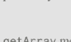

```java
public static int sum(int[][] m) {
    int total = 0;

    for (int row = 0; row < m.length; row++) {
        for (int column = 0; column < m[row].length; column++) {
            total += m[row][column];
        }
    }

    return total;
}
```


## 8.5 案例研究：选择题评分

问题是编写一个为选择题评分的程序。假设有八个学生和十道题目，答案存储在一个二维数组中。每行记录一个学生对问题的回答，如下所示：

### 学生的题目答案

| 学生 | 0 | 1 | 2 | 3 | 4 | 5 | 6 | 7 | 8 | 9 |
|---|---|---|---|---|---|---|---|---|---|---|
| 学生 0 | A | B | A | C | C | D | E | E | A | D |
| 学生 1 | D | B | A | B | C | D | E | E | A | D |
| 学生 2 | E | D | D | A | C | B | E | E | A | D |
| 学生 3 | C | B | A | E | D | C | E | E | A | D |
| 学生 4 | A | B | D | C | C | D | E | E | A | D |
| 学生 5 | B | B | E | C | C | D | E | E | A | D |
| 学生 6 | B | B | A | C | C | D | E | E | A | D |
| 学生 7 | E | B | E | C | C | D | E | E | A | D |

标准答案存储在一维数组中：

| 0 | 1 | 2 | 3 | 4 | 5 | 6 | 7 | 8 | 9 |
|---|---|---|---|---|---|---|---|---|---|
| K | B | D | C | C | D | A | E | A | D |

你的程序对评分并显示结果。它与标准答案比较，统计正确答案的数量并显示。列表 8.2 给出了该程序。

# 320 第 8 章 多维数组

学生 0 的正确数量为 7  
学生 1 的正确数量为 6  
学生 2 的正确数量为 5  
学生 3 的正确数量为 4  
学生 4 的正确数量为 8  
学生 5 的正确数量为 7  
学生 6 的正确数量为 7  
学生 7 的正确数量为 7

第 5-13 行的语句声明、创建并初始化了一个字符类型的二维数组，并将该数组引用赋给 `char[]` 类型的 `answers`。

第 16 行的语句声明、创建并初始化了一个 `char` 值的数组，并将引用赋给 `char` 类型的 `keys`。

数组 `arrays` 中的每行存储一个学生的答案，通过与 `keys` 数组中的键进行比较来评分。结果会在学生答案评分后立即显示出来。

### 8.5.1 如何修改代码使其也显示最高分以及获得最高分的学生？


## 8.6 案例研究：寻找最近点对

本节介绍一个寻找最近点对的几何问题。

给定一组点，最近点对问题是找到两个彼此距离最近的点。例如，在图 8.3 中，点 `(1,1)` 和 `(2,0.5)` 之间距离最近。解决这个问题有多种方法。一种直观的方法是计算所有点对之间的距离，并找到距离最小的那对，如列表 8.3 所示。


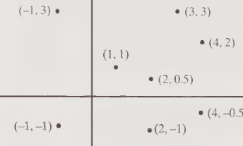

**图 8.3** 点可以用二维数组表示。

| x | y |
|---|---|
| 0 | 3 |
| 1 | -1 |
| 2 | 1 |
| 3 | 0.5 |
| 4 | -1 |
| 5 | 3 |
| 6 | 4 |
| 7 | 2 |
| 8 | -0.5 |

**列表 8.3** `FindNearestPoints.java`

```java
import java.util.Scanner;

public class FindNearestPoints {

    public static void main(String[] args) {

        Scanner input = new Scanner(System.in);

        System.out.print("Enter the number of points: ");

        int numberOfPoints = input.nextInt();

    }

    // 创建一个数组来存储点

    double[][] points = new double[numberOfPoints][2];

    System.out.print("Enter " + numberOfPoints + " points: ");

    for (int i = 0; i < numberOfPoints; i++) {

        points[i][0] = input.nextDouble();

        points[i][1] = input.nextDouble();

    }

    // p1 和 p2 是 points 数组中的索引

    int p1 = 0, p2 = 1; // 初始两个点

    double shortestDistance = distance(points[p1][0], points[p1][1], points[p2][0], points[p2][1]);

    // 计算每两个点之间的距离

    for (int i = 0; i < numberOfPoints; i++) {

        for (int j = i + 1; j < numberOfPoints; j++) {

            double distance = distance(points[i][0], points[i][1], points[j][0], points[j][1]);

            if (shortestDistance < distance) {

                p1 = i; // 更新 p1

                p2 = j; // 更新 p2

                shortestDistance = distance; // 更新 shortestDistance

            }

        }

    }

    // 显示结果

    System.out.println("The closest two points are " + 

    ("(" + points[p1][0] + ", " + points[p1][1] + ") and (" + 

    points[p2][0] + ", " + points[p2][1] + ")");

    // 计算两个点 (x1, y1) 和 (x2, y2) 之间的距离

    public static double distance(double x1, double y1, double x2, double y2) {

        return Math.sqrt((x2 - x1) * (x2 - x1) + (y2 - y1) * (y2 - y1));

    }

}
```


程序提示用户输入点的数量（第 6 和第 7 行）。从控制台读取点并存储在名为 `points` 的二维数组中（第 12-15 行）。程序使用变量 `shortestDistance`（第 19 行）存储最近点之间的距离，这两个点的索引存储在 `p1` 和 `p2` 中。对于每个点 `i`，程序计算 `points[i]` 和 `points[j]`（当 `j > i`）之间的距离。如果发现更短的距离，则更新 `p1` 和 `p2`（第 28-32 行）。**提示**：通过键盘输入所有点是繁琐的。你可以将输入存储在文件中，例如 `NearestPoints`，并运行程序：

```bash
java FindNearestPoints < NearestPoints
```

## 8.7 案例：数独

本节介绍了一个名为数独（Sudoku）的有趣问题。为了方便学者，本节介绍了检查一个给定的数独是否正确。

数独是一个 9×9 的网格，分为 3×3 的区域。每行、每列和每个 3×3 的区块必须包含 1 到 9 的数字。某些单元格是空的，如图 8.4a 所示。


| | | | | | | | | |
|---|---|---|---|---|---|---|---|---|
| 5 | 3 | | | 7 | | | | |
| 6 | | | 1 | 9 | 5 | | | |
| | 9 | 8 | | | | | | |
| 8 | | | | 6 | | | | 3 |
| 4 | | | 8 | 3 | | | 1 |
| 7 | | | | 2 | | | | 6 |
| | 6 | | | | 2 | | | | |
| | | | | 4 | 1 | 9 | | |
| | | | | 8 | | | 7 | |

(a) 谜题 (b) 解答

图 8.4 (a) 中的数独谜题在 (b) 中被解答。为了方便，我们使用 0 来表示空单元格，如图 8.5a 所示。网格可以自然地用二维数组表示，如图 8.5b 所示。

```java
int[][] grid = {
    {5, 3, 0, 0, 7, 0, 0, 0, 0},
    {6, 0, 0, 1, 9, 5, 0, 0, 0},
    {0, 9, 8, 0, 0, 0, 0, 0, 0},
    {8, 0, 0, 0, 6, 0, 0, 0, 3},
    {4, 0, 0, 8, 0, 3, 0, 0, 1},
    {7, 0, 0, 0, 2, 0, 0, 0, 6},
    {0, 6, 0, 0, 0, 0, 2, 0, 0},
    {0, 0, 0, 0, 4, 1, 9, 0, 5},
    {0, 0, 0, 0, 8, 0, 0, 7, 9}
};
```

# 324 第 8 章 多维数组

```java
for (int i = 0; i < 9; i++)
  for (int j = 0; j < 9; j++)
    if (grid[i][j] < 1 || grid[i][j] > 9)
      if (!isValid(i, j))
        return false;
  return true; // 解决方案有效的
{
  /* 检查 grid[i][j] 在 i, j, int[][] grid 中有效 */

public static boolean isValid(int i, int j, int[][] grid) {

  /* 检查 grid[i][j] 在 i 行中是唯一的 */

  for (int col = 0; col < 9; col++)
    if (col != j && grid[i][col] == grid[i][j])
      return false;

  /* 检查 grid[i][j] 在 j 列中是唯一的 */

  for (int row = 0; row < 9; row++)
    if (row != i && grid[row][j] == grid[i][j])
      return false;

  /* 检查 grid[i][j] 在 3-3 宫体内是唯一的 */

  for (int row = (i / 3) * 3; row < (i / 3) * 3 + 3; row++)
    for (int col = (j / 3) * 3; col < (j / 3) * 3 + 3; col++)
      if (row != i && col != j && grid[row][col] == grid[i][j])
        return false;

  return true; // grid[i][j] 当前值是有效的
}
```


程序调用 `readSolution()` 方法（第 6 行）读取数独解决方案并返回一个表示数独网格的二维数组。`isValid(grid)` 通过验证每个值是否在 1 到 9 之间以及每个值在网格中是否有效来检查网格中的值是否有效（第 27–34 行）。`isValid(i, j, grid)` 检查 `grid[i][j]` 处的值是否有效。它检查 `grid[i][j]` 是否在第 `i` 行出现超过一次（第 39–41 行）、第 `j` 列（第 44–46 行）以及 3 x 3 宫格内（第 49–52 行）。你如何定位同一宫格内的所有单元？如图 8.7 所示，包含 `grid[(i / 3) * 3][(j / 3) * 3]` 的 3 x 3 宫格。

## 8.8 多维数组

| `grid[0][0]` | `grid[0][6]` |
|---|---|
| | |
| `grid[0][3]` | |

对于这个 3 x 3 宫格中的任何 `grid[i][j]`，其起始单元都是 `grid[3×(i/3)][3×(j/3)]`（即 `grid[0][0][0][6]`）。例如，对于 `grid[2][8]`，`i=2` 且 `j=8`，`3×(i/3)=0` 且 `3×(j/3)=6`。

对于这个 3 x 3 宫格中的任何 `grid[i][j]`，其起始单元都是 `grid[3×(i/3)][3×(j/3)]`（即 `grid[6][3]`）。例如，对于 `grid[8][5]`，`i=8` 且 `j=5`，`3×(i/3)=6` 且 `3×(j/3)=3`。

图 8.7 3 × 3 宫格内第一个单元的位置决定了宫格内其他单元的位置。

通过这一观察，你可以轻松地识别宫格内的所有单元。例如，如果 `grid[r][c]` 是 3 x 3 宫格的起始单元，可以使用嵌套循环遍历宫格内的单元：

```java
// 获取从 grid[r][c] 开始的 3x3 宫格中的所有单元

for (int row = r; row < r + 3; row++)
  for (int col = c; col < c + 3; col++)
    // grid[row][col] 在宫格内
```

在代码中输入 81 个数字是很麻烦的。当你测试程序时，可以将输入存储在文件中，查看 `liveexample.personcm.com/data/CheckSudokuSolution.txt` 并使用以下命令运行程序：

```bash
java SudokuSolution < CheckSudokuSolution.txt
```

### 8.7.1 如果列表 8.4 中第 51 行的单元被更改会发生什么

```java
if (row == i && col == j && grid[row][col] == grid[i][j])
```


## 8.8 多维数组

二维数组是一维数组的数组，三维数组是二维数组的数组。

在前面的节中，你使用二维数组来表示矩阵或表格。偶尔你可能表示 n 维结构。在 Java 中，你可以为任何正整数创建 n 维数组。

声明二维数组和创建二维数组的方法可以推广为声明 `n >= 3` 的 n 维数组。例如，你可以使用三维数组存储六个学生的成绩，每个学生有两个成绩（选择题和简答）。以下语法声明了三维变量 `scores` 并对其赋值：

```java
double[][][] scores = new double[6][5][2];
```

你也可以使用数组初始化器初始化数组：

```java
{{7.5, 20.5}, {9.0, 22.5}, {15, 33.5}, {13, 21.5}, {15, 2.5}}, {{4.5, 21.5}, {9.0, 22.5}, {15, 34.5}, {12, 20.5}, {14, 9.5}}, {{6.5, 30.5}, {9.4, 10.5}, {11, 33.5}, {11, 23.5}, {10, 2.5}}, {{6.5, 23.5}, {9.4, 32.5}, {13, 18.5}, {11, 29.5}, {16, 7}}, {{8.5, 26.5}, {9.4, 32.5}, {13, 36.5}, {13, 24.5}, {16, 6.5}}, {{9.5, 20.5}, {9.4, 31.5}, {13, 31.5}, {12, 20.5}, {16, 6.5}}};
```


`scores[0][1][0]`指第一个学生第二次考试的选择题成绩，分 9.0。`scores[0][1][1]`指第一个学生第二次考试的简答题成绩，分 22.5。如下所示：

| 学生 | 选择题或简答题成绩 |
| --- | --- |
| `scores[i]` | `[j][k]` |

多维数组实际上是一个每个元素都是另一个数组的数组。三维数组是二维数组的数组。例如，假设`x = new int[2][2][5]`，`x[0]`和`x[1]`是二维数组。`x[0][0]`、`x[0][1]`、`x[1][0]`和`x[1][1]`是一维数组，且都包含五个元素。`x[0].length`和`x[1].length`为 2，而`x[0][0].length`、`x[0][1].length`、`x[1][0].length`和`x[1][1].length`为 5。

## 8.8.1 案例研究：温度和湿度

假设气象站每天记录温度和湿度，并将过去 10 天的数据存储在名为`Weather.txt`的文本文件中（查看 example.pearsoncm.com/data/Weather.txt）。文件的每行由四个数字组成，指示日期、小时、温度和湿度。文件的内容如下所示 (a)。

| 日期 温度 湿度 | 日 温度 湿度 |
| --- | --- | --- | --- | --- | --- |
| 1 | 76.4 | 0.92 | 10 | 24 | 98.7 | 0.74 |
| 2 | 77.7 | 0.93 | 1 | 77.7 | 0.93 |
| 10 | 23 | 97.7 | 0.71 | 10 | 23 | 97.7 | 0.71 |
| 10 | 24 | 98.7 | 0.74 | 1 | 1 | 76.4 | 0.92 |

文件中的行并不一定按日期和小时顺序排列。例如，文件可能所示 (b)。任务是编写一个程序计算 10 天的平均每日温度和湿度。你可以使用输入重定向读取文件并将数据存储在名为`data`的三维数组中。`data`的第一个索引范围从 0 到 9，代表 10 天；第二个索引范围从 0 到 23，代表 24 小时；第三个索引范围从 0 到 1，代表温度和湿度，如下：

| 哪一天 | 几小时 | 温度或湿度 |
| --- | --- | --- |
| `data[i]` | `[j]` | `[k]` |

注意日期从 1 到 10，小时从 1 到 24。因为索引从 0 开始，`data[0][0][0]`存储第 1 天的温度，`data[9][23][1]`存储第 10 天的湿度。程序见列表 8.5。

### 列表 8.5 Weather.java

```java
import java.util.Scanner;

public class Weather {
    public static void main(String[] args) {
        final int NUMBER_OF_DAYS = 10;
        final int NUMBER_OF_HOURS = 24;
        double[][][] data = new double[NUMBER_OF_DAYS][NUMBER_OF_HOURS][2];
        Scanner input = new Scanner(System.in);

        // 从文件读取输入
        for (int k = 0; k < NUMBER_OF_DAYS * NUMBER_OF_HOURS; k++) {
            int day = input.nextInt();
            int hour = input.nextInt();
            double temperature = input.nextDouble();
            double humidity = input.nextDouble();
            data[day-1][hour-1][0] = temperature;
            data[day-1][hour-1][1] = humidity;
        }

        // 计算平均温度和湿度
        for (int i = 0; i < NUMBER_OF_DAYS; i++) {
            double dailyTemperatureTotal = 0;
            double dailyHumidityTotal = 0;
            for (int j = 0; j < NUMBER_OF_HOURS; j++) {
                dailyTemperatureTotal += data[i][j][0];
                dailyHumidityTotal += data[i][j][1];
            }

            // 显示结果
            System.out.println("第 " + i + 1 + " 天的平均温度为 " +
                dailyTemperatureTotal / NUMBER_OF_HOURS);
            System.out.println("第 " + i + 1 + " 天的平均湿度为 " +
                dailyHumidityTotal / NUMBER_OF_HOURS);
        }
    }
}
```

这样做会很尴尬。为了方便起见，我们将数据存储在一个文件中，并使用输入重定向从文件中读取数据。第 24–27 行的循环将每天每小时的所有温度加到`dailyTemperatureTotal`，并将每天每小时的所有湿度加到`dailyHumidityTotal`。平均每日温度和湿度在第 30–33 行显示。

## 8.8.2 案例研究：猜生日

列表 4.3 `GuessBirthday.java`提供了一个猜生日的程序。可以通过将数字存储在三维数组的五组集中来简化程序，并如列表 8.6 所示，使用循环提示用户回答。该程序的示例运行可以与列表 4.3 相同。

### 列表 8.6 GuessBirthdayUsingArray.java

```java
import java.util.Scanner;

public class GuessBirthdayUsingArray {
    public static void main(String[] args) {
        int day = 0; // 待定的日期
        int array;
        int[][][] dates = {
            {1, 3, 5, 7},
            {9, 11, 13, 15},
            {17, 19, 21, 23},
            {25, 27, 29, 31},
            {2, 4, 6, 8},
            {10, 12, 14, 16},
            {18, 20, 22, 24},
            {26, 27, 30, 31},
            {4, 5, 6, 7},
            {12, 13, 14, 15},
            {20, 21, 22, 23},
            {28, 29, 30, 31},
            {8, 9, 10, 11},
            {12, 13, 14, 15},
            {24, 25, 26, 27},
            {28, 29, 30, 31},
            {16, 17, 18, 19},
            {20, 21, 22, 23},
            {24, 25, 26, 27},
            {28, 29, 30, 31}
        };

        // 创建一个 Scanner
        Scanner input = new Scanner(System.in);

        for (int i = 0; i < 5; i++) {
            System.out.println("Is your birthday in Set " + (i + 1) + "?");
            for (int j = 0; j < 4; j++) {
                for (int k = 0; k < 4; k++) {
                    System.out.printf("%4d", dates[i][j][k]);
                }
            }
            System.out.println();
        }

        System.out.print("nEnter 0 for No and 1 for Yes: ");
        int answer = input.nextInt();
        if (answer == 1) {
            day += dates[1][0][0];
        }
        System.out.println("Your birthday is " + day);
    }
}
```

第 8–28 行创建了一个三维数组。该数组存储了五组数字。每组是一个 4x4 的二维数组。从第 33 行开始的循环显示每个组中的数字，并提示用户回答生日是否在该集中（第 41 和 42 行）。如果日期在集合，则将集合中的第一个数字（`dates[1][0][0]`）赋值给变量`day`（第 45 行）。

8.8.1 声明一个三维数组，创建一个 4 × 6 × 5 的`int`数组，并将其引用赋值给变量。

8.8.2 假设`char[][][] x = new char[1][5][2]`，数组中有个元素？`x.length`、`x[0].length`和`x[0][0].length`分别是多少？

8.8.3 显示以下代码的输出：

```java
int[][][] array = {{{1, 2}, {3}}, {{5, 6}, {7, 8}};
System.out.println(array[0][0][0]);
System.out.println(array[1][1][1]);
```

## 本章总结

1. 二维数组可以用于存储表格。
2. 使用语法`elementType[][] arrayVar`可以声明二维数组变量。
3. 使用语法`new elementType[ROW_SIZE][COLUMN_SIZE]`创建二维数组。
4. 二维数组使用`arrayVar[rowIndex][columnIndex]`语法表示。
5. 可以使用数组初始化器`elementType[][] array = {{row}, ...}`创建二维数组。
6. 可以数组形成多维数组。例如，三维数组可以声明为`elementType[][][] arrayVar`并使用`new elementType[size1][size2][size3]`创建。

在网上完成本章测试。

## 编程练习

**8.1**（行元素）使用以下头编写一个方法，返回矩阵指定行所有元素的和：

```java
public static double sumRow(double[][] m, int rowIndex)
```

编写一个测试程序读取 3x4 矩阵并显示每行的和。这是一个示例运行：

| 输入 3x4 矩阵逐行输入 |
|---|---|---|---|
| 1 | 2 | 3 | 4 |
| 5 | 6 | 7 | 8 |
| 9 | 10 | 11 | 12 |

| 第0行的元素和为 10.5 |
| 第1行的元素和为 26.5 |
| 第2行的元素和为 14.5 |

**8.2**（矩阵主对线）使用以下头编写一个方法，计算 n 矩阵主对线所有数字的平均值：

```java
public static double averageDiagonal(double[][] m)
```

编写一个测试程序读取 4x4 矩阵并显示主对线所有元素的平均值。这是一个示例运行：

| 输入 4x4 矩阵逐行输入 |
|---|---|---|---|
| 1 | 2 | 3 | 4 |
| 5 | 6 | 7 | 8 |
| 9 | 10 | 11 | 12 |
| 13 | 14 | 15 | 16 |

主对线元素的平均值为8.625

**8.3**（按成绩排序）重写列表 8.2 `Grade.java`，按正确答案数量从大到小显示学生。

**8.4**（计算每个员工的每周小时）假设所有员工的每周小时存储在二维数组中。每行记录员工每天的工作小时。例如，下面的数组显示了八个员工的工作小时。编写程序，按总小时从小到大显示员工及其总小时。

| | Su | M | T | W | F | Sa |
|---|---|---|---|---|---|---|
| 员工 0 | 2 | 4 | 3 | 4 | 5 | 8 |
| 员工 1 | 7 | 3 | 4 | 3 | 3 | 4 |
| 员工 2 | 3 | 3 | 4 | 3 | 3 | 2 |
| 员工 3 | 9 | 3 | 4 | 7 | 4 | 1 |
| 员工 4 | 3 | 5 | 4 | 3 | 6 | 8 |
| 员工 5 | 3 | 4 | 6 | 4 | 3 | 4 |
| 员工 6 | 3 | 7 | 4 | 3 | 8 | 4 |
| 员工 7 | 6 | 3 | 5 | 9 | 2 | 7 |

**8.5**（算法：两个两个矩阵）编写一个方法来相加两个矩阵。方法头如下：

```java
public static double[][] addMatrix(double[][] a, double[][] b)
```

为了相加，两个矩阵必须具有相同的维度和相同的元素类型。让$c$为结果矩阵。每个元素$c_{ij} = a_{ij} + b_{ij}$。例如，对于两个 2x2 矩阵$a$和$b$：

$$
\begin{pmatrix} a_{11} & a_{12} \\ a_{21} & a_{22} \end{pmatrix} + \begin{pmatrix} b_{11} & b_{12} \\ b_{21} & b_{22} \end{pmatrix} = \begin{pmatrix} a_{11} + b_{11} & a_{12} + b_{12} \\ a_{21} + b_{21} & a_{22} + b_{22} \end{pmatrix}
$$

编写一个测试程序，提示用户输入 2x2 矩阵并显示它们的和。这是一个示例运行：

```
Enter matrix1: 1 2 3 4
Enter matrix2: 0 2 4 2
矩阵相加如下
1 4
5 6
```

**8.6**（矩阵乘法）用矩阵$a$乘以$b$，$a$的列数必须等于$b$的行数。让$c$为结果矩阵。每个元素$c_{ij} = \sum_{k=1}^{n} a_{ik}b_{kj}$。方法头为：

```java
public static double[][] multiplyMatrix(double[][] a, double[][] b)
```

**8.7**（最近的点）列表 8-3 给出了二维空间中最近的点。修改程序以寻找三维空间中最近的点。使用以下点运行程序：

```java
double[][] points = {{-1, 0, 3}, {-1, -1, 1}, {4, 1, 1}, {2, 0.5, 9}, {3.5, 2, -1}, {3, 1.5, 3}, {-1.5, 4, 2}, {5.5, -4, -0.5}};
```

## 第 8 章 多维数组

计算两点 (x1, y1, z1) 和 (x2, y2, z2) 之间距离的公式为$\sqrt{(x2-x1)^2 + (y2-y1)^2 + (z2-z1)^2}$。

（所有最近的点对）列表 8.3, `FindNearestPoints.java`，显示所有具有相同最小距离的最近对。以下是一个示例运行：

**8.8**

```
Enter the number of points: 8
Enter 8 points: 0 0 1 1 -1 -2 2 -2 -3 -3 -4 -4 5 5
The closest two points are (0.0, 0.0) and (1.0, 1.0)
The closest two points are (0.0, 0.0) and (-1.0, -1.0)
The closest two points are (1.0, 1.0) and (2.0, 2.0)
```


The closest two points are `(-1.0, -1.0)` and `(-2.0, -2.0)`

The closest two points are `(-2.0, -2.0)` and `(-3.0, -3.0)`

The closest two points are `(-3.0, -3.0)` and `(-4.0, -4.0)`

Their distance is `1.414213562373095`

## 游戏：玩井井棋游戏

在一个两个人的游戏中，玩家轮流在 `3x3` 网格的可用单元格中标记各自的标记（`X` 或 `O`）。当其中一个玩家在网格的水平、垂直或对角线线上放置了三个标记时，游戏结束，玩家获胜。当网格上所有单元格都被标记填充且没有玩家获胜时，则为平局（无胜者）。编写一个玩井井棋的游戏。

该程序提示两个玩家交替输入 `X` 和 `O` 标记。每当输入一个标记时，程序会在控制台上重新显示棋盘并确定游戏状态（胜利、平局或继续）。以下是一个示例运行：

```
| | | |
|---|---|---|
| | | | |
| | | |

Enter a row (0, 1, or 2) for player X: 1
Enter a column (0, 1, or 2) for player X: 1

| | | | |
|---|---|---|
| | | | |

Enter a row (0, 1, or 2) for player O: 0
Enter a column (0, 1, or 2) for player O: 2

| | | | |
|---|---|---|
| | X | O |
| | | | |

Enter a row (0, 1, or 2) for player X:

| X | | |
| 0 | X | 0 |
| | | X |

X player won
```

## 8.10 最大行和最大列

编写一个程序，在 `5x5` 矩阵中随机填充 `0` 和 `1`，打印矩阵，并找到 `1` 最多的第一行和列。以下是该程序的示例运行：

```
01101
01011
10010
11111
00101

The largest row index: 3
The largest column index: 4
```

## 8.11 游戏：硬币正反面

九枚硬币放置在 `3x3` 矩阵中，有些正面朝上，有些反面朝上。你可以使用值为 `0`（正面）和 `1`（反面）的 `3x3` 矩阵来表示硬币的状态。以下是一些示例：

```
0 0 0  1 0 1  1 1 0
0 1 0  0 0 1  1 1 0
0 0 0  1 0 0  0 1 0
```

每个状态都可以用二进制数表示。例如，前面的矩阵对应总共 `512` 种可能性，因此你可以使用进制数字 `0, 1, ..., 511` 来矩阵的所有状态。编写一个程序，提示用户输入一个 `0` 到 `511` 之间的数字，并显示对应的字符 `H` 和 `T` 矩阵。以下是一个示例运行：

```
Enter a number between 0 and 511: 7

H H H
H H H
T T T
```

用户输入 `7`，对应 `0000111`。`0` 代表 `H`，`1` 代表 `T`，输出为：

## 8.12 财务应用：计算税额

重写列表 `3.5 ComputeTax.java`，使用数组。对于每种申报状态，有六种税率。每种税率适用于特定的应纳税额。例如，对于单身税者 `$400,000` 的应纳税额，`$8350` 的税率为 `10%`；(`$8350–33950`) 的税率为 `15%`；(`$33950–82250`) 的税率为 `25%`；(`$82250–171550`) 的税率为 `28%`；(`$171550–372950`) 的税率为 `33%`；(`$372950–400000`) 的税率为 `36%`。六种税率适用于所有状态，可以使用以下数组表示：

```java
double[] rates = {0.10, 0.15, 0.25, 0.28, 0.33, 0.35};
```

所有状态的范围可以使用二维数组表示：

```java
int[][] brackets = {
    {8350, 33950, 82250, 171550, 372950}, // 单身申报
    {16700, 67900, 137050, 208850, 372950}, // 联合申报
    {8350, 33950, 68525, 104425, 186475}, // 分别申报
    {19950, 45500, 117450, 190200, 372950} // 家庭主
};
```

假设单身税者的应纳税额为 `$400,000`。税额的计算方法如下：

```java
tax = brackets[0][0] * rates[0] +
brackets[0][1] * rates[1] +
brackets[0][2] * rates[2] +
brackets[0][3] * rates[3] +
brackets[0][4] * rates[4] +
brackets[0][5] * rates[5];
```

## 8.13 查找最小值

编写返回二维数组中最小元素位置的方法。

```java
public static int[] locateSmallest(double[][] a)
```

返回值是一个包含两个元素的一维数组。这两个元素指示二维数组中最小元素的行列索引。编写一个测试程序，提示用户输入二维数组并显示数组中最小元素的位置。以下是一个示例运行：

```
Enter the number of rows and columns of the array: 3 4
Enter the array:
23.5 3 2 10
4.5 3 4.5 3
35 44 5.5 9

最小元素的位置在 (0, 2)
```

## 8.14 探索矩阵

编写一个程序，提示用户输入方阵的长度，在矩阵中随机填充 `0` 和 `1`，打印矩阵，并找到全为 `0` 或 `1` 的行、列和对角线。以下是程序的示例运行：

```
Enter the size for the matrix: 4
0111
0000
0100
1111

All 0s on row 2
All 1s on row 4
No same numbers on a column
No same numbers on the major diagonal
No same numbers on the sub-diagonal
```

## 8.15 几何：在同一线上?

编程练习 `6.39` 提供了一个测试三点是否在同一直线的方法。编写以下方法来测试数组 `points` 中的所有点是否在同一直线上：

```java
public static boolean sameLine(double[] points)
```

编写一个程序提示用户输入五个点并显示它们是否在同一线上。以下是示例运行：

```
Enter five points: 3.4 2 6.5 9.5 2.3 5.5 5 -5 4
这五个点不在同一直线上

Enter five points: 1 1 2 2 3 3 4 4
这五个点在同一直线上
```

## 8.16 排序二维数组

编写一个方法对二维数组进行排序，头部如下：

```java
public static void sort(int m[][])
```

该方法对行进行主要排序，对列进行次要排序。例如，该数组

```java
{(4, 2), (1, 7), (4, 5), (1, 8)}
```

将排序为

```java
{(4, 5), (4, 2), (4, 1), {1, 7}, {1, 2}}
```

## 8.17 财务应用：计算税额

银行之间互相贷款。如果一个银行的总资产低于某一限额，则该银行是不安全的。贷款无法回收。编写一个程序找到所有不安全的银行。你的程序按如下方式读取：首先读取整数 `$n$` 和 `$limit$`，`$n$` 表示银行数量，`$limit$` 是银行安全的最小资产。然后读取 `$n$` 行描述 ID 从 `0` 到 `$n-1$` 的 `$n$` 个银行的信息。每行的第一个数字是银行余额，第二个数字是向该银行贷款的银行数量，其余是数字对。每对描述一个借贷者。对中的第一个数字是借贷者的 ID，第二个是金额。例如，对于图 `8.8` 中的五个银行（注意 `201` 那行）：

```
5 201
25 1 100.5 4 320.5
125 2 2 40 385
175 2 0 125
75 1 0 125
181 1 2 125
```

银行 `3` 的总资产为 `(75 + 125)`，低于 `201`，因此银行 `3` 不安全。在银行 `3` 不安全后，银行 `1` 的资产下降到 `(125 + 40)`。因此，银行 `1` 也是不安全的。程序的输出应该是

```
Unsafe banks are 3 1
```

> （提示：使用二维数组 `borrowers` 表示银行 `$i$` 向 `$j$` 提供的贷款。一旦银行 `$j$` 不安全，应将 `borrowers[i][j]` 设置为 `0`。）

## 编程练习 37

编写一个测试程序，提示用户输入二维数组的行数和列数，然后输入数组中的值。如果数组包含四个连续且相同的数字，则显示 `true`；否则程序显示 `false`。以下是真情况的的一些示例：

```
0 1 3 1 6 1 | 0 1 3 1 6 1 | 0 1 3 1 6 1 | 0 1 3 1 6 1
0 1 6 8 0 1 | 0 1 6 8 0 1 | 0 1 6 8 0 1 | 0 1 6 8 0 1
5 6 2 1 8 2 | 5 5 2 1 8 2 | 5 6 2 1 6 2 | 9 6 2 1 8 2
6 5 6 1 9 1 | 6 5 6 1 9 1 | 6 5 6 1 9 1 | 6 9 6 1 9 1
1 3 6 1 4 0 | 1 5 6 1 4 0 | 1 3 6 1 4 0 | 1 3 9 1 4 0
3 3 3 4 0 7 | 3 5 3 3 4 0 7 | 3 6 3 3 4 0 7 | 3 3 9 4 0 7
```

## 8.20 游戏：连四

连四是一种双回合棋盘游戏，玩家交替向垂直悬挂的七列六行网格中投入彩色圆盘，如下所示。


游戏的目标是在对手同样之前，在一行、一列或一条对角线上连接四个相同颜色的圆子。程序提示两个玩家交替投入红色或黄色圆盘。在前面的图中，红色圆盘显示为深色，黄色显示为浅色。每当投入一个圆盘时，程序都会在控制台上重新显示棋盘并判断游戏状态（胜利、平局或继续）。以下是一个示例运行：

```
| | | | | | | | |
| | | | | | | | | |
| | | | | | | | | |
| | | | | | | | |
| | | | | | | | | |
| | | | | | | | | |
| | | | | | | | |

列 (0–6) 处投入红色圆盘: 0 [Enter]

| | | | | | | | | |
| | | | | | | | |
| | | | | | | | | |
| | | | | | | | | |
| | | | | | | | | |
| | | | | | | | | |
|R | | | | | | | | |
```


## 第 8 章 多维数组


列 (0–6) 处投入黄色圆盘: 3 Enter

```
| | | | | | | | | |
| | | | | | | | | |
| | | | | | | | | |
| | | | | | | | | |
| | | | | | | | | |
|R| | Y| | | | | | |
```

...

列 (0–6) 处投入黄色圆盘: 6 Enter

```
| | | | | | | | | |
| | | | | | | | | |
| | |R| | | | | | |
| | |Y|R|Y| | | | |
|R|Y|Y|R|Y|Y|R| | |

黄色玩家获胜
```

## 8.21 中心城市

给定一组城市，中心城市是指到所有其他城市总距离最短的城市。编写一个程序，提示用户输入城市数量和城市的位置（坐标），并找到中心城市及其到所有城市的总距离。


```
输入城市数量: 5 Enter
输入城市坐标:
2.5 5 5.1 3 1 9 5.4 54 5.5 2.1 Enter

中心城市位于 (2.5, 0)
到所有其他城市的总距离为 60.8
```

## 8.22 偶数个 1

编写一个程序，生成一个填充了 `0` 和 `1` 的 `6x6` 二维矩阵，显示该矩阵，并检查每一行和每一列是否有偶数个 `1`。

## 8.23 游戏：找到翻转的单元格

假设有一个填充了 `0` 和 `1` 的 `6x6` 矩阵。所有行和列都有偶数个 `1`。让用户翻转一个单元格（例如从 `1` 变为 `0` 或从 `0` 变为 `1`），并编写一个程序找到哪个单元格被翻转了。你的程序应提示用户输入一个 `6x6` 数组，并找到 `1` 的数量不符合规则的行 `r` 和列 `c`。翻转的单元格位于 `(r, c)`。以下是一个示例运行：

```
输入 6x6 矩阵（行序）：
1 1 0 1 1 0
1 1 1 1 0 0
0 1 0 1 1 1
1 1 1 1 1 1
0 0 0 0 1

翻转的单元格位于 (0, 1)
```


## 编程练习 39

## 8.24 数独解

编写一个程序，通过检查每一行、每一列和每个小格子是否包含 `1` 到 `9` 来检查解是否有效。

## 8.25 马尔可夫矩阵

如果一个 `$n$` 矩阵的每个元素都是正数且每列元素和为 `1`，则该矩阵为马尔可夫矩阵。编写以下方法来检查矩阵是否为马尔可夫矩阵：

```java
public static boolean isMarkovMatrix(double[][] m)
```

编写一个测试程序，提示用户输入 `$3 \times 3$` 的整数数组并测试其是否为马尔可夫矩阵。示例如下：


## 8.26 行排序

实现以下方法对二维数组的行进行排序。返回一个新数组且原数组保持不变：

```java
public static double[][] sortRows(double[][] m)
```

编写一个测试程序，提示用户输入 `$4 \times 4$` 矩阵并显示一个新的行排序后的矩阵。示例运行：


## 8.27 列排序

实现以下方法对二维数组的列进行排序。返回一个新数组且原数组保持不变：

```java
public static double[][] sortColumns(double[][] m)
```

编写一个测试程序，提示用户输入 `$4 \times 4$` 矩阵并显示一个新的列排序后的矩阵。示例运行如下：

```
输入 4x4 矩阵（行序）
0.15 0.375 0.225
0.55 0.005 0.225
0.30 0.12 0.4 0.008
0.07 0.021 0.14 0.2

列排序后的数组为
0.07 0.005 0.14 0.008
0.15 0.021 0.015
0.30 0.12 0.375 0.2
0.55 0.875 0.4 0.225
```

## 8.28 完全相同的数组

如果二维数组 `$m1$` 和 `$m2$` 的对应元素相等，则它们是完全相同的。使用以下头编写一个在 `$m1$` 和 `$m2$` 完全相同同时返回 `true` 方法：

```java
public static boolean equals(int[][] m1, int[][] m2)
```

编写一个测试程序，提示用户输入 `$3 \times 3$` 整数数组并测试两者是否完全相同。示例：

```
输入列表1: 5 22 25 6 1 4 24 54 6
输入列表2: 5 22 25 6 1 4 24 54 6
两个数组是完全相同的

输入列表1: 5 25 22 6 1 4 24 54 6
输入列表2: 5 22 25 6 1 4 24 54 6
两个数组不完全相同
```

## 8.29 相同的数组

如果二维数组 `$m1$` 和 `$m2$` 的内容相同，则它们是相同的。使用以下头编写一个在 `$m1$` 和 `$m2$` 相同同时返回 `true` 方法：

```java
public static boolean equals(int[][] m1, int[][] m2)
```

编写一个测试程序，提示用户输入 `$3 \times 3$` 数组并测试它们是否相同。

## 编程练习 41

## 8.30 代数：解方程

编写一个方法求解以下 `2x2` 线性方程组：

$$a_{00}x + a_{01}y = b_0$$
$$a_{10}x + a_{11}y = b_1$$

```java
public static double[] solve22(double[][] a, double[] b)
```

## 8.31 几何：交点

编写一个方法返回两条线的交点。两条线的交点可以使用编程练习 `3.25` 给出的公式找到。假设 `(x1, y1)` 和 `(x2, y2)` 是线1 上的两个点，`(x3, y3)` 和 `(x4, y4)` 在线2 上。方法头为：

```java


## 8.31（几何：两条线的交点）

```java
public static double[] getIntersectPoint(double[][] points)
```

点存储在 4x2 二维数组中，`[0][0], [0][1]` 代表 `(x1, y1)`。返回交点，如果直线平行则返回 `null`。

## 8.32（几何：三角形面积）

使用以下方法头编写一个方法返回三角形的面积：

```java
public static double getTriangleArea(double[][] points)
```

点存储在 3x2 二维数组中，`[0][0], [0][1]` 代表 `(x1, y1)`。三角形面积可以使用编程练习 2.19 中的公式计算。如果三点在同条线上，则返回 `0`。

## 8.33（几何：多边形子面积）

一个凸四顶点多边形被分为四个三角形，如图 8.9 所示。

编写一个程序，提示用户输入四个顶点的坐标，并按递增顺序显示四个三角形的面积。以下是一个示例运行：

```text
输入 x1, y1, x2, y2, x3, y3, x4, y4:

-2.5 2 4 4 3 -2 -3.5

面积为 6.17 7.96 8.08 10.42
```

# 第 8 章 多维数组


**图 8.9** 一个四边形由四个顶点定义。

## 8.34（几何：最右下方的点）

在计算几何中，你通常需要在一组点中找到最右下方的点。编写以下方法，返回点集中的最右下方的点：

```java
public static double[] getRightmostLowestPoint(double[] points)
```

编写一个测试程序，提示用户输入六个点的坐标，并显示最右下方的点。以下是一个运行示例：

| 输入 6 个点：1.5 2.5 -3 4.5 5.6 -7 6.5 -7 8 1 10 2.5 |
|---|
| 最右下方的点是 (6.5, -7.0) |

## 8.35（最大方块）

给定一个元素为 0 或 1 的方阵，编写一个程序找到元素全为 1 的最大正方形子矩阵。你的程序提示用户输入矩阵的行数。程序然后显示最大正方形子矩阵第一个元素的位置以及该子矩阵的行数。以下是一个运行示例：

| 输入矩阵的行数：5 |
|---|
| 按行输入矩阵： |
| 1 0 1 0 1 |
| 1 1 1 0 1 |
| 1 0 1 1 1 |
| 1 0 1 1 1 |
| 1 0 1 1 1 |
| 最大正方形子矩阵位于 (2, 2)，大小为 3 |

你的程序应该实现并使用以下方法来寻找正方形子矩阵：

```java
public static int[] findLargestBlock(int[][] m)
```

返回值是一个包含三个值的数组：前两个是子矩阵第一个元素的行索引和列索引，第三个是子矩阵的行数。

## 8.36（拉丁方阵）

因子方阵是一个 `n*n` 的数组，包含不同的拉丁字母，每个字母在每行和每列中出现一次。编写一个程序，提示用户输入 `n` 和字符数组（如示例输出所示），并检查输入数组是否为拉丁方阵。字符为从 A 开始的前 `n` 个字符。


## （猜州府）

编写一个程序，反复提示用户输入某个州的首府。在收到输入后，程序报告答案是否正确。假设 50 个州及其首府存储在一个二维数组中，如图 8.10 所示。程序提示用户回答所有州的首府，并显示总正确数。用户的答案不区分大小写。

| 州 | 首府 |
|---|---|
| 阿拉巴马州 Alabama | Montgomery |
| 阿拉斯加州 Alaska | Juneau |
| 亚利那那州 Arizona | Phoenix |

**图 8.10** 二维数组存储了州及其首府。

以下是一个运行示例：

```text
阿拉拉巴马州的首府是什么？Montgomery

正确答案应该是 Montgomery

阿拉拉斯加州的首府是什么？Juneau

你的回答正确

亚利那那州的首府是什么？...

正确总数为 35
```


# 第 9 章 对象与类

## 目标

- 描述对象和类，并使用类来对对象进行建模（9.2）。
- 使用 UML 图形表示法描述类和对象（9.2）。
- 演示如何定义类和创建对象（9.3）。
- 使用构造函数创建对象（9.4）。
- 通过对象引用变量访问对象（9.5）。
- 使用引用类型定义引用变量（9.5.1）。
- 使用对象成员访问运算符 `.` 访问对象的数据和方法（5.2）。
- 定义引用类型的数据字段，并为对象的数据字段分配默认值（9.5.3）。
- 区分引用变量和原始数据变量（9.5.4）。
- 使用 Java 库类 `Date`、`Random` 和 `Point2D`（9.6）。
- 区分实例变量和静态变量及方法（9.7）。
- 定义带有适当 getter 和 setter 方法的私有数据字段（9.8）。
- 封装数据字段使类易于维护（9.9）。
- 开发带有对象参数的方法，并区分原始类型参数和对象类型参数（9.10）。
- 在数组中存储和处理对象（9.11）。
- 从不可变类创建对象以保护对象的内容（9.12）。
- 在类的上下文中确定变量的作用域（9.13）。
- 使用关键字 `this` 指向调用者。


## 9.1 类与对象的介绍


# 346 第 9 章 对象与类

## 9.1 类与对象

面向对象编程（OOP）允许你使用类来开发软件。面向对象程序的本质是使用类来定义对象。一个类可以包含数据字段和方法，如图 9.1 所示。


在前面的章节中学习过，这些特性可以有效地解决问题。

## 9.2 定义类

面向对象编程（OOP）是使用类来创建对象的。类是对象的模板，你可以从类创建许多实例。创建实例被称为实例化。图 9.2 显示了类。

对象的状态（也称为属性）由数据字段表示。对象的行为（也称为动作）由方法定义。对对象调用方法是请求对象执行某个动作。例如，一个类可以定义 `Area()` 和 `Perimeter()` 方法。你可以调用这些方法来获取面积和周长。一个类还可以定义 `setradius(radius)` 方法来更改属性。

## 9.3 创建对象

类是对象的模板，你可以从类创建许多实例。创建实例被称为实例化。

| 类名：Circle | 类模板 |
|---|---|
| 数据字段：radius | 方法：Area、Perimeter、setRadius |

| Circle 对象 1 | Circle 对象 2 | Circle 对象 3 | 类的对象 |
|---|---|---|---|
| 数据字段：radius 为 1 | 数据字段：radius 为 25 | 数据字段：radius 为 125 | |

图 9.3 显示类的示例。

```java
class Circle {

  /* 此对象的半径 */

  double radius = 1;

  /** 构造圆形对象 */

  Circle() {
  }

  /** 构造圆形对象 */

  Circle(double newRadius) {
    radius = newRadius;
  }

  /** 返回此对象的面积 */

  double getArea() {
    return radius * radius * Math.PI;
  }

  /** 返回此对象的周长 */

  double getPerimeter() {
    return 2 * radius * Math.PI;
  }

  /** 设置此对象的半径 */

  void setRadius(double newRadius) {
    radius = newRadius;
  }

}
```

图 9.2 类是创建对象的模板。`Circle` 类与你目前学过的所有类都不同。它没有 `main` 方法，因此无法运行；它仅仅是圆形对象的定义。包含 `main` 方法的类在书中将方便地称为主类。

通过对象引用变量访问对象。

# 第 9 章 对象与类


| circle1: Circle | circle2: Circle | circle3: Circle |
|---|---|---|
| radius = 1 | radius = 25 | radius = 125 |

图 9.4 可以使用 UML 符号表示类和对象。

方法的表示形式为：

`methodName(parameterName: parameterType): returnType`

## 9.3 示例：定义类和创建对象

类是对象的定义，而对象是根据类创建的。本节提供了两个定义类和使用创建对象的示例。列表 9.1 是一个定义了 `Circle` 类并使用它创建对象的程序。该程序构建了三个半径为 1、25 和 125 的圆形对象，并显示了三个圆的半径和面积。然后，它将第二个对象的半径改为 100 和 200，并显示了它的半径和新面积。

> **关键点**

# LISTING 9.1 TestCircle.java

```java
public class TestCircle {

    /* Main method */

    public static void main(String[] args) {

        // 创建一个半径为 1 的圆

        Circle circle1 = new Circle();

        System.out.println("The area of the circle of radius " + circle1.radius + " is " + circle1.getArea());

        // 创建一个半径为 25 的圆

        Circle circle2 = new Circle(25);

        System.out.println("The area of the circle of radius " + circle2.radius + " is " + circle2.getArea());

        // 创建一个半径为 125 的圆

        Circle circle3 = new Circle(125);

        System.out.println("The area of the circle of radius " + circle3.radius + " is " + circle3.getArea());

        // 修改圆的半径

        circle2.radius = 100; // or circle2.setRadius(100)

        System.out.println("The area of the circle of radius " + circle2.radius + " is " + circle2.getArea());

    }

}
```

```java
// 定义带有两个构造函数的圆类

class Circle {

  double radius;

}
```

```java
/** 构建一个半径为 1 的圆 */

Circle() {
  radius = 1;
}
```

```java
/** 构建一个具有指定半径的圆 */

Circle(double newRadius) {
  radius = newRadius;
}
```

```java
/** 返回此圆的面积 */

double getArea() {
  return radius * Math.PI;
}
```

```java
/** 返回此圆的周长 */

double getPerimeter() {
  return 2 * radius * Math.PI;
}
```

```java
/** 为此圆设置一个新的半径 */

void setRadius(double newRadius) {
  radius = newRadius;
}
```

半径为 1.0 的圆的面积为 3.141592653589793  
半径为 25.0 的圆的面积为 1963.495048493620  
半径为 125.0 的圆的面积为 49087.385212340516  
半径为 100.0 的圆的面积为 31415.92653589793

程序包含两个类。其中第一个 `TestCircle` 是主类。它的目的是测试第二个类 `Circle`。这种使用该类的程序通常被称为该类的客户端（client）。当你运行程序时，运行时系统会调用主类中的 `main` 方法。

你可以将这两个类放在同一个文件中，但文件中只能有一个类是 `public`（公有的）类。此外，`public` 类的类名必须与文件名相同。因此，由于 `TestCircle` 是公有的，文件名是 `TestCircle.java`。每个类都会被编译成一个 `.class` 文件。当你编译 `TestCircle.java` 时，会生成两个文件 `Testclass` 和 `Circle`，如图 9.5 所示。

```java
// File TestCircle.java

public class TestCircle {

  class Circle {

    double radius;

  }

}
```


**图 9.5** 源代码中的每个类都被编译成一个 `.class` 文件。

主类包含创建三个对象的 `main` 方法（第 3 行）。与创建数组一样，`new` 操作符用于构造函数创建对象：`new Circle()` 创建一个半径为 1 的对象（第 5 行），`new Circle(25)` 创建一个半径为 25 的对象（第 10 行），`new Circle(125)` 创建一个半径为 125 的对象（第 15 行）。

这三个对象（通过 `circle1`、`circle2` 和 `circle3` 引用）拥有不同的数据但相同的方法。因此，可以使用 `getArea()` 方法计算它们各自的面积。可以通过对象的引用 `circle1.radius`、`circle2.radius` 和 `circle3.radius` 分别访问数据。对象可以通过对象的引用 `circle1.getArea()`、`circle2.getArea()` 和 `circle3.getArea()` 分别调用其方法。这三个对象是独立的。在第 20 行中，`circle2` 的半径被改为 100。对象的新半径和面积在第 21 行和第 22 行显示。

编写 Java 程序有许多方法。例如，你可以像列表 9.2 所示将两个类合并为一个类。

# LISTING 9.2 Circle.java（替代方案）

```java
public class Circle {

    /** method */

    public static void main(String[] args) {

        /* 创建一个半径为 1 的圆 */

        Circle circle1 = new Circle();

        System.out.println("The area of the circle of radius " + circle1.radius + " is " + circle1.getArea());

        /* 创建一个半径为 25 的圆 */

        Circle circle2 = new Circle(25);

        System.out.println("The area of the circle of radius " + circle2.radius + " is " + circle2.getArea());

        /* 创建一个半径为 125 的圆 */

        Circle circle3 = new Circle(125);

        System.out.println("The area of the circle of radius " + circle3.radius + " is " + circle3.getArea());

        /* 修改圆的半径 */

        circle2.radius = 100; // or circle2.setRadius(100)

        System.out.println("The area of the circle of radius " + circle2.radius + " is " + circle2.getArea());

    }

}
```


## 9.4 使用构造函数构建对象

| 对象 | 状态 |
|---|---|
| `tv1` | 频道为 30，音量级别为 3 |
| `tv2` | 频道为 3，音量级别为 2 |

程序在第 3 行和第 8 行创建了两个对象，并调用对象的方法来执行设置频道和音量级别的操作，以及增加频道和音量的操作。程序在第 14–17 行显示了对象的状态。使用如 `tv1_channel.turnOn(line 4)` 的语法调用方法。使用如 `tv1_channel`（第 14 行）的语法访问数据字段。

这些示例让你初步了解了类和对象。你可能对构造函数、引用变量、访问数据字段以及调用对象方法有许多疑问。接下来的章节将详细讨论这些问题。

- 9.3.1 描述对象与其定义它的类之间的关系。
- 9.3.2 如何定义一个类？
- 9.3.3 如何声明对象的引用变量？
- 9.3.4 如何创建一个对象？

使用 `new` 操作符通过调用构造函数来创建对象。它们有四个特殊之处：

- 构造函数的名称必须与类本身相同。
- 构造函数没有返回类型——即使是 `void` 也没有。
- 创建对象时使用 `new` 操作符调用构造函数。
- 构造函数起到初始化对象的作用。

构造函数的名称与其定义它的类完全相同。与普通方法一样，构造函数可以重载，即多个构造函数可以有相同的名称但不同的签名，这使得使用不同的初始值构建对象变得简单。

在构造函数前面加上 `new` 关键字是一种常见做法。例如：

```java
public void Circle() {
}
```

在这种情况下，`Circle()` 是一个方法，而不是构造函数。

构造函数用于构建对象。要从类构建对象，请使用 `new` 操作符调用类的构造函数，如下：

```java
new Circle(arguments);
```

例如，`new Circle()` 使用 `Circle` 类中定义的第一个构造函数创建一个 `Circle` 类的对象，而 `new Circle(25)` 使用 `Circle` 类中定义的第二个构造函数创建一个对象。

类通常会提供一个无参数的构造函数，例如 `Circle()`。这种构造函数被称为无参构造函数（no-arg constructor）。在这种情况下，会隐式地定义一个空的公共无参构造函数。只有当类中没有显式定义任何构造函数时，才会自动提供这个默认构造函数。

- 9.4.5 构造函数和方法之间有什么区别？
- 9.4.6 类在什么情况下会有默认构造函数？

## 9.5 通过引用变量访问对象

可以通过对象的引用变量，通过点操作符 `.` 访问对象的数据和方法。


新创建的对象被分配在内存中，可以通过引用变量访问它们。

### 9.5.1 引用变量和引用类型

通过对象的引用变量访问对象，这些变量包含对对象的引用。使用以下语法声明：

```java
ClassName objectRefVar;
```

类本质上是程序员定义的类型。类是一种引用类型，这意味着类类型的变量可以引用该类的实例。以下语句声明变量 `myCircle` 类型为 `Circle`：

```java
Circle myCircle;
```

变量 `myCircle` 可以引用一个 `Circle` 对象。下一条语句创建一个对象并将其引用赋值给 `myCircle`：

```java
myCircle = new Circle();
```

你可以使用以下语法，将对象引用变量的声明、对象的创建以及将对象引用赋值给变量合并为一条语句：

```java
ClassName objectRefVar = new ClassName();
```

这里是一个示例：

```java
Circle myCircle = new Circle();
```

变量 `myCircle` 持有对 `Circle` 对象的引用。

> 看起来持有一个对象的对象引用变量实际上包含对该对象的引用。严格来说，对象引用变量和对象是不同的，但在大多数情况下这种区别可以忽略。为了简单起见，直接说 `myCircle` 是一个 `Circle` 对象是可以的，而无需用冗长的描述说 `myCircle` 是一个包含对 `Circle` 对象引用的变量。

> 在 Java 中，数组被视为对象。数组使用 `new` 操作符创建。数组变量实际上是一个包含对数组引用的变量。

### 9.5.2 访问对象的数据和方法

在 OOP 术语中，对象指的是其数据字段和方法。对象创建后，可以使用点操作符 `.`（也称为对象成员访问符）访问其数据并调用其方法：

- `objectRefVar.dataField` 引用对象中的数据字段。
- `objectRefVar.method(arguments)` 调用对象上的方法。

例如，`myCircle.radius` 引用 `myCircle` 中的半径，而 `myCircle.getArea()` 调用 `myCircle` 上的 `getArea()` 方法作为对象的操作。

该数据字段被称为实例变量，因为它依赖于实例。

> 警告：记住，你不能对 `null` 引用调用方法。

> 注意：看起来持有一个对象的对象引用变量实际上包含对该对象的引用。严格来说，对象引用变量和对象是不同的，但在大多数情况下这种区别可以忽略。为了简单起见，直接说 `myCircle` 是一个 `Circle` 对象是可以的，而无需用冗长的描述说 `myCircle` 是一个包含对 `Circle` 对象引用的变量。

### 9.5.3 引用数据和方法

以下代码存在编译错误，因为局部变量 `x` 和 `y` 未初始化：

```java
class TestVariables {
    public static void main(String[] args) {
        int x;
        String y;

        System.out.println("x is " + x);
        System.out.println("y is " + y);
    }
}
```

> `NullPointerException` 是一种常见的运行时错误。当你对值为 `null` 的引用变量调用方法时发生。在通过引用变量调用方法之前，确保已为变量分配对象（参见 9.5）。

### 9.5.4 基本类型变量与引用类型的区别

每个变量代表一个存储值的内存位置。当你声明变量时，你在告诉编译器该变量可以持有什么类型的值。对于基本类型变量，值就是基本类型。对于引用类型变量，值是对对象所在位置的引用。例如，如图 9.7 所示，`int i` 的值是 `1`，而 `Circle` 对象 `c` 的值持有指向存储 `Circle` 对象内容的引用。

```java
Circle newCircle = new Circle();

i = 1;

Circle c = reference;
```

| 对象类型 | `Circle c` | `c: Circle` |
|---|---|---|
|  |  | `radius = 1` |

**图 9.7** 基本类型变量持有基本类型的值，引用类型变量持有指向对象存储位置的引用。

当你将一个变量赋值给另一个变量时，另一个变量将被赋予相同的值。对于基本类型变量，将一个真实值赋值给另一个变量。对于引用类型变量，将一个变量的引用赋值给另一个变量。如图 9.8 所示，赋值语句 `i = j` 将 `j` 的内容复制到 `i` 中。

#### 基本赋值 `i = j`

```text
Before i=j      After i=j

i 1             2

j 2             2
```

**图 9.8** 基本变量 `j` 被复制到变量 `i`。

### 对象类型赋值 `c1 = c2`

原始变量。如图 9.9 所示，赋值语句 `c1 = c2` 将 `c2` 的引用复制到 `c1` 中。赋值后，变量 `c1` 和 `c2` 指向同一个对象。


**图 9.9** 引用变量 `c2` 被复制到引用变量 `c1`。

> 注意：如图 9.9 所示，在执行赋值语句 `c1 = c2` 后，`c1` 指向与 `c2` 相同的对象。`c1` 原先引用的对象不再有用，因此现在变成了垃圾。垃圾占用内存，因此 Java 运行时系统会检测垃圾并自动回收其占用的空间。这个过程就是垃圾回收。

> 提示：如果你知道某个对象不再需要，可以显式地将该对象的引用赋予 `null`。如果该对象不再被任何引用变量引用，JVM 会自动收集该对象。

- 9.5.1 使用哪个运算符来访问对象的字段或调用对象的方法？
- 9.5.2 什么是匿名对象？
- 9.5.3 当你没有给变量赋值时，什么是 `NullPointerException`（空指针异常）？
- 9.5.4 数组是对象还是基本类型值？数组可以包含任何对象类型的元素吗？描述数组元素的默认值。
- 9.5.5 下列程序中会出现以下哪种错误？

```java
public class Showers {
    public static void main(String[] args) {
        Showers s = new Showers();
        s.show();
    }
}
```

```java
public class Showers {
    public static void main(String[] args) {
        C c = new C(5);
        c.out.println(c.value);
    }
}
```

```java
public class Showers {
    public void method() {
        Circle c;
        System.out.println("What is radius " + c.radius);
        c = new Circle();
    }
}
```

```java
class C {
    int value = 2;
}
```

```java
AS it Student is expected before rectangle = new Rectangle(); 错误将会弹出，因为 rectangle 是 null，所以这是一个错误，因为 rectangle 是空的。
```

### 9.5.6 下列代码中有什么错误？

```java
1  class Test {
2      public static void main(String[] args) {
3          A a = new A(); // 这里有构造函数
4          a.print();
5      }
6  }
7
8  class A {
9      String s; // 类中
10
11     A(String newS) {
12         s = newS;
13     }
14
15     public void print() {
16         System.out.print(s);
17     }
18 }
```

### 9.5.7 下列代码的输出是什么？

```java
public class A {
    boolean x;

    public static void main(String[] args) {
        A a = new A(); // 如在类 A 中
        System.out.println(a.x); // 默认值，所以没有
    }
}

// boolean 默认值是 false
```

## 9.6 使用 Java 库中的类

Java API 包含了一系列用于开发 Java 程序的类。

列表 9.1 定义了 `Object` 类并从该类创建了对象。你将经常使用 Java 库中的类来开发程序。本节提供了 Java 库中一些类的示例。


### 9.6.1 `Date` 类

| `java.util.Date` | 说明 |
|---|---|
| `+Date()` | 为当前时间创建一个 `Date` 对象。 |
| `+Date(long elapsedTime)` | 根据自 GMT 1970 年 1 月 1 日起经过的毫秒数创建一个 `Date` 对象。 |
| `+toString(): String` | 返回表示日期和时间的字符串。 |
| `+getTime(): long` | 返回自 GMT 1970 年 1 月 1 日起经过的毫秒数。 |
| `+setTime(long time): void` | 在对象中设置新值。 |

**图 9.10** 一个 `Date` 对象表示特定的日期和时间。

你可以使用 `Date` 类中的无参构造函数来创建当前日期的实例，并使用 `getTime()` 方法返回自 1970 年 1 月 1 日起经过的毫秒数，使用 `toString()` 方法以字符串形式返回日期和时间。例如，以下代码：

```java
java.util.Date date = new java.util.Date();

System.out.println(
    "The elapsed time since Jan 1, 1970 is "
    + date.getTime()
    + " milliseconds"
);

System.out.println(date.toString());
```

自 1970 年 1 月 1 日起经过的时间是：

`Date` 类还有另一个构造函数 `Date(long elapsedTime)`，它根据自 GMT 1970 年 1 月 1 日起经过的毫秒数创建一个 `Date` 对象。

### 9.6.2 `Random` 类

你曾使用 `Math.random()` 获取 0.0 到 1.0 之间的随机双值。要生成随机数，请使用如图 9.11 所示的 `java.util.Random` 类。


`Random` 类提供了生成各种类型随机数的方法，包括整数、双值、浮点和布尔值。

### 9.6.3 `Point2D` 类

Java API 在 `javafx.geometry` 包中有一个 `Point2D` 类，用于表示平面上的点。该类的 UML 图如图 9.12 所示。

```text
javafx.geometry.Point2D

+Point2D(x: double, y: double)

+distance(x: double, y: double): double

+distance(p: Point2D): double

+getX(): double

+getY(): double

+midpoint(p: Point2D): Point2D

+toString(): String
```

你可以为指定的 `x`、`y` 坐标创建一个 `Point2D` 对象，使用 `distance` 方法计算该点到另一个点的距离，并使用 `toString()` 方法返回点的字符串表示。

- 9.6.1 如何创建一个表示当前时间的 `Date` 对象？如何显示当前时间？
- 9.6.2 如何创建一个 `Point2D`？假设 `p1` 和 `p2` 是 `Point2D` 的实例，如何获取两个点之间的距离？如何获取两个点之间的中点？
- 9.6.3 哪个包包含了 `Date`、`Random`、`Point2D`、`System` 和 `Math` 类？

## 9.7 静态变量、常量与方法

```java
System.out.println("The midpoint between p1 and p2 is "
    + p1.midpoint(p2).toString());
```

```text
Enter point1's x, y-coordinates: 1.5 5.5

Enter point2's x, y-coordinates: -5.3 -4.4

p1 is Point2D [x = -1.5, y = 5.5]

p2 is Point2D [x = -5.3, y = -4.4]

The distance between p1 and p2 is 12.01041214964313

The midpoint between p1 and p2 is

Point2D [x = -1.9, y = 0.5499999999999998]
```


该程序创建了 `Point2D` 类的两个对象（第 15 和第 16 行）。`toString()` 返回一个描述对象的字符串（第 17 和第 18 行）。调用 `p1.distance(p2)` 返回两个点之间的距离（第 20 行）。调用 `p1.midpoint(p2)` 返回两个点之间的中点（第 22 行）。

静态变量由该类的所有对象共享。静态方法无法访问类的实例成员，即实例数据字段和方法。

圆类中的半径数据字段 `radius` 被称为实例变量。实例变量与类的特定实例绑定在一起；它不会在同类的对象之间共享。例如，假设你创建了以下对象：

```java
Circle circle1 = new Circle();
Circle circle2 = new Circle(5);
```


`circle1` 的半径独立于 `circle2` 的半径，并存储在不同的内存位置。对 `circle1` 半径的修改不会影响 `circle2` 的半径，反之亦然。

如果你希望类的所有实例共享数据，可以使用静态变量将变量存储在公共内存位置。由于这种共同性，如果改变了一个静态变量的值，同类的所有对象都会受到影响。Java 也支持静态方法和静态变量。可以在不创建类实例的情况下调用静态方法。

让我们通过添加一个静态变量 `numberNumberOfObjects` 来修改 `Circle` 类以计数。当该类的第一个对象被创建时，`numberNumberOfObjects` 为 1。随后 `numberNumberOfObjects` 变为 2。新类的 UML 图如图 9.13 所示。`Circle` 类定义了实例变量 `radius` 和静态变量 `numberNumberOfObjects`，实例方法 `getRadius()`、`setRadius()`、`getArea()` 以及静态方法 `getNumberOfObjects()`。在 UML 类图中，静态变量和方法用下划线表示。


# 第 9 章 对象与类

UML 符号：
下划线：静态变量或方法


**图 9.13** 实例变量属于实例，并具有相互独立的内存存储。静态变量由同类的所有实例共享。

要声明静态变量或定义静态方法，需要在变量或方法的声明中使用 `static` 修饰符。静态变量 `numberOfObjects` 和静态方法 `getNumberOfObjects()` 可以如下声明为：

声明静态变量
```java
static int numberOfObjects;
```

定义静态方法
```java
static int getNumberObjects() {
    return numberOfObjects;
}
```

声明常量
类中的常量由该类的所有对象共享。因此，常量应该声明为 `final`。例如，`Math` 类中的常量 `PI` 定义如下：
```java
final double PI = 3.141592653589793;
```

新类定义在代码 9.6 中。

# 代码 9.6 Circle.java (CircleStaticMember)
```java
public class Circle {
    /** 圆的半径 */
    double radius;

    /** 创建的对象数量 */
    static int numberOfObjects = 0;

    /** 构建一个圆 */
    Circle() {
        radius = 1;
        numberOfObjects++;
    }

    /** 构建一个指定半径的圆 */
    Circle(double newRadius) {
        radius = newRadius;
        numberOfObjects++;
    }

    /** 返回对象数量 */
    static int getNumberObjects() {
        return numberOfObjects;
    }

    /** 返回此圆的面积 */
    double getArea() {
        return radius * Math.PI;
    }
}
```

# 9.7 静态变量、常量与方法

`Circle` 中的 `getNumberOfObjects()` 是静态方法。`Math` 类中的所有方法都是静态的。`main` 方法是静态的。实例方法（例如 `getArea()`）和实例数据（例如 `radius`）属于实例，可以在创建实例后使用。它们可以通过引用变量进行访问。静态方法（例如 `getNumberOfObjects()`）和静态数据（例如 `numberOfObjects`）可以通过**类名**进行访问。代码 9.7 展示了如何使用静态变量和方法。

# 代码 9.7 TestStaticMembers.java
```java
public class TestStaticMembers {
    /* Main 方法 */
    public static void main(String[] args) {
        System.out.println("Before creating objects");
        System.out.println("The number of Circle objects is " + Circle.getNumberOfObjects());

        // 创建 c1
        Circle c1 = new Circle(); // 使用代码 9.6

        // 在创建 c2 前显示 c1
        System.out.println("After creating c1");
        System.out.println("c1: radius = " + c1.radius + " and number of objects = " + Circle.getNumberOfObjects());

        // 创建 c2
        Circle c2 = new Circle(5);

        // 修改 c1
        c1.radius = 9;

        // 在创建 c2 并修改 c1 后显示 c1
        System.out.println("After creating c2 and modifying c1");
        System.out.println("c1: radius = " + c1.radius + " and number of objects = " + Circle.getNumberOfObjects());
        System.out.println("c2: radius = " + c2.radius + " and number of objects = " + Circle.getNumberOfObjects());
    }
}
```
```
Before creating objects
The number of Circle objects is 0
After creating c1
c1: radius (1.0) and number of objects (1)
After creating c2 and modifying c1
c1: radius (9.0) and number of objects (2)
c2: radius (5.0) and number of objects (2)
```


# 第 9 章 对象与类

当你编译 `CircleWithStaticMembers.java` 时，如果 `Circle.java` 自上次更改以来尚未编译，Java 编译器会自动编译它。

静态变量和方法可以在不创建对象的情况下访问。第 6 行显示了对象数量为 0，因为还没有创建对象。

`main` 方法创建了两个圆 `c1` 和 `c2`（第 9 和第 18 行）。`c1` 中的实例变量 `radius` 被修改为 9（第 21 行）。此更改不会影响 `c2` 中的实例 `radius`，因为这两个实例是独立的。静态变量 `numberOfObjects` 在 `c1` 创建后（第 9 行）变为 1，在 `c2` 创建后（第 18 行）变为 2。

注意 `PI` 是 `Math` 中定义的一个常量，`Math.PI` 引用该常量。`c1.numberOfObjects`（第 27 行）和 `c2.numberOfObjects`（第 30 行）最好替换为 `Circle.numberOfObjects`。这提高了可读性，使其他程序员能够轻松识别该变量。你也可以将 `numberOfObjects` 替换为 `Circle.getNumberOfObjects()`。


> 提示
> 使用 `ClassName.methodName(arguments)` 调用静态方法，使用 `ClassName.variableName` 访问静态变量。这提高了可读性，因为这些静态方法和数据一目了然。

实例方法可以调用实例或静态方法，并访问实例或静态数据字段。静态方法可以调用实例方法并访问静态数据字段。然而，静态方法不能调用实例方法或访问实例数据字段，因为静态方法和静态数据字段不属于特定的对象。静态成员与实例成员之间的关系总结如下图：

| 调用 | 实例方法 | 调用 | 实例方法 |
| --- | --- | --- | --- |
| 访问 | 实例数据字段 | 访问 | 实例数据字段 |
| 调用 | 静态方法 | 调用 | 静态方法 |
| 访问 | 静态数据字段 | 访问 | 静态数据字段 |

例如，以下代码是错误的：

```java
public class A {
    int i = 5;
    static int k = 2;

    public void main(String[] args) {
        int j = i; // 错误，因为 i 是实例变量
        m1(); // 错误，因为 m1() 是实例方法
    }

    public void m1() {
        // 正确，因为实例和静态变量及方法
        //可以在实例方法中使用
        i = k + m2(i, k);
    }

    public static int m2(int i, int j) {
        return (int)(Math.pow(i, j));
    }
}
```

# 9.7 静态变量、常量与方法

注意，如果你将前面的代码替换为新代码，程序将是可以运行的，因为实例数据字段 `i` 和方法 `m` 是通过对象 `a` 访问的（第 7 和 8 行）：

```java
public class A {
    int i = 5;
    static int k = 2;

    public static void main(String[] args) {
        A a = new A();
        int j = a.i; // OK, a.i 访问了对象的实例变量
        a.m1(j); // OK, a.m1(j) 调用了对象的实例方法
    }

    public void m1() {
        i = k + m2(i, k);
    }

    public static int m2(int i, int j) {
        return (int)(Math.pow(i, j));
    }
}
```

# 设计指南

如何决定一个变量或方法应该是实例的还是静态的？依赖于类特定实例的变量或方法应该是实例变量或实例方法。不依赖于类特定实例的变量或方法应该是静态变量或静态方法。例如，每个圆都有自己的半径，因此半径（`radius`）是 `Circle` 类的实例变量。因此，`getArea()` 方法依赖于特定的圆；它是一个实例方法。`Math` 类中的所有方法（如 `pow`、`sin` 和 `cos`）都不依赖于特定的实例。因此，这些方法都是静态方法。`main` 方法是静态的，可以从类直接调用。

是实例的还是静态的？

# 注意事项

将本应定义为静态的方法定义为实例方法是一个常见的设计错误。例如，`factorial(int n)` 方法应该像下面所示定义为静态的，因为它独立于任何特定实例。

常见设计错误

| public class Test { | public static int factorial(int n) {
| :--- | :--- |
| public int factorial(int n) { | int result = 1; |
| int result = 1; | for (int i = 1; i <= n; i++) { |
| for (int i = 1; i <= n; i++) | result *= i; |
| result *= i; | } |
| } | return result; |
| return result; | } |
| } | } |

(a) 错误设计

(b) 正确设计

9.7.1 假设类 `F` 定义在 (a) 中。设 `f` 是 `F` 的一个实例。(b) 中的哪些语句是正确的？

```java
public class F {
  int i;
  static String s;

  void imethod() {
  }

  static void smethod() {
  }
}
```

```java
System.out.println(f.i);
System.out.println(f.s);
f.imethod();
f.smethod();
System.out.println(F.i);
System.out.println(F.s);
F.imethod(); -> ?
f.smethod();
```

(a)             (b)

# 9.7.2 在适当的地方在 `?` 处添加 `static` 关键字。

```java
public class Test {
  int count;

  public ? void main(String[] args) {
    ...
  }

  public ? int getCount() {
    return count;
  }

  public ? int factorial(int n) {
    int result = 1;
    for (int i = 1; i <= n; i++)
      result *= i;
    }
    return result;
  }
```

# 9.7.3 你能从静态方法中调用实例方法或引用实例变量吗？你能从实例方法中调用静态方法或引用静态变量吗？以下代码中有什么问题？

```java
1 public class C {
2 public static void main(String[] args) {
3 method1();
4 }
5
6 public void method1() {
7 method2();
8 }
9
10 public static void method2() {
11 System.out.println("What is radius " + c.getRadius());
12 }
13
14 Circle c = new Circle();
15 }
```

# 9.8 可见性修饰符

可见性修饰符可用于指定类及其成员的可见性。你可以对类、方法和数据字段使用可见性修饰符来标记它们是否可以从其他类访问。如果没有使用可见性修饰符，则默认情况下类、方法和数据字段可以被相同包中的任何类访问。这被称为包私有（package-access）

```java
package packageName;
```


包（Packages）可以用来组织类。为此，你需要将以下行作为第一行：如果定义类时没有包语句，则认为它放置在默认包中。为了简单起见，Java 建议将类放在包中，而不是使用默认包。有关包的更多信息，请参见附录 E。

除了 `public` 和默认可见性修饰符外，Java 还为类成员提供了 `private` 和 `protected` 修饰符。`private` 修饰符在第 9.1 节“数据与方法”中引入。`private` 修饰符使方法和字段仅能从其所属类访问。图 9.14 展示了 `public`、默认和 `private` 修饰符如何工作。

```java
packageName;

public class C {
    public static void main(String[] args) {
        method1();
    }

    public void method1() {
        method2();
    }

    public static void method2() {
        System.out.println("What is radius " + c.getRadius());
    }

    Circle c = new Circle();
}
```

（注：此处为对可见性修饰符的描述逻辑，原文表格格式有错乱，翻译保持逻辑一致）

（注：由于原文文本在 9.8 之后的描述部分存在表格错乱，已要求翻译其核心含义。）

## 9.9 数据字段封装

私有数据字段无法被定义该私有类的外部对象访问。然而，客户端通常需要检索和修改数据字段。为了使私有数据字段可访问，可以提供一个 getter 方法（get 方法）来返回其值。为了允许更新私有数据字段，可以提供一个 setter 方法（设置方法）来设置新值。getter 方法也称为访问器（accessor），而 setter 方法称为变异器（mutator）。

getter 方法具有以下签名：

```java
public String getPropertyName();
```

如果返回类型 `returnType` 为布尔值，按照约定，getter 方法应该定义如下：

```java
public boolean isPropertyName() {
```

setter 方法具有以下签名：

```java
public void setName(dataType propertyValue);
```

让我们创建一个新的 `Circle` 类，它包含一个私有数据字段 `radius` 及其相关的访问器和变异器方法。类图如图 9.17 所示。新的 `Circle` 类定义在列表 9.8 中。


图 9.17 `Circle` 类封装了圆的属性并提供了 getter/setter 以及其他方法。

### 列表 9.8 `Circle.java`（用于 `CircleWithPrivateDataFields`）

```java
public class Circle {

    /* 圆的半径 */
    private double radius = 1;

    /** 创建的对象数量 */
    private static int numberOfObjects = 0;

    /** 创建一个半径为 1 的圆 */
    public Circle() {
        numberOfObjects++;
    }

    /** 创建一个指定半径的圆 */
    public Circle(double newRadius) {
        radius = newRadius;
        numberOfObjects++;
    }

    /* 返回半径 */
    public double getRadius() {
        return radius;
    }

    /* 设置新半径 */
    public void setRadius(double newRadius) {
        radius = (newRadius >= 0) ? newRadius : 0;
    }

    /* 返回 numberOfObjects */
    public static int getNumberOfObjects() {
        return numberOfObjects;
    }

    /* 返回此圆的面积 */
    public double getArea() {
        return radius * Math.PI;
    }
}
```

`getRadius` 方法（第 20–22 行）返回半径，`setRadius(newRadius)` 方法（第 25–27 行）为对象设置新半径。如果半径为负数，它会被设置为对象的半径 0。由于这些方法是读取和修改半径的唯一方式，你就可以完全控制 `radius` 属性的访问方式。如果你必须修改这些方法的实现，则不需要更改客户端程序。这使得类易于维护。

列表 9.9 提供了一个客户端程序，它使用 `Circle` 类创建一个 `Circle` 对象，并使用 `setRadius` 方法修改半径。

### 列表 9.9 `TestCircleWithPrivateDataFields.java`

```java
public class TestCircleWithPrivateDataFields {

    /* 主方法 */
    public static void main(String[] args) {

        /* 创建一个半径为 5.0 的圆 */
        Circle circle = new Circle(5.0);

        System.out.println("The area of the circle is "
            + circle.getRadius() + " is " + circle.getArea());

        // 将圆的半径增加 10%
        circle.setRadius(circle.getRadius() * 1.1);

        System.out.println("The area of the radius is "
            + circle.getRadius() + " is " + circle.getArea());

        System.out.println("The number of objects created is "
            + circle.getNumberOfObjects());
    }
}
```

数据字段 `radius` 是私有的。私有数据只能在其类内部访问，因此你不能在客户端程序中使用 `circle.radius`。如果尝试从类外部访问私有数据，将发生编译错误。

由于 `numberOfObjects` 是私有的，它无法被修改。这防止了篡改。例如，用户无法将 `numberOfObjects` 设置为 100。产生 100 的唯一方法是创建 100 个 `Circle` 类的对象。

## 9.10 将对象传递给方法

假设你通过 `TestCircleWithPrivateDataFields` 中的 `main` 方法将 `TestCircleWithPrivateDataFields` 和 `Circle` 合并为一个类，并将 `TestCircleWithPrivateDataFields` 中的 `main` 方法放入 `Circle` 中，你可以在 `main` 方法中使用 `circle.radius` 吗？答案请参见 CheckPoint 9.9.3。

> **设计指南**  
> 为了防止数据被篡改并使类易于维护，请将数据字段声明为私有。

> **注意**  
> 从现在起，除非另有指定，所有数据字段都应声明为私有，所有构造函数和方法都应为公共。

**9.9.1** 什么是访问器方法？访问器和变异方法的命名约定是什么？

**9.9.2** 数据字段封装有什么好处？

**9.9.3** 在下面的代码中，`radius` 在 `Circle` 类中是私有的，且 `myCircle` 是 `Circle` 类的对象。高亮的代码会导致任何问题吗？如果是，请解释原因。

```java
public class Circle {

    private double radius = 1;

    /** 计算此圆的面积 */
    public double getArea() {
        return radius * Math.PI;
    }

    public static void main(String[] args) {
        Circle myCircle = new Circle();
        System.out.println("Radius is " + myCircle.radius);
    }
}
```


将对象传递给方法实际上是传递对象的引用。

你可以将对象传递给方法。就像传递数组一样，传递对象实际上是传递对象的引用。下面的代码将 `myCircle` 对象作为参数传递给 `printCircle` 方法：

```java
public class Test {

    public static void main(String[] args) {

        // Circle 定义在列表 9.8 中
        Circle myCircle = new Circle(5.0);

        printCircle(myCircle);
    }

    public static void printCircle(Circle c) {
        System.out.println("The area of the circle is radius "
            + c.getRadius() + " is " + c.getArea());
    }
}
```


将对象传递给方法是传递对象的引用。Java Java 传递值传递方法。代码展示了类型和引用值的传递。


### 列表 9.10 `TestObject.java`

```java
public class TestObject {

    /** 主方法 */
    public static void main(String[] args) {

        /* 创建一个半径为 1 的圆 */
        Circle myCircle = new Circle(1);

        // 传递对象和整数值
        int n = 5;
        printAreas(myCircle, n);

        // 查看 myCircle.radius 和 n
        System.out.println("Radius is " + myCircle.getRadius());
        System.out.println("n is " + n);
    }

    /** 打印面积 */
    public static void printAreas(Circle c, int times) {
        System.out.println("Radius\tArea");

        while (times >= 1) {
            System.out.println(c.getRadius() + "\t" + c.getArea());
            c.setRadius(c.getRadius() + 1);
            times--;
        }
    }
}
```

| Radius | Area |
|---|---:|
| 1.0 | 3.14159265385973 |
| 2.0 | 12.56637064359172 |
| 3.0 | 28.27433882308138 |
| 4.0 | 50.26548245743669 |
| 5.0 | 78.53981639374483 |

```text
Radius is 6
n is 5
```

在列表 9.10 中，Java 使用值传递传递方法。在前面的代码中，传递给 `printAreas` 方法的是 `myCircle` 的值。该值是对象的引用。

图 9.18 显示了执行程序中方法的栈调用。注意，当传递基本类型参数时，对象存储在堆中，`n` 的值（5）被传递给了 `times`。在 `printAreas` 方法内部，`times` 的内容发生了变化；这不会影响 `n` 的内容。

传递引用类型参数时，传递的是对象的引用。在这种情况下，`c` 包含通过 `myCircle` 引用的对象。因此，在 `printAreas` 方法内部通过 `c` 修改对象的属性，与在方法外部通过变量 `myCircle` 修改的效果相同。按引用的值传递在语义上可以描述为按共享传递；即方法中引用的对象与被传递的对象是同一个。

## 9.10 向方法传递对象


**图 9.18** `n` 的值被传递给 `times`，而在 `printAreas` 方法中 `my` 的引用被传递给 `c`。

**9.10.1** 描述基本类型参数与引用类型参数之间的区别。显示以下程序的输出：

```java
public class Test {

    public static void main(String[] args) {
        Count myCount = new Count();

        int times = 0;

        for (int i = 0; i < 100; i++)
            increment(myCount, times);

        System.out.println("count is " + myCount.count + "");
        System.out.println("times is " + times + "");
    }

    public static void increment(Count c, int times) {
        c.count++;
        times++;
    }
}
```

```java
public class Count {

    public int count;

    public Count(int c) {
        count = c;
    }

    public Count() {
        count = 1;
    }
}
```

**9.10.2** 显示以下程序的输出：

```java
public class Test {

    public static void main(String[] args) {
        Circle circle1 = new Circle(1);
        Circle circle2 = new Circle(2);

        swap1(circle1, circle2);

        System.out.println(
            "After swap1: circle1 = " + circle1.radius
            + " circle2 = " + circle2.radius
        );

        swap2(circle1, circle2);

        System.out.println(
            "After swap2: circle1 = " + circle1.radius
            + " circle2 = " + circle2.radius
        );
    }

    public static void swap1(Circle x, Circle y) {
        Circle temp = x;
        x = y;
        y = temp;
    }
}
```

```java
public static void swap2(Circle x, Circle y) {
    double temp = x.radius;
    x.radius = y.radius;
    y.radius = temp;
}
```

```java
class Circle {

    double radius;

    Circle(double newRadius) {
        radius = newRadius;
    }
}
```

### **9.10.3** 显示以下代码的输出：

```java
public class Test {

    public static void main(String[] args) {
        int[] a = {1, 2};

        swap(a[0], a[1]);

        System.out.println(
            "a[0] = " + a[0] + " + a[1] = " + a[1]
        );
    }
}
```

```java
public class Test {
```


```java
public static void main(String[] args) {
    int[] a = {1, 2};

    swap(a);

    System.out.println("a[0] = " + a[0] + " + a[1] = " + a[1]);
}
```

```java
public static void swap(int n1, int n2) {
    int temp = n1;

    n1 = n2;

    n2 = temp;
}
```

```java
public static void swap(int[] a) {
    int temp = a[0];

    a[0] = a[1];

    a[1] = temp;
}
```


```java
public class Test {
    public static void main(String[] args) {
        T t = new T();

        swap(t);

        System.out.println("e1 = " + t.e1 + " + e2 = " + t.e2);
    }
}
```

```java
public class Test {
    public static void main(String[] args) {
        T t1 = new T();

        T t2 = new T();

        System.out.println("t1.e1 = " + t1.e1 + " and t1.e2 = " + t1.e2
            + "\nt2.e1 = " + t2.e1 + " and t2.e2 = " + t2.e2);
    }
}
```

```java
public static void swap(T t) {
    int temp = t.e1;

    t.e1 = t.e2;

    t.e2 = temp;
}
```

```java
class T {
    int e1 = 1;

    int e2 = 2;
}
```

```java
class T {
    int i = 0;

    int j = 0;

    T() {
        i++;

        j = 1;
    }
}
```

### 9.10.4 下列程序的输出是什么？

```java
import java.util.Date;

public class Test {
    public static void main(String[] args) {
        Date date = null;

        m1(date);

        System.out.println(date.getTime());
    }
}
```

#### (a)

```java
import java.util.Date;

public class Test {
    public static void main(String[] args) {
        Date date = new Date(123456);

        m1(date);

        System.out.println(date.getTime());
    }

    public static void m1(Date date) {
        date = new Date(765421);
    }
}
```

#### (b)

```java
import java.util.Date;

public class Test {
    public static void main(String[] args) {
        Date date = new Date(123456);

        m1(date);

        System.out.println(date.getTime());
    }

    public static void m1(Date date) {
        date = null;
    }
}
```

#### (c)

```java
import java.util.Date;

public class Test {
    public static void main(String[] args) {
        Date date = new Date(123456);

        m1(date);

        System.out.println(date.getTime());
    }
}
```

#### (d)

## 9.11 对象数组

数组既可以存储对象，也可以存储基本类型的值。


7章单维数组描述了如何创建基本类型数组。你也可以创建对象数组。例如，以下语句声明并创建了一个包含10个对象的数组：

```java
Circle[] circleArray = new Circle[10];
```

要初始化`circleArray`，可以使用如下循环：

```java
for (int i = 0; i < circleArray.length; i++)
    circleArray[i] = new Circle();
```

对象数组实际上是引用数组。因此，调用`circleArray[i].getArea()`涉及到两层引用，如图 9.19 所示：`circleArray`引用整个数组，`circleArray[i]`引用一个`Circle`对象。

> 使用`new`运算符创建对象数组时，数组中的每个元素都是一个值为`null`的引用变量。


**图 9.19** 在对象数组中，数组元素包含对象的引用。

列表 11 演示了如何使用对象数组。程序创建了一个由五个圆组成的`circleArray`；它初始化了半径并显示了数组中圆的总面积。

### 列表 11 TotalArea.java

```java
public class TotalArea {
    /** Main method */
    public static void main(String[] args) {
        // 声明 circleArray
        Circle[] circleArray;

        // 创建 circleArray
        circleArray = createCircleArray();

        // 打印 circleArray 和圆的总面积
        printCircleArray(circleArray);
    }

    /** 创建对象数组 */
    public static Circle[] createCircleArray() {
        Circle[] circleArray = new Circle[5];

        for (int i = 0; i < circleArray.length; i++) {
            circleArray[i] = new Circle(Math.random() * 100);
        }

        return circleArray;
    }

    /** 打印圆数组及其总面积 */
    public static void printCircleArray(Circle[] circleArray) {
        System.out.printf("%-30s%-15s\n", "Radius", "Area");

        for (int i = 0; i < circleArray.length; i++) {
            System.out.printf(
                "%-30s%-15f\n",
                circleArray[i],
                circleArray[i].getArea()
            );
        }

        System.out.println("--------------------------------------");

        // 计算并显示结果
        System.out.printf(
            "%-30s%-15f\n",
            "The total area of circles is",
            sum(circleArray)
        );
    }

    /* 计算圆的面积 */
    public static double sum(Circle[] circleArray) {
        // 初始化 sum
        double sum = 0;

        // 将面积加到 sum
        for (int i = 0; i < circleArray.length; i++)
            sum += circleArray[i].getArea();

        return sum;
    }
}
```

## 9.12 不变对象和类

传递对象数组

| 半径 | 面积 |
|---|---:|
| 70.577708 | 1564.941866 |
| 44.152266 | 614.291736 |
| 24.867853 | 1942.792644 |
| 36.734246 | 501.380949 |

# 378 页 第 9 章 对象与类

## Student 类

并不一定是不可变的。例如，下面的`Student`类拥有所有的私有数据字段，且没有 setter 方法，但它并不是一个不可变类：

```java
public class Student {
    private int id;

    private String name;

    private java.util.Date dateCreated;

    public Student(int ssn, String newName) {
        id = ssn;

        name = newName;

        dateCreated = new java.util.Date();
    }

    public int getId() {
        return id;
    }

    public String getName() {
        return name;
    }

    public java.util.Date getDateCreated() {
        return dateCreated;
    }
}
```

如下代码所示，数据字段`dateCreated`通过`getDateCreated()`方法返回。这是一个对`Date`对象的引用。通过这个引用，`dateCreated`的内容可以被修改。

```java
public class Test {
    public static void main(String[] args) {
        Student student = new Student(111223333);

        java.util.Date dateCreated = student.getDateCreated();

        dateCreated.setTime(200000); // 现在 dateCreated 字段被改变了！
    }
}
```

要使一个类成为不可变，必须满足以下要求：

- 所有数据字段必须是私有的（private）。
- 数据字段不能有修改器方法（mutator methods）。
- 访问器方法（accessor methods）不能返回可变数据字段的引用。

感兴趣的读者可以参考补充 III.U 关于不可变对象的扩展讨论。

### 9.12.1 如果一个类只包含私有数据字段且没有 setter 方法，该类就是不可变的吗？

### 9.12.2 如果一个类中的所有数据字段都是私有的或基本类型，且该类不包含任何 setter 方法，该类就是不可变的吗？

### 9.12.3 下面的类是不可变的吗？

```java
public class A {
    private int[] values;

    public int[] getValues() {
```


## 9.13 变量的作用域

实例变量和静态变量的作用域是整个类，无论变量在哪里声明。

第 6.9 节讨论了局部变量及其作用域规则。局部变量在方法内部局部声明和使用。本节讨论了类范围内所有变量的作用域规则。

类中的实例和静态变量被称为类的变量或数据字段。定义在方法内部的变量称为局部变量。类变量的作用域是整个类，无论它们在哪里声明。如图 9.20a 所示，例外情况是数据字段基于另一个数据字段的引用进行初始化。在这种情况下，另一个数据字段必须先声明，如图 9.20b 所示。为了保持一致性，这种方法在类的开头声明字段。


### 类的变量

```java
public class Circle {
    public double getArea() {
        return radius * Math.PI;
    }

    private double radius = 1;
}
```

```java
public class F {
    private int i;

    private int j = i + 1;
}
```

(a)`radius`变量和`getArea()`方法可以任意顺序声明。

(b)`i`必须在`j`之前声明，因为`j`的值依赖于`i`。

**图 9.20** 类成员可以任意顺序声明，有一个例外。

你只能声明一个类，但你可以在方法中不同的嵌套块中多次声明相同的变量名。

如果局部变量与类变量同名，则局部变量优先，且同名的类变量会被隐藏。例如，在下面的程序中，`x`既被定义为实例变量，也被定义为方法中的局部变量：

### 隐藏变量

```java
public class F {
    int x = 0; // 实例变量

    int y = 0;

    public void p() {
        int x = 1; // 局部变量

        System.out.println("x = " + x);

        System.out.println("y = " + y);
    }
}
```

当`f`是 F 的一个实例时，`f.p()`的输出是什么？`f.p()`的输出结果`x`为 1，`y`为 0。原因如下：

- `x`在类中声明为初始值为 0 的数据字段，但它在方法`p()`中也被声明为初始值为 1。`System.out.println`语句中引用的是后者`x`。
- `y`在方法`p()`之外声明，但在方法内部是可以访问的。

# 380 页 第 9 章 对象与类

> 提示：为了避免混淆和错误，不要将实例或静态变量名用局部变量名（方法参数除外）。我们将在节通过方法参数讨论隐藏的数据字段。

### 9.13.1 下面程序的输出是什么？

```java
public class Test {
    private int i = 0;

    private int j = 0;

    public static void main(String[] args) {
        Test t = new Test();

        t.p();
    }

    public void p() {
        int i = 1;

        System.out.println("i = " + i);

        System.out.println("j = " + j);
    }
}
```

## 9.14 this 引用

`this`关键字为我们提供了引用调用实例方法的的方法。该关键字指向的是对象本身。例如，(a) 中的代码使用`this`来引用数据字段。

### 使用 this 引用

为了避免命名冲突，使用`this`来区分参数和数据字段是一个良好的习惯。

```java
public class Circle {
    private double radius;

    public void setRadius(double radius) {
        this.radius = radius;
    }

    public double getArea() {
        return radius * Math.PI;
    }
}
```

(a) 使用`this`引用数据字段。

(b) 由于参数名不同，通常省略`this`。

```java
public class Circle {
    private double radius;

    public void setRadius(double r) {
```


```java
        radius = r;

    }

    public double getArea() {

        return radius * Math.PI;

    }

}
```

## 9.14.2 使用 `this` 调度构造函数

`this` 关键字可以用于调用同一类的另一个构造函数。例如，你可以如下重写 `Circle` 类：

```java
public class Circle {

    private double radius;

    public Circle(double radius) {

        this.radius = radius;

    }

    public Circle() {

        this(1.0);

    }

}
```

第二个构造函数中的行 `this(1.0)` 调度了带有带值参数的第一个构造函数。

> **注意**
>
> Java 要求 `this(arg-list)` 语句必须出现在构造函数的开头，位于任何其他可执行语句之前。

> **提示**
>
> 如果一个类有多个构造函数，最好尽可能使用 `this(arg-list)` 来实现它们。通常情况下，无参数或参数较少的构造函数可以使用 `this(arg-list)` 调用具有更多参数的构造函数。这种语法通常可以简化代码，并使类更易于阅读和维护。

### 9.14.1

描述 `this` 关键字的作用。

### 9.14.2

下面代码中哪里错了？

```java
public class C {

    private int p;

    public C() {

        System.out.println("C's no-arg constructor invoked");

        this(0);

    }

    public C(int p) {

        p = p;

    }

    public void setP(int p) {

        p = p;

    }

}
```

### 9.14.3

下面代码中哪里错了？

```java
public class Test {

    private int id;

    public void m1() {

        this.id = 45;

    }

    public void m2() {

        Test.id = 45;

    }

}
```

> **V. 构造函数**
>
> - 在调度调用内部
> - 静态方法或一个静态方法
> - 实例方法
> - 输出
> - 在 `main` 方法中
> - 方法如果执行了某些操作，它将仅仅是
> - 静态方法
> - 不是实例方法

## 关键术语

| 术语 | 页码 | 术语 | 页码 |
|---|---:|---|---:|
| 动作 | 346 | 不变对象 | 377 |
| 匿名对象 | 355 | 无参数构造函数 | 349 |
| 属性 | 346 | 空值 | 355 |
| 行为 | 346 | 对象 | 346 |
| 类 | 346 | 面向对象编程（OOP） | — |
| 类的变量 | 379 | 包私有（或包级访问） | 366 |
| 客户端 | 349 | 私有构造函数 | — |
| 构造函数 | 346 | 属性 | 346 |
| 数据字段 | 346 | 公有类 | 3 |
| 引用类型 | 354 | 数据字段封装 | 368 |
| 引用变量 | 354 | 默认构造函数 | 353 |
| setter（或修改器） | 369 | 点运算符（`.`） | 354 |
| 状态 | 346 | getter（或访问取器） | 369 |
| 静态方法 | 361 | 实例 | 355 |
| 静态变量 | 361 | 实例变量 | 355 |
| `this` 关键字 | 380 | 实例化 | 346 |
| 统一建模语言（UML） | 347 | — | — |

## 章节总结

1. 类是对象的模板。它定义了对象的属性，并提供了创建对象的构造函数以及操作它们的方法。
2. 类也是一种类型。你可以声明对象引用变量。对象引用变量似乎持有着对该对象的引用。严格来说，对象引用变量和对象是不同的，但在大多数情况下这种区别被忽略了。
3. 对象是类的实例。你使用 `new` 运算符创建对象，并使用点运算符（`.`）通过其引用变量访问该对象的成员。
4. 实例变量或方法属于类的实例。它与单个实例相关联。静态变量是同类中所有实例共享的变量。静态方法是可以不使用实例即可调用的方法。
5. 类的每个实例都可以访问类的静态变量和方法。然而，为了清晰起见，最好使用 `ClassName.variable` 来调用静态变量和方法。
6. 可见性修饰符指定了如何访问类、方法和数据。公有类、方法或数据对所有客户端都是的。私有方法或数据仅在类内部可见。
7. 你可以提供 getter（访问取器）方法或 setter（修改器）方法，允许客户端查看或修改数据。
8. getter 方法的签名为 `public returnType getPropertyName()`。如果 `returnType` 是布尔类型，则 getter 方法应该定义为 `public isPropertyName()`。setter 方法的签名为 `void setPropertyName(dataType propertyValue)`。
9. 所有参数都通过值传递传递给方法。对于原始类型，传递的是实际值；对于引用类型的参数，传递的是对象的引用。
10. Java 数组是一个对象，可以包含原始类型值或对象类型值。当创建对象数组时，其元素被赋值为默认值 `null`。
11. 不变对象一旦被创建，就无法被修改。为了防止用户修改对象，你可以定义不可变类。
12. 实例变量和静态变量的作用域是整个类，无论变量在哪里声明。实例变量和静态变量可以在类的任何地方声明。为了一致性，它们在类的开头声明。
13. 关键字 `this` 可以用于引用当前对象。

384 对象与类

## 编程练习

> **教学提示**
>
> 本章中的练习帮助你实现三个目标：
>
> - 1. 设计类。
> - 2. 实现类。
> - 3. 使用关键字。

### 9.1（`Rectangle` 类）

遵循 9.2 中 `Circle` 的示例设计一个名为 `Rectangle` 的类。它包含：

- 私有数据字段 `width` 和 `height`。
- 无参数构造函数，将 `width` 和 `height` 初始化为默认值。
- 接收指定的 `width` 和 `height` 的构造函数。
- `area()` 方法，返回面积。
- `perimeter()` 方法，返回周长。

绘制该类的 UML 图并实现它。编写一个测试程序创建两个默认值的 `Rectangle` 对象。

### 9.2（`Stock` 类）

遵循 9.2 中 `Circle` 的示例设计一个名为 `Stock` 的类。它包含：

- 字符串数据字段 `symbol`。
- 字符串数据字段 `name`。
- 双精度数据字段 `previousPrice`。
- 双精度数据字段 `currentPrice`。
- 创建带有指定 `symbol` 和 `name` 的构造函数。
- `handleChange()` 方法，返回从 `previousPrice` 到 `currentPrice` 的变化百分比。

绘制该类的 UML 图并实现它。编写一个测试程序创建一个符号为 ORCL、名称为 Oracle Corporation 以前的 Stock 对象。

### 9.3（使用 `Date` 类）

编写一个程序创建一个 `Date` 对象，设置其时间，并使用 `toString()` 方法显示日期。

### 9.4（使用 `Random` 类）

编写一个程序创建一个 `Random` 对象，并使用 `nextInt(100)` 显示 0 到 100 之间的 50 个整数。

### 9.5（使用 `GregorianCalendar` 类）

你可以用于获取日期的年份、月份和日的 Java API 包。无参数构造函数构造当前日期的实例，`get(GregorianCalendar, YEAR)`、`get(GregorianCalendar, MONTH)` 和 `get(GregorianCalendar, DAY OF MONTH)` 方法返回年份、月份和日。编写一个程序执行两个任务：

1. 显示当前的年份、月份和日。
2. `GregorianCalendar` 类有一个 `setTimeInMillis(long)`，用于设置自 1970 年 1 月 1 日起的指定经过时间。将值设置为 `123456789765` 并显示年份、月份和日。

### 9.6（`Stopwatch`）

设计一个名为 `StopWatch` 的类。该类包含：

- 私有数据字段 `startTime` 和 `endTime` 及其 getter 方法。
- 无参数构造函数，将 `startTime` 初始化为当前时间。
- `start()` 方法将 `startTime` 重置为当前时间。
- `stop()` 方法将 `endTime` 设置为当前时间。
- `getElapsedTime()` 方法返回秒钟经过的时间（毫秒计）。

绘制该类的 UML 图并实现它。编写一个测试程序，测量使用选择排序对 100,000 个数字的执行时间。

### 9.7（`Account` 类）

设计一个名为 `Account` 的类，包含：

- 一个用于账户的私有整数数据字段 `id`（默认 0）。
- 一个用于账户的私有双精度数据字段 `balance`（默认 0）。
- 一个私有的 `double` 类型数据字段 `annualInterestRate`，用于存储当前利率（默认值为 0）。假设所有账户具有相同的利率。
- 一个私有的 `Date` 类型数据字段名为 `date`，用于存储账户创建的日期。
- 一个无参构造函数，用于创建一个默认账户。
- 一个根据指定的 `id` 和初始余额创建账户的构造函数。
- `id`、`balance` 和 `annualInterestRate` 的访问器方法（accessor）和修改器方法（mutator）。
- `dateCreated` 的方法。
- 一个名为 `getMonthlyInterest()` 的方法，返回每月利率。
- 一个名为 `withdraw` 的方法，从账户中取除指定的金额。
- 一个名为 `deposit` 的方法，向账户存入指定的金额。

绘制该类的 UML 图，然后实现该类。（提示：`monthlyInterest()` 方法返回每月利息，而不是利率。每月利息为 `balance * monthlyInterestRate / 12`。注意 `annualInterestRate` 以百分比表示，例如 4.5%。你需要将其除以 100。）

编写一个测试程序，创建一个账户 ID 为 1122、余额为 $20,000、利率为 4.5% 的 `Account` 对象。使用 `withdraw` 方法取出 $2,500，使用 `deposit` 方法存入 $3,000，并打印余额、每月利息以及该账户创建的日期。

### 9.8（`Fan` 类）

设计一个名为 `Fan` 的类来表示风扇。该类包含：

- 三个常量 `SLOW`、`MEDIUM` 和 `FAST`，值分别为 1、2 和 3，表示风扇速度。
- 一个 `int` 类型数据字段名为 `speed`，指定风扇的速度（默认为 `SLOW`）。
- 一个 `boolean` 类型数据字段名为 `on`，指定风扇是否开启（默认为 `false`）。
- 一个私有的 `double` 类型数据字段名为 `radius`，指定风扇的半径（默认值为 5）。
- 一个 `string` 类型数据字段名为 `color`，指定风扇的颜色（默认为蓝色）。
- 所有数据字段的访问器方法和修改器方法。
- 一个无参构造函数，用于创建一个默认风扇。
- 一个名为 `toString()` 的方法，返回风扇的字符串描述。如果风扇未开启，该方法返回一个包含风扇速度、颜色和半径的字符串。如果风扇已开启，该方法返回包含风扇颜色、半径以及字符串 "fan is off" 的组合字符串。


绘制该类的 UML 图，然后实现创建两个 `Fan` 对象的类。为第一个对象分配最大速度、半径 10、黄色并将其开启。为第二个对象分配中等速度、半径 5、蓝色并将其关闭。通过调用它们的 `toString` 方法显示这些对象。

### 9.9（几何：n 边正边形）

在 n 边正边形中，所有边的长度相等，所有角度的角度相等（即该多边形既是等边形又是等角形）。设计一个名为 `RegularPolygon` 的类，其包含：

- 一个 `int` 类型数据字段名为 `n`，定义多边形的边数，默认值为 3。
- 一个私有数据字段名为 `side`，存储边长，默认值为 1。
- 一个私有数据字段名为 `x`，定义多边形中心的 x 坐标，默认值为 0。
- 一个私有数据字段名为 `y`，定义多边形中心的 y 坐标，默认值为 0。
- 一个无参构造函数，创建一个具有默认值的正多边形。
- 一个构造函数，创建一个具有指定边数和边长的正多边形，位于 (0, 0)。
- 一个构造函数，创建一个具有指定边数、边长以及 x 坐标和 y 坐标的正多边形。
- 所有数据字段的访问器方法和修改器方法。
- 方法 `getPerimeter()`，用于返回多边形的周长。
- 方法 `getArea()`，用于返回多边形的面积。计算正多边形面积的公式为：

```text
Area = \frac{n \times x^2}{4 \tan(\pi/n)}
```

绘制 `RegularPolygon` 的 UML 图，然后实现该类。编写一个测试程序，创建三个 `RegularPolygon` 对象：分别使用无参构造函数、使用 `RegularPolygon(6, 4)` 以及使用 `RegularPolygon(10, 4, 5.6, 7.8)` 创建。对于每个对象，显示其周长和面积。

### 9.10（代数：二次方程）

设计一个用于二次方程 $ax^2 + bx + c = 0$ 的 `QuadraticEquation` 类。该类包含：

- 表示系数的私有数据字段 `a`、`b` 和 `c`。
- 一个带有 `a`、`b`、`c` 参数的构造函数。
- 用于 `a`、`b`、`c` 的三个 getter 方法（getter）。
- 方法 `getDiscriminant()`，返回判别式，即 $b^2-4ac$。
- 方法 `getRoot1()` 和 `getRoot2()`，用于返回方程的两个根。

```text
$r_1 = \frac{-b + \sqrt{b^2-4ac}}{2a} \quad \text{and} \quad r_2 = \frac{-b - \sqrt{b^2-4ac}}{2a}$
```

这些方法仅在判别式非负时有效。绘制 `QuadraticEquation` 的 UML 图，然后提示用户输入 `a`、`b`、`c` 的值并显示结果。如果判别式为负，则输出“无解”。

### 9.11（代数：二元一次方程）

设计一个 `LinearEquation` 类用于 $2 \times 2$ 二元一次方程组：

```text
$ax + by = e$

$cx + dy = f$
```

该类包含：

- 私有数据字段 `a`、`b`、`c`、`d`、`e` 和 `f`。
- 一个带有 `a`、`b`、`c` 参数的构造函数。
- 所有字段的访问器和修改器方法。
- 方法 `isSolvable()`，如果 $ad-bc \neq 0$ 则返回 `true`。
- 方法 `getX()` 和 `getY()` 返回解。

绘制 `LinearEquation` 的 UML 图然后实现该类。编写一个测试程序，提示用户输入 `a`、`b`、`c`、`d`、`e` 和 `f` 并根据判别式显示结果。如果 $ad-bc = 0$，则打印“无解”。见练习 3。

### 9.13（`Location` 类）

设计一个名为 `Location` 的类，用于定位二维数组中的最大值及其位置。该类包含：

- 公有数据字段 `row`、`column` 和 `maxValue`，存储二维数组中的最大值及其索引，`row` 和 `column` 为 `int` 类型，`maxValue` 为 `double` 类型。

编写以下方法，返回二维数组最大元素的位置：

```java
public static Location locateLargest(double[][] a)
```


返回值为`Location`实例。编写一个测试程序，提示用户输入二维数组并显示最大元素的位置。以下是示例运行：


| 输入数组的行和列数：3 4 |
| :--- |
| 输入数组： |
| 23.5 3 10 |
| 4.5 45 3.5 |
| 35 44 5.5 9.6 |

最大元素的位置在 (1, 2)，值为 45。

# 第十章 面向对象思维

## 目标

- 应用类抽象开发软件（10.2）。
- 探索过程化范式与面向对象范式之间的差异（10.3）。
- 发现类之间的关系（10.4）。
- 使用面向对象范式设计程序（10.5 和 10.6）。
- 使用包装类（`Byte`、`Short`、`Integer`、`Long`、`Float`、`Double`、`Character` 和 `Boolean`）为基本类型创建对象（10.7）。
- 通过基本类型与包装类之间的自动转换简化编程（10.8）。
- 使用`BigInteger`和`BigDecimal`类计算具有任意精度的极大数字（10.9）。
- 使用`String`处理不可变字符串（10.10）。
- 使用`StringBuilder`和`StringBuffer`类处理可变字符串（10.11）。

## 10.1 引言

本章的重点是类设计，并探索过程编程与面向对象编程之间的区别。

前一章介绍了对象和类。你学习了如何定义类、创建对象以及使用对象。本书的方法是在学习面向对象编程之前，先教授解决问题和基础编程技术。本章将展示过程编程与面向对象编程有何不同。你将看到面向对象编程的优势，并学会如何有效地使用它。

我们这里的重点是类设计。我们将使用几个示例来说明面向对象方法的优势。这些示例涉及设计新类、在应用程序中使用这些类，以及在类 API 中引入新类。

## 10.2 类抽象与封装

类抽象是将类的实现与类的使用分离。实现细节被封装起来并对用户隐藏。这被称为类封装。

在第 6 章中，你学习了方法抽象及其在步进式细化中的应用。Java 提供了许多层次的抽象，而类抽象将类的实现与类的使用方式分开。类的创建者描述了类的功能，并让用户知道如何使用该类。从类外部可以访问的公共构造函数、方法和字段的集合，加上这些成员预期的行为，共同构成了类的合约。如图 10.1 所示，类的用户不需要知道类是如何实现的。实现细节被封装起来并对用户隐藏。例如，你可以创建一个`Circle`对象并找到圆的面积，而不需要知道面积是如何计算的。这也被称为抽象数据类型（ADT）。


类抽象  
类的合约  
类封装  
抽象数据类型  

图 10.1 类抽象将类的实现与类的使用分离。

类抽象和封装是硬币的两面。许多现实中的例子都说明了类抽象的概念。考虑构建一个计算机系统。你的个人电脑有许多组件——CPU、内存、磁盘、主板等。每个组件都可以看作是一个具有属性和方法的对象。为了让组件协同工作，你需要知道每个组件是如何使用的，以及它是如何与其他组件交互的。你不需要知道组件内部是如何工作的。内部实现被封装并对你隐藏。你可以在不知道组件如何实现的情况下构建一台计算机。

计算机系统架构精确地镜像了面向对象的方法。每个组件都可以看作是该组件对应类的对象。例如，你可能有一个类来模拟用于计算机的各种风扇，具有如风扇尺寸和速度等属性，以及`start`和`stop`等方法。一个特定的风扇是该类的实例，具有特定的属性值。

另一个例子是考虑贷款。特定的贷款可以看作是`Loan`类的对象。利率、贷款金额和贷款期限是它的数据属性，而计算每月还款和总还款额是它的方法。当你买车时，通过用你的贷款利率、贷款金额和贷款期限实例化类来创建一个汽车对象。然后你可以使用这些方法来查找贷款的每月还款和总还款额。作为`Loan`类的用户，你不需要知道这些方法是如何实现的。

列表 2.9 `Loan.java` 展示了一个控制贷款还款的程序。该程序无法在其他程序中重用，因为控制还款的代码在`main`方法中。然而，修复此问题的方法之一是为每月还款和总还款定义静态方法。但是，这种解决方案有局限性。假设你希望与贷款关联一个日期。如果不使用对象，没有好的方法可以将日期与贷款绑定。面向对象编程范式关注于对象，动作与对象分离。所有动作都与对象的数据定义。要将日期与贷款绑定，你可以将贷款的其他属性作为数据字段，定义一个带贷款的日期。贷款对象包含了用于操作和处理数据的数据以及动作，贷款数据和动作整合在一个对象中。图 10.2 显示了`Loan`类的 UML 类图。


视频笔记

`Loan`类

| Loan | | |
| :--- | :--- |
| -annualInterestRate: double | 贷款的年利率（默认: 2.5）。 |
| -numberYears: int | 贷款的年数（默认: 1）。 |
| -loanAmount: double | 贷款金额（默认: 1000）。 |
| -loanDate: java.util.Date | 创建此对象的日期。 |
| +Loan() | 构建一个默认对象。 |
| +Loan(annualInterestRate: double, numberYears: int, loanAmount: double) | 使用指定的利率和金额构建一个贷款。 |
| +getInterestRate(): double | 返回此贷款的年利率。 |
| +getNumberOfYears(): int | 返回此贷款的年数。 |
| +getLoanAmount(): double | 返回此贷款的金额。 |
| +getLoanDate(): java.util.Date | 返回创建日期。 |
| +setInterestRate(annualInterestRate: double) | 设置年利率。 |
| +setNumberYears(numberYears: int) | 设置年数。 |
| +setLoanAmount(loanAmount: double) | 设置贷款金额。 |
| +getMonthlyPayment(): double | 返回每月还款额。 |
| +getTotalPayment(): double | 返回总还款额。 |

图 10.2 `Loan`类

类抽象和封装是硬币的两面。许多现实中的例子都说明了类抽象的概念。UML 图 10.2 是类的合约。在书中，你将扮演类的用户和开发者的角色。你可以在不知道类如何实现的情况下使用它。程序 10.1 使用了该类。

# 列表 10.1 `TestClass.java`

```java
import java.util.Scanner;

public class TestClass {

  /** Main 方法 */

  public static void main(String[] args) {

    // 创建 Scanner

    Scanner input = new Scanner(System.in);

    // 输入利率

    System.out.print("Enter interest rate, example: ");

    double annualInterestRate = input.nextDouble();

    // 输入年数

    System.out.print("Enter number of years as an integer: ");

    int numberOfYears = input.nextInt();

    // 输入贷款金额

    System.out.print("Enter loan amount, example: ");

    double loanAmount = input.nextDouble();

    // 创建 Loan 对象

    Loan loan = new Loan(annualInterestRate, numberOfYears, loanAmount);

    // 显示贷款日期、每月还款和总还款

    System.out.printf("The loan was created on %s\n", loan.getStartDate());

    System.out.printf("The monthly payment is $%.2f, the total payment is $%.2f\n",
        loan.getMonthlyPayment(), loan.getTotalPayment());

  }

}
```

创建`loan`对象。  
调用实例方法。  
调用实例方法。  

```text
Enter interest rate, example: 2.5
Enter number of years as an integer: 5
Enter loan amount, example: 1000.95
The loan was created on Sat Jun 16 21:12:50 EDT 2012
The monthly payment is $17.75
The total payment is $1064.84
```

```java
/** Construct a loan with specified annual interest rate,

 * number of years, and loan amount */
```

```java
public Loan(double annualInterestRate, int numberOfOfYears,
double loanAmount) {

    this.annualInterestRate = annualInterestRate;

    this.numberOfYears = numberOfYears;

    this.loanAmount = loanAmount;

    loanDate = new java.util.Date();

}
```

```java
/** return annualInterestRate */

public double getAnnualInterestRate() {

    return annualInterestRate;

}
```

```java
/** Set a new annualInterestRate */

public void setAnnualInterestRate(double annualInterestRate) {

    this.annualInterestRate = annualInterestRate;

}
```

```java
/** Return numberOfYears */

public int getNumberOfYears() {

    return numberOfYears;

}
```

```java
/** Set a new numberOfYears */

public void setNumberOfYears(int numberOfOfYears) {

    this.numberOfYears = numberOfYears;

}
```

```java
/** Return loanAmount */

public double getLoanAmount() {

    return loanAmount;

}
```

```java
/** Set a new loanAmount */

public void setLoanAmount(double loanAmount) {

    this.loanAmount = loanAmount;

}
```

```java
/** Find monthly payment */

public double getMonthlyPayment() {

    double monthlyInterestRate = annualInterestRate / 1200;

    double monthlyPayment = loanAmount * monthlyInterestRate / (1 - Math.pow(1 + monthlyInterestRate, -numberOfYears * 12));

    return monthlyPayment;

}
```

```java
/** Find total payment */

public double getTotalPayment() {

    double totalPayment = getMonthlyPayment() * numberOfYears * 12;

    return totalPayment;

}
```

```java
/** Return loan date */

public java.util.Date getLoanDate() {

    return loanDate;

}
```

# 第 10 章 对象对象思维

从开发者的角度来看，一个类的设计是为许多不同的客户使用的。为了在广泛的应用程序中使用，类应该通过构造函数、属性和方法提供多种定制化方式。

`Loan`类包含两个构造函数、四个 getter 方法、三个 setter 方法，以及计算每月还款额和总金额的方法。你可以使用无参构造函数或带有三个参数的构造函数（年利率、年限和贷款金额）来构建`Loan`对象。当创建一个`Loan`对象时，它的日期会被存储在`loanDate`字段中。`getDueDate`返回该日期。方法`getAnnualInterest`、`getNumberOfYears`和`getLoanAmount`分别返回年利率、年限和贷款金额。此类中的所有数据属性和方法都与`Loan`类的特定实例绑定。因此，它们是实例变量和实例方法。

## 重要教学提示

- 使用图 10.2 所示的`Loan`类 UML 图来编写一个使用`Loan`类的测试程序，即使你不知道`Loan`类的实现。这有三个好处：
  - 它证明了开发一个类和使用一个类是两个独立的任务。
  - 它让你能够在不中断此本书阅读顺序的情况下，简化某些类的复杂实现。
  - 如果你熟悉如何使用该类，那么学习如何实现该类将会变得更容易。

从现在起的所有示例中，请先从类创建一个对象，并在关注其实现之前，尝试使用它的方法。


10.2.1 如果你在列表 10.2 中重新定义不带 setter 方法的`Loan`类，该类是不可变的吗？

## 10.3 对象思维

过程范式侧重于设计方法。面向对象的范式将数据和方法耦合到对象中。面向对象的范式软件设计侧重于对象和对对象的操作。

第 1 到 8 章介绍了使用循环、方法解决问题的基础编程技术。了解这些技术为面向对象的编程奠定了坚实的基础。对象和类为构建重用软件提供了更多的灵活性和模块化。通过这些改进，你将了解过程编程和面向对象编程之间的区别，并看到使用对象和类的优点。

列表 3.4 `ComputeAndInterpretBMI.java` 展示了一个计算体质量指数（BMI）的程序。该代码无法在其他程序中重用，因为代码位于`main`方法中。为了使其重用，定义一个静态方法来计算体质量指数，如下：

```java
public static double getBMI(double weight, double height)
```

该方法用于计算指定重量和高度的体质量指数。但是它有局限性。假设你需要将重量、高度与姓名和出生日期关联。你可以声明变量来存储这些值，但这些值是紧密耦合的。耦合它们的方法是创建一个包含所有值的对象。由于这些值相互绑定，应该存储在实例数据中。你可以像图 10.3 所示定义一个名为`BMI`的类。


# 第 396 页：10.3 对象思维

数据字段的 getter 方法类类提供，但为了简洁在 UML 图中省略了。


人的姓名。  
人的年龄。  
人的重量（磅）。  
人的身高（英寸）。

```text
+BMI(name: String, age: int, weight: double, height: double)

+BMI(name: String, weight: double)

+getBMI(): double

+getStatus(): String
```

创建一个指定姓名、年龄和高度的 BMI 对象。创建一个指定姓名、重量的 BMI 对象。返回 BMI。返回状态（例如正常、肥重等）。图 10.3 BMI 类封装了信息。列表 10.3 给出了该类使用的测试程序。

# 列表 10.3 `UseBMI.java`

```java
public class UseBMI {

    public static void main(String[] args) {

        BMI bmi1 = new BMI("Kim Yang", 18, 70);

        System.out.println("The BMI for " + bmi1.getName() + " is " + bmi1.getBMI() + " " + bmi1.getStatus());

        BMI bmi2 = new BMI("Susan King", 25, 70);
```


```java
System.out.println("The BMI for " + bmi2.getName() + " is " + bmi2.getBMI() + " " + bmi2.getStatus());
```

Kim Yang 的 BMI 是 20.8 正常  
Susan King 的 BMI 是 30.8 肥胖


列表 3 创建了 Kim Yang 的对象 `bmi1`，第 7 行创建了 Susan King 的对象 `bmi2`。你可以使用实例方法 `getName()`、`getBMI()` 和 `getStatus()` 返回 BMI 对象中的。BMI 类可以像列表 10.4 那样实现。

## 列表 10.4 BMI.java

```java
private String name;

private int age;

private double weight; // in pounds

private double height; // in inches

public static final double KILOGRAMS_PER_POUND = 0.45359237;

public static final double METERS_PER_INCH = 0.0254;

public BMI(String name, int age, double weight, double height) {
    this.name = name;
    this.age = age;
    this.weight = weight;
    this.height = height;
}

public BMI(String name, double weight, double height) {
    this(name, weight, height);
}

public double getBMI() {
    double bmi = weight * KILOGRAMS_PER_POUND /
        (height * METERS_PER_INCH) *
        (height * METERS_PER_INCH);

    return Math.round(bmi * 100) / 100.0;
}

public String getStatus() {
    double bmi = getBMI();

    if (bmi < 18.5)
        return "Underweight";
    else if (bmi < 25)
        return "Normal";
    else if (bmi < 30)
        return "Overweight";
    else
        return "Obese";
}

public String getName() {
    return name;
}

public int getAge() {
    return age;
}

public double getWeight() {
    return weight;
}

public double getHeight() {
    return height;
}
```

## 10.4 类关系

它们在对象中的相关操作。这种方法解决了过程化编程中固有的许多问题。面向对象的编程方法以镜像现实世界的方式组织程序，在现实世界中，所有对象都关联属性和活动。使用对象提高了软件的可用性，并使程序更容易开发和维护。在 Java 中编程涉及从对象的角度进行思考；一个 Java 程序可以被看作一组协作对象的集合。

### 10.3.1 10.4 中定义的 BMI 类是不可变的吗？

## 10.4 类关系

要设计类，你需要探索类之间的关系。类之间常见的关系有关联（association）、聚合（aggregation）、组合（composition）和继承（inheritance）。

本节将探索关联、聚合和组合。继承关系将在第 11 章介绍。

### 10.4.1 关联

关联是一种通用的二元关系，描述两个类之间的活动。例如，选课是学生类（Student）与课程类（Course）之间的关联，教职员授授课程是教职员类（Faculty）与课程类（Course）之间的关联。这些关联可以用 UML 图形符号表示，如图 10.4 所示。


关联由两个类之间的一个实线表示，并带有一个可选的描述该关系的标签。在 10.4 中，标签为 Take（选课）和 Teach（授课）。每个关系可能带有一个可选的黑色三角形，指示关系的方向。在图中，► 表示学生选一门课程（而不是课程选一个学生）。

参与该关系的每个类都可能有一个名称，描述其在关系中的角色。在 10.4 中，teacher 是 Faculty 类的角色名称。关联中的每个类都可能指定一个多重性（multiplicity），它放置在类的一侧，用于指定 UML 中有多少个类对象参与了该关系。多重性可以是一个数字或区间，指定参与该关系的类对象数量。字符 `*` 表示无限数量的对象，而区间 `m..n` 表示对象的数量在 m 和 n 之间（包含边界）。在 10.4 中，每个学生可以选任意数量的课程，每门课程必须至少有 5 名学生，最多 60 名。每门课程由一名教职员教授，每名教职员每学期可以教 0 到 3 门课程。

在 Java 代码中，你可以使用数据字段和方法来实现关联。例如，图 10.4 中的关系可以使用 10.5 中的类来实现。

“学生选课”的关系通过 Student 类中的 `addCourse` 方法和 Course 类中的 `addStudent` 方法实现。“教职员授课”的关系通过 Faculty 类中的 `addCourse` 方法和 Course 类中的 `setFaculty` 方法实现。Student 类可能可能使用一个列表来存储教职员正在教授的课程，Faculty 类可能使用一个列表来存储注册该课程的学生，并使用一个数据字段来存储教授该课程的教师。

| `public class Student` | `public class Course` | `public class Faculty` |
|---|---|---|
| `private CourseList[];` | `private Student();` | `private CourseList[];` |
| `public void addCourse(Course c)` | `public void addStudent(Student s)` | `public void addCourse(Course c)` |
|  | `public void setFaculty(Faculty faculty)` |  |

**图 10.5** 关联关系通过类中的数据字段和方法实现。

> 实现关系有许多方法。例如，Course 类中的学生和教职员信息可以省略，因为它们已经存在于 Student 和 Faculty 类中了。同样，如果你不需要知道学生选的课程或教职员教的课程，那么 Student 类中的 `courseList` 数据字段和 `addCourse` 方法就可以省略。

### 10.4.2 聚合与组合

聚合是关联的一种特殊形式，表示两个对象之间的所有权关系。聚合者被称为聚合对象（aggregating object），被聚合者被称为聚合对象（aggregated object）。

如果被聚合对象的生存依赖于聚合对象，则我们称这种关系为组合（composition）。换句话说，被聚合对象无法独立存在。例如，“学生有一个名字”是 Student 类与 Name 类之间的组合，因为 Name 依赖于 Student，“学生有一个地址”是与类类的聚合关系。组合意味着排他性的所有权。一个对象需要另一个。当所有者被销毁时，被依赖的对象也被销毁。在 UML 中，实心菱连接在聚合类（Student）上，空心菱连接在聚合类（Student）上，以表示与被聚合类（Address）的聚合关系，如图 10.6 所示。


**图 10.6** 每个学生有一个名字和地址。——地址和每个可以被

在图 10.6 中，每个学生只有一个多重性——地址，且可以被 3 名学生共享。每个学生有一个名字，且该名字对每个学生是唯一的。

聚合通常表示为聚合类中的一个数据字段。例如，图 10.4 中的关系可以使用 10.5 中的类来实现。

“学生有一个名字”的关系是 Student 类与 Name 类之间的组合，因为 Name 依赖于 Student，“学生有一个地址”是 Student 类与地址类之间的聚合关系，地址类可以独立存在。

| `public class Name` | `public class Student` | `public class Address` |
|---|---|---|
| `private String name;` | `private String name;` | `private Address address;` |
| `public void setName(String name)` | `public void setName(String name)` | `public void setAddress(Address address)` |
| `public String getName()` | `public String getName()` | `public String getAddress()` |

## 10.5 案例研究：设计课程类 401

| course1 中的学生人数: 3 |
|---|
| Peter Jones, Kim Smith, Anne Kennedy |
| course2 中的学生人数: 2 |

Course 类实现在列表 10.6 中。它使用数组来存储课程中的学生。为了简单起见，假设课程的最大选人数为 100。数组在第 3 行使用 `new String[100]` 创建。`addStudent` 方法（第 10 行）向数组中添加学生。每当向课程添加新学生时，`numberOfStudents` 就会增加（第 12 行）。`getStudents` 方法返回该数组。`dropStudent` 方法（第 27 行）被留作练习。

## 列表 10.6 Course.java

```java
public class Course {
    private String courseName;

    private String[] students = new String[100];   // create students

    private int numberOfStudents;

    public Course(String courseName) {
        this.courseName = courseName;
    }

    public void addStudent(String student) {      // add a course
        students[numberOfStudents] = student;
        numberOfStudents++;
    }

    public String[] getStudents() {               // return students
        return students;
    }

    public int getNumberOfStudents() {         // number of students
        return numberOfStudents;
    }

    public String getCourseName() {
        return courseName;
    }

    public void dropStudent(String student) {
        // Left as an exercise in Programming Exercise 10.9
    }
}
```

数组大小固定为 100（第 3 行），因此课程中的学生不能超过 100 个。你可以在编程练习 10.9 中通过自动增加数组大小来改进该类。

当你创建一个 Course 对象时，会创建一个数组对象。Course 对象包含对该数组的引用。为了简单起见，Course 对象包含了该数组。

用户可以创建一个 Course 对象，并通过公共方法 `addStudent`、`dropStudent`、`getNumberOfStudents` 和 `getStudents` 对其进行操作。然而，用户不需要知道这些方法是如何实现的。Course 类封装了内部实现。此示例使用数组来存储学生，但你也可以使用不同的数据结构来存储学生。只要公共方法的约定保持不变，使用 Course 的程序就不需要更改。

## 第 10 章 面对象思维

10.5.1 替换列表 10.5 中 TestCourse.java 第 17 行的语句，使循环输出每个学生姓名并在后面加逗号，最后一个姓名除外。

## 10.6 案例研究：为栈设计类

本节设计了一个用于建模栈的类。

回想，栈是一种以后进先出（LIFO）方式存储数据的数据结构，如图 10.11 所示。


**图 10.11** 栈以后进先出的方式存储数据。

栈有许多应用。例如，编译器使用栈来处理方法调用。当方法被调用时，它的参数和局部变量会被推入栈中。当一个方法调用另一个方法时，新方法的参数和局部变量会被推入栈中。当方法完成工作并返回到调用者时，相关的空间将从栈中释放。

你可以定义一个类来建模栈。为了简单起见，假设栈存储 int 类型的值。因此，将类命名为 `StackIntegers`。该类的 UML 图如图 10.12 所示。

| 成员 | 说明 |
|---|---|
| `-elements: int[]` | 用于存储栈中整数的数组。 |
| `-size: int` | 栈中整数的数量。 |
| `+StackIntegers()` | 构建一个默认容量为 16 的空栈。 |
| `+StackIntegers(capacity: int)` | 构建一个具有指定容量的空栈。 |
| `+empty(): boolean` | 如果栈为空则返回 true。 |
| `+peek(): int` | 返回栈顶的整数并从栈中移除。 |
| `+push(value: int): void` | 将一个整数存储在栈顶。 |
| `+pop(): int` | 栈顶的整数并返回它。 |
| `+getSize(): int` | 返回栈中元素的数量。 |

**图 10.12** `StackIntegers` 封装了栈存储并提供了操作栈的方法。

假设该类是可用的。列表 10.7 中的测试程序使用该类创建一个栈（第 3 行），存储整数 0, 1, 2... 直 9（第 6 行），并反序显示它们（第 9 行）。

## 列表 10.7 TestStackIntegers.java

```java
public class TestStackIntegers {
    public static void main(String[] args) {
        StackIntegers stack = new StackIntegers();
    }
}
```

## 10.7 将基本数据类型值作为对象处理

| `java.lang.Integer` | `java.lang.Double` |
|---|---|
| `-value: int` | `-value: double` |
| `+MAX_VALUE: int` | `+MAX_VALUE: double` |
| `-MIN_VALUE: int` | `-MIN_VALUE: double` |
| `Integer(value: int)` | `Double(value: double)` |
| `Integer(s: String)` | `Double(s: String)` |
| `byteValue(): byte` | `byteValue(): byte` |
| `+shortValue(): short` | `+shortValue(): short` |
| `+intValue(): int` | `+intValue(): int` |
| `+longValue(): long` | `+longValue(): long` |
| `+floatValue(): float` | `+floatValue(): float` |
| `+doubleValue(): double` | `+doubleValue(): double` |
| `+compareTo(o: Integer): int` | `+compareTo(o: Double): int` |
| `+toString(): String` | `+toString(): String` |
| `+valueOf(s: String): Integer` | `+valueOf(s: String): Double` |
| `+valueOf(s: String, radix: int): Integer` | `+valueOf(s: String, radix: int): Double` |
| `+parseInt(s: String): int` | `+parseDouble(s: String): double` |
| `+parseInt(s: String, radix: int): int` | `+parseDouble(s: String, radix: int): double` |


你可以从基本数据类型值或表示该数值的字符串构造一个包装对象——例如 `new Double(5.0)`、`new Double("5.0")`、`new Integer(5)` 和 `new Integer("5")`。

包装类具有无参构造函数。所有包装类的实例都是不可变的；这意味着一旦创建了对象，其内部值无法更改。

每个数字类都有常量 `MAX_VALUE` 和 `MIN_VALUE`。每个包装代表对应基本数据类型的最大值。对于 `Byte`、`Short`、`Int`、`Long`，`MIN_VALUE` 分别代表最小字节、`short`、`int` 和 `long` 值。`Float` 和 `Double` 代表最小的正数 `float` 和 `double` 值。以下语句显示了最大整数 (2,147,483,647)、最小的正数 `float` (1E-45) 和最大的浮点数 (1.7976931348623e308)。

```
System.out.println("the maximum integer is " + Integer.MAX_VALUE);
System.out.println("the minimum positive float is " + Float.MIN_VALUE);
System.out.println("the maximum double-precision floating-point number is " + Double.MAX_VALUE);
```

每个包装类都包含 `doubleValue()`、`floatValue()`、`intValue()`、`longValue()` 和 `shortValue()` 方法，用于返回该对象的 `double`、`float`、`int` 或 `short` 值。

```
new Double(12.4).intValue() returns 12;
new Integer(12).doubleValue() returns 12.0;
```

回想 `String` 类包含用于比较两个字符串的 `compareTo` 方法。数字包装类包含用于比较两个数字的 `compareTo` 方法，如果该数字大于、等于或小于另一个数字，则返回 1、0 或 -1。

示例：

```
new Double(12.4).compareTo(new Double(12.3)) returns 1;
new Double(12.3).compareTo(new Double(12.3)) returns 0;
new Double(12.3).compareTo(new Double(12.51)) returns -1;
```

数字包装类有一个非常有用的方法 `valueOf`。该方法创建一个新对象，并初始化为指定字符串所表示的值。

静态 `valueOf` 方法：

```
Double doubleObject = Double.valueOf("12.4");
Integer integer = Integer.valueOf("12");
```

你已经使用了 `Integer` 类中的 `parseInt` 方法将数字字符串解析为 `int` 值，并使用了 `Double` 类中的 `parseDouble` 方法将数字字符串解析为 `double` 值。每个数字包装类都有重载方法，可以根据 10（十进制）或任何指定的进制（例如，2 表示二进制，8 表示八进制，16 表示十六进制）将数字字符串解析为适当的数值值。

静态解析方法：

```
// 这两个方法在 Byte 类中
public static byte parseByte(String s)
public static byte parseByte(String s, int radix)
```

```
// 这两个方法在 Short 类中
public static short parseShort(String s)
public static short parseShort(String s, int radix)
```

```
// 这两个方法在 Integer 类中
public static int parseInt(String s)
public static int parseInt(String s, int radix)
```

```
// 这两个方法在 Long 类中
public static long parseLong(String s)
public static long parseLong(String s, int radix)
```

```
// 这两个方法在 Float 类中
public static float parseFloat(String s)
public static float parseFloat(String s, int radix)
```

```
// 这两个方法在 Double 类中
public static double parseDouble(String s)
public static double parseDouble(String s, int radix)
```

例如：

```
Integer.parseInt("11", 2) returns 3;
Integer.parseInt("12", 8) returns 10;
Integer.parseInt("13", 16) returns 19;
Integer.parseInt("1A", 16) returns 26;
```

你可以使用 `format` 方法将十进制数转换为十六进制数。例如 `String.format("%x", 26) returns A`。进制定义了要转换的基数，例如：二进制、十进制、十六进制。

# 10.8 基本类型与包装类之间的自动转换

10.7.1 描述基本类型包装类。

10.7.2 以下语句可以编译吗？

- `Integer i = new Integer("23");`
- `Integer i = new Integer("23");`
- `Integer i = Integer.valueOf("23");`
- `Integer d = Integer.parseInt("23", 8);`
- `Double d = new Double();`
- `double d = Double.valueOf("23.4");`
- `int i = (Integer.valueOf("23.4")).intValue();`
- `double d = (Double.valueOf("23.4")).doubleValue();`
- `int i = (Double.valueOf("23.4")).intValue();`
- `String s = (Double.valueOf("23.4")).toString();`

10.7.3 如何将整数转换为字符串？

10.7.4 如何将数字字符串转换为字符串？

10.7.5 如何将数字字符串转换为 `double` 值？

10.7.6 显示以下代码的输出：

```
public class Test {
    public static void main(String[] args) {
        Integer x = new Integer(3);
        System.out.println(x.intValue());
        System.out.println(x.compareTo(new Integer(4)));
    }
}
```

10.7.7 以下代码的输出是什么？

```java
public class Test {
    public static void main(String[] args) {
        int[] intArray = {1, 2, 3};
        System.out.println(intArray[0] + intArray[2]);
    }
}
```

基本类型值可以根据包装类自动转换为对象，反之亦然。将基本类型值转换为包装对象称为装箱（boxing）。反过来称为拆箱（unboxing）。Java 允许基本类型和包装类进行自动转换。编译器会将需要对象的基本类型值装箱，将需要基本类型值的对象拆箱。这被称为自动装箱和拆箱。

例如，(a) 中的语句可以使用装箱在 (b) 中简化。

| `Integer intObject = new Integer(2);` | `Integer intObject = 2;` |
| --- | --- |
| (a) | (b) |

由于自动装箱，以下语句 (a) 与 (b) 相同。你可以使用：

| `int i = 1;` | `int i = new Integer(1);` |
| --- | --- |
| (a) | (b) |
| 等效 |

考虑以下示例：

```java
int[] intArray = {1, 2, 3};
System.out.println(intArray[0] + intArray[2]);
```

在第一行中，基本值 1、2 和 3 被自动装箱为对象 `Integer(1)`、`new Integer(2)` 和 `new Integer(3)`。在第二行中，对象 `intArray[0]`、`intArray[1]` 和 `intArray[2]` 被自动拆箱为 `int` 值并进行相加。

10.8.1 什么是自动装箱和拆箱？以下语句正确吗？

- a. `Integer x = 3 + new Integer(5);`
- b. `Integer x = 3;`
- c. `Double x = 3.0;`
- d. `int x = new Integer(3);`
- f. `int x = new Integer(3) + new Integer(4);`

10.8.2 显示以下代码的输出。

```java
public class Test {
    public static void main(String[] args) {
        Double x = 3.5;
        System.out.println(x.intValue());
        System.out.println(x.compareTo(4.5));
    }
}
```

# 10.9 BigInteger 和 BigDecimal 类

`BigInteger` 和 `BigDecimal` 类可以用于表示任意大小和精度的整数或小数。

如果你需要处理非常大的整数或高精度的浮点值，可以使用 `java` 包中的 `BigInteger` 和 `BigDecimal` 类。两者都是不可变的。

`Long` 类型的最大整数是 `Long.MAX_VALUE`（例如 `9223372036854775807`）。`BigInteger` 实例可以表示任何大小的整数。你可以使用 `BigInteger(String)` 和 `BigDecimal(String)` 创建 `BigInteger` 和 `BigDecimal` 实例，使用 `add`、`subtract`、`multiply` 和 `divide` 方法执行算术运算，并使用 `compare` 方法比较两个大数。

示例代码创建了两个 `Integer` 对象并将它们相乘：

```java
BigInteger a = new BigInteger("9223372036854775807");
BigInteger b = new BigInteger("2");
BigInteger c = a.multiply(b); // 9223372036854775807 * 2
System.out.println(c);
```

不可变

视频笔记

处理大数字

## 10.9 BigInteger 和 BigDecimal 类

输出是 18466704730055614。

`BigDecimal` 对象的精度没有限制。如果结果无法终止，`divide` 方法可能会抛出 `ArithmeticException`。然而，你可以使用重载的 `divide(BigDecimal, int scale, int roundingMode)` 来指定精度和舍入模式以避免此异常，其中 `scale` 是小数点后的最大位数。例如，以下代码创建了两个 `BigDecimal` 并执行了精度为 20 和舍入模式 `BigDecimal.ROUND_UP` 的除法：

```java
BigDecimal a = new BigDecimal(1);
BigDecimal b = new BigDecimal(3);
BigDecimal c = a.divide(b, 20, BigDecimal.ROUND_UP);
System.out.println(c);
```

输出是 0.33333333333333333334。

注意，列表 10 显示了一个可以返回任何整数阶乘的方法。

### 列表 10 LargeFactorial.java

```java
import java.util.Scanner;
import java.math.*;

public class LargeFactorial {
    public static void main(String[] args) {
        Scanner input = new Scanner(System.in);
        System.out.print("Enter an integer: ");
        int n = input.nextInt();
        System.out.println("! " + factorial(n));
    }

    public static BigInteger factorial(long n) {
        BigInteger result = BigInteger.ONE;
        for (int i = 1; i <= n; i++) {
            result = result.multiply(new BigInteger(i + ""));
        }
        return result;
    }
}
```

输入一个整数：50
50! 是 304109332017133780312608166064768844377641568960512000000000000

`BigInteger.ONE`（这是一个常量）定义在 `BigInteger` 类中。`ONE` 与 `new BigInteger("1")` 相同。通过调用 `multiply` 方法（第 15 行）可以获得一个新的结果。

## 10.9.1 下述代码的输出是什么？

```java
public class classTest {
    public static void main(String[] args) {
        java.math.BigInteger x = new BigInteger("3");
        java.math.BigInteger y = new BigInteger("7");
        java.math.BigInteger z = x.add(y);
        System.out.println("x is " + x);
        System.out.println("y is " + y);
        System.out.println("z is " + z);
    }
}
```

## 10.10 String 类

`String` 对象是不可变的；一旦字符串创建，其内容就不能更改。

字符串在 4.4 节中引入。现在字符串是对象。你可以调用 `charAt(index)` 方法从字符串中获取指定索引处的字符，调用 `length()` 方法返回字符串的大小，`substring` 方法返回字符串中的子字符串，`indexOf()` 和 `lastIndexOf()` 方法返回匹配字符或子字符串的第一个或最后一个索引，`equals` 和 `compareTo` 方法比较两个字符串，`trim()` 方法去除字符串两端的空白字符，以及 `toLowerCase()` 和 `toUpperCase()` 方法返回字符串的小写形式和大写形式的字符串。我们将在本节中更深入地研究字符串。

`String` 类有 13 个构造函数和超过 40 个用于操作字符串的方法。它在编程中非常有用，但也是学习类和对象的很好的范例。

### 10.10.1 构建字符串

你可以从字符串字面量或字符数组创建字符串对象。要从字符串字面量创建字符串，请使用以下语法：

```
String newString = new String(stringLiteral);
```

参数 `stringLiteral` 是由双引号括围的字符序列。以下语句创建了一个内容为 "Welcome to Java" 的 `String` 对象：


`String message = new String("Welcome to Java");`

Java 将字符串字面量视为 `String` 对象。因此，以下语句是：

```java
String message = "Welcome to Java";
```

你也可以从字符数组创建字符串。例如，以下语句创建了字符串 `"Day"`：

```java
char[] charArray = {'G', 'o', 'o', 'd', ' ', 'D', 'a', 'y'};
String message = new String(charArray);
```

> 一个 `String` 变量持有一个指向存储字符串的 `String` 对象的引用。严格来说，`String` 变量、`String` 对象和字符串值是不同的，但大多数情况下它们之间的区别可以忽略。为了简单起见，"字符串"一词将涵盖这些。

## 10.10.2 字符串的不可变性

`String` 是不可变的；一旦字符串创建，其内容就不能更改。以下语句显示了这一点：

```java
String s = "Hello";
s = "World";
```

`s` 现在指向一个存储 `"World"` 的 `String` 对象，而存储 `"Hello"` 的 `String` 对象仍然存在。你不能直接更改字符串的内容，例如：

```java
String s = "Hello";
s.charAt(0) = 'h'; // 编译错误
```

因此，字符串是不可变的。当你修改字符串时，实际上是创建了一个新的字符串。

```java
String s = "Hello";
s = s + " World";
```

`s` 现在指向一个存储 `"Hello World"` 的新 `String` 对象，而 `"Hello"` 的 `String` 对象不再被引用。

## 10.10 String 类

`replaceAll`、`replaceFirst` 和 `split` 方法可以使用正则表达式。例如，以下语句将返回一个新的字符串，将 `a+b#c` 中的 `$`、`+` 或 `#` 替换为字符串 `NNN`。

```java
String s = "a+b#c".replaceAll("[$+#]", "NNN");
System.out.println(s);
```

在这里，正则表达式 `[$+#]` 指定了一个匹配 `$`、`+` 或 `#` 的模式。输出为 `aNNNNNN`。

以下语句通过标点符号将标记分割字符串数组。

```java
String[] tokens = "Java,C#?,C++".split("[:;?]");
for (int i = 0; i < tokens.length; i++)
    System.out.println(tokens[i]);
```

在此示例中，正则表达式 `[:;?]` 指定了一个匹配 `:` 或 `?` 的模式。这些字符中的每一个都是分割字符串的分隔符。字符串被分为 `Java`、`C#` 和 `C++`，并存储在数组 `tokens` 中。

正则表达式模式对于初学者来说很难理解。因此，本节介绍了简单的模式。请参阅附录 H"正则表达式"以学习更多关于这些模式的内容。

### 10.10.5 字符串与数组之间的转换

字符串不是数组，但字符串可以转换为数组，反之亦然。要将字符串转换为字符数组，使用 `toCharArray` 方法。例如，以下语句将字符串 `Java` 转换为数组：

```java
char[] chars = "Java".toCharArray();
```

因此，`chars[0]` 是 `J`，`chars[1]` 是 `a`，`chars[3]` 是 `a`。

你还可以使用 `getChars(int srcBegin, int srcEnd, char[] dst, int dstBegin)` 方法将字符串从 `srcBegin` 到 `srcEnd` 的子字符串复制到从 `dstBegin` 开始的字符数组 `dst`。例如，以下代码将 `"CS3720"` 中的子字符串 `"3720"` 从索引 2 到索引 6-1 复制到从索引 4 开始的字符数组 `dst`：

```java
char[] dst = {'J', 'A', 'V', 'A', '1', '3', '0', '0'};
"CS3720".getChars(2, 6, dst, 0);
```

因此，`dst` 变为 `{'J', 'A', 'V', 'A', '3', '7', '2', '0'}`。

要将字符数组转换为字符串，使用 `String(char[])` 构造函数或 `valueOf(char[])` 方法。例如，以下语句使用 `String` 从数组构造字符串：

```java
String str = new String(char[]{'J', 'A', 'V', 'A'});
```

下一句使用 `valueOf` 方法从数组构造字符串。

```java
String str = String.valueOf(char[]{'J', 'A', 'V', 'A'});
```

### 10.10.6 将字符和数值转换为字符串

回想一下，你可以使用 `Double.parseDouble(str)` 或 `Integer.parseInt(str)` 将字符串转换为 `double` 值或 `int` 值，你可以使用字符串拼接运算符将字符或数字转换为字符串。另一种将数字转换为字符串的方法是使用重载的静态 `valueOf` 方法。该方法也可以用于将字符或字符数组转换为字符串，如图 10.17 所示。

| java.lang.String |
| :--- | :--- |
| `+valueOf(c: char): String` | 返回一个由字符 `c` 组成的字符串。 |
| `+valueOf(data: char[]): String` | 返回一个由数组中的字符组成的字符串。 |
| `+valueOf(d: double): String` | 返回一个表示 `double` 值的字符串。 |
| `+valueOf(f: float): String` | 返回一个表示 `float` 值的字符串。 |
| `+valueOf(i: int): String` | 返回一个表示 `int` 值的字符串。 |
| `+valueOf(l: long): String` | 返回一个表示 `long` 值的字符串。 |
| `+valueOf(b: boolean): String` | 返回一个表示 `boolean` 值的字符串。 |

> 图 10.17 `String` 类包含了从基本类型值创建字符串的静态方法。

例如，要将 `double` 值 `5.44` 转换为字符串，使用 `String.valueOf(5.44)`。返回值是一个由字符 `'5'`、`'.'`、`'4'` 和 `'4'` 组成的字符串。

### 10.10.7 格式化字符串

`String` 类包含静态 `format` 方法来返回一个格式化字符串。调用此方法的语法为：

```java
String.format(format, item1, item2, ...);
```

该方法与 `printf` 方法相似，区别在于 `format` 方法返回一个格式化字符串，而 `printf` 方法则显示一个格式化字符串。例如，

```java
String s = String.format("%7.2f%d-%4s", 45.556, 14, "AB");
System.out.println(s);
```

显示 `45.56  14AB`，其中方框表示空格。

注意 `printf(format, item1, item2, ...)` 等于 `print(String.format(format, item1, item2, ...))`。

假设 `s1`、`s2`、`s3` 和 `s4` 是四个字符串，如下所示：

```java
String s1 = "Welcome to Java";
String s2 = s1;
String s3 = new String("Welcome to Java");
```

## 10.11 StringBuilder 和 StringBuffer 类

将在第 32 章中介绍并发编程。如果 `StringBuilder` 只被单个任务访问，使用 `StringBuilder` 会更高效，因为在这种情况下不需要同步。`StringBuilder` 和 `StringBuffer` 的构造函数和方法几乎相同。本节将介绍 `StringBuilder`。你可以将本节中出现的所有 `StringBuilder` 替换为 `StringBuffer`。程序可以在不进行任何更改的情况下编译并运行。

`StringBuilder` 类具有三个构造函数和 30 多个方法，用于管理构建器以及修改构建器中的字符串。你可以使用构造函数创建一个空的字符串构建器，或者从一个字符串创建一个字符串构建器，如图 10.18 所示。

```java
java.lang.StringBuilder

+StringBuilder()
+StringBuilder(capacity: int)
+StringBuilder(s: String)
```

创建一个容量为 16 的空字符串构建器。

创建一个具有指定容量的字符串构建器。

创建一个具有指定字符串的字符串构建器。

图 10.18 `StringBuilder` 类包含了创建 `StringBuilder` 实例的构造函数。

## 10.11 在 StringBuilder 中修改字符串

你可以使用图 10.19 中列出的方法，在字符串构建器的末尾添加新内容、在字符串构建器的指定位置插入新内容，以及删除或替换字符串构建器中的字符。

```java
java.lang.StringBuilder

+append(data: char[]): StringBuilder
+append(data: char[], offset: int, len: int): StringBuilder
+append(v: aPrimitiveType): StringBuilder
+append(s: String): StringBuilder
+delete(startIndex: int, endIndex: int): StringBuilder
+deleteCharAt(index: int): StringBuilder
+insert(index: int, data: char[], offset: int, len: int): StringBuilder
+insert(offset: int, data: char[]): StringBuilder
+insert(offset: int, s: String): StringBuilder
+replace(startIndex: int, endIndex: int, s: String): StringBuilder
+reverse(): StringBuilder
+setCharAt(index: int, ch: char): void
```

将字符数组追加到此字符串构建器。

将子数组追加到此字符串构建器。

将原始类型值作为字符串追加到此构建器。

将字符串追加到此字符串构建器中。

从 `startIndex` 到 `endIndex-1` 删除字符。

删除指定索引处的字符。

在指定索引处将数据的子数组插入构建器。

在 `offset` 位置处将数据插入此构建器。

将一个要转换的值插入此字符串构建器中。

在 `offset` 位置处将字符串插入此构建器。

用指定的字符串替换此构建器中从 `startIndex` 到 `endIndex-1` 的字符。

反转构建器中的字符。

在此构建器的指定索引处设置一个新字符。

图 10.19 `StringBuilder` 类包含了修改字符串构建器的方法。

# 第 10 章 面向对象思维

`StringBuilder` 类提供了多个重载方法，可以将布尔、`char`、`char[]`、`double`、`float`、`int`、`long` 和 `String` 追加到字符串构建器中。例如，以下代码将字符串和字符追加到 `StringBuilder` 以形成一个新字符串 `"Welcome to Java"`：

```java
StringBuilder stringBuilder = new StringBuilder();
stringBuilder.append("Welcome");
stringBuilder.append(' ');
stringBuilder.append("to");
stringBuilder.append(' ');
stringBuilder.append("Java");
```

`StringBuilder` 还包含重载方法，可以将布尔、`char`、数组、`double`、`float`、`int`、`long` 和 `String` 插入到字符串构建器中。考虑以下代码：

```java
stringBuilder.insert(11, "HTML and ");
```

假设在应用 `insert` 方法之前，`StringBuilder` 包含 `"Welcome to Java"`。代码在 `StringBuilder` 的位置 11 处插入了 `"HTML and "`（紧邻 `J` 之前）。新的 `StringBuilder` 为 `"Welcome to HTML and Java"`。

你还可以使用两个 `delete` 方法从字符串中删除字符，使用 `reverse` 方法反转字符串，使用 `replace` 方法替换字符，或使用 `setCharAt` 方法在字符串中设置一个新字符。

例如，假设在应用以下每个方法之前，`StringBuilder` 包含 `"Welcome to Java"`：

```java
stringBuilder.delete(8, 11) 将构建器更改为 "Welcome Java".
stringBuilder.charAt(8) 将构建器更改为 "a Java".
stringBuilder.reverse() 将构建器更改为 "avaJ emocleW".
stringBuilder.replace(11, 15, "HTML") 将构建器更改为 "Welcome HTML".
stringBuilder.setCharAt(0, 'w') 将构建器更改为 "welcome Java".
```

除了 `setCharAt` 之外，所有这些修改方法都做了两件事：

1. 修改字符串构建器的内容
2. 返回字符串构建器的引用

例如，以下语句：

```java
StringBuilder StringBuilder1 = stringBuilder.reverse();
```

反转构建器中的字符串并将构建器的引用赋值给 `StringBuilder1`。因此，`StringBuilder` 和 `StringBuilder1` 都指向同一个 `StringBuilder`。记住，如果你对方法的返回值不感兴趣，返回值的方法可以作为语句被调用。在这种情况下，返回值简单地被忽略了。例如，在以下语句中：

```java
stringBuilder.reverse();
```

返回值被忽略了。返回 `StringBuilder` 的引用使得 `StringBuilder` 方法可以以链式方式调用，如下：

```java
stringBuilder.reverse().delete(8, 11).replace(11, 15, "HTML");
```


> 提示：如果字符串不需要任何更改，请使用 `String` 而不是 `StringBuilder`。`String` 比 `StringBuilder` 更高效。

使用 `String` 还是 `StringBuilder`？

## 10.11.2 `toString`、`capacity`、`length`、`setLength` 和 `charAt` 方法

`StringBuilder` 类提供了操作字符串构建器和获取其属性的方法，如图 10.20 所示。

| `java.lang.StringBuilder` | |
| :--- | :--- |
| `+toString(): String` | 从字符串构建器返回字符串对象。 |
| `+capacity(): int` | 返回构建器的容量。 |
| `+charAt(index): char` | 返回指定索引处的字符。 |
| `+length(): int` | 返回构建器中的字符数。 |
| `+setLength(newLength: int): void` | 为此构建器设置新长度。 |
| `+substring(startIndex): String` | 返回从 `startIndex` 开始的子字符串。 |
| `+substring(startIndex, endIndex): String` | 返回从 `startIndex` 到 `endIndex` 的子字符串。 |
| `+trimSize(): void` | 减少字符串构建器的大小。 |

**图 10.20 `StringBuilder` 类包含了修改字符串构建器的方法。**

`capacity()` 方法返回字符串构建器的容量。容量是构建器在不增加大小的情况下能够存储的字符数。

`length()` 方法返回存储在字符串构建器中的字符数。`setLength(newLength)` 设置字符串构建器的长度。如果 `newLength` 小于当前长度，字符串构建器将被截断以包含 `newLength` 个字符。如果长度增加，则向字符串构建器添加空字符，使长度变为 `newLength` 参数的值。`newLength` 参数必须大于或等于 0。

`charAt(index)` 方法返回字符串构建器指定索引处的字符。索引为 0，字符串的第一个字符在 0，下一个在 1，依此类推。`index` 参数必须大于或等于 0，且小于字符串构建器的长度。

> 长度小于等于构建器的容量。长度是存储在构建器中的字符串的实际大小，容量是构建器的当前大小。如果向容量中添加更多字符，容量会自动增加。

> 你可以使用 `new StringBuilder(initialCapacity)` 创建一个具有指定初始容量的 `StringBuilder`。通过仔细选择容量，可以让你的程序更高效。如果容量大于构建器的实际长度，JVM 就不需要为构建器分配内存。相反，如果容量太大将浪费内存空间。你可以使用 `trimSize()` 方法将容量缩小到实际大小。

## 10.11.3 案例研究：忽略非字母数字字符检查回文

列表 5.14，`Palindrome.java` 考虑了字符串中的所有字符以检查其是否为回文。请编写一个新程序，在检查字符串是否为回文时忽略非字母数字字符。

以下是解决该问题的步骤：

1. 通过移除非字母数字字符来过滤字符串。这可以通过创建一个空的 `StringBuilder`，将字符串中的每个字母数字字符添加到 `builder` 中，并从 `builder` 返回字符串来实现。你可以使用 `Character` 类中的 `equals` 方法来检查字符是否为字母或数字。

2. 获取过滤后的字符串的反转的新字符串。使用 `equals` 方法将反转后的字符串与过滤后的字符串进行比较。

完整程序在列表 10.10 中。

# 列表 10.10 `PalindromeIgnoreNonAlphanumeric.java`

```java
import java.util.Scanner;

class PalindromeIgnoreNonAlphanumeric {

    /** Main method */
    public static void main(String[] args) {
        Scanner input = new Scanner(System.in);

        // Prompt the user to enter a string
        System.out.print("Enter a string: ");
        String s = input.nextLine();

        // Display result
        System.out.println("Ignoring nonalphanumeric characters, " + s + " is palindrome: " + isPalindrome(s));
    }

    /** Return true if a string is a palindrome */
    public static boolean isPalindrome(String s) {
        // Create a new string by eliminating nonalphanumeric characters
        String s1 = filter(s);

        // Create a new string that is the reversal of s1
        String s2 = reverse(s1);

        // Check if the reversal is the same as the original string
        return s2.equals(s1);
    }

    public static String filter(String s) {
        // Create a new string by eliminating nonalphanumeric characters
        StringBuilder StringBuilder = new StringBuilder();

        // Examine each char in the string to skip nonalphanumeric characters
        for (int i = 0; i < s.length(); i++) {
            if (Character.isLetterOrDigit(s.charAt(i))) {
                StringBuilder.append(s.charAt(i));
            }
        }

        return StringBuilder.toString();
    }

    /** Create a new string by reversing a specified string */
    public static String reverse(String s) {
        StringBuilder builder = new StringBuilder(s);
        builder.reverse(); // invoke reverse in StringBuilder
        return builder.toString();
    }
}
```

```
Enter a string: ab<cb>ba? <-Enter
Ignoring nonalphanumeric characters,
is ab<cb>ba a palindrome? true
```


```
Enter a string: abcc<?>cab <-Enter
Ignoring nonalphanumeric characters,
is abcc<?>cab a palindrome? false
```


`filter(String s)` 方法（第 31-44 行）检查字符串 `s` 中的每个字符，如果字符是字母或数字，则将其复制到 `StringBuilder` 中。`filter` 方法返回 `builder` 中的字符串。`reverse(String s)` 方法（第 47-51 行）创建一个反转了指定字符串 `s` 的字符串。`filter` 和 `reverse` 方法都返回一个新字符串。原始字符串不会改变。

列表 5.14 中的程序通过比较字符串两端的字符来检查字符串是否为回文。列表 10.10 使用 `StringBuilder` 类中的 `reverse` 方法来反转字符串，然后比较两个字符串是否相等，以判断原始字符串是否为回文。

## 10.11 `StringBuilder` 和 `StringBuffer` 类

10.11.1 `StringBuilder` 和 `StringBuffer` 之间有什么区别？

10.11.2 如何从字符串创建一个构建器？

10.11.3 写三条语句使用 `StringBuilder` 类反转字符串。

10.11.4 写三条语句从字符串中删除从索引 0 开始到索引 20 结束的子串。

10.11.5 字符串中字符的内部存储是什么？

10.11.6 假设 `s1` 和 `s2` 如下：

```java
StringBuilder s1 = new StringBuilder("Java");
StringBuilder s2 = new StringBuilder("HTML");
```

显示执行每个语句后 `s1` 的值：

- a. `s1.append(" is")`
- b. `s1.append(s2)`
- c. `s1.insert(2, " is")`
- d. `s1.insert(s2)`
- e. `s1.charAt(2)`
- f. `s1.length()`
- g. `s1.delete(2)`
- h. `s1.delete(1, 3)`
- i. `s1.reverse()`
- j. `s1.substring("Computer")`
- k. `s1.substring(3)`
- l. `s1.substring()`

10.11.7 显示以下程序的输出：

```java
public class Test {
    public static void main(String[] args) {
        String s = new StringBuilder("Java");
        StringBuilder builder = new StringBuilder(s);
        System.out.println(s);
        System.out.println(builder);
    }
}
```

## 术语

| 抽象数据类型 (ADT) | 390 | 组合 | 398 |
| 聚合 | 398 | 拥有关系 | 398 |
| 装箱 | 407 | 多重性 | 397 |
| 类抽象 | 390 | 栈 | 402 |
| 类封装 | 390 | 解箱 | 407 |

## 章节总结

1. 过程范式关注设计方法。面向对象的范式将数据和方法耦合。面向对象的设计将数据整合对象。
2. 许多方法需要对象作为参数。Java 提供了一种方便的方法将基本类型包装成对象（例如将 `int` 包装成 `Integer` 类，将 `double` 包装成 `Double` 类）。
3. `BigInteger` 类用于计算任意大小的整数。`BigDecimal` 类用于计算和处理任意精度的浮点数。
4. `String` 对象是不可变的；其内容不能更改。为了提高效率并节省内存，JVM 将具有相同字符序列的两个字面量存储在唯一对象中。
5. 正则表达式（简称 regex）是描述字符串模式的字符串。你可以通过指定模式匹配、替换或分割字符串。
6. `StringBuilder` 和 `StringBuffer` 类可以替换 `String` 类。`String` 对象是不可变的，但你可以在 `StringBuilder` 和 `StringBuffer` 中添加、插入或追加新内容。如果内容不需要更改，使用 `String`；如果可能更改，使用 `StringBuilder` 或 `StringBuffer`。

## 测试

在书籍配套网站回答本章测试。

## 编程练习

10.2 和 10.3 节

10.1（`Time` 类）设计一个名为 `Time` 的类。该类包含：

- 表示时间的数据字段 `hour`、`minute` 和 `second`。
- 无参数构造函数，创建一个当前时间的 `Time` 对象。（数据字段的值将表示当前时间。）
- 一个构造函数，根据自 1970 年 1 月 1 日午夜开始的指定毫秒时间来构造 `Time` 对象。（数据字段的值将表示此时间。）
- 一个构造函数，根据指定的小时、分钟和秒构造 `Time` 对象。
- 分别对应数据字段 `hour`、`minute` 和 `second` 的 getter 方法。

绘制该类的 UML 图然后实现该类。编写一个测试程序，使用 `new Time(55550000)` 和 `new Time(5, 23, 55)` 创建三个 `Time` 对象并按 `hour:minute:second` 格式显示它们的小时、分钟和秒。

（提示：前两个将从流逝时间中提取小时、分钟和秒。对于无参数构造函数，可以使用 `System.currentTimeMillis()` 获取当前时间，如列表 2.7 所示。假设时间为 GMT。）

# 424 第 10 章 面向思维

10.2（`BMI` 类）在 `BMI` 类中添加以下新构造函数：

```java
/**
 * 根据指定的名称、年龄、重量、
 * 英尺和英寸构造 BMI
 */
public BMI(String name, int age, double weight, double feet, double inches)
```


## 10.3 (`MyInteger` 类)

设计一个类 `MyInteger`，用于存储该对象表示的 `int` 值。

- 一个名为 `value` 的 `int` 类型数据字段。
- 一个为指定的 `int` 值创建 `MyInteger` 对象的构造函数。
- 一个返回 `int` 值的访问方法（getter）。
- 方法 `isEven()`、`isOdd()` 和 `isPrime()`，如果对象中的值是偶数、奇数或质数，则返回 `true`。
- 静态方法 `isEven(int)`、`isOdd(int)` 和 `isPrime(int)`，如果指定的值是偶数、奇数或质数，则返回 `true`。
- 静态方法 `isEven(MyInteger)`、`isOdd(MyInteger)` 和 `isPrime(MyInteger)`，如果指定的值是偶数、奇数或质数，则返回 `true`。
- `equals(int)` 和 `equals(MyInteger)`，如果此对象等于指定的值，则返回 `true`。
- 一个静态方法 `parseInt(char[])`，将数字字符数组转换为 `int`。
- 一个静态方法 `parseInt(String)`，将字符串转换为 `int` 值。

绘制该类的 UML 图以实现该类。编写一个客户端程序来测试该类中的所有方法。

## 10.4 (`MyPoint` 类)

设计一个类 `MyPoint` 来表示具有 x 坐标和 y 坐标的点。该类包含：

- 表示坐标的数据字段 `x` 和 `y`。
- 一个无参构造函数，用于创建点 (0, 0)。
- 一个构造函数，用于创建具有指定坐标的点。
- 一个名为 `distance` 的方法，返回从此点到指定点（`MyPoint` 类型）的距离。
- 一个名为 `distance` 的方法，返回从此点到另一个具有 x 和 y 坐标的点的距离。
- 一个名为 `distance` 的静态方法，返回两个 `MyPoint` 对象之间的距离。


绘制该类的 UML 图以实现该类。编写一个客户端程序来测试点 (0, 0) 和 (10, 30.5) 并显示它们之间的距离。

## 10.4-10.8

- **10.5 (显示质因子)** 编写一个程序，提示用户输入一个正整数，并按降序顺序显示其所有的最小质因子。例如，如果整数是 120，最小质因子显示为 5, 3, 2, 2, 2。
- **10.6 (显示质数)** 使用 `StackOfIntegers` 类存储质因子（例如 2, 2, 3, 5），并反序检索和显示它们。编写一个程序，按降序顺序显示所有小于 120 的质数。使用 `StackOfIntegers` 类存储质数（例如 2, 3, 5, ...），并反序检索和显示它们。

## 10.7 (游戏：ATM 机)

使用编程练习 9 中创建的 `Account` 类来模拟 ATM 机。在数组中创建 10 个账户，ID 为 0, 1, ..., 9，初始余额为 $100。系统提示用户输入 ID。如果输入的 ID 错误，要求用户输入正确的 ID。一旦接受了 ID，将显示如示例运行所示的主菜单。你可以选择 1 查看当前余额，2 提款，3 存款，4 退出主菜单。一旦退出，系统将再次提示输入 ID。因此，一旦系统启动，它就不会停止。

```
Enter an id: 4 --Enter

+ Main menu
1: check balance
2: withdraw
3: deposit
4: exit
Enter a choice: 1 --Enter
The balance is 100.0

+ Main menu
1: check balance
2: withdraw
3: deposit
4: exit
Enter a choice: 2 --Enter
Enter an amount to withdraw: 3 --Enter

+ Main menu
1: check balance
2: withdraw
3: deposit
4: exit
Enter a choice: 1 --Enter
The balance is 97.0

+ Main menu
1: check balance
2: withdraw
3: deposit
4: exit
Enter a choice: 3 --Enter
Enter an amount to deposit: 10 --Enter

+ Main menu
1: check balance
2: withdraw
3: deposit
4: exit
Enter a choice: 1 --Enter
The balance is 107.0

+ Main menu
1: check balance
2: withdraw
3: deposit
4: exit
Enter a choice: 4 --Enter

Enter an id:
```


## (财务：`Tax` 类)

编程练习 8.12 编写一个使用数组计算税的程序。设计一个名为 `Tax` 的类，包含实例数据字段：

- `filingStatus`: 四种报税状态之一：0—单身纳税者，1—夫妻共同报税或寡偶，2—夫妻分开报税，3—户主。使用静态常量 `SINGLE_FILER(0)`、`MARRIED_JOINTLY_OR_QUALIFYING_WIDOW(1)`、`MARRIED_SEPARATELY(2)`、`HEAD_OF_HOUSEHOLD(3)` 来表示状态。
- `brackets`: 存储每个状态的税率区间。
- `rates`: 存储每个区间的税率。
- `taxableIncome`: 存储应税收入。

为每个数据字段提供 getter 和 setter 方法以及返回税额的 `getTax()` 方法。还要提供一个无参构造函数。绘制该类的 UML 图。编写一个使用该类打印 $50,000 到 $60,000 之间的 2001 年和 2009 年税额。

**表10.1 2001 年个人所得税率**

| 税率 | 单身纳税者 | 夫妻共同报税或寡偶 | 夫妻分开报税 | 户主 |
| :--- | :--- | :--- | :--- | :--- |
| 15% | 不超过 $9,500 | 不超过 $13,850 | 不超过 $6,900 | 不超过 $10,050 |
| 25% | $9,501–$39,600 | $13,851–$55,650 | $6,901–$19,350 | $10,051–$27,950 |
| 28% | $39,601–$70,625 | $55,651–$87,000 | $19,351–$43,600 | $27,951–$55,650 |
| 32% | $70,626–$100,500 | $87,001–$164,200 | $43,601–$82,100 | $55,651–$96,350 |
| 35% | $100,501–$136,375 | $164,201–$231,650 | $82,101–$164,750 | $96,351–$163,750 |
| 39% | $136,376及以上 | $231,651及以上 | $164,751及以上 | $163,751及以上 |

**表10.2 2009 年个人所得税率**

| 税率 | 单身纳税者 | 夫妻共同报税或寡偶 | 夫妻分开报税 | 户主 |
| :--- | :--- | :--- | :--- | :--- |
| 15% | 不超过 $37,875 | 不超过 $71,400 | 不超过 $35,700 | 不超过 $26,775 |
| 25% | $37,876–$89,675 | $71,401–$167,350 | $35,701–$71,350 | $26,776–$96,375 |
| 28% | $89,676–$170,040 | $167,351–$308,750 | $71,351–$164,350 | $96,776–$157,100 |
| 32% | $170,041–$183,650 | $308,751–$347,150 | $164,351–$183,650 | $157,101–$206,650 |
| 35% | $183,651–$231,600 | $347,151–$463,200 | $183,651–$231,600 | $206,651–$243,750 |
| 39% | $231,601及以上 | $463,201及以上 | $231,601及以上 | $243,751及以上 |

## (课程)

按照如下方式修改类：

- 一旦元素数量超过 8，数组大小将翻倍。
- 从数组中删除元素后，你需要将所有元素向左移动一位。

编写一个程序向课程添加 20 个数字然后将它们移除。

## 10.10 (`Queue` 类)

设计一个整数队列类。像栈一样，元素是后进先出的。在队列中，元素是先进先出的。该类包含：

- 用于存储值的 `int[]` 数据字段。
- 一个创建容量为 8 队列的构造函数。
- 一个 `enqueue(int v)` 方法，将 `v` 加入队列。
- `dequeue()` 方法移除并返回队列中的元素。
- `empty()` 方法，如果队列为空则返回 `true`。
- 一个 `getSize()` 方法，返回队列的大小。

绘制该类的 UML 图。实现初始大小为 8 的类。

## 10.11 (几何：`Circle2D` 类)

定义 `Circle2D` 类，包含：

- 指定圆心的 `x` 和 `y` 双精度字段。
- 一个无参构造函数，创建一个默认圆 (0, 0) 半径为 1。
- 一个构造函数，根据指定的 x, y 和半径创建一个圆。
- `getArea()` 方法返回圆的面积。
- `getPerimeter()` 方法返回圆的周长。
- `contains(double x, double y)` 方法，如果点 (x, y) 在圆内，则返回 `true`（见图 10.22a）。
- `contains(Circle2D circle)` 方法，如果指定的圆在此圆内，则返回 `true`（见图 10.2b）。
- `overlaps(Circle2D circle)` 方法，如果指定的圆与此圆重叠，则返回 `true`（见图 10.21c）。


10.21 (a) 点在圆内。(b) 一个圆在另一个圆内。(c) 一个圆与另一个圆重叠。绘制该类的 UML 图。编写一个测试程序创建一个 `Circle2D` 对象 `c1` (`new Circle2D(2, 2, 5.5)`)，显示其面积和周长，并显示 `c1.contains(3, 3)`、`c1.contains(new Circle2D(4, 5, 10.5))` 和 `c1.overlaps(new Circle2D(3, 5, 2))` 的结果。

## 10.12 (几何：`Triangle2D` 类)

定义 `Triangle2D` 类，包含：

- 三个 `MyPoint` 类型的点 `p1`、`p2` 和 `p3`，带有 getter 和 setter 方法。`MyPoint` 在编程练习 10.4 中定义。
- 一个无参构造函数，创建一个点为 (0, 0), (1, 1) 和 (2, 5) 的默认三角形。
- 一个构造函数，根据指定的点创建一个三角形。
- `getArea()` 方法返回三角形的面积。
- `getPerimeter()` 方法返回三角形的周长。
- `contains(MyPoint p)` 方法，如果指定的点在三角形内，则返回 `true`（见图 10.22a）。
- 一个方法 `contains(Triangle2D t)`，如果指定的三角形在此三角形内部，则返回 `true`（见图 10.22b）。
- 一个方法 `overlaps(Triangle2D t)`，如果指定的三角形与此三角形重叠，则返回 `true`（见图 10.22c）。


图 10.22 (a) 一个点在三角形内部。(b) 一个三角形在另一个三角形内部。(c) 一个三角形与另一个三角形重叠。

画出该类的 UML 图，然后实现该类。编写一个测试程序，使用构造函数 `new Triangle2D(new MyPoint(2.5, 2), new MyPoint(4, 3), new MyPoint(5, 3.5))` 创建 `Triangle2D` 对象 `t1`，显示它的面积和周长，并显示 `t1.contains(3)`、`t1.contains(new Triangle2D(new MyPoint(2.9, 2), new MyPoint(4, 1), new MyPoint(1, 3.4)))` 以及 `t1.overlaps(new Triangle2D(new MyPoint(2, 5), new MyPoint(4, -3), new MyPoint(2, 6.5)))` 的结果。

*提示：关于计算三角形面积的公式，请参见编程练习 2.19。要检测一个点是否在三角形内部，如图 10.23 所示画三条虚线。如果点在三角形内部，每条虚线只交一次。如果某条虚线与边交两次，则该点一定在三角形外部。关于寻找两条线交点的算法，请参见编程练习 3.25。*


图 10.23 (a) 一个点在三角形内部。(b) 一个点在三角形外部。

## 10.13 (几何：`MyRectangle2D` 类)

定义 `MyRectangle2D` 类，其包含：

- `double` 数据字段 `x` 和 `y`，用于指定矩形的中心，并带有 getter 和 setter 方法。（假设矩形边平行于 x 轴或 y 轴）。
- 数据字段 `width` 和 `height` 带有 getter 和 setter 方法。
- 一个无参构造函数，创建一个中心为 (0, 0) 且宽度和高度均为默认的矩形。
- 一个构造函数，创建一个具有指定 x、y、宽度和高度的矩形。
- 一个方法 `getArea()` 返回矩形的面积。
- 一个方法 `getPerimeter()` 返回矩形的周长。
- 一个方法 `contains(double x, double y)`，如果指定的点 (x, y) 在此矩形内部，则返回 `true`（见图 10.24a）。
- 一个方法 `contains(MyRectangle2D r)`，如果指定的矩形在此矩形内部，则返回 `true`（见图 10.24b）。
- 一个方法 `overlaps(MyRectangle2D r)`，如果指定的矩形与此矩形重叠，则返回 `true`（见图 10.24c）。


图 10.24 (a) 一个点在矩形内部。(b) 一个矩形在另一个矩形内部。(c) 一个矩形与另一个矩形重叠。(d) 点包含在矩形内部。

画出该类的 UML 图，然后实现该类。编写一个测试程序，创建一个 `MyRectangle2D` 对象 `r1` (`new MyRectangle2D(2, 5.5, 4.9)`)，显示它的面积和周长，并显示 `r1.contains(3, 3)`、`r1.contains(new MyRectangle2D(4, 5, 10.5))` 以及 `r1.overlaps(new MyRectangle2D(3, 5, 2.3, 5.4))` 的结果。

## 10.14 (`MyDate` 类)

设计一个名为 `MyDate` 的类。该类包含：

- 数据字段 `year`、`month` 和 `day`。
- 一个名为 `setDate(long elapsedTime)` 的方法，使用已时间为对象设置新日期。

画出该类的 UML 图，然后实现该类。编写一个测试程序，创建两个 `MyDate` 对象（使用 `new MyDate()` 和 `new MyDate(34355555133101)`）并显示它们的年、月、日。

*提示：第一个构造函数将从已时间中提取年、月、日。如果已时间为 561555500000 毫秒，年份为 1987，日期为 18。你可以使用编程练习 9.5 中讨论过的 `GregorianCalendar` 类来简化代码。*

## 10.15 (几何：包围矩形)

包围矩形是包围二维平面内一组点的最小矩形，如图 10.24d 所示。一个返回二维平面内一组点的包围矩形的方法如下：

```
public static Rectangle2D getRectangle(double points[])
```

画出该类的 UML 图，然后实现该类。编写一个测试程序，提示用户输入五个点并显示矩形的中心、宽度和高度。这里有一个示例：


## 10.28 (实现 `StringBuilder` 类)

Java 库提供了 `StringBuilder` 类。请为以下方法提供你自己的实现（将新类命名为 `StringBuilder2`）：

```java


```java
public StringBuilder2()

public StringBuilder2(char[] chars)

public StringBuilder2(String s)

public StringBuilder2 insert(int offset, StringBuilder2 s)

public StringBuilder2 reverse();

public StringBuilder2 substring(int begin)

public StringBuilder2 toUpperCase();
```

# 第 11 章 继承与多态

## 目标

- 通过继承从父类定义子类（§§11.2）。
- 使用 `super` 关键字调用父类的构造函数和方法（§§11.3）。
- 在子类中重写实例方法（§§11.4）。
- 区分重写与方法重载之间的区别（§§11.5）。
- 探索 `Object` 类中的 `toString()` 方法（§§11.6）。
- 发现多态和动态绑定（§§11.7 和 11.8）。
- 描述强制转换并解释为什么需要显式的向下转换（§§11.9）。
- 探索 `Object` 类中的 `equals` 方法（§§11.10）。
- 在 `ArrayList` 中存储、检索和操作对象（§§11.11）。
- 从数组构建列表，排序和洗牌列表，以及从列表中获取最大和最小元素（§§11.12）。
- 使用 `ArrayList` 实现 `Stack` 类（§§11.13）。
- 使用 `protected` 可见性修饰符允许子类访问父类中的数据和方法（§§11.14）。
- 使用 `final` 修饰符防止类扩展和方法重写（§§11.15）。


# 11.1 引言

面向对象编程允许你从现有类定义新类。这被称为继承。


正如在前一节中所讨论的，过程范式侧重于方法的设计，而面向对象的范式将数据和方法结合成对象。使用面向对象的范式的软件设计侧重于对象和操作。面向对象的方法结合了过程范式的威力，并增加了一个将数据与操作整合到对象中的新维度。

### 继承

继承是软件复用的一个重要且强大的特性。假设你需要定义一些类来为圆形、矩形和三角形建模。这些类具有许多共同特征。设计这些类的最佳方法是什么，以避免冗余并使系统易理解和维护？答案是使用继承。

### 为什么要继承？

# 11.2 父类与子类

继承允许你定义一个通用类（即父类），以后将其扩展为更具体的类（即子类）。


你使用一个类来建模相同类型的对象。不同的类可能具有一些共同的属性和行为，这些可以泛化到一个其他类共享的类中。你定义一个扩展通用类的特殊类。该特殊类继承了通用类的属性和方法。


考虑几何对象。假设你想设计类来建模如圆形和矩形等几何对象。几何对象具有许多共同属性和行为。它们可以在某个类中被绘制，或者填充或不填充。因此，可以使用通用的 `GeometricObject` 类来建模所有的几何对象。该类包含 `color` 和 `filled` 属性以及相应的 getter 和 setter 方法。假设该类包含 `createdDate` 属性，`getDate()` 和 `toString()` 方法返回对象的字符串表示。由于圆形是几何对象的特殊类型，它与其他几何对象共享共同的属性和方法。因此，这意味着要定义扩展 `GeometricObject` 的 `Circle` 类。同样，`Rectangle` 也可以被定义为 `GeometricObject` 的特殊类型。图 11.1 显示了这些类之间的关系。指向这两个类的三角形。

- 子类（subclass）
- 父类（superclass）

在 Java 术语中，从类 C2 扩展的类 C1 被称为父类或基类，C2 称为子类，C1 称为父类。子类继承其父类的所有可访问的数据字段和方法，也可以添加新的数据字段和方法。因此，`Circle` 和 `Rectangle` 是 `GeometricObject` 的子类，而 `GeometricObject` 是 `Circle` 和 `Rectangle` 的父类。类定义了一个类型：由子类定义的类型称为子类型（subtype），由父类定义的类型称为超类型（supertype）。因此你可以说 `Circle` 是 `GeometricObject` 的子类型，而 `GeometricObject` 是 `Circle` 的超类型。

- 子类型（subtype）
- 超类型（supertype）
- is 关系（is-a relationship）

子类及其父类之间形成了一个“是一个”的关系。一个 `Circle` 对象是 `GeometricObject` 的特殊类型。`Circle` 类继承其父类的所有可访问的数据字段和方法，也可以添加新的数据字段和方法。

## 11.2.1 Circle 类

```java
/** 返回半径 */
public double getRadius() {
  return radius;
}
```

```java
/** 设置一个新的半径 */
public void setRadius(double radius) {
  this.radius = radius;
}
```

```java
/** 返回面积 */
public double getArea() {
  return radius * radius * Math.PI;
}
```

```java
/** 返回周长 */
public double getPerimeter() {
  return radius * Math.PI;
}
```

```java
/** 打印圆形信息 */
public void printCircle() {
  System.out.println("The circle is created " + getDateCreated()
      + " and the radius is " + radius);
}
```

`Circle` 类（列表 11.2）使用以下语法继承了 `GeometricObject` 类：

子类　超类

```java
public class Circle extends GeometricObject
```

关键字 `extends`（第 1 行）告诉编译器 `Circle` 类继承了 `GeometricObject` 类，继承了 `getColor`、`setColor`、`isFilled`、`setFilled` 和 `toString` 方法。

重载构造函数 `Circle(double radius, String color, boolean filled)` 是通过调用 `setColor` 和 `setFilled` 方法来设置颜色和填充属性的（第 14 行和第 15 行）。`GeometricObject` 的公共方法在 `Circle` 中被继承，因此可以在 `Circle` 类中使用它们。

你可能会尝试在构造函数中直接使用数据字段 `color` 和 `filled`，如下：

```java
public Circle(double radius, String color, boolean filled) {
  this.radius = radius;
  this.color = color; // 非法
  this.filled = filled; // 非法
}
```

这是错的，因为 `GeometricObject` 类中的私有数据字段 `color` 和 `filled` 不能在 `GeometricObject` 类之外的任何类中访问。读取和修改 `color` 和 `filled` 的唯一方法是通过它们的 getter 和 setter 方法。`Rectangle` 类（列表 11.3）使用以下语法继承了 `GeometricObject` 类（列表 11.1）：


关键字 `extends`（第 1 行）告诉编译器 `Rectangle` 类继承了 `GeometricObject` 类，因此继承了 `getColor`、`setColor`、`isFilled`、`setFilled` 和 `toString` 方法。

## 列表 11.3 `Rectangle.java`

```java
public class Rectangle extends GeometricObject {
  private double width;
  private double height;

  public Rectangle() {
  }

  public Rectangle(double width, double height, String color) {
    this.width = width;
    this.height = height;
  }

  public Rectangle(
      double width, double height, String color, boolean filled) {
    this.width = width;
    this.height = height;
    setColor(color);
    setFilled(filled);
  }

  /* 返回宽度 */
  public double getWidth() {
    return width;
  }

  /* 设置一个新的宽度 */
  public void setWidth(double width) {
    this.width = width;
  }

  /* 返回高度 */
  public double getHeight() {
    return height;
  }

  /* 设置一个新的高度 */
  public void setHeight(double height) {
    this.height = height;
  }
}
```

```java
/* 返回面积 */
public double getArea() {
  return width * height;
}

/* 返回周长 */
public double getPerimeter() {
  return 2 * (width + height);
}
```

列表 11.4 中的代码创建了 `Circle` 和 `Rectangle` 对象，并调用了这些对象上的方法。`toString()` 方法继承自 `GeometricObject` 类，并从 `Circle` 对象（第 4 行）和 `Rectangle` 对象（第 11 行）中调用。

## 列表 11.4 `TestCircleRectangle.java`

```java
public class TestCircleRectangle {
  public static void main(String[] args) {
    Circle circle = new Circle(1);

    System.out.println("Circle " + circle.toString());
    System.out.println("The color is " + circle.getColor());
    System.out.println("The radius is " + circle.getRadius());
    System.out.println("The area is " + circle.getArea());
    System.out.println("The diameter is " + circle.getDiameter());

    Rectangle rectangle = new Rectangle(2, 4);

    System.out.println("inA rectangle " + rectangle.toString());
    System.out.println("The area is " + rectangle.getArea());
    System.out.println("The perimeter is " + rectangle.getPerimeter());
  }
}
```

> 一个圆形于 Thu Feb 10 19:54:25 EST 2011 创建  
> 颜色: white 且填充: false  
> 颜色为 white  
> 半径为 1.0  
> 面积为  
> 直径为  
> 一个矩形于 Thu Feb 10 19:54:25 EST 2011 创建  
> 面积为  
> 周长为

关于继承的以下点：

- 子类是超类的子集。
- 继承用于重用代码。
- 编程语言允许从多个类派生子类。这被称为多继承。
- 然而，Java 只允许一个父类。这种限制被称为单继承。
- 尽管如此，多继承可以通过接口实现，见第 3.5 节。

### 练习

- 11.2.1 对错？子类是超。
- 11.2.2 使用什么代码定义子类？
- 11.2.3 什么是单继承？什么是多继承？Java 支持多继承吗？

# 11.3 使用 `super` 关键字

`super` 关键字引用超类，并可调用超类的方法和构造函数。

子类从超类继承数据字段和方法。它继承构造函数吗？本节将解决这些问题及其影响。

第 9.14 节介绍了使用关键字来引用调用对象。`super` 关键字引用它出现的类的超类。它有两种用法：

1. 调用子类构造函数。
2. 调用超类方法。

## 11.3.1 调用超类构造函数

构造函数用于构造类的实例。与属性和方法不同，子类的构造函数不从超类继承。它们只能在子类中使用超类的构造函数进行调用。

调用超类构造函数的语法为：

```java
super() 或 super(arguments);
```

语句 `super()` 调用超类的无参构造函数，而语句 `super(arguments)` 调用与参数匹配的超类构造函数。语句 `super(arguments)` 或 `super()` 是子类构造函数的第一个语句；这是显式调用超类构造函数的唯一方法。例如，列表 11.2 中的第 11—16 行可以替换为以下代码：

```java
public Circle(double radius, String color, boolean filled) {
  super(color);
  this.radius = radius;
}
```

> **注意**  
> 你必须使用 `super` 关键字来调用父类构造函数，且该调用必须是构造函数的第一条语句。在子类中调用父类构造函数的名称会导致语法错误。

## 11.3.2 构造链

构造函数可以调用重载的构造函数或其父类的构造函数。如果这两个都没有被显式调用，编译器会自动将 `super()` 作为构造函数的第一条语句。例如：

|  | 等同于 |
| --- | --- |
| `public className() { // some statements }` | `public className() { super(); // some statements }` |
| `public className(parameters) { // some statements }` | `public className(parameters) { super(); // some statements }` |

在任何情况下，构造类的实例都会调用继承链上所有父类的构造函数。在构造子类的对象时，类构造函数在执行自己的任务之前会先调用其父类构造函数。如果子类派自另一个类，则父类构造函数在执行自己的任务之前会调用其父类的构造函数。这个过程一直持续到继承层次结构中的最后一个构造函数被调用。这被称为构造链。

考虑以下代码：

```java
public class Faculty extends Employee {
  public static void main(String[] args) {
    new Faculty();
  }

  public Faculty() {
    System.out.println("(4) Performs Faculty's tasks");
  }
}

class Employee extends Person {
  public Employee() {
    this("(2) Invoke Employee's overloaded constructor");
    System.out.println("(3) Performs Employee's tasks");
  }
}

class Person {
  public Person() {
    System.out.println("(1) Performs Person's tasks");
  }
}
```


## 调用重载的构造函数

1. 执行`Person`的任务
2. 调用`Employee`的重载构造函数
3. 执行`Employee`的任务
4. 执行`Faculty`的任务

程序输出了上述结果。为什么？让我们讨论一下原因。

在第 15 行中，`new Faculty()`调用了`Faculty`的无参构造函数。由于`Faculty`是`Employee`的子类，在执行`Faculty`构造函数的任何语句之前，都会调用`Employee`的无参构造函数。`Employee`的无参构造函数调用了`Employee`的第二个构造函数（第 13 行）。由于`Employee`是`Person`的子类，在执行`Employee`第二个构造函数的任何语句之前，会调用`Person`的无参构造函数。这个过程如图所示。

| `Faculty()` | `Employee()` | `Employee(String s)` | `Person()` |
| :--- | :--- | :--- | :--- |
| `this("2" ...)` | 执行`Employee`的任务 | 执行`Employee`的任务 | 执行`Person`的任务 |

### 无参构造函数

> 注意：如果一个类被设计为可扩展的，那么最好提供一个无参构造函数以避免编程错误。考虑以下代码：

```java
public class Apple extends Fruit {
}

class Fruit {
    public Fruit(String name) {
        System.out.println("Fruit's constructor is invoked");
    }
}
```

由于`Apple`中没有显式定义构造函数，因此`Apple`隐式地定义了无参构造函数。由于`Apple`是`Fruit`的子类，`Apple`的默认构造函数会自动调用`Fruit`的无参构造函数。然而，`Fruit`并没有无参构造函数，因为`Fruit`定义了一个显式的构造函数。因此，程序无法编译。

> 设计指南：如果可能，你应该为每个类都提供一个无参构造函数，以便该类被扩展并避免错误。

## 11.3 调用父类成员

### 11.3.3 调用父类方法

`super`关键字也可以用于引用父类中构造函数以外的方法。语法为：

```java
super.method(arguments);
```

你可以如下重写`Circle`类中的`printCircle()`方法：

```java
public void printCircle() {
    System.out.println("The circle is created "
        + super.getCreatedDate()
        + " and the radius is " + radius);
}
```


## 11.4 方法重写

在这种情况下，没有在`getCreated()`之前放置`super`，因为`getCreated`是`GeometricObject`类中的方法并被`Circle`类继承。尽管如此，在某些情况下（如下一节所示），需要`super`关键字。

### 11.3.1 运行 (a) 中的类输出是什么？编译 (b) 中的程序时会出现什么问题？

```java
class A {
    public A() {
        System.out.println("A's no-arg constructor is invoked");
    }
}

class B extends A {
}

class C {
    public static void main(String[] args) {
        B b = new B();
    }
}
```

```java
class A {
    public A(int x) {
    }

    class B extends A {
        public B() {
        }

        class C {
            public static void main(String[] args) {
                B b = new B();
            }
        }
    }
}
```


(a)

(b)


### 11.3.2 子类如何调用其父类的构造函数？

### 11.3.3 正还是错？当从子类调用构造函数时，总是调用子类的无参构造函数。

## 11.4 方法重写

> 要重写方法，该方法必须在子类中使用与父类相同的签名定义。

子类继承父类的方法。有时，子类需要修改父类方法的实现。这被称为方法重写。

`GeometricObject`类中的`toString`方法（列表 11.1 第 46-49 行）返回几何对象的字符串表示。该方法可以被重写以返回圆的字符串表示。要重写它，需要在`Circle`类中（列表 11.2）添加以下新方法。

## 11.5 重写（Overriding）与重载（Overloading）

当你运行`testOverriding`类 (a) 时，`a.p(10)`和`a.p(0)`都调用类`A`中定义的`p(int)`方法来显示 10。当你运行`testOverloading`类 (b) 时，`b.p(10)`调用类`A`中定义的`p(int)`方法来显示 10 和 20。

注意以下几点：

- 重写方法（Overridden methods）位于具有继承关系的不同类中；重载方法可以在同一个类中，也可以位于具有继承关系的不同类中。
- 重写方法具有相同的签名；重载方法（overloaded methods）具有相同的名称但不同的参数列表。

为了避免错误，你可以使用 Java 的特殊语法——`override`注解，在子类中的重写方法之前放置`@Override`。例如：

```java
public class Circle extends GeometricObject {
    // 其他方法已省略

    @Override
    public String toString() {
        return super.toString() + "radius: " + radius;
    }
}
```

该注解表示被注解的方法是其父类中的重写方法。如果一个带有此注解的方法没有重写其父类的方法，编译器将报告错误。例如，如果`toString`拼写错误且没有使用`@Override`注解，编译器不会报错。使用`@Override`注解可以避免此类错误。

### 11.5.1 识别以下代码中的问题

```java
public class Circle {
    private double radius;

    public Circle(double radius) {
        radius = radius;
    }

    public double getRadius() {
        return radius;
    }

    public double getArea() {
        return radius * Math.PI;
    }

    class B extends Circle {
        private double length;

        B(double radius, double length) {
            Circle(radius);
            length = length;
        }

        @Override
        public double getArea() {
            return getArea() * length;
        }
    }
}
```


### 11.5.2 说明方法重载与方法重写的区别。

### 11.5.3 如果子类中的方法与其父类中的方法具有相同的签名且相同的返回类型，该方法是重写还是重载？

### 11.5.4 如果子类中的方法与其父类中的方法具有相同的签名但不同的返回类型，这会是一个问题吗？

### 11.5.5 如果子类中的方法与其父类中的方法具有相同的名称但不同的参数类型，该方法是重写还是重载？

### 11.5.6 使用`@override`注解的用处是什么？

## 11.6 Object 类及其 `toString()` 方法

Java 中的每一个类都继承自`java.lang.Object`类。

如果在定义类时没有指定继承关系，则该类的父类默认是`Object`。例如，以下两个类定义如下：

| `public class ClassName { }` | `public class ClassName extends Object { }` |

`String`、`StringBuilder`、`Loan`和`GeometricObject`等类都是`Object`的隐式子类（到目前为止在书中看到的所有主类也是如此）。熟悉`Object`类提供的方法非常重要，这样你就可以在自己的类中使用它们。本节介绍了`Object`类中的`toString()`方法。

`toString()`方法的签名是：

```java
public String toString()
```

在对象上调用`toString()`会返回一个描述对象的字符串。默认情况下，它返回一个字符串，由该对象所属的类名、`@`符号以及该对象的十六进制表示的内存地址组成。例如，考虑列表 10.2 中定义的`Loan`类：

```java
Loan loan = new Loan();

System.out.println(loan.toString());
```

该代码的输出显示类似于`Loan@15037d`。这个消息并没有太大帮助或提供有用信息。通常情况下，你应该重写`toString()`方法，使其返回一个对象的描述性字符串表示。例如，`GeometricObject`类在第 46-49 行重写了`Object`类中的`toString()`方法：

```java
public String toString() {
    return "created on " + dateCreated + " inorder: " + color
        + " and filled: " + filled;
}
```

> 注意：你也可以通过`System.out.println(object)`传递对象进行调用。这等同于调用`System.out.println(object.toString())`。因此，你可以将`System.out.println(loan.toString())`替换为`System.out.println(loan)`。

## 11.7 多态

多态意味着超类型的变量可以引用子类型对象。

面向对象编程的三支柱是封装、继承和多态。你已经学习了前两个。本节介绍多态。

继承关系允许子类继承父类的特征并额外的特征。子类是其父类的特化；子类的每个实例也是其父类的实例，但反之则不然。例如，每个圆都是几何对象，但并不是每个几何对象都是圆。因此，你始终可以将子类的实例传递给其父类类型。考虑列表 11.5 中的代码。

### 列表 11.5 `Polymorphism.java`

```java
public class Polymorphism {
    /** 显示属性 */
    public static void displayObject(GeometricObject object) {
        System.out.println("Created on " + object.getDateCreated());
        System.out.println("Color is " + object.getColor());
    }

    public static void main(String[] args) {
        // 显示圆和矩形
        displayObject(new Circle()); // 红色
        displayObject(new Rectangle()); // 黑色
    }
}
```


## 11.8 动态绑定

一个方法可以在继承链中的多个类中实现。要调用的方法在运行时动态绑定。

假设对象`o`是类`C1`、`C2`……`Cn`和`Co`的实例，其中`C1`是`C2`的子类，`C2`是`C3`的子类……`Cn-1`是`Cn`的子类，如图 11.2 所示。也就是说，`Cn`是最通用的类，`C1`是最具体的类。在 Java 中，`Co`是`Object`类。如果`o`调用方法`p`，JVM 会在`C1`、`C2`……`Cn`和`Co`中搜索方法`p`的实现，直到找到为止。一旦找到实现，搜索停止并调用找到的实现。


图 11.2 如果`o`是`C2`、`C3`……`Cn-1`的实例，且`Cn`也是`C2`的实例。要调用的方法在运行时动态绑定。

列表 11.6 提供了一个演示动态绑定的示例。

```java
public String toString() {
    return "Person";
}
```

Student  
Student  
Person  
java.lang.Object@130c19b

方法`m`（第 9 行）接收一个`Object`类型的参数。你可以在第 3-6 行中使用任何对象来调用`m`（例如：`new GraduateStudent()`、`new Person()`和`new Object()`）。

当执行方法`m(Object x)`时，会调用参数`x`的`toString`方法。`x`可能是`GraduateStudent`、`Student`、`Person`或`Object`的实例。`Student`、`Person`和`Object`都实现了`toString`方法。使用哪种实现取决于`x`在运行时的实际类型。`new GraduateStudent()`（第 3 行）会导致调用`Student`类中定义的`toString`方法。

调用`m(new Student())`（第 4 行）会导致调用`Student`类中定义的`toString`方法；调用`m(new Person())`（第 5 行）会导致调用`Person`类中定义的`toString`方法；调用`m(new Object())`（第 6 行）会导致调用`Object`类中定义的`toString`方法。

方法匹配和方法实现的绑定是两个独立的问题。引用值的声明类型决定了在编译时匹配哪种方法。编译器在编译时根据参数类型、参数数量和参数顺序来查找匹配的方法。一个方法可能在继承链中的多个类中实现。JVM 在运行时根据变量的实际类型动态地绑定方法的实现。

### 匹配 vs. 绑定

#### 11.8.1 什么是动态绑定？

#### 11.8.2 描述方法匹配与方法绑定之间的区别。

#### 11.8.3 能将`new int[50]`、`new Integer[50]`、`new String[50]`或`new Object[50]`赋值给`Object[]`类型的变量吗？

#### 11.8.4 代码中的错误是什么？

```java
public class Test {
    public static void main(String[] args) {
        Integer[] list1 = {12, 24, 55, 1};
        Double[] list2 = {12.4, 24.0, 55.2, 1.0};
        int[] list3 = {1, 2, 3};

        arrayList(list1);
        arrayList(list2);
        arrayList(list3);
    }

    public static void printArray(Object[] list) {
        for (Object o : list) {
            System.out.print(o + " ");
        }

        System.out.println();
    }
}
```


450 第二 II 章 继承与多态

### 11.8 显示以下代码的输出

```java
public class Test {
    public static void main(String[] args) {
        new Person().printPerson();
        new Student().printPerson();
    }
}
```


# 11.8.6 显示以下程序的输出

```java
public class Test {
    public static void main(String[] args) {
        new Person().printPerson();
        new Student().printPerson();
    }
}
```

```java
class Student extends Person {
    @Override
    public String getInfo() {
        return "Student";
    }
}
```

```java
class Student extends Person {
    private String getInfo() {
        return "Student";
    }
}
```

```java
class Person {
    public String getInfo() {
        return "Person";
    }
}
```

```java
class Person {
    private String getInfo() {
        return "Person";
    }
}
```

```java
public void printPerson() {
    System.out.println(getInfo());
}
```

```java
public void printPerson() {
    System.out.println(getInfo());
}
```

(a)

(b)

## 11.8.6 显示以下程序的输出

```java
public class Test {
    public static void main(String[] args) {
        A a = new A(3);
    }
}

class A extends B {
    public A(int t) {
        System.out.println("A's constructor is invoked");
    }
}

class B {
    public B() {
        System.out.println("B's constructor is invoked");
    }
}
```

当调用`new A(3)`时，`Object`的无参构造函数会被调用吗？

## 11.8.7 显示以下程序的输出

```java
public class Test {
    public static void main(String[] args) {
        new A();
        new B();
    }
}
```

```java
class A {
    int i = 7;

    public A() {
        setI(20);
        System.out.println("i from A is " + i);
    }

    public void setI(int i) {
        this.i = 2 * i;
    }
}

class B extends A {
    public B() {
        System.out.println("i from B is " + i);
    }

    public void setI(int i) {
        this.i = 2 * i;
    }
}
```

## 11.9 强制转换与 instanceof 运算符

强制转换用于将一种类型的对象转换为另一种类型。例如，如果你有一个父类的引用，可以将其强制转换为子类引用。这被称为向下类型转换（downcasting）。

`instanceof`运算符用于测试对象是否是特定类的实例。如果对象是该类或其任何子类的实例，则返回`true`，否则返回`false`。

```java
if (object instanceof Student) {
    System.out.println("object is a Student");
}
```

```java
/* A method for displaying an object */
public static void displayObject(Object object) {
    if (object instanceof Circle) {
        System.out.println("The circle area is " +
        ((Circle)object).getArea());
        System.out.println("The circle diameter is " + 
        ((Circle)object).getDiameter());
    }
    else if (object instanceof Rectangle) {
        System.out.println("The rectangle area is " + 
        ((Rectangle)object).getArea());
    }
}
```

圆的面积是 3.141592653589793
圆的直径是 2.0
矩形的面积是 1.0


`displayObject(Object object)`方法是泛型编程的一个示例。它可以被`Object`的任何实例调用。
该程序使用隐式转换将`Circle`对象赋值给`object1`，将`Rectangle`对象赋值给`object2`（第5和第6行），然后调用`displayObject`方法显示这些对象的信息（第9-10行）。
在`displayObject`方法中（第14-25行），使用了显式强制转换：如果对象是`Circle`的实例，则将对象转换为`Circle`，并使用`getArea`和`getDiameter`方法显示圆的面积和直径。
只有当源对象是目标类的实例时才能进行强制转换。程序使用`instanceof`运算符在执行强制转换之前确保源对象是目标类的实例（第15行）。
显式强制转换为`Circle`（第17行和第19行）和`Rectangle`（第23行）是必要的，因为`Object`类中没有可用的`getArea`和`getDiameter`方法。

> 注意
成员访问运算符 (.) 优于强制转换运算符。使用括号来确保在执行`.`运算符之前完成强制转换，例如：

`((Circle)object).getArea();`

基本数据类型值的转换与对象引用的转换不同。基本数据类型值的转换返回一个新值。例如：

```java
int age = 45;
byte newAge = (byte)age; // 将一个新值赋值给 newAge
```

然而，对象引用的转换不会创建新对象。例如：

```java
Object o = new Circle();
Circle c = (Circle)o; // 没有创建新对象
```

现在，引用变量`o`和`c`指向同一个对象。

# 454 第二章 继承与多态

11.9.1 对以下陈述判断真或假：
a. 你始终可以成功地将子类的实例转换为父类。
b. 你始终可以成功地将父类的实例转换为子类。

11.9.2 针对代码列表 11.1 和 11.2 中的`GeometricObject`和`Circle`类，回答以下问题：
a. 假设`circle`和`object1`如下所示：

```java
Circle circle = new Circle(1);
GeometricObject object1 = new GeometricObject();
```

以下布尔表达式是真还是假？
`(circle instanceof GeometricObject)`
`(object instanceof GeometricObject)`
`(circle instanceof Circle)`
`(object instanceof Circle)`

b. 以下语句可以编译吗？

```java
Circle circle = new Circle(5);
GeometricObject object = circle;
```

c. 以下语句可以编译吗？

```java
GeometricObject object = new GeometricObject();
Circle circle = (Circle)object;
```

11.9.3 假设`Fruit`, `Apple`, `Orange`, `GoldenDelicious`和`McIntosh`定义在以下继承体系中：


假设给定代码：

```java
Fruit fruit = new GoldenDelicious();
Orange orange = new Orange();
```

回答以下问题：
a. `fruit instanceof Fruit`吗？
b. `fruit instanceof Orange`吗？
c. `fruit instanceof Apple`吗？
d. `fruit instanceof GoldenDelicious`吗？
e. `fruit instanceof McIntosh`吗？
f. `orange instanceof Orange`吗？

# 11.10 Object 的 equals 方法

g. `fruit instanceof Orange`吗？
h. `fruit instanceof Apple`吗？
i. 假设该方法定义在`Apple`类中。`Fruit`可以调用该方法吗？
j. 假设该方法定义在`Orange`类中。`Fruit`可以调用该方法吗？
k. 语句`p = Apple`合法吗？
l. 语句`p = McIntosh`合法吗？
m. 语句`p = McIntosh`合法吗？

# 11.9.4 以下代码中哪里错误？

```java
class Test {
    public void main(String[] args) {
        Object fruit = new Fruit();
        Object apple = (Apple)fruit;
    }
}

class Apple extends Fruit {
}
```

# 11.10 Object 的 equals 方法

`Object`类中的`equals`方法通常用于判断对象是否相等。调用它的语法是`object1.equals(object2)`。

`Object`类中`equals`方法的默认实现检查两个引用是否指向同一个对象。

```java
public boolean equals(Object o) {
    return this == o;
}
```

你可以在`Circle`类中重写`equals`方法，以比较两个圆是否相等：

```java
@Override
public boolean equals(Object o) {
    if (o instanceof Circle)
        return this.radius == ((Circle)o).radius;
    else
        return false;
}
```

> 注意
`==`运算符比`equals`方法强，因为它检查两个是否具有相同的内容。

> 注意
在子类中使用签名`equals(ClassName obj)`（例如`equals(Circle c)`）来重写`equals`方法是一个常见的错误。你应该使用`equals(Object obj)`，见 11.10.2。

`==`与`equals`

`equals(Object)`


10 每个对象都有`toString`方法和`equals`方法吗？它们来自哪里？重写这些方法合适吗？

在重写`equals`方法时，常见的错误是误用了签名。例如，`equals`方法被错误地写为`equals(Circle circle)`，如代码 (a) 所示；相反应该是`equals(Object circle)`，如 (b) 所示。展示运行 (a) 和 (b) `Circle`类的输出。

```java
class Test {
    public static void main(String[] args) {
        Object circle1 = new Circle();
        Object circle2 = new Circle();
        System.out.println(circle1.equals(circle2));
    }
}

class Circle {
    double radius;

    public boolean equals(Circle circle) {
        return this.radius == circle.radius;
    }
}
```

```java
class Circle {
    double radius;

    public boolean equals(Object o) {
        return this.radius == ((Circle)o).radius;
    }
}
```

(a) (b)


如果将`Test`类中的`Object`替换为`Circle`，运行 (a) 和 (b) `Circle`类的输出是什么？

# 11.11 ArrayList 类

`ArrayList`对象可以用于存储对象列表。
现在准备介绍一个用于存储对象的非常有用的类。你可以创建一个数组来存储对象。但是一旦创建了数组，其大小就固定了。Java 提供了`ArrayList`

## 11.11 ArrayList 类

`ArrayList`可用于存储无限数量的对象。图 11.3 显示了`ArrayList`中的一些方法。

```java
java.util.ArrayList<E>
+ArrayList()
+add(e: E): void
+add(index: int, e: E): void
+clear(): void
+contains(o: Object): boolean
+get(index: int): E
+indexOf(o: Object): int
+isEmpty(): boolean
+lastIndexOf(o: Object): int
+remove(o: Object): boolean
+size(): int
+remove(index: int): E
+set(index: int, e: E): E
```

| 方法 | 说明 |
| :--- | :--- |
| `+ArrayList()` | 创建一个空列表。 |
| `+add(e: E)` | 在此列表末尾添加新元素`e`。 |
| `+add(index: int, e: E)` | 在此列表指定的索引处添加新元素。 |
| `+clear()` | 移除此列表中的所有元素。 |
| `+contains(o: Object)` | 如果此列表包含元素`o`，则返回`true`。 |
| `+get(index: int)` | 返回此列表中指定索引处的元素。 |
| `+indexOf(o: Object)` | 返回此列表中第一个匹配元素的索引。 |
| `+isEmpty()` | 如果此列表不包含任何元素，则返回`true`。 |
| `+lastIndexOf(o: Object)` | 返回此列表中最后一个匹配元素的索引。 |
| `+remove(o: Object)` | 移除此列表中的第一个元素。如果删除了一个元素，则返回`true`。 |
| `+size()` | 返回此列表中的元素数量。 |
| `+remove(index: int)` | 移除指定索引处的元素。返回被移除的元素。 |
| `+set(index: int, e: E)` | 设置指定索引处的元素。 |

图 11.3 一个`ArrayList`显示了无限数量的对象。

`ArrayList`被称为一个带有泛型类型`E`的泛型类。在创建`ArrayList`时，你可以指定一个具体类型来替换`E`。例如，以下语句创建了一个`ArrayList`并将其引用赋值给变量`cities`。该`ArrayList`对象可以用于存储字符串。

```java
ArrayList<String> cities = new ArrayList<String>();
```

以下语句创建了一个`ArrayList`并将其引用赋值给变量`dates`。该`ArrayList`对象可以用于存储日期。

```java
ArrayList<java.util.Date> dates = new ArrayList<java.util.Date>();
```

> 注意
自 JDK 7 起，语句

```java
ArrayList<AConcreteType> list = new ArrayList<AConcreteType>();
```

可以通过以下方式简化：

```java
ArrayList<AConcreteType> list = new ArrayList<>();
```

得益类型推断功能，构造函数中不再需要具体类型。编译器能够从变量声明中推导出类型。关于泛型、如何定义自定义泛型类和方法的更多讨论将在第19章“泛型”中介绍。

列表 11.8 给出了使用`ArrayList`存储对象的示例。

# 列表 11.8 TestArrayList.java

```java
```


```java
import java.util.ArrayList;

public class TestArrayList {

    public static void main(String[] args) {

        // 创建一个列表来存储城市
        ArrayList<String> cityList = new ArrayList<>();

        // 在列表中添加一些城市
        cityList.add("London");
        // cityList [London]

        cityList.add("Denver");
        // cityList [London, Denver]

        cityList.add("Paris");
        // cityList [London, Denver, Paris]

        cityList.add("Miami");
        // cityList [London, Denver, Paris, Miami]

        cityList.add("Seoul");
        // cityList [London, Denver, Paris, Miami, Seoul]

        cityList.add("Tokyo");
        // cityList [London, Denver, Paris, Miami, Seoul, Tokyo]

        System.out.println("List size: " + cityList.size());

        System.out.println("Is Miami in the list? " + cityList.remove("Miami"));

        System.out.println("The location of Denver in the list? " + cityList.remove("Denver"));

        System.out.println("Is the list empty? " + cityList.isEmpty()); // false

        // 在索引 2 处插入新城市
        cityList.add(2, "Xian");
        // 包含 [London, Denver, Xian, Paris, Miami, Seoul, Tokyo]

        // 从列表中移除一个城市
        cityList.remove("Miami");
        // 包含 [London, Denver, Xian, Paris, Seoul, Tokyo]

        // 移除索引 1 处的城市
        cityList.remove(1);
        // 包含 [London, Xian, Paris, Seoul, Tokyo]

        // 显示列表中的内容
        System.out.println(cityList.toString());

        // 反序显示内容
        for (int i = cityList.size() - 1; i >= 0; i--) {
            System.out.println(cityList.get(i) + " ");
        }

        System.out.println();

        // 创建一个列表来存储两个圆
        ArrayList<Circle> circleList = new ArrayList<>();

        // 添加两个圆
        circleList.add(new Circle(2));
        circleList.add(new Circle(3));

        // 显示列表中第一个圆的面积
        System.out.println("The area of circle? " + circleList.get(0).getArea());
    }
}
```

## 第二章 继承与多态

### 数组与 `ArrayList` 的区别

| 操作 | 数组 | `ArrayList` |
| :--- | :--- | :--- |
| 创建数组/`ArrayList` | `String[] a = new String[10]` | `ArrayList<String> list = new ArrayList<>();` |
| 访问元素 | `a[index]` | `list.get(index)` |
| 更新元素 | `a[index] = "London"` | `list.set(index, "London")` |
| 返回大小 | `a.length` | `list.size()` |
| 添加新元素 | 不支持 | `list.add("London")` |
| 插入新元素 | 不支持 | `list.add(index, "London")` |
| 移除元素 | 不支持 | `list.remove(index)` |
| 移除所有元素 | 不支持 | `list.clear()` |

在列表中添加、插入和移除元素很容易，但在数组中则相当复杂。你必须编写代码来操作数组。注意 `java.util.Arrays.sort(array)` 方法。要对列表排序，请使用 `java.util.Collections.sort(array)` 方法。

一旦创建数组，其大小就是固定的。你可以使用方括号语法访问元素，例如 `a[index]`。

(https://example.com/img/655972ab1d7490.png)

# 11.1 `ArrayList` 类

```java
if (list.contains(value) && value != 0)
    list.add(value); // 如果值不在列表中，则添加该值
} while (value != 0);

// 显示不同的数字
for (int i = 0; i < list.size(); i++) {
    System.out.print(list.get(i) + " ");
}
```

包含在其中吗？

添加到列表。

输入数字（以 0 结束）：1 2 3 2 1 3 6 4 5 4 5 1 2 3 0

不同的数字：1 2 3 4 5


该程序为 `Integer` 对象创建了一个 `ArrayList`（第 6 行），并在循环中反复读取一个值（第 12–17 行）。对于每个值，如果它不在列表中（第 15 行），则将其添加到列表中（第 16 行）。你可以使用数组来存储元素而不是使用 `ArrayList` 来重写此程序。然而，使用 `ArrayList` 实现此程序更简单，原因有两个：

1. `ArrayList` 的大小是灵活的，因此你不需要预先指定它的大小。创建数组时，必须指定其大小。
2. `ArrayList` 包含许多有用的方法。例如，你可以使用 `contains` 方法测试元素是否存在于列表中。如果你使用数组，则必须编写额外的代码来实现此方法。

你使用 `foreach` 循环遍历数组中的元素。`ArrayList` 中的单元元素也可以使用以下语法通过 `foreach` 循环进行遍历：

```java
for (elementType element : arrayList) {
    // 处理元素
}
```

例如，你可以使用以下代码替换第 20 行和第 21 行的代码：

```java
for (Integer number : list)
    System.out.print(number + " ");
```

或者：

```java
for (int number : list)
    System.out.print(number + " ");
```

注意 `list` 中的元素是 `Integer` 对象。在此 `foreach` 循环中，它们会自动拆箱为 `int`。

## 11.1.1 如何实现以下操作？


- a. 创建一个存储 `double` 值的 `ArrayList`？
- b. 在列表末尾添加一个对象？
- c. 在列表开头插入一个对象？
- d. 查找列表中对象的数量？
- e. 从列表中移除指定的对象？
- f. 从列表中移除最后一个对象？
- g. 检查给定对象是否在列表中？
- h. 从列表中根据指定索引获取一个对象？

# 第二章 继承与多态

## 11.1.2 找出以下代码中的错误

```java
ArrayList<String> list = new ArrayList<>();

list.add("Denver");
list.add("Austin");
list.add(new Date());

String city = list.get(4);

list.set(3, "Miami");

System.out.println(list.get(3));
```

## 11.1.3 删除列表中的指定元素

假设 `ArrayList` 包含 `{"Dallas", "Dallas", "Houston", "Dallas"}`。调用一次 `list.remove("Dallas")` 后，列表内容怎样的？该代码是否正确地删除了列表中所有值为 `"Dallas"` 的元素？如果不是，请纠正代码。

```java
for (int i = 0; i < list.size(); i++) {
    list.remove("Dallas");
}
```

## 11.1.4 `remove` 方法的使用

解释为什么以下代码显示 `[1, 3]` 而不是 `[2, 3]`。

```java
ArrayList<Integer> list = new ArrayList<>();

list.add(1);
list.add(2);
list.add(3);
list.remove(1);

System.out.println(list);
```

你如何从列表中移除整数值 `3`？

## 11.1.5 泛型类型错误

解释为什么以下代码是错误的：

```java
ArrayList<Double> list = new ArrayList<>();

list.add(1);
```

# 11.12 列表的实用方法

Java 提供了从数组创建列表、排序列表、查找列表中最大和最小元素以及打乱列表的方法。

你通常需要从对象数组创建 `ArrayList`，反之亦然。你可以编写代码来完成这一点，但一种简单的方法是使用 Java API 中的方法。这里有一个从数组创建 `ArrayList` 的示例：


```java
String[] array = {"red", "blue"};

ArrayList<String> list = new ArrayList<>(Arrays.asList(array));
```

`Arrays` 类中的静态方法 `asList` 返回一个列表，传递给数组以创建 `ArrayList`。相反，你可以使用以下代码从 `ArrayList` 创建对象数组：

```java
String[] array = new String[list.size()];

list.toArray(array);
```

调用 `list.toArray(array)` 将内容从 `list` 复制到数组。如果 `list` 中的元素是可比较的（如整数、双精度浮点数或字符串），你可以使用 `java.util.Collections` 中的 `sort` 方法对元素进行排序。以下是一些示例：

```java
Integer[] array = {3, 5, 9, 4, 15, 34, 6, 5};

ArrayList<Integer> list = new ArrayList<>(Arrays.asList(array));

Collections.sort(list);

System.out.println(list);
```

# 11.13 案例研究：自定义 `Stack` 类

你可以使用 `java.util.Collections` 类中的静态 `max` 和 `min` 方法返回列表中的最大和最小元素。以下是示例：

```java
Integer[] array = {3, 5, 9, 4, 15, 34, 6, 5};

ArrayList<Integer> list = new ArrayList<>(Arrays.asList(array));

System.out.println(Collections.max(list));
System.out.println(Collections.min(list));
```

你可以使用 `java.util.Collections` 类中的静态 `shuffle` 方法对元素进行随机洗牌。以下是示例：

```java
Integer[] array = {3, 5, 9, 4, 15, 34, 6, 5};

ArrayList<Integer> list = new ArrayList<>(Arrays.asList(array));

Collections.shuffle(list);

System.out.println(list);
```

## 11.2.1 纠正以下语句中的错误

```java
int[] array = {3, 5, 9, 4, 15, 34, 6, 5};

ArrayList<String> list = new ArrayList<>(Arrays.asList(array));
```

## 11.2.2 纠正以下语句中的错误

```java
int[] array = {3, 5, 9, 4, 15, 34, 6, 5};

System.out.println(Collections.max(list));
```

Section 10 介绍了栈。你可以使用 `ArrayList` 来存储栈。图 1.4 展示了 `ArrayList` 存储栈的类。

| `MyStack` | 存储元素 |
| :--- | :--- |
| `-list: ArrayList<Object>` | 是否为空 |
| `isEmpty(): boolean` | 栈的数量 |
| `size(): int` | 在不移除的情况下获取栈顶元素 |
| `peek(): Object` | 移除并返回栈顶元素 |
| `push(Object): void` | 向栈顶添加新元素 |

### 代码 11.10 `MyStack.java`

```java
import java.util.ArrayList;

public class MyStack {

    private ArrayList<Object> list = new ArrayList<>();

    public boolean isEmpty() {
        return list.isEmpty();
    }

    public int size() {
        return list.size();
    }

    public Object peek() {
        return list.get(size() - 1);
    }

    public Object pop() {
        Object o = list.get(size() - 1);
        list.remove(size() - 1);
        return o;
    }

    public void push(Object o) {
        list.add(o);
    }

    @Override
    public String toString() {
        return "stack: " + list.toString();
    }
}
```


第 4 行创建了一个 `ArrayList` 来存储栈。第 6 行的 `isEmpty()` 方法返回栈是否为空。第 10 行的 `size()` 方法返回栈的数量。第 14-16 行的 `peek()` 方法在不移除的情况下获取栈顶元素。第 18-22 行的 `pop()` 方法从栈中移除并返回栈顶元素。第 24-26 行的 `push(Object)` 方法向栈顶添加元素。第 28-31 行的 `toString()` 方法重写了 `Object` 类，通过调用 `list.toString()` 显示栈的内容。`ArrayList` 实现的 `toString()` 方法返回数组所有元素的字符串表示。

## `protected` 受保护的数据和方法

类的受保护成员可以被子类访问。

到目前为止，你一直使用 `private` 和 `public` 关键字来指定数据和方法是否可以从外部访问。`private` 成员只能从类内部访问，`public` 成员可以从任何其他类访问。

通常允许子类访问父类中定义的字段或方法，但不允许不同包中的非类访问这些字段和方法。为了实现这一点，你可以使用 `protected` 关键字。这样你就可以通过其子类访问父类中的受保护数据字段或方法。

## 11.14 受保护的数据与方法

`private`、`protected` 和 `public` 修饰符被称为可见性或访问控制符修饰符，因为它们指定了如何访问类和成员。这些修饰符的可见性按以下顺序增加：

可见性增加：`private`、默认（无修饰符）、`protected`、`public`

表 11.2 总结了类中成员的访问权限。图 11.5 说明了类 `C1` 中的 `public`、默认和 `private` 数据或方法如何被同一包中的类 `C2`、同一包中的子类 `C3`、不同包中的子类 `C4` 以及不同包中的类 `C5` 访问。

使用 `private` 修饰符可以隐藏类的成员，使其它们无法从类外部直接访问。使用无修饰符（默认值）允许从同一包内的任何类直接访问类的成员，但不能从其他包访问。使用 `protected` 修饰符允许任何包中的子类或同一包中的类访问类的成员。使用 `public` 修饰符允许任何类访问类的成员。

你的类可以通过两种方式使用：(1) 创建类的实例，以及 (2) 通过扩展你的类来定义子类。如果成员不打算在类外部使用，请将其设为 `private`。如果成员打算供类的用户使用，则将其设为 `public`；如果打算供类的扩展者使用而非供用户使用，则将其设为 `protected`。

`private` 和 `protected` 成员只能类的类内部使用。`public` 修饰符和默认修饰符（即非 `public`）既可以用于类的成员，也可以用于类本身。没有修饰符的类（即非 `public` 类）无法被其他包中的类访问。

> 子类可以重写其父类中定义的保护方法，并将其可见性更改为 `public`。然而，子类不能削弱父类中定义方法的访问权限。例如，如果一个方法在父类中定义为 `public`，那么它在子类中也必须定义为 `public`。

### 表 11.2 数据与方法的可见性

| 类中成员的修饰符 | 从同类访问 | 从同一包访问 | 从不同包的子类访问 | 从不同包访问 |
|---|---|---|---|---|
| Public | ✓ | ✓ | ✓ | ✓ |
| Protected | ✓ | ✓ | ✓ | |
| Default (无修饰符) | ✓ | ✓ | | |
| Private | ✓ | | | |

```java
package p1;

public class C1 {

    public int x;

    protected int y;

    int z;

    private int u;

    protected void m() {

    }

}

public class C2 {

    C1 o = new C1();

    // 可以访问 o.x;

    // 可以访问 o.y;

    // 可以访问 o.z;

    // 访问 o.u;

    // 调用 o.m();

}
```

```java
package p2;

public class C3 extends C1 {

    // 可以访问 x;

    // 可以访问 y;

    // 可以访问 z;

    // 无法访问 u;

    // 调用 o.m();

}

public class C4 extends C1 {

    // 可以访问 x;

    // 可以访问 y;

    // 可以访问 z;

    // 无法访问 u;

    // 调用 o.m();

}

public class C5 {

    C1 o = new C1();

    // 无法访问 o.x;

    // 无法访问 o.y;

    // 无法访问 o.z;

    // 无法访问 o.u;

    // 无法调用 o.m();

}
```

图 11.5 可见性修饰符用于控制数据和方法的访问方式。

- **11.14.1** 在同一包中的类应该使用什么修饰符可以访问它，但不同包中的类无法访问它？
- **11.14.2** 应该使用什么修饰符使得不同包中的类无法访问它，但其在任何包中的子类可以访问它？
- **11.14.3** 在下面的代码中，类 `A` 和 `B` 在同一包中。如果将 (a) 中的问号替换为空，类 `B` 可以编译吗？如果将问号替换为 `private`，类 `B` 可以编译吗？如果将问号替换为 `protected`，类 `B` 可以编译吗？

```java
package p1;

public class A {

    ? int i;

    ? void m() {

    }

}

(a)
```

```java
package p1;

public class B extends A {

    public void m1(String[] args) {

        System.out.println(i);

        m();

    }

}

(b)
```

- **11.14.4** 在下面的代码中，类 `A` 和 `B` 在不同的包中。如果将 (a) 中的问号替换为空，类 `B` 可以编译吗？如果将问号替换为 `private`，类 `B` 可以编译吗？

```java
package p1;

public class A {

    ? int i;

    ? void m() {

    }

}

(a)
```

```java
package p2;

public class B extends A {

    public void m1(String[] args) {

        System.out.println(i);

        m();

    }

}

(b)
```

## 11.15 扩展与重写

构造函数和方法都不能被扩展。你可能有时防止一个类被扩展。在这种情况下，请使用 `final` 修饰符。`final` 类不能被扩展。例如，如下：

```java
public class A {

    // 数据字段和方法

}
```

静态方法不能被重写。然而，如果父类中定义的静态方法在子类中被重新定义，子类中定义的方法将被隐藏（hidden）。

```java
public class Test {

    // ...

}
```

## 要点总结

1. 你可以从一个现有的类创建一个新类。这被称为继承。新类被称为子类、子类或扩展类。现有的类被称为父类、父亲类或基类。
2. 构造函数用于构造类的实例。与属性和方法不同，父类的构造函数是不被继承的。
3. 构造函数可能会调用它自己的构造函数。该调用必须是构造函数的第一条语句。如果没有显式调用，编译器会将 `super()` 置于第一条语句，这将调用父类的无参构造函数。
4. 要重写一个方法，该方法在子类中具有相同的签名和兼容的返回类型。只有当方法是可访问的时才能被重写。
5. 像实例方法一样，静态方法可以被继承。然而，静态方法不能被重写，因为它在类外部不可访问的。
6. Java 中的每个类都继承自 `java.lang.Object` 类。如果在定义类时没有指定父类，则其父类是 `Object`。
7. 如果方法的参数是一个类（例如 `Object`），你可以将类的任何子类的对象（例如 `Circle` 或 `String`）传递给该方法。
8. 可以将子类的实例转换为父类的变量，因为子类的实例总是父类的实例。当将子类实例转换为子类变量时，必须使用显式转换 `(SubClassName)` 向编译器确认你的意图。
9. 类定义了一个类型。由子类定义的类型称为 subtype，由其定义的类型称为 supertype。
10. 当从引用变量调用实例方法时，实际类型决定了运行时使用哪种方法实现。这被称为动态绑定。
11. 你可以使用 `obj instanceof AClass` 测试对象是否是某个类的实例。
12. 你可以使用 `ArrayList` 创建一个用于存储对象的列表。

## 关键术语

| 实际类型 (actual type) | 重写 (override) |
|---|---|
| 构造函数链 (constructor chaining) | 多态 (polymorphism) |
| 声明类型 (declared type) | 单重继承 (single inheritance) |
| 动态绑定 (dynamic binding) | 子类 (subclass) |
| 继承 (inheritance) | 子类型 (subtype) |
| is- 关系 (is-relationship) | 父类 (superclass) |
| 方法重写 (method overriding) | 超类型 (supertype) |
| 多重继承 (multiple inheritance) | |

# 测验

在书籍配套网站上在线完成本章节的测验。

# 编程练习

## 第 11.2-11.4 节

### 11.1（`Triangle` 类）

设计一个名为 `Triangle` 的类，它自自于 `GeometricObject`。该类包含：

- 三个名为 `side1`、`side2` 和 `side3` 的数据字段，默认值为 1.0，代表三角形的三条边。
- 一个无参构造函数，用于创建一个默认三角形。
- 一个根据指定的 `side1`、`side2` 和 `side3` 创建三角形的构造函数。
- 所有这三个数据字段的访问器方法（accessor methods）。
- 一个名为 `getArea()` 的方法，返回该三角形的面积。
- 一个名为 `getPerimeter()` 的方法，返回该三角形的周长。
- 一个名为 `toString()` 的方法，返回该三角形的字符串描述。

关于计算三角形面积的公式，请参考编程练习 2.19。`toString()` 的实现如下：

```java
return "Triangle: side1 = " + side1 + " side2 = " + side2 + " side3 = " + side3 + " ";
```

绘制 `Triangle` 和 `GeometricObject` 类的 UML 图并实现这些类。编写一个测试程序，提示用户输入三角形的三条边，以及一个表示三角形是否填充的布尔值。程序应根据这些边长创建一个 `Triangle` 对象，并使用输入设置颜色和填充属性。程序应显示面积、周长、颜色以及表示是否填充的 `true` 或 `false`。

## 第 11.5-11.4 节（注）

### 11.2（`Person`、`Student`、`Employee`、`Faculty` 和 `Staff` 类）

设计一个名为 `Person` 的类及其两个子类 `Student` 和 `Employee`。使 `Faculty` 和 `Staff` 成为 `Employee` 的子类。一个人有一个姓名、地址号码（address number）和电子邮箱地址。学生有一个年级状态（大一、大二、大三或大四）。将该状态定义为常量。员工有工资和入职日期。使用编程练习 10.14 中定义的 `Date` 类创建入职日期对象。教职员（Faculty）有办公时间和工资。职员工（Staff）有头衔。重写每个类中的 `toString` 方法以显示类名和姓名。

绘制类的 UML 图并实现它们。编写一个测试程序创建 `Person`、`Student`、`Employee`、`Faculty` 和 `Staff`，并调用它们的 `toString()` 方法。

### 11.3（`Account` 的子类）

在编程练习 9.7 中定义了 `Account` 类来模拟银行账户。账户具有账号、余额、年利率和创建日期属性，以及存款和取款方法。为支票账户（checking）和储蓄账户（saving）创建两个子类。支票账户有透支额度，但储蓄账户不能透支。

绘制类的 UML 图并实现它们。编写一个测试程序创建 `Account`、`SavingsAccount` 和 `CheckingAccount` 对象并调用它们的 `toString()` 方法。

## 继承与多态

### 11.4（`ArrayList` 中的最大元素）

编写一个方法，返回整数 `ArrayList` 中的最大值。如果列表为空或列表大小为 0，该方法返回 `null`。

```java
public static Integer max(ArrayList<Integer> list)
```

编写一个程序，提示用户输入以 0 结尾的数字序列，并调用此方法返回输入中的数字。

### 11.5（`Course` 类）

重写代码 10.6 中的 `Course` 类。使用 `ArrayList` 替换数组来存储学生。为该类绘制新的 UML 图。你不应更改 `Course` 类的原始内容（即不应更改构造函数和方法的定义，但可以更改私有成员）。

### 11.6（使用 `ArrayList`）

编写一个程序创建一个 `ArrayList`，并向列表添加一个 `Date` 对象、一个字符串和一个 `Circle` 对象，然后使用循环通过调用对象的 `toString()` 显示列表中的所有元素。

### 11.7（打乱 `ArrayList`）

编写以下方法，打乱整数 `ArrayList` 中的元素顺序。

```java
public static void shuffle(ArrayList<Integer> list)
```

### 11.8（新 `Account` 类）

编程练习 9.7 中指定了一个 `Account` 类。按如下设计一个新的 `Account` 类：


- 添加一个 `String` 类型的数据字段 `name` 来存储客户姓名。
- 添加一个新构造函数，根据指定的名称、ID 和余额构建账户。
- 添加一个新的类型为 `ArrayList` 的数据字段 `transactions`，用于存储账户的交易。每个交易都是 `Transaction` 类的实例，该类定义如图 11.6 所示。

类中提供了这些数据的 `get` 和 `set` 方法，但为了简洁，在 UML 图中省略了。

- 本次交易的日期。
- 交易类型，例如 `'W'` 表示取款。
- `'D'` 表示存款。
- 交易金额。
- 本次交易后的新余额。
- 本次交易的描述。

| Transaction | |
| :--- | :--- |
| -date: java.util.Date | |
| -type: char | |
| -amount: double | |
| -balance: double | |
| -description: String | |
| +Transaction(type: char, amount: double, balance: double, description: String) |

根据指定的日期、类型、余额和描述构造 `Transaction`。

图 11.6 `Transaction` 类描述银行账户的交易。

- 修改 `withdraw` 和 `deposit` 方法以向 `transactions` 列表添加一条交易。
- 所有属性和方法均与编程练习 9.7 相同。

## 编程练习

### 11.9（交易测试程序）

编写一个测试程序，创建一个年利率为 1.5%、余额为 1000、ID 为 22、名为 George 的 `Account`。向账户存入 $30、$40 和 $50，并从账户中取出 $5、$4 和 $2。打印账户摘要，显示账户持有人、利率、余额和所有交易。

### 11.10（最大行和列）

编写一个程序随机填充一个 `n*n` 矩阵，打印该矩阵，并找到包含最多 1 的行和列（提示：使用 `ArrayList` 找到包含最多 1 的行和列索引）。以下是一次运行示例：

```text
Enter size n: 4

The random array is

0011

0011

1010

largest row index: 2

largest column index: 2, 3
```


### 11.10（使用继承实现 `MyStack`）

在代码 11.10 中，`MyStack` 使用了组合。定义一个自于 `ArrayList` 的新类。绘制类的 UML 图。编写一个测试程序，提示用户输入五个字符串并按反序显示它们。

### 11.11（`SortArrayList`）

编写一个排序整数 `ArrayList` 方法：

```java
public static void sort(ArrayList<Integer> list)
```

编写一个测试程序，提示用户输入五个数字，将它们存储在数组中，并按升序显示它们。

### 11.12（`SumArrayList`）

编写一个方法返回 `ArrayList` 中所有数字之和：

```java
public static double sum(ArrayList<Double> list)
```

编写一个测试程序，提示用户输入五个数字，将它们存储在数组中，并显示它们的和。

### 11.13（去重）

编写一个使用以下头部的方法移除整数列表中的重复元素：

```java
public
```


`public static void removeDuplicate(ArrayList<Integer> list)`

编写一个测试程序，提示用户输入 10 个整数到一个列表，并按输入顺序显示去重后的整数。以下是一个运行示例：

```
Enter the integers:

The distinct integers are 34 5 6 33 2
```

### 11.14（合并两个列表）

编写一个方法返回两个整数列表的并集，使用以下头部：

```java
public static ArrayList<Integer> union(ArrayList<Integer> list1, ArrayList<Integer> list2)
```

例如，`(2, 3, 1, 5)` 和`(3, 4, 6)`的并集是`{2, 3, 1, 5, 4, 6}`。编写一个测试程序，提示用户输入两个列表（每个五个整数），并显示它们的并集。数字之间用空格分隔。以下是一个运行示例：

| 示例 |
|---|
| Enter integers for list1: 3 5 45 4 3 |
| Enter integers for list2: 33 51 5 13 |
| The combined list is 3 5 45 4 3 33 51 5 13 |

### 11.15（凸多边形的面积）

如果一个多边形包含连接两个点的线段，则它是一个凸多边形。编写一个程序，提示用户输入凸多边形的顶点数，按顺时针输入顶点，然后显示多边形的面积。关于计算多边形面积的公式，请见 <http://www.mathwords.com/a/convex_polygon.htm>。以下是一个运行示例：

| 示例 |
|---|
| Enter the number of points: 7 |
| Enter the coordinates of the points: |
| -12 0 -8.5 10 11.4 5 7.8 6 -5.5 0 -7 -13.5 |
| The total area is 292.575 |

### 11.16（加法测验）

重写`RepeatAddition.java`，当重复输入答案时提醒用户（提示：使用`ArrayList`存储答案）。以下是一个运行示例：

| 示例 |
|---|
| What is 5 + 9? 12 |
| Wrong answer. Try again. What is 5 + 9? 34 |
| Wrong answer. Try again. What is 5 + 9? 12 |
| You already entered 12 |
| Wrong answer. Try again. What is 5 + 9? 14 |
| You got it! |

### 11.17（代数：完全平方）

编写一个程序，提示用户输入一个整数`m`，并找到使`m`成为完全平方数的最小整数`n`。（提示：将`m`的所有因子存入`ArrayList`中。`n`是列表中出现奇数次的因子的乘积。例如，考虑`m = 90`，将因子 2、3、3 和 5 存储在`ArrayList`中。2 和 5 在列表中出现了奇数次。）以下是一些运行示例：

| 示例 |
|---|
| Enter integer m: 1500 |
| The smallest number n for m to be a perfect square is 15 |
| n is 2250 |

| 示例 |
|---|
| Enter integer m: 63 |
| The smallest number n for m to be a perfect square is 7 |
| n is 441 |

# 编程练习 47

### 11.18（`Character`的`ArrayList`）

编写一个方法，使用以下头部从字符串返回一个`Character`类型的列表：

```java
public static ArrayList<Character> toCharacterArray(String s)
```

例如，`toCharacterArray("abc")`返回包含字符`'a'`、`'b'`和`'c'`的列表。

### 11.19（使用首次适应算法的装箱问题）

装箱问题是将不同重量的物体装入容器中。假设每个容器最多可以容纳 10 磅。程序使用一种算法，将物体放入第一个能够容纳它的容器中。你的程序应该提示用户输入打包这些物体所需的容器总数以及每个容器的内容。以下是程序的运行示例：

```text
输入物体数量: 6
输入物体重量: 7 5 2 3 5 8
容器 1 包含重量为 7 2 的物体
容器 2 包含重量为 5 3 的物体
容器 3 包含重量为 5 的物体
容器 4 包含重量为 8 的物体
```


该程序产生的是最优解吗，即找到打包物体的最少容器数量？

# 第 12 章：异常处理与文本 I/O

## 目标

- 概述异常和异常处理（12.2）。
- 探索异常处理的优势（12.2）。
- 区分异常类型：错误（致命）与异常（非致命），以及已检查异常与未检查异常（12.3）。
- 在方法头部声明异常（12.4）。
- 在方法中抛出异常（12.2）。
- 编写`try-catch`块来处理异常（12.3）。
- 解释异常是如何传播的（12.4）。
- 从异常中获取信息（12.4）。
- 开发带有异常处理的应用（12.5）。
- 在`try-catch`块中使用`finally`子句（12.5）。
- 仅对意外错误使用异常（12.6）。
- 在`catch`块中重新抛出异常（12.7）。
- 创建链式异常（12.8）。
- 定义自定义异常类（12.9）。
- 使用`File`类发现文件或目录属性、删除和重命名文件以及创建目录（12.10）。
- 使用`PrintWriter`类向文件写入数据（12.1）。
- 使用`try-resources`确保资源自动关闭（12.2）。
- 使用`Scanner`类从文件读取数据（12.3）。
- 理解如何使用`Scanner`读取数据（12.4）。
- 开发一个替换文件中文本的程序（12.5）。
- 从网络读取数据（12.2）。
- 开发一个网络爬虫（12.3）。


## 12.1 引言

异常是运行时错误。异常处理允许程序处理运行时错误并继续执行。

当程序在运行时，如果 JVM 检测到某个无法执行的操作，就会发生运行时错误。例如，如果你通过越界的索引访问数组，将得到一个带有`ArrayOutOfBoundsException`的运行时错误。如果你在程序期望整数时输入了双精度浮点数，将得到一个带有`InputMismatchException`的运行时错误。

在 Java 中，错误是以异常的形式抛出的。异常是一个表示错误或阻止执行继续运行的对象。如果异常未被处理，程序将异常终止。你如何处理该异常以便程序能够继续运行或优雅地终止？本章将结合文本和输入介绍这一主题。

## 12.2 异常处理概述

异常通过方法抛出。方法的调用者可以捕获并处理异常。

为了演示异常处理（包括异常是如何创建和处理的），让我们从列表 12.1 中的示例开始，该示例读取两个整数并显示它们的商。

### 12.1 `Quotient.java`

```java
import java.util.Scanner;

public class Quotient {
    public static void main(String[] args) {
        Scanner input = new Scanner(System.in);

        // 提示用户输入两个整数
        System.out.print("Enter two integers: ");

        int number1 = input.nextInt();
        int number2 = input.nextInt();

        System.out.println(number1 + " / " + number2 + " is " + (number1 / number2));
    }
}
```


如果你对第二个数输入 0，将会发生运行时错误，因为整数不能除以 0。（注意：浮点数除以 0 不会引发异常）。

修复此问题的简单方法是添加`if`语句来测试第二个数，如列表 12.2 所示。

### 列表 12.2 `QuotientWith.java`

```java
import java.util.Scanner;

public class QuotientWithIf {
    public static void main(String[] args) {
        Scanner input = new Scanner(System.in);

        // 提示用户输入两个整数
        System.out.print("Enter two integers: ");

        int number1 = input.nextInt();
        int number2 = input.nextInt();

        if (number2 <= 0) {
            System.out.println(number1 + " / " + number2 + " is " + (number1 / number2));
        } else {
            System.out.println("Divisor cannot be zero");
        }
    }
}
```


在引入异常处理之前，让我们重写列表 12.2，使用方法计算商，如列表 12.3 所示。

### 列表 12.3 `QuotientWithMethod.java`

```java
import java.util.Scanner;

public class QuotientWithMethod {
    public static int quotient(int number1, int number2) {
        if (number2 == 0) {
            System.out.println("Divisor cannot be zero");
            System.exit(1);
        }

        return number1 / number2;
    }

    public static void main(String[] args) {
        Scanner input = new Scanner(System.in);

        // 提示用户输入两个整数
        System.out.print("Enter two integers: ");

        int number1 = input.nextInt();
        int number2 = input.nextInt();

        int result = quotient(number1, number2);
        System.out.println(number1 + " / " + number2 + " is " + result);
    }
}
```


`quotient`方法（4-9 行）返回两个整数的商。如果`number2`为 0，它无法返回值，因此程序在第 7 行终止。这显然是一个问题。你不应该让方法终止程序——调用者应该决定是否终止。

方法如何通知发生了异常？Java 允许方法抛出一个可以被调用者捕获并处理的异常。可以重写列表 12.3，如列表 12.4 所示。

### 列表 12.4 `QuotientWithException.java`

```java
import java.util.Scanner;

public class QuotientWithException {
    public static int quotient(int number1, int number2) {
        if (number2 == 0) {
            throw new ArithmeticException("Divisor cannot be zero");
        }

        return number1 / number2;
    }

    public static void main(String[] args) {
        Scanner input = new Scanner(System.in);

        // 提示用户输入两个整数
        System.out.print("Enter two integers: ");

        int number1 = input.nextInt();
        int number2 = input.nextInt();

        try {
            int result = quotient(number1, number2);
            System.out.println(number1 + " / " + number2 + " is " + result);
        } catch (ArithmeticException ex) {
            System.out.println("Exception: an integer cannot be divided by zero");
        }

        System.out.println("Execution continues ...");
    }
}
```


```text
输入两个整数: 5 0
Exception: an integer cannot be divided by zero
Execution continues: ...
```

如果`number2`为 0，方法通过执行以下代码（第 6 行）抛出一个异常：

```java
throw new ArithmeticException("Divisor cannot be zero");
```

在这个`new ArithmeticException("Divisor cannot be zero")`中抛出的值称为异常。`throw`语句的执行称为抛出异常。从异常类创建了一个对象。在这种情况下，异常类是`java.ArithmeticException`。调用构造函数`ArithmeticException(str)`来构建一个对象，`str`是描述异常的消息。

当异常被抛出时，正常执行被中断。名称表明“抛出异常”是将异常从一个地方传递到另一个地方。调用方法的语句包含在`try`块中。`try`块（19-23 行）包含了正常情况下执行的代码。异常被`catch`块捕获。执行`catch`块中的代码以处理异常。之后，执行`catch`块之后的语句（第 29 行）。

`throw`语句类似于方法调用，但它不是调用方法，而是调用`catch`块。从这个意义上说，`catch`块就像一个带有与抛值类型匹配参数的方法定义。与方法不同，在执行`catch`块后，程序控制不会返回`throw`语句；而是执行后续语句。

`catch`块头中的标识符`ex`：

```java
catch (ArithmeticException ex)
```

作用非常像方法中的参数。因此，该参数被称为`catch`块参数。`ex`之前的类型（例如`ArithmeticException`）指定了`catch`块可以捕获的异常类型。

## 第 12 章：异常处理与文本 I/O

当发生错误时执行的操作。异常处理的好处是将错误检测（在被调用方法中完成）与错误处理（在调用方法中完成）分开。

许多库方法都会抛出异常。列表 12.5 提供了一个在读取输入时处理`InputMismatchException`的示例。

### 12.5 `InputMismatchExceptionDemo.java`

```java
import java.util.*;

public class InputMismatchExceptionDemo {
    public static void main(String[] args) {
        Scanner input = new Scanner(System.in);

        boolean continueInput = true;

        do {
            try {
```


```java
System.out.print("Enter integer: ");

int number = input.nextInt();

}

// Display the result

System.out.println("The number entered is " + number);

continueInput = false;

catch (InputMismatchException ex) {

    System.out.println("Try again. an integer is required");

    input.nextLine(); // Discard input

}

} while (continueInput);

}

}

```


| Enter integer: 3.5 |
| :--- |
| Try again. (Incorrect input: an integer is required) |
| Enter an integer: 4 |
| The number entered is 4 |

在执行`input.nextInt()`（第12行）时，如果输入不是整数，就会发生`InputMismatchException`。假设输入了 3.5。会发生`InputMismatchException`并传递到`catch`块。`catch`块中的语句将被执行。第22行的语句`input.nextLine()`丢弃当前行，以便用户可以输入新的一行输入。变量`continueInput`控制循环。它的初始值为`true`（第8行），在接收到有效输入时更改为`false`（第19行）。此时不需要继续输入。

### 12.2.1 使用异常处理的优点是什么？

### 12.2.2 下述哪些语句会抛出异常？

```java
System.out.println(1 / 0);

System.out.println(1.0 / 0);
```


## 12.3 异常类型

### 12.2.3 指出以下代码中的问题。该代码会抛出异常吗？

```java
long value = Long.MAX_VALUE + 1;

System.out.println(value);
```

### 12.2.4 当发生异常时 JVM 会做什么？你如何捕获异常？

### 12.2.5 下述代码的输出是什么？

```java
public class Test {

    public static void main(String[] args) {

        try {

            int value = 30;

            if (value < 40)

                throw new Exception("value is too small");

        }

        catch (Exception ex) {

            System.out.println(ex.getMessage());

        }

        System.out.println("Continue after the catch block");

    }

}
```

如果将行`int value = 30;`改为`int value = 50;`，输出会是什么？

### 12.2.6 显示以下代码的输出：

```java
public class Test {

    public static void main(String[] args) {

        for (int i = 0; i < 2; i++) {

            System.out.print(i + " ");

            try {

                System.out.println(i + 1 / 0);

            }

            catch (Exception ex) {

            }

        }

    }

}
```

(a)

```java
public class Test {

    public static void main(String[] args) {

        try {

            for (int i = 0; i < 2; i++) {

                System.out.print(i + " ");

                System.out.println(i + 1 / 0);

            }

        }

        catch (Exception ex) {

        }

    }

}
```

(b)


异常是对象，而对象是通过类定义的。异常的根类是`java.lang.Throwable`。

前面的章节使用了`ArithmeticException`和`InputMismatchException`类。还有其他类型的异常你可以可以使用吗？你可以定义自己的异常类吗？是的。Java API 中有很多预定义的的异常类。图 12.1 显示了其中一些，在 12.9 节中，你将学习如何定义自己的异常类。

# 第 12 章 异常处理与文本 I/O

## 12.4 异常处理进

异常的处理器是通过从当前方法开始，沿着方法调用链向后传播异常来找到的。

前面的节为你提供了了异常处理的概述，并介绍了一些预定义的异常类型。本节将对异常处理进行深入讨论。Java 的异常处理模型基于三个操作：声明异常和捕获异常，如图 12.2 所示。


```java
method1() {

  try {

    invoke method2;

  }

  catch (Exception ex) {

    Process exception;

  }

}
```

```java
method2() throws Exception {

  if (an error occurs) {

    throw new Exception();

  }

}
```

图 12.2 Java 中的异常处理包括声明异常、抛出异常以及捕获和处理异常。

### 12.4.1 声明异常

在 Java 中，当前执行的语句属于一个方法。Java 解释器调用`main`方法来开始执行程序。每个方法必须说明它可能抛出的受检异常（checked exceptions）类型。这被称为声明异常。由于系统错误和运行时错误可能发生在任何代码中，Java 并不你在方法中显式地声明`Error`或`RuntimeException`（未检异常）。然而，该方法抛出的所有异常必须在方法头中显式声明，以便让调用者知道异常的存在。

要在方法中声明异常，请在方法头中使用`throws`关键字，如例所示：

```java
public void myMethod() throws IOException
```

`throws`关键字表示该方法可能会抛出`IOException`。如果该方法可能抛出多个异常，请添加用逗号分隔的异常列表，如下：

```java
public void myMethod()

throws Exception1, Exception2, ..., ExceptionN
```

> 注意：如果方法在父类中没有声明异常，你无法在子类中通过重写它来声明异常。

### 12.4.2 抛出异常

检测到错误的程序可以创建一个适当异常类型的实例并将其抛出。这被称为抛出异常。这里有一个例子：假设程序检测到传递给方法的参数违反了方法契约（例如，参数必须是非负的，但传递了负参数）；程序可以创建一个`IllegalArgumentException`实例并将其抛出，如下：

```java
IllegalArgumentException ex =

new IllegalArgumentException("Wrong Argument");

throw ex;
```

或者，如果你愿意，你可以使用：

`throw new IllegalArgumentException("Wrong Argument");`

> 注意`IllegalArgumentException`是 Java API 中的一个异常类。通常情况下，Java API 中的每个异常类都至少有两个构造函数：一个无参构造函数和一个带有描述异常信息的 String 参数的构造函数。这个参数被称为异常消息（exception message），可以通过调用异常对象的`getMessage()`方法获取。


> 提示：声明异常的关键字是`throws`，抛出异常的关键字是`throw`。


### 12.4.3 捕获异常

你已经如何声明异常以及如何抛出异常。当异常被抛出时，可以在`try-catch`块中对其捕获并处理，如下：

```java
try {

  statements; // 可能抛出异常的语句

}

catch (Exception1 exVar) {

  handler for exception1;

}

catch (Exception2 exVar) {

  handler for exception2;

}

catch (ExceptionN exVarN) {

  handler for exceptionN;

}
```

如果在执行`try`块期间没有发生异常，将跳过`catch`块。如果`try`块中的某个语句抛出了异常，Java 将跳过`catch`块并开始寻找处理异常的代码。处理异常的代码被称为异常处理器（exception handler）；它是通过从当前方法开始，沿着调用链向后传播异常找到的。按从第一个到最后一个顺序检查每个`catch`块，查看异常对象的类型是否是`catch`块中异常类的实例。如果是，则将异常对象赋值给代码中声明的变量并执行该`catch`块。如果没有找到处理器，Java 将退出此方法，将异常传递给方法的调用者，并继续相同的过程寻找处理器。如果在被调用的方法链中没有找到处理器，程序将终止并在控制台上打印错误信息。寻找处理器的过程被称为捕获异常（catching an exception）。


# 第 12 章 异常处理与文本/O

## 12.4 异常处理进

你已经知道如何声明异常以及如何抛出异常。当异常被抛出时，可以在`try-catch`块中对其捕获并处理，如下：

```java
try {

  statements; // 可能抛出异常的语句

}

catch (Exception1 exVar) {

  handler for exception1;

}

catch (Exception2 exVar) {

  handler for exception2;

}

catch (ExceptionN exVarN) {

  handler for exceptionN;

}
```

如果在执行`try`块期间没有发生异常，将跳过`catch`块。如果`try`块中的某个语句抛出了异常，Java 将跳过`catch`块并开始寻找处理异常的代码。处理异常的代码被称为异常处理器（exception handler）；它是通过从当前方法开始，沿着调用链向后传播异常找到的。按从第一个到最后一个顺序检查每个`catch`块，查看异常对象的类型是否是`catch`块中异常类的实例。如果是，则将异常对象赋值给代码中声明的变量并执行该`catch`块。如果没有找到处理器，Java 将退出此方法，将异常传递给方法的调用者，并继续相同的过程寻找处理器。如果在被调用的方法链中没有找到处理器，程序将终止并在控制台上打印错误信息。寻找处理器的过程被称为捕获异常。


### 12.4.1 声明异常

在 Java 中，当前执行的语句属于一个方法。Java 解释器调用`main`方法来开始执行程序。每个方法必须说明它可能抛出的受检异常类型。这被称为声明异常。由于系统错误和运行时错误可能发生在任何代码中，Java 并不你在方法中显式地声明`Error`或`RuntimeException`（未检异常）。然而，该方法抛出的所有异常必须在方法头中显式声明，以便让调用者知道异常的存在。

要在方法中声明异常，请在方法头中使用`throws`关键字，如例所示：

```java
public void myMethod() throws IOException
```

`throws`关键字表示该方法可能会抛出`IOException`。如果该方法可能抛出多个异常，请添加用逗号分隔的异常列表，如下：

```java
public void myMethod()

throws Exception1, Exception2, ..., ExceptionN
```

> 注意：如果方法在父类中没有声明异常，你无法在子类中通过重写它来声明异常。

### 12.4.2 抛出异常

检测到错误的程序可以创建一个适当异常类型的实例并将其抛出。这被称为抛出异常。这里有一个例子：假设程序检测到传递给方法的参数违反了方法契约（例如，参数必须是非负的，但传递了负参数）；程序可以创建一个`IllegalArgumentException`实例并将其抛出，如下：

```java
IllegalArgumentException ex =

new IllegalArgumentException("Wrong Argument");

throw ex;
```

或者，如果你愿意，你可以使用：

`throw new IllegalArgumentException("Wrong Argument");`

> 注意`IllegalArgumentException`是 Java API 中的一个异常类。通常情况下，Java API 中的每个异常类都至少有两个构造函数：一个无参构造函数和一个带有描述异常信息的 String 参数的构造函数。这个参数被称为异常消息（exception message），可以通过调用异常对象的`getMessage()`方法获取。


> 提示：声明异常的关键字是`throws`，抛出异常的关键字是`throw`。


### 12.4.3 捕获异常

你已经知道如何声明异常以及如何抛出异常。当异常被抛出时，可以在`try-catch`块中对其捕获并处理，如下：

```java
try {

  statements; // 可能抛出异常的语句

}

catch (Exception1 exVar) {

  handler for exception1;

}

catch (Exception2 exVar) {

  handler for exception2;

}

catch (ExceptionN exVarN) {

  handler for exceptionN;

}
```

如果在执行`try`块期间没有发生异常，将跳过`catch`块。如果`try`块中的某个语句抛出了异常，Java 将跳过`catch`块并开始寻找处理异常的代码。处理异常的代码被称为异常处理器（exception handler）；它是通过从当前方法开始，沿着调用链向后传播异常找到的。按从第一个到最后一个顺序检查每个`catch`块，查看异常对象的类型是否是`catch`块中异常类的实例。如果是，则将异常对象赋值给代码中声明的变量并执行该`catch`块。如果没有找到处理器，Java 将退出此方法，将异常传递给方法的调用者，并继续相同的过程寻找处理器。如果在被调用的方法链中没有找到处理器，程序将终止并在控制台上打印错误信息。寻找处理器的过程被称为捕获异常。


第 12 章 异常处理与文本/O

考虑以下情况：假设`p1`调用`p2`且`p2`可能抛出一个受检异常（例如`IOException`）；你必须在`try-catch`块中编写代码或在调用方法中抛出它。例如，如下 (a) 或 (b) 所示。

捕获或声明受检异常

```java
void p1() {
```


`try` 块中包含可能抛出异常的代码，`catch` 块用于捕获并处理特定类型的异常。以下示例展示了捕获异常和抛出异常的基本语法：

```java
try {
    p2();
} catch (IOException ex) {
}
```

(a) 捕获异常

```java
void p1() throws IOException {
    p2();
}
```

(b) 抛出异常

注意 Java 强制你处理受检异常。如果一个方法声明了受检异常（即 `Error` 或 `RuntimeException` 以外的异常），你必须在 `try-catch` 块中调用它或在调用方法中抛出它。

注意 你可以使用新的 JDK 7 多重捕获（multicatch）来简化具有相同处理代码的异常编码。语法如下：

JDK 7 多重捕获

```java
catch (Exception1 | Exception2 | ... | Exceptionk) {
    // 处理这些异常的相同代码
}
```

每个异常类型用竖线（`|`）分隔。如果捕获了其中一个异常，则执行处理代码。

### catch 块

> 注意 如果是父类的 `catch` 块，它可以捕获该父类的所有子类。

### 异常处理器的顺序

> 注意 在 `catch` 块中指定异常的顺序非常重要。如果超类型的 `catch` 块出现在子类的 `catch` 块之前，将导致编译错误。下方 (a) 中的排序是错误的。`RuntimeException` 是 `Exception` 的子类。正确的顺序应如 (b) 所示。

```java
try {
} catch (Exception ex) {
} catch (RuntimeException ex) {
}
```

(a) 顺序错误

```java
try {
} catch (RuntimeException ex) {
} catch (Exception ex) {
}
```

(b) 正确顺序

### 12.4.4 从异常获取信息

异常对象包含了关于异常的有用信息。你可以使用 `java.lang.Throwable` 类中的以下实例方法来获取异常信息，如图 12.4 所示。

| `java.lang.Throwable` | |
|---|---|
| `getMessage()` | 返回描述此异常对象的消息。 |
| `toString()` | 返回三个字符串的拼接：(1) 异常类的全名，(2) ":"冒号和空格；以及 (3) `getMessage()` 方法的结果。 |
| `printStackTrace()` | 在控制台上打印 `Throwable` 对象及其堆栈跟踪信息。 |
| `getStackTrace()` | 返回一个堆栈元素数组，表示与此异常对象相关的堆栈跟踪。 |

图 12.4 `Throwable` 是所有异常对象的根类。

## 第 12 章 异常处理与文本 I/O

控制台上的信息。堆栈跟踪列出了调用堆栈中的所有方法，这为调试运行时错误提供了价值。`getStackTrace()` 方法允许以程序方式访问由 `printStackTrace()` 输出的堆栈跟踪信息。

列表 12 提供了一个使用 `Throwable` 中的方法显示信息的示例。第 4 行调用 `sum` 方法来返回数组中所有元素的和。第 23 行存在一个错误，会导致 `ArrayIndexOutOfBoundsException`，它是 `IndexOutOfBoundsException` 的子类。该异常在 `try-catch` 块中被捕获。第 7、8 和 9 行使用 `getStackTrace()`、`getMessage()` 和 `toString()` 方法显示堆栈跟踪、异常消息以及异常对象和消息，如图 12.5 所示。你可以从数组中获取跟踪元素。每个元素代表一次方法调用。第 12 行将跟踪元素引入数组。每个元素包含方法的类名（第 15 行）和异常行号（第 16 行）。

```text
C:\book>java TestException
java.lang.ArrayIndexOutOfBoundsException: 5
    at TestException.sum(TestException.java:24)
    at TestException.main(TestException.java:4)
java.lang.ArrayIndexOutOfBoundsException: 5
Trace Info Obtained from getStackTrace
method sum(TestException:24)
method main(TestException:4)
C:\book>_
```

> 图 12.5 你可以使用 `getStackTrace()`、`getMessage()`、`toString()` 和 `printStackTrace()` 从异常对象中获取信息。

# 列表 12 TestException.java

```java
public class TestException {
    public static void main(String[] args) {
        try {
            System.out.println(sum(new int[]{1, 2, 3, 4, 5}));
        } catch (Exception ex) {
            ex.printStackTrace();
            System.out.println("in + " + ex.getMessage());
            System.out.println("in + " + ex.toString());

            System.out.println("in Trace Info Obtained from getStackTrace:");
            StackTraceElement[] traceElements = ex.getStackTrace();
            for (int i = 0; i < traceElements.length; i++) {
                System.out.print("method " + traceElements[i].getMethodName() + ": ");
                System.out.print("class " + traceElements[i].getClassName() + ": ");
                System.out.println(traceElements[i].getLineNumber() + ")");
            }
        }
    }

    private static int sum(int[] list) {
        int result = 0;
        for (int i = 0; i <= list.length; i++) {
            result += list[i];
        }
        return result;
    }
}
```

## 12.4 更多关于异常处理

### 12.4.5 示例：声明、抛出和捕获异常

此示例通过修改列表 9.8 中类 `Circle.java`（`CircleWithPrivateDataField`）的 `setRadius` 方法，演示声明、抛出和捕获异常。如果半径为负，新的 `setRadius` 方法将抛出一个异常。

列表 12.7 定义了一个名为 `CircleWithException` 的新类，它与列表 9.8 中的 `Circle` 相同，但 `setRadius(double newRadius)` 方法在参数 `newRadius` 为负时会抛出 `IllegalArgumentException`。

# 列表 12.7 CircleWithException.java

```java
public class CircleWithException {
    /** 圆的半径 */
    private double radius;

    /** 创建的对象数量 */
    private static int numberOfObjects = 0;

    /** 构建一个半径为 1 的圆 */
    public CircleWithException() {
        this(1.0);
    }

    /** 构建一个指定半径的圆 */
    public CircleWithException(double newRadius) {
        setRadius(newRadius);
        numberOfObjects++;
    }

    /** 返回半径 */
    public double getRadius() {
        return radius;
    }

    /** 设置新半径 */
    public void setRadius(double newRadius) {
        if (newRadius >= 0)
            radius = newRadius;
        else
            throw new IllegalArgumentException(
                "Radius cannot be negative"
            );
    }

    /** 返回 numberOfObjects */
    public static int getNumberOfObjects() {
        return numberOfObjects;
    }

    /** 返回此圆的面积 */
    public double findArea() {
        return radius * radius * 3.14159;
    }
}
```

列表 12.8 给出了一个使用新 `Circle` 类的程序。

# 列表 12.8 TestCircleWithException.java

```java
public class TestCircleWithException {
    public static void main(String[] args) {
        try {
            CircleWithException c1 = new CircleWithException(5);
            CircleWithException c2 = new CircleWithException(-1);
            CircleWithException c3 = new CircleWithException(2);
        } catch (IllegalArgumentException ex) {
            System.out.println("Caught: " + ex.getMessage());
        }
    }
}
```

# 492 第 12 章 异常处理与文本 I/O

```java
System.out.println(1 / 0);
```

### 12.4.8 运行以下程序时会显示什么？

```java
public class Test {
    public static void main(String[] args) {
        try {
            method();
            System.out.println("After the method call");
        } catch (RuntimeException ex) {
            System.out.println("RuntimeException in main");
        } catch (Exception ex) {
            System.out.println("Exception in main");
        }
    }

    static void method() throws Exception {
        try {
            String s = "abc";
            System.out.println(s.charAt(3));
        } catch (RuntimeException ex) {
            System.out.println("RuntimeException in method()");
        } catch (Exception ex) {
            System.out.println("Exception in method()");
        }
    }
}
```

### 12.4.9 `getMessage()` 方法的作用是什么？

### 12.4.10 `printStackTrace()` 方法的作用是什么？

### 12.4.11 在没有发生异常时，存在 `try-catch` 块会产生开销吗？

### 12.4.12 修正以下代码中的编译错误：

```java
public void m(int value) {
    if (value < 40)
        throw new NewException("value is too small");
}
```

# 12.5 finally 子句

> 无论是否发生异常，`finally` 子句始终会被执行。

有时，你可能希望无论是否发生或捕获了异常，都执行某些代码。Java 有一个 `finally` 子句可以实现这一目标。`finally` 子句的语法如下：

```java
try {
    statements;
} catch (TheException ex) {
    handling ex;
} finally {
    finalStatements;
}
```

`finally` 块中的代码在所有情况下都会执行，无论 `try` 块中是否发生或捕获异常。考虑三种可能的情况：

1. 如果 `try` 块中没有产生异常，则执行 `finalStatements`，然后执行 `try` 语句之后的后续语句。
2. 如果某条语句导致 `try` 块中的异常被 `catch` 块捕获，则跳过 `try` 块中剩余语句，执行 `catch` 块，然后执行 `finally` 子句。最后执行 `try` 语句之后的后续语句。
3. 如果某条语句引起的异常未被任何 `catch` 块捕获，则跳过 `try` 块中的其他语句，执行 `finally` 子句，并将异常传递给该方法的调用者。

即使在到达 `finally` 块之前有 `return` 语句，`finally` 块也会执行。

> 注意
> 当使用 `finally` 子句时，可以省略 `catch` 块。

### 12.5.1 假设以下语句中的 `statement2` 可能导致异常：

```java
try {
    statement1;
    statement2;
    statement3;
} catch (Exception1 ex1) {
} finally {
    statement4;
}
statement5;
```

回答以下问题：

- a. 如果 `try` 块中没有发生异常，会执行 `statement4` 还是 `statement5`？
- b. 如果异常是 `Exception1` 类型，会执行 `statement4` 还是 `statement5`？
- c. 如果异常不是 `Exception1` 类型，会执行 `statement4` 还是 `statement5`？

# 12.6 何时使用异常

如果错误需要由调用者处理，则该方法应该抛出异常。

`try` 块包含正常情况下执行的代码。`catch` 块包含了来自常规编程任务的错误处理代码，这使程序更易阅读和修改。然而，请注意，异常处理通常需要更多的时间资源，因为它需要实例化一个新的异常对象、回滚栈调用，并通过方法调用链传播异常以寻找所需的处理程序。

# 第 12 章 异常处理与文本 I/O

方法中发生了异常。如果你希望由调用者处理该异常，则应该创建一个异常对象并将其抛出。如果你可以在发生异常的方法中处理该异常，则没有必要抛出或使用异常。

通常情况下，可能在多个类中发生的常见异常是异常类的候选者。单个方法中可能发生的简单错误最好通过不抛出异常来处理。可以使用语句来检查错误。

在代码中何时使用 `try-catch` 块？当你必须处理意外的错误条件时使用它。不要使用 `try-catch` 块来处理简单的预期情况。例如，以下代码：

```java
try {
    System.out.println(refVar.toString());
} catch (NullPointerException ex) {
    System.out.println("refVar is null");
}
```

最好替换为：

```java
if (refVar != null) {
    System.out.println(refVar.toString());
} else {
    System.out.println("refVar is null");
}
```


哪些情况是异常的，哪些是预期的有时很难判断。重点是避免使用异常来处理简单逻辑。12.6.1 下方法检查字符串是否为数字：

```java
public static boolean isNumeric(String token) {
    try {
        Double.parseDouble(token);
        return true;
    } catch (java.lang.NumberFormatException ex) {
        return false;
    }
}
```

这正确吗？不使用异常重写它。

# 12.7 重新抛出异常

如果异常处理器无法处理异常，或者只是想通知其调用者，Java 允许异常处理器重新抛出异常。重新抛出异常的语法如下：

```java
try {
    statements;
} catch (TheException ex) {
    perform operations before;
    throw ex;
}
```

重新抛出异常以便调用者中的其他处理程序有机会处理异常。12.7.1 假设以下代码中的 `statement2` 可能导致异常：

```java
try {
    statement1;
    statement2;
    statement3;
} catch (Exception1 ex1) {
} catch (Exception2 ex2) {
    throw ex2;
} finally {
    statement4;
}

statement5;
```


回答以下问题：

- a. 如果没有发生异常，会执行 `statement4` 还是 `statement5`？
- b. 如果异常是 `Exception1` 类型，会执行 `statement4` 还是 `statement5`？
- c. 如果异常是 `Exception2` 类型，会执行 `statement4` 还是 `statement5`？
- d. 如果异常既不是 `Exception1` 也 `Exception2`，会执行 `statement4` 还是 `statement5`？

# 12.8 链式异常

连同另一个异常抛出一个链式异常。在前面的部分，`catch` 块获取原始异常。有时，你可能需要连同原始异常一起抛出一个新异常。这被称为链式异常。列表 12.9 演示了如何创建和抛出链式异常。


链式异常 列表 12.9 `ChainedExceptionDemo.java`

```java
public class ChainedExceptionDemo {
    public static void main(String[] args) {
        try {
            method1();
        } catch (Exception ex) {
            ex.printStackTrace();
        }
    }

    public static void method1() throws Exception {
        try {
            method2();
        } catch (Exception ex) {
            throw new Exception("New info from method1", ex);
        }
    }
}
```

堆栈跟踪（stack trace）

链式异常 

# 第 12 章 异常处理与文本 I/O

```java
public static void method2() throws Exception {
    throw new Exception("New info from method2");
}
```

```java
java.lang.Exception: New info from method1

at ChainedExceptionDemo.method1(ChainedExceptionDemo.java:16)

at ChainedExceptionDemo.main(ChainedExceptionDemo.java:4)

Caused by: java.lang.Exception: New info from method2

at ChainedExceptionDemo.method2(ChainedExceptionDemo.java:21)

at ChainedExceptionDemo.method1(ChainedExceptionDemo.java:13)

...
```

`main` 方法调用 `method1`（第 4 行），`method1` 调用 `method2`（第 13 行），`method2` 抛出一个异常（第 21 行）。该异常在 `method1` 的 `catch` 块中被捕获并在第 16 行封装在异常中。新异常被抛出并在 `main` 方法第 6 行的 `catch` 块中被捕获。示例输出显示了第 7 行 `print()` 方法的输出。从 `method1` 抛出的新异常由从 `method2` 抛出的异常首先显示。

## 12.8.1 如果将 12.9 的第 16 行替换为以下行，输出将会是什么？

```java
throw new Exception("New info from method1")
```

# 12.9 定义自定义异常类

你可以定义扩展 `java.lang.Exception` 类的自定义异常类。

Java 提供的异常类非常少。尽可能使用它们，而不是定义自己的异常类。如果你遇到预定义异常类无法充分描述的问题，可以创建一个派自 `Exception` 或其子类的自定义异常类，例如 `AssetException`。

在列表 12.7 中，`InvalidException.radius` 方法在半径为负时会抛出异常。假设你想将半径传递给处理器。在这种情况下，你定义了一个自定义异常类，如列表 12.10 所示。

# 列表 12.10 `InvalidException.java`

```java
public class InvalidException extends Exception {
    private double radius;

    /* 构造异常 */
    public InvalidException(double radius) {
        super("Invalid radius " + radius);
        this.radius = radius;
    }

    /* 返回半径 */
    public double getRadius() {
        return radius;
    }
}
```

## 12.9 定义自定义异常类

`printStackTrace()` 在 `Exception` 中继承自 `Throwable`。`Exception` 类包含四个构造函数。其中，以下构造函数经常被使用：

| `java.lang.Exception` | 构造函数 |
| --- | --- |
| `+Exception()` | 构建一个没有消息的异常。 |
| `+Exception(message: String)` | 构建一个带有指定消息的异常。 |
| `+Exception(message: String, cause: Exception)` | 构造一个原因：这形成了一个异常。 |

第 6 行调用了带有消息的类的构造函数。此消息将设置在异常对象中，并可以通过对象的 `getMessage()` 方法获取。

> **提示**
>
> Java API 中的大多数异常包含两个构造函数：无参构造函数和一个带有消息参数的构造函数。

要创建一个 `InvalidRadiusException`，你必须传递一个半径。因此，列表 12.7 中的 `setRadius` 方法可以如列表 12.11 所示。

# 列表 12.11 `TestCircleWithCustomException.java`

```java
1 public class TestCircleWithCustomException {
2 public static void main(String[] args) {
3   try {
4     new CircleWithCustomException(5);
5     new CircleWithCustomException(-5);
6     new CircleWithCustomException(0);
7   }
8   catch (InvalidRadiusException ex) {
9     System.out.println(ex);
10  }

11

12  System.out.println("Number of objects created: " +
13  CircleWithCustomException.getNumberOfObjects());
14  }
15 }

16

17 class CircleWithCustomException {
18 /** 圆的半径 */
19 private double radius;
20

21 /** 创建的对象数量 */
22 private static int numberOfObjects = 0;
23

24 /** 构建一个半径为 1 的圆 */
25 public CircleWithCustomException() throws InvalidRadiusException {
26   this(1.0);
27 }
28

29 /** 构建一个指定半径的圆 */
30 public CircleWithCustomException(double newRadius) throws InvalidRadiusException {
31   setRadius(newRadius);
32   getNumberOfObjects++;
33 }
34

35 /** 返回半径 */
36 public double getRadius() {
37     return radius;
38 }
39

40 /** 设置新半径 */
41 public void setRadius(double newRadius) throws InvalidRadiusException {
42     if (newRadius >= 0)
43         radius = newRadius;
44     else
45         throw new InvalidRadiusException(newRadius);
46 }
47

48 /** 返回对象数量 */
49 public static int getNumberOfObjects() {
50     return numberOfObjects;
51 }
52

53 /** 返回此圆的面积 */
54 public double findArea() {
55     return radius * radius * 3.14159;
56 }
```

`CircleWithCustomException` 中的 `setRadius` 方法在半径为负时会抛出 `InvalidRadiusException`（第 47 行）。由于 `InvalidRadiusException` 是一个检查异常，`setRadius` 方法必须在方法头中声明它（第 43 行）。`CircleWithCustomException` 的构造函数调用 `setRadius` 方法来设置新半径，它可能会抛出 `InvalidRadiusException`，因此构造函数被声明为抛出 `InvalidRadiusException`（第 25 和 31 行）。

调用 `CircleWithCustomException(-5)`（第 5 行）会抛出一个 `InvalidRadiusException`，该异常被处理器捕获。处理器显示异常 `ex` 中的半径。

> 提示：你可以通过扩展 `RuntimeException` 来定义自定义异常类吗？可以，但这不是让你的自定义异常变为非检查异常的好方法。最好将自定义异常设为检查异常，编译器可以强制在你的程序中捕获这些异常。

- 12.9.1 如何定义自定义异常类？
- 12.9.2 假设 `setRadius` 方法抛出了列表 12.10 中定义的 `InvalidRadiusException`。运行以下程序时会显示什么？

```java
public class Test {
    public static void main(String[] args) {
        try {
            method();
            System.out.println("After the method call");
        } catch (RuntimeException ex) {
            System.out.println("RuntimeException in main");
        } catch (Exception ex) {
            System.out.println("Exception in main");
        }
    }

    static void method() throws Exception {
        try {
            Circle c1 = new Circle(1);
            c1.setRadius(-1);
            System.out.println(c1.getRadius());
        } catch (RuntimeException ex) {
            System.out.println("RuntimeException in method()");
        } catch (Exception ex) {
            System.out.println("Exception in method()");
            throw ex;
        }
    }
}
```

# 12.10 `File` 类

`File` 类包含了获取文件/目录属性的方法，以及重命名和删除文件/目录的方法。

学习了异常处理后，你准备好进入文件处理。存储在程序中的数据是临时的；程序终止时它们就会丢失。为了永久存储你创建的数据，你需要将它们保存到文件或存储设备上。然后文件就可以被其他程序传输和读取。本节介绍了如何使用 `File` 类获取文件/目录属性、删除和重命名文件/目录，下一节将介绍如何读取/写入文件内容。

`File` 类旨在提供一种抽象，以与机器无关的方式处理文件和路径的复杂性。文件名是一个字符串。绝对名称（或全名）包含文件的完整路径和驱动器号。例如，在 Windows 系统上，`c:\book` 是文件 `Welcome.java` 的绝对名称。在这里，`c:\book` 被称为该文件的目录路径。绝对名称取决于机器的。UNIX 路径可能是 `/home/lang/Welcome.java`，其中 `/home/lang/` 是该文件的目录路径。

相对名称相对于当前工作目录。相对名称的目录路径被省略了。例如，`Welcome.java` 是一个相对名称。如果当前目录是 `c:\book`，绝对名称将是 `c:\book\Welcome.java`。

```java
java.io.File

+File(pathname: String)
+File(parent: String, child: String)
+File(parent: File, child: String)
+exists(): boolean
+canRead(): boolean
+canWrite(): boolean
+isDirectory(): boolean
+isFile(): boolean
+isAbsolute(): boolean
+isHidden(): boolean
+getAbsolutePath(): String
+getCanonicalPath(): String
+getName(): String
+getPath(): String
+getParent(): String
+lastModified(): long
+length(): long
+listFiles(): File[]
+delete(): boolean
+renameTo(dest: File): boolean
+mkdir(): boolean
+mkdirs(): boolean
```

图 12.6 `File` 类用于处理文件和目录属性、删除和重命名文件以及创建目录。

## 12.10 `File` 类

与 UNIX 上的相同。`File("image/us.gif")` 语句在 Windows、UNIX 以及任何其他平台上都可以工作。

列表 12.12 如何创建 `File` 对象并使用 `File` 类中的方法获取属性。该程序为 `us.gif` 创建了一个 `File` 对象。该文件存储在当前目录下的 `image` 目录下。

# 列表 12.12 `TestFileClass.java`

```java
public static void main(String[] args) {
```


`java.io.File file = new java.io.File("image/us.gif");`

`System.out.print("Does it exist? " + file.exists());`

`System.out.print("The length is " + file.length() + " bytes");`

`System.out.print("Can be read? " + file.canRead());`

`System.out.print("Can be written? " + file.canWrite());`

`System.out.print("Is it a directory? " + file.isDirectory());`

`System.out.print("Is it a file? " + file.isFile());`

`System.out.print("Is it absolute? " + file.isAbsolute());`

`System.out.print("Is it hidden? " + file.isHidden());`

`System.out.print("Absolute path is " + file.getAbsolutePath());`

`System.out.print("Last modified on " + new java.util.Date(file.lastModified()));`

`lastModified()` 返回文件被修改的日期和时间，以自 UNIX 开始（1970 年 1 月 1 日 00:00:00 GMT）以来毫秒数计算。上述代码的第 14 行和第 15 行使用 `Date` 类来以可读的格式显示它。

图 12.a 显示了程序在 Windows 上的示例运行，图 12.b 是 UNIX 上的示例运行。如图所示，Windows 上的路径命名规范与那些不同。


图 12.7 程序创建了一个 `File` 对象并显示文件属性。

- 12.10.1 使用以下语句创建 `File` 对象有什么问题？`new File(":image/test.dat");`
- 12.10.2 你如何检查文件是否已经存在？你如何删除文件？你如何重命名文件？你能使用 `File` 类找到文件大小（字节数）吗？你如何创建一个目录？
- 12.10.3 你能使用 `File` 类进行 I/O 操作吗？创建一个 `File` 对象会从磁盘上创建一个文件吗？

## 12.11 文件输入与输出

使用 `Scanner` 类从文件中读取文本数据，使用 `PrintWriter` 类向文件写入文本数据。

`File` 封装了文件或路径的属性，但它不包含向文件写入/从文件读取数据的方法（这些统称为输入和输出，简称 I/O）。为了执行 I/O，你需要使用适当的 I/O 类创建对象。这些对象包含了从文件读取/写入数据的方法。文件有两种类型：文本文件和二进制文件。文本文件本质上是磁盘上的字符。本节介绍了如何使用 `Scanner` 和 `PrintWriter` 类从文件中读取/写入字符串和数值值。二进制文件将在第 17 章介绍。

### 12.11.1 使用 PrintWriter 写入数据

`java.io.PrintWriter` 类可用于创建文件并向文件写入数据。首先，你必须如下所示创建一个 `PrintWriter` 对象：

```java
PrintWriter output = new PrintWriter(file);
```

然后你可以对 `PrintWriter` 对象调用 `println` 和 `printf` 方法。图 12.8 总结了 `PrintWriter` 的常用方法。

| `java.io.PrintWriter` | 描述 |
| --- | --- |
| `+PrintWriter(File file)` | 为文件创建对象。 |
| `+PrintWriter(String filename)` | 为指定的文件创建。 |
| `+print(String s)` | 写入字符串。 |
| `+print(char c)` | 写入字符。 |
| `+print(char[] arr)` | 写入字符数组。 |
| `+print(int i)` | 写入整数。 |
| `+print(long l)` | 写入长整型。 |
| `+print(float f)` | 写入浮点数。 |
| `+print(double d)` | 写入双精度浮点数。 |
| `+print(boolean b)` | 写入布尔值。 |

12.13 提供了一个示例，它创建了一个文件的实例并写入数据。行分隔符在 Windows 上是 `\r\n`，在 Unix 上是 `\n`。

## 12.13 WriteData

```java
public static void writeData(String[] args) throws java.io.IOException {
    java.io.File file = new java.io.File("scores.txt");
    if (file.exists()) {
        System.out.println("File already exists");
    }
    System.exit(1);
}
```


## 12.12 使用 try-with-resources 关闭资源

程序员经常忘记关闭文件。JDK 7 提供了新的 `try-with-resources` 语法，可以自动关闭文件。

- `try (声明并创建资源) { 使用资源处理文件 }`

使用 `try-with-resources` 语法，我们重写了列表 12.13 中的代码，如列表 12.14 所示。

## 列表 12.14 WriteDataAutoClose.java

```java
public class WriteDataAutoClose {
  public static void main(String[] args) throws Exception {
    java.io.File file = new java.io.File("scores.txt");
    if (file.exists()) {
      System.out.println("File already exists");
      System.exit(0);
    }
    try {
      // 创建文件
      java.io.PrintWriter output = new java.io.PrintWriter(file);
      // 写入格式化输出
      output.print("John T Smith");
      output.println(90);
      output.print("Eric K Jones");
      output.println(85);
    }
  }
}
```


## 12 异常处理与文本 I/O

资源在 `try` 关键字后声明并创建。资源位于括号内（第 9-12 行）。资源是 `AutoCloseable` 的子类型，例如具有 `close()` 方法的 `PrintWriter`。资源必须在同一语句中声明和创建，并且可以在括号内声明和创建多个资源。紧随资源后的块（第 12-18 行）。在块结束后，资源的 `close()` 方法会被自动调用。使用 `try-with-resources` 不仅可以避免错误，还能使代码更简单。

### 12.11.3 使用 Scanner 读取数据

`java.util.Scanner` 类在第 2.3 节用于从控制台读取字符串和原始值。`Scanner` 将其输入按空白字符分隔成标记。从键盘读取，你为 `System.in` 创建 `Scanner`，如下：

```java
Scanner input = new Scanner(System.in);
```

从文件读取，为文件创建 `Scanner`，如下：

```java
Scanner input = new Scanner(new File(filename));
```

图 12.9 `Scanner` 类包含了扫描数据的方法。

## 12.11 文件输入与输出

```java
// 从文件中读取
while (input.hasNext()) {
    String firstName = input.next();
    String mi = input.next();
    String lastName = input.next();
    int score = input.nextInt();
    System.out.println(firstName + " + " + lastName + " : " + score);
}
```

```java
// 关闭文件
input.close();
```

`New Scanner (String)` 为给定的字符串创建一个 `Scanner`。要创建一个用于从文件读取数据的 `Scanner`，你必须使用 `java.io.File` 类，通过构造函数 `File(filename)`（第6行）创建一个 `File` 实例，并使用 `new Scanner (File)` 为该文件创建一个 `Scanner`（第9行）。

调用构造函数 `Scanner (File)` 可能会抛出异常，因此 `main` 方法在 `while` 循环中声明了 `Exception`，该循环从文件中读取名、中间缩写、姓和分数（第12-19行）。文件在第22行关闭。

`while` 循环中的每次迭代都会从文件中读取名、中间缩写、姓和分数（第12-19行）。文件在第22行关闭。虽然没有关闭文件（第22行），但这样做是一个良好的习惯，可以释放被占用的资源。你可以使用 `try-with-resources` 语法运行此程序。参见示例 examplepearson.com/ReadDataWithClose.html。

## 12.114 Scanner 是如何工作的？

第 4.5 节详细介绍了基于令牌（token）和基于行的输入。基于令牌的输入方法 `nextByte()`、`nextShort()`、`nextInt()`、`nextFloat()`、`nextDouble()` 和 `next()` 读取由分隔符隔开的输入。默认情况下，分隔符是空白字符。你可以使用 `setDelimiter(String regex)` 为分隔符设置新的模式。

输入是如何运作的？基于令牌的输入首先跳过任何分隔符（空白字符），然后读取直到遇到分隔符。随后，令牌会被自动转换为 `byte`、`short`、`int`、`long`、`float` 或 `double` 类型，分别对应 `nextByte()`、`nextShort()`、`nextInt()`、`nextLong()`、`nextFloat()` 和 `nextDouble()`。对于 `next()` 方法，不进行任何转换。如果令牌不符合预期类型，将抛出运行时异常 `java.util.InputMismatchException`。

`next()` 和 `nextLine()` 方法都读取字符串。`next()` 方法读取由分隔符隔开的字符串，而 `nextLine()` 读取包含行分隔符的整行。

> 行分隔符字符串由系统定义。在 Windows 上是 `\n`，在 UNIX 上也是 `\n`。若要获取特定平台上的行分隔符，请使用：

```java
String lineSeparator = System.getProperty("line.separator");
```

如果你从键盘输入数据，行尾以 Enter 键结束，这在字符中对应 `\n`。

基于令牌的输入方法不会读取令牌后的分隔符。在调用基于令牌的输入方法后会调用 `nextLine()` 方法，该方法从当前位置开始读取字符，并以行分隔符结束。行分隔符被读取了，但它不是 `nextLine()` 返回的字符串的一部分。

## 第 12 章 异常处理与文本 I/O

假设一个名为 `test.txt` 的文本文件包含以下行：

`34 56`

执行以下代码后：

```java
Scanner input = new Scanner(new File("test.txt"));
int intValue = input.nextInt();
String line = input.nextLine();
```

`intValue` 包含 34，`line` 包含字符 `' '`、5、6 和 7。
如果从键盘输入数据会发生什么？假设你在键盘上输入 34，按下 Enter 键，然后输入 567 并按下 Enter 键，执行以下代码：

```java
Scanner input = new Scanner(System.in);
int intValue = input.nextInt();
String line = input.nextLine();
```

你将在 `intValue` 中得到 34，在 `line` 中得到一个空字符串。为什么？原因如下：基于令牌的输入方法 `nextInt()` 读取了 34，然后在分隔符（即行分隔符，也就是 Enter 键）处停止。`nextLine()` 方法在读取行分隔符后结束，并返回行分隔符之前的字符串。由于行分隔符后没有字符，因此 `line` 是空的。因此，你不应该在基于令牌的输入之后使用基于行的输入。

你可以使用 `Scanner` 类从文件或键盘读取数据。你也可以使用 `Scanner` 类从字符串中扫描数据。例如，以下代码：

```java
Scanner input = new Scanner("13 14");
int sum = input.nextInt() + input.nextInt();
System.out.println("Sum is " + sum);
```

`Sum is 27`

## 12.11 案例研究：替换文本

假设你需要编写一个 `ReplaceText` 程序，该程序会将文本文件中所有出现的某个字符串替换为新字符串。文件名和字符串如下作为命令行参数的形式传递：

```bash
java ReplaceText sourceFile targetFile oldString newString
```

例如，调用：

```bash
java ReplaceText FormatString.java t.txt String StringBuilder StringBuilder
```

将文件 `FormatString.java` 中所有的 `StringBuilder` 替换为 `StringBuilder`，并将新文件保存到 `t.txt`。

列表 12.16 给出了该程序。该程序检查传递给 `main` 方法的参数数量（第 7–11 行），检查源文件和目标文件是否存在（第 14–25 行），为源文件创建 `Scanner`（第 29 行），为目标文件创建 `PrintWriter`（第 30 行），并反复从源文件读取一行（第 33 行），替换目标文件中的文本（第 34 行），并向目标文件写入新行（第 35 行）。

### 列表 12.16 ReplaceText.java

```java
1 import java.io.*;
2 import java.util.*;
3
public class ReplaceText {
    public static void main(String[] args) throws Exception {
        // 检查用法
        if (args.length != 4) {
            System.out.println("Usage: java ReplaceText sourceFile targetFile oldString newString");
            System.exit(1);
        }
        // 检查源文件是否存在
        File sourceFile = new File(args[0]);
        if (!sourceFile.exists()) {
            System.out.println("Source file " + args[0] + " does not exist");
            System.exit(2);
        }
        // 检查目标文件是否存在
        File targetFile = new File(args[1]);
        if (targetFile.exists()) {
            System.out.println("Target file " + args[1] + " already exists");
            System.exit(3);
        }
        try {
            // 创建输入和输出
            Scanner input = new Scanner(sourceFile);
            PrintWriter writer = new PrintWriter(targetFile);
            while (input.hasNext()) {
```


```java
String line = input.nextLine();

// 替换逻辑省略

}

}

}

}

```

> 注：由于原文代码块不完整或重复，此处根据翻译逻辑保持结构。
>
> 注：原文文本中存在大量逻辑重复和乱码，译文已根据要求对可读部分进行了翻译并保留了格式。

## 12.12 从网络读取数据

```java
catch (MalformedURLException ex) {
    ex.printStackTrace();
}
```

如果 URL 字符串存在语法错误，将抛出 `MalformedURLException`。例如，URL 字符串 `http://www.google.com/index.html` 会导致 `MalformedURLException` 运行时错误，因为冒号（`:`）之后需要两个斜杠（`/`）。注意，`URL` 类需要 `http://` 前缀才能识别为有效的 URL。如果将第 2 行替换为以下代码将是错误的：

```java
URL url = new URL("www.google.com/index.html");
```

创建 URL 对象后，你可以使用 `URL` 类中定义的 `openStream()` 方法打开输入流，并使用该流创建一个 `Scanner`，如下所示：

```java
Scanner input = new Scanner(url.openStream());
```

现在，你可以像读取本地文件一样从输入流中读取数据。列表 12.17 中的示例提示用户输入 URL 并显示文件大小。

### 列表 12.17 `ReadFromURL.java`

```java
import java.util.Scanner;

public class ReadFromURL {
    public static void main(String[] args) {
        System.out.print("Enter a URL: ");

        String URLString = new Scanner(System.in).next();

        try {
            java.net.URL url = new java.net.URL(URLString);

            int count = 0;
            Scanner input = new Scanner(url.openStream());

            while (input.hasNext()) {
                String line = input.nextLine();
                count++;
            }

            System.out.println("The file size is " + count + " characters");
        } catch (java.net.MalformedURLException ex) {
            System.out.println("Invalid URL");
        } catch (java.io.IOException ex) {
            System.out.println("I/O Errors: no such file!");
        }
    }
}
```


# 第 12 章 异常处理与文本 I/O

程序提示用户输入 URL 字符串（第 6 行）并创建一个 URL 对象（第 9 行）。如果 URL 格式不正确，构造函数将抛出 `java.net.MalformedURLException`（第 19 行）。

程序从 URL 的输入流创建一个 `Scanner` 对象（第 11 行）。如果 URL 正确但不存在，将抛出 `IOException`（第 22 行）。例如，`http://google.com/index.html` 使用了正确的格式，但该 URL 本身并不。如果在程序中使用此 URL，将抛出 `IOException`。

### 12.2.1 如何使用 `Scanner` 对象从 URL 读取文本？

## 12.13 案例研究：网络爬虫

本案例研究开发了一个通过遵循超链接在网络上旅行的程序。

维网（World Wide Web，简称 WWW、W3 或 Web）是互联网上相互链接的超文本文档系统。通过网络浏览器，你可以查看文档并通过超链接跳转到其他文档。在这种情况下，我们将开发一个程序，通过遵循超链接自动遍历网络上的文档。这种程序通常被称为网络爬虫。为了简单起见，我们的程序遵循以 `http://` 开头的超链接。

图 11 显示了遍历网络的示例。我们从一个包含三个名为 `URL1`、`URL2` 和 `URL3` 的 URL 的网页开始。遵循 `URL1` 进入包含三个名为 `URL11`、`URL12` 和 `URL13` 的 URL 的页面。遵循 `URL2` 进入包含两个名为 `URL21` 和 `URL22` 的 URL 的页面。遵循 `URL3` 进入包含四个名为 `URL31`、`URL32`、`URL33` 和 `URL34` 的 URL 的页面。继续遵循新的超链接遍历网络。如你所见，这个过程可能会持续下去，一旦我们在遍历 100 个页面后将退出程序。


图 12.11 网络爬虫通过超链接探索网络。

程序遵循 URL 遍历网络。为了确保每个 URL 只被遍历一次，程序维护了两个 URL 列表。一个列表存储等待遍历的 URL，另一个列表存储已经遍历的 URL。该程序的算法可以描述如下：

```text
将起始 URL 添加到名为 `listOfPendingURLs` 的列表中；

当 `listOfPendingURLs` 不空且 `listOfTraversedURLs` 的大小 <= 100 时：

    从 `listOfPendingURLs` 中移除一个 URL

    如果该 URL 不在 `listOfTraversedURLs` 中

        将其添加到 `listOfTraversedURLs`；

    显示此 URL：

    从此 URL 读取页面，并对页面包含的每个 URL

        如果它不在 `listOfTraversedURLs` 中，则将其添加到 `listOfPendingURLs`；
```

12.18 提供了实现该算法的程序。

### 列表 12.18 `WebCrawler.java`

```java
import java.util.Scanner;
import java.util.ArrayList;

public class WebCrawler {
    public static void main(String[] args) {
        Scanner input = new Scanner(System.in);

        System.out.print("Enter a URL: ");
        String url = input.nextLine();

        crawler(url);
    }

    public static void crawler(String startingURL) {
        ArrayList<String> listOfPendingURLs = new ArrayList<>();
        ArrayList<String> listOfTraversedURLs = new ArrayList<>();

        listOfPendingURLs.add(startingURL);

        while (!listOfPendingURLs.isEmpty()
                && listOfTraversedURLs.size() <= 100) {
            String urlString = listOfPendingURLs.remove(0);

            if (!listOfTraversedURLs.contains(urlString)) {
                listOfTraversedURLs.add(urlString);

                System.out.println("Crawl " + urlString);

                try {
                    List<String> links = getSubURLs(urlString);

                    for (String link : links) {
                        if (!listOfTraversedURLs.contains(link)) {
                            listOfPendingURLs.add(link);
                        }
                    }
                } catch (Exception ex) {
                    System.out.println("Error: " + ex.getMessage());
                }
            }
        }
    }

    private static List<String> getSubURLs(String url) throws Exception {
        // 提取 URL 的实现将在此
        return new ArrayList<>();
    }
}
```

> 注：由于列表 12.18 的源码在多个页面间严重碎片，我根据提供的片段重构了其逻辑结构，以确保是一个完整的 Java 类表示。

# 章节总结

1. 异常处理允许方法向其调用者抛出异常。

2. Java 异常是派自 `java.lang.Throwable` 的类的实例。Java 提供了许多预定义的异常类，例如 `Error`、`Exception`、`RuntimeException`、`ClassNotFoundException`、`NullPointerException` 和 `ArithmeticException`。你也可以通过扩展 `Exception` 定义自己的异常类。

3. 异常发生在方法的执行过程中。`RuntimeException` 和 `Error` 是 unchecked 异常；所有其他异常都是 checked。

4. 在声明方法时，如果方法可能抛出异常，则必须声明该异常，从而告诉编译器可能出现的问题。

5. 声明异常的关键字是 `throws`，抛出异常的关键字是 `throw`。

6. 调用声明了异常的方法时，将其封装在 `try` 语句中。当方法执行过程中发生异常时，`catch` 块会捕获并处理该异常。

7. 如果当前方法中未捕获异常，它将传递给调用者。该过程将重复，直到异常被捕获或传递给主方法。

8. 各种异常类可以派自一个父类。如果 `catch` 块捕获了父类的异常对象，它也会捕获该父类所有子类的异常对象。

9. 在 `catch` 块中指定异常顺序很重要。如果你在一个类的父类异常对象之后指定了该类的异常对象，将导致编译错误。

10. 当方法中发生异常时，如果没有捕获该异常，方法将立即退出。如果要求方法在退出前执行某些任务，你可以在方法中捕获异常然后将其重新抛出。

11. `finally` 块中的代码在任何情况下都会执行，无论 `try` 块是否发生异常，无论发生异常后是否被捕获。

12. 异常处理将错误处理代码与普通编程任务分离，使程序更易读和修改。

13. 异常处理不应用于替代简单测试。你应该尽可能使用 `if` 语句进行简单测试，并将异常处理留给那些无法用 `if` 语句处理的情况。

14. `File` 类用于获取文件属性和操作文件。它不包含创建文件或从/到文件读取/写入数据的方法。

15. 你可以使用 `Scanner` 从文本文件中读取字符串和原始类型数据，并使用 `PrintWriter` 创建文件并将数据写入文本文件。

16. 你可以使用 `URL` 类从 Web 上的文件读取内容。

# 第 12 章 异常处理与文本 I/O

## 测验

在 Companion 网站在线完成本章的测验。

# MyProgrammingLab 编程练习

## 第 12.2–12.9 节

- **12.1（`NumberFormatException`）** 列出的 7.9 `Calculator.java` 是一个简单的命令行计算器。请注意，如果任何操作数是非数字，程序将终止。编写一个带有异常处理程序的程序来处理非数字操作数；然后编写另一个不使用异常处理程序的程序以实现相同的目标。你的程序应在退出前显示一条消息告知用户操作数类型错误（见图 12.12）。

  

  图 12.12 程序执行操作并检测输入错误。

- **12.2（`ArrayOutOfBoundsException`）** 使用下面的两个数组，编写一个程序，提示用户输入 1 到 12 之间的整数，然后显示与输入的整数对应的月份及其天数。如果用户输入错误的数字，程序应通过捕获 `ArrayIndexOutOfBoundsException` 显示“wrong number”。

  ```java
  String[] months = {
      "January", "February", "March", "April", "May", "July",
      "August", "September", "October", "December"
  };

  int[] dom = {
      31, 28, 31, 30, 31, 30, 31, 31, 30, 31, 30, 31
  };
  ```

- **12.3（`InputMismatchException`）** 只要用户输入整数，之前的程序就能正常工作。否则，可能会遇到另一种异常。例如，如果你使用 `Scanner` 的 `nextInt()`，可能会产生 `InputMismatchException`。修改它以防止用户输入整数以外的任何。

- **12.4（`IllegalArgumentException`）** 如果贷款金额、利率或年份小于等于零，修改 10.2 中的 `Loan` 类以抛出 `IllegalArgumentException`。

- **12.5（`IllegalTriangleException`）** 编程练习 11.1 定义了一个三边的三角形类。在三角形中，任意两边之和大于第三边。`Triangle` 类必须遵循这一点。创建 `IllegalTriangleException` 类，并修改 `Triangle` 类的构造函数，当创建违反规则的三角形时抛出异常对象：

  ```java
  /* Construct a triangle with specified sides */

  public Triangle(double side1, double side2, double side3)
      throws IllegalTriangleException {
      // Implement it
  }
  ```

- **12.6（`NumberFormatException`）** 实现 `hex2Dec(String hexString)` 将十六进制字符串转换为十进制。如果字符串不是十六进制，实现 `hex2Dec` 方法抛出 `NumberFormatException`。

- **12.7（Checked Exception）** 为 `Fraction` 类准备，如果 `Fraction` 对象的分母为 0，则必须抛出一个检查异常 `NullDenominatorException`。

- **12.8（`HexFormatException`）** 编程练习 12 实现 `hex2Dec` 方法，如果字符串不是十六进制，抛出 `HexFormatException`。定义一个名为 `HexFormatException` 的自定义异常。

- **12.9（`BinaryFormatException`）** 练习 12 实现 `bin2Dec` 方法，如果字符串不是二进制，抛出 `BinaryFormatException`。

- **12.10（`Fraction`）** 创建具有两个字段 `numerator` 和 `denominator` 的 `Fraction` 类。它的构造函数在给定两个值时创建分数，但必须通过抛出编程练习 12.7 中的 `NullDenominatorException` 来避免分母为空。

- **12.11（Remove text）** 编写一个程序从文件中删除指定字符串的所有出现处。例如，调用 `java Exercise12_11 filename` 从指定文件中删除字符串。你的程序应从命令行获取参数。

- **12.12（Reformat Java source）** 编写一个程序，将 Java 源代码从换行格式转换为行尾格式。例如，下面的（a）部分 Java 源代码使用换行格式：

  ```java
  public class Test {
  public static void main(String[] args) {
  // Some statements
  }
  ```

  （b）行尾格式：

  ```java
  public class Test {
  ```


`public static void main(String[] args)` {

    // Some statements

}

```
你的程序可以从命令行调用并将 Java 源代码作为参数。它将 Java 源代码新格式。例如，下面的命令将 `Test.java` 源代码文件转换为行尾格式：`java Exercise12_12 Test.java`。

- **12.13 (Count characters, words, and lines in a file)** 编写一个程序统计文件中字符、单词和行的数量。单词由空白字符分隔。文件名应作为命令行参数传递，如图 12.13 所示。

```
Command Prompt

c:\exercise>java Exercise12_13_Loan.java

File Loan has

1919 characters

210 words

71 lines

c:\exercise>
```

图 12.13 程序显示文件中字符、单词和行的数量。

- **12.14 (Reading in a sorted file)** 编写一个 `public static int readFile(String line, File file)`，返回文件名中行的行号，如果没有该行则返回 -1。我们假设该文件包含每行一个姓名。姓名（以及行）按字母顺序列在文件中。我们可能会两次找到同一行。

- **12.15 (Writing in a sorted file)** 编写一个 `public static int writeFile(String name, File file)`，将其姓名写入正确位置，以满足编程练习 12.14 给出的假设。该方法返回名的行位置。

- **12.16 (Replace text)** 列表 12.16 `ReplaceText.java` 提供了一个替换源文件中文本并将更改保存到新文件的程序。修改程序将更改保存到原始文件中。例如，`java Exercise12_16 oldString newString` 将源文件中的 `old` 替换为 `newString`。

- **12.17 (Game: hangman)** 重写编程练习 12.3。程序读取存储在文本文件 `hangman.txt` 中的单词。单词由空格分隔。

- **12.18 (Add package statement)** 假设你在 `chapter1`、`chapter2`……`chapter34` 目录下有 Java 源代码文件。编写一个程序，将包语句作为 `chapteri` 目录下每个 Java 源代码文件的第一行。假设 `chapter1`、`chapter2`……`chapter34` 在根目录 `srcRootDirectory` 下。根目录可能包含其他文件夹和文件。使用以下命令运行程序：`java Exercise12_18 srcRootDirectory`。

- **12.19 (Linking two files)** 编写一个程序，提示用户输入作者姓名及其一本书的标题。使用编程练习 12.15 中编写的方法将作者姓名写入文件。他们的书名写入 `Books.txt` 文件的末尾，作者姓名位于 `Authors.txt` 中。插入在标题之前。假设标题未存储在 `Books.txt` 中，且作者已在 `Authors.txt` 中。

- **12.20 (Remove package statement)** 假设你在 `chapter1`、`chapter2`……`chapter34` 目录下有 Java 源代码文件。编写一个程序删除包

## 编程练习 517

对于位于 `chapter1` 目录下的每个 Java 源文件，第一行都是 `statement package chapter1;`。假设 `chapter1`, `chapter2`, ..., `chapter34` 都在根目录 `srcRootDirectory` 下。根目录和各个章节目录可能包含其他文件夹和文件。使用以下命令运行程序：

```
java Exercise12_20 srcRootDirectory
```

- **12.21 (使用两个文件)** 编写一个程序，提示用户输入作者姓名，并打印其书籍的书目。你可以使用编程练习 12.14 中的方法。假设你已经根据编程练习 12.19 创建了一个名为 "authors" 的文件和一个名为 "books" 的文件。

- **12.22 (替换文本)** 修改编程练习 12.16，使用以下命令将指定目录中所有文件中的字符串替换为新字符串：

```
java Exercise12_21 oldString
```

- **12.23 (处理 Web 文本文件中的分数)** 假设 Web 上 `http://liveexample.pearsoncm.com/data/Scores.txt` 上的文本文件包含任意数量由空格分隔的分数。编写一个程序读取这些分数并显示它们的总和和平均值。

- **12.24 (创建大型数据集)** 创建一个包含 1000 行的数据文件。文件每行包含一名教员的姓、名、职称和薪资。第 `i` 行的教员姓和名为 `FirstName`/`LastName`。职称随机生成为助教授（assistant）、副教授（associate）和正教授（full）。薪资随机生成为两位小数的数字。助教授的薪资应在 50,000 到 80,000 之间，副教授在 60,000 到 100,000 之间，正教授在 75,000 到 130,000 之间。将文件保存为 `Salary.txt`。以下是一些示例数据：

| FirstName | LastName | Rank | Salary |
| :--- | :--- | :--- | :--- |
| FirstName1 | LastName1 | | 60055.95 |
| FirstName2 | LastName2 | associate | 81112.45 |

```
FirstName1000 LastName1000 full 92255.21
```

- **12.25 (处理大型数据集)** 一所大学在 `http://liveexample.pearsoncm.com/data/Salary.txt` 列出了员工的薪资。文件每行包含教员的姓、名、职称和薪资（编程练习 12.24）。编写一个程序分别显示助教授、副教授、正教授和全体的总薪资，并分别显示助教授、副教授、正教授和全体的平均薪资。

- **12.26 (创建目录)** 编写一个程序，提示用户输入目录名称并使用 `File.mkdir` 方法创建目录。如果创建了目录，程序显示“Directory created successfully”，否则显示“Directory already exists”。

- **12.27 (替换单词)** 假设一个目录下有很多包含 `Exercise ij` 的文件，其中 `i` 和 `j` 是数字。编写一个程序，当 `i` 是单数字时在 `i` 前加 0，当 `j` 是单数字时在 `j` 前加 0。例如，文件中的单词 `Exercise2_1` 将替换为 `Exercise02_01`。在 Java 中，当你从命令行使用符号 `*` 时，它指的是目录下的所有文件（见 III.V）。使用以下命令运行你的程序：

```
java Exercise12_27 *
```

## 第 12 章异常处理与文本 I/O

**12.28** (重命名文件) 假设一个名为 `Exerciseij` 的目录下有很多文件，其中 `i` 和 `j` 是数字。编写一个程序，当 `i` 是单数字时在 `i` 前加 0。例如，目录下名为 `Exercise2_1` 的文件将被重命名为 `Exercise02_1`。在 Java 中，当你从命令行传递符号时，它指的是目录下的所有文件（见附录 III.V）。使用以下命令运行你的程序：

```
java Exercise12_28 *
```

**12.29** (重命名文件) 假设一个名为 `Exerciseij` 的目录下有几个文件，其中 `i` 和 `j` 是数字。编写一个程序，当 `j` 是单数字时在 `j` 前加 0。例如，目录下名为 `Exercise2_1` 的文件将被重命名为 `Exercise2_01`。在 Java 中，当你从命令行传递符号时，它指的是目录下的所有文件（见附录 III.V）。使用以下命令运行你的程序：

```
java Exercise12_29 *
```

**12.30** (每个字母出现的次数) 编写一个程序，提示用户输入文件名，并显示文件中每个字母出现的次数。字母不区分大小写。以下是运行示例：

```
Enter a filename: Lincoln.txt
Number of As: 56
Number of Bs: 134

Number of Zs: 9
```

**12.31** (婴儿名字排名) 2001 年到 2010 年婴儿名字流行排名从 `www.ssa.gov/oact/babynames` 下载，并存储在名为 `babynameranking2001.txt`, `babynameranking2002.txt` 的文件中。你可以从 `http://example.pearsoncm.com/data/babynames.txt` 下载这些文件。文件包含 1000 行，每行包含一个教员的姓、名、职称。在 `babynameranking2001.txt` 和 `babynameranking2002.txt` 中，第 `i` 行的教员姓和名为 `FirstName`/`LastName`。职称随机生成为 assistant, associate 和 full。薪资随机生成为两位小数的数字。助教授的薪资应在 50,000 到 80,000 之间，副教授在 60,000 到 100,000 之间，正教授在 75,000 到 130,000 之间。编写一个程序分别显示助教授、副教授、正教授和全体的总薪资，并分别显示助教授、副教授、正教授和全体的平均薪资。以下是一个运行示例：

```
Enter a year: 2001
Enter a gender: M
Enter a name: Javier
```

## 13.2 抽象类

抽象类名使用斜体表示。

`#` 号表示保护修符（protected）。

| GeometricObject |
| :--- |
| -color: String |
| -filled: boolean |
| -dateCreated: java.util.Date |
| #GeometricObject() |
| #GeometricObject(color: string, filled: boolean) |
| +getColor(): String |
| +setColor(color: String): void |
| +isFilled(): boolean |
| +setFilled(filled: boolean): void |
| +getDateCreated(): java.util.Date |
| +toString(): String |
| +getArea(): double |
| +getPerimeter(): double |

方法 `getArea` 和 `getPerimeter` 在 `Circle` 和 `Rectangle` 中被重写。子类的 UML 图中通常会了父类的方法。

抽象方法使用斜体表示。

| Circle |
| :--- |
| -radius: double |
| +Circle() |
| +Circle(radius: double) |
| +Circle(radius: double, color: string, filled: boolean) |
| +getRadius(): double |
| +setRadius(radius: double): void |
| +getDiameter(): double |

| Rectangle |
| :--- |
| -width: double |
| -height: double |
| +Rectangle() |
| +Rectangle(width: double, height: double) |
| +Rectangle(width: double, height: double, color: string, filled: boolean) |
| +getWidth(): double |
| +setWidth(width: double): void |
| +getHeight(): double |
| +Height(height: double): void |

图 13.1 新的 `GeometricObject` 类包含了抽象方法。

```java
{

  /** 设置新颜色 */

  public void setColor(String color) {

    this.color = color;

  }

  /** 返回填充状态。由于 filled 是布尔类型，

     getter 方法命名为 isFilled */

  public boolean isFilled() {

    return filled;

  }

  /** 设置新的填充状态 */

  public void setFilled(boolean filled) {

    this.filled = filled;

  }

  /** 获取创建日期 */

  public java.util.Date getDateCreated() {

    return dateCreated;

  }

}
```

```java
43

44    @Override

45    public String toString() {

46        return "created on " + dateCreated + "\ncolor: " + color +

47                " and filled: " + filled;

48    }

49

50    /* 抽象方法 getArea */

51    public abstract double getArea();

52

53    /* 抽象方法 getPerimeter */

54    public abstract double getPerimeter();

55 }
```

抽象类类似于普通类，但你不能使用 `new` 运算符创建它们的实例。抽象方法没有实现，实现由子类提供。包含抽象方法的类必须定义为抽象类。

### 为什么防止构造函数？

抽象类中的构造函数是保护的，因为它只被子类使用。当你创建一个具体子类的实例时，会调用其父类的构造函数来初始化父类中的数据字段。

`GeometricObject` 类定义了几何对象的共同特征（数据和方法），并提供了适当的构造函数。因为你不知道如何计算几何对象的面积和周长，所以 `getArea()` 和 `getPerimeter()` 被定义为抽象方法。这些方法在子类中实现。`Circle` 和 `Rectangle` 的实现与列表 11.2 和 11.3 相同，它们扩展了本章定义的 `GeometricObject` 类。你可以分别在 `liveexample.pearson.com/html/Circle.html` 和 `liveexample.pearson.com/html/Rectangle.html` 查看这两个程序的完整代码。

实现 Circle

实现 Rectangle

## 列表 13.2 Circle.java

```java
1    public class Circle extends GeometricObject {
2        // 与列表 11.2 的第 2-47 行相同，已省略
3 }
```

extends GeometricObject

## 列表 13.3 Rectangle.java

```java
1    public class Rectangle extends GeometricObject {
2        // 与列表 11.3 的第 2-49 行相同，已省略
3 }
```

## 13.2.1 为什么使用抽象方法？

你可能在想，在 `GeometricObject` 类中将 `getArea()` 和 `getPerimeter()` 定义为抽象方法有什么好处。列表 13.4 中的示例展示了在 `GeometricObject` 类中定义它们的好处。程序创建了两个几何对象（一个圆和一个矩形），调用 `equalArea` 方法检查它们的面积是否相等，并调用 `displayGeometricObject` 方法显示它们。

## 列表 13.4 TestGeometricObject.java

```java
1    public class TestGeometricObject {
2        /* 主方法 */
3        public static void main(String[] args) {
4            // 创建两个几何对象
5            GeometricObject object1 = new Circle(5);
6            GeometricObject object2 = new Rectangle(5, 3);
```

```java
System.out.println("两个对象的面积相等吗? " + 

    equalArea(geoObject1, geoObject2));
```

```java
// 显示圆

disGeometricObject(geoObject1);
```

```java
// 显示矩形

disGeometricObject(geoObject2);

}
```

```java
/* 比较两个几何对象面积的方法 */

public static boolean equalArea(GeometricObject object1, 

    GeometricObject object2) {
```


`return object1.getArea() == object2.getArea();`

}

/* 显示几何对象的方法 */

```java
public static void displayGeometricObject(GeometricObject object) {
    System.out.println("Area: " + object.getArea());
    System.out.println("Perimeter: " + object.getPerimeter());
}
```

## 13.2.2 关于抽象类的有趣点

关于抽象类的以下点值得注意：

- 抽象方法不能位于非抽象类中。如果抽象类的子类没有实现所有抽象方法，该子类也必须定义为抽象。注意抽象方法是非静态的。
- 抽象类不能使用 `new` 运算符实例化，但你仍然可以定义构造函数，这些构造函数会在子类中调用。例如，`GeometricObject` 的构造函数会在 `Circle` 类中调用。
- 包含抽象方法的类必须是抽象的。但是可以定义一个不包含抽象方法的抽象类。这种类作为子类的基类。
- 子类可以重写父类方法并将其定义为抽象。这虽然罕见，但当父类方法的实现在子类中变得无效时非常有用。在这种情况下，子类必须定义为抽象类。
- 即使父类是具体的，抽象类也可以是抽象的。例如，`Object` 类是具体的，但它的子类（如 `GeometricObject`）可以是抽象的。
- 你不能使用 `new` 运算符创建抽象类的实例，但抽象类可以作为数据类型。因此，以下创建 `GeometricObject` 类型数组的语句是正确的：

```java
GeometricObject[] objects = new GeometricObject[10];
```

你可以创建一个 `GeometricObject` 实例并将其赋值给数组：

```java
objects[0] = new Circle();
```

## 13.2.1 下面哪个类定义了合法的抽象类？

| `class A { abstract void unfinished() { } }` | `public class abstract A { abstract void unfinished(); } }` |
| --- | --- |
| (a) | (b) |
| `class A { abstract void unfinished(); }` | `abstract class A { protected void unfinished(); } }` |
| (c) | (d) |
| `abstract class A { abstract void unfinished(); }` | `abstract class A { abstract int unfinished(); } }` |
| (e) | (f) |

## 13.2.2 `getArea()` 和 `getPerimeter()` 方法可能会从 `GeometricObject` 类中删除。在 `GeometricObject` 类中将 `getArea()` 和 `getPerimeter()` 定义为抽象方法有什么好处？

## 13.2.3 判断对错？

- 抽象类的使用方法和非抽象类一样，不同在于你不能使用 `new` 操作符从抽象类创建实例。
- 抽象类可以被扩展。
- 非抽象子类的子类不能是抽象类。
- 子类不能通过重写父类中的具体方法将其定义为抽象方法。
- 抽象方法必须是非静态的（nonstatic）。

## 13.3 案例研究：抽象 Number 类

`Number` 是数值包装类 `Integer` 和 `BigDecimal` 的抽象超类。第 10.7 节引入了数值包装类，第 10.9 节引入了 `Integer` 和 `BigDecimal` 类。这些类具有共同的方法 `byteValue()`、`shortValue()`、`intValue()`、`longValue()`、`floatValue()` 和 `doubleValue()`，用于从这些类的对象中返回 byte、short、int、long、float 和 double。这些共同方法实际上定义在 `Number` 类中，`Number` 类是数值包装类 `Integer` 和 `BigDecimal` 的超类，如图 13.2 所示。


**图 13.2** `Number` 类是 `Double`、`Float`、`Long`、`Integer`、`Short`、`Byte` 和 `BigDecimal` 的抽象超类。

由于 `intValue()`、`longValue()`、`floatValue()` 和 `doubleValue()` 方法在 `Number` 类中被定义为抽象方法，因此无法在 `Number` 类中实现它们。`Number` 类是一个抽象类。`byteValue()` 和 `shortValue()` 方法通过以下方式实现：

```java
public byte byteValue() {
    return (byte)intValue();
}
```

```java
public short shortValue() {
    return (short)intValue();
}
```

528 第 13 章 抽象类与接口

以 `Number` 作为数值类的超类，我们可以定义方法来执行数字的常用操作。列表 13.5 了一个在 `Number` 对象列表中查找最大数的程序。

## 13.5 LargestNumber.java

```java
1 import java.util.ArrayList;
2 import java.math.*;
3
4 public class LargestNumber {
5     public static void main(String[] args) {
6         ArrayList<Number> list = new ArrayList<>();
7         list.add(45); // 添加一个整数
8         list.add(3445.53); // 添加一个双
9         list.add(new BigInteger("0"));
10        list.add(new BigInteger("342323232343443101"));
11        list.add(new BigDecimal("0"));
12        list.add(new BigDecimal("2.09090908909134333433443"));
14        System.out.println("The largest number is " +
15                getLargest(list));
16    }
17
18 public static Number getLargest(ArrayList<Number> list) {
19     if (list == null || list.size() == 0)
20         return null;
21
22     Number number = list.get(0);
23     for (int i = 1; i < list.size(); i++) {
24         if (number.doubleValue() < list.get(i).doubleValue())
25             number = list.get(i);
26     }
27     return number;
28 }
```

最大的数是 342323232343443101

程序创建了 `Number` 对象列表（第 6 行）。它将一个 `Integer` 对象、一个 `Double` 对象、一个 `BigInteger` 对象和一个 `BigDecimal` 对象添加到列表中（第 7-12 行）。45 在第 7 行通过自动箱转换为 `Integer` 对象并添加到列表中；3445.53 在第 8 行通过自动箱转换为 `Double` 对象并添加到列表中。调用 `getLargest` 方法返回列表中的最大数（第 15 行）。如果列表为 `null` 或大小为 0，`getLargest` 方法返回 `null`（第 19 和 20 行）。寻找列表中的最大数是通过调用它们的 `doubleValue()` 方法实现的（第 24 行）。`doubleValue()` 方法在 `Number` 类中定义并在具体子类中实现。如果数字是 `Integer` 对象，则调用 `Integer` 的 `doubleValue()`；如果是 `BigDecimal` 对象，则调用 `BigDecimal` 的 `doubleValue()`。如果在 `Number` 类中没有定义 `doubleValue()` 方法，你将无法使用 `Number` 类在不同类型的数字之间寻找最大数。为什么以下两行代码会导致运行时错误？

13.3.1 `Number numberRef = new Integer(0);` `Double doubleRef = 13.4 案例研究：Calendar 和 GregorianCalendar 529`

13.3.2 为什么以下两行代码可以通过编译但会导致运行时错误？

```java
Number[] numberArray = new Integer[2];
numberArray[0] = new Double(5);
```

13.3.3 显示以下代码的输出：

```java
public class Test {
    public static void main(String[] args) {
        Number x = 3;
        System.out.println(x.intValue());
        System.out.println(x.doubleValue());
    }
}
```

13.3.4 以下代码中哪里错误？（注意 `Integer` 和 `Double` 类的 `compareTo` 方法是在第 10.7 节引入的）。

```java
public class Test {
    public static void main(String[] args) {
        Number x = new Integer(3);
        System.out.println(x.intValue());
        System.out.println(x.compareTo(new Integer(4)));
    }
}
```

13.3.5 以下代码中哪里错误？

```java
public class Test {
    public static void main(String[] args) {
        Number x = new Integer(3);
        System.out.println(x.intValue());
        System.out.println((Integer)x.compareTo(new Integer(4)));
    }
}
```

## 13.4 案例研究：Calendar 和 GregorianCalendar

`GregorianCalendar` 是抽象类 `Calendar` 的子类。`java.util.Date` 实例表示具有毫秒精度的特定时刻。`java.util.Calendar` 是用于提取日期信息的抽象类，如年、月、日、时、分和秒。`Calendar` 的子类可以实现特定的历法，如格列历、农历和犹太历。目前 Java 支持格列历的 `java.util.GregorianCalendar`，如图 13.3 所示。该方法在 `Calendar` 类中是抽象的，因为它的实现取决于具体的历法。

可以使用 `new GregorianCalendar()` 构建当前时间的默认 `GregorianCalendar`，使用 `new GregorianCalendar(year, month, date)` 构建指定年、月、日的 `GregorianCalendar`。月份参数从 0 开始——即 1 月为 0。

`Calendar` 类中定义的 `get(int field)` 用于从 `Calendar` 中提取日期和时间。列表 13.6 给出了一个显示日期时间的示例。

531 第 13 章 抽象类与接口

```java
java.util.Calendar
+Calendar()
+get(field: int): int
+set(field: int, value: int): void
+getMaximum(field: int): int
+add(field: int, amount: int): void
+getTime(): java.util.Date
+setTime(date: Date): void
```

返回日历。
设置给定字段的值。
将日历设置为指定的值。
设置指定年、月、日的日历。月份参数为 0，即 1 月。

图 13.3 抽象 `Calendar` 类定义了各种历法的共同特征。

# 表 13.1 Calendar 类中的字段常量

| 常量 | 说明 |
|---|---|
| `YEAR` | 历年份。 |
| `MONTH` | 月份，1 月为 0。 |
| `DATE` | 历日期。 |
| `HOUR` | 小时（12小时制）。 |
| `HOUR_OF_DAY` | 小时（24小时制）。 |
| `MINUTE` | 分钟。 |
| `SECOND` | 秒。 |
| `DAY_OF_WEEK` | 周内的第几天，星期日为 1。 |
| `DAY_OF_MONTH` | 与 `DATE` 相同。 |
| `DAY_OF_YEAR` | 年中的第几天，第一天为 1。 |
| `WEEK_OF_MONTH` | 月内的周数，第一周为 1。 |
| `WEEK_OF_YEAR` | 年中的周数，第一周为 1。 |
| `AM_PM` | 上午或下午指示器（0 为上午，1 为下午）。 |

# LISTING 13.6 TestCalendar.java

```java
import java.util.*;

class TestCalendar {
    public static void main(String[] args) {
        // 构建一个当前时间的 GregorianCalendar
        Calendar calendar = new GregorianCalendar();
        System.out.println("Current time is " + new Date());
        System.out.println("YEAR: " + calendar.get(Calendar.YEAR));
    }
}
```

# 13.4 案例研究：日历与格列哥日历 531

```java
System.out.println("MONTH: " + calendar.get(Calendar.MONTH));
System.out.println("DATE: " + calendar.get(Calendar.DATE));
System.out.println("HOUR: " + calendar.get(Calendar.HOUR));
System.out.println("HOUR OF DAY: " + 
calendar.get(Calendar.HOUR_OF_DAY));
System.out.println("MINUTE: " + calendar.get(Calendar.MINUTE));
System.out.println("SECOND: " + calendar.get(Calendar.SECOND));
System.out.println("DAY OF WEEK: " + 
calendar.get(Calendar.DAY_OF_WEEK));
System.out.println("DAY OF MONTH: " + 
calendar.get(Calendar.DAY_OF_MONTH));
System.out.println("DAY OF YEAR: " + 
calendar.get(Calendar.DAY_OF_YEAR));
System.out.println("WEEK OF MONTH: " + 
calendar.get(Calendar.WEEK_OF_MONTH));
System.out.println("WEEK OF YEAR: " + 
calendar.get(Calendar.WEEK_OF_YEAR));
System.out.println("AM/PM: " + calendar.get(Calendar.AM_PM));

// 为 1997年12月25日创建一个日历
Calendar calendar1 = new GregorianCalendar(1997, 12, 25);
String[] dayOfWeek = {"Sunday", "Monday", "Tuesday", "Wednesday",
  "Thursday", "Friday", "Saturday"};
System.out.println("December 25, 1997 is a " + 
dayOfWeek[calendar1.get(Calendar.DAY_OF_WEEK) - 1]);
```


当前时间是周二 9月22日 12:55:56 EDT 2015  
`YEAR`: 2015  
`DATE`: 22  
`HOUR`: 0  
`HOUR_OF_DAY`: 12  
`MINUTE`: 55  
`SECOND`: 56  
`DAY_OF_WEEK`: 3  
`DAY_OF_MONTH`: 22  
`DAY_OF_YEAR`: 265  
`WEEK_OF_MONTH`: 4  
`WEEK_OF_YEAR`: 39  
`AM_PM`: 1  
1997年12月25日是周四


`Calendar` 类中定义的 `(int field, int value)` 方法可用于设置字段。例如，你可以使用 `calendar.set(Calendar.DAY_OF_MONTH, 1)` 将日历设置为该月的第一天。

`add(field, amount)` 方法向给定的字段增加指定的数量。例如，`add(Calendar.DAY_OF_MONTH, 5)` 为日历的当前时间增加天数。`add(Calendar.DAY_OF_MONTH, -5)` 则从日历的当前时间减去天数。

要获取一个月的天数，请使用 `calendar.getActualMaximum(Calendar.DAY_OF_MONTH)`。例如，如果日历是3月，该方法将返回 31。

## 532 第13章 抽象类与接口

你可以通过调用 `setTime(date)` 为日历设置由 `Date` 对象表示的时间，并通过调用 `calendar.getTime()` 获取该时间。

- 13.4.1 你能使用 `Calendar` 类创建 `Calendar` 对象吗？
- 13.4.2 `Calendar` 类中哪个方法是抽象的？
- 13.4.3 如何为当前时间创建一个 `Calendar` 对象？
- 13.4.4 对于 `Calendar` 对象 `c`，如何获取它的年、月、日、时、分和秒？


## 13.5 接口

接口是一种类类的结构，用于定义对象的通用操作。

在许多方面，接口与抽象类相似，但它的意图是为相关类或无关类的对象指定通用行为。例如，使用适当的接口，你可以指定你的对象是可比较的、可变形的和/或可克隆的（cloneable）。

为了区分接口和类，Java 使用以下语法来定义接口：

```java
modifier interface Interface {

    /** 常量声明 **/

    /** 抽象方法签名 **/

}
```

这是一个接口的示例：

```java
public interface Edible {

    /** 描述食用 **/

    public abstract String howToEat();

}
```

接口在 Java 中被视为一种特殊的类。每个接口都被编译成一个独立的字节码文件，就像普通类一样。你可以像使用抽象类一样使用接口或类。例如，你可以将接口作为引用变量的数据类型、强制转换的结果等。与抽象类一样，你不能使用 `new` 运算符从接口创建实例。

你可以使用 `Edible` 接口来指定对象是否是可食用的。这是通过让类使用 `implements` 关键字来实现接口的。例如，列表 13.7 中的 `Chicken` 和 `Fruit` 类（第 30 行和 49 行）实现了 `Edible` 接口。类与接口之间的关系被称为继承。由于接口继承和类继承本质上是相同的，我们将两者都统称为继承。


## 列表 13.7 Testible.java

```java
1  public class Testible {

2      public static void main(String[] args) {

3          Object[] objects = {new Tiger(), new Chicken(), new Apple()};

4          for (int i = 0; i < objects.length; i++) {

5             if (objects[i] instanceof Edible) {

6                 System.out.println((Edible)objects[i]).howToEat());

7             }

8             if (objects[i] instanceof Animal) {

9                 System.out.println((Animal)objects[i]).sound());

10            }

11        }

12    }

13 }
```

继承

## 13.5 接口

```java
abstract class Animal {

    private double weight;

    public double getWeight() {

        return weight;

    }

    public void set(double weight) {

        this.weight = weight;

    }

    /** 返回动物声音 **/

    public abstract String sound();

}
```

```java
class Chicken extends Animal implements Edible {

    @Override

    public String toString() {

        return "Chicken: Fry it";

    }

    @Override

    public String sound() {

        return "Chicken: cock-a-doodle-doo";

    }

}
```

```java
class Tiger extends Animal {

    @Override

    public String sound() {

        return "ROAR";

    }

}
```

```java
abstract class Fruit implements Edible {

    // 数据字段、构造函数和方法省略

    // 子类必须实现 howToEat 方法

}
```

```java
class Apple extends Fruit {

    @Override

    public String howToEat() {

        return "Apple: Make sauce";

    }

}
```

```java
class Orange extends Fruit {

    @Override

    public String howToEat() {

        return "Orange: Make juice";

    }

}
```

这个示例使用了多个类和接口。

# 13.6 Comparable 接口

Java 8 还允许在接口中定义 `public static` 方法。接口中的 `public static` 方法可以像类中的 `public static` 方法一样使用。这里是在接口中定义默认方法和静态方法的示例：

```java
public interface A {

    /** default method */

    public default void doSomething() {

        System.out.println("Do something");

    }

    /** static method */

    public static int getValue() {

        return 0;

    }

}
```

13.5.1 假设 `A` 是一个接口。你可以使用 `new A()` 创建一个实例吗？

13.5.2 假设 `A` 是一个接口。你可以这样声明一个类型为 `A` 的引用变量 `x` 吗？

`A x;`

13.5.3 下面哪项是正确的接口？

| (a) | (b) | (c) | (d) | (e) | (f) |
| :--- | :--- | :--- | :--- | :--- | :--- |
| `interface A { void print() { } }` | `abstract interface A { abstract void print() } }` | `abstract interface A { print(); }` | `interface A { void print(); }` | `interface A { default void print() {} }` | `interface A { static int get() { return 0; } }` |

13.5.4 显示以下代码中的错误：

```java
interface A {

    void m1();

}

class B implements A {

    void m1() {

        System.out.println("m1");

    }

}
```

# 13.6 Comparable 接口

`Comparable` 接口定义了用于比较对象的 `compareTo` 方法。假设你想设计一个泛型方法来寻找相同类型的两个对象，例如两个学生、两个日期、两个矩形或正方形。为了实现这一点，这两个对象必须是可比较的，因此这些对象的共同行为是：


# 536 第 13 章 抽象类与接口

Java 为此提供了 `Comparable` 接口。该接口定义如下：

```java
java.lang.Comparable

// 用于比较对象的接口，定义在 java.lang

package java.lang;

public interface Comparable<E> {

    public int compareTo(E o);

}
```

`compareTo` 方法决定此对象与指定对象 `o` 的顺序，如果它小于、等于或大于 `o`，则返回一个负整数、零或正整数。

`Comparable` 接口是一个泛型接口。在实现此接口时，泛型类型 `E` 会被具体的类型替换。Java 库中的许多类实现了 `Comparable` 以定义对象的自然顺序。`Byte`、`Short`、`Integer`、`Float`、`Double`、`Character`、`BigDecimal`、`Calendar`、`String` 和 `Date` 类都实现了 `Comparable` 接口。例如，`Integer`、`BigDecimal`、`String` 和 `Date` 类在 Java API 中的定义如下：

| `public final class Integer extends Comparable<Integer> { // class body omitted @Override public int compareTo(Integer o) { // Implementation omitted } }` | `public class BigInteger extends Comparable<BigInteger> { // class body omitted @Override public int compareTo(BigInteger o) { // Implementation omitted } }` |
| `public final class String extends Comparable<String> // class body omitted @Override public int compareTo(String o) { // Implementation omitted } }` | `public class Date extends Comparable<Date> { // class body omitted @Override public int compareTo(Date o) { // Implementation omitted } }` |

因此，数字是可比较的，字符串是可比较的，日期也是如此。你可以使用 `compareTo` 方法比较两个数字、两个字符串和两个日期。例如，以下代码：

```java
1. System.out.println(new Integer(3).compareTo(new Integer(5)));
2. System.out.println("ABC".compareTo("ABC"));
3. java.util.Date date1 = new java.util.Date(2013, 1, 1);
4. java.util.Date date2 = new java.util.Date(2012, 1, 1);
5. System.out.println(date1.compareTo(date2));
```

显示

```
-1

0

1
```

# 13.6 Comparable 接口

第 1 行显示负值，因为 3 小于 5。第 2 行显示零，因为 `ABC` 等于 `ABC`。第 5 行显示正值，因为 `date1` 大于 `date2`。

假设 `n` 是 `Integer` 对象，`s` 是 `String` 对象，`d` 是 `Date` 对象。以下所有表达式都是真的：

| `n instanceof Integer` | `s instanceof String` | `d instanceof java.util.Date` |
| :--- | :--- | :--- |
| `n instanceof Object` | `s instanceof Object` | `d instanceof Object` |
| `n instanceof Comparable` | `s instanceof Comparable` | `d instanceof Comparable` |

由于所有的 `Comparable` 对象都拥有 `compareTo` 方法，Java API 中的 `java.util.Arrays.sort(Object[])` 方法使用 `compareTo` 方法来比较并排序数组中的对象，只要这些对象是 `Comparable` 接口的实例。列表 13.8 给出了一个排序字符串和 `BigInteger` 对象数组的示例。

# LISTING 13.8 SortComparableObjects.java

```java
1 import java.math.*;

2

3 public class SortComparableObjects {

4 public static void main(String[] args) {

5 String[] cities = {"Savannah", "Boston", "Atlanta", "Tampa"};

6 java.util.Arrays.sort(cities);

7 for (String city : cities) {

8 System.out.print(city + " ");

9 System.out.println();

10

11 BigInteger[] hugeNumbers = {new BigInteger("2323231092392992"),

12 new BigInteger("432323232392992"),

13 new BigInteger("546239232992")};

14 java.util.Arrays.sort(hugeNumbers);

15 for (BigInteger number:hugeNumbers) {

16 System.out.print(number + " ");

17 }

18 }
```

创建一个数组

创建一个数组

排序数组

`Atlanta Boston Savannah Tampa`  
`546239232992 432323232392992 2323231092392992`

img/6566598a24b3c0d7b1d7916f74a19570_539_0

第 1 行显示负值，因为 3 小于 5。第 2 行显示零，因为 `ABC` 等于 `ABC`。第 5 行显示正值，因为 `date1` 大于 `date2`。

假设 `n` 是 `Integer` 对象，`s` 是 `String` 对象，`d` 是 `Date` 对象。以下所有表达式都是真的：

由于所有的 `Comparable` 对象都拥有 `compareTo` 方法，Java API 中的 `java.util.Arrays.sort(Object[])` 方法使用 `compareTo` 方法来比较并排序数组中的对象，只要这些对象是 `Comparable` 接口的实例。列表 13.8 给出了一个排序字符串和 `BigInteger` 对象数组的示例。

# LISTING 13.9 ComparableRectangle.java

```java
1 public class ComparableRectangle extends Rectangle

2 implements Comparable<ComparableRectangle> {

3 /* Construct a ComparableRectangle with specified properties */
```


4 `ComparableRectangle(double width, double height)` {

5 `super(width, height)`;

6 }

7

8 `@Override` // Implement the `compareTo` method in `Comparable`

9 `public int compareTo(ComparableRectangle o)` {

10 if (`getArea()` > `o.getArea()`) {

11     return 1;

12 } else if (`getArea()` < `o.getArea()`) {

13     return -1;

14 }

15 return 0;

16 }

17

18 `@Override` // Implement the `toString` method in `GeometricObject`

19 `public String toString()` {

20     return `super.toString() + " Area: " + getArea()`;

21 }

22 }

```

538 第 13 章 抽象类与接口

`implements` 关键字表示 `ComparableRectangle` 继承了 `Comparable` 接口的所有常量并实现了接口的方法。`compareTo` 方法比较两个矩形的面积。`ComparableRectangle` 的实例也是 `Rectangle`、`GeometricObject` 和 `Comparable` 的实例。


图 13.5 `Comparable` 继承 `Rectangle` 并实现了 `Comparable`。

现在你可以使用 `sort` 方法来排序一个 `Comparable` 对象数组，见列表 13.10。

# LISTING 13.10 SortRectangles.java

```java
public class SortRectangles {

    public static void main(String[] args) {

        ComparableRectangle[] rectangles = {

            new ComparableRectangle(3.4, 5.4),

            new ComparableRectangle(13.24, 55.4),

            new ComparableRectangle(7.4, 35.4),

            new ComparableRectangle(1.4, 25.4)

        };

        java.util.Arrays.sort(rectangles);

        for (Rectangle rectangle : rectangles) {

            System.out.print(rectangle + " ");

        }

        System.out.println();

    }

}
```

# 13.6 Comparable 接口

接口提供了另一种泛型编程的形式。在这个示例中，如果没有接口，很难使用泛型排序方法对对象进行排序，因为需要多重继承来同时继承 `Comparable` 和另一个类（例如 `Rectangle` 接口）。

`Object` 类包含了 `equals` 方法，该方法旨在让 `Object` 类的子类重写，以便比较对象的内容。假设 `Object` 类实现了 `Comparable` 接口中定义的 `compareTo` 方法；那么 `sort` 方法就可以用于比较任何任意类型的列表。是否应该在 `Object` 类中定义 `compareTo` 方法是有待争议的。由于 `Object` 类中没有定义 `compareTo` 方法，Java 定义了 `Comparable` 接口，以便当对象是 `Comparable` 实例时能够对其进行比较。`compareTo` 应该与 `equals` 保持一致。即对于两个对象 `o1` 和 `o2`，`o1.compareTo(o2) == 0` 当且仅当 `o1.equals(o2)` 为真。因此，你也应该在 `Comparable` 类中重写 `equals` 方法，以便当两个矩形具有相同面积时返回真。

### 13.6.1 正确还是错误？

如果一个类实现了 `Comparable`，该类的对象就可以调用 `compareTo` 方法。

### 13.6.2 下列哪项是 `String` 类中 `compareTo` 方法的正确方法头？

```
public int compareTo(String o)
public int compareTo(Object o)
```

### 13.6.3 以下代码可以编译吗？为什么？

```
Integer n1 = new Integer(3);
Object n2 = new Integer(4);
System.out.println(n1.compareTo(n2));
```

### 13.6.4 你可以在没有实现 `Comparable` 接口的类中定义 `compareTo` 方法。实现 `Comparable` 接口的用处是什么？

### 13.6.5 下列代码有什么错误？

```java
public class Test {

    public static void main(String[] args) {

        Person[] persons = {new Person(3), new Person(4), new Person(1)};

        java.util.Arrays.sort(persons);

    }

}

class Person {

    private int id;

    Person(int id) {

        this.id = id;

    }

}
```

### 13.6.6 使用一行代码简化列表 13.9 中第 10–15 行的代码。重写该类中的 `equals` 方法。

### 13.6.7 列表 13.5 有一个错误。如果你在第 11 行使用 `list.add(new BigInteger("3432232234443102"))`，你会发现结果是不正确的。这是由于双精度值最多可以有 17 位有效数字。在第 24 行对 `BigInteger` 对象调用 `doubleValue()` 时会丢失精度。通过将数字转换为 `BigDecimal` 并在第 24 行使用 `compareTo` 方法对其进行比较来修正错误。


# 13.7 Cloneable 接口


`Cloneable` 接口规定一个对象可以被克隆。

通常，创建一个对象的副本是有需要的。为了做到，你需要使用 `clone()` 方法并理解 `Cloneable` 接口。

接口包含常量和抽象方法，但 `Cloneable` 接口是一个特殊情况。`java.lang` 包中的 `Cloneable` 接口定义如下：

```java
package java.lang;

public interface Cloneable {

}
```

该接口是空的。空体的接口被称为标记接口（marker interface）。标记接口用于表示类具有某些所需的属性。实现 `Cloneable` 接口的类被标记为可克隆的，其对象可以使用 `Object` 类定义的 `clone()` 方法进行克隆。

Java 库中的许多类（例如 `Date`、`Calendar` 和 `ArrayList`）都实现了 `Cloneable`。因此，这些类的实例可以被克隆。例如，如下：

```java
Calendar calendar = new GregorianCalendar(2013, 2, 1);
Calendar calendar1 = calendar;
Calendar calendar2 = (Calendar)calendar.clone();
System.out.println("calendar == calendar1 is " + 
    (calendar == calendar1));
System.out.println("calendar == calendar2 is " + 
    (calendar == calendar2));
System.out.println(calendar.equals(calendar2));
```

输出：

```
calendar == calendar1 is true
calendar == calendar2 is false
calendar.equals(calendar2) is true
```

## 13.7 Cloneable 接口


图 3.6 (a) 默认的 `clone` 方法执行浅拷贝。(b) 自定义的 `clone` 方法执行深拷贝。

要对 `House` 对象执行深拷贝，请将第 26-33 行的 `clone()` 方法替换为以下代码：（完整代码请参见 liveexample.pearson.com/text/House.txt。）

```java
public Object clone() throws CloneNotSupportedException {

// 执行浅拷贝

House houseClone = (House)super.clone();

// 在 whenBuilt 上执行深拷贝

houseClone.whenBuilt = (java.util.Date)(whenBuilt.clone());

return houseClone;

}
```

或者

```java
public Object clone() {

try {

// 执行浅拷贝

House houseClone = (House)super.clone();

// 在 whenBuilt 上执行深拷贝

houseClone.whenBuilt = (java.util.Date)(whenBuilt.clone());

return houseClone;

} catch (CloneNotSupportedException ex) {

return null;

}

}
```

现在，如果你在以下代码中克隆一个 `House` 对象：

```java
house1 = new House(1, 1750.50);
house2 = (House)house1.clone();
```

`house1.whenBuilt = house2.whenBuilt` 将为 `false`。`house1` 和 `house2` 包含两个 `Date` 对象，如图 13.6b 所示。

`clone` 方法和 `Cloneable` 接口引发了一些问题。

## 544 第13 章 抽象类与接口

首先，为什么 `Object` 类中的 `clone` 方法被定义为 `protected` 而不是 `public`？每个对象都可以被克隆。Java 的设计故意强制如果对象是子类的实例，则子类必须重写该方法。

其次，为什么 `Cloneable` 接口中没有定义 `clone` 方法？Java 提供了一个执行浅拷贝以克隆对象的原生方法。由于接口中的方法是抽象的，这种原生方法无法在接口中实现。因此，Java 的设计者决定在 `Object` 类中定义并实现原生 `clone` 方法。

第三，为什么 `Object` 类没有实现 `Cloneable` 接口？答案与第一个问题相同。

第四，如果 `House` 类在列表 13.11 的第 1 行没有实现 `Cloneable` 接口会发生什么？`clone()` 将返回 `null`，而第 28 行的 `super.clone()` 将抛出 `CloneNotSupportedException`。

第五，你可以按照如下方式在 `House` 类中实现 `clone` 方法，而不调用 `Object` 类中的 `clone` 方法：

```java
public Object clone() {

    // 执行浅拷贝

    House clone = new House(id, area);

    // 在 whenBuilt 上执行深拷贝

    clone.whenBuilt = new Date();

    clone.getWhenBuilt().setTime(whenBuilt.getTime());

    return clone;

}
```

在这种情况下，`House` 类不需要实现 `Cloneable` 接口，你必须确保所有数据字段都已正确复制。使用 `Object` 类中的 `(clone())` 方法可以让你免于手动复制数据字段。`Object` 类中的 `clone` 方法会自动对所有数据字段执行浅拷贝。

### 13.7.1 如果类没有实现 `java.lang.Cloneable`，类在实现 `clone()` 方法时可以调用 `super.clone()` 吗？该类是否实现了 `Cloneable`？

### 13.7.2 如果 `House` 类（定义在列表 13.11 中）没有重写 `(clone())` 方法或者 `House` 没有实现 `java.lang.Cloneable`，会发生什么？

### 13.7.3 显示以下代码的输出：

```java
java.util.Date date = new java.util.Date();
java.util.Date date1 = date;
java.util.Date date2 = (java.util.Date)(date.clone());
```

### 显示以下代码的输出：

```java
ArrayList<String> list = new ArrayList<>();
list.add("New York");
ArrayList<String> list1 = list;
ArrayList<String> list2 = (ArrayList<String>)list.clone();
```

### 显示以下代码的输出：

```java
java.util.Date date = new java.util.Date();
java.util.Date date1 = date;
java.util.Date date2 = (java.util.Date)(date.clone());
```

### 13.7.5 下列代码中有什么错误？

```java
public class Test {

    public static void main(String[] args) {

        Circle x = new Circle(3);

        Object y = x.clone();

        System.out.println(x == y);

    }

}
```

### 13.7.6 显示以下代码的输出：

```java
public class Test {

    public static void main(String[] args) {

        Circle x = new Circle(3);

        Object y = x.clone();

        System.out.println(x == y);

    }

}
```

### 13.8 接口与类

类可以实现多个接口，但只能继承一个类。表 13.2 总结了差异。


13.2 接口与类

| | 变量 | 构造函数 | 方法 |
| :--- | :--- | :--- | :--- |
| 抽象类 | | 不能通过 `new` 实例化。 | |
| 接口 | 所有变量必须是 `public static final`。 | 不能通过 `new` 实例化。 | 可以包含抽象、默认和静态方法。 |

Java 允许多接口实现，但对类是单继承。例如，

```java
public class NewClass extends BaseClass

implements Interface1,
```

接口可以继承其他接口。这种接口被称为子接口。例如，`NewInterface`

```java
public interface NewInterface extends Interface1 {

    // 常量和抽象方法

}
```


# 第 13 章 抽象类与接口

所有类共享根类 `Object` 类，但接口没有根类。和类一样，接口也定义了类型。接口类型的变量可以引用实现接口的类的实例。如果一个类实现了该接口，则该接口就像一个超类。你可以将接口作为数据类型并转换为子类，反之亦然。例如，图 13.7 中的 `c` 是 `Class2` 的实例。


图 13.7 `Class1` 实现了 `Interface1`；`Interface1` 继承 `Interface1_1` 和 `Interface1_2`。`Class2` 继承 `Class1` 并实现了 `Interface2_2`。

## 命名规范

- 类名为名词。
- 接口名可以是形容词或名词。

## is-relationship

- **设计指南**：抽象类和接口都可以用于指定对象的公共行为。通常情况下，清晰描述父子关系的强“是”（is-a）关系应该使用继承来建模。例如，日历是一个日历；`java.util.GregorianCalendar` 类与 `java.util.Calendar` 类之间的关系使用继承建模。弱“是”关系（也称为“某种”，kind-of 关系）表示对象具有某些属性。弱“是”关系可以使用接口建模。例如，所有字符串都是可比较的，因此 `String` 类实现了 `Comparable` 接口。

## 接口优先

通常，接口比抽象类更优，因为接口可以为未定义的类定义公共超类型。接口比类更灵活。考虑 `Animal` 类。假设 `howEat` 方法在 `Animal` 类中定义如下：

```java
abstract class Animal {

    public String howEat();

}
```

```java
class Duck extends Animal {

  @Override
  public String howToEat() {

    return "Roast it";

  }

}
```

给定这种继承层次结构，多态允许你在类型为 `Animal` 的变量中持有 `Chicken` 对象或 `Duck` 对象的引用，代码如下：

```java
public static void main(String[] args) {

  Animal animal = new Chicken();

  eat(animal);

  animal = new Duck();

  eat(animal);

}

public static void eat(Animal animal) {

  System.out.println(animal.howToEat());

}
```

JVM 会根据调用方法的实际对象动态决定调用哪个 `howToEat` 方法。

你可以定义 `Animal` 的子类。但是，有一个限制：该子类必须是另一种动物（例如，火鸡）。另一个问题是：如果一种动物（例如，老虎）是不可食用的，那么扩展 `Animal` 类就不恰当了。接口没有这些问题。接口比类带具更高的灵活性，因为你不需要将所有内容都适配到同一种类型的类。你可以在接口中定义 `howToEat()` 方法，并让它作为其他类的通用超类型。例如：

```java
public class DesignDemo {

  public static void main(String[] args) {

    Edible stuff = new Chicken();

    eat(stuff);

    stuff = new Duck();

    eat(stuff);

    stuff = new Broccoli();

    eat(stuff);

  }

  public static void eat(Edible stuff) {

    System.out.println(stuff.howToEat());

  }

}
```

```java
interface Edible {

  public String howToEat();

}
```

```java
class Chicken implements Edible {

  @Override
  public String howToEat() {

    return "Fry it";

  }

}
```

### `Duck` 类

```java
class Duck implements Edible {

  @Override
  public String howToEat() {

    return "Roast it";

  }

}
```

### `Broccoli` 类

```java
class Broccoli implements Edible {

  @Override
  public String howToEat() {

    return "Stir-fry it";

  }

}
```

要定义一个表示可食用对象的类，只需让该类实现 `Edible` 接口。该类现在是 `Edible` 类型的子类型，任何 `Edible` 对象都可以调用 `howToEat` 方法。

- **13.8.1** 举出一个例子说明为什么接口优于抽象类。
- **13.8.2** 定义抽象类和接口这两个抽象术语。抽象类和接口之间有什么相似之处和不同之处？
- **13.8.3** 判断对错：
  - a. 接口会被编译成独立的字节码文件。
  - b. 接口可以有静态方法。
  - c. 接口可以扩展一个或多个接口。
  - d. 接口可以扩展一个抽象类。
  - e. 接口可以有默认方法。

# 13.9 案例研究：`Rational` 类

本节展示了如何设计 `Rational` 类来表示和处理有数。

有数具有形式为 $a/b$ 的分子和分母，其中 $a$ 是分子，$b$ 是分母。例如，1/3/4 和 10/12 都是有数。

有数的分母不能为 0，但分子为 0 是可以的。有数用于涉及分数的精确计算——例如，$1/3 = 0.33333....$。这个数字无法使用 `double` 或 `float` 数据类型以浮点格式精确表示。为了获得精确结果，我们必须使用有数。

Java 为整数和浮点数提供了数据类型，但没有提供有数。

由于有数与整数和浮点数共享许多共同特征，且 `Number` 是包装类的根类，因此设计一个继承整数和浮点数特征的类并将 `Rational` 定义为 `Number` 的子类是合适的。由于有数是可比较的，`Rational` 类也应该实现 `Comparable` 接口。图 13.8 展示了 `Rational` 类及其与 `Number` 类以及 `Comparable` 接口之间的关系。

有数由一个分子和一个分母组成。有很多相等的有数——例如，$1/3 = 2/6 = 4/12$。1/3 的分子和分母除 1 之外没有公约数，因此说 1/3 是最简形式。

为了将有数约为最简形式，你需要找到分子和分母绝对值的最大公约数（GCD），然后将分子和分母都除以这个值。你可以使用计算 GCD 的方法。


正如代码列表 5.9 `GreatestCommonDenominator.java` 中讨论的，两个整数 `n` 和 `d`。`Rational` 对象中的分子和分母会被约为最简形式。

像常一样，让我们写一个测试程序来创建两个 `Rational` 数并测试它的方法。代码列表 13.12 是一个测试程序。

## 代码列表 13.12 `TestRational.java`

```java
public class TestRational {

    /** Main 方法 */

    public static void main(String[] args) {

        // 创建并初始化两个有数 r1 和 r2

        Rational r1 = new Rational(4, 2);

        Rational r2 = new Rational(2, 3);

        // 显示结果

        System.out.println(r1 + " + " + r1.add(r2));

        System.out.println(r1 + " - " + r1.subtract(r2));

        System.out.println(r1 + " * " + r1.multiply(r2));

        System.out.println(r1 + " / " + r1.divide(r2));

    }

}
```

## `Rational` 类中的 `compareTo` 方法

```java
@Override // 在 Comparable 中实现 compareTo 方法

public int compareTo(Rational o) {

    if (this.subtract(o).getNumerator() > 0)

        return 1;

    else if (this.subtract(o).getNumerator() < 0)

        return -1;

    else

        return 0;

}
```

有理数被封装在 `Rational` 对象中。在内部，有理数以最简形式表示（第 13 行），分子决定其正负号（第 14 行）。分母始终为正（第 15 行）。`get` 方法（`Rational` 类中第 19–21 行）是私有的；它不供客户端使用。`get` 方法供 `Rational` 类内部使用，不依赖于任何特定对象。`abs(x)` 方法（`Rational` 类中第 20 和 21 行）定义在 `Math` 类中，并返回 x 的绝对值。

`Rational` 对象可以相互进行加、减、乘、除。这些方法返回一个新的 `Rational` 对象（行 43–70）。`Object` 类中的 `toString` 和 `equals` 方法在 `Rational` 类中被重写（行 72–86）。`toString` 方法以 `分子/分母` 的形式返回 `Rational` 对象的字符串表示，如果分母为 1，则仅返回分子。`equals(Object other)` 方法在此有理数等于另一个有理数时返回 `true`。

`Number` 类中的抽象方法 `intValue()`、`longValue()` 和 `doubleValue()` 在 `Rational` 类中实现（第 88–106）。这些方法返回该有理数的 `int`、`float` 和 `double` 值。`Comparable` 接口中的 `compareTo(Rational other)` 方法在 `Rational` 类中实现（第 108–116），用于比较此有理数与另一个有理数。

`Rational` 类提供了分子和分母的 getter 方法，但没有提供 setter 方法，因此一旦创建了 `Rational` 对象，其内容就无法更改。`Rational` 类是不可变的。`String` 类和基本类型值的包装类也是不可变的。分子和分母使用两个变量表示。可以使用整数数组（练习题 13）。尽管有理数的内部表示发生了变化，但 `Rational` 类中公共方法的签名没有改变。这是一个很好的示例，说明了类的数据字段应该保持为私有，以便从客户端的使用中封装类的实现细节。`Rational` 类具有若干局限性，并且很容易溢出。例如，以下代码将显示错误的结果，因为分母太大：

```java
public class Test {

    public static void main(String[] args) {

        Rational r = new Rational(1, 123456789);

        Rational r2 = new Rational(1, 123456789);

        Rational r3 = new Rational(1, 123456789);

        System.out.println(r.multiply(r2).multiply(r3));

    }

}
```

`r1 * r2 * r3` 的结果是 -1/2041936616612447。要修复它，你可以使用 `BigInteger` 来实现分子和分母的 `Rational` 类（见编程练习 13.15）。

### 13.9.1 显示以下代码的输出

```java
Rational r1 = new Rational(-2, 6);

System.out.println(r1.getNumerator());

System.out.println(r1.getDenominator());

System.out.println(r1.intValue());

System.out.println(r1.doubleValue());
```

### 13.9.2 为什么这段代码是错误的？

```java
Rational r1 = new Rational(-2, 6);

Object r2 = new Rational(1, 45);

System.out.println(r2.compareTo(r1));
```

### 13.9.3 为什么这段代码是错误的？

```java
Rational r1 = new Rational(-2, 6);

Rational r2 = new Rational(1, 45);

System.out.println(r2.compareTo(r1));
```

### 13.9.4

使用一行代码（不使用 `if` 语句）简化 Listing 13.14.java 中第 82-85 行的代码。使用条件运算符简化第 110-115 行的代码。

### 13.9.5

仔细跟踪程序执行并显示以下代码的输出：

```java
Rational r1 = new Rational(1, 2);

Rational r2 = new Rational(1, -2);

System.out.println(r1.add(r2));
```

### 13.9.6

上一个问题显示了 `toString` 方法中的 bug。修改 `toString()` 方法以修复该错误。

# 13.10 类设计指南

类设计指南对于设计健壮的类很有帮助。你已经从前面的示例以及之前章节中的许多示例中学习了如何设计类。本节总结了一些设计指南。

## 13.10.1 内聚性

类应该描述单个实体，所有的类操作应该在逻辑上相互匹配，以支持一个连贯的目标。例如，你可以为学生创建一个类，但不应该将学生和员工放在同一个类中，因为学生和员工是不同的实体。

## 13.10.2 一致性

遵循标准的 Java 风格和命名规范。保持名称的一致性。例如，为相似的操作选择不同的名称不是良好的做法。通常情况下，你应该提供一个公共的无参构造函数来创建默认实例。如果一个类不支持无参构造函数，请记录原因。如果没有显式定义任何构造函数，则假设有一个方法体为空的公共无参构造函数。

## 13.10.3 封装

类应该使用 `private` 修饰符向客户端隐藏其数据。这使得类易于维护。只有当你希望数据字段是可读时，才提供 getter 方法；只有在你希望数据字段是可写时，才提供 setter 方法。例如，`Rational` 类为分子和分母提供了 getter 方法，但没有 setter 方法，因为 `Rational` 是不可变的。

## 13.10.4 清晰性

内聚性、一致性和封装是实现设计清晰性的良好指南。此外，类应该有一个清晰的契约，易于解释和理解。

用户以许多不同的组合、顺序和环境整合类。因此，你应该设计一个类，不对用户如何或何时使用该类施加任何限制；设计属性时要让用户能够以任何顺序和任何值组合来设置；并设计方法，使其能够独立于它们出现的顺序而运行。例如，该类包含了 `amount`、`numberOfYears` 和 `annualInterestRate` 等属性。这些属性可以按任何顺序设置。

方法的定义应该直观且不会引起混淆。例如，`String` 类中的 `substring(int beginIndex, int endIndex)` 方法有些困惑。该方法返回从 `beginIndex` 到 `endIndex-1` 的子字符串，而不是到 `endIndex`。返回从 `beginIndex` 到 `endIndex` 的子字符串会更直观。

## 13.10.5 完整性

类是为许多不同的客户设计的。为了在广泛的应用中发挥作用，类应该通过属性和方法提供多种自定义方式。例如，`String` 类包含了 40 多个对各种应用程序有用的方法。

## 13.10.6 实例与静态

依赖于类特定实例的变量或方法必须是实例变量或实例方法。类的所有实例共享的变量应该声明为 `static`。例如，列表 9.8 中 `Circle` 类中的 `numberOfObjects` 被 `Circle` 类的所有对象共享，因此被声明为 `static`。不依赖于特定实例的方法应该定义为静态方法。例如，`Circle` 中的 `getNumberObjects()` 方法没有绑定任何特定实例，因此定义为静态方法。

始终通过类名（而不是引用变量）引用静态变量和方法，以提高可读性并避免错误。

不要从构造函数传递参数来初始化静态数据字段。最好使用 setter 方法来更改静态数据字段。因此，将 (a) 中的以下类被 (b) 替换：

```java
public class someThing {

    private int t1;

    private static int t2;

    public someThing(int t1, int t2) {

}

}
```

```java
public class someThing {
```


```
private int t1;

private static int t2;

public someThing(int t1) {

}

public static void setT2(int t2) {

    someThing.t2 = t2;

}

}
```

(a) (b)

实例和静态是面向对象编程中不可或缺的一部分。数据字段或方法要么是实例的，要么是静态的。不要误忽略静态数据字段或方法。定义一个应该是静态的实例方法是一个常见的设计错误。例如，用于计算 n 阶乘的`factorial(int n)`方法应该定义为`static`，因为它独立于任何特定实例。

构造函数始终是实例的，因为它被用于创建特定实例。静态变量或方法可以从实例方法调用，但实例变量或方法不能从静态方法中调用。

## 13.10.7 继承与聚合

继承和聚合之间的区别是“是一个”（is-）关系与“有一个”（has-）关系之间的区别。例如，苹果是一个水果；因此，你会使用继承来建模`Apple`类和`Fruit`类之间的关系。人有一个名字；因此，你会使用聚合来建模`Person`类和`Name`类之间的关系。

## 13.10.8 接口与抽象类

接口和抽象类都可以用于指定对象的共同行为。你如何决定使用接口还是类？通常情况下，清晰描述父子关系的强有“是一种”（strong-is-a）关系应该使用类来建模。例如，由于橙子是一个水果，它们的关系应该使用继承来建模。弱的“是一种”（weak-is-a）关系，也称为“是一种类的”（is-kind-of）关系，表示对象拥有某些属性。弱的“是一种”关系可以使用接口建模。例如，所有的字符串都是可比较的，因此`String`类实现了`Comparable`接口。圆形或矩形是几何对象，因此可以设计为`GeometricObject`的子类。圆形根据其半径不同且可比较的，因此`Circle`可以实现`Comparable`接口。

接口比抽象类更灵活，因为子类只能扩展一个父类，但可以实现任何数量的接口。然而，接口不能包含数据字段。在 Java 8 中，接口可以包含默认方法和静态方法，这些方法有助于简化类设计。我们将在第 20 章 列表、栈、队列中提供此类设计的示例。

### 核心术语

| 术语 | 页码 |
| :--- | :--- |
| abstract class | 522 |
| abstract method | 522 |
| deep copy | 542 |
| shallow copy | 540 |
| interface | 522 |

### 章节总结

1. 抽象类类似于带有数据和方法的普通类，但你不能创建它们的实例。
2. 抽象方法没有体，子类必须实现所有抽象方法，除非该子类也是抽象类。
3. 抽象类可以包含具体方法，子类可以继承或重写它们。
4. 接口类似于只包含抽象方法的类。
5. 抽象类可以包含数据字段。
6. 接口类似于只包含抽象方法的类。（注：原文此处重复）
7. 接口用于定义合约，允许类实现多个接口。
8. 标记接口（marker interface）没有方法。
9. 类只能扩展一个父类，但可以实现多个接口。
10. 接口定义了一个合约。

### 编程练习

- **13.1 Triangle 类**: 设计一个扩展`GeometricObject`的`Triangle`。为`Triangle`绘制 UML 图。
- **13.2 Average**: 写一个计算`ArrayList`平均值的方法。
- **13.3 Sort**: 写一个对`ArrayList`进行排序的方法。
- **13.4 Display**: 设计一个名为`Colorable`的接口。定义一个扩展`GeometricObject`并实现`Colorable`的`Square`类。实现`howColor`以显示所有边。`Square`类包含带有 getter 和 setter 方法的数据字段`side`，以及一个用于通过指定边长构造`Square`的构造函数。`Square`类有一个名为`side`的私有`double`字段及其对应的 getter 和 setter 方法。它有一个无参构造函数创建一个边长为 0 的`Square`，以及另一个创建指定边长`Square`的构造函数。绘制一个涉及`Colorable`、`Square`和`GeometricObject`的 UML 图。
- **13.5 修订 Stack 类**: 重写`Stack`类以对第一个字段执行深拷贝。
- **13.8 Circle comparable**: 重写列表 13.2 中的`Circle`类，使其扩展`GeometricObject`并实现`Comparable`接口。重写`Object`类中的`equals`方法。如果半径相同，则对象相等。绘制一个涉及`Circle`、`GeometricObject`和`Comparable`的 UML 图。
- **13.9 Rectangle comparable**: 重写列表 13.3 中的`Rectangle`类，使其扩展`GeometricObject`并实现`Comparable`接口。重写`Object`类中的`equals`方法。如果面积相同，则矩形对象相等。绘制一个涉及`Rectangle`、`GeometricObject`和`Comparable`的 UML 图。
- **13.11 Octagon 类**: 写一个名为`Octagon`的类，它扩展`GeometricObject`并实现`Comparable`和`Cloneable`接口。假设八边形的所有条边长度相等。可以使用以下公式计算面积：`area = (2 + 4/√2) * side * side`。

# 编程练习 559

`Octagon`类有一个私有的 double 类型字段名为`side`，并带有相应的 getter 和 setter 方法。该类有一个无参构造函数，用于创建一个边长为 0 的`Octagon`，以及一个用于创建指定边长`Octagon`的构造函数。

绘制涉及`Octagon`、`GeometricObject`、`Comparable`和`Cloneable`的 UML 图。编写一个程序创建一个值为 5 的`Octagon`对象，并显示其面积和周长。使用`clone`方法创建一个新对象，并使用`compareTo`方法比较这两个对象。

- * 13.12 (求几何对象的面积和) 编写一个方法，计算数组中所有几何对象的面积和。该方法的签名为：

```
public static double sumArea(GeometricObject[])
```

编写一个程序创建一个包含两个对象（两个圆和两个矩形）的数组，并使用`sumArea`方法计算它们的总面积。

- * 13.13 (使 Course 类可克隆) 重写列表 10.6 中的`Course`类，添加一个`clone`方法来对`students`字段执行深拷贝。

# 第 13. 节

- * 13.14 (演示封装的用处) 重写列表 13.13 中的`Rational`类，使用新的内部表示法表示分子和分母。创建一个如下的整数数组：

```
private long[] r = new long[2];
```

使用`r[0]`表示分子，使用`r[1]`表示分母。`Rational`类中方法的签名保持不变，因此使用之前的`Rational`类的应用程序可以继续使用此`Rational`类而无需重新编译。

- * 13.15 (在 Rational 类中使用 BigInteger) 重新设计并实现 13.13 中的`Rational`类，使用`BigInteger`作为分子和分母。编写一个测试程序，提示用户输入两个理数，并按如下样本显示结果：


- * 13.16 (创建一个理数计算器) 编写一个与列表 7.9 `Calculator.java`类似的程序。不要使用整数，而是使用字符串，如图 13.10 所示。你需要使用第 10.10.3 节“替换和分割字符串”中引入的`String`类`split`方法来获取分子字符串和分母字符串，并使用`Integer.parseInt`方法将字符串转换为整数。

# 第 13 章 抽象类与接口


图 13.10 (a) 程序从命令行接收一个包含操作数1、运算符和操作数的字符串参数，并显示算术运算的表达式和结果。(b) 复数可以解释为平面上的一个点。

* 13.17 (数学：Complex 类) 复数的形式为 $a + bi$，其中 $a$ 和 $b$ 是实数，$i$ 是 $\sqrt{-1}$。数字 $a$ 和 $b$ 分称为复数的实部和虚部。你可以使用以下公式对复数进行加、减、乘、除法：

```
$a + bi + c + di = (a + c) + (b + di)
a + bi - (c + di) = (a - c) + (b - di)
(a + bi)* (c + di) = (ac - bd) + (bc + ad)i
(a + bi)/(c + di) = (ac + bd)(c^2) + (bc - ad)i)/(c^2 + d^2)$
```

你也可以使用以下公式获取复数的绝对值：

```
$|a + bi| = \sqrt{a^2 + b^2}$
```

（通过将点 $(a,b)$ 值视为点的坐标，可以将复数解释为平面上的一个点。复数的绝对值表示该点到原点的距离，如图 13.10 所示。）

设计一个表示复数的`Complex`类，以及用于执行复数运算的`add`、`subtract`、`multiply`、`divide`和`abs`方法，并重写`toString`方法以返回复数的字符串表示。如果 $b$ 为 0，则直接返回字符串`(a + bi)`。你的类还应该实现`Cloneable`和`Comparable`。使用它们的绝对值比较两个复数。

提供三个构造函数：`Complex(a, b)`、`Complex(a)`和`Complex()`。`Complex()`创建一个 0 的`Complex`对象，`Complex(a)`创建一个 $b$ 为 0 的`Complex`对象。同样提供返回复数实部和虚部的`getRealPart()`和`getImaginaryPart()`方法。绘制该类的 UML 图。编写一个测试程序提示用户输入两个复数并显示它们的加、减、乘、除和绝对值。示例如下：

```
Enter the first complex number: 3.5 5.5
Enter the second complex number: -3.5 1.0
(3.5 + 5.5i) + (-3.5 + 1.0i) = 0.0 + 6.5i
(3.5 + 5.5i) - (-3.5 + 1.0i) = 7.0 + 4.5i
(3.5 + 5.5i) * (-3.5 + 1.0i) = -17.75 - 15.75i
(3.5 + 5.5i) / (-3.5 + 1.0i) = -0.5094 - 1.7i
|(3.5 + 5.5i)| = 6.519224052649
```

- * 13.18 (使用 Rational 类) 编写一个使用`Rational`类计算级数和程序：

```
1/2 + 3/4 + 5/6 + ... + 97/98 + 99/100
```

你会发现由于整数溢出（数值太大）导致输出错误。要解决这个问题，请参见练习 13.5。

- * 13.19 (小数转换为分数) 编写一个程序提示用户输入一个小数并以分数显示（提示：将小数读取为字符串，从字符串中提取整数部分和小数部分，使用练习 13.15 中的`Rational`类实现获取理数）。示例运行：

```
Enter a decimal number: 3.25
The fraction number is 13/4
```

```
Enter a decimal number: -0.45452
Enter fraction number is -11363/25000
```

- * 13.20 (数：解二次方程) 重写练习 3.1，使用练习 13.17 中的`Complex`类在判别式小于 0 时获取虚根。示例运行：

```
Enter a, b, c: 1 3
The roots are -0.38196 and -2.61803
```

```
Enter a, b, c: 1 2
The root is -1
```

# 第 13 章 抽象类与接口


- * 13.21 (代数：顶点式) 抛物线的方程可以表示为标准形式 $(y = ax^2 + bx + c)$ 或顶点形式 $(y = a(x - h)^2 + k)$。编写一个程序提示用户以标准形式输入 $a, b$ 和 $c$，并顶点形式显示 $h = \frac{-b}{2a}$ 和 $k = \frac{4ac-b^2}{4a}$。将 $h$ 和 $k$ 显示为理数。示例运行：


```
Enter a, b, c: 1 3
h is -3/2 is -5/4
```


```
Enter a, b, c: 2 3
h is -3/4 is 23/8
```

- * 13.22 (ComparableSquare 类) 定义一个名为`ComparableSquare`的类，继承`Square`并实现`Comparable`。实现`compareTo`根据面积比较`Square`。编写一个测试类来寻找两个`ComparableSquare`实例中较大的。

# 第 14 章

JavaFX 基础

## 目标

- 区分 JavaFX、Swing 和 AWT简体14.2)。
- 编写一个简单的 JavaFX 程序并理解阶段、场景和节点之间的关系简体14.3)。
- 使用面板、组、UI 控制和形状创建用户界面简体14.4)。
- 通过属性绑定自动更新属性值简体14.5)。
- 为节点使用常用属性样式和旋转简体14.6)。
- 使用`Color`类创建颜色简体14.7)。
- 使用`Font`类创建字体简体14.8)。
- 使用`Image`类创建图像，并使用`ImageView`类创建图像视图简体14.9)。
- 使用`Pane`、`StackPane`、`FlowPane`、`GridPane`、`BorderPane`、`HBox`和`VBox`布局节点简体14.10)。
- 使用`Text`类显示文本，并使用`Line`、`Circle`、`Rectangle`、`Ellipse`、`Arc`、`Polygon`和`Polyline`类创建形状简体14.11)。
- 开发用于显示模拟时钟的可复用 GUI 组件`ClockPane`简体14.12)。

## 14.1 引言

JavaFX 是学习面向对象编程的一种极佳的教学工具。

JavaFX 是一个用于开发 Java GUI 程序的新框架。JavaFX API 是如何应用面向对象原则的极佳范例。本章有两个目的：首先，它介绍了 JavaFX 编程的基础；其次，它利用 JavaFX 演示面向对象的设计和编程。具体而言，本章介绍了 JavaFX 框架，并讨论了 JavaFX 组件及其之间的关系。你将学习如何使用布局窗格、组、按钮、标签、文本字段、颜色、字体、图像、视图和形状来开发简单的 GUI 程序。

## 14.2 JavaFX 与 Swing 及 AWT

开发丰富的 GUI 应用程序时，JavaFX 平台取代了 Swing 和 AWT。

当 Swing 被引入时，GUI 类被封装在一个名为抽象窗口工具包（AWT）的库中。AWT 对于开发简单的图形界面尚可，但并不适用于开发复杂的 GUI 项目。用户界面组件被一个更健壮、多功能且可平铺的免费库（Swing）所取代。Swing 组件使用 Java 代码在画布上绘制。Swing 组件依赖于目标平台，并且使用的原生 GUI 资源较少。Swing 是为开发桌面应用程序设计的。它现在被名为 JavaFX 的新 GUI 平台所取代。JavaFX 包含了现代 GUI 技术，让你能够开发丰富的 GUI 应用程序。此外，JavaFX 为平板电脑和手机等支持触摸的设备提供了多点支持。JavaFX 内置了 2D、3D 动画支持以及音视频播放。通过第三方软件，你可以开发部署在运行 iOS 或 Android 的设备上的 JavaFX 程序。

本书使用 JavaFX 教授 Java GUI 编程三个三个：首先，对于新的 Java 程序员来说，JavaFX 学习和使用要简单得多；其次，相比 Swing，JavaFX 是演示面向对象编程更好的教学工具；第三，Swing 基本上已经过时，因为它不会再收到任何进一步的增强。JavaFX 是在桌面计算机和手持设备上开发跨平台 GUI 应用程序的新型 GUI 工具。

- 14.2.1 解释 JavaFX GUI 技术的演变。
- 14.2.2 解释为什么本书在使用 Swing 的情况下教授 JavaFX。

## 14.3 JavaFX 程序的基本结构

`javafx.application Application`类定义了编写 JavaFX 程序的本质框架。


我们首先编写一个简单的 JavaFX 程序，以说明 JavaFX 程序的结构。每个 JavaFX 程序都定义在一个扩展自 `javafx.application.Application` 的类中，如列表 14.1 所示。

## 列表 14.1 MyJavaFX.java

```java
import javafx.application.Application;
import javafx.scene.Scene;
import javafx.scene.control.Button;
import javafx.stage.Stage;
```

```java
public class MyJavaFX extends Application {
    @Override // 重写 Application 类中的 start 方法
    public void start(Stage primaryStage) {
        // 在场景中创建一个场景和一个按钮
        Button bOK = new Button("OK");
        Scene scene = new Scene(bOK, 200, 250);
        primaryStage.setTitle("MyJavaFX"); // 设置舞台标题
        primaryStage.setScene(scene); // 将场景置于舞台中
        primaryStage.show(); // 显示舞台
    }
    /**
     * main 方法仅在支持 JavaFX 的 IDE 中需要。
     * 命令行运行时不需要。
     */
    public static void main(String[] args) {
        Application.launch(args);
    }
}
```

你可以从命令行窗口或从 NetBeans 或 Eclipse 等 IDE 中测试并运行你的程序。程序的示例运行如图 14.1 所示。II-F-H 提供了从命令行窗口、NetBeans 和 Eclipse 运行 JavaFX 程序的技巧。


图 14.1 一个简单的 JavaFX 在窗口中显示按钮。

`launch` 方法（第 22 行）是 `Application` 类中定义的静态方法，用于启动一个独立的 JavaFX 应用程序。如果你从命令行运行程序，则不需要 `main` 方法（第 21-23 行）。当你在 JavaFX 支持有限的 IDE 中启动 JavaFX 程序时，可能需要它。当你运行没有 `main` 方法的 JavaFX 应用程序时，JVM 会自动调用 `launch` 方法来运行应用程序。

主类重写了 `javafx.application.Application` 中定义的 `start` 方法（第 8 行）。当 JavaFX 应用程序启动后，JVM 使用其无参构造函数构造该类的实例并调用其 `start` 方法。`stage` 方法通常控制场景中的 UI 并在舞台中显示场景，如图 14.2a 所示。

第 10 行创建了一个 `Button` 对象并将其放入 `Scene` 对象中（第 11 行）。可以使用构造函数 `Scene(node, width, height)` 创建 `Scene` 对象。该构造函数指定了场景以及场景中节点的宽度和高度。

`Stage` 是一个窗口。当应用程序启动时，JVM 会自动创建一个名为 `primary stage` 的 `Stage` 对象。第 14 行显示了主舞台。JavaFX 使用剧院类比来命名 `Stage` 和 `Scene` 类。你可以将舞台想象为表演场景的平台，将节点视为场景中的表演者。

如果需要，你可以创建额外的舞台。JavaFX 使用剧院类比来命名 `Stage` 和 `Scene` 类。你可以将舞台想象为表演场景的平台，将节点视为场景中的表演者。


图 14.2 (a) JavaFX 显示两个舞台 (b) 多个舞台。

## 代码列表 14.3 ButtonInPane.java

```java
import javafx.application.Application;
import javafx.scene.Scene;
import javafx.scene.control.Button;
import javafx.stage.Stage;
import javafx.scene.layout.StackPane;

public class ButtonInPane extends Application {
    @Override // 重写 Application 类中的 start 方法
    public void start(Stage primaryStage) {
        // 创建一个场景并将按钮放入场景中
        StackPane pane = new StackPane();
        pane.getChildren().add(new Button("OK"));
        Scene scene = new Scene(pane, 200, 50);
        primaryStage.setTitle("Button in a pane"); // 设置舞台标题
        primaryStage.setScene(scene); // 将场景置于舞台上
        primaryStage.show(); // 显示舞台
    }
}
```


## 图 14.4 按钮被放置在窗格的中心。

程序创建了一个 `StackPane`（第 11 行），并将按钮作为窗格的子节点添加（第 12 行）。`getChildren()` 方法返回 `javafx.collections.ObservableList` 实例。`ObservableList` 的行为非常类似于存储元素集合的 `ArrayList`。调用 `add(e)` 向列表添加元素。`StackPane` 将节点在窗格中心处相互堆叠。`StackPane` 会尊重节点的首选尺寸。因此，窗格中只有一个按其首选大小显示的按钮。

除了许多其他构造函数外，每个窗格（`pane`）和组（`group`）都有无参构造函数，以及可以将一个或多个子节点添加到窗格或组的构造函数。因此，第 11 行和第 12 行的代码可以使用一条语句替换：

```java
StackPane pane = new StackPane(new Button("OK"));
```

代码列表 14.4 提供了一个在窗格中心显示圆形的示例，如图 14.5a 所示。

## 代码列表 14.4 ShowCircle.java

```java
import javafx.application.Application;
import javafx.scene.Scene;
import javafx.scene.layout.Pane;
import javafx.scene.paint.Color;
import javafx.scene.shape.Circle;
import javafx.stage.Stage;

public class ShowCircle extends Application {
    @Override // 重写 Application 类中的 start 方法
    public void start(Stage primaryStage) {
        // 创建一个圆并设置它的属性
        Circle circle = new Circle();
        circle.setCenterX(100);
        circle.setY(100);
        circle.setRadius(50);
        circle.setStroke(Color.BLACK);
        circle.setFill(Color.WHITE);

        // 创建一个窗格来存放圆形
        Pane pane = new Pane();
        pane.getChildren().add(circle);

        // 创建一个场景并将其置舞台上
        Scene scene = new Scene(pane, 200, 200);
        primaryStage.setTitle("ShowCircle");
        primaryStage.setScene(scene);
        primaryStage.show(); // 显示主方法
    }
}
```


图 14.5 (a) 圆形显示在场景中心。(b) 调整窗口大小时，圆形并没有居中。

程序创建了一个 `Circle`（第 12 行）并将其中心设置在 (100, 100)（第 13 行和第 14 行），这也是场景的中心，因为场景创建时的宽度和高度均为 200（第 24 行）。圆的半径设置为 50（第 15 行）。注意 Java 中图形的测量单位均为像素。

描边线条颜色（即绘制圆的颜色）设置为黑色（第 16 行）。填充颜色（即填充圆的颜色）设置为白色（第 17 行）。你可以将颜色设置为 `null` 以指定没有颜色。

程序创建了一个 `Pane`（第 20 行）并将圆形放在窗格中（第 21 行）。在 Java 坐标系中，窗格左上角的坐标为 (0, 0)，如图 14.a 所示，而不是传统的坐标系（其中 (0, 0) 位于窗口中心）。在 Java 坐标系中，x 坐标从左到右增加，y 坐标向下增加。

窗格被放入场景（第 24 行）并设置在舞台上（第 26 行）。圆形显示在舞台中心，如图 14.5a 所示。然而，如果你调整窗口大小，圆形将不再居中，如图 14.5b 所示。要在窗口调整大小时保持圆形居中，需要将圆形的 x 和 y 坐标重置为窗格的中心。这可以通过属性绑定来实现。

## 14.4 窗格、组、UI 控件和形状

## 第 14 章 JavaFX 基础

```java
public class SomeClassName {
    private PropertyType x;

    /** 值 getter 方法 */
    public PropertyType getX() { ... }

    /** 值 setter 方法 */
    public void setX(PropertyType value) { ... }

    /** 属性 getter 方法 */
    public PropertyType xProperty() { ... }
}
```

```java
public class Circle {
    private DoubleProperty centerX;

    /** 值 getter 方法 */
    public double getX() { ... }

    /** 值 setter 方法 */
    public void setX(double value) { ... }

    /** 属性 getter 方法 */
    public DoubleProperty centerXProperty() { ... }
}
```

(a) X 是一个绑定属性（binding property）

(b) centerX 是 Circle 类中的绑定属性

图 14.7 绑定属性具有一个值 getter 方法、值 setter 方法和宽度。`centerX` 和 `width` 都是 `DoubleProperty` 类型的绑定属性。数值属性类（如 `DoubleProperty` 和 `IntegerProperty`）包含加、减、乘、除方法，用于对绑定属性中的值进行加、减、乘、除操作并返回一个新的可观察属性。因此，`pane.widthProperty().divide(2)` 返回一个代表 pane 宽度的一半的可观察属性。该语句

```java
circle.centerXProperty().bind(pane.widthProperty().divide(2));
```

等同于

```java
DoubleProperty centerX = circle.centerXProperty();
DoubleProperty width = pane.widthProperty();
centerX.bind(width.divide(2));
```

由于 `centerX` 绑定了 `divide(2)`，当 pane 的宽度发生变化时，`centerX` 会自动更新以匹配 pane 宽度除以 2。

代码列表 14.6 给出了另一个演示绑定的示例。

## 代码列表 14.6 BindingDemo.java

```java
1 import javafx.beans.property.DoubleProperty;
2 import javafx.beans.property.SimpleDoubleProperty;
3 public class BindingDemo {
4 public static void main(String[] args) {
5 DoubleProperty d1 = new SimpleDoubleProperty(1);
6 DoubleProperty d2 = new SimpleDoubleProperty(2);
7 d1.bind(d2.divide(2));
8 System.out.println("d1 is " + d1.getValue() + 
9 " and d2 is " + d2.getValue());
10 d2.setValue(70.2);
11 System.out.println("d1 is " + d1.getValue() + 
12 " and d2 is " + d2.getValue());
13 }
14 }
```

```
d1 is 2.0 and d2 is 2.0
d1 is 70.2 and d2 is 70.2
```

## 14.6 Node 的常用属性和方法

程序使用 `SimpleDoubleProperty`（第 6 行）创建了 `DoubleProperty` 实例。请注意，`DoubleProperty`、`FloatProperty`、`LongProperty`、`IntegerProperty` 和 `BooleanProperty` 都是类。它们的具体类 `SimpleDoubleProperty`、`SimpleFloatProperty`、`SimpleLongProperty`、`SimpleIntegerProperty` 和 `SimpleBooleanProperty` 被用于创建这些属性的实例。这些非常类似于包装类 `Double`、`Float`、`Integer` 和 `Boolean`，但额外具有用于属性绑定的额外功能。

程序将 `d1` 绑定到 `d2`（第 8 行）。现在 `d1` 和 `d2` 是相同的。将 `d2` 设置为 70.2（第 11 行），`d1` 也变为了 70.2（第 13 行）。

此示例演示的绑定被称为单向绑定（unidirectional binding）。有时同步两个属性是有用的，使得一个属性反映在另一个对象中，反之亦然。这被称为双向绑定（bidirectional binding）。如果目标和源都是绑定属性且可观察属性，可以使用双向绑定方法进行双向绑定。

- 14.5.1 什么是绑定属性？什么接口定义了源对象？`int`、`long`、`float`、`double` 和 `boolean` 的绑定类型是什么？`Integer` 和 `Boolean` 绑定属性呢？`Integer` 和 `Double` 可以作为绑定中的源对象吗？

- 14.5.2 遵循 JavaFX 属性命名规范，对于类型为 `IntegerProperty` 的绑定属性，其值 getter 方法、值 setter 方法和属性 getter 分什么？

- 14.5.3 你可以使用 `new IntegerProperty(3)` 创建一个 `IntegerProperty` 对象吗？如果不能，正确的创建方式是什么？如果在代码列表 14.6 中将第 8 行替换为 `d1.bind(d2, multiply(2))`，输出会是什么？如果在代码列表 14.6 中将第 8 行替换为 `d1.bind(d2, add(2))`，输出会是什么？

- 14.5.4 什么是单向绑定，什么是双向绑定？所有的绑定属性都能进行双向绑定吗？写一个语句将属性 `d1` 与属性 `d2` 进行双向绑定。

## 14.6 Node 的常用属性和方法

`Node` 类定义了所有节点共有的许多属性和方法。

节点共享许多常用属性。节介绍了两种类型：`style`（样式）和 `rotate`（旋转）。JavaFX 样式属性类似于级联样式表（CSS），用于指定网页中 HTML 元素的样式。因此，JavaFX 中的样式属性被称为 CSS。在 JavaFX 中，样式属性以前缀 `-` 定义。每个节点都有自己的属性。你可以在 `oracle.com/api/javafx/scene/doc-files/css.html` 找到这些属性。关于 HTML 和 CSS 的信息，可以使用 JavaFX CSS。

设置样式的语法为 `styleName:`。一个节点的多个属性可以通过分号（;）同时设置。例如，以下语句：

```css
circle.setStyle("-fx-stroke: black; -fx-fill: red;");
```

为 `circle` 设置了 JavaFX CSS 属性。该语句等于：

```java
circle.setStroke(Color.BLACK);
circle.setFill(Color.RED);
```

如果使用了错误的 JavaFX CSS，程序仍然编译，但样式会被忽略。

img/656698a243c0d7b1d791f754_0.png


`img/656698a243c0d7b_1.png`

`rotate` 属性允许你以角度从中心旋转节点。如果角度为正数，则顺时针旋转；否则按逆时针旋转。例如，以下代码将节点旋转 80 度：

```java
button.rotate(80);
```

代码列表 14.7 提供了一个示例，创建一个 `pane`，设置其样式并将其添加到 `pane`。然后将 `pane` 旋转 45 度，并设置红色和浅灰色样式，如图 14.8 所示。

## 14.7 NodeStyle.java

```java
1 import javafx.application.Application;
2 import javafx.scene.Scene;
3 import javafx.scene.control.Button;
4 import javafx.scene.stage.Stage;
5 import javafx.scene.layout.StackPane;
6
7 public class NodeStyleDemo extends Application {
8     @Override
9     void start(Stage stage) {
10        // 创建 scene 和 button
11        StackPane pane = new StackPane();
12        Button button = new Button("OK");
13        button.setStyle("fx-border-color: blue;");
14        pane.getChildren().add(button);
15
16        pane.rotate(45);
17        pane.setStyle(
18            "fx-border-color: red; fx-background-color: lightgray;");
19
20        Scene scene = new Scene(pane, 200, 250);
21        stage.setTitle("NodeStyleDemo"); // 设置 stage 
22        stage.setScene(scene); // 将 scene 放入 stage
23        stage.show(); // 显示 stage
24    }
25 }
```

`img/656698a243c0d7b1d791f755.png`

图 14.8 `pane` 的样式和 `pane` 旋转了 45 度。

如图 14.8 所示，旋转 `pane` 会导致其包含节点同样旋转。`Node` 类包含了许多适用于所有节点的有用方法。例如，你可以使用 `contains(double x, y)` 方法测试点 `(x, y)` 是否节点内部，并使用 `scaleX(double scale)` 和 `scaleY(double scale)` 来缩放节点。

- 14.6.1 如何设置红色边界节点的样式？修改代码将按钮的文本颜色设置为红色。
- 14.6.2 你可以旋转 `pane`、文本或按钮吗？修改代码将 `pane` 顺时针旋转 15 度。如何测试点是否在节点内部？如何放大缩小？

## 14.7 Color 类

`Color` 类可用于创建颜色。

JavaFX 定义了用于绘制节点的抽象 `Paint` 类。`javafx.scene.paint.Color` 是 `Paint` 的具体子类，用于封装颜色，如图 14.9 所示。

`img/656698a243c0d7b1d791f756_0.png`

```
javafx.scene.paint.Color

-red: double
-green: double
-blue: double
-opacity: double

+Color(r: double, g: double, b: double, opacity: double)
+brighter(): Color
+darker(): Color
+Color(r: double, g: double, b: double):
+Color(r: double, g: double, b: double, opacity: double): Color
+Color(r: int, g: int, b: int)
+Color(r: int, g: int, b: int, opacity: double): Color
```

类中提供了属性值的 `getter` 方法，但为了简洁在 UML 图中省略了。

- 该颜色的红色值（0.0 到 1.0 之间）
- 该颜色的绿色值（0.0 到 1.0 之间）
- 该颜色的蓝色值（0.0 到 1.0 之间）
- 该颜色的透明度（0.0 到 1.0 之间）。

创建一个具有指定红色、绿色、蓝色和透明度的 `Color`。

创建一个此颜色的深色版本的 `Color`。

创建一个具有指定红色、绿色和蓝色值的不透明 `Color`。

创建一个具有从 0 到 255 的指定红色、绿色、蓝色值和给定透明度的 `Color`。

图 14.9 `Color` 封装了关于颜色的信息。

可以使用以下构造函数构造实例：

`public Color (double r, double g, double b, double opacity);`

其中 `r`、`g` 和 `b` 通过其红色、绿色和蓝色分量指定颜色，值范围从 0.0（最深）到 1.0（最浅）。透明度定义了颜色在 0.0（完全透明）到 1.0（完全不透明）范围内的透明度。这被称为 RGBA 模型，其中 RGBA 值代表红、绿、蓝和 alpha。alpha 值表示透明度。例如，

RGBA 模型

`Color = new Color(0.25, 0.14, 0.33, 0.51);`

有关交互式演示，请参阅 `javafx.examples.pearson.com/dsan/FigureSection14_7.html`。

`Color` 对象是不可变的。一旦创建 `Color`，其属性就无法更改。`brighter()` 方法返回红色、绿色和蓝色值更大的 `Color`，而 `darker()` 返回红色、绿色和蓝色值更小的 `Color`。透明度与原始 `Color` 相同。

你还可以使用静态方法（`color(r, g, b)`, `color(r, g, b, opacity)`, `rgb(r, g, b, opacity)`）创建 `Color` 对象。

# 第 14 章 JavaFX 基础

如何创建一个颜色？创建一个新的 `Color (1.2, 2.3, 3.5, 4)` 有什么问题？两个颜色中哪个更深？`new Color (0, 0, 1)` 还是 `new Color (1, 1, 1)`？调用 `c.darker()` 会改变 `c` 中的颜色值吗？

如何创建一个带有随机颜色的 `Color` 对象？

如何使用 `setFill` 方法和 `setStyle` 方法将圆形对象设置为蓝色？

## 14.8 Font 类

`Font` 类描述了字体名称、粗细和大小。

你可以选择用于渲染文本的字体。`javafx.scene.text.Font` 类用于创建字体，如图 14.10 所示。

可以使用构造函数或其静态方法来构建 `Font` 实例。`Font` 由其名称、粗细和大小定义。你可以通过调用静态方法 `getFontNames()` 获取所有字体族名称列表，该方法返回 `List<String>`。`List` 是一个定义了列表通用方法的接口。在 11.11 节中引入的 `ArrayList` 是实现 `List` 的具体类。`Font` 类中定义了两个作为常量的姿态：`FontPosture.ITALIC` 和 `FontPosture.REGULAR`。

```
Font font1 = new Font("SansSerif", 16);
Font font2 = Font.font("Times New Roman", FontWeight.BOLD, FontPosture.ITALIC, 12);
```

列表 14.8 提供了一个程序，使用字体（Times New Roman，粗体，斜体，大小为 20）显示一个标签，如图 14.11 所示。

| `javafx.scene.text.Font` | 该类提供了获取属性值的 `get` 方法，为了简洁起见，在 UML 图中省略了。 |
|---|---|
| `-size: double` | 此字体体的大小。 |
| `-name: String` | 此字体的名称。 |
| `-family: String` | 此字体的字体族。 |
| `+Font(size: double)` | 创建一个具有指定大小的 `Font`。 |
| `+Font(name: String, size: double)` | 创建一个具有完整字体名称和大小的 `Font`。 |
| `+font(name: String, size: double)` | 创建一个具有指定名称和大小的 `Font`。 |
| `+font(name: String, weight: FontWeight, size: double)` | 创建一个具有指定名称、粗细和大小的 `Font`。 |
| `+font(name: String, weight: FontWeight, posture: FontPosture, double size)` | 创建一个具有指定名称、粗细、姿态和大小的 `Font`。 |
| `+getFontNames():List<String>` | 返回用户系统上安装的所有字体名称列表。 |

图 14.10 `Font` 封装了关于字体的信息。

列表 14.8 FontDemo.java

```java
import javafx.application.Application;
import javafx.scene.Scene;
import javafx.scene.layout.*;
import javafx.scene.paint.Color;
import javafx.scene.Circle;
import javafx.scene.control.*;
import javafx.scene.stage.Stage;

public class FontDemo extends Application {
    @Override // 重写 Application 类中的 start 方法
    public void start(Stage primaryStage) {
        // 创建一个面板来存放圆
        Pane pane = new StackPane();

        // 创建一个圆并设置其属性
        Circle circle = new Circle();
        circle.setRadius(50);
        circle.setStroke(Color.BLACK);
        circle.setFill(new Color(0.5, 0.5, 0.5, 0.1));
        pane.getChildren().add(circle); // 将圆添加到面板

        // 创建一个标签并设置其属性
        Label label = new Label("JavaFX");
        label.setFont(Font.font("Times New Roman", FontWeight.BOLD, FontPosture.ITALIC, 20));
        pane.getChildren().add(label);

        // 创建一个场景并将其放入舞台中
        Scene scene = new Scene(pane);
        primaryStage.setTitle("FontDemo"); // 设置舞台标题
        primaryStage.setScene(scene); // 将场景放在舞台中
        primaryStage.show(); // 显示舞台
    }
}
```

**14.8.1** 如何创建一个具有大小和粗细的 `Font` 对象？

**14.8.2** 如何找到你系统上所有可用字体？

图 14.11 一个标签显示在居中的圆上方。该程序创建了一个 `StackPane`（第 14 行）并向其添加了一个圆和一个标签（第 21 行和 27 行）。这两个语句可以使用以下语句合并：`pane.getChildren().addAll(circle, label);`。`StackPane` 将节点放置在中心，且节点相互堆叠。创建了一个自定义颜色并设置为圆的填充色（第 20 行）。该程序创建了一个圆并设置了字体（第 25 行），使标签以 Times New Roman、粗体、斜体和 20 像素的大小显示。当你调整窗口大同时，圆和标签会显示在中心，因为它们被放置在堆栈布局中。`StackPane` 会自动将节点放置在中心。`Font` 对象是不可变的。一旦 `Font` 对象被创建，其属性就无法更改。

## 14.9 Image 和 ImageView 类

`Image` 类表示图形图像，而 `ImageView` 类可以显示图像。`javafx.scene.Image` 表示图形图像，用于从指定路径加载图像。如何使用 `setFill` 方法和 `setStyle` 方法将圆形对象设置为蓝色？

`javafx.scene.Image` 表示一个图形图像。`javafx.scene.ImageView` 是一个显示图像的节点。可以从指定的文件名或 URL 创建 `ImageView`。例如，以下代码创建了一个 `ImageView`：

```java
Image image = new Image("image.gif");
ImageView imageView = new ImageView(image);
```

或者，你可以通过以下方式创建 `ImageView`：

```java
ImageView imageView = new ImageView("image.gif");
```

`Image` 类和 `ImageView` 类的 UML 图如图 14.12 和 14.13 所示。

图 14.13 `ImageView` 封装了关于图像的信息。

列表 14.9 ShowImage.java

```java
import javafx.application.Application;
import javafx.scene.Scene;
import javafx.scene.layout.HBox;
import javafx.scene.layout.Pane;
import javafx.geometry.Insets;
import javafx.scene.stage.Stage;
import javafx.scene.image.Image;
import javafx.scene.image.ImageView;

public class ShowImage extends Application {
    @Override // 重写 Application 类中的 start 方法
    public void start(Stage primaryStage) {
        // 创建一个面板来存放图像视图
        Pane pane = new HBox(10);
        pane.setPadding(new Insets(5, 5, 5, 5));
        Image image = new Image("image.gif");
        pane.getChildren().add(new ImageView(image));

        ImageView imageView = new ImageView(image);
        imageView.setHeight(100);
        imageView.setWidth(100);
        pane.getChildren().add(imageView);

        ImageView imageView2 = new ImageView(image);
        imageView2.setRotate(90);
        pane.getChildren().add(imageView2);

        // 创建一个场景并将其放入舞台中
        Scene scene = new Scene(pane);
        primaryStage.setTitle("ShowImage"); // 设置舞台标题
        primaryStage.setScene(scene); // 将场景放在舞台中
        primaryStage.show(); // 显示舞台
    }
}
```

图 14.14 一幅图像在面板的三个图像视图中显示。来源：Fotolia。

该程序创建了一个 `HBox(10)`。`HBox` 是一个在单行内水平排列节点的面板。该程序创建了一个 `Image`，然后是一个用于显示图像的 `ImageView`，并将 `ImageView` 添加到 `HBox` 中（第 17 行）。

该程序创建了第二个 `ImageView`（第 19 行），设置了它的高度和宽度属性（第 20 行和 21 行），并将 `ImageView` 添加到 `HBox`（第 22 行）。该程序创建了第三个 `ImageView`（第 24 行），将其旋转 90 度（第 25 行），并将其添加到 `HBox`（第 26 行）。`setRotate` 方法定义在 `Node` 类中，适用于任何节点。`Image` 对象可以被多个节点共享。在这种情况下，它被三个 `ImageView` 共享。然而，像 `ImageView` 这样的节点不能共享。你不能在面板或场景中多次放置同一个 `ImageView`。

# 第 14 章 JavaFX 基础

注意，你必须将图像文件存放在与类文件相同的目录下，如图所示。

`img/6566598a24b3c0d7b1d7916f74a19570_581_0.png`


如果你使用 URL 定位图像文件，必须存在`http://` URL 协议。因此，以下代码是错误的：

```
new Image("liveexample.pearsoncm.com/book/image/us.gif");
```

它必须替换为：

```
new Image("http://liveexample.pearsoncm.com/book/image/us.gif");
```

- 14.9.1 如何从 URL 或文件名创建`Image`？
- 14.9.2 如何从`Image`或直接从文件或 URL 创建`ImageView`？
- 14.9.3 能否将一个`Image`设置到多个`Images`上？可以多次显示同一个`ImageView`吗？

## 14.10 布局页面与分组

JavaFX 提供了许多类型的窗格（`Pane`），用于按照所需的顺序自动布局节点。

窗格（`Panes`）和分组（`groups`）是存放节点的容器。`Layout`类用于对节点进行分组并作为一个整体执行变换和缩放。窗格和 UI 控制对象是可以调整大小的，分组、形状和文本对象是不调整大小的。JavaFX 提供了许多类型的窗格来组织容器中的节点，如表 14.1 所示。在前面的章节中，你已经使用了布局`Pane`、`StackPane`和`HBox`来包含节点。本节将详细介绍这些窗格。

表 14.1 用于包含和组织节点的窗格

| 类 | 描述 |
| --- | --- |
| `Pane` | 布局窗格的基类。它包含`getChildren()`方法，用于返回窗格中的节点列表。 |
| `StackPane` | 将节点堆叠在窗格的中心位置。 |
| `FlowPane` | 按水平行或垂直列逐排列节点。 |
| `GridPane` | 将节点放置在二维网格的单元格中。 |
| `BorderPane` | 将节点放置在顶部、右侧、底部、左侧和中心区域。 |
| `HBox` | 将节点放置在单行中。 |
| `VBox` | 将节点放置在单列中。 |

你已经在代码列表 14.4 `ShowCircle.java`中使用了`Pane`。`Pane`通常用作显示形状的画布。`Pane`是所有专门化窗格的基类。你在代码列表 14.3 `ButtonPane.java`中使用了专门的`StackPane`。节点被放置在`StackPane`的中心。每个窗格都包含一个用于存放节点的列表。该列表是`ObservableList`的实例，可以通过窗格的`getChildren()`方法获取。你可以使用`add(node)`向列表添加元素，并使用`addAll(node1, node2, ...)`添加任意数量的节点。


## 14.10 FlowPane

`FlowPane`按照节点添加的顺序，在窗格中从左到右水平排列或从上到下垂直排列。当一行或一列填满时，将开始一个新的一行或新的一列。你可以使用两个常量之一来指定节点的水平或垂直排列方式：`Orientation.HORIZONTAL`或`Orientation.VERTICAL`。你还可以用像素指定节点之间的间隙（`gap`）。`FlowPane`的类图如图 14.15 所示。

数据字段`alignment`、`orientation`、`gap`和`vgap`是绑定属性。请记住，每个绑定都有一个 getter（例如`getGap()`）来返回其值，一个 setter 方法来设置值。对于`ObjectProperty<T>`字段，getter 返回该属性的值，setter 方法（例如`setGap(double)`）用于设置值，而属性方法返回属性本身。

## 584 第 14 章 JavaFX 基础


**图 14.19** `GridPane`根据指定的列和索引将节点放置在网格中。

## 列表 14.11 ShowGridPane.java

```java
1 import javafx.application.Application;
2 import javafx.geometry.HPos;
3 import javafx.geometry.Insets;
4 import javafx.geometry.Pos;
5 import javafx.scene.Scene;
6 import javafx.scene.control.Button;
7 import javafx.scene.control.Label;
8 import javafx.scene.layout.GridPane;
9 import javafx.scene.Stage;
10 
11 public class ShowGridPane extends Application {
12     @Override // 重写 Application 类中的 start 方法
13     public void start(Stage primaryStage) {
14         // 创建面板并设置其属性
15 
16         GridPane pane = new GridPane();
17         pane.setAlignment(Pos.CENTER);
18         pane.setPadding(new Insets(11.5, 12.5, 13.5, 14.5));
19         pane.setHGap(5.5);
20         pane.setVGap(5.5);
21 
22         // 将节点放入面板中
23         pane.add(new Label("First Name:"), 0, 0);
24         pane.add(new TextField(), 1, 0);
25         pane.add(new Label("MI:"), 0, 1);
26         pane.add(new TextField(), 1, 1);
27         pane.add(new Label("Last Name:"), 0, 2);
28         pane.add(new TextField(), 1, 2);
29         Button btAdd = new Button("Add Name");
30         pane.add(btAdd, 1, 3);
31         GridPane.setAlignment(btAdd, HPos.RIGHT);
32 
33         // 创建场景并将其放入舞台中
34         Scene scene = new Scene(pane);
35         primaryStage.setTitle("ShowGridPane"); // 设置舞台标题
36         primaryStage.setScene(scene); // 将场景放入舞台中
37         primaryStage.show(); // 显示舞台
38 }
39 }
```

该程序创建了一个`GridPane`（第 16 行）并设置了它的属性（第 17–20 行）。对齐方式设置为居中位置（第 17 行），这导致节点被放置在网格面板的中心。如果你调整窗口大小，你会发现节点保持在网格面板的中心。

## 14.10 布局面板与组

程序在第 0 列第 0 行添加了标签（第 23 行）。列索引和行索引从 0 开始。`add`方法将节点放置在指定的列和行。网格中的并非每个单元格都需要填充。按钮被放置在第 1 列第 3 行（第 30 行），但第 0 列第 3 行没有放置节点。要从`GridPane`中删除节点，请使用`remove(column,row)`。要删除所有节点，请使用`removeAll()`。

程序调用静态`setAlignment`方法将按钮在单元格中右对齐（第 31 行）。

未设置场景大小（第 34 行）。在这种情况下，场景大小是根据放置在场景内的节点的大小自动计算的。

默认情况下，网格面板会将行和列调整为其内容的首选大小，即使网格大于首选大小也是如此。你可以通过调用`setWidth`和`setHeight`方法为内容的宽度和高度设置较大的值，这样当网格扩大时，内容会自动拉伸填充网格面板（参见编程练习 14.8）。

## 14.10 BorderPane

`BorderPane`可以使用`setTop(node)`、`setBottom(node)`、`setLeft(node)`、`setRight(node)`和`setCenter(node)`方法将节点放置在五个区域：顶部、底部、左侧、右侧和中心。`BorderPane`类如图 14.20 所示。


类提供了属性值的 getter 和 setter 方法以及属性本身的 getter 方法，但为了简洁起见，在 UML 图中省略了。

```text
-top: ObjectProperty<Node>
-right: ObjectProperty<Node>
-bottom: ObjectProperty<Node>
-left: ObjectProperty<Node>
-center: ObjectProperty<Node>

+BorderPane()
+BorderPane(node: Node)
+setAlignment(child: Node, pos: Pos)
+setTop(node: Node)
+setBottom(node: Node)
+setLeft(node: Node)
```

- 创建一个`BorderPane`。
- 创建一个节点放置在面板中心的`BorderPane`。
- 设置`BorderPane`中节点的对齐方式。
- 放置在顶部区域的节点（默认：`null`）。
- 放置在右侧区域的节点（默认：`null`）。
- 放置在底部区域的节点（默认：`null`）。
- 放置在左侧区域的节点（默认：`null`）。

创建一个`BorderPane`。创建一个节点放置在面板中心的`BorderPane`。设置`BorderPane`中节点的对齐方式。放置在顶部区域的节点（默认：`null`）。放置在右侧区域的节点（默认：`null`）。放置在底部区域的节点（默认：`null`）。放置在左侧区域的节点（默认：`null`）。`BorderPane`将节点放置在顶部、底部、左侧、右侧和中心。图 14.20 显示了该类。列表 14.12 显示了`BorderPane`。

## 第 14 章 JavaFX 基础

```java
// 将节点放入面板中
pane.setTop(getHBox());
pane.setLeft(getVBox());
// 创建场景并将其放入舞台中
Scene scene = new Scene(pane);
primaryStage.setTitle("ShowHBoxVBox"); // 设置舞台标题
primaryStage.setScene(scene); // 将场景放入舞台中
primaryStage.show(); // 显示舞台

private HBox getHBox() {
    HBox hbox = new HBox(15);
    HBox.setPadding(new Insets(15, 15, 15, 15));
    HBox.setStyle("fx-background-color:gold");
    HBox.getChildren().add(new Button("Computer Science"));
    HBox.getChildren().add(new Button("Chemistry"));
    ImageView imageView = new ImageView(new Image("image/us.gif"));
    HBox.getChildren().add(imageView);
    return hbox;
}

private VBox getVBox() {
    VBox vbox = new VBox(15);
    VBox.setPadding(new Insets(15, 5, 5, 5));
    VBox.getChildren().add(new Label("Courses"));

    Label[] courses = (new Label("CSCI 1301"), new Label("CSCI 1302"),
    new Label("CSCI 2410"), new Label("CSCI 3720"));

    for (Label course : courses) {
        VBox.setMargin(course, new Insets(0, 0, 0, 15));
        VBox.getChildren().add(course);
    }
    return vbox;
}
```

图 14.24 `HBox`将节点置在一行中，而`VBox`将节点置于一列中。来源：boka/Fotolia。

程序定义了`getHBox()`方法。它返回一个包含两个按钮和一个图像视图的`HBox`（第 30-39 行）。使用 Java CSS 将`HBox`的背景颜色设置为金色（第 33 行）。程序定义了`getVBox()`方法。它返回一个包含五个标签的`VBox`（第 41–55 行）。第一个标签在第 44 行被添加到`VBox`中，另外四个在第 51 行添加。`setMargin`方法用于在节点放入`VBox`内部时设置外边距（第 50 行）。

- 14.10.1 如何向`Pane`、`StackPane`、`FlowPane`、`GridPane`、`BorderPane`、`HBox`和`VBox`添加节点？如何从这些面板中移除节点？
- 14.10.2 如何为`FlowPane`、`GridPane`、`HBox`、`VBox`中的节点设置右对齐方式？
- 14.10.3 如何设置`FlowPane`和`GridPane`中节点之间的水平间隙和垂直间隙为 8 像素，以及`HBox`和`VBox`中的间距为 8 像素？
- 14.10.4 如何设置`GridPane`中节点的列索引和行索引？如何重新调整`GridPane`中节点的位置索引？
- 14.10.5 `FlowPane`与`HBox`或`VBox`之间有什么什么区别？

## 14.11 形状

JavaFX 提供了许多形状类，用于绘制文本、线条、圆形、矩形、椭圆、弧、多边形和折线。

`Shape`类是抽象基类，定义了所有形状的共同属性。其中包含填充（`fill`）、描边（`stroke`）和描边属性。`fill`属性指定填充形状内部的颜色。`stroke`属性指定用于绘制形状轮廓的颜色。`strokeWidth`属性指定形状轮廓的宽度。本节介绍了绘制文本和简单形状的`Text`、`Line`、`Rectangle`、`Circle`、`Ellipse`、`Arc`、`Polygon`和`Polyline`类。所有这些类都是`Shape`的子类，如图 14.25 所示。

### 14.11.1 文本

`Text`类定义了一个在起始点 (x, y) 显示字符串的节点，如图 14.27a 所示。`Text`对象通常放置在面板中。面板的左上角点是 (0,0)，右下角点是 (`pane.getWidth()`, `pane.getHeight()`)。字符串可以通过`\n`分隔显示多行。`Text`类的 UML 图如图 14.26 所示。布局 14.14 提供了一个演示文本的示例，如图 14.27b 所示。

| 节点形状 |
| :--- |
| `Rectangle`（矩形） |
| `Circle`（圆形） |
| `Ellipse`（椭圆） |
| `Arc`（弧） |
| `Polygon`（多边形） |
| `Polyline`（折线） |

图 14.25 形状是一个节点。`Shape`类是所有形状类的根类。

属性值的 getter 和 setter 方法以及属性本身的 getter 方法在类中均提供，但为了简洁在 UML 图中省略了。

```java
javafx.scene.text.Text
-text: StringProperty
-x: DoubleProperty
-y: DoubleProperty
-underline: BooleanProperty
-stethrough: BooleanProperty
-font: ObjectProperty<Font>

+Text()
+Text(text: String)
+Text(x: double, y: double, text: String)
```

- 定义要显示的文本。
- 定义文本的 x 坐标（默认为 0）。
- 定义文本的 y 坐标（默认为 0）。
- 定义是否有删除线（默认为 `false`）。
- 定义文本的字体。
- 创建一个空`Text`。
- 创建指定文本的`Text`。
- 创建指定 x、y 坐标的`Text`。

图 14.26 `Text`定义了一个显示文本的节点。（img/656598a24b3c0d7b1d7916f74a19570_593_0.png）图 14.27 创建了一个对象来显示文本。

### 代码ING 14 ShowText


```java
import javafx.application.Application;
import javafx.scene.Scene;
import javafx.scene.layout.Pane;
import javafx.scene.paint.Color;
import javafx.geometry.Insets;
import javafx.scene.Stage;
import javafx.scene.text.Text;
import javafx.scene.text.Font;
import javafx.scene.text.FontWeight;
import javafx.scene.text.FontStyle;

public class ShowText extends Application {
    @Override // 重写 Application 类中的 start 方法
    public void start(Stage primaryStage) {
        // 创建一个面板存放文本
        Pane pane = new Pane();
        pane.setPadding(new Insets(5, 5, 5, 5));
        Text text1 = new Text(20, 20, "Programming is fun");
        text1.setFont(Font("Courier", FontWeight.BOLD, FontStyle.ITALIC));
        pane.getChildren().add(text1);
        // 创建另一个多行的 Text
        Text text2 = new Text(60, 60, "Programming is fun\nDisplay text");
        pane.getChildren().add(text2);
        // 创建第三个 Text
        Text text3 = new Text(10, 100, "Programming is fun\nDisplay text");
        text3.setFill(Color.RED);
        text3.setUnderline(true);
        text3.setStethrough(true);
        pane.getChildren().add(text3);
        
        // 创建场景并将其放入舞台中
        Scene scene = new Scene(pane);
        primaryStage.setTitle("ShowText"); // 设置舞台标题
        primaryStage.setScene(scene); // 将场景放入舞台中
        primaryStage.show();
    }
}
```

## 14.11 线条

线条连接具有 `startX`、`startY`、`endX` 和 `endY` 的两个点，如图 14.29a 所示。`Line` 类定义了一条线。`Line` 类的 UML 图如图 14.28 所示。Listing 14.15 提供了一个如图 14.29b 所示的 `Line` 类示例。

### 代码ING 14.5 ShowLine

```java
import javafx.application.Application;
import javafx.scene.Scene;
import javafx.scene.layout.Pane;
import javafx.scene.paint.Color;
import javafx.scene.Stage;
import javafx.scene.shape.Line;

public class ShowLine extends Application {
    @Override // 重写 Application 类中的 start 方法
    public void start(Stage primaryStage) {
        // 创建场景并将其放入舞台中
        Scene scene = new Scene(LinePane(), 200, 200);
        primaryStage.setTitle("ShowLine"); // 设置舞台标题
        primaryStage.setScene(scene); // 将场景放入舞台中
        primaryStage.show();
    }
}

class LinePane extends Pane {
    public LinePane() {
        Line line1 = new Line(10, 10, 10, 10);
        line1.endXProperty().bind(widthProperty().subtract(10));
        line1.endYProperty().bind(heightProperty().subtract(10));
        line1.setStroke(5);
        line1.setStroke(Color.GREEN);
        getChildren().add(line1);

        Line line2 = new Line(10, 10, 10, 10);
        line2.startX().bind(widthProperty().subtract(10));
        line2.endY().bind(heightProperty().subtract(10));
        line2.setLineWidth(5);
        line2.setStroke(Color.GREEN);

        getChildren().add(line2);
    }
}
```

图 14.28 `Line` 类定义了一条线。（img/656598a24b3c0d7b1d7916f74a19570_593_0.png）图 14.29 创建了一个对象来显示线条。（img/656598a24b3c0d7b1d7916f74a19570_593_1.png）

程序定义了一个名为 `LinePane` 的自定义面板（第 19 行）。自定义面板类创建了两线条，并在面板调整大同时，将与面板宽度高度相关的线条起始和结束点（第 22、23 和 29、30 行）绑定到线条的两个点。

### 14.11.3 矩形

矩形由 `x`、`y`、`width`、`height`、`arcWidth` 和 `arcHeight` 参数定义，如图 14.31a 所示。矩形的左上角点位于 `(x, y)`，参数 `aw`（`arcWidth`）是角部圆弧的水平直径，而 `ah`（`arcHeight`）是角部圆弧的垂直直径。

## 14.11 形状 59

```java
javafx.scene.shape.Rectangle
-x: DoubleProperty
-y: DoubleProperty
-width: DoubleProperty
-height: DoubleProperty
-arcWidth: DoubleProperty
-arcHeight: DoubleProperty
```

该类提供了值的 getter 和 setter 方法以及自身的 getter 方法，但为了简洁起见，在 UML 图中省略了。

- 矩形左上角的 `x` 坐标（默认 0）。
- 矩形左上角的 `y` 坐标（默认 0）。
- 矩形的宽度（默认 0）。
- 矩形的高度（默认 0）。
- 矩形的 `arcWidth`（默认 0），`arcWidth` 是角处圆弧的水平直径（见图 14.3a）。
- 矩形的 `arcHeight`（默认 0），`arcHeight` 是角处圆弧的垂直直径（见图 14.3a）。

```java
+Rectangle()
+Rectangle(x: double, y: double, width: double, height: double);
```

创建一个空的 `Rectangle`。

创建一个具有指定左上角点、宽度和高度的 `Rectangle`。

图 14.30 `Rectangle` 定义了一个矩形。


图 14.31 创建了一个 `Rectangle` 对象来显示矩形。

# 列表 14.16 ShowRectangle.java

```java
import javafx.scene.application.Application;
import javafx.scene.Group;
import javafx.scene.Scene;
import javafx.scene.layout.BorderPane;
import javafx.scene.paint.Color;
import javafx.scene.Stage;
import javafx.scene.text.Text;
import javafx.scene.shape.Rectangle;

public class ShowRectangle extends Application {
    @Override // 重写 Application 类中的 start 方法
    public void start(Stage primaryStage) {
        // 创建矩形
        Rectangle r1 = new Rectangle(25, 10, 60, 30);
        r1.setStroke(Color.BLACK);
        r1.setFill(Color.WHITE);
        Rectangle r2 = new Rectangle(25, 50, 60, 30);
        Rectangle r3 = new Rectangle(25, 90, 60, 30);
        r3.setArcWidth(15);
        r3.setArcHeight(25);
        // 创建一个组
        // 将节点添加到组中
    }
}
```

```java
// 创建一个组并向组中添加节点
Group group = new Group();
group.getChildren().addAll(new Text(10, 27, "r1"), r1,
    new Text(10, 67, "r2"), new Text(10, 107, "r3"), r3);
for (int i = 0; i < group.size(); i++) {
    Rectangle r = new Rectangle(100, 50, 100, 30);
    r.rotate(i * 360 / 8);
    r.setStroke(Color.color(Math.random(), Math.random()));
    r.setFill(Color.WHITE);
    group.getChildren().add(r);
}
```

```java
// 创建场景并将其放入舞台中
Scene scene = new Scene(new BorderPane(group), 250, 150);
primaryStage.setTitle("ShowRectangle"); // 设置舞台标题
primaryStage.setScene(scene); // 将场景放入舞台中
primaryStage.show(); // 显示舞台
```

程序创建了多个矩形。默认情况下，颜色是黑色的。因此，矩形填充了颜色。描边颜色默认是白色的。第 15 行设置了 `r1` 到 `r3` 的描边颜色。程序创建了矩形 `r3`（第 18 行）并设置了它的宽度和圆弧高度（第 19 和 20 行）。因此，`r3` 显示为圆角矩形。

程序创建了一个 `Group` 来存放节点（第 23-25 行）。程序重复创建矩形（第 28 行）、将其旋转（第 29 行）、设置随机的描边颜色（第 30 和 31 行）、将其颜色设置为白色（第 32 行），并将矩形添加到组中（第 33 行）。

如果将 32 替换为以下行：

```java
r.setFill(null);
```

则矩形没有填充颜色。因此，它们如图 14.3c 所示。

为了让节点在窗口中居中，程序创建了一个 `BorderPane`，并将 `group` 位于面板的中心（第 37 行）。如果将第 23 行替换为以下：

```java
Pane group = new Pane();
```

矩形将不会在窗口中居中。因此，使用 `Group` 配合 `BorderPane` 可以将组的内容显示在窗口中心。使用组的另一个优势是可以对组中的所有节点应用变换。例如，如果你在第 35 行添加以下两行：

```java
group.setScale(2);
```

组节点的大小将翻倍。

## 14.1.4 圆和椭圆

你在章的早期示例中已经使用了圆。圆由参数 `centerX`、`centerY` 和 `radius` 定义。`Circle` 类定义了圆。类的 UML 图见图 14.32。

椭圆由参数 `centerX`、`centerY`、`radiusX` 和 `radiusY` 定义，如图 14.34a 所示。`Ellipse` 类定义了椭圆。该类的 UML 图见图 14.33。列表 14.17 给出的示例

# javafx.scene.shape.Circle

该类提供了值的 getter 和 setter 方法以及自身的 getter 方法，但为了简洁起见，在 UML 图中省略了。

-centerX: DoubleProperty
-centerY: DoubleProperty
-radius: DoubleProperty

- 圆心的 `x` 坐标（默认 0）。
- 圆心的 `y` 坐标（默认 0）。
- 圆的半径（默认 0）。

```java
+Circle()
+Circle(x: double, y: double, radius: double);
```

创建一个空的 `Circle`。

创建一个具有指定中心点和半径的 `Circle`。

图 14.32 `Circle` 类定义了圆。

# javafx.scene.shape.Ellipse

该类提供了值的 getter 和 setter 方法以及自身的 getter 方法，但为了简洁起见，在 UML 图中省略了。

-centerX: DoubleProperty
-centerY: DoubleProperty
-radiusX: DoubleProperty
-radiusY: DoubleProperty

- 椭圆心的 `x` 坐标（默认 0）。
- 椭圆心的 `y` 坐标（默认 0）。
- 椭圆的 `radiusX`（默认 0）。
- 椭圆的 `radiusY`（默认 0）。

```java
+Ellipse()
+Ellipse(x: double, y: double, radiusX: double, radiusY: double);
```

创建一个空的 `Ellipse`。

创建一个具有指定中心点、`radiusX` 和 `radiusY` 的 `Ellipse`。

图 14.33 `Ellipse` 类定义了椭圆。

## 14.11 Arc

弧被构想为椭圆的一部分，由参数 `centerX`、`radiusX`、`radiusY`、`startAngle`、`length` 和弧类型（`ArcType.OPEN` 开启、`ArcType.CHORD` 弦或 `ArcType.ROUND` 圆）定义。参数 `startAngle` 是起始角度，`length` 是跨越角度（即以度为单位测量并遵循通常的数学约定，即 0 度位于正东方向，正角度表示从东方向逆时针旋转），如图 14.36 所示。

`Arc` 类定义了一个弧。`Arc` 类的 UML 图如图 14.35 所示。列表 14.18 展示了椭圆，如 14.36 所示。

```java
javafx.scene.Arc
-centerX: DoubleProperty
-centerY: DoubleProperty
-radiusX: DoubleProperty
-radiusY: DoubleProperty
-startAngle: DoubleProperty
-length: DoubleProperty
-type: ObjectProperty<ArcType>

+Arc()
+Arc(x: double, y: double,
     radiusX: double, radiusY: double,
     startAngle: double, length: double)
```


> 类中提供了属性值的 getter 和 setter 方法以及属性本身的 getter 方法，但为了简洁起见，在 UML 图中省略了。

| 椭圆的 x 坐标（默认 0） |
| :--- |
| 椭圆的 y 坐标（默认 0） |
| 椭圆的水平半径（默认: 0） |
| 椭圆的垂直半径（默认: 0） |
| 弧的起始角度（度为单位）。 |
| 弧的角范围（度为单位）。 |
| 弧的封闭类型（`ArcType.OPEN`, `ArcType.CHORD`, `ArcType.ROUND`） |

- 创建一个空的 `Arc`。
- 创建带有指定参数的 `Arc`。

图 14.35 `Arc` 类定义了一个弧。


图 14.36 创建了一个 `Arc` 对象来显示一个弧。


## 列表 14.18 ShowArc.java

```java
import javafx.application.Application;
import javafx.scene.Scene;
import javafx.scene.Group;
import javafx.scene.layout.BorderPane;
import javafx.scene.paint.Color;
import javafx.stage.Stage;
import javafx.scene.shape.Arc;
import javafx.scene.text.Text;

public class ShowArc extends Application {
    @Override // 重写 Application 类中的 start 方法
    public void start(Stage primaryStage) {
        Arc arc1 = new Arc(150, 100, 80, 30, 35); // 创建一个弧
        arc1.setFill(Color.RED); // 设置填充颜色
        arc1.setArcType(ArcType.ROUND); // 设置弧类型

        Arc arc2 = new Arc(150, 100, 80, 30, 35);
        arc2.setFill(Color.WHITE);
        arc2.setArcType(ArcType.OPEN);
        arc2.setStroke(Color.BLACK);

        Arc arc3 = new Arc(150, 100, 80, 30, 185);
        arc3.setFill(Color.WHITE);
        arc3.setArcType(ArcType.CHORD);
        arc3.setStroke(Color.BLACK);

        Arc arc4 = new Arc(150, 100, 80, 30, 270);
        arc4.setFill(Color.GREEN);
        arc4.setArcType(ArcType.CHORD);
        arc4.setStroke(Color.BLACK);

        // 创建一个组并将节点添加到组中
        Group group = new Group();
        group.getChildren().add(new Text(210, 40, "arc1: round"), arc1,
            new Text(210, 70, "arc2: open"), arc2,
            new Text(210, 170, "arc3: chord"), arc3,
            new Text(210, 270, "arc4: chord"), arc4);

        // 将其放入舞台中
        Scene scene = new Scene(group, 300, 200);
        primaryStage.setTitle("ShowArc"); // 设置舞台标题
        primaryStage.setScene(scene); // 将场景放入舞台中
        primaryStage.show();
    }
}
```

- 创建 `arc1`
- 设置 `arc1` 的填充颜色
- 将 `arc1` 设置为圆弧
- 创建 `arc2`
- 设置 `arc2` 的填充颜色
- 将 `arc2` 设置为圆弧
- 创建 `arc3`
- 设置 `arc3` 的填充颜色
- 将 `arc3` 设置为弦弧
- 创建 `arc4`
- 创建一个组
- 将文本添加到文本组中

程序创建了一个中心位于 (150, 100)、`radiusX` 为 80、`radiusY` 为 90 的 `arc1`。起始角度为 30，长度为 35（第 14 行）。`arc1` 的弧类型为 `ArcType.ROUND`（第 16 行）。`arc1` 的填充颜色为红色，`arc1` 被填充为红色。

程序创建了一个中心位于 (150, 100)、`radiusX` 为 80、`radiusY` 为 90 的 `arc3`。起始角度为 30，长度为 35（第 23 行）。`arc3` 的弧类型为 `ArcType.CHORD`（第 25 行）。`arc3` 的填充颜色为白色，线条颜色为黑色，`arc3` 以轮廓形式显示。

度

```java
new Arc(x, y, radiusX, radiusY, -30, -20);
new Arc(x, y, radiusX, radiusY, -50, 20);
```

角度从东方向顺时针旋转，如图 14.37 所示。这两个语句定义了同一个弧：第一个语句使用 -30 度和 -20 度，第二个语句使用 -50 度和 20 度，如图 14.37 所示。

## 14.11 Shapes


**图 14.37** 角度可以是负的。

注意 `Math` 类中的三角函数使用弧度，但 `Arc` 类中的角度使用度。

## 14.1. Polygon and Polyline

`Polygon` 类定义了一个连接一系列点的多边形，如图 14.38 所示。`Polyline` 类与 `Polygon` 类的区别在于它不是自动封闭的，如图 14.38b 所示。


**图 38** `Polygon` 是封闭的，`Polyline` 不是。

`Polygon` 类的 UML 图如图 14.39 所示。列表 14.19 提供了一个创建六边形的示例，如图 14.40 所示。

```java
javafx.scene.shape.Polygon
+Polygon()
+Polygon(double... points)
+getPoints(): ObservableList<Double>
```

**图 14.39** `Polygon` 类定义了多边形。


图 14.40 (a) 显示了 `Polygon`。(b) 显示了 `Polyline`。

```java
LISTING 14.19 ShowPolygon.java

x is center.X + radius * cos(2*pi/6)
y is center.Y - radius * sin(2*pi/6)

import javafx.application.Application;
import javafx.collections.ObservableList;
import javafx.scene.Scene;
import javafx.scene.layout.Pane;
import javafx.scene.paint.Color;
import javafx.scene.stage.Stage;
import javafx.scene.shape.Polygon;

public class ShowPolygon extends Application {
    @Override // 重写 Application 类中的 start 方法
    public void start(Stage primaryStage) {
        // 创建场景并将其放入舞台中
        Scene scene = new Scene(MyPolygon(), 400, 400);
        primaryStage.setTitle("ShowPolygon"); // 设置舞台标题
        primaryStage.setScene(scene); // 将场景放入舞台中
        primaryStage.show(); // 显示舞台
    }
}

class MyPolygon extends Pane {
    public MyPolygon() {
        // 创建多边形并将其放在面板上
        Polygon polygon = new Polygon();
        polygon.setFill(Color.WHITE);
        polygon.setStroke(Color.BLACK);
        ObservableList<Number> list = polygon.getPoints();
        double centerX = getWidth() / 2, centerY = getHeight() / 2;
        double radius = Math.min(getWidth(), getHeight()) * 0.4;
        // 将点添加到多边形列表
        for (int i = 0; i < 6; i++) {
            list.add(centerX + radius * Math.cos(2 * Math.PI / 6));
            list.add(centerY - radius * Math.sin(2 * Math.PI / 6));
        }
    }
    @Override
    protected void clear() {
        super.clear();
        getChildren().add(polygon);
    }
}
```

```java
public void setWidth(double width) {
    super.setWidth(width);
    paint();
}
```

```java
@Override
public void setHeight(double height) {
    super.setHeight(height);
    paint();
}
```

程序定义了扩展 `Pane` 的 `MyPolygon` 类（20–52）。`Pane` 类中的 `setWidth` 和 `getHeight` 方法在 `MyPolygon` 中被重写，以调用 `paint()` 方法。

`paint()` 方法创建一个多边形（23）。`getPoints()` 方法返回一个包含点坐标的 `ObservableList<Double>`（26）。`add(value)` 方法必须是 `double`。如果传递一个 `int`，它会被装箱为 `Integer`，这会导致错误。`centerX`、`centerY` 是按面板的宽度和高度获取的（27–29）。计算六边形中点 x 和 y 坐标的公式在 32 所示。循环将点添加到列表中（33–35）。

# 602 第 14 章 JavaFX 基础

## 14.11.11 以下代码中有什么错误？

```java
public void start(Stage primaryStage) {
    // 创建一个多边形并将其放入场景
    Scene scene = new Scene(new Polygon(), 400, 400);
    primaryStage.setScene(scene); // 将场景放入舞台
    primaryStage.show(); // 显示舞台
}
```

## 14.12 案例研究：ClockPane 类

本案例研究开发了一个在窗格（pane）上显示时钟的类。`ClockPane` 类的约定如图 14.41所示所示


图 14.41 `ClockPane` 显示了一个模拟时钟。

假设 `ClockPane` 可用；我们在代码列表 14.20 中编写了一个程序来显示模拟时钟，并使用标签显示小时、分和秒，如图 14.42 所示。


图 14.42 (a) `DisplayClock` 程序显示了一个显示当前时间的时钟。(b) 在给定跨越角度、指针长度和中心点的情况下，可以确定时针的端点。

### 代码列表 14.20 DisplayClock.java

```java
import javafx.application.Application;
import javafx.geometry.Pos;
import javafx.stage.Stage;
import javafx.scene.Scene;
import javafx.scene.control.Label;
import javafx.scene.layout.BorderPane;

public class DisplayClock extends Application {
    @Override // 重写 Application 类中的 start 方法
    public void start(Stage primaryStage) {
        // 创建一个时钟和一个标签
        DisplayClock clock = new DisplayClock();
        String string = clock.getHour() + ":" + clock.getMinute()
                + ":" + clock.getSeconds();
        Label lbTime = new Label(string);
        // 将时钟和标签放入边框布局
        BorderPane pane = new BorderPane();
        pane.setCenter(clock);
        pane.setAlignment(lbTime, Pos.CENTER);
        // 创建场景并将其放入舞台
        Scene scene = new Scene(pane, 250, 250);
        primaryStage.setTitle("DisplayClock"); // 设置舞台标题
        primaryStage.setScene(scene); // 将场景放入舞台
        primaryStage.show(); // 显示舞台
    }
}
```

本文的其余部分解释了如何实现 `ClockPane` 类。由于你可以在不了解其实现方式的情况下使用该类，如果你愿意，可以跳过实现部分。

要画一个时钟，你需要画一个圆和代表秒、分、时的三根指针。要画一根指针，你需要指定线的两个端点。如图 14.2b 所示，一个是时钟在 (`centerX`, `centerY`) 的端点；另一个在 (`endX`, `endY`) 的端点由以下公式确定：

```
endX = centerX + length * sin(theta)
endY = centerY - length * cos(theta)
```

由于一分钟有 60 秒，秒针的角度为：

```
second × (2π/60)
```

指针的位置由分和秒决定。精确值结合秒的公式是 `minute + second/60`。例如，如果时间是 3 分 30 秒，总分钟为 3.5 分。由于一小时有 60 分钟，分针的角度为：

```
(minute + second/60) × (2π/60)
```

由于一个圆被分为 12 个小时时，时针的角度为：

```
(hour + minute/60 + second/(60 × 60)) × (2π/12)
```

为了简化计算分针和时针的角度，你可以省略秒，因为它们的值微乎其微。因此，秒针、分针和时针的端点可以按如下方式计算：

```
secondX = centerX + secondLength * sin(second * (2*pi/60))
secondY = centerY - secondLength * cos(second * (2*pi/60))
minuteX = centerX + minuteLength * sin(minute * (2*pi/60))
minuteY = centerY - minuteLength * cos(minute * (2*pi/60))
hourX = centerX + hourLength * sin((hour + minute/60) * (2*pi/12))
```


`hourY = centerY - hourLength * cos((hour + minute/60) * (2*pi/12))`

`ClockPane` 类在代码列表 14.21 中实现。

### 代码列表 14.21 `ClockPane.java`

```java
import java.util.Calendar;
import java.util.GregorianCalendar;
import javafx.scene.layout.Pane;
import javafx.scene.paint.Color;
import javafx.scene.shape.Circle;
import javafx.scene.shape.Line;
import javafx.scene.text.Text;

class ClockPane extends Pane {
    private int hour;
    private int minute;
    private int second;

    /** 默认构造函数 */
    public ClockPane() {
        paintClock();
    }

    /** 带有时、分、秒的构造函数 */
    public ClockPane(int hour, int minute, int second) {
        this.hour = hour;
        this.minute = minute;
        this.second = second;
        paintClock();
    }

    /** 获取小时 */
    public int getHour() {
        return hour;
    }

    /** 获取分 */
    public int getMinute() {
        return minute;
    }

    /** 获取秒 */
    public int getSeconds() {
        return second;
    }

    /** 设置小时 */
    public void setHour(int hour) {
        this.hour = hour;
        paintClock();
    }

    /** 设置分 */
    public void setMinute(int minute) {
        this.minute = minute;
        paintClock();
    }

    /** 设置秒 */
    public void setSeconds(int second) {
        this.second = second;
        paintClock();
    }

    /** 绘制时钟 */
    private void paintClock() {
        // 初始化参数
        double radius = Math.min(getWidth(), getHeight()) * 0.8;
        double centerX = getWidth() / 2;
        double centerY = getHeight() / 2;

        // 绘制圆
        Circle circle = new Circle(centerX, centerY, radius);
        circle.fill(Color.WHITE);
        circle.stroke(Color.BLACK);

        // 绘制刻度
        Text t1 = new Text(centerX - 5, centerY - radius + 15, "12");
        Text t2 = new Text(centerX - radius + 15, centerY + 5, "9");
        Text t3 = new Text(centerX + radius - 15, centerY + 5, "3");
        Text t4 = new Text(centerX - 5, centerY + radius - 10, "6");

        // 绘制秒针
        double length = radius * 0.9;
        double x = centerX + length * Math.sin(second * (2 * Math.PI / 60));
        double y = centerY - length * Math.cos(second * (2 * Math.PI / 60));
        Line line = new Line(centerX, centerY, x, y);
        line.stroke(Color.RED);

        // 绘制分针
        length = radius * 0.8;
        x = centerX + length * Math.sin(minute * (2 * Math.PI / 60));
        y = centerY - length * Math.cos(minute * (2 * Math.PI / 60));
        line = new Line(centerX, centerY, x, y);

        // 绘制时针
        length = radius * 0.65;
        x = centerX + length * Math.sin((hour + minute / 60) * (2 * Math.PI / 12));
        y = centerY - length * Math.cos((hour + minute / 60) * (2 * Math.PI / 12));
        Line hLine = new Line(centerX, centerY, x, y);
        hLine.stroke(Color.GREEN);

        // 清空窗格
        // 将节点添加到窗格
        getChildren().clear();
        getChildren().addAll(circle, t1, t2, t3, t4, line, hLine);
    }
}
```

## 14.12.1 如果删除列表 14.21 中的第 120–130 行会发生什么？运行列表 14.20 中的 `DisplayClock` 类进行测试。

> 检查点

## 关键术语

| AWT 564 | 主阶段 (primary stage) 565 |
| 双向绑定 573 | 属性值访问器方法 571 |
| 可绑定对象 (bindable object) 570 | 形状 (shape) 567 |
| 绑定对象 (binding object) 570 | Swing 564 |
| 绑定属性 (binding property) 570 | UI 控件 567 |
| JavaFX 573 | 单向绑定 573 |
| 节点 (node) 567 | 属性访问器方法 571 |
| 可观察对象 (observable object) 570 | 值设置器方法 571 |
| 窗格 (pane) 567 | |

# 章节总结

1. JavaFX 是开发丰富 GUI 应用程序的新框架。JavaFX 取代了 Swing 和 AWT。
2. 主 JavaFX 类必须继承 `javafx.application` 并实现 `start` 方法。主阶段由 JVM 自动创建并传递给 `start` 方法。
3. 阶段 (stage) 是用于显示场景 (scene) 的窗口。你可以向场景中添加节点 (nodes)。窗格 (panes)、组 (groups)、控件和形状都是节点。窗格可以用作节点的容器。
4. 绑定属性可以绑定到可观察对象上。源对象的变化会自动反映在绑定属性中。绑定属性具有一个值访问器方法、值设置器方法和属性访问器方法。
5. `Node` 类定义了所有节点共有的许多属性。你可以将这些属性应用于窗格、组、控件和形状。
6. 你可以根据指定的红、绿、蓝组件和透明度值创建一个 `Color` 对象。
7. 你可以创建一个 `Font` 对象并设置其名称、大小、粗细和位置。
8. `javafx.scene.Image` 类可用于加载图像，该图像显示在 `ImageView` 对象中。
9. JavaFX 提供了许多类型的窗格用于按所需的长度和大小自动排列节点。`Pane` 是所有窗格的基类。它包含 `getChildren()` 方法来返回一个 `ObservableList`。你可以使用 `ObservableList` 的 `add(node)` 和 `addAll(node1,node2,...)` 方法向窗格中添加节点。
10. `FlowPane` 按照添加的顺序，在窗格中从左到右水平或从上到下垂直排列节点。`GridPane` 以网格（矩阵）形式排列节点。节点被放置在指定的列和行索引中。`BorderPane` 可以将节点放在五个区域：顶部、底部、左侧、右侧和中心。`HBox` 在单水平行中布局其子节点。`VBox` 在单垂直列中布局其子节点。
11. JavaFX 提供了许多形状类，用于绘制文本、线条、圆形、矩形、椭圆、弧、多边形和折线。


# 测验

在书籍配套网站上在线回答本章的测验。


下载图像文件

> 注意：练习中使用的图像文件可以在 `liveexample.pearsoncm.com/resource/image.zip` 的 `image` 文件夹下获取。

# 章节 14.2–14.9

- *14.1 (显示图像) 编写一个程序，在网格窗格中显示四张图像，如图 14.43a 所示。

 图 14.43 (a) 练习 14.1 显示四张图像。(b) 练习 14.2 显示井棋盘。(c) 随机选择了十张卡片。

- *14.2 (井棋盘) 编写一个程序，显示一个如图 14.43b 所示的井棋盘。每个单元可以是 X、O 或空白。每个单元显示什么是随机的。X 和 O 是 `x.gif` 和 `o.gif`。

- *14.3 (显示) 编写一个程序，从 32 个中随机显示三个，如图 14.43c 所示。图像文件命名为 `1.png`, `2.png`, ..., `32.png` 并存储在 `image` 目录中。三个节点是随机的。提示：你可以将 1–32 选择到一个列表中进行洗牌，并使用列表的前三个数字作为图像文件名。

- *14.4 (颜色和字体) 编写一个程序，垂直显示五行文本，如图 14.44a 所示。为每个文本设置随机颜色和透明度，并将字体设置为 Times New Roman、粗体和 24 像素。

# 编程练习 69


 图 14.44 (a) 用随机颜色指定的字体显示五行文本。(b) 在圆形周围显示字符串。(c) 使用矩形显示井棋盘。

- 14.5 (圆形字符) 编写一个程序，在圆形周围显示字符串 JavaFX，如图 14.4b 所示。提示：你需要使用循环在适当的位置显示每个字符。

- *14.6 (游戏：显示井棋盘) 编写一个程序显示井棋盘，其中每个白色和黑色单元都是填充为黑色或白色的矩形，如图 14.4c 所示。

章节 14.10 和 14.11

- *14.7 (显示随机 0 或 1) 编写一个程序显示一个 10x10 的方阵矩阵，如图 14.45a 所示。矩阵中的每个元素都是随机生成的 0 或 1。在文本字段中使用 `setText` 方法将 0 或 1 设置为字符串。


 图 14.45 (a) 程序随机生成 0 和 1。(b) 练习 14.9 绘制扇子。(c) 练习 14.10 绘制圆柱。

- 14.8 (显示 54 张牌) 图像文件是大王和 54。

- *14.9 (创建四个棋子) 编写一个程序，在行两列的 `GridPane` 中放置四个棋子，如图 14.45b 所示。

- *14.10 (显示圆柱) 编写一个程序绘制一个圆柱，如图 14.45b 所示。你可以使用以下方法为弧设置虚线边界：

```java
arc.StrokeDashArray().addAll(6.0, 21.0);
```

# 第 14 章 Java 基础

发布在网站上的解决方案允许圆柱进行水平缩放。你可以修改使其也能进行垂直缩放吗？

*14.11 (画笑脸) 编写一个程序画一个笑脸，如图 14.46a 所示。

 图 14.46 (a) 练习 14.11 画一个笑脸。(b) 练习 14.12 画一个柱状图。(c) 练习 14.13 画一个饼图。

## 14.12 (显示柱状图) 编写一个程序，使用柱状图显示 Apple、HTC 和其他市场份额的百分比，如图 14.4b 所示。假设 Apple 占据 20% 并显示为红色。HTC 占据 26% 并显示为绿色，其他占据 28% 并显示为橙色。使用 `Rectangle` 类显示柱体。感兴趣的可以进一步研究 JavaFX `BarChart` 类。

## 14.13 (显示饼图) 编写一个程序，使用饼图显示 Apple、HTC 和其他市场份额的百分比，如图 14.46c 所示。假设 Apple 占据 26% 并显示为红色。HTC 占据 26% 并显示为蓝色，其他占据 26% 并显示为绿色和橙色。使用 `Arc` 类显示饼图。感兴趣的可以进一步研究 JavaFX `PieChart` 类。

## 14.14 (显示矩形) 编写一个程序显示一个矩形，如图 14.47a 所示。随着窗口的增大或缩小，立方体也随之增大或缩小。

 图 14.47 (a) 练习 14.14 画一个矩形。(b) 练习 14.15 画一个停止标志。(c) 练习 14.16 画一个网格。

# 编程练习 61

- *14.15 (显示停止标志)* 编写一个程序显示如 14.47b 所示的 STOP 标志。八边形为红色的，标志为白色的。（提示：在栈中放置一个八边形和一个标志。）

- *14.16 (显示 4 * 4 网格)* 编写一个程序显示如 14.47c 所示的 4 * 4 网格。垂直线使用红色，水平线使用蓝色。当窗口大小发生变化时，线条会自动调整大小。

- *14.17 (吊字游戏)* 编写一个程序，显示流行的吊字游戏的画图，如图 14.48a 所示。


**图 14.48** (a) 练习 14.17 为吊字游戏画了一个草图。(b) 练习 14.18 绘制了二次函数。(c) 练习 14.19 绘制了正弦/余弦函数。

- *14.18 (绘制立方函数)* 编写一个程序绘制函数 `f(x) = x^3` 的图表（见图 14.48b）。
  提示：使用以下代码向折线中添加点：

```java
Polyline poly = new Polyline();
ObservableList<Double> list = poly.getPoints();
double scaleFactor = 0.0125;
for (int x = -100; x <= 100; x++) {
    list.add(x + 200.0);
    list.add(scaleFactor * x * x * x);
}
```

- *14.19 (绘制正弦和正切函数)* 编写一个程序将正弦绘制为红色，将正切绘制为蓝色，如图 14.48c 所示。
  提示：`pi` 的 Unicode 编码为 `\u03c0`。使用 `Text(x, y, "-\u03c0")` 时，`x` 是弧度。使用以下循环向折线中添加点：

```java
Polyline poly = new Polyline();
ObservableList<Double> list = poly.getPoints();
double scaleFactor = 50;
for (int x = -170; x <= 170; x++) {
    list.add(x + 200.0);
    list.add(100 - 50 * Math.sin(x / 100.0) * 2 * Math.PI);
}
```

- *14.20 (绘制箭头)* 编写一个静态方法，使用以下方法头绘制从起点到终点的线段：

```java
public static void drawLine(double startX, double startY, double endX, double endY, Pane pane)
```


编写一个测试程序来绘制箭头，如图 14.49a 所示。

# 第 14 章 JavaFX 基础

## 编程练习


图 14.49：(a) 程序绘制了一个箭头线。(b) 练习 14.21 连接两个实心圆的中心。(c) 练习 14.22 从圆周连接两个圆。

- **14.21（两个圆及其距离）** 编写一个程序绘制两个半径为 15 像素的圆，圆位于随机位置，并用一条线连接这两个圆。两个圆之间的距离显示在直线上，如图 14.49b 所示。
- **14.22（连接两个圆）** 编写一个程序绘制两个半径为 15 像素的实心圆，圆位于随机位置，并用一条线连接这两个圆。线条不穿过圆内部，如图 14.49c 所示。
- **14.23（几何图形：两个矩形）** 编写一个程序，提示用户输入两个矩形的中心坐标、宽度和高度。程序显示矩形并用文本指示它们是否重叠、其中一个是否包含另一个，或者它们不重叠，如图 14.50 所示。检查两个矩形之间的关系请参见编程练习 10.13。


图 14.50 显示了两个矩形。

- **14.24（几何图形：多边形内部？）** 编写一个程序，提示用户从命令行输入五个点的坐标，程序显示多边形并用文本指示第五点是否在多边形内部，如图 14.51a 所示。（提示：使用`Node`的`contains`方法测试点是否在节点内部。）

## 编程练习


(a) 点在多边形内部  
(b)  
(c)

**图 14.51**：(a) 显示了多边形和一个点。(b) 练习 14.25 连接了圆上的五个随机点。(c) 练习 14.26 显示了两个时钟。

- **14.25（圆上的随机点）** 修改编程练习 4.6，在圆上创建五个随机点，通过顺时针连接这些点形成多边形，并显示圆和多边形，如图 14.51b 所示。

## 14.12 节

- **14.26（使用`ClockPane`类）** 编写一个程序显示两个时钟。第一个时钟的小时、分、秒分别为 4、20、45，第二个时钟为 22、46、15，如图 14.51c 所示。
- **14.27（绘制详细时钟）** 修改 14.12 节中的`ClockPane`类，绘制在小时和分钟上有更多细节的时钟，如图 14.52a 所示。


`EventHandler<ActionEvent>`接口包含`handle(ActionEvent)`方法，用于处理动作事件。你的处理器类必须重写此方法以响应事件。列表 15.1 给出了处理两个按钮上的`ActionEvent`的代码。当你点击 OK 按钮时，会显示消息“OK button clicked”。当你点击 Cancel 按钮时，会显示消息“Cancel button clicked”，如图 15.2 所示。

# 列表 15.1 `HandleEvent.java`

```java
1 import javafx.application.Application;
2 import javafx.geometry.Pos;
3 import javafx.scene.Scene;
4 import javafx.scene.control.Button;
5 import javafx.scene.layout.HBox;
6 import javafx.scene.stage.Stage;
7 import javafx.event.event.ActionEvent;
8 import javafx.event.event.EventHandler;
9
10 public class HandleEvent extends Application {
11   @Override // 重写 Application 类中的 start 方法
12 public void start(Stage primaryStage) {
13     // 创建一个面板并设置其属性
14 HBox pane = new HBox(10);
15 pane.setAlignment(Pos.CENTER);
16 Button bOK = new Button("OK");
17 Button bCancel = new Button("Cancel");
18 OKHandlerClass handler = new OKHandlerClass();
19 bOK.setOnAction(handler);
20 CancelHandlerClass handler2 = new CancelHandlerClass();
21 bCancel.setOnAction(handler2);
22 pane.getChildren().addAll(bOK, bCancel);
23
24     // 创建场景并将其置于舞台
25 Scene scene = new Scene(pane);
26 primaryStage.setTitle("HandleEvent"); // 设置舞台标题
27 primaryStage.setScene(scene); // 将场景置于舞台
28 primaryStage.show(); // 显示舞台
29 }
30 }
31 class OKHandlerClass implements EventHandler<ActionEvent> {
32   @Override
33 public void handle(ActionEvent e) {
34     System.out.println("OK button clicked");
35 }
36 }
37
38 class CancelHandlerClass implements EventHandler<ActionEvent> {
39   @Override
40 public void handle(ActionEvent e) {
41     System.out.println("Cancel button clicked");
42 }
43 }
```

在第 32–44 行定义了两个处理器。每个处理器类都实现`EventHandler<ActionEvent>`来处理`ActionEvent`。对象`handler`是`OKHandlerClass`的实例（第 18 行），它注册到按钮`bOK`上（第 19 行）。当 OK 按钮被点击时，会调用`OKHandlerClass`中的`handle(ActionEvent)`方法（第 34 行）来处理事件。对象`handler2`是`CancelHandlerClass`的实例（第 20 行），它在第 21 行注册到 Cancel 按钮上。当该按钮被点击时，会调用`CancelHandlerClass`中的`handle(ActionEvent)`方法（第 41 行）来处理事件。

你现在已经初步了解了 Java 中的事件驱动编程。你可能有很多疑问，例如为什么要定义一个处理器来实现`EventHandler<ActionEvent>`。接下来的章节将为你提供所有答案。

# 15.2 事件与事件源

事件是由事件源创建的对象。触发事件意味着创建一个事件并将处理器委托去处理该事件。


当你运行 Java GUI 程序时，程序在执行期间与用户及事件进行交互。事件可以定义为给程序的信号，表示某些事情发生了。事件由外部用户动作触发，例如鼠标移动、点击和击键。你可以选择响应或忽略某个事件。上一节的示例让你领略了事件驱动编程的魅力。

组件创建事件并通过事件源（简单地称为源对象或源组件）触发它。例如，按钮是按钮点击动作的源。事件是事件类的一个实例。Java 类的根类是`java.util.Event`。JavaFX 类的根类是`javafx.event.Event`。某些事件类的层次级关系如图 15.4 所示。


**图 15.4** JavaFX 中的事件是`javafx.Event`类的对象。

事件包含了任何与事件相关的属性。你可以使用`EventObject`类中的`getSource()`方法识别事件的源对象。`EventObject`的子类处理特定类型的事件，例如动作事件、鼠标事件等……表 15.1 的前三列列出了一些外部用户动作、源对象和事件类型。例如，点击按钮时，按钮会创建并触发一个`ActionEvent`，如该表的第一行所示。在这里，按钮是一个事件源对象，`ActionEvent`是源对象触发的事件，如图 15.3 所示。

> **注意：** 如果组件可以触发事件，则该组件的任何子类都可以触发相同类型的事件。例如，每个 JavaFX 形状、布局面板和控件都可以触发`MouseEvent`和`KeyEvent`，因为`Node`是形状、布局面板和控件的父类，且`Node`可以触发`MouseEvent`。

# 15.3 注册处理器与处理事件

| 用户动作 | 源对象 | 事件类型 | 处理器接口 |
|---|---|---|---|
| 点击按钮 | `Button` | `ActionEvent` | `EventHandler<ActionEvent>` |
| 在文本字段中输入 | `TextField` | `ActionEvent` | `EventHandler<ActionEvent>` |
| 选中/取消选中 | `RadioButton` | `ActionEvent` | `EventHandler<ActionEvent>` |
| 勾选/取消勾选 | `CheckBox` | `ActionEvent` | `EventHandler<ActionEvent>` |
| 选择新项目 | `ComboBox` | `ActionEvent` | `EventHandler<ActionEvent>` |
| 鼠标按下 | `Node`、`Scene` | `MouseEvent` | `EventHandler<MouseEvent>` |
| 鼠标释放 |  | `MouseEvent` | `EventHandler<MouseEvent>` |
| 鼠标点击 |  | `MouseEvent` | `EventHandler<MouseEvent>` |
| 鼠标进入 |  | `MouseEvent` | `EventHandler<MouseEvent>` |
| 鼠标移出 |  | `MouseEvent` | `EventHandler<MouseEvent>` |
| 鼠标移动 |  | `MouseEvent` | `EventHandler<MouseEvent>` |
| 鼠标拖拽 |  | `MouseEvent` | `EventHandler<MouseEvent>` |
| 按键按下 | `Node`、`Scene` | `KeyEvent` | `EventHandler<KeyEvent>` |
| 按键释放 |  | `KeyEvent` | `EventHandler<KeyEvent>` |
| 击键输入 |  | `KeyEvent` | `EventHandler<KeyEvent>` |

**15.2.1** 什么是事件源对象？什么是事件对象？描述事件源与事件对象之间的关系。

**15.2.2** 按钮可以触发`MouseEvent`吗？按钮可以触发`KeyEvent`吗？按钮可以触发`ActionEvent`吗？


处理器是一个与事件源注册并实现相应事件处理接口的对象。

Java 使用委托模型来处理事件：源对象触发事件，对事件感兴趣的对象处理事件（后者称为事件处理器或监听器）。一个对象要成为源对象事件的处理器，需要两个条件，如图 15.5 所示：

- 处理器必须是相应事件处理接口的实例，以确保它具有处理事件正确的方法。Java 为事件 T 定义了一个统一的处理器接口`EventHandler<T extends Event>`。处理器接口包含处理事件的`handle(T e)`方法。例如，`ActionEvent`的处理器是`EventHandler<ActionEvent>`；它实现了处理`ActionEvent`的方法。
- 处理器必须由源对象注册。注册方法取决于事件类型。对于`ActionEvent`，方法是`setOnAction`。对于鼠标按下事件，方法是`setMouse`。对于按键按下事件，方法是`setKeyPressed`。

# 第 15 章 事件驱动编程与动画

| 用户触发事件 | 来源：`SourceClass` | `<<interface>>` |
|---|---|---|
| 动作 | `+setEventHandler(Listener)` | `EventHandler<T> extends Event<T>` |
|  |  | `+handle(event: T)` |

（1）通用对象是监听器接口的实例  
`listener: ListenerClass`

（2）通过调用`source.setEventHandler(Listener)`：

(a) 一个带有泛型事件 T 的泛型对象

| `source: javafx.scene.control.Button` | `<<interface>>` |
|---|---|
| `+setOnAction(listener)` | `EventHandler<ActionEvent>` |
|  | `+handle(event: ActionEvent)` |

（2）通过调用`source.setOnAction(listener)`：

（1）事件监听器是`EventHandler<ActionEvent>`的实例  
`listener: CustomEventListener`

(b) 一个带有`ActionEvent`的 Button 源

**图 15.5** 监听器是一个监听器接口的实例，并且必须在源对象上注册。

`handler`类在第 32 行实现了`EventHandler<ActionEvent>`。源对象调用`setAction(handler)`来注册处理器，如下：

```java
Button b = new Button("OK"); // Listing 15.1 中的第 16 行

OKHandlerClass handler1 = new OKHandlerClass(); // Listing 15.2 中的第 18 行

b.setOnAction(handler1); // Listing 15.1 中的第 19 行
```

当你点击按钮时，`Button`对象会触发一个`ActionEvent`并将其传递，以调用处理器的`handle(event)`方法来处理事件。事件包含与事件相关的信息，可以使用这些方法获取。例如，你可以使用`e.getSource()`来获取触发事件的源。

我们现在编写一个程序，使用两个按钮来放大和缩小一个圆，如图 15.6 所示。我们将增量地开发这个程序。首先，我们编写列表 15.2 中的程序，它显示一个带有位于圆圆的用户界面（第 15–19 行）和底部两个按钮（第 21–27 行）。

## 第一个版本


图 15.6 用户点击“放大”和“缩小”按钮来放大和缩小圆。

# 列表 15.2 `ControlCircleWithoutEventHandlerHandling.java`

```java
1 import javafx.application.Application;
2 import javafx.geometry.Pos;
3 import javafx.scene.Scene;
4 import javafx.scene.control.Button;
```

# 15.3 注册处理器和处理事件

```java
import javafx.scene.layout.StackPane;
import javafx.scene.layout.HBox;
import javafx.scene.layout.BorderPane;
import javafx.scene.paint.Color;
import javafx.scene.shape.Circle;
import javafx.stage.Stage;

public class ControlCircleWithoutEventHandler extends Application {

    @Override // 重写 Application 类中的 start 方法

    public void start(Stage primaryStage) {

        StackPane pane = new StackPane();

        Circle circle = new Circle(50);

        circle.setStroke(Color.BLACK);

        circle.setFill(Color.WHITE);

        pane.getChildren().add(circle);

        HBox hbox = new HBox();

        hbox.setSpacing(10);

        hbox.setAlignment(Pos.CENTER);

        Button btnEnlarge = new Button("Enlarge");

        Button btnShrink = new Button("Shrink");
```


`hbox.getChildren().add(btnEnlarge);`

`hbox.getChildren().add(btnShrink);`

`BorderPane borderPane = new BorderPane();`

`borderPane.setCenter(pane);`

`borderPane.setBottom(hbox);`

`borderPane.setAlignment(hbox, Pos.CENTER);`

```java
// 创建场景并将其放入舞台中
Scene scene = new Scene(borderPane, 200, 150);
primaryStage.setTitle("ControlCircle"); // 设置舞台标题
primaryStage.setScene(scene); // 将场景放入舞台中
primaryStage.show(); // 显示舞台
```


你如何使用按钮来放大或缩小圆？当点击“放大”按钮时，你希望圆以更大的半径重绘。你如何实现这一点呢？你可以通过以下功能将列表 15.2 中的程序扩展并修改为 15.3：

1. 定义一个新类 `CirclePane` 用于在窗格中显示圆（第 51–68 行）。这个新类绘制一个圆，并提供放大和缩小的方法来增加和减少圆的半径（第 60–62 行和 64–67 行）。良好的策略是建模一个带有支持方法的面板类，这样这些相关方法与圆耦合在一起。
2. 创建一个 `Circle` 对象并在 `ControlCircle` 类中将 `CirclePane` 声明为数据字段以引用该对象（第 15 行）。`ControlCircle` 类中的方法现在可以访问 `CirclePane`。
3. 定义一个实现 `EventHandler` 的处理器类（第 43–48 行）。为了使 `CirclePane` 可从 `handle` 访问，将 `EventHandler` 定义为 `ControlCircle` 的内部类（内部类定义在另一个类内部。我们在这里使用内部类，将在下一节详细介绍）。
4. 为放大按钮注册处理器（第 29 行），并在 `EventHandler` 中实现调用 `CirclePane.enlarge()` 方法（第 46 行）。622 第 15 章 事件驱动编程与动画

## 列表 15.3 ControlCircle.java

```java
1 import javafx.application.Application;
2 import javafx.event.ActionEvent;
3 import javafx.event.EventHandler;
4 import javafx.geometry.Pos;
5 import javafx.scene.Scene;
6 import javafx.scene.control.Button;
7 import javafx.scene.layout.StackPane;
8 import javafx.scene.layout.HBox;
9 import javafx.scene.layout.BorderPane;
10 import javafx.scene.paint.Color;
11 import javafx.scene.shape.Circle;
12 import javafx.stage.Stage;
13 
14 public class ControlCircle extends Application {
15     private CirclePane circlePane = new CirclePane();
16 
17     @Override // 重写 Application 类中的 start 方法
18     public void start(Stage primaryStage) {
19         // 在 HBox 中放置两个按钮
20         HBox hbox = new HBox();
21         hbox.setSpacing(10);
22         hbox.setAlignment(Pos.CENTER);
23         Button btnEnlarge = new Button("Enlarge");
24         Button btnShrink = new Button("Shrink");
25         hbox.getChildren().add(btnEnlarge);
26         hbox.getChildren().add(btnShrink);
27 
28         // 创建并注册处理器
29         btnEnlarge.setOnAction(new EventHandler<ActionEvent>() {
30 
31             BorderPane borderPane = new BorderPane();
32             borderPane.setCenter(circlePane);
33             borderPane.setBottom(hbox);
34             borderPane.setAlignment(hbox, Pos.CENTER);
35 
36             // 创建场景并将其舞台中
37             Scene scene = new Scene(borderPane, 200, 150);
38             primaryStage.setTitle("ControlCircle");
39             primaryStage.setScene(scene); // 将场景放入舞台中
40             primaryStage.show(); // 显示舞台
41         });
42 
43         class EventHandlerHandler implements EventHandler<ActionEvent> {
44             @Override // 重写 handle 方法
45             public void handle(ActionEvent e) {
46 
47                 circlePane.enlarge();
48             }
49         }
50 
51         class CirclePane extends StackPane {
52             private Circle circle = new Circle(50);
53 
54             public CirclePane() {
55                 getChildren().add(circle);
56                 circle.setStroke(Color.BLACK);
57                 circle.setFill(Color.WHITE);
58             }
```

```java
public void enlarge() {
    circle.setRadius(circle.getRadius() + 2);
}

public void shrink() {
    if (circle.getRadius() > 2)
        circle.setRadius(circle.getRadius() - 2);
}
```

放大方法

作为一个练习，添加处理“缩小”按钮的代码，在点击“缩小”按钮时显示较小的圆。

缩小按钮

- **15.3.1** 为什么处理器必须是适当处理器接口的实例？
- **15.3.2** 解释如何注册处理器对象以及如何实现处理器接口。
- **15.3.3** `EventHandler<ActionEvent>` 接口的处理器方法是什么？
- **15.3.4** 按钮 `ActionEvent` 处理器的注册方法是什么？


## 15.4 内部类

内部类或嵌套类定义在另一个类的作用范围内的类。内部类对于定义处理器类非常有用。

本书的方法是通过实际示例引入困难的编程概念。我们在本节以及接下来的两个节中将使用实际示例引入内部类、匿名内部类和 lambda 表达式。

上一节使用了内部类。本节详细介绍内部类。首先，让我们看看图 15.7 中的代码。图 15.7a 中的代码定义了两个独立的类 `Test` 和 `A`。图 15.7b 中的代码在 `Test` 中定义了一个内部类。

```java
public class Test {
}

public class A {
}

// OuterClass.java: 内部类演示
public class OuterClass {
    private int data;

    /** 外部类中的方法 */
    public void m() {
        // 做一些
    }

    // 一个内部类
    class InnerClass {
        /** 内部类中的方法 */
        public void m() {
            // 直接引用定义在// 外部类中的数据成员
            data++;
        }
    }
}
```

(a)

(b)

**图 15.7** 定义为外部类成员的内部类。

图 15.7c 中定义在 `OuterClass` 内部的 `innerClass` 是内部类的另一个示例。内部类可以像普通类一样使用。通常，你定义

# 624 第 15 章 事件驱动编程与动画

如果一个类仅被其外部类使用，则可以定义为内部类。内部类具有以下特征：

- 内部类被编译为名为 `OuterClass$InnerClassName.class` 的类。例如，图 15.7b 中 `Test` 类中的内部类 `A` 被编译为 `Test$A.class`。
- 内部类可以在其嵌套中引用外部类中定义的数据和方法，因此你不需要向内部类的构造函数传递外部类对象的引用。由于这个原因，内部类可以使程序变得简单简洁。例如，在列表 15.3（第 15 行）的 `ControlCircle` 中定义了 `circlePane`。
- 内部类可以带有可见性修饰符定义，以匹配应用于类成员的相同可见性规则。
- 内部类可以被定义为静态（`static`）。静态内部类可以使用外部类名进行访问。静态内部类无法访问外部类的非静态成员。
- 内部类的对象通常在外部类中创建。然而，你也可以从另一个类创建内部类的对象。如果内部类是非静态的，你必须先创建外部类的实例，然后使用以下语法创建内部类对象：

```
OuterClass.InnerClass innerObject = outerObject.new InnerClass();
```

- 如果内部类是静态的，使用以下语法为其创建对象：

```
OuterClass.InnerClass innerObject = new OuterClass.InnerClass();
```

内部类的一个简单用法是将不同的类组合进一个主类中。这减少了源文件的数量。它也使得类易于组织，因为它们都以主类作为前缀命名。例如，与其像图 15.7a 所示创建两个源文件 `Test.java` 和 `A.java`，你可以将 `A` 合并到类 `Test` 中，并只创建一个源文件 `Test.java`，如图 15.7b 所示。生成的类文件为 `Test.class` 和 `Test$A.class`。

内部类的另一个实际用途是避免命名冲突。图 15.7a 和 15.7b 中定义了两个版本的 `A`。你可以将它们定义为内部类以避免冲突。

处理器类（handler class）专门设计用于为 GUI 组件（例如按钮）创建处理器对象。处理器类不会被其他应用程序共享，因此适合被定义为主类中的内部类。


- 15.4.1 内部类是否可以定义在嵌套的类以外的类中？
- 15.4.2 `public`、`protected`、`private` 和 `static` 修饰符是否可以用于内部类？


## 15.5 匿名内部类处理器

匿名内部类是一个不没有名称的内部类。它将定义内部类和创建类实例合并为一个步骤。

可以使用匿名内部类来缩短内部处理器。列表 15.3 中的内部类可以替换为如下所示的匿名内部类。完整代码可以在 `liveexample.pearson.com/html/ControlCircleWithAnonymousInnerClass.html` 找到。

```java
public void start(Stage primaryStage) {
    // 省略
    btenlarge.setOnAction(
        new EnlargeHandler();
    );
    class EnlargeHandler
        implements EventHandler<ActionEvent> {
            public void handle(ActionEvent e) {
                circlePane.enlarge();
            }
    }
}
```

```java
public void start(Stage primaryStage) {
    // 省略
    btenlarge.setOnAction(
        new class EnlargeHandler implements EventHandler<ActionEvent> {
            public void handle(ActionEvent e) {
                circlePane.enlarge();
            }
        });
    }
}
```

(a) 内部类 `EnlargeListener`

(b) 匿名内部类

匿名类的语法所示：

```
new SuperClassName/InterfaceName() {
    // 实现父类或接口中的方法
    // 如必要时实现其他方法
}
```

由于匿名内部类是内部类的一种类型，它被视为具有以下特征的内部类：

- 匿名内部类必须扩展一个父类或实现一个接口，但它不能有显式的 `extends` 或 `implements` 子句。
- 匿名内部类必须实现父类或接口中的所有的抽象方法。
- 匿名内部类始终使用其父类的无参构造函数来创建实例。如果匿名内部类实现一个接口，则构造函数为 `Object()`。
- 匿名内部类被编译为名为 `OuterClassName$n.class` 的类。例如，如果外部类有两个匿名内部类，它们被编译为 `Test1.class` 和 `Test2.class`。

列表 15.4 提供了一个示例，显示了一个文本和四个用于向上、向下、向左和向右移动文本的按钮，如图 15.8 所示。


## 15.4 AnonymousHandlerDemo.java

```java
1 import javafx.application.Application;
2 import javafx.event.ActionEvent;
3 import javafx.event.EventHandler;
4 import javafx.geometry.Pos;
```


```java
import javafx.scene.Scene;
import javafx.scene.control.Button;
import javafx.scene.layout.BorderPane;
import javafx.scene.layout.HBox;
import javafx.scene.layout.Pane;
import javafx.scene.text.Text;
import javafx.scene.stage.Stage;

public class AnonymousHandlerDemo extends Application {
    @Override // 重写 Application 类中的 start 方法
    public void start(Stage primaryStage) {
        Text text = new Text(40, 40, "Programming is fun");
        Pane pane = new Pane();
        BorderPane borderPane = new BorderPane();
        HBox hbox = new HBox();
        Button bUp = new Button("Up");
        Button bDown = new Button("Down");
        Button bLeft = new Button("Left");
        Button bRight = new Button("Right");
        hbox.getChildren().addAll(bUp, bDown, bLeft, bRight);
        hbox.setSpacing(10);
        hbox.setAlignment(Pos.CENTER);
        borderPane.setCenter(hbox);
        Scene scene = new Scene(borderPane, 400, 350);
        primaryStage.setScene(scene);
```


`primaryStage.setTitle("AnonymousHandlerDemo");`

`primaryStage.show();`

`bUp.setOnAction(new EventHandler<ActionEvent>() {`

```java
@Override
public void handle(ActionEvent e) {
    text.setY(text.getY() - 10);
}
```

`});`

`bDown.setOnAction(new EventHandler<ActionEvent>() {`

```java
@Override
public void handle(ActionEvent e) {
    text.setY(text.getY() + 10);
}
```

`});`

`bLeft.setOnAction(new EventHandler<ActionEvent>() {`

```java
@Override
public void handle(ActionEvent e) {
    text.setX(text.getX() - 10);
}
```

`});`

`bRight.setOnAction(new EventHandler<ActionEvent>() {`

```java
@Override
public void handle(ActionEvent e) {
    text.setX(text.getX() + 10);
}
```

`});`

`}`

`}`

# 628 第 15 章 事件驱动编程与动画

Lambda 表达式的基本语法为：

```
(type1 param1, type2 param2, . . ) -> expression
```

或者

```
(type1 param1, type2 param2, . . ) -> { statements; }
```

参数的数据类型可以显式声明，也可以由编译器隐式推断。如果只有一个参数且没有显式数据类型，可以省略括号。如果只有一条语句，可以省略大括号。对于示例，*注意 (d) 中的语句后没有分号。*

| `(ActionEvent e) -> {` | `(e) -> {` |
| :--- | :--- |
| `circlePane.enlarge(); }` | `circlePane.enlarge(); }` |
| (a) 单条语句的 Lambda 表达式 | (b) 省略参数数据类型 |

| `e -> {` | `e -> {` |
| :--- | :--- |
| `circlePane.enlarge(); }` | `circlePane.enlarge()` |
| (c) 省略参数 | (d) 省略大括号 |

编译器将 lambda 表达式处理为由匿名内部类创建的对象。编译器分三个步骤处理 lambda 表达式：(1) 识别 lambda 表达式类型，(2) 识别参数类型，以及 (3) 识别语句。考虑以下 lambda 表达式：

```
btEvent.setOnAction(
    e -> {
        // 处理事件 e 的代码
    }
);
```

其处理过程如下：

步骤 1：编译器识别出对象必须是 `EventHandler<ActionEvent>` 的实例，因为该表达式是所示 `setOnAction` 方法的参数：

| `btEvent.setOnAction(` | (1) 编译器识别出 lambda |
| :--- | :--- |
| `e -> {` | 表达式是一个 |
| `// 处理事件 e 的代码` | `EventHandler<ActionEvent>` 类型的对象， |
| `)` `setOnAction(` | (2) 编译器识别出 `e` 是参数 |
| | (3) 编译器识别出 |
| `ActionEvent,` | 处理事件 `e` 的代码是方法中的语句 |
| `EventHandler<ActionEvent>` | 方法定义了带有 `ActionEvent` 参数的 `handle` 方法 |

步骤 2：`EventHandler` 接口定义了带有 `ActionEvent` 类型参数的 `handle` 方法，编译器识别出 `e` 是一个参数。

步骤 3：编译器识别出处理 `e` 的代码是 `handle` 方法的语句。`EventHandler` 接口仅包含一个方法。如果它包含多个方法，编译器将无法编译 lambda 表达式。因此，为了让编译器理解 lambda 表达式，接口必须恰包含一个抽象方法。这样的接口被称为简单抽象方法（SAM）接口。从本质上说，lambda 表达式通过调用此方法创建一个对象并执行函数。因此，SAM 接口也称为函数接口（functional interface），函数接口的实例也称为对象。由于 lambda 表达式仅定义了一个函数，因此 lambda 表达式也称为 lambda 函数（lambda function）。lambda 表达式和 lambda 函数这两个术语可以互换，并可以如 15.5 所示使用 lambda 表达式简化。

## 15.6 使用 Lambda 表达式简化事件处理

### 15.5 `LambdaHandler.java`

```java
import javafx.application.Application;
import javafx.event.ActionEvent;
import javafx.event.EventHandler;
import javafx.geometry.Pos;
import javafx.scene.Scene;
import javafx.scene.control.Button;
import javafx.scene.layout.BorderPane;
import javafx.scene.layout.HBox;
import javafx.scene.layout.Pane;
import javafx.scene.text.Text;
import javafx.scene.Stage;

public class LambdaHandler extends Application {
    @Override // 重写 Application 类中的 start 方法
    public void start(Stage primaryStage) {
        Text text = new Text(40, 40, "Programming is fun");
        Pane pane = new Pane(text);

        // 在 HBox 中放置四个按钮
        Button bUp = new Button("Up");
        Button bDown = new Button("Down");
        Button bLeft = new Button("Left");
        Button bRight = new Button("Right");

        HBox hbox = new HBox(bUp, bDown, bLeft, bRight);
        hbox.setSpacing(10);
        hbox.setAlignment(Pos.CENTER);

        BorderPane borderPane = new BorderPane(pane);
        borderPane.setBottom(hbox);

        // 创建并注册处理器
        bUp.setOnAction((ActionEvent e) -> {
            text.setText(text.getText() > 10 ? text.getText() - 5 : 10);
        });

        bDown.setOnAction((ActionEvent e) -> {
            text.setText(text.getText() < pane.getHeight() ? text.getText() + 5 : pane.getHeight());
        });

        bLeft.setOnAction((e) -> {
            text.setText(text.getText() > 0 ? text.getText() - 5 : 0);
        });

        bRight.setOnAction(e ->
            text.setText(text.getText() < pane.getWidth() ? text.getText() + 5 : pane.getWidth() - 100)
        );

        // 创建场景并将其放入舞台中
        Scene scene = new Scene(borderPane, 400, 350);
        primaryStage.setTitle("AnonymousHandlerDemo"); // 设置标题
        primaryStage.setScene(scene); // 将场景放入舞台中
        primaryStage.show(); // 显示舞台
    }
}
```

该程序使用 lambda 表达式创建了四个处理器（第 32–48 行）。使用 lambda 表达式使得代码更短简洁。如本示例所示，lambda 表达式可能有许多变体。第 32 行使用了声明类型。第 41 行对单个推断类型省略了括号。第 45 行对体中的单条语句省略了大括号。

你可以通过使用内部类、匿名类或 lambda 表达式定义处理器来处理事件。我们建议使用 lambda 表达式，因为它产生的代码更短、更清晰、简洁。

使用 lambda 表达式不仅简化了语法，还简化了事件处理的概念。对于第 45 行的语句：

- (1) 当按钮被点击时
- (2) 执行此函数

```
btRight.setOnAction(e -> move the text right);
```

你可以简单地说，当 `btRight` 按钮被点击时，会调用 lambda 函数将文本向右移动。你可以定义自定义的函数接口并在 lambda 表达式中使用它。考虑以下示例：

```java
public class TestLambda {
    public static void main(String[] args) {
        TestLambda test = new TestLambda();
        test.setAction1(() -> System.out.print("Action 1!"));
        test.setAction2(() -> System.out.print("Action 2!"));
        System.out.println(test.getValue((a, b) -> a + b));
    }

    public void setAction1(T1 t) {
        t.m1();
    }

    public void setAction2(T2 t) {
        t.m2();
    }

    public int getValue(T3 t) {
        return t.m3(5, 2);
    }
}

@FunctionalInterface
interface T1 {
    void m1();
}

@FunctionalInterface
interface T2 {
    void m2(double d);
}

@FunctionalInterface
interface T3 {
    int m3(int d1, int d2);
}
```

## 15.7 案例研究：贷款计算器

本案例研究使用带有 GUI 控制的事件驱动开发贷款计算器。

现在，我们将为本开头提出的贷款计算器问题编写程序。以下是程序的程序步骤：

- 1. 创建用户界面，如图 15.9 所示。
  - a. 创建一个 `GridPane`。将标签、文本字段和按钮添加到窗格中。
  - b. 将按钮对齐方式设置为右对齐。
- 2. 处理事件。

创建并注册用于处理按钮点击动作事件的处理器。该处理器获取用户对贷款金额、利率和年限的输入，计算每月金额和总金额，并将结果显示在文本字段中。

| 贷款计算器 | |
|---|---|
| 年利率: | 4.5 `GridPane` |
| 年限: | 4 |
| 贷款金额: | 5000 文本字段右对齐 |
| 每月还款: | $114.02 |
| 总金额: | $5472.84 计算按钮右对齐 |

图 15.9 程序计算贷款还款。

# 第 632 第 15 章 事件驱动编程与动画

完整的程序在列表 15.6 中。

# 列表 15.6 `LoanCalculator.java`

```java
import javafx.application.Application;
import javafx.geometry.Pos;
import javafx.geometry.HPos;
import javafx.scene.Scene;
import javafx.scene.control.Button;
import javafx.scene.control.Label;
import javafx.scene.control.TextField;
import javafx.scene.layout.GridPane;
import javafx.stage.Stage;

public class LoanCalculator extends Application {
    private TextField tfAnnualInterest = new TextField();
    private TextField tfNumberOfYears = new TextField();
    private TextField tfLoanAmount = new TextField();
    private TextField tfPayment = new TextField();
    private TextField tfTotalPayment = new TextField();
    private Button btnCalculate = new Button("Calculate");

    // 重写 Application 类中的 start 方法
    public void start(Stage primaryStage) {
        GridPane grid = new GridPane();
        grid.setHgap(5);
        grid.setVgap(5);
        grid.add(new Label("Annual Interest Rate:"), 0, 0);
        grid.add(tfAnnualInterest, 1, 0);
        grid.add(new Label("Number of Years:"), 0, 1);
        grid.add(tfNumberOfYears, 1, 1);
        grid.add(new Label("Loan Amount:"), 0, 2);
        grid.add(tfLoanAmount, 1, 2);
        grid.add(new Label("Monthly Payment:"), 0, 3);
        grid.add(tfPayment, 1, 3);
        grid.add(new Label("Total Payment:"), 0, 4);
        grid.add(tfTotalPayment, 1, 4);
        grid.add(btnCalculate, 1, 5);

        // 属性
        grid.setAlignment(Pos.CENTER);
        tfAnnualInterest.setAlignment(Pos.BOTTOM_RIGHT);
        tfNumberOfYears.setAlignment(Pos.BOTTOM_RIGHT);
        tfLoanAmount.setEditable(false);
        tfPayment.setAlignment(Pos.BOTTOM_RIGHT);
        tfTotalPayment.setAlignment(Pos.BOTTOM_RIGHT);
        tfTotalPayment.setEditable(false);
        GridPane.setHgrow(grid);
        btnCalculate.setOnAction(e -> calculateLoanPayment());

        // 创建场景并将其放入舞台中
        Scene scene = new Scene(grid, 400, 250);
        primaryStage.setTitle("LoanCalculator"); // 设置标题
```


```java
primaryStage.setScene(scene); // 将场景放入舞台中
primaryStage.show(); // 显示舞台
```

```java
private void calculateLoanPayment() {
    // 从文本框中获取值
    double interest =
        Double.parseDouble(tfAnnualInterest.getText());

    int year = Integer.parseInt(tfNumberOfYears.getText());

    double loanAmount =
        Double.parseDouble(tfLoanAmount.getText());

    // 创建列表 10.2 中定义的贷款对象
    Loan loan = new Loan(interest, year, loanAmount);

    // 显示每月还款额和总还款额
    tfPayment.setText(String.format("%.2f", loan.getMonthlyPayment()));
    tfTotalPayment.setText(String.format("%.2f", loan.getTotalPayment()));
}
```

用户界面是在 `start` 方法中创建的。一个处理器被创建并注册到按钮上（第 49 行）。按钮处理器调用 `calculateLoanPayment()` 方法来获取利率（第 60 行）、年数（第 62 行）和贷款金额（第 64 行）。调用 `tfAnnualInterest.getText()` 返回 `tfAnnualInterest` 字段中的字符串。`Loan` 类用于计算还款额。该类在列表 10.2 `Loan.java` 中引入。调用 `loan.getMonthlyPayment()` 返回贷款的每月还款额（第 71 行）。在 10.1.7 节中引入的 `String.format` 方法用于将数字格式化为所需的格式并作为字符串返回（第 70 行和第 72 行）。在文本框上调用 `setText` 方法可以在文本框中设置字符串值。

## 15.8 鼠标事件

当在节点或场景上按下、释放、点击、移动或拖动鼠标按钮时，都会触发 `MouseEvent`。`MouseEvent` 会捕获事件，例如与事件相关的点击次数、鼠标的位置（x 和 y 坐标）或按了哪个鼠标按钮，如图 15.10 所示。


| `javafx.scene.input.MouseEvent` | 表示点击了哪个鼠标按钮。 |
| --- | --- |
| `+getButton(): double` | 返回与此事件相关的点击次数。 |
| `+getMouseClicked(): int` | 返回事件源节点中鼠标点的 x 坐标。 |
| `+getX(): double` | 返回事件源节点中鼠标点的 y 坐标。 |
| `+getY(): double` | 返回场景中鼠标点的 x 坐标。 |
| `+getSceneX(): double` | 返回场景中鼠标点的 y 坐标。 |
| `+getSceneY(): double` | 返回场景中鼠标点的 x 坐标。 |
| `+getScreenX(): double` | 返回场景中鼠标点的 y 坐标。 |
| `+getScreenY(): double` | 如果事件中按了 Alt 键，则返回 `true`。 |
| `+isAltDown(): boolean` | 如果事件中按了 Control 键，则返回 `true`。 |
| `+isControlDown(): boolean` | 如果事件中按了鼠标按钮，则返回 `true`。 |
| `+isMetaDataDown(): boolean` | 如果事件中按了 Shift 键，则返回 `true`。 |

图 15.10 Mouse 类封装了鼠标事件的信息。

`MouseButton` 中定义了四个常量——`PRIMARY`、`SECONDARY`、`MIDDLE` 和 `NONE`，分别表示左、右和无按钮。你可以使用 `getButton()` 方法检测按了哪个按钮。例如，`getButton() == MouseButton.SECONDARY` 测试是否按了右键。你也可以使用 `isMiddleDown()` 来测试是否按了主按钮、辅助按钮或中间按钮。

鼠标事件及其相应的处理器注册方法在表 15.1 中进行了处理。为了演示鼠标事件，我们提供了一个示例，在窗格中显示消息并启用消息。

# 第 15 章 事件驱动型编程与动画

列表 15.8 中的程序显示一个用户输入的字符。用户可以使用上、下、左、右箭头键分别控制字符向上、向下、向左或向右移动。图 15.13 包含了该程序的运行示例。


图 15.13 程序通过显示字符并将其向上、向下、向左或向右移动响应按键事件。

## 列表 15.8 `KeyEventDemo.java`

```java
import javafx.application.Application;
import javafx.scene.Scene;
import javafx.scene.layout.Pane;
import javafx.scene.text.Text;
import javafx.stage.Stage;

public class KeyEventDemo extends Application {
    @Override // 重写 Application 类中的 start 方法
    public void start(Stage primaryStage) {
        // 创建一个 pane 并设置其属性
        Pane pane = new Pane();
        Text text = new Text(20, 20, "A");

        pane.getChildren().add(text);
        text.setOnKeyPressed(e -> {
            switch (e.getKey()) {
                case DOWN: text.set(text.getX() + 10); break;
                case UP: text.set(text.getX() - 10); break;
                case LEFT: text.set(text.getX() - 10); break;
                case RIGHT: text.set(text.getX() + 10); break;
                default:
                    if (e.getText().length() > 0)
                        text.setText(e.getText());
            }
        });

        // 创建 scene 和 pane 并将其置于 stage
        Scene scene = new Scene(pane);
        primaryStage.setTitle("KeyEventDemo"); // 设置标题栏
        primaryStage.setScene(scene); // 将 pane 置于 stage
        primaryStage.show(); // 显示 stage

        text.requestFocus(); // text 获取焦点以接收按键输入
    }
}
```

该程序创建了一个 pane（第 11 行），创建了一个文本（第 12 行），并将文本放入 pane 中（第 14 行）。文本在第 15–25 行注册了按键事件处理程序。当按下按键时，处理器就会被调用。程序使用 `getKey()`（第 16 行）获取键码，并使用 `getText()`（第 23 行）获取该按键对应的字符。对于不可打印字符（如 CTRL 或 SHIFT 键），`getText()` 返回空字符串。当按下非箭头键时，字符会被显示（第 22 和第 23 行）。当按下箭头键时，字符将向箭头键指示的方向移动（第 17–20 行）。在针对枚举类型值的 `switch` 语句中，`case` 分支对应枚举常量（第 16–24 行）。这些常量是不带限定符的。例如，在 `case` 中使用 `KeyCode.DOWN` 是错误的（参见附录 I）。

只有获得焦点的节点才能接收 keyDown。在 `text` 上调用 `requestFocus()` 可使其能够接收按键输入（第 33 行）。此方法必须在 stage 显示后调用。如果将第 21 行的 `scene` 替换为如下所示，程序将能够正常工作：

```java
scene.setOnPressed(e -> { ... });
```

你不需要调用 `scene.requestFocus()`，因为 scene 是接收事件的顶层容器。我们现在可以为 15.3 中的 ControlCircle 示例添加更多控制，通过点击左/右鼠标按钮或按下上/下箭头键来增加/减少圆的半径。新程序见于列表 15.9。

## 列表 15.9 `ControlCircleWithMouseAndKey.java`

```java
import javafx.application.Application;
import javafx.geometry.Pos;
import javafx.scene.Scene;
import javafx.scene.control.Button;
import javafx.scene.input.KeyCode;
import javafx.scene.input.MouseButton;
import javafx.scene.layout.HBox;
import javafx.scene.layout.BorderPane;
import javafx.stage.Stage;

public class ControlCircleWithMouseAndKey extends Application {
    private CirclePane circlePane = new CirclePane();

    @Override // 重写 Application 类中的 start 方法
    public void start(Stage primaryStage) {
        // 在 HBox 中放置两个按钮
        HBox hbox = new HBox();
        hbox.setSpacing(10);
        hbox.setAlignment(Pos.CENTER);
        Button btnEnlarge = new Button("Enlarge");
        Button btnShrink = new Button("Shrink");
        hbox.getChildren().add(btnEnlarge);
        hbox.getChildren().add(btnShrink);

        // 创建并注册处理程序
        btnEnlarge.setOnAction(e -> circlePane.enlarge());
        btnShrink.setOnAction(e -> circlePane.shrink());

        BorderPane borderPane = new BorderPane();
        borderPane.setCenter(circlePane);
        borderPane.setBottom(hbox);
        borderPane.setAlignment(hbox, Pos.CENTER);

        // 创建 scene 并将其置于 stage
        Scene scene = new Scene(borderPane, 200, 150);
        primaryStage.setTitle("ControlCircle"); // 设置标题栏
        primaryStage.setScene(scene); // 将 scene 置于 stage
        primaryStage.show(); // 显示 stage

        circlePane.setOnMouseClicked(e -> {
            if (e.Button() == MouseButton.PRIMARY) {
                circlePane.enlarge();
            } else if (e.Button() == MouseButton.SECONDARY) {
                circlePane.shrink();
            }
        });

        scene.setOnKeyPressed(e -> {
            if (e.getKey() == KeyCode.UP) {
                circlePane.enlarge();
            } else if (e.getKey() == KeyCode.DOWN) {
                circlePane.shrink();
            }
        });
    }
}
```

`CirclePane`（第 12 行）在 15.3 中定义并可以复用。鼠标点击事件的处理程序在第 40–44 行创建。点击左鼠标键时，圆会放大（第 41 行）；点击右鼠标键时，圆会缩小（第 43 行）。按下箭头键时，圆会按箭头键指示的方向移动（第 47–51 行）。按下上箭头键时，圆会放大（第 48 行）；按下下箭头键时，圆会缩小（第 50 行）。


### 15.9.1 使用哪些方法来注册按键事件？

### 15.9.2 使用哪些方法来获取按键的字符？

### 15.9.3 如何设置节点获取焦点以便监听事件？

### 15.9.4 如果在列表 15.9 中插入以下代码，当用户按下 A 时，输出是什么？

### 15.9.5 使用哪些方法来获取键码？

### 15.9.6 在按下箭头键时，输出是什么？

```java
circlePane.setOnKeyPressed(e ->
    System.out.println("Key " + e.getCode()));

circlePane.setOnKeyTyped(e ->
    System.out.println("Key typed " + e.getCode()));
```

## 15.10 可观测对象的监听器

当你为可观测对象添加监听器以更改值时，`Observable` 实例被称为可观测对象，它包含用于添加监听器的 `addListener(InvalidationListener)` 方法。监听器类必须实现 `InvalidationListener` 接口以重写处理值的 `invalidated(Observable)` 方法。当可观测对象的值改变时，会通过调用其 `invalidated` 方法通知监听器。每个绑定属性都是 `Observable` 的实例。列表 15.10 提供了一个观察并处理 `DoubleProperty` 变化的示例。


## 列表 15.10 `ObservableDemo.java`


```java
import javafx.beans.InvalidationListener;
import javafx.beans.Observable;
import javafx.beans.property.DoubleProperty;
import javafx.beans.property.SimpleDoubleProperty;

public class ObservableDemo {
    public static void main(String[] args) {
        DoubleProperty balance = new SimpleDoubleProperty();
        balance.addListener(new InvalidationListener() {
            public void invalidated(Observable ov) {
                System.out.println("The new value is " + 
                    balance.doubleValue());
            }
        });
        balance.set(4.5);
    }
}
```

当执行第 16 行时，它会导致`balance`变化，从而通过调用监听器的`invalidated`方法通知监听器。注意第 9-14 行的匿名内部类可以使用如下 Lambda 表达式简化：

```java
balance.addListener(ov -> {
    System.out.println("The new value is " + 
    balance.doubleValue());
});
```

列表 15.11 给了一个显示带有外接矩形的圆的程序，如图 15.14 所示。当用户调整窗口大同时，圆和矩形会自动调整大小。

# 第 15 章 事件驱动编程与动画

```java
// 创建场景并将窗格放入阶段上
Scene scene = new Scene(pane, 140, 140);
primaryStage.setTitle("ResizableCircleRectangle");
primaryStage.setScene(scene); // 将场景放在阶段舞台上
primaryStage.show(); // 显示阶段上

pane.widthProperty().addListener(ov -> resize());
pane.heightProperty().addListener(ov -> resize());

private void resize() {
    double length = Math.min(pane.getWidth(), pane.getHeight());
    circle.getRadius(length / 25);
    rectangle.setWidth(length - 30);
    rectangle.setHeight(length - 30);

}
```


图 15.14 程序在`stack pane`中放置了一个矩形和一个圆形，并在窗口调整大时自动设置它们的大小。

该程序为`stack pane`的宽度和高度属性注册了监听器（第 31 和 32 行）。当用户调整窗口大时，窗格的大小发生变化，触发监听器调用`resize()`方法来改变圆和矩形的大小（第 35–40 行）。

## 15.10.1 如果将第 31–32 行中的`pane`替换为`scene`或`primaryStage`会发生什么？

## 15.11 动画

JavaFX 提供了`Animation`类，它是所有动画的核心功能。

假设你想编写一个演示旗帜上升的程序，如图 15.15 所示。你如何完成这个任务？有几种方法可以实现它。一种有效的方法是使用`AnimateAnimation`类的子类，该类是本节的主题。


图 15.15 动画模拟了旗帜上升。来源：booka/Fotolia。

## 15.11 动画

`Animation`类为 JavaFX 中的动画提供了核心功能，如图 15.16 所示。JavaFX 提供了许多`Animation`的具体子类。本节介绍了`PathTransition`、`FadeTransition`和`Timeline`。

类中提供了属性值的 getter 和 setter 方法以及属性本身的 getter 方法，但为了简洁，在 UML 图中省略了这些。

```
javafx.animation.Animation

|-autoReverse: BooleanProperty
|-cycleCount: IntegerProperty
|-rate: DoubleProperty
|-status: ReadOnlyObjectProperty<Animation.Status>
```

- 定义动画是否在交替循环中反转。

- 定义此动画的循环次数。

- 定义此动画的速度和方向。

- 只读属性，用于指示动画的状态。

```
+pause(): void
+play(): void
+stop(): void
```

- 暂停动画。

- 从当前位置播放动画。

- 停止动画并重置动画。

图 15.16 抽象`Animation`是 JavaFX 动画的根类及其布尔属性。

`autoReverse`是一个布尔值，指示动画是否会在下一个循环中反转其方向。`cycleCount`指示动画的循环次数。你可以使用`Constant.INFINITE`表示无限次循环。`rate`定义动画的速度。负值表示动画的反向方向。`status`是一个只读属性，指示动画的状态（`Animation.Status.PAUSED`、`Animation.Status.RUNNING`和`Animation.Status.STOPPED`）。`pause()`、`play()`和`stop()`方法分别执行相应操作。

## 15.11.1 PathTransition

`PathTransition`类在给定时间内动画化节点从一端到另一端的移动。`PathTransition`是`Animation`的子类型。该类的 UML 类图如图 15.17 所示。

类中提供了属性值的 getter 和 setter 方法以及属性本身的 getter 方法，但为了简洁，在 UML 图中省略了这些。

```
javafx.animation.PathTransition

|-duration: ObjectProperty<Duration>
|-node: ObjectProperty<Node>
|-orientation: ObjectProperty
|-PathTransition.OrientationType
|-path: ObjectType<Shape>
```

- 此过渡的持续时间。

- 此过渡的目标节点。

- 节点沿路径的方向。

```
+PathTransition()
+PathTransition(duration: Duration, path: Shape)
+PathTransition(duration: Duration, path: Shape, node: Node)
```

- 创建一个空的`PathTransition`。

- 创建一个具有指定持续时间和路径的`PathTransition`。

- 创建一个具有指定持续时间、路径和节点的`PathTransition`。

图 15.17 `PathTransition`类定义了节点沿路径的动画。

`Duration`类定义了时间的定义。它是一个不可变类。该类定义了常量`INDFINITE`、`ONE`、`UNKNOWN`和`ZERO`，分别表示无限持续、一毫秒、未知和零持续时间。你可以使用`Duration(double millis)`创建`Duration`实例，使用加、减、乘、除进行算术运算，并使用`toHours()`、`toMinutes()`、`toSeconds()`和`toMillis()`返回小时、分钟、秒和毫秒数。常量`INFINITE`、`ONE`、`UNKNOWN`和`ZERO`定义在`Duration`类中。

Listing 15.12 PathTransition

```java
import javafx.animation.PathTransition;
import javafx.animation.Timeline;
import javafx.application.Application;
import javafx.scene.Scene;
import javafx.scene.layout.Pane;
import javafx.scene.paint.Color;
import javafx.scene.shape.Rectangle;
import javafx.scene.shape.Circle;
import javafx.scene.stage.Stage;
import javafx.util.Duration;

public class PathDemo extends Application {
    @Override // 重写 start 方法
    public void start(Stage primaryStage) {
        // 创建一个窗格
        Pane pane = new Pane();

        // 创建一个矩形
        Rectangle rectangle = new Rectangle(0, 0, 25, 50);
        rectangle.setFill(Color.ORANGE);
        pane.getChildren().add(rectangle);

        // 创建一个圆
        Circle circle = new Circle(25);
        circle.setFill(Color.BLACK);
        pane.getChildren().add(circle);

        // 创建路径过渡
        PathTransition pt = new PathTransition();
        pt.setDuration(Duration.millis(4000));
        pt.setPath(circle);
        pt.setNode(rectangle);
        pt.setOrientation(Orientation.ORTHOGAL_TANGENT);
        pt.setCycleCount(Timeline.INFINITE);
        pt.setAutoReverse(true);
        pt.play(); // 启动动画

        // 创建场景并将其放在舞台上
        Scene scene = new Scene(pane, 250, 200);
        primaryStage.setTitle("PathTransition");
        primaryStage.setScene(scene); // 将场景放在舞台上
        primaryStage.show(); // 显示阶段上
    }
}
```

Listing 15.12 给出了一个沿圆形移动矩形的示例，如图 15.18 所示。

图 15.18 `PathTransition`动画化矩形沿圆形的移动。

# 644 第15章 事件驱动编程与动画

创建一个路径过渡

```java
// 创建一个路径过渡
PathTransition pt = new PathTransition(Duration.millis(10000),
new Line(100, 200, 100, 0), imageView);
pt.setCycleCount(5);
pt.play(); // 开始动画

// 创建一个场景并将其放入舞台中
Scene scene = new Scene(pane, 250, 200);
primaryStage.setTitle("FlagRisingAnimation"); // 设置舞台标题
primaryStage.setScene(scene); // 将场景放入舞台中
primaryStage.show(); // 显示舞台
```

设置循环次数

播放动画

该程序创建了一个窗（第 14 行）、一个来自图像文件的图像视图（第 17 行），并将图像视图放置在窗中（第 18 行）。创建了一个持续时间 10 秒的路径过渡，使用线条作为路径，并将节点作为视图（第 21 和 22 行）。图像视图将沿线条移动。由于线条没有放置在场景中，因此你不会在窗口中看到线条。循环次数设置为 5（第 23 行），因此动画将重复五次。

## 15.11.2 FadeTransition

`FadeTransition`类管理在给定时间内透明度的变化。`FadeTransition`是`Animation`的子类型。该类的 UML 类图如图 15.19 所示。


- 此过渡的持续时间。

- 此过渡的目标节点。

- 此动画的起始透明度。

- 此动画的结束透明度。

- 此动画中透明度的增量值。

- 创建一个空的`FadeTransition`。

- 创建一个具有指定持续时间的`FadeTransition`。

- 创建一个具有指定持续时间和节点的`FadeTransition`。


列表 15.14 提供了一个示例，该示例使用淡入过渡将椭圆的填充颜色改变，如图 15.20 所示。

# 列表 15.14 FadeTransitionDemo.java

```java
1 import javafx.animation.FadeTransition;
2 import javafx.animation.Timeline;
3 import javafx.application.Application;
4 import javafx.scene.Scene;
5 import javafx.scene.layout.Pane;
6 import javafx.scene.paint.Color;
7 import javafx.scene.shape.Ellipse;
8 import javafx.stage.Stage;
```

## 15.11 动画 645

```java
import java.util.Duration;
public class FadeTransition extends Application {
    // 重写 Application 类中的 start 方法
    public void start(Stage primaryStage) {
        // 将椭圆放入窗中
        Pane pane = new Pane();
        Ellipse ellipse = new Ellipse(10, 10, 100, 50);
        ellipse.setFill(Color.RED);
        ellipse.setStroke(Color.BLACK);
        ellipse.centerXProperty().bind(pane.widthProperty().divide(2));
        ellipse.centerYProperty().bind(pane.heightProperty().divide(2));
        ellipse.radiusX().bind(pane.widthProperty().multiply(0.4));
        ellipse.radiusY().bind(pane.heightProperty().multiply(0.4));
        pane.getChildren().add(ellipse);

        // 为椭圆添加淡入过渡
        FadeTransition ft = new FadeTransition(Duration.millis(3000), ellipse);
        ft.setValue(0.1);
        ft.setCycleCount(Timeline.INDEFINITE);
        ft.setAutoReverse(true);
        ft.play(); // 开始动画

        // 创建一个场景并将其放入舞台中
        Scene scene = new Scene(pane, 200, 150);
        primaryStage.setTitle("FadeTransitionDemo"); // 设置舞台标题
        primaryStage.setScene(scene); // 将场景放入舞台中
        primaryStage.show(); // 显示舞台
    }
}
```


**图 15.20** `FadeTransition`动画化椭圆内透明度的变化。


该程序创建了一个窗（第 15 行）和一个椭圆（第 16 行），并将椭圆放入窗中（第 25 行）。椭圆的 `centerX`、`centerY`、`radiusX` 和 `radiusY` 属性绑定到窗的大小（第 19-24 行）。为椭圆创建了一个持续时间为 3 秒的淡入过渡（第 29 行）。它将起始透明度设置为 `1.0`（第 30 行），结束透明度设置为 `0.1`（第 31 行）。循环次数设置为无限，因此动画将无限重复（第 32 行）。当按下鼠标时，动画将暂停（第 37 行）。当释放鼠标时，动画将从暂停处继续（第 38 行）。

## 15.12.3 Timeline

`PathTransition` 和 `FadeTransition` 定义了专门的动画。`Timeline` 类可以用于使用一个或多个 `KeyFrame` 来编写任何动画。`Timeline` 继承自 `Animation`。你可以使用构造函数 `new KeyFrame(Duration, EventHandler<ActionEvent> onFinished)` 来构造 `Timeline`。列表 15.15 提供了一个显示闪烁文本的示例，如图 15.21 所示。当关键帧结束时，`onFinished` 处理器会被调用。

### 列表 15.15 TimelineDemo.java

```java
1 import javafx.animation.Animation;
2 import javafx.application.Application;
3 import javafx.stage.Stage;
4 import javafx.animation.KeyFrame;
5 import javafx.animation.Timeline;
6 import javafx.event.ActionEvent;
7 import javafx.event.EventHandler;
8 import javafx.scene.Scene;
9 import javafx.scene.layout.StackPane;
10 import javafx.scene.paint.Color;
11 import javafx.scene.text.Text;
12 import javafx.util.Duration;
13
14 public class TimelineDemo extends Application {
15     @Override Application 类中的 start 方法
16     public void start(Stage primaryStage) {
17         StackPane pane = new StackPane();
18         Text text = new Text(20, 0, "Programming is fun");
19         text.setFill(Color.RED);
20         pane.getChildren().add(text); // 将文本置于中心
21         // 创建切换文本的处理器
22         EventHandler<ActionEvent> eventHandler = e -> {
23             if (text.getText().length() != 0) {
24                 text.setText("");
25             }
26             else {
27                 text.setText("Programming is fun");
28             }
29     };
30
31         // 创建一个交替文本的动画
32         Timeline animation = new Timeline(
33             new KeyFrame(Duration.millis(500), eventHandler));
34         animation.setCycleCount(Timeline.INDEFINITE);
35         animation.play(); // 开始动画
36
37         // 使用暂停和恢复动画
38         text.setOnMouseClicked(e -> {
39             if (animation.getStatus() == Animation.PAUSED) {
40                 animation.play();
41             }
42             else {
43                 animation.pause();
44             }
45         ));
```


```java
        // 创建一个场景并将其放入舞台中
        Scene scene = new Scene(pane, 250, 250);
        primaryStage.setTitle("TimelineDemo"); // 设置舞台标题
        primaryStage.setScene(scene); // 将场景放入舞台中
        primaryStage.show(); // 显示舞台
    }
}
```


**图 15.21** 处理器被交替将文本设置为“Programming is fun”或空。

该程序创建了一个堆叠窗（第 17 行）并将文本（第 18 行）放入窗中（第 20 行）。创建了一个处理器，如果文本不为空则将其置为空（第 24-26 行），如果为空则将其设置为“Programming is fun”（第 27-29 行）。创建了一个关键帧，每半秒运行一次动作事件（第 34 行）。创建了一个包含关键帧的 `Timeline` 动画（第 33 和 34 行）。动画被设定为无限运行（第 35 行）。

为文本设置了鼠标点击事件（第 39-46 行）。当动画暂停时，在文本上点击鼠标将恢复动画（第 40-42 行），当动画运行时，在文本上点击鼠标将暂停动画（第 43-45 行）。

在第 14.12 节，案例研究：`ClockPane` 绘制当前时间。如果显示它，时钟不会跳动。你可以做什么来让时钟每秒显示新的当前时间？让时钟每秒修复一次新的当前时间的关键。你可以使用列表 15.16 中的代码使用 `Timeline` 来控制时钟的重复。程序示例如图 15.22 所示。

### 第 15 章 事件驱动编程与动画

```java
// 创建一个关键帧
22 new KeyFrame(Duration.millis(1000), eventHandler);
// 设置循环次数为无限
23 animation.setCycleCount(Timeline.DEFINITE);
// 播放动画
24 animation.play(); // 启动动画
25
26 // 创建场景并将其放入舞台
27 Scene scene = new Scene(clock, 250, 50);
28 primaryStage.setTitle("ClockAnimation"); // 设置舞台标题
29 primaryStage.setScene(scene); // 将场景放入舞台中
30 primaryStage.show(); // 显示舞台

31
32 }
```


图 15.22 窗口显示了一个实时时钟。

程序创建了一个 `ClockPane` 实例来显示时钟（第 13 行）。`ClockPane` 类定义在列表 14.21 中。时钟在第 27 行被放入场景中。第 16–18 行创建了事件处理器，用于设置时钟的当前时间。该处理器在时间动画的关键帧中每秒被调用一次（第 21–24 行）。因此，时钟在动画中每秒更新一次。

- 15.11.1 如何将动画的循环次数设置为无限？如何反转动画？如何启动、暂停和停止动画？
- 15.11.2 `PathTransition`、`FadeTransition` 和 `Timeline` 是 `Animation` 的子类型吗？
- 15.11.3 如何创建一个 `PathTransition`？如何创建一个 `FadeTransition`？如何创建一个 `Timeline`？
- 15.11.4 如何创建一个 `KeyFrame`？

## 15.12 案例研究：弹跳的小球

本节介绍了一个显示球在窗格中弹跳的动画。程序使用 `Timeline` 来对球的跳动进行动画处理，如图 15.23 所示。


图 15.23 一个球在窗格中弹跳。

以下是编写此程序的主要步骤：

1. 定义一个名为 `BallPane` 的 `Pane` 子类，用于显示弹跳的小球，如列表 15.17 所示。
2. 定义一个名为 `BounceBallControl` 的 `Application` 子类，用鼠标动作控制弹跳，如列表 15.18 所示。当按下鼠标时动画暂停，当释放鼠标时恢复。按下向上和向下方向键可以增加/减少动画速度。

这些类之间的关系如图 15.24 所示。


```
- x: double
- y: double
- dx: double
- dy: double
- radius: double
- circle: Circle
- animation: Timeline

+BallPane()
+play(): void
+pause(): void
+increaseSpeed(): void
+decreaseSpeed(): void
+rateProperty(): DoubleProperty
#moveBall(): void
```

图 15.24 `BounceBallControl` 包含 `BallPane`。

### 列表 15.17 BallPane.java

```java
1 import javafx.animation.KeyFrame;
2 import javafx.animation.Timeline;
3 import javafx.beans.property.DoubleProperty;
4 import javafx.scene.layout.Pane;
5 import javafx.scene.paint.Color;
6 import javafx.scene.shape.Circle;
7 import javafx.util.Duration;
8
9 public class BallPane extends Pane {
10    public final double radius = 20;
11    private double x = radius, y = radius;
12    private double dx = 1, dy = 1;
13    private Circle circle = new Circle(x, y, radius);
14    private Timeline animation;
15
16    public BallPane() {
17        circle.setFill(Color.GREEN); // 设置小颜色
18        getChildren().add(circle); // 将球放入此窗格
19
20
21
22 // 创建移动小球的动画
23 animation = new Timeline(
24     new KeyFrame(Duration.millis(50), e -> moveBall())
25 );
26 animation.setCycleCount(Timeline.INDEFINITE);
27 animation.play(); // 启动动画
28
29 
30 public void play() {
31     animation.play();
32 }
33
34 // 保持动画运行
35
36
37 public void pause() {
38     animation.pause();
39 }
40
41
42 // 播放动画
43 public void increaseSpeed() {
44     animation.setRate(animation.getRate() + 0.1);
45 }
46
47 // 暂停动画
48 public void decreaseSpeed() {
49     animation.setRate(animation.getRate() - 0.1);
50 }
51
52 // 增加动画
53 DoubleProperty rateProperty() {
54     return animation.rateProperty();
55 }
56
57 // 减少动画
58 protected void moveBall() {
59     // 检查边界
60     if (x < 0 || x > getWidth() - radius) {
61         dx *= -dx;
62     }
63     if (y < 0 || y > getHeight() - radius) {
64         dy *= -dy;
65     }
66
67 // 调整位置
68     x += dx;
69     y += dy;
70     circle.centerX(x);
71     circle.setY(y);
72 }
```

### 列表 15.18 BounceBallControl.java

```java
1 import javafx.application.Application;
2 import javafx.stage.Stage;
3 import javafx.scene.Scene;
4 import javafx.scene.input.KeyCode;
5
6 public class BounceBallControl extends Application {
7     @Override
8     public void start(Stage primaryStage) {
9         BallPane ballPane = new BallPane(); // 创建小球
10
11         // 暂停和恢复动画
12         ballPane.setOnPressed(e -> ballPane.pause());
13         ballPane.setOnMouseReleased(e -> ballPane.play());
14
15         // 增加和减少动画
16         ballPane.setOnKeyPressed(e -> {
17             if (e.getCode() == KeyCode.UP) {
18                 ballPane.increaseSpeed();
19             } else if (e.getCode() == KeyCode.DOWN) {
20                 ballPane.decreaseSpeed();
21             }
22         });
23
24         // 创建场景并将其放入舞台
25         Scene scene = new Scene(ballPane, 250, 150);
26         primaryStage.setTitle("BounceBallControl"); // 设置舞台标题
27         primaryStage.setScene(scene); // 将场景放入舞台中
28         primaryStage.show(); // 显示舞台
29
30         // 在主舞台显示后请求焦点
31         ballPane.requestFocus();
32     }
33 }
34
```

`BounceBallControl` 是继承自 `Application` 的主 JavaFX 类，用于显示小球窗格。为 `ballPane` 设置了鼠标按下和释放的处理器，用于暂停和恢复动画（第 12 和 13 行）。当按下向上方向键时，调用 `ballPane.increaseSpeed()` 方法增加动画速度（第 18 行）。当按下向下方向键时，调用 `ballPane.decreaseSpeed()` 方法减少动画速度（第 20 行）。在第 32 行中调用 `ballPane.requestFocus()` 是将输入焦点设置为 `ballPane`。

## 652 第 15 章 事件驱动编程与动画

### 15.13 案例研究：美国地图

本节介绍了一个用于绘制、映射、着色和调整美国地图大小的程序。


该程序绘制了美国本土 48 州的 GPS 坐标，通过绘制多边形来连接这些坐标并显示所有多边形，如图 15.25 所示。


**图 15.25** 程序显示、着色并调整了美国地图的大小。

坐标包含在`https://liveexample.pearsoncm.com/data/usmap.txt`文件中。对于每个州，文件包含州名（例如，拉巴马州）以及该州的所有坐标（纬度和经度）。例如，以下是阿拉巴马州和阿肯色州的示例：

- Alabama（阿拉巴马州）
- 35.0041 -88.1955
- 34.9918 -85.6068
- 34.9479 -88.1721
- 34.9107 -88.1461
- Arkansas（阿肯色州）
- 33.0225 -94.0416
- 33.0075 -91.2057

当在多边形内点击主键、次键或鼠标键时，多边形将显示红色、蓝色或白色。按下向上箭头键时地图尺寸增大，按下向下箭头键时尺寸减小。列表 15.19 给出了该程序的代码。

## 列表 15.19 `USMap.java`

```java
1 import javafx.application.Application;
2 import javafx.scene.Scene;
3 import javafx.scene.paint.Color;
4 import javafx.stage.Stage;
5 import javafx.scene.shape.Polygon;
6 import javafx.scene.Group;
7 import javafx.scene.layout.BorderPane;
8 import javafx.scene.input.*;
9 import javafx.geometry.Point2D;
10 import java.util.util;
11
12 public class USMap extends Application {
13 @Override // 重写 Application 类中的 start 方法
14 public void start(Stage primaryStage) {
15 MapPane map = new MapPane();
16 Scene scene = new Scene(map, 1200, 800);
17 primaryStage.setTitle("USMap"); // 设置舞台标题
18 primaryStage.setScene(scene); // 将场景置于舞台中
19 primaryStage.show(); // 显示舞台
```

```java
map.setOnKeyPressed(e -> {
    if (e.getCode() == KeyCode.UP) {
        map.enlarge(); // 放大地图
    }
    else if (e.getCode() == KeyCode.DOWN) {
        map.shrink(); // 缩小地图
    }
});
map.requestFocus();
```

```java
class MapPane extends BorderPane {
    private Group group = new Group();

    MapPane() {
        // 从文件加载坐标
        ArrayList<ArrayList<Point2D>> points = getPoints();
        // 将点添加到多边形列表
        for (int i = 0; i < points.size(); i++) {
            Polygon polygon = new Polygon();
            // 将点添加到多边形列表
            for (int j = 0; j < points.get(i).size(); j++) {
                polygon.addAll(points.get(i).get(j).getX(), points.get(i).get(j).getY());
            }
            polygon.setFill(Color.WHITE);
            polygon.setStroke(Color.BLACK);
            polygon.setStroke(new Stroke(1 / 14.0));

            polygon.setOnMouseClicked(e -> {
                if (e.Button() == MouseButton.PRIMARY) {
                    polygon.setFill(Color.RED);
                }
                else if (e.get() == MouseButton.SECONDARY) {
                    polygon.setFill(Color.BLUE);
                }
            });

            group.getChildren().add(polygon);
        }

        group.setScaleX(14);
        group.setScaleY(14);
        this.setCenter(group);
    }

    public void enlarge() {
        group.setScaleX(1.1 * group.setScaleX());
        group.setScaleY(1.1 * group.setScaleY());
    }

    public void shrink() {
        group.setScaleX(0.9) * group.setScaleY();
        group.setScaleY(0.9) * group.setScale();
    }

    private ArrayList<ArrayList<Point2D>> getPoints() {
        ArrayList<Point2D> points = new ArrayList<>();
        Scanner sc = new Scanner(java.net.URL("https://example.pearson.com/data/usmap.txt").openStream());
        while (input.hasNext()) {
            String s = input.nextLine();
            if (Character.isAlphabetic(s.charAt(0))) {
                points.add(new ArrayList<>());
            } else {
                // (根据 s 解析坐标的逻辑)
            }
        }
        return points;
    }
}
```

# 第 15 章 事件驱动编程与动画

- 6. 函数式接口是一个恰好有一个抽象方法的接口。这也被称为单抽象方法（SAM）接口。

- 7. 每当在节点或场景上按下、释放、点击或拖动鼠标按钮时，都会触发一个`KeyEvent`。可以使用`getButton()`方法来检测发生事件时按下的是哪个鼠标按钮。

- 8. 每当在节点或场景上按下、释放或输入按键时，都会触发一个`KeyEvent`。可以使用`getCode()`方法返回该按键的代码。

- 9. `Observable`的实例被称为可观测对象，它包含`addListener(InvalidationListener listener)`方法用于添加监听器。一旦属性中的值发生变化，就会通知监听器。监听器类应该实现`InvalidListener`接口，使用`invalidated`方法来处理属性值的变化。

- 10. 抽象类`Animation`为 JavaFX 中的动画提供了核心功能。`PathTransition`、`FadeTransition`和`Timeline`是实现动画的专用类。


## 练习

在书籍辅助网站在线完成本章的练习。

# 编程练习

## 第 15.2—15.7 节

- *15.1（抽取四张牌）* 编写一个程序，让用户点击刷新按钮以从 52 张牌牌中显示四张牌，如图 15.26a 所示。（参见练习 14.3 中的提示，了解如何获取随机牌。）

  

  图 15.26（a）练习 15.1 随机显示四张牌。来源：Fotolia。（b）练习 15.2 旋转矩形。（c）练习 15.3 使用按钮移动小球。

- *15.2（旋转椭圆）* 编写一个程序，在点击按钮时旋转椭圆，如图 15.26b 所示。

- *15.3（移动矩形）* 编写一个程序在窗格中移动矩形。你应该定义一个窗格类来显示小球，并定义矩形向左、右、上、下的方法，如图 15.26c 所示。检查边界以防止小球移动视野。

- *15.4（创建一个简单计算器）* 编写一个程序执行加、减、乘、除法，如图 15.27a 所示。

  

  简单计算器

# 编程练习 65

| 练习 15.05 | |
| :--- | :--- |
| 投资金额: | 10000 |
| 年限: | 4 |
| 年利率: | 3.25 |
| 未来价值: | $11386.28 |
| 练习 15.04 | | | |
| :--- | :--- | :--- | :--- |
| 数字 1: 4.5 | 数字 2: 3.4 | 结果: 7.9 | |
| 加 | 减 | 乘 | 除 |

（a）练习 15.4 对双精度数字进行加、减、乘、除运算。（b）用户输入投资金额、年份和利率来计算未来价值。

- *15.5（计算最终速度）* 编写一个程序，提示用户输入初始速度、加速度并计算最终速度，如图 15.27b 所示。`v = v0 + acceleration * t`

## 练习 15.8 和 15.9

- *15.6（交替两条消息）* 编写一个程序，通过鼠标点击交替显示`"Welcome to java"`和`"LearningJava"`。

- *15.7（使用鼠标改变颜色）* 编写一个程序，当按下鼠标按钮时显示圆的颜色为红色，当释放鼠标按钮时显示为蓝色。

- *15.8（显示鼠标位置）* 编写两个程序，一个在点击鼠标按钮时显示鼠标位置（见图 15.28a），另一个在按下鼠标按钮时显示并在释放鼠标按钮时停止显示。

- *15.9（使用方向键画线）* 编写一个程序，使用箭头键从窗格中的`(100, 100)`开始绘制线段，并在按下右箭头、上箭头、左箭头或下箭头时，分别向东、北、西或南画图，如图 15.28b 所示。


图 15.28（a）练习 15.8 显示鼠标位置。（b）练习 15.9 使用箭头键画线。

# 第 15 章 事件驱动编程与动画

- **输入并显示字符串**：编写一个程序，从键盘接收字符串并显示在窗格上。回车键表示字符串的结束。每当输入新字符串时，它都会显示在窗格上。

- **移动圆形（使用按键）**：编写一个程序，使用箭头键向上、向下、向左或移动圆形。

- **几何：在圆内吗？**：编写一个程序绘制一个圆心在`(100, 60)`、半径为 50 的固定圆。每当移动鼠标时，显示一条消息指示鼠标点是否在圆内。

- **几何：在矩形内吗？**：编写一个程序绘制一个位于`(80, 50)`、宽为 100、高为 30 的固定矩形。每当移动鼠标时，显示一条消息指示鼠标是否在矩形内或外，如图 15.2b 所示。使用`contains`方法来检测。

  

  

  

- **几何：在多边形内吗？**：编写一个程序绘制顶点`(30, 10)`、`(60, 30)`、`(50, 70)`的固定多边形。每当移动鼠标时，显示一条消息指示鼠标是否在多边形内或外，如图 15.2c 所示。使用`contains`方法检测。

- **几何：添加和删除点**：编写一个程序，让用户通过点击窗格来动态创建和删除点（见图 15.30a）。当点击左键（主按钮）时创建一个点，当点击右键（次要按钮）时删除点。

  

  图 15.30（a）练习 15.15 允许用户动态创建/删除点。（b）练习 15.16 显示两个顶点和连接边。

- **15.16（两个顶点及其距离）** 编写一个程序，绘制半径为 10 的位于`(40, 40)`和`(120, 150)`的两个圆，它们之间有一条线，如图 15.3b 所示。用户可以拖动圆，此时距离会更新。

- **15.17（几何：寻找边界矩形）** 编写一个程序，让用户在二维平面上动态添加和删除点，如图 15.31a 所示。随着点的添加或删除，边界矩形会更新。假设每个点的半径为 10 像素。

  

  图 15.31（a）练习 15.17 允许用户动态添加删除点并显示边界矩形。（b）当点击圆形时，会显示一个新的圆。（c）点击 20 次圆形后，在窗格中显示耗时。

- **15.18（使用鼠标移动矩形）** 编写一个程序显示一个矩形。用户可以指向矩形内部并拖动（即随鼠标移动）矩形到鼠标所在。鼠标指向矩形的中心。

- **15.19（游戏：眼手协调）** 编写一个程序，在窗格上的随机位置显示一个半径为 10 像素、填充随机颜色的圆形。当点击圆形时，它会消失，并在另一个随机位置显示一个新的随机颜色圆形。点击 20 次圆形后，在窗格中显示耗时。

- **15.20（几何：显示角度）** 编写一个程序，让用户拖动三角形的顶点，并随着三角形的变化动态显示角度，正如计算角度的公式位于列表 4.1 中所示。

  

# 第 15 章 事件驱动编程与动画

- *15.21（拖动点）* 在圆上的三个随机点画出一个圆。这些点形成一个三角形。显示三角形中的角度。使用鼠标沿圆周拖动一个点。当你拖动它时，三角形和角度会动态重新显示，如图 15.3b 所示。关于计算三角形中的角度，请参见代码列表 4.1。

- *15.22（自动调整圆柱大小）* 重写编程练习 14.10，使得当窗口大小改变时，圆柱的宽度和高度会自动调整。

- *15.23（自动调整慢速秋千）* 重写编程练习 14.15，使得当窗口大小改变时，慢速秋千的宽度和高度会自动调整。

- *15.24（动画：单摆运动）* 编写一个程序演示单摆运动动画，如图 15.33 所示。按下/释放鼠标可暂停/恢复动画。

  

  图 15.33 程序演示单摆运动动画。

- *15.25（动画：曲线上的球）* 编写一个程序，演示球沿正弦曲线移动的动画，如图 15.34 所示。当球到达右边界时，它将从左侧重新开始。允许用户通过点击鼠标左键/右键来恢复/暂停动画。

  

  图 15.34 程序演示球沿正弦曲线移动。

- *15.26（改变透明度）* 重写编程练习 15.24，使得球的透明度在秋千运动时随之改变。

- *15.27（控制移动文本）* 编写一个显示移动文本的程序，如图 15.35a 和 b 所示。文本循环地从左向右移动。当它在右侧消失时，它会在左侧重新出现。当按下鼠标时文本冻结，释放按钮时再次移动。

## 编程练习 61


**图 15.35**（a 和 b）文本从左向右循环移动。（c）程序模拟正在运行的扇子。

- *15.28（显示运行的扇子）* 编写一个显示运行中扇子的程序，如图 15.35c 所示。使用暂停（Pause）、恢复（Resume）、反转（Reverse）按钮来暂停、恢复和反转扇子的运行。

- *15.29（赛车）* 编写一个模拟赛汽车的程序，如图 15.36a 所示。汽车从左向右移动。当它撞到右端时，它从左侧重新启动并继续相同的过程。你使用计时器控制动画。使用新的基础坐标`(x, y)`重新绘制汽车，如图 15.36b 所示。还允许用户通过按下/释放按钮来暂停/恢复动画，并通过按下上下方向键来增加/减少汽车速度。

  

  **图 15.36**（a）程序显示移动汽车。（b）你可以使用新的基础点重新绘制汽车。


## 15.30 (幻灯片显示)

二十五张幻灯片以图像文件（`slide0.jpg`, `slide1.jpg`, ..., `slide24.jpg`）的形式存储在图像目录中，书中源码下载。每张图像的大小为 800 × 600。编写一个程序自动显示幻灯片。每张幻灯片显示两秒。幻灯片按顺序显示。当最后一个幻灯片结束时，重新播放第一张。如果动画正在播放，点击则暂停；如果动画已暂停，点击则恢复。

## 15.31 (几何：单摆)

编写一个程序演示单摆摆动的动画，如图 15.37 所示。按下向上键增加速度，按下向下键减少速度。按下 `S` 键停止动画，按下 `R` 键重置。

## 第 15 章 事件驱动编程与动画


## 15.32 (控制计时)

修改列表 14.21 `ClockPane.java`，在该类中添加动画并分别添加 `start()` 和 `stop()` 方法。编写一个程序让用户用 `Start` 和 `Stop` 按钮控制计时，如图 15.38a 所示。

## 15.33 (游戏：豆子机)

编写一个程序演示编程练习 7.37 中引入的豆子机。在掉 10 个豆子后动画终止，如图 15.38b 和 c 所示。


**图 15.38** (a) 练习 15.32 允许用户启动和停止计时。(b) 和 (c) 豆子掉入豆子机。


**图 15.39** (a) 路径在边界结束。(b) 路径在死胡同结束。(c 和 d) 动画逐步显示路径。图 15.37 练习 15.31 演示单摆。

编程练习 63

## 15.34 (模拟：自避随机游)

网格中的自避随机游是从一点到另一点且不访问同一个点的路径。自避随机游在物理、化学和数学中有应用。它们可以用于建模溶剂和聚合物等链实体。编写一个程序显示从中心开始到边界点结束的随机路径，如图 15.39a 所示；或在死胡同点（被四个已访问的点围绕）结束，如图 15.39b 所示。假设网格大小为 16 比 16。

## 15.35 (动画：自避随机游)

修改前面的练习，在动画中逐步显示游走，如图 15.39c 和 d 所示。

## 15.36 (模拟：自避随机游)

编写一个模拟程序，显示随着网格大小的增大，得到死胡同路径的概率会增加。你的程序模拟从 10 到 80、步长为 5 的网格。对于每个网格大小，模拟 10,000 次自避随机游并显示死胡同路径的概率，如下：

大小为 10 的网格，死胡同路径概率为 10.6%

大小为 15 的网格，路径概率为 14.0%

...

大小为 80 的网格，死胡同路径概率为 99.5%


# 第 16 章 JavaFX UI 控制与多媒体

## 目标

- 使用各种用户界面控件创建图形用户界面（§16.2–16.11）。
- 使用 `Label` 类创建带文本和图形的标签，并探索抽象类 `Labeled` 中的属性（§16.2）。
- 使用 `Button` 类创建带文本和图形的按钮，并使用抽象类 `ButtonBase` 中的 `setOnAction` 方法设置处理器（§16.6）。
- 使用 `CheckBox` 类创建选择框（§16.4）。
- 使用 `RadioButton` 类创建单选按钮，并使用 `ToggleGroup` 对单选按钮分组（§16.5）。
- 使用 `TextField` 类输入数据，使用 `PasswordField` 类输入密码（§16.6）。
- 使用 `TextArea` 类输入多行（§16.7）。
- 使用 `ComboBox` 选择单个项（§16.8）。
- 使用 `ListView` 选择单个或多个项（§16.9）。
- 使用 `ScrollBar` 选择范围（§16.10）。
- 使用 `Slider` 选择范围并探索 `ScrollBar` 和 `Slider` 之间的差异（§16.11）。
- 开发一个跳棋游戏（§16.12）。
- 使用 `Media`、`MediaPlayer` 和 `MediaPlayer` 查看和播放视频音频（§16.13）。
- 开发一个显示国旗和播放国歌的案例研究（§16.14）。


## 16.1 引言

JavaFX 提供了许多 UI 控件来开发全面的用户界面。图形用户界面（GUI）使程序更加友好且易使用。创建 GUI 需要创造力和对 UI 控件原理的了解。由于 JavaFX 的 UI 控件灵活且多功能，你可以为 JavaFX 创建各种用户界面。

Oracle 提供了设计和开发 GUI 的工具。这使得能够以最少的代码快速组装 GUI 元素。然而，工具并不能完成所有工作。你必须修改它们开发的程序。因此，在使用工具之前，你必须理解 JavaFX 编程的基本概念。之前的章节使用了 `Button`、`Label` 和 `TextField` 等 UI 控件。本章将详细介绍常用的控件。

# 16.2 Labeled（带标签控件）

```
javafx.scene.control.Labeled
-alignment: ObjectProperty<Pos>
-contentDisplay:
  ObjectProperty<ContentDisplay>
-graphic: ObjectProperty<Node>
-graphicTextGap: DoubleProperty
-textFill: ObjectProperty<Paint>
-text: StringProperty
-underline: BooleanProperty
-wrapText: BooleanProperty
```

该类提供了属性值的 getter 和 setter 方法，以及属性本身的 getter 方法，但为了简洁起见，在 UML 中省略了这些方法。

指定 labeled 中文本和节点的对齐方式。

使用 `ContentDisplay` 中定义的常量 `TOP`、`BOTTOM`、`LEFT` 和 `RIGHT` 指定节点相对于文本的位置。

标签的图形（graphic）。

图形与文本之间的间隙。

用于填充文本的画料（paint）。

标签的文本。

文本是否应该带有下划线。

当文本超过宽度时，是否应该换行。


图 16.2 为 `Label`、`Button`、`CheckBox` 和 `RadioButton` 定义的常用属性。

```
javafx.scene.control.Labeled
```

```
javafx.scene.control.Labeled
+Label()
+Label(text: String)
+Label(text: String, graphic: Node)
```

创建一个空标签。

创建一个带有指定文本的标签。

创建一个带有指定文本和图形的标签。

图 16.3 创建 `Label` 用于显示文本、节点或两者两者。

```java
5  import javafx.scene.control.Label;
6  import javafx.scene.image.Image;
7  import javafx.scene.image.ImageView;
8  import javafx.scene.layout.HBox;
9  import javafx.scene.layout.StackPane;
10 import javafx.scene.paint.Color;
11 import javafx.scene.shape.Circle;
12 import javafx.scene.shape.Rectangle;
13 import javafx.scene.shape.Ellipse;
14 
15 public class LabelWithGraphic extends Application {
16   @Override // 在 Application 类中启动方法
17 public void start(Stage primaryStage) {
18   ImageView view = new ImageView(new Image("image/user.gif"));
19   Label l1 = new Label("US-50 States");
20   l1.setStyle("-fx-border-color: green;-fx-border-width: 2px;");
21   l1.setContentDisplay(ContentDisplay.BOTTOM);
22   l1.setTextFill(Color.RED);
23 
24   Label l2 = new Label("Circle", new Circle(50, 50, 25));
25   l2.setContentDisplay(ContentDisplay.TOP);
26   l2.setTextFill(Color.ORANGE);
27 
28   Label l3 = new Label("Rectangle", new Rectangle(10, 10, 50, 25));
29   l3.setContentDisplay(ContentDisplay.RIGHT);
30 
31   Label l4 = new Label("Ellipse", new Ellipse(50, 50, 50, 25));
32   l4.setContentDisplay(ContentDisplay.LEFT);
33   ellipse = new Ellipse(50, 50, 50, 25);
34 ellipse.setStroke(Color.GREEN);
35 ellipse.setFill(Color.WHITE);
36 StackPane stackPane = new StackPane();
37 stackPane.getChildren().addAll(ellipse, new Label("JavaFX"));
38 label1 = new Label("inside a label", stackPane);
39 label1.setContentDisplay(ContentDisplay.BOTTOM);
// 创建一个标签
```

```java
41 HBox pane = new HBox(20);
42 pane.getChildren().addAll(l1, l2, l3, l4, label5); // 固定变量名
43 // 创建场景并将其放置于阶段中
44 Scene scene = new Scene(pane, 450, 150);
45 primaryStage.setTitle("LabelWithGraphic"); // 设置阶段标题
46 primaryStage.setScene(scene); // 将场景置于阶段中
47 primaryStage.show(); // 显示阶段
```

```
// 将标签添加到 pane 中
```


**图 16.4** 程序显示带有文本和节点的标签。来源：book/Fotolia。

程序创建了一个带有文本和图像的标签（第 19 行）。文本为 `US-50 States`，因此它分两行显示。第 21 行显示图像放置在文本底部。

程序创建了一个带有文本和圆形的标签（第 24 行）。圆形置在文本上方（第 25 行）。程序创建了一个带有文本和矩形的标签（第 28 行）。矩形位于文本的右侧（第 29 行）。程序创建了一个带有文本和椭圆的标签（第 31 行）。椭圆位于文本的左侧（第 32 行）。

程序创建了一个椭圆（第 34 行），以及一个带有 `StackPane` 的标签（第 38 行），并创建一个带有文本和 `StackPane` 作为节点的标签（第 39 行）。通过此示例，可以在 `Label` 中放置任何节点。

程序创建了 `HBox`（第 42 行），并将所有标签放入 `HBox` 中（第 43 行）。


- **16.2.1** 如何创建一个不带节点的 `Label`？
- **16.2.2** 如何在 `Label` 的节点右侧创建文本？
- **16.2.3** `Label` 可以显示多行文本吗？
- **16.2.4** `Label` 中的文本可以加下划线吗？


# 16.3 Button（按钮）

按钮是点击时触发事件的控件。

JavaFX 提供了普通按钮、切换按钮和单选按钮。这些按钮的共同特性在 `ButtonBase` 和 `Labeled` 类中定义，如图 16.5 所示。按钮与 `Label` 的区别在于 `ButtonBase` 类中定义了 `onAction` 属性，用于设置按钮的动作。


**图 16.5** `ButtonBase` 继承自 `Labeled` 并定义了所有按钮的共同特性。

Listing 16.2 使用按钮控制文本移动的程序，如图 16.6 所示。**列表 16.2** `ButtonDemo.java`

```java
1 import javafx.application.Application;
2 import javafx.stage.Stage;
3 import javafx.geometry.Pos;
4 import javafx.scene.Scene;
5 import javafx.scene.control.Button;
6 import javafx.scene.image.ImageView;
7 import javafx.scene.layout.BorderPane;
8 import javafx.scene.layout.HBox;
9 import javafx.scene.layout.Pane;
10 import javafx.scene.text.Text;
11 
12 public class ButtonDemo extends Application {
13 protected Text text = new Text(50, 50, "JavaFX Programming");
14 
15 protected Pane paneForButtons() {
16 HBox paneForButtons = new HBox(20);
17 Button btLeft = new Button("Left");
18 ImageView("image/left.gif");
19 Button btRight = new Button("Right");
20 ImageView("image/right.gif");
21 paneForButtons.getChildren().addAll(btLeft, btRight);
22 paneForButtons.setAlignment(Pos.CENTER);
23 paneForButtons.setStyle("-fx-border-color: green");
24 
25 BorderPane pane = new BorderPane();
26 pane.setBottom(paneForButtons);
27 
28 paneText = new Pane();
29 paneText.getChildren().add(text);
30 pane.setCenter(paneText);
31 
32 btLeft.setOnAction(e -> text.getX() - 10);
33 btRight.setOnAction(e -> text.getX() + 10);
34 
35 return pane;
36 
37 @Override // 重写 Application 类中的 start 方法
38 public void start(Stage primaryStage) {
39 // 创建场景并将其放置于阶段中
40 Scene scene = new Scene(paneForButtons(), 450, 200);
41 primaryStage.setTitle("ButtonDemo"); // 设置阶段标题
42 primaryStage.setScene(scene); // 将场景置于阶段中
43 primaryStage.show(); // 显示阶段
44 
45 }
```


**图 16.6** 程序演示了按钮的使用。来源：Copyright ©1995–2016 Oracle 和关联公司。保留所有权利。经许可使用。

程序创建了两个按钮 `bLeft` 和 `btRight`。按钮被放置在 `HBox` 中（第 21 行），而 `HBox` 被放置在 `border-pane` 的底部（第 26 行）。在第 13 行创建了文本，并将其放置在 `border-pane` 的中心位置（第 30 行）。`btLeft` 的动作处理器将文本向左移动（第 32 行）。`btRight` 的动作处理器将文本向右移动（第 33 行）。

程序正确定义了 `getPane()` 方法来返回一个 `pane`（第 15 行）。该方法将在后续示例中被子类重写，以便向 `pane` 中添加更多节点。`label` 被声明以便子类访问（第 13 行）。

- **16.3.1** 如何创建一个带有文本和节点的按钮？你可以将 `L` 的所有方法应用到 `Button` 吗？
- **16.3.2** 为什么在列表 16.2 中 `getPane()` 方法是保护的？为什么数据字段是 `text`？
- **16.3.3** 如何设置一个处理器来处理按钮点击动作（`action`）？

# 16.4 CheckBox（复选框）

`CheckBox` 用于用户进行选择。

与 `Button` 类似，`CheckBox` 从 `Base` 和 `Label` 继承了 `Action`、`text`、`graphic`、`alignment`、`graphicGap`、`textField` 和 `contentDisplay` 等所有属性，如图 16.7 所示。此外，它提供了一个指示复选框是否被选中的属性。

这是一个带有文本 `US`、图形图像、绿色文本颜色、黑色边框且初始选中的复选框示例。

```java
Checkbox checkUS = new CheckBox("US");

chkUS.setGraphic(new ImageView("image/icon.gif"));

chkUS.setText(Color.GREEN);

chkUS.setContent(ContentDisplay.LEFT);

chkUS.setStyle("-fx-border-color: black");

chkUS.setSelected(true);

chkUS.setPadding(new Insets(5, 5, 5, 5));
```

# 16.4 CheckBox（复选框） 61


`javafx.scene.control.Labeled` 类中提供了属性本身取值的 getter 方法和 setter 方法，但为了简洁起见，在 UML 图中省略了这些方法。

`javafx.scene.control.ButtonBase` 定义了一个用于处理按钮动作的句柄。

`-onAction: ObjectProperty<EventHandler<ActionEvent>>`

`javafx.scene.control.CheckBox` 指示此复选框是否被选中。

`-selected: BooleanProperty`

创建一个空的复选框。

`+CheckBox()`

`+CheckBox(text: String)`

创建一个带有指定文本的复选框。

**图 16.7** `CheckBox` 包含了继承自 `ButtonBase` 和 `Labeled` 的属性。

当复选框被点击（选中或取消选中）时，它会触发一个 `ActionEvent`。要检查复选框是否被选中，请使用 `isSelected()` 方法。

我们现在有一个程序，在之前的示例中添加了名为 `Bold` 和 `Italic` 的复选框，让用户指定消息是否为加粗或斜体，如图 16.8 所示。


**图 16.8** 该程序演示了复选框。来源：版权所有 ©1995-2016 Oracle 和或其关联公司。保留所有权利。经许可使用。

编写此程序至少有两种方法。第一种是修改之前的 `ButtonDemo` 类，以包含添加复选框并处理它们的事件。第二种是定义一个扩展 `ButtonDemo` 的子类。请作为练习实现第二种方法。列表 16.3 给出了实现第二种方法的代码。

# 列表 16.3 CheckBoxDemo.java

```java
import javafx.event.ActionEvent;
import javafx.event.EventHandler;
import javafx.scene.Insets;
import javafx.scene.control.CheckBox;
import javafx.scene.layout.BorderPane;
import javafx.scene.layout.VBox;
import javafx.scene.text.Font;
import javafx.scene.text.TextPosture;
import javafx.scene.text.FontWeight;

public class CheckBoxDemo extends ButtonDemo {

    @Override // 重写父类中的 getPane() 方法
    protected BorderPane getPane() {

        BorderPane pane = super.getPane();

        FontBoldItalic = Font.font("Times New Roman",
        TextPosture.ITALIC, FontWeight.BOLD, 20);
```


# 672 第 16 章 JavaUI 和多媒体

```java
18 FontBold = Font.font("Times New Roman",
19 FontWeight.BOLD, TextPosture.REGULAR, 20);
20 FontItalic = Font.font("Times New Roman",
21 FontWeight.NORMAL, TextPosture.ITALIC, 20);
22 FontNormal = Font.font("Times New Roman",
23 FontWeight.NORMAL, TextPosture.REGULAR, 20);
24
25
26 text.setFont(fontNormal);
27 VBox paneForCheckBox = new VBox(20);
28 paneForCheckBox.setPadding(new Insets(5, 5, 5, 5));
29 paneForCheckBox.setStyle("fx-border-color:green");
30 CheckBox chkBold = new CheckBox("Bold");
31 CheckBox chkItalic = new CheckBox("Italic");
32 paneForCheckBox.getChildren().addAll(chkBold, chkItalic);
33 pane.set(paneForCheckBox);
```

用于复选框的面板。

创建复选框。

```java
34
35 EventHandler<ActionEvent> handler = e -> {
36 if (chkBold.isSelected() && chkItalic.isSelected()) {
37 text.setFont(fontItalic); // 两个复选框都被选中
38 }
39 else if (chkBold.isSelected()) {
40 text.setFont(fontBold); // 选中了加粗框
41 } else if (chkItalic.isSelected()) {
43 text.setFont(fontItalic); // 选中了斜体框
44 else {
45 text.setFont(fontNormal); // 两个复选框均未选中
46 }
47
48};
```

创建一个句柄。

为动作设置句柄。

返回一个面板。

```java
50 chkBold.setOnAction(handler);

51 chkItalic.setOnAction(handler);

52

53 return pane; // 返回一个新的面板

54 }

55

56 public static void main(String[] args) {

57 launch(args);

58 }

59 };
```


# 16.4 CheckBox 61


`javafx.scene.control.Labeled` 类中提供了属性本身取值的 getter 方法和 setter 方法，但为了简洁起见，在 UML 图中省略了这些方法。

`javafx.scene.control.ButtonBase` 定义了一个用于处理按钮动作的句柄。

`-onAction: ObjectProperty<EventHandler<ActionEvent>>`

`javafx.scene.control.CheckBox` 指示此复选框是否被选中。

`-selected: BooleanProperty`

创建一个空的复选框。

`+CheckBox()`

`+CheckBox(text: String)` 创建一个带有指定文本的复选框。

图 16.7 CheckBox 包含了继承自 `ButtonBase` 和 `Labeled` 的属性。

当复选框被点击（选中或取消选中）时，它会触发一个 `ActionEvent`。要检查复选框是否被选中，请使用 `isSelected()` 方法。

我们现在有一个程序，在之前的示例中添加了名为 Bold 和 Italic 的复选框，让用户指定消息是否为加粗或斜体，如图 16.8 所示。


图 16.8 该程序演示了复选框。来源：版权所有 ©1995-2016 Oracle 和或其关联公司。保留所有权利。经许可使用。

编写此程序至少有两种方法。第一种是修改之前的 `ButtonDemo` 类，以包含添加复选框并处理它们的事件。第二种是定义一个扩展 `ButtonDemo` 的子类。请作为练习实现第二种方法。列表 16.3 给出了实现第二种方法的代码。

# 列表 16.3 CheckBoxDemo.java

```java
import javafx.event.ActionEvent;
import javafx.event.EventHandler;
import javafx.scene.Insets;
import javafx.scene.control.CheckBox;
import javafx.scene.layout.BorderPane;
import javafx.scene.layout.VBox;
import javafx.scene.text.Font;
import javafx.scene.text.TextPosture;
import javafx.scene.text.FontWeight;

public class CheckBoxDemo extends ButtonDemo {
    @Override // 重写父类中的 getPane() 方法
    protected BorderPane getPane() {
        BorderPane pane = super.getPane();
        FontBoldItalic = Font.font("Times New Roman",
            TextPosture.ITALIC, FontWeight.BOLD, 20);
```


# 672 第 16 章 JavaUI 和多媒体

```java
        FontBold = Font.font("Times New Roman",
            FontWeight.BOLD, TextPosture.REGULAR, 20);
        FontItalic = Font.font("Times New Roman",
            FontWeight.NORMAL, TextPosture.ITALIC, 20);
        FontNormal = Font.font("Times New Roman",
            FontWeight.NORMAL, TextPosture.REGULAR, 20);

        text.setFont(fontNormal);
        VBox paneForCheckBox = new VBox(20);
        paneForCheckBox.setPadding(new Insets(5, 5, 5, 5));
        paneForCheckBox.setStyle("fx-border-color:green");
        CheckBox chkBold = new CheckBox("Bold");
        CheckBox chkItalic = new CheckBox("Italic");
        paneForCheckBox.getChildren().addAll(chkBold, chkItalic);
        pane.set(paneForCheckBox); // 用于复选框的面板
```

创建复选框

```java
        EventHandler<ActionEvent> handler = e -> {
            if (chkBold.isSelected() && chkItalic.isSelected()) {
                text.setFont(fontItalic); // 两个复选框都被选中
            }
            else if (chkBold.isSelected()) {
                text.setFont(fontBold); // 选中了加粗框
            }
            else if (chkItalic.isSelected()) {
                text.setFont(fontItalic); // 选中了斜体框
            }
            else {
                text.setFont(fontNormal); // 两个复选框均未选中
            }
        }; // 创建一个句柄
```

为动作设置句柄

```java
        chkBold.setOnAction(handler);
        chkItalic.setOnAction(handler);

        return pane; // 返回一个新的面板
    }

    public static void main(String[] args) {
        launch(args);
    }
}
```

`CheckBoxDemo` 扩展了 `ButtonBase` 并重写了 `getPane()` 方法（第 13 行）。新的 `getPane()` 调用 `ButtonDemo` 的 `super.getPane()` 方法以获取包含按钮和文本的面板（第 14 行）。复选框被创建并添加到 `paneForCheckBox` 中（第 30–32 行），`paneForCheckBox` 被添加到边界面板中（第 33 行）。

处理复选框动作事件的句柄是在第 35–48 行中创建的，并在 `CheckBoxDemo` 中定义。因此，当运行 `CheckBoxDemo` 时，`getPane()` 方法会被调用。


# 第 16 章 JavaUI 和多媒体

## 16.5 RadioButton（单选框）


| `javafx.scene.control.ToggleButton` | |
|---|---|
| `-selected: BooleanProperty` | 指示此切换按钮是否被选中。 |
| `-toggleGroup: ObjectProperty<ToggleButton>` | 指定按钮所属的组。 |
| `+ToggleButton()` | 创建一个空的切换按钮。 |
| `+ToggleButton(text: String)` | 创建带有指定文本的切换按钮。 |
| `+ToggleButton(text: String, graphic: Node)` | 创建带有指定文本和图形的切换按钮。 |

图 16.9 `ToggleButton` 包含了继承自 `ButtonBase` 和 `Labeled` 的属性。

当切换按钮被点击（选中或取消选中）时，它会触发一个 `ActionEvent`。要检查切换按钮是否被选中，请使用 `isSelected()` 方法。

要对按钮分组，你需要创建一个 `ToggleGroup` 实例，并将单选框的 `toggleGroup` 属性设置为该组，如下：

```java
ToggleGroup group = new ToggleGroup();
rbRed.setToggleGroup(group);
rbGreen.setToggleGroup(group);
rbBlue.setToggleGroup(group);
```

单选框（也称为选项按钮）允许你从组中选择一个项目。外观上，单选框类似于复选框，但复选框是正方形，而单选框是圆形的。

这是一个带有 US 文本、图形、绿色颜色且初始选中的单选框示例：

```java
RadioButton rbUS = new RadioButton("US");
rbUS.setGraphic(new ImageView("image/us.gif"));
rbUS.setText(Color.GREEN);
rbUS.setContentDisplay(ContentDisplay.LEFT);
rbUS.setStyle("-fx-border-color:black");
rbUS.setSelected(true);
```

### 16.5.1 如何测试单选按钮是否被选中？

### 16.5.2 你能将 `Labeled` 的所有方法应用于 `RadioButton` 吗？

### 16.5.3 你可以在单选按钮的 `graphic` 属性中设置任何节点吗？

### 16.5.4 如何对单选按钮分组？


## 16.6 TextField

文本字段用于输入或显示字符串。

`TextField` 是 `UITextControl` 的子类。图 16.11 列出了 `TextField` 中的属性和构造函数。

以下是一个创建一个红色、指定字体且右对齐的不可编辑文本字段的示例：

```java
TextField tfMessage = new TextField("T-Storm");
tfMessage.setEditable(false);
tfMessage.setStyle("fx-text-fill: red;");
tfMessage.setFont(Font.font("Times", 20));
tfMessage.setAlignment(Pos.BASELINE_RIGHT);
```

当你在文本字段中移动光标并按下回车键时，它会触发 `Action`。列表 16.5 提供了一个程序，在前面的示例中添加了一个文本字段以设置新消息，如图 16.12 所示。


```java
javafx.scene.control.InputControl
- text: StringProperty
- editable: BooleanProperty
```

类提供了属性值的 getter 和 setter 方法以及属性本身的 getter 方法，为了简洁起见，在 UML 图中省略。

```java
javafx.scene.control.TextField
- alignment: ObjectProperty<Pos>
- prefColumnCount: IntegerProperty
- onAction:
  ObjectProperty<EventHandler<ActionEvent>>
+TextField()
+TextField(text: String)
```

此控件的内容。
指示文本是否可以由用户编辑。

文本在文本字段中应如何对齐。
指定文本字段中的首选列数。
指定处理文本字段动作事件的处理程序。

创建一个空文本字段。
创建一个带有指定文本的文本字段。

图 16.11 `TextField` 允许用户输入或显示字符串。


图 16.12 程序演示了文本字段的使用。版权所有 1995–2016 Oracle 关联公司。保留所有权利。经许可使用。


### 列表 16.5 TextFieldDemo.java

```java
1 import javafx.geometry.Insets;
2 import javafx.geometry.Pos;
3 import javafx.scene.control.Label;
4 import javafx.scene.control.TextField;
5 import javafx.scene.layout.BorderPane;
6 import javafx.scene.Scene;
7 public class TextFieldDemo extends RadioButton {
8     @Override
9     protected BorderPane getPane() {
10        BorderPane pane = new BorderPane();
11        TextField textField = new TextField();
12        textField.setPadding(new Insets(5, 5, 5, 5));
13        textField.setStyle("-fx-border-color: green;");
14        textField.setLeft(new Label("Enter message: "));
15        textField.setAlignment(Pos.BASELINE_RIGHT);
16        pane.setCenter(textField);
17        return pane;
18    }
19
20    public static void main(String[] args) {
21        launch(args);
22}
```

> 注意
> 文本字段可输入或显示字符串。

> `TextField` 是 `UITextControl` 的子类。图 16.11 列出了 `TextField` 中的属性和构造函数。

以下是一个创建一个红色、指定字体且右对齐的不可编辑文本字段的示例：

```java
TextField tfMessage = new TextField("T-Storm");
tfMessage.setEditable(false);
tfMessage.setStyle("fx-text-fill: red;");
tfMessage.setFont(Font.font("Times", 20));
tfMessage.setAlignment(Pos.BASELINE_RIGHT);
```

当你在文本字段中移动光标并按下回车键时，它会触发 `Action`。列表 16.5 提供了一个程序，在前面的示例中添加了一个文本字段以设置新消息，如图 16.12 所示。

```java
javafx.scene.control.InputControl
- text: StringProperty
- editable: BooleanProperty
```

类提供了属性值的 getter 和 setter 方法以及属性本身的 getter 方法，为了简洁起见，在 UML 图中省略。

```java
javafx.scene.control.TextField
- alignment: ObjectProperty<Pos>
- prefColumnCount: IntegerProperty
- onAction:
  ObjectProperty<EventHandler<ActionEvent>>
+TextField()
+TextField(text: String)
```


此控件的内容。
指示文本是否可以由用户编辑。

文本在文本字段中应如何对齐。
指定文本字段中的首选列数。
指定处理文本字段动作事件的处理程序。

创建一个空文本字段。
创建一个带有指定文本的文本字段。

图 16.11 `TextField` 允许用户输入或显示字符串。

## 16.7 TextArea

`TextArea` 允许用户输入多行。

如果你想输入多行，可以创建一个 `TextField` 并将其换行，但这不是处理多行的最佳方法。更好的替代方案是使用 `TextArea`，它是 `TextInputControl` 的子类。

```
javafx.scene.control.TextInputControl

- text: StringProperty

- editable: BooleanProperty
```

```
javafx.scene.control.TextField

- prefColumnCount: IntegerProperty

- prefRowCount: IntegerProperty

- wrapText: BooleanProperty
```

指定首选列数。
指定首选行数。
指定文本是否换行到下一行。

```
+TextArea()

+setText(text: String)
```

创建一个空文本区域。
创建一个带有指定文本的文本区域。

图 16.13 `TextArea` 允许用户输入或显示多行。

```
TextArea taNote = new TextArea("This is a text area");

taNote.setPrefColumnCount(20);

taNote.setPrefRowCount(5);

taNote.setWrapText(true);

taNote.setStyle("fx-text-fill: red;");

taNote.setFont(Font.font("Times", 20));
```

`TextArea` 提供滚动功能，但通常创建一个 `ScrollPane` 对象来持有 `TextArea` 实例并让 `ScrollPane` 处理 `TextArea` 的滚动是有用的，如下：

```
// 创建滚动面板包含文本区域

ScrollPane scrollPane = new ScrollPane();
```

> 提示
> 你可以将任何节点放入 `ScrollPane` 中。如果节点太大无法适应视图区域，`ScrollPane` 会自动提供垂直和水平滚动。

## 16.8 ScrollPane

`ScrollPane` 用于显示大于视图区域的节点。它提供了滚动条来导航内容。

```
ScrollPane scrollPane = new ScrollPane();

scrollPane.setContent(node);
```

`ScrollPane` 可用于封装任何节点，包括布局容器如 `VBox` 或 `GridPane`。

```
VBox vbox = new VBox();

vbox.getChildren().addAll(node1, node2, node3);

ScrollPane scrollPane = new ScrollPane();

scrollPane.setContent(vbox);
```

## 2. 定义一个继承 `Application` 的 `TextAreaDemo` 类，如列表 16.7 所示。创建一个 `DescriptionPane` 实例并将其添加到场景中。`DescriptionPane` 与 `TextAreaDemo` 之间的关系如图 16.15 所示。

```
javafx.scene.layout.BorderPane               javafx.application.Application

DescriptionPane                               TextAreaDemo

-lblImageTitle: Label

-taDescription: TextArea

+setImageView(im: ImageView): void

+setDescription(text: String): void

+setTitle(title: String): void
```

图 16.15 `TextAreaDemo` 使用 `DescriptionPane` 显示一个国旗的图像、标题和文本描述。

# 列表 16.6 DescriptionPane.java

```
1 import javafx.geometry.Insets

2 import javafx.scene.control.Label

3 import javafx.scene.control.ContentDisplay

4 import javafx.scene.control.ScrollPane

5 import javafx.scene.control.TextArea

6 import javafx.scene.image.ImageView

7 import javafx.scene.layout.BorderPane

8 import javafx.scene.text.Font,

9

10 public class DescriptionPane extends BorderPane {

11     /* 用于显示图像和标题的 Label */

12     private Label lblImageTitle = new Label();

13

14     /* 用于显示文本的文本区域 */

15 private TextArea taDescription = new TextArea();

16

17 public DescriptionPane() {

18     // 将图标居中并将文本放在图标下方

19     lblImageTitle.setAlignment(ContentDisplay.TOP);

20     lblImageTitle.setSize(200, 100);

21

22     // 设置 label 和文本字段的字体

23     lblImageTitle.setFont(new Font("Sansserif", 16));

24     taDescription.setFont(new Font("Serif"));

25

26     taDescription.setWrapText(true);

27     taDescription.setEditable(false);

28

29

30     // 创建一个滚动面板来包含文本区域

31     ScrollPane scrollPane = new ScrollPane(taDescription);

33

34

35     // 将 label 和滚动面板放入 border pane 中

36     setLeft(lblImageTitle);

37     Center(scrollPane);

38     setPadding(new Insets(5, 5, 5, 5));

39 }

40

41     /** 设置标题 * /

42    public void setTitle(String title) {

43        lblImageTitle.setText(title);

44    }

45

46    /* 设置图像视图 */

47    public void setImageView(ImageView icon) {

48        lblImageTitle.setGraphic(icon);

49    }

50

51    /* 设置文本描述 */

52    public void setDescription(String text) {

53        taDescription.setText(text);

54    }

55  }
```

文本位于 `ScrollPane` 内部（第 30 行），它为文本区域提供了滚动功能。
`wrapText` 属性被设置为 `true`（第 26 行），当文本无法在一行内显示时，将会自动换行。该行被设置为不可编辑（第 27 行），因此你无法编辑文本区域中的描述。

在此示例中，没有必要为 `DescriptionPane` 定义单独的类。然而，为了在下一节中重用，定义了这个类，你将它为各种图像显示描述面板。

# 列表 16.7 TextAreaPaneDemo.java

```
1    import javafx.application.Application;

2    import javafx.stage.Stage;

3    import javafx.scene.Scene;

4    import javafx.scene.image.ImageView;

5    

6    public class TextAreaPaneDemo extends Application {

7        @Override // 重写 Application 类中的 start 方法

8        public void start(Stage primaryStage) {

9            // 声明并创建描述面板

10           DescriptionPane descriptionPane = new DescriptionPane();

11           // 在描述面板中设置标题、文本和图像

12           descriptionPane.setTitle("Canada");

13           String description = "The Canadian national flag = ...";

14           descriptionPane.setImageView(new ImageView("image/ca.gif"));

15           descriptionPane.setDescription(description);

16           

17           // 创建一个场景并将其放入阶段（stage）中

18           Scene scene = new Scene(descriptionPane, 450, 200);

19           primaryStage.setScene(scene); // 将场景放入阶段中

20           primaryStage.show(); // 显示阶段

21       }

22   }

23 }
```

程序创建了一个 `DescriptionPane` 实例（第 10 行），并在描述面板中了标题（第 13 行）、图像（第 15 行）和文本（第 16 行）。`DescriptionPane` 是 `Pane` 的子类。`DescriptionPane` 包含一个显示图像、标题的 label，以及一个显示图像描述的文本区域。


### 16.7.1 如何创建一个 10 行 20 列的文本区域？
### 16.7.2 如何从文本区域获取文本？
### 16.7.3 如何让文本区域变为不可编辑？
### 16.7.4 使用什么方法可以让文本换行？

## 16.8 ComboBox

`ComboBox`（也称为选择框或下拉列表）包含一个供用户从中选择的项目列表。`ComboBox` 用于限制用户的输入范围，如图 16.6 所示。`ComboBox` 被定义为泛型类，`T` 指定了元素的类型。

以下语句创建一个带有项目且颜色为红色的 `ComboBox`：

```java
String cbo = new ComboBox<>();

cbo.getItems().addAll("Item 1", "Item 2", "Item 3", "Item 4");

cbo.setStyle("-fx-color: red");

cbo.setValue("Item 1");
```


```
javafx.scene.control.ComboBox<T>

-value: ObjectProperty

-editable: BooleanProperty

-onAction: EventHandler<ActionEvent>
```

| 弹出框中的项目。 | 弹出框中的可见行数。 |
| :--- | :--- |
| 创建一个 `ComboBox`。 | 创建带有指定项目的 `ComboBox`。 |

`ComboBox` 允许用户从列表中选择项目。`ComboBox` 提供了 `FXCollections` 静态方法来创建泛型 `List` 元素。列表 16.8 展示了使用 `ComboBox` 的程序。

当在 `ComboBox` 中选择一个项目时，会触发 `ActionEvent`。以下是程序的主要步骤：

1. 创建带有国家名称作为值的 `ComboBox`。创建一个 `DescriptionPane` 对象（在上一节中引入）。将 `ComboBox` 放在 `borderPane` 的顶部，并将 `DescriptionPane` 放在 `borderPane` 的中心。

2. 处理事件。

创建一个处理 `ComboBox` 事件的处理器，以便在描述面板中设置所选国家的标题、图像和文本。

# 16.8 ComboBox 63

```java
flagDescription[0] = "加拿大国旗 - ...";

flagDescription[1] = "中国描述 - ...";

flagDescription[2] = "丹麦描述 - ...";

flagDescription[3] = "法国描述 - ...";

flagDescription[4] = "德国描述 - ...";

flagDescription[5] = "印度描述 - ...";

flagDescription[6] = "挪威描述 - ...";

flagDescription[7] = "英国描述 - ...";

flagDescription[8] = "美国描述 - ...";
```

```java
// 设置第一个国家（加拿大）进行显示

setDisplay(0);
```

```java
// 向边框布局中添加组合框和描述面板

BorderPane pane = new BorderPane();
```

```java
paneForComboBox = new BorderPane();

paneForComboBox.setLeft(new JLabel("选择一个国家："));

pane.setCenter(cbo);

p.setTop(paneForComboBox);

cbo.setFixedWidth(400);

cbo.setValue("Canada");
```

```java
ObservableList<String> items = FXCollections.observableArrayList(flagTitles);

cbo.getItems().addAll(items);

pane.setCenter(paneDescription);
```

```java
// 显示选中的国家

cbo.setOnAction(event -> setDisplay(items.indexOf(cbo.getValue())));
```

```java
// 创建场景并将其放入舞台中

Scene scene = new Scene(pane, 450, 170);

primaryStage.setTitle("ComboBoxDemo"); // 设置舞台标题

primaryStage.setScene(scene); // 将场景置于舞台上

primaryStage.show(); // 显示舞台
```

```java
// 在描述面板上设置显示信息

public void setDisplay(int index) {

    paneDescription.setTitle(flagTitles[index]);

    paneDescription.setImageView(flagImage[index]);

    paneDescription.setText(flagDescription[index]);
}
```


程序在三个数组中存储旗帜信息：`flagTitles`、`flagImage` 和 `flagDescription`。`flagTitles` 数组包含九个国家的名称，`flagImage` 数组包含这九面旗帜的图像，`flagDescription` 数组包含旗帜的描述。

程序创建了 `BorderPane` 实例（第 31 行），这在列表 16.6 `BorderPane.java` 中介绍过。程序创建一个带有 `flagTitles` 值的组合框（第 62 和 63 行）。`getItems()` 方法返回组合框的列表。

当用户在组合框中选择一个项时，事件会触发处理器的执行。处理器找到选中的索引（第 68 行），并调用 `setDisplay(int index)` 方法在面板上设置相应的旗帜标题、旗帜图像和旗帜描述（第 78-82 行）。

# 684 第16章 JavaFX 控件与多媒体

### 16.8.1 如何创建一个组合框并向其添加三个项目？

### 16.8.2 如何从组合框中检索项？如何从组合框中检索选中的项？

### 16.8.3 如何获取组合框中的项目数量？如何从指定的组合框处获取索引？

### 16.8.4 ComboBox 在选择新项目时会触发哪些事件？

# 16.9 ListView

列表（List）是一种基本上在功能上与组合框相同的控件，但它允许用户选择单个值或多个值。

16.18 列出了 `ListView` 中几个常用的属性和构造函数。`ListView` 被定义为类似于 `ArrayList` 的泛型类。泛型类型 `T` 指定了列表中存储的元素的元素类型。

| javafx.scene.control.ListView<T> |
| :--- |
| -items: ObjectProperty<ObservableList<T>> |
| -orientation: BooleanProperty |
| -selectionModel: ObjectProperty<MultipleSelectionModel<T>> |
| +ListView() |
| +ListView(items: ObservableList<T>) |

该类还提供了用于属性值和属性本身的 getter 和 setter 方法，为了简洁起见，未在 UML 图中显示。

- 列表中的项。
- 表示项目在列表中是水平显示还是垂直显示。
- 指定如何选择项目。`SelectionModel` 也用于获取选中的项。
- 创建一个空列表。
- 创建一个带有指定项目的列表视图。

图 16.18 `ListView` 允许用户从项目列表中选择一个或多个项目。

`getSelectionModel()` 返回一个 `SelectionModel` 实例，该实例包含了设置选择模式以及获取选中的索引和项的方法。选择模式由两个常量 `SelectionMode.MULTIPLE` 和 `SelectionMode.SINGLE` 之一定义，这表示可以选择单个项目或多个项目。默认值是 `SelectionMode.SINGLE`。图 16.19a 显示了单选，图 16.19b 和 c 显示了多项选择。


图 16.19 `SelectionMode` 有两种模式：单选和多间隔选择。来源：Copyright © 1995–2016 Oracle 和或其关联公司。保留所有权利。经许可使用。

以下语句创建了一个启用多项选择的六项视图：

```java
ObservableList<String> items =
FXCollections.observableArrayList("Item 1", "Item 2",
  "Item 3", "Item 4", "Item 5", "Item 6");
ListView<String> lv = new ListView<>(items);
lv.getSelection().setSelectionMode(SelectionMode.MULTIPLE);
```

列表中的选择模型具有 `SelectedItemProperty`，它是 `Observable` 的实例。如第 15.10 节所述，你可以为该属性添加一个监听器来处理属性变化，如下如下：

```java
lv.getSelectionModel().selectedItemProperty().addListener(
  new InvalidationListener() {
    public void invalidated(Observable obs) {
      System.out.println("Selected indices: " +
        + lv.getSelectionModel().getSelectedIndices());
      System.out.println("Selected items: " +
        + lv.getSelectionModel().getSelectedItems());
    }
  });
```

此匿名内部类可以使用 lambda 表达式简化如下：

```java
lv.getSelectionModel().selectedItemProperty().addListener(ov -> {
  System.out.println("Selected indices: " +
    + lv.getSelectionModel().getSelectedIndices());
  System.out.println("Selected items: " +
    + lv.getSelectionModel().getSelectedItems());
});
```

16.9 提供了一个允许用户从项目列表中选择国家并显示其旗帜的程序。图 16.20 显示了运行效果。


16.20 当选择国家时，会显示相应的图像。这里是程序的几个步骤：

1. 创建界面。
2. 使用带有名称名称创建列表视图。
3. 将滚动面板放在边框布局的左侧。
4. 创建流布局放在边框布局的中心。
5. 处理事件。创建一个监听器来实现位于边框布局中的旗帜。

# LISTING 16.9 ListViewDemo.java

```java
import javafx.application.Application;
import javafx.stage.Stage;
import javafx.collections.FXCollections;
import javafx.scene.Scene;
import javafx.scene.control.ListView;
import javafx.scene.control.ScrollPane;
import javafx.scene.control.SelectionMode;
import javafx.scene.image.ImageView;
import javafx.scene.layout.BorderPane;
import javafx.scene.layout.FlowPane;
import javafx.collections.ObservableList;

public class ListViewDemo extends Application {
    // 声明旗帜标题字符串数组
    private String[] flagTitles = {"Canada", "China", "Denmark",
        "France", "Germany", "India", "Norway", "United Kingdom",
        "United States of America"};

    // 声明旗帜的 ImageView 数组
    private ImageView[] images = {
        new ImageView("image/ca.gif"),
        new ImageView("image/china.gif"),
        new ImageView("image/denmark.gif"),
        new ImageView("image/fr.gif"),
        new ImageView("image/germany.gif"),
        new ImageView("image/india.gif"),
        new ImageView("image/norway.gif"),
        new ImageView("image/uk.gif"),
        new ImageView("image/us.gif")};

    @Override // 重写 Application 类中的 start 方法
    public void start(Stage primaryStage) {
        ListView<String> lv = new ListView<>(
            FXCollections.observableArray(flagTitles));
        lv.setPrefSize(400, 400);
        lv.getSelectionModel().setMode(SelectionMode.MULTIPLE);

        // 创建一个存放图像的流布局
        FlowPane imagePane = new FlowPane(10, 10);
        BorderPane pane = new BorderPane();
        pane.setLeft(new ScrollPane(lv));
        pane.setCenter(imagePane);

        lv.getSelectionModel().selectedItemProperty().addListener(
            old -> {
                imagePane.getChildren().clear();
                for (Integer i = 0; i < lv.getSelectionModel().getSelectedIndices().size(); i++) {
                    // 注意：此处逻辑在原始片段中可能不完整，此处保持结构翻译
                    // 实际开发应根据索引获取 images[i]
                }
            });

        // 创建场景并将其放入舞台中
        Scene scene = new Scene(pane, 450, 170);
        primaryStage.setTitle("ListViewDemo");
        primaryStage.setScene(scene);
        primaryStage.show();
    }
}
```

该程序创建了一个国家字符串数组（第 14–16 行）和一个用于显示各国旗帜图像视图数组（第 19–29 行），其顺序与国家数组一致。列表视图中的项来自国家数组（第 34 行）。因此，图像视图的索引 0 对应列表视图中的第一个国家。

列表视图被放置在一个滚动面板（第 41 行）中，这样当列表中的项超出可视区域时，就可以进行滚动。

默认情况下，列表视图的选择模式为单选。程序将列表视图的选择模式设置为多选（第 36 行），允许用户在列表视图中选择多个项。当用户在列表中视图选择国家时，会执行监听器的处理程序（第 44–50 行），该处理程序会获取选中项的索引并将相应的视图添加到流布局（flow pane）中。

- 16.9.1 如何使用字符串数组创建一个观测列表？
- 16.9.2 如何在列表视图中设置选择？
- 16.9.3 列表视图有哪些选择模式？默认选择模式是什么？如何设置选择模式？
- 16.9.4 如何获取选中的项和索引？

## 16.10 ScrollBar（滚动条）

`ScrollBar` 是一种允许用户从数值范围内进行选择的控件。

图 16.21 显示了一个滚动条。通常情况下，用户通过鼠标手势来改变滚动条的值。例如，用户可以拖动滚动条的滑块、点击滚动条轨道，或点击滚动条的左/右按钮。


| 最小值 | 最大值 |
|---|---|
| 轨道 | |
| | 滑块 | |
| 左按钮 | 右按钮 |

**图 16.21 滚动条图形化地表示了一个值的范围。见图 16.22。**

`ScrollBar` 具有以下属性，如图 16.22 所示。

> 类中提供了属性值的 getter 和 setter 方法以及属性本身的 getter 方法，但为了简洁起见，未在 UML 图中出。

```java
java.scene.control.ScrollBar
-blockIncrement: DoubleProperty
-max: DoubleProperty
-min: DoubleProperty
-unitIncrement: DoubleProperty
-value: DoubleProperty
-visibleAmount: DoubleProperty
-orientation: ObjectProperty<Orientation>
+ScrollBar()
+increment()
+decrement()
```

如果点击滚动条轨道，则调整滚动条的幅度（默认值：10）。此滚动条表示的最大值（默认值：100）。此滚动条表示的最小值（默认值：0）。当调用 `increment()` 和 `decrement()` 方法时，调整滚动条的幅度（默认值：1）。

滚动条的当前值（默认值：0）。滚动条的宽度（默认值：15）。滚动条的方向规格（默认值为HORIZONTAL 水平）。

创建一个默认的水平滚动条。通过 `unitIncrement` 增加滚动条的值。通过 `unitIncrement` 减少滚动条的值。

**图 16.22 ScrollBar 允许用户从数值范围内进行选择。**

## 第 16 章 JavaFX UI 控件与多媒体

> 注意
> 滚动条轨道的宽度对应于 `max + visibleAmount`。
> 当滚动条设置为其最大值时，气泡的左侧位于 `max`，右侧位于 `max + visibleAmount`。

当用户更改滚动条的值时，它会通知监听器变化。你可以如下所示在滚动条的 `valueProperty` 上注册监听器以响应此变化：

```java
ScrollBar sb = new ScrollBar();
sb.valueProperty().addListener(ov -> {
    System.out.println("old value: " + oldVal);
    System.out.println("new value: " + newVal);
});
```

列表 16.10 提供了一个使用水平和垂直滚动条来移动面板上显示文本的程序。水平滚动条用于向左和向右移动文本，垂直滚动条用于向上和移动文本。程序的示例运行如图 16.23 所示。


**图 16.23** 滚动条在面板上水平和垂直地移动消息。来源：Copyright © 1995–2016 Oracle 或其关联公司。保留所有权利。经许可。

以下是程序中的主要步骤：

1. 创建用户界面。
   创建一个 `Text` 对象并将其放置在面板中，并将面板放置在边界布局的中心。创建一个垂直滚动条并将其放置在边界布局的右侧。创建一个水平滚动条并将其放置在边界布局的底部。
2. 处理事件。
   创建监听器，当滚动条的值属性改变时，根据滚动条的移动来移动文本。

## 列表 16.10 ScrollBarDemo.java

```java
1 import javafx.application.Application;
2 import javafx.stage.Stage;
3 import javafx.geometry.Orientation;
4 import javafx.scene.Scene;
5 import javafx.scene.control.ScrollBar;
6 import javafx.scene.layout.BorderPane;
7 import javafx.scene.layout.Pane;
8 import javafx.scene.text.Text;
9
10 public class ScrollBarDemo extends Application {
11 @Override // 重写 Application 类中的 start 方法
12 public void start(Stage primaryStage) {
13 Text text = new Text(20, 20, "JavaFX Programming");
14
15 ScrollBar sbHorizontal = new ScrollBar();
16 ScrollBar sbVertical = new ScrollBar();
17 sbVertical.setOrientation(Orientation.VERTICAL);
18
19 // 在面板中创建文本
```


```java
Pane paneForText = new Pane();
paneForText.getChildren().add(text);
```

```java
// 创建持有滚动条的边界布局
BorderPane pane = new BorderPane();
pane.setCenter(paneForText);
pane.setBottom(sbHorizontal);
pane.setRight(sbVertical);
```

```java
// 将文本添加到面板
// 水平滚动条变化的监听器
sbHorizontal.valueProperty().addListener(ov -> {
    text.setX(-sbHorizontal.getValue() + paneForText.getWidth());
});
```

```java
// 垂直滚动条变化的监听器
sbVertical.valueProperty().addListener(ov -> {
    text.setY(-sbVertical.getValue() + paneForText.getHeight());
});
```

```java
// 创建场景并将其置于阶段
Scene scene = new Scene(pane, 450, 170);
primaryStage.setTitle("ScrollBarDemo"); // 设置阶段标题
primaryStage.setScene(scene); // 将场景置于阶段
primaryStage.show(); // 显示阶段
```

## 第16章 JavaFX UI 控件与多媒体

### 16.11 滑块 (Slider)

`Slider` 与 `ScrollBar` 类似，但 `Slider` 具有更多属性，并且以多种形式出现。

图 16.24 显示了两个滑块。`Slider` 允许用户通过在边界范围内滑动节点来图形化地选择值。`Slider` 可以在它们之间同时显示主刻度（major tick marks）和次刻度（minor tick marks）。刻度之间的像素数由 `majorTickUnit` 和 `minorTickCount` 属性指定。滑块可以水平或垂直显示，也可以不显示刻度，或者或不显示标签。


**图 16.24** 滑块在面板上水平和垂直移动消息。来源：Copyright © 1995–2016 Oracle 及其关联公司。保留所有权利。经许可。

`Slider` 频繁使用的构造函数和属性如图 16.25 所示。

```
javafx.scene.control.Slider
-blockIncrement: DoubleProperty
-max: DoubleProperty
-min: DoubleProperty
-value: DoubleProperty
-orientation: ObjectProperty<Orientation>
-majorTickUnit: DoubleProperty
-minorTickCount: IntegerProperty
-showTickLabels: BooleanProperty
-showTickMarks: BooleanProperty

+Slider()
+Slider(min: double, max: double, value: double):
```

该类提供了属性值的 getter 和 setter 方法以及属性本身的 getter 方法，但为了简洁起见，在 UML 图中省略了。

- 调整条形大小的（默认: 10）。
- 此滑块代表的最大值（默认: 100）。
- 此滑块代表的最小值（默认: 0）。
- 滑块的当前值（默认: 0）。
- 指定滑块的方向（默认: `HORIZONTAL` 水平）。
- 主刻度之间的单位距离。
- 两个主刻度之间放置次刻度的数量。
- 指定是否显示刻度标签。
- 创建一个默认水平滑块。
- 创建一个具有指定 `min`、`max` 和 `value` 的滑块。

**图 16.25** `Slider` 允许用户从值范围内进行选择。

> 注意：垂直滚动条的值从上到下增加，但垂直滑块的值从上到下减少。

你可以像处理滚动条一样，添加一个监听器来监听滑块中属性的变化。现在我们使用滑块重写前一节中的程序，以移动代码列表 16.11 中面板（pane）上显示的文本。该程序的示例运行结果如图 16.24 所示。

#### 代码列表 16.11 SliderDemo.java

```java
1 import javafx.application.Application;
2 import javafx.stage.Stage;
3 import javafx.geometry.Orientation;
4 import javafx.scene.Scene;
5 import javafx.scene.control.Slider;
6 import javafx.scene.layout.BorderPane;
7 import javafx.scene.layout.Pane;
8 import javafx.scene.text.Text;
9
10 public class SliderDemo extends Application {
11 @Override // 重写 Application 类中的 start 方法
12 public void start(Stage primaryStage) {
13 Text text = new Text("20, 20, 'JavaFX Programming'");
14
15 Slider sHorizontal = new Slider();
16 sHorizontal.setShowTickLabels(true);
17 sHorizontal.setTickMarks(true);
18
19 Slider sVertical = new Slider();
20 sVertical.setOrientation(Orientation.VERTICAL);
21 sVertical.setTickLabels(true);
22 sVertical.setTickMarks(true);
23 sVertical.setValue(100);
24
25 // 在面板中创建一个文本
26 paneText = new Pane();
27 paneText.getChildren().add(text);
28
29 // 创建一个边界面板来包含文本和滚动条
30 BorderPane pane = new BorderPane();
31 pane.setCenter(paneText);
32 pane.setBottom(sHorizontal);
33 pane.setRight(sVertical);
34
35 sHorizontal.valueProperty().addListener(ov ->
36 text.setText(sHorizontal.getValue() / paneText.getWidth() *
37 sHorizontal.getMax()));
38
39 sVertical.valueProperty().addListener(ov ->
40 text.setText((sVertical.getMax() - sVertical.getValue()) /
41 paneText.getHeight() * sVertical.getMax()));
42
43 // 创建场景并将其置于阶段
44 scene = new Scene(pane, 450, 170);
45 primaryStage.setTitle("SliderDemo"); // 设置阶段标题
46 primaryStage.setScene(scene); // 将场景置于阶段
47 primaryStage.show(); // 显示阶段
48 }
49 }
```

`Slider` 与 `ScrollBar` 类似，但具有更多功能。在这个示例中，你可以在 `Slider` 上使用特定的标签、刻度和次刻度（`sHorizontal` 的值属性的变化已注册了监听（第 35–37 行），另一个是用于 `sVertical` 的值变化（第 39–41 行）。你可以像处理滚动条一样，添加一个监听器来监听滑块中属性的变化。现在我们使用滑块重写前一节中的程序，以移动代码列表 16.11 中面板上显示的文本。该程序的示例运行结果如图 16.24 所示。

**图 16.24** 滑块在面板上水平和垂直移动消息。来源：Copyright © 1995–2016 Oracle 及其关联公司。保留所有权利。经许可。

`Slider` 频繁使用的构造函数和属性如图 16.25 所示。


# 第 16 章 JavaFX UI 控件与多媒体

## 16.11 滑块（Slider）

`Slider` 与 `ScrollBar` 类似，但 `Slider` 具有更多属性，并且以多种形式出现。

图 16.24 显示了两个滑块。`Slider` 允许用户通过在边界范围内滑动节点来图形化地选择值。`Slider` 可以在它们之间同时显示主刻度（major tick marks）和次刻度（minor tick marks）。刻度之间的像素数由 `majorTickUnit` 和 `minorTickCount` 属性指定。滑块可以水平或垂直显示，也可以不显示刻度或标签。


**图 16.24** 滑块在面板上水平和垂直移动消息。来源：Copyright © 1995–2016 Oracle 及其关联公司。保留所有权利。经许可。

`Slider` 频繁使用的构造函数和属性如图 16.25 所示。

```text
javafx.scene.control.Slider

-blockIncrement: DoubleProperty
-max: DoubleProperty
-min: DoubleProperty
-value: DoubleProperty
-orientation: ObjectProperty<Orientation>
-majorTickUnit: DoubleProperty
-minorTickCount: IntegerProperty
-showTickLabels: BooleanProperty
-showTickMarks: BooleanProperty

+Slider()
+Slider(min: double, max: double, value: double)
```

该类提供了属性值的 getter 和 setter 方法以及属性本身的 getter 方法，但为了简洁起见，在 UML 图中省略了。

- `blockIncrement`：调整条形大小的值（默认：10）。
- `max`：此滑块代表的最大值（默认：100）。
- `min`：此滑块代表的最小值（默认：0）。
- `value`：滑块的当前值（默认：0）。
- `orientation`：指定滑块的方向（默认：`HORIZONTAL`，水平）。
- `majorTickUnit`：主刻度之间的单位距离。
- `minorTickCount`：两个主刻度之间放置次刻度的数量。
- `showTickLabels`：指定是否显示刻度标签。
- `Slider()`：创建一个默认水平滑块。
- `Slider(min, max, value)`：创建一个具有指定 `min`、`max` 和 `value` 的滑块。

**图 16.25** `Slider` 允许用户从值范围内进行选择。

> 注意：垂直滚动条的值从上到下增加，但垂直滑块的值从上到下减少。

你可以像处理滚动条一样，添加一个监听器来监听滑块属性的变化。现在我们使用滑块重写前一节中的程序，以移动代码列表 16.11 中面板上显示的文本。该程序的示例运行结果如图 16.24 所示。

### 代码列表 16.11 SliderDemo.java

```java
import javafx.application.Application;
import javafx.stage.Stage;
import javafx.geometry.Orientation;
import javafx.scene.Scene;
import javafx.scene.control.Slider;
import javafx.scene.layout.BorderPane;
import javafx.scene.layout.Pane;
import javafx.scene.text.Text;

public class SliderDemo extends Application {
  @Override // 重写 Application 类中的 start 方法
  public void start(Stage primaryStage) {
    Text text = new Text("20, 20, 'JavaFX Programming'");

    Slider sHorizontal = new Slider();
    sHorizontal.setShowTickLabels(true);
    sHorizontal.setTickMarks(true);

    Slider sVertical = new Slider();
    sVertical.setOrientation(Orientation.VERTICAL);
    sVertical.setTickLabels(true);
    sVertical.setTickMarks(true);
    sVertical.setValue(100);

    // 在面板中创建一个文本
    paneText = new Pane();
    paneText.getChildren().add(text);

    // 创建一个边界面板来包含文本和滚动条
    BorderPane pane = new BorderPane();
    pane.setCenter(paneText);
    pane.setBottom(sHorizontal);
    pane.setRight(sVertical);

    sHorizontal.valueProperty().addListener(ov ->
      text.setText(sHorizontal.getValue() / paneText.getWidth() *
      sHorizontal.getMax()));

    sVertical.valueProperty().addListener(ov ->
      text.setText((sVertical.getMax() - sVertical.getValue()) /
      paneText.getHeight() * sVertical.getMax()));

    // 创建场景并将其置于阶段
    scene = new Scene(pane, 450, 170);
    primaryStage.setTitle("SliderDemo"); // 设置阶段标题
    primaryStage.setScene(scene); // 将场景置于阶段
    primaryStage.show(); // 显示阶段
  }
}
```

`Slider` 类似于 `ScrollBar`，但具有更多功能。在这个示例中，你可以在 `Slider` 上使用特定的标签、刻度和次刻度。`sHorizontal` 的值属性变化已注册了监听（第 35–37 行），另一个监听器用于处理 `sVertical` 的值变化（第 39–41 行）。

## 16.12 井字棋


**图 16.28** `Cell` 显示单元格中的标记。

井字棋棋盘由九个单元格组成，使用 `Cell[3][3]` 创建。为了确定当前轮到哪个玩家，你可以引入一个名为 `whoseTurn` 的变量，初始值为 `'X'`，然后变为 `'O'`，之后每当一个单元格被占用时就会切换 `'X'` 和 `'O'`。当游戏结束时，需要判断是否有胜者以及胜者是谁。

你可以定义一个名为 `isWinner(char token)` 的方法来检查指定的标记是否获胜，并定义一个名为 `isFull()` 的方法来检查所有单元格是否已被占用。

显然，通过上述分析可以得到两个类。一个是 `Cell` 类，处理单个单元格的操作；另一个是 `TicTacToe` 类，负责运行整个游戏并处理所有单元格。这两个类之间的关系如图 16.29 所示。


**图 16.29** `TicTacToe` 类包含九个单元格。

> 由于 `Cell` 类仅用于支持 `TicTacToe` 类，因此它可以被定义为 `TicTacToe` 的内部类。完整程序见代码列表 16.13。

### 代码列表 16.13 TicTacToe.java

```java
import javafx.application.Application;
import javafx.stage.Stage;
import javafx.scene.Scene;
import javafx.scene.control.Label;
import javafx.scene.layout.BorderPane;
import javafx.scene.layout.GridPane;
import javafx.scene.layout.Pane;
import javafx.scene.paint.Color;
import javafx.scene.shape.Line;
import javafx.scene.shape.Ellipse;

public class TicTacToe extends Application {
    // 表示该轮到哪个玩家，初始为 X 玩家
    private char whoseTurn = 'X';

    // 初始化单元格数组
    private Cell[][] cell = new Cell[3][3];

    // 初始化状态标签
    private Label lblStatus = new Label("X's turn to play");

    @Override
    // 重写 Application 类中的 start 方法
    public void start(Stage primaryStage) {
        // 存放单元格的面板
        GridPane pane = new GridPane();

        for (int i = 0; i < 3; i++) {
            for (int j = 0; j < 3; j++) {
                pane.add(cell[i][j], j, i);
            }
        }

        BorderPane borderPane = new BorderPane();
        borderPane.setCenter(pane);
        borderPane.setBottom(lblStatus);

        // 创建场景并将其放入舞台
        Scene scene = new Scene(borderPane, 450, 170);
        primaryStage.setTitle("TicTacToe"); // 设置舞台标题
        primaryStage.setScene(scene); // 在舞台中显示场景
        primaryStage.show(); // 显示舞台
    }

    /* 判断所有单元格是否都被占用 */
    public boolean isFull() {
        for (int i = 0; i < 3; i++) {
            for (int j = 0; j < 3; j++) {
                if (cell[i][j].getToken() == '')
                    return false;
            }
        }

        return true;
    }

    /* 判断带有指定标记的玩家是否获胜 */
    public boolean isWon(char token) {
        for (int i = 0; i < 3; i++) {
            if (cell[i][0].getToken() == token
                && cell[i][1].getToken() == token
                && cell[i][2].getToken() == token)
                return true;
        }

        for (int i = 0; i < 3; i++) {
            if (cell[0][i].getToken() == token
                && cell[1][i].getToken() == token
                && cell[2][i].getToken() == token)
                return true;
        }

        return true;
    }
}
```


```java
// 检查对角线
if (cell[0][0].getToken() == token
    && (cell[1][1].getToken() == token
    && (cell[2][2].getToken() == token)) {
    return true;
}

// 检查副对角线
if (cell[0][2].getToken() == token
    && (cell[1][1].getToken() == token
    && (cell[2][0].getToken() == token)) {
    return true;
}

return false;
}

// 单元格的内部类
public class Cell extends Pane {
    private char token = ' ';

    public Cell() {
        this.setStyle("fx-border-color: black");
        this.setPreferredSize(200, 200); // 修正后的尺寸
        this.setOnMouseClicked((e) -> handleMouseClick()));
    }

    /** 获取标记 */
    public char getToken() {
        return token;
    }

    /** 设置标记 */
    public void setToken(char c) {
        token = c;
    }

    // 显示 X
    if (token == 'X') {
        Line line1 = new Line(10, 10, this.getWidth() - 10, this.getHeight() - 10);
        Line line2 = new Line(10, this.getHeight() - 10, this.getWidth() - 10, 10);

        // 将线条添加到窗格
        getChildren().addAll(line1, line2);
    }

    // 显示 O
    else if (token == 'O') {
        Ellipse ellipse = new Ellipse(
            this.getWidth() / 2,
            this.getHeight() / 2,
            this.getWidth() / 2 - 10,
            this.getHeight() / 2 - 10
        );
        ellipse.setStroke(Color.BLACK);
        ellipse.setFill(Color.WHITE);

        // 将椭圆添加到窗格
        getChildren().add(ellipse);
    }

    /* 处理鼠标点击 */
    private void handleMouseClicked() {
        // 如果格为空且游戏未结束
        if (token == ' ' && whoseTurn != ' ') {
            setToken(whoseTurn);

            // 检查游戏状态
            if (isWon(whoseTurn)) {
                lblStatus.setText(whoseTurn + " won! The game is over");
            } else if (isFull()) {
                lblStatus.setText("Draw The game is over");
            } else {
                // 切换玩家
                whoseTurn = (whoseTurn == 'X') ? 'O' : 'X';
                lblStatus.setText(whoseTurn + " turn");
            }
        }
    }
}
```

`TicTacToe` 在网格中初始化了九个单元格（第 25-28 行）。标签 `lblStatus` 用于显示游戏状态（第 20 行）。变量 `whoseTurn`（第 14 行）用于跟踪下一个放置在单元格中的标记。方法 `isFull`（第 42-49 行）和 `isWon`（第 52-80 行）用于检查游戏状态。由于 `Cell` 是 `TicTacToe` 的内部类，在 `TicTacToe` 中定义的变量 `whoseTurn` 以及方法 `isFull` 和 `isWon` 可以引用 `Cell` 类。内部类使得程序更加简单。如果 `Cell` 没有定义为 `TicTacToe` 的内部类，你将不得不向 `Cell` 传递 `TicTacToe` 对象。

> 提示：开发和测试此类 Java 项目时使用增量方法。例如，此程序可以分为五个步骤：
>
> 1. 布局 UI 并在单元格上显示标记 X
> 2. 使单元格在鼠标点击时显示标记 X
> 3. 协调两个玩家交替显示 X 和 O
> 4. 检查玩家是否获胜，或所有单元格被占用但没有胜者
> 5. 每移动一次在标签上实现消息

### 16.12.1

当游戏开始时，`whoseTurn` 的值是多少？游戏结束时，`whoseTurn` 的值是多少？

### 16.12.2

如果游戏未结束，点击空单元格会发生什么？如果游戏已结束，点击空单元格会发生什么？

### 16.12.3

程序如何检查胜者？程序如何检查单元格是否填充？

## 16.13 视频与音频

你可以使用 `Media` 类获取媒体源，使用 `MediaPlayer` 类控制媒体，并使用 `MediaView` 类显示视频。

媒体（以及视频）在开发 GUI 应用中至关重要。JavaFX 提供了 `Media`、`MediaPlayer` 和 `MediaView` 类来处理媒体。目前，JavaFX 支持 MP3、TIFF、WAV 和 MPEG-4 音频格式，以及 FLV 和 MPEG-4 视频格式。

`Media` 类表示具有 `duration`、`width` 和 `height` 属性的源，如图 16.30 所示。你可以从 URL 字符串构造 `Media` 对象。

```java
javafx.scene.Media

-duration: ReadOnlyObjectProperty<Duration>

-width: ReadOnlyIntegerProperty

-height: ReadOnlyIntegerProperty

+Media(source: String)
```

属性值的 get 方法，但为了简洁在 UML 图中省略了。

- 源媒体的持续时间（秒为单位）。
- 源媒体的宽度（像素）。
- 源媒体的高度（像素）。
- 从 URL 源创建 `Media`。

**图 16.30** `Media` 表示视频或音频等媒体。

`MediaPlayer` 类通过 `autoPlay`、`currentTime`、`cycleCount`、`mute`、`volume` 和 `totalDuration` 属性播放并控制媒体，如图 16.31 所示。你可以从媒体构造 `MediaPlayer` 对象，并使用 `pause()` 和 `play()` 方法暂停和恢复。

```java
javafx.scene.media.MediaPlayer

-autoPlay: BooleanProperty

-currentTime: ReadOnlyIntegerProperty

-cycleCount: IntegerProperty

-mute: BooleanProperty

-volume: DoubleProperty

-totalDuration: ReadOnlyObjectProperty<Duration>

+MediaPlayer(media: Media)

+play(): void

+pause(): void

+seek(): void
```

属性值的 get 和 setter 方法以及属性自身的 getter 在类中提供，但为了简洁在 UML 图中省略了。

- 是否自动播放。
- 媒体循环的次数。
- 是否静音。
- 音频的音量。
- 媒体从开始到结束的总时长。
- 为指定的媒体创建播放器。
- 播放媒体。
- 暂停媒体。
- 跳转到新的播放时间。

**图 16.31** `MediaPlayer` 播放并控制媒体。

### 16.13 视频与音频 699

`MediaView` 类是 `Node` 的子类，它为由 `MediaPlayer` 播放的媒体提供视图。`MediaView` 类提供了查看媒体的属性，如图 16.32 所示。


**图 16.32** `MediaView` 提供了查看媒体的属性。

代码列表 16.14 给了一个在视图中显示视频的示例，如图 16.33 所示。你可以使用播放/暂停按钮来播放或暂停视频，使用回退按钮重新开始视频，并使用滑动块控制音频音量。


**列表 16.33** 程序控制并播放视频。

### 代码列表 16.14 `MediaDemo.java`

```java
1 import javafx.application.Application;
2 import javafx.stage.Stage;
3 import javafx.scene.geometry.Pos;
4 import javafx.scene.Scene;
5 import javafx.scene.control.Button;
6 import javafx.scene.control.Label;
7 import javafx.scene.control.Slider;
8 import javafx.scene.layout.BorderPane;
9 import javafx.scene.layout.HBox;
10 import javafx.scene.layout.Region;
11 import javafx.scene.media.Media;
12 import javafx.scene.media.MediaPlayer;
13 import javafx.scene.media.MediaView;
14 import javafx.util.Duration;
15
16 public class MediaDemo extends Application {
17     private static String MEDIA_URL =
18         "http://liveexample.com/common/sample.mp4";
19
20     @Override // 重写 Application 类中的方法
21     public void start(Stage stage) {
22         MediaPlayer mediaPlayer = new MediaPlayer(MEDIA_URL);
23         MediaView mediaView = new MediaView(mediaPlayer);
24
25         Button playButton = new Button("Play");
26         playButton.setOnAction(e -> {
27             if (playButton.getText().equals("Play")) {
28                 mediaPlayer.play();
29                 playButton.setText("Pause");
30             } else {
31                 mediaPlayer.pause();
32                 playButton.setText("Play");
33             }
34         });
35
36         Button rewindButton = new Button("<<");
37         rewindButton.setOnAction(e -> mediaPlayer.seek(Duration.ZERO));
38         Slider slider = new Slider();
39         slider.setPrefWidth(150);
40         slider.setMaxWidth(Region.USE_PREF_SIZE);
41         slider.setMinWidth(30);
42         slider.setValue(50);
43         mediaPlayer.volumeProperty().bind(
44             slider.volumeProperty().divide(100));
45
46
47         HBox hbox = new HBox(10);
48         hbox.setAlignment(Pos.CENTER);
49         hbox.getChildren().addAll(playButton, rewindButton,
50             new Label("Volume"), slider);
51
52
53         BorderPane pane = new BorderPane();
54         pane.setCenter(mediaView);
55         pane.setBottom(hbox);
56
57
58         // 创建一个场景并将其放入阶段中
59         Scene scene = new Scene(pane, 650, 600);
60         stage.setTitle("MediaDemo"); // 设置阶段标题
61         stage.setScene(scene); // 将场景放入阶段
62         stage.show(); // 显示阶段
63     }
}
```

媒体源是第 17、18 行定义的 URL 字符串。程序在第 22 行从 URL 创建 `Media` 对象，第 23 行从 `Media` 对象创建 `MediaPlayer`。这些对象之间的关系如图 16.34 所示。

## 16.14 案例研究：国旗与国歌

**图 16.34** 媒体代表源，媒体播放器控制播放，媒体视图显示媒体。

`Media` 对象支持流媒体。你现在可以下载大型媒体文件并同时播放。`Media` 对象可以被多个媒体播放器共享，不同的视图可以使用同一个 `MediaPlayer` 对象。

第 26 行创建播放按钮并在第 29 行播放媒体。第 30 行将按钮文本改为 `"Pause"`，第 28 行按钮文本为 `"Play"`。如果按钮文本为 `"Pause"`，则在第 33 行改为 `"Play"`并在第 32 行暂停播放器。

第 37 行创建回退按钮，通过 seeking (`Duration.ZERO`) 在第 38 行将媒体流重置到开头。

第 40 行创建滑动块以设置音量。媒体播放器的属性在第 45、46 行绑定到滑动块上。

按钮和滑动块位于第 48-51 行的 `HBox` 中，媒体视图位于第 54 行的布局中心，`HBox` 位于第 55 行的布局底部。

- 13.1 如何从 URL 创建 `Media`？如何创建 `MediaPlayer`？如何创建 `MediaView`？
- 13.2 如果在 `liveexample.com/common/sample.mp4` 前没有 `http://`，它能工作吗？
- 13.3 可以在多个 `MediaPlayer` 中放置 `Media` 吗？可以在多个 `MediaView` 中放置 `MediaPlayer` 吗？可以在多个面板中放置 `MediaView` 吗？

本案例研究展示了一个显示国旗并播放国歌的程序。七个国旗图像（`flag0.gif` 到 `flag6.gif`）对应丹麦、德国、印度、挪威、英国和美国，存储在 `http://liveexample.com/common/` 下。音频由七个国家的国歌组成（`anthem0.mp3` 到 `anthem6.mp3`），存储在 `http://liveexample.com/common/audio/` 下。

---

该程序允许用户从组合框中选择国家，然后显示其国旗并播放国歌。用户可以通过点击 `"||"` 按钮暂停音频，点击 `">"` 按钮恢复播放，如图 16.35 所示。


**图 16.35** 程序显示国旗并播放国歌。来源：Oracle。

程序位于代码列表 16.15 中。

### 代码列表 16.15 `FlagAnthem.java`

```java


```java
import javafx.application.Application;
import javafx.collections.FXCollections;
import javafx.collections.ObservableList;
import javafx.stage.Stage;
import javafx.geometry.Pos;
import javafx.scene.Scene;
import javafx.scene.control.Button;
import javafx.scene.control.ComboBox;
import javafx.scene.control.Label;
import javafx.scene.image.Image;
import javafx.scene.image.ImageView;
import javafx.scene.layout.Border;
import javafx.scene.layout.HBox;
import javafx.scene.media.Media;
import javafx.scene.media.MediaPlayer;

public class FlagAnthem extends Application {
    private final int NUMBER_OF_NATIONS = 7;
    private final String URLBase = "https://liveexample.com/";
    private int currentIndex = 0;

    @Override // Application 类中的 start 方法
    public void start(Stage primaryStage) {
        Image[] images = new Image[NUMBER_OF_NATIONS];
        MediaPlayer[] mp = new MediaPlayer[NUMBER_OF_NATIONS];

        // 加载图像和音频
        for (int i = 0; i < NUMBER_OF_NATIONS; i++) {
            images[i] = new Image(URLBase + "/image/" + i + ".gif");
            mp[i] = new MediaPlayer(Media(URLBase + "/audio/anthem" + i + ".mp3"));
        }

        Button btPlayPause = new Button("||");
        btPlayPause.setOnAction(e -> {
            if (btPlayPause.getText().equals(">")) {
                btPlayPause.setText("||");
                mp[currentIndex].play();
            } else {
                btPlayPause.setText(">");
                mp[currentIndex].pause();
            }
        });

        ImageView imageView = new ImageView(images[currentIndex]);
        ComboBox<String> cbName = new ComboBox<>();
        ObservableList<String> items = FXCollections.observableArrayList(
            ("Denmark", "Germany", "China", "India", "Norway", "UK", "US");
        cbName.getItems().addAll(items);
        cbName.setValue(items.get(0));
        cbName.setOnAction(e -> {
            mp[currentIndex].stop();
            currentIndex = items.indexOf(cbName.getValue());
            imageView.setImage(images[currentIndex]);
            mp[currentIndex].play();
        });
    }
}
```

# 第 703 章总结

```java
btPlayPause.setText("||");
));

HBox hBox = new HBox(10);
hBox.getChildren().addAll(btPlayPause,
new Label('Select a name:'), cboNation);
hBox.setAlignment(Pos.CENTER);

// 创建一个用于存放节点的面板
BorderPane pane = new BorderPane();
pane.setCenter(imageView);
pane.setBottom(hBox);

// 创建场景并将其置舞台上
Scene scene = new Scene(pane, 350, 270);
primaryStage.setTitle("FlagAthens"); // 设置舞台标题
primaryStage.setScene(scene); // 将场景放入舞台
primaryStage.show(); // 显示舞台

mp[currentIndex].play();
```


该程序从互联网加载图像和音频（第 29–33 行）。创建了一个播放/暂停按钮来控制音频的播放（第 35 行）。当点击按钮时，如果按钮当前文本为 `>`（第 37 行），则将其更改为 `|`（第 38 行）并暂停播放器（第 39 行）；如果按钮当前文本为 `|`，则将其更改为 `>`（第 42 行）并暂停播放器（第 43 行）。

创建一个图像来显示旗帜图像（第 47 行）。当在组合框中选择一个新的国家名称时，当前音频会停止（第 54 行），显示新选择的图像（第 56 行）并播放新的歌曲（第 57 行）。

JavaFX 提供了 `AudioClip` 用于创建音频片段。可以使用 `new AudioClip(URL)` 创建 `AudioClip` 对象。`AudioClip` 将音频存储在内存中。与使用 `MediaPlayer` 相比，`AudioClip` 在程序中播放较短的音频片段时效率更高。

**16.14.1** 在列表 16.15 中，哪些代码设置了初始图像图标，哪些代码播放了音频？

**16.14.2** 在列表 16.15 中，当在组合框中选择新名称时，程序会执行什么？


## 章总结

- 1. 抽象类 `Labeled` 是 `Label`、`Button`、`CheckBox` 和 `RadioButton` 的基类。它定义了属性 `alignment`、`contentDisplay`、`text`、`graphic`、`graphicTextGap`、`textField`、`underline` 和 `wrapText`。
- 2. 抽象类 `ButtonBase` 是 `Button`、`CheckBox` 和 `RadioButton` 的基类。它定义了 `onAction` 属性，用于指定动作事件的处理程序。
- 3. 抽象类 `TextInputControl` 是 `TextField` 和 `TextArea` 的基类。它定义了属性 `text` 和 `editable`。
- 4. `TextField` 在文本字段获得焦点时，点击回车键会触发一个事件。`TextArea` 用于编辑多行文本。
- 5. `ComboBox<T>` 和 `ListView<T>` 是存储类型 `T` 元素的泛型类。组合框或列表视图中的元素存储在可列表（observable list）中。
- 6. 当选择新项目时，`ComboBox` 会触发动作事件。
- 7. 你可以为 `ListView` 设置单项或多项选择，并添加监听器来处理所选项目。
- 8. 你可以使用 `ScrollBar` 或 `Slider` 选择一个范围的值，并为值属性添加监听器以响应变化。
- 9. JavaFX 提供了 `Media` 类加载媒体，`MediaPlayer` 类控制媒体，以及 `MediaView` 用于显示媒体。

## 测验

在书籍配套网站在线完成本章的测验。

MyProgrammingLab

## 编程练习

### 第 16.2–16.15 节

**16.1**（使用单选按钮）编写一个如图 16.36a 所示的 GUI 程序。你可以使用按钮将消息向左和右移动，并使用单选按钮更改显示消息的颜色。


图 16.36 (a) `<=` 和 `>=` 按钮移动消息，单选按钮更改消息的颜色。(b) 当你选择形状类型时，程序会显示圆形、正方形和椭圆。

**16.2**（选择几何图形）编写一个绘制各种图形的程序，如图 16.36b 所示。用户从单选按钮中选择图形，并使用复选框指定其是否填充。

**16.3**（交通灯）编写一个模拟交通灯的程序。该程序允许用户选择三盏灯之一：红灯、黄色或绿灯。当选中某个单选按钮时，灯就会开启。一次只能开启一盏灯（参见 16.37a）。程序启动时没有灯开启。

## 编程练习 705


**图 16.37** (a) 单选按钮被分组，以便你每次开启一盏灯。(b) 程序将摄氏度转换为华氏度，反之亦然。(c) 程序将十六进制和二进制进行转换。来源：Copyright © 1995–2016 Oracle and its affiliates. 保留权利。

**16.4**（创建摄氏度/华氏度）编写一个转换摄氏度和华氏度的程序，如图 16.3b 所示。如果你在摄氏度字段中输入值并按回车键，相应的测量显示在华氏度字段中。同样，如果你在华氏度字段中输入值并按回车键，相应的测量显示在摄氏度字段中。

**16.5**（转换数字）编写一个转换十进制、十六进制和二进制数字的程序，如图 16.3c 所示。当你在十进制字段中输入值并按回车键时，显示十六进制和二进制数字。（提示：使用 `Integer.parseInt(s, radix)` 将字符串解析为十进制，并使用 `Integer.toHexString(decimal).toBinary(decimal)` 获取。）

**16.6**（演示 `TextField`）编写一个动态设置文本字段水平对齐和列宽属性的程序，如图 16.38a 所示。


**图 16.38** (a) 你可以设置文本字段的水平对齐和列宽。(b) 程序在文本字段中显示时间。来源：Copyright © 1995–2016 Oracle and its affiliates. 保留权利。

**16.7**（设置时间）编写一个根据两个文本字段的输入显示时间的程序，如图 16.38b 所示。使用列表 14.21 中的 `ClockPane`。将时缩放到中心。

**16.8**（几何：两个圆形？）编写一个程序允许用户指定圆形的位置和大小，并显示两个圆形是否相交，如图 16.39a 所示。当拖动圆形时，文本字段中的中心坐标会更新。

**16.9**（几何：两个矩形？）编写一个程序允许用户指定矩形的位置和大小，并显示两个矩形是否相交，如图 16.39b 所示。当拖动矩形时，文本字段中的中心坐标会更新。


图 16.39 检查两个圆形和矩形是否重叠。来源：Copyright © 1995–2016 Oracle and its affiliates. 保留权利。

### 第 16.6–16.18 节

**16.10**（文本查看器）编写一个在文本区域中显示文件的程序，如图 16.40a 所示。用户在文本字段中输入文件名并点击按钮；文件显示在文本区域中。


图 16.40 (a) 程序在文本区域中显示文件的文本。(b) 程序显示显示每个字母出现次数的直方图。来源：Copyright © 1995–2016 Oracle and its affiliates. 保留权利。

**16.11**（创建出现次数直方图）编写一个读取文件并显示文件中每个字母出现次数直方图的程序，如图 16.40b 所示。文件名从文本字段输入。在文本字段上按 *Enter* 键会导致程序启动、处理并显示。直方图显示在窗口中心。定义一个扩展 `Pane` 的类 `Histogram`。该类包含一个 26 个元素的数组属性。`counts[0]` 存储 A 的数量，`counts[1]` 存储 B 的数量，以此此类推。该类还包含设置计数和显示新计数直方图的方法。

**16.12**（演示 `TextArea` 属性）编写一个演示文本区域属性的程序。程序使用复选框来指示文本是否换到下一行，如图 16.41a 所示。

| 练习 16_12 |
| 贷款金额 | 10000 | 年限 | 5 |
|---|---|---|---|
| 利率 | 每月付款额 | 总付款 |
| 5.2 | 188.71 | |
| 5.25 | 189.38 | |
| 5.2 | 190.42 | |
| 5.5 | 191.01 | |
| 5.625 | 191.58 | |
| 5.75 | 192.16 | |

**16.13**（比较各种利率）重写练习 5.21 以创建一个 GUI，如图 16.41b 所示。你的程序应该允许用户从文本字段输入贷款金额和贷款年限，并显示从 5% 到 8%（每增加 1/8%）每个利率的每月和总付款。

**16.14**（选择字体）编写一个可以动态更改堆栈面板上的文本字体的程序。文本可以同时以粗体和斜体显示。你可以从组合框中选择字体名称或大小，如图 16.42a 所示。字体大小的组合框用 1 到 100 的数字初始化。

| 练习 16_14 |
| 字体名称 | Book Antiqua | 字体大小 | 48 |
|---|---|---|---|
| 内容显示 | LEFT | 间隙 | 4 |

## 第 16 章 JavaFX UI 与多媒体

**16.15**（演示 `Label` 属性）写一个程序，让用户设置 `contentDisplay` 和 `graphicTextGap` 属性，如图 16.42b 所示。

**16.16**（使用 `ComboBox` 和 `ListView`）写一个演示在列表中选择项的程序。该程序使用组合框（combo box）来指定选择模式，如图 16.43a 所示。当你选择项目时，它们将显示在列表中。


**图 16.43** (a) 你可以在列表中列选择单选或多选。(b) 当你调整滚动条时，文本的颜色会发生变化。(c) 该程序模拟了一个运行的风扇。来源：Copyright © 1995–2016 Oracle 和/其关联公司。保留所有权利。经许可使用。

### 第 16.6–16.18 节

**16.17**（使用 `ScrollBar` 和 `Slider`）写一个使用滚动条或滑块来选择文本颜色的程序，如图 16.43b 所示。使用四个水平条来选择颜色：红色、绿色、蓝色和不透明百分比。

**16.18**（模拟：运行中的风扇）重写编程练习 15.28，添加一个滑块来控制风扇的速度，如图 16.43c 所示。

**16.19**（控制一组风扇）写一个程序，显示一组三个风扇，并带有带有用于启动和停止所有风扇的按钮，如图 16.44 所示。


**图 16.44** 程序正在运行并控制一组风扇。

**16.20**（计数停止秒表）写一个模拟秒表的程序，如图 16.45a 所示。当用户点击 Start 按钮时，按钮的标签更改为 Pause（暂停），如图 16.45b 所示。当用户点击 Pause 按钮时，按钮的标签改为 Resume（恢复），如图 16.45c 所示。Clear 按钮将计数重置为 0 并将按钮标签重置为 Start。

## 编程练习 709


**图 16.45** (a–c) 程序在计时时间。(d) 程序在倒计时时间。*来源：*Copyright 1995–2016 Oracle 和/其关联公司。保留所有权利。经许可使用。

**16.21**（倒计时秒表）写一个程序，允许用户在文本字段中输入时间并按 *Enter* 键倒计时秒，如图 16.45d 所示。剩余秒数每秒重新显示一次。当秒数过期，程序开始连续播放音乐。

**16.22**（播放、循环和停止音频片段）写一个满足以下要求的程序：

- 使用 `AudioClip` 从类目录获取音频文件。
- 放置三个标记为 *Play*（播放）、*Loop*（循环）和 *Stop*（停止）的按钮，如图 16.46a 所示。
- 如果你点击 *Play* 按钮，音频文件将播放一次。如果你点击 *Loop* 按钮，音频文件将重复播放。


**图 16.46** (a) 点击 *Play* 播放一次音频片段，点击 *Loop* 重复播放音频，点击 *Stop* 终止播放。*来源：*Copyright 1995–2016 Oracle 和/其关联公司。保留所有权利。经许可使用。(b) 程序允许用户指定图像文件、音频文件和动画速度。

## 第 16 章 JavaFX UI 与多媒体

**16.23**（带有音频的图像动画器）创建图 16.46b 中的动画以满足以下要求：

- 允许用户在文本字段中指定动画速度。
- 获取用户指定的图像数量和图像文件名前缀。例如，如果用户输入 **n**（图像数量）和 **L**（图像前缀），则文件为 **L1.gif, L2.gif** 等直到 **Ln.gif**。
- 假设图像存储在程序的子目录中。
- 允许用户指定音频文件。

**16.24**（修订 16.14）添加一个滑块允许用户设置动画速度。动画一个一个显示图像。假设图像存储在目录中。程序在运行时持续播放。


**图 16.47** (a) 滑块和当前时间已更新。(b) 你可以设置每个汽车的速度。*来源：*1995–2016 Oracle 和/其关联公司。保留所有权利。经许可使用。

**16.25**（竞赛）写一个模拟竞赛的程序，如图 16.47b 所示。

**16.26**（模拟：旗帜和国歌）写一个显示旗帜的程序，如图 16.15 所示。播放国歌。

**16.27**（显示国家和描述）写一个程序让用户从组合框查看描述。重写程序从文件读取描述。

## 编程练习 712

**16.28**（幻灯片）重写编程练习 15.30，使用图像开发幻灯片。假设幻灯片存储在目录中。每张幻灯片顺序显示一次。

**16.29**（显示日历）写一个显示当前月份日历的程序。你可以使用 Prior 和 Next 按钮显示上个月或下个月。将当前月份的日期显示为黑色，将上下个月的日期显示为灰色，如图 16.48 所示。


**图 16.48** 显示当前月份的日历。

**16.30**（模式识别）为编程练习 8.19 写一个 GUI 程序，如图 16.49a–b 所示。让用户在 6 行 7 列的网格文本字段中输入数字。用户可以点击 Solve 按钮高亮连续四个数字（如果存在）。初始文本字段中的值随机填充 0 到 9 的数字。

**16.31**（游戏：四连子）编程练习 8.20 允许两个玩家在控制台上玩四连子游戏。为该程序重写一个 GUI 版本，如图 16.49c 所示。程序允许两个玩家轮流放置红色和黄色圆盘。要放置圆盘，玩家需要点击可用单元格。可用单元格未占用且其下方邻居已被占据。如果玩家获胜，程序将闪烁四个获胜单元格；如果所有单元都被占据且没有获胜者，则报告无获胜者。

# 第 17 章

# 二进制 I/O

## 目标

- 了解 Java 中如何处理 I/O（§17.2）。
- 区分文本 I/O 和二进制 I/O（§17.3）。
- 使用 `InputStream` 和 `OutputStream` 读取和写入字节（§17.4.1）。
- 使用基类 `FilterInputStream` 和 `FilterOutputStream` 对数据进行过滤（§17.4.2）。
- 使用 `DataInputStream` 和 `DataOutputStream` 读取和写入基本数据类型和字符串（§17.4.3）。
- 使用 `BufferedInputStream` 和 `BufferedOutputStream` 提高 I/O 性能（§17.4.4）。
- 编写复制文件的程序（§17.5）。
- 使用 `ObjectOutputStream` 和 `ObjectInputStream` 存储和恢复对象（§17.6）。
- 实现 `Serializable` 接口使对象变为可序列化（§17.6.1）。
- 序列化数组（§17.6.2）。
- 使用 `RandomAccessFile` 类读写文件（§17.7）。


# 17.1 引言

Java 提供了许多用于执行文本 I/O 和二进制 I/O 的类。

文件可以分为文本文件或二进制文件。可以使用 Windows 记事本或 UNIX 的 vi 等文本编辑器处理（读取、创建或修改）的文件称为文本文件。所有其他文件称为二进制文件。你不能使用文本编辑器读取二进制文件——它们设计用于程序读取。例如，Java 源程序是文本文件，可以使用文本编辑器读取，但 Java 类文件是二进制文件，由 JVM 读取。

虽然在技术上并不精确，但你可以将文本文件想象成字符序列，将二进制文件想象成位（bits）的序列。文本文件中的字符使用 ASCII 或 Unicode 等字符编码方案进行编码。例如，十进制 199 在文本文件中存储为三个字符的序列，而在二进制文件中，相同的值以字节类型值 C7 存储，因为十进制 199 等于 C7（12 × 16 + 7）。二进制文件的优点是它们处理效率更高。

Java 提供了许多用于执行文件输入输出的类。这些类可以分为文本 I/O 类和二进制 I/O 类。在 12.11“文件输入和输出”中，你学习了如何使用 `Scanner` 和 `PrintWriter` 从文件读取和写入数值。本章介绍了执行二进制 I/O 的类。

# 17.2 Java 如何处理文本 I/O？

文本数据使用 `Scanner` 类读取，使用 `PrintWriter` 类写入。

`File` 对象封装了文件或路径的属性，但不包含从/向文件读取/写入数据的方法。为了执行 I/O，你需要使用适当的 Java I/O 类创建对象。这些对象包含了从/向文件读取/写入数据的方法。例如，向名为 `temp.txt` 的文件写入文本，你可以如下使用 `PrintWriter` 类创建一个对象：

```


`PrintWriter output = new PrintWriter("temp.txt");`

你可以调用对象上的`print`方法将字符串写入文件。例如，以下语句将 "Java 101" 写入文件：

```
output.print("Java 101");
```

以下语句关闭文件：

```
output.close();
```

有许多用于各种目的的 I/O 类。通常，这些可以分为输入类和输出类。输入类包含读取数据的方法，输出类包含写入数据的方法。`PrintWriter`是输出类的一个示例，`Scanner`是输入类的一个示例。以下代码为文件`temp.txt`创建了一个输入对象并从文件中读取数据。

```
Scanner input = new Scanner(new File("temp.txt"));
System.out.println(input.nextLine());
```

如果`temp.txt`包含 "Java 101"，则`input.nextLine()`返回字符串 "Java 101"。17.1 节说明了 Java I/O 编程。输入对象从文件读取数据流，输出对象向文件写入数据流。输入对象也被创建在...

# 17.3 文本 I/O 与 二进制 I/O


**图 17.1** 程序通过输入对象接收数据，并通过输出对象发送数据。

**17.2.1** 什么是文本文件，什么是二进制文件？你可以使用文本编辑器查看文本文件或二进制文件吗？

**17.2.2** 在 Java 中如何读取或写入文本数据？什么是流（stream）？

# 17.3 文本 I/O 与 二进制 I/O

二进制 I/O 不涉及编码和解码，比文本 I/O 更高效。

计算机不区分二进制文件和文本文件。所有文件都以二进制格式存储，因此所有文件本质上都是二进制的。文本 I/O 构建在二进制 I/O 之上，为字符编码和解码提供了一层抽象，如图 17.2a 所示。文本 I/O 会自动执行编码和解码。在写入字符时，JVM 将 Unicode 转换为文件特定编码；在读取字符时，将文件特定编码转换为 Unicode。例如，假设你使用文本 I/O 向文件写入字符串 "199"，每个字符都被写入文件。由于字符 1 的 Unicode 是 0x31（注意十六进制 0x31），这取决于文件的编码方案。在美国，Windows 文本文件的默认编码是 ASCII。字符 1 的 ASCII 代码是 49（十六进制为 0x31）**图 17.2** 文本 I/O 需要编码和解码，而二进制 I/O 不需要。二进制 I/O 不涉及编码和解码。因此，使用二进制 I/O 向文件写入 199 时，内存中的精确值被复制到文件中。例如，字节类型值 199 在内存中表示为 C7 (12 × 16 + 7)，在文件中完全显示为 C7，如图 17.2b 所示。当你读取二进制 I/O 时，从输入读取一个值。通常，你应该使用文本输入读取由文本编辑器创建的文件，使用二进制输入读取二进制输出程序创建的文件。二进制 I/O 比文本 I/O 更高效，因为二进制 I/O 不需要编码和解码。二进制文件独立于主机的编码方案，因此具有可移植性。任何机器上的 Java 程序都可以读取由 Java 程序创建的文件。这就是为什么类文件是二进制文件。

> 为了一致起见，本书使用`.txt`命名文件，使用`.dat`命名二进制文件。

- 17.3.1 文本 I/O 和二进制 I/O 之间的差异是什么？
- 17.3.2 字符在内存中如何表示，在文本文件中如何表示？
- 17.3.3 如果你向 ASCII 文件写入字符串 "ABC"，文件中存储了什么值？
- 17.3.4 如果你向 ASCII 文件写入字符串 "100"，文件中存储了什么值？如果你使用二进制 I/O 写入字节类型值 100，文件中存储了什么值？
- 17.3.5 Java 程序中表示字符的编码方案是什么？默认情况下，Windows 文本文件的编码方案是什么？

# 17.4 二进制 I/O 类

抽象类`InputStream`是读取二进制数据的根类，抽象类`OutputStream`是写入二进制数据的根类。

Java I/O 的设计是应用继承的良好示例，通用操作在父类中泛化，子类提供专门的操作。图 17.3 列出了执行二进制 I/O 的类。`InputStream`是根类 图 17.3 `InputStream`、`OutputStream`及其执行二进制 I/O 的子类。

```
java.io.InputStream
+read(): int
+read(b: byte[]): int
+read(b: byte[], off: int, len: int): int
+close(): void
+skip(n: long): long
```

从输入流读取下一个字节数据。该值以 0-255 范围内的`int`返回。如果在到达流末尾之前没有可用字节，则返回 -1。

从输入流读取最多`l`个字节到`b`中并返回读取的实际字节数。在流末尾返回 -1。

从输入流读取字节并将它们返回在`b[off]`, `b[off+1]`, `b[off+len-1]`中。返回读取的实际字节数。在流末尾返回 -1。

关闭此流并释放其占用的任何系统资源。

从输入跳过并丢弃`n`个字节。返回跳过的实际字节数。

图 17.4 `InputStream`类定义了字节输入流的方法。

二进制输入类，`OutputStream`是二进制输出类的根类。图 17.4 和 17.5 列出了`InputStream`和`OutputStream`类中的所有方法。

> 二进制 I/O 类中的所有方法都声明抛出`java.io.IOException`或`java.io.IOException`的子类。

```
java.io.OutputStream
+write(int b): void
+write(b: byte[]): void
+write(b: byte[], off: int, len: int): void
+close(): void
+flush(): void
```

将字节写入此输出流。参数`b`是一个`int`值。`(byte)`被写入输出流。
将数组`b`中的所有字节写入输出流。
将`b[off]`, `b[off+1]`, ..., `b[off+len-1]`写入输出流。

关闭此流并释放其占用的任何系统资源。
刷新此输出流并强制将任何缓冲输出写入。

图 17.5 `OutputStream`类定义了字节输出流的方法。

# 17.4.1 FileInputStream/OutputStream

`FileInputStream/OutputStream`用于从/向文件读写字节。这些类中的所有方法都继承自`InputStream`和`OutputStream`。`FileInputStream/OutputStream`没有引入新方法。要构造`FileInputStream`，使用图 17.6 所示的构造函数。

如果你尝试用不存在的文件创建`FileInputStream`，将发生`java.io.FileNotFoundException`。

要构造`FileOutputStream`，使用图 17.7 所示的构造函数。如果文件不存在，将创建一个新文件。如果文件已存在，前两个构造函数将删除文件的当前内容。要保留当前内容并将新数据追加到文件中，请使用最后两个构造函数并向`append`参数传递`true`。

# 718 第17章 二进制 I/O

`java.io.InputStream`
`java.io.FileInputStream`

| +FileInputStream(file: File) | 从`File`对象创建`FileInputStream`。 |
| +FileInputStream(filename: String) | 根据文件名创建`FileInputStream`。 |

图 17.6 `FileInputStream`从文件输入字节流。

`java.io.OutputStream`
`java.io.FileOutputStream`

| +FileOutputStream(file: File) | 从`File`对象创建`FileOutputStream`。 |
| +FileOutputStream(filename: String) | 根据文件名创建`FileOutputStream`。 |
| +FileOutputStream(file: File, append: boolean) | 如果`append`为`true`，则将数据追加到现有文件中。 |
| +FileOutputStream(filename: String, append: boolean) | 如果`append`为`true`，则将数据追加到现有文件中。 |

图 17.7 `FileOutputStream`向文件输出字节流。

`java.io.IOException`几乎所有的 I/O 类都会抛出`java.io.IOException`。因此，你必须在方法中声明`throw java.io.IOException`，或者将代码放置在`try-catch`块中，如下所示：

在方法中声明异常

使用`try-catch`块

```
public static void main(String[] args) 
    throws IOException {
    // 执行 I/O 操作
} catch (IOException ex) {
    ex.printStackTrace();
}
```

列表 17.1 使用二进制 I/O 将 1 到 10 的 10 个字节值写入名为`temp.dat`的文件，并从文件中读回它们。

# 列表 17.1 TestFileInputStream.java

```
import java.io.*;

public class TestFileInputStream {
    public static void main(String[] args) throws IOException {
        // 创建一个指向文件的输出流
        FileOutputStream output = new FileOutputStream("temp.dat");
        // 将值输出到文件
        for (int i = 1; i <= 10; i++) {
            output.write(i);
        }
    }
}
```

# 17.4 二进制 I/O 类

```
// 为文件创建输入流
InputStream input = new FileInputStream("temp.dat");
```

输入流

```
{
    // 从文件中读取值
    int value;
    while ((value = input.read()) != -1) {
        System.out.print(value + " ");
    }
}
```

输入

```
1 2 3 4 5 6 7 8 9 10
```


该程序使用`try-with-resources`（资源管理的 try）来声明和创建输入输出流，以便它们在使用后自动关闭。`java.io.InputStream`和`java.io.OutputStream`类实现了`AutoCloseable`接口，该接口定义了关闭资源的`close()`方法。任何`AutoCloseable`类型都可以与`try-with-resources`语法实现自动关闭。

第 7 行为文件`temp.dat`创建了一个`FileInputStream`。`for`循环将 10 个字节写入文件（第 10 和第 11 行）。`write(i)`等同于`write((byte)i)`。第 16 行为文件`temp.dat`创建了一个`FileInputStream`。第 19–21 行从文件中读取值并显示在控制台上。表达式`(value = input.read()) != -1`在第 20 行从字节输入中读取一个值，将其赋值给`value`，并检查其是否为 -1。输入值 -1 表示文件结束。

此示例中创建的`temp.dat`是一个二进制文件。它可以被 Java 程序读取，但不能从文本编辑器中读取，如图 17.8 所示。

文件结束


图 17.8 二进制文件无法以文本模式显示。来源：Copyright 1995–2016 Oracle 和或其关联公司。保留所有权利。经许可使用。

> Tip
> 当流不再需要时；请务必使用`close()`方法关闭它，或使用`try-with-resources`语句自动关闭它。不关闭流可能会导致输出文件中的数据损坏或其他编程错误。

关闭流

> Note
> 文件的根目录是类路径目录。例如，根目录是`c:\book`；因此`temp.dat`位于`c:\book`。如果你将`temp.dat`放置在特定目录，请替换第 6 行

> 文件在哪里？

```
FileInputStream output =
new FileInputStream("directory/temp.dat");
```

> Note
> `FileInputStream`实例可以作为构造`Scanner`的参数，且`FileInputStream`实例可以作为构造`PrintWriter`的参数。你可以使用以下代码创建一个`PrintWriter`来向文件追加文本：

向文本文件追加内容

# 第 17 章 二进制 I/O

```
new PrintWriter(new FileOutputStream("temp.txt", true));
```

如果`temp.txt`不存在，则创建它。如果`temp.txt`已经存在，则将新数据追加到文件中。请参见编程练习 17.1。

# 17.4.2 FilterInputStream/FilterOutputStream

`FilterInputStream`是包装另一个输入流的流。`FilterOutputStream`是包装另一个输出流的流。如果你需要过滤数据，请使用`FilterInputStream`。如果你需要过滤数据，请使用`FilterOutputStream`。

# 17.4.3 DataInputStream/DataOutputStream

`DataInputStream`继承自`FilterInputStream`并实现了`DataInput`接口。`DataOutputStream`继承自`FilterOutputStream`并实现了`DataOutput`接口。这些类允许你读写原始数据类型和字符串。

# 17.4.4 二进制 I/O 中的字符和字符串

一个 Unicode 字符由两个字节组成。`writeChar(char c)`方法将`c`的 Unicode 写入输出。`writeChars(String s)`方法将字符串`s`中每个字符的 Unicode 写入输出。`writeBytes(String s)`方法将字符串`s`中每个字符的低字节写入输出。ASCII 字符（因为 ASCII 码仅存储在 Unicode 的低字节中。如果字符串包含非 ASCII 字符，你必须使用`writeChars`方法写入字符串。`writeUTF(String s)`方法使用 UTF 编码方案写入字符串。UTF 对于压缩带有 Unicode 字符的字符串非常高效。关于 UTF 的更多信息，请参见附录 II，Java 中的 UTF。`readUTF()`方法返回一个使用 UTF 方法写入的字符串。

创建`DataInputStream/DataOutputStream`

`DataInputStream/DataOutputStream`使用以下构造函数创建（见图 17.9 和 17.10）：

```
public DataInputStream(InputStream instream)
public DataOutputStream(OutputStream outputstream)
```

以下语句创建了数据流。第一语句为文件`in.dat`创建了输入流；第二语句为文件`out.dat`创建了输出流。

```
DataInputStream input =
new DataInputStream(new FileInputStream("in.dat"))
DataOutputStream output =
new FileOutputStream("out.dat"))
```

列表 17.2 将学生名称和分数写入`temp.dat`的文件，并从文件中读回数据。

# 722 第 17 章 二进制 I/O

```java
9  // 将学生测试成绩写入文件
10 output.writeUTF("John");
11 output.writeDouble(85.5);
12 output.writeUTF("Jim");
13 output.writeDouble(185.5);
14 output.writeUTF("George");
15 output.writeDouble(105.25);
16 }
18 try { // 为文件 temp.dat 创建输入流
```


19 `DataInputStream input =`

    `new DataInputStream(new FileInputStream("temp.dat"));`

22 // 从文件中读取学生测试成绩

23 `System.out.println(input.readUTF() + " " + input.readDouble());`

24 `System.out.println(input.readUTF() + " " + input.readDouble());`

25 `System.out.println(input.readUTF() + " " + input.readDouble());`

26 }

27 }

```

John 85.5
Susan 185.25
Kim 105.25

第 6 行和 7 行为 `temp.dat` 创建了 `DataOutputStream`。第 10-15 行将学生姓名和成绩写入文件。第 19 行和 20 行为同一个文件创建了 `DataInputStream`。第 23-25 行从文件中读取学生姓名和并显示在控制台上。

`DataOutputStream` 和 `DataInputStream` 以与机器无关的方式读取 Java 原始类型值和字符串，从而让你能够在一台机器上写入数据文件，并在具有不同操作系统或文件结构的另一台机器上读取它。应用程序使用数据输出流写入数据，稍后可以使用使用数据流的程序读取。

`DataInputStream` 将输入流中的数据过滤为适当的原始类型值或字符串。`DataOutputStream` 将原始类型值转换为字节并将字节输出到输出流。你可以像图 17.11 所示查看 `DataInputStream`/`FileInputStream` 和 `DataOutputStream`/`FileOutputStream` 在管道中工作。


图 17.11 `DataInputStream` 将字节输入流过滤为数据，`DataOutputStream` 将数据转换为字节流。

## 17.4 二进制 I/O 类

> ⚠️ 注意
你必须按照存储数据时的相同顺序和格式读取数据。例如，由于姓名是以 UTF-8 写入的，因此你必须使用 `readUTF` 读取姓名。

### 检测文件结束

如果你在 `InputStream` 的末尾继续读取数据，将发生 `EOFException`。此异常可用于检测文件的结束，如列表 17.3 所示。

### 列表 17.3 DetectEndOfFile.java

```java
1 import java.io.*;
2 public class DetectEndOfFile {
3  public static void main(String[] args) {
4    try {
      try (DataOutputStream output = new DataOutputStream(new FileOutputStream("test.dat"))) {
          output.writeDouble(4.5);
          output.writeDouble(43.25);
          output.writeDouble(3.2);
     }
11
12     try (DataInputStream input = new DataInputStream(new FileInputStream("test.dat"))) {
14         while (true) {
15             System.out.println(input.readDouble());
16         }
17     }
18 }
19   catch (EOFException ex) {
20     System.out.println("All data were read");
21   }
22   catch (IOException ex) {
23     ex.printStackTrace();
24   }
25  }
26 }
```


4.5
43.25
3.2
All data were read

程序使用 `DataOutputStream` 向文件写入了三个 `double` 值（第 6–11 行），并使用 `DataInputStream` 读取数据（第 13–17 行）。当读取超过文件末尾时，会抛出 `EOFException`。该异常在第 19 行被捕获。

### 17.4.4 BufferedInputStream/BufferedOutputStream

`BufferedInputStream`/`BufferedOutputStream` 可以通过减少磁盘读写次数来加速输入输出。磁盘上的整个数据块被读取到内存缓冲区中。然后，单个数据从缓冲区读取到你的程序中，如图 17.12a 所示。通过使用 `BufferedOutputStream`，单个数据首先写入内存缓冲区。当缓冲区满时，缓冲区中的所有数据将一次性写入磁盘，如图 17.12b 所示。


图 17.12 I/O 将数据放在缓冲区中以便快速处理。

`BufferedInputStream`/`BufferedOutputStream` 不包含新方法。`BufferedInputStream`/`BufferedOutputStream` 中的所有方法都继承自 `InputStream`/`OutputStream`。`BufferedInputStream`/`BufferedOutputStream` 在后台管理缓冲区并根据需要自动从磁盘读/写数据。你可以使用图 17.13 和 14 所示的构造函数在任何 `InputStream`/`OutputStream` 上包装 `BufferedInputStream`/`BufferedOutputStream`。


图 17.13 `BufferedInputStream` 缓冲输入流。


图 17.14 `BufferedOutputStream` 缓冲输出流。

## 17.4 二进制 I/O 类

如果没有指定缓冲区，默认大小为 512 字节。你可以通过在 6–9 行和 19–20 行添加缓冲区来提高列表 17.2 中 `DataStream` 的性能：

```java
DataOutputStream output = new DataOutputStream(new BufferedOutputStream(new FileOutputStream("temp.dat")));
DataInputStream input = new DataInputStream(new BufferedInputStream(new FileInputStream("temp.dat")));
```

> 提示
应始终使用缓冲 I/O 来加速输入输出。对于小文件，你可能注意不到改进。但对于超过 100 MB 的文件，你会发现缓冲 I/O 有显著改进。

- 为什么要在方法中声明或使用 `try-catch` 块来处理 I/O 程序中的 `IOException`？174.1
- 为什么你应该始终关闭流？17.4.2
- `InputStream` 中的 `read()` 方法读取一个字节。它为什么返回 `int` 而不是 `byte`？17.4.3
- `FileInputStream`/`FileOutputStream` 是否引入了除 `InputStream`/`OutputStream` 之外的新方法？如何创建 `FileInputStream`/`FileOutputStream`？17.4.4
- 如果在不存在的文件上创建输出流会怎样？在现有文件上创建输出流会怎样？你可以向现有文件添加数据吗？17.4.5
- 如何使用 `java.io.PrintWriter` 向现有文件添加数据？17.4.6
- 假设文件包含使用 `DataOutputStream` 写入的未指定数量的 `double` 值。如何编写程序读取这些值？如何检测文件结束？17.4.7
- 使用 `ByteArrayOutputStream` 写入是怎样的？17.4.8
- 如何在输入流（`FileInputStream`, `DataInputStream`）中检查文件结束？17.4.9
- 下面代码有什么错误？17.4.10

```java
import java.io.*;

public class Test {
    public static void main(String[] args) {
        try {
            FileInputStream fis = new FileInputStream("test.dat");
        } catch (IOException ex) {
            ex.printStackTrace();
        } catch (FileNotFoundException e) {
            ex.printStackTrace();
        }
    }
}
```


## 第 17 章 二进制 I/O

17.4.1 假设你在 Windows 上使用默认 ASCII 编码运行以下程序。程序结束后，`t.txt` 文件中有多少字节？显示每个字节的内容。

```java
public class Test {
    public static void main(String[] args)
        throws java.io.IOException {
        try (java.io.PrintWriter output =
            new java.io.PrintWriter("t.txt")) {
            output.printf("%s", "1234");
            output.printf("%s", "5678");
        }
        output.close();
    }
}
```

17.4.12 在以下程序结束后，`t.dat` 文件中有多少字节？显示每个字节的内容。

```java
import java.io.*;

public class Test {
    public static void main(String[] args) throws IOException {
        try (DataOutputStream output = new DataOutputStream(
            new FileOutputStream("test.dat"))) {
            output.writeInt(1234);
            output.writeInt(5678);
        }
    }
}
```

17.4.13 对于 `DataOutputStream output` 的以下每个语句，向输出发送了多少字节？

```java
output.write('A');
output.writeChars("BC");
output.writeUTF("DEF");
```

17.4.14 使用缓冲流的优势是什么？以下语句正确吗？

```java
BufferedInputStream input1 = 
new BufferedInputStream(new FileInputStream("t.dat"));
DataInputStream input2 = new DataInputStream(
    new BufferedInputStream("t.dat"));
DataOutputStream output = new DataOutputStream(
    new BufferedOutputStream(new FileOutputStream("t.dat")));
```

## 17.5 案例研究：复制文件

本节开发一个实用工具。在本节中，你将学习如何编写一个允许用户复制文件的程序。用户需要使用命令提供源文件和目标文件作为命令行参数：

```
java Copy source target
```

程序将源文件复制到目标文件并显示文件的字节数。如果源文件不存在或目标文件已存在，程序应提示用户。程序的示例运行如图 17.15 所示。

## 17.5 案例研究：复制文件

文件存在

删除文件

复制

源文件不存在

```
Command Prompt
c:\<book>java Copy Welcome java Temp.java
target file.java already exists
c:\<book>del Temp.java
c:\<book>java Copy Welcome java Temp.java
179 bytes copied
c:\<book>java Copy TTT.java Temp.java
Source file TTT.java does not exist
c:\<book>
```

图 17.15 程序复制源文件。版权所有：Copyright © 1995–2016 Oracle 及其关联公司。保留所有权利。经许可使用。

要将内容从源文件复制到目标文件，无论文件内容如何，使用输入流从源文件读取字节，并使用输出流将字节发送到目标文件中是恰当的。源文件和目标文件通过命令行指定。为源文件创建一个 `FileInputStream`，为目标文件创建一个 `FileOutputStream`。使用 `read(byte)` 方法从输入流中读取一个字节，并使用 `write(byte)` 方法将该字节写入输出流。使用 `BufferedInputStream` 和 `BufferedOutputStream` 来提高性能。列表 17.4 给出了该问题的解决方案。

### 列表 17.4 Copy.java

```java
1 import java.io.*;
3 public class Copy {
4 /* ** Main 方法
5 @param args[0] 用于源文件
6 @param args[1] 用于目标文件
7 */
8 public static void main(String[] args) throws IOException {
9 // 命令行参数用法
10 if (args.length != 2) {
11 System.out.println("
12 "Usage: java Copy sourceFile targetfile");
13 System.exit(0);
14 }
15 // 检查源文件是否存在
16 File sourceFile = new File(args[0]);
17 if (!sourceFile.exists()) {
18 System.out.println("Source file " + args[0]
19 " + does not exist");
20 System.exit(2);
21 }
24 // 检查目标文件是否存在
25 File targetFile = new File(args[1]);
26 if (targetFile.exists()) {
27 System.out.println("Target file " + args[1]
28 " + already exists");
29 System.exit(3);
30 }
```

检查用法

源文件

目标文件

## 第 17 章 二进制 I/O

```java
32 try (
33     // 创建一个输入流
34     BufferedInputStream inputStream =
35     new BufferedInputStream(new FileInputStream(sourceFile));
36
37     // 创建一个输出流
38     BufferedOutputStream outputStream =
39     new BufferedOutputStream(new FileOutputStream(targetFile));
40 ) {
41     // 连续从输入流读取一个字节并写入输出
42     int r, numberOfBytesCopied = 0;
43     while ((r = inputStream.read()) != -1) {
44         outputStream.write(r);
45         numberOfBytesCopied++;
46     }
47
48     // 显示文件大小
49     System.out.println(numberOfBytesCopied + " bytes copied");
50 }
```

第一个程序在第 10-14 行检查用户是否从命令行提供了两个必需的参数。

该程序使用 `File` 类检查源文件和目标文件是否存在。如果源文件不存在（第 18-22 行），或者目标文件已存在（第 25–30 行），程序将结束。

输入流在第 34–35 行使用包装了 `FileInputStream` 的 `BufferedInputStream` 创建，输出流在第 38–39 行使用包装了 `FileOutputStream` 的 `BufferedOutputStream` 创建。


表达式`(r = inputStream.read()) != -1`（第 43 行）从`inputStream.read()`读取一个字节，将其赋值给`r`，并检查它是否为 -1。文件的输出连续从输入流读取字节并将它们发送到输出流，直到所有字节都被读取完毕。

- 17.5.1 程序如何检查文件已存在？
- 17.5.2 程序在读取数据时如何检测文件末尾？
- 17.5.3 程序如何统计文件中的字节数？

## 17.6 对象 I/O

`ObjectInputStream`/`ObjectOutputStream` 类可用于读取/写入可序列化对象。

`DataInputStream`/`DataOutputStream` 允许你对基本类型值和字符串执行 I/O。`ObjectInputStream`/`ObjectOutputStream` 允许你对基本类型值和字符串的对象执行 I/O。由于`ObjectInputStream`/`ObjectOutputStream`包含了`DataInputStream`/`DataOutputStream`的所有功能，你可以完全用`ObjectInputStream`/`ObjectOutputStream`替换`DataInputStream`/`DataOutputStream`。

`ObjectInputStream`扩展`InputStream`并实现了`ObjectInput`和`ObjectConstants`，如图 17.16 所示。`ObjectInput`是`DataInput`的子接口（`DataInput`见图 17.9）。`ObjectConstants`包含了支持`ObjectInputStream`/`ObjectOutputStream`的常量。


### 列表 17.5 TestObjectOutputStream.java

```java
import java.io.*;
public class TestObjectOutputStream {
    public static void main(String[] args) throws IOException {
        try { // 创建一个输出流
            ObjectOutputStream output =
                new ObjectOutputStream(new FileOutputStream("object.dat"));
// 为了提高性能，你可以使用以下语句在流中添加缓冲区来替换第 6 和 7 行：
// 写入一个字符串
            output.writeUTF("students");
            // 写入一个 double 值
            output.writeDouble(85.5);
            // 写入对象
            output.writeObject(new Date());
        }
    }
}
```

### 列表 17.6 TestObjectInputStream.java

```java
import java.io.*;
public class TestObjectInputStream {
    public static void main(String[] args)
            throws ClassNotFoundException, IOException {
        try { // 为文件创建输入流
            ObjectInputStream input =
            new ObjectInputStream(new FileInputStream("object.dat"));
            // 从文件读取字符串、double 值和对象
            String name = input.readUTF();
            double score = input.readDouble();
            java.util.Date date = (java.util.Date)(input.readObject());
            System.out.println(name + " + " + score + " + " + date);
        }
    }
}
```

## 17.6 对象输入/输出

`Serializable`接口是一个标记接口（marker interface）。由于它没有任何方法，因此不需要在实现`Serializable`的类中添加任何额外的代码。实现此接口允许 Java 序列化机制自动处理对象和数组存储。

为了理解这种自动化功能，如果不使用它，存储一个对象通常需要做什么？假设你想存储一个`ArrayList`对象。为了做到这一点，你需要存储列表中的所有元素。每个元素都是一个对象，并且可能包含其他对象。如你所见，这是一个非常繁琐的过程。幸运的是，你不需要手动完成这些。Java 提供了一个内置机制来自动完成写入对象的过程。这被称为对象序列化，它在`ObjectOutputStream`中实现。相比之下，读取对象的过程被称为对象反序列化，它在`ObjectInputStream`中实现。

Java 中的许多类都实现了`Serializable`。所有基本数据类型的包装类，如`Boolean`、`Integer`、`java.lang.Math`、`java.lang.String`、`java.util.StringBuilder`、`java.lang.StringBuffer`、`java.util.Date`和`java.util.ArrayList`都实现了`java.Serializable`。尝试存储不支持`Serializable`接口的对象会导致抛出`NotSerializableException`。

当可序列化对象被存储时，该对象的类会被编码；这包括类的类型和签名、对象实例的值，以及该对象引用的任何其他对象的闭包（closure）。对象静态变量的值不会被存储。

> **注意：不可序列化字段**

> 如果一个对象是`Serializable`的实例，但包含不可序列化的数据字段，它仍然能被序列化吗？答案是否定的。对于要序列化的对象，请在这些字段上标记`transient`关键字，以告诉 JVM 在将对象写入对象数据流时忽略它们。考虑以下类：

```java
public class C implements java.io.Serializable {
    private int v1;
    private static double v2;
    private transient A v3 = new A();
} // A 是不可序列化的
```

当`C`类的对象被序列化时，只有`v1`被序列化了。变量`v2`不被序列化，因为它是一个静态变量；变量`v3`不被序列化，因为它被标记为`transient`。如果`v3`没有标记为`transient`，那么会导致`java.io.NotSerializableException`错误。

> **注意：重复对象**

> 如果一个对象被写入对象数据流多次，它会被存储多个副本吗？不，不会。当对象第一次被写入时，会为它创建一个序列号。JVM 将对象的完整内容连同序列号写入对象数据流。之后，如果再次写入该对象，则只存储序列号。当读回这些对象时，它们的引用是相同的，因为内存中实际上只创建了一个对象。

### 17.6.2 数组的序列化

如果一个数组的所有元素都是可序列化的，那么该数组就是可序列化的。可以使用`writeObject`将整个数组保存到文件中，稍后可以使用`readObject`进行恢复。17.7 显示了一个包含五个`int`值的数组和一个包含三个`String`的数组，并将它们读回到控制台。

# 第 17 章 二进制输入/输出

### 列表 17.7 TestObjectStreamForArray.java

```java
import java.io.*;
public class TestObjectStreamForArray {
    public static void main(String[] args)
        throws ClassNotFoundException, IOException {
    int[] numbers = {1, 2, 3, 4, 5};
    String[] strings = {"John", "Susan", "Kim"};

        try ( // 为文件 array.dat 创建输出流
            ObjectOutputStream output = new ObjectOutputStream(
                new FileOutputStream("array.dat"))) {
            // 将数组写入对象数据流
            output.writeObject(numbers);
            output.writeObject(strings);
        }

        try ( // 为文件 array.dat 创建输入流
            ObjectInputStream input = new ObjectInputStream(
                new FileInputStream("array.dat"))) {
            int[] newNumbers = (int[])input.readObject();
            String[] newStrings = (String[])input.readObject();

            for (int i = 0; i < newNumbers.length; i++)
                System.out.println(newNumbers[i] + " ");
            System.out.println();

            for (int i = 0; i < newStrings.length; i++)
                System.out.print(newStrings[i] + " ");
        }
    }
}
```

1 2 3 4 5

John Susan Kim

14–15 行将两个数组写入`array.dat`。22–23 行按照写入时的相同顺序读回。由于`readObject()`返回的是`Object`，因此使用了强制类型转换将对象转换为`int[]`和`String[]`。

- **17.6.1** 使用`ObjectOutputStream`可以存储哪些类型的对象？写入对象的方法是什么？读取对象的方法是什么？从`ObjectInputStream`读取对象的方法，其返回类型是什么？
- **17.6.2** 如果你序列化两个相同类型的对象，它们占用的空间相同吗？如果不是，请举出一个例子。
- **17.6.3** `java.io.Serializable`的任何实例都能被成功序列化吗？静态变量会被序列化吗？你如何标记一个实例变量使其不被序列化？
- **17.6.4** 你可以向`ObjectOutputStream`写入数组吗？
- **17.6.5** `DataInputStream/DataOutputStream`可以被`ObjectInputStream/ObjectOutputStream`替换吗？
- **17.6.6** 当你尝试运行以下代码时会发生什么？

```java
import java.io.*;

public class Test {
    public static void main(String[] args) throws IOException {
        try (ObjectOutputStream output = 
            new FileOutputStream("object.dat")) {
            output.writeObject(new A());
        }
    }
}

class A implements Serializable {
    B b = new B();
}

class B {
}
```

## 17.7 随机访问文件

Java 提供了`RandomAccessFile`类，允许从文件的任何位置读取数据和写入数据。到目前为止使用的所有流都是只读或只写的流，这些被称为顺序流（sequential streams）。使用顺序流打开的文件是顺序访问文件。顺序访问文件的内容无法更新。然而，修改文件通常是必要的。Java 提供了`RandomAccessFile`类，允许从文件的任何位置读取和写入数据。使用`RandomAccessFile`类打开的文件被称为随机访问文件。

`RandomAccessFile`类允许从文件的任何位置读取和写入。`RandomAccessFile`类实现了`DataInput`和`DataOutput`接口，如图 17 所示。`DataInput`定义了读取基本类型和字符串的方法，`DataOutput`定义了写入基本类型和字符串的方法。在创建`RandomAccessFile`时，可以指定两种模式：`r`或`rw`。`r`表示流是只读的，`rw`表示可读可写。例如，以下语句创建了流：

```java
RandomAccessFile raf = new RandomAccessFile("array.dat", "rw");
```

如果`array.dat`已经存在，则会访问它；如果不存在，则会创建一个新的`array.dat`。`raf.length()`返回当前文件中的字节数。如果你向文件追加新数据，`raf.length()`会增加。(img/6566598a24b3c0d7b1d7916f74a19570_734_0.png)

> **提示：如果不打算修改文件，请以 r 模式打开。**

```java
interface java.io.DataInput {}
interface java.io.DataOutput

class java.io.RandomAccessFile {
    RandomAccessFile(File file, String mode);
    RandomAccessFile(String name, String mode);
    void close();
    long getFilePointer();
    long length();
    int read();
    int read(byte[] b);
    int read(byte[] b, int off, int len);
    void seek(long pos);
    void setLength(long newLength);
    int skipBytes(int n);
    void write(byte[] b);
    void write(byte[] b, int off, int len);
}
```

使用`File`对象和模式创建`RandomAccessFile`。使用文件名和模式创建`RandomAccessFile`。`close()`关闭流并释放与其相关的资源。`getFilePointer()`返回从文件开始到下一个读写位置的偏移量。`length()`返回文件的字节数。`read()`从文件中读取一个字节，在流末尾时返回 -1。`read(byte[] b)`从文件中读取最多`b`个字节。`read(byte[] b, int off, int len)`从文件中读取`len`个字节并存入`b`。`seek(long pos)`将偏移量设为指定的`pos`。`setLength(long newLength)`设置新长度。`skipBytes(int n)`跳过`n`个输入字节。`write(byte[] b)`将指定的字节数组写入文件，从当前文件位置开始。`write(byte[] b, int off, int len)`将指定字节数组从`off`处的`len`个字节写入文件。

随机访问文件由字节序列组成。一个特殊的标记称为文件指针（file pointer），它位于序列的某个位置。读写操作在文件指针的位置进行。打开文件时，指针被设置在文件开头。当文件中读取或写入数据时，文件指针会向前移动。例如，如果你使用`readInt()`读取一个整数，JVM 会从文件指针处读取 4 个字节，现在文件指针比之前的位置向前了 4 个字节，如图 17.19 所示。

文件指针


文件指针


FIGURE 17.19 读取一个整数值后，文件指针向前移动了 4 个字节。

17.8 演示了`RandomAccessFile`。关于使用`RandomAccessFile`组织地址录的大型案例研究见附录 V.D。

# 列表 17.8 TestRandomAccessFile.java


```java
import java.io.*;

public class TestRandomAccessFile {
    public static void main(String[] args) throws IOException {
        try { // 创建一个随机访问文件
            RandomAccessFile inout = new RandomAccessFile("inout.dat", "rw");
            // 如果文件存在，则清空文件以破坏旧内容
            inout.setLength(0);
            // 向文件中写入新的整数
            for (int i = 0; i < 200; i++)
                inout.writeInt(i);
            // 显示文件的当前长度
            System.out.println("Current file length is " + inout.length());
            // 获取第一个数字
            inout.seek(0); // 将文件指针移动到开头
            System.out.println("The first number is " + inout.readInt());
            // 获取第二个数字
            inout.seek(1 * 4); // 将文件指针移动到第二个数字
            System.out.println("The second number is " + inout.readInt());
            // 获取第十个数字
            inout.seek(9 * 4); // 将文件指针移动到第十个数字
            System.out.println("The tenth number is " + inout.readInt());
            // 修改第十一个数字
            inout.seek(inout.length()); // 将文件指针移动到末尾
            inout.writeInt(999);
            // 显示新长度
            System.out.println("The new length is " + inout.length());
            // 获取第十一个数字
            inout.seek(10 * 4); // 将文件指针移动到第十一个数字
            System.out.println("The eleventh number is " + inout.readInt());
        }
    }
}
```

Current file length is 800

The first number is 0

The second number is 1

The tenth number is 9

The new length is 804

The eleventh number is 555

第 6 行中为名为`inout.dat`的文件创建了`RandomAccessFile`，模式为`rw`，允许读和写操作。

# 第 17 章 二进制 I/O

第 9 行的`inout.length(0)`将长度设置为 0。在这里，此操作删除了文件的旧内容。

第 12–13 行的`for`循环向文件中写入了从 0 到 199 的 200 个`int`值。由于每个`int`值占用 4 个字节，从`inout.length()`返回的文件总长度为 800（第 16 行），如示例输出所示。

调用`inout.seek(0)`将指针移动到文件开头。`inout.read()`在第 20 行读取第一个值并将指针移动到下一个数字。第 24 行读取第二个数字。

`inout.seek(9 * 4)`将文件指针移动到第十个数字。`inout.read()`在第 28 行读取第十个数字并将指针移动到第十一个数字。`inout.write(555)`在当前位置写入一个新元素（第 31 行）。新元素的编号是延迟的（追加的）。

`inout.seek(inout.length())`将文件指针移动到文件末尾（第 34 行）。

`inout.writeInt(999)`在第 35 行向文件写入 999。现在文件长度增加了 4，因此`inout.length()`返回 804（第 38 行）。

`inout.seek(10 * 4)`在第 41 行将文件指针移动到第十一个数字。第 42 行显示了新元素数字 555。


- 17.7.1 `RandomAccessFile`流是否可以读和写由`DataOutputStream`创建的数据文件？`RandomAccessFile`流是否可以读和写对象？

- 17.7.2 为文件地址创建一个`RandomAccessFile`流，以允许更新文件中的学生信息。为文件地址创建一个`DataOutputStream`。解释这两个语句之间的区别。

- 17.7.3 当你尝试编译并运行以下代码时，如果文件`test.dat`不存在会发生什么？

```java
import java.io.*;

public class Test {
    public static void main(String[] args) {
        try (RandomAccessFile raf = new RandomAccessFile("test.dat", "r")) {
            int i = raf.readInt();
        } catch (IOException ex) {
            System.out.println("IO exception");
        }
    }
}
```

## 关键术语

- 二进制 I/O 714
- 反序列化 731
- 文件指针 734
- 随机访问文件 733
- 顺序访问文件 733
- 序列化 731
- 流 714
- I/O 714

# 章节总结

1. I/O 可以分为文本 I/O 和二进制 I/O。文本 I/O 解释字符。二进制 I/O 解释原始值。

2. `FileInputStream`和`FileOutputStream`是所有 I/O 类的根类。`BufferedInputStream`和`BufferedOutputStream`可以包装以提高性能。`DataInputStream`和`DataOutputStream`可以读写数据。

3. `RandomAccessFile`允许读写文件。为了启用对象序列化，类必须实现`Serializable`接口。

4. `ObjectInputStream`和`ObjectOutputStream`可以读写对象。

# 测验

在线回答本章测验。

# 编程练习

## 第 17.3

- * 17.1（创建文件）创建一个名为`Exercise17_01`的文件。

- * 17.2（创建`RandomAccessFile`）为文件地址创建一个`RandomAccessFile`流，以允许更新文件中的信息。为文件地址创建一个`DataOutputStream`。解释这两个语句之间的区别。

- * 17.3（如果文件`test.dat`不存在会发生什么？）

- * 17.4（转换文本文件）编写一个程序读取文本文件并将行作为 UTF 写入二进制文件。使用以下命令运行：

```bash
java Exercise17_04
```


## 第 17.6

- * 17.5（存储对象和数组）编写一个程序存储一个`int`数组、一个当前时间的`Date`对象和一个`double`值到文件`Exercise17_05`。

- * 17.6（存储对象）Listing 10.2 中的`Loan`类没有实现`Serializable`。重写`Loan`类实现`Serializable`。编写一个程序创建`Loan`对象并将它们存储在文件`Exercise17_06.dat`中。

- * 17.7（从文件恢复对象）假设已使用`ObjectOutputStream`创建了文件。文件包含`Loan`对象。编写一个程序从文件中读取`Loan`对象并显示总金额。

## 第 17.7

- * 17.8（更新计数）假设你想跟踪程序执行了多少次。你可以存储一个`int`计数。每次执行此程序时增加计数。让程序成为`Exercise17_08`。

- ***17.9（地址簿）编写一个程序，如图 17.20 所示检索、添加、删除和更新地址。为每个属性使用固定长度的字符串。使用随机访问文件读写地址。假设名称、街道、城市和邮政编码分别为 32、20、20 和 5 字节。


# 综合题

- * 17.10（分割文件）假设你想将一个大文件（例如 10GB 的 AVI 文件）备份到 CD-R。你可以通过将文件分成较小部分并备份每个部分来实现。编写一个实用程序，使用以下命令将文件分成较小文件：

```bash
java Exercise17_10 SourceFile numberOfFiles
```

- **17.11（分割 GUI）使用 GUI 重写`Exercise17.10`，如图 17.21a 所示。

- * 17.12（合并文件）编写一个实用程序，使用以下命令将文件合并到一个新文件中：

```bash
java Exercise17_12 SourceFile1 ... TargetFile
```

# 编程练习 79

如果你将一个名为`temp.txt`的文件分成 3 个较小文件，这三个较小文件分别是`temp.bt.1`、`temp.bt.2`和`temp.bt.3`。

如果基础文件名为`temp.txt`且分为三个部分，`temp.bt.1`、`temp.bt.2`和`temp.bt.3`将合并为`temp.txt`。

输入文件：

`temp.txt`

输入文件：

`temp.txt`

指定较小文件的数量: 3

指定较小文件的数量: 1

开始

开始

(a)

(b)


**图 17.21** (a) 程序正在拆分文件。来源：Copyright ©1995–2016 Oracle 和/或其关联公司。保留所有权利。经许可使用。(b) 程序将文件合并为一个新文件。

- 17.13（合并文件 GUI）使用 GUI 重写练习 17.12，如图 17.21b 所示。

- 17.14（加密文件）通过将文件中的每个字节加 10 来加密文件。编写一个程序，提示用户输入输入文件名和输出文件名，并将输入文件的加密版本保存到输出文件中。

- 17.15（解密文件）假设一个文件使用练习 17.14 中的方案进行加密。编写一个程序来解码加密文件。你的程序应提示用户输入加密文件的输入文件名以及输入文件未加密版本的输出名称。

- 17.16（字符频率）编写一个程序，提示用户输入一个 ASCII 文本文件的名称，并显示文件中字符的出现频率。

- 17.17（`BitOutputStream`）实现一个`BitOutputStream`类，如图 17.22 所示，用于向输出流写入位。`writeBit(char bit)`方法将位存储在变量中。当你创建一个`BitOutputStream`时，字节是空的。调用`writeBit('010')`后，字节变为 00000000。调用`writeBit('0101')`后，字节变为 00010101。前三个位尚未填充。当一个字节满时，它会被发送到输出流。该字节被重置为空。你必须通过调用`close()`来关闭流。如果方法为空 null，`close()`方法会先填充 0 使字节填满 8 位，然后输出该字节和流。提示：请参阅编程练习 5.44。编写一个测试程序，将位 010000011000001011 发送到命名文件`Exercise17.17.dat`中。

```text
BitOutputStream
+BitOutputStream(file: File)
+writeBit(char bit): void
+writeBit(String bit): void
+close(): void
```

创建一个`BitOutputStream`向文件写入位。

向输出流写入位`'0'`或`'1'`。

向输出流写入一串位。

必须调用此方法以关闭流。

图 17.22 `BitOutputStream`向文件输出位流。

- 17.18（查看字节）编写以下方法，显示整数中最后一个字节的位表示：

```java
public String getBits(int value)
```

提示：请参阅编程练习 5.44。编写一个程序，提示用户输入文件名，从文件中读取字节并显示每个字节的表示形式。

# 第 17 章 二进制 I/O

- 17.19（查看十六进制）编写一个程序，提示用户输入文件名，从文件中读取内容并显示每个字节的十六进制表示。（提示：你可以先将字节值转换为 8 位字符串，然后将字符串转换为两个位十六进制字符串）。

- 17.20（二进制编辑器）编写一个 GUI 应用程序，允许用户在文本框中输入文件名并按回车键在文本区域中显示其二进制表示。用户还可以修改代码并保存到文件中，如 17.23a 所示。


图 17.23 程序允许用户以 (a) 二进制 (b) 十六进制方式操作文件内容。来源：Copyright © 1995–2016 Oracle 和/或其关联公司。保留所有权利。经许可使用。

- 17.21（十六进制编辑器）编写一个 GUI 应用程序，允许用户在文本框中输入文件名并按回车键在文本区域中显示其十六进制表示。用户还可以修改代码并保存回文件，如 17.23b 所示。

# 第 18 章 递归

## 目标

- 描述什么是递归方法以及使用递归的益处（§18.1）。
- 开发递归方法并理解其执行过程（§18.2）。
- 理解递归如何使用调用栈（§18.3）。
- 理解递归与迭代的区别简体18.4）。
- 学习设计递归算法简体18.5）。
- 学习如何实现递归算法简体18.6）。
- 解决汉诺塔问题简体18.7）。
- 理解尾递归简体18.8）。
- 理解递归的复杂度简体18.9）。
- 理解回溯算法简体18.10）。

# 18 递归

## 18.1 引言

递归是一种会调用自身的方法。解决问题有很多方法，但递归对于某些类型的问题是最优雅且直接的方法。例如，计算阶乘可以递归定义为：$n! = n \times (n-1)!$ $n > 0$，且 $0! = 1$。

递归方法必须有一个基本情况——停止递归的条件——和一个递归步骤——方法调用自身的地方。如果没有基本情况，方法将无限调用自身，导致栈溢出错误。

递归的过程由调用栈管理。每当调用方法时，栈中都会添加一个新的帧，包含局部变量和返回地址。当方法返回时，该帧从栈中移除，控制权返回调用者。

以下示例说明了计算阶乘的递归方法：


图 18.1 计算阶乘的递归方法。来源：Copyright ©1995–2016 Oracle 和/其关联公司。保留所有权利。经许可使用。


## 18.2 案例研究：计算阶乘

让我们看看阶乘的递归实现：

```java
public static long factorial(int n) {
    if (n == 0)
        return 1;
    else
        return n * factorial(n - 1);
}
```

在上述代码中，基本情况是`n == 0`。如果$n$为 0，方法返回 1。如果$n$大于 0，方法调用`n-1`并乘以$n$。这个过程一直持续到遇到基本情况。

当你调用`factorial(3)`时，调用序列如下：

1. `factorial(3)`调用`3 * factorial(2)`

2. `factorial(2)`调用`2 * factorial(1)`

3. `factorial(1)`调用`1 * factorial(0)`

4. `factorial(0)`返回 1

然后结果向上传播：

1. `factorial(1)`返回`1 * 1 = 1`

2. `factorial(2)`返回`2 * 1 = 2`

3. `factorial(3)`返回`3 * 2 = 6`

最终结果是 6。这展示了递归如何将复杂问题分解为更小的、类似的子问题。

## 744 第 18 章 递归


图 18.2 调用`factorial(4)`触发了对`factorial`的递归调用。

| | | | | `factorial(0)`所需的空间 n: 0 | | |
|---|---|---|---|---|---|---|
| | | | | `factorial(1)`所需的空间 n: 1 | | |
| | | | `factorial(2)`所需的空间 n: 2 | `factorial(1)`所需的空间 n: 1 | | |
| | | `factorial(3)`所需的空间 n: 3 | `factorial(2)`所需的空间 n: 2 | `factorial(1)`所需的空间 n: 1 | | |


| | `factorial(4)` 所需的空间 `n: 4` | `factorial(3)` 所需的空间 `n: 3` | `factorial(2)` 所需的空间 `n: 2` | `factorial(1)` 所需的空间 `n: 1` | | |
|---|---|---|---|---|---|---|
| `factorial(4)` 所需的空间 `n: 4` | `factorial(4)` 所需的空间 `n: 4` | `factorial(3)` 所需的空间 `n: 3` | `factorial(2)` 所需的空间 `n: 2` | `factorial(1)` 所需的空间 `n: 1` | | |
| `factorial(1)` 所需的空间 `n: 1` | `factorial(2)` 所需的空间 `n: 2` | `factorial(3)` 所需的空间 `n: 3` | `factorial(4)` 所需的空间 `n: 4` | | | |
| `factorial(2)` 所需的空间 `n: 2` | `factorial(2)` 所需的空间 `n: 2` | `factorial(3)` 所需的空间 `n: 3` | `factorial(4)` 所需的空间 `n: 4` | | | |
| `factorial(3)` 所需的空间 `n: 3` | `factorial(3)` 所需的空间 `n: 3` | `factorial(4)` 所需的空间 `n: 4` | | | | |
| `factorial(4)` 所需的空间 `n: 4` | `factorial(4)` 所需的空间 `n: 4` | `factorial(4) n: 4` | `factorial(4)` 所需的空间 `n: 4` | | | |

图 18.3 当 `factorial(4)` 执行时，`factorial` 方法被递归地调用，导致栈空间动态增长。*注意*

### 教学备注

使用循环来实现 `factorial` 方法更为简单且效率更高。然而，我们在这里使用递归的 `factorial` 方法是为了演示递归的概念。在本章的后面部分，我们将介绍一些本质上是递归的问题，这些问题如果不使用递归将很难解决。

### 注意

如果递归没有以允许最终收敛到基准情况（base case）的方式减少问题，或者没有指定基准情况，可能会发生无限递归。例如，假设你如下所示调用了 `factorial` 方法：


```java
public static factorial(int n) {
    return n * factorial(n - 1);
}
```

该方法将无限运行并导致 `StackOverflowError`。

本节讨论的示例展示了一个调用自身的递归方法。这被称为**直接递归**。也可以创建**间接递归**。当方法 A 调用方法 B，而方法 B 又直接或间接地调用方法 A 时，就会发生这种情况。


### 18.2.1 什么是递归方法？什么是无限递归？

### 18.2.2 在列表 18.1 中，`factorial` 方法为 `factorial(6)` 被调用了多少次？2


### 18.2.3 显示以下程序的输出，并识别基准情况和递归调用。

| `public class Test {` | `public class Test {` |
|---|---|
| `static void main(String[] args) {` | `static void main(String[] args) {` |
| `System.out.println("Sum is " + xMethod(5));` | `xMethod(12);` |
| `public static int xMethod(int n) {` | `public static void xMethod(int n) {` |
| `if (n == 1) {` | `if (n > 0) {` |
| `return 1;` | `System.out.print(n);` |
| `else {` | `xMethod(n);` |
| `return n + xMethod(n - 1);` | `}` |
| `}` | |
| | |

### 18.2.4

为 `2!` 编写一个递归定义。

### 18.2.5

为正整数 `x` 编写一个递归定义。

### 18.2.6

为正整数 `n` 编写一个递归定义。

## 18.3 案例研究：斐波那契数

在某些情况下，递归允许你创建一个直观的、简单的解决方案。`factorial` 方法可以很容易重写。在本节中，我们展示了递归的一个示例。考虑著名的斐波那契数列：


数列：0 1 2 3 5 8 13 21 34 55 89 ...

## 746 递归

斐波那契数列从 0 + 1 开始，每一个数字都是前两个数字之和。这可以用递归定义为：

```java
fib(0) = 0;
fib(1) = 1;
fib(n) = fib(n-1) + fib(n-2)
```

你如何找到斐波那契数？通过递归，可以得到一个直观的解决方案。`factorial` 方法在前面的节中可以很容易地重写。在本节中，我们展示了递归的一个示例。

斐波那契数列是以斐波那契这位中世纪数学家命名的，他模拟了兔子群的增长。这可以应用于其他领域。递归可以把问题分解为。基准情况是 `index = 0` 或 `index = 1`。递归算法可以描述为：

```java
if (index == 0)
  return 0;
else if (index == 1)
  return 1;
else
  return fib(index - 1) + fib(index - 2);
```

### LISTING 18.2 Fibonacci.java

```java
import java.util.Scanner;

public class Fibonacci {
  /* 主方法 */
  public static void main(String[] args) {
    // 创建一个 Scanner
    Scanner input = new Scanner(System.in);
    System.out.print("Enter an index for Fibonacci number: ");
    int index = input.nextInt();
    // 找到显示斐波那契数
    System.out.println("The Fibonacci number at index " + index + " is " + fib(index));
  }

  /* 查找斐波那契数的方法 */
  public static long fib(int index) {
    if (index == 0) // 基准情况
      return 0;
    else if (index == 1) // 基准情况
      return 1;
    else // 递归
      return fib(index - 1) + fib(index - 2);
  }
}
```

列表 18.2 程序提示用户输入一个索引，并计算该索引的斐波那契数。

## 748 18.3 案例研究：斐波那契数

输入斐波那契数的索引：1

位于索引 1 的斐波那契数是 1


输入斐波那契数的索引：6

位于索引 6 的斐波那契数是 8


输入斐波那契数的索引：7

位于索引 7 的斐波那契数是 13


程序没有显示计算机完成的大量工作。然而，图 18.4 展示了 `fib(4)` 的连续递归调用。原始方法 `fib(4)` 生成了两次递归调用 `fib(3)` 和 `fib(2)`，然后返回 `fib(3) + fib(2)`。但是，这些方法是以什么顺序被调用的？在 Java 中，操作数是从左到右求值的，因此 `fib(3)` 先被完全求值。图 18.4 中的标签显示了方法被调用的顺序。


图 18.4 调用 `fib(4)` 触发了对 `fib` 的递归调用。

# 748 第18章 递归

## 18.3.1 显示以下两个程序的输出结果：

```java
public class Test {
    public static void main(String[] args) {
        xMethod();
    }

    public static void xMethod(int n) {
        if (n > 0) {
            System.out.print(" " + n);
            xMethod(n - 1);
        }
    }
}
```

```java
public class Test {
    public static void main(String[] args) {
        xMethod();
    }

    public static void xMethod(int n) {
        if (n > 0) {
            System.out.print(" " + n);
            xMethod(n - 1);
        }
    }
}
```

## 18.3.2 下列方法中的错误在哪里？

```java
public class Test {
    public static void main(String[] args) {
        xMethod(1234567);
    }

    public static void xMethod(double n) {
        if (n != 0) {
            System.out.print(n);
            xMethod(n / 10);
        }
    }
}
```

```java
public class Test {
    public static void main(String[] args) {
        Test test = new Test();
        System.out.println(test.toString());
    }

    Test() {
        Test test = new Test();
    }
}
```

## 18.3.3

对于 `fib(6)`，代码列表 18.2 中的 `fib` 方法被调用了多少次？

## 18.4 递归解决问题

如果你用递归地思考，就可以使用递归来解决许多问题。

前面的章节展示了两个经典的递归示例。所有递归方法都具有以下特征：

- 方法使用 `if-else` 或 `switch` 语句来实现，该语句会通向不同的情况。
- 使用一个或多个基础情况（base cases，最简单的情况）来停止递归。
- 每一个递归调用都会减少原始问题，使其越来越接近基础情况，直到变成该情况。

要使用递归解决问题，你需要将其分解为子问题。每个子问题与原始问题相同，但规模更小。你可以将这种方法应用于每个子问题以递归地解决。

递归无处不在。用递归地思考是有趣的。考虑喝咖啡。你可以这样递归地描述这个过程：

```java
public static void drinkCoffee(Cup cup) {
    if (!cup.isEmpty()) {
        cup.takeSip(); // 喝一口
        drinkCoffee(cup);
    }
}
```

## 18.4 使用递归解决问题

假设 `cup` 是一个代表咖啡杯的对象，具有 `isEmpty()` 和 `takeOneSip()` 方法。你可以将问题分解为两个子问题：一个是喝一口咖啡，另一个是喝完杯中剩下的咖啡。第二个问题与原始问题相同，但规模更小。杯的基础情况是杯是空的。

考虑打印 `n` 次消息。你可以将该问题分解为两个子问题：一个是打印一次消息，另一个是打印 `n - 1` 次。第二个问题与原始问题相同，但规模更小。该问题的基础情况是 `n == 0`。你可以使用如下递归方法解决这个问题：

```java
public static void nprint(String message, int times) {
  if (times >= 1) {
    System.out.println(message);
    nprint(message, times - 1);
  } // 基础情况是 times == 0
}
```


（注：此处原文文本似乎存在部分乱码或重复，翻译时已根据上下文逻辑进行了对齐处理）

## 18.5.2 递归二分查找

二分查找在第 7.10.02 节中引入。为了使用二分查找，数组中的元素必须是递序的。二分查找首先将键与数组中间的元素进行比较。考虑以下三种情况：

- 情况 1：如果键小于中间元素，则递归在数组的前半部分搜索该键。
- 情况 2：如果键等于中间元素，则搜索以匹配结果结束。
- 情况 3：如果键大于中间元素，则递归在数组的后半部分搜索该键。

情况 1 和 3 将搜索范围缩小到更小的列表。情况 2 是匹配成功时的基础情况。另一个基础情况是搜索耗尽但未找到匹配。列表 18.6 给出了使用递归解决二分查找问题的简单解决方案。

# 列表 18.6 RecursiveBinarySearch.java

```java
public class RecursiveBinarySearch {
    public static int recursiveBinarySearch(int[] list, int key) {
        int low = 0;
        int high = list.length - 1;
        return recursiveBinarySearch(list, key, low, high);
    }

    private static int recursiveBinarySearch(int[] list, int key, int low, int high) {
        if (low > high) // 列表已耗尽且未匹配
            return -1;

        int mid = (low + high) / 2;

        if (key < list[mid])
            return recursiveBinarySearch(list, key, low, mid - 1);
        else if (key == list[mid])
            return mid;
        else
            return recursiveBinarySearch(list, key, mid + 1, high);
    }
}
```

第一个方法在整个列表中查找键。第二个方法在索引从 `low` 到 `high` 的列表中查找键。

第一个 `binarySearch` 将带有 `low = 0` 和 `high = list.length - 1` 的初始数组传递给第二个 `binarySearch` 方法。第二个方法被递归调用，以便在不断缩小的子数组中查找键。

使用列表 18.4 中定义的方法显示 `isPalindrome("abcba")` 的调用堆栈。

使用列表 18.5 中定义的方法显示 `selectionSort(new double[]{2, 3, 5, 1})` 的调用堆栈。

什么是递归辅助方法（recursive helper method）？

## 18.6 案例研究：查找目录大小

递归方法解决具有递归结构的问题时非常高效。

之前的示例可以不使用递归就轻松解决。本节介绍了一个不使用递归很难解决的问题。该问题是查找目录的大小。目录的大小是目录中所有文件大小之和。目录 `d` 可能包含子目录。假设一个目录包含文件 `f_1, f_2, \dots, f_m` 和子目录 `d_1, d_2, \dots, d_n`，如图 18.5 所示。

> **关键点**
>
> **VideoNote 目录大小**


**图 18.5** 一个目录包含文件和子目录。

目录的大小可以递归定义为：

`size(d) = size(f_1) + size(f_2) + \dots + size(f_m) + size(d_1) + \dots + size(d_n)`

第 12.10 节引入的 `File` 类可以表示文件或目录，并获取文件和目录的属性。两个方法对解决这个问题很有用：

- `length()` 方法返回文件的大小。
- `listFiles()` 方法返回目录下的 `File` 对象数组。

列表 18.7 提供了一个程序，提示用户输入目录或显示其大小。

# **列表 18.7** DirectorySize.java


```java
import java.io.File;
import java.util.Scanner;

public class DirectorySize {
    public static void main(String[] args) {
        // 提示用户输入目录或文件
        System.out.print("Enter a directory or a file: ");
        Scanner input = new Scanner(System.in);
        String directory = input.nextLine();

        // 显示大小
        System.out.println(getSize(new File(directory)) + " bytes"); // 调用方法
    }

    public static long getSize(File file) {
        long size = 0; // 存储所有文件的总大小
```

```java
if (file.isDirectory()) {
    File[] files = file.listFiles(); // 所有文件和子目录
    for (int i = 0; files != null && i < files.length; i++) {
        size += getSize(files[i]); // 递归调用
    }
} else { // 基础情况
    size += file.length();
}
return size;
```


文件对象代表一个目录（第18行），目录中的每个子项（文件或子目录）都会被递归调用以获取其大小（第21行）。如果文件对象代表一个文件（第24行），则获取文件大小并加到总大小中（第25行）。

如果输入错误的或不存在的目录会怎样？程序将检测到它不是目录并调用`file.length()`（第25行），这将返回 0。因此，在这种情况下，`getSize`方法将返回 0。

> 提示：为了避免错误，测试所有情况是一个良好习惯。例如，您应该测试输入文件、空目录、不存在的目录和不存在的文件等情况。

- 18.6.1 `getSize`方法的基础情况是什么？
- 18.6.2 程序是如何获取给定目录下的所有文件和目录的？
- 18.6.3 对于一个包含子目录的目录，`getSize`方法会被调用多少次？
- 18.6.4 如果目录为空，程序能正常工作吗？
- 18.6.5 如果替换第20行，程序能正常工作吗？
- 18.6.6 如果替换第21行，程序能正常工作吗？

## 18.7 案例研究：汉诺塔

汉诺塔问题是一个可以通过递归轻松解决的经典问题，但如果不使用递归很难解决。汉诺塔问题涉及将盘移动到另一个地方，遵循以下规则：

- 有 $n$ 个标记为 $1, 2, \dots, n$ 的盘位于盘子 A。
- 每次只能移动一个盘。
- 目标是将所有盘从盘子 A 移动到盘子 B。
- 移动时可以使用盘子 C 辅助辅助。

递归地，当 $n > 1$ 时，你可以将问题分解为三个子问题：

1. 将 $n-1$ 个盘从 A 移动到 C。
2. 将第 $n$ 个盘从 A 移动到 B。
3. 将 $n-1$ 个盘从 C 移动到 A。

递归的基础情况是 $n = 1$，在这种情况下，你只需将盘移动到 B。

该方法的算法可以描述为：

```java
if (n == 1) // 基础情况
    Move disk 1 from theTower to toTower;
else {
    moveDisks(n - 1, fromTower, auxTower, toTower);
    Move disk n from fromTower to toTower;
    moveDisks(n - 1, auxTower, toTower, fromTower);
}
```

在 Java 中，`moveDisks`方法的实现如下所示：

```java
if (n == 1) {
    System.out.println("Move disk 1 from " + fromTower + " to " + toTower);
} else {
    moveDisks(n - 1, fromTower, auxTower, toTower);
    System.out.println("Move disk " + n + " from " + fromTower + " to " + toTower);
    moveDisks(n - 1, auxTower, toTower, fromTower);
}
```

列表 18.8 提供了一个程序，提示用户输入盘子的数量，并调用递归方法`moveDisks`显示移动盘子的方案。

# 列表 18.8 TowerOfHanoi.java

```java
import java.util.Scanner;

public class TowerOfHanoi {
    /** 主方法 */
    public static void main(String[] args) {
        Scanner input = new Scanner(System.in);
        System.out.print("Enter the number of disks: ");
        int n = input.nextInt();
        moveDisks(n, 'A', 'B', 'C');
    }

    public static void moveDisks(int n, char fromTower, char toTower, char auxTower) {
        if (n == 1) {
            System.out.println("Move disk 1 from " + fromTower + " to " + toTower);
        } else {
            moveDisks(n - 1, fromTower, auxTower, toTower);
            System.out.println("Move disk " + n + " from " + fromTower + " to " + toTower);
            moveDisks(n - 1, auxTower, toTower, fromTower);
        }
    }
}
```

```java
public static void main(String[] args) {
    // 创建一个 Scanner
    Scanner input = new Scanner(System.in);
    System.out.print("Enter number of disks: ");
    int n = input.nextInt();

    // 递归寻找解决方案
    System.out.println("The moves are:");
    moveDisks(n, ' ', ',', ' ');
}

/* 用于将 n 个盘子从 fromTower 移动到 toTower 且使用 auxTower 的解决方案方法 */
public static void moveDisks(int n, char fromTower, char toTower, char auxTower) {
    if (n == 1) { // 停止条件-基础情况
        System.out.println("Move disk " + n + " from " + fromTower + " to " + toTower);
    } else {
        moveDisks(n - 1, fromTower, auxTower, toTower);
        System.out.println("Move disk " + n + " from " + auxTower + " to " + toTower);
        moveDisks(n - 1, auxTower, toTower, fromTower);
    }
}
```

```text
Enter number of disks: 4

The moves are:

Move disk 1 from A to C

Move disk 2 from A to B

Move disk 1 from C to B

Move disk 3 from A to C

Move disk 1 from B to A

Move disk 2 from B to C

Move disk 1 from A to C

Move disk 4 from A to B

Move disk 1 from C to B

Move disk 2 from C to A

Move disk 1 from B to A

Move disk 3 from C to B

Move disk 1 from A to C

Move disk 2 from A to B

Move disk 1 from C to B
```


该问题本质上是递归的。使用递归使得找到一个自然、简单的解决方案成为可能。如果没有递归，这个问题很难解决。

考虑追踪 `n = 3` 时的程序执行。连续的递归调用如图 18.8 所示。如你所见，编写程序比追踪递归调用要简单。系统在后台使用栈来管理调用。在某种程度上，递归提供了一种抽象，为用户隐藏了迭代和其他细节。

在列表 18.8 中，`moveDisks`方法为`moveDisks(5, 'A', 'B', 'C')`调用了多少次？


# 758 第18 章 递归

```text
moveDisks(3, 'A', 'B', 'C')
moveDisks(2, 'A', 'C', 'B')
move disk 3 from A to B
moveDisks(2, 'C', 'B', 'A')
```

```text
moveDisks(2, 'A', 'C', 'B')
moveDisks(1, 'A', 'B', 'C')
move disk 2 from A to C
moveDisks(1, 'B', 'C', 'A')
```

```text
moveDisks(2, 'C', 'B', 'A')
moveDisks(1, 'C', 'A', 'B')
move disk 2 from C to B
moveDisks(1, 'A', 'B', 'C')
```

```text
moveDisks(1, 'A', 'B', 'C')
move disk 1 from A to B
```

```text
moveDisks(1, 'B', 'C', 'A')
move disk 1 from B to C
```

```text
moveDisks(1, 'C', 'A', 'B')
move disk 1 from C to A
```

```text
moveDisks(1, 'A', 'B', 'C')
move disk 1 from A to B
```

图 18 调用分形 `(3, 'A', 'B', 'C')`递归地产生`moveDisks`。

# 18.8 案例研究：分形

使用递归是绘制分形的理想选择，因为分形本质上是递归的。

分形是一种几何图形，与三角形、圆形和矩形不同，分形可以分成若干部分，每个部分都是整体的缩小复制。分形有很多有趣的例子。本节介绍一种简单的分形谢尔宾斯基三角形，它以一位著名的数学家命名。

谢尔宾斯基三角形的创建方法：

1. 从等边三角形开始，这被认为是 0 阶谢尔宾斯基三角形，如图 18.9 所示。
2. 连接 0 阶三角形边的中点，创建一个 1 阶谢尔宾斯基三角形。
3. 保持中心不变。连接其他三角形的中点，创建一个 2 阶谢尔宾斯基三角形。
4. 你可以递归地重复此过程创建 3 阶谢尔宾斯基三角形，以此类推（见图 18.9）。

该问题本质上是递归的。使用递归使得找到一个自然、简单的解决方案成为可能。如果没有递归，这个问题很难解决。

（注：原文中后续有大量重复的句子，此处已按要求处理或省略）

# 列表 18.9 SierpinskiTriangle.java

（代码部分保持不变）

## 18.8 案例研究：分形 76

初始三角形有三个与线长成比例的点（58–60）。如果`order = 0`，`displayTriangles(order, p1, p2, p3)`方法将显示连接三个点`p1`、`p2`和`p3`的`displayTriangle`方法（第71–77行），如图 18.10a 所示。否则，它执行以下操作：

1. 获取 `p1` 和 `p2` 之间的中点（第81行）、`p2`和`p3`之间的中点（第82行）以及`p3`和`p1`之间的中点（第83行），如图 18.10b 所示。
2. 递归调用减少阶数的`displayTriangles`以显示三个较小的谢尔宾斯基三角形（86–88 行）。每个较小的谢尔宾斯基三角形在结构上与原始的大谢尔宾斯基三角形相同，只是阶数少了一一，如图 18.10b 所示。


**图 18.10 通过跨度递归绘制三个较小的谢尔宾斯基三角形。**

谢尔宾斯基三角形显示在`SierpinskiTrianglePane`中。内部类`SierpinskiTrianglePane`中的`order`属性指定了谢尔宾斯基三角形的阶数。第9.6.3节引入的`Point2D`类表示具有 x 和 y 坐标的点。调用`midpoint(p2)`返回一个作为`p1`和`p2`中点的新`Point2D`对象（第81–83行）。

### 18.8.1 如何获取两个点之间的中点？

### 18.8.2 `displayTriangles`方法的边界情况是什么？

### 18.8.3 对于阶数为 0、1、2 和 n 的谢尔宾斯基三角形，`displayTriangles`方法被调用了多少次？

### 18.8.4 如果输入负阶数会发生什么？你如何在代码中修复这个问题？

### 18.8.5 不要使用多边形绘制三角形，而是重写代码，通过绘制三条线连接第71–77行的点来绘制三角形。

## 18.9 递归与迭代

递归是程序控制的另一种形式。它本质上是在没有循环的情况下进行重复。当你使用循环时，你指定一个循环体。循环体的重复由循环结构控制。在递归中，方法本身被反复调用。必须使用选择语句来控制是否递归地调用该方法。递归带有相当的开销。程序每次调用方法时，系统都必须为方法的所有局部变量和参数分配内存。这会消耗大量的内存并需要额外的时间来管理内存。

任何可以使用迭代解决的问题。递归也有负面影响：它消耗了过的时间和内存。在某些情况下，使用递归可以让你为本质上是递归的方法指定一个清晰、简单的解决方案，而这种方案是很难获取的。例如，哈诺塔问题和谢尔宾斯基三角形。

使用递归还是迭代的决定取决于你试图解决的问题的性质以及你对问题的理解。经验法是：如果可用，请使用迭代解决方案。它通常比递归选项更高效。

> 递归程序可能会耗尽内存，导致`StackOverflowError`。

> 如果你担心程序的性能，请避免使用递归，因为它比迭代花费更多的时间并消耗更多内存。

### 18.9.1 下述哪些语句是正确的？

- a. 递归方法可以转换为非递归方法。
- b. 递归方法比非递归方法消耗更多的时间和内存。
- c. 递归方法总是比非递归方法简单。
- d. 递归方法中总有一个选择语句来检查是否到达边界情况。

### 18.9.2 栈溢出的异常是什么？

## 18.10 尾递归

尾递归方法是高效的。如果在递归调用返回时没有待处理的操作，则该方法是尾递归的，如图 18.11a 所示。然而，18.11 中的方法 B 不是尾递归的，因为在返回后还有待处理的操作。例如，列表18.4 第6–13行的`isPalindrome`方法是尾递归的，因为在调用`isPalindrome`后没有待处理的操作。然而，列表18.1 第16–21行的`factorial`方法不是尾递归的，因为在每次递归调用返回时都有待处理的操作（乘法）。

| 递归方法 A | 递归方法 B |
| --- | --- |
| 递归调用 A | 递归调用 B |

（a）尾递归 （b）非递归

**18.11 尾递归方法在递归调用后没有待处理的操作。**

尾递归是理想的，因为当最后一个递归调用结束时，方法不需要在栈中存储中间调用。编译器可以优化尾递归以减少栈空间。

非递归方法通常可以使用辅助参数转换为尾递归方法。这些参数用于存储结果。想法是将待处理的操作整合到辅助参数中，使得递归调用不再有剩余的操作。你可以定义一个带有辅助参数的新递归方法。该方法可以与原始方法重载，但签名不同。例如，列表18.0中的`factorial`方法是以尾递归的方式编写的。

### 列表 18.10 ComputeFactorialTailRecursion.java


```java
public class ComputeFactorialTailRecursion {
    /* 返回指定数的阶乘 */
    public static long factorial(int n) {
        return factorial(n, 1); // 调用辅助方法
    }

    /* 阶乘的尾递归方法 */
    private static long factorial(int n, long result) {
        if (n == 0)
            return result;
        else
            return factorial(n - 1, n * result); // 递归调用
    }
}
```

第一个方法（第3行）简单地调用第二个辅助方法（第4行）。第二个方法包含一个存储`n`的辅助参数`result`。该方法在第9行被递归调用。调用后没有待处理的操作。最终结果在第7行返回，这也是第4行调用`factorial(n, 1)`的值。

**18.10.1** 识别本章中的尾递归方法。

**18.10.2** 使用尾递归重写列表18.2中的`fib`方法。

## 关键术语

| 术语 | 页码 | 术语 | 页码 |
| --- | ---: | --- | ---: |
| 边界情况 | 742 | 递归辅助方法 | 751 |
| 直接递归 | 745 | 递归方法 | 742 |
| 间接递归 | 745 | 停止条件 | 742 |
| 无限递归 | 745 | 尾递归 | 762 |


## 第18章总结

1. 递归方法直接或间接调用自身的方法。为了终止，必须有一个或多个边界情况。
2. 递归是程序控制的另一种形式。它本质上是在没有循环的情况下重复。它可以为其他难以获取的本质递归方法编写简单的解决方案。
3. 有时需要修改原始方法以接收额外的参数以便递归调用。为此目的可以定义递归辅助方法。
4. 递归带有巨大的开销。程序每次调用方法时，系统都必须为方法的所有局部变量和参数分配内存。这会消耗大量的内存并需要额外的时间来管理内存。
5. 如果递归调用上没有待处理的操作，则递归方法被称为尾递归。某些编译器可以优化尾递归以减少栈空间。

## 测验

在书籍伴随网站在线回答本章的测验。


## 编程练习

第18.2和第18.3节

### 18.1（识别异位词）

如果两个单词包含顺序不同的字母，则它们是异位词。写一个递归方法来识别给定的两个单词是否为异位词。

### 18.2（斐波那契数）

使用迭代重写列表18.2中的`fib`方法。提示：要在不使用递归的情况下计算`fib(n)`，你需要先获取`fib(n-2)`和`fib(n-1)`。让`f0`和`f1`表示前两个斐波那契数。当前的斐波那契数将是`f0 + f1`。该算法可以描述如下：

```java
f0 = // fib(0)
f1 = // fib(1)

for (int i = 0; i < n; i++) {
    currentFib = f0 + f1;
    f0 = f1;
    f1 = currentFib;
}
// 循环结束后，currentFib 是 fib(n)
```

编写一个测试程序，提示用户输入一个索引并显示其斐波那契数。

### 18.3

写一个递归的`public static void dec2b(double x, int b, int n)`，用基数`b`显示`0 ≤ x < 1`的`x`，小数点后最多有`n`位数字。例如，`dec2b(0.625, 2, 10)`应该返回`0.101`，而`dec2b(0.625, 3, 10)`应该返回`0.1212121212`。

### 18.4

组合是指从一组物品中不重复地取出`p`个的方法。`C(n, p)`的递归定义为`C(n, 0) = C(n, n) = 1`，否则`C(n, p) = C(n - 1, p) + C(n - 1, p - 1)`。

编写一个方法`public static C(long n, long p)`，用于返回`C(n, p)`。

### 18.5

如果你按照递归定义编写前面的方法，那么它是低效的。很容易验证该方法是递归的，但由于它写得不好。很容易验证存在`C(n, p)`的另一个递归定义，即`C(n, 0) = C(n, n) = 1`，否则`C(n, p) = C(n - 1, p) * (n - p + 1) / p`。记住这一点，编写前面的方法。

### 18.6

写一个递归的`public static void randomFillSortedArray(int[] x, int l, int a, int b)`，在数组`x`的`l`和`r`之间填充位于`a`和`b`之间的随机值，使得`x`是升序的。以下是一个运行示例：

```text
Enter the array size: 10
Enter the limits: 0 1000
[235, 280, 382, 428, 458, 462, 484, 495, 536, 850]
Enter the array size: 10
Enter the limits: 0 9
[0, 0, 3, 3, 4, 6, 6, 8, 9]
```

### 18.7（斐波那契数列）

修改列表18.2 `ComputeFibonacci.java`，使程序找到`fib`方法被调用的次数。提示：使用静态变量并在每次调用方法时将其递增。

## 18.4

### 18.8

设`f`为一个函数。设`l`、`r`、`e`为实数。编写一个递归方法，计算并返回一个值`v`，使得`f(v) ≤ e`且`l < v < r`。也就是说，一个在`l`和`r`之间寻找零的近似值的方法。我们假设`f(l) < 0`。

### 18.9（反向打印字符串中的字符）

写一个递归方法，使用以下方法头在控制台上反向显示字符串：

```java
public static void reverseDisplay(String value)
```

例如，`reverseDisplay("abcd")`显示`dcba`。编写一个测试程序，提示用户输入一个字符串并显示其反转后的结果。

### 18.10（字符串中指定字符的出现次数）

写一个递归方法，使用以下方法头找到字符串中指定字母的出现次数：

```java
public static int count(String str, char a)
```

例如，`count("Welcome", 'e')`返回`2`。编写一个测试程序，提示用户输入一个字符串和一个字符，并显示该字符在字符串中的出现次数。


# 第18章递归

### 18.11

写一个递归方法，显示给定整数数组的所有排列。以下是一个运行示例：

```text
Enter the array size : 3
[1, 2, 3]
[1, 3, 2]
[2, 1, 3]
[2, 3, 1]
[3, 1, 2]
[3, 2, 1]
```

## 18.5

### 18.12（反向打印字符串中的字符）

使用辅助方法将子字符串的高索引传递给方法，重写编程练习18.9。辅助方法头为：

```java
public static void reverseDisplay(String value, int high)
```

### 18.13（寻找数组中的最大数）

写一个递归方法，返回数组中最大的整数。编写一个测试程序，提示用户输入一个整数列表并显示最大的元素。

### 18.14

假设你对`int`值只能执行减1以及与0和1比较以外的操作。编写两个方法`odd(int x)`和`even(int x)`，分别返回`x`是否为奇数或偶数。我们假设`x ≥ 0`。

### 18.15（字符串中指定字符的出现次数）

使用辅助方法将子字符串的高索引传递给方法，重写编程练习18.10。辅助方法是：

```java
public static int count(String str, char a, int high)
```

### 18.16

写一个递归方法`static int pos(int[] a, int l, int r)`，如果数组在`l`和`r`之间是排序的，则返回位于其排名的元素索引`i`。我们假设`a`是一个无序的`int`数组，`l`和`r`是满足`0 ≤ l < r < a.length`的整数。在调用此后`k = pos(a, l, r)`，`a`包含了该调用前后的元素，但对于所有`j ∈ [l, k - 1]`都有`a[k] ≥ a[j]`，且对于所有`j ∈ [k + 1, r]`都有`a[k] < a[j]`。例如：

```java
int[] a = {8, 7, 4, 1, 9, 6, 2, 5, 3};
System.out.println(Arrays.toString(a));
pos(a, 2, 7); // a[2..7] = {4, 1, 9, 6, 2, 5, 3} 是可能的，因为 4>=2, 4>1, 4<6, 4<5
```

### 18.17

写一个递归方法，找到数组中第`k`小的值。使用编程练习18.16中的辅助方法`pos`。

## 第18.6–18.10节

### 18.18（叠罗汉塔）

修改列表18.8，使程序计算并返回将塔A移动到塔B所需的次数。提示：使用静态变量并在每次调用方法时将其递增。

### 18.19（谢尔宾基三角形）

修改18.9，开发一个程序，让用户使用`+`/`-`按钮、辅助按钮和方向键来增加或减少顺序，如图18.2所示。如果当前顺序为0，则忽略。


(a) 编程练习18.19使用按钮增加顺序为1。来源：© 1995 Oracle及其公司。保留所有权利。  
(b) 编程练习18.20使用递归方法绘制椭圆。

### 18.20（显示椭圆）

写一个程序在面板中显示椭圆，如图18.2所示。椭圆之间的间距也为10像素。

### 18.21（十进制转二进制）

写一个递归方法将十进制数转换为二进制字符串。方法头为：

```java
public static String decbin(int value)
```

编写一个测试程序，提示用户输入一个十进制数并显示其二进制。

### 18.22（十进制转十六进制）

写一个递归方法将十进制数转换为十六进制字符串。方法头为：

```java
public static String decHex(int value)
```

编写一个测试程序，提示用户输入一个十进制数并显示其十六进制。

### 18.23（二进制转十进制）

写一个递归方法将二进制字符串解析为十进制整数。方法头为：

```java
public static int binDec(String binaryString)
```

编写一个测试程序，提示用户输入一个二进制字符串并显示其十进制。

# 第18章递归

### 18.24

象棋在一个有64个方格的棋盘上进行，方格排列成8×8的网格。马只能以L形图案移动，即横向移动两格，然后向上或向下移动一格。马可以从任何格子访问棋盘上的任何格子吗？编写一个递归程序能够显示这一点。

### 18.25（字符串排列）

写一个递归方法打印字符串的所有排列。例如，对于字符串`abc`，排列为：

```text
abc
acb
bac
bca
cab
cba
```

提示：定义以下两个方法。第二个是辅助方法。

```java
public static void displayPermutation(String s)

public static void displayPermutation(String s1, String s2)
```

第一个方法简单地调用`displayPermutation("", s)`。第二个方法使用循环将一个字符从`s2`移动到`s1`，并递归地调用新的`s1`和`s2`。基准情况是`s2`为空并打印`s1`到控制台。

编写一个测试程序，提示用户输入一个字符串并显示其所有排列。

### 18.26（创建迷宫）

写一个程序在迷宫中寻找路径，如图18.13a所示。迷宫由一个9×9的棋盘表示。路径必须满足以下条件：

- 程序允许用户在单元格上放置或移除标记。路径由相邻的未标记单元格组成。如果两个单元格是水平或垂直相邻的则称为相邻，对角相邻则不是。
- 路径不包含形成正方形的单元格。例如，图18.13b中的路径就不满足这一条件。（该条件使得路径在棋盘上容易识别。）


### 18.27（科赫雪花分形）

本文介绍了谢尔宾斯基三角形分形。在练习中，你将编写一个程序来显示另一种分形，称为科赫雪花，它以一位瑞典数学家命名。科赫雪花的创建方法如下：

1. 从等边三角形开始，它被视为0级（层级）科赫分形，如图18.14a所示。
2. 将形状中的每条线分为三个相等的线段，并以中间线段为底画一个等边三角形，创建第1级科赫分形，如图18.14b所示。
3. 重复步骤2以创建第2、3、……级科赫分形，如图18.14c和d所示。


### 18.28（非递归目录大小）

重写代码列表18.7 `DirectorySize.java`，不使用递归。

### 18.29

编写一个程序，提示用户输入路径，并在命令行工具上显示目录结构如下：

```text
testdir
  ++f1
    ++d22
      ++f221
    ++f21
      ++d21
        ++f212
        ++f211
  ++f2
  ++d1
    ++f12
```

包含两个目录`d1`和`d2`以及两个文件`f1`和`f2`的`testdir`目录示例。目录1有一个文件。提示：要实现这一点，你需要使用`java.io.File`。


### 18.30（查找单词）

编写一个程序，递归查找目录下所有文件中某个单词的所有出现位置。如下方式从命令行传递参数：

```bash
java Exercise18_30 dirName
```

# 第18章递归

## 18.31（替换单词）

编写一个程序，递归将目录下所有文件中某个单词的所有出现替换为新单词。如下方式从命令行传递参数：

```bash
java Exercise18_31 dName oldWord new
```


## 18.32 (游戏：骑士巡游)

骑士巡游是一个古老的谜题。目标是让马从国际盘上的任意一个格开始，移动到其他每个格一次，如图 18.15a 所示。注意，马只进行 L 形移动（向一个方向移动两格，在垂直方向移动一格）。如图 18.15b 所示，马可以移动到八个格。编写一个程序显示马的移动路径，如图 18.15c 所示。当你点击一个单元格时，马会被放置在该格中。该格将作为马的起点。点击 `Solve` 按钮显示解决方案的路径。（提示：解决此问题的暴力法是将马任意地从一个一个格移动到另一个可用格。使用这种方法，你的程序将花费很长时间才能完成。更好的方法是采用一些启发式算法。根据马的位置，马有二、三、四、六或八种可能的移动。直觉上，你应该尝试先将马移动到最难访问的格，并留下那些更容易访问的格，这样在搜索结束时成功的机会更大。）


**图 18.15** (a) 骑士遍历所有格子一次。(b) 骑士进行 L 形移动。(c) 程序显示了骑士的路径。来源：版权所有 © 1995–2016 Oracle 及/或其关联公司。保留所有权利。经许可使用。

## 18.33 (游戏：骑士巡游动画)

为骑士巡游问题编写一个程序。你的程序应允许用户将马移动到任意起始格，并点击 `Solve` 按钮让马沿路径移动动画，如图 18.16 所示。


**图 18.16** 骑士遍历路径。来源：版权所有 © 1995–2016 Oracle 及/或其关联公司。保留所有权利。经许可使用。

## 18.34 (游戏：八皇后)

八皇后问题是找到一种解决方案，在棋盘的每行放置一个皇后，使得任意皇后互相攻击。编写一个程序使用递归解决皇后问题，并按图 18.17 所示显示结果。


**图 18.17** 程序显示八皇后问题的解决方案。来源：版权所有 © 1995–2016 Oracle 及/或其关联公司。保留所有权利。经许可使用。

## 18.35 (H 树)

H 树（在本章开始的图 18.1 中引入）是如下定义的分形：

1. 从字母 H 开始。H 的三条线等相等，如图 18.1a 所示。
2. 字母 H（其无衬线字体形式）有四个端点。在四个端点的每个点上画一个以其为中心的 H，创建一个 1 级 H 树，如图 18.1b 所示。这些的大小是包含这四个端点的 H 的一半。
3. 重复步骤 2 以创建第 2、3、... 级 H 树，如图 18.1c 和 d 所示。

编写一个程序来绘制 H 树，如图 18 所示。

## 18.36 (谢尔宾斯基三角形)

编写一个程序，允许用户输入级数并显示填充的谢尔宾斯基三角形，如图 18.18 所示。


**图 18.18** 填充的谢尔宾斯基三角形。来源：版权所有 © 1995–2016 Oracle 及/或其关联公司。保留所有权利。经许可使用。

## 18.27 (科赫雪花分形)

文章介绍了谢尔宾斯基三角形分形。在练习中，你将编写一个程序来显示另一种分形，称为科赫雪花，它以一位瑞典数学家命名。科赫雪花的创建方法如下：

1. 从等边三角形开始，它被视为 0 级（层级）科赫分形，如图 18.14a 所示。
2. 将形状中的每条线分为三个相等的线段，并以中间线段为底画一个等边三角形，创建第 1 级科赫分形，如图 18.14b 所示。
3. 重复步骤 2 以创建第 2、3、... 级科赫分形，如图 18.14c 和 d 所示。


## 18.28 (非递归目录大小)

重写代码列表 18.7 `DirectorySize.java`，不使用递归。

## 18.29

编写一个程序，提示用户输入路径，并在命令行工具上显示目录结构如下：

```
testdir

  ++f1

    ++d22

      ++f221

    ++f21

      ++d21

        ++f212

        ++f211

  ++f2

  ++d1

    ++f12
```

包含两个目录 `d1` 和 `d2` 以及两个文件 `f1` 和 `f2` 的 `testdir` 目录示例。目录1 有一个文件。提示：要实现这一点，你需要使用 `java.io.File`。


## 18.30 (查找单词)

编写一个程序，递归查找目录下所有文件中某个单词的所有出现位置。如下方式从命令行传递参数：

```
java Exercise18_30 dirName
```

# 第18章 递归

## 18.31 (替换单词)

编写一个程序，递归将目录下所有文件中某个单词的所有出现替换为新单词。如下方式从命令行传递参数：

```
java Exercise18_31 dName oldWord new
```


## 18.32（游戏：骑士巡游）

骑士巡游是一个古老的谜题。目标是让马从国际盘上的任意一个格开始，移动到其他每个格一次，如图 18.15a 所示。注意，马只进行 L 形移动（向一个方向移动两格，在垂直方向移动一格）。如图 18.15b 所示，马可以移动到八个格。

编写一个程序显示马的移动路径，如图 18.15c 所示。当你点击一个单元格时，马会被放置在该格中。该格将作为马的起点。点击 `Solve` 按钮显示解决方案的路径。

> 提示：解决此问题的暴力法是将马任意地从一个格移动到另一个可用格。使用这种方法，你的程序将花费很长时间才能完成。更好的方法是采用一些启发式算法。根据马的位置，马有二、三、四、六或八种可能的移动。直觉上，你应该尝试先将马移动到最难访问的格，并留下那些更容易访问的格，这样在搜索结束时成功的机会更大。


**图 18.15**（a）骑士遍历所有格子一次。（b）骑士进行 L 形移动。（c）程序显示了骑士的路径。来源：版权所有 © 1995–2016 Oracle 及/或其关联公司。保留所有权利。经许可使用。

## 18.33（游戏：骑士巡游动画）

为骑士巡游问题编写一个程序。你的程序应允许用户将马移动到任意起始格，并点击 `Solve` 按钮让马沿路径移动动画，如图 18.16 所示。


**图 18.16** 骑士遍历路径。来源：版权所有 © 1995–2016 Oracle 及/或其关联公司。保留所有权利。经许可使用。

## 18.34（游戏：八皇后）

八皇后问题是找到一种解决方案，在棋盘的每行放置一个皇后，使得任意皇后互相攻击。编写一个程序使用递归解决皇后问题，并按图 18.17 所示显示结果。


**图 18.17** 程序显示八皇后问题的解决方案。来源：版权所有 © 1995–2016 Oracle 及/或其关联公司。保留所有权利。经许可使用。

## 18.35（H 树）

H 树（在本章开始的图 18.1 中引入）是如下定义的分形：

1. 从字母 H 开始。H 的三条线等相等，如图 18.1a 所示。
2. 字母 H（其无衬线字体形式）有四个端点。在四个端点的每个点上画一个以其为中心的 H，创建一个 1 级 H 树，如图 18.1b 所示。这些的大小是包含这四个端点的 H 的一半。
3. 重复步骤 2 以创建第 2、3、... 级 H 树，如图 18.1c 和 d 所示。

编写一个程序来绘制 H 树，如图 18 所示。

## 18.36（谢尔宾斯基三角形）

编写一个程序，允许用户输入级数并显示填充的谢尔宾斯基三角形，如图 18.18 所示。


**图 18.18** 填充的谢尔宾斯基三角形。来源：版权所有 © 1995–2016 Oracle 及/或其关联公司。保留所有权利。经许可使用。

## 18.37（科赫曲线）

科赫曲线最初由德国数学家希尔伯特在 1891 年描述，是一种填充 2、4、16 等任何 2 的幂方的网格曲线。编写一个程序显示指定级的科赫曲线，如图 18.19 所示。


**图 18.19** 指定级的科赫曲线。来源：版权所有 © 1995–2016 Oracle 及/或其关联公司。保留所有权利。经许可使用。

## 18.38（递归树）

编写一个程序显示递归树，如图 18.20 所示。


**图 18.20** 递归树。来源：版权所有 © 1995–2016 Oracle 及/或其关联公司。保留所有权利。经许可使用。

## 18.39（拖动）

修订练习 18.38 以拖动。

# 附录

## 附录 A：Java Keywords

以下 50 个关键字是 Java 语言保留的：

- `abstract`
- `double`
- `int`
- `super`
- `assert`
- `else`
- `interface`
- `switch`
- `boolean`
- `enum`
- `long`
- `synchronized`
- `break`
- `extends`
- `native`
- `this`
- `byte`
- `final`
- `new`
- `throw`
- `case`
- `finally`
- `package`
- `throws`
- `catch`
- `float`
- `private`
- `transient`
- `char`
- `for`
- `try`
- `class`
- `goto`
- `void`
- `const`
- `if`
- `return`
- `volatile`
- `continue`
- `implements`
- `short`
- `while`
- `default`
- `import`
- `static`
- `do`
- `instanceof`
- `strictfp`

关键字 `goto` 和 `const` 是 C++ 的保留关键字，但目前 Java 中未使用。这使得 Java 编译器能够识别它们，并在程序出现时产生更好的错误信息。

字面量 `true`、`false` 和 `null` 不是关键字，就像字面量 `100` 一样。但是你不能将它们作为标识符，就像不能将 `100` 作为标识符一样。

在代码列表中，我们使用关键字 `color` 表示 `true`、`false` 和 `null`，以与 Java IDE 中的颜色保持一致。

> `strictfp` 是方法或类的修饰符，允许使用严格浮点计算。浮点运算可以通过两种模式执行：严格或非严格。严格模式保证评估结果在所有 Java 虚拟机实现中都是相同的。非严格模式允许将计算结果存储在 IEEE 浮点数格式的扩展格式中。扩展格式取决于机器并允许代码运行更快。然而，当你在不同的 JVM 上使用非严格模式执行代码时，可能无法得到相同的结果。默认情况下，浮点计算使用非严格模式。要在方法或类中使用严格模式，在方法或类声明中添加 `strictfp` 关键字。严格浮点可能比非严格浮点提供稍微高的精度，但它只影响某些应用程序。严格是不可继承的；也就是说，类或接口声明中存在 `strictfp` 不会导致扩展类或接口变成严格的。

## 附录 B：ASCII 字符集

表 B.1 和 B.2 显示了 ASCII 字符及其对应的十进制和十六进制代码。字符的十进制或十六进制代码是其行索引和列索引的组合。例如，在表 B.1 中，字母 A 位于第 6 行第 5 列，因此它的十进制值为 65；在表 B.2 中，字母 A 位于第 4 行第 1 列，因此它的十六进制值为 41。

### 表 B.1 十进制索引下的 ASCII 字符集

| 0 | 1 | 2 | 3 | 4 | 5 | 6 | 7 | 8 | 9 |
|---|---|---|---|---|---|---|---|---|---|
| 0 |  |  | `mul` |  |  |  |  |  |  |
| 1 |  |  | `nl` |  |  | `enq` | `ack` | `bel` | `bs` | `ht` |
| 2 |  |  | `dc4` |  |  | `cr` | `so` | `dcl` | `dc2` | `dc3` |
| 3 |  |  | `rs` | `us` | `sp` |  | `si` | `em` | `esc` | `fs` |
| 4 |  |  | `()` |  |  | `#` | `S` | `%` |  |  |
| 5 |  |  |  | `*` |  | `2` | `3` | `4` | `5` | `8` |
| 6 |  |  |  |  | `<` | `=` | `>` | `6` |  |  |
| 7 |  | `F` | `G` | `H` | `I` |  | `5` | `7` | `L` |
| 8 |  | `P` | `Q` | `R` | `S` | `T` | `U` | `V` |  |
| 9 |  | `Z` | `{` | `}` | `^` |  |  | `@` | `A` |
| 10 |  | `d` | `e` | `f` | `g` | `h` | `i` | `j` | `k` |
| 11 |  | `n` | `o` | `p` | `q` | `r` | `s` | `t` | `u` |
| 12 |  | `x` | `y` | `z` |  |  | `}` |  | `del` |

### 表 B.2 十六进制索引下的 ASCII 字符集

| 0 | 1 | 2 | 3 | 4 | 5 | 6 | 7 | 8 | 9 |
|---|---|---|---|---|---|---|---|---|---|
| 0 |  | `nul` |  |  |  |  |  |  |  |
| 1 |  | `die` |  | `dc2` |  | `!` |  |  |  |
| 2 |  | `sp` |  |  |  |  | `#` | `$` | `%` |
| 3 |  | `0` | `1` | `2` | `3` | `4` | `5` | `6` | `7` |
| 4 |  | `A` | `B` | `C` | `D` | `E` | `F` | `G` | `H` |
| 5 |  | `P` | `Q` | `R` | `S` | `T` | `U` | `V` | `W` |
| 6 |  | `a` | `b` | `c` | `d` | `e` | `f` | `g` | `h` |
| 7 |  | `p` | `q` | `r` | `s` | `t` | `u` | `v` | `w` |

## 附录 C：运算符优先级图

运算符按优先级从高到低的顺序垂直显示。同一组的运算符具有相同的优先级，它们的结合性在表中所示。

| 运算符 | 名称 | 结合性 |
|---|---|---|
| `()` | 括号 | 从左到右 |
| `()` | 函数调用 | 从左到右 |
| `[]` | 数组下标 | 从左到右 |
|  | 对象成员访问 | 从左到右 |
| `++` | 后增 | 从左到右 |
| `--` | 后减 | 从左到右 |
| `++` | 递增 | 从右到左 |
| `--` | 递减 | 从右到左 |
| `+` | 一元加法 | 从左到右 |
| `-` | 一元减法 | 从左到右 |
|  | 一元逻辑取反 | 从右到左 |
| `(type)` | 一元类型转换 | 从左到右 |
| `new` | 创建对象 | 从左到右 |
| `*` | 乘法 | 从左到右 |
| `/` | 除法 | 从左到右 |
| `%` | 取余 | 从左到右 |
| `+` | 加法 | 从左到右 |
| `-` | 减法 | 从左到右 |
| `<<` | 左移 | 从左到右 |
| `>>` | 带符号扩展右移 | 从左到右 |
| `>>>` | 带零扩展右移 | 从左到右 |
| `<` | 小于 | 从左到右 |
| `<=` | 小于等于 | 从左到右 |
| `>` | 大于 | 从左到右 |
| `>=` | 大于等于 | 从左到右 |
| `instanceof` | 检查对象类型 | 从左到右 |

| 运算符 | 名称 | 结合性 |
|---|---|---|
| `==` | 相等比较 | 从左到右 |
| `!=` | 不等于 | 从左到右 |
| `&` | 无条件位与 | 从左到右 |
| `^` | 异或 | 从左到右 |
|  | 无条件逻辑或 | 从左到右 |
| `&&` | 逻辑与 | 从左到右 |
| `||` | 逻辑或 | 从左到右 |
| `?:` | 三元条件 | 从右到左 |
| `=` | 赋值 | 从左到右 |
| `+=` | 加赋值 | 从左到右 |
| `-=` | 减赋值 | 从左到右 |
| `*=` | 乘赋值 | 从左到右 |
| `/=` | 除除赋值 | 从左到右 |
| `%=` | 取余赋值 | 从左到右 |

## 附录 D：修饰符

运算符按优先级从高到低的顺序显示。同一组的运算符具有相同的优先级，它们的结合性在表中所示。

| 运算符 | 名称 | 结合性 |
|---|---|---|
| `()` | 括号 | 从左到右 |
| `()` | 函数调用 | 从左到右 |
| `[]` | 数组下标 | 从左到右 |
|  | 对象成员访问 | 从左到右 |
| `++` | 后增 | 从左到右 |
| `--` | 后减 | 从左到右 |
| `++` | 递增 | 从右到左 |
| `--` | 递减 | 从右到左 |
| `+` | 一元加法 | 从左到右 |
| `-` | 一元减法 | 从左到右 |
|  | 一元逻辑取反 | 从右到左 |
| `(type)` | 一元类型转换 | 从左到右 |
| `new` | 创建对象 | 从左到右 |
| `*` | 乘法 | 从左到右 |
| `/` | 除法 | 从左到右 |
| `%` | 取余 | 从左到右 |
| `+` | 加法 | 从左到右 |
| `-` | 减法 | 从左到右 |
| `<<` | 左移 | 从左到右 |
| `>>` | 带符号扩展右移 | 从左到右 |
| `>>>` | 带零扩展右移 | 从左到右 |
| `<` | 小于 | 从左到右 |
| `<=` | 小于等于 | 从左到右 |
| `>` | 大于 | 从左到右 |
| `>=` | 大于等于 | 从左到右 |
| `instanceof` | 检查对象类型 | 从左到右 |

| 运算符 | 名称 | 结合性 |
|---|---|---|
| `==` | 相等比较 | 从左到右 |
| `!=` | 不等于 | 从左到右 |
| `&` | 无条件位与 | 从左到右 |
| `^` | 异或 | 从左到右 |
|  | 无条件逻辑或 | 从左到右 |
| `&&` | 逻辑与 | 从左到右 |
| `||` | 逻辑或 | 从左到右 |
| `?:` | 三元条件 | 从右到左 |
| `=` | 赋值 | 从左到右 |
| `+=` | 加赋值 | 从左到右 |
| `-=` | 减赋值 | 从左到右 |
| `*=` | 乘赋值 | 从左到右 |
| `/=` | 除除赋值 | 从左到右 |
| `%=` | 取余赋值 | 从左到右 |

## 附录 E：特殊浮点值

整数除以零是无效的，但浮点数除以零则不会。运算符按优先级从高到低的顺序显示。同一组的运算符具有相同的优先级，它们的结合性在表中所示。

| 运算符 | 名称 | 结合性 |
|---|---|---|
| `()` | 括号 | 从左到右 |
| `()` | 函数调用 | 从左到右 |
| `[]` | 数组下标 | 从左到右 |
|  | 对象成员访问 | 从左到右 |
| `++` | 后增 | 从左到右 |
| `--` | 后减 | 从左到右 |
| `++` | 递增 | 从右到左 |
| `--` | 递减 | 从右到左 |
| `+` | 一元加法 | 从左到右 |
| `-` | 一元减法 | 从左到右 |
|  | 一元逻辑取反 | 从右到左 |
| `(type)` | 一元类型转换 | 从左到右 |
| `new` | 创建对象 | 从左到右 |
| `*` | 乘法 | 从左到右 |
| `/` | 除法 | 从左到右 |
| `%` | 取余 | 从左到右 |
| `+` | 加法 | 从左到右 |
| `-` | 减法 | 从左到右 |
| `<<` | 左移 | 从左到右 |
| `>>` | 带符号扩展右移 | 从左到右 |
| `>>>` | 带零扩展右移 | 从左到右 |
| `<` | 小于 | 从左到右 |
| `<=` | 小于等于 | 从左到右 |
| `>` | 大于 | 从左到右 |
| `>=` | 大于等于 | 从左到右 |
| `instanceof` | 检查对象类型 | 从左到右 |

| 运算符 | 名称 | 结合性 |
|---|---|---|
| `==` | 相等比较 | 从左到右 |
| `!=` | 不等于 | 从左到右 |
| `&` | 无条件位与 | 从左到右 |
| `^` | 异或 | 从左到右 |
|  | 无条件逻辑或 | 从左到右 |
| `&&` | 逻辑与 | 从左到右 |
| `||` | 逻辑或 | 从左到右 |
| `?:` | 三元条件 | 从右到左 |
| `=` | 赋值 | 从左到右 |
| `+=` | 加赋值 | 从左到右 |
| `-=` | 减赋值 | 从左到右 |
| `*=` | 乘赋值 | 从左到右 |
| `/=` | 除除赋值 | 从左到右 |
| `%=` | 取余赋值 | 从左到右 |

Java 提供了特殊的浮点值 `POSITIVE_INFINITY`、`NEGATIVE_INFINITY` 和 `NaN`（非数字）来表示这些结果。如果浮点数除以零，结果是 `POSITIVE_INFINITY`。如果负浮点数除以零，结果是 `NEGATIVE_INFINITY`。如果浮点零除以零，结果是 `NaN`，这意味着结果是未定义的。

```java
System.out.print(1.0 / 0); // Print Infinity

System.out.print(-1.0 / 0); // Print -Infinity

System.out.print(0.0 / 0); // Print NaN
```


这些值也可以作为计算的操作数。例如，一个数除以`POSITIVE_INFINITY`会产生正零。表 E.1 总结了`/`、`*`、`%`、`+`、`-`运算符的各种组合。

| 表 E.1 特殊浮点数值 | | | | | |
|---|---|---|---|---|---|
| x | x/y | x*y | x%y | x + y | x - y |
|---|---|---|---|---|---|
| Finite | ± 0.0 | ± infinity | ± 0.0 | NaN | Finite | Finite |
| Finite | ± infinity | ± 0.0 | ± 0.0 | x | ± infinity | infinity |
| ± 0.0 | ± 0.0 | NaN | ± 0.0 | NaN | ± 0.0 | ± 0.0 |
| ± infinity | Finite | ± infinity | ± 0.0 | NaN | ± infinity | infinity |
| ± infinity | ± infinity | NaN | ± 0.0 | NaN | ± infinity | infinity |
| ± 0.0 | ± infinity | ± 0.0 | NaN | ± 0.0 | ± infinity | ± 0.0 |
| NaN | Any | NaN | NaN | NaN | NaN | NaN |
| Any | NaN | NaN | NaN | NaN | NaN | NaN |

> **注意**：如果操作数之一是`NaN`，结果就是`NaN`。

# 附录 F 数字系统

## F.1 引言

计算机内部使用二进制数，因为计算机的构造本质就是为了存储和处理基数 0 和 1。二进制系统有两个数字：0 和 1。一个数字或字符通常非常长且冗琐。通常使用十六进制数来对其进行缩写。

在日常生活中，我们使用十进制数。当我们程序中将数字写为 20 时，假设它是一个十进制数。在内部，计算机软件用于将十进制转换为二进制数，反之亦然。

我们使用十进制数来描述计算机。然而，为了处理操作系统，我们需要通过二进制数深入到“机器级”。二进制数中，每个十六进制位代表四个二进制位。十六进制系统有 16 个数字：0-9 和 A-F。字母 A、B、C、D、E 和 F 对应于十进制数 10、11、12、13、14 和 15。

十进制系统中的数字为 0, 1, 2, 3, 4, 5, 6, 7 和 9（注：原文此处漏掉了 8）。十进制数由一个或多个此类数字的序列表示。每个数字所代表的值取决于它的位置，该位置表示 10 的某个整数幂。例如，十进制数 7423 中的数字 7, 4, 2 和 3 分别代表 7000、40、20 和 3，如下所示：

```
7 4 2 3 = 7×10³ + 4×10² + 2×10¹ + 3×10⁰
7000 + 40 + 20 + 3 = 7423
```

十进制系统有 10 个数字，位置值是 10 的整数幂。我们称 10 为十进制数的基数（base）。同样，由于二进制系统有两个数字，它的基数是 2；由于十六进制系统有 16 个数字，它的基数是 16。

如果 101 是一个二进制数，数字 1、0 和 1 分别代表 1×2²、0×2¹ 和 1×2⁰：

```
1 0 1 = 1×2² + 0×2¹ + 1×2⁰
4 + 0 + 1 = 5
```

如果 7423 是一个十六进制数，数字 7、4、2 和 3 分别代表 7×16³、4×16²、2×16¹ 和 3×16⁰：

```
7 4 2 3 = 7×16³ + 4×16² + 2×16¹ + 3×16⁰
28672 + 1024 + 32 + 3 = 29731
```

## F.2 二进制与十进制之间的转换

给出一个二进制数 $b_nb_{n-1}b_{n-2}\dots$，等等的十进制值为 $b_n \times 2^n + b_{n-1} \times 2^{n-1} + b_{n-2} \times 2^{n-2} + \dots + b_2 \times 2^2 + b_1 \times 2^1 + b_0 \times 2^0$。

这里是将二进制数转换为十进制的一些示例：

| 二进制 | 转换公式 | 十进制 |
| :--- | :--- | :--- |
| 10 | $1 \times 2^1 + 0 \times 2^0$ | 2 |
| 1000 | $1 \times 2^3 + 0 \times 2^2 + 0 \times 2^1 + 0 \times 2^0$ | 8 |
| 1010111 | $1 \times 2^6 + 0 \times 2^5 + 1 \times 2^4 + 0 \times 2^3 + 1 \times 2^2 + 1 \times 2^1 + 1 \times 2^0$ | 171 |

将十进制数 $d$ 转换为二进制数是寻找位 $b_n, b_{n-1}, b_{n-2}\dots, b_2, b_1$ 和 $b_0$，使得

$d = b_n \times 2^n + b_{n-1} \times 2^{n-1} + b_{n-2} \times 2^{n-2} + \dots + b_2 \times 2^2 + b_1 \times 2^1 + b_0 \times 2^0$

这些位可以通过通过连续将 $d$ 除以 2 直到商为 0 来找到。余数位。例如，十进制数 123 转换为二进制 1111011。转换如下：


> **提示**：Windows 计算器是进行数字转换的有用工具。要运行它，从 Start 按钮搜索 Calculator，然后选择 Scientific。

 图 F.1 所示。

## F.3 十进制与十进制之间的转换

给出一个十六进制数 $h_nb_{n-1}h_{n-2}\dots h_2h_1h_0$，等等的十进制值为 $h_n \times 16^n + h_{n-1} \times 16^{n-1} + h_{n-2} \times 16^{n-2} + \dots + h_2 \times 16^2 + h_1 \times 16^1 + h_0 \times 16^0$。

这里是十六进制数转换为十进制的一些示例：

| 十六进制 | 转换公式 | 十进制 |
| :--- | :--- | :--- |
| 7F | $7 \times 16^1 + 15 \times 16^0$ | 127 |
| FFFF | $15 \times 16^3 + 15 \times 16^2 + 15 \times 16^1 + 15 \times 16^0$ | 65535 |
| 431 | $4 \times 16^2 + 3 \times 16^1 + 1 \times 16^0$ | 1073 |

将十进制数转换为十六进制数是寻找十六进制数字 $h_n, h_{n-1}, h_{n-2}\dots h_2, h_1, h_0$，使得

```
d = h_n \times 16^n + h_{n-1} \times 16^{n-1} + h_{n-2} \times 16^{n-2} + \dots + h_2 \times 16^2 + h_1 \times 16^1 + h_0 \times 16^0
```

这些数字可以通过连续将 $d$ 除以 16 直到商为 0 来找到。余数是 $h_0, h_1, h_2, \dots, h_{n-1}$ 和 $h_n$。例如，十进制数 123 转换为十六进制 7B。转换如下：


## F.4 二进制与十六进制之间的转换

将十六进制数转换为二进制数，只需使用表 F.1 将十六进制数中的每个数字转换为四位二进制数。例如，十六进制数 7B 是 01111011，其中 7 是二进制 0111，B 是二进制 1011。

将二进制数转换为十六进制，将二进制数中的从左到右每四位转换为十六进制。例如，二进制数 110000101 是 38D，因为 1101 是 D，1000 是 8，0011 是 3，如下：


# 表 F.1 十六进制转二进制

| 十六进制 | 二进制 | 十进制 |
| :--- | :--- | :--- |
| 0 | 0000 | 0 |
| 1 | 0001 | 1 |
| 2 | 0010 | 2 |
| 3 | 0011 | 3 |
| 4 | 0100 | 4 |
| 5 | 0101 | 5 |
| 6 | 0110 | 6 |
| 7 | 0111 | 7 |
| 8 | 1000 | 8 |
| 9 | 1001 | 9 |
| A | 1010 | 10 |
| B | 1011 | 11 |
| C | 1100 | 12 |
| D | 1101 | 13 |
| E | 1110 | 14 |
| F | 1111 | 15 |

> **注意**：八进制数也有用。八进制系统有八个数字：0 到 7。十进制数 8 在八进制系统中表示为 10。

这里是一些练习数字转换的良好在线资源：

- http://forums.cisco.com/CertCom/game/binary_game_page.htm
- http://people.sinclair.edu/nickreeder/Flash/binDec.htm
- http://people.sinclair.edu/nickreeder/Flash/binHex.htm

F.1 将以下十进制数转换为十六进制和二进制数：100; 4340; 2000

F.2 将以下二进制数转换为十六进制和十进制数：100001101; 1000000000; 100111

F.3 将以下十六进制数转换为二进制和十进制数：FEFA9; 93; 2000

# 附录 G 位运算

在机器级编写程序时，通常需要直接处理二进制数并在位级执行操作。Java 提供了表 G.1 中定义的位运算符和移位操作符。

位运算符仅适用于整数类型（byte, short, int 和 long）。参与位运算的字符会被转换为整数。所有位运算符都可以执行位赋值操作符，例如`=`、`<<`、`>>`和`>>>`。

表 G.1

| 操作符 | 名称 | 示例（使用字节） | 描述 |
| :--- | :--- | :--- | :--- |
| `&` | 位与 | `1010110&1000010` 得到 `1000010` | 两个对应位均为 1 时结果为 1。 |
| `\|` | 位或 | `1010110\|1000010` 得到 `1011110` | 两个对应位有一个为 1 时结果为 1。 |
| `^` | 位异或 | `1010110^1000010` 得到 `0011100` | 两个对应位不同时结果为 1。 |
| `~` | 取反 | `~1010110` 得到 `0100001` | 该操作符反转每个位，从 0 变为 1，从 1 变为 0。 |
| `<<` | 左移 | `1010110<<2` 得到 `1011100` | 该操作符将第一个操作数向左移动第二个操作数指定的位数，右侧补 0。 |
| `>>` | 右移（符号扩展） | `1010110>>2` 得到 `1110101` | 该操作符将第一个操作数向右移动第二个操作数指定的位数，左侧填充最高位（符号位）。 |
| `>>>` | 右移（零扩展） | `1010110>>>2` 得到 `0000101` | 该操作符将第一个操作数向右移动第二个操作数指定的位数，左侧补 0。 |

# 附录 H 正则表达式

通常，你需要编写代码来验证用户输入，例如检查输入是否为数字、全小写字母字符串，或者社会安全号。你如何编写这类代码呢？完成此任务的一种简单且有效的方法是使用正则表达式。

正则表达式（缩写为 regex）是一个描述匹配一组字符串模式的字符串。正则表达式是字符串处理的强大工具。你可以使用正则表达式对字符串进行匹配、替换和分割。

## H.1 匹配字符串

让我们从`String`类中的匹配方法开始。乍一看，`matches`方法与`equals`方法非常相似。例如，以下两个语句的求值都为 true：

```java
"Java".matches("Java");
"Java".equals("Java");
```

然而，`matches`方法更强大。它不仅可以匹配固定字符串，还可以匹配符合模式的字符串集合。例如，以下语句的求值均为 true：

```java
"Java is fun".matches("Java.*")
"Java is cool".matches("Java.*")
"Java is powerful".matches("Java.*")
```

上述语句中的`"Java.*"`是一个正则表达式。它描述了一个以 Java 开头，后跟任意零或多个字符的字符串模式。在这里，子字符串`".*"`匹配任意零或多个字符。

## H.2 正则表达式语法

正则表达式由字面字符和特殊符号组成。表 H.1 列出了一些常用的使用的正则表达式语法。

> 反斜杠`\`是一个特殊字符，在字符串中引导转义序列。你需要使用`\\`来表示字面字符`\`。

> 回想一下空白字符是`' '`、`'\t'`、`'\n'`、`'\r'`或`'\f'`。因此`\s`等于`[\t\n\r\f]`，而`\S`等于`[^ \t\n\r\f]`。

# 表 H.1 频繁使用的正则表达式

| 正则表达式 | 匹配 | 示例 |
|---|---|---|
| `x` | 特定的字符 x | `Java` matches `Java` |
| `.` | 单个字符 | `Java` matches `J..a` |
| `[ab\|cd]` | ab 或 cd | `ten` matches `t(enim)` |
| `[abc]` | a, b, 或 c | `Java` matches `Ja[uvwx]a` |
| `[^abc]` | 除 abc 外的任意字符 | `Java` matches `Ja[!ars]a` |
| `[a-z]` | a 到 z | `Java` matches `[A-M]av[a-d]` |
| `[^a-z]` | 除 a 到 z 外的任意字符 | `Java` matches `Jav[^b-d]` |
| `[a-e-m]` | 任意 e 或 m | `Java` matches `[A-G-I-M]]av[a-d]` |
| `[a-&&[c-p]]` | a-e 的交集 c-p | `Java` matches `[A-P&[I-M]]av[a-d]` |
| `\d` | 数字，等同于 `[0-9]` | `Java2` matches `"Java\\d"` |
| `\D` | 非数字 | `$Java` matches `"\\D][\\D Java"` |
| `\w` | 单词字符 | `Java1` matches `"\\w][\\w] java"` |
| `\W` | 非单词字符 | `$Java` matches `"\\W][\\W] java"` |
| `\s` | 空白字符 | `"Java 2"` matches `"Java\\s2"` |
| `\S` | 非空格字符 | `Java` matches `"\\S]Java"` |
| `p*` | 零或多个模式 p 的出现次数 | `aaaa` matches `"a*"` `abab` matches `"(ab)*"` |
| `p+` | 一次或多次 p 的出现次数 | `Java` matches `"a+"` `bbb` matches `"a+"` |
| `p?` | 零次或一次模式 | `Java` matches `"J7java"` `ava` matches `"J7java"` |
| `p{n}` | 恰好 n 次模式 | `Java` matches `"a{1}"` `Java` does 不匹配 `"a{2}"` |
| `p{n,}` | 至少 n 次模式 | `Java` matches `"a{1,}"` `Java` does 不匹配 `"a{2,}"` |
| `p{n,m}` | n 到 m 次之间（包含） | `Java` matches `"a{1,9}"` `Java` does 不匹配 `"a{2,9}"` |
| `\p(P)` | 标点字符 | `Jta` matches `"J!p(P)a"` `J7a.` does 不匹配 `"J!p(P)a"` |

单词是任何字母、数字或下划线。`\w`等于`[a-zA-Z0-9]`或简单的`[a-zA-Z0-9]`，而`\W`等于`[^a-zA-Z0-9]`。

表 H.I 中的六项`+`、`?`、`{n}`、`{n,}`和`{n, m}`称为量词，具体表示量词前的模式可以重复的次数。例如，`A*`匹配零或多个 A，`A+`匹配一个或多个 A，`A?`匹配零或一个 A。`A{3}`恰好匹配 AAA。`A{3,}`匹配至少三个 A，`A{3,6}`匹配 3 到 6 个 A。`*`等于`{0,}`，`+`等于`{1,}`，`?`等于`{0,1}`。

> **注意**：不要在重复量词中使用空格。例如，`A{3,6}`不能写成`A{3, 6}`（在逗号后有空格）。


> **备注**：你可以使用括号组合模式。例如，`(ab){3}`匹配 ababab。但`ab{3}`匹配 abbb。

让我们使用几个示例演示如何构造正则表达式。

# 示例 1

社会安全号的模式为 xxx-xx-xxxx，其中 x 是数字。社会安全号的正则表达式可以描述为：

```
[\d]{3}-[\d]{2}-[\d]{4}
```

例如，

```java
"111-22-3333".matches("[\\d]{3}-[\\d]{2}-[\\d]{4}")
```

# 附录 H（续）

以及这段代码

```java
System.out.println("Java Java Java".replaceFirst("v|w", "wi"));
```


# 正则表达式与字符串拆分

显示  
Jawi Java Java

有两个重载的 `split` 方法。`split(regex)` 方法将字符串拆分为由匹配项分隔的子字符串。例如，该语句：

```java
String[] tokens = "JavaHTML2Perl".split("\\|d");
```

将字符串 `"JavaHTML2Perl"` 拆分为 Java、HTML 和 Perl，并保存到 `tokens[0]`、`tokens[1]` 和 `tokens[2]` 中。

在 `split(regex, limit)` 方法中，`limit` 参数决定了模式的次数。如果 `limit <= 0`，`split(regex, limit)` 与 `split(regex)` 相同。如果 `limit > 0`，则最多匹配 `limit - 1` 次。以下是一些示例：

```java
"JavaHTML2Perl".split("\\|d", 0); // 拆分为 Java, HTML, Perl

"JavaHTML2Perl".split("\\|d", 1); // 拆分为 JavaHTML2Perl

"JavaHTML2Perl".split("\\|d", 2); // 拆分为 Java, HTML2Perl

"JavaHTML2Perl".split("\\|d", 3); // 拆分为 Java, HTML, Perl

"JavaHTML2Perl".split("\\|d", 4); // 拆分为 Java, HTML, Perl

"JavaHTML2Perl".split("\\|d", 5); // 拆分为 Java, HTML, Perl
```

> 注意  
> 默认情况下，所有的量词都是贪婪的。这意味着它们将尽可能匹配多个出现项。例如，以下语句显示 JRaavaa，因为第一个匹配是 aaa：

```java
System.out.println("Jaaavaa".replaceFirst("a+", "R"));
```

你可以在限定符后面添加一个问号（`?`）来改变它的默认行为。该量词将变为不迫切的或懒惰的，这意味着它将尽可能少地匹配出现项。例如，以下语句显示 JRaavaa，因为第一个匹配是 a：

```java
System.out.println("Jaaavaa".replaceFirst("a?", "R"));
```

# 附录

## 枚举类型

### 1.1 简单枚举类型

枚举类型定义了一个枚举值列表。每个值都是一个标识符。例如，以下语句声明了一个名为 `MyFavoriteColor` 的类型，其值按顺序为 `RED`、`BLUE`、`GREEN` 和 `YELLOW`：

```java
enum MyFavoriteColor(RED, BLUE, GREEN, YELLOW);
```

枚举类型的值类似于常量，因此按照惯例，它们使用全大写字母命名。因此，前面的声明使用的是 `RED` 而不是 `red`。按照惯例，枚举类型的命名与类相似，每个单词的首字母大写。一旦定义了类型，你就可以声明一个该类型的变量：

```java
MyFavoriteColor color;
```

变量 `color` 可以持有枚举类型 `MyFavoriteColor` 中定义的值之一，或者为 `null`，但不能是其他任何值。Java 枚举是类型安全的，这意味着尝试赋值一个枚举值之外或 `null` 以外的值将导致编译错误。

可以使用以下语法访问枚举值：

```java
EnumeratedTypeName.valueName
```

例如，以下语句将枚举值 `BLUE` 赋值给变量 `color`：

```java
color = MyFavoriteColor.BLUE;
```

注意，你必须使用枚举类型名称作为限定符来引用像 `BLUE` 这样的值。

与其他类型一样，你可以在单条语句中声明并初始化变量：

```java
MyFavoriteColor color = MyFavoriteColor.BLUE;
```

枚举类型被视为一种特殊的类。因此，枚举类型是一个引用变量。枚举类型是 `Object` 类和 `Comparable` 接口的子类型。因此，枚举类型继承了 `Object` 类中的所有方法以及 `Comparable` 接口中的 `compareTo` 方法。此外，你可以在枚举对象中使用以下方法：

- `public String name();`  
  返回对象的值的名称。
- `public int ordinal();`  
  返回与枚举值相关的序号。第一个枚举值的序数为 0，第二个是 1，第三个是 2，以此类推。示例 I 展示了枚举类型的用法。

## 示例 I：EnumeratedType.java

```java
public class EnumeratedType {

    enum Day {
        SUNDAY, MONDAY, TUESDAY, WEDNESDAY, THURSDAY, FRIDAY, SATURDAY
    }

    public static void main(String[] args) {
        Day day1 = Day.FRIDAY;
        Day day2 = Day.THURSDAY;

        System.out.println("day1's name is " + day1.name());
        System.out.println("day2's name is " + day2.name());
        System.out.println("day1's ordinal is " + day1.ordinal());
        System.out.println("day2's ordinal is " + day2.ordinal());
        System.out.println("day1.equals(day2) returns " + day1.equals(day2));
        System.out.println("day1.toString() returns " + day1.toString());
        System.out.println("day1.compareTo(day2) returns " + day1.compareTo(day2));
    }
}
```

枚举类型可以定义在类内部（如第 2 和 3 行所示），也可以独立定义（如第 20 和 21 行所示）。在前者情况下，该类型被视为内部类。程序编译后，会创建一个名为 `EnumeratedType` 的类。在后一种情况下，该类型被视为独立类（stand-alone class）。如示例 II `StandaloneEnumType.java` 所示，程序编译后，会创建一个名为 `Day` 的类。

## 示例 II：StandaloneEnumType.java

```java
public class StandaloneEnumType {

    enum Day {
        SUNDAY, MONDAY, TUESDAY, WEDNESDAY, THURSDAY, FRIDAY, SATURDAY
    }

    public static void main(String[] args) {
        Day day1 = Day.FRIDAY;
        Day day2 = Day.THURSDAY;

        System.out.println("day1's name is " + day1.name());
        System.out.println("day2's name is " + day2.name());
        System.out.println("day1's ordinal is " + day1.ordinal());
        System.out.println("day2's ordinal is " + day2.ordinal());
        System.out.println("day1.equals(day2) returns " + day1.equals(day2));
        System.out.println("day1.toString() returns " + day1.toString());
        System.out.println("day1.compareTo(day2) returns " + day1.compareTo(day2));
    }
}
```

枚举变量持有一个值。通常，程序需要根据该值执行特定的操作。例如，如果值为 `Day.MONDAY`，则踢足球；如果值为 `Day.TUESDAY`，则上钢琴课，以此类推。你可以使用 `if` 语句或 `switch` 语句来测试变量的值，如 (a) 和 (b) 所示。

| (a) `if` 语句 | 等效于 | (b) `switch` 语句 |
| :--- | :---: | :--- |
| `if (day.equals(Day.MONDAY)) { // 处理周一 } else if (day.equals(Day.TUESDAY)) { // 处理周二 } else {}` | 等效于 | `switch (day) { case MONDAY: // 处理周一; break; case TUESDAY: // 处理周二; break; }` |

在 (b) 的 `switch` 语句中，分支标签是一个未限定的枚举值（例如 `MONDAY`，而不是 `Day.MONDAY`）。

### 1.3 使用 Foreach 循环处理枚举值

每个枚举类型都有一个静态方法 `values()`，该方法返回一个包含该类型所有枚举值的数组。例如：

```java
Day[] days = Day.values();
```

你可以使用 (a) 中的普通 `for` 循环或 (b) 中的增强型 `for` 循环来处理数组中的所有值。

| 普通 `for` 循环 | 增强型 `for` 循环 |
| :--- | :--- |
| `for (int i = 0; i < days.length; i++)` | `for (Day day : days)` |
| `System.out.println(days[i]);` | `System.out.println(day);` |

### 1.4 带有数据字段、构造函数和方法的枚举类型

在前一节中引入的简单枚举类型定义了一个带有枚举值列表的类型。你也可以定义带有数据字段、构造函数和方法的枚举类型，如列表 1.3 所示。

#### 列表 1.3：TrafficLight.java

```java
public enum TrafficLight {
    RED("Please stop"),
    GREEN("Please go"),
    YELLOW("Please caution");

    private String description;

    private TrafficLight(String description) {
        this.description = description;
    }

    public String getDescription() {
        return description;
    }
}
```

枚举值定义在第 2 和第 3 行。值的声明必须是类型声明中的第一个语句。第 5 行声明了一个名为 `description` 的数据字段，第 7–9 行声明了 `TrafficLight` 构造函数。每当访问枚举值时，就会调用该构造函数。枚举值的参数被传递给构造函数，并被赋值给 `description`。列表 4 给出了一个使用 `TrafficLight` 的测试程序。

#### 列表 1.4：TestTrafficLight.java

```java
public class TestTrafficLight {
    public static void main(String[] args) {
        TrafficLight light = TrafficLight.RED;
        System.out.println(light.getDescription());
    }
}
```

枚举值 `TrafficLight.RED` 被赋值给变量 `light`（第 3 行）。访问 `TrafficLight.RED` 会导致 JVM 调用带有参数 `"please stop"` 的构造函数。枚举类型中的方法调用方式与类中的方法相同。`light.getDescription()` 返回该枚举值的描述（第 4 行）。

> 注意  
> Java 语法要求枚举类型的构造函数必须是私有的（private），以防止其被直接调用。可以省略 `private` 修饰符。在这种情况下，它默认被认为是私有的。

# Java 快速参考

## 控制台输入

| 控制台输入 | 条件表达式 |
| :--- | :--- |
| `Scanner input = new Scanner(System.in);` | `boolean-expression ? expression1` |
| `int intValue = input.nextInt();` | `expression2` |
| `long longValue = input.nextLong();` | `y = (x > 0) ? 1 : -1` |
| `double doubleValue = input.nextDouble();` | `System.out.println("number % 2 == 0 ?` |
| `float floatValue = input.nextFloat();` | `"number is even" : "number is odd");` |
| `String string = input.next();` | |
| `String line = input.nextLine();` | |

## 控制台输出

```java
System.out.println(anyValue);
```

| 基本数据类型 | 算术运算符 | 赋值运算符 |
| :--- | :--- | :--- |
| `byte` 8 位 | `+` 加法 | `=` 赋值 |
| `short` 16 位 | `-` 减法 | `+=` 加法赋值 |
| `int` 32 位 | `*` 乘法 | `-=` 减法赋值 |
| `float` 64 位 | `/` 除法 | `/=` 乘法赋值 |
| `double` 64 位 | `%` 取余 | `%=` 除法赋值 |
| `char` 16 位 | `--var` 前自增 | `%=` 取余赋值 |
| `boolean` true/false | `++var` 后自增 | 后置自减 |

| 关系运算符 | 逻辑运算符 | `if` 语句 |
| :--- | :--- | :--- |
| `<` 小于 | `&&` 短路与 | `if (condition) {` |
| `<=` 小于等于 | `||` 短路或 | `statements;` |
| `>` 大于 | `!` 非 | |
| `>=` 大于等于 | `^` 异或 | `if (condition) {` |
| `==` 等于 | | `statements;` |
| `!=` 不等于 | | `else { statements }` |

## `switch` 语句

```java
switch (intExpression) {
    case value1:
        statements;
        break;

    ...

    case value2:
        statements;
        break;

    default:
        statements;
}
```

## `loop` 循环语句

```java
while (condition) {
    statements;
}

do {
    statements;
} while (condition);

for (int condition; adjustment; statements) {
}
```

```java
if (condition) {
    statements;
}

if (condition) {
    statements;
} else if (condition2) {
    statements;
} else {
    statements;
}
```

辅助网站：www.pearsonglobaleditions.com/liang

# Java 快速参考

## 常用静态常量/方法

### 数组 `[]`、长度与初始化

- `Math.PI`
- `Math.random()`
- `Math.pow(a, b)`
- `Math.abs(a)`
- `Math.max(a, b)`
- `Math.min(a, b)`
- `Math.sqrt(a)`
- `Math.sin(radians)`
- `Math.asin(a)`
- `Math.toRadians(degrees)`
- `Math.toDegrees(radians)`
- `System.currentTimeMillis()`
- `Integer.parseInt(string)`
- `Integer.parseInt(string, radix)`
- `Double.parseDouble(string)`
- `Arrays.sort(type[]) list`
- `Arrays.BinarySearch(type[]) list, type key`

```java
int[] list = new int[10];

list.length;

int[] list = {1, 2, 3, 4};
```

### 多维数组/初始化

```java
int[][] list = new int[10][10];

list.length;

int[][] list = {{1, 2}, {3, 4}};
```

### 锯齿数组（Ragged Array）

```java
int[][] m = {
    {1, 2, 3, 4},
    {1, 2},
    {1}
};
```

### 文本文件输出

### `File` 类


```java
PrintWriter output = new PrintWriter(filename);

output.print(...);

output.println(...);

output.print(...);

File file = new File(filename);

file.exists();

file.renameTo(File);

file.delete();
```

### `Object` 类

```java
Object o = new Object();

o.toString();

o.equals(o1);
```

### 文本文件输入

```java
Scanner input = new Scanner(new File(filename));
```


### Comparable

- `c.compareTo(Comparable)`
- `c` 是一个 `Comparable` 对象

### String 类

- `String s = "Welcome"`
- `String s = new String(char[]);`
- `length = s.length();`
- `char ch = s.charAt(index)`
- `d = s.indexOf(string)`
- `boolean b = s.equals(s);`
- `boolean b = s.startsWith(string);`
- `boolean b = s.endsWith(string);`
- `String s1 = s.toUpperCase();`
- `String s1 = s.toLowerCase();`
- `int index = s.indexOf(string);`
- `int index = s.lastIndexOf(string);`
- `char[] ch = s.toCharArray();`
- `String s1 = s.replace(string, repl);`
- `String[] tokens = s.split(regex);`

### ArrayList 类

- `ArrayList<E> list = new ArrayList<E>();`
- `list.add(object);`
- `list.add(index);`
- `list.clear();`
- `list.get(index);`
- `boolean b = list.isEmpty();`
- `list.remove(index);`
- `list.set(index, object);`
- `int index = list.indexOf(index);`
- `int index = list.lastIndexOf(index);`
- `System.out.printf("%c %d %s", 'A', 10, "Welcome");`

# 802 索引

动画（续）
摘要, 655–656
时间线, 646–647

匿名数组, 282
`AnonymousHandlerDemo.java`, 625–627
匿名对象, 355
应用程序接口 (APIs), 83
在 Web 服务器上开发应用, 33
概览, 597
`ShowArc.java`, 597–599

参数
- 定义方法和, 229
- 按值传递, 236–239
- 从命令行接收字符串, 296–299
- 变长数组, 288–280

`ArithmeticException` 类, 479
算术/逻辑逻辑单元, CPU 组件, 25
`arraycopy` 方法, `System` 类, 280
数组元素, 272
`ArrayIndexOutOfBoundsException`, 275
`Array` 类, 273
- 案例研究：自定义栈类, 463–464
- 数组克隆, 451
- 创建并添加到数组, 460–462
`DistinctNumbers.java`, 460–462
- 使用数组实现类。见 数组
- 在 ask 中存储对象列表, 456–457
`TestList.java`, 457–460

数组, 294–296
多维数组
- 案例研究：每日温度和湿度, 326–328
- 案例研究：猜生日, 328–329
- 概览, 325–326
- 问题与数组, 323–349
- 摘要, 329
单维数组
- 访问元素, 272
`ArrayList`, 459–460
数组, 294–296
- 案例研究：分析, 277–278
- 案例研究：统计元素出现次数, 285–288
- 案例研究：扑牌牌, 278–280
- 从数组构造字符串, 410
- 将字符串转换为数组, 413
- 复制, 280–281
- 创建, 271–272, 536–538
- 声明, 270
- `foreach` 循环, 275–277
- 初始化器, 272–273
- 关键术语, 299
- 对象数组, 375–377
- 概览, 270
- 传递给方法, 281–284
- 处理, 273–275
- 问题与练习, 300–309
- 从方法返回, 284–285
- 搜索, 289–293
- 序列化, 731–733
- 大小和默认值, 272
- 排序, 293–294, 536–538
- 摘要, 299–300
- 在 Java 中作为对象处理, 354
- 变长数组, 288–289
二维数组
- 案例研究：寻找临近点, 322–320
- 案例研究：猜多项选择题, 318–320
- 案例研究：数独, 322–325
- 声明和创建二维数组, 312–313
- 获取二维数组的长度, 313–314
- 将二维数组传递给方法, 317–318
- 维数数组的处理, 315–317
- 问题与练习, 329–343
- 摘要, 329

方向键, 键盘上, 288
ASCII（信息交换标准代码）
- 字符 (`char` 数据类型), 147–148
- 编码方案, 25–26
- 文本编码, 214
- Java 文本输入输出二进制, 715–716
`asin` 方法, 172–143
汇编器, 29
汇编语言, 29
赋值运算符 (`=`)
- 复合赋值, 76–77
- 概览, 64–65
- 给变量赋值, 58
- 概览, 64–65
运算符的结合性, 127
`atan` 方法, 172–143
属性
- 对象, 346
- 案例研究：国旗和, 701–703
`Media.java`, 699–701
自动装箱/自动拆箱, 408–409
ADT（抽象窗口工具包）
`Color` 类, 575–576
- `Date` 类, 358–359, 529–530
- `Error` 类, 482, 484
- 其中的事件类, 618
`EventObject`, 618–619
- 异常, 类
`File` 类, 498–501, 714
`Font` 类, 576–577
`GeometricObject` 类, 523–524
`Guest` 类, 328–329
`IllegalArgument` 类, 480, 505
`KeyEvent` 类, 635
`MalformedURLException`, 509
`MouseEvent`, 633–634
`Polygon` 类, 599–600
`String` 类, 410

Boolean 值
- 定义, 98
- 逻辑运算符, 115
- 测试中的冗余, 106

B
反斜杠 (`\`), 目录分隔符, 500
递归中的基本情况, 748
BASIC, 高级语言, 30
Bean 游戏, 308–309, 662
Boolean 变量
- 赋值, 108
- 概览, 98
`beginIndex` 方法, 获取子字符串, 158
行为（动作）, 对象, 346
幕后表达式, 表达式, 127
`BigDecimal`, 408–409, 662
`BorderPane`
- 概览, 585
`BorderPane.java`, 585–586
自下而上的实现, 251–253
装箱，对象到原始值, 407
大括号 (`{}`)
二进制
二进制输入/输出
文件, 714
作为机器码的语言, 29
运算符, 70
二进制位 (Bits), 25
调试断点, 128
`break` 语句
- 控制循环, 208–211
- 与 `switch` 语句一起, 122, 123
`BufferedInputStream` 和 `BufferedOutputStream`
类, 723–726
其中的字符和字符串, 720–721
类, 716–726
泡沫, 303
`BufferedInputStream` 和 `BufferedOutputStream`
类, 723–726
(日志) 错误, 43, 128
功能, 24–25
`Button`, 668–670
`DataInputStream` 和 `DataOutputStream` 类, 720–723
`DetectEndOfFile.java`, 723
`FileInputStream` 和 `FileOutputStream` 类, 717–720
`FilterInputStream`
`ButtonBase`, 668–699
`Button`, `ButtonDemo.java`, 669–670
`ButtonDemo.java`, 669–670
类, 720
- 概览, 714
`TestDataStream.java`, 721–722
`TestInputStream.java`, 718–720
对比测试输入输出, 115–716

字节码
翻译 Java 源文件, 37
验证器, 40
转换为十, 767
`BinarySearch` 方法
`Arrays` 类, 295
绑定属性
- 定义, 25
- 其中的存储容量, 26
- `byte` 类型, 数值类型
- 偏移, 67
`BigDecimal`, 572–573
`ScheduledActionCentered.java`, 570–572
Bin (二进制位), 25
`Welcome.java` 中的块元素, 35
`Welcome.java` 中的块, 35
块风格, 编程风格, 111–112, 394–397

C
C++, 高级语言, 30
C, 高级语言, 30
电缆模型, 28
`Calendar` 类, 529–530
BMI (体重指数), 111–112, 394–397
`Boolean` answer 方法, 369
Boolean 数据类型
`java.util.Random`, 359
- 概览, 108
Boolean 表达式
调用
- 方法, 230–232
- 对象, 355
- 案例研究：学习年份, 119–120
- 条件运算符, 125–126
- 定义, 98
- `if-else` 语句, 102–103
- 与 `if` 语句, 100–101
- 写入, 108
Boolean 字字量, 99
调用堆栈
- 在调试中显示, 128
- 调用方法和, 232
- `canRead` 方法, `File` 类, 500–501
- `canWrite` 方法, `File` 类, 500–501
- `capacity()`, 方法, `String` 类, 419
- 敏感性与, 62
- 在 `Welcome.java` 中, 35
转换
转换对象
`CDemo.java`, 452–453
- 概览, 451
捕获异常，见 `try-catch`
使用 `finally` 时省略 `catch` 块, 493
`CircleWithException.java`, 示例, 481–484
- 概览, 285–487, 478–480
`QuestionWithException.java`, 示例, 478–480
单元 (紧凑数据), 设备存储, 27
在数独网格中, 322
在井井棋案例中, 393–698
链式异常, 495–496
字符 (数据类型)
- 应用于二进制, 28
- 在二进制输入输出中, 720–721
- 检查回文, 420–722
- 测试, 150–151
- 从数组构造字符串, 410
- 转换为字符串, 413–414
- 转义字符, 148
- 概览, 159
`charAt(index)` 方法
`Checkbox.java`, 670–673
已检查异常, 483
类, 346
`ClassCastException`, 452
类图, UML, 347
类
抽象，见抽象类
- 封装, 201
- 案例研究：设计, 402–404
- 案例研究：设计类, 400–402
- 在 `Circle.java` (`PrivateDataFields`) 中, 369
- 客户端, 349
- 注类的, 368–371
- 注释, 在 `Compute.java` 中, 37
- 这里的 Java, 66
- 标识符, 35, 66
- 设计准则, 553–554
- 定义, 358
- 维护, 367
- 静态变量和方法, 361–366
- 可见性修饰符, `java.java`, 34
- 在 `TestWithDataFields.java` 示例中, 370–371
- 在 `TestWithStaticMembers.java` 示例中, 366–366
- 在 UML 图中, 348
- 变量作用域和, 361–362
- `WelcomeThreeMessages.java` 中, 34
类, 54
Class 的契约, 390
类, 190
类, 5类

# 索引 805

`Welcome.java` 中, 35
公分数，寻找最大公约数。
参见 (great common denominator)
通信设备，以及 28
光盘 (CDs)，作为存储设备， 27
`Comparable` 接口
`ComparableRectangle.java` 示例, 537-538
输出的, 535-537
`Rational` 类实现, 550
`SortComparableObjects.java` 示例, 537
`SortRectangles.java` 示例, 538-539
`compare` 方法
`Cloneable` 接口和 540
`Comparable` 接口定义, 535-536
`ComparableRectangle.java` 示例, 537-538
实现 `Rational` 类, 550
包装类和, 405-406
比较运算符(`==`), 98, 456
编译错误（语法错误）
常见错误, 35
调试, 128
编程错误, 42
编译器
歧义调用和 245
报告语法错误, 42
将源文件翻译为字节码, 37-38
将源程序翻译为代码, 30, 31
完整性，类设计指南, 555
复数，`Path` 类, 560
组件
`ListView`, 684-686
`ListViewDemo.java`, 686-687
测验与练习, 704-711
`ScrollBar`, 687-689
`ScrollBarDemo.java`, 688-689
`SliderDemo.java`, 691-692
`sliders`, 691
总结, 703-704
`TextArea`, 677-680
`TextAreaDemo.java`, 680
`TextField.java`, 676-677
组合关系
聚合和, 399-408
在 `Array` `ArrayList` 和 `MyStack` 之间, 463-464
计算表达式, 36
计算机
通信设备, 28
CPU, 25
输入/输出设备, 27-28
内存, 26
OS（操作系统）, 31-32
概览, 24-25
编程语言, 29-31
存储设备, 26-27
`concat` 方法, 153
拼接字符串, 58, 153-154
条件运算符, 125-126
四连子, 337
一致性，类设计指南, 554
控制台
定义, 34
格式化输出, 167-171
输入, 34
输出, 34
读取输入, 59-61
常量
类, 361-362
声明, 302
标识符, 62
`KeyCode` 常量, 635
命名事件, 65-66
约定 顶点, 660
构造函数链, 441-442
结构, 382
在抽象类中, 524
用于 BMI 类, 395-396
调用子类构造函数, 440
创建类, 359
用其创建对象, 353
创建 `Random` 对象, 359
用于 `DataInputStream` 和 `DataOutputStream`
接口 vs. 抽象类, 545
使用此 引用调用, 382
对象方法和, 346
私有的, 367
用于 `StringBuilder`, 417
用于 `String` 类, 410
`TestCircle.java` 示例, 349, 350
在 TV 类示例中, 351
UML 图的, 348
包装类和, 555
`continue` 语句，用于控制循环, 208-211
合约，作为对象类, 346
控制, 567-570
控制单元, CPUs, 25
控制变量，在循环中, 195-196
`ControlCircle.java`, 622-623
转换方法，用于包装类, 405
复制
数组, 280-281
文件, 726-728
CPU 的核心, 25
`cos` 方法，三角学, 142-143
余弦函数, 611
计数器循环, 183
赠收集者问题, 303-304
`Course` 类, 400-401
CPUs（中央处理器）, 25
并发字节 ()
在块级语法中, 355
省略的危险, 196
忘记使用, 105-106
光标，鼠标, 28

# 索引 806

`.dat` 文件（二进制）, 716
数组，用于引用的, 270
数据字段
访问数据, 354–355
封装, 368–371, 554
接口, 534
由对象状态表示, 346
引用, 355, 380–382
在 `TestCircle.java` 示例中, 349
在 TV 示例中, 351
UML 图的, 348
数据流，参见 `DataInputStream`
数据结构，也参见 Collections Framework 层次
- 数组列表，参见 `ArrayList`
- 集合，参见 Collections
- 列表，参见 Lists
- 栈，参见 Stacks

数据类型
ADT（抽象类型）, 390
`bool`, 100–159
`char`，参见 Chars (`char` 类型)
`double` 参见 double (双精度), 数值
`float`, 参见 浮点数 (`float` 数据类型)
基础的，参见 Primitive types（基本类型）
`int`, 参见 Integer（整数类型）
`long`, 参见 Long（数值型）, 67–70
数值型，到 70
引用，参见 Reference types
指定, 57
字符串, 152
类型, 63
使用抽象类作为, 526
`DataInputStream`/`DataOutputStream` 类
`TestEndOfFile.java`, 723
`TestData.java`, 721–722
`Date` 类
案例研究：Legendary 和 Gregorian 类, 529–530
`java.util`, 358
德·摩根定律, 117
调试
引用的益处, 251
代码模块化，以及, 239
选择, 128
小数
`BigDecimal` 类, 408–409
转换为二进制, 767
转换为十六进制, 206–208, 241–243
声明变量, 65, 362
声明异常，`CircleWithException.java` 示例, 489
`withCustomException.java`, 504–505
`withCustomException.java`, 497–498
声明方法
静态方法, 361
声明变量
数组变量, 270
概述, 62–63
指定数据类型和, 57–58
二维数组变量, 312–313
递减 (`--`), 77–78
深拷贝, 543
默认字段值，用于字段, 355
删除键，在键盘上, 28
分隔符，读取名称和方法, 505
分母，参见 GCD (最大公约数)
分母，数值型, 548
`Description` 类, 679–680
声明性
的, 62
用于变量, 57
反序列化，的, 731
设计指南，类, 555–556
拨号调制调器器 28
数字线路 (DSLs), 28
数字虚拟设备 (DVDs), 27
直接递归, 745
目录
案例研究：目录大小, 753–754
`DirectorySize.java`, 753–754
`File` 类和, 500
文件路径, 499
磁盘，作为存储设备, 27
显示消息
`Welcome.java` 中, 34
分治策略，Step
双精度，数值型
双向链表
决定何时使用, 188–200
概述, 190–192
`do-while` 循环, 192–195
向下类型转换对象, 451
`drawArc` 方法, 597–799
下拉列表，参见 `ComboBox`
DSLs（数字线路）, 28

# 索引 807

DVDs（数字设备）, 27, 480–481
D，继承, 447–451
`Radius.java` 示例, 496–497
`IOException`, 482
术语, 512
`NotSerializableException`, 731
概述, 61, 476–481
内置/编辑 Java 源码, 37
测验与练习, 514–519
八皇后
`Quotient.java` 示例, 476
`QuotientWithException.java` 示例, 478–480
递归, 770
`QuotientWithId.java` 示例, 477–478
单维数组, 308
`QuotientMethod.java` 示例, 504–505
元素类型，指定数组, 270
`ReadData.java` 示例, 509–510
Emir, 264
`ReplaceText.java` 示例, 506–508
封装
抛出异常, 494–495
总结, 513
示例, 360–370
`TestCircleCustomException.java` 示例, 492–494
类设计指南, 552
的类, 394
`TestCircleWithException.java` 示例, 492–494
数据字段, 368–371
`Exception.java` 示例, 488–489
隐藏信息与, 249
的 `Rational` 类, 552
抛出异常, 485–492
编码方案
异常类型, 481
定义的-, 25–96
字符映射到二进制不变性, 147
`BeerItem.java` 示例, 511–512
`WriteData.java` 示例, 502–503
文件结束 (`EOFException`), 723
`WriteDataWithAutoclose.java` 示例, 503–504
的运算符，样式块, 415
异常传播, 485
异或 (515)

等于 (`=`)，用于赋值, 98
等于 (`==`)，用于比较, 98
执行栈，调用栈
`areaTable`，用于测量几何对象的面积, 525
`exists` 方法，检查文件实例, 500
爆炸, 79, 80
`Equals` 方法
`Exponent` 方法，`Flat` 类, 143
数组, 295
表达式
`Object` 类, 424
`Error`, 482, 484
赋值语句, 64–65
错误，编程，编程错误
在后台, 127
事件委托, 618
Boolean，选择接口继承，以及, 546
事件处理器/监听, 616–617, 627–629, 635

`Exception` 类 1
异常中的, 482
阶乘
结束, 496
案例研究：计算阶乘, 742–745
在 `java.lang` 中, 482
`ComputeFactorial.java`, 743–745
的子类, 482–483
`ComputeFactorialRecursion.java`, 763
尾递归, 644–645

异常处理，也是编程错误
`catch` 异常, 485–487–492
检查的和未检查的, 483
`fib` 方法, 746
`CircleWithException.java` 示例, 489
Fibonacci, 746
`ClassException`, 452
斐波纳契数
声明异常 (`throws`), 484, 489
案例研究：745–748
定义的, 476
`ComputeFibonacci.java`, 746–768
定义自定义异常, 496–499
递归地, 765
`EOFException`, 723
`File` 类, 499–501
在 `Exception` 类中, 482
File I/O：参见 Input Output
`FileFoundException`, 717
文件输入/输出, 502–508
在 `finally` 中, 492–495
获取关于信息, 487–489
在 `House.java` 示例中, 542

# 808 索引

- 文件指针，随机访问文件，以及，734
- `FileInputStream`/`FileOutputStream` 类，位于，717–718
- `TestFileStream.java`, 718–720
- 文件 (Files)
    - 案例研究：复制文件，726–728
    - 案例研究：替换文本中的，506–508
    - `File` 类，499–501, 714
    - 输入/输出，502–508
    - 关键术语，512
    - 测验与练习，514–519
    - 从数据中读取，504–505
    - 从 Web 读取，580–510
    - 总结，513
    - `TestFileClass.java` 示例，501
    - 写入，502–503
- `FilterInputStream`/`FilterOutputStream` 类，720
- `final` 关键字，用于构造函数，65
- `final` 修饰符，防止类被继承，467
- `finally` 子句，在异常中，492–493
- `float` 数据类型：参见 浮点数 (`float` data type)
- 浮点数 (`float` data type)
    - `java.java`,359
    - 内存内存：与循环相关的错误，202–203
    - 数值类型，用于，67
    - 数值类型概述，67
    - 指定精度，169
- 流程图 (Flowcharts)
    - `do-while` 循环，192–193
    - `if-else` 语句，102
    - `if` 语句以及，100–101
    - `for` 循环，196
    - `switch` 语句，122
    - `while` 循环，182, 183
- Flow布局布局 (`FlowPane`)
    - `HBox` 和 `VBox`，586–587
    - `ShowFlowPane.java`, 581–583
- 字体 (Font), `Demo.java`, 576–577
- `for` 循环，
    - 决定何时使用，198–200
    - 嵌套，200–202, 315
    - 概述，195–198
    - 使用 `for` 处理数组，236–247
- `foreach` (增强型) 循环
    - 概述，275–277
- 形式参数，参见 参数 (Parameters)
- 格式占位符，168–170
- FORTRAN，高级语言，30
- 分形 (Fractals)
    - 案例研究，758–761
    - H 树形分形，771
    - 柯赫雪花分形，769
    - `SierpinskiTriangle.java`, 758–761
- 窗口 (Frames),359
    - `ScrollBard.java`, 688–689
    - `SliderDemo.java`, 691–692
- 数独网格中的空单元格，322
- 功能键，在键盘上，27
- 函数，229–参见 方法 (Methods)
- 基础类型 (Primitive types)，参见 基础类型 (fundamental types)
- G
- 盖尔顿盒 (Galton box),308
- 垃圾回收，JVM 以及，357
- GB (千字节)，存储容量，26
- Gcd (最大公约数)
    - 案例研究：寻找最大公约数，204–205
    - 递归地，765
    - `gcd` 方法，239–240
    - `Rational` 类以及，548–549
- 几何对象 (`GeometricObject`)
    - 圆形 (`Circle`)，以及 `Rectangle.java`，524
    - 视图，523
    - `TestGeometric.Object` 示例，524–525
    - `getAbsolutePath()`, `File` 类，501
    - `getArray`, 圆形示例，349, 350
    - `getArrayMethod`,317–318
    - `getBMIMethod`, BMI 类，395, 396
    - `getCharsMethod`,将字符串转换为数组，413
    - `getDateMethod`, `Date` 类，378
    - `getIndexMethod`, `ArrayList` 类，459
    - `PerimeterMethod`, 圆形示例，349
    - `getRadiusMethod`, `CircleWithPrimitiveDataFields.java` 示例，370
    - `getLowerCaseCaseMethod`,285, 287
    - `getSizeMethod`,查找目录类，464
    - `getSourceMethod`,事件，618
    - `getStackTraceMethod`,用于获取异常信息，488
    - `getStatus`, BMI 类，395, 396
- Getter (访问器) 方法
    - `ArrayList` 类以及，460
    - 数据字段的封装以及，369–370
- 千字节 (GB)，存储容量，26
- 吉赫 (GHz)，时钟频率，225
- GMT (格林威治标准时间)，74
- 詹姆斯·高林，32
- 图形界面 (GUI)，666
- 大于或等于 (`=`) 比较运算符，98
- 大于或等于 (`>=`) 比较运算符，98
- 最大公约数，参见 Gcd (greatest common denominator)
- 格林威治标准时间 (GMT)，74
- 格历类 (`GregorianCalendar`)
    - `Cloneable` 接口以及，540–541
    - 在 `java.util` 包中，385
    - 概述，529–530
    - `TestCalendar.java` 示例，530–532
- 网格布局 (`GridPane`)
    - 概述，583–584
    - `ShowGridPane.java`, 584–585
- 表示二维数组的网格，322
- 图像类 (`Image`),578
- 图像图标，`ComboBoxDemo.java`,682
- 图像，`ShowImage.java`,579–580
- `ImageView`,578–580
- `HandleEvent.java`,617–618
- 用于调试的人工跟踪，128
- 挂单词游戏 (Hangman game),307, 516, 611
- 硬盘，作为存储，27
- 硬件，24
- 不可变的 (Immutable)
    - `BigInteger` 和 `BigDecimal`，408–409
    - 类，377–388
    - `Rational` 类，552
    - `String` 类，410–411
    - 包装类，405
- 关系 (Has-relationships)
    - 聚合以及，398–399
    - 组合以及，464
- 软件开发实现，83–84
- 实现方法，253–256
- 隐式类型转换，149,451
- 递增运算符 (`++`)
    - 动态内存分配以及，283
    - 增量地，186
    - 缩进编程风格，41
    - 索引变量，272
    - 数组中的元素，270
    - 字符串中的类/子字符串，158–159
    - 索引范围，153
    - `IndexOf` 方法，158–159
    - 间接递归，745
- 十进制数
    - 转换为十进制，206–208, 241–243, 276
    - 隐藏数据字段，380, 382
- 高级语言，30–31
- 希尔伯特曲线 (Hilbert curve),771
- 水平滚动条，648
- 水平滑块，690, 691
- 无限循环，184
- 无限递归，745
- 获取异常信息，487–489
- 隐藏 (封装)，249
- 递归方法，742
- 继承 (Inheritance)
    - `ArrayList` 对象，456–457
    - 子类构造函数，440
    - 子类方法，442–443
    - 案例研究：自定义类，463–464
    - `Casting.java` 示例，452–453
    - 转换对象，451–454
    - `Circle.java` 示例，436–438
    - 构造函数以及，441–442
    - `DistinctNumbers.java`,460–462
    - 动态绑定以及，447–451
- 标识符，62
    - IDE (集成开发环境) 用于创建/编辑 Java 代码，33, 34–38
- IEEE (电气电子工程师协会)，标准 (IEEE 776)，67
- `Object` 类的 `equals`，455–456
- `GeometricObject.java` 示例，435–436
- 接口使用，532–533, 546
- is 关系，546
- 关键术语，467
- `Object` 类以及，446
- 覆盖方法以及，443–444
- `if` 语句，105–109
    - 常见错误，126
    - 计算体质量索引，111–112
    - 在计算税费时，112–115
    - 使用条件运算符，126
    - 嵌套，103
    - 概述，100–102
    - `SimpleFile.java` 示例，101–102
- `if-else`
    - 条件表达式，126
    - 悬空 `else` 歧义，106–107
    - 多路，103–105
    - 概述，103–105
    - 递归以及，478
- 防止类被继承或覆盖，467
- 受保护的数据和方法，464–466
- 查询与练习，469–473
- `Rectangle.java` 示例，438–439
- `IllegalArgumentException` 类，485
- `Image`，578–580
- 继承 (继续)，468
    - 父类和子类，以及，430–440
    - `TestArrayList.java` 示例，457–460
    - `TestRectangle.java` 示例，439–440
    - 使用 `super` 关键字，440
- 初始化变量
    - `AnalyzeNumbers.java`,277
    - 数组，273
    - 声明变量，63
    - 多维数组，313
    - 二维数组，315
- 内部类 (嵌套类)
    - 匿名，625–627
    - `AnonymousHandlerDemo.java`,625–627
    - 用于定义类，623–624
    - `KeyEventDemo.java`,636–637
    - `TicTacToe.java`,664–698
    - 从源读取，59
    - 递归 `while` 循环，192
    - 运行时错误，405
    - 流，`InputStream` 类
    - 输入/输出，61
    - `InputMismatch` 类，480
    - 输入设备，27
    - `BufferedInputStream`，723–726
    - 案例研究：复制文件，727
    - `DataInputStream.java`，720–723
    - `DetectEOFFile.java`,723
    - `FileInputStream.java`,717
    - `FilterInputStream`，720
    - `ObjectInputStream.java`,728–729
    - 概述，716–717
    - `TestFileStream.java`,718–720
    - `TestObjectInputStream.java`,730
- 实例变量
    - 访问数据方法，355, 369
    - 类设计指南，348–349
    - 静态变量，361–363
    - `testCircleWithStaticMembers.java`,363–365
    - 使用方法对比静态的，363–366
    - 检查文件实例化，500
    - 检查对象实例化，346
- IEEE (电气电子工程师协会)，标准 (IEEE 776)，67
- `int` 数据类型，参见 整数 (`int` data type)

# 索引 811

随机访问文件, 736
使用 `Scanner` 类从文件读取数据, 504–506
从 Web 读取数据, 508–510
`serializable` 接口, 730–731
序列化数组, 731–733
总结, 737
`TestDataStream.java`, 721–722
`TestFileStream.java`, 718–720
`TestInputStream.java`, 730
`TestOutputStream.java`, 729–730
`TestRandomAccessFile.java`, 735–736
使用 NIO 进行文本 I/O, 715–716
对象类型, 27–28
使用 `PrintWriter` 向文件写入数据, 502–503
`IOException`, 717, 718

IPO (输入，输出), 61

Is-relationships (is-关系)
何时使用接口、类的设计指南, 56
继承和, 464
`isAbsolute` 方法，用于检查实例, 500–501
`isDigit` 方法，`Character` 类, 166
`isIterator` 方法，用于检查实例, 500–501
`isFile` 方法，用于检查实例, 500–501
`isHidden` 方法，用于检查实例, 500–501
is-kind-of 关系, 545
`isPalindemethod`
`RecursivePalindrome.java`, 750–751
作为尾递归方法, 762
`isPrime` 方法，质数, 241
`isValidId` 方法，应用于数独网格, 324

iteration (迭代)
循环和, 182
与递归的比较, 762

J
Java Collections Framework (Java 集合框架),见 Collections Framework
hierarchy (层次结构)
`javac` 命令，用于执行 Java 程序, 39
Java Development Toolkit (JDK)
db 调试器, 128
概述, 33
Java EE (企业版), 34
Java 语言规范, 33–34
Java Library (Java 库), 358–361
Java ME (微版), 370
Java 编程
创建、编译和执行程序, 37–40
在消息对话框中显示文本, 45
高层语言, 30
引言, 34
简单示例, 34
使用 Eclipse, 47–50
使用 NetBeans, 45–47
Java SE (Java 标准版), 34
Java Virtual Machine (Java 虚拟机),见 JVM (Java Virtual Machine)

`javac` 命令，用于编译 Java 程序, 39
Javadoc 注释 (`/**`), 40

JavaFX
`Arc`, 597–599
属性绑定, 570–572
`BorderPane`, 585–586
案例研究: `ClockPane`, 602–606
`Circle` and `Ellipse`, 594–596
`Color` 类, 575–576
`FlowPane`, 581–583
`Font` 类, 576–577
`GridPane`, 583–585
`HBox` and `View`, 586–587
`Image` and `ImageView` 类, 578–580
关键术语, 607
布局面板 (Layout panes), 580
`Line`, 591–592
节点 (nodes), 573–574
面板 (panes), 567–570
`Polygon` and `Polyline`, 599–602
测试和练习, 608–613
`Rectangle`, 592–594
形状 (shapes), 589
结构, 564–567
总结, 607–608
与 Swing 和 AWT 的对比, 564
`Text`, 589–591
JavaFX CSS, 537
JavaFX UI
`BouncyBall13ider.java`, 692–693
`button`, 676–680
案例研究: 使用井棋游戏, 693–698
案例研究: 国旗和国歌, 701–703
`Check`, 670–673
`CheckDemo.java`, 671–673
`Combo`, 681–684
`ComboDemo.java`, 679–680
`DescriptionPane.java`, 679–680
`Labeled` and Graphic Pane, 666–668
`ListView`, 684–686
`ListView.java`, 686–697
`MediaDemo.java`, 699–701
编程练习, 704–711
测验, 704
`RadioButton`, 673–675
`RadioButtonDemo.java`, 674–675
`ScrollBar`, 687–689
`ScrollBarDemo.java`, 688–689
`Slider`, 693–695
`SliderDemo.java`, 691–692
`TextArea`, 677–680
`TextAreaDemo.java`, 680–681
`TextField`, 676–677
`TextFieldDemo.java`, 676–677
`TicTacToe.java`, 694–698
视频和音频, 698–701

# 索引 812
`java.io`
`File` 类, 499–501
`PrintWriter` 类, 502
`RandomAccessFile` 类, 734
`java.lang`
`Comparable` 接口, 536
`Exception` 类, 496
`Throwable` 类, 481–483
`java.net`
`MalformedURLException`, 509
`URL` 类, 508
`java.util`
`Arrays`, 294–296
`Calendar` 类, 529–530
`Object` 类, 618–619
`Gregorian` 类, 385–529
`Scanner` 类, 60, 504–506
JDK Development Toolkit
调试器, 128
概述, 34
JVM (Java Virtual Machine)
定义, 38
检测运行时错误, 476
垃圾收集, 280
堆区域内, 441
千字节 (KB), 26
常量, 635
Keyboards, 27–28
Events (事件)
`CircleWithMouse.java`, 637–638
`KeyEventDemo.java`, 336–637
概述, 635–637
Keywords (关键字)
`break` and `continue`, 208–211
案例研究: 计数, 849–850
`extends`, 546
`final`, 655
类列表, 1, 179
`super`, 440
`throws`, 484–485
`transient`, 731
in `Welcome.java`, 35
Knight's Class, 769–770
snowflake, 769
Lambda 表达式
`HandlerDemo.java`, 629–631
概述, 627–629
`lastIndexOf` 方法
字符串, 158–159
Modified `File` 类, 501
square, 342–343
布局面板 (Layout panes)
`BorderPane`, 585–588
`FlowPane`, 581
`GridPane`, 583–585
`HBox` and `VBox`, 586–587
Lazy 运算符, 118
`Length` 方法用于检查文件, 500–501
`Length` 字符串, 152–153
Letters, 计数, 285–288
库 (Libraries), APIs, 33
in `Welcome.java`, 35
数字, in `Welcome.java`, 34
线性搜索, 数组, 289–290
Linux OS, 31
Lists 数组列表
`ListViewDemo.java`, 686–687
`ListView`, 684–686
Literals (字面量)
Boolean 字面量, 99
字符串中的字符, 410
浮点字面量, 71
整数字面量, 71
`LocalCalculator`, 632–633
事件驱动编程中的案例研究, 631–653
`Loan` 对象, 392–394
本地局域网 (LANs), 28
本地变量, 246
谜, 304
逻辑错误 (bugs), 43
逻辑运算符 (Boolean)
概述, 115
true false, 316
`Long`, 数字类型
将字符和数值转换为字符串, 413–414
`java.util.Random`, 359
数字类型概述, 67
循环体, 182
循环延续
`dwhile` 循环, 192–193
循环设计和, 188
`Label`, 666–668
`Labeled`, 666–668
`Labels`, `LabelWithGraphic.java`, 666–668

# 索引 813
多个测验, 188
概述, 182–183

# 循环 (Loops)
`break` and `continue` 关键字作为控制, 208–211
案例研究: 显示质数, 213–215
案例研究: 寻找最大公数, 204–205
案例研究: 猜数字, 185–188
案例研究: 预测未来, 205–206
创建数组, 281
选择哪个, 198–200
设计策略, 188–190
`do-while` 循环, 192–195
输入和输出重定向, 192
用递归计数迭代, 762
关键术语, 215
`for` 循环, 195–198
最小化相关的数字错误, 202–203
嵌套, 200–202
概述, 182
测验和练习, 216–226
哨兵控制, 190–192
总结, 215–216
`while` 循环, 182–185
指数方法, 143
调用方法, 355
通用方法, 142
`random` 方法, 109–110, 121–144
舍入方法, 143–144
服务方法, 142
三角方法, 142–143
矩阵 (Matrices)
用于存储的二维数组, 312–313
`max` 方法
定义和调用, 230–232
重载, 243
概述, 144
`maxVariable`，用于寻找大和, 316
Mbps (每秒百万次操作), 28
MB (兆字节), 存储, 26
`Media`, 698–701
`MediaPlayer`, 698–701
`MediaView`, 698–701
兆字节 (MB), 存储, 26
赫兹 (MHz), 时钟频率, 25

# 814 索引

## 方法（续）
- 逐步细化, 249–256
- 总结, 257
- 自顶向下和/或自底向上的实现, 251–253
- 自顶向下设计, 250–252
- 计算体质指数时, 111–112
- 计算税收时, 112–115
- 视图, 103

## 嵌套循环, 200–202, 315

## NetBeans
- 内置调试, 128
- 创建/编辑 Java 源代码, 37

## 网接口卡 (NIC), 28
- 跟踪或单步调试, 128
- 三角形, 142–143
- `void` 方法示例, 233–235

## MHz (兆赫), 时钟频率, 25
- Microsoft Windows, 31
- 每秒百万比特 (Mbps), 29

## `min` 方法
- `new` 操作符
    - 创建数组, 271
    - 创建对象, 353
- `next` 方法, 空格字符以及 155
- `nextLine()` 方法, 空格字符以及 155
- 换行风格，块, 451
- NICs (网接口卡), 28

## `Math` 类, 144
## 汇编语言中的助记符, 29
## 模 (运算符/取数器), 28
## 修饰键, 在键盘上, 27
## 修饰符
- 方法方法, 229

## 代码的模块化
- 无参数构造函数
    - 类设计指南, 554
    - `Loan` 类, 392
    - 不具有的包装类, 405

## Node (节点), 564–567
- `GreatestCommonDenominator.java`, 239–240
    - 概述, 239
    - `PrimeMethod.java`, 240–241

## 显示器 (Monitors), 28
## 主板, 25

## Nodes, JavaFX, 573–574
## Not (`!!`) 运算符, 119
## 不等于 (`!==`) 运算符, 98
## `NotSerializableException`, 731
## Null 返回值, 对象, 355
## `NullPointerException`, 运行时错误, 356

## 鼠标/O, 22
## `Control11WithKey.java`, 637–638
- 事件驱动编程, 634
- `MouseEvent`, 633
- 多维数组, 多维
## 多媒体, JavaFX UI 控件
- 多选择测试, 318–320
- 乘法 (`*=` 运算符, 76
- 乘法运算符 (`*`), 37, 68, 72
- 乘法表, 200, 201
- 多集 (Multisets), 在对象复合中, 397

## `Number` 类
- 案例研究：抽象数字类, 527
- 作为数值包装类的根, 527
- /数值类型

## 多进程处理, 32
## 编程, 32
## 多线程, 32
## 多路 `if` (`if-else`) 语句
- 计算税收时, 112–115
- 视图, 103–105
- 修改器方法 (Mutator methods), 见 Setter (迭代器) 方法

## 抽象类, 527–529
- 二进制的，通过二进制数
- 案例研究：转换十六进制, 164–166
- 241–243
- 案例研究：显示质数, 213–215
- 案例研究：生成随机数, 247–249

## N
- 命名常量. 见 常量 (Constants)
- 命名规范
    - 类设计指南, 554
    - 接口, 546
    - 编程与, 66
    - 包装类, 404
- 命名规则, 标识符, 62
- n*n 矩阵, 262
- 负参数, 画弧时, 599
- 嵌套类, 见 内部（嵌套）类

## 嵌套 `if`
- 猜数字, 185–188
- 从 `char` 类型强制转换, 149
- 字符串之间的转换, 159–160
- 转换为字符串, 413–414
- `double`. double (双精度), 数值类型
- 浮点数型，通过 浮点数 (`float` 数据类型)
- 生成随机数, 109–110
- `GreatestCommonDenominatorMethod.java`, 239–240
- 十六进制, 见 十六进制 (`int` 数据类型)
- `LargestNumbers.java`, 528–529
- 概述, 67–70
- `PrimeMethod.java`, 240–241
- 处理大数字, 408–409
- 分子, 在有理数中, 548
- 数字键盘, 在键盘上, 28
- 数字字面量, 70–72
- 数字运算符
    - 应用于字符, 149
    - 概述, 68–69

## 类 446, 455–456

## 对象 I/O: `ObjectInputStream`/`ObjectOutputStream` 类
- 对象成员运算符 (`.`), 354, 353
- 对象引用变量, 354
- `ObjectInputStream`/`ObjectOutputStream` 类
    - 概述, 728–729
    - 可序列化接口, 730–731
    - 序列化数组, 731–733
- `TestObjectInputStream.java`, 730
- `TestObjectOutputStream.java`, 729–730

## 面对象编程 (OOP), 356, 354, 394–397
- 优先级以及
    - 访问数据和方法, 355–354
    - 通过引用变量访问, 354

## `ArrayList`, 456–457
- 数组的, 285–377
- 基本数据类型与包装类类型之间的自动转换, 407–408

## `BigInteger` 和 `BigDecimal`, 408–409
- 无法从抽象类创建, 526
- 案例研究：类设计, 403–404
- 案例研究：设计 `Course` 类, 400–402
- 强制转换, 451–455
- `Circle.java` (`WithStaticMembers`) 示例, 362–363
- 在 `Circle.java`(`CircleWithPrivateDataFields`) 示例中, 369–370
- 类抽象与封装, 390–394
- 类指南, 553–556
- Java 类, 带引用变量, 356–358
- 组合, 398–399
- 构造函数, 353
- 创建, 343–358
- 继承 见 继承 (inheritance)
- 关键术, 382, 443
- `Loan` 类, 392–394
- 空值, 355–356
- 对象类, 446
- 面对象思维, 394–397
- `ObservablePropertyDemo.java`, 638–639
    - 概述, 346–390
- 传递给方法, 371–375
- 处理基本数据类型值, 404–407
- 测验与练习, 384–428–432
- 引用字段, 355–356
- `ResizableRectangle.java`, 639–640
- 静态变量、常量和方法, 361–366
- 总结, 383–384, 422–423
- `TestCircle.java` 示例, 348–349
- 在 `TestCircleWithPrivateDataFields.java` 示例中, 370–371
- 在 `TestCircleWithStaticMembers.java` 示例中, 363–366
- 在 `TestTV.java` 示例中, 352–353
- `this` 引用, 380–383
- `TotalArea.java` 示例, 376–377
- 在 `TV.java` 示例中, 351–352
- 变量范围以及, 379–380
- 可见性修饰符, 366–368

## Off-by-error (差错误)
- 数组, 以及 375
- 在循环中, 184

## OOP (面向对象编程), 364, 354, 394–397
- 定义, 117
- 不兼容, 117

## 运算符
- 赋值运算符 (`=`), 64
- 复合赋值, 76–77
- 比较运算符, 98
- 数字顺序, 68–69
- 优先级与交互性, 126–127
- 一元运算符, 115

字符数据类型，147–151

增量式编码，186

标识符，62

引论，56

使用 Java 语言。参见 Java 编程

关键术语，89

模块化，239–241

命名常量，65–66

命名规范，66

数值类型，67

概览，24

问题与练习，91–96

从控制台读取输入，59–61

递归方法在其中，742

字符串数据类型，152–161

二进制，89–90

变量，62–64

编写简单程序，56–59

受保护的数据和方法，464–466

可见性修饰符，349, 464–466

Podecode，56

公共类，349

`public` 方法，370

可见性修饰符，366–368, 464–466

Python，高级语言，30

# Q

Quinceux，308

商

`Quotient.java` 示例，476

`QuotientWithException.java` 示例，478–480

`QuotientWithIf.java` 示例，477

`QuotientWithMethod.java` 示例，477–418

# R

单选按钮

`RadioButtonDemo.java`，674–675

锯齿数组（Ragged arrays），314–315

RAM（随机访问存储器），26

`Random` 类，`java.util`, 359

`random` 方法

案例研究：生成随机数，247–249

案例研究：彩票，120–121

`Math` 类，109–110

随机数

案例研究：生成随机数，247–249

案例研究：彩票，120–121

生成，109–110

随机访问文件

概览，733–734

`TestRandomFile.java`，735–736

随机访问存储器 (RAM)，26

有理数类（Rational）

概览，548–549

`Rational.java` 示例，550–553

`TestRationalClass.java` 示例，549–550

有理数，表示与处理，548–550

`readASolution().method`，应用于数独网格，324

只读流，723。另另 `InputStream`

矩形（Rectangle）

概览，592–593

`ShowRectangle.java`，593–594

递归

二分查找，752

案例研究：计算因子，742–745

案例研究：计算斐波那契，745–748

案例研究：确定树的大小，753–754

案例研究：汉诺亚塔，755–758

`ComputeFactorial.java`，743–745

`ComputeFactorTailRecursion.java`，763

`ComputeFibonacci.java`，746–748

`DirectorySize.java`，753–754

辅助方法，750

与迭代的比较，762

关键术语，763

概览，742

递归思考解决问题，748–750

问题与练习，764–772

`RecursivePalindrome.java`，750–751

`RecursivePalindromeUsingSubstring.java`，749–750

`RecursiveSelectionSort.java`，751

选择排序，751

`SierpinskiTriangle.java`，758–761

总结，764

尾递归，762–763

`TowersOfHanoi.java`，756–758

递归方法，742

还原，递归的特性，748

引用数据字段，381

引用类型

作为类，354

与基本类型参数的比较，377

比较基本类型变量，356–358

引用数据字段，355–356

作为字符串数据类型，152

引用变量

使用引用变量访问对象，354

与基本类型变量比较，356–358

注册监听器

`ControlCircle.java`，622–623

`ControlWithAndroid.java`，620–621

`KeyEventDemo.java`，636–637

`Calculator.java`，632–633

概览，619–620

正则表达式，匹配字符串，412

相对文件名，499–500

余数（`=` 赋值运算符），76–77

余数（`%` 取模运算符），68, 72

重复

`replace` 方法，字符串，412

`replaceAll` 方法，字符串，412

`replaceFirst` 方法，字符串，412

软件开发中的需求规范，81

类设计中的资源的作用，342

未创建构造函数，259

可重用代码

细化的用处，256

代码模块化，以及，239

方法支持，232

从方法返回数组，284

舍入方法，`Math` 类，143–144

运行时错误

声明，483

异常处理与，61, 476

作为 `NullPointerException` 异常，356

编程错误，433

运行时栈。参见 Stack 调用

`Scanner` 类

使用获取输入，89

用于从控制台读取，59–61

用于读取文本数据，714

案例研究：替换文本，506–508

创建，480

场景，564–567

调度操作，392

浮点数字面量的非，72

变量的作用域，246–247

场景分辨率，28

滚动条

概览，687–688

`ScrollBarDemo.java`，688–689

`DescriptionPanel.java`，680

概览，678

滚动列表，686

搜索

数组，289

二分查找，290–293, 752

线性搜索，289–290

递归搜索单词，742

`RecursiveSelectionSort.java`，751

使用递归，751

选择语句，98, 100

Quiz 示例，99–100

布尔数据类型，98–100

案例研究：计算体重指数，111–112

案例研究：计算，115–112

案例研究：判断闰，119–120

案例研究：猜测生日，161–164

案例研究：彩票，120–121

常见错误，105–109

条件运算符，125–126

调试，128

格式化输出，167–171

生成随机数，109–110

`if-else` 语句，关键术语，129

逻辑运算符，115–119

嵌套 `if` 语句和多路 `if` 语句，103–105

运算符优先级和结合性，126–127

概览，98

问题与练习，130–140

总结，129

`switch` 语句，122–125

分号，(`;`)常见错误，106

循环，190–192

顺序文件，输入/输出流，733

序列化

数组的，731–733

对象的，731

`setLength` 方法，`StringBuilder` 类，419

`setRadius` 方法

Circle 示例，349

`CircleWithDataFields.java` 示例，370

setter（方法）

`ArrayList` 类和，460, 370

封装数据字段和，369–370

浅拷贝，方法和，542–543

形状，567–570

弧，597–599

圆和椭圆，594–596

线，591–592

多边形和线条，599–602

矩形，592–594

文本，589–591

共享代码，232

`short`，整数类型

概览，67

短路运算符，118

洗牌数组，274, 316–317

Sierinski triangle

案例研究，758–761

递归计算，766, 769, 771

`SierinskiTriangle.java`，758–761

# 820 索引

## 子类

- 抽象方法, 523
- 抽象, 526
- 构造函数, 440
- 的 `ofException` 类, 482–483
- 实例，以及 434–440
- 的 `RuntimeException` 类, 483
- 子目录, 573
- 子接口, 546
- `substring` 方法, 157, 158, 750
- 子字符串, 157–158
- 减法 (`=`) 赋值运算符, 76–77
- 减法 (`–`) 运算符, 68, 72
- 数独谜题, 322–325
- `sum` 方法, 228
- `super` 关键字, 440
- 父类方法, 442–443

## 父类

- 抽象类的类可以是具体的, 526
- 类元素, 259
- 继承与, 434–440
- 与子类相关的, 523

- 补充字符, Unicode, 147
- `swap` 方法
- 在数组中交换元素, 283–284
- 在 `TestPassValue` 示例中, 237, 238
- `switch` 语句
- 中国生肖。示例, 124–125
- 覆盖的, 122–163
- 语法错误（编译错误）
- 常见错误, 35
- 调试, 126
- 编程错误, 42
- 在 `like.java` 中的语法规则, 36
- 系统活动，OS 的角色, 32
- 系统分析，在软件开发过程中的, 81–83
- 系统设计，在软件开发过程中的, 82, 83
- 系统错误, 482
- `System.in`, 59
- `System.out`, 99, 167–171

## T

- 表格, 312

## 尾递归

- `ComputeFactorial!TailRecursion.java`, 763
- 覆盖的, 762–763
- `tam` 方法，原创性, 142–143
- TBs (治疗)，存储的, 26–27
- 由步进细化促进的团队合作, 256
- 太字节 (TBs)，存储的, 26–27

## 测试

- 步进细化的益处, 256
- 开发过程的, 82, 84–85

## Test

- 案例研究：替换文本, 506–508
- 文件, 714
- 覆盖的, 589
- `how` 方法，`This.java`, 590––
- `TextArea`, 677–680
- `TextAreaDemo.java`, 680
- `TextField`, 676–677
- `TextFieldDemo.java`, 676–677
- `Text`, 106
- 通过 IO 比较, 715–716
- 在 Java 中的处理, 714–715
- 覆盖的, 714
- 用于创建/编辑 Java 源码的 TextPad, 34

## `this` 参考

- 使用调用构造函数, 382
- 引用数据字段, 381

- Thread. 数组，见 Arrays, 多维

## `thread` 关键字

- 链式异常, 495–496
- `throw ex` 重新抛出异常, 494
- 用于重新抛出异常的 `for`, 489

## `Throwable` 类

- 获取异常信息, 487
- `java.lang`, 484–485–492
- 抛出异常，`CircleWithException` 示例, 489
- `CircleWithException.java`, 478–480
- 抛出异常, 494
- `TestWithException.`示例, 490–492
- 抛出的, 485

## `thread` 关键字

- 链式异常, 496
- 声明异常, 484
- `Exception`, 717
- 重新抛出异常, 489
- 井字游戏-时间, 302
- `charArray` 方法，转换为字符串, 413
- `ToggleButton`, 673
- `ToggleGroup`, 674
- Token 读取，`Scanner` 类, 505
- 顶层向下设计, 250
- 顶层向下实现, 251–253
- 数组, 254
- `Arrays` 类, 296
- `date` 类, 359
- `Object` 类, 455
- `StringBuilder` 类, 419
- 存储的, 316
- 递归计算, 766
- 追踪程序, 588
- `TreeSet`, 25
- `TreeSetWithComparator.`示例, 530–532
- 三角函数方法，`Math` 类, 142–143
- 真/假 (Boolean) 值, 98

## `try-catch` 块

- 异常异常, 483
- 链式异常, 495–496
- `InputMismatchDemo.`示例, 480–481
- `QuotientWithException.`示例, 477–478
- 重新抛出异常, 494–495
- `TestWithException.`示例, 490–492
- 何时使用异常, 493–494

## 类型转换

- 在 `char` 和数值类型之间, 149
- 精度损失, 87
- 数值转换, 79–80

## UML（统一建模语言）

- 聚合显示, 38
- 类图, 347
- `Stack` 类的图, 502
- 静态变量和方法的图, 361–362

- 一元运算符, 70
- 解箱, 407
- 未检查的异常, 483
- 无条件运算符, 118
- 下溢，浮点数, 88

## Unicode

- `char` 数据类型以及 147–150
- 数据和输出流, 720–721
- 生成随机数, 247
- 编码, 714

- 统一建模语言，见 统一建模语言
- 资源定位符 统一建模语言
- 向上转型, 451
- `URL` 类，`java.net`, 508
- URLs（资源定位符）

- `ReadFromURL.java`, 509–510
- 从数据读取, 508
- USB（通用串口）
- 串口总, 27
- UTF, 721

- `valueOf` 方法
- 字符串转换为数组, 413
- 包装类
 类, 499
- 数值, 404–407
- 基本类型以及, 678
- 文本行以及, 680
- 写输出流, 733. see `OutputStream`

## `void`

- 定义, 229
- 定义和调用, 233

## Web

- 从文件读取, 508–510

## `while` 循环

- 使用泛型的研究, 185–188
- 案例研究：多次减法, 188–190
- 案例研究：预测未来, 206
- 何时使用的决策, 198–200
- 设计策略, 188
- while-循环，见 `do` 循环
- 输入和输出方向, 192–183

- 概览, 182–183
- `RepeatAdditionQuiz.java`, 184–185
- 哨兵控制, 190–192
- 语法, 182

## 空格

- 字符, 154, 155
- Token 读取方法中的分隔符, 505
- 通配符导入, 60
- Windows，见 Frames (windows)
- Windows OS, 31
- 无线网络, 28
