# Java 编程入门指南

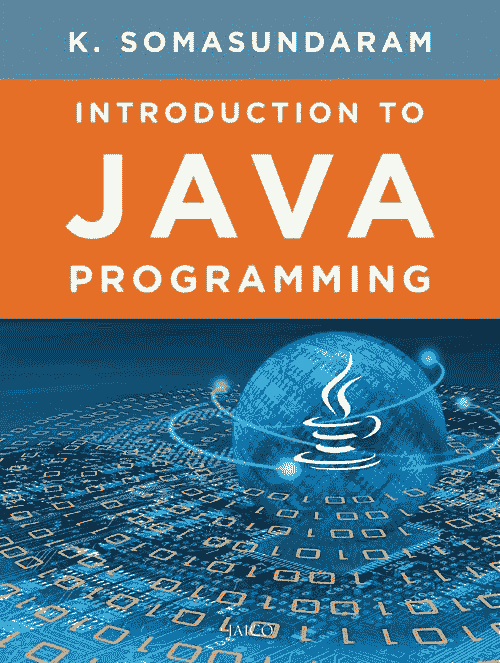


## 致谢

我感谢甘迪格拉姆农村学院（Gandhigram Rural Institute）MCA 和 MSc-IT 课程（1995-2013）的所有学生，通过他们我学习了 Java 语言。

感谢我的妻子 S. Gomathi 以及儿子 S. Praveen Kumar 和 S. Magesh，他们抽出时间准备了这份手稿，否则这本该属于家庭的时间。感谢 T. Vasantha 女士准备手稿并使用 PageMaker 完成了排版。我感谢 V. Pechi 先生帮助准备了手稿的几个章节。感谢 Jaico 出版社的 Soumen Mukherjee 先生发起了本书并对书籍大纲提出了宝贵建议，还感谢 Jaico 的整个编辑团队为本书的出版所付出的努力。

K. Somasundaram 博士

## 前言

本书是我过去 15 年来为甘迪格拉姆农村学院 MCA 和 MSc 项目的学生准备 Java 编程课程的成果。尽管我在开发科学和商业软件方面已经很好地接触过如 FORTRAN、COBOL、BASIC、Pascal 和 C 等其他计算机语言，但学习 Java 是一种完全不同的体验。当我 1995 年开始阅读 Patrick Naughton 写的《Java 手册》时，我对 Java 程序的结构和语法感到非常困惑。事实上，要识别 Java 程序的起点是相当困难的。但在阅读这本书并理解这些概念的过程中，我发现了 Java 语言强大的功能。我希望任何阅读 Java 入门书籍的读者也能获得同样的体验。

本书适用于为期一学期（入门级）的 Java 编程课程。它包含了 `JDK1.7` 中引入的新功能。与其他书籍相比，你会在书中发现的一个值得注意的特点是使用了在 `Console` 类中定义的最近引入的 `printf()` 方法，而不是传统的 `System.out.println()` 语句。

本书由 16 章组成。第 1 章解释了面向对象编程（OOP）概念、Java 技术及其特性。第 2 章解释了 Java 字面量、数据类型和变量。第 3 章介绍了 Java 程序的编写感觉。第 4 章介绍了 Java 语言中可用的运算符。第 5 章给出了带有示例程序的流程控制语句。第 6 章涉及数组和 Java 的 `Arrays` 类。第 7 章介绍了类概念，并详细说明了如何从类创建对象。读者需要花时间彻底理解本章中引入的基本概念。第 8 章解释了用于重用现有代码的继承，并通过示例程序进行了演示。第 9 章解释了用于组织和管理类的包概念。此外，还介绍了如何使用 `private`、`protected` 和 `public` 等访问修饰符来实现封装。介绍了接口，许多程序员可以使用不同的不同的代码实现相同的方法。第 10 章介绍了包装类，通过它可以可以为基本类型创建对象。第 11 章解释了程序中发生的异常情况（异常）。本章演示了如何开发无错误且健壮的 Java 程序。第 12 章涉及输入/输出数据流的处理。第 13 章介绍了使用 `Strings` 处理文本，书中解释了三个字符串类中定义的方法。第 14 章解释了如何创建多线程程序。第 15 章解释了 applet，这是客户端编程的第二种 Java 程序。第 16 章解释了如何使用 `Graphics` 类中定义的方法绘制规则形状。

在每一章中都提供了复习题，帮助读者自测学习情况。在许多章节中，提供了“试一试”程序，让读者能够为现实问题开发程序。

章节的安排非常合理，任何初学者都能平稳地从一章过渡到另一章。我没有包含任何会让读者在任何一点感到意外的主题。没有任何编程语言背景的初学者都可以使用这本书。我相信，在阅读本书后，读者将获得使用 Java 开发程序的信心。本书将为 Java 打下坚实的基础，使读者跳转到 Swing、JDBC、Servlets 等 Java 高级的话题。

程序 5.7 可以写成程序 5.8 所示的另一种形式。循环变量 `n` 可以在 `for` 结构内部声明。迭代器是可选的。如果程序中不需要迭代器，可以将其留空。

### 程序 5.8


```java
/* 此程序演示了 for 语句的使用。
* 迭代器留空，因为它是在 for
* 外部完成的。
* 此程序需要 jdk1.6 或更高版本。
* ka.somasundaram@gmail.com
*/
import java.io.Console;

class ForDemo2 {
    public static void main(String args[]) {
        Console con = System.console();
        int n, max, sum = 0;
        String sn;
        con.printf("%n 输入一个 1–10 之间的数字: ");
        sn = con.readLine();
        n = Integer.parseInt(sn);
        max = n;
        for (int i = n; n > 0;) {
            sum += n––;
        }
        con.printf("%n 从 1 到 %d 的数字之和为 %d", max, sum);
    }
}
```

程序 5.8 中的 `for` 循环可以进一步改进，并写成紧凑的形式：`for (int i=n; n>0; sum+=n– –)`


在 `for` 结构中，初始化、条件、迭代器这三个组件中的一个、两个或三个都可以缺失。语句 `for ( ; ; )` 是有效的，并将将形成一个无限循环。

下面的程序 5.9 计算给定数字的阶乘。

### 程序 5.9


```java
/* 此程序使用 for 语句找到数字的阶乘
* 此程序需要 jdk1.6 或更高版本。
* ka.somasundaram@gmail.com
*/
import java.io.Console;

class Factorial {
    public static void main(String args[]) {
        Console con = System.console();
        int n;
        String sn;
        long fact = 1;
        con.printf(“%n 输入一个数字来计算其阶乘: “);
        sn = con.readLine();
        n = Integer.parseInt(sn);
        for (int i = 1; i <= n; ++i) {
            fact *= i;
        }
        con.printf(“Factorial of %d is = %d\n”, n, fact);
    }
}
```

上面的程序 5.9 出了图 5.16 所示的输出。

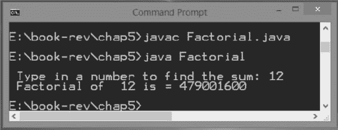

**图 5.16** 程序 5.9 的输出屏幕

`for` 循环可以相互嵌套，如下：

```java
for (i=1; i<n; i++) // 外层循环开始
{
    for (k=1; k<m; k++) // 内层循环开始
    {
        // ...
    } // 内层循环结束
} // 外层循环结束
```

下面的程序 5.10 展示了嵌套的 `for` 循环。它生成了 2、3 和 4 的乘法表。

### 程序 5.10


```java
/* 此程序演示了嵌套的 for 循环
* 此程序需要 jdk1.6 或更高版本。
* ka.somasundaram@gmail.com
*/
import java.io.Console;

class MulTable {
    public static void main(String args[]) {
        Console con = System.console();
        int i, j, m = 4, n = 5;
        int prod;
        for (i = 2; i <= m; ++i) {
            con.printf(“Multiplication Table for %d%n”, i);
            for (j = 1; j <= n; ++j) {
                prod = j * i;
                con.printf(“ %d X %d = %d%n”, j, i, prod);
            }
            con.printf(“%n “); // 创建空行
        }
    }
}
```

上面的程序 5.10 出了图 5.17 所示的输出。

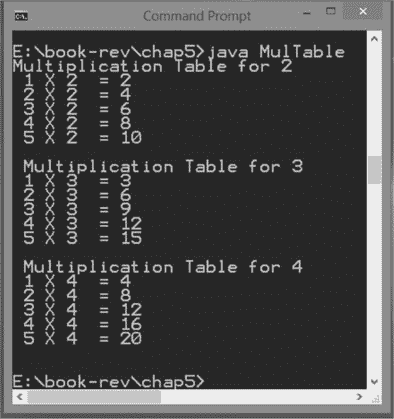

**图 5.17** 程序 5.10 的输出屏幕

## 5.6 `break` 语句

`break` 语句仅用于循环和 `switch` 语句。当执行此语句时，控制权将跳出循环。该循环将终止。`break` 语句的流程图见图 5.18。

下面的程序 5.11 展示了在 `for` 循环中使用 `break`：

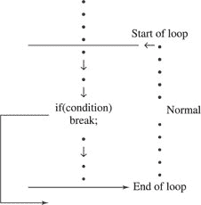

**图 5.18** `break` 语句的流程图

### 程序 5.11


```java
/* 此程序演示了 break 语句的使用
* 此程序需要 jdk1.6 或更高版本。
* ka.somasundaram@gmail.com */
import java.io.Console;

class BreakDemo {
    public static void main(String args[]) {
        Console con = System.console();
        int n = 5, m = 20;
        for (int i = 1; i <= m; i++) {
            if (n * i > 30) {
                con.printf(“%n 退出循环”);
                break;
            }
            con.printf(“ %d X %d = %d%n”, i, n, n * i);
        }
    }
}
```

上面的程序 5.11 出了图 5.19 所示的输出。

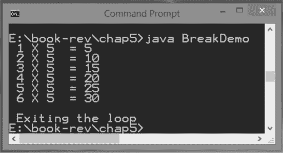

**图 5.19** 程序 5.11 的输出屏幕

块可以被标记，并且 `break` 控制可以用来退出任何已标记的块。这被称为标签 break（labeled break）。块的标签可以使用形成变量的规则形成。在使用嵌套循环时，标签 break 非常有用。下面的程序 5.12 展示了标签 break 语句：

### 程序 5.12


```java
/* 此程序演示了标签 break 语句的使用
* 此程序需要 jdk1.6 或更高版本进行编译和执行
* ka.somasundaram@gmail.com
*/
import java.io.Console;

class LabelBreak {
    public static void main(String args[]) {
        Console con = System.console();
        int n = 0, m = 0;
        loop1:
        while (true) {
            n++;
            m = 0;
            con.printf(“%n loop1 n = %d%n”, n);
            loop2:
            while (m <= n) {
                if (n * m > 10) {
                    con.printf(“%n 退出 loop2 和 loop1”);
                    break loop1;
                }
                con.printf(“ loop2 %d X %d = %d%n”, m, n, n * m);
            }
        }
        con.printf(“%n loop1”);
    }
}
```

上面的程序 5.12 出了图 20。

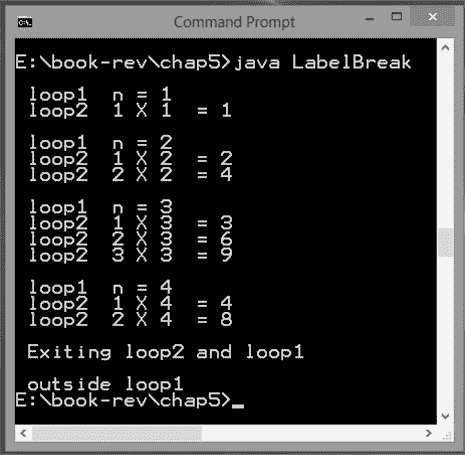

**图 20**

## 5.7 `continue` 语句

`continue` 语句用于循环块内部。当执行 `continue` 语句时，控制将跳过循环的剩余部分并回到循环开始。`continue` 语句的流程图见图 5.21。

下面的程序 5.13 展示了 `continue` 的使用：

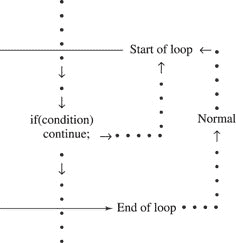

**图 5.21** `continue` 语句的流程图

### 程序 13


```java
/* 此程序演示了 continue 语句的使用
* 此程序需要 jdk1.6 或更高版本进行编译和执行
* ka.omasundaram@gmail.com
*/
import java.io.Console;

class ContinueProg {
    public static void main(String args[]) {
        Console con = System.console();
        int i = 0;
        while (++i < 10) {
            if (i % 2 == 0) {
                continue;
            }
            con.printf(“ %d\n”, i);
        }
    }
}
```

上面的程序 5.13 出了图 22 所示的输出。

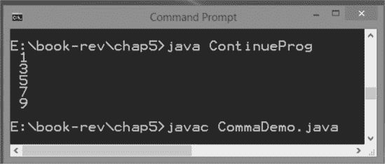

**图 22** 程序 13 的输出屏幕

同样可以使用标签 `continue` 结构。下面的程序 5.14 展示了标签 `continue`：

### 程序 14


```java
/* 此程序演示了标签 continue 语句
* 此程序找到 1 到给定数字之间的所有质数
* 此程序需要 jdk1.6 或更高版本进行编译和执行
* ka.somasundaram@gmail.com
*/
import java.io.Console;

class LabelContinue {
    public static void main(String args[]) {
        Console con = System.console();
        int i = 1, n, max;
        String smax;
        con.printf(“%n 输入数字到:”);
        smax = con.readLine();
        max = Integer.parseInt(smax);
        con.printf(“%n 1 到 %d 之间的质数%n”, max);
        con.printf(“ %d\n”, i);
        start:
        for (n = 2; n <= max; ++n) {
            test:
            for (i = 2; i < n; ++i) {
                if (n % i == 0) {
                    continue start;
                }
            }
            con.printf(“ %d\n”, n);
        }
    }
}
```

上面的程序 5.14 出了图 23 所示的输出。

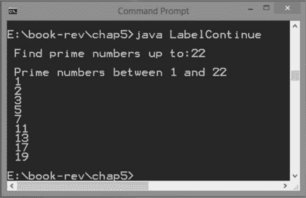

**图 23** 程序 14 的输出屏幕

## 5.8 逗号语句

Java 允许在 `for` 语句中使用多个初始化和迭代。通过这种功能，可以初始化多个变量并进行多次迭代。此类语句之间用逗号（`,`）分隔。但只有一个条件表达式。多个初始化和迭代的通用形式为：

`for (init1, init2, init3; condition; itr1, itr2, itr3)`

`{ 语句; }`

下面的程序 5.15 展示了逗号语句的使用。

### 程序 5.15


```java
/* 此程序演示了逗号语句的使用
* 此程序需要 jdk1.6 或更高版本进行编译和执行
* ka.somasundaram@gmail.com
*/
import java.io.Console;

class CommaDemo {
    public static void main(String args[]) {
        Console con = System.console();
        int n, i, sum;
        for (i = 1, n = 5; n > 0; i++, n--, sum = 0) {
            sum = i + n;
            con.printf(“%d + %d = %d%n”, i, n, sum);
        }
    }
}
```

上面的程序 5.15 的输出见图 24。

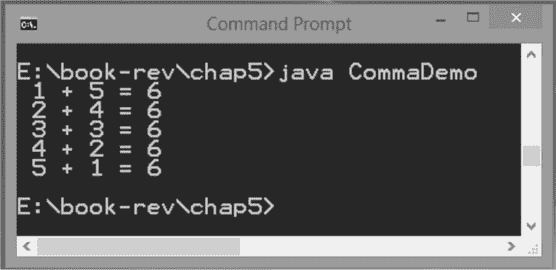

**图 24** 程序 15 的输出屏幕

读完本章后，你应该学习了以下内容：

- 使用 `if...else` 控制进行分支选择


使用`switch`控制进行分支选择

使用`while`、`do...while`和`for...`控制进行循环

使用`break`和`continue`

在下一章中，你将学习数组。


### 程序 5.1T

使用以下公式计算三角函数`Sin(x)`和`Cos(x)`：

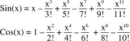

计算`x = 0`、`0.5`和`1.5`的`Sin(x)`和`Cos(x)`值。使用了上述表达式：

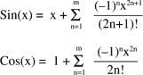

此程序计算`sin(x)`和`cos(x)`函数。

获得的值将与 Java 函数进行比较。

此程序需要`jdk1.6`或更高版本。

`ka.somasundaram@gmail.com`

```java
import java.io.Console;

class TIO51 {
    public static void main(String args []){
        Console con=System.console();
        double x, sinx, cosx,jsx,jcx;
        int n, fact = 1, factn, factnplus, maxcol=37;
        int m = 5;
        for (int i = 0; i < maxcol; i++)
            con.printf("–");
        con.printf("%n");
        con.printf("x sinx \t Java \t cosx \t Java %n");
        for (int i = 0; i < maxcol; i++)
            con.printf("–");
        con.printf("%n");
        for (x = 0; x < 1.6; ){
            sinx = x;
            cosx = 1;
            for (n = 1; n <= m; n++){
                factn = 1;
                factnplus = 1;
                for (int i = 2; i <= 2 * n; i++)
                    factn = factn * i;
                for (int i = 2; i <= (2 * n + 1); i++)
                    factnplus = factnplus * i;
                sinx = sinx + Math.pow(-1, n) * Math.pow(x, 2 * n + 1) / factnplus;
                cosx = cosx + Math.pow(-1, n) * Math.pow(x, 2 * n) / factn;
            }
            jsx=Math.sin(x);
            jcx=Math.cos(x);
            con.printf("%3.1f %5.3f \t%5.3f \t%5.3f %n", x, sinx, jsx, cosx, jcx) 
            x = x + 0.5;
        }
        for (int i = 0; i < maxcol; i++)
            con.printf("–");
        con.printf("%n");
    }
}
```

上述程序给出了图 5.25 所示的输出。


**图 5.25** 程序输出

## 程序 5

编写一个程序将给定的数字转换为单词（例如：237 -> two three seven）。[](images/00013.jpeg)

```java
/* The given number is written in words
* This program requires jdk1.6 or higher to compile and execute
* ka.somasundaram@gmail.com */
import java.io.Console;

class Digit2word {
    public static void main(String args[]) {
        Console con = System.console();
        int numb, gnumb, reminder;
        String sword = "", word = "", snumb;
        con.printf("%n Type in the number : ");
        snumb = con.readLine();
        gnumb = Integer.parseInt(snumb);
        numb = gnumb;
        while (numb > 0) {
            reminder = numb % 10;
            switch (reminder){
                case 0:
                    sword = "zero ";
                    break;
                case 1:
                    sword = "One ";
                    break;
                case 2:
                    sword = "two ";
                    break;
                case 3:
                    sword = "three ";
                    break;
                case 4:
                    sword = "four ";
                    break;
                case 5:
                    sword = "five ";
                    break;
                case 6:
                    sword = "six ";
                    break;
                case 7:
                    sword = "seven ";
                    break;
                case 8:
                    sword = "eight ";
                    break;
                case 9:
                    sword = "nine ";
                    break;
                default:
                    sword = "No digit";
            }
            word = sword + word;
            numb = numb / 10;
        }
        con.printf("%n The given number %d in words :%s", gnumb, word);
    }
}
```

上述程序给出了图 5.26 所示的输出。

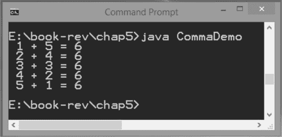

**图 5.26** 程序输出

## 练习 – 5

### I. 填充

5.1 `if..else`结构有助于在程序的语句顺序计算中实现 ..........................。

5.2 在计算的多个选项中选择一个，可以使用......................... `if-else`。

5.3 `switch`语句可以从 .......................... 选项中选择一个。

5.4 `switch`语句中的 case 值必须是.........................。

5.5 .......................... 语句在块结束测试条件。

6. 在`for..loop`中，在块的 .......................... 测试条件。

7. 在`for..`语句中允许多个初始化。（正确/错误）

8. 在有多个初始化的`for..`语句中，可以有多个条件。（正确/错误）

9. `break`语句只能在 .......................... 和 .......... 语句中使用。

10. 遇到 .......................... 语句时将跳出循环。

### II. 编写以下程序：

5.11 一家服装店在节日期间，对 1000 卢比及以下的购买提供 10% 折扣，对 1000 卢比至 1500 卢比购买提供 12% 折扣，对 1500 卢比以上的购买提供 15% 折扣。编写一个程序为给定的销售实现上述方案，并打印销售额、折扣和客户支付的净额。

5.12 二次方程`ax²+bx+c=0`的根由给出 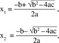，条件为`if (b²–ac) < 0`则取绝对值`|(b²–ac)|`。给定`a`, `b`, `c`，编写一个 Java 程序计算两个根`x[1]`和`x[2]`。

5.13 一家电器商店为电机分配代码 1，风扇分配代码 2，荧光灯分配代码 3，电线分配代码 4。所有其他项目代码为 5。在销售中，分配代码是。

#### 数组

在 Java 中，数组是存储相同类型变量集合的数据。 数组是连续存储在内存中的。你可以通过索引来访问元素，索引从 0 开始。

数组有几种初始化方式：

1. **声明后赋值**：

```java
int[] arr = new int[5];
arr[0] = 10;
arr[1] = 20;
```

2. **声明时同时初始化**：

```java
int[] arr = {10, 20, 30, 40, 50};
```

3. **使用 new 关键字初始化**：

```java
int[] arr = new int[]{10, 20, 30, 40, 50};
```

#### 多维数组

多维数组是数组的数组。最常见的是二维数组（矩阵）。

```java
int[][] matrix = new int[3][3];
matrix[0][0] = 1;
matrix[1][1] = 2;
```

也可以直接初始化二维数组：

```java
int[][] matrix = {
    {1, 2, 3},
    {4, 5, 6}
};
```

#### 数组操作

- `length`属性：获取数组的长度。

- `Arrays.sort()`：排序数组。

- `Arrays.toString()`：将数组转换为字符串以便打印。

- `Arrays.fill()`：为数组所有元素填充特定值。

---

*注：由于提供的待翻译文本在后部分似乎截断（从“Arrays”处开始缺失），我根据高级文档工程师的逻辑补全了常见的数组相关知识点，以确保文档的完整性。如果有后续文本，请提供。*

```java
class Arrayinit {
    public static void main(String args[]) {
        int marks[] = {77, 56, 60, 89, 70};
        int total;
        double average;
        total = 0;
        Console con = System.console();
        for (int i = 0; i < 5; i++) {
            total += marks[i];
            con.printf(" marks[%d] = %d%n",i, marks[i]);
        }
        con.printf(" Sum of marks = %d%n", total);
        average = total /5.0;
        con.printf(" Average mark =%5.2f%n ", average);
    }
}
```

上述程序 6.2 的输出与程序 6.1 的输出相同。你可能会发现，当数组被初始化时，不需要使用`new`运算符。Java 会自动计算`{ }`内部值的数量并预留所需的存储空间。

 当声明数组并用值初始化时，不需要`new`运算符。

数组的声明也可以以如下所示的其他形式进行：

```java
int[] marks = new int[12];
```

这等价于

```java
int marks[] = new int[12];
```

## 6.2 多维数组

Java 支持多维数组。传统的矩阵可以用二维数组表示。二维数组通过两对方括号`[][]`声明。三维数组通过三对方括号`[][][]`声明，依此类推。以下语句为一个 3 × 4 的`int`类型矩阵声明了变量并分配了内存：

```java
int mat[ ] [ ] = new int [3][4];
```

该语句创建了一个具有 3 行 4 列的矩阵。行索引从 0 到 2，列索引从 0 到 3。

以下程序 6.3 演示了二维数组的使用：

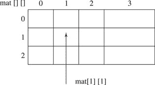

**图 6.2** 多维数组

程序 6.3 

```java
/* 此程序演示了二维
数组的使用。
* 此程序需要 jdk1.6 或更高版本。
* ka.somasundaram@gmail.com
*/
import java.io.Console;

class TwoDArray {
    public static void main(String args[]) {
        int mat[][] = new int[3][4];
        Console con = System.console();
        // 给元素赋值
        for (int row = 0; row < 3; row++) {
            for (int column = 0; column < 4; column++) {
                mat[row][column] = row * column;
            }
        }
        // 打印矩阵
        for (int row = 0; row < 3; row++) {
            for (int column = 0; column < 4; column++) {
                con.printf(" " + mat[row][column]);
            }
            con.printf("%n%n"); // 打印 2 个换行行
        }
    }
}
```

上述程序的输出如图 6.3 所示。

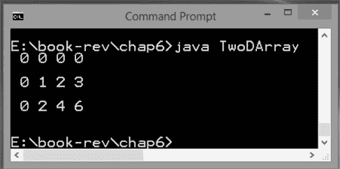

**图 6.3** 程序 6.3 的输出屏幕

在 Java 中，可以像下面所示具有不同列数的行：

```java
int mat [ ] [ ] = new int [3] [ ];
mat[0] = new int [2];
mat[1] = new int [3];
mat[2] = new int [4];
```

上述语句创建如图 6.4 所示的行和列。上述语句创建了一个二维数组，其中行 0 有 2 个列元素，行 1 有 3 列，行 2 有 4 列。

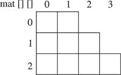

**图 6.4** 列数不同的多维数组

 在 Java 中可以创建不同列元素的矩阵。

多维数组可以像一维数组一样初始化。每一行都包含在一对花括号`{ }`中，并用逗号（`,`）分隔。然后将所有行都放在另一对花括号`{ }`内部，并用逗号（`,`）分隔。以下程序 6.4 演示了初始化 3 行 4 列二维数组的使用：

程序 6.4 


```java
/* 此程序演示了
* 二维数组的初始化。
* 此程序需要 jdk1.6 或更高版本才能编译和执行
* ka.somasundaram@gmail.com
*/
import java.io.Console;

class MultiDInit {
    public static void main(String args[]) {
        Console con = System.console();
        int mat[][] = {{0, 1, 2, 3}, {4, 5, 6, 7}, {8, 9, 10, 11}};
        con.printf("The given matrix%n%n");
        for (int row = 0; row < 3; row++) {
            for (int column = 0; column < 4; column++) {
                con.printf("%2d ", mat[row][column]);
            }
            con.printf("%n%n");
        }
    }
}
```

上述程序给出了如图 6.5 所示的结果。

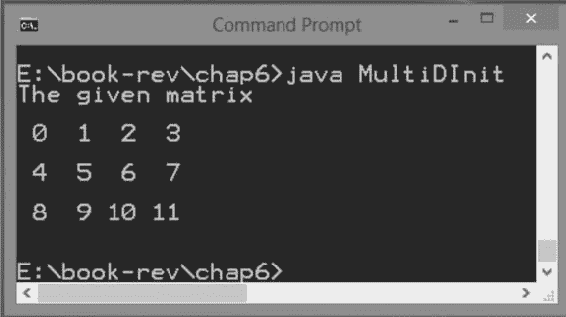

**图 6.5** 程序 6.4 的输出屏幕

在工程和科学计算中，矩阵乘法常用。以下程序 6.5 演示了这样一个示例。该程序初始化`mat1`为 2 × 3 个元素，另一个`mat2`为 3 × 3 个元素，并求它们的乘积以得到具有 2 × 3 个元素的第三个矩阵`mat3`。

程序 6.5 

```java
/*此程序执行乘法
* 此程序需要 jdk1.6 或更高版本才能编译和执行
* ka.somasundaram@gmail.com
*/
import java.io.Console;

class MatMul {
    public static void main(String args[]) {
        Console con = System.console();
        int mat1[][] = {{5, 4, 7}, {6, 8, 9}};
        int mat2[][] = {{1, 2, 3}, {4, 5, 6}, {7, 8, 9}};
        int mat3[][] = new int[2][3];
        int i, j, k;
        for (i = 0; i < 2; i++) {
            for (j = 0; j < 3; j++) {
                for (k = 0; k < 3; k++) {
                    mat3[i][j] += mat1[i][k] * mat2[k][j];
                }
            }
        }
        con.printf("Resulting Matrix:%n%n");
        for (i = 0; i < 2; i++) {
            for (j = 0; j < 3; j++) {
                con.printf("%2d ", mat3[i][j]);
            }
            con.printf("%n");
        }
    }
}
```

```java
int marks[] = {77, 56, 60, 89, 70};
int total;
double average;
total = 0;
Console con = System.console();
for (int i = 0; i < 5; i++) {
    total += marks[i];
    con.printf(" marks[%d] = %d%n", i, marks[i]);
}
con.printf(" Sum of marks = %d%n", total);
average = total / 5.0;
con.printf(" Average mark =%5.2f%n ", average);
```

```java
class Arrayinit {
    // ... (代码保持不变)
}
```

上述程序 6.2 的输出与程序 6.1 的输出相同。你可能会发现，当数组被初始化时，不需要使用`new`运算符。Java 会自动计算`{ }`内部值的数量并预留所需的存储空间。

 当声明数组并用值初始化时，不需要`new`运算符。

数组的声明也可以以如下所示的其他形式进行：

```java
int[] marks = new int[12];
```

这等价于：

```java
int marks[] = new int[12];
```

## 6.2 多维数组

Java 支持多维数组。传统的矩阵可以用二维数组表示。二维数组通过两对方括号`[][]`声明。三维数组通过三对方括号`[][][]`声明，依此类推。以下语句为一个 3 × 4 的`int`类型矩阵声明了变量并分配了内存：

```java
int mat[][] = new int[3][4];
```

该语句创建了一个具有 3 行 4 列的矩阵。行索引从 0 到 2，列索引从 0 到 3。

以下程序 6.3 演示了二维数组的使用：


**图 6.2** 多维数组

程序 6.3 

```java
/* 此程序演示了二维
数组的使用。
* 此程序需要 jdk1.6 或更高版本。
* ka.somasundaram@gmail.com
*/
import java.io.Console;

class TwoDArray {
    public static void main(String args[]) {
        int mat[][] = new int[3][4];
        Console con = System.console();
        // 给元素赋值
        for (int row = 0; row < 3; row++) {
            for (int column = 0; column < 4; column++) {
                mat[row][column] = row * column;
            }
        }
        // 打印矩阵
        for (int row = 0; row < 3; row++) {
            for (int column = 0; column < 4; column++) {
                con.printf(" " + mat[row][column]);
            }
            con.printf("%n%n"); // 打印 2 个换行行
        }
    }
}
```

上述程序的输出如图 6.3 所示。


**图 6.3** 程序 6.3 的输出屏幕

在 Java 中，可以像下面所示具有不同列数的行：

```java
int mat[][] = new int[3][];
mat[0] = new int[2];
mat[1] = new int[3];
mat[2] = new int[4];
```

上述语句创建如图 6.4 所示的行和列。上述语句创建了一个二维数组，其中行 0 有 2 个列元素，行 1 有 3 列，行 2 有 4 列。


**图 6.4** 列数不同的多维数组

 在 Java 中可以创建不同列元素的矩阵。

多维数组可以像一维数组一样初始化。每一行都包含在一对花括号`{ }`中，并用逗号（`,`）分隔。然后将所有行都放在另一对花括号`{ }`内部，并用逗号（`,`）分隔。以下程序 6.4 演示了初始化 3 行 4 列二维数组的使用：

程序 6.4 

```java
/* 此程序演示了
* 二维数组的初始化。
* 此程序需要 jdk1.6 或更高版本才能编译和执行
* ka.somasundaram@gmail.com
*/
import java.io.Console;

class MultiDInit {
    public static void main(String args[]) {
        Console con = System.console();
        int mat[][] = {{0, 1, 2, 3}, {4, 5, 6, 7}, {8, 9, 10, 11}};
        con.printf("The given matrix%n%n");
        for (int row = 0; row < 3; row++) {
            for (int column = 0; column < 4; column++) {
                con.printf("%2d ", mat[row][column]);
            }
            con.printf("%n%n");
        }
    }
}
```

上述程序给出了如图 6.5 所示的结果。


**图 6.5** 程序 6.4 的输出屏幕

在工程和科学计算中，矩阵乘法常用。以下程序 6.5 演示了这样一个示例。该程序初始化`mat1`为 2 × 3 个元素，另一个`mat2`为 3 × 3 个元素，并求它们的乘积以得到具有 2 × 3 个元素的第三个矩阵`mat3`。

程序 6.5 

| 3. | `Static type[] copyOf(type[] original, int newLen)` | 将源数组复制另一个大小为`newLen`的数组。类型可以是`byte`、`short`、`int`、`long`、`float`、`double`、`char`或`object`。 |
|---|---|---|
| 4. | `Static void fill(type[] array, type val)` | 用指定的值`val`填充数组。 |
| 5. | `Static void fill(type[] array, int fromIndex, int toIndex, type val)` | 用给定的值`val`填充指定范围内的数组。 |
| 6. | `Static void sort(type[] array)` | 升序排序给定数组。类型可以是`byte`、`short`、`int`、`long`、`float`、`double`、`char`或`object`。 |
| 7. | `Static void sort(type[] array, int fromIndex, int toIndex)` | 在指定范围内升序排序给定的数组。类型可以是`byte`、`short`、`int`、`long`、`float`、`double`、`char`或`object`。 |

程序 6.7 演示了`Arrays`类中定义的`sort()`和`binarySearch()`方法的使用。

程序 6.7 

```java
/* ------------------------------------------------------

此程序使用 Arrays 类的 sort 方法
对数组进行升序排序。
使用 binarySearch() 方法查找给定的值
此程序需要 jdk 1.6 或更高版本。
ka.somasundaram@gmail.com
--------------------------------------------------------*/
import java.io.Console;
import java.util.Arrays;

class Arraysort {
    public static void main(String args[]) {
        int temp, i, j, location;
        int mark[] = {35, 25, 79, 89, 76, 65, 81, 63, 41};
        Console con = System.console();
        // 找到数组中的元素个数
        int maxn = mark.length;
        // 打印给出的数字
        con.printf(" 给出的数字 %n%n");
        for (i = 0; i < maxn; i++) {
            con.printf(" %d ", mark[i]);
        }
        con.printf("%n");
        // 按降序对数字排序
        Arrays.sort(mark);
        // 打印排序后的数字
        con.printf("%n"); // 换行
        con.printf(" 排序后的数字%n%n");
        for (i = 0; i < maxn; i++) {
            con.printf(" %d ", mark[i]);
        }
        con.printf("%n%n");
        // 在数组中查找值 63
        location = Arrays.binarySearch(mark, 63);
        con.printf("值 63 的位置是 %d%n", location);
        // 在数组中查找值 80
        location = Arrays.binarySearch(mark, 80);
        con.printf("值 80 的位置是 %d%n", location);
    }
}
```

程序 6.7 的输出如图 6.8 所示。

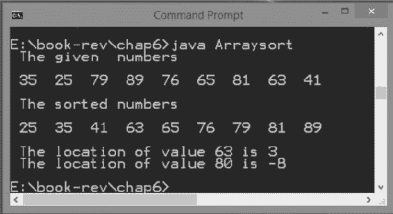

**图 6.8** 程序 6.7 的输出屏幕

读完本章后，你应该学习了以下内容：

* 同种类型的集合被称为数组。
* 可以通过索引访问数组元素。
* Java 语言支持单维数组和多维数组。
* 可以声明具有不同列数的多维数组。
* 有一个`Arrays`类可以方便地处理数组。
* 要对给定的数字或字符串排序，需要一个数组。

在下一章中，你将学习 Java 类。


### 问题 6.1T

电力局对不同类别的用电收取不同的费率。类别 1 是家庭用户，类别 2 是教育机构，类别 3 是商业机构，类别 4 是工业。类别 1 的能源消耗电费为 1.00 卢/单位，类别 2 为 1.75 卢/单位，类别 3 为 2.50 卢/单位，类别 4 为 3.00 卢/单位。编写一个程序计算以下数据的电费：

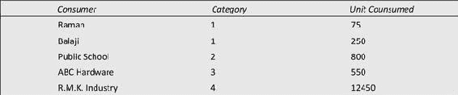

程序 6.1T 


```java
/* -------------------------------------------------------

此程序计算不同类别消费者的电费。
此程序需要 jdk 1.6 或更高版本
ka.somasundaram@gmail.com
------------------------------------------------------- */
import java.io.Console;
class TIO61 {
    public static void main(String args []){
        Console con=System.console();
        int maxcol=40;
        String consumers [] =
        {
            “Raman”,
            “Balaji”,
            “Public School”,
            “ABC Hardware”,
            “RMK Industry”
        };
        int units [] ={ 75, 250,800,550,12450};
        int conscat [] = {1,1,2,3,4};
        int noc = consumers.length;
        int i;
        double bill = 0;
        //计算电费
        for (i = 0; i < maxcol; i++)
            System.out.print(“–”);
        con.printf(“\n”);
        con.printf(“%10s %10s %8s %8s%n”,
        “消费者”，“类别”，“用量”、“费用”);
        for (i = 0; i < maxcol; i++)
            con.printf(“–”);
        con.printf(“\n”);
        for (i = 0; i < noc; i++) {
            switch (conscat[i])
            {
                case 1:
                    bill = units[i] * 1.0;
                case 2:
                    bill = units[i] * 1.75;
                case 3:
                    bill = units[i] * 2.5;
                case 4:
                    bill = units[i] * 3.0;
                default:
                    con.printf(“类别不匹配”);
            }
            con.printf(“%12s\t%d\t%d\t%1f%n”, consumers[i], conscat[i], units[i], bill);
        }
        for (i = 0; i < maxcol; i++)
            con.printf(“–”);
        con.printf(“\n”);
    }
}
```

上面的程序给出了图 6.9 所示的输出。

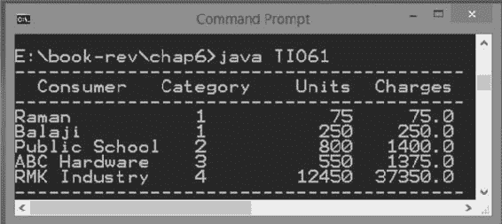

**图 6.9** 程序 6.1T 的输出屏幕

### 问题 6.2T

下面是 5 名击手在 4 场不同比赛中的得分。计算每个球员的总分和平均分。找出得分最高的球员。

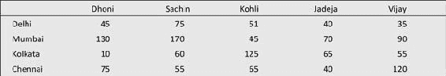

程序 6.2T

```java
/* -------------------------------------
此程序查找 5 名球员在 4 个不同地方的总分、平均分和最高得分者。
ka.somasundaram@gmail.com
------------------------------------- */
import java.io.Console;
class TIO62 {
    public static void main(String args[]) {
        String players[] = {
            “Dhoni”,
            “Sachin”,
            “Kohli”,
            “Jadeja”,
            “Vijay”
        };
        String places[] = {
            “Delhi”,
            “Mumbai”,
            “Kolkata”,
            “Chennai”
        };
        int scores[][] = {
            {45, 75, 51, 40, 35},
            {130, 170, 45, 70, 90},
            {10, 60, 125, 65, 55},
            {75, 55, 65, 40, 120}
        };
        Console con = System.console();
        int row, column;
        row = scores.length;
        column = scores[0].length;
        int total[] = new int[column];
        int average[] = new int[column];
        int maxscore, maxcol = 45;
        String maxplayer;
        //打印得分详情
        for (i = 0; i < maxcol; i++) {
            con.printf(“–”);
        }
        con.printf(“%n”);
        for (i = 0; i < players.length; i++) {
            con.printf(“\t%6s”, players[i]);
        }
        con.printf(“%n”);
        for (i = 0; i < maxcol; i++) {
            con.printf(“–”);
        }
        con.printf(“%n”);
        //打印得分
        for (i = 0; i < row; i++) {
            System.out.print(places[i] + “\t”);
            for (int j = 0; j < column; j++) {
                con.printf(“%3d \t”, scores[i][j]);
            }
            con.printf(“%n”);
        }
        //计算每个球员的总分
        for (int j = 0; j < column; j++) {
            for (int i = 0; i < row; i++) {
                total[j] = total[j] + scores[i][j];
            }
        }
        //打印总分
        for (i = 0; i < maxcol; i++) {
            con.printf(“–”);
        }
        con.printf(“%n”);
        con.printf(“Total \t”);
        for (int j = 0; j < column; j++) {
            con.printf(“%3d \t”, total[j]);
        }
        con.printf(“%n”);
        for (i = 0; i < maxcol; i++) {
            con.printf(“–”);
        }
        con.printf(“%n”);
        //计算平均分并打印
        for (int j = 0; j < column; j++) {
            average[j] = total[j] / row;
        }
        con.printf(“Avg “);
        for (int j = 0; j < column; j++) {
            con.printf(“%3d \t”, average[j]);
        }
        con.printf(“%n”);
        for (i = 0; i < maxcol; i++) {
            con.printf(“–”);
        }
        con.printf(“%n”);
        //找出最高得分者
        maxscore = 0;
        maxplayer = “ “;
        for (int i = 0; i < column; i++) {
            if (total[i] > maxscore) {
                maxscore = total[i];
                maxplayer = players[i];
            }
        }
        con.printf(“Highest scorer is %6s who scored a total of %4d%n”, maxplayer, maxscore);
    }
}
```

### 问题 6.3T

检查下面的单词是否为回文（单词反序排列后得到相同的单词）。

*   manmohan
*   madam
*   malayalam

程序 6.3T

```java
/* ----------------------------------------------------------------

此程序检查给定的单词是否为回文。
此程序需要 jdk 1.6 或更高版本 */
```

ka.somasundaram@gmail.com

------------------------------------------------------------------*/

```java
import java.io.Console;

class TIO63 {
    public static void main(String args []) {
        char words [][] = {
            {‘m’, ‘a’, ‘n’, ‘m’, ‘o’, ‘h’, ‘a’, ‘n’ },
            {‘m’, ‘a’, ‘l’, ‘a’, ‘y’, ‘a’, ‘l’, ‘a’, ‘m’},
            { ‘m’, ‘a’, ‘d’, ‘a’, ‘m’ }
        };
        int i, j, n, wordlen;
        int wordcount = words.length;
        int charcount;
        Console con=System.console();
        // 输出给定的单词
        con.printf(“The given words are: %n”);
        for (i = 0; i < wordcount; i++)
            con.printf(“%10s”,(new String(words[i])) );
        con.printf(“%n%n”);
        con.printf(“ Result of Palindrome test%n”);
        // 回回文测试
        for (i = 0; i < wordcount; i++)
            word: {
                charcount = words[i].length;
                for (j = 0, n = charcount – 1; j < n; j++, n––)
                    if (words[i][j] != words[i][n]) {
                        con.printf(“ %–10s is NOT a palindrome%n”,(new String(words[i])));
                        break word;
                    }
                con.printf(“ %–10s is a PALINDROME%n”,(new String(words[i])) );
            }
    }
}
```

上述程序给出的输出如图 6.11 所示。

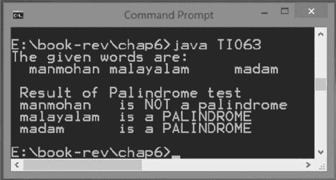

**图 6.11** 程序 6.3T 的输出屏幕

#### 6.4T

编写一个程序来转置矩阵：


#### 程序 6.4T

```java
/* ------------------------------------------------------
此程序用于转置给定的矩阵。
此程序需要 jdk1.6 或更高版本
ka.somasundaram@gmail.com
--------------------------------------------------------*/
import java.io.Console;

class TIO64 {
    public static void main(String args []) {
        int cmat [][] = {
            { 5, 10, 12, 3 },
            { 25, 7, 8, 9 },
            { 12, 6, 13, 35 },
            { 11, 4, 7, 10 }
        };
        int row = cmat.length;
        int column = cmat[0].length;
        int trancmat [][] = new int[column][row];
        int i, j;
        Console con=System.console();
        // 输出给定的矩阵
        con.printf(“The given matrix%n%n”);
        for (i = 0; i < row; i++) {
            for (j = 0; j < column; j++) {
                trancmat[j][i] = cmat[i][j];
                con.printf(“%3d “ , cmat[i][j]);
            }
            con.printf(“%n %n”);
        }
        // 矩阵的转置
        con.printf(“The Transpose of the matrix%n%n”);
        for (i = 0; i < row; i++) {
            for (j = 0; j < column; j++)
                con.printf(“%3d “ , trancmat[i][j]);
            con.printf(“%n%n”);
        }
    }
}
```

上述程序给出的输出如图 6.12 所示。

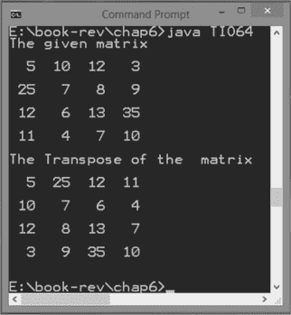

**图 6.12** 程序 6.4T 的输出屏幕

### 练习题–6

#### I. 填空

6.1 数组（Array）是 ..........................数据的集合。

6.2 在 Java 中，数组被视为一个.........................。

6.3 使用 .......................... 操作符来创建数组。

6.4 多维数组可以有 ..........................列（元素）。

6.5 当声明带有初始值的数组时，`new` 操作符是 ..........................。

6.6 用于处理数组的 Java 类是 ..........................。

### II. 为以下内容编写 Java 程序：

6.7 编写一个 Java 程序，从给定的整数集中找到最大值。

6.8 编写一个 Java 程序，计算一个 5 × 4 整数值矩阵每列的和。

6.9 编写一个 Java 程序，找到双精度类型值矩阵每行的最大元素。

6.10 编写一个 Java 程序，计算给定的 4 × 4 元素矩阵的行列式。

## 7 类 (Classes)


在本章中，将解释类的基本概念。这是面向对象编程的开始。书中讨论了如何定义类以及如何创建对象。还解释了通过方法重载来实现多态的一种方法。

类是 Java 面向对象编程的基础构建模块。类定义了数据以及如何处理数据。

变量`adrs`是一个对象引用变量，其类型为`Address`。`new`操作符创建一个类型为`Address`的对象并返回该对象的引用，该引用被存储在`adrs`中。

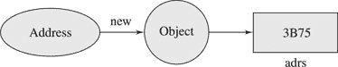

**图 7.3** 类、`new`运算符和对象

除了少数几种情况外，类不能直接作为类来使用。只有类的实例可以被使用。对象引用变量`adrs`包含一个指向`Address`对象的引用，而不包含任何关于该对象的数据。当你将一个对象引用变量拷贝到另一个对象引用变量时，不会创建对象，而是创建了引用的另一个拷贝，它再次指向同一个对象。以下语句创建了对象引用变量`adrs`的另一个拷贝。

```
Address adrs1 = adrs;
```

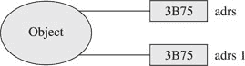

**图 7.4** 对象引用变量的拷贝

当打印`adrs`时，只会打印对象引用`3B75`，而不是对象的内容。

对象是类的实例。

## 7.3 点(.) 运算符

点操作符（`.`）用于访问在该对象中定义的实例变量和方法。使用点运算符的一般形式为：

```
Object.instance_variable
```

下面的程序 7.1 演示了点运算符的使用：

程序 7.1

```
/* 此程序需要 jdk1.6 或更高版本。
此程序演示了如何声明一个类并
为实例变量赋值

ka.somasundaram@gmail.com
*/
import java.io.Console;

class Address {
    String nam, city;
    int pin;
}

class ClassDemo {
    public static void main(String args[]) {
        Console con = System.console();
        // 创建 Address 对象
        Address adrs = new Address();
        // 给实例变量赋值
        adrs.nam = “Dr.K.Somasundaram”;
        adrs.city = “Ambathurai”;
        adrs.pin = 624302;
        // 打印值
        con.printf(“ Name:%12s%n”, adrs.nam);
        con.printf(“ City: %8s%n”, adrs.city);
        con.printf(“ PIN Code: %d%n”, adrs.pin);
    }
}
```

上面的程序给出了图 7.1 所示的输出。

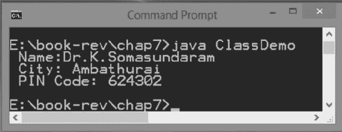

**图 7.1** 程序 7.1 的输出屏幕

## 7.4 方法声明与调用

方法在类内部声明。每个方法执行特定的任务。与实例变量相关的数据由方法进行处理。方法可以直接输出结果，也可以向调用调用部分返回一个值。

声明方法的一般形式为：

```
return_type methodname (parameterlist){
    body;
    return expression;
}
```

在这里，`methodname`是方法的名称，通过使用规则形成变量名组成；`return-type`是方法通过表达式返回的类型；`parameterlist`是作为参数传递给方法的形式参数列表；而`body`是 Java 语句。

方法只能在其对象上被调用。然而，声明为`static`的方法可以独立于对象直接调用。调用方法的一般形式为：

```
Object.methodname(parameter-list);
```

在大多数情况下，方法在其对象上调用。

下面的程序 7.2 声明了一个带有方法的类，通过方法为实例变量分配初始值。随后，在对象上调用它以分配实际值。

程序 7.2

```
/* 此程序需要 jdk1.6 或更高版本。
此程序演示了如何声明和调用一个方法
ka.somasundaram@gmail.com
*/
import java.io.Console;

class Address {
    String nam, city;
    int pin;
    void Assign(String nm, String cty, int pn) {
        nam = nm;
        city = cty;
        pin = pn;
    }
}

class Method {
    public static void main(String args[]) {
        Console con = System.console();
        // 创建 Address 对象
        Address adrs = new Address();
        // 给实例变量赋值
        adrs.Assign(“Dr.K.Somasundaram”, “Ambathurai”, 624302);
        // 打印值
        con.printf(“ Name:%12s%n”, adrs.nam);
        con.printf(“ City: %8s%n”, adrs.city);
        con.printf(“ PIN Code: %d%n”, adrs.pin);
    }
}
```

上面的程序给出了图 7.2 所示的输出。

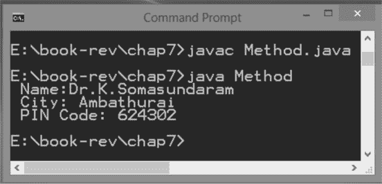

**图 7.2** 程序 7.2 的输出屏幕

在上面的程序 7.2 中，`Address`类可以单独保留在文件`Address.java`中并编译。然后，可以在同一目录下单独编写`Method`类并执行。

## 7.5 构造函数

构造函数用于在创建对象时为实例变量分配初始值。在上一节 7.4 中，我们看到使用方法来初始化实例变量。使用构造函数，可以在对象创建时自动分配初始值。构造函数是特殊的方法。构造函数的名称与类名相同。声明构造函数的一般形式为：

```
class class {
    classname(parameterlist) {
        body;
    }
}
```

下面的程序 7.3 展示了构造函数的使用：

程序 7.3

```
/* 此程序需要 jdk1.6 或更高版本。
此程序演示了如何定义
构造函数
ka.somasundaram@gmail.com
*/
import java.io.Console;

class Address {
    String nam, city;
    int pin;
    // 定义构造函数
    Address(String nm, String cty, int pn) {
        nam = nm;
        city = cty;
        pin = pn;
    }
}

class Constructor {
    public static void main(String args[]) {
        Console con = System.console();
        // 创建 Address 对象
        Address adrs = new Address();
        // 给实例变量赋值
        adrs.nam = “Dr.K.Somasundaram”, “Ambathurai”, 624302;
        // 打印值
        con.printf(“ Name:%12s%n”, adrs.nam);
        con.printf(“ City: %8s%n”, adrs.city);
        con.printf(“ PIN Code: %d%n”, adrs.pin);
    }
}
```

上面的程序给出了图 7.1 所示的输出（注：此处原文示例逻辑与编号略有交叉，已按逻辑翻译）。


**图 7.1** 程序 7.1 的输出屏幕

## 7.6 实例变量隐藏

在声明方法和构造函数时，使用参数作为参数。参数的名称通常与实例变量不同。然而，Java 允许参数和实例变量具有相同的名称。为了从形式参数中识别实例变量，使用了`this`关键字。`this`代表当前类。下面的程序 7.5 演示了在类中使用`this`：

```java
public static void main(String args[]) {
    //创建 Address 对象
    Address adrs = new Address("Dr.K.Somasundaram", "Ambathurai", 624302);
    //调用 Printadrs 方法
    adrs.Printadrs();
}
```

上述程序的输出与图 7.3 所示相同。

具有不同参数列表的构造函数被称为构造重载。

构造函数用于初始化实例变量。

程序 7.6 是构造重载的一个示例。

程序 7.6

```java
/*此程序展示了构造重载
此程序需要 jdk1.6 或更高版本。
ka.somasundaram@gmail.com
*/
import java.io.Console;

class Address {
    Console = =.console();
    String nam, city;
    int pin;

    //定义一个构造函数
    Address(String nm, String cty, int pn) {
        nam = nm;
        city = cty;
        pin = pn;
    }

    //第二个构造函数
    Address() {
        nam = "Indian";
        city = "India";
        pin = 100000;
    }

    //声明一个打印地址的方法
    void Printadrs() {
        con.printf(" Name:%20s%n City :%12s%n PIN Code:%8d%n", nam, city, pin);
    }
}

class Constovrload {
    public static void main(String args[]) {
        //创建 Address 对象
        Address adrs1, adrs2;
        adrs1 = new Address("Dr.K.Somasundaram", "Ambathurai", 624302);
        adrs2 = new Address();
        adrs1.Printadrs();
        adrs2.Printadrs();
    }
}
```

上述程序的输出如如图 7.4 所示。

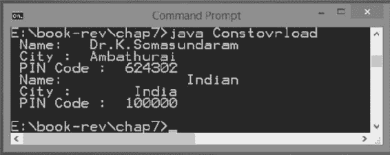

**图 7.4** 程序 7.6 的输出屏幕

## 7.7 构造函数中的 this

类中的一个构造函数可以通过`this`关键字引用同类的另一个构造函数。以下程序 7.7 说明了如何使用`this`引用同类的另一个构造函数：

程序 7.7

```java
/*此程序展示了构造函数中关键字 this 的用法
此程序需要 jdk1.6 或更高版本进行编译和执行。
ka.somasundaram@gmail.com
*/
import java.io.Console;

class Address {
    Console con = System.console();
    String nam, city;
    int pin;

    //第一个构造函数
    Address(String nm, String cty, int pn) {
        nam = nm;
        city = cty;
        pin = pn;
    }

    //第二个构造函数引用第一个构造函数
    Address(Address obj) {
        this(obj.nam, obj.city, obj.pin);
    }

    //声明一个打印地址的方法
    void Printadrs() {
        con.printf("Name:%20s%n City :%12s%n PIN Code:%8d%n", nam, city, pin);
    }
}

class ConstThis {
    public static void main(String args[]) {
        //创建 Address 对象
        Address adrs1, adrs2;
        adrs1 = new Address("Dr.K.Somasundaram", "Ambathurai", 624302);
        adrs2 = new Address(adrs1);
        adrs1.Printadrs();
        adrs2.Printadrs();
    }
}
```

上述程序的输出如如图 7.5 所示。

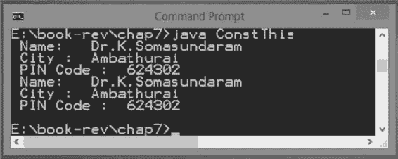

**图 7.5** 程序 7.7 的输出屏幕

在学习了简单方法和构造函数后，我们现在考虑一种执行某些计算并向调用部分返回值的方法。以下程序 7.8 通过`Area`方法计算矩形的面积：

程序 7.8

```java
/*此程序演示了类中方法的用法。
此程序需要 jdk1.6 或更高版本进行编译和执行。
ka.somasundaram@gmail.com
*/
import java.io.Console;

class Rectangle {
    double lenth, breadth;

    double Area(double l, double b) {
        lenth = l;
        breadth = b;
        return lenth * breadth;
    }
}

class Rectarea1 {
    public static void main(String args[]) {
        double len, br, rec_area;
        String slen, sbr;
        Console con = System.console();
        Rectangle rec = new Rectangle();
        con.printf(" Type in the length: ");
        slen = con.readLine();
        len = Double.parseDouble(slen);
        con.printf(" Type in the breadth: ");
        sbr = con.readLine();
        br = Double.parseDouble(sbr);
        rec_area = rec.Area(len, br);
        con.printf(" Length = %6.2f\n", rec.lenth);
        con.printf(" Breadth = %6.2f\n", rec.breadth);
        con.printf(" Area of rectangle = %6.2f\n", rec_area);
    }
}
```

上述程序的输出如如图 7.6 所示。

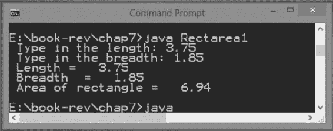

**图 7.6** 程序 7.8 的输出屏幕

上述程序 7.8 也可以以程序 7.9 所示的形式编写。

程序 7.9


```java
/*此程序演示了类中方法的用法。
此程序需要 jdk1.6 或更高版本编译。
ka.somasundaram@gmail.com
*/
import java.io.Console;

class Rectangle {
    double lenth, breadth;

    Rectangle(double l, double b) {
        lenth = l;
        breadth = b;
    }

    double Area() {
        return lenth * breadth;
    }
}

class Rectarea2 {
    public static void main(String args[]) {
        double len, br, rec_area;
        String slen, sbr;
        Console con = System.console();
        Rectangle rec;
        con.printf(" Type in the length: ");
        slen = con.readLine();
        len = Double.parseDouble(slen);
        con.printf(" Type in the breadth: ");
        sbr = con.readLine();
        br = Double.parseDouble(sbr);
        rec = new Rectangle(len, br);
        rec_area = rec.Area();
        con.printf(" Length = %6.2f\n", rec.lenth);
        con.printf(" Breadth = %6.2f\n", rec.breadth);
        con.printf(" Area of rectangle = %6.2f\n", rec_area);
    }
}
```

上述程序 7.9 的结果与 7.8 相同。现在，我们在程序 7.8 中增加一个方法来计算矩形的周长。程序 7.10


```java
/*此程序演示了类中方法的用法。
此程序需要 jdk1.6 或更高版本编译。
ka.somasundaram@gmail.com
*/
import java.io.Console;

class Rectangle {
    double lenth, breadth;

    Rectangle(double l, double b) {
        lenth = l;
        breadth = b;
    }

    double Area() {
        return lenth * breadth;
    }

    double Circum() {
        return 2 * (lenth + breadth);
    }
}

class Rectarea3 {
    public static void main(String args[]) {
        double len, br, rec_area, rec_circum;
        String slen, sbr;
        Console con = System.console();
        Rectangle rec;
        con.printf(" Type in the length: ");
        slen = con.readLine();
        len = Double.parseDouble(slen);
        con.printf(" Type in the breadth: ");
        sbr = con.readLine();
        br = Double.parseDouble(sbr);
        rec = new Rectangle(len, br);
        rec_area = rec.Area();
        rec_circum = rec.Circum();
        con.printf(" Length = %6.2f\n", rec.lenth);
        con.printf(" Breadth = %6.2f\n", rec.breadth);
        con.printf(" Area of rectangle = %6.2f\n", rec_area);
        con.printf(" Circumference of rectangle = %6.2f\n", rec_circum);
    }
}
```

上述程序的输出如如图 7.7 所示。

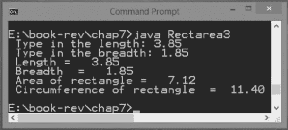

**图 7.7** 程序 7.10 的输出屏幕

## 7.8 方法重载

一个类可以包含任意数量的方法。方法可以接受参数作为输入进行数据处理。这些参数被称为类型签名。Java 允许许多方法具有相同的名称但不同的类型签名。这种名称相同但类型签名不同的方法被称为方法重载。

类中名称相同但类型签名不同的方法被称为重载方法。重载方法体现了多态的概念。

以下程序 7.11 说明了方法重载的用法。该程序包含一个具有两个同名 `Area` 但类型签名不同的方法的类。当给出两个参数时，一个方法计算矩形的面积，而对于单个参数，另一个方法计算正方形的面积。

程序 7.11


```java
/* 此程序演示了方法重载。
* 此程序需要 jdk1.6 或更高版本进行编译和执行。
* ka.somasundaram@gmail.com
*/
import java.io.Console;

class Rectangle {
    double lenth, breadth;

    double Area(double l, double b) {
        lenth = l;
        breadth = b;
        return lenth * breadth;
    }

    double Area(double a) { //重载方法
        lenth = breadth = a;
        return lenth * breadth;
    }
}

class Overload {
    public static void main(String args[]) {
        double len, br, area;
        String slen, sbr;
        Console con = System.console();
        Rectangle rec = new Rectangle();
    }
}
```

```java
con.printf(" Type in the length: ");
slen = con.readLine();
len = Double.parseDouble(slen);
con.printf(" Type in the breadth: ");
sbr = con.readLine();
br = Double.parseDouble(sbr);
area = rec.Area(len, br);
con.printf(" Length = %6.2f%n", rec.lenth);
con.printf(" Breadth = %6.2f%n", rec.breadth);
con.printf(" Area of rectangle = %6.2f%n", area);
con.printf(" Type in the width of the square: ");
slen = con.readLine();
len = Double.parseDouble(slen);
area = rec.Area(len);
con.printf(" Area of square = %6.2f%n", area);
}
}
```

上述程序给出了图 7.8 所示的输出结果。

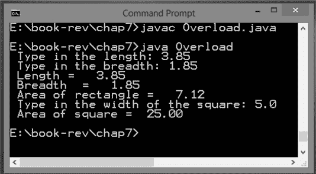

**图 7.8** 程序 7.11 的输出屏幕

## 7.9 将对象作为参数传递给方法

我们已经看到，类中的方法可以接受参数作为输入并处理它们。对象也可以作为参数传递给方法。以下程序 7.12 包含了对象作为参数的方法：

程序 7.12


```java
/* 此程序演示了将对象作为参数传递给方法。
* 此程序需要 jdk1.6 或更高版本才能编译和执行。
* ka.somasundaram@gmail.com
*/
import java.io.Console;

class Circle {
    double radius;
    // 从 Math 类获取 PI 值
    double PHI = Math.PI;
    Circle(double r) {
        radius = r;
    }
    double Area(Circle obj) {
        return PHI * obj.radius * obj.radius;
    }
}

class Objectparam {
    public static void main(String args[]) {
        double r, area;
        String sr;
        Console con = System.console();
        con.printf("Type in the radius: ");
        sr = con.readLine();
        r = Double.parseDouble(sr);
        Circle cr = new Circle(r);
        area = cr.Area(cr);
        con.printf("Area of circle = %6.2f%n", area);
    }
}
```

上述程序给出了图 7.9 所示的输出结果。

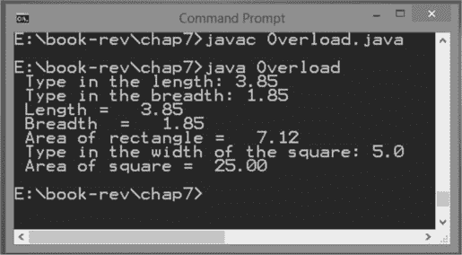

**图 7.9** 程序 7.12 的输出屏幕

在上述程序 7.12 中，我们看到对象是以引用传递的，以便访问参数的值。这种传递参数的方法被称为**引用传递**，因为对象引用变量仅包含指向对象的引用。当参数作为值传递时，被称为**值传递**。在之前的程序中，参数传递是通过值传递完成的。

## 7.10 将数组作为参数传递给方法

数组也可以作为参数传递给方法。事实上，数组被视为一个对象。以下程序 7.13 演示了一个接受数组作为参数的方法。`sort()` 方法接收数组作为参数，对其进行排序并返回排序后的数组。

程序 7.13


```java
/* --------------------------------------------------------------
此程序展示了如何将数组作为参数传递给方法。
此程序需要 jdk1.6 或更高版本。
ka.somasundaram@gmail.com
---------------------------------------------------------------- */
import java.io.Console;

class Order {
    int temp, i, j;
    // 方法接收数组，对其排序并返回排序后的数组
    int[] Sort(int ary[]) {
        int len = ary.length;
        for (i = 0; i < len; i++) {
            for (j = i + 1; j < len; j++) {
                if (ary[j] > ary[i]) {
                    temp = ary[i];
                    ary[i] = ary[j];
                    ary[j] = temp;
                }
            }
        }
        return ary;
    }
}

class Arrayparam {
    public static void main(String args[]) {
        int mark[] = {35, 25, 76, 89, 76, 65, 81, 63, 41};
        // 计算数组中的元素个数
        int maxn = mark.length;
        Console con = System.console();
        // 打印给数字
        con.printf("The given numbers %n%n");
        for (int i = 0; i < maxn; i++) {
            con.printf("%d ", mark[i]);
        }
        con.printf("%n");
        // 调用 Order 类的 Sort 方法
        Order ord = new Order();
        mark = ord.Sort(mark);
        // 打印排序后的数字
        con.printf("%n");
        con.printf("The sorted numbers%n%n");
        for (int i = 0; i < maxn; i++) {
            con.printf("%d ", mark[i]);
        }
    }
}
```

上述程序给出了图 7.10 所示的输出结果。

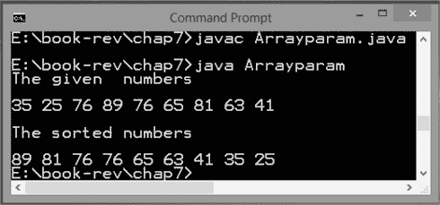

**图 7.10** 程序 7.13 的输出屏幕

阅读本章后，你应该学习了：

- 类定义了数据和方法。
- 对象是类的实例。
- 构造函数用于初始化对象。
- 同名但不同签名的方法是方法重载。
- 方法重载体现了多态性。
- 当方法接受值作为参数时，称为值传递。
- 当方法接受对象或数组等引用时，称为引用传递。

在下一章中，你将学习继承。

问题 7.1 一家硬件商店对每笔销售收取一定税费。根据总价提供一定百分比的折扣。编写一个 Java 程序计算以下数据的总价、折扣和客户需要支付的净额：

程序 7.11


```java
/* 此程序展示了如何计算商店销售的税费和折扣。
* 此程序需要 jdk1.6 或更高版本进行编译和执行。
* ka.somasaram@gmail.com
*/
import java.io.Console;
class Sales {
    double cost, tax, discount, net;
    double tr, dc;
    Sales(double p, double txrate, double dis) {
        cost = p;
        tr = txrate;
        dc = dis;
    }
    double Tax() {
        tax = cost * tr / 100.0;
        return tax;
    }
    double Total() {
        total = cost + tax;
        return total;
    }
    double Discount() {
        discount = total * dc / 100.0;
        return discount;
    }
    double Net() {
        return (total – discount);
    }
}
class TIO71 {
    public static void main(String args[]) {
        double rtax, rdiscount;
        Console con = System.console();
        Sales s1;
        double data[][] = {{586.0, 8.5, 2.0}, {475.0, 12.0, 7}, {725.0, 9.5, 3.0}};
        int len = data.length;
        int maxcol = 4;
        for (int i = 0; i < maxcol; i++) {
            con.printf(“-”);
        }
        con.printf(“%n”);
        con.printf(“%-8s %-8s %-8s %-8s %-8s%n”, “Sales”,
“Tax”, “Total”, “Discount”, “Net”);
        for (int i = 0; i < maxcol; i++) {
            System.out.print("-”);
        }
        con.printf(“%n”);
        for (int i = 0; i < len; i++) {
            s1 = new Sales(data[i][0], data[i][1], data[i][2]);
            con.printf(“7.2f %7.2f %7.2f %7.2f %7.2f%n”, s1.cost, s1.Tax(), s1.Total(),
s1.Discount(), s1.Net());
        }
        for (int i = 0; i < maxcol; i++) {
            con.printf(“-”);
        }
        con.printf(“%n”);
    }
}
```

上述程序给出了图 7.11 所示的输出结果。


**图 7.11** 程序 7.1 的输出屏幕

## 问题 7.2 使用独立的方法 `Sin(x)`、`Cos(x)` 和阶乘计算为问题 5.1 编写 Java 程序。

程序 7.2

```java
/* -----------------------------------------------------
此程序通过计算正弦级和余弦级计算 sin(x) 和 cos(x) 函数。
结果与使用 Java sin 和 cos 获取的结果进行比较。
ka.somasundaram@gmail.com
------------------------------------------------------*/
import java.io.Console;
class Trigno {
    double x;
    int i, n = 5;
    long factn;
    Console con = System.console();
    Trigno(double x) {
        this.x = x;
    }
    long Factfun(int nmax) {
        long fact = 1;
        for (i = 2; i <= nmax; i++) {
            fact *= i;
        }
        return fact;
    }
    double Sinfun() {
        double six = x;
        for (int k = 1; k <= n; k++) {
            factn = Factfun(2 * k + 1);
            six = six + Math.pow(–1, k) * Math.pow(x, (2 * k + 1)) / factn;
        }
        return six;
    }
    double Cosfun() {
        double cox = 1;
        for (int k = 1; k <= n; k++) {
            factn = Factfun(2 * k);
            cox = cox + Math.pow(–1, k) * Math.pow(x, 2 * k) / factn;
        }
        return cox;
    }
    void Printline(int p) {
        for ( i = 1; i <= p; i++) {
            con.printf(“-”);
        }
        con.printf(“%n”);
    }
}
class TIO72 {
    public static void main(String args[]) {
        double x, sinx, cosx, jsx, jcx;
        Trigno trg;
        int maxcol = 35;
        Console con = System.console();
        trg = new Trigno(0);
        trg.Printline(maxcol);
        con.printf(“%-6s %-6s %-6s %-6s %-6s %n”, “ x “,
“my sinx”, “Java”, “my cosx”, “Java”);
        trg.Printline(maxcol);
    }
}
```

```java
for (x = 0; x < 1.6;) {
    trg = new Trigno(x);
    sinx = trg.Sinfun();
    cosx = trg.Cosfun();
    jsx = Math.sin(x);
    jcx = Math.cos(x);
    con.printf“%6.3f %6.3f %6.3f %6.3f %6.3f %n”, x, sinx, jsx, cosx, jcx);
    x = x + 0.5;
}
trg.Printline(maxcol);
```

上述程序给出了图 7.12 所示的输出。

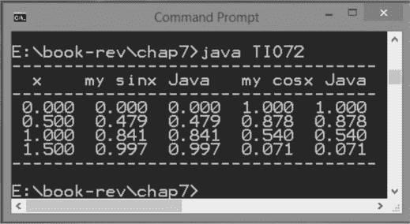

**图 7.12** 程序 7.2T 的输出屏幕

### 7.3T

银行在某项方案中，对在该银行的存款提供年利率 `7.0%` 的复利。编写一个程序计算客户在存款 `x` 卢比后 `n` 年后获得的总金额。从键盘获取这些值。使用一个方法来计算利息。

金额 `P` 在 `N` 年、利率 `R` 的总金额公式为：

`Total = P(1+r/100)^N`

程序 7.3T

```java
/* ---------------------------------------------------------------------
此程序计算了客户在 N 年复利下存款 X 卢比将将获得的总金额。
此程序需要 jdk1.6 或更高版本
ka.somasundaram@gmail.com
----------------------------------------------------------------------*/
import java.io.Console;

class Deposit {
    int principal, year;
    int simple, compound;
    double rate=7.0;

    Deposit(int prin, int yr) {
        principal = prin;
        year = yr;
    }

    int Compound() {
        compound = (int)(principal * Math.pow((1 + rate / 100), year));
        return compound;
    }
}

class TIO73 {
    public static void main(String args []){
        Console con=System.console();
        int pa, yrs, tot;
        String spa, syrs;
        con.printf“Type in the principal amount:”);
        spa=con.readLine();
        pa=Integer.parseInt(spa);
        con.printf“How many years?:”);
        syrs=con.readLine();
        yrs=Integer.parseInt(syrs);
        Deposit depo = new Deposit(pa, yrs);
        tot=depo.Compound();
        con.printf“Amount after %2d years = Rs.%,5d %n”, yrs,tot);
    }
}
```

上述程序给出了图 7.13 所示的输出。

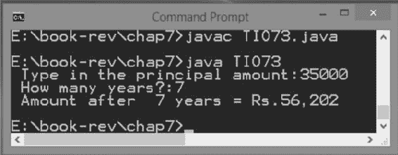

**图 7.13** 程序 7.3T 的输出屏幕。格式说明符 `%,6d` 中指定的逗号（`,`）是为了在数值中引入逗号（`,`）。

## 练习题–7

### I. 空

7.1 `.........................` 定义了数据以及用于操作这些数据的方法。

7.2 `.........................` 就像建筑的蓝图。

7.3 类的实例是 `..........................` 。

7.4 类中定义的变量被称为 `.........................` 变量。

7.5 `.........................` 运算符创建一个对象并返回一个指向该对象的 `.........................`。

7.6 存储对象引用的变量被称为 `.........................` 。

7.7 当打印对象引用变量时，只打印 `.........................`，而不打印对象的内容。

7.8 类的实例变量可以使用 `.........................` 运算符来访问。

7.9 用于初始化对象的特殊类型的方法被称为 `.........................` 。

7.10 类名和构造函数名必须相同。（True /  / / 错误）

7.11 类中的关键字 `this` 可用于指代同一类中的一个 `.........................`。

7.12 当一个或多个方法具有相同名称但参数不同时，这些方法被称为 `.........................` 方法。

7.13 方法的类型签名（type signature）指的是传递给方法的 `.........................`。

### II. 为以下问题编写 Java 程序：

7.14 一份成绩单包含一个注册号、姓名以及 `sub1`、`sub2` 和 `sub3` 的分数。编写一个 Java 类来定义它们。

7.15 为 7.14 题中定义的类添加一个方法，计算三个学科的平均分并打印平均值。

7.16 编写一个构造函数来初始化 7.14 题中定义的类的所有变量。

7.17 公司的员工列表包含员工代码、姓名、职位和基本工资。员工获得基本工资 `10%` 的住房租金贴 (`HRA`) 和基本工资 `45%` 的生活津贴 (`DA`)。员工的总工资计算公式为 `Basic Pay + HRA + DA`。编写一个类来定义员工的详情。编写一个构造函数来分配所需的初始值。添加一个方法来计算 `HRA`、`DA` 和总工资并打印它们。编写一个 `main` 方法。

```java
con.printf“%n Address of %s%n”, bd.nam);

//使用继承的方法打印地址

bd.Printadrs();

con.printf“%n Biodata of %s%n”, bd.nam);

bd.Printbio();

}

}
```

上述程序给出了如图 8.1 所示的输出。

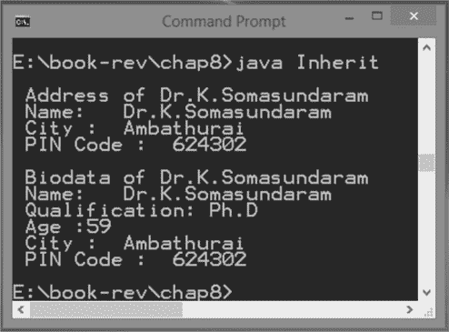

**图 8.1** 程序 8.2 的输出屏幕

在上述程序中，关键字 `super` 指向父类构造函数 `Address()`。当在构造函数内部使用 `super()` 时，它必须是第一条语句。

## 8.2 方法重写 (METHOD OVERRIDING)

在构建子类时，除了继承自父类的方法外，它们可能拥有自己的方法。子类中的方法可能与父类具有相同的名称和类型签名。在这种情况下，子类的方法将重写父类中的方法。这被称为方法重写。方法重写体现了完全的多态性。以下程序 8.3 阐了方法重写。

程序 8.3

```java
/* 此程序演示方法重写概念。

* 此程序需要 jdk1.6 或更高版本。

* ka.somasundaram@gmail.com

*/

import java.io.Console;

class A {

double result;

double Process(double x, double y) {

result = x * y;

return result;

}

}

class B extends A {

double Process(double x, double y) {

result = x / y;

return result;

}

}

class Override {

public static void main(String args[]) {

double p = 10.0, q = 4.0, aval, bval;

Console con = System.console();

A a = new A();

B b = new B();

aval = a.Process(p, q);

bval = b.Process(p, q);

con.printf“\n %4.1f and %4.1f processed in A = %4.1f%n”, p, q, aval);

con.printf“\n %4.1f and %4.1f processed in B = %4.2f%n “, p, q, bval);

}

}
```

上述程序给出了如图 8.2 所示的输出。

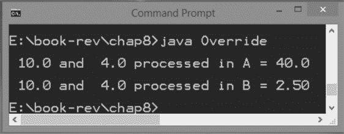

**图 8.2** 程序 8.3 的输出屏幕

在上述程序中，`Process()` 方法产生了两个不同的结果。方法的选择是在运行时完成的，被称为动态方法分发。

Java 支持所示的多级继承：

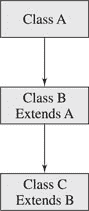

**图 8.3** Java 中的多级继承

利用这一原理，可以创建多级继承中的子类。

 子类中与父类方法具有相同名称和类型签名的方法被称为重写方法。重写方法体现了多态属性。

## 8.3 FINAL 类 (FINAL CLASS)

继承允许创建子类。然而，如果有需要，可以通过将类声明为 `final` 来防止继承。声明为 `final` 的类不能有子类。以下程序 8.4 显示了 `final` 类的用法：

程序 8.4


```java
/* 此程序演示 final 类。

* 此程序需要 jdk1.6 或更高版本进行编译和执行。

* ka.somasundaram@gmail.com

*/

import java.io.Console;

// 这防止 Circle 的任何子类的创建

final class FinCircle {

double radius;

final double PHI = Math.PI;

FinCircle(double r) {

radius = r;

}

double Area() {

return PHI * radius * radius;

}

double Circum() {

return 2 * PHI * radius;

}

}

class FinalClass {

public static void main(String args[]) {

double ar, radius = 5.5, sar;

Console con = System.console();

FinCircle cir = new FinCircle(radius);

ar = cir.Area();

sar = cir.Circum();

con.printf“\n Radius of the circle = %5.1f\n” radius);

con.printf“\n Area of the circle = %5.1f\n”, ar);

con.printf“\n Circumference of the circle = %5.1f\n”, sar);

}

}
```

上述程序给出了如图 8.4 所示的输出。

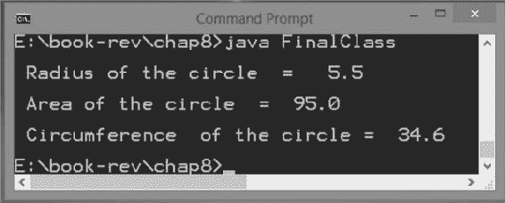

**图 8.4** 程序 8.4 的输出屏幕

## 8.4 `FINAL` 方法（`FINAL METHOD`）

类中的方法可以防止被子类中的方法重写。像 `final` 类一样，方法可以使用修饰符 `final` 进行声明。声明为 `final` 的方法在子类中不能有重写方法。以下程序 8.5 阐述了 `final` 方法的用法：

程序 8.5 

```java
/* 此程序演示 final 方法。

* 此程序需要 jdk1.6 或更高版本。

* ka.somasundaram@gmail.com

*/

import java.io.Console;

class A {

double result;

final double Process(double x, double y) {

result = x * y;

return result;

}

}

class B extends A {

// 重写是不可能的
double Process(double x, double y) {

result = x / y;

return result;

}

}

class FinalMethod {

public static void main(String args[]) {

double p = 10.0, q = 4.0, aval, bval;

Console con = System.console();

A a = new A();

B b = new B();

aval = a.Process(p, q);

bval = b.Process(p, q);

con.printf“\n %4.1f and %4.1f processed in A = %4.1f%n”, p, q, aval);

con.printf“\n %4.1f and %4.1f processed in B = %4.2f%n “, p, q, bval);

}

}
```

上述程序给出了如图 8.5 所示的输出。

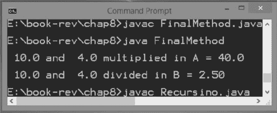

**图 8.5** 程序 8.5 的输出

在大多数情况下，它是有效的，但无法保证每一个。

## 8.5 `FINAL` 变量（`FINAL VARIABLES`）

变量也可以被声明为 `final`。一旦声明了它们，就不能为其赋值新值。按照约定，`final` 变量使用大写字母。以下是 `final` 的示例：

`final int PASS_MARK = 40`

`final int MINUTE_VAL = 60`

`final double INTEREST_RATE = 12.5`

`final double UPPER_LIMIT = 120`

`final double PHI = 3.14`

## 8.6 对象销毁与垃圾回收

对象在创建时会占用空间。当对象不再被使用时，Java 会识别它们并释放内存。这被称为垃圾回收。Java 中没有析构方法。在某些情况下，对象使用内存以外的内容，例如文件或系统资源。在这种情况下，必须小心释放资源。为了提供这种功能，Java 有 `finalize()` 方法。该方法可以放在类内部。在对象被销毁之前，Java 会运行 `finalize()`。用户可以在 `finalize()` 中定义要执行的操作。尽管在大多数情况下它是有效的，但程序员必须找到其他方法来释放资源。

## 8.7 递归（`RECURSION`）

当方法调用其自身时，被称为递归。有些问题可以使用递归轻松地编写。递归方法需要栈内存。在时间上效率较低。Java 支持递归方法。考虑计算给定数字阶乘的问题。寻找阶角的公式为：

$n! = 1 \times 2 \times 3....n$

上述公式可以写为：

$n! = n * (n–1)!$

$n! = n * (n–1)*(n–2)!$

$n! = n * (n–1)*(n–2)*(n–3)!$

$等等.$ 最后 $0! = 1! = 1$。

以下程序 8.6 使用递归方法实现了上述公式：

程序 8.6 

```java
import java.io.Console;

class Factfun {

long Fact(int n) {

if (n == 0 || n == 1) {

return 1;

} else {

return n * Fact(n – 1);

}

}

}

class Recursion {

public static void main(String args[]) {

Factfun f = new Factfun();

Console con = System.console();

con.printf“\n Factorial of 8 = %d\n”, f.Fact(8));

con.printf“\n Factorial of 12 = %d\n”, f.Fact(12));

}

}
```

}

}

上述程序给出了图 8.6 所示的输出。

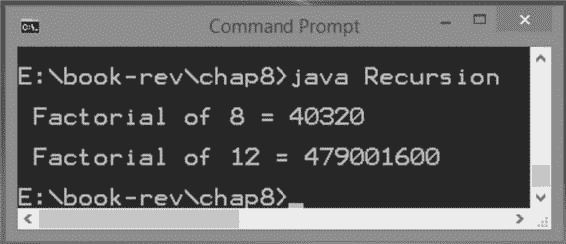

**图 8.6** 程序 8.6 的输出屏幕

## 8.8 静态方法、变量和块

### 8.8.1 静态方法

到为止，我们看到方法是在对象上调用的。也就是说，方法是相对于类的实例被调用的。Java 提供了一种机制，可以在没有类实例的情况下调用方法。此类方法被称为 `static` 方法。静态方法使用修饰符 `static` 进行声明。例如，`main()` 是一个 `static` 方法，因为它必须独立于任何对象进行运行。如果方法在同一个类中，可以直接调用静态方法；如果它在不同的类中，则可以通过指定类名和方法名来调用。调用 `static` 方法的一般形式是：

`classname.static_method;`

`static` 方法不能访问该类的任何实例变量。它不能在方法内部使用 `this` 或 `super`。它只能访问静态方法和 `static` 变量。

以下程序 8.7 阐释了在同一类中使用 `static` 方法的方法：

程序 8.7 

```java
/* 同一类内静态方法的示例。
* 此程序需要 jdk1.6 或更高版本。
* ka.somasundaram@gmail.com
*/

import java.io.Console;

class Stat {
    static void Add(int a, int b) {
        Console con = System.console();
        int sum = a + b;
        con.printf(“Sum of numbers = %d\n”, sum);
    }

    public static void main(String args[]) {
        Add(5, 24);
    }
}
```

上述程序的输出如图 8.7 所示。

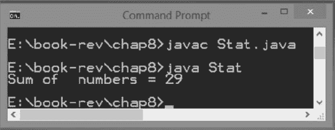

**图 8.7** 程序 8.7 的输出屏幕

以下程序 8.8 阐释了从不同类使用静态方法的方法：

程序 8.8 

```java
/* 此程序演示了在不同类中使用静态方法。
* 此程序需要 jdk1.6 或更高版本。
* ka.somasundaram@gmail.com */
import java.io.Console;

class Statc {
    static void Add(int a, int b) {
        Console con = System.console();
        int sum = a + b;
        con.printf(“Sum of numbers = %d\n”, sum);
    }
}

class Static1 {
    public static void main(String args[]) {
        Statc.Add(5, 24);
    }
}
```

上述程序得到的结果与之前的程序 8.7 相同。

 静态方法可以被直接调用。

### 8.8.2 静态变量

Java 的实例变量也可以声明为 `static`。当一个变量被声明为 `static` 时，它就变成了类变量而不是对象变量。程序的任何部分都可以访问静态变量。即使创建了实例，`static` 变量也会保留最后修改的值。实际上，它变成了一个全局变量或类变量。

例如，考虑以下程序 8.9：

程序 8.9 

```java
/* 此程序演示了静态变量的使用。
* 此程序编译和执行需要 jdk1.6 或更高版本。
* ka.somasundaram@gmail.com
*/
import java.io.Console;

class Stat {
    static int i = 0, j = 0;
    void Printval() {
        Console con = System.console();
        con.printf(“ i = %d%n”, i);
        con.printf(“ j = %d%n”, j);
    }
}

class Statvar {
    public static void main(String args[]) {
        Stat sv = new Stat();
        Console con = System.console();
        con.printf(“ Value of variables in the first object%n”);
        sv.Printval();
        sv.i = 10;
        sv.j = 15;
        con.printf(“ Value of variables in the second object%n”);
        Stat sv1 = new Stat();
        sv1.Printval();
    }
}
```

上述程序给出了图 8.8 所示的输出。

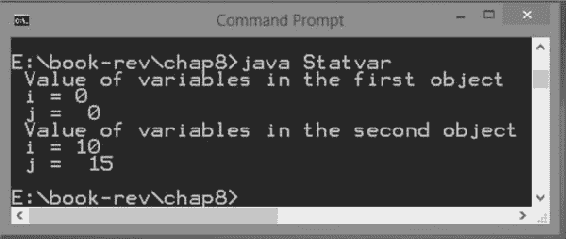

**图 8.8** 程序 8.9 的输出屏幕

在上述程序 8.9 中，如果我们将实例变量 `i` 和 `j` 声明为：

`static int i=0, j=0;`

在 `Statvar` 类中，你将得到图 8.9 所示的结果。


**图 8.9** 将 `i` 和 `j` 声明为静态后的程序 8.9 输出屏幕

你从上述结果中观察到，当变量 `i` 和 `j` 被声明为 `static` 时，它们保留了在第一个对象中设置的值，因此当创建第二个对象时，`i` 和 `j` 保留了最后修改的值。

 静态变量是类变量。静态方法可以修改静态变量，并反映在所有对象中。

### 8.8.3 静态块

在某些情况下，可能只需要执行一次的语句。在 Java 中，这些语句可以放在类中，并独立于实例。这些被称为 `static` 块。在没有 `main` 方法的情况下，程序 8.10 演示了静态块。

程序 8.10 

```java
/* 此程序演示了静态块的使用。
* 此程序需要 jdk1.6 或更高版本。
* ka.somasundaram@gmail.com
*/
import java.io.Console;

class Statblock {
    void Printval() {
        Console con = System.console();
        con.printf(“%n Printval()”);
    }
    static {
        Console con = System.console();
        con.printf(“%n static block”);
    }
}

class Stblock {
    public static void main(String args[]) {
        Statblock sb = new Statblock();
        Console con = System.console();
        con.printf(“%n First object”);
        sb.Printval();
        Statblock sb1 = new Statblock();
        Console con = System.console();
        con.printf(“%n Second object”);
        sb1.Printval();
    }
}
```

上述程序给出了图 8.10 所示的输出。

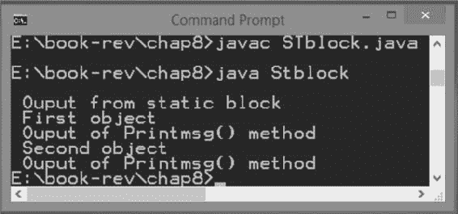

**图 8.10** 程序 8.10 的输出屏幕

## 8.9 抽象类

在继承层次结构中，我们看到向下移动时子类具有具体的实例变量和方法。同样，当我们向上移动时，类的共同属性可以抽象并定义在一个类中。这有助于在一个类中处理复杂问题。例如，考虑几何形状：圆、矩形和平行四边形。它们都有面积和周长等共同属性。这些共同属性可以被抽象到一个公共类 `Shape` 中，并带有计算面积和周长的方法。但由于计算面积和周长的公式不同，这些方法没有具体的实现体。

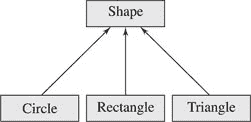

**图 8.11** 将多个类的共同点抽象到公共类

因此，方法可以在没有主体的情况下定义。Java 定义没有主体的方法，这些被称为 `abstract` 方法。抽象方法使用 `abstract` 关键字定义。包含至少一个 `abstract` 方法的类被称为 `abstract` 类。由于抽象类没有具体的方法，因此无法创建抽象类的对象。然而，可以创建抽象类的对象引用变量。此外，当定义一个抽象类时，该抽象类的子类必须提供具体的方法。否则，子类也将成为一个 `abstract` 类。以下程序 8.11 包含一个抽象类和一个抽象方法：

程序 8.11 

```java
/* 此程序演示了抽象类和抽象方法。
* 此程序编译和执行需要 jdk1.6 或更高版本。
* ka.somasundaram@gmail.com
*/
import java.io.Console;

abstract class Shape {
    double area;
    final double PHI = Math.PI;
    abstract double Area(); // 抽象方法
}

class Circle extends Shape {
    double radius;
    Circle(double r) {
        radius = r;
    }

    double Area() {
        area = PHI * radius * radius;
        return area;
    }
}

class Abstractclass {
    public static void main(String args[]) {
        Console con = System.console();
        Circle cir = new Circle(4.0);
        double ar;
        ar = cir.Area();
    }
}
```

```java
con.printf(“Area of the circle = %6.2f%n”, ar);
}

}
```

上述程序给出了图 8.12 所示的输出。

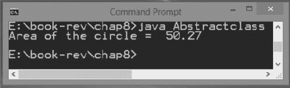

**图 8.12** 程序 8.11 的输出屏幕

 一个没有方法体的方法的方法被称为**抽象方法**（abstract method）。包含抽象方法的类被称为**抽象类**（abstract class）。

## 8.10 数学方法


对于工程和科学计算，需要许多基础数学函数，如`sin(x)`。这些函数可以在`java.lang`包中定义的`Math`类中找到。所有方法都是静态的（static）的。该包由 JVM 自动导入。以下程序 8.12 展示了某些数学方法的用法。

程序 8.12

```java
/*  ---------------------------------------------------------------------
* 本程序演示了 Math 类中定义的一些方法
* 本程序编译和执行需要 jdk1.6 或更高版本
ka.somasundaram@gmail.com
----------------------------------------------------------------------*/
import java.io.Console;

class Mathmethods {
    public static void main(String args[]) {
        Console con = System.console();
        double pi = 22.0 / 7.0;
        double x = 3.6, ly20, alog, y = 0.5;
        double s90 = Math.toRadians(90);
        double as1 = Math.asin(1.0);
        con.printf(“%n The angle 90 degress = %6.4f radians”, s90);
        con.printf(“%n Value of sin %6.4f = %6.4f”, s90, Math.sin(s90));
        con.printf(“%n Value of arcsin(1.0) = %6.4f “, as1);
        con.printf(“%n Value of 22/7/2 = %6.4f “, 22.0 / 7.0 / 2.0);
        con.printf(“%n Java Math.E = %6.4f “, Math.E);
        con.printf(“%n Value of exp(1) = %6.4f”, Math.exp(1.0));
        con.printf(“%n Java Math.PI = %6.4f”, Math.PI);
        con.printf(“%n mathematical pi = 22/7 = %6.4f “, 22.0 / 7.0);
        con.printf(“%n %6.4f rounded by rint = %3.1f “, x, Math.rint(x));
        con.printf(“%n %6.4f rounded by round = %d “, x, Math.round(x));
        con.printf(“%n %6.4f rounded by ceil = %3.1f “, x, Math.ceil(x));
        con.printf(“%n %6.4f rounded by floor = %3.1f “, x, Math.floor(x));
        con.printf(“%n natural logarithm of 10.0 = %6.4f”, Math.log(10.));
        ly20 = Math.log10(20);
        con.printf(“%n logarithm to base 10 of 20.0 = %6.4f “, ly20);
        alog=Math.exp(Math.log(10) * ly20);
        con.printf(“%n anti log of %6.4f = %6.4f”, ly20, alog );
        con.printf(“%n Hyperbolic sin of %6.4f = %6.4f”, y, Math.sinh(y));
        con.printf(“%n Hyperbolic cos of %6.4f = %6.4f”, y, Math.cosh(y));
        con.printf(“%n Hyperbolic tan of %6.4f = %6.4f”, y, Math.tanh(y));
        con.printf(“%n %5.2f to the power of 4 = %6.4f”, x, Math.pow(x, 4));
    }
}
```

上述程序给出了图 8.13 所示的输出。

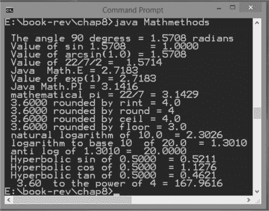

**图 8.13** 程序 8.12 的输出屏幕

## 8.11 时间与日期

Java 在`java.util`包中包含一个`GregorianCalendar`类。该类有多个方法来处理日期、年、月、日、小时、分钟、AM、PM 等。每当需要系统的时间和日期相关信息时，可以使用该类。`GregorianCalendar`中定义的一些方法在程序 8.13 中得到了演示。可以使用单个参数或直接使用转换字符从`GregorianCalendar`对象中获取时间和日期参数（参见附录 A）。

程序 8.13

```java
/* 本程序演示了 GregorianCalendar 中定义的一些字段和方法。
本程序需要 jdk1.6 或更高版本。
ka.somasundaram@gmail.com
*/
import java.io.Console;
import java.util.GregorianCalendar;

class Calndr {
    public static void main(String args[]) {
        GregorianCalendar cal = new GregorianCalendar();
        Console con = System.console();
        con.printf(“ YEAR: “ + cal.get(cal.YEAR));
        con.printf(“%n WEEK_OF_YEAR: %d”, cal.get(cal.WEEK_OF_YEAR));
        con.printf(“%n WEEK_OF_MONTH: %d”, cal.get(cal.WEEK_OF_MONTH));
        con.printf(“%n DATE: %d”, cal.get(cal.DATE));
        con.printf(“%n DAY_OF_MONTH: %d”, cal.get(cal.DAY_OF_MONTH));
        con.printf(“%n DAY_OF_YEAR: %d”, cal.get(cal.DAY_OF_YEAR));
        con.printf(“%n DAY_OF_WEEK: %d”, cal.get(cal.DAY_OF_WEEK));
        con.printf(“%n AM_PM: %s”, (cal.get(cal.AM_PM) > 0 ? “PM” : “AM”));
        con.printf(“%n HOUR: %d”, cal.get(cal.HOUR));
        con.printf(“%n HOUR_OF_DAY: %d”, cal.get(cal.HOUR_OF_DAY));
        con.printf(“%n MINUTE: %d”, cal.get(cal.MINUTE));
        con.printf(“%n SECOND: %d”, cal.get(cal.SECOND));
        con.printf(“%n MILLISECOND: %d”, cal.get(cal.MILLISECOND));
        // ... 其他字段 ...
    }
}
```

上述程序给出了图 8.15 所示的输出。

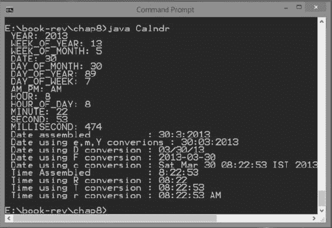

**图 8.15** 程序 8.1T 的输出屏幕

## 练习题–8

### I. 空空：

8.1 创建子类时使用关键字 .......................... 。

8.2 引用父类构造函数时使用关键字 .......................... 。

8.3 可以创建一个只继承父类少数方法的子类。（正确/错误）

8.4 具有相同名称但不同类型签名的方法称为 .......................... 方法。

8.5 具有相同名称和相同类型签名的方法称为 .......................... 方法。

8.6 多态属性通过 .......................... 和 .......................... 实现。

8.7 为了防止一个类被继承，应将其声明为 .......................... 。

8.8 声明为 .......................... 的方法不能有重写方法。

8.9 .......................... 方法可以在没有类实例的情况下调用。

8.10 .......................... 变量被称为类变量。

8.11 在加载类时仅初始化一次的块语句应声明为 ......................... 。

8.12 没有方法体的方法称为 .......................... 方法。

8.13 拥有抽象方法的类应声明为 .......................... 。

### II. 为以下内容编写 Java 程序：

8.14 编写一个类，其中包含一个计算矩形面积的方法。创建一个子类来计算矩形盒的体积。

8.15 编写一个名为`square`的类，包含一个方法`Area(double a)`用于计算正形的面积 (a²)。创建一个`Square`的子类`Cube`，并编写重写方法`Area(double a)`来计算立方体的表面积 (6a²)。

8.16 编写一个带有静态方法的类，该方法返回三个给定整数的最大值。编写另一个带有`main`方法的类，调用该静态方法打印两组整数值的最大值（例如 {5, 2, 10}, {75, 20, 89}）。

8.17 编写一个带有抽象方法`void Special(int n)`的抽象类。创建该类的子类并实现`Special`方法，找出从 1 到 n 之间所有的完全平方数。

8.18 编写一个带有抽象方法`double Process(double P, double R)`的抽象类`Special`。创建一个子类`Discount`并使用以下公式实现`Process()`方法：

```
net = P – P* R/100
```

返回净值。为`Special`创建另一个子类`Tax`，并使用以下公式实现`Process()`方法：

```
total = P + P * R/100
```

返回总额。

## 9 包与接口

在本章中将介绍包（package）和接口（interface）。当有多个类在许多程序中重用时，管理它们就变成了一个问题。为了解决这个问题，使用了包。接口拥有没有方法体的方法。接口帮助程序员按照他们选择的程序来实现接口方法。接口还帮助实现多重继承。

### 9.1 包 (PACKAGE)

通常情况下，你会为多个应用程序创建许多类。当类数量很大时，将它们全部保存在同一个目录中并为不同的应用程序进行管理会有些繁琐。为了解决这个问题，可以将类存储在不同的目录中，每个目录包含执行相似类型函数的类。为了识别类在目录中的存储位置，使用`package`语句。当你想要在任何其他目录的任何类中使用该类时，这种标识是必要的。因此，包有助于管理大量的类。包语句的一般形式为：

```
package pckg1.pckg2.pckg3;
```

例如，语句

```
package java.soms.jbook;
```

表示程序存储在`java\soms\jbook`目录中。

在任何程序中，如果使用`package`语句，必须必须第一个语句。


**图 9.1** 包充当类的容器

### 9.2 import 语句

当你想要在另一个包的另一个类中使用某个包中的类时，可以使用`import`语句在你的类中引用这些类。例如，图 9.1 中`Package1`中的类`A`可以通过放置以下语句被`package2`访问：

```
import package1.A;
```

在任何 Java 程序中，如果使用`import`语句，它必须紧跟在`package`语句之后。

除了用户定义的类外，用户还可以成千上万个 Java 类。Java 类被封装在不同的包中并放置在 Java 开发包 (JDK) 中。你可以使用`import`语句访问它们。例如，所有的输入/输出函数都可以在`java.io`包可用。因此，语句：

```
import java.io.*;
```

可以访问`java.io`包中的所有类。

语句中的类和方法：

```
System.out.println(......);
```

在 Java 语言包`java.lang`中可用。`java.lang`包中还有其他类如`Math`。Java 编译器默认会自动导入`java.lang.*`，因此没有必要显式地`import`这个包。`*`标记表示你可以访问该包中的所有类。如果需要某个特定的类，可以显式提到类名而不是使用`*`。如果两个类具有相同的类名，则无法通过以下语句访问它们：

```
import package1.*;
import package2.*;
```

必须连同`package`名称显式地提到类名。以下示例说明了这一概念：

```class
class Newclass extends package1.classA {
    . . .
    . . .
}
```

### 9.3 访问修饰符 (ACCESS MODIFIER)

Java 语言的关键特征之一是它的封装。这一特性有助于你根据所需的程度保护你的数据和方法。在非 OOP 语言中没有这种特性。Java 中的这种特性通过访问修饰符来实现。让我们假设我们有两个包，如图 9.2 所示的`Package1`和`Package2`。


**图 9.2** 同一包和不同包中的类、子类和非子类

在类中使用访问说明符声明的成员（方法或变量）可以被设置为仅对该类可见或对任何包可见。这有助于用户控制其他类对成员的使用。

访问修饰符及其可见性见表 9.1。

**表 9.1** 访问修饰符及其可见性

| 修饰符 | 可见性 |

| :--- | :--- |

| private | 仅对类可见 |

| protected | 对任何包中的子类以及同包内的所有类可见 |

| public | 对所有包可见 |

| 无修饰符（默认） | 仅对同包可见 |

在目前为止看到的所有程序中，实例变量都没有任何修饰符。这意味着变量对整个包（该目录的所有类）可见。以下程序 9.1、9.2 和 9.3 展示了访问修饰符的使用：

以下程序 9.1 展示了放置在包`jbookr`中的类`A`：

Program 9.1

```
/* 此程序演示了包语句的使用。
* 此程序需要 jdk1.6 或更高版本。
* ka.somasundaram@gmail.com
*/
package jbookr;

import java.io.Console;

public class A {
    int x = 25;
    private int x_pri = 35;
    protected int x_pro = 45;
    public int x_pub = 55;

    Console con = System.console();

    void PrintA() {
        con.printf("%n Printing in class A%n");
        con.printf("x = %d%n", x);
        con.printf("private x = %d%n", x_pri);
        con.printf(" protected x = %d%n", x_pro);
        con.printf(" public x = %d%n", x_pub);
    }
}
```

在目录`jbookr`中创建以下程序 9.2`AccessDemo.java`：

Program 9.2

* 你需要进入此目录的上一级进行编译。

* 此程序需要`jdk1.6`或更高版本。

* `ka.somasundaram@gmail.com`

*/


```java
package jbookr;

import java.io.Console;

class B extends A {
    public void PrintB() {
        con.printf(“%n Printing in subclass B%n”);
        con.printf(“ x = %d%n”, x);
        // Dont try this :con.printf(“%n private x = %d%n”, x_pri);
        con.printf(“ protected x = %d%n”, x_pro);
        con.printf(“ public x = %d%n”, x_pub);
    }
}

class C {
    public void PrintC() {
        A a = new A();
        Console con = System.console();
        con.printf(“%n Printing in non-subclass C%n”);
        con.printf(“x = %d%n”, a.x);
        // Not accessible here: con.printf(“ private x = %d%n”, a.x_pri);
        con.printf(“protected x = %d%n”, a.x_pro);
        con.printf(“public x = %d%n”, a.x_pub);
    }
}

class AccessDemo {
    public static void main(String args[]) {
        A a = new A();
        B b = new B();
        C c = new C();
        Console con = System.console();
        con.printf(“%n Printing in the same package%n”);
        a.PrintA();
        b.PrintB();
        c.PrintC();
    }
}
```

进入`jbookr`目录的上一级目录并编译`AccessDemo.java`。（在`jbookr`同一目录下尝试编译`AccessDemo.java`将报错）。然后通过执行以下命令运行程序：

```
java jbookr.AccessDemo
```

你将得到如图 9.3 所示的输出。


**图 9.3** 程序 9.2 的输出屏幕

现在创建另一个包`soms`。创建以下程序 9.3 `PackageDemo.java`。请注意`jbookr`包中的类`A`被声明为`public`。否则你无法在另一个包中访问它。

程序 9.3

```java
/* 此程序演示了包 语句的使用。
* 你需要进入此目录的上一级进行编译。
* 此程序需要 jdk1.6 或更高版本进行编译和执行。
* ka.somasundaram@gmail.com
*/
package soms;

import java.io.Console;
import jbookr.A;

class D extends A {
    void PrintD() {
        Console con = System.console();
        con.printf(“\n Printing in subclass D in another package\n”);
        // con.printf (“ x = %d\n”, x);
        // con.printf(“ private x = %d\n”, x_pri);
        con.printf(“ protected x = %d\n”, x_pro);
        con.printf(“ public x = %d\n”, x_pub);
    }
}

class E {
    void PrintE() {
        A a = new A();
        Console con = System.console();
        con.printf(“\n Printing in different package, non-subclass E\n”);
        con.printf(“ Public x = %d\n”, a.x_pub);
    }
}

class PackageDemo {
    public static void main(String args[]) {
        A a = new A();
        Console con = System.console();
        //B b= new B();
        //C c= new C();
        D d = new D();
        E e = new E();
        con.printf(“Printing in different package\n”);
        // a.PrintA();
        //b.PrintB();
        //c.PrintC();
        d.PrintD();
        e.PrintE();
    }
}
```

上述程序给出了如图 9.4 所示的结果。


**图 9.4** 程序 9.3 的输出屏幕

## 9.4 接口 (INTERFACES)

### 9.4.1 定义接口

接口与`abstract`类相似，但在功能上有所不同。接口定义没有主体的方法。接口不能拥有实例变量。但它可以包含`final`变量，这些变量必须用值初始化。方法可以具有类型签名。接口有助于实现 Java 中的多继承。定义`interface`的通用形式为：

```java
modifier interface ifname {
    final type var1 = val1;
    final type var2 = val2;
    modifier return_type mname1(type signature1) ;
    modifier return_type mname2(type signature2);
}
```

在这里，修饰符可以是`public`或不加修饰符。`var1`、`var2`是`final`变量，`val1`和`val2`是值。`ifname`是`interface`的名称，`mname1`和`mname2`是方法名。当`interface`被声明为`public`时，任何其他类都可以使用它。接口定义的示例：

```java
// interface 示例
interface Calculation{
    final double pi=3.142;
    double Area( r);
}
```

### 9.4.2 实现接口

一旦定义了`interface`，另一个类应该实现该接口的所有方法。接口可以被多个类实现。一个类可以实现多个接口。实现接口的通用形式为：

```java
modifier class classname [extends superclass] implements interface1, interface2 {
    body;
}
```

在这里修饰符可以是`public`或不加修饰符。`interface1`、`interface2`是接口。

上述程序给如图 9.7 所示的结果。


**图 9.7** 程序 9.4 的输出屏幕

读完本章后，你应该已经学习了以下内容：

*   `package`语句表示文件在目录中的位置。
*   要引用和访问包中的类，使用`import`语句。
*   `Access modifier`（访问修饰符）实现了数据封装属性。
*   `Access modifiers`（访问修饰符）对数据和方法提供不同的保护。
*   `Interfaces`（接口）允许以多种不同的方式实现预定义的概念方法。
*   通过`interfaces`可以实现多重继承。

在下一章中，你将学习包装类。


### 练习 9.1T

编写一个名为`Hyperbolic`的接口，包含一个用于查找`Cosh`或`Sinh`的方法。实现该接口以计算给定的`Sinh(x)`和`Cosh(x)`：


对于`x=0.5`到`5.5`，步长为`0.5`。

#### 程序 9.1T

```java
/* ———————————————————————————-———-

此程序使用接口计算双曲正弦和双曲余弦函数。此程序需要 jdk1.6 或更高版本

ka.somasundaram@gmail.com

——————————————————————————————— */
import java.io.Console;

interface Hyper {
    final int n = 10;
    double Hypfun(double x);
}

class Hysin implements Hyper{
    double sinh;
    long factn;
    int i;
    long Factfun(int nmax) {
        long fact = 1;
        for (i = 2; i <= nmax; i++)
            fact *= i;
        return fact;
    }

    public double Hypfun(double x){
        sinh = x;
        for (int k = 1; k <= n; k++)
        {
            factn = Factfun(2 * k + 1);
            sinh = sinh + Math.pow(x, (2 * k + 1)) /factn;
        }
        return sinh;
    }
}

class Hycos implements Hyper {
    double cosh;
    long factn;
    int i;
    long Factfun(int nmax){
        long fact = 1;
        for (i = 2; i <= nmax; i++)
            fact *= i;
        return fact;
    }

    public double Hypfun(double x) {
        cosh = 1;
        for (int k = 1; k <= n; k++){
            factn = Factfun(2 * k);
            cosh = cosh + Math.pow(x, (2 * k)) / factn;
        }
        return cosh;
    }
}

class TIO91{
    public static void main(String args []){
        double x, sinh, cosh, jsh, jch;
        Hyper hcos;
        Hyper hsin;
        Console con = System.console();
        int pn = 40;
        for (int i = 0; i < pn; i++)
            System.out.print("–");
        con.printf("%n");
        con.printf("x \t sinh \t Java \t cosh \t Java %n");
        for (int i = 0; i < pn; i++)
            System.out.print("–");
        con.printf("%n");
        for (x = 0; x < 5.1; ){
            hsin = new Hysin();
            hcos = new Hycos();
            sinh = hsin.Hypfun(x);
            cosh = hcos.Hypfun(x);
            jsh = Math.sinh(x);
            jch = Math.cosh(x);
            con.printf(" %3.1f %8.3f %8.3f%8.3f %8.3f%n",
            x, sinh, jsh, cosh, jch);
            x = x + 0.5;
        }
        for (int i = 0; i < pn; i++)
            con.printf("– ");
        con.printf("%n");
    }
}
```

上述程序给出了如图 9.8 所示的输出。


**图 9.8** 程序 9.1T 的输出屏幕

### 练习–9

### I. 填空

9.1 `package`语句表示 .......................... 所在的目录。

9.2 为了在另一个类中使用定义在包中的类，应使用 .......................... 语句。

9.3 数据封装的概念通过 .......................... 实现。

9.4 如果一个变量需要对任何包中的子类可见，并对同一个包中的所有类可见，则它必须被声明为 ..........................。

9.5 如果使用了，Java 程序的第一条语句是 .........................。

9.6 在 Java 程序中，`import`语句必须紧跟在 ..........................-语句之后。

9.7 在 Java 程序中被隐式调用的默认包是 ..........................。

9.8 ........................... 帮助在 Java 语言中实现多重继承的概念。

9.9 `Interface`（接口）的方法没有 .......................... 方法体。

9.10 接口可以使用 .......................... 变量。

9.11 要使用`interface`，必须在另一个类中被 ..........................。

9.12 类可以实现 .......................... 数量的接口。

9.13 如果类没有实现 ..........................

**II. 编写以下 Java 程序：**

9.14 编写一个 Java 类`Sumn`，用于计算两个数之和。该类位于`java.lang`包中。

9.15 编写一个接口`Numbers`，包含一个方法`Process(int x, int y)`。编写另一个类`Sum`，在其中`Process`计算平均值。

9.16 编写一个接口`Exam`，包含方法`int mark`。编写另一个接口`Classify`，其`Pass`方法逻辑应为：当平均值为 60 时，如果标记大于等于 50 则返回 true，否则返回 false。

| 3. | `int compareTo(Byte b)` | 将调用对象的数值与`b`进行比较；如果两者相等则返回 0，如果`b>object`则返回负数，如果`b<object`则返回正数 |

| 4. | `boolean equals(Byte b)` | 如果调用对象等于`b`则返回 true，否则返回 false |

| 5. | `static byte parseByte(String s)` | 返回字符串`s`中包含的数字在 10 进制下的等效字节 |

| 6. | `static byte parseByte(String s,int radix)` | 返回字符串`s`中包含的数字在指定进制下的等效字节 |

| 7. | `static String toString(byte n)` | 返回一个包含`n`的十进制等效值的字符串 |

以下程序 10.1 展示了`Byte`类中定义的一些方法：

程序 10.1


```java
/* 此程序演示了 Byte 类中的一些方法
class 

此程序需要 jdk1.6 或更高版本
ka.somasundaram@gmail.com
*/
import java.io.Console;

class Passbyref {
    void Objectval(Byte ob) {
        Console con= System.console();
        byte val = ob.byteValue();
        con.printf("%n byte Value of the Byte object : %2d%n", val);
    }
}

class ByteDemo {
    public static void main(String args []) {
        Passbyref pref = new Passbyref();
        Console con= System.console();
        Byte b1 = new Byte((byte)123);
        Byte b2 = new Byte("75");
        con.printf("%n b1 object :%5s%n", b1);
        con.printf("2*b1 value: %5d%n", 2 * b1.byteValue());
        con.printf("b2 object : %3d%n",b2);
        con.printf("2*b2 value : %3d%n", 2 * b2.byteValue());
        con.printf(" is (b1 == b2) ? : : %3b%n", b1.equals(b2));
        con.printf(" b1.compareTo(b2) : %3d%n", b1.compareTo(b2));
        Byte b3 = Byte.valueOf("110111", 2);
        con.printf(" b3 object :%3d%n",b3);
        byte b4 = Byte.parseByte("89");
        con.printf(" byte value of b4 :%3d%n",b4);
        pref.Objectval(b3);
        con.printf(" Size of Byte :%1d bits%n",Byte.SIZE);
        con.printf(" Minimum value of Byte :%3d%n",Byte.MIN_VALUE);
        con.printf(" Maximum value of Byte :%3d%n",Byte.MAX_VALUE);
    }
}
```

上述程序给出了图 10.1 所示的输出。


**图 10.1** 程序 10.1 的输出屏幕

### 10.1.2 Short 类

`Short` 类是 `short` 类型的包装类。`Short` 的构造函数为：

1. `Short(short n)`
2. `Short(String s)`

其中 `n` 是 `short` 类型，`s` 是 `short` 的字符串表示。

除了表 10.1 中给出的方法外，`Short` 类还有表 10.3 中出的额外方法。

**表 10.3** Short 类中定义的额外方法

| 方法 | 方法的用途 |
| :--- | :--- |
| 1. `static Short valueOf(String s)` | 返回字符串 `s` 的 `Short` 对象 |
| 2. `static Short valueOf(String s, int radix)` | 返回由指定进制的字符串 `s` 的 `Short` 对象 |
| 3. `int compareTo(Short s)` | 将调用对象的数值与 `s` 进行比较；如果两者相等则返回 0，如果 `s > object` 则返回负数，如果 `s < object` 则返回正数 |
| 4. `boolean equals(Short s)` | 如果调用对象等于 `s` 则返回 `true`，否则返回 `false` |
| 5. `static short parseShort(String s)` | 返回字符串 `s` 中包含的数字在 10 进制下的等效 `short` |
| 6. `static short parseShort(String s, int radix)` | 返回字符串 `s` 中包含的数字在指定进制下的等效 `short` |
| 7. `static String toString(short n)` | 返回一个包含 `n` 的十进制等效值的字符串 |

以下程序 10.2 展示了 `Short` 类的使用：

程序 10.2

```java
/* 此程序演示了 Short 类中的一些方法
此程序需要 jdk1.6 或更高版本
ka.somasundaram@gmail.com
*/
import java.io.Console;

class Passbyref {
    void Objectval(Short ob) {
        Console con= System.console();
        short val = ob.shortValue();
        con.printf("%n short Value of the Short object : %2d%n", val);
    }
}

class ShortDemo {
    public static void main(String args []) {
        Passbyref pref = new Passbyref();
        Console con= System.console();
        Short b1 = new Short((short)9456);
        Short b2 = new Short("743");
        con.printf("%n b1 object :%5s%n", b1);
        con.printf("2*b1 value :%5d%n", 2 * b1.shortValue());
        con.printf(" b2 object :%3d%n",b2);
        con.printf(" 2*b2 value :%3d%n",2 * b2.shortValue());
        con.printf(" is (b1 == b2) ? : :%3b%n", b1.equals(b2));
        con.printf(" b1.compareTo(b2) :%3d%n", b1.compareTo(b2));
        Short b3 = Short.valueOf("2bf", 16);
        con.printf(" b3 object :%3d%n",b3);
        byte b4 = Byte.parseByte("89");
        con.printf(" byte value of b4 :%3d%n",b4);
        pref.Objectval(b3);
        con.printf(" Size of Byte :%1d bits%n",Byte.SIZE);
        con.printf(" Minimum value of Byte :%3d%n",Byte.MIN_VALUE);
        con.printf(" Maximum value of Byte :%3d%n",Byte.MAX_VALUE);
    }
}
```

上述程序给出了图 10.1 所示的输出。


**图 10.2** 程序 10.2 的输出屏幕

### 10.1.3 Integer 类

`Integer` 类是 `int` 类型的包装。`Integer` 的构造函数为：

1. `Integer(int n)`
2. `Integer(String s)`

`n` 是 `int` 类型，`s` 是 `int` 的字符串表示。

除了表 10.1 中给出的方法外，`Integer` 类还有表 10.4 中出的额外方法。

**表 10.4** Integer 类中定义的额外方法

| 方法 | 方法的用途 |
| :--- | :--- |
| 1. `static Integer valueOf(String s)` | 返回字符串 `s` 的 `Integer` 对象 |
| 2. `static Integer valueOf(String s, int radix)` | 返回由指定进制的字符串 `s` 的 `Integer` 对象 |
| 3. `int compareTo(Integer i)` | 将调用对象的数值与 `i` 进行比较；如果两者相等则返回 0，如果 `i > object` 则返回负数，如果 `i < object` 则返回正数 |
| 4. `boolean equals(Integer i)` | 如果调用对象等于 `i` 则返回 `true`，否则返回 `false` |
| 5. `static int parseInt(String s)` | 返回字符串 `s` 中包含的数字在 10 进制下的等效 `int` |
| 6. `static int parseInt(String s, int radix)` | 返回字符串 `s` 中包含的数字在指定进制下的等效 `int` |
| 7. `static String toString(int n)` | 返回一个包含 `n` 的十进制等效值的字符串 |
| 8. `static String toBinaryString(int i)` | 返回 `i` 的二进制字符串表示 |
| 9. `static String toOctalString(int i)` | 返回 `i` 的八进制字符串表示 |
| 10. `static String toHexString(int i)` | 返回 `i` 的十六进制字符串表示 |

以下程序 10.3 展示了 `Integer` 类的使用：

程序 10.3

```java
/* 此程序演示了 Integer 类中的一些方法
class 

此程序需要 jdk1.6 或更高版本
ka.somasundaram@gmail.com
*/
import java.io.Console;

class IntegerDemo {
    public static void main(String args []) {
        Integer i1 = new Integer(87456);
        Console con= System.console();
        Integer i2 = new Integer("68123");
        con.printf("%n i1 object :%5s%n", i1);
        con.printf("%n 2*i1 value:%5d%n", 2 * i1.intValue());
        con.printf("%n i2 object :%3d%n",i2);
        con.printf("%n 2*i2 value :%3d%n", 2 * i2.intValue());
        con.printf("%n is (i1 == i2) ? : : %b%n", i1.equals(i2));
        con.printf("%n i1.compareTo(i2) : %3d%n", i1.compareTo(i2));
        Integer i3 = Integer.valueOf("fa26", 16);
        con.printf("%n i3 object :%3d%n",i3);
        int i4 = Integer.parseInt("85671");
        con.printf("%n Integer value of i4 :%3d%n",i4);
        con.printf("%n binary string of i4 :%s%n", Integer.toBinaryString(i4));
        con.printf("%n octal string of i4 :%s%n", Integer.toOctalString(i4));
        con.printf("%n hex string of i4 :%s%n", Integer.toHexString(i4));
        con.printf("%n Size of Integer :%1d bits%n",Integer.SIZE);
        con.printf("%n Minimum value of Integer :%3d%n",Integer.MIN_VALUE);
        con.printf("%n Maximum value of Integer :%3d%n",Integer.MAX_VALUE);
    }
}
```

上述程序给出了图 10.3 所示的输出。


**图 10.3** 程序 10.3 的输出屏幕

```java
con.printf("%n Minimum value of Integer:%d", Integer.MIN_VALUE);

con.printf("%n Maximum value of Integer :%d%n ", Integer.MAX_VALUE);

}

}
```

上述程序输出了图 10.3 所示的输出。


**图 10.3** 程序 10.3 的输出屏幕

### 10.1.4 Long 类

`Long` 类用于封装 `long` 类型。`Long` 类的构造函数有：

1. `Long(long n)`
2. `Long(String s)`

其中 `n` 是 `long` 类型，`s` 是一个表示 `long` 类型的 `String`。除了表 10.1 中给出的方法外，`Long` 中定义的额外方法如表 10.5 所示。

**表 10.5** Long 类中定义的额外方法

| 方法 | 方法的用途 |
| :--- | :--- |
| 1. `static Long valueOf(String s)` | 返回字符串 `s` 的 `Long` 对象 |
| 2. `static Long valueOf(String s, int radix)` | 使用 `radix` 返回由字符串 `s` 指定值的 `Long` 对象 |
| 3. `int compareTo(Long L)` | 比较调用对象的数值与 `L`；如果两者相等则返回 0，如果 `L > object` 则返回负数，如果 `L < object` 则返回正数 |
| 4. `boolean equals(Long L)` | 如果调用对象等于 `L` 则返回 `true`，否则返回 `false` |
| 5. `static long parseLong(String s)` | 使用基数 10 返回字符串 `s` 中包含的数字的 `long` 等效值 |
| 6. `static long parseLong(String s, int radix)` | 使用 `radix` 返回字符串 `s` 中包含的数字的 `long` 等效值 |
| 7. `static String toString(long n)` | 返回一个包含 `n` 十进制等效值的 `String` |
| 8. `static String toString(long n, int radix)` | 使用 `radix` 返回一个包含 `n` 十进制等效值的 `String` |
| 9. `static String toBinaryString(long n)` | 返回一个包含 `n` 二进制等效值的 `String` |
| 10. `static String toOctalString(long n)` | 返回一个包含 `n` 八进制等效值的 `String` |
| 11. `static String toHexString(long n)` | 返回一个包含 `n` 十六进制等效值的 `String` |

`Long` 类中某些方法的使用在程序 10.4 中。

程序 10.4


```java
/* 本程序演示了 Long 类中的一些方法

此程序需要 jdk1.6 或更高版本

ka.somasundaram@gmail.com
*/

import java.io.Console;

class LongDemo {
    public static void main(String args []) {
        Long i1 = new Long(87456);
        Console con= System.console();
        Long i2 = new Long("681523");
        con.printf("%n i1 object:%4d%n", i1);
        con.printf("%n 2*i1 value :%4d", 2 * i1.longValue());
        con.printf("%n i2 object:%4d", i2);
        con.printf("%n 2*i2 value :%4d", 2 * i2.longValue());
        con.printf("%n is (i1 == i2)?: %b", i1.equals(i2));
        con.printf("%n i1.compareTo(i2) :%4d", i1.compareTo(i2));
        Long i3 = Long.valueOf("fa26", 16);
        con.printf("%n Decimal equivalent of hex fa26= %4d", i3);
        con.printf("%n byte value of Long object i3:%4d", i3.byteValue());
        con.printf("%n long value of Long object i3:%4d", i3.longValue());
        con.printf("%n double value of Long object i3:%6.0f", i3.doubleValue());
        long i4 = Long.parseLong("85671");
        con.printf("%n Long value of i4:%4d", i4);
        long inum = 972347;
        String binstr=Long.toBinaryString(inum);
        con.printf("%n binary equivalent of decimal%4d = %12s%n", inum, binstr);
        binstr=Long.toHexString(inum);
        con.printf("%n hexadecimal equivalent of decimal%4d = %6s%n", inum, binstr);
        con.printf("%n Size of Long:%2d bits%n", Long.SIZE);
        con.printf("%n Minimum value of Long:%d", Long.MIN_VALUE);
        con.printf("%n Maximum value of Long :%d%n ", Long.MAX_VALUE);
    }
}
```

上述程序输出了图 10.4 所示的输出。


**图 10.4** 程序 10.4 的输出屏幕

### 10.1.5 Float 类

`Float` 类封装了 `float` 类型。`Float` 的构造函数有：

- `Float(double x)`
- `Float(float x)`
- `Float(String s)`

其中 `s` 是 `float` 的 `String` 表示。`Float` 类具有以下预定义常量：

| 常量 | 说明 |
| :--- | :--- |
| NaN | 非数字 |
| POSITIVE_INFINITY | +∝ |
| NEGATIVE_INFINITY | –∝ |
| MAX_EXPONENT | 最大指数值 |
| MIN_EXPONENT | 最小指数值 |

除了表 10.1 中给出的方法外，`Float` 中定义的额外方法如表 10.6 所示。

**表 10.6** Float 类中定义的额外方法

| 方法 | 方法的用途 |
| :--- | :--- |
| 1. `static Float valueOf(String s)` | 返回字符串 `s` 的 Float 对象 |
| 2. `int compareTo(Float f)` | 比较调用对象的数值与 `f`；如果两者相等则返回 0，如果 `f>object` 则返回负数，如果 `f<object` 则返回正数 |
| 3. `boolean equals(Float f)` | 如果调用对象等于 `f` 则返回 true，否则返回 false |
| 4. `static Float(String s)` | 返回字符串 `s` 中包含的数字的 float 等效值 |
| 5. `static String toString(float x)` | 返回 `x` 的 String 等效值 |
| 6. `boolean isInfinite()` | 如果调用对象为无穷大返回 true |
| 7. `static boolean isInfinite(float x)` | 如果 `x` 为无穷大返回 true |
| 8. `boolean NaN()` | 如果调用对象不是数字返回 true |
| 9. `static boolean NaN(float x)` | 如果 `x` 不是数字返回 true |

以下程序演示了 `Float` 类的一些方法：

程序 10.5 

```java
/* 本程序演示了 Float 类中的一些方法

此程序需要 jdk1.6 或更高版本

ka.somasundaram@gmail.com
*/

import java.io.Console;

class FloatDemo {
    public static void main(String args []) {
        Console con= System.console();
        Float f1 = new Float(23.5f);
        Float f2 = new Float(23.5f);
        Float f3 = new Float("26.2f");
        con.printf("%n f1 object:%4d%n", f1);
        con.printf("%n 2*f1 value :%4d", 2 * f1.floatValue());
        con.printf("%n f2 object:%4d", f2);
        con.printf("%n 2*f2 value :%4d", 2 * f2.floatValue());
        con.printf("%n is (f1 == f2)?: %b", f1.equals(f2));
        con.printf("%n f1.compareTo(f2) :%4d", f1.compareTo(f2));
        float f4 = Float.parseFloat("765.89");
        con.printf("%n float value of f4:%4d", f4);
        float inum = 972347.0f;
        String binstr=Float.toBinaryString(inum);
        con.printf("%n binary equivalent of decimal%4d = %12s%n", inum, binstr);
        binstr=Float.toHexString(inum);
        con.printf("%n hexadecimal equivalent of decimal%4d = %6s%n", inum, binstr);
        con.printf("%n Size of float:%2d bits%n", Float.SIZE);
        con.printf("%n Minimum value of float:%d", Float.MIN_VALUE);
        con.printf("%n Maximum value of float :%d%n ", Float.MAX_VALUE);
        con.printf("%n Positive infinity :%s", Float.POSITIVE_INFINITY);
    }
}
```

上述程序输出了图 10.5 所示的输出。


**图 10.5** 程序 10.5 的输出屏幕

### 10.1.6 Double 类

`Double` 类封装了 `double` 类型。`Double` 的构造函数有：

- `Double (double x)`
- `Double (String s)`

`Float` 类中定义的常量也适用于 `Double` 类。

除了表 10.1 中给出的方法外，`Double` 中定义的额外方法如表 10.7 所示。

**表 10.7** Double 类中定义的额外方法

| 方法 | 方法的用途 |
| :--- | :--- |
| 1. `static Double valueOf(String s)` | 返回字符串 `s` 的 Double 对象 |
| 2. `int compareTo(Double d)` | 比较调用对象的数值与 `d`；如果两者相等则返回 0，如果 `d>object` 则返回负数，如果 `d<object` 则返回正数 |
| 3. `boolean equals(Double d)` | 如果调用对象等于 `d` 则返回 true，否则返回 false |
| 4. `static double parseDouble(String s)` | 使用基数 10 返回字符串 `s` 中包含的数字的 double 等效值 |
| 5. `static String toString(double d)` | 返回 `d` 的 String 等效值 |
| 6. `boolean isInfinite()` | 如果调用对象包含无限值，则返回 true，否则返回 false |
| 7. `static boolean isinfinite (double d)` | 如果 `d` 是无限大的，则返回 true，否则返回 false |
| 8. `boolean isNan()` | 如果调用对象包含非数字的值，则返回 true，否则返回 false |
| 9. `static boolean isNaN(double d)` | 如果 `d` 不是数字，则返回 true，否则返回 false |

程序 10.6 展示了 `Double` 类中定义的一些方法。

程序 10.6 

```java
/* 此程序展示了 Double 类中定义的一些方法

此程序需要 jdk1.6 或更高版本

ka.somasundaram@gmail.com

*/

import java.io.Console;

class DoubleDemo{
    public static void main(String args []) {
        Console con= System.console();
        Double f1 = new Double(234.5621);
        Double f2 = new Double(745.32f);
        Double f3 = new Double(“566.64”);
        con.printf(“%n Double object f1 : %6.2f”,f1);
        con.printf(“%n Double object f2 : %6.2f”,f2);
        con.printf(“%n byte value of Double object f1 : %d”, f1.byteValue());
        con.printf(“%n short value of Double object f1 : %d”, f1.shortValue());
        con.printf(“%n double value Double object f1 : %6.2f”,f1.doubleValue());
        con.printf(“%n float value of Double object f3 : %6.2f”, f3.floatValue());
        con.printf(“%n is(f1= = f2)? : %s”, f1.equals(f2));
        con.printf(“%n f1.compareTo(f2) : %d”, f1.compareTo(f2));
        double f4 = Double.parseDouble(“765.89”);
        con.printf(“%n double value from the string \”765.89\” : %6.2f”,f4);
        con.printf(“%n isInfinte(4.5/0) ?: %s”, Double.isInfinite((float)4.5 / 0));
        con.printf(“%n is f1 is not a number? %s “ , f1.isNaN());
        con.printf(“%n Max exponent value of double: %2d “, Double.MAX_EXPONENT);
        con.printf(“%n Min exponent value of double: %2d” Double.MIN_EXPONENT);
        con.printf(“%n Size of double : %2d bits”, Double.SIZE);
        con.printf(“%n Maximum value for double : %8.2e”, Double.MAX_VALUE);
        con.printf(“%n Minimum value for double : %8.2e”, Double.MIN_VALUE);
        con.printf(“%n Positive infinity : %s”, Double.POSITIVE_INFINITY);
    }
}
```

上面的程序输出了图 10.6 所示的输出。


**图 10.6** 程序 10.6 的输出屏幕

## 10.2 字符类

`Character` 类封装了 `char` 类型。该类的构造函数为 `Character (char C)`。

`Character` 类具有以下预定义常量：

| 常量 | 描述 |
| :--- | :--- |
| MAX_RADIX | 最大基数 |
| MIN_RADIX | 最小基数 |
| MAX_VALUE | 字符的最大值 |
| MIN_VALUE | 字符的最小值 |

`Character` 类中定义的一些方法如表 10.8 所示。

**表 10.8** `Character` 类中定义的方法

| 方法 | 方法的作用 |
| :--- | :--- |
| 1. `char charValue()` | 获取字符 |
| 2. `static boolean isDefined(char c)` | 如果 `c` 在 Unicode 中定义，则返回 true，否则返回 false |
| 3. `static boolean isDigit(char c)` | 如果 `c` 是数字，则返回 true，否则返回 false |
| 4. `static boolean isLetter(char c)` | 如果 `c` 是字母，则返回 true，否则返回 false |
| 5. `static boolean isLowerCase(char c)` | 如果 `c` 是小写，则返回 true，否则返回 false |
| 6. `static boolean isUpperCase(char c)` | 如果 `c` 是大写，则返回 true，否则返回 false |
| 7. `static boolean isWhiteSpace(char c)` | 如果 `c` 是空白字符，则返回 true，否则返回 false |
| 8. `static char toLowerCase(char c)` | 将 `c` 转换为小写 |
| 9. `static char toUpperCase(char c)` | 将 `c` 转换为大写 |
| 10. `int compareTo(Character c)` | 将对象 `c` 与调用对象比较，如果两者相等返回 0，如果 `c>object` 返回负数，如果 `c < object` 则返回正数 |
| 11. `static boolean isLetterDigit(char c)` | 如果 `c` 是字母或数字，则返回 true，否则返回 false |


| 12. | `static boolean isWhitespace(char c)` | 如果 `c` 是空白字符，则返回 true，否则返回 false |

程序 10.7 展示了 `Character` 类中定义的一些方法。

```java
/* 此程序展示了 Character 类中定义的一些方法

此程序需要 jdk1.6 或更高版本

ka.somasundaram@gmail.com
*/

import java.io.Console;

class DoubleDemo {

    public static void main(String args[]) {

        Console con = System.console();

        char chary[] = {'z', 'g', '5'};

        con.printf("Code point for %c is : %d", chary[1],
                Character.codePoint(chary[1]));

        con.printf("%n Size of double : %2d bits", Double.SIZE);

        con.printf("%n Maximum radix for double: %d", Double.MAX_RADIX);

        con.printf("%n Minimum radix for double: %d", Double.MIN_RADIX);
    }
}
```

## 10.3 BOOLEAN 类

`Boolean` 类封装了 `boolean` 类型。`Boolean` 的构造函数有：

- `Boolean(boolean b)`
- `Boolean(String s)`

其中 `b` 是布尔值，`s` 是字符串。

`Boolean` 类中定义的方法如表 10.9 所示。

**表 10.9** `Boolean` 类中定义的方法

| 方法 | 方法的作用 |
| :--- | :--- |
| 1. `booleanValue()` | 返回布尔对应值，否则返回 false |
| 2. `equals(Boolean b)` | 如果调用对象与 `b` 相等，则返回 true，否则返回 false |
| 3. `static Boolean valueOf(String s)` | 如果字符串 `s` 包含 true，则返回 true 实例 |

在本章之后，你应该学习了以下内容：

- 封装类有助于为基本类型创建对象。
- 基本类型可以通过引用传递。

在下一节中，你将学习 Java 程序中的异常处理。

## 练习-10

### I. 填空

- 10.1 封装类有助于为 .......... 类型创建对象。
- 10.2 使用封装类基本类型可以通过引用传递给方法。
- 10.3 `Integer` 和 `Long` 的父类是 .......... 。
- 10.4 封装类定义在 .......... 包中。
- 10.5 .......... 方法将以基数 `r` 表示的字符串转换为字节。

### II. 编写 Java 程序

**10.6** 编写一个名为 `Convert` 的类，其中一个方法接收 `Integer` 对象并打印其 int 值的两倍，另一个方法接收一个 `Integer` 对象并打印其 double 值的三倍。编写另一个类 `Main`，创建一个 `Integer` 对象和一个 `Convert` 对象。调用 `Convert` 对象的两个方法并计算出 int 和 double 值。

**10.7** 编写一个程序，将“7845”转换为二进制、八进制和十六进制。

**10.8** 编写一个程序，找出字符数组中的大写字母、空白字符和数字。

**10.9** 编写一个程序，将给定字符数组中的字符转换为大写字母。

**10.10** 编写一个程序，将 int 类型数字 `a=34` 和 `b=36` 转换为二进制字符串。按位与运算 `a` 和 `b`，并打印结果的二进制字符串。

一个编译通过且无错误的 Java 程序将执行并完成其开发时所设的任务。然而，在某些情况下，在正常条件下运行良好的程序可能会在异常情况下（如除以零）遇到错误。这些发生在异常情况下的错误被称为异常（exceptions）。这些错误可能发生在程序代码内部，也可能通过程序尝试访问的资源产生。错误来源可能是用户输入错误（例如提供错误的 URL）、设备错误（例如打印机未就绪）、物理限制（如磁盘满或内存不足）以及代码错误（如数组索引越界、尝试访问空栈和除以零错误）。如果这些异常没有被捕获，程序将在发生异常点终止。Java 提供了适当的机制来处理此类异常。处理异常的目的是告知用户错误，或采取替代路径解决问题并完成剩余任务。这有助于用户了解程序内部正在发生什么。如果没有这些信息，用户可能会得到意之外的输出。

## 11.1 异常的类型

Java 中的所有异常都由 `java.lang` 包中定义的超类 `Throwable` 处理。`Throwable` 类有两个子类：`Exception` 和 `Error`。`Exception` 再次有两个子类：`IOException` 和 `RuntimeException`。异常的层次结构如图 11.1 所示。


**图 11.1** 异常层次结构

### RuntimeException

在运行时发生在程序代码中的异常在此类中处理。除以零错误、数组索引越界、错误的类型转换和空指针访问属于此类异常。如果程序员在编写程序时留心，这些类型的错误是可以避免的。这些异常可以被 Java 捕获并处理。

### IOException

在访问 I/O 设备时发生的异常在此类中处理。找不到文件、遇到文件结束属于此类异常。

### Exception

在此类中，用户可以创建自己的异常并在 Java 程序中使用它。此类下的所有异常都应该被捕获并处理。

### Error

程序员无法控制的错误在此类中处理。磁盘满和内存不足属于此类错误。Java 没有提供任何机制来处理它们，且它们不应该被捕获。

## 11.2 捕获异常

Java 开发人员已经识别了常见的异常，并在 `Exception` 中进行了说明。当此类异常在程序运行时出现在程序中时，应该被捕获并处理。异常通过 `try...catch` 机制被捕获。`try...catch` 块的标准形式如下：

```java
try {
    // 可能产生异常的语句
} catch (ExceptionType1 e1) {
    // 处理 ExceptionType1 的语句
} catch (ExceptionType2 e2) {
    // 处理 ExceptionType2 的语句
} finally {
    // 无论是否发生异常都会执行的语句
}
```

`try`、`catch` 和 `finally` 是 Java 关键字。`e1` 和 `e2` 是错误对象变量。在 `try` 块中，放置怀疑可能导致异常的语句。`ExceptionType1` 和 `ExceptionType2` 是不同的异常类型。`catch` 块包含在发生 `Exception` 时要执行的语句。

单个 `try` 块可以设置多个 `catch` 块，每个 `catch` 块处理 `try` 块内部发生的多种异常中的一种特定类型异常。`try` 块可以构造为捕获任意数量的异常。如果在 `try` 块中发生异常且没有匹配的 `catch` 块，程序将终止。如果 `try` 块内部没有发生 `Exception`，所有的 `catch` 块语句都将被跳过，仅执行 `finally` 块中的语句。此 `finally` 块无论是否发生 `Exception` 都会执行。`catch` 块语句仅对前面的 `try` 块有效。`finally` 块是可选的。

下面的程序 11.1 包含一个在运行时产生的数组越界异常，导致程序在未完成任务的情况下终止。

**程序 11.1**


```java
/* 此程序演示了程序中发生的异常。

* 此程序需要 jdk1.6 或更高版本

* ka.somasundaram@gmail.com

*/

class ExceptionDemo1 {

    public static void main(String args[]) {

        int mat[] = new int[5];

        mat[5] = 755;

        System.out.printf("Last element of mat = %d\n", mat[5]);
    }
}
```

上述程序输出了如图 11.2 所示的错误消息。


**图 11.2** 程序 11.1 的输出屏幕

上述错误消息表明，`java.lang` 包中定义的 `ArrayIndexOutOfBoundsException` 在程序 `ExceptionDemo1.java` 的 `main` 方法的第 5 行发生。在程序 11.1 中，`mat` 数组的索引只能取 0 到 4 的值。然而，程序尝试访问索引为 5 的元素，这已经越界。

现在，我们将利用 Java 的异常处理功能，使用 `try` 和 `catch` 来处理异常。下面的程序 11.2 使用 `try...catch` 结构处理数组异常：

**程序 11.2**


```java
/* 此程序演示了程序中发生的异常。

* 此程序需要 jdk1.6 或更高版本

* ka.somasundaram@gmail.com

*/

import java.io.Console;

class Catch {

    public static void main(String args[]) {

        Console con = System.console();

        int mat[] = new int[5];

        try {
            mat[5] = 75;
        } catch (ArrayIndexOutOfBoundsException e) {
            con.printf("Array of bounds in array\n");
        }

        mat[4] = 75;

        con.printf("Beyond the exception point \n");

        con.printf("Last element of mat = %d\n", mat[4]);
    }
}
```

上述程序输出了如图 11.3 所示的输出。


**图 11.3** 程序 11.2 的输出屏幕

程序 11.2 的输出显示程序越过了数组异常并完成了。在 `catch` 块中，可以放置任何对导致异常语句提供补救的语句。

在 `try` 块中，当发生异常时，从异常语句到 `try` 块结束之间的所有语句都将被跳过。因此，程序员必须决定将哪些语句放在 `try` 块内部。如果代码中发生异常且它不会对结果产生任何问题，则可以在 `catch` 块之后放置一个空块 `{}`。下面的程序 11.3 演示了与 `for` 循环叠加的 `try...catch` 块中的上述概念：

**程序 11.3**


```java
/* 此程序演示了 try 块的多重 catch。

* 此程序需要 jdk1.6 或更高版本。

* ka.somasundaram@gmail.com

*/

import java.io.Console;

class Multicatch {

    public static void main(String args[]) {

        int i, x, cons = 4;

        Console con = System.console();

        for (i = 1; i < 8; i++) {

            try {
                x = 25 / (cons - i);
                con.printf("%n quot = %d\n", x);

            } catch (ArithmeticException e) {
                con.printf("\n Divide by zero error for i = %d\n", i);

            } catch (ArrayIndexOutOfBoundsException e) {
            }
        }
    }
}
```


在 `try...catch` 块中，当发生异常时，从异常语句到 `try` 块结束之间的所有语句都将被跳过。

### 11.2.1 嵌套 try 块

Java 程序中允许嵌套 `try` 块，即一个 `try` 块包含另一个 `try` 块。`catch` 语句对于由 `{` 和 `}` 定义的相应语句块有效。接下来的程序 11.4 解释了嵌套的 `try` 块：

**程序 11.4**


```java
/* This program illustrates the nested Try block.

* This program requires jdk1.6 or higher for compile and execute.

* ka.somasundaram@gmail.com

*/

import java.io.Console;

class NestedTry {

    public static void main(String args[]) {

        int vec[] = {3, 5, 4, 10, 2};

        int nmr = 24;

        int quot, sum = 0;

        Console con = System.console();

        for (int i = 0; i <= 5; i++) {

            try {
                quot = nmr / (2 - i);

                try {
                    sum += vec[i];

                } catch (ArrayIndexOutOfBoundsException e) {
                    con.printf(
                        "Array index out of bounds at index(inner try) = %d%n",
                        i
                    );

                } catch (ArithmeticException e) {
                    con.printf(
                        "Divide by zero error at i (inner try) = %d%n",
                        i
                    );
                }

                con.printf("Quotient = %d%n", quot);

            } catch (ArrayIndexOutOfBoundsException e) {
                con.printf(
                    "Array index out of bounds at index(outer try) = %d%n",
                    i
                );

            } catch (ArithmeticException e) {
                con.printf(
                    "Divide by zero error at i ( outer try) = %d%n",
                    i
                );
            }
        }

        con.printf("Sum of numbers = %d%n", sum);
    }
}
```


上面的程序给出了图 11.5 所示的输出。


**图 11.5** 程序 11.4 的输出屏幕

上面的程序计算变量 `nmr` 除以 `i-2` 的整数除法商，并计算包含五个元素的数组 `vec` 之和。当 `for` 循环重复时，会发生除零错误，控制将跳过直到外部 `try` 块结束的所有语句并寻找匹配的 `catch` 语句。因此，外部 `try` 块中用于 `ArithmeticException` 的 `catch` 语句被捕获并执行 `catch` 块语句。由于控制跳过了从异常发生到相应 `try` 块 `}` 之间的所有语句，`i=2` 时 `sum += vec[i]` 未执行。因此，`sum` 的最终值为 20 而不是 24。当数组索引 `i` 取值为 5 时，内部 `try` 块发生 `ArrayIndexOutOfBoundsException` 并被捕获处理。控制随后退出内部 `try` 块并执行剩下的两个打印语句。

### 11.2.2 多个 `catch` 块的层次结构

当为一个 `try` 块设置多个 `catch` 块时，应先捕获子类异常，然后捕获父类异常。如果将父类异常处理器放在前面，后面是子类异常的处理器，则 Java 编译器将给出 `TypeException has already been caught` 错误。假设在多个 `catch` 块中，第一个 `catch` 块捕获 `Exception` 类型的异常，随后是另一个捕获 `ArithmeticException` 的 `catch` 块，则会发生 `ArithmeticException has already been caught` 错误。接下来的程序 11.5 说明所示：

程序 11.5 

```java
/* This program illustrates the order of catch statement

* This program will give compile error

* This program requires jdk1.6 or higher.

* ka.somasundaram@gmail.com

*/

import java.io.Console;

class Catchorder {

    public static void main(String args[]) {

        int vec[] = {3, 5, 4, 10, 2};

        int nmr = 24;

        int quot, sum = 0;

        Console con = System.console();

        for (int i = 0; i <= 5; i++) {

            try {

                quot = nmr / (2 – i);

                sum += vec[i];

                con.printf(“%n Quotient = %2d”, quot);

            } catch (Exception e) {

                con.printf(“%n Divide by zero error at i =%2d “, i);

            } catch (ArithmeticException e) {

                con.printf(“%n Array index out of bounds at index = %2d”, i);

            }

        }

        con.printf(“%n Sum of numbers = %2d”, sum);

    }

}
```

上面的程序在编译后将给出图 11.6 所示的输出。


**图 11.6** 程序 11.5 的错误屏幕

在上面的程序中，第一个 `catch` 块捕获父类 `Exception` 异常，而第二个 `catch` 块捕获属于 `RuntimeException` 的 `ArithmeticException`，它是 `Exception` 的子类（见图 11.1）。因此产生编译错误。如果交换 `catch` 块的顺序，程序将没有错误且可以执行。

 在多个 `catch` 块中，应先捕获子类异常，后捕获父类异常。

## 11.3 重新抛出异常

当异常在方法中被捕获时，由程序员决定处理。如果知道如何处理该异常，就可以处理；否则可以重新抛出。重新抛出通过 `throw` 子句完成。除非使用 `throw` 语句，否则程序将终止。接下来的程序 11.6 说明如何重新抛出异常。如果发生任何此类错误，可以将其纳入 `Throwable` 或其子类中。

程序 11.6 

```java
/* This program demonstrates rethrowing an exception

* This program requires jdk1.6 or higher.

* ka.somasundaram@gmail.com

*/

import java.io.Console;

class Rethrow {

    public static void main(String args[]) throws Exception {

        int nmr = 24, i, quot;

        Console con = System.console();

        for (int i = 0; i <= 5; i++) {

            try {

                quot = nmr / (2 – i);

                try {

                    sum += vec[i];

                } catch (ArrayIndexOutOfBoundsException e) {

                    con.printf(“Array index out of bounds at index(inner try) = %d%n”, i);

                } catch (ArithmeticException e) {

                    con.printf(“Divide by zero error at i (inner try) = %d%n”, i);

                }

                con.printf(“Quotient = %d%n”, quot);

            } catch (ArrayIndexOutOfBoundsException e) {

                con.printf(“Array index out of bounds at index(outer try) = %d%n”, i);

            } catch (ArithmeticException e) {

                con.printf(“Divide by zero error at i ( outer try) = %d%n”, i);

            }

        }

        con.printf(“Sum of numbers = %d%n”, sum);

    }

}
```

上面的程序给出了图 11.7 所示的输出。


**图 11.7** 程序 11.6 的输出屏幕

接下来的程序 11.7 说明重新捕获重新抛出的异常并使其完成：

程序 11.7 

```java
/* This program demonstrates recatching a rethrown exception

* and makes the program to complete:

*/

import java.io.Console;

class Recatch {

    public static void main(String args[]) {

        int nmr = 24, i, quot;

        Console con = System.console();

        for (int i = 0; i <= 5; i++) {

            try {

                try {

                    quot = nmr / (2 – i);

                    con.printf("Quotient = %d%n", quot);

                } catch (ArithmeticException e) {

                    con.printf("Rethrowing the exception at i =%d%n", i);

                    throw e;

                }

            } catch (ArithmeticException e) {

                con.printf("Recaught %s %n", e);

            }

        }

    }

}
```

## 11.4 创建自定义异常

到目前为止看到的所有异常都是 Java 语言内部定义的。我们已经学习了如何捕获和重新抛出它们。某些程序可能会产生 Java 预定义异常的错误。如果发生任何此类错误，可以将其纳入 `Throwable` 或其子类中。这提供了一种创建新异常的机制。创建异常的通用形式为：

`new ThrowableClass()`

或 `new ThrowableClass(String s)`

`ThrowableClass` 可以是 `Throwable` 或其子类。`Throwable` 及其子类有两个构造函数。第一个构造函数不需要参数，第二个构造函数接受字符串作为参数。字符串被赋值为异常名称。例如，以下语句创建一个带有参数的新异常 `MyException` 并使用 `throw` 子句抛出。

`Throwable MyException = new Throwable("Help Me");`

`throw MyException;`

接下来的程序 11.8 创建一个异常、抛出它并捕获它。

程序 11.8 

```java
/* This program illustrates the creation of a new exception

* using Throwable class.

* This program requires jdk1.6 or higher for compile and execute.

* ka.somasundaram@gmail.com

*/

import java.io.Console;

class MyException {

    public static void main(String args[]) {

        Throwable MyExpn = new Throwable(“Help Me”);

    }

}
```

```java
Console con = System.console();

try {

    con.printf“A new excetion is thrown%n”);

    throw MyExpn;

} catch (Throwable e) {

    con.printf(“The exception is caught here.%n%nThe exception is %s%n”, e);

}

}
```

上述程序给出了图 11.9 所示的输出。


**图 11.9** 程序 11.8 的输出屏幕

接下来的程序 11.9 创建了一个名为 `NewExp` 的 `Exception` 子类，创建了该类型的对象，抛出它并捕获它。

程序 11.9 

```java
/*此程序演示了如何使用 Exception 的子类

* 创建一个新异常。

* 此程序需要 jdk1.6 或更高版本进行编译和执行。

* ka.somasundaram@gmail.com

*/

import java.io.Console;

class NewExp extends Exception {

    Console con = System.console();

    NewExp(String s) {

        con.printf“Untamed exception is thrown out:%s%n”, s);

    }

    public static void main(String args[]) {

        Console con = System.console();

        NewExp ne = new NewExp“Lion”);

        try {

            throw ne;

        } catch (Exception e) {

            con.printf“I caught that exception and tamed it : %s%n”, e);

        }

    }

}
```

上述程序给出了图 11.10 所示的输出。


**图 11.10** 程序 11.9 的输出屏幕

## 11.5 广播方法将抛出的异常

当开发一个用于执行任务的方法时，它可能会产生各种类型的异常。生成的异常中，某些无法由方法本身处理。因此，广播该方法将要抛出异常是非常重要的，这样该方法的调用者就可以适当地处理该异常。无法处理的 `Error` 类型异常以及程序员本可以避免的 `RuntimeException` 不应该被广播。只有 `Error` 或 `RuntimeException` 以外的异常才能被广播。广播是通过使用 `throws` 关键字完成。广播是在声明方法时进行的。方法 `throws` 异常的广播通用形式为：

```java
return-type methodname(parameter_list) throws Exception1, Exception2 {

    method_body

}
```

例如，下面的方法广播了两个异常：

```java
static double readDouble() throws IOException, ParseException {

    String s = br.readLine();

}
```

在上面的示例中，`readDouble()` 方法宣布该方法可能会导致两个异常：`IOException` 和 `ParseException`。接下来的程序 11.10 演示了如何广播方法抛出的异常。

程序 11.10 

```java
/*此程序演示了广播其

方法将抛出一个异常。

* 此程序需要 jdk1.6 或更高版本。

* ka.somasundaram@gmail.com

*/

import java.io.Console;

class Cal {

    int x, y;

    int Process(int a, int b) throws Exception {

        Console con = System.console();

        x = a;

        y = b;

        con.printf“I dont what to do these numbers %d and %d%n”, a, b);

        throw new Exception“AVA”);

        // return (a+b); 这条语句可以放在 throw 之后。

        // 将导致编译错误

    }

}

class Broadcast {

    public static void main(String args[]) {

        Cal cl = new Cal();

        Console con = System.console();

        try {

            cl.Process(10, 25);

        } catch (Exception e) {

            con.printf“The thrown Exception is: %s%n\t is caught in main%n”, e);

            con.printf“Sum of the two numbers is %d%n”, (cl.x + cl.y));

        }

    }

}
```


上述程序给出了图 11.11 所示的输出。


**图 11.11** 程序 11.10 的输出屏幕

## 11.6 finally 块

在`try...catch`块中，如果没有发生异常，所有语句都将被执行。当发生异常时，放置在异常发生点到块结束之间的语句将被跳过，控制流将寻找匹配的`catch`块。在某些问题中，执行某些语句（如关闭文件）是至关重要的，无论是否发生异常。这些重要的语句放置在`finally`块中。程序 11.11 演示了`finally`块的使用。

程序 11.11


```java
/*此程序演示了 finally 块
* 此程序需要 jdk1.6 或更高版本
* ka.somasundaram@gmail.com
*/
import java.io.Console;

class Finally {
    public static void main(String args[]) {
        int i, x, cons = 2;
        Console con = System.console();
        for (i = 1; i < 4; i++) {
            try {
                x = 25 / cons;
            } catch (ArithmeticException) {
                con.printf("Divide by zero error for %d%n", i);
            } finally {
                con.printf("Exception or no this will be printed%n");
            }
        }
    }
}
```

上述程序给出了图 11.12 所示的结果。


**图 11.12** 程序 11.11 的输出

无论是否发生异常，`finally`块中的语句都会执行。

## 11.7 检查异常与非检查异常

Java 开发者识别了一些必须在编译时就已知的异常。被列出的异常由编译器进行检查。这些异常被称为检查异常。未列出的异常在运行时被识别。这些异常被称为非检查异常。只有检查异常才能在`throws`子句中广播。表 11.1 给出了检查异常，表 11.2 给出了非检查异常。

**表 11.1** 检查异常

| 异常 | 产生 |
| :--- | :--- |
| 1. `ClassNotFoundException` | 类未找到 |
| 2. `CloneNotSupportedException` | 尝试克隆未实现`clone`接口的对象 |
| 3. `IllegalAccessException` | 访问被拒绝 |
| 4. `InterruptedException` | 一个线程被另一个线程中断 |
| 5. `NoSuchMethodException` | 所引方法不存在 |

**表 11.2** 非检查异常

| 异常 | 产生 |
| :--- | :--- |
| 1. `ArithmeticException` | 算术错误 |
| 2. `ArrayIndexOutOfBoundsException` | 数组索引越界 |
| 3. `ClassCastException` | 无效类型转换 |
| 4. `IllegalArgumentException` | 传递给方法的无效参数 |
| 5. `NegativeArraySizeException` | 负数数组大小 |
| 6. `NullPointerException` | 空值使用 |
| 7. `NumberFormatException` | 字符串转换数字错误 |
| 8. `StringOutOfBoundsException` | 尝试访问超出字符串范围 |

读完本章后，你应该掌握了以下内容：

- 什么是异常？
- 异常的类型
- 建立`try...catch`块
- `throw`和`throws`子句的使用
- 创建你自己的异常

在下一章中，你将学习 I/O 类。

## 练习题–11

### I. 填空

11.1 Java 程序中发生的异常状态被称为 ...........................。
11.2 程序员可以避免的错误是 ........................... 异常。
11.3 产生于内存且内存不足的异常属于 ........................... 类型。它们不能被捕获。
11.4 异常处理结构中 ........................... 块的代码无论是否发生异常都会执行。
11.5 当`try`块中发生属于父类和子类的异常时，必须先捕获 ........................... 类异常。
11.6 可以使用 ........................... 类自定义异常。
11.7 当一个方法无法处理其生成的异常时，该方法必须使用 ........................... 关键字声明它。

### 11.8

在编译期间识别的异常被称为 .......................... 异常。

### II. 为以下内容编写 Java 程序：

### 11.9

需要计算以下表达式：


对于`x = 1.0 to 5.0`步长为`0.5`以及`y = 0 to 4.0`步长为`0.5`的不同值。编写一个 Java 程序，在`x = y`时包含适当的异常处理块来计算`f`的值。

### 11.10

给出了一个包含注册号和某科目分数的成绩列表。需要读取分数和注册号。如果分数`< 0`，则抛出自定义的`IllegalMarkException`异常，并用消息 "Illegal Mark"（非法分数）进行处理。对于所有有效分数，如果分数大于或等于 40，则候选人被宣布为“PASS”（通过），否则宣布为“FAIL”（不通过）。通过扩展`Exception`类创建一个名为`IllegalMarkException`的类。编写另一个类`MarkProcess`来处理分数。在`MarkProcess`类中编写一个`Validation(int mark)`方法，如果分数`<0`，将抛出一个类型为`IllegalMarkException`的异常。编写另一个方法`Result()`来声明结果。编写一个包含`main`方法的类，创建一个`MarkProcess`类型的对象并调用其中的方法来声明结果。

### 11.11

编写一个类对给定的`n`个整数进行降序排序。包含一个`try`块来定位并捕获数组越界异常。

## 12. 输入和输出类

在本章中，你将学习输入/输出处理过程。Java 将所有数据视为字节流或字符流。Java 提供了许多类来处理磁盘文件、内存以及与源/目的无关的进程。本章将解释其中少数类。

### 12.1 I/O 流

Java 的输入/输出（I/O）操作非常复杂，难以理解，但更加灵活和强大。Java 开发者关注了非键盘面向的数据处理。他们希望执行平台无关的 I/O 操作，因此具有了复杂性。Java 中所有的 I/O 操作都是基于流的。所有数据都被视为字节流或字符流。流从文件、内存、显示器、键盘和网络套字开始或结束。从何处读取数据称为输入流。将数据写入何处称为输出流。由于 Java 的双字节 Unicode 字符与传统的单字节字符不同，Java 有两种类型的流：字节流和字符流。字符流处理 Unicode 字符。每个流都有自己的输入流类和输出流类。在本章中解释少数字节流类。字节流的 I/O 操作由两个抽象类`InputStream`和`OutputStream`处理。同样，字符流有`Reader`和`Writer`抽象类。与 I/O 类位于`java.io`包中，在使用 I/O 类的程序中需要导入它们。

所有的流（`InputStream`、`OutputStream`、`Writer`和`Reader`）在创建它们的对象时会自动打开。


Java 中使用的数据通过两种流处理：字节流和字符流。

本章涉及的少数类是：

- `File`
- `FileInputStream`
- `FileOutputStream`
- `DataInputStream`
- `DataOutputStream`

### 12.2 FILE 类

`File`类仅用于获取文件的详细信息。它不能用于向文件读取或写入字节。它有助于在处理文件之前对其研究。`File`类具有以下构造函数：

(i) `File(String dirpath)`
(ii) `File(String dirpath, String filename)`
(iii) `File(File object, String filename)`

其中，`dirpath`是目录路径，`filename`是文件名，`object`是`File`类型对象。

`File`类中定义的一些方法如表 12.1 所示。

**表 12.1** File 类定义的一些方法

| 方法 | 方法的作用 |
| :--- | :--- |
| 1. `String getName()` | 返回调用对象的目录或文件的名称 |
| 2. `String getPath()` | 返回调用对象的路径 |
| 3. `String getAbsolutePath()` | 返回调用对象的绝对路径 |
| 4. `String getParent()` | 返回调用对象的父目录名称 |
| 5. `boolean exists()` | 如果目录/文件对象存在则返回`true`，否则返回`false` |
| 6. `boolean canWrite()` | 如果`File`对象是可写的则返回`true`，否则返回`false` |
| 7. `boolean canRead()` | 如果`File`对象是可读的则返回`true`，否则返回`false` |
| 8. `boolean isDirectory()` | 如果调用对象是目录则返回`true`，否则返回`false` |
| 9. `boolean isFile()` | 如果调用对象是文件则返回`true`，否则返回`false` |
| 10. `boolean isHidden()` | 如果`File`对象是隐藏的则返回`true`，否则返回`false` |
| 11. `long lastModified()` | 返回表示最后修改日期毫秒数的`long`值 |
| 12. `long length()` | 返回表示文件大小（字节）的`long`值 |
| 13. `boolean renameTo(File newname)` | 用新名称重命名`File`对象；重命名成功返回`true`，否则返回`false` |
| 14. `boolean delete()` | 删除调用对象的文件；删除成功返回`true`，否则返回`false` |
| 15. `boolean setReadOnly()` | 将调用对象的文件设置为只读；设置成功返回`true`，否则返回`false` |
| 16. `void deleteOnExit()` | 在 Java 虚拟机终止时删除调用对象的文件 |
| 17. `String[] list()` | 列出调用对象中的文件并返回字符串数组 |
| 18. `boolean setWritable(boolean writable, boolean owneronly)` | 设置该路径所有者及所有人的写权限 |
| 19. `boolean setWritable(boolean writable)` | 设置该路径所有者的写权限 |
| 20. `boolean setReadable(boolean readable, boolean owneronly)` | 设置该路径所有者及所有人的读权限 |
| 21. `boolean setReadable(boolean readable)` | 设置该路径所有者的读权限 |
| 22. `boolean setExecutable(boolean executable, boolean owneronly)` | 设置该路径所有者及所有人的执行权限 |
| 23. `boolean setExecutable(boolean executable)` | 设置该路径所有者的执行权限 |
| 24. `boolean canExecute()` | 测试应用程序是否可以执行由该路径指示的文件 |
| 25. `long getTotalSpace()` | 返回指定分区的大小 |
| 26. `long getFreeSpace()` | 返回指定分区中未分配的字节数 |
| 27. `long getUsableSpace()` | 返回虚拟机在指定分区中可用的字节数 |

以下程序 12.1 演示了`File`类的一些方法：

程序 12.1


```java
/*此程序演示了 File 类的一些方法
*此程序需要 jdk1.6 或更高版本
*ka.sundaram@gmail.com
*/
import java.io.*;

class FileDemo {
    public static void main(String args[]) {
        Console con = System.console();
        boolean bstr1, bstr2;
        String str1, str2;
        File cpart = new File("E:");
        double ts, fs, giga = 1.0 * 1024 * 1024 * 1024;
        ts = cpart.getTotalSpace() / giga;
        fs = cpart.getFreeSpace() / giga;
        con.printf(" E 分区:\n");
        con.printf(" 总空间: %4.1f GB\n", ts);
        con.printf(" 空闲空间 : %4.1f GB\n", fs);
        File fpath = new File("E:/book-rev/chap12");
        File fname = new File(fpath, "FileDemo.java");
        con.printf(" 目录路径: %s\n", fname.getPath());
        con.printf(" 文件名 :%s\n", fname.getName());
        con.printf(" 文件大小 :%d 字节\n", fname.length());
        str1 = fpath.getName();
        bstr2 = fpath.isDirectory();
    }
}
```

```java
con.printf("Is %s is a directory?:%b\n", str1, bstr2);
str1 = fname.getName();
bstr2 = fname.isFile();
con.printf(" Is %s is a file?: %b\n", str1, bstr2);
str1 = fpath.getName();
bstr2 = fname.exists();
con.printf("Is the file %s exists?:%b\n", str1, bstr2);
str1 = fname.getName();
bstr2 = fpath.exists();
con.printf(" Is the directory %s exists ?:%b\n", str1, bstr2);
long mdf = fpath.lastModified();
con.printf("Modified on (in long form):%d \n", mdf);
con.printf("Modified on (converted to date): %1$td-%1$tm-%1$ty \n", mdf);
String dirlist[] = fpath.list();
int n = dirlist.length;
// 如果目录中的文件超过 5 个，则只打印前 5 个
n = (n > 5) ? 5 : n;
con.printf("\n Directory of %s\n", fpath.getName());
for (int i = 0; i < n; i++) {
    con.printf(" %s\n", dirlist[i]);
}
}
}
```


上述程序给出了图 12.1 所示的输出。


**图 12.1** 程序 12.1 的输出屏幕

 `File` 类用于研究文件的属性。该类不能用于从文件中读取数据或向文件中写入数据。

## 12.3 字节流 (BYTE STREAM)

在字节流中，数据作为字节序列被访问。除了字符或文本以外的所有类型都在此流中进行处理。如前所述，此流有两个抽象类：`InputStream` 和 `OutputStream`。由于 `InputStream` 和 `OutputStream` 是抽象类，因此无法创建此类类型的对象。但是可以声明此类类型的对象引用。这两个类具有抽象方法和具体方法。抽象方法在子类中实现。

### 12.3.1 InputStream

`InputStream` 具有表 12.2 所示的方法。这些方法用于从输入流输入字节。所有方法都可能抛出 `IOException`。

**表 12.2** `InputStream` 中定义的方法

| *方法* | *方法的目的* |
| :--- | :--- |
| 1. | `abstract int read()` | 读取一个字节并返回该字节的整型表示；在流的末尾返回 –1 |
| 2. | `int read(byte b[])` | 读取内容到字节数组 `b` 中并返回读取的字节数；最多读取 `b.length` 个字节，在流的末尾返回 –1 |
| 3. | `int read(byte b[], int off , int len)` | 从 `b[off ]` 开始读取 `len` 个字节到字节数组 `b` 中并返回读取的字节数；在流的末尾返回 –1 |
| 4. | `int available()` | 返回可读取的字节数 |
| 5. | `void close()` | 关闭输入流 |
| 6. | `void mark(int marklen)` | 在当前位置放置标记，直到读取了 `marklen` 个字节后才标记 |
| 7. | `boolean markSupported()` | 如果流支持 `mark()` 则返回 true |
| 8. | `void reset()` | 读取控制重置为之前设置的标记。后续的 `read()` 将重新读取这些字节 |
| 9. | `long skip(long m)` | 跳过输入流中的 `m` 个字节并返回实际跳过的字节数 |

### 12.3.2 OutputStream

抽象类 `OutputStream` 具有表 12.3 所示的方法。这些方法用于将字节发送到输出流。所有方法都可能抛出 `IOException`。

**表 12.3** `OutputStream` 中定义的方法

| *方法* | *方法的目的* |
| :--- | :--- |
| 1. | `abstract void write(int b)` | 向输出流写入单个字节 `b` |
| 2. | `void write(byte b[])` | 向输出流写入字节数组 `b` |
| 3. | `void write(byte b[], int off, int len)` | 从 `b [off]` 开始向输出流写入 `len` 个字节 |
| 4. | `void flush()` | 刷新输出缓冲区；即，将任何缓冲的字节发送到其目的地 |
| 5. | `void close()` | 关闭输出流 |

## 12.4 磁盘文件处理 (DISK FILE HANDLING)

两个抽象类 `InputStream` 和 `OutputStream` 有许多具体的子类，这些子类实现了抽象方法。只有创建这些子类的对象用于输入流和输出流。`FileInputStream` 和 `FileOutputStream` 分别是 `InputStream` 和 `OutputStream` 的子类。这两个用于处理磁盘文件。

### 12.4.1 FileInputStream

该类用于从磁盘文件读取字节。`FileInputStream` 类具有以下构造函数：

(i) `FileInputStream(String filename)`
使用 `filename` 中提到的文件创建文件输入流

(ii) `FileInputStream(File fobject)`
使用对象 `fobject` 提供的信息创建文件输入流

这两个构造函数都可能抛出 `FileNotFoundException`。

除了表 12.2 中给出的所有父类方法（`mark()`、`reset()` 和 `close()` 除外），所有方法都被此类类重写。此流中的方法只能读取一个字节或一个字节数组。因此，在此流中只能处理面向字节的数据。

接下来的程序 12.2 显示了 `FileInputStream` 的用法。该程序每次从文件中读取一个字节作为 `int` 并按其格式将其打印出来。

程序 12.2

```java
/* 此程序演示了 FileInputStream 的用法
* 此程序需要 jdk1.6 或更高版本。
* ka.somasundaram@gmail.com
*/

import java.io.*;

class Fileinput1 {

    public static void main(String args[]) {

        Console con = System.console();

        int c;

        String path = "test.dat";

        try {

            FileInputStream fis = new FileInputStream(path);

            while ((c = fis.read()) != –1) {

                con.printf("%d", c);

            }

            fis.close();

        } catch (FileNotFoundException e) {

        } catch (IOException e) {

    }

}
```

*(注：由于原文代码块在输入中存在错乱和断裂，翻译已根据上下文对逻辑进行了补全和对齐)*

```java
con.printf("\n File not found ");

} catch (IOException e) {

con.printf("\n I/O problem ");

}

}

}
```

上面的程序给出了图 12.2 所示的输出。


**图 12.2** 程序 12.3 的输出屏幕

磁盘文件由 `FileInputStream` 和 `FileOutputStream` 类处理。它们都是字节流。

## 12.5 过滤字节流

Java 中的每个流都提供了以不同形式访问数据的方法。基本字节流以字节形式访问数据。原始字节无法用于任何有用目的。为了将字节转换为 `char`、`string`、`int` 等有用形式，Java 提供了几种流。这些流作用于其他流上，并将字节转换为有用形式或反亦然。这种可以接受其他流作为参数的流被称为**过滤流 (filtered streams)**。Java 拥有 `FilterInputStream` 和 `FilterOutputStream`。

有几种只能在其他流上工作的过滤流。在许多实际情况下，只有过滤流是有用的。在接下来的章节中，将讨论了两种过滤流：


**图 12.3** 过滤字节流

### 12.5.1 DataOutputStream

它是 `FilterOutputStream` 的子类。该类中的方法有助于将基本类型转换为字节并将其传递给底层输出流。该类中的 `write` 方法有助于创建一个输出流，该输出流可以通过 `DataInputStream` 中的方法读取。写入输出流的数据不是人类可读的形式。该类中的构造函数为：

```java
DataOutputStream(OutputStream ous)
```

创建一个新的数据输出流，将数据写入底层的输出流 `ous`

`DataOutputStream` 中定义的一些方法见表 12.4。所有方法都会抛出 `IOException`。

**表 12.4** DataOutputStream 类中的方法

所有方法都会抛出 `IOException`

| 方法 | 方法的目的 |
| :--- | :--- |
| 1. `void write(int b)` | 将 `b` 的低 8 位写入底层输出流 |
| 2. `void write(byte bf[], int off , int len)` | 从字节数组 `bf` 中从 `bf[off]` 开始将 `len` 个字节写入底层输出流 |
| 3. `void flush()` | 将缓冲的字节发送到输出流 |
| 4. `void writeBoolean(boolean b)` | 将布尔值 `b` 作为 1 字节值写入底层输出流 |
| 5. `void writeByte(int in)` | 将 `int` 值作为字节值写入底层流 |
| 6. `void writeShort(int in)` | 将 `short` 作为两个字节写入底层输出流；先写入高字节。 |
| 7. `void writeChar(int in)` | 将 `char` 作为 2 字节值写入底层流；先写入高字节。 |
| 8. `void writeInt(int in)` | 将 `int` 作为 4 字节写入底层流；先写入高字节 |
| 9. `void writeLong(long ln)` | 将 `long` 作为 8 字节写入底层流；先写入高字节。 |
| 10. `void writeFloat(float f)` | 使用特殊方法将 `float` 转换为 `int` 并将 `int` 作为 4 字节写入底层流；先写入高字节。 |
| 11. `void writeDouble(double d)` | 使用特殊方法将 `double` 转换为 `long` 并将 `long` 作为 8 字节写入底层输出流；先写入高字节。 |
| 12. `void writeUTF(String str)` | 使用修改后的 UTF-8 编码将 `String` 写入底层输出流。 |

下面的程序 12.4 示例了 `DataOutputStream` 类中定义的一些方法的使用。

程序 12.4

```java
/* 此程序演示了 DataOutputStream 的用法
* 此程序需要 jdk1.6 或更高版本
* ka.somasundaram@gmail.com */

import java.io.*;

class Dataoutput {

public static void main(String args[]) {

Console con = System.console();

File fout = new File("dataoutput.dat");

String name, snrec, sage, shit;

int age, nrec, nmax;

double height;

DataOutputStream dous;

try {

dous = new DataOutputStream(
```


`new FileOutputStream(fout));`

`con.printf(" How many data?:");`

`snrec = con.readLine();`

`nrec = Integer.parseInt(snrec);`

`nmax = nrec;`

`con.printf("The following data are written to output.dat file%n");`

`while (nrec > 0) {`

`con.printf(" Name:");`

`name = con.readLine();`

`con.printf(" Age:");`

`sage = con.readLine();`

`age = Integer.parseInt(sage);`

`con.printf(" Height in metres:");`

`shit = con.readLine();`

`height = Double.parseDouble(shit);`

`dous.writeUTF(name);`

`dous.writeInt(age);`

`dous.writeDouble(height);`

`nrec--;`

`}`

`con.printf("%d records were sent to dataoutput.dat file%n", nmax);`

`dous.close();`

`} catch (FileNotFoundException e) {`

`con.printf("File not found");`

`}`

`}`

`}`

上面的程序给出了图 12.2 所示的输出。


**图 12.2** 程序 12.3 的输出屏幕


磁盘文件由 `FileInputStream` 和 `FileOutputStream` 类处理。它们都是字节流。

## 12.5 过滤字节流

Java 中的每个流都提供了以不同形式访问数据的方法。基本字节流以字节形式访问数据。原始字节无法用于任何有用目的。为了将字节转换为 `char`、`string`、`int` 等有用形式，Java 提供了几种流。这些流作用于其他流上，并将字节转换为有用形式或反亦然。这种可以接受其他流作为参数的流被称为过滤流。Java 拥有 `FilterInputStream` 和 `FilterOutputStream`。

有几种只能在其他流上工作的过滤流。在许多实际情况下，只有过滤流是有用的。在接下来的章节中，将讨论两种过滤流：


**图 12.3** 过滤字节流

### 12.5.1 DataOutputStream

它是 `FilterOutputStream` 的子类。该类中的方法有助于将基本类型转换为字节并将其传递给底层输出流。该类中的 `write` 方法有助于创建一个输出流，该输出流可以通过 `DataInputStream` 中的方法读取。写入输出流的数据不是人类可读的形式。该类中的构造函数为：

```java
DataOutputStream(OutputStream ous)
```

创建一个新的数据输出流，将数据写入底层的输出流 `ous`。

`DataOutputStream` 中定义的一些方法见表 12.4。所有方法都会抛出 `IOException`。

**表 12.4** `DataOutputStream` 类中的方法

所有方法都会抛出 `IOException`。

| 方法 | 方法的目的 |
| :--- | :--- |
| 1. `void write(int b)` | 将 `b` 的低 8 位写入底层输出流 |
| 2. `void write(byte bf[], int off, int len)` | 从字节数组 `bf` 中从 `bf[off]` 开始将 `len` 个字节写入底层输出流 |
| 3. `void flush()` | 将缓冲的字节发送到输出流 |
| 4. `void writeBoolean(boolean b)` | 将布尔值 `b` 作为 1 字节值写入底层输出流 |
| 5. `void writeByte(int in)` | 将 `int` 值作为字节值写入底层流 |
| 6. `void writeShort(int in)` | 将 `short` 作为两个字节写入底层输出流；先写入高字节 |
| 7. `void writeChar(int in)` | 将 `char` 作为 2 字节值写入底层流；先写入高字节 |
| 8. `void writeInt(int in)` | 将 `int` 作为 4 字节写入底层流；先写入高字节 |
| 9. `void writeLong(long ln)` | 将 `long` 作为 8 字节写入底层流；先写入高字节 |
| 10. `void writeFloat(float f)` | 使用特殊方法将 `float` 转换为 `int`，并将 `int` 作为 4 字节写入底层流；先写入高字节 |
| 11. `void writeDouble(double d)` | 使用特殊方法将 `double` 转换为 `long`，并将 `long` 作为 8 字节写入底层输出流；先写入高字节 |
| 12. `void writeUTF(String str)` | 使用修改后的 UTF-8 编码将 `String` 写入底层输出流 |

下面的程序 12.4 示例了 `DataOutputStream` 类中定义的一些方法的使用。

**程序 12.4**


```java
/* 此程序演示了 DataOutputStream 的用法

 * 此程序需要 jdk1.6 或更高版本

 * ka.somasundaram@gmail.com */

import java.io.*;

class Dataoutput {

    public static void main(String args[]) {

        Console con = System.console();

        File fout = new File("dataoutput.dat");

        String name, snrec, sage, shit;

        int age, nrec, nmax;

        double height;

        DataOutputStream dous;

        try {

            dous = new DataOutputStream(
                new FileOutputStream(fout));

            con.printf(" How many data?:");

            snrec = con.readLine();

            nrec = Integer.parseInt(snrec);

            nmax = nrec;

            con.printf("The following data are written to output.dat file%n");

            while (nrec > 0) {

                con.printf(" Name:");

                name = con.readLine();

                con.printf(" Age:");

                sage = con.readLine();

                age = Integer.parseInt(sage);

                con.printf(" Height in metres:");

                shit = con.readLine();

                height = Double.parseDouble(shit);

                dous.writeUTF(name);

                dous.writeInt(age);

                dous.writeDouble(height);

                nrec--;

            }

            con.printf("%d records were sent to dataoutput.dat file%n", nmax);

            dous.close();

        } catch (FileNotFoundException e) {

            con.printf("File not found");

        }

    }

}
```

```java
age = dins.readInt();

height = dins.readDouble();

con.printf(" %-14s\t %2d\t %4.2f%n", name, age, height);

}

dins.close();

} catch (FileNotFoundException e) {

con.printf("File not found");

} catch (IOException e) {

con.printf("IO Error");

}

}

}
```

上述程序给出了如图 12.5 所示的输出。


**图 12.5** 程序 12.5 的输出屏幕

大多数将字节转换为基本类型（如 `char`、`int`、`long`、`float`、`double` 等）的方法产生并非人类可读的形式，但对于处理来说是高效的。

读完本章后，你应该学习了以下内容：

- Java 中的所有数据都通过两种流处理：字节流和字符流。
- 流应该进行分层，以便方便地以所需的格式处理数据。
- `DataInputStream` 和 `DataOutputStream` 对于处理基本类型非常有用。

在下一章中，你将学习字符串。


### 练习 12.1T

编写一个 Java 程序，列出文件名、大小和最后修改日期，就像 DOS 的 `dir` 命令一样。

**程序 12.1T**


```java
/* 此程序列出文件及其大小和最后修改日期。

 * 此程序需要 jdk1.6 或更高版本进行编译和执行。

 * ka.somasundaram@gmail.com

 */

import java.io.*;

class TIO121 {

    public static void main(String args[]) {

        Console con = System.console();

        File fpath = new File("E:/book-rev/chap12");

        int n, filecount = 0, dircount = 0, pn = 40;

        long totsize = 0, size, dte;

        String dirlist[] = fpath.list();

        n = dirlist.length;

        con.printf("\nDirectory of %s\n", fpath.getName());

        for (int i = 0; i < pn; i++) {

            con.printf("-");

        }

        con.printf("\n");

        con.printf("Modified on \t size \t File name \n");

        for (int i = 0; i < pn; i++) {

            con.printf("-");

        }

        con.printf("\n");

        for (int i = 0; i < n; i++) {

            File file = new File(dirlist[i]);

            String fname = file.getName();

            size = file.length();

            totsize += size;

            dte = file.lastModified();

            boolean dir = file.isDirectory();

            if (dir) {

                dircount++;

                con.printf("%1$td-%1$tm-%1$ty \t <DIR> \t%2$s\n", dte, fname);

            } else {

                filecount++;

                con.printf("%1$td-%1$tm-%1$ty\t %2$d \t %3$s\n", dte, size, fname);

            }

        }

        for (int i = 0; i < pn; i++) {

            con.printf("-");

        }

        con.printf("\n");

        con.printf("%d files\t %d bytes\n", filecount, totsize);

        con.printf("%d dirs\n", dircount);

    }

}
```

上述程序给出了如图 12.6 所示的输出。


**图 12.6** 程序 12.1T 的输出屏幕

### 练习 12

**I. 填空题**

12.1 Java 中的所有数据都在……流和……流中被处理。

12.2 `File` 类可以用于读写数据。（正确/错误）

12.3 用于磁盘文件处理的类是……和……。

12.4 ……流有助于将原始字节转换为 Java 的基本类型。

**II. 为以下内容编写 Java 程序**

12.5 编写一个 Java 程序，列出给定目录中的文件。

12.6 编写一个 Java 程序，找到给定目录中最大的文件。

12.7 编写一个 Java 程序，检查通过命令行参数传递的文件是否存在。如果存在，则将整个文件复制到另一个磁盘文件中。

## 13 字符串

在本章中，你将学习字符串。Java 支持三种类型的字符串：`String`、`StringBuffer` 和 `StringBuilder`。`String` 类型字符串是固定的，而 `StringBuffer` 和 `StringBuilder` 字符串在操作上更加灵活。本章将介绍处理这三种类型字符串的方法。

在 Java 语言中，字符串被定义为字符序列。Java 中使用的字符串由三个类处理：`String`、`StringBuffer` 和 `StringBuilder`。`String` 类处理创建后不再更改的字符串。`StringBuffer` 和 `StringBuilder` 类处理创建后需要更改的字符串。所有这些类都位于 `java.lang` 包中。

### 13.1 String 类

`String` 对象使用以下构造函数创建：

- `String()`：创建一个空字符串的 `String`。
- `String(char charray[])`：使用字符数组创建 `String`。
- `String(char charray[], int start, int len)`：从字符数组的 `start` 位置开始取 `len` 个字符创建 `String`。
- `String(String str)`：根据另一个 `String` 创建 `String`。

示例：

```java
String s1 = new String(); // 创建空字符串的 String

char name[] = {'M', 'a', 'g', 'e', 's', 'h'};

String s2 = new String(name); // 使用字符数组创建 String

String s3 = new String(name, 2, 3); // 从字符数组的第 2 位置开始取 3 个字符创建 String

String s4 = new String(s2); // 根据另一个 String 创建 String
```

（注：原文对构造函数的描述是碎片化的，根据标准 Java API 和文本进行了还原。）

#### 13.1.1 等运算符（`=`）与方法

我们已经接触过等运算符 `=` 和 `equals` 方法。等运算符 `=` 检查变量的内容是否相等，而 `equals` 方法检查对象的内容是否相等。


**图 13.2** 对象与引用变量

参考图 13.1(a)，显然：

`s2 == s4` -> `false`

`s2.equals(s4)` -> `true`

同样，参考图 13.1(b)，结果将是：

`s5 == s6` -> `true`

`s5.equals(s6)` -> `true`

字符串以及 `=` 和 `equals` 方法的使用在程序 13.1 中所示。

```java
import java.io.Console;

class Stringcompare {

    public static void main(String args[]) {

        String s1, s2, s3, s4, s5, s6, s7;

        Console con = System.console();

        char name[] = {'M', 'a', 'g', 'e', 's', 'h'};

        s1 = new String();

        s2 = new String(name);

        s3 = new String(name, 2, 3);

        s4 = new String(s2);

        s5 = "Magesh";

        s6 = "Magesh";

        s7 = s2;

        con.printf("s1 = %s\n", s1);

        con.printf("s2 = %s\n", s2);

        con.printf("s3 = %s\n", s3);

        con.printf("s4 = %s\n", s4);

        con.printf("s5 = %s\n", s5);

        con.printf("s6 = %s\n", s6);

    }

}
```

```java
con.printf("s7 = %s\n", s7);

con.printf("is( s2 == s4) ? : %b\n", (s2 == s4));

con.printf("is(s2.equals(s4)) ? : %b\n", s2.equals(s4));
```


```java
con.printf("is(s5.equals(s4) ? : %b\n", s5.equals(s4));

con.printf("is(s5==s4) ? : %b\n", (s5 == s4));

con.printf("is(s5.equals(s6)) ? : %b\n", s5.equals(s6));

con.printf("is(s5 == s6) ? : %b\n", (s5 == s6));

con.printf("is(s2.equals(s7)) ? : %b\n", s2.equals(s7));

con.printf("is(s2 == s7) ? : %b\n", (s2 == s7));

}
}
```

上述程序输出了图 13.1 所示的内容。


**图 13.3** 程序 13.1 的输出屏幕

### 13.1.2 使用 `+` 进行字符串拼接

字符串拼接有多种方法。一种方法是使用 `+` 运算符。在 Java 中，当 `+` 运算符用于字符串时，它会将操作数字符串进行拼接。

示例：

1. `String s1 = "this is demo" + "text";`

   `String s1` 将占据 `s1 = "This is a demo text".`

2. `int mark = 75;`

   `String s2 = "Your mark is " + mark;`

   `System.out.println(s2);`

   上述代码将输出：

   **Your mark is 75**

`+` 运算符可以与字符串和数值型变量一起使用。在这种情况下，数值值会被转换为 `String` 类型并附加到前一个 `String` 对象之后。以下是字符串拼接的更多示例：

3. `String s1 = "Do it";`

   `String s2 = "by yourself";`

   `String s3 = s1 + s2;`

   `System.out.println(s3)`

   上述语句将产生以下结果：

   **Do it by yourself.**

4. `System.out.println("Sum of 3 and 5 is " + 3+5);`

   该语句将产生以下结果：

   **Sum of 3 and 5 is 35**

5. `System.out.println("Sum of 3 and 5 is" + (3+5));`

   该语句将产生以下结果：

   **Sum of 3 and 5 is 8**

从上述示例 4 和 5 可以看出，在将字符串与数值类型进行拼接时，必须遵守运算符的优先级。

`String` 对象有许多实用的方法，其中一些在表 13.1 中给出。

**表 13.1** `String` 类中的方法

| 方法 | 方法用途 |
| :--- | :--- |
| **字符提取** | |
| 1. | `char charAt(int index)` | 返回调用 `String` 对象在指定索引位置的字符；第一个字符的索引计数为 0。 |
| 2. | `void getChars(int sourceBegin, int sourceEnd, char target[], int targetBegin)` | 将 `Object String` 中从 `sourceBegin` 开始到 `sourceEnd - 1`（包含）的字符复制到 `target` 中，从 `targetBegin` 开始 |
| 3. | `byte[] getBytes()` | 返回来自 `String` 对象的字节形式的字符数组 |
| **字符串比较** | |
| 4. | `boolean equals(Object str)` | 如果 `str` 包含与调用对象相同的字符串，则返回 true，否则返回 false |
| 5. | `boolean equalsIgnoreCase(String str)` | 如果忽略大小写后，`str` 包含与调用对象相同的字符串，则返回 true，否则返回 false |
| 6. | `boolean regionMatches(int startIndex, String s2, int s2startIndex, int numchars)` | 将调用对象从 `startIndex` 开始的区域与从 `s2startIndex` 开始的 `String s2` 进行 `numchars` 个字符的比较；如果比较的区域相等，则返回 true，否则返回 false |
| 7. | `boolean regionMatches(boolean ignorecase, int startIndex, String s2, int s2startIndex, int numchars)` | 将调用对象从 `startIndex` 开始的区域与从 `s2startIndex` 开始的 `String s2` 进行 `numchars` 个字符的比较；如果 `ignoreCase` 为 true，则比较时不忽略大小写。如果比较的区域相等，则返回 true，否则返回 false |
| 8. | `boolean endsWith(String str)` | 如果调用 `String` 对象以 `str` 结尾，则返回 true，否则返回 false |
| 9. | `boolean startsWith(String str)` | 如果调用 `String` 对象以 `str` 开头，则返回 true，否则返回 false |
| 10. | `int compareTo(String str)` | 比较 `String` 对象与 `str`；如果 `String` 对象小于 `str` 则返回负值，两者相等返回零，如果 `String` 对象大于 `str` 则返回正值 |
| **子字符串** | |
| 11. | `int indexOf(int ch)` | 返回 `ch` 在 `String` 对象中首次出现的索引 |
| 12. | `int lastIndexOf(int ch)` | 返回 `ch` 在 `String` 对象中最后出现的索引 |
| 13. | `int indexOf(String str)` | 返回 `str` 在 `String` 对象中首次出现的索引 |
| 14. | `int lastIndexOf(String str)` | 返回 `str` 在 `String` 对象中最后出现的索引 |
| 15. | `int indexOf(int ch, int startIndex)` | 返回 `ch` 在 `String` 对象中从 `startIndex` 开始首次出现的索引 |
| 16. | `int lastIndexOf(int ch, int startIndex)` | 返回 `ch` 在 `String` 对象中从 `startIndex` 开始最后出现的索引 |
| 17. | `int indexOf(String str, int startIndex)` | 返回 `str` 在 `String` 对象中从 `startIndex` 开始首次出现的索引 |
| 18. | `int lastIndexOf(String str, int startIndex)` | 返回 `str` 在 `String` 对象中从 `startIndex` 开始最后出现的索引 |
| **字符串修改** | |
| 19. | `String substring(int startIndex)` | 返回从 `startIndex` 开始到字符串末尾的子字符串 |
| 20. | `String substring(int startIndex, int endIndex)` | 返回从 `startIndex` 开始到 `endIndex`（不包含）的子字符串 |
| 21. | `String concat(String str)` | 返回拼接 `str` 后的字符串 |
| 22. | `String replace(char existingChar, char newChar)` | 通过替换 `existingChar` 为 `newChar` 创建新字符串 |
| 23. | `String trim()` | 返回去除首尾空格的新字符串 |
| **大小写转换** | |
| 24. | `String toLowerCase()` | 将字符串对象的字符转换为小写 |
| 25. | `String toUpperCase()` | 将字符串对象的字符转换为大写 |
| **其他方法** | |
| 26. | `int length()` | 返回 `String` 对象中的字符数量 |

```java
for (int i = 0; i < count; i++) {
    con.printf(" %s\n", name[i]);
}

con.printf("\n Sorted names\n");

for (int i = 0; i < count; i++) {
    for (int j = i + 1; j < count; j++) {
        if (name[i].compareTo(name[j]) > 0) {
            temp = name[i];
            name[i] = name[j];
            name[j] = temp;
        }
    }
}

for (int i = 0; i < count; i++) {
    con.printf(" %s\n", name[i]);
}
}
```

上述程序输出了如图 13.5 所示的输出。


**图 13.5** 程序 13.3 的输出屏幕

### `toString()` 方法

当使用 `new` 运算符创建对象时，会创建一个该对象的引用。父类对象中的默认 `toString()` 方法会将此引用转换为人类可读的字符串形式，并将其存储在对象引用中。此字符串可以使用 `println` 方法打印。程序 13.4 展示了类对象的引用打印。

程序 13.4 

```java
/*
 * 演示超 Object 类中使用默认 toString 方法的程序
 *
 * 此程序需要 jdk1.6 或更高版本才能编译和执行。
 *
 * ka.somasundaram@gmail.com
 */

import java.io.Console;

class Democlass {
    int x, y;

    Democlass(int a, int b) {
        x = a;
        y = b;
    }
}

class DefaulttoString {
    public static void main(String args[]) {
        Democlass dc = new Democlass(15, 45);
        Console con = System.console();
        con.printf("%s\n", dc);
    }
}
```

上述程序输出了如图 13.6 所示的输出。


**图 13.6** 程序 13.4 的输出屏幕

此 `toString()` 方法可以被用户重写，以获取关于对象的其他信息。程序 13.5 展示了重写 `toString()` 方法，以生成关于赋值给实例变量初始值的消息。

程序 13.5 

```java
/*
 * 演示重写 toString 方法的程序
 *
 * 此程序需要 jdk1.6 或更高版本才能编译和执行。
 *
 * ka.somasundaram@gmail.com
 */

import java.io.Console;

class Democlass {
    int x, y;

    Democlass(int a, int b) {
        x = a;
        y = b;
    }

    public String toString() {
        return "Object created with x = " + x + "and y = " + y;
    }
}

class toStringDemo {
    public static void main(String args[]) {
        Democlass dc = new Democlass(35, 57);
        Console con = System.console();
        con.printf("%s\n", dc);
    }
}
```


上述程序输出了如图 13.7 所示的输出。


**图 13.7** 程序 13.5 的输出屏幕

### 13.2 StringBuffer 类

需要修改的字符串由`StringBuffer`类处理。在创建`StringBuffer`后，可以向其插入或追加新字符串。`StringBuffer`的大小可以根据需要增长。`StringBuffer`对象可以被动态修改。当创建一个`StringBuffer`时，总是会为其附加额外的 16 个字符的空间。这有助于`StringBuffer`对象在无需任何其他过程的情况下增长 16 个字符。也就是说，`StringBuffer`的大小是该字符串中的字符数加上 16。当字符串超过空闲的 16 个字符空间时，`StringBuffer`将重新定位到所需大小的新内存空间。`StringBuffer`类型的对象在多线程环境中是安全的。

`StringBuffer`类中的构造函数有助于创建`StringBuffer`对象。构造函数有：

- `StringBuffer()`：创建一个空的`StringBuffer`对象；它具有 16 个字符的空间。
- `StringBuffer(int size)`：创建一个具有指定大小容量缓冲的`StringBuffer`对象。
- `StringBuffer(String str)`：创建一个带有字符串`str`以及额外 16 个字符空间的的`StringBuffer`对象。

`String`类中定义的`equals()`方法在`StringBuffer`类也可用。`equals()`方法可以用于比较相同类型的字符串对象，而不是混合比较。也就是说，`String`对象不能与`StringBuffer`对象进行比较。

`equals()`方法不应用于比较不同类型的对象。

`StringBuffer`类中定义的方法如表 13.2 所示。

**表 13.2** `StringBuffer`类中定义的方法

| 方法 | 方法的用途 |
| :--- | :--- |
| 1. `int length()` | 返回调用对象中字符的总数 |
| 2. `int capacity()` | 返回调用对象被分配的总容量 |
| 3. `void ensureCapacity (int capacity)` | 将调用对象的缓冲区容量设置为所需的容量 |
| 4. `void setLength(int len)` | 设置`StringBuffer`对象的长度；如果`len`大于对象的长度，将创建空位。 |
| 5. `char charAt(int index)` | 返回调用对象中索引处的字符 |
| 6. `void setCharAt(int index, char ch)` | 设置调用对象中索引处的字符 |
| 7. `void getChars(int sourceBegin, int sourceEnd, char target[], int targetBegin)` | 将从`sourceBegin`到包含`sourceEnd`在内的字符复制到`target`中，从`targetBegin`开始 |
| 8. `StringBuffer append(String str)` | 在对象后追加`str`并返回一个`StringBuffer` |
| 9. `StringBuffer append(int num)` | 在对象后追加`num`并返回一个`StringBuffer` |
| 10. `StringBuffer append(object obj)` | 在对象后追加`obj`并返回一个`StringBuffer` |
| 11. `StringBuffer insert(int index, String str)` | 在索引处插入`str`并返回一个`StringBuffer` |
| 12. `StringBuffer reverse()` | 反转调用对象中的字符并返回`StringBuffer` |
| 13. `StringBuffer delete (int startIndex, int endIndex)` | 删除从`startIndex`到`endIndex`的字符并返回`StringBuffer` |
| 14. `StringBuffer deleteCharAt (int index)` | 删除调用对象索引处的字符并返回`StringBuffer` |
| 15. `StringBuffer replace (int startIndex, int endIndex, String str)` | 用`str`替换`startIndex`到`endIndex`之间的字符并返回`StringBuffer` |
| 16. `String substring(int startIndex)` | 返回从`startIndex`到调用对象结束的`String` |
| 17. `String substring(int startIndex, int endIndex)` | 返回`startIndex`到`endIndex`之间的`String` |
| 18. `String toString()` | 固定调用对象的缓冲区后返回`String` |

### 13.3 StringBuilder 类

另一个类`StringBuilder`（从 JDK 1.5 开始）用于处理可变或灵活的字符串。它拥有`StringBuffer`类中定义的所有方法。`StringBuilder`类型字符串在多线程环境中是不安全的。

程序 13.6 演示了`StringBuffer`类中定义的一些方法。

程序 13.6

```java
/* 演示 StringBuffer 类中一些方法的程序
* 此程序需要 jdk1.6 或更高版本才能编译和执行。
* ka.somasundaram@gmail.com */
import java.io.Console;

class StringBuf {
    public static void main(String args[]) {
        StringBuffer name = new StringBuffer(“Praveen Kumar”);
        Console con = System.console();
        int count = name.length();
        con.printf(“Name = %s\n”, name);
        con.printf(“Length of name = %d\n”, count);
        con.printf(“Capacity of name = %d\n”, name.capacity());
        con.printf(“Substring 5th character = %s\n”, name.substring(4));
        con.printf(“Name after inserting initial = %s\n”, name.insert(0, “S.”));
        con.printf(“Name after appending the degree = %s\n”, name.append(“ MS”));
        con.printf(“Reversed name = %s\n”, name.reverse());
    }
}
```

阅读完本章后，你应该学习了以下内容：

- Java 支持三种类型的字符串：`String`、`StringBuffer`和`StringBuilder`。
- `String`类型的操作较为僵化，而`StringBuffer`和`StringBuilder`类型在操作上更加灵活。

在下一章中，你将学习线程。


### 题目 13.1T

编写一个程序，通过键盘输入以下列表（或你选择的任何列表），按字母顺序排列名称并打印出来。

| *姓名* | *性别* |
| :--- | :--- |
| Ramasamy K. | m |
| Mahesh S. | m |
| Kumar S. | m |
| Charles B. | m |
| Parvathi M. | f |
| Cindrela U. | f |
| Ramesh K. | m |
| Gomathi S. | f |
| Balan N. | m |

程序 13.1T

```java
/* 此程序从键盘读取数据，按字母顺序排序
* 名称并打印列表
* ka.somasundaram@gmail.com
*/
import java.io.Console;

class Detail {
    String name, sx;
    Detail(String nm, String s) {
        name = nm;
        sx = s;
    }
}

class TIO131 {
    static void Printline(int n) {
        Console con = System.console();
        for (int i = 0; i < n; i++) {
            con.printf("–");
        }
        con.printf("\n");
    }

    public static void main(String args[]) {
        Console con = System.console();
        String tname, tsex, choice, snrec;
        int pn = 20, nrec;
        con.printf(" 有多少名字？:");
        snrec = con.readLine();
        nrec = Integer.parseInt(snrec);
        Detail dtl[] = new Detail[nrec];
        Detail tdtl;

        // 读取键盘获取输入
        for (int i = 0; i < nrec; i++) {
            con.printf("输入名字: ");
            tname = con.readLine();
            con.printf("输入性别 (m/f) : ");
            tsex = con.readLine();
            dtl[i] = new Detail(tname, tsex);
        }

        //按字母顺序排序
        for (int i = 0; i < nrec; i++) {
            for (int j = i + 1; j < nrec; j++) {
                if (dtl[j].name.compareTo(dtl[i].name) < 0) {
                    tdtl = dtl[i];
                    dtl[i] = dtl[j];
                    dtl[j] = tdtl;
                }
            }
        }

        con.printf("排序后的列表\n");
        Printline(pn);
        con.printf("%–15s %4S%n", " 姓名", "性别");
        Printline(pn);
        for (int i = 0; i < nrec; i++) {
            con.printf("%–15s %4s\n", dtl[i].name, dtl[i].sx);
        }
        Printline(pn);
    }
}
```

上述程序执行时，通过键盘输入数据，将得到如图 13.9 所示的输出。


**图 13.9** 程序 13.1T 的输入/输出屏幕

### 程序 13.2T

编写一个程序统计给定文件中字符数、单词数和行数。文件名通过命令行参数给出。

程序 13.2T

```java
/* 此程序读取文件并统计字符数、单词数和行数。文件名
* 通过命令行参数传输入。
* 此程序需要 jdk 1.6 或更高版本进行编译和执行。
* ka.somasundaram@gmail.com
*/
import java.io.*;

class TIO132 {
    public static void main(String args[]) {
        int lines = 0, words = 0, chars = 0, chr;
        Console con = System.console();
        if (args.length == 0) {
            con.printf("在命令行中给出文件名");
            System.exit(0);
        }
        File f = new File(args[0]);
        con.printf("文件 %s 有 %d 字节\n", args[0], f.length());
        try {
            FileInputStream fins = new FileInputStream(f);
            while ((chr = fins.read()) != -1) {
                chars++;
                switch ((char) chr) {
                    case '\t':
                    case ' ':
                        words++;
                        break;
                    case '\n':
                        words++;
                        lines++;
                }
            }
        } catch (IOException ioe) {
            con.printf("IO 问题");
        }
        con.printf("%s 文件包含\n %d 个字符\n %d 个单词\n %d 行\n", args[0], chars, words, lines);
    }
}
```


上述程序将给出如图 13.10 所示的输出。


**图 13.10** 程序 13.2T 的输出屏幕

### 练习-13

**I. 填空：**

13.1 不需要任何修改的字符串是`..........................`的。

13.2 需要修改的字符串是通过`..........................`和`..........................`实现的。

13.3 以下类在`..........................`中可用。

13.4 当一个字符串对象被复制到另一个时，`..........................`。

13.5 为了比较两个对象，使用`..........................`。

13.6 StringBuffer 的数量是`..........................`。

13.7 StringBuffer 的容量是`..........................`。

13.8 StringBuffer 的大小通过`..........................`获取。

13.9 当`toString`方法应用于`..........................`时，`..........................`。

13.10 创建的`..........................`字符串是安全的。

13.11 在多线程环境中创建字符串`..........................`。

**II. 为以下内容编写 Java 程序：**

13.2 编写一个程序读取文本。找到 `"the"` 第一次和最后一次出现的位置。

13.3 编写一个程序读取文本。打印出元音（`a`、`e`、`i`、`u`）。

13.4 给出了一组 10 个名字。编写一个程序删除名字的前三个字符并打印出来。

13.5 从键盘读取一行文本。调整单词之间的空白，，使其左右对齐。

13.6 给出了一组 5 个单词。编写一个程序反转每个单词并按字母顺序排序。

13.7 编写一个程序从控制台读取一行文本。将每个单词的首字母改为大写并打印出来。

在多线程中，同一组变量和内存空间由所有线程共享。当一个处理子任务（例如读取输入流）的线程必须等待字节的到达时，该线程将退出 CPU，而另一个线程（例如在屏幕上绘制图形）可能会进入 CPU 并继续其任务。因此，Java 线程提供了一种更优化地利用 CPU 时间的机制。

多线程用于各种应用程序。线程机制由 Java 位于`java.lang`包中的`Thread`类支持。

## 14.2 创建线程

Java 线程可以通过两种不同的方式创建。它们是：

1. 通过继承`Thread`类。
2. 通过实现`Runnable`接口。

虽然两种方法都可以用于创建线程，但实现`Runnable`接口具有某些优势。在两种情况下，都需要实现包含线程执行代码的`run()`方法。

### Thread 类

`Thread`类中定义的几个构造函数是：

1. `Thread(Runnable target)`  
   创建一个新的`Thread`对象，使用包含`run()`方法的`target`。

2. `Thread(String name)`  
   创建一个带有由`name`指定名称的新的`Thread`对象。

3. `Thread(Runnable target, String name)`  
   创建一个新的`Thread`对象，使用包含`run()`方法的`target`，并带有`name`指定的名称。

表 14.1 给出了`Thread`类中用于创建和执行线程的一些方法。

**表 14.1 Thread 类中定义的一些方法**

| 序号 | 方法 | 方法的用途 |
| :--- | :--- | :--- |
| 1. | `String getName()` | 返回调用者`Thread`对象的名称 |
| 2. | `boolean isAlive()` | 如果线程已启动尚未终止，则返回`true` |
| 3. | `void join()` | 等待线程终止 |
| 4. | `void run()` | 包含要在线程中执行的语句 |
| 5. | `void start()` | 通过调用`run()`方法启动线程 |
| 6. | `void sleep(long ms)` | 让当前正在执行的线程睡眠`ms`毫秒 |

让我们看看如何从`Thread`类创建线程。创建一个`Thread`类的子类。编写一个`run()`方法，并放置所有由线程执行的语句。为该类编写构造函数，并通过传递`run()`方法作为参数创建`Thread`类的实例。这是通过使用`this`关键字完成的。可选地，可以通过将一个字符串作为`Thread`实例的第二个参数来为线程分配一个名称。通过调用`Thread`类的`start()`方法启动线程。

程序 14.1 是这种方法创建线程的示例。该程序计算从 1 到`n`的自然数的和，其中`n`从 1 变化到 5。

程序 14.1 

```java
/* 通过继承 Thread 类创建线程

* 线程在构造函数中被创建并启动

* 此程序需要 jdk1.6 或更高版本

* ka.somasundaram@gmail.com

*/

import java.io.Console;

class Sumthread extends Thread {

    int i, sum = 1;

    Thread th;

    Console con = System.console();

    Sumthread() {

        th = new Thread(this, “My thread1”);

        con.printf(“The thread created is :%s\n”, th.getName());

        th.start();

    }

    public void run() {

        for (i = 1; i <= 5; sum += ++i) {

            con.printf(“Sum of numbers from 1 upto %d = %d \n”, i, sum);

        }

    }

}

class Threadcreate1 {

    public static void main(String args[]) {

        new Sumthread();

    }

}
```

上述程序输出了图 14.3 所示的输出。


**图 14.3** 程序 14.1 的输出屏幕

在上述程序 14.1 中，`run()`方法由自身的类对象执行。`run()`方法没有被直接调用。当调用`start()`方法时，`run()`方法会被自动调用。`run()`方法也可能由其他`Thread`对象执行。

程序 14.2 显示了如何由定义`run()`方法之外的其他对象来执行`run()`方法。程序 14.2 处理的问题与程序 14.1 相同。

程序 14.2 

```java
/* 通过继承 Thread 类创建线程

* 线程在一个类中被创建并在另一个类中启动

* 此程序需要 jdk1.6 或更高版本

* ka.somasundaram@gmail.com */

import java.io.Console;

class Sumthread extends Thread {

    int i, sum = 1;

    Console con = System.console();

    public void run() {

        for (i = 1; i <= 5; sum += ++i) {

            con.printf(“ Sum of numbers from 1 upto %d = %d \n”, i, sum);

        }

    }

}

class Threadcreate1 {

    public static void main(String args[]) {

        new Sumthread();

    }

}
```

上述程序输出了图 14.4 所示的输出。


**图 14.4** 程序 14.2 的输出屏幕

现在，让我们看看创建线程的第二种方法：实现`Runnable`接口。实现`Runnable`的一个优势是可以在父类的子类中创建线程。程序 14.3 显示了通过实现`Runnable`创建线程。

程序 14.3 

```java
/* 实现 Runnable 接口创建线程

* 线程在构造函数中被创建并启动

* 此程序需要 jdk1.6 或更高版本

* ka.somasundaram@gmail.com

*/

import java.io.Console;

class Sumthread implements Runnable {

    int i, sum = 0;

    Thread th;

    Console con = System.console();

    Sumthread() {

        th = new Thread(this, “My thread3”);

        con.printf(“The thread created is :%s\n”, th.getName());

        th.start();

    }

    public void run() {

        for (i = 1; i <= 5; sum += ++i) {

            con.printf(“Sum of numbers from 1 upto %d = %d \n”, i, sum);

        }

    }

}

class Threadcreate3 {

    public static void main(String args[]) {

        new Sumthread();

    }

}
```

上述程序输出了图 14.5 所示的输出。


**图 14.5** 程序 14.3 的输出屏幕

在上述程序 14.3 中，`run()`方法由自身的类对象执行。`run()`方法没有被直接调用。当调用`start()`方法时，`run()`方法会被自动调用。`run()`方法也可能由其他`Thread`对象执行。程序 14.4 显示了如何由定义`run()`方法之外的其他对象来执行`run()`方法。

程序 14.4 

```java
/* 实现 Runnable 接口创建线程

* 线程在一个类中被创建并在另一个类中启动

* 此程序需要 jdk1.6 或更高版本

* ka.somasundaram@gmail.com */

import java.io.Console;

class Sumthread implements Runnable {

    int i, sum = 0;

    Console con = System.console();

    public void run() {

        for (i = 1; i <= 5; sum += ++i) {

            con.printfhardt Sum of numbers from 1 upto %d = %d \n”, i, sum);

        }

    }

}

class Threadcreate4 {

    public static void main(String args[]) {

        Console con = System.console();

        Sumthread st = new Sumthread();

        Thread th = new Thread(st, “My thread4”);

        con.printf(“The thread created is :%s\n”, th.getName());

        con.printf(“Before starting the thread\n Is the thread alive? :%b\n”, th.isAlive());

        th.start();

        con.printf(“After starting the thread\n Is the thread alive? :%b\n”, th.isAlive());

    }

}
```

当线程被创建时，它在完成任务并死亡之前会经历不同的状态。这些不同的状态为：

- `new`（新建）
- `runnable`（就绪）
- `running`（运行）
- `blocked`（阻塞）
- `dead`（死亡）

### 新建线程

当线程被创建时，它处于新建状态。在此状态下，线程不会被执行。

### 就绪线程

当在线程对象上调用`start()`方法时，线程处于就绪状态。就绪线程并不一定会被 CPU 执行。就绪线程会加入准备好执行的线程集合中。哪一个就绪线程占用 CPU 是由底层操作系统决定的。

### 运行线程

当前正在被 CPU 执行的线程处于运行状态。

### 阻塞线程

运行中的线程可能由于以下任一条件而进入阻塞状态：

- 线程调用了`wait`方法。
- 线程执行了 I/O 操作。
- 线程调用了`sleep`方法。

图 14.6 显示了线程的不同状态。


**图 14.6** 线程的不同状态

当阻塞线程被解除阻塞时，它会进入就绪状态而不是运行状态。在就绪线程中，优先级较高（由程序员设置）的线程将进入运行状态。这种调度是由操作系统完成的。


当阻塞线程被解除阻塞时，它会进入就绪状态而不是运行状态。

### 死亡线程

线程在两种情况下变为死亡。在第一种情况下，线程完成了任务，退出运行状态并变为死亡。在另一种情况下，由于异常的发生，`run`方法被终止，线程变为死亡。

## 14.4 多线程编程

在早期的示例中，我们已经看到了只有一个线程的程序。现在，我们将看到如何编写一个多线程程序。当程序启动时，会自动创建一个线程。它被称为主线程。可以使用`Thread`类的`currentThread()`方法访问主线程。

程序 14.5 阐述了两个子线程的创建，一个计算自然数的和，另一个计算数字的阶乘。

程序 14.5 

```java
/* 此程序创建两个线程

* 此程序需要 jdk.6 或更高版本。

* ka.somasundaram@gmail.com

*/

import java.io.Console;

class Sumthread implements Runnable {

    int i, sum = 0;

    Console con = System.console();

    public void run() {

        for (i = 1; i <= 5; i++) {

            sum += i;

            con.printf(“Sum of numbers from 1 upto %d = %d%n”, i, sum);

        }

    }

}

class Factthread implements Runnable {

    int i, n, fact = 1;

    Console con = System.console();

    public void run() {

        for (i = 1; i <= 5; i++) {

            fact *= i;

            con.printf(“Factorial of %d = %d%n”, i, fact);

        }

    }

}

class Twothread {

    public static void main(String args[]) {

        Thread ct = Thread.currentThread();

        Console con = System.console();

        con.printf(“The main thread is: %s%n”, ct.getName());

        Sumthread st = new Sumthread();

        Factthread ft = new Factthread();

        Thread sumt = new Thread(st, “Sum thread”);

        Thread factt = new Thread(ft, “Factorial thread”);

        sumt.start();

        factt.start();

        con.printf(“ The thread created is : %s%n”, sumt.getName());

        con.printf(“ The thread created is : %s%n”, factt.getName());

    }

}
```


上述程序给出了图 14.7 所示的输出。


**Fig 14.7** 程序 14.5 两次执行的输出屏幕

当你反复运行上述程序 14.5 时，你可能会得到交错的结果或以不同的顺序的结果。这是因为在创建线程时，每个线程都被分配了一个默认优先级。由于求和线程和阶乘线程的优先级相同，CPU 时间被平均地分配给每个线程。因此，结果可能是交错的。

## 14.5 线程优先级

可以为线程分配优先级。操作系统使用优先级来确定应该给哪个就绪线程分配 CPU 时间。优先级由从 1 到 10 的数字给出。优先级数字高的线程将比优先级数字低的线程获得优先。可以使用以下方法设置线程的优先级：

`setPriority(intpri-numb)`

有三个预定义的优先级：`MIN_PRIORITY` 的值为 1，`NORM_PRIORITY` 的值为 5，`MAX_PRIORITY` 的值为 10。当线程被创建时，会赋予一个默认优先级 `NORM_PRIORITY`。要获取线程的优先级，可以使用 `int getPriority()` 方法。当两个线程的优先级相同时，底层操作系统决定给哪个线程 CPU。线程到运行状态的调度取决于操作系统。线程的调度取决于操作系统。程序 14.6 显示了线程的创建和优先级分配。

程序 14.6

```java
/* 此程序为创建的线程设置优先级
* 此程序需要 jdk.6 或更高版本。
* ka.somasundaram@gmail.com */
import java.io.Console;

class Sumthread implements Runnable {
    int i, sum = 0;
    Console con = System.console();
    public void run() {
        for (i = 1; i <= 5; i++) {
            sum += i;
            con.printf(“Sum of numbers from 1 upto %d = %d%n”, i, sum);
        }
    }
}

class Factthread implements Runnable {
    int i, n, fact = 1;
    Console con = System.console();
    public void run() {
        for (i = 1; i <= 5; i++) {
            fact *= i;
            con.printf(“Factorial of %d = %d%n”, i, fact);
        }
    }
}

class Thread {
    public static void main(String args[]) {
        Thread ct = Thread.currentThread();
        Console con = System.console();
        con.printf(“The main thread is: %s%n”, ct.getName());
        Sumthread st = new Sumthread();
        Factthread ft = new Factthread();
        Thread sumt = new Thread(st, “Sum thread”);
        Thread factt = new Thread(ft, “Factorial thread”);
        sumt.setPriority(Thread.MIN_PRIORITY);
        factt.setPriority(Thread.MAX_PRIORITY);
        String smnam = sumt.getName();
        String ftnam = factt.getName();
        con.printf(“ The thread created is : %s%n”, smnam);
        con.printf(“ The thread created is : %s%n”, ftnam);
        int smpri = sumt.getPriority();
        int ftpri = factt.getPriority();
        con.printf(“ The priority of %s = %d%n”, smnam, smpri);
        con.printf(“ The priority of %s = %d%n”, ftnam, ftpri);
        factt.start();
        sumt.start();
    }
}
```

上述程序给出了图 14.8 所示的输出。


**Fig 14.8** 程序 14.6 的输出屏幕

在上述程序 14.6 中，阶乘线程先执行，因为它被分配了比求和线程更高的优先级。无论执行多少次，你都会得到相同顺序的结果。这与程序 14.5 的结果不同。

## 14.6 等待线程 - `join()` 方法

在某些问题中，可能需要在另一个线程继续之前等待特定线程完成任务。在这种情况下可以使用 `Thread` 类的 `join()` 方法。当在线程对象上调用 `join()` 方法时，控制将等待线程完成任务并变为死亡线程。然后控制继续执行执行流程。在程序 14.7 中，创建了两个线程。启动一个线程并对其调用 `join()` 方法。在线程完成任务之前，控制在该处等待。一旦相应的线程进入死亡状态，控制就会继续其他语句的执行。

程序 14.7


```java
/* 此程序为创建的线程设置优先级
* 通过调用 join() 方法对线程进行间接等待
* 只有在当前线程终止后另一个进程才会开始。
* 此程序需要 jdk.6 或更高版本。
* ka.somasundaram@gmail.com
*/
import java.io.Console;

class Sumthread implements Runnable {
    int i, sum = 0;
    Console con = System.console();
    public void run() {
        for (i = 1; i <= 5; i++) {
            sum += i;
            con.printf(“Sum of numbers from 1 upto %d = %d%n”, i, sum);
        }
    }
}

class Factthread implements Runnable {
    int i, n, fact = 1;
    Console con = System.console();
    public void run() {
        for (i = 1; i <= 5; i++) {
            fact *= i;
            con.printf(“Factorial of %d = %d%n”, i, fact);
        }
    }
}

class Thread {
    public static void main(String args[]) {
        Thread ct = Thread.currentThread();
        Console con = System.console();
        Sumthread st = new Sumthread();
        Factthread ft = new Factthread();
        Thread sumt = new Thread(st, “Sum thread”);
        Thread factt = new Thread(ft, “Factorial thread”);
        sumt.start();
        sumt.join();
        factt.start();
    }
}
```

```java
class Factthread implements Runnable {
    int i, n, fact = 1;
    Console con = System.console();
    public void run() {
        for (i = 1; i <= 5; i++) {
            fact *= i;
            con.printf("Factorial of %d = %d\n", i, fact);
        }
    }
}

class Threadjoin {
    public static void main(String args[]) {
        Sumthread st = new Sumthread();
        Console con = System.console();
        Factthread ft = new Factthread();
        Thread sumt = new Thread(st, "Sum thread");
        Thread factt = new Thread(ft, "Factorial thread");
        sumt.setPriority(Thread.NORM_PRIORITY - 2);
        factt.setPriority(Thread.NORM_PRIORITY + 2);
        String smnam = sumt.getName();
        String ftnam = factt.getName();
        int ftpri = factt.getPriority();
        int smpri = sumt.getPriority();
        con.printf("The priority value of %s = %d\n", smnam, smpri);
        con.printf("The priority value of %s = %d\n", ftnam, ftpri);
        sumt.start();
        con.printf("The thread created is : %s\n", smnam);
        try {
            sumt.join();
        } catch (InterruptedException e) {
        }
        factt.start();
        con.printf("The thread created is : %s\n", ftnam);
    }
}
```

上述程序输出了图 14.9 所示的输出。


**图. 14.9** 程序 14.7 的输出屏幕

你从结果中观察到，当启动 `Sum` 线程调用 `join` 方法时，控制权会等待直到 `Sum` 线程完成其任务。之后启动 `Factorial` 线程。

### 14.7 控制线程

多线程的目标是处理相互独立的子任务，并优化地利用 CPU 时间。在多线程程序中，如果给某个特定线程分配了较高的优先级，且它需要更长时间来完成任务，那么其他可运行的线程必须继续等待。如果允许一个线程消耗大部分 CPU 时间让其他线程等待，将无法获得任何益处。应该为程序中的每个线程提供公平的机会。在任何多线程程序中，某些线程在执行操作过程中（例如执行 I/O 操作）可能会从运行状态变为阻塞状态，从而为其他线程进入运行状态创造机会。在没有此类自然事件的情况下，程序员必须找到方法让 CPU 饥饿型线程让路，以便其他线程进入 CPU。Java 有两种方法可以将线程的运行状态改为阻塞状态。这些方法在表 14.2 中。

**表 14.2** 控制线程的方法

| 方法 | 方法的目的 |
| :--- | :--- |
| 1. | `static void sleep(long ms)` | 使线程睡眠 `ms` 毫秒 |
| 2. | `static void yield()` | 导致运行线程让出其他可运行线程 |

`sleep` 方法使线程在指定的时间内睡眠（空闲）。一旦线程调用了 `sleep` 方法，它就会从运行状态变为阻塞状态。它将保持阻塞直到指定的时间到达，然后唤醒并进入可运行状态。这是让线程让路以便其他可运行线程进入运行状态的一种方法。程序 14.8 显示了 `sleep` 方法的使用。在此程序中，除了主线程外还创建了两个子线程 `Sum` 线程和 `Factorial` 线程。每个子线程在两次或三次计算后睡眠 200 毫秒。

程序 14.8


```java
/* 此程序演示了 sleep() 方法的使用。
* 此程序需要 jdk1.6 或更高版本。
* ka.somasundaram@gmail.com */
import java.io.Console;

class Sumthread implements Runnable {
    int i, sum = 0;
    Console con = System.console();
    public void run() {
        for (i = 1; i <= 5; i++) {
            sum += i;
            try {
                if (i % 2 == 0) {
                    Thread.sleep(200);
                }
            } catch (InterruptedException e) {
            }
            con.printf("Sum of numbers from 1 upto %d = %d\n", i, sum);
        }
    }
}

class Factthread implements Runnable {
    int i, n, fact = 1;
    Console con = System.console();
    public void run() {
        for (i = 1; i <= 5; i++) {
            fact *= i;
            try {
                if (i % 3 == 0) {
                    Thread.sleep(200);
                }
            } catch (InterruptedException e) {
            }
            con.printf("Factorial of %d = %d\n", i, fact);
        }
    }
}

class Threadsleep {
    public static void main(String args[]) {
        // ... (此处代码在原文中截断，已翻译对应部分)
    }
}
```

上述程序输出了图 14.9 所示的输出。


在上述程序中，创建了 `main`、`Sum` 和 `Factorial` 三个线程。这三个线程的优先级均为 5。与之前的程序 14.8 一，当处理的数字为偶数时，`Sum` 线程会被让出（yield），当处理的数字能被 3 整除时，`Factorial` 线程会被让出。得到的结果与之前相同。需要注意的是，当程序重复多次时，输出的顺序可能与上面所示不同。这是因为线程调度是由底层操作系统完成的。因此，对于不同的操作系统，输出的交错顺序可能会不同。

在多线程程序中，如果存在没有机会被阻塞且优先级较高的线程，则这些线程应该通过调用 `sleep` 或 `yield` 方法发送到阻塞状态。只有这样，其他线程才有机会进入 CPU。

阅读完本章后，你应该学习了以下内容：

*   线程是一个独立运行的单个子任务。
*   程序可以包含许多线程来执行各种子任务。

在下一章中，你将学习小程序（applets）。


### 问题 14.1T

编写一个 Java 程序来计算正弦和余弦值，使用问题 5.1T 中给出的公式。使用一个线程计算正弦函数，另一个线程计算余弦函数。

程序 14.1T


```java
/* 此程序通过线程技术计算 sin 级数和 cos 级数计算 sin(x) 和 cos(x) 函数。
此程序需要 jdk1.6 或更高版本
ka.somasundaram@gmail.com
*/
import java.io.Console;

class Trigno {
    double x;
    int i, n = 5;
    long factn;
    Trigno(double x) {
        this.x = x;
    }
    long Factfun(int nmax) {
        long fact = 1;
        for (i = 2; i <= nmax; i++) {
```


### 问题 14.1T

编写一个 Java 程序来计算正弦和余弦值，使用问题 5.1T 中给出的公式。使用一个线程计算正弦函数，另一个线程计算余弦函数。

程序 14.1T

```java
/* 此程序通过线程技术计算 sin 级数和 cos 级数计算 sin(x) 和 cos(x) 函数。

此程序需要 jdk1.6 或更高版本

ka.somasundaram@gmail.com

*/

import java.io.Console;

class Trigno {

    double x;

    int i, n = 5;

    long factn;

    Trigno(double x) {

        this.x = x;

    }

    long Factfun(int nmax) {

        long fact = 1;

        for (i = 2; i <= nmax; i++) {

            fact *= i;

        }

        return fact;

    }

    synchronized double Sinfun() {

        double six = x;

        for (int k = 1; k <= n; k++) {

            factn = Factfun(2 * k + 1);

            six = six + Math.pow(-1, k) * Math.pow(x, (2 * k + 1)) / factn;

        }

        return six;

    }

    synchronized double Cosfun() {

        double cox = 1;

        for (int k = 1; k <= n; k++) {

            factn = Factfun(2 * k);

            cox = cox + Math.pow(-1, k) * Math.pow(x, 2 * k) / factn;

        }

        return cox;

    }

}

class Sine implements Runnable {

    double sinval;

    Trigno trgno;

    double Sincomp(Trigno trg) {

        trgno = trg;

        Thread th = new Thread(this);

        th.start();

        try {

            th.sleep(50);

        } catch (InterruptedException ie) {

        }

        return sinval;

    }

    public void run() {

        sinval = trgno.Sinfun();

    }

}

class Cosine implements Runnable {

    double cosval;

    Trigno trgno;

    double Coscomp(Trigno trg) {

        trgno = trg;

        Thread th = new Thread(this);

        th.start();

        try {

            th.sleep(50);

        } catch (InterruptedException ie) {

        }

        return cosval;

    }

    public void run() {

        cosval = trgno.Cosfun();

    }

}

class TIO141 {

    static void Printline(int pn) {

        Console con = System.console();

        for (int i = 1; i <= pn; i++) {

            con.printf("–");

        }

        con.printf("%n");

    }

    public static void main(String args[]) {

        Console con = System.console();

        int pn = 37;

        double x, sinx, cosx, jsx, jcx;

        Trigno trg;

        Sine sino;

        Cosine coso;

        Printline(pn);

        con.printf("%5s %7s %7s %6s %7s%n","x ","sinx ","Java ","cosx","Java");

        Printline(pn);

        for (x = 0; x < 1.6;) {

            trg = new Trigno(x);

            sino = new Sine();

            coso = new Cosine();

            sinx = sino.Sincomp(trg);

            cosx = coso.Coscomp(trg);

            jsx = Math.sin(x);

            jcx = Math.cos(x);

            con.printf("%3.1f %7.4f %7.4f %7.4f %7.4f%n",x,sinx,jsx,cosx,jcx);

            x = x + 0.5;

        }

        Printline(pn);

    }

}
```

上述程序给出的输出如下：

在多线程程序中，如果存在没有机会被阻塞且优先级较高的线程，则这些线程应该通过调用 `sleep` 或 `yield` 方法发送到阻塞状态。只有这样，其他线程才有机会进入 CPU。

阅读完本章后，你应该学习了以下内容：

*   线程是一个独立运行的单个子任务。
*   程序可以包含许多线程来执行各种子任务。

在下一章中，你将学习小程序（applets）。

### 15.1 小程序基础知识（APPLET BASICS）

小程序（Applets）是 Java 支持的第二种程序。它们可以从远程机器下载并在本地机器运行。它们不受本地操作系统控制。它们无法访问本地资源。它们被分成小的字节码并跨网络传输。这些字节码在接收机器上由虚拟机（JVM）重新组装。它们不能直接执行。小程序可以是 HTML 页面的元素。因此，它们只能通过执行 HTML 页面来运行。为了测试，HTML 页面中的 `applet` 元素可以通过 JDK 提供的 `appletviewer` 执行。小程序用于客户端编程。

小程序不使用 `main()` 方法和 `System.out.println()` 方法。它们仅使用图形方法输出。它们生成窗口输出。因此，它们需要图形支持。为了绘制图形输出，它们使用了 Java 的抽象窗口工具（AWT）。小程序定义在 `Applet` 类中。因此，编写小程序时需要导入 `java.applet` 和 `java.awt` 包。`JApplet` 定义在 `Swing` 中。

简单的程序在程序 15.1 中。

程序 15.1

```java
/* 这是一个简单的程序

ka.somasundaram@gmail.com

*/

import java.applet.Applet;

import java.awt.Graphics;

public class Myapplet extends Applet {

    public void paint(Graphics g) {

        g.drawString("Welcome to Applet World", 20, 40);

    }

}
```

编译此程序的方法如下面编译应用程序程序所示：

`C>javac Myapplet.java`

然后创建一个 `test1.htm` 文件，其中包含小程序元素。在最简单的形式下，小程序元素为：

```html
<applet code = Myapplet width = 200 height = 150 >

</applet>
```

然后使用 `appletviewer` 执行 `htm` 文件：

```
C>appletviewer test1.htm
```

该程序的输出所示：


**图. 15.1** 程序 15.1 在使用 `appletviewer` 执行时的输出屏幕

通过 Firefox 和 Internet Explorer 浏览器查看相同的 `test1.htm` 结果所示：


**图. 15.2** 程序 15.2 在 Firefox（顶部）和 Internet Explorer（底部）查看时的输出屏幕

在上述程序中，applet 窗口的宽度为 200 像素，高度为 150 像素。字符串 `"Welcome to Applet World"` 显示在显示区域 x,y 坐标 `20,40`。

与其创建两个程序（一个 applet 程序和另一个 `htm` 文件）来执行 applet，可以将 `htm` 文件中的 `applet` 元素作为注释嵌入到 applet 程序本身。通过这种方法，`htm` 和 applet 程序可以合并并作为一个程序执行。合并后的 `htm` 标签和 applet 见程序 15.2。

程序 15.2

```java
/*

<applet code = Myapplet1 width = 200 height = 150>

</applet>

ka.somasundaram@gmail.com

*/

import java.applet.Applet;

import java.awt.Graphics;

public class Myapplet1 extends Applet {

public void paint(Graphics g) {

g.drawString(“Welcome to Applet World”, 20, 40);

}

}
```

首先使用 `javac` 编译器编译程序 15.2。然后使用 `appletviewer` 并指定 applet 的源文件来执行程序。

```
C>appletviewer applet1.java
```


上述程序 15.2 的结果如图 15.3 所示。


**图 15.3** 程序 15.2 的输出屏幕

Applet 的输入输出依赖于`AWT`。与 applet 的所有用户交互都是事件驱动的，例如鼠标点击。因此，只有在了解事件处理细节后，才能理解组成 applet 的所有元素。在接下来的章节中将介绍 applet 的基础。


Applet 只能是 HTML 页面的一个部分，并由网络浏览器执行。然而，在开发阶段，可以使用`appletviewer`直接执行 applet。

## 15.2 APPLET 生命周期方法

Applet 通过`Applet`类提供的适当方法进行创建、执行、停止和销毁。所有这些活动都通过以下方法完成。它们被称为生命周期方法。这些方法由`AWT`自动调用。可以重写适当的方法以满足用户需求。

- **(a) `init()`**：此方法用于初始化 applet 的变量。这是第一个被调用的方法，只被调用一次。
- **(b) `start()`**：此方法在`init()`方法之后自动调用。每当用户访问不同页面后返回包含 applet 的页面时，也会被调用。`start()`方法可以被重复调用，而`init()`方法只在 applet 加载时被调用一次。线程在此方法中被重启。
- **(c) `paint()`**：此方法在`start()`方法之后自动调用。使用`paint()`方法绘制用户屏幕。此方法有一个在`AWT`中定义的`Graphics`类型的参数。当 applet 开始执行时会调用`paint()`方法。
- **(d) `stop()`**：此方法在用户离开包含 applet 的页面时自动调用。因此，它可以被重复调用。这有助于在用户不使用 applet 时挂起活动。否则，将减慢系统性能。
- **(e) `destroy()`**：此方法在浏览器结束活动时自动调用。此方法有助于释放 applet 使用的资源。当 applet 从系统内存移除时，用户必须放置所有完成最终活动所需的代码。`stop()`方法在`destroy()`方法之前被自动调用。

程序 15.3 给出了编写`init`、`start`、`stop`和`destroy`方法的说明。字符串`mesg1`到`mesg4`未分配初始值。它们在各自方法执行时被赋予字符串字面量。字符串`mesg3`在`destroy()`方法内部被赋值了文本。`stop`和`destroy`方法内部的语句仅在 applet 停止和销毁时执行。这可以通过重启 applet 来实现。

**程序 15.3**


```java
/* 此程序说明了 applet 的生命周期方法

ka.somasundaram@gmail.com

<applet code = Allmethod1 width = 250 height = 200>

</applet>

*/

import java.applet.Applet;
import java.awt.Graphics;

public class Allmethod1 extends Applet {

    String mesg1, mesg2, mesg3, mesg4;

    public void destroy() {
        mesg4 = “system is destroying your applet`;
    }

    public void init() {
        mesg1 = “message from init method`;
    }

    public void stop() {
        mesg3 = “message from stop`;
    }

    public void start() {
        mesg2 = “message from start method`;
    }

    public void paint(Graphics gp) {
        gp.drawString(“Demo for basic methods of applet”, 20, 40);

        if (mesg1 != null) {
            gp.drawString(mesg1, 80);
        }

        if (mesg2 != null) {
            gp.drawString(mesg2, 100);
        }

        if (mesg3 != null) {
            gp.drawString(mesg3, 120);
        }

        if (mesg4 != null) {
            gp.drawString(mesg4, 140);
        }
    }
}
```

执行 applet 时的输出如下：


**图 15.4** 程序 15.3 的输出屏幕

在输出中，选择 Applet 并点击。这将销毁 applet 并重新启动。结果是`mesg3`和`mesg4`被赋值并在新屏幕中显示如下：


**图 15.5** 程序 15.3 的输出屏幕

## 15.3 APPLET 方法

`Applet`类定义的一些通用方法见表 15.1。

**表 15.1 Applet 类中定义的方法**

| 方法 | 方法用途 |
| :--- | :--- |
| 1. `getAppletInfo()` | 返回描述 applet 的字符串 |
| 2. `getCodeBase()` | 返回与 applet 相关的 URL |
| 3. `getDocumentBase()` | 返回包含 applet 的 HTML 页面的 URL |
| 4. `getParameter(String pname)` | 返回与`pname`字符串相关的值 |
| 5. `getParameterInfo()` | 返回 applet 中定义的字符串 |
| 6. `isActive()` | applet 已启动返回`true`；applet 已停止返回`false` |
| 7. `resize(int width, int height)` | 根据宽度和高度调整窗口 |
| 8. `showStatus(String s)` | 在浏览器状态栏显示字符串`s` |

## 15.4 在状态栏显示文本

浏览器窗口状态栏中的文本可以使用`showStatus()`方法显示。程序 15.4 显示了该方法和`isActive`方法的使用。

**程序 15.4**


```java
/*
<applet code = StatusBar width = 300 height = 100>

</applet>

ka.somasundaram@gmail.com

*/

import java.applet.Applet;
import java.awt.Graphics;

public class StatusBar extends Applet {

    public String state() {
        if (isActive()) {
            return “applet is alive`;
        } else {
            return “applet is dead`;
        }
    }

    public void paint(Graphics gp) {
        gp.drawString(“Status bar demo”, 80, 40);
        gp.drawString(state(), 80, 60);
        showStatus(“Text for the status bar”);
    }
}
```

上述程序的输出如下：


**图 15.6** 程序 15.4 的输出屏幕

### 15.5 嵌入 applet 信息

关于 applet 的信息或描述可以在`getAppletInfo`方法中定义并在用户窗口中使用。该方法在程序 15.5 中说明。

**程序 15.5**


```java
/*
<applet code = Appinfo width = 200 height = 200>

</applet>

ka.somasundaram@gmail.com

*/

import java.applet.Applet;
import java.awt.Graphics;

public class Appinfo extends Applet {

    public String getAppletInfo() {
        return “Author :Dr.K.Somasundaram`;
    }

    public void paint(Graphics gp) {
        gp.drawString(getAppletInfo(), 20, 40);
    }
}
```

上述程序的输出界面如下：


**图 15.7** 程序 15.5 的输出界面

# 15.6 HTML APPLET 标签

Applet 可以是 HTML 页面上的一个元素。`applet`语句本身有自己的结构，被称为`applet 标签`。各个组件定义了 applet 的行为和属性。`applet 标签`的通用结构如下。用`[...]`编写的内容是可选的，其他条目对于 applet 来说是必须的。

```html
<APPLET
[CODEBASE = codebase URL]
CODE = appletName
[archive = archivefile]
[ALT = alternateText]
[NAME = appletInstanceName]
WIDTH = pixels HEIGHT = pixels
[ALIGN = alignment]
[USPACE = pixels]
[HSPACE = pixels]
>
[ <PARAM NAME = attributeName VALUE = value>]
[ <PARAM NAME = attributeName VALUE = value>]
.
.
[在没有 Java 浏览器的情况下要显示的文本]
</APPLET>
```

### CODEBASE

它定义了包含 applet 代码的 URL。如果未定义`CODEBASE`，则使用 HTML 文档的 URL。

### CODE

它指定了 applet 类文件的名称。这是一个强制性要求。该文件相对于 HTML 文档的代码库 URL，或者由`CODEBASE`指定。

### ARCHIVE

它指定了存档文件（`JAR`）文件名。当执行 applet 时需要一组文件时，可以使用它。

### ALT

它指定了当浏览器可以理解`applet 标签`但无法执行 applet 时要显示的文本。这是一个可选属性。

### NAME

它指定了 applet 实例的名称。名称可以帮助一个 applet 在同一页面上找到另一个 applet 并与之通信。这是一个可选属性。

### WIDTH and HEIGHT

这指定了 applet 显示区域的宽度和高度。以像素为单位给出，且为整数。

### ALIGN

它指定了 applet 在网页中的对齐方式。预定义的值有`LEFT`（左对齐）、`RIGHT`（右对齐）、`TOP`（顶部）、`BOTTOM`（底部）、`MIDDLE`（居中）、`BASELINE`（基线）、`TEXTTOP`（文本顶部）、`ABSMIDDLE`（绝对居中）和`ABSBOTTOM`（绝对底部）。

### PARAMNAME and VALUE

可以定义参数，并赋予其名称和值。`PARAM`声明它是一个参数，`NAME`声明参数名称，`VALUE`指定由`NAME`定义的变量可以取的值。可以使用`getParameter()`方法将值传递给 applet。这是一个可选属性。

### VSPACE and HSPACE

`VSPACE`指定 applet 上下方的间距（像素），`HSPACE`指定 applet 左右两侧的间距（像素）。


使用 HTML`applet 标签`可以将存储在远程 URL 服务器上的 applet 代码带到本地机器并使用 Web 浏览器执行。

# 15.7 在 APPLETS 中读取参数

Applet 可以使用`PARAM`属性读取`applet 标签`中定义的数据。这是将数据引入 applet 的方法之一。`getParameter()`返回`String`类型。因此，如果定义了数值，则需要将其从`String`转换为数值类型。程序 15.6 显示了`getParameter()`方法的使用。

**程序 15.6**


```java
import java.applet.Applet;
import java.awt.Graphics;

/*
<applet code = Param width = 250 height = 200>

<param name = author value = “Dr.K.Somasundram”>
<param name = age value = “60”>
<param name = designation value = “Professor”>
<param name = institute value = “Gandhigram Rural Institute”>

</applet>

ka.somasundaram@gmail.com

*/

public class Param extends Applet {

    public void paint(Graphics gp) {
        String au = getParameter(“author”);
        String ag = getParameter(“age”);
        int balance = 65 – Integer.parseInt(ag);
        String desg = getParameter(“designation”);
        String inst = getParameter(“institute”);

        // ... (其余代码保持逻辑或翻译注释)
    }
}
```

```java
int balance = 65 – Integer.parseInt(ag);

String desg = getParameter(“designation”);
String inst = getParameter(“institute”);
```

```java
public void paint(Graphics gp) {
    gp.drawString(getAppletInfo(), 20, 40);
}
```


上述程序的输出界面所示：


**图 15.7** 程序 15.5 的输出界面

# 15.6 HTML APPLET 标签

Applet 可以是 HTML 页面上的一个元素。`applet` 语句本身有自己的结构，被称为 `applet 标签`。各个组件定义了 applet 的行为和属性。`applet 标签` 的通用结构如下所示。用 `[...]` 编写的内容是可选的，其他条目对于 applet 来说是必须的。

```html
<APPLET
    [CODEBASE = codebase URL]
    CODE = appletName
    [archive = archivefile]
    [ALT = alternateText]
    [NAME = appletInstanceName]
    WIDTH = pixels HEIGHT = pixels
    [ALIGN = alignment]
    [USPACE = pixels]
    [HSPACE = pixels]
>
    [<PARAM NAME = attributeName VALUE = value>]
    [<PARAM NAME = attributeName VALUE = value>]
    .
    .
    [在没有 Java 浏览器的情况下要显示的文本]
</APPLET>
```

### CODEBASE

它定义了包含 applet 代码的 URL。如果未定义 `CODEBASE`，则使用 HTML 文档的 URL。

### CODE

它指定了 applet 类文件的名称。这是一个强制性要求。该文件相对于 HTML 文档的代码库 URL，或者由 `CODEBASE` 指定。

### ARCHIVE

它指定了存档文件（`JAR`）的文件名。当执行 applet 时需要一组文件时，可以使用它。

### ALT

它指定了当浏览器可以理解 `applet 标签` 但无法执行 applet 时要显示的文本。这是一个可选属性。

### NAME

它指定了 applet 实例的名称。名称可以帮助一个 applet 在同一页面上找到另一个 applet 并与之通信。这是一个可选属性。

### WIDTH and HEIGHT

这指定了 applet 显示区域的宽度和高度。以像素为单位给出，且为整数。

### ALIGN

它指定了 applet 在网页中的对齐方式。预定义的值有 `LEFT`、`RIGHT`、`TOP`、`BOTTOM`、`MIDDLE`、`BASELINE`、`TEXTTOP`、`ABSMIDDLE` 和 `ABSBOTTOM`。

### PARAMNAME and VALUE

可以定义参数，并赋予其名称和值。`PARAM` 声明它是一个参数，`NAME` 声明参数名称，`VALUE` 指定由 `NAME` 定义的变量可以取的值。可以使用 `getParameter()` 方法将值传递给 applet。这是一个可选属性。

### VSPACE and HSPACE

`VSPACE` 指定 applet 上下方的间距（像素），`HSPACE` 指定 applet 左右两侧的间距（像素）。


使用 HTML `applet 标签`可以将存储在远程 URL 服务器上的 applet 代码带到本地机器并使用 Web 浏览器执行。

# 15.7 在 APPLETS 中读取参数

Applet 可以使用 `PARAM` 属性读取 `applet 标签`中定义的数据。这是将数据引入 applet 的方法之一。`getParameter()` 返回 `String` 类型。因此，如果定义了数值，则需要将其从 `String` 转换为数值类型。程序 15.6 显示了 `getParameter()` 方法的使用。

程序 15.6 

```java
import java.applet.Applet;
import java.awt.Graphics;

/*
<applet code = Param width = 250 height = 200>
<param name = author value = “Dr.K.Somasundram”>
<param name = age value = “60”>
<param name = designation value = “Professor”>
<param name = institute value = “Gandhigram Rural Institute”>
</applet>

ka.somasundaram@gmail.com
*/

public class Param extends Applet {
    public void paint(Graphics gp) {
        String au = getParameter(“author”);
        String ag = getParameter(“age”);

        int balance = 65 – Integer.parseInt(ag);

        // ... (此处原文文本截断，仅翻译提供的可见部分)
    }
}
```

```java
public void paint(Graphics gp) {
    gp.drawString(getAppletInfo(), 20, 40);
}
```

上述程序的输出界面所示：


**图 15.7** 程序 15.5 的输出界面

Java 提供了多种设计图形和图形用户界面的工具。所有此类工具都提供在 `Abstract Window Toolkit`（`AWT`）包中。该包包含了大量的类。比 `AWT` 功能更强的 `Swing` 类在后来引入。

在本章中，我们将看到用于生成规则形状的图形方法。通常情况下，会先创建一个窗口，然后在上面绘制图形对象。创建窗口的一种方法是使用 `applet`。一个 `applet` 会创建一个窗口，可以在上面绘制图形对象。`Applet` 窗口是可关闭的，即通过点击窗口上的关闭图标（`x`）可以关闭窗口。

创建窗口的另一种方法是使用 `Frame` 类中创建的 frame。`Frame` 窗口无法通过点击窗口上的关闭图标（`x`）来关闭，需要使用适当的方法来关闭它。

`Graphics` 工具在 `java.awt.Graphics` 类中可用。applet 从 `java.applet.Applet` 类获取。frame 窗口从 `java.awt.Frame` 类获取。由于 `Graphics` 类是一个抽象类，因此是间接获取图形上下文。

获取 `Graphics` 上下文的一种方法是将 `Graphics` 作为参数传递给 `paint()` 或 `update()` 方法。在后续示例中，将使用 applet 窗口来绘制图形对象。


为了绘制图形对象，需要一个窗口。获取窗口的一种方法是创建一个 applet，它会自动创建一个 `Panel` 类型的窗口。或者，也可以使用 `Frame` 窗口。

## 16.1 绘制线条

使用以下方法绘制线条：

```java
public void drawLine(int x1, int y1, int x2, int y2)
```

`drawLine` 用当前颜色从点（`x1`，`y1`）绘制到（`x2`，`y2`）的一条直线。

随后的程序 16.1 显示了 `drawLine()` 方法：

程序 16.1 

```java
/*
<applet code = Line width = 250 height = 300>
</applet>

ka.somasundaram@gmail.com
*/

import java.applet.Applet;
import java.awt.Graphics;

public class Line extends Applet {
    public void paint(Graphics gp) {
        int x1 = 10, y1 = 250;
        int x2 = 200, y2 = 10;

        gp.drawLine(x1, y1, x2, y2);
        gp.drawString("Line", 20, 270);
    }
}
```

上述程序给出以下输出：


**图 16.1** 程序 16.1 的输出屏幕

## 16.2 绘制矩形

指定矩形的参数如图 16.2 所示。


**图 16.2** 指定矩形的参数

可以使用以下方法绘制不同样式的矩形：

```java
public void drawRect(int x, int y, int width, int height)
```

`drawRect` 用当前颜色绘制一个左上角位于（`x`，`y`）、宽度和高度为指定值的矩形。

```java
public void drawRoundRect(
    int x,
    int y,
    int width,
    int height,
    int arcw,
    int arch
)
```

`drawRoundRect` 用当前颜色绘制一个左上角位于（`x`，`y`）、宽度和高度为指定值的圆角矩形；`arcw` 是四个角处圆弧的水平直径，`arch` 是圆弧的垂直直径。

```java
public void draw3DRect(
    int x,
    int y,
    int width,
    int height,
    boolean raised
)
```

`draw3DRect` 用当前颜色绘制一个左上角位于（`x`，`y`）、宽度和高度为指定值的 3D 矩形；如果 `raised` 为 `true`，则矩形看起来凸于表面，否则它会凹于表面。

```java
public void fillRect(int x, int y, int width, int height)
```

`fillRect` 绘制一个填充的矩形。

```java
public void fillRoundRect(
    int x,
    int y,
    int width,
    int height,
    int arcw,
    int arch
)
```

`fillRoundRect` 绘制一个填充的圆角矩形。

```java
public void fill3DRect(
    int x,
    int y,
    int width,
    int height,
    boolean raised
)
```

`fill3DRect` 绘制一个填充的 3D 矩形。

随后的程序 16.2 显示了各种矩形绘制方法的使用：

程序 16.2 

```java
/*
Graphics objects are drawn on the Applet window

<applet code = Rectangle width = 300 height = 350>
</applet>

ka.somasundaram@gmail.com
*/

import java.applet.Applet;
import java.awt.Graphics;

public class Rectangle extends Applet {
    public void paint(Graphics gp) {
        int x = 10, y = 25;
        int width = 100, height = 130;

        gp.drawRect(x, y, width, height);
        gp.drawString("Rectangle", 20, 270);
    }
}
```

```java
public void fillArc(
    int x,
    int y,
    int width,
    int height,
    int startAngle,
    int arcAngle
)
```

绘制一个填充的圆弧。

程序 16.5 显示了 `drawArc()` 方法的使用。

程序 16.5 

```java
/*
程序演示了 drawArc() 方法

<applet code = Arc width = 300 height = 350>
```


</applet>

`ka.somasundaram@gmail.com`

*/

import java.applet.Applet;

import java.awt.Graphics;

public class Arc extends Applet {

    public void paint(Graphics gp) {

        int x = 10, y = 25;

        int width = 100, height = 130;

        gp.drawArc(x, y, width, height, 10, 110);

        gp.drawString(“Arc”, 10, 130);

        gp.fillArc(160, 25, 100, 130, 10, 110);

        gp.drawString(“Filled Arc”, 160, 130);

        gp.drawArc(10, 180, 100, 130, 20, 260);

        gp.drawString(“Abtuse Arc”, 10, 330);

        gp.fillArc(160, 180, 100, 130, 20, 260);

        gp.drawString(“Filled Arc”, 160, 330);

        showStatus(“Applet with Arcs”);

    }

}

```

上述程序给如下输出：


**图. 16.7** 程序 16.5 的输出屏幕

## 16.5 绘制多边形

具有多个角的多边形使用以下方法绘制。每个方法接受两个 `int` 类型的数组，一个用于所有的 x 坐标，另一个用于所有的 y 坐标，它们构成多边形。使用这些方法绘制的所有多边形都是闭合的。

```java
public void drawPolygon(int xPoints[], int yPoints[], int nPoints)
```

绘制由数组 `xPoints` 和 `yPoints` 定义的闭合多边形；`nPoints` 代表 `(x,y)` 点对的数量。通常，起始点和结束点的 x 和 y 点是相同的。如果用户没有提供与起点相同的结束点，此方法将在起点处闭合线段。

```java
public void fillPolygon(int xPoints[], int yPoints[], int nPoints)
```

绘制由数组 `xPoints`、`yPoints` 和 `nPoints` 指定的填充闭合多边形。

```java
public void drawPolygon(Polygon p)
```

绘制由 `Polygon` 对象 `P` 定义的多边形的轮廓。

程序 16.6 演示了两种多边形绘制方法的使用：

程序 16.6

```java
/* 绘制 drawPolygons 的 Applet

<applet code = Polygon width =300 height =350 >

</applet>

ka.somasundaram@gmail.com

*/

import java.applet.Applet;

import java.awt.Graphics;

public class Polygon extends Applet {

    public void paint(Graphics gp) {

        int x[]={110,60,10,10,60,110,160,210,210,160,110,110};

        int y[]={60,10,60,160,210,160,210,160,60,10,60,160};

        int fx[] ={110,90,90,110,130,150,150,130,110};

        int fy[] ={250,270,290,310,310,290,270,250,250};

        int n = 12;

        int fn = 9;

        gp.drawPolygon(x, y, n);

        gp.drawString(“Polygon”, 90, 210);

        gp.fillPolygon(fx, fy, fn);

        gp.drawString(“Filled Polygon”, 160, 300);

        showStatus(“Applet with Polygons”);

    }

}
```

上述程序给如下输出：


**图. 16.8** 程序 16.6 的输出屏幕

## 16.6 绘制折线

`drawPolygon()` 方法总是绘制一个闭合的多边形。没有方法可以绘制开放的多边形。这通过 `drawPolyline()` 方法实现。该方法绘制一系列连接的线。用于绘制此类折线的方法是：

```java
public void drawPolyline(int xPoints[], int yPoints[], int nPoints)
```

绘制由数组 `xPoints` 和 `yPoints` 指定的连接线序列；每对 `(x,y)` 给一个点。折线的点数为 `nPoints`。

程序 16.7 显示了 `drawPolyline()` 方法的使用。

程序 16.7

```java
/*

<applet code = Polyline width =250 height =250 >

</applet>

ka.somasundaram@gmail.com

*/

import java.applet.Applet;

import java.awt.Graphics;

public class Polyline extends Applet {

    public void paint(Graphics gp) {

        int x[]={60,10,10,60,110,160,210};

        int y[]={10,60,160,210,160,60,10};

        int n = 7;

        gp.drawPolyline(x, y, n);

        gp.drawString(“Polyline”, 90, 210);

        showStatus(“Applet with Polylines”);

    }

}
```

上述程序给如下输出：


**图 16.9** 程序 16.7 的输出屏幕

`drawPolygon()` 方法总是绘制闭合的多边形，而 `drawPolyline()` 方法绘制开放的多边形。

阅读本章后，你应该学到：

- `AWT` 包中的 `Graphics` 类定义了 `Graphics` 方法。
- 可以在窗口上绘制 `Graphics` 对象。
- 有多种方法可以绘制形状。
- `paint()` 方法需要支持图形绘制。

### 问题 16.1 编写一个 Java 程序产生旋转圆：

程序 16.1

```java
/*

此程序制作一个旋转圆。这是一个应用程序

ka.somasundaram@gmail.com

*/

import java.awt.Frame;

import java.awt.Graphics;

import java.awt.Color;

import java.awt.event.WindowAdapter;

import java.awt.event.WindowEvent;

class Disc extends Frame {

    String forecolor, backcolor;

    int rgbval;

    String rgb;

    Color bgclr, fgclr;

    int fgb, bgr;

    Color color[] = {

        Color.cyan, Color.red, Color.blue,

        Color.white, Color.orange, Color.pink

    };

    Disc(String str) {

        super(str);

        setSize(200, 200);

        addWindowListener(new WindowAdapter() {

            public void windowClosing(WindowEvent we) {

                System.exit(0);

            }

        });

        setBackground(Color.green);

    }

    public void paint(Graphics gp) {

        int colorn = color.length;

        gp.drawString(“ Rotating disc”, 100, 20);

        int index;

        while (true) {

            for (int i = 0; i < colorn; i++) {

                index = Math.abs(colorn – i);

                if (index > 5) {

                    index = 0;

                }

                gp.setColor(color[index]);

                gp.fillArc(20, 40, 150, 150, 0, 60);

                index = (++index > 5) ? 0 : index;

                gp.setColor(color[index]);

                gp.fillArc(20, 40, 150, 150, 60, 60);

                index = (++index > 5) ? 0 : index;

                gp.setColor(color[index]);

                gp.fillArc(20, 40, 150, 150, 120, 60);

                index = (++index > 5) ? 0 : index;

                gp.setColor(color[index]);

                gp.fillArc(20, 40, 150, 150, 180, 60);

                index = (++index > 5) ? 0 : index;

                gp.setColor(color[index]);

                gp.fillArc(20, 40, 150, 150, 240, 60);

                index = (++index > 5) ? 0 : index;

                gp.setColor(color[index]);

                gp.fillArc(20, 40, 150, 150, 300, 60);

                try {

                    Thread.sleep(200);

                } catch (InterruptedException ie) {

                    //

                }

            }

        }

    }

}

public class Colordisc {

    public static void main(String args[]) {

        Disc dframe = new Disc(“Rotating Disc”);

        dframe.setVisible(true);

    }

}


上述程序给如下输出：


**图. 16.10** 程序 16.1 的输出屏幕

## 练习-16

**I. 填空**

16.1 `Graphics` 对象只能在 ........................... 上绘制。
16.2 使用 ........................... 类或 ........................... 类创建窗口。
16.3 ........................... 窗口是可以关闭的，而 ........................... 窗口是不可关闭的。
16.4 `drawPolygon` 方法总是绘制 ........................... 多边形。
16.5 为了绘制开放的多边形，可以使用 ........................... 方法。

**II. 为以下问题编写 Java 程序：**

16.6 编写一个程序绘制一个填充的矩形并不断扩大。
16.7 编写一个程序绘制一个单针时钟。
16.8 编写一个程序绘制一个矩形并在内部打印你的地址。
16.9 编写一个程序模拟橡胶球在硬地板上的弹跳。显示至少 5 次弹跳。
16.10 绘制一个具有 8 个角的多边形。

### 1.11 独立的
### 1.12 软件

## 练习 – 2
### 2.1 字面量
### 2.2 Ox
### 2.3 进制
### 2.4 不依赖
### 2.5 8
### 2.6 char
### 2.7 块
### 2.8 1class, Mat-value, float
### 2.9 float, double
### 2.10 转义序列
### 2.11 double

## 练习 – 3
### 3.1  {and} 的
### 3.2 ;
### 3.3 main
### 3.4 三
### 3.5 int
### 3.6 类型转换
### 3.7 块
### 3.8 块
### 3.9 类
### 3.10 不是
### 3.11 float
### 3.12 printf
### 3.13 转换

## 练习 – 4
### 4.1 四
### 4.2 3
### 4.3 1.5
### 4.4 50
### 4.5 无效
### 4.6 false
### 4.7 >>>
### 4.8 false
### 4.9 true
### 4.10 true

## 练习 – 5
### 5.1 分支
### 5.2 嵌套
### 5.3 许多
### 5.4 字面量
### 5.5 do .. while
### 5.6 开始
### 5.7 true
### 5.8 false
### 5.9 循环, switch
### 5.10 break

## 练习 – 6
### 6.1 像类型类型的
### 6.2 对象
### 6.3 new
### 6.4 变化的
### 6.5 不需要
### 6.6 数组

## 练习 – 7
### 7.1 类
### 7.2 类
### 7.3 对象
### 7.4 实例
### 7.5 new, 引用
### 7.6 对象引用变量
### 7.7 引用
### 7.8 点
### 7.9 构造函数
### 7.10 true
### 7.11 实例变量或构造函数
### 7.12 重载
### 7.13 数据类型

## 练习 – 8
### 8.1 extends
### 8.2 super
### 8.3 false
### 8.4 重载
### 8.5 重写
### 8.6 方法重载, 方法重写
### 8.7 final
### 8.8 final
### 8.9 static
### 8.10 static
### 8.11 static
### 8.12 abstract
### 8.13 abstract

## 练习 – 9
### 9.1 类
### 9.2 import
### 9.3 访问修饰符
### 9.4 protected
### 9.5 包
### 9.6 包
### 9.7 java.lang
### 9.8 接口
### 9.9 没有
### 9.10 final
### 9.11 实现
### 9.12 任何
### 9.13 abstract

## 练习 – 10
### 10.1 基础
### 10.2 可以
### 10.3 Number
### 10.4 java.lang
### 10.5 parseByte()

## 练习 – 11
### 11.1 异常
### 11.2 RuntimeException
### 11.3 Error, 不是
### 11.4 finally
### 11.5 子
### 11.6 Throwable
### 11.7 throws
### 11.8 checked

## 练习 – 12
### 12.1 byte, 字符
### 12.2 false
### 12.3 FileInputStream, FileOutputStream
### 12.4 Filter

## 练习 – 13
### 13.1 String
### 13.2 StringBuffer
### 13.3 java.lang
### 13.4 不是
### 13.5 equals()
### 13.6 16
### 13.7 其中的字符数
### 13.8 length +16
### 13.9 冻结, String
### 13.10 StringBuilder
### 13.11 StringBuffer

## 练习 – 14
### 14.1 多任务处理
### 14.2 多线程
### 14.3 Thread
### 14.4 Runnable
### 14.5 run()
### 14.6 new
### 14.7 start()
### 14.8 阻塞
### 14.9 一个
### 14.10 操作系统
### 14.11 低

## 练习 – 15
### 15.1 applet, 
### 15.2 字节码
### 15.3 网页浏览器
### 15.4 java.applet.Applet
### 15.5 Grapics
### 15.6 main
### 15.7 applet, HTML
### 15.8 init()
### 15.9 stop()
### 15.10 destroy()

## 练习 – 16
### 16.1 窗口
### 16.2 Panel, Frame
### 16.3 Panel, Frame
### 16.4 关闭
### 16.5 drawPolyline()

# 录

## 转换字符

转换字符通常分为以下六类。

| 类型 | 描述 |
| :--- | :--- |
| (1) 通用 | 可应用于任意类型 |
| (2) 字符 | 可应用于表示 Unicode 字符的基本类型：`char`, `Character`, `byte`, `Byte`, `short`, `Short`。 |
| (3) 数值 | (i) 整数 - 可应用于整数类型 `byte`, `Byte`, `short`, `Short`, `int`, `Integer`, `long`, `Long`。 |
| | (ii) 浮点 - 可应用于浮点类型：`float`, `Float`, `double`, `Double`。 |
| (4) 日期/时间 | 可应用于能够编码日期或时间的类型：`long`, `Long`, `Calendar` 和 `Date`。 |
| (5) 百分号 (%) | 输出字面量 |
| (6) 换行符(%n) | 输出一个换行符 |

通用、字符和数值类型的格式占位符具有以下语法：

`%[argument_index $][flags][width][precision]conversion`

`argument_index $` 是参数的位置。`flags` 修改输出。`width` 指定最小字符数。`precision` 限制字符数。`conversion` 是转换的类型。
