# 通过游戏开发 Java 入门指南

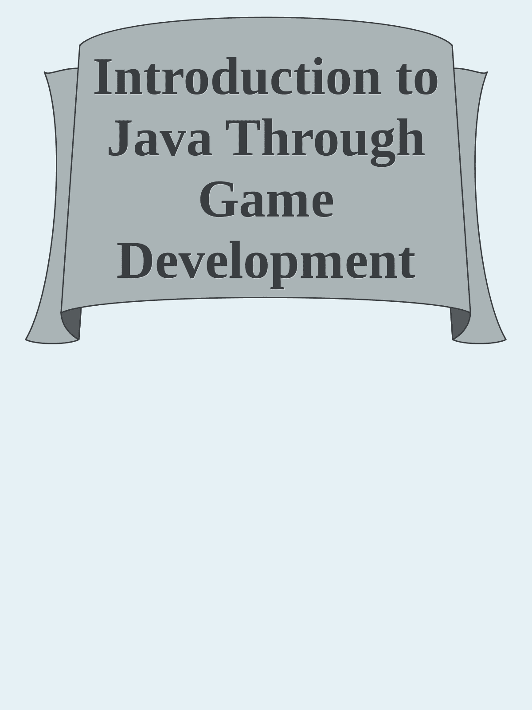

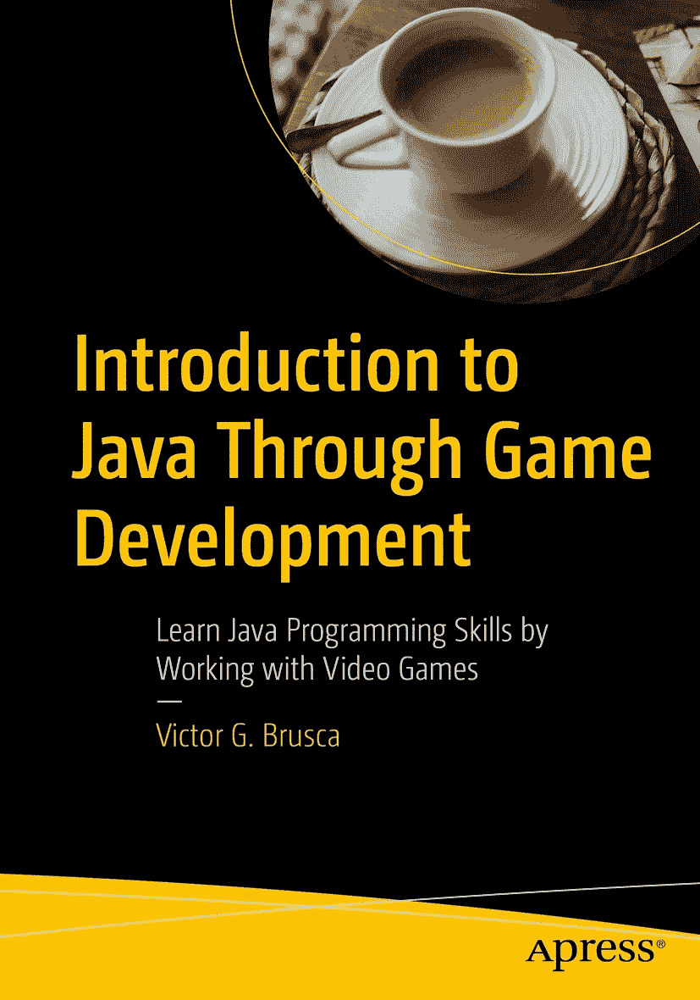

ISBN-13 (平装本): 978-1-4842-8950-1

ISBN-13 (电子版): 978-1-4842-8951-8

[`doi.org/10.1007/978-1-4842-8951-8`](https://doi.org/10.1007/978-1-4842-8951-8)

## [挑战解答 51](https://doi.org/10.1007/978-1-4842-8951-8_3#Sec5)

## [var 关键字与动态类型 52](https://doi.org/10.1007/978-1-4842-8951-8_3#Sec7)

## [变量的进阶 98](https://doi.org/10.1007/978-1-4842-8951-8_4#Sec15)

## [枚举 98](https://doi.org/10.1007/978-1-4842-8951-8_4#Sec16)

## 使用栈 [124](https://doi.org/10.1007/978-1-4842-8951-8_5#Sec9)

## 泛化类型与数据结构 [130](https://doi.org/10.1007/978-1-4842-8951-8_5#Sec11)

## 挑战：栈 [131](https://doi.org/10.1007/978-1-4842-8951-8_5#Sec12)

## 挑战解决方案 [132](https://doi.org/10.1007/978-1-4842-8951-8_5#Sec13)

## 结论 [134](https://doi.org/10.1007/978-1-4842-8951-8_5#Sec14)

## 我们涵盖的内容 [134](https://doi.org/10.1007/978-1-4842-8951-8_5#Sec15)

### 基础 Do-While 循环 [151](https://doi.org/10.1007/978-1-4842-8951-8_6#Sec8)

### [类设计 (179)](https://doi.org/10.1007/978-1-4842-8951-8_7#Sec12)

## [挑战：地下城陷阱的静态 Main (181)](https://doi.org/10.1007/978-1-4842-8951-8_7#Sec14)

## [挑战解决方案 (183)](https://doi.org/10.1007/978-1-4842-8951-8_7#Sec15)

## [结论 (185)](https://doi.org/10.1007/978-1-4842-8951-8_7#Sec16)

## [涵盖的内容 (186)](https://doi.org/10.1007/978-1-4842-8951-8_7#Sec17)

## [涵盖的内容 (222)](https://doi.org/10.1007/978-1-4842-8951-8_8#Sec19)

- ix

## [输出 (223)](https://doi.org/10.1007/978-1-4842-8951-8_9#Sec1)

## [IDE 调试功能 (224)](https://doi.org/10.1007/978-1-4842-8951-8_9#Sec2)

## [处理异常 (228)](https://doi.org/10.1007/978-1-4842-8951-8_9#Sec4)

## [定义异常 (231)](https://doi.org/10.1007/978-1-4842-8951-8_9#Sec5)

## [堆栈跟踪 (233)](https://doi.org/10.1007/978-1-4842-8951-8_9#Sec6)

## [结论 (234)](https://doi.org/10.1007/978-1-4842-8951-8_9#Sec7)

## [涵盖的内容 (234)](https://doi.org/10.1007/978-1-4842-8951-8_9#Sec8)

## [成就 (237)](https://doi.org/10.1007/978-1-4842-8951-8_10#Sec1)

## [致谢 (240)](https://doi.org/10.1007/978-1-4842-8951-8_10#Sec2)

## [后续之路 (242)](https://doi.org/10.1007/978-1-4842-8951-8_10#Sec3)

## [告别 (242)](https://doi.org/10.1007/978-1-4842-8951-8_10#Sec4)

**关于作者**

本文将引导你学习 `Java` 编程语言的基础及一些高级主题。随着我们不断进行不同的主题，你将面临挑战，去修改、修复、编写和/或调试书中包含的三个游戏之一的副本：

* 弹球游戏克隆 (Pong Clone)

* 记忆匹配 (Memory Match)

* 地牢陷阱 (Dungeon Trap)

* 4GB 系统内存

任何相对现代的计算机都应该能够处理这些工作负载。在使用任何现代编程语言时，必须对如何用该语言进行编码做出决定。很多时候，你只需要使用 `Notepad` 和几个命令行工具来编写和构建程序。但在我们这里，我们希望使用更高级的工具，因此我们需要使用 `IDE`。

`IDE` 是集成开发环境，是一个相当复杂的程序，其作用是让软件开发人员的一些任务变得更容易，以便他们能够承担更大的项目并专注于手头的编码。游戏是复杂的程序，通常有许多活动部件（字面意义上的）。因此，使用 `IDE` 将让我们获益匪浅，因此我们选择了 `NetBeans` IDE 作为我们的工具。

* 挑战解决方案

“主题”和“挑战”部分会根据需要重复，以涵盖章节的所有主题，并且在构建上有时会略有不同。但总的来说，每个章节的结构将与之前列出的相似。除了正文外，每个章节在相关的游戏项目中为该章节的每个挑战都有一个命名空间项。

在进一步阅读之前，我们还应该讨论书中的一些规范。首先，我们有项目列表：

```
int test = 0;
```

来自 `SomeClass.java` 文件的示例代码列表说明。

关于代码片段所展示代码的信息，可以在标题文本和/或说明文字或与该代码片段相关的上下文中找到。代码片段中的行号相对于代码的起始行，而不是绝对行号。代码的起始行由文本上下文、文本当前正在使用的示例决定，除非代码跨越了多个列表，否则它始终从第 1 行开始。图片的呈现方式也类似，如后文所示。

Dungeon Trap 游戏主菜单的截图。

最后，文中某些地方会列出提示（tip）或旁注（aside）。文中共有两种类型的侧边注：关于游戏开发的注释和关于 Java 编程语言的注释。这些条目的格式如下：

- *Java 编程注：关于 Java 编程的详细说明。*

这种列表类型将用于介绍某个主题的扩展或高级信息，这些信息与游戏开发或 Java 编程语言有关。

### Java 高级主题

- 字段：使用类字段

- 类设计：关于类设计和实现的讨论点

- 继承：对继承的简要回顾

- 项目结构：处理三个不同游戏及其类、项目结构的经验。

- 主游戏循环：处理并理解主游戏循环重要性的经验。

一张展示在编写本文时 NetBeans IDE 下载链接的截图。

**图 1-3. 截图 – NetBeans IDE 下载 2**

Apache NetBeans IDE 13 主安装界面。

**图 1-5. 截图 – NetBeans IDE 安装 2**

当安装完成后，打开 NetBeans 并遵循任何软件更新提示。在下一节中，我们将安装并配置与本书相关的游戏项目。

* `Pong Clone`

一张打开了游戏项目的 NetBeans IDE 截图。

对于此项目属性，我们要确保“工作目录”（Working Directory）设置为构建项目 JAR 文件的目录。默认情况下，这是 `./dist` 目录。最后，在“类别”列表中选择“源代码”（Sources）项（图 1-9

* `MmgApi.jar`

**图 1-11. 截图 – NetBeans IDE 游戏演示**

有几种方法可以找到文件中所有需要调整代码的地方。一种方法是更改变量的数据类型并查找由此更改引起的错误。你也可以对变量名进行文本搜索，或者右键点击变量并选择“Find Usages（查找用法）”选项。你必须将用于在数据结构中获取/设置值的类方法从 `ArrayList` 使用的更改为 `Stack` 使用的。你需要创建一个新的 `Boolean` 类字段来跟踪何时找到了匹配项，以便你决定是否需要添加它。

### 提示：

有几种方法可以找到文件中所有需要调整代码的地方。一种方法是更改变量的数据类型并查找由此更改引起的错误。你也可以对变量名进行文本搜索，或者右键点击变量并选择“Find Usages（查找用法）”选项。你必须将用于在数据结构中获取/设置值的类方法从 `ArrayList` 使用的更改为 `Stack` 使用的。你需要创建一个新的 `Boolean` 类字段来跟踪何时找到了匹配项，以便你决定是否需要添加它。

### 提示：

有几种方法可以找到文件中所有需要调整代码的地方。一种方法是更改变量的数据类型并查找由此更改引起的错误。你也可以对变量名进行文本搜索，或者右键点击变量并选择“Find Usages（查找用法）”选项。你必须将用于在数据结构中获取/设置值的类方法从 `ArrayList` 使用的更改为 `Stack` 使用的。你需要创建一个新的 `Boolean` 类字段来跟踪何时找到了匹配项，以便你决定是否需要添加它。

### 提示：

有几种方法可以找到文件中所有需要调整代码的地方。一种方法是更改变量的数据类型并查找由此更改引起的错误。你也可以对变量名进行文本搜索，或者右键点击变量并选择“Find Usages（查找用法）”选项。你必须将用于在数据结构中获取/设置值的类方法从 `ArrayList` 使用的更改为 `Stack` 使用的。你需要创建一个新的 `Boolean` 类字段来跟踪何时找到了匹配项，以便你决定是否需要添加它。

### 提示：

有几种方法可以找到文件中所有需要调整代码的地方。一种方法是更改变量的数据类型并查找由此更改引起的错误。你也可以对变量名进行文本搜索，或者右键点击变量并选择“Find Usages（查找用法）”选项。你必须将用于在数据结构中获取/设置值的类方法从 `ArrayList` 使用的更改为 `Stack` 使用的。你需要创建一个新的 `Boolean` 类字段来跟踪何时找到了匹配项，以便你决定是否需要添加它。

### 提示：

有几种方法可以找到文件中所有需要调整代码的地方。一种方法是更改变量的数据类型并查找由此更改引起的错误。你也可以对变量名进行文本搜索，或者右键点击变量并选择“Find Usages（查找用法）”选项。你必须将用于在数据结构中获取/设置值的类方法从 `ArrayList` 使用的更改为 `Stack` 使用的。你需要创建一个新的 `Boolean` 类字段来跟踪何时找到了匹配项，以便你决定是否需要添加它。

### 提示：

有几种方法可以找到文件中所有需要调整代码的地方。一种方法是更改变量的数据类型并查找由此更改引起的错误。你也可以对变量名进行文本搜索，或者右键点击变量并选择“Find Usages（查找用法）”选项。你必须将用于在数据结构中获取/设置值的类方法从 `ArrayList` 使用的更改为 `Stack` 使用的。你需要创建一个新的 `Boolean` 类字段来跟踪何时找到了匹配项，以便你决定是否需要添加它。

## 栈解决方案

栈的解决方案非常直接，但需要你在代码中，将以下方法调用：

```
clickedCards.add(itm);
clickedCards.get(i);
```

改为：

```
clickedCards.push(itm);
clickedCards.pop();
```

你会看到 `Stack` 替换了 `ArrayList`。

**图片 5-1. 使用栈进行卡片跟踪**


这是一个显示使用栈进行卡片跟踪的重构代码截图。

记住在使用 `pop` 方法时，`Stack` 中的值会被移除。这意味着如果你想多次遍历一个 `Stack`，你就必须跟踪被弹出的值并在需要时恢复它们。

# 第 6 章 循环与迭代

你已经建立了自己的编码工具箱，并且拥有一系列强大的工具，包括数据结构。有一件事我们在几个代码列表中都看过，但没有详细审查过，那就是如何在循环中多次运行代码。

循环和迭代就像流程控制一样，是许多 Java 程序中不可或缺的。

事实上，没有循环，我们真的无法开发游戏。我将在本章节后面深入讨论主游戏循环时对此进行详细阐述。现在，让我们关注循环的基础知识。Java 编程语言为我们提供了三种不同的技术，可以在程序中使用循环和迭代。让我们来看看我们有哪些工具。

* **For 循环 (For Loops)**：我们在示例列表和编码挑战中见过几次。

* **For-Each 循环 (For-Each Loops)**：与其对应的 for 循环，for-each 循环遵循相同的逻辑结构，但表达方式不同。

* **Do-While 循环 (Do-While Loops)**：循环结构中的异类，尽管在某些情况下非常有用。

我之前提到了迭代（iteration）的概念，我们将在讨论 for-each 循环时进一步探讨这一概念。事实证明，Java 作为一种功能齐全且成熟的编程语言，拥有 `Interfaces`（接口）的概念。`interface` 正如其名，是一种与事物交互的一 set 方式。当它应用于数据结构时，我们可以定义一套遍历它们的方法。也就是说，如果序列中有下一个元素，就向数据结构请求。接下来，我们将查看 Java 中的 for 循环。

# 第 6 章 循环与迭代

## For 循环

在我看来，for 循环是 Java 中循环结构的主力军。对于大多数需要在循环中重复执行代码的情况，它们通常是首选解决方案。我们将从介绍基础 for 循环开始讨论循环问题。

### 基础 for 循环

for 循环有两个版本。在本节中，我们将查看 for 循环的基础版本，它接受若干参数来定义循环的限制。

控制程序中的循环非常重要。for 循环本质上是安全的，尽管你仍然可能滥用它们，因为它们要求你定义循环迭代的起点和终点。让我们来看一个示例

***Listing 6-1***。基础 for 循环示例

```java
//code
1 for(int i = 0; i < 10; i++) {
2 System.out.print(i + ", ");
3 }
//output
1 Loop Output: 0, 1, 2, 3, 4, 5, 6, 7, 8, 9,
```

这是一个带有内部索引变量、固定长度和简单递增的基础 for 循环示例。注意元素编号是 0 到 9，而不是 1 到 10。

我们在文本过程中遇到过几次基础 for 循环，所以它对你来说应该很熟悉。让我们分解一下这里到底发生了什么。for 语句由三个部分和一个体组成。for 循环的第一部分由第一个分号结束。这个空间用于初始化循环变量。在此声明的变量仅在循环体的作用域内可用，这意味着你不能在循环外部引用它们。例如，`Listing 6-2` 中的示例将导致错误。

***Listing 6-2***。循环控制变量作用域示例

```java
1 for(int i = 0; i < 10; i++) {
2 System.out.print(i + ", ");
3 }
4 System.out.println("The last index of the loop was " + i + ".");
```

一个在循环作用外错误访问循环控制变量的示例。

for 循环声明的第二部分是测试条件的定义。

这是你设置的导致循环停止运行的条件。不用说，这是循环声明的重要部分。这部分由第二个分号结束。声明的最后部分是递增/递减语句。它决定了在每次循环迭代后如何调整循环控制变量。

现在你已经了解了 for 循环声明的所有不同部分，我可以告诉你，其中任何部分都不是必须的。让我们通过示例来进一步讨论。

***Listing 6-3***。空 for 循环示例

```java
1 for(; ;) {
2 System.out.print("Still running...");
3 }
```

一个空 for 循环的示例。Java 编译器会对这个循环报错，但仅当在它之后有代码的情况下。

你认为运行 `Listing 6-3` 中的 for 循环的结果是什么？如果你想到了无限循环，那么你是正确的。这个循环将无限运行，这并不是什么好事。在开发游戏时，我们喜欢控制循环。通常情况下，在编程时，你不应该设计无限循环。没有理由不像这样包含一个退出条件。

***Listing 6-4***。带有退出条件的 for 循环示例

```java
1 boolean exit = false;
2 for(; exit == true;) {
3 System.out.print("Still running...");
4 }
```

我们已经涵盖了 for 循环的基础，但在转向 for-each 之前，我想回顾一下关于它们的一些细节。

***Listing 6-5***。使用不同技术的 for 示例组


```java
//code
01 System.out.print("Loop #1: ");
02 for (int h = 0; h < 10; h++) {
03 System.out.print(h + ", ");
04 }
05 System.out.println("");

06
07 System.out.print("Loop #2: ");
08 int i;
09 for (i = 0; i < 10; i++) {
10 System.out.print(i + ", ");
11 }
12 System.out.println("");

13
14 System.out.print("Loop #3: ");
15 int j = 0;
16 int len = 10;
17 for (; j < len; j++) {
18 System.out.print(j + ", ");
19 }
20 System.out.println("");

21
22 System.out.print("Loop #4: ");
23 int k = 0;
24 for (; k < len++) {
25 System.out.print(k + ", ");
26 }
27 System.out.println("");

28
29 System.out.print("Loop #5: ");
30 int l = 100;
31 int delta = 5;
32 for (; l > 0; l -= delta) {
33 System.out.print(l + ", ");
34 }
35 System.out.println("");
```

//output

01 Loop #1: 0, 1, 2, 3, 4, 5, 6, 7, 8, 9,

02 Loop #2: 0, 1, 2, 3, 4, 5, 6, 7, 8, 9,

03 Loop #3: 0, 1, 2, 3, 4, 5, 6, 7, 8, 9,

04 Loop #4: 0, 1, 2, 3, 4, 5, 6, 7, 8, 9,

05 Loop #5: 100, 95, 90, 85, 80, 75, 70, 65, 60, 55, 50, 45, 40, 35, 30, 25, 20, 15, 10, 5,

在这种情况下，我们已经将整个语句移到了外部。在这个阶段，移动循环控制变量的初始化可能仅仅是一个风格问题。它与在循环之外声明变量但作为循环声明的一部分进行初始化，在功能上没有区别。

最后，我们来看第 5 号循环。在这个 `for` 循环中，我们实际上看到了两个以前从未见过的东西。你能发现它们吗？第一个是我们将循环的增量（即加/减值）声明在了循环之外。这符合“数据驱动这些数值”的理念。第二个是这个循环是倒计数的，而不是递增的。不言说，基础 `for` 循环的实现有很多种变体。但在大多数情况下，它们只是对最基础 `for` 循环语句的细微调整。在下一节中，我们将查看另一种 `for` 循环：`for-each` 循环。

## For-Each 循环

我们花相当的时间回顾了 `for` 循环，这是你编程工具箱中一种强大的新工具。在本节中，我们将查看 `for` 循环的近亲：for-each 循环。

在 Java 中，一种常见的情况是对数据结构的内容进行迭代（循环）。

这种情况在游戏中非常频繁，用于检查游戏对象的状态以检测碰撞等情况。这在 Java 游戏编程中是非常常见的现象，那么，让我们来看一个使用基础 `for` 循环和数组来迭代数据结构的示例，好吗？

**Listing 6-6.** 使用 `for` 循环遍历数组的示例

```java
int[] ar1 = new int[] { 0, 1, 2, 3, 4, 5 };
int len = ar1.length;

for (int i = 0; i < len; i++) {
    int val = ar1[i];
    System.out.println("Index: " + val);
}
```

使用基础 `for` 循环遍历数组的示例。

这并不是一个最有趣的例子，但有几点我想讨论。

第一个是，当我们遍历数组时，我们通过使用循环控制变量从数组中提取数据，从而跟踪我们正在查看的数组索引。注意，我们决定将 `len` 变量的值设置为数组的长度，并在循环的条件语句中使用它。

**游戏编程笔记：**在遍历数据结构时，你通常需要获取要循环的项的长度或计数。在某些情况下，你可能可以直接在 `for` 循环的声明中添加返回数据结构大小的方法调用。将该值存储在局部变量中一次，比每次循环迭代时都计算它要高效得多。这很大程度上取决于你使用的数据结构，但这是你应该注意到的点。

现在，让我们来看相同的代码，但我们将使用 `for-each` 循环。有几点应该引起我们的注意。来看代码！

**Listing 6-7.** 使用 `for-each` 循环遍历数组的示例

```java
int[] ar1 = new int[] { 0, 1, 2, 3, 4, 5 };

for (Integer val : ar1) {
    System.out.println("Index: " + val);
}
```

使用基础 `for-each` 循环遍历数组的示例。数组可以是任何数据类型；我们为了简化列表，选择了整数。

我应该花点时间说明，数组可以包含其他数据类型，如 `String`、`Object` 或其他类。乍一看，它似乎比基础 `for` 循环实现更整洁一些。但存在一些重要的区别。我们没有循环控制变量，也没有退出条件。因为我们是直接遍历数组（使用 `Enumeration` 接口），我们不再对该过程进行直接控制。另一个微小区别是我们使用的是 `Integers` 而不是 `ints`，并且我们将用于存储每个数组元素的变量 `val` 的声明移动到了循环声明本身中。

你可能会问，既然我们可以用 `for` 循环做同样的事情，为什么还需要 `for-each` 循环呢？嗯，`for-each` 循环确实有它们的用武之地。在处理数据结构时，它们更直观一些，但要使用它们你必须放弃一点控制权。无论如何，它们都是你编程工具箱中重要的工具；在处理数据结构时请记住它们。这带我们离开了 `for` 循环回顾的结论。

在下一节中，我们将查看一种非常重要的循环类型：`while` 循环。

## While 循环

我们将查看的下一种循环是 `while` 循环。与之前的很多语言一样，Java 支持 `while` 循环，而在我们的特殊情况下，它确实是一个非常重要的循环。这是因为 `while` 循环是游戏主循环中使用的 Java 循环语句。稍后我们会详细介绍这一点。在声明复杂度上，`while` 循环比 `for` 循环轻得多。你只需要提供循环退出的条件和一个体（如果你愿意的话）。让我们来看基础的 `while` 循环。

### 基础 While 循环

基础 `while` 循环的声明比 `for` 循环简洁，但它有一些主要区别。我重构了代码以使用 `while` 循环。

**Listing 6-8.** `While` 循环的示例

```java
int i = 0;

while (i < 10) {
    System.out.print(i + ", ");
    i++;
}
```

//输出 0, 1, 2, 3, 4, 5, 6, 7, 8, 9,

使用基础 `while` 循环遍历数组的示例。

你可能会问，如果 `while` 循环比 `for` 循环更手动且抽象，为什么还需要它们呢？虽然在大多数情况下可以在它们之间转换，但 `for` 循环更适用于对集合进行索引迭代。

**Listing 6-9.** 基于条件的 `while` 循环示例

```java
while (gameRunning) {
    // 放置游戏代码
}
```

使用 `while` 循环响应状态运行代码的示例。

另一个真正强化了 `while` 循环是 `for` 循环更好选择的例子是在必须等待某些时间流逝时。

**Listing 6-10.** 时间 `while` 循环的示例

```java
long t = System.currentTimeMillis();
long end = t + 2000; // 2 秒

// 等待 2 秒流逝
while (t < end) {
    t = System.currentTimeMillis();
}
```

使用 `while` 循环等待某些时间流逝的示例。

## 主游戏循环

主游戏循环顾名思义；它是运行视频游戏关键进程的主循环。几乎每个视频游戏都有这样一个循环，所以我如果不简单地讨论一下，我就失职了。主游戏循环有几种不同的版本；让我在这里它们列出来。在开始这个话题之前，我想先说明一下讨论的内容会有点高级。对我来说，准确地回顾这些信息比尝试简化它们更重要。这是一个你应该经常回来的章节。

### 主游戏循环版本

- **隐式帧率（Implicit Frame Rate）**：我知道这听起来很惊讶，但既然硬件时钟频率限制在 `25MHz`，为什么要浪费添加额外的汇编代码来控制帧率呢？我说的对吗？在这种情况下，`FPS` 是由硬件本身的限制的。
- **显式帧率（Explicit Frame Rate）**：在这个主游戏循环的版本中，你记录完成当前帧工作所需的时间。如果每帧分配的时间还有剩余，那么游戏将等待这段时间过去。通过等待，帧率将保持在目标 `FPS` 附近，而不是增加到硬件支持的最大 `FPS`。
- **帧率无关（Frame Rate Independent）**：在这个主游戏循环版本中，你完全不强制帧率；它是 `FPS` 独立的，但你仍然保持对游戏运行速度的控制。你不再看隐式或显式的帧率（每帧像素数），而是从时间的角度（每秒像素数）来看。为了这样做，你必须计算当前帧的时间差（time delta），稍后我会告诉你如何操作。很快就会详细介绍。

如果不讨论帧和帧率，我们无法真正讨论主游戏循环。视频游戏中的帧是游戏循环的一次迭代。主游戏循环的主要职责如下：

- **更新（Update）**：轮询硬件状态、更新敌人 AI、更新敌人位置等。游戏循环中的这一步是我们处理游戏逻辑并赋予其生命的地方。
- **绘制（Draw）**：有时被称为“渲染（render）”，绘制步骤是执行屏幕上表示游戏所需的所有计算的地方。

## 游戏引擎实现

用于驱动游戏引擎主游戏循环并在所有相关游戏项目实际代码如下。我们在这里不会深入回顾，但你能发现更新和绘制工作是在哪里执行的？提示：在代码列表中寻找这些单词，就能找到相关的方法调用。

**Listing 6-11.** MmgGameApiJava Game Engine’s Main Game Loop – Game Panel Class

```java
if (PAUSE == true || EXIT == true) {
    // do nothing
} else {
    UpdateGame();
}

// update graphics
bg = GetBuffer();
g = backgroundGraphics;

if (currentScreen == null || currentScreen.IsPaused() == true ||
    currentScreen.IsReady() == false) {
    // do nothing
} else {
    // clear background
    g.setColor(Color.DARK_GRAY);
    g.fillRect(0, 0, winWidth, winHeight);

    // draw border
    g.setColor(Color.WHITE);
    g.drawRect(
        MmgScreenData.GetGameLeft() - 1,
        MmgScreenData.GetGameTop() - 1,
        MmgScreenData.GetGameWidth() + 1,
        MmgScreenData.GetGameHeight() + 1
    );

    g.setColor(Color.BLACK);
    g.fillRect(
        MmgScreenData.GetGameLeft(),
        MmgScreenData.GetGameTop(),
        MmgScreenData.GetGameWidth(),
        MmgScreenData.GetGameHeight()
    );

    p.SetGraphics(g);
    p.SetAdvRenderHints();
    currentScreen.MmgDraw(p);

    if (MmgHelper.LOGGING == true) {
        tmpF = g.getFont();
        g.setFont(debugFont);
        g.setColor(debugColor);
        g.drawString(GamePanel.FPS, 15, 15);
        g.drawString("Var1: " + GamePanel.VAR1, 15, 35);
        g.drawString("Var2: " + GamePanel.VAR2, 15, 55);
        g.setFont(tmpF);
    }
}
```

主游戏循环负载的一个示例。你能看到为显示更新帧率数据的地方吗？

让我们从最基础的主游戏循环示例开始，一个具有隐式帧率的循环。

**Listing 6-12.** 控制循环时间和帧率

```java
while (RunFrameRate.RUNNING == true) {
    if (RunFrameRate.PAUSE == false) {
        Update();
        Redraw();
    }
}
```

这是一个仅由硬件限制帧帧率的非常简单的主游戏循环示例。

正如你在最基础的主游戏循环形式中看到的，我们没有做任何工作来控制循环执行的速度。我们只是让它尽可能快地运行。

关于帧和帧率的概念……（此处省略了原文中大量重复的短语）

## 循环时间和帧率

```java
frameStop = System.currentTimeMillis();
frameTime = (frameStop - frameStart) + 1;
aFps = (1000 / frameTime);

frameTimeDiff = tFrameTime - frameTime;

if (frameTimeDiff > 0) {
    try {
        Thread.sleep((int) frameTimeDiff);
    } catch (Exception e) {
        MmgHelper.wrErr(e);
    }
}

frameStop = System.currentTimeMillis();
frameTime = (frameStop - frameStart) + 1;
rFps = (1000 / frameTime);
mf.SetFrameRate(aFps, rFps);
```

这是一个使用 Java 的 `Thread` 类休眠固定时间的示例，允许控制循环的时机。

处理帧所需的总时间在第 9 行进行计算。核心值加了 1 以避免出现不方便的 0 值。为了确定当前帧的实际帧率（第 10 行），我们将 1000ms 除以帧时间。`timeFrameDiff` 变量存储了每帧分配的时间与实际时间之间的差。如果该值大于 0，则说明我们有一些额外的时间。

为了打发时间，我们在第 15 行让当前线程休眠额外的时间。最后一次计算是在时间损耗后确定真实的帧率。实际帧率是基于让游戏尽可能快地运行，而真实帧率衡量的是游戏试图维持的速率。最后，在第 24 行，帧率的值为 148。

# 第 6 章 循环与迭代

已针对当前程序进行更新。你每次运行关联的游戏项目时，都能看到这些值。从上一个列表中的示例主游戏循环中，你可以看到这种方法通过控制每帧完成的工作量（以毫秒计）来控制游戏的性能。通过控制每秒运行的帧数，我们就可以控制游戏的速度。

这就是我之前提到的“每帧像素”方法。如果我们放弃尝试控制游戏帧率的想法，会发生什么？嗯，你会说这是一个坏主意，因为游戏在不同硬件上的运行情况会有不同。让我们得出一个计算公式，告诉我们在不限制循环执行时间的情况下，当前帧时间和上一帧时间之间经过了秒钟的百分比。让我用一些代码来演示。

**Listing 6-15.** 计算帧之间的增量时间（Delta Time）

```java
float deltaTime = (frameStart - lastFrameStart) / 1000.0f;
```

计算当前帧增量时间的示例。这个小因子必须应用于所有更新指标，以将它们同步到同一计时。

增量时间或时间变化是此帧开始时间与上一帧开始工作瞬间之间的差值。本质上，我们捕捉了完成一次更新所需的时间，并将其除以 1000ms 或 1 秒。这得到了一个代表一秒中极小片段的因子。思考一下：我们在这里并没有控制帧。游戏可以以它所希望任何速度运行。这将导致一个非常小的 `deltaTime`。这个计算足够简单，但脱离上下文来看它并对我们产生什么神奇的效果。让我们来看看一个完整的实现。

**Listing 6-16.** 帧率无关主游戏循环示例

```java
while (RunFrameRate.RUNNING == true) {
    frameStart = System.currentTimeMillis();

    float deltaTime = (frameStart - lastFrameStart) / 1000.0f;
    lastFrameStart = System.currentTimeMillis();

    Update(deltaTime);
    Draw(deltaTime);
}
```

帧率无关主游戏循环的示例实现。使用这种方法需要一致使用 `deltaTime` 因子来同步计时和移动。


**游戏编程笔记：** 如果真的不需要，在主游戏循环中声明变量可能不是一个好主意。我们在列表中保留此声明是为了强制确保 `deltaTime` 这个 `float` 变量是一个浮点数。

注意，在帧率无关主游戏循环的完整版本中，我们可以看到计时值是如何相对于 `update` 中执行的工作而设置的。在这种情况下，我们在计时计算中同时包含了 `update` 和 `draw` 方法。这会导致 `(frameStart - lastFrameStart)` 的值是一个很小的数，只有几毫秒。将一个很小的数除以 `1000.0ms` 会得到一个更小的数，而这就是我们现在需要应用于当前帧的所有移动、动画和计时值的增量时间值。基本上，任何每秒变化固定数量的内容，现在只变化与秒钟一小部分相关的数量。

我们所做的是改变主游戏循环的运行方式，以便我们在每个游戏帧根据处理前一帧所需的时间进行微调。这要求我们所有的更新逻辑都是基于时间的而不是基于帧的。让我们看看这种区别可能是什么样的。

### Listing 6-17. 基于帧和基于时间的物体移动示例

```java
// frame based
int targetFPS = 60;
int movementPerSecond = 600; // 600 像素
int movementPerFrame = movementPerSecond/targetFPS;
enemy1.moveXY(movementPerFrame);

// time based
movementPerFrame = (int)(movementPerSecond * deltaTime);
enemy2.moveXY(movementPerFrame);
```

一个演示基于帧和基于时间的移动计算的示例。注意 `deltaTime` 因子的使用。

这结束了我们对主游戏循环的讨论。希望你发现它很有趣，并且是我们循环循环知识的良好应用。在下一节中，我们将用较少使用但仍然重要的 `do-while` 循环结束对 Java 编程语言中循环的回顾。

## Do-While 循环

我们在 Java 语言中要回顾的最后一个循环有点特殊。`do-while` 循环不像它的 `for` 和 `while` 循环那样频繁使用，因为它有一个特定的属性，使其仅在非常窄的范围内非常有用。

### 基础 Do-While 循环

`do-while` 循环的语法所示。

### Listing 6-18. Do-While 主游戏循环示例

```java
// basic do-while loop
do {
    // 每帧要做的工作
} while (RunFrameRate.RUNNING == true);
```

基于 `do-while` 循环的主游戏循环示例。虽然实际上不会用它，但我确实希望游戏至少运行一次，所以将 `do-while` 循环作为游戏循环可能并不疯狂。

## Break 和 Continue

讨论循环时，我们离不开 `break` 和 `continue`。

这些是循环控制语句，允许你显式退出循环或在条件允许的情况下跳转到循环的下一次迭代。演示它们比描述它们容易得多，所以让我们用代码示例来激发这一讨论。

### Listing 6-19. 使用 Break 和 Continue 控制循环的示例

```java
// basic while loop with loop control
while (RunFrameRate.RUNNING == true) {
    if (PAUSE == true) {
        continue;
    } else {
        UpdateGame();
        DrawGame();
    }

    if (EXIT == true) {
        break;
    }
}
```

在本章的唯一编码挑战中，你将需要依靠新学到的知识和编码工具来完成要求。请查看以下描述和提示。如果在处理 `for-each` 循环时有任何问题，请返回查看正文。祝运！

### 涉及的包

- `net.middlemind.PongClone_Chapter6_Challenge1`
- `net.middlemind.PongClone_Chapter6_Challenge1_Solved`

### 描述

其中一名高级程序员注意到 `MmgDraw` 方法中使用了基础的 `for` 循环。重构该方法中的代码以使用 `for-each` 循环。如果操作正确，游戏应该正常运行而不会报错。你必须运行此包的文件——`MemoryMatch.java`；右键点击并选择 `Run File` 来测试游戏。

### 提示

回我们对 `for` 循环的审查，`for-each` 循环与 `for` 循环相似，区别在于它声明了自身的临时变量，并且仅用于遍历数据结构的内容。尝试在现有循环的上方或下方编写新 `for-each` 循环的声明，这样你就可以编写代码时对两者进行比较。作为一个额外的提示，文中有一个特定的列表演示了如何将 `for` 循环转换为 `for-each` 循环。搜索“CHAPTER 6 CHALLENGE 1 SOLUTION”来查找已解决方案项目文件中的所有解决方案文本。

### 挑战解决方案

此挑战的解决方案位于 `MmgDraw` 方法中，它需要标准的 `for` 到 `for-each` 循环转换，外加额外的小心以确保 `Boolean` 标志被正确设置。仅此而已。在处理这些挑战时请花些时间，并像既往一样，运行游戏的本地静态主类 `MemoryMatch.java` 来测试你的工作。如果你转换了循环但卡片没有翻回去，请检查你是否在 `MmgDraw` 方法中正确设置了 `flipped` 字段。

153

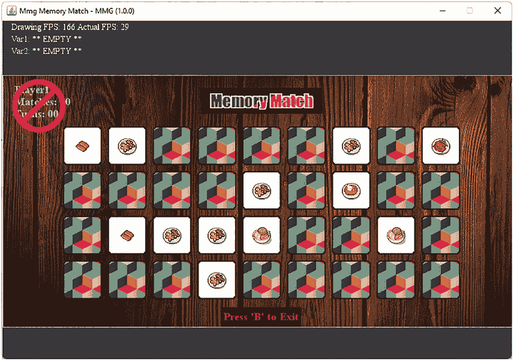

***图 6-1。在 `MmgDraw` 方法中使用重构 `for` 循环的内存配对游戏* 本挑战中用到的游戏副本的截图。重构代码后，游戏按预期运行。

这使我们达到了本节的结论。在你成功完成编码挑战后，花点时间玩一次游戏。确保游戏功能符合预期。

## 结论

这标志着我们关于循环和迭代章节的结束。实际上，关于循环这个主题还有相当多的材料需要涵盖。例如，为什么我们能够将几乎任何数据结构插入 `for-each` 循环声明中？

我可能简要提到过这一点，但我们在这里无法对其进行详细介绍。

在接下来的两个章节中回顾 Java 面向对象编程时，你将理解背后的运行原理。现在，让我们看看本章回顾的内容摘要。

154

第 6 章 循环与迭代

## 我们涵盖了什么

在对 Java 语言中循环和迭代的探索过程中，我们查看了 Java 中所有的标准循环机制——`for`、`while` 和 `do-while` 循环。我们特意审查了最著名的循环：主游戏循环。

我们甚至查看了主游戏循环的三种常见实现。让我简要总结一下这些主题。

- **基础 For 循环**：我们查看了如何声明基础 `for` 循环，以及在循环外部声明变量的微妙使用如何改变我们与计数和循环控制变量交互的方式。
- **基础 For-Each 循环**：我们将 `for` 循环与 `for-each` 循环并列，重构了一些之前的代码以使用这种新的循环结构。我们看到了 `for-each` 循环可以多么简洁直观。
- **基础 While 循环**：我们使用了基础 `while` 循环，研究了它们与 `for` 循环的区别，并指出了需要 `while` 循环而非 `for` 循环的不同场景。
- **主游戏循环**：在本章中，我们审查了三种最常见的主游戏循环类型：隐式帧率、显式帧率和帧率无关。
- **Do-While 循环**：尽管许多人认为它是语言的一种过时特性，但如果你恰在一个循环至少迭代一次的解决方案空间工作，它可以成为救星。我们的简短回顾结合 `while` 循环的章节，应该为你提供一个坚实的基础。
- **Break 和 Continue 语句**：如果没有讨论 `break` 和 `continue` 语句，对 Java 循环的审查就是不完整的。我们快速回顾了这一主题并说明了它们的用法。

现在我们已经涵盖了循环并为我们的编码工具箱增加了一整套新工具，我们准备好迎接 Java 语言中更高级的方面之一：面向对象编程。你有了足够的经验和坚实的基础可以借鉴；将面向对象编程仅仅视为添加到你工具箱中的另一个工具即可。享受其中！

155

# 第 7 章

## 对象、类与 OOP

在过去的几个章节中，你增加了处理 Java 语言的经验，现在我们到达了更高级的主题 OOP，即面向对象编程。Java 首先是一门面向对象的编程语言。无论你是否意识到，在几乎整个文本中一直在使用类和面向对象编程，本质上是从数据结构开始的。

如果你发现这个主题太令人生畏，这个事实应该让你放心。让我们尝试给 Java 中的 OOP 一个简单的定义。首先，你定义你的类。例如，如果你创建一个新类来管理飞船，文件可能命名为 `SpaceShip.java`。

你将以最基础的方式使用这个类，如下：

```java
SpaceShip testShip = new SpaceShip();
```

其实就是这样。在最基础的层，类是你建模某些东西的方式。我们如何在计算机上建模某些东西？我们收集并跟踪数据。有时这些数据是实际上看起来像飞船的图像；有时，它只是描述其属性的数字；有时，两者兼有。

这里的主要要点是，你定义的类在程序中使用会变成类的实例或对象。不要与所有 Java 类的父类：`Object` 类混淆。现在，思考我们一起回顾的所有不同数据结构。回用于定义数据结构内部类型的尖括号。使用 `SpaceShip` 类来进一步讨论，让我们看看如何结合数据结构使用：

157

© Victor G. Brusca 2023

第 7 章 ObjeCts, Classes, and OOp

```java
//来自 java.util 包的 ArrayList 类
ArrayList<SpaceShip> enemyShips = new ArrayList<>();
```

这个定义引入了一些有趣的概念。首先，它暗示了这样一个观点：你定义的 `classes`（类）是用于创建某些东西——即对象（objects）。我们之前讨论过一些对象，但让我们开始把它们看作 `class` 的实例（instance），并记住一个 `class` 在某个处有一个文件，文件名与 `class` 相同，且扩展名为 `.java`。这就是 Java 编程语言中类的通用性质。让我们更深入地了解它们，以及如何开始定义我们自己的类。通常情况下，Java 中一个 `class` 的定义可以包含以下信息：

- **访问修饰符（Access Modifiers）**：`class` 可以是 `public`（公共）或 `private`（私有），或者使用默认访问修饰符。
- **类关键字（Class Keyword）**：`class` 关键字用于创建一个 `class`。
- **类名（Class Name）**：名称应以字母开头，在 Java 中，该字母通常大大写的。
- **超类（Superclass，可选）**：类的父类（`superclass`）的名字，如果有，前面带有 `extends` 关键字。一个 `class` 只能 `extend` 一个父类。
- **接口（Interfaces，可选）**：由该 `class` 实现的接口列表（逗号分隔），如果有，前面带有 `implements` 关键字。一个 `class` 可以实现多个接口。
- **类体（Body）**：类体用大括号 `{}` 包围。这是定义类成员——包括字段（fields）、方法和构造函数——的地方。

让我们关注如何声明一个 `class`。因此，我们将在下一章节查看类的 `extension`（继承）和接口。现在，我们将重点关注访问修饰符和基本的类声明。让我来给你们展示几个标准类声明的版本，我们将回顾它们的区别。

### 列表 7-1. 简单类声明示例

```java
package org.learn_java.classes;

// 类 #1，public 访问
public class SimpleClassPublic { ... }

// 类 #2，默认访问
class SimpleClassDefault { ... }

// 类 #3，顶层类不允许使用
protected class SimpleClassProtected { ... }

// 类 #4，顶层类不允许使用
private class SimpleClassPrivate { ... }
```

该列表显示了几个正确的类声明，随后是两个错误的声明。你不能在顶层 `class` 上使用 `protected` 或 `private` 修饰符。在列表 7-1 中，有很多简单的类声明。前两个是有效的，因为它们指定了 `default` 或 `public` 访问。后两个是无效；你会得到编译器错误。Java 不喜欢在顶层类声明中使用这些访问修饰符。让我在这里总结一下你可以使用的修饰符：

- `public`：该类可以被任何其他类访问。
- `default`：该类只能被同一包中的类访问。这在你没有指定指定修饰符时使用。

包（Packages）的提供是让你组织类的方法。通常，相关的类属于同一个包。默认访问修饰符也称为包级私有（package-private），这意味着所有成员在同一个包内是可见的，但无法从其他包访问。

现在我们已经知道了如何以最基本的形式声明一个 `class`，让我们来看看如何自定义这个 `class`。通常，类是创建某个事物模型的一种手段。因此，你需要能够将某些数据与你的 `class` 实例关联。类字段（Class fields）为你提供了这种方法。

### 字段（Fields）

在 Java 中，`fields` 是与 `class` 关联的特定数据类型的变量。`attribute`（属性）是它们的另一个名称，但它通常专门留给 `public` 类字段。简短的演示将极大地有助于你理解类字段。让我们找回第 4 章中的一个列表，一个基础 Java 类的示例。

### 列表 7-2. 基础 Java 类示例 – 原自列表 4-1

```java
public class GameData {
    public State gameState = State.NONE;
    public int numberOfPlayers = 1;
    public boolean gameOver = false;
    public String playerName = "AAA";
}

public GameData gameMetaData;
gameMetaData = new GameData();
```

一个通过 Java `class` 定义的自定义数据类型示例。注意使用 `fields` 来存储与 `class` 关联的数据。在列表 7-2 中，`GameData` 类有四个不同数据类型的字段。所有字段都具有 `public` 访问修饰符，因此它们可以被任何其他类访问。在 Java 中，所有代码都包含在某个级别的 `class` 中，因此所有访问控制都是基于类的。在我们讨论定义 `class` 时可用的其他访问修饰符之前，让我们先使用类的 `fields` 演示一下。在下一个列表中，我将调整用于 `class` 及其 `fields` 的修饰符。看看你是否能猜出由该声明定义的访问级别。

### 列表 7-3. 带有各种访问修饰符的基础 Java 类示例

```java
class GameData {
    State gameState = State.NONE;
    public int numberOfPlayers = 1;
    protected boolean gameOver = false;
    private String playerName = "AAA";
}

public GameData gameMetaData = new GameData();
```

一个使用各种访问修饰符用于类本身及其类 `fields` 的 Java `class` 示例。列表 7-3 对 `GameData` 类使用了 `default` 访问修饰符。这是相对于列表 7-2（使用了 `public`）的细微调整。同样，类 `fields` 分别更新为 `default`、`protected` 和 `private` 修饰符。当然，我们可以将它们都设为 `public`，并确保类字段被正确使用的责任留给程序员。这是另一个可以由 Java 编译器管理的开发者责任的示例。例如，假设玩家的名字是神圣的。在我们的游戏中，一旦设置了玩家名字，我们就不希望它改变。为了这一点，我们在第 5 行的 `playerName` 变量上使用了 `private` 访问修饰符。现在它无法被任何代码修改。因为它是 `private`，它现在只能由 `GameData` 类本身通过类方法、构造函数或变量修改，如列表 7-3 所示。

`protected` 访问修饰符（第 4 行）允许访问符合以下标准的字段：

- 封装类的任何代码
- 同包中的其他类
- 子类（扩展该类的类），无论在哪个包中。

花点时间了解你的 Java IDE 创建的项目结构，并清楚你的包（packages）和 Java 类文件位于何处。

思考一下你可能如何在自己的程序中使用这个访问修饰符。你能想象在什么情况下，你想要限制对包内类的访问等？

这里没有对错之分，仅供参考思路。让我们来看第 3 行的下一个变量 `numberOfPlayers`。该变量具有 `public` 访问修饰符，可以从任何其他类访问。

### 列表 7-4. 访问基础 Java 类公共字段的示例

```java
1 GameData gameMetaData = new GameData();
2 System.out.println("Number of Players: " + gameMetaData.numberOfPlayers);
```

**输出**

```text
1 Number of Players: 1
```

第 7 章 对象、类与 OOP


在访问公共字段时，你只需要指定正确实例化的类实例（在本例中为`gameMetaData`），并使用点运算符`.`来指定你想要访问的公共字段。

**游戏编程笔记：**在 Java 游戏实现中，带有公共字段的简单类是完全正常的。当你需要知道字段的值正在变化时，再开始考虑控制字段的访问。届时你可以定义方法来与字段进行交互，并在需要时对现有代码进行重构。

如你所见，`public`访问修饰符非常简单，对类的变量提供了无限制的访问。在大多数情况下，如果你不确定到底需要什么访问权限，可以开始使用`public`访问修饰符。看使用这种类型的字段引用值是多简单，参考上一个列表代码部分的第 2 行。我们要讨论的最后一个访问修饰符是未提供修饰符的情况，即默认修饰符。默认修饰符允许以下条件下访问：

- 包含类内的任何代码
- 与包含类相同的包的其他类

这与`protected`访问修饰符没有太大区别，只是它不允许访问子类或扩展当前类的类（除非它们在同一个包中）。这让我们得出了类字段章节的结论。它们是你编程工具箱中的强大工具，因为你现在能够创建不仅支持跟踪某些数据，还能通过 Java 的访问修饰符控制对该数据访问的类。在下一节中，我们将查看类的另一个非常重要的部分：方法。

## 方法

方法是另一种类成员，意味着它们始终定义在类定义的上下文中。Java 中的方法与其他编程语言（如`C`和`C++`）中的函数相似。它们是仅在调用时运行的代码块。它们可以接收参数并返回值。

到目前为止，我一直避免讨论作用域（scope）的概念，因为它是一个更高级的编程概念，它与语言本身的细微差别关系不大，不如说与任何情况下语言元素的结构关系更大。Java 中的变量有作用域。变量的作用域是该变量有效且可访问的代码块或多个代码块。

Java 中的字段像其他变量一样有作用域，你不仅可以在类外部访问它们（正如我们在列表 7-4 中所示），还可以在类内部的方法中访问它们。

这允许你创建可重用的代码块，这些代码块与类的字段以及任何传递给方法的参数一起工作，并在需要时生成返回值。事实上，方法可以不接受任何参数也不返回任何数据。让我们通过几个不同方法声明示例来进一步这一讨论。我们将继续使用在前两个列表中使用的虚构`GameData`类。让我们进入代码世界！

### 列表 7-5. 不同类方法声明的示例

```java
01 class GameData {
02 public enum State {
03 NONE,
04 GAME_ON,
05 GAME_OFF
06 }
07
08 State gameState = State.NONE;
09 public int numberOfPlayers = 1;
10 protected boolean gameOver = false;
11 private String playerName = "AAA";
12
13 State getGameState() {
14 return this.gameState;
15 }
16
17 void setGameState(State newState) {
18 this.gameState = newState;
19 }
20
21 public int getNumberOfPlayers() {
22 return numberOfPlayers;
23 }
24
25 public void setNumberOfPlayers(int p) {
26 numberOfPlayers = p;
27 }
28
29 protected boolean getGameOver() {
30 return gameOver;
31 }
32
33 protected Boolean getGameOver2() {
34 return gameOver;
35 }
36
37 public void setGameOver(boolean b) {
38 gameOver = b;
39 }
40
41 public void setGameOver2(Boolean b) {
42 gameOver = b;
43 }
44
45 public String getPlayerName() {
46 return this.internalGetPlayerName();
47 }
48
49 public void setPlayerName(String pName) {
50 this.internalSetPlayerName(pName);
51 }
52
53 private String internalGetPlayerName() {
54 return this.playerName;
55 }
56
57 private void internalSetPlayerName(String pName) {
58 this.playerName = pName;
59 }
60 }
```

## 第 7 章 对象、类与 OOP

`GameData`类的完整列表，展示了`State`枚举、字段以及 get/set 方法。仔细查看列表并识别哪里使用了访问修饰符；我们现在详细介绍。在第 2 行，`State`枚举是`public`的。从我们对数据类型的回顾可以看出，枚举是一种专门用于一组唯一值的自定义数据类型。在这种情况下，我们有三个值的简单实现：`NONE`、`GAME_ON`和`GAME_OFF`。类变量声明在第 8-11 行；注意它们被赋予了默认值。如果没有显式表示，Java 将提供语言默认值。我们要查看的方法从 13 行开始。它使用默认访问修饰符且不带参数。方法使用的命名约定表明这是一个“get”方法。

在 Java 中，编写 get/set 方法来开放对保护字段的访问是一种常见约定。这为你带来了中心化的优势，并且可以通过其 get 和 set 方法地跟踪、追踪和调试对字段的访问。该方法返回类变量`gameState`值。在下一个方法中，我们提供了设置`gameState`值的方法，第 17 行。该类方法也使用默认访问修饰符且不返回值。

为了指示方法不返回值，我们使用`void`关键字代替返回数据类型。在这两个方法中隐藏着一个微妙的新 Java 特性。你发现了吗？注意`gameState`变量以及它在每个方法体中的引用方式。`this`关键字被用来引用类的实例。实际的类实例尚未存在，但当此类在 Java 程序中使用时，`this`关键字将解析为类的当前实例。

在类方法中使用`this`关键字是常见的，因为它直观地指示了哪些变量实际上类字段。我们要查看的下一组方法是`numberOfPlayers`变量的 get 和 set 方法，位于 21-27 行。在这种情况下，方法在声明上略有不同，因为它们都被显式设置为`public`，且在引用变量时没有使用`this`关键字。

如果你现在还没有猜到，类方法可以拥有与类字段相同的访问修饰符。`getNumberOfPlayers`和`setNumberOfPlayers`方法是公开的，因此任何类都可以访问它们。我们接下来要看到的两个方法是同一个方法的略有不同的版本，但它们的区别非常重要。你能发现我所指的细微差别吗？如果你正准备说是使用了`Boolean`数据类型而不是`boolean`，那么你是正确的。

## 第 7 章 对象、类与面向对象编程（OOP）

这是一个 Java 为基本数据类型及其对应的包装类型执行的自动“装箱”和“拆箱”的示例。你本来还以为这一节只包含关于类方法的信息。Java 编程语言中的许多事物都是紧密在一起的，或者具有有趣的重叠。`getGameOver`和`getGameOver2`方法都具有`protected`访问修饰符，并指定了`boolean`返回类型。

花点时间查看`setGameOver`和`setGameOver2`方法。注意方法参数中使用`Boolean`和`boolean`数据类型时也存在相同的细微差别。最后两个方法是我们需要回顾的另一个特殊情况。第 11 行的`playerName`变量是`private`的，因此无法在当前类之外访问。在这种情况下，我们创建了一对公开的`get`和`set`方法来处理对私有类字段的访问。

注意，这些方法使用了一对私有的内部类方法——`internalGetPlayerName`和`internalSetPlayerName`来执行更新类字段的实际工作。这是使用私有方法控制某些类功能访问的示例，因此属于封装。这标志着我们对列表 7-5 方法回顾的结束，但关于这个主题我还有很多想讨论的内容。让我们来看看`GameData`类的更多方法。这些示例将演示关于定义类方法方面的一些新概念。

### 列表 7-6. 不同方法声明的更多示例 – GameData 类

```java
01 public void setAll(State state, int playerCount, boolean gameOverFlag, String name) {
02 gameState = state;
03 numberOfPlayers = playerCount;
04 gameOver = gameOverFlag;
05 playerName = name;
06 }
07
08 public void testVariableScope() {
09 int numberOfPlayers = 2;
10 System.out.println("Local variable number of players: " + numberOfPlayers);
11 System.out.println("Class field number of players: " + this.numberOfPlayers);
12 }
13
14 //使用可变参数特性的示例
15 public void setAll(Object ... objs) {
16 if(objs.length >= 4) {
17 gameState = (State)objs[0];
18 numberOfPlayers = (Integer)objs[1];
19 gameOver = (Boolean)objs[2];
20 playerName = (String)objs[3];
21 } else {
22 System.err.println("Incorrect number of parameters found!"); 23 }
24 }
```

```text
01 Local variable number of players: 2
02 Class field number of players: 1
```

若干新的方法声明演示了类方法的各个方面，例如多个方法参数、方法变量作用域以及 Java 语言的可变参数特性。

在列表 7-6 中，我展示了声明类方法的一些细微细节。在第 1 行，`setAll`方法接收多个不同数据类型的参数，并使用它们初始化类字段。接下来，在第 8 行，使用`testVariableScope`方法演示声明一个隐藏类字段的局部方法变量。在这种情况下，`numberOfPlayers`变量既被声明为局部变量，也被声明为类字段。

在像没有使用`this`关键字的情况下引用变量时，将使用局部变量；否则将使用类字段。该方法及其输出演示了局部方法变量如何隐藏类字段。在继续之前，确保输出对你来说是合理的。该组中的最后一个方法（第 15 行）是 Java 编程语言中一个不常用特性的示例：可变参数修饰符。

在方法参数后添加省略号`...`告诉 Java 编译器，该参数将以给定数据类型数组的形式传入，在本例中，是一个`Objects`数组。注意我们如何检查数组参数的长度，如果存在足够的值，我们将它们从数组中强制转换并设置类字段。虽然这是 Java 编程语言的一个强大功能，在某些方法中大有用处，但你不应该发现自己频繁使用这个工具。

如果你频繁使用它，应该问问自己想要做什么，并考虑另一种实现策略。在我们回顾的目前阶段，你应该已经习惯声明类以及定义不同的类字段和方法。

但所有这些类成员都需要类的有效实例才能使用。我们如何创建一个被该类所有实例共享的类属性呢？

这就是`static`关键字派上用场的地方。

## 静态成员

Java 编程语言支持定义为每个类实例唯一存在的类成员。我们之前见过这些成员；它们是类字段。Java 还支持定义为类本身以及每个实例都存在的成员。让我快速回顾一下声明和实例化的概念，以便我们看到静态成员的重要性。

### 列表 7-7. 类实例声明与实例化

```java
01 GameData gameData1;//声明
02 gameData1 = new GameData();//初始化
03 gameData1.setAll(State.NONE, 0, true);
04
05 GameData gameData2 = new GameData();//实例化
06 gameData2.setAll(State.NONE, 0, true);
07
08 GameData gameData3;//未初始化
09 gameData3.setAll(State.NONE, 0, true);//错误：此类未初始化
11
11 //设置静态类字段
12 GameData.MAX_NUM_PLAYERS = 2;
14
14 //调用静态方法
15 GameData.SetNumPlayers(2);
```

一个演示声明、初始化和实例化类的示例。注意，我们可以在任何声明或实例化的情况下使用静态类成员。

如你在第 12 行所示，我们正在设置一个静态类字段的值，但我们并没有使用变量；我们没有声明或初始化任何内容。在这种情况下，我们使用的是类名本身。静态类字段属于类，可以通过类名本身进行访问。就像类字段一样，类方法也有静态版本。它们共同组 Java 编程语言支持的静态类成员对。

在 Listing 7-7 的第 15 行中，你可以看到静态类方法的用法。通常情况下，静态字段和方法应该使用大写字母命名，以显示它们与普通字段和方法不同，但这仅仅是一种约定。不过，我建议遵循这一习惯；这会让你的代码变得更加直观。我们已经了解了如何使用静态类成员，以及它们与我们迄今为止处理过的普通类成员有何不同，但我们还没有看到具体是如何声明它们的。让我们通过向我们虚构的`GameData`类中添加一些内容，来看看如何定义静态类成员。

### 列表 7-8. 静态类成员示例 – GameData 类

```java
class GameData {
    public static int MAX_NUM_PLAYERS = 5;

    public static void SetMaxNumPlayers(int i) {
        GameData.MAX_NUM_PLAYERS = i;
    }

    // ...
}
```

在`GameData`类中添加了一个静态类字段和一个静态类方法。虚构的`GameData`类的其余部分在该列表中已精简。

**Java 编程笔记：**对于类的静态字段，使用大写字母变量名是一个良好的习惯，你还应该将它们放在类定义的最开始。对于静态方法，没有那么强制的优先性，尽管使用大写字母方法名很常见。在静态方法的放置上没有同等做法，但我喜欢将它们组合在一起，并放在类体起始位置。

静态类成员（字段和方法）与普通类字段和方法非常相似，因此你可以使用所有相同的访问修饰符。唯一的注意事项在于静态类方法的使用。你不能直接访问其他类字段或方法，除非它们也是静态的，或者你手头有一个该类的实例。

这意味着什么？嗯，这意味着如果你正在访问一个静态方法，该静态方法只能访问其他的静态方法和字段，因为它是与类本身关联的，而不是类实例。让我通过一个简短的示例进一步讨论这个问题。

### 列表 7-9. 静态类方法用法示例

```java
public static void SetMaxNumPlayers(int i) {
    this.numberOfPlayers = i; //错误
    GameData.MAX_NUM_PLAYERS = i; // 正确
}
```

此列表有一个错误。你不能访问类字段`numberOfPlayers`，因为在访问静态类成员时不存在类实例。

你能发现列表 7-9 中代码的问题所在吗？如果你认为从静态方法访问类字段可能存在问题，那么你的想法是对的。这让我们得出了静态类成员章节的结论。它们是你代码工具箱中非常重要的工具，特别是在设置与类本身而非实例关联的信息时，它们会大显用场。

## 构造函数

到本文为止，我们一直使用非常基础的类初始化。在大多数情况下，我们看到了声明和初始化，或者实例化后直接设置类字段或使用类方法来这样做。虽然这确实是配置我们类实例的一种直接且直观的方法，但可能会变得有些繁琐。想象一下处理一个拥有 10 或 20 个需要正确初始化的字段的类？

我们可以使用工具以几种不同的方式来实现。一种方法是显式地将每个类字段设置为所需的值。另一种方法是调用某种初始化方法，类似于我们在处理虚构的`GameData`类时实验过的`setAll`方法。让我们进一步探索一下这个想法。要求开发者调用特定方法来正确初始化类，听起来并不太糟糕。

再次，我们处于一个将责任推给开发者的点，而他们可能已经有足够的事情要做。相反，让我们把这个责任推给 Java 而不要去担心它。让我们来看一个一直在使用但并不真正熟悉的 Java 编程语言特性：类构造函数。我将提供一个示例来引发讨论。

### 列表 7-10. 使用类构造函数进行初始化示例

```java
GameData gameData1 = new GameData();
gameData1.setAll(State.NONE, 0, true, "");

GameData gameData2 = new GameData(State.NONE, 0, true, "");
```

该列表展示了在实例化时使用自定义构造函数来初始化类，而不是使用`setAll`类方法。


我们在上一个列表中初始化虚构的`GameData`类的方式之间存在微妙但强大的区别。在第一种情况下（第 1-2 行），我们要求开发者知道他们必须使用`setAll`方法。在第二个示例（第 4 行）中，我们使用自定义构造函数为该类的此实例设置所需的数据。这种方法的用处是它更直观，且不需要开发者具备特殊知识。

让我们来看看如何为类定义自定义构造函数。

### 列表 7-11 使用默认构造函数与自定义构造函数的示例

```java
//类定义
class SimpleClass1 {
    public int simpleField1;
}

class SimpleClass2 {
    public int simpleField1;
    public boolean simpleField2;

    public SimpleClass2() {
        simpleField1 = 0;
        simpleField2 = false;
    }

    public SimpleClass2(int i, boolean b) {
        simpleField1 = i;
        simpleField2 = b;
    }
}

//类用法
// 默认构造函数总是可用的
SimpleClass1 simp1 = new SimpleClass1();

// 显式声明的简单构造函数
SimpleClass2 simp2 = new SimpleClass2();

// 使用自定义构造函数重新初始化
simp2 = new SimpleClass2(1, true);
```

一个展示在类定义中使用默认构造函数和自定义构造函数的示例。

我们现在可以使用`SimpleClass2`的自定义构造函数，它允许我们为类的字段提供值；或者我们可以使用空构造函数，它将模拟默认构造函数（见类使用部分的第 5 行）。请记住，你可以为类创建任意数量的自定义构造函数，但不要过度使用这一功能，否则你最终会得到非常难以实例化的类。这标志着本节的结束。现在是时候进行一个编程挑战来巩固我们到为止所涵盖的内容了。

## 挑战：MmgBmp 类

在这次编程挑战中，我们将利用新学到的 Java 类技能，并进一步了解游戏引擎以及书中包含的游戏是如何绘制图像的。

由于它们都构建在同一个游戏引擎之上，因此你关于该引擎学到的任何知识都可以同样应用于所有包含的游戏。

2D 游戏引擎的核心方面之一是能够在屏幕上绘制图像的能力。我们的游戏引擎使用`MmgBmp`类来处理这项任务。在挑战中，我们将进一步了解这个类并看到它的运行。在完成挑战的过程中，请记住我们在这里涵盖的所有关于类定义和面向对象编程的方面。祝你愉快！

174

第 7 章 对象、类与面向对象

### 涉及的包：

`net.middlemind.MemoryMatch_Chapter7_Challenge1`

`net.middlemind.MemoryMatch_Chapter7_Challenge1_Solved`

### 描述：

找到包`net.middlemind.MemoryMatch_Chapter7_Challenge1`并打开`ScreenGame.java`文件。在挑战中，你不需要为别人解决任何问题；而是为视频游戏添加一个图形，它显示在屏幕的特定位置，且仅在特定的游戏状态下显示。你可以提供自己的图像，也可以使用包含的图像之一。此游戏项目的图像存储在以下文件夹中：

`.\MemoryMatch\cfg\drawable\MemoryMatch`

你可以使用自己的`png`或`jpg`图像。如果你提供图像，图像大小应在 200×200 像素左右。只需将图像复制并粘贴到之前提到的目录中，并记住图像文件名即可。如果你没有自己的图像，只需从目录中挑选一张并记住它的名字。

找到`LoadResources`文件夹，并在其中一个初始化方法中找到用于将你自己的图像加载到`MmgBmp`类字段中的示例代码。在类中添加一个名为`myImg`的自定义图像变量，并在`LoadResources`方法的底部附近初始化它。你还需要使用`SetPosition`方法设置图像的位置，并将图像添加到类中的容器`MmgContainer`中，以便它能被正确配置以显示。在完成此挑战时，你将了解`MmgBmp`类及其部分字段和方法。

为了显示新图像，你必须在`SetState`方法中为`SHOW_GAME`游戏状态添加代码。查看该方法中的代码，特别是图像如何根据当前游戏状态显示和隐藏。将你的新图像也加入其中，并遵循当前代码设定的先例。最后，你将需要进行清理工作。找到`UnloadResources`方法，并确保通过将`myImg`类字段设置为`null`来清理资源。你必须运行此包的文件——`MemoryMatch.java`；右键点击并选择`Run File`来测试游戏。

### 提示：

如果你遇到困难，请停下来花点时间清空头脑。寻找一个类型为`MmgBmp`的现有类字段，并追踪它是如何在此编程挑战列出的方法中被使用的。你可以遵循相同的示例，只是在加载图像时使用你选择的文件名。

175

第 7 章 对象、类与面向对象

### 挑战解决方案

此解决方案要求你在`ScreenGame.java`类中的五个地方添加代码，并可能需要向项目添加一张新图像。这是到目前为止最复杂的解决方案，它要求你理解相关的类字段和方法。此外，它让你拥有更多操作`MmgBmp`类的经验。你必须添加新代码的位置如下：

1. **类头部**：必须在当前类字段列表底部向类添加一个类型为`MmgBmp`的新类字段`myImg`。

2. **LoadResources**：在`LoadResources`方法的底部附近添加一个新的代码块。这段代码应该基于方法中现有的图像加载代码，但应进行调整以加载你选择的图像并将其存储在`myImg`字段中。

3. **定位与容器**：你必须使用`SetPosition`方法为图像设置位置，并且将图像添加到类中的其中一个`MmgContainer`字段中。你可以尝试不同的容器，看看它如何影响图像的可见性。

4. **SetState**：在此方法中，你需要进行两个调整。一次是在方法开始清理`SHOW_GAME`状态时。第二个更改在方法较下方，要求你在切换到`SHOW_GAME`状态时让你的图像可见。

5. **UnloadResources**：你必须做的最后一个更改是通过将`myImg`类字段设置为`null`来完成清理工作。

虽然更改的列表看起来很困难，但实际上是可以实现的，并且有很多示例代码可以使用。

176

第 7 章 对象、类与面向对象

## 挑战：ScreenGame 类

为了使用游戏引擎制作你自己的游戏，你需要了解如何加载资源；我们已经涵盖了；你还需要了解如何制作动画以及响应用户输入；为此，我们将在编程挑战中使用`ScreenGame`类。

在这次挑战中，我们将基于上一个挑战的工作继续。这是我们的挑战代码库第二次基于上一个挑战。请确保你已经完成了上一个挑战，如有需要请检查解决方案。你已经在游戏屏幕上添加了一张新图像，现在我们要为它连接一些控制。让我们来看看挑战吧！

### 涉及的包：

`net.middlemind.MemoryMatch_Chapter7_Challenge2`

`net.middlemind.MemoryMatch_Chapter7_Challenge2_Solved`

### 描述：

找到包`net.middlemind.MemoryMatch_Chapter7_Challenge2`并打开`ScreenGame.java`文件。我们将沿着同样的轨道继续，并实现自己的代码以实验响应用户输入的图像移动。选择四个未被游戏使用的按键。其中两个键将用于切换你新图像的可见性。另外两个键将用于左右移动图像。

为了处理用户输入，你需要在以下方法中检查目标按键：

- `ProcessKeyPress`
- `ProcessKeyRelease`

你需要使用`MmgBmp`类的`GetPosition`、`SetPosition`方法来控制图像位置。你还需要使用`GetIsVisible`、`SetIsVisible`方法控制图像的可见性。通过在之前的挑战中使用该类的经验，你应该熟悉键盘方法和`MmgBmp`类方法。

### 提示：

你可以依靠`ProcessKeyPress`和`ProcessKeyRelease`方法中的现有代码来研究如何支持你的四个键盘按键输入。你可以通过研究它们在`ScreenGame`类其他部分的使用来了解如何使用`MmgBmp`类的方法。执行文本搜索来了解如何使用类的方法。

如有需要，你可以添加更多的类字段来帮助管理图像的移动和定位。

解决这个编码挑战的简单方法只需要对键盘输入处理程序进行调整：`ProcessKeyPress`和`ProcessKeyRelease`方法。

如果按了左移动目标键，将我们图像的`X`位置减 1。如果按了右移动目标键，则将`X`位置加 1。如果你愿意，可以使用`if`语句检查你是否没有超出视觉范围。确保在释放按键时停止移动。

这应该就解决了编码挑战的第一部分。下部分要求我们根据按下的目标键来使图像显示或隐藏。在这种情况下，我们检查按键释放的时机，并相应调用图像的`SetIsVisible`方法，传入一个布尔值来显示或隐藏图像。在下一节中，我们将开始讨论关于 Java 类的更多高级的话题。

## 高级类主题

类是我们代码编程工具箱中一个极其强大且重要的新工具。现在我们可以创建各种类并用于我们的游戏和其他 Java 程序中。我想谈谈面向对象编程（OOP）的一些高层、高级方面。在接下来的几个章节中，我们将讨论访问权限、类设计和静态`main`入口。

## 访问权限

这里的访问是指你用于定义类时使用的访问修饰符。在我看来，在设计软件时使用`public`或默认修饰符是可以的。随着软件的成熟，将类的某些部分设为`protected`或`private`的需求会变得越来越明显。

第 7 章 对象、类与面向对象编程

你始终可以通过在类设计中使用更合适的访问修饰符来重构代码并收紧设计。在下一节中，当我们讨论关于类设计的几点时，我们将进一步探索这一概念。

## 类设计

类设计指的是你构建的类的结构。包括你使用哪些类字段、定义了哪些方法等。通常情况下，你应该保持类设计的简单。

根据你的需要或预期，按需添加复杂性。例如，如果你在处理类时经常使用相同的几行代码，你可能想将其移动到类方法中。

同样，不要在你正在设计的类中过度提供你所支持的功能。例如，如果你正在以类方法的形式添加新功能，你应该问问自己该代码是否属于给定的类，是由你的类负责它，还是由另一个类负责。结果可能发现需要创建一个新类来处理你想要的功能。

## 静态`main`入口

我们已经涵盖了很多关于 Java 类的内容，但我们还没有讨论过如何实际执行一个 Java 程序。为了实现这一点，你必须至少有一个类包含一个匹配特定方法签名的`static main`方法。让我们来看静态 main 方法的签名。

```java
public static main(String[] args) { ... }
```

每个视频游戏项目的静态 main 入口的名称与项目本身的名称相同。每个编码挑战的游戏设置副本都使用相同的方法。当你在 NetBeans IDE 中构建项目时，你可以配置它拥有一个带有`static main`的默认类，以便在程序执行时运行。

要设置此值，请在 NetBeans IDE 中右键点击你的 Java 项目并选择属性（properties）选项。在弹出的窗口中，从窗口左侧选择“运行”（Run）选项。

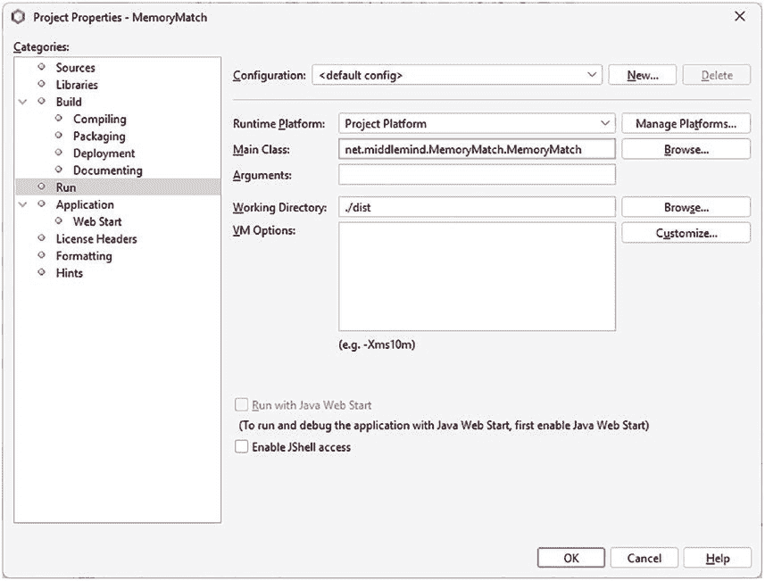

第 7 章 对象、类与面向对象编程

**图像 7-1.** NetBeans IDE 中项目运行设置的截图。

NetBeans IDE 运行设置的截图。

一旦你设置了所需的静态 main 类，当你构建项目时，可以在命令行上使用以下代码执行它。在 Windows 上，你可以使用命令提示符来执行命令。在 Mac 或 Linux 上，你可以使用终端窗口。在线搜索启动适用于你操作系统的正确控制台的步骤。你可以通过运行类似下面的命令来运行新构建的 Java 程序：

```bash
java -jar MemoryMatch.jar
```

通常，新创建的`JAR`文件位于项目根目录的`dist`文件夹中。那是运行之前所示控制台命令的最佳位置。在进入下一节（一个新的编码挑战）之前，我想列出一个带有静态 main 方法的非常简单类。

第 7 章 对象、类与面向对象编程

**列表 7-12.** 带有静态 main 方法的 Java Java 类

```java
01 public class SimpleExecutableClass {
02 public int myField = 0;
03
04 public static main(String[] args) {
05 System.out.println("The SimpleExecutableClass has received "
   args.length + " arguments.");
06 }
07 }
```

Java 中一个简单可执行类的示例。

你可以将此示例作为你未来打算编写的任何可执行类的模板。在大多数情况下，你的项目中应该只有一个带有静态 main 方法的类，但每过一段时间，你可能会有多个。在这种情况下，你可以使用以下命令指定你想要运行的静态 main 方法：

```bash
java -cp MemoryMatch.jar com.test.project.newExecClass
```

如果我们正在测试 Memory Match 游戏的主可执行的新副本，我们必须运行以下命令：

```bash
java -cp MemoryMatch.jar net.middlemind.MemoryMatch.MemoryMatch
```

在这两种情况下，我们都是通过提供完整的类路径来指定作为 main 的类。

***

## 挑战：地下城陷阱的静态 main

在这个挑战中（本章的第三个也是最后一个），我们将查看 Memory Match 游戏的静态入口。我们将更多地了解项目及其资源是如何配置的，并创建一个具有两个静态 main 点的项目，以便获得运行可执行类的经验。让我们来看看这个挑战！

181

第 7 章 对象、类与面向对象编程

### 涉及的包：

- `net.middlemind.MemoryMatch_Chapter7_Challenge3`
- `net.middlemind.MemoryMatch_Chapter7_Challenge3_Solved`

### 描述：

找到包`net.middlemind.MemoryMatch_Chapter7_Challenge3`并打开`MemoryMatch.java`文件。项目中的一些图形美术师想在 Memory Match 游戏中尝试一组新资源，但不想浪费开发者大量时间。你的挑战是创建一个`MemoryMatch.java`静态 main 类的副本，并更改它所使用的游戏引擎配置文件。将其指向这个新文件：

`engine_config_mmg_memory_match_test.xml`

这将游戏连接到存储在以下目录的新资源：

`.\MemoryMatch\cfg\drawable\MemoryMatchTest`

你需要更改项目设置以新的静态 main 文件，在测试时直接运行特定文件，或使用正确的控制台命令运行你刚刚制作的静态 main 可执行文件。

### 提示：

回想你的第一个编码挑战，当时你修复了一个在测试后意外损坏的 Pong 克隆游戏版本。这个挑战探索了 Java 游戏项目与其资源之间的联系。基本上，每个游戏项目都使用一个配置文件，用于设置视频游戏的名称，并确定查找游戏资源的文件夹。

通过为`Memory Match`游戏创建一个新的静态主类（static main），你可以指定一个新的游戏引擎配置文件，该文件反过来将指定用于游戏的一组新资源。你可以花点时间追踪任何包含的视频游戏项目，以便更好地地了解它们是如何配置的。

# 第 7 章 对象、类与面向对象编程（OOP）

### 挑战解决方案

这个挑战非常有意思。从完成它所需的实际工作量来说，它是一个很容易的挑战。然而，确切知道该做什么并不清晰，并且依赖于之前编程挑战积累的先验知识。让我们谈谈解决这个问题所需的步骤。你可能注意到的第一点是，该挑战要求你修改游戏的配置文件，并为我们提供了一些可以使用的新资源。

对项目目录结构进行粗略探索，可以发现提到的新配置文件。让我指出该文件中的一个重要条目：

```xml
<entry key="NAME" val="MemoryMatchTest" type="string" from="GameSettings" />
```

游戏配置文件中的这一行用于在本地配置文件夹中查找游戏资源：

`./MemoryMatch/cfg/`

花一点时间查看项目的`cfg`目录，留意任何命名为“MemoryMatchTest”的文件夹。你应该已经在项目的 drawables 资源目录中找到了一个同名的文件夹。该文件夹的特征是它为游戏标志、棋盘和倒计时数字使用了不同的图像资源。

要解决这个挑战，只需将静态主类`MemoryMatch.java`复制到新文件`MemoryMatchTest.java`即可。确保在右键点击挑战所在的包并选择“粘贴 ➤ 重构复制（Paste ➤ Refactor Copy）”时选择了“重构复制”选项；在重构时指定正确的名称`MemoryMatchTest`。现在你已经设置好了文件，你需要打开并更改后续类字段中指定的 XML 配置文件：

`public static String ENGINE_CONFIG_FILE = "../cfg/engine_config_mmg_memory_match_test.xml";`


完成这些步骤后，你应该能够修改项目设置，使其默认使用新的静态主执行文件。或者你也可以简单地在 IDE 中右键点击它并选择“运行文件（Run File）”，或使用正确的控制台命令运行它。选择权交给你。这里的主要要点是理解静态主入口的重要性，并获得更多操作游戏引擎的经验。你应该看到一个版本的游戏，其中几个关键资源使用了灰度图像而非彩色图像（图像 7-2）。

**图像 7-2。** 修改后的 Memory Match 克隆版的截图。

一组显示克隆版 Memory Match 游戏的截图，其配置文件已更改，指向一个备选的游戏资源文件夹，其中一些灰度资源替换了彩色图像。

这标志着我们本节的结束。请花时间仔细地完成本章的代码挑战。如果你遇到困难，请使用解决方案包来找出错误错在哪里。

## 总结

这标志着我们关于 Java 类第一章的结束。在本章中，我们花时间讨论了 Java 编程语言的一些面向对象编程（OOP）。

我们甚至花时间探索了类设计的一些细微点，并承担了三个编程挑战。表现得不错。让我们来看一下我们在这里涵盖的材料总结。

## 我们涵盖了什么

让我们看看在本章中遇到的面向对象编程主题和编程挑战：

- **类声明（Class Declarations）**：我们查看了一些基本的类定义，并讨论了这一层面的访问修饰符。
- **字段（Fields）**：我们讨论了向类添加字段，并使用访问修饰符控制这些类字段的使用。
- **方法（Methods）**：我们通过回顾类方法、访问修饰符、方法参数等，进一步深化了对 Java 类的探索。
- **静态成员（Static Members）**：通过回顾静态字段和方法等静态类成员，我们设法进一步完善了对类的理解。
- **构造函数（Constructors）**：类的初始化从未变得如此简单。我们查看了类构造函数，并区分了默认构造函数和自定义构造函数。
- **挑战：MmgBmp 类**：这个挑战让我们获得了通过向游戏添加自己的图像来修改游戏的直接经验。我们在操作 `MmgBmp` 和 `ScreenGame` 等游戏引擎类方面获得了更多经验。我们还向游戏屏幕上添加了自己的图像！
- **挑战：ScreenGame 类**：这个挑战让我们获得了更多关于用户输入的经验。我们配置了 `ScreenGame` 类来处理新的键盘输入，以动画、显示和隐藏我们的新游戏图像。通过这种方式，我们添加了一个稍微不必要的游戏功能，但添加类似的新游戏功能时过程是一样的。
- **访问（Access）**：一个稍微高级的话题；我们讨论了类中访问修饰符的一些更细微的点。
- **类设计（Class Design）**：我们讨论了一些类设计概念。这些是在设计类时应该在脑中考虑的高级思想。
- **静态主入口（Static Main Entry Point）**：一个非常重要的主题；没有静态主入口，你就无法运行程序。我们涵盖了这个主题，并演示了如何创建一个静态主类。
- **挑战：Dungeon Trap 的静态主类**：本章的最后一个挑战；通过创建一个使用不同资源的新可执行类，我们获得了更多关于游戏引擎、游戏配置文件、游戏资源和静态主入口的经验。

Java 类是我们工具箱中一个极其强大的工具。每当你坐下编写 Java 程序时，你都会用到类。知道如何创建类并通过访问修饰符、自定义构造函数和类方法来定义它们的用途，将为你开启整个宇宙的可能性。在下一章中，我们将通过回顾一些让我们能够更多方式使用类的强大语言功能来进一步探索。

# 第 8 章 封装、继承与多态

本章完全关于封装、继承和多态等高级 OOP 主题。这三个共同构成了面向对象编程四大主要原则中的三个。第四个原则——抽象，超出了本文的范围，因此我们不会涵盖它。让我们通过定义这些 Java 语言的特性为讨论奠定基础：

- **封装（Encapsulation）**：将代码和数据封装在单个单元中的过程，通常表现为 Java 类，并通过类方法对字段访问进行高度控制。
- **继承（Inheritance）**：OOP 的一项关键特性，允许我们从现有类创建一个新类。创建的新类被称为子类（子类或派生类），而派生出子类的现有类被称为超类（父类或基类）。
- **多态（Polymorphism）**：多态通过继承工作，允许我们以不同于超类实现的方式继承类方法。

在完成对 Java 面向对象编程支持的回顾时，我们将仔细查看每一个高级主题，并在过程中使用一个新游戏进行练习：Dungeon Trap！玩得愉快！

## 封装

封装是我们将探讨的面向对象编程的第一原则。

Java 中的封装是指通过使用访问修饰符和类方法对数据（类字段）进行策略性的保护。让我们通过一个 Java 类中基础封装的示例来复习这一概念。

*列表 8-1。* 简单 Java 类中的封装示例

```java
01 public class BasicEncapClass {
02 private int field1 = 0;
03
04 public BasicEncapClass(int i) {
05 this.field1 = i;
06 }
07
08 public int getField1() {
09 return this.field1;
10 }
11
12 public void setField1(int i) {
13 this.field1 = i;
14 }
15 }
```

使用基础封装的简单 Java 类示例。

**Java 编程笔记：** 我喜欢将封装的概念推得远一点，而不仅仅是通过 get 和 set 方法保护类数据。我认为，良好的封装还包括通过一组简单的类方法来恰当地暴露复杂的类功能。

在一个封装良好的类中，根据定义，我们通过将字段设为私有来保护对类字段的访问。然后通过使用 get 和 set 方法开放对字段的受控访问。我知道这看起来有点平淡无奇。这种 OOP 哲学的实际实现一点也不困难。在我看来，在设计游戏或其他 Java 程序时，可能会过度封装。这样做你可能会给你的游戏增加一些不必要的额外开销。

例如，你所有的简单游戏类都应该使用严格封装吗？这将导致对这些类的所有字段访问都需要通过方法调用，而在大多数情况下，方法调用的效率低于直接的公共字段访问。这个话题没有更多可以讨论的。它归根结底是通过类的 get 和 set 方法以及字段访问修饰符对类字段进行严格控制。在下一节中，我们将讨论 Java 中的类继承，并发现如何基于其他现有类创建类。

## 继承

Java 中的继承是 OOP 的核心特征之一，允许我们从现有类创建新类。创建的新类被称为子类（subclass），而派生子类的现有类被称为父类（super-class）。让我们看看如何在 Java 中实际声明一个子类。我们将基于在列表 8-1 中使用的类进行构建。请留意封装和继承是如何工作的。

*列表 8-2。* 使用 Java 类的封装与继承示例

```java
//类声明
01 public class BasicEncapClass {
02 private int field1 = 0;
03
04 public BasicEncapClass(int i) {
05 this.field1 = i;
06 }
07
08 public int getField1() {
09 return this.field1;
10 }
11
12 public void setField1(int i) {
13 this.field1 = i;
14 }
15 }

17 public class BasicSubClass extends BasicEncapClass {
18 private int newField1 = 1;
19
20 public BasicSubClass(int i) {
21 super(i);
22 this.newField1 = i;
23 }
24
25 @Override
26 public int getField1() {
27 return this.newField1;
28 }
29
30 @Override
31 public void setField1(int i) {
32 this.newField1 = i;
33 }
34 }
```

使用封装和继承的简单 Java 类示例。

注意列表 8-2 示例类中对继承的使用。`BasicSubClass` 类扩展了 `BasicEncapClass` 类。你可以使用 `extends` 关键字声明一个新的子类。在 Java 中，你只能有一个父类，这意味着你一次只能扩展一个其他类。在这个示例中，子类声明了一个新的类字段、构造函数以及 get/set 方法。在新构造函数中，有一个我想让你查看的特殊关键字，位于第 21 行的 `super`。

`super` 关键字允许你访问当前类的父类，以调用可用方法并访问可用字段。在子类构造函数的情况下，它还有另一个用途。构造函数的第一行（且仅第一行）可以调用父类的构造函数。在这种情况下，当你创建一个 `BasicSubClass` 类的新实例时，它会调用 `BasicEncapClass` 的构造函数。此外，注意子类保留了相同方法 `getField1` 和 `setField1`，只是它们重新定义了功能，以与新的类字段工作。

`@Override` 关键字是一个特殊的方法注解，表示当前方法覆盖了（替换了）同名的父类方法。

### 挑战：继承

Java 中的继承是 OOP 的核心特征之一，允许我们从现有类创建新类。让我们进入编程挑战吧！

**涉及的包：**

`net.middlemind.DungeonTrap_Challenge1`

**描述：**

找到包 `net.middlemind.DungeonTrap_Challenge1`，并打开 `MdtWeaponar.java` 文件。你被分配完成一些关于该游戏的工作。给你的任务是探索在游戏中添加一把火焰长矛作为默认武器。新武器的图形可以在游戏项目目录中找到：

`./cfg/drawable/DungeonTrap`

你还必须将新武器接入游戏。由于游戏中已经有一个长矛武器，首席程序员要求你使用继承来创建新的 Java 类。保持其他部分不变，只需让新武器更强大但速度稍慢。确保该武器是所有玩家的默认武器。这将需要修改 `MdtChar.java` 类，它是玩家和敌人角色的父类。你必须运行该包的文件——`DungeonTrap.java`；右键点击并选择“Run File”。

**提示：**

如果你卡住了，请仔细观察 `MdtWeaponar.java` 类是如何在 `MdtChar.java` 类使用的。如果你更改了默认矛的图像和攻击属性，就可以让它看起来和用起来像一把火焰长矛。考虑这一点。然后考虑 Java 中的继承以及通过复制粘贴快速创建现有类的副本。

#### 挑战解决方案

这个挑战是文本中最具挑战性的题目之一，但如果你仔细阅读了描述和提示，我认为其中有足够的信息让你完成。整个解决方案的重点在于你对继承的使用。为了将新武器添加到游戏中，你需要对代码进行四处调整，包括创建新的火焰矛 Java 武器类。

正如我们之前提到的，你必须进行的第一个调整是重构复制 `MdtWeaponSpear.java` 类，并将其重命名为类似于火焰长矛类的名称。我们选择将其命名为 `MdtWeaponSpearFlame.java` 类。接下来，我们必须更改用于显示武器的图像资源，使其看起来更像一把火焰长矛，而不是一把普通的长矛。图像资产已经包含在游戏的资源文件夹中供你使用了。

找到它们并使用图像文件名（包括扩展名）来更改新火焰长矛类使用的图像资源。接下来，我们被要求让的表现有所不同：攻击更强但速度更慢。为了实现这一目标，我们将攻击强度从 `1` 点增加到 `2` 点，并通过将武器时间从 `250ms` 增加到 `350ms` 使武器速度减慢了 `100ms`。

最后，我们需要将火焰长矛设置为游戏中所有玩家的默认武器。为了实现这一目标，我们必须查看 `MdtCharInter.java` 类。这是游戏中所有角色的父类，因此包含了设置默认武器的代码。遵循现有代码设置的示例，将新武器添加到角色的支持武器列表中，然后将其设置为装备武器。如果你进行了所有适当的调整，你最终应该得到一把像图像 8-1 所示的红色长矛。

194

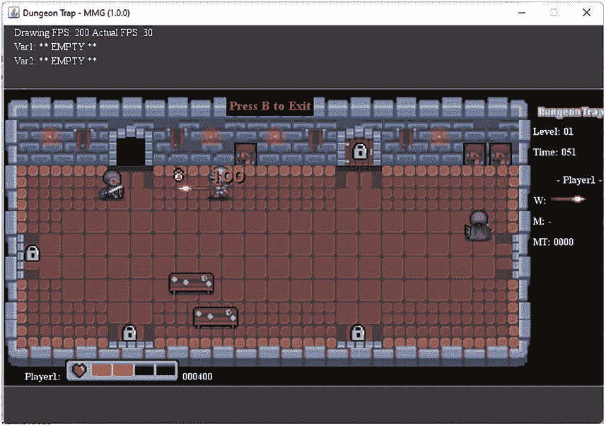

第 8 章 封装、继承与多态

*图像 8-1。一张显示新火焰长矛运行的截图* 一张描绘了 Dungeon Trap 游戏中运行中的新火焰长矛的截图。

这标志着我们本章该节的结束。我们将在对高级类主题的回习中，通过讨论 Java 中的多态继续学习。

如果你在这个挑战中未能让你的代码更改正常工作，请花点时间查看解决方案包的代码。

## 多态

多态，在计算机编程语境之外的定义是为“许多形式”，当我们拥有通过继承关系相互相关的类时，就会发生这种情况。事实上，我们在本章早些时候已经看到过它的例子了；只是当时并不知道。让我向你展示之前看过的同一个列表，即列表 8-2，现在我们将结合 Java 面向对象编程中的多态来讨论它。

195

第 8 章 封装、继承与多态

*列表 8-3。* 使用 Java 类实现封装、继承和多态的示例

```java
//class declarations

01 public class BasicEncapClass {
02 private int field1 = 0;
03
04 public BasicEncapClass(int i) {
05 this.field1 = i;
06 }
07
08 public int getField1() {
09 return this.field1;
10 }
11
12 public void setField1(int i) {
13 this.field1 = i;
14 }
15 }
16
17 public class BasicSubClass extends BasicEncapClass {
18 private int newField1 = 1;
19
20 public BasicSubClass(int i) {
21 super(i);
22 this.newField1 = i;
23 }
24
25 @Override
26 public int getField1() {
27 return this.newField1;
28 }
29
30 @Override
31 public void setField1(int i) {
32 this.newField1 = i;
33 }
34 }
```

这是一个示例列表，与列表 8-2 相同，它展示了基本的继承和多态。注意封装是如何融入父类定义中的。

什么？我们正在看同一个类列表，但用它来复习不同的主题。

这是怎么回事？嗯，我使用同一个列表是有原因的。我希望你注意到封装、继承和多态这些概念是密不可分的，并且彼此紧密相连。没有一个良好封装的类，继承将变得不那么有用且几乎变得混乱，依赖类字段和访问修饰符来控制使用。

良好的封装带来了良好的继承，这引出了我们的多态。请花点时间查看第 26 行和第 31 行的两个重写方法 `getField1()` 和 `setField1()`。相同名的方法存在于 `BasicEncapClass` 中，但现在正在 `BasicSubClass` 类中被重新定义。这是多态的一个例子，因为方法的名称保持静态，但它的含义和用法可以改变。

这个主题可能有点令人困惑，在某些方面似乎几乎是循环的，所以让我们花时间从稍微不同的角度来看待。与其使用无意义的虚构类，不如尝试使用我们更熟悉的类和概念来演示这些编程特性：鱼。让我们来看看代码吧！

*列表 8-4。* 通过为鱼建模实现封装、继承和多态的示例


```java
//class declarations

01 class Fish {
02 private int avgLen;
03 private int avgWeight;
04 private String color;
05
06 public Fish() {
07 }
08
09 public int getAvgLen() {
10 return this.avgLen;
11 }
12
13 public void setAvgLen(int i) {
14 this.avgLen = i;
15 }
16
17 public int getAvgWeight() {
18 return this.avgWeight;
19 }
20
21 public void setAvgWeight(int i) {
22 this.avgWeight = i;
23 }
24
25 public String getColor() {
26 return this.color;
27 }
28
29 public void setColor(String s) {
30 this.color = s;
31 }
32
33 public String getName() {
34 return "Fish";
35 }
36
37 public String getFoodSource() {
38 return "Worms";
39 }
40
41 @Override
42 public String toString() {
43 return "This fish, " + getName() + ", eats '" + getFoodSource() + "';";
44 }
45 }
46
47 Trout extends Fish {
48 public Trout() {
49 super();
50 }
51
52 @Override
53 public String getName() {
54 return "Trout";
55 }
56
57 @Override
58 public String getFoodSource() {
59 return "Worms and insects";
60 }
61 }
62
63 class RainbowTrout extends Trout {
64 public RainbowTrout() {
65 super();
66 setAvgLen(30);
67 setAvgWeight(10);
68 setColor("Rainbow");
69 }
70
71 @Override
72 public String getName() {
73 return "Rainbow Trout";
74 }
75 }
```

```java
01 Fish fish = new Fish();
02 System.out.println("fish - toString: " + fish);
03 System.out.println("");
04
05 Trout trout = new Trout();
06 System.out.println("trout - toString: " + trout);
07 fish = trout;
08 System.out.println("fish = trout - toString: " + fish);
09 System.out.println("");
10
11 RainbowTrout rbTrout = new RainbowTrout();
12 System.out.println("rbTrout - toString: " + rbTrout);
13 trout = (Trout)rbTrout;
14 System.out.println("trout = rbTrout - toString: " + trout);
15 fish = (Fish)trout;
16 System.out.println("fish = trout - toString: " + fish);
17 fish = (Fish)rbTrout;
18 System.out.println("fish = rbTrout - toString: " + fish);
```

```text
01 //fish
02 fish - toString: This fish, Fish, eats 'Worms'.
03
04 //trout
05 trout - toString: This fish, Trout, eats 'Worms and insects'.
06 fish = trout - toString: This fish, Trout, eats 'Worms and insects'.
07
08 //rainbow trout
09 rbTrout - toString: This fish, Rainbow Trout, eats 'Worms and insects'.
10 trout = rbTrout - toString: This fish, Rainbow Trout, eats 'Worms and insects'.
11 fish = trout - toString: This fish, Rainbow Trout, eats 'Worms and insects'.
12 fish = rbTrout - toString: This fish, Rainbow Trout, eats 'Worms and insects'.
```

这是一个良好封装类 `Fish` 的示例，它被 `Trout` 类继承，而 `Trout` 又被 `RainbowTrout` 类继承。注意每个扩展类都是其父类的实例。某些类重写了方法行为，以展示多态性。

## 游戏编程笔记

类继承是在设计游戏类结构时使用的一个非常强大的工具。在游戏中，你经常会遇到敌人、武器和物品，它们是通用分类下更具体的实例。类继承在对这种结构建模时效果非常好。

列表 g 8-4 是一个 r 后面的内容很长；在继续之前，请花点时间仔细阅读。这个示例展示了我们在这里涵盖的面向对象（OO）编程的三个关键方面是如何协同工作的。让我们回顾一下正在发生什么，并在过程中涵盖一些更细的的。首先，`Fish` 类是一个封装良好的类示例。它有三个字段——`avgWeight`、`avgLen` 和 `color`。它还定义了两个提供有关鱼的特定信息的方法：`getName` 和 `getFoodSource` 方法。

类中的最后一个方法需要稍微解释一下。`toString` 方法以前了 `@override` 注解开头，这表示它替换了一个已有的方法。但替换的是哪一个呢？我们并没有定义 `toString` 方法。事实上，正如我们之前提到的，在 Java 中，每个类都是 `Object` 超类的子类，而这个超类定义了一个 `toString` 方法，提供该类的字符串表示。

通过重写它，我们自定义了该方法以返回一个特定的值。在这种情况下，接述语句：

`This fish, [fish name], eats ‘[food source]’`

这是多态的一个示例，因为 `toString` 方法现在专门为 `Fish` 类重新定义了。在下一个示例中，`Trout` 类（鳟鱼是鱼的一种特定类型）扩展了 `Fish` 类。该类的定义依赖于继承来扩展超类 `Fish`，并依赖多态来重新定义某些超类方法。在这种情况下，`Trout` 类重新定义了 `getName` 和 `getFoodSource` 方法，以提供针对鳟鱼的实现。

为了进一步说明这个示例，定义了第三个类 `RainbowTrout`（虹鳟），它扩展了 `Trout` 类。这个类作为鳟鱼的特定类型，只需要自定义一些已经从 `Trout` 和 `Fish` 类中定义的类方法。在这种情况下，我们需要做的就是重写 `getName` 方法，以指定该类是虹鳟类。

注意，每个继承 `Fish` 类的类或 `Fish` 类的子类，都继承了它重写的 `toString` 方法。

## 第 8 章 封装、继承与多态

查看提供的输出文本，并追踪每个类实例是如何向上转换（cast up）到它的超类的：`Fish` 类。注意，尽管我们是以 `Fish` 类的实例与对象交互，输出仍然保持了自定义状态。这是多态的一个示例，因为该类既是自身的实例，也是它所有超类的实例。

它也体现了 Java 中的方法多态。

`@override` 方法注解用于表示某个方法是超类中定义的方法的替换。通过这种方式，可以为继承类以每个方法为单位定义新的、自定义的功能。这允许继承类扩展超类的功能。Java 中的多态不仅适用于通过重写（override）类方法来自定义功能，还适用于子类也是其超类实例这一事实。

通过这种方式，`Trout` 类的实例也是 `Fish` 类的实例，而 `Fish` 类也是 `Object` 类的实例，以此此类推。多态的这一方面在第 13-17 行子类到超类的转换中得到了展示。在下一节中，我们将查看一个涉及多态和地牢陷阱（Dungeon Trap）游戏的编程挑战。

## 挑战：多态

本章的第二个编程挑战将测试你如何利用 Java 的多态能力来改变你在上一个挑战中实现的火焰矛在游戏中的功能。这是文中的第三个挑战，它从上一个挑战的解决方案开始。因此，在继续之前，确保你有上一个挑战的正确解决方案至关重要。请花一点时间检查并确保。一如既往，享受挑战吧！

### 涉及的包：

- `net.middlemind.DungeonTrap_Chapter8_Challenge2`
- `net.middlemind.DungeonTrap_Chapter8_Challenge2_Solved`

### 描述：

找到包 `net.middlemind.DungeonTrap_Chapter8_Challenge2` 并打开 `MdtWeaponSpearFlame.java` 文件。这个挑战是较复杂的挑战之一，因此，你需要查看以下 Java 类中的代码：

- `MdtWeaponSpearFlame.java`
- `MdtWeapon.java`
- `ScreenGame.java`
- `MdtWeaponAxe.java`

一些开发者喜欢这种新矛，但认为它与原始长矛太相似了。他们想测试让矛像投掷武器一样射出去。

为了实现这一变化，你将对代码进行一些调整。

有一个作为投掷武器选的武器，即 `MdtWeaponAxe.java` 类。我们需要从这个类中使用几个方法来让我们的武器变为可投掷的。

首先，你需要从 `MdtWeaponAxe.java` 文件复制并粘贴以下方法到 `MdtWeaponSpearFlame.java` 文件中：

- `GetX()`
- `SetX(int i)`
- `GetY()`
- `SetY(int i)`
- `SetPosition(Mmg2 v)`
- `SetPosition(int x, int y)`

这将允许火焰矛以与斧头相同的方式处理位置。接下来，我们需要调整所有武器的父类 `MdtWeapon.java` 以支持新矛。

在该类中找到以下方法：

- `GetWeaponRect()`
- `MmgDraw(MmgPen p)`

存在一些处理斧头的特殊代码；扩展 `if` 语句以包含可投掷的矛。必须对 `ScreenGame.java` 类中的 `ProcessClick` 方法进行类似的更改。如果实现正确，这些调整将让新矛飞出去并旋转。你必须运行此包的文件 `DungeonTrap.java`；右键点击并选择 Run File 来测试游戏。

## 第 8 章 封装、继承与多态

这是一个巨大的挑战，当你遇到困难时，并没有太多线索可以引导你。请仔细阅读描述提供的类和方法。留意代码中斧头的不同行为，并记住你正在制作一种投掷矛，所以它的功能与斧头相同。

### 挑战解决方案

正如我们之前提到的，此挑战的解决方案需要本章关于继承的正确解决方案。如果你遇到了困难但想继续进行，可以通过复制和粘贴标记的代码更改来使用挑战 1 的解决方案作为此挑战的起点。此解决方案需要对代码进行五更改以成功解决挑战。此解决方案需要在五个地方进行修改。让我列出调整的位置以及我们分配的顺序。你可以以不同的方式进行，这没问题。

## 复习

让我们按照顺序和细节回顾一下所做的调整。我们需要进行的第一个更改是使用多态来重写父类定位方法的功能。我们在这里进行的调整允许武器现在能够独立于持有它的玩家进行移动。我们可以直接复用 `MdtWeaponAxe` 类中的代码，因为它也是可投掷的。接下来，我们进入 `MdtWeapon.java` 类并查看 `GetWeaponRect` 方法。该方法用于计算一个描述武器应该在屏幕何处绘制的矩形。

对于不投掷的刺击类武器，该方法根据武器处于刺刺动画的深度来计算矩形。对于投掷类武器（如斧头以及现在的火焰矛），我们返回一个描述投影物在屏幕上位置及其朝向的矩形。需要调整 `if` 语句以包含 `SPEAR` 武器类型。你的编程工具箱中已经拥有完成所需的所有工具。

`MmgDraw` 方法也需要进行类似的更改，以便在绘制投掷类武器时包含矛。

请注意，`MdtWeapon` 类类是 `MdtWeaponAxe`、`MdtWeaponSpear` 和 `MdtWeaponSpearFlame` 类的父类。这就是为什么更改此处的代码会影响到所有扩展类。这种集中化提供了灵活性，但也增加了复杂性，因为我们必须在这个层级支持不同的武器、投掷和刺击。

我们需要完成的最后一个更改是支持将武器的新副本添加到游戏的可绘制对象中。这在 `ScreenGame` 类的 `ProcessAClick` 方法中实现。当玩家发射武器时，它的一个克隆会被添加到游戏中。由于我们所做的所有更改，这个克隆可以自由飞行并在旋转，直到它与某些物体碰撞。

这些就是我们解决这个编程挑战所需的更改。这绝不是一项容易的任务，确实用到了我们编程工具箱中的几件工具。如果你没有搞定，不要担心；只要你通过复习答案来学习，你就做得很棒。在下一节中，我们将通过讨论如何共享以及将类包含在程序中来结束对类的复习。

## 导入类库

现在你已经对 Java 类和封装、继承和多态等 OOP 概念有了良好的理解，你需要深入了解如何打包你的代码并在其他程序中使用它。为了做到这一点，你需要构建一个 Java 项目并获取生成的 JAR 文件。在大多数情况下，这类项目不包含静态 `main` 方法，只包含 Java 类。

这通常被称为库。你可以通过共享项目的 JAR 文件来共享你的库。在 NetBeans IDE 中向项目添加库，请右键点击项目并从右键菜单中选择“Properties”（属性）。在属性的弹出窗口中，从左侧的类别部分选择“Libraries”（库）选项。当使用本地 JAR 文件时，我们将在 `classpath` 部分添加一个新条目。点击 `+` 按钮并从可用选项中选择“Add JAR/Folder”（添加 JAR/文件夹）。插图 8-2 显示了此过程的截图。

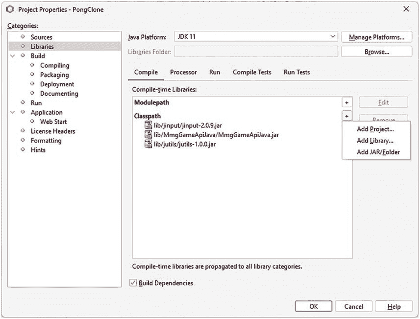

图 8-2。NetBeans IDE 中项目库设置的截图。

一张显示项目属性弹出窗口中“Libraries”部分的截图。

这个过程与你在第 1 章中为使用本地库文件设置视频游戏项目的过程是相同的。现在你已经向项目中添加了库，在可以使用它之前，你需要在 Java 程序中包含该包。要做到这一点，你使用 Java 的 `import` 关键字。导入视频游戏引擎主包的示例例如：

```java
import net.middlemind.MmgGameApiJava.MmgCore.*;
import net.middlemind.MmgGameApiJava.MmgBase.*;
```

当使用类导入过程的通配符功能时，你将访问指定 Java 包中的所有类。这很方便，但并不直观，而且它隐藏了哪些类实际上属于哪些包。让我们看看如何只导入一个 Java 类。在这种情况下，我们正在添加对 `MmgBmp` 类的访问。

```java
import net.middlemind.MmgGameApiJava.MmgCore.MmgBmp;
```

注意，所有 Java 类都是通过它们的包名导入的。在处理 Java 时请记住这一点。花时间了解 Java 包含的类框架中最常用的包。你将经常用到的两个重要包是 `java.io` 和 `java.util`。你可以在此地址找到更多关于 Java 框架中可用的类的信息：

<https://docs.oracle.com/en/java/javase/11/docs/api/index.html>

这标志着关于导入和访问类库这一节的结束。在接下来的节中，我们将查看视频游戏的通用、共享结构。

# 视频游戏项目结构

由于所有包含的视频游戏项目都基于相同的引擎，它们共享类似的设置和配置。以下三个 Java 类设置了静态入口点。我在这里列出这些类：

**游戏的静态入口点：** 通常以游戏命名，如 `PongClone.java`、`MemoryMatch.java` 和 `DungeonTrap.java`。项目的这部分提供了可执行类。此外，正如你在几次编程挑战中看到的，它还通过引擎配置文件设置了游戏与其资源之间的连接。

**MainFrame.java：** 该类设置了 `GamePanel` 类渲染自身的窗口。该类主要设置用于维护父类的功能。注意，它继承自游戏引擎的类库。

**GamePanel.java：** 该类负责处理来自加载界面和启动界面的事件，并根据游戏状态切换游戏屏幕。该类的大部分功能来自其父类。

使用这三个类并进行微调，重构可执行类并将游戏指向新的游戏引擎配置文件，是设置新游戏的基础。游戏可执行类中一个非常重要的类字段是 `ENGINE_CONFIG_FILE`。我列出了 Pong Clone 游戏的类字段：


```java
/**
* Base engine config files.
*/
public static String ENGINE_CONFIG_FILE = "../cfg/engine_config_mmg_pong_clone.xml";
```

游戏引擎配置文件用于指定一些关键的游戏引擎设置。我们需要关注的主要项是`NAME`条目。该文件使用 XML 编码，但它应该足够简单，你无需任何研究即可编辑。只需更改名称条目中`val`属性的值。该值必须与包含游戏资源的文件夹名称相同。

```xml
<entry key="NAME" val="MemoryMatch" type="string" from="GameSettings" />
```

这对应于 NetBeans 项目文件夹本地的目录结构：

```text
./cfg
├── class_config
├── MemoryMatch
├── drawable
├── MemoryMatch
├── MemoryMatchTest
├── playable
├── MemoryMatch
├── engine_config_mmg_memory_match.xml
└── engine_config_mmg_memory_match_test.xml
```

游戏引擎的某些方面超出了本书的涵盖范围，但我希望你能够使用该游戏引擎创建一个新的游戏和一个视频游戏项目。在`cfg`文件夹中有四种支持的资源。`class_config`目录包含配置文件，用于调整特定游戏特定类中的资源。该文件中的条目在运行时提供数据，用于设置游戏屏幕的图像资源等。

`drawable`目录用于存放图像资源，支持以下图像文件类型：`PNG`和`JPG`。放置在游戏文件夹中的任何图像都将自动加载，并可以通过完整文件名（包括扩展名）进行访问。我们在之前的编程挑战中已经见过这种图像加载过程了。`playable`目录与`drawable`目录类似，不同之处在于用于加载音频文件。我们建议使用`WAV`文件作为音效和音乐。

最后，在`cfg`文件夹的根目录下几个`XML`文件。这些是针对特定游戏副本的游戏引擎配置文件。多个项目可以指向相同的资源。这在编程挑战的设置中得到了很好的体现。每个挑战都是游戏项目本身的一个包，并且在大多数情况下都配置为访问相同的资源和配置文件。你会注意到`drawable`和`playable`目录中有一个`auto_load`文件夹。在这些文件夹中的任何资源都会默认加载，并可以通过完整文件名在你的游戏中使用。

到此，关于书中包含的视频游戏项目配置和设置的章节就结束了。在下一节中，你将面临自己创建一个新视频游戏项目的挑战。祝愉快！

# 挑战：创建一个新游戏项目

在章的第三个挑战中，我们将探索如何设置一个新的游戏项目。

其实并没有那么复杂。这是一个很有挑战性的任务；你可能第一次尝试无法通过；不用担心。你可以随时参考现有的项目查看它是如何设置的并复制配置。

## 涉及的项目

- `PongClone`
- `MyNewGameSolved`

## 描述

这个挑战完全与你有关。我们不会为任何人或任何事情进行任何开发任务。在这个挑战中，你将通过创建一个现有现有项目功能性克隆的新新游戏项目，来探索视频游戏项目的配置。我应该提到，这是第一个解决方案是项目而不是包的挑战。

你的目标是利用之前所有章节中学到的 NetBeans IDE、游戏引擎和项目配置的知识，将`Pong Clone`游戏克隆到一个名为`MyNewGame`的新项目中。我将概述解决此挑战所需的通用步骤，并将剩下的留给你。我们将在该挑战的解决方案部分详细回顾该过程。

1. 创建一个名为`MyNewGame`的新 NetBeans IDE 项目。
2. 添加并配置`jutils`、`jinput`和`MmgGameApiJava`库的库文件。
3. 将`PongClone`项目的`cfg`目录复制到新项目`MyNewGame`的本地目录。
4. 从`PongClone`项目的`net.middlemind.PongClone`包中复制所有 Java 类文件，并将它们“重构复制”（refactor copy）到新项目中。你可以为重构后的包命名为任何名称。
5. 配置项目设置，包括默认静态主类、输出目录、Java 版本和工作目录。
6. 执行项目并验证`Pong Clone`游戏是否运行正常。

尽力而为吧，你好运！

## 提示

你可以使用任何相关的视频游戏项目作为如何配置新 NetBeans 项目的示例。使用`PongClone`项目作为实际使用的类和游戏资源的示例。记住，你想通过将`Pong Clone`游戏克隆到新的 NetBeans 项目中，创建一个作为新视频游戏起点的副本。

## 挑战解决方案

这个挑战的解决方案并不是显而易见的。你必须完成一系列配置步骤，以便创建一个新的视频游戏项目，并将`Pong Clone`游戏的功能副本作为项目的种子配置。让我们详细回顾过程中的每一步。

## 第 1 步：创建一个新项目进行自定义

从 NetBeans 菜单中选择`File ➤ New Project`。项目类型选择`Java Application`。

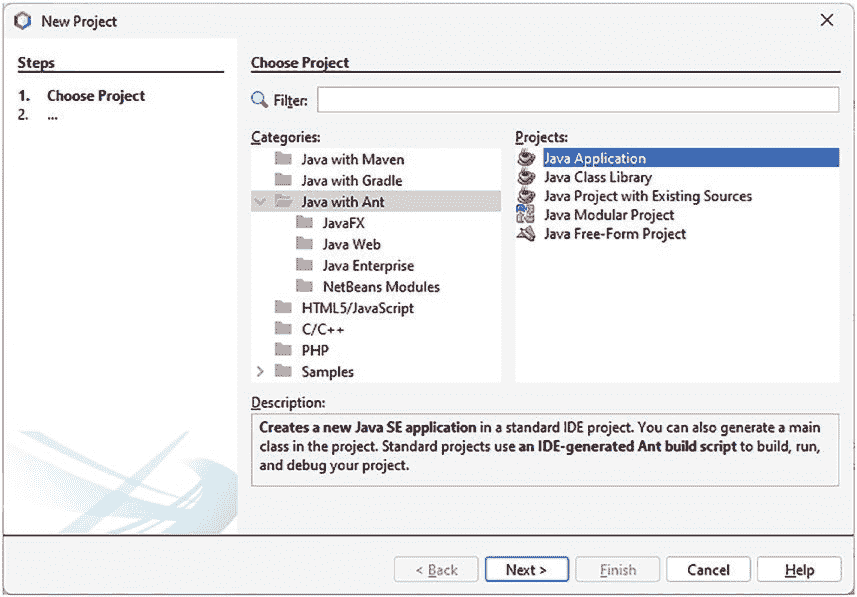

***图像 8-3.** 新项目对话框截图 – 选择项目类型* 在 Java with Ant 项目类别中选择 Java Application 选项。

将`Project Name`（项目名称）设置为`MyNewGame`并选择项目位置。

不要选择`Create Main Class`选项，因为我们将使用来自`PongClone`项目的副本。

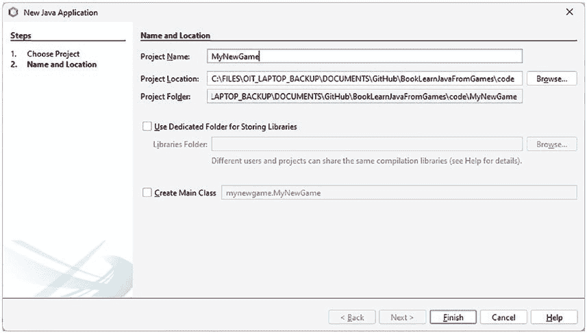

***图像 8-4.** 新项目对话框截图 – 名称和位置* 显示新项目创建对话框中第二步的截图。记住**不要**勾选 Create Main Class 复选框。

完成项目创建过程并展开 NetBeans 项目列表中的条目。

## 第 2 步：添加默认项目库

一旦设置好新项目，现在你需要配置基础库集，就像我们在第`1.F`章中做的那样，你可以随时返回查阅该过程以完成此步骤。图像 8-5 显示了添加的 Java 库。


***图像 8-5.** 配置了库的项目属性截图* 显示 MyNewGame 项目配置了库的截图。

参考第`1`章了解如何设置项目库。

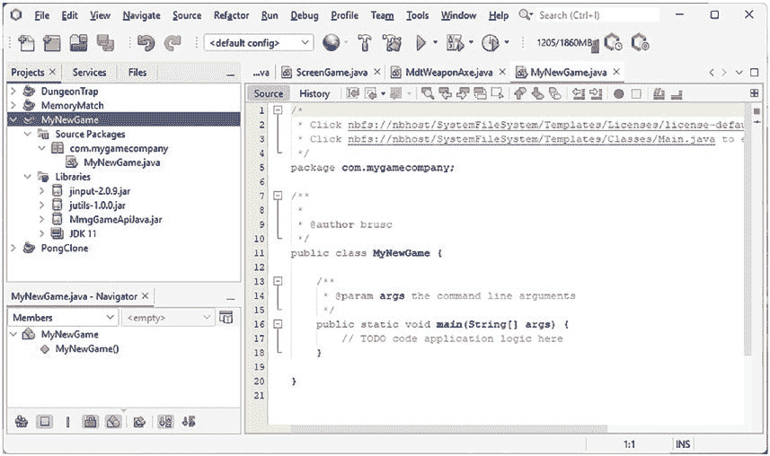

***图像 8-6.** 配置了库的新项目截图* 显示新游戏项目配置了库的截图。

新的 NetBeans 项目和库已准备就绪，我们可以添加`Pong Clone`游戏的资源文件夹了。

## 第 3 步：复制资源文件夹

资源文件夹`cfg`位于每个游戏 NetBeans 项目文件夹的根目录下。它包含了所有的游戏资源和配置信息。将其复制到新项目中可以使其成为新项目的游戏资源和配置信息的来源。

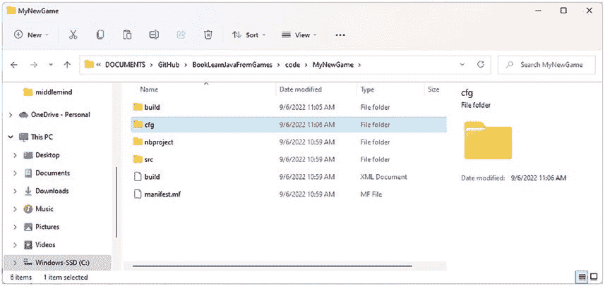

***图像 8-7.** 带有资源文件夹 cfg 的项目截图* 显示新项目带有复制过来的配置和资源文件夹 cfg 的截图。

只需将文件夹从`Pong Clone`游戏项目文件夹复制并粘贴到新游戏项目文件夹。我们需要自定义一下游戏配置文件，以便识别出它是不同的游戏版本。找到并打开位于此的游戏 XML 配置：

`./MyNewGame/cfg/ engine_config_mmg_pong_clone.xml`

我们想要更改`TITLE`和`COMPANY_NAME`条目为新的字符串值，以便区分我们的游戏版本。

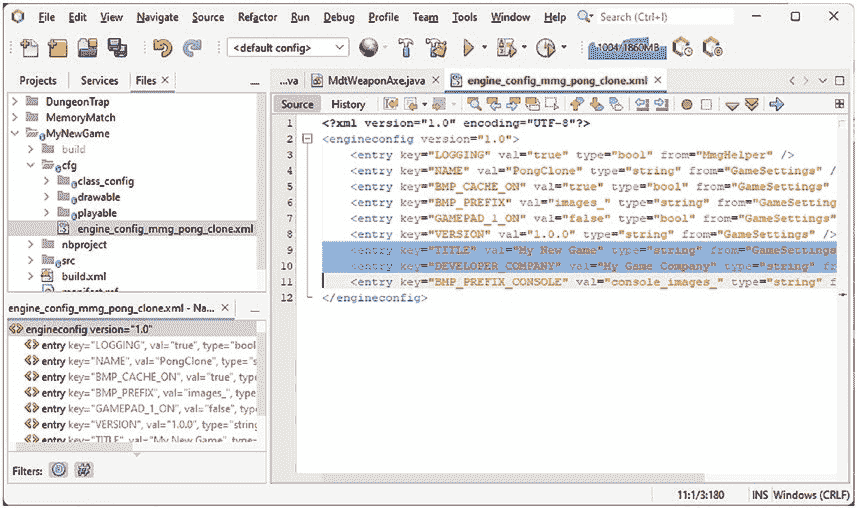

***图 8-8.** 新项目的 engine_config_mmg_pong_clone 截图* *配置文件* 显示新游戏项目游戏引擎配置文件，其中更改了 TITLE 和 COMPANY_NAME 条目以表示这是游戏的副本。

你可以通过在“Files”视图中定位该文件，直接在 NetBeans IDE 中打开并编辑它。

标签。展开新游戏项目的条目并在`cfg`目录中找到文件。

## 第 4 步：拷贝 PongClone 的 Java 类

我们将使用 Pong Clone 游戏中的 Java 类来填充新项目。你可以直接在 NetBeans IDE 中在项目之间进行复制和粘贴。

216

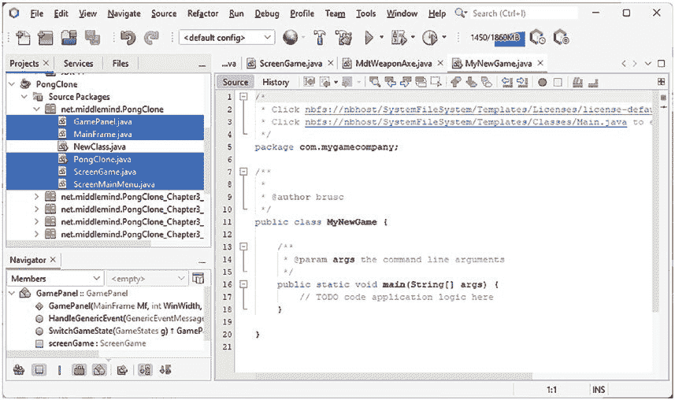

第 8 章 封装、继承与多态

***图 8-9.** 显示选择 Pong Clone 类文件的截图* 一张显示了`PongClone`项目中 Java 类文件的截图。

217

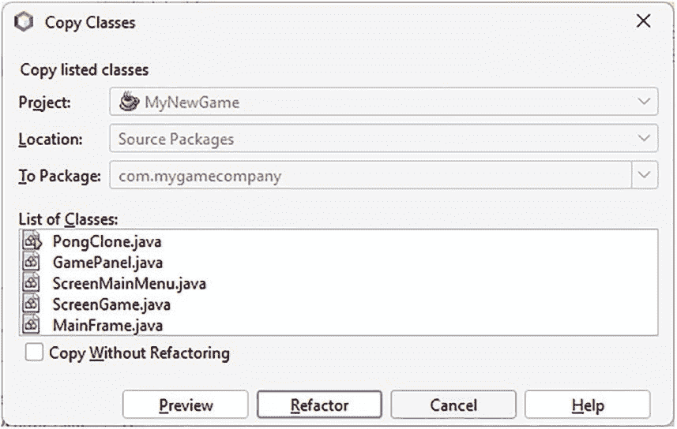

第 8 章 封装、继承与多态

***图 8-10.** 显示重构复制对话框的截图*

一张显示重构复制对话框的截图。点击重构（refactor）按钮，将类重构复制到新游戏项目中。

你应该通过右键点击文件并从上下文菜单中选择`Refactor ➤ Rename`（重构重命名），将主可执行类从`PongClone.java`重命名为`MyNewGame.java`，如图图 8-11. 所示。

218

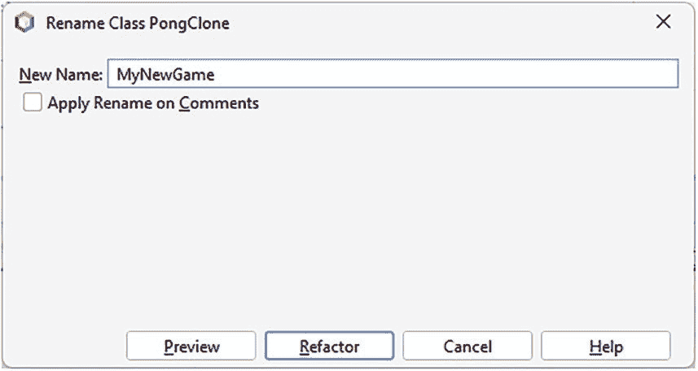

第 8 章 封装、继承与多态

***图 8-11.** 显示重命名 PongClone 主类的截图* 一张显示重命名重构对话框的截图。

你几乎准备好运行游戏了。你已经将类复制到了到位位置，设置了库，并接入了资源文件夹。接下来，我们将微调一些项目设置。

## 第 5 步：配置项目设置

在运行游戏之前，你应该看到几个项目设置。第一个是为项目设置“工作目录”（Working Directory）。因为游戏需要在预期的位置找到`cfg`目录，我们将“工作目录”字段设置为`./dist`，如图 Image 8-12 所示。你还应该设置“主类”（Main Class）。图像显示的是默认类；请确保你的类被设置为`MyNewGame.java`类。

219

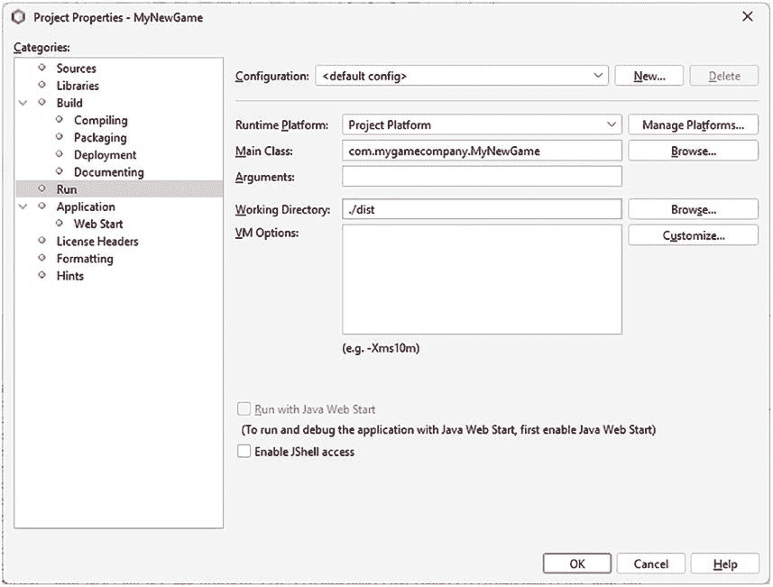

第 8 章 封装、继承与多态

***图 8-12.** 显示新项目运行设置的截图* 一张显示配置了工作目录和主类的新项目设置截图。

最后，我们可以运行游戏了！

## 第 6 步：执行 Pong Clone 拷贝

确保项目已重新构建，右键点击项目并从上下文菜单中选择`Clean and Build`（清理并构建）。现在，点击`PongClone` Java 文件并从上下文菜单中选择`Run File`（运行文件）来运行项目。

220

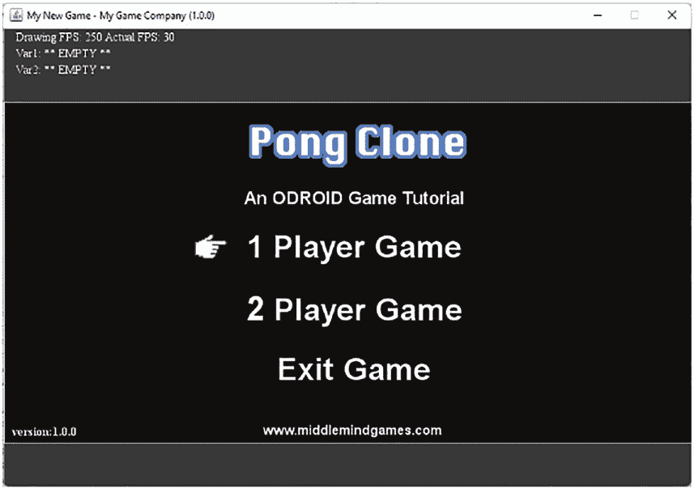

第 8 章 封装、继承与多态

***图 8-13.** 显示新项目运行的截图*

一张显示新游戏正在运行的截图。注意标题与默认的 Pong Clone 游戏不同。

恭喜你！你现在可以使用简单的 Pong Clone 游戏作为起点创建新的游戏项目。你可以根据自己的需要清理或修改代码。将这些知识与你通过编辑`ScreenGame`类来修改游戏的经验相结合，你就可以开始构建构建自己的简单游戏了。

## 总结

这带我们来到了本章的结论，以及我们对 Java 类的讨论的结束。我们得以观察 Java 编程语言中许多不同的实际特性，并应对了一些困难的代码挑战。让我们稍后总结一下本章涵盖的内容。

221

第 8 章 封装、继承与多态 **我们涵盖的内容**

你已经完成了一些高级概念的学习，并经历了一系列艰巨的编码挑战。你已经证明了自己的实力。让我们回顾一下我们涵盖的内容。

- 封装（Encapsulation）：我们讨论了面向对象编程（OOP）中的封装概念，以及如何在某些高级案例中进一步实现该概念。
- 继承（Inheritance）：我们讨论了 Java 中的类继承，并用几个示例进行了演示。
- 挑战：继承（Challenge: Inheritance）：你接受了一项艰巨的挑战，使用继承为`Dungeon Trap`游戏添加了一种新武器——火焰矛（flame spear）。
- 多态（Polymorphism）：我们讨论了 Java 面向对象多态的概念，并在类和方法级别对其进行了演示。
- 挑战：多态（Challenge: Polymorphism）：你被赋予的任务是进一步修改新的火焰矛 武器，使其变得可以被投掷。这需要大量的技巧和知识。恭喜你接受了这项挑战！
- 导入类库（Importing Class Libraries）：结束对类的回顾，讨论了如何将你的代码封装成称为 JAR 文件的库。我们在本节结束时，讨论了如何将 JAR 文件包含在项目中，并使用`import`语句在代码中访问新的 Java 类。
- 视频游戏项目结构（Video Game Project Structure）：应用 Java 编程中最重要的章节之一，特别是使用所包含的游戏引擎的项目结构。
- 挑战：创建一个新游戏项目（Challenge: Create a New Game Project）：这是你到目前遇到的最困难的挑战之一。这个挑战非常特定于游戏引擎和项目结构。如果你没有完成这一个也没关系；因为它有很多步骤。

我们已经掌握了 Java 类，并学会了如何创建一个自己的 Pong Clone 游戏的全新副本，用作新游戏的起点项目。你已经准备好开始构建游戏了。回想一下不同的编码挑战，记住如何向`ScreenGame`类中添加新图像以及如何控制它们。

222

# 第 9 章

## 调试技术（Debugging Techniques）

无论你如何努力，你的第一次实现很少是完美的。大多数时候，我们需要调试代码来找出问题所在。为了成为任何语言的成功程序员，我们需要能够熟练地调试程序，因此涵盖该主题的基本思想。

### 输出跟踪（Output Trace）

最基本且有效的调试技术之一不需要特殊的软件、IDE 或库。输出跟踪使用输出语句来标记正在执行的代码以及变量的状态。让我们用一个示例来引发讨论。

***Listing 9-1.** 使用输出语句调试程序的示例

```java
public void CheckForMatches(MemoryItem itm) {
    System.out.println("CheckForMatches: START");
    if(clickedCards != null) {
        int len = clickedCards.size();
        Stack<MemoryItem> tmp = new Stack<>();
        System.out.println("CheckForMatches: AAA: " + len);
        for(int i = 0; i < len; i++) {
            MemoryItem tItm = clickedCards.pop();
            ProcessMatchCheck(tItm, itm);
            tmp.push(tItm);
        }
        System.out.println("CheckForMatches: BBB: " + clickFreeze);
        if(!clickFreeze) {
            clickedCards.addAll(tmp);
        }
        System.out.println("CheckForMatches: CCC: " + clickedCards.size());
    }
    System.out.println("CheckForMatches: STOP");
}
```

```text
CheckForMatches: START
CheckForMatches: AAA: 1
CheckForMatches: BBB: true
CheckForMatches: CCC: 2
CheckForMatches: STOP
```

223

© Victor G. Brusca 2023

V. G. Brusca, *Introduction to Java Through Game Development*, [`doi.org/10.1007/978-1842-8951-8_9`](https://doi.org/10.1007/978-1842-8951-8_9#DOI)

为了调试你的程序。让我们来看看 NetBeans IDE 中用于调试我们 Java 游戏的可用工具！

## IDE 调试功能

另一种稍微高级的 Java 程序调试方法是依赖于 NetBeans IDE 提供的工具。这种方法的优点是它更高级、更高效且强大，但代价是需要 IDE 来完成你的调试任务。


### 第 9 章 调试技术

这很好，但如果你在进行某些“设备端”调试，你将无法奢侈访问 IDE 工具。你将不得不退回到更基础的输出追踪技术。

让我们花点时间谈谈 NetBeans IDE 中的调试功能。我们将保持高层次的视角，重点关注旨在帮助我们发现并修复代码中错误的特性。在本章中，我们不会涉及更深层的项目调试。NetBeans IDE 中的调试按钮栏如图 9-1. 所示。

***图 9-1。一张展示 NetBeans 调试栏的图片*

在进入调试模式`Ctrl+F5`后，你可以在 NetBeans IDE 的顶部中心找到这排按钮。显示的按钮有停止、暂停、继续、单步、单步表达式、逐入和跳出。

要查看调试按钮栏，必须处于项目调试模式。点击 IDE 窗口顶部的调试项目按钮，或在键盘上按`Ctrl+F5`来开始调试当前程序。在上一张图中，你可以看到追踪开始之前的调试栏、未激活状态的按钮，以及之后变为激活状态的按钮。NetBeans IDE 调试器旨在配合断点工作。你可以通过点击文本编辑器边缘的行号附近，在代码的任意行设置断点。这会在选定的行上创建一个红色高亮，表示该行已设置为调试断点。

你问什么是断点？嗯，断点告诉调试器在代码的该点停止执行程序，以便你观察周围并查看代码中该点不同变量发生的情况。让我们看看 NetBeans IDE 中的断点长什么样。

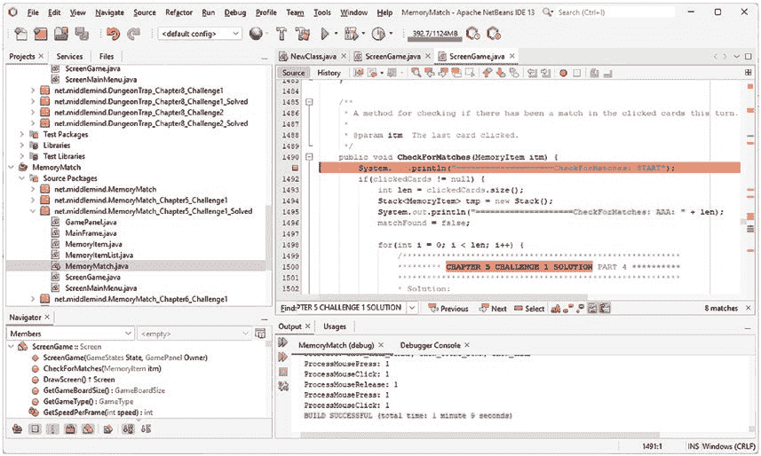


# 第 9 章 调试技术

**图 9-2。一张展示 NetBeans IDE 中断点的图片**

一张显示 NetBeans IDE 断点样子的截图。

在讨论不同的调试按钮的实际作用之前，让我们看看在代码中设置断点后开始调试程序会发生什么。

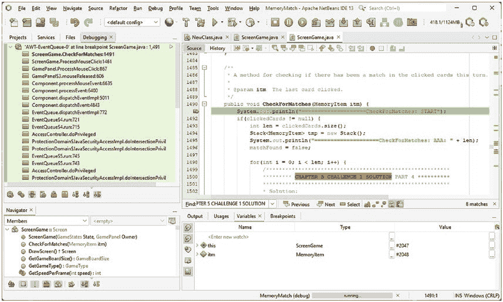

**图 9-3。一张展示在调试过程中停在断点的图片**

一张展示 NetBeans IDE 在调试模式下停在断点处的图片。

注意，此时调试按钮栏现在已处于完全激活状态。

当调试器到达断点时（在本例中，断点设置在第 5 章挑战 1 的记忆匹配（Memory Match）游戏副本中。[T](https://doi.org/10.1007/978-1-4842-8951-8_5)），这个特定的断点是在记忆匹配游戏板上点击了两张卡片后到达的。

调试器将检测到断点并停止等待我们的指令。我们可以使用调试栏上的所有按钮来调整程序的下一行执行内容。

现在是谈谈调试按钮栏上每个按钮的作用的好机了。我将在这里列出它们，并对它们的用途进行简要描述。

- `Debug Project (Ctrl+F5)`：用于启动项目调试会话。
- `Finish Debugging Session (Shift+F5)`：用于结束项目调试会话。
- `Pause`：用于暂停当前调试会话的按钮。
- `Continue (F5)`：用于继续调试器。程序将一直执行直到遇到另一个断点。
- `Step Over (F8)`：当到达断点时，使用此按钮执行下一行代码。
- `Step Over Expression (Shift+F8)`：此按钮允许你逐通过表达式中的每个方法调用，并查看输入参数以及每个方法调用的结果输出值。如果没有进一步的方法调用，`Step Over Expression` 的行为将类似于 `Step Over` 命令。
- `Step Into (F7)`：使用此按钮步入方法调用，以查看方法参数和返回值，并在方法执行执行中继续调试。
- `Step Out (Ctrl+F7)`：使用此命令执行当前函数的剩余部分，并在函数返回完成时中断。

从可用选项中可以看出，使用 NetBeans 的内置调试器时，探索你的 Java 程序的变量、参数和返回值非常容易。这可能需要你花一些时间积累经验并充分发挥调试工具的价值，但没关系，反正你本来就要写代码的。这带我们来到了本节的结论。在下一节中，我们将查看 Java 语言中的异常。

## 异常

在讨论流程控制中的 Try-Catch 语句时，我们已经对 `Exception` 类和一般的 Java 错误处理有所接触。我们将重新回到这个主题，并讨论关于异常的细微点。

## 处理异常

当某行 Java 代码由于某些原因无法正常执行时，就会产生异常。发生这种情况时，会生成一个包含错误信息的执行轨迹异常。为了响应这些错误，我们必须在代码中使用 Try-Catch 语句。这可能会对你的程序产生更广泛的影响。让我们来看 Try-Catch 语句的一些示例。

**列表 9-2。捕获不同异常的 Try-Catch 语句**

```java
System.out.println("Exception #1");
try {
    String s = null;
    s.length();
} catch (Exception e) {
    e.printStackTrace();
}

System.out.println("Exception #2");
try {
    String s = null;
    s.length();
} catch (NullPointerException e) {
    e.printStackTrace();
}

System.out.println("Exception #3");
try {
    String s = null;
    s.length();
    Integer.parseInt("not an integer");
} catch (NullPointerException | NumberFormatException e) {
    e.printStackTrace();
}

System.out.println("Exception #4");
try {
    String s = null;
    s.length();
    Integer.parseInt("not an integer");
} catch (Exception e) {
    e.printStackTrace();
}
```

**输出：**

```text
Exception #1:
java.lang.NullPointerException
    at net.middlemind.PongClone.NewClass.main(NewClass.java:290)

Exception #2:
java.lang.NullPointerException
    at net.middlemind.PongClone.NewClass.main(NewClass.java:298)

Exception #3:
java.lang.NullPointerException
    at net.middlemind.PongClone.NewClass.main(NewClass.java:306)

Exception #4:
java.lang.NullPointerException
    at net.middlemind.PongClone.NewClass.main(NewClass.java:315)
```

观察异常示例 #1 和 #2（第 1-15 行），我们有两个看起来完全相同的 Try-Catch 语句。你能发现出它们之间的差异吗？如果你认为捕获的异常是不同的，那么你是正确的。第一个示例使用了 `Exception` 类；它是所有其他 Java 异常的超类。

捕获此类异常并不能为我们提供任何关于发生了什么信息。

下面的 Try-Catch 语句（异常 #2）与之类似，但它被设计用于捕获 `NumberFormatException`，这是一个更具体的异常类。这个版本的 Try-Catch 语句更加直观，因为你可以清楚地看到代码设计用于处理什么种类型的错误。总的来说，我同意这种方法。然而，有时我会背道而行，实现更更通用的 Try-Catch 语句。为什么呢？

嗯，在编写各种类型的 Java 程序和游戏时，你会遇到很多情况，在这些情况下你并不关心错误是什么。你真正关心的只是到底发生了错误。如果你无法从使用更具体的异常类中获得价值，那么这样做完全没有问题。只需记住，最佳实践建议我们应该这样做。

代码段中的最后两个示例（异常 #3 和 #4）展示了一个新版本的 Try-Catch 语句。它能够捕获多种类型的异常。

请注意第 23 行；注意到 Try-Catch 语句的 catch 子句被设计为同时捕获 `NullPointerException` 和 `NumberFormatException`。

将其与最后一个异常示例进行对比，最后一个示例只捕获了父类 `Exception`。在这种情况下，我们在 Try-Catch 块中获得的代码信息要少得多。

我们不知道它可能会抛出哪些异常。注意，代码必须经过调整以抛出每种类型的异常，因为先遇到的任何一个异常都会退出 Try 语句。

这又回到了形式与功能的相同论点上。如果知道异常的类型对你有益，并且能让你的代码更直观、更可重用，那么就使用那种方法。如果你只是关心知道什么时候失败了，而不是为什么，那么就不要在 Try-Catch 语句中使用更具体的异常。在下一节中，我们将简要讨论一下如何定义自己的异常以便在 Java 程序中使用。

## 定义异常

异常和 Java 中的其他所有内容一样，它们都是基于类的。正如我之前暗示过的，Java 编程语言中的所有异常都是 `Exception` 超类的子类。因此，你可以定义自己的异常并用在代码中。

让我们来看一个示例。

**Listing 9-3.** 定义自定义异常类的示例

```java
1 public class MyException extends Exception {
2 public MyException(String errorMessage) {
3 super(errorMessage);
4 }
5 }
```

一个演示创建自定义异常类的示例。

如你从上一个列表所示，我们使用了继承——我们编程工具箱中一个强大的 OOP 工具——基于主类创建了一个新的异常类。现在我们已经设计了一个自定义异常，就可以在合适的地方使用它。

让我们通过另一个使用我们刚刚创建的异常类 `MyException` 的示例来引发讨论：

**Listing 9-4.** 使用自定义异常类的示例

```java
//code
1 public void ProcessImage(MmgBmp image) throws MyException {
2 if(image.GetWidth() < 10 || image.GetHeight() < 10) {
3 throw new MyException("Image resource is too small!"); 4 }
5 }

//output
1 net.middlemind.PongClone.MyException: Image resource is too small!
2 at net.middlemind.PongClone.NewClass.main(NewClass.java:302)
```

一个演示使用自定义异常类的示例。

在上一个列表中，我们可以看到 `MyException` 类的使用。在这个示例中，我们在一个虚构的 `ProcessImage` 方法中使用该异常。该方法接收一个 `MmgBmp` 图像资源参数，并且没有返回值。该方法的目的是检查传入的图像参数，并确保其宽度和高度大于 10 像素。如果不是，则抛出一个异常。

注意，该方法在方法声明中使用 `throws` 关键字声明了方法体中抛出的异常。这里可以有多个用逗号分隔的条。当我们想要抛出异常时，我们使用 `throw` 关键字，后跟我们要抛出的异常类的实例。在这个示例中，我们使用了虚构的 `MyException` 类，并提供了一个描述性的错误消息。

为什么这种实现不是理想的？

这种实现不是理想的，是因为该异常类并没有指示它设计用于表示的错误。这不像将异常类命名为 `ImageResourceException` 而不是 `MyException` 那样直观。再次，直观和清晰是更好的实现选择。在下一节中，我们将简要查看从抛出的异常返回的信息，即堆栈跟踪（stack trace）。

## 堆栈跟踪

Java 编程的一个重要方面是能够处理意外错误。

这些错误将以异常的形式显现，并在你最意意的时候以最糟糕的方式导致程序崩溃。当你获得一个异常时，通常会得到一个打印到标准错误输出的消息和堆栈跟踪。

有时，你执行程序的环境不会让你获得输出流的访问。你可能不得不尝试在程序内部捕获并指示错误。在这种情况下，实现一个非常高层的全捕获 Try-Catch 是明智的，它可以防止程序完全崩溃。这将给你机会显示一些关于错误的信息，你可以利用它来解决问题。

在任何情况下，你大多数时候都可以访问异常堆栈跟踪。NetBeans 负责将执行期间的任何输出显示在面板中。让我们来看一个堆栈跟踪示例，以便更好地理解它提供的信息以及我们如何使用它来修复错误。

**Listing 9-5.** 简单堆栈跟踪的示例

```
1 net.middlemind.PongClone.MyException: Image resource is too small!
2 at net.middlemind.PongClone.NewClass.main(NewClass.java:302)
```

由 Java 异常产生的简单堆栈跟踪示例。

这个堆栈跟踪应该很熟悉。我们之前在回顾异常处理时见过它。我们在这里再次使用它是因为它非常简单。抛出错误的代码位于项目的 `static main` 方法中。这意味着堆栈跟踪中只有一个条目。异常对象提供给我们的消息如下：`net.middlemind.PongClone.MyException: Image resource is too small!`

它告诉我们异常类以及与异常关联的消息。下一个条目是异常源的行号、类和方法。

让我们来看。

`net.middlemind.PongClone.NewClass.main(NewClass.java:302)`

在 PongClone 项目中，在一个名为 `NewClass` 的类中——这是我的个人测试类——在 `static main` 方法中发生了一个错误，具体位于第 302 行。我通过将异常移动到新的静态方法 `ExceptionTest` 中来说这个“栈”。记住，只有静态类成员可以在没有对象实例的情况下从静态方法访问。现在让我们运行程序，看看异常堆栈跟踪长什么样。

```
net.middlemind.PongClone.MyException: Image resource is too small!
at net.middlemind.PongClone.NewClass.ExceptionTest(NewClass.java:302)
at net.middlemind.PongClone.NewClass.main(NewClass.java:339)
```

花一点时间查看堆栈跟踪（stack trace）并思考正在发生什么。现在跟踪信息中出现了第二行，因为执行栈上有了第二个条目，因为导致异常的代码现在位于 `ExceptionTest` 方法中。以此类推，这告诉我们堆栈跟踪中的第一个行号是导致错误的那行代码的位置，而最后的一个行号是执行栈中第一个方法的位置。关于堆栈跟踪输出，我想介绍的其实就这些了。现在在处理非常长的空指针异常堆栈跟踪时，你应该更有信心了！

## 结论

这标志着我们关于调试技术章节的结束。我希望你学到了关于如何调试 Java 程序的一些门门。让我们回顾一下在本章中涵盖的内容。

## 我们涵盖了什么

这一章虽然短小精悍，但我们仍然成功涵盖了大量的重要内容。让我们来看看本章主要主题的总结。

- **输出跟踪调试**：我们详细介绍了一种简单的调试程序的方法，使用输出语句来概述特定方法或代码块的执行路径。
- **IDE 调试功能**：我们还查看了更高级的 NetBeans IDE 调试，它支持断点以及针对断点处代码执行的多种操作。
- **处理异常**：我们重新复习了 `Try-Catch` 语句，并讨论了在代码中实现 `Try-Catch` 语句的一些相关哲学。
- **定义异常**：我们查看了如何定义和使用自定义异常。
- **堆栈跟踪**：对 Java 异常堆栈跟踪的简要概述。

这一章应该为你的编程工具箱提供了所需的所有工具，以分诊即使是最困难的 Java 异常。你甚至能够定义自己的自定义异常并在程序中使用它们，以捕获某些事件或条件，并通过抛出异常来做出响应。

# 第 10 章

## 结论

欢迎来到本书最后一个章节！如果你已经读到了这里，说明你已经完成了对 Java 编程语言相当详尽的复习，并完成了一些编程挑战，旨在让你上手处理稍微成熟的项目和代码。这是值得骄傲的。你获得了许多良好的经验，并为你的编程工具箱建立了一套坚实的工具。让我们花一点时间回顾一下我们共同完成的一些成就。

## 成就

在本书中，我们共同涵盖了大量内容。我们从开始开始学习了 Java 编程语言的起源，然后转向了变量、数据结构，甚至是面向对象的编程。让我概述一下我们在学习 Java 期间共同探索的一些值得关注的主题。

### 第 1 章：

- **环境搭建**：快速概述如何准备你的 Java 游戏开发环境和 NetBeans IDE。
- **检查游戏**：我们对相关的游戏项目进行了试运行。
- **乒乓球克隆版 (Pong Clone)**：最简单的项目，经典游戏 `Pong` 的克隆。
- **记忆匹配 (Memory Match)**：下一个最复杂的项目，一个记忆卡牌翻牌游戏。
- **地牢陷阱 (Dungeon Trap)**：最复杂的游戏实现，战斗敌人波次并尽可能地生存。

### 第 2 章：

- **基础语法规则**：详细复习了 Java 编程语言的基础语法规则。
- **关键字/保留字**：复习了语言的保留字。
- **主游戏循环**：介绍了与主游戏循环相关的概念。
- **程序结构**：复习了相关 Java 游戏项目的结构。

### 第 3 章：

- **基础数据类型**：复习了 Java 语言的基础数据类型。
- **挑战：基础数据类型**：一个编程挑战，通过测试你对基础数据类型的理解，涉及对游戏项目副本进行代码更改。
- **高级数据类型**：介绍了 Java 中更高级的数据类型，如 `arrays`。
- **挑战：ArrayList**：一个编程挑战，通过测试你对高级数据类型：`ArrayList` 的理解。

### 第 4 章：

- **表达式和运算符**：详细复习了 Java 编程语言中不同类型的表达式和运算符。
- **流程控制**：复习了你可以使用的流程控制语句，如 `Switch` 语句、`if` 语句等。
- **挑战：流程控制**：旨在测试你对流程控制理解的编程挑战。
- **更多关于变量**：深入研究了 Java 变量的某些方面。
- **挑战：枚举**：一个测试你对枚举理解的编程挑战。

### 第 5 章：

- **更多数据结构**：复习了最常见的数据结构。
- **泛型类型和数据结构**：我们花时间讨论了泛型数据结构。
- **挑战：栈 (Stacks)**：较困难的挑战之一，涉及重构代码以使用 `Stack` 代替 `List`。

### 第 6 章：

- **for 循环**：我们复习了 Java 中不同类型的 `for` 循环。
- **while 循环**：复习了 `while` 循环。
- **主游戏循环**：我们对主循环的第二次讨论，详细复习了几种不同类型的循环。


- **挑战：for-each 循环**：一个编程挑战，要求你将 `for` 循环重构为 `for-each` 循环。

## 第 7 章

- **类**：我们再次并详细地复习了类的概念，因为我们涵盖了 Java 类最重要的方面。
- **挑战：MmgBmp 类**：一个有趣的编程挑战，旨在让你获得更多关于游戏引擎类的类的经验。特别是图像类 `MmgBmp`。
- **挑战：ScreenGame 类**：一个后续挑战，将用户输入结合起来控制上一个挑战中配置的图像。
- **高级类主题**：我们花时间讨论了一些更高级的类主题，如类成员访问和 `static main` 入点。
- **挑战：Dungeon Trap 的静态 main**：一个帮助你理解 Java 中 `static main` 入点概念编程挑战。

## 第 8 章

- **封装 (Encaps)**：我们在本章中查看了 OOP 的核心概念，包括封装。
- **继承**：复习了 Java 的类继承。
- **多态**：我们在书中涵盖的最后一个高级 OOP 主题；我们复习了 Java 编程语言中多态的概念。
- **导入类库**：对如何创建和使用类库进行了简短但有效的复习。
- **挑战：创建一个新游戏项目**：一个非常重要的编程挑战，任务是创建一个游戏种子项目，其中包含功能完整的 `Pong Clone` 副本。

## 第 9 章

- **基础调试**：我们快速复习了一种跟踪你的 Java 代码以寻找 bug 并跟踪执行路径的基本技术。
- **高级调试**：我们还查看了使用 NetBeans IDE 步进代码的更高级的调试技术。
- **异常 (Exceptions)**：对 Java 异常进行快速回顾，解释如何创建和使用自定义的异常。

仅仅是列出这些高级主题，我们为每个章节涵盖最重要的内容就已经清楚地涵盖了大量材料。Java 编程语言中只有极少数你没有以某种方式接触过的领域，但确实存在一些。我鼓励你进一步探索 Java 编程语言，并学习更多关于引用、抽象类和接口等高级主题的知识。

## 致谢

我想花一点时间对这段文字的创建以及相关的游戏项目表示一些重要的感谢。首先，我想提到两位帮助我完成这个项目的人。

- **Gabriel Szabo**：一位完备的 IT 专业人士，他为本书提供了专家级的技术评审。
- **Katia Pouleva**：一位出色的艺术家，她创作了所有的 `Memory Match Pro` 游戏美术作品，并清理了文中的所有截图。

关于相关的游戏项目，我想进行以下说明。

我要感谢 Pipoya 创建了一些非常棒的、低成本的 2D 视频游戏艺术。你可以在以下 URL 访问 Pipoya 的免费 RPG 角色素材。请务必支持并查看这位艺术家提供的所有优秀作品。

[Pipoya 的免费 RPG 角色素材 32x32](https://pipoya.itch.io/pipoya-free-rpg-character-sprites-32x32)

我下一个想要感谢的内容创作者是 O_lobster。我使用了 O_lobster 的一组免费地下城瓦片构建了 `DungeonTrap` 游戏板。你可以在以下 URL 访问 O_lobster 的作品：

[简单地下城探索者 16x16 像素艺术素材包](https://o-lobster.itch.io/simple-dungeon-crawler-16x16-pixel-pack?download)

我要感谢 Robinhood76 和 Leszek_Szary 他们在 `freesound.org` 上分享的音效。这两个短音效是游戏马拉松中使用的唯一声音，可以在以下 URL 找到：

[FreeSound 音效 1](https://freesound.org/people/Robinhood76/sounds/95557/)

[FreeSound 音效 2](https://freesound.org/people/Leszek_Szary/sounds/146726/)

我还要感谢来自 itch.io 的 Chasersgaming 和 Zintoki，他们的美术作品被用于 `MmgTestSpace` API 的游戏引擎演示应用程序。所有的原始美术作品及其原始下载 URL 可以在游戏引擎项目目录下的 `cfg/asset_src` 文件夹中找到。

关于 `Memory Match` 游戏，我想进行以下说明。首先，感谢 cloud convert 网站提供的可靠服务，它在尝试在不同格式之间转换音频资源时非常有用：

[`cloudconvert.com/`](https://cloudconvert.com/)

其次，我要感谢以下免费资源的创建者，这些资源被用于创建了该游戏：

[食物图标](https://ghostpixxells.itch.io/pixelfood)

[Memory Match Logo 源源图像](https://static.vecteezy.com/system/resources/previews/000/694/128/original/geometric-seamless-pattern-with-colorful-squares-vector.jpg)

[游戏板图像 1](https://www.pexels.com/photo/brown-wood-surface-172289/)

[游戏板图像 2](https://www.pexels.com/photo/macro-shot-of-wooden-planks-32633/)

如果没有这里列出的这些才华横溢且慷慨的人，我无法为本书创建相关的游戏项目。在各种感谢、提及和链接中，包含了一些视频游戏图像和音频的优质资源。请多关注它们！

## 接下来的路

在完成本书后，你将向哪个方向发展完全取决于你自己。请允许我提供几点建议。

- 进一步探索 Java 编程语言，并学习使用一些我们在这里没有涵盖的剩余高级主题，如接口、抽象类和对象引用。
- 对包含的视频游戏项目进行修改。在本书的编码挑战中，你已经有了许多处理相关游戏项目的经验。更进一步一步，开始在任何一个项目上实现你自己的新游戏功能。玩得开心点！
- 从 `Pong Clone` 种子项目开始构建你自己的视频游戏。你已经学习了如何为视频游戏创建一个新的种子项目，为什么不尝试创建一个你自己的游戏呢。
- 继续使用 Java 编程，并学习更多 Java 标准类框架中包含的类。
- 制作一个版本的 `Memory Match` 游戏，使用由 Katia Pouleva 创建的秘密 `Memory Match Pro` 图像。在 `MemoryMatch` 项目的文件夹中寻找即可。

天空才是极限。运用你在这里学到的编码工具，并将它们应用到你所知的任何其他语言、你的下一个 Java 程序，甚至是你的下一个伟大的游戏。如果你认真地想学习更多 Java 游戏编程，那么你可能想更多地了解所有包含的视频游戏项目的引擎；请访问此 GitHub 仓库：

[`github.com/Apress/introduction-video-game-engine`](https://github.com/Apress/introduction-video-game-engine)

## 告别

好了，我是时候说再见了。希望这本书能为你提供一些知识，让你开始编写自己的程序和游戏。

## 索引

### A

- 异常 (Exceptions), 38
- 高级 (Advanced), 39
- 数组 (Arrays), 55
- 数组 (ArrayLists), 72

### B

- 断点 (break point), 226
- 按钮栏 (button bar), 225

### C

- C 编程语言 (C programming language), 31
- C++ 编程语言 (C++ programming language), 31, 32, 163
- 构造函数 (Constructors), 172–174

### D

- 定义 (definition), 190
- 数据结构 (Data structures), 111
- 地城陷阱 (Dungeon trap), 60

### E

- 封装 (Encapsulation), 222, 240
- 枚举 (Enumerations), 238

### F

- 字段 (fields), 67

### G

- 获取和设置 (get and set), 60

### H

- 哈希处理 (hashing), 116–122

### I

- 继承 (inheritance), 111
- 接口 (interfaces), 38

### J

- Java 类 (Java class), 190
- Java 编程语言 (Java programming language), 30–32

### K

- 关键字 (keywords), 45

### L

- 列表 (lists), 59
- 长度 (length), 60

### M

- 记忆匹配游戏 (memory match game), 184, 185
- 修饰符 (modifier), 61

### N

- NetBeans IDE (NetBeans IDE), 180

### O

- 输出语句 (output statements), 223, 224

### P

- 参数化类型 (parameterized types), 130
- 原理 (principle), 190
- 多态 (polymorphism), 111

### Q

- 队列 (queues), 128–130

### R

- 引用 (reference), 61

### S

- 栈 (stacks), 122–128, 131–133
- 静态方法 (static main), 179–181

### T

- `toString`, 54

### U

- URL, 24

### V

- 变量 (variables), 56
- 视频游戏项目 (video game projects), 207–221

### X

- XML, 183

## 索引

### 数据类型, 238

- 挑战, 106
- 数组（见 Arrays）
- 类特征, 98
- 布尔数据类型, 46
- 定义, 98–100
- 损坏的版本, 50
- 实现, 99
- 字节/浮点数, 45
- 初始化, 107
- 强制转换与转换, 101

### 循环

- 挑战, 74
- 弹克隆游戏, 108
- 特性, 44
- 解决方案, 107
- 编码挑战, 49, 50
- 步骤, 106
- 定义, 43

### 异常, 240

- 基础构建块, 44
- 定义, 231, 232
- 初始化, 47–50
- 异常类, 228, 230
- 解决方案, 51, 52
- `ExceptionTest` 方法, 234
- 字符串变量, 44
- 执行处理, 228–231
- `var` 关键字/动态类型, 52–54
- `MyException` 类, 232
- 变量声明, 44–49
- `PongClone` 项目, 234
- 工作版本, 51
- `ProcessImage` 方法, 232

### 调试技术

- 堆栈跟踪, 233, 234

### NetBeans IDE

- `try-catch` 语句, 229, 230
- 244

### 表达式/运算符, 238

- 游戏项目, 1
- 赋值, 83, 84
- 通用结构, 3
- 位移, 86, 87
- 编程语言, 38
- 位运算, 85, 86
- 类, 40
- 布尔, 82, 83
- 描述, 40, 41
- 分类, 76
- 引擎源码, 38
- 类方法, 80
- 游戏循环, 39
- 定义, 77
- 程序结构, 40
- 递增/递减, 84, 85
- 职责, 39
- 低级语言特征, 77–80
- 要求, 2
- 模模运算符, 76
- 源码, 4
- 数值类型, 80–82
- 文本信息, 1
- 运算符优先级, 87, 88
- 类型, 76
- 一元/二元/三元运算符, 76

### 继承, 222, 240

- 类声明, 191

### F

- 编码挑战, 193

### 流控制

- 特性, 189, 191
- 挑战, 95, 96
- 火矛, 195
- If-Else 语句, 89–91
- 解决方案, 194, 195
- 初始化, 89
- `super` 关键字, 192
- 键盘键, 95
- 解决方案, 96–98
- switch 语句, 91–93
- 调试技术, 224–228
- `try-catch` 语句, 94–96

### 迭代，循环，见 Looping

- 变量声明, 88

### 集成开发环境 (IDE), 2, 9

### G

- Java 开发工具包 (JDK), 35, 42

### 游戏开发任务

- 下载版本, 9
- 代码挑战, 3
- NetBeans IDE, 9
- 规范, 4, 5
- Java 编程语言, 29, 237
- 开发过程, 8
- 高级信息, 7, 8
- 地牢陷阱主体, 5
- 类, 100, 101
- 环境, 9
- 数据（见 Data types）
- 文件/命名空间, 20–26
- 详细审查, 242
- 格式化模式, 2, 3
- 数据结构, 111

### Java 编程语言（续）

- 封装/继承/多态, 189
- 流控制, 135
- 举举, 98–100
- 实现, 155
- 表达式/运算符, 76–88

#### `for` 循环

- 基础, 1, 6, 7
- 控制变量的作用域, 136
- 数据类型, 141
- 历史, 33
- 声明, 137
- 不同技术, 138
- JDK, 35
- 退出条件, 137
- JRE 程序, 35, 36
- `for-each` 循环, 140, 141
- 关键字/保留字, 38, 39
- `goto` 解决方案, 136
- 学习过程, 237–240
- 初始化, 139
- 循环/迭代, 135
- 源码, 136
- 目标, 6
- 版本, 136
- 面向对象编程, 157
- `while` 循环, 142
- 计算, 147
- 语义, 36
- 条件, 142
- 语法规则, 35–37
- 控制循环, 146
- 声明, 142
- 变量, 98
- 帧时间, 149
- Java 运行时 (JRE), 34, 35, 42
- 帧帧移动, 150
- 隐式/显式帧率, 144
- 主游戏循环, 144, 149
- 面板类, 145, 146
- 每帧像素方法, 149
- 框架, 207
- 职责, 144
- 帧差, 148
- URL, 241

### 库, 222

- `mgDraw` 方法, 154
- 解决方案, 153

### M

- `break`/`continue` 语句, 152
- `do-while` 循环, 151
- `for` 循环
- 编码挑战, 153
- `Data` 类, 164
- `gameState` 变量, 166
- `getNumberOfPlayers/setNumber` 方法, 163–169
- `OfPlayers` 方法, 166
- `testVariable` 方法, 168
- 释放方法, 178
- 多维数组
- 声明, 112
- 定义, 112
- 删除, 115, 116
- `mgBmp` 类, 174
- `Game` 类, 177, 178
- `SetIsVisible` 方法, 178
- `SetState` 方法, 175
- get/set 值, 113, 114
- 静态类成员, 169–172

### 运算符/运算符优先级, 87, 88

### N

- NetBeans IDE
- 计算机体系/操作系统, 11
- 调试技术, 224–228
- 编码挑战, 202–204
- 安装过程, 9, 12, 13
- 特性, 189
- 目录, 13
- 方法, 201
- 库属性, 19
- 包属性, 16
- 建模代码, 197–201
- 源设置, 17, 18
- 重写方法, 197, 202
- `ACClick` 方法, 203, 205
- 截图, 10, 15
- 解决方案, 204, 205
- 超类定义, 197
- `toString` 方法, 201

### 面向对象编程 (OOP), 32, 190

### S、T

- 类, 157, 158（见 Classes）

### 栈

- 编码挑战, 174, 175
- 构造函数, 172–174
- `ArrayList` 方法, 132
- 数据结构, 157
- 挑战, 131
- 封装/继承/多态, 189
- `CheckForMatches` 方法, 133
- 数据元素, 125
- 配置文件, 208, 214
- 声明, 123, 124
- 可绘制目录, 208
- get/set 值, 125–127
- 执行过程, 220, 221
- 初始化, 124
- `GamePanel.java`, 207
- 实例化, 123, 124
- 库, 213–215
- `MemoryMatch`, 133
- `MainFrame.java`, 207
- 解决方案, 132
- `MyNewGame` 项目, 213


- NetBeans 项目文件夹，208
- 弹克隆类文件，217–220

## U

- 弹克隆游戏，207，221
- 队列，111，128–130
- 项目配置，219，220
- 项目对话框，211–213
- 重构对话框，218

## V、W、X、Y、Z

- 资源文件夹，215–217
- 变量，见 Data types
- 设置/配置，207
- 视频游戏项目，222
- 解决方案，210
- 编码挑战，209，210
- 静态 `main` 入口，207

# 文档大纲

- 目录
- 关于作者
- 引言

## 第 1 章：引言

- 关于本文
- 关于格式
- 关于规范
- 目标
  - Java 基础话题](#index_split_000.html_p18)
  - Java 高级话题](#index_split_000.html_p19)
  - 游戏开发话题](#index_split_000.html_p20)
- 设置环境
  - 获取游戏项目
- 查看游戏
- 总结
  - 我们涵盖的内容

## 第 2 章：什么是 Java 编程

- 计算机与编程
  - 编程计算机
  - 编程语言
  - 程序类型/编程
- Java 编程语言
  - JRE
  - JDK
- 语法与语义
  - 基础语法规则
  - 关键字/保留字
- 游戏编程
  - 主游戏循环
  - 程序结构

# 包含的游戏概览

## 总结

### 我们涵盖的内容

# 第 3 章：变量

## 数据类型

### 基础数据类型

### 使用基础数据类型

### 挑战：基础数据类型

### 挑战解决方案

### 高级数据类型

### `var` 关键字与动态类型

### 数组

### 使用数组

### 挑战：数组

### 挑战解决方案

### 列表

### 使用列表

### 挑战：`ArrayList`

### 挑战解决方案

### 总结

### 我们涵盖的内容

# 第 4 章：表达式与运算符、流程控制以及变量进阶

## 表达式与运算符

### 数值表达式

### 布尔表达式

### 赋值表达式

### 增量/减表达式

### 位运算表达式

### 位移表达式

### 运算符与优先级

## 流程控制

### If-Else 语句

### Switch 语句

### Try-Catch 语句

### 挑战：流程控制

### 挑战解决方案

## 变量进阶

### 枚举

### 极其基础的 Java 类

### 转换与转换

### 挑战：枚举

### 挑战解决方案

### 总结

### 我们涵盖的内容

# 第 5 章：更多数据结构

## 多维数组

### 声明多维数组

### 使用多维数组

## 哈希（Hashes）

### 声明哈表

### 使用哈表

## 栈（Stacks）

### 声明栈

### 使用栈

## 队列（Queues）

### 参数化类型与数据结构

### 挑战：栈

### 挑战解决方案

### 总结

### 我们涵盖的内容

# 第 6 章：循环与迭代

## For 循环

### 基础 For 循环

## For-Each 循环

## While 循环

### 基础 While 循环

### 主循环

## Do-While 循环

### 基础 Do-While 循环

### Break 与 Continue

### 挑战：For-Each 循环

### 挑战解决方案

### 总结

### 我们涵盖的内容

# 第 7 章：对象、类与面向对象（OOP）

## 类

### 字段

## 方法

### 静态成员

### 构造函数

### 挑战：`Mmgmp` 类

### 挑战解决方案

### 挑战：`ScreenGame` 类

### 挑战解决方案

## 高级类主题

## 访问权限

## 类设计

### 静态 `main` 入口

### 挑战：地城陷阱的静态 `main`

### 挑战解决方案

### 总结

### 我们涵盖的内容

# 第 8 章：封装、继承与多态

## 封装

## 继承

## 挑战：继承

### 挑战解决方案

## 多态

## 挑战：多态

### 挑战解决方案

## 导入类库

## 视频游戏项目结构

### 挑战：创建一个新的游戏项目

### 挑战解决方案

### 第 1 步：创建一个新项目进行自定义

### 第 2 步：添加默认库

### 第 3 步：拷贝资源文件夹

### 第 4 步：拷贝过 PongClone 的 Java 类

### 第 5 步：配置项目设置

### 第 6 步：执行 Pong 克隆游戏

### 总结

### 我们涵盖的内容

# 第 9 章：调试技巧

## 输出追踪（Output Trace）

## IDE 调试功能

## 异常

## 异常

## 定义异常

### 堆栈跟踪（Stack Trace）

### 总结

### 我们涵盖的内容

# 第 10 章：结论

## 成就

## 致谢

## 你的后续之路

## 告别

## 索引
