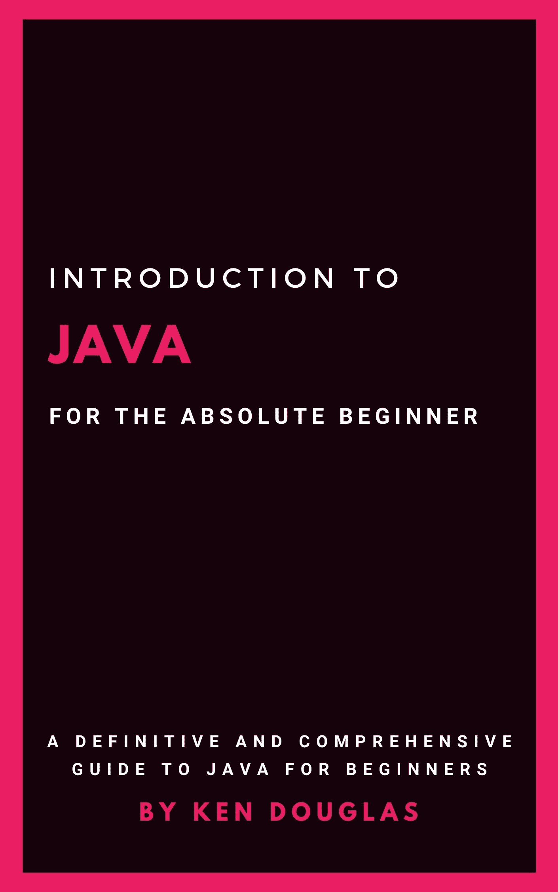
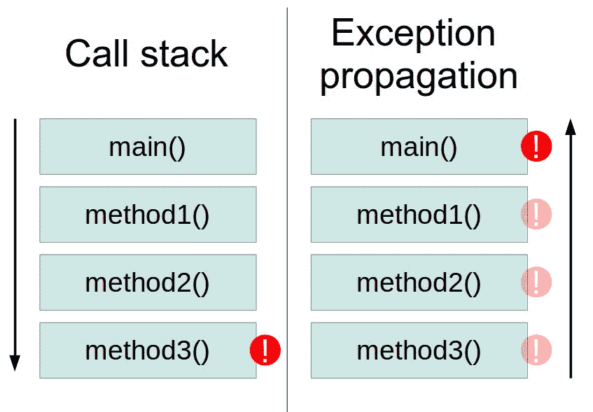
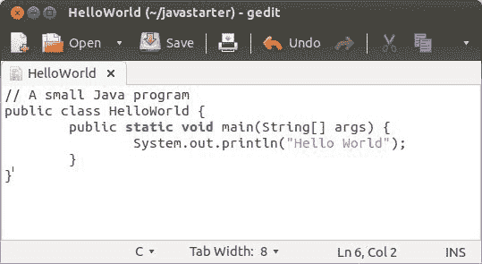
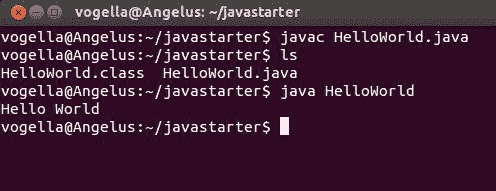

# Java 入门指南



## 目录

- 第一章：Java 简史
- 第二章：安装 Java
- 第三章：Java 基础语言结构
- 第四章：Java 接口
- 第五章：Java 中的注解
- 第六章：变量与方法
- 第七章：修饰符
- 第八章：导入语句及更多 Java 语言结构
- 第九章：备查清单
- 第十章：集成开发环境
- 第十一章：Java 语句
- 第十二章：Java 中的循环
- 第十三章：数组
- 第十四章：字符串
- 第十五章：Lambda 表达式
- 第十六章：流（Streams）
- 第十七章：可选类型（Optional）
- 第十八章：系统属性
- 第十九章：Java 练习题

# 第一章：Java 简史

1991 年，Sun 微公司（SUN）的 James Gosling 创造了一种在今天被称为“Java”的编程语言。直到 1995 年，第一个公开的 Java 版本（Java 1.0）才被发布。2006 年，Sun 公司在 GNU 通用公共许可证（GPL）下发布了 Java。这个也被称为 OpenJDK 的项目至今仍由 Oracle 公司继续维护。

现在由 Oracle 管理 Java 的 Oracle 公司于 2010 年收购了 Sun 微公司。随着时间的推移，经过改进和增强的 Java 版本不断发布。目前的最新版本是 Java 1.8，或 Java 8。

## 什么是 Java？

Java 是一种编程语言，可用于设计或开发移动应用、桌面应用或 Web 应用、游戏等。它由一组规范定义，由编程语言、运行时（Java 虚拟机）、核心库和编译器组成。通过 Java 运行时，软件开发者可以使用不同于熟悉的 Java 编程语言编写程序代码，而这些代码仍然运行在 Java 虚拟机上。

Java 核心类库和 Java 虚拟机是 Java 平台的重要组成部分。通过 Java，目标是实现“编写一次，即可在多个操作系统上运行”。

以下属性构成了 Java 语言：

- **面向对象的编程语言**：除了基本数据类型外，构成 Java 的所有元素都是对象。
- **平台无关**：Java 虚拟机被 Java 程序用作抽象，Java 程序也不直接访问操作系统。这种访问性使得 Java 程序具有高度的可移植性。任何遵循特定规则并符合标准的 Java 程序都可以在 Linux 或 Windows 等支持的平台上无需修改即可运行。
- **自动内存管理**：创建新对象的内存分配和释放由 Java 管理。该程序无法直接访问内存。没有活动指针的对象将由所谓的“垃圾回收器”自动删除。
- **编译型和解释型语言**：所有 Java 源代码都被转换为不依赖于目标平台的字节码格式。然后，Java 虚拟机（JVM）会解释这些字节码指令。JVM 包含一个名为“热点编译器”（Hotspot-Compiler）的组件，它可以将性能关键的字节码指令翻译成原生代码指令。
- **强类型编程语言**：Java 编程语言是一种强类型语言。例如，与其他对象之间的转换相对严格，例如大多数时候必须由程序员完成，而所用变量的类型必须预定义。

注意：Java 的语法看起来像 C++。

Java 同样对大小写敏感。例如，名为 `myvalue` 和 `myValue` 的变量始终被视为不同的变量。

## 编写第一个 Hello World 程序

要开始，下面的图示代码可以有所帮助：

```java
// 一个小型 Java 程序
public class HelloWorld {
    public static void main(String[] args) {
        System.out.println("Hello World");
    }
}
```

## Java 虚拟机

有一种计算机的软件实现，可以像真实机器一样实现并执行问题。该软件被称为 Java 虚拟机（JVM）。

Java 虚拟机（JVM）是为特定的操作系统编写的。例如，Linux 需要一个特殊的实现，Windows 同样需要一个实现。此外，Java 编译器将 Java 程序转换为字节码，而 Java 虚拟机则帮助解释转换后的字节码，或者直接执行 Java 程序。

## Java 开发工具包 vs Java 运行时环境

Java 有两种发行类型，分别是 Java 开发工具包（JDK）和 Java 运行时环境（JRE）。在 Java 运行时环境（JRE）中，你可以找到 Java 类库和 Java 虚拟机（JVM）。它们都包含了启动 Java 程序所需的功能。

JDK 额外包含了创建 Java 程序所需的开发工具。因此，JDK 由 Java 编译器、Java 虚拟机和 Java 类库组成。

## 使用 Java 进行开发流程

Java 源文件以纯文本文档的形式编写。程序员通常在集成开发环境（IDE）中编写 Java 源代码。IDE 支持程序员编写代码的任务，例如，它可以提供源代码的自动格式化、重要关键词的高亮等功能。

在某个时刻，程序员（或 IDE）调用 Java 编译器 `javac`。Java 编译器创建字节码。这些指令存储在 `.class` 文件中，并由 Java 虚拟机执行。

## 垃圾回收器

JVM 会自动收集未被对象引用的内存。Java 垃圾回收器检查所有对象引用并寻找可以自动释放的对象。虽然垃圾回收器让程序员无需显式管理内存，但程序员仍然需要确保自己不保留不必要的引用，否则垃圾回收器无法释放关联内存。保留不必要的对象引用被称为内存泄漏。

## 类路径（Classpath）

类路径定义了 Java 编译器和 Java 运行时在哪里查找用于加载的 `.class` 文件。这些指令可以在 Java 程序中使用。例如，如果你想使用外部库，就必须将该库添加到类路径中。

# 第二章：安装 Java

## 第一步：推荐的 Java 版本

为了安装 Java，强烈建议使用 Java 的最新长期支持版本。在编写本文时，这是 JAVA 12。

## 第二步：检查安装

在运行 Java 程序之前：

- 必须安装 Java 运行时环境。
- 环境变量中必须包含 Java 可执行文件。

通过控制台，也可以测试 JRE 是否安装正确。在 Windows 上打开控制台：按 Win+R，输入 `cmd`，然后按回车。现在，输入以下命令：

```bash
java -version
```

如果 JRE 安装正确，此命令将打印出关于 Java 安装的信息。如果发生这种情况，你可以跳过 Java 安装说明。如果命令行返回找不到程序的信息，你也必须安装 Java。

## 第三步：安装 Java

在 [Java 网站](http://java.com/)上可以找到 Oracle 提供的适用于 Microsoft Windows 的原生安装程序。该原生安装程序包含了如何在所有支持的平台上安装 Java 的说明。

例如：

### 在 Ubuntu 上安装 Java

在 Ubuntu 上，你可以通过命令行中的以下命令安装 Java 11。这些命令可能会随时间变化，如果它们不再有效，请搜索新的安装方法。

```bash
### 如果你倾向于使用 Oracle Java 发行版
### 你也可以备选使用以下命令
```

```bash
sudo add-apt-repository ppa:linuxuprising/java
sudo apt-get update
sudo apt-get install oracle-java11-installer
```

## 最后一步：检查安装问题和其他操作系统

如果你在尝试在系统上安装 Java 时遇到问题，请在 Google 上搜索“如何在我的 OS 上安装 JDK”。请记住将“OS”一词替换为你当前正在使用的操作系统，如 Ubuntu、Mac OS X 或 Windows。你一定能找到非常有用的链接。

# 第三章：Java 语言基础结构

## 类（Class）

任何描述与类实例相关的行为和数据的模板都称为“类（Class）”。

`class` 关键字用于定义一个类，它必须以大写字母开头。每个类的类体都包含在符号 `{}` 之中。

例如：

```java
package test; class MyClass { }
```

与类相关的任何数据都存储在变量中，而与对象或类相关的行为则通过方法来实现。

此外，你会在文本文件中找到每个类，该文件名与类名相同，并带有 `.java` 扩展名。你也可以定义内部类（定义在另一个类内部的类）。要成功实现这一点，你不需要为该类准备单独的文件。

## 对象（Object）

类的任何实例都称为对象。它是可以执行操作并拥有数据的真实元素。每个对象都是根据类的定义创建的。每个对象的蓝图都是类，这意味着类描述了如何创建每个对象。

## 包（Package）

Java 将类分组在功能性的“包（packages）”中。

类通常也通过包分组在逻辑单元中。例如，应用程序的每个图形视图都可以放在同一个名为 `com.vogella.webapplication.views` 的包中。

许多人通常使用公司的反向域名作为顶级包。例如，拥有 `backdrops.com` 域名的公司其 Java 包将以 `com.backdrops` 开头。

使用包的另一个原因是为了避免类的命名冲突。要发生命名冲突，两个程序员必须给同一个类提供相同的完全限定名。Java 中类的完全限定名由包名、紧跟其后的点（`.`）、最后是类名组成。

如果没有包，程序员可能会创建一个名为 `Test` 的 Java 类。另一个程序员可能会使用相同的名称来创建一个类。通过使用包，可以指示系统调用哪个类。例如，如果第一个程序员将 `Test` 类放在包 `report` 中，而第二个程序员将他的类放在包 `xmlreader` 中，人们可以使用完全限定名（如 `report.Test` 或 `xmlreader.Test`）区分这些类。

## 继承（Inheritance）

你可以始终从另一个类派生出一个类。当这种情况发生时，派生的类被称为“子类（subclass）”。另一种常见情况是一个类被另一个类扩展。

获取子类的类被称为“父类（superclass）”。

当发生继承时，它允许一个类继承另一个类的数据定义和行为。

下面你将找到演示类如何扩展另一个类的代码。请记住，在 Java 中，一个类最多继承一个类。

```java
package com.vogella.javaintro.base;

class MyBaseClass {
    public void hello() {
        System.out.println("Hello from MyBaseClass");
    }
}

package com.vogella.javaintro.base;

class MyExtensionClass extends MyBaseClass {
}
```

### 对象作为父类

在 Java 中，每个对象都隐式地继承自 `Object` 类。对于每个 Java 对象，类定义了以下方法：

- `equals(o1)` 允许检查当前对象是否等于 `o1`。
- `getClass()` 返回对象的类类型。
- `hashCode()` 返回当前对象的标识符。
- `toString()` 给出当前对象的字符串表示。

## Java 中的异常处理（Exception handling in Java）

在 Java 中，有一种事件指示应用程序在运行期间发生了错误。这种事件被称为异常（exception）。当异常发生时，应用程序指令的通常执行流会被中断。通常情况下，异常会在调用层次结构中向上抛出，直到它们被捕获（catched）。



### 检查异常（Checked Exceptions）

检查异常是由方法显式抛出的，这些方法可能会导致异常发生，或者在抛出的 `Exception` 未被捕获时由方法重新抛出。

因此，在调用抛出检查异常的方法时，`Exceptions` 要么必须被捕获，要么被重新抛出。

```java
public void fileNotFoundExceptionIsCaughtInside() {
    try {
        createFileReader();
    } catch (FileNotFoundException e) {
        logger.error(e.getMessage(), e);
    }
}

public void fileNotFoundExceptionIsReThrown() throws FileNotFoundException {
    createFileReader();
}

public void createFileReader() throws FileNotFoundException {
    File file = new File("/home/Documents/JavaTraining.txt");
    // 创建新的 FileReader 可能会导致 FileNotFoundException
    new FileReader(file);
}
```

注意：当在某些情况下可以预测到错误时，使用检查异常，例如找不到文件。

### 运行时异常（Runtime Exceptions）

运行时异常是那些在方法签名中没有显式指出的异常，因此不需要被捕获。

最著名的运行时异常是 `NullPointerException`，它发生在运行时，当对一个实际上为空的对象调用方法时。

```java
public void causeANullPointerException() {
    String thisIsNull = getMessage(false);
    // 因为 thisIsNull 对象为空
    // 这会导致 NullPointerException
    thisStringIsNull.toLowerCase();
}

public String getMessage(boolean messageIsAvailable) {
    if (messageIsAvailable) {
        return message;
    }
    return null;
}
```

# 第四章：接口（INTERFACES）

## 什么是 Java 接口？

接口是一种与类类似的类型，通过 `interface` 关键字定义。接口用于定义实现类的公共行为。如果两个类实现了同一个接口，在接口级别工作的代码就可以使用这两个类的对象。

和类一样，接口定义了方法。类可以实现一个或多个接口。实现接口的类必须为接口定义的所有抽象方法提供实现。

## 接口中的抽象方法、默认方法和静态方法

接口可以包含抽象方法和 `default` 方法。默认方法通过方法签名开头的 `default` 关键字定义。接口中定义的所有其他方法都是公共且抽象的；显式声明这些修饰符是可选的。

接口可以拥有常量，这些常量始终是公共、静态且最终的（final）。

以下代码展示了接口实现的示例：

```java
package testing;

public interface MyInterface {
    // 常量定义
    String URL = "https://www.vogella.com/";

    // 公共抽象方法
    void test();
    void write(String s);

    // 默认方法
    default String reserveString(String s) {
        return new StringBuilder(s).reverse().toString();
    }
}
```

## 实现接口（Implementing Interfaces）

类可以实现接口。在这种情况下，它必须为抽象接口方法提供具体实现。如果你实现由接口定义的方法，可以使用 `@Override` 注解。这告诉 Java 编译器你实际上想要实现接口定义的方法。这样，如果你写错了方法名称或参数数量，编译器可以给你报错。以下类实现了 `MyInterface` 接口，因此它必须实现抽象方法，并可以使用默认方法。

```java
package com.vogella.javaintro.base;

public class MyClassImpl implements MyInterface {

    @Override
    public void test() {
    }

    @Override
    public void write(String s) {
    }

    public static void main(String[] args) {
        MyClassImpl impl = new MyClassImpl();
        System.out.println(impl.reserveString("Lars Vogel"));
    }
}
```

## 使用默认方法演进接口

在过去，Java 8 演进接口（例如向接口添加新方法）是不可能的，除非破坏现有的客户端。自从 Java 8 提供了默认方法，通过简单地提供默认实现，现在可以扩展接口而无需破坏现有的客户端。这种默认方法的发明是一个二进制且兼容的更改。

现在，类可以重写默认方法以提供更好的行为。

### 方法的多重继承

当一个类实现两个接口，且这些接口提供了相似的默认方法时，Java 将通过以下规则为类解析实际方法：

- **子类型优于父类型**：如果一个类可以从两个接口继承同一个方法，且其中一个接口是另一个接口的子类型，则该类将继承来自子类型的方法。
- **父类总是优于父接口**：如果一个类可以从父接口和父类继承同一个方法，则该类将继承父类方法。这条规则对于抽象和具体的父类方法尤其如此。该规则还意味着，如果该方法也在父类链中声明，则将不会使用默认方法。
- **在所有其他情况下**，类必须实现该默认方法。

下面的图演示了编号为 3 的列表：


```java
public interface A {
    default void m() {}
}

public interface B {
    default void m() {}
}

public class C implements A, B {
    @Override
    public void m() {}
}
```

在进行自己的实现时，你始终可以调用你喜欢的父类方法。如下所示：

```java
public class C implements A, B {
    @Override
    public void m() {
        A.super.m();
    }
}
```

## 函数接口

函数式接口是各种只有一个方法的接口。所有函数式接口都有一个特殊的特性：它们可以与 lambda 表达式一起使用。所有函数式接口都由 Java 编译器自动识别。它们只需要只有一个抽象方法。尽管如此，使用 `@FunctionalInterface` 注解来捕捉设计意图是非常可能的。

许多默认 Java 接口都是函数式接口。例如：

- `java.beans.PropertyChangeListener`
- `java.util.Comparator`
- `java.io.FileFilter`
- `java.util.concurrent.Callable`
- `java.lang.Runnable`

还有一个名为 `java.util.function` 的包，包含了 Java 中频繁使用的函数式接口。`java.util.function` 包包括：

- `BinaryOperator<T>`：一个从 `(T, T)` 到 `T` 的函数
- `UnaryOperator<T>`：一个从 `T` 到 `T` 的函数
- `Supplier<T>`：提供 `T` 的实例（例如工厂）
- `Function<T, R>`：一个将 `T` 转换为 `R` 的函数
- `Consumer<T>`：对对象执行的操作
- `Predicate<T>`：对象的布尔值属性

# 第 5 章：Java 中的注解

关于非编程逻辑本身成员的类所需的所有数据都由注解提供。注解对它们标记的代码没有直接影响。注解提供的信息或数据可以被其他组件使用。

注解仅存在于开发阶段（`RetentionPolicy.SOURCE`），并且只能在运行时保留（`RetentionPolicy.RUNTIME`）。

## `@Override` 注解和重写方法

任何扩展另一个类的都会自动从父类继承该类的方法。要成功更改这些方法，只能重写它们。这意味着它只能重新声明这些方法。除非类本身被定义为抽象类，否则此过程是绝对必要的。

可以添加到此类方法中的一个注解是 `@Override` 注解。这是因为 Java 编译器用它来检查标记的方法是否实际上重写了扩展类或接口中的方法。

你始终可以在子类的源码中使用相同的方法签名来重写方法。同时，你也可以利用 `@Override` 注解向源代码的阅读者和 Java 编译器表明你打算重写一个方法。

关于如何重写父类方法的示例，请看下面的代码：

```java
package com.vogella.javaintro.base;

class MyBaseClass {
    public void hello() {
        System.out.println("Hello from MyBaseClass");
    }
}

package com.vogella.javaintro.base;

class MyExtensionClass2 extends MyBaseClass {
    @Override
    public void hello() {
        System.out.println("Hello ExtensionClass2");
    }
}
```

使用 `@Override` 注解始终是一个良好的做法。这是因为确保了 Java 编译器会验证你是否真的重写了方法。

## `@Deprecated` 注解

该注解可以用于类、构造函数、方法或字段，并表示该元素已过时，不应使用。

## 类型注解

根据 Java 规定，注解可以放在任何类型上。下面是一个示例：

```java
@NonNull String name;

List<@NonNull String> names;

class UnmodifiableList<T> {}

email = (@Email String) input;

new @Information Object();

void doSomething() throws @ImportantMe Exception { }
```

# 第 6 章：变量与方法

## 变量

Java 程序通过变量在运行时存储值。变量分为基本类型或引用。基本类型包含值，而引用类型包含对象的指针（或引用）。这意味着在比较引用变量时，实际上是在比较它们是否指向同一个对象。

利用 `object1.equals(object2)` 方法调用来识别对象是否相同相同。

## 实例变量

实例变量是与类的实例（或对象）关联的变量。访问适用于这些对象。所有实例变量都可以被标记为 `transient` 或 `final`，并具有任何访问控制。而且，一旦实例变量被标记为 `final`，在赋值后就不能再更改。

## 局部变量

局部（或栈）变量声明是那些无法访问修饰符的。所有局部变量都没有默认值，因此在使用它们之前必须初始化。事实上，局部变量唯一的可用修饰符是 `final`。该修饰符定义了在第一次赋值后变量无法更改。

## 方法

具有返回值和参数的代码块被称为方法。方法始终可以在对象上调用。

```java
package com.vogella.javaintro.base;

public class MyMethodExample {
    void tester(String s) {
        System.out.println("Hello World");
    }
}
```

可以使用变长参数来声明方法。发生这种情况时，方法声明了一个接受从零到多个参数的参数（语法：`type ... name`）。一个方法只能有一个变长参数，且该参数必须是方法的最后一个参数。

### 重写父类方法

有一条规则规定方法必须具有相同的参数和完全相同的返回参数。它还规定返回参数必须相同。

## 方法重载（Overload methods）

任何同名但参数不同的方法都称为重载方法。返回类型永远不能用于重载方法。

## `main` 方法

有一个签名为 `public static` 方法可以用于启动 Java 应用程序（查看下文签名）。这个 `public static` 方法通常被称为 `main` 方法。

```java
public static void main(String[] args) {}
```

## 构造函数

每个类都包含一个或两个构造函数，这些函数由 Java 运行时根据类的定义来创建对象。除了它们使用类名且没有返回类型外，构造函数的声明看起来类似于方法声明。

每个类可以有多个具有不同参数的构造函数。在下面的示例中，类的构造函数期望一个参数：

```java
package com.vogella.javaintro.base;

public class MyConstructorExample2 {
    String s;

    public MyConstructorExample2(String s) {
        this.s = s;
    }
}
```

每个类必须至少定义一个构造函数。如果在 Java 源文件中没有定义式构造函数，编译器将隐式地添加一个。在类被子类的任何情况下，父类的构造函数始终会被隐式地调用。

在下面的示例中，无参数构造函数的定义（也通俗称为空构造函数）不是必须的。如果没有指定，编译器始终会创建一个。

```java
package com.vogella.javaintro.base;

public class MyConstructorExample {
    // 无必要：如果省略，将由编译器创建
    public MyConstructorExample() {
    }
}
```

要创建一个构造函数，命名规范如下：`classname (Parameter p1, …) { }`。所有对象都是根据构造函数创建的。在对对象进行任何操作之前，构造方法是第一个被调用的语句。

# 第 7 章：修饰符（MODIFI）

## 访问修饰符（Access modifiers）

在 Java 中，你可以找到三种访问修饰符：`private`、`protected` 和 `public`。你还可以找到四种访问级别。它们是：`private`、`default`、`public` 和 `protected`。所有这些级别定义了相应元素对其他组件的可见性。声明为 `public` 的示例是类或方法被其他 Java 对象自由地创建或调用。而声明为 `private` 的示例可能是某个方法只能在声明它的类内部被访问。

`default` 和 `protected` 访问级别非常相似。`default` 类只能通过同一个包访问，而 `protected` 类可以从包内以及包外部的子类访问。

为了说明它们的可见性，请看下表：

### 访问级别表

| 修饰符 | 类 | 包 | 子类 | 世界上 |
| :--- | :--- | :--- | :--- | :--- |
| `private` | Y | N | N | N |
| 无修饰符 | Y | Y | N | N |
| `protected` | Y | Y | Y | N |
| `public` | Y | Y | Y | Y |

### 其他修饰符（Other modifiers）

- **Final 方法（Final methods）**：这些方法在子类中不能被重写。
- **抽象方法（Abstract method）**：这些方法没有方法体。
- **同步方法（Synchronized method）**：线程安全，可以有任何访问控制，并且可以是 `final` 的。
- **原生方法（Native methods）**：这些是完全取决于平台的代码。它们仅适用于方法。
- **Strictfp**：这些是方法或类。

# 第 8 章：导入语句及更多 Java 语言结构

## 导入语句的使用（Usage of import statements）

要访问 Java 类，你始终必须使用它的全限定名。这意味着包名加上一个点 `.`，然后是类名。导入语句也可以添加到你的类文件中。这些语句允许你在代码中不使用包限定符的情况下使用相关的类。

## 静态导入（Static imports）

在由 `static imports` 允许的情况下，另一个类的 `public static` 成员（无论是方法还是字段）只能在 Java 代码中不通过类引用来使用。此功能提供了一种类型安全的机制，将常量包含在代码中。这提高了代码的可读性，同时允许 Java API 设计师编写简洁的 API。

## 更多 Java 语言结构

### 类变量和类方法（Class variables and class methods）

类变量和类方法与类相关，而不是与类的实例（如对象）相关。你可以使用点（`.`）和 `classname` 后跟类变量名或类方法来引用这些元素。

`static` 关键字用于声明类变量和类方法。类变量也被称为 `static fields` 或 `static variables`（静态变量），而类方法也被称为 `static methods`。使用静态字段的一个经典例子是以下语句中的 `println`：`System.out.println("Hello World")`。其中 `out` 是一个静态字段，类型为 `PrintStream` 的对象，你在这个对象上调用了 `println()` 方法。

如果你定义了一个静态变量，Java 运行时环境无论存在多少实例（对象），都会为类关联一个类变量。因此，静态变量可以被视为全局变量。

以下代码演示了静态字段的使用：

```java
package com.vogella.javaintro.base;

public class MyStaticExample {
    static String PLACEHOLDER = "TEST";

    static void test() {
        System.out.println("Hello");
    }
}
```

```java
package com.vogella.javaintro.base;

public class Tester {
    public static void main(String[] args) {
        System.out.println(MyStaticExample.PLACEHOLDER);
        MyStaticExample.test();
    }
}
```

如果一个变量应该被定义为常量，用 `static` 和 `final` 声明它。`static` 方法在没有实例的情况下运行，它无法直接访问静态变量。

### 抽象类和方法（Abstract class and methods）

类和方法可以被声明为 `abstract`。`abstract` 类不能直接实例化。如果一个类至少有一个只包含声明没有实现的方法，那么这个类就是抽象的，不能实例化。子类类需要定义这些方法，除非它们也被声明为 `abstract`。

如果一个类包含一个抽象方法，它也需要用 `abstract` 关键字定义。以下示例显示了一个抽象类：

```java
package com.vogella.javaintro.base;

public abstract class MyAbstractClass {
    abstract double returnDouble();
}
```

# 第 9 章：速查表（CHEATETS）

在 Java 开发期间，你需要执行某些操作，例如创建局部变量。以下可以作为此类任务的参考，告诉你如何操作。

## 类操作（Working with classes）

在编写 Java 时，你必须创建多个类、方法、实例变量。以下使用了包 `test`。

| 操作内容 | 如何操作 |
| :--- | :--- |
| 创建一个名为 `MyNewClass` 的类。 | `package test;public class MyNewClass {}` |
| 在 `MyNewClass` 类中类型为 `String` 的名为 `var1` 的新属性（实例变量）。 | `package test;public class MyNewClass { private String var1; }` |
| 为你的 `MyNewClass` 类创建一个构造函数，它有一个 `String` 参数并将值赋值给 `var1` 实例变量。 | `package test;public class MyNewClass { private String var1; public MyNewClass(String para1) {var1 = para1; // 或 this.var1= para1; } }` |
| 在你的类中创建一个名为 `doSomeThing` 的新方法，该方法不返回值且没有参数。 | ```java
package test;

public class MyNewClass {
    private String var1;

    public MyNewClass(String para1) {
        var1 = para1; // or this.var1= para1;
    }

    public void doSomeThing() {}
}
``` |
| 在你的类中创建一个名为 `doSomeThing2` 的新方法，该方法不返回值且有两个参数，一个 `int` 和一个 `Person`。 | ```java
package test;

public class MyNewClass {
    private String var1;

    public MyNewClass(String para1) {
        var1 = para1; // or this.var1= para1;
    }

    public void doSomeThing() {}

    public void doSomeThing2(int a, Person person) {}
}
``` |
| 在你的类中创建一个名为 `doSomeThing3` 的新方法，该方法返回一个 `int` 值且有三个参数，两个 `String` 和一个 `Person`。 | ```java
package test;

public class MyNewClass {
    private String var1;

    public MyNewClass(String para1) {
        var1 = para1; // or this.var1= para1;
    }

    public void doSomeThing() {}

    public void doSomeThing2(int a, Person person) {}

    public int doSomeThing3(String a, String b, Person person) {
        return 5; // any value will do for this example
    }
}
``` |


创建名为 `MyOtherClass` 的类，包含两个实例变量：一个存储 `String`，另一个存储 `Dog`。为这些变量创建 getter 和 setter。

```java
package test;

public class MyOtherClass {
  String myvalue;
  Dog dog;

  public String getMyvalue() {
    return myvalue;
  }

  public void setMyvalue(String myvalue) {
    this.myvalue = myvalue;
  }

  public Dog getDog() {
    return dog;
  }

  public void setDog(Dog dog) {
    this.dog = dog;
  }
}
```

### 局部变量的使用

必须始终在方法中声明局部变量。请看下面的插图：

| 操作 | 执行方法 |
| --- | --- |
| 应该声明一个 `String` 类型的（局部）变量。 | `String variable1;` |
| 应该声明一个 `String` 类型的（局部）变量，并为其赋值 ‘Test’。 | `String variable2 = "Test";` |
| 应该声明一个 `Person` 类型的（局部）变量。 | `Person person;` |
| 应该声明一个 `String` 类型的（局部）变量，创建一个新对象并将变量赋值该对象。 | `Person person = new Person();` |
| 应该声明一个 `String` 类型的数组。 | `String array[];` |
| 应该声明一个 `Person` 类型的数组，同时为该变量创建一个可以容纳 5 个人的数组。 | `Person array[] = new Person[5];` |
| 应该给 `int` 变量 `var1` 赋值 5（它应该已经被声明了）。 | `var1 = 5;` |
| 应该将现有变量 `pers2` 赋值给现有变量 `pers1`。 | `pers1 = pers2;` |
| 应该声明一个可以容纳 `Person` 对象的 `ArrayList` 变量。 | `ArrayList<Person>` |
| 应该创建一个包含 `Person` 对象的新 `ArrayList` 并赋值给现有变量 `persons`。 | `persons = new ArrayList<Person>();` |
| 应该声明一个可以容纳 `Person` 对象的 `ArrayList` 变量，并为其创建一个新对象。 | `ArrayList<Person> persons = new ArrayList<Person>();` |

# 第十章：集成环境

在最后一章中，我们讨论了在命令行上创建和编译 Java 程序所需的步骤。然而，我们有了更好的选择：如果你使用 Java 开发环境（`IDE`），你会发现创建 Java 程序非常方便。而且，还有许多其他强大的 `IDEs`，例如 `Eclipse` IDE。如果你想学习使用 `IDE` 所需的步骤，可以去搜索 `Eclipse` 教程。你还会发现最后的描述使用了短语：“创建一个名为……的 Java 项目”。此描述指的是在 Eclipse 中创建 Java 项目。如果你一直在使用不同的 `IDE`，请确保你了解该 `IDE` 中必要的步骤。

### 类型转换

如果使用了不同类型的变量，Java 将对某些类型要求显式转换。在下面的插图中，你会找到此类转换的示例。要从其他类型转换为 `Strings`，可以使用以下方法：

```java
// 将 int 转换为 String
String s1 = String.valueOf(10); // "10"
// 将 double 转换为 String
String s2 = String.valueOf(Math.PI); // "3.141592653589793"
// 将 boolean 转换为 String
String s3 = String.valueOf(1 < 2); // "true"
// 将 date 转换为 String
String s4 = String.valueOf(1 < 2); // "true"
```

#### [字符串转换为数字](https://www.vogella.com/tutorials/JavaIntroduction/article.html#stringtonumber)

如果使用了不同类型的变量，Java 将对某些类型要求显式转换。在下面的插图中，你会找到此类转换的示例。要从其他类型转换为 `Strings`，可以使用以下方法：

```java
// 将 int 转换为 String
String s1 = String.valueOf(10); // "10"
// 将 double 转换为 String
String s2 = String.valueOf(Math.PI); // "3.141592653589793"
// 将 boolean 转换为 String
String s3 = String.valueOf(1 < 2); // "true"
```

#### [Double 转 int](https://www.vogella.com/tutorials/JavaIntroduction/article.html#conversion_toint)

要将 `double` 转换为 `int`，你可以：

```java
int = double;
```

#### [SQL 日期转换](https://www.vogella.com/tutorials/JavaIntroduction/article.html#conversion_sqldate)

### 以下应该用于将 `Date` 转换为 SQL Date：

```java
package test;

import java.text.DateFormat;
import java.text.ParseException;
import java.text.SimpleDateFormat;

public class ConvertDateToSQL {
  private void convertToSQL() {
    SimpleDateFormat template = new SimpleDateFormat("yyyy-MM-dd");
    java.util.Date enddate = new java.util.Date("10/31/99");
    java.sql.Date sqlDate = java.sql.Date.valueOf(template.format(enddate));
  }

  public static void main(String[] args) {
    ConvertDateToSQL date = new ConvertDateToSQL();
    date.convertToSQL();
  }
}
```

# 第十一章：Java 语句

某些语句在 Java 语言中具有预定义的含义。在本章中，你会发现列出了一些描述。

### `if-then` 和 `if-then-else`

`if-then` 语句是一种控制流语句。只有当 `if` 部分指定的测试为“真”时，才会执行代码块。然而，如果 `if` 部分求值为假，则可选的 `else` 块将被执行。

### `switch`

多个替代方案可以由 `switch` 语句处理，如果它们都作用于同一个常量值。

```java
switch (expression) {
  case constant1:
    command;
}
```

```java
break;  // 将防止其他 case 也执行

case constant2:
    command;
    break;

...

default:
}
```

示例：

```java
switch (cat.getLevel()) {
    case 0:
        return true;
    case 1:
        if (cat.getLevel() == 1) {
            if (cat.getName().equalsIgnoreCase(req.getCategory())) {
                return true;
            }
        }
    case 2:
        if (cat.getName().equalsIgnoreCase(req.getSubCategory())) {
            return true;
        }
}
```

你也可以对不同的常量使用相同的逻辑：

```java
public static void main(String[] args) {
    for (int i = 0; i < 6; i++) {
        switch (i) {
            case 1:
            case 5:
                System.out.println("Hello");
                break;
            default:
                System.out.println("Default");
                break;
        }
    }
}
```

## 布尔运算

要检查两个引用是否指向同一个对象，或者比较两个基本类型，你可以使用 `==`。你也可以使用 `equals()` 方法来检查两个不同对象是否相等。

存在短路方法，一旦评估结果明确，它们就会终止。示例有 `&&` 和 `||`。

在图示中，`(true || …)` 始终为真，而 `(false && …)` 始终被描述为假。

例如：`(var != null && var.method1 …)` 确保在执行原始检查之前 `var` 不为空。

### 布尔运算表

| 操作 | 描述 |
| --- | --- |
| `==` | 这代表“相等”。当涉及对象时，系统将检查引用变量是否指向同一个对象。对象的内容将不会被比较！ |
| `&&` | 代表“与 (And)” |
| `!=` | 代表“不相等，类似于 `==`。” |
| `a.equals(b)` | 用于检查“字符串 a 是否等于 b” |
| `a.equalsIgnoreCase(b)` | 用于检查“在忽略大小写的情况下，字符串 a 是否等于 b” |
| `If (value ? false : true) {}` | 这是一个协商：如果 value 不为真则返回真。 |

# 第 12 章：JAVA 中的循环

### `for` 循环

有一种重复控制结构，允许你编写一个可以执行指定次数的代码块。该结构被称为“for 循环”。

该结构的语法可以参于下文：

```java
for(initialization; expression; update_statement)
{
     // 要运行的代码块
}
```

关于“for 循环”结构的示例，请查看下方的图示：

```java
public class ForTest {
    public static void main(String args[]) {
        for(int i = 1; i < 10; i = i+1) {
            System.out.println("value of i : " + i );
        }
    }
}
```

注意：对于集合和数组，提供了改进的“for 循环”。你会在数组描述中找到该循环。

### `while` 循环

有另一种重复控制结构，它只允许编写一个代码块，该块一直执行直到特定条件变为假。该结构被称为“while 循环”。以下是该结构的语法：

```java
while(expression)
{
     // 要运行的代码块
}
```

关于“while 循环”的示例，请看下方的示例：

```java
public class WhileTest {
    public static void main(String args[]) {
        int x = 1;
        while (x < 10) {
            System.out.println("value of x : " + x);
            x++;
        }
    }
}
```

### `do while` 循环

`do-while` 循环与 `while` 循环相似，不同之处是在执行后检查条件。语法如下：

```java
do
{
     // 要运行的代码块
} while(expression);
```

以下显示了一个 `do-while` 循环的示例：

```java
public class DoTest {
    public static void main(String args[]) {
        int x = 1;
        do {
            System.out.println("value of x : " + x);
            x++;
        } while (x < 10);
    }
}
```

# 第 13 章：数组

### Java 中的数组

数组是一个容器对象，持有固定数量的单一类型的值。数组中的项被称为元素。每个元素都可以通过索引访问。数组中的第一个元素通过 `0` 访问，第二个通过 `1` 访问，以此类推。

```java
package com.vogella.javaintro.array;

public class TestMain {
    public static void main(String[] args) {
        // 声明一个整数数组
        int[] array;
        // 为 10 个整数分配内存
        array = new int[10];
        // 初始化值
        array[0] = 10; // 初始化第二个元素
        array[1] = 20;
        array[2] = 30;
        array[3] = 40;
        array[4] = 50;
    }
}
```


```java
break;  // 将防止其他 case 也执行

case constant2:
    command;
    break;

...

default:
}

// 示例：

switch (cat.getLevel()) {
    case 0:
        return true;
    case 1:
        if (cat.getLevel() == 1) {
            if (cat.getName().equalsIgnoreCase(req.getCategory())) {
                return true;
            }
        }
    case 2:
        if (cat.getName().equalsIgnoreCase(req.getSubCategory())) {
            return true;
        }
}

// 你也可以对不同的常量使用相同的逻辑

public static void main(String[] args) {
    for (int i = 0; i < 6; i++) {
        switch (i) {
            case 1:
            case 5:
                System.out.println("Hello");
                break;
            default:
                System.out.println("Default");
                break;
        }
    }
}
```

## 布尔运算

要检查两个引用是否指向同一个对象，或者比较两个基本类型，你可以使用`==`。你也可以使用`equals()`方法来检查两个不同对象是否相等。

存在短路方法，一旦评估结果明确，它们就会终止。示例有`&&`和`||`。

在图示中，`(true || …)`始终为真，而`(false && …)`始终被描述为假。

例如：`(var != null && var.method1 …)`确保在执行原始检查之前`var`不为空。

### 布尔运算表

| 操作 | 描述 |
| --- | --- |
| `==` | 这代表“相等”。当涉及对象时，系统将检查引用变量是否指向同一个对象。对象的内容将不会被比较！ |
| `&&` | 代表“与 (And)” |
| `!=` | 代表“不相等，类似于`==`。” |
| `a.equals(b)` | 用于检查“字符串 a 是否等于 b” |
| `a.equalsIgnoreCase(b)` | 用于检查“在忽略大小写的情况下，字符串 a 是否等于 b” |
| `If (value ? false : true) {}` | 这是一个协商：如果 value 不为真则返回真。 |

# 第 12 章：JAVA 中的循环

### for 循环

有一种重复控制结构，允许你编写一个可以执行指定次数的代码块。该结构被称为“for 循环”。

该结构的语法可以参于下文：

```java
for(initialization; expression; update_statement)
{
     // 要运行的代码块
}
```

关于“for 循环”结构的示例，请查看下方的图示：

```java
public class ForTest {
    public static void main(String args[]) {
        for(int i = 1; i < 10; i = i+1) {
            System.out.println("value of i : " + i );
        }
    }
}
```

注意：对于集合和数组，提供了改进的“for 循环”。你会在数组描述中找到该循环。

### while 循环

有另一种重复控制结构，它只允许编写一个代码块，该块一直执行直到特定条件变为假。该结构被称为“while 循环”。以下是该结构的语法：

```java
while(expression)
{
     // 要运行的代码块
}
```

关于“while 循环”的示例，请看下方的示例：

```java
public class WhileTest {
    public static void main(String args[]) {
        int x = 1;
        while (x < 10) {
            System.out.println("value of x : " + x);
            x++;
        }
    }
}
```

### do while 循环

do-while 循环与 while 循环相似，不同之处是在执行后检查条件。语法如下。

```java
do
{
     // 要运行的代码块
} while(expression);
```

以下显示了一个 do-while 循环的示例。

```java
public class DoTest {
    public static void main(String args[]) {
        int x = 1;
        do {
            System.out.println("value of x : " + x);
            x++;
        } while (x < 10);
    }
}
```

# 第 13 章：数组

### Java 中的数组

数组是一个容器对象，持有固定数量的单一类型的值。数组中的项被称为元素。每个元素都可以通过索引访问。数组中的第一个元素通过`0`访问，第二个通过`1`访问，以此此类推。

```java
package com.vogella.javaintro.array;
public class TestMain {
    public static void main(String[] args) {
        // 声明一个整数数组
        int[] array;
        // 为 10 个整数分配内存
        array = new int[10];
        // 初始化值
        array[0] = 10; // 初始化第二个元素
        array[1] = 20;
        array[2] = 30;
        array[3] = 40;
        array[4] = 50;
    }
}
```

| `"Testing".equalsIgnoreCase(text1)` | 这意味着如果`text1`等于‘Testing’，则返回 true。然而，它不是区分大小写的检查。例如，对于‘testing’也是正确的。 |
| --- | --- |
| `StringBuilder str1 = new StringBuilder();` | 这代表“定义一个新的`StringBuilder`，它允许高效地添加‘字符串’”。 |
| `str.charat(1)` | 这代表“返回位置 1 处的字符”。（记住：字符串是从 0 开始的字符数组）。 |
| `str.substring(1)` | 通过此命令移除第一个字符。 |
| `str.substring(1, 5)` | 通过此命令获取从第二个字符到第五个字符的子字符串。 |
| `str.indexOf("Test")` | 此命令在`String` `str`中查找`String`类型 "Test"，并返回指定字符串首次出现的索引。 |
| `str.lastIndexOf("ing")` | 此命令返回指定字符串‘ing’在字符串‘str’中最后一次出现的索引。 |
| `str.endsWith("ing")` | 如果字符串`str`以字符串‘ing’结尾，此命令将返回 true。 |
| `str.startsWith("Test")` | 如果字符串`str`以字符串‘Test’开头，此命令将返回 true。 |
| `str.trim()` | 此命令移除开头和结尾的空格。 |
| `str.replace(str1, str2)` | 此命令替换所有出现的`str1`为`str2`。 |
| `str2.concat(str1)` | 此命令将`str1`拼接在`str2`的末尾。 |
| `str.toLowerCase() / str.toUpperCase()` | 此命令将字符串转换为小写或大写。 |
| `str1 + str2` | 此命令拼接`str1`和`str2`。 |
| `String[] array = myString.split("-"); String[] array2 = myString.split("\\.");` | 此命令将由字符分隔的`myString`拆分为字符串数组。注意：由于分割字符串是正则表达式，在使用在正则表达式中具有含义的特殊字符时，请确保始终对它们进行引用。在第二个实例中，我们使用了‘.’，因此必须使用两个反斜杠进行引用。 |

# 第 15 章：LAMBDAS

## 什么是 Lambda？

任何带有参数的代码块都被称为 lambda 表达式。Lambda 允许程序员标记一段稍后应该执行的代码块。它们对于编程来说非常重要。

从 Java 8 开始，Java 编程语言支持 lambda。‘函数式接口’是 Java 中 lambda 表达式的一种。每当方法期望一个函数式接口作为参数时，就可以传递一个 lambda 表达式。

## lambda 表达式的用途

与其他 Java 编程结构相比，使用 lambda 允许程序员使用更紧凑的语法。例如，Collection 接口有一个接受 lambda 表达式的`forEach`方法。

查看此插图/示例：

```java
List<String> list = Arrays.asList("vogella.com","google.com","heise.de");
list.forEach(s-> System.out.println(s));
```

## 使用方法引用

在 lambda 表达式可以使用方法引用。通过`CalledFrom::method`调用的方法通常由该方法引用定义。

`CalledFrom`可以是`instance::instanceMethod`、`SomeClass::staticMethod`或`SomeClass::instanceMethod`。

看下方的插图：

```java
List<String> list = new ArrayList<>();
list.add("vogella.com");
list.add("google.com");
list.add("heise.de");
list.forEach(System.out::println);
```

### 闭包与 lambda 表达式的区别

Java 编程语言支持 lambda，但不支持闭包（closures）。lambda 是匿名函数（例如，它可以被定义为参数），而闭包是在不需要类或方法的情况下使用的代码块或代码片段。这意味着未在参数中定义的变量可以被闭包访问，而且它也可以赋值给变量。

# 第 16 章：STREAMS（流）

## 什么是流（streams）？

来自支持聚合操作源的元素序列被称为来自`java.util.stream`包的流。

## IntStream

`Intstreams`允许创建原始类型 int 值元素的序列，这些序列支持顺序和并行聚合操作。

## 查看下方的插图：

```java
package com.vogella.java.streams;

import java.util.ArrayList;
import java.util.List;
import java.util.stream.IntStream;

public class IntStreamExample {
    public static void main(String[] args) {
        // 输出从 1 到 100 的数字
        IntStream.range(1, 101).forEach(s -> System.out.println(s));
        // 为 1 到 100 创建整数列表
        List<Integer> list = new ArrayList<>();
        IntStream.range(1, 101).forEach(it -> list.add(it));
        System.out.println("Size " + list.size());
    }
}
```

## 使用 lambda 和流进行规约操作

流和 lambda 允许创建原始类型 int 值元素的序列，这些序列支持顺序和并行聚合操作。见下方：


```java
package com.vogella.java.streams;

public class Task {
    private String summary;
    private int duration;

    public Task(String summary, int duration) {
        this.summary = summary;
        this.duration = duration;
    }

    public String getSummary() {
        return summary;
    }

    public void setSummary(String summary) {
        this.summary = summary;
    }

    public int getDuration() {
        return duration;
    }

    public void setDuration(int duration) {
        this.duration = duration;
    }
}
```

```java
package com.vogella.java.streams;

import java.util.ArrayList;
import java.util.List;
import java.util.Random;
import java.util.stream.Collectors;
import java.util.stream.IntStream;

public class StreamTester {
    public static void main(String[] args) {
        Random random = new Random();
        // 生成随机列表
        List<Task> values = new ArrayList<>();
        IntStream.range(1, 20).forEach(i -> values.add(new Task("Task" + random.nextInt(10), random.nextInt(10))));

        // 获取时长大于 5 的列表
        List<String> resultList = values.stream()
                .filter(t -> t.getDuration() > 5)
                .map(t -> t.getSummary())
                .collect(Collectors.toList());
        System.out.println(resultList);

        // 获取时长大于 5 的任务的连接字符串
        String collect = values.stream()
                .filter(t -> t.getDuration() > 5)
                .map(t -> t.getSummary())
                .collect(Collectors.joining("-"));
        System.out.println(collect);
    }
}
```

## 映射和过滤列表内容的示例

下面的插图解释了如何通过流过滤列表，如何执行映射操作，以及如何使用 `reduce` 方法从其创建一个最终结果。

```java
import java.util.Arrays;
import java.util.List;

public class JavaStreamExample {
    public static void main(String[] args) {
        List<String> list = Arrays.asList("Hello", "Streams", "Not");
        String result = list.stream()
                .filter(s -> s.contains("e"))
                .map(s -> s.toUpperCase())
                .reduce("", (a, b) -> a + " " + b);
        System.out.println(result + "!");
    }
}
```

## Lambda 和流的示例

下面的插图是使用流的大型示例。所有代码均提取自 EclipseCon 2015 上的 Goldman Sachs Collection 演示幻片。

为了更好的插图，假设有以下数据模型：

```java
package com.vogella.java.streams;

public enum PetType {
    DOG,
    HAMSTER,
    CAT,
    BIRD
}
```

### 示例 1

```java
package com.vogella.java.streams;

public class Pet {
    private PetType type;
    private String name;
    private int age;

    public Pet(PetType cat, String name, int age) {
        this.type = cat;
        this.name = name;
        this.age = age;
    }

    public PetType getType() {
        return type;
    }

    public String getName() {
        return name;
    }

    public int getAge() {
        return age;
    }
}
```

### 示例 2

```java
package com.vogella.java.streams;

import java.util.ArrayList;
import java.util.Collection;
import java.util.List;
import java.util.stream.Collectors;

public class Person {
    public Person(String firstName, String lastName) {
        this.lastName = lastName;
        this.firstName = firstName;
    }

    private String firstName;
    private String lastName;
    private List<Pet> pets = new ArrayList<>();

    public Person addPet(PetType cat, String name, int age) {
        pets.add(new Pet(cat, name, age));
        return this;
    }

    public boolean hasPet(PetType petType) {
        return pets.stream().anyMatch(p -> p.getType().equals(petType));
    }

    public boolean isNamed(String string) {
        return (firstName + " " + lastName).equals(string);
    }

    public List<Pet> getPets() {
        return pets;
    }

    public Collection<PetType> getPetTypes() {
        return pets.stream()
                .map(pet -> pet.getType())
                .collect(Collectors.toSet());
    }

    public String getFirstName() {
        return firstName;
    }

    public String getLastName() {
        return lastName;
    }
}
```

你可以使用 lambda 表达式和流通过此数据模型来搜索和过滤数据。示例所示：

```java
package com.vogella.java.streams;

import java.util.Arrays;
import java.util.Collections;
import java.util.IntSummaryStatistics;
import java.util.List;
import java.util.Map;
import java.util.Set;
import java.util.stream.Collectors;

public class Example {
    // 基于
    // https://www.eclipsecon.org/europe2015/sites/default/files/slides/2015-11-05%20EclipseCon-%20EclipseCollectionsByExample_0.pdf

    private List<Person> people;

    public static void main(String[] args) {
        List<Person> persons = createData();

        // 这些人中有人养猫吗？
        boolean result = persons.stream()
                .anyMatch(person -> person.hasPet(PetType.CAT));

        // 有几个人养猫？
        long catCount = persons.stream()
                .filter(person -> person.hasPet(PetType.CAT))
                .count();

        System.out.println(catCount);

        // 谁养了猫？
        List<Person> peopleWithCats = persons.stream()
                .filter(person -> person.hasPet(PetType.CAT))
                .collect(Collectors.toList());

        // 谁没有养猫
        List<Person> peopleWithoutCats = persons.stream()
                .filter(person -> !person.hasPet(PetType.CAT))
                .collect(Collectors.toList());

        // 分类有猫和没猫的人
        Map<Boolean, List<Person>> catsAndNoCats = persons.stream()
                .collect(Collectors.partitioningBy(person -> person.hasPet(PetType.CAT)));

        // 获取 Tim 的猫的名字
        Person person = persons.stream()
                .filter(each -> each.isNamed("Tim Taller"))
                .findFirst()
                .get();

        boolean test = ("Dolly & Spot").equals(
                person.getPets()
                        .stream()
                        .map(Pet::getName)
                        .collect(Collectors.joining(" & "))
        );

        System.out.println("Tim has Dolly & Spot as cats " + test);

        // 获取所有的宠物类型
        Set<PetType> allPetTypes = persons.stream()
                .flatMap(p -> p.getPetTypes().stream())
                .collect(Collectors.toSet());

        System.out.println(allPetTypes);

        // 按姓对人分组
        Map<String, List<Person>> byLastName = persons.stream()
                .collect(Collectors.groupingBy(Person::getLastName));

        Map<String, List<Person>> byLastNameTargetBag = persons.stream()
                .collect(Collectors.groupingBy(Person::getLastName));

        System.out.println(byLastName);

        // 获取宠物的年龄统计信息
        List<Integer> agesList = persons.stream()
                .flatMap(p -> p.getPets().stream())
                .map(Pet::getAge)
                .collect(Collectors.toList());

        IntSummaryStatistics stats = agesList.stream()
                .collect(Collectors.summarizingInt(i -> i));

        System.out.println(
                "Min " + stats.getMin()
                        + " Max " + stats.getMax()
                        + " Average " + stats.getAverage()
        );

        // 按宠物年龄计数
        Map<Integer, Long> counts = Collections.unmodifiableMap(
                persons.stream()
                        .flatMap(p -> p.getPets().stream())
                        .collect(Collectors.groupingBy(Pet::getAge, Collectors.counting()))
        );
    }

    private static List<Person> createData() {
        return Arrays.asList(
                new Person(
                        "Tim",
                        "Taller",
                        Arrays.asList(
                                new Pet(PetType.CAT, "Dolly", 4),
                                new Pet(PetType.CAT, "Spot", 5)
                        )
                ),
                new Person(
                        "John",
                        "Doe",
                        Arrays.asList(new Pet(PetType.DOG, "Fido", 3))
                ),
                new Person(
                        "Jane",
                        "Smith",
                        Arrays.asList(new Pet(PetType.CAT, "Whiskers", 2))
                )
        );
    }
}
```

## 17: OPTIONAL

```java
return age;
```

```java
}
```

```java
}
```

`Optional` 类用于避免 `NullPointerException`。

`Optional` 类用于在访问字段时避免 `NullPointerException`。为了避免这种异常，可以使用 `orElse` 或 `orElseGet`。

`Optional` 类用于处理可能为空的值。使用 `get()` 方法时会抛出 `NoSuchElementException`。为了避免此异常，可以使用 `orElse` 或 `orElseGet`。

`Optional` 类用于检查值是否存在。如果值存在，可以使用 `ifPresent` 执行某些代码。

`Optional` 类用于通过 `map` 方法转换对象。如果值存在，可以使用 `map` 方法进行转换。

`Optional` 类用于通过 `filter` 方法过滤某些值。如果值满足条件，可以使用 `filter` 方法进行过滤。

要调度任务，你可以利用 `java.util.Timer` 或 `java.util.TimerTask`。`Timer` 将根据给定的间隔执行由对象实现的 `TimeTask`。

查看下方的示例：

```java
package schedule;

import java.util.TimerTask;

public class MyTask extends TimerTask {
    private final String string;
    private int count = 0;

    public MyTask(String string) {
        this.string = string;
    }

    @Override
    public void run() {
        count++;
        System.out.println(string + " called " + count);
    }
}
```

```java
package schedule;

import java.util.Timer;

public class ScheduleTest {
    public static void main(String[] args) {
        Timer timer = new Timer();

        // 等待 2 秒 (2000 毫秒) 然后开始
        timer.schedule(new MyTask("Task1"), 2000);

        for (int i = 0; i < 100; i++) {
            // 等待 1 秒，然后每 5 秒执行一次
            timer.schedule(new MyTask("Task " + i), 1000, 5000);
        }
    }
}
```


# 第 19 章：JAVA 练习

## 练习 1：编写、编译和运行 Java 程序

通过练习来测试自己。

### 第 1 步：编写源代码

下面的 Java 程序是在 Linux 环境下通过命令行和文本编辑器开发的。在其他操作系统上的操作方法大体相同，但本示例未涵盖这部分。

- 对于你的 Java 开发，选择或创建一个将要使用的新目录。在本示例中，我们使用路径`\home\vogella\javastarter`。对于 Microsoft Windows 操作系统，可以使用路径`c:\temp\javastarter`。在接后的示例中，我们将此路径称为`javadir`。
- 打开一个支持纯文本的文本编辑器。例如：如果你使用 Windows，可以使用`记事本`；如果你使用 Linux，则使用`Gedit`。然后，编写以下源代码：

```java
// 一个小型 Java 程序
public class HelloWorld {
    public static void main(String[] args) {
        System.out.println("Hello World");
    }
}
```

**警告**：在编写 Java 代码时，永远不要使用如 LibreOffice 或 Microsoft Word 之类的富编辑器。如果你不确定，请在 Google 上搜索“<插入你的操作系统> 的纯文本编辑器”。



- 现在，进入你的`javadir`目录，并将源代码保存为`HelloWorld.java`文件。始终记住，Java 源文件的文件名必须与类名（源代码中）一致，并以`.java`扩展结尾。在本次练习中，由于类名为`HelloWorld`，因此文件名应该是`HelloWorld.java`。

### 第 2 步：编译并运行你的 Java 程序

- 为了这一这一步，首先打开一个用于命令行访问的 shell。

提示：如果你不知道如何操作，请在 Google 上搜索“如何打开 <插入你的操作系统> 的 shell”。

- 现在使用命令`cd javadir`切换到`javadir`目录，例如在上面的示例中通过`cd \home\vogella\javastarter`命令。使用`ls`命令（Microsoft Windows 下使用`dir`）确认源文件确实在目录中。
- 现在，使用以下命令将 Java 源文件编译为类文件：

```bash
javac HelloWorld.java
```

- 一过会儿，再次使用`ls`或`dir`命令列出目录内容。现在目录包含`HelloWorld.class`文件。注意，当你看到这个文件时，说明你已成功将第一个 Java 源编译为字节码。

提示：编译器默认会将每个类文件放在与其源文件相同的目录下。使用编译器标志`-d`，你可以指定一个独立的输出目录。

- 最后，你现在可以开始编译你的 Java 程序了。在输入以下命令启动 Java 程序之前，请确保你仍然处于`javadir`目录中：

```bash
java HelloWorld
```

- 系统将在命令行输出`"Hello World"`。



### 第 3 步：使用 classpath

- 要从目录的另一个位置运行程序，你可以始终使用 classpath。
- 你需要做的只是切换到命令行。例如，在 Windows 启动运行输入`cmd`。切换到你选择的目录，然后输入：

```bash
java HelloWorld
```

- 如果你不在存储编译类的目录中，系统将显示错误信息。错误信息可能如下所示：

`Exception in thread "main" java.lang.NoClassDefFoundError: test/TestClass`

- 输入以下命令来使用该类。将`mydirectory`替换为包含 test 目录的目录。之后应该再次看到`HelloWorld`的输出。

```bash
java -classpath "mydirectory" HelloWorld
```

## 练习 2：创建 Java 对象和方法

### 第 1 步：创建 Person 类并实例化

创建一个名为`com.vogella.javastarter.exercises1`的新 Java 项目，并创建一个同名的包。创建一个名为`Person`的类。

为它添加三个实例变量：一个用于存储人的名字，一个用于存储姓氏，一个用于存储人的年龄。

使用`Person`对象的构造函数将值设置为某些默认值。

按照以下代码描述添加一个`toString`方法并解决 TODO。此方法用于将对象转换为字符串表示。

查看下方的示例：

```java
@Override
public String toString() {
    // TODO 将 "" 替换为以下：
    // firstName + " " + lastName
    return "";
}
```

创建一个名为`Main`的新类，并包含`public static void main (String [] args)`。在该方法中创建`Person`类的实例。

### 第 2 步：使用构造函数

为你的`Person`类添加一个构造函数，接受名字、姓氏和年龄作为参数。将这些值赋值给你的实例变量。

在主方法中创建至少一个`Person`类型的对象，并使用对象作为参数调用`System.out.println()`。

### 第 3 步：定义 getter 和 setter 方法

定义允许你读取和设置实例变量值的方法。这些方法被称为 setter 和 getter。

Getter 应该以`get`开头，后跟变量名，其中变量的首字母大写。

Setter 应以`set`开头，后跟变量名，其中变量的首字母大写。

例如，名为`firstName`的变量将拥有`getFirstName()` getter 方法和`setFirstName(String s)` setter 方法。

修改你的主方法，以便你创建一个`Person`对象并使用 setter 方法更改姓氏。

### 第 4 步：创建 Address 对象

创建一个名为`Address`的新对象。`Address`应允许你存储人的地址。在`Person`对象中添加一个该类型的新实例变量。此外，在`Person`对象中为`Address`对象创建 getter 和 setter。
