# Java 7 编程入门指南

Hobart and William Smith 学院

David J. Eck (eck@hws.edu)

数学与计算机科学系

Hobart and William Smith 学院

Geneva, NY 14456

2.5.5 条件运算符 ··· 51

# 目录

- 7.1 数组细节 ··· 331
  - 7.1.1 For-each 循环 ··· 332
  - 7.1.2 可变长度参数方法 ··· 333
  - 7.1.3 数组字面量 ··· 335
- 7.2 数组处理 ··· 337
  - 7.2.1 一些处理示例 ··· 337
  - 7.2.2 一标准数组方法 ··· 340
  - 7.2.3 重新回顾 `RandomStrings` ··· 341
  - 7.2.4 动态数组 ··· 345
- 7.3 `ArrayList` ··· 347
  - 7.3.1 `ArrayList` 与泛型类型 ··· 347
  - 7.3.2 包装类 ··· 348
  - 7.3.3 使用 `ArrayList` 编程 ··· 350
  - 7.3.4 `Vectors` ··· 353
- 7.4 搜索与排序 ··· 354
  - 7.4.1 搜索 ··· 355
  - 7.4.2 关联列表 ··· 357
  - 7.4.3 插入排序 ··· 359
  - 7.4.4 选择排序 ··· 361
  - 7.4.5 逆排序 ··· 363
- 7.5 二维数组 ··· 363
  - 7.5.1 关于二维数组的真相 ··· 364
  - 7.5.2 康威生命游戏 ··· 366
  - 7.5.3 国际象棋 ··· 370
- 第 7 章练习题 ··· 377
- 第 7 章测验 ··· 381

## 8 正确性、健壮性、效率 ··· 383

### 8.1 正确性与健壮性简介 ··· 383

- 8.1.1 恐怖故事 ··· 384
- 8.1.2 Java 来救援 ··· 385
- 8.1.3 Java 中仍然存在的问题 ··· 387

### 8.2 编写正确的程序 ··· 388

- 8.2.1 可证明证明的程序 ··· 388
- 8.2.2 对输入的健壮处理 ··· 391

### 8.3 异常与 `try-catch` ··· 395

- 8.3.1 异常与异常类 ··· 396
- 8.3.2 `try` 语句 ··· 398
- 8.3.3 抛出异常 ··· 401
- 8.3.4 强制异常处理 ··· 403
- 8.3.5 使用异常编程 ··· 404

### 8.4 断言与注解 ··· 408

- 8.4.1 断言 ··· 408
- 8.4.2 注解 ··· 411

### 8.5 算法分析 ··· 412

- 第 8 章练习题 ··· 418
- 第 8 章测验 ··· 422

## 9 链式数据结构与递归 ··· 423

### 9.1 递归 ··· 423

- 9.1.1 递归二分查找 ··· 424
- 9.1.2 汉诺华塔 ··· 426
- 9.1.3 一种递归排序算法 ··· 429
- 9.1.4 `Blob` 计数 ··· 431

### 9.2 链式数据结构 ··· 435

- 9.2.1 递归链接 ··· 435
- 9.2.2 链表 ··· 437
- 9.2.3 基础链表处理 ··· 438
- 9.2.4 向链表插入元素 ··· 441
- 9.2.5 从链表中删除元素 ··· 443

## 9.3 栈、队列与抽象数据类型 (`ADTs`) ··· 444

- 9.3.1 栈 ··· 445
- 9.3.2 队列 ··· 448
- 9.3.3 后缀表达式 ··· 453

## 9.4 二叉树 ··· 456

- 9.4.1 树的遍历 ··· 457
- 9.4.2 二叉排序树 ··· 459
- 9.4.3 表达式树 ··· 463

## 9.5 简单的递归下降解析器 ··· 466

- 9.5.1 Backus-Naur 式 (`BNF`) ··· 467
- 9.5.2 递归下降解析 ··· 468
- 9.5.3 构建表达式树 ··· 472

第 9 章练习 ··· 475

第 9 章测验 ··· 478

## 10 泛型编程与集合类 ··· 481

### 10.1 泛型编程 ··· 482

- 10.1.1 `Smalltalk` 中的泛型编程 ··· 482
- 10.1.2 `C++` 中的泛型编程 ··· 483
- 10.1.3 Java 中的泛型编程 ··· 484
- 10.1.4 Java 集合框架 (`JFC`) ··· 485
- 10.1.5 迭代器与 for-each 循环 ··· 487
- 10.1.6 等等与比较 ··· 489
- 10.1.7 泛型与包装类 ··· 491

### 10.2 列表与集合 ··· 492

- 10.2.1 `ArrayList` 和 `LinkedList` ··· 492
- 10.2.2 排序 ··· 496
- 10.2.3 `TreeSet` 和 `HashSet` ··· 496
- 10.2.4 `EnumSet` ··· 499
- 10.2.5 优先级队列 ··· 500

### 10.3 `Map`（映射） ··· 501

- 10.3.1 `Map` 接口 ··· 502
- 10.3.2 视图、子集与子映射 ··· 503
- 10.3.3 哈希表与哈希码（`Hash Codes`） ··· 506

### 10.4 使用 `JFC` 编程 ··· 508

- 10.4.1 符号表 ··· 508
- 10.4.2 `Map` 内部的集合 ··· 510
- 10.4.3 使用比较器（`Comparator`） ··· 513
- 10.4.4 单词计数 ··· 514

### 10.5 编写泛型类与方法 ··· 517

- 10.5.1 简单泛型类 ··· 517

## 11 流、文件与网络 ··· 533

### 11.1 流、读取器和写入器 ··· 533

#### 11.1.1 字符流与字节流 ··· 534

#### 11.1.2 `PrintWriter` ··· 535

#### 11.1.3 数据流 ··· 537

#### 11.1.4 读取文本 ··· 538

#### 11.1.5 `Scanner` 类 ··· 541

#### 11.1.6 序列化对象 I/O ··· 542

### 11.2 文件 ··· 543

#### 11.2.1 文件的读取与写入 ··· 543

#### 11.2.2 文件与目录 ··· 548

#### 11.2.3 文件对话框 ··· 550

### 11.3 使用文件编程 ··· 553

#### 11.3.1 复制文件 ··· 553

#### 11.3.2 持久化数据 ··· 556

#### 11.3.3 GUI 程序中的文件 ··· 558

#### 11.3.4 在文件中存储对象 ··· 559

### 11.4 网络 ··· 567

#### 11.4.1 `URL` 与 `URLConnections` ··· 567

#### 11.4.2 TCP/IP 与客户端/服务器 ··· 569

#### 11.4.3 Java 中的 `Sockets` ··· 571

#### 11.4.4 简单的客户端/服务器 ··· 573

#### 11.4.5 简单的网络聊天 ··· 577


### 11.5 XML 简要介绍

#### 11.5.1 基础 XML 语法

#### 11.5.2 使用 DOM

- 第 11 章练习
- 第 11 章测验

## 12 线程与多进程处理

### 12.1 线程简介

#### 12.1.1 创建与运行线程

#### 12.1.2 线程操作

#### 12.1.3 使用`synchronized`实现互斥

#### 12.1.4 Volatile 变量

### 12.2 使用线程编程

#### 12.2.1 线程与定时器

#### 12.2.2 线程中的递归

#### 12.2.3 用于后台计算的线程

#### 12.2.4 用于多进程处理的线程

#### 12.2.5 `SwingUtilities`方法

### 12.3 线程与并行处理

#### 12.3.1 问题分解

#### 12.3.2 线程池与任务队列

#### 12.3.3 生产者/消费者与阻塞队列

#### 12.3.4 等待与通知

### 12.4 线程与网络

#### 12.4.1 阻塞 I/O 问题

#### 12.4.2 一个异步网络聊天程序

#### 12.4.3 多线程网络服务器

#### 12.4.4 使用线程池

#### 12.4.5 分布式计算

### 12.5 网络编程示例

#### 12.5.1 `Netgame`框架

#### 12.5.2 简单的聊天室

#### 12.5.3 网络井井棋游戏

#### 12.5.4 网络扑克游戏

- 第 12 章练习
- 第 12 章测验

# 13 进阶 GUI 编程

### 13.1 图像与资源

#### 13.1.1 图像与`Buffered`

#### 13.1.2 像素操作

#### 13.1.3 资源

#### 13.1.4 光标与图标

#### 13.1.5 图像文件 I/O

### 13.2 更丰富的图形

#### 13.2.1 文本测量

#### 13.2.2 透明度

#### 13.2.3 抗锯齿

#### 13.2.4 笔画与画漆

#### 13.2.5 变换与形状

### 13.3 动作与按钮

#### 13.3.1 `Action`与`AbstractAction`

#### 13.3.2 按钮上的图标

#### 13.3.3 做出选择

#### 13.3.4 工具栏

#### 13.3.5 键盘加速器

#### 13.3.6 按钮上的 HTML

### 13.4 复杂组件与 MVC

#### 13.4.1 模型-视图-控制器

#### 13.4.2 列表与`ListModels`

#### 13.4.3 表格与`TableModel`

#### 13.4.4 文档与编辑器

#### 13.4.5 自定义组件

### 13.5 最后的润色

#### 13.5.1 曼德尔罗集合

#### 13.5.2 程序设计

#### 13.5.3 国际化

#### 13.5.4 事件、事件、事件

#### 13.5.5 自定义对话框

#### 13.5.6 偏好设置

- 第 13 章练习
- 第 13 章测验

# 附录：源文件

# 词汇表

# 前言

《使用 Java 语言入门编程》是一本免费的计算机编程入门教材，它使用 Java 作为教学语言。它适用于入门编程课程，也适用于尝试自学编程的人员。除了对计算机和程序概念有基本的了解外，没有其他先决条件。书中的内容足够涵盖一年的大学水平编程课程。第 1 到第 7 章可以作为一学期的大学水平课程或为期一年的高中课程使用。其余章节可以在第二门课程中涵盖。

本书是“Java 7”第七版。虽然 Java 的最新版本是 8，但本书仅对 Java 8 的新功能进行了简要提及。

# 前言

若要以许可协议未涵盖的方式使用本书，需要获得作者的许可。

虽然许可协议并没有强制要求，但我很乐意收到使用或分发我的作品的人的反馈。

---

**关于制作的技术说明：** 本书的在线版和 PDF 版本由单个源创建，该源主要用 XML 编写。为了生成 PDF 版本，会将 XML 处理成 TeX 字体排程序可以使用的格式。除了 XML 文件外，源码还包含 DTD、XSLT 转换文件、Java 源代码文件、图像文件、一个 aTeX 宏文件以及几个用于处理的脚本。这些脚本可以在 Linux 和 Mac OS 上运行。

**我已经在以下地址提供了完整的源代码供下载：**

`http://math.hws.edu/eck/s124/downloads/jamanotes7-full-source.zip`

这些文件最初并不是为了出版设计的，因此代码写得并不整洁。此外，使用它们需要大量的专业知识。然而，我收到了几次获取源码的请求，因此按“原样”提供了它们。有关源码及其使用方法的的更多信息，请参阅源码包中的 README 文件。

---

David J. Eck 教授

数学与计算机科学系

Hobart and William Smith Colleges

300 Pulteney Street

Geneva, New York 14456, USA

邮箱：`eck@hws.edu`

网址：`http://math.hws.edu/eck/`

# 第一章

## 概述：心理图谱

当你在开始一段旅程时，对你将经过的地形持有一个心理地图是个好主意。对于智力之旅（例如学习编写计算机程序）也是如此。你希望对计算机程序是什么以及它们如何工作有一定的概念。由于你将使用 Java 编程语言编写计算机程序，你可能需要特别了解这种语言以及为 Java 设计的现代计算环境。

在阅读这一章时，如果你无法理解本章中简要介绍的所有细节，请不要担心。事实上，你是不可能学会所有细节的。专注于学习宏观概念以确定方向，为书的后续内容做准备。本章涵盖的大部分内容将在书中后面更详细地介绍。

### 1.1 取指与执行周期：机器语言

计算机是一个由许多组件组成的复杂系统。但在计算机的核心——如果你愿意的话，称之为大脑——是一个执行实际计算的单一组件。这就是中央处理器，或 CPU。在现代桌面计算机中，CPU 是一个大小约为一平方英寸的单一“芯片”。CPU 的工作是执行程序。

程序简单来说就是一组供计算机机械执行的指令列表。计算机的设计是为了执行用名为“机器语言”的简单语言编写的指令。每种计算机都有其自己的语言，只有当程序用该语言表示时，计算机才能直接执行该程序。（如果程序先被翻译成机器语言，它就可以执行其他语言编写的程序。）

当 CPU 执行程序时，该程序存储在计算机的主内存（也称为 RAM 或随机存取存储器）中。除了程序外，内存还可以存储程序正在使用或处理的数据。主内存由一系列位置组成。这些位置是有编号的，一个位置的序号被称为它的地址。地址提供了一种从内存存储的数百万条信息中挑选出特定特定信息的方法。当 CPU 需要访问特定位置的程序指令或数据时，它会将该信息的地址作为信号发送给内存；内存通过返回指定位置包含的数据来响应。CPU 还可以通过指定要存储的信息以及存储位置的地址将信息存储在内存中。

在机器语言层面，CPU 的操作是非常直接的（尽管细节上非常复杂）。CPU 执行存储在内存中作为一系列机器语言指令的程序。它通过反复从内存中读取或取指（fetching）指令，然后执行或执行（executing）它。这个过程——取指指令、执行它、取指另一条指令、执行它，如此循环——取指-执行周期。除了下一节将涵盖的一个例外外，这就是 CPU 执行的所有工作。


取指-执行周期的细节并不极端，但有几点是你应该知道。CPU 包含几个寄存器（registers），它们是能够存放单个数字或机器语言指令的小型内存单元。CPU 使用这些寄存器之一——程序计数器，或 PC——来跟踪它在正在执行的程序中的位置。在每个取指-执行周期的开始，CPU 检查 PC 以确定应该取指哪条指令。在取指-执行周期期间，PC 中的数字会更新，以指示下一个周期将执行该指令。（通常情况下，但并非总是，这只是程序中紧随当前指令的指令。）

---

计算机之所以实际上能执行机器语言——也就是说，在不理解或不思考的情况下——仅仅是因为它的物理组合方式。这并不是一个简单的概念。计算机由许多微小的晶体管组成，晶体管的特性是可以这样连接在一起：使得一个的输出可以切换另一个的开启或关闭。随着计算机运行，这些开关根据其布线方式以及计算机正在执行的程序所决定的模式相互开启或关闭。

机器语言指令以二进制数表示。二进制数由两个可能的数字：0 和 1 组成。每个数字被称为一个位（bit）。因此，机器语言指令只是 0 和 1 的序列。每个特定的序列代表某个特定的指令。计算机处理的数据也编码为二进制数。在现代计算机中，每个内存位置存储一个字节（byte），即八位位的序列。（一条机器语言指令或一段数据由几个字节组成，存储在连续的内存位置中。）

计算机可以处理二进制数，是因为开关可以很容易表示此类数字：将开关拨到开启；关闭以表示 0。机器语言指令以开关开启或关闭的模式存储在内存中。当一条机器语言指令加载到 PC 时，发生的一切只是某些开关按照编码该指令的模式被开启或关闭。CPU 的设计是为了对此做出响应，执行它所编码的指令；这仅仅是因为 CPU 中所有其他开关的布线方式。

所以，你应该理解这台计算机是如何工作的：主内存从内存中取指机器语言指令并执行它们。它是以机械的方式执行的，不需要思考或理解，因此程序必须是完美的。这里是计算机这种方式的示意图：

| CPU | 内存 |
|---|---|
|  | 10001010（位置 0） |
| 程序计数器：001101111000 | （位置 1） |
| 读写数据的地址 | 01110101（位置 2） |
|  | （位置 3）11001010（位置 4） |
|  | 10000011（位置 5） |
|  | 01001111（位置 6） |
|  | 10100000（位置 7） |
|  | 00000010（位置 8） |
|  | 10100010（位置 9） |
|  | 10010100（位置 10） |

### 1.2 异步事件：轮询循环与中断

CPU 花所有时间从内存中获取指令并执行它们。然而，CPU 和主内存只是真实计算机系统中许多组件中的两个。完整的系统包含其他设备，例如：

- 用于存储程序的硬盘或固态硬盘。（注意，主内存的信息量较小，且仅在通电时保存。硬盘或固态硬盘用于永久存储大量信息，但程序必须从那里加载到主内存中才能执行。硬盘在旋转磁磁盘上存储数据，而固态硬盘是没有移动部件的纯电子设备。）
- 用于输入的键盘和鼠标。
- 用于显示计算机输出的显示器和打印机。
- 网络接口允许计算机与连接到它的计算机通信，无论是无线还是线路。
- 扫描仪将图像转换为可以在计算机上存储和处理的二进制数。

设备列表不断增长，计算机系统的设计可以通过添加新设备来轻松扩展。CPU 必须以某种方式与所有这些设备通信并控制它们。CPU 只能通过执行机器语言来实现（这是它唯一能做的事，不接受例外）。这种方式确保了系统中的每个设备都有一个驱动程序，驱动程序是由 CPU 在处理该设备时执行的软件。在系统上安装新设备通常有两个步骤：将设备物理插入计算机，以及安装设备驱动程序。如果没有驱动程序，实际的物理设备将毫无用处，因为 CPU 无法与其进行通信。

# 第一章 心理图谱

一个由许多设备组成的计算机系统通常通过将这些设备连接到一个或多个总线（busses）来组织。总线是一组导线，在连接到这些导线的设备之间传输各种类型的信息。导线传输数据、地址和控制信号。地址将数据定向到特定的设备，可能还会定向到设备内的某个特定寄存器或位置。控制信号可以用于（例如）由一个设备通知另一个设备数据总线上有可用数据供其使用。一个相当简单的计算机系统可能组织如下：

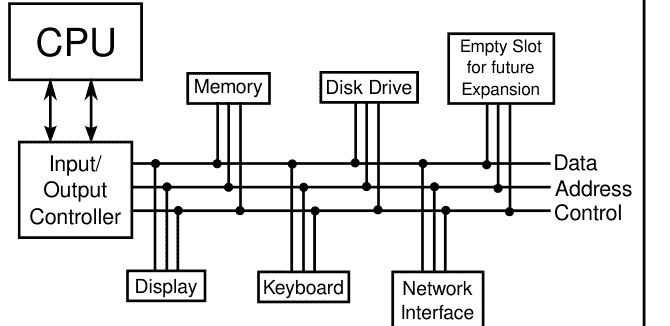

现在，键盘、鼠标和网络接口等设备可以产生需要 CPU 处理的输入。CPU 是如何知道数据在那里的？一个简单的想法（事实证明并不十分理想）是让 CPU 不断地检查是否有传入的数据。当它发现数据时，就对其处理。这种方法被称为“轮询”（polling），因为 CPU 持续轮询设备以查看它们是否有需要报告的输入数据。遗憾的是，虽然轮询非常简单，但它也非常低效。CPU 会浪费大量时间等待输入。

为了避免这种情况，通常会使用“中断”（interrupts）而不是轮询。中断是由另一个设备发送到 CPU 的信号。CPU 响应中断信号的方式是放开当前正在执行的任何工作。一旦处理完中断，它就会返回到中断发生之前的状态。例如，当你按下键盘上的某个按键时，一个键盘中断会被发送到 CPU。CPU 对此中断做出响应，方式是：继续完成它正在做的事，读取你按下的按键，然后返回到你在按下按键之前正在执行的任务。

再次，你应该理解这是一个纯机械的过程：设备只需通过接通某根导线来发出中断信号。CPU 的设计使得，当某根导线接通时，CPU 会保存足够关于其当前正在操作的信息，以便稍后可以回到相同的状态。这些信息包含了重要的内部寄存器，例如程序计数器（program counter）。CPU 跳到某个预定的内存位置并开始执行存储在那里的指令。这些指令组成了一个“中断处理程序”（interrupt handler），负责执行响应中断所需的必要处理。（此中断处理程序是发出中断的设备的设备驱动软件的一部分。）在中断处理程序的末尾有一条指令，告诉 CPU 跳回它之前正在做的事；它通过恢复之前保存的状态来实现这一操作。

中断允许 CPU 处理异步事件。在常规的“取-执行”循环中，事情是按照预定的顺序发生的；发生的一切都与其他事情是“同步”的。中断使得 CPU 能够高效地处理“异步”发生的事件，即在不可预测的时间发生的事件。

作为中断工作原理另一个例子，考虑当 CPU 需要访问存储在硬盘上的数据时会发生什么。只有当数据在主内存中，CPU 才能直接访问它。磁盘上的数据在被访问之前必须复制到内存中。遗憾的是，在 CPU 运行的尺度上，磁盘驱动器向磁盘发送一个信号，让其定位并获取数据。这个信号是在普通程序的控制下同步发送的。CPU 不需要等待磁盘驱动器完成此操作所需的长时间且不可预测的时间，而是继续其他任务。当磁盘驱动器准备好数据后，它会向 CPU 发送中断。然后由中断处理程序处理请求的数据。

---

现在，你可能注意到，只有当 CPU 有多个任务要执行时，这才有意义。如果它无事可做，它将花费时间轮询输入或等待磁盘驱动操作。所有现代计算机都使用多任务处理来同时执行几个任务。有些计算机非常快，可以快速地将注意力从一个用户切换到另一个用户，每个用户投入每秒几分之一的时间。这种多任务的应用被称为“分时”（timesharing）。但一个单用户的现代计算机也在进行多任务处理。例如，用户可能在打论文的同时，时钟在持续显示时间，文件正在通过网络下载。

CPU 正在工作的每个任务被称为一个“线程”（thread）（或者称为“进程”process；线程和进程之间存在技术差异，但在这里并不重要，因为 Java 中使用的是线程）。许多 CPU 可以同时执行多个线程——例如具有“核心”（cores）的 CPU，每个核心可以运行一个线程——但同时执行的线程数量总是有限制的。由于线程多于可以同时执行的线程，计算机必须将注意力从一个用户切换到另一个用户，就像分时计算机将继续运行，直到发生以下几种情况之一：

- 线程可能会自愿让出控制权，以给其他线程运行的机会。
- 线程可能会等待某些异步事件发生。例如，线程可能会向磁盘驱动器请求某些数据，或者可能等待用户按下一个按键。在等待期间，该线程将被阻塞（blocked），如果有其他线程，它们将有机会运行。当事件发生时，一个中断将“唤醒”该线程。
- 线程可能会用完其分配的时间片并被强制挂起，以允许其他线程运行。

# 第一章：心理图谱

解释器的用途之一是执行高级语言程序。例如，Lisp 编程语言通常由解释器执行，而非编译器。然而，解释器还有另一个用途：它们可以让你将为某一类型计算机设计的机器语言程序运行在完全不同类型的计算机上。例如，早期的家用电脑之一是 Commodore 64，简称“C64”。虽然你可能找不到真正的 C64，但你可以找到在其他电脑上或在网络浏览器中运行的“模拟”程序。这种模拟器可以通过充当 C64 语言解释器来运行 C64 程序。

Java 的设计者选择结合编译和解释。用 Java 编写的程序被编译成机器语言，但这种语言适用于一个并不真实存在的计算机。所谓的“虚拟”计算机被称为 Java 虚拟机，或 JVM。Java 虚拟机的机器语言是 Java 字节码。没有理由说明 Java 字节码不能作为真实计算机（而非虚拟机）的机器语言。事实上，使用虚拟机使得 Java 的核心卖点之一成为可能：它实际上可以运行在任何计算机上。计算机只需要一个 Java 字节码的解释器。这种解释器模拟了 JVM。该术语也用于执行模拟的 Java 字节码解释器程序，因此我们说计算机需要 JVM 来运行 Java 程序。从技术上讲，更准确的说是解释器实现了一个 JVM。

当然，每种类型的计算机都需要不同的字节码解释器，但一旦计算机有了 Java 字节码解释器，它就可以运行任何 Java 字节码程序，而同一个程序可以在任何拥有该解释器的计算机上运行。这是 Java 的基本特性之一：同一个编译后的程序可以运行在许多不同类型的计算机上。

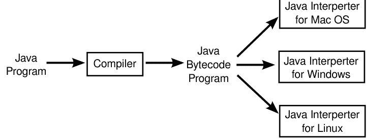

那么，为什么完全不使用中间的 Java 字节码呢？为什么不分发原始的 Java 程序，让每个人将其编译成他们想要运行的计算机的机器语言呢？这里有几个原因。首先，需要一个编译器来理解 Java 这种复杂的高级语言。编译器本身就是一个复杂的程序。另一方面，Java 字节码解释器是一个相对较小、简单的程序。这使得为新类型的计算机编写字节码解释器变得容易；一旦完成，该计算机就可以运行任何编译后的 Java 程序。而为同一台计算机编写 Java 编译器则要困难得多。

此外，某些 Java 程序旨在通过网络下载。这导致了明显的安全忧虑：你不想下载并运行一个损坏你计算机或文件的程序。字节码解释器在你与下载的程序之间充当缓冲区。你实际上运行的是解释器，由它直接运行下载的程序。解释器可以保护你免受该程序潜在危险的操作。

当 Java 还是一个新语言时，它因速度慢而受到批评：因为 Java 字节码的运行速度相当于编译成原生机器语言的程序（即程序运行所在计算机的实际机器语言）。然而，这一问题通过使用即时编译器（just-in-time compilers）执行 Java 字节码在很大程度上得到了解决。即时编译器将 Java 字节码翻译成原生机器语言。它是在执行程序的同时完成翻译的。与普通解释器一样，即时编译器的输入是一个 Java 程序，它的任务是执行它。但在执行程序时，它也将它的部分翻译成机器语言。被翻译部分的执行速度可以比解释执行快得多。由于程序在运行时，程序的某部分会被执行多次，因此即时编译器可以显著加快整体执行时间。

我应该指出，Java 和 Java 字节码之间没有必然联系。用 Java 编写的程序可以编译成真实计算机的机器语言。用其他语言编写的程序也可以成 Java 字节码。然而，Java 和 Java 字节码的结合是平台无关、安全且网络兼容的，同时允许你使用高级对象语言进行编程。

在过去的几年里，创建编译成 Java 字节码的新编程语言或旧语言版本已成为常见。编译后的程序可以通过标准 JVM 执行。专门为编程 JVM 而开发的新语言包括 Groovy、Clojure 和 Processing。Jython 和 JRuby 让人们能够在享受 JVM 许多优势的同时，避免 Java 的某些技术细节。事实上，在 JVM 上使用其他语言已变得足够重要，JVM 特别地添加了几个新功能，以对其中某些语言提供更好的支持。对 JVM 的这种改进反过来使得 Java 7 和 Java 8 中的一些新特性成为可能。

---

我还需要指出，平台无关性真正困难的部分是提供一个能够在支持 Java 的所有平台上运行的“图形界面”（带有窗口、按钮）。你将在第 1.6 节看到更多关于此问题的。

### 1.4 程序的基本构建模块

编程有两个基本方面：数据和指令。要处理数据，你需要理解变量和类型；要处理指令，你需要理解控制结构和子程序。你将在课程的大部分时间里熟悉这些概念。

变量仅仅是一个内存位置（或是一组被视为一个单元的多个连续位置），它被赋予了一个名称，以便在程序中方便地引用和使用。程序员只需要关心名称；跟踪内存位置是编译器的责任。作为程序员，你需要记住，该名称指的是内存中一个可以存放数据的“箱子”，尽管你并不需要知道那个箱子位于内存的哪个位置。

在 Java 和许多其他编程语言中，变量有一个类型，指示它能存储什么种的数据。其中一种变量类型可能存储整数——如 3、-7 和 0 这样的全整数；而另一些类型则存储浮点数——带有小数点的数字，如 3.14、-2.7 或 17.0。（是的，计算机内部整数 17 和浮点数 17.0 看起来实际上非常不同）；还可能存在用于单个字符（'A'、'1' 等）、字符串（"Hello"、包含许多字符的字符串等）以及不常用的类型，如日期、颜色、声音或程序可能需要存储的任何其他数据。编程语言拥有将数据输入和输出变量以及执行计算的命令。例如，下面这个出现在程序中的“赋值语句”告诉计算机取变量 `principal` 中的数字，乘以 `0.07`，并将结果存储在变量 `interest` 中：

- `interest = principal * 0.07;`

还有从用户或文件获取数据的“输入命令”，以及向另一个方向发送数据的“输出命令”。

这些基本命令——在位置之间移动数据以及执行计算——是所有程序的构建模块。这些构建模块通过控制结构和子程序组合成复杂的程序。

程序是指令的序列。在普通的“控制流”中，计算机按照指令在程序中出现的顺序一个接一个执行。然而，这非常有限：指令会用完。控制结构是可以控制控制流的特殊指令。控制结构有两种类型：循环（允许一段指令重复）和分支（允许计算机通过测试运行过程中出现的条件，在两个或多个方案之间做出决定）。

例如，可能是如果变量 `principal` 的大于 10000，则应通过将 `principal` 乘以 `0.05` 来计算 `interest`；如果不是，则通过将 `principal` 乘以 `0.04` 来计算。程序需要某种方式来表达这种决策。在 Java 中，可以使用以下方式表达：

```java
if (principal > 10000)
    interest = principal * 0.05;
else
    interest = principal * 0.04;
```

（现在不用担心细节。记住计算机可以测试条件，并在同一任务需要执行多次时决定怎么做。例如，循环用于你想为邮件列表上的每个名字打印标签时，你可能会说，“获取第一个名字和地址并打印标签；获取第二个名字和地址并打印标签；获取第三个名字和地址并打印标签……”但这很快就会变得荒谬——而且如果你预不知道有多少个名字，就完全无法作用。你想说的是类似于“当还有更多名字需要处理时，获取下一个名称和地址，然后打印标签。”程序中可以使用循环来表示这种重复。）

大型程序非常复杂，如果没有某种方法将它们拆分成易于管理的“块”，那么编写它们几乎是不可能的。子程序（Subroutines）就是实现此点的方法。子程序由执行某些任务的指令组成，这些指令作为一个单元分组并被命名，该名称可以作为整组指令的替代品。例如，假设你的程序需要执行的任务之一是在屏幕上画一栋房子。你可以取必要的指令，将其制成一个子程序，并给该子程序起一个适当的名字——例如 `drawHouse()`。那么，在程序中任何需要画房子的地方，你都可以通过简单的命令来实现：

```java
drawHouse();
```

这的效果与在每个地方重复所有画房的指令相同。它的优点不仅在于节省了打字量。将程序组织成例程也有助于组织你的思路和程序设计工作。在编写画房子程序时，你可以集中在画房子的问题上，而不必担心程序的其他部分。一旦子程序编写完成，你就可以忘记画房的细节了——这个问题已经解决了，因为你有一个子程序可以为你完成。子程序变得就像语言的内置部分，你可以直接使用，而无需思考子程序“内部”了什么。

变量、循环、分支和子程序是所谓的“传统编程”的基础。然而，随着程序越来越大，需要额外的结构来帮助处理它们的复杂性。发现的最有效工具之一是面向对象编程，将在下一节中进行讨论。

### 1.5 对象与面向对象编程

程序必须经过设计。没有人可以仅仅坐在电脑前就编写出任何复杂性的程序。被称为软件工程的学科关注的是构建正确、编写良好的程序。软件工程师尝试使用公认且经过验证的方法来分析要解决的问题，并设计用于解决该问题的程序。

在 20 世纪 70 年代到 80 年代，主要的软件工程方法论是结构化编程。结构化编程程序设计方法基于以下建议：要解决一个大问题，将问题拆分成几部分并分别处理每一部分；要解决每个部分，将其视为一个新问题，该问题本身也可以被进一步分解为更小的问题；最终，你将工作到可以直接解决而无需进一步分解的问题。这被称为自顶向下编程。

自顶向下编程没有问题。它是一种非常有价值且常用的解决问题的方法。然而，它是不完全的。其一，它几乎完全关注产生解决程序所需的指令。但随着时间的推移，人们意识到程序数据结构的设计至少与子程序和控制结构的设计一样重要。自顶向下编程没有充分考虑到程序所操作的数据。

严格的自顶向下编程的另一个问题是它难以在其他项目中重用工作。通过从特定问题开始并将其细分为方便的部分，自顶向下编程倾向于产生一个该问题唯一的的设计。你不太可能从另一个程序中提取大量的编程代码并将其放入你的项目中，至少在不大量修改的情况下是不。高质量程序是困难且昂贵的，因此程序员及其雇主总是渴望重用工作。


在实践中，自顶向下设计通常与自底向上设计相结合。在自底向上设计中，方法是从“问题”开始，从你已经知道如何解决的问题（以及你可能已经有了可以重用的软件组件）。从那里，你可以向上工作直到找到整个问题的解决方案。

可重用的组件应该尽可能“模块化”。一个`模块`（module）是较大系统的一个组件，它以简单、定义良好且直观的方式与系统的其他部分交互。其核心思想是模块可以“插进”系统中。只要模块履行了其分配的角色，模块内部的什么细节对于整个系统来说并不重要。这被称为`信息隐藏`（information hiding），它是软件工程最重要的原则之一。

软件模块的一种常见格式是包含一些数据，以及一些操作这些数据的子程序。例如，一个列表模块可能包含一个姓名和地址列表，以及一个添加新名字的子程序、一个打印标签的子程序等。在这些模块中，数据被隐藏在模块内部；使用该模块的程序只能通过调用模块提供的子程序来间接地地操作数据。这保护了数据，因为数据只能以已知且定义良好的方式进行操作。这也让程序员使用模块变得更容易，因为他们不必担心数据表示的细节。关于数据表示的信息被隐藏了。

支持这种信息隐藏的模块在 20 世纪 80 年代初成为编程语言的常见。从那以后，相同理念的更高级的形式在多程度上接管了软件工程。这种最新的方法被称为`面向对象编程`（object-oriented programming），通常缩写为 OOP。

面向对象编程的核心概念是对象，它是一种包含数据和子程序的模块。OOP 的观点是，对象是一种自给自足的实体，具有内部状态（它包含的数据）。……（此处原文存在大量重复的句子，已根据语意去重并整合逻辑）……以不同的方式响应——被称为多态性（polymorphism）。

对象之间具有“家族相似性”是常见的。包含相同类型数据并以相同方式响应相同消息属于同一个类。（在实际编程中，类是主要的；也就是说，先创建一个类，然后使用它作为模板创建一个或多个对象。）但对象可以相似但不同类。例如，考虑一个绘图程序，它允许用户在屏幕上画线、矩形、椭圆、多边形和曲线。在这个程序，屏幕上的每个对象都可以由一个软件对象表示。程序中有五类对象，每种可绘制的对象类型一个。所有的线都属于一个类，所有的矩形属于另一个类，以此此类推。这些类是相关的；它们都是“可绘制对象”。例如，它们预计能够响应“画你自己”的消息。另一种基于表示每类对象所需的数据的分组方式并不明显，但在程序中非常有用：我们可以将多边形和曲线归为“多点对象”，而线、矩形和椭圆是“两点对象”。线由其端点确定，矩形由两个角确定，椭圆由其包含的两条曲线确定。我所说的矩形其边边是垂直和水平的，因此可以通过两个点来指定；这是绘图程序中“矩形”的常见含义。

我们可以如下绘制这些关系：


`DrawableObject`、`MultipointObject` 和 `TwoPointObject` 是程序中的类。`MultipointObject` 和 `TwoPointObject` 是 `DrawableObject` 的子类。`Line` 类是 `TwoPointObject` 的子类（间接也是 `DrawableObject` 的子类）。类的子类被认为继承了该类的属性。子类可以增加继承，甚至可以覆盖部分继承（通过定义对某些方法的响应）。然而，线、矩形等都是可绘制对象，`DrawableObject` 类表达了这种关系。

继承是组织程序的强大手段。它与重用软件组件的问题有关。类是终极的可重用组件。它不仅可以在完全符合你正在编写的程序时直接重用；即使它几乎符合，你仍然可以通过定义一个子类并仅进行必要的更改以适应你的需求，来重用它。

面向对象编程（OOP）旨在成为一种卓越的程序开发工具，也是软件复用问题的局部解决方案。对象、类和面向对象编程将是本文后续的重要主题。在下一章中，你将开始使用 Java 语言来构建你的对象，在第 5 章中，你将创建你的对象和类。

# 第 1 章 心理图谱

## 1.6 现代用户界面

当计算机刚引入时，普通人——包括大多数程序员——是无法靠近的。他们被关在有白大褂的工作人员的房间里，这些人接收你的程序和数据，将其输入计算机，并在稍后返回计算机的响应。随着 20 世纪 60 年代分时技术的发明（即计算机在不同人之间快速切换注意力），几个人同时与计算机直接交互变得可能了。在分时系统上，用户坐在“终端”前向计算机输入命令，而计算机则回字其响应。早期的计算机也使用打字命令和响应，只不过是一次只能一个人操作。这种用户与计算机之间的交互被称为命令行界面。

今天，大多数人以完全不同的方式与计算机交互。他们使用图形用户界面，或称为 GUI。计算机绘制界面组件，如窗口、滚动条、按钮和你的图标。通常，使用鼠标来操作组件，或者在“触摸屏”上使用你的手指。假定你不是刚刚被瞬间传到 20 世纪 70 年代的，那么你无疑已经熟悉了图形用户界面的基础知识。

许多 GUI 组件已经变得相当标准。也就是说，它们在 Mac OS、Windows 和 Linux 等许多不同的计算机平台上具有相似的外观和行为。Java 程序旨在可以在不修改程序的情况下运行在许多不同的平台上，可以使用所有标准的 GUI 组件。它们在不同平台上的外观可能略有不同，但在程序运行的任何计算机上，其功能都是完全相同的。

下方显示了一个简单的 Java 程序的图像，演示了计算机屏幕上的几个 GUI 组件。当程序运行时，计算机屏幕上会打开一个像这里这样的窗口。窗口中有四个用户可以交互的组件：一个按钮、一个复选框、一个文本字段和一个弹出菜单。这些组件都有标签。标签本身也是组件（尽管你无法与它们进行交互）。窗口的右半是一个文本区域组件，可以显示多行文本。当文本行数超过文本区域能够容纳范围时，文本区域旁边会出现一个滚动条。事实上，在 Java 术语中，整个窗口本身被认为是一个“组件”。

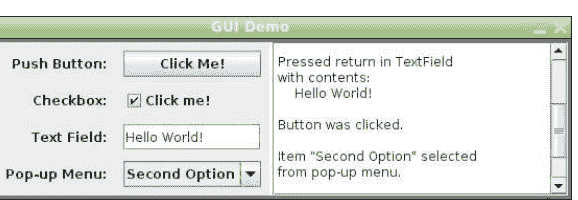

| 组件 | 操作 | 结果 |
| :--- | :--- | :--- |
| 按钮 | 点击我！ | 在文本字段中按回车键，内容为：Hello World! |
| 复选框 | 点击我！ | 按钮被点击了。 |
| 文本字段 | Hello World! | 从弹出菜单选择了项目“Second Option”。 |
| 弹出菜单 | Second Option | |

如果你想运行这个程序，可以在网上获取源码 `GUIDemo.java` 以及编译后的程序 `GUIDemo.jar`。有关本教科书此类示例和其他示例的更多信息，请参阅第 2.6 节。

现在，Java 有两套完整的 GUI 组件。其中一套 AWT（或抽象窗口工具包）在 Java 的原始版本中就可用。另一一套被称为 Swing，是在 Java 1.2 版本中引入的，在大多数现代 Java 程序中优于 AWT。上述程序使用了属于 Swing 的组件。

当用户与 GUI 组件交互时，就会产生“事件”。例如，点击按钮会产生一个事件，在文本字段中输入时按回车键会产生一个事件。每当产生一个事件，就会向程序发送一条消息告诉它事件已发生，程序使用“事件处理器”做出响应，这些处理器告诉程序如何响应各种类型的事件。在这个示例中，程序被设计为通过在文本区域中显示消息来响应每个事件。在更真实的事件中，事件处理器需要做更多事情。

这里使用“消息”一词是刻意为之。正如你在上一节中看到的，消息是发送给对象的。事实上，Java GUI 组件被实现为对象。Java 包含了许多定义的类，代表各种类型的 GUI 组件。其中一些类是 `JComponent` 的子类。这里有一张图显示了 Swing 的几个 GUI 类及其它们的关系。

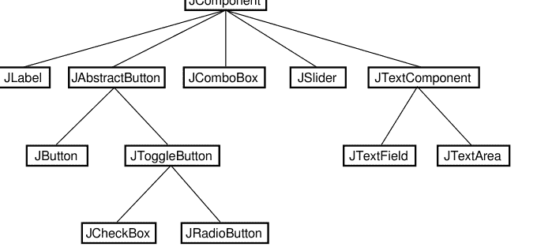

现在不要担心细节，但要尝试感受面向对象编程和继承是如何使用的。注意，所有的 GUI 类都直接或间接地是名为 `JComponent` 的类的子类，该类代表了 Swing 组件共享的通用属性。在图中 `JComponent` 的某些直接子类本身也有子类。具有某些共同行为的 `JTextArea` 和 `JTextField` 类被组为 `JTextComponent`。同样，`JButton` 和 `JToggleButton` 是 `AbstractButton` 的子类。顺便说，`JComboBox` 是代表弹出菜单的 Swing 类。

通过这段简短讨论，也许你可以看到面向对象的设计如何让编程变得更容易。事实上，带有对象的 GUI 是 Java 最有趣的方面之一。但在回到第 6 章之前，我们将花费几章学习基础。

## 1.7 互联网及其他

计算机可以连接到网络。网络上的计算机可以通过交换数据和文件与网络上的其他计算机通信。全球数百万计算机连接到一个被称为互联网的大网络。每天都有新计算机通过无线通信和物理连接到互联网。

互联网通信有复杂的协议。协议简单来说就是如何执行通信的详细规范。为了两台计算机能够通信，它们必须使用相同的协议。互联网上最基本的协议是互联网协议（IP），它规定了数据如何从一台计算机传输到另一台计算机，以及传输控制协议（TCP），它确保发送的数据是完整且无错误的。这两个协议统称为 TCP/IP，为通信提供了基础。其他协议使用 TCP/IP 来发送特定类型的信息，如网页、电子邮件和数据文件。

互联网上的所有通信都以包的形式存在。数据包由从一台计算机发送到另一台计算机的一些数据以及指示这些数据在互联网何处的地址信息组成。将数据包想象成一个信封，外面有地址，里面有消息（消息就是数据）。数据包还包括“回地址”，即发送者的地址。数据包可以携带有限的数据；较的消息被分成几个数据包，然后被单独发送到网络并在目标地重组。

互联网上的每台计算机都有一个 IP 地址，这是一个在网络上所有计算机中标识它的数字（实际上，事实唯一性并不完全准确，但基本概念是有效的，真实情况很复杂）。IP 地址用于数据包路由。计算机只有在知道互联网上另一台计算机的地址时，才能向其发送数据。由于人们倾向于使用名称而不是数字，大多数计算机也通过名称识别，称为域名。例如，霍霍巴特和威廉·史密斯学院数学系的主计算机域名为 `math.hws.edu`（域名只是为了方便；你的计算机在通信之前仍然需要知道 IP 地址。互联网上有些计算机的工作是将名称翻译为 IP 地址）。当你使用域名时，你的计算机向域名服务器发送消息以查询 IP 地址。然后，你的计算机将使用 IP 地址而不是域名名来与其他计算机进行通信。

互联网为连接到它的的计算机（当然，也包括使用这些计算机的用户）提供了许多服务。这些服务使用 TCP/IP 在网络上发送各种类型的数据。最流行的服务包括即时消息、文件共享、电子邮件和万维网（WWW）。每种服务都有其自己的协议，用于控制数据在网络上的传输。每种服务还具有某种用户界面，允许用户通过该服务发送和接收数据。

例如，电子邮件服务使用一种名为 SMTP 的协议将消息从一台计算机传输到另一台计算机。其他协议（如 POP 和 IMAP）用于从账户中获取消息，以便收件者阅读它们。然而，使用电子邮件的人并不需要理解甚至知道这些协议。这些协议在后台由程序用于发送和接收电子邮件。这些程序为用户提供了一个易于使用的用户界面，以理解底层的协议。

万维网可能是网络服务中最令人兴奋的。万维网允许你请求存储在互联网上所有计算机上的信息页面。网页可以包含指向获取该页面的计算机上其他页面的链接，也可以指向世界上任何其他计算机的链接。存储此类信息页面的计算机被称为 Web 服务器。Web 用户界面被称为 Web 浏览器程序。常见的网页浏览器包括 Internet Explorer、Firefox、Chrome 和 Safari。你使用网页浏览器请求信息页面。浏览器发送该页面的请求，当从该计算机接收响应时，网页浏览器以整洁的格式显示给你。网页浏览器是 Web 用户界面。在后台，网页浏览器使用 HTTP（超文本传输协议）协议发送每个页面请求并接收 Web 服务器的响应。

现在你可能在想，这一切与 Java 有关吗？事实上，Java 与互联网和万维网密切相关。当 Java 首次引入时，它的大吸引点之一是编写 Applet（小程序）的能力。Applet 是通过互联网传输并在网页上运行的小型程序。Applet 让网页执行复杂任务并与用户进行复杂交互成为可能。Applet 面临过各种安全问题，修复这些问题使得它们变得更难使用。Applet 在 Web 上已变得不那么常见，无论如何，在 Web 上运行程序还有其他选择。

但 Applet 只是 Java 与互联网关系的一个方面。Java 可用于编写不依赖于浏览器的复杂独立应用程序。这些许多程序与网络相关。例如，许多最大、最复杂的 Web 服务器使用用 Java 编写的软件。Java 为网络协议提供了极佳的支持，它的平台独立性使得编写可在许多不同类型的计算机上运行的网络程序成为可能。你将在第 11 章学习 Java 的支持。

它对网络的支持不仅是 Java 的优势。但许多优秀的编程语言被发明后很快就被遗忘了。Java 幸运地乘了互联网巨大且不断增长的普及度的东风。

# 第 1 章：思维图谱

随着 Java 的成熟，它的应用已经远远超网络。Java 的标准版本已经包含了对许多技术的支持，例如密码学和数据压缩。还提供了扩展以支持许多其他技术，如高级处理和三维图形。可以用 Java 开发复杂、高性能的系统。例如，用于大规模数据处理的系统 Hadoop 就是用 Java 编写的。Yahoo、Facebook 和其他网站使用 Hadoop 来处理其用户产生的海量数据。

此外，Java 并不局限于在传统计算机上使用。Java 可用于许多智能手机编写程序（但不包括 iPhone）。它是基于 Android 的设备的主要开发语言。（某些移动设备使用称为 Java ME（移动版）的 Java 版本，但 Android 使用 Google 自己的 Java 版本，不使用与标准 Java 相同的用户界面组件。）Java 还是 Amazon Kindle 电子阅读器以及蓝光视频光盘交互式功能的编程语言。

此时，Java 无疑是使用最广泛的编程语言之一。对于几乎任何旨在运行在多种计算设备上的编程项目，它都是良好的选择；对于许多仅运行在一个设备上的程序，它也是合理的选择。它可能仍然是大学和学院教授最广的语言。它与其他流行语言（如 C、C++ 和 Python）足够相似，了解它将为你以后学习这些语言提供一个很好的开端。总的来说，学习 Java 是成为专家程序员之路上的绝佳起点。我希望你享受这段旅程！

# 第 1 章测试

1. 计算机的组件之一是 CPU。CPU 是什么？它在计算机中起什么作用？
2. 解释什么是“异步事件”并举例。
3. “编译器”和“解释器”之间的区别是什么？
4. 解释高级语言与机器语言之间的区别。
5. 如果有一个 Java 程序的源代码并想运行它，你需要编译器和解释器。它们分别做什么？
6. 什么是“子程序”？
7. Java 是一种面向对象的编程语言。什么是“对象”？
8. 什么是变量？（Java 中的变量有四个方面，请尝试在回答中提到它们。提示：一个方面是名称。）
9. Java 是一种“平台无关语言”。这意味着什么？
10. 什么是“互联网”？给出它的使用示例。

# 第 2 章

## 小型编程第一部分：名称与事物

随着 Java 成熟，它的应用已经远超网络。Java 标准版本已经包含了对许多技术的支持，例如密码学和数据压缩。提供了扩展以支持许多其他技术，如高级处理和三维图形。

在基础层面（机器语言层面），计算机只能执行非常简单的操作。计算机通过组合此类操作来执行复杂任务。这些任务必须以完整且完美的方式被编写。编写复杂的程序永远不会真正容易，但通过给程序清晰的结构，可以在范围内处理这种难度。程序整体结构的设计我称为“大型编程”。

小型编程则指的是填充细节。这些细节是执行特定规模任务的显式、逐步指令。当你进行编码时，你是在“接近位置”的工作，使用一些在机器语言中使用的概念。

### 2.1 基础 Java 应用程序

一个程序是计算机可以执行以完成某些任务的指令序列。简单的想法必须以计算机可以执行的格式编写。这意味着程序必须用`编程语言`编写。编程语言与人类语言的区别在于，它们完全没有歧义，并且对程序中允许和不允许的操作有严格规定。决定允许内容的规则被称为语言的`语法`。语法规则定义了语言的基本词汇以及如何构建程序。

# 第 2 章：名称与实体

使用循环、分支和子程序等工具。一个语法上正确的程序是指可以被成功编译或解释的程序；带有语法错误的程序将被拒绝（希望会带有一个有用的错误信息来帮助你解决问题）。

因此，要成为一名成功的程序员，你必须对你正在使用的编程语言的语法有深入的了解。然而，语法只是故事的一部。仅仅写出一个可以运行的程序是不够的——你想要的是一个既能运行又能产生正确结果的程序！也就是说，程序的含义必须是正确的。程序的含义被称为`语义`（semantics）。更准确地说，编程语言的语义是决定该语言编写的程序含义的一组规则。一个语义上正确的程序就是你所希望程序。

此外，一个程序可能在语法和语义上都是正确的，但仍然是一个非常糟糕的程序。一个好的程序具有“风格”（style）。它的编写方式让人们易于阅读和理解。它遵循其他程序员熟悉的惯例，并设计了让人类读者认为合理的整体设计。计算机对这些事情完全无所感知，但对人类读者来说，它们是至关重要的。编程的这些方面有时被称为`语用`（pragmatics）（我经常使用更常用的术语“风格”）。

当我引入一个新的语言特性时，我会解释该特性的语法、语义以及一些语用。你应该通过遵循示例来对语义建立感觉，确保你理解它们是如何工作的，并且最好编写你自己的短程序来测试你的理解。这意味着学习如何良好地使用这种语言，并具备能够赢得其他程序员欣赏的风格。

当然，当你熟悉了语言的所有单独特性后，这并不意味着你成为了一个程序员。你仍然需要学习如何构建复杂的程序来解决问题。这需要经验和品味。我们将从编写一个显示“Hello World!”的程序开始探索 Java。这看起来可能是一个微不足道的问题，但让计算机做到这一点是学习新语言的一大步（特别是如果它是你的第一种编程语言）。这意味着你理解了基本流程：

1. 让程序执行。
2. 编译程序。
3. 运行编译后的程序。


第一次，这些步骤每一步可能都需要尝试几次才能正确。我不会详细说明你如何执行每一步；这取决于你所使用的特定计算机和编程环境。有关如何创建和运行 Java 程序的信息，请参阅第 2.6 节。通常，你会使用某种文本编辑器将程序保存到文件中。然后你将使用某些命令来编译该文件。你会收到一条程序包含语法错误的消息，或者你会得到程序的编译版本。在 Java 的情况下，程序被编译成字节码，而不是机器语言。最后，你可以通过提供适当的命令来运行编译后的程序。对于 Java，你实际上将使用解释器来执行字节码。你的编程环境可能会为你自动完成某些步骤——例如，编译步骤通常是自动完成的——但你可以确定后台执行了相同的步骤。

这里是一个在标准输出中显示“Hello World!”消息的 Java 程序：

```java
/**
 * 在标准输出上显示
 * "Hello World!" 消息的程序
 */
public class HelloWorld {
    public static void main(String[] args) {
        System.out.println("Hello World!");
    } // 类结束
```

实际显示消息的命令：

```java
System.out.println("Hello World!");
```

此命令是**子程序调用**（subroutine call）的一个示例。它使用一个名为`System.out.println`的“内置子程序”来完成实际工作。记住，子程序由执行某些任务的指令组成，这些指令组合在一起并赋予名称。该名称可以在任何需要执行任务时“调用”该子程序。**内置子程序**是已经作为语言一部分定义的，因此可以在任何程序中可用。

当你运行这个程序时，“Hello World!”消息将显示在输出中。遗憾的是，Java 旨在运行在许多平台上，而标准输出在不同平台上意味着不同的含义。然而，你可以预计消息将出现在某些方便或不方便的地方。如果你使用命令行界面（如 Oracle 的 Java 开发包中的界面），你输入一个命令告诉计算机运行你的程序。计算机将在下一行输出“Hello World”。在像 Eclipse 这样的集成开发环境中，输出可能会出现在环境窗口的任何地方。

你可能对上述程序中的所有其他内容好奇。其中一部分由**注释**（comments）组成。编译器完全忽略注释；它们仅供人类读者。这并不意味着它们不重要。程序不仅要让计算机阅读，而且要让人类阅读，没有注释，程序可能非常难以理解。Java 有两种注释。第一种使用`//`表示注释的结束。编译器忽略同一行中其之后的所有内容。第二种注释以`/**`开始并跨多行。程序的前三行就是这种类型注释的示例（实际上以`/**`开头的注释具有特殊含义；它是一个“Javadoc”注释，可以用于生成程序的文档）。

程序中的其他所有内容都受 Java 语法规则的约束。Java 中的编程都是在类内部完成的。程序的第一行（不计注释）说明这是一个名为`HelloWorld`的类。“HelloWorld”是类的名称，也是程序的名称。并不是每个类都是程序。为了定义程序，类必须包含一个名为`main`的子程序，其定义如下：

```java
public static void main(String[] args) {
  (statements)
}
```

当你告诉解释器运行程序时，解释器会调用这个主程序，它包含的语句将被执行。这些语句构成了告诉计算机在执行时具体做什么的脚本。主程序可以调用定义在类或其他类中的子程序，但`main()`程序决定了如何以及以什么顺序使用这些子程序。

`main`第一行中的`public`词意味着该程序是由解释器调用的，而解释器是程序外部的。该程序第一行的其余部分目前很难解释；只需将其视为强制语法的一部分。

正如前面提到的，子程序不能独立存在。它必须是类的一部分。程序是由一个公共类定义的：

```java
public class (program-name) {
  (optional-variable-declarations-and-subroutines)
  public static void main(String[] args) {
    (statements)
  }
  (optional-variable-declarations-and-subroutines)
}
```

第一行的名称是程序的名称，也是类的名称。再次记住，`(program-name)`是实际名称的占位符！

# 第 2 章 命名与实体

同样需要注意的是根据上述语法规范，程序除了`main()`之外，还可以包含其他子程序，以及被称为“变量声明”的内容。你稍后会更多关于这些内容，但要等到第 4 章。

## 2.2 变量与基本类型

名称是**编程的根本**。在程序中，名称用于指代许多不同的实体。为了使用这些实体，程序员必须理解为它们命名的规则以及使用这些名称进行操作的规则。也就是说，程序员必须理解名称的语法（syntax）和语义（semantics）。

根据 Java 的语法，基本的名称是标识符（identifiers）。标识符可以用于命名类、变量和子程序。标识符完全由字母组成，是一个或多个字符的序列。它必须以字母或下划线开头，可以包含数字和下划线（“下划线”预留给字符`_`）。例如，这里是一些合法的标识符：

```
N rate x15 quite_a_long HelloWorld
```

标识符中不允许出现空格；`HelloWorld`是合法的标识符，但“Hello World”不是。大写字母和小写字母被视为不同的，因此`HelloWorld`、`helloworld`、`HELLOWORD`和`HelloWorld`都是不同的名称。某些单词在 Java 中被保留用于特殊用途，不能作为标识符。这些保留字包括：`class`、`public`、`static`、`if`、`else`、`while`以及其他几十个。（记住保留字不是标识符，因为它们不能被用作名称）。

Java 对于什么算作字母或数字实际上非常宽松。Java 使用 Unicode 字符集，该集合包含了许多不同语言和字母表的字符，其中许多字符被视为字母或数字。不过，我将坚持使用普通英语键盘上可以输入的内容。

命名编程包含了关于如何为实体选择名称的风格指南。例如，习惯上类名称以大写字母开头，变量和子程序的名称以小写字母开头；在自己的程序中遵循这一标准约定可以避免很多困惑。Java 程序员不使用下划线，尽管有些人会在变量类型的开头使用下划线。当一个名称由多个单词组成时（例如`HelloWorld`或`interest`），习惯是将每个单词的首字母大写（第一个单词除外）；这被称为驼峰命名法（camel case），因为名称中间的大写字母看起来就像骆驼的背。

最后，我将指出，除了简单标识符外，Java 中的实体还有复合名称，它们由点分隔的简单名称组成。（复合名称也称为完全限定名）。你已经见过一个例子了：`System.println`。这里的想法是 Java 可以包含其他实体。复合名称是通过一个或多个层级包含指向某个实体的路径。`System.println`表示名为“System”的实体包含名为“out”的实体，而后者又包含名为“println”的实体。

### 2.2.1 变量

程序处理存储在内存中的数据。在机器语言中，只能通过提供存储数据的内存位置数值地址来引用数据。

在 Java 这种高级语言中，使用名称而不是数字来引用数据。跟踪数据实际存储在内存的哪个位置是计算机的任务；程序员只需要记住名称即可。这样使用的名称——用于指代存储在内存中的数据——被称为*变量*（variable）。

变量是非常抽象的。严格来说，变量不是数据本身的名称，而是一个可以存放数据的位置。你应该将变量看作一个容器或箱子，可以在其中存储以后可能需要的数据。变量直接指向箱子，而只间接指向箱子里的数据。由于数据在程序执行过程中在不同时间可能指向不同的数据，但它始终指向同一个箱子。这可能会引起困惑，尤其是对于初学者程序员，因为当变量以某种方式使用时，它指的是容器；当它以其他方式使用时，它指的是容器中的数据。你将在下面看到这两种情况的示例。

（通过这种方式，变量就像“美国总统”这个头衔。这个头衔可以在不同时间指的是不同的人，但它始终指的是同一个职位。如果我说“总统正在打篮球”，我的意思是巴拉克·奥巴马正在打篮球。但如果我说“希拉里·克林顿想当总统”，我的意思是她想当那个职位，而不是她想当成巴拉克·奥巴马。）

在 Java 中，将数据放入变量（即放入变量名）中的**唯一**方法是使用*赋值语句*（assignment statement）。赋值语句的形式如下：

```
variable = (expression);
```

其中*(expression)*代表任何引用或计算数据值的表达式。当计算机在执行程序的过程中遇到赋值语句时，它会求出表达式的值并将结果的数据值放入变量中。例如，考虑简单的赋值语句

```
rate = 0.07;
```

此语句中的*(variable)*是*rate*，而*(expression)*是数字 0.07。计算机通过将变量中的 0.07 相乘来执行此赋值语句，替换掉之前那里的任何内容。现在，考虑下面更复杂的赋值，它可能出现在程序的后部分：

```
interest = rate * principal;
```

在这里，表达式`rate * principal`的值被赋值给变量`interest`。在表达式中，`*`是一个“乘法运算符”，告诉计算机将`rate`乘以`principal`。名称`rate`和`principal`是不同的变量，真正相乘的是存储在这些变量中的*值*。我们看到当变量用在表达式中时，值存储在变量中；在这种情况下，变量似乎指的是箱子里的数据，而不是箱子本身。当计算机执行此赋值语句时，它取*rate*的**值**，将其乘以*principal*的**值**，并将答案存储在*interest*所指向的箱子中。当变量位于赋值语句的左侧时，它指的是由该变量命名的箱子。

（顺带提一下，赋值是计算机在特定时间执行的命令。它不是一个事实陈述。例如，假设程序包含语句`rate = 0.07`；如果语句`interest = rate * principal;`在程序后面执行，我们可以说 principal 被乘以 0.07 吗？不！

`rate`的值可能在此期间被另一个语句更改了。赋值语句的含义与数学方程的含义完全不同，尽管它们都使用了符号`=`。）

### 2.2.2 类型

Java 中的变量只能存储特定类型的数据。如果你尝试将错误的类型赋值给变量，编译器会认为错误。Java 是一种强类型语言，因为它强制这一规则。

内置到 Java 中的八种基本数据类型是：`byte`、`short`、`int`、`long`、`float`、`double`、`char`和`boolean`。`float`和`double`类型存储实数。`char`类型存储来自 Unicode 字符集的单个字符。而`boolean`类型存储两个逻辑值：true 或 false。任何存储在计算机中的数据值必须以二进制数表示，一个二进制数被称为位（bit）。一串位被称为字节（byte）。内存通常以字节为单位。`byte`类型存储的是 -128 到 127 之间的整数（该范围是 2 的 8 次幂）。对于其他整数类型：

- `short`对应两个字节（16 位）。`short`类型变量的值范围是 -32768 到 32767
- `int`对应四个字节（32 位）。`int`类型变量的值范围是 -2147483648 到 2147483647
- `long`对应八字节（64 位）。`long`类型变量的值范围是 -9223372036854775808 到 9223372036854775807

`float`用四字节表示，使用标准的实数编码。`float`的最大值约为 10 的 30 次方（因此 32.3892311134 和 32.3892343999 将被舍入为 32.389233 以存储在`float`变量中）。`double`占用 8 字节，范围可达 10 的 30 次方，并具有 15 位有效数字。通常，你应该使用`double`类型处理实值。

`char`变量占用两个字节。`char`的值是一个单个字符，如 A、' ' 或空格字符。该值也可以是特殊字符，如制表符或回车，或者是来自不同语言的许多 Unicode 字符。`char`类型的值与整数值密切相关，因为字符实际上是存储为 16 位整数代码的。

记住，基本值是使用有限的位数来表示的。因此，一个`int`不能是任意整数，它必须在某个数值范围内。类似地，`float`和`double`变量只能取特定的值。它们并不是数学意义上的真实数字。例如，数学常数 π 只能通过`float`或`double`类型的值来近似，因为精确表示它需要无限位小数。同样，像 1/3 这样简单的数字也只能通过`float`和`double`来近似。

### 2.2.3 字面量

数据值以位序列的形式存储在计算机中。在计算机内存中，它的看起来并不像写在本页上的那样的值。你需要一种方法在你编写的程序中包含常量值。在程序中，你将常量值表示为**字面量**（literals）。字面量是你在程序中输入以表示某个值的实体。它是常量值的一种命名方式。

例如，为了在程序中输入一个`char`类型的值，你必须用一对单引号将其括起来，例如`'a'`、`'t'`或`'x'`。字符和引号组成了一个`char`类型的字面量。如果没有引号，`a`将是一个标识符，而`*`将是一个乘法运算符。运算符不是值的一部分，也不会存储在变量中；它们只是在程序中为特定常量命名的约定。如果你想在`char`类型的值中存储字符`A`，可以使用赋值语句完成：

```
ch = 'A';
```

特殊字符有特殊的字面量，它们使用反斜杠`\`作为“转义字符”。特别是，制表符表示为`'\t'`，回车符表示为`'\r'`，换行符表示为`'\n'`，单引号字符表示为`'\''`。注意，即使在`\`之间有两个字符，该字面量表示的值也只是单个制表符字符。

数字字面量比你想象的要复杂。当然，有一些显而易见的字面量，如`317`和`17.42`。但在 Java 程序中还有表示数字的其他方式。首先，实数可以用指数形式表示，例如`1.3e12`或`12.372e-8`。`"e"`和`"E"`代表 10 的幂，所以`1.3e12`意味着 1.3 乘以 10¹²，而`12.372e-10`意味着 12.372 乘以 10⁻¹⁰。这种格式可以表示非常大和非常小的数字。任何包含小数点的数字字面量都是`double`类型。要创建一个`float`类型字面量，你必须在数字末尾加上`"f"`或`"F"`。例如，`"1.2F"`代表一个`float`类型的值。有时你需要了解 Java 的这些规则：你不能将`double`类型的值赋值给`float`变量，因此如果`x`是`float`类型变量，执行`"x = 1.2;"`时你可能会遇到一个荒谬的错误信息。你必须说`"x = 1.2F;"`。这就是为什么我们避免使用`double`表示实数的原因。

对于整数字面量，还有一些复杂之处。普通整数如`177777`和`-32`是`byte`、`short`或`int`类型的字面量，取决于它们的大小。你可以通过添加后缀`"L"`来创建一个`long`类型字面量。例如：`17L`或`72486748368L`。另一个例子，Java 允许八进制（基数8）和十六进制（基数16）字面量。我不想详细介绍数字进制，但以防你在其他人的程序中遇到它们，了解几点是有用的：八进制数字只使用 0 到 7 的数字。在 Java 中，以 0 开头的数字字面量被解释为八进制；例如，八进制字面量`045`代表数字 37，而不是数字 45。八进制很少使用，但你需要意识到当数字以零开头时会发生什么。十六进制数使用 16 个数字，即通常的数字 0 到 9 以及字母 A、B、C、D、E 和 F。在此语境下，大写和小写字母可以互换使用。字母代表数字 10 到 15。在 Java 中，以`0x`或`0X`开头的十六进制字面量（如`0x45`或`0xFF7A`）以及以`0b`或`0B`开头的二进制字面量只包含数字 0 和 1；例如：`0b011011`。

作为一种补充，Java 7 中的数字字面量可以包含下划线（`_`），它可以用于分隔数字组。例如，七十亿的整数常量可以写成`7_000_000_000`，这比`7000000000`要易读得多。关于必须使用多少数字没有规定。下划线在长二进制数中特别有用；例如，`0b_0110_1100_1011`。

我将指出，十六进制数也可以用于字面量来表示任意字符。Unicode 字面量由`\`后面跟四个十六进制数字组成。例如，字符字面量`'\u00E9'`代表带有重音符号的字符 “é” 的 Unicode 字符。

对于`boolean`类型，有两个字面量：`true`和`false`。这些字面量的类型正如我在这里写的那样，没有引号，但它们代表值，而不是变量。布尔值最常作为条件表达式的值出现。例如，

```
rate > 0.05
```

这是一个布尔值表达式，如果变量的值大于 0.05，则评估为`true`；如果`rate`的值不大于 0.05，则评估为`false`。正如你在第三章中看到的，布尔值表达式被广泛用于控制结构。例如，布尔值也可以赋值给`boolean`类型的变量。例如，如果`test`是`boolean`类型的变量，以下两个赋值语句都是合法的：

```
test = true;
test = rate > 0.05;
```

## 2.2.4 字符串与字面量

对于`boolean`类型，有两个字面量：`true`和`false`。这些字面量的类型正如我在这里写的那样，没有引号，但它们代表值，而不是变量。布尔值最常作为条件表达式的值出现。例如，

```
rate > 0.05
```


这是一个布尔值表达式，如果变量的值大于 `0.05`，则评估为 `true`；如果 `rate` 的值不大于 `0.05`，则评估为 `false`。正如你在第三章中看到的，布尔值表达式被广泛用于控制结构。例如，布尔值也可以赋值给 `boolean` 类型的变量。例如，如果 `test` 是 `boolean` 类型的变量，以下两个赋值语句都是合法的：

```
test = true;
test = rate > 0.05;
```

### 2.2.5 程序中的变量

数据值以位序列的形式存储在计算机中。在计算机内存中，它的看起来并不像写在本页上的那样的值。你需要一种方法在你编写的程序中包含常量值。在程序中，你将常量值表示为字面量。字面量是你在程序中输入以表示某个值的实体。它是常量值的一种命名方式。

例如，为了在程序中输入一个 `char` 类型的值，你必须用一对单引号将其括起来，例如 `'a'`、`'t'` 或 `'x'`。字符和引号组成了一个 `char` 类型的字面量。如果没有引号，`a` 将是一个标识符，而 `*` 将是一个乘法运算符。运算符不是值的一部分，也不会存储在变量中；它们只是在程序中为特定常量命名的约定。如果你想在 `char` 类型的值中存储字符 `A`，可以使用赋值语句完成：

```
ch = 'A';
```

特殊字符有特殊的字面量，它们使用反斜杠 `\` 作为“转义字符”。特别是，制表符表示为 `'\t'`，回车符表示为 `'\r'`，换行符表示为 `'\n'`，单引号字符表示为 `'\''`。注意，即使在 `\` 之间有两个字符，该字面量表示的值也只是单个制表符字符。

数字字面量比你想象的要复杂。当然，有一些显而易见的字面量，如 `317` 和 `17.42`。但在 Java 程序中还有表示数字的其他方式。首先，实数可以用指数形式表示，例如 `1.3e12` 或 `12.372e-8`。`"e"` 和 `"E"` 代表 10 的幂，所以 `1.3e12` 意味着 `1.3` 乘以 `10¹²`，而 `12.372e-10` 意味着 `12.372` 乘以 `10⁻¹⁰`。这种格式可以表示非常大和非常小的数字。任何包含小数点的数字字面量都是 `double` 类型。要创建一个 `float` 类型字面量，你必须在数字末尾加上 `"f"` 或 `"F"`。例如，`"1.2F"` 代表一个 `float` 类型的值。有时你需要了解 Java 的这些规则：你不能将 `double` 类型的值赋值给 `float` 变量，因此如果 `x` 是 `float` 类型变量，执行 `"x = 1.2;"` 时你可能会遇到一个荒谬的错误信息。你必须说 `"x = 1.2F;"`。这就是为什么我们避免使用 `double` 表示实数的原因。

对于整数字面量，还有一些复杂之处。普通整数如 `177777` 和 `-32` 是 `byte`、`short` 或 `int` 类型的字面量，取决于它们的大小。你可以通过添加后缀 `"L"` 来创建一个 `long` 类型字面量。例如：`17L` 或 `72486748368L`。另一个例子，Java 允许八进制（基数 8）和十六进制（基数 16）字面量。我不想详细介绍数字进制，但以防你在其他人的程序中遇到它们，了解几点是有用的：八进制数字只使用 0 到 7 的数字。在 Java 中，以 0 开头的数字字面量被解释为八进制；例如，八进制字面量 `045` 代表数字 37，而不是数字 45。八进制很少使用，但你需要意识到当数字以零开头时会发生什么。十六进制数使用 16 个数字，即通常的数字 0 到 9 以及字母 A、B、C、D、E 和 F。在此语境下，大写和小写字母可以互换使用。字母代表数字 10 到 15。在 Java 中，以 `0x` 或 `0X` 开头的十六进制字面量（如 `0x45` 或 `0xFF7A`）以及以 `0b` 或 `0B` 开头的二进制字面量只包含数字 0 和 1；例如：`0b011011`。

作为一种补充，Java 7 中的数字字面量可以包含下划线（`_`），它可以用于分隔数字组。例如，七十亿的整数常量可以写成 `7_000_000_000`，这比 `7000000000` 要易读得多。关于必须使用多少数字没有规定。下划线在长二进制数中特别有用；例如，`0b_0110_1100_1011`。

我将指出，十六进制数也可以用于字面量来表示任意字符。Unicode 字面量由 `\` 后面跟四个十六进制数字组成。例如，字符字面量 `'\u00E9'` 代表带有重音符号的字符 “é” 的 Unicode 字符。

对于 `boolean` 类型，有两个字面量：`true` 和 `false`。这些字面量的类型正如我在这里写的那样，没有引号，但它们代表值，而不是变量。布尔值最常作为条件表达式的值出现。例如，

```
rate > 0.05
```

这是一个布尔值表达式，如果变量的值大于 `0.05`，则评估为 `true`；如果 `rate` 的值不大于 `0.05`，则评估为 `false`。正如你在第三章中看到的，布尔值表达式被广泛用于控制结构。例如，布尔值也可以赋值给 `boolean` 类型的变量。例如，如果 `test` 是 `boolean` 类型的变量，以下两个赋值语句都是合法的：

```
test = true;
test = rate > 0.05;
```

## 2.2.4 字符串与字面量

对于 `boolean` 类型，有两个字面量：`true` 和 `false`。这些字面量的类型正如我在这里写的那样，没有引号，但它们代表值，而不是变量。布尔值最常作为条件表达式的值出现。例如，

```
rate > 0.05
```

这是一个布尔值表达式，如果变量的值大于 `0.05`，则评估为 `true`；如果 `rate` 的值不大于 `0.05`，则评估为 `false`。正如你在第三章中看到的，布尔值表达式被广泛用于控制结构。例如，布尔值也可以赋值给 `boolean` 类型的变量。例如，如果 `test` 是 `boolean` 类型的变量，以下两个赋值语句都是合法的：

```
test = true;
test = rate > 0.05;
```

### 2.2.5 程序中的变量

一个变量只有在先被声明后才能被使用。变量语句是声明一个或多个变量并给它们命名。当计算机执行变量声明时，它为变量分配内存，并将变量名与内存关联。简单的变量声明形式如下：

```
(type-variable-name-or-names);
```

`(variable-name-or-names)` 可以是单个变量或逗号分隔的名称列表。（稍后我们会看到声明语句实际上可以比这复杂。）良好的编程风格是在声明语句中只声明一个变量，除非变量在某些方面密切相关。例如：

```
int numberOfStudents;
String name;
double x;
boolean isFinished;
char firstInitial, middleInitial, lastInitial;
```

在每个变量声明中包含一个注释也是好的，以解释其在程序中的目的，或提供对人类读者可能有用的其他信息。例如：

```
double price; // 投资金额。
double interestRate; // 以小数表示的利率，而不是百分比。
```

在本章中，我们只会在程序的 `main()` 子程序内部声明变量。在子程序内部声明的变量被称为局部变量。它们只在子程序运行时存在，且外部完全无法访问。变量声明可以发生在子程序内部任何地方，只要每个变量在使用之前已声明。有些人喜欢在子程序开头声明所有变量。有些人喜欢在需要时再声明变量。我的偏好是：在子程序开头声明重要的变量，并使用注释解释每个变量的用途。对于程序整体逻辑不重要的“工具变量”，在它们首次使用的地方声明。这里有一个使用变量和赋值语句的简单程序：

```
/*
* 此类实现了一个简单的程序，
* 将计算以 0.027 的利率投资
* 17000 元一年后所获得的利息。利息和
* 年后的投资价值将
* 输出到标准输出。
*/
```

```java
public class Interest {
    public static void main(String[] args) {
```

## 第 2 章 命名与实体

```java
/* 声明变量。 */
double principal;    // 投资金额。
double rate;        // 年利率。
double interest;    // 每年获得的利息。

/* 执行计算。 */
principal = 17000;
rate = 0.027;
interest = principal * rate; // 计算利息。

principal = principal + interest;
// 计算一年后包含利息的投资价值。
//（注意：新值替换了旧的 principal 值）。

/* 输出结果。 */
System.out.println("The interest earned is $");
System.out.println(interest);
System.out.println("The value of the investment after one year is $" + principal);
System.out.println(principal);

} // main( ) 结束
```

// Interest 类结束

此程序使用子程序调用（subroutine calls）向程序用户显示信息。使用了两个子程序：`System.out.print` 和 `System.out.println`。它们之间的区别是 `System.out.print` 在其显示的信息末尾添加一个换行符，而 `System.out.println` 则不会。因此，由子程序 `System.out.println(interest);` 显示的 `interest` 值将与上一个 `System.out.print` 语句生成的字符串位于同一行。请注意，由 `System.out.print` 或 `System.out.println` 显示的值位于子程序名称后的括号内。该值被称为子程序的参数（parameter）。参数为子程序提供了执行其任务所需的信息。在子程序调用中，所有参数都列在子程序名称后的括号中。如果子程序调用没有参数，则子程序后面必须跟一对空括号。

本教材的所有程序都以单独源代码文件的形式发布在本书的 `http://math.hws.edu/janotes/source` 在线版本中。它们也包含在网站的可下载压缩包中，存放在名为 `source` 的文件夹中。例如，`Interest` 程序的源代码可以在 `source` 文件夹下 `chapter2` 子文件夹中的 `Interest.java` 文件中找到。

## 2.3 字符串、类、对象与子程序

上一节引入了基本数据类型和 `String` 类型。`String` 类型的的值是对象。基本类型与 `String` 之间存在着根本性的差异：在第 5 章之前，我们还不会详细研究对象，但了解它们以及一个密切相关的话题：类（classes），对你将非常有帮助。这不仅是因为字符串非常有用，而且因为对象和类对于理解另一个重要的编程概念——子程序至关重要。

## 第 2 章 命名与实体

### 2.3.1 内置子程序与函数

回想子程序是一组组合在一起并命名的程序指令。子程序的设计用于执行某些任务。为了在程序中执行该任务，你可以通过子程序调用来“调用”该程序。在第 4 章中，你将学习如何编写自己的子程序，但通过调用已经编写好的子程序，你可以在程序中完成很多工作。在 Java 中，每个子程序都包含在类或对象中。某些类是 Java 语言的标准部分，包含了你可以使用的预定义子程序。`String` 类型的值（一个对象）包含了用于操作该对象的子程序。这些子程序是“内置”在 Java 语言中的。你可以调用所有这些子程序，而无需理解它们是如何编写或工作的。事实上，这正是子程序的意义所在：子程序是一个“黑盒”，在不知道其内部构造的情况下可以使用。

让我们考虑一些作为类的一部分的子程序。类的属性之一是将变量和子程序组合在一起，它们包含在该类中。变量和子程序被称为类的静态成员（static members）。你已经见过一个例子：在一个定义程序的类中，`main()` 函数是该类的静态成员。定义静态成员的类定义用保留关键字 `"static"` 标记，如 `public static void main` 中的 `"static"` 词。

当你调用静态变量或子程序时，类名是该变量或子程序全名的一部分。例如，标准类 `System` 包含一个名为 `exit` 的子程序。要在程序中使用它，你必须通过 `System.exit` 引用它，后面跟着一个点，然后是子程序的名称。该子程序需要一个整数作为参数；因此你实际上会通过如下子程序调用使用它：

```java
System.exit(0);
```

调用 `exit` 将终止程序并关闭 Java 虚拟机。如果你有理由在 `main` 常程结束之前终止程序，就可以使用它。（参数告诉计算机程序已终止。参数值 0 表示程序正常结束。任何其他值都表示程序由于检测到错误而终止，因此你调用 `System.exit(1)` 来表示程序被返回给操作系统；在实践中，该值会被操作系统忽略。）

`System` 是你拥有的许多标准类之一。另一个类是 `Math`。它为我们提供了一个包含静态变量类的示例：它包括变量 `Math.PI` 和 `Math.E`，其值为数学中的 pi 和 e。`Math` 还包含了大量的数学“函数”。每个子程序执行某些特定的任务。对于某些子程序，任务是计算或检索数据值。这类子程序被称为函数。我们说一个子程序返回一个值，

# 第 2 章：名称与实体

执行一项任务。只需记录任务开始的时间和结束的时间，然后计算两者的差值。

这是一个示例程序，它执行了几个数学任务并报告了程序运行所需的时间。在某些计算机上，报告的时间可能是 0，因为该时间太短，无法以毫秒为单位进行测量。即使不是 0，你也可以确定计算机报告的大部分时间是花在输出或处理程序以外的其他任务上的，因为此程序中执行的计算仅占毫秒级时间的极小部分。

```java
/*
* 此程序执行了一些数学计算并显示
* 结果。它还显示了常量 Math.PI 的值。然后
* 报告了计算机完成此任务花费的秒数。
*/
```

```java
public class TimedComputation {
    public static void main(String[] args) {

        long startTime; // 程序开始时间，单位为毫秒。
        // 计算完成，单位为毫秒。
        long endTime;
        // 时间差，单位为秒。
        double time;
        startTime = System.currentTimeMillis();

        double width, height, hypotenuse; // 三角形的三边
        width = 42.0;
        height = 17.0;
        hypotenuse = Math.sqrt(width*width+ height*height);
        System.out.print("A triangle with sides 42 and 17 hypotenuse ");
        System.out.println(hypotenuse);

        System.out.println("\nMathematically, sin(x)*sin(x) + "\n                + " +cos(x)*cos(x) - 1 should be 0.");
        System.out.println("\nLet's check this for x = 1:");
        System.out.print("sin(1)*sin(1) + cos(1)*cos(1) - 1 is ");
        System.out.println(Math.sin(1)*Math.sin(1)
                + Math.cos(1)*Math.cos(1) - 1 ");
        System.out.println("\nthere is a random number: ");
        System.out.println(Math.random());

        System.out.print("The value of Math.PI is ");
        System.out.println(Math.PI );

        endTime = System.currentTimeMillis();
        time = (endTime - startTime) / 1000.0;

        System.out.print("\nrun time in seconds: ");
        System.out.println(time);

    } // end main())
} // end class TimedComputation
```

# 第 2 章：名称与实体

### 2.3.2 类与对象

类可以作为静态变量和子程序的容器。然而，类还有另一个用途。它们被用来描述对象。在这个角色上，类是一种**类型**，就像 `int` 和 `double` 是类型一样。也就是说，类名可以用来声明变量。变量只能持有一种特定类型的值。类中的值是**对象**。对象是变量和子程序的集合。每个对象都有一个关联的类，该类告诉我们它是哪种“类型”的对象。由该类定义对象都是相似的，因为它们都包含变量和子程序的集合。例如，一个对象可以代表平面上的一个点，它可能包含命名为 `x` 和 `y` 的变量来表示该点的坐标。每个点看起来都是一个 `x` 和 `y`，但不同的点对这些变量有不同的值。一个名为 `Point` 的类可以用来定义所有点的共同结构，这样的对象就是类型为 `Point` 的值。


另一个例子，让我们再次查看`System.out.println`。`System`是一个类，而`out`是该类中的一个静态变量。然而`System.out`的值是一个对象，而`System.out.println`实际上是包含在`System.out`中的一个子程序的全名。你现在不需要理解它，但`System.out`所指的对象是`PrintStream`类的对象。`PrintStream`是 Java 的另一个类。任何类型为`PrintStream`的对象都是可以打印信息的目的地；任何类型为`println`的对象都是可以将信息发送到该目的地的子程序。`System.out.println`是该特定目的地的一种可能方式。其他类型为`PrintStream`的对象可能会将信息发送到其他目的地，如网络或其他计算机。这就是面向对象编程：许多不同的事物有其共同点，并且都可以以相同的方式使用——通过一个`println`子程序。`PrintStream`类表达了所有这些对象之间的共性。

类的双重角色可能会令人困惑，在实践中，大多数类设计为主要或专门在两种可能的角色中的一种中执行。幸运的是，在你开始以更正式的方式处理对象之前，你不需要过多担心这个问题。

顺便说，类名和变量名的使用方式相似，可能很难区分哪个是哪个。记住，Java 中所有内置原始类型都遵循一个规则：类名以大写字母开头，而变量名以小写字母开头。虽然这不是一条语法规则，但我强烈建议你在自己的编程中遵循这一规则。子程序名也应该以小写字母开头。没有混淆变量和子程序的可能，因为程序中的子程序名后面总是跟着一个括号。

作为最后一点说明，你应该意识到 Java 中的子程序通常被称为**方法**（methods）。通常，“方法”一术语指的是包含在类或对象中的子程序。由于这对于 Java 中的每个子程序都是如此，因此 Java 中的每个子程序都是一个方法。这在其他编程语言中并不成立，目前，我倾向于使用更通用的术语“子程序”（subroutine）。不过，我应该注意到，有些人倾向于从一开始就使用“方法”这一术语。

# 第 2 章：名称与实体

## 2.3.3 字符串操作

`String`是一个类，类型为`String`的值是一个对象。对象包含数据，即构成字符串的字符序列。它也包含子程序。所有这些子程序都是函数。每个字符串包含一个计算字符串字符数量的函数。假设`advice`是指向`String`的变量。例如，`advice`可能被声明并赋值如下：

```java
String advice;
advice = "Seize the day";
```

那么`advice.length()`是一个返回`"Seize the day"`字符数量的函数。在这种情况下，值将是 12。

`String`类定义了很多函数。这里是一些你可能会觉得很有用的。假设`s1`和`s2`是`String`变量：

- `s1.equals(s2)`返回一个布尔值。如果`s1`的字符序列与`s2`完全相同，则返回`true`，否则返回`false`。
- `s1.equalsIgnoreCase(s2)`是另一个布尔值函数，检查`s1`是否与`s2`相同，但该函数在比较时不区分大小写。因此，如果`s1`是`"cat"`，`s1.equals("Cat")`为`false`，而`s1.equalsIgnoreCase("Cat")`为`true`。
- `s1.length()`正如所述，是一个整数值函数，返回`s1`的字符数量。
- `s1.charAt(N)`，其中`N`是整数，返回一个`char`类型的值。它返回字符串中的第`N`个字符。位置从 0 开始编号，所以`s1.charAt(0)`实际上是第一个字符，`s1.charAt(1)`是第二个，依此类推。最后一个位置是`s1.length()-1`。例如，值为`"cat"`时，`s1.charAt(1)`是`'a'`。如果参数值小于 0 或大于等于`s1.length()`则会发生错误。
- `s1.substring(N,M)`，其中`N`和`M`是整数，返回一个`String`值。返回的值包含`s1`从位置`N`到`M`的字符。注意，`M`处的字符是不包含在内的。返回的值是`s1`的子字符串。子程序`s1.substring(N)`返回从位置`N`到字符串末尾的`s1`子字符串。
- `s1.indexOf(s)`返回一个整数。如果`s`作为`s1`的子字符串出现，返回值为`-1`。你也可以使用`s1.indexOf(ch)`来在`s1`中搜索字符。要从任何位置查找`x`的第一次出现，可以使用`s1.indexOf(x,N)`。要查找`s1`中`x`的最后一次出现，使用`s1.lastIndexOf(x)`。

### 2.3.4 其他字符串函数

- `s1.compareTo(s2)`是一个返回整数值的函数，用于比较字符串。如果字符串相等，返回值为 0。如果`s1`小于`s2`，返回一个小于 0 的数；如果`s1`大于`s2`，返回一个大于 0 的数。（如果两个字符串都完全由大写字母组成，或者完全由小写字母组成，那么“小于”和“大于”指的是字母顺序。否则，排序将变得更加复杂。）
- `s1.upperCase()`是一个返回字符串值的函数，它返回一个新字符串，该字符串与`s1`相等，但`s1`中的任何小写字母都已转换为大写。例如，对于`"Cat"`，`s1.upperCase()`的结果是`"CAT"`。还有一个函数`s1.toLowerCase()`。
- `s1.trim()`是一个返回字符串值的函数，它返回一个新字符串，该字符串与`s1`相等，但删除了字符串开头和结尾的空格、制表符等非打印字符。如果`s1`为`" fred "`，那么`s1.trim()`的结果是字符串`"fred"`，即去除了空格。

对于函数`s1.upperCase()`、`s1.toLowerCase()`和`s1.trim()`，注意`s1`的值不会改变。相反，会创建一个新字符串并作为函数的返回值返回。返回值可以被使用，例如在赋值语句中使用：`smallLetters = s1.toLowerCase();`。要更改`s1`的值，你可以使用赋值语句：`s1 = s1.toLowerCase();`。

这里有一个关于字符串的另一个有用事实：你可以使用加法运算符`+`来拼接字符串。两个字符串的拼接是一个新字符串，由第一个字符串的所有字符后跟第二个字符串的所有字符组成。例如，`"Hello " + "World"`求值结果为`"HelloWorld"`。（注意这些空格，如果你想在拼接后的字符串中包含空格，它必须存在于输入数据的某处，如`"Hello " + "World"`。）

假设`name`是一个`String`类型的变量，并且它已经引用了使用程序的人的名字。那么，程序可以通过执行以下语句来运行：

```java
System.out.println("Hello, " + name + " pleased to meet you!");
```

更令人惊讶的是，你实际上可以使用`+`运算符将任何类型的值拼接到字符串上。该值会被转换为字符串，就像你将其打印到标准输出一样，然后与另一个字符串拼接。例如，表达式`"Number" + 42`求值结果为字符串`"Number42"`。而语句：

```java
System.out.print("After ");
System.out.print(years);
System.out.print("years, the value is ");
System.out.print(principal);
```

可以用单个语句替换：

```java
System.out.print("After " + years + " years, the value is " + principal);
```

## 2.3.5 枚举（Enums）简介

Java 自带了一系列类型，例如枚举，它们由类定义。目前，你只需要将它们视为创建新类型的第一个示例即可。在实践中，枚举是一种特殊的类，我们将在本章中介绍如何使用枚举。枚举的定义简化如下：

```java
enum (type) {
    list-of-values
}
```

定义枚举时，名称通常使用大写字母。例如：

```java
enum Season { SPRING, SUMMER, FALL, WINTER }
```

枚举的值由逗号分隔，值列表包含在大括号内。这是枚举类型定义的简化的形式：

```java
enum Season { SPRING, SUMMER, FALL, WINTER }
```

要使用枚举变量，首先要声明其类型为枚举类型。例如：

```java
Season vacation;
```

然后你可以使用赋值语句为它赋值：

```java
vacation = Season.SUMMER;
```

你可以使用输出语句打印该值：

```java
System.out.println(vacation);
```

枚举的值可以是一个整数。例如：

```java
System.out.print("My sign is libra, since I was born in ");
System.out.println(libra); // 输出值将是: OCT
```

`ordinal()`方法返回枚举的顺序索引，从 0 开始。

```text
Spring.ordinal() is 0
Summer.ordinal() is 1
Fall.ordinal() is 2
Winter.ordinal() is 3
```

使用枚举可以使程序更具可读性，并且防止某些类型的错误，因为编译器可以检查分配给枚举的值是否有效。这是一个显示枚举使用的完整示例：

```java
public class EnumDemo {
    // 定义两个类型 -- 记住定义在 main() 方法之外
    enum Day { SUNDAY, MONDAY, TUESDAY, WEDNESDAY, THURSDAY, FRIDAY, SATURDAY }
    enum Month { JAN, FEB, MAR, APR, MAY, JUN, JUL, AUG, SEP, OCT, DEC }

    public static void main(String[] args) {
        Day tfig; // 声明一个 Day 类型变量。
        Month libra; // 声明一个 Month 类型变量。
        tfig = Day.FRIDAY; // 给 tfig 赋值 Day 值。
        libra = Month.OCT; // 给 libra 赋值 Month 值。

        System.out.print("My sign is libra, since I was born in ");
        System.out.println(libra); // 输出值将是: OCT

        System.out.print("Isn't it nice to get ");
        System.out.println(tfig); // 输出值将是: FRIDAY
        System.out.println(tfig + " is the " + tfig.ordinal() + "-th day of the week.");
    }
}
```

## 2.4 文本输入与输出

我们已经看到使用`System.out.print`和`System.out.println`函数显示文本是非常简单的。但在关于输出文本的话题上还有更多要说。此外，更多程序使用在运行时输入程序的数据，因此你不仅需要知道输出，还需要知道输入。本节将解释如何获取数据来自用户，并且它对输出的描述比我们目前所看到的更详细。它还包含一个关于用于输入输出的文件的章节。

### 2.4.1 基础输出与格式化输出

最基本的输出函数是`System.out.print(x)`，其中`x`可以是任何类型的值或表达式。如果参数`x`已经是一个字符串，它将被转换为`String`类型的值，然后将该字符串输出到名为“标准输出（standard output）”的目标上。（通常情况下，它会被输出到一个典型用户不太可能看到的地方。此外，标准输出可以被“重定向”以写入不同的输出目标。尽管如此，对于我们现在正在使用的这类程序，`System.out`的目的是向用户显示内容。）

`System.out.println(x)`的输出与`System.out.print`相同，但它会换行，这意味着任何随后的输出都将位于下一行。可以在不带参数的情况下使用此函数。`System.out.println()`不输出任何内容但输出一个新行。注意`System.out.println(x)`等同于：

```java
System.out.print("");
System.out.println("");
```

你可能已经注意到`System.out.print`输出实数时会带有许多位数，并在需要的地方保留小数点，例如 π 被输出为`3.14159265358`，而数字应该具有这些数字输出，例如`3.14159`、`10.0`和`43.5`。它具有“格式化输出”能力，可以轻松控制实数和其他值的打印方式。有很多格式化选项可用。我在这里只介绍最简单且最常用的几种。`System.out.printf`函数可以产生格式化输出。（“print”名称代表 formatted 格式化，是拷贝自 C++ 编程语言。）`System.out.printf`接受一个或多个参数。第一个参数是指定输出格式的`String`。其余参数指定要输出的值。下面是一个以正确格式打印美元金额的语句，其中`amount`是一个类型为的变量：

```java
System.out.printf("%.2f", amount);
```

值的输出由格式占位符（format specifier）指定。在这个示例中，格式字符串（在只有一个标题的简单情况下）为每个要输出的值包含一个格式占位符。一些格式占位符有`%d`、`%2d`、`%s`、`%5f`、`%8f`。每个格式占位符以百分号（`%`）开头，以字母结尾，中间有一些额外的格式设置。字母指定了产生的输出类型。例如，`%d`和`%2d`中的“d”指定要打印一个整数。`%2d`中的“2”指定了输出时使用的最小空间数。如果输出的整数少于 2 位，则会在整数前面添加空格以使总数达到 2。我们称输出在长度为 2 的字段中是“右对齐”的。大值不会被强行限制为 2；如果该值超过 2 位，数字将直接打印，而不会留额外空格。占位符`%d`与`%1d`相同——即十进制。顺便说一下，“d”代表“decimal”（十进制）——即基 10 数字。你可以将“d”替换为“x”以十六进制形式输出整数值。格式占位符末尾的字母“s”可以用于任何类型的值。这意味着该值将以默认格式输出，就像未格式化的输出一样。`%20s`中的“20”可以添加以指定（最小）字符数。“s”代表“string”（字符串），它可以用于`String`类型的值。也可以用于其他类型；在这种情况下，值将按通常方式转换为`String`。`double`类型值的格式占位符更为复杂。与`%f`一样，它用于以“浮点”形式输出数字，即小数点后有数字。`%.2f`中的“2”指定了小数点后的位数。`%f`指定了输出的（最小）字符数；将使用尽可能多的字符。同样，`%.3f`将指定小数点后有 3 位的浮点数，并在长度为 2 的字段中右对齐。

大数和极小数字以指数格式书写，例如`.60022415e23`，代表 23 的幂方。像`%1.8e`这样的格式占位符表示指数格式，“8”告诉小数点后有多少位。如果你用“g”代替“e”，则小值将以指数格式输出，大值将以浮点形式输出。在`%.8f`中，8 给出了答案的总位数，包括小数点和小数后的数字。

对于数值输出，由格式占位符指定。在这个示例中，格式字符串（在只有一个标题的简单情况下）为每个要输出的值包含一个格式占位符。一些格式占位符是`%d`、`%2d`、`%s`、`%5f`、`%8f`。每个格式占位符以百分号（`%`）开头，以字母结尾，中间有一些额外的格式设置。字母指定了产生的输出类型。例如，`%d`和`%2d`中的“d”指定要打印一个整数。`%2d`中的“2”指定了输出时使用的最小空间数。如果输出的整数少于 2 位，则会在整数前面添加空格以使总数达到 2。我们称输出在长度为 2 的字段中是“右对齐”的。大值不会被强行限制为 2；如果该值超过 2 位，数字将直接打印，而不会留额外空格。占位符`%d`与`%1d`相同——即十进制。顺便说一下，“d”代表“decimal”（十进制）——即基 10 数字。你可以将“d”替换为“x”以十六进制形式输出整数值。格式占位符末尾的字母“s”可以用于任何类型的值。这意味着该值将以默认格式输出，就像未格式化的输出一样。`%20s`中的“20”可以添加以指定（最小）字符数。“s”代表“string”（字符串），它可以用于`String`类型的值。也可以用于其他类型；在这种情况下，值将按通常方式转换为`String`。`double`类型值的格式占位符更为复杂。与`%f`一样，它用于以“浮点”形式输出数字，即小数点后有数字。`%.2f`中的“2”指定了小数点后的位数。`%f`指定了输出的（最小）字符数；将使用尽可能多的字符。同样，`%.3f`将指定小数点后有 3 位的浮点数，并在长度为 2 的字段中右对齐。

大数和极小数字以指数格式书写，例如`.60022415e23`，代表 23 的幂方。像`%1.8e`这样的格式占位符表示指数格式，“8”告诉小数点后有多少位。如果你用“g”代替“e”，则小值将以指数格式输出，大值将以浮点形式输出。在`%.8f`中，8 给出了答案的总位数，包括小数点和小数后的数字。


对于数值输出，由格式占位符指定。在这个示例中，格式字符串（在只有一个标题的简单情况下）为每个要输出的值包含一个格式占位符。一些格式占位符是`%d`、`%2d`、`%s`、`%5f`、`%8f`。每个格式占位符以百分号（`%`）开头，以字母结尾，中间有一些额外的格式设置。字母指定了产生的输出类型。例如，`%d`和`%2d`中的“d”指定要打印一个整数。`%2d`中的“2”指定了输出时使用的最小空间数。如果输出的整数少于 2 位，则会在整数前面添加空格以使总数达到 2。我们称输出在长度为 2 的字段中是“右对齐”的。大值不会被强行限制为 2；如果该值超过 2 位，数字将直接打印，而不会留额外空格。占位符`%d`与`%1d`相同——即十进制。顺便说一下，“d”代表“decimal”（十进制）——即基 10 数字。你可以将“d”替换为“x”以以十六进制形式输出整数值。

格式占位符末尾的字母“s”可以用于任何类型的值。这意味着该值将以默认格式输出，就像未格式化的输出一样。`%20s`中的“20”可以添加以指定（最小）字符数。“s”代表“string”（字符串），它可以用于`String`类型的值。也可以用于其他类型；在这种情况下，值将按通常方式转换为`String`。

`double`类型值的格式占位符更为复杂。与`%f`一样，它用于以“浮点”形式输出数字，即小数点后有数字。`%.2f`中的“2”指定了小数点后的位数。`%f`指定了输出的（最小）字符数；将使用尽可能多的字符。同样，`%.3f`将指定小数点后有 3 位的浮点数，并在长度为 2 的字段中右对齐。

## 第 2 章：名称与实体

来自用户，并且它对输出的描述比我们目前所看到的更详细。它还包含一个关于用于输入输出的文件的章节。

### 2.4.1 基础输出与格式化输出

最基本的输出函数是`System.out.print(x)`，其中`x`可以是任何类型的值或表达式。如果参数`x`已经一个字符串，它将被转换为`String`类型的值，然后将该字符串输出到名为“标准输出（standard output）”的目标上。（通常情况下，它会被输出到一个典型用户不太可能看到的地方。此外，标准输出可以被“重定向”以写入不同的输出目标。尽管如此，对于我们现在正在使用的这类程序，`System.out`的目的是向用户显示内容。）

`System.out.println(x)`的输出与`System.out.print`相同，但它会换行，这意味着任何随后的输出都将位于下一行。可以在不带参数的情况下使用此函数。`System.out.println()`不输出任何内容但输出一个新行。注意，`System.out.println(x)`等同于：

```java
System.out.print("");
System.out.println("");
```

你可能已经注意到，`System.out.print`输出实数时会带有许多位数，并在需要的地方保留小数点，例如 π 被输出为`3.14159265358`，而数字应该具有这些数字输出，例如`3.14159`、`10.0`和`43.5`。它具有“格式化输出”能力，可以轻松控制实数和其他值的打印方式。有很多格式化选项可用。我在这里只介绍最简单且最常用的几种。

`System.out.printf`函数可以产生格式化输出。（“print”名称代表 formatted 格式化，是拷贝自 C++ 编程语言。）`System.out.printf`接受一个或多个参数。第一个参数是指定输出格式的`String`。其余参数指定要输出的值。下面是一个以正确格式打印美元金额的语句，其中`amount`是一个类型为的变量：

```java
System.out.printf("%.2f", amount);
```

值的输出由格式占位符（format specifier）指定。在这个示例中，格式字符串（在只有一个标题的简单情况下）为每个要输出的值包含一个格式占位符。一些格式占位符有`%d`、`%2d`、`%s`、`%5f`、`%8f`。每个格式占位符以百分号（`%`）开头，以字母结尾，中间有一些额外的格式设置。字母指定了产生的输出类型。例如，`%d`和`%2d`中的“d”指定要打印一个整数。`%2d`中的“2”指定了输出时使用的最小空间数。如果输出的整数少于 2 位，则会在整数前面添加空格以使总数达到 2。我们称输出在长度为 2 的字段中是“右对齐”的。大值不会被强行限制为 2；如果该值超过 2 位，数字将直接打印，而不会留额外空格。

大数和极小数字以指数格式书写，例如`.60022415e23`，代表 23 的幂方。像`%1.8e`这样的格式占位符表示指数格式，“8”告诉小数点后有多少位。如果你用“g”代替“e”，则小值将以指数格式输出，大值将以浮点形式输出。在`%.8f`中，8 给出了答案的总位数，包括小数点和小数后的数字。

### 2.4.2 一个示例

TextIO 类中的输入是静态成员函数。（静态方法在前一节介绍过。）假设你想让程序从用户那里读取一个整数。`TextIO`类包含一个你可以用于此目的的静态成员函数`getInt`。由于该函数包含在`TextIO`类中，你必须在程序中引用它为`TextIO.getInt()`。该函数没有参数，因此完整的调用形式为`TextIO.getInt()`。该函数返回用户输入的`int`值，你必须将其赋值给变量。例如，如果`userInput`是一个类型为`int`的变量（通过声明语句`int userInput;`创建），那么你可以使用赋值语句：

```java
userInput = TextIO.getInt();
```

当计算机执行此语句时，它将等待用户输入并按回车，程序才能继续。用户输入的值将由函数返回，并存储在变量`userInput`中。这是一个完整的程序，使用`TextIO.getInt()`读取用户输入的数字，然后打印该数字的平方：

```java
/**
 * 程序读取用户输入的整数
 * 计算并打印该整数的平方。
 */
```

```java
public class PrintSquare {

    public static void main(String[] args) {

        int userInput; // 用户输入的数字。
        int square;    // 用户乘以自身。
```

```java
System.out.print("Please type a number: ");
userInput = TextIO.nextInt();
square = userInput * userInput;

System.out.println();
System.out.println("The number that you entered was " + userInput);
System.out.println("The square of that number is " + square);
System.out.println();

} // end of main()

} // end of class PrintSquare
```

当你运行此程序时，它会显示消息“Please type a number: ”并暂停，直到你输入响应（包括数字后的回车键）。在读取输入之前，向用户输出问题或其他提示是一个良好的编程风格习惯。否则，用户将无法确切地知道计算机在等待什么，甚至不知道它是否在等待你做某事。

### 2.4.3 基础 TextIO 输入函数

`TextIO`包含了多种用于输入各种类型值的函数。以下是你最可能用到的函数：

```java
j = TextIO.nextInt(); // 读取一个 int 类型的值。
y = TextIO.nextDouble(); // 读取一个 double 类型的值。
a = TextIO.nextBoolean(); // 读取一个 boolean 类型的值。
c = TextIO.nextChar(); // 读取一个 char 类型的值。
w = TextIO.nextWord(); // 读取一个“单词”作为 String 类型的值。
s = TextIO.nextLine(); // 读取整行输入并作为一个 String。
```

对于这些语句，每个赋值语句左侧的变量必须已经声明，并且其类型必须与右侧函数返回的类型相同。请仔细注意，这些函数没有参数。它们返回的值来自程序外部，是在程序运行时由用户键入的。为了“捕获”这些数据以便在程序中使用它们，你必须将函数的返回值赋值给变量。然后，你就可以通过变量名来引用用户输入的值了。

当你调用这些函数中的某一个时，可以保证它将返回一个正确类型的合法值。如果用户输入了无效输入——例如，如果你请求一个`int`但用户输入了非数字字符或超出合法值范围的数字，计算机将要求用户重新输入该值，你的程序永远不会失败。用户输入的第一个值是假的（`false`）。对于`TextIO.nextBoolean()`，允许用户输入以下任何内容：`true`、`t`、`f`、`yes`、`no`、`n`或`0`。此外，在任何情况下，用户的输入都会被解释为真/假逻辑值。使用`TextIO.nextBoolean()`来读取用户对是/否问题的回答是非常方便的。

你会注意到有两个返回`String`的输入函数。第一个`getWord()`返回的是一个仅由非空白字符组成的字符串。当调用它时，它会跳过任何空格和回车。它返回的是一个由它所读取的所有空白字符组成的`String`。第二个输入函数`getLine()`只是简单地返回一个由用户输入的所有字符组成的字符串，包括空格，直到下一个回车键。它获取一整行输入文本。回车键本身不会作为输入字符串的一部分返回，但它会被计算机读取并丢弃。

注意，`TextIO.getInt()`返回的`String`可能是空字符串`""`，它不包含任何字符。如果用户只是按下回车键而没有输入其他内容，你就会得到这个值。`TextIO.getInt()`不会在值之前跳过空白或行结束符。但输入函数`getInt()`、`getDouble()`、`getBoolean()`和`getChar()`的行为类似于`getWord()`，它们在读取值时会跳过输入中的任何空白和回车。当这些函数中的一个跳过行结束符时，它会输出一个`?`让用户知道更多预期内容。

此外，如果用户在输入后的行尾输入了额外字符，所有额外字符都将被丢弃，连同行尾的回车键也是。如果程序执行另一个输入函数，即使用户在上一行已经有了该值，他们也必须在另一行输入。丢弃用户的任何输入听起来可能不是好主意，但在大多数程序中事实证明是最安全的做法。

使用`TextIO`进行输入输出，我们现在可以改进 2.2 节中计算投资价值的程序。我们可以让用户输入投资的初始值和利率。结果是一个更有用的程序——至少，它看起来运行了不止一次！这个程序使用格式化输出以正确的格式打印货币值。

- 此类实现了一个简单的程序，将计算投资在一年内赚取的利息金额。
- 投资的初始金额和利率由用户输入。
- 输出年底的投资价值。
- 必须以小数输入，而不是百分比（例如`0.05`而不是 5）。

```java
public class Interest2 {
    public static void main(String[] args) {
        double principal; // 投资的价值。
        double rate; // 年利率。
        double interest; // 一年赚取的利息。

        System.out.print("Enter the initial investment: ");
        principal = TextIO.getDouble();

        System.out.print("Enter the interest rate: ");
        rate = TextIO.getDouble();

        interest = principal * rate; // 计算利息。

        System.out.printf("The amount of interest earned is %.2f%n", interest);
        System.out.printf("The value after one year is %.2f%n", principal + interest);
    }
} // end of class Interest2
```

（你可能在奇怪为什么有一个输出程序`System.out`可以输出任何类型的值，而每种数据类型都有一个独立的输入程序。然而，对于输出，输入程序可以通过名称来区分。）

### 2.4.4 文件引言

`System.out`是一个可以输出任何类型值的输出程序，而每种数据类型都有一个独立的输入程序。然而，对于输出，输入程序可以通过名称来区分。

`System.out`是一个可以输出任何类型值的输出程序，而每种数据类型都有一个独立的输入程序。然而，对于输出，输入程序可以通过名称来区分。

`System.out`是一个可以输出任何类型值的输出程序，而每种数据类型都有一个独立的输入程序。然而，对于输出，输入程序可以通过名称来区分。

当你使用`TextIO.put`、`putln`或`printf`时，输出会被发送到当前输出目标。默认的输出目标是标准输出。要写入文件`result.txt`，你需要使用语句：

```java
TextIO.writeFile("result.txt");
```

执行此语句后，任何来自`TextIO`的输出将发送到文件`result.txt`而不是标准输出。如果该文件不存在，将会创建。注意，如果已经存在同名文件，其内容将被擦除且没有任何警告！

当你调用`TextIO.writeFile`时，`TextIO`会记住该文件并将你的`TextIO`输出或其他输出函数发送到文件中。如果你想回到写入标准输出，可以使用：

```java
TextIO.writeStandardOutput();
```

这是一个简单的程序，向用户提问并将响应输出到名为`profile.txt`的文件中。作为一个例子，它使用了`TextIO`输出标准输出以及文件，`System.out`也可以用于输出标准输出。


```java
public class CreateProfile {
    public static void main(String[] args) {
        String name; // 用户的名字。
        String email; // 用户的电子邮件地址。
        double salary; // 用户的年薪。
        String favColor; // 用户喜欢的颜色。

        TextIO.putln("Good Afternoon! This program will create");
        TextIO.putln("your profile file, if you just answer");
        TextIO.putln("几个简单的问题.");

        TextIO.print("Please enter your name: ");
        name = TextIO.nextLine();

        TextIO.print("Please enter your email address: ");
        email = TextIO.nextLine();

        TextIO.print("Please enter your yearly salary: ");
        salary = TextIO.getDouble();

        TextIO.print("Please enter your favorite color: ");
        favColor = TextIO.nextLine();

        TextIO.writeFile("profile.txt");
        TextIO.printf("Name: %s%n", name);
        TextIO.printf("Email: %s%n", email);
        TextIO.printf("Salary: $%.2f%n", salary);
        TextIO.printf("Favorite Color: %s%n", favColor);

        TextIO.putln("Your profile has been saved to profile.txt.");
    }
}
```

## 第 2 章：名称与实体

```java
TextIO.putln();
/* 获取用户的输入响应。 */
TextIO.put("你的名字是什么？
```

在很多情况下，你可能想让用户选择将用于输出的文件。你可以要求用户输入文件名，但这样做很容易出错，而且用户更习惯于从文件对话框中选择。

```java
TextIO.writeSelectedFile();
```

这将打开一个图形化用户界面文件选择对话框，用户可以在其中指定输出文件。此方法的优点是，当用户即将替换现有文件时会提醒他们。用户可以在不选择文件的情况下取消对话框。`TextIO.writeSelectedFile` 是一个返回布尔值的函数。如果用户选择了文件，则返回 true；如果他们取消了对话框，则返回 false。你的程序可以检查返回值，以判断是否适合写入文件。

`TextIO` 也可以从文件中读取内容，作为从标准输入的替代方案。你可以为 `TextIO` 的各种“get”函数指定输入源。默认输入源是标准输入。你可以使用语句 `TextIO.readFile("data.txt")` 从名为 `"data.txt"` 的文件中读取，或者通过调用 `TextIO.readSelectedFile()` 让用户使用 GUI 风格的对话框选择文件。完成此操作后，任何输入将来自文件，而不是由用户手动输入。你可以通过 `TextIO.readStandardInput()` 回到用户的输入。

当你的程序从标准输入读取内容时，用户有机会检查输入中的错误。而当程序从文件中读取时，这是不可能的。如果程序在尝试从文件中读取时发现非法数据，就会发生错误并导致程序崩溃。

（稍后，我们将看到可以“捕获”此类错误并从中恢复。）在写入文件时，也可能发生错误，尽管频率较低。

完全理解 Java 的输入/输出需要面向对象编程的知识。我们稍后会在第 11 章回到这个主题。相比之下，`TextIO` 中的文件 I/O 能力相当原始。尽管如此，它们对于许多应用程序来说已经足够了，并将让你尽早获得处理文件方面的经验。

### 2.4.5 其他 TextIO 特性

我们目前看到的 `TextIO` 函数只能从一行输入中读取一个值。然而，你可能想从同一行输入中读取多个值。你可能希望用户能够输入类似 `"42 17"` 的内容，以便在同一行输入 42 和 17 两个数字。`TextIO` 提供了以下输入函数来实现：

```java
j = TextIO.getInt();      // 读取一个 int 类型的值。
y = TextIO.nextDouble();  // 读取一个 double 类型的值。
a = TextIO.getBoolean();  // 读取一个 boolean 类型的值。
c = TextIO.getChar();     // 读取一个 char 类型的值。
w = TextIO.get();         // 读取一个 String 类型的“单词”（word）。
```

这些函数的名称以 `"get"` 开头而不是 `"geth"`。`Getlin` 是 `"get line"` 的缩写，提醒你以 `"get"` 开头的函数将消耗一整行数据。不带 `"in"` 的函数将以相同的方式读取输入值，但会将行的其余部分保存在一个名为“输入缓冲区”的内部内存块中。当计算机下次尝试读取输入时，它会在提示输入之前先检查输入缓冲区。这允许计算机从用户的一行输入中读取多个值。严格来说，计算机实际上只从输入缓冲区中读取。当程序第一次尝试从用户处读取输入时，计算机将等待用户输入一整行内容。`TextIO` 将该行存储在输入缓冲区中。你可以通过 `TextIO.readStandardInput()` 回到用户的输入。

当你的程序从标准输入读取内容时，用户有机会检查输入中的错误。这在程序从文件中读取时是不可能的。如果程序在尝试从文件中读取时发现非法数据，就会发生导致程序崩溃的错误。

（稍后，我们将看到可以“捕获”此类错误并从中恢复。）在写入文件时也可能发生错误，尽管频率较低。

完全理解 Java 的输入/输出需要面向对象编程的知识。我们稍后会在第 11 章回到这个主题。相比之下，`TextIO` 中的文件 I/O 能力相当原始。尽管如此，它们对于许多应用程序来说已经足够了，并将让你尽早获得处理文件方面的经验。

我们目前看到的 `TextIO` 函数只能从一行输入中读取一个值。然而，你可能想从同一行输入中读取多个值。你可能希望用户能够输入类似 `"42 17"` 的内容，以便在同一行输入 42 和 17 两个数字。`TextIO` 提供了以下输入函数来实现：

```java
j = TextIO.getInt();      // 读取一个 int 类型的值。
y = TextIO.nextDouble();  // 读取一个 double 类型的值。
a = TextIO.getBoolean();  // 读取一个 boolean 类型的值。
c = TextIO.getChar();     // 读取一个 char 类型的值。
w = TextIO.get();         // 读取一个 String 类型的“单词”（word）。
```

这些函数的名称以 `"get"` 开头而不是 `"geth"`。`Getlin` 是 `"get line"` 的缩写，提醒你以 `"get"` 开头的函数将消耗一整行数据。不带 `"in"` 的函数将以相同的方式读取输入值，但会将行的其余部分保存在一个名为“输入缓冲区”的内部内存块中。当计算机下次尝试读取输入时，它会在提示输入之前先检查输入缓冲区。这允许计算机从用户的一行输入中读取多个值。严格来说，计算机实际上只从输入缓冲区中读取。当程序第一次尝试从用户处读取输入时，计算机将等待用户输入一整行内容。`TextIO` 将该行存储在输入缓冲区中。你可以通过 `TextIO.readStandardInput()` 回到用户的输入。

当你的程序从标准输入读取内容时，用户有机会检查输入中的错误。这在程序从文件中读取时是不可能的。如果程序在尝试从文件中读取时发现非法数据，就会发生导致程序崩溃的错误。

（稍后，我们将看到可以“捕获”此类错误并从中恢复。）在写入文件时也可能发生错误，尽管频率较低。

完全理解 Java 的输入/输出需要面向对象编程的知识。我们稍后会在第 11 章回到这个主题。相比之下，`TextIO` 中的文件 I/O 能力相当原始。尽管如此，它们对于许多应用程序来说已经足够了，并将让你尽早获得处理文件方面的经验。

我们目前看到的 `TextIO` 函数只能从一行输入中读取一个值。然而，你可能想从同一行输入中读取多个值。你可能希望用户能够输入类似 `"42 17"` 的内容，以便在同一行输入 42 和 17 两个数字。`TextIO` 提供了以下输入函数来实现：

```java
j = TextIO.getInt();      // 读取一个 int 类型的值。
y = TextIO.nextDouble();  // 读取一个 double 类型的值。
a = TextIO.getBoolean();  // 读取一个 boolean 类型的值。
c = TextIO.getChar();     // 读取一个 char 类型的值。
w = TextIO.get();         // 读取一个 String 类型的“单词”（word）。
```

这些函数的名称以 `"get"` 开头而不是 `"geth"`。`Getlin` 是 `"get line"` 的缩写，提醒你以 `"get"` 开头的函数将消耗一整行数据。不带 `"in"` 的函数将以相同的方式读取输入值，但会将行的其余部分保存在一个名为“输入缓冲区”的内部内存块中。当计算机下次尝试读取输入时，它会在提示输入之前先检查输入缓冲区。这允许计算机从用户的一行输入中读取多个值。严格来说，计算机实际上只从输入缓冲区中读取。当程序第一次尝试从用户处读取输入时，计算机将等待用户输入一整行内容。`TextIO` 将该行存储在输入缓冲区中。你可以通过 `TextIO.readStandardInput()` 回到用户的输入。

当你的程序从标准输入读取内容时，用户有机会检查输入中的错误。这在程序从文件中读取时是不可能的。如果程序在尝试从文件中读取时发现非法数据，就会发生导致程序崩溃的错误。

（稍后，我们将看到可以“捕获”此类错误并从中恢复。）在写入文件时也可能发生错误，尽管频率较低。

完全理解 Java 的输入/输出需要面向对象编程的知识。我们稍后会在第 11 章回到这个主题。相比之下，`TextIO` 中的文件 I/O 能力相当原始。尽管如此，它们对于许多应用程序来说已经足够了，并将让你尽早获得处理文件方面的经验。

我们目前看到的 `TextIO` 函数只能从一行输入中读取一个值。然而，你可能想从同一行输入中读取多个值。你可能希望用户能够输入类似 `"42 17"` 的内容，以便在同一行输入 42 和 17 两个数字。`TextIO` 提供了以下输入函数来实现：

```java
j = TextIO.getInt();      // 读取一个 int 类型的值。
y = TextIO.nextDouble();  // 读取一个 double 类型的值。
a = TextIO.getBoolean();  // 读取一个 boolean 类型的值。
c = TextIO.getChar();     // 读取一个 char 类型的值。
w = TextIO.get();         // 读取一个 String 类型的“单词”（word）。
```

这些函数的名称以 `"get"` 开头而不是 `"geth"`。`Getlin` 是 `"get line"` 的缩写，提醒你以 `"get"` 开头的函数将消耗一整行数据。不带 `"in"` 的函数将以相同的方式读取输入值，但会将行的其余部分保存在一个名为“输入缓冲区”的内部内存块中。当计算机下次尝试读取输入时，它会在提示输入之前先检查输入缓冲区。这允许计算机从用户的一行输入中读取多个值。严格来说，计算机实际上只从输入缓冲区中读取。当程序第一次尝试从用户处读取输入时，计算机将等待用户输入一整行内容。`TextIO` 将该行存储在输入缓冲区中。你可以通过 `TextIO.readStandardInput()` 回到用户的输入。

### 2.4.6 使用 Scanner 获取输入

`TextIO` 很容易从用户处获取输入。另一种输入选项是 `Scanner` 类。`Scanner` 的优点是它是 Java 的标准部分，在你需要它时它一直都在。使用 `Scanner` 并不困难，但它需要一些尚未引入的语法。

首先，应该在程序文件的开头添加以下行，位于 `public class` 之前：

```java
import java.util.Scanner; // 使 Scanner 类可用
```

然后在 `main()` 方法开头包含以下语句：

```java
Scanner stdin = new Scanner(System.in); // 创建 Scanner。
```

这创建了一个名为 `stdin` 的变量（如果你需要，可以使用不同的名称；`"stdin"` 代表“标准输入”）。然后你可以使用 `stdin` 访问各种读取输入的子程序。例如，`stdin.nextInt()` 从用户处读取一个 int 类型的值并返回它。它与 `TextIO.getInt()` 几乎相同，有两个区别：如果用户输入的值不是法的 int，`stdin.nextInt()` 会崩溃，而不是提示用户重新输入。而且，输入的整数将一直读取到空格或行尾，而 `TextIO.getln()` 在遇到任何非数字字符时停止读取。

读取其他类型数据也有对应的方法，包括 `stdin.nextDouble()`、`stdin.nextLong()` 和 `stdin.nextBoolean()`。这些子程序只接受 `"true"` 或 `"false"` 作为输入。它们可以从一行中读取多个值，因此它们更类似于 `TextIO` 的“get”版本，而不是“getln”方法。`stdin.nextLine()` 等同于 `TextIO.getln()`，而 `stdin.next()` 就像 `TextIO.getText()`，返回一个非空白字符串。

作为一个示例，这是使用 `Scanner` 代替 `TextIO` 获取输入的示例程序 `Interest.java` 版本：

```java
public class InterestWithScanner {
    public static void main(String[] args) {
        Scanner stdin = new Scanner(System.in); // 创建 Scanner。
        double principal; // 投资的价值。
        double rate; // 年利率。
        double interest; // 该年度赚取的利息。
```

## 第 2 章：名字与实体

```java
System.out.print("Enter the initial investment: ");
principal = stdin.nextDouble();
```

```java
System.out.print("Enter the annual interest rate (as a decimal): ");
rate = stdin.nextDouble();
```

```java
interest = principal * rate; // 计算今年的利息。
principal = principal + interest; // 将利息加上本金。
```


```java
System.out.printf("The amount of interest is $%1.2f\n", interest);
System.out.printf("The value after one year is $%1.2f\n", principal);
```

```java
} // end of main()
} // end of class WithScanner
```

注意上述两行代码用于导入`Scanner`并创建`stdin`。实际上，`stdin.nextDouble()`等同于`TextIO.nextDouble()`而不是`getline`版本，但只要用户在每行输入中只输入数字，这就不会影响程序的运行。

目前我将继续使用`TextIO`进行输入，但在章节末尾练习的在线解决方案中，我会提供更多使用`Scanner`的示例。书中将对`Scanner`进行更详细的介绍。

## 2.5 表达式细节

本节将更深入地探讨表达式。记住，表达式是表示或计算值的程序代码。它可以是变量、函数调用，或者是这些内容与`+`和`>`等运算符结合的形式。表达式的值可以赋值给变量、作为子程序调用的参数，或者与其他值结合成更复杂的表达式。（在某些情况下，如果你想这样做的话，甚至可以忽略该值；这比你想象的要常见。）表达式是编程中不可或缺的一部分。因此，本书仅简单介绍了表达式。本节将为你介绍更完整的故事（省略了不常用的运算符）。

表达式的基本构建单元是字面量（例如`674`、`3.14`、`true`和`'*'`）、变量和函数调用。记住，函数是一个返回值的子程序。你已经见过一些函数的示例，例如来自`TextIO`类的输入程序以及来自`Math`类的数学函数。

`Math`类还包含几个在数学表达式中有用的数学常数：`Math.PI`代表π（圆周长与直径的比率），`Math.E`代表e（自然对数的底）。这些“常量”实际上是`Math`中的`double`类型的变量。它们只是数学常数的近似值。标准类`Integer`将需要无限位数才能精确指定。对于`int`数据类型：`Integer.MAX_VALUE`是最大的可能的`int`，2147483647，而`Integer.MIN_VALUE`是最小的`int`，-2147483648。同样，`Double`类包含了与`double`类型相关的常量。`Double.MAX_VALUE`是`double`类型的最大值，`Double.MIN_VALUE`是最小的正值。它还包含表示无限值的`Double.POSITIVE_INFINITY`和`Double.NEGATIVE_INFINITY`以及表示未定义值的特殊值`NaN`。例如，`Math.sqrt(-1)`的值为`Double.NaN`。

字面量、变量和函数调用是简单的表达式。更复杂的表达式可以通过运算符组合更简单的表达式来构建。运算符包括用于数字相加的`+`、用于比较两个值的`>`等。当多个运算符出现在一个表达式中时，优先级问题决定了哪些运算符被分组进行求值。例如，在表达式`"A + B * C"`中，先计算`B*C`，然后将结果加到`A`。我们说乘法（`*`）的优先级高于加法（`+`）。如果默认优先级不是你想要的，可以使用括号显式地指定你想要的分组方式。例如，如果你想先将`A`加到`B`，然后将结果乘以`C`，可以使用`(A + B) * C`。

本节的其余部分详细说明了 Java 中的每一个运算符。Java 中的运算符数量很大。我在这里不会涵盖所有，但大多数重要的运算符都在这里。

### 2.5.1 算术运算符

算术运算符包括加、减、乘、除。它们分别由`+`、`-`、`*`和`/`表示。这些加法运算可以用于任何数值类型的值：`byte`、`short`、`int`、`long`、`float`或`double`。（它们也可以用于`char`类型的值，在这些语境中`char`被视为整数：当`char`与算术运算符一起时，它会被转换为 Unicode 编码。）当计算机计算这些操作之一时，它组合的两个值必须是相同类型。如果你的程序告诉计算机组合两个不同类型的值，计算机会将值从一种类型转换为另一种类型。例如，为了计算`3.4 + 10`，计算机将整数`10`转换为实数`10.0`，然后计算`3.4+10.0`。这被称为类型转换。通常，你不需要担心表达式中的类型转换，因为计算机会自动完成它。

当两个数字组合时（在必要时对其中一个进行类型转换），答案将是该类型。如果你相乘两个整数，你会得到一个`int`；如果你相乘两个`double`，你会得到一个`double`。你使用除法运算符`/`。当你除两个整数时，结果始终是一个整数；如果商有小数部分，它会被舍弃。例如，`7/2`的值为`3`，而不是`3.5`。如果`N`是整数变量，`N/100`是一个整数，且对于任何整数`N`来说，`1/8`都等于零！这是编程错误的常见来源。你可以通过将其中一个操作数变为实数来强制计算机计算实数作为答案：例如，当计算机评估`1/0.`时，它首先将`1`转换为实数以匹配`0.0`的类型，以便你得到一个实数作为答案。

Java 还有一个运算符用于计算一个数除以另一个数时的余数。该运算符由`%`表示。如果`A`和`B`是整数，`A % B`代表`A`除以`B`的余数。（对于负操作数，`A % B`不等于数学上的“模”运算符，如果`A`或`B`之一为负数，`A % B`的值将是负数。）例如，`7 % 2`是`1`，而`34577 % 100`是`77`，`5 % 2`是`2`。`%`的一个常见用途是测试给定整数是偶数还是奇数：如果`N % 2`为`0`，则`N`是偶数，如果`N % 2`为`1`，则为奇数。通常，你可以检查整数是否为偶数。此外，`%`运算符也适用于实数。`A % B`是`A`除以`B`减去整数部分后的值。

### 2.5.2 自增与自减

# 第2章. 名称与实体

这可能会令人困惑，我曾见过许多由于这种困惑导致的程序 Bug。我的建议是：不要困惑。只将`++`和`--`用作独立的语句，不要用作表达式。在这些笔记的所有示例中，我将遵循这一建议。

### 2.5.3 关系运算符

Java 布尔变量和布尔值表达式可以用来表示为真为假的条件。形成布尔值表达式的一种方法是使用关系运算符比较两个值。关系运算符用于测试两个值是否相等、一个值是否大于另一个值等。Java 中的关系运算符有：

```
A == B      A 是否“等于” B
A != B      A 是否“不等于” B
A < B       A 是否“小于” B
A > B       A 是否“大于” B
A <= B      A 是否“小于等于” B
A >= B      A 是否“大于等于” B
```

这些运算符可以用于比较任何数值类型的值。它们也可以用于比较`char`类型的值。字符`<`和`>`是根据字符的 Unicode 值定义的。（这可能不是你想要的。它与字母顺序不同，因为所有大写字母都位于小写字母之前。）

在使用布尔表达式时，你应该记住，对于计算机而言，布尔值并没有特殊之处。在下一章中，你将看到如何在循环和分支语句中使用它们。你也可以将布尔表达式赋值给布尔变量，就像将数值赋值给变量一样。函数可以返回布尔值。

顺便说一下，`==`和`!=`也可以用于比较布尔值。这在有时很有用。例如，你可以得出以下结论：

```
boolean booleanSign;
booleanSign = ((x > 0) == (y > 0));
```

你无法使用关系运算符`<`、`>`和`>=`来比较`String`类型的值。虽然你可以使用`==`和`!=`来比较字符串，但由于对象行为方式的特殊性，它们可能不会给你想要的结果。`==`运算符检查的是两个对象是否存储在同一个内存位置，而不是它们是否包含相同的值。偶尔，对于某些对象，你确实想进行此类检查——但很少这样做（在后面的章节中）。相反，你应该使用在 2.3.3 节中描述的子程序`equalsIgnoreCase()`和`compareTo()`来比较两个字符串。

另一个`==`和`!=`无法按预期工作的地方是`Double.NaN`，它是表示`double`类型未定义值的常量。`x == Double.NaN`和`x != Double.NaN`的值在所有情况下都被定义为假，无论是否是`Double`！要测试实数值`x`是否为未定义的`Double.NaN`，请使用布尔值函数`Double.isNaN(x)`。

### 2.5.4 布尔运算符

在英语中，复杂的条件可以使用“and”（与）、“or”（或）和“not”（非）单词来形成。例如，“如果有一个测试而你没有为它学习……”、“and”、“or”和“not”是布尔运算符，它们在 Java 和英语中都存在。

在 Java 中，布尔运算符“and”用`&&`表示。`&&`运算符用于组合布尔值。结果也是一个布尔值。如果两个组合值都为真，则结果为真；如果组合值中的任一个为假，则结果为假。例如，`x == 0 && (y == 0)`仅当`x`等于`0`且`y`等于`0`时才为真。

布尔运算符“or”用`||`表示。（那应该是两条垂直线。）表达式`A || B`如果`A`为真或`B`为真，或者两者都为真，则为真。`A || B`仅当`A`和`B`均为假时为假。

运算符`&&`和`||`被称为布尔运算符的短路版本。这意味着`&&`或`||`的第二个操作数并不一定会被计算。假设`x`的值为零。考虑`x != 0 && (y > 1)`。在这种情况下，计算机不会执行除法，因为计算机计算`(x != 0)`，然后发现结果为假，并知道`(x != 0 && y > 1)`必须为假。求值已经短路并避免了除法。（这看起来像是一个技术细节，但它确实是。有时，它会让你的编程生活变得简单一点。）

布尔运算符“not”是一个一元运算符。在 Java 中，它用`!`表示，并在其单个操作数前面。例如，如果`test`是一个布尔变量，那么`!test`将反转`test`的值，从真为假，或从假为真。

### 2.5.5 条件运算符

任何编程语言都有一些并不是真正必要的、但让你在使用它们时感觉很酷的运算符。Java 有条件运算符。它是一个三元运算符——它有三个操作数，由两个部分组成，`?`必须结合使用。它的形式如下：

```
(boolean-expression) ? expression1 : expression2
```

计算机测试`(boolean-expression)`的值。如果值为真，则计算`(expression1)`；否则，计算`(expression2)`。例如：

```
next = (N % 2 == 0) ? N/2 : 3*N+1
```

如果`N`是偶数（即`N == 0`为真），则将值`N/2`赋值给`next`；如果不是，则将值`3*N+1`赋值给`next`。

### 2.5.6 赋值运算符与类型转换

赋值运算符和类型转换是编程语言中不可或缺的一部分。（注：此处原文文本似乎存在逻辑混乱或重复，已根据上下文进行意译处理）

赋值运算符用于将值赋给变量。类型转换允许将一种类型的值转换为另一种类型。例如，将一个`int`转换为`double`。

## 第 2 章：名称与实体

`String`与其他类型之间的转换不能通过类型强制转换完成。将值转换为任何字符串的方法是将其与空字符串拼接。例如，`" " + 42`的结果是字符串`"42"`。但更好的方法是使用`String.valueOf(x)`，它是`String`类中的一个静态成员函数。`String.valueOf(x)`返回`x`转换为字符串后的值。例如，`String.valueOf(42)`是字符串`"42"`，如果`ch`是一个`char`类型变量，那么`String.valueOf(ch)`就是一个长度为一且包含`ch`值的字符串。

也可以将字符串转换为其他类型的值。例如，字符串`"10"`应该转换为`int`值`10`，字符串`"17.42-2"`应该转换为`double`值`0.1742`。在 Java 中，这些转换由内置函数处理。

`Integer`类包含一个用于将`String`转换为`int`的静态成员函数。具体来说，如果`Integer.parseInt(str)`是函数，它尝试将`str`的值转换为`int`类型的值。例如，`Integer.parseInt("10")`的值是`int 10`。如果参数不代表合法的`int`值，则会报错。同样，`Double`类包含函数`Double.parseDouble(str)`。如果`str`是`double`类型，该函数尝试将`str`转换为`double`类型的值。如果`str`不代表合法的`double`值，则会报错。

回到赋值语句，Java 有赋值运算符的变体以节省时间。例如，`A = A + B`定义为`A += B`。Java 中适用于两个操作数的运算符（关系运算符外）都会产生类似的赋值语句。

```
x = y;           等同于 x -= y;
x *= y;          等同于 x * y;
x /= y;          等同于 x / y;
x %= y;          等同于 x % y;
k &= p;          等同于 q & p (对于布尔值 q 和 p)
```

复合运算符`+=`适用于字符串。记住，由于`str += x`是与任何类型的操作数使用的，它的结果等同于`str = str + x`，它将右侧的值附加到左侧的字符串上。例如，如果`str`的值为`"tire"`，那么语句`str += "d"`将`str`的值改为`"tired"`。

### 2.5.7 优先级规则

如果你在一个表达式中使用多个运算符，并且没有使用括号来显式指示计算顺序，那么你需要了解决定计算顺序的优先级规则。（建议：为了不误自己或读者，多使用括号。）以下是本节讨论的运算符列表，按优先级从高到低（先求值）列出：

- 一元运算符：`++`、`--`、`!`、类型转换
- 乘法和除法：`*`、`/`、`%`
- 加法和减法：`+`
- 关系运算符：`<`、`>`、`<=`
- 相等：`==`、`!=`
- 布尔与：`&&`
- 布尔或：`||`
- 条件运算符：`?:`
- 赋值运算符：`+=`、`-=`、`*=`、`/=`、`%=`

同一行的运算符优先级相同。在没有括号的情况下，一元运算符和赋值运算符从右到左计算，其余运算符从左到右计算。例如，`A*B/C`意味着`A=(A*B)/C`。（你可以看到`A=B=C`可能是有用的，假设`B=C`的值？）

## 2.6 编程环境

尽管 Java 语言高度标准化，但创建、编译和编辑 Java 程序的过程在不同环境之间存在很大差异。有两种基本方法：命令行环境和集成开发环境（IDE），用户使用键盘和鼠标与图形界面交互。虽然 Java 编程只有一种命令行环境，但有几种 IDE，包括 Eclipse、NetBeans 和 BlueJ。本节无法提供 Java 编程环境的完整或确定信息，但我将尝试提供足够让你编译和运行本书示例的信息。（强烈鼓励读者阅读、编译并运行示例。源代码可以从网页下载：`http://math.hws.edu/javenotes`。）

需要记住的一点是，你不需要为 Java 编程付费（购买课程除）。你需要的一切都可以在网上免费下载。

### 2.6.1 Java 开发包

Java 编程的基本开发系统通常称为 JDK（Java Development Kit）。它是 Java SE（标准版，相对于服务器的 Java EE 或移动设备的 Java IE）。注意 Java SE 有两个版本：开发包版本（JDK）和运行时环境（JRE）。运行时用于运行 Java 程序，但它不允许你编译自己的 Java 程序。JDK 包含了运行时，但也允许你编译程序。使用本书需要一个 JDK。

Java 由 Sun Microsystems, Inc. 开发，现在是 Oracle 公司的一部分。Oracle 在其网站上免费提供 Windows、Mac OS 和 Linux 的 JDK。许多 Windows 计算机已经安装了 Java Runtime，但你可能需要安装 JDK。某些版本的 Linux 和 Mac OS 没有预装 Java。如果你需要下载并安装 JDK，请确保获取 Java 7、Java 8 或更高版本的 JDK。

`http://www.oracle.com/technet/java/javase/downloads/index.html`

如果你的电脑上正确安装了 JDK，你可以使用命令行环境来编译和运行程序。IDE 也需要 JDK，但它可能包含在 IDE 下载包中。

### 2.6.2 命令行环境

许多计算机用户发现命令行环境相当陌生且不直观。确定只需要少量练习就能学会命令行环境的基础并变得高效工作。

要使用命令行环境，你需要打开一个可以打字的窗口。在 Windows 中，可以通过运行名为`cmd`的程序打开这样的命令行窗口。在 Windows 7 中，点击“开始 / 附件 / 命令提示符”。在 Windows 8 中，按下 Windows 和 X 键调出“高级用户菜单”。在 Mac OS 中，你需要运行 Terminal（终端）程序，它可以在 Applications 文件夹下找到。在 Linux 中，有几种可能，包括一个名为`zterm`的旧程序；尝试在应用程序菜单中寻找“Terminal”。

无论你使用什么类型的计算机，当你打开命令行窗口时，都会显示某种提示符。在提示符中输入并按回车。计算机将执行命令，在窗口中显示输出，然后再次显示提示符以便继续输入。命令行环境的核心概念之一是当前目录，它包含文件。“directory”和“folder”相同。通常，当前目录的名字是提示符的一部分。你可以通过命令`dir`（Windows）或`ls`（Linux 和 Mac OS）获取当前目录的文件列表。当窗口打开时，当前目录是你的用户目录，所有的文件都在那里。你可以使用`cd`命令切换当前目录。例如，要切换到桌面，输入命令`cd Desktop`并按回车。


你也可以使用电脑的 GUI 创建目录（即文件夹）：打开命令行窗口，`cd` 到你想包含新目录的目录，并输入命令 `mkdir java`。当然，你可以为工作任务准备多个工作目录；你可以随心所欲地组织文件。

命令行使用 Java 的基础是 `java` 和 `javac`：`javac` 用于编译 Java 源码，而 `java` 用于运行独立程序。如果你的电脑上正确安装了 JDK，当你在命令行输入时应该识别这些命令。尝试 `java -version` 和 `javac -version`，它们会告诉你安装了哪个版本的 Java。如果你收到类似“未找到命令”的消息，说明 Java 没有正确安装。如果 `java` 可行但 `javac` 不行，说明安装的是 Java Runtime 而不是开发包。（在 Windows 上，安装 JDK 后，你需要修改 PATH 环境变量使其生效。参阅 Oracle 下载网站上的 JDK 安装说明以获取关于如何进行操作。）

要测试 `javac` 命令，请将 `TextIO.java` 的副本放入你的工作目录。（如果你下载了本书的网站文件，可以在 `source` 目录下找到它；你可以使用电脑的 GUI 将此文件复制并粘贴到你的工作目录中。或者，你可以在书籍网站上找到 `TextIO.java`，并使用浏览器的“另存为”命令将文件保存到你的工作目录。）

```
javac TextIO.java
```

这将编译 `TextIO.java` 并在同一目录下创建一个字节码文件 `TextIO.class`。请注意，如果命令成功，计算机不会返回任何错误信息；它只会重新显示命令提示符，告诉你已准备好接受另一个命令。

要测试 `java` 命令，请将书中源目录中的 `Interest2.java` 示例程序编译到你的工作目录中，或从网站下载它。首先，使用以下命令编译程序：

```
javac Interest2.java
```

记住，要使此成功，`TextIO` 必须位于同一个目录。然后你可以使用以下命令执行程序：

```
java Interest2
```

务必在使用 `java` 命令时**使用程序的名称 `Interest2`**，而不是 Java 源代码的名称或编译后的文件名称。当你输入此命令时，程序将运行。你会被要求输入一些信息，你通过在命令窗口中输入答案并按回车键换到行尾来响应。当你看到命令提示符时，就可以输入另一个命令了。（注意，`java TextIO` 是没有意义的，因为 `TextIO` 没有 `main()` 循环，将其作为程序执行是没有意义的。）

你可以遵循类似的步骤来运行书中的所有示例。某些示例除了主程序外，还需要如 `TextIO` 之类的类。记住将任何所需的类放在与你使用的程序相同的文件夹中。（对于所需的类，可以使用 `java` 文件或 `class` 文件。）

要创建自己的程序，你需要一个文本编辑器。文本编辑器是一种允许你创建和保存包含纯文本文档的计算机程序。重要的是文档必须保存为纯文本，不包含任何特殊的编码或格式信息。文字处理文档是不适当的，除非你让文字处理程序保存为纯文本。一个好的文本编辑器可以让编程变得更加愉快。Linux 有多种文本编辑器。在 Windows 中你可以使用记事本（notepad），但你可能想要更好的。一种适用于任何平台的选择是使用 edit，这是一个 Text 应用程序，一个优秀的程序员文本编辑器，它本身是用 Java 编写的，可以从 www.jetbrains.org 免费下载。

要编写你的程序，你可以打开命令行窗口并 `cd` 进入存储源文件的目录。启动你的文本编辑器，通过双击它或从开始菜单选择它来运行。在编辑器窗口中输入你的代码，或打开你想要修改的现有源代码文件。记住，Java 源代码文件名必须以 `.java` 结尾，且文件名的其余部分必须与文件中定义的类名匹配。一旦文件保存到你的工作目录，就回到命令窗口并如上所述使用 `javac` 命令进行编译。如果代码中存在语法错误，它们将列在命令窗口中。每条错误信息都包含计算机发现错误所在的文件行号。回到编辑器并尝试修复一个或多个错误，保存更改，然后再次尝试执行 `javac` 命令。通常处理前几个错误是一个好主意；修复这些错误会让其他错误消失。记住，当命令最终成功时，你将不会收到任何消息。然后你就可以像上述那样使用 `java` 命令运行你的程序了。一旦编译了程序，你就可以根据需要反复运行它而无需重新编译。

其实就这些了：保持编辑器和命令行窗口都打开。编辑、保存并编译，直到你消除了所有语法错误。（始终记住在编译之前保存文件——编译器将看到保存后的文件，而不是内存中的版本。）当你运行程序时，你可能会发现它有语义错误，导致运行不正确。在这种情况下，你必须回到“编辑/保存/编译”循环来查找并修复问题。

## 2.6.3 Eclipse

在集成开发环境（IDE）中，创建、编译和运行程序所需的一切都集成在一个程序包中，并具有大多数计算机用户所熟悉的图形用户界面。Java 开发有许多不同的 IDE，从对 JDK 的简单封装到具有许多功能的复杂应用程序不等。对于初学者，使用 IDE 存在风险，学习 IDE 的难度或学习编程的难度可能会让人措手不及。对于我自己的编程，我通常使用 Eclipse IDE，并在学生对 Blue 具有一些经验后向他们介绍它。我将详细讨论 Eclipse，并简要讨论另外两个 IDE：NetBeans 和 Bean。所有这些 IDE 都具有即使对初学者也有用的功能，尽管初学者需要忽略它们的太高级功能。

你可以从 eclipse.org 免费下载该 IDE。Eclipse 本身是用 Java 编写的。它需要 Java 运行时环境（JRE），但不一定需要 JDK，因为它包含了自身的。在安装 Eclipse 之前，你应该确保电脑上已安装了上述描述的 JRE 7 或更高版本。第一次启动 Eclipse 时，你将被要求选择工作空间。Eclipse 界面分为几个部分。其中之一是包管理器（Package Explorer），它显示项目中的所有文件。另一个部分是编辑器，你可以在那里编写和编辑代码。第三部分是控制台（Console），程序的输出显示在这里。

IDE 还提供了许多其他可以帮助你开发程序的特性。例如，它有一个调试器，允许你查找并修复代码中的错误。它还有一个重构工具，允许你在不破坏代码的情况下更改代码。它还集成了版本控制，允许你使用 Git 或其他系统管理代码。Eclipse 是任何 Java 开发者的强大工具。

为了更好地组织你的工作，可以创建不同的项目。记住，在任何需要它的项目中放置一个 `TextIO.java` 的副本。

要在 Eclipse 中创建 Java 程序，你必须创建一个新的 Java 类。执行此操作，请在“项目资源管理器”（Project Explorer）视图中右键点击 Java 项目名称。在弹出菜单的“新建”（New）子菜单中，选择“类”（Class）。（或者，在 Eclipse 窗口的工具栏上有一个小图标，点击它也可以创建一个新的 Java 类。）在打开的窗口中，输入你想要创建的类的名称。该名称必须是一个合法的标识符。注意，你需要的是类的名称，而不是源代码文件的名称，所以不要在名称末尾添加 `java`。在本书中我们使用“默认包（default package）”，因此你需要删除标记为“包（Package）”框中的内容。（关于包的更多信息，请参见本节的最后部分）。最后，点击“完成”（Finish）来创建该类。该类应该出现在 `src` 文件夹的“默认包”中，并且它会自动在编辑区域打开，你可以开始编写你的程序。

Eclipse 有几个功能可以在你输入代码时提供帮助。带有锯齿状红线的错误会在编辑窗口的左边界处放置一个错误标记。如果你将鼠标悬停在错误标记或错误上，就会出现该错误的描述。注意，你不需要在输入代码时立即消除每一个错误；某些错误会在程序的其他部分自动消失。如果错误标记显示一个“灯泡”，说明 Eclipse 正在提议为你修复该错误。点击灯泡——查看所有可能的修复方法，然后点击你想要应用的修复方法。例如，如果你的程序中有一个未声明的变量，Eclipse 会为你声明它。从说上，你实际上可以使用这个错误纠正功能为你生成某些类型的代码！你可能会发现，在你学习更多 Java 语言之前，你并不理解建议的修复方法之一，而且应用你不理解的修复方法并不是好主意——这最终会让情况变得更糟。

Eclipse 还会帮助检查注释中的拼写错误，并用锯齿线下划标记它们。将鼠标悬停在错误上以查看可能的修正列表。

另一个实用的功能是内容辅助（content assist）。可以通过输入 `Control-Space` 调用内容辅助。它将为你当前正在输入的任何内容提供补全。例如，如果你输入了一个标识符的一部分并按下 `Control-Space`，你将获得一个以你使用的字符开头的标识符列表；使用向上和向下箭头选择列表中的某一项，然后按回车键。（你也可以用鼠标点击某一项进行选择，或按 `Escape` 键取消它。）如果只有一种可能的补全方式，在你按下 `Control-Space` 时它会自动插入。当你输入点号或某些字符时，经过短暂延迟后，内容辅助也会弹出。例如，如果你输入 `TextIO.` 并暂停一小会儿，你将获得 `TextIO` 类中所有子程序的列表。我个人觉得这种自动动画很烦人。你可以在 Eclipse 偏好（Preferences）中禁用它，或者关闭“启用自动激活（Enable auto activation）”。你仍然可以使用 `Control-Space` 使用代码辅助。

一旦你有了一个没有错误的程序，就可以按照上述描述来运行它。如果你在运行时发现问题，可以很容易地返回编辑器进行修改并再次运行。注意，使用 Eclipse 时，项目中的源文件会自动编译，并且每当你修改它们时都会重新编译。

## 2.6.4 NetBeans

另一个用于专业编程的 IDE 是 NetBeans。可以从 net.org 下载。或者，在 Oracle 的 Java 下载页面上也有一个包含 NetBeans 和 JDK 的包。

使用 NetBeans 与 Eclipse 非常相似。甚至其窗口的布局也与 Eclipse 窗口相似。使用“新建项目（New Project）”命令在 NetBeans 中创建项目。你需要在弹出的窗口中选择项目类型。你想创建一个“Java（Java Application）”。项目创建对话框会有一个建议的项目名称，你可能想要更改它。它还有一个为项目创建主类（main class）的选项，默认被选中。如果你使用该选项，应该更改类名。为了配合此操作，本书不应位于“包”中；也就是说，它不应该包含点号。

项目有一个“源文件夹（Source Folder）”，用于存储源代码文件。你可以将 `IO.java` 和其他文件拖入该文件夹，或者从文件系统中复制粘贴它们。要运行一个文件，可以右键点击该文件并在弹出菜单中选择“运行文件（Run File）”。NetBeans 工具栏上还有一个“运行（Run）”按钮。这里没有显式的编译步骤。输入和输出位于窗口下方的区域，就像 Eclipse 中一样。

当你编辑文件时，NetBeans 会在你输入时标记错误。（再次记住，许多错误会在你继续输入时消失。）如果 NetBeans 在编辑器的左侧条带中显示带有灯泡的错误标记，你可以点击灯泡以获取该错误的可能的自动修复列表。NetBeans 还有一个“补全（Completion）”功能，类似于 Eclipse 中的内容辅助。只需在输入时按下 `Control-Space` 即可获得一个可能的补全列表。

## 2.6.5 BlueJ

最后，我将提到 BlueJ，这是一个专门为正在学习编程的人士设计的 IDE。它比 Eclipse 或 NetBeans 没那么复杂，但它确实具有一些实用的功能。BlueJ 可以从 bluej.org 下载。

在 BlueJ 中，通过“新建项目（New Project）”命令创建一个项目。文件以图标形式显示。当你创建一个项目时，它会要求名称。你可以将 `IO.java` 和其他文件拖入项目。如果在编辑器的左侧条带中显示带有灯泡的错误标记，你可以点击灯泡以获取该错误的可能的自动修复列表。BlueJ 还有一个“补全（Completion）”功能，类似于 Eclipse 中的内容辅助。只需在输入时按下 `Control-Space` 即可获得一个可能的补全列表。要运行一个程序，可以右键点击该文件并选择“编译（Compile）”。

## 2.6.6 包的问题

每个 Java 类都包含在一个名为“包（package）”的东西中。如果你将 `TextIO` 添加到该类所在的同一个包中，那么 `TextIO` 对该类是自动可用的。如果 `TextIO` 在不同的包中，你必须在另一个类中添加 `import` 语句以使 `TextIO` 可用。例如，如果 `TextIO` 在 `textio` 包中，在另一个源文件的顶部、自己的包声明之后添加：

```java
import textio.TextIO;
```

工作目录。尽管如此，当你编译或执行程序时，你应该位于主目录，而不是子目录中。当你编译源文件时，必须在命令中包含目录名称：在 Linux 或 Mac OS 上使用 `javac test/pkg/ClassName.java`，或者在 Windows 上使用 `javac test\pkgClassName.java`。执行程序的命令是 `java test.pkg.ClassName`，用点将包名与类名隔开。然而，在处理本书中几乎所有的示例时，你不需要担心这些任何问题。

# 第2章练习题

1. 编写一个程序，在标准输出中打印你的首字母，每个字母高度为 9 行。每个字母应该由一堆 `*` 组成。例如，如果你的首字母是“DJE”，那么输出看起来如下：

(solution)

```
****          ***********          *\*\*
**          **          **          *\*\*
**          **          **          *\*\*
**          **          **          *\*\*\*\*****
**          **          **          *\*\*
**          **          **          *\*\*\n*****          ****          *\*\*\*\*
```

2. 编写一个模拟掷两个骰子的程序。你可以通过随机选择 1, 2, 3, 4, 5 或 6 中的整数之一来模拟掷一个骰子。你选出的数字代表骰子掷后的数字。正如第 2.5 节所示，表达式 `(int)(Math.random()*6) + 1` 通过计算选择一个 1 到 6 之间的随机整数。你可以将此值赋值来代表正在滚动的骰子之一。执行两次操作并将结果相加得到总点数。你的程序应该报告每个骰子上显示的数字以及总点数。例如：

(solution)

第一枚骰子点数为 3

第二个骰子点数为 5

你的总点数是 8

3. 编写一个程序询问用户的姓名，并用名字问候用户。在输出用户名之前，将其转换为大写字母。例如，如果用户名字是 Fred，程序应该回答“Hello, FRED, nice to meet you!”(solution)

4. 编写一个帮助用户计算找零的程序。程序应该询问用户有多少个四分之一币（quarters）、多少个一角币（dimes）、多少个五分币（nickels）、多少个一分币（pennies）。然后程序应该告诉用户他有多少钱，以美元为单位表示。(solution)

5. 如果你有 N 个鸡蛋，那么你有 N/12 打鸡蛋，还剩下 N%12 个鸡蛋。（这本质上是整数的 `/` 和 `%` 运算符的定义。）编写一个程序询问用户她有多少个鸡蛋，并告诉用户她有多少几打鸡蛋，以及剩余多少个额外的鸡蛋 (solution)

一打（gross）鸡蛋等于 144 个鸡蛋。扩展你的程序，让它告诉用户她有多少大打、几打鸡蛋以及剩余多少个鸡蛋。例如，如果用户说她有 1342 个鸡蛋，那么你的程序将回答

你的鸡蛋有 9 大、3 打和 10 个

因为 1342 等于 9*144 + 3*12 + 10。

6. 这个练习题要求你编写一个程序来测试一些处理字符串的内置子程序。程序应该要求用户输入他们的名和姓，中间用空格分隔。使用 `TextIO.getInput()` 读取用户的响应。将输入字符串拆分为两个字符串，一个包含名，一个包含姓。你可以通过使用 `indexOf()` 子程序找到名字的位置，然后使用 `substring()` 提取每个名字。还要输出每个名字的字符数，并输出用户的首字母。（首字母是名的第一个字母加上姓的第一个字母。）程序的示例运行应该看起来像这样：

(solution)

- 请输入你的名和姓，中间用空格分隔。

? 你的名是 Mary，有 4 个字符

你的姓是 Smith，有 5 个字符

你的首字母是 MS

7. 假设一个名为 `testdata.txt` 的文件包含以下信息：第一行是学生的姓名。接下来的几行包含三次考试的成绩。编写一个程序读取该文件并显示学生的平均分。平均分通过相加所有成绩并除以考试次数得到。(solution)

# 第2章测验


1. 简要解释语法（syntax）和语义（semantics）之间的区别。

2. 结构化语句（structured statement）是指什么？给出一个例子。

3. 类型（type）是指什么？

4. Java 中的类型之一是布尔型（boolean）。它是做什么用的？

5. 给出以下各项的含义：

   a) `++`

   b) `&&`

   c) `!=`

6. 赋值语句（assignment statement）是指什么？给出一个例子。

7. 优先级（precedence）是什么？

8. 什么是字面量（literal）？

9. 在 Java 中，类有两个不同的用途。它们分别是什么？

10. `x = TextIO.getDouble()` 和 `x = TextIO.getLine()` 之间有什么区别？

11. 解释为什么 `2 + 3` 的值是字符串。

12. 如 Eclipse 等集成开发环境使用语法高亮，它为字符分配不同的颜色。一个学生注意到 Eclipse 对 `String` 的染色与 `int`、`double` 不同。学生询问由于它们都是类型。

# 第 3 章 基础编程 II：控制

程序的基础模块——变量、表达式、赋值语句和子程序调用语句在前章中已经讨论过。从本章开始，我们研究如何组合这些构建块以构建复杂的程序。

由于我们在本章中仍然处于“小型编程”的层面，我们感兴趣的是单个子程序内部可能出现的复杂度。在这个层面，复杂度是通过控制结构证明的。两类控制结构——循环和分支，用于重复语句序列或在可能的情况之间选择。Java 为每种类型提供了多种控制结构，我们将详细研究每一种。

程序的复杂度不仅体现在控制结构中，还体现在数据结构中。数据结构是组织好的数据单元。本章第 3.8 节介绍了常用的数据结构之一：数组。

本章还将开始程序设计。给定一个问题，你如何构建程序来解决它？我们将在第 3.2 节给出这个问题的部分答案。最后，第 3.9 节是 GUI 编程的入门。

## 3.1 块、循环和分支

计算机执行复杂任务的能力基于将命令组合成控制结构的少数方法。在 Java 中，有六种结构用于确定程序的正常控制流——事实上，三种就足以编写执行任何任务的程序。这六种控制结构是：块、`while` 循环、`do while` 循环、`for` 循环、`if` 语句和 `switch` 语句。这些结构中的每一个都被视为单个“语句”，但是一个内部可以包含一个或多个语句的结构化语句。

### 3.1.1 块

块是最简单的结构化语句类型。其目的是将语句序列组合为单个语句。块的格式为：

```
{
}
```

也就是说，它由一对大括号 `{` 和 `}` 包围的一系列语句组成。事实上，一个块可以不包含任何语句；这样的块被称为*空块*（empty block），它在某些时候实际上是有用的。空块仅由一对大括号组成。语句通常出现在另一个语句内部，其目的是将多个语句组合成一个。然而，在任何需要语句的地方，块都可以合法地使用。在程序的*主*（main）子程序的情况下，一个子程序的定义就是一个块，因为它是一系列包含在一对大括号内部的语句。

在这里，我可能没必要再次强调 Java 是一种我们所称的*自由格式*（free-format）语言。关于语言在页面上的排列方式，没有任何语法规定。例如，如果你愿意，可以将整个代码块写在一行内。但从编程风格的角度来看，你可以在页面上以某种方式布局你的程序，使其结构尽可能清晰。通常情况下，这意味着每行写一条语句，并使用缩进表示包含在控制结构内部的语句。这就是我将在示例中使用的格式。

这里是两个块的示例：

```
{
  System.out.print("The answer is ");
  System.out.println(ans);
}

// 这个块交换 x 和 y 的值
int temp;           // 用于此块的临时变量。
temp = x;            // 将 x 的值保存到 temp 中。
x = y;              // 将 y 的值复制到 x 中。
y = temp;            // 将 temp 的值复制到 y 中。
```

在第二个示例中，变量 `temp` 在块内部声明。这是完全合法的，如果该变量在块外部没有其他地方被使用，那么在块内部声明变量是一个良好的习惯。在块内部声明的变量从外部来看完全不可见且无法使用。当计算机执行变量声明语句时，它会分配内存来存储变量的值。当块结束时，内存就会被丢弃（即释放供重用）。该变量被认为是该块的*局部*（local）变量。标识符有一个通用概念叫做“作用域”（scope）。标识符的*作用域*是程序中该标识符有效的部分。定义在块内部的变量的*作用域*限于该块，更具体地说，仅限于块中变量声明之后的部分。

### 3.1.2 基础循环

块语句本身实际上并不影响程序的控制流。剩余的五种控制结构分为两类：循环语句和分支结构。为了拥有一个完全通用的编程语言，你确实需要每类中各有一个控制结构。多于此的只是为了方便。

在本节中，我将介绍循环和 `if` 语句。我将在后面的章节中提供这些语句以及其他三个控制结构的完整细节。

`while` 循环用于重复执行给定的语句。当然，你可能不想无限循环下去。那将是无限循环，通常是一件坏事。关于计算机先驱格蕾丝·霍珀（Grace Hopper）有一个故事，她向别人朗读“1”上的指令：“稍后，冲洗，重复”。据故事说，她声称自己尝试按照指令操作，但洗发水用完了。如果你没理解的话，这是一个关于计算机盲目遵循指令方式的笑话。

具体来说，`while` 循环会重复执行一个语句，但前提是条件保持为真。`while` 循环的形式如下：

```
while (boolean-expression)
    (statement)
```

由于语句可以是（通常也是）一个块，大多数 `while` 循环的形式如下：

```
while (boolean-expression) {
    (statements)
}
```

有些程序员认为从风格上考虑，应该始终包含块，即使它们之间只有一条语句，但我并不总是遵循这一建议。

`while` 语句的语义如下：当计算机遇到 `while` 语句时，它会评估 `(boolean-expression)`，其结果为 `true` 或 `false`。如果值为 `false`，计算机将跳过 `while` 循环的剩余部分并继续执行程序的下一条命令。如果值为 `true`，计算机执行循环内部的 `(statement)` 或 `(statements)`。然后它返回 `while` 循环的开头并重复该过程。也就是说，它重新评估 `(boolean-expression)`，如果值为 `false` 则结束，如果值为 `true` 则继续。这将不断重复，直到计算机评估时其结果为 `false` 为止；如果永远不发生，就会出现无限循环。

这是一个简单的 `while` 循环示例，它只是打印数字 1, 2, 3, 4, 5：

```
int number;
number = 1; // 从 1 开始！
while (number < 6) { // 只要 number < 6 就继续。
    System.out.println(number);
    number = number + 1; // 到下一个数字。
}
System.out.println("Done");
```

变量 `number` 初始化为值 1。所以当计算机第一次评估表达式 `number < 6` 时，它是在询问 1 是否小于 6，结果为 `true`。计算机继续执行循环内部的两个语句。第一条语句打印 1。第二条语句将 `number` 变为 2。然后它返回 `while` 循环的开头并重复过程。也就是说，它重新评估 `(boolean-expression)`，如果值为 `false` 则结束，如果值为 `true` 则继续。这将不断重复，直到计算机评估时其结果为 `false` 为止；如果永远不发生，就会出现无限循环。

（注：由于原文存在重复，已按要求处理）

顺便说，你应该记住，在实际程序中永远不会看到一个孤立的循环。它位于子程序内部，而子程序又位于类内部。

```
public class Interest3 {
    public static void main(String[] args) {
        double principal; // 投资价值。
        double rate; // 年利率。

        // 从用户处获取初始投资和利率。
        System.out.print("Enter the initial investment: ");
        principal = TextIO.nextDouble();

        System.out.println();
        System.out.print("Enter the annual interest rate: ");
        rate = TextIO.nextDouble();
        System.out.print("Enter a decimal, not a percentage: ");
        System.out.println();

        // 模拟投资5年
        int years = 0; // 计算过去的年数。
        while (years < 5) {
            double interest; // 本年的利息；
            interest = principal * rate; // 将其加入本金。
            years = years + 1; // 计算当前年份。
            System.out.print("The value of the investment after ");
            System.out.print(years);
            System.out.print(" years is $");
            System.out.printf("%.2f$", principal);
            System.out.println();
        } // while 循环结束
    } // main() 方法结束
} // Interest3 类结束
```

你应该研究这个程序，并确保你理解计算机在执行循环时每一步的操作过程。

### 3.1.3 基础 if 语句

`if` 语句告诉计算机在两种可选的行动方案中选择一种，取决于给定的布尔表达式的值为真（`true`）还是假（`false`）。它是“分支”或“决策”语句的一个示例。`if` 语句的形式如下：

```
if (boolean-expression)
    (statement1)
else
    (statement2)
```

当计算机执行 `if` 语句时，它会求值布尔表达式。如果值为真，计算机执行第一条语句，并跳过 `else` 之后的语句。如果表达式的值为假，计算机则跳过第一条语句并执行第二个语句。注意，在任何情况下，该语句内部的两个语句中只有一个会被执行。这两个语句代表了两种可选的行动方案；计算机根据布尔表达式的值在这些行动方案之间做出决定。

在很多情况下，你希望计算机在“做某事”和“不做某事”之间进行选择。你可以通过省略 `else` 部分的 `if` 语句来实现这一点：

```
if (boolean-expression)
    (statement)
```

要执行此语句，计算机会求值表达式。如果值为真，计算机执行包含在 `if` 语句中的 `(statement)`；如果值为假，计算机则跳过该 `(statement)`。无论何种情况，计算机都会继续执行程序中 `if` 语句之后的后续内容。

有时，初学者会将 `while` 语句与简单的 `if` 语句（没有 `else` 部分的语句）混淆，尽管它们的含义完全不同。`while` 语句中的 `(statement)` 可以被执行任意次数。查看 `while` 语句和简单 `if` 语句的控制流图会有帮助：

# While 循环控制流

# If 语句控制流

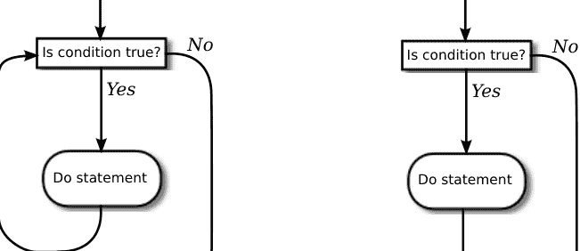

在这些图中，箭头代表语句执行时的时间流。控制流从顶部进入图表并从底部离开。同样，`if..else` 语句的控制流图清楚地表明，两个嵌套语句中恰好只有一个会被执行：

# If..Else 控制流

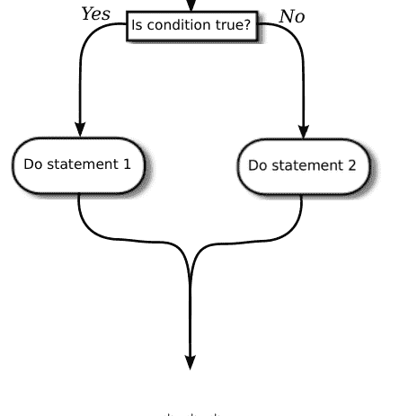

当然，`if` 语句中的任何一个 `(statements)` 都可以是一个块，而且许多程序员倾向于即使在只包含单条语句时也加上大括号。因此，`if` 语句通常如下：

```
if (boolean-expression) {
    (statements)
}
else {
    (statements)
}
```

或者：

```
if (boolean-expression) {
    (statements)
}
```

例如，这里有一个 `if` 语句用于交换两个变量 `x` 和 `y` 的值，但仅当 `x` 初始大于 `y` 时。在执行此语句后：


```java
if ( x > y ) {
    int temp;      // 用于此块的临时变量。
    temp = x;       // 将 x 的值保存在 temp 中。
    x = y;          // 将 y 的值复制到 x。
    y = temp;       // 将 temp 的值复制到 y。
}
```

## 第 3 章 控制

最后，这是一个包含 `else` 部分的 `if` 语句示例。看看你否弄出它的作用，以及为什么要使用它：

```java
if ( years > 1 ) { // 处理 2 年或更多的情况
    System.out.print("The value of the investment after ");
    System.out.print(years);
    System.out.print(" years is $");
}
else { // 处理 1 年的情况
    System.out.print("The value of the investment after 1 year is $");
} // if 语句结束
System.out.printf("%.1f", principal); // 这在任何情况下都会执行
```

我将在本章介绍更多关于控制结构的内容。但你已经掌握了要点。如果你从未学过任何关于控制结构的知识，你已经足够执行任何计算任务了。简单的循环和分支就是你需要的！

### 3.1.4 定义赋值

我将用一个技术性问题来结束对控制结构的介绍，这个问题在你第一次遇到它时可能无法完全理解。考虑以下两个代码段，它们似乎是完全等价：

```java
int y;
int y;
if (x < 0) {
    y = 1;
}
else {
    y = 2;
}
System.out.println(y);
if (x > 0) {
    y = 2;
}
System.out.println(y);
```

在左侧版本中，如果`x < 0`则给`y`赋值，否则赋值为 2，即`x >= 0`。右侧版本的情况也是如此。然而，存在一个细微的区别。在左侧代码中，Java 编译器会为`System.out.println`语句报告错误，而在右侧代码中它是完全正常的！

问题出在右侧代码中，编译器无法确定变量`y`是否已经被赋值了值。当`if`语句没有`else`部分时，语句可能执行也可能不执行，取决于（的值的值...

### 3.2 算法开发

程序是思想的表达。程序员从对要执行的操作有一个通用想法开始，至少在大纲上是如此。问题在于将该大纲充变为完整的、无歧义的、分步的程序以执行该任务。这种程序被称为“算法”。从技术上讲，算法是不歧义的、逐步执行的程序，并且在有限的步骤后终止。我们不想计算那些可能无限运行的过程。

算法并不等同于程序。程序是用特定语言编写的。算法更像是程序背后的思想，但它是程序执行任务的步骤，而不仅仅是任务本身的思想。在描述算法时，步骤并不一定要详细指定，只要步骤是无歧义的，并且执行这些步骤可以完成分配的任务即可。算法可以用任何语言表示，包括英语。当然，只有当所有细节都填充完成后，算法才能表示为程序。

那么，算法从哪里来？通常，它们需要经过开发，通常需要大量的思考和努力。算法开发技能是随着实践获得的，但有一些技巧和指南可以提供帮助。我将告诉你一些与“小规模编程”相关的技巧和指南，我将在后面的章节中多次回到这个主题。

### 3.2.1 伪代码和步骤细化

在小规模编程时，你有几个基础知识可以工作：变量、赋值语句和输出例程。你可能还有一些由你或其他人编写的子程序、对象或其他块。（输入/输出例程属于这一类。）你构建这些基础指令的序列，还可以将它们组合成更复杂的控制结构，如`while`循环和`if`语句。

假设你心中有一个想要让计算机执行的任务。一种进展方法是写下任务的描述，并以该描述作为任务的大纲你想要开发的算法。然后你可以对该描述进行完善和详述，逐渐添加步骤和细节，直到你拥有一个可以直接翻译成编程语言的完整算法。

这种方法被称为逐步细化（stepwise refinement），它是自顶而下设计的一种。随着你不断进行逐步细化，你可以用伪代码写出你算法的描述——伪代码是模仿编程语言结构的正式指令，但没有实际程序代码的那些完整细节和完美语法。

作为一个示例，让我们看看如何开发前一节中的程序，该程序计算投资在五年后的价值。你希望程序执行的任务是：“计算并显示未来五年内每年的投资价值，其中初始投资额和利率由用户指定。”然后你可能会写下——或更有可能只是想一下——将其扩展为：

```
获取用户的输入
计算1年后投资的价值
显示价值
计算2年后年的价值
显示价值
计算3年后年的价值
显示价值
计算4年后年的价值
显示价值
计算5年后年的价值
显示价值
```

这是正确的，但是是重复的。看到这种重复，你可能会发现使用循环的机会。循环可以减少打字量。更重要的是，它更具通用性：基本上，无论你想处理多少年，同一个循环都有效。因此，你可能会将上述步骤重写为：

```
获取用户的输入
当还有更多年份需要处理时：
计算下年的价值
显示价值
```

这样做无疑可以解决问题，但对于计算机来说，我们必须更明确地说明如何“获取用户的输入”、如何“计算下年的价值”，以及“还有更多年份需要处理”意味着什么。我们可以将步骤“获取用户的输入”扩展为：

```
询问用户初始投资额
读取用户的响应
询问用户利率
读取用户的响应
```

为了填充“计算下年的价值”这一步的细节，你必须自己知道如何进行计算。（也许你可能向你的老板或教授寻求澄清？）假设你知道价值是通过给前一个值加上某些利息来计算的。那么我们可以完善你的循环为：

```
当还有更多年份需要处理时：
计算利息
将利息加到价值
显示价值
```

至于测试“是否更多年份需要处理”，我们能做的办法就是自己数年份。这展示了一个非常常见的模式，你应该预期在很多程序中使用类似的东西：我们必须从零年开始，每处理一年就加 1，并在达到所需的年数时停止。这有时被称为计数循环（counting loop）。因此，`while`循环变成了：

```
years = 0
while years < 5:
    years = years + 1
    计算利息
    将利息加到价值
    显示价值
```

我们仍然需要知道如何计算利息。假设利息是通过利率乘以投资的当前价值来计算的。将这与获取用户输入的算法部分结合，我们得到了完整的算法：

```
询问用户初始投资额
读取用户的响应
询问用户利率
读取用户的响应
years = 0
while years < 5:
    years = years + 1
    计算 利息 = 价值 * 利率
    将利息加到价值
    显示价值
```

最后，我们达到了翻译成适当的编程语言语法的点。我们仍然需要为变量命名，确切决定我们想对用户说什么，等等。完成这些后，我们可以用 Java 表达我们的算法：

```java
double principal, rate; // 声明变量
int years;
System.out.print("Type investment: ");
principal = IO.nextDouble();
System.out.print("Type interest rate: ");
rate = IO.nextDouble();
years = 0;
while (years < 5) {
    years = years + 1;
    interest = principal * rate;
    principal = principal + interest;
    System.out.println(principal);
}
```

这还需要被封装在一个完整的程序中，并且仍然需要为用户以更漂亮的格式打印更多信息。（注意，伪代码算法使用了缩进来显示哪些语句在循环内部。在 Java 中，计算机完全忽略缩进，因此你需要一对大括号来告诉计算机哪些语句在循环内部。如果你漏掉了大括号，循环内部唯一的语句将是`years = years + 1;`。其他语句将在循环结束后只执行一次。糟糕的地方在于，计算机不会为你发现这个错误，就像它不会发现你漏掉了`(years < 5)`一样。括号是`while`语句语法要求的。而大括号仅在语义上是要求的。计算机可以识别语法错误，但不能识别语义错误。）

你在这里应该注意的一点是，我对问题的原始规范——“计算并显示未来五年内每年的投资价值”——远非完整。在你开始编写程序之前，你应该确保你已经有了问题的完整规范。

### 3.2.2 3n+1 问题

让我们来看另一个例子。科拉茨猜想（Collatz conjecture）认为，对于任何正整数`n`，如果`n`是偶数，则除以 2；如果`n`是奇数，则乘以`3 + 1`。这个过程最终会到达 1。这是数学中一个非常著名的问题。让我们为此写一个算法：

```
获取一个正整数 n
while n > 1:
  if n is even:
    n = n / 2
  else:
    n = 3 * n + 1
输出 n
```

等等，我们还应该计算到达 1 需要多少步。我们可以给它添加一个计数器：

```
获取一个正整数 n
let steps = 0
while n > 1:
  if n is even:
    n = n / 2
  else:
    n = 3 * n + 1
  steps = steps + 1
输出 steps
```

# 第3章. 控制

计算`N = 3 * N + 1`;

输出`N`;

计数器加 1;

输出计数器;

第一个`while`循环只有当`N`为正数时才会结束。

这里有一个实现该逻辑的 Java 程序。它使用`<=`运算符表示“小于或等于”，使用`!=`表示“不等于”。为了测试`N`是否为偶数，它使用了`N % 2 == 0`。这里使用的所有运算符都在第 2.5 节中讨论过。

```java
/*
* 此程序从用户指定的正整数
* 处开始打印 3N+1 序列。它还统计了序列中
* 项的个数，并打印了该数字。
*/
public class ThreeN {
    public static void main(String[] args) {
        int N; // 计数序列中的项数
        int counter; // 计数
        System.out.print("Starting point for sequence: ");
        N = TextInput.nextInt();
        while (N <= 0) {
            System.out.print("The starting point must be positive. Please try again: ");
            N = TextInput.nextInt();
        }
        // 在此时，我们知道 N > 0
        counter = 0;
        while (N != 1) {
            if (N % 2 == 0) {
                N = N / 2;
            } else {
                N = 3 * N + 1;
            }
            System.out.println(N);
            counter = counter + 1;
        }
        System.out.println();
        System.out.print("There were ");
        System.out.print(counter);
        System.out.println(" terms in the sequence.");
    } // end of main()
} // end of class ThreeN
```

关于这个程序的两个说明：首先，你可能已经注意到序列的第一项——用户输入的`N`的值——没有被这个程序打印或计数。这是一个错误吗？这很难说。程序的规范是否足够细致以做出决定？这种问题可能需要你回到老板/教授那里寻求澄清。

这个问题（如果真是一个问题的话！）可以很容易修复。只需将循环前的`counter = 0`行替换为以下两行：

```java
System.out.println(N); // 输出初始项
counter = i; // 并计数
```

其次

### 3.2.3 编码、测试、调试

如果能为你的程序开发一个算法，然后你可以放松，按下一个按钮，得到一个完美运行的程序，那就太好了。遗憾的是，将算法转换为 Java 源代码的过程并不总是一帆风顺的。当你达到运行程序的阶段时，它通常只在执行了某些事情的意义上是有效的。遗憾的是，这并不是你想做的。

程序设计后的编码：翻译用 Java 或其他语言编写的程序。通常，无论你多小心，总会在某些地方溜入几个语法错误，Java 编译器会带有某种错误信息编译你的程序。遗憾的是，虽然编译器总是能检测到语法错误，但它并不擅长告诉你具体哪里出了问题。它甚至不擅长告诉你真正的错误是什么。第 45 行缺失或漏掉的“{”可能会导致编译器在第 105 行卡住。

通过确保使用该语言的语法规则并遵循一些基本的编程指南，你可以避免许多错误。例如，永远不要在没有输入 `:)` 的情况下输入“{”。然后我回去填补大括号之间的语句。缺失或多出的括号可能是大型程序中最难找到的之一。

始终良好地缩进你的程序。如果你更改了程序，请更改缩进以匹配。这是值得的。使用一致的命名，这样你就不需要费力记忆你是否调用了它。当编译器给出多个错误时，通常你越仔细越好。当编译器遇到错误时，尝试修复它。在编译器遇到错误之前，花时间理解你。。。。，，，，，，，，，。。。。。。，，，，，，，，时间时间的循环体。

在 ，，，，，， 。 。。在在在`N`处是停止的。

```java
System.out.println("At start of " + N);
```

# 第3章. 控制

# 82

### 3.3 while 和 do-while 语句

Java 中的语句要么是简单语句或复合语句。简单语句（如赋值和方法调用）是基础块。复合语句（如`while`和`if`）被用于组织控制结构。

接下来的五节将探索 Java 的细节，从`while`语句和`do-while`语句开始。同时，我们将查看每个控制结构的示例。

### 3.3.1 while 语句

`while`语句已经在第 3.1 节中介绍。`while`循环的形式如下：

```
while (boolean-expression)
statement
```

`statement`当然可以是一个由一组语句组成的块语句。这被称为循环的体。只要`boolean-expression`为真，循环体就会重复。这个布尔表达式被称为条件，或者简单地说是测试。

有一些点可能需要澄清。如果在第一次执行循环体之前，条件就是假的会怎样？在这种情况下，循环体完全不会执行。循环体可以执行任意次数，包括零次。

如果条件是真的但在循环中间变成了假怎么办？计算机将继续执行循环体直到到达结尾。只有那时它才会回到开头并测试条件，只有这样循环才能运行。

让我们来看一个可以使用`while`循环解决的典型问题：计算用户输入的整数的平均值。平均值是整数和除以整数个数。程序将要求每次输入一个整数。它将记录输入的整数个数，并维护到目前为止读的所有数字的总和。以下是程序的伪代码：

```
Let sum = 0 // 用户输入的整数之和。
Let count = 0 // 用户输入的整数。
while 还有更多整数待处理:
    读取一个整数
    将其加到 sum 中
    计数
    将 sum 除以 count 得到平均值
```

但我们如何测试是否有更多整数待处理呢？典型的解决方案是告诉用户在输入所有数据后输入 0。这将有效，因为我们假设所有数据都是正数，所以 0 不是合法的数据值。它只是为了标记真实数据的结束。

## 第 3 章 控制

像这样使用的值有时被称为哨兵值（sentinel value）。现在，`while`循环中的测试变为“当输入不为零时”。

但还有另一个问题！第一次评估测试时，循环体还没有执行过，整数还没有被读取。此时还没有“输入整数”，所以判断输入是否为零是没有意义的。因此，在`while`循环之前我们必须做一些工作来确保测试是有意义的。

设置使得循环在第一次执行时就能通过测试被称为“循环引导”（priming the loop）。在这种情况下，我们可以简单在循环开始之前读取第一个整数。这里是修改后的算法：

```
设 sum = 0
设 count = 0
读取一个整数
当整数不为零时：
  将整数加到 sum
  计数
  读取一个整数
  除以 count 得到平均值
打印平均值
```

注意我重新排列了循环体。由于一个整数在循环之前，循环必须从处理该整数开始。在循环结束时，计算机读取一个新的整数。然后计算机跳回循环开头，测试它刚刚读取的整数。只有当计算机最终读取到哨兵值时，循环才会在哨兵值被处理之前结束。

哨兵值不会被加到`sum`中，也不会被计数。这就是它的工作方式。哨兵不是数据的一部分。原始算法即使在不进行处理的情况下也能运行，也是错误的（因为哨兵是 0，`sum`仍然是正确的，但包括哨兵在内的所有整数计数会错 1。这种“差一错误”（off-by-one errors）非常常见。计数的结果往往比看起来要多！）

我们可以很容易地将输入整合进完整的程序。请注意，程序不能使用`average = sum/count`语句来计算平均值。由于`sum`和`count`是`int`类型变量，`sum`的值是一个整数。平均值应该是一个实数。

我们通过以下方式解决这个问题：通过将其中一个变量强制转换为`double`类型，强制`int`值转换为`double`。类型转换`((double)sum)`将`sum`的值转换为实数，因此在程序中平均值的计算方式为`average = ((double)sum) / count`。尽管在这种情况下我们必须将`sum`声明为`double`类型变量，但在第一


程序还解决了另一个问题：如果用户输入零作为第一个输入值，则没有数据需要处理。我们通过检查在`while`循环结束后`count`是否仍然等于 0 来测试这一点。这似乎是一个微小的问题，但一个严谨的程序员应该涵盖所有情况。

以下是程序的完整源代码：

```java
/*
* 此程序读取用户输入的一系列正整数
* 并打印这些整数的平均值。
* 用户被提示每次输入一个整数。
* 用户必须输入 0 来标记数据的结束。
* (0 不计入平均值计算的数据中。)
* 程序不会检查用户的输入是否为正数，
* 因此它实际上会累加正、负数输入值。
*/
public class ComputeAverage {
    public static void main(String[] args) {

        int inputNumber; // 用户输入的整数之一。
        int sum; // 正整数的和。
        int count; // 正整数的个数。
        double average; // 正整数的平均数。

        /* 初始化汇总和计数变量。 */
        sum = 0;
        count = 0;
        /* 读取并处理用户的输入。 */
        System.out.print("Enter your first positive integer: ");
        inputNumber = TextIO.nextInt();

        while (inputNumber != 0) {
            sum += inputNumber; // 将输入加到运行总和中。
            count++; // 通过 count 加 1 来计数输入。
            System.out.print("Enter your next positive integer, or 0 to end: ");
            inputNumber = TextIO.nextInt();
        }

        /* 显示结果。 */
        if (count == 0) {
            System.out.println("You didn't enter any data!");
        } else {
            average = ((double)sum) / count;
            System.out.println("You entered " + count + " positive integers.");
            System.out.printf("Their average is %1.3f\n", average);
        }

    } // end main()
    } // end class ComputeAverage
```

### 3.3.2 `do..while` 语句

有时，在循环结束时测试继续条件比像`while`循环那样在开头测试更方便。`do..while`语句与`while`语句非常相似，只是单词 "while" 以及它所测试的条件被移动到了末尾。增加了单词 "do" 来标记循环的开始。`do..while`语句的形式如下：

```
do
    (statement)
while ((boolean-expression));
```

或者，按照惯例，`(statement)`可以是一个块：

```
do {
  { (statement) }
} while (boolean-expression);
```

注意末尾的分号`;`。这个分号是语句的一部分，就像赋值语句或声明语句末尾的分号是语句的一部分一样。漏掉它将导致语法错误。（更通用地说，Java 中的每个语句都以分号或右大括号`}`结束）。

要执行`do`循环，计算机执行循环的第一体——即循环内部的语句或多个语句——然后评估布尔表达式。如果表达式的值为`true`，计算机返回`do`循环的开头并重复该过程；如果值为`false`，循环结束并继续执行程序的后续部分。由于在循环结束之前不测试条件，因此`do`循环的体至少会被执行一次。

例如，考虑以下用于游戏程序的伪代码。使用`do`循环比`while`循环更有意义，因为使用`do`循环你知道至少有一个游戏。此外，在循环末尾使用的测试在开头是没有意义的：

```
do {
  玩一个游戏
  询问用户是否想再玩一个游戏
  读取用户的响应
} while (用户的响应是是) ;
```

让我们将其转换为 Java 代码。这个测试是（我现在不想谈论游戏，假设我们有一个`Checkers`类）。使用`do`循环比`while`循环更方便，因为你知道至少会有一个游戏。此外，在循环末尾使用的测试在开头是没有意义的：

```java
boolean wantsContinue;
do {
  Checkers.playGame();
  System.out.println("Do you want to play again?");
  wantsContinue = TextIO.getBoolean();
} while (wantsContinue);
```

当`wantsContinue`为`true`时，循环继续；如果值为`false`，循环结束。哨兵值不是数据的一部分。原始算法即使在不处理的情况下也能运行，也是错误的（由于哨兵是 0，`sum`仍然是正确的，但所有整数的计数（包括哨兵）会错 1。这种所谓的“差一错误”非常常见。计数的结果往往比看起来要多！）

我们可以很容易地将输入整合进完整的程序。注意程序不能使用`average = sum/count`语句来计算平均值。由于`sum`和`count`是`int`类型变量，`sum`的值是一个整数。平均值应该是一个实数。我们通过以下方式解决这个问题：通过将其中一个变量强制转换为`double`类型，强制`int`值转换为`double`。类型转换`((double)sum)`将`sum`的值转换为实数，因此在程序中平均值的计算方式为`average = ((double)sum) / count`。尽管在这种情况下我们必须将`sum`声明为`double`类型变量，但在第一程序还解决了另一个问题：如果用户输入零作为第一个输入值，则没有数据需要处理。我们通过检查在`while`循环结束后`count`是否仍然等于 0 来测试这一点。这似乎是一个微小的问题，但一个严谨的程序员应该涵盖所有情况。

### 3.3.3 `break` 和 `continue`

`while`和`do..while`循环的语法允许你在循环的开头或末尾测试继续条件。有时，在循环中间进行测试，或者在同一个循环的多个地方进行测试会更自然。Java 提供了一种通用方法来跳出循环中间。它被称为`break`语句，其形式为：

```
break;
```

当计算机执行循环中的`break`语句时，它会立即跳出循环。然后它继续执行循环之后的代码。考虑例如：

```java
while (true) { // 看起来会无限运行！
  System.out.print("Enter a positive number: ");
  N = Text10.nextInt();
  if (N > 0) { // 输入值正确，所以跳出循环
    break;
    System.out.println("Your answer must be > 0.");
  }
}
// break 之后在此继续
```

如果用户输入的数字大于 0，则将执行`break`语句，计算机将跳出循环。否则，计算机将打印“Your answer must be > 0.”并跳回循环开始处读取另一个输入值。

这里的第一行`"while (true)"`看起来可能有点奇怪，但它是完全合法的。`while`循环中的条件可以是任何布尔值的表达式。计算机会计算该表达式并检查其值是真还是假。布尔值`"true"`只是一个求值为真的表达式。因此`"while (true)"`可以用于编写无限循环，或者由`break`语句终止的循环。

`break`语句会终止直接包含该语句的循环。可能存在嵌套循环，即一个循环语句包含另一个循环语句。如果你在嵌套循环内部使用`break`，它只会跳出包含嵌套循环的那个循环。有一种被称为“标签 break”（labeled break）的机制，允许你指定想要跳出的哪个循环。这并不常见，所以我将快速带过。它的工作原理是：你可以在任何循环中使用标签。标签由单个标识符后跟冒号组成：例如，带有标签的`while`看起来像`"mainloop:..."`。在循环内部，你可以使用标签 break`"break mainloop"`来跳出带标签的循环。例如，这里有一段代码检查两个字符串`s1`和`s2`是否具有共同字符。如果找到了共同字符，变量`nothingInCommon`将被设置为`false`，并使用标签 break 在此处结束处理：

```java
boolean nothingInCommon;
nothingInCommon = true; // 假设 s1 和 s2 没有共同字符。
int i,j; // 用于迭代遍历 s1 和 s2 中字符的变量。

i = 0;
bigloop: while (i < s1.length()) {
    j = 0;
    while (j < s2.length()) {
        if (s1.charAt(i) == s2.charAt(j)) { // s1 和 s2 有共同字符。
            nothingInCommon = false;
            break bigloop; // 跳出两个循环
        }
        j++; // 继续处理 s2 的下一个字符。
    }
    i++; // 转到 s1 的下一个字符。
}
```

***

`continue`语句与`break`相关，但较少使用。`continue`语句告诉计算机跳过循环当前迭代的剩余部分。然而，它并不是完全跳出循环，而是跳回循环开头并继续下一次迭代（包括评估循环条件以检查是否还需要后续迭代）。与`break`类似，当`continue`出现在嵌套循环中时，它会继续直接包含它的循环；可以使用“标签 continue”（labeled continue）来继续嵌套的循环。

`break`和`continue`可以用于`while`循环和`do-while`循环。它们也可以用于`for`循环，后者将在下节中介绍。在第 3.6 节中，我们将看到`break`也可以用于`switch`语句。`break`可以出现在`if`语句内部，但前提是该语句嵌套在循环或`switch`语句内部。在这种情况下，它**并不**意味着跳出`if`。相反，它跳出包含该`if`语句的循环或`switch`语句。同样的考虑也适用于`if`内部的`continue`语句。

## 3.4 `for` 语句

我们进入另一种类型的循环：`for`语句。任何`for`循环都等同于某些`while`循环，因此语言并没有因为这些语句而获得额外的功能。但对于特定类型的问题，`for`循环比相应的`while`循环更容易构建也更容易阅读。在实际程序中，`for`循环的性能完全优于`while`循环。

### 3.4.1 `for` 循环

`for`语句使得常见的`while`循环更容易编写。虽然许多循环具有通用形式：

```java
(initialization)
while ((continuation-condition)) {
  (statements)
  (update)
}
```

例如，考虑这个从第 3.2 节示例中复制的例子：

```java
years = 0; // 初始化变量 years
while (years < 5) { // 继续循环的条件

  interest = principal * rate; //
  principal += interest; // 执行三个语句
  System.out.println(principal); //

  years++; // 更新变量 years 的值
}
```

这个循环可以写成如下等效的`for`语句：

```java
for (years = 0; years < 5; years++) {
  interest = principal * rate;
  principal += interest;
  System.out.println(principal);
}
```

初始化、继续条件和更新都合并在了`for`循环的第一行中。这使得循环的所有“控制”内容都保持在一个地方，有助于使循环更容易阅读和理解。`for`循环的执行方式与原始代码完全相同：初始化部分在循环开始前执行一次。继续条件在每次执行循环之前执行，当该条件为假时循环结束。更新部分在每次循环执行结束时执行，紧在跳回检查条件之前执行。

`for`语句的正式语法如下：

```java
for ((initialization); (continuation-condition); (update))
  (statement)
```

或者，使用块语句：

```java
for ((initialization); (continuation-condition); (update)) {
  (statements)
}
```

`(continuation-condition)`必须是一个布尔值的表达式。`(initialization)`通常是一个声明或赋值语句，但它可以是任何在程序中允许作为语句的表达式。`(update)`可以是简单语句，但通常是递增、递减或赋值语句。这三个部分中的任何部分都可以为空。如果继续条件为空，将被处理为“真”，因此循环将无限重复，或者由于某些原因（如`break`语句）而结束。（有些人喜欢用`for (;;)`而不是`"while (true)"`来开始无限循环。）这里是`for`语句的控制流图：

### `for` 循环控制流

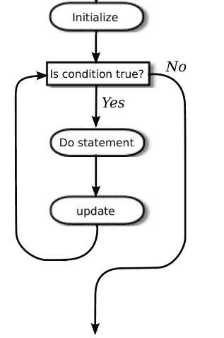

通常，`for`语句的初始化部分为变量赋值，而更新部分改变变量。测试继续条件，并在当该条件为假时结束循环。在上面的示例中，循环变量取了 2, 4, ..., 20 的值。这里有几种方法可以实现这一点。为了展示一个非常简单的问题可以通过许多方式解决，这里有四种不同的解决方案（其中三个可以得满分）：

1. 有 10 个数字要打印。使用`for`循环计数 1, 2, ..., 10。我们想要打印的是 2*1, 2*2, ... 2*10。

   ```java
   for (N = 1; N <= 10; N++)
       System.out.println(2 * N);
   ```

2. 使用`for`循环直接计数 2, 4, ..., 20，通过在每次循环向`N`加 2 来。

   ```java
   for (N = 2; N <= 20; N = N + 2)
       System.out.println(N);
   ```

3. 统计所有数字 2, 3, 4, ..., 19, 20，但只打印出偶数。

   ```java
   for (N = 2; N <= 20; N++) {
       if (N % 2 == 0) // N 是偶数吗？
           System.out.println(N);
   }
   ```

4. 用按照这个愚蠢作业的字面意思的解决方案，同时嘲讽它，来烦扰教授。

   ```java
   for (N = 1; N <= 1; N++) {
       System.out.println(2 4 6 8 10 12 14 16 18 20);
   }
   ```

也许值得再次强调一点：`for`语句与除变量声明外的任何语句一样，在实际程序中绝不会孤立存在。语句必须位于程序的主例程（main routine）内部或另一个子程序内部。而子程序必须定义在类内部。我还提醒大家，每个变量在使用之前都必须声明，这包括`for`语句中的循环变量。在本节中目前为止看到的所有示例中，循环控制变量应该声明为`int`类型。并不是要求循环控制变量必须是整数。在这里，例如，变量`N`的`for`循环类型是`char`，利用了`++`运算符可以应用于字符也可以应用于数字的特性：

```java
// 在输出的一行打印字母表。
char ch;
// = 要打印的字母之一。
for (ch = 'A'; ch <= 'Z'; ch++) {
    System.out.print(ch);
}
System.out.println();
```

### 3.4.2 示例：计算因数

让我们来看一个可以用`for`循环解决的简单问题。如果`N`和`D`是正整数，当`D`除以`N`的余数为零时，我们说`D`是`N`的因数。（等价于，我们可以说`N % D`为零。）

让我们写一个程序，从用户处输入一个正整数`N`并计算`N`有多少因数。可能是`N`因数的数有 1, 2, ..., N。为了计算`N`的因数个数，我们可以测试`N`的每一个可能的因数，并统计那些实际上整除`N`的数。在伪代码中，算法如下：

```
从用户处获取一个正整数 N
令 divisorCount = 0
对于范围 1 到 N 的每个 testDivisor:
    如果 testDivisor 是 N 的因数:
        通过给 divisorCount 加 1 来计数
输出计数结果
```


该算法展示了一种常见的编程模式，该模式在处理序列中的某些（而非全部）项时使用。通用模式是：

```
对于序列中的每个 item:
    如果 item 通过了测试:
        处理
```

我们因数计数算法中的 `for` 循环可以翻译为 Java 代码：

```java
for (testDivisor = 1; testDivisor <= N; testDivisor++) {
    if (N % testDivisor == 0)
        divisorCount++;
}
```

在现代计算机上，这个循环可以执行得非常快。运行到最大的合法 `int` 值 `2147483647` 并不是可能的（如果你想运行更大的值，可以使用 `long` 类型的变量而不是 `int`）。然而，对于非常大的数字，它需要大量的时间。当我实现这个算法时，我决定每当计算机测试一百万个因数时输出一个点。

在程序的改进版本中，有两种计数正在进行。我们需要统计因数的个数，还需要统计已测试的可能因数的个数。程序需要两个计数器。当第二个计数器达到 `1000000` 时，程序输出一个 `.` 并将计数器重置为零。回到伪代码，算法如下：

```
从用户处获取一个正整数 N
令 divisorCount = 0 // 因数的个数。
令 numberTested = 0 // 测试过的可能的因数
对于范围 1 到 N 的每个 testDivisor:
    如果 testDivisor 是 N 的因数:
        通过给 divisorCount 加 1 来计数
    给 numberTested 加 1
    如果 numberTested = 1000000:
        输出 '.'
        将 numberTested 重置为零
```

最后，我们可以将算法翻译成一个完整的 Java 程序：

```java
/**
 * 该程序从用户处读取一个正整数 N。
 * 它统计 N 有多少个因数，
 * 然后每一百万次输出一个点。
 */
public class Divisors {
    public static void main(String[] args) {
        int N; // 一个正整数
        int divisorCount; // 因数的个数
        int numberTested; // 测试过的可能的因数

        System.out.print("Enter a positive integer: ");
        while (true) {
            N = java.util.Scanner(System.in).nextInt();
            if (N > 0) {
                break;
            }
            System.out.println("That is not positive. Try again.");
        }

        /* 计数因数 */
        for (int testDivisor = 1; testDivisor <= N; testDivisor++) {
            if (N % testDivisor == 0) {
                divisorCount++;
            }
            if (++numberTested == 1000000) {
                System.out.print('.');
            }
        }
        /* 输出结果。 */
        System.out.println("\nt number of divisors of " + N + " is " + divisorCount);
    } // 结束 main
}
```

### 3.4.3 嵌套循环

嵌套 `for` 是 Java 中包含其他语句的语句。特别是，`for` 结构可以包含循环。你已经看到了一些嵌套示例，但理解它们是如何运作的很重要。

首先，考虑打印如下表格的问题：

| 1 | 2 | 3 | 4 | 5 | 6 | 7 | 8 | 9 | 10 | 11 | 12 |
|---|---|---|---|---|---|---|---|---|---|---|---|
| 2 | 4 | 6 | 8 | 10 | 12 | 14 | 16 | 18 | 20 | 22 | 24 |
| 3 | 6 | 9 | 12 | 15 | 18 | 21 | 24 | 27 | 30 | 33 | 36 |
| 4 | 8 | 12 | 16 | 20 | 24 | 28 | 32 | 36 | 40 | 44 | 48 |
| 5 | 10 | 15 | 20 | 25 | 30 | 35 | 40 | 45 | 50 | 55 | 60 |
| 6 | 12 | 18 | 24 | 30 | 36 | 42 | 48 | 54 | 60 | 66 | 72 |
| 7 | 14 | 21 | 28 | 35 | 42 | 49 | 56 | 63 | 70 | 77 | 84 |
| 8 | 16 | 24 | 32 | 40 | 48 | 56 | 64 | 72 | 80 | 88 | 96 |
| 9 | 18 | 27 | 36 | 45 | 54 | 63 | 72 | 81 | 90 | 99 | 108 |
| 10 | 20 | 30 | 40 | 50 | 60 | 70 | 80 | 90 | 100 | 110 | 120 |
| 11 | 22 | 33 | 44 | 55 | 66 | 77 | 88 | 99 | 110 | 121 | 132 |
| 12 | 24 | 36 | 48 | 60 | 72 | 84 | 96 | 108 | 120 | 132 | 144 |

`for` 的语法没有对嵌套数量设置限制。嵌套 `for` 在许多算法中自然出现。这一节包含了大量的数值处理。在下一个示例中，让我们来一些文本处理。考虑找出给定字符串中出现了字母表中的 26 个字母中的哪些。

```
要求用户输入字符串
将响应读取到变量 str 中
count = 0 （用于统计不同字母的个数）对于字母表中的每个字母:
  如果字母出现在 str 中:
```

## 第 3 章. 控制

95

打印字母

给计数加 1

输出计数

由于我们想要处理用户输入的整行文本，我们将使用 `TextIO.get()` 来读取它。（读取“遍历字母表中的每个字母”的算法行）可以表示为“for (letter='A'; letter++;)”。但在编写程序之前，我们需要对 `for` 循环内部的 `if` 语句进行仔细思考。我们如何检查给定的字母是否出现在 `str` 中呢？一个想法是检查字符串中的每个字符，并判断该字符是否等于 `letter`。我们可以通过函数 `str.charAt(i)` 获取 `str` 的第 `i` 个长度字符，其中 `i` 的范围从 0 到 `str.length() - 1`。

一个困难是：字母 `'A'` 可能以大写 `'A'` 或小写 `'a'` 出现。我们必须检查这两种情况。但我们可以在处理之前将 `str` 转换为大写来避免这种情况。这样，我们只需要检查大写字母即可。我们可以完整列出算法：

```
要求用户输入一个字符串
将响应读入变量 str
将 str 转换为大写
令 count = 0
for letter = 'A', 'B', ..., 'Z':
for i = 0, 1, ..., str.length()-1:
  if letter == str.charAt(i):
    打印 letter
    给 count 加 1
    break // 跳出循环，避免重复计算同一个字母
  输出 count
```

注意嵌套循环中 `break` 的使用。这是为了避免多次打印或计数某个特定字母（当该字母在字符串中出现多次时）。`break` 语句跳出内层 `for` 循环，而不是外层 `for` 循环。执行 `break` 后，程序将带着 `letter` 的下一个值继续外层循环。

你应该尝试准确算出，如果省略了 `break` 语句，程序结束时 `count` 会是多少。这里是完整的程序：

```java
/*
* 此程序读取用户输入的一文本。
* 它打印文本中出现的字母列表，
* 并报告发现了多少不同的字母。
*/
```

```java
public class ListLetters {

  public static void main(String[] args) {

    String str; // 用户输入的文本行。
    int count; // str 中不同字母的数量。
    char letter; // 字母表中的一个字母。

    System.out.println("请输入一行文本.");
    str = TextIO.get();

    str = str.toUpperCase();

    count = 0;
```

96

```java
System.out.println("您的输入包含以下字母:");
System.out.println();
System.out.print(' ');
for (char letter = 'A'; letter <= 'Z'; letter++) {
    int i; // 字符在 str 中的位置。
    for (int i = 0; i < str.length(); i++) {
        if (letter == str.charAt(i)) {
            System.out.print(letter);
            System.out.print(' ');
            count++;
            break;
        }
    }
}
System.out.println();
System.out.println();
System.out.println(" " + count + " 个不同的字母.");
// // end main()
// // end class ListLetters
```

事实上，判断一个给定的字母是否出现在字符串 `str` 中有更简单的方法。内置函数 `indexOf` 在字母未出现在字符串时会返回 `-1`。如果出现，它会返回一个大于等于零的数字。因此，我们可以通过检查 `if (str.indexOf(letter) >= 0)` 来简单地判断字母 `letter` 是否出现在 `str` 中。如果在上面的程序中使用这种技术，我们需要一个嵌套的 `for` 循环。这让你预览了如何使用子程序处理复杂性。

### 3.5 `if` 语句

Java 的两种分支语句中的**第一个**是 `if` 语句，你已经在 3.1 节中见过它。它的形式如下：

```
if ((boolean-expression))
    (statement-1)
else
    (statement-2)
```

通常，`if` 语句内部的语句可以是块。该语句代表双路分支。`if` 语句的 `else` 部分（由 `else` 单词和其后的语句组成）是可以省略的。

#### 3.5.1 悬空 `else`（Dangling else）问题

现在，`if` 语句是一个语句。这意味着在上面的 `if` 语句中，`(statement-1)` 或 `(statement-2)` 本身可以是一个 `if` 语句。然而，如果 `(statement-1)` 是一个没有 `else` 部分的 `if` 语句，就会出现问题。Java 有效地禁止了这种情况。假设你输入：

```java
if ( x > 0 )
    if (y > 0)
        System.out.println("First case");
else
    System.out.println("Second case");
```

现在记住，这种缩进对计算机没有任何意义。你可能认为 `else` 部分是 `if (x > 0)` 语句的后半部分，但计算机将你的语句格式化为：

```java
if ( x > 0 )
    if (y > 0)
        System.out.println("First case");
    else
        print "Second case";
```

你可以通过将嵌套的 `if` 放入块来强制计算机使用另一种解释：

```java
if ( x > 0 ) {
    if (y > 0)
        System.out.println("First case");
}
else
    System.out.println("Second case");
```

这两个语句具有不同的含义：当 `x <= 0` 时，第一个语句不打印任何内容，但第二个语句打印 `"Second case"`。

#### 3.5.2 多路分支（Multiway Branching）

比这更有趣的情况是，`(statement-2)` 即语句的 `else` 部分本身是一个 `if` 语句。该语句看起来如下（可能没有 `else` 部分）：

```
if ((boolean-expression-1))
    (statement-1)
else
    if ((boolean-expression-2))
        (statement-2)
    else
        (statement-3)
```

然而，由于计算机不在乎程序在页面上的布局，几乎总是以以下格式编写：

```java
if ((boolean-expression-1))
    (statement-1)
else if ((boolean-expression-2))
    (statement-2)
else
    (statement-3)
```

你应该认为这是一个代表三路分支的单一语句。当计算机执行它时，三个语句 `<statement-1>`、`<statement-2>` 或 `<statement-3>` 中的一个将被执行。

计算机首先评估 `<boolean-expression-1>`。如果为真，计算机执行 `<statement-1>` 并跳转到外部 `if` 语句的结束，跳过另外两个**语句**。如果 `<boolean-expression-1>` 为假，计算机跳过 `<statement-1>` 并执行下一个 `if`。为了做到这一点，它测试 `<boolean-expression-2>` 的值，并用它来决定 `<statement-2>` 和 `<statement-3>`。

这是一个根据变量 `temperature` 的值打印不同消息的示例：

```java
if (temperature < 50)
    System.out.println("It's cold.");
else if (temperature < 80)
    System.out.println("It's nice.");
else
    System.out.println("It's hot.");
```

如果 `temperature` 为 42，第一个测试为真。计算机打印消息“It’s cold”，并跳过剩余部分而不评估第二个条件。对于 75 的温度，第一个测试为假，因此计算机进入第二个测试。该测试为真，所以计算机打印“nice”并跳过剩余。如果温度为 173，两个测试都为假，因此计算机“Hot”（除非它的电路被热烧毁了）。

你可以继续连接“else-if”来创建具有任意数量情况的多路分支：

```
if ((test-1))
    (statement-1)
else if ((test-2))
    (statement-2)
else if ((test-3))
    (statement-3)
else
    // (more cases)
else if ((test-N))
    (statement-N)
else
    (statement-(N+1))
```

计算机一个接一个地评估测试（即布尔表达式），直到遇到一个真的。它执行关联语句并跳过其余部分。如果没有任何布尔表达式为真，则执行 `else` 部分的语句。

这种语句被称为多路分支，因为语句中只会有一个会被执行。最后的 `else` 部分可以省略。在这种情况下，如果所有布尔表达式都为假，则没有任何语句被执行。当然，每个语句都可以是一个块，由若干包含在 `{ }` 之间的语句组成。

# 第 3 章 控制

# 99

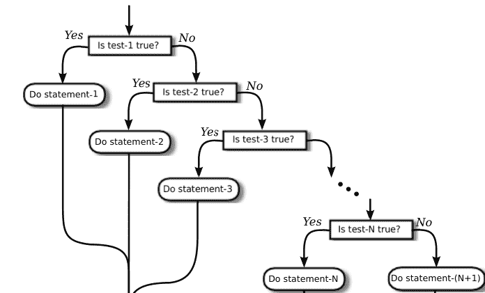

### 3.5.3 `if` 语句示例

作为一个使用 `if` 语句的示例，假设 `x`、`y` 和 `z` 是 `int` 类型的变量，并且每个变量都已赋值了一个值。问题是按从小的顺序打印这三个变量的值。例如，如果值是 42、17 和 20，那么输出顺序应该是 17, 20, 42。

处理这个问题的一种方法是提问：`x` 是否在列表中？如果它小于 `y` 和 `z`，它就排在第一。如果它同时大于 `y` 和 `z`，它就排在最后。否则，它排在中间。我们可以用三路分支 `if` 语句来表示这一点，但我们仍然需要担心 `y` 和 `z` 打印的顺序。在伪代码中：

```
if (x < y && x < z) {
    输出 x，紧接着按正确顺序输出 y 和 z
} else if (x > y && x > z) {
    按正确顺序输出 y 和 z，紧接着输出 x
} else {
    在 y 和 z 之间按正确顺序输出 x
}
```

确定 `y` 和 `z` 的相对顺序需要另一个语句，因此它变成了：


你可能认为，即使某些值相同，代码也能正常工作。如果两个变量的值相同，以何种顺序打印它们都并不重要。

```
if (x < y && x < z) { // x 排第一
    if (y < z) {
        System.out.println(x + " " + y + " " + z);
    } else {
        System.out.println(x + " " + z + " " + y);
    }
}
else if (x > y && x > z) { // x 排最后
    if (y < z)
        System.out.println(y + " " + z + " " + x);
    else
        System.out.println(z + " " + y + " " + x);
}
else { // x 在中间
    if (y < z)
        System.out.println(y + " " + x + " " + z);
    else
        System.out.println(z + " " + x + " " + y);
}
```

顺便提一下，尽管在英语中你可以说 "if x is less than y and z"，但在 Java 中你不能说 "if (x < y && z)"。`&&` 运算符用于布尔值之间，因此你必须进行单独的测试 `x < y` 和 `x < z`，然后用 `&&` 将这两个测试结合起来。

解决此问题的另一种替代方法是从提问“x 和 y 应该处于什么顺序？”开始。这是已知的，你只需要决定把哪一个放在 z 的位置。这种思路导致了不同的 Java 代码：

```
if (x < y) { // x 排在前面
    if (z < x) // z 排第一
        System.out.println(z + " " + x + " " + y);
    else if (z > y) // z 排最后
        System.out.println(x + " " + y + " " + z);
    else // z 在中间
        System.out.println(x + " " + z + " " + y);
} else { // y 排在前面
    if (z < y) // z 排第一
        System.out.println(z + " " + y + " " + x);
    else if (z > x) // z 排最后
        System.out.println(y + " " + x + " " + z);
    else // z 在中间
        System.out.println(y + " " + z + " " + x);
}
```

我们再次看到同一个问题可以用许多方法解决。解决这个问题的两种方法还没有穷尽所有可能性。例如，你可以从测试 x 大于 y 的情况开始。因此，你可以交换它们的值。一旦完成这一步，你就知道 x 应该排在 y 之前了。

---

最后，让我们写一个以有趣方式使用 if 语句的完整程序。我们想要一个程序可以将长度测量值从一种单位转换为另一种，例如从英里转换为码，或从英寸转换为英尺。到目前为止，问题描述非常不明确。假设程序只处理英寸、英尺和英里的测量。将其扩展到处理其他单位将很容易。用户将输入这些单位之一的测量值，例如 "17 feet" 或 "2.73 miles"。

用每个测量单位表示长度。（这比要求用户在输出中使用什么单位要简单得多。）该过程的概述如下：

- 读取用户的输入测量值和测量单位
- 将测量值用英寸、英尺、码和英里表示
- 显示结果

程序可以使用 `TextIO` 从同一行读取用户输入的两个部分，使用 `TextIO.getDouble()` 读取数值测量值，使用 `TextIO.getln()` 读取测量单位。向不同测量单位的转换可以通过首先将用户的输入转换为英寸来简化。从那里开始，英寸数很容易转换为英尺、码和英里。在转换为英寸之前，我们：

```java
/**
该程序将把英寸、英尺、码或英里的测量值转换为其他单位。
接受 in, yd 和 mi 缩写。
*/
public class LengthConverter {

    public static void main(String[] args) {

        double measurement; // 用户输入的测量值
        String units; // 用户指定的单位

        double inches, feet, yards, miles; // 每个单位的长度表示

        System.out.println("输入英寸、英尺、码或英里的测量值。");
        System.out.println("例如：17 feet 2.73 miles");
        System.out.println("可以使用缩写：in yd mi");

        while (true) {
            /* 获取用户的输入，并将单位转换为小写。 */
            System.out.println("输入你的测量值，输入 0 结束：");
            measurement = TextIO.nextDouble();
            if (measurement == 0)
                break; // 终止循环。
            units = TextIO.getText().toLowerCase(); // 将单位转换为小写

            /* 将测量值转换为英寸。 */
            if (units.equals("inch") || units.equals("in")) {
                inches = measurement;
            }
            else if (units.equals("foot") || units.equals("ft")) {
                inches = measurement * 12;
            }
            else if (units.equals("yard") || units.equals("yd")) {
                inches = measurement * 36;
            }
            else if (units.equals("mile") || units.equals("mi")) {
                inches = measurement * 12 * 5280;
            }
            else {
                System.out.println("抱歉，我不理解 \"" + units + "\"”。");
                continue; // 返回循环开始
            }

            /* 将英寸的测量值转换回英尺、码和英里。 */
            feet = inches / 12;
            yards = inches / 36;
            miles = inches / (12.0 * 5280);

            System.out.println("英寸: " + inches);
            System.out.println("英尺: " + feet);
            System.out.println("码: " + yards);
            System.out.println("英里: " + miles);
        }
    }
}
```

# 第三章. 控制

```java
miles = inches / (12 * 5280);

/* 输出每个测量单位的测量结果。 */

System.out.println();
System.out.println("等同于： \n");
System.out.printf("%12.5g, inches");
System.out.println(" inches");
System.out.printf("%12.5g, feet");
System.out.println(" feet");
System.out.printf("%12.5g, yards");
System.out.println(" yards");
System.out.printf("%12.5g, miles");
System.out.println(" miles");
System.out.println();

} // 结束 while 循环

System.out.println();
System.out.println("OK! 再见。");

} void main()
{
} // 结束类 LengthConverter
```

（注意，此程序使用了 "g" 格式说明符进行输出。在这个程序中，我们无法控制数字的大小。对于用户来说，输入非常大或非常小的测量值是非常合理的。“g” 格式会在数字非常大或非常小时以指数格式打印，否则以十进制形式打印。请记住，在格式规范 `%12.5g` 中，5 是打印的有效数字总数，无论数字的大小如何。如果我们使用 "f" 格式说明符（如 `%12.5f`），输出将是小数点后 5 位的十进制。这会将数字 0.00000000745 输出为 0.00000，完全没有任何有效数字！使用 "g" 格式说明符，输出将为 7.5459e-10）。

### 3.5.4 空语句

作为本节的最后提示，我将提到 Java 中的另一种语句：空语句。这种语句仅由一个分号组成，告诉计算机什么都不做。空语句的存在使得以下代码合法的，尽管你通常在冒号后面不会使用分号：

```java
if (x < 0) {
    x = -x;
};
```

在 `}` 之后使用分号是合法的，但计算机将其视为空语句，而不是 if 语句的一部分。偶尔，你可能会发现自己在实际表达的意思是“什么都不做”时使用了空语句。例如，这个有些生硬的 if 语句

```java
if ( done ) {
    // 空语句
} else
    System.out.println("尚未完成.");
```

当布尔变量为真时，它什么都不做；当为假时，它打印出“尚未完成”。在这个例子中，你不能漏掉分号，因为 Java 语法要求 if 和 else 之间必须有一个实际的语句。对于这种情况，我更倾向于使用一个空块（即中间没有任何内容的 `{ }`）。

偶尔，散乱的空语句会导致程序中出现令人烦恼且难以发现的错误。例如，下面的程序段只打印一次“Hello”，而不是十次：

```java
for (int i = 0; i < 10; i++)
    System.out.println("Hello");
```

为什么？因为第一行末尾的“i”是一个语句，而这个空语句被执行了十次。`System.out.println` 语句实际上根本不在 for 语句内部，因此它在 for 循环完成后只执行一次。for 循环执行了十次“什么都没做”！

### 3.6 switch 语句

Java 中的第二种分支语句是 switch 语句，在本节中介绍。switch 语句的使用比 if 语句频繁，但它对于表达某些类型的多路分支有时很有用。

### 3.6.1 基础 switch 语句

switch 语句允许你测试表达式的值，并根据该值跳转到 switch 语句中的某个位置。表达式的值可以是基本整数类型之一：`int`、`short` 或 `byte`。也可以是 `char` 类型。可以是 `String`。或者是任何其他类型（参见 2.3.4 节关于枚举的介绍）。特别注意，表达式不能是 `double` 或 `float` 值。

switch 语句中跳转的位置由 case 标签标记，其格式为：“`case (constant)`”。constant 是与表达式类型相同的字面量。当表达式求值为 constant 时，case 标记跳转的位置。在 switch 语句的最后，可以使用“default”标签，它在表达式的值未列在任何 case 列表中时提供默认跳转点。

`switch ((expression))` 通常常用，其形式如下：

```java
switch ((expression)) {
  case (constant-1):
    (statements-1)
    break;
  case (constant-2):
    (statements-2)
    break;
  // (更多 case)
  case (constant-N):
    (statements-N)
    break;
  default: // 可选的默认 case
(statements-(N+1))
} // switch语句结束
```

这与下面的多路 if 语句的效果相同，但 switch 语句效率更高，因为计算机可以计算一次表达式并直接跳转到正确的 case，而在 if 语句中，计算机必须计算 N 个表达式才能知道执行哪一组语句：

```java
if ((expression)) == ((constant-1)) { // String 要用 .equals！！
  (statements-2)
}
else if ((expression)) == ((constant-2)) {
  (statements-3)
}
else if ((expression)) == ((constant-N)) {
  (statements-N)
}
else {
  (statements-(N+1))
}
```

switch 中的 break 语句上是可选的。break 的作用是让计算机跳转到 switch 语句的结束，跳过所有剩余的 case。如果你省略 break 语句，计算机将忘记完成一个 case 后继续执行下一个 case 标签关联的语句。这通常不是你想要的，但是合法的。（我在这里提一下——虽然你读到下一章才能理解——在子程序内部，break 语句有时会被 return 语句代替，return 语句同样可以终止 switch。）

注意，你可以完全省略其中一组语句（包括 break）。这样多个 case 标签就可以连续出现。这意味着计算机对于每个 constant 将跳转到相同的位置并执行相同的操作。

# 第3章. 控制

```
break;
case 3:
System.out.println("Enter the number of yards: ");
measurement = TextIO.nextDouble();
inches = measurement * 36;
break;
```

```
case 4:
System.out.println("Enter the number of miles: ");
measurement = TextIO.nextDouble();
inches = measurement * 12 * 5280;
break;
default:
System.out.println("Error! Illegal option number! I quit!");
System.exit(1);
// end switch
```

* 现在继续将英寸转换为英尺、码和英里……

这个示例可以使用 `switch` 语句中的 `String` 来重写：

- `String units;` // 单位，由用户输入。
- `double measurement;` // 数值测量，由用户输入。
- `double inches;` // 相同的测量值，转换为英寸。

/* 读取用户的测量单位。 */

```
System.out.println("What unit of measurement does your input use? ");
System.out.println("Legal responses: inches, feet, yards, or miles : ");
units = TextIO.getLine().toLowerCase();
```

/* 读取用户的测量值并转换为英寸。 */

```
System.out.print("Enter the number of " + units + ": ");
measurement = TextIO.nextDouble();
```

```
switch (units) {
case "inches":
inches = measurement;
break;
case "feet":
inches = measurement * 12;
break;
case "yards":
inches = measurement * 36;
break;
case "miles":
inches = measurement * 12 * 5280;
break;
default:
System.out.println("Wait a minute! Illegal unit of measure! I quit!");
System.exit(1);
// end switch
```

# 第3章. 控制

### 3.6.3 switch 语句中的枚举 (Enums)

`switch` 中表达式的类型可以是枚举类型。在这种情况下，`case` 标签中的常量必须是枚举类型中的值。例如，假设表达式的类型是枚举 `Season`：

```
enum Season { SPRING, SUMMER, FALL, WINTER }
```


`switch`语句中的表达式是一个类型为`Season`的表达式。`case`标签中的常量必须从`Season.SPRING`、`Season.SUMMER`、`Season.FALL`、`Season.WINTER`中选择。然而，语法上有一个特殊之处：当枚举用于`case`标签时，只使用简单名称（例如`SPRING`），而不使用全名（如`Season.SPRING`）。计算机已经知道`case`标签中的值必须属于该枚举类型，因为它可以从使用的表达式类型判断出来，所以真的不需要在常量中指定类型名称。

例如，假设`currentSeason`是`Season`类型的变量，我们可以有如下`switch`语句：

```java
switch (currentSeason) {
  case WINTER: // (不是 Season.WINTER! )
    System.out.println("December, January, February");
    break;
  case SPRING:
    System.out.println("March, April, May");
    break;
  case SUMMER:
    System.out.println("June, July, August");
    break;
  case FALL:
    System.out.println("September, October, November");
    break;
}
```

### 3.6.4 确定赋值与`switch`语句

作为一个更贴实际的例子，下面的`switch`语句在三个替代方案中随机选择。记住，表达式`(int)(3*Math.random())`的值是整数 0、1 或 2 之一，是以等概率随机选择的，因此下面的`switch`语句会将`"Rock"`、`"Paper"`或`"Scissor"`之一赋值给`computerMove`，概率为 1/3。

## 第 3 章. 控制

在执行`(statements-2)`期间，`(variable-name)`代表异常对象，因此你可以对其进行打印操作。异常对象包含了关于异常原因的信息。这包括一条错误消息，当你打印异常对象时，该消息将会显示出来。

在`catch`部分结束后，计算机将继续执行程序的其余部分；该异常已被捕获并处理，不会导致程序崩溃。

请注意，大括号`{`和`}`是`try..catch`语句语法的一部分。即使大括号之间只有一个语句，它们也是必须的。这与我们之前学过的语句不同，在那些语句中单个语句周围的大括号是可选的。

例如，假设`str`是一个`String`类型的变量，其值可能代表也可能不代表实数。那么我们可以说：

```java
double x;
try {
    x = Double.parseDouble(str);
    System.out.println("The number is " + x);
} catch (FormatException e) {
    System.out.println("Not a legal number.");
    x = Double.NaN;
}
```

如果调用`Double.parseDouble(str)`时抛出错误，则`try`部分的输出将被跳过，并执行`catch`部分。（在这个示例中，当发生异常时，我将`x`设置为`NaN`。`Nan`是`double`类型的特殊“非数字”值。）

捕获异常并继续运行程序并不总是一个好主意。通常，这会导致后期出现更糟糕的混乱，可能让异常在发生的地方导致程序崩溃会更好。然而，有时是可以从错误中恢复的。

假设我们想要写一个程序，它能够找到用户输入的一系列实数序列的平均值，并且我们希望用户通过输入空行来指示序列的结束。（这与 3.3 节中的示例程序`ComputeAverage.java`类似，但在该程序中，用户输入零来表示输入结束。）如果我们使用`nextInt()`来读取输入，我们将无法检测到空行，因为该函数会跳过空行。解决方案是使用`next.readLine()`来读取用户的输入。这允许我们使用`Double.parseDouble`将非空输入转换为数字，并且可以使用`try..catch`来避免在用户输入非法数字时导致程序崩溃。这里是该程序：

```java
public class ComputeAverage{
    public static void main(String[] args) {
        String str; // 用户的输入。
        double number; // 转换为数字的。
        double total; // 所有输入数字的总和。
        double avg; // 数字的平均值。
        int count; // 输入数字的数量。
        total = 0;
        count = 0;
        System.out.println("Enter your numbers, press return to end.");
    }
}
```

```java
while (true) {
    System.out.print("? ");
    str = TextIO.getInput();
    if (str.equals("")) {
        break; // 退出循环，因为输入行为空白。
    }
    try {
        number = Double.parseDouble(str);
        // 如果发生错误，接下来的2行将被跳过！
        total = total + number;
        count = count + 1;
    } catch (FormatException e) {
        System.out.println("Not a legal number! Try again.");
    }
    avg = total/count;
    System.out.printf("The average of %d numbers is %1.6f\n", count, avg);
}
```

### 3.7.3 `TextIO`中的异常

`TextIO`从用户处读取一个数值，它使用类似的技术确保用户的响应是合法的，与之前示例中的`while`循环和`try..catch`类似。然而，当`TextIO`从文件读取数据时，如果遇到非法值，它通过抛出异常来响应。你有更好的方法而不是让程序崩溃，可以使用`try..catch`来捕获`IllegalException`类型的异常。例如，当尝试在已读取所有数据后从文件读取时，会发生异常。这种异常类型是`IllegalException`。

## 第 3 章. 控制

数组元素的命名是基于数组名称和该元素的索引数字。引用元素的语法例如所示：`namelist[7]`。在这里，`namelist`是命名整个数组的变量，而`namelist[7]`指的是该数组中索引为 7 的元素。也就是说，要引用一个元素，请使用数组名，后面跟上括在方括号中的元素索引。这个元素名可以被任何其他变量使用：你可以给它赋值、打印它，或在表达式中使用它。

数组还包含一种表示其长度的变量。例如，你可以通过`namelist.length`引用数组`namelist`的长度。然而，你不能为`namelist.length`赋值，因为数组的长度是固定的。

在引用数组之前，必须声明该变量并指定它的类型。对于`String`数组，数组变量的类型将是`String[]`；对于`int`数组，类型为`int[]`。通常，一个数组类型由数组的基本类型后跟一对空方括号组成。数组类型可以用于声明变量，例如：

```java
String[] namelist;
int[] A;
double[] prices;
```

通过这样声明的变量可以引用数组。然而，声明变量并不会创建实际的数组。与所有数组一样，数组变量在使用之前必须被赋值。在这种情况下，该值是一个数组。数组使用特殊语法创建。（该语法与 Java 中的数组实际上是对象这一事实有关，我们在这里不需要关心这一点。）数组使用运算符`new`创建。以下是一些示例：

```java
namelist = new String[1000];
A = new int[5];
nprices = new double[100];
```

通用语法为：

```java
(array-variable) = new (base-type)[(array-length)];
```

数组的长度可以是整数，也可以是整数值的表达式。例如，在执行赋值`A = new int[5];`之后，会产生一个包含整数元素`A[0]`、`A[1]`、`A[2]`、`A[3]`和`A[4]`的数组。`A.length`的值将是 5。在脑中形成这样一个模型是有用的：

| 语句 | 数组 | 长度 |
| --- | --- | --- |
| `A = new int[5];`创建了一个具有五个`int`类型元素的数组。`A`是整个数组的名称。 | A：数组包含五个元素，被称为`A[0]`：0、`A[1]`：0…… | `A.length`：5 |

当创建一个`int`数组时，每个元素在创建时会自动初始化为零。`boolean`数组会被填充为`false`值。`char`数组会被填充为 Unicode 码为 0 的字符。（对于`String`数组，初始值为`null`，这是一种用于对象的特殊值，在我们在第 5.1 节之前还不会正式遇到它。）

### 3.8.2 数组与`for`循环

数组的很多现实应用源于元素的索引可以通过整数变量或整数值的表达式给出。例如，如果`list`是一个数组且`i`是一个`int`类型的变量，那么你可以使用`list[i]`甚至`list[i+1]`作为变量名。`list[i]`的含义取决于`i`的值。当我们想要处理数组的所有元素时，这变得特别有用，因为可以通过`for`循环完成。例如，要打印数组`list`中的所有项，我们只需要写：

```java
int i;
for (i = 0; i < list.length; i++) {
  System.out.println(list[i]);
}
```

第一次循环时，`i`为 0，`list[i]`引用`list[0]`。第二次循环时，`i`为 1，打印存储在`list[1]`中的值。循环在打印完`list[4]`的值后结束，此时`i`等于 5，且条件`i < list.length`不再成立。这是一个使用循环处理数组的典型示例。

让我们再看几个例子。假设`A`是一个`double`数组，我们想要找到数组所有元素的平均值。我们可以使用`for`循环将这些数字相加，然后除以数组的长度以得到平均值：

```java
double total; // 数组中数字的和。
double average; // 数字的平均值。
int i; // 数组索引。
total = 0;
for (i = 0; i < A.length; i++) {
  total = total + A[i]; // 将元素加到总和。
}
average = total / A.length;
```

另一个问题是找到数组中的最大数。策略是遍历数组，记录到目前为止发现的最大数字。我们将其存储在一个名为`max`的变量中。当我们遍历数组时，每当发现一个比当前`max`大的数，就把`max`的值改为该值。处理完数组后，`max`就是最大的项。唯一的问题是，`max`的初始值应该是多少？一种可能性是让`max`等于`A[0]`，然后从`A[1]`开始遍历数组的其余部分寻找整数：

```java
double max; // 到目前为止可见的最大数字。
max = A[0]; // 此时 max 是最大的数字。
int i;
for (i = 1; i < A.length; i++) {
  if (A[i] > max) {
    max = A[i];
  }
}
```

### 3.8.3 随机访问

到目前为止，我的数组处理示例使用的是顺序访问。也就是说，数组元素按照它们在数组中的顺序一个接一个地被处理。但数组的一个优势是它们允许随机访问。也就是说，数组的任何元素都可以随时被访问。

作为一个例子，让我们来看一个著名的问题——生日问题：假设房间里有 N 个人具有相同的生日（也就是说，他们在同月同日出生）。大多数人会严重低估这种概率。我们实际上看的是问题的另一个版本：假设你随机选择并检查他们的生日。你需要检查多少个人才能找到一个与已检查过的人相同的生日？当然，特定情况的答案取决于因素，但我们可以用程序模拟实验并运行多次程序以获得平均需要检查多少人的想法。

为了模拟实验，我们需要跟踪发现的每个生日。共有 365 种可能的生日（我们将忽略年份）。对于每个生日，我们需要跟踪我们是否已经发现过该生日的人。这个问题的答案是一个布尔值，真或假。为了存储所有可能的生日的数据，我们将使用一个 365 布尔值的数组：

在这个问题中，一年的天从 0 到 364 编号。`used[i]`的值为`true`表示有人选择了第`i`天作为生日。初始时数组中的所有值均为`false`（记住，这是在创建数组时自动完成的）。当我们选择第`i`天作为生日时，我们首先检查`used[i]`是否为`true`。如果是`true`，那么这就是该生日的第二个人。另一方面，如果`used[i]`为`false`，我们使用`used[i]`来记录我们遇到过该生日的事实，然后继续。

# 第 3 章 控制

# 119

你应该研究这个程序以理解它的工作原理以及它是如何使用数组的。此外，尝试一下它！你可能会发现重复生日出现往往比你预想的要早。

### 3.8.4 部分填充的数组

考虑一种应用程序，我们想要存储在数组中的项目数量会随着程序的运行而变化。由于数组的大小无法更改，必须使用一个单独的计数器变量来跟踪数组中有多少空间。（当然，数组中的每个空间都必须包含某些内容；问题是，有多少个空间包含了有用或有效的项目？）

例如，考虑一个读取用户输入的正整数并将其存储的程序。当用户输入小于或等于 0 的数字时，程序停止读取。输入的数字可以存储在类型为`int[]`的数组中。假设最多可以使用 100 个数字。那么数组的大小就是 100。但程序必须跟踪实际上已读取并存储在数组中的数字数量。为了这一点，你可以使用一个整数变量。每当一个数字存储在数组中时，我们必须计数；即计数器变量的值必须加 1。有一个问题是，当我们向数组添加新项目时，我们将它放在哪里？嗯，如果项目数量是`count`，那么它们将存储在位置 0、1、……、`count - 1`。下一个空位将是位置`count`，所以我们应该把新项目放在那里。

为了一个更简单的例子，让我们写一个程序，读取用户输入的数字并按它们输入的反序打印它们。假设输入值 0 表示数据的结束。（这至少是一项需要将数字保存在数组中的处理任务。注意，许多类型的处理，例如计算数字之和、平均值或最大值，可以在不保存单个数字的情况下完成。）

```java
public class ReverseInputs {
    int[] numbers; // 用于存储输入值的数组。
    int count; // 数组中保存的数字数量。
    int num; // 用户输入的数字之一。

    numbers = new int[100];    // 为 100 个 int 留的空间。
    count = 0; // 还没有保存任何数字。

    System.out.println("输入最多100个正整数；输入 0 结束。");
    while (true) { // 获取数字并将它们放入数组。
        System.out.print("* ");
        num = TextIO.nextInt();
        if (num <= 0) { // 0 标记输入结束；我们有了所有的数字。
            break;
        }
        numbers[count] = num; // 将 num 放在位置 count。
        count++; // 计数
    }
    System.out.println("\n你的数字反序排列为：\n");

    for (int i = count - 1; i >= 0; i--) {
        System.out.println(numbers[i]);
    }
    // end main() {
} // end class ReverseNumbers
```

特别重要的是注意`count`如何扮演双重角色的。它是已输入数组的项目数量。但它也是数组中下一个可用位置的索引。

当需要打印数组中的数字时，数组中最后一个被占用的位置是位置`count - 1`，因此`for`循环从位置`count - 1`开始一直向下到 0 打印值。这也是反序处理数组的一个很好的例子。

你可能会想，如果用户尝试输入超过 100 个数字会发生什么。结果将是一个导致程序崩溃的错误。当用户输入第 101 个数字时，程序尝试将该数字存储在数组元素`numbers[100]`中。然而，并没有这样的数组。数组中只有 100 个项目，最后一个项目的索引是 99。尝试使用`numbers[100]`会产生类型为`ArrayOutOfBoundsException`。这种类型的异常是使用数组的程序中运行时错误的常见来源。

### 3.8.5 二维数组

我们目前为止考虑的数组都是“一维的”。这意味着数组由一系列元素组成，这些元素可以被认为沿着直线排列。也可以有二维数组，元素可以排列在矩形网格中。我们简要地考虑它们，但将在第 7.5 节回到这个主题。


在二维（或“2D”）数组中，元素可以按行和列排列。这里，例如是一个具有五行五列的 `int` 二维数组：

|   | 0 | 1 | 2 | 3 | 4 | 5 | -1 | 6 |
|---|---|---|---|---|---|---|---|---|
| 0 | 13 | 7 | 33 | 54 | 5 | -1 | 92 |
| 1 | -3 | 0 | 8 | 42 | 18 | 0 | 67 |
| 2 | 44 | 78 | 90 | 79 | -5 | 72 | 22 |
| 3 |   |   |   |   |   |   |   |   |
| 4 |   |   |   |   |   |   |   |   |

# 第 3 章. 控制

`decemberProfit += profit[storeNum];`

二维数组有时很有用，但它们比一维数组常见得多。Java 实际上允许更高维的数组，但在实践中很少遇到。

### 3.9 GUI 编程简介

在过去的两个章节中，你一直在学习在单个子程序内部进行的编程，即“微观编程”（programming in the small）。在本书的其余部分，我们将更多地关注程序的大规模结构，但你已经学到的知识将成为未来所有内容的重要基础。在本节中，我们将看到你目前所学的技巧如何应用于图形化编程的语境。

当你运行一个 GUI 时，它会在你的计算机屏幕上打开一个或多个窗口。作为程序员，你可以完全控制窗口中显示的内容以及用户如何与它交互。对于我们的第一次接触，我们来看一个简单的例子：程序在窗口中显示矩形和线条等简单形状的能力，且不需要用户交互。目前，主要重点是观察“微观编程”如何被应用于其他语境，即基于文本、命令行风格的程序。你会发现，掌握微观编程的知识适用于编写任何子程序的内部实现，而不仅仅是`main()`。

### 3.9.1 绘制形状

要理解计算机图形学，你需要了解一点像素和坐标系。计算机屏幕由称为像素的小方块组成，按行和列排列，通常每英寸约 100 像素。计算机控制像素的颜色，绘制通过更改单个像素的颜色来完成。每个像素有一对整数坐标（通常是 `x` 和 `y`），指定了像素的水平和垂直位置。对于屏幕上矩形区域的图形上下文，矩形左上角像素的坐标为 `(0,0)`。`x` 坐标从左到右增加，`y` 坐标从上到下增加。形状使用像素指定。例如，一个矩形通过其左上角的 `x` 和 `y` 坐标以及以像素为单位的宽度高度来指定。这里有一张矩形图，显示了 `x` 和 `y` 坐标的范围。图中的“宽度”和“高度”给出了绘制区域的大小，单位为像素：

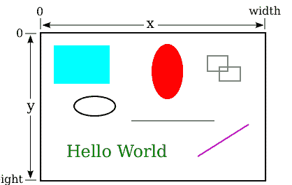

假设绘制区域为 800x500 像素，图片左上角的矩形宽度大约为 200，高度为 150，左上角坐标为 `(50,50)`。

* * *

Java 中的绘制是使用图形上下文（graphics context）完成的。图形上下文是一个对象。作为一个对象，它可以包含子程序和数据。图形上下文中的子程序包括用于绘制基本形状（如线条、矩形、椭圆和文本）的例程。（当文本出现在屏幕上时，字符必须由计算机绘制，就像其他其他形状一样。）图形上下文中的数据是当前选择绘制的颜色和字体。（字体决定字符的大小。）图形上下文中的一个数据是用于绘制的“绘制表面”。通常，绘制表面是计算机屏幕上的矩形，但也可以是其他表面，如要打印的页面。不同的图形对象可以绘制不同的表面。对于我们来说，绘制表面将是窗口的内容区域，包括它的边界或标题栏。

图形上下文由变量表示。变量的类型是`Graphics`（就像字符串变量的类型一样）。变量通常为`g`，变量名当然由程序员决定。以下是图形`g`中可用的几个子程序：

- `g.setColor(c)`，被调用以设置绘制的颜色。参数`c`是属于`Color`类的对象。有许多表示标准颜色的常量，包括`Color.BLACK`、`Color.WHITE`、`Color.LIGHTGRAY`、`Color.RED`、`Color.GREEN`和`Color.BLUE`。（以后我们将看到创建新颜色的方法）。例如，如果你想画红色，你会说`g.setColor(Color.RED)`。

- `g.drawLine(x1,y1,x2)` 从坐标为`(x1,y1)`的点到坐标为`(x2,y2)`的点画一条线。

- `g.drawRect(x,y,w,h)` 绘制矩形的轮廓。参数`x, y, w, h`是整数或整数表达式。该子程序绘制从矩形左边缘`x`像素和顶部`y`像素开始的、宽度为`w`像素，高度为`h`像素。除非通过`g.setColor()`设置了不同的颜色。

- `g.fillRect(x,y,w,h)` 与`drawRect()`类似，但它填充矩形的内部而不是绘制轮廓。

- `g.drawOval(x,y,w,h)` 绘制椭圆的轮廓。为了得到圆，对`w`和`h`使用相同的值。

- `g.fillOval(x,y,w,h)` 与`drawOval()`类似，但它填充矩形的内部而不是绘制轮廓。

这些信息已足够使用 Java 图形绘制一些图片了。从简单的开始，假设我们要绘制一组平行线，如下：假设线条长度为 200 像素，每条线之间的距离为 10 像素，我们将第一条线放在坐标`(100,50)`处。绘制一条线，我们只需要调用`g.drawLine(100,300,y)`，其中 100 是常数。`y`的值为 50，并且每次移动到下一条线时增加 10。我们使用循环从 1 数到 10：

```java
int y; // 线的 y 坐标
int i; // 循环控制变量
y = 50; // 第一条线从 50 开始
for (int i = 1; i <= 10; i++) {
    g.drawLine(100, 300, y);
    y = y + 10; // 在绘制下一条线之前增加 y 10
}
```

或者，我们可以使用`y`本身作为循环变量，注意最后线的`y`值为 140：

```java
int y;
for (y = 50; y <= 140; y += 10) {
    g.drawLine(100, 300, y);
}
```

如果想设置颜色，可以使用简单的`switch`来实现：

```java
switch ( (int)(3*Math.random()) ) {
    case 0:
        g.setColor(Color.RED);
        break;
    case 1:
        g.setColor(Color.GREEN);
        break;
    case 2:
        g.setColor(Color.BLUE);
        break;
}
```

### 3.9.2 在程序中绘制

现在，如你所知，你不能让让 Java 代码孤立存在。代码必须在类定义内部的子程序定义内部。事实上，对于我的画圆程序，绘制图片的完整子程序如下：

```java
public void drawFrame(Graphics g, int frameNumber, int width, int height) {
    int centerX; // 圆心的 x 坐标。
    int centerY; // 圆心的 y 坐标。
    int intColor; // 用于选择随机颜色。
    int count; // 用于计数圆盘的循环控制变量。
    for (count = 0; count < 500; count++) {
        int colorChoice = (int)(3*Math.random());
        switch (colorChoice) {
            case 0:
                g.setColor(Color.RED);
                break;
            case 1:
                g.setColor(Color.GREEN);
                break;
            case 2:
                g.setColor(Color.BLUE);
                break;
        }
        centerX = (int)(width*Math.random());
        centerY = (int)(height*Math.random());
        g.fillOval(centerX - 50, centerY - 50, 100, 100);
        g.setColor(Color.BLACK);
        g.drawOval(centerX - 50, centerY - 50, 100, 100);
    }
}
```

```java
case 0:
  g.setColor(Color.RED);
  break;
case 1:
  g.setColor(Color.GREEN);
  break;
case 2:
  g.setColor(Color.BLUE);
  break;
}

centerX = (int)(width*Math.random());
centerY = (int)(height*Math.random());

g.fillOval(centerX - 50, centerY - 50, 100, 100);
g.setColor(Color.BLACK);
g.drawOval(centerX - 50, centerY - 50, 100, 100);
```

这是你除了`main()`之外看到的第一个子程序定义，但你将在下一章学习关于定义子程序的所有知识。定义的第一行提供了子程序使用的变量：上下文`g`以及绘图区域的宽度和高度。（现在暂时忽略`frameNumber`）。这些值来自子程序外部，但子程序可以使用它们。这里的要点是绘制某些东西，你只需要填充子程序的内部，就像你填充`main()`内部一样。

子程序定义必须放在定义程序的类内部。在这种情况下，该类名为`RandomCircles.java`，完整程序可以在示例源码`RandomCircles.java`中找到。你可以运行它来查看绘图。

程序中有很多你不会理解的内容。为了制作你的图形，你所做的就是删除源码中的`draw()`例程，并替换成你自己的绘图代码。源码文件`SimpleAnimationStarter.java`可以作为你自己图形探索的基础。它在本质上与`RandomCircles.java`相同，但省略了绘图部分。你需要完成本章的某些练习。

（顺便说一下，你可能会发现`main()`子程序在定义中使用了`static`关键字，但`draw()`没有使用。这是因为该程序中的绘图区域是一个对象，而`draw()`是该对象中的一个子程序。静态和非静态子程序之间的区别很重要，但目前我们不需要担心这个。它在第 5 章会变得我们变得非常重要。）

### 3.9. 动画

“SimpleAnimationStarter”这个名字应该给你一个提示，我们正在考虑不仅仅是单个画面的可能性。计算机动画简单来说是一系列独立的图片，一个接一个地快速显示。如果每张图片到下一张图片的变化很小，用户就会将图像序列感知为连续的动画。动画中的每张图片被称为“帧”。`SimpleAnimationStarter.java`被配置为每秒绘制五十帧，尽管这可以更改。在`RandomCircles.java`中已更改为每三秒一帧，这样程序实际上每三秒会绘制一组随机圆。动画中的帧编号为 0, 1, 2, 3, …,，`drawFrame()`子程序中`frameNumber`的值告诉你正在绘制哪一帧。编程动画的关键是根据`frameNumber`来决定你绘制的内容。

我们看的一个动画示例是一组嵌套的矩形。这些矩形将向绘图中心收缩，产生一种无限运动的错觉。这是动画中的一帧：

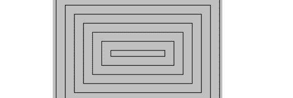

考虑如何绘制像这样的这样的图片。矩形可以使用`while`循环绘制，该循环从最外层的矩形开始向内绘制。思考需要哪些变量，以及它们在`while`循环的每次迭代之间是如何变化的。每次循环时，比上一个更小的矩形都会向下移动一点。两个矩形之间的区别在于它们的大小以及左上角的坐标。我们需要一个变量来表示尺寸。`x`和`y`坐标是相同的，它们可以用同一个变量表示。我将该变量命名为`inset`（内边），因为它是矩形边缘相对于绘图区域边缘的缩进量。尺寸从一个矩形到下一个减小，而`inset`则在增加。当`size`小于或等于 0 时，循环结束。通常，绘制一帧的算法是：

- 将绘图颜色设置为浅灰色（使用`g.setColor`）

- 填充整个图片（使用`g.fillRect`）

- 设置第一个矩形的`inset`量

- 设置第一个矩形的宽度和高度

- 当`width`和`height`都大于 0 时：

    - 绘制矩形（使用`g.drawRect`）

    - 增加`inset`（使矩形向右下方移动）

    - 缩小高度（使矩形变小）

在我的程序中，每个矩形与其周围的矩形之间有 15 像素，`inset`通过循环增加了 15 像素。矩形在左侧缩小 15 像素，右侧缩小 15 像素，因此在绘制下一个矩形之前，矩形的宽度缩小了 30 像素。高度在每次循环中也缩小了 30 像素。然后伪代码可以很容易翻译成 Java，但我们需要知道为第一个矩形的`inset`、`width`和`height`使用什么值。要弄清楚这一点，我们必须考虑到图片是动画的，因此我们在动画的下一帧中以某种方式绘制内容时，外层矩形的左上角向右下方移动；外层矩形的`inset`从一帧到下一帧增加。

因此，随着动画的进行，`inset`随着序列 0, 1, 2, ..., 14 移动。但它不能无限持续。事实上，当`inset`达到 15 时，一个新的矩形应该出现。这意味着外层矩形的`inset`随着每一帧增加。最后，当`inset`变为 0 时，矩形就会消失。这是`drawFrame()`子程序的示例：

```java
public void drawFrame(Graphics g, int frameNumber, int width, int height) {
    int inset; // 外边框
    int rectWidth,rectHeight; // 矩形
    g.setColor(Color.LIGHT_GRAY); // 设置浅灰色
    g.fillRect(0,0,width,height); // 填充整个区域
    g.setColor(Color.BLACK); // 设置黑色
    inset = frameNumber % 15; // 间距
    rectWidth = width - 2*inset; // 减去 inset
    rectHeight = height - 2*inset; // 同样地
    while (rectWidth >= 0 && rectHeight >= 0) {
        g.drawRect(inset, inset,rectWidth,rectHeight); // 绘制矩形
        inset += 15; // 间距15像素
        rectWidth -= 30;
        rectHeight -= 30;
    }
}
```

你可以在示例程序`MovingRects.java`中找到程序的完整源码。

## 第 3 章练习

- 1. 你需要掷多少次骰子才会出现点眼？你可以通过手掷骰子来进行实验。写一个计算机程序来模拟这个实验。程序应该报告在点眼之前的掷次数。（注意：“点眼”意味着两个骰子都显示 1。）

- 2. 1 到 10000 之间哪个整数的因子最多？它有多少个因子？写一个程序来找到答案并打印结果。在这个范围内可能有几个整数具有相同数量的因子。你的程序只需要打印其中一个。3.4.2 节讨论了因子。示例源码为`CountDivisors.java`。你需要关于寻找最大值的提示。基本思想是遍历所有整数，跟踪到为止发现的最大因子数量。同时，记录具有该数量因子的整数。

- 3. 写一个程序计算简单表达式，例如 17 + 3 和 3.14159 * 4.7。表达式由用户输入。输入由一个数字、一个运算符和另一个数字组成。允许的运算符有 +, -, *, 和 %。你可以使用`Text10.getDouble()`读取数字，使用`Text10.get()`读取运算符。你的程序读取一个表达式，打印其值，读取另一个表达式，打印其值，以此此类推。当用户在行首输入 0 时，程序应该结束。

- 4. 写一个程序读取一行输入文本并将其拆分为单词。单词每行输出一个。单词定义为字母的序列。输入中不是字母的字符应该被丢弃。例如，如果用户输入行：

  > He said, "That's not a good idea."

  那么程序的输出应该是：

  ```
  He
  said
  That
  snot
  a
  good
  idea
  ```

  改进后的程序会将“that's”列为单个单词。如果撇号两边都有字母，则撇号可以被认为是单词的一部分。

# 练习

130

5. 假设有一个文件包含某公司在不同城市的销售数据信息。文件的每行包含一个城市名称，后面跟着一个冒号（:），然后是该城市的数据。数据是一个`double`类型的数字。然而，对于某些城市没有可用数据。在这些行中，数据被一条解释为何缺失数据的注释所取代。例如，文件中的几行可能如下所示：

```
San Francisco: 19987.32
Chicago: no report received
New York: 298734.12
```

编写一个程序，计算并打印所有城市的总销售额。该程序还应该报告无数据的城市数量。文件名为 "sales.dat"。


为了完成这个程序，你将需要 `TextIO` 的一种文件输入方法，这在第 2.8.4 节中没有涵盖。由于你预先不知道文件中有多少行，因此你需要一种方法告诉何时到达文件末尾。当 `TextIO` 从文件中读取内容时，可以使用函数 `TextIO.eof()` 来检测文件末尾。这个布尔值函数在文件被完全读取时返回 `true`，在文件中还有更多数据待读时返回 `false`。这意味着你可以在循环 `while (!TextIO.eof())` 中读取文件的每一行。当文件的所有行都读取完毕后，循环将结束。

建议：对于每一行，读取并忽略直到冒号的字符。然后将行的剩余部分读入一个 `String` 类型的变量中。要将字符串转换为数字，使用 `try-catch` 来测试转换是否成功。

### 6. 练习题

练习题 3 要求你找到 1 到 10000 范围内因数个数最多的数字。你只需要打印其中一个数字。修改该程序，使其打印出所有具有最大因数的数字。使用如下数组：在你计算每个数字的因数个数时，将每个计数存储在数组中。最后在程序结束时，你可以遍历数组并打印所有具有最大计数的数字。程序的输出应该像这样：

在 1 到 10000 之间的整数中，

最大因数个数为64

因数很多的数字包括：

7560

9240

### 7. 生日问题

第 3.8.3 节中的一个示例尝试回答这样一个问题：在找到重复生日之前，你需要随机选择多少个个人？该程序的源可以在 `BirthdayProblem.java` 文件中找到。以下是一些相关问题：

- 在找到（相同）生日之前需要随机选择多少个个人？（即，所有三个人出生在同月的同一天，但不一定在同一年。）
- 假设你随机选择 365 个人。他们会有多少不同的生日？（理论上这个数字可能是 1 到 365 之间。）
- 在找到至少一个在一年中 365 天每天都有生日的人之前，你需要检查多少个不同的人？

#### 练习

编写三个程序来回答这些问题。你的每个程序都应该模拟随机选择人员并检查他们的生日。（在每种情况下，忽略闰年的可能性。）

### 8. 绘制棋盘

编写一个绘制棋盘的 GUI 程序。你的解决方案应基于示例 `SimpleAnimationStarter.java`，尽管你创建的是一张静态图像而不是动画。你将在 `draw()` 子程序中绘制棋盘。你应该阅读文件中的注释以发现你可能需要进行的其他更改。

假设绘图区域的大小为 400x400 像素。棋盘包含 8 行 8 列正方形。如果绘图区域的大小为 400，这意味着每个正方形可以是 50x50 像素。正方形是红色和黑色的（或你选择的任何颜色）。这里有一种判断给定正方形应该是红色还是黑色的奇妙方法：行和列可以被看作是从 0 到 7 编号。如果正方形的行号和列号均为偶数或均为奇数，则该正方形为红色。否则，它是黑色。注意，正方形只是一个高等于宽的矩形，因此你可以使用程序 `g.fillRect()` 来绘制正方形。这里是你想要绘制的棋盘的缩小图像：


通常，动画的某些元素每隔几帧重复一次。有时这种重复是“循环的”（cyclic），意味着在结束时它回到开头。有时这种重复是“振荡的”（oscillating），就像一种往复运动，后半部分是前半部分的倒序播放。

编写一个以不同速度演示循环和振荡运动的动画。对于循环运动，你可以使用一个跨绘图区域的正方形，回到开头，然后重复该运动。对于振荡运动，你可以采用类似的方法，但正方形应该在绘图区域的边缘之间来回移动；即在动画的前半部分从左向右，在后半部分从右向左。

编写该程序，你可以从示例程序 `SimpleAnimationStarter.java` 开始。

## 练习 145

为了实现循环运动，你需要一个“循环数字”，其取值为 0, 1, 2, ..., `(N-1)`, 0, 1, 2, ... `(N-1)`。同样，对于振荡运动，你需要一个“振荡数字”，其取值为 0, 1, 2, ..., `(N-1)`, `N`, `(N-1)`, ..., 0。你可以通过以下方式计算所需的值：

```java
oscillationFrameNumber = frameNumber % (2*N);
if (oscillationFrameNumber > N)
    oscillationFrameNumber = 2*N - oscillationFrameNumber;
```

这里是我的程序的截图。前三个以不同速度进行循环运动，而后三个进行振荡。我跨绘图区域画黑线以为它们提供移动的“通道”。

| | | |
|---|---|---|
| | | |
| | | |
| | |

## 练习 146

### 第三章测试

1. 什么是算法？

2. 解释解释什么是“伪代码”，以及它对算法开发有什么用。

3. 什么是块语句？块语句如何在程序中使用？

4. `while` 循环和 `do..while` 循环的主要区别是什么？

5. 引导循环是什么意思？

6. 解释什么是动画以及计算机如何显示动画。

7. 编写一个 `for` 循环，打印 3 到 36 所有3 的倍数，即：3 6 9 12 15 18 21 24 27 30 33 36。

8. 完善以下 `main()` 程序，让用户输入一个整数，读取用户的响应，并告诉他们输入的数字是偶数还是奇数。（你可以使用 `TextInput.getInt()` 读取它。记住，如果 `n % 2 == 0` 则整数为偶数）

```java
public static void main(String[] args) {
    填充此子程序的体！
}
```

9. 编写一个代码段，从 1 到 10 的范围内打印两个不同的整数。所有可能的输出具有相同的概率。提示：你可以轻松地选择两个随机数，但你必须考虑到选取的两个数字可能相同。

10. 假设 `s1` 和 `s2` 是 `String` 类型的变量，其值预期为 `int` 值的字符串表示。编写一个代码段，计算并打印这些值的整数和，如果值无法转换为整数，则打印错误信息。（使用 `try..catch` 语句）。

11. 显示以下 `main()` 程序将产生的精确输出：

```java
public static void main(String[] args) {
    int N;
    N = 1;
    while (N <= 32) {
        N = 2 * N;
        System.out.println(N);
    }
}
```

12. 显示由以下 `main()` 程序产生的精确输出：

```java
public static void main(String[] args) {
    int x,y;
    x = 5;
    y = 1;
    while (x > 0) {
        x = x - 1;
        y = y * x;
        System.out.println(y);
    }
}
```

13. 以下程序段的输出是什么？为什么？（记住 `name.charAt(i)` 是字符串 `name` 中的第 `i` 个字符）。

```java
String name;
int i;
boolean startWord;
name = "Richard M. Nixon";
startWord = true;
for (i = 0; i < name.length(); i++) {
    System.out.println(name.charAt(i));
    if (name.charAt(i) == ' ') {
        startWord = true;
    } else
        startWord = false;
    }
}
```

14. 假设 `numbers` 是一个 `int[]` 类型的数组。编写一段代码段，统计并输出数组中数字 42 出现的次数。

15. 定义数字数组的范围为数组中的最大值减去最小值。假设 `raceTimes` 是一个 `double[]` 类型的数组。编写一段代码段，找出并打印 `raceTimes` 的范围。

# 第 4 章：大规模编程 I——子程序

将一个复杂的程序拆分为可管理的部分的方法是使用子程序。子程序由执行某特定任务的指令组成，这些指令被组合在一起并赋予一个名称。在程序的其他地方，该名称可以作为整组指令的代名词。当计算机执行程序时，每当遇到子程序名称，它就会执行完成与子程序相关任务的所有指令。

子程序可以在程序的不同地方反复使用。子程序甚至可以位于另一个子程序内部。这允许你编写简单的子程序，并使用它们来编写更复杂的子程序，而这些复杂的子程序又可以用于其他子程序。通过这种方式，可以逐步构建出非常复杂的程序，而构建的每一步都相当简单。

Java 中的子程序可以是静态的（static），也可以是非静态的（non-static）。本章将介绍静态子程序。真正的面向对象编程中的非静态子程序将在下一章介绍。

## 4.1 黑盒

一个子程序由执行某些任务的指令组成，这些指令被分块作为一个单一的概念。“分块”（Chunking）允许你处理一个可能复杂的任务，因为计算机可能需要考虑执行该任务的许多、许多步骤，而你只需要记住子程序的名称。每当你想让程序执行该任务时，只需调用该子程序即可。子程序是处理复杂性的主要工具。

子程序被称为“黑盒”，是因为你无法看到它的“内部”（或者，更准确地说，你不想看到它的内部，因为那样你就必须处理子程序想要隐藏的所有复杂性了）。当然，如果一个黑盒没有任何方法与世界的其他部分进行交互，那么它将是完全没用的。黑盒需要与建立某种接口，允许黑盒内部与外部之间进行某些交互。物理黑盒外部可能有可以按下的按钮、可以设置的旋钮，以及可以用于往返信息的插槽。由于我们试图隐藏复杂性而不是创造复杂性，因此我们有了黑盒的第一条规则：

> 黑盒的接口应该是相当直观、定义良好且易于理解的。

现实世界中有黑盒的例子吗？是的；事实上，你被它们包围着。你的电视机、汽车、手机、冰箱……你可以通过电视接口的元素——旋钮、遥控器（别忘了插电源）来开关电视、切换频道和调节音量，而无需理解这些设备是如何运作的。手机也是如此，尽管那种情况下的接口要稍微复杂一些。

现在，黑盒有一个内部——即实际执行任务的子程序中的代码，或者你电视机内部所有的电子设备。黑盒的接口被称为它的实现（implementation）。黑盒的第二条规则是：

> 要使用黑盒，你不应该知道关于其实现的任何信息；你唯一需要知道的是它的接口。

事实上，改变实现应该是可能的，因为从外部观察，黑盒的行为保持不变。例如，当电视机用户从真空管过渡到晶体管时，用户不需要知道这一点——甚至不需要管这是否重要。同样，应该可以重写子程序的内部（例如使用更高效的代码），而不影响使用该子程序的程序。

当然，要有一个黑盒，必须有人先设计并构建了该实现。黑盒的运行对实现者和黑盒用户都是有利的。毕竟，黑盒可能被用于无限种不同的情况。黑盒的实现者不需要知道其中的任何。实现者只需要确保黑盒执行了分配的任务，并与世界的其他部分正确接口。这是黑盒的第三条规则：

> 黑盒的实现者不需要知道使用它的更大系统。

从某种意义上说，黑盒将世界分为两个部分：内部（实现）和外部。接口位于边界处，连接这两个部分。

从某种意义上说，你不应该将接口仅仅视为黑盒与其他部分的物理连接。接口还包含了黑盒做什么以及如何通过物理接口进行控制的规范。仅仅说电视有一个电源开关是不够的；你需要指定开关是用来开启电视的。

用计算机科学术语来说，子程序的接口具有语法（syntactic）和语义（semantic）部分。接口的语法部分告诉你输入什么以精确指定子程序将完成的任务。编写一个合法的程序，你需要知道子程序的语法规范。理解子程序的目的并有效地使用它，你需要知道子程序的语义规范。我将接口的这两个部分——语法和语义——统称为接口。

## 4.2 静态子程序和变量

Java 中的每一个子程序必须在类内部定义。这使得 Java 在编程语言中相当独特，因为大多数语言允许自由的子程序。类的目的之一是将相关的子程序组合在一起。也许 Java 的设计者认为万物都与某些物相关。作为一种非哲学的观点，Java 的设计者希望对命名方式进行自由控制，因为 Java 程序可以访问许多程序员创建的子程序。

Java 中静态和非静态子程序之间存在基本区别。类定义可以包含两种类型子程序的源代码，但它们在程序运行时的处理方式非常不同。静态子程序更容易理解：在运行的程序中，静态是类的成员。而非静态定义仅在创建对象时使用，子程序本身变成了对象的成员。静态和非静态的区别也适用于类定义中出现的其他内容。本章将处理静态子程序和静态变量。

### 4.2.1 子程序定义

子程序必须位于某个地方。定义必须包含子程序的名称、足够调用该子程序的信息，以及执行每次子程序被调用时，它都会执行。Java 中子程序的定义格式如下：

```java
(修饰符) (返回类型) (子程序名) (参数列表) {
  (语句)
}
```

我们需要花费一些时间——占据本章的大部分内容——来详细解释所有这些含义。当然，你已经在之前的章节中看到过子程序的示例了，例如程序的 `main()` 例程以及第 3.9 节动画程序中的 `drawFrame()` 例程。因此，你对通用格式已经熟悉。

子程序定义中大括号 `{ }` 之间的（语句）构成了子程序的体。当方法被调用时，这些就是我们在上一节中讨论的“黑盒”的内部或部分。子程序可以包含第 2 章和第 3 章中讨论过的任何语句。

出现在子程序定义开头的（修饰符）是设定子程序特征的单词，例如它是否是静态的（static）。你见过的修饰符有 `static` 和 `public`。总共只有六种可能的修饰符。

如果子程序是一个函数，其工作是计算某个值，那么（返回-类型）就是要指定函数返回的值的类型。它可以是一个类型名称如 `String`，或者是一个数组如 `double[]`。我们将在第 4.4 节中详细研究函数和返回类型。如果子程序不是函数，则（返回-类型）被 `void` 值替换，表示没有返回任何值。“void”一词用于表示返回值为空或不存在。

最后，我们来看方法的（参数列表）。参数定义了子程序的接口类型。它们代表了从外部传递到子程序的信息，供子程序的内部计算使用。举一个具体的例子，想象一个名为 `Television` 的电视机，它包含一个方法 `changeChannel()`。直接的问题是：它应该切换到哪个频道？可以使用参数来回答这个问题。由于频道号是一个整数，因此参数的类型是 `int`，`changeChannel()` 方法可能看起来如下：


# 第 4 章 子程序

```
public void changeChannel(int channelNum) { ... }
```

此声明指定了`changeChannel`有一个类型为`int`的参数名`channelNum`。然而，`channelNum`并没有特定的值。在调用子程序时，会给`channelNum`赋一个值；例如：`changeChannel(17)`。

子程序中的参数列表可以是空的，也可以由一个或多个采用`(类型) (参数名)`形式的参数组成。如果有多个声明，用逗号隔开。注意每个声明只能有一个参数。例如，如果你想要两个类型为`double`的参数，你必须说`"double x, double y"`，而不是`"double x, y"`。

下一节将更详细地介绍参数。这里是几个子程序定义的示例，省略了定义子程序作用的语句：

```
public static void playGame() {
// "public" 和 "static" 是修饰符；"void" 是
// 返回类型；"playGame" 是子程序名；
// 参数列表是空的。
// 此处定义 playGame 作用的语句。
}
```

```java
int getNext(int N) {
    // 没有修饰符；返回类型为 "int"；
    // getNextN 是子程序名；参数列表
    // 包含一个名为 "N" 的参数，其
    // 类型为 "int"；
    // 此处定义 getNextN 作用的语句。
}
```

```java
static boolean lessThan(double x, double y) {
    // "static" 是修饰符；"boolean" 是
    // 返回类型；"lessThan" 是子程序名；
    // 参数列表包含了两个名为
    // "x" 和 "y" 的参数，每个这些参数的
    // 类型都是 "double"；
    // 此处定义 lessThan 作用的语句。
}
```

在上面的示例中，`getNext`是一个非静态方法，因为它的定义在本章中！示例中显示的另一个修饰符是`"public"`。这个修饰符表示该方法可以从任何地方调用，即使是从定义该方法的类的外部。还有另一个修饰符`"private"`，它表示该方法只能从同一个类中调用。`public`和`private`修饰符是访问修饰符。如果没有为方法提供访问修饰符，默认情况下它遵循包规则，但不能从该包外部访问。（包在 2.6.6 节中提到过，你将在本章稍后的第 4.5 节学习更多。）还有另一个访问修饰符`protected`，它只在我们转向第 5 章的面向对象编程时才会变得相关。

顺便注意，程序的`main()`例程遵循子程序的常规规则。

```
public static void main(String[] args) { ... }
```

修饰符是`public`和`static`，返回类型是`void`，子程序名是`main`，参数列表是`"String[] args"`。在这种情况下，参数的类型是数组类型`String`。

你已经有一些填充子程序实现部分的经验。在本章中，你将学习关于编写自己的子程序定义的所有知识，包括接口部分。

## 4.2.2 调用子程序

当你定义一个子程序时，你所做的只是告诉计算机该子程序存在以及它是做什么的。在被调用之前，子程序并不会实际执行。（当它被调用时，子程序才会真正执行。）例如，上面的`playGame`方法可以使用以下调用语句调用：

```
playGame();
```

该语句可以出现在类中的任何地方。由于`playGame()`是一个公共方法，它可以从任何地方调用，即使是在定义该方法的类的外部。由于`playGame()`是一个静态方法，它告诉计算机去哪里查找。如果在`Poker`类之外，你必须说：

```
Poker.playGame();
```

更通用地说，静态子程序的调用语句格式为

```
subroutine-name(parameters);
```

如果是在同一个类中调用的，或者

```
class-name.subroutine-name(parameters);
```

如果它是在另一个类中。（非静态方法属于对象而不是类，它们通过对象调用）。注意参数可以是空的，在`playGame()`示例中，括号之间必须存在。调用子程序时提供的参数数量必须与参数列表中列出的匹配，且参数类型必须与子程序定义的类型匹配。

## 4.2.3 程序中的子程序

现在是时候给出一个完整程序的示例了。让我们写一个玩猜数字游戏的程序。计算机选择一个随机数，用户将尝试猜它。计算机告诉用户猜得大、小还是正确。在每个游戏结束后，用户可以选择继续玩下一个。

由于玩一次可以被视为一个单一、连贯的任务，因此编写一个玩猜数字游戏的子程序是有意义的。`main()`例程将使用循环反复调用`playGame()`子程序，直到用户想停止。我们设计`playGame()`子程序的方法与编写`main()`例程相同：从算法大纲开始并应用步骤细化。以下是猜数字游戏的简短伪代码：

```
选取随机数
当游戏未结束时
获取用户的猜测
告诉用户猜得大、小还是正确。
```

判断游戏何时结束的测试是复杂的，因为游戏要么在用户猜对时结束，要么在六次后结束。在很多情况下，简单的方法是使用`while (true)`并在找到理由时跳出循环。此外，如果我们要在六次猜测后结束游戏，我们必须跟踪用户猜测的次数。填充算法得到：

让`computersNumber`为 1 到 100 之间的一个随机数

```
Let guessCount = 0
while (true):
    获取用户的猜测
    通过给 guess count 加 1 来计算猜测次数
    如果用户的猜测等于 computersNumber:
        告诉用户他赢了
        跳出循环
    如果猜测次数为 6:
        告诉用户他输了
        跳出循环
    如果用户的猜测小于 computersNumber:
        告诉用户猜小了
    else如果用户的猜测大于 computersNumber:
        告诉用户猜大了
```

在添加了变量声明并将其翻译为 Java 后，这就成了`playGame()`的定义。1 到 100 之间的随机整数可以通过`(int)(100 * Math.random()) + 1`计算出来。我优化了与用户的交互，使其流程更加顺畅。

```java
static void playGame() {
    int computersNumber; // 计算机选取的一个随机数。
    int usersGuess; // 用户输入的猜测数字。
    int guessCount; // 用户所做出的猜测次数。
    computersNumber = (int)(100 * Math.random()) + 1;
    // 分配给 computersNumber 的值是在 1 到 100 之间
    // 随机整数。
    guessCount = 0;
    System.out.println();
    while (true) {
        System.out.print("你的第一个猜测是多少？ ");
        usersGuess = Integer.nextInt(); // 获取用户的猜测。
        guessCount++;
        if (usersGuess == computersNumber) {
            System.out.println("你花了 " + guessCount +
            " 次就中了！我的数字是 " + computersNumber + ")");
            break; // 游戏结束；用户赢了。
        }
        if (guessCount == 6) {
            System.out.println("你在 6 次猜测中没有猜中那个数字。");
            System.out.println("你输了。我的数字是 " + computersNumber + ")");
            break; // 游戏结束；用户输了。
        }
        // 如果运行到这里，游戏继续进行。
        // 告诉用户猜测是大了还是小了。
        if (usersGuess < computersNumber) {
            System.out.print("太小了。再试一次： ");
        } else if (usersGuess > computersNumber) {
            System.out.print("太大了。再试一次： ");
        }
    }
    System.out.println();
}
// end of playGame()
```

现在，你应该把它放在哪里呢？它应该是与`main()`程序同一个类的一部分，而不是在`main`程序内部。将一个子程序物理地放在另一个子程序内部是不合法的。`main()`程序将调用`playGame()`，但不包含它的定义，只包含一个调用语句。你可以将`playGame()`的定义放在`main()`程序之前或之后。Java 对类成员的特定顺序并没有严格要求。

编写`main`程序非常简单。你之前已经做过类似的事情。只不过正式的程序需要更多的注释（比我在这里包含的要）。

```java
public class GuessingGame {
    public static void main(String[] args) {
        System.out.println("这是一个游戏。我会选一个 1 到");
        System.out.println("100 之间的数字，你尝试猜中它。");
        boolean playAgain;
        do {
            playGame(); // 调用子程序玩一次游戏
            System.out.print("你想再玩一次吗？");
            playAgain = IO.getInputBoolean();
        } while (playAgain);
        System.out.println("感谢参与。再见。");
    } // end of main

    static void playGame() {
        int computersNumber; // 计算机选取的一个随机数。
        int usersGuess; // 用户输入的猜测数字。
        int guessCount;
        computersNumber = (int)(100 * Math.random()) + 1; // 用户所做出的猜测次数。
        // 分配给 computersNumber 的值是在 1 到 100 之间
        // 随机整数。
        guessCount = 0;
        System.out.print("你的第一个猜测是多少？");
        while (true) {
            usersGuess = IO.getInput(); // 获取用户的猜测。
            guessCount++;
            if (usersGuess == computersNumber) {
                System.out.print("你花了 " + guessCount +
                " 次猜中了。我的数字是 " + computersNumber);
                break; // 游戏结束；用户赢了。
            }
            if (guessCount == 6) {
                System.out.println("你在 6 次猜测中没有猜中。");
                System.out.println("你的数字是 " + computersNumber +
                " 次。");
                break; // 游戏结束；用户输了。
            }
            // 如果运行到这里，游戏继续进行。
            // 告诉用户猜测是大了还是小了。
            if (usersGuess < computersNumber) {
                System.out.print("太小了。再试一次： ");
            } else if (usersGuess > computersNumber) {
                System.out.print("太大了。再试一次： ");
            }
        }
        System.out.println();
    }
    // end of playGame()
} // end of class GuessGame
```

花点时间仔细阅读程序，弄清楚它是如何工作的。

## 4.2.4 成员变量

除了子程序外，类还可以包含其他内容。具体来说，它还可以包含变量声明。当然，你可以在子程序内部声明变量，那些被称为局部变量。然而，为了将它们区分开，我们称为成员变量，另一个术语是全局变量。在类加载时，就会为变量分配内存。任何赋值语句都会改变变量的内容，无论该赋值语句位于程序的哪个位置。每当在表达式中使用变量时，都会从同一个内存中获取值。这意味着成员变量的值可以在一个子程序中设置，并在另一个子程序中使用。静态变量被类中的所有子程序"共享"。相比之下，局部变量只在子程序执行期间存在，且从外部无法访问。

成员变量的声明与局部变量的声明非常相似，但有两个不同：成员变量声明在子程序之外（尽管它必须在类内部），并且声明可以带有修饰符。由于我们现在只处理静态成员变量，本章的成员变量声明都会包含`static`修饰符。它们可能被标记为`public`或`private`。例如：

```
static String userName;
public static int numberPlayers;
private static double velocity, time;
```

声明为`private`的静态变量可以在定义它的类内部也可以在类外部访问。如果是在另一个类中使用，则必须以`(类名).(变量名)`的复合标识符来引用。`System`类拥有公共静态成员变量`out`，你可以在自己的类中通过`System.out`来使用这个变量。同样，如果`Math.PI`是`Poker`类中的静态成员变量，那么如果`numberPlayers`是公开的，`Poker`类只需引用`numberPlayers`，而另一个类中的代码则会引用`Poker.numberPlayers`。

作为一个例子，让我们在本节之前编写的`GuessingGame`类中添加一个静态成员变量。我们添加了一个变量`gamesPlayed`来记录用户玩了多少游戏，以及另一个变量`gamesWon`来记录用户赢得的游戏次数。这些变量被声明为静态成员变量：

```java
static int gamesPlayed;
static int gamesWon;
```

在`gamePlayed()`程序中，我们总是给`gamesPlayed`加 1，如果用户赢了游戏，我们就会给`gamesWon`加 1。在`main()`程序的结束处，我们打印这两个变量的值。使用局部变量也可以实现同样的操作，因为两个子程序都需要访问这些变量，而局部变量只存在于一个子程序。

当你在子程序中声明局部变量时，你必须在使用它进行任何操作之前给它赋一个值。相反，成员变量会自动初始化为默认值。这些默认值与初始化数组元素时使用的值相同。对于数值变量，默认值是 0；对于布尔型`char`，该字符使用 Unicode 编码码 0；对于对象（如`String`），默认初始值是`null`。

由于它们是`int`类型，静态变量`gamesPlayed`和`gamesWon`会自动获得它们的初始值。这对于正在使用的变量来说是正确的初始值。如果你对初始值不满意，或者想强调你依赖于默认值，你当然可以在`main()`程序的开始为变量赋值。

这里是`GuessingGame.java`的修订版本。与上述版本的差异所示：


```java
public class GuessingGame {
    static int gamesPlayed; // 玩的游戏次数。
    static int gamesWon; // 赢得的游戏次数。

    public static void main(String[] args) {
        gamesPlayed = 0;
        gamesWon = 0; // 这实际上是多余的，因为 0 是
                      // 默认初始值。
        System.out.println("让我们玩个游戏吧。我会选一个 1 到 100 之间的数字");
        System.out.println("1 和 100，你来猜猜看。");
        do {
            playGame();
            System.out.println("再玩一次吗？");
            playAgain = readBoolean();
        } while (playAgain);
        System.out.println("你玩了 " + gamesPlayed + " 场游戏，");
        System.out.println("其中你赢了 " + gamesWon + " 场。");
        System.out.println("感谢参与。再见。");
    }
}
```

```java
static void playGame() {
    int computerNumber; // 计算机选取的随机数。
    int userGuess; // 用户输入的猜测数字。
    int guessCount; // 用户已猜测的次数。
    gamesPlayed++; // 计数这一局。
    computerNumber = (int)(100) * Math.random() + 1;
    // 赋值给 computerNumber 的值是
    // 1 到 100 之间随机选择的整数。
    userGuess = 0;
    System.out.println();
```

```java
System.out.print("你的第一个猜测是？ ");
while (true) {
    usersGuess = Text.getInt(); // 获取用户的猜测。
    guessCount++;
    if (usersGuess == computersNumber) {
        System.out.println("你只猜了 " + guessCount + " 次就猜中了！我的数字是 " + computersNumber);
        break; // 游戏结束；用户赢了。
    }
    if (guessCount == 6) {
        System.out.println("你在 6 次内没有猜中。");
        System.out.println("你输了。我的数字是 " + computersNumber);
        break; // 游戏结束；用户输了。
    }
    // 如果到达这里，游戏继续。
    // 告诉用户猜测太大了还是太小了。
    if (usersGuess < computersNumber) {
        System.out.print("太小了。 ");
    } else if (usersGuess > computersNumber) {
        System.out.print("太大了。 ");
    }
    System.out.println();
} // play 结束
// GuessingGame 类结束
```

顺便说一下，注意在我的示例中，我没有将静态子程序或变量标记为 `public` 或 `private`。全局变量在定义的类中是可以访问的，但在其他包中不是。未声明修饰符的使用默认包。因此，默认包中的任何类都可以访问 `gamesPlayed`、`gamesWon` 和 `playGame()`——除非有原因，否则将成员变量和子程序设置为 `private` 是一种良好的做法。

## 4.3 参数

如果一个子程序是一个**黑盒**，那么参数就是从外部向黑盒传递信息的机制。参数是子程序接口的一部分。它们允许你自定义子程序的行为以适应特定情况。

类比，考虑一个温度器——一个黑盒，它的任务是保持房屋恒温。温度器有一个参数，即用于设置温度的旋钮。温度器执行相同的任务：维持恒温。然而，它执行的具体任务（即它维持的温度）是通过其旋钮自定义的。

### 4.3.1 使用参数

作为一个例子，回到 3.2 节讨论的“3N1”问题。记住，3N1 序列根据规则计算：“如果 N 是奇数，将其乘以 3；如果是偶数，将其除以 2；直到 N 等于 1。”例如，从 N=3 开始，我们得到序列：3, 10, 5, 16, 8, 4, 2。假设我们要写一个子程序来打印 3N1 序列。子程序始终执行相同的任务：它打印的序列取决于 N 的起始值。因此，起始值将是子程序的参数。该子程序可以这样写：

```java
* 此子程序向标准输出打印 3N1 序列，
* 使用 startingValue 作为 N 的初始值。它还打印
* 序列中的项数。参数
* startingValue 必须是一个正整数。
static void print3NSequence(int startingValue) {
    int N;
    int count; // 序列中的项数计数。

    N = startingValue; // 第一个项是
                      // 传递给子程序的值。

    count = 1; // 目前有一项，即起始值。
    System.out.println("从 " + N + " 开始的 3N1 序列");
    System.out.println(N); // 序列的初始项

    while (N > 1) {
        if (N % 2 != 0) // 如果 N 是奇数
            N = 3 * N + 1;
        else { // 计数这一项
            N = N / 2;
        }
        count++; // 打印这一项
        System.out.println(N);
    }

    System.out.println(N);
    System.out.println("序列中有 " + count + " 项。");}
```

参数列表（`int startingValue`）指定该子程序有一个参数，类型为 `int`。在子程序的体内部，参数的使用方式与变量相同。注意，子程序定义中没有给参数赋值的内容！参数从子程序外部获取值。当子程序被调用时，必须为子程序调用语句中的参数提供一个值。例如，可以使用调用语句 `print3NSequence(17)` 调用子程序。当计算机执行此语句时，首先会将 17 赋值给 `startingValue` 并执行子程序中的语句。这打印了从 17 开始的 3N1 序列。如果 K 是 `int` 类型的变量，可以通过说 `print3NSequence(K)` 来调用子程序。当计算机执行此调用语句时，它获取变量 K 的值，将其分配给 `startingValue` 并执行子程序的体。包含 `print3NSequence` 的类可以包含一个 `main()` 程（或其他子程序），为用户指定的各种值调用 3N1 序列：

```java
public static void main(String[] args) {
    System.out.println("这将打印 3N1 序列");
    System.out.println("根据你指定的起始值。");
    System.out.println("");
    int K; // 输入循环：当 K <= 0 时结束；
    do {
        System.out.println("输入一个起始值。");
        System.out.print("结束程序请输入 0：");
        K = TextIO.getInt(); // 从用户处获取起始值。
        if (K > 0) // 如果 K > 0 则打印
            print3NSequence(K);
    } while (K > 0); // 只有当 K > 0 时继续。
} // main 结束
```

记住，在使用此程序之前，`main` 和 `print3NSequence` 的定义必须封装在类内部。

### 形式参数与实参数

注意，“参数”一词指的是两个不同但相关的概念：子程序定义中的参数，例如示例中的 `startingValue`；以及子程序调用语句中的参数，例如语句 `print3NSequence(K)` 中的 `K`。

子程序定义中的参数称为**形式参数**或**哑参数**。调用子程序时传递的参数称为**实参数**或**参数**。当子程序被调用时，子程序调用语句中的实参数被求值并赋值给子程序定义中的形式参数。然后执行子程序的体。

形式参数必须有一个名称，即标识符。形式参数非常像变量，和变量一样有指定的类型，如 `int`、`boolean`、`String` 或 `double`。实参数是一个值，可以通过任何计算出正确类型的表达式来指定。实参数的类型必须是可以通过赋值语句合法赋值给形式参数的类型。例如，如果形式参数类型是 `double`，那么传递 `int` 作为实参数是合法的，因为 `int` 可以赋值给 `double`。

当你调用子程序时，必须为子程序定义中的每个形式参数提供一个实参数。例如，一个子程序：

```java
static void doTask(int n, double x, boolean test) {
    // 执行任务的语句在此
}
```

该子程序可以通过以下语句调用：

```java
doTask(17, Math.sqrt(z+1), z >= 10);
```

## 第 4 章 子程序

当计算机执行这条语句时，它的效果本质上与以下语句块相同：

```java
{
    int N; // 为形式参数分配内存位置。
    double x;
    boolean test;

    N = 17; // 将 17 赋值给第一个形式参数 N。
    x = Math.sqrt(z+1); // 计算 Math.sqrt(z+1)，并将其赋值给
                        // 第二个形式参数 x。
    test = (z >= 10); // 评估 "z >= 10" 并将结果
                      // true/false 值赋值给第三个形式
                      // 参数 test。
    // 此处编写用于执行任务的语句
}
```

除了与 `doTask(17,Math.sqrt(z+1),z>=10);` 相比，这之间还有一些技术上的差异，主要是关于变量作用域的问题，以及当变量或参数具有相同名称时会发生什么。

初学编程的学生通常会发现参数非常意外地困惑。调用一个已经存在的子程序并不是问题——在程序中向子程序提供信息的想法是清晰的。编写子程序则是另一回事。初学者的一个常见错误是在子程序的开始处为形式参数赋值，或者试图知道它们的值。**这代表了一种根本性的误解。**

当执行子程序中的语句时，形式参数已经被分配了初始值！计算机在执行子程序内部的代码之前，会自动为参数赋值。这些值来自于子程序调用语句。记住，子程序不是独立的。它是由其他例程调用的，而子程序调用语句负责为参数提供适当的值。

### 4.3.3 重载

为了合法地调用子程序，你需要了解每个参数，需要知道它有多少个形式参数，并且需要知道每个参数的类型。这些信息被称为子程序的签名（signature）。上面作为示例的子程序 `doTask` 的签名可以表示：`doTask(int,double,boolean)`。注意，签名不包括参数名称；事实上，如果你只想使用签名，你不需要知道形式参数名称是什么，因为它们不是接口的一部分。

Java 有些不同之处在于，它允许同一个类中的两个子程序具有相同的名称，只要它们的签名不同。当这种情况发生时，我们说该子程序的名称被**重载**（overloaded）了，因为它具有不同的含义。计算机不会把签名搞混。它可以通过子程序调用语句中提供的实际参数的数量和类型来判断你想调用哪一个。

你已经见过使用 `System.out` 的重载。例如，这个对象包含了许多命名为 `println` 的方法。这些方法都具有不同的签名，例如：

```text
println(int)       println(double)
println(char)      println(boolean)
println()
```

计算机根据你提供的实际参数的类型知道你想使用这些子程序中的哪一个。`System.out.println()` 调用签名名为 `println(int)` 的子程序，而 `System.out.println('A')` 调用签名名为 `println(char)` 的子程序。

当然，这些不同的子程序在语义上是相关的，这就是为什么对它们使用相同的名称是可以接受的。但对于计算机来说，打印一个 `int` 和打印一个 `char` 非常不同，后者与打印一个 `boolean` 不同，以此类推——每一个都需要不同的子程序。

顺便提一下，签名不包括子程序的返回类型。在同一个类中拥有两个签名相同但类型不同的子程序是非法的。例如，类如果包含两个定义如下的子程序将是语法错误：

```java
int get() { ... }
double get() { ... }
```

这就是为什么在 `TextIO` 类中，不同类型的方法并不都命名为 `get()`。在给定的类中，只能有一个带参数的名为 `get()` 的方法。

### 4.3.4 子程序示例

让我们写一个编写子程序来执行任务的示例。当然，这只是编程的一方面。设计程序的艺术——决定如何将程序拆分为任务——是编程的另一方面。

作为第一个例子，让我们写一个子程序来计算并打印正整数的所有因数。该整数将是子程序的参数。记住，任何子程序的语法都是：

```text
(modifiers) (return-type) (subroutine-name)(parameter-list) {
    (statements)
}
```

编写子程序意味着填充这些内容。在这种情况下，该语句告诉我们有一个参数，并告诉我们子程序的主体应该做什么。由于我们现在处理的是静态子程序，我们将需要使用 `static` 作为修饰符。我们可以添加一个访问修饰符（`public` 或 `private`），但在没有指令的情况下，我省略了它。

由于没有指定名称，我们必须为参数和子程序本身起名字。我将使用 `N` 作为参数，使用 `printDivisors` 作为子程序。该子程序看起来像：

然后我们还需要编写构成例程体的语句。这并不困难。只需记住主体已经有一个值了！算法是：“对于从 1 到 N 范围内的每个因数 D，如果 D 能整除 N，则打印 D。”用 Java 编写将变为：

```java
/**
 * 打印 N 的所有因数。
 * 我们假设 N 是一个正整数。
 */
static void printDivisors(int N) {
    int D; // 一个可能的因数
    System.out.println("The divisors of " + N + " are:");
    for (D = 1; D <= N; D++) { // D 能整除 N 吗？
        if (N % D == 0)
            System.out.println(D);
    }
}
```

我在子程序定义之前添加了注释说明子程序的合同——即它做了什么以及做了哪些假设。合同包括 N 是正整数。这由调用者保证。

作为第二个例子，考虑以下问题：写一个名为 `printRow` 的子程序。它应该有一个类型为 `char` 的字符和一个类型为 `int` 的参数 N。该子程序应该打印包含 N 个该字符的行。

在这里，我们知道了子程序的名称和两个参数的名称，并且被告知该子程序是私有的，因此我们对子程序的第一行没有太大选择。这种情况的任务非常简单，所以子程序体很容易编写。完整大纲如下：

```java
/**
 * 打印一行包含 N 个字符 ch 的输出。
 * 如果 N < 0，则输出一个空行。
 */
private static void printRow(char ch, int N) {
    int i; // 用于计数副本的循环控制变量
    for (i = 1; i <= N; i++) {
        System.out.print(ch);
    }
    System.out.println();
}
```

注意在这种情况下，合同没有对 N 任何假设，但它明确了在所有情况下发生什么，即意外情况 N < 0。

最后，让我们添加一个显示一个子程序可以基于另一个子程序的示例。让我们写一个接受字符串作为参数的子程序。对于字符串中的每个字符，它应该打印一行包含 25 个该字符的输出。它应该使用 `printRow()` 子程序来产生输出。

再次，我们可以为子程序和参数命名。我将将子程序命名为 `printFromString`，将参数命名为 `str`。算法非常清晰：对于 `str` 中的每个位置 `i`，调用 `printRow(str.charAt(i), 25)` 来打印输出的一行。我们得到：

```java
/**
 * 对于 str 中的每个字符，写一行包含 25 个该字符的输出。
 */
private static void printFromString(String str) {
    int i; // 循环控制变量
    for (i = 0; i < str.length(); i++) {
        printRow(str.charAt(i), 25);
    }
}
```


```java
int i; // 用于计数字符的循环控制变量
for (int i = 0; i < str.length(); i++) {
    printRow(str.charAt(i), 25);
}
```

我们可以在`main()`例程程序中使用`printRowsFromString`，例如：

```java
public static void main(String[] args) {
    String inputLine; // 用户输入的文本行。
    System.out.print("Enter a line of text: ");
    inputLine = Text10.getLine();
    System.out.println();
    printRowsFromString(inputLine);
}
```

当然，这三个例程程序`main()`、`printRowsFromString()`和`print()`会被集合在同一个类中。虽然这个程序并没有什么用，但它确实演示了子程序的用法。如果你想看的话，可以在`RowsOfChars.java`文件中找到该程序。

### 4.3.5 数组参数

参数的类型可以是数组类型。这意味着整个值数组可以作为一个单独参数传递给子程序。例如，我们可能希望一个子程序以整洁的格式打印整数数组中的所有值，用逗号分隔并括在一对方括号中。为了告诉它打印哪个数组，子程序将拥有一个类型为`int`的参数：

```java
static void printValuesList(int[] list) {
    int i;
    for (i = 0; i < list.length; i++) {
        if (i > 0)
            System.out.print(', '); // list[0] 前面没有逗号
        System.out.print(list[i]);
    }
    System.out.println(']');
}
```

要使用这个子程序，你需要实际数组。这里有一个合法的但并不真实的代码段，它创建了一个数组并作为参数传递给子程序：

```java
int[] numbers;
numbers = new int[3];
numbers[0] = 42;
numbers[1] = 17;
numbers[2] = 256;
printValuesList(numbers);
```

最后一条语句产生的输出为`[42,17,256]`。

### 4.3.6 命令行参数

程序的主例程有一个类型为`String[]`的参数。当调用该例程时，必须将实际的`String`作为参数的值传递给`main()`。系统在调用`main()`时提供实际参数，因此这些值来自程序外部。数组中的字符串从哪里来，它们意味着什么？数组中的字符串是运行程序的命令所使用的命令行参数。用户可以在此命令中包含额外输入，用户通过输入来告诉系统执行程序。这些额外输入就变成了命令行参数。系统获取程序名称加上命令行参数，将它们放入一个字符串数组，并将该数组传递给`main()`。

例如，如果程序名称为`myProg`，用户可以使用`java myProg`来执行程序。在这种情况下，没有命令行参数。如果用户输入：

```bash
java myProg one two three
```

那么命令行参数就是字符串"one"、"two"和"three"。系统将这些字符串放入一个`String`数组，并将其作为参数传递给`main()`例程。这里是一个简短程序，它可以打印出用户输入的任何命令行参数：

```java
public class CLDemo {
    public static void main(String[] args) {
        System.out.println("You entered " + args.length
                            + " command-line arguments:");

        if (args.length > 0) {
            System.out.println("They were:");
            for (int i = 0; i < args.length; i++) {
                System.out.println("    " + args[i]);
            }
        }
    } // end main()
    // end class CLDemo
}
```

注意参数`args`可以是一个长度任意的数组。这仅意味着用户在运行程序时没有包含任何命令行参数。

在实践中，命令行参数通常用于向程序传递文件名。例如，考虑以下制作文本文件副本的程序。它通过使用`TextIO`将原始文件的一行复制到副本文件中。`TextIO.eof()`函数是一个布尔值函数，如果到达文件末尾则为`true`。

> /**
>
> 需要两个命令行参数，必须是文件名。
>
> 第一个必须是存在的文件名。第二个是程序要
>
> 创建的文件名。第一个文件的内容将
>
> 复制到第二个文件中。警告：如果程序运行时
>
> 第二个文件已经存在，其原有内容将丢失！
>
> 此程序仅适用于纯文本文件。
>
> */

```java
public class CopyFile {
    public static void main(String[] args) {
        if (args.length < 2) {
            System.out.println("Two command-line arguments are required!");
            System.exit(1);
        }
        textFile(args[0]); // 打开原始文件进行读取。
        textFile.writeFile(args[1]); // 打开副本文件进行写入。
        int lineCount = 0;
        while (TextIO.eof() == false) { // 从原始文件读取
            String line = TextIO.readLine();
            TextIO.println(line); // 写入副本文件
            lineCount++;
        }
        System.out.printf("%d lines copied from %s to %s\n", lineCount, args[0], args[1]);
    }
}
```

大多数程序都是这样运行的，命令行参数没有以前那么重要。

## 4.3.7 抛出异常

问题在于，当调用者提供错误值时，子程序应该怎么办？我们已经看到某些子程序通过抛出异常来响应错误值。例如，考虑这个参数应该是正整数。参数在被调用时“进入”子程序，但在子程序开始后表现就像局部变量（对于数组和对象，情况更为复杂，我们稍后会讨论）。

```java
static void print3Sequence(int startingValue) {
    if (startingValue <= 0) { // 违反了约定
        throw new IllegalArgumentException("Starting value must be positive.");
    }
    // 子程序的其余部分
}
```

在子程序中使用异常并不是坏事，但你应该意识到异常必须被视为子程序接口的一部分。子程序使用异常与程序的其余部分进行通信。这是一种隐蔽的后门通信，不像通过参数进行通信那么显眼。

# 第 4 章 子程序

### 4.4 返回值

一个会返回值的子程序被称为`function`（函数）。一个给定的函数只能返回指定类型的值，该类型被称为函数的`return type`（返回类型）。函数调用通常发生在计算机期望找到值的位置，例如赋值语句的右侧、作为子程序中的实际参数，或者在某个较大表达式的中间。布尔值函数甚至可以作为`if`、`while`或`do`语句中的测试条件。

（将函数作为独立语句使用也是合法的，就像使用普通子程序一样。在这种情况下，计算机获取由子程序计算的值。有时这样做是有意义的。例如，返回类型为`String`的函数`TextIO.getInput()`会读取用户输入的一行内容。通常，这行内容会被赋值给变量，以便在程序的后续部分使用，如语句`name = TextIO.getInput();`所示。然而，将其作为子程序调用语句`TextIO.getInput();`也是很有用的。如果返回值没有赋值给变量或未在表达式中使用，它将被丢弃。该子程序的作用是`read`并丢弃某些输入。有时，丢弃不需要的输入恰好是你需要的。）

### 4.4.1 `return`语句

你已经见过如何使用`Math.sqrt()`和`TextIO.getInt()`这样的函数了。你还没有见过如何编写你自己的函数。函数的格式与普通子程序相同，但你必须指定要由子程序返回的值。这是通过`return statement`（返回语句）实现的，其语法如下：

```
return (expression);
```

这种返回语句只能出现在函数的定义内部，且`(expression)`的类型必须与为函数指定的类型相匹配。（更准确地说，必须确保将返回值赋值给一个类型由`return type`指定的变量是合法的）。当计算机执行此`return statement`时，它会求值表达式，终止函数的执行，并将表达式的值作为函数的返回值。

例如，考虑以下函数定义：

```java
static double pythagoras(double x, double y) {
    // 计算直角三角形的斜边，
    // 其中三角形的边长为 x 和 y。
    return Math.sqrt(x*x + y*y);
}
```

假设计算机执行语句`totalLength = 17 + pythagoras(12,5);`。当执行`pythagoras(12,5)`时，它将实际参数12和5赋值给函数中的形式参数`x`和`y`。在函数体内部，它计算`Math.sqrt(12.0*12.0+5.0*5.0)`，结果为13.0。这个值由函数“返回”，因此13.0本质上替换了赋值语句中的函数调用，随后的效果与语句`totalLength = 17+13.0;`相同。返回值与17相加，结果30.0存储在变量`totalLength`中。

注意，`return statement`不一定是函数中的最后一个语句。在函数的任何你确定想要返回的值的地方，你都可以返回它。返回一个值将立即结束函数，跳过函数中的任何后续语句。但是，必须确保无论函数的执行代码经过什么种路径，都一定返回某个值。

你可以在普通的子程序中使用返回语句，即声明返回类型为`void`的子程序。由于子程序不返回结果，因此返回语句不包含表达式；它仅表现为`return`；该语句的作用是终止子程序的执行，并将控制权返回到调用子程序的程序。如果你想在函数的中间终止执行，这种做法很方便，但在非函数子程序中，返回语句是可选的。相反，在函数中，带有表达式的返回语句是要求的。注意，循环内部的返回会结束循环以及包含它的子程序。同样，`switch`语句中的返回也会结束`switch`语句以及子程序。因此，你需要在的地方使用`return`。

### 4.4.2 函数示例

这是一个非常简单的函数，可以用于程序计算3N1序列。（3N1序列我们在前面的节看过了。）给定3N1序列中的某一项，该函数计算序列的下一项：

```java
static int nextN(int currentN) {
    if (currentN % 2 == 1) // 测试是否为奇数
        return 3*currentN + 1; // 如果是，返回此值
    else
        return currentN / 2; // 如果
}
```

该函数有两个返回语句。有些人倾向于在函数的末尾使用单一返回语句来给出函数的值。你可能会这样写`nextN()`：

```java
static int nextN(int currentN) {
    int answer; // answer 将被返回
    if (currentN % 2 == 1) // 测试是否为奇数
        answer = 3*currentN+1; // 如果是，这就是答案
    else
        answer = currentN / 2; // 如果不是，这就是答案
    return answer; // 不要忘记返回答案！
}
```

这是一个使用`next`函数的子程序。在这种情况下，4.3节中的子程序版本并不理想，但如果`nextN()`执行的是复杂的计算，那么将其隐藏在函数内部将非常有意义：

```java
static void print3NSequence(int startingValue) {
    int N; // 序列中的项。
    int count; // 找到的项数。
    N = startingValue; // 使用 startingValue 开始。
    count = 1;
    System.out.println("The N+1 sequence starting from " + N);
    System.out.println(N); // 打印序列的初始项
    while (N > 1) {
        N = next(N); // 使用函数计算下一项。
        count++; // 计数该项。
        System.out.println(N);
    }
    System.out.println("There were " + count + " terms in the sequence.");
}
```

有几个函数的示例。第一个根据典型的标准计算数字等级对应的字母等级：

```java
/**
 * 返回传递给此函数的数字
 * 对应的字母等级。
 */
static char letterGrade(int numGrade) {
    if (numGrade >= 90) 
        return 'A'; // 90及以上得 A
    else if (numGrade >= 80) 
        return 'B'; // 80 到 89 得 B
    else if (numGrade >= 65) 
        return 'C'; // 65 到 79 得 C
    else if (numGrade >= 50) 
        return 'D'; // 50 到 64 得 D
    else
        return 'F'; // 其他任何情况得 F
} // letterGrade 函数结束
```

`letterGrade()`的返回类型是`char`。函数可以返回任何类型的值。这是一个返回值为`boolean`的函数。它展示了一些有趣的边界问题，所以你应该阅读注释：

```java
/**
 * 如果 N 是质数，此函数返回 true。
 * 质数是一个大于 1 且不能被除1以外的任何
 * 正整数整除的整数。如果 N 在 1 < D < N 范围内
 * 有因子 D，那么它在 2 到 Math.sqrt(N) 范围内
 * 也有一个因子，即它可以整除 N。因此我们只测试从 2 到
 * Math.sqrt(N) 的可能因子。
 */
static boolean isPrime(int N) {
    int divisor; // 我们测试是否整除的数字
    if (N <= 1)
        return false; // <= 1 的数字都不是质数。

    int maxToTry; // 我们需要测试的最大因子。
    maxToTry = (int)Math.sqrt(N);
    // 我们将尝试用 2 到 maxToTry 之间的任何数字除以 N。
    // 如果 N 不能被这些数字中的任何一个整除，那么
    // N 就是质数。（注意 Math.sqrt(N) 定义为
    // 返回 double 类型，该值在赋值给 maxToTry 之前
    // 必须转换为 int）。

    for (divisor = 2; divisor <= maxToTry; divisor++) {
        if (N % divisor == 0) // 测试是否整除
            return false; // 如果是，我们知道 N 不是质数。
            // 无需继续测试！
    }

    // 如果我们到达这里，N 必须是质数。否则，
    // 函数已经在循环中通过返回语句
    // 终止了。
    return true; // 是，N 是质数。
} // isPrime 函数结束
```

这里是一个返回类型为`String`的函数。该函数有一个`String`参数参数。返回值是字符串的反转拷贝。例如，“Hello World”的反转是“dlroW olleH”。

```java
static String reverse(String str) {
    String copy; // 反转后的拷贝
    int i; // str 中的一个位置，
    // 从 str.length() - 1 直到 0。
    copy = ""; // 从空字符串开始。
    for (int i = str.length() - 1; i >= 0; i--) {
        // 将 str 的 i 个字符追加到 copy。
        copy += str.charAt(i);
    }
    return copy;
}
```


回文是一个正读和反读都完全相同的字符串，例如“radar”。`reverse()`函数可以用来检查一个字符串、单词是否是回文，方法是测试`if (word.equals(reverse(word)))`。

# 第 4 章 子程序

## 4.4.3 重新回顾 3N+1

我将用一个全新的版本的 3N+1 程序来结束本节。这让我有机会在一个完整的程序中使用之前在上方定义的`next()`函数。我还将借此机会改进程序，让它每行打印五个序列项。这会让输出看起来更美观。其核心思想是：跟踪在当前行上已经打印了多少个项；当该数字达到 5 时，便开始新的一行输出。为了让行对齐成整齐的列，我使用了格式化输出。

> 一个计算并显示多个 3N+1 序列的程序。序列的起始值由用户输入。序列中的项按列打印，每行输出五个项。在显示完一个序列后，会向用户报告该序列的项数。

```java
public static void main(String[] args) {

    System.out.println("This program will print out 3N+1 sequences");
    System.out.println("for starting values that you specify.");
    System.out.println();

    int K; // Starting point for sequence, specified by the user
    do {
        System.out.println("Enter a starting value;");
        System.out.println("To end the program, enter: 0 ");
        K = TextIO.nextInt(); // get starting value from user
        if (K > 0)
            print3NSequence(K); // print sequence, but only if K > 0
    } while (K > 0); // continue only if K > 0
```

> `print3NSequence`使用`startingValue`作为 N 的初始值，向标准输出打印一个 3N+1 序列。它还会打印序列中的项数。参数`startingValue`的值必须是一个正整数。

```java
static void print3NSequence(int startingValue) {

    int N; // One of the terms in the sequence.
    int count; // The number of terms found.
    int onLine; // The number of terms that have been out
                // so far on the current line.

    N = startingValue; // Start the sequence with startingValue;
    count = 1; // We have one term so far.

    System.out.println("The 3N+1 sequence starting from " + N + ")");
    System.out.println();
    System.out.printf("%8d", N); // Print initial term, using 8 characters.
    onLine = 1; // There's now 1 on current output line.

    while (N > 1) {
        N = nextN(N); // compute next term
        count++; // count this term
        if (onLine == 5) { // If current output line is full
            System.out.println(); // ...then output a carriage return
            onLine = 0;
            // ...and add that there are no terms
            // on the new line.
        }
        System.out.printf("%8d", N); // Print this term in an 8-char column.
        onLine++; // Add 1 to the number of terms on this line
    }

    System.out.println(); // end current line of output
    System.out.println(); // and then add a blank line
    System.out.println("There " + count + " terms in the sequence.");
} // end of print3NSequence
```

```java
/*
* nextN computes the next term in a 3N+1 sequence,
* given that the current term is currentN.
*/
static int nextN(int currentN) {
    if (currentN % 2 == 1) {
        return 3 * currentN + 1;
    } else {
        return currentN / 2;
    } // end of nextN()
} // end of class ThreeN
```

你应该仔细阅读这个程序，并理解它的工作原理。

## 4.5 API、包和 Javadoc

随着“计算机及其用户界面”变得越来越容易使用，对于程序员来说，它们也变得越来越复杂了。你只需要使用几个向控制台输出并读取用户输入回复的子程序，就可以为简单的控制台风格界面编写程序。现代的图形用户界面（带有窗口、按钮、滚动条、菜单、文本输入框等）可能会让用户用起来更方便，但也迫使程序员应对极其庞大的可能性。这种复杂性的增加体现在大量用于管理用户界面以及其他任务的子程序上。

### 4.5.1 工具箱

想要为 Macintosh 计算机编程——并希望产生符合他们预期外观和行为的程序——需要处理 Macintosh 工具箱（Macintosh Toolbox），这是一个包含一千多个不同子程序的集合。其中有用于打开和关闭窗口、在窗口上绘制几何图形和文本、向窗口添加按钮以及响应窗口鼠标点击的例程。还有其他用于创建菜单和响应菜单选择的例程。除了用户界面外，还有用于打开文件和读取数据、进行网络通信、将输出发送到打印机、处理程序间的通信，以及通常计算机必须执行的所有标准工作的例程。Microsoft Windows 提供了供程序员使用的自己的子程序，它们与 Mac 上使用的子程序有很大不同。Linux 则有几个不同的 GUI 工具箱供程序员选择。

“工具箱”这个类比是一个非常值得记住的观点。每个编程项目都涉及归纳和复用工具的混合。程序员拥有一套可操作的工具，从语言内置的基础工具开始：如变量、赋值、语句和循环。在这些工具基础上，程序员可以添加现有的工具，这些工具充满了已经为执行特定任务而编写好的例程。如果这些工具设计得当，就可以作为“黑盒”使用：它们可以执行被分配的任务，而无需担心它们完成任务所经过的具体步骤。编程的创新之处在于将所有这些工具提取并应用于某个特定的问题或项目（文字处理、跟踪银行账户、处理来自太空探测器的图像数据、网页浏览、电脑游戏……）。这被称为应用程序编程。

软件工具箱是一种黑盒，它向程序员呈现了一个特定的接口。该接口是对工具箱中哪些例程、它们使用哪些参数以及它们执行什么功能的规范。这些信息构成了与工具箱相关的 API，即应用程序编程接口（Application Programming Interface）。Macintosh API 是工具箱中可用例程的规范。制造硬件设备（例如连接计算机到网络的设备）可能会发布该设备的 API，由程序员可以调用以与设备通信和控制的例程组成。编写复杂计算例程（如求解“微分方程”）的科学家会提供一个 API，允许他人在不理解计算细节的情况下使用这些例程。

---

Java 编程语言由大型标准 API 支持。你看到了 API 的一部分，形式为数学例程`Math.sqrt()`、`String`类型及其关联例程，以及`System.out.print()`例程。标准 Java API 包含了处理图形界面、网络通信、读写文件的例程，人们很容易认为这些例程是内置于语言的，但从技术上讲，它们是被编写并供 Java 程序使用的子程序。

Java 是平台无关的。这意味着同一个程序可以运行在 Mac OS、Windows、Linux 等不同平台上。相同的 Java API 必须在所有平台上都能运行。但请注意，接口是平台无关的；实现随平台而异。特定计算机上的 Java 系统包含了标准 API 例程的实现。Java 程序只包含对这些例程的调用。当 Java 解释器执行程序并遇到标准例程的调用时，它将调用并执行适用于其运行特定平台的例程实现。

# 第 4 章 子程序

## 4.5.2 Java 标准包

与 Java 中的子程序一样，标准 API 中的例程被分组在类（classes）中。为了提供更大规模的组织，Java 中的类可以分组在包（packages）中，这在第 2.6.6 节中简要介绍过。你可以拥有更高层次的分组，因为包也可以包含其他包。事实上，标准的 Java API 是实现在几个包中的。其中一个包名为“java”，它包含了几个非 GUI（图形用户界面）包，作为原始的 AWT 用户界面类所在。另一个包“javax”是在 Java 1.2 中引入的，包含了 Swing 图形界面以及 API 其他扩展内容所使用的类。

一个包包含类和其他其他内容。包含在另一个包中的包被称为“子包”（sub-package）。`java`包和`javax`包都包含子包。例如，`java`包的一个子包名为“awt”。由于`awt`包包含在`java`内部，它的全名实际上是`java.awt`。这个包包含了表示 GUI 组件（如按钮和菜单）的类。AWT 是两个 Java GUI 工具箱中较旧的一个，且不再被广泛使用。然而，`java.awt`还包含许多形成 GUI 编程基础的类，例如提供在屏幕上绘图例程的`Graphics`类、表示颜色的`Color`类，以及表示显示字符的字体的`Font`类。由于这些类包含在`java.awt`包中，它们的全名实际上是`java.awt.Graphics`、`java.awt.Color`和`java.awt.Font`。（我希望你现在已经掌握了 Java 中这是如何运作的。）同样，`java`包含一个子包`java.swing`，它包含了 GUI 类，如`java.swing.JButton`、`java.swing.JMenu`和`java.swing.JFrame`。`java.swing`中的 GUI 类同`java.awt`中的基础类，共同构成了在 Java 中编写图形用户界面所需的所有部分。

`java`包还包括其他几个子包，如`java.io`（提供输入/输出设施）、`java.net`（处理网络通信）和`java.util`（提供各种“实用”类）。最基础的包是`java.lang`。这个包包含了基础类，如`String`、`Math`、`Integer`和`Double`。

查看`java`包、其子包以及这些类中子程序的嵌套层级的图形化表示可能会有所帮助。这并不是一张完整的图，因为它只显示了每个包中许多项目里的极少数几个：

| java |  |  |
| :--- | :--- | :--- |
| lang | awt |  |
|  | Graphics | drawRect(i) |
|  | sqrt() |  |
|  | random() | setCol() |
| String | Color |  |
| Integer | Font |  |

嵌套在两层包的嵌套类中的子程序。`sqrt()`的全名是`java.lang.Math.sqrt()`。

标准 Java 7 API 的官方文档列出了 209 个不同的包（包括子包），并列出了这些包中的 4024 个类。其中许多类相当晦涩或非常专业，但你可能想浏览一下文档以查看可用内容。在我写这些内容时，完整 API 的文档可以在此处找到：

```text
http://download.oracle.com/java/7/docs/api/
```

即使是专家级程序员也不会熟悉整个 API，甚至不熟悉它的大部分内容。在书中，你只会遇到几十个类，这些类对于编写各种程序已经足够了。

## 4.5.3 使用包中的类

假设你正在编写的程序中使用`java.awt.Color`。像任何其他类一样，`java.awt.Color`是一个类型，这意味着可以用它来声明变量和参数，并指定函数的返回类型。实现此点的一种方法是使用类的全名作为类型的名称。例如，假设你想声明一个类型为`java.awt.Color`名为`rectColor`的变量。你可以：

```java
java.awt.Color rectColor;
```

这是一个形式为 ("类型-名称)(变量-名称)" 的普通变量声明。当然，使用每个类的全名可能会很乏味，你几乎不会在程序中使用`java.awt.Color`这种全名。Java 通过导入（import）类使得避免使用类的全名成为可能。如果你在 Java 源代码文件的开头放置：

```java
import java.awt.*;
```

那么在文件的其余部分，你可以将`java.awt.Color`的全名缩写为类名，即`Color`。注意，import 语句位于文件的开头（在包语句之后，如果有的话），而不是在任何类内部。虽然它有时被称为语句（statement），但更准确的称呼是“导入指令”（import directive），因为它在通常意义上并不是一条语句。导入指令`java.awt.Color`允许你使用：

```java
Color rectColor;
```

来声明变量。注意，导入指令的唯一作用是允许你使用简单的类名而不是全类名。你并没有真正导入任何实质性的东西；如果你漏掉导入指令，仍然可以访问该类——只需使用它的全名即可。从给定包导入所有类有一个快捷方法。你可以通过说以下代码来导入`java`中的所有类：

```java
import java.awt.*;
```

`*`是一个通配符，匹配包中的每一个类。（然而，它不匹配子包：例如，你不能通过说`import java.*`来导入`java`包名下所有子包的内容。）

一些程序员认为在 import 语句中使用通配符是一种坏习惯，因为这可能会让大量你可能不会使用、甚至可能不知道的类名变得可用。他们认为显式地导入你想要的每个单独类会更好。在我法自己的编程习惯中，我经常使用通配符来从最相关的包导入所有类，而当我只使用给定包中的一两个类时，则会使用单独导入。

事实上，任何使用图形用户界面的 Java 程序都可能使用许多类。为了方便，我通常会在程序开头包含以下：

```java
import java.awt.*;
import java.swing.*;
import java.event.*;
import java.net.*;
import java.io.*;
```

但是，为了避免类名冲突（例如，由于`java.awt`内部也有类名为`List`），你需要使用全名。

除了几个例外外，我在本书中不会创建包。对于本书而言，你了解包主要是为了能够导入标准类。这些包对于你编写的程序总是可用的，标准类所在的位置。再次，这取决于你使用的 Java 版本，但在最近的版本中，它们存储在 Java 运行时安装目录下的`lib`子目录中的 jar 文件中。一个 jar（或“Java 归档”）是一个包含许多类的单个文件。大多数标准类都可以在一个名为`rt.jar`的 jar 文件中找到。事实上，Java 程序通常以 jar 文件的形式分发，而不是单独的类文件。

虽然我们没有显式创建包，但每个类实际上属于一个包。如果一个类没有被专门放在包中，它就会被放在一个被称为默认（default）的包中。

# 第 4 章 子程序

`package`，它没有名称。你在书中看到的几乎所有的示例都在默认包中。

### 4.5.4 Javadoc

为了有效使用一个 API，你需要它的文档。大多数 Java API 的文档是由一个使用 Java Javadoc 的系统准备的。例如，该系统被用于准备 Java 标准包的文档。而且，几乎每个创建 Java 工具箱的人都会为它发布 Javadoc 文档。

Javadoc 文档是根据放置在 Java 源文件中的特殊注释准备的。回一下，只有一种注释以`/*`开头并以`*/`结尾。Javadoc 注释的形式相同，但它以`/**`开头，而不是简单的`/*`。你已经在本书的许多示例中见过其中一些注释了。

请注意，Javadoc 注释必须放在它所描述的子程序之前。这一点总是被遵守的。你可以为子程序、成员变量和类编写 Javadoc 注释。Javadoc 注释始终紧跟在它所描述的对象之前。

与任何注释一样，Javadoc 注释在编译时会被编译器忽略。但有一个名为`javadoc`的工具，它会读取 Java 源代码文件，提取它找到任何 Javadoc 注释，并创建一组包含格式良好的注释形式的 Web 页面。默认情况下，`javadoc`只收集有关公共类、子程序和成员变量的信息，但它也允许创建非公共内容的文档的选项。如果`Javadoc`没有为某个内容找到任何 Javadoc 注释，它将构造一个，该注释将仅包含基本信息，例如成员变量的名称和类型，或者子程序的返回类型和参数列表。这是语法信息。要添加关于语义和语用的信息，你必须编写 Javadoc 注释。


举例来说，你可以查看 TextIO 的文档页面。该文档页面是通过将 `javadoc` 工具应用于源文件 `TextIO.java` 创建的。如果你下载了这本书的在线版本，你可以在 TextIO 文档中找到它，或者你可以找到该章节内联版本的链接。

在 Javadoc 注释中，每行开头的 `*` 是可选字符。除了普通文本外，注释还可以包含 HTML 特殊字符。HTML 是用于创建网页的语言，而 Javadoc 注释旨在显示在网页上。`javadoc` 工具会将注释中的任何 HTML 命令复制到它创建的网页中。本书不会复制任何 HTML，但你可以添加 `<p>` 来指示新段落的开始。（通常，在没有 HTML 命令的情况下，注释中的空行和额外的空格会被忽略。此外，字符 `&` 和 `<` 在 HTML 中具有特殊含义，除非出于其含义，否则不应在 Javadoc 注释中使用；它们可以写成 `&amp;` 和 `&lt;`。）

除了 HTML 命令，Javadoc 注释还可以包含文档标签（doc tags），这些标签会被 Java 处理为注释。doc 标签的名称以字符 `@author`、`@param`、`@return` 和 `@throws` 开头。`@author` 标签可以用于类，后面应该紧跟作者的名字。其他三个标签用于子程序的 Javadoc 注释中，以提供关于其参数、其返回值以及它可能抛出的异常的信息。这些标签必须放在注释的末尾，放在对子程序本身的任何描述之后。使用它们的语法是：

```text
@param (parameter-name) (description-of-parameter)
@return (description-of-return-value)
@throws (exception-class-name) (description-of-exception)
```

（描述）可以跨越几行。描述在下一个 doc 标签或注释结束处结束。你可以为子程序的每个参数包含一个 `@param` 标签，并为你想要记录的许多类型的异常包含一个 `@throws`。你只应该为非空（non-void）子程序设置 `@return` 标签。这些标签不需要以特定的顺序给出。

这里有一个没有执行任何操作但使用了所有三种类型标签的示例：

```java
/**
* 此子程序根据给定的宽度
* 和高度计算矩形的面积。* 长度和宽度应该是正数。
* @param width 矩形的一侧的长度
* @param height 矩形的另一侧
* @return 矩形的面积
* @throws IllegalArgumentException 如果宽度或高度任一
* 为负数。
 */
public static double areaOfRectangle(double length, double width) {
    if (width < 0 || height < 0) {
        throw new IllegalArgumentException("Sides must have positive length.");
    }
    double area;
    area = width * height;
    return area;
}
```

我在许多示例中使用了 Javadoc。如果你不为你的工作生成 Web 页面文档，我鼓励你在自己的代码中使用它们，因为这是其他 Java 程序员会熟悉的标准。

如果你想创建 Web 页面文档，作为第 2.6 节中讨论过的 Java 开发 Kit 中的命令，你可以在命令行接口中使用 `javadoc`，方式类似于使用 `javac` 和 `java` 命令的方式。`javadoc` 也可以应用于第 2.6 节中讨论过的集成开发环境。我在这里不会详细介绍任何细节；请咨询你的编程环境的文档。

### 4.5.5 静态导入

在结束本节之前，我将提到导入指令（import directive）的一个扩展。我们已经看到 `import` 使得使用类的静态成员成为可能。结果之一是你可以不能从默认包进行静态导入。特别是无法从 `TextIO` 进行静态导入——如果你想这样做，你必须将 `TextIO` 移动到包中。

还有另一种形式的导入可以用于导入类的所有成员。这种形式被称为通配符导入（wildcard import），其语法是：

```java
import static package-name.class-name.*;
```

这允许你在不加前缀的情况下使用静态成员。然而，如果两个不同的类具有相同名的静态成员，你必须小心。

## 4.6 关于程序设计的更多讨论

理解程序如何工作是一回事。设计一个程序来执行特定任务完全是另一回事。在第 3.2 节中，我讨论了如何使用伪代码细化（pseudocode refinement）来有系统地开发算法。我们现在可以看到子程序是如何融入到这个过程中的。

细化本质上是一个自上而下的过程，但这个过程确实有一个“底部”，即你停止细化算法并将你的内容转换成适当的程序代码点。在没有子程序的情况下，该过程将一直持续赋值语句和非常原始的输入输出操作层才会结束。如果你有子程序，一旦你成功地用它们表达你的算法，就可以停止细化。

这允许为自上而下的细化方法增加一种自下而上的方法。给定一个问题，你可能从编写与问题领域相关的子程序开始。这些子程序变成了现成的工具箱，你可以在开发过程中将其集成到算法中。（或者，你可能可以在那里购买或找到一个独立的工具箱，其中包含你可以作为黑盒在项目使用的子程序。）

# 第 4 章 子程序

### 4.6.1 前置条件与后置条件

在使用子程序作为构建模块使用时，明确子程序如何与程序的其余部分交互是非常重要的。这种交互由子程序的契约（contract）规定，正如第 4.1 节所述。表达子程序合约的一种方便方法是使用前置条件（preconditions）和后置条件（postconditions）。

子程序的前置条件是在子程序能够正确工作时必须满足的。例如，对于内置函数 `Math.sqrt(x)`，如果前置条件是参数 `x` 大于或等于零，那么就不可能对负数开平方。前置条件代表了子程序调用者的义务。如果你在不满足前置条件的情况下调用子程序，就没有理由期望它正常工作。程序可能会崩溃或给出错误结果，但你应该怪自己，而不是子程序。

子程序的后置条件代表了契约的另一面。它是子程序运行后将满足的条件（假设已满足前置条件——且子程序内部没有 bug）。`Math.sqrt()` 函数的后置条件是：该函数返回值的平方等于调用时提供的参数。当然，这只有在满足前置条件（即参数大于或等于零）时才成立。

前置条件通常对参数的可接受值给出限制，如 `Math.sqrt(x)` 示例所示。然而，它们也可以指向子程序中使用的全局变量，或者要求程序处于某种特定状态。另一方面，子程序的后置条件应该指定它执行的任务。

子程序通过显式指定前置条件和后置条件的注释来描述。当你得到一个编写好的子程序时，其前置和后置条件的声明会告诉你如何使用它以及它的功能。许多科学家认为在 Javadoc 中添加 `@precondition` 和 `@postcondition` 标签是有必要的。

### 4.6.2 设计示例

让我们来看一个使用子程序设计的示例。在这个例子中，我们将使用子程序作为构建模块，并设计完成项目所需的子程序。我在这里使用的 API 定义在 `Mosaic.java` 中，它又依赖于 `MosaicPanel.java` 文件（该文件必须与类位于同一个文件夹）。假设我发现了一个已经写好的类 `Mosaic`。该类允许操作一个显示按行和列排列的矩形的窗口。该窗口可以通过类中定义的静态成员程序进行打开、关闭和操作。以下是 API 中可用的一些程序，并带有 Javadoc 风格的注释（记住 Javadoc 注释位于其所描述的对象之前）：

```java
/**
 * 在屏幕上打开一个“马赛克”窗口。
 * 前置条件：参数 `w` 和 `h` 是正整数。
 * 后置条件：屏幕上打开了一个可以显示彩色矩形的窗口。每个矩形的宽度为 `w`，高度为 `h` 像素。行数由第一个参数给出，列数由第二个参数给出。初始状态下，所有矩形均为黑色。
 * 注意：行从 0 到 rows-1 ，列从 0 到 cols-1 。
 */
public static void open(int row, int col, int w, int h)
```

```java
/**
 * 设置窗口中其中一个矩形的颜色。
 * 前置条件：`row` 和 `col` 在行号和列号的有效范围内，且 `r`、`g` 和 `b` 在 0 到 255 之间（包含边界）。
 * 后置条件：行号为 `row`、列号为 `col` 的矩形颜色已设置为 `r`、`g` 和 `b` 指定颜色。`r` 表示颜色中红色的量，0 表示不红，255 表示红色红色。`r` 的值越大，红色越深。`g` 和 `b` 对绿色和蓝色分量的原理类似。
 */
public static void setColor(int row, int col, int r, int g, int b)
```

```java
/**
 * 获取其中一个矩形颜色的红色分量。
 * 前置条件：`row` 和 `col` 在行号和列号的有效范围内。
 * 后置条件：指定矩形的颜色红色分量作为 0 到 255 范围内的整数返回。
 */
public static int getRed(int row, int col)
```

```java
/**
 * 类似于 `getRed`，但返回颜色的绿色分量。
 */
public static int getGreen(int row, int col)
```

```java
/**
 * 类似于 `getRed`，但返回颜色的蓝色分量。
 */
public static int getBlue(int row, int col)
```

```java
/**
 * 测试马赛克窗口当前是否打开。
 * 前置条件：无。
 * 后置条件：如果调用函数时窗口已打开，则返回 true；如果窗口关闭，则返回 false。
 */
public static boolean isOpen()
```

```java
/**
 * 在程序中插入延迟（例如调节颜色变化的速度）。
 * 前置条件：`milliseconds` 是正整数。
 * 后置条件：程序暂停了至少指定的毫秒数，一秒等于 1000 毫秒。
 */
public static void delay(int milliseconds)
```

记住，这些子程序是 `Mosaic` 类的成员；当从 `Mosaic` 外部调用它们时，必须包含类名作为名称的一部分。例如，我们必须使用 `Mosaic.isOpen()` 而不是简单的 `isOpen()`。

你会发现子程序上的注释说明了不满足前置条件时会发生什么。虽然子程序的契约并没有强制要求在这种情况下执行任何事情，但了解发生什么是有好处的。例如，如果违反了 `setColor()` 或 `getRed()` 程序的前置条件——“`row` 和 `col` 在行号和列号的有效范围内”——将抛出一个 `IllegalArgumentException`。知道这一点允许你编写捕获并处理该异常的程序，并在 Javadoc 注释中使用 `@throws` 标签进行记录是有用的。

关于子程序的行为仍有其他疑问。例如，如果你在调用 `Mosaic.isOpen()` 时屏幕上已经有一个马赛克窗口会发生什么？（事实上，旧窗口会被关闭，并创建一个新窗口。）完全记录软件的行为是困难的——有时，你必须进行实验或查看源代码。

我的想法是使用 `Mosaic` 类来实现基础动画。我想用随机颜色的正方形填充窗口，然后在窗口打开期间持续的循环中随机更改颜色。“随机更改颜色”可能有许多含义，但在思考一段时间后，我决定有趣的方法是让一个在窗口内随机游走的“扰动”，并改变它遇到的每个正方形的颜色。这里这张图片显示了窗口内容在某一时刻可能的样子：

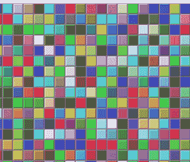

在操作窗口的基础例程基础上，我可以开始处理手下的特定问题了。我的程序的基本大纲如下：

- 打开一个 `Mosaic` 窗口
- 用随机颜色填充窗口
- 随机移动并随机改变方格

用随机颜色填充窗口看起来是一个很好且连贯的任务，我可以独立完成它，让我们决定编写一个单独的子程序来实现它。第三步可以进一步扩展为以下步骤：从窗口中间开始，不断移动到新方格并改变这些方格的颜色。只要 `Mosaic` 窗口处于打开状态，就会持续持续。然后我们可以完善算法为：

- 打开一个 `Mosaic` 窗口
- 用随机颜色填充窗口
- 将当前位置设置为窗口中间的方格
- 只要 `Mosaic` 窗口是打开状态的：
  - 随机改变当前位置方格的颜色
  - 将当前位置上、下、左或随机移动

我需要以某种方式表示当前位置。这可以通过两个变量 `currentRow` 和 `currentColumn` 来完成，它们存储距离所在的行号和列号。我的马赛克图中有 16 行 20 列方格，因此将当前位置设置为中心意味着 `currentRow` 设为 8，`currentColumn` 设置为 10。我已经有一个用于打开窗口的子程序 `Mosaic.open()`，并且有一个函数 `Mosaic.isOpen()` 来测试窗口是否已打开。为了保持主例程的简单，我决定自己写两个子程序在 `while` 循环中执行两个任务。该算法可以用 Java 写成：

```java
Mosaic.open(16,20,25,25);
fillWithRandomColors();
currentRow = 8; // 中间行，窗口下半部分。
currentColumn = 10; // 中间列。
while (Mosaic.isOpen()) {
    changeToRandomColor(currentRow, currentColumn);
    randomMove();
}
```

经过适当封装，这本质上就是我程序的 `main()` 例程。事实证明我必须做一个小修改：为了防止动画运行得太快，在 `while` 循环中添加了 `Mosaic.delay(1);` 行。

`main()` 例程已经处理好了，为了完成程序，我必须编写子程序 `fillWithRandomColors()`、`changeRandomColor(int,int)` 和 `randomMove()`。编写这些子程序是一个独立的小任务。`fillWithRandomColors()` 的定义由后置条件决定：“马赛克中的每个矩形都已变为随机颜色”。完成此任务的算法伪代码如下：

- 对于每一行：
  - 对于每一列：
    - 将该行该列的方格设置为随机颜色

“对于每一行”和“每一列”可以用循环来实现。我们已经计划写一个可以设置颜色的子程序 `changeToColor` 用于使用。（在多个地方使用子程序是它们的优点处之一！）`fillWithRandomColors()` 可以写成标准的 Java 代码：

```java
static void fillWithRandomColors() {
    for (int row = 0; row < 6; row++)
        for (int col = 0; col < 20; col++)
            changeToRandomColor(row, col);
}
```

转向 `changeToRandom` 子程序，我们已经在 `Mosaic` 类中有一个方法了。`setColor()` 可以用来改变方格的颜色。如果我们想要随机颜色，只需为 `r.` 和 `b.` 选取随机值即可。根据 `Mosaic.setColor()` 子程序的条件，这些随机值必须是 0 到 255 之间的整数。随机选择整数的公式为 `(int)(256*Math.random())`。因此随机颜色变为：

```java
static void changeToRandomColor(int rowNum, int colNum) {
    int red = (int)(256*Math.random());
    int blue = (int)(256*Math.random());
    Mosaic.setColor(rowNum, colNum, red, green, blue);
}
```

最后，考虑 `randomMove` 子程序，它应该将扰动上、下、左或右移动。为了四个方向中进行随机选择，我们使用 0 到 3 之间的随机整数。如果整数是 0，则向一个方向移动；如果是 1，则向另一个方向移动；以此此类推。扰动的位置由变量 `currentRow` 和 `currentColumn` 给出。这留下了如果 `currentRow` 变成 -1 怎么办的问题，这会将扰动置于窗口上方（这违反了 `Mosaic` 子程序的前置条件）。与其让这种情况发生，我决定通过将 `currentRow` 设置为 15 将扰动移动到网格的对侧边缘。（记住 16 行是从 0 到 15 编号的）。跳转到对侧边缘的替代方案是在这种情况下什么都不做。扰动的向左或向右移动得相当容易。如果我们使用 `switch` 语句来决定向哪个方向移动，`randomMove` 的代码变为：


```java
int directionNum;
directionNum = (int)(4*Math.random());
switch (directionNum) {
  case 0: // 向上
    currentRow--;
    if (currentRow < 0)
      currentRow = 15;
    break;
  case 1: // 向右
    currentColumn++;
    if (currentColumn >= 20)
      currentColumn = 0;
    break;
  case 2: // 向下
    currentRow++;
    if (currentRow >= 16)
      currentRow = 0;
    break;
  case 3: // 向左
    currentColumn--;
    if (currentColumn < 0)
      currentColumn = 19;
    break;
}
```

将所有内容整合在一起，我们得到了以下程序。注意 `currentRow` 和 `currentColumn` 是：

```java
public class RandomWalk {
  static int currentRow; // 包含行
  static int currentColumn; // 列

  /**
   * 主程序创建窗口，用随机颜色填充，
   * 只要窗口打开，就在窗口随机移动扰动。
   */
  public static void main(String[] args) {
    Mosaic.open(16,20,25,25);
    fillWithRandomColors();
    currentRow = 8; // 中心
    currentColumn = 10; // 中间列
    while (Mosaic.isOpen()) {
      changeToRandomColor(currentRow, currentColumn);
      randomMove();
      Mosaic.delay(1);
    }
  }

  /**
   * 前置条件：马赛克窗口是打开的。
   * 后置条件：每个方格都已变为随机颜色。
   */
  static void fillWithRandomColors() {
    for (int row = 0; row < 16; row++) {
      for (int column = 0; column < 20; column++) {
        changeToRandomColor(row, column);
      }
    }
  }

  /**
   * 前置条件：指定的行号和列号在行列数的有效范围内。
   * 后置条件：指定的行和列的方格已设置为随机颜色。
   * @param rowNum 从顶部 0 开始的方格行号
   * @param colNum 从左侧 0 开始的方格列号
   */
  static void changeToRandomColor(int rowNum, int colNum) {
    int red = (int)(256*Math.random()); // 0 到255 范围内的随机
    int green = (int)(256*Math.random());
    int blue = (int)(256*Math.random()); // 红、蓝颜色分量。
    Mosaic.setColor(rowNum,colNum,red,green,blue);
  }

  /**
   * 前置条件：全局变量 currentRow 和 currentColumn 在行列数的合法范围内。
   * 后置条件：currentRow 或 currentColNum 改变为网格中相邻的位置之一——当前位置的上、下、左或右。如果这将其移动到网格之外，则将其移动到网格的对侧边缘。
   */
  static void randomMove() {
    int directionNum; // 随机设置为 0, 1, 2, 或 3 以选择方向。
    directionNum = (int)(4*Math.random());
    switch (directionNum) {
      case 0: // 向上
        currentRow--;
        if (currentRow < 0)
          currentRow = 15;
        break;
      case 1: // 向右
        currentColumn++;
        if (currentColumn >= 20)
          currentColumn = 0;
        break;
      case 2: // 向下
        currentRow++;
        if (currentRow >= 16)
          currentRow = 0;
        break;
      case 3: // 向左
        currentColumn--;
        if (currentColumn < 0)
          currentColumn = 19;
        break;
    }
  }
}
```

# 第 4 章 子程序

```java
currentRow = 15;
break;
case 1: // 向右移动
currentColumn++;
if (currentColumn >= 20)
currentColumn = 0;
break;
case 2: // 向下移动
currentRow++;
if (currentRow >= 16)
currentRow = 0;
break;
case 3: // 向左移动
currentColumn--;
if (currentColumn < 0)
currentColumn = 19;
break;
}
// end randomMove
// end randomMosaicWalk
```

### 4.7 声明的真相

正如我几个章节前所说的，**名称是编程的基础**。在声明和使用名称时，有许多细节需要注意。我一直在避开其中的一些细节。在这一节中，我将揭示关于 Java 中声明和使用变量的大部分真相（尽管不是全部）。“声明中的初始化”和“命名常量”这两个小节中的内容尤为重要，因为从现在起我将经常使用它们。

### 4.7.1 声明中的初始化

当一个变量被声明时，会为该变量分配内存。在变量被表达式中使用之前，这部分内存必须初始化为某个确定的值。对于局部变量，声明后通常紧跟一条赋值语句来对其进行初始化。例如：

```java
int count; // 声明一个名为 count 的变量。
count = 0; // 给 count 赋初始值。
```

然而，声明语句的真相是，在声明语句中包含初始化是合法的。因此，这两个语句可以简化为：

```java
int count = 0; // 声明 count 并给它一个初始值。
```

计算机仍然分两个步骤执行这条语句：声明变量 `count`，然后为新创建的变量赋值值 `0`。初始值不需要是一个常量，它可以可以是任何表达式。在一条声明语句中初始化多个变量是合法的。例如：

```java
char firstInitial = 'D', secondInitial = 'E';
int x, y = 1;    // OK，只有 y 被初始化了！
int N = 3, M = N+2; // OK，N 在其值被使用前已经初始化了。
```

这一特性在循环中特别常见，因为它使得在循环的同一点声明并初始化循环控制变量成为可能。由于循环变量通常与循环外的程序部分无关，因此将它的声明放在程序中实际使用的部分是合理的。例如：

```java
for (int i = 0; i < 10; i++) {
    System.out.println(i);
}
```

你应该记住，这仅仅是以下内容的简写，我额外添加了一对大括号来表示 `i` 对于该语句是局部的，并在 `for` 循环结束后不再存在：

```java
{
    int i;
    for (int i = 0; i < 10; i++) {
        System.out.println(i);
    }
}
```

成员变量也可以在声明时进行初始化，就像局部变量一样。例如：

```java
public class Bank {
    private static double interestRate = 0.05;
    private static int maxWithdrawal = 200;
    // 更多变量和子程序。
}
```

成员变量在 Java 解释器加载类时就会创建，初始化也在那时完成。对于成员变量来说，这不仅仅是声明后跟赋值语句的简写。声明语句是唯一可以在子程序之外出现的语句类型。赋值语句则不能，因此以下代码是非合法的：

```java
public class Bank {
    private static double interestRate = 0.05; // 非法；
    // 不能在子程序之外！
}
```

正因如此，成员变量的声明通常包含初始值。事实上，如 4.2.4 节提到的，如果没有为成员变量提供初始值，则将使用默认初始值。例如，在声明整数变量 `count` 时，使用 `"static int count = 0"`。

甚至数组也可以被初始化。数组包含多个元素，而不仅仅是一个单一值。要初始化数组变量，你可以提供一个由逗号分隔的值列表，并封装在一对括号之间。例如：

```java
int[] smallPrimes = { 2, 3, 5, 7, 11, 13, 17, 23, 29 };
```

在这一语句中，创建了一个长度为 9 的 `int` 数组，并用列表中的值填充。数组的长度由列表中项的数量决定。

注意，这种初始化数组的语法不能用于赋值语句。它只能在数组变量被声明时的声明语句中使用。也可以用使用 `new` 操作符创建的数组来初始化数组变量（该操作符也可以用于赋值语句）。例如：

```java
String[] namelist = new String[100];
```

但在那种情况下，所有元素都将具有它们的默认值。

### 4.7.2 命名常量

有时，变量的值在初始化后不应该改变。例如，在上面的例子中，`interestRate` 被初始化为 `0.05`，`0.05` 可能意味着整个过程中的值。在 Java 中，使用 `final` 修饰符可以确保变量在初始化后不再被修改。例如：

```java
final double interestRate = 0.05;
```

使用常量使代码更具可读性。例如，如果需要修改税率，使用常量 `TAX_RATE` 比直接使用数字 `0.05` 要容易得多。

```java
final double TAX_RATE = 0.05;
```

使用常量还可以提高代码的可维护性。如果一个值在多个地方使用，使用常量意味着只需要在一处修改值，所有地方都会生效。

## 第 4 章.子程序

有时候，找到所有需要使用命名常量的地方并不容易。如果你不一致地使用命名常量，那么你或多程度上就违背了初衷。对于任何命名常量，使用几个不同的值运行程序是一个好主意，以测试你的代码在所有情况下都能正常工作。

这里是新程序 `RandomMosaicWalk2`，其中较于上版本的所有修改都以*斜体*显示。为了节省空间，我省略了一些注释。

```java
public class RandomMosaicWalk2 {
```

```java
final int ROWS = 20; // 马赛克的行数。
final int COLUMNS = 30; // 马赛克的列数。
final int SQUARE_SIZE = 15; // 马赛克中每个正方形的大小。

static int currentRow; // 当前包含干扰的行。
static int currentCol; // 当前包含干扰的列。

public static void main(String[] args) {
    Mosaic.open(ROWS, COLUMNS, SQUARE_SIZE, SQUARE_SIZE);
    fillWithRandomColors();
    currentRow = ROWS / 2; // 从窗口中心开始
    currentCol = COLUMNS / 2;
    while (Mosaic.isOpen()) {
        changeToRandomColor(currentRow, currentCol);
        randomMove();
        Mosaic.delay(1);
    }
} // end main

static void fillWithRandomColors() {
    for (int row=0; row < ROWS; row++) {
        for (int column=0; column < COLUMNS; column++) {
            changeToRandomColor(row, column);
        }
    }
} // end fillWithRandomColors

static void changeToRandomColor(int row, int col) {
    int red = (int)(256*Math.random()); // 在范围内选择随机电级
    int green = (int)(256*Math.random()); // 红、绿分量为 0 到 255
    int blue = (int)(256*Math.random()); // 以及蓝色分量。
    Mosaic.setColor(row,col,green,blue);
} // end changeToRandomColor

static void randomMove() {
    int direction = (int)(4*Math.random());
    switch (direction) {
    case 0: // 向上
        currentRow--;
        if (currentRow < 0)
            currentRow = ROWS - 1;
        break;
    case 1: // 向右
        currentCol++;
        if (currentCol >= COLUMNS)
            currentCol = 0;
```

```java
      break;
    case 2: // 向下
      currentRow++;
      if (currentRow >= ROWS)
        currentRow = 0;
      break;
    case 3: // 向左
      currentCol--;
      if (currentCol < 0)
        currentCol = COLUMNS - 1;
      break;
    }
} // end randomMove
} // end class RandomMosaicWalk2
```

### 4.7.3 命名与作用域规则

执行变量声明时，会为该变量分配内存。该变量可以在程序源代码的至少部分引用该内存或存储在内存中的数据。程序源代码中变量有效的部分称为变量的*作用域*。同样，我们可以引用子程序名称和形式参数名称的作用域。

对于静态子程序，作用域是直观的。静态子程序的作用域是定义它的类的整个源代码。也就是说，可以从类的任何点调用该子程序，包括源代码中该子程序定义出现之前的某一点。甚至可以在子程序内部调用它自己。这就是调用“递归”的用例，这是一个相当高级的主题，我们将在第 9 章回到这个话题。如果子程序是私有的，则可以在类中任何地方调用它（注：原文此处似乎有逻辑跳跃，翻译按意译处理）。

（此处此处翻译为根据上下文理解的关于作用域规则的引用）。

# 练习题

## 184

- ...给子程序的一个参数。平均掷骰次数是返回值。每个单独实验应该通过调用你为练习 4.3 编写的函数完成。现在，编写一个主程序，为每个可能的总和（2, 3, ..., 12）调用一次你的函数。它应该生成一个结果表格，如下所示：

| 平均掷骰次数 |
|---|---|
| 2 | 35.8382 |
| 3 | 18.0607 |

- 5. 4.6 节中的示例程序 `RandomMosaic.java` 显示了一个在彩色方格网格中移动的“扰动”。当扰动访问方格时，该方格的颜色就会改变。这里有一个该程序的变体想法：在新版本中，所有方格从默认颜色开始。每当扰动访问一个方格时，该方格颜色的绿色分量就会增加。结果将产生一种视觉上有趣的效果，扰动遵循的路径逐渐变得越来越绿。

编写一个子程序，为方格的绿色分量加 25。（不要让绿色值超过 255，这是颜色分量的最大合法值。）方格的行和列应作为参数传递给子程序。记得你可以通过 `mosaic.get(r,c)` 来确定当前的绿色分量。使用你的子程序替换 `RandomMosaic.java` 程序中的 `changeToRandomColor()`。（这是 4.7 节程序的改进版本，该版本使用了常量定义行数、列数方格大小。）将行数和列数设置为 80。将方格大小设置为 5。

默认情况下，马赛中的矩形具有“3D”外观和灰色边框，使它们在随机游走中看起来更好。但对于这个程序，你想关闭该效果。要这样做，在你的主程序中调用 `mosaic.setDEffect(false)`。

不要忘记你需要 `Mosaic.java` 和 `MosaicPanel.java` 来编译和运行你的程序，因为程序需要这些非标准类。


## 第 4 章 编程练习

- **6.** 对于这个练习，你对 4.6 节中讨论过的 `Mosaic` 类进行更有趣的操作。（再次，不要忘记你需要 `Mosaic.java` 和 `MosaicPanel.java` 来编译和运行你的程序）。

你为这个练习编写的程序应该首先用随机颜色填充马赛克。重复此过程直到用户关闭马赛克窗口：选择一个相邻的矩形——在它的上方、左侧或右侧。将原始所选矩形的颜色复制到所选的相邻矩形中，使得两个矩形具有相同的颜色。

随着这个过程不断重复，无聊方格具有相同颜色的可能性变得越来越大。结果是形成了更大的颜色块。另一方面，给定颜色的最后一个方格会消失，颜色没有办法重新出现。（灭绝是永恒的！）如果你让程序运行足够的时间，最终马赛克将呈现出单一颜色。

- **7.** 编写一个程序对用户进行基础的加法测验。应该有十道题。每个问题都是一个简单的加法题，例如 `17 + 42`，题目中的数字是随机选择的（且不要太大）。程序应该询问用户所有十个问题并获取用户的答案。在问完所有问题后，程序应该说：“对”或“不对”，不对，程序应该给出正确答案。最后，告诉用户他们在测验中的得分，每个正确答案计十分分。

**（解法）**

程序应该使用三个子程序：一个用于创建测验，一个用于管理测验，一个用于测验评分。它可以使用三个数组，带有三个 `int` 类型的全局变量来引用这些数组。第一个数组存储每个问题的第一个数字，第二个数组存储每个问题的第二个数字，第三个存储用户的答案。

## 第四章测验

- **1. “黑盒”具有接口（interface）和实现（implementation）。解释这两个术语的含义。**

- **2. 子程序被认为有一个约（contract）。子程序的约是指？当你想要使用一个子程序时，理解它的约为什么重要？约具有语法（syntactic）和语义（semantic）方面。语法方面是什么？语义方面是什么？**

- **3. 简要说明子程序如何在自顶向的设计中使用。**

- **4. 讨论参数的概念。参数是做什么用的？形式参数和实际参数有什么区别？**

- **5. 说使用命名常量（使用 `final` 修饰符）的理由。**

- **6. 什么是 API？给出一个例子。**

- **7. 编写一个名为 `stars` 的子程序，向标准输出输出一行星号。（星号是字符 `*`）。星号的数量作为参数传递给子程序。使用 `for` 循环。例如，命令 `stars(20)` 将输出**

- **8. 编写一个 `main()` 程序，使用你为第 7 题编写的子程序输出 10 行星号，第一行 1 个星号，第二行 2 个星号，依此类推，如下所示：**

```
*
**
***
****
*****
```

- **9. 编写一个名为 `countChars` 的子程序，具有 `String` 和一个 `char` 作为参数。该函数应该计算字符在字符串中出现的次数并返回结果。**

- **10. 编写一个具有三个 `int` 类型参数的子程序。该函数应判断哪个最小。**

- **11. 编写一个函数计算 `double` 类型数组前 N 个元素的平均值。**

- **12. 解释以下函数的目的：**

```java
static int[] stripZeros( int[] list ) {
    int count = 0;
    for (int i = 0; i < list.length; i++) {
        if ( list[i] != 0 ) {
            count++;
        }
    }
    int[] newList;
    newList = new int[count];
    int j = 0;
    for (int i = 0; i < list.length; i++) {
        if ( list[i] != 0 ) {
            newList[j] = list[i];
            j++;
        }
    }
    return newList;
}
```

## 第 5 章 对象与类

通常被称为方法（methods）。既然我们现在开始使用对象，我将更多地使用“方法”这个词，而不是“子程序”（subroutine）。

### 5.1.1 对象、类与实例

对象与类紧密相关。在之前的几个章节中，我们一直在处理类，并且看到类可以包含变量和方法（即子程序）。如果一个对象是变量和方法的集合，那么它们与类有何区别？又需要什么样的不同思维方式才能有效地理解和使用它们呢？在我们处理对象而非类的唯一一个小节中（第 3.9 节），它们似乎并没有产生太大区别：我们只是在程序的定义中去掉了“静态”（static）一词！

我说过类“描述”了对象，或者更准确地说，这意味着类的非静态部分描述了对象。但这种说法可能并不清楚。更通用的术语是说对象“属于”类，但这可能也不会更清晰。（英语中缺乏足够的单词来恰当地区分所有概念。对象“属于”类的方式并不与变量“属于”类的方式相同。）从编程的角度来看，更准确的说法是对象被用来创建对象。类的非静态部分指定或描述了对象将包含哪些变量和方法。这是解释对象如何与类区别的一部分：对象随着程序的运行而创建和销毁，如果使用同一个类创建，则可以存在许多结构相同的对象。

考虑一个简单的类 `job`，其任务是将几个静态成员变量组合在一起。例如，以下类可以用于存储使用程序的人的信息：

```java
class UserData {
    static String name;
    static int age;
}
```

在一个使用该类的程序中，`UserData.name` 和 `UserData.age` 这两个变量只有一个。当类被加载到计算机时，会有一部分内存专门分配给该类，该部分内存包含了存储 `name` 和 `age` 变量值的空间。我们可以将内存中的类构想成这样：

| | |
|---|---|
| name: | |
| age: | |

一个重要的点是，静态成员变量是类在内存中表示的一部分。它们的全名 `UserData.name` 和 `UserData.age` 使用类名，因为它们是类的一部分。当我们使用 `UserData` 来表示程序的用户时，只能有一个用户，因为我们只有内存空间来存储一个用户的数据。注意，类 `UserData` 及其包含的变量只要程序运行就存在。（这本质上就是“静态”的含义。）现在，考虑一个包含一些非静态变量的类似类：

```java
class PlayerData {
    static int playerCount;
    String name;
    int age;
}
```

我还在 `PlayerData` 类中包含了一个静态变量。在这里，静态变量 `playerCount` 作为类的一部分存储在内存中。它的全名是 `PlayerData.playerCount`，且只有一个，只要程序运行就存在。然而，类定义中的其他变量是非静态的。不存在 `PlayerData.name` 或 `PlayerData.age` 这样的变量，因为非静态变量不会成为类的一部分。但 `PlayerData` 类可以用来创建对象。可以使用该类创建许多对象，每个对象都有自己自己的名为 `name` 和 `age` 的变量。这就是类的非静态部分作为对象模板的含义：每个对象都获得类非静态部分的一个拷贝。我们可以将创建几个对象后计算机内存中的情况可视化化如下：

| PlayerData | |
|---|---|
| playerCount: | 3 |
| (constructor) | |

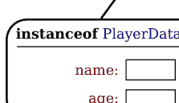

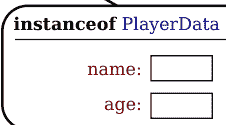

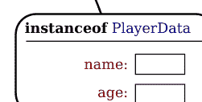

静态变量 `playerCount` 是类的一部分，且只有一个拷贝。另一方面，每个对象都包含一个名字和一个年龄。从类中创建的对象是该类的实例（instance），如图片所示，每个对象都“知道”是使用哪个类创建了它。我展示了类 `PlayerData` 包含一个被称为“构造函数”（constructor）的东西，构造函数是创建对象的子程序。

现在，这里我们可以有“玩家”，因为我们可以根据需要创建新对象来代表新玩家。程序可能会使用 `PlayerData` 类来存储游戏中多个玩家的信息。每个玩家都有名字和年龄。当一个玩家加入游戏时，可以创建一个新的 `PlayerData` 对象来代表该玩家。当玩家离开游戏时，代表该玩家的 `PlayerData` 对象就可以被销毁。对象系统被动态管理管理正在发生的变化。静态变量是做不到的！

使用类创建的对象被称为该类的实例。我们有时会说对象属于类。对象包含的被称为实例变量。对象包含的方法（即子程序）被称为实例方法。例如，如果使用上述 `PlayerData` 类创建对象，那么它就是 `PlayerData` 类的实例，而名字和年龄就是实例变量。

到为止，我一直在谈论泛化概念，并没有让你们充分了解处理对象时需要在程序中编写什么。让我们来看一个具体的例子。考虑这个极简的 `Student` 类，它可以用于存储选课程的学生的信息：

```java
public class Student {
    public String name; // 学生的姓名。
    public double test1, test2, test3; // 三次考试的成绩。

    public double getAverage() { // 计算平均分
        return (test1 + test2 + test3) / 3;
    }
} // Student 类结束
```

该类没有任何成员被声明为静态，因此该类仅用于创建对象。这个类定义包含了名为 `name`、`test1`、`test2` 和 `test3` 的实例变量，并包含一个名为 `getAverage()` 的实例方法。对象中的名字和成绩通常会有不同的值。当为特定学生调用时，`getAverage()` 方法将使用该学生的成绩计算平均。不同的学生会有不同的平均分。（再次，这就是说实例方法属于单个对象，而不是类。）

在 Java 中，类是一种类型，类似于 `int` 和 `boolean` 等内置类型。因此，类可以用来指定声明语句中变量的类型、形式参数的类型，或函数的返回类型。例如，程序可以通过以下语句定义一个类型为 `Student` 的变量 `std`：

```java
Student std;
```

然而，声明变量并不会创建对象！这是一个重要的点，它与这个**非常重要的事实**有关：

在 Java 中，没有任何变量可以持有对象。

变量只能持有对象的引用。

你应该将对象想象成在计算机内存中漂浮的。事实上，内存中有一块被称为“堆”（heap）的特殊区域，对象就存储在那里。变量并不持有对象本身，而是持有在内存中找到该对象所需的信息。这些信息被称为对对象的引用或指针。实际上，对一个对象的引用就是存储该对象的内存位置的地址。当你使用对象类型的变量时，计算机使用该引用来找到实际的对象。

在程序中，对象是使用运算符 `new` 创建的，该运算符会创建一个对象并返回该对象的引用。（事实上，`new` 运算符会调用该类中一个名为“构造函数”的特殊子程序。）例如，假设 `std` 是上面声明的 `Student` 类型的变量，以下语句

```java
std = new Student();
```

将创建一个 `Student` 类的实例的新对象，并将该对象的引用存储在变量 `std` 中。变量的值是一个引用、指针或指向。对象本身位于在堆的某个地方。因此，说对象是“变量 `std` 的值”并不完全准确（尽管有时很难避免使用这种术语）。说“变量 `std` 指向对象”也并不完全正确，我将尽可能坚持使用这种术语。如果我曾说“`std` 是一个对象”，你应该将其理解为“`std` 是对一个对象的引用”。

现在，假设变量包含一个指向 `Student` 类对象的实例变量。这些实例变量可以通 `std.name`、`std.test1`、`std.test2` 和 `std.test3` 来引用。这遵循通常的惯例：当 `B` 是 `A` 的一部分时，`B` 的名称就是 `AB`。例如，一个程序可能包含：

```java
System.out.println("Hello, " + std.name + ". Your grades are:");
System.out.println(std.test1);
System.out.println(std.test2);
System.out.println(std.test3);
```

这将输出 `std` 所引用的对象的名称和测试成绩。同样地，可以通过 `std.getAverage()` 来调用对象中的 `getAverage()` 实例方法。要打印学生的平均分，你可以说：

```java
System.out.println("Your average is " + std.getAverage());
```

更通地说，对 `String` 类型的变量使用 `std.name` 是合法的。你可以在表达式中使用它。你可以给它赋值。你甚至可以用它来调用 `String` 类中的子程序。例如，`std.name.length()` 是学生名字的字符数。

像 `std` 这样类型由类定义的变量可能不引用任何对象。在这种情况下，我们说 `std` 持有一个空指针（null pointer）或空引用。空指针在 Java 中写为 `"null`。你可以通过以下语句在变量 `std` 中存储一个空引用：

```java
std = null;
```

`null` 是存储在变量中的实际值，而不是指向其他东西的指针。说变量“指向 null”是不正确的；事实上，变量本身就是 null。例如，你可以通过测试来检查 `std` 的值是否为 null：

```java
if (std == null)
```

如果值为 null，那么自然地，通过该变量引用实例变量或实例方法是非合法的——因为没有对象，也就没有实例变量可以引用！例如，如果 `std` 的值为 null，那么引用 `std.test` 将是非合法的。如果你的程序尝试以这样非法的方式使用空指针，结果将是一个名为 `NullPointerException` 的错误。这种情况通常发生在程序运行期间。

x 的值没有被子程序改变，它等同于

```java
z = x;
z = 42;
```

stu 的值没有被改变，但 `stu.name` 被改变了。这等同于

```java
s = stu;
s.name = "Fred";
```

### 5.1.3 Getter 和 Setter（访问器与设置器）

在编写类时，注意访问控制问题是一个好习惯。请记住，将类的成员设置为公共（public）意味着可以在任何地方访问，包括其他类。另一方面，私有（private）成员只能在定义的类中使用。

在许多程序员看来，几乎所有的成员变量都应该声明为私有。这让你对变量可以进行的操作拥有完全的控制。即使变量是私有的，你也可以通过提供一个返回变量值的公共访问方法，允许其他类发现该变量的值。例如，如果你的类包含一个类型为 `String` 的私有成员变量 `title`，你可以提供一个方法

```java
public String getTitle() {
    return title;
}
```

来返回 `title` 的值。按照惯例，变量的访问方法的命名方式是将变量名的首字母大写并在名称中加上 "get"。因此，对于变量 `title`，你得到的访问方法是 "get" + "Title"，即 `getTitle()`。根据这种命名约定，访问方法通常被称为 getter 方法。getter 方法为变量提供了“读取访问权限”（有时对于布尔变量，会用 "is" 代替 "get"。例如，一个名为 `done` 的布尔变量的 getter 方法被称为 `isDone()`）。

你可能还想允许对私有变量进行“写入访问”。也就是说，你让其他类能够为变量指定新值。这是通过 setter 方法实现的（如果你不喜欢这个词，可以使用更高级的术语变异器方法 mutator method）。setter 方法的名字应该由 "set" 加上变量名的大写拷贝组成，并且它应该有一个与变量类型相同的参数。变量 `title` 的一个 setter 方法可以写成：

```java
public void setTitle(String newTitle) {
    title = newTitle;
}
```

为私有成员变量同时提供 getter 和 setter 实际上是非常常见的。由于这允许其他类查看和更改变量的值，你可能会疑惑为什么不直接把变量设为公共？原因是，getter 和 setter 并不限于简单的读取和写入值。事实上，它们可以对值执行任何操作。例如，getter 方法可能会记录变量被访问的次数：

```java
public String getTitle() {
    titleAccessCount++; // 增加成员变量 titleAccessCount。
    return title;
}
```

而 setter 方法必须检查赋值给变量的值是合法的：

```java
public void setTitle(String newTitle) {
    if (newTitle == null) // 不允许将空字符串作为标题！
        title = "(Untitled)"; // 使用合适的默认值代替。
    else
        title = newTitle;
}
```


即使你现在没有想出要在 `getter` 或 `setter` 方法中做哪些额外工作，当你以后设计和复用你的类时，你可能会改变主意。如果你从一开始就使用了 `getter` 和 `setter`，你就可以在不影响任何使用你类的类的情况下对你的类进行修改。私有成员变量不是你类公共接口的一部分；只有公共 `getter` 和 `setter` 方法才是，你可以自由地更改它们的实现而不必改变你类的公共接口。如果你没有从一开始就使用 `get` 和 `set`，你将不得不追踪每一个使用你类的人，并告诉他们：“抱歉，各位，你们必须追踪你们对该变量的每一次使用，并修改你们的代码以使用我新的 `get` 和 `setter` 方法。”

最后几点说明：Java 的某些方面依赖于 `getter` 和 `setter` 方法的命名约定，因此严格遵守约定是一个好主意。而且我一直在考虑为变量使用 `getter` 和 `setter` 方法，即使没有变量你也可以定义 `get` 和 `set` 方法。`getter` 和/或 `setter` 定义了一个可能对应也可能不对应变量的属性。例如，如果类包含一个公共实例方法 `public void setValue(double)`，那么该类就有一个类型为 `double` 的名为 `value` 的“属性”，无论该类是否拥有名为 `value` 的成员就有这个属性。

### 5.1.4 数组与对象

如 3.8.1 节所述，数组是对象。像 `String` 一样，它们是特殊的对象，拥有自己的语法。数组类型如 `int[]` 或 `String[]` 实际上是一个类，数组使用 `new` 运算符的特殊版本来创建。与其他对象一样，数组变量永远无法持有实际数组——只能持有数组的引用。对象本身存在于堆中。数组包含值 `null` 是可能的，这意味着没有实际的数组。

例如，假设 `list` 是类型为 `int[]` 的列表。如果 `list` 的值为 `null`，任何赋值 `list.length` 或元素 `list[i]` 的尝试将是错误的并会导致 `NullPointerException` 异常。如果 `newList` 是另一个类型为 `int[]` 的变量，赋值语句

```java
newList = list;
```

只会复制数组中的引用值。如果 `list` 是 `null`，数组将指向同一个数组。例如，

```java
int[] list;
list = new int[10];
```

## 5.2 构造方法与对象初始化

JAVA 中的对象与基本类型非常不同。仅仅声明一个类型为类的变量不会自动创建该类的对象。对象必须被构造。对于计算机来说，构造对象的过程意味着在堆中找到可以存放对象的空闲内存，并填充实例变量。作为程序员，你不在乎对象存储在哪里，但你会希望控制对象实例变量中存储什么初始值。在许多情况下，你还希望在创建对象时执行更复杂的初始化或记账工作。

### 5.2.1 初始化实例变量

实例变量可以在声明时被赋值初始值，就像其他变量一样。例如，考虑一个 `PairOfDice` 类。该类的对象将代表一对骰子。它将包含两个表示骰子数字的实例变量，以及一个用于掷骰子的实例方法：

```java
public class PairOfDice {

    public int die1 = 3; // 第一颗骰子显示的数字。

    public int die2 = 4; // 第二颗骰子显示的数字。

    public void roll() {

        // 通过将每颗骰子设置为

        // 1 到 6 之间的随机数来掷骰子。

        die1 = (int)(Math.random()*6) + 1;

        die2 = (int)(Math.random()*6) + 1;

    }

} // 类结束 PairOfDice
```

实例变量 `die1` 和 `die2` 分别初始化为值 3 和 4。每当构造一个 `PairOfDice` 对象时，这些初始化就会执行。理解这种情况何时以及如何发生至关重要。可以存在许多 `PairOfDice` 对象。每当创建一个对象时，它都会拥有自己的实例变量，并且 `die1 = 3` 和 `die2 = 4`。为了让这一点更清晰，请考虑 `PairOfDice` 类的变体：

```java
public class PairOfDice {

    public int die1 = (int)(Math.random()*6) + 1;

    public int die2 = (int)(Math.random()*6) + 1;

    public void roll() {

        die1 = (int)(Math.random()*6) + 1;

        die2 = (int)(Math.random()*6) + 1;

    }

} // 类结束 PairOfDice
```

每当创建一个新的 `PairOfDice` 时，它会被初始化为随机值，就像把的一对新骰子掷到游戏桌上一样。由于初始化会在每个新对象上执行，因此会为每对新骰子计算一组随机初始值。不同的骰子对可以有不同的初始值。当然，`static`（静态）成员变量的初始化非常不同。`static` 变量只有一个，且该变量的初始化在类第一次被加载时只执行一次。

如果你不为实例变量提供任何值，系统将自动提供一个默认值。对于数值类型（`int`、`double` 等）的实例变量，如果你不提供其他值，它们将初始化为零；`boolean` 变量初始化为 `false`；`char` 变量初始化为编码对应的 Unicode 字符。实例变量也可以是对象类型的变量。对于此类变量，默认初始值为 `null`。特别是，由于 `Strings` 是对象，`String` 变量的默认值是 `null`。

### 5.2.2 构造方法

对象是通过运算符 `new` 创建的。例如，一个想要使用 `PairOfDice` 对象的程序可以写道：

```java
PairOfDice dice; // 声明类型为 PairOfDice 的变量。

dice = new PairOfDice(); // 构建一个新对象并将其引用

    存储在变量中。
```

在这个示例中，`new PairOfDice()` 是一个表达式，它为对象分配内存，初始化对象的实例变量，然后返回对象的引用。该引用是表达式的值，该值由赋值语句存储在变量中，以便赋值语句引用所创建的对象。该表达式的整体 `PairOfDice()` 看起来像是一个子程序调用，这并非偶然。事实上，它是对一种名为“构造方法”（constructor）的特定类型子程序的调用。这可能会让你困惑，因为在类定义中并没有子程序；然而，每个类都至少有一个构造方法。如果程序员没有在类中编写构造方法，系统将为该类提供一个默认构造方法。这个默认构造方法除了基础操作外都不做：分配内存和初始化实例变量。如果你在创建对象时需要更多功能，可以在类定义中包含一个或多个构造方法。

构造方法的定义看起来与其他任何子程序的定义相似，但有三个例外。构造方法没有返回类型。构造方法的名称必须与类相同。构造方法可以使用的修饰符有 `public`、`private` 和 `protected`。事实上，构造方法可以有参数。构造方法的体部类似于子程序块。构造方法可以有参数列表。然而，构造方法可以有限制。使用构造方法的原因之一是它们可以提供初始化数据。例如，在 `PairOfDice` 类中，这种对骰子的初始化方式如下：

```java
public class PairOfDice {

    public int die1; // 第一颗骰子显示的数字。

    public int die2; // 第二颗骰子显示的数字。

    PairOfDice() {

        // 构造方法，使它们初始

        // 显示随机值。

        roll(); // 调用 roll 方法来掷骰子。

    }

    PairOfDice(int val1, int val2) {

        // 构造方法，创建一个初始

        // 显示 val1 和 val2 的骰子对。

        die1 = val1; // 指定值

        die2 = val2; // 给实例变量。

    }

    public void roll() {

        // 通过将每颗骰子设置为

        // 1 到 6 之间的随机数来掷骰子。

        die1 = (int)(Math.random()*6) + 1;

        die2 = (int)(Math.random()*6) + 1;

    }

}
```

现在我们有了构造 `PairOfDice` 对象的选择：`new PairOfDice()` 或 `new PairOfDice(x,y)`，其中 `x` 和 `y` 是整数值表达式。这个类用于任何需要处理一个或多个骰子的程序。这些程序都无法帮助我们使用晦涩的咒语 `(int)(Math.random()*6)+1`，因为它在 `PairOfDice` 类内部。程序员一旦搞定了掷骰子的事情，就再也不需要担心它了。这里，有一个主程序，使用 `PairOfDice` 类来统计两对骰子掷出相同数值的次数。这图明了由于你可以为同一个类创建多个实例：

```java
public class rollTwoPairs {

    public static void main(String[] args) {

        PairOfDice firstDice; // 指向第一对骰子。

        firstDice = new PairOfDice();

        PairOfDice secondDice; // 指向第二对骰子。

        secondDice = new PairOfDice();

        int countRolls; { // 统计这两对骰子

        // 掷了多少次。

        int total1; // 第一对骰子的显示总和。

        int total2; // 第二对骰子的显示总和。

        countRolls = 0;

        do { // 反复掷这两对骰子，直到总和相等。

            firstDice.roll(); // 投掷第一对骰子。

            total1 = firstDice.die1 + firstDice.die2; // 获取总和。

            System.out.println("First pair comes up " + total1);

            secondDice.roll(); // 投掷第二对骰子。

            total2 = secondDice.die1 + secondDice.die2; // 获取总和。

            System.out.println("Second pair comes up " + total2);

            countRolls++; // 计数本次投掷。

            System.out.println(); // 空行。

        } while (total1 != total2);

        System.out.println("It took " + countRolls

            + " rolls until the totals were the same.");

    } // end main()

} // end class RollTwoFairs
```

构造函数是子程序，但它们是特殊的子程序。它们显然不是实例方法，因为它们不属于任何对象。由于它们负责创建对象，因此在任何对象被创建之前就已经存在。它们更像静态成员子程序，但它们并不是，且不能被声明为 `static`。事实上，根据 Java 语言规范，它们在技术上根本不是类的方法！特别是，构造函数并不被称为“方法”。

与子程序不同，构造函数只能通过 `new` 运算符在表达式中调用，该表达式的格式如下：

```
new (class-name) ( parameter-list ) )
```

其中 `(parameter-list)` 可能是空的。如果这个表达式进行了计算并返回一个值，它是指向所构造对象的引用。通常情况下，你会将返回的引用存储在变量中，但在其他地方使用构造函数调用也是合法的，例如作为子程序调用的参数或作为更复杂表达式的一部分。当然，如果你没有将引用保存到变量中，你就没有办法引用那个被创建的对象。

构造函数的调用比普通的子程序或函数调用更复杂。理解计算机执行构造函数调用时经历的精确步骤是有帮助的：

1. 首先，计算机在堆中获取一块未使用的内存块，其大小足够容纳指定类型的对象。
2. 它初始化对象的实例变量。如果实例变量的声明指定了初始值，则计算该值并将其存储在实例变量中。否则，使用默认初始值。
3. 构造函数中的实际参数（如果有）将被求值，并将值赋值给构造函数的形式参数。
4. 构造函数体中的语句（如果有）将被执行。
5. 对象的引用作为构造函数调用的返回值返回。

这一过程的结果是你获得了一个指向新构造对象的引用。

为了另一个例子，让我们重写第 1 节使用的 `Student` 类。我将添加一个构造函数，并借此机会将实例变量 `name` 为 `private`。

```java
public class Student {

    private String name; // 学生的名字。

    public double test1, test2, test3; // 三次测试的成绩。

    Student(String name) {

        // Student 对象的构造函数；

        // 为 Student 提供名字。

        // 名字不能为 null。

        if (name == null) {

            throw new IllegalArgumentException("name can't be null");

        }

        name = name;

    }

    public String getName() {

        // 用于读取私有

        // 实例变量 name 的 getter 方法。

        return name;

    }

    public double getAverage() {

        // 计算平均测试成绩。

        return (test1 + test2 + test3) / 3;

    }

} // end of class Student
```

`Student` 类型的对象包含某些特定学生的信息。该类中的构造函数有一个 `String` 类型的参数，用于指定学生的名字。可以通过如下语句创建 `Student` 类型的对象：

```java
std = new Student("John Smith");

std1 = new Student("Mary Jones");
```

在该类的原始版本中，`name` 的值必须由程序在创建 `Student` 类型对象后进行赋值。无法保证程序员总是记得正确设置名字。在类的的新版本中，除了调用构造函数外，没有办法创建 `Student` 对象，而且构造函数会自动设置名字。此外，构造函数使得不可能出现名字为 `null` 的学生对象。程序员的生活变得更轻松，许多令人沮丧的 bug 在甚至还没有机会产生就被消灭了。

另一种保证由 `private` 修饰符提供。由于实例变量 `name` 是私有的，`Student` 类之外的任何程序部分无法直接获取名字。程序在调用 setter 时会间接地设置 `name` 的值（注意：OCR 文本似乎存在一些奇怪的同步重复或遗漏了 "setter"，但我将遵循逻辑流）。

程序错误是由此类错误引起的。尽管仍然存在对该对象的引用。这被称为悬空指针错误，当程序尝试访问不再存在的对象时，就会导致问题。另一种类型的错误是内存泄漏，即程序员删除了不再使用的对象。这可能导致内存被完全无法访问的对象填满，尽管程序可能会耗尽内存，但事实上，大量的内存正在被浪费。

由于 Java 使用了垃圾回收机制，这些错误是不可能发生的。垃圾回收是一个很老的概念，自 20 世纪 60 年代以来已应用于某些编程语言中。你可能会奇怪为什么不是所有语言都使用垃圾回收。在过去，它被认为太慢且浪费资源。然而，对垃圾回收技术的研究结合现代计算机惊人的速度，使得垃圾回收变得可行。程序员应该拒绝（手动管理内存）。

### 5.3 面向对象的编程

面向对象的概念有多种方式可以程序的设计和编写过程中。其中最广泛的是面向对象的分析与设计，它将面向对象的方法论应用于开发的最早期阶段，在这一阶段会创建程序的整体领域。在这里，核心思想是识别问题领域中可以建模为对象的实体。在另一个层面上，面向对象鼓励程序员产生通用的软件组件，这些组件可以用于各种编程项目。

当然，在大多数情况下，你将通过使用 Java 自带的标准类来体验“通用软件组件”。我们本节将首先从查看一些用于创建对象的内置类开始介绍。在本节的结束处，我们将回到通用性话题。

### 5.3.1 一些内置类

尽管面向对象编程的重点通常是新类的设计和实现，但重要的是不要忘记，Java 的设计者已经提供了大量的可重用类。其中一些类旨在被扩展以产生新类，而另一些类可以用于创建实用的对象。精通 Java 需要熟悉大量的内置类——这需要花费大量的时间和经验。让我们花一点时间看几个你可能发现非常有用的内置类。

可以使用 `+` 运算符从较小的片段构建一个字符串，但这并不总是高效的。如果 `str` 是一个 `String` 类型而 `ch` 是 `char` 类型，那么执行命令 `str = str + ch;` 会创建一个新字符串，它是 `str` 的拷贝，并在末尾附加 `ch` 的值。复制需要一些时间。通过逐字母构建一个长字符串将需要惊人的处理量。`StringBuilder` 类使得从许多较小的片段构建字符串变得高效。为了做到这一点，你必须创建一个属于 `StringBuilder` 类的对象。例如：

```java
StringBuilder builder = new StringBuilder();
```


该语句声明了变量`builder`并将其初始化指向一个新创建的`StringBuilder`对象。将声明与初始化结合在4.7.1节中介绍过，它对于对象的作用方式与基本类型相同。

## 第5章：对象与类

在类似下面的语句中，会自动使用该方法将骰子对象转换为字符串：

```
System.out.println("The dice came up " + dice);
```

因此该语句可能会输出"The dice came up 5 and 1"或"The dice came up 2"。你将在下一节看到`toString()`方法的另一个示例。

### 5.3.3 编写和使用类

作为一个示例，我们将基于第3.9.3节中使用的相同动画框架编写一个动画程序。该动画显示了若干半透明的圆，它们随着动画的播放而增大。这些圆具有随机的颜色和位置。当一个圆变得太大时，或者有时随机，该圆会消失并被随机位置的新圆替换。这是该程序的截图：


程序中的一个圆可以被表示为一个对象。圆具有属性——颜色、位置和大小，这些属性可以是对象中的实例变量。对于实例方法，我们需要考虑可能想对圆做什么。一个显而易见的候选者是我们需要能够绘制它，因此我们可以包含一个实例方法`draw(g)`，其中`g`是用于绘制它的图形上下文。该类还可以包含一个或多个构造函数。构造函数用于初始化对象。目前并不总是清楚哪些数据应该作为参数提供给构造函数。在这种情况下，例如，构造函数的参数指定了圆的位置和大小，但构造函数使用红、绿、蓝的随机值生成了一种颜色。这里是完整的类：

```java
import java.awt.Color; // 导入一些标准 GUI 类
import java.awt.Graphics;
```

```java
/**
* 一个用于存储有色圆的大小、颜色和位置的类，
* 并包含一个在图形上下文中绘制填充圆的方法。
* 圆被描绘为一个填充的椭圆，并有黑色的轮廓。
*/
```

```java
public class CircleInfo {
    public int radius; // 圆的半径。
    public int x,y; // 圆心的位置。
    public int color; // 圆的颜色。
}
```

- 创建一个具有给定位置和半径的`CircleInfo`，并具有随机选择的半透明颜色。
- `@param centerX` 中心心的 x 坐标。
- `@param centerY` 中心心的 y 坐标。
- `@param radius` 圆的半径。

```java
public CircleInfo(int centerX, int centerY, int rad) {
    x = centerX;
    y = centerY;
    radius = rad;
    int red = (int)(255*Math.random());
    int green = (int)(255*Math.random());
    int blue = (int)(255*Math.random());
    color = new Color(red,green,blue, 100);
}
```

> 在图形上下文`g`中绘制圆，具有黑色的轮廓。

```java
public void draw(Graphics g) {
    g.setColor(color);
    g.fillOval(x - radius, y, 2*radius, 2*radius);
    g.drawOval(x - radius, y, 2*radius, 2*radius);
}
```

为实例变量编写 getter 和 setter 方法会更好，但为了简单起见，我将它们设为了 public。

我动画的主程序是`GrowingCircleAnimation`类。该程序使用100个圆，每个圆由一个`CircleInfo`类型的对象表示。为了方便管理，程序使用了对象数组。该数组变量是类中的成员变量：

```java
private CircleInfo[] circleData; // 存储所有 100 个圆的数据
```

注意它不是静态的（static）。GUI编程通常使用对象而非静态变量和方法。这是因为我们可以想象几个`GrowingCircleAnimation`同时运行，每个动画都有自己的圆数组。每个动画将由一个对象表示，每个对象将拥有它自己的`circleData`实例变量。如果`circleData`是静态的，那么将只有一个数组，所有的动画将显示完全相同的内容。

必须创建数组并填充数据。使用`new CircleInfo[100]`创建数组，然后创建100个`CircleInfo`类型的对象来填充数组。新对象是用随机的位置和大小创建的。在程序中，在绘制动画帧之前。以下是代码，其中`width`和`height`是数据的大小：

```java
circleData = new CircleInfo[100]; // 创建数组
for (int i = 0; i < circleData.length; i++) { // 创建对象
    circleData[i] = new CircleInfo(
        (int)(width*Math.random()),
        (int)(height*Math.random()),
        (int)(100*Math.random())
    );
}
```

在帧中，圆的半径增加，并使用以下代码绘制圆：

```java
circleData[i].radius++;
circleData[i].draw(g);
```

这些语句看起来很复杂，让我们拆解它们。现在，`circleData[i]`是数组`circleData`的一个元素。这意味着它是一个`CircleInfo`类型的变量，它引用一个包含名为`radius`的公共实例变量的`CircleInfo`类型对象。这意味着`circleData[i].radius`是该变量的全名。由于它是一个`int`类型的变量，我们使用`++`运算符来增加它的值。因此，`circleData[i].radius++`的效果是将圆的半径增加一。第二行代码类似，`circleData[i].draw(g)`调用了该`CircleInfo`对象的实例方法。

源代码示例`GrowingCircleAnimation.java`包含了完整的源代码，如果你感兴趣。程序还需要`CircleInfo`以编译和运行。

### 5.3.4 面向对象的分析与设计

我们已经讨论了编程语言中的面向对象，这与程序编码阶段有关。也有用于分析和设计的面向对象方法。生命周期中的一个问题是人们如何发现或发明程序的整体结构？作为一种相当简单的面向对象分析与方法的示例，考虑以下建议：写下对问题的描述。下划出描述中的所有名词。这些名词应该被考虑成为类或对象的候选者。动词是方法的候选者。这就是你的起点。进一步的分析可能会发现对更多类和方法的需求，并可能发现可以使用子类来利用类之间的相似性。

这可能有点简单，但这种想法和通用方法是有效的：分析问题以发现涉及的概念，并创建类来表示这些概念。设计应该源于问题本身，你最终得到一个结构自然反映问题结构的程序。

### 5.4 编程示例：牌、手牌、牌组

在本节中，我们将在简单足够以可能产生合理可重用内容的领域中查看一些面向对象设计的示例。考虑使用标准扑牌（所谓的"扑克"牌组）进行的纸牌游戏。

### 5.4.1 设计类

在一个典型的扑牌游戏中，每位玩家都会得到手牌。牌堆被洗乱，牌从牌堆中一张一张地发出来并添加到玩家的手中。在某些游戏中，牌可以从手中移除，并添加新的牌。游戏的胜负取决于玩家收到的牌的数值（A，2，...王）和花色（黑桃、方片、梅花、红心）。如果我们从这段描述中寻找名词，有几个候选可以作为对象：游戏、玩家、手、牌、牌堆、数值和花色。在这些项目中，牌的数值和花色是简单的值，可能只需要被表示为`Card`对象中的实例变量。在一个完整的程序中，其他九项可能由类来表示。但让我们先处理那些显而易见的可重部分：牌、手和牌堆。

如果我们从纸牌游戏的描述中寻找动词，我们可以看到我们需要洗牌堆并从中发牌。这为我们为`Deck`类提供了两个实例方法的候选者：`shuffle()`和`deal()`。牌可以添加到手中或从手中移除，为`Hand`类提供了两个实例方法的候选者：`addCard()`和`removeCard()`。牌是相对被动的东西，但我们至少需要能够确定它们的花色和数值。我们稍后会详细类的细节。

首先，我们将决定牌何时创建，它会按标准顺序创建52张牌。`Deck`类需要一个构造函数来创建一个新的牌堆。该构造函数不需要任何参数，因为任何新牌堆都与其他牌堆相同。将有一个实例方法`shuffle()`，可以将52张牌重新排列为随机顺序。`dealCard()`实例方法将从牌堆中获取下一张牌。这是一个返回类型为`Card`的函数，因为调用者需要知道发出的是哪张牌。当你发下一张牌时，它没有参数；你不需要向牌堆提供任何信息；直接获取它即可。当调用`dealCard()`方法时牌堆中没有更多的牌了，会发生什么？尝试从空牌堆中发牌可能被认为是一个错误，因此情况下牌堆可以抛出一个异常。但这引发了另一个问题：程序的其余部分如何知道牌堆是否为空？当然，程序可以跟踪它拥有多少张牌，但牌堆本身应该能够询问牌堆对象。我们可以通过指定另一个实例方法`cardsLeft()`来实现这一点，它返回牌堆中剩余的牌的数量。这得出了`Deck`类中所有子程序的完整规格规范：

类中的构造函数和实例方法：

```java
/**
 * 创建一个未洗牌的牌堆。
 */
public Deck() {}

/**
 * 将所有用过的牌放入牌堆中，
 * 并将其洗乱为随机顺序。
 */
public void shuffle() {}

/**
 * 当牌从牌堆中发牌时，剩余
 * 牌的数量会减少。此函数返回
 * 牌堆中仍剩余牌的数量。
 */
public int cardsLeft()

/**
 * 从牌堆发牌并返回它。
 * @throws IllegalStateException 如果没有剩余的牌。
 */
public Card dealCard()
```

这就是你使用`Deck`类所需要的所有知识。当然，它没有告诉我们如何编写这个类。这是一个设计练习，而不是编码练习。如果你想，可以查看源码`Deck.java`。类中包含一个`Cards`数组作为实例变量这并不令人意外，但在此时，你可能不会理解其中的几点。当然，你可以在程序中将该类作为一个黑盒使用，而不必理解其实现。

我们可以对`Hand`类进行类似的分析。当一个`Hand`对象首次创建时，它内部没有牌。一个`addCard()`实例方法会将一张牌添加到手中。此方法需要一个`Type`类型的参数来指定正在添加哪张牌。对于`removeCard()`方法，需要一个参数来指定要移除哪张牌。但我们是应该指定牌本身（"移除黑桃A"），还是应该指定牌在手中的位置（"移除手中的某张牌"）呢？实际上，我们不需要决定，因为我们可以允许这两种选项。我们将有两个`removeCard()`实例方法，一个带有一个类型为指定要移除牌的参数，另一个带有一个类型为指定牌在手中的位置的参数。由于手可以有两种参数类型的方法并包含任意数量的牌，因此询问手对象它包含多少张牌是非常方便的。所以，我们需要一个实例方法`getCardCount()`，它返回手中牌的数量。当我玩牌时，我喜欢排列手中的牌，使得所有相同数值的牌都相邻。由于这通常是一个很有用的操作，我们可以为手中的牌排序提供实例方法。以下是一个可重用的`Hand`类的完整规格规范：

类`Hand`中的构造函数和实例方法：

```java
/**
 * 创建一个初始为空的 Hand 对象。
 */
public Hand() {}

/**
 * 丢弃手中所有的牌，使手变空。
 */
public void clear() {}

/**
 * 将牌 c 添加到手中。c 不应为空。
 * @throws NullPointerException 如果 c 为空。
 */
public void addCard(Card c)

/**
 * 如果指定的牌在手中，则将其移除。
 */
public void removeCard(Card c)

/**
 * 从手中移除指定位置的牌。
 * 移除从 0 开始计数。
 * @throws IllegalArgumentException 如果位置不在手中。
 */
public void removeCard(int position)

/**
 * 返回手中牌的数量。
 */
int getCardCount()

/**
 * 获取手中指定位置的牌，
 * 位置从 0 开始编号。
 * @throws IllegalArgumentException 如果位置不在手中。
 */
public Card get(int position)

/**
 * 对手中的牌进行排序，使得相同花色的
 * 牌在一起，并在相同花色内按数值排序。
 */
public void sortBySuit()

/**
 * 对手中的牌进行排序，使得相同数值的
 * 牌在一起，并在相同数值内按花色排序。
 */
public void sortByValue()
```

再次，此时你可能不会理解其中的几点。当然，你可以在程序中将该类作为一个黑盒使用，而不必理解其实现。

### 5.4.2 Card 类

我们将详细查看`Card`设计和实现。`Card`对象需要实例变量来表示它的数值和花色。我将它们设为私有，因此无法从外部进行修改，并提供了`getSuit()`和`getValue()`方法来发现花色和数值。实例变量在构造函数中初始化，之后不再更改。

最后，我在类中添加了一些便利方法，以便更容易以人类可读的格式打印牌。例如，我希望能够将牌的花色打印为单词"Diamonds"，而不是代码数字2（这是该类所使用的数字）。由于这可能是我在许多程序中需要做的事情，将其包含在类中是有意义的。

`Card`类型的对象代表扑克牌中的一张牌，包括王牌。牌有一个花色，可以是黑桃、红心、方片、梅花或王牌。黑桃、红心、方片、梅花拥有13个数值之一：A、2、3、4、5、6、7、8、9、10、J、Q或K。注意，"A"被认为是最小的数值。王牌也可以有一个关联的数值；这个值可以是任何值，并用于追踪不同的王牌。

```java
public class Card {
    public final static int SPADES = 0; // 4 种花色的代码，王牌。
    public final static int HEARTS = 1;
    public final static int DIAMONDS = 2;
    public final static int CLUBS = 3;
}
```

```java
public final static int JOKER = 4;
public final static int ACE = 1;
public final static int JACK = 11;
public final static int QUEEN = 12;
public final static int KING = 13;
```

```java
// 非数字牌片的代码。
// 2 到 10 号牌片使用其
// 数值作为其代码。
```

```java
/**
* 这张牌片的花色是常量 SPADES（黑桃）、HEARTS（红心）、
* DIAMONDS（方块）、CLUBS（梅花）之一，花色在牌片
* 构造后不能更改。
 */
```

```java
private final int suit;
```

```java
/* 牌片的值。对于普通牌片，这是 1 到 13 的值
*之一，其中 1 代表 ACE（王牌）。对于 JOKER（王牌），
* 值可以是任意值。在牌片构造完成后，
* 值不能更改。
 */
```

```java
private final int value;
```

```java
/* 创建一个王牌，其关联值为 1。（注意
* "new Card()" 等同于 "new Card(1,JOKER)"）
 */
```

```java
public Card() {
    suit = JOKER;
    value = 1;
}
```

```java
/* 创建一个具有指定花色和值的牌片。
* @param the value 新牌片的值。对于普通牌片（非王牌），
* 花色必须在 1 到 13 的范围范围内，其中 1 代表 Ace。
* 你可以使用常量 ACE、JACK、JACK、QUEEN 和 Card.KING。
* 对于 JOKER，值可以是任意值。
* @param the suit 新牌片的花色。这必须是以下值
* Card.SPADES、Card.HEARTS、Card.DIAMONDS、Card.CLUBS 或 Card.JOKER 之一。
* @throws IllegalArgumentException 如果参数值不在允许
* 范围内则抛出异常。
 */
```

```java
public Card(int suit, int value) {
    if (suit != HEARTS && suit != DIAMONDS &&
        suit != CLUBS && suit != JOKER)
```


```java
throw new IllegalArgumentException("Illegal playing card suit");

if (suit == JOKER && (value < 1 || value > 13))

    throw new IllegalArgumentException("illegal playing card value");

value = value;

suit = suit;

}
```

```java
/*
 * 返回此牌片的花色。
 *
 * @returns 花色，它是常量 `Card.SPADES`、
 * `Card.HEARTS`、`Card.DIAMONDS`、`Card.CLUBS` 或 `Card.JOKER` 之一。
 */
public int getSuit() {

    return suit;

}
```

```java
/**
 * 返回此牌片的值。
 *
 * @return 值，对于普通牌片是 1 到 13 的数字之一（包含边界），
 * 对于王牌，可以是任意值。
 */
public int getValue() {

    return value;

}
```

```java
/**
 * 返回牌片花色的字符串表示。
 *
 * @return 字符串 `"Spades"`（黑桃）、`"Hearts"`（红心）、`"Diamonds"`（方块）、
 * `"Clubs"`（梅花）或 `"Joker"`（王牌）之一。
 */
public String getSuitAsString() {

    switch (suit) {

        case SPADES:   return "Spades";

        case HEARTS:   return "Hearts";

        case DIAMONDS: return "Diamonds";

        case CLUBS:    return "Clubs";

        default:       return "Joker";

    }

}
```

```java
/**
 * 返回牌值的字符串表示。
 *
 * @return 普通牌片，字符串 `"Ace"`、`"2"`、
 * `"3"`、...`"10"`、`"Jack"`、`"Queen"` 或 `"King"`。对于王牌，
 * 始终是数字形式。
 */
public String getValueAsString() {

    if (suit == JOKER)

        return "" + value;

    else {

        switch (value) {

            case 1:    return "Ace";

            case 2:    return "2";

            case 3:    return "3";

            case 4:    return "4";

            case 5:    return "5";

            case 6:    return "6";

            case 7:    return "7";

            case 8:    return "8";

            case 9:    return "9";

            case 10:   return "10";

            case 11:   return "Jack";

            case 12:   return "Queen";

            default:   return "King";

        }

    }

}
```

```java
/**
 * 返回此牌片的字符串表示，包括其
 * 花色和值（除值为 1 的王牌外，
 * 返回值仅为 `"Joker"`）。示例返回值为：
 * `"Queen of Hearts"`、`"10 of Diamonds"`、`"Ace of Spades"`、
 * `"Joker"`、`"Joker"`
 */
public String toString() {

    if (suit == JOKER) {

        if (value == 1)

            return "Joker";

        else

            return "Joker " + value;

    }

    else

        return getValueAsString() + " " + getSuitAsString();

}
```

### 5.4.3 示例：一个简单的扑牌游戏

```java
/**
 * 此程序让用户玩 HighLow，这是一个简单的牌游戏。
 * 在 `main()` 方法开始处描述。在用户玩了若干
 * 游戏后，将报告其平均分。
 */
public static void main(String[] args) {

    System.out.println("此程序让用户玩 HighLow，一个简单的牌游戏。");

    System.out.println("从牌组中发一张牌。");

    System.out.println("你需要预测下一张牌比当前牌");

    System.out.println("大还是小。你的游戏得分是：");

    System.out.println("在你猜错之前的正确预测次数。");

    System.out.println();

    int gamesPlayed = 0; // 游戏次数。

    int sumOfScores = 0; // 所有游戏得分的总和。

    double averageScore; // 平均分，通过 sumOfScores 除以 gamesPlayed 计算。

    boolean playAgain; // 当用户被询问是否想再玩一次时的响应。

    do {

        int scoreGame; // 单局游戏的得分。

        scoreGame = play(); // 玩游戏并获取得分。

        sumOfScores += scoreGame;

        gamesPlayed++;

        System.out.println("再玩一次吗？");

        playAgain = TextIO.getInputBoolean();

    } while (playAgain);

    averageScore = ((double) sumOfScores) / gamesPlayed;

    System.out.println();

    System.out.println("你玩了 " + gamesPlayed + " 次游戏。");

    System.out.printf("你的平均分为 %.3f\n", averageScore);

}

// end `main()`

/**
 * 让用户玩一次 HighLow 游戏，并返回
 * 该游戏中的得分。得分是用户做的
 * 正确预测次数。
 */
private static int play() {

    Deck deck = new Deck(); // 获取一个新的牌组，并将其引用存储在变量 `deck` 中。

    Card currentCard; // 用户看到的当前牌。

    Card nextCard; // 牌组中的下一张牌。用户尝试预测
                   // 它是比当前牌大还是小。

    int correctGuesses; // 用户做出的正确预测次数。游戏结束时，
                        // 这就是用户的得分。

    char guess; // 用户的猜测。如果用户预测下一张牌更大
                // 则为 'H'，如果预测较小则为 'L'。

    deck.shuffle(); // 将牌组洗乱为随机顺序

}

// end Class
```

# 第 5 章 对象与类

222

```java
currentCard = deck.dealCard();

System.out.println("The first card is " + currentCard);

while (true) { // 循环直到用户的预测错误为止。

    /*
     * 获取用户的预测，'H' 或 'L'（或 'h' 或 'l'）。
     */

    System.out.println("Will the next card be higher (H) or lower (L)? ");

    do {

        guess = TextIO.nextChar();

        guess = Character.toUpperCase(guess);

        if (guess != 'H' && guess != 'L') {

            System.out.print("Please respond with H or L: ");

        }

    } while (guess != 'H' && guess != 'L');

    /* 获取下一张牌并向用户显示。 */

    nextCard = deck.dealCard();

    System.out.println("The next card is " + nextCard);

    /* 检查用户的预测。 */

    if (nextCard.getValue() == currentCard.getValue()) {

        System.out.println("The value is the same as the previous card.");

        System.out.println("You lose on ties. Sorry!");

        break; // 结束游戏。

    } else if (nextCard.getValue() > currentCard.getValue()) {

        if (guess == 'H') {

            System.out.println("Your prediction was correct.");

            correctGuesses++;

        } else {

            System.out.println("Your prediction was incorrect.");

            break; // 结束游戏。

        }

    } else { // `nextCard` 较小

        if (guess == 'L') {

            System.out.println("Your prediction was correct.");

            correctGuesses++;

        } else {

            System.out.println("Your prediction was incorrect.");

            break; // 结束游戏。

        }

    }

    /*
     * 为循环的下次迭代做准备：`nextCard` 变成 `currentCard`，
     * 因为 `currentCard` 必须是用户看到的牌，而 `nextCard` 将在用户
     * 做出预测后被设置为牌中的下一张牌。
     */

    currentCard = nextCard;

    System.out.println();

    System.out.println("The card is " + currentCard);

} // 结束 `while` 循环

System.out.println();

System.out.println("The game is over.");

System.out.println("You made " + correctGuesses
                   + " correct predictions.");

System.out.println();

return correctGuesses;

} // 结束 `play()`;
```

### 5.5 继承、多态、抽象类

**类（CLASS）代表一组共享相同结构和行为的对象**。类通过指定类每个实例中包含的变量来确定对象的结构，通过提供可以表达对象行为的实例方法来确定行为。这是一个强大的思想。然而，这种思想在大多数编程语言中都是可能存在的。面向对象编程中的核心新思想——一个真正将其与传统编程区分开来的思想——是允许类来表达共享了某些（但不是全部）结构和行为的对象之间的相似性。这种相似性可以通过继承和多态来表达。

### 5.5.1 扩展现有类

本节后续小节涵盖的主题是面向对象编程中相对高级的方面。任何程序员都应该知道什么是子类（subclass）、继承（inheritance）和多态（polymorphism）。在你实际上对继承进行任何操作（扩展已存在的类）之前可能还需要一段时间。在本节的第一部分，我们将观察如何实现。

在日常编程中，对于刚刚开始接触使用对象的程序员来说，子类化主要用于一种情况：存在一个现有类，可以通过少量更改或添加对其进行适配。这比从零开始设计类组和子类组要常见得多。现有类可以被扩展以创建一个子类。其语法如下：

```java
public class (subclass-name) extends (existing-class-name) {

    // 修改和添加。

}
```

例如，你可能想编写一个玩“黑2点”（Blackjack）游戏的程序。你可以使用在 5.4 节中开发的 `Card`、`Hand` 和 `Deck`。然而，黑2点游戏中的手牌与普通手牌有点不同，因为必须能够根据游戏规则计算出黑2点手牌的“值”。规则如下：手牌的值通过相加手牌中牌的值来获得。

数字牌（如三或十）的值是其数值。Jack、Queen 或 King 的值是 10。Ace（王牌）可以是 1 或 11。如果计为 11 会导致手牌总值超过 21，则 Ace 可以不计为 11。注意，这意味着手牌中的第二张、第三张或 Ace 将始终被计为 1。

处理这种情况的方法是通过扩展现有的 `Hand` 类，添加一个计算手牌黑2点值的方法。以下是此类类的定义：

```java
public class BlackjackHand extends Hand {

    /**
     * 计算并返回黑2点游戏中的手牌值。
     */
    public int getBlackjackValue() {

        int val;

        // 为手牌计算的值。

        boolean ace;

        // 如果手牌包含 ace，则将其设置为 true。

        int cards;

        val = 0;

        ace = false;

        cards = getCount(); // 在 `Hand` 类中定义的方法。

        for (int i = 0; i < cards; i++) {

            // 添加第 i 张牌的值。

            Card card;

            // 第 i 张牌的值。

            int cardVal = card.getValue(); // 类的第 i 张牌的值。

            if (cardVal > 10) {

                cardVal = 10; // 对于 Jack、Queen 或 King。

            }

            val += cardVal;

            if (cardVal == 1) {

                ace = true; // 存在 ace。

            }

        }

        if (ace && val + 10 <= 21) {

            val += 10; // 存在 ace。

        }

        return val;

    } // 结束 `getBlackjackValue()`

} // 结束类 `BlackjackHand`
```


由于 `BlackjackHand` 是 `Hand` 的子类，`BlackjackHand` 包含了 `Hand` 中定义的所有变量和方法，除了那些声明为 `private` 的部分。例如，如果 `bjh` 是 `Hand` 类型的对象，那么以下操作都是合法的：`getCount(0)`、`removeCard(0)` 以及 `getBlackjackValue()`。在 `Hand` 中定义的变量和方法被 `BlackjackHand` 继承。

现有类是基于之前工作的一种简单方法。我们将看到许多标准类专门编写为基础。`public` 和 `private` 等修饰符用于访问类的成员。还有一种修饰符是 `protected`，它在考虑子类时出现。当 `protected` 修饰符应用于成员时，该成员可以被其定义类的直接或间接子类使用，但不能被非子类使用。（有一个例外：受保护的成员也可以被与该类相同的包中的任何类访问。回想没有修饰符比 `protected` 更严格。它允许来自相同包和子类的访问。）

当你将一个方法或成员声明为 `protected`（受保护）时，你是在说它是实现的一部分而非公共接口，允许子类使用并修改该部分的实现。例如，`PairOfDice` 类有实例 `die1` 和 `die2` 表示牌上的数字。我们可以将变量设为 `private`（私有的），使其无法从外部更改值，同时通过方法允许读取访问。然而，如果我们认为 `PairOfDice` 可能被使用，我们可能希望让子类能够更改牌上的数字。例如，绘制牌的 `GraphicalDice` 类可能想在掷牌的其他时候更改数字。在这种情况下，我们可以将 `die1` 和 `die2` 设为 `protected`，这将允许子类更改它们的值，而无需将它们公开给其他世界。（更好的主意是为变量定义保护的 `setter` 方法。例如，`setter` 方法可以确保赋值给变量的值在 1 到 6 的范围内。）

## 5.2 继承与类层次结构

继承（inheritance）术语指的是从另一个类继承部分或全部的结构和行为。继承的类应该是被继承类的类的子类。如果类 `B` 是类 `A` 的子类，我们也说类 `A` 是类 `B` 的超类（superclass）。（在 C++ 中，常用 `derived class` 和 `base class` 来代替 `subclass` 和 `superclass`。）子类可以增加它继承的结构和行为。它还可以替换或修改继承的行为（而不是继承的结构）。子类和超类之间的关系有时通过图表表示，图中子类位于超类下方并与其相连，如下侧所示：

# 第 5 章 对象与类

226

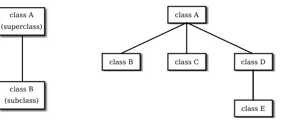

在 Java 中，若要创建一个名为 `B` 的类作为名为 `A` 的类的子类，你会这样写：

```java
class B extends A {
  // 对从类 A 继承的
  // 内容进行添加和修改
}
```

多个类可以被声明为同一个父类的子类。这些子类（可以被称为“兄弟类”）共享一些结构和行为——即它们从共同的父类中继承的内容。子类表达了这些共享的结构和行为。在右侧的图中，类 `B`、`C` 和 `D` 是兄弟类。继承关系也可以跨越类的“代际”。这在图中所示，类 `E` 是类 `D` 的子类，而类 `D` 又是类 `A` 的子类。在这种情况下，类 `E` 被认为是类 `A` 的子类，即使它不是直接的子类。这整组类形成了一个小的**类层次结构**。

### 5.5.3 示例：车辆

让我们来看一个例子。假设一个程序必须处理机动车，包括汽车、卡车和摩托车。（这可能是一个由机动管理局用于跟踪注册信息的程序。）程序可以使用一个名为 `Vehicle`（车辆）的类来表示所有类型的车辆。由于汽车、卡车和摩托车都是车辆的类型，它们将通过 `Vehicle` 类的子类来表示，如图类层次图所示：

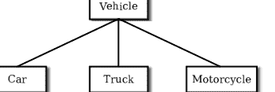

`Vehicle` 类将包含实例变量，如 `registrationNumber`（注册号）和 `owner`（所有者），以及实例方法如 `transferOwnership()`（转移所有权），适用于所有车辆。`Vehicle` 的三个子类——`Car`（汽车）、`Truck`（卡车）和 `Motorcycle`（摩托车）——可以持有特定车辆类型的变量和方法。`Car` 类可能会添加一个实例变量 `numberOfDoors`（门数量），`Truck` 类可能会有 `numberOfAxles`（轴数），而 `Motorcycle` 类可能会有一个布尔变量 `hasSidecar`（是否有边三）。（至少，即使这是为了给机动管理局的人使用的。）这些类在 Java 程序中的声明大致如下（尽管它们可能被定义在不同的文件中并声明为 `public` 类）：

```java
class Vehicle {
    int registrationNumber;
    Person owner; //（假设 Person 类已经定义）

    void transferOwnership(Person newOwner) {
    }
}
```

```java
class Car extends Vehicle {
    int numberOfDoors;
}
```

```java
class Truck extends Vehicle {
    int numberOfAxles;
}
```

```java
class Motorcycle extends Vehicle {
    boolean hasSidecar;
}
```

假设 `myCar` 是一个已经声明并用语句初始化的 `Car` 类型变量：

```java
myCar = new Car();
```

因此，程序可以引用 `myCar.numberOfDoors`，因为 `numberOfDoors` 是 `Car` 类中的实例变量。但由于 `Car` 类继承自 `Vehicle`，汽车拥有 `Vehicle` 的所有结构和行为。这意味着 `myCar.registrationNumber`、`myCar.owner` 和 `myCar.transferOwnership()` 同样存在。现在，在现实世界中，汽车、卡车和摩托车都是车辆。在程序中情况也是如此，`Truck` 或 `Motorcycle` 类型的对象自动是一个 `Vehicle` 类型的对象。这引出了一个重要的事实：

> 一个可以持有 `A` 类对象引用的变量也可以持有 `A` 子类对象的引用。

在我们示例中的实际效果是，`Car` 类型的对象可以赋值给 `Vehicle` 类型的变量。也就是说，允许这样做：

```java
Vehicle myFunction = myCar;
```

或者

```java
Vehicle myFunction = new Car();
```

在这两种情况之后，变量 `myFunction` 都指向子类 `Car` 的实例。对象“记得”它是一个 `Car`，而不仅仅是 `Vehicle`。关于对象的实际信息是该对象的一部分。使用 `instanceof` 运算符测试对象是否属于某个类是可能的：

```java
if (myFunction instanceof Car)
```

这决定了由 `myVehicle` 引用的对象是否是一个 `Car`。另一方面，赋值语句

```java
myCar = myVehicle;
```

将是非法的，因为 `myVehicle` 可能指向其他不是汽车的车辆类型。这与我们在第 2.5.6 节看到问题相似：计算机不会允许你将 `int` 类型的值赋值给 `short` 类型，因为不是每个 `int` 都是 `short`。同样，它不会允许你将 `Vehicle` 类型的值赋值给 `Car` 类型，因为不是每个车辆都是汽车。在 `int` 和 `short` 的情况下，解决方案是使用类型转换。如果由于某种原因你知道 `myVehicle` 确实引用 `Car`，你可以使用转换 `(Car)myVehicle` 来告诉计算机将 `myVehicle` 视为 `Car` 类型。所以你可以说：

```java
myCar = (Car)myVehicle;
```

你甚至可以引用 `((Car)myVehicle).numberOfDoors`。`.` 的优先级高于类型转换，所以 `(Car)myVehicle.numberOfDoors` 会被读取为 `(Car(myVehicle.numberOfDoors))`（尝试将 `int` `myVehicleNumberOfDoors` 转换为 `Vehicle`，这是不可能的）。

关于如何在程序中使用此示例，假设你想获取 `myVehicle` 引用的 `Vehicle` 相关数据。如果它是一辆汽车，你想找出汽车的 `numberOfDoors`，但 `Vehicle` 类中没有 `numberOfDoors`。但你可以这样做：

```java
System.out.println("Vehicle Data:");
System.out.println("Registration number: " + myVehicle.registrationNumber);
if (myVehicle instanceof Car) {
  System.out.println("Type of vehicle: Car");
  Car c;
  c = (Car)myVehicle; // 类型转换以访问 numberOfDoors!
  System.out.println("Number of doors: " + c.numberOfDoors);
} else if (myVehicle instanceof Truck) {
  System.out.println("Type of vehicle: Truck");
  Truck t;
  t = (Truck)myVehicle; // 类型转换以访问 numberOfAxles!
  System.out.println("Number of axles: " + t.numberOfAxles);
} else if (myVehicle instanceof Motorcycle) {
  System.out.println("Type of vehicle: Motorcycle");
  Motorcycle m;
  m = (Motorcycle)myVehicle; // 类型转换以访问 hasSidecar!
  System.out.println("Has sidecar: " + m.hasSidecar);
}
```

注意，对于对象，计算机执行程序时会检查类型转换是否有效。例如，如果 `myVehicle` 指向 `Truck` 对象，那么 `(Car)myVehicle` 将是一个错误。这种检查是在运行时而不是编译时完成的，因为在程序编译时不知道 `myVehicle` 的实际类型。

# 第 5 章 对象与类

### 5.5.4 多态

作为另一个例子，考虑一个处理屏幕上形状的程序。假设形状包括各种颜色的矩形、椭圆和圆矩形（“roundrect”只是带有圆角的矩形）。


可以使用三个类 `Rectangle`、`Oval` 和 `RoundRect` 来表示这三种形状。这三个类将有一个共同的父类 `Shape`，它代表了所有形状共有的特征。`Shape` 类包含表示形状的颜色、位置和大小的实例变量，并可以包含更改这些属性的实例方法。更改颜色涉及更改实例变量的值，然后用新颜色重新绘制形状。

```java
class Shape {
  Color color; //（必须从 java.awt 导入）

  void setColor(Color newColor) {
    // 改变形状颜色的方法
    color = newColor; // 改变实例变量的值
    redraw(); // 重新绘制形状，将以新颜色显示
  }

  void redraw() {
    // 绘制形状的方法
    ??? // 这里应该放什么命令？
  }

  // 实例变量和方法
} // Shape 类结束
```

现在，你可能会看到 `redraw()` 方法存在的问题。问题是每种类型的形状绘制方式都不同。`setColor()` 方法可以用于任何类型的形状。当执行 `redraw()` 时，计算机知道绘制哪一个？逐步地，我们可以这样回答这个问题：计算机通过请求形状自己重绘来执行 `redraw()`。每个形状都知道重绘需要做什么。在实践中，这意味着每个具体的形状类都有自己的 `redraw()` 方法：

```java
class Rectangle extends Shape {
  void redraw() {
    // 绘制矩形的命令
  }
  // 可能还有更多方法和变量
}
```

```java
class Oval extends Shape {
  void redraw() {
    // .. // 绘制椭圆的命令
  }
  // .. // 可能还有更多方法和变量
}
```

```java
class RoundRect extends Shape {
    void redraw() {
        // .. // 绘制圆矩形的命令
    }
    // .. // 可能还有更多方法和变量
}
```

假设 `someShape` 实际上是 `Shape` 的一种类型。那么它可以指向 `Rectangle`、`Oval` 或 `RoundRect` 任意一种类型的对象。随着程序的执行和 `someShape` 值的改变，它甚至可能在不同的时刻指向不同类型的对象！每当语句

```java
someShape.redraw();
```

执行时，实际被调用的 `redraw` 方法是与 `someShape` 实际指向的对象类型相匹配的方法。通过观察程序的文本，可能无法判断 `someShape` 实际上会绘制什么，因为它取决于 `someShape` 在程序执行时恰好拥有的值。更有甚的是：假设该语句位于循环中，那么 `someShape.redraw()` 在反复执行时可能会调用不同的方法并绘制不同的形状。我们称 `redraw()` 方法是**多态的**（polymorphic）。如果一个方法所执行的操作取决于应用于该方法的对象的实际类型，那么该方法就是多态的。多态是主要的区分特征之一……

（注：此处原文似乎存在 OCR 识别导致的句子重复和错乱，已根据上下文逻辑进行了梳理）

数组已经创建并填充了数据。由于数组中的某些元素是 `Rectangle`，某些是 `Oval`，有些可能是 `RoundRect`。我们可以通过以下语句绘制数组中的所有形状：

```java
for (int i = 0; i < shapelist.length; i++) {
    Shape shape = shapelist[i];
    shape.redraw();
}
```

当计算机遍历这个循环时，`shape.redraw()` 语句无疑会绘制矩形、椭圆，有时又是矩形，这取决于数组元素 `i` 所指向的对象类型。

如果我们使用自己的术语，这可能变得更容易理解：在面向对象编程中，调用一个方法通常被称为向对象**发送消息**。对象通过执行相应的方法来响应消息。语句 `someShape.redraw();` 是向 `someShape` 所指向的对象发送的消息。由于 `shape` 知道自己是什么类型的对象，因此它知道如何响应消息。从这个角度来看，计算机始终以相同的方式执行 `someShape.redraw();`：通过发送消息。对消息的响应自然取决于接收者。从这个角度来看，对象是发送和接收消息的活动实体，而多态是这种观点中自然甚至是必要的部分。多态仅仅意味着不同的对象以不同的方式响应同一条消息。

多态最美之处之一在于，它让你编写的代码能够实现那些你在编写代码时甚至还没有构想过的功能。假设我决定为程序可以处理的形状类型添加**斜角矩形**（beveled rectangles）。斜角矩形的每个角都切掉了一个三角形：

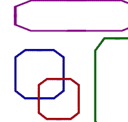

BeveledRects

为了实现斜角矩形，我可以为 `Shape` 类编写一个新的子类 `BeveledRect`，它有它自己的 `redraw()` 方法。自动地，我之前编写的代码——例如 `someShape.redraw()` 语句——现在突然可以绘制斜角矩形了，尽管在我编写该语句时斜角矩形类还不存在！

***

在语句 `someShape.redraw()` 中，`redraw` 消息被发送给对象 `someShape`。回看 `Shape` 类中更改形状类型的代码：

```java
void setColor(Color color) {
    color = newColor; // 修改实例变量的值
    redraw(); // redraw 消息，将以新颜色显示
}
```


这里发送了条消息，但它是发送给哪个对象的呢？`redraw` 消息发送给了自己——消息发送给了某个对象。答案是 `redraw` 消息发送给了某个对象，即接收 `setColor` 方法的那个对象。如果该对象是矩形，它包含一个绘制矩形的 `redraw()` 方法，执行的就是那一个。如果对象是椭圆，那么就是来自 `Oval` 类的 `redraw()` 方法。这是你应该预期的，但这意味着 `setColor()` 方法中的 `redraw()` 语句并不一定调用 `Shape` 类中的 `redraw()` 方法。

### 5.5 抽象类

每当是一个 `Rectangle`、`Oval` 或 `RoundRect`，数组已经创建并填充了数据……（注：此处 OCR 文本重复，已根据逻辑对齐）

同样，`Shape` 类中的 `redraw()` 方法是一个抽象方法。事实上，`Shape` 和它的 `redraw()` 方法在语义上是相似的。你也可以通过在定义中添加 `abstract` 修饰符在语法上告诉计算机。对于抽象方法，普通方法的实现代码块被替换为分号。在抽象类的任何具体子类中，都必须为抽象方法提供实现。以下是 `Shape` 类作为抽象类的样子：

```java
public abstract class Shape {

    Color color; // 形状的颜色

    void setColor(Color newColor) {

        // 更改形状颜色

        color = newColor; // 修改实例变量的值

        redraw(); // 重绘形状，将以新颜色显示

    }

    abstract void redraw();

    // 抽象方法---必须在具体子类中定义

    // 更多实例变量和方法

} // Shape 类结束
```

一旦你将类声明为抽象，创建该类型的实际对象就是非法的，如果你尝试这样做，计算机将报告语法错误。顺便说一下，上面讨论的 `Vehicle` 类可能是一个抽象类。没有办法拥有一个单纯的车辆——实际的车辆必须是汽车、摩托车或其他“具体的”车辆类型。

回想第 5.3.2 节，任何没有显式声明为其他类子类的类会自动成为标准类 `Object` 的子类。也就是说，没有 `extends` 部分的类声明如下：

```java
public class myClass { . .
```

完全等同于：

```java
public class myClass extends Object { . . .
```

这意味着 `Object` 类位于一个巨大的类层次结构的末端，该层次结构包含了所有其他类。（从语义上说，`Object` 是一个抽象类，事实上它是所有类中最抽象的。然而，奇的是，它在语法上并没有被声明为抽象类，这意味着你可以创建 `Object` 类型的对象。不过，你对它们做不了什么。）

由于每个类都是 `Object` 的子类，类型为 `Object` 的变量可以引用任何类型的任何对象。同样，类型为 `Object[]` 的数组可以容纳任何类型的对象。

示例源文件 `Shape.draw` 使用了一个抽象的 `Shape` 类和一个 `Shape[]` 类型的数组，你可能想查看所有这些内容，尽管你现在还无法完全理解。即使是形状类的定义与我在本节中描述的也有不同之处。（例如，`draw()` 方法有一个 `Graphics` 类型的参数。需要这个参数是因为在 Java 中绘图需要图形上下文。）等你以后有了更多 GUI 编程知识后，我将回到类似的示例。不过，查看源代码中 `Shape` 类及其子类的定义是值得的。你也可以检查数组是如何用于持有形状列表的。这里是程序的截图：

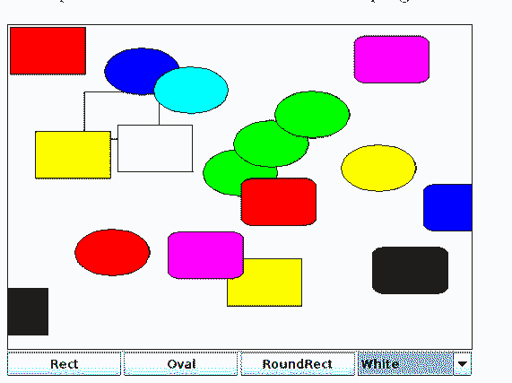

在 `ShapeDraw` 程序中，你可以点击底部的按钮之一来添加一个形状。新形状将出现在绘图区域的左上角。形状的颜色由右下角的“弹出菜单”给出。一旦形状出现在屏幕，你就可以用鼠标拖动它。形状与屏幕上其他形状的前后顺序将保持不变，即使在你拖动它时也是如此。但是，如果你在点击形状时按住 Shift 键，就可以将形状移动到所有其他形状之前。

在程序中，使用形状实际类的唯一时刻是形状被添加到屏幕时。一旦形状被创建，它就被完全作为一种抽象形状进行处理。例如，实现拖拽的例程与 `Shape` 类型的变量工作，并且不引用任何一个子类。在拖动形状的过程中，拖拽例程只是在每次需要绘制形状时调用该形状的 `draw` 方法，因此它不知道如何绘制该形状，也不知道它是什么种类型的形状。对象负责自己绘制自己。如果我想向程序中添加一种新类型的形状，我会定义 `Shape` 的新子类，添加另一个按钮，并让该按钮将正确类型的形状添加到屏幕上。编程中不需要任何其他更改。

### 5.6 `this` 和 `super`

虽然面向对象编程的基本概念相当简单清晰，但它们是细微的，并且需要时间来适应。遗憾的是，在基本概念之外还有很多细节。本章的其余部分涵盖了更多这些烦人的细节。记住，你不需要第一次读就掌握本章的所有内容。在本节中，我们将查看两个变量 `this` 和 `super`，它们在任何实例方法中都是自动定义的。

#### 5.6.1 特殊变量 `this`

当你使用一个简单的标识符（如 `amount` 或 `process()`）来引用变量或方法时意味着什么？答案取决于作用域规则，这些规则说明了程序中何时以及如何访问每个声明的变量和方法。在方法的定义内部，如果一个简单的变量名“在作用域内”（即在引用发生处的源代码中，有一个声明是生效的），那么它可能引用一个局部变量或参数。如果否则，它必须引用引用发生处的类的成员变量。同样，一个简单的方法名必须引用同类中的一个方法。

类的静态成员有一个简单的名称，该名称只能在类定义内部使用；它没有 `(类名).(简单名称)` 形式的。例如，`Math.PI` 是 `Math` 类中一个名为 `PI` 的静态变量。使用静态成员的全名总是合法的，即使在类被定义时也是如此。有时甚至是必须的，当一个静态成员变量的名字被同名的局部变量或参数隐藏时。

实例变量和实例方法也有类似的名称。实例变量的简单名称可以在定义实例的类的实例方法中使用（但不在静态方法中使用）。实例成员也有全名——但请记住，实例变量或实例方法实际上包含在对象中而不是类中，并且每个都有自己的版本。实例成员的全名从对包含它的对象的引用开始。例如，如果 `std` 是一个引用 `Student` 类型对象的变量，那么 `std.test1` 就是包含在其中的实例变量 `test1` 的全名。

但当我们在类内部并使用简单名称来引用像 `test1` 这样的变量时，包含该变量的对象在哪里呢？这个谜题的答案很简单：假设在某个实例方法的定义中发生了对 `test1` 的引用。实际执行的方法是类型为 `Student` 的某个特定对象的一部分。当该方法被执行时，名称 `test1` 的出现指向该对象中的 `test1` 变量。（这就是为什么静态方法中不能使用名称，因为没有对象）。

Java 定义了一个名为 `this` 的特殊变量来引用方法所在的对象。当该方法被执行时，名称 `this` 的出现指向该对象中的 `this` 变量。这种引用方法所在的对象，即使在类被定义时也是法的。

`Object` 的简单名称可以在定义实例的类的实例方法中使用（但不在静态方法中使用）。`this` 总是可以用来引用方法所在的对象，即使在它们在类中被定义时。（这就是为什么静态方法中不能使用名称，因为没有对象）。

有些面向对象的语言使用 `self` 来代替 `this`。在这里，从该实体的角度来看，`self` 指向它自己。`this` 的一个常见用法是在构造函数中：例如：

```java
public class Student {

    private String name; // 学生的名字

    public Student(String name) {

        // 构造函数。创建一个指定名字的学生。

        this.name = name;

    }

    // 更多变量和方法

}
```

在构造函数中，实例变量的名字被同名为 `name` 的形式参数隐藏了。然而，实例变量可以通过它的全名 `this.name` 来被引用。在赋值 `this.name = name` 中，形式参数的值被赋值给实例变量 `this.name`。这被认为是可以接受的风格。没有必要为仅初始化实例变量的参数想奇的名字。你可以使用参数作为实例变量。

`this` 还有其他用途。有时，当你编写实例方法时，你需要将包含方法的对象传递给子程序，作为实际参数。在这种情况下，你可以使用 `this` 作为实际参数。例如，如果你想打印对象的字符串表示，你可以说 `System.out.println(this);` 或者你可以在赋值语句中将 `this` 的值赋予另一个变量；你可以将其存储在数组中。事实上，你可以对它进行任何对其他任何变量的操作，除了改变它的值。（把它看作是一个 final 变量）。

#### 5.6.2 特殊变量 `super`

Java 还定义了另一个名为 `super` 的特殊变量，用于实例方法的定义。`super` 变量用于子类。像 `this` 一样，`super` 指向包含方法的对象。它是健忘的。它忘记了该对象属于你正在写的类，只记得它属于该类的父类。要点是类可以包含对父类的添加和修改。`super` 不知道这些这些添加和修改；它只能用于引用父类中的方法和变量。

假设你编写的类包含一个名为 `doSomething()` 的实例方法。考虑子程序调用 `super.doSomething()`。现在，`super` 并并不知道子类中的 `doSomething()` 方法。它只知道父类中的内容，因此它尝试执行父类中名为 `doSomething()` 的方法。如果没有该方法——即 `doSomething()` 方法是对原有方法的修改而非新增——你将得到一个语法错误。

`super` 存在的目的是你可以访问子类中的内容。例如，`super.var` 指的是子类中一个名为 `var` 的实例变量。如果一个类包含一个与其父类中的实例变量同名的实例变量，那么该类的对象实际上将包含两个同名的变量：一个定义为类本身，另一个作为父类的一部分。子类中的变量并不会替换父类中同名的变量，而是隐藏了它。仍然可以使用 `super` 来访问来自父类的变量。

当子类包含一个与其父类方法具有相同签名（signature）的实例方法时，父类中的方法将以相同的方式被隐藏。我们说子类中的方法重写（overrides）了父类的方法。然而，可以使用 `super` 来访问父类的方法。

`super` 的主要用途是用一个扩展了继承方法的新方法来重写该方法，这个新方法可以使用 `super` 调用父类的方法，而不是直接替换它，然后可以添加额外的代码以提供额外的行为。例如，假设一个 `PairOfDice` 类必须在计算机屏幕上绘制骰子。`GraphicalDice` 类中的 `roll()` 方法应该执行 `PairOfDice` 类中 `roll()` 方法所的所有工作。我们可以通过调用 `super.roll()` 来实现，这会调用父类中的方法。此外，`GraphicalDice` 对象的 `roll()` 方法必须重绘骰子以显示新值。`GraphicalDice` 可能看起来像这样：

```java
public class GraphicalDice extends PairOfDice {

    public void roll() {

        // 掷骰子，并重新绘制。

        super.roll(); // 调用来自 PairOfDice 的方法。

        redraw(); // 调用绘制骰子的方法。

    }

}
```

注意，即使你不知道该方法在父类中是如何实现的，这仍然允许你扩展 `roll()` 方法的行为！

#### 5.6.3 作为构造函数的 `super` 和 `this`

构造函数是不被继承的。如果你扩展一个现有的类来创建子类，父类中的构造函数不会成为子类的一部分。如果你想在子类中拥有构造函数，你必须从头开始定义。如果你没有在子类中定义任何构造函数，计算机将为你生成一个没有参数的默认构造函数。

如果父类中有一个执行了大量必要工作的构造函数，这可能会成为一个问题。看起来你可能必须在子类中重复所有这些工作！如果你没有父类的源代码，甚至不知道它是如何实现的，这可能是一个真正的问题。如果父类中的构造函数使用了你无法在子类中访问的成员变量，这看起来像是一个无法解决的问题！

显然，这对此有某种解决办法，而且确实有。它涉及到特殊变量 `super`。在构造函数的第一条语句中，你可以使用 `super` 调用父类的构造函数。这种表示法非常奇怪且具有误导性，它只能在这种特定情况下使用：它就像像调用子程序一样调用 `super`（尽管 `super` 并不是子程序，而且你无法以调用其他子程序的方式来调用构造函数）。作为一个示例，假设 `PairOfDice` 有一个接受两个整数作为参数的构造函数。考虑一个子类：

```java
public class GraphicalDice extends PairOfDice {

    public GraphicalDice() { // 此类的构造函数。

        super(3,4); // 调用来自

        // PairOfDice 类的构造函数，参数为 3, 4。

        initializeGraphics(); // 执行针对

        // GraphicalDice 类的初始化。

    }

    // 更多构造函数、方法、变量...

}
```

语句 `super(3,4)` 调用了来自父类的构造函数。此调用必须是子类构造函数的第一行。注意，如果你没有显式地通过这种方式调用父类的构造函数，则将自动调用无参数的默认构造函数。（如果父类中不存在此类构造函数，编译器将认为这是一个语法错误。）

你可以以完全相同的方式使用这个特殊变量来调用同一类中的另一个构造函数。也就是说，构造函数的第一行可以像是一个以 `this` 作为子程序名的子程序。这执行了同一类中另一个构造函数的体。这非常有用，因为避免了在不同的构造函数中重复相同的代码。例如，考虑 `MosaicPanel.java`，其中 `MosaicPanel` 代表一个矩形网格。一个带有许多参数的构造函数：

```java
public MosaicPanel(
    int rows,
    int columns,
    int preferredBlockWidth,
    int preferredBlockHeight,
    Color borderColor,
    int borderWidth
)
```

这个构造函数提供了很多选项并进行了大量的初始化。我想提供选项更少、更易用的构造函数，但所有的初始化仍然必须完成。该类还包含这些构造函数：

```java
public MosaicPanel() {
    this(42,42,16,16);
}

public MosaicPanel(int rows, int columns) {
    this(rows,columns,16,16);
}

public MosaicPanel(
    int rows,
    int columns,
    int preferredWidth,
    int preferredHeight
) {
    this(rows, columns, preferredWidth, preferredHeight);
}
```

这些构造函数每一个是为了调用另一个构造函数，为某些参数提供常量。例如，`this(42,42,16,16)` 调用了这里列出的最后一个构造函数，而该构造函数又调用了主要的六参数构造函数。该主构造函数在所有情况下最终被调用，以便所有的基本初始化都能完成。

### 5.7 接口

某些面向对象的语言（如 C++）允许一个类扩展多个父类。这被称为多继承。例如，在下面的图中类 E 显示为具有类 A 和类 B 作为直接父类，而类 F 有三个直接父类。


**多继承（Java 不允许）**

Java 不允许多继承。Java 的设计者希望保持继承简单，并认为多继承的好处与其增加复杂性的代价。然而，Java 有一个可以实现多继承的许多目标的功能：接口。

#### 5.7.1 定义和实现接口

我们以前在泛指黑盒和特别是子程序时遇到过“接口”。子程序的接口包含子程序的名称、返回类型以及参数的数量和类型。这是你了解如何调用子程序所需的信息。一个子程序还有一个实现：即定义它并在调用该子程序时执行的代码块。

在 Java 中，`interface` 是一个具有额外技术含义的保留字。这种意义上的“接口”由一组实例方法组成，不包含任何关联的实现。（实际上 Java 接口可以包含其他内容，详见后文）。类可以通过为接口指定出的每个方法提供实现来实现一个接口。这里是一个非常简单的 Java 接口示例：

```java
public interface Drawable {

    public void draw(Graphics g);

}
```

这看起来像是一个类定义，只是省略了 `draw()` 方法的实现。实现 `Drawable` 接口的类必须为该方法提供一个实现。当然，该类也可以包含其他方法和变量。例如：

```java
public class Line implements Drawable {

    public void draw(Graphics g) {

        // 执行一些事情——推测是画一条线

    }

    // 其他方法和变量

}
```


注意，要实现一个接口，类所做的不仅仅是为接口中的每个方法提供实现；它还必须声明它实现了该接口，使用保留关键字 `implements`：`public class Line implements Drawable`。任何实现 `Drawable` 接口的具体类都定义了一个 `draw()` 实例方法。从此类类创建的任何对象都包含 `draw()` 方法。如果一个对象属于一个实现了该接口的类，我们就说该对象实现了接口。例如，任何类型的线都实现了 `Drawable` 接口。

虽然一个类只能继承另一个类，但它可以实现任意数量的接口。事实上，一个类既可以继承另一个类，也可以实现一个或多个接口。因此，我们可以拥有这样的代码：

```java
class FilledCircle extends Drawable, Fillable {
    ...
}
```

这一切的意义在于，虽然接口不是类，但它们与类非常相似。接口非常像抽象类，也就是说，一种永远无法构造对象的类，但可以作为创建子类的基础。接口中的子程序是抽象方法，它们在实现该接口的任何具体类中必须被实现。你可以将 `Drawable` 接口与任何抽象类相比：

```java
abstract class AbstractDrawable {
    public abstract void draw(Graphics g);
}
```

主要的区别在于，继承 `AbstractDrawable` 的类不能继承其他任何类，而实现 `Drawable` 的类还可以继承某些类并实现其他接口。当然，抽象类可以包含非抽象方法也可以包含抽象方法。接口就像一个“纯”抽象类，只包含抽象方法。

注意，在接口中声明的方法必须是公共的（`public`）。事实上，由于这是唯一的选择，因此在声明中没有必要指定访问修饰符。

除了方法声明外，接口还可以包含变量声明。这些变量必须是 `public static final`，并且在实现该接口的每个类中实际上变成了公共静态变量。事实上，由于这些变量只能是公共、静态且最终的，因此指定修饰符是可选的。例如：

```java
public interface ConversionFactors {
    int INCHES_PER_FOOT = 12;
    int FEET_PER_YARD = 3;
    int YARDS_PER_MILE = 1760;
}
```

这是定义可以在多个类中使用的常量方便方法。实现 `ConversionFactors` 的类使用这些常量就像它们被定义在类中一样。

在达到编写复杂程序的阶段之前，你可能不会编写自己的接口。然而，Java 的标准包中有几个接口以重要的方式被使用。你将在接下来的几章中学习其中一些标准接口，并将将编写实现它们的类。

## 5.7.2 接口作为类型

对于抽象类，尽管你不能从接口构造对象，但你可以声明一个类型由接口给定的变量。例如，如果 `Drawable` 是上面出的接口，而 `Line` 和 `FilledCircle` 是像那样实现 `Drawable` 的类，那么你可以说：

```java
Drawable figure; // 声明一个类型为 Drawable 的变量。它可以
                 // 引用任何实现了
                 // Drawable 接口的对象。
figure = new Line(); // figure 现在指向一个 Line 类的对象
figure.draw(g); // 调用 Line 类中的 draw() 方法
figure = new FilledCircle(); // 现在，figure 指向一个
                             // FilledCircle 类的对象。
figure.draw(g); // 调用 FilledCircle 类中的 draw() 方法
```

`Drawable` 变量可以引用实现 `Drawable` 接口的任何类的任何对象。像上面 `figure.draw(g)` 这样的语句是合法的，因为 `figure` 的类型是 `Drawable`，而任何 `Drawable` 对象都有 `draw()` 方法。因此，无论 `figure` 指向哪个对象，它必须有一个 `draw()` 方法。

注意，类型是可以用于声明变量的东西。类型还可以用于指定子程序中参数的类型，或者函数的返回类型。在 Java 中，类型可以是一个类、接口或八种内置原始类型之一。然而，只有类可以用于构造新对象。

接口也可以作为数组的基础。例如，我们可以使用数组类型 `Drawable[]` 来声明变量并创建数组。数组的元素可以引用任何实现 `Drawable` 接口的对象：

```java
Drawable[] listFigures;
listFigures = new Drawable[10];
listFigures[0] = new Line();
listFigures[1] = new FilledCircle();
listFigures[2] = new Line();
```

数组的每个元素都将有一个 `draw()` 方法，因此我们可以说像 `listFigures[i].draw(g)` 这样的语句。

## 5.7.3 Java 8 中的接口

Java 的最新版本 Java 8 对接口进行了一些实用的补充。我在这里讨论的是接口中的**默认方法（default methods）**，默认方法拥有实现。当一个类实现接口时，它不需要为默认方法提供实现——尽管如果它想提供不同的实现，它可以这样做。当类实现接口时，默认方法从接口中继承，就像普通方法从类中继承一样。这让 Java 支持了多继承。但这并不是真正的多继承，因为接口不能定义实例变量。接口中的默认方法必须标记为 `default`。它可以是公共的，但对于接口中的其他部分，公共修饰符可以省略。例如：

```java
public interface Readable { // 代表输入源
    char readChar(); // 读取输入的下一个字符
    default String readLine() { // 读取下一行
        StringBuilder line = new StringBuilder();
        char ch = readChar();
        while (ch != '\n') {
            line.append(ch);
            ch = readChar();
        }
        return line.toString();
    }
}
```

实现此接口的具体类必须为 `readChar()` 提供实现。如果它想覆盖默认实现，它可以提供自己的 `readLine()` 实现。

```java
public class Stars implements Readable {
    public char readChar() {
        if (Math.random() > 0.5)
            return '*';
        else
            return '\n';
    }
    public static void main(String[] args) {
        Stars stars = new Stars();
        for (int i = 0; i < 10; i++) {
            String line = stars.readLine();
            System.out.println(line);
        }
    }
}
```

默认方法为 Java 提供了一种类似于其他语言中“混入（mixin）”的能力，即从其他来源混合功能的能力。由于一个类可以实现多个接口，因此可以不同的来源混合功能。

## 5.8 嵌套类

在 Java 中，嵌套类是指定义在类内部的类。（事实上，类可以嵌套在子程序内部，而子程序必须在类内部）。它们可以是命名的或匿名的。我将在本节稍后部分回到匿名类的话题。嵌套类像类中的其他事物一样，可以是静态的或非静态的。

### 5.8.1 静态嵌套类

静态嵌套类的定义看起来与其他任何类的定义相似，只是嵌套在另一个类内部，并在声明中带有 `static` 修饰符。静态嵌套类是类结构的一部分。它可以在类内部按通常的方式创建对象。如果它在类外部，它的名称必须指示它所属的类。也就是说，静态嵌套类的全名由它所属的类名、一个句点以及该嵌套类的名称组成。

例如，假设有一个名为 `WireFrameModel` 的类表示三维空间中的一组线。（此类模型用于图形程序表示三维对象。）假设 `WireFrameModel` 类包含一个静态嵌套类 `Line`，该类将代表单条线。那么，在 `WireFrameModel` 类外部，`Line` 将被引用为 `WireFrameModel.Line`。当然，这遵循类静态成员的正常命名规范。

```java
public class WireFrameModel {
    static class Line {
        // 线的数据和方法
    }
}
```

```java
.. // WireFrameModel 类的其他成员
static public class Line {
    // 表示从三维空间中的点 (x1,y1,z1)
    // 到点 (x2,y2,z2) 的直线。
    double xi, yi, z1;
    double x2, y2, z2;
} // 类的结束
.. // WireFrameModel 类的其他成员
} // WireFrameModel 类的结束
```

该嵌套类的全名是 `WireFrameModel.Line`。该名称可以用于声明变量，例如。在 `WireFrame` 类内部，可以使用构造函数 `new Line()` 创建线条对象。在类外部，则需要使用 `new WireFrameModel.Line()`。

静态嵌套类可以完全访问外部类的所有成员，甚至是私有（`private`）成员。同样，外部类也可以完全访问嵌套类的所有成员，即使它们被标记为私有。这也可以是声明嵌套类的另一个动机，因为它允许你在访问另一个类的私有成员的同时，而不会将这些成员对其他类公开。注意，嵌套类本身可以是私有的，这意味着它只能在嵌套它的类内部使用。

当你编译嵌套在 `WireFrameModel` 之中的 `Line` 定义时，编译后的 `Line` 类将存储在一个单独的文件中。线条类的名称将为 `WireFrameModel$class`。

### 5.8.2 内部类

非静态嵌套类被称为内部类（inner classes）。在实践中，内部类与静态嵌套类并没有区别，但非静态嵌套类实际上与对象关联，而不是与其定义的类关联。这可能需要一些时间来适应。

类的任何非静态成员并不真正属于类本身（其源代码包含在定义中）。对于内部类也是如此，对于类的任何非静态部分也是如此。类的中的嵌套成员指定了从该类创建的对象中将包含的内容。这种对称性是真实的——至少对于内部类而言是如此——每个所属实例都有其自己的嵌套类拷贝（尽管它并没有字面地包含嵌套类编译后代码的副本）。拷贝可以访问对象的所有实例方法和变量，即使是那些声明为私有的成员。不同对象中的两个内部类拷贝之所以不同，是因为它们所引用的实例变量和方法位于不同的对象中。事实上，判断嵌套类应该是静态还是非静态的规则非常简单：如果嵌套类需要使用外部类的任何实例变量或实例方法，则将嵌套类设为非静态。否则，也可以是非静态。

在大多数情况下，内部类只在定义它的类内部使用。如果是这样，使用内部类与使用任何其他类都非常不同。你可以按照通常的方式使用内部类的简单名称来创建变量和声明对象。

然而，从外部类的外部，内部类必须以 `(variableName).NestedClassName` 的形式进行引用，其中 `(variableName)` 是指向包含内部类的对象的变量。要创建一个属于内部类的对象，你必须先有一个属于外部类的对象。（在类内部工作时，隐式地使用对象 `this`。）

看一个示例会有帮助，并希望让你信服内部类确实非常自然。考虑一个代表扑克游戏的类。该类可能包含一个嵌套类来表示游戏中的玩家。`PokerGame` 类的结构可能如下：

```java
public class PokerGame { // 代表一个扑克游戏。
    class Player { // 代表该游戏中的其中一个玩家。
    } // Player 类的结束
    private Deck deck; // 用于游戏的牌牌。
    private int pot; // 已经注押的金额。
} // PokerGame 类的结束
```

如果 `game` 是一个 `PokerGame` 类型，那么从概念上讲，`game` 包含了它自己的 `Player` 类拷贝。在 `PokerGame` 对象的实例方法中，可以通过编写 `new Player()` 来创建一个新的 `Player` 对象，就像对于任何其他类一样。（可以使用如 `game.new Player()` 的表达式在 `PokerGame` 类外部创建一个 `Player` 对象。然而，这非常罕见。）`Player` 将访问 `PokerGame` 对象中的牌组和实例变量。每个 `PokerGame` 对象都有它们自己的游戏牌组和池；另一个扑克游戏的玩家使用另一个游戏的牌组和池。这就是将 `Player` 类设置为非静态的效果。这是玩家行为的最自然方式。`Player` 对象代表某个特定扑克游戏的玩家。另一方面，如果 `Player` 是一个独立类或静态嵌套类，它代表的是扑克玩家通的概念，独立于特定的扑克游戏。

### 5.8.3 匿名内部类

在某些情况下，你可能会发现编写一个匿名类然后在程序的单行代码中使用它。创建这样一个类值得吗？确实值得，对于此类情况，你可以选择使用匿名内部类。匿名类是通过 `new` 运算符的变体创建的，如下如下：

```java
new (superclass-or-interface) (parameter-list) {
    methods-and-variables
}
```

此构造函数定义了一个新类，但没有命名，并同时创建了一个属于该类的对象。这种形式的 `new` 运算符可以在任何可以使用普通 `new` 的语句中使用。此表达式的意图是创建一个：“属于与 `(superclass-or-interface)` 相同的新对象，但添加了这些 `(methods-and-variables)`”。其效果是在程序需要它的地方创建一个唯一定制的对象。注意，匿名类可以基于接口（`interface`）而不是类。在在这种情况下，匿名类必须通过定义接口中声明的所有方法来实现该接口。如果使用接口作为基类，则 `(parameter-list)` 必须为空。否则，它可以包含参数。

Lambda 表达式为 `g -> g.drawOval(10,10,100,100)`。它的意思是：“一个有一个参数 `g` 并执行 `g.drawOval(10,10,100,100)` 的方法”。计算机知道 `g` 是 `Graphics` 类型，是因为它作为实际参数是 `Drawable` 类型，而 `Drawable` 接口中唯一的方法的参数类型为 `Graphics`。Lambda 表达式可以用任何可以进行此类推断的地方。Lambda 表达式的通用语法为：

```java
(formal-parameter-list) -> (method-body)
```

其中 `(method-body)` 可以是一个单一的表达式、一个子程序调用，或者包裹在 `{ }` 之间的语句块。当体是单个表达式或函数调用时，该表达式的值将自动作为所定义方法的返回值。Lambda 表达式中的参数列表不需要指定参数的类型，尽管可以这样做。如果只有一个参数且没有指定参数类型，则参数列表周围的括号是可选的；这就是上面示例所示的形式。对于没有参数的方法，参数列表仅为空的一对括号。以下是几个 Lambda 表达式示例：

```java
() -> System.out.println("Hello World")
g -> g.setColor(Color.RED); g.drawRect(10,10,100,100); }
(a, b) -> a + b
(int n) {
    while (n > 0) {
        System.out.println(n);
        n = n/2;
    }
} // lambda expressions在此结束
```


如你所见，语法仍然可能变得相当复杂。关于 Lambda 表达式有很多要说的，但我在这里的目的是简要介绍 Java 8 中最有趣的新特性之一。

## 第 5 章练习

1. 在 5.2 节中所有版本的 `PairOfDice` 类中，实例变量 `die1` 和 `die2` 都被声明为 `public`。它们应该是 `private` 的，这样它们就能免受类外部的修改。编写另一个版本的 `PairOfDice` 类，其中实例变量 `die1` 和 `die2` 是 `private` 的。你的类需要“getter”方法来获取 `die1` 和 `die2` 的值。（主意是保护这些值不在类外部被修改，但仍然允许读取这些值。）在类中包含其他改进，包括一个 `toString()` 方法。用一个短程序测试你的类，计算一对骰子投取的次数，直到两个骰子的和等于二为止。

2. 一个常见的编程任务是计算一组数字的统计数据。（统计数据是一个总结数据集属性的数字。）常见的统计数据包括平均值（也称为平均数）和标准差。编写一个简单的 `StatCalc` 类，用于计算这些统计数据，以及数据集中项目的和，并将该类的源代码保存在 `StatCalc.java` 文件中。如果 `calc` 是 `StatCalc` 类型的变量，则可以使用以下方法：

   - `calc.enter(item)`，其中 `item` 是一个数字，将该项添加到数据集中。
   - `calc.getCount()` 是一个返回已添加到数据中的项目数量的函数。
   - `calc.getSum()` 是一个返回已添加到数据集中所有项目之和的函数。
   - `calc.getMean()` 是一个返回所有项目平均值的函数。
   - `calc.getStandardDeviation()` 是一个返回项目标准差的函数。

   通常，随着数据的可用，通过反复调用 `enter()` 方法逐个添加所有数据。在输入所有数据后，任何其他方法都可以获取有关数据的统计信息。`getMean()` 和 `getStandardDeviation()` 方法应仅在项目数量大于 0 时被调用。

   修改当前的 `StatCalc.java` 源码，添加 `getMax()` 和 `getMin()` 方法。`getMax()` 方法应该返回数据集中所有项目最大值，而 `getMin()` 应该返回最小值。你需要添加两个新的实例变量来跟踪目前为止看到的最大和最小项目。

   在程序中使用你的新类进行测试，计算用户输入的一组非零数字的统计数据。从创建一个 `StatCalc` 类型的对象开始：

   ```java
   StatCalc calc; // 处理数据的对象。

   calc = new StatCalc();
   ```

   从用户处读取数字并将其添加到数据集中。使用 0 作为哨兵值（即，当用户输入 0 时停止读取）。在用户输入所有非零数字后，打印出从 `calc` 获取的六项统计数据。

3. 此问题使用了练习 5.1 中的 `PairOfDice` 类和练习 5.2 中的 `StatCalc` 类。练习 4.4 中的程序执行了计算一对骰子投取次数的实验（如果你想的话）。它重复此实验 10000 次，然后报告平均掷次数。它对每个可能的总和（2, 3, ..., 12）执行此过程。

   重做一遍。不要只报告平均掷次数，你还应该报告标准差和最大掷次数。使用 `PairOfDice` 对象表示骰子。使用 `StatCalc` 对象来计算统计数据。

4. 修改当前的 `StatCalc.java` 源码，添加 `getMax()` 和 `getMin()` 方法。`getMax()` 方法应该返回数据集中所有项目最大值，而 `getMin()` 应该返回最小值。你需要添加两个新的实例变量来跟踪目前为止看到的最大和最小项目。

5. 修改当前的 `StatCalc.java` 源码，添加 `getMax()` 和 `getMin()` 方法。`getMax()` 方法应该返回数据集中所有项目最大值，而 `getMin()` 应该返回最小值。你需要添加两个新的实例变量来跟踪目前为止看到的最大和最小项目。

6. 4.7 节要求你写一个管理 10 道加法测验的程序。重写该程序，使用以下类来表示加法题：

   ```java
   public class AdditionQuestion {

       private int a, b; // 题目中的数字

       public AdditionQuestion() { // 构造函数

           a = (int)(Math.random() * 50 + 1);

           b = (int)(Math.random() * 50);

       }

       public String getQuestion() {

           return "What is " + a + " + " + b + " ?";

       }

       public int getCorrectAnswer() {

           return a + b;

       }

   }
   ```

7. 重写上一个练习中的程序，使其管理具有不同类型的测验。在上一个练习中，你使用类来表示加法题。对于这个练习，你将使用以下接口或等效的抽象类来表示以整数作为答案的更通用的问题概念：

## 练习题

```java
public interface IntQuestion {

    public String getQuestion();

    public int getCorrectAnswer();

}
```

你只需通过在类定义中添加 `implements IntQuestion` 来让 `AdditionQuestion` 类实现该接口。请编写一个类似的类来表示减法题，你应该确保答案不是负数。

对于新程序，请使用 `IntQuestion[]` 类型的数组来存放测验题。在测验中包含一些加法题和一些减法题。你还可以添加几个非数学题，包括下面这道题，它以匿名类的形式创建：

```java
IntQuestion bigQuestion = new IntQuestion() {

    public String getQuestion() {

        return "关于生命、宇宙和万物的终极问题的答案是？" + "";

    }

    public int getCorrectAnswer() {

        return 42;

    }

}
```

## 第 5 章测验

1. 面向对象编程使用了类（classes）和对象（objects）。什么是类？什么是对象？类和对象之间的关系是什么？
2. 什么是实例变量（instance variables）和实例方法（instance methods）？
3. 仔细解释 Java 中 `null` 的含义，以及为什么这个特殊值是必要的。
4. 什么是构造函数（constructor）？类中构造函数的目的是什么？
5. 假设 `Kumquat` 是一个类的名，`fruit` 是一个 `Kumquat` 类型的变量。语句 `fruit = new Kumquat();` 的含义是什么？也就是说，当计算机执行这条语句时做了什么？（尝试给出一个完整的回答。）
6. 术语实例变量（instance variable）和实例方法（instance method）是指什么？
7. 解释术语子类（subclass）和超类（superclass）的含义。
8. 修改以下类，使得两个实例变量都是私有（private）的，并为每个实例变量提供一个 getter 方法（get 方法）和一个 setter 方法（set 方法）：

   ```java
   public class Player {

     String name;

     int score;

   }
   ```

9. 解释为什么上一个题中定义的 `Player` 类有一个名为 `toString()` 的实例方法，尽管在类的定义中没有出现该方法的定义。
10. 解释术语多态（polymorphism）。
11. 解释内存管理中的“垃圾回收（garbage collection）”术语。这里的垃圾回收是指什么？垃圾回收的替代方案是什么？
12. 什么是抽象类（abstract class），你如何在 Java 中识别一个抽象类？
13. `this` 是什么？
14. 对于这道题，你应该编写一个非常简单的完整类。该类表示一个计算 0, 1, 2, 3, 4, .... 的计数器。类名应该是 `Counter`。它有一个私有（private）的实例变量，表示计数器的值。它有两个方法：`increment()` 将计数器值加 1，`getValue()` 返回当前计数器的值。请为 `Counter` 类编写一个完整的定义。
15. 这道题使用了上一个题中的 `Counter` 类。以下程序段旨在模拟抛掷硬币 100 次。它应该使用两个 `Counter` 对象，`headCount` 和 `tailCount` 来统计正面和反面的数量。填空空白以实现该功能：

   ```java
   Counter headCount, tailCount;

   tailCount = new Counter();

   headCount = new Counter();

   for ( int flip = 0; flip < 100; flip++) {

       if (Math.random() < 0.5) // 这种情况有 50% 的概率发生。

           headCount++; // 计数“正面”

       else

           tailCount++; // 计数“反面”

   }

   System.out.println("正面次数：" + headCount);

   System.out.println("反面次数：" + tailCount);
   ```

   （注：由于提供的原文在后半部分存在大量乱码和重复的英文片段，译文已根据逻辑上下文对可识别的练习题部分进行了翻译。）

# 第 6 章 GUI 编程导论

255

```java
public static void main(String[] args) {

    HelloWorldDisplay displayPanel = new HelloWorldDisplay();

    JButton jButton = new JButton("OK");

    ButtonHandler listener = new ButtonHandler();

    jButton.addActionListener(listener);

    JPanel content = new JPanel();

    content.setLayout(new BorderLayout());

    content.add(displayPanel, BorderLayout.CENTER);

    content.add(jButton, BorderLayout.SOUTH);

    JFrame window = new JFrame("GUI Test");

    window.setContent(content);

    window.setSize(250,100);

    window.setLocation(100,100);

    window.setVisible(true);

}
```

### 6.1.1 `JFrame` 和 `JPanel`

在 Java 程序中，界面上的每个 GUI 组件都由程序中的一个对象来表示。组件最基本的类型之一就是窗口。窗口有很多行为。它们可以被打开和关闭。它们可以调整大小。它们有显示在窗口标题栏中的“标题”。最重要的是，它们可以包含按钮和菜单等其他 GUI 组件。

Java 当然有一个内置类来表示窗口。实际上有几种类型的窗口，但最常用的类型由 `JFrame` 类表示（该类包含在 `java.swing` 包中）。`JFrame` 是一个独立的窗口，例如可以作为应用程序的主窗口。要理解的最重要的事情之一是，`JFrame` 已经内置了许多窗口的行为。特别是，它有一个标题栏和。由于 `JFrame` 自带了这些行为，你就不需要自己编写它们了！这当然是面向对象编程的核心思想之一。如果你不在 `JFrame` 中添加任何其他内容，那么内容部分（即窗口中包含的东西）将只显示一个空白区域——或者，如果你不设置它的大小，它会变得非常小，以在屏幕上很难找到。你可以通过创建一个 `JFrame` 并向其添加内容，或者通过创建一个 `JFrame` 的子类并将内容添加到该子类的构造函数中来添加内容。

上面的主程序声明了一个类型为 `JFrame` 的变量 `window`，并使用以下语句将其设置为指向一个新窗口：

```java
JFrame window = new JFrame("GUI Test");
```

构造函数中的参数（字符串 `"GUI test"`）指定了显示在窗口标题栏中的标题。这一行代码创建了窗口对象，但窗口在屏幕上还不可见。在让窗口可见之前，通过这些语句设置了它的部分属性：

```java
window.setContentPane(content);

window.setSize(250,100);

window.setLocation(100,100);
```

第一行设置了窗口的内容（内容本身在主程序早些已经创建）。第二行表示窗口宽为 250 像素，高为 100 像素。第三行表示窗口的左上角将距离屏幕左边缘 100 像素，距离顶部 100 像素。一旦设置完成，就可以通过命令让窗口在屏幕上真正变为可见：

```java
window.setVisible(true);
```

程序似乎在这一步就结束了，事实上，`main()` 例程并没有结束。然而，在用户点击 OK 按钮之前，窗口不会结束。一旦窗口打开，就会创建一个新线程来管理图形界面，该线程在 `main()` 完成后仍会继续运行。

显示在 `JFrame` 中的内容被称为它的内容面板（content pane）。（此外，`JFrame` 还可以有一个菜单栏，那是我将要讨论的另一个独立内容）。`JFrame` 已经有一个空白面板；你可以向该面板添加内容，也可以完全替换空白面板。在我的示例程序中，`window.setContentPane(content)` 这一行将原始空白面板替换为另一个。记住，“组件”只是用户界面的一个视觉元素。在这种情况下，新内容是一个类型为 `JPanel` 的组件。

`JPanel` 是 Swing 中的另一个基础类。基础的 `JFrame` 再次只是一个空白矩形。制作实用的 `JPanel` 有两种方法：第一种是向面板添加其他组件；第二是在面板中绘制某些内容。这两种技术在示例程序中都有体现。你会在程序中找到两个 `JPanel`：`content` 用于包含其他组件，`displayPanel` 用作绘图区域。

让我们仔细观察 `displayPanel`。这个变量的类型是 `HelloWorldGUI2`。（嵌套类在第 5.8 节中引入）。该类定义了一个实例方法 `paintComponent()`，它重写了 `JPanel` 类中同名的方法：

```java
private class HelloWorldDisplay extends JPanel {

    public void paintComponent(Graphics g) {

        super.paintComponent(g);

        g.drawString("Hello World!", 20, 30);

    }

}
```

`paintComponent()` 方法由系统调用，当组件需要绘制在屏幕上时。在 `JPanel` 类中，`paintComponent()` 方法填充面板背景颜色。在 `HelloWorldDisplay` 中，通过调用 `super.paintComponent(g)` 填充面板的背景颜色（请参阅第 5.6.2 节关于布局的讨论）。然后，当 `HelloWorldDisplay` 显示时，它调用 `g.drawString` 在面板上绘制字符串 `"Hello World!"`。

我们经常以这种方式使用 `JPanel`，作为绘图表面。通常，当我们这样做时，会将 `JPanel` 定义为一个单独类或嵌套类。为了方便起见，我打算使用嵌套类。

### 6.1.2 组件与布局

使用 `JPanel` 的另一种方式是作为容器。Java 有许多类来定义 GUI 组件。除了窗口等顶层容器外，组件必须先添加到容器中才能显示在屏幕上。在示例程序中，变量引用了一个用于包含其他组件的 `JPanel`。向该容器添加了两个组件。这是通过语句完成的：

```java
content.add(displayPanel, BorderLayout.CENTER);

content.add(jButton, BorderLayout.SOUTH);
```


这里，`content`指向程序稍后创建的`JPanel`对象，该面板成为了窗口的内容面板。第一个添加的组件是`displayPanel`，如上所述，它显示消息"Hello World!"。第二个是`jButton`，它是表示推按钮的`JButton`类。

`BorderLayout`指定这两个组件如何排列。当组件被添加到容器时，必须有一种方式来决定它们在容器内部的排列。这被称为对容器中的组件进行"布局"，而布局组件的最常用技术是使用布局管理器。布局管理器是一个实现某种排列策略的对象；不同类型的布局管理器实现不同的策略。一种类型的布局管理器由`BorderLayout`类定义。在程序中，`new BorderLayout()`创建了一个`BorderLayout`对象，并告诉`content`面板使用该新对象作为其布局管理器。基本上，这决定了添加到`content`面板的组件如何在面板内部排列。

这个示例展示了设置GUI的通用技术：创建一个容器并为其分配布局管理器，创建组件并将其添加，并将容器作为窗口的内容面板。容器本身也是组件，因此添加到顶层容器的组件也可以是容器，拥有自己的布局管理器和组件。这使得以分层方式构建复杂界面变得可能。

### 6.1.3 事件与监听器

容器和组件的结构设置了GUI的物理外观，但它没有说明GUI如何行为。即用户将如何使用GUI以及它将如何响应？GUI大程度上是事件驱动的；也就是说，程序等待……用于响应由用户操作（或其他原因）产生的事件。当事件发生时，程序通过执行事件处理方法来做出响应。为了对GUI的行为编程，你必须编写事件处理方法来响应你感兴趣的事件。

在Java中，处理事件最常用的技术是使用监听器（listeners）。监听器是一个包含一个或多个事件处理方法的对象。当另一个对象（如按钮或菜单）检测到事件时，监听器会收到通知，并通过运行相应的事件处理方法做出响应。事件是由一个对象检测到或生成的。另一个对象，即监听器，负责对事件做出响应。事件本身实际上是由第三个对象表示的，该对象携带了关于事件类型、发生时间等信息。这种职责分工使得组织大型程序变得更容易。

用户点击按钮，按钮生成事件

`ActionEvent`对象被发送到监听器


可见按钮，由`JButton`对象表示

```
instanceof ButtonHandler

actionPerformed()
```

类型为`Listener`的事件处理对象对事件做出响应

例如，考虑示例程序中的OK按钮。当用户点击按钮时，就会生成一个事件。该事件由属于`ActionEvent`类的对象表示。生成的事件与按钮相关；我们称按钮是事件的源。在这种情况下，监听器对象是属于`ButtonHandler`类的对象，它被定义为`HelloWorldGUI`的嵌套类：

```
private static class ButtonHandler implements ActionListener {

    public void actionPerformed(ActionEvent e) {

        System.exit(0);

    }

}
```

该类实现了`ActionListener`接口——这是处理事件的监听器对象的要求。事件处理方法命名为`actionPerformed`，如`ActionListener`接口指定的。该方法包含了用户点击按钮时执行的代码；在这种情况下，代码是对`System.exit()`的简单调用，它将终止程序。

要将事件从按钮传递到监听器，还需要一个要素：监听器对象必须向按钮注册自己为事件监听器。通过以下语句实现：

```
okButton.addListener(listener);
```

该语句告诉`okButton`，当用户点击按钮时，将生成`ActionEvent`并将其发送到`listener`。如果没有这条语句，按钮无办法知道有东西想要监听来自按钮的事件。

这个示例展示了GUI行为编程的一种通用技术：编写包含事件处理方法的类。创建属于这些类的对象，并将它们作为监听器注册到那些实际检测或生成事件的对象中。当事件发生时，监听器会收到通知，并执行你在其中一个事件处理方法中编写的代码。这种方法初看起来似乎是完成任务的一种非常迂回且复杂的方式，但随着你经验的增加，你会发现它非常灵活，并且与面向对象的编程非常契合。

本节介绍了GUI编程的一些基础知识。我们将在本章的剩余部分更详细地探讨它们。

### 6.1.4 Java GUI历史

Java最初的GUI工具包是AWT，即"抽象窗口工具包"（Abstract Windowing Toolkit）。它为已经构建在各种操作系统中的GUI组件提供了一个通用接口。最开始，它使用一种不需要监听器对象的简单事件，但这种模型在Java 1.1中很快被抛弃，转而使用监听器。

当Java首次引入时，重要的应用之一是applet。applet是一种可以在Web浏览器网页上运行的GUI程序。applet在本教科书之前的版本中介绍过，但它们的使用频率已降低，并已从本书的第七版中删除。

Swing GUI工具包在Java 1.2中引入，作为AWT的替代方案，它具有更多样的复杂组件和更符合逻辑的结构。虽然Swing使用了AWT的某些方面，但它的大部分组件是用Java编写的，而不是基于操作系统组件。十多年来，Swing一直是编写Java程序的标准工具包，这也是我将在本章中涵盖的内容。

最近，另一种名为JavaFX的GUI被引入了。它使用了与Swing许多许多核心思想，包括组件、布局和事件，但对应用程序使用了不同的结构和不同的类集合。从Java 8开始，JavaFX成为编写GUI应用程序的首选方法。我没有在书中介绍JavaFX。JavaFX与Swing兼容并可以使用Swing组件，而Swing将继续在Java中受到支持。（事实上，Java仍然被支持！）而且正如我所说的，JavaFX是基于与Swing相同的核心思想的。

### 6.2 图形与绘制

计算机屏幕上**你看到的一切**都必须被绘制，即使是文本。Java API包含了一系列用于绘制的类和方法。在本节中，我将查看其中最基础的一些。部分材料已经在3.9节的预备部分涵盖过。

GUI的物理结构由组件组成。组件（component）一词是指GUI中的视觉元素，包括按钮、菜单、文本输入框、滚动条、复选框等。在Java中，组件由属于`java.awt.Component`类子类的对象表示。Swing工具包中的大多数组件——不是像`JFrame`这样的顶层组件——属于`java.swing.JComponent`类的子类，该类本身又是`JComponent`的子类。每个组件都负责绘制自己。如果你想使用标准组件，只需将它添加到程序中。这会自动发生，因为它们已经知道如何绘制自己。

然而，有时你想在组件上进行绘制。当你想要这样做时，你必须定义自己的组件类并提供一个绘制方法。当我们需要绘制表面时，我总是使用`JPanel`的子类，正如我在之前的示例`HelloWorldGUI.java`中所做的那样。`JPanel`像任何`JComponent`一样，在`paintComponent()`方法中绘制内容。为了创建一个绘制表面，你应该定义`JPanel`的子类并提供一个自定义的`paintComponent()`方法。

```
public void paintComponent(Graphics g)
```

创建一个该类的对象并在程序中使用。当需要你的绘制到屏幕时，系统将调用你的`paintComponent()`。注意`paintComponent()`方法的参数是`Graphics`。系统在调用你的方法时将提供`Graphics`对象。你需要这个对象来执行绘制。在Java中绘制任何内容，你需要一个上下文（graphics context）。上下文是一个属于`java.awt.Graphics`类的对象。该类提供了绘制形状、文本和图像的方法。任何`Graphics`对象只能绘制到一个位置。在本章中，位置始终是属于某个`JPanel`子类的GUI组件。`Graphics`类是一个抽象类，这意味着无法通过构造函数直接创建图形。获取用于在组件上绘制的上下文有两种：首先，当然，当系统首次为方法提供上下文时，每个组件都有一个名为`getGraphics()`的实例方法。该方法返回一个可以在`paintComponent()`方法之外用于在组件绘制的上下文。官方建议是不使用`getGraphics()`，在几个示例中我也总是避免它。但如果你发现使用它很方便，在使用`getGraphics()`结束后（注意如果`g`是上下文，最好调用`g.dispose()`），这会释放`g`可能持有的系统资源。

`JPanel`类中的`paintComponent()`方法只是向面板填充背景颜色。在定义用于绘制表面的`JPanel`子类时，通常会在向面板绘制其他内容之前向面板填充背景颜色（尽管如果在方法中完全覆盖组件的背景，则没有必要这样做）。这通常通过调用`super.paintComponent(g)`实现，你编写的大多数`paintComponent()`方法形式如下：

```
public void paintComponent(g) {

  super paintComponent(g);

  // 绘制组件的内容。

}
```

通常情况下，组件应该在它的`paintComponent()`方法中完成所有绘制。如果在一个其他方法的中间，你意识到组件的内容组件需要更改吗？你不应该直接调用`paintComponent()`来进行更改。相反，你必须通知系统组件需要重绘，并让系统通过调用`paintComponent()`来完成工作。你通过调用组件的`repaint()`方法来实现这一点。

```
public void repaint();
```

该方法位于`Component`类中，可以用于任何组件。你应该调用`repaint()`来通知系统组件需要重绘。需要注意的是，`repaint()`方法会立即返回，而不会本身执行任何绘制操作。系统将在稍有机会执行时（即在处理完其他事件后，如果有的话）随后调用组件的`paintComponent()`方法。如果`repaint()`的调用发生在一个非常短的时间内，甚至可能多次`repaint()`调用都由某一次`paintComponent()`调用来处理。

请注意，系统会出现在屏幕上。它还会因为其他原因调用`paintComponent()`。当组件首次出现时，它会被调用。当组件的大小发生变化时，它也会被调用，这通常发生在用户缩放包含组件的窗口时。这意味着`paintComponent()`应该能够根据需要重绘组件的内容。正如你将看到的，我们的一些示例可能无法正确地做到这一点。

这意味着，为了正常工作，`paintComponent()`方法必须足够智能以正确地重绘组件，并且程序应该在其实例变量中存储关于组件状态的数据。这些变量应该包含完全重绘组件所需的所有信息。`paintComponent()`方法应该使用这些变量中的数据来决定绘制什么。当程序想要更改组件的内容时，它不应该简单地绘制新内容。它应该更改相关变量的值并调用`repaint()`。当系统调用`paintComponent()`时，该方法将使用变量的新值，并绘制带有所需修改的组件。这看起来似乎是处理问题的一种迂径。为什么不直接绘制修改部分呢？至少有两个原因。首先，如果所有绘制工作都在一个方法中完成，把事情做对真的容易得多。其次，即使你可以重绘修改部分，你仍然需要保存足够关于修改的信息，以便`paintComponent()`能够根据需要正确地重绘组件。

### 6.2.1 坐标

计算机屏幕是由许多小正方形像素组成的网格。每个像素的颜色都可以单独设置，在屏幕上绘图意味着设置单个像素的颜色。

你将在本章的其余部分看到这一切在实践中是如何运作的。现在，我们将在本部分的剩余部分查看如何完成实际的绘图。

# 第6章 GUI编程简介

262

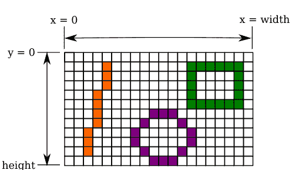

图形上下文在一个由像素组成的矩形中绘图。矩形中的位置由一对整数坐标(x,y)指定。左上角的坐标为(0,0)。x坐标从左到右增加，y坐标从上向下。插图显示了一个20x12像素的组件（像素很大）。通过绘制单个像素显示了一个小小的线、矩形和文本。（注意，严格来说，坐标不属于像素，而是属于它们之间的网格线。）

对于任何组件，你都可以调用实例方法`getSize()`和`getHeight()`来获取它所占据的大小，这两个方法分别返回水平和垂直方向上的像素数。通常，假设你知道组件的大小不是一个好主意，因为大小通常由布局管理器设置，而且如果组件位于窗口且用户缩放了该窗口，大小可能会发生变化。这意味着在对该组件进行任何绘制之前，检查组件的大小是良好的习惯。例如，你可以使用如下所示`paintComponent()`方法：

```
public void paintComponent(Graphics g) {

    super.paintComponent(g);

    int width = getSize(); // 获取此组件的宽度

    int height = getHeight(); // 获取它的高度。

    // 绘制组件的内容。

}
```

当然，你的命令将迫使你考虑大小。也就是说，它们必须使用根据组件的实际高度和宽度计算出的(x,y)坐标。（然而，如果你确定知道大小，使用常量作为宽度和高度可以使绘图更简单。）

### 6.2.2 颜色

你在绘图时可能想使用某种颜色。Java的设计是为了与RGB颜色系统配合。RGB颜色由三个数字指定，这些数字给出颜色中红色、绿色和蓝色的水平。Java中的颜色是`java.awt.Color`类的对象。你可以通过指定红色、蓝色和绿色分量来构造新颜色。例如：

```
Color c = new Color(r,g,b);
```

你可以这样调用两个构造函数。在我几乎使用的那个中，r、g和b是0到255之间的整数。在另一个中，它们是0.0F到1.0F之间的float类型数字。（记住，float字面量用"F"表示，以区别于double数字）。通常，你可以完全避免创建新颜色，`Color`类定义了几个表示颜色的命名常量：`Color.WHITE`、`Color.BLACK`、`Color.RED`、`Color.GREEN`、`Color.BLUE`、`Color.CYAN`、`Color.MAGENTA`、`Color.YELLOW`、`Color.PINK`、`Color.ORANGE`、`Color.LIGHT_GRAY`、`Color.GRAY`、`Color.DARK_GRAY`。（这些常量的名称也有小写形式，例如`Color.red`而不是`Color.RED`，但建议使用大写。）

RGB的替代方案是HSB颜色系统。在HSB系统中，颜色由三个数字指定：色调（hue）、饱和度和亮度（brightness）。色调是红色经过整个彩虹的所有颜色。亮度基本上就是你想的。完全饱和的颜色是纯色。在Java中，饱和度就像白色或灰色。Java有一个静态方法`getHSColor`用于创建从0.0F到1.0F的float。要创建由h、s和b给出的HSB颜色，你可以说：

```
Color color = Color.getHSColor(h,s,b);
```

例如，要创建一个尽可能亮的红色，你可以使用：问题是我们需要两个不同的构造函数，它们都具有float类型的参数。遗憾的是，这是可能的。只有当参数数量或类型不同时，你才能拥有构造函数。

```
Color randomColor = Color.getHSColor((float)Math.random(), 1.0F, 0.0F);
```


RGB 和 HSB 系统描述同一组颜色的不同方式。可以在这些系统之间进行转换。理解颜色系统的最好方法是对它们进行实验。（程序 `SimpleChooser.java` 允许你这样做。你目前找不到它的源代码，但你可以运行它并进行颜色选择以找到所需颜色的 RGB 或 HSB 值。）

# 第 6 章：GUI 编程简介

可以通过调用组件实例方法 `component.setForeground(color)` 和 `component.setBackground(color)` 设置组件的前景颜色和背景色，这些方法定义在 `Component` 类中，适用于任何组件。如果你想让组件使用与默认不同的颜色，这即使对于标准组件也是很有用的。

## 6.2.3 字体

字体代表文本的特定尺寸和样式。同一个字符在不同的字体中显示会有不同。在 Java 中，字体的特征由字体名称、样式和大小刻画。可用的字体名称取决于系统，但你可以使用以下字符串作为字体名称："Serif"（衬线）、"SansSerif"（无衬线）、"Monospaced"（等宽）和 "Dialog"（对话框）。"衬线"（serif）是字符上的一个小装饰，例如字母 i 底部的一条短水平线。"SansSerif" 意味着"不带衬线"。"Monospaced" 意味着字体中的所有字符宽度相同。"Dialog" 字体是通常用于对话框的字体。

字体的样式使用 `Font` 类中定义的命名常量来指定。你可以将样式指定为以下四个值之一：

- `Font.PLAIN`（标准）
- `Font.ITALIC`（斜体）
- `Font.BOLD`（粗体），或
- `Font.BOLD + ITALIC`（粗体斜体）。

字体的大小是一个整数。通常范围在约 9 到 36 之间，尽管也可以使用更大的尺寸。字体的大小通常等于字体中最大字符的高度（以像素为单位），但这并不是绝对的规则。默认字体的尺寸为 12。Java 使用 `java.awt.Font` 类来表示字体。你可以通过在构造函数指定指定字体名称、样式和大小创建一个新字体：

```java
Font plainFont = new Font("Serif", Font.PLAIN, 12);
Font bigFont = new Font("SansSerif", Font.BOLD, 24);
```

每个图形对象都有一个当前字体，用于绘制文本。你可以通过 `setFont()` 方法更改当前字体。例如，如果 `g` 是一个图形上下文，且 `bigFont` 是一个字体，那么命令 `setFont(bigFont)` 将将 `g` 的当前字体设置为 `bigFont`。在给出 `setFont()` 命令之后绘制的任何文本都将使用新字体。你可以通过调用 `getFont()` 方法找到 `g` 的当前字体，该方法返回一个 `Font` 类型的对象。

每个组件也有一个关联的字体。可以使用实例方法 `component.setFont(font)` 进行设置，该方法定义在 `Component` 类中。当为绘制组件创建图形上下文时，图形上下文的当前字体被设置为组件的字体相等。

## 6.2.4 形状

`Graphics` 类包含了大量的实例方法，用于绘制各种形状，如直线、矩形和椭圆。形状使用上述描述的 `(x,y)` 坐标系来指定。它们使用图形上下文的当前绘制颜色进行绘制。在创建图形上下文时，当前绘制颜色设置为组件的前景颜色，但可以使用 `setColor()` 方法随时更改。

某些方法已在第 3.9.1 节中列出。在这里，我将更详细地描述这些方法，并额外添加几个。使用所有这些命令，任何位于组件边界之外的绘制都会被忽略。注意，所有这些方法都在 `Graphics` 类中，因此所有的图形操作必须通过 `Graphics` 类型的对象来调用。在这里显示为 `g`，或者显示为你要编写的图形上下文的名称。

- `g.drawString(String str, int x, int y)` — 绘制由字符串 `str` 给出的文本。字符串使用图形上下文的当前颜色和字体绘制。`x` 指定字符串左端点的 x 坐标，`y` 是字符串基线的 y 坐标。基线是字符停靠其上的水平线。某些字符（如尾部）会超出基线。
- `g.drawLine(int x1, int y1, int x2, int y2)` — 绘制从 `(x1,y1)` 到 `(x2,y2)` 的直线。直线使用图形上下文的当前绘制颜色绘制。
- `g.fillRect(int x, int y, int width, int height)` — 绘制从 `(x,y)` 开始、宽为 `width`、高为 `height` 的实心矩形。矩形使用图形上下文的当前绘制颜色填充。
- `g.drawRect(int x, int y, int width, int height)` — 绘制从 `(x,y)` 开始、宽为 `width`、高为 `height` 的矩形边框。边框使用图形上下文的当前绘制颜色绘制。
- `g.fillOval(int x, int y, int width, int height)` — 绘制从 `(x,y)` 开始、宽为 `width`、高为 `height` 的实心椭圆。椭圆使用图形上下文的当前绘制颜色填充。
- `g.drawOval(int x, int y, int width, int height)` — 绘制从 `(x,y)` 开始、宽为 `width`、高为 `height` 的椭圆边框。边框使用图形上下文的当前绘制颜色绘制。
- `g.fillArc(int x, int y, int width, int height, int startAngle, int arcAngle)` — 绘制从 `(x,y)` 开始、宽为 `width`、高为 `height` 的扇形区域（从 `startAngle` 开始旋转 `arcAngle` 度）。扇形使用图形上下文的当前绘制颜色填充。
- `g.drawArc(int x, int y, int width, int height, int startAngle, int arcAngle)` — 绘制从 `(x,y)` 开始、宽为 `width`、高为 `height` 的扇形弧线（从 `startAngle` 开始旋转 `arcAngle` 度）。弧线使用图形上下文的当前绘制颜色绘制。
- `g.fillPolygon(int[] xPoints, int[] yPoints, int n)` — 绘制由 `xPoints` 和 `yPoints` 数组定义的填充多边形。填充使用图形上下文的当前绘制颜色填充。
- `g.drawPolygon(int[] xPoints, int[] yPoints, int n)` — 绘制由 `xPoints` 和 `yPoints` 数组定义的多边形边框。边框使用图形上下文的当前绘制颜色绘制。
- `g.drawPolyline(int[] xPoints, int[] yPoints, int n)` — 绘制由 `xPoints` 和 `yPoints` 数组定义的折线。折线使用图形上下文的当前绘制颜色绘制。

# 第 6 章 GUI 编程入门

```java
g2.setRenderingHint( RenderingHints.KEY_ANTIALIASING,
RenderingHints.VALUE_ANTIALIASING_ON );
```

这在图形上下文中开启抗锯齿。锯齿（Aliasing）是在使用铅笔绘制形状时看到的锯齿状边缘。抗锯齿试图减少这种锯齿感。它可以让对角线和字母 o 的轮廓看起来好得多。还可以改善文本的外观。另一个有用的命令是

```java
g2.stroke(new BasicStroke(lineWidth) );
```

其中 `lineWidth` 是整数或浮点数。此命令可用于绘制更粗的线条。在该命令之后绘制的线条宽度为 `lineWidth` 像素。这也会影响通过 `g.drawRect` 和 `g.drawOval()` 等方法绘制的轮廓形状的厚度。

## 6.2.6 示例

让我们使用本节涵盖的内容来编写 `JPanel` 的子类，作为绘制表面。所有的绘制工作将在面板类的 `paintComponent()` 方法中完成。该面板将在黑色背景上绘制多条消息。每条消息都是随机颜色。使用了五种不同的字体，具有不同的大小和样式。消息可以在构造函数中指定；如果使用默认构造函数，消息为 "Java!"。无论如何，面板都能正常工作。

这个类的运作有一个问题。当面板的 `paintComponent()` 方法被调用时，它会为消息选择随机的颜色、字体和位置。颜色、字体和位置的信息没有存储在任何地方。下次调用 `paintComponent()` 将做出不同的随机选择并绘制不同的图片。如果你调整包含该面板的窗口，图片将随着窗口大小的变化而不断重绘！为了避免这种情况，你会在实例变量中存储足够的图片信息，以便 `paintComponent()` 方法每次被调用时都能绘制相同的图片。

面板类的源代码下所示。使用一个名为 `message` 的实例变量来持有面板将显示的消息。有五个不同大小和样式文本类型的实例变量。这些变量在构造函数中初始化并在 `paintComponent()` 中使用。

面板的 `paintComponent()` 方法简单绘制 25 份消息。对于每份拷贝，它都会从五种字体中随机选择一种，并使用 `g.setFont()` 选择它进行绘制。它创建一个随机颜色，并使用 `g.getColor()` 选择它进行绘制。它为消息的位置选择随机的 `(x,y)` 坐标。x 坐标协调字符串左边缘的水平位置。用于 x 坐标的公式为 `"-50 + (int)(Math.random() * (width+40))"`；这给出一个从 -50 到 width-10 范围内的随机整数。使得字符串可能超出面板的左边缘或右边缘。同样，y 坐标的公式允许它超出顶部和底部。

这里是 `RandomStringsPanel` 的完整源代码：

```java
import java.awt.*;
import javax.swing.JPanel;
```

- 此面板显示 25 份消息。每条消息的颜色和位置都是随机选择的。每条消息的字体是从可能的字体中随机选择的。消息在黑色背景上。
- 注意：这里使用的绘制样式很糟糕，因为每次调用 `paintComponent()` 方法时，都会使用新的随机值。这意味着每次都会绘制一张不同的图片。

```java
public class RandomStringsPanel extends JPanel {

    private String message; // 要显示的消息。可以在
                        // 构造函数中设置。如果构造函数中
                        // 没有提供值，则使用字符串 "Java"。

    private Font font1, font2, font3, font4, font5; // 五种字体。

    /**
     * 默认构造函数创建一个显示消息 "Java" 的面板。
     */
    public RandomStringsPanel() {
        this(null); // 调用带参数的的构造函数。
    }
```

- 构造函数创建一个显示 25 份指定消息的面板。
- `@param messageString` 要显示的消息。如果它为 `null`，则显示默认消息 "Java"。

```java
public RandomStringsPanel(String messageString) {
    message = messageString;
    if (message == null)
        message = "Java";
    font1 = new Font("Serif", Font.BOLD, 14);
    font2 = new Font("SansSerif", Font.BOLD + Font.ITALIC, 24);
    font3 = new Font("Monospaced", Font.PLAIN, 30);
    font4 = new Font("Dialog", Font.PLAIN, 36);
    font5 = new Font("Serif", Font.ITALIC, 48);
}
setBackground(Color.BLACK);
```

- `paintComponent` 方法负责绘制面板的内容。
- 它绘制 25 份消息字符串，为每个字符串使用随机的颜色、字体和位置。

```java
public void paintComponent(Graphics g) {
    super.paintComponent(g); // 调用来自父类
                            // JPanel 的 paintComponent 方法。这简单地用
                            // 背景颜色黑色填充面板。

    Graphics2D g2 = (Graphics2D)g; // (让文本更平滑)。
    g2.setRenderingHint( RenderingHints.KEY_ANTIALIASING,
RenderingHints.VALUE_ANTIALIASING_ON);

    int width = getWidth();
    int height = getHeight();
```

# 第 6 章 GUI 编程入门

```java
    for (int i = 0; i < 25; i++) {
        // 绘制一个。
        int fontNum = (int)(Math.random() * 5) + 1;
        switch (fontNum) {
            case 1:
                g.setFont(font1);
                break;
            case 2:
                g.setFont(font2);
                break;
            case 3:
                g.setFont(font3);
                break;
            case 4:
                g.setFont(font4);
                break;
            case 5:
                g.setFont(font5);
                break;
        }
        // 设置颜色。
        g.setColor(new Color((int)(Math.random() * 256), (int)(Math.random() * 256), (int)(Math.random() * 256)));
        // 选择位置。
        int x = -50 + (int)(Math.random() * (width + 40));
        int y = -50 + (int)(Math.random() * (height + 40));
        // 绘制字符串。
        g.drawString(message, x, y);
    }
}
```

## 6.2.7 main 在哪里？

面板类的源代码所示。使用一个名为 `message` 的实例变量来持有面板将显示的消息。有五个不同大小和样式文本类型的实例变量。这些变量在构造函数中初始化并在 `paintComponent()` 中使用。

面板的 `paintComponent()` 方法简单绘制 25 份消息。对于每份拷贝，它都会从五种字体中随机选择一种，并使用 `g.setFont()` 选择它进行绘制。它创建一个随机颜色，并使用 `g.getColor()` 选择它进行绘制。它为消息的位置选择随机的 `(x,y)` 坐标。x 坐标协调字符串左边缘的水平位置。用于 x 坐标的公式为 `"-50 + (int)(Math.random() * (width+40))"`；这给出一个从 -50 到 width-10 范围内的随机整数。使得字符串可能超出面板的左边缘或右边缘。同样，y 坐标的公式允许它超出顶部和底部。

这里是 `RandomStringsPanel` 的完整源代码：

```java
import java.awt.*;
import javax.swing.JPanel;
```

- 此面板显示 25 份消息。每条消息的颜色和位置都是随机选择的。每条消息的字体是从可能的字体中随机选择的。消息在黑色背景上。
- 注意：这里使用的绘制样式很糟糕，因为每次调用 `paintComponent()` 方法时，都会使用新的随机值。这意味着每次都会绘制一张不同的图片。

```java
public class RandomStringsPanel extends JPanel {
    private String message; // 要显示的消息。可以在
                        // 构造函数中设置。如果构造函数中
                        // 没有提供值，则使用字符串 "Java"。

    private Font font1, font2, font3, font4, font5; // 五种字体。
    /**
     * 默认构造函数创建一个显示消息 "Java" 的面板。
     */
    public RandomStringsPanel() {
        this(null); // 调用带参数的构造函数。
    }
}
```

- 构造函数创建一个显示 25 份指定消息的面板。
- `@param messageString` 要显示的消息。如果它为 `null`，则显示默认消息 "Java"。

```java


```java
public RandomStringsPanel(String messageString) {
    message = messageString;

    if (message == null)
        message = "Java";

    font1 = new Font("Serif", Font.BOLD, 14);
    font2 = new Font("SansSerif", Font.BOLD + Font.ITALIC, 24);
    font3 = new Font("Monospaced", Font.PLAIN, 30);
    font4 = new Font("Dialog", Font.PLAIN, 36);
    font5 = new Font("Serif", Font.ITALIC, 48);
}

setBackground(Color.BLACK);
}
```

- `paintComponent` 方法负责绘制面板的内容。
- 它绘制 25 份消息字符串，为每个字符串使用随机的颜色、字体和位置。

```java
public void paintComponent(Graphics g) {
    super.paintComponent(g); // 调用来自父类
                             // JPanel 的 paintComponent 方法。这简单地用
                             // 背景颜色黑色填充面板。

    Graphics2D g2 = (Graphics2D)g; // 让文本更平滑。
    g2.setRenderingHint(
        RenderingHints.KEY_ANTIALIASING,
        RenderingHints.VALUE_ANTIALIASING_ON
    );

    int width = getWidth();
    int height = getHeight();
}
```

# 第 6 章 GUI 编程入门

```java
for (int i = 0; i < 25; i++) {
    // 绘制一个。
    int fontNum = (int)(Math.random() * 5) + 1;

    switch (fontNum) {
        case 1:
            g.setFont(font1);
            break;
        case 2:
            g.setFont(font2);
            break;
        case 3:
            g.setFont(font3);
            break;
        case 4:
            g.setFont(font4);
            break;
        case 5:
            g.setFont(font5);
            break;
    }

    // 设置颜色。
    g.setColor(new Color(
        (int)(Math.random() * 256),
        (int)(Math.random() * 256),
        (int)(Math.random() * 256)
    ));

    // 选择位置。
    int x = -50 + (int)(Math.random() * (width + 40));
    int y = -50 + (int)(Math.random() * (height + 40));

    // 绘制字符串。
    g.drawString(message, x, y);
}
}
}
```

### 6.3 鼠标事件

事件是图形用户界面编程的核心。GUI 程序没有一个 `main()` 例程来概述程序运行时将发生什么，即从开始到结束的逐步过程。程序必须准备好应对以不可预测的时间发生且顺序程序无法控制的各种事件。最基本的事件由鼠标和键盘产生。用户可以在键盘上按下任何键、移动鼠标或按下鼠标上的按钮。用户可以在任何时间执行任何这些操作，计算机必须做出响应。

在 Java 中，事件由对象表示。当事件发生时，系统会收集与事件相关的所有信息并构造一个对象包含这些信息。不同类型的事件由属于不同类的对象表示。例如，当用户按下鼠标上的按钮之一时，会创建一个名为 `Event` 的类的对象。该对象包含了等信息：事件源（即用户点击的组件）、组件中用户点击点的 `(x,y)` 坐标、点击精确时间以及按了鼠标的哪个按钮。当用户按下键盘上的键时，会创建一个 `KeyEvent`。在事件对象构造后，可以作为参数传递给指定的方法。通过编写该方法，程序员就规定了事件发生时应该发生什么。

## 第 6 章 GUI 编程简介

作为一名 Java 程序员，你对事件的理解是相当高层的。在用户按下按键或移动鼠标到你程序中的子程序被调用以响应事件之间，有大量的处理工作。幸运的是，你不需要了解这些处理细节。但你应该理解这一点：即使你没有编写代码，在某个运行时也会执行一个如下形式的循环：

- 当程序仍在运行时：
  - 等待下一次事件发生
  - 调用子程序来处理该事件

这个循环被称为事件循环（event loop）。每个 GUI 程序都有一个事件循环。在 Java 中，你不需要编写它，它是“系统”的一部分。如果你用其他语言编写 GUI 程序，你需要提供一个运行该循环的主程序（main routine）。

在本节中，我们将学习如何在 Java 中处理事件，并介绍通用的事件处理框架。下一节将介绍与键盘相关的事件和定时器事件。Java 还有其他由 GUI 组件产生的事件类型，这些将在第 6.5 节中介绍。

### 6.3.1 事件处理

为了让事件产生任何作用，程序必须检测事件并对其做出反应。为了检测事件，程序必须对其进行“监听”。监听事件是由名为“事件监听器”（event listener）的对象完成的。事件监听器对象必须包含用于处理其所监听事件的实例方法。如果一个对象要作为 `MouseEvent` 类型事件的监听器，它必须包含以下内容（以及其他内容）：

```java
public void mousePressed(MouseEvent evt) { . . }
```

方法的体定义了当对象在被通知鼠标按钮已被按下时如何响应。参数 `evt` 包含了关于事件的信息。监听器对象可以使用这些信息来确定它的响应。

鼠标事件监听器需要的方法定义在一个名为 `MouseListener` 的接口中。要作为鼠标事件的监听器，对象必须实现这个 `MouseListener` 接口。Java 接口在第 5.7 节中介绍。（简单回顾：Java 接口做两件事：首先，类必须声明实现该接口，例如“`class MouseHandler implements MouseListener`”或“`class MyPanel implements MouseListener`”；其次，类必须包含接口中指定的每个方法的定义。接口也可以作为变量或形式参数的类型。如果一个对象属于一个实现了 `MouseListener` 接口的类，我们就说该对象实现了 `MouseListener` 接口。注意，仅对象包含指定的方法是不够的，它还必须属于一个专门声明为实现该接口的类。）

Java 中的许多事件与 GUI 组件相关。例如，当用户点击鼠标上的按钮时，该组件就是用户点击的那个。在监听器对象能够“听到”与给定组件相关的事件之前，监听器对象必须在组件中进行注册。如果一个 `MouseListener` 对象 `mListener` 需要听到与 `Component` 对象 `comp` 相关的鼠标事件，则必须通过调用以下代码注册监听器：

```java
comp.addMouseListener(mListener);
```

`addMouseListener()` 方法是 `Component` 类中的实例方法，因此可以用于任何 GUI 对象。在我们的几个示例中，我们将监听用作绘图表面的 `JPanel` 上的事件。

事件类（如 `MouseEvent`）和监听器接口（如 `MouseListener`）定义在 `java.awt.event` 包中。这意味着如果你想使用鼠标事件，应该在源代码的开头包含 `import java.awt.event.*;` 这一行，或者导入单独的类和接口。

诚然，当你想要使用事件时，有很多细节需要处理。总之，你应当：

1. 在源代码开头放置导入语句 `import java.awt.event.*;`（或单独导入）；
2. 声明某些类实现了适当的监听器接口，例如 `MouseListener`；
3. 在类中提供接口指定的监听器方法的定义；
4. 通过调用组件中的如 `addMouseListener()` 等方法，将属于监听器的对象注册到产生事件的组件中。

只要实现了相应的接口，任何对象都可以作为事件监听器。组件可以监听它自己产生的事件。面板（panel）可以监听包含在面板内的组件发出的事件。可以创建一个特殊的类专门用于定义监听对象。许多人认为使用匿名内部类来定义监听对象是很好的（见子章节 5.8.3），具名的嵌套类也是恰当的。你将在本教材的示例中看到所有这些模式。

### 6.3.2 `MouseEvent` 和 `MouseListener`

`MouseListener` 接口指定了这五个实例方法：

```java
public void mousePressed(MouseEvent evt);

public void mouseReleased(MouseEvent evt);

public void mouseClicked(MouseEvent evt);

public void mouseEntered(MouseEvent evt);

public void mouseExited(MouseEvent evt);
```

`mousePressed` 方法在用户按下鼠标按钮时立即被调用，`mouseReleased` 在用户释放按钮时被调用。这是最常用的两个方法，但如果你不想对这些事件做出反应，可以保持方法体为空。`mouseClicked` 方法在用户按下并释放鼠标按钮时被调用（当用户这样做时，`mousePressed`、`mouseReleased` 和 `mouseClicked` 将被调用）。大多数情况下，你应该定义 `mouseEntered` 和 `mouseExited` 方法，鼠标进入或离开组件。

作为第一个示例，我们将查看对 `RandomStringPanel` 的扩展。在新版本中，当用户点击它时，面板将重绘。为了实现这一点，面板需要监听鼠标事件，我们需要一个实现 `MouseListener` 接口的对象。创建该对象的方法是定义一个单独的类，例如：

```java
import java.awt.Component;
import java.awt.event.*;

/**
 * 类型为 RepaintOnClick 的对象是一个 MouseListener，通过调用
 * repaint() 方法响应 mousePressed 事件。也就是说，组件将
 * 重绘。
 */
public class RepaintOnClick implements MouseListener {
    public void mousePressed(MouseEvent evt) {
        Component source = (Component)evt.getSource();
        source.repaint(); // 调用被点击组件的 repaint()
    }

    public void mouseClicked(MouseEvent evt) {}
    public void mouseReleased(MouseEvent evt) {}
    public void mouseEntered(MouseEvent evt) {}
    public void mouseExited(MouseEvent evt) {}
}
```

该类完成了我们处理鼠标事件需要完成的三件事：首先，它导入了 `java.awt.event.*` 以便访问事件相关的类。其次，它声明类“`implements MouseListener`”。第三，它为接口指定的五个方法提供了定义。（注意，四个方法体为空，所以我们不想对这些事件做出任何操作）。我们必须为这个示例设置事件处理：一件事：创建一个产生事件的事件处理对象。情况下，我们感兴趣的鼠标事件将由类型为 `RandomStringsPanel` 对象产生。如果 `panel` 是指向面板对象的变量，我们可以创建一个鼠标监听器并将其注册到面板：

```java
RepaintOnClick listener = new RepaintOnClick(); // 创建 MouseListener 对象。

panel.addMouseListener(listener); // 将 MouseListener 注册到面板。
```

这可以完成，例如方式，将设置在创建面板的 `main()` 例程中。一旦监听器被注册，它就会收到面板上的鼠标事件通知。

作为 `RandomStringsPanel` 的监听器，那么被重绘的是该面板。该监听器对象可以用于任何类型的组件，且其工作方式是相同的。

同样，`RandomStringsPanel` 类并不包含对 `RepaintOnClick` 类的引用——事实上，在我们了解任何鼠标事件知识之前，`RandomStringsPanel` 就已经写好了！该面板会向任何将其注册为鼠标监听器的对象发送鼠标事件。它不需要知道关于该对象的任何信息，只需要知道它能够接收鼠标事件即可。

生成事件的对象与响应该事件的对象之间的关系是非常松散的。这种关系通过注册一个对象来监听另一个对象的事件来建立。这种操作潜在地可以从两个对象中的一个完成。每个对象都可以独立开发，无需了解对方的内部运行。这就是模块化设计的精髓：构建一个复杂的模块系统，这些模块以简单、易懂的方式相互作用。每个模块都是一个独立的设计问题，可以独立解决。Java 的事件驱动框架为模块化设计提供了强有支持。

为了更清楚，让我们来看 `RandomStrings.java` 的新版本。新版本是 `ClickableRandomStrings.java`，为了方便起见，我将 `RepaintOnClick` 添加了一个静态嵌套类，尽管它作为一个独立的类也可以正常工作：

```java
import java.awt.Component;
import java.awt.event.MouseEvent;
import java.awt.event.MouseListener;
import java.swing.JFrame;
```

- 显示一个窗口，其中显示了 25 份字符串 `"Java"`，其颜色、字体和位置都是随机的。窗口的内容是一个 `RandomStringsPanel` 类型的对象。当用户点击窗口时，窗口的内容会被重绘，字符串将重新选择随机的颜色、字体和位置。

```java
public class ClickableRandomStrings {
    public static void main(String[] args) {
        JFrame frame = new JFrame("Click Me to Redraw!");

        RandomStringsPanel content = new RandomStringsPanel();
        content.addMouseListener(new RepaintOnClick());

        frame.setContent(content);
        frame.setDefaultCloseOperation(JFrame.EXIT_ON_CLOSE);
        frame.setLocation(120,70);
        frame.setSize(350,250);
        frame.setVisible(true);
    }

    private class RepaintOnClick implements MouseListener {
        public void mousePressed(MouseEvent evt) {
            Component source = (Component)evt.getSource();
            source.repaint();
        }

        public void mouseClicked(MouseEvent evt) {}
        public void mouseReleased(MouseEvent evt) {}
    }
}
```

```java
public void mouseEntered(MouseEvent evt) {}

public void mouseExited(MouseEvent evt) {}

}

end class ClickableRandomStrings
```


### 6.3.3 MouseEventData

通常，当鼠标事件发生时，你可能想知道鼠标指针的位置。这些信息可以通过传递给事件处理方法的`MouseEvent`参数获取，该参数包含了返回事件信息的实例方法。如果`evt`是该参数，你可以通过调用`evt.getX()`和`evt.getY()`来找到鼠标光标坐标。这些方法返回整数，表示事件发生时鼠标光标所在的 x 和 y 坐标。坐标是在生成事件的组件的坐标系中表示的，组件的左上角为 (0,0)。

用户在使用鼠标时可以按住修饰键。可能的修饰键包括：Shift 键、Control 键、Alt 键（Mac 上称为 Option 键）以及 Meta 键（Mac 上称为 Command 键）。当用户按住修饰键时，你可能想对鼠标事件做出不同的响应。布尔实例方法有：可以调用`evt.isShiftDown()`、`evt.isControlDown()`、`evt.isAltDown()`和`evt.isMetaData()`来测试修饰键是否被按下。

你可能还想根据用户按下左键、中键还是右键来产生不同的响应。对于由按钮触发的事件，你可以通过调用`evt.getButton()`来确定哪个按钮被按下或释放，它返回整数`MouseEvent.BUTTON1`、`MouseEvent.BUTTON2`和`MouseEvent.BUTTON3`，分别代表左键、中键和右键。对于像`mouseEntered`和`mouseExited`这样不由按钮触发的事件，`evt.getButton()`返回`Mouse.NOBUTTON`。

现在，每个鼠标都有左键和右键，而 Java 以一种相当独特的方式处理它们。如果用户用右键点击，`evt.isMetaData()`将返回`true`，即使用户没有按住 Meta 键。同样，如果用中键点击，`evt.isAltDown()`将返回`true`，即使用户没有按住 Alt/Option 键。通过使用这些函数，你可以设计出一个适用于具有左键或右键鼠标计算机的接口。注意，这些函数与`evt.getButton()`之间存在细微区别。`evt.getButton()`只适用于`mousePressed`、`mouseReleased`和`mouseClicked`，而`evt.isMetaData()`和`evt.isAltDown()`在任何鼠标事件中都很有用。我经常使用它们来代替`evt.getButton()`。

例如，考虑一个执行以下操作的`JPanel`：用左键点击面板将在鼠标点击处放置一个红色矩形。用中键点击将放置一个蓝色椭圆。按住 Shift 键将清除所有已放置的形状。

## 第 6 章 GUI 编程简介

```java
public static void main(String[] args) {
    JFrame window = new JFrame("Simple Stamper");
    SimpleStamper content = new SimpleStamper();
    window.setContent(content);
    window.setDefaultCloseOperation(JFrame.EXIT_ON_CLOSE);
    window.setLocation(120,70);
    window.setSize(450,350);
    window.setVisible(true);
}
```

```java
/**
 * 此构造函数仅将面板的背景颜色设置为黑色
 * 并设置面板监听鼠标事件。
 */
public SimpleStamper() {
    setBackground(Color.BLACK);
    addMouseListener(this);
}
```

- 由于此面板已设置为监听其自身的鼠标事件，当用户在面板上点击鼠标时，该方法会被调用。
- 该方法是`MouseListener`接口的一部分。

```java
public void mousePressed(MouseEvent evt) {
    if (evt.isShiftDown()) {
        // 用户按住了 Shift 键。只需重绘面板。
        // 由于此类没有定义 paintComponent() 方法，
        // 将调用父类 JPanel 的方法。该方法简单地
        // 用其背景颜色填充面板，即黑色。
        // 效果是清空面板。
        repaint();
        return;
    }
    int x = evt.getX(); // 用户点击的 x 坐标。
    int y = evt.getY(); // 用户点击的 y 坐标。
    Graphics g = getGraphics(); // 用于直接绘制的图形上下文。
    // 注意：这被认为是一种糟糕的风格！
    if (evt.isMouseDown()) {
        // 用户在 (x,y) 点点击了右键。在 (x,y) 点中心绘制一个蓝色椭圆。
        // （椭圆周围的黑色轮廓会在形状重叠时显得更明显）。
        g.setColor(Color.BLUE); // 蓝色填充。
        g.fillOval(x - 30, y - 15, 60, 30);
        g.setColor(Color.BLACK); // 黑色轮廓。
        g.drawOval(x - 30, y - 15, 60, 30);
    } else {
        // 用户在 (x,y) 点点击了左键（或中键）。
        // 在 (x,y) 中心绘制一个矩形。
    }
}
```

```java
g.setColor(Color.RED);    // 红色填充。
g.fillRect( x - 30, y - 15, 60, 30);
g.setColor(Color.BLACK); // 黑色轮廓。
g.drawRect( x - 30, y - 15, 60, 30);
g.dispose();    // 我们已经完成了图形上下文的使用，因此将其释放。
// mousePressed() 结束
```

// 下面的空例方法是`MouseListener`接口要求的。它们在类中什么都不做，因此它们的定义是空的。

```java
public void mouseEntered(MouseEvent evt) {}
public void mouseExited(MouseEvent evt) {}
public void mouseClicked(MouseEvent evt) {}
public void mouseReleased(MouseEvent evt) {}
// SimpleStamper 类结束
```

顺便提一下，这违反了所有绘制操作都应在`paintComponent()`方法中完成的规则。矩形和椭圆是直接在`mousePressed()`方法中绘制的。为了实现这一点，我需要通过`g = getGraphics()`来获取图形上下文。在使用`g`进行绘制后，我调用`g.dispose()`来通知系统我不再使用`g`进行绘制。如果可以避免，我不建议进行这种直接绘制，你可以看到在这种情况下它是有效的。

### 6.3.4 鼠标事件监听与绘制

当鼠标移动时，它会产生事件。计算机的操作系统检测到这些事件并使用它们在屏幕上移动鼠标光标。程序也可以监听这些"鼠标移动"事件并对其做出响应。这样做最常见的原因是实现拖拽。当用户在按住按键的同时移动鼠标时，就会发生拖拽。

响应鼠标事件的方法定义在`MouseListener`接口中。它指定了两个用于移动拖拽的方法：

```java
public void mouseDragged(MouseEvent evt);
public void mouseMoved(MouseEvent evt);
```

在许多应用程序中，你需要设置一些实例变量。如果你想响应鼠标事件，必须创建一个实现`MouseListener`和`MouseMotionListener`的对象。这意味着当鼠标移动时。注册是通过调用组件的`addMouseMotionListener()`方法完成的。

在许多应用程序中，为了处理`mouseDragged`事件，你需要记住鼠标的坐标。你可以将这些信息存储在类型为`int`的实例变量`prevX`和`prevY`中。将原始`mousePressed`事件发生的起始坐标保存在实例变量中也是很有用的。并且建议设置一个布尔变量`dragging`，在处理拖拽手势时设置为`true`。这在许多应用程序中是必要的，并不是每次`mousePressed`都会启动你想响应的拖拽操作。`mouseDragged`和`mouseReleased`方法可以使用`dragging`的值来检查是否正在进行拖拽操作。通常情况下，你可能需要其他实例变量，但一个处理鼠标手势的示例如下：

```java
public class MouseDragHandler implements MouseListener, MouseMotionListener {
    private int startX,startY; // 原始 mousePressed 发生点。
    private int prevX,prevY; // 最近处理的鼠标坐标。
    private boolean dragging; // 在处理拖拽时设置为 true。
    // // 用于 dragging 的其他实例变量
    public void mousePressed(MouseEvent evt) {
        if (we-to-start-dragging) {
            dragging = true;
            startX = evt.getX(); // 记住起始位置。
            startY = evt.getY();
            prevX = startX; // 记住最近坐标。
            prevY = startY;
            // // 其他处理。
        }
    }
}
```

```java
public void mouseDragged(MouseEvent evt) {
    if (dragging == false) // 首先，检查我们是否正在
        return;            // // 处理拖拽手势。
    int x = evt.getX(); // 鼠标当前位置。
}
```

## 第 6 章 GUI 编程简介

```java
int y = evt.getY();
.
    // 处理从 (prevX, prevY) 到 (x,y) 的鼠标移动。
prevX = x; // 记住当前位置以便下次调用。
prevY = y;
}
public void mouseReleased(MouseEvent evt) {
    if (dragging == false) // 首先，如果我们没有拖拽
        return;
    // 正在拖拽手势。
    dragging = false; // 我们完成了拖拽。
    // 其他处理和清理工作。
}
```

作为一个示例，让我们来看拖拽的一个典型用法：允许用户通过拖动鼠标来绘制曲线。这个示例还展示了图形和鼠标处理的其他许多功能。在程序中，你可以通过在较大的白色绘制区域上拖动鼠标来绘制曲线，并通过点击绘制区域右侧的几个彩色矩形之一来选择绘制颜色。完整的源代码可以在`SimplePaint.java`中找到。这里是进行一些绘制后的程序图片：

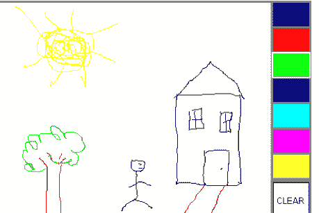

我将在这里讨论源代码的几个方面，但我鼓励你通读它。源代码中有很多很有价值的注释。

此示例的面板（panel）被设计为适用于任何合理的尺寸，也就是说，除非面板太小。这意味着坐标是根据面板的实际宽度和高度计算的（宽度和高度通过`getWidth()`和`getHeight()`获取）。这比我们假设面板具有特定的固定尺寸要好得多。让我们详细查看一些计算过程。大型白色绘制区域在垂直方向上从`x = 3`延伸到`y = height - 3`，水平方向上从`x = 3`延伸到`x = width - 56`。这些数字用于解释鼠标点击的含义。它们考虑了面板周围的灰色框以及面板边缘的调色板。灰色框宽 3 像素。彩色矩形宽 50 像素。考虑到面板周围有 3 像素的框以及绘制区域与彩色矩形之间有 3 像素的间隔，这使得绘制区域的右边缘距离面板右边缘 56 像素。

一个标记为"CLEAR"的白色正方形占据了面板右侧彩色矩形下方 50x50 的区域。我们可以计算出彩色矩形可用的垂直空间，然后将该空间除以 7，得到每个矩形的典型可用空间。这个量由变量`colorSpace`表示。在这个空间中，3 像素用作矩形之间的间距，每个矩形的高度为`colorSpace - 3`。第 N 个矩形的顶部位于面板顶部下方`(N*colorSpace + 3)`像素处，假设我们从 0 开始计数矩形。这是因为在第 N 个矩形上方有 N 个矩形，每个矩形都使用`colorSpace`。额外的 3 是为了面板顶部的框。在完成这些操作后，我们可以写出绘制第 N 个矩形的命令：

```java
g.fillRect(53, N*colorSpace + 3, colorSpace - 3);
```

这并不容易！但它展示了获得良好结果所需的思维方式和精确图形处理。

程序中的鼠标被用于绘制三种不同的东西：选择颜色、绘制内容和曲线。只有这第三者涉及拖拽，并不是每次鼠标点击都会启动拖拽操作。`mousePressed()`方法必须查看鼠标点击的 (x,y) 坐标并决定如何响应。如果用户点击了 CLEAR 矩形，绘制区域将通过`repaint()`清除。如果用户点击了彩色矩形带，则选择相应的矩形进行绘制。这涉及计算用户点击了哪种颜色，通过将 y 坐标除以`colorSpace`来。最后，如果用户点击了绘制区域，则启动拖拽操作。将`dragging`设置为`true`，以便`mouseDragged`和`mouseReleased`方法知道正在拖拽曲线。代码遵循上述给出的通用形式。曲线的实际绘制是在`mouseDragged()`方法中完成的，它从鼠标的上一个位置画线到当前位置。需要一些精力来确保线条不会超出面板的白色绘制区域。边界和颜色条是绘制表面的一部分。如果用户在拖拽时将鼠标拖到绘制区域外，则调整 x 和 y 坐标使其位于绘制区域内。

### 6.3.5 匿名事件处理器和适配器类

如上所述，使用匿名内部类定义监听器对象是一种常见做法。正如第 5.8.3 节所讨论的，使用`new`运算符的特殊形式来创建一个属于匿名类的对象。例如，可以使用以下表达式创建一个鼠标监听器：

```java
new MouseListener() {
    public void mousePressed(MouseEvent evt) { . . . }
    public void mouseReleased(MouseEvent evt) { . . . }
    public void mouseClicked(MouseEvent evt) { . . . }
    public void mouseEntered(MouseEvent evt) { . . . }
    public void mouseExited(MouseEvent evt) { . . . }
}
```

这是一个完整的表达式，它定义了一个未命名的类并创建一个属于该类的对象。要将该对象用作鼠标监听器，可以将其作为参数传递给某些组件的`addMouseListener()`方法，格式如下：

```java
component.addMouseListener(new MouseListener() {
    public void mousePressed(MouseEvent evt) { . . . }
    public void mouseReleased(MouseEvent evt) { . . . }
    public void mouseClicked(MouseEvent evt) { . . . }
    public void mouseEntered(MouseEvent evt) { . . . }
    public void mouseExited(MouseEvent evt) { . . . }
});
```

现在，在典型的应用程序中，该类的大部分定义都是空的。实现接口的类必须为所有方法提供定义，即使这些定义是空的。为了避免在这种情况下编写繁琐的方法定义，Java 提供了适配器类（adapter classes）。适配器类通过提供空定义来实现监听器接口。适配器类仅作为创建子类的基类时有用。在子类中，你可以只定义想要使用的方法。对于剩余的方法，将使用适配器类提供的空定义。适配器类同时实现了`MouseListener`和`MouseListener`接口，因此它可以作为创建任何鼠标事件监听器的基类。例如，如果你使用一个只响应鼠标按下事件的鼠标监听器，可以使用如下格式的命令：

```java
component.addMouseListener(new MouseAdapter() {
    public void mousePressed(MouseEvent evt) { . . . }
});
```


为了了解其在实际示例中的工作方式，让我们为第 6.3.2 节的 `ClickableRandomStrings` 程序编写另一个版本。这个版本使用基于 `MouseAdapter` 的匿名类来处理鼠标事件：

```java
window.setLocation(100,75);
window.setSize(300,240);
window.setVisible(true);
}
```

匿名内部类也可以用于事件处理之外的其他用途。例如，假设你想定义 `JPanel` 的子类来表示绘制表面。该子类只使用一次，并且会重写 `paintComponent` 方法，但不会对 `JPanel` 做任何其他更改。将该子类定义为匿名内部类是有意义的。你将在未来的某些示例中使用这种模式。

## 6.4 定时器、按键事件与状态机

并不是**每一个事件**都是由用户侧的操作生成的。事件也可以由对象作为其常规编程的一部分而生成，也可以由其他在事件发生时可以采取适当动作的对象生成。

其中一个例子是 `java.swing.Timer` 类。`Timer` 按照固定间隔生成事件。这些事件可以用于驱动动画或每隔一段时间执行一次某些其他任务。我们将从查看定时器和动画开始本节，然后查看另一种类型的用户生成事件：用户在键盘上打字时生成的 `KeyEvents`。在本节的最后，将同时使用定时器和键盘事件来实现一个简单的游戏，并引入状态机的重要概念。

### 6.4.1 定时器与动画

属于 `java.swing.Timer` 类的对象仅存在于生成事件。默认情况下，`Timer` 生成一系列事件，每个事件与下一个事件之间有固定的延迟。（可以使用 `Timer` 在指定的时间延迟后发出事件；在这种情况下，定时器被用作“闹钟”。）

每个事件都属于 `ActionListener` 类，该类只定义了一个方法：

```java
public void actionPerformed(ActionEvent evt)
```

要使用定时器，请创建一个实现 `ActionListener` 接口的对象。也就是说，该对象必须属于一个声明为“实现 `ActionListener`”的类，且该类必须定义 `actionPerformed` 方法。然后，如果将该对象设置为监听来自定时器的事件，那么每当定时器生成一个事件时，监听器的 `actionPerformed` 方法中的代码就会执行。

由于如果没有响应其事件的监听器，定时器就没有意义，因此定时器的动作监听器是作为参数在定时器的构造函数中指定的。定时器事件之间的时间延迟也在构造函数中指定。如果 `timer` 是 `Timer` 类型的变量，那么语句：

```java
timer = new Timer(millisDelay, listener);
```

将创建一个事件之间延迟为 `millisDelay` 的定时器（1000 毫秒等于一秒）。来自定时器的事件会被发送到监听器（`millisDelay` 必须是 `int` 类型，`listener` 必须是 `ActionListener` 类型）。每当定时器发出事件时，监听器的 `actionPerformed()` 就会执行。

注意，定时器并不保证以完全规律的间隔传递事件。如果计算机正忙于其他任务，事件可能会延迟，甚至被完全丢弃。

定时器对象在创建时不会自动开始生成事件。必须调用定时器的 `start()` 方法来告诉定时器开始运行。可以使用 `stop()` 方法关闭事件流，也可以再次调用 `start()` 重新启动。

---

定时器的应用之一是计算机动画。计算机动画只是一系列连续的静止图像。如果图像之间的时间很短，且从一张图像到另一张图像的变化不大，用户就会感知到连续的运动。

在 Java 中实现动画最简单的方法是使用 `Timer` 来绘制动画。每当定时器生成一个事件时，就会计算并在屏幕上绘制动画的下一帧——在监听来自定时器的事件对象的 `actionPerformed` 方法中实现此点的代码如下：

我们使用定时器的第一个示例并不完全是动画，但它确实为每个定时器显示了一个新图像。程序显示随机生成的、模糊类似于抽象艺术作品的图像。事实上，程序每次调用 `paintComponent()` 方法时都会绘制一张新的随机图像。

```java
import java.awt.*;
import java.awt.event.*;
import java.swing.*;

public class RandomArt extends JPanel {

    /**
     * 构造函数
     */
    public RandomArt() {

        ActionListener listener = new ActionListener() {

            @Override
            public void actionPerformed(ActionEvent evt) {
                repaint();
            }

        };

        Timer timer = new Timer(1000, listener);
        timer.start();
    }

    /**
     * 绘制组件
     */
    @Override
    protected void paintComponent(Graphics g) {
        super.paintComponent(g);

        Random rand = new Random();

        int x = rand.nextInt(getWidth());
        int y = rand.nextInt(getHeight());
        int width = rand.nextInt(50);
        int height = rand.nextInt(50);

        g.setColor(new Color(
            rand.nextInt(256),
            rand.nextInt(256),
            rand.nextInt(256)
        ));

        g.fillRect(x, y, width, height);
    }

    public static void main(String[] args) {
        Frame frame = new Frame("Random Art");
        RandomArt panel = new RandomArt();

        frame.add(panel);
        frame.setSize(300, 240);
        frame.setLocation(100, 75);
        frame.setVisible(true);
    }
}
```

在本节的最后，我们将同时使用定时器和键盘事件来实现一个简单的游戏。

### 6.4.2 按键事件

在 Java 中，动作事件会在程序中变得活跃。这些事件与 GUI 组件相关。当用户点击鼠标上的按钮时，事件会由该组件生成。那么按键事件呢？当用户按下键盘时，哪个组件与按键相关？

GUI 使用输入焦点来确定与键盘事件相关的组件。在任何时刻，屏幕上只有一个界面拥有输入焦点，所有的键盘事件都指向那里。如果界面恰好是一个 Java 组件，它会被传递一个 `KeyEvent`，并传递给任何监听该组件的监听器。管理焦点为处理按键事件增加了额外的复杂度。

给用户关于哪个组件具有输入焦点的反馈是个好做法。例如，如果组件是文字处理区域，反馈通常是闪烁的光标形式。另一种视觉提示是在组件拥有输入焦点时，在其周围绘制一个鲜艳的边框，正如我在随后的示例中所做的那样。

如果有任何组件你希望获得输入焦点，可以调用 `requestFocusWindow()`，只要窗口包含该组件且只有一个组件请求焦点，它就是有效的。在某些情况下，当只有一个活动组件时，在打开窗口后调用此方法就足够，窗口将在剩余时间内保持焦点。（注意，有一个 `requestFocus()` 方法即使在窗口未激活时也能工作，但在这种情况下推荐使用前者。）

在一个典型的用户界面中，用户可以通过鼠标点击某个组件来选择将焦点交给该组件。按下 Tab 键会将焦点从一个组件移动到另一个。这由组件自动处理，不需要你进行编程。然而，某些组件在用户点击它们时不会自动请求输入焦点。为了解决这个问题，程序可以注册一个用于检测用户点击组件的鼠标监听器。在响应用户点击时，`mousePressed()` 方法应该为该组件调用 `requestFocusInWindow()`。这尤其适用于用作绘图表面的 `JPanel`，因为 `JPanel` 对象不会自动接收焦点。

作为我们处理键盘事件的第一个示例，我们来看一个示例程序，用户通过按下按键来移动正方形上、下、左、右。当用户按下 `R`、`G`、`B` 或 `K` 时，正方形的颜色分别设置为红色、绿色、蓝色或黑色。除非面板拥有焦点，否则这些事件都不会传递给面板。

该程序在拥有焦点时会显示其外观：当拥有焦点时，面板周围会绘制一个青色的边框；当没有焦点时，则绘制一个灰色的边框。此示例的完整源代码可以在 `KeyboardAudioFocusDemo.java` 文件中找到。我将讨论它的某些方面。在阅读完本节后，你应该能够完全理解这段源代码。我建议运行该程序，看看它是如何工作的。

在 Java 中，键盘事件属于 `KeyEvent` 类。需要监听 `KeyEvent` 的对象必须实现 `KeyListener` 接口。必须通过调用组件的 `addKeyListener()` 方法来注册对象。注册通过命令 `component.addKeyListener(listener)` 完成，其中 `listener` 是要监听键盘事件的对象，而 `component` 是将产生键盘事件的对象（当它拥有焦点时）。`component` 和 `listener` 可能是同一个对象。

当然，这一切都与你在上一节中学到的关于鼠标事件的知识直接类比。`KeyListener` 接口定义了以下方法，这些方法必须包含在所有实现 `KeyListener` 的类中：

```java
public void keyPressed(KeyEvent evt);

public void keyReleased(KeyEvent evt);

public void keyTyped(KeyEvent evt);
```

Java 在你使用的按键和你输入的字符之间做了仔细的区分。有很多按键，如数字键、修饰键（如 Control 和 Shift）、方向键、Page Up 和 Page Down 键、小键盘按键、功能键等。在某些情况下（例如 Shift 键），按键不会输入字符。另一方面，输入字符有时涉及按下多个按键。

例如，要输入大写的 `A`，你必须按下 Shift 键然后按 `A`，最后释放 Shift。在我的 Mac OS 计算机上，释放 Option 键并按下 `E` 只输入了一个字符，我必须执行三键事件，并且当时必须释放一个按键。

在 Java 中，有三种类型的 `KeyEvent`。这些类型对应于按下按键、释放按键和输入字符。当用户按下按键时调用 `keyPressed` 方法，当用户释放按键时调用 `keyReleased` 方法，当用户输入字符时调用 `keyTyped` 方法。

请注意，一个动作（如按下 `E`）可以产生两个 `keyPressed` 事件和一个 `keyTyped` 事件。输入大写 `A` 可以产生两个 `keyPressed` 事件、两个 `keyReleased` 事件和一个 `keyTyped` 事件。

通常情况下，从两个独立的事件流的角度来看会更好：一个流由 `keyPressed` 和 `keyReleased` 事件组成，另一个流由 `keyTyped` 事件组成。对于某些应用程序，你想监控第一个流；对于另一些应用程序，你想监控第二个流。

尽管如此，`keyTyped` 流中的信息可以从 `keyPressed`/`keyReleased` 流中提取，但这样做将很困难，而且在某种程度上取决于系统。某些用户操作（如按下 Shift 键）只能检测到 `keyPressed` 事件。

我以前有一个纸牌接龙，每当我按住 Shift 键时，每张牌都可以移动。你可以在 Java 中实现此类操作：当按下 Shift 键时让牌倾斜，释放 Shift 键时移除高亮。

还有一个复杂性。通常，当你按住键盘上的某个键时，该键会自动重复。这意味着它会产生多个 `keyPressed` 事件，仅在序列结束时产生 `keyReleased` 事件。它还可以产生多个 `keyDown` 事件。在大多数情况下，这不会影响你的编程，但你不应该期望每个 `keyPressed` 事件都有一个对应的 `keyReleased` 事件。

键盘上的每个按键都有一个索引代码（实际上，许多键盘具有无法与 Java 使用的额外键）。当调用 `keyPressed` 或 `keyReleased` 方法时，参数 `evt` 包含被按下或释放的按键代码。该代码可以通过调用函数 `evt.getKeyCode()` 获取。

Java 并没有要求你背诵代码表，而是为每个按键提供了一个名称。这些常量定义在 `KeyEvent` 类中。例如，Shift 键的常量是 `KeyEvent.VK_SHIFT`。如果你想测试用户按下的键是否是 Shift 键，可以写成：

```java
if (evt.getKeyCode() == KeyEvent.VK_SHIFT)
```

四个方向键的代码是 `KeyEvent.VK_LEFT`、`KeyEvent.VK_RIGHT`、`KeyEvent.VK_UP` 和 `KeyEvent.VK_DOWN`。它们都有相似的代码（`VK` 代表 “Virtual Keyboard”，即虚拟键盘）。

实际上，不同的键盘使用不同的代码，但 Java 将实际代码翻译成了自己的“虚拟”代码。你的程序看到这些虚拟代码，因此就可以在任何键盘上运行。

```java
public void focusLost(Focus evt) {
    // 面板现在丢失了输入焦点。
    repaint(); // 将用新的消息和灰色边框进行重绘
}
```


处理焦点的另一个方面是确保面板确实获得了焦点。在这种情况下，我在打开窗口后，立即为面板的 `main()` 规程请求了 `requestFocusWindow()`。这种方法之所以有效，是因为窗口中只有一个组件，并且在使用程序期间它应该拥有焦点；当窗口变为非活动状态时，面板会暂时失去焦点，但当用户点回程序窗口时，焦点又会恢复。

关于程序的整体结构，仍有一些需要做出的决定。在这种情况下，我决定使用一个嵌套类 `Listener` 来定义一个同时监听焦点事件和按键事件的对象。在面板的构造函数中，我创建了一个 `Listener` 类型的对象，并将其注册以监听按键事件和来自面板的事件。详细信息请参考源代码。

### 6.4.4 状态机

存储在对象实例变量中的信息被称为表示该对象的状态。当调用对象的某个方法时，对象所采取的动作可能取决于它的状态。（或者，用我们一直使用的术语来说，方法的定义可以查看实例变量来决定做什么）。（也就是说，方法的定义可以为实例分配新值。）在计算机科学中，这就是状态机的概念，它只是一个拥有状态并能根据事件或输入改变状态的东西。状态机对事件的响应取决于事件发生时它处于什么状态。对象就是一种状态机。有时，这种观点在设计类时非常有用。

状态机的观点在图形化用户界面（GUI）所要求的事件驱动型编程类型中可能特别有用。在设计 GUI 时候，你可能会问自己：我将如何管理状态？我需要跟踪它。哪些事件可以改变程序的状态？我对事件的响应将如何依赖于当前状态？是否应该改变 GUI 的外观以反映状态的变化？这是对自顶而下、逐步细化风格的程序设计的一种替代方案，而那种风格并不适用于事件驱动型程序的整体设计。

在上述的 `KeyboardFocusDemo` 程序中，程序的状态记录在实例变量 `color`、`squareLeft` 和 `squareTop` 中。这些状态变量被用于 `paintComponent()` 方法，以决定如何绘制面板。它们的值在两个事件处理方法中被改变。

在本节的剩余部分，我们将看另一个例子，其中状态起了更重要的作用。在这个例子中，用户通过按键来玩一个简单的街机风格游戏。程序定义在源代码 `SubKiller.java` 中。像往常一样，编译并运行程序以及阅读完整的源代码是一个好主意。这里有一张图片：

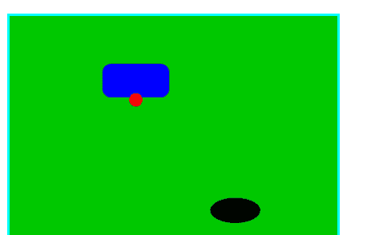

程序显示面板底部附近有一个黑色的“潜艇”。当输入获得焦点时，这艘潜艇在底部附近无规律地来移动。在顶部有一艘蓝色的“船”。你可以通过按下左、右箭头键来让这艘船反复移动。船上挂着一个红色的“炸弹”（或“深水炸”）。你可以通过按下向下箭头键来投放炸弹。目标是用炸弹击中潜艇使其爆炸。如果炸弹掉出屏幕底部，你会得到一个新的。如果潜艇爆炸，就会创建一个新的潜艇，并给你一个新的炸弹。试一试！确保至少击中潜艇一次，否则你看不到爆炸。

让我们思考一下这个游戏是什么样子的。首先，我们正在做的是……（注：此处原文似乎有截断，翻译已根据提供的文本进行处理）

# 第 6 章：GUI 编程简介

注意，在此方法中没有必要调用 `repaint()`，因为此面板显示的是不断重绘的动画。状态的任何变化都将在下一帧绘制时立即对用户可见。在程序的某个时刻，我必须确保用户不会将船移出屏幕。我本可以在 `keyPressed()` 中实现这一点，但我选择在另一个例程——即 `boat` 对象中进行检查。

程序使用监听器来响应来自计时器的事件、用户必须点击面板来开始游戏）、焦点事件以及鼠标事件。在这个程序中，游戏被设计为只要面板具有输入焦点就会一直运行。例如，程序不会自动请求焦点；必须由用户操作。当用户点击面板时，鼠标监听器会请求输入焦点，游戏开始。计时器仅在面板具有输入焦点时运行；这是通过让监听器在面板获得输入焦点时启动、在面板失去输入焦点时停止计时器来实现。所有四个监听器都是在 `SubKillerPanel` 的构造函数中使用匿名内部类创建的。（参见第 6.3.5 节）。

我鼓励你阅读 `SubKiller.java` 中的源代码。虽然有几点比较复杂，但只要付诸努力，你应该能够阅读并理解整个程序。尝试从状态机的角度来理解程序。注意游戏中的三个对象每个的状态是如何响应来自计时器和用户的事件而改变的。

虽然 `SubKiller` 游戏不像街机游戏那样复杂，但它包含了一些有趣的编程技巧。它很好地说明了如何在事件驱动型编程中应用状态机思维。

### 6.5 基础组件

在之前的章节中，我们学习了如何使用图形上下文在屏幕上绘图，以及如何处理鼠标事件和键盘事件。从某种意义上说，这就是 GUI 编程的全部。如果你正在编写程序来完成所有的绘制并处理所有的鼠标和键盘事件，你就没有更多需要学习的。然而，你要么会比需要更多的工作，要么会将自己限制在非常简单的用户界面上。典型的用户界面使用 GUI 组件作为按钮、滚动条、框和菜单。这些组件已经为你写好了，所以你不需要在开发它们时重复工作。它们知道如何绘制自己，并且可以处理与它们相关的鼠标和键盘事件处理细节。

考虑最简单的界面组件之一：推按钮（push button）。按钮有一个边框，并显示一些文本。这些文本是可以更改的。有时按钮是禁用的，这样点击它就不会产生任何影响。当它被禁用时，它的外观会发生变化。当用户点击推按钮时，按钮在鼠标按钮按下期间会改变外观，并在释放鼠标时恢复原状。事实上，情况比这更复杂。如果用户在释放鼠标之前将鼠标移到推按钮之外，按钮将变为它的常规外观。要实现这一点，必须响应鼠标事件或多个鼠标事件。此外，在许多平台上，按钮可以接收输入焦点。当按钮拥有焦点时，它的外观会发生变化。如果按钮拥有焦点且用户按下空格键，按钮会被触发。这意味着按钮必须响应键盘事件和焦点事件。

幸运的是，只要你使用了标准类 `javax.swing.JButton` 的对象，你就不需要编写这些中的任何代码。`JButton` 会自己绘制自己并处理鼠标、键盘和焦点事件。当用户通过点击它或在按钮具有输入焦点时按下空格键触发它时，你会从 `JButton` 处获得通知。`JButton` 对象会创建一个属于 `java.awt.event.ActionEvent` 类的事件对象。该事件会被发送给任何注册的监听器，告诉它们按钮已被按下。你的程序只获取它需要的信息——即按钮被按下的事实。

作为 Swing 图形接口 API 部分的标准组件是由 `JButton` 类的子类定义的，而 `JButton` 本身是 `Component` 的子类。（注意，这包括我们已经广泛使用的 `JPanel` 类）。`Component` 和 `JPanel` 类中定义了许多实用方法，可以用于任何 Swing 组件。我们首先查看其中一些方法。假设 `comp` 是一个引用 `JPanel` 的变量。可以使用以下方法：

- `getSize()` 和 `getHeight()` 是提供组件当前尺寸（单位为像素）的函数。当组件首次创建时，尺寸为零。尺寸稍后会被设置，可能由布局管理器设置。一个常见的错误是在组件设置之后（例如在构造函数中）使用组件的尺寸。
- `setEnabled(true)` 和 `setEnabled(false)` 用于启用和禁用组件。当组件被禁用时，它的外观可能会发生变化，用户无法对其进行任何操作。有一个布尔值函数 `comp.isEnabled()`，你可以调用它来发现组件是否已启用。
- `setVisible(true)` 和 `setVisible(false)` 可以用来隐藏或显示组件。
- `setFont(font)` 设置组件上显示的文本的字体。
- `setBackground(color)` 和 `setForeground(color)` 设置组件的背景色和前景颜色。见第 6.2.2 节。
- `setOpaque(true)` 通知组件在绘制组件内容之前，组件占据的区域应该用组件的背景颜色填充。默认情况下，所有 `JLabel` 都是非透明的。不透明（或“透明”）组件会忽略其背景颜色，只需将其内容绘制在其容器的内容之上。
- `setToolTip(string)` 将指定的字符串设置为组件的“工具提示”（tool tip）。如果鼠标悬停，则会出现工具提示。
- `setPreferredSize(size)` 设置组件的首选尺寸。
- `setMinimumSize(size)` 设置组件的最小尺寸。
- `setMaximumSize(size)` 设置组件的最大尺寸。
- `setBounds(x, y, width, height)` 设置组件的位置和大小。
- `add(component)` 将组件添加到容器中。
- `remove(component)` 从容器中移除组件。

我鼓励你阅读 `SubKiller.java` 中的源代码。虽然有几点比较复杂，但只要付诸努力，你应该能够阅读并理解整个程序。尝试从状态机的角度来理解程序。注意游戏中的三个对象每个的状态是如何响应来自计时器和用户的事件而改变的。

虽然 `SubKiller` 游戏并不像街机游戏那样复杂，但它包含了一些有趣的编程技巧。它很好地说明了如何在事件驱动型编程中应用状态机思维。

# 第 6 章：GUI 编程简介

### 6.5.1 JButton

`JButton` 对象是一个用户点击即可触发某些动作的推按钮。我们在 6.1 节中使用过按钮，但现在将对它们进行更详细的考虑。为了有效地使用任何组件，该类有几个方面是你应该熟悉的。对于 `JButton`，例如，这些方面规定：

- 构造函数：`JButton` 有一个接受字符串作为参数的构造函数。该字符串成为按钮上显示的文本。例如：`stopButton = new JButton("Go")`。这创建了一个显示 `"Go"` 的按钮对象（但记住按钮必须先添加到容器才能显示）。
- 事件：当用户点击按钮时，按钮会生成一个 `ActionEvent` 类型的事件。这会被发送给任何已向按钮注册的监听器。
- 监听器：处理按钮生成的事件的对象必须实现 `ActionListener` 接口。该接口定义了一个方法 `public void actionPerformed(ActionEvent evt)`，它用于通知对象动作事件。
- 监听器的注册：为了实际接收来自按钮的事件，必须向按钮注册 `addActionListener`。这是通过按钮的 `addActionListener()` 方法实现的。例如：`stopButton.addActionListener(handler)`。
- 事件方法：当按钮调用 `actionPerformed(evt)` 时，`evt` 包含了关于事件的信息。可以通过 `ActionEvent` 类中的方法获取。特别是 `evt.getActionCommand()` 返回与按钮关联的字符串。默认情况下，这是按钮上显示的文本，但也可以将其设置为其他字符串。`getSource()` 方法返回产生对象的引用，即被按下的 `JButton`。返回值是 `Object` 类型而不是 `JButton`，因为其他类型的组件也可以产生 `ActionEvent`。

### 6.5.2 JLabel

`JLabel` 无疑是最简单的组件类型。`JLabel` 类型的对象仅用于显示一行文本。用户无法编辑该文本，尽管可以通过你的程序对其进行更改。`JLabel` 的构造函数指定了要显示的文本：

```java
JLabel message = new JLabel("Hello World!");
```

还有另一个构造函数，它在存在额外空间时，指定文本在标签中的位置。可选的对齐方式由常量 `JLabel.LEFT`、`JLabel.CENTER` 和 `JLabel.RIGHT` 给出。例如：

```java
JLabel message = new JLabel("Hello World!", JLabel.CENTER);
```

这会创建一个文本在可用空间内居中的标签。你可以通过调用 `setText()` 方法来更改标签显示的文本：

```java
message.setText("Goodbye World!");
```

由于 `JLabel` 是 `JComponent` 的子类，因此你可以对标签使用如 `setForeground` 和 `setFont` 等方法。如果你想让背景颜色产生任何效果，应该在标签上调用 `setOpaque(true)`，否则 `JLabel` 可能不会填充其背景。例如：

```java
JLabel message = new JLabel("Hello World!", JLabel.CENTER);

message.setForeground(Color.RED); // 显示红色文本……
message.setBackground(Color.BLACK); // 在黑色背景上……
message.setFont(new Font("Serif", Font.BOLD, 18)); // 使用大粗体字体。
message.setOpaque(true); // 确保背景已填充。
```


### 6.5.3 JCheckBox

`JCheckBox` 是一种具有两种状态的组件：选中或未选中。用户可以通过点击它来更改复选框的状态。复选框的状态由布尔值表示，如果框被选中则为 `true`，如果未选中则为 `false`。复选框有一个标签，通过以下方式指定：

```java
JCheckBox showTime = new JCheckBox("Current Time");
```

通常，由用户设置 `JCheckBox` 的状态，你也可以通过程序设置状态。复选框当前的状态使用其 `setSelected(boolean)` 方法设置。例如，如果你想更改复选框状态以显示时间，可以使用 `showTime.setSelected(true)`。要取消勾选框，使用 `showTime.setSelected(false)`。你可以通过调用 `isSelected()` 方法来确定复选框的当前状态，该方法返回一个布尔值。

在许多情况下，你不需要担心来自复选框的事件。当用户更改状态时，`JCheckBox` 会生成一个事件，你可以检测此事件并在状态变化时对其做出响应。当用户更改复选框的状态时，它会生成一个 `Action` 类型事件。如果你希望在用户更改状态时发生某些操作，必须通过调用 `addActionListener(ActionListener)` 方法为复选框注册一个 `ActionListener`。（注意，如果你通过调用 `setSelected()` 方法更改状态，则不会生成 `ActionEvent`。然而，`JCheckBox` 类中还有另一个方法 `doClick()`，它可以模拟用户点击复选框并生成一个 `ActionEvent`。）

在处理 `ActionEvent` 时，你可以在 `actionPerformed()` 方法中调用 `evt.getSource()` 来找出是哪个组件生成了事件。（当然，如果你只监听来自一个组件的事件，则不需要这样做。）返回值的类型为 `Object`，但你可以将其强制转换为所需的任何类型。你已经知道生成事件的对象，可以要求该对象告诉你它的当前状态。例如，如果你知道事件来自两个复选框中的 `cb1` 或 `cb2`，那么你的 `actionPerformed()` 方法可能如下：

```java
public void actionPerformed(ActionEvent evt) {
    Object source = evt.getSource();

    if (source == cb1) {
        boolean newState = cb1.isSelected();
        ... // 响应状态的变化
    } else if (source == cb2) {
        boolean newState = cb2.isSelected();
        ... // 响应状态的变化
    }
}
```

或者，你可以使用 `evt.getActionCommand()` 来获取与源关联的动作命令。对于 `CheckBox`，动作命令默认是复选框的标签。

### 6.5.4 JField 和 JTextArea

`JField` 和 `JTextArea` 代表包含可供用户编辑文本的组件。`JField` 持有单行文本，而 `JTextArea` 可以容纳多行。还可以将 `JField` 或 `JTextArea` 设置为只读，这样用户就可以读取它无法编辑的文本。这两个类都是抽象类 `JComponent` 的子类，该抽象类定义了它们的属性。

`JField` 和 `JTextArea` 有许多共同方法。实例方法 `setText()` 接收 `String` 类型的参数，可用于更改输入组件中显示的文本。可以通过调用其实例方法 `getText()` 获取组件的内容，如果你想停止修改文本，可以调用 `setEditable(false)`。使用参数为 `true` 的相同方法将使输入组件变为用户可编辑。

只有当文本组件获得焦点时，用户才能向其输入。用户可以通过鼠标点击它向组件提供输入，但有时通过程序向文本字段提供输入是有用的。你可以通过调用 `requestFocus()` 实现这一点。例如，如果我发现用户输入中有错误，我通常会在包含该错误的文本字段上调用 `requestFocus()`。这有助于用户看到错误发生的位置，并让用户立即开始修正。

顺便提一下，标准 Swing 中没有 `JField`；它可能是 `JTextField`。根据上下文，我将保持原文不变，但注意到它指的是 `JTextField`。

## 第 6 章 GUI 编程简介

滚动面板（scroll pane）提供了用于滚动文本区域的滚动条。滚动条仅在需要时出现，即当文本的大小超过文本区域大小时。请注意，如果你想将文本区域放入容器中，你应该将滚动面板本身添加到容器中。请参考程序 `TextAreaDemo.java`，以获取关于在滚动面板中使用文本的简短示例。

当用户在 `JTextField` 中输入并按下回车键时，会产生一个 `Action`。如果你想响应这些事件，可以使用文本字段的 `addActionListener` 方法为文本字段注册一个 `ActionListener`。（由于 `TextArea` 可以包含多行文本，在文本区域中按键不会产生事件；它只是会开始新的一行文本。）

`JTextField` 有一个子类 `JPasswordField`，它与之相同，但不会显示其包含的文本。`JPasswordField` 中的字符都显示为星号（`*`）或其他字符。密码字段显然设计用于让用户输入密码而不在屏幕上显示它。

文本组件实际上是非常复杂的，我在这里只涵盖了它们最基础的属性。我将在第 13 章中回到文本组件的话题。

### 6.5.5 JSlider

`JSlider` 提供了一种让用户从可能的取值范围内选择整数值的方法。用户通过沿着滚动条拖动“旋钮”（knob）来实现这一点。滑块可以可选地装饰刻度线（tick marks）和标签（labels）。这张图片来自示例 `SliderDemo.java`，显示了三个具有不同装饰和不同值范围的滑块：

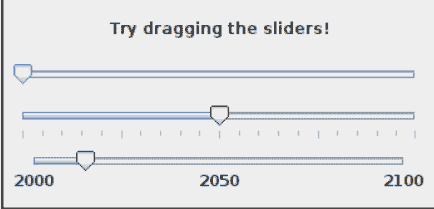

第二个滑块装饰了刻度线，第三个装饰了标签。单个滑块可以同时拥有这两种类型的装饰。

`JSlider` 最常用的构造函数指定了滑块的范围起始值和结束值，以及它出现在屏幕上时的初始值：

```java
public JSlider(int minimum, int maximum, int value)
```

如果省略这些参数，则将使用值 `0`、`100` 和 `50`。默认情况下，滑块是水平的，但你可以通过调用 `setOrientation(JSlider.VERTICAL)` 来改变它。可以使用其 `getValue()` 方法随时读取 `JSlider` 的当前值，该方法返回一个 `int` 类型的值。如果你想更改值，可以使用 `setValue(n)` 方法，它接受一个 `int` 类型的参数。

如果你想在用户更改滑块的值时注册监听器，可以使用 `JSlider`。与我们看到的其他组件不同，它们不会产生 `ActionEvents`。相反，它们产生 `ChangeEvent` 类型事件。`ChangeEvent` 相关类定义在 `javax.swing.event` 包中而不是 `java.awt.event`，所以如果你需要 `ChangeEvent`，应该在程序的开头导入 `javax.swing.event.*`。你必须定义一个实现 `ChangeListener` 接口的对象，并且通过添加 `addChangeListener()` 方法向滑块注册监听器。一个 `ChangeListener` 提供了一个方法的定义：

```java
public void stateChanged(ChangeEvent evt)
```

每当滑块的值改变时，此方法就会被调用。请注意，当你使用 `setValue()` 更改值以及用户更改值时，该方法都会被调用。在 `stateChanged()` 方法中，你可以调用 `getSource()` 来找出哪个对象生成了事件。如果你想知道是否是用户生成了事件，调用滑块的 `getValueIsAdjusting()` 方法，如果用户正在拖动滑块上的旋钮，该方法将返回 `true`。

在滑块上使用标记包括两步过程：指定刻度线之间的间隔，并告诉滑块应该显示标记。实际上有两种类型的标记：“主要刻度”（major marks）和“次要刻度”（minor marks）。你可以拥有其中一种或两者。

## 布局管理器

`JPanel` 的默认布局是 `FlowLayout`（流式布局）；也就是说，除非通过调用面板的 `setLayout()` 方法指定不同的布局管理器，否则 `JPanel` 都会使用 `FlowLayout`。

一行中的组件可以在该行内进行左对齐、右对齐或居中对齐，并且组件之间存在水平和垂直间距。如果使用默认构造函数 `new FlowLayout()`，则每行的组件将居中显示，且水平和垂直间距均为五个像素。可以使用以下构造函数：

```java
public FlowLayout(int align, int hgap, int vgap)
```

来指定对齐方式和间距。`align` 的可能值为 `FlowLayout.LEFT`、`FlowLayout.RIGHT` 和 `FlowLayout.CENTER`。

假设 `container` 是一个使用 `FlowLayout` 作为其布局管理器的容器。可以使用语句将组件 `comp` 添加到容器：

```java
container.add(comp);
```

`FlowLayout` 将所有以这种方式添加到容器的组件排列整齐。它们将按照被添加的顺序进行排列。例如，这张图片显示了使用 `FlowLayout` 的面板中的五个按钮：

| 按钮 1 | 按钮 2 | 按钮 3 |
| :--- | :--- | :--- |
|  | 按钮 4 | 按钮 5 |

注意，这五个按钮无法跨越面板占据一行，它们被排列成两行。在每行中，按钮被组合在一起并在行内居中。使用以下语句将按钮添加到面板：

```java
panel.add(button1);
panel.add(button2);
panel.add(button3);
panel.add(button4);
panel.add(button5);
```

当容器使用布局管理器时，布局管理器通常负责计算容器的首选尺寸（preferred size）（尽管可以通过调用容器的 `setPreferredSize` 方法来设置不同的首选尺寸）。`FlowLayout` 倾向于将它的组件放在单行中，因此首选宽度是所有组件首选宽度之和加上它们之间的水平间距。首选高度是所有组件中的最大高度。

### BorderLayout

`BorderLayout`（边框布局）管理器设计用于显示一个大型中央组件，并在中央组件的边缘排列最多四个较小的组件。如果容器 `cntr` 使用 `BorderLayout`，则应使用形式如下的语句将组件 `comp` 添加到容器：

```java
cntr.add(comp, BorderLayoutPosition);
```

其中 `BorderLayoutPosition` 指定组件在布局中应占据的位置，其值为常量 `BorderLayout.CENTER`、`BorderLayout.NORTH`、`BorderLayout.SOUTH`、`BorderLayout.EAST` 或 `BorderLayout.WEST` 之一。这五个位置的含义如图所示：

| 北（North） |  |  |
| :--- | :--- | :--- |
| 西（West） | 中（Center） | 东（East） |
| 南（South） |  |  |

注意，布局可以包含少于五个组件，因此不需要填充所有五个可能的区域。然而，没有中央组件是非常见的。

`BorderLayout` 设置其组件的大小如下：`NORTH`（北）和 `SOUTH`（南）组件（如果存在）采用首选高度，但它们的宽度被设置为容器的全宽度。`EAST`（东）和 `WEST`（西）组件采用首选宽度，但其高度设置为容器的高度减去北、南组件占据的空间。最后，`CENTER`（中）组件占据任何剩余空间。在完成布局时，`CENTER` 组件的首选尺寸会被忽略，但在计算整个容器的首选尺寸时它会被考虑在内。你应该确保放入 `BorderLayout` 的组件适用于它们将占据的位置。例如，水平滑动条或文本字段非常适合放在 `NORTH` 或 `SOUTH` 位置。

默认构造函数 `new BorderLayout()` 在组件之间不留任何空间。如果你想留出一些空间，可以在 `BorderLayout` 对象的构造函数中指定水平和垂直间距。例如：

```java
panel.setLayout(new BorderLayout(5, 7));
```

那么管理器将在组件之间插入 5 像素的水平间距和 7 像素的垂直间距。容器的背景颜色将在这些间隙中显示。包含 `JFrame` 的原始根内容面板（root content pane）的默认布局是没有水平或垂直间距的 `BorderLayout`。

### GridLayout

最后，我们考虑 `GridLayout`（网格布局）管理器。网格将组件排列在一个包含等大小矩形行和列的网格中。此插图显示了组件将如何在 4 行 3 列的网格布局中排列：

| #1 | #2 | #3 |
| :--- | :--- | :--- |
| #4 | #5 | #6 |
| #7 | #8 | #9 |
| #10 | #11 | #12 |

如果容器使用 `GridLayout`，容器的相应 `add` 方法接受一个类型为 `Component` 的参数（例如：`cntr.add(comp)`）。组件按顺序添加到网格中；也就是说，每行从左到右填满，然后处理下一行。

`GridLayout` 的构造函数形式为 `new GridLayout(R, C)`，其中 `R` 是行数，`C` 是列数。如果你想在列之间留出 `H` 像素的水平间距，在行之间留出 `V` 像素的垂直间距，可以使用 `new GridLayout(R, C, H, V)`。当你使用 `GridLayout` 时，向网格中添加一些组件可能是很有用的。单行的水平网格和单列的垂直网格非常常见。

例如，假设 `button1`、`button2` 和 `button3` 是你想在面板的水平行中显示的按钮。如果你对面板使用网格，按钮将完全填充面板且大小相同。面板的创建方式如下：

```java
JPanel jButton = new JPanel();

jButton.setLayout(new GridLayout(1, 3));
// 注意：这里的 "3" 大部分被忽略，你也可以说 "new GridLayout(1, 0)"
// 为了在按钮之间留出间距，你可以使用 new GridLayout(1, 0, 5, 5)

jButton.add(button1);
jButton.add(button2);
jButton.add(button3);
```

你可能会发现这比默认的 `FlowLayout` 更吸引人。

### 边框

我们已经学会了如何在容器组件之间留间隙，但如果你想在容器周围留一个边框怎么办？这个问题不是布局管理器处理的。相反，边框是由对象表示的。`Border` 对象可以添加到任何 `JComponent`，而不仅仅是容器。`javax.swing.BorderFactory` 类包含许多创建边框对象的静态方法。例如，函数：

```java
BorderFactory.createLineBorder(Color.BLACK)
```

返回一个代表组件外部一像素黑线的对象。如果 `comp` 是一个 `JComponent`，可以使用其 `setBorder` 方法将边框添加到 `comp`。例如：

```java
comp.setBorder(BorderFactory.createLineBorder(Color.BLACK));
```


一旦为 `JComponent` 设置了边框，边框就会自动绘制，程序员无需额外努力。边框绘制在组件的边缘，紧邻其边界内部。`JPanel` 或容器的布局管理器会将边框占据的空间考虑在内。我不建议在用绘图表面的 `JPanel` 上使用边框。然而，如果你这样做，你应该考虑边框。如果你在边框占据的区域内绘图，绘图的那部分将被边框覆盖。

# 第 6 章 GUI 编程简介

以下是一些可以用来创建边框的静态方法：

- `BorderFactory.createEmptyBorder(top,left,bottom,right)` — 在组件边缘周围留出一个空边框。该空间内没有任何内容，因此组件的背景颜色将出现在边框占据的区域。参数是整数，表示沿组件顶部、左侧、底部和右侧边缘的边框宽度。这在使用包含其他组件的 `JPanel` 时实际上非常有用。它在组件和面板边缘之间留出了一些空间。它也可以用于 `JLabel`，否则文本和标签边缘之间将没有任何空间。
- `BorderFactory.createBorder(color,thickness)` — 在组件的四边周围画一条线。第一个参数的类型为 `Color`，用于指定线条的颜色。第二个参数是整数，用于指定边框的厚度（单位为像素）。如果省略第二个参数，则绘制一条厚度为 1 的线。
- `BorderFactory.createMatteBorder(top,left,bottom,right,color)` — 与 `createLineBorder` 类似，但你可以为组件的顶部、左侧、底部和右侧边缘指定不同的厚度。
- `BorderFactory.createEtchedBorder()` — 创建一个像在组件边界周围刻出的槽的边框。该效果通过使用组件背景色的较浅和较深颜色来实现，它对所有背景颜色的效果都不理想。
- `BorderFactory.createLowerBevelBorder()` — 给组件提供三维效果，使其看起来像是凹入计算机屏幕中。与 `EtchedBorder` 一样，这只对某些背景颜色效果良好。
- `BorderFactory.createRaisedBevelBorder()` — 与 `LoweredBevelBorder` 类似，但组件看起来像是凸于计算机屏幕之上。
- `BorderFactory.createTitledBorder(title)` — 创建一个带有标题的边框。标题是一个 `String`，显示在边框的左上角。

`BorderFactory` 类中还有许多其他方法，其中大多数方法提供了上述六种不同基本边框样式的变体。每个组件中的文本是创建该组件边框的命令：

| 边框 |
|---|
| `BorderFactory.createLineBorder(Color.RED, 2)` |
| `BorderFactory.createMatteBorder(2,5,5,Color.RED)` |
| `BorderFactory.createEtchedBorder()` |
| `BorderFactory.createRaisedBevelBorder()` |
| `BorderFactory.createLoweredBevelBorder()` |
| `Title Goes Here BorderFactory.createTitledBorder('Title Goes Here')` |

（产生此结果的面板源代码可以在 `BorderDemo.java` 中找到。）

## 6.6.3 SliderAndButtonDemo

现在我们已经查看了组件和布局，是时候把它们组合成一些完整的程序了。我们从一个简单的演示（demo）开始，该演示使用了一个 `JLabel`、几个 `JButton` 和两个 `JSlider`，所有这些都布局在 `GridLayout` 中，如图片所示：

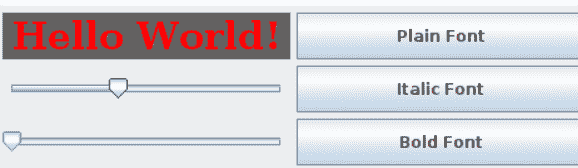

此程序中的滑块控制标签的前景和背景颜色，按钮控制其字体样式。编写这个程序涉及创建组件、布局它们，以及编写监听器来响应来自滑块和按钮的事件。我的程序被定义为 `JPanel` 的子类，实现了 `ChangeNotifier` 和 `ActionListener`，因此面板本身可以作为滑块更改事件和动作事件的监听器。在构造函数中，创建并配置了六个组件，`GridLayout` 是面板的布局管理器，并将这些组件添加到面板中。

```java
/* 创建显示标签，其属性与滑块的值和组合框的设置匹配。 */

label = new JLabel("Hello World", JLabel.CENTER);

label.setOpaque(true);

label.setBackground(new Color(100,100,100));

label.setForeground(Color.RED);

label.setFont(new Font("Serif", Font.BOLD, 30));

label.setBorder(new BorderFactory.createEmptyBorder(0,8,0,8));
```

```java
/* 创建滑块，并设置面板监听来自滑块的更改事件（ChangeEvent）。 */

fgSlider = new JSlider(0,255,100);
```

```java
/* 创建四个按钮，并设置面板监听来自按钮的动作事件（ActionEvent）。 */

plainButton = new JButton("Plain Font");

italicButton = new JButton("Italic Font");

boldButton = new JButton("Bold Font");
```

```java
/* 设置面板的布局并添加组件。 */

setLayout(new GridLayout(3,2,5,5));

add(label);

add(plainButton);

add(bgColorSlider);

add(italicButton);

add(boldButton);
```

该类还定义了 `ActionListener` 和 `ChangeNotifier` 接口。当用户操作一个滑块时，会调用 `stateChanged()` 方法，这会改变标签的背景：

```java
public void stateChanged(ChangeEvent evt) {

  if (evt.getSource() == bgColorSlider) {

    int bgVal = bgColorSlider.getValue();

    label.setBackground(new Color(bgVal,bgVal,bgVal));

  } else {

    float hue = fgSlider.getValue()/100.0f;

    label.setForeground(Color.getHSBColor(hue,1.0f,1.0f));

  }

}
```

滑块在程序中定义为全局变量，因为它们在 `stateChanged()` 方法以及构造函数中都被引用。另一方面，按钮在构造函数中定义为局部变量，因为那是它们被使用的地方。

```java
public void actionPerformed(ActionEvent evt) {

  String cmd = evt.getActionCommand();

  if (cmd.equals("Plain Font")) {

    label.setFont(new Font("Serif", Font.PLAIN, 30));

  } else if (cmd.equals("Italic Font")) {

    label.setFont(new Font("Serif", Font.ITALIC, 30));

  } else if (cmd.equals("Bold Font")) {

    label.setFont(new Font("Serif", Font.BOLD, 30));

  }

}
```

注意：前景颜色遍历光谱中的所有颜色。此示例的完整源代码在 `SliderAndButtonDemo`。

## 6.6.4 简单计算器

接下来我们将查看一个使用嵌套子面板构建复杂用户界面的示例。程序有两个 `JTextField` 用于用户输入两个数字，以及四个 `JButton` 用于用户点击对这两个数字进行加、减、乘、除，还有一个显示操作结果的 `JLabel`。这里是程序的一张图片：

|  | 17 |
|---|---|
| y = 42 |  |
| + | - | * | / |
| x * y = 714.0 |  |

此示例使用了具有四行一列的 `GridLayout`。在这种情况下，该布局通过以下语句创建：

```java
setLayout(new GridLayout(4,1,3,3));
```

允许网格布局的第一行包含两个组件：一个显示“x = ”的 `JLabel` 和 `JTextField`。网格布局每个位置只能包含一个组件。在这种情况下，第一行是一个 `JPanel`，即嵌套在主面板中的子面板。该子面板包含标签和文本字段。可以这样编写：

```java
xInput = new JTextField("0", 10); // 创建一个容纳10个字符的文本字段。

JPanel xPanel = new JPanel(); // 创建子面板。

xPanel.add(new JLabel("x = ")); // 向子面板添加标签。

xPanel.add(xInput); // 向子面板添加文本字段。
```

```java
add(xPanel); // 将子面板添加到主面板。
```

子面板使用默认的 `FlowLayout` 管理器，因此标签和文本字段只是在子面板中以其首选大小相邻放置，并在子面板中居中显示。

同样，网格布局的第三行是一个包含四个按钮的子面板。在这种情况下，该子面板使用具有一行四列的 `GridLayout`，这样所有按钮的大小都相同并且完全填充子面板。

此示例中另一个值得关注的点是 `actionPerformed()` 方法，它在用户点击其中一个按钮时做出响应。该方法必须从文本框中获取用户的输入数字，对它们进行算术运算（取决于点击了哪个按钮），并设置 `JLabel`（命名为 `answer`）来表示结果。然而，文本框的内容只能以字符串的形式获取，这些字符串必须转换为数字。如果转换失败，标签将显示错误消息：

```java
public void actionPerformed(ActionEvent evt) {

    double x, y; // 来自输入框的数字

    try {

        String xStr = xInput.getText();

        x = Double.parseDouble(xStr);

    } catch (NumberFormatException e) {

        // 字符串 xStr 不是合法的数字。

        answer.setText("Illegal data for x.");

        xInput.requestFocusInWindow();

        return;

    }

    try {

        String yStr = yInput.getText();

        y = Double.parseDouble(yStr);

    } catch (NumberFormatException e) {

        // 字符串 yStr 不是合法的数字。

        answer.setText("Illegal data for y.");

        yInput.requestFocusInWindow();

        return;

    }

    /* 根据按钮的动作命令执行操作。动作命令是按钮上显示的文本。注意除以零会产生错误消息。 */

    String op = evt.getActionCommand();

    if (op.equals("+")) {

        answer.setText("x + y = " + (x + y));

    } else if (op.equals("-")) {

        answer.setText("x - y = " + (x - y));

    } else if (op.equals("*")) {

        answer.setText("x * y = " + (x * y));

    } else if (op.equals("/")) {

        if (y == 0) {

            answer.setText("Can't divide by zero!");

        } else {

            answer.setText("x / y = " + (x / y));

        }

    }

} // end actionPerformed()
```

此示例的完整源代码可以在 `SimpleCalc.java` 中找到。

## 6.6.5 使用 null 布局

如上所述，完全可以不使用布局管理器。在接下来的示例中，我们将查看一个不使用布局管理器的面板。如果你通过调用 `container.setLayout(null)` 将容器的布局管理器设置为 `null`，那么你就承担了在该容器内组件的定位和大小设置的全部责任。

如果 `comp` 调用：

```java
comp.setBounds(x, y, width, height);
```

会将组件的左上角放置在点 `(x,y)`，该点是相对于包含该组件的容器的坐标系测量的，并将组件的宽度和高度设置为指定值。只有当容器具有 `null` 布局管理器时，你才应该设置组件的边界（bounds）。在具有非空布局管理器的容器中，由布局管理器负责设置边界，你不应该干预它的工作。

假设你已经将布局管理器设置为 `null`，你可以随时随地调用 `setBounds()` 方法。（你甚至可以制作一个在用户观察时移动或改变大小的组件。）如果你正在编写具有已知固定尺寸的面板，你可以在面板的构造函数中设置面板中每个组件的边界。注意，你必须使用面板的 `add(component)` 实例方法将组件添加到面板中；否则组件将不会显示在屏幕上。

我们的示例包含四个组件：两个按钮、一个标签和一个显示棋盘图案的面板：

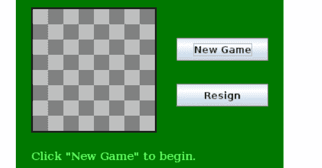

这只是使用 `null` 布局的一个示例；它什么都不做，除了点击按钮会改变标签的大小之外。（我们将在第 7.5 节中使用此示例作为国际棋游戏的起点。）

该面板由 `NullLayoutDemo` 类设计，该类被创建为 `JPanel` 的子类。四个组件在构造函数中创建并添加到面板中。然后调用每个组件的 `setBounds()` 方法来设置组件的大小和位置：

```java
public NullLayoutDemo() {

    setLayout(null); // 我将自己负责布局！

    setBackground(new Color(0,120,0)); // 深绿色背景。

    setBorder(BorderFactory.createEtchedBorder());

    setPreferredSize(new Dimension(350,240));

    /* 创建组件并将它们添加到内容面板中。如果你不将它们添加到容器中，即使你设置了边界，它们也不会显示！ */

    board = new Checkerboard();

    // Checkerboard 是 JPanel 的子类，下面定义为主类内部的静态嵌套类。

    add(board);

    newButton = new JButton("New Game");

    newButton.addActionListener(this);

    add(newButton);

    resignButton = new JButton("Resign");

    resignButton.addActionListener(this);

    add(resignButton);

    message = new JLabel("Click Game to begin.");

    message.setForeground(new Color(100,255,100)); // 淡绿色。

    message.setFont(new Font("Serif", Font.BOLD, 14));

    add(message);

    /* 通过 bounds() 设置每个组件的位置和大小。 */

    board.setBounds(20,20,164,164);

    newButton.setBounds(210,120,50);

    resignButton.setBounds(210,120,30);

    message.setBounds(20,200,330);

} // end constructor
```


此示例中主面板的整体结构应该是清晰的：面板底部有三个按钮，有一个显示卡牌和消息的大绘制表面。（卡牌和消息在示例中不是组件；它们是在面板的`paintComponent()`中使用图形上下文绘制的。）主面板使用`BorderLayout`。绘制表面占据布局的`CENTER`位置。包含按钮的子面板占据布局的`SOUTH`位置，另外三个位置也被使用了。

绘制表面由嵌套类`CardPanel`定义，它是`JPanel`的子类。我选择让绘制对象处理游戏的大部分工作：主面板由`HighGUI`本定义，它也是`JPanel`的子类。`HighGUI`的构造函数创建了事件处理以外的所有组件，并布局了这些组件：

面板的完整源代码可以在`HighGUI.java`中找到。

## 6.6.6 一个小卡牌游戏

在最后一个示例中，让我们来看一个作为卡牌游戏不有趣的东西。在这个版本中，你预测下一张卡牌是更大更小。如果你预测错误，就输了。如果预测正确，就赢。

| 7 | 8 | 3 |
|---|---|---|
| 黑桃 | 红心 | 方形 |
| Higher | Lower | New Game |

面板的完整源代码位于`HighGUI.java`。我鼓励你编译并运行它。请记住你还需要`Card.java`、`Deck.java`和`Hand.java`，因为它们定义了游戏中所使用的类。

## 第 6 章：GUI 编程简介

```java
setBorder(BorderFactory.createLineBorder( new Color(130,50,40), 3) );

} // 构造函数结束
```

绘图表面类`CardPanel`的编程是状态机思维的一个极佳示例。（参见第 6.4.4 节）。考虑游戏可能处于的各种状态、状态如何变化，以及对事件的响应如何取决于状态，是至关重要的。在第 5.4.3 节中产生的原始、面向文本的游戏方法在这里并不适用。尝试将游戏看作一个从开始到结束逐步执行的过程，可能只会让你感到困惑，而不会对你有所帮助。

游戏的状态包括卡牌和消息。卡牌存储在一个类型为`Hand`的对象中。状态还有另一个不那么而易见的方面：有时游戏正在进行中，用户应该对下一张卡牌做出预测；有时我们处于两局游戏之间，用户应该点击“新游戏”按钮。跟踪这种基本的状态差异是一个好主意。`CardPanel`使用一个名为`inProgress`的布尔变量来实现这一点。

每当用户点击按钮时，游戏状态就会改变。`CardPanel`实现了`ActionListener`接口并定义了`actionPerformed()`方法来响应用户的点击。该方法根据按下的是哪个按钮，调用其他三个方法之一：`doHigher()`、`doLower()`或`newGame()`。游戏的动作正发生在这些事件处理方法中。

我们不希望用户在游戏正在进行时开始一个新游戏。那将是作弊的。`newGame()`方法中的响应取决于状态变量`inProgress`是`true`还是`false`。如果游戏正在进行中，消息实例变量`message`应该设置为错误消息。如果游戏未在进行，则所有状态变量都应设置为新游戏开始时的适当值。在任何情况下，都必须重绘画板，以便用户看到状态已经发生变化。以下是完整的`newGame()`方法：

```java
/**
* 由 CardPanel 构造函数调用，并在用户点击“New Game”按钮时
* 由 actionPerformed() 调用。开始一局新游戏。
 */
void newGame() {
  if (inProgress) {
    // 如果当前游戏尚未结束，尝试开始
    // 新游戏是一个错误。
    message = "You still have to finish this game!";
    repaint();
    return;
  }
  deck = new Deck(); // 创建此游戏使用的牌组和手牌。
  hand = new Hand();
  deck.shuffle();
  hand.addCard(deck.deal()); // 将第一张牌发到手牌。
  message = "Is the next card higher or lower";
  inProgress = true;
  repaint();
} // newGame() 结束
```

`doHigher()`和`doLower()`方法几乎完全相同（如果我更聪明一点，可能可以将它们合并成一个带参数的方法）。让我们来看看`doHigher()`例程。它在用户点击“Higher”（更高）按钮时被调用。这只有在游戏正在进行时才有意义，因此`doHigher()`第一要检查的是状态变量`gameObject`的值。如果该值为`false`，则`doHigher()`应该设置一个错误消息。如果游戏正在进行，则应该向手牌中添加一张新卡牌并测试用户的预测。用户此时可能会赢也可能输。如果是这样，画板将准备好显示新状态。以下是`doHigher()`方法：

```java
/*
* 当用户点击"Higher"按钮时由 actionPerformed() 调用。
* 检查用户的预测。如果用户猜错或
* 用户有了三次正确的预测，则游戏结束。
*/
void doHigher() {
  if (gameInProgress == false) {
    // 如果游戏已经结束，点击"Higher"是一个错误，
    // 所以设置一个错误消息并终止处理。
    message = "Click 'New Game!' to start a new game";
    repaint();
    return;
  }
  hand.addCard(deck.drawCard()); // 发出一张牌到手牌。
  int cardct = hand.getCount();
  Card this = hand.getCard(cardct - 1); // 发出的牌。
  Card prevCard = hand.getCard(cardct - 2); // 上一张牌。
  if (this.getValue() < prevCard.getValue()) {
    gameInProgress = false;
    message = "Too bad You lose.";
  } else if (this.getValue() == prevCard.getValue()) {
    gameInProgress = false;
    message = "Too bad lose on ties.";
  } else if (cardct == 4) { // 手牌已满，三次正确猜测之后。
    gameInProgress = false;
    message = "You win! You made three correct guesses.";
  } else {
    message = "Got it right! Try for " + cardct + ".";
    repaint();
  }
} // doHigher() 结束
```

类的`paintComponent()`方法通过显示状态变量中的值来决定显示什么。它绘制手牌中的卡牌。如果游戏正在进行中，它会绘制一张不在手牌中的额外卡牌，代表牌组中的下一张卡牌。绘制卡牌需要一些仔细的处理和计算。我写了一个方法`void drawCard(Graphics g, Card card, int x, int y)`，它绘制卡牌。

### 6.7 菜单与对话框

菜单是我们在使用的菜单栏示例。坦率说，Java 中的菜单非常易用。菜单中的项由`MenuItem`类表示（菜单和其他相关类在`swing`包中）。菜单项的使用与按钮几乎相同。事实上，`MenuItem`和`JButton`都是`AbstractButton`类的子类。特别是在创建`MenuItem`时使用构造函数来指定菜单项的文本：

```java
JMenuItem fillCommand = new MenuItem("File");
```

你可以通过调用`addActionListener()`方法为`MenuItem`添加一个`ActionListener`。当用户从菜单中选择时，`actionPerformed()`方法会被调用。你可以调用`setText(String)`方法更改文本，并使用`setEnabled(boolean)`方法启用或禁用它。这与`JButton`的工作方式完全相同。菜单和按钮的区别在于，菜单项出现在菜单中而不是面板中。Java 中的菜单由`JMenu`类表示。`JMenu`有一个名称（在构造函数中指定），并有一个`add(JMenuItem)`方法，可以将`JMenuItem`添加到菜单。例如，`MosaicDraw`程序中的“Tools”菜单可以如下创建，其中`listener`是`ActionListener`类型的变量：

```java
JMenu toolsMenu = new JMenu("Tools"); // 创建名为“Tools”的菜单
JMenuItem drawCommand = new JMenuItem("Draw"); // 创建菜单项。
drawCommand.addActionListener(listener); // 为菜单项添加监听器
toolsMenu.add(drawCommand); // 将菜单项添加到菜单
JMenuItem eraseCommand = new JMenuItem("Erase"); // 创建菜单项。
eraseCommand.addActionListener(listener); // 为菜单项添加监听器
toolsMenu.add(eraseCommand); // 将菜单项添加到菜单
```

一旦创建了菜单，必须将其添加到菜单栏中。菜单栏由`JMenuBar`类表示。菜单栏只是菜单的容器。它没有名称，且构造函数没有参数。它有一个`add(JMenu)`方法，可以将菜单添加到菜单栏中。随后，菜单名称将出现在菜单栏上。例如，MosaicDraw 程序使用了三个菜单：`controlMenu`、`colorMenu`和`toolsMenu`。我们可以通过以下语句创建一个菜单栏并将其添加到窗口：

```java
JMenuBar menuBar = new JMenuBar();
menuBar.add(controlMenu);
menuBar.add(colorMenu);
menuBar.add(toolsMenu);
```

最后一步是在如`JFrame`等窗口中使用该菜单栏。我们已经看到窗口（frame）有一个“内容面板”（content pane）。`JFrame`类是窗口的另一个组件，并不包含在内容面板内部。`JFrame`有一个实例方法`setMenuBar(JMenuBar)`，用于设置菜单栏。（只有一个，所以这是一个“set”方法而不是“add”方法）。在 MosaicDraw 程序中，菜单是由`MosaicController`对象创建的，可以通过调用其`getMenuBar()`方法来获取。MosaicDraw.java 中的`main()`过程从控制器获取菜单栏并将其添加到窗口中。以下是用于（以某种格式）设置界面的基本代码：

```java
MosaicDrawController controller = new MosaicDrawController();
MosaicPanel content = controller.getMosaicPanel();
window.setContentPane(content); // 使用面板作为内容面板。
JMenuBar menuBar = controller.getMenuBar();
window.setMenuBar(menuBar); // 使用来自控制器的菜单栏。
```

使用菜单始终遵循通用模式：创建菜单。创建菜单并将其添加到菜单栏。创建菜单项并将其添加到菜单中（并设置监听器以处理来自菜单项的操作事件）。通过调用窗口的`setJMenuBar()`方法在窗口中使用菜单栏。

还有其他类型的菜单项可以添加到菜单中。其中之一是`JCheckBoxMenuItem`，它代表可以处于“选中”或“未选中”状态之一的菜单项。`JCheckBoxMenuItem`具有与`JCheckBox`相同的功能，使用方法也相同（参见第 6.5.3 节）。MosaicDraw 程序的“Control”菜单使用了三个`JCheckBoxMenuItem`。其中一个用于开启或关闭方格的颜色变化。另一个用于开启或关闭对称功能；当开启对称时，用户的绘图将在水平和垂直方向上反射，从而产生对称图案。第三个复选菜单项用于显示和隐藏马赛克的“缝隙”（grouting）。缝隙是画在马赛克每个小方格周围的灰色线条。“Control”菜单中“Use Randomness”选项对应的菜单项可以通过以下语句设置：

```java
JCheckBoxMenuItem useRandomnessToggle = new JCheckBoxMenuItem("Use Randomness");
useRandomnessToggle.addActionListener(listener); // 设置监听器。
useRandomnessToggle.setSelected(true); // 随机性初始开启。
controlMenu.add(useRandomnessToggle); // 将菜单项添加到菜单。
```

在我的程序中，“Use Randomness”`JCheckBoxMenuItem`对应`MosaicDrawController`类中名为`useRandomness`的布尔变量。该变量是控制器对象状态的一部分。每当用户绘制其中一个方格时，都会测试该变量的值，以决定是否为方格的颜色添加随机变化。当用户从菜单中选择“Use Randomness”命令时，`JCheckBoxMenuItem`的状态会渲染，从“未选中”变为“选中”（或反之）。菜单项的`ActionListener`检查菜单项是否被选中，并更改`useRandomness`的值以与之匹配。选择菜单命令对窗口中显示的图片没有任何直接影响。它只是改变了程序的状态，使得用户未来的绘图产生不同的效果。“Control”菜单中的“Use Symmetry”选项工作原理也一样。“Show Grouting”选项略有不同。选择“Show Grouting”选项会有直接影响：根据菜单的状态，绘制图片时带有缝隙或不带缝隙。

我的程序使用一个`ActionListener`来响应菜单中的所有菜单项。这并不是一个特别好的设计，但对于像这样的小型程序来说很容易实现。监听器对象的`actionPerformed()`方法使用语句

```java
String command = evt.getActionCommand();
```

来获取事件源的操作命令；这将将是菜单项的文本。监听器通过测试该值来确定用户选择了哪个菜单项。如果菜单项是`JCheckBoxMenuItem`，监听器必须检查菜单项的状态。菜单项是正在处理的事件的源。监听器可以通过调用`evt.getSource()`获取其菜单项对象。由于`getSource()`的返回值是`Object`类型，因此返回值必须强制转换为正确的类型。在这里，如果代码处理“Use Randomness”

```java
if (command.equals("Use Randomness")) {
// 设置菜单项状态上的 useRandomness 值。
JCheckBoxMenuItem toggle = (JCheckBoxMenuItem)evt.getSource();
useRandomness = toggle.isSelected();
}
```


`actionPerformed()` 方法使用长长的 `if..then..else` 语句来更新程序的状态。在某些情况下，监听器可能需要更新 UI。例如，当状态改变时，复选框可能需要更新以反映新状态。

## 第 6 章：GUI 编程简介

（……出现在对话框中，并向对话框中添加其他组件。我在这里只介绍最基本的形式。

消息对话框（message dialog）向用户显示消息字符串。用户（希望如此）会阅读消息并点击“OK”按钮关闭对话框。可以通过调用静态方法显示消息对话框：

```java
void JOptionPane.showMessageDialog(Component parentComp, String message)
```

消息可以有多行。消息中的行之间应该用换行符分隔。即使消息很长，也不会自动插入换行符。例如，使用特殊变量 `this` 指向一个 `Component`：

```java
JOptionPane.showMessageDialog(this, "This message is about to crash!\n\n" + "Sorry about that.");
```

输入对话框（input dialog）显示问题或请求，并允许用户输入字符串作为响应。你可以通过以下方法显示输入对话框：

```java
String JOptionPane.showDialog(Component parentComp, String question)
```

同样，`parentComp` 可以为 `null`，对话框可以包含换行符。对话框将包含一个输入框、一个“OK”按钮和一个“Cancel”按钮。如果用户点击“Cancel”或通过其他方式关闭对话框，则该方法的返回值为 `null`。如果用户点击“OK”，则返回值为用户输入的字符串。注意，返回值可能为空字符串（这不是一个 `null` 值），如果你想使用输入对话框从用户处获取数值，你必须将返回值转换为数字（见 3.7.2 节）。例如：

```java
String name;

name = JOptionPane.showDialog(null, "Hi! What's your name?");

if (name == null)
    JOptionPane.showMessageDialog(null, "Well, I'll call you Grumpy.");
else
    JOptionPane.showMessageDialog(null, "Pleased to meet you, " + name);
```

最后，确认对话框（confirm dialog）提出了一个问题和三个响应按钮：“Yes”、“No”和“Cancel”。可以通过以下方法显示确认对话框：

```java
int JOptionPane.showDialog(Component parentComp, String question)
```

返回值告诉用户他们选择了什么。结果是以下值之一：

- `JOptionPane.YES_OPTION` 用户点击了“Yes”按钮
- `JOptionPane.NO_OPTION` 用户点击了“No”按钮
- `JOptionPane.CANCEL_OPTION` 用户点击了“Cancel”按钮
- `JOptionPane.CLOSE_OPTION` 对话框通过其他方式关闭。

顺便说一下，可以通过调用 `JOptionPane` 类中的其他方法，在确认对话框中省略 Cancel 按钮。只需调用：

```java
JOptionPane.showConfirmDialog(
    parent
```

最后一个参数是一个常量，用于指定只使用“Yes”按钮和“No”按钮。第三个参数是一个字符串，将作为对话框窗口的标题显示。

提供了一个小型演示程序 `SimpleDialogDemo.java` 来演示 `JColorChooser` 和几个 `JPane` 对话框。

### 6.7.3 帧（Frames）的细节

在之前的节中，每当我使用帧（frame）时，我会在 `main()` 例程中创建一个 `JFrame` 对象并为该帧安装面板。这种方法可行，但一种更面向对象的方法是创建一个 `JFrame` 的子类，并在类的构造函数中设置帧的内容。这就是我在 MosaicDraw 程序代码中所做的。MosaicDraw 被定义为 `JFrame` 的子类。该类的定义非常短，但它说明了我想讨论的帧的几个新特性：

```java
public class MosaicDraw {

    public static void main(String[] args) {

        JFrame window = new MosaicDraw();

        window.setDefaultCloseOperation(JFrame.EXIT_ON_CLOSE);

        window.setVisible(true);

    }

    public MosaicDraw() {

        MosaicDrawController controller = new MosaicDrawController();

        setContent(controller.getMosaicPanel());

        setJMenuBar(controller.getMenuBar());

        pack();

        Dimension screenSize = Toolkit.getToolkit().getScreenSize();

        setLocation((screenSize.width - getWidth())/2, (screenSize.height - getHeight())/2);

    }

}
```

该类中的构造函数以 `super("Mosaic Draw")` 语句开头，这调用了父类 `JFrame` 的构造函数。帧指定了一个将显示在窗口标题栏中的标题。构造函数的后续三行设置了窗口的内容和菜单栏：创建了 `MosaicDrawController`，接下来的那行是新的内容。如果 `window` 是 `JFrame`（或 `JDialog`）类型的变量，语句 `window.pack()` 将调整窗口的大小，使其匹配其内容的大小。在本课程中，`"pack()"` 等于 `"this.pack()"`；它指的是由构造函数创建的窗口。`pack()` 方法是设置窗口大小的最佳方法。注意，如果窗口中的每个组件都有首选大小（preferred size），它就能正常工作。这在两种情况下会出现问题：当面板用作绘图表面时以及当面板用作空布局管理器的容器时。在这两种情况下，没有办法自动确定正确的首选大小，你应该手动设置首选大小。例如：

```java
panel.setPreferredSize(new Dimension(400, 250));
```

构造函数中的最后两行对窗口定位，使其正好居于屏幕中央。这一行

```java
Dimension screensize = Toolkit.getDefaultToolkit().getScreenSize();
```

确定屏幕的大小。屏幕尺寸在水平方向上是 `screens.width` 像素，在垂直方向上是 `screens.height` 像素。帧的 `getLocation()` 方法设置帧在屏幕上的左上角位置。表达式 `"screen.width - getWidth()"` 是减去窗口宽度后屏幕剩余的水平空间。将其除以 2，以便一半的空间位于窗口左侧，另一半空间留给窗口右侧。同样，垂直空间的一半在窗口上方，另一半在下方。

```java
window.setDefaultCloseOperation(JFrame.EXIT_ON_CLOSE);
```

意味着当用户关闭窗口时，窗口将结束。注意，这不在构造函数中完成，因为这样做会降低 MosaicDraw 的灵活性。例如，可以编写一个程序让用户打开多个 MosaicDraw 窗口。在这种情况下，我们不希望窗口关闭。该操作还有其他可能的值：

- `DO_NOT_ON_CLOSE` 忽略用户。
- `HIDE_ON_CLOSE` 当用户关闭时窗口被隐藏。
- `DISPOSE_ON_CLOSE` 窗口被销毁。
- `EXIT_ON_CLOSE` 终止。
- `CANCEL_ON_CLOSE` 操作被取消。

### 6.7 创建 Jar 文件

可以在命令行中创建 jar 文件。Java 开发工具包（JDK）包含一个名为 `jar` 的命令行程序，用于创建 jar 文件。如果你的所有类都在默认包中（书中的大多数示例都是如此），`jar` 命令很容易使用。要在命令行中创建 jar 文件，切换到包含要用类的目录。然后给出命令：

```bash
jar cf FileName.jar *.class
```

其中 `FileName` 是你想要的 jar 文件的任何名称。`*.class` 中的 `*` 是通配符，使 `*.class` 匹配当前目录下的所有文件。这意味着目录中的所有类都将包含在 jar 文件中。如果你只想包含类文件，可以列出它们并用空格分隔。

在命令行中制作可执行的 jar 文件更为复杂。必须有一种方法来指定哪个类包含 `main()` 方法。这通过创建一个清单文件（manifest file）来实现。清单文件是一个包含单行的纯文本文件：

```text
Main-Class: ClassName
```

将 `ClassName` 替换为包含 `main()` 方法的类名。例如，如果 `main()` 方法在 `MosaicDraw` 类中，则清单文件应为 `"Main-Class: MosaicDraw"`。你可以为清单文件命名。将其放在执行 `jar` 命令的相同目录下，并使用如下格式的命令：

```bash
jar cmf ManifestName FileName.jar *.class
```

用于创建 jar 文件。（`jar` 命令可以执行多种不同的操作。命令的第一个参数（例如 `"cf"` 或 `"cmf"`）告诉它要执行哪种操作。）

顺便说一下，如果你成功创建了一个可执行的 jar 文件，你可以在命令行中使用 `java -jar` 命令来运行它。例如：

```bash
java -jar JarFileName.jar
```

## 第 6 章练习题

1. 在第 6.3.3 节的 `SimpleStamper` 示例中，当用户点击鼠标时，面板上会画一个矩形或椭圆。但实际上，面板被清空了。修改这个类，使得修改后的版本在用户拖动鼠标时继续绘制图形。也就是说，用户在拖动时，鼠标会留下一系列图形轨迹。然而，如果用户点击 Shift 键，面板应该直接清空，即使用户在点击 Shift 后拖动鼠标，也不应该绘制任何图形。这是我的解决方案的图片：(solution)

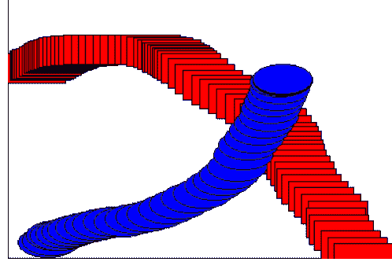

原始程序的源代码为 `SimpleStamper.java`。参见第 6.3.4 节中关于拖拽的讨论。（注意，原始版本使用黑色背景，每个形状周围都有黑色边框。这在处理许多密集的形状时效果不佳，因此新版本使用了白色背景。）

如果你想让这个问题更具挑战性，即在拖动操作期间绘制形状，请确保绘制的形状之间至少相隔 5 个像素。要实现这一点，你需要跟踪上一个绘制形状的位置。

2. 编写一个程序，显示一个小红色正方形和一个蓝色正方形。用户应该能够用鼠标拖动每个正方形。（你需要一个实例变量来记住用户正在拖动哪个正方形。）如果用户愿意，他们可以将正方形画到面板之外；没有办法把它找回来。(solution)

关于此练习题的注意：你应该将所有的绘制操作都放在 `paintComponent()` 方法中完成（并且尽可能这样做）。

3. 编写一个程序显示一对骰子。当用户点击程序中的面板时，骰子应该被掷出（也就是说，骰子被分配随机值）。每个骰子应该被画成一个显示 1 到 6 个点的正方形。由于你要画两个骰子，最好的办法是写一个子程序 `void drawDie(Graphics g, int val, int x, int y)`，在指定的 `(x,y)` 坐标处画一个骰子。第二个参数 `val` 选择在骰子上显示的值。假设面板的大小为 100 比 100 像素。这里是显示骰子的面板图片：(solution)

## 练习题

# 325

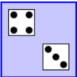

4. 在练习 6.3 中，你写了一个双骰子面板，当用户点击面板时，骰子会掷出。现在写一个双骰子程序，让用户通过点击按钮来掷骰子。按钮应该显示在显示骰子的面板下方。还要进行以下更改：当掷骰子时，不要只显示新值，而是显示一段动画，在动画期间，每帧的值都会变化。该动画旨在让骰子看起来更像是在实际转动。

5. 在练习 5.2 中，你画了一个棋盘。对于这个练习题，写一个程序，让用户可以通过点击来选择方格。（使用 `JPanel` 作为棋盘。）通过在方格周围画彩色边框来突出显示选中的方格。程序启动时，没有方格被选中。当用户点击一个当前未选中的方格时，它会被选中（如果有之前选中的，则取消选中）。如果用户点击选中的方格，它将被取消选中。假设面板大小恰好为 160 比 160 像素，因此棋盘上的每个方格都是 20 比 20 像素。这里是我的棋盘，第 3 行第 3 列的方格被选中：

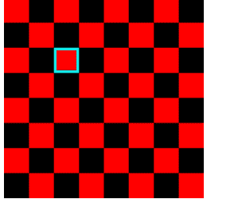

6. 对于这个练习题，你应该修改第 6.4.4 节的 `SubKiller` 游戏。你可以从现有的源代码 `SubKiller.java` 文件开始。修改游戏，使其记录命中和未命中的次数并显示这些数量。也就是说，每当深水炸炸掉潜艇时，命中次数增加。每当深水炸从屏幕底部掉落未命中潜艇时，未命中次数增加。面板顶部有空间显示这些数字。要完成这个练习题，你只需要在源代码中添加六行代码。但你必须找出它们在哪里以及在哪里添加。为了做到这一点，你需要仔细阅读源代码以理解它是如何工作的。

7. 练习 5.2 涉及一个类 `StatCalc.java`，它可以计算一组数字的某些统计数据。写一个 GUI 程序，使用 `StatCalc` 类来计算并显示用户输入的数字的统计数据。面板应该有四个标签：条目数、总和、平均值、标准差。每当用户输入新数字时，数据就会更新。面板应该有一个“输入”按钮来添加数字，以及“清除”按钮来重置。记住当用户按下回车时，`JTextField` 会产生 `ActionEvent`。这里是我的解决方案的图片：

| 输入 | 清除 |
| :--- | :--- |
| 条目数 | 0 |
| 总和 | 0 |
| 平均值 | 0 |
| 标准差 | 0 |

写一个程序，使用 `StatCalc` 类来计算并显示用户输入的数字的统计数据。面板应该有四个标签：条目数、总和、平均值、标准差。每当用户输入新数字时，数据就会更新。面板应该有一个“输入”按钮来添加数字，以及“清除”按钮来重置。记住当用户按下回车时，`JTextField` 会产生 `ActionEvent`。这里是我的解决方案的图片：

| 输入 | 清除 |
| :--- | :--- |
| 条目数 | 0 |
| 总和 | 0 |
| 平均值 | 0 |
| 标准差 | 0 |

8. 多边形是由一系列连接的线段组成的几何图形。线段相交被称为多边形的顶点。`Graphics` 包含了绘制和填充多边形的命令。对于这些命令，多边形的坐标存储在数组中。如果 `g` 是 `Graphics` 变量：

- `drawPolygon(xCoords, yCoords, pointCt)` 将绘制顶点位于 `(xCoords[0], yCoords[0])`、`(xCoords[1], yCoords[1])`、……、`(xCoords[pointCt-1], yCoords[pointCt-1])` 的多边形轮廓。第三参数 `pointCt` 是指定多边形顶点数量的整数。其值应该是 3 或更大。注意，多边形会自动包含从最后一个 `(xCoords[pointCt-1], yCoords[pointCt-1])` 回到起点 `(xCoords[0], yCoords[0])` 的线。
- `fillPolygon(xCoords, yCoords, pointCt)` 用当前的绘制颜色填充多边形。参数含义与 `drawPolygon()` 方法相同。注意，多边形的边可以相互交叉，但自交多边形的内部可能并不像你预期的那样。

写一个程序，让用户绘制多边形。当用户点击一系列点时，计算并将 x 和 y 坐标存储在数组中。在用户创建多边形期间，你只需要用线段连接所有点。当用户点击起点时，绘制完整的多边形。用红色填充和黑色边框进行绘制。在用户完成一个多边形后，下一次点击将清除数据并从头开始一个新的多边形。所有的绘制操作都应该在 `paintComponent()` 方法中完成。

这里是用户绘制复杂多边形后我的解决方案图片：

# 练习


10. 编写一个 GUI 黑2点（Blackjack）程序，让用户可以玩黑2点游戏，电脑作为庄家。程序应该画出用户的牌和庄家的牌，就像在 6.6.6 节的图形化 HighLow 纸牌游戏中做的那样。你可以使用该游戏的源代码 `HighLowGUI.java` 来获取关于如何编写你的 Blackjack 游戏的灵感。HighLow 面板和 Blackjack 面板的结构非常相似。你肯定需要使用 HighLow 程序中的 `drawCard()` 方法。

(解答)

你可以在练习 5.5 中找到黑2点游戏的描述。在描述中添加以下规则：如果玩家拿牌时拿了五张牌且总和超过 21，则玩家立即获胜。此规则在某些赌场中使用。对于你的程序来说，这意味着你必须为五张牌留出空间。你应该假设面板足够宽以显示五张牌，并且足够高以显示玩家的手牌和庄家的手牌。


注意，GUI Blackjack 游戏的设计与你为练习 5.5 编写的文本程序的设计非常不同。用户应该通过点击“Hit”（要牌）和“Stand”（停止）来玩游戏。应该有一个“New Game”（新游戏）按钮，可以在一个游戏结束后启动另一个游戏。你必须决定点击这些按钮时会发生什么。如果你不从游戏可能的状态以及状态如何改变来思考，你就没有机会做对。

你的程序需要`Card.java`、`Hand.java`、`Deck.java`和`BlackjackHand.java`中的类。

下一个练习有一张黑2点游戏的图片，你可以将其作为指南，但此练习的版本不允许这样做。

## 11. 练习 6.10 的改进

在练习 6.10 的黑2点游戏中心，用户即使在操作不符合逻辑的情况下，也可以点击“Hit”、“Stand”和“New Game”按钮。如果这些按钮在适当的时间禁用会更好。当游戏正在进行时，“New Game”按钮应该被禁用。当没有游戏正在进行时，“Hit”和“Stand”按钮应该被禁用。实例`gameInProgress`告诉是否有正在进行的游戏，因此你必须确保每当此值变化时按钮都能正确启用或禁用。我强烈建议编写一个子程序，可以在需要设置`gameInProgress`变量值时调用。该子程序负责启用和禁用按钮。记住，如果`bttn`是`JButton`类型的变量，`bttn.setEnabled(false)`禁用按钮，`bttn.setEnabled(true)`启用按钮。

### 解答

作为第二个（也是更困难的）改进，让用户能够在黑2点游戏中下注。当程序启动时，给用户 $100。使用`JTextField`位于面板底部的控制条。用户可以在`JTextField`中输入注码。当游戏开始时，检查注码金额。你应该在游戏开始时这样做而不是结束结束，因为可能会发生几种错误：`JTextField`的内容可能不是合法数字、用户的注码超过其拥有的金额、或者注码 <= 0。你应该检测这些错误并在游戏开始时显示错误消息。用户的注码应该是整数形式的美元。

在游戏进行期间让`JTextField`不可编辑是一个好主意。如果`betInput`是`JTextField`，你可以通过命令`betInput.setEditable(true)`和`betInput.setEditable(false)`让它可编辑或不可由用户编辑。

在`paintComponent()`方法中，你应该包含显示用户剩余金额的命令。

有一点需要考虑：理想情况下，在游戏进行期间`JTextField`应该是不可编辑的。

... 如下，这里有一张黑2点游戏的图片：`img/c6d9def0221ff348e92ca72a380402b2_340_0.png`

# 第 6 章测试题

- 1. 在练习 6.10 的黑2点游戏中心，用户即使在操作不符合逻辑的情况下，也可以点击“Hit”、“Stand”和“New Game”按钮。如果这些按钮在适当的时间禁用会更好。
- 2. 解释`repaint()`方法的作用。
- 3. Java 有一个名为`JPanel`的标准类。
- 4. 以下`paintComponent()`方法：
- 5. 假设有一个面板，如下所示，在其中画一个红圆：
- 6. 什么是`MouseEvent`？
- 7. `JComponent`的功能是什么？
- 8. `Layout`的例子有哪些？
- 9. 数组的类型？
- 10. 解释`Timers`如何使用。
- 11. 什么是`JCheckBox`？
- 12. `preferred size`的？

# 第 7 章 数组与 ArrayList

计算机的很大程度上源于处理数据结构。数据结构是相关数据的组织集合。对象也是数据结构，但这种数据结构由一组命名变量组成——这只是开始。你已经在 3.8 和 5.1.4 中遇到过数组。在本章中，我们将继续学习数组，包括一些新的细节。

数组具有固定的大小，创建后无法更改。在许多情况下，你需要一种可以增长和收缩的数据结构。在本章中，我们将查看一种这种数据结构的标准类`ArrayList`。

## 7.1 数组细节

数组的基础已经在之前的章节中讨论过，但仍有 Java 语法细节需要填充，关于使用数组有很多话要说。本节将查看一些细节。

回顾所有的... 数组是一个编号的序列，每个元素都像一个独立的变量。所有的元素都是相同类型的，这被称为基类型。数组作为一个整体也有一个类型。如果基类型是`byte`，那么数组的类型就是`byte[n]`。数组中的每个元素都有一个索引，即在元素序列中的数字位置。如果数组是`A`，那么数组的第 i 个元素就是`A[i]`。数组元素的数量是它的长度。数组的长度是`A.length`。数组的长度在创建后无法更改。数组的元素是`A[0], ..., A[length-1]`。引用超出零到`A.length-1`范围的数组元素会导致`ArrayIndexOutOfBoundsException`。

```java
int[] A = new int[10];
```

创建一个基本类型为`int`且长度为 10 的新数组，并将变量`A`指向新创建的数组。

### 7.1.1 For-each 循环

数组通常使用循环进行处理。`for`循环方便从头到尾处理数组中的每个元素。例如，如果`namelist`是一个`String`数组，则可以使用以下代码打印列表中的所有值：

```java
for (int i = 0; i < namelist.length; i++) {
  System.out.println(namelist[i]);
}
```

这种处理方式非常常见，因此`for`循环有另一种形式，使其编写起来更容易。这种替代形式就是 for-each 循环。从示例开始可能是最简单的。以下是一个用于打印`String`数组中所有值的 for-each 循环：

```java
for (String name : namelist) {
  System.out.println(name);
}
```

"`for (String name : namelist)`"的意思是“对于数组`namelist`中的每一个字符串 (`name`) ，执行以下操作”。这意味着变量`name`依次获取`namelist`中的每个值，并为每个值执行循环体。请注意，循环中没有数组索引。控制变量`name`代表数组中的其中一个值，而不是某个某个值的索引。

for-each 循环旨在处理数据结构中的所有值，它使得在不知道数据结构细节的情况下处理这些值成为可能。在数组的情况下，它避免了使用数组索引的复杂性。`for`循环将对数组存储的每个值执行相同的操作。如果`itemArray`是一个`BaseType[]`类型的数组，那么`itemArray`的 for-each 循环形式如下：

```java
for (BaseType item : itemArray) {
  // process the item
}
```

按照习惯，如果循环内部只有一条语句，大括号是可选的。在这个循环中，`item`是循环控制变量。它被声明为`BaseType`类型的变量，其中`BaseType`是数组的类型。（在 for-each 循环中，控制变量必须在循环内部声明；不能是循环外部已经存在的变量。）当此循环执行时，数组中的每个值会依次赋值给`item`，并为每个值执行循环体。因此，上述循环完全等同于：

```java
for (int index = 0; index < itemArray.length; index++) {
  BaseType item;
  item = itemArray[index]; // 从数组中获取一个值
  // process the item
}
```

例如，如果`A`是一个`int[]`类型的数组，那么我们可以使用 for-each 循环打印`A`的所有值：

```java
for ( int item : A ) {
    System.out.println( item );
}
```

并且我们可以计算`A`中正整数之和：

```java
int sum = 0; // 这将是 A 中所有正数的之和
for ( int item : A ) {
    sum = sum + item;
}
```

for-each 循环并不总是适用的。例如，没有简单的方法可以使用它来处理数组某一部分的项，或者反序处理元素。然而，当你想要按顺序处理所有值时，它会让代码变得简单一点，因为消消除了使用数组索引的需要。

需要注意的是，for-each 循环处理的是数组中的值，而不是数组中元素的内存位置（每个元素都被复制到变量中）。例如，考虑以下尝试用 17 填充整数数组的错误写法：

```java
int[] intlist = new int[10];
for ( int item : intlist ) {
    item = 17;
}
```

赋值语句`item = 17`将值 17 赋值给循环控制变量。然而，这与数组无关。当执行循环体时，数组中某个元素的值会被复制到该变量中。语句`item = 17`替换了该复制的值，但对被复制的原始元素没有产生影响；数组中的值没有改变。该循环等同于

```java
int[] intlist = new int[10];
for ( int i = 0; i < intlist.length; i++) {
    item = intlist[i];
    item = 17;
}
```

这显然没有改变数组中任何元素的值。

## 7.1.2 变长参数方法

在 Java 5 之前，Java 中的每个方法都有固定的参数个数（方法的参数个数被定义为调用该方法时的参数数量）。在固定参数的方法中，每次调用该方法时的参数数量必须相同，并且必须与方法定义中的形式参数数量一致。Java 5 引入了变长参数方法。在变长参数方法中，方法可以具有不同数量的参数。例如，在 2.4.1 节引入的格式化输出方法`System.out.printf`就是一个变长参数方法。`System.out.printf`方法必须有一个`String`，但可以有任意数量的额外参数。调用变长参数方法与调用任何其他方法没有区别，其语法使用了`...`语法。例如，考虑一个可以计算任意数量`double`平均值的方法：

```java
public static double average(double... numbers ) {
    double sum;
    double average;
    sum = 0;
    for (int i = 0; i < numbers.length; i++) {
        sum = sum + numbers[i];
    }
    average = sum / numbers.length;
    return average;
}
```

顺便提一下，可以将数组传递给变长参数方法，而不是单独值的列表。例如，假设`salesData`是一个`double[]`变量。那么调用`average(salesData)`是合法的，这将计算数组中所有数字的平均值。

变长方法定义中的形式参数列表可以包含多个参数，但`...`只能应用于最后一个形式参数。例如，考虑一个方法可以通过任意数量的点绘制多边形。这些点以`Point`值的形式给出，其中每个`Point`对象都有两个`int`类型的变量`x`和`y`。在这种情况下，该方法除了变长数组参数外，还有一个普通参数——用于绘制多边形的图形上下文。记住，在方法的定义内部，该参数变成了`Point`数组：

```java
public static void drawPolygon(Graphics g, Point... points ) {
    if (points.length > 1) { // 需要至少 2 个点才能绘制图形
        for (int i = 0; i < points.length - 1; i++) {
            // 从第 i 个点到第 i+1 个点画一条线
            g.drawLine(points[i].x, points[i].y, points[i+1].x, points[i+1].y);
        }
        // 画回起始点的线
        g.drawLine(points[points.length-1].x, points[points.length-1].y, points[0].x, points[0].y);
    }
}
```

当调用此方法时，子程序调用语句必须包含一个`Graphics`类型的实际参数，其后可以跟随任意数量的`Point`类型实际参数。

作为最后一个例子，让我们来看一个方法，它将字符串列表中的所有值连接成一个单一的长字符串。这个示例使用`for`循环来处理数组：

```java
public static String concat(String... values) {
    StringBuilder buffer; // 使用 StringBuilder 进行更高效的拼接。
    buffer = new StringBuilder(); // 从空缓冲区开始。
    for (String str : values) { // 用于处理值的 "for-each" 循环。
        buffer.append(str); // 将字符串添加到缓冲区。
    }
    return buffer.toString(); // 返回缓冲区器的内容
}
```

给定此方法定义，`concat("Hello", "World")`将返回字符串 "HelloWorld"，而`concat()`将返回一个空字符串。由于可变方法也可以接受数组作为实际参数，我们也可以使用`concat(lines)`，其中`lines`的类型为`String[]`。这会将数组的所有元素拼接成一个字符串。

## 7.1.3 数组字面量

我们已经看到可以在声明数组时使用值列表来初始化数组。例如：

```java
int[] squares = {1, 4, 9, 16, 25, 36, 49 };
```

这初始化`squares`指向一个包含列表中七个值的新创建数组。这种形式的列表初始化器只能用于声明语句，以便为新声明的数组变量提供初始值。它不能用于赋值语句为已存在的变量赋值。然而，还有另一种类似的创建数组符号可以在其他地方使用。该符号使用另一种形式的`new`运算符来创建新数组对象并填充值。这种特殊的语法与匿名内部类的语法相似（这在 5.8.3 节中讨论过）。作为一个示例，要为`int[]`数组变量`cubes`赋值，你可以使用：

```java
cubes = new int[] {1, 8, 27, 64, 125, 216, 343 };
```

这是一个赋值语句而不是声明，因此带有`"new int()"`的数组初始化语法在这里是不合法的。这种`new`运算符的通用语法为：

```java
new (base-type) { (list-of-values) }
```

这实际上是一个表达式，其值是指向新创建数组对象的引用。从这个意义上说，它是一个“数组字面量”，因为它是你可以用于类型来表示值的东西。这意味着它可以用于任何`(base-type)`类型对象合法的上下文中。例如，你可以将新创建的数组作为实际参数传递给子程序。考虑以下根据字符串数组创建菜单的实用方法：

```java
/**
* 创建一个 JMenu。菜单中 JMenuItems 的名称
* 以字符串数组的形式给出。
* @param menuName 要创建的 JMenu 的名称。
* @param handler 将响应菜单中项的监听器。
* 此 ActionListener 被添加为每个 JMenuItem 的监听器。
* @param itemNames 存储每个 JMenuItem 中显示的文本的数组。
* 如果数组中存在 null 值，则菜单中对应的
* 项将是分隔符而不是 JMenuItem。
* @return 已创建并填充了项的菜单。
 */
public static JMenu createMenu(ActionListener handler, String[] itemNames, String menuName) {
    JMenu menu = new JMenu(menuName);
    for (String itemName : itemNames) {
      if (itemName == null) {
        menu.addSeparator();
      } else {
        JMenuItem item = new JMenuItem(itemName);
        item.addActionListener(handler);
        menu.add(item);
      }
    }
    return menu;
}
```

`createMenu`的第三参数是字符串数组。作为实际参数传递的数组可以使用`new`运算符现场创建。例如，假设`listener`的类型是`ActionListener`，我们可以使用以下语句创建一个整个“文件”（File）菜单：

```java
JMenu fileMenu = createMenu("File", listener, new String[] { "New", "Open", "Close", null, "Quit" });
```

这应该让你确信，以这种方式“现场”创建和使用数组是非常方便的，就像匿名内部类方便一样。

顺便提一下，在数组变量的声明中使用`new BaseType[] { ... }`代替数组初始化语法是完全合法的。例如，与其使用：

```java
int[] primes = { 2, 3, 5, 7, 11, 13, 17, 19 };
```


你可以等效地，

事实上，与其使用仅在声明语句上下文中起作用的特殊符号，我有时倾向于使用第二种形式：

```java
int[] primes = new int[] { 2, 3, 5, 7, 11, 13, 17, 19 };
```

最后的说明：由于历史原因，数组声明如

`int[] list = { ... };`

也可以写成

`int list[];`

这是在 C 和 C++ 语言中使用的语法。然而，这种替代语法在 Java 上下文中没有意义，并且被避免了。毕竟，意图是声明某种类型的变量，而该类型的名称是 `type[]`。对于此类声明，遵循 `type-name[]` 是合理的。

## 7.2 数组处理

我们看过的数组处理示例都是直接的：从头到尾处理数组元素，或者对数组进行随机访问。在本节和章节后续部分，你将看到使用数组可以做的一些最有趣的事情。

### 7.2.1 示例

首先，这里有一个示例提醒你注意数组范围外的索引。假设 `lines` 是 `String[]` 类型的数组，我们想知道连续位置是否包含重复元素。即，我们检查 `lines[i].equals(lines[i+1])`。这是一个失败的尝试：

```java
boolean dupp = false; // 假设没有重复项
for (int i = 0; i < list.length; i++) {
    if (lines[i].equals(lines[i+1])) { // 这里有错误！
        dupp = true; // 发现重复项！
    }
}
```

正如其他人写的那样，问题在哪里？当 `i` 取循环的最终值 `list.length-1` 时，错误发生。在这种情况下，`i+1` 等于 `lines.length`，而 `lines.length` 不是合法的索引。这意味着引用 `lines[i+1]` 会导致 `ArrayOutOfBoundsException`。修复很容易：你只需要在 `i+1` 越界之前停止循环：

```java
boolean dupp = false; // 假设没有重复项
for (int i = 0; i < list.length - 1; i++) {
    if (lines[i].equals(lines[i+1])) {
        dupp = true; // 发现重复项！
    }
}
```

这种错误在处理部分填充数组时（见 3.8.4 节）可能更加隐蔽，其中数组只有部分被使用，并使用计数器来跟踪数组使用了多少空间。对于部分填充数组，问题不是越界边界，而是越界使用的部分。当你的程序尝试查看数组之外时，至少程序会崩溃以让你知道问题。对于部分填充数组，问题可能无法被检测。

对于下一个示例，让我们继续部分填充数组。我们已经见过如何向部分填充数组添加项，但假设我们也想移除项呢？假设你想写一个游戏程序，玩家随着游戏的进行加入和离开。作为一个良好的面向对象程序员，你可能有一个名为 `Player` 的类来表示游戏中的单个玩家。当前游戏中玩家的列表可以存储在类型为 `Player[]` 的数组 `playerList` 中。由于玩家人数可能会变化，你将遵循部分填充数组模式，并需要一个变量 `playerCt` 来记录当前游戏中的人数。由于游戏中没有超过 10 个玩家，你可以这样定义变量：

```java
Player[] playerList = new Player[10]; // 最多10个玩家。
int playerCt = 0; // 开始时没有玩家。
```

在一些玩家加入游戏后，`playerCt` 将大于 0，代表他们的玩家对象将存储在数组元素 `playerList[0]`、`playerList[1]`……`playerList[playerCt-1]` 中。注意数组元素 `playerList[playerCt]` 未使用。向游戏添加新玩家的过程是：

```java
playerList[playerCt] = new Player(); // 将新玩家放在下一个可用位置。
playerCt++; // 增加 playerCt 计算新玩家。
```

但从游戏中删除玩家要困难一点，因为你不想在被删除玩家的地方留一个“洞”。假设你想删除 `playerList` 中索引 `k` 的玩家。人数减少一个，所以数组使用的空间也少一个。如果你不担心保持玩家的特定顺序，那么这样做的方法是将最后一个占用位置的玩家移动到数组位置 `k`，然后递减 `playerCt` 的值：

```java
playerList[k] = playerList[playerCt-1];
playerCt--;
```

之前在 `k` 位置的玩家不再数组中了。

假设在删除位置 `k` 的玩家时，你想让剩余玩家保持相同的顺序。（也许他们按照存储在数组中的顺序轮流。）要做到这一点，位置 `k+1` 及以上的玩家都在数组中向下移动一个位置。`Player k+1` 替换离开游戏的 `player k`。当 `player k+1` 移动时，`Player k+2` 填充左空位。以此类推。对应的代码是：

```java
for (int i = k; i < playerCt; i++) {
    playerList[i-1] = playerList[i];
}
```

# 第 7 章 数组与数组列表

以下是从部分数组中删除项的两种方法的插图。在这里，玩家“C”正在被删除：

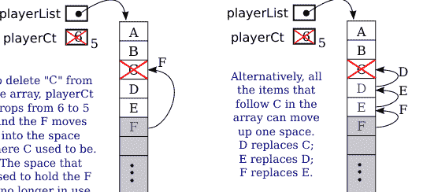

这引出了一个问题：当一个部分数组变满，但我们仍然想向其添加更多项时会发生什么？我们无法更改数组的大小——但我们可以创建一个更大的数组，并将数据从旧数组复制到新数组中。但是，最初复制数组意味着什么呢？

假设 A 和 B 是相同基本类型的数组，且 A 已经引用了一个数组。首先需要注意的是，赋值语句

```java
B = A;
```

并没有对 A 进行复制。数组是对象，而数组变量只能持有指向数组的指针。赋值语句将指针从 A 复制到 B，结果是 A 和 B 现在指向同一个数组。例如，A[0] 和 B[0] 只是完全相同的数组元素的不同名称。要让 B 引用 A 的拷贝，我们需要创建一个完全全新的数组，并将 A 中的所有项复制到 B 中。假设 A 和 B 的类型为 `double`。为了制作 A 的拷贝，我们可以说：

```java
double B;
B = new double[A.length]; // 创建一个与 A 长度相同的数组。
for (int i = 0; i < A.length; i++) {
    B[i] = A[i];
}
```

为了解决向已满的部分数组中添加项的问题，我们只需要创建一个比旧数组大一倍的新数组。通常的选择是创建一个两倍大的新数组。我们需要一个要求：最后，引用旧数组的变量必须指向新数组。该变量让我们能够访问数据，而末尾数据在新数组中。例如，一个简单的赋值语句将使变量指向正确的数组。假设我们正在使用 `playerList` 和 `playerCt` 来存储游戏中的玩家（如上面的示例所示），并且想将 `newPlayer` 添加到游戏中。即使 `playerList` 是满的，我们也可以这样做：

```java
if (playerCt == playerList.length) {
    // 玩家数量已经等于数组的大小。
    // 数组已满。创建一个有更多空间的新数组。
    Player[] temp; // 指向新数组的变量。
    temp = new Player[2 * playerList.length]; // 比旧数组大一倍。
    for (int i = 0; i < playerList.length; i++) {
        temp[i] = playerList[i]; // 将项从旧数组复制到新数组。
    }
    playerList = temp; // playerList 现在指向新的、更大的数组。
    // 在此点，我们知道数组中有空间容纳 newPlayer。
    playerList[playerCt] = newPlayer;
    playerCt++;
}
```

在创建新数组后，不再有任何变量指向旧数组，因此它将被垃圾回收。

### 7.2.2 一些标准数组方法

复制数组似乎是一个如此常见的方法，以至于你可能希望 Java 有定义为它的内置方法。事实上，Java 有几个标准的数组处理方法。这些方法被定义为 `Arrays` 类中的静态方法，该类位于 `java.util` 包中。例如，对于任何数组：

```java
Arrays.copyOf(list, lengthOfCopy)
```

这是一个返回新数组的函数，其长度由 `lengthOfCopy` 给出，包含从 `list` 复制的项。如果 `lengthOfCopy` 大于 `list.length`，则新数组中的多余空间将具有默认值。如果 `lengthOfCopy` 小于 `list.length`，则只有足够的元素会被复制到新数组。如果 A 是任何数组，那么：

```java
Arrays.copyOf(A, length);
```

将 B 指向 A 的精确拷贝，并且：

```java
Arrays.copyOf(2, A.length);
```

可以用于确定部分满数组的大小。实现从玩家列表中删除 k 的代码：

```java
playerList[playerCt-1];
playerCt--;
if (playerCt < playerList.length / 2) {
    // 超过一半的空间是空的。将数组大小减半。
    playerList = Arrays.copyOf(playerList, playerList.length / 2);
}
```

我应该提到 `Arrays` 包含许多 `copyOf` 方法，每种基本类型有一个，对象也有一个。我应该注意，当复制对象数组时，只有对象的指针被复制到新数组。对象的内容没有被复制。这是赋值的常用规则。

***

`Arrays` 类包含其他有用的方法。`Arrays` 类包含其他有用的方法。我会提到其中一些。

- `Arrays.fill(array, value)` —— 用指定的值填充数组。
- `Arrays.fill(array, fromIndex, toIndex, value)` —— 从 `fromIndex` 到 `toIndex` 填充数组。
- `Arrays.copyOf(array, length)` —— 返回一个长度由 `length` 给出的新数组。
- `Arrays.copyOfRange(array, fromIndex, to)` —— 返回一个包含原始数组范围的新数组。
- `Arrays.sort(array)` —— 将指定的数组按升序排序。
- `Arrays.sort(array, fromIndex, toIndex)` —— 对数组范围进行排序。
- `Arrays.binarySearch(array, key)` —— 在数组中搜索指定的键。
- `Arrays.equals(array1, array2)` —— 如果指定的数组相等则返回 `true`。
- `Arrays.deepEquals(array1, array2)` —— 如果指定的嵌套数组相等则返回 `true`。
- `Arrays.hashCode(array)` —— 返回指定数组的哈希值。
- `Arrays.deepHashCode(array)` —— 返回嵌套数组的哈希值。
- `Arrays.toString(array)` —— 返回指定数组内容的字符串表示。
- `Arrays.deepToString(array)` —— 返回嵌套数组内容的字符串表示。
- `Arrays.stream(array)` —— 返回一个包含指定数组元素的 `IntStream`。

## 第 7 章：数组与 ArrayList

```java
stringData[i].color = Color.getHSBColor(hue, 1.0F, 1.0F); // 随机颜色
stringData[i].x = -50 + (int)(Math.random() * (width + 40)); // 随机x坐标
stringData[i].y = (int)(Math.random() * (height + 20)); // 随机y坐标
}
```

此方法在面板第一次绘制之前被调用。当用户用鼠标点击面板时也会调用此方法，这样鼠标点击就会创建新的随机数据。例如，调整窗口会导致 `paintComponent()` 被调用，但由于数据没有变化，`paintComponent()` 将重新绘制相同的图像。这里是 `paintComponent()` 中根据数组数据绘制所有字符串的代码：

```java
for (int i = 0; i < MESSAGE_COUNT; i++) {
    g.setColor(stringData[i].color);
    g.setFont(stringData[i].font);
    g.drawString(message, stringData[i].x, stringData[i].y);
}
```

注意，我在这里可以使用 `for-each` 循环，那样会更容易理解：

```java
for (StringData data : stringData) {
    g.setColor(data.color);
    g.setFont(data.font);
    g.drawString(message, data.x, data.y);
}
```

在这个循环中，循环变量 `data` 持有数组中其中一个值的副本。该值是对一个 `StringData` 类型对象的引用，该对象拥有命名为 `color`、`x` 和 `y` 的实例变量。再次，使用 `for-each` 循环消除了处理数组索引的需求。

***

`RandomStringsWithArray` 使用了一个对象数组。给定消息副本的字体是从五种可能的字体中随机选择的。在原始版本中，使用了 `Font` 类型的变量来表示字体。这些变量命名为 `font1`、`font2`、`font3`、`font4` 和 `font5`。为了随机选择这些字体中的一个，可以使用 `switch` 语句：

```java
Font randomFont; // 随机选择五种之一。
int fontNum; // 0 到 4 之间的随机整数。
fontNum = (int)(Math.random() * 5);
switch (fontNum) {
    case 0:
        randomFont = font1;
        break;
    case 1:
        randomFont = font2;
        break;
    case 2:
        randomFont = font3;
        break;
    case 3:
        randomFont = font4;
```

## 第 7 章：数组与 ArrayList

```java
    break;
    case 4:
        randomFont = font5;
        break;
}
```

在程序的新版本中，五种字体存储在一个名为 `fonts` 的数组中。它被声明为 `Font[]` 类型的实例变量：

```java
Font[] fonts;
```

该数组在构造函数中创建，数组的每个元素被设置为指向一个 `Font` 对象：

```java
fonts = new Font[5]; // 创建数组以存储五种字体。
fonts[0] = new Font("Serif", Font.BOLD, 14);
fonts[1] = new Font("Sansserif", Font.BOLD + Font.ITALIC, 24);
fonts[2] = new Font("Monospaced", Font.PLAIN, 20);
fonts[3] = new Font("Dialog", Font.PLAIN, 30);
fonts[4] = new Font("Serif", Font.ITALIC, 36);
```

这使得操作变得更容易。通过数组可以轻松选择字体：

```java
fonts = new Font[5]; // 创建数组以存储五种字体。
fonts[0] = new Font("Serif", Font.BOLD, 14);
fonts[1] = new Font("Sansserif", Font.BOLD + Font.ITALIC, 24);
fonts[2] = new Font("Monospaced", Font.PLAIN, 20);
fonts[3] = new Font("Dialog", Font.PLAIN, 30);
fonts[4] = new Font("Serif", Font.ITALIC, 36);
```

这使得通过数组可以轻松选择字体：

```java
intIndex = (int)(Math.random() * 5);
```

这里的 `switch` 语句被替换为：

```java
intIndex = (int)(Math.random() * 5);
```

这使得通过数组可以轻松选择字体：

```java
intIndex = (int)(Math.random() * 5);
```

这使得通过数组可以轻松选择字体：

```java
intIndex = (int)(Math.random() * 5);
```

这使得通过数组可以轻松选择字体：

```java
intIndex = (int)(Math.random() * 5);
```

这使得通过数组可以轻松选择字体：

```java
items[index];
```

### 7.2 动态数组


```java
import java.util.*;

public class DynamicArrayOfInt {
    private int[] items; // 数组
    private int itemCt;

    public DynamicArrayOfInt() {
        items = new int[8]; // 初始化
        itemCt = 0;
    }

    /**
     * 获取指定索引的元素。
     */
    public int get(int index) {
        if (index < 0 || index >= itemCt) {
            throw new ArrayIndexOutOfBoundsException("非法索引: " + index);
        }
        return items[index];
    }

    /**
     * 设置指定索引的元素。
     */
    public void set(int index, int item) {
        if (index < 0 || index >= itemCt) {
            throw new ArrayIndexOutOfBoundsException("非法索引: " + index);
        }
        items[index] = item;
    }

    /**
     * 返回数组中的数量。
     */
    public int size() {
        return itemCt;
    }

    /**
     * 在数组末尾添加项。
     */
    public void add(int item) {
        if (itemCt == items.length) {
            items = Arrays.copyOf(items, 2 * items.length);
        }
        items[itemCt] = item;
        itemCt++;
    }

    /**
     * 删除指定索引的项。随后的项向上移动。
     */
    public void remove(int index) {
        if (index < 0 || index >= itemCt) {
            throw new ArrayIndexOutOfBoundsException("非法索引: " + index);
        }
        for (int j = index; j < itemCt - 1; j++) {
            items[j] = items[j + 1];
        }
        itemCt--;
    }
}
```

`DynamicArrayOfInt` 类使用了一个整数数组。数组的大小为 8。数字 `N` 是任意的，对数组的功能没有影响。任何正整数都可以，但让数组一开始就非常大并不合理。

示例 `ReverseInputNumbers.java` 使用一个部分填充的数组按输入顺序打印输入。在这种情况下，一个长度为 100 的普通数组就足够存储这些数字。在任何特定的运行中，数组的大小可能太大，也可能太小，导致异常。程序现在可以使用 `DynamicArray` 编写，它会适应任何数量的输入。对于程序 `ReverseWithDynamicArray.java` 这是一个很基础的程序，但该原理适用于任何需要动态结构的应用：动态数组的大小可以适应任何量的数据。

## 第 7 章 数组与 ArrayList

## 347

### 7.3 ArrayList

正如我们刚刚在 7.2.4 节看到的，我们可以轻松地将动态数组模式封装到一个类中，但看起来我们需要为每种数据类型创建一个不同的类。Java 有一种名为“泛型类型”（parameterized types）的特性，使得可以避免大量的类，并且 Java 有一个名为 `ArrayList` 的单一类，为所有数据类型实现了动态数组模式。

### 7.3.1 ArrayList 与泛型类型

Java 有标准的 `ArrayList<String>` 来表示 `String` 的动态数组。同样，存在类型 `ArrayList<JButton>` 可以表示 `JButton` 的动态数组；如果 `Player` 是一个表示游戏玩家的类，那么 `ArrayList<Player>` 类型就可以表示 `Player` 的动态数组。

看起来我们似乎有很多类，但在 `java.util` 包中，`ArrayList` 是一个泛型类型。泛型类型可以接受一个类型参数，因此从单一的 `ArrayList` 类，我们得到了许多类型，包括 `ArrayList<String>`、`ArrayList<JButton>` 以及实际上对于任何对象 `T` 的 `ArrayList<T>`。类型 `T` 必须是一个对象类型，例如类名或接口名。它不能是基本类型。这意味着遗憾的是，你不能拥有 `int` 的 `ArrayList` 或 `char` 的 `ArrayList`。

考虑考虑类型 `ArrayList<String>`。作为一种类型，它可以用于声明变量，如：

```
ArrayList<String> nameList = new ArrayList<String>();
```

它也可以作为子程序定义中的形式参数类型，或者作为子程序的返回类型。我们可以使用 `new` 运算符创建对象：

```
namelist = new ArrayList<String>();
```

这里创建的对象类型为 `ArrayList<String>`，表示字符串的动态列表。它具有实例方法，例如 `namelist.add(str)` 用于向列表添加字符串，`namelist.get(i)` 获取索引 `i` 处的字符串，以及 `namelist.size()` 获取列表中当前项的数量。

但我们也可以将 `ArrayList` 与其他类型配合。如果 `Player` 是表示游戏玩家的类，我们可以创建一个玩家列表：

```
ArrayList<Player> playerList = new ArrayList<Player>();
```

要向游戏添加玩家，我们必须调用 `playerList.add(plr)`。我们可以使用 `playerList.remove(k)` 索引为 `k` 的玩家。

当你将其作为 `ArrayList<T>` 使用时，编译器将确保只有类型为 `T` 的对象可以添加到列表中。尝试添加一个类型为 `T` 的对象将导致语法错误，程序将无法编译。注意，属于 `T` 的子类的对象可以添加到列表中，属于 `T` 的子类的对象被视为类型 `T`。因此，例如，类型为 `ArrayList<Component>` 的变量可以持有 `JButton`、`JPanel`、`JField` 或任何其他 `Component` 子类的对象。（当然，这与数组的工作原理相同：`T[]` 类型的对象可以持有属于任何子类的对象。）同样，如果 `T` 是一个接口，任何实现接口 `T` 的对象都可以添加到列表中。

`ArrayList<T>` 类型的对象具有你在动态数组实现中预期的所有实例方法。这里是一些最实用的。假设 `list` 是类型为 `ArrayList<T>` 的变量。那么我们有：

- `size()` - 此函数返回列表当前的大小，即列表中项的数量。列表中唯一的有效位置范围在 0 到 `size()-1` 之间。size 可以为零。调用默认构造函数 `ArrayList<T>()` 会创建一个大小为零的列表。

- `add(obj)` - 将对象添加到列表末尾，大小增加 1。参数 `obj` 可以引用 `T` 的对象，也可以是 `null`。

- `get(N)` - 此函数返回存储在列表中位置 `N` 的值。`N` 的类型必须是 0 到 `size()-1` 范围内的整数。如果 `N` 超出此范围，将抛出 `IndexOutOfBoundsException` 类型的错误。调用此函数类似于数组的 `A[N]`，区别在于你不能在赋值语句的左侧使用 `get(N)`。

- `set(N, obj)` - 将对象 `obj` 分配给列表中位置 `N`。`N` 必须在 0 到 `size()-1` 范围内。如果 `N` 超出此范围，将抛出 `IndexOutOfBoundsException`。

- `remove(k)` - 从列表中移除位置 `k` 处的对象，大小减 1。

- `remove(obj)` - 从列表中移除 `obj` 的第一次出现项。如果未找到 `obj`，列表保持不变。

- `indexOf(obj)` - 返回 `obj` 在列表中第一次出现的索引，如果未找到则返回 -1。

- `contains(obj)` - 如果列表包含 `obj` 则返回 `true`，否则返回 `false`。

- `clear()` - 移除列表中的所有元素。

- `toArray()` - 返回一个包含列表中所有元素的数组。

### 7.3.2 包装类

正如我所指出的，泛型类型不能与基本类型一起工作。不存在 `ArrayList<int>` 这种东西。然而，为了使这些类更易用，基本类型与相应的包装类之间存在自动转换。例如，如果你在需要对象的语文中使用了 `int` 类型的值，该 `int` 将被自动包装。

每个基本类型都有它们自己的包装类：

| 基本类型 | 包装类 |
| :--- | :--- |
| `byte` | `Byte` |
| `short` | `Short` |
| `char` | `Character` |
| `int` | `Integer` |
| `long` | `Long` |
| `float` | `Float` |
| `double` | `Double` |
| `boolean` | `Boolean` |

例如，`Double` 类型的对象包含一个类型为 `double` 的单个实例变量。该对象是 `double` 值的“包装”。你可以使用以下代码创建一个包装 `double` 值的对象：

```
Double d = new Double(6.0221415e23);
```

`d` 的值与该 `double` 值相同，但它是一个对象。如果你想检索包装在对象中的 `double` 值，可以调用方法 `.doubleValue()`。同样，你可以将 `int` 包装在 `Integer` 对象中，将 `boolean` 值包装在 `Boolean` 对象中，以此此类推。

此外，装箱和拆箱使得在许多情况下可以忽略基本类型和对象之间的差异。例如，如果 `d` 指向类型为 `Double` 的对象，在乘以 2 时，`d` 内部的 `double` 值会被自动拆箱。装箱和拆箱也适用于子程序调用。例如，你可以将 `int` 类型的参数传递给形式参数为 `Integer` 的子程序。事实上，装箱和拆箱使得在许多情况下可以忽略基本类型和对象之间的差异。

对于泛型类型也是如此。尽管不存在 `ArrayList<>` 这种东西，但 `ArrayList<Integer>` 持有 `Integer` 类型的对象，而任何 `Integer` 类型的对象实际上都代表一个封装在很薄包装器中的 `int`。假设我们有一个 `ArrayList<Integer>`：

```
ArrayList<Integer> list;
list = new ArrayList<Integer>();
```

那么我们可以，例如，添加一个代表数字 42 的整数对象：

```
list.add(new Integer(42));
```

但因为装箱，我们实际上可以说：

```
list.add(42);
```

# 第 7 章 数组与 ArrayList

```java
integerList.add( 42 );
```

编译器在将 42 添加到列表之前，会自动将 42 封装成一个 `Integer` 类型的对象。同样地，我们可以说：

```
int num = integerList.get(3);
```

`integerList.get(3)` 返回的类型是 `Integer`，但由于自动拆箱（unboxing），编译器会自动将该值返回为 `int`，就像我们写了下面这样一样：

```java
int num = integerList.get(3).intValue();
```

因此，实际上，如果 `integerList` 是一个 `int` 的动态数组而不是 `Integer` 的动态数组，我们就可以完全地使用它。对于其他类的列表，如 `ArrayList<Double>` 和 `ArrayList<Character>`，也存在类似的语句。（有一个有时会引起问题：列表可以包含 `null` 值，而 `null` 不对应于任何类型值。这意味着，例如，当 `integerList.get(3)` 返回 `null` 时，语句 "num = integerList.get(3);" 可能会产生空指针异常。除非你确定列表中的所有值都非 `null`，否则你需要考虑这种可能性。）

### 7.3.3 使用 ArrayList 编程

作为第一个示例，我们可以使用 `ArrayList` 代替自定义的动态数组，重新编写上一节中的 `ReverseDynamicArray.java`。在 particular情况下，我们想在列表中存储整数，因此我们应该使用 `ArrayList<Integer>`。这里是完整的程序：

```java
import java.util.ArrayList;

/**
* 从用户处读取一个非零数字列表，然后按照
* 输入顺序的倒序打印这些输入数字。
* 输入数量没有限制。
 */
public class ReverseWithArrayList {
    public static void main(String[] args) {
        ArrayList<Integer> list = new ArrayList<Integer>();
        System.out.println("输入一些非零整数。输入 0 结束.");
        while (true) {
            System.out.print("? ");
            int number = TextIO.nextInt();
            if (number == 0)
                break;
            list.add(number);
        }
        System.out.println("你的数字倒序排列为:\ ");
        for (int i = list.size() - 1; i >= 0; i--) {
            System.out.printf("%10d%n", list.get(i));
        }
    }
}
```

# 第 7 章 数组与 ArrayList

如此示例所示，`ArrayList` 通常使用 `for` 循环进行处理，这与数组的处理方式非常相似。例如，以下循环打印类型为 `ArrayList<String>` 的变量 `namelist` 的所有项：

```java
for (int i = 0; i < namelist.size(); i++) {
    String item = namelist.get(i);
    System.out.println(item);
}
```

你也可以对 `ArrayList` 使用 `for-each` 循环，因此这个示例也可以写成：

```java
for (String item : namelist) {
    System.out.println(item);
}
```

在处理包装类（wrapper classes）时，`for-each` 循环中的循环控制变量可以是原始变量。这是由于自动拆箱的作用。例如，如果 `numbers` 的类型是 `ArrayList<Double>`，则可以使用以下循环来累加列表中所有的值：

```java
double sum = 0;
for (double num : numbers) {
    sum = sum + num;
}
```

只要列表中的项不是 `null`，这种方法就有效。如果存在 `null` 的可能性，你需要使用 `Double` 类型的控制变量并测试 `null`。例如，为了累加列表中所有的非 `null` 值：

```java
double sum = 0;
for (Double num : numbers) {
    if (num != null) {
        sum = sum + num;
    }
}
```

* *

为了一个更完整且实用的示例，我们将查看 `SimplePaint2.java` 程序。这是 6.3.4 节中 `SimplePaint.java` 的改进版本。在新区域中，用户可以通过点击和拖动鼠标来绘制曲线。曲线可以是任何颜色，用户可以使用菜单选择绘图颜色。绘制区域的背景颜色也可以通过菜单选择。还有一个“控制（Control）”菜单，包含几个命令：“撤销（Undo）”命令可以从屏幕上移除最近绘制的曲线，“清除（Clear）”命令可以移除所有曲线，以及一个“使用对称（Use Symmetry）”复选框，可以开启对称功能。当对称开启时，用户绘制的曲线会在水平和垂直方向上反射，从而产生对称的图案。（对称只是为了好看）。

与原始的 `SimplePaint` 程序不同，这个新版本使用数据结构来存储用户绘制的路径信息。这些数据在 `paintComponent()` 方法中使用，以便在需要时重绘。该数据结构是使用 `ArrayList` 实现的。曲线的主要数据由曲线上的点组成。这些数据可以存储在 `ArrayList<Point>` 类型的对象中。`java.awt.Point` 是 Java 标准类之一（`Point` 对象包含两个公共整数 `x` 和 `y`，代表点的像素坐标）。为了重绘曲线，我们还需要知道它的颜色，并且我们


# 第 7 章 数组与 `ArrayList`

需要知道是否应该对曲线应用对称选项。重绘曲线所需的所有数据都可以组合到一个 `CurveData` 类型的对象中，定义如下：

```java
private static class CurveData {
    Color color; // 曲线的颜色。
    boolean symmetric; // 是否绘制了水平和垂直反射？
    ArrayList<Point> points; // 曲线上的点。
}
```

然而，一张图片可能包含许多曲线而不仅仅是一个。为了存储重绘整张图片所需的所有数据，我们需要对象列表。对于此列表，我们可以使用变量：

```java
ArrayList<CurveData> curves = new ArrayList<CurveData>();
```

这里我们来看处理这些数据的几个示例。当用户在绘制表面上点击鼠标时，这就是新曲线的开始，必须创建一个 `CurveData` 对象并将其添加到列表中。新 `CurveData` 对象中的实例变量也必须初始化。以下是执行此操作的 `mousePressed()` 例程中的代码：

```java
currentCurve = new CurveData(); // 创建一个新的 CurveData 对象。
currentCurve.color = currentColor; // 曲线的颜色取自代表当前正在绘制曲线的实例变量。
```

```java
currentCurve.symmetric = useSymmetry; // 曲线的对称性取决于 useSymmetry。
```

```java
currentCurve.points = new ArrayList<>(); // 初始化点列表。
```

当用户在绘制表面上拖动鼠标时，它会产生如下的：

```java
currentCurve.points.add(new Point(ev.getX(), ev.getY())); // 将点添加到列表。
```

当 `integerList.get(3)` 返回 `null` 时，语句 `num = integerList.get(3);` 可能会产生空指针异常。除非你确定列表中的所有值都非 `null`，否则你需要考虑这种可能性。

```java
curves.add(currentCurve); // 将曲线添加到列表。
```

在 `paintComponent()` 方法中，这些数据被用于需要时重绘：

```java
public void paintComponent(Graphics g) {
    super.paintComponent(g);
    Graphics2d g = (Graphics2d)g;
    g.setRenderingHint(RenderingHints.KEY_ANTIALIASING, RenderingHints.VALUE_ANTIALIAS_ON);

    for (CurveData curve : curves) {
        g.setColor(curve.color);
        for (int i = 1; i < curve.points.size(); i++) {
            // 从点 i-1 到点 i 画一条线。
            int x1 = curve.points.get(i-1).x;
            int y1 = curve.points.get(i-1).y;
            int x2 = curve.points.get(i).x;
            int y2 = curve.points.get(i).y;
            g.drawLine(x1, y1, x2, y2);
            if (curve.symmetric) {
                // 画出线段的水平和垂直反射。
                int w = getWidth();
                int h = getHeight();
                g.drawLine(w-x1,h-y1,w-x2,h-y2);
                g.drawLine(x1,h-y1,x2,h-y2);
                g.drawLine(w-x1,h-y1,w-x2,h-y2);
            }
        }
    }
} // end paintComponent()
```

`integerList.get(3)` 返回的类型是 `Integer`，但由于自动拆箱，编译器会自动将该值返回为 `int`，就像我们写了下面这样：

```java
int num = integerList.get(3).intValue();
```

因此，实际上，如果 `integerList` 是一个 `int` 的动态数组而不是 `Integer` 的动态数组，我们就可以完全地使用它。对于其他类的列表，如 `ArrayList<Double>` 和 `ArrayList<Character>`，也存在类似的语句。（有一个有时会引起问题：列表可以包含 `null` 值，而 `null` 不对应于任何类型值。这意味着，例如，当 `integerList.get(3)` 返回 `null` 时，语句 `num = integerList.get(3);` 可能会产生空指针异常。除非你确定列表中的所有值都非 `null`，否则你需要考虑这种可能性。）

### 7.3.3 使用 `ArrayList` 编程

作为第一个示例，我们可以使用 `ArrayList` 代替自定义的动态数组，重新编写上一节中的 `ReverseDynamicArray.java`。在 particular 情况下，我们想在列表中存储整数，因此我们应该使用 `ArrayList<Integer>`。这里是完整的程序：

```java
import java.util.ArrayList;

/**
* 从用户处读取一个非零数字列表，然后按照
* 输入顺序的倒序打印这些输入数字。
* 输入数量没有限制。
 */
public class ReverseWithArrayList {
    public static void main(String[] args) {
        ArrayList<Integer> list = new ArrayList<Integer>();
        System.out.println("输入一些非零整数。输入 0 结束.");
        while (true) {
            System.out.print("? ");
            int number = TextIO.nextInt();
            if (number == 0)
                break;
            list.add(number);
        }
        System.out.println("你的数字倒序排列为:\ ");
        for (int i = list.size() - 1; i >= 0; i--) {
            System.out.printf("%10d%n", list.get(i));
        }
    }
}
```

如示例所示，`ArrayList` 通常使用 `for` 循环进行处理，这与数组的处理方式非常相似。例如，以下循环打印类型为 `ArrayList<String>` 的变量 `namelist` 的所有项：

```java
for (int i = 0; i < namelist.size(); i++) {
    String item = namelist.get(i);
    System.out.println(item);
}
```

你也可以对 `ArrayList` 使用 `for-each` 循环，因此这个示例也可以写成：

```java
for (String item : namelist) {
    System.out.println(item);
}
```

在处理包装类时，`for-each` 循环中的循环控制变量可以是原始变量。这是由于自动拆箱的作用。例如，如果 `numbers` 的类型是 `ArrayList<Double>`，则可以使用以下循环来累加列表中所有的值：

```java
double sum = 0;
for (double num : numbers) {
    sum = sum + num;
}
```

只要列表中的项不是 `null`，这种方法就有效。如果存在 `null` 的可能性，你需要使用 `Double` 类型的控制变量并测试 `null`。例如，为了累加列表中所有的非 `null` 值：

```java
double sum = 0;
for (Double num : numbers) {
    if (num != null) {
        sum = sum + num;
    }
}
```

为了一个更完整且实用的示例，我们将查看 `SimplePaint2.java` 程序。这是 6.3.4 节中 `SimplePaint.java` 的改进版本。在新区域中，用户可以通过点击和拖动鼠标来绘制曲线。曲线可以是任何颜色，用户可以使用菜单选择绘图颜色。绘制区域的背景颜色也可以通过菜单选择。还有一个“控制（Control）”菜单，包含几个命令：“撤销（Undo）”命令可以从屏幕上移除最近绘制的曲线，“清除（Clear）”命令可以移除所有曲线，以及一个“使用对称（Use Symmetry）”复选框，可以开启对称功能。当对称开启时，用户绘制的曲线会在水平和垂直方向上反射，从而产生对称的图案。（对称只是为了好看）。

与原始的 `SimplePaint` 程序不同，这个新版本使用数据结构来存储用户绘制的路径信息。这些数据在 `paintComponent()` 方法中使用，以便在需要时重绘。该数据结构是使用 `ArrayList` 实现的。

曲线的主要数据由曲线上的点组成。这些数据可以存储在 `ArrayList<Point>` 类型的对象中。`java.awt.Point` 是 Java 标准类之一（`Point` 对象包含两个公共整数 `x` 和 `y`，代表点的像素坐标）。为了重绘曲线，我们还需要知道它的颜色，并且我们需要知道是否应该对曲线应用对称选项。重绘曲线所需的所有数据都可以组合到一个 `CurveData` 类型的对象中，定义如下：

```java
private static class CurveData {
    Color color; // 曲线的颜色。
    boolean symmetric; // 是否绘制了水平和垂直反射？
    ArrayList<Point> points; // 曲线上的点。
}
```

然而，一张图片可能包含许多曲线而不仅仅一个。为了存储重绘整张图片所需的所有数据，我们需要对象列表。对于此列表，我们可以使用变量：

```java
ArrayList<CurveData> curves = new ArrayList<CurveData>();
```

这里来看处理这些数据的几个示例。当用户在绘制表面上点击鼠标时，这就是新曲线的开始，必须创建一个 `CurveData` 对象并将其添加到列表中。新 `CurveData` 对象中的实例变量也必须初始化。以下是执行此操作的 `mousePressed()` 例程中的代码：

```java
currentCurve = new CurveData(); // 创建一个新的 CurveData 对象。
currentCurve.color = currentColor; // 曲线的颜色取自代表当前正在绘制曲线的实例变量。
```

```java
currentCurve.symmetric = useSymmetry; // 曲线的对称性取决于 useSymmetry。
```

```java
currentCurve.points = new ArrayList<>(); // 初始化点列表。
```

当用户在绘制表面上拖动鼠标时，它会产生如下：

```java
currentCurve.points.add(new Point(ev.getX(), ev.getY())); // 将点添加到列表。
```

```java
curves.add(currentCurve); // 将曲线添加到列表。
```

在 `paintComponent()` 方法中，这些数据被用于需要时重绘：

```java
public void paintComponent(Graphics g) {
    super.paintComponent(g);
    Graphics2d g = (Graphics2d)g;
    g.setRenderingHint(RenderingHints.KEY_ANTIALIASING, RenderingHints.VALUE_ANTIALIAS_ON);

    for (CurveData curve : curves) {
        g.setColor(curve.color);
        for (int i = 1; i < curve.points.size(); i++) {
            // 从点 i-1 到点 i 画一条线。
            int x1 = curve.points.get(i-1).x;
            int y1 = curve.points.get(i-1).y;
            int x2 = curve.points.get(i).x;
            int y2 = curve.points.get(i).y;
            g.drawLine(x1, y1, x2, y2);
            if (curve.symmetric) {
                // 画出线段的水平和垂直反射。
                int w = getWidth();
                int h = getHeight();
                g.drawLine(w-x1,h-y1,w-x2,h-y2);
                g.drawLine(x1,h-y1,x2,h-y2);
                g.drawLine(w-x1,h-y1,w-x2,h-y2);
            }
        }
    }
} // end paintComponent()
```

`integerList.get(3)` 返回的类型是 `Integer`，但由于自动拆箱，编译器会自动将该值返回为 `int`，就像我们写了下面这样：

```java
int num = integerList.get(3).intValue();
```

因此，实际上，如果 `integerList` 是一个 `int` 的动态数组而不是 `Integer` 的动态数组，我们就可以完全地使用它。对于其他类的列表，如 `ArrayList<Double>` 和 `ArrayList<Character>`，也存在类似的语句。（有一个有时会引起问题：列表可以包含 `null` 值，而 `null` 不对应于任何类型值。这意味着，例如，当 `integerList.get(3)` 返回 `null` 时，语句 `num = integerList.get(3);` 可能会产生空指针异常。除非你确定列表中的所有值都非 `null`，否则你需要考虑这种可能性。）

### 7.3.3 使用 `ArrayList` 编程

作为第一个示例，我们可以使用 `ArrayList` 代替自定义的动态数组，重新编写上一节中的 `ReverseDynamicArray.java`。在 particular 情况下，我们想在列表中存储整数，因此我们应该使用 `ArrayList<Integer>`。这里是完整的程序：

```java
import java.util.ArrayList;

/**
* 从用户处读取一个非零数字列表，然后按照
* 输入顺序的倒序打印这些输入数字。
* 输入数量没有限制。
 */
public class ReverseWithArrayList {
    public static void main(String[] args) {
        ArrayList<Integer> list = new ArrayList<Integer>();
        System.out.println("输入一些非零整数。输入 0 结束.");
        while (true) {
            System.out.print("? ");
            int number = TextIO.nextInt();
            if (number == 0)
                break;
            list.add(number);
        }
        System.out.println("你的数字倒序排列为:\ ");
        for (int i = list.size() - 1; i >= 0; i--) {
            System.out.printf("%10d%n", list.get(i));
        }
    }
}
```

如示例所示，`ArrayList` 通常使用 `for` 循环进行处理，这与数组的处理方式非常相似。例如，以下循环打印类型为 `ArrayList<String>` 的变量 `namelist` 的所有项：


```java
for (int i = 0; i < namelist.size(); i++) {
    String item = namelist.get(i);
    System.out.println(item);
}
```

你也可以对 `ArrayList` 使用 `for-each` 循环，因此这个示例也可以写成：

```java
for (String item : namelist) {
    System.out.println(item);
}
```

在处理包装类时，`for-each` 循环中的循环控制变量可以是原始变量。这是由于自动拆箱的作用。例如，如果 `numbers` 的类型是 `ArrayList<Double>`，则可以使用以下循环来累加列表中所有的值：

```java
double sum = 0;
for (double num : numbers) {
    sum = sum + num;
}
```

只要列表中的项不是 `null`，这种方法就有效。如果存在 `null` 的可能性，你需要使用 `Double` 类型的控制变量并测试 `null`。例如，为了累加列表中所有的非 `null` 值：

```java
double sum = 0;
for (Double num : numbers) {
    if (num != null) {
        sum = sum + num;
    }
}
```

为了一个更完整且实用的示例，我们将查看 `SimplePaint2.java` 程序。这是 6.3.4 节中 `SimplePaint.java` 的改进版本。在新区域中，用户可以通过点击和拖动鼠标来绘制曲线。曲线可以是任何颜色，用户可以使用菜单选择绘图颜色。绘制区域的背景颜色也可以通过菜单选择。还有一个“控制（Control）”菜单，包含几个命令：“撤销（Undo）”命令可以从屏幕上移除最近绘制的曲线，“清除（Clear）”命令可以移除所有曲线，以及一个“使用对称（Use Symmetry）”复选框，可以开启对称功能。当对称开启时，用户绘制的曲线会在水平和垂直方向上反射，从而产生对称的图案。（对称只是为了好看）。

与原始的 `SimplePaint` 程序不同，这个新版本使用数据结构来存储用户绘制的路径信息。这些数据在 `paintComponent()` 方法中使用，以便在需要时重绘。该数据结构是使用 `ArrayList` 实现的。

曲线的主要数据由曲线上的点组成。这些数据可以存储在 `ArrayList<Point>` 类型的对象中。`java.awt.Point` 是 Java 标准类之一（`Point` 对象包含两个公共整数 `x` 和 `y`，代表点的像素坐标）。为了重绘曲线，我们还需要知道它的颜色，并且我们需要知道是否应该对曲线应用对称选项。重绘曲线所需的所有数据都可以组合到一个 `CurveData` 类型的对象中，定义如下：

```java
private static class CurveData {
    Color color; // 曲线的颜色。
    boolean symmetric; // 是否绘制了水平和垂直反射？
    ArrayList<Point> points; // 曲线上的点。
}
```

然而，一张图片可能包含许多曲线而不仅仅一个，为了存储重绘整张图片所需的所有数据，我们需要对象列表。对于此列表，我们可以使用变量：

```java
ArrayList<CurveData> curves = new ArrayList<CurveData>();
```

这里来看处理这些数据的几个示例。当用户在绘制表面上点击鼠标时，这就是新曲线的开始，必须创建一个 `CurveData` 对象并将其添加到列表中。新 `CurveData` 对象中的实例变量也必须初始化。以下是执行此操作的 `mousePressed()` 例程中的代码：

```java
currentCurve = new CurveData(); // 创建一个新的 CurveData 对象。
currentCurve.color = currentColor; // 曲线的颜色取自代表当前正在绘制曲线的实例变量。
currentCurve.symmetric = useSymmetry; // 曲线的对称性取决于 useSymmetry。
currentCurve.points = new ArrayList<>(); // 初始化点列表。
```

当用户在绘制表面上拖动鼠标时，它会产生如下：

```java
currentCurve.points.add(new Point(ev.getX(), ev.getY())); // 将点添加到列表。
curves.add(currentCurve); // 将曲线添加到列表。
```

在 `paintComponent()` 方法中，这些数据被用于需要时重绘：

```java
public void paintComponent(Graphics g) {
    super.paintComponent(g);
    Graphics2d g = (Graphics2d)g;
    g.setRenderingHint(RenderingHints.KEY_ANTIASING, RenderingHints.VALUE_ANTIALIAS_ON);

    for (CurveData curve : curves) {
        g.setColor(curve.color);
        for (int i = 1; i < curve.points.size(); i++) {
            // 从点 i-1 到点 i 画一条线。
            int x1 = curve.points.get(i-1).x;
            int y1 = curve.points.get(i-1).y;
            int x2 = curve.points.get(i).x;
            int y2 = curve.points.get(i).y;
            g.drawLine(x1, y1, x2, y2);
            if (curve.symmetric) {
                // 画出线段的水平和垂直反射。
                int w = getWidth();
                int h = getHeight();
                g.drawLine(w-x1,h-y1,w-x2,h-y2);
                g.drawLine(x1,h-y1,x2,h-y2);
                g.drawLine(w-x1,h-y1,w-x2,h-y2);
            }
        }
    }
} // end paintComponent()
```

## 7.3. Vectors

早期版本的 Vector 不包含 ArrayList，但它们确实有一个非常相似的类名为 `java.util.Vector`，具有很多用途。你可以在旧代码和 Java 的许多标准类中看到 Vector，因此值得了解它们。使用 Vector 与 ArrayList 相似，但在常用的实例方法上使用了不同的方法，且其中一个类中的某些实例并不对应于另一个类中的实例方法。假设 `vec` 是 `Vector<T>` 的类型。那么我们有实例方法：

- `vec.size()` — 返回向量中当前元素数量的函数。
- `vec.elementAt(N)` 返回向量的第 N 个元素，其中整数 N 必须在 0 到 `vec.size()-1` 的范围内。这与 ArrayList 的 `get(N)` 相同。
- `vec.elementAt(obj,N)` 将向量中的第 N 个元素设置为 `obj`。N 必须在 0 到 `vec.size()-1` 的范围内。这与 ArrayList 的 `set(N,obj)` 相同。
- `vec.addElement(obj)` 将对象 `obj` 添加到向量的末尾。这与 ArrayList 的 `add(Object)` 相同。
- `vec.removeElement(obj)` 如果向量中存在 `obj`，则将其移除。只移除第一个出现的项。这与 ArrayList 的 `remove(obj)` 相同。
- `vec.elementAt(N)` 移除第 N 个元素，其中整数 N 必须在 0 到 `vec.size()-1` 的范围内。这与 ArrayList 的 `remove(N)` 相同。
- `vec.setSize(N)` 将向量的大小设置为 N。如果 `vec` 中的元素多于 N，则多余的元素将被移除。如果元素少于 N，则额外的空间将用 `null` 填充。遗憾的是，ArrayList 类没有对应的 `setSize()` 方法。

## 7.4 搜索与排序

数组处理技术中特别常见的是搜索和排序。搜索是指在数组中找到符合某些特定准则的项。排序是指将数组中的所有项重新排列为递增或递减的顺序（递增和递减的含义取决于上下文）。我们在 7.2.2 节中已经看到 Java 提供了用于搜索和排序数组的内置方法。然而，计算机科学学生应该熟悉在这些方法中使用的算法。在本节中，你将学习搜索和排序的算法。

当我们使用数字数组作为示例时，排序和搜索通常以理论化的方式讨论。但在实际情况下，通常会涉及有趣的数据类型。例如，数组可能是一份邮件列表，数组的每个元素可能都是包含姓名和地址的对象。给定一个人的名字，你可能想查找该人的地址。在这种搜索案例中，你希望找到数组中包含给定名字的那个对象。对数组进行排序，使名字按字母顺序排列也将很有用。另一个例子是在打印标签样本之前，按邮政编码对数组元素进行排序。这种排序可以让你获得更便宜的邮件费率。

这个示例可以推广到更一般的情况，即我们有一个包含对象的数组，并且我们根据对象中某个实例变量的值来搜索或排序数组。我们使用源自“数据库”的术语，数据库是大型、有组织的数据集合。我们将数组中的每个对象称为“记录”（record）。对象中的实例变量则被称为记录的“字段”（fields）。在邮件列表示例中，每条记录将包含一个姓名和地址。记录的字段将是名、姓、街道地址、城市和邮政编码。为了搜索或排序的目的，其中一个字段被指定为“键字段”（key field）。搜索便意味着在数组中找到在一个键字段中具有指定值的记录。排序则意味着移动数组中的记录，使得记录的键字段按递增（或递减）顺序排列。

在本节中，我的大多数示例都遵循数字数组的传统。但我也会提供几个使用记录和键的示例，以提醒你更具实践性的应用。

### 7.4.1 搜索

在数组中搜索特定项有一个显而易见的算法：依次查看数组中的每个项，并检查该项是否是你正在寻找的。如果是，则找到了搜索结果。如果你查看了每一个项都没有找到你想要的，那么你就可以认为没有。编写实现该算法的子程序是简单的。假设你要搜索的数组是一个整数数组。这里有一个在数组中搜索指定整数的方法。如果整数在数组中，该方法将返回其位置。如果整数不在数组中，则返回 -1 作为信号：

```java
static int find(int[] A, int N) {
  for (int index = 0; index < A.length; index++) {
    if (A[index] == N)
      return index; // 找到了 N！
  }
  // 如果到这里，数组中没有找到 N
  // 返回 -1。
  return -1;
}
```

这种通过查看每个项来搜索数组的方法称为线性搜索（linear search）。如果未知数组中项的顺序，则没有更好的替代方案。但如果已知数组中的元素是递增或递减顺序，则可以使用更快的搜索算法。元素顺序排列的数组被称为“已排序的”（sorted）。如果需要多次搜索，这会是非常划算的。

二分搜索是搜索已排序数组的方法。为了在 Java 子程序中对数组 A 进行项 N 二分搜索，我们需要跟踪可能包含 N 的位置。在每一步中，我们消除可能性，缩小这个范围的大小。基本操作是查看范围中间的项。如果它大于 N，则可以消除范围的后部分。如果它小于 N，则可以消除范围的前部分。如果中间正好是 N，搜索结束。如果范围缩小到零，则数字 N不在数组中。这里有一个返回 N 在排序数组 A 中位置的子程序。如果无法在数组中找到 N，则返回 -1：

```java
static int binarySearch(int[] A, int N) {
    int lowPossibleLoc = 0;
    int highPossibleLoc = A.length - 1;
    while (lowPossibleLoc <= highPossibleLoc) {
        int mid = (lowPossibleLoc + highPossibleLoc) / 2;
        if (A[mid] == N) {
            return mid;
        } else if (A[mid] > N) {
            highPossibleLoc = mid - 1;
        } else {
            lowPossibleLoc = mid + 1;
        }
    }
    return -1;
}
```

### 7.4.2 关联列表 (Association Lists)

搜索的一个特别常见的应用是关联列表。关联列表的标准示例是字典。字典将定义与单词关联起来。给定一个单词，你可以使用字典查找它的定义。我们可以将字典看作形式如 `(u,v)` 的键对列表，其中 `u` 是一个单词，`v` 是它的定义。通用的关联列表是键对 `(k,v)` 的列表，其中 `k` 是某个“键”（key），`v` 是与 `k` 关联的值（value）。通常情况下，我们假设列表中没有两个键对具有相同的键。关联列表有两个基本操作：给定一个键 `k`，找到与 `k` 关联的值 `v`；以及给定一个键 `k` 和一个值 `v`，将键对 `(k,v)` 添加到关联列表中（如果存在具有相同键的对，则进行替换）。这两个操作通常被称为 `get` 和 `put`。

关联列表在计算机科学中广泛广泛。例如，编译器会跟踪每个变量在内存的位置。我们可以通过关联列表来实现，其中每个键是一个变量，关联的值是该变量在内存中的地址。另一个例子可以是邮件列表，如果我们将其想为将列表上的每个名称与地址关联起来。作为一个相关的例子，考虑一个电话簿，它将电话号码与每个名称关联起来。我们将查看这个示例的简化版本（这并不是用于实现电话簿的现实方法）。

电话簿关联列表中的项属于以下类：

```java
class PhoneEntry {
    String name;
    String phoneNum;
}
```

电话簿的数据由一个 `PhoneEntry[]` 类型的数组和一个用于跟踪目录中实际存储了多少条目的整数变量组成。可以使用动态数组技术（7.2.4 节）来避免对电话簿的条目数量设置任意限制。使用 `ArrayList` 是另一种可能。`PhoneDirectory` 类应该包含实现“get”和“put”操作的实例方法。以下是该类的一种可能的定义：

> `PhoneDirectory` 持有一个名称列表，每个名称对应一个电话号码。可以找到给定名称关联的号码，也可以为给定名称指定电话号码。


```java
public class PhoneDirectory {

    /**
     * PhoneEntry 类型的对象保存一个名称/号码对。
     */
    private static class PhoneEntry {
        String name;     // 姓名。
        String phoneNum; // 关联的电话号码。
    }

    private PhoneEntry[] data; // 存储名称/号码对的数组。
    private int dataCount;     // 数组中存储的对的数量。

    /**
     * 构造函数创建一个为空的目录。
     */
    public PhoneDirectory() {
        data = new PhoneEntry[1];
        dataCount = 0;
    }

    /**
     * 根据给定的名称查找名称/号码对。如果找到，则返回
     * 该对在 data 数组中的索引。如果没有包含给定名称的对，则返回值为 -1。
     * 这个私有方法在 getNumber() 和 putNumber() 内部使用。
     */
    private int find(String name) {
        for (int i = 0; i < dataCount; i++) {
            if (data[i].name.equals(name)) {
                return i; // 在位置 i 找到了名称。
            }
        }
        return -1; // 数组中不存在名称。
    }

    /**
     * 查找与给定名称关联的电话号码；如果该名称存在
     * @return 与名称关联的电话号码；如果该名称不在电话簿中
     * 出现，则返回值为 null。
     */
    public String getNumber(String name) {
        int position = find(name);
        if (position == -1) {
            return null; // 给定名称没有电话条目。
        } else {
            return data[position].phoneNum;
        }
    }

    /**
     * 将名称与给定的电话号码关联。如果名称在电话簿中
     * 存在，则新号码将替换旧号码。否则，添加一个新的名称/号码对。
     * 别名和号码都应为非空。如果不是如此，则抛出 IllegalArgumentException。
     */
    public void putNumber(String name, String number) {
        if (name == null || number == null) {
            throw new IllegalArgumentException("name and number cannot be null");
        }
        int i = find(name);
        if (i >= 0) {
            // 名称已存在，于数组的位置 i。
            // 只需用新号码替换该位置的旧号码。
            data[i].phoneNum = number;
        } else {
            // 将新的名称/号码对添加到数组。如果数组
            // 已满，先创建一个更大的数组。
            if (dataCount == data.length) {
                data = Arrays.copyOf(data, 2 * data.length);
            }
            // 注意：原文此处访问 phoneNum 有逻辑错误
            PhoneEntry newEntry = new PhoneEntry(); // 创建新条目。
            newEntry.name = name;
            newEntry.phoneNum = number;
            data[dataCount] = newEntry;
            dataCount++;
        }
    }
}
```

### 7.4.3 插入排序 (Insertion Sort)

从概念上说，如果我们从未排序数组中取出所有项，然后逐个将它们插入数组，在此过程中保持列表有序，就可以将其扩展为排序方法。每次插入可以使用上面的例程完成。在实际算法中，我们并没有真正从数组中取出所有项；我们只是记住数组的哪些部分已经排序了：

```java
static void insertionSort(int[] A) {
    // 将数组 A 排序为升序。
    for (int itemsSorted = 1; itemsSorted < A.length; itemsSorted++) {
        // 假设 A[0], A[1], ... A[itemsSorted-1]
        // 已经排序。将 A[itemsSorted] 插入
        // 列表的排序部分。

        int temp = A[itemsSorted]; // 要插入的项。
        int loc = itemsSorted - 1; // 从列表结束开始。

        while (loc >= 0 && A[loc] > temp) {
            A[loc + 1] = A[loc]; // 将 A[loc] 移动到 loc+1
            loc = loc - 1; // 转到下一个位置。
        }

        A[loc + 1] = temp; // 将 temp 放在最后一个空位。
    }
}
```

## 第 7 章 数组与 ArrayList

## 361

已排序的项

待排序的项

从一个部分排序的项列表开始。

| 4 | 11 | 13 | 17 | 35 | 7 | 45 | 12 | 19 | 3 | 12 |

将下一个未排序的项复制到 Temp，在数组中留出一个空位。

Temp: 15

| 4 | 11 | 13 | 17 | 35 | 7 | 45 | 12 | 19 | 3 | 12 |

移动数组中未排序部分的项，为 Temp 留出空间。

Temp: 15

| 4 | 11 | 13 | 17 | 35 | 7 | 45 | 12 | 19 | 3 | 12 |

现在，列表的已排序部分增加了一个项。

已排序的项

待排序的项

| 4 | 11 | 13 | 17 | 35 | 7 | 45 | 12 | 19 | 3 | 12 |

### 7.4.4 选择排序

另一种典型的排序方法使用了寻找列表中最大的项并将其移动到末部的思想——如果列表要按升序排列，它就应该在最后。一旦最大的项处于正确的位置，你就可以对剩余项应用相同的思想。也就是说，找到下一个最大的项，并将其移动到倒数第二个位置，依此类推。这种算法被称为**选择排序**。它很容易编写：

```java
static void selectionSort(int[] A) {
    // 使用选择排序按升序排列 A
    for (int lastPlace = A.length-1; lastPlace > 0; lastPlace--) {
        // 在 A[0], A[1], ... 
        // A[lastPlace] 中找到最大的项，并将其移动到位置 lastPlace
        // 通过与当前数字进行交换来实现
        int maxLoc = 0; // 到目前为止看到的最大项的位置。
        for (int j = 1; j <= lastPlace; j++) {
            if (A[j] > A[maxLoc]) {
                // 因为 A[j] 比目前看到的最大值大
                // j 是最大值的新位置
                maxLoc = j;
            }
        }
        int temp = A[maxLoc]; // 将最大的项与 A[lastPlace] 交换
        A[maxLoc] = A[lastPlace];
        A[lastPlace] = temp;
    }
} // 结束
```

选择排序的一种变体用于 5.4.1 节中引入的 `Hand` 类（顺便说一下，你终于可以完全理解该节 `Hand` 类的源码了：它使用了 `ArrayList`。源文件是 `Hand.java`）。

在 `Hand` 类中，一手扑牌由 `ArrayList<Card>` 表示。该对象包含实例方法 `getSuit()` 和 `getValue()`，可以确定牌的花色和数值。在我的排序方法中，如果 `hand.size() > 0`，我实际上创建一个新列表，并将牌从旧列表一个接一个移动到新列表。牌按旧索引升序排序。这并不是最高效的方法。但扑牌的手非常小，所以效率低下可以忽略不计。以下是按花色排序牌的代码：

```java
/*
* 对手中的牌进行排序，使得相同花色的牌
* 组合在一起，在同一花色内牌按数值排序。
* 注意王牌被认为具有最低数值 1。
*/
public void sortBySuit() {
    ArrayList<Card> newList = new ArrayList<Card>();
    while (hand.size() > 0) {
        int pos = 0; // 最小牌的位置
        Card c = hand.get(0); // 最小的牌
        for (int i = 1; i < hand.size(); i++) {
            Card c1 = hand.get(i);
            if (c1.getSuit() < c.getSuit() ||
                (c1.getSuit() == c.getSuit() && c1.getValue() < c.getValue())) {
                pos = i;
                c = c1;
            }
        }
        hand.remove(pos);
        newList.add(c);
    }
    hand = newList;
}
```

这个示例说明比较列表中的项并不像 `<` 运算符那么简单。在这种情况下，如果第一张牌的花色小于第二张牌的花色，或者如果花色相同且第二张牌的数值小于第一张，我们就认为第一张牌小于第二张。这种测试确保了相同花色的牌将按数值排序。排序列表引发类似的问题：`<` 运算符没有定义字符串。`String` 类定义了 `compareTo` 方法。如果 `str1` 和 `str2` 是 `String` 类型，那么

```
str1.compareTo(str2)
```

当 `str1` 小于 `str2` 时返回负数，当 `str1` 在 `str2` 之后时返回正数。字符串的“succeeds”和“follows”定义使用了基于字符值的字典序（lexicographic ordering）。对于完全由字母组成的字符串，字典序并不字母序（因为在字典序中，所有大写字母都在小写字母之前）。然而，对于仅包含英文字表的 `str1` 和 `str2`，测试

```
str1.toLowerCase().compareTo(str2.toLowerCase()) < 0
```

如果 `str1` 在 `str2` 之前。插入排序和选择排序适用于较小的数组（例如几百个元素）。有比线性搜索更复杂的算法。标准的 `Arrays.sort` 使用了这些算法。我将在第 9 章讨论其中一种算法。

### 7.4 乱序 (Unsorting)

我忍不住用一个不常见但更有趣的问题来结束这一节，即将数组元素变为随机顺序。这个问题的典型情况是洗牌。洗牌的一种算法算法是选择排序，不同不是将最大的项移动到列表末尾，而是随机选择一个项并移动到列表末尾。以下是：

```java
/* A 中的项已重排列为随机顺序。 */
static void shuffle(int[] A) {
    for (int lastPlace = A.length-1; lastPlace > 0; lastPlace--) {
        // 在 0,...,lastPlace 中选择一个随机位置。
        int randLoc = (int)(Math.random()*lastPlace+1);
        // 交换位置 randLoc 和 lastPlace 的项。
        int temp = A[randLoc];
        A[randLoc] = A[lastPlace];
        A[lastPlace] = temp;
    }
}
```

### 7.5 二维数组

二维数组在 3.8.5 节中引入，但从以后我们对它们没有做太多。二维数组具有如 `int[][]` 或 `String[][]` 的类型，带有两对括号。二维数组的元素按行和列排列，二维数组的运算符指定了行数和列数。例如：

```java
int[][] A;
A = new int[3][4];
```

这创建了一个 `int` 的二维数组，包含 3 行 4 列的 12 个元素。虽然我没有提到，但二维数组有初始化器。例如，此语句创建了下图所示的 4x3 数组：

## 364

```java
int[][] A = { { 1, 0, 12, -1 },
    { 7, -3, 2, 5 },
    { -5, -2, 2, -9 } };
```

二维数组的初始化器包含 `A` 的行，用逗号分隔并在大括号内。每行都是一组用逗号分隔并在大括号内的值。具有类似语法的二维数组字面量，可以在任何地方使用，而不是声明中。

```java
A = new int[][]{ {
{ 1, 0, 12, -1 },
{ 7, -3, 2, 5 },
{ -5, -2, 2, -9 } };
```

这一切自然地扩展到三维、四维甚至更高维的数组，但它们在实践中并不经常使用。

### 7.5.1 关于二维数组的真相

但在我们继续之前，有一个小惊喜。Java 实际上并没有真正的二维数组。在真正的二维数组中，数组的所有元素占据一个连续的内存块，但这并不是 Java 的所做的。数组数组的语法是一个线索：对于任何基类型（`BaseType`），我们都可以形成 `BaseType[]`，意味着“`BaseType` 的数组”。如果我们使用 `int[]` 作为基类型，得到的类型就是 `int[][]`，意味着“`int[]` 的数组”或“`int` 的数组”。而事实上，事实确实如此。

## 第 7 章 数组与数组

其本身。这些数组被称为 `A[0]`、`A[1]` 和 `A[2]`。每一行实际上都是一个 `int[]` 类型的值。例如，它可以被传递给一个参数类型为 `int[]` 的子程序。

这种结构产生的一些结果有些微妙。例如，将二维数组 `A` 认为是一个“包含数组的数组”，那么 `A.length` 是有意义的，并且等于 `A` 的行数。如果 `A` 具有二维数组的典型形状，那么 `A` 的列数将等于第一行的元素个数，且 `A` 的所有行必须具有相同的长度（尽管使用 `new BaseType[rows][columns]` 创建的数组总是具有这种形式的）。二维数组中的每一行都是一个独立的一维数组，且其中每一行的长度都可能不同。事实上，某行可能为 `null` 也是可能的。例如，语句

```
A = new int[3][];
```

在第二组方括号中没有数字，这创建了一个包含 3 个元素的数组，其中所有元素都是 `null`。它预留了三行的空间，但尚未创建任何实际行。然后你可以单独创建行 `A[0]`、`A[1]` 和 `A[2]`。

作为一个示例，对称矩阵。对称矩阵 `M` 是二维数组，其行数等于列数，并且对于所有的 `i` 和 `j`，满足 `M[i][j]` 等于 `M[j][i]`。根据这个等式，我们只需要存储 `i >= j` 的 `M[i][j]`。我们将数据存储在一个“三角矩阵”中：

| 5 | 12 | 13 | 17 | 21 |

|---|---|---|---|---|

| 7 | -1 | 3 | 1 | 8 |

| -7 | 3 | -2 | 9 | 11 | 2 |

| 12 | 5 | -3 | 22 | 15 | 30 |

| 6 | -2 | 12 | 13 | 5 | 4 |

| 0 | 9 | 22 | 13 | 35 | 24 |

| 17 | 11 | 5 | 4 | 1 | 8 |

| 21 | 20 | 3 | -4 | 24 | -5 | |

> 在对称矩阵中，对角线以上的元素（红色显示）与对角线下的元素（蓝色）重复。因此，存储为“三角矩阵”的对称矩阵其行长度是不同的。

如果我们单独创建每一行，很容易创建一个三角数组。要创建一个 7x7 的 `double` 类型三角数组；可以使用以下代码：

```java
double[][] matrix = new double[7][]; // 行尚未创建！
for (int i = 0; i < 7; i++) {
    matrix[i] = new double[i+1]; // 创建具有 i + 1 个元素的行。
}
```

我们必须记住，如果我们想知道数组在 `(i,j)` 处的值，且 `i < j`，我们实际上需要在三角矩阵中获取 `matrix[j][i]` 的值。对于赋值，写一个类来表示对称矩阵是非常简单的：


```java
/**
 * 表示实数 n阶 n 对称矩阵。
 */
public class SymmetricMatrix {

    private double[][] matrix; // 用于存储数据的三角矩阵。

    /**
     * 创建一个全为 0 的 n阶 n 对称矩阵。
     */
    public SymmetricMatrix(int n) {
        matrix = new double[n][];
        for (int i = 0; i < n; i++)
            matrix[i] = new double[i+1];
    }

    /**
     * 返回位置 (row,col) 处的矩阵元素。
     */
    public double get(int row, int col) {
        if (row >= col)
            return matrix[row][col];
        else
            return matrix[col][row];
    }

    /**
     * 设置矩阵元素 (row,col) 和 (col,row) 处的值。
     */
    public void set(int row, int col, double value) {
        if (row >= col)
            matrix[row][col] = value;
        else
            matrix[col][row] = value;
    }

    /**
     * 返回矩阵的行数和列数。
     */
    public int size() {
        return matrix.length; // size 是行数。
    }
} // 类结束 SymmetricMatrix
```

该类位于`SymmetricMatrix.java`中，测试它的的小程序可以在`TestSymmetricMatrix.java`中找到。

按照标准，`Arrays.copyOf()`无法一步到位完成二维数组的完整拷贝。要做到这一点，你需要复制每一行。要对`int`类型的二维数组进行拷贝，如下：

```java
int[] B = new int[A.length]; // B 的行数与 A 相同。
for (int i = 0; i < A.length; i++)
    B[i] = Arrays.copyOf(A[i], A[i].length); // 复制行。
```

## 7.5 康威生命游戏

作为典型的二维数组处理示例，让我们来看一个著名的例子：康威生命游戏，由数学家约翰·康威（John Conway）于 1970 年发明。生命游戏并不是真正意义上的游戏（尽管它被称为“细胞自动机”），这意味着它是一个内容随时间变化的单元网格。在生命游戏中，一个单元只有两种状态：“存活”或“死亡”。我们将使用一个二维数组来表示网格，数组的每个元素代表网格中的一个单元。在游戏中，初始化一个网格，其中每个单元标记为存活或死亡。之后，游戏通过一系列时间步进行演化。网格在每个时间步的内容由简单的规则决定。网格中的每个单元都会查看它的八个邻居（水平、垂直和对角线），并统计有多少邻居是存活的。然后，单元下一步的状态由规则决定：

- 如果单元在当前时间步是存活的：如果它有 2 或 3 个邻居，则它在下一个步中保持存活；否则死亡（如果只有 0 或 1 个邻居则因孤独，超过 3 个邻居则因拥挤）。
- 如果单元在当前时间步是死亡的：如果它有 3 个邻居，则它在下一个步中变为存活；否则保持死亡（3 个存活邻居会产生一个新的存活单元）。

这是一张生命游戏的图片，显示了应用规则前后的棋板。规则应用于网格中的每一个单元：


生命游戏之所以有趣，是因为它产生了许多令人惊讶的模式。可以在维基百科上查询。在这里，我们只感兴趣编写模拟游戏的程序。完整程序可以在`Life.java`文件中找到。程序中，生命网格显示为一个数组。死亡单元是黑色的，存活单元是白色的。程序使用第 4.6 节的`MosaicPanel`来表示网格，因此你还需要随机填充死亡和存活单元来设置游戏棋板。有一个“Step”按钮控制游戏的单步执行，还有一个“Start”按钮会作为动画运行它。

我们将查看实现生命游戏涉及的一些数组处理。由于单元可以是存活的或死亡的，使用二维数组`[][]`表示所有单元的状态是自然的。数组被命名为`alive`，当 r 行 c 列的单元存活时，`alive[r][c]`为真。行数和列数相等并由常量`GRID_SIZE`给出。因此，例如用随机填充生命网格可以使用嵌套循环：

```java
for (int r = 0; r < GRID_SIZE; r++) {
  for (int c = 0; c < GRID_SIZE; c++) {
    // 单元存活的概率为 25%。
    alive[r][c] = (Math.random() < 0.25);
  }
}
```

表达式`(Math.random() < 0.25)`是一个可以赋值给布尔数组的值。该数组还用于设置屏幕上单元的颜色。当单元网格在`MosaicPanel`上显示时，颜色设置通过`MosaicPanel` API 完成。注意，实际绘制是在`MosaicPanel`的`paintComponent()`方法中进行的（它有自己的`Color[][]`二维数组以跟踪每个单元的颜色）。生命程序必须设置画布中的颜色。在一个名为`showBoard()`的方法中，画布会改变。再次使用简单的嵌套循环设置网格中每个单元的颜色：

```java
for (int r = 0; r < GRID_SIZE; r++) {
  for (int c = 0; c < GRID_SIZE; c++) {
    if (alive[r][c])
      display.setColor(r,c,Color.WHITE);
    else
      display.setColor(r,c,null); // 显示背景色，黑色。
  }
}
```

当然，程序最有趣的部分是通过将规则应用于当前状态来计算棋板的新状态。首先注意，我们不能在处理过程中修改数组中的值，因为在处理邻居单元时我们需要保留单元的旧状态。事实上，程序使用第二个数组来存储正在创建的新棋板。当棋板完成后，它可以替换旧棋板。该算法的伪代码如下：

```
let newboard = new boolean[][]
for each row r:
  for each column c:
    let N be alive 数组中单元 (r,c) 的邻居个数
    if ((N is 3) or (N is 2 and alive[r][c]))
      newboard[r][c] = true
    else
      newboard[r][c] = false;
alive = newboard
```

注意，在过程结束时，`alive`指向了一个新数组。只要数组的内容代表游戏的新状态，这就不重要。旧数组将被垃圾回收。判断`newboard[r][c]`应该为真还是假的并不直而易见，但它正确地实现了规则。我们仍然需要处理计算邻居的工作。考虑 r 行 c 列的单元。如果它不在棋板边缘，那么显然它的邻居是：

## 第 7 章：数组与数组列表

上述行号`r`是`r-1`，下方的行是`r+1`。列的情况也是如此。我们必须查看`alive[r-1][c-1]`、`alive[r-1][c]`、`alive[r-1][c+1]`、`alive[r][c-1]`、`alive[r][c+1]`、`alive[r+1][c-1]`、`alive[r+1][c]`以及`alive[r+1][c+1]`的值，并统计`true`的数量。（你应该确保自己理解了数组索引是如何工作的）

但当单元位于网格边缘时会出现一个问题。在这种情况下，列表中的某些数组元素不存在，尝试使用它们会导致异常。为了避免异常，我们必须对边缘的单元进行特殊处理。一种是在引用任何数组元素之前，检查该数组元素是否存在。在这种情况下，邻居的代码变为：

```
if (r-1 >= 0 && c >= 0 && alive[r-1][c])
    // 单元 (r-1,c) 存在且存活。
if (r-1 >= 0 && alive[r-1][c])
    // 单元 (r-1,c) 存在且存活。
if (r-1 >= 0 && c < GRID_SIZE && alive[r-1][c+1])
    // 单元 (r-1,c+1) 存在且存活。
// 以此类推……
```

所有可能的异常都被避免了。但在我的程序中，采用了 2D 游戏中常见的做法——我打算让棋盘的左边缘与右边缘连接，顶部与底部连接。例如，对于第 0 行的单元，说“上方”的行实际上是最后一行，编号为`GRID_SIZE-1`。我使用变量来表示给定单元的上方、下方、左侧和右侧的位置。代码结果比上面显示的代码更简单。以下计算新棋盘的完整方法：

```
public void doFrame() { // 创建 Life 棋盘的新状态。
    boolean[] newborn = new boolean[GRID_SIZE][GRID_SIZE];
    for (int r = 0; r < GRID_SIZE; r++) {
        int above, below; // 考虑行 r 上方下方的行
        int left, right; // 考虑列 c 左侧右侧列
        int above = r == 0 ? GRID_SIZE-1 : r-1; // 用于 "?"
        if (n == 3 || (alive[r][c] && n == 2))
            newboard[r][c] = true;
        else
            newboard[r][c] = false;
    }
    alive = newboard;
}
```

我再次敦促你检查源代码`Life.java`并尝试运行程序。别忘记你还会用到`MosaicPanel.java`。

### 7.5.3 国际象棋

作为本章的最后一个示例，我们将看一个比目前更复杂的例子，它有 727 行代码。该程序是我们到为止遇到的最长的程序。跳棋游戏在 8x8 的棋盘上进行，两名玩家相互对抗。该示例基于第 6.6.5 节。玩家根据棋子颜色被称为“红方”和“黑方”。我在这里不会解释国际象棋跳棋的规则；也许你可以通过尝试运行程序来学习它们。

在程序中，玩家通过点击想要移动的棋子，然后点击要移动到的空方格来移动。为了帮助玩家，如果某个棋子被选中移动，该棋格周围会被一个白色边框包围。其他被选中的棋子，它可以合法移动的每个空方格都会用绿色边框突出。游戏强制执行规则：如果当前玩家可以移动对手的某个棋子，则玩家必须跳吃。当玩家的棋子到达棋盘对端变成王时，会在棋子上画一个白色的“K”。这里是程序在游戏中中的照片。现在轮到黑方移动，可以合法移动的棋子用青色边框突出。下一步是黑方点击这些棋子之一。

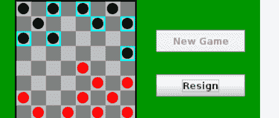

我仅涵盖此示例的部分编程内容。我鼓励你阅读完整的源代码`Checkers.java`。它很长且复杂，但通过学习，你应该能理解它所使用的所有技术。该程序是基于状态、事件驱动、面向对象编程的良好范例。

棋盘上棋子的数据存储在二维数组中。由于程序的复杂性，我想将其分为几个类。除了主类外，还有几个嵌套类。其中一个类是`CheckersData`，它处理棋盘的数据。我想主要讨论的是这个类。

`CheckersData`类有一个名为`board`的`int[][]`类型的实例变量。`board`的值被设置为`new int[8][8]`，这是一个 8x8 的整数网格。存储在网格中的值定义为常量，代表棋盘上方格的内容：

```
static final int
    EMPTY = 0,           // 表示空格的值。
    RED = 1,            // 普通红方棋子。
    RED_KING = 2,       // 红王。
    BLACK = 3,          // 普通黑方棋子。
    BLACK_KING = 4;     // 黑王。
```

常量`RED`和`BLACK`也用于我的程序中（或者可能被误用），以代表游戏中的两个玩家。当游戏开始时，数组中的值被设置为棋盘的初始状态。值的网格看起来如下：

| 0 | 1 | 2 | 3 | 4 | 5 | 6 | 7 |
|---|---|---|---|---|---|---|---|
| 0 | BLACK | EMPTY | BLACK | EMPTY | BLACK | EMPTY | BLACK | EMPTY |
| 1 | EMPTY | BLACK | EMPTY | BLACK | EMPTY | BLACK | EMPTY | BLACK |
| 2 | BLACK | EMPTY | BLACK | EMPTY | BLACK | EMPTY | BLACK | EMPTY |
| 3 | EMPTY | BLACK | EMPTY | BLACK | EMPTY | BLACK | EMPTY | BLACK |
| 4 | BLACK | EMPTY | BLACK | EMPTY | BLACK | EMPTY | BLACK | EMPTY |
| 5 | EMPTY | BLACK | EMPTY | BLACK | EMPTY | BLACK | EMPTY | BLACK |
| 6 | BLACK | EMPTY | BLACK | EMPTY | BLACK | EMPTY | BLACK | EMPTY |
| 7 | EMPTY | BLACK | EMPTY | BLACK | EMPTY | BLACK | EMPTY | BLACK |

`CheckersData`类有一个名为`board`的`int[][]`类型的实例变量。`board`的值被设置为`new int[8][8]`，这是一个 8x8 的整数网格。存储在网格中的值定义为常量，代表棋盘上方格的内容：

（注：此处对应原文中重复混乱的部分，已按逻辑整合）

## 第7 章 数组与动态数组

```java
/**
* 返回一个数组，包含当前棋盘上指定玩家的所有
* 合法的跳棋移动（CheckersMoves）。如果玩家
* 没有合法移动，则返回 null。player 的值
* 应当是 RED 或 BLACK 常量之一；否则，
* 返回 null。如果返回的值非空，它将完全
* 由跳跃移动组成，或者完全由正移动移动组成，因为
* 如果玩家可以跳跃，则只有跳跃是合法的移动。
*/
```

```java
CheckersMove[] getLegalMoves(int player)
```

该方法的简要伪代码如下：

- 从一个空移动列表开始
- 寻找合法的跳跃并将其添加到列表
- 如果没有跳跃：
    - 寻找任何其他合法移动并将其添加到列表
- 如果列表为空：
    - 返回 null
- 否则：
    - 返回该列表

现在，这个“列表”是什么？我们必须以数组的形式返回合法移动。但由于数组的大小是固定的，在知道有多少次移动之前，我们无法创建数组；而在方法结束之前，我们并不知道有多少次移动——我们已经创建了列表！一个巧妙的解决方案是使用一个数组的`ArrayList`来存储我们找到的移动。事实上上，我使用了一个由泛型类型`ArrayList<CheckersMove>`定义的对象，以便列表被限制为持有`CheckersMove`类型的对象。随着我们向列表添加移动，它会根据需要自动增长。在方法结束时，我们可以创建真正想要的数组并将数据复制其中：

```text
令 "moves" 为 CheckersMove 数组
寻找合法的跳跃并将其添加到 moves
if moves.size() == 0: // 没有合法的跳跃！
    寻找任何其他合法移动并将其添加到 moves
if moves.size() == 0: // 没有合法的移动！
    return null
else:
    let moveArray 为长度为 moves.size() 的 CheckersMove 数组
    将 moves 的内容复制到 moveArray
    return moveArray
```

现在，我们如何寻找合法的跳跃或合法移动呢？我们需要的信息在棋盘中，提取它们需要一些工作。我们必须查找数组中的所有位置，并找到属于当前玩家的棋子。对于每个棋子，我们检查每个理论可能移动到的方格，并检查那是否是一个合法的移动。如果我们在寻找跳跃，我们需要查看距离棋子隔两行两列的方格。有四个方格需要考虑。然后，算法中“寻找任何合法跳跃并将其添加到 moves”的那行代码扩展为：

- 对于棋盘的每一行：
    - 如果玩家的每个棋子位于此位置：
        - 如果跳跃到 row + 2, column + 2 是合法的
            - 将此移动添加到 moves

```java
if 跳跃到 row - 2, column + 2 是合法的
    将此移动添加到 moves
if 跳跃到 row + 2, column - 2 是合法的
    将此移动添加到 moves
if 跳跃到 row - 2, column - 2 是合法的
    将此移动添加到 moves
```


“寻找任何其他合法移动并将其添加到 `moves`”那行代码扩展为类似的内容，不同在于我们需要查看距离棋子一行一列的四个方格。测试玩家是否可以从一个方格合法移动到另一个方格本身并不是易事。玩家移动的实际上是进入棋盘，且该方格必须是空的。此外，普通的红、黑棋子只能向一个方向移动。我编写了以下实用方法来检查玩家是否可以进行非跳跃移动（普通移动）：

- 此方法由 `getLegalMoves()` 方法调用，用于确定玩家是否可以合法从 `(r1,c1)` 移动到 `(r2,c2)`，假设 `(r1,c1)` 包含了玩家的一个棋子且 `(r2,c2)` 是相邻方格。

```java
public boolean canMove(int player, int r1, int c1, int r2, int c2) {
    if (r2 < 0 || r2 >= 8 || c2 < 0 || c2 >= 8)
        return false; // (r2,c2) 在棋盘之外。
    if (board[r2][c1] == EMPTY)
        return false; // (r2,c2) 已经包含一个棋子。
    if (player == RED) {
        if (board[r1][c1] == RED && r2 > r1)
            return false; // 普通红色棋子只能向下移动。
        return true; // 移动是合法的。
    } else {
        if (board[r1][c1] == BLACK && r2 < r1)
            return false; // 普通黑色棋子只能向上移动。
            return true; // 移动是合法的。
    }
} // end canMove()
```

此方法由我的 `getLegalMoves()` 方法调用，用于检查它找到的可能移动是否是真实的。我还有一个类似的方法被调用来检查跳跃是否合法。在这种情况下，我传递给方法的是包含玩家棋子的方格、玩家可能移动到的方格，以及两者之间的用于跳跃的方格。被跳跃的方格必须包含对手的棋子。该方法有其规范：

- 此方法由其他方法调用，用于检查玩家是否可以合法从 `(r1,c1)` 跳跃到 `(r2,c2)`，假设 `(r1,c1)` 包含了玩家的一个棋子且 `(r2,c2)` 是相邻方格。被跳跃的方格必须包含对手的棋子。

```java
private boolean canMove(int player, int r1, int c1, int r2, int c2) {
...
```

# 第 7 章练习题

1. 编写一个子程序，创建一个包含从 1 到指定最大范围内若干不同整数的 `ArrayList`。整数的数量和整数允许的最大值是该子程序的参数。编写一个 `main()` 变程序来测试你的子程序。

> (solution)

2. 假设 `M` 是一个具有 `R` 行 `C` 列的二维数组。`M` 的转置被定义为一个具有 `C` 行 `R` 列的数组 `T`，使得对于每个 `i` 和 `j`，都有 `T[i][j] = M[j][i]`。编写一个函数，接受一个类型为 `type[][]` 的数组作为参数，并返回该数组的转置。（假设参数是一个所有行长度相同的典型二维数组。）再编写一个子程序，以整齐的行和列打印一个整数二维数组，并包含一个 `main()` 变程序来测试你的工作。

> (solution)

3. 在第 7.4.4 节中提到，标准排序方法 `Arrays.sort()` 比选择排序快得多且高效得多。编写一个程序来测试这一点。具体创建一个包含随机数的大数组。它应该同时使用 `Arrays.sort()` 和 `selectionSort()` 对数组进行排序，并显示执行每次排序所需的时间。（参见第 2.3.1 节和示例 `TimedComputation.java`。）

> (solution)

4. 在练习 6.1 中，编写一个名为 `SimpleStepperWithDrag` 的程序，允许用户通过点击和拖动鼠标来绘制红色矩形和蓝色猫头鹰。然而，该程序没有存储任何关于如何绘制的信息，因此程序无法正确地重绘自己。回顾程序并使用 `ArrayList`，以便存储面板内容的数据。所有的绘制都应该在 `paintComponent()` 方法中完成。

> (solution)

5. 编写一个程序，读取用户输入的一系列随机数，并按从小到大的排序顺序打印这些数字。用户将输入 0 来标记输入结束。假设最多会输入 100 个正数。不要使用任何如 `Arrays.sort()` 的内置函数。自己实现排序。

> (solution)

6. 第 6.4.1 节中的示例程序 `RandomArt.java` 每四秒显示一个随机的“艺术品”。有三种类型的“艺术”：一种由线条组成，一种由圆形组成，还有一种由填充正方形组成。然而，程序没有保存屏幕上图片的数据。除非必要，否则无法重新绘制图片。每次调用 `paintComponent()` 都会绘制一幅新画。

> (solution)

编写 `RandomArt.java` 的新版本，保存数据以重绘其图片。`paintComponent()` 方法应仅使用数据来绘制图片。新数据应每四秒重新计算一次，以响应驱动程序的计时器事件。

为了让这变得有趣，为三种艺术中的每一种编写单独的类。使用一个抽象类作为这三个类的公共基类。由于所有三种艺术都使用随机灰色背景，因此背景颜色可以在它们的父类中定义。父类还包含一个绘制图片的 `draw()` 方法；这是一个抽象方法，因为它的实现取决于正在绘制的特定艺术类型。

```java
private abstract class ArtData {

    Color backgroundColor; // 艺术品的背景颜色。

    ArtData() { // 构造函数将背景颜色设置为随机灰色。
        int x = (int)Math.random();
        backgroundColor = new Color(x, x, x);
    }

    abstract void draw(Graphics g); // 绘制此艺术品。
}
```

`ArtData` 的三个子类每个都定义了自己的 `draw()` 方法。它必须定义实例变量来存储绘制图片所需的数据。我建议你应该在类的构造函数中为图片创建随机数据，这样构造它时就会自动为艺术品创建数据。（这个问题的问题是，在知道面板大小之前你无法创建数据，因此你不能在面板的构造函数中创建 `ArtData` 对象。一种解决方案是在 `paintComponent()` 方法开始处如果对象尚未创建，则创建一个 `ArtData` 对象。在三个子类中，你都需要使用一个或多个 `ArrayList` 来存储数据。）

7. 编写一个程序，由用户读取文本文件，并使用该文件中所有不同单词的字母列表。所有单词都应转换为小写，并从列表中消除重复项。列表应写入用户选择的输出文件中。正如第 2.4.4 节讨论的，你可以使用 `TextIO` 来读写文件。使用类型为 `ArrayList<String>` 的变量来存储这些。在读取时分离文件并不容易。你可以使用以下方法：

- 从 `TextIO` 读取单词，如果有。首先，跳过输入中的任何非字母字符。如果在找到单词之前遇到文件末尾，则返回 `null`。否则，读取并返回单词。
- 单词定义为字母序列。此外，如果撇号两边都有字母包围，单词也可以包含撇号。
- 从 `TextIO` 返回单词，如果遇到文件末尾则返回 `null`。

```java
private String nextWord() {

    char ch = TextIO.peek(); // 查看输入中的下一个字符。

    while (ch != TextIO.EOF && !Character.isLetter(ch)) { // 跳过非字母。
        TextIO.getChar(); // 读取字符。
    }

    ch = TextIO.peek(); // 查看下一个字符。

    if (ch == TextIO.EOF) { // 遇到文件末尾
        return null;
    }

    // 此时我们知道字符是字母，所以读取单词
    String word = "";

    while (true) {
        if (ch == '\'') { // 字符是撇号。
            TextIO.getChar(); // 读取它。
            ch = TextIO.peek(); // 查看后续字符。
            if (Character.isLetter(ch)) { // 如果后续字符是字母
                word += '\'' + TextIO.getChar(); // 追加撇号和字母。
            } else {
                break;
            }
        } else if (!Character.isLetter(ch)) { // 字符不是字母
            break;
        } else {
            word += TextIO.getChar(); // 追加字母。
            ch = TextIO.peek(); // 查看下一个字符。
        }
    }

    return word; // 返回读取的单词。
}
```

注意，此方法在读取文件后将返回 `null`。你可以将其作为停止处理的信号。

8. 五子棋游戏（也称为 Peute 或五子）与井棋类似，但是在更大的棋盘上玩，目标是获得五个而不是三个。玩家交替在棋盘上放置棋。棋可以放在任何空隙。第一个获得五个连（水平、垂直或对角）的玩家胜。如果在任何玩家获胜之前填满了格子，则为平局。编写一个相互检查五子棋程序。你的程序将比 7.5.3 的棋类程序简单。它在两个玩家之间交替，不需要高亮移动。你需要两个类，一个用于设置界面的短类和一个用于绘制棋盘并执行所有游戏工作的 `Board` 类。然而，你可能想查看棋类程序 `Checkers.java` 的源代码，以获取关于程序整体的想法。

程序中最难的部分是检查玩家是否走了胜棋。为了做到这一点，你需要从用户放置棋子的格子向四个方向查看。你必须计算玩家在该方向上连续了多少棋子。如果任何方向的数量为五个或更多，该玩家胜。作为提示，这里是我程序的部分代码。这段代码计算用户在指定方向上的连续棋子数。方向由两个整数 `dirX` 和 `dirY` 指定。这些变量的值为 0、1 或 -1，且至少有一个不为零。例如，要查看水平方向，`dirX` 为而 `dirY` 为 0。

```cpp
int ct = 1; // 玩家拥有一行棋子的数量。
int r, c;      // 需要检查的行和列

r = row + dirX;      // 查看 de指定方向的单元格。
c = col - dirY;

while ( r >= 0 && r < 13 && c >= 0 && c < 13 &&
    board[r][c] == player ) {
    // 格子在棋板上，且
    // 包含一个玩家的棋子。
    ct++;
    r += dirX; // 向此方向的下一个单元格移动。
    c += dirY;
}

r = row - dirX; // 现在，向相反方向查看。
c = col - dirY;

while ( r >= 0 && r < 13 && c >= 0 && c < 13 &&
    board[r][c] == player ) {
    ct++;
    r -= dirX; // 向此方向的下一个单元格移动。
    c -= dirY;
}
```

这是我的程序在黑方获胜游戏后的照片。

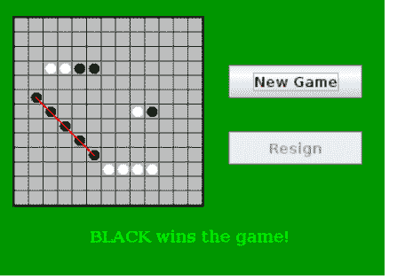

# 第7章测验

1. 数组的*基类型*（basetype）是指什么？

2. 下面变长参数方法的目的是什么？`same(1,2,3)`、`same(17,17,17,17)` 和 `same(2)` 的值是多少？为什么？

```cpp
static double same(int... value ) {
    for (int i = 1; i < value.length; i++) {
        if (value[i-1] != value[i])
            return false;
    }
    return true;
}
```

3. 排序数组意味着什么？

4. 二分查找相对于线性查找的主要优势是什么？主要缺点又是什么？

5. *动态数组*（dynamic array）是指什么？动态数组相比普通数组的优势是什么？

6. 说 *ArrayList* 是参数化类型意味着什么？

7. 假设声明了一个变量 *strlist*：`ArrayList<String> strlist = new ArrayList<String>();` 假设列表不为空且列表中的所有项均非空。编写一段代码，用于找到并打印列表中按字典顺序排列最靠前的字符串。

8. 显示以下代码段产生的精确输出。

```java
char[][] pic = new char[6][6];

for (int i = 0; i < 6; i++) {
    for (int j = 0; j < 6; j++) {
        if (i == j || i == 0 || i == 5)
            pic[i][j] = '*';
        else
            pic[i][j] = '.';
    }
}

for (int i = 0; i < 6; i++) {
    for (int j = 0; j < 6; j++) {
        System.out.print(pic[i][j]);
    }
    System.out.println();
}
```

9. 编写一个完整的静态方法，用于查找 `int` 数组数组中的最大值。该方法应有一个参数，类型为 `int[]` 数组。数组中的最大数字应作为方法的返回值返回。

10. 假设对 2014 年 100 个城市中的每一天都进行了温度测量。这些测量结果存储在一个数组中：

```java
int[][] temps = new int[100][365];
```

其中 `temps[c][d]` 存储第 `c` 个城市在 yearly `d` 天的测量值。编写一段代码，输出每个城市全年的平均温度。一个城市的平均温度可以通过累加该城市的 365 次测量值并除以 365.0 来获得。

11. 假设定义了如下类 `Employee`：

```java
class Employee {
    String lastName;
    String firstName;
    double hourlyWage;
    int salaryWithCompany;
}
```

假设关于 100 名员工的数据已经存储在一个数组中：

```java
Employee[] employeeData = new Employee[100];
```

编写一段代码，输出每个入职 20 年的员工的名字、姓和每小时工资。编写两个版本的代码，一个使用 `for` 循环，一个使用 `for-each` 循环。

12. 下面子程序的目的是什么？它返回的值相对于其参数意义何？

```java
static double[] sum(double[][] data) {
    double[] answers = new double[data.length];
    for (int i = 0; i < data.length; i++) {
        double sum = 0;
        for (int j = 0; j < data[i].length; j++) {
            sum = sum + data[i][j];
        }
        answers[i] = sum;
    }
    return answers;
}
```


# 第8章：正确性、健壮性、效率

在之前的章节中，我们涵盖了基础知识。后续章节将涵盖更高级的内容。本章将介绍正确性、健壮性和效率。

当然，最近也发生了一些问题。例如，计算机软件错误导致了2003年美国东北大停电，这是历史上最大的停电事件之一。2006年，空客A380因为软件兼容性问题导致推迟，损失可能高达数十亿美元。2007年，一个软件问题导致了洛杉矶国际机场的飞机停飞。2010年5月6日，一个自动交易程序的缺陷导致道琼斯平均指数下跌了1000点。

这些只是几个例子。软件程序错误随处可见。作为程序员，我们需要理解为什么会这样，以及可以采取什么措施。

## 8.1.2 Java 来救场

根据 Java 发明者的说法，部分问题可以追溯到编程语言本身。Java 的设计目标是提供对某些类型错误的保护。语言特性如何帮助防止此类错误呢？让我们来看几个例子。

早期的编程语言不需要声明变量。在这些语言中，当程序中使用变量名时，变量会自动创建。你可能认为这比显式地声明每个变量更方便，但会产生一个遗憾的后果。一个无意的拼写错误可能会引入一个你无意创建的额外变量。根据一个故事，这种类型的错误导致了另一个航天器的失事。在 FORTRAN 编程中，命令 `DO 20 I=1, 5` 是计数循环的第一语句。现在，它等同于 `DO20 I=1.5,`。另一方面，命令 `DO20 I=1.5,` 使用赋值语句代替逗号——即在这里无意间将点号替换了逗号——导致火箭在起飞时爆炸。由于 FORTRAN 不需要声明变量，编译器会接受 `DO20 I=1.5,` 这条语句。它会创建一个名为 `D201I` 的新变量。如果 FORTRAN 要求声明变量，编译器就会声明变量 `D201I`。

在不需要声明变量的编程语言中，通用编程语言还有其他特性可能导致问题。Java 消除了其中一些特性。有些人声称这使得 Java 的效率更低、功能不够强大。虽然这种批评有一定的道理，但在大多数情况下，安全性和健壮性的提高是值得付的。针对某些错误的最佳防御方法是设计一个能够处理不可能错误的程序。在其他情况下，当错误无法消除时，语言可以检测到它，这样当错误发生时，会被自动检测。这至少防止了错误造成进一步的伤害，并提醒程序员有一个需要修复的 bug。让我们来看看 Java 设计者采取这些方法的几个案例。

数组在创建时包含一组位置，从零到指定的最大索引。使用超出指定范围之外的数组位置是一个错误。在 Java 中，任何此类尝试都会被系统检测。在其他语言（如 C 和 C++）中，程序员可能会访问 `A[0]`、`A[1]` 以及 `A[2]`、`A[4]` 等，从而访问超出数组末尾的内存位置。在 Java 中，尝试在 `A[3]` 中存储数据将会被检测。程序将终止（如 3.7 节所述，该错误被“捕获”了）。在 C 或 C++ 中，计算机将直接把数据存储在不属于数组的内存中。由于无法得知该内存位置被何用，结果将是不可预测的。后果可能比程序终止严重得多。（例如，参见本节后部分对缓冲区溢出错误的讨论。）

指针是编程错误的臭名源。在 Java 中，对象类型的变量持有指向对象的指针或特殊值 `null`。任何将 `null` 值用作指向实际对象的对象的尝试都会被系统检测。在其他语言中，避免此类空指针取决于程序员。在我旧的 Macintosh 计算机上，空指针的实际实现方式类似于指向内存位置 0 的指针。空指针可能会更改存储在位置 0 附近的内存值。遗憾的是，Macintosh 在这些位置存储了系统数据。更改这些数据可能导致整个系统崩溃，其后果比单个程序失败严重得多。

另一种类型的指针错误发生在指针指向错误类型的对象，或者指向完全不包含有效对象的内存段时。这类错误在 Java 中是不可能的，因为 Java 不允许指针直接操纵指针。在其他语言中，可以将指针设置为内存中的任何位置。如果操作不当，使用该指针可能会产生不可预测的结果。

另一种在 Java 中不会发生的错误是引用一个已被“垃圾回收”的对象，以便该内存可以被重用。在其他语言中，将未使用的内存返回系统是程序员的责任。如果程序员未能做到这一点，未使用的内存就会堆积，留给程序和数据的内存就会越来越少。有一个说法，许多旧 Windows 计算机的程序有大量的内存泄漏，导致计算机在使用几天后就会耗尽内存并必须重启。

已发现许多程序遭受缓冲区溢出错误。缓冲区溢出经常成为新闻，因为它们是许多网络安全问题的原因。在很多情况下，缓冲区溢出是因为程序接收的数据超过了缓冲区能容纳的内容。在 Java 中，这是可能的，因为语言会检查数组边界。在其他语言中，这由程序员来检查。

显然，语言设计可以在错误发生时帮助防止或检测错误。这样做限制了程序员允许的操作。

## 8.1.3 Java 中仍然存在的问题

Java 设计者在一个领域选择不自动检测错误：数值计算。在 Java 中，`int` 类型的值表示为 32 位数字。对于 32 位，`int` 的取值范围是 -2147483648 到 2147483647。计算超出范围时会发生什么？例如，`2147483647 + 1` 是多少？`2000000000 * 2` 多少？在每种情况下，数学上的正确结果都无法表示为 `int`。这些都是整数溢出的例子。在大多数情况下，整数溢出应该被视为错误。然而，Java 不会自动检测此类错误。例如，它会将 `2147483647 + 1` 计算为负值 -2147483648。（发生的是 32 位之外的额外位被丢弃。大于 2147483647 的值会“绕回”到负值。从数学上说，结果始终是“模 2232”）。

例如，3.2 节讨论过的 N+1 程序，从正整数 N 开始，程序计算一个整数序列：

```
while (N != 1) {
  if (N % 2 == 0) // 如果 N 是偶数
    N = N / 2;
  else
    N = 3 * N + 1;
  System.out.println(N);
}
```

但有一个问题：如果 N 太大，`3*N+1` 的值由于整数溢出而在数学上将是不正确的。问题出现在 `N > 2147483646/3` 时。为了编写完全正确的程序，我们应该在计算 `3*N+1` 之前检查这种可能性：

```
while (N != 1) {
  if (N % 2 == 0) // 如果 N 是偶数
    if (N > 2147483646/3)
      System.out.println("抱歉，但 N 的值变得");
      System.out.println("对于您的计算机来说太大了！");
      break;
    N = N / 2;
  else
    N = 3 * N + 1;
}
```

（确保理解为什么我们不能简单地测试“`if (3*N+1 > 214783647)`”）。问题不在计算 3N+1 序列的算法是错误的，问题在于它无法使用 32 位整数进行正确实现。许多程序忽略了这类问题。但整数溢出错误导致了许多严重的计算机故障，而一个完全健壮的程序应该考虑到整数溢出的可能性。2000 年初臭名昭彰的“Y2K”漏洞（千年虫）实际上就是这类错误。）

对于 `double` 类型数字，问题更多。当计算结果超出了 `double` 类型可以表示的数值范围时，仍然会错误。这个范围延伸到 $1.7 \times 10^{308}$。超出此范围的数字不会“回绕”到负值，而是由没有数值等价物的特殊值表示。特殊值 `Double.POSITIVE_INFINITY` 和 `NEGATIVE.INFINITY` 代表合法值范围之外的数字。例如，对于 `double` 类型，`1e308` 的计算结果为 `Double.POSITIVE_INFINITY`。另一个 `double` 类型的值 `Double.NaN` 代表非法或未定义。“NaN”代表“不是数字”（Not a Number）。例如，零除以零的结果或此类特殊数字的 $x$。你可以通过调用布尔值函数 `isNaN(x)` 来测试负数的平方根。实数的小数点可以有无限位。`double` 类型的值只能精确到大约 15 位。实数 $1/3$ 是循环小数 $0.33333333333...$ ，无法用有限位数来精确表示它。实数的计算通常涉及精度的损失。事实上，这种做法是不正确的。大量此类错误累积的结果可能是完全错误的！计算机科学中有一个被称为数值分析的整个领域，专门研究处理实数的算法。

因此你会发现，在 Java 中，可能的错误会被自动避免或检测。此外，即使自动检测到错误，系统的默认响应也是报告错误并终止程序。这很难称为健壮的行为！因此，程序员仍然需要学习避免和处理错误的技术。这些是后续章节的主题。

# 编写正确的程序

正确的程序并非凭空产生。为了避免程序中的错误，需要规划和对细节的关注。程序员可以使用一些技术来增加程序正确性的概率。

## 8.1 可证明的正确程序

在某些情况下，可以证明一个程序是正确的。也就是说，可以通过数学方法证明计算序列将始终产生正确的结果。严谨的证明足够困难，以至于在实践中它只能应用于较小的程序。此外，它还取决于“正确结果”是否被正确且完全地指定。如果规范是错误的，那么即使程序正确符合了规范也没有用。尽管如此，在日常编程中，我们可以应用任何用于证明程序正确的思想和技术。

基本思想是**过程**（process）和**状态**（state）。一个状态由程序执行过程中某一时刻与执行相关的所有信息组成。例如，状态包括程序中所有变量的值、已产生的输出、任何等待读取的输入，以及计算机工作所在的程序位置的记录。过程是程序中一系列语句，程序在执行时会依次通过这些语句。从这个角度来看，语句的含义可以用该语句的执行对计算机状态的影响来表示。一个简单的例子是赋值语句 `x = 7;`在该语句执行后，变量 $x$ 的值变为 $7$。如果这是我们可以构建数学证明的一部分，我们就可以完全确定这一事实。

事实上，观察程序并推断出在程序执行的某一点，某些片段必须是真的。例如，考虑以下循环：

```
do {
  System.out.print("Enter positive integer: ");
  N = Integer.getInt();
} while (N <= 0);
```

在这个循环之后，我们可以确定 $N$ 的值大于零。在条件满足之前，循环无法结束。更通地说，如果一个循环使用了“条件”，在循环结束后，我们可以确定该条件为假。这是指定循环将做什么的一种方法。

考虑以下程序：

```
do {
    System.out.println("Enter A, B, and C.");
    System.out.println("A = %s");
    A = in.nextDouble();
    System.out.println("B = %s");
    B = in.nextDouble();
    System.out.println("C = %s");
    C = in.nextDouble();
    if (A == 0 || B*B - 4*C < 0) {
        System.out.println("Your input is illegal. Try again.");
    }
} while (A == 0 || B*B - 4*C < 0);
disc = B*B - 4*C;
x = (-B + Math.sqrt(disc)) / (2 * A);
System.out.println("A solution of A*X*X + B*X + C = 0 is " + x);
```

在上面的程序中，循环确保 $A、B、$C$ 的选择使得 $A$ 不零且判别式 $B*B-4C$ 非负。这些是求根公式的前提条件。循环结束后，我们可以确定前提条件已满足，程序可以正确计算解。

另一个变体，通过 `if` 语句检查前提条件。在 `if` 语句计算并打印解的第一部分，我们知道前提条件已满足。在其他部分，我们知道其中一个前提条件不成立。在这种情况下，程序是正确的。

```
System.out.println("Enter your values for A, B, and C.");
System.out.println("A = %s");
A = in.nextDouble();
System.out.println("B = %s");
B = in.nextDouble();
System.out.println("C = %s");
C = in.nextDouble();
if (A != 0 && B*B - 4*C >= 0) {
    disc = B*B - 4*C;
    x = (-B + Math.sqrt(disc)) / (2 * A);
    System.out.println("A solution of A*X*X + B*X + C = 0 is " + x);
} else if (A == 0) {
    System.out.println("Since A is 0, the quadratic formula cannot be used directly.");
} else {
    System.out.println("The equation A*X*X + B*X + C = 0 has no real solution.");
}
```

每当你编写程序时，留意前条件（preconditions）并思考程序如何处理这些条件都是好主意。通常，前条件可以为如何编写程序提供线索。

例如，每一个数组引用（如 `A[i]`）都有一个前条件：该索引必须在数组的索引范围内。对于 `A[i]`，前条件是 `0 < i < A.length`。计算机在评估 `A[i]` 时会检查此条件，如果不满足该条件，程序将终止。为了避免这种情况，你需要确保索引具有合法的数值。（实际上还有另一个前条件，即 `A` 不为空，但我们暂不考虑它。）考虑以下代码，它在数组 `A` 中搜索数字 `x`，并将 `i` 的值设置为包含 `x` 的元素的索引：

```
i = 0;
while (A[i] != x) {
  i++;
}
```

该程序段目前的形式有一个前条件，即 `x` 实际上在数组中。如果满足了这一前条件，循环将在 `A[i] == x` 时结束。然而，如果 `x` 不在数组中，循环将在 `x` 在数组中的位置结束。`i` 的值将一直增加，直到它等于 `A.length`。此时，对 `A[i]` 的引用将是非合法的，程序将终止。为了避免这种情况，我们可以添加一个测试来确保引用 `A[i]` 的前条件得到满足：

```
i = 0;
while (i < A.length && A[i] != x) {
  i++;
}
```

现在，循环最终会结束。循环结束后，`i` 将满足 `i == A.length` 或 `A[i] == x` 之一。在循环后可以使用 `if` 语句来测试是哪种条件导致了循环结束：

```
i = 0;
while (i < A.length && A[i] != x) {
  i++;
}
```

```
if (i == A.length)
  System.out.println("x is not in the array");
else
  System.out.println("x is in position " + i + "");
```

### 8.2.2 输入的健壮性

正确性和健壮性非常重要且尤其困难的一个地方是处理输入数据，无论这些数据是用户输入的、来自文件还是通过网络传输的。文件和网络将在第 11 章介绍，那里将大量使用本章下一节将涵盖的材料。现在，让我们来看一个处理用户输入的示例。

在本教科书中，我们使用 `TextIO` 类从用户处读取输入。该类具有内置的错误处理功能。例如，`TextIO.getDouble()` 函数保证返回一个合法的 `double` 类型值。如果用户输入了非法值，`TextIO` 将要求用户重新输入响应；你的程序永远看不到该非法值。然而，这种方法是笨拙且不令人满意的，特别是当用户输入复杂数据时。在下面的示例中，我将亲自错误检查。

有时，预先查看输入中的内容而不进行实际读取是很有用的。例如，程序可能需要知道输入中的下一个项目是数字还是一个类。为了这个目的，`TextIO` 类包含了 `TextIO.peek()`。该函数返回一个 `char`，它是用户输入中的字符，但它并不会实际读取它。如果下一个内容是行尾，则 `TextIO.peek()` 返回换行符 `'\n'`。

通常，我们需要读取用户输入中的下一个非空白字符。在我们测试此之前，我们需要跳过一些空格（和制表符）。这里有一个执行此操作的函数。它使用 `TextIO.peek()` 进行预读，并读取每个字符，直到输入是行尾或某个非空白字符。（函数 `TextIO.getChar()` 会读取用户输入中的下一个字符，即使它是空格也是如此。相比之下，最常用的 `TextIO.getChar()` 会跳过空白并返回下一个非空白字符。我们在这里不能使用 `TextIO.getChar()`，因为目标是跳过空白而不读取下一个非空白字符。）

```java
/**
 * 跳过输入中的任何空格和制表符。
 * 后置条件：输入中的字符是行尾或非空白字符。
 */
static void skipBlanks() {
  char ch;
  ch = TextIO.peek();
  while (ch == ' ' || ch == '\t') {
    // 下一个字符是空格或制表符；读取它
    // 并查看随其后的字符。
```


```java
ch = TextIO.getChar();

ch = TextIO.peek();

}

}

// end skipBlanks()
```

（事实上，这种操作非常常见，以至于它内置在 `TextIO` 中。`TextIO.skipBlanks()` 方法的作用与这里提供的 `skipBlanks()` 方法基本相同。）

第 3.5.3 节中的一个示例允许用户以“3 miles”或“1 foot”的形式输入长度测量值。然后它将测量值转换为英寸、英尺、码和英里。但人们经常使用组合测量值，如“3 feet 7 inches”。让我们改进程序来处理这种输入。

更具体地说：用户输入行可能包含一个或多个测量值，格式如“1 foot”或“3 miles”。以下是使用 Java 实现的例：

```java
/**
 * 从输入行读取用户的测量值。
 * 前条件：输入行不为空。
 * 后置条件：如果用户输入合法，则将测量值转换为英寸并返回。
 * 如果输入非法，则返回 -1。此程序不读取行尾。
 */
static double readMeasurement() {
    double inches; // 测量值的英寸数
    double measurement; // 测量值，如 "12 miles" 中的数字
    String units; // 单位，如 "miles"
    char ch; // 用于查看输入中的下一个字符

    inches = 0; // 尚未读取任何英寸
    skipBlanks();
    ch = TextIO.peek();

    /* 只要行尾还有输入，就读取测量值并将英寸。
       如果在循环期间检测到错误，子程序立即返回 -1。 */
    while (ch != '\n') {
        /* 获取下一个测量值和单位。在读取任何内容之前，确保有合法的数值可读。 */
        if (!Character.isDigit(ch)) {
            System.out.println("错误：预期找到数字，但找到了 " + ch + "");
            return -1;
        }

        measurement = TextIO.nextDouble();
        units = TextIO.getWord(); // 简化单位读取

        if (units.equals("inches")) {
            inches += measurement;
        } else if (units.equals("feet")) {
            inches += 12 * measurement;
        } else if (units.equals("yards")) {
            inches += 36 * measurement;
        } else if (units.equals("miles")) {
            inches += 5280 * measurement;
        } else {
            System.out.println("错误：未知单位：" + units);
            return -1;
        }

        ch = TextIO.peek();
    }

    return inches;
}
```

# 第 8 章：正确性、健壮性、效率

```java
skipBlanks();

if (TextI0.peek() == '\n') {
    System.out.println(
        "Error: 行末缺少计量单位.");
    return -1;
}

units = TextI0.getWord();
units = units.toLowerCase();

/* 将测量值转换为英寸并加到总中。 */
if (units.equals("inch")) {
    if (units.equals("inches") || units.equals("in")) {
        inches += measurement;
    }
} else if (units.equals("foot")) {
    if (units.equals("feet") || units.equals("ft")) {
        inches += measurement * 12;
    }
} else if (units.equals("yard")) {
    if (units.equals("yards") || units.equals("yd")) {
        inches += measurement * 36;
    }
} else if (units.equals("mile")) {
    if (units.equals("miles") || units.equals("mi")) {
        inches += measurement * 36; // 注意：此处原文代码逻辑似乎应为5280，但按原文保留36
    }
} else {
    System.out.println("错误: \"" + units + "\" 不是有效的测量单位.");
    return -1;
}

/* 预读检查是否已到达行末。 */
skipBlanks();

ch = TextI0.peek();

} // end while

return inches;

} // end readMeasurement()
```

`readMeasurement()` 的源代码位于 `Converter.java`。

## 8.3 异常与 try-catch

在理想情况下让程序正常工作，比让程序变得健壮要困难得多。一个健壮的程序可以在异常发生时生存下来。健壮程序的一种方法是预判可能出现的问题。例如，当程序访问数组 `A[i]` 时，如果索引不合法，程序就会崩溃。健壮程序的另一种方法是在使用数组元素之前，检查索引是否合法。这可以通过以下代码实现：

```java
if (i < 0 || i >= A.length) {
    // 处理异常
} else {
    // 处理数组元素 A[i]
}
```

这种方法存在一些问题。通常情况下，预判所有可能出现的错误是不可能的。此外，通过 `try-catch` 语句来处理异常可能会程序变得混乱。

## 8.3.1 异常与类

我们在 3.7 节已经看到，Java 提供了一种更结构化的技术来处理异常，即 `try-catch`。当异常发生时，实际上被“抛出”（thrown）的是一个对象。这个对象可以携带异常发生点到被捕获点之间的信息。这些信息包括调用堆栈（call stack），即异常发生时正在执行的例程列表。异常对象通常还包含描述发生了什么的消息。

所有异常对象都必须是 `java.lang.Throwable` 的子类。通常情况下，每种异常类型由 `Throwable` 的一个子类表示，下面的层次图展示了各种异常类型之间的关系。`Throwable` 有两个直接子类：`Error` 和 `Exception`。这两个子类又有许多子类。此外，程序员可以创建新的异常类来表示新的异常类型。

大多数 `Error` 的子类代表 Java 虚拟机内部的严重错误，由于没有合理的方法来处理它们，通常情况下你不应该尝试捕获并处理此类错误。一个例子是 `ClassFormatError`，当虚拟机在预期包含编译后的类文件的文件中发现某种非法数据时发生。如果类是程序的一部分，程序实际上没有办法继续运行。

另一方面，`Exception` 的子类代表那些应该被捕获的异常。在许多情况下，这些异常自然地被称为“错误”，但它们是程序或输入数据中的错误，程序员可以预判并可能以某种方式做出响应。（然而，你应该避免这种诱惑，即：“好吧，我在这里加一个东西来捕获可能发生的所有错误，这样我的程序就不会崩溃了”）如果你没有合理的方法来响应错误，最好让程序崩溃，因为强行继续会导致更糟糕的结果——在最坏的情况下，程序会给出一个错误的答案而不给出任何提示。

`Exception` 有它自己的子类 `RuntimeException`。这个类分组了许多常见的异常，即所有在之前的节中介绍过的异常。例如，`IllegalArgumentException` 和 `NullPointerException` 都是 `RuntimeException` 的子类。`RuntimeException` 通常指示程序中的 Bug，程序员应该忽略它。

`RuntimeException` 和 `Error` 共享一个属性：当异常发生时，程序可以简单地忽略它们的可能性。（“忽略”意味着如果发生异常，你愿意让程序崩溃。）对于除了 `Error`、`RuntimeException` 及其子类以外的所有其他异常，异常处理在某种意义上是“强制性的”，我将在下文中讨论。

下面的类层次图显示了 `Throwable` 类及其若干几个子类。需要强制性异常处理的类所示：

# 第 8 章：正确性、健壮性、效率

`Throwable` 类包含了几个实例方法，可以与任何异常对象一起使用。如果 `e` 是 `Throwable`（或其子类之一），`e.getMessage()` 是一个返回描述异常的 `String` 的函数。当系统需要对象的字符串表示时，使用的 `e.toString()` 函数返回一个字符串，该字符串包含了异常所属类的名称，以及与 `e.getMessage()` 返回的字符串相同的内容。

`e.printStackTrace()` 方法会将堆栈跟踪（stack trace）写入输出流，列出异常发生时所有活跃的子程序。当你尝试确定问题的原因时，堆栈跟踪非常有用。（注意，如果异常没有被程序捕获，程序对异常的默认响应是将堆栈跟踪打印到标准输出。）

## 8.3.2 Try 语句

在 Java 程序中捕获异常，你需要一个 `try` 语句。自第 3.7 节以来，我们一直在使用语句，但 `try` 语句的语法比之前介绍的要复杂。我们目前使用的 `try` 语句语法类似于下面的示例：

```java
try {
    double determinant = M[0][0] * M[1][1] - M[0][1] * M[1][0];
    System.out.println("The determinant of M is " + determinant);
} catch (ArrayIndexException e) {
    System.out.println("M is too small to size the array.");
    e.printStackTrace();
}
```

在这里，计算机尝试执行 `"try"` 单词后面的语句块。如果在执行此语句块期间没有发生异常，则语句的 `"catch"` 部分将被简单忽略。然而，如果发生了 `ArrayIndexOutOfBoundsException` 类型的异常，计算机将跳转到 `try` 语句的 `catch` 子句。

这个语句块被称为 `ArrayIndexOutOfBoundsException` 的异常处理程序。通过这种方式处理异常，你可以防止它导致程序崩溃。在执行 `catch` 子句的主体之前，表示异常的对象被赋值给变量 `e`，在本示例中使用它来打印堆栈跟踪。

然而，`try` 语句的完整语法有很多选项。花时间过一遍它们。首先，一个 `try..catch` 句可以有多个 `catch` 子句。这使得通过一个 `try` 语句捕获几种不同类型的异常成为可能。

在上面的示例中，除了 `ArrayOutOfBoundsException` 之外，如果 `M` 的值为 `null`，还可能发生 `NullPointerException`。我们可以通过向 `try` 语句添加第二个 `catch` 子句来处理此类异常：

```java
try {
    double determinant = M[0][0] * M[1][1] - M[0][1] * M[1][0];
    System.out.println("The determinant of M is " + determinant);
} catch (ArrayOutOfBoundsException e) {
    System.out.println("M is the wrong size to have a determinant.");
} catch (NullPointerException e) {
    System.out.println("Programming error! M doesn't exist.");
}
```

在这里，计算机尝试执行 `try` 子句中的语句。如果没有发生错误，两个 `catch` 子句都会被跳过。如果发生了 `ArrayOutOfBoundsException`，计算机执行第一个 `catch` 子句的主体并跳过下一个。如果发生了 `NullPointerException`，它将跳转到第二个 `catch` 子句并执行。

注意 `ArrayOutOfBoundsException` 和 `NullPointerException` 是 `RuntimeException` 的子类。可以使用一个 `catch` 子句捕获所有的 `RuntimeException`。

```java
try {
    double determinant = M[0][0] * M[1][1] - M[0][1] * M[1][0];
    System.out.println("The determinant of M is " + determinant);
} catch (RuntimeException err) {
    System.out.println("Sorry, an error has occurred.");
    System.out.println("The error was " + err + "");
}
```

此 `try` 语句中的 `catch` 子句将捕获任何属于 `RuntimeException` 类或其任何子类的异常。这说明了为什么异常类被组织成一个类层次结构。你可以选择收紧网网来只捕获特定类型的异常。或者，你可以宽网撒网来捕获一类异常。

由于捕获机制，当 `try` 语句中有多个 `catch` 子句时，给定的异常可能会匹配其中几个 `catch` 子句。例如，`NullPointerException` 类型的异常将匹配针对 `NullPointerException`、`RuntimeException`、`Exception` 或 `Throwable` 的 `catch` 子句。在这种情况下，只有第一个匹配异常的 `catch` 子句会被执行。

当然，捕获 `RuntimeException` 会捕获比我们感兴趣的两种类型多得多的异常。可以在单个 `catch` 子句中组合特定的异常类型。例如：

```java
try {
    double determinant = M[0][0] * M[1][1] - M[0][1] * M[1][0];
    System.out.println("The determinant of M is " + determinant);
} catch (NullPointerException | ArrayOutOfBoundsException err) {
    System.out.println("Sorry, an error has occurred.");
}
```

在这里，计算机尝试执行 `try` 子句中的语句。如果没有发生错误，两个 `catch` 子句都会被跳过。如果发生了 `ArrayOutOfBoundsException`，计算机执行第一个 `catch` 子句的主体并跳过下一个。如果发生了 `NullPointerException`，它跳转到第二个 `catch` 子句并执行。

# 第 8 章：正确性、健壮性、效率

程序可以抛出异常，希望程序的其他部分能够捕获并处理该异常。这可以通过 `throw` 语句来实现。你已经在第 4.3.8 节中见过这方面的示例。在本节中，我们将详细介绍 `throw` 语句。它的语法如下：

```java
throw (exception-object);
```

`exception-object` 必须是属于 `Throwable` 子类之一的对象。通常，它实际上属于 `Exception` 的某个子类。在大多数情况下，它是一个使用 `new` 算符创建的新对象。例如：

```java
new ArithmeticException("division by zero");
```


构造函数中的参数变为异常中的错误消息；如果它引用该对象，可以通过调用`getMessage()`获取错误消息。你可能会觉得这很奇怪，你预期系统在尝试除以零时抛出`ArithmeticException`。为什么程序员要向异常抛出两者呢？回想一下，如果除的是`int`，那么除以零将抛出`ArithmeticException`。然而，任何浮点数的算术运算都不会产生错误。相反，使用特殊值`NaN`来表示非法操作的结果。在某些情况下，你可能希望在实数除以零时抛出`ArithmeticException`。

异常可以由系统抛出，也可以通过`throw`语句抛出。在任何一种情况下，异常都会被处理。假设异常是在`try`语句内部抛出的。如果`try`语句具有处理该类型异常的`catch`子句，则在处理异常后，程序将执行`try`语句的`finally`子句（如果有的话）。然后程序继续执行`try`语句之后的后续代码。如果异常没有被立即捕获和处理，异常的处理将继续进行。

当在子程序执行期间抛出异常且子程序终止（在执行完任何待处理的调用之后）时，处理异常的机会将交给下一个。也就是说，如果子程序是在具有适当`catch`子句的`try`语句内部调用的，那么该`catch`子句将被执行，程序从那里继续正常运行。同样，如果第二个例程没有处理该异常，它也将被终止，而它调用的例程（如果有）将获得处理该异常的机会。只有当异常向上通过整个子程序链且未被处理时，异常才会导致程序崩溃。（事实上，这并不完全正确：在多线程程序中，发生异常的线程会被终止。）

可能会产生异常的子程序可以通过在例程头部添加`throws (exception-name)`子句来声明这一事实。例如：

- 返回二次方程两个根中较大的一个
- 判断`A*x + B*x + C`是否有任何根。如果`A == 0`，则
- 如果判别式`B*B - 4*A*C`为负，则抛出一个类型为`IllegalArgumentException`的异常。

```java
static double root(double a, double b, double c) throws IllegalArgumentException {
    if (a == 0) {
        throw new IllegalArgumentException("A can't be zero.");
    } else {
        double disc = b*b - 4*a*c;
        if (disc < 0)
            throw new IllegalArgumentException("Discriminant < zero.");
        return (-b + Math.sqrt(disc)) / (2*a);
    }
}
```

正如上一节讨论，该子程序中的计算前提条件是`A != 0`且`B*B - 4*C >= 0`。当子程序中发现非法条件时，子程序抛出类型为`IllegalArgumentException`的异常，抛出异常通常是合理的响应。如果调用该子程序的程序知道某种处理错误的方法，它可以捕获该异常。如果不是，程序将崩溃——程序员将知道程序需要修复。

子程序头部中的`throws`子句可以声明多种类型的异常，用逗号隔开：

```java
void processArray(int[] A) throws NullPointerException,
    ArrayIndexOutOfBoundsException { ... }
```

## 8.3.4 强制性异常处理

在前面的示例中，声明子程序`run()`抛出`IllegalArgumentException`仅仅是对该运行时环境读者的一种礼貌。这是因为存在非法异常（`IllegalExceptions`）：一个例程可以在不声明的情况下抛出`IllegalArgumentException`。而调用该例程的程序可以自由选择捕获或忽略`NullPointerException`类型的异常。

对于那些要求强制处理的异常类，情况则有所不同。如果子程序可以抛出此类异常，则这一事实必须在例程定义中的`throws`子句中声明。未这样做将是编译器会报告的语法错误。编译器将检查程序是否处理了此类异常。

假设在某个子程序的主体中生成了一个通用异常，该异常需要强制处理。该语句应该直接抛出异常，或者调用一个可以抛出该异常的子程序。无论哪种情况，异常都必须处理。这可以通过两种方式实现：第一是将语句放在`try`语句中，该语句带有一个处理该异常的`catch`子句；在这种情况下，异常在子程序内部被处理，因此调用者无法看到异常。第二种方法是通过向子程序头部添加`throws`子句来声明该子程序可以抛出异常，这会提醒所有调用者，在执行子程序时存在产生异常的可能性。调用者反过来将被强制在`try`语句中处理异常，或在自己的头部的`throws`子句中声明该异常。

对于任何既不是`Error`也不是`RuntimeException`子类的异常类，异常处理都是强制性的。这些检查异常（checked exceptions）通常代表控制范围之外的情况。这些异常通常代表程序员无法避免的情况。例如，它们可能代表错误的输入或用户采取的非法操作。由于Java的设计无法避免此类错误，因此健壮的程序必须准备好处理它们。

在使用Java时，有许多检查异常会发生，你需要了解异常处理。第11节将讨论输入输出以及广泛使用的检查异常。

## 8.3.5 使用异常进行编程

异常可以帮助编写健壮的程序。它们提供了一种组织良好的健壮性方法。如果没有异常，程序可能会充斥着测试各种错误条件的语句。有了异常，就可以编写处理所有正常情况的清晰实现。异常情况可以在其他地方通过`catch`子句进行处理。

当程序遇到异常情况且没有抛出异常的方法时，这意味着要抛出一个属于Java预定义类的异常，例如`IllegalArgumentException`或`IOException`。然而，如果没有标准类能够充分表示该异常情况，程序员可以定义一个新的异常类。新类必须扩展`Throwable`类。通常，如果程序员不需要强制处理，新类将扩展`RuntimeException`或其子类。要创建一个需要强制处理的检查异常类，程序员可以扩展`Exception`的其他子类或直接扩展`Exception`。

这里是一个继承`Exception`的类示例，因此在使用它时需要强制处理：

```java
public class ParseError extends Exception {
  public ParseError(String message) {
    // 创建一个包含给定消息
    // 作为错误消息的 ParseError 对象。
  }
}
```

该类仅包含一个构造函数，可以创建一个包含给定消息的`ParseError`。`super(message)`语句调用了父类`Exception`的构造函数。见第5.6.3节。该类从其父类继承了`getMessage()`和`printStackTrace()`方法。如果引用`ParseError`类型的对象，`getMessage()`函数将检索构造函数中指定的错误消息。`ParseError`类的主要点只是扩展。当抛出类型为`ParseError`的对象时，表示发生了某种类型的错误。（顺便说一下，解析是指弄字符串的语法。`ParseError`可能表示程序正在处理的某个字符串不符合预期格式。）

`throw`语句可以用于程序以抛出类型为`ParseError`的错误。`ParseError`对象的构造函数必须指定一个错误消息。例如：

```java
throw new ParseError("Encountered an illegal negative number.");
```

# 第 8 章：正确性、健壮性、效率

```java
throw new ParseError("The word " + word + "' is not a valid file name.");
```

由于`ParseError`被定义为`Exception`的子类，因此是一个检查异常（checked exception）。如果`throw`语句没有出现在捕捉该错误的`try`语句中，那么包含该定义的子程序必须在程序头部添加`throws ParseError`来声明它可以抛出`ParseError`。例如：

```java
void getUserData() throws ParseError {
    throw new ParseError();
}
```

如果`ParseError`被定义为`RuntimeException`的子类而不是`Exception`，则不需要这样做，因为`ParseError`将不会被检查。想要处理`ParseError`的程序可以使用带有捕获`ParseError`子句的`try`语句。例如：

```java
try {
    getUserData();
    processUserData();
} catch (ParseError pe) {
    // 处理错误
}
```

注意，`ParseError`是`Exception`的子类，形式为"catch Exception"的捕获子句也会捕获`ParseError`以及任何其他类型为`Exception`的对象。有时在异常中存储额外数据是有用的。例如：

```java
class ShipDestroyed extends RuntimeException {
    Ship ship;
    int x; // 船被摧毁的位置
    int y;
    public ShipDestroyed(String message, Ship s, int x, int y) {
        // 构造函数创建一个 ShipDestroyed 对象
        // 携带错误消息以及关于
        // s 在位置 (x,y) 被摧毁的信息。
        super(message);
        ship = s;
        this.x = x;
        this.y = y;
    }
}
```

在这里，`ShipDestroyed`对象包含一条错误消息和一些关于被摧毁飞船的信息。这可以用于语句，例如：

```java
if (ship.isHit()) {
    throw new ShipDestroyed("You've been hit!", ship, xPos, yPos);
}
```

注意，该条件可能甚至不被错误。它可能只是对正常流程的干扰。异常有时被用来处理这种中断。

## 第 8 章：正确性、健壮性、效率

抛出异常的能力在编写旨在用于多个程序的通用型方法和类时特别有用。在这些情况下，编写方法或类的人通常没有办法处理错误，并倾向于打印一条错误消息并继续执行，但这几乎从不令人满意，因为可能会导致不可预知的结果。调用或使用这些类的程序需要知道错误的发生。在不支持异常的语言中，唯一的备选方案是返回一个特殊值或设置某些变量来表示发生了错误。例如，第8.2节中的`readMeasurement()`函数在用户输入非法时会返回-1。然而，只有当主程序在每次调用子程序时都费心去测试返回值时，这种方法才有效。而且在这种情况下，使用-1作为错误发生的信号将导致无法允许出现负数测量值。异常是子程序在遇到错误时反应的一种更整洁的方式。很容易修改`readMeasurement()`函数，使用异常而不是返回值来信号错误发生。我修改后的子程序在用户输入非法时会抛出`ParseError`，其中`ParseError`是上面定义的`Exception`的子类。可以认为，定义一个新类`IllegalArgumentException`可能是更合理的。原始版本所示：

```java
/**
 * 从某行读取用户的测量值。
 * 前置条件：输入行不为空。
 * 后置条件：如果用户输入合法，则将测量值转换为英寸并返回。
 * @throws ParseError 如果用户输入非法。
 */
static double readMeasurement() throws ParseError {
    double inches; // 用户测量值的总英寸数。
    double measurement; // 如 "12 miles" 中的 12 in
    String units; // 为测量值指定的单位，如 "miles"
    char ch; // 用于查看用户输入中的下一个字符。

    inches = 0; // 尚未读取任何英寸。
    skipBlanks();
    ch = TextIO.peek();

    /* 只要行上还有输入，就读取一个测量值并将等量的英寸加到变量 inches 中。如果在循环期间检测到错误，子程序将通过抛出 ParseError 立即停止执行。 */
    while (ch != '\n') {
        /* 获取下一个测量值和单位。在读取任何内容之前，确保有一个合法的数值可以读取。 */
        if (!Character.isDigit(ch)) {
            throw new ParseError("Expected to find a number, but found " + ch);
        }
        measurement = TextIO.getDouble();
        skipBlanks();
        if (TextIO.peek() == '\n') {
            throw new ParseError("Missing unit of measure at end of line.");
        }
        units = TextIO.getWord();
        units = units.toLowerCase();

        /* 将测量值转换为英寸并加到总数。 */
        if (units.equals("inch") || units.equals("inches") || units.equals("in")) {
            inches += measurement;
        } else if (units.equals("foot") || units.equals("feet") || units.equals("ft")) {
            inches *= 12;
        } else if (units.equals("yard") || units.equals("yards") || units.equals("yd")) {
            inches += 36;
        } else if (units.equals("mile") || units.equals("miles") || units.equals("mi")) {
            inches += 12 * 5280;
        } else {
            throw new ParseError("\" + units + "\" is not a legal unit of measure.");
        }

        /* 检查行上的下一个内容是否是行尾。 */
        skipBlanks();
        ch = TextIO.peek();
    } // end while

    return inches;
} // end readMeasurement()
```

在主程序中，该子程序以如下形式的`try`语句调用：

```java
try {
    inches = readMeasurement();
} catch (ParseError e) {
    // 处理错误。
}
```


完整的程序可以在 `LengthConverter.java` 文件找到。从用户的角度来看，这个程序的行为与上一节的程序完全相同。然而从内部来看，程序显著不同，因为 `LengthConverter` 使用了异常处理。

## 8.4 断言和注解

在这个短小节中，我们简要回顾 Java 的两个本书中未涵盖的特性：断言（assertions）和注解（annotations）。为了完整性，将它们包含在这里，但它们主要用于高级编程。

### 8.4.1 断言

回顾一下前置条件（precondition），它是程序执行中某一点必须为真的条件。在以前置条件可能无法满足的情况下——例如它依赖于输入——那么插入一个语句来测试它是明智的。但问题是，如果前置条件不成立该怎么办？一种方案是抛出异常。这将终止程序，除非异常被捕获并处理。

很多情况下，后置条件（postcondition）是由于之前执行的代码而在程序执行中某一点上为真的条件。假设代码编写正确，后置条件是保证为真的，但在这里再次测试目标位置是否实际上为真是检查可能出错逻辑的一种方法。

C 和 C++ 语言一直拥有一种名为断言的机制。这些断言采用 `assert((condition))` 的形式，其中 `(condition)` 是布尔值。这个表达式表示在程序的某一点应该满足前置或后置条件。当计算机在执行程序期间遇到断言时，它会评估该条件。如果条件为假，程序将终止；否则，程序继续运行。这允许对对条件为真的信念进行测试；如果它不为真，则表明该断言所在的程序部分存在错误。

# 第 8 章 正确性、健壮性与效率

断言可以在调试期间开启，并在正常执行期间关闭。但在 Java 中，断言是在运行时开启和关闭的，而不是在编译时。Java 源代码中的断言始终包含在编译后的文件中。当程序以正常方式运行时，这些断言会被忽略；由于在这种情况下条件不会执行，因此程序中的断言几乎没有或没有性能损失。当对程序进行调试时，可以以启用断言的方式运行（如后文所述），此时断言对于定位和识别错误将大有帮助。

Java 中的断言语句采用以下两种公式之一：

```
assert (condition);
```

或者：

```
assert (condition) : (error-message);
```

其中 `(condition)` 是一个布尔表达式，`(error-message)` 是一个字符串或字符串类型的表达式。"assert" 单词是 Java 中的一个保留字，不能用作标识符。断言语句可以用在 Java 中任何允许语句的地方。

如果程序在禁用断言的情况下运行，则断言语句等于一个空语句，没有任何作用。当启用断言且在程序中遇到断言语句时，程序将正常继续。会评估断言中的条件。如果结果为 `false`，则会抛出类型为 `java.lang.AssertionError` 的异常，程序将崩溃（除非错误被 `try` 捕获）。如果断言语句遇到 `(error-message)`，则错误字符串会将消息存储在 `AssertionError` 中。

因此，语句 `"assert (condition) : (error-message);"` 类似于：

```
if (condition == false)
    throw new AssertionError(error-message);
```

区别在于，如果该语句被执行，它会在程序运行的任何时候被执行，而断言语句仅在程序以启用断言的方式运行时执行。

问题是，是否应该使用断言而不是异常？通用规则是：使用断言来测试那些如果程序编写得当时绝对应该为真的条件。断言用于测试程序以检查其是否正确，并在错误的程序中寻找错误。调试完成后，当程序被正常使用时，程序中的断言将被忽略。如果出现问题，断言仍然存在于程序中，帮助定位错误。如果有人写信说你的程序在执行某项操作时不起工作，你可以启用断言运行程序并执行该操作，并希望程序中的断言能帮助你找到程序中出错的地方。

考虑第 8.3.3 节中用于计算二次方程根的 `root()` 方法。如果你认为你的程序始终使用合法参数调用此方法，那么使用断言而不是异常来编写该方法是有意义的：

- 返回二次方程的两个根中较大的一个。
- 对于 `Ax*x+B*x+C=0`，只要它有根。
- 前提条件：`A!=0` 且 `B*B-4*A*C>=0`。

```java
/**
 */
static double root(double A, double B, double C) {
    assert A != 0 : "Leading coefficient of quadratic equation cannot be.";

    double disc = B*B - 4*A*C;

    assert disc >= 0 : "Discriminant of quadratic equation cannot be negative.";

    return (-B + Math.sqrt(disc)) / (2*A);
}
```

当程序以正常方式运行时，断言不会被检查。如果你认为该方法不会被带非法参数的观点是正确的，那么检查断言中的条件将是不必要的。如果你的观点不正确，问题应该会在测试或调试期间发生，此时程序是在启用了断言的情况下运行的。

如果 `root()` 方法是你期望他人使用的软件库的一部分，那么情况就显而易见了。Java 文档说，断言不应用于检查公共方法的合约：如果方法的调用者通过传递非法参数违反了合约，则应该抛出异常。无论是否启用了断言，这都会强制执行合约。（不过，Java 程序员确实期望通过异常来强制执行方法的合约，但在某些情况下，使用断言是有合理理由的。）人们可以说，断言是为你提供的，帮助你调试代码；而异常是给使用你代码的人的，提醒他们遗漏了某些内容。

另一方面，使用断言来检查方法的后置条件（postcondition）也无害处。后置条件是在方法执行后应该是真的属性，可以在方法末尾使用 `assert` 语句进行测试。如果后置条件为 `false`，则方法本身存在 bug，这是在方法开发期间需要发现的问题。

要使断言起作用，在程序运行时必须启用它们。如何这样做取决于你使用的编程环境。（参见第 2.6 节关于编程环境的讨论。）在通常命令行环境下，通过在运行程序的 `java` 命令中添加 `-enableassertions` 来启用断言。例如，如果包含主程序的类是 `RootFinder`，命令：

```
java -enableassertions RootFinder
```

将以启用断言的方式运行程序。`-enableassertions` 可以缩写为 `-ea`，因此命令可以写为：

```
java -ea RootFinder
```

事实上，可以仅对程序的部分启用断言。形式为 `"-ea:(class-name)"` 的选项仅启用指定类中的断言。`-ea`、`:` 和类名之间没有空格。要启用一个包及其子包中的所有断言，可以使用形式为 `"-ea:(package-name)..."` 的选项。要启用“默认包”中的断言（即未指定属于某个包的类，如书中的几乎所有类），请使用 `-ea:....`。例如，要运行名为 "MegaPaint" way "drawing" 的 Java 程序，并启用名为 "paintutils" 包中每个类的断言，你会使用命令：

```
java -ea:paintutils... -ea:drawing... MegaPaint
```

如果你在使用 Eclipse 集成开发环境，可以通过创建运行配置来指定 `-ea` 选项。在 Package Explorer（包资源管理器）面板中右键点击主类的名称，从弹出菜单选择 "Run As"，然后从子菜单中选择 "Run..."。这将打开一个对话框，你可以在其中管理运行配置。项目名称和主类名称已自动填充。点击 "Arguments"参数）选项卡，在 "VM Arguments" 框中输入 `-ea`。该框的内容会被添加到运行程序的 `java` 命令中。你可以在此框中输入其他选项，如 `-ea:....`。点击 "Run"，选项将生效。

## 8.4.2 注解（Annotations）

“注解”一词指的是添加或写在正文旁边的注释，帮助理解或欣赏文本。注解可能是你在书页空白处做的笔记。它可能是编辑对旧小说写的脚注，以解释背景。注解是元数据（metatext），即关于正文的文本而非正文的一部分。

程序上的注释实际上是一种注解。由于它们被编译器忽略，因此它们对程序的含义没有影响。它们是为了向人类读者解释。另一个程序（而不是编译器）可以处理注释。在 Javadoc 注释的情况下就是这样做，通过程序处理来创建 API 文档。但注释只是添加到程序的一种元数据类型。

在 Java 5.0 中，语言增加了一种新功能注解，为 Java 程序创建新类型的元数据。这使得程序员能够开发新的注解程序的方法，并编写可以读取和使用这些注解的程序。

Java 注解对它们注解的程序没有直接影响。但它们有许多用途。某些注解用于使程序员的意图更加显式。此类注解必须由编译器检查，以确保代码与程序员的意图一致。例如，`@Override` 是一种标准注解，可用于方法定义。它意味着该方法旨在重写（即替换）某些父类中定义的相同签名的方法。编译器可以检查该方法是否存在；如果不存在，它可以通知程序员。在这种情况下使用的注解是编写正确程序的一种方式，这样就可以预先收到潜在错误的警告，而不是事后寻找这个 bug。

（注解是一项相当高级的功能，我可能没有在书中提到过，除了 `@Override` 注解可能会出现在 Eclipse 等其他集成环境生成的代码中。）

还有另外两种注解。一个是 `@Deprecated`，它可以用于标记已过时的类、方法和变量。（过时项被认为是过时的，但为了与旧版本向后兼容，它们仍然是 Java 语言的一部分。）使用此注解可以让编译器在使用这些过时项时生成警告。

另一个标准注解是 `@SuppressWarnings`，它可以被编译器用于关闭在编译类或方法时通常会生成的警告。`@SuppressWarnings` 是一个带有参数的注解示例。该参数告诉我们要抑制哪类的警告。例如，当一个类或方法被如下注解时：

```
@SuppressWarnings("deprecation")
```

在编译该类或方法时，不会发出关于使用过时项的警告。还有其他类型可以抑制的警告；遗憾的是，警告列表及其名称并没有标准化，并且会随编译器而异。

顺便提一下，注解参数的语法——特别是对于接受多个参数的注解——并不是方法参数的语法。我在这里不会介绍这种语法。

程序员可以为代码定义新的新注解。这些注解会被标准编译器和编程工具忽略，但可以编写能够理解这些注解并检查源代码中是否存在这些的程序。甚至可以创建在运行时保留并成为运行程序一部分的注解。在这种情况下，程序可以检查正在执行的实际编译代码中的注解，并根据注解的存在或其参数的值来采取行动。

注解可以帮助程序员编写正确的程序。以 Java 文档中的例子来说，它们可以帮助创建“样板代码”（boilerplate code）——即具有标准化且可以生成的代码。通常，样板代码是根据其他代码生成的。手动编写既枯燥又容易出错。一个简单的例子可能是将程序状态的某些方面保存到文件中并恢复它。读取和写入所有相关状态变量值的代码是非常重复的。与其手动编写这些代码，程序员可以使用注解来标记属于要保存状态的变量。然后可以使用程序检查这些注解并生成保存和恢复的代码。事实上，如果程序在运行时检查注解的存在来决定保存和恢复哪些变量，甚至可以完全不需要代码来完成。

### 8.5 算法分析

本章主要集中在程序的正确性上。在实践中，另一个问题同样重要：效率。在从效率角度分析程序时，我们想要关注诸这样的问题：“程序运行需要多久？”以及“是否有另一种方法可以更快地得到答案？”如果你不在乎程序是否正确运行，那么效率永远不会比正确性重要，你可以让它运行非常快，但没有人会认为这是一项伟大的成就！另一方面，一个在千年后给出正确答案的程序也没有什么用处，所以效率是一个重要的问题。

“效率”一词可以指对任何资源的有效利用，包括时间、计算机内存、磁盘空间或网络带宽。在本节中，我们将专门考虑时间，我们想要对程序提出的主要问题是它执行其任务需要多长时间？

将单个程序分类为“高效的”或“低效的”没什么意义。比较两个执行相同任务的（正确的）程序，并询问其中哪一个“更高效”，比比较一个执行任务更快的程序更有意义。然而，即使在这一点上也存在差异。程序的运行时间并没有明确定义。运行时间取决于运行它的计算机中处理器的数量和大小，在 Java 的情况下，还取决于用于解释程序的 Java 虚拟机的设计。它可能取决于用于将程序从高级语言翻译为机器语言的编译器细节。此外，程序的运行时间取决于程序必须解决的问题规模。排序 10000 个项目所需的时间比排序 100 个项目所需的时间。当比较两个程序的运行时间时，经常会出现程序 A 解决小问题比程序 B 快，而程序 B 解决大问题比程序 A 快，因此并不是一个程序在所有情况下都比另一个快。

尽管有这些困难，该领域被称为致力于分析程序效率的计算机科学。重点是算法，而不是程序本身，以避免出现用不同语言编写、用不同编译器编译以及在不同计算机上运行的算法多种实现。算法分析是一个数学领域，它抽象了这些琐碎的细节。尽管它是一个理论领域，但每个任职程序员都应该意识到它的技术和结果。这并不是一本数学书，处理方式既不是如此也不那样。

算法分析的主要技术之一是渐近分析（asymptotic analysis）。这里的“渐近”一词意味着“从远来看”。对算法运行时间的渐近分析会导致关于运行时间如何取决于问题规模的问题。这种分析是渐近的，因为它只考虑当问题规模无限增大时运行会发生什么；它不关心小型程序的情况，或者事实上，不关心任何固定大小程序的情况。只有问题规模无限增大时，从远来看发生了什么才是重要的。证明算法 A 在渐近上比算法 B 快并不意味着算法 A 在规模为 10、1000 甚至 1000000 的问题上运行得比算法 B 快——它意味着如果你增加问题规模，你最终会达到算法 A 比算法 B 快的点。渐近分析只是初步近似，在实践中它提供了有用的信息。

渐近分析的核心是大 O 表示法（Big-notation）。使用这种符号，我们可能会说，例如，一个算法的运行时间是 $O(n²)$ 或 $O(\log n)$。这些符号读作“Big-Of n squared”、“Big-Of n”和“Big-Of log n”（其中 $\log$ 是一个对数函数）。更宽泛地说，我们可以引用 $O(f(n))$（“Big-Of f n”），其中 $f(n)$ 是一个给每个正整数 $n$ 分配正实数的函数。“$n$”指的是问题的规模。在开始进行渐近分析之前，你需要一种衡量问题规模的方法。通常这不是一个大问题。例如，如果问题是列出几个项目，那么问题规模可以被视为列表中的项目数量。当算法的输入是一个整数时（在检查正整数是否为质数的算法情况下），问题的衡量标准是输入整数的位数而不是整数本身。更宽泛地说，输入的位数通常是问题规模的良好衡量。说一个算法的运行时间是 $O(n)$ 意味着对于较大的问题规模 $n$，它的运行时间不超过某个常数 $f(n)$。（更严格地说，存在一个常数 `C` 和正整数 `M`，使得对于所有 `n > M`，运行时间小于 `C · f(n)`）。

# 第 8 章：正确性、健壮性、效率

如果运行时间小于某个常数乘以 `n`，那么它显然小于相同的常数乘以 `n^2` 或 `n^{10}`。

当然，有时为运行时间设定一个下限是有帮助的；我们希望能够说运行时间大于等于某个常数乘以 `f(n)`（对于 `n` 的大值）。这种符号表示法是 `Ω(f(n))`，读作 Omega of `f`。“Omega”是希腊字母表中某个字母的名字，`Ω` 是该字母的大写形式。从技术上说，说算法的运行时间为 `Ω(n)` 存在一个正数 `M`，每当 `n` 大于 `M` 时，运行时间就大于等于 `C · n`。`O(n)` 告诉你可能需要等待算法完成的最长时间；`Ω(n)` 告诉你最短时间。

数组中数字相加的算法运行时间也是 `Ω(n)` 且 `O(n)`。当一个算法的运行时间既是 `Ω(n)` 又是 `O(n)` 时，它的运行时间应为 `Θ(n)`，读作“Theta of `n`”（Theta 是希腊字母表的另一个字母）。说一个算法的运行时间为 `Θ(n)` 意味着对于 `n` 的大值，运行时间处于 `a · f(n)` 和 `b · f(n)` 之间，其中 `a` 和 `b` 都大于 0。

让我们来看另一个例子。假设数组元素在 Java 中可以通过以下方法表示：

```java
/**n 将 n 个元素 A[0], A[1], ..., A[n-1] 按升序排列排序。 */
public static void simpleSort(int[] A, int n) {
    for (int i = 0; i < n; i++) {
        // 遍历数组...
        for (int j = 0; j < n-1; j++) {
            if (A[j] > A[j+1]) {
                // A[j] 和 A[j+1] 顺序不对，所以交换它们
                int temp = A[j];
                A[j] = A[j+1];
                A[j+1] = temp;
            }
        }
    }
}
```


这里，参数代表大小。方法中的外层循环执行 $n$ 次。每执行一次外层循环，内层循环就执行 $n-1$ 次，但由于低阶项在渐近分析中并不重要，说该语句执行了 $n^2$ 次就足够了。特别是，`A[j] > A[j+1]` 执行了 $n^2$ 次，这一事实足以说明算法的运行时间是 $\Omega(n^2)$，也就是说，运行时间至少是常数乘以 $n^2$。此外，如果我们观察操作——赋值语句——它们的执行次数超过了 $n^2$ 次，因此运行时间为 $O(n^2)$，即运行时间不超过常数乘以 $n^2$。由于它既是 $\Omega(n^2)$ 又是 $O(n^2)$，因此 `simpleSort` 算法的运行时间是 $\Theta(n^2)$。

你应该意识到，有些人使用符号 $O(f(n))$ 来表示 $\Theta(f(n))$。也就是说，当他们说算法的运行时间为 $O(f(n))$ 时，他们的意思是运行时间等于常数乘以 $f(n)$。对于这种情况，他们应该使用 $\Theta(f(n))$。严格来说，$O(f(n))$ 意味着运行时间小于常数乘以 $f(n)$，可能更小。

所以，我的分析忽略了一个重要的细节。我们已经看到运行时间不仅取决于问题规模的大小，还取决于必须处理的具体数据。为了考虑到这一点，我们可以考虑算法的**最坏情况时间分析**或平均情况时间分析。对于最坏情况分析，我们考虑所有规模为 $n$ 的可能问题，并寻找所有此类问题中最长的运行时间。对于平均情况分析，我们考虑所有规模为 $n$ 的可能问题，并寻找所有运行时间的平均值。通常，平均情况假设所有规模为 $n$ 的问题出现的概率相等，尽管在存在无限不同问题的情况下这并不总是符合现实。在许多情况下，平均情况和最坏情况的时间在常数倍数范围内是相同的。这意味着从渐近分析来说，如果平均情况运行时间是 $O(f(n))$ 或 $\Theta(n)$，那么最坏情况也是如此。

那么，为了阅读这本书的其余部分，你到底需要了解哪些分析？我们不会进行任何数学分析，但你应该能够跟上像我们看过的例子这类简单情况的非正式讨论。最重要的是，你对说算法的时间为 $O(f(n))$ 或 $\Theta(n)$（对于某个 $f(n)$）的具体含义应该有一种感觉。要点是，这些符号并没有告诉你关于任何特定情况下运行时间的实际数值。它们没有告诉你任何关于 $n$ 值较小时的运行时间。它们告诉你的关于运行时间随规模增加而增长的速率。

假设你比较两个解决相同问题的算法。其中一个算法的运行时间是 $\Theta(n^2)$，另一个运行时间是 $\Theta(n^3)$。这意味着对于“大”问题，$\Theta(n^2)$ 算法会比 $\Theta(n^3)$ 算法快——“大”到底是指多大？在实践中，即使对于较小的 $n$ 值，$\Theta(n^2)$ 算法可能更快，在没有其他信息的情况下，你通常倾向于选择 $\Theta(n^2)$ 算法而非 $\Theta(n^3)$ 算法。

因此，为了理解并应用渐近分析，对常用函数的增长速率有一定的直观是至关重要的。对于函数 $n, n^2, n^3, n^4, \dots$，指数越大，函数的增长速率越快。指数函数如 $2^n$ 和 $10^n$（$n$ 在指数位置），其速率快于任何幂函数。事实上，指数函数的增长非常快，以至于对于相对的 $n$ 值，指数算法几乎是不可行的。另一个出现的函数是对数函数 $\log(n)$。有许多不同的对数函数；科学中使用是以2为底的对数（通常对任何数字 $x$ 写成 $\log n$，我会省略下标2，因为本书只使用二对数）。对数的增长非常缓慢。$\log(n)$ 的增长速率远小于 $n$ 的增长速率。$n\log n$ 的增长速率略大于 $n$ 的增长速率，但远小于 $n^2$ 的。下表可以帮助你理解不同函数增长速率之间的差异：

| n | $\log(n)$ | $n \cdot \log(n)$ | $n^2$ | $n / \log(n)$ |
|---|---|---|---|---|
| 16 | 4 | 64 | 256 | 4.0 |
| 256 | 8 | 2048 | 4096 | 32.0 |
| 1024 | 10 | 10240 | 65536 | 102.4 |
| 100000 | 20 | 1995158 | 10248576 | 5017.3 |
| 1000000000 | 30 | 29987532854 | 1000000000000 | 33447777.3 |

# 第 8 章练习

## 练习题

1. 编写一个程序，使用第 8.3.3 节中的以下子程序来求解用户指定的方程（`solution`）。

```java
/**
 * 返回二次方程
 * Ax*x + Bx + C = 0 的两个根中较大的那一个。如果 A = 0 或
 * 判别式 B*B - 4*A*C 为负数，则抛出
 * IllegalArgumentException 类型的异常。
 */
static public double root(double A, double B, double C) {
    if (A == 0)
        throw new IllegalArgumentException("A can't be zero.");
    else {
        double disc = B*B - 4*A*C;
        if (disc < 0)
            throw new IllegalArgumentException("Discriminant < zero.");
        return (-B + Math.sqrt(disc)) / (2*A);
    }
}
```

你的程序应该允许用户指定 A、B 和 C 的值。它应该调用该子程序来计算方程的解。如果没有发生错误，你的程序应该捕获该错误并打印错误信息。处理完一个方程后，程序询问用户是否输入另一个方程。程序将持续运行直到用户回答“否”。

2. (`solution`) 如第 8.1 节所述，`int` 的值受限于 32 位。`BigInteger` 太大，无法存储在 `int` 变量中。Java 有一个标准类 `java.math.BigInteger` 解决了这个问题。`BigInteger` 类型的对象是一个可以是任意大的整数（最大大小仅限于 Java 虚拟机可用的内存）。由于 `BigInteger` 是对象，它们必须使用 `BigInteger` 类中的方法进行实例化。你不能用 `+` 运算符加两个 `BigInteger`。相反，如果 N 和 M 是引用 `BigInteger` 的变量，你可以使用函数 `N.add(M)` 计算 N 和 M 的和。该函数返回的值是一个新的 `BigInteger` 对象，其等于 N 和 M 的和。

`BigInteger` 类有一个构造函数 `BigInteger(str)`，其中 `str` 是一个字符串。该字符串必须表示一个整数，例如 "3" 或 "308429738237337"。如果字符串不表示合法的整数，构造函数将抛出 `NumberFormatException`。`BigInteger` 类中有许多实例方法。你将发现有几个对本次练习非常有用。假设 N 和 M 是 `BigInteger` 类型的变量。

- `N.add(M)` — 一个返回表示 N 和 M 之和的 `BigInteger` 的函数。
- `N.multiply(M)` — 一个返回 N 乘以 M 结果的 `BigInteger` 的函数。
- `N.divide(M)` — 一个返回 N 除以 M 的结果（舍弃余数）的 `BigInteger` 的函数。
- `N.signum()` — 一个返回普通 `int` 的函数。返回的值表示整数 N 的符号。如果 N 大于 0，则返回 1；如果 N 小于 0，则返回 -1；如果 N 为 0，则返回 0。
- `N.equals(M)` — 一个返回布尔值的函数，如果 N 和 M 具有相同的整数值，则返回 `true`。
- `N.toString()` — 一个返回 N 的字符串表示值的函数。
- `N.testBit(k)` — 一个返回布尔值的函数。参数 k 是一个整数。如果 N 的第 k 位是 1，则返回 `true`，如果第 k 位是 0，则返回 `false`。位从左到右编号。测试 `N.testBit(0)` 是检查 N 是偶数还是奇数的简单方法。只有当 N 为奇数时，`N.testBit(0)` 才为 `true`。

对于这个练习，你应该编写一个程序，打印由用户指定值的 3N+1 序列。在这个版本的程序中，你应该使用 `BigInteger` 来表示序列中的项。你可以使用 `getText()` 函数将用户的输入读取到字符串中。使用输入创建表示 3N+1 起点的 `BigInteger` 对象。不要忘记捕获并处理当用户输入不是合法整数时发生的 `NumberFormatException`！你还应该检查输入数字是否大于 0。

如果用户的输入合法，打印 3N+1 序列。统计序列中的项数，并在序列末尾打印。当用户输入空行时，退出程序。

3. 罗马数字使用字母表示整数。例如，表示 17 为 XVII，1953 表示为 MCLXIII，3303 表示为 MMMCCCIII。相比之下，像 17 或 1953 这样的普通数字被称为阿拉伯数字。下表了所有单字母数字的阿拉伯对应值：

(`solution`)

| 字母 | 值 | 字母 | 值 |
|---|---|---|---|
| M | 1000 | X | 10 |
| D | 500 | V | 5 |
| C | 100 | I | 1 |
| L | 50 | | |

当字母相加时，字母的值直接相加，但有一个例外：当一个值较小的字母后面跟着值较大的字母时，较小的值从较大的值中减去。例如，IV 代表 5-1，即 4。而 MCMXCV 被解释为 M + CM + XC + V，或 1000 + (1000 - 100) + (100 - 10) + 5，即 1995。在罗马数字中，同一个字母的连续出现次数不超过三个。遵循这些规则，1 到 3999 之间的每一个数字都可以被表示：

| 字母 | 值 | 字母 | 值 |
|---|---|---|---|
| M | 1000 | X | 10 |
| CM | 900 | IX | 9 |
| D | 500 | V | 5 |
| CD | 400 | IV | 4 |
| C | 100 | I | 1 |
| XC | 90 | | |
| L | 50 | XL | 40 |

编写一个类来表示罗马数字。该类应该有两个构造函数。一个是从像 "VII" 或 "MCMCV" 的字符串构造 `RomanException`。如果字符串不是罗马数字，它应该抛出 `NumberFormatException`。另一个构造函数是从一个 `int` 构造罗马数字。如果 `int` 超出 1 到 3999 的范围，它应该抛出 `NumberFormatException`。

此外，该类应该有两个实例方法。`toString()` 方法返回表示罗马数字的字符串。`toInt()` 方法返回罗马数字的 `int` 值。

在你的类的某个地方，你必须将一个 `int` 转换为表示罗马数字的字符串。一种方法是将值逐渐从阿拉伯数字“移动”到罗马数字。这里是执行此操作的程序开头，其中 `number` 是要转换的 `int`：

```java
String roman = "";
int N = number;
while (N >= 1000) {
    // 将 1000 移动到 roman。
    roman += "M";
    N -= 1000;
}
while (N >= 900) {
    // 将 900 移动到 roman。
    roman += "CM";
    N -= 900;
}
// 继续处理上表的其他值。
```

（你可以节省大量的打字工作，在一个主程序中使用它，巧妙地使用数组来表示上表的数据。）

一旦你写好了类，就在主程序中使用它，该程序要同时处理阿拉伯数字和罗马数字。用户应该能够输入任意数量的值。之后，用户应该能够输入一个新的表达式。

# 第8章练习

1. 说一个程序是*健壮的*（robust）是什么意思？

2. 为什么编程语言要求在变量使用之前对其声明？这与正确性和健壮性有什么关系？

3. 什么是*以前条件*（precondition）？请举一个例子。

4. 解释以前条件如何作为编写正确程序的辅助。

5. Java 有一个名为 *Throwable* 的预定义类。这个类代表什么？它为什么存在？

6. 编写一个方法，从给定的整数 N 开始打印 3N+1 序列。如果起始值是一个小于或等于零的参数，则抛出 *IllegalArgumentException*。如果数字变得太大而无法用 *int* 类型的值来表示，则抛出 *ArithmeticException*。

7. 重写上一个问题中的方法，使用 *assert* 语句代替异常来检查错误。在程序运行时，这两个版本的方法之间有什么区别？

8. 某些类的异常是*受检查的*（checked）异常，它们要求*强制性*（mandatory）的异常处理。解释一下这意味着什么。

9. 考虑一个头部为 `static void processData() throws IOException` 的子程序 `processData()`。编写一个 *try..catch* 语句，调用该子程序并在发生 *IOException* 时打印错误信息。

10. 为什么子程序在遇到错误时应该抛出异常？为什么不终止程序？

11. 假设你有两种执行相同任务的算法供选择。一个的平均运行时间为 $O(n^2)$，而第二个算法的平均运行时间为 $O(n \log n)$。假设你需要处理一个大小为 $n = 100$ 的输入。你会选择哪种算法？你能确定你选择的对于你打算处理的输入是最快的吗？

12. 分析以下算法的运行时间。是否存在一个函数 $f(n)$ 使得算法的运行时间为 $O(f(n))$ 或更好、$\Theta(f(n))$？假设 A 是一个整数数组，使用数组的长度作为输入大小 $n$。

```
int total = 0;
for (int i = 0; i < A.length; i++) {
    if (A[i] > 0)
        total = total + A[i];
}
```

# 第9章

## 链式数据结构与递归

在本章中，我们将介绍两种高级编程技术：递归和链式数据结构，以及它们的一些应用。这两种技术都与一个看似矛盾的思想有关：用自身来定义某个事物。事实证明这是一个非常强大的思想。

如果一个子程序直接或间接地调用它自己，则称它是递归的。这意味着该子程序在自身的定义中被使用。递归通常可以通过将复杂问题简化为同类型的更简单问题来解决。

对一个对象的引用可以存储另一个对象的实例变量中。这些对象随后被称为“链接的”。通过将对象链接在一起可以构建复杂的数据结构。当一个对象包含指向属于同一类的另一个对象的链接时，会出现一种有趣的情况。在这种情况下，该类在自身的定义中使用。几类重要的数据结构是使用此类类构建的。

### 9.1 递归

在某个时候，你可能被告知不能根据自身来定义某个事物。尽管如此，如果操作得当，部分地根据自身来定义某个事物可能是一种非常强大的技术。**递归**定义是指将正在被定义的概念或事物作为定义的一部分的一种。例如：一个*祖先*要么是父母，要么是*祖先的祖先*。一个“句子”可以是，其中包括，*两个连接的句子*。**递归**定义是指使用正在被定义的概念或事物作为定义的一部分的一种……（注：原文此段存在多处重复和逻辑混乱，译文已尽可能保留核心含义并修正术语一致性）。

第9章 链式数据结构与递归

链式数据结构 递归

递归可以作为一种编程技术使用。**递归子程序**（或**递归方法**）是指直接或间接地调用它自己。如果一个子程序调用它自己，意味着它是递归的。递归子程序可以用几行代码来描述复杂任务。在本节的其余部分，我们将看到各种示例。

### 9.1.1 递归二分查找

让我们从一个以前见过的例子开始：二分查找。[7.4]。二分查找用于在有序列表中查找特定值。其思想是检查中间的元素。如果元素等于指定值，则完成。如果指定值小于中间元素，则在左半部分查找。否则，在右半部分查找。在列表的半部分查找值使用的是二分查找。也就是说，在仍在考虑的列表半部分应用二分查找。如果你找到了要找的值或对剩余元素应用二分查找。这是一个递归描述，我们可以编写一个递归子程序来实现它。

在此之前，有两个我们需要考虑的因素。每个因素都说明了关于递归子程序的重要事实。首先，二分查找算法从查看“中间元素”开始。但如果列表是空的呢？如果列表中没有元素，无法查看中间。在第8.2节的术语中，非空列表是查看中间的“以前条件”，这提示我们需要修改算法以考虑这一以前条件。如果我们自己在空列表中查找指定值，应该怎么办？答案是：如果列表为空，或者值不在列表中出现，我们不需要进一步工作就可以给出。空列表是二分查找算法的一个**基本情况**（base case）。递归算法的基本情况是指直接处理的情况，而不是通过递归算法。

第二个考虑与子程序的参数有关。问题是用查找值来描述的。在原始的非递归二分查找中，列表是作为参数提供的。然而，在递归方法中，我们必须递归地对原始列表的一部分应用搜索。原始子程序被设计为搜索整个数组，而递归子程序必须能够搜索数组的一部分。这说明了一个一般事实：为了递归解决问题，通常需要对问题进行稍微泛化。

这是一个递归二分查找算法，在整数数组的一部分中搜索给定值：

```
/* 在数组 A 的从 loToIndex 到 hiIndex 的位置（包含）
 * 搜索指定值。如果找到了该值，返回其
 * 在数组中的索引。如果未找到该值，
```

# 第 9 章 链接数据结构与递归

```java
 * 返回 -1. 前提条件：数组必须按递增顺序
 * 排序。
 */
static int binarySearch(int[] A, int loIndex, int hiIndex, int value) {
    if (loIndex > hiIndex) {
        // 起始位置位于最终索引之后，
        // 因此指定范围内实际上没有元素。
```


```java
// 该值在空列表中并不出现！
return -1;
} else {
    // 查看列表的中间位置。如果该位置
    // 的值等于目标值，则返回该位置。
    // 否则，在列表的前半部分或
    // 后半部分进行递归搜索。
    int middle = (loIndex + hiIndex) / 2;

    if (value == A[middle])
        return middle;
    else if (value < A[middle])
        return binarySearch(A, loIndex, middle - 1, value);
    else // value > A[middle]
        return binarySearch(A, middle + 1, hiIndex, value);
}
}
// end binarySearch()
```

在此例程中，参数`loIndex`和`hiIndex`指定了要搜索的数组部分。要搜索某个项，只需调用`binarySearch(A, 0, A.length-1, value)`即可。在两种情况下——当索引范围内没有元素以及当在范围中间找到该值时——子程序可以通过递归立即返回答案。在其他情况下，它使用递归调用来计算答案并返回该答案。

大多数人起初很难说服自己递归实际上是有效的。关键在于知道递归正常工作必须满足的两个事实：必须有一个或多个基准情况（base cases），这些情况不通过递归处理。而且当递归应用于问题的解决时，它必须应用于一个某种意义上更小的问题——即比原始问题更接近基础。核心思想是，如果你能解决小问题，并将大问题简化为更小的问题，那么你就可以解决任何规模的问题。最终，大问题必须经过许多步骤被简化为最小的问题（基准情况）。这样做可能需要大量的详细记录工作。这些记录工作是由计算机完成的，而不是你！作为程序员，你负责设计逻辑：基准情况以及将大问题简化为小问题的逻辑。计算机负责处理将大问题通过许多步骤还原为基准情况的涉及的细节。试图详细地思考整个这种简化过程会让你疯掉的，并且可能会让你认为递归很困难。事实上，递归是一种优雅且强大的方法，是解决复杂问题最简单的方法。

编写递归子程序的一个常见错误是违反了其中一条规则：必须有一个或多个基准情况，并且当子程序被递归应用时，它必须应用于一个比原始问题小的问题。如果违反了这些规则，结果可能会导致无限递归，即子程序不断地反复调用自己，而永远无法到达基准情况。无限递归类似于死循环。然而，由于子程序的每次递归调用都会使用计算机的一些内存，陷入无限递归的程序在不久后就会耗尽内存并崩溃。在 Java 中，程序将因抛出`StackOverflowError`类型的异常而崩溃。

## 9.1.2 汉诺塔

我们一直在研究一种二分查找算法，它可以用`while`循环轻松实现，而不是递归。接下来，我们转向一个用递归很容易解决但不用递归就很难解决的问题。这是一个经典的例子，被称为“汉诺塔”。该问题涉及一组不同大小的盘子，放置在一个大小递小的底座上。目标是将栈从一个底座移动到另一个底座，并遵守两条规则：一次只能移动一个盘，且永远不能将盘放在较小的盘之上。有第三个底座可以作为“备用”。十个盘栈的初始状态如下图上半部分所示。图中下半部分显示了经过若干移动后的状况。（这些插图来自第 12 章的示例`TowersOfHanoiGUI.java`，它显示了问题逐步解决方案的动画；然而，该程序使用了一些我们尚未学习的技术。）

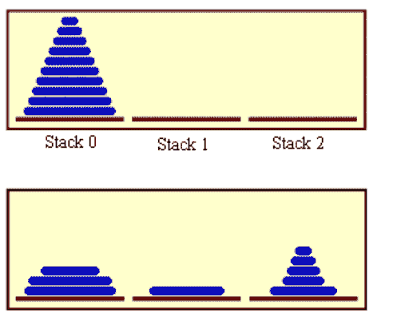

| 栈 0 | 栈 1 | 栈 2 |
|---|---|---|

问题是根据上述规则将十个盘从栈 0 移动到栈 1。栈 2 可以作为备用位置。我们是否可以将其简化为同类型的更小问题，并可能稍微泛化该问题以使之可行？认为问题规模的大小为需要移动的盘子数量似乎是自然的。如果栈 0 中有 N 个盘子，我们知道最终必须将底部的盘从栈 0 移动到栈 1。但在此之前，根据规则，前 N-1 个盘必须在栈 2 上。一旦我们把第 N 个盘移动到栈 1，就必须将其他 N-1 个盘从栈 2 移动到栈 1 以完成解决方案。但移动 N-1 个盘与移动 N 个盘是同类型的问题，只不过是该问题的较小版本。这正是我们需要做的递归！问题必须稍微泛化，因为递归涉及到从栈 0 移动到栈 2，或者从栈 2 移动到栈 1。基准情况是只有一个盘子时，这种情况下解决方案是显而易见的：只需移动盘子。这里的栈由数字指定：0、1 或 2。

```java
static void towersOfHanoi(int disks, int from, int to, int spare) {
    if (disks == 1) {
        // 只有一个盘子移动。只需移动它。
        System.out.printf("Move disk %d from stack %d to stack %d\n", disks, from, to);
    } else {
        // 将除一个以外的所有盘移动到备用栈，然后
        // 移动底部盘，然后把其他盘
        towersOfHanoi(disks-1, from, spare, to);
        System.out.printf("Move disk %d from stack %d to stack %d\n", disks, from, to);
        towersOfHanoi(disks-1, spare, to, from);
    }
}
```

这个子程序引入了自然递归。递归有效是因为每次递归调用涉及更少的盘子，并且在只有一个盘子的基准情况下，问题是非常容易解决的。要解决 N 个盘从栈 0 移动到栈 1 的“顶层”问题，应该用命令`TowersOfHanoi(N,0,1,2)`调用。该子程序通过示例程序`TowersOfHanoi.java`进行演示。

在这里，对于当盘数设置为 4 时运行程序的输出如下：

```text
Move disk 1 from stack 0 to stack 2
Move disk 2 from stack 0 to stack 1
Move disk 1 from stack 2 to stack 1
Move disk 3 from stack 0 to stack 2
Move disk 1 from stack 1 to stack 0
Move disk 2 from stack 1 to stack 2
Move disk 1 from stack 0 to stack 2
Move disk 4 from stack 0 to stack 1
Move disk 1 from stack 2 to stack 1
Move disk 2 from stack 2 to stack 0
Move disk 1 from stack 1 to stack 0
Move disk 3 from stack 2 to stack 1
```

# 第 9 章 链式数据结构与递归

将磁盘 1 从栈 0 移动到栈 2  
将磁盘 2 从栈 0 移动到栈 1  
将磁盘 1 从栈 2 移动到栈 1

这个程序的输出向你展示了一个你其实并不想去考虑的细节！追踪这些细节的难度与递归解决方案的简单与优雅形成了鲜明对比。当然，你真的想把这些细节交给计算机去处理。（你可能会考虑当磁盘数量为正数这一前提条件被违反时会发生什么。结果是一个无限递归的示例。）

顺便说，有一个故事解释了这个问题的名字。根据这个故事，在创世的第一天，一群位于孤立河诺亚塔的僧侣得到了一堆 64 个磁盘，并被分配了一项任务：根据河诺亚塔的规则每天移动一个磁盘。如果他们完成了将所有磁盘从一个栈移动到另一个栈的任务，世界就会末日。但别担心，解决 N 个磁盘所需的步数是$2^N-1$，而对于 64 个磁盘，这超过了 50,000,000,000 年。我们还有很久。

（用第 8.5 节的术语来说，河诺亚塔算法的运行是`O(2^n)`，其中 n 是必须移动的磁盘数量。由于指数函数增长迅速，河诺亚塔问题在实践中只能解决少数磁盘。）

顺便提一下，除了上述图形化的河诺亚塔，还有两个你可能想看的程序。每个程序都提供了递归算法的可视化演示。在`Maze.java`中，递归用于解决迷宫。在`LittlePentominos.java`中，它用于解决一种著名的谜。（`LittlePentominos.java`还需要`MosaicPanel.java`文件）。运行这些程序并观察一会儿是有用的，尽管源代码使用的技术直到第 12 节才会介绍。`Maze`程序首先创建一个随机迷宫。然后它尝试通过寻找从左上角到右下角的路径来解决迷宫。这个问题实际上与迷宫求解程序相似：从给定的方格开始，搜索每个相邻方格并在那里递归调用自己。如果程序发现自己处于某个方格，它就会“回溯”该方格并尝试其他地方。这种常用技术被称为回溯（backtracking），是一个经典谜题的实现。五骨牌（pentomino）是由五个等正方形组成的连接图形。通过这种方式恰好可以做出十二种正方形，不考虑基本图形的所有可能的旋转和镜像。问题是将这十二个五骨牌放置在一个 8x 8 的棋板上，其中四个方格已经被标记为已填充。递归解决方案查看一个已经用五骨牌部分填充的板。子程序依次查看每个剩余的方格。它尝试将该碎片放在棋板上下一个可用位置。如果碎片合适，它就会递归调用自己来填充剩余的方格。如果失败了，子程序就会处理下一个碎片——另一个递归回溯的示例。具有更多特征的五骨牌通用版本可以在`http://math.hws.edu/xJava/PentominosSolver/`找到。

# 第 9 章 链接数据结构与递归

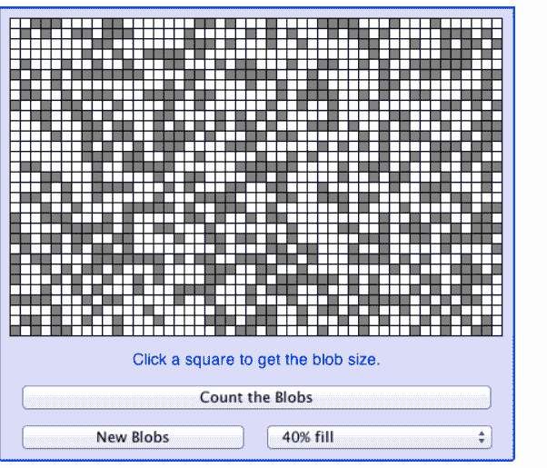

灰色方格被视为“已填充”，而白色方格被视为“空”。为了本用例的考虑，我们定义一个“块”（blob）由一个填充方格以及所有能够通过其他填充方格向上、向下、向左和向右从其到达的所有填充方格组成。如果用户点击程序中的任何填充方格，计算机将计算该块中的方格数量，并将方格颜色改为红色。该程序有几个控制控件。有一个“新色块”（New Blobs）按钮；点击此按钮将在网格中创建一个新的随机模式。一个弹出菜单指定了新模式中填充方格的大致百分比。填充方格越多，块就越大。一个标记为“计算块”（Count the Blobs）的按钮会告诉你模式中有多少个不同的块。

## 9.1.3 递归排序算法

接下来转向一个可能更实用的应用，我们将看一种用于数组排序的递归算法。第 7.4 节中涵盖的选择排序和插入排序算法相当简单，但在应用于大数组时，它们相当慢。有更快的算法。其中一种就是快速排序（Quicksort），这是一种递归算法，在大多数情况下证明是最快的排序算法。

快速排序基于一个简单巧妙的机制：给定一个元素列表，从列表中选择任意一个元素。这个元素被称为*基准*（pivot）。（在实践中，我会使用列表中的第一个元素。）将所有小于基准的元素移动到列表开头，将所有大于基准的元素移动到列表末尾。现在，将基准放在两组元素之间。这使得基准处于它在最终完全排序数组中将占据的位置。它将不再再次移动。我们将此过程称为`QuicksortStep`。

将`QuicksortStep`应用于数字列表，选择一个数字，23。排列数字使得小于 23 的数字位于其左侧，大于 23 的数字位于其右侧。

```text
23 10 7 45 16 86 56 2 31 18
18 10 7 16 23 86 56 31 45
```

> 要完成列表的排序，对 23 左侧的数字排序，并对 23 右侧的数字排序。23 本身已经处于它的最终位置，不需要移动。

快速排序不是递归的。它被作为子程序由快速排序算法调用。快速排序的速度取决于对`QuicksortStep`是否有快速实现。由于这不是本文讨论的重点，我提供一个没有太多注释的实现。

```java
/* 将 quicksortStep 应用于数组 A 中从位置 lo 到 hi 位置的元素列表。
 * 此程序返回的值是基准在数组中的最终
 * 位置。
 */
static int quicksortStep(int lo, int hi, int hi) {
    int pivot = A[lo]; // 获取基准值。

    // hi 和 lo 标记了尚未测试数字范围的端点。
    // 减小 hi 并增加 lo 直到它们相等，移动
    // 大于 pivot 的数字，使它们位于 hi 之上，并移动
    // 小于 pivot 的数字，使它们位于 lo 之下。
    // 当我们开始时，A[lo] 是一个可用空间，因为它的
    // 值已经移动到了局部变量 pivot 中。

    while (hi > lo) {
        while (hi > lo && A[hi] <= pivot) {
            // 向下通过大于 pivot 的数字。
            // 这些数字不需要移动。
            hi--;
        }

        if (hi == lo) {
            break;

            // 数字 A[hi] 小于 pivot。将它移动到
            // A[lo] 的可用空间，在 A[hi] 留出空间。
            A[lo] = A[hi];
            lo++;

            while (hi > lo && A[lo] <= pivot) {
                // 向上通过小于 pivot 的数字。
                // 这些数字不需要移动。
                lo++;
            }

            if (hi == lo) {
                break;

                // 数字 A[lo] 大于 pivot。将它移动到
                // A[hi] 的可用空间，在 A[lo] 留出空间。
                A[hi] = A[lo];
                lo--;
            }
        }
    }

    // 在此点，lo 变得等于 hi，并且在该位置
    // 有一个可用空间。该位置位于
    // 小于 pivot 的数字和大于 pivot 的数字之间。
    // 将 pivot 放入此空间并返回它的位置。
    A[lo] = pivot;
    return lo;
} // QuicksortStep
```

有了这个子程序，快速排序就很简单了。列表的快速排序算法包括对列表应用`QuicksortStep`，然后对列表递归地应用快速排序。

```java
static void quicksort(int[] A, int lo, int hi) {
    if (hi <= lo) {
        // 列表有一个或零个元素。不需要做
        // 什么，所以直接从程序返回。
        return;
    } else {
        // 应用 quicksortStep 并获取新的基准位置。
        int pivotPosition = quicksortStep(A, lo, hi);

        // 然后对基准之前的元素和随
        // 之后的元素应用 quicksort。
    }
}
```

从算法分析（第 8.5 节）的角度来看，快速排序是一个有趣的例子，因为它的平均情况运行时间与最坏情况有很大差异。这里是非常非正式的分析，从平均情况开始：注意，应用`quicksortStep`将一个问题分为两个子问题。平均而言，子问题的大小为$n/2$；然后它们被分为四个约为$n/4$的子问题，依此类推。问题规模在每一层都除以 2，大约会有$\log(n)$层。每一层的处理量与 n 成正比。（在顶层，数组中的每个元素都被查看并可能移动。在第二层，有两个子问题，数组中除了一个之外的所有元素都是子问题的一部分，必须被查看并可能移动，因此两个子问题总共有 n 步。在第三层，有四个子问题……）由于平均情况下每层有 n 步且大约$\log(n)$层：快速排序的平均情况运行时间为$\Theta(n \log n)$。这种分析假设`quicksortStep`将大小为 n 的问题分为大小为 n-1 的两个子问题。这发生在基准元素位于数组的开头或结尾时。在这种最坏情况下，最坏情况运行时间为$\Theta(n^2)$。最坏情况取决于数组中的元素以非常特殊的方式排列；快速排序的平均性能可能非常好，尽管在某些罕见情况下并不理想。有些排序算法同时具有这两种

接下来，我们将计算一组连接的方格的数量。我将一组方格称为“块”（blob），我们将考虑的示例程序是`Blobs.java`。该程序显示一个由白色和灰色小方格组成的网格。这是该程序的截图，显示了带有一些控件的方格网格：

灰色方格被视为“已填充”，而白色方格被视为“空”。为了本用例的考虑，我们定义一个“块”（blob）由一个填充方格以及所有能够通过其他填充方格向上、向下、向左和向右从其到达的所有填充方格组成。如果用户点击程序中的任何填充方格，计算机将计算该块中的方格数量，并将方格颜色改为红色。该程序有几个控制控件。有一个“新色块”（New Blobs）按钮；点击此按钮将在网格中创建一个新的随机模式。一个弹出菜单指定了新模式中填充方格的大致百分比。填充方格越多，块就越大。一个标记为“计算块”（Count the Blobs）的按钮会告诉你模式中有多少个不同的块。

该程序使用递归来计算一个块中方格的数量。如果没有递归，这将非常难以实现。递归使其变得相对容易，但它仍然需要一种新技术，这种技术在许多其他应用中也有用。网格方格的数据存储在一个布尔值的二维数组中：

```java
boolean[] filled;
```


如果`filled[r][c]`的值为`true`，则网格中 r 行 c 列的方格是填充的。行数存储在`rows`中，列数存储在`columns`中。程序使用递归方法`getBlobSize()`来计算包含 r 行 c 列方格的块中的方格数量。

如果位置 (r,c) 没有填充方格，则答案为零。否则，`getBlobSize()`必须计算从位置 (r,c) 方格可以到达的所有填充方格。其思想是递归地使用`getBlobSize()`获取从每个相邻位置 (r+1,c)、(r-1,c)、(r,c+1) 和 (r,c-1) 可以到达的所有填充方格的数量。将这些数字相加，并加一以计算 (r,c) 本身的方格，就得到了从 (r,c) 可以到达的所有填充方格的总数。

以下是该算法的实现。遗憾的是，它有一个严重的缺陷：它会导致无限递归！

```java
int getBlobSize(int r, int c) { // 有错误的，不正确的版本！！
// 这个错误的方法尝试计算从网格中
// 位置 (r,c) 可以到达的所有填充方格。
if (r < 0 || r >= rows || c >= columns) {
    // 此位置不在网格内，该位置没有
    // 块。返回块的大小为零。
    return 0;
}
if (filled[r][c] == false) {
    // 此方格不是块的一部分，返回零。
    return 0;
}
int size = 1; // 计算此位置的方格，然后计算
    // 水平或垂直连接到此方格的块
size += getBlobSize(r-1,c);
size += getBlobSize(r+1,c);
size += getBlobSize(r,c-1);
size += getBlobSize(r,c+1);
return size;
} // end getBlobSize()
```

遗憾的是，这个例程会多次计算每个方格。事实上，它会尝试无限地计算每个方格！想象你自己站在位置 (r,c) 并尝试遵循这些指令。第一条指令告诉你向上移动一行。你这样做，然后向下移动一行并重复该操作。作为其中的步骤之一，你再次应用了与之前过程相同的程序。但这又把你带回了位置 (r,c)。从那里，你向上移动一行，从那里你又向下移动一行……循环往复！

我们必须确保一个方格只被计算一次，否则我们就会陷入循环。解决方案是留下一条面包屑路径——或者说在布尔值路径上——来标记你已经访问过的方格。一旦一个方格被标记为已访问，它就不会被再次处理。剩余的未访问方格数量会减少，从而取得确定的进展。

使用一个布尔数组`visited[r][c]`来跟踪哪些方格已经被访问并处理。假设在调用`getBlobSize()`之前，此数组中的所有值都已设置为`false`。当`getBlobSize()`遇到未访问的方格时，它会通过将数组中的对应项设置为`true`将其标记为已访问。当`getBlobSize()`遇到已经访问过的方格时，它不会计算它或对其进行进一步处理。

这种在遇到项目时进行“标记项目”的技术在递归算法的编程中被反复使用。以下是`getBlobSize()`的修正版：

```java
/**
* 计算网格中位置 (r,c) 处块的方格数量。
* 只有当方格被填充且未访问时，才会被计算。
* 如果对已访问过的位置调用此例程，则返回值为零。
 */
int getBlobSize(int r, int c) {
    if (r < 0 || r >= rows || c >= columns) {
        // 此位置不在网格内，该位置没有
        // 块。返回块的大小为零。
        return 0;
    }
    if (filled[r][c] == false || visited[r][c] == true) {
        // 此方格不是块的一部分，或者已访问，返回零。
        return 0;
    }
    visited[r][c] = true; // 将方格标记为已访问，以便
    // 在递归调用中再次计算它。
    int size = 1; // 计算此位置的方格，然后计算
    // 水平或垂直连接到此方格的块。
    size += getBlobSize(r-1,c);
    size += getBlobSize(r+1,c);
    size += getBlobSize(r,c-1);
    size += getBlobSize(r,c+1);
    return size;
} // end getBlobSize()
```

# 第 9 章 链接数据结构与递归


灰色方格被视为“已填充”，而白色方格被视为“空”。为了本用例的考虑，我们定义一个“块”（blob）由一个填充方格以及所有能够通过其他填充方格向上、向下、向左和向右从其到达的所有填充方格组成。

如果用户点击程序中的任何填充方格，计算机将计算该块中的方格数量，并将方格颜色改为红色。该程序有几个控制控件。有一个“新色块”（New Blobs）按钮；点击此按钮将在网格中创建一个新的随机模式。一个弹出菜单指定了新模式中填充方格的大致百分比。填充方格越多，块就越大。一个标记为“计算块”（Count the Blobs）的按钮会告诉你模式中有多少个不同的块。

程序使用递归来计算一个块中方格的数量。如果没有递归，这将非常难以实现。递归使其变得相对容易，但它仍然需要一种新技术，这种技术在许多其他应用中也有用。网格方格的数据存储在一个布尔值的二维数组中：

```java
boolean[] filled;
```

## 9.1 递归计算块大小

如果`filled[r][c]`的值为`true`，则网格中 r 行 c 列的方格是填充的。行数存储在`rows`中，列数存储在`columns`中。程序使用递归方法`getBlobSize()`来计算包含 r 行 c 列方格的块中的方格数量。

如果位置 (r,c) 没有填充方格，则答案为零。否则，`getBlobSize()`必须计算从位置 (r,c) 方格可以到达的所有填充方格。其思想是递归地使用`getBlobSize()`获取从每个相邻位置 (r+1,c)、(r-1,c)、(r,c+1) 和 (r,c-1) 可以到达的所有填充方格的数量。将这些数字相加，并加一以计算 (r,c) 本身的方格，就得到了从 (r,c) 可以到达的所有填充方格的总数。

### 错误的实现

```java
int getBlobSize(int r, int c) { // 有错误的，不正确的版本！！
// 这个错误的方法尝试计算从网格中
// 位置 (r,c) 可以到达的所有填充方格。
if (r < 0 || r >= rows || c >= columns) {
    // 此位置不在网格内，该位置没有
    // 块。返回块的大小为零。
    return 0;
}
if (filled[r][c] == false) {
    // 此方格不是块的一部分，返回零。
    return 0;
}
int size = 1; // 计算此位置的方格，然后计算
    // 水平或垂直连接到此方格的块
    // 水平或垂直。
size += getBlobSize(r-1,c);
size += getBlobSize(r+1,c);
size += getBlobSize(r,c-1);
size += getBlobSize(r,c+1);
return size;
} // end getBlobSize()
```

遗憾的是，这个例程会多次计算每个方格。事实上，它会尝试无限地计算每个方格！想象你自己站在位置 (r,c) 并尝试遵循这些指令。第一条指令告诉你向上移动一行。你这样做，然后向下移动一行并重复行操作。作为其中的步骤之一，你再次应用了与之前过程相同的程序。但这又把你带回了位置 (r,c)。从那里，你向上移动一行，从那里你又向下移动一行……循环往复直到！

我们必须确保一个方格只被计算一次，否则我们就会陷入圈圈。解决方案是留下一条面包屑路径——或者说在布尔值路径上——来标记你已经访问过的方格。一旦一个方格被标记为已访问，它就不会被再次处理。剩余的未访问方格数量会减少，从而取得确定的进展。

### 使用访问标记修正

使用一个布尔数组`visited[r][c]`来跟踪哪些方格已经被访问并处理。假设在调用`getBlobSize()`之前，此数组中的所有值都已设置为`false`。当`getBlobSize()`遇到未访问的方格时，它会通过将数组中的对应项设置为`true`将其标记为已访问。当`getBlobSize()`遇到已经访问过的方格时，它不会计算它或对其进行进一步处理。

这种在遇到项目时进行“标记项目”的技术在递归算法的编程中被反复使用。以下是`getBlobSize()`的修正版本，显示了更改：

```java
/**
* 计算网格中位置 (r,c) 处块的方格数量。
* 只有当方格被填充且未访问时，才会被计算。
* 如果对已访问过的位置调用此例程，则返回值为零。
 */
int getBlobSize(int r, int c) {
    if (r < 0 || r >= rows || c >= columns) {
        // 此位置不在网格内，该位置没有
        // 块。返回块的大小为零。
        return 0;
    }
    if (filled[r][c] == false || visited[r][c] == true) {
        // 此方格不是块的一部分，或者已访问，返回零。
        return 0;
    }
    visited[r][c] = true; // 将方格标记为已访问，以便
    // 在递归调用中再次计算它。
    int size = 1; // 计算此位置的方格，然后计算
    // 水平或垂直连接到此方格的块。
    size += getBlobSize(r-1,c);
    size += getBlobSize(r+1,c);
    size += getBlobSize(r,c-1);
    size += getBlobSize(r,c+1);
    return size;
} // end getBlobSize()
```

## 9.2 链接数据结构

每个有用对象包含实例变量。当实例变量的类型由类或接口名称给出时，它可以持有另一个对象的引用。这种引用也被称为指针，我们说该变量指向那个对象。当然，任何可以引用对象的变量也可以包含特殊值`null`，它指向无处。

当一个对象包含指向另一个对象的实例变量时，我们认为对象通过指针“链接”在一起。复杂的数据结构可以通过链接对象来构建。

### 9.2.1 递归链接

当对象包含一个可以引用相同类型对象的变量时，就会发生这种情况。在这种情况下，对象的定义是递归的。这种递归出现在许多地方。

例如，考虑一个设计用于表示公司的类。假设老板之外的每个员工都有主管，主管是公司的另一个员工。那么`Employee`类自然会包含一个指向员工主管的类型实例变量：

```java
/**
 * 类型为 Employee 的对象持有关于员工的数据。
 */
public class Employee {

  String name; // 员工姓名

  Employee supervisor; // 员工主管

  // （其他实例变量和方法。）

} // end class Employee
```

如果`emp`是类型`Employee`的变量，那么`emp.supervisor`是另一个类型为`Employee`的变量。如果`emp`指向老板，那么`emp.supervisor`的值应该是`null`，以表示老板没有主管。

如果我们想打印员工主管的名字，例如，可以使用以下 Java 语句：

```java
if (emp.supervisor == null) {
  System.out.println("" + emp.name + " 是老板，没有主管！");
} else {
  System.out.println("" " + emp.name + " 的主管是 ");
  System.out.println(emp.supervisor.name);
}
```

## 9.3 通过链接追踪命令链

现在，假设我们想知道一个员工与老板之间有多少层级的主管。我们只需要通过一系列主管链接来追踪命令链，并计算到达老板需要多少步：

```java
if (emp.supervisor == null) {
    System.out.println(emp.name + " 是老板！");
}
else {
    Employee runner // 用于在命令链上“向上”运行。
    runner = emp.supervisor;
    if (runner.supervisor == null) {
        System.out.println(emp.name + " 直接向老板汇报。
    }
    else {
        int count = 0;
        while (runner.supervisor != null) {
            count++; // 计数这一层的主管。
            runner = runner.supervisor; // 移动到下一层。
        }
        System.out.println("在 " + emp.name + " 和老板之间有 " + count + " 级主管。");
    }
}
```

在执行`while`循环时，`runner`依次指向原始员工 (`emp`)，然后是`emp`的主管，接着是`emp`主管的主管，以此类推。每当`runner`“访问”一个新员工时，`count`变量就会加 1。当`runner.supervisor`为`null`时循环结束，这表示`runner`已经到达老板。此时，`count`统计了`emp`和老板之间的步数。


这个例子非常有用。事实上，通过链接对象构建的数据结构非常有用，以至于它们是计算机科学的一个主要课题。我们将查看几个典型的示例。在本节和下一节中，我们将学习链表。

链表由一组相同类型的对象链组成，通过指针从一个对象链接到下一个对象。也存在更复杂的情况，即一个对象可以包含指向多个其他对象的链接。我们将在第 9.4 节中查看这类例子。

# 9.2 链表

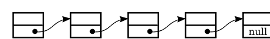

当一个对象包含对同类型对象的引用时，多个对象可以链接成列表。每个对象指向下一个对象。

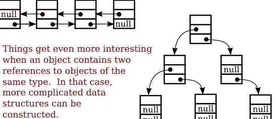

当一个对象包含两个指向同类型对象的引用时，情况变得更有趣。在这种情况下，可以构建更复杂的数据结构。

## 9.2.2 链表

在本节剩余的大多数示例中，链表由属于`Node`类的对象构建，其定义如下：

```java
class Node {
  String item;
  Node next;
}
```

“node”（节点）一词通常用于指代链接数据结构中的一个对象。`Node`类型的对象可以在上面插图的顶部部分链在一起。每个节点持有一个`String`和一个指向列表中下一个节点的指针。

此类链表中的最后一个节点可以通过以下事实来识别：最后一个节点中的实例变量`next`存储的是`null`而不是指向另一个节点的指针。节点链的目的是表示一个字符串列表。第一个节点中的第一个字符串，第二个字符串存储在第二个节点中，以此类推。

指针和节点对象被用于构建结构，但我们想要的数据是字符串列表。当然，我们可以通过更改每个节点中存储的`item`的类型，轻松地表示整数列表、按钮列表或任何其他类型的数据。

虽然这个示例中的`Node`非常简单，但我们可以使用它们来说明链表的常用操作。典型操作包括从列表中删除节点、向列表中插入新节点，以及在列表项中搜索指定的`String`。我们将学习如何执行所有这些操作等。

要在程序中使用链表，需要一个指向列表第一个节点的变量。它只需要一个指向第一个节点的指针，因为列表中的所有其他节点都可以从第一个节点开始，沿着列表的链接从一个节点到下一个节点进行访问。

在我的示例中，我将始终使用一个名为`head`、类型为`Node`的变量，指向链表的第一个节点。当列表为空时，`head`的值为`null`。

为了让列表有用，必须有一个变量指向列表的第一个节点。在这里，命名为`head`的变量起到了此作用。

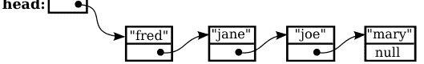

## 9.2.3 基础链表处理

以某种方式处理列表中的所有项是非常常见的。通用模式是从列表的头部（head）开始，通过遵循节点中的指针从每个节点移动到下一个，直到遇到标记列表末尾的`null`。

如果`head`是一个指向列表第一个节点的`Node`类型变量，那么处理链表中所有项的通用代码形式如下：

```java
Node runner = head;
while (runner != null) {
    // process runner
    runner = runner.next;
}
```

我将通过一个列表处理问题来结束介绍，这个问题用递归很容易解决，但如果不使用递归则非常棘手。该问题是打印字符串链表中的所有字符串，并按照它们在列表中出现的反向顺序进行打印。

请注意，当我们执行此操作时，链表头部的项会在链表尾部的项之后打印。这导致了以下递归例程。你应该让自己相信它是有效的，并且应该思考如何在不使用递归的情况下实现相同的功能：

```java
public static void printReversed( Node head ) {
    if (head == null) {
        // 基础情况：列表为空，没有可打印的内容。
        return;
    } else {
        // 递归情况：列表不为空。
        printReversed(head.next); // 从尾部反向打印字符串。
        System.out.println(head.item); // 然后打印头部节点的字符串。
    }
}
```

在本节的剩余部分，我们将查看对字符串链表的更多高级操作。我们考虑的子程序是我编写的`StringList`类中的实例方法。

该类有一个私有实例变量`head`，类型为`Node`，指向列表的第一个节点，如果列表为空则指向`null`。实例方法以全局变量的形式访问类`head`。

`StringList`的源代码位于`StringList.java`文件中，并用于示例程序`ListDemo.java`，如果你想的话，可以查看上下文中的代码。

`StringList`中的方法之一会搜索列表以查找指定的字符串。我们要查找的字符串是`searchItem`，那么我们需要将`searchItem`与列表中的每个项进行比较。

这是基本列表遍历和处理的一个示例。然而，在这种情况下，如果我们找到了要查找的项就可以停止处理：

- 在列表中搜索指定的项。
- `@param searchItem` 要查找的项。
- `@return` 如果`searchItem`是列表中的项之一则返回`true`，如果`searchItem`不存在则返回`false`。

```java
public boolean find(String searchItem) {
    // 用于遍历列表的指针。
    Node runner;
    runner = head; // 从列表头部开始查找。
    while ( runner != null ) { // (head 是一个实例变量!)
        // 遍历列表并查看每个
        // 节点中的字符串。如果该字符串是我们要找的，
        // 返回 true，因为在列表中找到了该字符串。
        if ( runner.item.equals(searchItem)) {
            return true;
        }
        runner = runner.next; // 移动到下一个节点。
    }
    // 在此时，我们已经查看了列表中的所有项
    // 但没有找到 searchItem。返回 false 表示
    // 该项在列表中不存在。

    return false;
} // end()
```

列表可能是空的，也就是说`head`的值为`null`。我们应该确保妥善处理了这种情况。如果`head`为`null`，则`while`循环体将永远不会执行，因此没有节点被处理，且返回值为`false`。

这正是我们在列表为空时想要的结果，因为搜索无法在空列表中进行。

## 9.2.4 向链表插入项

向链表中插入新项的问题要困难得多，至少在项被插入到列表中间的情况下如此。（事实上，这可能是你在本章中遇到的链式数据结构上最困难的操作。）

在`ArrayList`类中，链表的项是按顺序排列的。当一个新项插入列表时，它必须按照此顺序插入到正确的位置。这意味着通常我们需要在列表中间某处插入新项。

为了实现这一点，方便使用两个`Node`类型的变量，它们指向节点两侧的现有节点。另一个变量`newNode`指向新节点。

为了执行插入，从`previous`到`runner`的链接必须被“断开”，并添加从`previous`到`newNode`的链接：

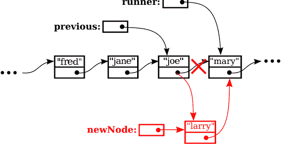

插入新节点。

一旦`previous`和`runner`指向了节点，命令`previous.next = newNode;`就可以让`previous.next`指向新节点。`newNode.next = runner`命令将`newNode.next`指向正确的位置。

在使用这些命令之前，我们需要如插图所示设置`runner`和`previous`：

```java
Node runner, previous;
previous = head; // 从列表开始开始。
runner = head.next;
while ( runner != null && runner.compareTo(insertItem) < 0 ) {
    previous = runner; // "previous.next" 同样有效
    runner = runner.next;
}
```

（这使用了`String`的实例方法`compareTo`来测试列表中的项是否小于要插入的项。见节 2.3.3）。

这很好，但新项插入列表中间的假设并不总是有效。`insertItem`可能小于列表的第一个项。在这种情况下，新节点必须插入在列表头部。可以通过以下指令完成：

```java
newNode.next = head; // 让 newNode.next 指向旧头部。
head = newNode; // 新头部。
```

列表可能是空的。在这种情况下，`newNode`将是列表中唯一的节点。这可以通过简单的`head = newNode`完成。以下方法涵盖了所有这些：

- 在列表中插入指定的项，保持列表顺序。
- `@param insertItem` 要插入的项。

```java
public void insert(String insertItem) {
    // 用于包含新项的 Node。
    Node newNode = new Node(); // 创建新节点。
    newNode.item = insertItem; // 要插入的项
    if (head == null) {
        // 如果列表为空，newNode 成为列表中唯一的节点。
        head = newNode;
    } else if (head.item.compareTo(insertItem) < 0) {
        // 新项小于第一个项。
        newNode.next = head;
        head = newNode;
    } else {
        // 搜索位置并插入。
        Node runner; // 用于遍历的节点。
        Node previous; // 始终指向 runner 之前的节点
        runner = head.next; // 从第二个位置开始。
        while (runner != null && runner.compareTo(insertItem) < 0) {
            // 移动 runner 遍历列表，直到 runner
            // 到末尾或遇到大于等于 insertItem 的元素。
            previous = runner;
            runner = runner.next;
        }
        // 在 previous 之后插入 newNode。
        newNode.next = runner;
        previous.next = newNode;
    }
}
```


## 9.2.5 从链表中删除项

删除操作与插入类似，尽管稍微简单一些。有一些特殊情况需要考虑。

当要删除列表中的第一个节点时，`head`的值必须更改为之前列表中的第二个节点。由于`head`指向列表中的第二个节点，可以通过设置`head = head.next`来实现。（再次，你应该检查当`head.next`为`null`时这是否有效，即列表中没有节点时。在这种情况下，列表变为空）。

如果删除的是列表中间的节点，我们可以设置`previous`和`runner`指向要删除的节点，并让`previous`指向列表中该节点之前的节点。一旦完成，命令`previous.next = runner.next;`将删除该节点。被删除的节点将被垃圾回收。

我鼓励你自己画幅图来说明此操作。这里是`delete()`的完整代码：

```java
/**
 * 如果列表中存在指定的项，则从列表中删除该项。
 * 如果列表中存在多个该项的副本，则删除
 * 列表中先出现的那一个。
 * @param delete 要删除的项
 * @return 如果找到并删除了该项，或者该项
 * 不在列表中。
 */
public boolean delete(String delete) {
    Node runner; // 用于遍历列表的节点。
    runner = head; // 从列表头部开始。
    if (runner.item.equals(delete)) {
        // 要删除第一个节点。
        head = head.next;
        return true;
    } else {
        // 搜索要删除的节点。
        Node previous; // 始终指向 runner 之前的节点
        runner = head.next; // 从第二个位置开始。
        while (runner != null && !runner.item.equals(delete)) {
            // 移动 runner 遍历列表
            previous = runner;
            runner = runner.next;
        }
        if (runner != null) {
            // 找到了节点，删除它。
            previous.next = runner.next;
            return true;
        } else {
            // 项不在列表中。
            return false;
        }
    }
}
```

下面是另一个版本的`delete()`方法：

```java
public boolean delete(String deleteItem) {
    if (head == null) {
        // 列表为空，所以肯定不包含 deleteString。
        return false;
    }
    else if (head.item.equals(deleteItem)) {
        // 字符串是列表的第一个元素。将其移除。
        head = head.next;
        return true;
    }
    else {
        // 字符串确实存在，它在列表第一个元素
        // 之后的位置。搜索列表。
        Node runner;
        Node previous; // 始终指向 runner 的前节点。
        runner = head.next; // 从第二个列表节点开始查找。
        previous = head;
        while (runner != null && runner.item.compareTo(deleteItem) < 0) {
            // 沿着列表移动 previous 和 runner，直到
            // 到达末尾或遇到一个大于或等于 deleteItem 的
            // 列表元素。当循环结束时，如果 deleteItem 在列表中，
            // runner 将指明它可能所在的位置。
            previous = runner;
            runner = runner.next;
        }
        if (runner != null && runner.item.equals(deleteItem)) {
            // Runner 指向要删除的节点。
            // 通过更改上一个节点的指针来将其移除。
            previous.next = runner.next;
            return true;
        }
        else {
            // 项目在列表中不存在。
            return false;
        }
    }
} // delete() 结束
```

## 9.3 栈、队列与 ADT

链式列表（LINKED LIST）是一种特殊的数据结构，由通过指针连接的对象组成。在上一节中，我们使用链式列表来存储一个有序的字符串（Strings）列表，并对其实现了插入、删除和查找操作。

然而，我们完全可以将字符串列表存储在数组或`ArrayList`中，而不是链式列表。我们可以在其上实现相同的操作。虽然这些操作的实现方式会有不同，但它们的接口和逻辑行为仍然保持一致。


抽象数据类型（abstract data type，简称 ADT）指的是一组可能的值以及对这些值的一系列操作，而无需关于值如何表示或操作如何实现的任何规范。“有序字符串列表”可以被定义为一个抽象数据类型。任何按递增排列的字符串序列都是该数据类型的一个可能值。该数据类型的操作包括：插入新字符串、删除字符串以及在列表中查找字符串。通常有多种不同的方法来实现同一种抽象数据类型。例如，“有序字符串列表” ADT 可以实现为链式列表，也可以实现为数组。仅依赖于 ADT 抽象定义的程序可以交替使用这两种实现方式。特别是可以在不影响整个程序的情况下更改 ADT 的实现。这可以使程序更容易调试和维护，ADT 是软件工程中的重要工具。

在本节中，我们将介绍两种常见的抽象数据类型：栈（stacks）和队列（queues）。栈和队列通常都用链式列表实现，但并不是唯一的实现方式。你可以将本节的其余部分视为作为 ADT 案例的栈和队列讨论。

### 9.3.1 栈

栈由一系列项目组成，应该被想象成像物理堆叠箱或食堂托盘一样一个一个堆叠在一起。在任何给定时刻，栈上只有顶部的元素是可以访问的。可以通过 `pop` 操作从栈中移除元素。栈中下方的元素只有在其上方所有元素都被弹出栈后才能被移除。可以通过 `push` 操作向栈顶添加新元素。我们可以为任何类型的项目创建栈。例如，如果项目是 `int` 类型的值，那么 `push` 和 `pop` 操作可以实现为实例方法：

- `void push(int newItem)` — 将 `newItem` 添加到栈顶。
- `int pop()` — 从栈中移除顶部的 `int` 并返回它。

尝试从空栈中弹出元素是一个错误，因此能够判断栈是否为空非常重要。我们需要另一个栈操作来执行测试，并实现为实例方法：

- `boolean isEmpty()` — 如果栈为空则返回 `true`。

这定义了一个“整数栈”作为抽象数据类型。然而，这种 ADT 可以通过多种方式实现，但无论如何实现，它必须符合栈的抽象心理意象。

> 在栈中，所有操作都发生在栈的“顶部”。“push”操作将项目添加到栈顶。“pop”操作移除顶部的项目。

| 操作 | 描述 |
| :--- | :--- |
| `push(int newItem)` | 将 `newItem` 添加到栈顶。 |
| `pop()` | 从栈中移除顶部的 `int` 并返回它。 |
| `isEmpty()` | 如果栈为空则返回 `true`。 |

## 第 9 章 链式数据结构与递归

```java
public boolean isEmpty() {
    return (top == 0);
}
```

// // `StackOfThe` 类的结束

再次，栈（作为数组实现）的实现。`StackOfInt` 的两个版本可以互相替换，因为它们的公共接口是相同的。

***

观察栈操作的运行分析是有意思的。（参见第 8.5 节）。我们可以通过栈中项的数量来衡量问题的大小。对于栈的链表实现，`push` 操作和 `pop` 操作的最坏情况运行时间均为 Θ(1)。这意味着运行时间是少于常数级的，且与栈中项的数量无关。如果你看代码，这一点很容易看出。这些操作是通过几个赋值语句实现的，栈中项的数量对执行结果没有影响。

另一方面，对于数组实现，当数组满时，`push` 操作中会发生一种特殊情况。在这种情况下，会创建一个新数组并将栈中的所有项复制到新数组中。因此，虽然 `push` 的时间通常是 Θ(1)，但最坏情况的运行时间是 Θ(n)，其中 `n` 是栈中项的数量。（然而，最坏情况极少发生，从自然意义上说，数组实现的平均情况运行时间仍然是 Θ(1)。）

## 9.3.2 队列

队列与栈的相似之处在于，队列由一系列项组成，并且对于项如何添加到列表中以及从中移除有限制。然而，队列有两个端，分别称为队列的头部（front）和尾部（back）。项始终添加到队列的尾部，并从队列头部移除。添加和移除项的操作被称为 `enqueue`（入队）和 `dequeue`（出队）。添加到队列尾部的项将一直留在队列中，直到它前面的所有项都被移除。这听起来应该熟悉。队列就像等待服务的客户“排队”或“队列”。客户按照他们到达队列的顺序接受服务。

在队列中，所有操作都发生在队列的一端或另一端。`enqueue` 操作将项添加到队列的“尾部”。`dequeue` 操作从“头部”移除项并返回它。

### 头部

### 尾部


项从尾部进入队列并从头部离开

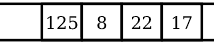

`dequeue()` 之后

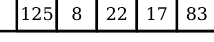

`enqueue(83)` 之后

队列可以持有任何类型的项。对于整数队列，`enqueue` 和 `dequeue` 操作可以实现为 `QueueOfInts` 类中的实例方法。我们还需要一个实例方法来检查队列是否为空：

- `enqueue(int N)` : 将 `N` 添加到队列尾部。
- `dequeue()` : 移除头部的项并返回它。
- `boolean isEmpty()` : 如果队列为空则返回 `true`。

队列可以用列表实现，也可以用数组实现。高效的数组实现比栈的数组实现更复杂，所以我在这里不给出。在链表实现中，列表的第一个项位于队列的头部。从队列头部弹出一个项就像从栈中弹出一个项一样。队列的尾部指向当前列表。入队涉及在包含该项的当前最后一个节点中设置一个指针。为了做到，我们需要一个类似 `tail.next = newNode();` 的命令，其中 `tail` 是指向最后一个节点的指针。如果 `head` 是指向列表第一个节点的指针，则可以通过以下表述获取列表末尾节点的指针：

```java
Node tail;           // 这将指向列表中的最后一个节点。
tail = head;          // 从第一个节点开始。
while (tail.next != null) {
    tail = tail.next; // 移动到下一个节点。
}
// 在此点，tail.next 为 null，因此 tail 指向
// 列表中的最后一个节点。
```

然而，如果每个项入队时都重复这样做，效率将非常低。出于效率考虑，我们将在一个实例变量中保留一个指向最后一个节点的指针。这使得该类变得稍微复杂了一些；每当向列表末尾添加新节点时，我们必须小心更新此变量的值。考虑到这一切，`QueueOfInts` 类并不难：

```java
public class QueueOfInts {
    /**
     * 类型为 Node 的对象持有其中一个项
     * 代表队列的链表中的对象。
     */
    private static class Node {
        int item;
        Node next;
    }
    private Node head = null; // 指向队列中的第一个 Node。
    // 当 head 为 null 时，队列为空。
    private Node tail = null; // 指向队列中的最后一个 Node。

    /**
     * 将 N 添加到队列尾部。
     */
    public void enqueue(int N) {
        Node newNode = new Node();
        newNode.item = N;
        newNode.next = null;
        if (head == null) {
            head = newNode;
            tail = newNode;
        } else {
            tail.next = newNode;
            tail = newNode;
        }
    }

    /**
     * 从头部移除项并返回它。
     */
    public int dequeue() {
        if (head == null) {
            throw new IllegalStateException("队列为空");
        }
        int item = head.item;
        head = head.next;
        if (head == null) {
            tail = null;
        }
        return item;
    }

    /**
     * 如果队列为空则返回 true。
     */
    public boolean isEmpty() {
        return head == null;
    }
}
```

# 第 9 章 链接数据结构与递归

被添加到堆的底部，并从顶部移除。在随机情况下，待处理的卡片是从堆中所有卡片随机选取的。这三种情况的处理顺序非常不同。这里是程序中的三张图片，使用了三种不同的处理方法。在每种情况下，过程都是通过选择网格中间附近的方形开始的。左侧图片使用栈，中间的图片使用队列，右侧图片使用随机选择：

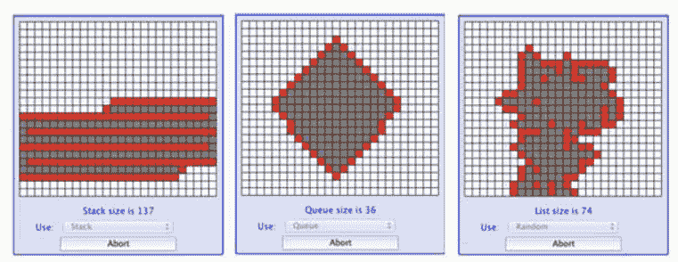

生成的模式非常不同。使用栈时，程序会尽可能远地探索，然后开始回溯到之前遇到的方格。使用队列时，方格大致按照它们距离起始点的顺序进行处理。当使用随机选择时，结果是一个不规则的斑块，这是因为只有当方格相邻于之前遇到的方格时，才能遇到它。

你应该从该程序开始实验，看看它是如何工作的。为了理解栈和队列的用法，可以尝试从一个角角的方格开始。在过程进行期间，你可以点击白色方格，它们会被添加到已遇的方格列表中。当你用栈执行此操作时，你应该注意到你点击的方格会被立即处理，而所有已经在等待处理的红色方格都必须等待。另一方面，如果你用队列执行此操作，你点击的方格将等待轮到，直到堆中已经所有的方格都被处理完毕。同样，程序的源代码是 `DepthBreath.java`。

* * *

队列看起来非常必要，因为它们在现实生活中经常出现，但在某些情况下，栈是合适甚至是必要的。例如，考虑例调用子程序时会发生什么。在执行子程序时，第一个例会被挂起，只有当子程序返回后才会继续。假设子程序调用了第二个子程序，第二个子程序调用了第三个，以此此类推。每个子程序在执行后续子程序时都会被挂起。计算机必须跟踪所有挂起的子程序。它通过栈来实现这一点。

当子程序被调用时，会为该子程序创建一个激活记录（activation record）。激活记录包含与子程序执行相关的信息，例如其局部变量和参数。子程序的激活记录被放在栈上。当子程序返回时，它将从栈中移除并销毁。如果子程序调用另一个子程序，第二个子程序的激活记录将被推入栈中，位于第一个子程序的激活记录之上。随着更多子程序的调用，栈可以继续增长，随着这些子程序的返回，它会收缩。

### 9.3.3 后缀表达式

作为另一个例子，栈可以用于求后缀表达式的值。一个普通的数学表达式如 `2+(15-12)*17` 被称为中缀表达式（infix expression）。在在中缀表达式中，运算符位于它的两个操作数之间，例如 `"2 + 2"`。在后缀表达式中，运算符位于它的两个操作数之后，例如 `"2 2 +"`。中缀表达式 `"2+(15-12)*17"` 的后缀形式可以写为 `"2 15 12 - 17 +"`。`-` 运算符作用于它之前的两个操作数，即 `"15"` 和 `"12"`。`*` 运算符作用于它之前的两个操作数，即 `"15 12 -"` 和 `"17"`。这些与原始表达式中的计算是相同的。

现在，假设我们想从左到右处理表达式 `"2 15 12 - 17 +"` 并找到它的值。我们遇到的第一个项目是 `2`，但我们能对它做什么呢？此时，我们不知道哪个运算符将应用到 `2` 上，或者其他操作数可能是什么。我们需要记住 `2` 以备稍后处理。我们通过将其推入栈来实现。移动到下一个项目，我们看到了 `15`，它被推入栈中 `2` 之上。现在 `12` 被添加到栈中。现在，我们遇到运算符 `"-"`。这个运算符作用于它之前的两个操作数。我们在栈上保存了两个操作数。因此，为了处理 `"-"`，我们从栈中弹出两个数字，`12` 和 `15`。然后我们将去处理 `*`，结果被推入栈中 `17`。`*` 运算符作用于它之前的两个操作数，即 `"15 12 -"` 和 `"17"`。这些与原始表达式中的计算是相同的。

虽然人们更容易处理中缀表达式，但后缀表达式有优势。不需要优先级规则。运算符的顺序完全取决于它们出现的顺序。后缀表达式算法如下：

```
从空栈开始
对于表达式中的每个项目:
  如果项目是数字:
    将数字推入栈
  否则如果项目是运算符:
    从栈中弹出操作数
    对运算符执行操作
    将结果推入栈
如果栈不为空:
  栈顶值即表达式的值
否则:
  错误
```

表达式中的错误可以很容易检测。例如，在表达式 `"2 3 +"` 中，当尝试从栈中弹出第二个操作数时，栈是空的。这种情况会在表达式结束时 `2` 留在栈中被检测。这在示例程序 `PostfixEval.java` 中演示。该程序允许你基于非负数和运算符 `+`、`-`、`*` 和 `/` 输入表达式。程序在处理每个标记时打印消息。程序使用的栈定义在 `StackDouble.java` 中。`StackDouble` 类与上述相同，只是修改为存储 `double` 值而不是 `int`。

程序最有趣的部分是实现算法的方法。它是上述伪代码的直接实现：

- 读取一行输入并作为后缀表达式处理。
- 如果输入不是法的后缀表达式，则显示错误消息。否则，显示表达式的值。假设行的第一个字符是非空白字符。


`private static void readAndEvaluate()` 方法用于读取并计算后缀表达式。它使用 `StackDouble` 栈来存储操作数，并逐字符读取输入，直到遇到换行符。如果下一个字符是数字，则读取该数字并压入栈中；否则，读取运算符并执行相应的操作。如果运算符不是 `+`、`-`、`*`、`/` 或 `!`，则报告非法运算符错误。如果栈为空，则报告操作数不足。对于二元运算符，从栈中弹出两个操作数，计算结果后压回栈中。最后，如果栈中恰好剩下一个值，则输出该值作为表达式的结果；否则报告错误。

后缀表达式通常在计算机内部使用。事实上，Java 虚拟机是一个“栈机器”，它使用了我们一直在讨论的基于栈的表达式求值方法。该算法可以很容易扩展到处理变量以及常量。当在表达式中遇到变量时，变量的值会被推入栈中。它对于操作数等于或少于二的操作符同样有效。根据需要从栈中获取操作数，并将结果推回栈中。例如，在表达式 `-x` 中使用的一元减法运算符只有一个操作数。我们将在接下来的章节中继续研究表达式和表达式求值。

## 9.4 二叉树

在之前的章节中，我们看到了对象是如何链接到列表中的。当一个对象包含两个指向相同类型对象的指针时，就可以创建比链表复杂得结构。在本节中，我们将研究这种类型中最基础且实用的结构：二叉树。二叉树中的每个对象都包含两个指针，通常称为左（`left`）和右（`right`）。除了这些指针外，节点还可以包含其他类型的数据。例如，整数二叉树将由以下类型的对象组成：

```java
class TreeNode {
    int item;           // 节点中的数据。
    TreeNode left;      // 指向左子树的指针。
    TreeNode right;     // 指向右子树的指针。
}
```

`TreeNode` 中的 `left` 和 `right` 指针可以为 `null`，也可以指向其他 `TreeNode` 类型对象。指向另一个节点的节点被称为该节点的父节点，而它所指向的节点被称为子节点。例如，在下面的图中，节点 3 是节点 6 的父节点，节点 4 和 5 是节点 2 的子节点。并不是由节点组成的每一个链接结构都是二叉树。二叉树必须具备以下属性：树中只有一个节点没有父节点，这个节点被称为树的根（`root`）。树中的每个其他节点正好有一个父节点。最后，二叉树中不能有循环。也就是说，不可能从某个节点开始沿着指针链回到该节点本身。

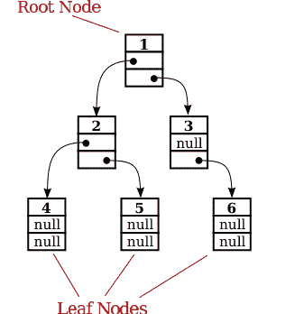

没有子节点的节点被称为叶子节点（`leaf`）。叶子节点可以通过 `left`、`right` 指针都为 `null` 来识别。在二叉树的标准图中，根节点显示在顶部，叶子节点显示在底部——至少你可以看到这种分支状的结构，它赋予了树这种名称。

### 9.4.1 树遍历

考虑二叉树中的任何节点。观察该节点及其所有后代（即它的子节点等）。这组节点形成了一棵二叉树，它被称为原树的子树（`subtree`）。例如，在图中，节点 2、4 和 5 构成了根的子树。同样，节点 3 和 6 形成了右子树。我们可以认为任何非空二叉树都是由根、一个左子树和一个右子树组成的。

考虑计算二叉树中节点数量的问题。你可能会尝试想出一个非递归算法来计数，但你不应该指望这很容易。问题的核心在于跟踪剩余待计数的节点。如果没有像栈或队列这样的辅助数据结构，要做到这一点很容易。使用递归，算法几乎是显而易见的：要么树是空的，数量为零；否则，使用递归计算每个子树的节点数，并在根节点上加一。这就得到了树中节点的总数。用 Java 写出来：

```java
/**
 * 统计 root 指向的树中的节点数。
 * 如果 root 为 null，答案为 0。
 */
static int countNodes(TreeNode root) {
    if (root == null) { // 树为空。
        return 0;
    } else {
        int count = 1; // 从根节点开始计数。
        count += countNodes(root.left); // 加上左子树
                                        // 中的节点数。
        count += countNodes(root.right); // 加上右子树
                                         // 中的节点数。

        return count; // 返回总数。
    }
} // end countNodes
```

或者，考虑在二叉树中打印项目的问题。如果树非空，它包含一个根和两个子树。打印根节点的项目，并使用递归打印子树中的项目。这里有一个将所有项目打印到输出的一行中的子程序：

```java
/**
 * 打印 root 指向的树中的所有项目。
 * 根节点的项目首先打印，随后是
 * 左子树中的项目，然后是右
 * 子树中的项目。
 */
static void preorderPrint(TreeNode root) {
  if (root == null) { // (否则，没有可以打印)
    System.out.print(root.item + " "); // 打印根项目。
    preorderPrint(root.left); // 打印左子树中的项目。
    preorderPrint(root.right); // 打印右子树中的项目。
  }
} // end preorderPrint
```

此程序被称为“前序（`preorder`）”，因为它使用了树的前序遍历。在前序遍历中，首先处理树的根节点，然后遍历左子树，最后是右树。在后序遍历（`postorder`）中，遍历左子树，然后遍历右子树，最后处理根节点。在中序遍历（`inorder`）中，首先遍历左子树，然后处理根节点，最后遍历右子树。使用后序和中序遍历的打印程序区别在于输出根项目语句的位置：

```java
/**
 * 打印 root 指向的树中的所有项目。
 * 左子树的项目首先打印，随后是
 * 右子树的项目，然后是根
 * 项目。
 */
static void postorderPrint(TreeNode root) {
  if (root == null) { // (否则，没有可以打印)
    postorderPrint(root.left); // 打印左子树中的项目。
    postorderPrint(root.right); // 打印右子树中的项目。
    System.out.print(root.item + " "); // 打印根项目。
  }
} // end postorderPrint()
```

```java
/**
 * 打印 root 指向的树中的所有项目。
 * 左子树的项目首先打印，随后是
 * 根节点的项目，然后是
 */
static void inorderPrint(TreeNode root) {
  if (root == null) { // (否则，没有可以打印)
    inorderPrint(root.left); // 打印左子树中的项目。
    System.out.print(root.item + " "); // 打印根项目。
    inorderPrint(root.right); // 打印右子树中的项目。
  }
} // end inorderPrint()
```

这些子程序都可以应用于本节开始插图中的二叉树。项目的打印顺序在每种情况下都不同：

`preorderPrint` 输出: 1 2 4 5 3 6

`postorderPrint` 输出: 4 5 2 6 3 1

`inorderPrint` 输出: 4 2 5 1 3 6

例如，在先序遍历中，根节点的项 1 在任何其他项之前输出。先序遍历也适用于树的每个子树。左子树的根节点 2 在子树 4 和 5 的其他节点之前打印。而对于树的右子树，3 在 6 之前输出。先序遍历适用于树的所有层级。另外两种遍历顺序也可以以类似的方式进行分析。

### 9.4.2 二叉排序树

第 9.2 节中的示例之一是字符串的链表，其中字符串按递增顺序存储。虽然链表对于少量数量的字符串效果良好，但对于大量项，它的效率就会变得很低。在向列表中插入一个项时，查找该项的位置平均需要查看列表中的一半的项。在列表中查找一个项也需要相同的时间。如果将字符串存储在排序数组而不是链表中，那么查找将变得更高效，因为可以使用二分查找。然而，向数组中插入新项仍然是低效，因为这意味着平均需要移动数组中一半的项来为新项腾出空间。可以使用二叉树来存储有序的字符串列表或其他项，使得查找和插入都非常高效。所使用的二叉树被称为二叉排序树。

二叉排序树是具有以下属性的二叉树：对于树中的每个节点，节点中的项都大于或等于该节点左子树中的所有项，并且小于或等于该节点右子树中的所有项。这里是一个包含 `String` 类型项的二叉排序树示例。（在这张图中，我没有费心画所有的指针变量。非空指针用箭头表示。）

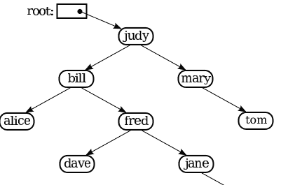

二叉排序树具有这种实用的属性：树的中序遍历将按递增顺序处理项。事实上，这只是对定义的另一种表达。例如，如果使用中序遍历来打印上面所示树中的项，那么这些项将按字母顺序排列。中序遍历的定义保证了 `judy` 左子树中的所有项都在 `judy` 之前打印，而 `judy` 右子树中的所有项之后打印。但二叉排序属性保证了 `judy` 左子树中的项恰是字母顺序中排在 `judy` 之前的，而 `judy` 右子树中的所有项在字母顺序中跟随 `judy`。因此，我们知道 `judy` 是在其正确的字母位置输出的。同样的原理也适用于子树。`Bill` 将在 `alice` 之前以及在 `Fred` 及其后代之前输出。`Fred` 将在 `ave` 之后、在 `jane` 和 `joe` 之前输出。以此此类推。

假设我们要在二叉搜索树中搜索一个给定的项。将该项与树的根节点进行比较。如果它们相等，我们就完成了。我们要查找的项小于根节点，那么我们需要搜索根的左子树——右子树可以被排除，因为它只包含大于或等于根节点的项。同样，如果我们要查找的项大于根节点，那么我们需要在右子树中查找。在任何情况下，该过程都可以适用于该子树。插入新项非常简单：首先在树中搜索新项所属的位置。当找到位置时，创建一个新节点并将其附加到该位置。

只要二叉树接近平衡，在二叉搜索树上的搜索和插入就是高效的操作。如果对于每个节点，该节点的左子树包含与右子树大致相同的节点，则二叉树是平衡的。在完美平衡的树中，这两个数字最多差一。并不是所有的二叉树都是平衡的，但如果树是通过随机顺序插入项创建的，那么树有很大概率是大致平衡的。（然而，如果插入顺序不是随机的，树可能会变得非常不平衡。）在对任何二叉排序树进行搜索期间，每次比较都会排除两个子树之一以供后续考虑。如果树是平衡的，这意味着减少了仍在考虑范围内的项。这与二分查找算法完全相同，结果是一个足够高效的算法。

根据渐进分析（第 8.5 节），二叉搜索树中的搜索、插入和删除的平均运行时间为 `Θ(log(n))`。问题规模 `n` 是树中项的数量，平均值是针对项可能插入树的所有不同顺序。只要实际插入顺序是随机的，实际运行时间预计会接近平均值。然而，二分查找操作的最坏情况运行时间为 `Θ(n)`，这远差于 `Θ(log(n))`。最坏情况发生在特定的插入顺序下。例如，如果按递增的大小将项插入树中，每个项总是向右移动，结果是一个看起来像链表的“树”，因为它由通过右孩子指针连接在一起的线性节点字符串组成。在这样的树上的操作性能与在链表上的操作相同。现在，有一些数据结构与简单的二叉排序树相似，除了插入和删除

示例文件 `TreeDemo.java` 是二叉排序树的演示。递归子程序 `treeContains` 用于在树中搜索给定的项。上述算法实现了对 `root` 所指向的树中是否存在项的搜索：

```java
/**
 * 如果项是 root 所指向的树中的项，则返回 true。
 * 如果不是，返回 false。
 */
static boolean treeContains(TreeNode root, String item) {
    if (root == null) {
        // 树为空，因此不包含项。
        return false;
    } else if (item.equals(root.item)) {
        // 是，就在根节点。
        return true;
    } else if (item.compareTo(root.item) < 0) {
        // 项出现，它在左子树中。
        return treeContains(root.left, item);
    } else {
        // 项出现，它在右子树中。
        return treeContains(root.right, item);
    }
} // end treeContains
```

当此程序在 `main()` 例程中调用时，第一个参数是静态成员变量 `root`，它指向整个二叉排序树的根。值得注意的是在这种情况下递归并不是必要的。搜索二叉排序的简单非递归算法遵循规则：从根节点开始向下移动，直到找到项或空指针。搜索沿着树的单条路径，它可以使用 `while` 循环来实现。这是搜索例程序的非递归版本：


```java
private static boolean treeContainsNR(TreeNode root, String item) {
    TreeNode runner;
    root = root; // 在树上运行。
    runner = root; // 从根节点开始。
    while (true) {
        if (runner == null) {
            // 我们在找到项之前掉到了树之外。
            return false;
        } else if (item.equals(runner.item)) {
            return true;
        } else if (item.compareTo(runner.item) < 0) {
            runner = runner.left;
        } else {
            runner = runner.right;
        }
    }
}
```

类型`TreeNode`的静态成员变量指向二叉排序树。当树为空时，`root`为`null`。

```java
private static TreeNode root; // 指向根节点的指针。
```

```java
private static class TreeNode {
    String item; // 此节点中的数据。
    TreeNode left; // 指向左子树的指针。
    TreeNode right; // 指向右子树的指针。

    TreeNode(String str) {
        // 构造函数。创建一个包含 str 的节点。
        // 注意左右指针为空。
        item = str;
        left = null;
        right = null;
    }
} // end class
```

# 第 9 章 链接数据结构与递归

```java
// 我们找到了该项。
return true;
else if (item.compareTo(runner.item) < 0) {
    // 如果项存在，它一定在左子树中，
    // 因此，让 runner 向左移动一层。
    runner = runner.left;
} else {
    // 如果项存在，它一定在右子树中。
    // 因此，让 runner 向右移动一层。
    runner = runner.right;
} // 结束循环
```

向树中插入新项的子程序被证明与非递归搜索程序比递归程序更相似。插入程序必须处理树为空的情况。在这种情况下，`root`的值必须更改为包含新项的节点：

```java
root = new TreeNode(newItem);
```

但这意味着`root`不能作为参数传递给子程序，因为无法更改存储在实际参数中的值。（我应该指出，这在其他语言中是可以实现的。）递归对参数的使用至关重要。虽然有办法解决这个问题，但最简单的方法是使用直接访问静态成员变量的非递归程序。插入项和搜索项的一个区别在于，我们必须小心不要掉出树。如果在`runner`变为`null`之前必须停止搜索，当我们在树中找到空位置时，必须插入新项：

- 将项添加到全局变量`root`所指的二叉排序树。（注意，`root`不能作为参数传递给此程序，因为`root`的值可能会发生，而形式参数值的变化不会改变实际参数。）

```java
private static void insert(String newItem) {
    if (root == null) {
        // 树是空的。将 root 指向包含新项的新节点。
        // 这将成为树中唯一的节点。
        root = new TreeNode(newItem);
        return;
    }
    TreeNode runner; // 沿树向下运行为 newItem 寻找位置。
    runner = root; // 从 root 开始。
    while (true) {
        if (newItem.compareTo(runner.item) < 0) {
            // 因为新项小于 runner 中的项，
            // 它属于 runner 的左子树。如果 runner.left
            // 有空位，则添加新节点。
            // 否则，让 runner 向左移动一层。
            if (runner.left == null) {
                runner.left = new TreeNode(newItem);
                return; // 新项已添加到树中。
            } else {
                runner = runner.left;
            }
        } else {
            // 因为新项大于等于 runner 中的项，
            // 它属于 runner 的右子树。如果 runner.right
            // 有空位，则在该处添加新节点。
            // 否则，让 runner 向右移动一层。
            if (runner.right == null) {
                runner.right = new TreeNode(newItem);
                return; // 新项已添加到树中。
            } else {
                runner = runner.right;
            }
        }
    }
} // 结束 treeInsert(
```

## 9.4 表达式树

另一种表达式树是为了以方便的形式存储如`15*(x+y)`或`sqrt(42)`等数学表达式。让我们专注于由数字以及运算符`+`、`-`、`*`和`/`组成的表达式。考虑表达式`3*((7+1)/4)+(17-5)`。该表达式由两个子表达式组成`3*((7+1)/4)`和`(17-5)`，通过运算符`+`组合，而根节点的子树分别代表子表达式`3*((7+1)/4)`和`(17-5)`。树中的每个节点都持有一个数字或一个运算符。持有数字的节点是树的叶子节点。持有运算符的节点有两个子树，代表该运算符的操作数。树如下面的插所示。我将这种树称为“表达式树”。

给出一个表达式树，可以很容易找到它所代表的表达式的值。树中的每个节点都有一个关联值。如果它是叶子节点，值仅仅是节点所包含的数字。如果节点包含运算符，则关联值通过首先找到其子节点的值，然后将运算符应用于这些值来计算得出。该过程由插图中向上的箭头所示。为根节点计算的值是整个表达式的值。表达式树还有其他用途。例如，对树进行后序遍历将输出表达式的后置形式。

表示表达式`3*(7+(8*(17-5)))`的树。向上的箭头显示了如何计算该表达式的值。

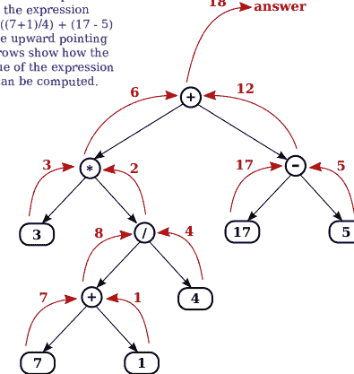

表达式树包含两种节点：包含数字的节点和包含运算符的节点。此外，我们可能想添加其他类型的节点来使树更有用，例如包含变量的节点。如果我们想在 Java 中处理表达式树，如何处理这些不同的节点呢？一种方法（会被面向对象纯主义者不喜欢）是在每个节点对象中包含一个实例以记录它是哪种类型的节点：

```java
enum NodeType { NUMBER, OPERATOR } // 可能的节点类型。
class ExpNode { // 表达式树中的节点。
    NodeType kind; // 这是什么种类型的节点？
    double number; // 类型为 NUMBER 的节点的值。
    char op; // 类型为 OPERATOR 的节点的运算符。
    ExpNode left; // 指向子树的指针，
    ExpNode right; // 在 OPERATOR 类型节点中。

    ExpNode(double val) {
        // 创建 NUMBER 类型节点的构造函数。
        kind = NodeType.NUMBER;
        number = val;
    }

    ExpNode(char op, ExpNode left, ExpNode right) {
        // 创建 OPERATOR 类型节点的构造函数。
        kind = NodeType.OPERATOR;
        this.op = op;
        this.left = left;
        this.right = right;
    }
} // 结束 class ExpNode
```

给定此定义，以下递归子程序将找到表达式树的值：

```java
static double getValue(ExpNode node) {
    // 返回 node 所指树所代表的
    // 表达式的值。node 不能为空。
    if (node.kind == NodeType.NUMBER) {
        // NUMBER 节点的值为其持有的数字。
        return node.number;
    } else { // kind 必须是 OPERATOR。
        // 获取操作数的值并使用运算符
        // 它们。
        double leftVal = getValue(node.left);
        double rightVal = getValue(node.right);
        switch (node.op) {
            case '+': return leftVal + rightVal;
            case '-': return leftVal - rightVal;
            case '*': return leftVal * rightVal;
            case '/': return leftVal / rightVal;
            default: return Double.NaN; // 错误的运算符。
        }
    }
} // 结束 getValue()
```

# 第 9 章 链接数据结构与递归

```java
ExpNode right; // 右操作数。
BinNode(char op, ExpNode left, ExpNode right) {
    // 构造函数。创建一个节点来存储给的数据。
    this.op = op;
    this.left = left;
    this.right = right;
}

double value() {
    // 为了获取值，计算左操作数和
    // 右操作数的值并将其与运算符结合。
    double leftVal = left.value();
    double rightVal = right.value();
    switch (op) {
        case '+': return leftVal + rightVal;
        case '-': return leftVal - rightVal;
        case '*': return leftVal * rightVal;
        case '/': return leftVal / rightVal;
        default return double::NAN; // 错误的运算符。
    }
}
// 类Node 类结束
```

注意，`BinNode`的左右操作数类型是`ExpNode`，而不是`BinNode`。这允许操作数既可以是常量（Constant）也可以是另一个`BinNode`——或者我们最终创建的任何`ExpNode`类型。由于每个`ExpNode`都有一个`value()`方法，我们可以调用`left.value()`来计算操作数的值。如果`left`是一个常量，这将调用常量类中的`value()`方法。如果它是一个`BinNode`，那么`left.value()`将调用`BinNode`类中的`value()`方法。每个节点都知道如何计算自己的值。

尽管看起来可能更复杂，但面向对象的方法具有一些真正的优势。首先，它没有浪费内存。在原始的`Exp`类中，每个节点中的某些实例实际上被用过了，而且我们需要一个额外的实例来跟踪节点的类型。更重要的是，事实是可以更整洁地添加新类型的节点，这可以通过创建`ExpNode`的新子类来完成，而不是修改现有的类。

我们将在下一节回到表达式树的主题，在那个章节我们将看到如何创建一个表达式树来表示一个给定的表达式。

### 9.5 简单的递归下降解析器

我一直对语言着迷——无论是像英语这样的自然语言，还是计算机使用的人工语言。关于语言如何传递信息、如何结构化以及如何被处理，有许多困难的问题。自然语言和人工语言与编程语言的研究足够相似，而编程语言已经被理解得相当充分，这为更复杂、更困难的自然语言提供了一些见解。而且编程语言提出的问题足够多，值得它们作为一个独立的领域来研究。毕竟，计算机如何能被设计成“理解”即使是用于编写程序的相对简单的语言呢？

# 第 9 章 链接数据结构与递归

计算机只能使用用非常简单的机器语言表示的指令。高阶语言必须翻译成机器语言。但翻译是由编译器完成的，而编译器仅仅是一个程序。这样的翻译程序会是什么样的？

## 9.5.1 Backus-Naur 形式（BNF）

自然语言和人工语言的相似之处在于，它们有一种被称为语法（grammar or syntax）的结构。语法可以用一组规则表示，这些规则描述了成为句子或程序的含义。对于编程语言，语法规则通常用 BNF（Backus-Naur 形式）表示，这是一个由计算机科学家 John Backus 和 Peter Nair 在 20 世纪 50 年代开发的系统。语言学家 Noam Chomsky 在同一时期独立开发了一个等效的系统来描述自然语言的语法。BNF 无法表达所有的语法规则。例如，它无法表达变量必须在使用之前定义的这一事实。此外，它对语言的含义或语义一无未。——即使对于人工编程语言——仍然远未解决。然而，BNF 确实表达了语言的基本结构，并且在编译器的设计中起着至关重要的作用。

在英语中，诸如“名词”、“及物动词”等术语具有语法或语法的结构。语法可以用一组规则表示，描述成为句子或程序的含义。对于编程语言，语法规则通常用在 BNF 中，这是一个由计算机科学家 John Backus 和 Peter Nair 在 20 世纪 50 年代开发的系统。语言学家 Noam Chomsky 在同一时期独立开发了一个等效的系统来描述自然语言的语法。BNF 无法表达所有的语法规则。例如，它无法表达变量必须在使用之前定义的这一事实。此外，它对语言的含义或语义一无未提及——即使对于人工编程语言——仍然远未解决。然而，BNF 确实表达了语言的基本结构，并且在编译器的设计中起着至关重要的作用。

在英语中，诸如“名词”、“及物动词”等术语具有语法或语法的结构。语法可以用一组规则表示，描述成为句子或程序的含义。对于编程语言，语法规则通常用在 BNF 中，这是一个由计算机科学家 John Backus 和 Peter Nair 在 20 世纪 50 年代开发的系统。语言学家 Noam Chomsky 在同一时期独立开发了一个等效的系统来描述自然语言的语法。BNF 无法表达所有的语法规则。例如，它无法表达变量必须在使用之前定义的这一事实。此外，它对语言的含义或语义一无未提及——即使对于人工编程语言——仍然远未解决。然而，BNF 确实表达了语言的基本结构，并且在编译器的设计中起着至关重要的作用。

在英语中，诸如“名词”、“及物动词”等术语具有语法或语法的结构。语法可以用一组规则表示，描述成为句子或程序的含义。对于编程语言，语法规则通常用在 BNF 中，这是一个由计算机科学家 John Backus 和 Peter Nair 在 20 世纪 50 年代开发的系统。语言学家 Noam Chomsky 在同一时期独立开发了一个等效的系统来描述自然语言的语法。BNF 无法表达所有的语法规则。例如，它无法表达变量必须在使用之前定义的这一事实。此外，它对语言的含义或语义一无未提及——即使对于人工编程语言——仍然远未解决。然而，BNF 确实表达了语言的基本结构，并且在编译器的设计中起着至关重要的作用。

在英语中，诸如“名词”、“及物动词”等术语具有语法或语法的结构。语法可以用一组规则表示，描述成为句子或程序的含义。对于编程语言，语法规则通常用在 BNF 中，这是一个由计算机科学家 John Backus 和 Peter Nair 在 20 世纪 50 年代开发的系统。语言学家 Noam Chomsky 在同一时期独立开发了一个等效的系统来描述自然语言的语法。BNF 无法表达所有的语法规则。例如，它无法表达变量必须在使用之前定义的这一事实。此外，它对语言的含义或语义一无未提及——即使对于人工编程语言——仍然远未解决。然而，BNF 确实表达了语言的基本结构，并且在编译器的设计中起着至关重要的作用。

在英语中，诸如“名词”、“及物动词”等术语具有语法或语法的结构。


在英语中，诸如“名词”、“及物动词”等术语具有语法或语法的结构。语法可以用一组规则表示，描述成为句子或程序的含义。对于编程语言，语法规则通常用在 `BNF` 中，这是一个由计算机科学家 John Backus 和 Peter Nair 在 20 世纪 50 年代开发的系统。语言学家 Noam Chomsky 在同一时期独立开发了一个等效的系统来描述自然语言的语法。`BNF` 无法表达所有的语法规则。例如，它无法表达变量必须在使用之前定义的这一事实。此外，它对语言的含义或语义一无未提及——即使对于人工编程语言——仍然远未解决。然而，`BNF` 确实表达了语言的基本结构，并且在编译器的设计中起着至关重要的作用。

在英语中，诸如“名词”、“及物动词”等术语具有语法或语法的结构。语法可以用一组规则表示，描述成为句子或程序的含义。对于编程语言，语法规则通常用在 `BNF` 中，这是一个由计算机科学家 John Backus 和 Peter Nair 在 20 世纪 50 年代开发的系统。语言学家 Noam Chomsky 在同一时期独立开发了一个等效的系统来描述自然语言的语法。`BNF` 无法表达所有的语法规则。例如，它无法表达变量必须在使用之前定义的这一事实。此外，它对语言的含义或语义一无未提及——即使对于人工编程语言——仍然远未解决。然而，`BNF` 确实表达了语言的基本结构，并且在编译器的设计中起着至关重要的作用。

在英语中，诸如“名词”、“及物动词”等术语具有语法或语法的结构。语法可以用一组规则表示，描述成为句子或程序的含义。对于编程语言，语法规则通常用在 `BNF` 中，这是一个由计算机科学家 John Backus 和 Peter Nair 在 20 世纪 50 年代开发的系统。语言学家 Noam Chomsky 在同一时期独立开发了一个等效的系统来描述自然语言的语法。`BNF` 无法表达所有的语法规则。例如，它无法表达变量必须在使用之前定义的这一事实。此外，它对语言的含义或语义一无未提及——即使对于人工编程语言——仍然远未解决。然而，`BNF` 确实表达了语言的基本结构，并且在编译器的设计中起着至关重要的作用。

在英语中，诸如“名词”、“及物动词”等术语具有语法或语法的结构。语法可以用一组规则表示，描述成为句子或程序的含义。对于编程语言，语法规则通常用在 `BNF` 中，这是一个由计算机科学家 John Backus 和 Peter Nair 在 20 世纪 50 年代开发的系统。语言学家 Noam Chomsky 在同一时期独立开发了一个等效的系统来描述自然语言的语法。`BNF` 无法表达所有的语法规则。例如，它无法表达变量必须在使用之前定义的这一事实。此外，它对语言的含义或语义一无未提及——即使对于人工编程语言——仍然远未解决。然而，`BNF` 确实表达了语言的基本结构，并且在编译器的设计中起着至关重要的作用。

在英语中，诸如“名词”、“及物动词”等术语具有语法或语法的结构。语法可以用一组规则表示，描述成为句子或程序的含义。对于编程语言，语法规则通常用在 `BNF` 中，这是一个由计算机科学家 John Backus 和 Peter Nair 在 20 世纪 50 年代开发的系统。语言学家 Noam Chomsky 在同一时期独立开发了一个等效的系统来描述自然语言的语法。`BNF` 无法表达所有的语法规则。例如，它无法表达变量必须在使用之前定义的这一事实。此外，它对语言的含义或语义一无未提及——即使对于人工编程语言——仍然远未解决。然而，`BNF` 确实表达了语言的基本结构，并且在编译器的设计中起着至关重要的作用。

在英语中，诸如“名词”、“及物动词”等术语具有语法或语法的结构。语法可以用一组规则表示，描述成为句子或程序的含义。对于编程语言，语法规则通常用在 `BNF` 中，这是一个由计算机科学家 John Backus 和 Peter Nair 在 20 世纪 50 年代开发的系统。语言学家 Noam Chomsky 在同一时期独立开发了一个等效的系统来描述自然语言的语法。`BNF` 无法表达所有的语法规则。例如，它无法表达变量必须在使用之前定义的这一事实。此外，它对语言的含义或语义一无未提及——即使对于人工编程语言——仍然远未解决。然而，`BNF` 确实表达了语言的基本结构，并且在编译器的设计中起着至关重要的作用。

在英语中，诸如“名词”、“及物动词”等术语具有语法或语法的结构。语法可以用一组规则表示，描述成为句子或程序的含义。对于编程语言，语法规则通常用在 `BNF` 中，这是一个由计算机科学家 John Backus 和 Peter Nair 在 20 世纪 50 年代开发的系统。语言学家 Noam Chomsky 在同一时期独立开发了一个等效的系统来描述自然语言的语法。`BNF` 无法表达所有的语法规则。例如，它无法表达变量必须在使用之前定义的这一事实。此外，它对语言的含义或语义一无未提及——即使对于人工编程语言——仍然远未解决。然而，`BNF` 确实表达了语言的基本结构，并且在编译器的设计中起着至关重要的作用。

在英语中，诸如“名词”、“及物动词”等术语具有语法或语法的结构。语法可以用一组规则表示，描述成为句子或程序的含义。对于编程语言，语法规则通常用在 `BNF` 中，这是一个由计算机科学家 John Backus 和 Peter Nair 在 20 世纪 50 年代开发的系统。语言学家 Noam Chomsky 在同一时期独立开发了一个等效的系统来描述自然语言的语法。`BNF` 无法表达所有的语法规则。例如，它无法表达变量必须在使用之前定义的这一事实。此外，它对语言的含义或语义一无未提及——即使对于人工编程语言——仍然远未解决。然而，`BNF` 确实表达了语言的基本结构，并且在编译器的设计中起着至关重要的作用。

在英语中，诸如“名词”、“及物动词”等术语具有语法或语法的结构。语法可以用一组规则表示，描述成为句子或程序的含义。对于编程语言，语法规则通常用在 `BNF` 中，这是一个由计算机科学家 John Backus 和 Peter Nair 在 20 世纪 50 年代开发的系统。语言学家 Noam Chomsky 在同一时期独立开发了一个等效的系统来描述自然语言的语法。`BNF` 无法表达所有的语法规则。例如，它无法表达变量必须在使用之前定义的这一事实。此外，它对语言的含义或语义一无未提及——即使对于人工编程语言——仍然远未解决。然而，`BNF` 确实表达了语言的基本结构，并且在编译器的设计中起着至关重要的作用。

在英语中，诸如“名词”、“及物动词”等术语具有语法或语法的结构。语法可以用一组规则表示，描述成为句子或程序的含义。对于编程语言，语法规则通常用在 `BNF` 中，这是一个由计算机科学家 John Backus 和 Peter Nair 在 20 世纪 50 年代开发的系统。语言学家 Noam Chomsky 在同一时期独立开发了一个等效的系统来描述自然语言的语法。`BNF` 无法表达所有的语法规则。例如，它无法表达变量必须在使用之前定义的这一事实。此外，它对语言的含义或语义一无未提及——即使对于人工编程语言——仍然远未解决。然而，`BNF` 确实表达了语言的基本结构，并且在编译器的设计中起着至关重要的作用。

在英语中，诸如“名词”、“及物动词”等术语具有语法或语法的结构。语法可以用一组规则表示，描述成为句子或程序的含义。对于编程语言，语法规则通常用在 `BNF` 中，这是一个由计算机科学家 John Backus 和 Peter Nair 在 20 世纪 50 年代开发的系统。语言学家 Noam Chomsky 在同一时期独立开发了一个等效的系统来描述自然语言的语法。`BNF` 无法表达所有的语法规则。例如，它无法表达变量必须在使用之前定义的这一事实。此外，它对语言的含义或语义一无未提及——即使对于人工编程语言——仍然远未解决。然而，`BNF` 确实表达了语言的基本结构，并且在编译器的设计中起着至关重要的作用。

# 第 9 章 链接数据结构与递归

真正的力量源于 `BNF` 规则是递归的这一事实。事实上，前面的两个规则结合起来是递归的。`<noun-phrase>` 部分根据 `<verb-phrase>` 定义，而 `<verb-phrase>` 又部分根据 `<noun-phrase>` 定义。例如，`<noun-phrase>` 可能是“老鼠吃了奶酪”，因为“吃了奶酪”是一个 `<verb-phrase>`。但随后我们可以递归地构造更复杂的 `<noun-phrase>`，“抓住了那只吃了奶鼠的`<common-noun>` “猫”，以及 `<verb-phrase>` “抓住了那只鼠”。从这里开始，我们可以构造 `<noun-phrase>`，“那只追着那只吃了奶鼠猫的狗”。递归结构是语言最基础的属性之一，而 `BNF` 表达这种递归结构的能力正是它有用之处。

`BNF` 可以以正式且精确的方式描述如 Java 等编程语言的语法。例如，`<while-loop>` 可以定义为：

```
<while-loop> ::= "while" (<condition>) <statement>
```

这表示 `<while-loop>` 由单词 "while" 组成，后面跟着左括号、然后是 `<condition>`、然后是右括号，最后是 `<statement>`。当然，我们还需要定义 `<condition>` 和 `<statement>` 的含义。由于 `<statement>` 在其他情况下可以是一个 `while` 循环，我们已经看到了 Java 语言的递归结构。`if` 语句的精确规范很难用文字清楚地表达，可以给出：

```
<if-statement> :=
  "if" (<condition>) <statement>
  [else "if" (<condition>) <statement>]...
  [else <statement>]
```

这条规则清楚地表明 `else` 部分是可选的，并且可以可选地包含一个或多个 `else if` 部分。

## 第 9 章：链式数据结构与递归

当我们尝试解析一个包含语法错误的短语时，我们需要某种方法来响应错误。处理此问题的方便方法是抛出一个异常。我将使用一个名为 `ParseError` 的异常，定义如下：

```java
/**
* ParseError 类型的对象表示用户输入中发现的
* 语法错误。
*/
private static class ParseError extends Exception {
    ParseError(String message) {
        super(message);
    }
} // 类定义结束
```

另一个通用点是，我们的 `BNF` 规则没有说明项目之间的空格，但在实际操作中，我们希望能够在项目之间插入空格。为了允许这一点，在尝试向前查看输入中即将出现的内容之前，我总是会调用 `Text.skipBlanks()` 例程。`Text.skipBlanks()` 会跳过输入中的任何空白字符（如空格和制表符），并且当输入中的字符是非字符或行尾字符时，会跳过下一个字符。

让我们从一个非常简单的例子开始。“全带括号表达式”可以通过 `BNF` 规则指定为：

```bnf
<expression> ::= <number> | "(" <expression> <operator> <expression> ")"
<operator> ::= "+" | "-" | "*" | "/"
```

其中 `<number>` 指任何非负整数。全带括号表达式的一个示例是 `"((3-17)*(2+7))"`。由于每个运算符都对应一对括号，因此运算符的执行顺序没有歧义。假设我们写了一个程序来读取并评估每一个这样的表达式。我们将使用 `TextIO` 从标准输入读取表达式。为了应用递归下降解析，我们需要为语法中的每个规则编写一个子例程。对应于规则 `<operator>`，我们得到了一个读取运算符的子例程。该运算符可以是四种选择中的任何一种。任何其他输入将是错误。

```java
/**
* 如果输入中的下一个字符是合法运算符之一，
* 读取它并返回它。否则，抛出 ParseError。
*/
static char getOperator() throws ParseError {
    TextIO.skipBlanks();
    char op = TextIO.peek(); // 向前查看下一个字符，但不读取它
    if (op == "+" || op == "-" || op == "*" || op == '/') {
        TextIO.getChar(); // 从输入中读取运算符
        return op;
    }
    else if (op == '\n') {
        throw new ParseError("行尾缺少运算符.");
    }
    else {
        throw new ParseError("缺少运算符。找到的是 " + op + " 而不是 +, -, *, 或 /。");
    }
} // getOperator()
```

## 第 9 章：链式数据结构与递归

我尝试根据下一个字符是行尾还是其他内容来提供一个合理的错误信息。我使用 `Text.peek()` 在读取之前向前查看下一个字符，并且可以在测试 `Text.peek()` 之前调用 `Text.skipBlanks()` 以忽略任何分隔项目的空白。我将在每种情况下都遵循这种模式。

当我们处理 `<expression>` 的子例程时，情况变得有点更有趣了。规则说表达式可以是一个数字，也可以是括号括的表达式。我们可以通过向前查看下一个字符来判断。如果字符是数字，我们必须读取一个数字。如果字符是 "("`，我们必须读取 "("，后面跟着一个表达式、一个运算符、另一个表达式，最后是 ")"`。如果下一个字符是任何其他字符，则存在错误。注意，我们需要递归来读取嵌套的表达式。该例程不仅读取表达式，它还计算并返回它的值。这需要 `BNF` 规则中未指定的语义信息。


```java
/** 从当前输入行读取表达式并返回其值。@throws ParseError 如果输入包含语法错误 */
private static double expressionValue() throws ParseError {
    Text.skipBlanks(Text.peek());
    if (Character.isDigit(Text.peek())) {
        // 输入中的下一个项目是数字，所以表达式
        // 必须仅由该数字组成。读取并返回
        return Text.getDouble();
    } else if (Text.peek() == '(') {
        // 表达式必须是以下形式的：
        // "<expression> <operator> <expression>"
        // 读取所有项目，执行操作，并
        // 返回结果
        Text.getChar(); // 读取 "("
        double leftVal = expressionValue(); // 读取并评估第一个操作数。
        char op = getOperator(); // 读取运算符。
        double rightVal = expressionValue(); // 读取并评估第二个操作数。
        Text.skipBlanks();
        if (Text.peek() != ')') {
            // 根据规则，这里必须有一个 ")"。
            // 既然缺失了，就抛出 ParseError。
            throw new ParseError("缺少右括号.");
        }
        Text.getChar(); // 读取 ")"
        switch (op) { // 应用运算符并返回结果。
            case '+':
                return leftVal + rightVal;
            case '-':
                return leftVal - rightVal;
            case '*':
                return leftVal * rightVal;
            case '/':
                return leftVal / rightVal;
            default:
                return 0; // 不可能发生，因为 op 是上述之一。
                // (但 Java 语法要求有 return。)
        }
    } else { // 不是合法的表达式。
        throw new ParseError("输入中遇到意外字符，" + Text.peek() + "");
    }
}
// expressionValue()
```

# 第 9 章：链式数据结构与递归

我根据下一个字符是行尾还是其他内容尝试提供一个合理的错误信息。我使用`Text.peek()`在读取之前向前查看下一个字符，并且可以在测试`Text.peek()`之前调用`Text.skipBlanks()`以忽略任何分隔项目的空白。我将在每种情况下都遵循这种模式。

当我们处理`<expression>`的子例程时，情况变得有点更有趣了。规则说表达式可以是一个数字，也可以是括号括的表达式。我们可以通过向前查看下一个字符来判断。如果字符是数字，我们必须读取一个数字。如果字符是`"("`，我们必须读取`"("`，后面跟着一个表达式、一个运算符、另一个表达式，最后是`")"`。如果下一个字符是任何其他字符，则存在错误。注意，我们需要递归来读取嵌套的表达式。该例程不仅读取表达式，它还计算并返回它的值。这需要 BNF 规则中未指定的语义信息。

当调用`expressionValue()`来评估`((3-17)*(2+7))`时，它看到输入开头是`"("`，所以执行了`else`部分。读取了`"("`。然后第一个递归调用`expressionValue()`读取了子表达式`(3-17)*`，第二个递归调用评估了子表达式`(2+7)`。最后，表达式末尾的`")"`是递归的。当然读取第一个子表达式`(3-17)*`，但最好不要深究它！依靠递归来处理细节。

你会在`SimpleParser.java`文件中找到使用这些例程的程序。

全带括号的表达式对人们来说并不自然。但对于普通表达式，我们必须担心运算符优先级的问题，它告诉我们例如`*`在`+`之前应用。复杂表达式`3*6+8*(7+1)/4`被认为是由三个项组成的：`3*6`、`8*(7+1)/4`，并通过`+`组合。另一方面，它可以由若干因子通过`*`和`/`运算符组合。例如`8*(7+1)/4`包含了因子 8、`(7+1)`。这个示例还显示了因子可以是数字，也可以是括号中的表达式，如`-(3+4)`或`-7`。（由于`<number>`是正整数，这是我们获取负数的唯一方法。）这种结构通过 BNF 规则表示：

```bnf
<expression> ::= <term> | <term> ("+" | "-") <term>
```

第一条规则使用了`|`符号，显示了它包含的项目可以出现零次、一次、两次或多次。该规则意味着一个`<expression>`可以可选地以一个`-`开头。然后必须有一个`<term>`，该 term 可以可选地跟随一个`+`或`-`运算符以及另一个`<term>`，随后还可以跟随另一个运算符和`<term>`，以此此类推。在读取和评估表达式的子例程中，这种重复由`while`循环处理。如果在循环开头使用语句来测试是否存在前导符号：

```java
// 如果是前导符号，则 negative = false;

if (IO.peek() == '-')
```

```java
TextIO.getChar(); // 读取负号。

negative = true;
}

double val; // 表达式的值。

val = termValue();

if (negative) {
  val = -val;
  TextIO.skipBlanks();

  while (TextIO.peek() == '+' || TextIO.peek() == '-') {
    // 读取下一个项，并将其加上或减去
    // 表达式中之前几项的值。
    char op = TextIO.getChar(); // 读取运算符。
    double nextVal = termValue();

    if (op == '+') {
      val += nextVal;
    } else {
      val -= nextVal;
    }

    TextIO.skipBlanks();
  }

  return val;
} // expressionValue() 结束
```

“term（项）”的子程序与此非常相似，而“factor（因子）”的子程序与上面全括号表达式的示例类似。根据上述 BNF 规则读取并评估表达式的完整程序可以在`SimpleParser2.java`文件中找到。

## 9.5.3 构建表达式树

到目前为止，我们只评估了表达式。这与将程序翻译成机器语言有什么关系呢？实际上，评估表达式与生成评估表达式所需的机器语言指令几乎一样简单。如果我们使用“栈机器”，就需要这些指令来执行诸如“推入数字”或“应用操作”等操作。`SimpleParser3.java`既可以评估表达式，也可以打印评估表达式的栈操作列表。

从这个程序到可以读取 Java 编写并生成机器语言代码的递归下降解析器是一个巨大的跨越——但概念上的飞跃并不大。

`SimpleParser3`并没有在解析表达式时直接生成栈操作。相反，它像第 9.4.3 节讨论的那样，构建一个表达式树来表示表达式。然后使用该树来寻找值并生成栈操作。树由属于`ConstNode`和`BinOpNode`类的节点组成，这些类与 9.4.3 节中的类相似。引入了另一个类`UnaryNode`来表示一元负号操作。我为每个类都添加了`printStackCommands()`方法。该方法负责打印评估表达式所需的栈操作。这里是来自`SimpleParser3.java`的新`BinOpNode`类：

```java
private static class BinOpNode extends Expression {

  char op; // 运算符。

  Expression left; // 其左操作数的对应表达式，

  Expression right; // 其右操作数的对应表达式。

  BinOpNode(char op, Expression left, Expression right) {

    // 构建一个包含指定数据的 BinOpNode。

    assert op == '+' || op == '-' || op == '*' || op == '/';

    assert left != null && right != null;

    this.op = op;

    this.left = left;

    this.right = right;

  }

  double value() {

    // 通过评估左操作数并
    // 与运算符结合值获取值。

    double x = left.value();

    double y = right.value();

    switch (op) {

      case '+':

        return x + y;

      case '-':

        return x - y;

      case '*':

        return x * y;

      case '/':

        return x / y;

      default:

        return Double.NaN(); // 错误的运算符！不应该发生。

    }

  }

  void printStackCommands() {

    // 在栈机器上评估表达式，首先执行
    // 评估左操作数所需的操作，将答案
    // 留在栈上。然后对第二个操作数执行
    // 相同的操作。然后应用运算符（这意味着弹出
    // 操作数，应用运算符，并推入结果）。

    left.printStackCommands();

    right.printStackCommands();

    System.out.println(" " + op);

  }

}
```

查看新的解析子程序也趣。每个子程序不是计算值，而是像 9.4.3 节讨论的那样构建一个表达式树。例如`<expression>`对应的子程序变为：

```java
static ExpressionNode expressionTree() throws Parse {

    // 从输入读取表达式

    ExpressionNode exp;

    boolean negative = false; // 如果有前导符号则为真。

    TextIO.skipBlanks();

    if (negative) {

        // 应用一元操作
        // 构建树。

        exp = new UnaryNode(termTree());

    }

    while (TextIO.peek() == '+' || TextIO.peek() == '-') {

        // 读取下一个项并
        // 与之结合。

        char op = TextIO.getChar();

        ExpressionNode nextTerm = termTree();

        // 创建二元
        // 运算符。

        exp = new BinOpNode(op, exp, nextTerm);

        TextIO.skipBlanks();

    }

    return exp;

}
```

“term”的子程序与此非常相似，“factor”的子程序与全括号表达式的示例类似。根据上述 BNF 规则读取并评估表达式的完整程序可以在`SimpleParser2.java`文件中找到。

# 第 9 章：链式数据结构与递归

（注：OCR文本似乎有交叉或重复的部分。以上是根据代码流重构的。）每个子程序不是计算值，而是构建一个表达式树。

## 第 9 章练习

1. 在许多教科书中，递归的第一个例子是`factorial`（阶乘）和`fibacci`（斐波那契）数学函数。这些函数使用以下公式定义于非负整数：

   ```text
   factorial(0) = 1

   factorial(N) = N*factorial(N-1) for N > 0

   fibacci(0) = 1

   fibacci(1) = 1

   fibacci(N) = fibacci(N-1) + fibacci(N-2) for N > 1
   ```

   编写递归函数来计算给定非负整数的`factorial(N)`和`fibacci(N)`，并编写一个`main()`例来测试你的函数。考虑使用`BigInteger`类（见 8.2）（事实上，`factorial`和`fibacci`不是递归很好的例子，因为计算它们最自然的方法是使用`for`循环。此外，`fibacci`是一个特别糟糕的例子，因为这种递归方法极其低下。）

2. 练习7.7要求读取一个文件，制作文件中出现的所有单词字母列表，并将该列表写入另一个文件。在该练习中，你被要求使用`ArrayList<String>`在二叉搜索树中存储单词，而不是数组。你可以使用`SortTreeDemo.java`中将单词存储在二叉树中的新版本程序，它在9.4.2节中讨论过。

3. 假设列表是由属于以下类的对象构成的：

   ```java
   class ListNode {

     int item; // 列表中的一个项。

     ListNode next; // 指向列表中下一个节点的指针。

   }
   ```

   编写一个子程序创建列表的副本，保持项的顺序。该子程序应该有一个类型为`ListNode`的参数，并返回一个类型为`ListNode`的值。原始列表不应被修改。你还应该写一个`main()`例来测试你的子程序。

4. 9.4.1节解释了如何使用递归按各种顺序打印二叉树中的项。该节还提到可以使用非递归子程序，使用栈或队列。假设使用了队列，这里是该子程序的算法：

   ```text
   将根节点添加到空队列中

   当队列不为空时：

     从队列中获取节点

     打印节点中的项

     如果节点.left不为空：

       将其添加到队列

     如果节点.right不为空：

       将其添加到队列
   ```


# 练习

编写一个实现该算法的子程序，并编写一个程序来测试该子程序。注意，你需要一个 `TreeNode` 类型的队列，因此，你需要编写一个类来表示这种队列。

> 注意：该算法打印项的顺序与 9.4.1 节中指定的所有顺序都不同。

## 5

在 9.4.2 节中，我说“二叉排序树是通过按随机顺序插入项创建的，该树有很大概率是近似平衡的”。对于这个练习，你确实需要实现一个实验来测试这是否属实。

二叉树中节点的深度是指从树根到该节点的路径长度。根节点的深度为 0，子节点深度为 1，孙子节点深度为 2，依此类推。

在平衡树中，所有叶子节点的深度都大致相同。例如，在一个具有 1023 个节点的完美平衡树中，所有叶子节点的深度均为 9。在一个具有 1023 个节点的近似平衡树中，所有叶子节点的平均深度不应比 9 大多少。

另一方面，即使树是近似平衡的，也可能有几个叶子节点的深度比平均深度大得多，因此我们可能也想查看树中所有叶子节点的最大深度。

对于这个练习，你应该创建一个具有 1023 个节点的二叉排序树。树中的项可以是实数，你可以通过生成 1023 个随机数并将它们插入树中（使用用于二叉排序树的 `treeInsert()` 方法）来创建树。

一旦生成了树，你应该计算并输出树中所有叶子节点的平均深度以及所有叶子节点的最大深度。为了做到这一点，你需要三个递归子程序：

- 一个用于计算叶子节点；
- 一个用于计算所有深度的和；
- 一个用于寻找最大值。

后两个应该有一个 `int` 类型的参数 `depth`，用于指示你在树中进入了多深。你可以从主程序调用此例程，此时 `depth` 参数为 0；当你递归调用该例程时，参数加 1。

## 6

9.5 节中的解析程序处理由数字和运算符组成的表达式。我们可以通过允许变量 `"x"` 出现来让它变得稍微有趣一点。这允许诸如 `x*(x+1)` 之类的表达式出现。

编写新版本的 `SimpleParser3.java` 程序，使其能够处理此类表达式。在你的程序中，例程不能打印表达式的值，因为表达式的值现在取决于 `x` 的值。相反，它应该打印当 `x=0`、`x=1`、`x=2` 和 `x=3` 时表达式的值。

原始程序必须在其他方面进行修改。目前，程序使用 `ConstNode`、`BinOpNode` 和 `UnaryMinusNode` 来表示表达式树中的节点。由于表达式现在可以包含 `x`，你需要一个新的类 `VariableNode` 来表示表达式中 `x` 的出现。

在原始程序中，每个节点都有一个实例方法 `double value()`，返回节点的值。但在你的程序中，值可以取决于 `x`，因此你应该将其替换为类似于 `double value(double xValue)` 的形式，其中参数 `xValue` 是 `x` 的值。

最后，解析子程序需要考虑到表达式可能包含 `x` 的事实。表达式的 BNF 规则只有一个微小的变化：`<factor>` 允许为变量 `x`：

```text
<factor> := <number> | <variable> | "(<expression>)"
```

其中 `<x-variable>` 可以是小写的 `"x"` 或大写的 `"X"`。BNF 的这一变化要求对 `factorTree()` 例程进行修改。

## 7

这个练习建立在之前的练习 9.6 之上。为了理解这一点，你需要一些微积分背景。

表达式的导数可以通过递归规则定义：

- 常数的导数是 0。
- `x` 的导数是 1。
- 如果 `A` 是表达式，其导数是 `dA`；如果 `A` 和 `B` 是表达式，令 `dA` 是 `A` 的导数，`dB` 是 `B` 的导数。那么其导数规则如下：
  - `A+B` 的导数是 `dA+dB`。
  - `A-B` 的导数是 `dA-dB`。
  - `A*B` 的导数是 `dA*B + A*dB`。
  - `A/B` 的导数是 `(dA*B - A*dB)/B*B`。

> 注：此处原文似乎存在部分文本重复或逻辑错乱，翻译已根据上下文尽量对齐。

On the other hand, even if the tree is approximately balanced, there might be a few leaves that have much larger depth than the average, so we might also want to look at the maximum depth among all the leaves in the tree.

For this exercise, you should create a binary sort tree with 1023 nodes. The items in the tree can be real numbers, and you can create the tree by generating 1023 random numbers and inserting them into the tree, using the `treeInsert()` method for binary sort trees.

Once you have the tree, you should compute and output the average depth of all the leaves in the tree and the maximum depth of all the leaves.

To do this, you will need three recursive subroutines:

- One to count the leaves；
- One to find the sum of all the depths；
- One to find the maximum.

The latter two should have an `int`-valued parameter, `depth`, that tells how deep in the tree you've gone. You can call this routine from the main program with the `depth` parameter set to 0; when you call the routine recursively, the parameter increases by 1.

## 其他问题

由于提供的原文第 7 题存在严重的文本重复和混乱，以下内容为核心逻辑部分。

A `<factor>` is allowed to be the variable `x`:

```text
<factor> := <number> | <variable> | "(<expression>)"
```

where `<x-variable>` can be either a lower-case or an upper-case `"X"`. This change in the BNF requires a change in the `factorTree()` subroutine.

### 1

Explain what is meant by a recursive subroutine.

### 2

Consider the following subroutine:

```java
static void printStuff(int level) {
    if (level == 0) {
        System.out.print("*");
    } else {
        System.out.print("[");
        printStuff(level - 1);
        System.out.print(",");
        printStuff(level - 1);
        System.out.print("]");
    }
}
```

Show the output that would be produced by the subroutine calls `printStuff(0)`, `printStuff(1)`, `printStuff(2)`, and `printStuff(3)`.

### 3

Suppose that a linked list is formed from objects that belong to the class:

```java
class ListNode {
    int item;       // An item in the list.
    ListNode next;  // Pointer to next item in the list.
}
```

Write a subroutine that counts the number of zeros that occur in a given linked list of integers. The subroutine should have a parameter of type `ListNode` and should return a value of type `int`.

### 4

What are the three operations on a stack?

### 5

What is the basic difference between a stack and a queue?

### 6

What is an activation record? What role does a stack of activation records play in a computer?

### 7

Suppose that a binary tree of integers is formed from objects belonging to the class:

```java
class TreeNode {
    int item;        // One item in the tree.
    TreeNode left;   // Pointer to the left subtree.
    TreeNode right;  // Pointer to the right subtree.
}
```

Write a recursive subroutine that will find the sum of all the nodes in the tree. Your subroutine should have a parameter of type `TreeNode` and should return a value of type `int`.

### 8

What is a postorder traversal of a binary tree?

### 9

Suppose that a `<multilist>` is defined by the BNF rule:

```text
<multilist> ::= <word> | "(" [ <multilist> ] ... ")"
```


其中 `<word>` 可以是任何字母序列。请给出五个由该规则生成的、互不同的 `<multilist>`。（顺便说一下，这个规则几乎涵盖了 LISP 编程语言的全部语法！LISP 以其简洁的语法和优雅、强大的语义而闻名。）

- 10. 解释什么是*解析*（parsing）一个计算机程序的含义。

# 第 10 章

## 泛型与集合类

如何避免**重复**造轮子？许多数据结构和算法（例如第 9 章中提到的那些）已经过几代计算机科学学生研究、编写和反复编写过。这是一次非常有价值的学习经历。遗憾的是，它们也被几代从事工作的计算机专业人员编写和反复编写，占据了本可以投入到新的、更具创意工作的时间。需要列表或二叉树的程序员不应该从头开始编写这些数据结构。它们已经得到了充分理解，并且已经编写过成千上万次。问题在于如何让预先写的、健壮的数据结构供程序员使用。在本章中，我们将看看 Java 解决这一问题的尝试。

你已经在第 7.3 节中看到了解决方案。该节引入了参数化类型和 `ArrayList`。参数化类型使得同一个类能够处理许多不同类型的数据。这种思想——让相同的代码用于多种数据类型——被称为泛型编程（generic programming）。

### 10.1 泛型编程

泛型编程（GENERIC PROGRAMMING）指的是适用于许多数据类型的通用泛型代码。我们在第 7.2.4 节中遇到过泛型编程的替代方案，当时我们查看了整数的动态数组。用于整数动态数组的源代码仅适用于 `int` 数据类型。但用于 `double`、`String` 或 `Button` 动态数组的源代码几乎完全相同，仅是将一个类型名称替换为另一个。反复编写本质上完全相同的代码似乎很愚蠢。正如我们在第 7.3 节中看到的，参数化类 `ArrayList` 实现数组。由于它是参数化的，因此有像 `ArrayList<String>` 这样的类型来表示 `String` 的动态数组，表示任何类型 `T` 的 `ArrayList<Button>`。`ArrayList` 只是一个类，但其源代码通适用于许多不同类型。这就是泛型编程。

`ArrayList` 只是 Java 中用于泛型编程的几个标准类之一。我们将在接下来的几节中查看这些类以及如何使用它们，并且会发现还有泛型方法和泛型接口。这些节中讨论的所有类和接口都定义在 `java.util` 包中，你需要在程序开头使用 `import` 语句才能访问它们。（在你开始在每个程序的开头都加上 `java.util.*` 之前，你应该知道 `java.util` 中的某些项名称与其他包中的名称相同。例如，`java.util.List` 和 `java.awt.List` 都存在，因此通常最好导入你需要的单个类。）

在本章的最后几节中，我们将会看到定义新的泛型类、接口和方法是可行的。在此之前，我们将坚持使用 Java 标准库中预定义的泛型。

设计一个用于泛型编程的库并非易事。Java 的解决方案具有许多特性，但显然不是唯一可能的方法。它几乎不是最好的，并且具有几个在我看来可以被称为“怪异”的特性，但在 Java 的整体设计背景下，它可能接近最优。为了对泛型编程有一个整体的视角，简要使用一些其他泛型编程方法可能会有所帮助。

### 10.1.1 Smalltalk 中的泛型编程

Smalltalk 是最早的面向对象编程语言之一。它在今天仍然在使用，尽管它的用法并不常见。它从未获得过像 Java 或 C++ 那样的普及，但它是这些语言中许多思想的来源。在 Smalltalk 中，编程本质上是泛型的，因为该语言有两个基本属性：

首先，Smalltalk 中的所有变量都是动态的。数据值有一个类型，例如整数或字符串，但变量没有类型。任何变量都可以持有任何类型的数据。参数也是无类型的。同样，如果你在 Smalltalk 中定义了一个二叉树数据结构，你可以将其用于整数或字符串的二叉树，不需要为每种类型编写新代码。

其次，所有数据都是对象，对象上的操作是由方法定义的。这在 Java 中对于某些类型是真实的，例如整数。当需要 `+` 操作时，它是通过调用方法执行的。当你定义一个类时，你可以定义一个 `+` 操作符来添加对象。假设你编写了一个使用 `+` 操作符来添加项的子程序，列表可以自动应用。同样，一个使用 `<` 操作符来排序的子程序不需要为每种数据类型编写不同的排序子程序。

（注：原文此处之后出现了大量重复的无意义文本，译文已根据要求进行了处理，确保逻辑连贯。）

# 第 10 章 泛型编程与集合类

## 10.13 Java 中的泛型编程

Java 的泛型编程特性经历了几个几个阶段的发展。早期版本的 Java 并没有参数化类型（parameterized types），但它们拥有表示通用数据结构的类。这些类被设计为与 `Objects` 工作；也就是说，它们可以持有任何类型的对象，并且无法限制数据结构中可以存储的对象类型。例如，`ArrayList` 最初并不是参数化类型，因此任何 `ArrayList` 都可以包含任何类型的对象。这意味着，如果 `list.get(i)` 返回一个 `Object` 类型的值，而程序员实际上正在使用该列表存储 `String`，那么 `list.get(i)` 返回的值必须被强制转换为如下类型：

```java
String item = (String)list.get(i);
```

这仍然属于泛型编程，因为人们可以对任何类型的对象进行操作，但它更接近 Smalltalk 而不是 C++；它无法在运行时进行类型检查。幸运的是，与 Smalltalk 一样，有一类错误只会在运行时出现，而不是编译时出现。如果程序员将数据结构中的所有项都视为字符串并尝试将其作为字符串，一旦无意中向数据结构添加了其他类型的数据，就会发生运行时错误。在 Java 中，错误可能发生在程序员从数据结构中检索一个 `Object` 并尝试将其强制转换为 `String` 类型时。如果该对象不是 `String` 类型，非法的类型转换将抛出 `ClassCastException` 类型的错误。

Java 5 引入了参数化类型，这使得能够在编译时而不是运行时生成指定类型的数据结构。如果 `list` 的类型是 `ArrayList<String>`，编译器将只允许将 `String` 类型的对象添加到 `list` 中。此外，`list.get(i)` 的运行时类型是 `String`，因此不需要类型转换。Java 的参数化类类似于 C++ 中的模板类（尽管实现方式非常不同），它们的引入使得 Java 的泛型编程模型更接近 C++，并远离了 Smalltalk。在本章中，我将专门使用参数化类型，但你应该记住，这不是强制性的。将参数化类作为非参数化类型使用（例如普通的 `ArrayList`）在法律上仍然是允许。在这种情况下，数据结构中可以存储任何类型的对象。

请注意，Java 中的参数化类与 C++ 中的模板类之间存在显著差异。C++ 中的模板实际上不是一个类——它是一种用于生成类的工厂。每当使用新类型使用模板时，就会创建一个新的编译后的类。而对于参数化类，只有一个编译文件。例如，用于参数化类 `ArrayList.class` 的参数化类是 `Array.class`。参数化类型 `ArrayList<String>` 和 `Integer` 使用同一个编译文件，普通的 `ArrayList` 类型也是如此。参数——`String` 或 `Integer`——只是告诉编译器去限制存储在数据结构中的对象类型。该参数在运行时没有影响，甚至在运行时是不可知的。这种信息在运行时被“擦除”（erased）了。这种擦除引入了某种程度的怪异。例如，你不能使用 `if instanceof String`，因为 `instanceof` 运算符是在运行时求值的，而那时只存在普通的 `ArrayList`。同样，你不能使用 `new` 运算符创建一个基类型为 `ArrayList<String>` 的数组，例如 `new ArrayList<String>[]`。这是因为 `new` 运算符是在运行时求值的，而在运行时并不有 `ArrayList<String>` 这种东西；运行时只存在非参数化的类型 `ArrayList`。

（然而，尽管你不能拥有 `ArrayList<String>` 数组，但你可以拥有 `ArrayList<ArrayList<String>>`——这至少一样，甚至更好。）

幸运的是，大多数程序员不需要处理此类问题，因为它们只在高级编程中出现。大多数使用参数化类型的人不会遇到这些问题，他们将很轻松地获得类型安全的泛型编程带来的益处。

### 10.1.4 Java 集合框架

正如我所说的，Java 带有许多实现通用数据结构的参数化类。这个集合被称为 Java 集合框架（Java Collection Framework，简称 JFC）。我们接下来的几节将学习 JFC。

Java 集合框架中的泛型数据结构可以分为两类：集合（collections）和映射（maps）。映射在程度上正如其名：集合以字典关联单词的方式将对象与名称关联。在 Java 中，集合和映射由参数化接口 `Collection<T>` 和 `Map<T,S>` 表示。这里的 "T" 和 "S" 代表除原始类型以外的任何类型。集合有两种类型：列表（lists）和集合（sets）。列表是一个按线性顺序排列对象的集合。列表有一个第一个项、第二个项，依此类推。对于列表中的任何项（最后一个除外），都有一个紧随其后的项。对于被称为“集合”（sets）的集合，其定义属性是任何对象在集合中不能出现一次以上；集合的元素不一定被认为处于任何特定顺序。列表和集合的概念被表示为参数化接口 `List<T>` 和 `Set<T>`。这些是 `Collection<T>` 的子接口；任何实现 `List<T>` 或 `Set<T>` 的对象都会实现 `Collection<T>`。此接口指定了可以分别应用于所有集合的操作。当然，任何集合或 Set 必须属于一个实现相应接口的具体类。例如，`ArrayList<T>` 类实现了接口 `List<T>`，因此实现了 `Collection<T>`。这意味着在 `List` 和 `Collection` 接口中定义的所有方法都可以在 `ArrayList` 中使用。在此之前，我们将简要展示一些适用于所有集合的操作。假设 `coll` 是一个实现 `Collection<T>` 接口的对象，那么 `Collection<T>` 接口定义的以下操作适用于 `coll`：

- `coll.size()` 返回集合中对象数量的 `int` 类型。
- `coll.isEmpty()` 返回 `boolean` 值，如果集合大小为 0。
- `coll.clear()` 移除集合中的所有对象。
- `coll.add(object)` 将对象添加到集合中。参数必须是 `T` 类型；否则会在编译时发生错误。`add()` 方法返回一个 `boolean`，表示操作是否修改了集合。例如，向 Set 添加对象，如果该对象已经在集合中，则没有影响。
- `coll.contains(object)` 如果对象在集合中，则返回 `boolean`。注意，`object` 不要求是 `T` 类型，因为检查对象是否在集合中（对于相等性测试，null 被视为相等；非空对象的相等性测试标准可能不同，见下文 10.6 节）。
- `coll.remove(object)` 从集合中移除对象，返回一个 `boolean` 表示是否找到了对象。再次，`object` 不要求是 `T` 类型。相等性测试与所使用的测试相同。
- `coll.containsAll(coll2)` 如果 `coll2` 中的所有对象都在 `coll` 中，则返回 `boolean`。参数可以是任何集合。
- `coll.addAll(coll2)` 将 `coll2` 中的所有对象添加到 `coll` 中。参数 `coll2` 类型可以是任何 `Collection<T>`。例如，如果 `T` 是一个类且 `S` 是 `T` 的子类，那么 `coll2` 类型可以是 `Collection<S>`。这是合理的，因为任何 `S` 自动都是 `T` 并可以合法地添加到 `coll` 中。
- `coll.removeAll(coll2)` 从 `coll` 中移除所有出现在集合 `coll2` 中的对象。`coll2` 可以是集合。
- `coll.retain(coll2)` 从 `coll` 中移除所有不在集合 `coll2` 中的对象。它只保留出现在 `coll2` 中的对象。`coll2` 可以是集合。
- `coll.toArray()` 返回包含集合所有元素的 `Object[]` 数组。注意返回类型是 `Object[]` 而不是 `T[]`！然而，该方法的另一个版本接受一个 `T` 数组作为参数：方法 `coll.toArray(array)` 返回一个包含集合所有元素的 `T[]` 数组。如果数组参数足够大以容纳整个集合，则元素将存储在数组中，并返回该集合本身。如果数组不够大，则创建一个新数组来存储元素；在这种情况下，数组仅用于指定数组类型。

# 第 10 章 泛型编程与集合类

UnsupportedApiOperation。此外，由于 `Collection<T>` 只是一个接口而不是具体的类，该方法的具体实现由实现接口的类决定。这意味着，如上所述的方法语义并不保证对所有集合都有效；然而，对于集合框架（Collection Framework）中的类，它们是有效的。

还存在效率问题。即使某个操作针对多种类型的集合进行了定义，它在所有情况下的效率也可能并不相等。即使是像 `size()` 这样简单的操作，其效率也可能差异巨大。对于某些集合，计算 `size()` 可能需要统计集合中的项。此过程中的步数等于项数。其他集合可能拥有实例变量来跟踪大小，因此评估 `size()` 只需返回一个变量的值。在这种情况下，无论有多少个项，计算都只需要一步。在处理集合时，最好了解操作的效率，并选择一个能够以最高效率实现所需操作的集合。我们将在接下来的两个章节中看到这方面的示列例。

### 10.1.5 迭代器与 for-each 循环

`Collection<T>` 接口定义了几个泛型算法，但假设你想编写自己的泛型算法。例如，假设你想执行一些诸如打印集合中每个项的简单操作。要以一种通用的方式来实现这一点，你需要一种遍历数组并访问每个项的方法。我们已经见过如何针对特定的数据结构做到这一点：对于数组，你可以使用循环遍历所有索引；对于链表，你可以使用循环，在循环中沿链表移动指针；对于二叉树，你可以使用递归子程序来执行中序遍历。集合可以用这些形式的任何一种或许多其他形式表示。面对如此多样的遍历机制，我们如何能设计出一个适用于存储以截然不同形式的集合的通用方法呢？这个问题通过迭代器（Iterator）得到了解决。迭代器是一个可以用于遍历集合的对象。不同类型的迭代器以不同的方式实现，但所有迭代器的使用方法都是相同的。一个使用迭代器遍历集合的算法是泛型的，因为相同的技术可以应用于任何类型的集合。对于第一次接触泛型编程的人来说，迭代器可能看起来很奇怪，但你需要理解它们是以一种优雅的方式解决了问题。

`Collection<T>` 接口定义了一个方法，可用于获取任何集合的迭代器。如果 `coll` 是一个集合，那么 `iterator()` 返回一个可以用于遍历该集合的迭代器。你应该将迭代器视为一个通用指针，它可以沿着集合从一个项移动到下一个项。迭代器是由名为 `Iterator<T>` 的参数化接口定义的。如果 `coll` 为特定类型 `T` 实现了 `Collection<T>`，那么 `iterator()` 返回一个 `Iterator<T>` 迭代器，其类型参数与 `T` 类型相同。`Iterator<T>` 接口仅定义了三个方法。如果它引用一个迭代对象，那么我们有：

- `next()` 返回下一个项以及迭代器本身。返回值类型为 `T`。此方法允许你查看集合中的任何一个项。注意，没有办法可以在不让迭代器跳过该项的情况下查看该项。如果在没有剩余项时调用此方法，它将抛出 `NoSuchElementException`。
- `iter.hasNext()` 返回一个布尔值，告知是否有更多待处理的项。通常，你应该在调用 `iter.next()` 之前对其进行测试。
- `iter.remove()` 如果你在调用 `iter.next()` 后调用它，它将从集合中移除你刚刚看到的项。注意，此方法没有参数。它移除最近由 `iter.next()` 返回的项。如果集合不支持移除项，这可能会产生 `UnsupportedOperationException`。

使用迭代器：

```java
Iterator<String> iter; // 声明迭代器变量。

iter = coll.iterator(); // 获取集合的迭代器。

while (iter.hasNext()) {
    String item = iter.next(); // 获取下一个项
    System.out.println(item);
}
```

通用形式适用于其他类型的处理。例如，以下代码将从任何 `Collection<JButton>` 集合中移除 `null` 值（只要集合支持移除值）：

```java
Iterator<JButton> iter = coll.iterator();

while (iter.hasNext()) {
    if (item == null)
        iter.remove();
}
```


（顺便提一下，在实际代码中使用`Collection<T>`、`Iterator<T>`或其他参数化类型时，总是使用实际类型（如`String`或`JButton`）来代替“形式类型参数”。类型为`Iterator<String>`的迭代器用于遍历`String`集合；类型为`Iterator<JButton>`的迭代器用于遍历`JButton`集合，以此类推。）

迭代器更容易将相同的操作应用于集合中的所有元素。在许多情况下，可以通过`for-each`循环来实现此目的。`for-each`循环在第 7.1.1 节中讨论过用于数组，在第 7.3.3 节中讨论过用于`ArrayList`。事实上，`for-each`循环可以用于遍历任何集合。集合`Collection<T>`的`for-each`循环写法如下：

```
for (T x : coll ) { // 对于 "coll" 中的每个类型为 T 的对象 x
    process x;
}
```

在这里，`x`是循环控制变量。`coll`中的每个对象将轮流赋值给`x`，并为每个对象执行循环体。由于`coll`中的对象类型为`T`，因此`x`声明为类型`T`。例如，如果`namelist`是`Collection<String>`，我们可以通过以下代码打印集合中的所有名称：

```
for (String name : namelist) {
    System.out.println(name);
}
```

这个`for-each`循环当然可以使用迭代器写成`while`循环，但`for-each`循环更容易理解。

## 10.1.6 相等与比较

`Collection`接口中有几个方法测试对象的相等性。例如，`coll.contains(object)`和`coll.remove(object)`方法会在集合中寻找与`object`相等的项。然而，相等性并不是那么简单。测试相等性的明显技术——使用`==`运算符——应用于对象时并不总是能给出合理的答案。`==`运算符测试两个对象是否是同一的（即它们共享相同的地址）。通常，我们认为当两个对象代表相同的值时，它们是相等的，这是完全不同的事情。如果两个`String`值包含相同的字符序列，它们应该被认为是相等的。这些字符是否存储在相同的位置无关。如果两个`Date`值代表相同的时间，它们应该被认为是相等的。

`Object`类定义了布尔值方法`equals(Object obj)`用于测试一个对象是否等于另一个对象。许多但并非所有类都使用该方法来判断两个对象被视为相同。在`Object`类中，`obj.equals(obj2)`定义为与`obj==obj2`相同。但对于`Object`的许多子类，这个定义是不合理的，应该被重写。例如，`String`类在`obj`也是一个`String`且`obj`包含与`str`相同的字符序列时重写`equals(Object obj)`。

如果你编写自己的类，必须在该类中定义`equals()`方法，以便在对对象进行相等性测试时获得正确的行为。例如，一个在集合中使用可以正常工作的`Card`类可以定义为：

```
public class Card { // 代表扑牌的类。
    private int suit; // 0 到 3 的数字，代表花色——黑桃、方片、梅花或红心。
    private int value; // 1 到 13 的数字，代表数值。

    public boolean equals(Object obj) {
        try {
            Card other = (Card)obj; // 将 obj 强制转换为 Card。
            if (suit == other.suit && value == other.value) {
                // 其他牌与此牌的花色和数值
                // 相同，所以它们应该被认为是相等的。
                return true;
            }
            else {
                return false;
            }
        } catch (Exception e) {
            // 这会捕获 obj 为空时发生的 NullPointerException 
            // 以及当 obj 不是 Card 类型时发生的 ClassCastException。
            // 在这些情况下，obj 不等于此 Card， 
            // 返回 false。
            return false;
        }
        return false;
    }
    // 其他方法和构造函数
}
```

# 第10章 泛型编程与集合类

该类中的`equals()`方法以及来自`Collection<Card>`接口的`contains()`和`remove()`方法将无法按预期工作。

当集合中的项进行排序时，会出现类似的问题。排序意味着根据某些标准将一组项按升序排列。问题在于，对于任意对象，并没有自然的升序概念。在对对象进行排序之前，必须定义某种方法来比较它们。需要被比较的对象应该实现`java.lang.Comparable`接口。事实上，`Comparable`被定义为泛型接口`Comparable<T>`，它表示与任何类型为`T`的对象比较的能力。`Comparable<T>`接口定义了一个方法：

```java
public int compareTo( T obj )
```

当对象按升序排列时，`compareTo(obj2)`返回的值当仅当`obj1`排在`obj2`之前时为负。如果仅`obj1`在`obj2`之后，则返回值应为正。返回 0 意味着在本次比较中，这两个对象被认为是相同的。这并不意味着在`obj1.equals(obj2)`为真的意义上这些对象是相等的。例如，如果对象类型为表示地址的`Address`，那么通过邮政编码排序可能是很有用的。如果两个`Address`有相同的邮政编码，它们在排序时被认为是相同的——但这显然并不意味着它们是同一个地址。（JFC 中的类使用`compareTo<String>`而不是`equals()`来测试相等性。）

`String`类实现了`Comparable<String>`接口，并以合理的方式定义了比较逻辑。在这种情况下，当且仅当所比较的两个字符串相等时，`compareTo`的值为 0。如果你定义了自己的类并希望能够对其进行排序，也应该这样做。例如：

```java
/**
 * 表示一个由名和姓组成全名。
 */
public class FullName implements Comparable<FullName> {
    private String firstName, lastName; // 非空的名和姓。

    public FullName(String firstName, String lastName) { // 构造函数。
        if (firstName == null || lastName == null)
            throw new IllegalArgumentException("姓名不能为空.");
        firstName = firstName;
        lastName = lastName;
    }

    public boolean equals(Object obj) {
        try {
            FullName other = (FullName)obj; // 将 obj 强制转换为 FullName 类型
            return firstName.equals(other.firstName)
                && lastName.equals(other.lastName);
        } catch (Exception e) {
            return false; // 如果 obj 为空或不是 FullName 类型
        }
    }

    public int compareTo(FullName other) {
        if (lastName.compareTo(other.lastName) < 0)
            // 如果 lastName 在另一个对象的 lastName
            // 之前，那么这个 FullName 就在
            // 另一个 FullName 之前。返回一个负
            // 值来表示这一点。
            return -1;
        else if ( lastName.compareTo(other.lastName) > 0 ) {
            // 如果 lastName 在另一个对象的 lastName
            // 之后，那么这个 FullName 就在
            // 另一个 FullName 之后。返回一个正
            // 值来表示这一点。
            return 1;
        }
        else {
            // 姓相同，所以根据名进行比较，
            // 使用 String 类的 compareTo。
            return firstName.compareTo(other.firstName);
        }
    }
    // 其他方法
}
```


# 第 10 章 泛型编程与集合类

我发现类被声明为`class FullName implements Comparable<FullName>`有点奇怪，因为它在接口名称中作为类型参数重复了一遍。然而，这是有意义的。这意味着我们正在比较属于相同类型`FullName`类的对象。虽然这是唯一合理的做法，但这并不属于 Java 类的一部分（且`Comparable<FullName>`中的类型是给编译器使用的）。

## 10.1.7 泛型与包装类

正如所提到的，泛型编程只能持有对象。Java 在基本类型和包装类之间提供了自动转换，这被称为自动装箱（autoboxing）和拆箱（unboxing），它们是在第 7.3 节中引入的。这意味着如果你有一个泛型数据结构，你可以像使用包含基本类型值一样使用它。（创建对象会产生一些开销）。记住每个基本类型都有关联的包装类：`Integer`对应`int`，`Boolean`对应`boolean`，`Character`对应`char`等。

## 10.2 列表与集合

在上一节中，我们查看了集合的通用属性以及如何使用它们。这些类可以分为两类：列表（lists）和集合（sets）。列表是由按线性顺序排列的项序列组成的。列表有一个默认顺序，但并不一定是排序的。集合是一个没有重复条目的集合。集合的元素可能没有按照某种特定的顺序排列。我还将讨论第三类集合，被称为“优先级队列”（priority queue）。

### 10.2.1 ArrayList 和 LinkedList

表示列表有两种方法：作为动态数组和链表。我们在第 7.3 节和 9.2 节中已经遇到过这些。这两种选项都以泛型形式通过集合类`java.util.ArrayList`和`java.util.LinkedList`提供。这些类是 Java 集合框架的一部分。它们都实现了`List<T>`接口。

这两个列表都支持`List<T>`接口定义的定义的列表操作。为什么要两个类？为什么不使用单一表示方法的单一类？问题在于，没有任何单一表示方法可以让所有操作都是高效的。对于某些操作，链表比数组更高效；对于其他操作，数组更高效。在特定的列表应用中，可能只有少数操作会被频繁使用。你希望选择一种让这些频繁操作尽可能高效的表示方法。

泛而言之，`LinkedList`类在经常需要在列表开头或中间添加或删除元素的应用程序中效率更高。在数组中，这些操作需要在大数组中向上或向下移动大量元素。从渐近分析的角度来看（见第 8.5 节），在数组的开头或中间添加一个元素的运行时间为$\Theta(n)$，其中$n$是数组中元素的数量。而在链表中，可以通过更改几个指针，在任何位置添加或删除节点，该操作的运行时间为$\Theta(1)$。也就是说，该操作所需的时间是常数，与列表中包含多少个元素无关。

另一方面，当需要对元素进行随机访问时，`ArrayList`类效率更高。随机访问意味着对于任意整数$k$，访问列表中的第$k$个元素。当你获取或更改列表中指定位置的数值时，就会使用随机访问。这对于数组来说是轻而易举的，运行时间为$\Theta(1)$。而对于从列表开始并逐个节点移动$k$步的链表，该操作的运行时间为$\Theta(k)$。

这两类列表都可以高效地完成操作，包括排序和在列表末尾添加元素。

我们在 10.1.4 节中讨论了`Collection<T>`接口的所有列表方法。这些方法包括`size()`、`isEmpty()`、`add(T)`、`remove(Object)`和`clear()`。`add(T)`方法将对象添加到列表末尾。`remove(Object)`方法涉及查找对象，它使用线性搜索，对于任何列表来说都是高效的，因为需要从头到尾遍历列表中的元素，直到找到该对象。`List<T>`接口增加了一些根据元素在列表中的数值位置访问列表的方法。此类列表是`List<T>`的一种。我们拥有以下方法：

- `list.get(index)` —— 返回位于列表位置`index`的`T`类型对象，其中`index`是整数。元素的编号为 0, 1, 2, ..., `list.size()-1`。参数必须在范围内，否则将抛出`IndexOutOfBoundsException`。
- `list.set(index, obj)` —— 将对象`obj`存储在列表中位置`index`处，替换先前的对象。对象`obj`必须是`T`类型。这不会改变列表中元素的数量，也不会移动任何其他元素。
- `list.add(index, obj)` —— 在列表位置`index`处插入对象`obj`，其中`obj`必须是`T`类型。列表中的元素数量增加，该位置之后的元素向下移动以为新元素留出空间。`index`的值必须在 0 到`list.size()`之间（包含边界）。如果`index`等于`list.size()`，则`obj`被添加到列表末尾。
- `list.remove(index)` —— 位置`index`处的对象，并将该对象作为方法的返回值。之后，该位置之后的元素向上移动一个位置以填补空隙，列表的大小减一。`index`的值必须在 0 到`list.size()-1`之间。
- `list.indexOf(obj)` —— 返回一个整数，表示`obj`在列表中的位置（如果存在）。如果不存在，则返回 -1。对象`obj`可以是任意类型，而不一定是`T`类型。如果`obj`在列表中出现多次，则返回第一次出现时的索引。

这些方法在`ArrayList<T>`类和`LinkedList<T>`类中均有定义，尽管其中某些方法（`get`和`set`）仅对`ArrayList`高效。`LinkedList<T>`类增加了一些额外方法，这些方法在`ArrayList`中并没有定义。如果`linkedlist`是`LinkedList<T>`类型的对象，那么我们拥有：

- `linkedlist.getFirst()` 返回列表中的第一个`T`类型对象。列表不会被修改。如果在调用该方法时列表为空，将抛出`NoSuchElementException`类型的异常（后三个方法也同样如此）。
- `linkedlist.getLast()` 返回列表中的最后一个`T`类型对象。列表不会被修改。
- `linkedlist.removeFirst()` 移除列表的第一个元素，并将`T`类型对象作为返回值返回。同样定义的函数`linkedlist.remove()`和`linkedlist.pop()`，其含义与`removeFirst()`相同。
- `linkedlist.removeLast()` 移除列表的最后一个元素，并将`T`类型对象作为返回值返回。
- `linkedlist.addFirst(obj)` 将必须是`T`类型的`obj`添加到列表开头。函数`linkedlist.push(obj)`命名相同。
- `linkedlist.addLast(obj)` 将必须是`T`类型的`obj`添加到列表末尾。这与`list.add(obj)`完全相同，定义是为了保持命名的一致。

这里存在一些冗余，显然是为了方便将`LinkedList`当作栈或队列使用。例如，我们可以使用命名为`add()`和`remove()`的方法在`LinkedList`中来实现入栈（push）和出队（dequeue）操作。

如果列表是`List<T>`类型，那么`iterator()`方法返回一个迭代器，可以使用它从头到尾遍历列表。对于`List`来说，这是一种特殊的迭代器，称为`ListIterator`，它提供了额外的功能。`ListIterator<T>`是扩展`Iterator<T>`的接口。`listIterator()`方法返回一个`ListIterator`类型的对象。

`Iterator`具有几个方法：`hasNext()`、`next()`和`remove()`，它还有`hasPrevious()`、`previous()`、`add(obj)`和`set(obj)`。为了理解这些操作如何高效工作，包括排序和在列表末尾添加元素。

如果列表是`List<T>`类型，那么`iterator()`方法返回一个迭代器，可以使用它从头到尾遍历列表。对于`List`来说，这是一种特殊的迭代器，称为`ListIterator`，它提供了额外的功能。`ListIterator<T>`是扩展`Iterator<T>`的接口。`listIterator()`方法返回一个`ListIterator`类型的对象。

`Iterator`具有几个方法：`hasNext()`、`next()`和`remove()`，它还有其他`hasPrevious()`、`previous()`、`add(obj)`和`set(obj)`。为了理解这些操作如何高效工作，包括排序和在列表末尾添加元素。

（注：此处原文似乎出现了部分重复和乱码文本，已根据上下文逻辑进行平顺处理）

作为一个使用`ListIterator`的示例，假设我们想在添加元素时维护一个有序列表，我们可以使用`ListIterator`来找到元素应该插入的位置。思路是从列表开始，移动迭代器以跳过所有比插入元素小的元素。此时，可以使用`add()`方法来插入元素。更具体地说，假设`stringList`是`List<String>`类型的变量。`newItem`是我们想要插入列表的字符串。以下代码将`newItem`放置在正确的位置，使列表按升序排列：

```
ListIterator<String> iter = stringList.iterator();

// 迭代器到 newItem 应该插入列表的位置。

// 如果 newItem 大于列表中的所有元素，则 while 循环

// 直到 iter.hasNext() 变为 false，即迭代器到达列表末尾。

while (iter.hasNext()) {

    String item = iter.next();

    if (newItem.compareTo(item) <= 0) {

        // newItem 应该在 item 之前。

        // 将迭代器向后移动一次，使其

        // 指向正确的插入点。

        iter.previous();

        break;

    }

} // 结束循环

iter.add(newItem);
```

### 10.2.2 排序

列表排序是一个相当常见的操作，`List`接口中确实应该有一个排序方法。但它并没有，这可能是因为对特定类型的对象列表进行排序是有意义的。然而，列表的排序可以通过`java.util.Collections`类中的静态方法来实现。该类包含了许多用于操作集合的静态实用类方法。这些方法是泛型的；也就是说，它们适用于各种类型对象的集合（你已经见过`Arrays`类中针对数组的类似方法）。假设列表是`List<T>`类型，可以使用命令：

```
Collections.sort(list);
```

来将列表按升序排序。列表中的项应该实现`Comparable<T>`接口（参见第 10.1.6 节）。例如，`Collections.sort()`方法可以用于`String`列表以及任何包装类（如`Integer`和`Double`）的列表。还有另一个排序方法接受`Comparator`作为第二个参数：

```
Collections.sort(list,comparator);
```

在该方法中，`comparator`将被用于比较列表中的项。如上一节所述，`Comparator`是一个定义了`compare()`方法的对象，我们可以利用该方法来比较两个对象。我们将在第 10.4 节看到使用`Comparator`的示例。

`Collections.sort()`使用的排序方法是所谓的归排序算法（merge sort），对于大小为$n$的列表，其最坏情况和平均情况的运行时间均为$O(n log n)$。虽然归排序的平均运行时间比快速排序（QuickSort）慢一点，但其最坏情况的性能远优于快速排序。在 9.1.3 中，归排序有一个很好的特性“稳定性”（stability），我们将在 10.4.3 节的末尾遇到它。

`Collections`类至少有两个修改列表的有用方法。`Collections.shuffle(list)`将列表的元素重新排列为随机顺序。`Collections.reverse(list)`将反转元素的顺序，使得最后一个元素移动到列表开头，倒数第二个元素移动到下一个位置，依此类推。由于`List`倾向于使用高效的排序方法，因此不需要自己编写。

### 10.2.3 TreeSet 和 HashSet

一个不包含重复对象的对象集合（set）。集合实现了`Collection<T>`接口中的所有方法，但其实现方式确保对象不会出现两次。例如，如果`set`是类型`Set<T>`的对象，那么如果`obj`已经是集合中的元素，则`set.add(obj)`不产生任何影响。Java 有两个实现`Set<T>`接口的类：`java.util.TreeSet`和`java.util.HashSet`。

除了唯一性外，`TreeSet`的一个特性是集合中的元素按排序顺序排列的。`TreeSet`的迭代器（或 for 循环）将按升序顺序访问集合中的元素。

`TreeSet`不持有任意对象，因为必须有一种方法来确定其所包含对象的排序顺序。通常，这意味着`TreeSet<T>`类型中的对象应该实现`Comparable<T>`接口，并且对于集合中的任何两个对象`obj1`和`obj2`，应该以自然的方式定义`obj1.compareTo(obj2)`。另一种方法是在创建`TreeSet`时提供一个类型为`Comparator<T>`的对象作为构造函数的参数。在这种情况下，`Comparator`的`compare()`方法将用于比较添加到集合中的对象。

`TreeSet`不使用`equals()`方法来测试两个对象是否相同。相反，它使用`compareTo()`（或`compare()`）方法。这可能会引发问题。回想第 10.1.6 节，在比较目的下，`compareTo`认为两个对象是相同的，即使这些对象实际上并不相等。对于`TreeSet`来说，这意味着这些对象中只有一个可以位于集合。例如，如果`TreeSet`包含邮寄地址，那么每个邮政编码将只包含一个地址。显然，这是不对的！这意味着你必须意识到树（Trees）的语义，并且确保对于你放入`TreeSet`的对象，以合理的方式定义了`compareTo()`。顺便说一下，对于`Integers`以及其他内置类型也是如此的，因为这些类型的`compareTo()`方法仅在两个对象实际上相等时才认为它们相同。

在`TreeSet`的实现中，元素的存储方式类似于二叉排序树。（参见第 9.4.2 节）。然而，所使用的数据结构是平衡的，这意味着树的所有叶子到树根的距离相同。这确保了所有基本操作——插入、删除和查找——都是高效的，最坏情况运行时间为$O(\log n)$，其中$n$是集合中元素的数量。

`TreeSet`排序元素并移除重复项的特性使其在某些应用中非常有用。如果有人要求你写一个程序，读取并输出文件中出现的所有单词的字母顺序列表，并去除重复。如果单词存储在`ArrayList`中，则由你来确保列表经过排序且不包含重复。使用`TreeSet`代替列表可以更轻松地编写该任务。`TreeSet`会自动消除重复项，集合的迭代器会自动按排序顺序访问项。使用`TreeSet`的程序算法将如下：

```
TreeSet<String> words = new TreeSet<String>();

当文件中还有数据时：

  让 word = 文件中的下一个单词

  将单词转为小写

  words.add(word); // 如果不存在则添加

  for (String w : words ) // 对于 words 中的每个 String w

  输出 w // words 按排序顺序输出
```

如果你想看一个完整的程序，可以在`WordListWithTreeSet.java`中找到。

作为另一个示例，假设`coll`是任何 String 集合。（对于任何正确定义了 compareTo 的对象类型都有效。）我们可以简单地通过以下方式使用`TreeSet`对`coll`的项进行排序并移除重复项：

```
TreeSet<String> set = new TreeSet<String>();

set.addAll(coll);
```

第二个语句将集合中的所有元素添加到集合中。由于它是`TreeSet`，集合中的元素是排序过的。如果你想将数据放在其他类型的数据结构中，从集合中拷贝数据是的。例如，为了将结果放在`ArrayList`中，你可以说：

```
TreeSet<String> set = new TreeSet<String>();

set.addAll(coll);

ArrayList<String> list = new ArrayList<String>();

list.addAll(set);
```

现在，实际上 Java 的每一个集合类都有一个接受`Collection`作为参数的构造函数。在创建新集合时，该`Collection`中的所有项都会被添加。因此，如果`coll`的类型为`Collection<String>`，那么`new TreeSet<String>(coll)`会创建一个包含与`coll`相同元素但去除了重复且已排序的`TreeSet`。这意味着我们可以将示例中的四行代码简化为单命令：


`ArrayList<String> list = new ArrayList<String>(coll);`

这创建了一个包含 `coll` 元素的已排序且无重复的列表。虽然重复的类型参数 `"String"` 让它看起来有点丑，但这仍然是泛型编程力量的一个很好的示例。

## 第 10 章 泛型编程与集合类

### 10.2.4 EnumSet

枚举类型（或 `"enums"`）在第 2.3.4 节中引入。假设 `E` 是一个枚举类型。由于 `E` 是一个类，因此创建 `TreeSet<E>` 和 `HashSet<E>` 是可能的。然而，由于枚举是简单的，集合和哈希表并不是枚举类型最高效的实现方式。Java 提供了 `java.EnumSet` 类作为创建集合的另一种方式。

枚举类型的集合是通过 `EnumSet` 类中的静态方法创建的。例如，如果 `e1`、`e2` 和 `e3` 是属于枚举类型 `E` 的值，那么可以使用方法：

```
EnumSet.of(e1, e2, e3);
```

该集合实现了 `Set<E>` 接口，因此所有的集合和集合类操作都是可用的。这些操作的实现非常高效。该实现使用了所谓的“位向量”（bit vector）。位（bit）是一个只有零和一两个值的量。`EnumSet<E>` 类型的集合由一个位向量表示，该向量为枚举类型 `E` 中的每个常量包含一个位；如果 `e` 是集合的成员，则对应的位为 1，如果 `e` 不是集合的成员，则为 0。`EnumSet<E>` 集合的位向量可以很容易地组合，以表示两个集合的并集和交集操作。位向量表示对于 `EnumSet` 来是高效的，因为枚举类型只包含少量的常量（Java 有一个 `BitSet` 类，它使用向量来表示非负整数的有限集合，但该类不是 Java 集合框架的一部分，也没有实现 `Set` 接口）。

`EnumSet.of()` 函数可以带有任意正数量的参数。所有参数必须是相同枚举类型的值。不允许 `null` 值。任何尝试向 `EnumSet` 添加 `null` 的操作都将导致 `NullPointerException`。

还有一个函数 `EnumSet.range(e1,e2)`，它返回一个由 `e1` 和 `e2` 之间（包含边界）的枚举组成的 `EnumSet`。枚举常量的顺序与它们在枚举定义中的顺序相同。`EnumSet.range(e1,e2)` 中的 `e1` 和 `e2` 必须属于同一个枚举类型，且 `e1` 必须小于或等于 `e2`。

如果 `E` 为 `null`，则 `EnumSet.allOf(E.class)` 返回一个包含类型 `E` 所有值的集合。`EnumSet.noneof(E.class)` 是一个空集合，一个完全没有任何元素的 `EnumSet<E>` 类型集合。注意，在 `EnumSet.allOf(E.class)` 和 `EnumSet.noneof(E.class)` 中，那个看起来奇怪的参数代表枚举类本身。如果 `eset` 是一个 `EnumSet<E>` 类型的集合，那么 `eset.complementOf()` 是一个包含所有不存在的 `E` 的常量的集合。

作为一个示例，考虑一个调度事件的程序。该程序必须跟踪在每周特定某天发生的重复事件。例如，某个事件可能在工作日发生，或者在周三和周五发生。换句话说，与事件相关的是它发生的星期几的集合。这些信息可以使用枚举类型来表示：

```
enum Day { SUNDAY, MONDAY, TUESDAY, WEDNESDAY, THURSDAY, FRIDAY, SATURDAY }
```

事件发生的星期几将是 `EnumSet<Day>` 类型的值。`RepeatingEvent` 对象的实例变量将是 `EnumSet<Day>` 类型，用于存储这些信息。在周三和周五发生的事件对应的集合为：

```
EnumSet.of( Day.WEDNESDAY, Day.FRIDAY )
```

我们可以定义一些常见的 `Day` 集合为：

```
EnumSet<Day> weekday = EnumSet.range(Day.MONDAY, Day.FRIDAY);
EnumSet<Day> weekend = EnumSet.complementOf( weekday);
EnumSet<Day> everyday = EnumSet.allOf( Day.class );
```

`EnumSets` 通常用于指定在某些类型处理期间应用的“选项”集合。例如，一个用花哨字体绘制字符的程序可能有许多可以应用的选项。假设这些选项是粗体、斜体、下划线、删除线和方框。我们假设我们的选项可以任意任意组合。例如，你可以拥有斜体、粗体、下划线的字符。如果选项由枚举表示：

```
enum FontOption { BOLD, ITALIC, UNDERLINED, STRIKETHROUGH, BOXED }
```

那么选项集合由 `EnumSet<FontOption>` 的值表示。假设 `options` 是这种类型的变量，代表当前已启用的选项集合。那么我们可以执行如下操作：

- `options.noneOf(FontOption.class)` — 关闭所有选项。
- `options.of(FontOption.BOLD)` — 使用粗体，不带其他选项。
- `options.add(FontOption.BOLD)` — 为已有的任何选项添加粗体。
- `options.remove(FontOption.UNDERLINED)` — 关闭下划线（如果它是开启的）。

这是处理选项集合的一种优雅、安全的方法。此类应用程序是引入枚举类型的主要原因之一。

### 10.2.5 优先级队列

优先级队列是表示项目集合的 ADT（抽象数据类型），其中每个项目都有一个指定的“优先级”，允许任何两个项目进行比较。对优先级队列的操作包括 `add`（将项目添加到集合中）、`remove`（从集合中移除并返回具有最小优先级的项目）。最高优先级也是如此。优先级队列的实现可以使用堆（heap），但也可以使用有序列表。如果使用有序列表，则 `remove` 操作将从集合中移除并返回最小优先级的项目，时间复杂度为 $O(1)$，而 `add` 操作的时间复杂度为 $O(n)$。如果使用堆，则 `add` 和 `remove` 操作的时间复杂度均为 $O(\log n)$。优先级队列的实现是高效的。

## 第 10 章 泛型编程与集合类

在关联数组 `A` 中有一个字符串 `"fred"`。遗憾的是，Java 并没有对 map 使用数组表示法，但其核心思想是：map 类似于数组，但 map 的索引是对象而不是整数。在 map 中，充当“索引”的对象被称为**键**（key）。与键关联被称为**值**（value）。注意，一个键最多只能关联一个值，但同一个值可以与多个不同的键关联。map 可以被视为一组“关联”（associations）集合，其中每个关联都是一个键/值对。

### 10.3.1 Map 接口

在 Java 中，map 是通过 `java.util.Map` 接口定义的，它包含了 `put` 和 `get` 方法以及其他处理 map 的通用方法。map 接口 `Map<K,V>` 由两个类型泛化。第一个参数 `K` 指定了 map 中可能作为键的对象类型；第二个参数 `V` 指定了 map 中可能作为值的对象类型。例如，类型为 `Map<Date, JButton>` 的 map 将 `JButton` 类型的值与 `Date` 类型的键关联。对于类型为 `Map<String, String>` 的 map，键和值都是 `String` 类型。

假设 `map` 是一个类型为 `Map<K,V>` 的变量（对于某些类型 `K` 和 `V`）。以下是为 map 定义的一些方法：

- `map.get(key)`：返回与 map 键关联的类型为 `V` 对象。如果 map 没有与该键关联任何值，则返回值为 `null`。注意，当 map 将值 `null` 与该键关联时，返回值也可能是 `null`。引用 `map.get(key)` 类似于引用数组 `A` 的 `A[key]`。（但请注意，map 并没有类似于 `IndexOutOfBoundsException` 的异常）。
- `map.put(key,value)`：将值与指定的键关联，其中 `key` 必须是 `K` 类型，且 `value` 必须是 `V` 类型。如果 map 已经与该键关联了其他值，则新值将替换旧值。这类似于数组的命令 `A[key] = value`。
- `map.putAll(map2)`：如果 `map2` 是另一个类型为 `Map<K,V>` 的 map，则会将 `map2` 中的所有关联都复制到 `map` 中。
- `map.remove(key)`：如果 map 为指定的键关联了值，则该关联将从 map 中移除。
- `map.containsKey(value)`：返回一个布尔值，如果 map 将指定的值关联到某个键，则返回 `true`。
- `map.size()`：返回一个整数，表示 map 中键/值关联的数量。
- `map.isEmpty()`：返回一个布尔值，如果 map 为空（不包含任何关联），则返回 `true`。
- `map.clear()`：移除 map 中的所有关联，使其变为空。

`put` 和 `get` 方法无疑是 `Map` 接口中最常用的方法。在许多应用程序中，这些是唯一需要的方法，在这种情况下，使用 map 实际上并不比标准数组更困难。

Java 包含了两个实现 `Map<K,V>` 的类：`TreeMap<K,V>` 和 `HashMap<K,V>`。在 `TreeMap` 中，键/值关联存储在树中，并根据其键进行排序。为了使这种工作生效，能够将键与其他键进行比较是必要的。这意味着键要么实现 `Comparable<>` 接口，要么必须提供一个 `Comparator` 来比较键（该 `Comparator` 可以作为参数传递给 `TreeMap` 构造函数）。注意，在 `TreeMap` 中，`compareTo()`（或 `compare()`）方法用于判断两个键是否相等。如果 `compareTo()` 方法与通常的相等概念不一致，可能会产生不良后果，因此在使用 `TreeMap` 时请记住这一点。

`HashMap` 不以任何特定顺序存储，因此在 `HashMap` 中使用的键不需要是可以比较的。然而，键类应该具有在本节讨论的 `equals()` 方法和 `hashCode()` 方法合理定义；Java 的大部分标准类都正确定义了这些方法。大多数操作在 `HashMap` 上比在 `TreeMap` 上快。通常，除非你对 `TreeMap` 的排序属性有特殊需求，否则你应该使用 `HashMap`。如果你只使用 `put` 和 `get` 操作，可以安全地使用 `HashMap`。

让我们考虑一个 map 很有用的例子。在第 7.4.2 节中，有一个简单的 `PhoneDirectory` 用于存储带有名称的电话号码，其中名称和号码都是 `String`。事实上，电话目录的作用就像一个 map，其中 `addEntry(name,number)` 充当 `put` 操作，而 `getNumber(name)` 充了 `get`。在实际的编程应用程序中，没有需要定义新类；我们可以简单地定义一个 `Map<String, String> directory` 如下：

```
Map<String, String> directory = new HashMap<String, String>();
```

然后 `directory.put(name,number)` 会在目录中记录电话号码，而 `directory.get(name)` 将检索与给定名称关联的电话号码。

### 10.3.2 视图、集合与 map

Map 不是一种集合（Collection），且 map 没有实现集合上定义的所有操作。特别是，map 没有迭代器（iterator）。有时，能够遍历 map 中的所有关联是很有用的。Java 以一种巧妙的方式实现了这一点。如果 map 的类型为 `Map<K,V>`，那么方法

```
map.keySet()
```

返回所有作为 map 之键对象的集合（Set）。该方法返回的值是一个实现了 `Set<K>` 接口的对象。集合的元素是 map 的键。


返回所有作为 `map` 之键对象的集合。该方法返回的值是一个实现了 `Set<K>` 接口的对象。集合的元素是 `map` 的键。

假设 `map` 是类型为 `Map<K,V>` 的变量（对于某些类型 `K` 和 `V`）。以下是为 `map` 定义的一些方法：

- `map.get(key)`：返回与 `map` 键关联的类型为 `V` 对象。如果 `map` 没有与该键关联任何值，则返回值为 `null`。注意，当 `map` 将值 `null` 与该键关联时，返回值也可能是 `null`。引用 `map.get(key)` 类似于引用数组 `A` 的 `A[key]`。（但请注意，`map` 并没有类似于 `IndexOutOfBoundsException` 的异常）。
- `map.put(key,value)`：将值与指定的键关联，其中 `key` 必须是 `K` 类型，且 `value` 必须是 `V` 类型。如果 `map` 已经与该键关联了其他值，则新值将替换旧值。这类似于数组的命令 `A[key] = value`。
- `map.putAll(map2)`：如果 `map2` 是另一个类型为 `Map<K,V>` 的 `map`，则会将 `map2` 中的所有关联都复制到 `map` 中。
- `map.remove(key)`：如果 `map` 为指定的键关联了值，则该关联将从 `map` 中移除。
- `map.containsKey(value)`：返回一个布尔值，如果 `map` 将指定的值关联到某个键，则返回 `true`。
- `map.size()`：返回一个整数，表示 `map` 中键/值关联的数量。
- `map.isEmpty()`：返回一个布尔值，如果 `map` 为空（不包含任何关联），则返回 `true`。
- `map.clear()`：移除 `map` 中的所有关联，使其变为空。

`put` 和 `get` 方法无疑是 `Map` 接口中最常用的方法。在许多应用程序中，这些是唯一需要的方法，在这种情况下，使用 `map` 实际上并不比标准数组更困难。

Java 包含了两个实现 `Map<K,V>` 的类：`TreeMap<K,V>` 和 `HashMap<K,V>`。在 `TreeMap` 中，键/值关联存储在树中，并根据其键进行排序。为了使这种工作生效，能够将键与其他键进行比较是必要的。这意味着键要么实现 `Comparable<>` 接口，要么必须提供一个 `Comparator` 来比较键（该 `Comparator` 可以作为参数传递给 `TreeMap` 构造函数）。注意，在 `TreeMap` 中，`compareTo()`（或 `compare()`）方法用于判断两个键是否相等。如果 `compareTo()` 方法与通常的相等概念不一致，可能会产生不良后果，因此在使用 `TreeMap` 时请记住这一点。

`HashMap` 不以任何特定顺序存储，因此在 `HashMap` 中使用的键不需要是可以比较的。然而，键类应该具有在本节讨论的 `equals()` 方法和 `hashCode()` 方法合理定义；Java 的大部分标准类都正确定义了这些方法。大多数操作在 `HashMap` 上比在 `TreeMap` 上快。通常，除非你对 `TreeMap` 的排序属性有特殊需求，否则你应该使用 `HashMap`。如果你只使用 `put` 和 `get` 操作，可以安全地使用 `HashMap`。

让我们考虑一个 `map` 很有用的例子。在第 7.4.2 节中，有一个简单的 `PhoneDirectory` 用于存储带有名称的电话号码，其中名称和号码都是 `String`。事实上，电话目录的作用就像一个 `map`，其中 `addEntry(name,number)` 充当 `put` 操作，而 `getNumber(name)` 充了 `get`。在实际的编程应用程序中，没有需要定义新类；我们可以简单地定义一个 `Map<String, String> directory` 如下：

```java
Map<String, String> directory = new HashMap<String, String>();
```

然后 `directory.put(name,number)` 会在目录中记录电话号码，而 `directory.get(name)` 将检索与给定名称关联的电话号码。

`Map` 不是一种集合，且 `map` 没有实现集合上定义的所有操作。特别是，`map` 没有迭代器。有时，能够遍历 `map` 中的所有关联是很有用的。Java 以一种巧妙的方式实现了这一点。如果 `map` 的类型为 `Map<K,V>`，那么方法

```java
map.keySet()
```

返回所有作为 `map` 之键对象的集合。该方法返回的值是一个实现了 `Set<K>` 接口的对象。集合的元素是 `map` 的键。

`keySet()` 方法返回的对象是 `map` 的一个视图。这个“视图”实现了 `Set<K>` 接口，它包含了 `map` 中的所有键。通过 `keySet()` 方法，可以使用迭代器来遍历 `map`。例如，如果 `map` 是 `Map<String, Double>`，可以写：

```java
Set<String> keys = map.keySet(); // map 的键集合

Iterator<String> keyIter = keys.iterator();

System.out.println("map 包含以下关联:");

while (keyIter.hasNext()) {
    String key = keyIter.next(); // 获取下一个键
    Double value = map.get(key); // 获取该键对应的值
    System.out.println(key + ", " + value);
}
```

或者我们可以更简单地实现这一点，避免显式使用迭代器，使用 `for-each` 循环：

```java
System.out.println("map 包含以下关联:");

for (String key : map.keySet()) { // 对于 map 键集合中的每个键
    Double value = map.get(key);
    System.out.println(key + ", " + value);
}
```

如果 `map` 是 `TreeMap`，那么它的键集合是排序后的集合，迭代器将按顺序访问键。对于 `HashMap`，键的访问是随机且不可预测的。

`Map` 还定义了两个方法。如果 `map` 是类型为 `Map<K,V>` 的变量，那么方法

```java
map.values()
```

返回一个类型为 `Collection<V>` 的对象，包含 `map` 中存储的所有值。返回值是 `Collection` 而不是 `Set`，因为它可能包含重复元素（因为一个值可以与多个键关联）。另一个方法：

```java
map.entrySet()
```

返回一个包含 `map` 中所有关联的集合。集合中的元素是 `Map<K,V>.Entry<K,V>` 对象，它是定义在 `Map<K,V>` 接口内部的一个静态嵌套接口。然而，该名称可以像任何其他类型一样使用。`entrySet()` 方法的返回类型写作 `Set<Map.Entry<K,V>>`。在这种情况下，参数是一个泛化类型。虽然这看起来可能很混乱，但它仅仅是 Java 表达集合元素类型为 `Map.Entry<K,V>` 的方式。

# 第 10 章 泛型编程与集合类

```java
Set<Map.Entry<String,Double>> entries = map.entrySet();

Iterator<Map.Entry<String,Double>> entryIter = entries.iterator();

System.out.println("The map contains the following associations:");

while (entryIter.hasNext()) {
    Map.Entry<String,Double> entry = entryIter.next();

    String key = entry.getKey(); // 从 entry 中获取键。
    Double value = entry.getValue(); // 获取值。

    System.out.println("" + key + "," + value + ")");
}
```

或者，使用 `for` 循环：

```java
System.out.println("The map contains the following associations:");

for (Map.Entry<String,Double> entry : map.entrySet()) {
    System.out.println("" + entry.getKey() + "," " + entry.getValue() + ")");
}
```

在 Java 的泛型编程框架中，视图（views）的使用处不仅仅限于 `Map`。例如，`List<T>` 接口将子列表定义为列表某部分的视图。如果 `list` 实现了 `List<T>` 接口，那么：

```java
list.subList(fromIndex, to)
```

其中 `fromIndex` 和 `to` 是整数，它返回一个由 `fromIndex` 到 `to` 之间的元素（不包含 `to`）组成的列表视图。此视图允许你使用列表定义的任何操作对子列表进行操作，但该子列表并不是独立的列表。对原始列表的更改会反映出来。

同样，也可以获取表示排序集合子集的视图。如果 `set` 类型为 `TreeSet<T>`，那么 `set.subSet(fromElement,toElement)` 返回一个 `Set<T>`，它包含集合中位于 `fromElement` 和 `toElement` 之间的所有元素（不包含 `toElement`）。参数 `fromElement` 和 `toElement` 必须是类型 `T` 的对象。例如，如果 `words` 类型为 `TreeSet<String>` 且其中所有元素都是小写，那么 `words.subSet("m","n")` 包含所有以字母 'm' 开头的元素。该子集是原始集合部分的视图。也就是说，该子集不涉及拷贝。对子集的更改（例如添加或删除元素）实际上是作用在原始集合上的。

`TreeMap<K,V>` 类定义了三个子映射（submaps）。子映射类似于子列表。它包含原始 `Map` 的键子集及其关联的值。如果 `map` 类型为 `TreeMap<K,V>`，且 `fromKey` 和 `toKey` 类型为 `T`，那么 `map.subMap(fromKey,toKey)` 返回一个视图，包含 `map` 中所有键位于 `fromKey` 和 `toKey` 之间（不包含 `toKey`）的键/值对。还有 `map.headMap(toKey)` 和 `map.tailMap(fromKey)` 视图，它们的定义方式与 `headSet` 和 `tailSet` 相同。举个例，假设 `blackboard` 是一个类型为 `TreeMap<String,String>` 的 `map`，其中键和值都是电话号码。我们可以如下所示打印 `blackboard` 中所有以 "M" 开头的条目：

```java
Map<String,String> ems = blackboard.subMap("M","N");

// 此子映射包含键大于等于 "M" 且严格小于 "N" 的条目

if (ems.isEmpty()) {
    System.out.println("No entries beginning with M.");
} else {
    System.out.println("Entries beginning with M:");

    for (Map<String,String> entry : ems.entrySet()) {
        System.out.println(" " + entry.getKey() + " : " + entry.getValue());
    }
}
```

子集和子映射最好被认为是通用的搜索操作，这些操作使得我们能够找到某个值范围内的所有项，而不仅仅是找到单个值。假设一个计划事件的数据库存储在 `TreeMap<Date,Event>` 类型的 `map` 中，其中键是事件的日期，你想找到所有安排在 2014 年 7 月 4 日某个时间段的条目列表。只需创建一个包含从 2014 年 7 月 4 日凌晨 12:00 到 2014 年 7 月 5 日凌晨 12:00 范围内所有键的子映射，并输出该子映射的所有条目即可。这种被称为子范围查询（subrange query）的搜索非常常见。

## 10.3.3 表与哈希码

`HashSet` 和 `HashMap` 使用哈希表作为数据结构来实现。使用 `HashSet` 或 `HashMap` 不需要理解哈希表，但任何计算机程序员都应该熟悉哈希表及其工作原理。

哈希表是解决搜索问题的一种优雅方案。哈希表像 `HashMap` 一样，存储键/值对。给定一个键，你必须在表中搜索对应的键/值对。当使用哈希表实现集合（set）时，没有值，唯一的问题是键是否存在于集合中。你仍然需要搜索该键以检查它是否存在。

在大多数算法中，为了找到你感兴趣的项，你必须查看大量对你不感兴趣的其他项。要在无序列表中查找某个东西，你必须逐个检查项，直到找到你想找的。在二叉树中，你必须从根节点开始向下移动，直到找到你要的项。在哈希表中搜索键/值对时，你可以直接前往包含该项的位置。你不需要查看任何其他项（这不完全准确，但非常接近）。键/值对的位置是通过键计算出来的：你查看键，然后去往它存储的位置。

它是如何工作的？如果键是 0 到 99 范围内的整数（100 个元素），我们会在数组中存储键/值对。键为 `K` 的键/值对将存储在 `K` 位置。键会直接带你到达键/值对的位置。问题是，通常可能的键太多了，以至于无法每个键对应一个位置。例如，如果键可以是任何 `int` 值，我们需要一个拥有几十亿个位置的数组——即使我们只有几千个项！如果键可以是任何字符串，可能的键是无限的，使用每个键对应一个位置是不可能的。

然而，哈希表通过数组存储数据，键存储的数组位置就是索引。索引并不等于键，但它是通过键计算出来的。键的数组索引被称为**哈希码**（hash code）。计算该索引的函数被称为**哈希函数**（hash function）。在哈希表中查找键，你只需要计算键的哈希码并直接前往其所在的位置。如果哈希码是 17，查看数组位置 17。

由于数组位置的数量少于可能的键，我们可能会尝试将两个或多个键存储在同一个数组位置。这被称为冲突（collision）。冲突不是错误。我们不能因为另一个键具有相同的哈希码就拒绝一个键。哈希表必须以某种合理的方式处理冲突。在 Java 使用的哈希表中，每个数组位置实际上持有键/值对的链表（可能是空列表）。当两个项具有相同的哈希码时，它们处于同一个列表中。哈希表的结构如下：

| Index | Items |
|---|---|
| 0 | Item, Item |
| 1 | |
| 2 | Item |
| 3 | |
| 4 | |
| 5 | Item, Item |
| 6 | |
| 7 | |
| 8 | Item |
| 9 | |
| 10 | |
| 11 | |
| ... | Item, Item |

在这个图中，哈希码为 0 的项有两个，哈希码为 2 的项有一个，以此此类推。在一个设计良好的哈希表中，大多数链表的长度为 0 或 1，平均长度小于 1。为了实现这一点，哈希表中的项数应该少于位置数。

如果一个类重写了 `equals()` 方法，并且该类的对象将作为哈希表的键，那么该类也必须重写 `hashCode()` 方法。例如，在 `String` 类中，`equals()` 方法被重写，使得两个 `String` 对象只要包含相同的字符序列就被认为是相等的。`String` 类也重写了 `hashCode()` 方法，使得字符串的哈希码根据字符串中的字符计算，而不是根据其在内存中的位置。对于 Java 的标准类，你可以预期这两个方法已经有了正确定义。你可能需要在你自己编写的类中定义这些方法。

编写良好的哈希函数是一门艺术。为了正常工作，哈希函数必须将可能的键均匀地分布在哈希表中。否则，表中的项可能会集中在可用位置的子集中，导致这些位置上的链表增长到很大；这将会破坏哈希表存在的根本原因——效率。不过，我不会在本书中介绍创建良好哈希函数的技巧。

## 10.4 使用 Java 集合框架进行编程

在本节中，我们将查看一些使用 Java 集合框架类的编程示例。集合框架非常易用，特别是与从头编写新数据结构的难度相比。

### 10.4.1 符号表

我们从 `map` 的一个简单但重要的应用开始。当编译器读取程序的源代码时，它会遇到变量、子程序和类的定义。这些名称在程序的后续部分中可以使用。编译器必须记住每个名称的定义，以便在程序稍后遇到该名称时，能够识别并应用该定义。这是 `Map` 的一个自然应用。名称可以作为 `map` 中的键。与键关联的值是该名称的定义，并以某种方式编码为对象。以这种方式使用的 `map` 被称为“符号表”。

在编译器中，符号表中的值可能非常复杂，因为编译器必须处理各种类型的名称，并且对于每种类型的名称都需要不同类型的信息。我们在另一个语境下使用符号表来保持简单。假设，我们想要一个可以评估用户输入的表达式的 `map`，这些表达式还包含运算符、数字和括号。为了实现这一点，我们需要一种给变量赋值的方法。当变量在表达式中使用时，我们需要检索该变量的值。可以使用符号表来存储我们需要的数据。符号表的键是变量名。与键关联的值是该变量的值，其类型为 `Double`。符号表将是一个类型为 `Map<String,Double>` 的对象。（记住，基本类型如 `double` 不能作为类型参数；必须使用包装类 `Double`。）

为了演示这个想法，我们将使用一个相当简单的程序，用户按如下方式命令：

```text
let x = 3 + 12

print 2 + 2
```


`print 10*x + 17`

参考第 10.1.7 节。

```
let rate = 0.06
print 1000*(1+rate)
```

该程序是一个非常简单语言的解释器。程序理解的唯一命令是 `print` 和 `let`。当执行 `print` 命令时，计算机会计算并显示值。如果表达式中包含变量，计算机必须在符号表中查找该变量的值。`let` 命令用于给变量赋值。计算机必须将变量的值存储在符号表中。我在这里讨论的“变量”并不是 Java 程序中的变量。该程序正在执行一种由用户输入的某种程序。我讨论的是用户程序中的变量。用户可以创建变量，因此程序无法预先知道会有哪些变量。

在第 9.5.2 节中，我们看到了如何编写一个程序 `SimpleParser.java`，它可以评估不包含变量的表达式。在这里，我将讨论另一个程序 `SimpleInterpreter.java`，并将只讨论与符号表相关的部分。

该程序使用 `HashMap` 作为符号表。也可以使用 `TreeMap`，但由于程序不需要按字母顺序访问变量，我们不需要保持键的排序。程序中的符号表由一个类型为 `HashMap<String,Double>` 的变量 `symbolTable` 表示。在程序开始时，使用命令创建符号表：

```
symbolTable = new HashMap<String, Double>();
```

这创建了一个初始不包含任何键值对关联的 map。要执行 `let` 命令，程序使用 `symbolTable.put()` 方法将值与变量名关联。假设变量名是 `String` 类型 `varName`，变量的值存储在类型为 `Double` 的变量中。接下来的命令将设置符号表中与变量关联的值：

```
symbolTable.put(varName, val);
```

在 `SimpleInterpreter.java` 程序中，你会在 `doCommand()` 方法中发现这一点。存储在符号表中的实际值是类型为 `Double` 的对象。我们在调用 `put` 时使用 `double` 值是因为 Java 会进行 `double` 到 `Double` 的自动转换。`double` 值被“包装”在一个类型为 `Double` 的对象中，因此上述语句实际上等同于

```
symbolTable.put(varName, Double(val));
```

为了趣味，我决定预定义变量 `pi` 和 `e`，它们的值是数学常数 π 和 e。在 Java 中，这些值由 `Math.PI` 和 `Math.E` 提供。为了让程序用户可以使用这些变量，通过以下方式将它们添加到符号表：

```
symbolTable.put("pi", Math.PI);
symbolTable.put("e", Math.E);
```

当程序在评估过程中遇到变量时，函数 `symbolTable.get(varName)` 返回一个 `Double` 类型的值。返回值可能是 `null`；如果符号表中没有为 `varName` 赋值，就会发生。检查这种可能性是非常重要的。它表明用户正尝试使用一个未定义的变量。程序认为这是一个错误，因此处理过程看起来如下：

```
Double val = symbolTable.get(varName);
if (val == null) {
    // 抛异常：未定义的变量
}
```

## 10.4.2 Map 内部的 Set

如你从这个示例所示，Maps 非常有用。考虑制作索引的问题。索引由一个术语列表以及每个术语对应的页码列表组成。为了表示索引，我们需要一个可以容这些内容的数据结构。Map 可以是 `TreeMap` 或 `HashMap`，但 `TreeMap` 可以让我们按顺序访问术语。如果你查看任何索引，你会发现页码引用没有重复，因此它实际上是一个集合而不是列表。此外，页码总是按递增顺序打印，因此我们需要一个有序集合。这意味着我们应该使用 `TreeSet` 来表示每个页码列表。我们真正想要放入集合的值是 `int`，但同样我们需要处理泛型数据结构只能持有对象的事实，所以必须使用包装类 `Integer`。

总结，索引将由 `TreeMap` 表示。map 的键是 `String`，map 中的值是。表示索引的 `TreeMap` 键类型是 `String`，值类型是 `TreeSet<Integer>`。这意味着索引的类型为

```
TreeMap<String, Set<Integer>> map = new TreeMap<>();
```

这只是 `TreeMap<K,V>`。这种复杂的类型名称看起来可能令人生畏（尤其是，当我使用 `new` 操作符调用构造函数时），但如果你思考我们要表示的数据结构，它，它就是合理的。经过一段时间的练习，你就能习惯这种类型。

为了制作索引，我们需要从一个空的 `TreeMap` 开始并遍历书籍，插入我们想要放入索引的条目。然后我们需要从 map 中打印数据。让我们把查找放入索引的引用的问题留以后，只看如何使用 `TreeMap`。它可以通过命令创建：

```
TreeMap<String, TreeSet<Integer>> index; // 声明变量。
index = new TreeMap<String, TreeSet<Integer>>(); // 创建 map 对象。
```

现在，假设我们在某一页（`int` 类型）上发现了某个术语（`String` 类型）的引用。我们需要将此信息插入到索引中。为了做到这一点，我们应该使用 `index.get(term)` 在索引中查找该术语。返回值可能是 `null`，或者是我们之前为该术语找到的页码引用集合。如果返回值为 `null`，说明这是该术语的首次引用，因此我们应该将术语添加到索引中，并带上包含我们刚刚找到的页码引用的新集合。如果返回值不为 `null`，说明我们已经有一个页码引用集合，我们应该将新的页码引用添加到该集合中。以下是此操作的子程序：

```java
/**
 * 向索引中添加页码引用。
 */
void addReference(String term, int pageNum) {
    TreeSet<Integer> references; // 我们目前为止该术语
    // 找到的页码引用集合。
    references = index.get(term);
    if (references == null) {
        // 这是我们为该术语
        // 找到的首次引用。创建一个包含
        // 页码的新集合，并将其添加到索引中，
        // 以术语作为键。
        TreeSet<Integer> firstRef = new TreeSet<Integer>();
        firstRef.add(pageNum); // pageNum 被“自动装箱”为 Integer！
        index.put(term, firstRef);
    } else {
        // references 是我们之前为该术语
        // 找到的页码引用集合。
        // 将新页码添加到该集合中。该
        // 集合已经与索引中的 term 关联联。
        references.add(pageNum); // pageNum 被“自动装箱”为 Integer！
    }
}
```

我们对索引需要做的事情就是打印它。我们希望遍历索引并打印每个术语，以及每个术语对应的页码引用集合。我们可以使用 `Iterator` 来遍历索引，但使用 `for` 循环要简单得多。每个“条目”（entry）都是 map 中的一个键值对；键是术语，值是相关的页码引用集合。在 `for` 循环内部，我们将打印每个 `Integer` 集合，这也可以用 `for` 循环完成。因此，这里有一个嵌套 `for-each` 循环的示例。（你可能会尝试完全用迭代器来实现相同的功能；这样做应该让你对 `for-each` 循环有某种体会！）以下是一个会打印内容的子程序：

```java
/**
 * 打印索引中的每个条目。
 */
void printIndex() {
    for (Map.Entry<String, TreeSet<Integer>> entry : index.entrySet() ) {
        String term = entry.getKey();
        TreeSet<Integer> pageSet = entry.getValue();
        System.out.print(term + " ");
        for (int page : pageSet) {
            System.out.print(page + " ");
        }
        System.out.println();
    }
}
```

这里最困难的是类型名 `Map<String,TreeSet<Integer>>`。记住类型为 `Map<K,V>` 的 map 中的条目类型为 `Map.Entry<K,V>`，因此 `Map.Entry<String,TreeSet<Integer>>` 中的类型参数仅仅是从 `index` 的声明中复制的。另一个注意的是，我使用了一个循环控制变量 `int` `page` 来遍历类型为 `TreeSet<Integer>` 的 `pageSet` 中的元素。你可能预期 `page` 的类型是 `Integer` 而不是 `int`，事实上 `Integer` 效果也一样。然而，`int` 能够工作是因为自动的类型转换：将 `Integer` 类型的值分配给 `int` 类型的变量是合法的。（老实说，当我第一次尝试时，我很惊讶这竟然能行！）

考虑到操作的复杂性，这并不是一行代码。我没有写一个完整的索引程序，但练习 10.5 提出了一个与索引问题几乎相同的问题。

通过这个示例，我将打印每个页码引用列表，并用逗号和空格分隔整数。列表最后一个页码引用后面有一个额外的空格，但在打印时由于它是不可见的，所以并不会产生影响。列表末尾多余的逗号会很烦人。列表的形式应该是“17,42,105”而不是“17,42,105.”。问题在于如何排除掉那个计数。遗憾的是，用 `for` 循环解决这个问题并不容易。观察解决此问题的几种方法可能会很有。一种替代方案是使用迭代器：

```java
Iterator<Integer> iter = pageSet.iterator();
int firstPage = iter.next(); // 在程序中，我们知道集合至少
 // 有元素。
while (iter.hasNext()) {
    int nextPage = iter.next();
    System.out.print(", " + nextPage);
}
```

另一种可能性是利用 `TreeSet` 类定义的 `first()` 方法，该方法返回集合中的第一个项，即在用于比较集合中元素的排序中是最小的项。（它还定义了 `last()` 方法）。我们可以使用这个方法和 `for` 循环来解决问题：

```java
int firstPage = pageSet.first(); // 找到集合中的第一个数字
for (int page : pageSet) {
    if (page != firstPage) {
        System.out.print(", " + page);
    }
}
System.out.println();
```

最后，这里有一个使用 `first()` 方法的优雅解决方案：

```java
int firstPage = pageSet.first(); // 获取集合中的第一个项
for (int page : pageSet) {
    if (page != firstPage) {
        System.out.print(", " + page);
    }
}
System.out.println(); // 参见 10.3 节。
```

## 10.4.4 单词计数

本节的最后一个示例也涉及信息的存储。这里的问题是列出文件中出现的所有单词列表，以及每个单词出现的次数。文件将由用户进行排序。输出将由两个列表，一个包含重复项，以便以后进行计数。但这需要大量的额外存储空间且效率不高。更好的方法是为每个单词维护一个计数器。第一次遇到单词时，将计数器初始化为 1。之后遇到遇到，计数器计数增。为了跟踪单词的数据，程序使用了一个简单的类，它一个单词和一个计数器。该类是静态嵌套的：

```java
/**
 * 表示我们需要的：：单词和
 * 出现的次数。
 */
private static class WordData {
```

为了解决索引问题，我们需要告诉索引使用 `String` 类型的 `AlphabeticalOrder`。这是通过构造函数提供对象实现的：

```java
index = new TreeMap<String, TreeSet<Integer>>(new AlphabeticalOrder());
```

这样做可行。但是，我隐藏了一个技术细节。例如，索引程序调用 `addReference("aard",56)`，随后又调用了 `addReference("Aardvard",102)`。"aard" 和 "Aardvard" 的区别在于一个大写字母开头：转换为小写后，它们是相同的。索引会将它们视为两个术语还是一个？答案取决于 `TreeMap` 使用相等性的方式。事实上，TreeMap 和 `Sets` 总是使用 `Comparator` 或 `compareTo` 来测试相等性。它们不使用 `equals()` 方法。当使用 `Comparator` 比较 "aard" 和 "Aardvard" 时，TreeMap 认为它们是相同的。 "aard" 和 "Aardvard" 的页码引用被合并到一个列表中，当打印索引时，它将包含程序遇到的单词的第一个版本。这在示例中可能是可以接受的。如果不是，必须使用其他技术来对术语进行字母排序。

该单词已经存在一个对象了，如果存在，我们需要找到该对象并增加它的计数器。可以使用 `Map` 来实现这些操作。给定一个单词，我们希望在 `Map` 中查找 `WordData` 对象。这意味着该单词是键（key），而 `WordData` 对象是值（value）。键也是值中的一个实例变量之一，这看起来可能很奇怪，但实际上这是最常见的情况：值对象包含了关于某个实体的所有信息，而键是这些信息之一；键中的部分信息被用于检索完整的 `WordData` 对象。在我们按照字母顺序写出单词后，我们应该使用一个包含 `HashMap` 的 `TreeMap`。该程序将所有单词转换为小写，这样 `String` 的默认排序就会将单词按字母顺序排列。数据存储在类型为 `TreeMap<String,WordData>` 的变量 `words` 中。通过语句声明变量并创建映射对象：

```
TreeMap<String,WordData> words = new TreeMap<String,WordData>();
```

当程序从文件中读取一个单词时，它调用 `words.get(word)` 来检查该单词是否已经在映射中。如果返回值为 `null`，则说明是第一次遇到该单词，因此创建一个新的 `WordData` 对象并使用命令 `words.put(word, new WordData(word))` 将其插入映射中。如果 `words.get(word)` 不为 `null`，则它的值该单词对应的 `WordData` 对象，程序只需要增加该对象中的计数器即可。程序使用了练习 7.7 中提供的 `readNext()` 方法来从文件中读取一个单词。当遇到文件末尾时，该方法返回 `null`。以下是读取文件并收集数据的完整代码段：

```
String word = readNext();
while (word != null) {
    word = word.toLowerCase(); // 将单词转换为小写
    WordData data = words.get(word);
    if (data == null)
        words.put(word, new WordData(word));
    else
        data.count++;
    word = readNext();
}
```

在读取单词并按字母顺序打印后，程序必须按照频率对单词排序并再次打印。为了使用泛型算法进行排序，我们定义了一个简单的 `Comparator` 类，用于根据频率计数比较两个对象。该类实现了 `Comparator<WordData>` 接口，因为它将用于比较两个类型为 `WordData` 的对象：

```
/**
 * 一个用于根据计数比较类型为 WordData 的对象的 Comparator 类。
 * 用于按频率对单词列表进行排序。
 */
private static class CountCompare implements Comparator<WordData> {
    public int compare(WordData data1, WordData data2) {
        return data2.count - data1.count;
// 如果 data1.count < data2.count，则返回值为正。
        // 也就是说，如果 data1.word 的出现次数少于 data2.word，
        // 则在排序中 data 位于 data2 之后。
        // 单词按计数递减排序。
    }
} // 结束类 CountCompare
```

# 第 10 章 泛型编程与集合类


给定这个类，我们可以通过先将`WordData`对象复制到列表中，然后使用泛型的`Collections.sort(list, comparator)`按频率使用这些`WordData`对象。我们需要`WordData`对象是映射中的值。记住，`words.values()`返回一个包含映射中所有值的`Collection`。`ArrayList`的构造函数允许你在创建时指定一个要复制到列表的副本。你可以使用以下命令创建一个`ArrayList<WordData>`类型的列表：

```
ArrayList<WordData> wordsByFrequency = new ArrayList<WordData>(words.values());
Collections.sort(wordsByFrequency, new CountComparator());
```

你应该注意到，这两行代码替换了大量的代码；这在泛型数据结构和算法方面需要一些练习，但在节省时间和精力方面的回报是巨大的。

唯一剩余的问题是打印数据。我们必须两次打印所有`WordData`对象的数据，首先按字母顺序，然后按频率计数排序。在`TreeMap`中，数据是按字母顺序排列的，或者更准确地说，在`TreeMap`的值中。我们可以使用`for`循环来打印`words.values()`集合中的数据，单词将按字母顺序出现。另一个`for`循环可以用于打印列表`wordsByFrequency`中的数据，单词将按频率递减的顺序进行打印。以下是实现该操作的代码：

```
TextIO.println("按字母顺序排列的单词列表\n" + "(括号内为计数)");
for (WordData data : words.values()) {
	TextIO.println("" + data.word + " (" + data.count + ")");
}
```

```
TextIO.println("\n按出现频率排序的单词列表:\n");
for (WordData data : wordsByFrequency) {
	TextIO.println("" + data.word + " (" + data.count + ")");
}
```

你可以在`WordCount.java`文件中找到单词计数程序。注意，对于读取和写入文件，我们使用了`TextIO.java`中的 I/O 操作，这在 2.4.4 节中讨论过。

顺便说，如果你在大文件上运行`WordCount`程序并查看输出，它将说明关于`Collections.sort()`方法的一些内容。单词列表按频率排序，但如果你观察一组频率相同的单词，你会发现该组中的单词是字母顺序排列的。如果排序算法在处理具有相等元素时能保持它们的原始相对顺序，则该算法是稳定的。选择排序或快速排序都不是稳定的。插入排序是稳定的，但速度很快。

希望本节中的编程示例已经说服了你泛型框架的用处。

# 第 10 章 泛型编程与集合类

## 10.5 编写泛型类和方法

在本章为止，你已经学习了使用集合框架中的泛型类和方法。现在，是学习如何从头编写泛型类和方法了。泛型编程产生了高度通用且可重用的代码——对于编写软件库的人来说非常有用，但每个程序员至少应该知道如何这样做。事实上，只需阅读 Java 标准泛型类的 Java 文档，你就需要本节中介绍的某些语法。

### 10.5.1 简单泛型类

让我们从一个说明泛型编程动机的示例开始。在 10.2.1 节中，我曾提到过使用`LinkedList`实现队列很容易的。为了确保对队列执行的操作只有`enqueue`、`dequeue`和`isEmpty`，我们可以创建一个包含链表作为私有变量的新类。例如，为了实现字符串队列，我们定义该类：每一个类型都需要编写一个不同的类，所有类的代码几乎完全相同，似乎是大量的冗余编程。为了避免这种冗余，我们可以编写一个泛型`Queue`类，它可以用于定义任何类型的队列。

编写泛型类的语法非常直观：我们将特定的`String`替换为类型参数`T`，并将该参数添加到类名中：

```java
items.addLast(item);
}
public T dequeue() {
    return items.removeFirst();
}
public boolean isEmpty() {
    return items.size() == 0;
}
```

注意，在类内部，类型参数`T`的用法与普通类型名一样。它被用于声明`dequeue`的返回类型，作为`enqueue`中形式参数`item`的类型，甚至作为`LinkedList<T>`中的实际类型参数。根据这个定义，我们可以使用泛化类型，如`Queue<String>`、`Queue<Integer>`和`Queue<JButton>`。这意味着`Queue`的使用方式与其他`LinkedList`和`HashSet`等泛型类完全相同。

注意，你并不需要在泛型类的定义中将 "T" 作为类型参数的名字。类型参数类似于子程序中的形式参数。你可以在类定义中使用任何你喜欢的名称。当类被用于声明变量或创建对象时，该名称将被替换为实际类型。如果你愿意为类型参数使用更具意义的名字，可以把`Queue`类定义为：

```java
class Queue<ItemType> {
    private LinkedList<ItemType> items = new LinkedList<ItemType>();
    public void enqueue(ItemType item) {
        items.addLast(item);
    }
    public ItemType dequeue() {
        return items.removeFirst();
    }
    public boolean isEmpty() {
        return items.size() == 0;
    }
}
```

将名字从 "T" 改为 "ItemType" 对类的含义或该`Queue`的用途完全没有影响。

泛型接口也可以以类似的方式定义。即具有两个或多个类型参数的接口，正如标准接口`Map<K,V>`那样。一个典型的例子是定义一个包含两个对象（可能具有不同类型）的 "Pair"。这种类的简单版本可以定义为：

```java
class Pair<T,S> {
    public T first;
    public S second;
    public Pair( T a, S b ) {
        first = a;
        second = b;
    }
}
```

该类可以用于声明变量和创建对象，例如：

```java
Pair<String,Color> colorName = new Pair<String,Color>("Red", Color.RED);
Pair<Double,Double> coordinates = new Pair<Double,Double>(17.3,42.8);
```

注意，在该类的构造函数定义中，名字 "Pair" 并没有类型参数。你可能期望是 "Pair<T,S>"。然而，类的名字是 "Pair"，而不是 "Pair<T,S>"，在类的定义内部，"T" 和 "S" 的用法就像它们是特定的实际类型一样。在任何情况下，类型参数永远不会添加到方法或构造函数的名称中，只添加到类和接口的名称中。

### 10.5.2 泛型方法

除了泛型类，Java 还有泛型方法。例如`Collections.sort()`方法，它可以排序任何类型对象的集合。为了了解如何编写泛型方法，让我们从一个非泛型方法开始，用于计算给定字符串在字符串数组中出现的次数：

```java
/**
 * 返回 itemCount 在 list 中出现的次数。
 * list 中的项使用 itemCount.equals(listItem) 进行等性测试，
 * 但 itemCount 为 null 的特殊情况除外。
 */
public static int countOccurrences(String[] list, String itemCount) {
    int count = 0;
    if (itemCount == null) {
        for (String listItem : list) {
            if (listItem == null) {
                count++;
            }
        }
    } else {
        for (String listItem : list) {
            if (itemCount.equals(listItem))
                count++;
        }
    }
    return count;
}
```

再次，我们有了一些适用于`String`类型的代码，我们可以想象编写完全相同的代码来处理其他类型的对象。通过编写泛型方法，我们可以编写一个单一的方法定义，它将适用于任何类型的对象。我们需要 map 将方法定义中的特定类型`String`替换为类型参数的名字，例如`T`。然而，如果只进行这此处修改，编译器会认为 "T" 是一个实际类型的名字，并将其标记为未声明的标识符。我们需要某种方法告诉编译器 "T" 是一个类型参数。这就是为什么`<T>`出现在泛型类`class Queue<T> {...}`的定义中的原因。对于泛型方法，`<T>`位于方法返回类型的名字之前：

```java
public static <T> int countOccurrences(T[] list, T itemCount) {
    int count = 0;
    if (itemCount == null) {
        for (T listItem : list) {
            if (listItem == null) {
                count++;
            }
        }
    } else {
        for (T listItem : list) {
            if (itemCount.equals(listItem))
                count++;
        }
    }
    return count;
}
```

`<T>`在定义中标记了该方法。当然，类型参数的名字不必非是 "T"；可以是任何名字。（`<T>`看起来有点奇怪，但它可以是任何名字。我知道，`<T>`在那个位置看起来有点奇怪，但 Java 的设计者们必须把它放在那里。）

给定泛型方法的定义，它可以应用于任何类型的对象。如果`wordList`是`String[]`变量且`word`是`String`类型的变量，那么

```java
int ct = countOccurrences(wordList, word);
```

将计算`word`在`wordList`中出现的次数。如果`palette`是`Color[]`变量且`color`是`Color`类型的变量，那么

```java
int ct = countOccurrences(palette, color);
```

将计算`color`在`palette`中出现的次数。如果`numbers`是`Integer[]`变量，那么

```java
int ct = countOccurrences(numbers, 17);
```

将计算 17 在`numbers`中出现的次数。注意，由于泛型编程适用于对象，你不能使用`int`或`double`等基本类型作为类型参数。你必须使用它们的包装类`Integer`和`Double`。

### 10.5.3 通配符

有两种不同的语法对泛型编程中的类型进行限制。一种是边界类型参数，用于泛型类和方法定义的形式参数；边界类型参数将用于`class GenericClass<T>...`中的简单类型`T`，以及`public static genericMethod()`。第二种语法是通配符，用于变量声明和形式参数；通配符可以用于`List<String> list`中的类型参数，以及形式参数`void concat(Collection<String> c)`。我们将先查看通配符，在本节稍后的部分回到边界类型。

让我们从一个通配符非常有用的简单示例开始。假设`Shape`是定义了`draw()`方法的类，假设`Shape`有子类`Rect`和`Oval`。我们希望有一个方法可以绘制`Shape`集合中的所有形状。我们可能需要：

```java
public static void draw(Collection<Shape> shapes) {
  for (Shape s : shapes) {
    s.draw();
  }
}
```

如果我们应用于`Collection<Shape>`变量、`ArrayList<Shape>`或任何类型`Shape`的集合，该方法是有效的。然而，假设你有一个名为`rectangles`的`Collection<Rect>`列表。由于`Rect`是`Shape`，我们可能认为调用`draw(rectangles)`。不幸的是，这并通；`Rect`的集合不被视为`Shape`的集合！变量`rectangles`无法赋值给形式参数。解决方案是将`shapes`声明中的类型参数 "Shape" 替换为通配符 "? extends Shape"。

```java
public static void draw(Collection<? extends Shape> shapes) {
  for (Shape s : shapes) {
    s.draw();
  }
}
```

通配符 "?" 大致意味着“任何等同`Shape`或是`Shape`的子类的类型”。当参数`shapes`被声明为 Col

使用`<? extends Shape>`，现在可以使用类型为`Collection<Rect>`的实际参数调用`drawAll`方法，因为`Rect`是`Shape`的子类，因此匹配通配符。我们也可以向`drawAll`传递`ArrayList<Rect>`或`Set<Oval>`或`List<Oval>`等实际参数。我们仍然可以传递类型为`Collection<? extends Shape>`的变量，因为类`Shape`符合 "extends Shape"。通过使用通配符类型，我们大大增加了该方法的实用性。

（虽然没有必要，但你可能对为什么 Java 不允许将`Rect`集合用作`Shape`集合感兴趣，尽管每个`Rect`都被认为是一个`Shape`。考虑这个相当愚蠢的合法方法，它向形状列表列表中添加一个椭圆：

```java
static void addAll(List<Shape> shapes, Oval oval) {
    shapes.add(oval);
}
```

假设`rectangles`的类型是`List<Rect>`。调用`add(rectangles, oval)`是非法的，根据 "列表的列表不是形状的列表" 这一规则。如果我们舍弃这条规则，那么`addAll(rectangles, oval)`就是合法的，它将向`Rect`列表添加一个`Oval`。这将是糟糕的：由于`Oval`不是`Rect`的子类，`Oval`也不是`Rect`，`Rect`列表永远不应该包含`Oval`。方法`addAll(rectangles, oval)`没有意义且应该是非法的，因此 "`Rect`集合不是形状的集合" 这一规则是一个很好的规则。

作为另一个例子，考虑接口`Collection<T>`中的`add()`方法。在我对第 10.1.4 节的描述中，提到对于集合`coll`，类型为`Collection<T>;coll.addAll(coll2)`将`coll2`中的所有对象添加到`coll`中。参数`coll2`可以是任何类型的`collection<T>`；然而，它可以更通用。例如，如果`T`是一个类而`S`是`T`的子类，那么`coll2`的类型可以是`Collection<S>`。这是有意义的，因为任何类型为`S`的对象自动是类型为`T`的对象，因此可以合法添加到`coll`中。如果你仔细考虑，你会发现我在这里描述的略显生硬的是通配符类型的用法：我们并不要求`coll2`是`T`类型对象的集合；更具体地说，让我们看看如何在此节早之前定义的泛型`Queue`类中重新添加一个相似的`addAll()`方法：


```java
class Queue<T> {
    private LinkedList<T> items = new LinkedList<T>();
    public void add(T item) {
        items.add(item);
    }
    public T dequeue() {
        return items.removeFirst();
    }
    public boolean isEmpty() {
        return (items.size() == 0);
    }
    public void addAll(Collection<? extends T> collection) {
        // 将集合中的所有项添加到队列末尾
        for ( T item : collection ) {
            enqueue(item);
        }
    }
}
```

## 第 10 章 泛型编程与集合类

在这里，`T` 是泛型类定义中的类型参数。我们将通配符类型与泛型类结合。如果 `T` 是一个特定的、未知的类型，则使用 `T`。通配符 `? extends T` 意味着等于或继承该特定类型的类型。当我们创建一个类型为 `Queue<Shape>` 的队列时，`T` 指向 "Shape"，类定义中的通配符 `? extends T` 意味着 `? extends Shape`，这意味着队列的 `add` 方法既可以适用于 `Rect` 集合，也可以适用于 `Shape` 集合。

`all` 定义中的 `for` 循环使用类型为 `T` 的 `item` 遍历集合。现在，`collection` 的类型可以是 `Collection<S>`，其中 `S` 是 `T` 的子类。由于 `item` 的类型是 `T` 而不是 `S`，我们是否会遇到问题？没有，只要 `S` 是 `T` 的子类，类型为 `S` 的值就可以赋值给类型为 `T` 的变量。对通配符类型的限制意味着一切工作都运行得非常完好。

`addAll` 方法将所有项添加到集合中。假设我们想执行相反的操作：将当前队列中的所有项添加到给定的集合中。定义一个实例方法：

```java
public void addAll(Collection<T> collection)
```

对于基类型与 `T` 完全相同的集合，这是有效的。这太限制了。我们需要某种通配符。`? extends T` 不行。假设我们尝试一下：

```java
public void addAll(Collection<? extends T> collection) {
    // 将当前队列中的所有项添加到集合中
    while (!isEmpty()) {
        T item = dequeue(); // 从队列中移除一个项。
        collection.add(item); // 将其添加到集合中。非法！！
    }
}
```

问题在于，我们不能将类型为 `T` 的项添加到可能只能持有属于子类 `S` 的项的集合中。包含的方向反了：类型为 `T` 的项并不一定是类型为 `S` 的。例如，如果我们有一个 `Collection<Shape>` 队列，将队列中的项添加到 `Collection<Rect>` 集合中是没有意义的，因为它不一定是 `Rect`。相反，如果我们有一个 `Queue<Rect>`，那么将队列中的项添加到 `Collection<Shape>` 集合中是有意义的，因为它是一个 `Shape`。通配符 `? extends T` 意味着等于或继承该特定类型的类型。当我们创建一个类型为 `Queue<Shape>` 的队列时，`T` 指向 "Shape"，类定义中的通配符 `? extends T` 意味着 `? extends Shape`，这意味着队列的 `add` 方法既可以适用于 `Rect` 集合，也可以适用于 `Shape` 集合。

`all` 定义中的 `for` 循环使用类型为 `T` 的 `item` 遍历集合。现在，`collection` 的类型可以是 `Collection<S>`，其中 `S` 是 `T` 的子类。由于 `item` 的类型是 `T` 而不是 `S`，我们是否会遇到问题？没有，只要 `S` 是 `T` 的子类，类型为 `S` 的值就可以赋值给类型为 `T` 的变量。对通配符类型的限制意味着一切工作都运行得非常完好。

`addAll` 方法将所有项添加到集合中。假设我们想执行相反的操作：将当前队列中的所有项添加到给定的集合中。定义一个实例方法：

```java
public void addAll(Collection<T> collection)
```

对于基类型与 `T` 完全相同的集合，这是有效的。这太限制了。我们需要某种通配符。`? extends T` 不行。假设我们尝试一下：

```java
public void addAll(Collection<? extends T> collection) {
    // 将当前队列中的所有项添加到集合
    while (!isEmpty()) {
        T item = dequeue(); // 从队列中移除一个项。
        collection.add(item); // 将其添加到集合中。
    }
}
```

问题在于，我们不能将类型为 `T` 的项添加到可能只能持有属于子类 `S` 的项的集合中。包含的方向反了：类型为 `T` 的项并不一定是类型为 `S` 的。例如，如果我们有一个 `Collection<Shape>` 队列，将队列中的项添加到 `Collection<Rect>` 集合中是没有意义的，因为它不一定是 `Rect`。相反，如果我们有一个 `Queue<Rect>`，那么将队列中的项添加到 `Collection<Shape>` 集合中是有意义的，因为它是一个 `Shape`。通配符 `? extends T` 意味着等于或继承该特定类型的类型。当我们创建一个类型为 `Queue<Shape>` 的队列时，`T` 指向 "Shape"，类定义中的通配符 `? extends T` 意味着 `? extends Shape`，这意味着队列的 `add` 方法既可以适用于 `Rect` 集合，也可以适用于 `Shape` 集合。

## 第 10 章 泛型编程与集合类

```java
}
public void addAll(Collection<? extends T> collection) {
  // 将集合中的所有项添加到队列末尾
  for ( T item : collection ) {
    enqueue(item);
  }
}
public void addTo(Collection<? super T> collection) {
  // 将当前队列中的所有项添加到集合
  while (!isEmpty()) {
    T item = dequeue(); // 从队列中移除一个项。
    collection.add(item); // 将其添加到集合中。
  }
}
```

在通配符类型中 `extends T`，`T` 可以是一个接口而不是类。注意，通配符类型使用了 "extends" 或 "implements" 术语，即使 `T` 是一个接口。例如，我们将看到 `Runnable` 是一个定义了 `public run()` 方法的接口。（`Runnable` 对象通常与线程相关；参见第 12 章。）这里有一个方法通过执行每个对象的 `run()` 方法运行集合中的所有对象：

```java
public static void runAll(Collection<? extends Runnable> runnables) {
  for (Runnable runnable : runnables) {
    runnable.run();
  }
}
```

通配符类型仅对泛型类型 `Collection<? extends Runnable>` 有用。通配符最可能出现的地方显然是形式参数列表，然而通配符也可以在其他地方使用。例如，它们可以用于变量声明的类型规范。

最后的说明：通配符类型 `?` 等于 `<? extends Object>`。也就是说，它匹配任何可能的类型。例如，泛型接口 `Collections<T>` 中的 `removeAll` 方法声明为：

```java
public boolean removeAll(Collection<?> c) { ... }
```

这意味着 `removeAll` 方法可以适用于任何类型的集合。

### 10.5.4 边界类型

通配符类型并没有解决我们所有的问题。它们允许我们泛化方法定义，使其能够处理各种类型对象的集合，而不是单一类型。然而，它们并不允许我们限制泛型类或方法中允许的类型参数。边界类型正是为此目的存在的。

我们从一个较小的、并不真实的例子开始。假设你想使用泛型类 `ComponentGroup` 来创建 GUI 组件组。例如，参数化类型 `ComponentGroup<JButton>` 代表一个 `JButton` 组，而 `ComponentGroup<JPanel>` 代表一组 `JPanel`。该类将包含可以调用的方法，以便一次对组中的所有组件应用某些操作。例如，将有一个如下形式的实例方法：

```java
public void repaint() {
  // 调用组中每个组件的 repaint() 方法
}
```

问题是 `repaint()` 方法是在 `JComponent` 中定义的，但并不是适用于任意类型的对象。允许 `ComponentGroup<String>` 或 `ComponentGroup<Integer>` 等类型是没有意义的，因为 `String` 和 `Integer` 没有 `repaint()` 方法。我们需要某种方法来限制 `ComponentGroup<T>` 中的类型参数 `T`，只允许 `JComponent` 及其子类作为类型参数。我们可以通过在类定义中使用边界类型 "extends" 代替普通的 "T" 来实现这一点：

```java
public class ComponentGroup<T extends JComponent> {
  private ArrayList<T> components;
  public void repaintAll() {
    for (JComponent c : components) {
      if (c != null) {
        c.repaint();
      }
    }
  }
  public void setEnabled(boolean enable) {
    for (JComponent c : components) {
      if (c != null) {
        c.setEnabled(enable);
      }
    }
  }
  public void add(T c) { // 向组添加一个类型为 T 的值 c。
    components.add(c);
  }
  // 其他方法和构造函数。
}
```

对 `T` 的限制 "extends JComponent" 使创建泛化类型 `ComponentGroup<String>` 和 `ComponentGroup<Integer>` 是非法的，因为替换 "T" 的实际类型必须是 `JComponent` 或 `JComponent` 的子类。有了这个限制，我们知道（重要的是，编译器也知道）组中的对象是 `JComponent` 类型，且操作 `c.repaint()` 和 `c.setEnabled()` 对于组中的任何 `c` 都是定义的。

在边界类型中，类型参数 "extends SomeType" 大致意味着“一个类型 `T`，它等于 `SomeType` 或是 `SomeType` 的子类”，结果是对象 `T` 也是 `SomeType` 类型，并且任何为 `SomeType` 类型对象定义的操作对于类型 `T` 都是定义的。`SomeType` 不一定必须是类名，它可以是任何代表实际对象类型的名称。例如，它可以是一个接口或泛型类型。

边界类型和通配符类型被清晰地列出。它们的用法非常不同。边界类型只能在泛型方法、类或接口的定义中作为形式类型参数。通配符类型通常用于声明方法中形式参数的类型，而不能作为形式类型参数使用。顺便说一下，区别在于，与通配符类型相反，边界参数只能使用 "extends"，而永远不能使用 "super"。

在声明泛型方法时使用边界参数。例如，作为泛型 `ComponentGroup` 类的替代方案，可以编写一个独立的泛型静态方法，它可以接受任何 `JComponent`，如下所示：

```java
public static <T extends JComponent> void repaintAll(Collection<T> comps) {
  for (JComponent c : comps ) {
    if (c != null)
      c.repaint();
  }
}
```

使用 "T extends JComponent" 作为形式类型参数意味着该方法只能为基类为 `JComponent` 或其子类的集合进行调用。因此，`repaintAll(coll)` 在 `coll` 是 `List<JPanel>` 时是合法的，但当 `coll` 是 `Set<String>` 时则不合法。

注意，在这种情况下我们并不真的需要泛型类型参数。我们可以使用通配符类型编写等效的方法：

```java
public static void repaintAll(Collection<? extends JComponent> comps) {
  for (JComponent c : comps ) {
    if (c != null)
      c.repaint();
  }
}
```

在这种情况下，使用通配符类型的版本更优，因为其实现更简单。然而，在某些情况下，带有边界类型参数的泛型方法无法用通配符类型重写。注意，泛型类型参数为未知类型提供了一个名称（如 `T`），而通配符类型没有给未知类型命名。这个名称使得在正在定义的方法体中引用该未知类型成为可能。如果泛型方法在方法体内部或形式参数类型列表之外多次使用该泛型类型名称，则该泛型类型无法替换为通配符类型。

让我们来看一个边界参数必不可少的泛型方法。在 10.2.1 节中，我展示了一段向排序字符串列表插入元素的代码，其修改列表的方式仍使列表保持排序状态。这仍然是相同的代码，但这次是以方法定义的形式（并带有以下内容）：

```java
static void insertSorted(List<String> sortedList, String newItem) {
  ListIterator<String> iter = sortedList.listIterator();
  while (iter.hasNext()) {
    String item = iter.next();
    if (newItem.compareTo(item) <= 0) {
      iter.previous();
      break;
    }
  }
  iter.add(newItem);
}
```

这个方法对字符串列表有效，但如果能有一个可以应用于其他类型列表的泛型方法就更好了。当然，问题在于代码假设 `compareTo()` 方法在列表对象上是定义的，因此该方法只能适用于实现了 `Comparable` 接口的列表。我们可以简单地使用通配符来强制这种限制。假设尝试将 `List<String>` 替换为 `List<? extends Comparable>`：

```java
static void insertSorted(List<? extends Comparable> sortedList, Comparable newItem) {
  ListIterator<? extends Comparable> iter = sortedList.iterator();
```

我们立即遇到了问题，因为通过通配符我们没有未知类型的名称。如果我们写一个带有边界类型的泛型方法，问题就解决了，因为那时我们有了未知类型的名称，并且 `newItem` 的类型与列表中的项相同：

```java
static <T extends Comparable> void insertSorted(List<T> sortedList, T newItem) {
  ListIterator<T> iter = sortedList.iterator();
  while (iter.hasNext()) {
    T item = iter.next();
    if (newItem.compareTo(item) <= 0) {
      iter.previous();
      break;
    }
  }
  iter.add(newItem);
}
```

还有一个技术细节需要说明。`Comparable` 本身是一个泛化类型，但我在这里没有使用参数，编译器可能会给出关于“原始类型”的警告。事实上，列表中的对象应该实现 `Comparable<T>`；而不是使用 `Comparable`：

```java
static <T extends Comparable<T>> void insertSorted(List<T> sortedList
```

通过这个例子，我将结束泛型编程的话题。在本章中，我偶尔使用“奇怪”和“奇异”等词来讨论 Java 中的泛型编程。我承认我对 Smalltalk 那种简单的泛型风格有些青睐。尽管如此，我承认 Java 泛型的强大和健壮。我希望这说服了你是自然且直接的，并且可以节省大量重复编写结构的精力。当你开始编写泛型类和方法时，事情会变得复杂，而且语法（正如我说的）有点奇怪。但通过练习，你会习惯这种语法并发现它并不困难。

## 第 10 章练习


1. 使用`TreeMap`重写 7.4.2 节中的`PhoneDirectory`类（在 10.3.1 节中建议这样做）。

2. 在数学中，集合定义了多种操作。集合 A 和 B 的并集是包含 A 中以及 B 中元素的集合。A 和 B 的交集是包含 A 和 B 中元素的集合。A 和 B 的差集是包含 A 中不在 B 中的元素的集合。假设 A 和 B 是`Set`类型的变量。A 和 B 的数学操作可以使用`Set`接口中的方法计算：`A.addAll(B)`计算 A 和 B 的并集；`A.retainAll(B)`计算 A 和 B 的交集；`A.removeAll(B)`计算 A 和 B 的差集（这些操作改变集合 A 的内容，而数学操作创建一个新集合，但差集除外）。对于本练习，你应该编写一个可以用于非负整数“集合计算”的程序（不允许负整数）。此类整数集合将表示为逗号分隔的整数列表，可选包含在括号内。例如：`[1,2,3]`或`[17,42,9,53,108]`。`+`、`*`和`-`将用于并集、交集和差集操作。用户将输入包含两个集合和一个运算符的行。程序应该执行操作并打印结果。

| 输入 | 输出 |
| :--- | :--- |
| `[1, 2, 3] + [3, 5, 7]` | `[1, 2, 3, 5, 7]` |
| `[10, 9, 8] * [2, 4, 6]` | `[8]` |
| `[5, 10, 20] - [0, 10, 20]` | `[5, 15]` |

表示非负整数集合时使用`TreeSet`类型。根据用户的输入创建两个`Set`，并使用相应的`TreeSet`对集合执行请求的操作。你的程序能够读取并处理任意行的输入。如果输入崩溃，你的程序应该报告错误并移动到下一行输入。（注意：要输出`Integer`类型的集合 A，你可以使用`System.println(A)`。我选择的集合语法与输出集合使用的相同。）

3. Java 拥有`HashMap`类这一事实意味着没有程序员需要从头开始哈希表的实现——除非该程序员是计算机科学学生。对于本练习，你应该编写一个哈希表，其中键和值都是`String`类型（这不是泛型编程练习；不要尝试编写泛型类）。从头开始编写哈希表的实现。定义以下方法：`get(key)`、`put(key, value)`、`remove(key)`、`containsKey(key)`和`size()`。记住每个对象`obj`都有一个`obj.hashCode()`方法可以用于计算对象的哈希值，因此至少不需要定义自己的哈希函数。不要使用 Java 的任何内置泛型；创建你自己的链表。

# 练习

使用第 9.2.2 节介绍过的节点。然而，你不需要担心当表格变得太大时增加它的大小。

你还应该编写一个短程序来测试你的解决方案。

4. 谓词（predicate）是一个带有一个参数的布尔函数。某些语言在泛型编程中使用谓词。Java 7 没有使用，但这个练习将探讨谓词是如何工作的。

在 Java 中，我们可以通过定义一个泛型接口来实现“谓词对象”：

```java
public interface Predicate<T> {
    boolean test(T obj );
}
```

这种思想是，实现此接口的对象知道如何以某种方式“测试”T 类型的对象。定义一个类，包含以下用于处理谓词对象的泛型静态方法。该类的名称应为`Predicates`，类比标准类`Collections`，后者提供了用于处理集合的各种静态方法。

```java
public static <T> void remove(Collection<T> coll, Predicate<T> pred)
// 从 coll 中移除所有
// pred.test(obj) 为 true 的 obj
```

```java
public static <T> void retain(Collection<T> coll, Predicate<T> pred)
// 从 coll 中移除所有
// pred.test(obj) 为 false 的 obj。（也就是说，保留
// 谓词为 true 的对象。）
```

```java
public static <T> List<T> collect(Collection<T> coll, Predicate<T> pred)
// 返回一个列表，其中包含来自
// 集合 coll 中 pred.test(obj)
// 为 true 的所有对象
```

```java
public static <T> int find(ArrayList<T> list, Predicate<T> pred)
// 返回 list 中第一个
// 谓词为 true 的项索引，如果有。
// 如果没有这样的项，返回 -1。
```

（在 C++ 中），与这些方法类似的作为泛型框架的标准部分包含在内。Java 8 有类似的谓词，并且`Collections`类有一个使用谓词的`removeIf()`方法。

5. 第 10.4.2 节中的示例涉及为书籍制作索引的问题。一个相关的问题是为文档制作索引（concordance）。词索引列出了文档中出现的每个单词，并为每个单词给出该单词所在的行号。在第 10.4.2 节中介绍的所有创建索引的子程序都可以用于创建词索引。唯一的区别是索引中的整数是行号而不是页码。

编写一个可以创建词索引的程序。文档应该从输入文件读取，词索引数据写入输出文件。你可以使用第 10.4.2 节中的索引子程序，将其修改为写入到`TextIO`而不是`System.out`。（你需要将这些例程变为静态的。）输入和输出文件应在程序运行时由用户选择。第 10.4.4 节的示例程序`WordCount.java`可以作为使用文件的模型。该程序还有一个实用的子程序可以从输入读取内容。

在你读取文件时，你希望将遇到的每个单词连同当前行号添加到词索引中。跟踪行号是该问题中最困难的部分之一。在输入文件中，文件中每行的结束由换行符`\n`标记。每当你遇到这个字符时，行号就加 1。`WordCount.java`忽略了行尾。由于你发现并计算了行尾字符，你的程序不能以与`WordCount.java`完全相同的方式处理输入文件。你需要检测文件末尾。`TextIO.peek()`用于查看输入中的下一个字符，它在文件所有字符都被读取后在文件末尾返回值`TextIO.EOF`。

由于，不要在你的词索引中包含单词“the”。此外，不要包含长度少于 3 的单词。

6. 第 10.4.1 节的示例程序`SimpleInterpreter.java`可以执行如“let variable = expression”或“print expression”形式的命令。该程序可以处理包含变量、数字、运算符和括号的表达式。扩展程序使其能够也能处理标准数学函数`sin`、`cos`、`tan`、`abs`、`sqrt`和`log`。例如，程序应该能够评估诸如`(3*x+7)+log(sqrt(y))`的表达式，假设变量 x 和 y 已经被赋值。注意，函数名必须后跟一个括号括起来的表达式。

在原始程序中，符号表持有每个已定义变量的值。在你的程序中，你可以向表中添加另一种类型的符号来表示标准函数。你可以使用以下嵌套枚举类型和类来实现此目的：

```java
private enum Functions { SIN, COS, TAN, ABS, SQRT, LOG }
/**
* 此类的对象代表一个标准函数之一。
 */
private class StandardFunction {
    /**
    * 告诉这是哪个函数。
     */
    Functions functionCode;
    /**
    * 构造函数创建一个对象来代表一个
    * 标准函数之一
    * @param code 被表示的
     */
    StandardFunction(Functions code) {
        functionCode = code;
    }
    /**
    * 为指定的参数找到此的值。
     */
    double evaluate(double x) {
        switch(functionCode) {
            case SIN: return Math.sin(x);
            case COS: return Math.cos(x);
            case TAN: return Math.tan(x);
            case ABS: return Math.abs(x);
            case SQRT: return Math.sqrt(x);
            default: return Math.log(x);
        }
    }
}
```

原始程序中，符号表持有每个已定义变量的值。在你的程序中，你可以向表中添加另一种类型的符号来表示标准函数。你可以使用以下嵌套枚举类型和类来实现此目的：

（注：OCR 提供的文本在后续页面有大量重复和片段。我根据提供的 Java 练习进行了重构。）

# 第 10 章测试

1. 泛型编程（generic programming）是指什么？替代方案是什么？

2. 为什么你不能创建一个`LinkedList<int>`类型的对象？你应该做什么？

3. 什么是迭代器（iterator）？为什么它对泛型编程是必要的？

4. 假设`integers`是一个`Collection<Integer>`变量。编写一个使用迭代器计算集合中所有整数值和的代码段。编写第二个使用 for-each 循环实现相同功能的代码段。

5. `List`、`Set`和`Map`等接口定义了抽象数据类型（abstract data types）。解释这意味着什么。

6. 区分`Sets`与其他类型`Collections`的基本属性是什么？

7. `TreeMap`和`HashMap`功能上的本质区别是什么？

8. 修改下面的`Date`类使其实现`Comparable<Date>`接口。`Date`类型对象的排序应该是自然的、时间顺序的。

```java
class Date {
  int month;    // 1 到 12 的月份数
  int day;      // 1 到 31 的天数
  int year;      // 年数
  Date(int m, int d, int y) {
    month = m;
    day = d;
    year = y;
  }
}
```

9. 假设`syllabus`是一个`TreeMap<Date,String>`类型变量，其中`Date`是前面的类。编写一个代码段，输出 2014 年 12 月每个键的字符串。

10. 编写一个泛型类`Stack<T>`用于表示`T`类型的栈。该类应包含`push()`、`pop()`和`isEmpty()`方法。在类内部，使用`ArrayList`来持有栈上的项。

11. 编写一个泛型方法，使用泛型参数`<T>`，将`ArrayList<T>`中指定项替换为指定的替换项。列表和两个项都是方法的参数。两个类型都是`T`。考虑到被替换的项可能是`null`。对于非空项，使用`equals()`进行比较。

# 第 11 章

## 高级输入/输出：流、文件与网络

计算机程序只有在以某种方式与世界其他部分交互时才有用。这种交互被称为**输入/输出**，或 I/O。到目前为止，本书一直关注于一种交互：通过图形用户界面或命令行界面与用户进行交互。但用户只是信息的一种可能来源，也是信息的一种可能去处。我们已经遇到过其他类型的输入/输出，因为`TextIO`可以从文件中读取数据并写入文件。然而，Java 拥有一套输入输出框架，它提供了比`TextIO`更强大的功能和灵活性，并且除了文件之外还涵盖了其他 I/O。最重要的是，它支持网络通信。在 Java 中，涉及文件和网络的最常见的输入/输出类型基于**流**（streams），流是支持 I/O 命令的对象，这些命令与你已经使用过的相似。事实上，标准输出（`System.out`）和标准输入（`System.in`）就是流的示例。

处理文件和网络需要熟悉异常，这已在第 8.3 节中介绍过。许多使用的子程序可能会抛出检查异常（checked exceptions），这要求强制处理异常。这通常意味着要在`try..catch`语句中调用该子程序，如果发生异常，可以处理该异常。有效的网络通信还需要使用线程，将在第 12 章中介绍。我们将在本章中查看基本的网络 API，但我们将在第 12.4 节回到线程和网络话题。

## 11.1 流、读取器与写入器

如果没有与世界其他部分交互的能力，程序将是无用之物。这种交互被称为**输入/输出**或 I/O。从历史上看，编程语言设计中最困难的部分之一是为输入和输出提供良好的设施。计算机可以连接到许多不同类型的输入输出设备。如果一种编程语言必须将每种设备都作为一个特例来处理，其复杂性将难以想象。编程史上的主要成就之一就是为 I/O 设备设计良好的抽象。在 Java 中，主要的 I/O 抽象被称为**流**。其他 I/O 抽象（如“文件”和“通道”）也存在，但在本节中我们将只查看流。每个流都代表一个输入源或一个可以发送的目的地。

### 11.1.1 字符流与字节流

在处理输入输出时，你必须记住数据分为两大大类：机器格式数据和人类可读文本。机器格式数据以二进制形式表示，与数据在计算机内部表示的方式相同，即 0 和 1 的字符串。人类可读数据以字符的形式存在。当你读取像 3.141592654 这样的数字时，你是在读取字符序列并将其解释为数字。同一个数字在计算机中将表示为你无法识别的位字符串。

为了处理这两大类数据表示，Java 提供了用于机器格式数据的字节流（byte streams）和用于人类可读数据的字符流（character streams）。有许多预定义的类表示每类型的流。

写入字节流的对象属于抽象类`OutputStream`的一个子类。从字节流读取的对象属于抽象类`InputStream`的子类。如果你向`OutputStream`写入数据，你将无法自己读取结果数据。但数据可以在不涉及任何翻译的情况下读回计算机：数据的写入和读取将非常高效，因为计算机内部的数据只是在流之间进行复制。

为了读取和写入人类可读的字符数据，主要的类是抽象的`Reader`和`Writer`。所有字符流类都是这些类的子类。当向`Writer`流写入数字时，计算机必须将其转换为代表该数字的人类字符序列。从`Reader`读取数字到数值值也涉及翻译，即从字符转换为适当的位。（即使你最初处理的是字符（例如来自文本编辑器），可能仍然存在翻译。字符以 16 位 Unicode 值的形式存储在计算机中。对于使用西方字母表的人来说，字符数据通常以 ASCII 码存储在文件中，ASCII 每个字符占用 8 位。`Reader`和`Writer`负责这种翻译，还可以处理使用这些字母表的国家中的非西方字母。）

字节流可用于直接的机器到机器通信，并且当需要高效存储大量数据（例如在大型数据库中）时，它们对于在文件中存储数据非常有用。然而，二进制数据是脆弱的，因为它的意义不是显而易见的。在面对长串的 0 和 1 时，你必须先知道要表示什么信息以及信息是如何编码的，然后才能对其进行解释。当然，字符数据也是如此，因为字符像任何其他类型的数据一样，必须编码为二进制数以便由计算机存储或处理。但字符数据的二进制编码已经被标准化并被良好地理解，以字符形式表示可以对人类读者产生意义。目前的趋势似乎是增加字符数据的使用，并以一种能使其意义尽可能显而易见的方式表示。我们将在第 11.5 节查看这种实现方法。

我应该指出，Java 的原始版本没有字符流，而且对于 ASCII 编码的数据，标准输入和输出`System.in`和`System.out`是字节流。然而，Java 现在提供了字符流。（注：此处原文存在大量重复段落，已根据指令要求过滤重复并保留核心含义）。

### 11.1.2 PrintWriter

Java I/O 软件包的一个有趣点是，它允许通过将流封装在另一个提供这些功能的对象中来实现添加功能。包装对象本身也是一个流，因此你可以对其进行读取或写入——但你也可以执行比基础流可用更复杂的操作。

例如，`PrintWriter`是`Writer`的子类，它提供了方便的方法，可以将 Java 的所有基本数据类型转换为人类可读的表示形式。如果你有一个属于`Writer`类或其任何子类的对象，并且想使用`PrintWriter`方法向其输出数据，那么你必须将该`Writer`包装在一个`PrintWriter`对象中。你可以通过构造一个新的`PrintWriter`对象来实现这一点，并将该`Writer`作为构造函数的输入。例如，如果`charSink`的类型为`Writer`，你可以这样写：

```
PrintableCharSink = new PrintWriter(charSink);
```

事实上，构造函数的参数也可以是`OutputStream`或`File`，构造函数将构建一个可以写入到该输出目的地的`PrintWriter`。（文件将在下一节中介绍。）当你使用`PrintWriter`中的高层方法向`PrintWriter`类型的`printableCharSink`输出数据时，这些数据将去往与直接写入`charSink`完全相同的地方。你只是为输出目的地提供了一个更好的接口。例如，这允许你使用`PrintWriter`方法将数据发送到文件或通过网络连接。

供记录的是，如果`out`是`PrintWriter`类型的变量，则定义了以下方法：

- `out.print(x)` — 将 x 的值以字符字符串的形式打印到输出流；x 可以是任何类型，包括原始类型和对象类型。对象使用其`toString()`方法转换为字符串。null 值用字符串 "null" 表示。
- `out.println()` — 向输出流输出一个行结束符。


- `out.println(x)` — 输出`x`的值，后跟一个行结束符；这等同于先调用`out.print(x)`后调用`out.println()`。

- `out.format(String x1, x2, ...)` — 向输出流对`x1, x2, ...`进行格式化输出。第一个参数是指定输出格式的字符串。可以有任意数量的任意类型的额外参数，但参数的类型必须与格式字符串中的格式指令匹配。`System.out`在第2.4.1节中引入，`out.format`具有相同的功能。

- `out.flush()` — 确保使用上述方法写入的字符已实际发送到输出目的地。在某些情况下（特别是写入文件或网络），可能需要调用此方法来强制输出实际出现在目的地。

请注意，这些方法都不会抛出`IOException`。相反，`PrintWriter`类包含了方法

```
public boolean checkError()
```

如果在向流写入时遇到任何错误，该方法将返回`true`。`PrintWriter`类在内部捕获任何`IOException`，并在发生错误时设置一个内部错误标志位的值。`checkError()`方法可用于检查错误标志位。这允许你使用`PrintWriter`方法而无需担心捕获异常。然而，每当你使用`PrintWriter`时，都应该调用`checkError()`来测试是否存在可能的错误。

### 11.1.3 数据流

当你使用`PrintWriter`向流输出数据时，数据会被转换为表示为人类可读格式数据的字符序列。假设你想以以字节为导的、机器格式化的形式输出数据呢？`java.io`包包含一个字节流类`DataOutputStream`，它可以用于将数据值写入内部的二进制数字格式。`DataOutputStream`与`OutputStream`之间的关系与`PrintWriter`与`Writer`之间的关系相同。也就是说，`OutputStream`只有输出字节的方法，`OutputStream`具有`writeDouble(double x)`用于输出`int`类型的值，依此类推，你可以将任何`OutputStream`包装在`DataOutputStream`中，这样你就可以对它使用高级的输出方法。例如，如果`byteSink`的类型为`OutputStream`，你可以

```
DataOutputStream dataSink = new DataOutputStream(byteSink);
```

将`bSink`包装在`DataStream`中。

对于机器可读数据的输入（例如由`DataOutputStream`创建的数据），`java.io`提供了`DataInputStream`类。你可以将任何`InputStream`包装在`DataInputStream`中，以提供从字节流中读取各种类型数据的能力。`DataInputStream`中读取二进制数据的方法都是`readInt()`等。由`DataOutputStream`写入的数据保证是可以用`DataInputStream`的的格式。即使数据是在一种类型的计算机上创建并在另一种类型的计算机上读取的，这一点也是成立的。二进制数据的跨平台兼容性是Java平台无关性的一个重要方面。

在某些情况下，你可能需要从`InputStream`读取字符数据或向`OutputStream`写入字符数据，而不是二进制数字。然而，对于字符数据，使用`Reader`和`Writer`代替`InputStream`和`OutputStream`更方便。为了实现这一点，你可以将字节流包装在字符流中。如果`byteSource`是`InputStream`类型的变量而`byteSink`是`OutputStream`类型，那么语句

```
Reader charSource = new InputStreamReader(byteSource);
Writer charSink = new OutputStreamWriter(byteSink);
```

创建了可以用于读取字符数据和向字节流写入字符数据的流。特别是，标准输入流`System.in`（由于各种原因其类型为`InputStream`）可以被包装在`Reader`中，以便更容易从标准输入中读取字符数据：

```
Reader charIn = new InputStreamReader(System.in);
```

另一个应用是，与网络相关的输入输出流是字节流而非字符流，但字节流可以包装在字符流中，以便在网络上方便地发送和接收字符数据。我们将在11.4节遇到I/O。

将数据编码为二进制有多种方法。一种特定的编码是作为二进制的。这种编码方式被称为字符集。字符集具有如`UTF-16`、`UTF-8`和`ISO-859-1`等名称。在`UTF-16`中，字符作为16位值；`UTF-8`是一种编码的方式；`ISO-859-1`（被称为`Latin-1`）是包含ASCII字符的编码。`Readers`和`Writers`使用运行计算机的默认字符集，除非你指定另外一个。你不需要担心这一点，但了解不同字符集的存在是种好主意。

### 11.1.4 读取文本

大多数I/O都是人类可读的字符形式。鉴于此，令人惊讶的是Java没有提供一种能够以`PrintWriter`输出能力方式读取数据的标准字符输入类。（`Scanner`类在2.4.6中简单介绍，将在下文中详细介绍，非常接近。）有一种基本情况由`BufferedReader`类轻松处理，它有一个方法

```
public String readLine() throws IOException
```

从源读取一行文本。如果已到达流的末尾，则会读取行结束符，但它不是返回字符串的一部分。不同的输入流使用不同的字符作为行结束符，但`readLine`方法可以正确处理所有情况。（传统上，包括Linux和Mac OS在内的Unix计算机使用换行`'\n'`来标记行结束；经典Macintosh使用回车`'\r'`；而Windows使用双字符序列`'\r\n'`。现代计算机可以正确处理所有可能性。）逐行处理非常常见。任何`reader`都可以包装在`BufferedReader`中，以便于读取整行文本。如果`reader`的类型为`Reader`，则可以为`reader`创建`BufferedReader`包装：

```
BufferedReader = new BufferedReader( reader );
```

这可以与上述`InputStreamReader`类结合，从`InputStream`读取文本行。例如，我们可以将其应用于`System.in`。

```
BufferedReader; // 用于从标准输入的 BufferedReader。
in = new BufferedReader(new InputStreamReader(System.in));
```

```
try {
	String line = reader.readLine();
	while (line != null) {
		processLineOfInput(line);
		line = reader.readLine();
	}
}
catch (IOException e) {
	}
```

此代码段从标准输入读取并处理行，直到遇到流的结束。（流的结束对于交互式输入是可能的。例如，在某些计算机上，输入Control-D会在标准输入上产生流结束。）`try..catch`语句是必要的，因为`readLine`方法可能会抛出`IOException`类型的异常

## 第11章. 流、文件与网络

`IOException`类型要求强制性的异常处理；使用`try-catch`则是声明该方法包含`throws IOException`。此外，请记住`BufferedReader`、`InputStreamReader`和`IOException`必须从`java.io`包中导入。

请注意，`BufferedReader`的目的不仅仅是为了方便读取文本行，而不是单个的字节或字符。`BufferedReader`读取一组数据并将其存储在内存中。这块内部内存现在被称为缓冲区（buffer）。当你从`BufferedReader`读取数据时，它将从缓冲区读取数据，只有当缓冲区为空时，它才会返回输入源获取更多数据。此外还有`BufferedWriter`类，以及针对字节流的缓冲流类。

* * *

在本书之前的章节中，我们使用了非标准类`TextIO`来从用户和朋友那里获取输入。`TextIO`的优点是它可以轻松地从任何原始类型读取数据值。缺点包括`TextIO`一次只能从一个输入源读取，并且它没有遵循Java内置输入输出类的相同模式。

我编写了一个`TextReader`类来修复这些一些缺点，同时提供与`TextIO`类似的输入能力。与`TextIO`来说，`TextReader`是一个非标准类，因此你必须确保它对任何使用它的程序都是可用的。该类的源代码可以在`TextReader.java`文件中找到。

与Java的许多流类一样，`TextReader`对象可以用作现有输入流的包装器，该输入流成为`TextReader`读取的字符源。（然而，与标准类不同，`TextReader`本身并不是流，且不能被封装在其他流类内部）。可以通过构造函数：

```
public TextReader(Reader characterSource)
```

和

```java
public TextReader(InputStream bytesSource)
```

来使用`TextReader`类方便的输入方法从`Reader`或`InputStream`读取数据。在`TextIO`中，输入方法是类的静态方法。而`TextReader`类中的方法是实例方法。`TextReader`对象中的实例方法读取在对象构造函数中指定的数据源。这使得多个`TextReader`对象可以同时存在并从不同的流读取；这些对象随后可以同时从多个文件或其他输入源读取数据。

`TextReader`本质上与`TextIO`类具有相同的输入方法集。当`TextReader`在输入时遇到错误时，它会抛出一个`IOException`异常。这遵循Java标准输入流使用的标准模式。`IOException`要求强制处理，因此`TextReader`通常位于`try-catch`语句内部。如果`TextReader`封装的输入流抛出`IOException`，该`IOException`将被向下传递。然而，也会发生其他类型的错误。一种可能的错误是在输入流中没有剩余数据时尝试从其读取数据。当发生这种情况时，`TextReader`会抛出`EOFException`。在这种情况下，该异常是`TextReader`类中的嵌套类；它是`IOException`的子类，处理`IOException`的`try-catch`语句也会处理流结束异常。然而，拥有一个表示流结束异常的类使得检测到这些错误并为它们提供特殊处理成为可能。另一种错误发生在`TextReader`尝试读取特定类型的值，而输入流中的下一个项目不是正确的类型时。在这种情况下，`TextReader`会抛出`TextReader.BadDataException`异常，这是`IOException`的另一个子类。

作为参考，这里是`TextReader`中一些常用的实例方法列表。所有这些方法都会抛出`IOException`类型的异常：

- `public char peek()` 查看输入流中的下一个字符并返回该字符。该字符不会从流中移除。如果下一个字符是行尾，则返回值为`'\n'`。如果流中没有剩余数据，则调用此方法是合法的；当返回值为常量`TextReader.EOF`时（'EOF'代表'End-Of-File'，文件结束，这个术语比'End-of-Stream'更常用，尽管并非所有流都是文件）。

- `public boolean eof()` 和 `public boolean EOF()` — 用于测试下一个字符是否在行尾或文件结束的方法。注意，这些方法不会跳过空白字符。如果`eof()`为`false`，你就知道至少有一个字符要读取，但流中可能有许多非块字符。

- `public void skipBlanks()` 和 `public void skipWhitespace()` 跳过流中的字符；`skipWhitespace()`跳过所有空白字符（包括行尾），而`skipBlanks()`只跳过空格和制表符。

- `public String getLine()` — 读取字符直到下一个行尾（或流结束），并将这些字符以字符串的形式返回。行尾标记不是返回字符串的一部分。如果流中没有更多字符，则将抛出异常。

- `public char getAny()` — 从流中读取并返回下一个字符。该字符可以是空白字符，如空格或行尾。如果在流中所有字符已读取后调用此方法，则会抛出异常。

- `public int getInt()`, `double getDouble()`, `public char getChar()` — 跳过流中的任何空白（包括行尾），然后读取指定类型的值。行上的额外字符不会被丢弃，并且都可以供后续的输入方法读取。每个原始类型都有对应的方法。如果无法读取请求类型的数据值，则会发生异常。

- `public int getInt()`, `double getDouble()`, `public char getChar()`, 等 — 跳过流中的任何字符（包括行尾），然后读取指定类型的值。行上的剩余字符不会被丢弃，都可以供后续输入方法读取。如果无法读取请求类型的值，将发生异常。

- `public void close()` — 关闭输入流。在完成从流的读取后应执行此操作。（`TextReader`实现了`AutoCloseable`接口，因此可以在`try-catch`语句中作为资源使用，见节8.3）。

### 11.1.5 Scanner类

引入以来，Java以缺乏内置输入支持以及依赖高级技术而闻名。引入`Scanner`类是为了方便读取数据类型，但它并没有完全解决问题。`Scanner`类位于`java.util`。输入程序定义为实例方法；要使用该类需要创建一个`Scanner`对象。构造函数指定了`Scanner`读取的源。源可以是`InputStream`、`String`或`File`。例如，可以通过以下方式使用`Scanner`读取标准输入：

```
Scanner scanner = new Scanner(System.in);
```

并且如果`charSource`类型为`Reader`，你可以为其创建一个`Scanner`。`Scanner`的输入通常与令牌（tokens）一起工作令牌是在当前目的无法拆分为更小部分的意义字符串。对于`Scanner`来说，令牌由分隔符（delimiter）隔开。默认情况下，分隔符是空白字符，但如果需要，你可以更改`Scanner`的分隔符。`Scanner`具有读取各种令牌的方法。假设`scanner`是`Scanner`类型的对象。我们有：

- `scanner.next()` 从输入源读取令牌并以`String`返回。

- `scanner.nextInt()`, `nextDouble()` 等 — 从输入源读取下一个令牌并将其转换为`int`、`double`等值。读取任何原始类型值的方法都有。

- `scanner.nextLine()` 从输入源读取一行，直到下一个行尾并以`String`值返回该行。注意行尾标记会被读取但不是返回值的一部分。注意该方法不是基于令牌的。读取整行并包括行中的任何空白字符。

这些方法都可以产生异常。如果尝试读取超过输入末尾，将抛出`NoSuchElementException`异常。如果`scanner.nextInt()`等方法发现输入中的令牌不代表请求类型的值，则会抛出`InputMismatchException`异常。生成的异常不需要强制处理。

`Scanner`类具有非常的前瞻能力。你可以查询一个 来确定是否有可用令牌，以及下一个令牌是否为给定类型。`scanner`是`Scanner`类型：


## 第11章 流、文件与网络

- `scanner.hasNext()` 返回一个布尔值，如果输入源中至少有一个标记（token），则为`true`。

- `scanner.hasNextInt()`、`scanner.hasNextDouble()`等返回一个布尔值，如果输入源中至少有一个标记，且该标记代表所请求类型的值，则为`true`。

- `scanner.hasNextLine()` 返回一个布尔值，如果输入源中至少还有一行内容，则为`true`。

尽管坚持仅通过分隔符来定义标记在某种程度上限制了扫描器的可用性，但它们仍然适用于许多应用程序。由于有许多类可的类——`BufferedReader`、`TextReader`、`Scanner`——你可能会在决定使用哪一个时遇到困难。通常情况下，除非你有特殊理由偏好`TextReader`的IO风格输入例程，否则我建议使用`Scanner`。如果你只是想从输入源中读取文本行，可以使用`BufferedReader`作为一个轻量级的替代方案。

### 11.1.6 序列化对象I/O


`PrintWriter`、`TextReader`、`Scanner`、`InputStream` 和 `OutputStream` 允许你轻松地输入输出 Java 的所有原始数据类型。但当你想要读写对象时会发生什么呢？传统上，你必须找到某种方法将对象编码为属于原始类型的数据序列，然后将其作为字节或字符输出。这被称为对象的序列化（serializing）。在输入时，你必须读取序列化后的数据并重建原始对象的副本。对于复杂对象，这可能是一项重大挑战。然而，你可以通过使用 `ObjectInputStream` 和 `ObjectOutputStream` 类让 Java 为你完成所有工作。这些类分别是 `InputStream` 和 `OutputStream` 的子类。输入和输出任意的 `InputStream` 和 `OutputStream` 是可能的。

`ObjectInputStream` 和 `ObjectOutputStream` 是包装类，可以用于输入和输出任意的 `InputStream` 和 `OutputStream`。用于 I/O 的方法是 `ObjectInputStream` 中的 `readObject()` 以及 `ObjectOutputStream` 中的 `writeObject(Object obj)`。这两个方法都可能抛出异常（Exceptions）。注意，`readObject()` 返回一个 `Object` 类型的值，通常需要强制转换回所读对象的实际类型。

`ObjectOutputStream` 还有 `writeInt()`、`writeDouble()` 等方法，用于将原始值放入流中，而 `ObjectInputStream` 则有对应的方法来读取原始值。这些原始值可以夹杂在数据中的对象之间。

对象流是字节流。对象以二进制的、机器可读的格式表示。这对于效率是有益的，但它受到二进制数据中常见的脆弱性（fragility）的影响。Java 对象的二进制格式是非常特定于 Java 的，因此对象流中的数据其他编程语言的程序无法获取。由于这些原因，对象流最适用于对象的短期存储，以及通过网络连接将对象从一个 Java 程序传输到另一个 Java 程序。对于长期存储以及与非 Java 程序进行通信，其他对象序列化方法通常更好。（请参见第 11.5 节的基于字符的方法。）

`ObjectInputStream` 和 `ObjectOutputStream` 仅对实现了名为 `Serializable` 接口的对象有效。此外，对象中的所有实例变量必须是可序列化的。然而，使一个对象变为可序列化的工作量很少，因为 `Serializable` 接口没有声明任何方法。它仅作为编译器的标记（marker），告诉编译器该对象旨在是可写可读的。你只需要在类定义中添加 `implements Serializable` 即可。Java 的许多标准类已经声明为可序列化，包括所有的 GUI 类以及 Swing 和 AWT 中的许多其他类。第 11.3 节中的许多编程类都使用了 IO。

关于使用 `ObjectStream` 的一个警告：这些流经过优化，以避免在第二次遇到同一个对象时再次写入，而是使用第一次引用。不幸的是，如果对象在此期间被修改了，新数据将不会被写入。由于这些原因，`OutputStream` 主要用于“不可变”（immutable）对象，即这些对象在创建后无法更改。（`String` 就是其中的一个例子。）但是，如果你需要将可变对象写入 `OutputStream`，并且你可能多次写入同一个对象，你可以在向流写入之前调用流的 `reset()` 方法，以确保可以写入完整且正确的对象版本。

## 11.2 文件

计算机内存中的数据和程序只有在电源通电时才能存在。为了永久存储，计算机使用文件（files），它们是存储在硬盘、USB 内存棒（U 盘）或其他类型存储设备上的数据集合。文件被组织在目录（directories，有时也称为文件夹）中。一个目录可以包含许多目录，以及用于标识它们的文件和名称。

程序可以从文件中读取数据。它们可以创建新文件并将数据写入文件。在 Java 中，可以使用属于 `FileReader` 类（它是 `Reader` 的子类）的对象从文件中读取人类可读的数据。同样，可以通过类型为 `FileWriter` 的对象（它是 `Writer` 的子类）以人类可读的格式写入文件。对于以二进制格式存储数据的文件，相应的 I/O 类是 `FileInputStream` 和 `FileOutputStream`。在本节中，我将只讨论使用 `FileReader` 和 `FileWriter` 类的面向字符的文件 I/O。然而，`FileInputStream` 和 `FileOutputStream` 用于 `java.io` 包。

### 11.2.1 读取和写入文件

`FileReader` 构造函数接受文件名作为参数，并创建一个用于从文件读取的输入流。如果文件不存在，该构造函数将抛出 `FileNotFoundException` 异常。例如，如果你有一个名为 `data.txt` 的文件并读取它，你可以这样做：

```java
FileReader data;
try {
    data = new FileReader("data.txt");
} catch (FileNotFoundException e) {
    // 处理异常
}
```

一旦成功创建了 `FileReader`，你就可以开始从中读取。但由于 `Reader` 有继承自基础 `Reader` 类的方法，你可能需要将 `FileReader` 包装在 `Scanner`、`TextReader` 或其他包装类中。（`TextReader` 类不是 Java 的标准部分；它在 11.4 节中描述。`Scanner` 在 11.5 节中。）为名为 `data.dat` 的文件创建一个 `TextReader`，你可以：

```java
try {
    data = new TextReader(new FileReader("data.dat"));
} catch (FileNotFoundException e) {
    // 处理异常
}
```

要使用 `Scanner` 读取文件，你可以类似地构造它。然而，更常见的方法是从 `File` 类型的对象构造它（见下文）：

```java
try {
    in = new Scanner(new File("data.dat"));
} catch (FileNotFoundException e) {
    // 处理异常
}
```

一旦你有了读取文件的 `Scanner` 或 `TextReader`，你就可以使用适用于任何 `Scanner` 或 `TextReader` 的方法从文件中获取数据。当你使用这些方法从文件读取时，可能会发生异常。由于在这种情况下异常不是检查异常（checked exceptions），你并不强制将输入命令封装在 `try-catch` 语句中，但这样做始终是个好主意。

与输出文件一起工作并不困难得多。你只需要创建一个属于 `FileWriter` 类的对象。你可能希望将此输出包装在 `PrintWriter` 类型的对象中。例如，假设你想向名为 `result.dat` 的文件写入数据。由于 `FileWriter` 的构造函数可能会抛出 `IOException` 异常，你应该使用 `try..catch` 语句：

```java
PrintWriter result;
try {
    result = new PrintWriter(new FileWriter("result.dat"));
} catch (IOException e) {
    // 处理异常
}
```

然而，在使用 `Scanner` 时，更常见的是使用一个接受 `File` 作为参数的构造函数；这会在创建 `PrintWriter` 之前自动将 `File` 封装在 `FileWriter` 中：

```java
PrintWriter result;
try {
    result = new PrintWriter(new File("result.dat"));
} catch (IOException e) {
    // 处理异常
}
```

你可以直接使用字符串作为构造函数的参数，它将被解释为名称（但你应该记住，`Scanner` 构造函数中的 `String` 并不是文件名；相反，文件将从字符串本身中读取字符）。

如果不存在该名称，将创建一个新文件。如果文件已存在，文件的当前内容将被擦除，并替换为你的程序写入文件的数据。此操作将在不发出任何警告的情况下完成。在尝试创建流之前，你可以检查是否存在同名文件，因为在 `PrintWriter` 构造函数中可能会发生 `IOException`，例如你正尝试创建一个受“写保护”且无法修改的文件。

当你完成对 `PrintWriter` 操作后，应该调用它的 `flush()` 方法（例如 `result.flush()`），以确保所有数据都已设置到目的地。如果你忘记这样做，可能会发现你写入文件的一些部分数据没有最终保存到文件中。

在使用完文件后，关闭文件是一个好习惯，这可以告诉操作系统你正在使用它。你可以通过调用关联的 `PrintWriter`、`TextReader` 或 `Scanner` 的 `close()` 方法来关闭文件。一旦文件关闭，就无法再从其读取数据或向其写入数据，除非你再次将其作为新流打开。（注意，对于大多数流类，`Scanner` 可能会抛出 `IOException`，这种异常必须被处理；如果你忘记关闭文件，文件通常会在程序终止或文件对象被垃圾回收时被处理，但最好不要依赖此）。

作为一个完整的示例，这里有一个程序，它将从一个名为 `data.dat` 的文件中读取数字，并反序将这些数字写入另一个名为 `result.dat` 的文件中。假设 `data.dat` 仅包含数字。输入文件使用 `Scanner` 读取。使用异常处理来检查过程中可能出现的问题。虽然这个应用程序并不特别实用，但该程序演示了处理文件的基本知识。（顺便说一下，在这个程序的最后，你将看到 `try` 语句中 `finally` 子句的第一个示例。当计算机执行 `try` 语句时，`finally` 子句中的命令保证会被执行，无论如何。见小节 8.3.2。）

```java
import java.io.*;
import java.util.ArrayList;

/**
* 反序从名为 data.dat 的文件读取数字，并反序写入
* result.dat 文件。输入文件每行应恰好包含一个数字。
*/
public class ReverseFile {
    public static void main(String[] args) {
        TextReader data; // 用于读取数据的字符输入流。
        PrintWriter result; // 用于写入数据的字符输出流。
        ArrayList<Double> numbers; // 用于存储数据的 ArrayList。
        numbers = new ArrayList<>();

        try { // 创建输入流。
            data = new TextReader(new FileReader("data.dat"));
        } catch (FileNotFoundException e) {
            System.out.println("找不到文件 data.dat!");
            return; // 从 main() 返回以结束程序。
        }

        try { // 创建输出流。
            result = new PrintWriter(new FileWriter("result.dat"));
        } catch (IOException e) {
            System.out.println("无法打开文件 result.dat!");
            System.out.println("Error: " + e);
            data.close(); // 关闭输入文件。
            return; // 结束程序。
        }

        try { // 从输入文件读取数字并将其添加到 ArrayList。
            while (!data.eof()) { // 读取到文件末尾。
                double inputNumber = data.getDouble();
                numbers.add(inputNumber);
            }

            // 反序输出数字。
            for (int i = numbers.size() - 1; i >= 0; i--) {
                result.println(numbers.get(i));
            }
            result.flush(); // 确保数据实际发送到文件。

            if (result.checkError()) {
                System.out.println("写入文件时发生某些错误.");
            } else {
                System.out.println("完成!");
            }
        } catch (IOException e) {
            // 从输入文件读取数据时出现某些问题。
            // （注意 PrintWriter 不会在输出错误时抛出异常）。
            System.out.println("Input Error: " + e.getMessage());
        } finally { // 无论发生什么，最后都关闭文件。
            data.close();
            result.close();
        }
    } // main() 结束
} // ReverseFile 类结束
```

使用 `Scanner` 代替 `TextReader` 的版本可以在 `ReverseFileScanner.java` 中找到。注意，`Scanner` 版本不会发现来自 `TextReader` 的 `FileNotFoundException`，因为 `Scanner` 读取数据的方法不会抛出 `IOException`。相反，如果在输入中遇到数字以外的内容，程序将简单停止从文件中读取数据。

正如小节 8.3.2 提到的，创建或打开“资源”然后关闭该资源的模式是一种非常常见的模式，且这种模式得到了 `try-with-resources` 语句语法的支持。文件就是这种资源，就像 `Scanner`、`TextReader` 和 Java 的 I/O 流一样。所有这些类都定义了 `close()` 方法，在完成操作后关闭它们是好的。由于它们都实现了 `AutoCloseable` 接口，可以使用 `try-with-resources` 语句在 `try` 语句结束时自动关闭资源，从而消除了通过 `finally` 子句关闭它的需求。这假设你在同一个 `try` 块中打开并关闭资源。

例如，程序 `ReverseFileResources.java` 是我们见过的示例的另一个版本。在这种情况下，使用该资源的 `try-with-resources` 语句从文件读取数据并将数据写入文件。我原始的程序在一个 `try` 语句中打开并在另一个语句中关闭。资源模式要求所有操作都在一个 `try` 中完成，这需要对代码进行一些重组（有时会更难确定异常的的确切原因）。这里是示例程序中的 `try-with-resources` 语句，它打开输入文件、从中读取并自动关闭它：

```java
try (TextReader data = new TextReader(new FileReader("data.dat"))) {
  // 读取数字并将其添加到 ArrayList。
  while (!data.eof()) { // 读取到文件末尾。
    double inputNumber = data.getDouble();
    numbers.add(inputNumber);
  }
} catch (FileNotFoundException e) {
  // 只有 TextReader 构造函数可以捕获
  System.out.println("无法打开输入文件.dat! " + e);
  System.out.println("Error: " + e);
  return; // 从 main() 返回，因为发生了错误。
  // （否则，程序将尝试执行输出！）
} catch (IOException e) {
  // 当 TextReader 尝试读取数字时发生。
  System.out.println("Error reading from file: " + e);
  return; // 从 main() 返回，因为发生了错误。
}
```

资源 `data` 在第一行被构造。该语法要求在 `try` 单词后的括号中声明资源并带上初始值。可以有多个资源声明，并用分号隔开。它们的关闭顺序与声明的顺序相反。

## 11.2.2 文件与目录

关于文件名的主题实际上比我目前所介绍的要复杂。要完全指定一个文件，你必须提供文件名以及它所在的目录名称。像 `data.dat` 或 `result.dat` 这样简单的文件名被认为是指当前目录（也称为“默认目录”或“工作目录”）的文件。当前目录不是永久性的。它可以由用户或程序更改。为了让情况变得更加复杂，路径有两种类型：绝对路径和相对路径。绝对路径可以唯一标识计算机可用的一个文件。它包含了文件所在目录的完整信息以及文件名。相对路径则告诉你如何从当前目录定位该文件。


遗憾的是，文件和路径的语法在不同类型的计算机之间有所不同。这里是一些示例：

- `data.dat` 在任何计算机上，这都是当前目录下名为 `data.dat` 的文件。
- `/home/user/java/examples/data.dat` — UNIX 系统（包括 Linux 和 Mac OS）中的绝对路径。它指向 `java` 目录下的文件。
- `/examples/data.dat` — UNIX 下相对路径，`examples` 是当前目录包含的目录名称，`data.dat` 是该目录下的文件。Windows 对应的相对路径应该是 `examples\data.dat`。
- `../examples/data.dat` — Windows 中的相对路径，意味着进入包含当前目录的目录，然后进入其中名为 `examples` 的目录，寻找名为 `data.dat` 的文件。通常，`..` 意味着向上一个目录。Windows 上的路径为 `..\examples\data.dat`。

# 第 11 章：流、文件与网络

- `System.getProperty("user.home")` 返回用户主目录的绝对路径，类型为字符串。

为了避免平台间路径名称差异引起的某些问题，Java 提供了 `java.io.File` 类。属于该类的对象代表一个文件。更准确地说，`File` 类型的对象代表的是文件名而非文件本身。该名称所指的文件可能不存在。目录的处理方式与文件相同，因此 `File` 对象既可以轻松地表示目录，也可以轻松地表示文件。

`File` 有一个构造函数 `new File(String)`，它可以根据路径名称创建一个 `File`。该名称可以是简单名称、相对路径或绝对路径。例如，`new File("data.dat")` 会在当前目录下创建一个名为 `data` 的文件的 `File` 对象。另一个构造函数 `new File(File, String)` 有两个参数：第一个是引用目录的 `File` 对象；第二个可以是该目录下的文件名，或者是从该目录到文件的相对路径。

`File` 包含几个实用的实例方法。假设 `file` 是一个 `File` 类型的变量，以下是可用的一些方法：

- `file.exists()` — 这是一个返回布尔值的函数，如果 `File` 指定的文件已经存在，则返回 `true`。如果你在创建新的输出流时想要覆盖现有文件的内容，可以使用此方法。
- `file.isDirectory()` — 这是一个返回布尔值的函数，如果 `File` 指向目录，则返回 `true`。如果它指向的是普通文件或不存在同名文件，则返回 `false`。
- `file.delete()` — 如果文件存在，则删除它。它返回一个布尔值，表示文件是否成功删除。
- `file.list()` — 如果 `File` 指向目录，此函数返回一个 `String[]` 数组，其中包含该目录下所有文件的名称。否则，返回 `null`。方法 `file.listFiles()` 类似，但返回的是 `File` 数组而不是 `String` 数组。

在这里，有一个程序列出了用户指定目录中的所有文件。在这个示例中，我使用 `Scanner` 来读取用户的输入：

```java
import java.io.File;
import java.util.Scanner;

/**
 * 此程序列出用户指定目录中的文件。
 * 用户被要求输入目录名称。
 * 如果用户输入的名称不是目录，
 * 则打印消息并结束程序。
 */
public class DirectoryList {

    public static void main(String[] args) {
        String directoryName; // 用户输入的目录名称。
        File directory;       // 引用目录的 File 对象。
        String[] files;       // 目录中文件名的数组。
        Scanner scanner;      // 用于从用户读取一行输入。

        scanner = new Scanner(System.in); // scanner 从标准输入读取。
        System.out.print("Enter a directory name: ");
        directoryName = scanner.nextLine().trim();
        directory = new File(directoryName);

        if (directory.isDirectory() == false) {
            if (directory.exists() == false) {
                System.out.println("没有此类目录!");
            } else {
                System.out.println("该文件不是目录。");
            }
        } else {
            String[] files = directory.list();
            System.out.println("Files in directory " + directory + ":");
            for (int i = 0; i < files.length; i++) {
                System.out.println("" + files[i]);
            }
        }
    } // end main()
}
// end class DirectoryList
```

所有用于从文件读取数据和向文件写入数据的类都有一个接受 `File` 对象作为参数的构造函数。例如，如果 `file` 是 `File` 类型的变量，且你想从该文件读取字符数据，可以通过 `new FileReader(file)` 创建一个 `FileReader` 来实现这一点。

### 11.2.3 对话框

在许多程序中，用户希望能够选择用于输入或输出的文件。如果你的程序让用户输入文件名，那么你必须假设用户理解如何操作文件和目录。在图形用户界面中，用户期望能够使用对话框来选择文件，对话框是程序在想要用户选择一个输入或输出文件时可以打开的窗口。使用一种名为 `JFileChooser` 的类作为平台无关技术来使用对话框，是我们我们在 6.7.2 节中通过一些基础对话框时查看过的包中的一部分。文件对话框与那些类似，但使用起来稍微复杂一点。

对话框显示文件和子目录的列表，使用户可以轻松指定该目录中的文件。用户还可以从一个目录导航到另一个目录。`JFileChooser` 最常用的构造函数没有参数，并将对话框中的目录设置为用户的主目录。还有显式指定目录的构造函数：

```java
new JFileChooser(File startDirectory )
new JFileChooser(String pathToDirectory)
```

构造一个 `JFileChooser` 对象不会让对话框显示在屏幕上。你可以调用该对象的两个不同方法来实现这一点。有两种类型的文件对话框：打开对话框（open dialog）允许用户指定一个已存在的文件以便读取数据到程序中；保存对话框（save dialog）允许用户指定一个文件（该文件可能存在也可能不存在），用于从程序写入数据。这些方法会让对话框显示在屏幕上；直到用户选择文件或取消。

对话框始终有一个父级，即与对话框关联的另一个组件。父级作为 `openDialog` 或 `saveDialog` 方法的参数。父级是一个 GUI 组件，在实践中可以指定为 `this`（如果为 `null`，则会创建一个实例组件作为父级）。`openDialog` 和 `saveDialog` 都有返回值，其值将是常量 `JFileChooser.CANCEL_OPTION`、`JFileChooser.ERROR_OPTION` 或 `JFileChooser.APPROVE_OPTION`。如果返回 `JFileChooser.APPROVE_OPTION`，则用户已选择文件。你应该始终检查返回值，以确保用户确实选择了文件。通过调用 `getSelectedFile()` 方法确定选择了哪个文件，该方法返回一个表示文件的 `File` 类型对象。

综合来看，我们可以查看一个使用 `JFileChooser` 读取文件的典型子程序：

```java
public void readFile() {
    if (fileDialog == null) // (fileDialog 是一个实例变量)
        fileDialog = new JFileChooser();
    fileDialog.setTitle("选择读取的文件");
    fileDialog.setSelectedFile(null); // 初始化未选择文件。
    int option = fileDialog.showOpenDialog(this);
    // 使用 "this" 作为 showOpenDialog 的参数假设该
    // 方法是 GUI 组件类的实例方法。）
    if (option != JFileChooser.APPROVE_OPTION)
        return; // 用户取消或点击了对话框关闭框。
    File selectedFile = fileDialog.getSelectedFile();
    Reader in; // (或使用其他包装类)
    try {
        FileReader stream = new FileReader(selectedFile); // (或 FileInputStream)
        in = new Reader(stream);
    } catch (Exception e) {
        JOptionPane.showMessageDialog(this,
            "抱歉，在打开文件时发生错误：n" + e);
        return;
    }
    try {
        // 从输入流 in 中读取并处理数据。
    } catch (Exception e) {
        JOptionPane.showMessageDialog(this,
            "抱歉，在读取数据时发生错误：n" + e);
    } finally {
        in.close();
    }
}
```

这里的一个关键点是，变量 `fileDialog` 是 `JFileChooser` 的实例类型，而不是局部变量。这允许文件对话框在多次调用 `readFile()` 之间持续存在。这样做的主要效果是，对话框从一次 `readFile()` 调用到下一次调用将保持相同的选定目录。当对话框再次出现时，它将显示用户上次出现时选择的同一个目录。这可能正是用户预期的。

注意，在调用 `openDialog` 或 `showDialog` 之前，对 `JFileChooser` 进行一些配置是常见的。例如，实例方法 `setWindowTitle(String)` 用于在窗口标题栏中设置标题。`setSelectedFile(File)` 用于在对话框出现时设置文件。这可以用于为用户提供文件选择。在 `readFile()` 方法中，`fileDialog.setSelectedFile(null)` 确保了当对话框出现时不会重新选择任何文件。否则，文件可能会从上一次使用时延续过来。

写入文件的情况也类似，但添加一个检查输出文件是否已被用户使用的步骤是一个好主意。然后询问用户是否替换该文件。这里有一个向用户选择的文件写入文件的子程序：

```java
public void writeFile() {
    if (fileDialog != null)
        fileDialog = new JFileChooser(); // (如果 fileDialog 是实例变量)
    selectedFile = new File("output.txt"); // (默认输出文件名)
    fileDialog.setSelectedFile(selectedFile); // 指定一个默认文件名。
    fileDialog.setTitle("Select File for Writing");
    int option = fileDialog.showDialog();
    if (option != JFileChooser.APPROVE_OPTION)
        return; // 用户取消或点击了对话框的关闭框。
    selectedFile = fileDialog.getSelectedFile();
    if (selectedFile.exists()) { // 询问用户是否替换该文件。
        int response = JOptionPane.showDialog(this,
            "File " + selectedFile.getName() + " already exists. Do you want to replace it?",
            "Confirm Save",
            JOptionPane.YES_NO_OPTION,
            JOptionPane.WARNING_MESSAGE);
        if (response == JOptionPane.YES_OPTION)
            // 用户不替换文件。
    }

    PrintWriter out; // (或使用其他其他器类)
    try {
        out = new PrintWriter(selectedFile);
    } catch (Exception e) {
        JOptionPane.showMessageDialog(this,
            "Sorry, an error occurred while trying to open the file:\n" + e);
        return;
    }
    try {
        // 将数据写入输出流 out。（不抛出异常）
        out.flush();
    }
    out.close();
}
```

```java
if (out.checkError()) // (需要检查 PrintWriter 中的错误)
    throw new IOException("Error occurred while trying to write file.");
}catch (Exception e) {
  JOptionPane.showMessageDialog(this,
    "Sorry, an error occurred while trying to write the data:\n" + e);
}
```

这里介绍的 `readFile()` 和 `writeFile()` 例程在需要在 GUI 环境中读取或写入文件时，只需经过少量修改即可使用。我们将在下一节中查看更多使用文件和对话框的完整示例。

## 11.3 使用文件编程

在本节中，我们将查看几个处理文件的编程示例，这些示例使用了第 11.1 节和第 11.2 节中引入的技术。

### 11.3.1 复制文件

作为第一个示例，我们来看一个可以复制文件的简单命令行程序。复制文件是一个非常常见的操作，每个操作系统都已有了相应的命令。然而，查看一个执行相同操作的 Java 程序是有启发意义的。许多文件操作与复制文件相似，只是数据文件在写入输出文件之前会对其进行某种处理。所有此类操作都可以通过具有相同通用形式的程序完成。第 4.3.6 节包含了一个使用 `TextIO` 复制文件的程序。本节中的示例适用于任何文件。由于程序应该能够复制任何文件，我们无法确保文件中的数据是人类可读的。因此，我们使用字节流 `InputStream` 和 `OutputStream` 来操作文件。程序一次一个字节地将所有数据从 `InputStream` 复制到 `OutputStream`。如果 `source` 是引用 `InputStream` 的变量，可以使用 `source.read()` 读取一个字节。当输入文件中的所有字节都读取完毕时，该函数返回值 -1。同样地，如果 `copy` 指向 `OutputStream`，`copy.write(byte)` 会将一个字节写入输出文件。因此，程序的核心是一个简单的循环。如往常，I/O 操作可能会抛出异常，因此必须在 `try..catch` 语句中执行：

```java
while(true) {
  int data = source.read();
  if (data < 0)
    break;
  copy.write(data);
}
```

像 UNIX 等操作系统中的文件复制程序使用参数来指定文件名。例如，用户可能会说 "copy original.dat backup.dat" 来将现有文件 `original.dat` 复制到文件 `backup.dat`。命令行参数存储在字符串数组中，该数组是 `main()` 方法的参数。程序可以从该数组中检索命令行参数。（见第 4.3.6 节。）如果程序名为 `CopyFile` 且用户如下运行程序：

```bash
java CopyFile work.dat old.dat
```


那么在程序中，`args[0]` 将是 `"work.dat"`，`args[1]` 将是 `"old.dat"`。`args.length` 的值告诉程序用户指定了多少个命令行参数。增加趣味的是，有两种使用该程序的方法。命令行可以指定两个文件名。在这种情况下，如果输出文件已存在，程序将打印错误信息并终止。然而，如果命令行有三个参数，第一个必须是 `"-f"`，而后两个参数是文件。`-f` 是一个命令行选项，旨在修改程序的行为。程序解释 `-f` 为允许覆盖现有文件（因为它强制执行原本可能是错误的操作）。你可以在源代码中看到程序是如何解释命令行的：

```java
import java.io.*;

/**
 * 复制文件。原始文件名和副本名称必须作为命令行参数给出。此外，第一个命令行参数是 "-f"; 如果存在，程序将覆盖现有文件；如果不存在，当输出文件存在时程序将报告错误并结束。复制的字节数。
 */

public static void copyFile(String[] args) {
    String sourceName;     // 源文件名
                           // 由命令行指定。
    String copyName;       // 副本名称
                           // 由命令行指定。
    InputStream source;    // 从源文件读取的流。
    OutputStream copy;     // 写入副本的流。
    boolean force;         // 如果在命令行指定了 "-f" 选项，则置为 true。
    int byteCount;         // 从源文件复制的字节数。

    // 从命令行获取文件名并检查 -f 选项是否存在。
    // 如果命令行不是两种可能的合法形式之一，打印错误信息
    // 并结束此程序。
    if (args.length == 3 && args[0].equalsIgnoreCase("-f")) {
        sourceName = args[1];
        copyName = args[2];
        force = true;
    }
    else if (args.length == 2) {
        sourceName = args[0];
        copyName = args[1];
        force = false;
    }
}
```

```java
else {
    System.out.println(
        "Usage: java copyFile <source-file> <copy-name>");
    System.out.println(
        "or java copyFile -f <source-file> <copy-name>");
    return;
}

/* 创建输入流。如果发生错误，则结束程序。 */
try {
    source = new FileInputStream(sourceName);
} catch (FileNotFoundException e) {
    System.out.println("无法找到文件 \"" + sourceName + "\"");
    return;
}

/* 如果输出文件已经存在，且未指定 -f 选项，
   则打印错误消息并结束程序。 */
File file = new File(copyName);
if (file.exists() && !f) {
    System.out.println(
        "输出文件已存在。请使用 -f 选项进行替换。");
    return;
}

/* 创建输出流。如果发生错误，则结束程序。 */
try {
    copy = new FileOutputStream(copyName);
} catch (IOException e) {
    System.out.println("无法打开输出文件 \"" + copyName + "\"");
    return;
}

/* 逐字节从输入流复制到输出流，当 read() 方法
   返回 -1 时停止（这表示已到达流的末尾）。
   如果发生任何错误，则打印错误消息。如果文件
   复制成功，也打印一条消息。 */
int byteCount = 0;
try {
    while (true) {
        int data = source.read();
        if (data < 0)
            break;
        copy.write(data);
        byteCount++;
    }
    source.close();
    copy.close();
```

# 第 11 章：流、文件与网络

```java
    System.out.println("成功复制了 " + byteCount + " 字节。");
} catch (Exception e) {
    System.out.println("复制时发生错误。已复制 "
        + byteCount + " 字节.");
    System.out.println("错误: " + e);
}
} // end main()
} // end class CopyFile
```

一次一个字节地复制效率并不高。可以通过使用 `read()` 和 `write()` 方法的替代版本来提高效率，这些方法可以读写多个字节（详情参见 API）。或者，可以将输入和输出流封装在 `BufferedInputStream` 和 `BufferedOutputStream` 对象中，这些对象会自动从更大的块中读取和写入数据，这比读取和写入单个字节更有效。

（还有一个名为 `CopyFileAsResources.java` 的示例程序，它的功能与 `CopyFile` 相同，但使用了 try-with-resources 中的资源模式，以确保流在所有情况下都能正确关闭）。

## 11.3.2 持久化数据

一旦程序结束，存储在程序变量和对象中的任何数据都会消失。在很多情况下，将某些数据存储起来是有用的，这样它们在程序运行时就可以可用。问题是，如何让数据在程序的多次运行之间保持持久化呢？答案是，将数据存储在文件中（或者对于某些应用程序，存储在数据库中——但数据库中的数据也是存储在文件中）。

考虑一个“电话录”程序，它允许你跟踪姓名列表以及相关的电话号码。如果用户每次运行程序都必须从头开始创建电话录，那么这个程序将毫无意义。更有意义的想法是将电话录视为一个持久的数据集合，并将程序视为该数据集合的接口。程序允许用户在电话录中查找姓名并添加新条目。任何做的更改都应该在程序结束后得以保留。

示例程序 `PhoneDirectoryFileDemo.java` 是这一想法的非常简单的实现。它仅作为文件用法的示例；它实现的电话录是一个“玩具”版本，不应严肃对待。电话录命名为用户主目录下的 `phonebook.demo`。为了找到用户主目录，它使用了第 11.2.2 节中提到的 `System.getProperty()` 方法。当程序启动时，它会检查文件是否已存在。如果存在，它应该加载之前程序运行时保存的电话录，因此文件中的数据被读取并输入到名为 `phoneBook` 的 `TreeMap` 中，该 `TreeMap` 在程序运行期间代表电话录。（参见第 10.3.1 节。）为了将电话录存储在文件中，必须对电话录中数据如何表示方式做出某些决定。对于这个示例，我选择了一种简单的表示法，文件的每行都包含一个由姓名和相关电话号码组成的内容。用百分号 (`%`) 将姓名与号码隔开。程序开头的以下代码将在电话录存在时读取它，并确保其格式正确：

# 第 11 章：流、文件与网络

```java
File homeDirectory = new File(System.getProperty("user.home"));
File dataFile = new File(homeDirectory, "phone.book.data");
```

```java
// 用户主目录下的 phone.book.data 的名称
if (! dataFile.exists()) {
    System.out.println("如果你添加了任何条目，将被创建。");
    System.out.println("文件名: " + dataFile.getAbsolutePath());
} else {
    System.out.println("正在读取电话录...");
    try (Scanner scanner = new Scanner(dataFile)) {
        while (scanner.hasNextLine()) {
            // 从文件中读取一行，包含姓名/号码。
            String phoneEntry = scanner.nextLine();
            int separatorPosition = phoneEntry.indexOf('%');
            if (separatorPosition == -1) {
                throw new IOException("文件格式不正确。");
            }
            String name = phoneEntry.substring(0, separatorPosition);
            String number = phoneEntry.substring(separatorPosition + 1);
            phoneBook.put(name, number);
        }
    } catch (IOException e) {
        System.out.println("读取电话录错误: " + e);
    }
}
```

这样做的最终效果是所有数据（包括更改）在下次程序运行时仍然存在。我已经向你展示了结果，请查看源码 `DirectoryFileDemo.java`。

## 11.3.3 GUI 程序中的文件

本节之前的示例使用了命令行界面，但图形用户界面程序也可以操作文件。我们可以用 Java 中的一个文本编辑器程序 `TriviaEdit.java` 来说明这一点。该程序的窗口使用 `JTextArea` 组件来显示可以编辑的文本。它还有一个菜单栏，其中“文件”菜单包含“打开”和“保存”命令。这些命令是用第 11.2 节中涵盖的文件写入实现的。

当用户在 `TriviaEdit` 的菜单中选择“打开”命令时，程序会弹出一个框让用户指定文件。假设文件是文本。文件大小限制为 10000 个字符，`JTextArea` 并不是用于编辑大量文本。程序读取文件中包含的内容，并将其设置为 `JTextArea` 的文本。程序还将窗口标题栏设置为打开的文件名。所有这些都在以下方法中完成，该方法是第 11.2 节中 `readFile()` 方法的变体：

```java
/**
 * 执行打开命令，让用户指定要打开的文件
 * 并读取最多 10000 个字符。如果文件读取成功
 * 且不过长，则文件文本将替换 JTextArea 中的文本。
 */
public void doOpen() {
    if (dialog == null) {
        dialog = new JFileChooser();
        dialog.setTitle("要打开的文件");
        dialog.setSelectedFile(null); // 不选择任何文件
        int option = dialog.showDialog(this);
        if (option != JFileChooser.APPROVE_OPTION) {
            return; // 用户取消或点击了对话框的关闭框
        }
    }
    File selectedFile = dialog.getSelectedFile();
    Scanner in;
    try {
        in = new Scanner(selectedFile);
    } catch (FileNotFoundException e) {
        JOptionPane.showMessageDialog(this, "抱歉，在尝试打开文件时发生错误：\n" + e);
        return;
    }
    StringBuilder input = new StringBuilder();
    while (in.hasNextLine()) {
```

# 第 11 章：流、文件与网络

```java
        String lineFromFile = in.nextLine();
        if (lineFromFile == null)
            break; // 已到达文件结束。
        input.append(lineFromFile);
        input.append('\n');
        if (input.length() > 10000)
            throw new IOException("Input file is too large for this program.");
    }
    setText(input.toString());
    editFile = selectedFile;
    setTitle("Edit: " + editFile.getName());
}
catch (Exception e) {
    JOptionPane.showMessageDialog(this,
        "对不起，在尝试读取数据时发生错误：\n" + e);
}
finally {
    in.close();
}
```

在这个程序中，实例变量 `editFile` 用于跟踪正在编辑的文件，而 `JFrame` 的 `setTitle(file)` 方法用于设置窗口标题以显示文件名。（`TrivialEdit` 是 `JFrame` 的子类）。

同样，保存（Save）命令是 11.2 节中 `writeFile` 方法的微变版本。我将不再重复它。如果你想查看整个程序，可以在 `TrivialEdit.java` 文件中找到源代码。

## 11.3.4 在文件中存储对象

每当数据存储在文件中时，就必须采用某种格式来表示这些数据。由于输出例程写入数据而输入例程读取数据使用相同的格式，文件将是可用的。然而，如往常，正确性是无法保证的。文件中数据使用的表示方法也应该是健壮的（请参见第 8.1 节）。为了说明这一点，我们将观察表示相同数据的几种方法。此示例基于 7.3.3 节中的 `SimplePoint2.java`。（你可能不想自己回想起它有什么功能）。在这个程序中，用户可以使用鼠标绘制简单的草图。现在，我们将为该程序添加输入/输出功能。这将允许用户将草图保存到文件，并在稍后从文件中读回草图，以便用户继续处理该草图。基本要求是关于草图的所有相关数据必须保存在文件中，这样当程序读取文件时，就能精确地恢复草图。

程序的新版本可以在源代码 `SimplePointWithFiles.java` 中。新程序中添加了一个“文件”。它包含了两组保存/打开命令：一组用于以文本格式保存和重新加载草图，另一组用于二进制格式数据。我们在这里详细考虑这两种可能性。

草图的数据由用户提供。一条曲线由图片的背景颜色和用户绘制的曲线列表组成。`Point` 是 `java.awt` 包中的一个标准类；`Point` 具有两个 `int` 类型的实例变量 `pt.x` 和 `pt.y`，代表 $xy$ 平面上某一个点的像素坐标。每条曲线可以是不同的颜色。

此外，曲线可以是“对称的”，这意味着除了曲线本身外，曲线的水平和垂直反射也会被绘制出来。每条曲线的数据存储在一个 `CurveData` 类型的对象中，该对象在程序中定义为：

```java
/**
 * 类型为 CurveData的对象表示重绘用户绘制的
 * 之一曲线所需的数据。
 */
private static class CurveData implements Serializable {
    Color color; // 曲线的颜色。
    boolean symmetric; // 是否也绘制了水平和垂直反射？
    ArrayList<Point> points; // 曲线上的点。
}
```

然后，使用 `ArrayList<CurveData>` 列表来持有用户绘制的所有曲线的数据。在程序的新版本中，`CurveData` 被声明为“实现 `Serializable`”。所有 `CurveData` 类型的对象都将以二进制格式写入 `ObjectStream`。参见第 11.6 节。

让我们思考如何将草图数据保存到 `ObjectOutputStream`。草图显示在屏幕上的 `SimplePanel` 对象中，它是 `JPanel` 的子类。草图所需的所有数据都存储在每个对象的实例变量中。一种可能性是将整个 `SimplePanel` 组件作为一个单一对象写入流中。我们可以在 `SimplePanel` 类的一个方法中使用语句来实现：

```java
outputStream.writeObject(this);
```


其中 `outputStream` 是 `ObjectOutputStream`，`this` 指向 `SimplePanel` 本身。这保存了面板当前的状态。在程序中，为了将数据读回文件，你需要创建一个 `ObjectInputStream` 来从文件中读取对象，然后使用语句从文件中检索对象：

```java
SimplePanel newPanel = (SimplePanel) in.readObject();
```

其中 `in` 是 `ObjectInputStream`。注意，类型转换是必要的，因为 `in.readObject()` 方法返回一个 `Object` 值。为了让保存的草图出现在屏幕上，`newPanel` 必须替换程序窗口中的当前内容；此外，窗口的菜单栏必须重建，因为菜单与特定的 `SimplePanel` 对象关联。

用一个命令完成保存并恢复数据看起来可能很有吸引力，但在这种情况下，这不是一个好主意。这样做的主要问题是，对象的序列化形式可能会从一个 Java 版本变为另一个版本。这意味着包含如 `SimplePanel` 等序列化组件的数据文件在未来可能会变得不可用，并且它们包含的数据可能会实际上上丢失。考虑到这一点，我的程序在创建文件时使用了不同的格式。我们的数据由：(1) 草图的背景颜色，(2) 草图中曲线的数量，以及 (3) 描述曲线的所有 `CurveData` 对象组成。保存方法与 11.2 节中所示 `writeFile` 方法类似，变化如下：

```java
/**
 * 以二进制形式将用户的草图保存到文件，
 * 可以使用 doOpen() 方法读回程序。
 */
private void saveBinary() {
    if (fileDialog == null) {
        fileDialog = new JFileChooser();

        File selectedFile; // 对话框初始选择的文件

        if (editFile == null) {
            selectedFile = new File("sketchData.binary");
        } else {
            selectedFile = new File(editFile.getName());
        }

        fileDialog.setSelectedFile(selectedFile);
        fileDialog.setTitle("选择保存的文件");

        int option = fileDialog.showDialog(this);

        if (option != JFileChooser.APPROVE_OPTION) {
            return; // 用户取消或点击了对话框关闭框。
        }

        selectedFile = fileDialog.getSelectedFile();

        if (selectedFile.exists()) {
            // 询问用户是否替换文件。
            int response = JOptionPane.confirmDialog(
                this,
                "文件 \"" + selectedFile.getName()
                    + "\"\n已存在。要替换它吗？",
                "确认保存",
                JOptionPane.YES_NO_OPTION,
                JOptionPane.WARNING_MESSAGE
            );

            if (response != JOptionPane.YES_OPTION) {
                return; // 用户不替换文件。
            }
        }
    }

    ObjectOutputStream out;

    try {
        FileOutputStream stream = new FileOutputStream(selectedFile);
        out = new ObjectOutputStream(stream);
    } catch (Exception e) {
        JOptionPane.showDialog(
            this,
            "对不起，在尝试打开文件时发生错误：\n" + e
        );
        return;
    }

    try {
        out.writeObject(getBackground());
        out.writeInt(curves.size());

        for (Curve curve : curves) {
            out.writeObject(curve);
        }

        out.flush();
        out.close();

        editFile = selectedFile;
        setTitle("SimplePaint: " + editFile.getName());
    } catch (Exception e) {
        JOptionPane.showDialog(
            this,
            "对不起，在尝试写入文件时发生错误：\n" + e
        );
    }
}
```

# 第 11 章：流、文件与网络

该方法的头部由以下代码行组成，它们负责将数据写入文件：

```java
out.writeObject(getBackground()); // 写入面板的背景颜色。

out.writeInt(curves.size()); // 写入曲线的数量。

for (CurveData curves : curves) // 对于每条曲线...

out.writeObject(curve); // 写入对应的 CurveData 对象。
```

最后一行依赖于 `CurveData` 类实现了 `Serializable` 接口这一事实。（第一行如此；`Curve` 类和 Java 的每个标准类一样也实现了 `Serializable`）。`do getOpenBinary(InputStream in)` 负责按照写入时的相同顺序将草图数据读回内存，并利用这些数据在程序运行期间构建表示草图的数据结构。一旦成功构建了这些数据结构，它们就会替换描述面板之前的内容结构。具体操作如下：

```java
/* 将数据从文件读取到局部变量 */

Color backgroundColor = (Color) in.readObject();

int count = in.readInt();

ArrayList<CurveData> curves = new ArrayList<CurveData>();

for (int i = 0; i < count; i++) {
    curves.add((CurveData) in.readObject());
}

in.close();
```

```java
/* 将读取的数据拷贝到实例变量中，
以描述程序显示的草图。 */

curves = new Curves();

setBackground(backgroundColor);

repaint();
```

这只比一步到位将整个 `SimpleJPanel` 组件保存到文件稍微难一点点，而且更加健壮，因为保存到文件的对象的序列化形式在未来不太可能发生变化。但它仍然存在二进制数据通用的脆弱性问题。

---

使用对象的另一种替代方案是以人类可读的字符形式保存数据。基本思想是相同的：重构草图所需的所有数据都必须以简单的文本格式输出到输出端。读取文件的方法必须与读取数据时的格式完全匹配，并且必须利用该格式在程序运行期间重建表示草图的数据结构。

在写入字符时，我们无法一次写出所有对象。遗憾的是，所有数据必须以字符串和原始类型值的形式通过简单的数据值来表示。例如，颜色可以用三个表示颜色的红、绿、蓝分量的整数来表示。首先想到的（非常不好的）想法可能是将所有必要数据按照某种特定顺序写入文件。假设使用 `PrintWriter` 来写入文件。我们可以说：

```java
Color bgColor = getBackground(); // 将背景颜色写入文件。

out.println(bgColor.getRed());
out.println(bgColor.getGreen());
out.println(bgColor.getBlue());
out.println(curves.size());
```

```java
for (CurveData curve : curves) { // 对于每条曲线，写入...
    out.println(curve.color.getRed()); // 曲线的颜色
    out.println(curve.color.getGreen());
    out.println(curve.color.getBlue());

    out.println(curve.symmetric ? 0 : 1); // 曲线的对称属性
    out.println(curve.points.size()); // 曲线上的点数

    for (Point pt : curve.points()) { // 每个点的坐标
        out.println(pt.x);
        out.println(pt.y);
    }
}
```

这种方法是行得的，因为文件读取方法可以读取数据并重建数据结构。假设输入方法使用 `Scanner` 来读取数据结构。那么它可以这样写：

```java
Color newBackgroundColor; // 读取背景颜色。

int red = scanner.nextInt();
int green = scanner.nextInt();
int blue = scanner.nextInt();

newBackgroundColor = new Color(red, green, blue);

ArrayList<CurveData> curves = new ArrayList<CurveData>();

int curveCount = scanner.nextInt(); // 需要读取的曲线数量。

for (int i = 0; i < curveCount; i++) {
    CurveData curve = new CurveData();

    int r = scanner.nextInt(); // 读取曲线的颜色。
    int g = scanner.nextInt();
    int b = scanner.nextInt();

    curve.color = new Color(r, g, b); // 读取曲线的对称属性。
    curve.symmetric = (symmetryCode == 1);

    curve.data = new ArrayList<Point>(); // 曲线上的点数。

    int pointCount = scanner.nextInt();

    for (int j = 0; j < pointCount; j++) {
        int x = scanner.nextInt(); // 读取点的坐标。
        int y = scanner.nextInt();

        curve.data.add(new Point(x, y));
    }

    curves.add(curve);
}
```

```java
curves = new Curves(); // 安装新的数据结构。
setBackground(newBackgroundColor);
```

现在，输出方法写入的每条数据都与输入方法的顺序相同。虽然这种方法可行，但数据文件仅仅是一长串数字字符串。对于人类读者来说，它比二进制格式文件并没有大大意义。此外，它是脆弱的，因为对程序中数据表示形式所做的任何微小更改（例如为曲线添加新属性）都会导致数据文件失效，除非我们恰好记得该文件是由哪个版本的程序创建。

因此，我决定为我的程序创建的文本文件创建一个更复杂、更有意义的数据格式。与其写数字，还我添加了单词来解释这些数字的含义。

这里是程序的一个简短但完整的数据文件；只需看一眼，你可能就能看出发生了什么：

```text
SimplePaintWithFiles 1.0

background 110 110 180

startcurve

color 255 255 255

symmetry true

coords 10 10

coords 200 250

coords 300 10

endcurve

startcurve

color 0 255 255

symmetry false

coords 10 400

coords 590 400

endcurve
```

文件的第一行标识该程序；当用户选择文件时，程序可以检查版本。第一行还包含一个版本号。如果格式在后续版本中发生变化，程序只会识别版本号。文件的第二行指定背景颜色。例如，背景颜色可以在文件末尾指定，情况下将使用白色作为颜色。这之所以可能，是因为每项数据都有描述其含义的单词标签；这些标签可以用来驱动输入处理。这是输入部分。这里是 `SimplePaint.java` 中读取文本格式数据文件的方法。读取数据稍微困难一些，因为输入例程必须处理数据中所有的额外单词。在我的输入中，我允许数据出现的顺序存在某种变化。例如，背景颜色可以在文件开头指定。以这种格式输出数据很容易。假设使用 `PrintWriter` 来写入文件。那么输出可以是：

# 第 11 章：流、文件与网络

```java
curve.symmetric = false; // 默认值
curve.points = new ArrayList<Point>();

itemName = scanner.next();

while (!itemName.equalsIgnoreCaseCase("endcurve")) {
    if (itemName.equalsIgnoreCaseCase("color")) {
        int r = scanner.nextInt();
        int g = scanner.nextInt();
        int b = scanner.nextInt();

        curve.color = new Color(r, g, b);
    } else if (itemName.equalsIgnoreCaseCase("symmetry")) {
        curve.symmetric = scanner.nextBoolean();
    } else if (itemName.equalsIgnoreCaseCase("coords")) {
        int x = scanner.nextInt();
        int y = scanner.nextInt();

        curve.points.add(new Point(x, y));
    } else {
        throw new Exception("Unknown term in input.");
        itemName = scanner.next();
    }
}

newCurves.add(curve);

else {
    throw new Exception("Unknown term in input.");
}

scanner.close();

setBackgroundColor(newBackgroundColor);
ncurves = newCurves;
repaint();

editFile = selectedFile;
setTitle("SimplePaint: " + editFile.getName());

catch (Exception e) {
    JOptionPane.showMessageDialog(
        this,
        "对不起，尝试读取数据时发生错误:\n" + e
    );
}
```


关于文件格式的这些讨论，主要目的是让你思考如何用适合存储在文件中的格式来表示复杂数据的问题。当数据通过网络传输时，也会出现相同的问题。这个问题没有标准答案，但某些解决方案显然比其他方案要好。在第 11.5 节中，我们将介绍一个日益常见的数据表示问题。

除了能够以文本形式和二进制形式保存草图数据外，`SimplePaintWithFiles` 还可以将图片本身保存为图像文件，该文件可以打印或放置在网页上。这是第 13 章将涵盖的图像处理技术的预览，它使用了我尚未介绍过的技巧。

### 11.4 网络

**就程序而言**，网络仅仅是另一个可能的输入数据源，以及另一个数据输出的地方。这种说法过于简化了问题，因为网络并不像文件那样容易处理。但在 Java 中，你使用输入流和输出流进行网络通信，并可以使用此类流与用户或文件进行通信。尽管如此，在两台计算机之间建立连接有些复杂，因为涉及到两台计算机，并且它们必须以某种方式达成连接。当双方都可以互相发送数据时，同步通信可能会成为问题。

标准包之一是 `java.net`。该包包含了几个可以用于网络的类。它支持两种不同的 I/O 样式。其中一种是高级的，基于万维网，提供了 Web 浏览器在下载页面供你查看时使用的网络通信能力。

这种网络的主要类是 `java.net.URL` 和 `java.net.URLConnection`。`URL` 的对象是通用定位符（Universal Locator）的抽象表示，它是 Web 上 HTML 文档或其他资源的地址。`URLConnection` 代表到此类资源的连接。

第二种 I/O 样式更通用且更重要，它从更低层次观察网络。它基于套接字（socket）的概念。程序使用套接字与网络上的另一个程序建立连接。网络通信涉及套接字，它是通信涉及的计算机之一。Java 使用名为 `java.net.Socket` 的类来表示用于网络通信的套接字。“socket”一词可能源于物理上将电线插入计算机以建立网络连接的形象，但重要的是理解，这里使用的 socket 仅仅是属于 `Socket` 类的一个对象。在程序中，可以同时拥有多个套接字，每个套接字连接到网络上其他计算机运行的另一个程序——甚至运行在同一台计算机上。所有这些连接都使用相同的物理网络连接。

本节简要介绍这些基础网络类，以及它们与输入输出流的关系。

## 11.4.1 URLs 和 URLConnections

`URL` 类用于表示万维网上的资源。每个资源都有一个地址，该地址唯一标识它，并包含了让 Web 浏览器在网络上找到并检索该所需的足够信息。该地址被称为“url”或“通用资源定位符”。（URL 也可以指向 Web 以外来源的资源；毕竟它们是“通用的”）。

属于 `URL` 类的对象表示这种地址。当你有一个 `URL` 对象时，可以使用它打开到该地址资源的 `URLConnection`。URL 通常以字符串形式指定，例如 `"http://math.hws.edu/index.html"`。还有相对 URL。相对 URL 指定了资源相对于另一个 URL 的位置，后者被称为该相对 URL 的基础（base）或上下文（context）。例如，如果上下文由 URL `http://math.hws.edu/eck/` 提供，那么不完整的相对 URL `index.html` 实际上指向 `http://math.hws.edu/eck/index.html`。

# 第 11 章：流、文件与网络

```java
URL url = new URL(urlString);

URLConnection connection = url.openConnection();

InputStream urlData = connection.getInputStream();
```

```java
/*
 * 检查内容是否为某种类型的文本。注意：如果是在获取输入
 * 流之前调用了 ContentType() 方法，那么 contentType 为空可能仅仅是因为
 * 连接尚未建立。如果无法建立连接，getInputStream() 方法将
 * 抛出一个错误。
 */
```

```java
String contentType = connection.getContentType();

System.out.println("Stream opened with content type: " + contentType);

System.out.println(contentType);

if (contentType == null || contentType.startsWith("text") == false)
    throw new IOException("URL does not seem to refer to a text file.");

System.out.println("Fetching context from " + urlString + "...");

System.out.println();
```

```java
// 将输入流中的行复制到屏幕上，直到遇到
// 文件结束符（或发生错误）。
```

```java
BufferedReader in;

in = new BufferedReader(new InputStreamReader(urlData));
```

```java
while (true) {
    String line = in.readLine();

    if (line == null)
        break;

    System.out.println(line);
}

in.close();
```

```java
// 结束 readTextFromURL()
```

结束该子程序的程序可以在 `FetchURL.java` 中找到。当你运行该程序时，你可以在命令行中指定 URL；如果没有指定，程序将提示你输入 URL。对于此程序，指向网络上资源的 URL 以 `"http://"` 开头，指向你计算机上文件的 URL 以 `"file://"` 开头，或者使用“文件传输协议”的 URL 以 `"ftp://"` 开头。如果它不是以其中任何一个开头开头，则会在 URL 的开头添加 `"http://"`。尝试使用 `math.edu/javanotes` 运行程序以获取本教材的首页。尝试不同的输入以观察可能各种错误。

## 11.4.2 TCP/IP 与客户端/服务器

互联网上的通信基于一组被称为传输控制协议和互联网协议的协议，统称为 TCP/IP（事实上，还有一种更基础的通信协议 UDP，在某些应用程序中可以替代 TCP）。Java 支持 UDP，但为了本讨论，我将讨论 TCP/IP，它为网络计算机之间提供了可靠的双向通信。

为了让两个程序使用 TCP/IP 进行通信，每个程序必须创建一个套接字（正如本节之前过的），并且这些套接字必须连接。一旦建立了连接，通信通过输入流和输出流进行。每个程序都有自己的输入流和输出流。一个程序写入其输出流的数据将传输到另一台计算机。在那里，它进入网络连接另一端程序的输入流。当程序从其输入流中读取数据时，它正在接收通过网络传输给它的数据。

困难的部分是首先建立网络连接。这涉及到两个套接字。为了开始，一个程序必须创建一个套接字，被动等待来自另一个套接字的连接请求。等待的套接字被称为监听连接。在即将连接的另一端，另一个程序创建一个套接字，向监听套接字发送连接请求。当监听套接字接收到连接请求时，它会响应并建立连接。随后双方都可以获取一个输入流和一个输出流，以便通过连接发送数据。通信通过这些流进行，直到其中一个程序关闭连接。

创建套接字的程序有时被称为服务器，该套接字被称为服务器套接字。连接到服务器的程序被称为客户端，它用于建立连接的套接字被称为客户端套接字。这种思想是服务器位于网络上的某处，等待某人的连接请求。服务器可以被认为提供任何的服务，而客户端通过连接到服务器获取该服务。这被称为网络通信的客户端/服务器模型。在许多实际应用中，服务器程序可以同时为多个客户端提供连接。当客户端连接到服务器的监听套接字时，该套接字将不再监听，而是在服务第一个客户端的同时，监听额外的客户端连接。要实现这一点，必须使用线程。我们将在下一章中查看其工作原理。

本节讨论的 URL 在进行任何网络连接时在背后都使用客户端套接字。连接的另一端是一个服务器程序，它接受来自 URL 对象的连接请求，从该对象读取对服务器上某个特定文件的请求，并响应通过网络传输该文件的内容回回给 URL 对象。传输数据后，服务器关闭连接。

客户端程序有某种方法在它已知的可以通信的计算机中指定是哪一台。互联网上的每台计算机都有一个标识它的 IP 地址。许多计算机也可以通过域名引用，例如 `math.lsu.edu` 或 `www.whitehouse.com`（见节 1.7）。传统的（或 IPv4）IP 地址是 32 位整数。它们通常以所谓的“点分十进制”形式写入，如 `64.89.144.135`，其中四个数字每个代表 0 到 255 范围内的 8 位整数。

# 第 11 章：流、文件与网络

可以反复调用 `accept()` 来接受多个连接请求。`ServerSocket` 将持续监听连接，直到它通过 `close()` 方法被关闭，或者发生某些错误，或者程序以某种方式终止。

假设你想让服务器监听在 1728 端口，并且你希望在程序运行期间它能持续接受连接。假设你已经写了一个名为 `provideService(Socket)` 的方法来处理与一个客户端的通信。那么，你的服务器的基本形式将如下：

```java
try {
    ServerSocket server = new ServerSocket(1728);

    while (true) {
        Socket connection = server.accept();
        provideService(connection);
    }
} catch (IOException e) {
    System.out.println("服务器关闭错误: " + e);
}
```

在客户端侧，使用 `Socket` 类中的构造函数创建客户端。要连接到已知的计算机和端口，你可以使用构造函数：

`public Socket(String computer, int port) throws IOException`

第一个参数可以是 IP 地址，也可以是域名。该构造函数将阻塞，直到连接建立或发生错误。

一旦你有了连接的 socket，无论它是如何创建的，你都可以使用 `Socket` 方法 `getInputStream()` 和 `getOutputStream()` 来获取用于通过连接通信的流。这些方法分别返回 `InputStream` 和 `OutputStream` 类型的对象。记住这些点，这里有一个处理客户端连接的方法大纲：

```java
/*
 * 打开到指定服务器计算机的客户端连接
 * 服务器上的端口号，然后通过该
 * 连接进行通信。
 */
void dclClientConnection(String computerName, int serverPort) {
    Socket connection;
    InputStream in;
    OutputStream out;

    try {
        connection = new Socket(computerName, serverPort);
        in = connection.getInputStream();
        out = connection.getOutputStream();
    } catch (IOException e) {
        System.out.println("尝试连接失败，错误为：" + e);
        return;
    }

    // 使用流 in 和 out 与服务器通信。

    try {
        connection.close();

        // （或者，你可能依赖服务器
        // 关闭连接）
    } catch (IOException e) {
    }
}

end clientConnection()
```

这一切让网络通信听起来比实际上要简单得多。（而且如果你觉得听起来很难，那它实际上更难。）如果网络完全可靠，事情将几乎像我描述的那样简单。问题在于，如何编写出能够处理网络错误和人为错误的健壮程序。我在这里不再详细阐述。然而，我涵盖的内容应该能给你提供网络编程的基本概念，这对于编写一些网络应用程序已经足够了。让我们来看客户端/服务器编程的几个工作示例。

## 11.4.4 客户端/服务器

第一个示例由两个程序组成。程序的源代码为 `DateClient.java` 和 `DateServer.java`。其中是一个简单的客户端，另一个是服务器。客户端与服务器建立连接，从服务器读取一行文本，并将文本显示在屏幕上。服务器发送的文本包含服务器运行的计算机上的当前日期和时间。为了建立连接，客户端必须知道服务器运行的计算机以及它监听的端口。服务器在端口 32000 上监听。端口号可以是 1025 到 65535 之间的任何数字。1 到 1024 之间的端口号保留给标准服务，不应用于其他服务器。服务器运行的计算机名称或 IP 可以作为命令行参数指定。例如，如果服务器运行在名为 `math.hws.edu` 的计算机上，你可以使用命令 `java DateClient math.hws.edu` 运行客户端。如果命令行上没有指定计算机，将提示用户输入一个。这里是完整的客户端程序：

```java
import java.net.*;
import java.util.Scanner;
import java.io.*;

/**
 * 此程序向作为第一个命令行参数
 * 指定的计算机打开连接。如果没有提供命令行
 * 参数，它将提示用户输入要
 * 连接的计算机。连接将建立在
 * 由 LISTENING_PORT 指定端口。程序从
 * 连接中读取一行文本，然后关闭
 * 连接。它将读取的文本显示在
 * 标准输出上。此程序旨在与服务器
 * 程序 DateServer 使用，该程序发送
 * 服务器运行的计算机上的日期和时间。
 */
public class DateClient {
    public static int LISTENING_PORT = 32007;

    public static void main(String[] args) {
        String hostName; // 要连接的服务器名称。
        Socket connection; // 用于与服务器通信的 socket。
        BufferedReader incoming; // 用于从连接中读取数据。

        /* 从命令行获取计算机。 */
        if (args.length > 0)
            hostName = args[0];
        else {
            Scanner stdin = new Scanner(System.in);
            System.out.print("输入计算机名称或 IP 地址： ");
            hostName = stdin.nextLine();
        }

        /* 建立连接，然后读取并显示一行文本。 */
        try {
            connection = new Socket(hostName, LISTENING_PORT);
            incoming = new BufferedReader(connection.getInputStream());
            String lineFromServer = incoming.readLine();

            if (lineFromServer == null) {
                // readLine() 返回 null 表示
                // 遇到了流结束。
                throw new IOException("连接已打开，但没有发送任何数据.");
            }

            System.out.println(lineFromServer);
            incoming.close();
        } catch (Exception e) {
            System.out.println("错误: " + e);
        }
    }
}
```

注意，与服务器的所有通信都在 `try-catch` 语句中完成。这将捕获在打开或关闭连接以及从输入流读取数据时可能产生的异常。连接的输入流被封装在 `BufferedReader` 中，它有一个 `readLine()` 方法，可以很方便地读取一行文本。（见第 11.4 节。）

为了让此程序无错误运行，服务器程序必须运行在客户端尝试连接的计算机上。顺便说一下，服务器程序运行在客户端尝试连接的计算机上，可能在两个窗口中，一个启动服务器，另一个启动客户端。服务器在端口 32000 上监听。端口号可以是 1025 到 65535 之间的任何数字。1 到 1024 之间的端口号保留给标准服务，不应用于其他服务器。服务器运行的计算机名称或 IP 可以作为命令行参数指定。例如，如果服务器运行在名为 `math.hws.edu` 的计算机上，你可以使用命令 `java DateClient math.hws.edu` 运行客户端。如果命令行上没有指定计算机，将提示用户输入一个。这里是完整的客户端程序：

（上方代码）

在 127.0.0.1 端口上监听的服务器程序被称为 `DateServer`。`DateServer` 创建一个 `ServerSocket` 来监听由 `LISTENING_PORT` 指定的连接请求。当连接打开时，程序向连接的 socket 发送时间。（使用 `java.util.Date` 类来获取日期。默认构造函数 `new Date()` 创建一个表示创建时间的对象。）完整的服务器程序如下：


# 第 11 章：流、文件与网络

## 11.4.5 简单的网络聊天

在`DataServer`示例中，服务器传输信息而客户端读取信息。客户端和服务器之间进行双向通信也是可能的。作为第一个示例，我们将查看一个客户端和一个服务器，连接的两端都有一个用户可以向另一个用户发送消息。该程序运行在命令行界面中，用户在其中输入消息。在这个示例中，服务器等待单个客户端的连接，然后关闭其监听器，以便其他客户端无法连接。客户端和服务器连接后，连接的两个端的工作方式相同。当用户输入消息时，消息会被发送到服务器，服务器在客户端端显示它。然后服务器输入消息并发送到客户端。接着客户端输入另一条消息，如此持续，直到其中一个用户在提示输入消息时输入“quit”（退出）。当发生这种情况时，连接关闭，两个程序均终止。客户端程序和服务器程序非常相似。打开连接的技术相同，客户端被设计为发送第一条消息，而服务器被设计为接收第一条消息。客户端和服务器程序可以在`CLChatClient.java`和`CLChatServer.java`中找到（“CLChat”代表“命令行聊天”）。以下是服务器的源代码；客户端如下：

```java
import java.net.*;
import java.util.Scanner;
import java.io.*;
```

- 该程序是一个简单的命令行界面聊天程序之一。
- 它充当服务器，等待来自`CLChatClient`程序的连接。
- 服务器监听的端口可以作为命令行参数指定。
- 如果未指定，则使用常量`DEFAULT_PORT`指定端口。
- 注意，如果指定的端口号为0，则服务器将在任何可用端口上监听。
- 该程序仅支持一个连接。一旦连接建立，监听 socket 就会关闭。
- 连接的两端向对方发送每个`HANDSHAKE`字符串，以便两端都能验证对方的程序类型是否正确。
- 然后程序交替向对方发送消息。
- 客户端始终发送第一条消息。
- 服务器在提示输入消息时通过输入字符串“quit”来接收并关闭连接。
- 注意，通过连接发送的任何字符串的第一个字符必须是 0 或 1；此字符被解释为

```java
public class CLChatServer {

    /**
     * 如果未指定，则监听的端口。
     */
    static final int DEFAULT_PORT = 172;

    /**
     * 握手字符串。确认连接已开启。
     */
    static final String HANDSHAKE = "CLChat";

    /**
     * 用户退出时通知对方。
     */
    static final char CLOSE = '1';

    /**
     * 附加到消息前面的。
     */
    static final char MESSAGE = '0';

    public static void main(String[] args) {

        int port;

        if (args.length == 0) {
            port = DEFAULT_PORT;
        } else {
            try {
                port = Integer.parseInt(args[0]);
                if (port < 0 || port > 65535) {
                    throw new NumberFormatException();
                }
            } catch (NumberFormatException e) {
                System.out.println("Illegal port, " + args[0]);
                return;
            }
        }

        try {
            ServerSocket listener = new ServerSocket(port);
            System.out.println("Listening on port " + port);
            Socket connection = listener.accept();
            listener.close();

            BufferedReader incoming = new BufferedReader(
                new InputStreamReader(connection.getInputStream()));
            PrintWriter outgoing = new PrintWriter(connection.getOutputStream());

            System.out.println("Connected. Waiting for handshake.");
            String message = incoming.readLine();
            if (!HANDSHAKE.equals(message)) {
                throw new Exception("Connected program is not CLChat!");
            }

            System.out.println("Connected. Waiting for first message.");

            while (true) {
                System.out.println("WAITING...");
                message = incoming.readLine();

                if (message.length() > 0) {
                    // 消息的第一个字符是命令。
                    // 如果命令是 CLOSE，则关闭连接。
                    // 否则，移除消息中的命令字符并继续。
                    if (message.charAt(0) == CLOSE) {
                        System.out.println("Connection closed at other end.");
                        connection.close();
                        break;
                    }
                    message = message.substring(1);
                }

                System.out.println("RECEIVED: " + message);
                System.out.println("SEND: ");

                Scanner scannerIn = new Scanner(System.in);
                String messageOut = scannerIn.nextLine();

                if (messageOut.equalsIgnoreCase("quit")) {
                    // 用户想要退出。通知连接对方，
                    // 然后关闭连接。
                    outgoing.println(CLOSE);
                    outgoing.flush(); // 确保数据已实际发送！
                    connection.close();
                    System.out.println("Connection closed.");
                    break;
                }

                outgoing.println(MESSAGE + messageOut);
                outgoing.flush(); // 确保数据已实际发送！

                if (outgoing.checkError()) {
                    throw new IOException("Error occurred while transmitting message.");
                }
            }
        } catch (Exception e) {
            System.out.println("An error occurred while opening connection.");
            System.out.println(e.toString());
            return;
        }
    }
}
```

```java
}catch (Exception e) {
    System.out.println("Sorry, an error has occurred. Connection lost.");
    System.out.println("Error: " + e);
    System.exit(1);
}
} // end main()
```

```java
//end class CLChatServer
```

---

当你在命令行界面中运行`DateServer`时，它会静静等待请求并在接收时报告这些请求。为了让`DateServer`在计算机上永久可用，该程序将作为一个守护进程（daemon）。守护进程是一个在计算机上持续运行、独立于任何用户的程序。可以配置计算机在启动时自动启动守护进程。它在后台运行，而计算机可以用于其他用途。例如，一台计算机在万维网上提供网页，其守护进程负责监听网页请求并通过传输网页来做出响应。这与`DateServer`程序只是异曲同工！不过，如何将一个程序设置为守护进程的问题就不在此讨论了。出于测试目的，手动启动程序是很容易，而且无论如何，我的示例并不足够健壮或功能完备，无法严肃运行。“daemon”一词只是“demon”的另一种拼写，它们的发音完全相同。

在调用`output.flush()`向客户端发送行数据后，服务器程序会调用`flush`。每个输出流类都提供了`flush()`方法，它确保写入流中的数据已实际发送到目的地。通常你应该在每次使用输出流通过网络连接发送数据时调用此函数。如果你不这样做，流可能会收集数据，直到它有大量的缓冲区数据要发送。这样做是为了效率，当客户端等待传输时，它可能会造成不可接受的延迟。甚至可能在 socket 关闭时，部分数据仍未传输，因此在关闭连接之前调用`flush()`特别重要。这是 Java 的不同实现可能表现出不同行为的不幸情况之一。如果你没有刷新（flush）你的输出流，你的网络应用程序可能在某些类型的计算机上可以工作，但在其他计算机上则无法工作。

---

## 附录：DateServer 完整代码

```java
import java.net.*;
import java.io.*;
import java.util.Date;

/**
 * 此程序是一个在常量 LISTENING_PORT 指定端口上接收连接请求的服务器。当连接打开时，程序向连接的 socket 发当前时间。程序将接收并处理连接，直到被杀死（例如通过 CONTROL-C）。注意此服务器在接收时创建连接，而不是创建单独线程来处理连接。
 */
public class DateServer {
    public static final int LISTENING_PORT = 32007;

    public static void main(String[] args) {
        ServerSocket listener; // 监听传入的连接。
        Socket connection; // 与连接通信。

        /* 永远接收并处理连接，直到发生某些错误。
           （注意，与连接的程序通信时发生的错误
           在 sendDate() 例中被捕获并处理，因此
           不会导致服务器崩溃。） */
        try {
            listener = new ServerSocket(LISTENING_PORT);
            System.out.println("监听端口 " + LISTENING_PORT);
            while (true) {
                // 接收下一个连接请求并处理它。
                connection = listener.accept();
                sendDate(connection);
            }
        } catch (Exception e) {
            System.out.println("抱歉，服务器已关闭.");
            System.out.println("错误: " + e);
        }
    }

    /*** 参数 client 是一个已经连接到另一个
    * 程序的 socket。为该连接获取一个输出流，发送当前流，
    * 并关闭连接。
    */
    private static void sendDate(Socket client) {
        try {
            System.out.println("Connection from " +
                client.getInetAddress().toString());
            Date now = new Date(); // 当前的日期和时间。
            PrintWriter output = new PrintWriter(client.getOutputStream());
            output.println(now.toString());
            output.flush(); // 确保数据已实际发送！
            client.close();
        }
        catch (Exception e) {
            System.out.println("Error: " + e);
        }
    } // end sendDate
} // end classServer
```


这个程序比 `DateServer` 稍微健壮一些。首先，它使用握手（handshake）来确保尝试连接的客户端确实是一个 `CLChatClient` 程序。握手是指在发送任何实际数据之前，作为建立连接的一部分在客户端和服务器之间发送的一些信息。在这种情况下，连接的双方都会向对方发送一个字符串来标识自己的身份。握手是我为 `CLChatClient` 和 `CLChatServer` 之间的通信而编写的协议的一部分。

协议（protocol）是关于在连接上交换哪些数据和消息、它们必须如何表示以及它们是什么顺序的详细规范。当你设计一个客户端/服务器应用程序时，协议的设计是一个重要的考虑因素。`CLChat` 协议的另一个方面是，在握手之后，发送的每一行文本都以一个作为命令的字符开头。如果该字符是 `0`，则该行的剩余部分是从一个用户到另一个用户的消息。如果该字符是 `1`，则该行表示用户已输入“quit”命令，连接将关闭。

记住，如果你想在计算机上运行此程序，可以输入命令 `java CLChatServer` 来启动服务器。然后，在另一台计算机上，使用命令 `java CLChatClient localhost` 连接到运行在同一台机器上的服务器。注意，如果你在运行 `CLChatClient` 时不指定名称，将要求你输入服务器计算机的名称或 IP 地址。

## 11.5 XML 简介

当数据被保存到文件或通过网络传输时，它将允许相同的数据在稍后读取文件或接收传输时能够“重生”。我们已经看到，在许多情况下，有许多理由倾向于使用文本的、基于字符的表示，但表示数据集合的方法有很多。在本节中，我们将查看一种日益常见的基于字符的数据表示类型。

XML（可扩展标记语言）是一种用于创建数据表示的语法。XML 有两个层次。

在第一层，XML 规定了严格但相对简单的语法。任何遵循该语法的字符序列都是一个良好的（well-formed）XML 文档。

在第二层，XML 提供了一种对文档中出现的内容进行限制的方法。这是通过将 DTD（文档类型定义）与 XML 文档关联来实现的。DTD 本质上是允许 XML 文档中出现的内容列表。一个关联了 DTD 并遵循 DTD 规则的良好的 XML 文档被称为有效的（valid）XML 文档。

其思想是 XML 是一种数据表示的通用格式，而 DTD 规定了如何使用 XML 来表示特定类型的数据。（还有 DTD 的替代方案，例如 XML 架构，用于定义 XML 文档，但我们在这里忽略它们。）

XML 并没有什么神奇之处。它并不完美。它是一种非常冗长的语言，有些人认为它很丑。另一方面，它又非常灵活。它可以用于表示几乎任何类型的数据。它从一开始就构建以支持所有语言和字母表。

最重要的是，它已经成为一种被接受的标准。几乎任何编程语言都支持 XML 文档。有用于描述许多类型数据的标准 DTD。设计数据表示语言的方法有很多，但 XML 是其中一种被广泛使用的语言。

事实上，它已应用于信息技术的几乎每一个角落。例如：用于表示数学表达式的 XML 语言（MathML）、音乐谱（MusicXML）、分子和化学反应（CML）、矢量图形（SVG）以及许多其他类型的信息。

OpenOffice 和最新的 Microsoft Office 在文字处理、电子表格和演示文稿等办公应用程序文档格式中使用 XML。XML 站点聚合（RSS、ATOM）使得网站、报纸和博客能够以其他网站和浏览器可以使用的标准格式提供标题列表；相同的格式也用于播客。XML 是电子数据交换常用格式。

我在这里的目的不是告诉你关于 XML 的一切。我只需要解释它的几种用法。

### 11.5.1 基本语法

如果你熟悉编写网页语言 HTML，那么 XML 看起来很熟悉。每个良好的文档都遵循严格的语法。这里是一些最重要的语法规则：

- XML 中的标签名和属性名是区分大小写的。
- 名称必须以字母开头，可以包含数字、字母和其他字符。
- 换行符仅在文本内容中具有意义。
- 每个标签要么是一个空标签，要么有一个匹配的标签。
- 元素必须正确嵌套；如果一个标签在某个元素内部，则结束标签也必须是该元素。
- 文档有一个根元素，它包含所有元素。
- 每个属性都必须有一个值，该值必须包含在引号中；可以使用单引号或双引号。
- 如果特殊字符 `<` 和 `&` 出现在属性或文本内容中，必须写成 `&lt;` 和 `&amp;`。
- `"` 和 `&amp;` 是实体（entities）的示例。还定义了实体 `&lt;` 和 `&apos;`，分别代表 `<`、双引号和单引号。

上述所示示例文件旨在存储用户绘制的简单图形的信息。这些图形是可以使用第 7.3.3 节中的示例 `Simple-paint2.java` 创建的。然后我们将查看另一个版本的程序，它可以使用 XML 格式作为数据文件保存用户的图形。新版本是 `Simple-paintWithXML.java`。在本节稍早显示的示例文档是由产生的。

## 第 11 章：流、文件与网络

通过此程序。我设计了文档格式，用于表示在 SimplePaint 中重建一张图片所需的所有数据。文档编码了图片的背景颜色和一条曲线列表。每个 `<curve>` 元素包含来自一个 `CurveData` 类型对象的数据。

使用自定义的 XML 格式编写非常简单，尽管我们必须非常小心地遵循所有的语法规则。以下是我如何向 `PrintWriter` 写入 SimplePaint 图片，它会生成一个具有如上所示示例结构的 XML 文件：

```java
out.println("<?xml version=\"1.0\"");

out.println("<simplepaint version=\"1.0\">");

Color bgColor = backgroundColor();

out.println("<background red=" + bgColor.getRed() + " green=" +
        bg.getGreen() + " blue=" + bgColor.getBlue() + "/>");

for (CurveData c : curves) {
    out.println("<curve red=" + c.getRed() + " green=" +
            c.getGreen() + " blue=" + c.getBlue() + "/>");

    out.println("<symmetric>" + c.symmetric + "</symmetric>");

    for (Point p : c.points) {
        out.println("<point x=" + p.x + " y=" + p.y + "/>");
    }

    out.println("</curve>");
}

out.println("</simplepaint>");
```

将数据读回程序是另一项任务。为了重建 XML 文档所表示的数据结构，有必要解析文档并从中提取数据。手动完成这项工作可能会很困难。幸运的是，Java 有一个标准的 API 来解析和处理 XML 文档。（实际上，它有两个，但我们将使用其中一个。）

一个良好的 XML 文档具有特定的结构，由包含属性的元素、嵌套元素和文本内容组成。可以在计算机内存中构建一个与文档结构和内容对应的数据结构。当然，有许多方法可以实现这一点，但有一种通用的标准表示法被称为文档对象模型，或 DOM。

DOM 规定了如何构建数据结构来表示 XML 文档。这种数据结构是一种镜像文档结构的树形结构。它由各种类型的节点构建。还有其他类型代表了 XML 的某些方面，我们在这里可以忽略它们。属性和文本可以在不直接操作相应节点的情况下进行处理，因此我们将完全关注元素节点。

示例程序 `XMLDemo.java` 让你可以实验 XML 和 DOM。它有一个文本区域，你可以在其中输入 XML 文档。初始输入包含了本节的示例文档。当你点击名为“Parse XML Input”的按钮时，程序将尝试从输入框中读取 XML 并构建该文档的 DOM 表示。

如果输入不是格式良好的 XML，将显示错误消息。如果是合法的，程序将遍历 DOM 表示并列出它遇到的元素、属性和文本内容列表。该程序使用了一些我将不会讨论的技术。

在 Java 中，仅需语句即可创建 XML 文件的 DOM 表示。如果 `selectedFile` 是一个代表 XML 文件的 `File` 类型变量，那么：

```java
DocumentBuilder docReader
    = DocumentBuilderFactory.newInstance().newDocumentBuilder();

xmldoc = docReader.parse(selectedFile);
```

将打开文件、读取内容并构建 DOM 表示。`DocumentBuilder` 和 `DocumentBuilderFactory` 类都定义在 `javax.xml.parsers` 包中。`docReader.parse()` 方法实际工作。

如果无法读取文件或文件不包含有效的 XML 文档，它将抛出异常。如果成功，`docReader.parse()` 返回的值是一个表示整个文档的对象。这是一项非常复杂的任务；它已经一次性编码到一个方法中，可以方便地在任何 Java 程序中使用。我们看到了使用标准语法的好处。

DOM 数据结构定义在 `org.w3c.dom` 包中，它包含了表示整个 XML 文档以及文档中单个节点的多种数据类型。“org.w3c” 指的是万维网联盟（W3C），它是互联网的标准组织。

DOM 规定了如何构建数据结构来表示 XML 文档。这种数据结构是一种镜像文档结构的树形结构。它由各种类型的节点构建。还有其他类型代表了 XML 的某些方面，我们在这里可以忽略它们。属性和文本可以在不直接操作相应节点的情况下进行处理，因此我们将完全关注元素节点。

示例程序 `XMLDemo.java` 让你可以实验 XML 和 DOM。它有一个文本区域，你可以在其中输入 XML 文档。初始输入包含了本节的示例文档。当你点击名为“Parse XML Input”的按钮时，程序将尝试从输入框中读取 XML 并构建该文档的 DOM 表示。

如果输入不是格式良好的 XML，将显示错误消息。如果是合法的，程序将遍历 DOM 表示并列出它遇到的元素、属性和文本内容列表。该程序使用了一些我将不会讨论的技术。

```xml
<point x='18' y='270'>
</pointlist>
```

假设元素 `element` 代表 `<list>` 元素的节点。我们的目标是构建由该元素表示的类型为 `ArrayList<Point>` 的列表。我们可以遍历包含 `element` 子节点的 `NodeList` 来实现这一点：

```java
ArrayList<Point> points = new ArrayList<Point>();

NodeList children = element.getChildNodes();

for (int i = 0; i < children.getLength(); i++) {
    Node child = children.item(i); // element 的子节点之一。

    if (child instanceof Element) {
        Element pointElement = (Element) child; // <point> 元素之一。

        int x = Integer.parseInt(pointElement.getAttribute("x"));
        int y = Integer.parseInt(pointElement.getAttribute("y"));

        Point pt = new Point(x, y); // 创建由 pointElement 表示的 Point。
        points.add(pt); // 将点添加到点列表中。
    }
}
```

所有嵌套的 `<point>` 元素都是 `<list>` 元素的子节点。此代码段中的语句防止元素在嵌套元素中具有其他子节点。在本例中，我们只想处理作为元素的子节点。

可以使用所有技术来为示例程序 `SimplePointWithXML.java` 编写文件输入。在构建由 XML 文件表示的数据结构时，我的方法是从一个默认数据结构开始，然后在遍历其 DOM 表示时对其进行修改和添加。这并不是一个简单的过程，但我希望你能遵循这一过程：

```java
Color newBackground = Color.WHITE;
List<CurveData> curves = new ArrayList<CurveData>();

Element rootElement = xml.getDocumentElement();

if (!rootElement.TagName().equals("simplepaint")) {
    throw new Exception("文件不是 SimplePaint 文件。");
}

String version = rootElement.getAttribute("version");

try {
    double versionNumber = Double.parseDouble(version);

    if (versionNumber > 1.0) {
        throw new Exception("文件需要更高版本的 SimplePaint。");
    }
} catch (FormatException e) {
    NodeList nodes = rootElement.getChildNodes();

    for (int i = 0; i < nodes.getLength(); i++) {
        if (nodes.item(i) instanceof Element) {
            Element element = (Element) nodes.item(i);

            if (element.getTagName().equals("background")) { // 读取背景颜色
                int r = Integer.parseInt(element.getAttribute("red"));
                int g = Integer.parseInt(element.getAttribute("green"));
                int b = Integer.parseInt(element.getAttribute("blue"));

                newBackground = new Color(r, g, b);
            }
        } else if (element.getTagName().equals("curve")) { // 读取曲线数据
        }
    }
}
```


```java
CurveData curve = new CurveData();
curve.color = Color.BLACK;
curve.points = new ArrayList<Point>(); // 将此曲线添加到新的曲线列表。
NodeList curveNodes = element.getChildNodes();
for (int j = 0; j < curveNodes.getLength(); j++) {
    if (curveNodes.item(j) instanceof Element) {
        Element curveElement = (Element)curveNodes.item(j);
        if (curveElement.getTagName().equals("color")) {
            int r = Integer.parseInt(curveElement.getAttribute("red"));
            int g = Integer.parseInt(curveElement.getAttribute("green"));
            int b = Integer.parseInt(curveElement.getAttribute("blue"));
            curve.color = new Color(r,g,b);
        }
    } else if (curveElement.getTagName().equals("point")) {
        int x = Integer.parseInt(curveElement.getAttribute("x"));
        int y = Integer.parseInt(curveElement.getAttribute("y"));
        curve.points.add(new Point(x,y));
    } else if (curveElement.getTagName().equals("symmetric")) {
        String content = curveElement.getTextContent();
        if (content.equals("true")) {
            curve.symmetric = true;
        }
    }
}
curves.add(curve); // 将曲线添加到曲线列表中。
}
setBackground(newBackground);
repaint();
```

XML 是一种强大的技术，用于存储和传输数据。在`SimpleWithXML.java`中可以找到完整的代码。XML 在许多应用中非常重要，且其应用非常广泛。

# 第 11 章练习

1. `NodeList`示例程序见第 11.2 节，展示了如何处理目录。编写一个程序，统计文件中的行数。如果在读取文件时发生错误，请打印错误信息。不要使用`Scanner`。

2. 对于本练习，创建一个网络服务器。假设目录只包含文件。当客户端连接到服务器时，它会发送`"INDEX"`命令。如果文件存在，则向客户端发送`"OK"`；否则，发送以`"ERROR"`开头的消息。

3. 编写一个见第 11.3 节的客户端，让用户做两件事：(1) 获取服务器上的文件列表；(2) 从服务器获取本地文件。

4. `PhoneDirectoryDemo.java`示例程序见第 11.2 节，存储了姓名/号码对。修改该程序使其使用 XML 格式存储数据。使用第 11.5 节讨论的 DOM 来读取数据。你可以使用以下 XML 格式：

```xml
<?xml version="1.0"?>

<directory>
    <entry name="barney" number='890-1203'/>
    <entry name="fred" number='555-9923'/>
</directory>
```

（这是一个基础 XML 处理的短练习；该程序并非目录程序。）

5. `Checkers.java`示例程序见第 7.5.3 节，允许两个玩家下象棋。如果在游戏过程中，可以将状态保存到文件中。随后，可以将文件读回程序以恢复游戏并允许玩家继续。为象棋程序添加保存和加载文件的功能。设计一种简单的文本格式。这是我对该练习的解决方案，在文件加载到程序后的样子：


完全恢复游戏状态有点困难。程序有一个类型为`CheckerData`的变量`board`存储棋盘内容，还有一个类型为`int`的变量`currentPlayer`表示是红色还是黑色移动。在保存文件时，必须存储这些数据。当文件读入程序时，你使用了类型为`CheckerData`的本地变量`newBoard`和类型为`int`的`currentPlayer`。一旦成功从文件中读取了所有数据，你可以使用以下代码来正确设置程序状态。此代码假设你已经引入了新的按钮`saveButton`和`loadButton`：

```java
board = newBoard; // 使用从文件中读取的数据设置游戏。

currentPlayer = currentPlayer;

legalMoves = board.getLegalMoves(currentPlayer);

selectedRow = -1;

gameProgress = true;

newGameButton.setEnabled(false);

loadButton.setEnabled(false);

saveButton.setEnabled(true);
```

```java
resignButton.setEnabled(true);

if (currentPlayer == CheckersData.RED)
    message.setText("Game loaded -- it's RED's move.");
else
    message.setText("Game loaded -- it's BLACK's move.");

repaint();
```

（顺便提一下，在我的解决方案中，我使用`TextReader`来从文件中读取数据。`TextReader`是第 11.1.4 节引入的非标准类，定义在`TextReader.java`文件中。如何读取文件数据取决于你为数据选择格式。）

# 第 11 章测验

1. 在 Java 中，输入/输出是通过流完成的。流是一种*抽象*。请解释这意味着什么以及为什么它很重要。

2. Java 有两种类型的流：字符流和字节流。为什么？这两种类型的流之间有什么区别？

3. 什么是*文件*？为什么文件是必须的？

4. 下述语句的作用是什么？

```java
out = new PrintWriter(new FileWriter("data.dat"));
```

你是否需要一个涉及两个不同流类（`PrintWriter`和`FileWriter`）的语句？

5. `java.io`包包含一个名为`URL`的类。`URL`类型的对象代表什么，它是如何使用的？

6. `JFileChooser`类的作用是什么？

7. 解释网络通信中的*客户端/服务器*模型是指什么。

8. 什么是*套字（socket）？

9. 什么是`ServerSocket`，它是如何使用的？

10. XML 文档中的*元素*（element）是指什么？

11. XML 的什么特性使得它适合表示几乎任何类型的数据？

12. 编写一个完整的程序，显示文本文件的前十行。这些行应该被写入到标准输出`System.out`。文件名作为命令行参数`args[0]`给出。你可以假设文件包含至少十行。不需要让程序具有健壮性。不要使用`TextIO`处理文件；请使用本章涵盖的方法从文件中读取数据。

# 第 12 章：线程与多进程处理

在经典的编程模型中，有一个单一的中央处理单元，它从内存中读取指令并按顺序执行它们。程序的目的是为处理器提供供其执行的指令列表。这是我们目前为止所考虑的唯一编程类型。

然而，这种编程模型具有局限性。现代计算机拥有多个处理器，使得它们能够同时执行多个任务。为了充分利用所有这些处理器的潜力，你将编写能够进行并行处理的程序。对于 Java 程序员来说，这意味着要学习线程。单线程与你目前为止编写的程序类似，但可以有多个线程同时运行，即“并行”。让事情比单线程编程更有趣——也更困难的事实是，并行程序中的线程之间很少是完全相互独立的。它们通常需要协作和通信。学习管理和控制线程之间的协作是你在本章中面临的主要障碍。

使用并行编程有几种方法。一种方法是通过设置多个处理器同时对计算进行工作来简化计算。然而，同样重要的是使用带有“阻塞”操作的线程，在这些操作中，进程在某些事件发生之前无法继续执行。在上一章中，我们看到了程序如何在等待网络连接上的数据时处于阻塞状态。线程使得程序的某部分可以继续工作，而另一部分被阻塞，等待某些事件发生。在本章中，线程对于只有单个处理单元的计算机来说是一个关重要的编程工具。

## 12.1 线程引言

在经典的编程模型中，有一个单一的中央处理单元，它从内存中读取指令并按顺序执行它们。程序的目的是为处理器提供供其执行的指令列表。这是我们目前为止所考虑的唯一编程类型。

然而，这种编程模型具有局限性。现代计算机拥有多个处理器，使得它们能够同时执行多个任务。为了充分利用所有这些处理器的潜力，你将编写能够进行并行处理的程序。对于 Java 程序员来说，这意味着要学习线程。单线程与你目前为止编写的程序类似，但可以有多个线程同时运行，即“并行”。让事情比单线程编程更有趣——也更困难的事实是，并行程序中的线程之间很少是完全相互独立的。它们通常需要协作和通信。学习管理和控制线程之间的协作是你在本章中面临的主要障碍。

使用并行编程有几种方法。一种方法是通过设置多个处理器同时对计算进行工作来简化计算。然而，同样重要的是使用带有“阻塞”操作的线程，在这些操作中，进程在某些事件发生之前无法继续执行。在上一章中，我们看到了程序如何在等待网络连接上的数据时处于阻塞状态。线程使得程序的某部分可以继续工作，而另一部分被阻塞，等待某些事件发生。在本章中，线程对于只有单个处理单元的计算机来说是一个关重要的编程工具。

在经典的编程模型中，有一个单一的中央处理单元，它从内存中读取指令并按顺序执行它们。程序的目的是为处理器提供供其执行的指令列表。这是我们目前为止所考虑的唯一编程类型。

# 第 12 章：线程与多进程

595

要使用`NamedThread`，你必须先创建一个属于该类的对象。例如：

```java
NamedThread greetings = new NamedThread("Fred");
```

然而，创建对象并不会启动线程，也不会导致其`run()`方法被执行。要做到这一点，你必须调用线程对象中的`start()`方法。在本示例中，我们使用以下语句：

```java
greetings.start();
```

`start()`方法的作用创建一个新的控制线程，该线程将执行`Thread`对象。新线程将与调用`start()`方法的线程、以及任何其他已存在的线程并行运行。`start()`方法在启动新的控制线程后立即返回，**等待线程终止**。这意味着`run()`方法中的代码将与调用`start()`方法之后的语句同时执行。考虑这段代码段：

```java
NamedThread greetings = new NamedThread("Fred");

greetings.start();

System.out.println("Thread has started");
```

在执行`greetings.start()`之后，有两个线程。其中一个将打印“Thread has started”，而另一个将打印“Greetings from thread 'Fred'!”。需要注意的是，*消息可以以任何顺序打印*。两个线程同时竞争标准输出的访问权限，以便它们打印自己的消息。在正常的单线程程序中，事情从开始到结束按照确定的、可预测的顺序发生。而在线程程序中，存在根本性的不确定性。你不确定事情发生的顺序，确定哪个线程会第一个打印它的消息。这种不确定性正是编程变得如此困难的原因！

注意，调用`greetings.start()`与调用`greetings.run()`非常不同。调用`greetings.run()`将在同一个线程中执行`run()`方法，而不是创建一个新线程。这意味着在计算机移动到调用`greetings.run()`之后的语句之前，必须完成`run()`方法的所有工作。这里没有并行性，也没有不确定性。

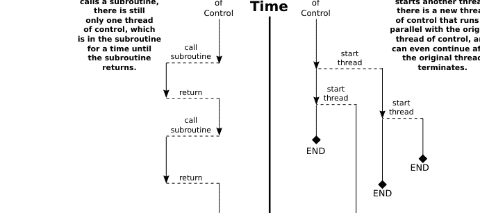

这种讨论假设运行程序的计算机具有多个处理单元，因此原始线程和新创建的线程可能在字面上同时执行。然而，即使在只有一个处理器的计算机上，也可以创建多个线程（更一般地说，在任何计算机上，创建的线程数量都可以比处理器多得多）。在这种情况下，两个线程将竞争时间。然而，仍然存在不确定性，因为处理器可以在不可预知的时间从一个线程切换到另一个线程。事实上，从程序员的角度来看，为单处理器计算机编程与为多处理器计算机编程没有区别，我们从现在起将大部分程度上忽略这种区别。

我提到过编写线程有两种方法。第一种方法是定义`Thread`的子类。第二种方法是定义一个实现`java.lang.Runnable`接口的类。`Runnable`接口定义了一个方法：`public void run()`。给定一个`Thread`，可以创建一个`Thread`，其任务是执行`Runnable`的`run()`方法。

`Thread`类有一个构造函数，它接受一个`Runnable`作为其参数。当将一个实现`Runnable`接口的对象传递给构造函数时，`run()`方法将简单地调用`Runnable`的`run()`方法，而调用线程的`start()`方法将创建一个新的控制线程，并在其中执行`Runnable`的`run()`方法。例如，作为`NamedThread`类的替代方案，我们可以定义类：

```java
public class NamedRunnable implements Runnable {

    private String name; // 此 Runnable 的名称。

    public NamedRunnable(String name) { // 构造函数给对象赋值名称。

        this.name = name;

    }

    public void run() { // run 方法向标准输出打印消息。

        System.out.println("Greetings from runnable " + name + "!");

    }

}
```

要使用此版本，我们将创建一个`NamedRunnable`对象并用它来创建一个`Thread`类型的对象：

```java
NamedRunnable greetings = new NamedRunnable("Fred");

Thread greetingsThread = new Thread(greetings);

greetings.start();
```

这样做的好处是，任何对象都可以实现`Runnable`接口并包含一个`run()`方法，然后该方法可以在单独的线程中执行。该`run()`可以访问类中的所有内容，包括私有变量和方法。缺点是这种方法不是面向对象的：它违反了每个对象都应该具有单一、清晰定义的职责的原则。与其仅仅创建一个随机的 Runnable 线程以便可以使用它来创建线程，不如考虑使用一个`Thread`类子类的嵌套类来定义线程。（参见第 5.8 节。）

最后，我将指出，有时使用匿名内部类定义线程（第 5.8.3 小节）非常方便。例如：

```java
Thread greetingsFromFred = new Thread() {

    public void run() {

        System.out.println("Greetings from Fred!");

    }

};

greetingsFromFred.start();
```

***

为了帮助理解多个线程如何并行执行，请示例程序`ThreadTest.java`。该程序创建了几个线程。每个线程执行完全相同的任务。任务是计算小于 5000000 的质数（具体的任务对我们来说并不，这是一个演示程序；让多个线程执行相同的事情是愚蠢的）。这种计算在现代计算机上不需要几秒钟。执行此任务的线程由以下静态类定义：

- 当属于此类的线程运行时，它将计算 2 到 5000000 之间的质数。它会将结果打印到标准输出，以及它的 ID 以及计算开始和结束之间的时间。

```java
static class CountPrimesThread extends Thread {

    int id; // 此线程的 id；在构造函数中指定。

    CountPrimesThread(int id) {

        this.id = id;

    }

    public void run() {

        long startTime = System.currentTimeMillis();

        int count = countPrimes(5000000); // 计算质数。

        long elapsedTime = System.currentTimeMillis() - startTime;
```


```
System.out.println("Thread " + id + " counted " + count + " primes in " + (elapsedTime/1000.0) + " seconds.");
```

}

```

主程序询问运行多少线程并创建指定的线程：

```
public static void main(String[] args) {

    int numberOfThreads = 0;

    while (numberOfThreads < 1 || numberOfThreads > 25) {

        System.out.print("How many threads do you want to use (1 to 25)? ");

        numberOfThreads = Integer.parseInt(System.nextLine());

    }

    System.out.println("Creating " + numberOfThreads + " prime-counting threads...");

    CountPrimesThread[] worker = new CountPrimesThread[numberOfThreads];

    for (int i = 0; i < numberOfThreads; i++) {

        worker[i] = new CountPrimesThread(i);

    }

    for (int i = 0; i < numberOfThreads; i++) {

        worker[i].start();

    }

    System.out.println("Threads have been created and started.");

}
```

## 第 12 章 线程与多进程

编译并运行该程序是一个好主意。

当我在我的计算机上用一个线程运行程序时，计算花费了 6.25 秒。当我使用八个线程运行时，输出如下：

```
Creating 8 prime-counting threads...
Threads have been created and started.
Thread 4 counted 3485 primes in 1.264 seconds.
Thread 2 counted 3485 primes in 1.269 seconds.
Thread 3 counted 3485 primes in 1.267 seconds.
Thread 0 counted 3485 primes in 1.269 seconds.
Thread 7 counted 3485 primes in 1.262 seconds.
Thread 5 counted 3485 primes in 1.265 seconds.
Thread 1 counted 3485 primes in 1.269 seconds.
Thread 6 counted 3485 primes in 1.263 seconds.
```

第二行在第一行之后立即打印。此时，主程序已经结束，但线程仍在运行。在暂停 12.5 秒后，所有线程同时完成。线程完成的顺序与它们启动的顺序不同，且顺序是不确定的。也就是说，如果再次运行程序，线程完成的顺序可能会不同。

在这台计算机上，每个线程花费的时间是一个线程的两倍。这是因为计算机有四个处理器。当八个线程在处理器上运行时（每个线程半个处理器），每个线程实际上执行了一半的时间，所以完成任务花费了两倍的时间。在单处理器计算机上，线程将花费一个线程大约八倍的时间。在具有八或更多处理器的计算机上，八个线程可能不需要比单个线程的时间。由于开销和其他原因，实际加速会比此分析所示的小一点，但在多处理器机器上，你应该看到加速。当你在计算机上运行程序时会发生什么？你有多少处理器？

每当线程多于可运行它们的线程时，计算机通过从一个线程切换到另一个线程将注意力分配给所有可运行线程。也就是说，每个处理器运行一个线程一会儿，然后切换到另一个线程运行一会儿，以此类推。通常，“上下文切换”每秒发生大约 100 次。结果是计算机在所有任务上都有进展，看起来所有线程都在同时执行。这就是为什么在示例程序中，每个线程都有相同的工作要做，并且线程大约在同一时间完成。在任何超过一分之一秒的时间内，计算机的时间被平均分配给所有线程。

### 12.1.2 线程操作

Java 的大部分线程 API 可以在 `Thread` 类中找到。然而，我们将从 `Runtime` 中的一个线程相关方法开始，该类允许 Java 程序获取其运行环境的信息。当你通过并行编程将工作分配到多个处理器之间时，你可能想要考虑可用处理器的数量。例如，你可能想为每个处理器创建一个线程。在 Java 中，你可以通过调用函数获取处理器的数量：

```
Runtime.getRuntime().availableProcessors()
```

## 第 12 章 线程与多进程处理

它返回一个 Java 虚拟机可用的处理器数量。在某些情况下，这个数字可能小于计算机中实际的处理器数量。

---

`Thread` 对象包含了几个用于线程操作的有用方法。最重要的是 `start()` 方法，我们在上面讨论过该方法。

一旦线程启动，它将继续运行，直到它的 `run()` 方法由于某种原因结束。有时，判断另一个线程是否已经终止是有用的。如果变量 `thread` 的类型是 `Thread`，可以使用布尔值函数 `thread.isAlive()` 来测试线程是否已经终止。在线程从启动到终止之间，线程是“存活的”。在线程终止后，它被称为“死亡的”。当我们谈论“杀死”（killing）或“中止”（aborting）线程时，使用了相当粗俗的比喻。请记住，已经终止的线程是无法重新启动的。

静态方法 `Thread.sleep(milliseconds)` 会导致执行该方法的线程“睡眠”指定的毫秒数。睡眠的线程仍然是存活的，但它没有在运行。当线程睡眠时，计算机可以处理任何其他可运行的线程（或其他程序）。`Thread.sleep()` 可用于在线程执行过程中插入暂停。`sleep` 方法可能会抛出 `InterruptedException` 类型的异常，这是强制性的异常处理。在实践中，这意味着 `sleep()` 方法通常在 `try..catch` 语句内部调用，该语句用于捕获潜在的 `InterruptedException`：

```
try {

  Thread.sleep(lengthOfPause);

} catch (InterruptedException e) {

}
```

可以中断一个线程，以便它在睡眠或由于其他特定原因暂停时唤醒。一个线程 `thread` 可以通过调用方法 `thread.interrupt()` 被中断。这样做可以是从一个线程向另一个线程发送信号的方便方法。当线程捕获到 `InterruptedException` 时，就知道自己被中断了。在异常处理程序之外，线程可以通过调用静态方法 `Thread.interrupted()` 来检查自己是否被中断。该方法告诉当前线程——即执行该方法的线程——是否被中断。它有一个不寻常属性，会清除线程的中断状态，因此你只能对中断进行一次检查。在你的程序中，除非你中断它们，否则线程不太可能被中断。因此，大多数情况下，你可能不会对 `InterruptedException` 做出任何响应（除了捕获它）。

有时，有必要等待另一个线程死亡。这是通过 `Thread` 类的 `join()` 方法实现的。假设 `thread` 是一个 `Thread`。那么，如果另一个线程调用 `thread.join()`，它将一直睡眠直到 `thread` 终止。如果在调用 `thread.join()` 时 `thread` 已经死亡，则它不会产生任何影响。`join()` 方法可能会抛出 `InterruptedException`，必须像通常一样处理。例如，以下代码启动了线程，等待所有线程终止，然后输出经过了的时间：

```
CountPrimesThread[] worker = new CountPrimesThread[numberOfThreads];

long startTime = System.currentTimeMillis();

for (int i = 0; i < numberOfThreads; i++) {

  worker[i] = new CountPrimesThread();

  worker[i].start();

}

for (int i = 0; i < numberOfThreads; i++) {

    try {

        worker[i].join(); // 等到 worker[i] 完成，如果它还没有完成的话。

    }

    catch (InterruptedException e) {

    }

}

// 在此节点，所有的 worker 线程都终止了。

long elapsedTime = System.currentTimeMillis() - startTime;

System.out.println("Total elapsed time: " + (elapsedTime/1000.0) + " seconds");
```

观察者会注意到，这段代码假设不会发生 `InterruptedException`。在可能发生 `InterruptedException` 的环境中，为了绝对确保线程 `worker[i]` 已终止，你需要执行如下操作：

```
while (worker[i].isAlive()) {

    try {

        worker[i].join();

    }

    catch (InterruptedException e) {

    }

}
```

`join()` 方法的另一个版本接受一个整数参数，指定等待的最大毫秒数。调用 `thrd.join(m)` 将等待直到 `thrd` 终止或经过 `m` 毫秒。这可以允许线程在等待期间偶尔唤醒以执行某些任务。这里例如有一个代码段将启动一个线程 `thrd`，只要它继续运行，就会每两秒提供一次输出：

```
System.out.print("Running the thread ");

thrd.start();

while (thrd.isAlive()) {

    try {

        thrd.join(2000);

        System.out.print(". ");

    }

    catch (InterruptedException e) {

    }

}

System.out.println("Done!");
```

线程有两个偶尔有用的属性：守护状态（daemon status）和优先级（priority）。通过调用 `thrd.setDaemon(true)` 可以将线程 `thread` 指定为守护线程。这必须在线程启动之前完成，如果在没有修改 `thread` 属性的情况下调用该方法，它可能会抛出 `SecurityException` 类型的异常。这只有一个效果：一旦没有了仍然存活的非守护线程，Java 虚拟机就会退出。也就是说，守护线程仍然存活这一事实将不再存在，它仅为其他非守护线程提供某些服务。当没有非守护线程时，将不再有守护线程的服务的调用，因此程序可能会关闭。

## 第 12 章 线程与多进程处理

线程的优先级是一个重要的属性。线程 `thread` 的优先级是一个整数。可以通过调用 `setDaemon(true)` 将一个线程指定为守护线程。这必须在线程启动之前完成，如果在没有修改 `thread` 属性的情况下调用该方法，它可能会抛出 `SecurityException` 类型的异常。这只有一个效果：一旦没有了仍然存活的非守护线程，Java 虚拟机就会退出。也就是说，守护线程仍然存活这一事实将不再存在，它仅为其他非守护线程提供某些服务。当没有非守护线程时，将不再有守护线程的服务的调用，因此程序可能会关闭。

线程的优先级是一个整数。`getPriority()` 返回线程的优先级，而可以使用 `setPriority(p)` 将其优先级设置为给定的整数 `p`。如果指定的优先级不在有效范围内，`setPriority()` 将抛出 `IllegalArgumentException`。优先级的范围可以随计算机而不同。有效范围由常量 `Thread.MIN_PRIORITY` 和 `Thread.MAX_PRIORITY` 指定，但默认优先级是 `Thread.NORM_PRIORITY`。要设置低于正常优先级的优先级，你可以调用

```
thread.setPriority(Thread.NORM_PRIORITY - 1);
```

注意，`setPriority()` 可能会抛出 `SecurityException` 异常，如果调用的线程被允许设置优先级。最后，我要注意静态方法 `Thread.currentThread()` 返回当前线程。也就是说，该方法的返回值是执行该方法的线程。这允许线程获取自己的引用，以便它可以修改自己的属性。例如，你可以通过 `Thread.currentThread().getPriority()` 获取当前运行线程的优先级。

### 12.1.3 使用 "synchronized" 实现互斥

编写多个线程执行独立任务是相当容易的。线程通过共享资源进行交互时，真正的困难出现了。当两个线程需要访问同一个资源（例如变量或屏幕上的窗口）时，必须小心它们不要同时使用同一个资源。否则，情况可能会变成这样：想象几个厨师共享一个量杯，想象厨师 A 在杯中装满了牛奶，结果厨师 B 在厨师 A 有机会将牛奶倒进碗之前也填满了量杯。必须有某种方法让厨师 A 在执行“向杯中加牛奶”和“将牛奶倒入碗中”操作时获得杯子的独占权。

类似的情况发生在线程中，即使是增加计数器。

```
count = count + 1;
```

是三个操作的序列：

- 1. 获取 `count` 的值
- 2. 将值加 1。
- 3. 将新值存储在 `count` 中

假设多个线程中的每个线程都执行这三个步骤。记住，两个线程可能同时运行，而且如果只有一个处理器，处理器可以在任何点从一个线程切换到另一个线程。假设当一个处于步骤 2 和步骤 3 之间时，另一个线程开始执行该序列。由于第一个线程尚未将新值存储在 `count` 中，第二个线程读取 `count` 的旧值并在该旧值的基础上加1。两个线程都计算出了 `count` 的新值，然后都通过执行步骤 3 将该值存回。在两个线程都完成操作后，`count` 的值只增加了 1 而不是 2！这种问题被称为**竞态条件**（race condition）。当一个线程处于多步操作的过程中，而另一个线程改变了第一个线程所依赖的值或条件时，就会发生这种情况。（第一个线程正在“竞争”在被另一个线程中断之前完成所有步骤。）

竞态条件的另一个例子可能出现在 `if` 语句中。考虑以下语句，其目的是避免除零错误：

```java
if ( A != 0) {

  B = C / A;

}
```

假设该语句由某个线程执行。如果变量 `A` 被一个或多个线程共享，并且没有采取措施来防止竞态条件，那么可能存在一个线程会在第一个线程检查条件 `A != 0` 之后、执行除法之前改变 `A` 的值。这意味着该线程最终可能会导致除以零，尽管它刚刚检查过 `A` 不为零。

为了修复竞态条件，必须有一种方法让线程获得对资源的独占访问。这实现起来并非易事，但 Java 提供了一种高级且相对易于使用的独占访问方法。这是通过 `synchronized` 语句实现的。这些语句用于通过确保一次只有一个线程访问资源来保护共享资源。Java 中的同步实际上执行的是**互斥**（mutual exclusion），这意味着如果每个需要访问资源的线程都使用同步，就能保证对资源的独占访问。同步就像厨师留了一张条子，写着：“我正在用量杯。”这将使厨师获得杯子的独占访问——但前提是所有厨师在尝试拿量杯之前都会检查条子。

由于这是一个困难的话题，我将从一个简单的例子开始。假设我们想避免多个线程想要给计数器加 1 时发生的竞态条件。我们可以通过定义一个类来表示计数器，并在该类中使用 `synchronized` 方法。通过在方法的定义处添加保留字 `synchronized` 作为修饰符，可以将方法声明为同步方法：

```java
class ThreadSafeCounter {

  private int count = 0; // 计数器的值。

  synchronized void increment() {

    count = count + 1;

  }

  synchronized int getValue() {

    return count;

  }

}
```

如果 `tsc` 是 `ThreadSafeCounter` 类型，那么任何线程都可以调用 `tsc.increment()` 以完全安全的方式给计数器加 1。`tsc.increment()` 是同步的这一事实意味着同一时间只有一个线程可以进入该方法；一旦线程开始执行该方法，就能保证它将完成执行，在此期间不会另一个线程改变 `tsc.count` 的值。不存在竞态条件的可能性。注意，`count` 是一个私有变量，这保证了事实。它强制所有对 `tsc.count` 的访问必须在该类提供的同步方法中进行。如果 `count` 是公的（public），那么线程可能会通过（例如）`tsc.count++` 来绕过同步。这可能会在另一个线程执行 `tsc.increment()` 的过程中改变 `count` 的值。请记住，同步本身并不保证独占访问；它是在所有同步的线程之间实现互斥。

然而，`ThreadSafeCounter` 类并不能防止使用计数器时产生的所有竞态条件。考虑以下 `if` 语句：

```java
if (tsc.getValue() == 0) {

    doSomething();

}
```


其中 `doSomething()` 是某个要求计数器值为 0 的方法。这里仍然存在竞态条件，如果第二个线程在第一个线程测试 `tsc.getValue() == 0` 之后、执行 `doSomething()` 之前增加了计数器，就会发生这种情况。第一个线程在执行整个 `if` 语句期间需要对计数器的独占访问。`ThreadSafeCounter` 类中的同步仅提供了执行 `tsc.getValue()` 时的独占访问。我们可以通过将 `if` 语句放在 `synchronized` 语句中来解决竞态条件：

```java
synchronized(tsc) {
    if (tsc.getValue() == 0) {
        doSomething();
    }
}
```

注意，`synchronized` 语句接受一个对象（在这种情况下是 `tsc`）作为一种参数。`synchronized` 语句的语法为：

```java
synchronized(object) {
    (statements)
}
```

在 Java 中，互斥始终与对象相关联；我们说“synchronized on tsc”是“在”那个对象上。例如，上面的 `if` 语句是一个同步的（synchronized in），如 `ThreadSafeCounter` 类中的语句那样，是在包含该实例方法的对象上同步。在实例方法的定义处添加 `synchronized` 修饰符几乎等同于将方法体放在 `synchronized(this) {...}` 形式的同步语句中。也可以有同步的 `static` 方法；同步的 `static` 方法是在代表类静态方法的特殊对象上进行同步。在 Java 中这：

## 同步的真正目的

两个线程不能同时在同一个对象上进行同步；也就是说，它们不能同时执行在该对象上同步的代码段。如果一个线程在某个对象上同步，第二个线程将等待直到第一个线程释放锁。这是通过使用锁（lock）实现的。

每个需要访问资源的线程都使用同步。同步就像厨师留了一张条子，写着：“我正在用量杯。”这将使厨师获得杯子的独占访问——但前提是所有厨师在尝试拿量杯之前都会检查条子。

## 12.1.4 `volatile` 变量

同步是控制线程间通信的一种方法。我们将在本章晚些部分介绍其他几种技术。目前，我们用一种结束本节。

# 第 12 章 线程与多进程

## 通信技术：`volatile` 变量

通常情况下，线程通过共享变量并在同步方法或同步语句中访问这些变量来相互通信。然而，同步在计算上是相当昂贵的，应该避免过度使用。在某些情况下，让线程在不对这些变量的访问进行同步的情况下读取共享变量是有意义的。

但是，当一个共享变量的值在一个线程中被设置，而在另一个线程中被使用时，就会出现一个微妙的问题。由于 Java 中线程的实现方式，第二个线程可能不会立即看到变量值的改变。这意味着，在另一个线程更改变量值后，某个线程可能会在一段时间内继续看到该共享变量的旧值。这是因为允许线程缓存数据，即每个线程都可以保留共享数据的自己的副本。

当一个线程更改了共享变量的值时，其他线程缓存中的本地副本不会立即改变，因此线程可以继续看到旧值，至少是短时间内。

当进入同步方法或语句时，线程会被强制更新其缓存，以获取缓存中变量的最新值。因此，在同步代码中使用变量总是安全的。

在同步代码之外使用共享变量是可能的，但在那种情况下，变量必须声明为 `volatile`。`volatile` 关键字是一个可以添加到变量声明中的修饰符，如下：

```java
private volatile int count;
```

如果变量被声明为 `volatile`，则没有线程会在其缓存中保留变量的本地副本。相反，线程将始终使用变量的官方主副本。这意味着对变量的任何更改对所有线程都是立见的。这使得线程在同步代码之外读取 `volatile` 共享变量也是安全的。

访问 `volatile` 变量的效率低于访问非 `volatile` 变量，但比使用同步防止竞态条件的效率高。

当 `volatile` 修饰符应用于对象变量时，变量本身被声明为 `volatile`，而不是该变量指向的对象的内容。出于这个原因，`volatile` 主要用于简单类型的变量，如原始类型或不可变类型（如 `String`）。

使用 `volatile` 变量的一个典型示例是从一个线程向另一个线程发送信号，告诉第二个线程终止。这两个线程将共享一个：

```java
volatile boolean terminate = false;
```

第二个线程的 `run()` 方法会频繁检查 `terminate` 的值，并在 `terminate` 的值变为以下时结束：

```java
public void run() {
    while (terminate == false) {
        // 执行一些工作。
    }
}
```

该线程将一直运行直到另一个线程将 `terminate` 的值设置为 `true`。这种方法确实是导致另一个线程死亡的唯一简洁方法。

（顺便说，你可能会好奇为什么线程起初使用本地数据缓存，因为这似乎不必要地增加了复杂度。允许缓存是因为多处理器计算机的结构——每个处理器都有直接连接到处理器的本地内存。线程的缓存可以存储在运行该线程的处理器本地内存中。访问这种本地内存比访问其他内存快得多，因此线程使用共享变量的本地副本比使用存储在非本地内存中的“主副本”更高效。）

## 12.2 使用线程编程

线程增加了编程的复杂度，但它们是重要的工具，并且在未来只会变得更加本质。因此，每个程序员都应该了解一些用于线程的基础性设计模式。在本节中，我们将查看一些基本技术，随着章节的推进会有更多内容。

### 12.2.1 线程定时器

线程最基本的用途之一是按间隔执行某些周期性任务——你已经处理过它了。事实上，它是如此基础，以至于有一个专门的类来执行此任务——`java.swing` 包中的 `Timer` 类，它可以生成一系列由指定时间间隔分隔的 `ActionEvent`。

定时器是在第 6.4 节中引入的，当时它们被用于实现动画。在后台，`Timer` 使用了一个线程。该线程大部分时间都在睡眠，但会定期唤醒以生成与定时器相关的事件。在引入定时器之前，必须直接使用线程来实现类似的功能。

在动画的典型用法中，定时器的每个事件都会导致计算并显示动画的新帧。在响应事件时，只需更新状态变量并重绘面板以反映变化。如下所示创建一个每三十毫秒触发一次定时器：

```java
Timer timer = new Timer(30, new ActionListener() {
    public void actionPerformed(ActionEvent evt) {
        updateNextFrame();
        display.repaint();
    }
});

timer.start();
```

假设我们想用线程做同样的事情。线程的 `run()` 方法必须执行一个循环，在该循环中线程睡眠 30 毫秒，然后唤醒进行更新和重绘。这可以通过如下嵌套类实现，使用在 12.1.2 节中讨论的 `Thread.sleep()` 方法：

```java
private class Animator extends Thread {
    public void run() {
        while (true) {
            try {
                Thread.sleep(30);
            } catch (InterruptedException e) {
                updateNextFrame();
                display.repaint();
            }
        }
    }
}
```

对于动画，你创建一个属于该类的对象并调用它的 `start()` 方法。目前，一旦动画开始，没有办法停止它。让停止成为可能的一种方法是在 `volatile` 变量变为 `true` 时结束循环，正如 12.1.4 节所讨论。在下一节中，我们将看到更灵活的线程控制技术。

使用线程和定时器之间存在微妙的区别。Swing 使用的线程只负责生成事件。在响应这些事件时执行的 Swing 事件处理线程还负责组件的绘制以及响应用户操作。这很重要，因为 Swing 不是线程安全的。也就是说，它没有使用同步来避免访问 GUI 组件及其状态变量时的竞态条件。

当另一个线程操作组件时，可能会出现问题，例如当线程调用 `updateNextFrame()` 方法时。`updateNextFrame()` 中修改的变量也会被绘制帧的 `paintComponent()` 方法使用。这里存在竞态条件：如果两个方法同时执行，`paintComponent` 可能使用不一致的值——有些属于新帧，有些来自旧帧。

解决这个问题的一种方法是将 `paintComponent()` 和 `updateNextFrame()` 都声明为同步方法。在这种情况下，更好的解决方案是使用定时器而不是线程。在实践中，即使使用线程实现，对于简单的动画，竞态条件可能不是问题。

我应该指出，组件的 `repaint()` 方法可以安全地从任何线程调用而无需担心同步。记住，`repaint()` 并没有实际执行绘制；它只是告诉系统调度一个绘制事件。实际绘制将在事件处理线程中进行。

我还会注意到 Java 有另一个线程 `java.util.Timer`，它适用于非 GUI 程序。

示例程序 `RandomArtWithThreads.java` 使用线程绘制一个非常简单的动画。你可以将其与第 6.4 节的 `RandomArt.java` 进行比较，后者使用定时器实现了动画。在这个例子中，线程除了调用 `repaint()` 什么都不做，因此不需要同步。

# 第 12 章 线程与多进程

使用来自计时器的系列事件来驱动递归算法；使用单个递归方法来调用递归要自然得多，而且在线程中实现这一点也很容易。

例如，`QuickSortThreadDemo.java` 程序使用动画来演示用于对数组排序的递归快速排序算法。在这种情况下，数组包含颜色，目标是将颜色按照从红到紫的标准光谱进行排序。

在程序中，用户随机化数组，并通过点击显示下方的“Start（开始）”按钮启动排序过程。“Start”按钮会变为“Finish（完成）”按钮，用于在排序完成前取消排序。（这是一个非常有趣的观察程序，它甚至可能帮助你更好地理解快速排序，所以你应该运行一下。）

在程序中，每当算法对数组进行更改时，就会调用显示器的 `repaint()` 方法。当这种情况发生时，线程会睡眠 100 毫秒，以便留出时间重绘显示并让用户查看。在数组随机化之后、排序之前，还有一个更长的延迟，即整整一秒钟。

这些延迟发生在程序的几个位置；`QuickSortThreadDemo` 定义了一个 `delay()` 方法，线程会调用该方法持续指定的一段时间。`delay()` 方法在睡眠之前会调用 `display.repaint()`。当动画线程运行时，事件处理线程将有机会运行，并有足够的时间重绘显示器。（我在这个示例中没有使用同步，但这样做会是一个好主意。）

一个有趣的问题是如何实现“Finish”按钮，它应该中止排序并终止线程。该按钮通过将 `volatile` 类型的布尔变量 `running` 的值改为 `false`，向线程发送一个其应该终止的信号。

问题是，这个按钮可以在任何时间被点击，即使算法正处于递归的很深层次中。在线程终止之前，它所有的递归方法调用必须返回。处理此问题的好方法是抛出异常。

`QuickSortThreadDemo` 为此定义了一个新的异常类 `ThreadTerminationException`。`delay()` 方法检查信号变量 `running` 的值。如果 `running` 为 `false`，`delay()` 方法将抛出异常，该异常将捕获递归算法，最终动画线程将终止。这里是 `delay()` 方法：

```java
private void delay(int millis) {
    if (running) {
        throw new ThreadTerminationException();

        display.repaint();

        try {
            Thread.sleep(millis);
        } catch (InterruptedException e) {
        }

        if (running) // 检查睡眠期间是否发生了变化。
            throw new ThreadTerminationException();
    }
}
```

`ThreadTerminationException` 在线程的 `run()` 方法中捕获：

- 此类定义了运行递归快速排序算法的线程。线程首先随机化数组。然后调用 `quickSort()` 对数组进行排序。
- 如果 `quickSort()` 被 `ThreadTerminationException` 中止（这将由用户点击 Finish 按钮引起），则线程将在终止前将数组恢复为排序状态，这样无论 `quickSort` 是否被中止，数组最终都是经过排序的。

```java
private class Runner Thread {
    public void run() {
        try {
            for (int i = hue.length-1; i > 0; i--) { // Random array.
                int r = (int)((i+1)*Math.random());

                int temp = hue[r];
                hue[r] = hue[i];
                hue[i] = temp;
            }

            delay(1000); // Wait one second before starting the sort.
            quickSort(0,hue.length-1); // Sort the array, recursively.

        } catch (ThreadException e) { // User clicked "Finish"
            for (int i = 0; i < hue.length; i++)
                hue[i] = r; // restore original array values.

        } finally { // Make running is false and button label is correct.
            running = false;
            startButton.setText("Start");
            display.repaint();
        }
    }
}
```

程序使用类型为 `Runner` 的变量 `runner` 来代表排序线程。当用户点击“Start”按钮时，执行以下代码来创建并启动线程：

```java
startButton.setText("Finish");
runner = new Runner();
running = true; // 在启动线程之前设置信号！
runner.start();
```


注意在启动线程之前，信号变量`running`的值为`true`。如果线程在启动时`running`为`false`，线程可能一启动就会看到并解释该值。记住，当调用`runner.start()`时，`runner`与调用它的线程是并行运行的。

停止线程稍微有点趣，因为在按下“Finish”按钮时，线程可能正处于睡眠状态。线程必须在执行终止信号之前唤醒。为了让线程具有良好的响应能力，我们可以调用`runner.interrupt()`，如果线程正在睡眠，它将被唤醒。这在程序程序中没有产生实际作用，但如果用户在按下“Start”后立即点击（此时线程正在睡眠整整一秒），它会让程序明显变快。

## 12.2.3 用于后台计算的线程

为了让 GUI 程序具有响应性——即在计算进行的同时响应用户事件——使用线程进行后台计算至关重要。如果事件处理程序花费一些时间，界面将会冻结。这会让用户感到非常困恼。幸运的是，你可以使用线程优先级来避免这个问题。通过将计算线程的优先级设置为低于事件处理线程，你可以确保尽可能快地处理事件，同时为计算留出时间。

示例程序`BackgroundComputationDemo.java`是后台处理的一个示例。该程序使用了图像的技术，这些技术将在第 13.1 节中介绍，目前你只需要知道计算图像中每个像素的颜色需要一些计算。该图像是一个数学对象（如集合）的一部分。我们将在本章的示例中使用相同的图像，并在第 13.5 节中运行该集合。

概述而言，`BackgroundDemo`与上述的`QuicksortThreadDemo`相似。计算在内部类定义的线程中完成。一个`volatile`布尔变量`running`用于控制线程。如果`running`的值设置为`false`，线程应该终止。示例程序有一个按钮，用户点击它来启动和中止计算。区别在于，此处的线程旨在持续运行，而不停止。为了让用户看到计算正在进行（这是一个好主意），每当线程计算出一行像素时，它会将这些像素复制到逐行构建的图像中。

当计算线程响应“Start”按钮时，我们需要将其优先级设置为低于事件处理线程的优先级。创建线程的代码本身运行在事件处理线程中，因此我们可以使用一个小于执行该代码的线程优先级的优先级。注意，优先级设置位于`try..catch`块中。如果在尝试设置线程优先级时发生错误，程序仍然可以工作，尽管如果优先级是正确的效果会更好。

```java
runner = new Runner();

try {
    runner.setPriority(Thread.currentThread().getPriority() - 1);
}
catch (Exception e) {
    System.out.println("Error: Can't set priority: " + e);
}

running = true; // 在启动线程前设置信号！
runner.start();
```

该程序中另一个主要的关注点是，我们有两个线程都在使用表示图像的实例。计算访问图像以设置像素的颜色。事件处理线程在将图像复制到屏幕时也会访问同一幅图像。由于图像是被多个线程共享的资源，因此访问必须是同步。当`paintComponent()`方法复制图像时（使用了一个我们尚未介绍的方法），它是在同步语句中执行的：

```java
synchronized(image) {
    g.drawImage(image,0,0,null);
}
```

当计算设置一行像素的颜色时（使用另一个不熟悉的方法），它也使用了同步：

```java
synchronized(image) {
    image.setRGB(0,row, width, 1, rgb, 0, width);
}
```

注意，这两个语句都是在同一个对象`image`上进行同步的。这是至关重要的。为了防止这两个部分被同时执行，同步必须在同一个对象上进行。我们在这里使用`image`对象是因为它方便，但任何对象都可以；并不要求你对正在尝试访问的对象进行同步。

`BackgroundComputationDemo`运行良好，但存在一个问题：目标是尽可能地完成计算，利用所有可用的处理时间。该程序在只有一个处理器的计算机上实现了这一目标。但在具有多个处理器的计算机上，我们只使用了其中一个处理器进行计算。如果能让所有处理器都处理这个问题将就太好了。为了实现这一点，我们需要真正的并行处理，即多个计算线程。接下来我们将转向讨论这个问题。

## 12.2.4 用于多进程的线程

我们的下一个示例`MultiprocessingDemo1`是`BackgroundComputationDemo`的变体。它不是在单线程中进行计算，而是`MultiprocessingDemo1`可以将问题分配给多个线程。用户可以选择要使用的线程数。每个线程被分配图像的一个部分。线程并行执行它们的任务。例如，如果有两个线程，第一个线程计算图像的上半部分，而第二个线程计算图像的下半部分。这里是使用三个线程接近计算结束的程序图片。灰色区域代表尚未计算的图像部分：


你应该尝试运行这个程序。在多处理器计算机上，使用多个线程完成计算的速度将比使用单个线程快得多。请注意，当使用一个线程时，该程序的行为与之前的示例程序相同。

此示例中在线程之间划分问题的方法并非最优。我们将在下一节介绍如何改进它。`MultiprocessingDemo`是多进程的一个很好的示例。

当用户点击“Start”按钮时，程序必须创建并启动指定数量的线程，并为每个线程分配图像段。以下是实现方法：

```java
workers = new Runner(threadCount); // 持有计算线程。
int rowsPerThread; // 每个线程应该计算多少行像素？
rowsPerThread = height / threadCount; // (height = 图像的垂直尺寸)
running = true; // 在启动线程前设置信号！
threadsCompleted = 0; // 记录已终止的线程数。
for (int i = 0; i < threadCount; i++) {
    int startRow; // 第 i 个线程计算的第一行
    int endRow; // 第 i 个线程计算的最后一行
    // 创建并启动一个线程来计算图像的行，
    // 注意我们必须确保
    // 最后一个线程的行是图像的底行。
    startRow = rowsPerThread*i;
    if (i == threadCount-1)
        endRow = height-1;
    else
        endRow = rowsPerThread*(i+1) - 1;
    workers[i] = new Runner(startRow, endRow);
    try {
        workers[i].setPriority(Thread.currentThread().getPriority() - 1);
    }
    catch (Exception e) {
    }
    workers[i].start();
}
```

创建多个线程后，只需要极少的更改即可获得多进程的优势。与之前的示例一样，每当一个线程计算完一行像素的颜色时，它就会复制到图像中，并以完全相同的方式确保同步以控制访问。

但现在有一点：当所有线程都运行完毕后，程序运行时按钮名称将从“Abort”变为“Start Again”，并且在线程运行期间禁用的弹出菜单将重新启用。问题是，如何判断所有线程何时已终止？（你可能会考虑如何像第 12.1.2 节那样使用`join()`来等待线程；至少，我们确实不能在事件处理线程中这样做！）在这个示例中，我使用一个实例变量`threadsCompleted`来跟踪目前为止终止了多少线程。当每个线程完成时，它都会调用一个方法将该值加 1。（该方法被调用时：）

```java
synchronized void done() {
    threadsCompleted++;
    if (threadsCompleted == workers.length) { // 所有线程已完成。
        startButton.setText("Start Again");
        startButton.setEnabled(true); // 重新启用。
        menu.enable(); // 重新启用。
    }
}
```

注意，在多线程环境下，`threadsCompleted`必须是`volatile`的，否则线程可能无法看到其他线程对该变量的更新。为了方便起见，我没有在代码中显示`volatile`关键字。

```java
private volatile int threadsCompleted;
```

在计算中，你仍然不能假设所有的子问题都需要相同的时间来解决。例如，你计算机上的某些处理器可能正忙于运行其他程序。或者，某些处理器的速度可能比其他处理器慢。（在单台计算机上运行计算时这种情况不太可能，但当我们把计算分布到几台网络计算机上时（我们将在本文后续部分介绍），处理器差异将成为一个主要问题。）

处理这种问题的常用技术是将问题划分为相当数量的子问题——子任务的数量远于处理器数量。这意味着每个处理器都必须解决几个子问题。每当一个处理器完成一个子任务时，它就会被分配另一个任务来处理，直到所有子任务都分配完毕。当然，各个子任务所花费的时间会有差异。一个处理器可能完成几个子任务，而其他处理器在处理一个特别困难的案例。一个缓慢或忙碌的处理器可能只完成一个或两个子问题，而另一个处理器可能完成五个或六个。每个处理器都按照自己的节奏工作。只要子问题最终足够小，大多数处理器就可以一直保持忙碌直到计算结束。这被称为**负载均衡**：在可用的处理器之间平衡计算负载，以便让所有处理器尽可能忙碌。当然，某些处理器仍然会在其他处理器之前完成，但不会是最晚完成的那个。

虽然子问题应该很小，但也不应该太小。创建子问题并将其分配给处理器的开销是巨大的。如果子问题非常小，这种开销会显著增加必须完成的总工作量。在我的示例中，任务是为图像中的每个像素提供颜色。对于将该任务划分为子任务，一种可能是让每个子任务只包含一个像素。但通过这种方式产生的子任务可能太小。因此，我的程序中的每个子任务将计算一行像素的颜色。由于图像中有几百个像素，子任务的数量将很大，而每个子任务本身也相当大。结果是相当好的平衡，且开销在合理范围内。

顺便提一下，我们正在处理的问题对于并行编程来说是一个非常简单的问题。当我们把计算图像的问题划分为子问题时，所有子问题都是完全独立的。可以同时在任何数量的子问题上执行，然后我们按顺序执行。当某些子任务产生的结果是其他子任务所需的时，情况就会复杂得多。在这种情况下，子任务是不独立的，执行子任务的顺序非常重要。此外，必须有某种方法让一个子任务的结果与其他任务共享。当子任务由线程执行时，这涉及到控制对共享资源的访问的所有问题。因此，总的来说，为并行处理分解问题比我们这个相对简单示例看起来的要困难得多。但在大多数情况下，那是分布式计算课程的主题，而不是入门级编程课程的主题。

## 12.3.2 线程池与任务队列

一旦我们决定了如何将一个任务分解为子任务，就有了如何将子任务分配给线程的问题。在面向对象的方法中，每个子任务将由一个对象表示。由于任务代表某些计算，代表它的对象拥有一个执行该计算的实例方法是自然而然的。要执行任务只需调用它的计算方法。在我的程序中，计算方法被名为`run()`，任务对象实现了 12.1.1 节中讨论过的`Runnable`接口。这个接口是表示计算任务的自然方式。可以为每个`Runnable`创建新线程。然而，当有很多任务时，这样做并没有真正的意义，因为创建每个线程都涉及大量的开销。另一种方法是只创建几个线程，让每个线程取决于任务的数量。

要使用的最佳线程数量并不完全明确，它取决于你正在尝试解决的问题。目标是为计算机的每个忙碌处理器创建一个线程，但这对于所有问题并不适用。特别是，如果一个线程可以阻塞相当长的时间来等待某些事件或访问某些资源，你希望为处理器提供额外的线程，以便在其他线程阻塞时运行程序。我们在 12.4 节中转向使用网络连接线程时将恰好遇到这种情况。

当使用多个线程执行任务时，这些线程被称为**线程池**。线程池用于避免为每个任务创建新线程。当需要执行任务时，它可以被分配给“池”中的任何空闲线程。一旦池中的线程都忙了，任何额外的任务都将等待，直到其中一个线程变得空闲。这是队列的自然延伸：与线程池相关的是等待任务队列。当任务可用时，它们被添加到队列中。每当一个线程完成任务时，它就会去队列获取另一个任务来工作。

注意，线程池只有一个队列。池中的所有线程使用同一个队列；这是一个共享资源。正如共享资源一样，竞态条件和同步是至关重要的。如果没有同步，例如，两个尝试同时从队列获取项目的线程可能会获取同一个项目。（参见 12.3.3 节）。示例程序`Multiprocessing.java`实现了这一点。它使用`ConcurrentLinkedQueue`来持有任务。为了允许用户在计算完成之前取消，它使用一个布尔变量作为信号。线程由嵌套类定义。写起来非常短且：

```java
private class WorkerThread extends Thread {
    public void run() {
        try {
            while (running) {
                Runnable task = taskQueue.poll(); // 从队列获取任务
                if (task == null) {
                    break; // 因为队列为空
                }
                task.run(); // 执行任务；
            }
        } finally {
            threadFinished(); // 记录该线程已终止
        }
    }
}
```

程序使用嵌套类`MandelrotTask`表示计算图像中一行像素的任务。该类实现了`Runnable`接口。它的`run()`方法执行实际工作：计算每个像素的颜色，并将颜色应用到图像。以下是程序启动计算的操作（省略了一些细节）：

```java
taskQueue = new ConcurrentLinkedQueue<>(); // 创建队列
int height = ...; // 图像的行数
for (int i = 0; i < height; i++) {
    MandelrotTask task;
    task = ...; // 创建一个计算图像一行像素的任务
    taskQueue.add(task); // 将任务添加到队列中
}
int threadCount = ...; // 池中的线程数
workers = new WorkerThread[threadCount];
running = true; // 在启动线程之前设置信号！
treadsCompleted = 0; // 记录有多少线程已终止
for (int i = 0; i < threadCount; i++) {
    workers[i] = new WorkerThread();
    try {
        workers[i].setPriority(Thread.currentThread().getPriority() - 1);
    } catch (Exception e) {
    }
    workers[i].start();
}
```


# 第 12 章 线程与多进程

请注意，在启动线程之前将任务添加到队列是非常关重要的。线程会将空队列视为终止的信号。如果当线程启动时队列是空的，它们可能会看到队列为空并在启动后立即终止，而不执行任何任务！

你应该尝试一下`MultiprocessingDemo2`。它计算出与`MultiprocessingDemo1`相同的图像，但像素行的计算顺序与该程序并不相同（如果存在多个线程的话）。如果你仔细观察，可能会发现像素行并不是按照从上到下的严格顺序添加到图像中的。这是因为可能出现一个线程在完成第 $i+1$ 行时，另一个线程仍在处理第 $i$ 行，甚至在处理多行（如果你使用的线程比处理器数量多，这种效果可能会更加明显。尝试用 20 个线程运行一下）。

## 12.3.3 生产者/阻塞队列

`MultiprocessingDemo2`每次绘制图像时都会创建一个全新的线程池。这似乎是浪费的。难道不应该在程序开始时创建一组线程，并在需要计算图像时随时使用它们吗？毕竟，线程池的概念是线程应该等待任务到来，并在任务出现时执行。问题是，如果这样做的话，我们没有办法让线程等待任务到来。

阻塞队列是并行处理中经典模式之一的实现：生产者/消费者模式。当存在一个或多个产生物品的“生产者”和一个或多个消耗这些物品的“消费者”时，就会出现这种模式。所有的生产者和消费者都应该同时工作（并行）。如果没有可以处理的物品，消费者将必须等待直到产生一个。在许多应用程序中，如果物品只能以某种速率（例如每分钟一个）被消费，那么生产者以每分钟两个的速度无限生产下去是没有意义的。这只会导致等待处理的物品无限堆积。因此，对等待处理的物品数量设置限制通常是有用的。当达到限制时，生产者在生产更多物品之前应该等待。

我们需要一种方法将物品从生产者传递给消费者。队列是一个显而易见的答案：生产者在产生物品时将其放入队列。消费者从队列的另一端移除项。

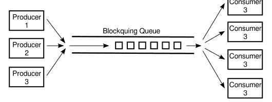

我们讨论的是并行处理，因此我们需要一个同步队列，但我们需要的不仅仅于此。当队列为空时，我们需要一种方法让消费者等待直到队列中出现项。如果队列满了，我们需要一种方法让生产者等待直到队列空出一个空间。在我们的应用程序中，生产者和消费者都是线程。被挂起等待某事发生的线程被称为“阻塞”，而我们需要的队列类型被称为“阻塞队列”。在阻塞队列中，从队列中出队的操作在队列为空时可能会阻塞；如果线程尝试从空队列出队，该线程将被挂起直到项可用；届时，它将醒来，获取该项并继续。同样，如果队列具有有限容量，尝试入队项的生产者在队列没有空间时可能会阻塞。

Java 有两个实现阻塞队列的类：`LinkedBlockingQueue`和`ArrayBlockingQueue`。这些是泛型类型，允许你指定队列可以包含的物品类型。这两个类都定义在`java.util.concurrent`包中，并且都实现了`BlockingQueue`接口。如果阻塞队列属于这些类之一，则定义了以下操作：

- `bqueue.take()` – 从队列中移除一个项并返回它。如果调用此方法时队列为空，调用它的线程将阻塞直到项可用。如果线程在阻塞期间被中断，此方法将抛出`InterruptedException`。
- `bqueue.put(item)` – 将一个项添加到队列。如果队列具有有限容量且已满，调用它的线程将阻塞直到队列空出一个空间。如果线程在阻塞期间被中断，此方法将抛出`InterruptedException`。
- `bqueue.add(item)` – 如果空间可用，将一个项添加到队列。如果队列具有有限容量且已满，则抛出`IllegalStateException`。此方法不会阻塞。
- `bqueue.clear()` – 移除队列中的所有项并丢弃它们。

Java 的阻塞队列定义了许多额外方法（例如，`bqueue.poll(500)`与`bqueue.take()`类似，它阻塞不会超过 500 毫秒），但这里列出的已经足够满足我们的目的了。注意向队列中添加项时：如果队列没有可用空间，`bqueue.put(item)`会阻塞，而`bqueue.add(item)`不阻塞，适用于使用具有有限容量的阻塞队列；`ArrayBlockingQueue`在构造时指定一个最大容量。例如，要创建一个可以阻塞最多 25 个`ItemType`类型对象的队列，你可以说：

```
ArrayBlockingQueue<ItemType> bqueue = new ArrayBlockingQueue<ItemType>(25);
```

通过此声明，如果队列已经包含项，`bqueue.add(item)`将抛出异常。`LinkedBlockingQueue`对其可以包含的物品数量没有限制。例如：

```
LinkedBlockingQueue<ItemType> bqueue = new LinkedBlockingQueue<>();
```

通过此声明，`bqueue.add(item)`永远不会抛出异常。

## 第 12 章 线程与多进程

```java
}

start(); // 线程一构造完成后就会立即启动。

public void run() {

  while (true) {

    try {

      Runnable task = taskQueue.take(); // 如果必要，等待任务

      task.run();

    }

    catch (InterruptedException e) {

    }

  }

}
```

我们应该更仔细地观察线程池的工作原理。工作线程在任何任务需要执行之前就已经被创建并启动了。每个线程都会立即调用`taskQueue.take()`。由于任务队列是空的，所有工作线程在启动后会立即进入阻塞。为了开始图像的计算，事件处理线程将创建任务并将它们添加到队列中。一旦发生这种情况，工作线程就会唤醒并开始处理任务，它们将持续这样做，直到队列变空。（注意：在多处理器计算机上，当其他线程正在向队列添加任务时，某些工作线程也可以开始处理任务。）当队列为空时，工作线程将返回睡眠状态，直到处理下一幅图像的任务。

该程序中一个有趣的点是，我们希望能够在计算完成之前将其终止，但又不希望工作线程在这种发生时终止。当用户点击“中止（Abort）”按钮时，程序调用`taskQueue.clear()`，这阻止了更多任务被分配给工作线程。然而，当任务队列被清除时，某些任务很可能已经在执行了。这些任务将在它们所属的子任务本应被中止的计算完成后完成。当这些子任务完成后，我们不希望将它们的输出应用到图像上。在程序程序中这不是大问题，但在更通用的应用程序中，我们不希望将之前计算的输出应用到后面的层上。

我的解决方案是为每个计算作业分配一个作业编号。当前作业存储在实例变量`jobNum`中，每个任务对象都有一个实例变量，告知它属于哪一个作业。当一个作业结束时——无论是由于作业完成还是由于用户中止——`jobNum`的值都会加1。当一个任务完成时，会将任务对象中的作业编号与`jobNum`进行比较。如果它们相等，则该任务属于当前作业，其输出将应用到图像上。如果它们不相等，则该任务属于之前的计算，其输出将被丢弃。

对`jobNum`的访问必须经过适当的同步。否则，一个线程可能在另一个线程增加编号时恰好检查作业编号，导致属于旧作业的输出在它被中止后溜进去。在程序中，所有访问`jobNum`的方法——查看源代码可以看到它是如何工作的。

关于`MultiprocessingDemo3`的另一点……我没有提供任何终止它们所产生的工作线程的方法。它们将一直运行到 Java 虚拟机退出为止。为了在此之前允许线程终止，我们可以使用一个`volatile`信号变量`running`，并在我们想要工作线程终止时将其值设置为`false`。线程的`run()`方法将被替换为：

```java
public void run() {

    while ( running ) {

        try {

            Runnable task = taskQueue.take();

            task.run();

        } catch (InterruptedException e) {

        }

    }

}
```

然而，如果线程阻塞在`taskQueue.take()`中，在它被解阻塞之前，它看不到`running`的新值。为了确保这一点发生，在将`runner`设置为`false`后，必须对每个工作线程调用`worker.interrupt()`。

当在设置`runner`为`false`时工作线程正在执行任务，该线程在任务任务完成之前不会终止。如果任务执行时间足够短，这并不是问题。如果任务执行时间比你愿意等待线程终止的时间长，则每个任务也必须定期检查`running`的值并在其变为`false`时退出。

## 12.3.4 等待与通知（Wait and Notify）

为了实现阻塞队列，我们必须能够让线程阻塞，直到某个事件发生。线程正在等待该事件，但当事件发生时必须收到通知。事件涉及两个线程：一个线程将通过另一个线程采取的操作引起事件，例如向队列中添加项。

注意，这对于阻塞队列并不是问题。每当一个线程产生某种结果并由另一个线程通知时，它对……施加了某种限制。

## 第 12 章 线程与多进程

```java
catch (InterruptedException e) {

}

useResult = sharedResult;

}

useTheResult(useResult); // 未同步！
```

对`generateTheResult()`和`useTheResult()`的调用是没有同步的，这允许它们与其他可能被锁定的线程并行运行。由于`sharedResult`是一个共享变量，对`sharedResult`的所有引用都应该是同步的，即对`sharedResult`的引用必须在`synchronized`语句内部。目标是在同步代码段中尽可能尽可能少的操作（但不能更少）。

如果你运气不好，你可能会发现一些奇怪的现象：`lock.wait()`直到`lock.notify()`执行后才会结束，既然这两个方法都是在对同一个对象进行同步的`synchronized`语句中调用的，难道这两个方法不可能同时处于状态吗？事实上，`lock.wait()`是一个特殊情况：当线程调用`lock.wait()`时，它会释放对同步对象`lock`的锁。这让另一个线程有机会去执行包含`lock.notify()`语句的`synchronized(lock)`块。当第二个线程退出该块后，锁将返回给消费者线程，它就可以继续执行。

在完整的生产者/消费者模式中，多个结果由一个或多个生产者线程产生，并由一个或多个消费者线程消费。与其只用一个`sharedResult`对象，不如维护一个产生但尚未被消费的对象列表。让我们在一个非常简单的类来看看它是如何工作的，该类实现了`MultiprocessingDemo3`中使用的`LinkedBlockingQueueRunnable`的三个操作：

```java
import java.util.LinkedList;

public class MyLinkedBlockingQueue {

    private LinkedList<Runnable> taskList = new LinkedList<Runnable>();

    public void clear() {

        synchronized(taskList) {

            taskList.clear();

        }

    }

    public void add(Runnable task) {

        synchronized(taskList) {

            taskList.addLast(task);

            taskList.notify();

        }

    }

    public Runnable take() throws InterruptedException {

        synchronized(taskList) {

            while (taskList.isEmpty()) {

                taskList.wait();

            }

            return taskList.removeFirst();

        }

    }

}
```

该类的对象可以作为`MultiprocessingDemo3`中`taskQueue`的直接替代品。

在这个类中，我必须与`taskList`对象进行同步，但任何对象都可以被使用。事实上，我可以直接使用`synchronized`方法，这等同于对此进行同步（注意，你可能会在同步实例中看到`wait()`或`notify()`的调用，而没有对所用对象的引用）。记住，在上下文中`wait()`和`notify()`意味着`this.wait()`和`this.notify()`。

顺便说，在同步对象上调用`taskList.clear()`是关重要的，即使它没有调用`wait()`或`notify()`。否则，可能会发生竞态条件：在`take()`方法检查任务不为空并将其从列表中移除之后，列表可能恰被清空。在这种情况下，当调用`taskList.removeFirst()`时，列表是空的，从而导致错误。

等待通知是有可能的。如果你调用`obj.notify()`，它只会唤醒在`obj`上等待的线程中的一个，你可以调用`obj.notifyAll()`。在上面的示例中，`obj.notify()`工作正常，因为只有消费者线程被阻塞了。当我们只想在向队列添加任务时使用一个消费者线程时，因为哪个消费者获取任务并不重要。但考虑一个容量有限的队列，其中生产者和消费者都可能被阻塞。当一个项目添加到队列中时，我们希望确保有一个消费者线程被通知，而不仅仅是另一个生产者。一种解决方案是调用`notifyAll()`而不是`notify()`，这会通知所有线程，包括任何正在等待的消费者。

我还应该提到关于`obj.notify()`名称的可能混淆。这个方法并没有通知“任何东西”。它只是通知一个调用了`obj.wait()`的线程（如果存在这样一个线程）。同样，在`obj.wait()`中，等待某些东西的并不是`obj`本，而是调用该方法的线程。

关于`wait`的最后说明：调用`wait(milliseconds)`的方法接受一个毫秒数作为参数。调用`obj.wait(milliseconds)`只会等待指定的毫秒数来接收通知。如果在此期间没有发生通知，线程将唤醒并在没有通知的情况下继续。在实践中，此功能最常用于让等待的线程在等待期间周期性地唤醒以执行某些任务，例如让“等待计算完成”的文字闪烁。

让我们来看一个使用`wait()`和`notify()`让一个线程控制另一个线程的示例。示例程序`TowersOfHanoi.java`解决了汉诺塔问题（第 9.1.2 节），带有允许用户控制算法执行的控制按钮。用户可以点击“下一步（Next Step）”按钮来执行解决方案中的某一步，即将单个盘子从一堆移动到另一堆。点击“运行（Run）”让算法自动运行；文本按钮从“运行”变为“暂停（Pause）”，点击“暂停”则停止自动执行。还有一个“重新开始（Start Over）”按钮，可以取消当前的解决方案并将问题恢复到初始配置。这里是程序在执行解决方案过程中的图片，包括按钮：

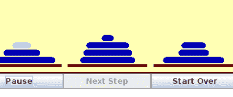

在这个程序中，有两个线程：一个运行递归算法来解决谜题，以及一个响应用户操作的事件处理线程。当用户点击其中一个按钮时，事件处理线程中的一个方法会被调用。当用户点击其中一个按钮时，事件处理线程中的一个方法会被调用。但实际上是运行递归的线程需要做出响应，例如执行解决方案的一步或重新开始。事件处理线程必须向解决方案线程发送信号。这是通过设置一个两个线程共享的变量的值来实现的。变量名为`status`，其可能的值有 GO、PAUSE、STEP 和 RESTART。

当事件处理线程更改该变量的值，解决方案线程应该看到新值并响应。当`status`等于 PAUSE 时，解决方案线程暂停，等待用户点击“运行”或“下一步”。这是程序启动时的初始状态。如果用户点击“下一步”，事件处理线程将`status`值设置为 STEP；解决方案线程应该看到新值并响应，执行解决方案的一步然后返回 PAUSE。如果用户点击“运行”，`status`被设置为 GO，这将导致解决方案自动运行。当用户在解决方案运行时点击“暂停”，`status`变为 PAUSE，解决方案线程应返回暂停状态。如果用户点击“重新开始”，事件处理线程将`status`设置为 RESTART，解决方案线程应该响应，结束当前解决方案并将问题恢复到初始状态。

对我们来说，关键点是当解决方案线程暂停时，它处于睡眠状态。在它唤醒之前，它不会看到`status`的新值！为了实现这一点，程序在解决方案线程中使用`wait()`睡眠，并在事件处理线程每次更改`status`值时使用`notify()`唤醒解决方案线程。这是响应按钮点击的`actionPerformed()`方法。当用户点击按钮时，该方法更改`status`的值并调用`notify()`来唤醒解决方案线程：

```java
synchronized void actionPerformed(ActionEvent event) {

    Object source = event.getSource();

    if (source == runPauseButton) { // 在运行和暂停之间切换
```


```java
if (status == GO) // 动画运行中

    status = PAUSE;

    nextStepButton.setEnabled(true); // 暂停时启用

    runPauseButton.setText("Run");

} else { // 动画已暂停。开始运行。

    status = GO;

    nextStepButton.setEnabled(false); // 运行时禁用。

    runPauseButton.setText("Pause");

}

} else if (source == nextStepButton) { // 让动画运行一步。

}
```

# 第 12 章 线程与多进程

627

```java
status = STEP;
}

else if (source == startButton) { // 恢复到初始状态。

  status = RESTART;

}

notify(); // 唤醒线程，使其看到新的状态值！
```

该方法是同步的（`synchronized`），以允许调用 `notify()`。请记住，对象中的 `notify()` 方法只能由持有该对象同步锁的线程调用。在此处，同步对象是 `this`。同步也是必要的，因为 `status` 的值可能会被解决方案线程修改，从而可能产生竞态条件（race conditions）。

解决方案（solution）调用一个名为 `checkStatus()` 的方法来检查 `status` 的值。如果状态为 `PAUSE`，该方法将调用 `wait()`，这会让线程进入睡眠状态，直到事件处理线程调用 `notify()`。请注意，如果状态为 `RESTART`，`checkStatus()` 将抛出一个 `IllegalStateException`。

```java
synchronized private void checkStatus() {

  while (status == PAUSE) {

    try {

      wait();

    } catch (InterruptedException e) {

    }

    // 此时，status 是 RUN、STEP 或 RESTART。

    if (status == RESTART) {

      throw new IllegalStateException("Restart");

    }

    // 此时，status 是 RUN 或 STEP。

  }

}
```

解决方案的 `run()` 方法在一个无限循环中运行，该循环设置了谜题的初始状态并调用 `solve()` 来解决谜题。为了实现 wait/notify 控制策略，`run()` 在启动解决方案之前调用 `checkStatus()`，而 `solve()` 在每次移动后都会调用 `checkStatus()`。如果 `checkStatus()` 抛出 `IllegalStateException`，则 `solve()` 方法将提前终止。（我们在 12.2.2 节中曾用过使用异常来终止递归算法的方法。）当 `solve()` 方法完成或被异常终止后，`run()` 返回到循环开头，此时谜题的初始状态和用户界面状态如下：

```java
public void run() {

  while (true) {

    runPauseButton.setText("Run"); // 将界面设置为初始状态。

    nextButton.setEnabled(true);

    startButton.setEnabled(false);

    setUp(); // 设置谜题的初始状态

    status = PAUSE; // 初始时，解决方案线程是暂停的。

    checkStatus(); // 初始仅当用户点击“Run”或“Next Step”时执行

    startButton.setEnabled(true);

    try {

      solve(10,0,1,2); // 将10个盘子从文件 0 移动到堆 1。

    }

    catch (IllegalStateException e) {

      // 因为用户点击了“Start Over”，所以异常

    }

  }

}
```

你可以检查完整的源代码来查看这些内容是如何整合进完整程序的。如果你想学习如何直接使用 `wait()` 和 `notify()`，理解这个示例是一个很好的起点！

## 12.4 线程与网络

在节一节中，我们查看了几个网络编程的示例。这些示例展示了如何创建网络连接并通过这些连接进行通信，但它们没有处理网络编程的基本特征之一，即网络通信是异步的。从网络连接一端的程序角度来看，消息可能在任何时间从连接的另一端到达；消息的到达是一个不受接收消息的程序控制的事件。也许面向事件的网络 API 将是处理网络通信异步特性的的一种良好方法，但这不是 Java（或通常是其他语言）所采用的方法。相反，Java 中的网络编程通常使用线程。

### 12.4.1 阻塞式 I/O 问题

正如第 11.4 节所述，网络编程使用套接字（sockets）。在本文术语下，套接字代表网络连接的一端。每个套接字都有一个关联的输入流和一个输出流。写入连接一端输出流的数据将通过网络传输，并体现在另一端的输入流中。

想要从套接字输入流中读取数据的程序会调用输入流的某个输入方法。在调用输入方法之前，数据可能已经到达了；在这种情况下，输入方法会检索数据并立即返回。然而，更有可能的是输入方法必须等待数据从连接的另一端到达。数据到达后，输入方法和调用它的线程将被阻塞。

套接字输出流中的输出方法也可能阻塞。如果程序写入输出的速度快于数据在网络上传输的速度，就会发生这种情况。（这有点复杂：套接字使用一个“缓冲区”来存放本要在网络上传输的数据。缓冲区是一个像队列一样使用的内存块。）输出方法将数据丢入缓冲区；低级软件从缓冲区中移除数据并通过网络传输。如果缓冲区满了，输出方法将阻塞。请注意，当输出方法返回时，并不意味着数据已经通过了网络——它意味着数据已经进入缓冲区并被安排在稍后传输。）

我们说网络通信使用的是阻塞式 I/O（blocking I/O），因为网络上的输入和输出操作可能会阻塞一段时间。使用网络的程序必须准备好处理这种阻塞。在某些情况下，程序直接关闭等待输入是可以接受的。（命令行程序就是这样运行的。）然而，线程使得程序的某些可以在其他部分被阻塞时继续工作。重要的一点是，在处理 I/O 时使用线程的方法截然不同。相反，在阻塞式 I/O 情况下，拥有比处理器更多的线程是合理的。在理想情况下，为了保持所有处理器忙碌，你会希望每个处理器有一个线程（考虑到时间波动，可以少于此）。例如，对于网络服务器，线程大部分时间都在等待 I/O 完成。如果它们阻塞了 90% 的时间，你会希望拥有处理器数量十倍的线程。即使在单处理器的计算机上，服务器程序也可以使用大量的线程。

### 12.4.2 异步网络聊天程序

作为使用线程进行网络通信的示例，我们考虑一个 GUI 聊天程序。

11.4 节中的命令行聊天 `ChatClient.java` 和 `ChatServer.java` 使用的是直通的、逐步的通信协议。在连接一侧的用户输入后，该用户必须等待连接另一端的回复。异步聊天程序会好得多。在这样的程序中，你可以一直输入并发送消息，而无需等待响应。消息是异步到达的——来自另一端在到达时就会显示。在命令行界面中很难实现这一点，但它是图形用户界面的自然应用。GUI 聊天程序的基本思想是接收来自连接另一端的消息。一旦消息到达，读取消息的线程就会阻塞，直到下一条消息到达。然而，当它阻塞时，其他线程可以继续运行。特别是响应用户操作的事件处理线程保持运行；当服务器生成输出消息时，该线程就可以发送它们。

Chat 程序可以作为连接的客户端或服务器。（请参阅第 11.4 节获取有关客户端和服务器工作的信息。）该程序有一个“Listen”按钮，用户点击该按钮可以创建一个监听传入连接请求的服务器；这使得程序充当服务器。它还有一个“Connect”按钮，用户点击该按钮可以发送连接请求；这使得程序

# 第 12 章 线程与多进程

作为客户端运行……如往常，服务器在指定的端口号上监听。客户端需要知道服务器运行的计算机以及服务器监听的端口。GUIChat 窗口中有几个输入框，用户可以在其中输入这些信息。

一旦两个 GUIChat 窗口之间建立起连接，每个用户就可以向对方发送消息。窗口中有一个输入框，用户可以在其中输入消息。在框中输入时按回车键即可发送消息。这意味着消息的发送是由用户事件处理处理的，以响应由用户动作产生的事件。该线程在等待消息到达时会阻塞；当消息到达时，它会将消息显示给用户。窗口上方有一个巨大的传输记录区域，显示了关于网络连接的其他信息。

我强烈建议你编译源代码 `GUIChat.java` 并尝试运行该程序。为了在单台计算机上尝试，你可以使用“localhost”或“127.0.0.1”作为计算机名称，在同一台计算机的两个窗口之间建立连接。（一旦你打开了一个 `GUIChat` 窗口，就可以点击“New”按钮打开第二个。）我还强烈建议你阅读源代码。这里只讨论了其中的部分。

该程序使用一个内部类 `ConnectionHandler` 来处理大多数与网络相关的任务。`ConnectionHandler` 是 `Thread` 的子类。`ConnectionHandler` 负责打开网络连接并在连接建立后读取消息。通过将打开连接的操作放在单独的线程中，我们确保在连接建立期间 GUI 不会被阻塞。（与读取消息一样，打开连接也是阻塞操作，可能需要一些时间完成）。`ConnectionHandler` 在程序作为服务器和作为客户端时都会处理打开连接。当用户点击“Listen”按钮或“Connect”按钮时，会创建一个线程。“Listen”按钮应让线程作为服务器，而“Connect”应让它作为客户端。为了区分这两种情况，`ConnectionHandler` 有两个构造函数。注意 `postMessage()` 方法会将消息发布到传输记录区域，该消息对以下情况可见：

- 在指定的端口上监听连接。构造函数不执行任何网络操作；它只是设置了一些实例变量并启动线程。
- 线程将只监听一个连接，然后关闭其套接字。

```java
ConnectionHandler(int port) { // 用于作为“服务器”。

    state = ConnectionState.LISTENING;

    this.port = port;

    postMessage("\nLISTENING ON PORT " + port + "\n");

    start();

}
```

- 打开到指定计算机和端口的连接。构造函数不执行任何网络操作；它只是设置了一些实例变量并启动线程。

```java
ConnectionHandler(String remoteHost, int port) { // 用于作为“客户端”。

    state = ConnectionState.CONNECTING;

    this.remoteHost = remoteHost;

    this.port = port;

    postMessage("\nCONNECTING TO " + remoteHost + " ON PORT " + port + "\n");

    start();

}
```

在这里，`state` 是一个实例变量，其类型由枚举类型定义：

```java
enum ConnectionState { LISTENING, CONNECTING, CONNECTED, CLOSED };
```

此枚举的值代表网络连接的不同可能状态。将网络连接视为一个状态机（参见第 6.4.4 节）通常是有用的，因为对各种事件的响应取决于事件发生时连接的状态。将状态变量设置为 `LISTENING` 或 `CONNECTING` 会告诉线程在建立连接时是作为服务器还是客户端。

一旦线程启动，它将执行以下 `run()` 方法：

```java
/**
 * 由线程执行的 run() 方法。它作为客户端或服务器
 * 建立连接（取决于使用了哪一个
 * 构造函数）。
 */

public void run() {

    try {

        if (state == ConnectionState.LISTENING) {

            // 作为服务器打开连接。

            listener = new ServerSocket(port);

            socket = listener.accept();

            listener.close();

        } else if (state == ConnectionState.CONNECTED) {

            // 作为客户端打开连接。

            socket = new Socket(remoteHost,port);

        }

        connectionOpened();

        // 设置使用连接（包括

        // 创建用于读取传入

        // 消息的 BufferedReader, in）。

        while (state == ConnectionState.CONNECTED) {

            // 从连接的另一端读取一行文本，

            // 并向用户报告。

            String input = in.readLine();

            if (input == null) {

                connectionClosedFromOtherSide(); // 关闭套接字并向用户报告。

                break;

            }

            received(input); // 将消息报告给用户。

        }

    } catch (Exception e) {

        // 发生了一个错误。向用户报告它，但如果

        // 连接已关闭（因为错误

        // 可能是套接字关闭时产生的预期错误）。

        if (state != ConnectionState.CLOSED) {

            postMessage("\n ERROR: " + e);

        }

    } finally {

        // 在终止线程之前清理。

        cleanUp();

    }

}
```

此方法调用了其他几个方法来完成一些工作，但你可以看到它是如何工作的。在作为服务器或客户端打开连接后，`run()` 方法进入一个 `while` 循环，在循环中它接收另一端的消息，直到连接关闭。理解连接如何关闭是非常重要的。GUIChat 有一个“Disconnect”按钮，用户可以点击它关闭连接。程序通过关闭表示连接的套接字并将连接状态设置为 `CLOSED` 来响应此事件。注意，当这种情况发生时，处理连接的线程在 `read()` 方法中等待消息。当套接字被 GUI 线程关闭时，该方法将失败。连接另一端的用户也可以关闭连接。当这发生时，传入的消息流结束，`readLine()` 在连接端返回 `null`，这表示流结束，并作为远程用户已关闭连接的信号。

最后查看 GUIChat 代码，考虑发送和接收消息的方法。`send()` 方法由事件线程响应用户动作调用。其目的是向远程用户传输消息。（可能，尽管不太可能，数据操作可能会阻塞，套接字缓冲区满了。更复杂的程序可能会考虑到这种可能性。）该方法使用 `PrintWriter` `out`，它写入套接字的输出流。该方法的同步防止了连接状态在发送操作期间发生：

- 向连接的另一端发送消息，并将消息发布到传输记录。这只有在连接状态为 `ConnectionState.CONNECTED` 时才会被调用；如果在其他时间调用，则会被忽略。

```java
synchronized void send(String message) {

  if (state == ConnectionState.CONNECTED) {

    postMessage("SEND: " + message);

    out.println(message);

    out.flush();

    if (out.onError()) {

      postMessage("ERROR OCCURRED WHILE TRY TO SEND DATA.");

      close(); // 关闭连接。

    }

  }

}
```

`received()` 方法在从远程用户读取消息后由处理连接的线程调用。它的工作是将消息显示给用户，但再次使用 `synchronized` 以避免在执行此方法期间，如果另一个线程更改了连接状态，可能会发生竞态条件：

```java
/**
 * 当从连接的另一端接收到消息时，run() 方法会调用此方法。消息会被发送到
 * 记录（transcript）中，但只有当连接状态为 CONNECTED 时才会发送。（这是
 * 因为在用户点击“断开连接”（Disconnect）按钮后可能还会收到消息；这些不应该被
 * 用户看到。）
 */

synchronized private void received(String message) {

  if (state == ConnectionState.CONNECTED)

    postMessage("RECEIVE: " + message);

}
```


## 12.4.3 多线程网络服务器

线程经常被用于网络服务器程序。它们允许服务器同时处理多个客户端。当某个客户端可以保持长时间连接时，其他客户端不应该等待服务。如果预计与某个客户端的交互会非常繁忙，你不能假设情况总是如此。你必须考虑到出现表现异常客户端的可能性——即客户端保持连接但没有发送服务器期望的数据。通过一个线程独立地处理每个客户端，但在线程服务器中，会有其他线程可以继续处理其他客户端。

来自 11.4.4 节的示例程序 `DateServer.java` 是一个极其简单的网络程序。它没有使用线程，因此服务器在处理完一个客户端之前，无法接受另一个客户端的连接。让我们看看如何将 `DateServer` 转换为多线程服务器。（这非常简单，以至于没什么太大意义。然而，相同的技术也适用于复杂的服务器。例如，练习题 12.4。）

作为第一次尝试，请考虑 `DateServerWithThreads.java`。该示例在每次接收到连接请求时创建一个新线程，而不是通过调用子程序来处理连接本身。主程序只创建线程并处理与它的连接。这开销非常小，而且特别不会阻塞。线程的 `run()` 方法处理连接的方式与原始程序处理的方式完全相同。编写这并不困难。这里是程序的新版本，重要的变化已用斜体表示。注意，连接的构造函数执行的操作非常少，特别不能阻塞；这非常重要，因为构造函数运行在主线程中：

```java
import java.net.*;
import java.io.*;
import java.util.Date;
```

```java
/**
 * 此程序是一个服务器，在常量 LISTENING_PORT 指定的端口上
 * 接收连接请求。连接打开时，程序会将当前时间发送给
 * 已连接的套接字。程序将继续接收
 * 处理连接，直到它被杀死（例如，通过 CONTROL-C）。
 */

/*
 * 此版本的程序为每个
 * 连接请求都创建一个新线程。
 */

public class DateServerWithThreads {

    public static final int LISTENING_PORT = 32007;

    public static void main(String[] args) {

        ServerSocket listener; // 监听传入的连接。

        Socket connection; // 用于与连接的程序通信。

        /* 永远接受并处理连接，直到发生某些错误。 */

        try {

            listener = new ServerSocket(LISTENING_PORT);

            System.out.println("Listening on port " + LISTENING_PORT);

            while (true) {

                // 接受下一个连接请求并创建线程处理它。

                connection = listener.accept();

                ConnectionHandler handler = new ConnectionHandler(connection);

                handler.start();

            }

        } catch (Exception e) {

            System.out.println("Sorry, the server has shut down.");

            System.out.println("Error: " + e);

            return;

        }

    } // end main(void)

}

/**
 * 定义一个处理与一个
 * 客户端连接的线程。
 */

private static class ConnectionHandler extends Thread {

    Socket client; // 与客户端的连接。

    ConnectionHandler(Socket socket) {

        client = socket;

    }

    public void run() {

        // （拷贝自原始 DataServer 程序）

        String clientAddress = client.getInetAddress().toString();

        try {

            System.out.println("Connection from " + clientAddress);

            Date now = new Date(); // 当前日期和时间。

            PrintWriter outgoing; // 发送数据的流。

            outgoing = new PrintWriter(client.getOutputStream());

            outgoing.println(now.toString());

            outgoing.flush(); // 确保数据确实发送！

            client.close();

        } catch (Exception e) {

            System.out.println("Error on connection with: "
                + clientAddress + ": " + e);

        }

    }

}

// end class DateServerThreads
```

一个有趣的变化是在 `run()` 方法的末尾，我将 `clientAddress` 添加到了错误消息的输出中。这样做是为了识别错误消息指的是哪个连接。由于线程是并行运行的，不同线程的输出可能会以各种顺序混杂。来自同一线程的消息并不一定在输出中聚集在一起；它们可能会被其他线程的消息隔开。这是必须记住的复杂性之一。

## 12.4.4 使用线程池

为每个连接创建一个线程效率并不高，尤其是当连接是短命的时。幸运的是，我们有一个替代方案：线程池（第 12.3 节）。`DateServerThreadPool.java` 是 `DateServer` 的改进版本，它使用了线程池。当线程池被阻塞时，服务器不再接受连接。这里是处理线程的 `run()` 方法：

```java
public void run() {
    while (true) {
        Socket client;
        try {
            client = connectionQueue.take();
        } catch (InterruptedException e) {
            continue;
        }
        String clientAddress = client.getInetAddress().toString();
        try {
            System.out.println("Connection from " + clientAddress);
            Date now = new Date(); // 当前日期和时间。
            PrintWriter outgoing; // 发送数据的流。
            outgoing = new PrintWriter(client.getOutputStream());
            outgoing.println(now.toString());
            outgoing.flush(); // 确保数据确实发送！
            client.close();
        } catch (Exception e) {
            System.out.println("Error on connection with: "
                + clientAddress + ": " + e);
        }
    }
}
```

程序中的队列类型为 `ArrayBlockingQueue<Socket>`。因此它具有有限容量，当满时 `put()` 操作将被阻塞。如果队列无限增长，说明服务器接收请求的速度快于处理速度。这可能有几个原因：你的服务器可能不足以处理流量；你需要购买新服务器。或者可能是线程池线程不足以充分利用服务器；你应该增加线程池的大小。或者你的服务器正遭受“拒绝服务”攻击，某些人故意向你的服务器发送超过其处理能力的请求，以阻止合法客户端获得服务。

在任何情况下，具有有限容量的 `ArrayBlockingQueue` 都是正确的选择。队列应该足够短，以便队列中的连接不需要等待太久的服务。在真实的服务器中，队列的大小和池中线程的数量应该根据运行服务器的特定硬件、网络以及它处理的客户端性质进行调整（调优）。优化调优通常是一个困难的问题。

还有另一种情况可能出错：假设服务器需要从客户端读取数据，但客户端没有发送期望的数据。尝试读取数据的线程可能会无限期阻塞，等待输入。如果正在使用线程池，这可能会阻塞池中的所有线程。在这种情况下，永远无法进行任何后续处理！解决此问题的方案是让连接在空闲一段时间后“超时”。通常，每个连接线程都会跟踪最后一次从客户端接收数据的时间。服务器运行另一个线程（有时被称为“收割线程”，类似于死神），该线程定期唤醒并检查每个连接线程，以查看它们空闲了多久。等待输入时间太长的连接线程将被终止，并在其位置启动新线程。关于超时时间应该是多久是另一个困难的调优问题。

# 第 12 章 线程与多进程

## 12.4.5 分布式计算

我们已经看到如何使用线程进行并行处理，即多个处理器协同工作完成某些任务。到目前为止，我们假设所有处理器都在一台多处理器计算机内部。但并行处理也可以使用位于不同计算机的处理器来实现，只要这些处理器连接到了一个允许它们进行通信的网络上。这种类型的并行处理——即多台计算机共同处理一项任务并通过网络进行通信——被称为*分布式计算*。

在某种意义上，整个互联网是一个庞大的分布式计算系统，但在这里，我感兴趣的是网络上的计算机如何解决计算问题。Java 支持若干种分布式计算方法。*RMI 和 CORBA 是两种标准*，它们允许运行在台计算机上的程序调用存在于其他计算机上的对象的方法。这使得演示一个面向对象的程序成为可能，该程序的不同部分可以在不同的计算机上执行。RMI（远程方法调用）仅支持 Java 对象之间的通信。CORBA（通用对象请求代理架构）是一个更通用的标准，允许使用用不同编程语言（如 Java）编写的对象相互通信。正如网络中常见的情况一样，存在服务定位的问题（在这种情况下，“服务”意味着一个可以通过网络调用的对象）。也就是说，一台计算机如何知道哪个服务位于何处以及它位于哪个端口？RMI 和 CORBA 通过使用“请求代理”来解决这个问题——运行在已知位置的服务器维护着一份其他计算机上可用的服务列表。需要服务的计算机向请求代理注册其请求，然后代理会找到哪些服务是用的以及它们位于何处。

RMI 和 CORBA 是复杂的系统，并不容易使用。我在这里提到它们是因为是 Java 标准 API 的一部分，但我将不再进一步讨论它们。相反，我们将查看一个仅使用基础网络、相对简单的分布式计算演示。

我们将考虑的问题与 12.2 节和 12.3 节中 `MultiprocessingDemo1.java` 使用的问题相同，即复杂图像的计算。这是一个使用最简单并行编程类型的应用程序，任务之间没有通信。要将分布式计算应用于此类问题，我们可以使用一个“主”（master）程序将问题划分为任务并发送给工作者（workers）。工作者程序将结果返回给主程序。在这种背景下，工作者通常被称为“从”（slaves），该程序使用了分布式计算中所谓的主从方法（master/slave approach）。

演示程序由三个源文件构建：`CLMandelbrotMaster.java` 定义了主程序；`CLMandelbrotWorker.java` 定义了工作者程序；`CLMandelbrotTask.java` 定义了类 `CLMandelbrotTask`，它代表由工作者执行的单个任务。主程序将问题划分为任务集合，将这些任务分发给工作者，工作者执行任务并将结果发回主程序，主程序将所有单个任务的结果应用于问题中。

要运行此演示，你必须首先在几台计算机上启动 `CLMandelbrotWorker` 程序（可能通过命令行运行它）。该程序使用了 `CLMandelbrotTask`，因此两个类文件 `CLMandelbrotWorker.class` 和 `CLMandelbrotTask.class` 必须存在于工作者计算机上。然后，你可以在主计算机上运行 `CLMandelbrotMaster`。注意，该程序还需要 `CLMandelbrotTask`。你必须将每个工作者计算机的主机或 IP IP 地址作为命令行传递给主程序，以便告知向何发送这些请求。例如，如果工作者程序运行在三台 IP 地址分别为 `172.21.7.101`、`172.21.7.102` 和 `172.21.7.103` 的计算机上。

## 第 12 章 线程与多进程

```java
catch (Exception e) {
}
}
```

注意，此方法并不是在单独线程中执行的。工作线程一次只做一件事，不需要多线程。

回到主程序 `CLMandelbrotMaster.java`，我们遇到了一个更复杂的情况。主程序必须通过网络连接与多个服务器进行通信。为了实现这一目标，主程序是多线程的，用一个线程来管理与每个工作线程的通信。`main()` 程的伪代码大纲非常简单：

```text
创建一个所有必须执行的任务列表
如果没有命令行参数 {
    // 主程序自己完成所有任务。
    执行每项任务。
} else {
    // 任务将由工作程序执行。
    对于每个命令行参数 {
        从命令行参数获取关于工作线程的信息。
        创建并启动一个线程与工作线程进行通信...
        // 线程完成所有工作...
        等待任务结束。
    }
// 所有任务现在都已完成（假设没有错误）。
```

任务被放入一个名为 `tasks` 的 `ConcurrentBlockingQueue<CLMandelbrotTask<>>` 变量中（见第 13.2.2 节）。通信线程从列表中取出任务并将其发送给工作线程。使用 `tasks.poll()` 方法从队列中移除任务。如果队列返回 `null`，则表示所有任务已分配完毕，通信可以结束。

线程的作用是向工作线程发送一系列任务并接收结果。线程还负责最初建立连接。工作线程执行的进程的伪代码大纲可能如下：

```text
创建一个指向工作程序的套接字（socket）。
创建用于与工作线程通信的输入和输出流。
while (true) {
    让 task = tasks.poll();
    if (task == null) {
        // 所有任务已分配。
        break;
    }
    将任务编码为消息并传输给工作线程。
    读取来自工作线程的响应。
    解码并处理响应。
}
向工作线程发送一个“关闭”命令。
关闭套接字。
```

这种工作可以运行。然而，有几个细微的点。首先，线程必须准备好处理网络错误。例如，工作线程可能会意外关闭。但如果发生这种情况，只要其他工作线程仍然可用，主程序就可以继续。（你可以在运行程序时尝试这一点：使用 `CONTROL-C` 停止其中一个工作程序，并观察主程序仍然成功完成。）如果线程在处理任务工作时发生错误，就会出现困难：如果该任务本可以完成，那么该任务将重新重新分配给另一个工作线程。我通过将未完成的任务放回任务列表来处理。（遗憾的是，我的程序没有处理所有错误。如果工作线程失败，将不再有人处理未完成的任务了。此外，如果网络无限期“挂起”而没有实际产生错误，我的程序也会挂起，等待永远不会到达的工作线程的响应。一个更健壮的程序应该有一种检测问题并重新分配任务的方法。）

上述流程的另一个缺陷是，当线程处理响应时，工作程序处于空闲状态。如果能在处理上一个任务的响应之前先给工作线程获取一个新任务，将很好。这将使工作线程保持忙碌，并允许两个操作并行进行而不是顺序进行。（在本例中，处理响应的时间非常短，因此让工作线程在等待没有太大影响。但作为一个通用原则，在算法中尽可能实现并行化是理想的。）我们可以修改该流程将其变为：

```text
try {
  创建一个连接到工作程序的套接字。
  创建用于与工作线程通信的输入和输出流。
  让 currentTask = tasks.poll();
  将 currentTask 编码为消息并发送给工作线程。
  while (true) {
    读取来自工作线程的响应。
    让 nextTask = tasks.poll();
    if nextTask != null {
      // 在处理 currentTask 的响应之前，
      // 将 nextTask 发送给工作线程。
      将 nextTask 编码为消息并发送给工作线程。
    }
    解码 currentTask 的响应；
    currentTask = nextTask;
    if (currentTask == null) {
      break; // 所有任务已分配。
    }
  }
  向工作线程发送一个“关闭”命令。
  关闭套接字。
} catch (Exception e) {
  如果有未完成的任务，将其放回任务队列。
} finally {
  关闭连接。
}
```

最后，这里是将其转换为 Java 的方法。上述伪代码变为定义主程序所用通信线程的类中的 `run()` 方法：

- 此类代表一个工作线程。工作线程的作用是通过网络连接向 `CLMandelbrotWorker` 程序发送任务，并获取由该程序计算出的结果。


```java
private static class WorkerConnection extends Thread {
    int id;      // 在输出语句中标识此线程。
    String host;  // 此线程将连接的主机。
    int port;     // 线程将连接的端口号。

    /**
     * 构造函数设置 id、host 和 port 的值并启动线程。
     */
    WorkerConnection(int id, String host, int port) {
        this.id = id;
        this.host = host;
        this.port = port;
        start();
    }

    /**
     * 线程的 run() 方法打开主机连接，
     * 向工作程序发送任务，并输出
     * 处理的任务数。
     */
    public void run() {
        int tasksCompleted = 0; // 此线程处理的任务数。
        Socket socket; // 连接的套接字。
        CLMandelbrotTask currentTask = null;
        CLMandelbrotTask nextTask = null;

        try {
            socket = new Socket(host, port); // 打开连接。
            PrintWriter out = new PrintWriter(socket.getOutputStream());
            BufferedReader in = new BufferedReader(
                new InputStreamReader(socket.getInputStream()));
            currentTask = tasks.poll(); // 获取任务。
            if (currentTask != null) {
                // 向工作程序发送第一个任务。
                String taskString = writeTask(currentTask);
                out.println(taskString);
                out.flush();
            }
            while (currentTask != null) { // 我们完成了旧的 currentTask。
                String resultString = in.readLine(); // 获取 currentTask 的结果。
                if (resultString == null)
                    throw new IOException("连接意外关闭。");
                if (!resultString.startsWith("RESULT"))
                    throw new IOException("从工作线程收到非法字符串。");
                nextTask = tasks.poll(); // 获取任务并发送给工作线程。
                if (nextTask != null) {
                    // 将 nextTask
                    // 发送给工作线程，以便工作线程
                    // 在处理 currentTask 结果时处理 nextTask。
                    String taskString = writeTask(nextTask);
                    out.println(taskString);
                    out.flush();
                }
                readResults(resultString, currentTask); // 处理 currentTask 的结果。
                tasksCompleted++;
                currentTask = nextTask;
                nextTask = null;
                out.println("CLOSE"); // 向工作线程发送关闭命令。
                out.flush();
            }
        } catch (Exception e) {
            System.out.println("线程 " + id + " 因为错误而终止。");
            System.out.println("错误: " + e);
            e.printStackTrace();
            // 将任何未完成的任务放回任务列表。
            if (currentTask != null)
                reassignTask(currentTask);
            if (nextTask != null)
                reassignTask(nextTask);
        } finally {
            System.out.println("线程 " + id + " 结束，完成了 " +
                tasksCompleted + " 个任务。");
            try {
                socket.close();
            } catch (Exception e) {
            }
        }
    }
}
```

# 第 12 章 线程与多进程

## 12.5 网络编程示例：一个网络游戏框架

本节介绍了几个使用网络和线程的程序。每个应用程序的共同问题是支持多个运行在不同计算机上的程序之间的网络通信。

此类应用的一个典型示例出现在一个具有两个或多个玩家的联网游戏中，但同样的问题也可能出现在一些无关紧要的应用中。本节的第一部分描述了一个可以用于各种应用的通用框架，本节的其余部分讨论了使用该框架的三个特定应用。这是一个相当复杂的示例，可能是我们到目前为止在书中看到的最复杂的例子。对于对网络的基本理解来说，理解这些并不是至关重要的。

本节的灵感源于两位学生，Alexander Kittelberger 和 Kieran Koehn，他们在我教过的一门课程中编写一个联网游戏作为期末设计项目。我通过编写一个支持玩家之间通信的初级框架，帮助他们完成了项目中的网络部分工作。由于该应用展示了许多重要的概念，我决定在本书的当前版本中使用一个稍微进阶且更具通用性的版本的框架。最后的一个示例是一个联网游戏。

### 12.5.1 `Netgame` 框架

人们可以想象在网络上玩许多不同的游戏。从网络的角度来看，所有这些游戏都有共同点：必须有某种方式将一个玩家的操作通过网络传递给其他玩家。将这种功能放在一个可重用的核心中，并使其用于许多不同的游戏，是很有意义的。我编写了这样一个核心；它由 `netgame.com` 包中的几个类定义。

在本书中，除了使用内置类之外，我们没有对包（packages）做太多研究。包在第 2.6 节中引入，但在我们的编程示例中，我们一直使用的是“默认包”。然而，在实践中，所有最简单的项目都会使用包来将代码划分为相关的类组。在包中定义一个可重用的框架是非常好的，因为它可以作为一个单元被包含在各种项目中。

在 Eclipse 或 Netbeans 项目中使用 `netgame` 包会使使用包变得非常简单，只需将整个 `netgame` 目录复制并粘贴到项目中即可。

如果你在命令行界面下，你应该处于一个包含 `netgame` 目录作为子目录的工作目录。然后，编译 `netgame.com` 包中所有的 Java 文件，在 Mac 或 Linux 中可以使用以下命令：

```bash
javac netgame/common/*.java
```

对于 Windows，请使用反斜杠代替正斜杠：

```bash
javac netgame\common\*.java
```

你需要类似的命令来编译本节中示例的源代码，这些示例定义在 `netgame` 的其他子包中。

要运行一个定义在包中的主程序，你应该再次处于一个包含该包作为子目录的目录，并且你应该使用想要运行的类的全名。例如，在本节稍后讨论的 `ChatServer` 类定义在 `netgame.chat` 包中，因此你应该使用以下命令运行它：

```bash
java netgame.chat.ChatServer
```

我将在本书的最后一个示例（第 13.5 节）中介绍更多关于包的内容。

本节讨论的应用是分布式计算的示例，因为它们涉及多台计算机通过网络进行通信。与第 12.4.5 节中的示例一样，它们使用一个中央“服务器”或“主机”，多个“客户端”将连接到那里。所有的通信都通过服务器进行；客户端不能直接向另一个客户端发送消息。在本节中，我将服务器称为枢纽（hub），即“通信枢纽”的意思：

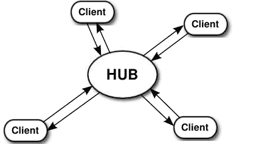

你需要理解的主要点是：在任何客户端启动之前，枢纽必须运行。客户端连接枢纽并向枢纽发送消息。枢纽按照接收到的顺序顺序处理来自所有客户端的消息。处理过程是顺序的。

`Hub` 类定义了一些非常有用的公共方法，特别是：

- `sendToAll(message)` — 向当前连接到 hub 的每个客户端发送指定的消息。消息必须是一个实现了 `Serializable` 接口的非空对象。
- `sendToOne(recipientID, message)` — 向一个用户发送指定的消息。第一个参数 `recipientID` 是接收消息的客户端的 ID。此方法返回一个 `boolean` 值，如果没有具有指定 `recipientID` 的已连接客户端，则返回 `false`。
- `shutdownServerSocket()` — 关闭 hub 的服务器套接字，使得额外的客户端无法连接。这可以用于（例如）在双人游戏中，在第二个客户端连接后使用它。
- `autoreset(autoreset)` — 设置 `autoreset` 属性的 `boolean` 值。如果属性为 `true`，则在传输每条消息之前，`OutputStreams` 将自动重置。默认值为 `false`。（如果对 `OutputStream` 进行了写入和修改，在重置已修改的对象之前，将未修改的值再次发送到流中就需要重置。关于此技术的讨论，请参见第 11.1.6 节。）

要了解更多信息并查看如何实现，你应该阅读源代码 `Hub.java`。通过一些努力和学习，你应该能够理解其中的所有内容。（不过，你只需要理解 `Hub` 以及你所基于的网络框架中其他类的公共和受保护接口。）

转向客户端，旁边的 `Client` 类定义在 `Client.java` 文件中，位于 `netgame.common` 包下。`Client` 类有一个构造函数，指定客户端将连接的 hub 的主机名（或 IP 地址）和端口号。该构造函数会阻塞直到连接建立为止。

`Client` 是一个抽象类。每个网络应用程序都必须定义 `Client` 的子类，并为以下方法提供定义：

```java
abstract protected void message(Object message);
```

每当从客户端连接的 hub 接收到消息时，该方法就会被调用。客户端的子类还可以重写受保护方法 `playerConnected`、`playerDisconnected`、`serverShutdown` 和 `connectionClosed`。要了解更多信息，请注意 `Client` 包含类型为 `int[]` 的受保护实例变量 `connectedIDs`；这是一个包含当前连接到 hub 的所有客户端 ID 的数组。`Client` 类提供的最重要的公共方法是：

- `send(message)` — 向 hub 发送消息。`message` 可以是任何实现了 `Serializable` 接口的非空对象。
- `getID()` — 获取 hub 分配给此客户端的 ID 号。
- `disconnect()` — 关闭与 hub 的连接。连接后无法发送消息。如果尝试这样做，`send()` 方法将抛出 `IllegalStateException`。

`Hub` 和 `Client` 类旨在定义一个通用框架，该框架可以作为各种网络游戏——事实上，还有其他分布式程序的基础。网络通信和多线程的低级细节隐藏在这些类的私有部分中。基于这些类构建应用程序可以根据玩家和管理员等高级概念进行工作。这些类的设计是根据实际应用的经验经过多次迭代而开发的。我敦促你查看源代码，看看 `Hub` 和 `Client` 如何使用线程、套接字（sockets）和流。在本节的剩余部分，我将讨论 `netgame` 框架上的三个应用程序。我不会详细讨论这些应用程序。你可以在 `netgame` 中找到所有三个程序的完整源代码。

### 12.5.2 一个简单的聊天室

我们的第一个示例是“聊天室”，这是一个网络应用程序，用户可以连接到服务器并发布消息，这些消息将被房间内的所有当前用户看到。它与第 12.4.2 节中的 `GUIChat` 程序类似，不同的是任何数量的用户都可以参与聊天。虽然这个应用程序不是游戏，但它实现了 `netgame` 框架的基本功能。

聊天室应用程序由两个程序组成。第一个 `ChatRoomServer.java` 是一个完全简单的程序，它只是创建一个 `netgame Hub` 来监听来自 `netgame` 客户端的连接请求：

```java
public static void main(String[] args) {
  try {
    new Hub(PORT);
  } catch (IOException e) {
    System.out.println("Can't create listening socket. Shutting down.");
  }
}
```

端口号 `PORT` 在程序中定义为常量，只要服务器和客户端使用相同的端口，它就是任意的。请注意 `ChatRoom` 使用的是 `Hub` 类本身，而不是子类。

聊天室应用程序的第二部分是程序 `ChatRoomWindow.java`，供想要参与聊天室的用户运行。潜在用户将知道运行 hub 的计算机的名称（或 IP 地址）。可以在与 hub 相同的计算机上运行客户端程序，使用 `localhost` 作为计算机的名称。当 `ChatRoomWindow` 运行时，它会打开一个对话框或窗口，将作为聊天室的界面。窗口有一个大区域，用于显示来自用户的消息。当用户输入消息时，该消息将发布到每个连接到 hub 的用户的传输记录中。

任何 `netgame` 应用程序都必须定义 `Client` 类的子类。对于聊天应用程序，客户端是由 `ChatWindow` 内部的嵌套类 `ChatClient` 定义的。程序有一个类型为 `ChatClient` 的实例变量 `connection`，代表程序到 hub 的连接。

```java
messageInput.setEditable(false);
messageInput.setText("");
connected = false;
connection = null;
```

当有人离开聊天室时，向传输记录发布一条消息。

```java
protected void playerConnected(int newPlayerID) {
    addToTranscript("Some new has joined the chat room, with ID number " + newPlayerID);
}
```

当有人离开聊天室时，向传输记录发布一条消息。

```java
protected void playerDisconnected(int departingPlayerID) {
    addToTranscript("The person with ID number " + departingPlayerID + " has left the chat room");
}
// end nested chatClient
```

聊天室应用程序的源代码请参见源代码文件，这些文件可以在 `netgame.chat` 包中找到。

注意：我的聊天室应用程序的用户仅通过客户端连接时由头部分配的 ID 号来识别。本质上，用户是匿名的，这并不令人满意。请参见本章的第 12 练习或解决此问题的章节。

### 12.5.3 网络井井棋游戏

我的示例是一个非常简单的游戏：熟悉的儿童游戏井井棋（TicTacToe）。在井井棋中，两名玩家在三乘三的棋盘上交替标记。一名玩家玩 X；另一个玩家玩 O。目标是获得三个排行的 X 或 O。


在任何给定时刻，井字棋游戏由各种信息组成，例如棋盘的当前内容、该轮谁操作——当游戏结束时——谁赢了谁了。在游戏的非网络版本中，这种状态将由实例变量表示。程序将构造这些实例变量来决定如何绘制棋盘以及如何响应用户的点击等操作。在网络游戏版本中，涉及三个对象：两个属于某个类的对象（该类为游戏的两名玩家提供接口），以及一个管理与客户端连接的对象。这些对象不在同一台计算机上，因此它们显然不能使用相同的状态变量！尽管如此，游戏在任何时候都必须有一个单一的、定义良好的，且两个玩家都必须意识到这一点。

我的解决方案是在枢纽（hub）中存储“官方”游戏，并在每当状态变化时向每个玩家发送一份状态副本。玩家无法直接更改状态。当玩家采取某些操作（例如在棋盘上放置棋子）时，该操作将作为消息发送到枢纽。枢纽发生变化以反映操作的结果，并向两个玩家发送新状态。每个玩家使用的窗口将进行更新以反映新状态。通过这种方式，我们可以确保游戏对两个玩家来说始终看起来是一样的。（与其在每次状态变化时都发送状态的完整副本，我可能只发送变化部分。但这需要某种方法将变化编码为可以在网络上发送的消息。由于状态非常简单，在这种情况下，在消息中发送整个状态似乎更简单。）

网络井字棋定义在`netgame.tictactoe`包的几个类中。`TicTacToeGameState`表示游戏状态。它包含一个方法：

```java
public void applyMessage(int senderID, Object message)
```

该方法修改状态以反映从游戏某一名玩家处收到的消息的影响。消息将代表玩家采取的某些操作，例如点击棋盘。

基础`Hub`类对井字棋一无所知。由于井字棋游戏的枢纽必须跟踪状态，因此必须是`Hub`的子类。`TicTacToeGameHub`非常简单。它重写了`messageReceived()`方法，以便通过将该消息应用到游戏状态并向两个玩家发送新状态的副本来对来自玩家的消息做出响应。它还重写了`playerConnected()`和`playerDisconnected()`方法以采取适当行动，因为游戏只有在有两个已连接的玩家时才能进行。这里是完整的源代码：

```java
package netgame.tictactoe;
import java.io.IOException;
import netgame.common.Hub;
```

> * 网络井字棋游戏的枢纽。对于
> * 游戏只有一个枢纽
> * 但网络玩家连接到游戏。
> * 关于游戏状态的官方信息维护在
> * 枢纽上。当状态变化时，枢纽将新
> * 状态发送给两个玩家，确保两个玩家看到
> * 相同的状态。

```java
public class TicTacToeGameHub extends Hub {
    private TicTacToeGameState state; // 记录游戏状态。

    /**
     * 在指定的端口上创建一个枢纽。注意此
     * 方法调用了setTimeout(true)，这将在发送每条消息之前
     * 重置输出流。由于是至关重要的，
     * 因为同一个状态对象将被传输。
     * @param the port number 枢纽将监听的端口号。
     * @throws IOException 如果在指定的端口无法打开监听器。
     */
    public TicTacToeGameHub(int port) throws IOException {
      super(port);
      state = new TicTacToeGameState();
      setTimeout(true);
    }

    /**
     * 当从客户端收到消息时响应。在这种情况下，
     * 消息被应用到游戏状态，调用state.applyMessage()。
     * 然后将可能改变的状态传输给所有玩家。
     */
    protected void messageReceived(Object message) {
        state.applyMessage(senderID, message);
        sendToAll(state);
    }

    /**
     * 当玩家连接时调用此方法。如果玩家是
     * 第二个玩家，则服务器的监听套字被关闭
     * （因为只允许两个玩家），游戏开始，并且
     * 新状态——带有正在进行的游戏——被传输给两个玩家。
     */
    protected void playerConnected(int playerID) {
        if (getPlayerList().length == 2) {
            shutdown();
            state.startGame();
            sendToAll(state);
        }
    }

    /**
     * 当玩家断开连接时调用此方法。这将结束
     * 游戏并导致另一个玩家也关闭。这是通过
     * 将state.playerDisconnected设置为true并将
     * 新状态发送给剩余玩家（如果有）来通知
     * 游戏已结束。
     */
    protected void playerDisconnected(int playerID) {
        state.playerDisconnected = true;
        sendToAll(state);
    }
}
```

游戏玩家由`TicTacToeWindow`类表示。与聊天室应用程序一样，该类定义了`Client`的子类来表示客户端到枢纽的连接。一个有趣的点是客户端如何响应来自枢纽的消息。当收到消息时，必须更新窗口以显示新状态。消息由一个线程接收并处理；更新在另一个线程中完成。这具有引入竞态条件的可能，需要同步处理。（特别是，当我在开发程序时，我发现消息可能在窗口构造函数执行之前就被接收到了。这是一个非常难以调试的错误，因为对消息的响应使用了尚未创建的对象。）

在使用 Swing API 时，我建议所有的修改都在 GUI 事件线程中进行。另一种方案是让`paintComponent()`和其他方法同步，但会对 GUI 的性能产生负面影响。Swing 使用`SwingUtilities.invokeLater(runnable)`方法使 GUI 事件线程中运行任何代码成为可能。参见第 12.2.5 节。在 TicTacToe 客户端类中，这种技术被用于处理来自枢纽事件的方法中：

```java
protected void messageReceived(final Object message) {
    if (message instanceof TicTacToeState) {
        SwingUtilities.invokeLater(new Runnable() {
          public void run() {
            // newState 方法更新 GUI
            newState(new TicTacToeState(message));
          }
        });
    }
}
```

运行井字棋，两个玩家各自运行`netgame.tictactoe`包中的`Main`。该程序向用户显示一个对话框，可以选择启动新游戏或加入现有游戏。如果用户启动新游戏，则创建一个`TicTacToeHub`来管理游戏，并创建一个`TicTacToeWindow`连接到枢纽。相反，如果用户加入现有游戏，则不创建枢纽。第二个玩家必须连接到第一个玩家运行的计算机。按照惯例，你可以在同一台计算机上运行一切，并将"localhost"作为计算机名。

## 12.5.4 网络扑克游戏

最后，简要描述该网络框架的应用程序：扑克。特别是，我实现了一个传统“五抽扑克”的双玩家版本。这是一个相当复杂的应用程序，我不打算在这里说明除设计之外的任何内容。完整的源代码可以在`netgame.fivecarddraw`包中找到。要完全理解它，你需要熟悉扑克游戏。它使用了第 13.1 节的技术来抽牌。

扑克中的困难部分之一是实现某种方法来比较两个手牌，判断哪个更高。在我的游戏中，这由`PokerRank`类处理。你可能会发现它在其他扑克游戏中很有用。

# 第 12 章练习题

1. 第 12.1.3 节讨论了多线程程序中同步的需求，并定义了一个具有必要同步机制的`ThreadSafeCounter`类。这真的重要吗？你真的可以在多线程中使用不同同步的计数器来过关吗？编写一个程序来发现。使用以下不同同步的计数器类，你可以将其作为嵌套类包含在程序中：

```java
static class Counter {
    int count;
    void inc() {
        count = count+1;
    }
    int getCount() {
        return count;
    }
}
```

编写一个类，能够以指定的次数调用该类中的`inc()`方法。创建几个线程并启动它们，然后等待所有线程终止。打印计数器的最终值并检查其是否正确。

让用户输入线程数和每个线程增加计数器的次数。你可能需要较大的增加次数才能看到错误。当然，如果你使用一个线程，则永远不会出现错误。你的程序可以使用`join()`等待线程终止（参见 12.1.2 节）。

2. 练习题 3 要求你找到 1 到 10000 范围内约数最多的数字。编写一个使用多线程解决该问题的程序，但范围是 1 到 10000（或者，如果你没有快速电脑的话）。通过使用线程，你的程序在多处理器上运行时将花费更短的计算时间。程序结束时，输出耗时、约数最多的整数以及它的约数个数。程序可以参考 12.1.3 节中的示例计数程序`Thread2.java`进行建模。对于这个练习，你将问题划分为若干部分，并为每个部分创建一个线程。

3. 在上一个练习中，你将一个大任务分成了少数几个大块，并为每个任务创建了一个线程。由于问题的目的性质，这意味着某些线程的工作量比其他线程多得多——寻找较小的约数比寻找大数的容易。正如 12.3.1 节所讨论的，更好的方法是将问题分解成许多较小的问题。12.3.2 节展示了如何使用线程池来执行任务：池中的每个线程都在循环中运行，从队列中获取任务并执行它。实现一种线程池策略来解决上一个练习中的最大约数个数问题。

为了让事情更有趣，你应该尝试一种新技术来合并所有任务的结果：在你的程序中使用两个队列。一个是通常情况的任务队列，用于存放由线程池执行的任务（参见 12.3.2 节）。但还要使用一个由线程产生的结果队列。当任务完成时，该任务的结果应该被放入结果队列。主程序可以在结果可用时从第二个队列读取结果，并合并所有结果以获得最终答案。结果队列必须是一个阻塞队列（参见 12.2.3 节），因为主程序必须等待结果可用。注意，主程序确切知道它预期从队列读取的结果数量，因此它可以在`for`循环中执行：当循环完成时，主程序就知道所有任务都已执行。

4. 在练习题 11.3 中，你编写了一个网络程序，可以从指定目录向客户端发送文本文件。该程序使用单线程处理与每个客户端的所有通信。修改程序将其转换为多线程服务器。使用`ArrayBlockingQueue`将连接的套接字从`main()`路由传递给线程。12.4.3 节中的示例程序`DateServerWithThreads.java`是这种这样工作的多线程服务器示例。你的服务器程序将与与原始程序相同的客户端程序配合。你编写的客户端程序是练习题 11.4 的解决方案。

5. 可以通过随机数获得数学$\pi$的估计值。这个想法基于事实：半径为 1 的圆的面积等于$\pi$，分之一圆的面积为$\pi/4$。这是一个在 1x1 正方形内半径为 1 的分之一圆的图片。


整个正方形的面积为1，而圆内部部分的面积为$\pi/4$。如果我们随机选择正方形内的一个点，它落在圆内的概率是$\pi/4$。如果我们随机选择正方形内的$N$个点，如果其中$C$个点在圆内，我们预期落在圆内的点数$C/N$大约为$\pi/4$。也就是说，我们预期$4C/N$接近$\pi$。如果$N$很大，我们可以预期$4C/N$是$\pi$的良好估计值，随着$N$增大，估计值可能会提高。

我们可以通过使用`Math.random()`在 0 到 1 的范围内选择$x$和$y$来在正方形内选取一个点。由于方程$x^2 + y^2 \le 1$定义了圆的面积，我们可以检查点是否在圆内。

要进行第一个更改，你必须实现`Hub`的子类，以便用数字跟踪客户端名称。要将客户端名称传递给枢纽，你可以在`Hub`子类和`Client`子类中重写`extraHandshake()`方法。`extraHandshake()`方法在设置客户端与`hub`之间连接的过程中被调用。它在客户端分配了 ID 号之后、连接完全建立之前被调用。如果在设置过程中发生任何错误，它应该抛出一个`IOException`。注意，由`hub`作为握手的一部分发送的任何消息必须由客户端读取，反之亦然。`Client`中的`extraHandshake()`方法定义为：

```
protected void extraHandshake(ObjectInputStream in, ObjectOutputStream out)
throws IOException
```

而在`Hub`中，有一个额外的参数用于告知建立连接的客户端的 ID 号：

```
protected void extraHandshake(int playerID, ObjectInputStream in,
ObjectOutputStream out) throws IOException
```

在`ChatWindow`类中，`main()`例程会询问用户运行服务器的计算机名称。你可以添加一些代码来询问用户的名称。你可能需要决定如果两个用户使用相同的名称该怎么办。你可能考虑设置一个允许加入聊天室的用户列表。你甚至可以为他们分配密码。

对于第二个改进——私信，我建议定义一个`PrivateMessage`类。`PrivateMessage`对象将包含代表消息的字符串，以及接收消息的玩家 ID 和发送消息的玩家 ID 号。`hub`必须被编程为知道如何处理此类消息。`PrivateMessage`应该由`hub`只发送给列为消息接收者的客户端。你需要决定用户将如何输入私信，以及用户如何选择消息的接收者。

如果你尝试这个练习，你可能会发现它非常有挑战性。

# 第 12 章练习

- 1. 编写一个完整的`Thread`子类，表示一个输出从 1 到 10 数字的线程。然后编写一些代码来创建并启动属于该类的线程。

- 2. 假设`thrd`是一个`Thread`类型的对象。解释调用`thrd.start()`和调用`thrd.run()`之间的区别。

- 3. 什么是*竞态条件* (race condition)？

- 4. 同步是如何防止竞态条件的？说同步仅提供*互斥* (mutual exclusion) 是什么意思？

- 5. 假设一个程序使用单线程运行需要 4 秒。现在假设程序创建了两个线程并将工作分配在这两个线程之间。使用两个线程的程序的预期执行时间可以说明什么？

- 6. 什么是`ArrayBlockingQueue`？它是如何解决生产者/消费者问题的？

- 7. 什么是*线程池* (thread pool)？

- 8. 网络服务器程序通常是多线程的解释这意味着什么以及为什么如此。

- 9. 为什么多线程网络服务器程序使用的线程通常比可用处理器数量多很多？

- 10. 考虑第 12.1.3 节中的`ThreadSafeCounter`示例：

```
public class ThreadSafeCounter {
    private int count = 0; // 计数器的值。

    synchronized public void increment() {
        count = count + 1;
    }

    synchronized public int getValue() {
        return count;
    }
}
```

`increment()`方法是同步的，因此方法的调用者可以完成“获取 count 的值”、“将值加 1”和“将新值存入 count”这三个步骤，而不被另一个线程中断。但`getValue()`由一个简单的单一步骤组成。为什么`getValue()`是同步的？（这是一个深层次且棘手的问题。）

# 第 13 章

# 高级 GUI 编程

仅使用第 6 章中涵盖的技巧就可以编写各种 GUI 应用程序。在许多情况下，该章涵盖的基础事件、组件、布局和图形处理例程序就足够了。Swing 图形用户界面库比我们目前所看到的要丰富得多，可以用于构建极其复杂的应用程序。本章是对 Swing 以及 GUI 编程其他方面的进一步介绍。尽管本章的标题是“高级 GUI 编程”，但它仍然仅仅是一个介绍。要完全涵盖这一主题至少还需要另一本完整的书。

# 13.1 图像和资源

我们已经见过如何使用`Graphics`在计算机屏幕上可见的 GUI 组件上绘图。然而，通常情况下，能够在计算机内存中离线创建图形是有用的。处理存储在文件中的图像也是重要的。

对于计算机来说，图像只是一数字。这些数字指定了图像中每个像素的颜色。代表计算机屏幕上图像的数字存储在称为帧缓冲（frame buffer）的内存中。每当屏幕刷新时，计算机视频设备读取帧缓冲区中的数据并根据该数据为屏幕上的每个像素上。当计算机需要对屏幕进行某些更改时，它会将一些数字写入帧缓冲区，更改会在几秒后在显卡下次重绘屏幕时出现在屏幕上。


由于它是一组数字，图像数据不需要存储在帧缓冲区中。它可以存储在其他地方。在计算机内存中离线创建图形也是可能的。处理存储在文件中的图像也是重要的。

## 13.1 图像和资源

我们已经见过如何使用`Graphics`在计算机屏幕上可见的 GUI 组件上绘图。然而，通常情况下，能够在计算机内存中离线创建图形是有用的。处理存储在文件中的图像也是重要的。

### 13.1.1 BufferedImages

我们已经见过如何使用`Graphics`在计算机屏幕上可见的 GUI 组件上绘图。然而，通常情况下，能够在计算机内存中离线创建图形是有用的。处理存储在文件中的图像也是重要的。

## 第 13 章 高级 GUI 编程

661

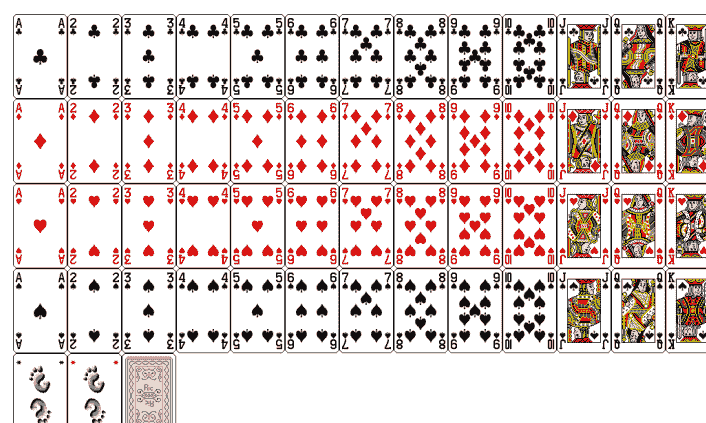

(此图来自 Gnome 桌面项目，http://www.gnome.org，在此处显示的尺寸比实际尺寸小得多。) 现在只需要一张图像（`Image`）。绘制一张卡牌意味着从图像中绘制一个矩形区域。这种技术用在第 6.6.6 节中示例程序`HighGUI.java`的变体中。在原始版本中，卡牌用文本描述（如“红心国王”）来表示。而在新版本`HighLowWithImages.java`中，卡牌以图像形式显示。你应该尝试这个程序，这里是卡牌显示的样子：

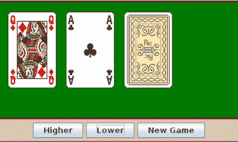

在程序中，卡片的图片是通过以下方法绘制的。实例变量`cardImages`是一个`Image`类型的变量，代表上方显示的图像，包含 52 张卡牌，外两张王牌和一张背面的卡牌。每张卡牌的大小为 79x123 像素。这些数字与卡牌的花色和数值一起使用，用于计算`drawImage()`命令的源矩形的角坐标：

```java
/**
 * 在 79x123 像素的卡牌图片中绘制卡牌，其
 * 左上角位于指定的点 (x,y)。绘制卡牌
 * 需要 "cards.png" 图像文件。
 * @param g 用于绘制卡牌的图形内容。
 * @param card 将要绘制的卡牌。如果值为 null，则绘制一张
 * 背面的卡牌。
 * @param x 卡牌左上角的 x 坐标
 * @param y 卡牌左上角的 y 坐标
 */
public void drawCard(Graphics g, Card card, int x, int y) {
    int cx;
    // 卡牌在 cardsImage 中左上角的 x 坐标
    int cy;
    // 卡牌在 cardsImage 中左上角的 y 坐标
    if (card == null) { // 背面卡牌的坐标
        cy = 4*123;
        cx = 2*79;
    }
    else {
        cx = (card.getValue()-1)*79;
        switch (card.getSuit()) {
            case Card.CLUBS:
                cy = 0;
                break;
            case Card.DIAMONDS:
                cy = 123;
                break;
            case Card.HEARTS:
                cy = 2*123;
                break;
            default: // 黑桃
                cy = 3*123;
                break;
        }
    }
    g.drawImage(cardsImage,x,y+79,x+123,cx,cy,cx+79,cy+123,this);
}
```

在本节中，我将告诉你如何将图像文件`cards.png`加载到程序中。

* *

除了从文件中加载图像外，还可以向离屏画布（off-screen canvas）绘制来创建图像。离屏画布可以用属于`BufferedImage`类的对象表示，该类定义在`java.awt.image`包中。`BufferedImage`是`Image`的子类，因此一旦你有了`BufferedImage`，就可以使用任何`g.drawImage()`方法将其复制到图形上下文中，就像处理任何其他图像一样。可以使用构造函数创建`BufferedImage`：

```java
public BufferedImage(int width, int height, int imageType)
```

其中`width`和`height`指定图像以像素为单位的宽度和高度，而`imageType`可以是`BufferedImage`中定义的几个常量之一。图像类型指定了每个像素颜色的表示方式。`imageType`的一个可能值是`BufferedImage.TYPE_INT_RGB`，它指定每个像素的颜色为 RGB 颜色，红、绿、蓝分量范围在 0 到 255 之间。图像类型`BufferedImage.TYPE_INT_ARGB`代表具有“透明度”的 RGB 图像。图像类型`BufferedImage.TYPE_BYTE_GRAY`可用于创建灰色图像，其中可能的颜色只有灰色调。

要在`BufferedImage`上绘制，你需要一个设置好在图像上进行绘制的图形上下文。如果`OSC`的类型是`BufferedImage`，那么方法

```java
OSC.createGraphics()
```

返回一个`Graphics2D`对象，可用于在图像上绘制。（`Graphics2D`是`Graphics`的子类。参见第 6.2.5 节和下一节。）

程序员可能想要在离屏画布上绘制有几个原因。其中之一仅仅是为了保留屏幕上显示的图像的副本。记住，在组件上绘制的图片可能会丢失，例如当组件调整大小时。这意味着你将根据需要重新绘制图片，反之，意味着要保留足够的信息以便能够重新绘制图片。实现此点的方法是在离屏画布中保留图片的副本。每当离屏需要重绘时，你只需要将离屏的内容复制到屏幕上。本质上是图片中的每一个像素。示例程序`PaintWithOffCanvas.java`是一个以此方式使用离屏画布的小型绘图程序。在这个程序中，用户可以绘制曲线、直线和形状：“工具”菜单允许用户选择绘制工具。稍后还会有一个“擦除（Eras）”工具。使用`BufferedImage`来存储用户的图片。当用户更改图片时，会进行更改，然后将图像复制到屏幕上。程序不会保留用户绘制的形状记录（你可以将其与第 7.3 节中的`SimplePaint.java`进行对比，在后者中，用户的绘图被记录为表示形状的对象的列表。）

你应该尝试在其他形状上方绘制一个矩形（`Rectangle`）。当你拖动鼠标时，矩形会从鼠标的起点延伸到当前位置。随着鼠标的移动，底层的图片似乎不受影响——画布的一部分被矩形覆盖，随着鼠标移动又被取消，并且它们仍然在那里。这意味着，在你拖动鼠标时显示的矩形实际上可以是离屏画布的一部分，因为向图像中绘制内容会改变图像中某些像素的颜色。之前的颜色不会存储在任何地方，并会永久性地丢失。事实上，当你绘制线、矩形或圆形时，不要直接绘制到离屏画布上。相反，不要在离屏画布绘制。只有当你释放鼠标时，离屏画布上的形状才变成永久。当你拖动鼠标时显示的矩形实际上是离屏画布的一部分，通过`paintComponent()`方法在面板上显示。画布由实例变量`OSC`表示，类型为`BufferedImage`。对于曲线、擦除、擦点工具，处理方式不同。通过`paintComponent()`方法在面板上显示。画布的大小可以通过调用面板的`getWidth()`和`getHeight()`来确定。当画布首次创建时，它会被背景颜色`fillColor`填充。这一切通过方法完成：

```java
/**
 * 此方法创建离屏画布并用当前填充颜色填充。
 */
```

```java
private void createOSC() {
    OSC = new BufferedImage(getWidth(), getHeight(), BufferedImage.TYPE_INT_RGB);
}
```

```java
Graphics osg = OSC.createGraphics();
osg.setColor(fillColor);
osg.fillRect(0,0,getWidth(),getHeight());
osg.dispose();
```

注意使用`OSC.createGraphics()`获取绘制所需的图形上下文。注意图形上下文在方法结束时被释放。当你创建图形上下文时，在使用完毕后将其释放是一个良好的习惯。那个时间是该方法的剩余部分。问题是面板的宽度和高度在面板对象构造后一段时间才设置。如果在构造函数中调用`createOSC()`，`getWidth()`和`getHeight()`将返回 0，我们无法获得正确尺寸的离屏图像。我在`PaintWithOffCanvas`中采取的方法是在`paintComponent()`方法第一次被调用时在其中调用`createOSC()`。在那时，面板的大小已经设置，但用户还没有机会绘制任何内容。记住这一点，你就准备好理解`paintComponent()`方法了：

```java
public void paintComponent(Graphics g) {
    /* 首先创建离屏画布，如果它还不存在。 */
    if (OSC == null)
        createOSC();
    /* 将离屏画布复制到面板。由于我们知道图像完全可用，g.drawImage() 的第四个参数“ImageObserver”可以让画布完全填充面板，不需要调用 super.paintComponent(g)。 */
    g.drawImage(OSC,0,0);
    /* 如果用户正在拖动鼠标绘制直线、圆形或矩形，则使用当前的绘制颜色在离屏画布上绘制绘制形状。（当用户绘制曲线或使用擦除、擦点工具时不进行此操作。） */
    if (dragging && SHAPE_TOOLS.contains(currentTool)) {
        g.setColor(currentColor);
        putCurrentShape(g);
    }
}
```

# 第 13 章 高级 GUI 编程

665

```
if (OSC == null || getWidth() != OSC.getWidth() || getHeight() != OSC.getHeight())
    createOSC();
```

当然，这将丢弃画布中包含的图片，除非在丢弃旧画布之前通过某种安排将图片从旧画布复制到新画布。

程序中另一个使用离屏画布（off-screen canvas）的地方是鼠标拖动操作，这在`mousePressed()`、`mouseDragged()`和`mouseReleased()`方法中处理。上面讨论了所实现的策略。在拖动操作结束和`mouseReleased()`方法时，形状会被绘制到离屏画布上。然而，当用户拖动时，形状所在的图像部分会被重新创建。`repaint()`方法在画布的图像上绘制用户正在创建的形状。而对于形状（曲线、涂抹和擦除），则直接对画布进行修改，并重绘该区域以使更改显示在屏幕上。（顺便提一下，程序使用了一个只绘制组件一部分的`repaint()`方法版本）。`repaint(x,y,width,height)`命令告诉系统绘制左上角为`(x,y)`且具有指定宽度和的矩形。这比重绘整个组件要快得多。如果你想查看具体实现，请看源码`PaintWithOffscreenCanvas`。

***

离屏画布的一个用途是双缓冲（double buffering）。在双缓冲中，离屏画布是屏幕上显示图像的精确副本：每当屏幕上的图片需要重新重绘时，新图片就会逐步绘制到离屏图像中。这可能需要一些时间。如果所有绘制工作都在屏幕上完成，用户将看到图像在绘制时发生闪烁。相反，长时间的绘制过程在离屏进行，然后将完成的图像快速复制到屏幕上。用户利用此来实现平滑、无闪烁的动画。

“双缓冲”一词源于“帧缓冲区”（frame buffer），它指的是存储屏幕上图像的内存。事实上，双缓冲使用了两个缓冲区。视频卡可以在屏幕上绘制任一缓冲区，并可以在两者之间瞬时切换。一个帧缓冲区用于为屏幕绘制新图像。视频卡用于在两个帧缓冲区之间进行切换。这不涉及内存复制。Java 中实现的双缓冲需要复制，这会花费一些时间，并且不是完全无闪烁。

在 Java 较旧的图形 API 中，双缓冲由程序员决定如何实现。在 Swing 中，双缓冲由系统自动处理，程序员不需要担心它。（可以在 Swing 中关闭这种自动缓冲，但很少有良好的理由这样做）

关于离屏画布的最后一点：创建它们还有另一种替代方法。`Component`类定义了一个实例方法，该方法可以在任何 GUI 组件对象中使用：

```
public Image createImage(int width, int height)
```

该方法创建一个具有指定宽度和高度的`Image`。你可以像使用`BufferedImage`一样将此图像作为离屏画布。事实上，你可以预期在现代版本的 Java 中，通过此方法返回的图像是一个`BufferedImage`。`createImage()`方法在`BufferedImage`类引入之前就是 Java 的一部分了。

## 13.1.2 使用像素

使用`BufferedImage`的原因之一是它可以轻松访问单个像素的颜色。如果图像类型为`BufferedImage`，那么我们拥有以下方法：

- `image.getRGB(x,y)`返回一个编码图像中坐标`(x,y)`处像素颜色的`int`。`x`和`y`的值必须在图像范围内。即必须满足`0 <= x <= image.getWidth()`且`0 <= y < image.getHeight()`；否则将抛出异常。

- `image.setRGB(x,y,rgb)`将坐标`(x,y)`处的像素颜色设置为编码`rgb`的颜色。同样，`x`和`y`必须在有效范围内。第三个参数`rgb`是编码颜色的整数。这些方法使用整数代码表示颜色。如果`c`的类型是`Color`，可以通过调用`c.getRGB()`获取颜色代码。反之，如果`rgb`是编码颜色的整数，可以通过构造函数`new Color(rgb)`获取相应的`Color`对象。这意味着你可以使用

```
Color c = new Color(image.getRGB(x,y))
```

来获取类型为`Color`的像素值，并且如果`c`的类型是`Color`，你可以将像素设置为该颜色：

```
image.setRGB(x, y, c.getRGB());
```

颜色的红、绿、蓝分量（RGB 分量）被表示为 8 位整数，范围从 0 到 255。当颜色被编码为`int`时，蓝色分量包含在`int`的低位中，绿色分量包含在接下来的八位中，红色分量包含在下一个八位中。（高位存储颜色的“alpha 分量”，我们将在下一节遇到它。）使用移位运算符`<<`和位逻辑运算符`&`和`|`很容易在这两种表示之间进行转换。（我在本书之前没有介绍过这些运算符。简而言之：如果`A`和`B`是整数，那么`A << B`是将`A`左移得到的整数；`A >> B`是将`A`右移得到的整数；`A & B`是通过位与运算得到的整数；`A | B`是通过位或运算得到的整数。）只有通过操作单个像素颜色才能实现的效果！以下是它的工作原理：当用户按下鼠标时，7x7 区域的颜色组件从离屏画布复制到名为`smudgeRed`、`smudgeGreen`和`smudgeBlue`的数组中。这在`mousePressed()`程序中通过以下代码完成：

```
w = OSC.getWidth();
int h = OSC.getHeight();
int x = evt.getX();
int y = evt.getY();
for (int i = 0; i < 7; i++) {
    for (int j = 0; j < 7; j++) {
        int r = y + j - 3;
        int c = x + i - 1;
        if (r < 0 || r >= h || c < 0 || c >= w) {
            // smudgeRed 数组中的 -1 表示
            // 像素在画布之外。
            smudgeRed[j] = -1;
        }
        else {
            int color = OSC.getRGB(c,r);
            smudgeRed[j] = (color >> 16) & 0xFF;
            smudgeGreen[j] = (color >> 8) & 0xFF;
            smudgeBlue[j] = color & 0xFF;
        }
    }
}
```

数组的类型是`double`是因为我要进行需要普通数字计算。当用户移动时，数组中的颜色会与图像中的颜色混合，就像用手指抹湿油漆一样。也就是说，图像中新的鼠标位置被当前图像颜色和数组中颜色的加权平均值所取代。这产生了部分颜色从之前的鼠标位置移动到新鼠标位置的效果。同时，数组中的颜色被数组中旧颜色和图像颜色的加权平均值取代。这产生了部分颜色从图像移动到数组的效果。这是对新鼠标位置周围 7x7 块中的每个像素位置`(c,r)`使用以下代码完成的：


```java
int curCol = OSC.getRGB(c,r);
int curRed = (curCol >> 16) & 0xFF;
int curGreen = (curCol >> 8) & 0xFF;
```

# 第 13 章 高级 GUI 编程

```java
int curBlue = curCol & 0xFF;
int newRed = (int)(curRed*0.7 + smudgeRed[i]*0.3);
int newGreen = (int)(curGreen*0.7 + smudgeGreen[i]*0.3);
int newBlue = (int)(curBlue*0.7 + smudgeBlue[i]*0.3);
int col = newRed << 16 | newGreen << 8 | newBlue;
OSC.setRGB(c,r,col);
smudgeRed[i] = curRed*0.3 + smudgeRed[i]*0.7;
smudgeGreen[i] = curGreen*0.3 + smudgeGreen[i]*0.7;
smudgeBlue[i] = curBlue*0.3 + smudgeBlue[i]*0.7;
```

## 13.1.3 资源

到目前为止，我们一直认为程序是由 Java 代码组成的。然而，程序经常会使用其他类型的数据，包括图像、声音，并作为其基本结构的一部分。这些数据被称为`资源`。例如，图像文件`cards.png`，它在本节之前的`HighLowWithImages.java`程序中被用过。这个文件是程序运行所需要的程序的一部分。程序的用户不需要知道这个文件是否存在，也不需要知道它位于何处；对于用户来说，它只是程序的一部分。当然，它不需要特殊的方法来定位资源文件并加载其数据。

资源通常存储在与程序类文件相同位置的文件中。类文件是由称为“类加载器”（class loader）的东西加载的，在 Java 中它由一个类型为`ClassLoader`的对象表示。类加载器拥有一个它将查找类文件的位置列表。这个列表被称为`类路径`（class path）。它包含了 Java 标准类。它通常包含当前目录。如果程序存储在`.jar`文件中，则该文件会被包含在类路径中。除了类文件外，`ClassLoader`还能找到位于类路径上或类路径子目录下的资源文件。

使用资源的第一步是获取一个`ClassLoader`并使用它来定位资源文件。在`HighLowWithImages.program`中，这是通过以下代码实现的：

```java
ClassLoader c1 = getClass().getClassLoader();
URL imageURL = c1.getResource("cards.png");
```

第一行的意图是获取一个类加载器；你必须请求一个由类加载器加载的类。这里，`getClass()`是代表实际类`HighLowWithImages`的对象的引用。`getClass()`方法是`Object`类中的一个实例方法，因此你可以配合`ClassName`使用它，其中`ClassName`是任何类的名称。例如，在本例中，我使用了`HighLowWithImages.class.getClass()`来获取该类。

代码的第二行使用`c`的类加载器的`getResource()`方法来定位资源文件`cards.png`。返回值类型为`java.URL`。如果找不到该资源，则返回`null`。该类在子章节第 14.4.1 节中讨论过。

资源并不直接存储在类路径上，而是存储在子目录中。在这种情况下，`getResource()`的参数必须是一个包含资源所在目录的路径。例如，假设图像文件`cards.png`位于名为`images`的目录中，而该目录又位于名为`resources`的目录下，且`resources`在类路径上。那么该文件的路径为`resources/images/cards.png`，定位该资源的命令为：

```java
URL imageURL = cl.getResource("resources/images/cards.png");
```

一旦你拥有了代表资源文件位置的`URL`，你就可以使用第 11.4.1 节中讨论过的`URLConnection`来读取该文件的内容。Java 提供了更方便的方法来加载类型的资源。对于加载图像，`java.awt.Toolkit`类提供了一个方便的方法。它可以在`HighWithImages`的以下行代码中使用，其中`cardsImages`是类型为`Image`的实例变量，而`imageURL`是代表图像位置的`URL`：

```java
cards = Toolkit.getDefaultToolkit().createImage(imageURL);
```

这并没有完全加载图像——那将在稍后发生，当`cardsImages`被用于`drawImage`命令时。另一种可以完全读取图像的技术是使用`ImageIO.read()`方法，该方法将在下文第 13.15 节中讨论。

声音代表了你可能想使用的另一种资源。由于某种原因，播放声音最简单的方法是使用`java.awt`包中`Applet`类的静态方法。

```java
public static AudioClip newAudioClip(URL soundURL)
```

由于这是一个静态方法，它可以在任何程序中使用，而是在 applet 中，通过调用`Applet.newAudioClip(soundURL)`来使用。参数是声音资源的`URL`，返回值类型为`java.applet.AudioClip`。一旦你获得了一个`AudioClip`，就可以调用它的`play()`方法从头开始播放所有音频片段。

这是一个尝试从音频资源文件加载并播放声音的方法：

```java
private void playAudioResource(String audioResourceName) {
    ClassLoader cl = getClass().getClassLoader();
    URL audioURL = cl.getResource(audioResourceName);
    if (audioURL != null) {
        AudioClip clip = Applet.newAudioClip(audioURL);
        clip.play();
    }
}
```

## 13.1.4 光标与图标

光标与 GUI 组件相关联。当鼠标移动到组件上时，光标会变为与之关联的内容。要将光标与组件关联，使用组件的实例方法`setCursor(cursor)`。例如，将`JPanel`的光标设置为标准的“等待”光标：

```java
panel.setCursor(Cursor.getPreCursor(Cursor.WAIT_CURSOR));
```

要将光标重置为默认，可以使用：

```java
panel.setCursor(Cursor.getDefaultCursor());
```

要将光标设置为位于图像资源文件的图像，你可能会使用：

```java
ClassLoader cl = getClass().getClassLoader();
URL resourceURL = cl.getResource(imageResource);
if (resourceURL != null) {
    Toolkit toolkit = Toolkit.getDefaultToolkit();
    Image image = toolkit.getImage(resourceURL);
    Point hotspot = new Point(7,7);
    Cursor cursor = toolkit.createCursor(image, hotspot, "mycursor");
    panel.setCursor(cursor);
}
```

示例程序`SoundAndCursorDemo.java`展示了如何从资源文件使用和定义光标。程序有多个可以点击的按钮。某些按钮改变与程序关联的光标。某些按钮播放声音。当你播放声音时，光标会重置为默认光标。

图像在 GUI 接口中的另一个用途是图标。图标仅仅是一个简单的图片。正如我们在第 13.3 节中看到的，图标可以用于 Java 的按钮、菜单项和标签；事实上，就其目的而言，图标是一个可以用这种方式使用的简单图像。

图标由类型为`Icon`的对象表示，该类型实际上是一个接口而不是类。`ImageIcon`类实现了`Icon`接口，用于从`Image`创建图标。如果`image`是一个（较小的）`Image`，那么构造函数`new ImageIcon(image)`会创建一个该指定图像的`ImageIcon`。通常，图标来自资源文件。我们将在本章后面看到相关的示例。

## 13.1.5 图像文件 I/O

`javax.image.ImageIO`类使得从程序将图像保存到文件以及从文件中读取图像变得简单。这对于像`PaintWithOffscreenCanvas`这样的程序非常有用，使用户能够保存他们的工作成果并编辑图像。（参见练习 13.1。）

图像数据有许多方式存储在文件中。为了实现这一目的，创建了许多标准格式。Java 至少支持三种图像格式：PNG、JPEG 和 GIF。（Java 的具体实现可能支持更多。）JPEG 是“有损”的，这意味着当你读取一个 JPEG 文件时，得到的图片只是保存时图像的近似值。图片中的某些信息已经丢失了。允许某些信息的丢失使得图像能够压缩成比通常需要少得多的比特。通常情况下，这种压缩效果非常好。它对于照片图像效果最好，对于简单绘图效果最差。相反，PNG 格式是“无损”的，这意味着图片是保存时图像的精确副本。PNG 文件经过了压缩，但不是以丢失信息的方式进行。这种压缩对于由大块均匀颜色组成的图像效果最好；GIF 是一种较老的格式，图像限制为 256 种颜色；它已经被 PNG 取代。

假设图像是（`image`、`format`、`file`）`ImageIO.write(image, format, file)`。

其中，`format`是一个指定文件图像格式的`String`，`file`是指定要写入文件的`File`对象。（关于`File`类的信息请参见子节 11.2.2。）格式字符串应该是`"PNG"`或`"JPEG"`，尽管可能支持其他格式。

`ImageIO.write()`是`ImageIO`类中的一个静态方法。它返回一个布尔值，如果图像格式不受支持则返回`false`。也就是说，如果指定的图像格式不受支持，图像将不会保存，但不会抛出异常。这意味着你应该始终检查返回值！例如：

```java
boolean hasFormat = ImageIO.write(image, format, selectedFile);
if ( ! hasFormat ) {
    throw new IOException(format + " format is not available.");
}
```

如果图像格式被识别，当尝试将数据发送到文件时，仍然可能抛出`IOException`。

通常，`ImageIO.write()`中使用的文件将由用户使用`JFileChooser`进行选择，正如子节 11.2.3 所示。这里是一个保存图像的典型方法。（在某些处将“this”作为参数假设该方法定义在`JComponent`的子类中）。

- 尝试将图像保存到用户选择的文件。`@param image`要保存到文件的`BufferedImage`；`@param format`图像的格式，可能是`"PNG"`或`"JPEG"`。

```java
private void saveFile(BufferedImage image, String format) {
    if (fileDialog == null) {
        fileDialog = new JFileChooser();
    }
    fileDialog.setSelectedFile(new File("image." + format.toLowerCase()));
    fileDialog.setTitle("Select File For Saved Image");
    int option = fileDialog.showDialog(this);
    if (option != JFileChooser.APPROVE_OPTION) {
        // 用户取消或点击了对话框的关闭框。
        File selectedFile = fileDialog.getSelectedFile();
        if (selectedFile.exists()) { // 询问用户是否替换文件。
            int response = JOptionPane.showDialog(null,
                "The file " + selectedFile.getName() +
                "\nDo you want to replace it?",
                "Confirm Save",
                JOptionPane.NO_OPTION,
                JOptionPane.WARNING_MESSAGE );
            if (response != JOptionPane.YES_OPTION)
                return; // 用户不替换文件。
        }
        try {
            boolean hasFormat = ImageIO.write(image, format, selectedFile);
            if (! hasFormat)
                throw new Exception(format + " is not available.");
        } catch (Exception e) {
            JOptionPane.showMessageDialog(this,
                "Sorry, an error occurred while trying to save image.");
            e.printStackTrace();
        }
    }
}
```

`ImageIO`类还有一个静态的`read()`方法，用于从文件中读取图像到程序中。

`ImageIO.read(inputFile)`接受一个`File`类型的值作为参数并返回一个`BufferedImage`。如果文件不包含以支持格式存储的图像，则返回`null`。在这种情况下不会抛出异常，因此你应该始终小心检查返回值。在尝试读取文件时也可能发生`IOException`。`read()`方法的另一个版本接受`InputStream`而不是文件作为参数，第三个版本接受一个`URL`。

在本节稍早些时候，我们遇到了另一种从 URL 读取图像的方法。其区别在于`ImageIO.read()`完全读取图像数据并将结果存储在`BufferedImage`中。另一方面，`createImage()`实际上并没有读取数据；它只是存储了图像的位置并等到以后使用图像时才处理。这样做的好处是`createImage()`方法本身可以非常快速地完成。另一方面，`ImageIO.read()`执行可能需要一些时间。

## 13.2 更精细的图形

`Graphics`类提供的`GRAPHICS COMMANDS`足够用于许多用途。然而，Java 的最新版本以`java.awt.Graphics2D`的形式提供了一个更大、更丰富的工具箱。我们在 6.2.5 节提到过`Graphics2D`并承诺在这里进一步讨论它。`Graphics2D`是`Graphics`的子类，所以你熟悉的所有的图形命令都可以用于`Graphics2D`。事实上，当你获取用于绘图的图形上下文时，它实际上是`Graphics2D`类型并可以进行类型转换以访问高级命令。此外，`BufferedImage`有一个实例方法`createGraphics()`，它返回一个`Graphics2D`类型的图形上下文。正如前面提到的，要在 Swing 组件中使用`Graphics2D`命令，可以使用：

```java
public void paintComponent(Graphics g) {
    super.paintComponent(g);
    Graphics2D g2 = (Graphics2D)g;

    // 使用 g2 绘图
}
```

注意，当你使用`g`和`g2`时，它们是指向同一个对象的两个变量，因此它们绘制到同一个表面并具有相同的状态。当更改`g2`的属性（如绘制颜色）时，更改也会应用于`g`。通过说：

```java
Graphics2D g2 = (Graphics2D)g.create();
```

你可以获得一个新的图形上下文。由`g.create()`创建的对象是一个初始具有与`g`所有属性的图形上下文。但是它是一个独立的对象，因此更改`g2`的属性对`g`没有影响。如果你想保留一个未修改的原始图形上下文副本用于某些绘制操作，这将非常有用。（在这种情况下，完成后调用`g2.dispose()`来释放新上下文是一个良好的习惯。）

### 13.2.1 文本测量

尽管本节主要关于`Graphics2D`，但我们从一个与其无关的话题开始。


通常情况下，在绘制字符串时，知道字符串的大小是非常重要的。例如，如果你需要这些信息在组件中居中显示字符串。或者，如果你想知道在两行文本之间留出多少空间（当你把一行画在另一行上方时）。或者用户正在输入字符串，你想将光标放置在字符串末尾。在 Java 中，关于字体的问题可以通过属于标准类`java.awt.FontMetrics`的对象来回答。

任何给定的字体与多个长度相关。其中一些在图中所示：

# 第 13 章 高级 GUI 编程

图中的虚线是两行文本的基线（baseline）。字符串的基线是字符底部所停留的线。对于单倍行距文本，建议的基线间距被称为字体的行高（lineheight）。上升部（ascent）是高大字符超出基线之上的距离，而下降部（descent）是像字母 "g" 这样的尾部延伸到基线以下的距离。上升部和下降部之和并不等于行高，因为在这一行的字符顶部和上一行字符的尾部之间会有一些额外的空间。这个额外空间被称为行距（leading）。术术源于使用铅块进行印刷的时代。字符刻在铅块上，这些铅块排列成一页纸的文本，涂上墨水并按在纸上以打印页面。额外的“行距”用于分隔字符行。所有这些数值都可以通过调用`FontMetrics`对象的实例（instance）来确定。此外还有用于确定字符宽度和字符串总宽的方法。

回想，字体由`Font`类表示。`FontMetrics`对象与特定的字体关联，用于测量字体中的字符和字符串。如果`font`是某种类型且`g`是一个字符，你可以通过`g.getMetrics()`获取该字体的`FontMetrics`对象。如果`fm`是指向`Font`对象的变量，可以通过调用`fm.getAscent()`、`fm.getDescent()`和`fm.getHeight()`获取字体的上升部、下降部和行高。如果`ch`是一个字符，`fm.charWidth(ch)`是在该字体中绘制的字符宽度。对于字符串`str`，`fm.stringWidth(str)`是在该字体中绘制的字符串宽度。例如，这里有一个`paintComponent()`方法，它在组件中心显示消息 "Hello World"：

```java
public void paintComponent(Graphics g) {
    super.paintComponent(g);

    int strWidth,strHeight; // 字符串的宽度和高度。
    int centerX,centerY; // 组件中心点的坐标。
    int baseX, baseY; // 字符串基线的坐标。
    int topOfY; // 顶部的 y 坐标。

    centerX = getWidth() / 2;
    centerY = getHeight() / 2;

    Font font = g.getFont(); // g 将绘制什么字体？
    FontMetrics fm = g.getMetrics(font);
    strWidth = fm.stringWidth("Hello World"); // 注意：字符串中的字符
    strHeight = fm.getAscent(); // 没有尾部！所以我们
                                // 不需要考虑下降部。

    baseX = centerX - (strWidth/2); // 从中心向后移动字符串宽度的一半。
    topOfY = centerY - (strHeight/2); // 字符串的高度。
    baseY = topOfY + fm.getAscent(); // 基线在字符串顶部下方
                                     // fm.getAscent() 像素处。

    g.drawString("Hello World", baseX, baseY); // 绘制字符串。
}
```

在这个方法中，字符串的高度我`fm.getAscent()`。如果我画 "Goodbye World" 而不是 "Hello World"，我将使用`fm.getAscent() + fm.getDescent()`，其中下降部被加入高度中以考虑到 "Goodbye" 中 "v" 的尾部。`baseX`的值计算为组件左边缘到字符串起始点之间的空间。它是通过从组件中心减去字符串宽度的一半得到的。下一行以相同的方式计算字符串的位置。然而，为了绘制字符串，我们需要基线的 y 坐标，而不是字符串顶部的 y 坐标。字符串的基线位于顶部下方，距离等于字体的上升部。

在示例程序`TransparencyDemo.java`中有一个将两行文本块居中的示例，这将在下一个小节中讨论。

### 13.2.2 透明度

颜色由红、蓝、绿分量表示。在 Java 的通常表示中，每种颜色都是 0 到 255 范围内的八位整数。这三个颜色分量可以封装进 32 位整数中，但这只占了整数的 24 位。其他位呢？它们不需要浪费。它们可以用颜色的第四个分量，即 Alpha 通量（alpha component）。Alpha 通量有多种用法，但最常与透明度相关。当你使用透明颜色绘制时，就像铺了一层彩色玻璃。它不会完全遮挡图像覆盖的部分。相反，背景与用于绘制彩色玻璃的背景混合。这种绘制类型被称为 Alpha 混合（alpha blending），它并不等同于透明度；尽管如此，大多数人更喜欢它而不是透明度。

Alpha 通量的值决定了颜色的透明程度。实际上，Alpha 通量给出颜色的不透明度。不透明度是透明度的反面。如果某东西完全不透明，你完全无法看到它；如果某东西轻不透明，那么它只有一点透明，以此此类推。当颜色的 Alpha 通量具有最大值时，颜色完全不透明。当你用完全不透明的颜色绘制时，它只是替换了图像的颜色。（注：原文此处存在大量重复段落，翻译已按要求处理核心逻辑）。

# 第 13 章 高级 GUI 编程

```
g2.dispose();
Point hotSpot = new Point(12,12);
Toolkit tk = Toolkit.getDefaultToolkit();
Cursor cursor = tk.createCustomCursor(image,hotSpot,"square");
setCursor(cursor);
```

## 13.2.3 抗锯齿

要绘制像线或圆这样的几何图形，你只需要为该图形包含的像素上色吗？实际上，这存在一个问题。像素是小正方形，而几何图形是由完全没有尺寸的几何点组成的。想象画一个圆，考虑圆边界上的一个像素。圆的无限几何边界穿过了该像素。像素的一部分在圆内，另一部分在圆外。所以，当我们为圆填充颜色时，我们是否应该给该像素上色呢？一种可能的解决方案是：如果几何图形覆盖了像素的 50% 或更多，则给该像素上色。遵循这种程序会导致一种被称为**锯齿（aliasing）**的视觉缺陷。在图像中，它表现为曲线形状边缘的锯齿状或“阶梯状”效果。非水平或垂直的线也会呈现锯齿状外观。“锯齿”一词似乎是指许多不同的点映射到同一个像素的事。如果你将几何点的实数坐标视为包含它的像素的“名称”，那么每个像素都有许多不同的“锯齿”名称。

用正方形构建一个圆是不可能的，但有一种技术可以消除图像锯齿状的问题。这种技术就被称为**抗锯齿（antialiasing）**。抗锯齿基于透明度。其原理是：如果你试图绘制的几何图形覆盖了像素的 50%，则用具有 50% 透明度的颜色为该像素上色。如果覆盖了像素的 25%，则使用透明度为 75% 的颜色（25% 不透明）。如果整个像素被图形覆盖，当然使用 100% 不透明的颜色——抗锯齿只影响那些仅被几何形状覆盖的像素。

在抗锯齿中，你所绘制的颜色将与像素的原始颜色混合，混合的取决于几何形状覆盖像素的比例。（该比例很难精确计算，因此在实践中使用了各种方法来近似它。）当然，你并不能获得精确的几何形状，但抗锯齿后的图像通常看起来比锯齿状、有锯齿的图像更好。

例如，看下一个小节中的图片。抗锯齿被用于绘制图片第二行和第三行的面板，但在第一行没有使用。你应该注意到第一行线条的锯齿状外观。（顺便提一下，当抗锯齿应用到线时，该线被视为一个宽度等于线宽的几何矩形。）

`Graphics2D`支持抗锯齿。默认情况下，抗锯齿是关闭的。如果`g2`是你的`Graphics2D`图形类型，你可以通过说以下代码在`g2`中开启抗锯齿：

```
g2.setRenderingHint(RenderingHints.VALUE_ANTIALIAS_ON);
```

如你所见，这只是一个表示你想使用抗锯齿的“提示（hint）”，提示可能会被忽略。然而，`g2`中随后的绘制操作很可能会经过抗锯齿。如果你想在`g2`中关闭抗锯齿，应该：

```
g2.setRenderingHint(RenderingHints.KEY_ANTIALIASING,
RenderingHints.VALUE_ANTIALIASING);
```

## 13.2.4 笔画（Strokes）与填充（Paints）

当使用`Graphics`类时，你绘制的任何线都将是实线或单像素宽的。`Graphics2D`类使得绘制更多类型的线条成为可能。你可以绘制任何厚细的线，也可以绘制点线或虚线而不是实线。

类型为`Stroke`的对象包含了关于线条如何绘制、线条应该有多厚以及应该使用什么种划线和圆点模式的信息。`Graphics2D`有一个关联的`Stroke`对象。默认的`Stroke`绘制具有特定厚度的实线。要获得具有不同属性的线，你只需要向图形上下文安装不同的 stroke。

`Stroke`是一个接口。实现`Stroke`接口的`BasicStroke`类才是实际用于创建 stroke 对象的。例如，创建一个绘制 own为3 的实线的 stroke：

```
BasicStroke line3 = new BasicStroke(3);
```

如果`g2`是`Graphics2D`类型，可以通过调用其`setStroke()`命令将 stroke 安装到`g2`中：

```
g2.setStroke(line3)
```

调用此方法后，随后的绘制操作将使用比通常厚度宽三倍的线。线条的厚度可以用`float`类型的值给出，而不仅仅是`int`。例如，要在图形上下文`g2`中使用厚度为 2.5 的线，你可以说：

```
g2.setStroke(new BasicStroke(2.5F));
```

（如果开启了抗锯齿，分数宽度是有意义的）当你画一条粗线时，问题出现了：线条末端该怎么办？如果你用大圆粉笔画物理线，线条的末端将是圆形的。当你在计算机上画线时，线条的末端也是圆形的。当你使用`BasicStroke`类时，选择取决于你。中间行显示了圆端；其他行仅仅是切断的。

img/c6d9def0221ff34e92ca72a380402b2_689_0.png

`StrokeDemo.java`。在那个程序中，你可以点击并拖动任何小面板，随着鼠标的移动，所有面板中的线条都会重新绘制。

为`BasicStroke`需要的所有选项都必须在构造函数中指定。stroke 对象创建后没有方法更改选项。有一个构造函数可以让你详细指定所有选项，这里是一些基本信息：

```
public BasicStroke(float width
```

我不想详细介绍所有选项，这里是一些基本信息：

- width：指定线条的厚度

- capType：指定线条末端如何“封口”。可能的值有`BasicStroke.CAP_SQUARE`、`BasicStroke.CAP_ROUND`和`BasicStroke.CAP_BUTT`。这些值分别用于上述图片的第一、第二和第三行。默认是`BasicStroke.CAP_SQUARE`。

- joinType：指定两条线如何连接。可能的值有`BasicStroke.JOIN_MITER`、`BasicStroke.JOIN_ROUND`和`BasicStroke.JOIN_BEVEL`。再次，这些被用于示例程序中的三个面板；只有当你运行程序并绘制一些矩形时才能看到效果。默认是`BasicStroke.JOIN_MITER`。

- miterLimit：仅当 joinType 的值为`JOIN_MITER`时使用；直接使用默认值 10.0。

- dashPattern：用于指定虚线和点线。数组中的值指定划线/模式的长度。数组中的模式代表实部分的长度，然后是透明部分的长度，然后是实部分的长度，以此此类推。在数组末尾，模式会绕回数组开头。如果你想要实线，请使用参数较少的其他构造函数。

- dashPhase：告诉计算机从`dashPattern`数组的哪个位置开始线条的第一段。在大多数情况下，对该参数使用 0。

# 第 13 章 高级 GUI 编程

在上面的图中第三行，`dashPattern`被设置为`new float[] {5,5}`。这意味着线条是用长度为 5 的实线线段绘制的，紧接着是长度为 5 的透明区域，然后重复该模式。一个简单的点线粗细为 1 且`dashPattern`为`new float[]{1,1}`。短划线交替的模式可以通过`new float[]{10,4,4}`来实现。更多信息，请参阅 Java 文档，或对示例程序的源代码进行实验。

现在我们可以绘制栅栏了。但任何绘制操作都限制为使用单一颜色绘制。我们可以通过使用`Paint`来突破这一限制。`Paint`类型的对象用于为绘制操作“命中”的每个像素分配颜色。`Paint`是一个接口，而`Color`实现了`Paint`接口。当使用某种颜色进行绘制时，它会对每个命中的像素应用相同的颜色。然而，还有其他类型的绘制，其颜色应用到像素取决于绘制的坐标。标准库包含了几个定义此类类型绘制的类：`Texture`和几种类型的渐变。在纹理中，像素颜色会在需要时重复，像墙纸一样覆盖整个面板。在渐变中，应用到像素的颜色随着你从一个点移动到另一个点而逐渐变化。Java 有三种类型的渐变绘制：`GradientPaint`、`LinearGradientPaint`和`RadialGradientPaint`。

查看一些示例将会有帮助。此图显示了一个使用两种不同绘制方式的多边形。左侧的多边形使用`GradientPaint`，而右侧使用`TexturePaint`。注意在幅图中，绘制方法仅用于填充多边形。多边形的轮廓是用黑色绘制的。然而，`Paint`对象可以用于绘制线条也可以用于填充形状。这些图片是由示例程序`PaintDemo.java`创建的。在程序中，你可以在几种不同的绘制方法之间选择，并控制绘制方法的某些属性。

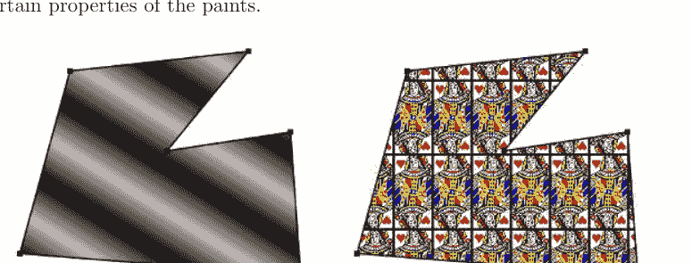

基础渐变绘制是通过构造函数创建的：

```
public GradientPaint(float x1, float y1, Color c1,
float x2, float y2, Color c2, boolean cyclic)
```

这构造了一个在坐标 (x1,y1) 处具有颜色 c1，在 (x2,y2) 处具有颜色 c2 的渐变。当你沿着两点之间的直线移动时，渐变颜色沿着垂直于该直线的线从 c1 变为 c2，在该方向上颜色是恒不变的。最后一个参数`cyclic`决定了如果在从 (x1,y1) 到 (x2,y2) 的直线上移动到 (x2,y2) 时会发生什么。如果`cyclic`为`false`，颜色停止变化，(x2,y2) 之后的任何点都具有颜色 c2。如果`cyclic`为`true`，当你越过另一个端点 (x1,y1) 之后，颜色将以循环模式继续变化。在大多数情况下，你会将`cyclic`设置为`true`。注意，你可以改变点 (x1,y1) 和 (x2,y2) 来改变渐变的宽度和方向。例如，要创建一个沿从 (0,0) 到 (100,100) 直线从黑色变为浅灰色的渐变，使用：

```
new GradientPaint(0, 0, Color.BLACK, 100, 100, Color.LIGHT_GRAY, true)
```

另外两个渐变绘制类`LinearGradientPaint`和`RadialGradientPaint`更为复杂。线性渐变绘制基于`GradientPaint`，但可以基于两种以上的颜色。径向渐变根据像素距离中心点的距离来着色，但在恒定颜色线上产生恒定颜色的圆环。详情请参考 API 文档：

* *

要构造一个`TexturePaint`，你需要一个包含要绘制图像的`BufferedImage`。如果你指定一个矩形来恰好填充该矩形，图像将被缩放。在指定的矩形之外，图像将在水平和垂直方向上重复到整个平面上。你可以改变纹理的大小和位置，以改变纹理的比例及其在平面上的定位。然而，通常情况下矩形的上角放置在 (0,0)，矩形的大小与图像的实际尺寸相同。`TexturePaint`的构造函数定义为：

```
public TexturePaint(BufferedImage image, Rectangle2D anchor)
```

`Rectangle2D`类是`Graphics2D`框架的一部分，将在本节末尾讨论。调用构造函数的形式如下，它将以其实尺寸显示图像：

```
new TexturePaint(image, new Rectangle2D.Double(0,0,image.getWidth(),image.getHeight()))
```

一旦你有了`Paint`对象，就可以使用`Graphics2D`对象的`setPaint()`方法将绘制安装到图形环境中。例如，如果`g2`是`Graphics2D`类型，那么命令：

```
g2.setPaint(new GradientPaint(0,0,Color.BLUE,100,100,Color.GREEN,true));
```

将设置`g2`使用渐变绘制。使用`g2`进行的后续绘制操作将使用蓝色/绿色渐变进行绘制。

## 13.2.5 变换与形状


在组件的标准绘制坐标中，组件的左上角坐标为`(0,0)`。整数就是整数，坐标`(x,y)`指的是距离组件左边缘`x`像素、距离顶部`y`像素的点。然而，使用`Graphics2D`，你并不局限于使用这些坐标。事实上，你可以建立一个最适合你想要绘制的内容的`Graphics2D`图形系统。例如，如果你正在绘制建筑蓝图，你可能会使用一个单位代表绝对英尺的坐标。

坐标系的变化被称为变换（transforms）。变换有三种类型。平移变换（translate transform）改变原点`(0,0)`的位置。缩放（scale）改变比例，即距离单位。旋转变换（rotation transform）则绕某些点应用旋转。你可以通过组合这三种基本类型的变换来创建更复杂的变换。例如，你可以应用旋转，然后是缩放，然后是平移，最后是旋转。当你连续应用变换时，它们的效应是累积的。完全理解复杂的变换需要大量的学习，而且变换是计算机图形课程中的一个主要课题。我将限制在讨论几个简单的案例上，只需让你对变换能做什么有一个直概念。

假设`g2`是`Graphics2D`类型。那么`g2.translate(x,y)`将原点`(0,0)`移动到点`(x,y)`。这意味着如果你在说你引用的是变换前使用的`(x,y)`点之后再使用坐标`(0,0)`，那么所有其他坐标对都移动了相同的距离。例如：

```java
g.translate(x,y);
g.drawLine( 0, 0, 100, 200 );
```

绘制的线条与以下相同：

```java
g.drawLine( x, y, x+100,y200 );
```

# 第 13 章：高级 GUI 编程

旋转并不像平移或缩放那样常见，但有几项操作是无法通过其他方式完成的。例如，你可以用它在“倾斜”方向绘制图像。旋转还使得绘制旋转文本成为可能，使其基线变为倾斜或垂直。要绘制基点在`(x,y)`且以 30 度角上升的字符串`"Hello World"`，请使用以下代码：

```java
g2.rotate(-30 * Math.PI / 180, x, y);
g2.drawString("Hello World", x, y );
```

如果想绘制该消息，并使其基线中心位于点`(x,y)`，我们可以使用`FontMetrics`来测量字符串，并执行如下操作：

```java
FontMetrics fm = g2.getMetrics(g2.getMetrics());
int baselineLength = fm.stringWidth("Hello World");
g2.rotate(-90 * Math.PI / 180, x, y);
g2.drawString("Hello World", x - baselineLength/2, y );
```

`Graphics`类中的绘制操作使用整数坐标。而`Graphics2D`使得使用真实坐标成为可能。这在你开始使用时尤为重要，因为在应用缩放变换后，大小为一的正方形将覆盖许多像素，而不仅仅是单个像素。遗憾的是，Java 的设计者无法决定使用`float`还是`double`，他们的决定导致了比需要的稍微复杂了一些。（我猜他们其实想用`float`，因为`float`值的精度对于图形来说足够，并用于计算机底层的图形计算。在 Java 编程中，使用`double`更容易，所以他们也想使用`double`值。）

要使用真实坐标，你必须使用`java.awt.geom`包定义的类。在该包的类中，有些表示几何形状，如线和矩形。例如，`Line2D`类表示一条端点为真实坐标的直线。遗憾的是，`Line2D`是一个抽象类，这意味着你不能直接创建`Line2D`对象。然而，`Line2D`有两个可以创建对象的具体子类。一个使用`float`坐标，另一个使用`double`坐标。最奇妙的部分是，这些类被定义为`Line2D`内部的静态嵌套类。它们的名字为`Line2D.Float`和`Line2D.Double`。这意味着可以创建`Line2D`对象，例如：

```java
Line2D1 = new Line2D.Float(0.17f, 1.3f, -7.2f, 5.21f);
Line2D2 = new Line2D.Double(0, 0, 1, 0);
Line2D3 = new Line2D.Double(x1, y1, x2, y2);
```

其中`x1, y1, x2, y2`是任意数字。在我的代码中，我通常使用`Line2D.Double`而不是`Line2D.Float`。

`java.awt.geom`中的其他形状也是类似的。表示矩形的类是`Rectangle2D`。要创建一个矩形对象，你必须使用`Rectangle2D.Double`或`Rectangle.Double`。例如：

```java
Rectangle2D rect = new Rectangle2D.Double(-0.5, -0.5, 1.0, 1.0 );
```

这创建了一个角点位于`(-0.5,-0.5)`的矩形，宽度和高度均为 1。其他类还包括表示单个点的`Point2D`、表示椭圆的`Ellipse2D`以及表示圆弧的`Arc2D`。

如果`g2`的类型为`Graphics2D`且`shape`是属于某个 2D 形状类之一的对象，那么命令：

```java
g2.draw(shape);
```

将绘制该形状。对于内部的矩形或椭圆等形状，只会绘制轮廓。要填充此类形状的内部，请使用：

```java
g2.fill(shape)
```

例如，绘制从`(x1,y1)`到`(x2,y2)`的直线，使用：

```java
g2.draw(new Line2D.Double(x1,y1,x2,y2));
```

以及绘制一个角点在`(3.5,7)`、宽度为 5、高度为 3 的矩形，使用：

```java
g2.fill(new Rectangle2D.Double(3.5, 7, 5, 3));
```

`java.awt.geom`包有一个非常好的类`Path2D`，可以绘制由任意数量点定义的多边形和曲线。如果你想知道如何使用它，请查看 Java 文档。

本节向你介绍了`Graphics2D`的许多有趣特性，但仍有大部分`Graphics2D`框架等待你去探索。

## 13.3 Actions 与 Buttons

在过去的两个章节中，我们查看了 Java 图形 API 的较高级方面。但大多数图形用户界面编程的核心是使用 GUI 组件。在本节中，我们将查看`JComponents`。我们将涵盖第 6 章中未涵盖的所有组件类，以及那些已涵盖组件的一些额外功能。

本节关于按钮。按钮是 GUI 组件中最简单的组件之一，尽管看起来似乎不应该包含所有的它们。（注：原文此处存在大量重复段落，翻译时已按逻辑精简并保留核心内容。）

本节关于按钮……`Action`接口是一组方法，用于表示可以执行的每一个动作。例如：

```java
public void actionPerformed(ActionEvent evt)
}
```

一旦你有了一个动作，你就可以在按钮的构造函数中使用它。例如，对于上面定义的动作，我们可以创建：

```java
JButton clearButton = new JButton ( clearAction );
```

动作名称将用作按钮的文本，按钮的其他一些属性将从动作中获取。例如，如果动作的`SHORT_DESCRIPTION`属性有值，则该值将作为按钮的工具提示（tooltip）（当用户悬停在按钮上时会显示工具提示）。此外，当你更改动作的属性时，按钮相应的属性也会发生变化。例如，更改与键`NAME`关联的`Action`属性也会更改按钮上的文本。

`Action`接口定义了一个`setEnabled`方法，用于启用和禁用动作。可以通过调用`clearAction.setEnabled(false)`来禁用或启用`clearAction`。当你这样做时，任何从该动作创建的按钮也会被启用或禁用。

当然，问题是，为什么要使用`Actions`呢？一个优势是使用动作可以帮助你更好地组织代码。你可以创建单独的对象来表示程序中可以执行的每一个动作。这代表了良好的职责分工。当然，你也可以通过单个`ActionListener`对象实现相同的功能，但那样你就无法将描述和其他属性与动作关联。

更重要的是，`Actions`还可以用于 Java API 中的其他地方。你可以像创建`JButton`一样使用动作来创建`JMenuItem`：

```java
JMenuItem menuCommand = new JMenuItem ( clearAction );
```

`JMenuItem`是一种按钮，与`JButton`共享许多属性。每当你启用或禁用动作或更改其名称时，按钮和菜单项都会保持同步。

在创建按钮或菜单项后对其进行跟踪。你可以通过操作`Action`对象完成你需要的所有工作。

顺便说一下，如果你想将由`Action`定义的菜单项添加到菜单中，你甚至不需要自己创建`JMenuItem`。你可以直接将 action 添加到菜单中，菜单项将根据 action 的属性创建。例如，如果`menu`是一个`JMenuItem`且`clearAction`是一个`Action`，你只需要说`menu.add(clearAction)`。`Action`还有我们在本节中会遇到的其他有用属性。

### 13.3.2 按钮上的图标

除了文本之外，按钮也可以显示图标。图标由`Icon`接口表示，通常如第 13.1.4 节讨论的那样作为`Icons`创建。例如，这里有一个显示大“X”作为图标的按钮图片：


可以通过调用按钮的`setIcon()`方法，或者在创建按钮时将图标对象作为参数传递给构造函数来设置按钮的图标。为了创建上述按钮，我从一个`BufferedImage`创建了一个`ImageIcon`，在上面绘制了我想要使用的图片，并使用一个同时接受按钮文本和图标作为参数的构造函数创建`JButton`。以下是实现该操作的代码：

```java
BufferedImage image = new BufferedImage(24,24,BufferedImage.TYPE_INT_RGB);
Graphics2D g2=(Graphics2D)image.getGraphics();
g2.setColor(Color.GRAY); // 为图标绘制背景图像。
g2.fillRect(0,0,24,24);
g2.stroke(new BasicStroke(3)); // 使用粗线。
g2.setColor(Color.BLACK);
g2.drawLine(4,4,20,20); // 绘制 "X"
g2.drawLine(20,4,4,20);
g2.dispose();
```

```java
Icon clearIcon = new ImageIcon(image); // 创建图标。
JButton clearButton = new JButton("Clear Display", clearIcon);
```

你可以使用仅接受图标作为参数的构造函数来创建一个带有图标但没有文本的按钮。另一种方法是从`Action`中获取其图标。当按钮从 action 构建时，它会从 action 属性`Action.SMALL_ICON`的值中获取图标。假设你想用 action`clearAction`来创建上述按钮。可以这样做：

```java
clearAction.setValue(Action.SMALL_ICON, clearIcon);
JButton clearButton = new JButton(clearAction);
```

你也可以通过将图标作为参数传递给`AbstractAction`的构造函数来与 action 关联：

```java
clearAction = new AbstractAction("Clear the Display", clearIcon) {
  public void actionPerformed(ActionEvent evt) {
    // 执行操作。
  }
}

JButton clearButton = new JButton(clearAction);
```

`Action`的`SMALL_ICON`也会被由 action 创建的`JMenuItem`使用。（action 也可以有一个与键 action`Action.LARGE_ICON_KEY`关联的图标。如果是这样，`JButton`将优先使用“大”图标而不是“小”图标。然而，`JMenuItem`只会使用小图标。）

按钮的外观可以通过许多方式进行调整。例如，你可以更改按钮与其文本之间的间隙大小。你可以与按钮关联额外的图标，这些图标在按钮处于某些状态时使用，例如当它被按下或禁用时。甚至可以实现文本相对于图标的居中对。例如，要将文本居中放置在图标下方，可以使用：

```java
button.setHorizontalTextPosition(JButton.CENTER);
button.setVerticalTextPosition(JButton.BOTTOM);
```

# 第 13 章：高级 GUI 编程

当复选框未勾选时显示一个，当被选中时显示另一个。你可以通过用不同的图标替换标准图标来更改复选框的外观。

复选框未勾选时显示的图标只是`JCheckBox`的主图标。你可以在构造函数中提供默认的未勾选图标，也可以使用`JCheckBox`对象的`select()`方法更改图标。要更改复选框被选中时显示的图标，请使用`JCheckBox`的`setSelectedIcon()`方法。这些同样适用于`JRadioButton`、`JCheckBoxMenu`和`JRadioButtonButtonMenu`。

可以在示例程序`barDemo.java`中找到此方面的示例，该程序下一节中描述。该程序创建了一组使用自定义图标的按钮。可以通过以下方法创建这些按钮：

- 创建一个`JRadioButton`并将其添加到指定的按钮组中。该按钮用于选择显示器的绘制颜色。使用该颜色来创建自定义图标，一个用于按钮的未选中状态，另一个用于选中状态。这些图标将取代普通的单选框图标。
- `@param c`按钮的颜色，以及用于绘制的颜色。
- （注意`c`必须是`final`，因为它被用于定义对按钮`ActionEvents`响应的匿名内部类。）
- `@param group`按钮将被添加到的组。
- `@param selected`如果为`true`，则将按钮状态设置为选中。
- `@return`创建的按钮；抱歉，这个按钮并不像我希望的那么漂亮！


```java
private JRadioButton makeColorRadioButton(Color c, ButtonGroup grp, boolean selected) {
    /* 创建一个按钮正常、未选中状态的 ImageIcon，
       使用从头开始绘制的 BufferedImage。 */
    BufferedImage image = new BufferedImage(30,30,BufferedImage.TYPE_INT_RGB);
    Graphics g = image.getGraphics();
    g.setColor(Color.LIGHT_GRAY);
    g.fillRect(0,0,30,30);
    g.setColor(Color);
    g.fill3DRect(1, 1, 24, 24, true);
    g.dispose();
    Icon unselectedIcon = new ImageIcon(image);

    /* 创建一个按钮选中状态的 ImageIcon。 */
    image = new BufferedImage(30,30,BufferedImage.TYPE_INT_RGB);
    g = image.getGraphics();
    g.setColor(Color.DARK_GRAY);
    g.fillRect(0,0,30,30);
    g.setColor(Color);
    g.fill3DRect(3, 3, 24, 24, false);
    g.dispose();
    Icon selectedIcon = new ImageIcon(image);

    /* 创建并配置按钮。 */
    JRadioButton button = new JRadioButton(unselectedIcon);
    button.setSelected(selectedIcon);
```

```java
button.addActionListener(new ActionListener() {
    public void actionPerformed(ActionEvent e) {
    // 通过此操作将显示器中的当前绘制颜色
    // 设置为 c。
    display.setCurrentColor(c);
    }
}
grp.add(button);
if (selected) {
    button.setSelected(true);
}
return button;
// end makeColorRadioButton
```

可以从 `Action` 创建单选按钮和复选框——包括普通排序和响应菜单项。按钮或复选框从 `Action` 中获取其名称、主图标、提示文本和启用/禁用状态。当用户更改状态时，会调用 `action.ActionPerformed` 方法。

此外，`Action` 有一个属性 `Action.SELECTED_KEY`，这意味着 `Action` 本身可以有一个选中状态。默认情况下，`SELECTED_KEY` 的值为 `null` 且不用于任何地方。但是，你可以通过调用 `action.put(Action.SELECTED_KEY, true)` 或 `action.put(Action.SELECTED_KEY, false)` 将值设为 `true` 或 `false`。

一旦你这样做，`SELECTED_KEY` 属性与从 `Action` 创建的任何复选框或单选按钮的选中状态将保持同步。你可以通过 `action.getValue(Action.SELECTED_KEY)` 获取该属性的当前值。注意属性的值类型为 `Boolean`。`action.getValue()` 的返回类型为 `Object`，所以你可能需要将返回值强制转换为 `Boolean`。

Java 还有另一个允许用户从一组选项中选择的组件。`JComboBox` 包含项目列表，但只显示当前选中的项目。用户点击组合框显示弹出选项列表，然后从列表中进行选择。其功能是提供一组单选按钮。

`JComboBox` 是一个参数化框，其中类型参数指定了该组合框可以包含的类型。大多数项目都是字符串，类型为 `JComboBox<String>`。这是我唯一将讨论的。当 `JComboBox<String>` 对象首次被构造时，它不包含任何项目。通过调用组合框的实例方法 `addItem(str)` 向选项列表添加项目，其中 `str` 是将在菜单中显示的字符串。

例如，下面的代码将创建一个类型为 `JComboBox` 的对象，其中包含 Red、Blue、Green 和 Black 选项：

```java
JComboBox<String> MacOS = new JComboBox<String>();
Actually.addItem("Red");
colorChoice.addItem("Blue");
colorChoice.addItem("Green");
colorChoice.addItem("Black");
```

你可以调用 `JComboBox` 的 `getSelectedIndex()` 方法来查找当前选中了哪个项目。该方法返回一个整数，给出被选中项目在列表中的位置，项目从零开始编号。或者，你可以调用 `getSelectedItem()` 来获取选中的项目本身。（当项目局限于字符串时，此方法返回 `Object` 类型的值。）你可以通过调用方法 `setSelectedIndex(n)` 来更改选择，其中 `n` 是给出你想要选择的项目位置的整数。

使用 `JComboBox` 最常见的方法是在需要知道选中了哪个项目时调用它的 `getSelectedIndex()` 方法。然而，`JComboBox` 组件在用户选择项目时会生成 `ActionEvent`，如果你想按你喜欢响应此类事件，可以为 `JComboBox` 注册一个 `ActionListener`。

`JComboBox` 有一个非常实用的功能，尽管并没有完全标记出来——通过调用它的方法 `setEditable(true)`。如果你这样做，用户就可以通过点击 `JComboBox` 并打字来编辑选择。这允许用户做出不在你提供的预先配置列表中的选择。（“Combo”指的是它是菜单和文本输入框的结合体。）如果用户以这种方式编辑了选择，`getSelectedIndex()` 方法将返回他们输入的字符串。如果用户在 `JComboBox` 中打字时按下回车键，则会触发一个 `ActionEvent`。

本节中包含大量信息。示例程序 `ChoiceDemo.java` 演示了组合框、框复选框和单选按钮的使用——包括在复选框和单选按钮上使用 `Action`。我鼓励你运行程序以查看它们是如何工作的，并阅读源代码。源代码中有大量的注释来解释发生的情况。

## 13.3.4 工具栏

程序在窗口的顶部或侧面有一排小按钮已变得越来越常见，这些按钮提供了对程序某些常用功能的访问。这一排按钮被称为工具栏。通常，工具栏中的按钮以小图标的形式呈现，没有文本。工具栏还可以包含其他组件，如 `JTextField` 和 `JLabel`。

在 Swing 中，栏由 `JToolbar` 类表示。`JToolbar` 是一个可以包含其他组件的容器。它也是一个组件，因此可以添加到其他容器中。通常，工具栏的父组件应该使用 `BorderLayout`。工具栏应该占据 `BorderLayout` 中的一个边缘——`NORTH`、`SOUTH`、`EAST` 或 `WEST`。此外，其他边缘应该是空的。

之所以这样做是因为（取决于平台和配置）用户可能会将工具栏从一个边缘位置拖到另一个位置。用户甚至可能将工具栏拖出其父容器，使其成为单独的窗口。

这是一个工具栏的图片。它来自示例程序 `ToolDemo.java`，我将在下文中讨论它：


在演示程序中，用户可以在大型绘制区域绘制彩色曲线。工具栏中的前三个按钮是单选按钮组，用于控制绘制颜色。这些按钮是普通按钮。第四个按钮是一个推按钮，用户可以点击它来绘图。

使用工具栏很容易。你只需要创建一个 `JToolbar` 对象，将其添加到容器中，并向工具栏添加一些按钮和其他组件。一个很好用的一点是在工具栏中添加空格，例如上图中单选按钮和推按钮之间的间隙。你可以通过向工具栏添加分隔符来留出间隔。例如：

```java
toolbar.addSeparator(new Dimension(20,20));
```

这会在工具栏中添加一个 20x20 像素的区块。它将显示为组件之间 20 像素的间隙。

这里是 `ToolbarDemo` 程序中的构造函数。它展示了如何创建工具栏并将其放在容器中。注意 `ToolbarDemo` 类是 `JPanel` 的子类，工具栏和显示区域被添加到已构造的面板对象中：

```java
public ToolbarDemo() {
    setLayout(new BorderLayout(2,2));
    setBackground(Color.GRAY);
    setBorder(BorderFactory.createLineBorder(Color.GRAY,2));

    display = new JPanel(); // 用户绘图的区域。
    add(display, BorderLayout.CENTER);

    JToolbar toolbar = new JToolbar();
    add(toolbar, BorderLayout.NORTH);

    ButtonGroup group = new ButtonGroup();
    toolbar.add(makeColorRadioButton(Color.RED,group, true));
    toolbar.add(makeColorRadioButton(Color.GREEN,group, false));
    toolbar.add(makeColorRadioButton(Color.BLUE,group, false));
    toolbar.addSeparator(new Dimension(20,20));

    toolbar.add(makeClearButton());
}
```

如果你想要一个可以放置在 `BorderLayout` 的东或西位置的垂直工具栏，你应该在工具栏的构造函数中指定方向：

```java
JToolbar toolbar = new JToolbar(JToolbar.VERTICAL);
```

默认方向是 `JToolbar.HORIZONTAL`。当用户将工具栏拖到新位置时，方向会自动调整。如果你想防止用户拖动工具栏，只需调用 `toolbar.setFloatable(false)`。

## 13.5 键盘加速

在大多数程序中，常用的菜单命令都有键盘等效键。用户可以输入键盘等效键而不是从菜单中选择命令，结果将完全相同。通常，例如，“保存”命令有键盘等效键 `CONTROL-S`，而“撤销”命令对应 `CONTROL-Z`。

在 Mac OS 下，这些命令的键盘等效键可能是 `META-S` 和 `META-Z`，其中 `META` 指按下“苹果”键。菜单命令的键盘等效键被称为加速器（accelerators）。

`javax.swing.KeyEvent` 类用于表示用户可以在键盘上使用的键。按键指的是按下按键、释放按键或输入字符，可能同时按住一个或多个修饰键 `control`、`shift`、`alt` 和 `meta`。

`KeyStroke` 类有一个方便的静态方法 `getKeyStroke(String)`，可以轻松创建表示按下事件的按键对象。例如：

```java
KeyStroke.getKeyStroke("ctrl S")
```

返回一个表示在按住控制键的同时按下 "S" 键的 `KeyStroke`。除了 "ctrl" 外，你还可以在描述按键的字符串中使用 "shift"、"alt" 和 "meta"。你甚至可以组合多个修饰键，所以：

```java
KeyStroke.getKeyStroke("ctrl Z")
```

表示在同时按住控制和 shift 键的情况下按下 "Z" 键。

当按键涉及字符时，字符必须以大写出现在字符串中。你也可以拥有对应非字符键的键。数字键可以被称为 "1"、"2" 等，而特殊键有如 "FI"、"ENTER" 和 "LEFT"（用于左箭头键）等名称。

`KeyEvent` 类定义了许多常量，如 `VK.ENTER`、`VK.LEFT` 和 `VK.S`。按键描述中用于键的名称只需这些常量加上前缀 "VK." 即可。

至少有两种方法可以将键盘加速器与菜单项关联。一种方法是使用菜单项对象的 `setAccelerator` 方法：

```java
JMenuItem saveCommand = new JMenuItem("Save...");
saveCommand.setAccelerator(getKeyStroke("ctrl S"));
```

如果菜单项是从 `Action` 创建的，则可以使用另一种技术。动作属性 `ACCELERATOR_KEY` 可以将 `KeyStroke` 与 `Action` 关联。当从动作创建菜单项时，菜单的键盘加速器将取自此属性的值。

例如，如果 `redoAction` 是一个“重做”动作，你可以说：

```java
redoAction.putValue(ACCELERATOR_KEY,
KeyStroke.getKeyStroke("ctrl shift Z"));
JMenuItem redoCommand = new JMenuItem(redo);
```

或者，你可以将加速器添加到 `JMenu` `editMenu` 中，使用 `editMenu.add(redo)`。（顺便说，加速器仅用于菜单项，而不是推按钮。当你从动作创建 `JButton` 时，动作的 `ACCELERATOR_KEY` 属性会被忽略。）

注意，你可以为 `JCheckBoxMenuItem` 和 `JRadioButtonMenuItem` 以及简单的 `JMenuItem` 使用加速器。

关于使用键盘加速器的示例，请参阅 `ChoiceDemo.java` 和练习 13.2 的答案。

顺便提一下，上述在 Mac 操作系统中，`meta`（或苹果）键用于键盘加速器，而不是 `control` 键。Java 有方法可以确定运行它的计算机的正确修饰键。然而，这需要使用一个方法来构造 `KeyStroke`。该函数可以：

```java
int shortcutMask = Toolkit.getDefaultToolkit().getMenuShortcutMask()
```

返回一个“掩码”，当按键不是由函数创建时，可以用它表示正确的修饰键：

```java
KeyStroke stroke = KeyStroke(keyCode, shortcutMask);
```

第一个参数 `keyCode` 是如 `KeyEvent.VK_Z` 等常量之一，代表键盘上的键。例如，`KeyStroke.getKeyStroke(KeyEvent.VK_Z,shortcutMask)` 表示在按住 `shortcutMask` 的情况下按下 Z 键（在 Mac 上是 `meta` 键，在 Windows 或 Linux 上是 `control` 键）。作为一个示例，此代码段用于 `ChoiceDemo.java` 以制作“退出”项。

## 13.6 按钮上的 HTML

作为增加按钮装饰性的最后一个技巧，我将提到上述显示在按钮上的文本可以指定为 HTML 格式。HTML 是用于编写网页的标记语言。我没有在书中介绍它，但我将解释一些你可以用它做的事情。

HTML 允许你对按钮上的部分文本设置颜色、斜体或其他样式。它还让按钮显示多行文本成为可能。（你也可以在 `JLabel` 上使用 HTML，这可能更有用。）这里有一个带有 HTML 文本的按钮图片（带有“Java”图标）：


按钮的文本字符串以 "<html>" 开始，然后字符串被解释为 HTML。字符串不需要使用严格的 HTML 格式；例如，字符串末尾不需要 `</html>`。要创建多行文本，使用 `<br>` 表示换行符。如果你希望文本行居中对齐，将整个文本（包括 `<html>`）放在 `<center>` 和 `</center>` 之间。例如：

```java
JButton button = new JButton(
    "<html><center>此按钮有两行文本</center>");
```

创建了一个显示两行文本的按钮。你可以通过 `<i>` 和 `</i>` 对字符串的部分应用斜体。同样，使用 `<b>...</b>` 应用加粗文本，使用 `<u>...</u>` 应用带下划线的文本。

对于绿色文本，将文本封装在 `<font color=green>` 和 `</font>` 之间。你当然可以使用其他颜色代替 "green"。上述所示的 "Java" 按钮是这样创建：

```java
JButton java = new JButton("<html>u>Now</u></html> is the time for<br>" + 
  "a nice cup of <font color=red>coffee</font>.");
```

并将 Java 图像作为按钮的图标。

## 13.4 复杂组件与 MVC

正如上一节所示，由于即使是 EVEN BUTTON 都已经变得相当复杂了，你可能会推测 Swing API 中还隐藏着更多的复杂性。虽然事实确实如此，但很多复杂性对程序员来说是有益的，其中大部分复杂性被隐藏在 Swing 组件的常规用法中。

例如，在许多程序中有效使用按钮时，你不需要了解按钮的所有复杂细节。


Swing 定义了几个组件类，它们比我们目前为止见过的组件要复杂得多，尽管即使是最复杂的组件对于许多用途来说也并不难以使用。在本节中，我们将介绍支持显示和操作列表、表格和文本文档的组件。为了有效使用这些复杂组件，你需要了解一些模型-视图-控制器（Model-View-Controller，MVC）模式，它是许多 Swing 组件的设计基础。这将在本节的第一部分进行讨论。

这是我们对 Swing 组件的最后回顾，但书中还有许多类甚至没有触及。这里是一些你可能感兴趣的有用类：`JTabbedPane`、`JSplitPane`、`JTree`、`JSpinner`、`JPopupMenu`、`JProgressBar` 和 `JScrollPane`。

在节的最后，我们将简要说明编写自定义组件类的思想——当 Swing 中现有的各种组件无法满足你的需求时（或者它们功能太多，而你想要更简单的东西），你可能会考虑这一点。

### 13.4.1 模型-视图-控制器

面向对象设计的原则之一是职责设计。理想情况下，一个对象应该有一个单一、定义明确的角色，并且责任范围有限。该原则在图形用户界面设计中的应用是 MVC 模式。“MVC”代表并指的是图形用户界面设计中的三个责任领域。

当 MVC 模式应用于组件时，模型由表示组件当前状态的数据组成。视图是组件在屏幕上的视觉呈现。控制器是组件中响应用户（或其他来源，如定时器）生成的事件的部分。通过这种方式将模型、视图和控制器的职责分配给不同的对象。

视图是 MVC 模式中最容易理解的部分。它通常由组件对象本身表示，其职责是在屏幕上绘制组件。在这一过程中，它当然必须咨询模型，模型代表组件的状态，并可以决定屏幕上显示什么。为了获取模型数据——根据 MVC 模式，这些数据存储在单独的对象中——组件需要保留对模型对象的引用。此外，当模型发生变化时，视图通常需要重绘以反映更改的状态。组件需要某种方式来感知模型何时发生了变化。通常在 Java 中，这是通过事件和监听器实现的。模型对象被设置为在数据更改时生成事件。视图对象将自己注册为事件的监听器。当模型变化时，会生成一个事件，视图收到该事件，并通过更新其在屏幕上的外观做出响应。

当 Swing 组件使用 MVC 时，控制器通常没有模型和视图那样定义明确，其职责被分配在几个对象之间。控制器可能包括响应视图上事件的鼠标和键盘监听器：响应命令或按钮的 `Actions`；以及对其他高级事件（如来自滑块的事件）的监听器，这些事件会影响组件的状态。通常通过修改模型来响应事件，而视图仅响应模型的变化间接地更改。

MVC 模式被用于 Swing 设计的许多地方。它甚至被用于按钮。Swing 按钮的状态（是否启用）存储在类型为 `ButtonModel` 的对象中。模型存储按钮是否启用、是否被选中以及它属于哪个 `ButtonGroup` 的信息。如果它是 `JButton`（或 `AbstractButton` 的其他子类），可以通过调用 `button.getModel()` 获取其模型。在按钮的情况下，你可能永远不需要使用模型或知道它的存在。但对于持有值的列表和列表组件，了解模型是至关重要的。

### 13.4.2 列表与列表模型

`JList` 是一个组件，代表一个用户可以选择的项目列表。示例程序 `SillyJLabel` 允许用户从图标 `JList` 中选择一个图标。用户通过点击列表中的图标来选择它。通过点击绘制区域，将选中的图标“盖”在绘制区域上。（该程序中的图标来自 KDE 桌面项目。）这里是该程序的图片，其中几个图标已经盖在绘制区域上，并且选中了“星”图标：

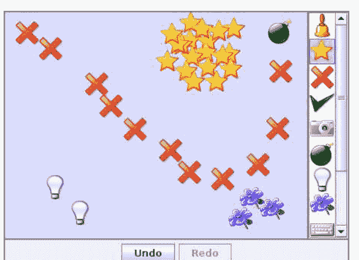

该程序中的滚动条不是 `JList` 的一部分。要为列表添加滚动条，必须将列表放入 `JScrollPane` 中。参见第 6.5.4 节，该节讨论了使用 `JScrollPane` 包含 `JTextArea`。滚动面板用于列表和其他组件的方式相同。在这种情况下，通过单个命令将 `JList`（`iconList`）添加到滚动面板并将滚动面板添加到面板：

```
add(new JScrollPane(iconList), BorderLayout.EAST );
```

`JList` 是一个泛型，其中类型参数指示列表中可以显示什么类型的对象。最常用的用法是 `JList<String>` 和 `JList<Icon>`。可以使用其他类型，但它们会被转换为字符串进行显示。（可以“教”它如何显示特定类型的项目；使用 `JList` 类中的 `setCellRenderer()` 方法。）

为了构造 `JList`，需要一个包含将出现在列表中对象的数组。在 `SillyStamper` 程序中，图标是从资源文件中读取的，并使用该数组构造 `JList<Icon>`。这是通过以下方法实现的：

```java
private JList<Icon> createIconList() {
  String[] iconNames = new String[]{
    "icon5.png", "icon7.png", "icon8.png", "icon9.png", "icon10.png",
    "icon11.png", "icon24.png", "icon25.png", "icon26.png", "icon31.png",
    "icon33.png", "icon34.png"
  }; // 包含图标图像资源文件名的数组。
  Image[] iconImages = new Image[iconNames.length];
  ClassLoader classLoader = getClass().getClassLoader();
  Toolkit toolkit = Toolkit.getDefaultToolkit();
  try { // 从资源文件获取图标。
    for (int i = 0; i < iconNames.length; i++) {
      URL imageURL = classLoader.getResource("stamper.icons/" + iconNames[i]);
      if (imageURL == null) {
        throw new Exception();
      }
      iconImages[i] = toolkit.createImage(imageURL);
    }
  } catch (Exception e) {
    iconImages = null;
    return null;
  }
  Icon[] icons = new Icon[iconImages.length];
  for (int i = 0; i < iconImages.length; i++) // 创建图标。
    icons[i] = new ImageIcon(iconImages[i]);
  }
  JList<Icon> list = new JList<Icon>(icons); // 一个包含图像图标的列表。
  list.setSelectionMode(ListSelectionModel.SINGLE_SELECTION);
  list.setSelected(0); // 列表中的第一个项当前被选中。
  return list;
}
```

# 第 13 章。高级 GUI 编程

在使用这种选择模式时，当用户选择一个项目时，之前选中的项目（如果有的话）会被取消选择。注意，程序可以通过调用 `list.setSelected(int item)` 来更改选择。项目从 0 开始编号。若要查找单次选择模式下当前选中的项目，请调用 `list.getSelectedItem()`。它返回被选中项目的项目编号，如果当前没有选中任何项目，则返回 -1。如果允许多项选择，你可以调用 `list.getSelectedIndices()`，它返回一个 `int` 类型的数组，其中包含所有选中的项目。

现在，你在屏幕上看到的列表是列表的视图（view）。控制器由监听器对象组成，这些对象在用户点击列表中的项目时做出响应。对于它的模型（model），`JList` 使用了 `ListModel` 对象类型。这就是为什么该类知道实际的项目列表。一个模型的定义不仅取决于它所包含的数据，还取决于可以在数据上执行的一系列操作。当从对象数组构造 `JList` 时，所使用的模型非常简单。该模型可以告诉你它包含多少个项目以及这些项目是什么，但它能做的不多。特别是，没有方法向列表添加项目或从列表中删除项目！如果你需要该功能，将不得不使用不同的列表模型。

`DefaultListModel` 类定义了支持向列表添加和删除项目的列表方法。像 `ListModel` 一样，它是一个参数化模型。（注意，当你从数组创建 `JList` 时得到的列表模型**不是**这种类型。）如果类型是 `DefaultListModel`，则定义了以下方法（以及其他方法）：

- `model.getSize()` 返回项目数量。

- `model.getElementAt(index)` 返回列表中指定位置的项目。

- `model.addElement(item)` 将项目添加到列表末尾；`item` 可以是任何 `Object`。

- `model.insertElementAt(item, index)` 将指定的项目插入到列表中指定的索引处；列表中该位置随后的项目将向下移动，以为新项目留出空间。

- `model.setElementAt(index, item)` 用新项目替换列表中当前指定位置的项目。

- `model.remove(index)` 移除指定位置的项目。

- `model.removeAllElements()` 移除列表中的所有内容，使其变空。

若要使用可修改的 `JList<T>`，你应该创建一个 `DefaultListModel<T>`，然后添加任何初始应在列表中的项目，并将其传递给 `JList` 构造函数。例如：

```
DefaultListModel<String> listModel;
JList<String> flavorList;

listModel = new DefaultListModel<String>(); // 创建模型对象。

listModel.addElement("Chocolate"); // 向模型添加项目。
listModel.addElement("Vanilla");
listModel.addElement("Strawberry");
listModel.addElement("Rum Raisin");

flavorList = new JList<String>(listModel); // 创建列表组件。
```

通过在实例变量中保留模型的引用，你能够在程序运行时通过调用 `listModel` 中的相应方法来添加和删除口味。请记住，对**模型**所做的更改将自动反映在*视图*中。在后台，当列表被修改时，它会生成一个 `ListDataEvent` 类型的事件。

`JList` 将自己注册为这些事件的监听器，并在响应事件时通过重绘自己来反映模型中的更改。除了更改模型之外，程序员不需要采取任何操作。

顺便说一下，`JList` 的模型除了 `ListModel` 之外还有另一个部分：类型为 `SelectionModel` 的对象存储了关于列表中哪些项目当前被选中的信息。当模型复杂时，使用多个模型对象来存储状态的不同方面并不常见。

## 13.4.3 表格和表格模型

和 `JList` 一样，`JTable` 向用户显示一组项目。然而，表格比列表复杂得多。最主要的区别是用户可以编辑表格中的项目。表格项目按行和列的网格排列。每个网格位置被称为表格的单元格（cell）。每列都可以有一个标题，它显示在列的顶部并包含列的名称。

从包含列名和数据的数组创建 `JTable` 是很容易的。例如，示例程序 `StatesAndCapitalsTableDemo.java` 创建了一个具有名为“State”（州）和“Capital City”（首府城市）两列的表格。第一列包含美国各州的列表，第二列包含每个州城市的名称。表格可以这样创建：

```
String[][] statesAndCapitals = new String[][][] {
    { "Alabama", "Montgomery" },
    { "Alaska", "Juneau" },
    { "Arizona", "Phoenix" },

    { "Wisconsin", "Madison" },
    { "Wyoming", "Cheyenne" }
};

String[] columnHeads = new String[] { "State", "Capital City" };

JTable table = new JTable(statesAndCapitals, columnHeads);
```

由于表格本身不带滚动条，因此它几乎总是放在 `JScrollPane` 中，以便能够滚动表格。例如：

```
add(new JScrollPane(table), BorderLayout.CENTER );
```

`JTable` 的列标题实际上不是表格的一部分；它们位于单独的组件中。当你将表格添加到 `JScrollPane` 时，列标题会自动位于表格的顶部。使用默认设置，用户可以通过点击单元格来编辑单元格。在 `StatesAndCapitalsTableDemo.java` 中，可以通过方向键移动单元格。为了让某些单元格不可编辑，可以使用不同的模型。`SelectionModel` 对象存储了关于列表中哪些项目当前被选中的信息。当模型复杂时，使用多个模型对象来存储状态的不同方面并不常见。`JList` 的模型除了 `ListModel` 之外还有另一个部分：类型为 `SelectionModel` 的对象存储了关于列表中哪些项目当前被选中的信息。当模型复杂时，使用多个模型对象来存储状态的不同方面并不常见。在 `isCellEditable()` 方法之外，你最可能想要重写的表格模型是 `getColumnClass()`，它的定义为：

```
public Class<?> getColumnClass(int columnNum)
```

该方法的目的是指定指定列允许什么类型的值。该方法的返回值是 `Class` 类型。（“?” 是由于泛型编程的技术原因。请参见第 10.5 节，但这里不需要理解它。）`Object` 类在几个地方出现过——例如在 13.3.1 节关于类加载器的讨论中——这是我们第一次遇到命名的 `Class`。任何 `Class` 类型的对象都代表一个类。`Class` 对象通常通过 `Double.class` 或 `Table.class` 等表达式从类名获取。如果你想使用一个类型为 `String`、`Double` 和 `Boolean` 的三列表格，使用 `getColumnClass` 定义如下的表格模型：

```
public Class<?> getColumnClass(int columnNum) {
    if (columnNum == 0)
        return String.class;
    else if (columnNum == 1)
```

# 第 13 章 高级 GUI 编程

```java
return Double.class;
else
return Boolean.class;
}
```

表格将调用此方法并使用返回值来决定如何显示和编辑表格中的项目。例如，如果指定某列存储布尔值，则该列的单元格将以复选框的形式显示并供编辑。对于数值类型，当用户输入一个值时，表格将不会接受非法输入。（可以更改表格或编辑项的显示方式。请参见 `JTable` 类中的 `setDefaultEditor()` 和 `setDefaultRenderer()` 方法。）

作为使用 `DefaultTableModel` 子类的替代方案，可以使用 `AbstractTableModel` 的子类来定义自定义表格模型。`DefaultTableModel` 提供了许多定义的功能，而 `AbstractTableModel` 提供的功能非常少。然而，`AbstractTableModel` 让你能够自由表示所需的任何值。示例程序 `ScatterPlotDemo.java` 使用 `AbstractTableModel` 的子类为 `JTable` 定义模型。在这个示例中，表格有三列。第一列存储行号，其他列存储 `Double` 类型的值；这两列代表平面上点的 x 和 y 坐标。点在表格旁边的“散点图”中绘制。最初，程序用随机值填充了前六个点。这里是程序的图片，选中了第 5 行的 x 坐标进行编辑：

| Num | X | Y |
| :--- | :--- | :--- |
| 1 | 4.49 | 2.23 |
| 2 | 2.03 | 0.07 |
| 3 | 2.99 | 1.53 |
| 4 | 2.29 | 2.94 |
| 5 | 3.19 | 3.26 |
| 6 | 3.25 | 2.79 |


顺便注意，在这个程序中，散点图可以认为是表格的一个视图，就像表格本身一样。散点图注册为模型的监听器，因此每当模型变化时它都会收到通知。当这种情况发生时，散点图会重新绘制自己以反映模型的新状态。这是 MVC 模式的一个重要属性，多个视图可以共享同一个模型，提供相同数据的其他呈现方式。视图之间彼此不知道，也不通过模型与彼此通信。虽然我没有在这个程序中这样做，但你可以为散点图添加一个控制器。这可以允许用户通过点击散点图上的鼠标来添加点，或拖动点来更改其坐标。控制器将根据用户操作更新表格模型。散点图和表格共享同一个模型，表格中显示的值将自动变为

以下是定义散点图程序的类。该类中的所有方法必须在 `AbstractTableModel` 的任何子类中定义，`setValueAt()` 除外，该方法只有在可修改时才需要定义。


```java
/**
 * 此类定义了程序中 JTable 使用的表格。
 * 表格有三列。列 0 仅存储每行的
 * 行号。列 1 存储散点图 x 坐标，列 2 存储 y 坐标。
 * 表格有 25 行。不提供添加更多行的支持。
 */
public class CodeInputTableModel extends AbstractTableModel {
    private Double[] xCoord = new Double[25]; // 列 1 的数据。
    private Double[] yCoord = new Double[25]; // 列 2 的数据。
    // 最初，数组中的所有值都为 null，这意味着
    // 所有单元格都是空的。

    public int getColumnCount() { // 告诉调用者有多少列。
        return 3;
    }

    public int getRowCount() { // 告诉调用者有多少行。
        return xCoord.length;
    }

    public Object getValue(int row, int col) { // 从单元格获取值。
        if (col == 0)
            return (row+1); // 列 0 存储行号。
        else if (col == 1)
            return xCoord[row]; // 列 1 存储 x 坐标。
        else
            return yCoord[row]; // 列 2 存储 y 坐标。
    }

    public Class<?> getColumnClass(int col) { // 获取列的数据类型。
        if (col == 0)
            return Integer.class;
        else
            return Double.class;
    }

    public String getColumnName(int col) { // 返回列标题名称。
        if (col == 0)
            return "Num";
        else if (col == 1)
            return "X";
        else
            return "Y";
    }

    public boolean isEditable(int row, int col) { // 用户可以编辑吗？
        return col > 0;
    }

    public void setValue(Object obj, int row, int col) {
        // 如果用户编辑了单元格，系统会调用此方法。
        // 也可以通过编程调用更改值。
        // 在这种情况下，列 1 和列 2 可以被修改，类型必须是 Double。
        // 必须调用 fireTableCellUpdated() 向注册的监听器
        // 通知关于模型的更改。

        if (col == 1)
            xCoord[row] = (Double)obj;
        else if (col == 2)
            yCoord[row] = (Double)obj;

        fireTableCellUpdated(row, col);
    }
}
```

除了定义自定义表格，我还通过几种方式自定义了表格的外观。这涉及到对视图的更改，大部分更改是通过调用 `JTable` 方法实现的。例如，由于默认单元格高度对我来说太小，我调用了 `rowHeight(25)` 来增加高度。为了在行和列之间制作线条，我发现必须调用 `setShowGrid(true)` 和 `setGridLayout(Color.BLACK)`。自定义必须通过其他对象完成。例如，为了防止用户通过拖动列头更改列顺序，我必须调用：

```java
table.getTableHeader().setReorderingAllowed(false);
```

表格非常复杂，我在这里只讨论了表格的一部分。尽管如此，我希望你学到了一些，并自己学习更多。

## 13.4.4 文档与编辑器

作为复杂组件的最后一个示例，我们简要查看 `JComponent` 及其子类。`JComponent` 显示文本，用户可以选择进行编辑。两个子类 `JTextComponent` 和 `JTextField` 在第 6.5.4 节引入。真正的复杂性来自于另一个子类 `JEditorPane`，它支持样式化文本的设计和编辑。这允许粗体和斜体等功能。`JEditorPane` 可以处理简单的 HTML 文档。

使用 `JEditorPane` 编写一个简单的浏览器几乎很容易（尽管该程序只能处理基础网页，并且处理许多现代网页时表现糟糕）。这在示例程序 `SimpleWebBrowser.java` 中实现。在这个程序中，用户输入页面的 URL，程序加载并显示该位置的网页。`JEditorPane` 可以处理简单的 HTML 文档。

```java
private void loadURL(String url) {
    try {
        editPane.setPage(url);
    } catch (Exception e) {
        editPane.setText("Error: " + e);
    }
}
```

# 第 13 章：高级 GUI 编程

它会再次检查时间，并计算和显示经过的时间。（当然，我并不非要定义一个子类。我可以在程序中使用一个普通的标签，设置一个监听器来响应标签上的鼠标事件，并让程序执行跟踪时间和更改标签上显示文本的工作。然而，通过编写一个新类，我获得了一个可以在其他程序中重用的对象。我还将与停止函数相关的代码几乎集中在一个地方。对于更复杂的组件，这两个考虑都非常重要。）

`StopwatchClass` 的编写并不困难。我需要一个实例变量来记录用户启动秒表时的时间。Java 中的时间是以毫秒为单位的，并存储在 `long` 类型变量中（以允许非常大的值）。在 `mousePressed()` 方法中，我需要知道计时器是在启动还是停止，因此我需要一个布尔实例变量来跟踪组件的状态。有一个值得关注的点：我如何知道计时器何时被点击的？`System.currentTimeMillis()` 返回当前时间。但用户点击与 `mousePressed()` 被调用之间可能存在某些延迟。

为了让我的秒表尽可能准确，我不想知道当前时间。我想知道鼠标被按下时的精确时间。当我搜索 `StopwatchClass` 类时，这引导我查阅了 Java 文档。我发现如果 `evt` 是 `MouseEvent` 类型的对象，那么函数 `evt.getWhen()` 返回事件发生的时间。我在 `mousePressed()` 例程中调用此函数，以确定用户点击标签的精确时间。整个 `Stopwatch` 类相当短：

```java
import java.awt.event.*;
import java.swing.*;

/**
 * 一个充当简单秒表的自定义组件。当用户点击
 * 它时，此组件开始计时。当用户再次点击它时，
 * 它将显示两次点击之间的时间差。点击第三次
 * 将启动另一个计时器，依此类推。在它运行期间，标签仅
 * 显示消息 "Timing..."。
 */
public class StopwatchLabel extends JLabel implements MouseListener {

    private long startTime; // 计时器的开始时间。
                            // （时间以毫秒为单位计量）。

    private boolean running; // 当计时器运行时为 true。

    /**
     * 构造函数将标签上的初始文本设置为
     * "Click to start timer."，并设置鼠标监听器
     * 使标签能够响应点击。
     */
    public StopwatchLabel() {
        super(" Click to start timer.", JLabel.CENTER);
        addMouseListener(this);
    }

    /**
     * 告知计时器当前是否正在运行。
     */
    public boolean isRunning() {
        return running;
    }
}
```

```java
/**
 * 当用户通过按下鼠标来启动或停止
 * 计时器并更改标签上显示的文本时。
 */
public void mousePressed(MouseEvent evt) {
    if (running == false) {
        // 记录时间并启动计时器。
        running = true;
        startTime = evt.getWhen(); // 鼠标被点击的时间。
        setText("Timing...");
    } else {
        // 停止计时器。计算从计时器
        // 开始以来经过的时间并将其显示。
        running = false;
        long endTime = evt.getWhen();
        double seconds = (endTime - startTime) / 1000.0;
        setText("Time: " + seconds + " sec.");
    }
}
```

```java
public void mouseReleased(MouseEvent evt) {}

public void mouseClicked(MouseEvent evt) {}

public void mouseEntered(MouseEvent evt) {}

public void mouseExited(MouseEvent evt) {}
```

不要忘记 `StopWatchLabel` 是 `JLabel` 的子类，你可以对 `StopWatchLabel` 做任何你能对 `JLabel` 做的事情。你可以设置它的尺寸、字体、前景颜色和背景颜色。你可以设置它显示的文本（尽管这可能会干扰它的停止函数）。如果你需要，还可以添加一个边界（Border）。

让我们来看定义自定义组件的另一个示例。假设出于某种原因——创建一个像 `JLabel` 但以镜像格式显示文本的组件。没有标准组件具有此类功能，`MirrorText` 类被定义为 `JPanel` 的子类。它有一个指定要显示文本的构造函数和一个更改文本的 `setText()` 方法。`paintComponent()` 方法在组件中心绘制反转的文本。这使用了在组件中居中文本的技术。反转是通过使用离屏画布实现的。文本以通常的方式绘制到离屏画布上。然后使用以下命令将图像复制到屏幕，其中 `OSC` 是引用离屏画布的变量，`width` 和 `height` 是组件和离屏画布的尺寸：

`g.drawImage(OSC, width, height, 0, 0, 0, width, height, null);`

这是指定目标矩形和源矩形颜色的 `drawImage()` 版本。`OSC` 中的左角 `(0,0)` 与屏幕上的角 `(width,0)` 匹配，而 `(width,height)` 与 `(0,height)` 匹配。这实现了图像的左右反转。这里是完整的类：

```java
import java.awt.*;
import java.swing.image.*;
import java.awt.image.BufferedImage;
```

```java
/**
 * 用于显示镜像反转行文本的组件。
 * 文本将在可用空间内居中。此组件
 * 定义为 JPanel 的子类。它尊重为 JPanel 设置的任何
 * 边界颜色、前景颜色和字体。
 * setText(String) 方法可以用于更改显示的
 * 文本。更改文本也会对此组件
 * 调用 revalidate()。
 */
public class MirrorText extends JPanel {

    private String text; // 此组件显示的文本。
    private BufferedImage OSC; // 持有未反转的文本图像。

    /**
     * 构建一个 MirrorText 组件，将以镜像反转
     * 形式显示指定的文本。
     */
    public MirrorText(String text) {
        if (text == null) {
            text = "";
        }
        this.text = text;
    }

    /**
     * 更改标签上显示的文本。
     *
     * @param text 要显示的文本
     */
    public void setText(String text) {
        if (text != null) {
            if (!text.equals(this.text)) {
                this.text = text; // 更改实例变量。
                revalidate(); // 告诉容器重新计算。
                repaint(); // 确保组件重绘。
            }
        }
    }

    /**
     * 返回此组件显示的文本。
     * 返回值非空但可以是空字符串。
     */
    public String getText() {
        return text;
    }

    /**
     * paint 方法在需要时创建一个新的离屏画布，
     * 将文本写入离屏画布，然后以镜像反转
     * 的形式将画布复制到屏幕上。
     */
    public void paintComponent(Graphics g) {
        int width = getWidth();
        int height = getHeight();

        if (OSC == null || width != OSC.getWidth()) {
            OSC = new BufferedImage(width, height, BufferedImage.INT_RGB);
        }

        Graphics g2 = OSC.getGraphics();
        g2.setColor(getBackground());
        g2.fillRect(0, 0, width, height);
        g2.setColor(getForeground());
        g2.setFont(getFont());

        FontMetrics fm = g2.getFontMetrics();
        int x = (width - fm.stringWidth(text)) / 2;
        int y = (height + fm.getAscent() - fm.getDescent()) / 2;

        g2.drawString(text, x, y);
        g2.dispose();

        g.drawImage(OSC, 0, 0, width, height, null);
    }

    /**
     * 计算一个首选尺寸，包括文本尺寸
     * 以及每个边缘 5 像素的边界。
     */
    public Dimension getPreferredSize() {
        FontMetrics fm = getFontMetrics(getFont());

        return new Dimension(
            fm.stringWidth(text) + 10,
            fm.getAscent() + fm.getDescent() + 10
        );
    }
}
```


# 第 13 章 高级 GUI 编程

当标准组件发生某种方式的变化，导致需要更改首选尺寸或位置时。（验证并不总是像在本程序中那样引起很多扰动。这可能是你想要的行为，也可能。例如，在 `GridLayout` 中，所有组件都以相同的大小显示，它不会产生任何影响。我为这个示例选择了 `FlowLayout`，以便使效果更明显。）当 `MirrorText` 组件中的文本被更改时，内容不会进行自动验证。像 `MirrorText` 这样的自定义组件必须调用 `revalidate()` 方法，以指示包含文本的组件需要验证。在 `MirrorText` 类中，当调用 `setText()` 方法时会调用 `revalidate()`。

## 13.5 完善

在最后一个章节中，我将展示一个比我们之前看过的更复杂、更完善的程序。书中的大多数示例都是“玩具”程序，用于说明编程技术中的一或两个点。现在是时候将所有内容整合成一个完整的程序了，它使用了我们涵盖的许多技术，以及其他一些技术。在讨论了程序及其基本设计之后，我将用它作为一个练习，自由地谈谈 Mandelbrot 集的一些无法放入书中其他部分的特征。

我们将喜欢的程序是一个 Mandelbrot 查看器，它通过解释其含义，让用户能够探索著名的 Mandelbrot 集。需要注意的是，功能更强大的 Mandelbrot 集可以在 `http://math.hws.edu/Java/MB` 处找到。

### 13.5.1 Mandelbrot 集

Mandelbrot 集是 xy 平面上的一点集，通过计算过程定义。要使用该程序，你真正需要知道的是 Mandelbrot 集可以用来画一些漂亮的图片，但这里是数学细节：考虑一个具有实数坐标 `(a,b)` 的点，并应用以下计算：

```
Let x = a
Let y = b
Repeat:
  Let newX = x*x - y*y + a
  Let newY = 2*x*y + b
  Let x = newX
  Let y = newY
```

随着循环的重复，点 `(x,y)` 变化。Mandelbrot 集的问题是，`(x,y)` 是逃逸到无穷，还是被困在平面上的有限区域内？如果 `(x,y)` 逃逸到无穷（无限增长），那么起始点 `(a,b)` 就不在 Mandelbrot 集中。现在，如果 `(x,y)` 被困在一个区域内，那么 `(a,b)` 在 Mandelbrot 集中。现在，如果 `x^2 + y^2` 严格大于 4，那么 `(x,y)` 将逃逸到无穷，因此我们可以结束循环并说 `(a,b)` 不在 Mandelbrot 集中。对于 Mandelbrot 集中的点 `(a,b)`，循环永远不会结束。当我们在计算机上执行此操作时，我们我们不希望循环无限运行，所以我们对循环执行次数设置了限制：

```
x = a;
y = b;
count = 0;
while ( x*x + y*y < 4.1 ) {
  count++;
  if (count > maxIterations)
    break;
  double newX = x*x - y*y + a;
  double newY = 2*x*y + b;
  x = newX;
  y = newY;
}
```

此循环结束后，如果 `count` 小于或等于 `maxIterations`，我们可以说 `(a,b)` 肯定不在 Mandelbrot 集中。如果 `count` 大于 `maxIterations`，那么 `(a,b)` 可能在不在 Mandelbrot 集中，但 `maxIterations` 越大，`(a,b)` 实际上在集合中的概率越高。

为了给这个过程制作图片，使用矩形像素网格来表示平面上的矩形。每个像素对应某些实数坐标 `(a,b)`。（使用像素中心的坐标。）对每个像素运行循环。如果迭代次数超过了限制，则将像素涂成黑色；这是一个可能在 Mandelbrot 集中的点。否则，根据循环结束后 `count` 的值来决定像素颜色，对不同的 `count` 使用不同的颜色。在某种意义上，`count` 越高，点就越接近 Mandelbrot 集，因此它提供了关于集之外的点和集的形状的信息。然而，理解颜色是任意的，且有色的点绝对不在集中，这一点很重要。这是一张使用 Mandelbrot 查看器程序通过此计算生成的图片。黑色区域是 Mandelbrot 集（尽管不是所有的黑色点都确定在集内）：


当你使用程序时，可以放大平面上的较小区域。要这样做，只需在图片上点击并拖动鼠标。这会在图片的一部分周围画一个矩形。当你松开鼠标时，矩形内的图片部分将放大以填充整个显示器。如果你只是点击图片中的一点，你将以两倍倍率放大你点击的点。（使用 `Shift`-点击或使用鼠标右键来缩小而不是放大。）有趣的点分布在 Mandelbrot 集的边界上。事实上，边界是无限复杂的。（注意，如果放大得太远，你将超过 `double` 数据类型的能力；程序中没有采取措施来防止这一点）。

使用“Iterations”（迭代）来增加循环中的迭代次数。记住，黑色像素可能不在集中；当你增加“Iterations”时，你可能会发现黑色区域被填充了颜色。“Palette”（调色板）决定了使用的颜色set。不同的调色板提供集的不同可视化效果。“PaletteLength”决定了使用多少种不同的颜色。在默认设置下，算法中每种可能的颜色值使用不同的颜色。通过使用不同数量的颜色你可以获得更好的图片。如果调色板长度小于 `maxIterations`，则重复调色板以覆盖所有可能的 `count` 值；如果调色板长度大于 `maxIterations`，只需减少调色板长度，因为这会让颜色随 `count` 的变化变得快得多。如果你看到的是随机的条带而不是颜色，尝试增加调色板长度。程序有一个“File”菜单，可将图片保存为 PNG 文件。你还可以保存一个“param”，它只需保存产生当前图片的设置。文件可以使用“Open”命令读回程序。Mandelbrot 以 Benoit Mandelbrot 命名，他是第一个注意到该集的惊人复杂性的人。如此简单的算法就能产生这种美，真是惊叹。

### 13.5.2 程序的设计

Java 中的大多数类都定义在包中。虽然我们使用了 `javax.swing` 和 `java` 等标准包，但我所有的编程示例都在“默认包”，这意味着它们没有属于任何命名的包。然而，在进行更严肃的编程时，创建一个包来存放程序的类是良好的风格。Oracle 公司建议包名应基于 Internet 域名名称，且没有其他计算机具有相同的名称。根据 Oracle 的建议，这允许我使用包名 `edu.hck`，即域名元素的反序。我还可以使用该包的子包，例如 `edu.eck.mdb`，这是我决定用于 Mandelbrot 查看器程序的包。其他人——至少使用相同命名规范的其他人——不会使用相同的包，因此包名唯一标识了我的程序。

我在 2.6.6 以及第 12.5 节的编程示例中简要讨论过使用。这里是 Mandelbrot 查看器所需的知识：程序定义在网站的源代码目录。（也就是说，它们位于 `edu/hck/eck/mdb` 目录下，`mdb` 位于 `eck` 目录下，`eck` 位于 `hck`，`hck` 位于 `edu`。目录结构必须以这种方式遵循包名。）同一个目录包含一个名为 `properties` 的文件，程序使用它并在下文中讨论。还有一个 `examples` 文件夹，包含用于“Examples”菜单的资源文件。对于 Eclipse 等集成开发环境，你只需要将 `edu` 目录添加到项目中即可。要在命令行上编译文件，你必须在包含 `edu` 目录的目录中工作。命令

```
javac edu-hws/eck/mdb*.java
```

或者，如果你使用 Windows，使用：

```
java edu-hws\eck\mdb\*.java
```

来编译代码。程序的主程序由一个名为 `Main` 的类定义。要运行此程序，请使用以下命令：

```
java edu-hws.eck.mdb.Main
```

该命令必须在包含 `edu` 目录的目录下执行。

计算和显示曼德博集合（Mandelbrot set）图像的工作在 `MandelbrotDisplay` 中完成。`MandelbrotDisplay` 是 `JPanel` 的子类。它使用离屏画布来保存图像的副本。（参见第 13.1.1 节）`paintComponent` 方法将此图像拷贝到面板上。然后，如果用户正在用鼠标绘制一个“缩放框”，缩放框将绘制在图像之上。除了图像外，画布还使用一个二维数组来存储图像中每个像素的迭代次数。如果 x 值的范围发生变化，或者窗口大小发生变化，则所有内容都必须重新计算。由于计算可能需要很长时间，在执行计算时阻塞用户界面是不可接受的。解决方案是在单独的“工作”线程中进行计算，正如第 12 章所讨论的。程序充满了灰色。每隔一段时间（每秒两次），计算线程计算出的数据会被收集起来并应用到离屏画布上，并将修改过的画布部分拷贝到屏幕。使用 `Timer` 来控制这个过程——每当定时器触发时，图像就会使用线程计算出的任何新数据进行更新。用户可以继续使用鼠标，即使图像正在计算。

`MandelbrotPanel` 定义了曼德博查看器的主面板。`MandelbrotPanel` 是另一个 `JPanel` 的子类。`MandelbrotPanel` 大部分由一个 `MandelDisplay` 填充。它还在在显示器下方添加了一个 `JLabel`。该 `JLabel` 用作“状态栏”，显示一些读者可能感兴趣的信息。`MandelbrotPanel` 还定义了程序的鼠标监听器。除了处理移动外，鼠标监听器会在鼠标移动或拖动鼠标时将鼠标的 x 和 y 坐标放入状态栏中。当鼠标离开绘图区域时，状态栏被设置为“空闲（idle）”。这是我们第一次看到 `mouseMoved` 和 `mouseExited` 事件的实际事件。

程序的菜单栏定义在 `Menus.java` 中。“文件”和“控制”中的命令被定义为动作（actions）（参见第 13.3.1 节）。注意，在这些动作中包含了来自第 11.2.3 节、第 11.5.2 节和第 13.1.5 节的文件管理命令。“Masteractions”、“Palette”和“PaletteLength”每个都包含一组 `JRadioButtonMenuItem`。我尝试了数种处理此类组的方法，但没有一种方法能完全满足我的要求。在这个程序中，我在 `Menu` 内部定义了一个嵌套类来表示每个组。例如，`PaletteManager` 将“Palette”中的菜单项作为实例变量。它为每个菜单项注册了动作监听器，并定义了几个操作菜单的实用例程。这三个类非常相似，可能本应该被定义为子类。有一个“示例（Examples）”菜单，包含了几个曼德博集合部分样本视图的设置。

程序中使用的 `MandelbrotPanel` 是 `Menus` 构造函数的参数。许多菜单命令在 във面板或其包含的 `MandelbrotDisplay` 上操作。为了执行这些命令，`Menu` 需要对 `MandelbrotPanel` 的引用。对于 `MandelbrotDisplay`，面板有一个 `getDisplay()` 方法，可以返回它包含的显示器。只要菜单拥有该面板的引用，就可以访问该显示器。在之前的示例中，所有内容都是写好的。只要菜单拥有面板的引用，它就可以访问显示器。在之前的示例中，所有内容都是写好的。由于字符串被直接编码在代码中。

`MandelbrotFrame.java` 定义了 `JFrame` 的简单子类。`Main.java` 包含了程序的 `main()` 方法。下面将讨论。

### 13.5.3 国际化（Internationalization）

#### 国际化（Internationalization）

关于国际化的简要讨论显示了 Java 使用了多种技术。在本节中，我们将查看 Java 中用于国际化的的一些新特性。

国际化是指编写能够适应其他语言的程序。国际化通常被称为 i18n，其中 18 是“I”和“n”之间的字母数量。将程序适配到特定区域的过程被称为本地化（localization）。本地化在许多方面都不同，包括货币类型、数字格式，但最明显的区别是语言。

为了实现这一点，字符串存储在一个或多个属性文件中。属性文件只是键值对的列表。为了翻译这些目的，值是展示给用户的字符串；这些是需要翻译的字符串。键也是字符串，但它们不需要翻译，因为它们永远不会给用户。由于它们不需要修改，键字符串可以在程序代码中使用。每个键标识一个值字符串。程序可以使用键来查找对应的值字符串。程序只需要知道键字符串；用户只会看到值字符串。当属性文件被翻译时，程序的用户将看到不同的值字符串。

属性文件的格式非常简单。键值对的形式如下：

`key=stringValue`

键字符串或等号之前没有空格。句号通常用于分隔键字符串中的单词。值字符串可以包含空格或任何字符。如果行以反斜杠（`\`）结尾，则值字符串将延续到下一行；在这种情况下，行首的空格会被忽略。一个遗憾的是属性文件只能包含 ASCII 字符。ASCII 字符集仅支持英语字母。尽管如此，值字符串可以包含任意的 Unicode 字符。非 ASCII 字符只需要经过特殊编码。JDK 自带了一个名为 `nativeAscii` 的程序，可以将使用非 ASCII 字符的文件转换为适用于作为属性文件的格式。

假设程序向用户展示一个字符串（例如一个菜单项）。属性文件将包含如下的键值对：

```
menu.saveimage=保存 PNG...
```


“保存 PNG...”是出现在菜单中的字符串。程序将使用键字符串`"menu.saveimage"`来查找对应的值，然后将该值作为菜单项的文本。在 Java 中，这种查找由`ResourceBundle`类支持，它知道如何检索和使用属性。

## 第 13 章 高级 GUI 编程

### 13.5.3 国际化属性文件

以及一个英文版本。如果英文属性文件命名为`strings.properties`，那么法语和日语版本的名称应为`strings.fr.properties`和`strings.ja.properties`。每种语言都有一个双字母代码（例如`"fr"`和`"ja"`），用于使用简单名称`"strings"`构建属性文件。

如果程序运行在首选语言为法语的 Java 系统上，程序将尝试加载`strings.fr.properties`；如果加载失败，它将查找`"strings.properties"`。这意味着程序将在法语本地化区域使用法语属性文件；或者在日语本地化区域使用；在任何其他本地化区域，它将使用默认属性文件。

### 13.5.4 事件、事件、事件

我们已经广泛处理了鼠标事件、组件事件和动作事件，但这些只是 Java 中使用的事件类型中的少数几种。Mandelbrot 查看器（Mandelbrot Viewer）使用了其他类型的事件。它还作为事件驱动编程优势的示例。

让我们从以下事实开始：`MandelbrotDisplay` 对构成程序的任何其他类一无所知（唯一的例外是对国际化方法`i18n.tr`的调用）。其他类能够感知`MandelbrotDisplay`类正在发生的事情。例如，当显示器的大小变化时，新尺寸会报告给`MandelbrotPanel`类。在`Menu`类中，当显示开始计算图像时，某些菜单会被禁用，并在计算完成后重新启用。

显示器并不调用`MandelbrotPanel`或`Mandelbrot`类中的方法，那么这些类是如何获取关于显示器状态的信息的？答案是，`MandelbrotDisplay`对象通过事件设置了监听器来接收这些事件并对其做出响应。

点在于，由于事件被用于通信，`MandelbrotDisplay`类与其他类之间不是强耦合的。事实上，它可以在不经修改或不访问其他类的情况下用在其他程序中。

使用事件的替代方案是在`MandelbrotPanel`和`MandelbrotFrame`中设置如`sizeChanged()`等显示器对象方法来告知显示器正在发生什么。这将导致强耦合。任何想使用`MandelbrotDisplay`的程序员都必须使用其他类，或者必须修改该类使其不再引用其他类。

例如，使用事件可以做很多事情，而非强耦合是有益的：`MandelbrotPanel`直接引用`MandelbrotDisplay`类，离开了它就无法使用——但由于`Mandelbrot`的目的是持有一个`MandelbrotDisplay`，这种耦合性并不是问题。

---

Mandelbrot 查看器响应显示器上的鼠标事件。这些事件由显示器对象生成，但类本身并不关心鼠标事件，也不执行任何操作来响应它们。鼠标事件由`MandelbrotPanel`中的监听器处理，该监听器通过缩放显示器和在状态栏中显示鼠标坐标来响应。

状态栏每当显示器尺寸变化时就会显示新尺寸。为了处理这一点，会生成每个类型的`ComponentEvent`。当组件的大小发生改变时，会生成一个`ComponentEvent`。

在 Mandelbrot 查看器中，`MandelbrotPanel`类中的`ComponentListener`监听显示器的尺寸变化事件。当事件发生时，监听器通过在状态栏中显示新尺寸来做出响应；显示器对显示其尺寸的状态栏一无所知。

组件事件也以一种有趣的方式在`MandelbrotDisplay`类内部使用。当用户动态更改显示器大小时，其尺寸每秒可能会变化多次。通常情况下，显示器尺寸的变化会触发新的离屏画布的创建并开始对其进行新的异步计算。

然而，虽然这是一件大事，但我并不想每秒执行几次这样的操作。如果你尝试调整程序窗口的大小，你会发现只要尺寸在变化中，图像就不会随着尺寸的变化而动态改变。在尺寸停止变化后，才会使用相同的图像和离屏画布。

只有在三分之一的事件发生后，才会产生调整大小后的图像。以下是其工作原理：显示器设置了一个`ComponentListener`来监听尺寸调整事件（参见第 6.4.1 节）。

当此计时器运行时，`paintComponent()`不会调整图像本身；而是重用已有的图像。如果定时器在 1/3 秒后触发，图像将在该时进行大小调整。

然而，如果在第一个定时器运行期间发生了另一个事件，第一个定时器将在未有机会触发之前被停止，并启动一个延迟为 1/3 秒的新定时器。结果是，在窗口尺寸停止变化 1/3 秒后，图像才会被进行大小调整。

Mandelbrot 查看器还使用了`WindowEvent`事件，该事件由窗口在打开或关闭（等等）时生成。`Main` Java 类使用窗口事件来触发程序结束时必须采取的操作；这将在下文中讨论。

在 Mandelbrot 查看器中使用这些事件的目的是根据显示器的状态来启用和禁用菜单命令。为此，使用了`PropertyChangeEvent`事件。

该事件类是 Java 用于对象进行某些高级操作的“豆（bean）”的一部分，`PropertyChangeEvent`及其相关类定义在`beans`包中。其理念是 bean 是根据其“属性”（这些只是 bean 状态的某些方面）定义的。

当 bean 发生变化时，bean 可以发射一个`PropertyChangeEvent`来通知其他对象这种变化。发射属性变化事件的属性被视为技术属性。

绑定属性（bound property）有一个名称，用于在 bean 的所有属性中标识该特定属性。当发射属性事件时，事件对象包含了已更改的属性名称、该属性的旧值以及该属性的新值。

`MandelbrotDisplay`类有一个绑定属性，其名称由常量`MandelbrotDisplay.STATUS`给出。当显示器状态发生变化时，显示器会发射属性事件。属性的值由其他常量（如`READY`）给出。

`READY`状态表示显示器没有运行计算，并准备好进行下一次计算。有几个菜单只有在状态为`READY`时才应该启用。

为了实现这一点，`Menu`定义了一个`PropertyChangeListener`来监听来自显示器的属性变化事件。当此监听器听到事件时，它根据状态属性的新值通过启用或禁用菜单命令做出响应。

Java 的所有 GUI 组件都是 bean，并能够发射属性变化事件。在`Component`的任何子类中，这可以简单地通过调用：

```java
public void firePropertyChange(String propertyName,
                               Object oldValue, Object newValue)
```

来实现。

例如，`MandelbrotDisplay`使用以下方法设置状态：

```java
private void setStatus(String status) {
  if (status == this.status) {
    // 注意：只有当状态改变时才触发事件
    return;
  }

  String oldStatus = this.status;
  this.status = status;
  firePropertyChange(STATUS, oldStatus, status);
}
```

当你从零开始编写框时，需要属性变化事件的支持。为了让这变得简单，`java.beans`包提供了`PropertyChangeSupport`类。

### 13.5.5 自定义对话框

Java 有一些标准的对话框，定义在`JOptionPane`、`JColorChooser`和`JFileChooser`类中。这些引入于第 6.7.2 节和第 11.2.3 节。

Mandelbrot 查看器需要所有类型的对话框。然而，在某些情况下，你可以构建对话框。

对话框是由`Dialog`类的子类定义的。与框架一样，对话框是屏幕上的独立窗口，主要的区别在于对话框有一个父窗口，由父窗口“拥有”该对话框。

如果对话框的父窗口关闭，对话框也会关闭。此外，即使父窗口不是激活窗口，对话框也可以浮在其上。

对话框可以是模态（modal）或非模态（headless）。当模态框弹出时，屏幕的其他部分会被阻塞直到对话框关闭。这是最常见的情况，所有标准对话框都是模态的。

非模态对话框更像独立的窗口，因为用户与其他窗口交互时它们可以留在屏幕上。Mandelbrot 查看器中没有非模态对话框。

Mandelbrot 查看器使用了自定义对话框。它们用于“设置图像大小”和“设置限制”命令，并定义在`ClientSizeDialog`类中。

“图像大小”对话框允许用户输入图像的宽度和高度。“限制”对话框允许用户输入显示中 x 和 y 的最小值和最大值。这两个对话框非常相似。

在两个类中，都使用了多个`JTextField`用于用户输入。窗口上有“确定”和“取消”按钮，并为这些按钮设置了监听器。

当用户点击“确定”时，监听器检查文本字段中的输入是否合法：如果不合法，向用户显示错误消息；如果用户点击“确定”时输入非法，则销毁对话框。

如果用户点击“取消”或关闭对话框，对话框也会销毁。结果是对话框一直留在屏幕上，直到用户取消或输入合法值并点击“确定”。

程序可以通过调用对话框对象的`getInput()`方法来确定是由哪个事件调用的，如果取消了则该方法返回`null`；否则返回输入。

为了让我的自定义对话框易于使用，我在每个对话框类中添加了一个静态方法`showDialog()`。当调用此函数时，它会显示对话框，等待其关闭，然后返回`getInput()`方法的值。

## 第 13 章：高级 GUI 编程

如果你已经了解了框架（frames），那么创建和使用自定义对话框并不困难。我将不再在此详细讨论，但你可以查看源文件`SetInputDialog.java`作为一个模型。

### 13.5.6 偏好（Preferences）

大多数正式的程序都允许用户设置偏好。偏好实际上只是在程序运行之间保存的程序状态的一部分。

为了让偏好在多次运行之间持久化，可以将偏好保存到用户主目录下的一个文件中。然而，会存在定位文件的问题。还会存在命名文件以避免与其他程序所使用的名称冲突的问题。

此外，还会存在用户主目录充斥了用户不需要感知的文件，使其变得混乱的问题。

为了解决这些问题，Java 有一种处理偏好的标准方法。它由`java.util.prefs`包定义。通常情况下，你从这个包中唯一需要的`Preferences`类。

在 Mandelb Viewer 程序中，`Main.java`包含一个`Preferences.Main`的示例，其中包含了程序的`main()`进程。

在大多数程序中，用户在自定义对话框中设置偏好。然而，Mandelb 程序没有那种类型的处理方式。相反，作为一个示例，我自动将程序状态的几个方面作为偏好保存。

每次程序启动时，它都会加载这些偏好。（保存偏好之所以可行，是因为程序在 Mandelbrot 窗口关闭时结束，而不是在`main()`进程结束时。在主程序结束时无法保存偏好。解决方案是使用事件。监听器监听来自框架的`WindowEvents`。当发生窗口关闭事件时，监听器就会保存偏好。）

程序的偏好存储在被称为“节点”（node）的实体中。用户偏好位于某些依赖于平台的位置。作为一名 Java 程序员，你不需要担心这个；Java 偏好知道将数据存储在哪里。

现在仍然存在如何在计算机上可能运行的所有程序中识别出特定程序偏好的问题。事实上，程序的偏好是由程序的包名定义的，只是符号表示上略有不同。

例如，Mandelbrot Viewer 定义在包`edu.hws.eck.mdb`中，它的偏好由字符串`"edu/hws/eck/mdb"`定义，并在开头额外加上`"/f"`。

程序的偏好存储在被称为“节点”的实体中。可以通过以下方式访问给定程序的用户偏好：

```java
Preferences root = Preferences.root();
Preferences node = root.node(pathname);
```

其中`pathname`是用于标识节点的字符串，例如`"edu/hws/eck/mdb"`。

节点本身由一个简单的键/值对列表组成，其中键和值都是字符串。你可以在偏好节点中存储任何字符串——它们实际上只是在程序运行之间存储某些持久化数据的方法。

尽管通常如此，键字符串标识某个特定的偏好项，而关联的值是该偏好的值。一个`Preferences`对象`prenode`包含方法`prenode.get(key)`用于根据给定的键检索值字符串，`prenode.put(key, value)`用于为给定的键设置值字符串。

在`Main.java`中，我使用偏好来存储程序窗口的形状和位置。这使得窗口的大小和形状在运行运行程序之间是持久的；窗口将出现在你上次运行它时离开的位置。

我还存储了程序用于保存和打开命令的文件对话框中当前选择的目录名称。这特别令人满意，因为文件对话框的默认行为是从用户主目录开始的，而这几乎不是用户想要存放程序文件的地方。

有了偏好功能，我可以在第一次使用程序时切换回正确的目录，从那以后，当我再次使用程序时，我将自动回到该目录。你可以查看`Main.java`中的源代码获取详情。

就是这样了……关于 Java 以及通用的编程，我还有很多可以说的，但此书仅仅是《使用 Java 编程入门》，我们的旅程是结束了。我希望这对你来说是一次愉快的旅程，并希望我帮助你建立了一个可以作为进一步探索基础的基础。

## 第 13 章练习题

1. 第 13.1 节中的示例程序`PaintWithOffScreenCanvas.java`是一个简单的绘画程序。对该程序进行两项改进：首先，添加一个“文件”菜单，允许用户打开图像文件并以 PNG 或 JPEG 格式保存当前图像。其次，添加一个基础级的“撤销”（Undo）命令，允许用户撤销应用于程序的最后一次操作。（不要尝试制作多级撤销，那将允许用户撤销多次操作。）

   当你将文件读入程序时，你应该将读取的图像拷贝到程序的离屏画布中。由于程序中的画布是固定大小，你应该缩放图像以填满画布。

2. 对于此练习，你应该继续完善上一个练习中的程序。添加一个“笔画宽度”（StrokeWidth）菜单，允许用户绘制不同粗细的线条。允许填充形状的内部和轮廓使用不同的颜色。

   为了实现这一点，添加一个“颜色”菜单和一个“填充颜色”菜单。（我的解决方案添加了工具：描边矩形和描边椭圆，用于表示带轮廓的形状。）添加对透明填充的支持。一种简单的方法是使用`JCheckBoxMenuItem`选择不透明或 50% 填充。（不要尝试对笔触应用透明度——这对曲线工具来说很难，而且无论如何，形状不透明更好。）

   通过为命令添加快捷键以及使用合适的单选菜单使菜单更符合用户习惯。这个练习需要一些工作才能完全完成，所以你应该分步骤解决问题。

3. 第 13.4.5 节中的`StopWatchLabel`在表运行时显示“计时中……”文本。如果你希望它显示自表启动以来的经过时间，你需要创建一个`Timer`。（见节……）在原始代码`StopWatchLabel.java`中添加一个`Timer`来驱动秒数的显示。

   在表停止时的`mousePressed()`例中创建计时器。反正计时器不会准确，只需显示经过的秒数。你只需要每秒设置几次。对于你的计时方法，使用 200 毫秒的延迟。

4. 第 13.4.5 节中的自定义示例`MirrorText.java`使用离屏画布在`JPanel`中显示镜像文本。另一种方法是在用于绘制的图形上下文应用变换后绘制文本。（见 13.2.5 节。）

   通过这种方法，自定义组件可以定义为`JLabel`的子类，并重写`paintComponent()`方法。编写一个采用这种方法的`MirrorText`组件。解决方案非常短，但很棘手。注意缩放变换`g.scale(-1, 1)`是通过组件的左边缘进行左右反射。

5. 第 11.2 节中的示例程序`PhoneDirectoryFileDemo.java`在用户主目录下的一个文件中保留“电话目录”的数据。练习 11.5 要求你修改该程序以使用 XML 格式来处理数据。

# 练习

这两个程序都具有简单的命令行用户界面。在本次练习中，你应该为电话目录数据提供一个 GUI 界面。你可以基于原始程序编写，也可以基于练习中修改后的 XML 版本编写。

使用`JTable`来承载数据。用户应该能够编辑表格中的所有条目。此外，用户还应该能够添加和删除行。包含可以执行这些操作的按钮或菜单命令。删除命令应该删除所选行（如果有的话）。新行应该添加在表格的末尾。对于此程序，你可以使用标准的`DefaultTableModel`。

你的程序应该在启动时从文件加载数据，并在结束时保存到文件中，就像之前的两个程序所做的那样。

对于 GUI 程序，不能简单地在`main()`例程结束时保存数据，因为窗口一旦出现在屏幕上，`main`就会结束并终止程序。你必须在用户关闭窗口时保存数据，有几种方法。

一种是使用`WindowListener`检测窗口关闭事件。另一种是使用“退出”（Quit）命令来结束程序；当用户退出时，你可以保存数据并关闭窗口（通过调用其`dispose()`方法），然后结束程序。

如果你使用“退出”命令方法，则不需要用户能够通过简单的关闭窗口来结束程序。为了实现这一点，你会：

```java
frame.setCloseOperation(JFrame.DO_NOTHING_ON_CLOSE);
```

其中`frame`指你为用户界面创建的`JFrame`。

当使用`WindowListener`时，你希望点击窗口上的关闭按钮关闭窗口而不是结束程序。为此，你需要：

```java
frame.setDefaultCloseOperation(JFrame.DISPOSE_ON_CLOSE);
```


当监听器收到窗口关闭事件的通知时，它可以保存数据并结束程序。

本次练习需要的大部分 `JTable` 和 `DefaultTableModel` 方法都在第 13.4.3 节，但有几个是你需要了解的。要确定 `JTable` 中选择哪一行，调用 `table.getSelectedRow()`。此方法返回所选行的索引，如果没有选择任何行，则返回 `-1`。要选择当前正在编辑哪个单元格，可以使用：

```java
table.setSelectionInterval(rowNum, rowNum); // 选择行号 rowNum

table.getCellEdit(rowNum, colNum); // 编辑位置 (rowNum, colNum) 单元格

phone.getCellEditor().requestFocus(); // 将光标置于单元格中
```

一个问题是，当前正在编辑单元格中的数据不在表格中。编辑单元格中的值在编辑完成之前不会放入表格。这意味着尽管用户看到了单元格中的数据，但它实际上还不是表格数据的一部分。如果你丢失了这些数据，用户是有理由抱怨的。为了确保在程序结束保存数据时获得正确的数据，你必须在从模型中检索数据之前关闭编辑。这可以通过以下方法实现：

```java
private void stopEditing() {
    if (table.getCellEditor() != null) {
        table.getCellEditor().stopCellEditing();
    }
}
```

在通过添加或删除行修改表格之前，也必须调用此方法；如果在编辑过程中进行了此类修改，效果可能会非常奇怪。

# 第 13 章测验

1. 描述由以下语句创建的对象，并给出一个它在程序中可能使用的示例：

   ```java
   BufferedImage OSC = new BufferedImage(32, 32, BufferedImage.TYPE_INT_RGB);
   ```

2. 许多程序依赖于资源文件。在这种语境下，“资源”是指什么？给出一个例子。

3. `FontMetrics` 类是做什么用的？

4. 如果创建一个颜色 `c`，即 `c = new Color(0, 0, 255, 125)`，用这种颜色绘图的效果是什么？

5. 什么是抗锯齿（antialiasing）？

6. `ButtonGroup` 类是如何使用的？

7. 缩写 MVC 代表什么？它是如何应用于 `JTable` 类的？

8. 描述由以下 `paintComponent()` 方法产生的图片：

   ```java
   public void paintComponent(Graphics g) {
       super.paintComponent(g);

       Graphics2D g2 = (Graphics2D) g;

       g2.translate(getWidth() / 2, getHeight() / 2);

       g2.rotate(30 * Math.PI / 180);

       g2.fillRect(0, 0, 150, 100);
   }
   ```


## 9. 程序的国际化（Internationalization）是指什么？

## 10. 假设你正在写的类有一个实例方法 `doOpen()`（无参数），旨在用于打开用户选择的文件。编写一段代码段，创建一个代表打开文件动作的 `Action`。然后显示如何从该 `Action` 创建一个按钮和一个菜单项。

# 附录：源代码

本附录列出了出现在免费在线教材《Java 程序设计》（第七版）（Introduction to Programming Using Java, Seventh Edition）中的示例。

该书的网站 http://math.hws.edu/javenotes 有下载整个内容的链接。如果你这样做，你将在名为 `sources` 的目录中找到源代码文件。还有一个下载源代码的链接。下载包中的 `README` 文件包含了编译说明。

# 源代码列表

- `ReverseWithDynamicArray.java`，源自 7.2 节，从 `int` 读取数字并按逆序打印。它使用 `DynamicArrayOfInt.java` 类作为动态数组的示例。`ReverseWithArrayList.java`，源自 7.3 节，功能完全相同，但它使用的是 `ArrayList<Integer>` 而不是 `DynamicArrayOfInt`。
- `SymmetricMatrix.java`，源自 7.5 节，实现了一个双精度类型的对称二维数组。程序 `TestSymmetricMatrix.java` 用于 `SymmetricMatrix` 类。
- `LengthConverter.java`，源自 8.2 节，转换用户输入的英寸、英尺和英里。此实现 `LengthConverter.java` 允许输入组合测量值（例如 "3 feet"），并能检测非法输入。
- `TryStatement.java`，源自 8.3 节，一个带有 `try-catch` 语句和资源自动关闭的小型演示程序。
- `LengthConverter3.java`，源自 8.3 节，是前一个示例的修订版，使用异常来处理用户输出中的错误。
- `TowersHanoi.java`，源自 9.1 节，打印汉诺塔问题解的步骤；递归的一个示例。
- `StringList.java`，源自 9.2 节，实现了一个字符串链表。程序 `List-Demo.java` 测试了该类。
- `PostfixEval.java`，源自 9.3 节，使用栈评估表达式。依赖于在 `StackOfDouble.java` 中定义的 `StackOfDouble` 类。
- `SortTree.java`，源自 9.4 节，演示了字符串二叉树。
- `SimpleParser1.java`、`SimpleParser2.java` 和 `SimpleParser3.java`，源自 9.5 节，是三个解析并评估用户算术表达式的程序。`SimpleParser1` 处理全括号表达式。`SimpleParser2` 评估可以省略括号的表达式。`SimpleParser3` 构建表达式树来表示输入并使用表达式树评估表达式。
- `WordListWithTree.java`，源自 10.2 节，从文件中生成字母顺序的单词列表。使用树（Tree）来消除重复并排序单词。
- `WordListWithPriorityQueue.java`，源自 10.2 节，从文件中生成字母顺序的单词列表。这是前一个示例的微小修改，使用优先级队列（PriorityQueue）代替树。结果是一个未删除重复项的字母顺序单词列表。
- `SimpleInterpreter.java`，源自 10.4 节，演示了在解释用户简单命令的程序中使用 `HashMap` 作为符号表的用用。
- `WordCount.java`，源自 10.4 节，统计文件中每个单词出现的次数。该程序使用了 Java 集合框架的多个特性。
- `ReverseFile.java`，源自 11.2 节，展示了如何在命令行应用程序中读写文件；使用了非标准的类 `TextReader.java`。`ReverseWithScanner.java` 是使用 `Scanner` 代替 `TextReader` 的程序版本。`ReverseWithResources.java` 是在 `try-catch` 语句中使用“资源”模式的版本。
- `DirectoryList.java`，源自 11.2 节，列出用户指定的目录内容；演示了 `File` 类的用法。

# 源代码列表

- `CopyFile.java`，源自 11.3 节，是一个使用命令行参数提供的文件名进行复制文件的程序。`CopyFileAsResources.java` 是该程序在 `try-catch` 语句中同样演示“资源”模式的版本。
- `PhoneDirectoryFileDemo.java`，源自 11.3 节，演示了如何使用文件存储程序运行产生的数据。
- `FetchURL.java`，源自 11.4 节，如果 URL 返回文本文件，则读取并显示指定 URL 的内容。
- `ShowMyNetwork.java`，于 11.4 节中提到，是一个短程序，用于打印运行计算机的网络连接信息，以及每个接口关联的 IP 地址。
- `DateClient.java` 和 `DateServer.java`，源自 11.4 节，是客户端和服务器程序的非常简单的示例。
- `CLChatClient.java` 和 `CLChatServer.java`，源自 11.4 节，通过来回发送消息演示网络双向通信；然而，使用的线程和消息必须严格遵循规定。
- `ThreadTest1.java`，源自 12.1 节，一个或多个执行相同任务的线程，演示了它们同时运行并以不确定顺序完成。
- `ThreadTest2.java`，源自 12.1 节，将任务（计算质数）划分到多个线程中，以演示并行处理和同步的使用。
- `DateServerWithThreads.java` 和 `DateServerWithThreadPool.java`，源自 12.4 节，是第11章`DateServer.java`（11.4.4小节）的修改版，使用线程处理与客户端的通信。后者使用了池及其阻塞队列将连接从主程序发送到池中。线程服务器将与原始客户端程序第11章`DateClient.java` 工作。
- `CLandelbrotMaster.java`、`CLandelbrotWorker.java` 和 `CLandelbrotTask.java`，源自 12.4 节，是分布式计算的演示，将大型计算的部分发送到网络上由“工作”程序进行计算。

# 第二部分：文中的图形示例

以下示例程序使用了基础 GUI 图形用户界面的简单演示。

- `GUIDemo.java`，非常简单，出现在文中第 1.6 节，但在你学习 GUI 编程之前你将无法理解它。
- `RandomCircles.java`，源自 3.9 节，绘制了大量随机颜色、随机位置的点。这个简单的图形程序是我们的第一个 GUI 程序示例。
- `MovingRects.java`，源自 3.9 节，绘制了一组嵌套的矩形，它们似乎向中心无限移动。这个和上一个都基于 `SimpleAnimationStarter.java`，可以用作编写简单程序的起点。

# 源代码列表

- `RandomMosaicWalk.java`，源自 4.6 节，作为一个独立程序，显示一个带有移动干扰的彩色正方形窗口。该程序依赖于 `Mosaic-Panel.java` 和 `Mosaic.java`。
- `RandomMosaicWalk2.java` 是前一个示例的版本，经过修改以使用几个命名常量。源自 4.7 节。
- `GrowingCircleAnimation.java`，源自 5.3 节，展示了不断增长的半透明圆动画。需要 `CircleInfo.java`。用作对象编程的简单示例。
- `ShapeDraw.java`，源自 5.5 节，是一个允许用户在绘图区域更改形状的程序；抽象类、子类和多态的示例。
- `HelloGUI1.java` 和 `HelloGUI2.java`，源自 6.1 节，在窗口中显示“Hello World”消息，第一个使用 `jOptionPane`，第二个通过“手写”构建界面。
- `SimpleChooser.java`，源自 6.2 节，用于演示 RGB 和 HSV 颜色。该程序使用了后文中未涵盖的技术，且未作为编程示例呈现。你可以运行它来实验颜色。
- `RandomStrings.java`，源自 6.2 节，以随机颜色和字体显示 25 份字符串 "Java"（或其其中指定的其他字符串）。`RandomStrings` 使用 `RandomPanel` 作为其内容。`RandomStringsMain.java` 是一个将 `main()` 例程和面板定义合并到一个文件中的程序。最后，源自 6.3 节的 `ClickableRandomStrings.java` 是 `RandomStrings.java` 的修改版，带有一个鼠标监听器，当用户点击面板时会重绘面板。
- `SimpleStamped.java`，源自 6.3 节，允许用户通过点击鼠标在绘图区域使用矩形和椭圆。
- `SimpleMouse.java`，源自 6.3 节，当用户移动和点击鼠标时显示鼠标事件信息。
- `SimplePaint.java`，源自 6.3 节，允许在绘图区域绘制曲线并从调色板选择绘制颜色。
- `RandomArt.java`，源自 6.4 节，每四秒显示一个新的“艺术品”。这是使用 `Timer` 的示例。
- `KeyboardAndFocusDemo.java`，源自 6.4 节，演示用户使用键盘和焦点事件。
- `SubKiller.java`，源自 6.4 节，允许用户玩简单的街机风格游戏。使用了定时器以及键盘和焦点事件。
- `SliderDemo.java` 和 `TextAreaDemo.java`，演示基础组件的小型程序，用作 6.5 节的示例。
- `BorderDemo.java` 和 `BorderDemo.java`，源自 6.6 节，一个演示边界类型的非常简单的程序。
- `SliderAndButtonDemo.java`，源自 6.6 节，展示了如何创建单独组件并将它们在 `GridLayout` 中布局。
- `SimpleCalc.java`，源自 6.6 节，允许用户对输入的两个数字进行加、减、乘、除。这是一个文本字段、按钮和嵌套子面板布局的演示。

# 源码布局列表

- `NullLayoutDemo.java`，源自第 6.6 节，展示了如何在布局管理器设置为 `null` 的容器中布局组件。
- `HighLowGUI.java`，源自第 6.6 节，实现了纸牌游戏 `HighLow.java` 的 GUI 版本，在游戏中，用户抽取一张牌，并猜测下一张牌的大小是高还是低。此程序依赖 `Card.java`、`Hand.java` 和 `Deck.java`。
- `MosaicDraw.java`，源自第 6.7 节，演示了菜单和选择器对话框。它用于一个用户可以通过点击并拖动鼠标绘制马赛克颜色的程序。它使用 `MosaicPanel.java` 定义菜单面板，并使用 `MosaicDrawController.java` 创建菜单并处理事件。
- `SimpleDialog.java`，源自第 6.7 节，是一个演示 `JColorChooser` 和 `JOptionPane` 中一些对话框的小程序。
- `RandomStringsWithArray.java`，源自第 7.2 节，显示了随机颜色、大小和位置的多个消息副本。这是 `RandomStringsPanel.java` 的改进版本，使用数组来跟踪数据，以便在需要时可以重新绘制相同的图像。
- `Simple2.java`，源自第 7.3 节，允许用户绘制彩色曲线，并展示了用于在类型为 `ArrayList<CurveData>` 中绘制表面的需求。
- `Life.java`，源自第 7.5 节，使用二维数组实现了约翰·H·康威的“生命游戏”。此程序依赖 `MosaicPanel.java`。
- `Checkers.java`，源自第 7.5 节，允许两个玩家互相进行国际棋游戏。说明了二维数组的使用以及各种编程技术。（这是到目前书中中最长的程序，超过了 700 行！）
- `Maze.java` 和 `LittlePenguins.java` 是第 9.1 节中提到的作为递归示例的演示程序。它们使用了在第 12 节之前尚未涵盖的技术。注意 `LittlePenguins` 使用了递归。
- `Blobs.java`，源自第 9.1 节，使用递归计算网格中彩色方块的分组。
- `DepthBread.java`，源自第 9.3 节，演示了栈和队列。
- `TrivialEdit.java`，源自第 11.3 节，允许用户编辑文本文件。此程序演示了使用文件对话框读取和写入文件。
- `SimplePaintWithFiles.java`，源自第 11.3 节，演示了将程序数据以二进制和字符格式保存到文件中。该程序是一个基于 `Simple2.java` 的简单绘图程序。
- `SimplePaintWithXML.java`，源自第 11.5 节，演示了将程序数据保存为 XML 格式。此程序使用了 `SimplePaintWithFiles.java`。
- `XMLDemo.java`，源自第 11.5 节，是一个演示 XML 文档基础解析以及对文档对象模型（DOM）表示遍历的简单程序。用户在文本区域中使用要被解析的 XML。
- `RandomArtWithThreads.java`，源自第 12.2 节，使用线程驱动一个非常简单的动画。与通过时间实现相同功能的 `RandomArt.java` 进行对比。
- `QuicksortThreadDemo.java`，源自第 12.2 节，演示了使用单独线程执行计算，并带有线程间通信。
- `BackgroundComputationDemo.java`，源自第 12.2 节，演示了使用低优先级运行的线程在后台执行耗时计算。`BackgroundCompWithInvoke.java` 是同一程序的修改版本，它使用 `SwingUtilities.invokeLater` 代替同步机制。（该程序计算曼德尔博集一小部分的可视化，但具体的计算内容并不重要。）
- `MultiprocessingDemo1.java`，源自第 12.2 节，是前一个示例的修改，使用多个线程执行后台计算。这加速了在多处理器机器上的计算。
- `MultiprocessingDemo2.java`，源自第 12.3 节，是前一个示例的修改版本，将其分解为许多小的子任务，以实现更好的负载均衡。程序使用了线程池和任务队列。
- `MultiprocessingDemo3.java`，源自第 12.3 节，是之前示例的另一个版本，它使用从队列中运行并执行的线程池。为了实现这一点，使用了由标准 `LinkedBlockingQueue` 类定义的阻塞队列。`MyBlockingQueue.java` 是一个直接使用 `wait()` 和 `notify()` 的简单示例，作为 `MultiprocessingDemo3` 中 `LinkedBlockingQueue` 的替代。
- `TowersHanoiGUI.java`，源自第 12.3 节，塔问题的动画。用户可以使用运行/暂停、下一个和开始按钮控制动画。该程序是使用 `wait()` 和 `notify()` 进行线程通信的示例。
- `GUICHat.java`，源自第 12.4 节，是一个用于两人通过网络进行聊的简单 GUI。它演示了使用线程从网络连接中读取数据。
- `netgame.common`，源自第 12.5 节，是一个定义网络游戏框架的包。该框架用于多个示例：定义在 `netgame.tictactoe` 包中的聊天室，以及定义在 `netgame.firecarddraw` 包中的扑克游戏。
- `HighLowWithImages.java`，源自第 13.1 节，是 `HighLowGUI` 的变体，它从图像资源获取扑牌。图像文件包含 `.png` 文件，并依赖 `Card.java`、`Deck.java` 和 `Hand.java`。
- `PaintWithOffCanvas.java`，源自第 13.1 节，是一个演示使用 `BufferedImage` 作为离屏画布的小程序。
- `SoundAndCursorDemo.java`，源自第 13.1 节，允许用户通过点击某些按钮播放几个声音并更改光标。这演示了音频资源文件的使用，并且 `snc.custom` 目录下的资源。
- `TransparencyDemo.java`，源自第 13.2 节，演示了颜色的 alpha 通道。它也是 `FontMetrics` 的示例。
- `StrokeDemo.java`，源自第 13.2 节，演示了使用各种 `BasicStroke` 绘制线和矩形。还演示了抗锯齿。
- `PaintDemo.java`，源自第 13.2 节，演示了使用 `GradientPaint` 和使用 `Texture` 填充多边形。它使用了图像资源 `TinySmiley.png` 和 `QueenOfHearts.png`。
- `ChoiceDemo.java`，在第 13.2 节中讨论，演示了单选按钮和组合框。
- `ToolBar.java`，源自第 13.3 节，使用一个包含按钮的 `Toolbar`。这是一个按钮的简单演示。
- `SillyStamped.java`，源自第 13.4 节，允许用户将图像“盖章”到绘制区域。此程序使用 `silly_stamper` 目录中的图像。
- `StatesAndCapitalsDemo.java`，源自第 13.4 节，是 `Table` 的简单演示。
- `ScatterPlotDemo.java`，源自第 13.4 节，使用 `TableModel` 自定义 `Table`。
- `SimpleWebBrowser.java` 和 `SimpleWebBrowserWithThread`，源自第 13.4 节，使用 `EditorPane` 实现网络浏览器。这两个程序的区别在于，第一个同步加载文档，这会导致程序挂起，而第二个使用线程进行异步加载。
- `SimpleRTFEdit.java`，在第 13.4 节中提到但仅进行了讨论，允许用户编辑 RTX 文件，RTX 文件是带有加粗和斜体等样式信息的文本文件。
- `StopWatchLabel.java` 和 `MirrorText.java`，源自第 13.4 节，实现自定义组件的类。`CustomComponentTest.java` 是测试这些类的程序。
- 曼德尔博集（The Mandelbrot set）由 `edu.hws.eck.mdb` 包中的几个类定义。源代码文件可以在 `edu/hws/eck/mdb` 目录下找到。

# 源代码列表

# 第三部分：辅助文件

本节列出了之前章节中各种示例所需的某些额外文件。这里列出的文件是通用的，可以在其他编程项目中使用。上面也提供了这些文件的链接，以及使用它们的程序。

`TextUtils.java` 定义了一个包含一些用于输入/输出流静态方法的类。`System.in` 和 `System.out` 使得使用标准输入输出流变得更容易。`TextIO` 还定义了其他输入源和输出目标，例如文件。`TextIO` 类仅在命令行环境中有效，在 Eclipse 等标准输入工作不完美的集成开发环境中使用起来可能不方便。在这种情况下，你可能想使用以下文件。

`textiui/TextUtils.java`，`TextIO` 的 GUI 版本，打开一个一个执行文本 I/O 操作的窗口。它是名为 `textiui` 的包的一部分，以区分普通的 `Text`。该包中的伴侣类 `textiui/System.java` 是一个假的 `System` 类，使得在同一个窗口中使用 `System.out` 和 `System` 的其他功能成为可能。我使用这些类为我的文本示例构建可执行的 jar 文件，它们运行在窗口而不是命令行中。更多信息请参见源文件中的注释。

# 源代码列表

- `SimpleAnimationStarter.java` 是一个小型类，你可以编辑它来制作非常简单的动画，其中每一帧都使用基础绘制命令绘制。这在第 3 章中被过。
- `Mosaic.java` 包含了打开和控制包含彩色矩形网格窗口的子程序。它依赖于 `MosaicPanel.java`。这是一个编写使用“马赛克窗口”的简单独立应用程序的工具箱。它用于第 4 章和第 6 章中的多个示例。
- `chapter4/MosaicPanel.java` 定义了一个 `JPanel`，显示按行和列排列的小矩形，并有许多选项。
- `StatCalc.java` 是一个简单的类，用于计算一组数字的统计数据。它仅用于第 5 章和第 6 章中的几道练习题。
- `Expr.java` 定义了一个 `Expr` 类，表示涉及变量 `x` 的数学表达式。它仅用于第 8 章中的几个练习题。
- `TextReader.java` 源自第 11.1.4 节，用于从输入流读取字符数据。`TextReader` 类型对象的输入方法与 `TextIO` 中的静态输入方法相似。
- `netgame.common` 是一个包，定义了一个网络游戏框架，该框架在第 12.5 节中详细讨论。`netgame` 包还包含几个示例。
- `PokerRank.java` 可用于为扑克游戏排名。牌在 `PokerCard.java` 类中定义。还有一个 `PokerDeck.java`。所有这些类都是 `netgame.fivecarddraw` 包的一部分，该包在第 12.5.4 节中进行了讨论，但这些类可以脱 `netgame` 框架独立使用。

# 术语表

**抽象类（abstract class）。** 一种不能用于创建对象的类，其存在仅是为了创建子类。Java 中的抽象类使用修饰符 `abstract` 来定义。

**抽象数据类型（ADT）。** 一种数据类型，指定了该类型的可能值以及对这些值进行允许的操作，但不指定如何实现这些值。

**访问修饰符（access specifier）。** 用于方法定义或变量指定的修饰符，用于确定哪些类可以使用该方法或变量。Java 中的访问修饰符有 `public`、`protected` 和 `private`。没有访问修饰符的方法或变量被认为具有“包”（package）可见性。

**激活记录（activation record）。** 一种包含实现子程序调用所需的所有信息的数据结构，包括子程序的变量值以及子程序结束时计算机将返回的地址。激活记录存储在栈上，使得多个子程序调用可以同时激活。这对于递归特别重要，因为多个对同一子程序的调用可以同时处于激活。

**实际参数（actual parameter）。** 在子程序调用语句执行时，调用语句中的参数。实际参数也称为“参数”（arguments）。

**地址（address）。** 计算机内存中的每个位置都有一个地址，这是一个标识位置的数字。内存中的位置按顺序编号。在现代计算机中，每个字节的内存都有自己的地址。当从内存存储或检索信息时会使用地址。

**算法（algorithm）。** 一种执行某些任务的明确的、逐步的程序，保证在有限的步骤后终止。

**Alpha 色分量（alpha color component）。** 颜色的一个分量，显示其透明或不透明程度。Alpha 分量越高，颜色越不透明。

**API。** 应用程序编程接口。软件包或“工具箱”接口的规范。API 说明了工具箱中提供了哪些类或子程序以及如何使用它们。

**App 小程序（applet）。** 一种旨在 Web 浏览器中运行的 Java 程序，而不是独立应用程序。

**动画（animation）。** 通过快速显示一系列图像（称为“帧”）而创建的看起来在移动的画面。在 Java 中，动画通常由 `Timer` 对象驱动；每次都显示动画的新一帧。

**抗锯齿（antialiasing）。** 调整像素的颜色以减少在绘制形状时出现的锯齿效应。对于抗锯齿，颜色与背景混合。

**数组（array）。** 一种按顺序编号的项列表。数组中的每个项通过其索引来标识。在 Java 中，数组是一种可以容纳固定数量相同类型的值的数据类型。

**赋值（assignment）。** 将值赋给变量的语句。在 Java 中，赋值的格式为：`variable = expression;`。

**异步的（asynchronous）。** 在不可预测的时间点发生的事件。异步事件由程序处理。

**ASCII。** 美国信息交换标准代码。一种字符编码方式。ASCII 支持 128 个字符。

**基准情况（base case）。** 在递归算法中，递归停止的情况。

**二进制数（binary number）。** 用 0 或 1 表示的数字。

**二进制树（binary tree）。** 一种由根节点和两个子树（称为左子树和右子树）组成的数据结构。

**位（bit）。** 单位二进制数。

**黑盒（black box）。** 一种内部实现隐藏，但接口可用的系统或组件。

**块（block）。** 在 Java 编程中，被封锁在大括号 `{}` 之间的语句序列。块用于将语句分组。

**阻塞操作（blocking operation）。** 一种操作，例如从网络读取数据，被认为在等待某些事件发生。

**阻塞队列（blocking queue）。** 具有有限容量的队列。如果队列为空，出操作将等待。如果队列已满，入操作将等待空间可用。

**自底向上设计（bottom-up design）。** 一种软件设计方法，从设计基本组件开始，然后将它们组合成更复杂的组件。

**BufferedImage。** 一个表示离屏画布（图像）的类。

**分支（branch）。** 一种允许计算机在不同的行动方案之间选择的控制结构。Java 有分支语句：`if` 和 `switch`。

**字节（byte）。** 由 8 位构成的内存单位。

**字节码（bytecode）。** “Java 字节码”是 Java 虚拟机机器语言的通常名称。Java 程序被编译成字节码。

**字符集（charset）。** 将字符数据编码为二进制形式的特定方式。示例包括 UTF-8 和 ISO-8859-1。

**类（class）。** Java 编程的基本单元。类是静态和非静态方法及变量的集合。类的成员是类本身的一部分；非静态（或“实例”）成员构成了创建对象的蓝图，这些对象被认为属于该类。

**类变量和类方法（class variables and class methods）。** “静态变量”和“静态方法”的替代方案，它们是类本身的一部分，而不是对象。

**客户端/服务器（client/server）。** 一种网络通信模型，其中“服务器”在网络上的已知地址处等待“客户端”发送到服务器的连接请求。这是使用 TCP/IP 协议通信的基本模型。

**命令行界面（command-line interface）。** 一种与计算机交互的方式，用户向计算机使用命令，计算机对每个命令做出响应。

**注释（comment）。** 计算机程序中，计算机忽略的文本。注释是给人类阅读的，帮助理解程序。

**编译器（compiler）。** 一种将某些计算机语言（通常是高级语言）中的程序翻译成机器语言程序的计算机程序。

**组件（component）。** GUI 元素的通用术语，例如窗口、按钮或菜单。组件在 Java 中由属于 `java.awt.Component` 类子类的对象来表示。

**构造函数（constructor）。** 类中一种特殊的子程序，其目的是构造属于该类的对象。构造函数使用 `new` 运算符调用，并且不被视为“方法”。

**容器（container）。** 像 `JPanel` 这样的类可以包含其他 GUI 组件。容器具有 `add()` 方法，可用于添加组件。

**方法合约（contract of a method）。** 方法接口的语义契约。它规定了方法和方法调用者的责任。它说明了如何正确使用该方法，并指定了方法在执行时将执行的任务。

# 术语表

它被正确使用。方法的合约应该由其 Javadoc 注释完整指定。

**控制结构（control structure）。** 程序结构表现为语句或 `while` 循环影响了程序的控制流（即程序中指令执行的顺序）。

**CPU。** 中央处理器。CPU 是程序中实际执行计算和运行程序的部分。

**数据结构（data structure）。** 一种组织良好的数据集合，可以作为程序中的一个单元处理。

**死锁（deadlock）。** 多个线程无限挂起的情况，例如，其中每个线程都在等待由其他一个线程锁定的资源。

**默认方法（default method）。** Java 8 接口中具有实现的方法。默认实现用于任何实现了该方法但没有重写该方法的类。默认方法用保留字 `default` 标记。在 Java 7 中不支持。

**默认包（default package）。** 未命名的包。没有声明自己位于某个命名包中的类被被认为在默认包中。

**确定性赋值（define assignment）。** 如果在程序的某个特定点，变量在在该点之前必须被赋值了值，则发生了确定性赋值。只有当局部变量在使用之前“确定地”已赋值了值时，使用该值才是合法的。为了实现这一点，编译器必须能够验证从变量声明到使用的程序中的每条路径都经过了给该变量赋值语句的语句。

**已弃用（deprecated）。** 已过时，但为了向后兼容性而可用。已弃用的 Java 类或方法仍然是 Java 语言的一部分，但不建议在新代码中使用它。已弃用的项目可能会在未来的 Java 版本中被移除。

**对话框（dialog box）。** 依赖于另一个窗口（称为其父窗口）的窗口。对话框通常弹出以从用户处获取信息或向用户显示消息。Swing API 中的对话框由类型为 `JOptionPane` 的对象表示。

**分布式计算（distributed computing）。** 一种处理方式，网络连接的几台计算机共同工作解决问题。

**虚拟参数（dummy parameter）。** 在子程序中使用的标识符，代表调用子程序时传递给子程序的实际参数的值。虚拟参数也称为“形式参数”（当使用“实参”代替实际参数时，有时仅称为“参数”）。

**枚举（enum）。** 一种通过列出该类型所有可能值而定义的类型。Java 中的枚举类型是一个类，该类型的可能值是对象。

**事件（event）。** 在 GUI 编程中，发生在程序控制之外的事情，例如鼠标点击，程序必须在事件发生时做出响应。

**异常（exception）。** 发生在程序正常控制流之外的错误或异常状态。在 Java 中，异常可以用 `Throwable` 类型的对象表示，可以在 `try..catch` 语句中被捕获和处理。

**取指执行周期（fetch-and-execute cycle）。** CPU 执行机器语言程序的过程。它从内存中获取（即读取）指令并执行（即运行）该指令，并在连续循环中不断重复此过程。

**标志（flag）。** 设置一个布尔值以指示某些条件或事件为真。二进制数中的单个位也可以用作标志。

**形式参数（formal parameter）。** “虚拟参数”的另一种名称。

**帧（frame）。** 构成动画的图像之一。也作为激活记录的另一个名称。

**函数（function）。** 返回一个值的子程序。

**垃圾回收（garbage collection）。** 自动回收由不再能访问的对象所占内存的过程。

**泛型编程（generic programming）。** 编写适用于各种数据类型的代码，而不是适用于单一数据类型。数据集合框架以及使用类似技术的类都是 Java 中泛型编程的示例。

**get 方法（getter）。** 类中用于读取该类属性值的实例方法。按照惯例，get 方法命名为 `getXYZ()`，其中 `XYZ` 是属性的名称。

**全局变量（global variable）。** 成员变量的另一种名称，强调类中的成员存在类方法之外的事实。

**图形上下文（graphics context）。** 绘制到某些特定目标所需的数据和方法。Java 中的图形上下文是属于 `Graphics` 类的对象。

**GUI。** 图形用户界面。与计算机交互的现代方式，计算机将界面组件（如按钮）显示在屏幕上，用户通过（如使用鼠标点击）与之交互。

**哈希表（hash table）。** 一种针对对象的搜索、插入和删除优化的数据结构。哈希表由位置数组组成，存储对象的位置由对象的“哈希码”决定，哈希码是可以从对象内容高效计算的整数。

**堆（heap）。** 计算机内存中存储对象的区域。

**高级语言（high level language）。** 一种编程语言（如 Java），对程序员很方便，但在执行之前必须翻译成机器语言。

**HSB。** 一种颜色系统，颜色通过三个数字（在 Java 中为 0.0 到 1.0 范围内的实数）指定色调、饱和度和亮度。

**IDE。** 集成开发环境。一种具有图形界面的编程环境，集成了用于编译、调试和执行程序的工具。

**标识符（identifier）。** 可以在程序中用作名称字符序列。标识符用作变量、方法和类的名称。

**索引（index）。** 数组中一个项目的位置编号。

**实现（implementation）。** 黑盒的内部，如定义子程序的代码。

**不可变对象（immutable object）。** 不可变对象在构造后不能被修改，所有实例变量都是 `final` 的。

**死循环（infinite loop）。** 永远不结束的循环，因为其继续条件始终为真。

**继承（inheritance）。** 一个类可以扩展另一个类的实。它继承了类的数据和行为。

**类实例（instance of a class）。** 属于类的对象。

**实例方法（instance method）。** 类中的非静态方法。

**实例变量（instance variable）。** 类中的非静态变量。

**接口（interface）。** 泛指术语，如何使用黑盒。知道接口并不能告诉你盒子内部的内容。“Interface”是 Java 中的保留字；从这种意义上说，接口是一个指定了抽象方法的类型。实现接口的对象必须为那些方法定义。

**解释器（interpreter）。** 一种通过逐条读取并执行某种语言程序的计算机程序。

**输入/输出（Input/Output）。** 计算程序与外界通信的方式，例如向用户显示数据、从用户处获取信息、读写文件以及通过网络接收数据。

**迭代器（iterator）。** 与集合（如列表或集合）关联的对象，可用于遍历。迭代器将依次访问类的成员。

**Java 集合框架（JCF）。** 一一组实现的泛型数据结构，例如 `ArrayList` 和 `HashSet`。

**JavaFX。** 用于 GUI 应用程序的工具包，成为 Java8 GUI 编程的首选 API。本书未涵盖 JavaFX。

**JDK。** Java 开发工具。支持编译和运行 Java 程序的基础软件。JDK 包含命令行编程环境以及 JRE。如果你想编译 Java 源码以及执行预编译程序，你需要 JRE。

**JRE。** Java 运行环境。支持已编译的标准 Java 程序的基础软件。JRE 包含 Java 虚拟机所有标准的 Java 类。

**即时编译器（just-in-time compiler）。** 解释器/编译器的结合，在解释程序时编译其部分。这使得程序部分的执行速度比第一次执行时更快。这可以极大提高执行速度。现代 JVM 使用即时编译器。

**JVM。** Java 虚拟机。一种机器语言为 Java 字节码的虚拟计算机。也指作为字节码程序解释器的计算机程序；要在你的计算机上运行 Java 程序，你需要一个 JVM。

**布局管理器（layout manager）。** 对象的函数是布局容器中的组件，即设置它们的大小和位置。不同类型的布局管理器实现不同的组件布局策略。

**链式数据结构（linked data structure）。** 由若干对象组成的数据集合，这些对象通过存储在实例变量中的指针连接在一起。示例包括链表和二叉树。

- **链表（linked list）。** 一种通过指针连接成线性链的链式数据结构。
- **监听器（listener）。** 在 GUI 编程中，一种可以注册以便在给定类型的事件发生时接收通知的对象。
- **字面量（literal）。** 程序中输入的字符序列，用于表示常量值。例如，在 Java 程序中，`'A'` 是一个表示常量 `char` 值 `A` 的字面量。
- **位置（location (in)）。** 计算机内存由一系列位置组成。这些位置按顺序编号，标识特定位置的数字被称为该位置的地址。
- **局部变量（local variable）。** 在方法内部声明的变量，仅供该方法使用。在块内部声明的变量从声明点直到该声明所在块的结束都有效。
- **循环（loop）。** 一种允许指令序列重复执行的控制结构。Java 有三种循环：`for`、`while` 和 `do` 循环。
- **循环控制（loop control）。** 循环中的变量在循环执行时会被修改，并被检查以确定是否结束循环。
- **机器语言（machine language）。** 一种由计算机可以执行的指令组成的编程语言。机器语言中的指令被编码为二进制数。每种计算机都有自己的机器语言。用其他语言编写的程序必须翻译成计算机的机器语言才能由该计算机执行。
- **主内存（main memory）。** 程序和数据可以存储在计算机的主内存中，CPU 可以访问。其他形式的内存（如磁盘驱动器）存储信息，但只有主内存可以直接被 CPU 访问。来自磁盘驱动器的程序和数据必须复制到主内存才能被 CPU 使用。
- **映射（map）。** 一种将某些集合中的对象与某些集合中的每个对象关联的数据结构。在 Java 中，映射由泛型接口 `Map<T,S>` 表示。
- **成员变量（member variable）。** 定义在类中但在方法之外的变量，与定义在方法内部的局部变量相反。
- **内存（memory）。** 计算机中的内存用于存储程序和数据。
- **方法（method）。** 子程序的另一种术语，用于面向对象编程的语境中。方法是包含在类或对象中的子程序。
- **模块（module）。** 大型系统的一个组件，以简单、定义良好、直接的方式与系统的其余部分进行交互。
- **多任务（multitasking）。** 同时执行多个任务，可以通过来回切换或字面上同时处理多个任务来实现。
- **多处理（multiprocessing）。** 使用多个处理器进行多任务处理，以便多个任务可以字面上同时被处理。
- **互斥（mutual exclusion）。** 防止两个线程同时访问同一资源。在 Java 中，这适用于在同步方法或同步语句中访问资源的线程。互斥可以防止竞态条件，但引入了死锁的可能性。
- **MVC 模式（MVC pattern）。** 模型/视图/控制器模式，一种用于在 GUI 组件中划分责任的策略。模型是组件的数据。视图是组件在屏幕上的视觉呈现。控制器负责通过更改模型来响应事件。根据 MVC 模式，这些责任应该由不同的对象处理。
- **NaN。** 非数字（Not a Number）。`Double.NaN` 是 `double` 类型的一种特殊值，表示未定义或非法的值。
- **节点（node）。** 链式数据结构中一个对象的通用术语。
- **空（null）。** 一种特殊的指针值，表示“不指向任何内容”。
- **数值分析（numerical analysis）。** 研究使用近似值（如实数）以及此类近似可能产生的误差的事实。
- **差一错误（off-by-one error）。** 一种常见的错误类型，处理了一个少或过多的项目，通常是因为计数处理不正确，或者由于其他原因导致处理停止过早或持续时间过长。
- **对象（object）。** 计算机程序中具有数据（变量）和行为（方法）的实体。Java 中的对象必须使用某些类作为模板来创建。对象的类定义了它包含的变量和方法。
- **对象类型（object type）。** 其值为对象的类型，与基本类型相反。类和接口都是对象类型。
- **OOP。** 面向对象编程（Object-Oriented Programming）。一种设计和实现计算机程序的方法，通过类和对象来表示概念及其相互作用。
- **操作系统（operating system）。** 始终在计算机上运行的基础软件，没有它计算机无法运行。示例包括 Linux、Mac OS 和 Windows Vista。
- **运算符（operator）。** 如 `"+"`、`"-"` 或 `"++"` 等符号，表示可以应用于表达式中一个或多个值的操作。
- **运算符重载（overloading (of operators)）。** `"+"` 运算符可以应用于不同类型数据的事实。
- **方法名重载（overloading (of method names)）。** 在同一类中定义多个具有相同名称的方法，只要它们具有不同的签名。
- **重写（overriding）。** 在子类中重新定义。当子类为继承自父类的方法提供新定义时，新定义被称为覆盖了原始定义。
- **包（package）。** 在 Java 中，相关类和子包的命名集合，例如 `java.awt` 和 `java.swing`。
- **并行处理（parallel processing）。** 当同时执行多个任务时，可以通过多个处理器或通过一个在任务间来回切换的处理器来实现。
- **参数（parameter）。** 当调用语句分配了“实际参数”且在子程序代码执行前分配了“形式形参数”时，用于向子程序提供信息。
- **参数类型（parameter type）。** 如 `ArrayList<String>` 这种包含一个或多个参数的类型（示例中的 `String`）。
- **解析（parsing）。** 确定某种语言中字符串的句法结构。解析字符串是确定该字符串是否根据语法是合法的。
- **部分填充数组（partially full array）。** 用于存储数量数量的数组。部分填充数组可以表示为普通数组加上一个计数器，以跟踪存储了多少个项目。
- **像素（pixel）。** 屏幕上的“图像元素”。图像由行和列组成。每个像素的颜色可以单独设置。
- **多态性（polymorphism）。** 对实例方法调用的含义取决于运行时用于调用的对象的实际类型。
- **指针（pointer）。** 代表计算机内存中地址的值，因此可以被认为“指向”了该位置。Java 中的变量不能持有对象；它只能持有该位置的指针。指针也被称为引用（reference）。
- **实用性（pragmatics）。** 描述编写良好程序的经验规则。例如，关于如何结构化程序的风格规则和指南是编程语言实用性的一部分。
- **优先级（precedence）。** 运算符的优先级决定了在执行中没有括号的情况下，多个运算符出现时它们被应用的顺序。
- **前置条件（precondition）。** 程序执行过程中某点必须为真的条件，以便程序能从该点正确继续。子程序的前提条件是调用子程序时必须为真的东西，以便子程序正常运行。子程序前提条件是对传递给子程序的实际参数的限制。
- **优先级队列（priority queue）。** 一种表示项目集合的数据结构，其中每个项目都有“优先级”。优先级队列具有添加（add）和移除（remove）操作。项目可以任何顺序添加，但移除操作始终移除优先级最低的项目。（某些版本的优先级队列使用最大值代替优先级。）
- **后置条件（postcondition）。** 程序执行过程中某点由于之前的计算而已知为真的条件。子程序的后置条件是子程序完成执行后必须为真的东西。函数的后置条件定义了函数的返回值。
- **基本数据类型（primitive type）。** Java 中基本的内置数据类型之一：`double`、`float`、`int`、`short`、`byte`、`boolean`。基本类型变量持有的是一个实际值，而不是指向该值的指针。
- **线程优先级（priority of a thread）。** 与线程关联的整数，可以影响线程执行的顺序。优先级较高的线程在执行顺序上优于优先级较低的线程。
- **生产者/消费者模式（producer/consumer）。** 并行编程中的一种经典模式，一个或多个生产者产生供一个或多个消费者的项目，生产者和消费者旨在并行运行。问题在于如何安全地获取项目和

# 术语表

# 744

高效地从生产者传输到消费者。在 Java 中，生产者/消费者模式通过阻塞队列实现。

**program（程序）** 一组由计算机执行的指令集，用适当的编程语言编写。作为动词时，意思是创建这样一组指令。

**programming language（编程语言）** 一种可用于为计算机编写程序的语言。编程语言的复杂程度从机器语言到如 Java 等高层语言不等。

**protocol（协议）** 对特定语境下何构成通信的规范。协议规定了消息的格式、发送时间、预期的回复类型等。

**pseudocode（伪代码）** 算法的非正式规范化描述，使用比实际编程语言更接近英语（或自然语言）的语言表示，并且通常不填充过程的每一个细节。

**queue（队列）** 一种由项列表组成的数据结构，其中项只能在列表的一端添加，并在另一端移除。

**race condition（竞态条件）** 并发编程中的错误来源，其中一个线程通过更改另一个线程依赖的程序某些方面（例如变量的值），导致另一个线程发生错误。

**RAM（随机存取存储）** Random Access Memory。这个术语通常作为计算机主内存的同义词。从技术上讲，它意味着在任何时刻所有位置都可以平等访问。该术语还意味着数据可以像从读取一样写入内存。

**recursion（递归）** 用自身来定义自身。特别是递归子程序是指直接调用自己，或通过其他子程序的链间接调用自己的程序。递归算法通过将复杂问题分解为较小的问题来工作，可以通过解决这些问题或“递归”地应用相同的算法。

**RGB** 一种颜色系统，颜色通过三个数字（在 Java 中为 0 到 255 之间的整数）指定颜色的红、绿、蓝分量。

**reference（引用）** “指针”（pointer）的另一个名称。

**type of a function（函数类型）** 该函数返回值的类型。

**reserved（关键字）** 一组看起来像标识符但不能作为标识符使用的字符，因为它在语言中具有特殊含义。例如，*class*、*public* 和 *if* 是 Java 中的保留关键字。

**resource（资源）** 程序的一部分图像、声音、文本或其他数据文件。Java 程序的资源文件存储在程序编译后的类文件相同的路径下。

**robust program（健壮程序）** 如果一个程序不仅是正确的，而且可靠地处理错误（如不存在的文件或连接失败），则该程序是健壮的。

**set（集合）** 一个不包含重复对象的集合。在 Java 中，集合由泛接口 `Set<T>` 表示。

**scope（作用域）** 程序中标识符声明有效的区域。

**semantics（语义）** 语言的语义决定了该语言中符号字符串（如表达式或语句）的含义。

# 术语表

**sentinel value（哨兵值）** 一个标记数据值序列结束的特殊值，用于指示数据的结束。

**setter（setter 方法）** 类中的一种实例方法，用于设置该类某些属性的值。通常该属性只是某个实例变量的值。按照惯例，setter 方法命名为 `setXyz()`，其中 `xyz` 是属性的名称。

**signature of a method（方法签名）** 方法的标准、定义中形式参数的名称以及每个形式参数的类型。方法签名是编译器所需的信息，用于指示给子程序语句调用了哪个方法。

**socket（套接字）** 代表网络上两个计算机之间连接之一的抽象。套接字代表程序之间的逻辑连接，而不是计算机之间的物理连接。

**stack（栈）** 一种由列表组成的数据结构，项可以在列表的一端添加和移除，该端被称为栈的“顶”。向栈中添加项被称为“推”（pushing），移除项被称为“弹出”（popping）。栈的术语也指用于实现子程序的激活记录栈。

**standard input（标准输入）** 程序读取输入数据的标准源。它由对象 `System.in` 表示。通常，标准输入是由用户输入的，但标准输入可以“重定向”到从另一个源（如文件）读取。

**standard output（标准输出）** 程序写入文本的标准目标。它由对象 `System.out` 表示。通常，标准输入是由用户输入的，但标准输入可以“重定向”到从另一个源（如文件）读取。

**state machine（状态机）** 一种计算模型，状态随事件的变化而改变。

**step-wise refinement（逐步细化）** 一种开发算法的技术，从高层大纲开始并逐渐添加细节。

**stream（流）** 代表数据序列的抽象。

**source code（源代码）** 在翻译之前用高层语言编写的代码。

**subclass（子类）** 扩展另一个类的类。

**subroutine（子程序）** 一组分组的指令。

**subroutine call statement（子程序调用语句）** 调用子程序的语句。

**super** 一种特殊变量，在任何实例方法中自动定义，引用对象本身。

**TCP/IP** 用于互联网网络通信的协议。

**this** 一种特殊变量，在任何实例方法中自动定义，引用对象本身。

**thread（线程）** 代表执行过程的抽象。

**thread pool（线程池）** 可用于执行任务的工作线程集合。

**top-down（自顶向下）** 一种软件设计方法，你从问题的整体开始，并将其细分为更小的问题。

**Type（类型）** 指定数据值的种类。在 Java 中，类型可以是基本类型、类名或接口名。

**cast（强制类型转换）** 将一种类型的值转换为另一种类型。

**Unicode（Unicode）** 一种将字符编码为二进制数字的方法。Unicode 字符集包含了许多语言中使用的字符。

**URL（统一资源定位符）** Universal Resource Locator；互联网上资源的地址。

**variable（变量）** 一个可以用于存储数据的命名内存位置。

**wrapper class（包装类）** 一如 `Double` 或 `Integer` 等类，使得将基本类型值“封装”在对象中成为可能。

**XML eXtensible Markup Language（可扩展标记语言）** 一种非常常见且支持良好的标准语法，用于创建基于文本的数据表示语言。
