# Java 编程入门指南，第 9 版，Swing 版

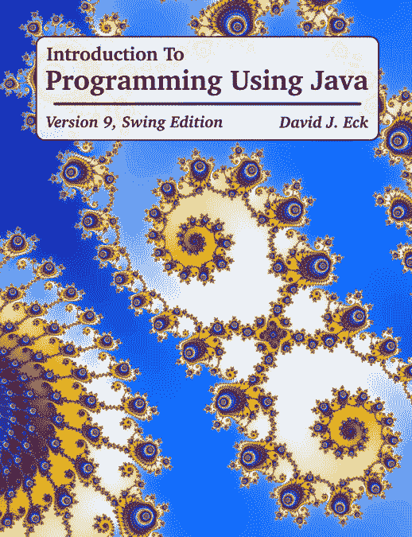

这是一个免费 Java 编程教材的`实验性`电子书版本。格式上的任何不规范之处请谅解。特别是您的阅读器在处理过宽的代码段可能会遇到问题。请注意，PDF 和网页版本可以在[`math.hws.edu/javanotes/`](https://math.hws.edu/javanotes/)在线获取。示例代码`未`包含在本电子书中，但电子书包含了指向示例在线副本的链接。可以通过电子邮件向作者发送意见。

## 前言

《使用 Java 编程入门》是一本免费的计算机编程入门教材，使用 Java 作为教学语言。此本书涵盖了 Java 17。它适用于入门编程课程，也适用于尝试自学编程的人。除了对计算机和程序的基本概念比较熟悉外，没有其他先决条件。书中材料足够涵盖一年的大学水平编程课程。第 1 到第 7 章可以作为一学期大学课程的教材，也可以作为一期高中课程的教材。其余章节可以在第二门课程中涵盖。

教材主页[`math.hws.edu/javanotes-swing/`](https://math.hws.edu/javanotes-swing/)提供了书籍网页版和 PDF 版下载链接。示例程序和章末练习题的答案是网站下载的一部分，也可以单独下载。鼓励读者下载示例源代码，并在阅读书籍的同时阅读并运行程序。如果想从书中获得最大的收获，我们也强烈建议读者阅读练习题答案。

在风格上，这是一本教材而非教程。换句话说，它侧重于解释概念，而不是提供分步骤的“如何做”指南。我尝试使用口语化的写作风格，这种风格可能比典型的教科书更接近课堂讲授。这显然不是一本 Java 参考书，也不是对 Java 所有特性的全面综述。它不是为那些已经掌握另一种编程语言的人编写的 Java 快速介绍。相反，它主要面向第一次学习编程的人，它关于通用编程概念的内容与关于 Java 本身的内容同样重要。我相信《使用 Java 编程入门》与市面上出版的传统印刷编程教材相比完全具有竞争力。（好吧，我坦诚，我觉得它更好。）

教授 Java 有几种方法。其中一种方法从一开始就使用图形用户界面编程。另一些人认为应该从一开始就强调面向对象编程。这些`不是`我采用的方法。我推崇的方法是从编程更基础的构建块开始，并在此基础上构建。在介绍性章节之后，我在第 2、3、4 章中涵盖了过程化编程。第 5 章介绍了面向对象编程。第 6 章涵盖了与之密切相关的课题：事件型编程和图形用户界面。第 3 章介绍了数组，并在第 7 章进行了详细讨论。第 8 章是一个短章节，标志着书的转折点，从编程的基本概念跨到涵盖更高级的主题。第 8 章关于编写健壮、正确且高效的程序。第 9 和 10 章涵盖递归和数据结构，包括泛型编程和 Java 集合框架。第 11 章关于文件和网络。第 12 章涵盖线程和并行处理。最后，第 13 章回到图形用户界面编程主题，涵盖了一些更高级的特性。

Java 目前有两种主要的图形用户界面编程方法：JavaFX 和 Swing。本教材使用 Swing，但也有使用 JavaFX 的替代版本。主要区别在于第 6 章和第 13 章，这两个章节用于 GUI 编程，但其他章节中的 GUI 程序和材料也专门使用 Swing。对于 Swing 版，大部分 GUI 材料取自教材的第 7 版，并进行了一些更新和修改。

Swing 是 Java 的标准部分。JavaFX 作为更现代的 GUI 编程方法被引入，但必须从 Java 独立下载并安装，这使其使用变得更复杂。Swing 和 JavaFX 都可以编写复杂的程序，任何一种都是合理的选择。第 8 版教材使用 JavaFX。第 9 版增加了使用 Swing 的替代版本。

教材第 8 版最初涵盖 Java 8，但该版本的后续更新增加了关于 Java 9 到 16 新特性的说明。第 9 版涵盖 Java 17。与第 8 版的主要变化是 Swing 版。第 7 章增加了关于记录（records）的章节。许多示例已修改为使用文本块和新的 switch 语法。增加了对“抽象”通用概念的引用，例如在第 3.1 节中关于控制抽象的短节。在第 5.5 节增加了关于 final 类和方法的短节。全文还有许多细微的修正和修改。

教材的大部分内容适用于 Java 8，书中没有详细介绍 Java 8 之后添加的功能。请注意，只有 Java 8、11 和 17 是“长期支持”版本。当我引入需要 Java 11 或 Java 17 的特性时，我会注明这一事实。然而，我永远不会引用任何非长期支持的发布。

书籍的第一版写于 1996 年，之后出现了几个版本。第 9 版将是最后一个版本。所有版本（至少直到我 2022 年 12 月退休，并在以后）都存档在以下网络地址：

- 第一版：[`math.hws.edu/eck/cs124/javanotes1/`](https://math.hws.edu/eck/cs124/javanotes1/)（涵盖 Java 1.0。）
- 第二版：[`math.hws.edu/eck/cs124/javanotes2/`](https://math.hws.edu/eck/cs124/javanotes2/)（涵盖 Java 1.1。）
- 第三版：[`math.hws.edu/eck/cs124/javanotes3/`](https://math.hws.edu/eck/cs124/javanotes3/)（涵盖 Java 1.1。）
- 第四版：[`math.hws.edu/eck/cs124/javanotes4/`](https://math.hws.edu/eck/cs124/javanotes4/)（涵盖 Java 1.4。）
- 第五版：[`math.hws.edu/eck/cs124/javanotes5/`](https://math.hws.edu/eck/cs124/javanotes5/)（涵盖 Java 5.0。）
- 第六版：[`math.hws.edu/eck/cs124/javanotes6/`](https://math.hws.edu/eck/cs124/javanotes6/)（涵盖 Java 5.0，包含少量 6.0。）
- 第七版：[`math.hws.edu/eck/cs124/javanotes7/`](https://math.hws.edu/eck/cs124/javanotes7/)（涵盖 Java 7。）
- 第八版：[`math.hws.edu/eck/cs124/javanotes8/`](https://math.hws.edu/eck/cs124/javanotes8/)（涵盖 Java 8，以及部分 11 和 17。）
- 带有 JavaFX 的第九版：[`math.hws.edu/eck/cs124/javanotes9/`](https://math.hws.edu/eck/cs124/javanotes9/)（涵盖 Java 17。）
- 带有 Swing 的第九版：[`math.hws.edu/eck/cs124/javanotes9-swing/`](https://math.hws.edu/eck/cs124/javanotes9-swing/)（涵盖 Java 17。）

本教科书是`免费`的，但并不属于公有领域。第`9`版本根据知识共享署名-非商业性-相同共享 4.0 许可协议条款发布。要查看该许可的副本，请访问[`creativecommons.org/licenses/by-nc-sa/4.0/`](http://creativecommons.org/licenses/by-nc-sa/4.0/)。例如，您可以：

- 在您自己的网站上发布未修改的在线版副本（包括列出作者并说明分发许可协议的部分！）。
- 赠送未修改的书籍副本，或按生产成本出售这些副本，前提是它们符合许可协议的要求。
- 将本书作为您所教课程的教材（即使学生为了参加该课程支付了费用）。
- 制作完整书籍或其部分的修改副本并在网上发布或以其他非商业方式分发，前提是必须注明作者、清楚注明修改处，并对修改副本按照与原版相同的许可协议进行分发。这包括向其他语言的翻译。

对于许可协议未涵盖的书籍用途，需要获得作者的许可。

**关于制作的技术说明：** 本书的在线版和 PDF 版本由单一源文件创建，该文件大部分用`XML`编写。为了生成 PDF 版本，将`XML`处理成可供`TeX`排版程序使用的格式。除了`XML`文件外，源码还包括`DTDs`、`XSLT`转换、Java 源代码文件、图像文件、一个`TeX`宏文件以及用于处理的几个脚本。这些脚本在`Linux`和`MacOS`上运行。我已在此处提供了完整的源文件供下载：

[`math.hws.edu/eck/cs124/downloads/javanotes9-swing-full-source.zip`](https://math.hws.edu/eck/cs124/downloads/javanotes9-swing-full-source.zip)

这些文件最初并非为了出版而设计，因此编写并不整洁。此外，使用它们需要相当专业知识。然而，我收到了多次获取源码的请求，并按“原样”提供。有关源码及如何使用的更多信息，请参见源码下载包中的`README`文件。

`JavaFX`版本和`Swing`版本的源文件实际上是由一组公共源文件生成的，那些文件更难使用。如果您对探索它们感兴趣，可以在`Github`上找到那些最终源文件。您可以在在线浏览文件，也可以使用以下 URL 克隆`git`仓库：

[`github.com/davidjeck/javanotes9`](https://github.com/davidjeck/javanotes9)

David J. Eck 教授

数学与计算机科学系

Hobart and William Smith Colleges

邮箱：eck@hws.edu

网址：[`math.hws.edu/eck/`](https://math.hws.edu/eck/)

在机器语言层面，CPU 的操作其实相当简单（尽管在细节上非常复杂）。CPU 执行存储在主内存中的、以机器语言指令序列形式存在的程序。它通过反复从内存中读取（或取指）指令，然后执行（或处理）该指令来实现。这一过程——取指一条指令、执行它、取指另一条指令、执行它，如此循环——被称为**取指-执行周期**（fetch-and-execute cycle）。除了下一节中将涵盖的一个特殊情况外，这就是 CPU 所做的一切。（在现代计算机中，这些情况实际上要复杂得多。如今一个典型的处理器芯片包含几个 CPU“核心”，允许它同时执行多条指令。访问主内存通过内存“缓存”得到了加速，缓存访问速度比主内存更快，用于存储 CPU 很快可能需要的数据和指令。然而，这些复杂性并没有改变基本操作模式。）

CPU 包含一个算术逻辑单元，或`ALU`，它是处理器中执行加法和减法等操作的部分。它还持有少量的寄存器，寄存器是能够存储单个数字的小型内存单元。一个典型的 CPU 可能有 16 或 32 个“通用”寄存器，它们存储可供立即处理的数据值，许多机器语言指令都会引用这些寄存器。例如，可能有一条指令从两个指定的寄存器取出两个数字，将这些数字相加（使用`ALU`），并将结果存回寄存器。可能存在将数据值从主内存复制到寄存器，或从寄存器复制到主内存的指令。

CPU 还包括特殊用途寄存器。其中最重要的是程序计数器，或`PC`。CPU 使用`PC`来跟踪它在正在执行的程序的位置。`PC`存储 CPU 应该执行的下一条指令的内存地址。在每个取指-执行周期的开始，CPU 检查`PC`以确定应该提取哪条指令。在取指-执行周期期间，`PC`中的数值会被更新，以指示下一个周期要执行的指令。通常情况下（并非总是），这只是程序中当前指令之后的指令。某些机器语言指令会修改存储在`PC`中的值。这使得计算机从程序的某一点“跳转”到另一个点，这对于实现第 1.4 节中讨论的循环和分支等程序功能至关重要。

计算机机械地执行机器语言程序——也就是说，在不理解或不思考它们的情况下——仅仅是因为它的物理构造方式。这并不是一个容易理解的概念。计算机是由数百万个被称为晶体管的微开关组成的机器，晶体管具有这种特性：它们可以按方式连接在一起，使得一个开关的输出可以开启或关闭另一个开关。当计算机进行计算时，这些开关按照某种模式相互开启或关闭，这种模式取决于它们的布线方式以及计算机正在执行的程序。

机器语言指令以二进制数表示。二进制数只有两个可能的数字：0 和 1。每个 0 或 1 被称为位（bit）。因此，机器语言指令只是 0 和 1 的序列。每个特定的序列编码某个特定的指令。计算机处理的数据也以二进制数编码。在现代计算机中，每个内存位置存储一个字节（byte），即八位序列。一条机器语言指令或一段数据通常由几个字节组成，存储在连续的内存位置中。例如，当 CPU 从内存读取一条指令时，它实际上是从四个或八个内存位置读取四个或八个字节；指令的内存地址就是这些字节中第一个字节的地址。

计算机可以直接处理二进制数，因为开关可以很方便地表示这些数字：开启开关表示 1；关闭开关表示 0。机器语言指令以开关开启或关闭的模式形式存储在内存中。当一条机器语言指令加载到 CPU 时，所发生的只是某些开关按照编码该指令的模式被开启或关闭。CPU 的设计初衷是通过执行该模式所编码的指令来响应这种模式；它这样做仅仅是因为 CPU 中所有其他开关的布线方式。

所以，你对计算机的工作原理至少应该理解这些：主内存存储机器语言程序和数据。这些内容以二进制数编码。CPU 从内存中一个接一个地取出机器语言指令并执行它们。每条指令都让 CPU 执行某些非常微小的任务，例如两个数字相加，或在内存与寄存器之间移动数据。CPU 机械地完成所有这一切，而不去思考或理解它在做什么——因此，它执行的程序必须是完美的、在所有细节上都是完备的且无歧的，因为 CPU 除了完全按照编写的内容执行程序之外，别无可做。以下是这种对计算机第一阶段理解的示意图：

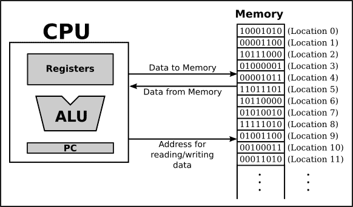

### 第 1.2 节

## 异步事件：轮询循环与中断

CPU 几乎所有的时间都花在从内存取指并执行指令上。然而，CPU 和主内存只是真实系统中许多组件中的两个。一个完整的系统包含其他设备，例如：

- 用于存储程序数据文件的硬盘或固态硬盘。（注意，主内存存储的信息相对较少，且仅在电源开启时保留。硬盘或固态硬盘用于永久存储大量信息，但程序必须先从那里加载到主内存才能被实际执行。硬盘将数据存储在旋转磁磁盘上，而固态硬盘是纯电子设备，没有移动部件。）
- 用于用户输入的键盘和鼠标。
- 用于显示计算机输出的显示器和打印机。
- 允许计算机播放声音的音频输出设备。
- 网络接口，允许计算机通过网络（无线或有线）与连接到它的计算机通信。
- 扫描仪，将图像转换为可以在计算机上存储和处理的编码二进制数。

设备列表是完全开放的，计算机系统被设计成可以通过添加新设备来轻松扩展。CPU 必须与所有这些设备通信并控制它们。CPU 只能通过机器语言指令来实现（这是它唯一能做的）。这种工作原理是：系统中的每个设备都有一个设备驱动程序，它由 CPU 在处理该设备时执行的软件组成。如果没有设备驱动程序，实际物理设备将毫无用处，因为 CPU 无法与之通信。

# 计算机系统

由许多设备组成的计算机系统通常通过将这些设备连接到一个或多个总线来组织。总线是一组导线，用于在连接到导线的设备之间传输各种类型的信息。导线传输数据、地址和控制信号。地址将数据定向到特定的设备，可能还会指向该设备内的某个特定寄存器或位置。控制信号可以被一个设备用于提醒另一个设备，数据总线上已有可用数据供其使用。一个相当简单的计算机系统可以这样组织：

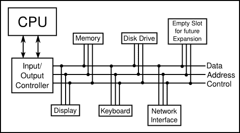

## 轮询与中断

现在，像键盘、鼠标和网络接口等设备可以产生需要 CPU 处理的输入。CPU 如何知道数据就在那里呢？一个简单的想法（事实证明这并不理想）是让 CPU 不断地反复检查进入的输入数据。每当它发现数据时，它就进行处理。这种方法被称为`polling`（轮询），因为 CPU 会不断轮询输入设备以查看它们是否有任何报告的输入数据。遗憾的是，尽管`polling`非常简单，但它的效率也很低。CPU 可能会花费大量时间等待输入。

为了避免这种低效率，通常使用`interrupts`（中断）而不是`polling`。`interrupt`（中断）是由另一个设备发送到 CPU 的信号。CPU 对`interrupt`信号的响应是放下它正在做的任何事情以响应`interrupt`。一旦它处理完`interrupt`，它就会返回到`interrupt`发生之前正在的工作。例如，当你按下电脑键盘上的某个按键时，一个键盘中断会被发送到 CPU。CPU 对此信号的响应是中断它正在工作，读取你按下的按键，对其进行处理，然后返回到你在按下按键之前正在执行的任务。

## 中断的工作机制

再次，你应该理解这是一个纯机械的过程：设备只需通过接通某根导线来发出`interrupt`信号。CPU 的设计使得当该导线接通时，CPU 会保存足够关于其当前正在操作的信息，以便稍后返回到相同的状态。这些信息包含了重要内部寄存器的内容，例如`program counter`（程序计数器）。然后，CPU 跳到某个预定义的内存位置并开始执行存储在该处的指令。这些指令组成一个`interrupt handler`（中断处理程序），负责执行响应`interrupt`所需的处理。（这个`interrupt handler`是发出`interrupt`的设备驱动程序软件的一部分）。在`interrupt handler`的末尾有一条指令，告诉 CPU 跳回它之前正在工作的地方；它通过恢复之前保存的状态来实现这一点。


`Interrupts` 允许 CPU 处理异步事件。在常规的取指执行循环中，事情是按照预定的顺序发生的；发生的一切事情都与所有事情是“同步”的。`Interrupts` 使 CPU 能够高效地处理“异步”发生的事件，即在不可预测的时间发生的事件。

作为 `interrupts` 用法的另一个示例，考虑当 CPU 需要访问存储在硬盘上的数据时会发生什么。只有当数据在内存中时，CPU 才能直接访问。磁盘上的数据在访问之前必须复制到内存中。遗憾的是，就 CPU 运行的速度而言，磁盘驱动器极其缓慢。当 CPU 需要来自磁盘的数据时，它向磁盘驱动器发送一个信号，让其定位数据并准备就绪。（该信号是在程序的控制下同步发送。）然后，CPU 不再仅仅等待磁盘驱动器完成此操作所需的长时间且不可预测的时间，而是继续执行其他任务。当磁盘驱动器准备好数据后，它会向 CPU 发送一个 `interrupt signal`（中断信号）。随后 `interrupt handler` 就可以读取请求的数据。

## 多任务与线程

现在，你可能已经注意到，只有当 CPU 确实有几个任务执行时，这一切才有意义。如果它没有其他事情要做，大可以一直 `polling` 输入或等待磁盘驱动器操作完成。所有现代计算机都使用 `multitasking`（多任务）来同时执行几个任务。有些计算机可以同时供几个人使用。由于 CPU 极快，它可以迅速将注意力从一个用户切换到另一个用户，为每个用户投入几分之一秒的时间。这种 `multitasking` 的应用被称为 `timesharing`（分时）。但一个只有一个用户的现代个人电脑也使用 `multitasking`。例如，用户可能在打字时，时钟在持续显示时间，同时一个文件正在通过网络下载。

CPU 正在处理的每个单独任务被称为一个 `thread`（线程）。或者称为进程；线程和进程之间存在技术差异，但在这里并不重要，因为 Java 使用的是线程。）许多 CPU 实际上可以从字面上同时执行多个 `thread`——这样的 CPU 包含多个“核心”，每个核心都可以运行一个 `thread`——但同时执行的 `threads` 数量始终有一个限制。由于 `threads` 通常多于可以同时执行的数量，计算机必须将其注意力从一个 `thread` 切换到另一个 `thread`，就像 `timesharing` 计算机将注意力从一个用户切换到另一个一样。通常，正在执行的 `thread` 将继续运行直到发生以下几种情况之一：

- `thread` 可能会自愿让出控制权，给其他 `threads` 运行的机会。
- `thread` 可能必须等待某些异步事件的发生。例如，`thread` 可能向磁盘驱动器请求某些数据，或者它可能等待用户按下按键。在等待期间，该 `thread` 被称为 `blocked`（阻塞），此时其他 `threads` 有机会运行。当事件发生时，`interrupt` 将“唤醒”该 `thread` 使其继续运行。
- `thread` 可能会用完其分配的时间片而被挂起，以便其他 `threads` 运行。大多数计算机都可以这种方式“强制”挂起 `thread`；做到点的计算机被称为使用 `preemptive multitasking`（抢占多任务）。为了实现做到 `preemptive multitasking`，计算机需要一个特殊的定时器设备，以固定间隔（例如每秒 100 次）产生 `interrupt`。当定时 `interrupt` 发生时，CPU 有机会从一个 `thread` 切换到另一个 `thread`，无论当前运行的 `thread` 是否愿意。

普通用户，乃至普通程序员，不需要处理 `interrupts` 和 `interrupt handlers`。他们可以专注于想要计算机执行的不同任务；计算机如何完成所有任务的细节对他们来说并不重要。事实上，大多数用户和许多程序员可以完全忽略 `threads` 和 `multitasking`。然而，随着计算机变得越来越强大以及它们开始更多地利用多任务和多处理器处理，`threads` 变得越来越重要。事实上，处理 `threads` 的能力正成为程序员的一项基本工作技能。幸运的是，Java 对 `threads` 有很好的支持，它们作为一种基础编程概念内置在 Java 编程语言中。关于 `threads` 的编程将在[第 12 章介绍](../c12/index.html)。

在 Java 以及整个现代编程中，异步事件这一基本概念同样重要。虽然程序员实际上并不直接处理中断，但他们经常发现自己正在编写事件处理器，而这些处理器与中断处理程序一样，在特定事件发生时被异步调用。这种“事件驱动编程”的感觉与更传统的直通式、同步编程有很大不同。我们将从更传统的编程类型开始，这种类型仍被用于编写单个任务，但我们将在本文稍后部分回到线程和事件，从`第 6 章`开始。

顺便提一下，负责所有中断处理、处理与用户以及硬件设备的通信，并控制允许哪个线程运行的软件被称为操作系统。操作系统是基础且核心的软件，没有它计算机将无法运行。其他程序（如文字处理器和 Web 浏览器）依赖于操作系统。常见的桌面操作系统包括 Linux、各种版本的 Windows 和 MacOS。智能手机和平板电脑的操作系统包括 Android 和 iOS。

## 第 1.3 节 Java 虚拟机

机器语言由非常简单的指令组成，这些指令可以由计算机的 CPU 直接执行。然而，所有的程序都是用 Java、Python 或 C++ 等高级编程语言编写的。用高级语言编写的程序不能直接在任何计算机上运行。首先，它必须被翻译成机器语言。这种翻译可以通过一个名为编译器的程序来完成。编译器获取高级语言程序并将其翻译成一个可执行的机器语言程序。一旦翻译完成，该机器语言程序就可以无限次运行，但当然，它只能在一种类型的计算机上运行，因为每种类型的计算机都有其特定的机器语言。（事实上，Java 也依赖于它所运行的特定操作系统，因为它必须与操作系统协作以执行某些任务，如访问计算机硬件。但在这里我们忽略这个复杂性。）如果程序要在另一种类型的计算机上运行，它就必须使用不同的编译器重新翻译成适当的机器语言。

编译高级语言程序还有另一种替代方案。你不是使用一次性翻译整个程序的编译器，而是可以使用解释器，它根据需要逐条指令地翻译程序。解释器是一个作用类似于 CPU 的程序，具有某种“取指并执行”的循环。为了执行一个程序，解释器在循环中运行，在循环中它反复从程序中读取一条指令，决定执行该指令需要什么，然后执行相应的机器语言指令来完成。

（编译器就像一个人类翻译员，将整本书从一种语言翻译成另一种语言，在第二语言中产生一本新书。解释器更像是一个人类口译员，在联合国演讲的同时，将演讲内容从一种语言翻译成另一种语言。）

解释器的一种用途是执行高级语言程序。例如，Lisp 编程语言通常由解释器而不是编译器执行。然而，解释器还有另一个用途：它们可以让你将为某种类型计算机设计的机器语言程序运行在完全不同类型的计算机上。例如，最早的家用计算机之一是 Commodore 64 或简称 "C64"。虽然你可能找不到真正的 C64，但你可以找到在其他计算机上运行（甚至在 Web 浏览器中运行）的程序来“模拟”它。这种模拟器可以通过充当 C64 机器语言的解释器来运行 C64 程序。

Java 的设计者选择了将编译和解释相结合的方法。用 Java 编写的程序被编译成机器语言，但这种机器语言是针对一种并不存在的计算机的。这种所谓的“虚拟”计算机被称为 Java 虚拟机，或 `JVM`。Java 虚拟机的机器语言被称为 Java 字节码。没有理由认为 Java 字节码不能作为真实计算机的机器语言而非虚拟计算机。但事实上，使用虚拟机使得 Java 的主要卖点之一成为可能：即它实际上可以用于**任何**计算机。计算机需要的只是一个针对 Java 字节码的解释器。这种解释器模拟 `JVM` 的方式就像 C64 模拟器模拟 Commodore 64 计算机一样。（`JVM` 术语也用于执行模拟的 Java 字节码解释器程序，因此我们说计算机运行 Java 程序需要一个 `JVM`。从技术上讲，说解释器实现了 `JVM` 比说它是一个 `JVM` 更准确。）

当然，每种类型的计算机都需要不同的 Java 字节码解释器，但一旦计算机有了 Java 字节码解释器，它就可以运行任何 Java 字节码程序，而同一个程序可以在任何具有此类解释器的计算机上运行。这是 Java 的基本特征之一：同一个编译后的程序可以运行在许多不同类型的计算机上。


你可能会想，为什么要使用中间的 Java 字节码呢？为什么不直接分发原始 Java 程序，并让每个人将其编译成他们想要运行的计算机的机器语言呢？有几个原因。首先，编译器必须理解 Java 这种复杂的高级语言。编译器本身就是一个复杂程序。而，Java 字节码解释器是一个相对较小、简单的程序。这使得为新类型的计算机编写字节码解释器变得容易；一旦完成，该计算机就可以运行任何编译后的 Java 程序。而为同一台计算机编写 Java 编译器则要困难得多。

此外，Java 的设计时考虑到某些程序将通过网络下载。这导致了显而易见的安全问题：你不想下载并运行一个会损坏你的计算机或文件的程序。字节码解释器在你和程序之间充当了缓冲区。你实际上是在运行解释器，由它间接运行下载的程序。解释器可以让你受到程序程序危险操作的影响。

当 Java 还是一个新语言时，它因缓慢受到批评：由于 Java 字节码是由解释器执行的，似乎 Java 字节码程序永远无法像编译成原生机器语言（即运行程序的计算机的实际机器语言）的程序那样快。然而，这个问题通过使用即时编译器（JIT compiler）来执行 Java 字节码在很大程度上得到了解决。即时编译器将 Java 字节码翻译成原生机器语言。它在执行程序时进行这种工作。与普通解释器一样，即时编译器的输入是 Java 字节码程序，它的任务是执行该程序。但在执行程序的同时，它也将将其部分翻译成原生机器语言。翻译后的程序部分执行速度可以比解释执行快得多。由于程序的某部分在运行期间通常会被执行多次，即时编译器可以显著提高整体执行速度。

我应该指出，`Java` 和 `Java 字节码` 之间并没有必然联系。用 `Java` 编写的程序完全可以编译成真实计算机的机器语言。其他语言编写的程序也可以编译成 `Java 字节码`。然而，`Java` 与 `Java 字节码` 的结合是平台无关、安全且网络兼容的，同时允许你使用现代的高级面向对象语言进行编程。

甚至还有其他编程语言可以编译成 `Java 字节码`。编译后的字节码程序可以由标准的 `JVM` 执行。专门为为 `JVM` 设计而开发的新语言包括 `Scala`、`Groovy`、`Clojure` 和 `Processing`。`Jython` 和 `JRuby` 是旧语言 `Python` 和 `Ruby` 的版本，它们的目标是 `JVM`。这些语言让人们能够在享受 `JVM` 许多优势的同时，避开 `Java` 语言的一些技术复杂性。事实上，在 `JVM` 上使用其他语言已经变得足够重要，以 `JVM` 专门添加了一些新功能，以对其中某些语言提供更好的支持。而对 `JVM` 的这些改进反过来也为 `Java` 的一些新功能提供了可能。

***

我还应该指出，平台无关性真正困难的部分是提供一个“图形用户界面”——带有窗口、按钮等——并且它能够在所有支持 `Java` 的平台上运行。你将在 第 1.6 节 中看到更多关于这个问题的内容。

## 第 1.4 节：程序的底层构建模块

***

编程有两个基本方面：数据和指令。要处理数据，你需要理解变量和类型；要处理指令，你需要理解控制结构和子程序。你将在课程的大部分时间里熟悉这些概念。

变量仅仅是一个内存位置（或若干个被视为一个单元的连续内存位置），它被赋予了一个名称，以便在程序中方便地引用和使用。程序员只需要关心名称；跟踪内存位置是编译器的责任。作为一名程序员，你只需要记住这个名称指的是内存中的一种“盒子”，它可以存储数据，尽管你不需要知道这个盒子位于内存的哪个位置。

在 `Java` 以及许多其他编程语言中，变量有一个类型，该类型指示了它可以存储什么类型的数据。一种类型的变量可能存储整数——整数数字如 `3`、`-7` 和 `0`——而另一种类型则存储浮点数——带有小数点的数字如 `3.14`、`-2.7` 或 `17.0`。（是的，计算机确实区分了整数 `17` 和浮点数 `17.0`；它们在计算机内部实际上看起来非常不同。）可能还会有单个字符（`'A'`、`;` 等）、字符串（`"Hello"`、`"A string can include many characters"` 等）以及不常见的类型，如日期、颜色、声音或程序可能需要存储的任何其他数据。

编程语言始终有命令用于将数据输入输出到变量，以及对数据进行计算。例如，下面这条可能出现在 Java 程序中的“赋值语句”，它告诉计算机取名为 `"principal"` 的变量中存储的数字，将该数字乘以 `0.07`，然后将结果存储在名为 `"interest"` 的变量中：

```
interest = principal * 0.07;
```

还有“输入命令”用于从用户或计算机磁盘上的文件获取数据，还有“输出命令”用于向另一个方向发送数据。

这些基本命令——用于在不同位置之间移动数据以及执行计算——是所有程序的构建模块。这些构建模块通过控制结构和子程序组合成复杂的程序。

***

程序是指令的序列。在普通的“控制流”中，计算机按照指令在程序中出现的顺序，一个接一个地执行这些指令。然而，这显然是非常局限的：计算机很快就会没有可执行的指令了。控制结构是能够改变控制流的特殊指令。控制结构有两种基本类型：循环，它允许一组指令被反复执行；以及分支，它允许计算机通过测试程序运行过程中发生的条件，在两个或多个不同的行动方案之间做出决策。

例如，如果变量 `"principal"` 的值大于 `10000`，则应该通过将本金乘以 `0.05` 来计算 `"interest"`；如果不是，则应该通过将本金乘以 `0.04` 来计算利息。程序需要某种方式来表达这种类型的决策。在 `Java` 中，可以使用以下“if 语句”来表达：

```
if (principal > 10000)
    interest = principal * 0.05;
else
    interest = principal * 0.04;
```

（现在不用担心细节。只需记住计算机可以测试一个条件，并根据该测试决定下一步做什么。）

当必须多次执行同一任务时，就会使用循环。例如，如果你想为邮件列表上的每个名字打印邮寄标签，你可能会：“获取第一个名字和地址并打印标签；获取第二个名字和地址并打印标签；获取第三个名字和地址并打印标签……”但这很快就会变得很荒谬——如果你预先不知道有多少个名字，这可能完全无法运行。你想说的是类似于“当还有名字需要处理时，获取下一个名字和地址并打印标签。”可以在程序中使用循环来表达这种重复。

***

大型程序非常复杂，如果没有某种方法将它们拆分成“块”，那么编写它们几乎是不可能的。子程序提供了这种这种方法。子程序由执行某些任务的指令组成，这些指令被组合在一起并赋予一个名称。该名称随后可以作为整组指令的替代品。例如，假设你的程序需要的任务之一是在屏幕上画一栋房子。你可以将必要的指令放入子程序，并给该子程序起一个合适的名称——例如 `drawHouse()`。那么在程序中任何需要画房子的地方，你都可以单个命令来实现：

```
drawHouse();
```

这与在每个地方重复所有画房子的指令的效果相同。

这里的优势不仅是节省了字数。将程序组织成子程序还有助于你组织思路和程序设计工作。在编写画房子子程序时，你可以专注于画房子的问题，而暂时不需要担心程序的其他部分。一旦子程序写好，你就可以忘记画房子的细节了——这个问题已经解决了，因为你有一个子程序为你完成。子程序就像语言的内置部分一样，你可以使用它，而无需思考子程序“内部”发生了什么。

***

变量、类型、循环、分支和子程序是所谓的“传统编程”的基础。然而，随着程序的变大，需要额外的结构来帮助处理其复杂性。人们发现的最有效工具之一是面向对象编程，它将在下一节中讨论。

程序必须经过设计。没有人可以仅仅坐在电脑前就编写出任何复杂程度的程序。软件工程这门学科关注的是构建正确、运行良好且编写良好的程序。软件工程师尝试使用被认可且经过证明的方法来分析要解决的问题，并设计出用于解决该问题的程序。

在 20 世纪 70 年代到 80 年代初期间，主要的软件工程方法论是结构化编程。结构化编程程序设计方法基于以下建议：要解决一个大问题，将问题分解为若干部分并分别处理每个部分；要解决每个部分，将其视为一个新问题，该问题本身可以被进一步分解为更小的问题；最终，你将处理到可以直接解决而无需进一步分解的问题。这种方法被称为自顶向下编程。

自顶向下编程并没有问题。它是一种价值且经常使用的解决问题的方法。然而，它是不完整的。其一，它几乎完全关注产生解决问题所需的`instructions`（指令）。但随着时间的推移，人们意识到，程序的`data structures`（数据结构）设计至少与子程序和控制结构的设计一样重要。自顶向下编程对程序所操作的数据没有充分的考虑。

严格自顶向下编程的另一个问题是，它难以重用为其他项目的工作。通过从一个特定问题开始并将其细分为方便的部分，自顶向下编程倾向于产生一个该问题特有的设计。你不太可能从另一个程序中提取一大段代码并将其适配到你的项目中，至少在不进行大量修改的情况下是。编写高质量的程序是困难且昂贵的，因此程序员和雇佣他们的人总是渴望重用过去的工作。

***

因此，在实践中，自顶向下设计通常与自底向上设计相结合。在自底向上设计中，方法是从“底部”开始，即从你已经知道如何解决的问题（并且你可能已经有一个可以重用的软件组件）。从那里开始，你可以向上工作直到找到整个问题的解决方案。

可重用的组件应该尽可能是“模块化的”。模块是大型系统的一个组件，它以简单、定义良好且直观的方式与系统的其他部分交互。这种思想是，模块可以被“插入”系统中。只要模块能够正确地完成其分配的角色，模块内部的细节对整个系统来说并不重要。这被称为信息隐藏（information hiding），它是软件工程最重要的原则之一。


软件模块的一种常见格式是包含一些数据，以及一些处理这些数据的子程序。例如，一个邮件列表模块可能包含一个姓名和地址列表，以及一个添加新姓名的子程序、一个打印邮寄标签的子程序等。在这样的模块中，数据本身通常隐藏在模块内部；使用该模块的程序只能通过调用模块提供的子程序来间接地操纵数据。这保护了数据，因为数据只能以已知且定义良好的方式进行操作。这还让程序使用该模块变得更加容易，因为它们不需要担心数据表示方式的细节。关于数据表示的信息被隐藏了。

支持这种信息隐藏的模块在 20 世纪 80 年代初进入编程语言并变得常见。从那时起，同一种思想的更高级的形式在很大程度上接管了软件工程。这种最新方法被称为面向对象编程（object-oriented programming），通常缩为 `OOP`。

### 面向对象编程

面向对象编程的核心概念是对象，它是一种包含数据和子程序的模块。`OOP` 的观点是，对象是一种自给自足的实体，它具有内部状态（它包含的数据），并且可以响应消息（对其子程序的调用）。例如，一个邮件列表对象拥有一个由姓名和地址列表组成的状态。如果你向它发送一条消息告诉它添加一个姓名，它将通过修改其状态以反映该变化来响应。如果你向它发送一条消息让它打印自己，它将通过打印它的姓名和地址列表来响应。

软件工程的 `OOP` 方法首先识别问题相关的对象以及这些对象应该响应的消息。生成的程序是对象的集合，每个对象都有自己的数据和的一的责任。对象之间通过互相发送消息进行交互。在此类程序的大规模设计中，并没有多少“自顶向下”的内容，习惯了传统程序的人可能很难适应 `OOP`。然而，使用 `OOP` 的人会声称，面向对象的程序往往是世界本身运行方式更好的模型，因此它们更容易编写、更容易理解，并且更有可能是正确的。

对象应该被看作“知道”如何响应某些消息。不同的对象可能会以不同的方式响应相同的消息。例如，“打印”消息会产生非常不同的结果，取决于它被发送给哪个对象。对象的这种属性——不同对象可以以不同的方式响应相同的消息——被称为多态（polymorphism）。

### 类与继承

对象之间具有某种“家族相似性”是常见现象。包含相同类型数据并以相同方式响应相同消息的对象属于同一个 `class`（类）。在实际编程中，`class` 是主体；也就是说，先创建一个 `class`，然后使用该 `class` 作为模板创建一个或多个对象。但对象可以相似，但不完全属于同一个 `class`。

例如，考虑一个允许用户在屏幕上绘制直线、矩形、椭圆、多边形和曲线的程序。在程序中，屏幕上的每个可见对象都可以由程序中的一个软件对象表示。程序中会有五类 `class`，每种对应一种可以绘制可见的对象。所有的直线属于一个 `class`，所有的矩形属于另一个 `class`，依此类推。这些 `class` 显然是有关联的；它们都代表“可绘制对象”（drawable objects）。例如，它们可能可能都能够响应“绘制你自身”的消息。

另一种基于表示每类型对象所需的数据的分组方法并不那么直观，但在程序中会非常有用：我们将多边形和曲线归类为“多点对象”（multipoint objects），而直线、矩形和椭圆是“两点对象”（直线由它的两个端点决定，矩形由两个角决定，椭圆由包含它的矩形的两个角决定。我在这里说的矩形是指边为垂直和水平的矩形，因此只需要两个点就可以指定；这是绘图程序中“rectangle”的常见含义）。我们可以如下图所示绘制这些关系：

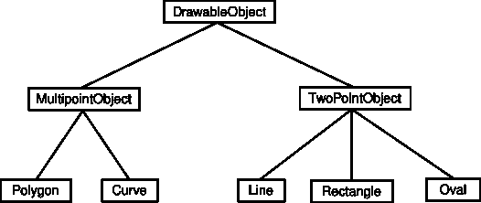

`DrawableObject`、`MultipointObject` 和 `TwoPointObject` 是程序中的类。`MultipointObject` 和 `TwoPointObject` 是 `DrawableObject` 的子类。`Line` 类是 `TwoPointObject` 的子类，并且（间接地）也是 `DrawableObject` 的子类。一个类的子类被认为继承了该类的属性。子类可以在继承的基础上添加内容，甚至可以“重写”部分继承内容（通过对某些消息定义不同的响应）。尽管如此，线、矩形等都是可绘制的对象，而 `DrawableObject` 类表达了这种关系。

继承是组织程序的强大手段。它与软件组件的复用问题有关。类是最终的可复用组件。如果它恰好符合你正在尝试编写的程序，就可以直接复用；但如果它几乎符合，你仍然可以通过定义一个子类并仅进行必要的微更改以完全适应你的需求，来复用它。

因此，`OOP` 既是优越的程序开发工具，也是解决软件复用问题的部分解决方案。对象、类和面向对象编程将是本文其余部分中的重要主题。你将开始使用 Java 语言内置的对象，位于下一章，并在第 5 章中开始创建自己的类和对象。

## 第 1.6 节：现代用户界面

当计算机刚引入时，普通人——包括大多数程序员——无法接触它们。它们被锁在有白大褂的工作人员的房间里，这些人员接收你的程序和数据，将其输入计算机，并在一段时间后返回计算机的响应。当分时系统在 20 世纪 60 年代发明（计算机在不同人之间快速切换注意力），几个人同时与计算机直接交互变得可能。在分时系统中，用户坐在“终端”前向计算机输入命令，计算机则回传其响应。早期的个人电脑也使用输入的命令和响应，区别是每次只有一个人参与。这种用户与计算机之间的交互被称为命令行界面。

今天，当然，大多数人以完全不同的方式与计算机交互。他们使用图形用户界面，或称 `GUI`。计算机在屏幕上绘制界面组件。这些组件包括窗口、滚动条、菜单、按钮和图标等内容。通常使用鼠标来操作此类组件，或者在“触摸屏”上使用你的手指。假设你不是刚从 20 世纪 70 年穿越过来的，你无疑已经熟悉图形用户界面的基础知识！

许多 `GUI` 界面组件已经变得非常标准。这意味着它们在包括 `MacOS`、`Windows` 和 `Linux` 在内的许多不同计算机平台上具有相似的外观和行为。Java 程序旨在不修改程序的情况下运行在许多不同的平台上，可以使用所有标准的 `GUI` 组件。它们的外观在平台之间可能略有不同，但在程序运行的任何计算机上，其功能应该是相同的。

下面显示了一个非常简单的 Java 程序的图像，演示了几个标准的 `GUI` 界面组件。当程序运行时，计算机屏幕上将打开一个与所示图片类似的窗口。窗口中有四个用户可以交互的组件：一个按钮、一个复选框、一个文本字段和一个弹出菜单。这些组件都有标签。窗口中还有其他几个组件。标签本身也是组件（尽管你无法与它们交互）。窗口的右半部分是一个区域组件，它可以显示多行文本。当文本行数超过文本区域能够容纳的数量时，滚动条组件出现在文本区域旁边。事实上，整个窗口本身也可以被视为一个“组件”。

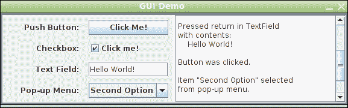

（如果你想运行此程序，可以在线获取源代码 [`GUIDemo.java`](https://math.hws.edu/eck/cs124/javanotes9/source/chapter1/GUIDemo.java)。有关如何使用此示例以及本教科书中其他示例的更多信息，请参阅第 2.6 节。）

事实上，Java 有三套完整的 GUI 组件可以使用。其中一套 `AWT`（或抽象窗口工具包，Abstract Windowing Toolkit）是 Java 原始版本的一部分。第二套称为 `Swing`，它基于 `AWT` 构建；它在 Java 1.2 版本中引入，并在多年里一直是标准的 GUI 工具包。第三种 GUI 工具包 `JavaFX` 曾在版本 8 中短暂地成为 Java 的标准部分，但现在是单独分发的。`JavaFX` 旨在作为编写 GUI 程序的更现代的方法，但由于必须单独下载和安装，使用它变得复杂。本教材专门涵盖 `Swing`，但也有一个替代版本的教材涵盖了 `JavaFX`。本教材的任何一个版本都是合理的选择。

当用户与 GUI 组件交互时，就会产生“事件”。例如，点击按钮会产生一个事件，按下键盘上的键会产生一个事件。每当产生事件时，程序都会收到一条消息告诉事件已发生，程序根据其程序做出响应。事实上，一个典型的 GUI 程序大部分由“事件处理器”组成，它们告诉程序如何响应各种类型的事件。在上面的示例中，程序被设计为通过在文本区域中显示消息来响应每个事件。在更真实的示例中，事件处理程序会有更多要做。

这里使用“消息”一词是有故意的。消息（正如你在前一节中所示）是发送给对象的。事实上，Java GUI 组件是实现为对象的。


现在不要担心细节，但要尝试感受一下面向对象编程和继承在这里是如何使用的。注意，所有的 GUI 类都直接或间接地是一个名为 `JComponent` 的类的子类，该类代表了所有 `Swing` 组件共享的属性。在图中，`JComponent` 的两个直接子类本身也有子类。`JTextArea` 和 `JTextField` 类具有某些共同的行为，被归类为 `JTextComponent` 的子类。同样，`JButton` 和 `JToggleButton` 是 `JAbstractButton` 的子类，该类代表了按钮和复选框共有的属性。（顺便说一下，`JComboBox` 是代表弹出菜单的 `Swing` 类。）

今天，全球数以百万计的计算机都连接到一个被称为互联网的巨大网络中。每天都有新的计算机接入互联网，既有通过无线通信，也有通过 DSL、电缆调制解调和以太网等技术进行的物理连接。

## 互联网协议

互联网通信有一套极其复杂的协议。协议简单来说就是关于通信如何进行的详细规范。为了让两台计算机能够通信，它们都必须使用相同的协议。互联网上最基础的协议是 `Internet Protocol`（`IP`），它规定了数据如何从一台计算机物理传输到另一台计算机；以及 `Transmission Control Protocol`（`TCP`），它确保使用 `IP` 发送的数据被完整且无误地接收。这两个协议统称为 `TCP/IP`，为通信提供了基础。其他协议使用 `TCP/IP` 来发送特定类型的信息，例如网页、电子邮件和数据文件。

## 数据包与地址

互联网上的所有通信都以数据包的形式存在。数据包由从一台计算机发送到另一台计算机的一些数据，以及指示这些数据在互联网上何处的地址信息组成。将数据包想象成一个信封，外面有地址，里面有消息。（消息就是数据。）数据包还包含一个“回地址”，即发送者的地址。数据包只能存放有限的数据；较长的消息必须分成多个数据包，这些数据包随后通过网络单独发送，并在目的地重新组装。

互联网上的每台计算机都有一个 `IP` 地址，这是一个在网络所有计算机中唯一标识它的数字。（实际上，唯一性的说法并不完全准确，但基本思想是有效的，事实非常复杂。）`IP` 地址用于数据包的寻址。只有知道另一台计算机的 `IP` 地址时，计算机才能向其发送数据。由于人们倾向于使用名称而不是数字，大多数计算机也通过被称为域名的名称来标识。例如，霍巴特和威廉·史密斯学院（Hobart and William Smith Colleges）数学系的主计算机域名为 `math.hws.edu`。（域名只是为了方便；你的计算机在通信之前仍需要知道 `IP` 地址。互联网上有些计算机的工作是将域名翻译成 `IP` 地址。当使用域名时，你的计算机会向域名服务器发送消息以查找相应的 `IP` 地址。然后，你的计算机将使用 `IP` 地址而不是域名与另一台计算机进行通信。）

## 互联网服务

互联网为连接到它的计算机（当然，还有这些计算机的用户）提供了多种服务。这些服务使用 `TCP/IP` 在网络上发送各种类型的数据。最受欢迎的服务包括即时消息、文件共享、电子邮件和全球维网。每种服务都有自己的协议，用于控制数据在网络上的传输。每种服务还具有某种用户界面，允许用户通过该服务查看、发送和接收数据。

例如，电子邮件服务使用名为 `SMTP`（`Simple Mail Transfer Protocol`）的协议将电子邮件邮件从一台计算机传输到另一台计算机。其他协议，如 `POP` 和 `IMAP`，用于从电子邮件账户获取消息，以便收件者阅读它们。然而，使用电子邮件的人不需要理解甚至不需要知道这些协议。相反，这些协议在后台由计算机程序用于发送和接收电子邮件邮件。这些程序为用户提供了一个易于使用的底层网络协议的用户界面。

## 全球维网

全球维网可能是所有网络服务中最令人兴奋的。全球维网允许你请求存储在互联网各地计算机上的信息页面。一个网页可以包含指向其所在计算机上其他页面的链接，也可以指向世界上任何地方其他计算机的链接。存储此类信息页面的计算机被称为 Web 服务器。网页的用户界面被称为 Web 浏览器的程序。常见的 Web 浏览器包括 `Microsoft Edge`、`Firefox`、`Chrome` 和 `Safari`。你使用 Web 浏览器请求信息页面。浏览器向存储该页面的计算机发送该页面的请求，当从该计算机接收响应时，Web 浏览器以整洁的格式向你显示。Web 浏览器只是网页的用户界面。在后台，Web 浏览器使用名为 `HTTP`（`HyperText Transfer Protocol`）的协议来发送每个页面请求并接收 Web 服务器的响应。

## Java 与互联网

现在你可能在想，这一切与 `Java` 有什么关系？事实上，`Java` 与互联网和全球维网紧密相关。当 `Java` 首次推出时，它的大吸引力之一是编写 Applet（小程序）。Applet 是通过互联网传输并在网页上运行的小型程序。Applet 让网页执行复杂任务并与用户进行复杂交互成为可能。遗憾的是，Applet 遭遇了各种问题，现在不再被使用。现在在网页上运行程序还有其他选择。

但 Applet 只是 `Java` 与互联网关系的一个方面。`Java` 可编写复杂的、不依赖于 Web 浏览器的独立应用程序。这些程序中许多与网络相关。例如，许多大型且复杂的网站使用用 `Java` 编写的 Web 服务器软件。`Java` 对网络协议提供了卓越的支持，其平台独立性使得编写可在许多不同类型的计算机上运行的网络程序成为可能。你将在第 11 章中学习 Java 的网络支持。

网络支持并不是 `Java` 的唯一优势。但许多优秀的编程语言发明后很快就被遗忘了。`Java` 幸运地顺着互联网巨大且不断增长的普及而发展。

随着 `Java` 的成熟，它的应用已远超网络。`Java` 的标准版本已经包含了许多技术的支持，例如密码学、数据压缩、声音处理和图形。而且程序员还编写了 `Java` 库来提供额外的功能。可以使用 `Java` 开发复杂的高性能系统。例如，用于大规模数据处理的 `Hadoop` 就是用 `Java` 编写的。`Hadoop` 已被 `Yahoo`、`Facebook` 等其他网站用于处理用户产生的海量数据。

此外，`Java` 并不限于在传统计算机上使用。例如，`Java` 可用于编写 `Android` 手机程序（尽管不是用于 iPhone。（Android 使用 Google 自己的 `Java` 版本，且不使用标准 `Java` 相同的图形界面组件。）

目前，`Java` 无疑位列最广泛使用的编程语言之一。对于几乎任何旨在运行在多种类型设备上的编程项目，它都是一个很好的选择；即使对于许多运行在单一设备上的程序，它也是合理的选择。它可能是大学和学院教授得最广泛的语言。它与其他流行的语言（如 `C++`、`JavaScript` 和 `Python`）相似，因此了解它将为你学习这些语言提供良好的基础。总的来说，学习 `Java` 是通往专家程序员之路的绝佳起点。我希望你享受这段旅程！

## 第 1 章测验

### 问题 1

计算机的组件之一是它的 `CPU`。什么是 `CPU`？它在计算机中起什么作用？

### 问题 2

解释什么是“异步事件”。给出一些例子。

### 问题 3

“编译器”（compiler）和“解释器”（interpreter）之间的区别是什么？

### 问题 4

解释 `high-level languages` 高级语言与 `machine language` 机器语言的区别。

### 问题 5

如果你有一个 `Java` 程序的源代码，并且你想运行该程序，你将需要一个编译器（compiler）和一个解释器（interpreter）。Java 编译器是做什么的，Java 解释器又是做什么的？

### 问题 6

什么是 `subroutine` 子程序？

### 问题 7

`Java` 是一种面向对象的编程语言。什么是 `object` 对象？

### 问题 8

什么是 `variable` 变量？（在 `Java` 中与变量相关的有四个不同的概念。尝试在回答中提到这四个方面。提示：其中一个方面是变量名。）

### 问题 9

`Java` 是一种“平台无关的语言”。这意味着什么？

### 问题 10

什么是“互联网”？给出一些它的使用示例。（它提供什么类型的服务？）

查看答案

# 第 2 章：规模化编程 I：名称与实体

在基础层面（`machine language` 机器语言层面），计算机只能执行非常简单的操作。计算机通过组合大量此类操作来完成复杂的任务。这些任务必须由程序以完整且完美的细节进行“脚本化编写”。创建复杂的程序永远不会真正容易，但通过为程序提供一个清晰的整体结构，可以在一定程度上处理这种难度。程序的整体结构设计就是我说的“宏观编程”（programming in the large）。

而规模化编程（programming in the small），有时被称为编码（coding），指的是填充该设计的细节。这些细节是执行相当小规模任务的显式的、逐步的指令。当你进行编码时，你是在“离机器近”的工作，使用一些你在 `machine language` 中可能会使用的相同概念：内存位置、算术操作、循环和分支。在像 `Java` 这样的高级语言中，你可以在比 `machine language` 高几个层级上处理这些概念。然而，你仍然必须担心确保所有细节都完全正确。

本章和下一章将探讨 `Java` 编程语言中规模化编程的设施。不要被“规模化编程”这个术语误导，认为这些内容简单或不重要。这些内容是所有类型编程的基础基础。如果你不理解它，你就无法编写程序，无论你设计其宏观结构的能力有多强。

## 本章的最后部分

- 第 2 节：变量与基本类型
- 第 3 节：字符串、类、对象与子程序
- 第 4 节：文本输入与输出
- 第 5 节：表达式细节
- 第 6 节：编程环境
- 编程练习


# 本章测验

## 第 2.1 节：基础 Java 应用

程序是计算机可以执行以完成某些任务的指令序列。这个想法非常简单，但为了让计算机利用这些指令，它们必须以计算机可以使用的形式写出来。这意味着程序必须用编程语言来编写。编程语言与普通人类语言的区别在于，它是完全没有歧义的，并且对程序中允许和不允许的操作有严格规定。决定允许行为的规则被称为语言的 `syntax`（语法）。`syntax` 规则规定了语言的基本词汇，以及如何使用循环、分支和子程序等元素构建程序。语法正确的程序是指可以成功编译或解释的程序；带有语法错误的程序将会被拒绝（希望带有一个有用的错误信息，帮助你修复问题）。

因此，要成为一名成功的程序员，你必须对你所使用的编程语言的 `syntax` 建立详细的了解。然而，`syntax` 只是故事的一部分。写出一个可以运行的程序是不够的——你想要一个既能运行又能产生正确结果的程序！也就是说，程序的**意义**必须是正确的。程序的意义被称为它的 `semantics`（语义）。更准确地说，编程语言的 `semantics` 是决定用该语言编写的程序意义的规则集。语义正确的程序是指执行你让它执行的任务的。

此外，一个程序在语法和语义上可能是正确的，但仍然是一个很糟糕的程序。正确地使用语言不等同于**良好地**使用它。例如，一个好的程序具有“风格”。它的编写方式让人们容易阅读和理解。它遵循其他程序员熟悉的约定。并且它有一个让人类读者认为合逻辑的整体设计。计算机对这些事情完全无感知，但对人类读者来说，它们是至关重要的。编程的这些方面有时被称为 `pragmatics`（实用性）。（我经常使用更通用的术语“风格”。）

当我引入一个新语言特性时，我会解释该特性的语法、`semantics` 以及该特性的某些 `pragmatics`。你应该背下 `syntax`；那是简单部分。然后，你应该通过遵循给出的示例对 `semantics` 建立感觉，确保你理解它们是如何工作的，并在理想情况下，编写你自己的短程序来测试你的理解。你应该尝试欣赏并吸收 `pragmatics`——这意味着学习如何良好地使用该语言特性，以一种能够赢得其他程序员钦佩的风格。

当然，即使你已经熟悉了语言的所有单独特性，这也不会让你成为一名程序员。你仍然需要学习如何构建复杂的程序来解决特定问题。为了这一点，你既需要经验也需要品味。你将在书中找到关于软件开发的提示。

我们对 `Java` 的探索将从一个此类开端已成为传统的问题开始：编写一个显示“Hello World!”消息的程序。这看起来是一个微不足道的问题，但让计算机做到这一点确实是学习新编程语言的一大步（特别是如果这是你的第一门编程语言）。这意味着你理解了基本的流程：

1. 将程序文本输入计算机，
2. 编译程序，以及
3. 运行编译后的程序。

第一次执行时，这些步骤中的每一步可能都需要你尝试几次才能正确完成。我在这里不会详细介绍如何执行这些步骤中的每一个；这取决于你所使用的特定计算机和 Java 编程环境。有关在特定编程环境中创建和运行 Java 程序的信息，请参见第 2.6 节。但通常情况下，你将使用某种文本编辑器输入程序，并将程序保存在一个文件中。然后，你将使用某些命令尝试编译该文件。你要么收到一条程序包含语法错误的消息，要么获得一个程序的编译后的版本。在 Java 中，程序被编译成 Java 字节码，而不是机器语言。最后，你可以通过输入某些适当的命令来运行编译后的程序。对于 Java 来说，你实际上是使用解释器来执行 Java 字节码。你的编程环境可能会为你自动完成某些步骤——例如，编译步骤通常是自动完成的——但你可以确定，后台正在执行相同的三个步骤。

这里是一个显示消息“Hello World!”消息的 Java 程序。不要期望现在就能理解这里发生了什么；某些内容直到几章节之后你可能无法真正理解：

```
/** 一个在标准输出上显示
 *  "Hello World!" 消息的程序。
 */
public class HelloWorld {

   public static void main(String[] args) {
      System.out.println("Hello World!");
   }

}   // 类 HelloWorld 结束
```

实际显示消息的命令是：

```
System.out.println("Hello World!");
```

这条命令是子程序调用语句的一个示例。它使用一个名为 `System.out.println` 的“内置子程序”来完成实际工作。记住，子程序由执行某些任务的指令组成，这些指令组合在一起并被命名。每当需要执行该任务时，可以使用该名称来“调用”子程序。内置子程序是已经作为语言的一部分定义的，因此在任何程序中都可以自动可用。

当你运行这个程序时，消息 Hello World!（不带引号）将显示在标准输出上。遗憾的是，我无法确切说明这意味着什么！Java 旨在运行在许多不同的平台上，标准输出在不同平台上意味着不同的含义。然而，你可以预料消息将出现在某个方便或不方便的地方。（如果你使用命令行界面，例如 Java 开发工具包中的界面），你输入一个命令告诉计算机运行程序。计算机将在下一行输入程序的输出内容 Hello World!。在像 Eclipse 这样的集成开发环境中，输出可能会出现在环境窗口的某个地方。）

你一定对上述程序中的所有其他内容好奇。其中一部分由注释组成。程序中的注释会被计算机完全忽略；它们只是为了人类读者准备的。这并不意味着它们不重要。程序不仅要供计算机阅读，也要供人类阅读，如果没有注释，程序将变得非常理解。Java 有两种类型的注释。第一类型以 `//` 开始并延伸到行的末尾。上述程序的最后一行就有这种形式的注释。计算机会忽略 `//` 以及在同一行中其后的所有内容。第二类型注释以 `/*` 开始并以 `*/` 结束，它可以跨越多行。程序的前三行就是这种第二类型注释的示例。（实际上以 `/**` 开头的注释，就像这一个所做的，具有特殊含义；它是一个“Javadoc”注释，可以用于生成程序的文档。请参见第 4.6.5 小节。）

程序中的其他内容都是 Java 语法规则要求的。Java 中的所有编程都在“类”内部完成。上述程序的第一行（不计入注释）说明这是一个名为 `HelloWorld` 的类。“HelloWorld”作为类的名称，也兼作程序的名称。并不是每个类都是程序。为了定义一个程序，类必须包含一个名为 `main` 的子程序，其定义形式如下：

```
public static void main(String[] args) {
      statements
}
```

当你告诉 Java 解释器运行程序时，解释器会调用这个 `main()` 子程序，并执行它包含的语句。这些语句构成了脚本，告诉计算机在程序执行时具体要做什么。`main()` 例程可以调用定义在同一个类中甚至其他类中的其他子程序，但是是 `main()` 例程决定了如何以及以什么顺序使用其他子程序。

`main()` 第一行中的单词“public”意味着该例程可以从程序外部调用。这至关重要，因为 `main()` 例程是由 Java 解释器调用的，而解释器是程序本身外部的。该例程第一行的剩余部分目前很难解释；目前，只需将其视为要求的语法的一部分即可。子程序的定义——即说明其作用的指令——由包含在大括号 `{` 和 `}` 之间的序列“语句”组成。在这里，我使用 `statements` 作为构成程序的实际语句的占位符。在整书中，我将始终使用类似的格式：你在这种文本中看到的任何内容（角括号内的斜体字）都是占位符，描述你在编写实际程序时需要输入的内容。

如上述所示，子程序不能独立存在。它必须是“类”的一部分。程序由格式如下的公共类定义：

```
optional-package-declaration
optional-imports

public class program-name {

    optional-declarations-subroutines

    public static void main(String[] args) {
       statements
    }

    optional-declarations-subroutines

}
```

前两行与包有关。你将在第 2.4 节开始学习包，但我们的示例程序不会使用它们。

“public class”行中的 program-name 是程序的名称，也是类的名称。（再次记住，program-name 是一个占位符！）如果类名是 `HelloWorld`，那么该类必须保存为文件 `HelloWorld.java`。当该文件被编译时，会产生另一个名为 `HelloWorld.class` 的文件。这个类文件 `HelloWorld.class` 包含了程序翻译成的 Java 字节码，可以由 Java 解释器执行。`HelloWorld.java` 是程序的源代码。执行程序时，你只需要编译后的类文件，而不是源代码。

程序在页面上的布局（例如空行和缩进的使用）不属于语言的语法或语义。计算机不关心布局——就它而言，你可以将整个程序放在同一行上。然而，布局对人类读者来说是重要的，大多数程序员都遵循某些布局样式指南。

另外注意，根据上述语法规范，程序可以包含 `main()` 之外的其它子程序，以及被称为“变量声明”的内容。你将在以后学习更多内容，但在第 4 章 之前还不会。

名称在编程中是基础。在程序中，名称被用来指代许多不同的事物。为了使用这些事物，程序员必须理解为它们命名的规则以及使用这些名称进行操作的规则。也就是说，程序员必须理解名称的语法（syntax）和语义（semantics）。

根据 Java 的语法规则，最基本的名称是标识符（identifiers）。标识符可以用于命名类、变量和子程序。标识符是一个或多个字符的序列。它必须以字母或下划线开头，并且完全由字母、数字和下划线组成。（下划线”指的是字符 `_`）。例如，这里是一些合法的标识符：

```
N   n   rate  x15   quite_a_long_name   HelloWorld
```

标识符不允许包含空格；`HelloWorld` 是合法的标识符，但 "Hello World" 不是。大写字母和小写字母被视为不同的，因此 `HelloWorld`、`helloworld`、`HELLOWORLD` 和 `hElloWorLD` 都是不同的名称。某些单词在 Java 中被用于特殊用途，不能用作标识符。这些保留字包括：`class`、`public`、`static`、`if`、`else`、`while` 以及其他几十个单词。（记住，保留字不是标识符，因为它们不能作为事物的名称。）

Java 对于什么是字母或数字其实实际上非常宽松。Java 使用 Unicode 字符集，该集合包含了来自许多不同语言和不同字母表的数千个字符，其中许多字符被视为字母或数字。然而，我将坚持使用在普通英语键盘上可以输入的字符。

命名的实用法（pragmatics）包含了关于如何为事物选择名称的风格指南。例如，类的名称习惯大写字母开头，而变量和子程序的名称以小写字母开头；在您自己的程序中遵循这一标准约定可以避免很多困惑。大多数 Java 程序员不在名称中使用下划线，尽管某些某些人在特定类型变量的开头使用下划线。当一个名称由多个单词组成时（例如 `HelloWorld` 或 `interestRate`），习惯是将每个单词的首字母大写（第一个除外）；这有时被称为驼峰命名法（camel case），因为名称中间的大写字母看起来就像骆驼背上的驼峰。

最后，我要指出，除了简单的标识符外，Java 中的事物还可以具有复合名称（compound names），它们由由点分隔的多个简单名称组成。（复合名称也被称为限定名。）您已经见过一个示例：`System.out.println`。这里的想法是 Java 中的事物可以包含其他事物。复合名称是可以通过一个或多个级包含关系访问项目的路径。名称 `System.out.println` 表示名为 "System" 的事物包含一个名为 "out" 的事物，后者又包含一个名为 "println" 的事物。

### 2.2.1 变量

程序处理存储在内存中的数据。在机器语言中，只能通过提供数据的内存位置数值地址来引用数据。在 Java 这种高级语言中，使用名称而不是数字来指代数据。跟踪数据实际存储在内存的哪里是计算机的任务；程序员只需要记住名称。这种使用的名称——指代存储在内存中的数据——被称为变量（variable）。

变量实际上相当微妙。严格来说，变量不是数据本身的名称，而是内存中一个可以存放数据的位置。你应该把变量看作一个容器或箱子，你可以在其中存储以后可能需要使用的数据。变量直接指向箱子，只间接地指向箱子里的数据。由于箱中的数据可以改变，变量在程序执行过程的不同时间可以引用不同的数据值，但它始终引用同一个箱子。这可能会引起困惑，特别是对于初学者，因为当变量在程序中某些方式使用时，它指的是容器；但当它以其他方式使用时，它指的是容器中的数据。你将在下面看到这两种情况的示例。

在 Java 中，将数据放入变量中（即放入变量命名的箱子中）的唯一方法是赋值语句（assignment statement）。赋值语句的形式为：

```
variable = expression;
```

其中 `expression` 代表任何引用或计算数据值的表达式。当计算机在执行程序过程中遇到赋值语句时，它会计算表达式并将结果数据值放入变量中。例如，考虑这个简单的赋值语句

```
rate = 0.07;
```

此赋值语句中的变量是 `rate`，表达式是数字 0.07。计算机通过将数字 0.07 放入变量 `rate` 中并替换掉之前的任何内容来执行这条赋值语句。现在，考虑下面这个更复杂的赋值语句，它可能出现在同一个程序的后面：

```
interest = rate * principal;
```

在这里，表达式 "rate * principal" 的值被赋值给变量 `interest`。在表达式中，`*` 是“乘法运算符”，告诉计算机将 rate 乘以 principal。名称 `rate` 和 `principal` 本身是变量，真正要相乘的是存储在这些变量中的值。我们看到，当变量在表达式中使用时，重要的是存储在变量中的值；在这种情况下，变量似乎指的是箱子中的数据，而不是箱子本身。当计算机执行这条赋值语句时，它获取 `rate` 的值，将它乘以 `principal` 的值，并将结果存储在 `interest` 所指的箱子里。当变量用在赋值语句的左侧时，它指的是变量命名的箱子。

（顺便说，赋值语句是计算机在特定时间执行的命令。它不是对事实的陈述，尽管两者都使用符号 "="。例如，假设程序包含了语句 "rate = 0.07;"。如果之后执行 "interest = rate * principal;"，我们能说 principal 被乘以 0.07 吗？不能！在此期间 rate 的值可能已经被另一个改变了。）

### 2.2.2 类型

Java 变量设计为只存储一种特定类型的数据；它可以合法地持有该类型的数据，而不能持有其他类型。如果你尝试通过将错误类型的值赋值给变量来违反这一规则，编译器会认为语法错误。我们说 Java 是一种强类型语言，因为它强制执行这一规则。

Java 内置了八种所谓的原始类型（primitive types）。这些原始类型命名为 `byte`、`short`、`int`、`long`、`float`、`double`、`char` 和 `boolean`。前四种类型持有整数（如 17、-38477 和 0）。四个整数类型根据它们可以提供的整数范围进行区分。`float` 和 `double` 类型持有实数（如 3.6 和 -145.99）。同样，两种实数类型根据其范围和精度进行区分。`char` 类型的变量持有 Unicode 字符集中的单个字符。`boolean` 类型的变量持有两个逻辑值之一：true 或 false。

存储在计算机内存中的任何数据值都必须表示为二进制数，即 0 和 1 的字符串。单个的 0 或 1 称为一个 `bit`（位）。八个位组成的字符串称为一个 `byte`（字节）。内存通常以字节为单位进行测量。并不意外，`byte` 数据类型指的是内存中的单个字节。`byte` 类型的变量包含一个八位字符串，它可以表示 -128 到 127（包含边界值）之间的任何整数。（该范围内有 256 个整数；8 位可以表示 256 个不同的值，即 2 的次方。）对于其他整数类型：

* `short` 对应两个字节（16 位）。`short` 类型的变量值范围在 -32768 到 32767 之间。
* `int` 对应四个字节（32 位）。`int` 类型的变量值范围在 -2147483648 到 2147483647 之间。
* `long` 对应八字节（64 位）。`long` 类型的变量值范围在 -9223372036854775808 到 9223372036854775807 之间。

你不需要记住这些数字，但它们能让你对可以处理的整数的大小有一个大致的概念。通常，为了表示整数数据，你应该坚持使用 `int` 数据类型，它对于大多数用途都是足够的。

`float` 数据类型用四个字节内存表示，使用标准的实数编码方法。`float` 的最大值约为 10 的 38 次方。`float` 可以有大约 7 位有效数字。（因此，32.3989231134 和 32.3989234399 都必须舍入为大约 32.398923 才能存储在 `float` 类型变量中。）`double` 占用 8 字节，范围可以高达大约 10 的 308 次方，具有大约 15 位有效数字。通常，对于实值你应该坚持 `double` 类型。

`char` 类型的变量在内存中占用两个字节。`char` 变量的值是一个单个字符，例如 A、`*`、`x` 或空格字符。该值也可以特殊字符，如制表符或回车符，或来自不同语言的许多 Unicode 字符之一。`char` 类型的值与整数值密切相关，因为字符实际上是存储为 16 位的整数代码的。事实上，我们将看到 Java 中的 `chars` 在某些情况下实际上可以像整数一样使用。


记住这一点很重要：基本类型的值只使用特定的、有限数量的比特位来表示。因此，一个 `int` 不能是任意整数；它只能是某个有限值范围内的整数。同样，`float` 和 `double` 变量只能取某些值。它们不是数学意义上真正的实数。例如，数学常数 π 只能通过 `float` 或 `double` 类型的值来近似，因为精确表示它需要无限多个小数位。同样，许多像 1/3 这样简单的数字只能通过 `float` 和 `double` 来近似。

### 2.2.3 字面量（Literals）

数据值以位序列的形式存储在计算机中。在计算机内存中，它看起来完全不像在本页上写的值。你需要一种方法，在你编写的程序中包含常量值。在程序中，你将常量值表示为字面量。字面量是你可以在程序中输入以表示某个值的东西。它是常量值的一种名称。

例如，要在程序中输入一个 `char` 类型的值，你必须用一对单引号将其包围起来，例如 `'A'`、`'*'` 或 `'x'`。字符和引号共同构成一个 `char` 类型的字面量。如果没有引号，A 将是一个标识符，而 `*` 将是一个乘法运算符。引号不是值的部分，也不会存储在变量中；它们只是在程序中命名特定字符常数的一种约定俗例。如果你想在类型为 `char` 的变量 `ch` 中存储字符 A，可以使用赋值语句：

```java
ch = 'A';
```

某些特殊字符具有特殊的字面量，这些字面量使用反斜杠 `\` 作为“转义字符”。特别是，制表符表示为 `'\t'`，回车符表示为 `'\r'`，换行符表示为 `'\n'`，单引号字符表示为 `'\''`，反斜杠本身表示为 `'\\'`。注意，尽管你在 `'\t'` 的引号内输入了两个字符，该字面量表示的值是一个单个制表符。

数字字面量比你认为的要复杂。当然，有显而易见的字面量，如 `317` 和 `17.42`。但在 Java 程序中还有数字的其他可能性。首先，实数可以用指数形式表示，例如 `1.3e12` 或 `12.3737e-108`。`e12` 和 `e-108` 代表 10 的幂，所以 `1.3e12` 意味着 1.3 乘以 `10¹²`，而 `12.3737e-108` 意味着 12.3737 乘以 `10^(-108)`。这种格式可以表示非常大和非常小的数字。任何包含小数点或指数的数字字面量都是 `float` 类型的字面量。要创建一个 `long` 类型的字面量，你可以添加 `L` 作为后缀。例如，`17L` 或 `7284764368L`。

即使对于整数字面量，也有一些复杂之处。普通整数如 `1777` 和 `-32` 是 `byte`、`short` 或 `int` 的字面量，取决于它们的大小。另一个复杂之处是，Java 允许二进制、八进制（基 8）和十六进制（基 16）字面量。不想详细介绍数字进制，但以防你在他人的程序中遇到它们，了解几点是值得的：八进制数字只使用 0 到 7 的数字。在 Java 中，以 0 开头的数字字面量被解释为八进制；例如，八进制字面量 `045` 表示数字 37，而不是 45。十六进制使用 16 个数字，即数字 0 到 9 以及字母 A、B、C、D、E、F。大写字母和小写字母可以互换。在 Java 中，十六进制字面量以 `0x` 或 `0X` 开头，如 `0x45` 或 `0xFF7A`。最后，二进制字面量以 `0b` 或 `0B` 开头，并仅包含 0 和 1 数字；例如，`0b10110`。

作为最后的复杂之处，数字字面量可以包含下划线字符 `_`，它可以用于分隔数字组。例如，十亿的整数常量可以写成 `2_000_000_000`，这比 `2000000000` 要容易得多。对于每组有多少个数字没有规定。下划线在长二进制数中可能特别有用；例如，`0b1010_1100_1011`。

我要说明十六进制数也可以表示任意的 Unicode 字符。Unicode 字面量由 `\u` 后接四个十六进制数字组成。例如，字符字面量 `'\u00E9'` 表示带重音的 e 的 Unicode 字符。

对于 `boolean` 类型，精确有两个字面量：`true` 和 `false`。这些字面量的输入方式就像在这里写的一样，不加引号，但它们表示常量值，而不是变量。布尔值经常出现在条件表达式的值中。例如：

```java
rate > 0.05
```

这是一个布尔值表达式，如果变量 `rate` 的值大于 0.05，则结果为 `true`；如果 `rate` 的值小于或等于 0.05，则结果为 `false`。正如你将在第 3 章中看到的，布尔值表达式被广泛用于控制结构中。当然，布尔值也可以赋值给 `boolean` 类型的变量。例如，如果 `test` 是一个 `boolean` 类型的变量，那么以下两个赋值语句都是合法的：

```java
test = true;
test = rate > 0.05;
```

### 2.2.4 字符串和字符串字面量

Java 除了基本类型之外还有其他类型，但所有其他类型都代表对象而不是“原始”数据值。在大多数情况下，我们暂时并不关注对象。然而，有一个预定义的对象类型非常重要：`String` 类型。（`String` 是一个类型，但不是基本类型；它实际上是一个类的名称，我们稍将在下一节中重新讨论字符串的这一方面。）`String` 是一个类这一事实解释了为什么它的名称以大写字母“S”开头而不是小写。

`String` 类型的值是字符序列。你已经见过一个字符串字面量了：`"Hello World!"`。双引号是字面量的一部分；在程序中必须输入它们。然而，它们并不是实际 `String` 值的一部分，实际值仅由引号之间的字符组成。字符串可以包含任意数量的字符，甚至可以为零。没有字符的字符串被称为空字符串，用字面量 `""` 表示，即一对中间没有任何内容的双引号。记住单引号和双引号的区别！单引号用于 `char` 字面量，双引号用于 `String` 字面量！`String` 类型的 `"A"` 和 `char` 类型的 `'A'` 之间存在巨大差异。

在字符串字面量中，可以使用反斜杠符号表示特殊字符。在这种语法中，双引号本身就是一个特殊字符。例如，为了表示字符串值：

```text
I said, "Are you listening!"
```

并在末尾带有换行符，你必须输入字符串字面量：

```java
"I said, \"Are you listening!\"\n"
```

你还可以使用 `\t`、`\r`、`\\` 以及 Unicode 序列（如 `\u00E9`）来表示字符串字面量中的其他特殊字符。

### 2.2.5 程序中的变量

变量只有先声明才能在程序中使用。变量声明语句用于声明一个或多个变量并为它们命名。当计算机执行变量声明时，它会为变量留出内存，并将变量名与该内存关联。简单的变量声明形式如下：

```java
type-name variable-name-or-names;
```

`variable-name-or-names` 可以是一个单一变量名，也可以是一个由逗号分隔的变量名列表。（我们稍后会看到变量声明语句实际上可能比这复杂得多。）良好的编程习惯是在声明语句中只声明一个变量，除非这些变量在某些方面紧密相关。例如：

```java
int numberOfStudents;
String name;
double x, y;
boolean isFinished;
char firstInitial, middleInitial, lastInitial;
```

在每个变量声明中包含注释也是良好的习惯，用来说解释它在程序中的用途，或者提供对人类读者可能有用的信息。例如：

```java
double principal;    // 投资的金额。
double interestRate; // 以小数表示的利率，而不是百分比。
```

在本章中，我们只使用在程序 `main()` 子程序内部声明的变量。在子程序内部声明的变量被称为该子程序的局部变量。它们只在子程序运行时存在，并且从外部完全无法访问。变量声明可以在子程序内部任何地方，只要每个变量在以任何方式使用之前都已声明即可。有些人喜欢在子程序的开头声明所有变量。另一些人则喜欢在需要时再声明变量。我的偏好是：在子程序的开头声明重要的变量，并使用注释解释每个变量的用途。在子程序中首次使用某个变量的地方再声明那些对子程序整体逻辑不重要的“工具变量”。这里是一个使用了一些变量和赋值语句的简单程序：

```java
/**
 * 此类实现了一个简单的程序，
 * 将计算在 $17,000 以 0.027 的利率
 * 投资一年后所获得的利息。利息和
 * 一年后的投资价值将打印到标准输出。
 */

public class Interest {

   public static void main(String[] args) {

       /* 声明变量。 */

       double principal;     // 投资的价值。
       double rate;          // 年利率。
       double interest;      // 一年内获得的利息。

       /* 执行计算。 */

       principal = 17000;
       rate = 0.027;
       interest = principal * rate;   // 计算利息。

       principal = principal + interest;
             // 计算一年后带利利的投资价值。
             // （注意：新值替换了 principal 的旧值。）

       /* 输出结果。 */

       System.out.print("The interest earned is $");
       System.out.println(interest);
       System.out.print("The value of investment after one year is $");
       System.out.println(principal);

   } // main 方法结束

} // 类结束
```

这个程序使用了子程序调用语句向用户显示信息。使用了两个不同的子程序：`System.out.print` 和 `System.out.println`。它们之间的区别是 `System.out.println` 在显示信息后添加换行符，而 `System.out.print` 则不是。因此，利息的值（通过调用 `System.out.println(interest);` 显示）与 `System.out.print` 语句中的字符串在同一行。注意，要由 `System.out.print` 或 `System.out.println` 显示的值是在子程序名称后的括号内的。这个值被称为子程序的参数。并不是所有子程序都有参数。

本书所有的示例程序都以单独源代码文件的形式提供在在线版本的 [`math.hws.edu/javanotes-swing/source`](https://math.hws.edu/javanotes-swing/source)。它们也包含在网站的可下载包中，位于 `source` 文件夹下。例如，Interest 程序的源代码可以在文件 [Interest.java](https://math.hws.edu/eck/cs124/javanotes9/source/chapter2/Interest.java) 中找到，该文件位于 `source` 文件夹下的 `chapter2` 子文件夹中。

## Section 2.3

# 字符串、类、对象和子程序


请记住，子程序（subroutine）是一组组合在一起并命名的程序指令。子程序的设计是为了执行某些任务。要在程序中执行该任务，你可以使用子程序调用语句来“调用”该子程序。在第 4 章中，你将学习如何编写自己的子程序，但仅仅通过调用已经为你写好的子程序，你就能在程序中完成很多工作。

在 Java 中，每个子程序都包含在类或对象中。Java 语言标准部分中的某些类包含了你可以使用的预定义子程序。`String` 类型的值是一个对象，它包含了你可以用来操作该字符串的子程序。这些子程序是“内置”于 Java 语言中的。你可以调用所有这些子程序，而无需理解它们是如何编写的或其工作原理。事实上，这正是子程序的全部意义：子程序是一个“黑盒”，可以在不知道内部发生了什么的情况下直接使用。

## 类中的子程序

让我们首先考虑作为类的一部分子程序。类的一个目的是将一些变量和子程序组合在一起，并将它们包含在该类中。这些变量和子程序被称为类的静态成员（static members）。你已经见过一个例子：在一个定义程序的类中，`main()` 程序是该类的静态成员。定义静态成员的类定义部分用保留关键字 `static` 标记，例如 `public static void main` 中的 `static` 单词……

当一个类包含静态变量或子程序时，类名是该变量或子程序全名的一部分。例如，名为 `System` 的标准类包含一个名为 `exit` 的子程序。要在你的程序中使用该子程序，你必须通过 `System.exit` 来引用它。这个全名由包含该子程序的类名、紧随其后的点、以及子程序的名称组成。该子程序需要一个整数作为参数，因此你实际上会使用如下子程序调用语句来使用它：

```java
System.exit(0);
```

调用 `System.exit` 将终止程序并关闭 Java 虚拟机。如果你有某些理由在 `main` 例程结束之前终止程序，就可以使用它。（参数告诉计算机程序被终止的原因。参数值 `0` 表示程序正常结束。任何其他值都表示程序是因为检测到错误而终止，因此你可以调用 `System.exit(1)` 表示程序正在因为错误而结束。参数会被发送回操作系统；在实践中，该值通常会被操作系统忽略。）

`System` 只是随 Java 提供的许多标准类之一。另一个类叫做 `Math`。这个类为我们提供了一个包含静态变量的示例：它包含了变量 `Math.PI` 和 `Math.E`，它们的值是数学常数 π 和 e。

`Math` 还包含许多数学“函数”。现在，任何子程序执行某些特定任务，但对于某些子程序，任务是计算或检索某些数据值。这类子程序被称为“函数”（functions）。我们说函数返回一个值。通常，返回的值是为了在调用该函数的程序中以某种方式使用。

## Math 类函数

你熟悉计算数字平方根的数学函数。Java 中对应的函数称为 `Math.sqrt`。该函数是名为 `Math` 的类中的一个静态成员子程序。如果 `x` 是任何数值，那么 `Math.sqrt(x)` 就会计算并返回该值的平方根。

由于 `Math.sqrt(x)` 代表一个值，因此在子程序调用语句中将其单独放在一行上是没有意义的，例如：

```java
Math.sqrt(x);   // 这没有意义！
```

毕竟，计算机到底对函数计算出的值做什么呢？你必须告诉计算机对该值进行某些操作。你可能会告诉计算机显示它：

```java
System.out.print( Math.sqrt(x) );  // 显示 x 的平方根。
```

或者你可能使用赋值语句来告诉计算机将该值存储在变量中：

```java
lengthOfSide = Math.sqrt(x);
```

函数调用 `Math.sqrt(x)` 代表一个 `double` 类型的值，它可以用在任何可以使用 `double` 类型数值字面量的地方。此公式中的 `x` 代表子程序的参数；它可以是一个名为 `x` 的变量，也可以被任何代表数值的表达式所替换。例如，`Math.sqrt(2)` 计算 2 的平方根，只要 `a` 和 `b` 是数值变量，`Math.sqrt(a*a+b*b)` 就是合法的。

`Math` 类包含许多静态成员函数。以下是其中一些重要函数的列表：

- `Math.abs(x)`，计算 `x` 的绝对值。
- 常用的三角函数，`Math.sin(x)`、`Math.cos(x)` 和 `Math.tan(x)`。（对于所有三角函数，角度是以弧度角的，而不是度。）
- 反三角函数 `arcsin`、`arccos` 和 `arctan`，写法为：`Math.asin(x)`、`Math.acos(x)` 和 `Math.atan(x)`。返回值以弧度表示，而不是度。
- 指数函数 `Math.exp(x)` 用于计算 e 的 x 次方，以及自然对数函数 `Math.log(x)` 用于计算以 e 为底的 x 的对数。
- `Math.pow(x,y)` 计算 x 的 y 次方。
- `Math.floor(x)` 将 `x` 向下取整到小于或等于 x 的整数。尽管返回值是 `double` 类型，而不是 `int` 类型。例如，`floor(3.76)` 是 `3.0`，而 `floor(-4.2)` 是 `-5.0`。`Math.round(x)` 返回接近 `x` 的整数，而 `Math.ceil(x)` 将 `x` 向上取整到整数。（“Ceil”是“天花板”的缩写，与“floor”相反。）
- `Math.random()`，返回一个在 `0.0 <= 1.0` 范围内的随机选择的 `double`。（实际上计算的是“伪随机”数，它们并不是真正的随机，但在大多数情况下是随机的。）我们会发现 `random()` 有很多用法。

对于这些函数，参数的类型（括号内的 `x` 或 `y`）可以是任何数值类型。对于大多数函数，无论参数类型是什么，函数返回的值都是 `double` 类型。然而，对于 `Math.abs(x)`，返回值的类型与 `x` 类型相同；如果 `x` 是 `int` 类型，那么 `Math.abs(x)` 也是 `int` 类型。所以例如，虽然 `Math.sqrt(9)` 是 `double` 值 `3.0`，但 `Math.abs(9)` 是 `int` 值 `9`。

注意 `Math.random()` 没有任何参数。你仍然需要括号，尽管它们之间没有任何内容。括号让计算机知道这是一个子程序而不是变量。

这是一个示例程序，它执行了一些数学任务并报告了程序运行所需的时间。

```java
/**
 * 此程序执行了一些数学计算并显示
 * 结果。它还显示了常量 Math.PI 的值。然后
 * 报告计算机完成此任务所花费的秒数。
 */
public class TimedComputation {

    public static void main(String[] args) {

        long startTime; // 程序开始时间，单位为纳秒。
        long endTime;   // 计算完成时间，单位为纳秒。
        long compTime;  // 运行时间，单位为纳秒。
        double seconds; // 时间差，单位为秒。

        startTime = System.nanoTime();

        double width, height, hypotenuse;  // 三角形的边长
        width = 42.0;
        height = 17.0;
        hypotenuse = Math.sqrt( width*width + height*height );
        System.out.print("边长为 42 和 17 的三角形直角边为 ");
        System.out.println(hypotenuse);

        System.out.println("\n 从数学上讲，sin(x)*sin(x) + "
                + "cos(x)*cos(x) - 1 应该等于 0.");
        System.out.println("让我们检查 x = 100 的情况:");
        System.out.print("      sin(100)*sin(100) + cos(100)*cos(100) - 1 等于: ");
        System.out.println( Math.sin(100)*Math.sin(100) 
                + Math.cos(100)*Math.cos(100) - 1 );
        System.out.println("(在使用实数进行计算时"
                + "可能会存在舍入误差!)");

        System.out.print("\n 这是一个随机数：  ");
        System.out.println( Math.random() );

        System.out.print("\nMath.PI 的值为 ");
        System.out.println( Math.PI );

        endTime = System.nanoTime();
        compTime = endTime - startTime;
        seconds = compTime / 1000000000.0;

        System.out.print("\n 纳秒级的运行时间为: ");
        System.out.println(compTime);
        System.out.println("(这可能并不完全准确!");
        System.out.print("\n 秒级的运行时间为:  ");
        System.out.println(seconds);

    } // end main()

} // end class TimedComputation
```

## 2.3.2 类与对象

类可以作为静态变量和子程序的容器。然而，类还有另一个用途。它们被用来描述对象。在这个角色上，类是一种 `type`（类型），就像 `int` 和 `double` 是类型一样。这意味着类名可以用于声明变量。此类变量只能持有一种类型的值。在这种情况下，这些值就是对象。

对象是变量和子程序的集合。每个对象都有一个关联的类，它告诉我们它是什么“类型”的对象。该对象的类规定了该对象包含哪些子程序和变量。由同一个类定义的所有对象在相似之处在于，它们包含了相似的变量和子程序集合。

例如，一个对象可以代表平面上的一个点，它可能包含命名为 `x` 和 `y` 的变量来表示该点的坐标。每个点对象都会有一个 `x` 和一个 `y`，但不同点的这些变量会有不同的值。例如，可以存在名为 `Point` 的类来定义所有点对象的共同结构，所有此类对象将都是 `Point` 类型的值。

再举一个例子，让我们再次观察 `System.out.println`。`System` 是一个类，而 `out` 是该类中的一个静态变量。然而，`System.out` 的值是一个 `object`（对象），而 `System.out.println` 实际上是对象 `System.out` 中子程序的全名。

你现在不需要理解这一点，但 `System.out` 指的对象是 `PrintStream` 类的对象。`PrintStream` 是 Java 标准部分中的另一个类。任何 `PrintStream` 类型的对象都是可以打印信息的目的地；任何 `PrintStream` 类型的对象都有一个 `println` 子程序，可以用来发送信息到该目的地。

`System.out` 对象仅仅是可能的目的地之一，而 `System.out.println` 是一个向该特定目的地发送信息的子程序。其他 `PrintStream` 类型的对象可能会将信息发送到其他目的地，如文件或通过网络发送到其他计算机。

这就是面向对象编程：许多具有共同点的不同事物——它们都可以用作输出目的地——都可以以相同的方式使用——通过一个 `println` 子程序。`PrintStream` 类表达了所有这些对象的共性。

类的双重角色——包含静态变量和子程序，以及描述可以包含变量和子程序的对象——可能会令人困惑。在实践中，大多数类被设计为主要执行或仅执行这两种可能角色中的一种。幸运的是，在我们在第 5 章开始更认真地处理对象之前，你不需要过于担心。

顺便说一下，由于类名和变量名的使用方式相似，可能很难区分它们。记住，内置名称遵循类名以大写字母开头，而变量名以小写字母开头。虽然这不是正式的语法规则，但我强烈建议你在编程时遵循这一点。子程序名也应该以小写字母开头。

最后一点，你应该意识到 Java 中的子程序通常被称为方法（methods）。由于 Java 中的每个子程序都是如此，因此 Java 中的每个子程序都是方法。

## 2.3.3 字符串操作

`String` 是一个类，`String` 类型的值是一个对象。该对象包含数据，即组成字符串的字符序列。它还包含子程序。所有这些子程序实际上都是函数。

例如，每个字符串对象都包含一个命名为 `length` 的函数，计算字符串的字符数量。假设 `advice` 是指向 `String` 的变量。例如，`advice` 可能这样声明并赋值：

```java
String advice;
advice = "Seize the day!";
```

那么 `advice.length()` 是一个函数调用，返回 `"Seize the day!"` 的字符数量。在这种情况下，返回值为 14。通常，对于任何 `String` 类型的变量 `str`，`str.length()` 的值等于字符数量的 `int`。

注意，此函数没有参数；正在计算长度的特定字符串是 `str` 的值。`length` 子程序由类 `String` 定义，可以使用任何 `String` 类型的值。它甚至可以用于字符串字面量，因为它们毕竟只是 `String` 类型的常量值。例如，你可以让程序通过以下语句为你计算 `"Hello World"` 的字符：

```java
System.out.print("The number of characters in ");
System.out.print("the string \"Hello World\" is ");
System.out.println( "Hello World".length() );
```

`String` 类定义了很多函数。这里是一些你可能觉得有用的。假设 `s1` 和 `s2` 是 `String` 变量：

- `s1.equals(s2)` 是一个返回 `boolean` 值的函数。如果 `s1` 由与 `s2` 完全相同的字符序列组成，则返回 true，否则返回 false。
- `s1.equalsIgnoreCase(s2)` 是另一个返回布尔值的函数，用于检查 `s1` 是否与 `s2` 相同的字符串，但该函数认为大写和小写字母是等同的。因此，如果 `s1` 的值为 `"cat"`，那么 `s1.equals("Cat")` 为 false，而 `s1.equalsIgnoreCase("Cat")` 为 true。
- `s1.length()` 如上所述，是一个返回整数值的函数，给出 `s1` 中字符的数量。
- `s1.charAt(N)`，其中 `N` 是一个整数，返回一个类型为 `char` 的值。它返回字符串中的第 `N` 个字符。位置从 0 开始计数，因此 `s1.charAt(0)` 实际上是第一个字符，`s1.charAt(1)` 是第二个，依此类推。最后一个位置是 `s1.length() - 1`。例如，`"cat".charAt(1)` 的值为 `'a'`。如果参数的值小于 0 或大于或等于 `s1.length()`，则会发生错误。
- `s1.substring(N,M)`，其中 `N` 和 `M` 是整数，返回一个类型为 `String` 的值。返回的值由 `s1` 中位置为 `N`、`N+1,..., M-1` 的字符组成。记住字符位置是从 0 开始计数的。注意位置 `M` 处的字符不包含在内。返回的值被称为 `s1` 的子字符串。只有一个参数的子程序 `s1.substring(N)` 返回 `s1` 中从位置 `N` 开始到字符串末尾的字符组成的子字符串。
- `s1.indexOf(s2)` 返回一个整数。如果 `s2` 作为子字符串出现在 `s1` 中，则返回的值是该子字符串的起始位置。否则，返回的值为 -1。你也可以使用 `s1.indexOf(ch)` 在 `s1` 中搜索字符 `ch`。要找到 `x` 在位置 `N` 处或之后的第一次出现，你可以使用 `s1.indexOf(x,N)`。要找到 `x` 在 `s1` 中的最后一次出现，请使用 `s1.lastIndexOf(x)`。
- `s1.compareTo(s2)` 是一个返回整数值的函数，用于比较两个字符串。如果字符串相等，返回值为零。如果 `s1` 小于 `s2`，返回的值是一个小于零的数，如果 `s1` 大于 `s2`，返回的值是一个大于零的数。还有一个函数 `s1.compareToIgnoreCase(s2)`。（如果两个字符串完全由小写字母组成，或者完全由大写字母组成，那么“小于”和“大于”指的是字母顺序。否则，排序将更加复杂；它使用字符的 Unicode 码比较单个字符。）
- `s1.toUpperCase()` 是一个返回字符串值的函数，返回一个新字符串，该字符串与 `s1` 相等，但 `s1` 中的任何小写字母都已转换为大写。例如，`"Cat".toUpperCase()` 是字符串 `"CAT"`。还有一个函数 `s1.toLowerCase()`。
- `s1.trim()` 是一个返回字符串值的函数，返回一个新字符串，该字符串与 `s1` 相等，但字符串开头和结尾的任何空格和制表符等非打印字符已被修剪。因此，如果 `s1` 的值为 `"fred  "`，那么 `s1.trim()` 就是字符串 `"fred"`，末尾的空格已被移除。


对于函数`s1.toUpperCase()`、`s1.toLowerCase()`和`s1.trim()`，请注意`s1`的值**没有**被改变。相反，会创建一个新字符串并作为函数的值返回。返回的值可以用于，例如在赋值语句`smallLetters = s1.toLowerCase();`中。若要更改`s1`的值，你可以使用赋值`s1 = s1.toLowerCase();`。

这里有一个关于字符串的另一个极其有用的事实：你可以使用加运算符`+`来拼接两个字符串。两个字符串的拼接是一个新字符串，由第一个字符串的所有字符后跟第二个字符串的所有字符组成。例如，`"Hello" + "World"`结果为`"HelloWorld"`。（当然，必须注意这些空格——如果你想在拼接后的字符串中有空格，它必须存在于输入数据的某处，例如`"Hello " + "World"`。）

假设`name`是一个`String`类型的变量，并且它已经指向使用程序的人的名字。那么，程序可以通过执行以下语句来问候用户：

```
System.out.println("Hello, "  +  name  +  ".  Pleased to meet you!");
```

更令人惊讶的是，你实际上可以使用`+`运算符将**任何**类型的值拼接到字符串上。该值会被转换为字符串，就像你将其打印到标准输出中一样，然后将该字符串与另一个字符串拼接。例如，表达式`"Number" + 42`结果为字符串`"Number42"`。而以下语句：

```
System.out.print("After ");
System.out.print(years);
System.out.print(" years, the value is ");
System.out.print(principal);
```

可以被单条语句替换：

```
System.out.print("After " + years + 
                    " years, the value is " + principal);
```

显然，这非常方便。它会缩短本章之前介绍的一些示例。

### 2.3.4 文本块（Text Blocks）：多行字符串

表示跨越几行的长字符串可能是麻烦的。字符串中的换行符可以用转义的"n"（即`\n`）表示，整个字符串可以拆分为几部分并使用`+`拼接在一起。例如：

```
String poem = "As I was down the stair,\n"
    + "   I met a man who wasn't there.\n"
    + "He wasn't there again today.\n"
    + "   I wish, I wish go away!";
```

然而，Java 17 定义了一种新的字符串字面量，即你在程序中输入的用于表示常量的内容。新字面量被称为文本块（text blocks）。文本块以三个双引号组成的字符串开始，随后是可选的空白字符，然后是一个新行。空白字符和换行不属于所表示的字符串常量。文本块由另一个三个双引号组成的字符串终止。文本块可以用在任何可以使用普通字符串字面量的地方。例如：

```
String poem = """ 
    As I was down the stair,
       I met a man who wasn't there.
    He wasn't there again today.
       I wish, I wish go away!""";
```

这比之前编写`poem`的值的方法更容易编写和易读。

记住，在开始文本块的三个双引号所在的行内，除了空白字符（即空格和制表符）外不能有任何内容。另外，请注意文本块每行开头的任何额外空白都会从字面量所表示的字符串中移除。在示例中，文本块每行的前四个空格被移除，但第二行和第四行开头的三个额外空格不会被移除。这意味着你可以缩进文本块以匹配程序的缩进，而不会将该缩进包含在文本块表示的字符串中。

文本块可以包含转义字符，如`\t`或`\\`，但除了反斜字符`\`之外，文本块中的任何内容都没有特殊含义。例如，文本块中像 Java 注释的内容实际上并不是注释；它只是作为字符串部分的普通字符。

`TextBlockDemo.java`是使用文本块的短演示程序。

### 2.3.5 枚举（Enums）简介

Java 带有八种内置的原始类型，以及大量由类定义的类型，例如`String`。但即使是这些庞大的类型集合也不足以涵盖程序员可能遇到的所有情况。因此，Java 的一个重要部分（就像几乎任何其他编程语言一样）是创建`new`类型的能力。在大多数情况下，这是通过定义新类来实现的；你将在第 5 章中学习如何这样做。但是，为了给出一个定义新类型的示例，我们在这里来看一个特殊情况：定义枚举（enumerated types 的缩写）的能力。

从技术上讲，枚举被认为是一种特殊的类，但现在这并不重要。在本节中，我们将以简化的形式查看枚举。在实践中，枚举的大多数用法只需要这里介绍的简化形式。

枚举是一种具有固定可能值列表的类型，该列表在创建枚举时被指定。在某些方面，枚举与`boolean`数据类型相似，`boolean`只有`true`和`false`两个可能值。然而，`boolean`是一个原始类型，而枚举不是。

枚举类型的定义具有（简化的）形式：

```
enum enum-type-name { list-of-enum-values }
```

定义可以与使用它的程序在同一个类中但在`main()`例程之外，也可以位于单独的`.java`文件中。（在 Java 17 中，也可以将定义放在`main()`内部。）枚举定义中的`enum-type-name`可以是任何简单标识符。该标识符成为该枚举类型的名称，就像`"boolean"`是`boolean`类型的名称、`"String"`是`String`类型的名称一样。`list-of-enum-values`中的每个值必须是一个简单标识符，列表中的标识符用逗号分隔。例如，这里是一个名为`Season`的枚举类型的定义，其值是一年四个季节的名称：

```
enum Season { SPRING, SUMMER, FALL, WINTER }
```

按照惯例，枚举值赋予由大写字母组成的名称，但这是一种风格指南，而非语法规则。枚举值是一个常量；也就是说，它代表一个不能更改的固定值。枚举类型的可能值通常被称为枚举常量。

注意，类型`Season`的枚举常量被认为“包含在”`Season`中，这意味着——遵循使用复合标识符表示包含在其他事物之物的惯例——你在程序中实际引用它们的名称是`Season.SPRING`、`Season.SUMMER`、`Season.FALL`和`Season.WINTER`。

一旦创建了像`Season`这样的枚举类型，就可以像使用其他类型完全一样来声明变量。例如，你可以使用语句声明一个类型为`Season`名为`vacation`的变量：

```
Season vacation;
```

声明变量后，你可以使用赋值语句为其赋值一个值。赋值语句右侧的值可以是类型`Season`的枚举常量之一。记住使用常量的完整名称，包括`"Season"`！例如：

```
vacation = Season.SUMMER;
```

你可以使用输出语句（如`System.out.print(vacation)`）来打印枚举值。输出值将是枚举常量的名称（不带`"Season."`）。在这种情况下，输出将是`"SUMMER"`。

因为枚举在技术上是一个类，所以枚举值在技术上是对象。作为对象，它们可以包含子程序。每个枚举值中的其中一个子程序被命名为`ordinal()`。当它与枚举值一起使用时，它返回该值在枚举值列表中的序数。序数仅告诉该值在列表中的位置。也就是说，`Season.SPRING.ordinal()`的`int`值`0`，`Season.SUMMER.ordinal()`是`1`，`Season.FALL.ordinal()`是`2`，而`Season.WINTER.ordinal()`是`3`。（你会反复看到计算机科学家们喜欢从零开始计数！）当然，你可以对类型为`Season`的变量使用`ordinal()`方法，例如`vacation.ordinal()`。

使用枚举可以使程序更具读性，因为你可以为值使用有意义的名称。它还可以防止某些类型的错误，因为编译器可以检查赋值给枚举变量的值确实是该变量的合法值。目前，你只需要将它们视为重要概念的第一个例子：创建新类型。这里有一个小示例，展示了在完整程序中使用枚举：

```
public class EnumDemo {

       // 为此程序定义两个枚举类型。

    enum Day { SUNDAY, MONDAY, TUESDAY, WEDNESDAY, THURSDAY, FRIDAY, SATURDAY }

    enum Month { JAN, FEB, MAR, APR, MAY, JUN, JUL, AUG, SEP, OCT, NOV, DEC }

    public static void main(String[] args) {

         Day tgif;     // 声明一个 Day 类型变量。
         Month libra;  // 声明一个 Month 类型变量。

         tgif = Day.FRIDAY;    // 为 tgif 赋值一个 Day 类型的值。
         libra = Month.OCT;    // 为 libra 赋值一个 Month 类型的值。

         System.out.print("My sign is libra, since I was born in ");
         System.out.println(libra);   // 输出值将是：OCT
         System.out.print("Isn't it nice to get to ");
         System.out.println(tgif);   // 输出值将是：FRIDAY

         System.out.println(tgif + " is the " + tgif.ordinal() 
                               +"-th day of the week.");
    }

}
```

（正如我提到的，枚举实际上位于单独的文件。示例程序`SeparateEnumDemo.java`与`EnumDemo.java`相同，只是它使用的枚举类型定义在名为`Month.java`和`Day.java`的文件中。）

## 第 2.4 节：文本输入与输出

我们看到通过`System.out.print`和`System.out.println`函数向用户显示文本非常简单。但关于输出文本主题还有更多要说。此外，大多数程序使用的是运行时输入程序的数据而不是内置在程序中的数据。因此你需要知道如何进行输入以及输出。本节解释了如何从用户获取数据，并比我们目前看到的更详细地介绍了输出。它还包含一个使用文件输入输出的章节。

### 2.4.1 基础输出和格式化输出

最基本的输出函数是`System.out.print(x)`，其中`x`可以是任何类型的值或表达式。如果参数`x`不是字符串，它会被转换为`String`类型的值，然后将字符串输出到称为标准输出的目标。（通常，这意味着字符串将显示给用户；然而，在 GUI 程序中，它输出到一个典型用户不太可能看到的地方。此外，标准输出可以被“重定向”到写入不同的输出目标。尽管如此，对于我们现在处理的程序类型，`System.out`的目的是向用户显示文本。）

`System.out.println(x)`输出与`System.out.print`相同的文本，但在文本之后紧跟一个换行符，这意味着任何后续输出都将在下一行。你可以在无参数的情况下使用此函数`System.out.println()`，它除了输出换行符外什么都不输出。注意`System.out.println(x)`等同于

```
System.out.print(x);
System.out.println();
```

你可能已经注意到`System.out.print`输出实数时，小数点后会保留尽可能多的位数，例如`π`会输出为`3.141592653589793`，而本该表示金额的数字可能会被输出为`1050.0`或`43.575`。你可能更希望这些数字被输出为`3.14159`、`1050.00`和`43.58`。Java 具有一种“格式化输出”功能，可以轻松控制实数和其他值的打印方式。这里有很多格式化选项可用。我将在这里介绍其中最简单、最常用的几种方法。

### printf 子程序

`System.out.printf`函数可以用于产生格式化输出。（"printf"的名称是"print formatted"的缩写，拷贝自 C 和 C++ 编程语言，这种输出类型源于这些语言）。`System.out.printf`接受一个或多个参数。第一个参数是一个指定输出格式的`String`。这个参数被称为格式字符串。其余参数指定要输出的值。下面是一个语句，它将以金额的正确格式打印数字，其中`amount`是一个`double`类型变量：

```
System.out.printf( "%1.2f", amount );
```

### 格式说明符

值的输出格式由格式字符串中的格式说明符给出。在这个例子中，格式说明符是`%1.2f`。格式字符串（在我在这里介绍的简单情况下）为每个要输出的值包含一个格式说明符。一些典型的格式说明符有`%d`、`%12d`、`%10s`、`%1.2f`、`%15.8e`和`%1.8g`。每个格式说明符都以百分号（`%`）开头，字母结尾，中间可能有一些额外的格式信息。字母指定了要产生的输出类型。例如，在`%d`和`%12d`中，`"d"`指定写入一个整数。`%12d`中的`"12"`指定了输出应使用的最小空格数。如果输出的整数占据的空间少于 12 位，会在整数前面添加额外的空格，使总长度达到 12 位。我们称该输出是“在长度为 12 的字段中右对齐”。很大的值不会被强制放入 12 位空间；如果该值超过 12 位，所有数字都将打印，而没有额外的空格。说明符`%d`的含义与`%1d`相同——即使用尽可能少的空格来打印整数。（顺便说一下，`"d"`代表"decimal"——即 10 进制数字。你可以将`"d"`替换为`"x"`以以十六进制的形式输出整数值。）

格式说明符中的字母`"s"`可以用于任何类型的值。这意味着该值将以其默认格式输出，就像在未格式化的输出中一样。可以添加一个数字（例如`%20s`中的`"20"`）来指定（最小）字符数。`"s"`代表"string"，可以用于`String`类型的值。它也可以用于其他类型的值；在这种情况下，该值将以通常的方式转换为`String`值。

`double`类型值的格式说明符要复杂得多。`"f"`（如`%1.2f`所示）用于以“浮点”形式输出数字，即小数点后带有数字。在`%1.2f`中，`"2"`指定了小数点后使用的位数。`"1"`指定了输出的（最小）字符数；此位置的`"1"`实际上意味着使用所需数量的字符。同样，`%12.3f`将指定小数点后保留 3 位的浮点格式，并在长度为 12 的字段中右对齐。

非常大和非常小的数字应该用指数格式编写，例如`6.00221415e23`，表示“6.00221415 乘以 10 的 23 次”。像`%15.8e`这样的格式说明符指定指数形式输出，其中`"8"`指定小数点后使用多少位。如果你用`"g"`代替`"e"`，输出对于非常小和很大的值将是指数形式，而对于其他值将是浮点形式。在`%1.8g`中，8 给出了答案的总位数，包括小数点前的数字和小数点后的数字。

对于数值输出，格式说明符可以包含逗号（`,`），这会导致数字的分组显示，以便于阅读大数字。在美国，三位一组的数字用逗号分隔。例如，如果`x`是十亿，那么`System.out.printf("%,d",x)`将输出`1,000,000,000`。在其他国家，分隔符和每组的数字个数可能不同。逗号应该位于格式说明符的开头，字段宽度之前；例如：`%,12.3f`。如果你想让输出左对齐而不是右对齐，在格式说明符开头添加一个负号；例如：`-,12.3f`。

### 特殊字符和文本块

要在输出中包含实际的百分号，请使用格式说明符`%%`。你可以使用`%n`输出换行符。你也可以在字符串中使用反斜杠`\`输出特殊字符，如制表符和双引号。除了格式说明符，`printf`语句中的格式字符串还可以包含其他字符。这可以在输出中间插入值的方便方法。例如，如果`x`和`y`是`int`类型变量，你可以说：

```java
System.out.printf("The product of %d and %d is %d", x, y);
```

当此语句执行时，`x`的值将替换第一个`%d`，`y`的值将替换第二个`%d`，表达式`x*y`的值将替换第三个`%d`，因此输出类似于"The product of 17 and 42 is 714"（不包括引号）。

`printf`语句中的格式字符串由文本块给出，这使得输出多行文本变得更容易。例如：


```java
System.out.printf("""
        The equivalent of %d miles is:
            %,d yards,
            %,d feet, or
            %,d inches
        """, miles, 1760*miles, 5280*miles, 12*5280*miles);
```

### 2.4.2 首次输入示例

由于某种原因，Java 传统上很难读取用户输入的数据。你已经看到可以使用`System.out.print`向用户显示输出。该子程序属于一个预定义的对象`System.out`。该对象的目的正是为了向用户显示输出。有一个对应的对象`System.in`，用于读取用户输入的数据，但它只提供原始的输入设施，并且需要一些高级的 Java 编程技能才能有效使用。

Java 5.0 通过引入新的`Scanner`类终于让输入变得容易了一些。然而，使用该类需要一些面向对象编程的知识，因此在课程开始这里使用并不理想。Java 6 引入了`Console`类与用户通信，但`Console`也有它自己的问题。（它并不总是可用，而且只能读取字符串，不能读取数字。）此外，在我看来，`Scanner`和`Console`仍然没有完全解决问题。尽管如此，我将在本节末尾简要介绍`Scanner`，以防你现在就想使用它。然而，我们从自己的文本输入版本开始。

幸运的是，可以通过创建新类来`extend` Java，这些类提供了标准语言部分不可提供的子程序。一旦新类可用，它包含的子程序就可以以内置程序完全相同的方式使用。沿着这一思路，我写了一个名为`TextIO`的类，它定义了读取用户输入数值的子程序。该类中的子程序使得能够从标准输入对象`System.in`获取输入，而无需了解使用`Scanner`或直接使用`System.in`所需的 Java 高级特性。

`TextIO`定义在一个名为`textio`的“包”（package）中。这意味着当你寻找文件`TextIO.java`时，会在一个名为`textio`的文件夹内找到它。此外，这意味着使用`TextIO`的程序必须从`textio`包中“导入”（import）它。这是通过 import 指令完成的：

```java
import textio.TextIO;
```

该指令必须位于开始你程序的`public class`之前。Java 的大多数标准类（包括`Scanner`）都定义在包中，并以相同的方式导入程序中。

由于`TextIO`不是 Java 的内置部分，你必须确保`TextIO`类对你的程序可用。这取决于你使用的 Java 编程环境。通常，你只需要将[textio](https://math.hws.edu/eck/cs124/javanotes9/source/chapter2/textio)文件夹添加到包含你主程序的文件夹中。该文件夹包含文件[TextIO.java](https://math.hws.edu/eck/cs124/javanotes9/source/chapter2/textio/TextIO.java)。参见第 2.6 节获取如何使用`TextIO`的信息。

`TextIO`类中的输入程序是静态成员函数。（静态成员函数是在上一节](../c2/s3.html中引入的。）假设你想让程序读取用户输入的整数。`TextIO`类包含一个名为`getlnInt`的静态成员函数，你可以将其用于此目的。由于该函数包含在`TextIO`类中，你必须在程序中使用`TextIO.getlnInt`来引用它。该函数没有参数，因此对函数的完整调用形式为`TextIO.getlnInt()`。此函数调用代表用户输入的`int`值，你必须对返回的值进行某些操作，例如将其赋值给变量。例如，如果`userInput`是一个`int`类型的变量（通过声明语句`int userInput;`创建），那么你可以使用赋值语句：

```java
userInput = TextIO.getlnInt();
```

当计算机执行此语句时，它将等待用户输入一个整数值。用户必须输入一个数字并按回车键，程序才能继续。用户输入的值随后将由函数返回，并存储在变量`userInput`中。这里是一个完整的程序，它使用`TextIO.getlnInt`读取用户输入的数字，然后打印该数字的平方。请注意第一行的 import 指令：

```java
import textio.TextIO;

/**
 * 该程序读取用户输入的整数，
 * 计算并打印该整数的平方数。
 */ 
public class PrintSquare {

     public static void main(String[] args) {

        int userInput;  // 用户输入的数字。
        int square;     // userInput 的自乘。

        System.out.print("Please type a number: ");
        userInput = TextIO.getlnInt();
        square = userInput * userInput;

        System.out.println();
        System.out.println("The number that you entered was " + userInput);
        System.out.println("The square of that number is " + square);
        System.out.println();

     } // end of main()

} //end of class PrintSquare
```

当你运行此程序时，它将显示消息“Please type a number:”并暂停，直到你输入响应（包括数字后的回车键）。注意，在读取输入之前向用户输出一个问题或其他提示是良好的习惯。否则，用户将无法确切地知道计算机在等待什么，甚至不知道它是否在等待用户做某些事。

---

### 2.4.3 基础 TextIO 输入函数

`TextIO`包含了用于输入各种类型值的函数。以下是你最可能用到的函数：

```java
j = TextIO.getlnInt();     // 读取一个 int 类型的值。
y = TextIO.getlnDouble();  // 读取一个 double 类型的值。
a = TextIO.getlnBoolean(); // 读取一个 boolean 类型的值。
c = TextIO.getlnChar();    // 读取一个 char 类型的值。
w = TextIO.getlnWord();    // 读取一个“单词”作为 String 类型的值。
s = TextIO.getln();        // 读取整行输入作为 String。
```

为了使这些语句合法，每个赋值语句左侧的变量必须已经声明，并且其类型必须与右侧函数返回的类型相同。仔细注意，这些函数没有参数。它们返回的值来自外部，是程序在运行时由用户输入的。为了“捕获”这些数据以便使用，你需要将函数的返回值赋值给变量。你可以通过变量名引用用户的输入。

当你调用这些函数之一时，可以保证它会返回一个类型合法的值。如果用户输入了非法值——例如，你请求一个`int`但用户输入了非数字字符或超出`int`类型变量存储范围的数字——那么计算机将要求用户重新输入。对于`TextIO.getlnBoolean()`，用户允许输入以下内容：true, false, t, f, yes, no, y, n, 1 或 0。此外，他们可以使用大写或小写。在任何情况下，用户的输入都会被解释为真/假值。使用`TextIO.getlnBoolean()`来读取用户对是否问题的回答非常方便。

你会注意到有两个返回`String`的输入函数。第一个`getlnWord()`返回的是一个仅由非空白字符组成的字符串。当它被调用时，它会跳过用户输入的空格和回车键。然后它读取非空白字符，直到遇到下一个空格或回车键。它返回包含所读取的所有非空白字符的`String`。第二个输入函数`getln()`简单地返回一个包含用户输入的所有字符（包括空格）直到下一个回车的字符串。它获取整行输入文本。回车键本身不会作为输入字符串返回，但它会被计算机读取并丢弃。注意，`TextIO.getln()`返回的`String`可能是空字符串`""`，它不包含任何字符。如果用户直接按回车而没有输入其他内容，你就会得到这个返回值。

`TextIO.getln()`在读取值之前不会跳过空格或行尾。但输入函数`getlnInt()`、`getlnDouble()`、`getlnBoolean()`和`getlnChar()`的行为类似于`getlnWord()`，它们在读取值之前会跳过输入中的任何空格和回车键。当这些函数之一跳过行尾时，它会输出一个`?`让用户知道预期更多输入。

此外，如果用户在输入值之后的行输入了额外的字符，`所有额外的字符都将被丢弃，同时行尾的换车符也会被丢弃`。如果程序执行另一个输入函数，用户必须在另一行输入输入，即使他们已经在上一行中输入了多个值。丢弃用户的任何输入听起来可能不是好主意，但在大多数程序中，事实证明是最安全的做法。

---

使用`TextIO`进行输入和输出，我们现在可以改进第 2.2 节中计算投资价值的程序。我们可以让用户输入投资的初始值和利率。结果是一个有用得多的程序——至少，运行它一次是有意义的！请注意，该程序使用格式化输出以正确的格式打印货币值。

```java
import textio.TextIO;

/**
 * 此类实现了一个简单的程序，将计算
 * 投资在一年内获得的利息金额。
 * 投资的初始金额和利率
 * 由用户输入。年末的投资
 * 价值将被输出。利率
 * 必须以小数形式输入，而不是百分比（
 * 例如，0.05 而不是 5)。
 */
public class Interest2 {

   public static void main(String[] args) {

       double principal;  // 投资的价值。
       double rate;       // 年利率。
       double interest;   // 一年内利息。

       System.out.print("Enter the initial investment: ");
       principal = TextIO.getlnDouble();

       System.out.print("Enter the annual interest rate (as a decimal): ");
       rate = TextIO.getlnDouble();

       interest = principal * rate;       // 计算今年的利息。
       principal = principal + interest;  // 加上本金。

       System.out.printf("The amount of interest is $%1.2f%n", interest);
       System.out.printf("The value after one year is $%1.2f%n", principal);

   } // end of main()

} // end of class Interest2
```

（你可能会奇怪为什么只有一个输出例程`System.out.println`能够输出任何类型的数据值，而每种数据类型都有单独的输入例程。对于输出函数，计算机可以通过查看参数来判断输出的是值的类型。然而，输入例程没有参数，因此不同的输入例程只能通过不同的名称来区分。）

---

### 2.4.4 文件 I/O 简介

`System.out`将输出发送到被称为“标准输出”的输出目标。但标准输出只是可能的输出目标之一。例如，数据可以写入存储在用户硬盘上的文件。这样做的好处是，即使在程序结束后，数据也会保存在文件中，用户可以打印该文件、通过电子邮件发送给他、用另一个程序进行编辑等。同样，`System.in`对于输入数据只有一个可能的来源。

`TextIO`具有向文件写入数据和从文件读取数据的能力。`TextIO`包含了输出函数`TextIO.put`、`TextIO.putln`和`TextIO.putf`。通常情况下，这些函数的工作方式与`System.out.print`、`System.out.println`和`System.out.printf`完全相同，并且与它们互换。然而，它们也可以用于输出文本到文件和其他目的地。

当你使用`TextIO.put`、`TextIO.putln`或`TextIO.putf`写输出时，输出将被发送到当前的输出目标。默认情况下，当前输出目标是标准输出。然而，`TextIO`拥有可以用于`change`当前输出目标的子程序。例如，要写入名为`"result.txt"`的文件，你会使用语句：

```java
TextIO.writeFile("result.txt");
```

执行此语句后，任何来自`TextIO`输出语句的输出都将发送到名为`"result.txt"`的文件中，而不是标准输出。如果文件不存在，则将创建它。请注意，如果已存在同名文件，其原有内容将在没有任何警告的情况下被擦除！

当你调用`TextIO.writeFile`时，`TextIO`会记住该文件并自动将来自`TextIO.put`或输出函数的任何输出发送到该文件。如果你想回到写到标准输出，可以调用：

```java
TextIO.writeStandardOutput();
```

这是一个简单的程序，它向用户提出一些问题并将用户的响应输出到名为`"profile.txt"`的文件中。作为一个示例，它使用了`TextIO`输出到标准输出以及输出到文件，但`System.out`也可以用于向标准输出输出。

```java
import textio.TextIO;

public class CreateProfile {

    public static void main(String[] args) {

        String name;     // 用户的名字。
        String email;    // 用户的邮箱地址。
        double salary;   // 用户的年薪。
        String favColor; // 用户喜欢的颜色。

        TextIO.putln("Good Afternoon!  This program will create");
        TextIO.putln("your profile file, if you will just answer");
        TextIO.putln("a few simple questions.");
        TextIO.putln();

        /* 从用户处收集回答。 */

        TextIO.put("What is your name?           ");
        name = TextIO.getln();
        TextIO.put("What is your email address?  ");
        email = TextIO.getln();
        TextIO.put("What is your yearly income?  ");
        salary = TextIO.getlnDouble();
        TextIO.put("What is your favorite color? ");
        favColor = TextIO.getln();

        /* 将用户信息写入名为 profile.txt 的文件。 */

        TextIO.writeFile("profile.txt");  // 后续输出到文件
        TextIO.putln("Name:            " + name);
        TextIO.putln("Email:           " + email);
        TextIO.putln("Favorite Color:  " + favColor);
        TextIO.putf( "Yearly Income:   %,1.2f%n", salary);

         向标准输出打印最后的消息。 */

        TextIO.writeStandardOutput();
        TextIO.putln("Thank you.  Your profile has been written to profile.txt.");

    }

}
```

在许多情况下，你想让用户选择用于输出的文件。你可以要求用户输入文件名，但这很容易出错，而且用户更习惯从对话框中选择文件。语句：

```java
TextIO.writeUserSelectedFile();
```

将打开一个典型的图形界面文件选择对话框，用户可以在那里指定输出文件。这种方法的优点是会提醒用户他们正在覆盖一个现有文件。用户可能会取消对话框而不选择文件。`TextIO.writeUserSelectedFile`是一个返回布尔值的函数。如果用户选择了文件，则返回值为 true；如果用户取消了对话框，则返回值为 false。如果你的程序需要知道是否实际上在写入文件，可以检查此返回值。

---


`TextIO` 也可以从文件中读取，作为从标准输入读取的替代方案。你可以为 `TextIO` 的各种“get”函数指定输入源。默认输入源是标准输入。你可以使用语句 `TextIO.readFile("data.txt")` 从名为“data.txt”的文件中读取，或者通过调用 `TextIO.readUserSelectedFile()` 让用户选择输入文件。执行之后，任何输入都将来自文件，而不是由用户输入。你可以通过调用 `TextIO.readStandardInput()` 回到读取用户输入。

当你的程序从标准输入读取内容时，用户有机会修正输入中的任何错误。但当程序从文件读取时，这是不可能的。如果程序在尝试从文件读取时发现非法数据，就会发生错误并导致程序崩溃。（稍后，我们将看到可以“捕获”此类错误并从中恢复。）在向文件写入数据时也可能发生错误，尽管这种情况较少。

完全理解 Java 的输入/输出需要面向对象编程的知识。我们稍后会在第 11 章中回到这个话题。相比之下，`TextIO` 类中的文件 I/O 功能相当原始。尽管如此，它们对于许多应用来说是足够的，并且它们能让你尽早获得处理文件的一些经验。

### 2.4.5 其他 `TextIO` 特性

我们目前为止看到的 `TextIO` 输入函数只能从行输入中读取一个值。然而，有时你确实想从同一行输入中读取多个值。例如，你可能希望用户能够输入类似“42 17”的内容，以便在同一行上输入两个数字 42 和 17。`TextIO` 提供了以下备用输入函数，允许你执行此操作：

```java
j = TextIO.getInt();     // 读取一个 int 类型的值。
y = TextIO.getDouble();  // 读取一个 double 类型的值。
a = TextIO.getBoolean(); // 读取一个 boolean 类型的值。
c = TextIO.getChar();    // 读取一个 char 类型的值。
w = TextIO.getWord();    // 读取一个 String 类型的“单词”。
```

这些函数的名称以“get”而不是“getln”开头。“Getln”是“get line”（获取行）的缩写，它应该提醒你，名称以“getln”开头的函数将消耗整行数据。不带“ln”的函数将以相同的方式读取输入值，但会将输入行的剩余部分保存在名为“输入缓冲区”（input buffer）的内部内存块中。当计算机下次想要读取输入值时，它会在提示用户输入之前先在输入缓冲区中查找。这允许计算机从用户输入的一行内容中读取多个值。

严格来说，计算机实际上仅从输入缓冲区读取。当程序第一次尝试从用户处读取输入时，计算机将等待用户输入一整行内容。`TextIO` 将该行存储在输入缓冲区中，直到该行上的数据被读取或丢弃（通过某个“getln”函数）。只有当缓冲区为空时，用户才能进行输入。

之前，我提到 `TextIO.getln()` 会读取一整行输入。考虑到 `TextIO` 使用输入缓冲区的方式，这并不完全准确。事实上，如果在缓冲区不空时调用 `TextIO.getln()`，它将直接返回缓冲区中剩余的任何字符，而不会从用户处获取新行输入。如果你想清空输入缓冲区并简单地丢弃输入，可以调用 `TextIO.getln()` 作为子程序，而无需将返回值赋值给变量：

```java
TextIO.getln();
```

顺便提一下，尽管大多数 `TextIO` 输入函数在寻找输入时会跳过空格和回车符，但它们不会跳过其他字符。例如，如果你尝试读取两个整数，而用户输入了“42,17”，计算机将正确读取第一个数字，但当它尝试读取第二个数字时，会看到逗号。它会认为这是一个错误并强制用户重新输入数字。

如果你想从一行中输入几个数字，你应该确保用户知道用空格而不是逗号来分隔它们。或者，如果你想在数字之间要求逗号，请使用 `getChar()` 在读取第二个数字之前读取逗号。

还有另一个字符输入函数 `TextIO.getAnyChar()`，它不会跳过空格或回车符。它只是读取并返回用户输入的下一个字符，即使它是空格或回车符也是如此。如果用户输入了回车，那么 `getAnyChar()` 返回的字符就是特殊的换行符 `'\n'`。

还有一个函数 `TextIO.peek()`，它允许你在不实际读取的情况下预先查看输入中的下一个字符。在你“侦测”（peek）了下一个字符之后，当你从输入中读取下一项内容时，它仍然在那里。这允许你预先查看输入中即将出现的内容，以便你能够根据出现的内容采取不同的行动。

`TextIO` 类提供了许多其他函数。要了解更多信息，你可以查看源代码文件的注释：[TextIO.java](https://math.hws.edu/eck/cs124/javanotes9/source/chapter2/textio/TextIO.java)。

显然，输入的语义比输出的语义要复杂得多！幸运的是，对于大多数应用，在实践中其实非常简单。只有当你想要做一些花哨的操作时才需要遵循这些细节。特别是，我强烈建议你使用输入程序的“getln”版本，而不是“get”版本，除非你真的想从同一行输入中读取多个项目，这恰恰是因为“getln”版本的语义要简单得多。

### 2.4.6 使用 `Scanner` 进行输入

`TextIO` 使得从用户处获取输入变得容易。然而，由于它不是标准类，你必须在使用它的程序中引入 `TextIO`。输入的另一种选择是 `Scanner` 类。使用 `Scanner` 的优点是它是 Java 的标准部分，因此当你需要时它一直都在。使用 `Scanner` 输入并不困难，但它需要一些将在第 4 章和第 5 章中引入的语法。在这里我们将说明如何操作，而不解释其工作原理。

首先，由于 `Scanner` 定义在 `java.util` 包中，你应该在程序的开头、`public class` 之前添加以下导入指令：

```java
import java.util.Scanner;
```

然后在你的 `main()` 方法开头包含以下语句：

```java
Scanner stdin = new Scanner( System.in );
```

这创建了一个名为 `stdin` 的 `Scanner` 类型变量（如果你愿意，可以使用不同的名称；`stdin` 代表“标准输入”）。然后你可以在程序中使用 `stdin` 来访问各种读取输入的子程序。

例如，函数 `stdin.nextInt()` 从用户处读取一个 `int` 类型的值并返回。它与 `TextIO.getInt()` 几乎相同，有两个区别：如果用户输入的值不是合法的 `int`，`stdin.nextInt()` 会崩溃而不是提示用户重新输入值。而且用户输入的整数后面必须跟着空格或行尾，而 `TextIO.getInt()` 会在任何非数字字符处停止读取。

读取其他类型数据也有对应的方法，包括 `stdin.nextDouble()`、`stdin.nextLong()` 和 `stdin.nextBoolean()`。`stdin.nextBoolean()` 只接受“true”或“false”作为输入。这些子程序可以从一行中读取多个值，因此它们更类似于 `TextIO` 子程序的“get”版本，而不是“getln”版本。`stdin.nextLine()` 方法等于 `TextIO.getln()`，而 `stdin.next()` 与 `TextIO.getWord()` 一样，返回一个非空白字符字符串。

作为一个简单的示例，这里有一个示例程序 [Interest2.java](https://math.hws.edu/eck/cs124/javanotes9/source/chapter2/Interest2.java)，使用 `Scanner` 代替 `TextIO` 进行用户输入：

```java
import java.util.Scanner;

public class Interest2WithScanner {

   public static void main(String[] args) {

      Scanner stdin = new Scanner( System.in );  // 创建 Scanner。

      double principal;  // 投资本金。
      double rate;       // 年利率。
      double interest;   // 一年内获得的利息。

      System.out.print("Enter the initial investment: ");
      principal = stdin.nextDouble();

      System.out.print("Enter the annual interest rate (as a decimal): ");
      rate = stdin.nextDouble();

      interest = principal * rate;       // 计算今年的利息。
      principal = principal + interest;  // 将利息加上本金。

      System.out.printf("The amount of interest is $%1.2f%n", interest);
      System.out.printf("The value after one year is $%1.2f%n", principal);

   } // end of main()

} // end of class Interest2WithScanner
```

注意上述给出的两行代码用于导入 `Scanner` 并创建 `stdin`。同样，注意用 `stdin.nextDouble()` 替换了 `TextIO.getlnDouble()`。（事实上，`stdin.nextDouble()` 等同于 `TextIO.getDouble()` 而不是“getln”版本，但只要用户在每行输入时只输入一个数字，就不会影响程序的行为。）

目前我将继续使用 `TextIO` 进行输入，但在章末练习的在线解答中，我会提供更多使用 `Scanner` 的示例。书中后面将对 `Scanner` 进行更详细的介绍。

## 2.5 表达式的细节

本节将更深入地讨论表达式。记住，表达式是表示或计算某个值的程序代码。表达式可以是一个字面量、变量、函数调用，或者是这些内容与 `+` 和 `>` 等运算符的组合。表达式的值可以赋值给变量，作为子程序调用的参数使用，或者与其他值结合成更复杂的表达式。（在某些情况下，如果你想这样做的话，甚至可以忽略该值；这比你想象的要常见得多。）表达式是编程中不可或缺的一部分。到目前为止，本书仅对表达式进行了非正式的介绍。本节将为你介绍一个相对完整的内容（省略了一些较不常用的运算符）。

表达式的基本构建单元是字面量（如 `674`、`3.14`、`true`、`'X'` 和 `"Hello"`）、变量和函数调用。记住，函数是一个返回值的子程序。你已经见过一些函数示例，例如来自 `TextIO` 类的输入函数和来自 `Math` 类的数学函数。

`Math` 类还包含了几个在数学表达式中有用的数学常数：`Math.PI` 代表 `π`（圆周长与直径的比值），`Math.E` 代表 `e`（自然对数的底）。这些“常量”实际上是 `Math` 类中 `double` 类型的成员变量。它们只是数学常数的近似值，因为数学常数需要无限位数字才能精确指定。

标准类 `Integer` 包含了几个与 `int` 数据类型相关的常量：`Integer.MAX_VALUE` 是最大的 `int`，即 `2147483647`，而 `Integer.MIN_VALUE` 是最小的 `int`，即 `-2147483648`。同样，`Double` 类包含了一些与 `double` 类型相关的常量。`Double.MAX_VALUE` 是 `double` 类型的最大值，`Double.MIN_VALUE` 是最小的正值。它还具有表示无限值的常量 `Double.POSITIVE_INFINITY` 和 `Double.NEGATIVE_INFINITY`，以及表示未定义值的特殊值 `Double.NaN`。例如，`Math.sqrt(-1)` 的值为 `Double.NaN`。

字面量、变量和函数调用是简单的表达式。更复杂的表达式可以通过使用运算符组合更简单的表达式来构建。运算符包括用于两个数相加的 `+`、用于比较两个值的 `>` 等。当多个运算符出现在一个表达式中时，就会涉及到优先级的问题，优先级决定了如何对运算符进行分组评估。

例如，在表达式 `"A + B * C"` 中，`B * C` 先计算，然后将结果加到 `A` 上。我们说乘法（`*`）的优先级高于加法（`+`）。如果默认优先级不是你想要的，可以使用括号显式地指定你想要的分组。例如，如果你想先将 `A` 与 `B` 相加，然后将结果乘以 `C`，则可以使用 `"(A + B) * C"`。

本节的其余部分将给出 Java 中运算符的细节。Java 中的运算符数量非常多。我在这里不会涵盖它们，但大多数重要的都在这里。

### 2.5.1 算术运算符

算术运算符包括加、减、乘、除。它们由 `+`、`-`、`*` 和 `/` 表示。这些操作可以用于任何数值类型的值：`byte`、`short`、`int`、`long`、`float` 或 `double`。它们也可以用于 `char` 类型的值，在上下文中 `char` 被视为整数；当 `char` 与算术运算符配合使用时，它会被转换为 Unicode 编码数字。当计算机实际计算这些操作之一时……（注：原文此处似乎有缺失或逻辑跳跃，已根据上下文翻译）。

顺便提一下，记住 `+` 运算符也可以用于将任何类型的值连接到 `String` 类型上。当你使用 `+` 将字符串与其他类型的值组合时，这是类型转换的另一个例子，因为任何类型都可以自动转换为 `String` 类型。

### 2.5.2 递增与递减

你会发现，给变量加 1 是编程中一种极其常见的操作。从变量中减 1 也相当常见。你可能会通过赋值语句执行给变量加 1 的操作，例如：

```java
counter = counter + 1;
goalsScored = goalsScored + 1;
```

赋值语句 `x = x + 1` 的效果是取变量 `x` 的旧值，计算该值加 1 的结果，并将答案存储为 `x` 的新值。相同的操作可以通过编写 `x++`（或者，如果你愿意，使用 `++x`）来完成。这实际上改变了 `x` 的值，因此它的效果与编写 `x = x + 1` 相同。上述两个语句可以写成：

```java
counter++;
goalsScored++;
```

同样，你可以写 `x--`（或 `--x`）从 `x` 中减 1。也就是说，`x--` 执行与 `x = x - 1` 相同的计算。给变量加 1 称为该变量的递增，而减 1 称为递减。运算符 `++` 和 `--` 分别称为递增运算符和递减运算符。这些运算符可以用于任何数值类型的变量，也可以用于 `char` 类型的变量。（如果 `ch` 是 `'A'`，那么 `ch++` 会将 `ch` 的值改为 `'B'`。）

通常情况下，运算符 `++` 或 `--` 用在诸如 `x++;` 或 `x--;` 的语句中。这些语句是改变 `x` 值的命令。然而，将 `x++`、`++x`、`x--` 或 `--x` 作为表达式或作为更长表达式的一部分也是合法的。也就是说，你可以编写这样的代码：

```java
y = x++;
y = ++x;
TextIO.putln(--x);
z = (++x) * (y--);
```

语句 `y = x++;` 的效果是给 `x` 的值加 1，并给 `y` 赋值。赋值给 `y` 的值定义为加 1 之前 `x` 的旧值。因此，如果 `x` 的值为 6，语句 `y = x++;` 将 `x` 的值改为 7，但它会将 `y` 的值改为 6，因为赋值给 `y` 的值是 `x` 的旧值。

另一方面，`++x` 的值定义为加 1 之后 `x` 的新值。所以如果 `x` 是 6，那么语句 `y = ++x;` 将 `x` 和 `y` 的值都改为 7。递减运算符 `--` 的工作原理类似。

特别注意，语句 `x = x++` 不会改变 `x` 的值！这是因为赋值给 `x` 的值是 `x` 的旧值，即语句执行之前它所拥有的值。结果是 `x` 递增了，但随后立即被改回了原来的值！你还需要记住，`x++` 不等于 `x + 1`。表达式 `x++` 改变了 `x` 的值；表达式 `x + 1` 则没有。

这可能会令人困惑，我见过许多学生程序因为这种困惑而产生 bug。我的建议是：不要困惑。只将 `++` 和 `--` 作为独立语句，不要作为表达式。我将在这些笔记几乎所有的示例中遵循这一建议。

### 2.5.3 关系运算符

Java 拥有布尔变量和布尔值表达式，可以用于表示真或假的条件。形成布尔值表达式的一种方法是使用关系运算符比较两个值。关系运算符用于测试两个值是否相等、一个值是否大于另一个值等。Java 中的关系运算符有：`==`、`!=`、`<`、`>`、`<=` 和 `>=`。这些运算符的含义是：

```text
A == B       A 是“等于” B 吗？
A != B       A 是“不等于” B 吗？
A < B        A 是“小于” B 吗？
A > B        A 是“大于” B 吗？
A <= B       A 是“小于或等于” B 吗？
A >= B       A 是“大于或等于” B 吗？
```

这些运算符可以比较任何数值类型的值。它们也可以用于比较 `char` 类型的值。对于字符，`<` 和 `>` 是根据字符的数值 Unicode 值定义的。（这可能并不总是你想要的。它并不等同于字母顺序，因为所有大写字母都在所有小写字母之前。）


当使用布尔表达式时，你应该记住，对于计算机而言，布尔值并没有特殊之处。在下一章中，你将看到如何在循环和分支语句中使用它们。但你也可以将布尔值表达式赋值给布尔变量，就像你可以将数值赋值给数值变量一样。函数也可以返回布尔值。

顺便提一下，`==` 和 `!=` 运算符也可以用于比较布尔值。这有时是有用的。例如，你可以看看这段代码做什么：

```
boolean sameSign;
sameSign = ((x > 0) && (y > 0));
```

你**不能**用关系运算符 `<`、`<=` 和 `>=` 来比较字符串。

---

### 2.5.4 逻辑运算符

在英语中，复杂的条件可以使用“and”、“or”和“not”来形成。例如，“如果有一个测试**并且**你**没有**学习它……”。“and”、“or”和“not”是逻辑运算符，它们在 Java 中同样存在。

在 Java 中，逻辑运算符“and”用 `&&` 表示。`&&` 运算符用于组合两个布尔值。结果也是布尔值。当两个组合值都为真时，结果为真；当任一个组合值为假时，结果为假。例如，`(x == 0) && (y == 0)` 仅当 `x` 等于 0 且 `y` 等于 0 时为真。

逻辑运算符“or”用 `||` 表示。（这应该是两个竖线字符，`|`。）表达式 `A || B` 如果 `A` 为真或 `B` 为真（或者两者都为真），则结果为真。只有当 `A` 和 `B` 都为假时，`A || B` 才为假。

运算符 `&&` 和 `||` 是逻辑运算符的短路版本。这意味着 `&&` 或 `||` 的第二个操作数并不一定会被求值。考虑测试：

```
(x != 0) && (y/x > 1)
```

假设 `x` 的值实际上为零。在这种情况下，除法 `y/x` 在数学上是未定义的。然而，计算机永远不会执行除法，因为当计算机评估 `(x != 0)` 时，发现结果为假，因此它知道 `((x != 0) && 任何)` 必须为假。因此，它不需要求值第二个操作数。求值已经短路了，避免了除以零。

逻辑运算符“not”是一个一元运算符。在 Java 中，它由 `!` 表示，并写在其单个操作数的前面。例如，如果 `test` 是一个布尔变量，那么

```
test = ! test;
```

将反转 `test` 的值，将其从 true 变为 false，或从 false 变为 true。

---

### 2.5.5 条件运算符

任何优秀的编程语言都有一些巧妙的小特性，它们并不是真正需要的，但使用它们让你觉得很酷。Java 有条件运算符。它是一个三元运算符——也就是说它有三个操作数——由两个部分组成 `?` 和 `:`，必须配合使用。它的形式如下：

```
boolean-expression ? expression1 : expression2
```

计算机测试 `boolean-expression` 的值。如果值为 true，则求值 `expression1`；否则，求值 `expression2`。这两个表达式必须是相同的类型。例如：

```
next = (N % 2 == 0) ? (N/2) : (3*N+1);
```

如果 `N` 是偶数（即 `N % 2 == 0` 为真），则将值 `N/2` 赋值给 `next`；如果 `N` 是奇数，则将值 `(3*N+1)` 赋值给 `next`。（此示例中的括号不是必须的，但它们让表达式更易读。）

---

### 2.5.6 赋值运算符和类型转换

你已经熟悉赋值语句了，它使用符号 `=` 将表达式的值赋值给变量。事实上，从某种意义上说，`=` 真是一个运算符，因为赋值本身可以作为表达式或更复杂表达式的一部分。赋值 `A=B` 的值与赋值给 `A` 的值相同。因此，如果你想将 `B` 的值赋值给 `A` 并同时测试该值是否为零，你可以说：

```
if ( (A=B) == 0 )...
```

通常，我会说，**不要那样做**！

通常情况下，赋值语句右侧表达式的类型必须与左侧变量的类型相同。但在某些情况下，计算机会自动转换表达式计算的值以匹配变量的类型。考虑数值类型列表：`byte`、`short`、`int`、`long`、`float`、`double`。列表中出现的值可以自动转换为列表中出现的值。例如：

```
int A;
double X;
short B;
A = 17;
X = A    // OK; A 被转换为 double
B = A;    // 非法; 没有从 int
          //       到 short 的自动转换
```

这种思想是，只有在不改变值语义的情况下，才应该进行自动转换。任何 `int` 都可以转换为具有相同数值的 `double`。然而，存在某些 `int` 值超出了 `short` 的合法范围。例如，根本没有办法将 `int 100000` 表示为 `short`，因为 `short` 类型的最大值为 32767。

在某些情况下，你可能想要强制进行一种不会自动执行的转换。为此，你可以使用所谓的类型强制转换（type cast）。类型转换通过在你想要转换的值前面用圆括号括起类型名称来指示。例如：

```
int A;
short B;
A = 17;
B = (short)A;  // OK; A 被显式类型转换
               //      为 short 类型的值
```

你可以从任何数值类型转换到任何其他数值类型进行类型转换。然而，你应该注意，你可能会通过类型转换改变数字的数值。例如，`(short)100000` 是 -31072。（-31072 是通过取 4 字节的 `int 100000` 并丢弃其中两个字节以获得一个 `short` 得到的——你丢失了那两个字节中的真实信息。）

当你将一个实数转换为整数时，小数部分会被舍弃。例如，`(int)7.9453` 是 7。类型转换的另一个例子是考虑获取 1 到 6 之间的随机整数的问题。`Math.random()` 函数给出一个 0.0 到 0.9999... 之间的实数，因此 `6*Math.random()` 在于 0.0 到 5.999... 之间。类型转换运算符 `(int)` 可用于将其转换为整数：`(int)(6*Math.random())`。因此，`(int)(6*Math.random())` 是整数 0, 1, 2, 3, 4 和 5 之一。为了得到 1 到 6 之间的数字，我们可以加 1：`(int)(6*Math.random()) + 1`（由于优先级规则，`6*Math.random()` 周围的括号是必须的；如果没有括号，类型转换运算符将只作用于 6。）

`char` 类型几乎是一种整数类型。你可以将 `char` 值赋值给 `int` 变量，并可以将 0 到 65535 范围内的整数常量赋值给 `char` 变量。你也可以在 `char` 和数值类型之间使用显式类型转换。例如，`(char)97` 是 'a'，`(int)'+'` 是 43，`(char)('A' + 2)` 是 'C'。

---

`String` 与其他类型之间的类型转换无法完成。

同一行上的操作符具有相同的优先级。当在没有括号的情况下将相同优先级的操作符连接在一起时，一元运算符和赋值运算符从右到左求值，而其余运算符从左到右求值。例如，`A*B/C` 意味着 `(A*B)/C`，而 `A=B=C` 意味着 `A=(B=C)`。（考虑到表达式 `B=C` 的值与赋值给 `B` 的值相同，你能看出 `A=B=C` 这个表达式可能有用处吗？）

# 编程环境

尽管 Java 语言高度标准化，但创建、编译和编辑 Java 程序的步骤在不同的编程环境之间存在很大差异。有两种基本方法：命令行环境，用户在其中输入命令由计算机做出响应；以及集成开发环境（IDE），用户使用键盘和鼠标与图形用户界面进行交互。虽然 Java 编程本质上只有一个命令行环境，但有几个常用的 IDE，包括 `Eclipse`、`IntelliJ IDEA` 和 `BlueJ`。在本节中，我无法提供关于 Java 编程环境的完整或确定信息，但我将尝试提供足够的信息，让你能够使用命令行、`Eclipse` 或 `BlueJ` 来编译和运行本书中的示例。（强烈鼓励读者阅读、编译并运行示例。示例程序的源代码和章末练习的解答可以在书的网页下载：[`math.hws.edu/javanotes-swing`](https://math.hws.edu/javanotes-swing)。）

需要注意的是，你不需要花任何钱来学习 Java 编程（除了买电脑除外）。你需要的一切都可以在网上免费下载。

本教科书适用于 `Java 17` 或更高版本，尽管大部分内容对于 `Java 8` 等版本也有效。在本节中，我将尝试提供足够的信息，让你能够安装 Java 并结合本书使用。自 `Java 8` 以来，Java 新版本的发布比以前频繁得多，大约每年两次，但只有部分发布版本是“长期支持”（LTS）版本，这些版本将在长时间内持续接收错误修复和安全更新。`Java 8`、`Java 11` 和 `Java 17` 是长期支持版本。我建议你使用 `Java 17`，或者如果你已经安装了它则使用 `Java 11`，并避免非长期支持版本，除非你对它们提供的某些功能有特殊需求。

## 2.6.1 获取 JDK

Java 编程的基本开发系统通常被称为 `JDK`（Java 开发工具包）。请注意 Java 有两个版本：开发工具包版本（`JDK`）和运行时环境版本（`JRE`）。`运行时环境`可以运行 Java 程序，但它不允许你编译自己的 Java 程序。`开发工具包` 包含了运行时环境，还允许你编译程序。（现在要找到独立的 `JRE` 下载包变得越来越困难，但你仍然会看到这个术语被使用——有时实际上指的是 `JDK`。）`JDK` 将包含你在命令行上进行 Java 工作时所需的命令行环境。如果你决定使用 IDE，你可能仍然需要先下载 `JDK`；但请注意，`Eclipse` IDE 和 `BlueJ` 现在都包含一个 `JDK`，因此你不需要单独下载一个 `JDK` 来使用它们。

Java 是由 Sun Microsystems, Inc. 开发的，该公司已被 Oracle 公司收购。你可以直接从 Oracle 网站下载 `JDK`，但从 `Java 11` 开始，`Oracle JDK` 主要用于商业用途。对于个人和教育用途，可能更倾向于使用 `OpenJDK`，它的功能与 Oracle 提供的版本相同，并在完全免费的开源许可证下发布。尽管 `OpenJDK` 可以从 [`jdk.java.net/`](https://jdk.java.net/) 下载（该网站也归 Oracle 所有），但我建议从此处的 Adoptium 下载：

[`adoptium.net/`](https://adoptium.net/)

该网站由 Eclipse Foundation 运行，并以“Eclipse Temurin”之名发布一个 `OpenJDK` 版本。你需要下载 `Temurin 17` 或更高版本。`JDK` 有不同的版本，取决于你电脑的操作系统和 CPU 类型，但 Adoptium 网页应该检测到你的操作系统和 CPU，因此你只需要点击“Latest release”（最新发布）下载按钮即可获得相应版本。（如果你需要自己选择版本，请注意 CPU 类型被称为“Architecture”（架构）。你最可能使用的是“x64”架构，它适用于 Intel 和 AMD CPU，但较新的 M1 Mac 使用“aarch64”，这指的是 ARM CPU。）

Adoptium 网站为 MacOS 和 Windows 提供了安装程序，这使得在这些平台上上设置 Java 变得更容易。（MacOS 的安装程序是一个 `.pkg` 文件，Windows 的安装程序是一个 `.msi` 文件。）如果你使用 Linux 操作系统，可能可以使用你所在发行版的常用软件管理器来安装 `OpenJDK`；如果没有，你可以从 Adoptium 下载一个版本，但它只是一个压缩包而不是安装程序。

如果你从 Adoptium 下载了 Windows 或 MacOS 的 `JDK` 安装程序，只需双击安装文件即可开始安装（如果它没有自动启动的话）。如果你使用默认安装，安装程序将设置你的电脑，以便你在命令行上使用 `javac` 和 `java` 命令。

（`OpenJDK` 也可以通过压缩包的形式下载，你可以将其解压并放在电脑的任何地方。然而，为了使用 `javac` 和 `java` 命令，你需要将 `OpenJDK` 目录下的 `bin` 目录放入 `PATH` 环境变量，或者使用 `javac` 和 `java` 命令的完整路径。Windows 和 MacOS 的 Adoptium 安装将为你处理这个细节。）

## 2.6.2 命令行环境

许多现代计算机用户认为命令行环境非常陌生且不直观。它与大多数人习惯的图形用户界面确实不同。然而，只需要一点练习就能学会命令行环境的基础知识并熟练使用它。了解如何使用命令行是有用的，对于计算机专业的学生来说尤为重要，但如果你计划在 IDE 中进行所有的 Java 工作，可以跳过这一小节。

要使用命令行编程环境，你必须打开一个可以输入命令的窗口。在 Windows 中，你可以通过运行名为 `cmd` 的程序来打开这样的命令行窗口。在 MacOS 中，你想运行 `Terminal` 程序，它可以在应用程序文件夹下的 Utilities 文件夹中找到。在 Linux 中，有几种可能性，包括一个非常老的程序 `xterm`；但可以尝试在你的应用程序菜单中查找“Terminal”。

无论你使用什么种类型的计算机，当你打开命令窗口时，它都会显示某种类型的提示符。在提示符处输入命令并按回车键。计算机将执行该命令，在命令窗口中显示任何输出，然后重新显示提示符，以便你输入另一个命令。命令行环境的核心概念之一是当前目录（或称为工作目录），它包含了你插入命令可以使用的文件。（“directory”目录和“folder” 文件夹这两个词的意思相同。）通常，当前目录的名称是命令提示符的一部分。你可以通过输入命令 `dir`（Windows 上）或 `ls`（Linux 和 MacOS 上）来获取当前目录下的文件列表。当窗口首次打开时，当前目录是你的主目录（home directory），也就是存储你个人文件的地方。你可以使用 `cd` 命令配合目标目录名称来更改当前目录。例如，如果当前目录是你的主目录，你可以通过输入命令 `cd Desktop`（然后按回车）切换到你的 `Desktop` 目录。

你可能想创建一个目录（即文件夹）来存放你的 Java 工作项目。例如，你可以在主目录下创建一个名为 `javawork` 的目录。你可以使用电脑的 GUI 来操作；另一种方法是使用命令行：打开一个命令窗口。如果你想将工作目录放在与主目录不同的文件夹中，请先 `cd` 进入你想存放它的目录。然后输入命令 `mkdir javawork` 来创建该目录。当你想要进行编程工作时，打开命令窗口并使用 `cd` 命令切换到你的 Java 工作目录。当然，你可以为 Java 工作准备多个工作目录；你可以按照你喜欢的任何方式组织文件。

---

在命令行中使用 Java 最基础的命令是 `javac` 和 `java`。`javac` 命令用于编译 Java 源代码，而 `java` 用于运行 Java 程序。这些命令以及其他与 Java 工作相关的命令，可以在存放 JDK 的目录下的一个名为 `bin` 的子目录中找到。如果你在电脑上正确配置了环境，那么当你在命令行中输入这些命令时，系统应该能识别它们。尝试输入命令 `java -version` 和 `javac -version`。这些命令的输出应该会告诉你正在使用哪个版本的 Java。如果你收到类似“Command not found（未找到命令）”的消息，说明 Java 配置不正确。

如果你从 Linux 软件仓库安装了 Java，那么 Linux 上的 Java 应该已经配置好了。如果你使用了 Adoptium 的安装程序，MacOS 和 Windows 的情况也是如此。

---

要测试 `javac` 命令，请将 [HelloWorld.java](https://math.hws.edu/eck/cs124/javanotes9/source/chapter2/HelloWorld.java) 的副本放入你的工作目录中。（如果你下载了这本书的网站源码，你可以在 `source` 目录下名为 `chapter2` 的目录中找到它；你可以使用电脑的 GUI 将此文件复制并粘贴到你的工作目录，或者你可以 `cd` 进入 `chapter2` 文件夹并在那里工作。或者，你可以导航到书籍的[网站](https://math.hws.edu/eck/javanotes-swing/source/index.html) 上的 [HelloWorld.java](https://math.hws.edu/eck/cs124/javanotes9/source/chapter2/HelloWorld.java) 页面，并使用浏览器中的“另存为”命令将该文件的副本保存到你的工作目录中。）在包含 `HelloWorld.java` 文件的目录下输入以下命令：

```
javac HelloWorld.java
```

这将编译 `HelloWorld.java` 并在同一目录下创建一个名为 `HelloWorld.class` 的字节码文件。注意，如果命令执行成功，计算机不会给你任何响应；它只会重新显示命令提示符，告诉你它已准备好接受下一个命令。然后你就可以使用 `java` 命令运行程序了：

```
java HelloWorld
```

计算机应该通过输出消息“Hello World!”作为响应。注意，尽管编译后的程序存储在名为 `HelloWorld.class` 的文件中，但 `java` 命令使用的是类名 `HelloWorld`，而不是文件名。运行程序时，你只需要 `.class` 文件，而不需要 `.java` 文件。


本书中的许多示例程序使用 `TextIO` 从用户处读取输入（参见第 2.4.3 节）。由于 `TextIO` 不是 Java 的标准部分，你必须为任何使用它的程序提供该文件。这意味着你的工作目录应该包含一个名为 `textio` 的文件夹，并且该文件夹内部应该是 [TextIO.java](https://math.hws.edu/eck/cs124/javanotes9/source/chapter2/textio/TextIO.java) 文件。你可以从本书的源码目录复制 `TextIO.java`，也可以从网站下载它，但你应该确保将其放置在与使用 `TextIO` 的程序相同目录的 `textio` 文件夹中。

一旦你有了 `TextIO.java`，就可以运行一个示例程序，如 [Interest2.java](https://math.hws.edu/eck/cs124/javanotes9/source/chapter2/Interest2.java) 来测试用户输入。首先，使用命令编译程序：

```
javac Interest2.java
```

如果成功，这将创建一个名为 `Interest2.class` 的编译文件。但你还会注意到它在 `textio` 文件夹中创建了 `TextIO.class`（如果该文件不存在）。通常情况下，`javac` 命令不仅编译你指定的文件，还会编译任何额外的 Java 文件。一旦有了 `Interest2.class`，你可以使用命令运行它：

```
java Interest2
```

会被要求输入一些信息，你通过在命令窗口输入答案并在每行结束按回车来响应。程序结束后，你会看到提示符，可以输入另一个命令。（顺便提一下，`java TextIO` 是没有意义的，因为 `TextIO` 没有 `main()` 运行时，因此无法作为程序执行。）

你可以遵循类似的步骤运行书中的所有示例。

***

为了创建你自己的程序，你需要一个文本编辑器。文本编辑器是一种允许你创建和保存纯文本文档的计算机程序。重要的是这些文档必须保存为纯文本，即不包含任何特殊编码或格式信息。文字处理文档是不恰的，除非你能让文字处理器保存为纯文本。一个良好的文本编辑器可以让编程变得更加愉快。Linux 自带了多种文本编辑器。在 Windows 上，你可以临时使用 `notepad`，但你可能想要更好的。对于 MacOS，你可以下载 [BBEdit](https://www.barebones.com/products/bbedit/) 应用程序，它可以免费使用。一种适用于任何平台的选择是使用 `jedit`，这是一种程序员文本编辑器，本身是用 Java 编写的，可以从 [www.jedit.org](http://www.jedit.org/) 免费下载。另一个流行的跨平台编程编辑器是 Atom，可以从 [atom.io](https://atom.io/) 获取。

要编写你的程序，你可以打开一个命令行窗口，并 `cd` 进入存储源代码文件的工作目录。启动你的文本编辑器程序，例如双击其图标或从开始菜单中选择它。在编辑器窗口中输入你的代码，或者打开一个你想要修改的现有源代码文件。将文件保存到你的工作目录。记住，Java 源代码文件的文件名必须以 `".java"` 结尾，文件名其余部分必须与文件中定义的 `class` 名称匹配。一旦文件保存到工作目录，就回到命令行窗口并使用上文讨论的 `javac` 命令对其进行编译。如果代码中存在语法错误，它们将列在命令行窗口中。每条错误消息都包含计算机发现错误时所在的文件行号。返回编辑器并尝试修复一个或多个错误，保存更改，然后再次尝试 `javac` 命令。（通常情况下，只处理前几个错误是个好主意；有时修复这些错误会让其他错误随消失。）记住，当 `javac` 命令最终成功时，你将不会收到任何消息，或者可能只收到一些“警告”；警告不会阻止程序的运行。然后你就可以像上面描述那样使用 `java` 命令运行你的程序。一旦你编译了程序，你可以根据需要反复运行它，而无需重新编译。

其实就是这些了：保持编辑器和命令行窗口都开启状态。编辑、保存并编译，直到你消除了所有的语法错误。（始终记住在编译之前保存文件——编译器只看到保存后的文件，而看不到编辑器窗口中的版本。）当你运行程序时，可能会发现它存在语义错误，导致运行不正确。在这种情况下，你必须回到“编辑/保存/编译”的循环中尝试寻找并修复问题。

### 2.6.3 Eclipse IDE

在集成开发环境（IDE）中，创建、编译和运行程序所需的所有内容都集成在一个单一包中，并配有一个大多数计算机用户所熟悉的图形用户界面。用于 Java 程序开发有许多不同的 IDE，范围从对 `JDK` 的简单封装器到具有许多功能的极其复杂的应用程序不等。对于初学者来说，使用 IDE 存在风险，因为学习使用 IDE 的难度，加上学习编程的难度，可能会令人望而生畏。然而，对于我自己的编程，我通常使用 Eclipse IDE，并在学生在命令行方面获得经验后向他们介绍它。我将详细讨论 Eclipse，并简要地介绍一个更简单的替代方案 BlueJ。IDE 拥有的功能即使对于初学者也非常有用，尽管初学者可能想忽略它们的许多高级功能。

你可以从 [eclipse.org](https://www.eclipse.org) 下载 Eclipse IDE。当我安装 Eclipse 时，我会从这个网页获取“Eclipse IDE for Java Developers”包（而不是“安装程序”）：

`https://www.eclipse.org/downloads/packages/`

对于 Windows 和 Linux，软件包下载是一个压缩归档文件。你可以简单地提取归包的内容，并将生成的目录放置在计算机上的任何位置。你将在该目录下找到 Eclipse 应用程序，并通过双击应用程序图标启动 Eclipse。对于 MacOS，下载的是一个包含 Eclipse 应用程序的 `.dmg` 文件。你可以打开 `.dmg` 文件并将应用程序拖到你喜欢的任何位置（可能是“应用程序”文件夹）。请注意，MacOS 和 Linux 软件包提供两个版本，分分别对应 `x86_64` 和 `AArch64`。这指的是计算机所使用的 CPU 类型。较新的“M1” Mac 可以使用 `AArch64` 版本；`x86_64` 版本用于使用 Intel CPU 的旧款 Mac。对于 Linux，你最可能需要 `x86_64` 版本，它适用于 Intel 和 AMD CPU。

Eclipse 是一个免费程序。它本身是用 `Java` 编写的。最新版本的 Eclipse 包含一个 OpenJDK（尽管 Eclipse 称之为 `JRE`），因此你无需下载单独的 `JDK` 即可使用它。2022 年 3 月的版本包含了 Java 17 SDK。

第一次启动 Eclipse 时，你会被要求指定工作空间（workspace），即你存储工作内容的目录。你可以接受默认名称，也可以提供自己的名称。你可以使用多个工作空间，并在启动时选择你想使用的一个。当首次打开新工作空间时，Eclipse 窗口会被一个巨大的“欢迎”屏幕占据，其中包含大量文档和教程的链接。你应该点击“欢迎”单词旁边的“X”来关闭此屏幕；以后可以通过“帮助”菜单中的“欢迎”来返回它。

Eclipse 的 GUI 由一个分为若干部分的大窗口组成。每个部分包含一个或多个视图（views）。例如，一个视图可以是文本编辑器，可以是程序进行 I/O 的地方，也可以包含你的项目列表。如果窗口的一个部分中有多个视图，那么在该部分的顶部就会会有标签页，用于选择在该部分显示的视图。这种情况会发生，例如当你同时打开多个编辑器视图时。

每个视图显示不同类型的信息。窗口中的整个视图集称为透视图（perspective）。Eclipse 为不同的任务使用不同的透视图，即不同类型信息的不同视图集。对于编译和运行程序，你需要的唯一视图是“Java 透视图”（Java Perspective），它是默认的。随着你变得更有经验，你可能想使用“调试透视图”（Debug Perspective），它具有帮助你寻找语义错误的功能。Eclipse 工具栏上有小按钮可以切换透视图。

Java 透视图包含了窗口中心的一个大区域，其中包含编辑器视图。这是你创建和编辑程序的地方。左侧是包资源管理器视图（Package Explorer），它包含你的 Java 项目和源代码列表。右侧是一个或多个你可能有用或无用的其他视图；我通常通过点击每个名称旁的小“X”来关闭它们。其他几个非常有用的视图出现在编辑区域下方窗口部分的不同标签下。如果你不小心关闭了某个重要视图（如包资源管理器），可以通过“窗口”菜单中的“显示视图”子菜单将其找回。你还可以通过“窗口”菜单中的“重置透视图”将整个窗口重置为默认内容。

在 Eclipse 中进行任何工作都需要一个项目。要启动 Java 项目，转到“文件”菜单中的“新建”子菜单，选择 `Java 项目` 命令。在弹出的窗口中，你需要填写“项目名称”，可以是你任何喜欢的名称。窗口中还有两个部分你可能需要注意：对于 `JRE`，你应该使用一个“执行环境”，它应该被设置为 JavaSE 17 或更高版本，如所示。并且对于本教科的任何程序，你需要取消勾选“模块”部分中标记为“创建 module-info.java 文件”的选项。本书不使用模块化程序！记住，工作空间会在下次创建新项目时记住这两个设置。

## 项目设置

输入项目名称后，根据需要更改选项，点击“完成”（Finish）按钮。项目将出现在 Eclipse 窗口左侧的“包资源管理器”（Package Explorer）视图中。点击项目名称旁边的小三角形或加号可以查看项目内容。假设你使用默认设置，应该会有一个名为 `src` 的目录，这是你的 Java 源代码文件将存放的地方。项目还包含 `JRE System Library`。这是随 Java 一起提供的标准类集合。

要运行此书中的任何示例 Java 程序，你需要将源代码文件复制到你的 Eclipse Java 项目中。假设你已经将源代码文件下载到电脑，可以将其复制并粘贴到 Eclipse 窗口中。（右键点击文件图标（在 MacOS 上按住 Control 点击）；在弹出菜单中选择“复制”（Copy）；然后在 Eclipse 窗口中右键点击项目的 `src` 文件夹，并选择“粘贴”（Paste）。请务必将其粘贴到 `src` 文件夹中，而不是项目本身；`src` 文件夹之外的文件不会被视为 Java 源代码文件。）或者，你也可以尝试从文件资源管理器窗口将文件图标拖动到 Eclipse 窗口中的 `src` 文件夹中。

## 使用 TextIO

要使用此书中的基于 `TextIO` 的示例，你必须将源代码文件 [`TextIO.java`](https://math.hws.edu/eck/cs124/javanotes9/source/chapter2/textio/TextIO.java) 添加到你的项目中。该文件必须位于名为 `textio` 的“包”（package）中。如果你已经如上述所示在名为 `textio` 的文件夹中拥有 `TextIO.java`，那么只需将 `textio` 文件夹复制并粘贴到项目的 `src` 文件夹中。或者，你可以使用“文件”菜单中的“新建/包”（New/Package）命令创建 `textio` 包。将在项目的 `src` 文件夹内创建一个名为 `textio` 的文件夹，然后你可以将 `TextIO.java` 复制并粘贴到该文件夹中。无论如何，包 `textio` 应该出现在项目的 `src` 下包含 `TextIO.java`。（如果你不小心将文件放在了错误的位置，可以在包资源管理器视图中将文件从一个位置拖到另一个位置。）

## 运行程序

一旦 Java 程序进入项目，你就可以通过双击“包资源管理器”视图中的文件名在编辑器中打开它。要运行程序，在编辑器窗口中右键点击，或者在包资源管理器视图中点击文件名（在 MacOS 上按住 Control 点击）。在弹出的菜单中，进入“运行方式”（Run As）子菜单，选择“Java ”（Java Application）。程序将执行。如果程序向标准输出写入，输出将出现在“控制台”（Console）视图中，位于 Eclipse 窗口编辑器部分下区域。

如果程序使用 `TextIO` 或 `Scanner` 进行输入，你需要在“控制台”视图中输入所需的输入——在开始输入之前点击“控制台”视图，这样你输入的字符就会被发送到窗口的正确部分。（为了更方便地运行程序，请找到并点击 Eclipse 工具栏上的小“运行”（Run）按钮。这将根据上下文运行编辑器窗口中的程序、包资源管理器视图中选中的程序，或最近运行的程序。）

## Eclipse 编辑器功能

请注意，你不必在打字时立即消除每个错误；许多错误会随着你的输入而消失。如果错误标记显示了一个小灯泡，说明 Eclipse 正在提议为你修复它。点击灯泡——或只需将鼠标悬停在实际错误上——即可获取修复列表。例如，如果你使用未声明的变量，Eclipse 将提议为你声明它。遗憾的是，你会发现直到学习更多 Java 语言知识之前，你无法理解许多修复，而且应用你不理解的修复并不是好主意——通常最后会让情况变得糟糕。

Eclipse 有若干功能可以在你打字时提供帮助。它会用红色波浪线标记任何语法错误。

另一个重要的 Eclipse 功能是内容协助（content assist）。可以通过 `Control-Space` 调用内容协助。它将为你提供当前正在输入的任何可能的补全。例如，如果你输入标识符的一部分并按下 `Control-Space`，你将获得一个由输入的字符开头的标识符列表；使用向上和向下方向键选择列表中的某一项，然后按 Return 或 Enter。（你也可以用鼠标点击某一项进行选择，或按 Escape 撤销列表。）如果按下 `Control-Space` 时只有一个可能的补全，它将自动插入。默认情况下，当你输入点或其他某些字符时，内容协助也会自动弹出。例如，如果你输入 `TextIO.`，你将获得 `TextIO` 类中所有子程序的列表。

Eclipse 还会查找注释中的拼写错误，并用红色波浪线标记它们。将鼠标悬停在错误上以获取可能的拼写列表。

（顺便提一下，你可以在命令行中使用 Eclipse 自带的 JDK。该 JDK 是 Eclipse 安装目录内部的一个目录，名称非常长且复杂。找到该名称的最好方法可能是如上所述，打开 Eclipse 偏好中的“Installed JREs”（已安装的 JRE）部分，在“Installed JREs”列表中选择内置的 JRE，然后点击“Edit”（编辑）。JDK 目录的名称将位于对话框的“JRE home”部分，你可以从那里复制并粘贴。你需要在该目录名称后添加 `/bin`——在 Windows 上则添加 `\bin`——以获取包含 `javac` 等 JDK 命令行程序的目录名称。你可以将该 bin 目录的完整名称添加到你的 `PATH` 环境变量中，或者对 `javac` 和 `java` 命令使用完整路径名。）

### 2.6.4 BlueJ

作为 Eclipse 的更简单替代方案，我将提到 BlueJ，这是一种专门为学习编程的人设计的轻量 IDE。它比 Eclipse 复杂得多，但它确实具有一些对教学非常有用的功能。你可以从 [bluej.org](https://bluej.org) 下载 BlueJ。它提供了适用于 Windows、MacOS 以及基于 Debian 的 Linux（如 Ubuntu Linux 和 Linux Mint）的安装程序。安装程序包含了 OpenJDK 以及 JavaFX（运行 BlueJ 所必需），因此你不需要进行任何额外的下载或配置。截至 2022 年 3 月，BlueJ 支持 Java 11 但不支持更高版本。

在 BlueJ 中，你可以通过“Project”（项目）菜单中的“New Project”（新建项目）命令开始一个项目。BlueJ 项目本质就是一个文件夹。当你创建一个项目时，必须选择一个尚不存在的文件夹名称。该文件夹将被创建，并打开一个窗口显示文件夹的内容。文件在 BlueJ 窗口中以图标形式显示。你可以将 `.java` 文件从文件系统拖到该窗口以向项目中添加文件；它们会被复制到项目文件夹中并在窗口中显示。你也可以直接将文件复制到项目文件夹中，但在下次打开项目之前，BlueJ 不会看到它们。当你重启 BlueJ 时，它应该显示你最近运行的项目，但你也可以通过“Project”菜单中的命令打开任何项目。

项目窗口中有一个创建新类的按钮。窗口中会添加该类的图标，并在项目文件夹中创建一个 `.java` 源代码文件。该文件不会自动打开以进行编辑。要编辑文件，请双击项目窗口中的图标。编辑器将在独立窗口中打开。（新创建的类将包含一些你可能不需要的默认代码；你可以删除它们并改之添加一个 `main()` 例程。）BlueJ 编辑器在在你输入代码时不会显示错误。错误将在编译程序时报告。此外，它不提供错误的自动修复功能。它拥有一个 Eclipse Content Assist（内容辅助））的低级版本，该功能似乎仅用于获取类或对象中可用子程序的列表；在输入类或对象的名称后输入点，然后按下 `Control-Space` 即可调出列表。

编辑器窗口中有一个用于在窗口内编译程序的按钮。项目窗口中也有一个 compile（编译）按钮，它可以编译项目中的所有类。

要运行程序，它必须已经编译。右键点击已编译程序的图标。在弹出的菜单中，你将看到 `void main(String[] args)`。从菜单中选择该选项运行程序。

BlueJ 最方便的功能之一是，你实际上可以使用它来运行任何子程序，而是 `main()`。如果一个类包含其他子程序，你将在右键点击其图标时得到的列表中看到它们。弹出对话框允许你输入例程所需的任何参数，如果该例程是一个函数，在例程执行后你将获得另一个对话框告知其返回值。这允许对单个子程序进行轻松测试。此外，你还可以使用 BlueJ 从类创建新对象。对象的图标将添加到项目窗口的底部，你可以右键点击该图标以获取对象中的子程序列表。当然，在我们学习到第 5 章中的面向对象编程之前，这对你来说还没有用处。

### 2.6.5 包的问题


Java 中的每个类都包含在一个称为“包”（package）的结构中。没有显式放入包的类位于“default”（默认）包中。Java 的所有标准类都在命名的包中。这甚至包括像`String`和`System`这样的类，它们位于名为`java.lang`的包中。`java.lang`中的类会自动导入到任何 Java 文件中，但其他包中的类必须使用`import`（导入）指令进行导入。我的`TextIO`类位于名为`textio`的包中，它必须导入到想要使用它的程序中。我将在第 4.6 节中详细讨论包。现在你只需要知道一些事实。

尽管我的大多数示例都在默认包中，但根据官方 Java 风格指南，实际上并不建议使用默认包。尽管如此，我选择了使用它，因为对于初级程序员来说，尽可能避免使用包似乎更容易，至少最初是这样。如果 Eclipse 尝试将类放入包中，你可以删除包名。但如果你确实创建了包，你就可以保留包名。

```
$ jshell
|  Welcome to JShell -- Version 17.0.2
|  For an introduction type: /help intro

jshell> System.out.println("Hello World")
Hello World

jshell> int x = 42
x ==> 42

jshell> x * x
$3 ==> 1764

jshell> /exit
|  Goodbye
```

使用`jshell`是学习 Java 并尝试其特性的极佳方式。我不会在本书中提供更多关于它的详细信息，但你可以在此处查阅到更多信息：

[`docs.oracle.com/en/java/javase/17/jshell/introduction-jshell.html`](https://docs.oracle.com/en/java/javase/17/jshell/introduction-jshell.html)

或者你可以在`jshell`内部使用`/help`命令来了解更多信息。

## 第 2 章编程练习

* * *

### 练习 2.1:

编写一个程序，将你的首字母打印到标准输出，字母高度为九行。每个大字母应该由一组`'*'`组成。例如，如果你的首字母是 "DJE"，那么输出看起来如下：

```
******           *************        **********
**    **                **            **
**     **               **            **
**      **              **            **
**      **              **            ********
**      **       **     **            **
**     **         **    **            **
**    **           **  **             **
*****               ****              ********** 
```

查看答案

* * *

### 练习 2.2:

编写一个模拟掷两对骰子的程序。你可以通过随机从整数 1, 2, 3, 4, 5 或 6 中选择其中一个来模拟掷一个骰子。你所选的数字代表骰子掷出后显示的数字。正如第 2.5 节所示，表达式

```
(int)(Math.random()*6) + 1
```

执行了选择 1 到 6 之间随机整数的计算。你可以将此值赋值给变量，以表示正在掷出的其中一个骰子。执行两次操作并将结果相加以得到总点数。你的程序应该报告每个骰子上显示的数字以及总点数。例如：

```
第一个骰子点数是 3
第二个骰子点数是 5
你的总点数是 8
```

查看答案

* * *

### 练习 2.3:

编写一个程序询问用户的名字，然后用名字问候用户。在输出用户名字之前，将其转换为大写字母。例如，如果用户的名字是 Fred，程序应该回答“Hello, FRED, nice to meet you!”。

查看答案

* * *

### 练习 2.4:

编写一个帮助用户计算零钱的程序。程序应该询问用户有多少个四分之一（quarters），然后有多少个十分币（dimes），然后有多少个镍币（nickels），最后有多少个分币（pennies）。然后程序应该告诉用户他有多少钱，以美元表示。

查看答案

* * *

### 练习 2.5:

如果你有 N 个鸡蛋，那么你就有 N/12 打鸡蛋，还剩下 N%12 个鸡蛋。（这本质上是整数`/`和`%`运算符的定义。）编写一个程序询问用户她有多少个鸡蛋，然后告诉用户她有多少打鸡蛋，以及剩余多少个额外的鸡蛋。

一百打鸡蛋等于 144 个鸡蛋。扩展你的程序，让它告诉用户有多少大（gross）鸡蛋。例如，如果用户有 150 个鸡蛋，程序应该告诉用户有 1 大打，剩下 6 个鸡蛋。

查看答案

* * *

### 练习 2.6:

编写一个程序，根据用户的输入计算并输出字母。。。。。输出看起来如下：

```
******           *************        **********
**    **                **            **
**     **               **            **
**      **              **            **
**      **              **            ********
**      **       **     **            **
**     **         **    **            **
**    **           **  **             **
************************************** 
```

查看答案

* * *

### 练习 2.7:

假设一个名为 "testdata.txt" 的文件包含以下信息：第一行是姓名。接下来三行每行一个整数。编写一个程序读取这些信息，并在标准输出上显示学生的考试平均分。平均分是通过相加后除以考试次数得到的。

查看答案

## 第 2 章测验

问题 1：简要解释什么是语法（syntax）和语义（semantics）。给出一个例子说明语法错误和语义错误的区别。

问题 2：计算机在执行变量声明时会发生什么？给出一个例子。

问题 3：在编程中类型（type）是指什么？

问题 4：Java 的基本类型之一是`boolean`。什么是布尔类型？在哪里使用？它的可能值有哪些？

问题 5：给出以下运算符的含义：

```
a) ++
b) &&
c) !=
```

问题 6：解释什么是赋值语句并给出一个例子。赋值语句有什么用？

问题 7：运算符的优先级（precedence）是指什么？

问题 8：什么是字面量（literal）？

问题 9：在 Java 中，类有两个基本目的。这些？

问题 10：语句`x = TextIO.getDouble()`和`x = TextIO.getlnDouble()`有什么区别？

问题 11：解释为什么表达式`2 + 3 + "test"`的值是 "5test"，而`"test" + 2 + 3`的值是 "test23"。"test" + 2 * 3`的值是多少？

问题 12：集成开发环境使用语法着色为程序中的字符分配不同的颜色以反映语言的语法。学生注意到 Eclipse 对`String`的染色与`int`、`double`和`boolean`不同。学生询问为什么它们应该有不同的颜色，因为这些词都是类型的名称。学生的回答是什么？

问题 13：导入指令（例如`import textio.TextIO`或`import java.util.Scanner`）的目的是什么？

问题 14：编写一个完整的程序，询问用户想要购买多少个组件以及每个组件的费用。然后程序应该输出所有组件的总费用。使用`System.out.printf`打印费用，保留两位小数。你不需要在程序中包含任何注释。

查看答案

# 第 3 章

## 小型程序 II：控制

* * *

程序的各种构建块——变量、表达式、赋值语句和子程序调用语句在上章中介绍过。从本章开始，我们将研究如何组合这些构建块以构建更有趣行为的复杂程序。

由于本章我们仍在处理“微观编程”（programming in the small）的层面，因此我们关注的是发生在单个子程序内部的复杂度。在这个层面上，复杂度是由控制结构提供的。控制结构有两种类型：循环和分支，它们可以用于反复重复执行一系列语句，或者在两个或多个可能的行动方案之间进行选择。Java 包含了每种类型的几种控制结构，我们将详细介绍其中的每一种。

程序的复杂性不仅体现在控制结构中，还体现在数据结构中。数据结构是数据的组织集合，它们被分组在一起以便可以作为一个单元来处理。本章的第 3.8 节介绍了最常用的数据结构之一：数组。

本章还将开始学习程序设计。给定一个问题，你如何设计出一个程序来解决它？我们将在第 3.2 节中探讨这个问题的部分答案。最后，第 3.9 节是 GUI 编程的简要入门。

***

### 第 3 章目录：

* 第 1 节：块、循环和分支

* 第 2 节：算法开发

* 第 3 节：while 和 do..while 语句

* 第 4 节：for 语句

* 第 5 节：if 语句

* 第 6 节：switch 语句

* 第 7 节：异常与 try..catch 简介

* 第 8 节：数组简介

* 第 9 节：GUI 编程简介

* 编程练习

* 本章测验

## 第 3.1 节：块、循环和分支

计算机执行复杂任务的能力建立在将简单命令组合成控制结构的几种方式之上。在 Java 中，只有六种这样的结构用于确定程序的正常控制流——事实上，实际上其中三种就足够编写出执行任何任务的程序了。这六种控制结构是：块（block）、`while`循环、`do..while`循环、`for`循环、`if`语句和`switch`语句。这些结构中的每一个都被视为一个单一的“语句”，但它是结构化的语句，可以在内部包含一个或多个其他语句。

***

### 3.1.1 块

块是最简单的结构化语句类型。它的目的仅仅是将一组语句分组为一个单一语句。块的格式如下：

```
{
     statements
}
```

也就是说，它由封装在一对括号`"{"`和`"}"`之间的系列语句组成。事实上，块可以不包含任何语句；这样的块被称为空块，它有时实际上是有用的。空块除了一对空括号外不包含任何其他内容。块语句通常出现在其他语句内部，其目的是将几个语句组合成一个单元。然而，在任何可以使用语句的地方都可以合法地使用块。有一个地方是必须使用块的：正如你已经在程序的主子程序中注意到的那样，子程序的定义就是一个块，因为它是封装在对括号内部的一系列语句。

我可能在这里还需要再次说明，Java 是一种所谓的自由格式语言（free-format language）。关于语言在页面上的排列方式没有任何语法规则。因此，例如，如果你愿意，可以将整个块写在一行内。但从良好的编程风格角度考虑，你应该在页面上布局你的程序，使其结构尽可能地清晰。通常情况下，这意味着每行写一个语句，并使用缩进表示包含在控制结构内部的语句。这就是我将在示例中使用的格式。

这里是块的两个示例：

```
{
   System.out.print("The answer is ");
   System.out.println(ans);
}

{  // 这个块交换 x 和 y 的值
   int temp;      // 在此块中使用的临时变量。
   temp = x;      // 将 x 的值复制到 temp 中。
   x = y;         // 将 y 的值复制到 x。
   y = temp;      // 将 temp 的值复制到 y。
}
```

在第二个示例中，变量`temp`在块内部声明。这是完全合法的，如果该变量在块内部之外没有在任何地方使用，那么在块内部声明变量是一种良好的风格。在块内部声明的变量从块外部是完全无法访问且不可见的。当计算机执行变量声明语句时，它会分配内存来存储变量的值（至少在概念上是这样）。当块结束时，该内存会被丢弃（即变为可重用状态）。该变量被认为是块的局部变量。有一个关于标识符“作用域”（scope）的通用概念。标识符的作用域是程序中该标识符有效的部分。在块内部定义的变量的作用域限于该块，更具体地说，仅限于块中变量声明之后的部分。

***

### 3.1.2 基础 while 循环

块语句本身实际上并不影响程序的控制流。剩下的五种控制结构则可以。它们可以分为两类：循环语句和分支语句。为了拥有一个完全通用的编程语言，你只需要每类各一种控制结构。更多的只是为了方便。在本节中，我将介绍`while`循环和`if`语句。我将在后续章节中给出这些语句以及其他三种控制结构的细节。

`while`循环用于反复重复一个语句。当然，你不太可能希望它一直运行。那样将是一个无限循环，这通常是一件坏事。（有一个关于计算机先驱格蕾斯·穆雷·霍珀的老故事，她读了一瓶洗发水的说明，上面写着“洗头、冲洗、重复”。根据故事说法，她声称自己按照指示操作，但她把洗发水用光了。（以防你没懂的话，她是在对计算机盲目执行指令的方式开笑话。））顺便说一下，如果你在命令行操作并需要停止一个陷入无限循环的程序，你应该可以通过`Control-C`来实现，即按住`Control`键并按下`C`键。

更具体地说，`while`循环会重复一个语句，但前提是指定的条件保持真。`while`循环的格式如下：

```
while (boolean-expression)
     statement
```

由于语句可以是且通常是块，因此大多数`while`循环具有如下格式：

```
while (boolean-expression) {
    statements
}
```

一些程序员认为出于风格考虑，应该始终包含括号，即使它们之间只有一条语句，但我并不总是遵循这一建议。

`while`语句的语义如下：当计算机运行到`while`语句时，它会评估`boolean-expression`（布尔表达式），该表达式会产生真或假的结果值。如果值为假，计算机将跳过`while`循环的剩余部分，继续执行程序中的下一个命令。如果表达式的值为真，计算机执行循环内部的语句或语句块。然后，它回到`while`循环的开头并重复该过程。也就是说，它会重新评估`boolean-expression`，如果值为假则结束循环，如果值为真则继续循环。这一过程将反复进行，直到计算机评估时表达式的值为假为止；如果这种情况永远不会发生，就会出现死循环。

这里是一个`while`循环的示例，它的功能是打印数字 1, 2, 3, 4, 5：

```
int number;   // 要打印的数字。
number = 1;   // 从 1 开始。
while ( number < 6 ) {  // 只要 number 小于 6 就继续执行。
    System.out.println(number);
    number = number + 1;  // 进入下一个数字。
}
System.out.println("Done!");
```

变量`number`被初始化为值`1`。因此，当计算机第一次评估表达式`"number < 6"`时，它是在询问 1 是否小于 6，结果为真。因此，计算机继续执行循环内部的两个语句。第一条语句打印 "1"。第二条语句将`number`加 1 并将结果存回变量`number`中；`number`的值已变为`2`。计算机已到达循环的末尾，因此它回到开头再次询问`number`是否小于 6。这次仍然为真，所以计算机再次执行循环，这次打印`number`的值为 2，然后将`number`的值改为`3`。它这样一直持续下去，直到`number`最终等于 6。在此时，表达式`"number < 6"`的评估结果为假。于是，计算机跳过循环末尾，执行下一条语句，并打印消息 "Done!"。请注意，当循环结束时，`number`的值为 6，但最后打印的值是 5。

顺便提一下，你应该记住，在实际程序中你永远不会看到孤立存在的`while`语句。它总是位于一个子程序内部，而该子程序又定义在某个类内部。作为一个完整程序中使用`while`循环的示例，这里有一个计算多年投资利息的小程序。这相比于前一章节中仅报告一年结果的示例有了改进。


```
import textio.TextIO;

/**
 *  此类实现了一个简单的程序，将计算
 *  在 5 年期内投资获得的利息金额。
 *  投资的初始金额和利率由用户输入。
 *  每年底的投资价值将被输出。
 */ 
public class Interest3 {

   public static void main(String[] args) {

      double principal;  // 投资金额。
      double rate;       // 年利率。

      /* 从用户处获取初始投资金额和利率。 */

      System.out.print("Enter the initial investment: ");
      principal = TextIO.getlnDouble();

      System.out.println();
      System.out.println("Enter the annual interest rate.");
      System.out.print("Enter a decimal, not a percentage: ");
      rate = TextIO.getlnDouble();
      System.out.println();

      /* 模拟投资 5 年。 */

      int years;  // 经过的年数。

      years = 0;
      while (years < 5) {
         double interest;  // 今年的利息。
         interest = principal * rate;
         principal = principal + interest;     // 将利息加上本金。
         years = years + 1;    // 计数今年。
         System.out.print("The value of the investment after ");
         System.out.print(years);
         System.out.print(" years is $");
         System.out.printf("%1.2f", principal);
         System.out.println();
      } // end of while loop

   } // end of main()

} // end of class Interest3
```

你应该学习这个程序，并确保理解计算机在执行`while`循环时每一步做了什么。

### 3.1.3 基础 If 语句

`if`语句告诉计算机采取两种可选方案之一，这取决于给定的布尔值表达式的值为真还是为假。它是“分支”或“决策”语句的示例。`if`语句的形式如下：

```
if ( boolean-expression )
    statement1
else
    statement2
```

当计算机执行`if`语句时，它会评估布尔表达式。如果值为真，计算机执行第一条语句，并跳过`else`之后的语句。如果表达式的值为假，则计算机跳过第一条语句并执行第二条。注意，在任何情况下，`if`语句内部的两个语句中只有一个会被执行。这两个语句代表了可选的方案；计算机根据表达式的值在这些方案之间做出决定。

在很多情况下，你希望计算机在“做某事”和“不做某事”之间进行选择。你可以通过省略`else`部分的`if`语句来实现：

```
if ( boolean-expression )
    statement
```

要执行这条语句，计算机评估表达式。如果值为真，计算机执行包含在`if`内部的语句；如果值为假，计算机跳过该语句。无论哪种情况，计算机都会继续执行`if`语句之后的任何内容。

有时，初学者程序员会混淆`while`语句和带`else`的简单`if`语句，尽管它们的含义完全不同。`if`中的语句最多只执行一次，而`while`语句中的语句可以执行任意次数。查看`while`和简单`if`语句的控制流图会有帮助：

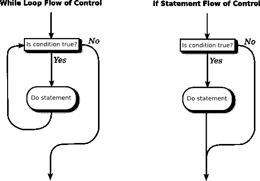

在这些图中，箭头表示语句执行时的时间流。控制从顶部进入图形，从底部离开。同样，`if..else`语句的控制流图清晰地显示了嵌套语句中仅有一个会被执行：

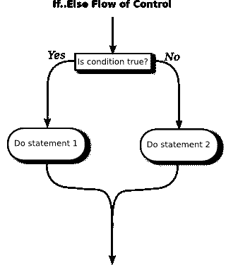

当然，`if`语句中的一个或两个语句可以是块，而且许多程序员即使在只包含一个语句也倾向于加上大括号。因此，`if`语句通常像这样：

```
if ( boolean-expression ) {
    statements
}
else {
    statements
}
```

或者：

```
if ( boolean-expression ) {
    statements
}
```

作为一个示例，这里有一个`if`语句用于交换两个变量`x`和`y`的值，但前提是初始`x`大于`y`。在执行此`if`语句后，我们可以确定`x`的值一定小于或等于`y`的值：

```
if ( x > y ) {
    int temp;      // 此块使用的临时变量。
    temp = x;      // 将 x 的值保存到 temp 中。
    x = y;         // 将 y 的值赋给 x。
    y = temp;      // 将 temp 的值赋给 y。
}
```

最后这是一个包含`else`部分的`if`语句示例。试着找出它是做什么的，以及为什么要使用它：

```
if ( years > 1 ) {  // handle case for 2 or more years
    System.out.print("The value of the investment after ");
    System.out.print(years);
    System.out.print(" years is $");
}
else {  // handle case for 1 year
    System.out.print("The value of the investment after 1 year is $");
}  // end of if statement
System.out.printf("%1.2f", principal);  // this is done in any case
```

在本章稍后部分，我将更多地介绍控制结构。但你已经掌握了要点。如果你从未学过关于控制结构的更多知识，你掌握已经足够执行任何可能的计算任务。简单的循环和分支就是你真正需要的全部！

* * *

### 3.1.4 控制抽象

像`if`语句和`while`循环等控制结构允许你控制计算机 CPU 内部运行的过程。但对于 CPU 内部到底发生了什么，并没有所谓的`if`语句或`while`循环。正如第 1.1 节 所述，CPU 只能执行简单的机器语言指令。循环和分支必须在机器语言中使用跳转指令来实现（跳转指令会改变程序计数器寄存器中存储的值），以及条件跳转指令（根据简单测试的结果，可能会或可能改变程序计数器）。

在机器语言中实现 Java 控制结构可能会变得相当复杂。坦率地说，你不需要知道如何实现。你可以在不知道它们在机器语言中如何实现的情况下使用 Java 控制结构。事实上，你不需要了解任何关于机器语言或 CPU 如何工作的知识。这就是抽象的一个例子。

抽象是计算机科学中的核心概念。抽象允许你在不理解细节工作原理的情况下对其进行操作。它允许你在“更高层次”上工作。`if`语句和`while`循环就是控制抽象的示例。它们允许你使用像`Java`这样的高层编程语言，而不是非常底层的机器语言。

你将在本书的后续部分遇到其他类型的抽象。事实上，你已经遇到过一个：变量是数据抽象的基本示例。变量允许你使用一个名称来处理特定类型的数据值。计算机必须跟踪该数据在内存中的数值地址、该数据占用多少字节的内存，以及如何解释存储在内存中的位以表示该值。变量是一个允许你避免所有细节的抽象。

* * *

### 3.1.5 确定赋值

我将用一个有点技术的问题来结束对控制结构的介绍，这个问题在你第一次遇到它时可能无法完全理解。考虑以下两个代码段，它们看起来完全等价：

```
int y;                          int y;
if (x < 0) {                    if (x < 0) {
    y = 1;                           y = 1;
}                               }
else {                          if (x >= 0) {
    y = 2;                           y = 2;
}                               }
System.out.println(y);          System.out.println(y);
```

在左侧的版本中，如果`x < 0`则`y`被赋值为`1`，否则被赋值为`2`（即`x >= 0`）。右侧的版本完全如此。然而，存在一个细微的区别。事实上，`Java`编译器会对右侧代码中的`System.out.println(y)`语句报告错误，而左侧的代码完全没问题！

问题在于，在右侧的代码中，计算机无法判断变量`y`是否已经确定赋值。当`if`语句没有`else`部分时，`if`内部的语句可能会执行也可能不执行，取决于条件的值。编译器无法判断它是否会被执行，因为条件只有在程序运行时才会被求值。对于上面的右侧代码，就编译器而言，`y = 1`或`y = 2`这两个语句都可能都不会执行，因此输出语句可能试图打印一个未定义的值。编译器认为这是一个错误。只有当编译器能够验证在程序运行到该点变量已被赋值时，才能使用变量的值。这被称为**确定赋值**（definite assignment）（即使你能看出在这个例子中`y`总是会被赋值，这并不重要。问题在于编译器是否能看出。）

注意，在上面的左侧代码中，`y`被确定赋值了值，因为在`if..else`语句中，无论`if`中的条件值如何，两个备选方案中总有一个会被执行。理解`if..else`语句和一对普通的`if`语句之间的区别是非常重要的。这里是另一对代码段，它们看起来在做相同的事情，但其实不是。执行每个代码段后，`x`的值是多少？

```
 int x;                             int x;
x = -1;                            x = -1;
if (x < 0)                         if (x < 0)
    x = 1;                             x = 1;
else                               if (x >= 0)
    x = 2;                             x = 2;
```

执行左侧代码后，`x`为`1`；执行右侧代码后，`x`为`2`。

## 3.2 算法开发

* * *

编程是困难的（就像许多有用且值得的活动一样——而且像大多数活动一样，它也可以是有回报且有趣的）。当你编写程序时，你必须告诉计算机执行的每一个小细节。而且你必须确保一切正确，因为计算机会完全按照你写的程序盲目执行。那么，人们是如何写出不仅仅简单的程序的呢？实际上这并不是什么大奥秘。这是一个学习以正确的方式思考的问题。

### 3.2.1 伪代码与逐步细化

在进行微程序编程时，你有几个基础要素可以使用：`variables`（变量）、`赋值语句`以及输入输出例程。你可能还拥有一些由你或他人编写的子程序、对象或其他构建模块。（输入输出例程也属于此类）。你可以构建这些这些基础指令的序列，也可以将它们组合成更复杂的控制结构，例如`while`循环和`if`语句。

假设你心里有一个想要让计算机执行的任务。一种方法是编写一个该任务的描述，并将该描述作为你想要开发的算法大纲。然后，你可以细化并详述该描述，逐渐添加步骤和细节，直到你拥有一个可以直接转换为编程语言的完整算法。这种方法被称为逐步细化（stepwise refinement），它是自顶向下设计的一种类型。随着你在逐步细化的阶段进行，你可以用伪代码写出算法的描述——伪代码是模仿编程语言结构的非正式指令，它没有实际程序代码那样的完整细节和完美语法。

举个例子，让我们看看如何开发上一节中的程序，该程序计算投资五年后的价值。你想要程序执行的任务是：“计算并显示未来五年内每年的投资价值，其中初始投资额和利率由用户指定。”然后你可能会写下——或者可能只是在想——这可以扩展为：

```
Get the user's input
Compute the value of the investment after 1 year
Display the value
Compute the value after 2 years
Display the value
Compute the value after 3 years
Display the value
Compute the value after 4 years
Display the value
Compute the value after 5 years
Display the value
```

这是正确的，但相当冗余。看到这种重复，你可能会发现使用循环的机会。使用循环会减少打字量。更重要的是，它更具**通用性**：本质上，无论你想要处理多少年，同一个循环都有效。因此，你可能会将上述步骤序列重写为：

```
Get the user's input
while there are more years to process:
    Compute the value after the next year
    Display the value
```

遵循这个算法确实能解决问题，但对于计算机来说，我们必须更明确地说明如何“获取用户输入”、如何“计算下一年的价值”，以及说“还有更多年份需要处理”意味着什么。我们可以将“获取用户输入”步骤扩展为：

```
Ask the user for the initial investment
Read the user's response
Ask the user for the interest rate
Read the user's response
```

为了填充“计算下一年的价值”步骤的细节，你需要知道如何自己进行计算。（也许你可能向你的老板或教授请？）假设你知道价值是通过在前值的基础上加上一些利息计算的。那么我们可以将`while`循环细化为：

```
while there are more years to process:
    Compute the interest
    Add the interest to the value
    Display the value
```

至于测试是否还有更多年份需要处理，我们唯一的方法是自己计数。这展示了一种非常常见的模式，你应该预期在很多程序中使用类似的方法的方法：我们必须从零年开始，每处理一年就加一，并在达到所需的年份时停止。这有时被称为计数循环。因此，`while`循环变为：

```
years = 0
while years < 5:
    years = years + 1
    Compute the interest
    Add the interest to the value
    Display the value
```

我们仍然需要知道如何计算利息。假设利息是通过利率乘以投资的当前价值计算的。将此部分与获取用户输入的算法部分结合，我们就得到了完整的算法：

```
Ask the user for the initial investment
Read the user's response
Ask the user for the interest rate
Read the user's response
years = 0
while years < 5:
    years = years + 1
    Compute interest = value * interest rate
    Add the interest to the value
    Display the value
```

最后，我们达到了可以相当直接转换为适当编程语言语法的点。我们仍然需要为变量命名，确切决定我们想对用户说什么等等。完成这些工作后，我们可以用 Java 表达我们的算法：

```
double principal, rate, interest;  // declare the variables
int years;
System.out.print("Type initial investment: ");
principal = TextIO.getlnDouble();
System.out.print("Type interest rate: ");
rate = TextIO.getlnDouble();
years = 0;
while (years < 5) {
   years = years + 1;
   interest = principal * rate;
   principal = principal + interest;
   System.out.println(principal);
}
```


这仍然需要封装在一个完整的程序中，它仍然需要注释，并且真的需要为用户以更友好的格式打印更多信息。但它本质上与上一节中的程序是同一个程序。（注意，伪代码算法使用了缩进来显示哪些语句在循环内部。在 Java 中，计算机完全忽略缩进，因此你需要一对大括号来告诉计算机哪些语句在循环中。如果你漏了大括号，循环内的语句将只有 `years = years + 1;`。糟糕的是，计算机不会像漏 `years < 5` 的括号那样发现这种错误。括号是语法上要求的。）

### 3.2.2 3N+1 问题

让我们来看另一个例子，这次处理一个你还没有见过的程序。这里的作业是一个抽象的数学问题，是我喜欢的编程练习之一。这次，我们将从一个更完整的任务规范开始：

“给定一个正整数 `N`，从 `N` 开始定义‘3N+1’序列定义如下：如果 `N` 是偶数，则将 `N` 除以二；但如果 `N` 是奇数，则将 `N` 乘以 3 加 1。继续这种方式生成数字，直到 `N` 等于 1。例如，从 `N = 3` 开始（它是奇数），我们乘以 3 加 1，得到 `N = 3*3+1 = 10`。然后，由于 `N` 是偶数，我们除以 2，得到 `N = 10/2 = 5`。我们以这种方式继续，直到到达 1。完整的序列是：3, 10, 5, 16, 8, 4, 2, 1。”

“编写一个程序，从用户处读取一个正整数，并从该整数开始打印 3N+1 序列。程序还应该计数并打印序列中的项数。”

我们想要的程序的算法的概括性如下：

```
从用户处获取一个正整数 N。
计算、打印并计数序列中的每个数字。
输出项数。
```

程序的大部分在第二步。我们需要一个循环，因为我们想要继续计算数字，直到得到 1 为止。为了用适合 `while` 循环的术语表达，我们需要知道何时 `continue`（继续）循环而不是何时停止它：只要数字 `not`（不是） 1，我们就继续。因此，我们可以将伪代码算法扩展为：

```
从用户处获取一个正整数 N；
当 N 不是 1 时：
    计算 N = 下一项；
    输出 N；
    计数此项；
输出项数；
```

为了计算下一项，计算机必须根据 `N` 是偶数还是奇数采取不同的操作。我们需要一个 `if` 语句来在这两种情况之间做出决定：

```
从用户处获取一个正整数 N；
当 N 不是 1 时：
    如果 N 是偶数：
       计算 N = N/2；
    else
       计算 N = 3 * N + 1；
    输出 N；
    计数此项；
输出项数；
```

我们快成功了。剩下的问题是计数。计数意味着你从零开始，每当你有要数的东西时，就加 1。我们需要一个变量来计数。该变量必须在循环开始 `before`（之前）被设置为一次，并且在循环内部进行递增。（再次，这是一个你应该预期会反复看到的常见模式。）加上计数器后，我们得到：

```
从用户处获取一个正整数 N；
让 counter = 0；
当 N 不是 1 时：
    如果 N 是偶数：
       计算 N = N/2；
    else
       计算 N = 3 * N + 1；
    输出 N；
    对 counter 加 1；
输出 counter；
```

我们仍然需要担心第一步。我们如何从用户处获取一个 `positive`（正）整数呢？如果我们只是读取一个数字，用户可能会输入负数或零。如果你遵循 `N` 的值为负或零时发生的情况，你会发现程序将永远运行，因为 `N` 的值永远不会等于 1。这很糟糕。在这种情况下，这个问题可能不是什么大问题，但通常你应该尝试编写万无一失的程序。修复此问题的一种方法是继续读取数字，直到用户输入正数：

```
要求用户输入一个正数；
让 N 为用户的响应；
当 N 不是正数时：
   打印错误信息；
   读取另一个 N 的值；
让 counter = 0；
当 N 不是 1 时：
    如果 N 是偶数：
       计算 N = N/2；
    else
       计算 N = 3 * N + 1；
    输出 N；
    对 counter 加 1；
输出 counter；
```

第一个 `while` 循环只有在 `N` 为正数（符合要求）时才会结束。（初级程序员的一个常见错误是在这里使用 `if` 语句而不是 `while` 语句：“如果 N 不是正数，要求用户输入另一个值。”如果用户输入的第二个数字也是非正数，问题就出现了。`if` 语句只执行一次，所以第二个输入的数字永远不会被测试，程序将进入无限循环。使用 `while` 循环，在输入第二个数字后，计算机跳回循环开头并测试第二个数字是否为正数。如果不是，它会要求用户输入第三个数字，并将继续询问，直到用户输入可以接受的输入。在 `while` 循环结束后，我们可以完全确定 `N` 是一个正数。）

这是一个实现该算法的 Java 程序。它使用运算符 `<=` 表示“小于或等于”，使用 `!=` 表示“不等于”。为了测试 `N` 是否为偶数，它使用 `"N % 2 == 0"`。这里使用的所有运算符已在 第 2.5 节 中讨论讨论过。

```java
import textio.TextIO;

/**  
 * 此程序从用户指定的正
 * 整数开始打印 3N+1 序列。它还统计了序列中项
 * 的数量，并打印出该数字。
 */
 公 class ThreeN1 {

      public static void main(String[] args) {                

         int N;       // 用于计算序列中的项
         int counter; // 用于计数项

         System.out.print("Starting point for sequence: ");
         N = TextIO.getlnInt();
         while (N <= 0) {
            System.out.print(
                   "The starting point must be positive. Please try again: " );
            N = TextIO.getlnInt();
         }
         // 此时，我们知道 N > 0

         counter = 0;
         while (N != 1) {
             if (N % 2 == 0)
                N = N / 2;
             else
                N = 3 * N + 1;
             System.out.println(N);
             counter = counter + 1;
         }

         System.out.println();
         System.out.print("There were ");
         System.out.print(counter);
         System.out.println(" terms in the sequence.");

     }  // main 方法结束

 }  // ThreeN1 

```

关于此程序的最后两点：首先，你可能注意到该程序没有打印或统计序列的第一项——用户输入的 `N` 值。这是一个错误吗？很难说。程序的规范是否足够严谨可以决定？这种问题可能会让你回到老板/教授那里澄清。这个问题（如果是一个的话！）很容易修复。只需在循环之前将 `counter = 0` 行替换为以下两行（见下文）：

其次，关于为什么这个问题可能是有趣的。嗯，它对数学家和计算机科学家是有有趣的，因为有一个他们无法回答的问题：对于所有可能的起始值，计算 3N+1 序列的过程会在有限步内完成吗？虽然单个序列很容易计算，但没有人能回答这个通用问题。换句话说，没有人知道计算 31 序列的过程是否可以被称为算法，因为算法要求在有限步终止。（注意：这个讨论真的适用于整数，而不是 `int` 的值！也就是说，它假设 `N` 的值可以取任意大的整数，这对于 Java 程序中 `int` 类型的变量是不可能的。当程序中 `N` 的值大到无法用 32 位 `int` 表示时，程序输出的值将不再在数学上是正确的。因此，如果 `N` 变得太大，Java 程序无法计算正确的 3N1 序列。参见 练习题 8.2。）

### 3.2.3 编码、测试、调试

如果在为程序开发了算法后，就可以放松、按下按钮并得到一个完美运行的程序，那就好了。遗憾的是，将算法转换为 Java 源代码的过程并不总是顺利。而且当你达到运行程序的阶段时，它通常只是在“做了某些事情”的意义上是运行的。遗憾的是，并不是你想要它做的。

程序设计之后就是编码：将设计翻译成用 `Java` 或或其他语言编写的程序。通常，无论你多么小心，总会有一些语法错误从某处冒出来，而 `Java` 编译器会带有某种错误信息拒绝你的程序。遗憾的是，虽然编译器总是能检测到语法错误，但它在告诉具体哪里出了问题方面并不出色。有时，它甚至无法准确告诉你真实错误所在的位置。第 `45` 行上的一个拼写错误或缺失的 `"{"` 可能会导致编译器在第 `105` 行卡住。通过确保你真正理解了语言的语法规则并遵循一些基本的编程指南，你可以避免很多错误。例如，我从不在输入 `"{"` 的同时不输入匹配的 `"}"`。然后，我再回去在花括号之间填充语句。在大型程序中，缺失或多出的括号可能是最难找到的错误之一。务必、务必让你的程序保持良好的缩进。如果你修改了程序，请相应修改缩进。这是完全值得的。使用一致的命名方案，这样你就不需要苦苦记忆把那个变量命名为 `interestrate` 还是 `interestRate` 了。通常，当编译器给出多个错误信息时，在修复第一个错误之前，不要尝试修复编译器的第二个错误信息。一旦编译器在你的程序中遇到错误，它可能会变得困惑，其余错误信息可能只是猜测。也许最好的建议是：在尝试修复错误之前，花时间去理解错误。编程不是一门实验科学。

当你的程序无错误地编译时，你仍然没有完成。你必须测试程序以确保它正确运行。记住，目标并不是为教授在课堂上给出的两个输入获得正确的输出。目标是一个对于所有合理的输入都能正确运行的程序。理想情况下，当面对不合理的输入时，它应该通过温和地指责用户而不是崩溃来响应。在各种输入上测试你的程序。尝试找到一组输入，用以测试你编码到程序中的完整功能范围。当你开始编写更大的程序时，要分阶段编写它们并在过程中对每个阶段进行测试。你可能还需要编写一些额外的代码来执行测试——例如调用你刚刚编写的子程序。如果可以避免，你不想面对 500 行新编写的代码中其中*某处*存在错误。

测试的意义是发现 bug——即语义错误，这些错误表现为错误行为而非编译错误。遗憾的事是，你很可能会发现它们。再次，你可以通过细致的设计和细致的编码将 bug 降至最低，但还没有找到完全避免它们的方法。一旦你检测到 bug，就是进行调试（debugging）了。你必须在程序的源代码中追踪 bug 的产生并消除它。调试是一项技能，像编程的其他方面一样，需要练习才能精通。所以，不要害怕 bug。从它们中学习。一项至关重要的调试技能是阅读源代码的能力——即放下对你*认为*它在做什么的预判，并按照计算机的方式来执行它——机械地、一步步地——以看清它实际上在执行什么。这很难。我仍然记得曾花了几个小时寻找一个 bug，结果发现某行我看了十遍的代码，在应该该有 `"i"` 的地方却写成了 `"1"`；又有一次我写了一个名为 `WindowClosing` 的子程序，它的运行完全符合我想要的那样，只是计算机寻找的是 `windowClosing`（小写字母 "w"）。有时，让一个没有你那种预判的人来看你的代码会很有帮助。

通常，仅仅找到程序中包含错误的部分就是一个问题。大多数编程环境都带有一个调试器（debugger），这是一个可以帮助你发现 bug 的程序。通常，你的程序可以在调试器的控制下运行。调试器允许你在程序中设置“断点”（breakpoints）。断点是程序中的某一点，调试器会在此处暂停程序，让你查看程序变量的值。其核心思想是追踪程序在执行过程中到底何时开始出错的。调试器还允许你一次一行地执行程序，这样当你知道程序中 bug 潜伏的大致区域后，就可以详细观察发生了什么。

我承认，我自己也偶尔才使用调试器。一种更传统的调试方法是在程序中插入调试语句。这些是打印程序状态信息的输出语句。通常，一条调试语句可能会像这样：

```
System.out.println("At start of while loop, N = " + N);
```

你需要能够从输出中判断输出来自程序的哪个部分，并且你想知道重要变量的值。有时，你会发现计算机甚至没有运行你认为它应该执行程序程序。记住，目标是找到程序中状态不符合你预期的第一个点。那里就是 bug 所在。

最后，记住调试的黄金法则：如果你绝对确定程序中的所有内容都是正确的，但它仍然无法工作，那么你绝对确定的内容中有一个是错误的。

## 第 3.3 节

## while 和 do..while 语句

***

`Java` 中的语句可以是简单语句或复合语句。简单语句如赋值语句和子程序调用语句，是程序的构建构建块。复合语句如 `while` 循环和 `if` 语句用于将简单语句组织成复杂的结构，这些结构被称为控制结构，因为它们控制语句执行的顺序。接下来的五个节将探讨 `Java` 中提供的控制结构细节，从本节的 `while` 语句和 `do..while` 语句开始。同时，我们将查看每个控制结构的编程示例，并应用上一节介绍的算法设计技术。

***

### 3.3.1 while 语句

`while` 语句已经在 3.1 节介绍过。`while` 循环的形式如下

```
while ( boolean-expression )
   statement
```

该语句当然可以是一个由一组花括号内的语句组成的块语句（block statement）。这个语句被称为循环体（body）。只要 `boolean-expression` 为真，循环体就会重复执行。这个布尔表达式被称为继续条件（continuation condition），或者简单地称为循环测试条件（test）。有几点可能需要澄清。如果条件在最初（第一次执行循环体之前）就是假的，会发生什么？在这种情况下，循环体一次都不会执行。`while` 循环的体可以执行任意次数，包括零次。如果条件为真，但在循环体中间的某个地方变成了假，会发生什么？循环会在这种情况发生时立即结束吗？不会，因为计算机会继续执行循环体直到末尾。只有在那里，它才会跳回循环开头并测试条件，而只有那时循环才能结束。

让我们来看一个可以使用 `while` 循环解决的典型问题：计算用户输入的一组正整数的平均值。平均值是这些整数之和除以整数的个数。程序将要求用户每次输入一个整数。它将记录输入的整数个数，并记录到目前为止读取的所有数字的累计和。以下是该程序的伪代码算法：

```
Let sum = 0     // 用户输入的整数之和。
Let count = 0   // 用户输入的整数个数。
while there are more integers to process:
    Read an integer
    Add it to the sum
    Count it
Divide sum by count to get the average
Print out the average
```

但是，我们如何测试是否还有更多整数需要处理呢？一种典型的解决方案是告诉用户在输入所有数据后输入 0。这行得通的，因为我们假设所有数据都是正数，所以 0 不是一个合法的数据值。0 本身并不参与平均值计算的数据中。它只是为了标记真实数据的结束。这种用法的数据值有时被称为“哨兵值”（sentinel value）。因此，`while` 循环中的测试就变成了“当输入的整数不为 0 时”。但还有另一个问题！在第一次评估测试（在执行循环体之前），还没有读取任何整数。此时还没有“输入整数”，所以测试输入整数是否为 0 没有意义。因此，我们必须在 `while` 循环 `之前` 做一些事情以确保测试是有意义的。让 `while` 循环中的测试在第一次执行时就有意义被称为“循环初始化”（priming the loop）。在这种情况下，我们只需要在循环开始之前读取第一个整数。以下是修改后的算法：

```
Let sum = 0
Let count = 0
Read an integer
while the integer is not zero:
    Add the integer to the sum
    Count it
    Read an integer
Divide sum by count to get the average
Print out the average
```

请注意，我重新排列了循环体。由于在循环之前读取了一个整数，循环必须从处理该整数开始。在循环结束时，计算机读取了一个新整数。然后计算机跳回循环开头，测试它刚刚读取的那个整数。请注意，当计算机最终读取到哨兵值时，循环在哨兵值被处理之前就结束了。它没有被加到和中，也没有被计数。这就是它的预期工作方式。哨兵不是数据的一部分。原始算法即使不需要初始化就能运行，也是错误的，因为它会求和并计算所有整数，包括哨兵。（由于哨兵是 0，和仍然是正确的，但计数会错一个。这种所谓的“差一错误”（off-by-one errors）非常常见。事实证明计数比看起来要困难！）


我们可以很容易将该算法转换为一个完整的程序。注意，程序不能使用`average = sum/count;`语句来计算平均值。由于`sum`和`count`都是`int`类型的变量，`sum/count`的值是一个整数。平均值应该是一个实数。我们之前见过这个问题：我们必须将其中一个`int`值转换为`double`，以强制计算机将商数计算为实数。这可以通过将其中一个变量强制转换为`double`类型来实现。类型转换`(double)sum`将`sum`的值转换为实数，因此在程序中平均值的计算方式为`average = ((double)sum) / count;`。在这种情况下，另一种解决方案是最初将`sum`声明为`double`类型变量。

程序还处理了另一个问题：如果用户输入第一个输入值为 0，则没有数据需要处理。我们可以通过检查在`while`循环结束后`count`是否仍等于 0 来测试这种情况。这看起来像是一个微不足道的细节，但严谨的程序员应该考虑到所有情况。

以下是程序的完整源代码（当然加上了注释！）：

```java
import textio.TextIO;

/**
 * 此程序读取用户输入的一系列正整数，
 * 并打印这些整数的平均值。
 * 用户被提示每次输入一个整数。
 * 用户必须输入 0 来标记数据的结束。
 * （0 不计入参与平均值计算的数据。）
 * 程序没有检查用户的输入是否为正数，
 * 因此它实际上会累加正数和负输入值。
 */
public class ComputeAverage {

   public static void main(String[] args) {

      int inputNumber;   // 用户输入的整数之一。
      int sum;           // 正整数之和。
      int count;         // 正整数的个数。
      double average;    // 正整数的平均值。

      /* 初始化求和和计数变量。 */

      sum = 0;
      count = 0;

      /* 读取并处理用户的输入。 */

      System.out.print("Enter your first positive integer: ");
      inputNumber = TextIO.getlnInt();

      while (inputNumber != 0) {
         sum += inputNumber;   // 将 inputNumber 加到累计和中。
         count++;              // 计数。
         System.out.print("Enter your next positive integer, or 0 to end: ");
         inputNumber = TextIO.getlnInt();
      }

      /* 显示结果。 */

      if (count == 0) {
         System.out.println("You didn't enter any data!");
      }
      else {
         average = (double)sum / count;
         System.out.println("You entered " + count + " positive integers.");
         System.out.printf("Their average is %.3f.\n", average);
      }

   } // end main

} // end class ComputeAverage
```

***

### do..while 语句

有时，在像`while`循环那样在循环结束后测试循环条件更为方便。`do..while`语句与`while`语句非常相似，只是`while`关键字以及它测试的条件移动到了末尾。增加了`do`单词来标记循环的开始。`do..while`语句的格式如下：

```
do
    statement
while ( boolean-expression );
```

或者按照习惯，语句可以是一个块：

```
do {
    statements
} while ( boolean-expression );
```

注意最后的分号`;`。这个分号是语句的一部分，就像赋值语句或声明结尾的分号语句一样。省略它会导致语法错误。

要执行`do`循环，计算机首先执行循环体——即循环内部的语句或语句——然后评估布尔表达式。如果表达式值为真，计算机返回`do`循环开头并重复该过程；如果值为假，则结束循环并继续程序的后续部分。由于条件在循环结束时才测试，因此`do`循环的体至少会被执行一次。

例如，考虑以下玩游戏的伪代码。在这种情况下，使用`do`循环比`while`循环更合理，因为使用`do`循环你知道至少会玩一次游戏。而且在循环末尾使用的测试在开头处根本没有意义：

```
do {
   玩一个游戏
   询问用户是否想再玩一次
   读取用户的响应
} while ( 用户的响应是 yes );
```

让我们将其转换为适当的 Java 代码。由于我目前不想谈论游戏，假设我们有一个名为`Checkers`的类，并且该`Checkers`类包含一个名为`playGame()`的静态成员子程序，该程序用于与用户玩一局国际棋。那么，伪代码“玩一个游戏”就可以表示为子程序调用语句`Checkers.playGame();`。我们需要一个变量来存储用户的响应。`TextIO`类方便了我们使用一个布尔变量来存储“是/否”问题的答案。输入函数`TextIO.getlnBoolean()`允许用户输入“yes”或“no”（以及其他可接受的响应）作为值。““Yes”被视为 true，而“no”被视为 false。因此，该算法可以编码为：

```java
boolean wantsToContinue;  // 如果用户想再次玩，则为 true。
do {
   Checkers.playGame();
   System.out.print("Do you want to play again? ");
   wantsToContinue = TextIO.getlnBoolean();
} while (wantsToContinue == true);
```

当布尔变量的值设置为 false 时，它是循环应该结束的信号。当布尔变量像这样使用时——作为在程序的某部分设置并在另一部分进行测试的信号——它有时被称为标记（flag）或标记变量（信号标记的意义上）。

顺便说一下，一个比比常更死板的程序员会对比`while (wantsToContinue == true)`这个测试嗤之以鼻。这个测试完全等于`while (wantsToContinue)`。测试`wantsToContinue == true`是否为真，等同于测试`wantsToContinue`是否为真。稍微没那么冒犯的表达式形式是`flag == false`，其中`flag`是一个布尔变量。`flag == false`的值与`!flag`的值完全相同，其中`!`是布尔取反运算符。因此，你可以用`while (!flag)`代替`while (flag == false)`，也可以用`if (!flag)`代替`if (flag == false)`。

虽然`do..while`语句有时比`while`语句更方便，但拥有两种循环并不会让语言更强大。任何可以使用`do..while`循环解决的问题都可以只用`while`语句解决，反之亦然。事实上，如果`doSomething`代表任何代码块，那么：

```
do {
    doSomething
} while ( boolean-expression );
```

产生的效果完全相同：

```
 doSomething
while ( boolean-expression ) {
    doSomething
}
```

同样，

```
while ( boolean-expression ) {
    doSomething
} 
```

可以被替换为：

```
if ( boolean-expression ) {
   do {
       doSomething
   } while ( boolean-expression );
}
```

而不会改变程序的任何含义。

***

### 3.3.3 break 和 continue

`while`和`do..while`循环的语法允许你在循环的开始或结束处测试继续条件。有时，在循环中间进行测试，或者在同一个循环的不同位置进行多次测试会更自然。Java 提供了一种通用方法来跳出任何循环的中间。它被称为`break`语句，其形式如下：

```
break;
```

当计算机在循环中执行`break`语句时，它会立即跳出循环。然后它将继续执行程序中循环之后的任何内容。例如：

```java
while (true) {  // 看起来它会无限运行下去！
   System.out.print("Enter a positive number: ");
   N = TextIO.getlnInt();
   if (N > 0)   // 输入值 OK，所以跳出循环
      break;
   System.out.println("Your answer must be > 0.");
}
// break 之后在此继续
```

如果用户输入的数字大于零，将执行`break`语句，计算机将跳出循环。否则，计算机将打印出“Your answer must be > 0.”并跳回循环开始读取另一个输入值。

此循环的第一行`while (true)`看起来可能有点奇怪，但它是完全合法的。`while`循环中的条件可以是任何具有布尔值的表达式。计算机计算该表达式并检查值是 true 还是 false。布尔字面量`true`只是一个始终求值为 true 的布尔表达式。因此，`while (true)`可用于编写无限循环，或者由`break`语句终止的循环。

`break`语句会终止直接包含该`break`语句的循环。可能会嵌套循环，即一个循环语句包含另一个循环内部。如果你在嵌套循环内部使用`break`语句，它只会跳出该循环，而不是跳出包含嵌套循环的那个循环。有一种被称为标签`break`语句的结构，允许你指定想要跳出的循环。这并不常见，所以我将快速带过。标签的工作原理如下：你可以在任何循环前面放置标签。标签由一个简单的标识符后跟冒号组成。例如，带有标签的`while`可能看起来像`mainloop: while...`。在这个循环内部，你可以使用标签 break。

```java
boolean nothingCommon;
nothingCommon = true; // 假设 s1 和 s2 没有共同部分。
int i,j; // 用于遍历 s1 和 s2 的变量

i = 0;
mainloop: while (i < s1.length()) {
   j = 0;
   while (j < s2.length()) {
      if (s1.charAt(i) == s2.charAt(j)) { // s1 和 s2 有共同部分...
          nothingCommon = false; // 所以 nothingCommon 实际上为 false。
          break mainloop; // 跳出两个循环
      }
      j++; // 继续到 s2 的下一个字符。
   }
   i++; // 继续到 s1 的下一个字符。
}
```

***

`continue`语句与`break`相关，但较少使用。`continue`语句告诉计算机跳过当前迭代的剩余部分。然而，它不是跳出循环，而是跳回循环开头继续后续迭代（包括评估循环条件以确定是否还需要迭代）。与`break`类似，当`continue`在嵌套循环中时，它只会继续包含它的循环；可以使用“标签 continue”继续外部循环。

`break`和`continue`可以用于`while`和`do..while`循环。它们也可以用于`for`循环，将在下一节介绍。在 3.6 节中我们将看到`break`也可以用于跳出`switch`语句。`break`可以出现在`if`语句内部，但只有当`if`语句嵌套在循环或`switch`语句内部时才可以。在这种情况下，它并并不意味着跳出`if`。相反，它跳出包含该`if`的循环或`switch`语句。`if`内部的`continue`语句也有相同的情况。

## 3.4 for 语句

* *

我们在本节转向另一种类型的循环：`for`语句。任何`for`循环等同于某些`while`循环，因此语言并没有因为`for`语句获得额外的能力。但对于特定类型的问题，`for`循环比相应的`while`循环更容易构造、更易读（我至少知道一个人**只**使用 for 循环）。

* *

### 3.4.1 for 循环

`for`语句让一种常见的`while`循环更容易编写。许多`while`循环具有以下通用形式：

```
 initialization
while ( continuation-condition ) {
    statements
    update
}
```

例如，考虑这个示例，它复制自 第 3.2 节 中的一个示例：

```java
years = 0;  // 初始化变量 years
while ( years < 5 ) {   // 继续循环的条件

    interest = principal * rate;    //
    principal += interest;          // 执行三个语句
    System.out.println(principal);  //

    years++;   // 更新变量 years 的
}
```

这个循环可以写为以下等效的`for`语句：

```java
for ( years = 0;  years < 5;  years++ ) {
   interest = principal * rate;
   principal += interest;
   System.out.println(principal);
}
```

初始化、继续条件和更新都合并在了`for`循环的第一行中。这使得涉及循环“控制”的所有内容都集中在一个地方，有助于更容易阅读和理解循环。`for`循环的执行方式与原始代码完全相同：初始化部分在循环开始前执行一次。继续条件在每次执行循环（包括第一次执行）之前执行，当该条件为假时，循环结束。更新部分在每次执行循环的最后执行，紧在跳回检查条件之前。

`for`语句的正式语法如下：

```
for ( initialization; continuation-condition; update )
     statement
```

或者，使用块语句：

```
for ( initialization; continuation-condition; update ) {
     statements
}
```

继续条件必须是一个布尔值表达式。初始化通常是一个声明或赋值语句，但它也可以是任何在程序中允许作为语句的表达式。更新可以是任何简单语句，但通常是自增、自减或赋值语句。这三个部分中的任何部分都可以为空，但在任何情况下两个分号都是必须的。如果继续条件为空，它被处理为“真”，因此循环将无限重复，或者因为某些其他原因（如`break`语句）而结束。（有些人人喜欢用`for (;;)`而不是`while (true)`来开始无限循环。）这里是`for`语句的流程控制图：

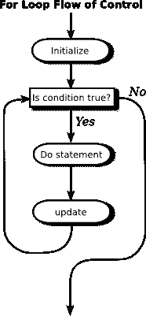

通常，`for`语句的初始化部分为某些变量赋值，而更新部分通过赋值语句或自增或自减操作更改该变量的值。在继续条件中测试变量的值，当该条件求值为假时，循环结束。像这样使用的变量被称为循环控制变量。在上面的示例中，循环控制变量是`years`。

当然，最常见的`for`循环类型是计数循环，其中循环控制变量取某些最小值和最大值之间的所有整数值。计数循环的形式为：

```
for ( variable = min;  variable <= max; variable++ ) {
     statements
}
```

其中`min`和`max`是整数值表达式（通常是常量）。变量取值为`min`, `min+1`, `min+2`, ..., , `max`。循环控制变量的值经常在循环体中使用。本节开头的`for`循环是一个计数循环，其中循环控制变量`years`取值为 1, 2, 3, 4, 5。这里有一个更简单的示例，它在标准输出上显示数字 1, 2, ..., 10：

```java
for ( N = 1 ;  N <= 10 ;  N++ )
   System.out.println( N );
```

出于各种原因，Java 程序员喜欢从 0 开始计数而不是 1，并且他们倾向于在条件中使用`<`而不是`<=`。上述循环的以下变体打印十数字 0, 1, 2, ..., 9：

```java
for ( N = 0 ;  N < 10 ;  N++ )
   System.out.println( N );
```

在测试中使用`<`代替`<=`，或反之，是程序中差一错误（off-by-one errors）的常见来源。你应该始终停下来思考：我是否想要处理最终值？

从 10 倒数到 1 比向上计数容易。只需从 10 开始，递减循环控制变量而不是增加它，只要变量大于或等于 1 就继续。


```java
for ( N = 10 ;  N >= 1 ;  N-- )
   System.out.println( N );
```

现在，事实上，`for` 语句的官方语法允许初始化部分和更新部分都由多个由逗号分隔的表达式组成。因此，我们甚至可以同时从 1 数到 10，并从 10 数到 1！

```java
for ( i=1, j=10;  i <= 10;  i++, j-- ) {
   System.out.printf("%5d", i); // 在宽度为 5 个字符的列中输出 i。
   System.out.printf("%5d", j); // 在 5 个字符的列中输出 j。
   System.out.println();       //     并换行。
}
```

作为一个最后的介绍性示例，假设我们想使用一个 `for` 循环……（此处原文存在大量重复文本，已按要求处理翻译）

让我们写一个程序，从用户处输入一个正整数 `N`，并计算 `N` 有多少不同的因数。可能的 `N` 的因数有 1, 2, ..., `N`。为了计算 `N` 的因数个数，我们只需要测试 `N` 的每一个可能的因数，并统计实际上能整除 `N` 的数字。（这是一个正确的解决方案，但有更高效的方法执行此任务。）在伪代码中，该算法的形式如下：

```
Get a positive integer, N, from the user
Let divisorCount = 0
for each number, testDivisor, in the range from 1 to N:
    if testDivisor is a divisor of N:
        Count it by adding 1 to divisorCount
Output the count
```

该算法展示了一种常见的编程模式，用于在处理序列中的某些而不是全部项目的情况。通用模式是：

```
for each item in the sequence:
   if the item passes the test:
       process it
```

我们在因数计数算法中的 `for` 循环可以翻译为 Java 代码：

```java
for (testDivisor = 1; testDivisor <= N; testDivisor++) {
   if ( N % testDivisor == 0 )
      divisorCount++;
}
```

在现代计算机上，这个循环可以执行得非常快。即使对于最大的合法 `int` 值 `2147483647`，运行它也不是可能的。（如果你想对更大的值运行它，可以使用 `long` 类型的变量而不是 `int`。）然而，对于非常大的数字，这确实需要大量的时间。因此当我实现这个算法时，我决定每当计算机测试一千万个可能的因数时就输出一个点。在程序的改进版本中，有两种计数正在进行。我们需要统计因数的个数，还需要统计已测试的可能因数的个数。因此，程序需要两个计数器。当第二个计数器达到 `10000000` 时，程序输出一个 `.` 并将计数器置为零，这样我们就可以开始计算下一组千万。回到伪代码，算法现在看起来像：

```
Get a positive integer, N, from the user
Let divisorCount = 0  // Number of divisors found.
Let numberTested = 0  // Number of possible divisors tested
                      //       since the last period was output.
for each number, testDivisor, in the range from 1 to N:
    if testDivisor is a divisor of N:
        Count it by adding 1 to divisorCount
    Add 1 to numberTested
    if numberTested is 10000000:
        print out a '.'
        Reset numberTested to 0
Output the count
```

最后，我们可以将算法翻译成一个完整的 Java 程序：

```java
import textio.TextIO;

/**
 * 此程序从用户处读取一个正整数。
 * 它统计该数字有多少个因数，
 * 然后打印结果。
 */
public class CountDivisors {

   public static void main(String[] args) {

      int N;  // 用户输入的正整数。
              // 该数字的因数将被将被计数。

      int testDivisor;  // 1 到 N 之间的一个数字，它是
                        // N 的可能的因数。

      int divisorCount;  // 已找到的 N 的因数个数。

      int numberTested;  // 用于统计测试了多少个 N
                         // 的可能的因数。当数字
                         // 达到 10000000 时，输出句点
                         // 并 numberTested 的值重零。

      /* 从用户处读取一个正整数。 */

      while (true) {
         System.out.print("Enter a positive integer: ");
         N = TextIO.getlnInt();
         if (N > 0)
            break;
         System.out.println("That number is not positive.  Please try again.");
      }

      /* 统计因数，每测试 10000000 次打印一个 "."。 */

      divisorCount = 0;
      numberTested = 0;

      for (testDivisor = 1; testDivisor <= N; testDivisor++) {
         if ( N % testDivisor == 0 )
            divisorCount++;
         numberTested++;
         if (numberTested == 10000000) {
            System.out.print('.');
            numberTested = 0;
         }
      }

      /* 显示结果。 */

      System.out.println();
      System.out.println("The number of divisors of " + N
                          + " is " + divisorCount);

   } // end main()

} // end class CountDivisors
```

### 3.4.3 嵌套 `for` 循环

Java 中的控制结构是包含其他简单语句的语句。特别是，控制结构可以包含控制结构。你已经见过循环内部嵌套 `if` 语句的多个例子，以及一个 `while` 循环嵌套另一个 `while` 循环的例子，但任何一个结构嵌套另一个结构的组合都是可能的。我们说一个结构嵌套在另一个内部。你甚至可以有多个层嵌套，例如在一个 `while` 循环内部的 `if` 语句内部另一个 `while` 循环。Java 语法没有对嵌套层数设置限制。但在实际操作中，理解具有多层嵌套的程序是困难的。（此处由于原文存在大量重复，我将关注核心内容）。

表格中的数据排列为 12 行 12 列。打印它们的过程可以用伪代码算法表示为：

```
for each rowNumber = 1, 2, ..., 12:
   Print the first twelve multiples of rowNumber
Output a return
```

`for` 循环的第一步本身可以表示为 `for` 循环。我们可以将“打印 `rowNumber` 的前十二倍数”扩展为：

```
for N = 1, 2, ..., 12:
   Print N * rowNumber
```

所以打印表格的改进算法有一个嵌套在另一个内部的循环：

```
for each rowNumber = 1, 2, ..., 12:
   for N = 1, 2, ..., 12:
      Print N * rowNumber
   Output a return
```

我们希望整齐的列打印输出，每个输出数字占据四个空间。可以使用带有格式指定符 `%4d` 的格式化输出来实现。假设 `rowNumber` 和 `N` 已声明为 `int` 类型变量，算法可以用 Java 表示：

```java
for ( rowNumber = 1; rowNumber <= 12; rowNumber++ ) {
   for ( N = 1; N <= 12; N++ ) {
               // 以 4 个字符列打印
      System.out.printf( "%4d", N * rowNumber ); // 不换行
   }
   System.out.println(); // 在行尾添加换行。
}
```

这一节包含了许多数值处理的示例。对于下一个例子，让我们来一些文本处理。考虑在给定字符串中出现字母表中的 26 个字母中哪些字母的问题。例如，出现在 `"Hello World"` 中的字母有 D, E, H, L, O, R, 和 W。更具体地说，我们将编写一个程序列出字符串中包含的所有字母，并统计不同字母的个数。字符串将由用户输入。让我们从程序的伪代码算法开始。

```
要求用户输入一个字符串
将响应读入变量 str
令 count = 0  (用于计算不同字母的数量)
遍历字母表中的每个字母:
   如果该字母出现在 str 中:
      打印该字母
      将 count 加 1
输出 count
```

由于我们需要处理用户输入的整行文本，我们将使用 `TextIO.getln()` 来读取它。用于读取“遍历字母表中的每个字母”的算法行可以表示为 `"for (letter='A'; letter<='Z'; letter++)"`。但在编写程序之前，`for` 循环内部的 `if` 语句还需要进一步思考。我们如何检查给定的字母 `letter` 是否出现在 `str` 中呢？一种想法是逐个检查字符串中的每个字符，并检查该字符是否等于 `letter`。我们可以通过调用函数 `str.charAt(i)` 获取 `str` 的第 `i` 个字符，其中 `i` 的范围从 0 到 `str.length() - 1`。

另一个困难是：像 `'A'` 这样的字母可能在 `str` 中以大写或小写形式出现，即 `'A'` 或 `'a'`。我们必须检查这两种情况。但我们可以通过在处理之前将 `str` 转换为大写来避免这个困难。这样，我们只需要检查大写字母即可。现在我们可以完整完善该算法了：

```
要求用户输入一个字符串
将响应读入变量 str
将 str 转换为大写
令 count = 0
for letter = 'A', 'B', ..., 'Z':
    for i = 0, 1, ..., str.length()-1:
        if letter == str.charAt(i):
            打印 letter
            将 count 加 1
            break  // 跳出循环，以避免重复计数字母
输出 count
```

注意在嵌套 `for` 循环中 `break` 的使用。这是为了避免多次打印或计算同一个给定的字母（当该字母在字符串中出现多次时）。`break` 语句会跳出内部 `for` 循环，但不会跳出外部 `for` 循环。执行 `break` 后，计算机将带着下一个 `letter` 值继续执行外层循环。你应该尝试准确计算出如果省略了 `break` 语句，程序结束时 `count` 的值是多少。这里是完整的程序：

```java
import textio.TextIO;

/**
 * 此程序读取用户输入的一行文本。
 * 它打印文本中出现的字母列表，
 * 并报告发现了多少个不同的字母。
 */
public class ListLetters {

   public static void main(String[] args) {

      String str;  // 用户输入的行文本。
      int count;   // 在 str 中发现的不同字母数量。
      char letter; // 字母表中的一个字母。

      System.out.println("Please type in a line of text.");
      str = TextIO.getln();

      str = str.toUpperCase();

      count = 0;
      System.out.println("Your input contains the following letters:");
      System.out.println();
      System.out.print("   ");
      for ( letter = 'A'; letter <= 'Z'; letter++ ) {
          int i;  // 字符在 str 中的位置。
          for ( i = 0; i < str.length(); i++ ) {
              if ( letter == str.charAt(i) ) {
                  System.out.print(letter);
                  System.out.print(' ');
                  count++;
                  break;
              }
          }
      }

      System.out.println();
      System.out.println();
      System.out.println("There were " + count + " different letters.");

   } // end main()

} // end class ListLetters
```

实际上，有一种更简单的方法来确定给定的字母是否出现在字符串 `str` 中。内置函数 `str.indexOf(letter)` 在 `letter` 不在字符串中时会返回 `-1`。如果存在，它返回一个大于或等于 0 的数字。因此，我们只需检查 `"if (str.indexOf(letter) >= 0)"` 就可以判断 `letter` 是否出现在 `str` 中。如果我们在上面的程序中使用这种技术，就不需要嵌套的 `for` 循环了。这让你预见到如何使用子程序来处理复杂性。

## 第 3.5 节：`if` 语句

Java 中的两个分支语句第一个是 `if` 语句，你已经在第 3.1 节中见过它。它的形式如下：

```
if (boolean-expression)
     statement-1
else
     statement-2
```

与通常一样，`if` 语句内部的语句可以是块。`if` 语句表示双向分支。`if` 语句的 `else` 部分——由单词 `"else"` 及其后续语句组成——可以省略。

### 3.5.1 悬空 `else` 问题（Dangling `else` Problem）

现在，`if` 语句特别是一个语句。这意味着上述 `if` 语句中的 `statement-1` 或 `statement-2` 本身是一个 `if` 语句。然而，如果 `statement-1` 是一个没有 `else` 部分的 `if` 语句，就会出现问题。这种特殊情况在 Java 语法上实际上是被禁止的。假设你输入了：

```
if ( x > 0 )
    if(y > 0)
else
    System.out.println("First line");
```

*（注：根据 Java 文档上下文，源文本重构了逻辑问题）。*

### 3.5.2 多路分支

更有趣的情况是 `statement-2`（即 `if` 语句的 `else` 部分）本身是一个 `if` 语句。它看起来如下（可能没有最后的 `else`）：

```
if (boolean-expression-1)
     statement-1
else
     if (boolean-expression-2)
         statement-2
     else
         statement-3
```

然而，由于计算机并不关心程序的布局，这种形式几乎总是写成：

```
if (boolean-expression-1)
     statement-1
else if (boolean-expression-2)
     statement-2
else
     statement-3
```


你应该将其视为代表三路分支的单一语句。当计算机执行它时，三个语句（`statement-1`、`statement-2` 或 `statement-3`）中仅有一个会被执行。计算机首先评估`boolean-expression-1`。如果为真，计算机执行`statement-1`，然后跳转到`if`语句的结尾，跳过另外两个。如果`boolean-expression-1`为假，计算机跳过`statement-1`并执行第二个嵌套的`if`语句。为了这一点，它测试`boolean-expression-2`的值，并据此决定执行`statement-2`还是`statement-3`。

这是一个示例，根据变量`temperature`的值打印三条消息之一：

```java
if (temperature < 50)
   System.out.println("It's cold.");
else if (temperature < 80)
   System.out.println("It's nice.");
else
   System.out.println("It's hot.");
```

如果`temperature`是 42，第一个测试为真。计算机打印消息 "It's cold"，并跳过剩余——甚至不评估第二个条件。对于 75 度，第一个测试为假，因此计算机继续第二个测试。该测试为真，因此计算机打印 "It's nice" 并跳过剩余。如果温度是 173 度，两个测试都为假，因此计算机说 "It's hot"（除非它的电路已经被热烧毁了）。

你可以继续连接多个`else-if`来创建具有任意数量情况的多路分支。

```java
if (test-1)
     statement-1
else if (test-2)
     statement-2
else if (test-3)
     statement-3
  .
  . // (更多情况)
  .
else if (test-N)
     statement-N
else
     statement-(N+1)
```

计算机会一个接一个评估这些布尔表达式（测试），直到遇到一个为真的表达式为止。它会执行相关的语句并跳过其余部分。如果没有一个布尔表达式的结果为真，则执行`else`部分的语句。这种语句被称为“多路分支”，因为这些语句中有且只有一个语句会被执行。最后的`else`部分可以省略。在这种情况下，如果所有布尔表达式都为假，则没有任何语句会被执行。当然，每个语句都可以是一个代码块，由若干条被包含在`{`和`}`之间的语句组成。诚然，这里的语法非常多；随着你的学习和实践，你会习惯的。查看上面所示通用`if..else if`语句的流程控制图可能会很有帮助：

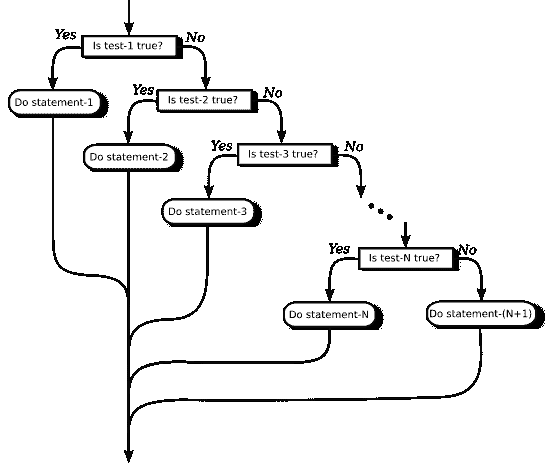

### 3.5.3 If 语句示例

作为使用`if`语句的示例，假设`x`、`y`和`z`是`int`类型变量，且每个变量已经赋值了值。考虑一个按增大顺序打印这三个变量值的问题。例如，如果值为 42、17 和 20，那么输出顺序应该是 17, 20, 42。

处理这个问题的一种方法是问问：`x`属于列表的什么位置？如果它同时小于`y`和`z`，它就排在第一。如果它同时大于`y`和`z`，它就排在最后。否则，它就在中间。我们可以用一个三路`if`语句来表示，但我们仍然需要担心`y`和`z`打印的顺序。在伪代码中：

```text
if (x < y && x < z) {
    输出 x，然后按正确的顺序输出 y 和 z
}
else if (x > y && x > z) {
    按正确的顺序输出 y 和 z，最后输出 x
}
else {
    在 y 和 z 之间按正确的顺序输出 x
}
```

确定`y`和`z`的相对顺序需要另一个`if`语句，因此它变成了：

```java
if (x < y && x < z) {        // x 排第一
    if (y < z)
       System.out.println( x + " " + y + " " + z );
    else
       System.out.println( x + " " + z + " " + y );
}
else if (x > y && x > z) {   // x 排最后
    if (y < z)
       System.out.println( y + " " + z + " " + x );
    else
       System.out.println( z + " " + y + " " + x );
}
else {                       // x 在中间
    if (y < z)
       System.out.println( y + " " + x + " " + z);
    else
       System.out.println( z + " " + x + " " + y);
}
```

你可能会检查发现，即使某些值相同，这段代码也能正常工作。如果两个变量的值相同，以何种顺序打印它们并不重要。

顺便提一下，尽管在英语中你可以说“如果`x`小于`y`和`z`”，但在 Java 中你不能写`x < y && z)`。`&&`运算符只能用在布尔值之间，因此你必须进行单独测试`x<y`和`x<z`，然后用`&&`将这两个测试结合起来。

解决这个问题还有另一种方法，从问开始：“`x`和`y`应该按什么顺序打印？”一旦知道了这一点，你只需要决定把`z`插入在哪里即可。这种思路导致了不同的 Java 代码：

```java
if ( x < y ) {  // x 排在 y 之前
   if ( z < x )   // z 排第一
      System.out.println( z + " " + x + " " + y);
   else if ( z > y )   // z 排最后
      System.out.println( x + " " + y + " " + z);
   else   // z 在中间
      System.out.println( x + " " + z + " " + y);
}
else {          // y 排在 x 之前
   if ( z < y )   // z 排第一
      System.out.println( z + " " + y + " " + x);
   else if ( z > x )  // z 排最后
      System.out.println( y + " " + x + " " + z);
   else  // z 在中间
      System.out.println( y + " " + z + " " + x);
}
```

我们再次看到同一个问题可以如何以许多不同的方式解决。解决这个问题的两种方法并没有穷尽所有可能性。例如，你可能从测试`x`是否大于`y`开始。一旦你那样做了，你就知道了`y`的顺序。

最后，让我们写一个使用`if`语句的完整程序。我想将一种单位转换为另一种单位，例如英里到英尺。到目前为止，问题还没有完全规定。让我们假设程序将处理英尺、英尺和英里。（这比问用户要容易）。流程的概述是：

```text
读取用户的输入单位
以英寸、英尺和英里显示结果
```

该程序可以通过`TextIO.getDouble()`读取数值测量值并使用`TextIO.getlnWord()`读取单位，从而从同一行读取这两个部分。转换为不同的单位可以通过首先将用户的输入转换为英寸来简化。从那里开始，我们必须测试输入以确定单位：

```text
让 measurement = TextIO.getDouble()
让 units = TextIO.getlnWord()
if 单位是英寸
   让 inches = measurement
else if 单位是英尺
   让 inches = measurement * 12         // 1 英尺=12 英寸
else if 单位是英码
   让 inches = measurement * 36         // 1 英码=36 英寸
else if 单位是英里
   让 inches = measurement * 12 * 5280  // 1 英里=5280 英尺
else
   单位非法！
   打印错误消息并停止处理
let feet = inches / 12.0
让 yards = inches / 36.0
让 miles = inches / (12.0 * 5280.0)
显示结果
```

由于`units`是一个`String`类型，我们可以使用`units.equals("inches")`来检查指定的单位是否为 "inches"。然而，如果允许单位指定为 "inch" 或缩写为 "in" 会更好。为了允许这三种可能性，我们可以检查`(units.equals("inches") || units.equals("inch") || units.equals("in"))`。它也可以允许大写字母，例如 "Inches" 或 "IN"。我们可以通过在测试之前将`units`转换为小写来实现这一点，或者用函数`units.equalsIgnoreCase`替换`units.equals`。

在我的最终程序，我决定让事情变得更有趣，允许用户重复输入测量值并查看每次转换的结果。只有当用户输入`0`时，程序才会结束。为了编写这一点，我只需要将上面的算法封装在一个`while`循环中，并确保循环在用户输入`0`时结束。

```java
import textio.TextIO;

/**
 * 此程序将以英寸、英尺、码或英里为单位的测量值
 * 转换为可能的每个单位。测量值由用户输入，
 * 随后是测量单位。例如："17 feet"、"1 inch" 或
 * "2.73 mi"。程序接受如 in, ft, yd, 和 mi 等缩写。
 * 程序将继续读取并转换测量值，
 * 直到用户输入 0 为止。
 */
 public class LengthConverter {

    public static void main(String[] args) {

       double measurement;  // 数值测量值，用户输入。
       String units;        // 输入的单位，也由用户
                            // 指定。

       double inches, feet, yards, miles;  // 以每个可能的
                                           // 单位表示的
                                           // 测量值。

       System.out.println("""
                以英寸、英尺、码或英里输入测量值。
                例如：  1 inch    17 feet    2.73 miles
                可以使用缩写：   in   ft  yd   mi
                我将你的输入转换为其他测量单位。
                """);

       while (true) {

          /* 获取用户的输入，并将单位转换为小写。 */

          System.out.print("输入你的测量值，或输入 0 结束：  ");
          measurement = TextIO.getDouble();
          if (measurement == 0)
             break;  // 退出 while 循环。
          units = TextIO.getlnWord();            
          units = units.toLowerCase();  // 将单位转换为小写

          /* 将输入的测量值转换为英寸。 */

          if (units.equals("inch") || units.equals("inches") 
                                          || units.equals("in")) {
              inches = measurement;
          }
          else if (units.equals("foot") || units.equals("feet") 
                                          || units.equals("ft")) {
              inches = measurement * 12;
          }
          else if (units.equals("yard") || units.equals("yards") 
                                           || units.equals("yd")) {
              inches = measurement * 36;
          }
          else if (units.equals("mile") || units.equals("miles") 
                                             || units.equals("mi")) {
              inches = measurement * 12 * 5280;
          }
          else {
              System.out.println("抱歉，我不理解 \"" 
                                                   + units + "\".");
              continue;  // 回到 while 循环开头
          }

          /* 将英寸的测量值转换为英尺、码和英里。 */

          feet = inches / 12;
          yards = inches / 36;
          miles = inches / (12*5280);

          /* 以每个测量单位输出测量值。 */

          System.out.printf("""
                    相当于：
                    %14.5g inches
                    %14.5g feet
                    %14.5g yards
                    %14.5g miles
                    """, inches, feet, yards, miles);

          System.out.println();

       } // 结束 while

       System.out.println();
       System.out.println("OK！再见。");

    } // 结束 main()

 } // 结束 class LengthConverter
```

（注意，此程序使用文本块进行多行输出（参见第 2.3.4 节；文本块需要 Java 17）。它还使用了带有 "g" 格式说明符的格式化输出。在程序中，我们无法控制数字的大小。对于用户来说，输入极大或非常小的测量值是完全合理的。"g" 格式会在数字非常大或非常小时以指数计数法打印实数，否则以通常的十进制形式打印。请记住，在格式规范`%14.5g`中，`5`是要打印的有效数字总数，因此无论数字大小，我们总能得到相同数量的有效数字。如果我们使用 "f" 格式说明符例如`%14.5f`，输出将是十进制形式且小数点后保留 5 位数字。这将数字`0.00000000745482`打印为`0.00000`，完全没有任何有效数字！使用 "g" 格式说明符，输出将是`7.4549e-10`。）

### 3.5.4 空语句

作为本节的最后一个说明，我将提到 Java 中的另一种类型的语句：空语句（empty statement）。这是一个仅由一个分号组成的语句，它告诉计算机什么都不做。空语句的存在使得以下代码是合法的，尽管你通常不会在`}`之后看到分号：

```java
if (x < 0) {
    x = -x;
};
```

在`}`之后使用分号是合法的，但计算机将其视为一个空语句，而不是`if`语句的一部分。偶尔，你可能会发现自己在确实使用空语句，而你真正想要表达的意思实际上是“什么都不做”。例如，这个稍显生硬的`if`语句：

```java
if ( done )
   ;  // 空语句
else
   System.out.println("Not done.");
```

当变量`done`为真时，它什么都不做；当为假时，打印 "Not done."

## 3.6 switch 语句

Java 的第二种分支语句是`switch`语句，它在本节中引入。`switch`语句不像`if`语句那样常用，但对于表示某些多路分支有时非常有用。

### 3.6.1 基础 switch 语句


`switch` 语句允许你测试表达式的值，并根据该值跳转到 `switch` 语句内部的某个位置。只有特定类型的表达式可以使用。表达式的值可以是基本整数类型之一：`int`、`short` 或 `byte`。它可以是基本 `char` 类型。可以是 `String`。或者可以是 `enum` 类型（关于枚举类型的介绍，请参见第 2.3.5 节）。特别需要注意的是，表达式不能是 `double` 或 `float` 值。

`switch` 语句内部可以跳转的位置由 `case` 标签标记，格式为：`case constantList`。这里的 `constantList` 由一个或多个与 `switch` 中表达式类型相同的字面量组成，用逗号分隔。例如：

```java
case 2, 4, 8
or 
case "Paper"
```

用例标签后紧跟着 `->`，即一个由连字符和大于号组成的符号，然后是一个单条语句。该语句可以是一个子程序调用语句、`throw` 语句，或者包含多个嵌套语句的块语句（block statement）。`switch` 语句还可以选择性地包含一个标记为 `default` 的跳转点，而不是 `case` 标签。该语句的语法可以规定如下，请注意，最多可以有一个 `default` 情况，且 `case` 标签中的所有常量必须是互不相同的：

```
switch ( expression ) {
    case-label-or-default -> statement 
    case-label-or-default -> statement 
        .
        .
        .
    case-label-or-default -> statement
}
```

当计算机执行此 `switch` 语句时，它会计算 `expression` 的值。如果该值是 `case` 标签中的常量之一，计算机将执行该 `case` 标签随后的语句，然后跳出 `switch` 语句。如果 `expression` 的值与任何 `case` 常量都不匹配，计算机将寻找 `default` 情况，如果存在，则执行其随后的语句。

通过例子来看可能是最简单的。虽然这不是一个很有用的例子，但应该很容易理解：

```
switch ( N ) {   // （假设 N 是一个整数变量。）
   case 1 -> System.out.println("The number is 1.");
   case 2, 4, 8 -> {
      System.out.println("The number is 2, 4, or 8.");
      System.out.println("(That's a power of 2!)");
   }
   case 3, 6, 9 -> {
      System.out.println("The number is 3, 6, or 9.");
      System.out.println("(That's a multiple of 3!)");
   }
   case 5 -> System.out.println("The number is 5.");
   default ->
      System.out.println("The number is 7 or is outside the range 1 to 9.");
}
```

此示例中的大括号 `{` 和 `}` 是为了将多个语句分组到一个块语句中。也可以给其他 `case` 添加大括号，但那里不是必须的。这个 `switch` 语句的效果与以下多路 `if` 语句完全相同：

```
if ( N == 1 ) {
    System.out.println("The number is 1.");
}
else if ( N == 2 || N == 4 || N == 8 ) {
    System.out.println("The number is 2, 4, or 8.");
    System.out.println("(That's a power of 2!)");
}
else if ( N == 3 || N == 6 || N == 9 ) {
    System.out.println("The number is 3, 6, or 9.");
    System.out.println("(That's a multiple of 3!)");
}
else if ( N == 5 ) {
    System.out.println("The number is 5.");
}
else {
    System.out.println("The number is 7 or is outside the range 1 to 9.");
}
```

更通地说，任何 `switch` 语句都可以被多路 `if` 语句替换。`switch` 语句可能更读性更好。而且它可能更高效，因为计算机可以直接跳转到正确的 `case`，而不需要通过一系列测试来找到正确的 `case`。

***

### 3.6.2 菜单与 switch 语句

`switch` 语句的一个应用是处理菜单。菜单是选项列表。用户选择其中一个选项。计算机必须以不同的方式对每种可能的选择做出响应。如果选项编号为 1, 2, ..., 则可以使用选择选项的数字在 `switch` 语句中选择相应的响应。

在命令行程序中，菜单可以以编号列表的形式呈现，用户可以通过输入数字来选择选项。使用文本块（参见第 2.3.4 节）呈现菜单可能非常方便。这里有一个可以用于上一节中 `LengthConverter` 示例变体的例子：

```java
int optionNumber;   // 用户选择的菜单选项编号。
double measurement; // 用户输入的数值测量值。
                    //    测量单位取决于用户选择了
                    //    哪个选项。
double inches;      // 相同的测量值，转换为英寸。

/* 显示选项菜单，并获取用户选择的选项编号。 */

System.out.println("""
        What unit of measurement does your input use?

                1\. inches
                2\. feet
                3\. yards
                4\. miles

        Enter the number of your choice:
        """);

optionNumber = TextIO.getlnInt();

/* 读取用户的测量值并转换为英寸。 */

switch ( optionNumber ) {
   case 1 -> {
       System.out.println("Enter the number of inches: ");
       measurement = TextIO.getlnDouble();
       inches = measurement;
   }
   case 2 -> {
       System.out.println("Enter the number of feet: ");
       measurement = TextIO.getlnDouble();
       inches = measurement;
   }
   case 3 -> {
       System.out.println("Enter the number of yards: ");
       measurement = TextIO.getlnDouble();
       inches = measurement;
   }
   case 4 -> {
       System.out.println("Enter the number of miles: ");
       measurement = TextIO.getlnDouble();
       inches = measurement;
   }
   default ->
      System.out.println("The number is 7 or is outside the range 1 to 9.");
}
```

或者，此示例也可以设计为让用户以字符串输入测量单位，而不是数字，然后在 `switch` 中使用该字符串：

```java
String units;       // 用户输入的单位。
double measurement; // 用户输入的数值测量值。
double inches;      // 相同的测量值，转换为英寸。

/* 读取测量单位。 */

System.out.println("What unit of measurement does your input use?");
units = TextIO.getln().toLowerCase();

/* 读取用户的测量值并转换为英寸。 */

System.out.print("Enter the number of " + units + ": ");
measurement = TextIO.getlnDouble();

switch ( units ) {
   case "inch", "inches", "in" -> inches = measurement;
   case "foot", "feet", "ft"   -> inches = measurement * 12;
   case "yard", "yards", "yd"  -> inches = measurement * 36;
   case "mile", "miles", "mi"  -> inches = measurement * 5280;
   default -> {
       System.out.println("Wait a minute! Illegal unit of measure!");
       System.exit(1);
   }
} // end switch
```

***

### 3.6.3 switch 语句中的枚举

`switch` 的表达式类型可以是 `enum` 类型。在这种情况下，`case` 标签中的常量必须是 `enum` 类型的值。例如，假设表达式的类型是由下面定义的枚举 `Season`：

```java
enum Season { SPRING, SUMMER, FALL, WINTER }
```

且 `switch` 语句中的表达式是 `Season` 类型。`case` 标签中的常量必须从 `Season.SPRING`、`Season.SUMMER`、`Season.FALL` 或 `Season.WINTER` 中选择。然而，语法上有一个特殊之处：在 `case` 标签中使用枚举常量时，只使用简单名称（例如 `SPRING`），而不使用全名（例如 `Season.SPRING`）。当然，计算机已经知道 `case` 标签中的值属于该枚举类型，因为它可以从所使用的表达式类型判断出来，因此实际上不需要在常量中指定类型名称。例如，假设 `currentSeason` 是类型为 `Season` 的变量，那么我们可以有如下 `switch` 语句：

```java
System.out.print("The months in " + currentSeason + " are: ");

switch ( currentSeason ) {
   case WINTER ->   // （不是 Season.WINTER！）
      System.out.println("December, January, February");
   case SPRING ->
      System.out.println("March, April, May");
   case SUMMER ->
      System.out.println("June, July, August");
   case FALL ->
      System.out.println("September, October, November");
}
```

作为一个稍微现实一点的例子，下面的 `switch` 语句在三个可能的选项中进行随机选择。记住，表达式 `(int)(3*Math.random())` 的值是整数 0、1 或 2 之一，以等概率随机选择，因此下面的 `switch` 语句将 "Rock","Paper","Scissors" 之一赋值给 `computerMove`，每种情况的概率均为 1/3：

```
switch ( (int)(3*Math.random()) ) {
   case 0 -> computerMove = "Rock";
   case 1 -> computerMove = "Paper";
   case 2 -> computerMove = "Scissors";
}
```

这个 `switch` 语句是完全正确的，但假设我们在下面的代码段中使用它：

```
String computerMove;
switch ( (int)(3*Math.random()) ) {
   case 0 -> computerMove = "Rock";
   case 1 -> computerMove = "Paper";
   case 2 -> computerMove = "Scissors";
}
System.out.println("The computer's move is " + computerMove);  // ERROR!
```

现在最后一行有一个细微的错误！这个问题的原因是**确定性赋值**（definite assignment），即 Java 编译器必须能够在使用变量值之前，确定该变量已经被赋值了值。确定性赋值是在第 3.1.5 节引入的。在这个示例中，虽然 `switch` 中的三个 `case` 涵盖了所有可能，但编译器并不聪明到能这一点；它只看到 `switch` 中有一个整数表达式，但并不是所有可能的整数值都被给定的 `case` 覆盖。

简单的解决方案是将 `switch` 语句中的最后一个 `case` 替换为 `default`。有了 `default` 情况，`switch` 中表达式的所有可能值都一定被覆盖了，编译器知道 `computerMove` 确实被赋值了：

```
String computerMove;
switch ( (int)(3*Math.random()) ) {
   case 0 -> computerMove = "Rock";
   case 1 -> computerMove = "Paper";
   default -> computerMove = "Scissors";
}
System.out.println("The computer's move is " + computerMove);
```

* * *

### 3.6.5 Switch 表达式

很多时候，`switch` 语句的整个目的是给变量赋值，而要赋值的值取决于 `switch` 中表达式的值。例如，上一节中的 `switch` 语句就是这样。

这种情况可以使用 `switch` 表达式代替 `switch` 语句来优雅地处理。像任何表达式一样，`switch` 表达式计算并返回一个值。其语法与 `switch` 语句相似，但每个 `case` 后面不是语句而是表达式（或 `throw` 语句）。例如：

```
String computerMove = switch ( (int)(3*Math.random()) ) {
        case 1 -> "Rock";
        case 2 -> "Paper";
        default -> "Scissors";
    };
```

这是一个赋值语句，`computerMove` 的值由 `switch` 表达式计算。分号是赋值语句要求的。

`switch` 表达式必须始终计算一个值（或抛出异常），因此通常有一个 `default` 情况。`case` 中的表达式可以被包含多个语句的块替换；随后该情况的值由 `yield` 语句指定，形式如 `yield 42;`。`yield` 之后的值随后作为 `switch` 表达式的值返回。

当然，`switch` 表达式不仅限于赋值语句。你可以在任何可以使用其他表达式的地方使用 `switch` 表达式，例如输出语句或表达式的一部分。

* * *

### 3.6.6 传统的 switch 语句

旧的 `switch` 语句较为复杂，但你应该了解它，因为它在 Java 和其他语言中被广泛使用。传统的 `switch` 形式如下：

```
switch (expression) {
   case constant-1:
      statements-1
      break;
   case constant-2:
      statements-2
      break;
      .
      .   // (更多 cases)
      .
   case constant-N:
      statements-N
      break;
   default:  // 可选的 default 情况
      statements-(N+1)
}
```

注意在传统语法中，`case` 标签只允许一个常量（但 Java 允许逗号分隔的常量列表）。`case` 标签可以跟随任意数量的语句。这种传统语法在每个 `case` 标签后使用冒号而不是 `->`。`default` 情况是可选的。


执行此 `switch` 语句时，计算机将评估表达式，跳转到包含该常量的 `case` 标签；如果没有，则跳转到 `default` 情况。此 `switch` 中的 `break` 语句并不是 `switch` 语法强制要求的。`break` 的作用是让计算机跳到 `switch` 语句的结束，跳过所有剩余 `case`。如果你漏掉了 `break` 语句，计算机完成一个 `case` 后将继续执行下一个 `case` 的语句。这被称为“贯穿”（fall through）；这通常不是你想要的，也是常见的错误来源。然而，它是合法的且有时很有用。

注意你可以完全省略一组语句（包括 `break`）。这时你会有两个连续的 `case` 标签。这仅仅意味着计算机将跳转到同一地方并对这两个常量执行相同的操作。以下是使用传统语法编写我们的第一个示例：

```java
switch ( N ) {   （假设 N 是整数变量。）
   case 1:
      System.out.println("The number is 1.");
      break;
   case 2:
   case 4:
   case 8:
      System.out.println("The number is 2, 4, or 8.");
      System.out.println("(That's a power of 2!)");
      break;
   case 3:
   case 6:
   case 9:
      System.out.println("The number is 3, 6, or 9.");
      System.out.println("(That's a multiple of 3!)");
      break;
   case 5:
      System.out.println("The number is 5.");
      break;
   default:
      System.out.println("The number is 7 or is outside the range 1 to 9.");
}
```

## 第 3.7 节 异常与 `try..catch` 简介

除了确定程序正常控制流的结构外，Java 还有处理会让控制流偏离正常轨迹的“异常”情况的方法。程序执行发生错误时，默认行为是终止程序并打印错误消息。然而，Java 让“捕获”此类错误并编写不同于让程序崩溃的响应成为可能。这是通过 `try..catch` 语句实现的。在本节中，我们将对 `try..catch` 语句进行初步且不完整的查看，省略该语句中许多复杂的语法。错误处理是一个复杂的话题，我们将在第 8.3 节中返回，届时我们将涵盖 `try..catch` 的完整语法。

### 3.7.1 异常

“异常”一词用于指代人们可能用 `try..catch` 处理的事件类型。异常是对程序正常控制流的一种例外。使用该术语而不是“错误”（error）是因为在某些情况下，异常可能根本被视为错误。你有时可以将异常看作是组织程序的另一种方式。

Java 中的异常用 `Exception` 类型的对象表示。实际异常通常由 `Exception` 的子类定义。不同的子类代表不同类型的异常。在本节中，我们只查看两种异常：`NumberFormatException` 和 `IllegalArgumentException`。

当尝试将字符串转换为数字时，可能会发生 `NumberFormatException`。此类转换是通过 `Integer.parseInt` 和 `Double.parseDouble` 函数完成的。（参见第 2.5.7 节。）。考虑函数调用 `Integer.parseInt(str)`，其中 `str` 是一个 `String` 类型变量。如果 `str` 的值是字符串 `"42"`，那么该函数调用将正确地将字符串转换为整数 `42`。然而，如果 `str` 的值是 `"fred"`，则该函数调用将失败，因为 `"fred"` 不是 `int` 值的合法字符串表示。在这种情况下，会发生类型为 `NumberFormatException` 的异常。如果没有对该异常进行任何处理，程序将会崩溃。

当将非法值作为参数传递给子程序时，可能会发生 `IllegalArgumentException`。例如，如果一个子程序要求参数大于或等于零，那么当向子程序传递一个负值时，可能会发生 `IllegalArgumentException`。如何响应非法值取决于编写子程序的人，因此我们不能简单地说每个非法参数值都会导致 `IllegalArgumentException`。不过，这是一种常见的响应方式。

### 3.7.2 `try..catch`

当发生异常时，我们说异常被“抛出”（thrown）。例如，我们说当 `str` 的值非法时，`Integer.parseInt(str)` 抛出了类型为 `NumberFormatException` 的异常。当异常抛出时，可以“捕获”（catch）异常并防止程序崩溃。这是通过 `try..catch` 语句实现的。`try..catch` 语句的简化语法可以如下：

```java
try {
   statements-1
}
catch ( exception-class-name  variable-name ) {
   statements-2
}
```

`exception-class-name` 可以是 `NumberFormatException`、`IllegalArgumentException` 或其他异常类。当计算机执行此 `try..catch` 语句时，它执行 `statements-1`，即 `try` 部分内部语句。如果在执行 `statements-1` 期间没有发生异常，计算机将直接跳过 `catch` 部分并继续程序的剩余部分。然而，如果在执行 `statements-1` 期间发生了类型为 `exception-class-name` 的异常，计算机将立即从异常发生点跳转到 `catch` 部分并执行 `statements-2`，跳过 `statements-1` 中的任何剩余语句。请注意，只捕获一种类型的异常；如果在执行 `statements-1` 期间发生了其他类型的异常，它将像通常一样导致程序崩溃。

异常由一个对象表示。在执行 `statements-2` 期间，`variable-name` 代表该异常对象，因此你可以（例如）打印它。异常对象包含有关异常原因的信息。这包括一条错误消息，当你打印异常对象时，该消息将会显示。

在 `catch` 部分结束后，计算机继续执行程序的剩余部分；异常已被捕获并处理，不会导致程序崩溃。

顺便提一下，注意大括号 `{` 和 `}` 是 `try..catch` 语句语法的一部分。即使大括号之间只有一个语句，它们也是必须的。这与我们过的其他语句不同，在那些语句中，单个语句周围的大括号是可选的。

作为一个例子，假设 `str` 是一个 `String` 类型变量，其值可能代表也可能不代表合法的实数。那么我们可以说：

```java
double x;
try {
   x = Double.parseDouble(str);
   System.out.println( "The number is " + x );
}
catch ( NumberFormatException e ) {
   System.out.println( "Not a legal number." );
   x = Double.NaN;
}
```

如果调用 `Double.parseDouble(str)` 抛出错误，则 `try` 部分的输出语句将被跳过，`catch` 部分的语句将被执行。（在这个例子中，当发生异常时，我将 `x` 设置为值 `Double.NaN`。`Double.NaN` 是 `double` 类型的特殊“不是数字”的值。）

捕获异常并继续程序运行**并不**总是一个好主意。通常，这会导致以后出现更大的混乱，让异常在发生的地方直接让程序崩溃可能更好。然而，有时可以从错误中恢复。

例如，假设我们希望一个程序能够找到用户输入的一系列实数序列的平均值，并且我们希望用户通过输入空行来指示序列的结束。（这类似于第 3.3 节中的示例程序 [`ComputeAverage.java`](https://math.hws.edu/eck/cs124/javanotes9/source/chapter3/ComputeAverage.java)，但在那个程序中，用户输入零来表示输入结束。）如果我们使用 `TextIO.getlnInt()` 来读取用户的输入，我们将无法检测空行，因为该函数会直接跳过空行。解决方案是使用 `TextIO.getln()` 读取用户的输入。这允许我们检测空输入行，并且我们可以使用 `Double.parseDouble` 将非空输入转换为数字。我们可以使用 `try..catch` 来避免在用户输入不是合法数字时程序崩溃。在这个例子中，当用户输入不是合法数字时，简单地打印错误消息是合理的。这里是程序：

```java
import textio.TextIO;

public class ComputeAverage {

   public static void main(String[] args) {
       String str;     // 用户输入
       double number;  // 转换为数字的输入
       double total;   // 数字和
       double avg;     // 数字的平均值
       int count;      // 数字的个数
       total = 0;
       count = 0;
       System.out.println("Enter your numbers, press return to end.");
       while (true) {
          System.out.print("? ");
          str = TextIO.getln();
          if (str.equals("")) {
             break; // 因为输入行为空，退出循环
          }
          try {
              number = Double.parseDouble(str);
              // 如果发生错误，接下来两行将被跳过！
              total = total + number;
              count = count + 1;
          }
          catch (NumberFormatException e) {
              System.out.println("Not a legal number! Try again.");
          }
       }
       avg = total/count;
       System.out.printf("The average of %d numbers is %1.6g%n", count, avg);
   }

}
```

如果调用 `Double.parseDouble(str)` 抛出错误，则 `try` 部分的输出语句将被跳过，`catch` 部分的语句将被执行。（在这个例子中，当发生异常时，我将 `x` 设置为值 `Double.NaN`。`Double.NaN` 是 `double` 类型的特殊“不是数字”的值。）

### 3.7.3 `TextIO` 中的异常

当 `TextIO` 从用户读取数值时，它会确保用户的响应是合法的，使用了与上一个示例类似的 `while` 循环和 `try..catch`。然而，`TextIO` 从用户以外的其他源读取数据。（参见第 2.4.4 节。）。当它从文件读取数据时，`TextIO` 没有合理的方法从输入中的非法值中恢复，因此它通过抛出异常来做出响应。为了保持简单，`TextIO` 只抛出类型为 `IllegalArgumentException` 的异常，无论遇到什么类型的错误。例如，如果在文件中所有数据都已读取后仍尝试从文件读取，就会发生异常。在 `TextIO` 中，异常类型是 `IllegalArgumentException`。如果你对文件错误有比让程序崩溃更好的响应，可以使用 `try..catch` 来捕获类型为 `IllegalArgumentException` 的异常。

作为一个示例，我们将来看另一个计算平均数的程序。在这种情况下，我们将从文件中读取数字。假设该文件只包含实数，并且我们希望程序能够读取这些数字并找到它们的总和以及平均值。由于不知道文件中共有多少个数字，因此存在何时停止读取的问题。

一种方法是简单地尝试无限地读取下去。当到达文件末尾（EOF）时，会发生一个异常。这个异常并不是真正的错误——它只是检测数据结束的一种方式。因此，我们可以捕获该异常，并在其发生时完成程序。我们可以在一个 `while (true)` 循环中读取数据，并在发生异常时跳出循环。这是一个使用异常不寻常技术的示例，即将异常作为程序预期控制流的一部分。

要从文件中读取内容，我们需要知道文件名。为了让程序更具通用性，可以让用户输入文件名，而不是在程序中硬编码一个固定的文件名。然而，用户可能会输入一个不存在的文件名。当我们使用 `TextIO.readfile` 打开一个不存在的文件时，会发生类型为 `IllegalArgumentException` 的异常。我们可以捕获这个异常并要求用户输入不同的文件名。这里有一个使用了这些思想的完整程序：

```java
import textio.TextIO;

/**
 * 此程序从文件中读取数字。它计算读取的数字的
 * 总和和平均值。文件应该只包含 double 类型的
 * 数字；如果情况不是如此，输出将是从文件中
 * 成功读取的任意数量数字的总和和平均值。文件名将
 * 由用户输入。（用户可以选择通过输入
 * Control-C 来结束程序。）
 */
public class AverageNumbersFromFile {

   public static void main(String[] args) {

      while (true) {
         String fileName;  // 文件名，由用户输入。
         System.out.print("Enter the name of the file: ");
         fileName = TextIO.getln();
         try {
            TextIO.readFile( fileName );  // 尝试打开文件进行输入。
            break;  // 如果成功，跳出循环。
         }
         catch ( IllegalArgumentException e ) {
            System.out.println("Can't read from the file \"" + fileName + "\".");
            System.out.println("Please try again.\n");
         }
      }

      /* 此时，TextIO 正在从文件中读取。 */

      double number;  // 从数据文件中读取的数字。
      double sum;     // 直到目前读取的所有数字的总和。
      int count;      // 读取的数字个数。

      sum = 0;
      count = 0;

      try {
         while (true) { // 当发生异常时循环结束。
             number = TextIO.getDouble();
             count++;  // 发生异常时会跳过此处
             sum += number;
         }
      }
      catch ( IllegalArgumentException e ) {
         // 我们预计在遇到文件末尾时发生这种情况。
         // 我们不认为这是一个错误，因此在这个 catch 子句中
         // 不需要做什么。继续执行程序的其余部分。
      }

      // 此时，我们已经读取了整个文件。

      System.out.println();
      System.out.println("Number of data values read: " + count);
      System.out.println("The sum of the data values: " + sum);
      if ( count == 0 )
         System.out.println("Can't compute an average of 0 values.");
      else
         System.out.println("The average of the values:  " + (sum/count));

   }

}
```

## 第 3.8 节 数组简介

在本章的前几节中，我们已经涵盖了 Java 的所有控制结构。但在移动到下一章之前，我们将初步查看两个与控制结构至少有些相关的额外主题。

本节是数组的介绍。数组是一种基础且非常常用的数据结构，而数组处理通常是使用控制结构的一种练习。下一节将介绍计算机图形，并允许你在另一个语境下应用你所学的控制结构的知识。

### 3.8.1 创建和使用数组

数据结构由若干组合在一起的数据项组成，以便它们可以被视为一个单元。数组是一种数据结构，其中项被排列为编号序列，因此每个单独的项都可以通过其位置编号来引用。在 Java 中——但在某些其他编程语言中不是——所有项必须是相同类型，且编号始终从零开始。你需要学习几个新术语来讨论数组：数组中项的数量称为数组的 `length`。数组中单个项的类型称为数组的 `base type`（基本类型）。数组中项的位置编号称为该项的 `index`（索引）。


假设你想写一个程序来处理例如一千人的名字。你需要一种方法来处理所有这些数据。在你了解数组之前，你可能认为你需要一千个变量来保存这些名字，但数组允许你用一个变量来管理它们。数组的`length`将是 1000。数组的`base type`将是`String`。第一个名字位于`index` 0，第二个位于 1，以此此类推，直到万千个位于 999。

数组的`base type`可以是 Java 类型，但目前我们仅限于基类型为`String`或基本数据类型的数组。如果数组的基类型是`int`，则被称为“int 数组”。基类型为`String`的数组被称为“String 数组”。然而，严格来说，数组并不是整数、字符串或其他值的列表。它最好被视为`int`类型变量的列表，或`String`类型变量的列表。

与一贯一样，变量的两种用法可能会产生混淆：作为内存位置的名称以及作为存储在该内存位置中的值的名称。数组中的每个位置都充当变量。每个位置都可以存储一个指定类型（数组的`base type`）的值，就像变量可以存储值一样。值可以随时更改，就像变量的值可以更改一样。数组中的项——实际上构成数组的各个变量——通常被称为数组的元素。

如前所述，当你在程序中使用数组时，可以使用一个变量来引用整个数组。但你经常需要引用数组的单个元素。数组元素的名称基于数组的名称和元素的索引编号。引用元素的语法例如：`namelist[7]`。在这里，`namelist`是命名整个数组的变量，而`namelist[7]`指的是该数组索引为 7 的元素。也就是说，要引用数组的元素，你使用数组名，后面跟上方括号内的元素索引。这种形式的元素名称可以像任何其他变量一样使用：你可以给它赋值、打印它、在表达式中使用它，等等。

数组还包含一种表示其长度的变量。例如，你可以通过`namelist.length`来引用数组`namelist`的长度。然而，你不能为`namelist.length`赋值，因为数组的长度是不可改变的。

在使用变量引用数组之前，必须先声明该变量，并且它必须有一个类型。例如，对于一个 String 数组，数组变量的类型将是`String[]`，而对于一个 int 数组，类型则是`int[]`。通常情况下，数组类型由数组的基类型加上一对空方括号组成。数组类型可以声明变量；例如：

```java
String[] namelist;
int[] A;
double[] prices;
```

通过这样声明的变量可以引用数组。但是，声明变量并不会创建实际的数组。与所有变量一样，数组变量在使用之前必须被赋值一个值。在这种情况下，该值是一个数组。数组必须使用特殊的语法来创建。（该语法与 Java 中的数组实际上是对象这一事实有关，但我们不需要关心这一点。）数组是使用名为`new`的操作符创建的。以下是一些示例：

```java
namelist = new String[1000];
A = new int[5];
prices = new double[100];
```

通用语法为：

```java
array-variable = new base-type[array-length];
```

数组的长度可以是整数或整数值表达式。例如，在执行赋值语句`A = new int[5];`之后，`A`是一个包含五个整数元素`A[0]`、`A[1]`、`A[2]`、`A[3]`和`A[4]`的数组。此外，`A.length`的值将是`5`。在脑海中有一个这样的模型是有用的：

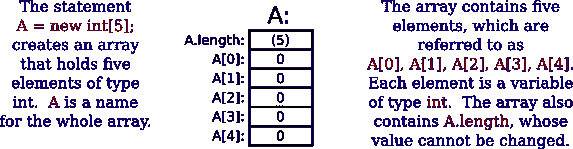

当你创建一个`int`数组时，数组的每个元素都会自动初始化为零。任何数字数组在创建时都会被填充零。布尔数组会被填充为值`false`。char 数组会被填充为 Unicode 编码号为零的字符。（对于`String`数组，初始值为`null`，这是一个用于对象的特殊值，直到我们在第 5.1 节才会正式遇到它。）

### 3.8.2 数组与 for 循环

数组的强大之处很大程度上源于元素的索引可以通过整数变量甚至整数值表达式来给出。例如，如果`list`是一个数组且`i`是一个`int`类型的变量，那么你可以使用`list[i]`甚至`list[2*i+1]`作为变量名。`list[i]`的含义取决于`i`的值。当我们想要处理数组的所有元素时，这变得特别有用，因为这可以通过`for`循环完成。例如，为了打印数组`list`中的所有项，我们只需要写道：

```java
int i;  // 数组索引
for (i = 0; i < list.length; i++) {
    System.out.println( list[i] );
}
```

循环第一次执行时，`i`为 0，`list[i]`指向`list[0]`。因此，打印出来的是存储在变量`list[0]`中的值。循环第二次执行时，`i`为 1，打印的是存储在`list[1]`中的值。如果`list`的长度为 5，那么循环在打印完`list[4]`的值后结束，此时`i`变为 5，且继续条件`"i < list.length"`不再成立。这是一个使用循环处理数组的典型示例。

让我们再看另外几个例子。假设`A`是一个`double`数组，我们想要找到数组所有元素的平均值。我们可以使用`for`循环来加这些数字，然后除以数组的长度以得到平均值：

```java
double total;    // 数组中数字的总和。
double average;  // 数字的平均值。
int i;  // 数组索引。
total = 0;
for ( i = 0; i < A.length; i++ ) {
    total = total + A[i];  // 将第 i 个元素加到总和。
}
average = total / A.length;  // A.length 是项目的数量
```

另一个典型问题是在数组`A`中最大的数字。策略是遍历数组，记录到为止发现的最大数字。我们将目前发现的最大数字存储在一个名为`max`的变量中。当我们遍历数组时，每当我们发现一个比`max`当前值更大的数时，我们将`max`的值改为那个较大的值。在处理整个数组后，`max`就是数组中最大的项。唯一的问题是，`max`的初始值应该是多少？一种可能性是让`max`等于`A[0]`，然后从`A[1]`开始遍历的剩余部分，寻找更大的项：

```java
double max;  // 目前为止看到的最大的数字。
max = A[0];   // 起初最大值是 A[0]。
int i;
for ( i = 1; i < A.length; i++ {
    if (A[i] > max) {
        max = A[i];
    }
}
```

### 3.8.3 随机访问

到为止，我的数组处理示例使用的是顺序访问。也就是说，数组元素是按照它们在数组中的顺序一个接一个处理的。但数组的一个巨大优势是它们允许随机访问。也就是说，数组的任何元素都可以随时被访问。

作为一个例子，让我们来看一个被称为生日问题的经典问题：假设房间里有`N`个人。房间里至少有两个人生日相同的概率是多少？（也就是说，他们出生在同月的同一天，但不一定在同一年。）大多数人严重低估了这种概率。我们实际上来看一个不同的版本：假设你随机选择人员并检查他们的生日。你需要检查多少个人才能找到一个和你已经检查过的人生日相同的？当然，特定情况下的答案取决于随机因素，但我们可以用程序模拟这个实验并运行多次程序，以获得平均需要检查多少人的想法。

为了模拟这个实验，我们需要跟踪发现的每个生日。有 365 种可能的生日。（我们将忽略闰年。）对于每个可能的生日，我们需要跟踪我们是否已经发现过该生日的人。这个问题的答案是一个布尔值，真或假。为了存储所有 365 种生日的数据，我们可以使用一个包含 365 个布尔值的数组：

```java
boolean[] used; 
used = new boolean[365];
```

对于这个问题，一年的天数从 0 到 364。如果某人的生日是第`i`天并被选中，则`used[i]`的值为`true`。初始情况下，数组中的所有值均为`false`。（记住，这在创建数组时会自动完成。）当我们选定一个生日为第`i`天的人时，我们首先检查`used[i]`是否为`true`。如果为`true`，则说明这是该生日的第二个人。我们的任务完成。另一方面，如果`used[i]`为`false`，我们将`used[i]`设置为`true`，以记录我们遇到了具有该生日的人的事，然后继续处理下一个人。以下是一个执行模拟实验的程序（当然，在程序中，没有模拟的人，只有模拟的生日）：

```java
/**
 * 模拟随机选择人员并检查他们出生的日期。
 * 如果生日与之前看到的生日相同，则停止，
 * 并输出检查过的人数。
 */
public class BirthdayProblem {

   public static void main(String[] args) {

       boolean[] used;  // 用于记录到目前为止过的生日
                        //   used[i] 中的值为 true 表示
                        //   已发现一个生日在一年第 i 天的
                        //   的人。

       int count;       // 已检查过的人数。

       used = new boolean[365];  // 初始时，所有条目均为 false。

       count = 0;

       while (true) {
             // 从 0 到 364 随机随机选择一个生日。
             // 如果生日已经使用过，则退出。
             // 否则，将生日标记为已使用。

          int birthday;  // 选中的生日。
          birthday = (int)(Math.random()*365);
          count++;

          System.out.printf("Person %d has birthday number %d%n", count, birthday);

          if ( used[birthday] ) {  
                // 这一天之前发现过；它是重复的。我们任务了。
             break;
          }

          used[birthday] = true;

       } // end while

       System.out.println();
       System.out.println("A duplicate birthday was found after " 
                                             + count + " tries.");
   }

} // end class BirthdayProblem
```

你应该学习这个程序以理解它是如何工作的以及它是如何使用数组的。也尝试一下它！你可能会发现重复生日出现往往比你预期的要早。

### 3.8.4 部分填充数组

考虑一种应用程序，其中我们想要存储在数组中的项目数量会随着程序的运行而变化。由于数组的大小不能更改，必须使用单独的计数器变量来跟踪数组中有多少空间正在被使用。（当然，数组中的每个空间都必须包含内容；问题是，有多少个空间包含有用或有效的项目？）

例如，考虑一个程序，它读取用户输入的正整数并将其存储起来供以后处理。当用户输入一个小于或等于 0 的数字时，程序停止读取。输入的数字可以存储在类型为`int[]`的数字数组中。假设输入的数字不超过 100 个。那么数组的大小就可以固定为 100。但程序必须跟踪实际上已经读取并存储在数组中的多少个数字。为了这一点，可以使用一个整数变量。每当有一个数字存储在数组中时，我们都要对它进行计数；也就是说，计数器变量的值必须增加 1。一个问题是，当我们向数组添加新项目时，我们应该把它放在哪里？嗯，如果项目数量是`count`，那么它们将存储在数组的第 0, 1, ..., (count-1) 位置。下一个空闲位置将是第`count`位置，所以我们应该把新项目放在那里。

作为一个相当愚蠢的例子，让我们写一个程序，读取用户输入的数字，然后以它们输入顺序的反向顺序打印它们。假设输入值等于 0 表示数据的结束。（这至少是一个需要将数字保存在数组中的处理任务。注意，许多类型的处理，如计算数字之和、平均值或最大值，可以在不保存单个数字的情况下完成。）

```java
import textio.TextIO;

public class ReverseInputNumbers {

   public static void main(String[] args) {

     int[] numbers;  // 用于存储输入值的数组。
     int count;      // 数组中保存的数字。
     int num;        // 用户输入的数字之一。
     int i;          // for 循环变量。

     numbers = new int[100];   // 为 100 个 int 留空间。
     count = 0;                // 还没有保存任何数字。

     System.out.println("Enter up to 100 positive integers; enter 0 to end.");

     while (true) {   // 获取数字并将它们放入数组中。
        System.out.print("? ");
        num = TextIO.getlnInt();
        if (num <= 0) {
              // 0 标记输入结束；我们有了所有的数字。
           break;
        }
        numbers[count] = num;  // 将 num 放入 count 位置。
        count++;  // 计数
     }

     System.out.println("\nYour numbers in reverse order:");

     for ( i = count - 1; i >= 0; i-- ) {
         System.out.println(numbers[i]);
     }

   } // end main

} // end class ReverseInputNumbers
```

## 二维数组

在 Java 中，二维数组的语法与一维数组的语法相似，不同之处在于多了一个索引，因为选取一个元素同时需要行号和列号。例如，如果`A`是一个`int`类型的二维数组，那么`A[3][2]`就是第 3 行第 2 列的元素。这将选出上方所示数组中的数字 17。`A`的类型将标记为`int[][]`，带有两对空括号。要声明数组变量并创建数组，你可以写道：

```java
int[][] A;
A  =  new int[5][7];
```

第二行创建了一个 5 行 7 列的二维数组。二维数组通常使用嵌套的`for`循环进行处理。例如，以下代码段将以整齐的的形式打印`A`的元素：

```java
int row, col;  // 用于访问 A 中行和列的循环控制变量
for ( row = 0; row < 5; row++ ) {
    for ( col = 0; col < 7; col++ ) {
        System.out.printf( "%7d",  A[row][col] );
    }
    System.out.println();
}
```

二维数组的基类型可以是任何类型，因此你可以拥有`double[][]`、`String[][]`等类型的数组。

二维数组有一些天然的用途。例如，二维数组可以用于存储国际象棋或跳棋等游戏棋盘的内容。第 4.7.3 节中的一个示例使用二维数组来存储彩色网格的颜色。但有时二维数组也用于网格在视觉上并不直观的问题。考虑一家拥有 25 家商店的公司。假设该公司拥有关于 2022 年每家商店每个月的利润数据。如果商店从 0 到 24 编号，2022 年 1 月到 2022 年 12 月的十二个月从 0 到 11 编号，那么利润数据可以存储在一个名为`profit`的数组中，创建方式如下：

```java
double[][]  profit;
profit  =  new double[25][12];
```

`profit[3][2]`将是 3 月第 3 号商店赚取的利润，更通地说，`profit[storeNum][monthNum]`是第`monthNum`个月在第`storeNum`号商店赚取的利润（记住，编号是从零开始的）。

假设`profit`数组已经填充了数据。这些数据可以用许多有趣的方式进行处理。例如，公司的总利润（所有商店全年的）可以通过相加数组中的所有条目来计算：

```java
double totalProfit;  // 公司 2022 年的总利润。
int store, month;  // 用于遍历商店和月份的变量
totalProfit = 0;
for ( store = 0; store < 25; store++ ) {
   for ( month = 0; month < 12; month++ )
      totalProfit += profit[store][month];
}
```

有时需要处理数组的单行或单列，而不是整个数组。例如，为了计算公司在 12 月（即第 11 个月）赚的总利润，你可以使用循环：


```java
double decemberProfit;
int storeNum;
decemberProfit = 0.0;
for ( storeNum = 0; storeNum < 25; storeNum++ ) {
   decemberProfit += profit[storeNum][11];
}
```

二维数组有时很有用，但它们比一维数组要少得多。Java 实际上允许更高维的数组，但在实践中很少遇到。

## 第 3.9 节：GUI 编程简介

在过去的两个章节中，你一直在学习在单个子程序内进行的编程，这被称为“微观编程”（programming in the small）。在本书的其余部分，我们将更多地关注程序更大规模的结构，但你已经学到的材料将是未来一切的重要基础。

在本节中，我们将看到到为止所学到的技术如何应用于图形用户界面（GUI）编程的背景中。这里以及书中其他部分的 GUI 程序是使用 `Swing` 编写的，`Swing` 是一组构成了用于编写 GUI 程序的“工具包”。本节中提到的所有类都是 `Swing` 的一部分，并且必须导入到任何使用它们的程序中。

当你运行一个 GUI 程序时，它会在你的电脑屏幕上打开一个或多个窗口。作为程序员，你可以完全控制窗口中显示的内容以及用户如何与其进行交互。对于我们的第一次接触，我们来看一个简单的例子：程序在窗口中显示矩形和直线等简单形状的能力，而无需用户交互。

目前，重点是观察微观编程如何应用于基于文本的命令行风格程序之外的其他语境。你会发现，微观编程的知识适用于编写任何子程序的内部实现，而不仅仅是 `main()`。

### 3.9.1 绘制形状

要理解形状，你需要理解计算机图形。要理解计算机图形，你需要了解像素和坐标系。计算机屏幕由称为像素的小方块组成，行列排列，通常每英寸 100 个像素。（许多屏幕有许多物理像素，“像素”也可能指逻辑像素。）

计算机控制像素的颜色，绘制是通过改变单个像素的颜色完成的。每个像素有一对坐标，通常称为 `x` 和 `y`，指定了像素的位置。在绘制矩形区域时，左上角的坐标为 (0,0)。`x` 坐标向右增加，`y` 坐标向下增加。

形状通过像素指定。例如，矩形通过其左上角的 `x` 和 `y` 坐标以及宽度和高度来指定。这里是带有 `x` 和 `y` 坐标的绘制区域：

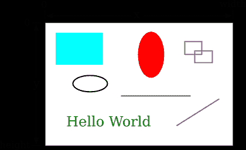

假设绘制区域为 800x500 像素，左上角的矩形将具有大约……。

Java 的绘制使用图形上下文完成。图形上下文是一个对象。作为一个对象，它可以包含子程序和数据。图形上下文中的子程序包括绘制线条、矩形、椭圆和文本的程序。（当文本出现在屏幕上时，必须由计算机绘制，就像绘制任何其他形状一样。）

图形上下文中的数据包括当前选用的颜色和字体。（字体决定字符的样式和大小。）图形上下文的另一个数据是绘制的“表面”。不同的图形上下文可以绘制到不同的表面。对于我们来说，绘制表面将是包含边框或标题栏的窗口区域。

在 Swing 中绘制形状有两种方法：你可以填充形状，这意味着设置形状内部每个像素的颜色；或者你可以绘制形状，这意味着设置沿边界的像素的颜色。某些形状（如线）只能绘制。

`Swing` 图形上下文跟踪用于填充和绘制形状的颜色。绘制形状就像沿着形状边界移动画笔。那支画笔的属性（如大小以及是实线还是虚线）是图形上下文的属性。

图形上下文由一个变量表示。该变量的类型为 `Graphics`（就像字符串变量的类型为 `String` 一样）。变量通常命名为 `g`，但变量名称完全取决于程序员。以下是图形上下文 `g` 中可用的几个子程序。注意，所有数值参数值的类型均为 `int`。

- `g.setColor(c)`，用于设置绘图时颜色。参数 `c` 是一个属于 `Color` 类的对象。大约有十几个表示标准颜色的常量可以作为该子程序的参数使用。标准颜色包括 `Color.BLACK`、`Color.WHITE`、`Color.LIGHT_GRAY`、`Color.RED`、`Color.GREEN` 和 `Color.BLUE`。（稍后我们将看到也可以创建新颜色。）例如，如果你想用红色画图，可以写 `g.setColor(Color.RED);`。指定的颜色将用于后续所有的绘图操作，直到下一次调用 `g.setColor()` 为止。

- `g.drawLine(x1,y1,x2,y2)` 从坐标为 `(x1,y1)` 的点到坐标为 `(x2,y2)` 的点画出一条线。

- `g.drawRect(x,y,w,h)` 画出一个具有水平和垂直边的矩形轮廓。参数 `x`、`y`、`w` 和 `h` 必须是整数或整数值表达式。该子程序绘制一个矩形轮廓，其左上角距离绘制区域左边缘 `x` 像素，距离顶部 `y` 像素。矩形的宽度为 `w` 像素，高度为 `h` 像素。使用的颜色为黑色，除非通过调用 `g.setColor()` 设置了不同的颜色。

- `g.fillRect(x,y,w,h)` 与 `g.drawRect()` 类似，区别在于它是填充矩形的内部而不是画轮廓。

- `g.drawOval(x,y,w,h)` 画出一个椭圆的轮廓。该椭圆恰好适合在 `g.drawRect(x,y,w,h)` 画出的矩形内。要得到一个圆，对 `w` 和 `h` 使用相同的值即可。

- `g.fillOval(x,y,w,h)` 与 `g.drawOval()` 类似，区别在于它是填充椭圆的内部而不是画轮廓。

这些信息已经足够使用 Java 图形绘制一些图片了。为了从简单的内容开始，假设我们想画一组十条平行线，如下所示：


假设线的长度为 200 像素，每条线之间的距离为 10 像素，并将第一条线的起点放在坐标为 `(100,50)` 的像素点上。要画一条线，我们只需要用合适的参数值调用 `g.drawLine(x1,y1,x2,y2)`。

现在，所有的线都从 `x` 坐标 100 开始，因此我们可以使用常量 `100` 作为 `x1` 的值。由于线长度为 200 像素，我们可以使用常量 `300` 作为 `x2` 的值。线的 `y` 坐标是不同的，但我们可以看到线的两个端点具有相同的 `y` 坐标，因此可以使用同一个变量作为 `y1` 和 `y2` 的值。

使用 `y` 作为该变量的名字，绘制其中一条线的命令就变成了 `g.drawLine(100,y,300,y)`。顶部的线 `y` 值为 50，每当我们从一条线向下移动到下一条线时，值增加 10。我们只需要确保 `y` 取正确的值序列。我们可以使用一个从 1 数到 10 的 for 循环：

```java
int y;   // 线的 y-坐标
int i;   // 循环控制变量
y = 50;  // 第一条线的 y 从 50 开始
for ( i = 1; i <= 10; i++ ) {
    g.drawLine( 100, y, 300, y );
    y = y + 10;  // 在画下一条线之前将 y 增加 10。
}
```

或者，我们可以使用 `y` 本身作为循环控制变量，注意最后一条线的 `y` 值为 140：

```java
int y;
for ( y = 50; y <= 140; y = y + 10 )
    g.drawLine( 100, y, 300, y );
```

如果我们想要线条是蓝色的，可以在画线之前通过调用 `g.setColor(Color.BLUE)` 来实现。如果只是不设置颜色就画线，它们将是黑色的。

对于稍微复杂一点的内容，让我们画大量随机颜色、随机位置的实心圆。由于我们只知道几种颜色，我将随机选择红色、绿色、蓝色或黄色作为颜色。可以通过一个简单的 switch 语句来实现，类似于第 3.6 节中的语句：

```java
switch ( (int)(4*Math.random()) ) {
    case 0 -> g.setColor( Color.RED );
    case 1 -> g.setColor( Color.GREEN );
    case 2 -> g.setColor( Color.BLUE );
    case 3 -> g.setColor( Color.YELLOW );
}
```

### 3.9.2 在程序中绘制

现在，如你所知，你不能让 Java 代码独立存在。代码必须在一个子程序定义内部，而子程序又必须在一个类定义内部。事实上，对于我的画圆程序，绘制画面的完整子程序如下：

```java
public void drawPicture(Graphics g, int width, int height) {

    // 作为一个示例，绘制大量彩色圆。
    // 如果要得到不同的图片，请删除这些代码并替换为你自己的代码。

    int centerX;     // 圆心的 x 坐标
    int centerY;     // 圆心的 y 坐标
    int colorChoice; // 用于选择随机颜色
    int count;       // 用于计数圆数量的循环控制变量

    for (count = 0; count < 500; count++) {

        centerX = (int)(width*Math.random());
        centerY = (int)(height*Math.random());

        colorChoice = (int)(4*Math.random());
        switch (colorChoice) {
            case 0 -> g.setColor( Color.RED );
            case 1 -> g.setColor( Color.GREEN );
            case 2 -> g.setColor( Color.BLUE );
            case 3 -> g.setColor( Color.YELLOW );
        }

        g.fillOval( centerX - 50, centerY - 50, 100, 100 );
        g.setColor(Color.BLACK);
        g.drawOval( centerX - 50, centerY - 50, 100, 100 );
    }

} // end drawPicture()
```

这是你看到的除 `main()` 之外的第一个子程序定义，但你将在下一章中学习到关于定义子程序的所有知识。定义的第一行提供了子程序中使用的某些值：图形上下文 `g` 以及绘图区域的宽度和高度。这些值来自子程序外部，但子程序可以使用它们。

这里的关键点在于，为了画出某些东西，你只需要填充子程序的内部内容，就像你通过填充 `main()` 内部的内容来编写程序一样。

子程序的定义仍然必须放在定义程序的类内部。在这种情况下，该类名为 `SimpleGraphicsStarter`，完整程序可以在示例源码文件 [SimpleGraphicsStarter.java](https://math.hws.edu/eck/cs124/javanotes9/source/chapter3/SimpleGraphicsStarter.java) 中找到。你可以运行该程序来查看绘制结果。你可以使用这个示例程序作为起点来绘制你自己的图片。

程序中有很多是你可能不会理解的。制作你自己的画，你所做的只需要删除源代码中 `drawPicture()` 例程内部的内容，并替换为你自己的绘图代码。你不需要理解其余部分。

（顺带一下，你可能会注意到 `main()` 子程序在定义中使用了 `static` 关键字，但 `drawPicture()` 没有。这是因为 `drawPicture` 是对象中的子程序，而不是类中的子程序。`static` 和非静态子程序之间的区别很重要，但我们暂时不需要担心它。它将在第 5 章对我们变得重要。）

### 3.9.3 动画

我们可以将绘制图片的想法扩展到制作动画。计算机动画简单来说是一系列单独的图片一个接一个快速显示。如果每一幅图片到下一幅之间的变化很小，用户就会将图像序列感知为连续的动画。动画中的每幅图片被称为一个 `frame`（帧）。

示例程序 [SimpleAnimationStarter.java](https://math.hws.edu/eck/cs124/javanotes9/source/chapter3/SimpleAnimationStarter.java) 可以作为编写动画的起点。它包含一个名为 `drawFrame()` 的子程序，用于绘制动画中的帧。你可以通过填充该子程序的定义创建一个动画。

除了图形上下文和绘图区域的宽高外，你还可以在代码中使用另外两个变量的值：`frameNumber` 和 `elapsedSeconds`。`drawFrame()` 子程序每秒会自动被调用大约 60 次。变量 `frameNumber` 在连续调用子程序时获得 0, 1, 2, 3, ... 等值，而 `elapsedSeconds` 的值是动画运行的秒数。

通过在代码中使用这两个变量之一，你可以在每次调用 `drawFrame()` 时画出不同的图片，用户将看到这一系列图片形成动画。

作为动画的示例，我们来看绘制一组嵌套的矩形。这些矩形将向绘图区域的中心收缩，产生无限运动的幻觉。动画中的一帧看起来如下：

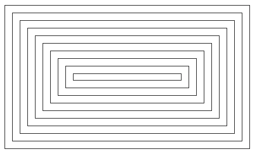

考虑如何画这样一张图。矩形可以使用 `while` 循环来绘制，从外层的矩形开始向内绘制。思考需要哪些变量，以及它们是如何在 `while` 循环的下一次迭代到下一次迭代之间变化的。

每次循环，绘制的矩形都比上一个小，并向下、向右移动一点。两个矩形之间的区别在于它们的大小以及左上角的坐标。我们需要变量来表示矩形的宽度和高度，我称它们为 `rectWidth` 和 `rectHeight`。左上角的 `x` 和 `y` 坐标相同，可以用同一个变量表示。我将该变量称为 `inset`，因为它是矩形边缘相对于绘图区域边缘缩进的。

宽度和高度从一个矩形到下一个在减少，而 `inset` 则在增加。当宽度或高度小于或等于零时，`while` 循环结束。通常情况下，在某一帧中绘制矩形的算法如下：

```text
设置第一个矩形的 inset 量
设置第一个矩形的宽度和高度
将绘制颜色设置为黑色
当宽度和高度都大于零时：
    绘制矩形（使用 g.drawRect 子程序）
    增加 inset（使下一个矩形向右下方移动）
    减少宽度和高度（使下一个矩形变小）
```

在我的程序中，每个矩形与其周围的矩形距离 15 像素，因此每次通过 `while` 循环 `inset` 增加 15。矩形左侧收缩 15 像素，右侧收缩 15 像素，因此在绘制下一个矩形之前，矩形的宽度收缩了 30 像素。高度每次循环时也收缩了 30 像素。

伪代码随后很容易翻译成 Java，但我们需要知道为第一个矩形的 `inset`、`width` 和 `height` 使用什么初始值。为了弄清楚这一点，我们必须考虑到图片是动画的，所以我们画的内容在某种程度上取决于帧数。

从一帧到下一帧，外层矩形的左上角向右下方移动；也就是说，外层矩形的 `inset` 从一帧到下一帧在增加。我们可以通过设置第 0 帧的 `inset` 为 0，第 1 帧为 1，以此类推来实现这种。但这不能持续下去，否则矩形最终会消失。

事实上，当动画达到 15 时，一个新的矩形应该出现在绘图区域外部——但实际上并不是“新矩形”，只是外层矩形的 `inset` 回到了零。所以，随着动画的进行，`inset` 应该循环 0, 1, 2, ..., 14 的序列。我们可以非常容易通过设置：

```java
inset = frameNumber % 15;
```

最后，注意在帧中绘制的第一个矩形填充了绘图区域，除了周围大小为 `inset` 的边界。这意味着第一个矩形的宽度是绘图区域宽度减去两次 `inset`，高度也是如此。这里是移动矩形示例的 `drawFrame()` 子程序：

```java
public void drawFrame(Graphics g, int frameNumber, 
                    double elapsedSeconds, int width, int height) {

    int inset; // 绘图区域与外层矩形之间的间隙。

    int rectWidth, rectHeight;   // 一个矩形的大小。

    g.setColor(Color.BLACK);  // 绘制黑色矩形轮廓。

    inset = frameNumber % 15;

    rectWidth = width - 2*inset;
    rectHeight = height - 2*inset;

    while (rectWidth >= 0 && rectHeight >= 0) {
        g.drawRect(inset, inset, rectWidth, rectHeight);
        inset += 15;       // 矩形间距 15 像素
        rectWidth -= 30;
        rectHeight -= 30;
    }

}
```

该程序的完整源代码可以在示例程序 [MovingRects.java](https://math.hws.edu/eck/cs124/javanotes9/source/chapter3/MovingRects.java) 中找到。看看吧！这是一个很酷的效果。

## 第 3 章编程练习

### 练习 3.1

你需要掷多少次双骰子才能出现“蛇眼”（双 1）？你可以通过手动掷骰子来完成这个实验。编写一个计算机程序来模拟这个实验。程序应该报告在骰子出现“蛇眼”之前所掷的次数。（注意：“蛇眼”意味着两颗骰子显示的值均为 1。）练习 2.2 解释了如何模拟掷双骰子。

查看解答

### 练习 3.2


在 1 到 10000 之间，哪个整数的约数最多？它有多少个约数？编写一个程序找到答案并打印结果。在这个范围内可能有多个整数具有相同的最大约数个数。你的程序只需要打印其中一个即可。小节 3.4.2 中的一个示例讨论了约数。该示例的源代码是 [`CountDivisors.java`](https://math.hws.edu/eck/cs124/javanotes9/source/chapter3/CountDivisors.java)。

你可能需要一些关于如何找到最大值的提示。基本思想是遍历所有整数，记录你目前为止见过的最大约数个数。同时，记录具有该约数个数的整数。

查看解答

---

### 练习 3.3

编写一个程序评估简单的表达式，例如 `17 + 3` 和 `3.14159 * 4.7`。这些表达式由用户输入。输入始终由一个数字、一个运算符、再跟上另一个数字组成。允许的运算符有 `+`、`-`、`*` 和 `/`。你可以用 `TextIO.getDouble()` 读取数字，用 `TextIO.getChar()` 读取运算符。你的程序应该读取一个表达式并打印它的值，读取另一个表达式并打印它的值，以此类推。当用户在行首第一个数字输入 `0` 时，程序结束。

查看解答

---

### 练习 3.4

编写一个程序读取一行输入文本并将其拆分为单词。每个单词每行输出。单词被定义为字母序列。输入中任何不是字母的字符都应该被忽略。例如，如果用户输入了这一行：

```text
He said, "That's not a good idea."
```

那么程序的输出应该是：

```text
He
said
That
s
not
a
good
idea
```

程序的改进版本会将 `"that's"` 视为一个单一单词。如果撇号的两侧各有一个字母，则撇号可以被视为单词的一部分。

为了测试一个字符是否为字母，你可能使用`(ch >= 'a' && ch <= 'z') || (ch >= 'A' && ch <= 'Z')`。然而，这只适用于英语和类似的语言。更好的选择是调用标准函数`Character.isLetter(ch)`，如果`ch`是字母，它返回布尔值`true`，否则返回`false`。这适用于任何 Unicode 字符。

查看解答

---

### 练习 3.5

假设有一个文件，包含关于某公司在不同城市的销售额信息。文件的每行包含一个城市名称，后面跟着一个冒号（`:`），然后是该城市的数据。数据是一个 `double` 类型的数字。然而，对于某些城市，没有可用数据。在这些行中，数据被替换为解释数据为何缺失的注释。例如，文件中的几行可能像这样：

```text
San Francisco:  19887.32
Chicago:  no report received
New York: 298734.12
```

编写一个程序计算并打印所有城市的总销售额。程序还应该报告无数据的城市数量。文件名为 `"sales.dat"`。

为了完成这个程序，你需要了解关于 `TextIO` 文件输入的一个事实，这在小节 2.4.4 中没有被介绍。由于你预先不知道文件有多少行，你需要方法来判断何时到达文件末尾。当 `TextIO` 从文件读取内容时，可以使用函数`TextIO.eof()`来测试文件是否结束。这个布尔值函数在文件被完全读取时返回`true`，当文件中还有更多数据待读时，则返回`false`。这意味着你可以在循环`(TextIO.eof() == false)`中读取文件的每一行。当文件中的所有行都读完时，循环将结束。

建议：对于每一行，读取并忽略直到冒号的字符。然后将行的剩余部分读取到一个 `String` 类型的变量中。尝试将该字符串转换为数字，并使用 `try..catch` 来测试转换是否成功。

查看解答

---

### 练习 3.6

练习 3.2 要求你找到 1 到 10000 范围内约数个数最多的数字。你只需要打印其中一个数字。修改程序，使其打印出所有具有最大约数的数字。使用数组如下：当你计算每个数的约数时，将计数存储在数组中。程序最后，你可以遍历数组并打印具有该计数的数字。输出应该类似于：

```text
在 1 到 10000 之间，
最大约数为 64
具有该约数的数字有：
   7560
   9240
```

查看解答

---

### 练习 3.7

小节 3.8.3 中的一个示例尝试回答问题：随机选择多少个人才能找到生日相同的人？该程序的源代码可以在文件 [`BirthdayProblem.java`](https://math.hws.edu/eck/cs124/javanotes9/source/chapter3/BirthdayProblem.java) 中找到。这里有一些相关问题：

- 随机选择多少个人才能找到三个出生在同一天的人（但不一定是同一年）？
- 假设随机选择 365 个人。他们会有多少不同的生日？（数量在 1-365 之间）
- 需要检查多少不同的人才能找到一年中 365 天每一天的生日？

编写**三个**程序来回答这些问题。每个程序都应该模拟随机选择并检查他们的生日。（在每种情况下忽略闰年。）

查看解答

---

### 练习 3.8

编写一个 GUI 程序来绘制棋盘。基于示例程序 [`SimpleGraphicsStarter.java`](https://math.hws.edu/eck/cs124/javanotes9/source/chapter3/SimpleGraphicsStarter.java) 来完成你的解决方案。你将在`drawPicture()`子程序中绘制棋盘，删除其中已包含的代码。

棋盘的应该是 400x400 像素。你可以通过修改`SimpleGraphicsStarter.java`中`main()`方法里的`drawingArea.setPreferredSize(new Dimension(800,600))`行，将数字从 800 和 600 改为 400。棋盘包含 8 行 8 列格子。如果绘制区域的大小是 400，这意味着每个格子应该是 50x50 像素。方格是红色和黑色（或你选择的任何颜色）。这里有一种巧妙的方法来确定给定方格应该是红色还是黑色：行和列可以被认为是从 0 到 7 编号的。如果格子的行号和列号都是偶数或都是奇数，则方格为红色。否则，为黑色。注意，正方形只是高等于宽的矩形，所以你可以使用`g.fillRect()`子程序来绘制方格。这里是你想要绘制的棋盘的缩小版图像：


通常，动画中的某些元素会每隔几帧不断重复。有时，这种重复是“循环的”（cyclic），意味着它在结束时会跳回起点。有时，这种重复是“振荡的”（oscillating），就像一种往复的运动，其中后半部分是前半部分的倒序播放。

编写一个动画，以不同的速度同时演示循环运动和振荡运动。对于循环运动，你可以使用一个横跨整个绘制区域的正方形，它在移动后跳回到起点，然后不断重复相同的动作。对于振荡运动，你可以采取类似的操作，但正方形应该在绘制区域的两个边缘之间往复移动；也就是说，在动画的前半部分从左向右移动，在后半部分从右向左向回移动。编写该程序时，你可以从示例程序 [`SimpleAnimationStarter.java`](https://math.hws.edu/eck/cs124/javanotes9/source/chapter3/SimpleAnimationStarter.java) 的副本开始。

循环运动每隔 `N` 帧重复一次，其中 `N` 是某个值。你在动画的某帧中绘制的内容取决于`frameNumber`。`frameNumber`会一直增加下去。要实现循环运动，你真正想要的是“循环帧号”，它的取值为`0, 1, 2, ..., (N-1), 0, 1, 2, ..., (N-1), 0, 1, 2, ....`。你只需要通过以下方式从`frameNumber`中推导出你需要的值：

```java
cyclicFrameNumber = frameNumber % N;
```

然后，你只需要基于`cyclicFrameNumber`而不是`frameNumber`来决定绘制内容。同样，对于振荡动画，你需要一个“振荡帧号”，它的取值为`0, 1, 2, ... (N-1), N, (N-1), (N-2), ... 2, 1, 0, 1, 2,`等，无限地重复这种往复的运动。你可以通过以下代码计算出你需要的值：

```java
oscilationFrameNumber = frameNumber % (2*N);
if (oscillationFrameNumber > N)
   oscillationFrameNumber = (2*N) - oscillationFrameNumber;
```

这是我版本的程序的截图。我使用了六个正方形。上面的三个以不同的速度进行循环运动，下面的三个进行振荡运动。我在绘制区域画了黑线来分隔这些正方形，并为它们提供移动的“通道”。

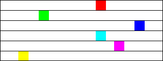

查看解答

## 第 3 章测验

### 问题 1

什么是`algorithm`（算法）？

### 问题 2

简要解释什么是“pseudocode”（伪代码），以及它在算法开发中有什么用处。

### 问题 3

什么是`block statement`（块语句）？Java 程序中如何使用块语句？

### 问题 4

`while`循环和`do..while`循环之间的主要区别是什么？

### 问题 5

`prime`一个循环（初始化）是什么意思？

### 问题 6

解释什么是`animation`（动画）以及计算机如何显示动画。

### 问题 7

编写一个`for`循环，打印出从 3 到 36 的所有 3 的倍数，即：`3 6 9 12 15 18 21 24 27 30 33 36`。

### 问题 8

填充以下`main()`例程程序，使其要求用户输入一个整数，读取用户的响应，并告诉用户输入的数字是偶数还是奇数。（你可以使用`TextIO.getInt()`读取整数。记住，如果整数`n`满足`n % 2 == 0`，则它是偶数。）

```java
public static void main(String[] args) {

         // 填充此子程序的主体！
}
```

### 问题 9

编写一个代码段，从 1 到 10 的范围内打印出两个`different`（不同的）随机整数。所有可能的输出应该具有相同的概率。提示：你可以轻松地选择两个随机数，但必须考虑到你选取的两个数字可能是相同的。

### 问题 10

假设`s1`和`s2`是`String`类型的变量，其值预期为`int`类型数值的字符串表示。编写一个代码段，计算并打印这些值的整数和，或者如果值无法成功转换为整数，则打印错误信息。（使用`try..catch`语句。）

### 问题 11

显示以下`main()`例程程序产生的精确输出：

```java
public static void main(String[] args) {
    int N;
    N = 1;
    while (N <= 32) {
       N = 2 * N;
       System.out.println(N);   
    }
}
```

### 问题 12

显示以下`main()`例程程序产生的精确输出：

```java
public static void main(String[] args) {
   int x,y;
   x = 5;
   y = 1;
   while (x > 0) {
      x = x - 1;
      y = y * x;
      System.out.println(y);
   }
}
```

### 问题 13

以下`main()`例程程序产生什么输出？为什么？记住`name.charAt(i)`是字符串中的第 i 个字符。

```java
String name;
int i;
boolean startWord;

name = "Richard M. Nixon";
startWord = true;
for (i = 0; i < name.length(); i++) {
   if (startWord)
      System.out.println(name.charAt(i));
   else
      startWord = false;
}
```

### 问题 14

假设`numbers`是`int[]`类型的数组。编写一个代码段统计 42 在数组中出现的次数。

### 问题 15

假设`raceTimes`是`double[]`类型的数组。编写一个代码段找到`raceTimes`的范围。

# 第 4 章：大型程序设计 I：子程序

将复杂程序分解为可管理部分的方法是使用子程序。子程序是执行特定任务的指令集合，并被赋予名称。当计算机执行程序时，每遇到子程序名称，它就会执行该任务的所有指令。子程序可以在程序的范围内反复使用。一个子程序甚至可以在另一个程序中使用。

Java 中的子程序可以是静态的（static），也可以是非静态的（non-static）。本章介绍静态子程序。非静态子程序用于真正的面向对象，将在下一章介绍。

## 第 4 章目录

- 第 1 节：黑盒与过程抽象
- 第 2 节：静态子程序与静态变量
- 第 3 节：参数
- 第 4 节：返回值
- 第 5 节：Lambda 表达式
- 第 6 节：API、包、模块与 Javadoc
- 第 7 节：关于程序设计的更多讨论
- 第 8 节：声明的真相
- 编程练习
- 本章测验

## 4.1 节：黑盒与过程抽象

子程序是执行某些任务的指令集合，被封装在一起并赋予名称。“封装”允许你将一个潜在的复杂任务作为一个单一概念来处理。你不需要担心计算机为了执行该任务可能需要经过的许多步骤，你只需要记住子程序的名称。当你想让程序执行该任务时，只需调用该程序即可。

子程序有时被称为一个“黑盒”，因为你无法看到它“内部”了什么（或者更准确地说，你通常并不想看它的内部，因为那样你就不得不处理子程序本要隐藏的所有复杂性了）。当然，一个无法与世界其他部分交互的黑盒将是完全没用的。黑盒需要与世界其他部分具有某种接口，这种接口允许盒内部和外部之间进行某些交互。一个物理黑盒外面可能有你可以按下的按钮、你可以调节设置的旋钮，以及可以用于往来传递信息的槽。由于我们试图的是隐藏复杂性而不是创造它，因此我们有了黑盒的第一条规则：

**黑盒的接口应该是相当直观、定义良好且易于理解。**

现实世界中有黑盒的例子吗？有的；事实上，你被它们包围着。你的电视机、汽车、手机、冰箱……你可以通过电视接口的元素——开关、遥控器（别忘了插电源）——来开启或关闭电视、切换频道并调节音量，而无需理解这些设备实际上是如何运作的。手机也是如此，尽管那种情况下的界面要复杂得多。

现在，黑盒确实有内部——实际执行任务的子程序代码，或者你电视机内部所有的电子元器件。黑盒的内部被称为它的实现（implementation）。黑盒的第二条规则是：

**使用黑盒时，你不需要关于其实现的任何知识；你唯一需要的是它的接口。**

事实上，只要从外部观察到的盒的行为保持不变，改变它的实现是完全可能的。例如，当电视机的内部从使用真空管变为使用晶体管时，电视用户不需要知道这一点——甚至不需要知道这意味着什么。同样，可以重写子程序的内部（例如使用更高效的代码），而不会影响使用该子程序的程序。

当然，要有一个黑盒，首先必须有人设计并构建了它的实现部分。黑盒的想法对于实现者和黑盒用户来说都是有利的。毕竟，黑盒可能被用在无限种不同的场景中。黑盒的实现者不需要知道其中任何情况。实现者只需要确保黑盒执行了分配的任务，并与世界其他部分正确接口即可。这就是黑盒的第三条规则：

**黑盒的实现者不需要知道关于使用该盒的更大型系统的任何信息。**

在某种意义上，黑盒将世界分为两个部分：内部（实现）和外部。接口位于边界处，连接着这两个部分。

顺便说一下，你不应该把接口仅仅看作盒与世界其他部分之间的物理连接。接口还包括对盒的功能说明，以及如何通过物理接口元素对其进行控制的说明。仅仅说电视机有一个电源开关是不够的，你需要指定电源开关是用来开启和关闭电视的！

用计算机科学术语来说，子程序的接口既有语义（semantic）组件，也有语法（syntactic）组件。接口的语法部分告诉你为了调用子程序必须输入什么。语义组件则精确规定了子程序将完成什么任务。要编写一个合法的程序，你需要知道子程序的语法规范。要理解子程序的目的并有效地使用它，你需要知道子程序的语义规范。我将接口的这两个部分——语法部分和语义——统称为子程序的合同（contract）。

子程序的合同本质上说：“这里是你使用我时需要做的事，这里是我将保证为你做的事。”当你写一个子程序时，你为它编写的注释应该让合同变得非常清晰。（我必须承认，在实践中，子程序的合同往往定义得不充分，这让那些使用它们的程序员感到非常遗憾和恼火。）

在本章的剩余部分，我将从关于黑盒和子程序的通用思想转到 Java 中编写和使用子程序的具体细节。但请记住这些通用思想和原则。它们是子程序存在的根本，也是你使用它们的指南。这在`Section 4.7`中应该尤为清楚，在那里我将讨论作为程序开发工具的子程序。

你应该记住，子程序并不是编程中黑盒的唯一例子。例如，一个`class`也是一个黑盒。我们将看到`class`可以有一个代表其接口的“公共”部分，以及一个完全位于其隐藏实现内部的“私”部分。黑盒的所有原则都适用于类，也适用于子程序。

`Subsection 3.1.4`引入了“控制抽象”的概念，以表达 Java 控制结构允许用户在比机器语言更高的层级上工作，隐藏了实现控制结构的 CPU 内部的细节细节。


类似地，我们说子程序是一种过程抽象（procedural abstraction）。子程序的接口是一种抽象，你可以用它来执行某些过程，而无需担心该过程实际上是如何实现的。这只是另一种更高级的说法，即子程序可以作为黑盒使用，但它带我们回了抽象作为计算机科学的核心概念。

抽象的一个重要方面是信息隐藏。抽象隐藏了抽象背后（即在其实现中）的信息。通过控制抽象实现信息隐藏，使得在不同类型的 CPU 和机器语言实现上使用相同的 Java 控制结构成为可能。通过过程抽象实现信息隐藏，使得更改子程序的内部而不影响使用该子程序的程序成为可能。再次，这只是黑盒原则的另一种术语。

## 4.2 静态子程序和静态变量

Java 中的每个子程序必须定义在某个 `class` 内部。这使得 Java 在编程语言中相当奇特，因为大多数语言允许自由的、独立的子程序。`class` 的用途之一是将相关的子程序和变量分组在一起。也许 Java 的设计者认为任何事物都必须与某物相关。作为一种不那么哲学的动机，Java 的设计者希望对命名方式进行严格的控制，因为一个 Java 程序可能访问到由许多不同程序员创建的海量子程序。这些子程序被分组在命名的类中（稍后我们将看到，类被分组在命名的“包”中），这一事实有助于控制由于不同名称可能产生的混乱。

在 Java 中，静态（static）和非静态（non-static）子程序之间存在基本的区别。类定义可以包含这两种类型子程序的源代码，但它们在程序运行时的处理方式却非常不同。静态子程序更容易理解：在运行的程序中，静态子程序是类本身的一个成员。另一方面，非静态子程序的定义仅用于在创建对象时使用，而子程序本身变成了对象的成员。只有在你操作对象时，非静态子程序才变得相关。静态与非静态之间的区别也适用于变量以及类定义中可能出现的其他事物。本章将几乎专门处理静态子程序和静态变量。我们将在下一章转向非静态内容和面向对象编程。

位于类或对象中的子程序通常被称为“方法”（method），而“方法”是大多数人在 Java 中描述子程序时更倾向于使用的术语。我将开始偶尔使用“方法”一词，在本章中我将继续倾向于使用更通用的术语“子程序”，至少对于静态子程序如此。然而，从 Java 的角度来看，你应该开始认为“方法”和“子程序”这两个词本质上是同义词。你可能看到的其他指代子程序的术语还有“过程”（procedures）和“函数”（functions）。（我通常只将“函数”一词用于计算并返回值的子程序，但在某些编程语言中，它被用来泛指所有子程序。）

### 4.2.1 子程序定义

子程序必须定义在某处。定义必须包含子程序的名称、能够调用该子程序的足够信息，以及每次调用子程序时将执行的代码。Java 中的子程序定义形式如下：

```
modifiers  return-type  subroutine-name  ( parameter-list ) {
    statements
}
```

我们需要花费一些时间——占据本章的大部分内容——来详细了解这一切的含义。当然，你已经在之前的章节中见过子程序的示例，例如程序的 `main()` 例程，以及第 3.9 节中动画程序中的 `drawFrame()` 例程。因此你已经熟悉了通用格式。

子程序定义中大括号 `{` 和 `}` 之间的语句构成了子程序的体。这些语句是上一一节中所讨论的“黑盒”的内部或实现部分。它们是当方法被调用时计算机执行的指令。子程序可以包含第 2 章和第 3 章中讨论过的任何语句。

出现在子程序定义开头的修饰符是设定子程序某些特征的单词，例如它是否为静态。你目前为止看到的修饰符有 `static` 和 `public`。总共只有六个可能的修饰符。

如果子程序是一个函数，其任务是计算某个值，那么 `return-type` 用于指定函数返回的值的类型。它可以是一个类型名称，如 `String` 或 `int`，甚至是数组类型，如 `double[]`。我们将在第 4.4 节中详细研究函数和返回类型。如果子程序不是函数，则 `return-type` 被特殊值 `void` 替换，表示没有返回任何值。`void` 一词用于表示返回值为空或不存在。

最后，我们来到方法的 `parameter-list`（参数列表）。参数是子程序接口的一部分。它们代表从外部传递到子程序的信息，供子程序的内部计算使用。举一个具体的例子，想象有一个名为 `Television` 的类，它包含一个名为 `changeChannel()` 的方法。紧接着的问题是：它应该切换到哪个通道？可以使用参数来回答这个问题。如果通道号是一个整数，那么参数的类型将是 `int`，`changeChannel()` 方法的声明可能如下：

```
public void changeChannel(int channelNum) { ... }
```

此声明指定了 `changeChannel()` 具有一个名为 `channelNum`、类型为 `int` 的参数。然而，`channelNum` 还没有任何特定的值。在调用子程序时会为 `channelNum` 提供一个值；例如：`changeChannel(17);`。

子程序中的参数列表可以是空的，也可以由一个或多个形式为 `type parameter-name` 的参数声明组成。如果有多个声明，它们用逗号分隔。注意，每个声明只能命名一个参数。例如，如果你想要两个类型为 `double` 的参数，必须说 "double x, double y"，而不是 "double x, y"。

参数将在下一节中更详细地介绍。

以下是几个子程序定义的示例，省略了定义子程序作用的语句：

```java
public static void playGame() {
    // "public" 和 "static" 是修饰符；"void" 是
    // 返回类型；"playGame" 是子程序名称； 
    // 参数列表是空的。
    . . .  // 定义 playGame 作用的语句放在这里。
}

int getNextN(int N) {
    // 没有修饰符；"int" 是返回类型；
    // "getNextN" 是子程序名称；参数列表
    // 包含一个名为 "N" 且类型
    // 为 "int" 的参数。
    . . .  // 定义 getNextN 作用的语句放在这里。
}

static boolean lessThan(double x, double y) {
    // "static" 是修饰符；"boolean" 是
    // 返回类型；"lessThan" 是子程序名称； 
    // 参数包含了两个名为
    // "x" 和 "y" 的参数，且每个参数的类型
    // 都是 "double"。
    . . .  // 定义 lessThan 作用的语句放在这里。
}
```

在给出的第二个示例中，`getNextN` 是一个非静态方法，因为它的定义没有包含修饰符 `static`——而且这并不是我们在本章中应该关注的示例！示例中显示的另一个修饰符是 `public`。该修饰符表示方法可以从程序的任何地方被调用，即使是从定义方法的类的外部。还有另一个修饰符 `private`，它表示方法只能在类内部被调用。`public` 和 `private` 修饰符被称为访问限定符（access specifiers）。如果方法没有给出访问限定符，那么默认情况下，该方法可以在包含该类的任何地方被调用，但不能从该包外部调用。（你将在本章后面的第 4.6 节](../c4/s6.html)学习更多关于包的内容。）还有一个访问修饰符 `protected`，它将在我们在第五章](../c5/index.html)转向面向对象编程时才会变得相关。

顺便一下，程序的 `main()` 例程遵循子程序的通常语法规则。在

```java
public static void main(String[] args) { ... }
```

中，修饰符是 `public` 和 `static`，返回类型是 `void`，子程序名称是 `main`，参数列表是 `String[] args`。在这种情况下，参数的类型是数组类型 `String[]`。

你已经已经在填充子程序的实现部分方面获得了一些经验。在本章中，你将学习如何编写自己的完整子程序定义，包括接口部分。

当你定义一个子程序时，你所做的只是告诉计算机该子程序的存在以及它的功能。在被调用之前，子程序并不会被实际执行。（即使对于类中的 `main()` 过程也是如此——尽管你没有调用它，但系统在运行你的程序时会调用它。）例如，上面示例给出的 `playGame()` 方法可以使用以下子程序调用语句调用：

```java
playGame();
```

该语句可以出现在包含 `playGame()` 定义的同一个类的任何位置，无论是在 `main()` 方法中还是其他子程序中。由于 `playGame()` 是一个 `public`（公共）方法，它也可以从其他类调用，但在那种情况下，你必须告诉计算机它来自哪个类。由于 `playGame()` 是一个 `static`（静态）方法，它的全名包含了定义它的类名。例如，假设 `playGame()` 定义在一个名为 `Poker` 的类中。那么为了从 `Poker` 类的外部调用 `playGame()`，你需要说：

```java
Poker.playGame();
```

在这里使用类名是为了告诉计算机要在哪个类中查找该方法。它还让你能够区分 `Poker.playGame()` 和在其他类中定义的其他 `playGame()` 方法，例如 `Roulette.playGame()` 或 `Blackjack.playGame()`。

更通地说，静态子程序的子程序调用语句的形式如下：

```java
subroutine-name(parameters);
```

如果被调用的子程序在同一个类中，或者：

```java
class-name.subroutine-name(parameters);
```

如果子程序定义在其他地方（不同的类中）（非静态方法属于对象而非类，使用对象而不是类名进行调用。关于这一点稍后会介绍。）注意，参数列表可以为空（如 `playGame()` 示例所示），但即使括号之间没有任何内容，括号也必须存在。当你调用子程序时提供的参数数量必须与子程序定义中参数列表中指定的数量匹配，且调用语句中的参数类型必须与子程序定义中的类型匹配。

### 4.2.3 程序中的子程序

是时候给出一个完整程序的示例了，这个程序除了包含 `main()` 过程外，还包含了其他子程序。让我们写一个与用户玩猜数字游戏的程序。计算机将在 1 到 100 之间选择一个随机数，用户将尝试猜它。计算机会告诉用户猜的数字高、低还是正确。如果用户在六次或更少的尝试中命中，用户就赢了。每个游戏结束后，用户可以选择继续玩另一局。

由于玩一次游戏可以看作是一个单一、连贯的任务，因此编写一个与用户玩一次猜数字游戏的子程序是有意义的。`main()` 过程将使用循环反复调用 `playGame()` 子程序，次数用户想玩多少次。我们设计 `playGame()` 子程序的方法与编写 `main()` 过程一样：从算法大纲开始，并应用逐步细化。这是一个猜数字过程的简短伪代码算法：

```
选取一个随机数
while 游戏未结束:
    获取用户的猜想
    告诉用户猜的数字高、低还是正确。
```

判断游戏是否结束的测试是复杂的，因为如果用户猜对了或猜的次数达到六次，游戏就会结束。在很多情况下，最简单的方法是使用 `while (true)` 循环，并在我们发现理由结束循环时使用 `break` 结束循环。此外，如果我们要在六次猜后结束游戏，我们必须记录用户猜的次数。完善算法后得到：

```
让 computersNumber 为 1 到 100 之间的随机数
让 guessCount = 0
while (true):
    获取用户的猜想
    通过给 guess count 加 1 来计算次数
    如果用户的猜想等于 computersNumber:
        告诉用户他赢了
        跳出循环
    如果猜的次数为 6:
        告诉用户他输了
        跳出循环
    如果用户的猜想小于 computersNumber:
        告诉用户猜小了
    否则如果用户的猜想大于 computersNumber:
        告诉用户猜大了
```

加上变量声明并翻译成 Java 后，这就变成了 `playGame()` 过程的定义。1 到 100 之间的随机整数可以通过 `(int)(100 * Math.random()) + 1` 计算。我清理了与用户的交互，使其流程更顺畅。

```java
static void playGame() {
    int computersNumber; // 计算机选取的随机数。
    int usersGuess;      // 用户输入的作为猜想的数字。
    int guessCount;      // 用户猜的次数。
    computersNumber = (int)(100 * Math.random()) + 1;
             // 分配给 computersNumber 的值是一个
             // 1 到 100 之间的随机随机整数。
    guessCount = 0;
    System.out.println();
    System.out.print("你的第一次猜是多少？ ");
    while (true) {
       usersGuess = TextIO.getInt();  // 获取用户的猜想。
       guessCount++;
       if (usersGuess == computersNumber) {
          System.out.println("你用了 " + guessCount
                  + 次就猜中了！我的数字是 " + computersNumber);
          break;  // 游戏结束；用户赢了。
       }
       if (guessCount == 6) {
          System.out.println("你没有在 6 次内猜中。");
          System.out.println("你输了。我的数字是 " + computersNumber);
          break;  // 游戏结束；用户输了。
       }
       // 如果我们到达这里，游戏继续。
       // 告诉用户猜高了还是低了。
       if (usersGuess < computersNumber)
          System.out.print("太小了。再试一次： ");
       else if (usersGuess > computersNumber)
          System.out.print("太大了。再试一次： ");
    }
    System.out.println();
} //  结束
```

现在，到底应该把这段代码放在哪里？它应该与 `main()` 过程属于同一个类，但**不是**在 `main()` 过程内部。将一个子程序物理嵌套在另一个子程序内部是非法的。`main()` 过程会**调用** `playGame()`；它**不会包含** `playGame()` 的定义。你可以将 `playGame()` 的定义放在 `main()` 过程之前或之后。Java 对类中子程序定义的顺序没有特殊要求。

编写 `main` 过程相当简单。你以前做过类似的事情。这里是完整程序的样子（除了正式的程序需要比我在这里包含的更多的注释）。


```java
import textio.TextIO;

public class GuessingGame {

   public static void main(String[] args) {
      System.out.println("Let's play a game.  I'll pick a number between");
      System.out.println("1 and 100, and you try to guess it.");
      boolean playAgain;
      do {
         playGame();  // call subroutine to play one game
         System.out.print("Would you like to play again? ");
         playAgain = TextIO.getlnBoolean();
      } while (playAgain);
      System.out.println("Thanks for playing.  Goodbye.");
   } // end of main()            

   static void playGame() {
       int computersNumber; // 计算机选取的随机数。
       int usersGuess;      // 用户输入的猜测数字。
       int guessCount;      // 用户已进行猜测的次数。
       computersNumber = (int)(100 * Math.random()) + 1;
                // 赋值给 computersNumber 的值是
                // 1 到 100 之间随机选择的整数（包含边界）。
       guessCount = 0;
       System.out.println();
       System.out.print("What is your first guess? ");
       while (true) {
          usersGuess = TextIO.getInt();  // 获取用户的猜测。
          guessCount++;
          if (usersGuess == computersNumber) {
             System.out.println("You got it in " + guessCount
                     + " guesses!  My number was " + computersNumber);
             break;  // 游戏结束；用户赢了。
          }
          if (guessCount == 6) {
             System.out.println("You didn't get the number in 6 guesses.");
             System.out.println("You lose.  My number was " + computersNumber);
             break;  // 游戏结束；用户输了。
          }
          // 如果运行到这里，游戏将继续。
          // 告诉用户猜测太高还是太低。
          if (usersGuess < computersNumber)
             System.out.print("That's too low.  Try again: ");
          else if (usersGuess > computersNumber)
             System.out.print("That's too high.  Try again: ");
       }
       System.out.println();
   } // end of playGame()

} // end of class GuessingGame
```

花些时间仔细阅读这段程序并弄清楚它是如何工作的。尝试说服自己，即使在这个相对简单的情况下，将程序拆分为两个方法也会让程序更容易理解，并且可能让编写每个部分变得更加容易。

## 4.2.4 成员变量

类除了子程序之外，还可以包含其他内容。特别地，它还可以包含变量声明。当然，你可以在子程序*内部*声明变量，这些被称为局部变量。然而，你也可以拥有不属于任何子程序的变量。为了将这些变量与局部变量区分开来，我们称它们为成员变量（member variables），因为它们是类的成员。它们的另一个名称是全局变量（global variable）。

就像子程序一样，成员变量可以是静态的（static）也可以是非静态的（non-static）。在本章中，我们将坚持于使用静态变量。静态成员变量属于整个类，只要类存在，它就一直存在。当 Java 解释器首次加载类时，就会为该变量分配内存。任何给该变量赋值的赋值语句都会更改该内存的内容，无论该赋值语句位于程序的哪个位置。每当在表达式中使用该变量时，都会从该同一内存中获取值，无论该表达式位于程序的哪个位置。这意味着静态成员变量的值可以在一个子程序中设置，并在另一个子程序中使用。静态成员变量被类中所有的静态子程序“共享”。相比之下，子程序中的局部变量只在程序子程序执行时存在，并且从该子程序的外部完全无法访问。

成员变量的声明与局部变量的声明看起来一样，但两点不同：成员变量在任何子程序外部声明（尽管它必须在类内部），并且声明可以标记为 `static`、`public` 和 `private` 等修饰符。由于我们目前只处理静态成员变量，本章中每个成员变量的声明都会包含 `static` 修饰符。它们也可能被标记为 `public` 或 `private`。例如：

```java
static String usersName;
public static int numberOfPlayers;
private static double velocity, time;
```

未声明为 `private` 的静态成员变量可以在定义它的类外部访问，也可以在内部访问。当在其他类中使用时，必须使用形式为 `class-name.variable-name` 的复合标识符来引用。例如，`System` 类包含名为 `out` 的 `public static` 成员变量，你可以在自己的类中通过引用 `System.out` 使用这个变量。同样，`Math.PI` 是 `Math` 类中的公共静态成员变量。如果 `numberOfPlayers` 是名为 `Poker` 的类中的公共静态成员变量，那么 `Poker` 类中的代码将直接用 `numberOfPlayers` 引用它，而另一个类中的代码将用 `Poker.numberOfPlayers` 引用它。

作为一个示例，让我们在本节之前编写的 `GuessingGame` 类中添加两个静态成员变量。我们添加了一个名为 `gamesPlayed` 的变量来跟踪用户玩了多少游戏，以及另一个名为 `gamesWon` 的变量来跟踪赢得的游戏次数。这些变量被声明为静态成员变量：

```java
static int gamesPlayed;
static int gamesWon;
```

在 `playGame()` 程序中，我们总是给 `gamesPlayed` 加 1，如果用户赢了游戏，我们就给 `gamesWon` 加 1。在 `main()` 程序结束时，我们打印这两个变量的值。使用局部变量无法完成相同的操作，因为两个子程序都需要访问这些变量，而局部变量只存在于一个子程序中。此外，全局变量在子程序调用之间保留值。局部变量不会；每当包含它的子程序被调用时，局部变量都会获得新值。

当你在子程序声明局部变量时，你必须在对变量赋值之前对其进行任何操作。相反，成员变量会自动初始化为默认值。这些默认值与初始化数组元素时使用的值相同：对于数值变量，默认值是 0；对于 `boolean` 变量，默认是 `false`；对于 `char` 变量，它是 Unicode 编码为 0 的字符；对于对象（如 `String`），默认初始值是特殊值 `null`。

由于它们是 `int` 类型，静态成员变量 `gamesPlayed` 和 `gamesWon` 自动获得 0 作为初始值。这恰好是作为计数器使用的正确初始值。当然，如果你对默认初始值不满意，或者想让初始值更显式，你可以在 `main()` 程序的开头为变量赋值。

以下是修改后的 `GuessingGame.java` 版本。与上述版本的更改用红色斜体显示：

```java
import textio.TextIO;

public class GuessingGame2 {

    static int gamesPlayed;   // 玩的游戏次数。
    static int gamesWon;      // 赢得的游戏次数。

    public static void main(String[] args) {
       gamesPlayed = 0;
       gamesWon = 0;  // 这实际上是多余的，因为 0 是
                      //                 默认的初始值。
       System.out.println("Let's play a game.  I'll pick a number between");
       System.out.println("1 and 100, and you try to guess it.");
       boolean playAgain;
       do {
          playGame();  // 调用子程序进行一次游戏
          System.out.print("Would you like to play again? ");
          playAgain = TextIO.getlnBoolean();
       } while (playAgain);
       System.out.println();
       System.out.println("You played " + gamesPlayed + " games");
       System.out.println("and you won " + gamesWon + " of those games.");
       System.out.println("Thanks for playing.  Goodbye.");
    } // end of main()            

    static void playGame() {
        int computersNumber; // 计算机选出的随机数。
        int usersGuess;      // 用户输入的猜测数字。
        int guessCount;      // 用户已进行的猜测次数。
        gamesPlayed++;  // 计数本次游戏。
        computersNumber = (int)(100 * Math.random()) + 1;
                 // 赋值给 computersNumber 的值是一个随机
                 //    的 1 到 100 之间的整数。
        guessCount = 0;
        System.out.println();
        System.out.print("What is your first guess? ");
        while (true) {
           usersGuess = TextIO.getInt();  // 获取用户的猜测。
           guessCount++;
           if (usersGuess == computersNumber) {
              System.out.println("You got it in " + guessCount
                      + " guesses!  My number was " + computersNumber);
              gamesWon++;  // 计数这次胜利。
              break;       // 游戏结束；用户赢了。
           }
           if (guessCount == 6) {
              System.out.println("You didn't get the number in 6 guesses.");
              System.out.println("You lose.  My number was " + computersNumber);
              break;  // 游戏结束；用户输了。
           }
           // 如果运行到这一步，游戏继续。
           // 告诉用户猜测是太高还是太低。
           if (usersGuess < computersNumber)
              System.out.print("That's too low.  Try again: ");
           else if (usersGuess > computersNumber)
              System.out.print("That's too high.  Try again: ");
        }
        System.out.println();
    } // end of playGame()

} // end of class GuessingGame2
```

（顺便说，注意在我的示例程序中，我没有将静态子程序或变量标记为 `public`（公共）或 `private`（私有）。你可能会好奇省略修饰符意味着什么。请记住，没有访问修饰符的全局变量和子程序可以在定义类所在的同一个包内的任何地方使用，但不能在其他包中使用。没有声明包的类位于默认包中。因此，默认包中的任何类都可以访问 `gamesPlayed`、`gamesWon` 和 `playGame()`——这包括了书中的大多数类。事实上，将成员变量和子程序设置为 `private` 被认为是一种良好的做法，除非有反其道行的理由。（但话说回来，避免使用默认包也被认为是一种良好的做法。）

## 4.3 参数

如果说子程序是一个黑盒，那么参数就是提供了一种从外部世界向黑盒内部传递信息的的机制。参数是子程序接口的一部分。它们允许你自定义子程序的行为，以适应特定的情况。

作为一个类比，考虑一个恒温器——它是一个黑盒，任务是让你的房子保持在某个特定的温度。恒温器有一个参数，即用于设置目标温度的旋钮。恒温器始终执行相同的任务：维持恒定的温度。然而，它执行的精确任务——即它维持*哪种*温度——是由旋钮上的设置来定制的。

### 4.3.1 使用参数

作为一个例子，让我们回到小节 3.2.2 中讨论过的“3N+1”问题。（记住，3N+1 序列根据以下规则计算：“如果 N 是奇数，将其乘以 3 并加 1；如果 N 是偶数，将其除以 2；持续直到 N 等于 1。”）例如，从 `N=3` 开始，我们得到序列：3, 10, 5, 16, 8, 4, 2, 1。）假设我们想写一个子程序来打印这样的序列。该子程序将始终执行相同的任务：打印 3N+1 序列。但它打印的精确序列取决于 `N` 的起始值。因此，`N` 的起始值将是该子程序的参数。该子程序可以写成：

```java
/**
 * 此子程序标准输出打印 3N+1 序列，
 * 使用 startingValue 作为 N 的初始值。它还会打印序列
 * 项的数量。参数 startingValue 必须是一个正整数。
 */
static void print3NSequence(int startingValue) {

   int N;      // 序列中的项。
   int count;  // 计数。

   // 第一个项是传递给子程序的
                       // 参数值，目前有一项。
   N = startingValue;

   System.out.println("The 3N+1 sequence starting from " + N);
   System.out.println();
   System.out.println(N);  // 初始项

   while (N > 1) {
       if (N % 2 == 1)     // N 是奇数吗？
          N = 3 * N + 1;
       else
          N = N / 2;
       count++;   // 计数这一项
       System.out.println(N);  // 打印这一项
   }

   System.out.println();
   System.out.println("There were " + count + " terms in the sequence.");

}  // end print3NSequence
```


该子程序的参数列表`(int startingValue)`指定该子程序有一个`int`类型的参数。在子体内部，可以使用参数名，可以使用变量名。但注意，在子程序定义中没有任何给参数赋值！参数是从子程序**外部**获取初始值的。当调用子程序时，必须在子程序调用语句为参数提供一个值。该值会在执行子程序体之前赋值给`startingValue`。

例如，可以使用子程序调用语句`print3NSequence(17);`调用子程序。当计算机执行此语句时，计算机首先将`17`赋值给`startingValue`，然后执行子程序中的语句。这打印了从`17`开始的`3N+1`序列。如果`K`是一个`int`类型的变量，可以通过`print3NSequence(K);`调用子程序。当计算机执行此子程序调用语句时，它获取变量`K`的值，将其赋值给`startingValue`，然后执行子程序体。

包含`print3NSequence`的类可以包含`main()`程序（或其他子程序）来调用`print3NSequence`。例如，这里有一个`main()`程序可以为用户指定的各种起始值打印`3N+1`序列。

```java
public static void main(String[] args) {
   System.out.println("This program will print out 3N+1 sequences");
   System.out.println("for starting values that you specify.");
   System.out.println();
   int K;  // Input from user; loop ends when K < 0.
   do {
      System.out.println("Enter a starting value.");
      System.out.print("To end the program, enter 0: ");
      K = TextIO.getInt();  // Get starting value from user.
      if (K > 0)   // Print sequence, but only if K is > 0.
         print3NSequence(K);
   } while (K > 0);   // Continue only if K > 0.
} // end main
```

记住，在使用此程序之前，`main`和`print3NSequence`的定义都必须包裹在一个类定义内部。

## 4.3.2 形式参数与实际参数

注意，“参数”（parameter）一术语指代两个不同但相关的概念。有些参数用于子程序的定义，例如上面示例中的`startingValue`。另一些参数用于子程序的调用语句，例如语句`print3NSequence(K);`中的`K`。

子程序定义中的参数称为**形式参数**（formal parameters）或形形参数（dummy parameters）。在调用子程序时传递给子程序的参数称为**实际参数**（actual parameters）或参数（arguments）。当调用子程序时，调用语句中的实际参数会被求值，其值会被赋值给子程序定义中的形式参数。然后执行子程序的体。

形式参数必须是一个`name`（名称），即一个简单的标识符。形式参数非常像变量，和变量一样，它有一个指定的类型，如`int`、`boolean`、`String`或`double[]`。实际参数是一个`value`（值），因此它可以由任何表达式指定，只要该表达式计算出正确类型的值。

实际参数的类型必须可以通过赋值语句合法赋值给形式参数的类型。例如，如果形式参数的类型是`double`，那么将`int`作为实际参数传递是合，因为`int`可以合法地赋值给`double`。当你调用子程序时，必须为子程序定义中的每个形式参数提供一个实际参数。考虑例如一个子程序：

```java
static void doTask(int N, double x, boolean test) {
    // 这里是执行任务的语句
}
```

该子程序可以通过以下语句调用：

```java
doTask(17, Math.sqrt(z+1), z >= 10);
```

当计算机执行这条语句时，它的效果与以下语句块相同：

```java
{
  int N;       // 为形式参数分配内存位置。
  double x;
  boolean test;
  N = 17;              // 将 17 赋值给第一个形式参数 N。
  x = Math.sqrt(z+1);  // 计算 Math.sqrt(z+1)，并将其赋值给
                       //    第二个形式参数 x。
  test = (z >= 10);    // 求值 "z >= 10"并将得到的
                       //     true/false 值赋值给第三个形式 
                       //     参数 test。
   // 这里是执行任务的语句
}
```

（这与`doTask(17,Math.sqrt(z+1),z>=10);`之间有几个技术差异——除了打字量之外——这是由于变量作用域以及当多个变量或参数具有相同名称时发生的情况的问题。）

初学者学生经常发现参数非常令人困惑。调用已经存在的子程序不是问题——通过参数向子程序提供信息的想法是足够清晰的。编写子程序定义是另一回事。初学者常见的错误是在子程序开始时为形式参数赋值，或者要求用户输入这些值。**这代表了基础性的误解。**

当计算机开始执行子程序中的语句时，形式参数已经`已经`被赋值了初始值！计算机在开始执行子程序内部的代码之前，会自动为形式参数赋值。这些值来自子程序调用语句中的实际参数。记住，子程序不是独立的。它是由其他例程调用的，而由子程序调用语句负责为参数提供适当的值。

## 4.3.3 方法重载

为了合法地调用子程序，你需要知道它的名称，需要知道它有多少个形式参数，并且需要知道每个参数的类型。这些信息被称为子程序的**签名**（signature）。上面示例使用的子程序`doTask`的签名可以表示为：`doTask(int,double,boolean)`。

注意，签名**不包含**参数的名称；事实上，如果你只是想`use`该子程序，你甚至不需要知道形式参数的名称是什么，因此名称不是接口的一部分。

Java有些不寻常之处在于，它允许同一个类中的两个不同子程序具有相同的名称，只要它们的签名不同。当发生这种情况时，我们说该子程序的名称被**重载**（overloaded）了，因为它有几种不同的含义。计算机不会把子程序搞混。它可以通过你提供的实际参数的数量和类型来判断你想调用哪一个。

你已经在`System.out`中看到过重载。例如，该对象包含许多名为`println`的方法。它们都有不同的签名，例如：

```text
println(int)                   println(double)
println(char)                  println(boolean)
println()
```

计算机根据子程序调用语句中的实际参数类型知道你想调用哪一个。`System.out.println(17)`调用签名为`println(int)`的子程序，而`System.out.println('A')`调用签名为`println(char)`的子程序。

顺便提一下，签名**不包含**子程序的返回类型。在同一个类中，拥有两个签名相同但返回类型不同的子程序是非法的。例如，一个类包含以下定义的两个子程序将是语法错误：

```text
int    getln() { ... }
double getln() { ... }
```

这就是为什么在`TextIO`类中，读取不同类型的子程序并不都命名为`getln()`。在给定的类中，只能有一个无参数的`getln`程序。因此，`TextIO`的输入程序通过不同的名称来区分，例如`getlnInt()`和`getlnDouble()`。

## 4.3.4 子程序示例

让我们通过几个编写小子程序执行分配任务的示例。当然，这只是子程序编程的一面。子程序执行的任务总是较大程序中的一个子任务。设计这些程序的艺术——决定如何将其拆分为子任务——是子程序编程的另一面。我们将在第4.7节返回程序设计问题。

作为第一个示例，让我们写一个子程序来计算并打印给定正整数的所有因数。该整数将是该子程序的一个参数。记住任何子程序的语法都是：

```text
modifiers  return-type  subroutine-name  ( parameter-list ) {
    statements
}
```

编写子程序（subroutine）总是意味着填充这种格式。在这种情况下，问题描述意味着有一个类型为`int`的参数，代表“给定的整数”，我们需要打印该整数的因数。它还告诉我们子程序体中的语句应该执行什么。

由于我们目前只处理静态子程序，因此我们需要使用`static`作为修饰符。我们可以添加访问修饰符（`public`或`private`），但在没有任何指令的情况下，我将省略它。由于没有被要求返回一个值，因此返回类型为`void`。由于没有指定名称，我们必须为形式参数和子程序本身拟命名。我将使用`N`作为参数，使用`printDivisors`作为子程序名。子程序看起来如下：

```java
static void printDivisors( int N ) {
    statements
}
```

我们剩下的工作就是编写构成例例体的语句。这并不困难。只需记住，在编写例体时要假设`N`已经有一个值了！算法是：“对于从1到`N`范围内每一个可能的因数`D`，如果`D`能整除`N`，则打印`D`。”用Java编写，它变成：

```java
/**
 * 打印 N 的所有因数。
 * 我们假设 N 是正整数。
 */
static void printDivisors( int N ) {
    int D;   // N 的可能因数之一。
    System.out.println("The divisors of " + N + " are:");
    for ( D = 1; D <= N; D++ ) {
       if ( N % D == 0 )  // D 能整除 N 吗？
          System.out.println(D);
    }
}
```

我在子程序定义之前添加了一个注释，说明了子程序的合约——即它的功能以及它做出了哪些假设。合约包含了`N`是正整数的假设。确保该假设被满足是子程序调用者的责任。

作为第二个短示例，考虑以下问题：编写一个名为`printRow`的私有子程序。它应该有一个类型为`char`的参数`ch`和一个类型为`int`的参数`N`。该子程序应该打印一行包含`N`个字符`ch`的文本。

在这里，我们被告知了子程序的名称和两个参数的名称，并且被告知该子程序是私有的，因此对于子程序定义的第一行没有太大选择。这种情况下的任务非常简单，所以子程序的例体很容易编写。完整的子程序如下：

```java
/**
 * 写入一行输出，包含 N 个字符
 * ch.  如果 N <= 0，则输出一个空行。
 */
private static void printRow( char ch, int N ) {
    int i;  // 用于计数副本的循环控制变量。
    for ( i = 1; i <= N; i++ ) {
        System.out.print( ch );
    }
    System.out.println();
}
```

注意，在这种情况下，合约没有对`N`做出任何假设，但它明确了在所有情况下会发生什么，包括`N <= 0`这种意料之外的情况。

最后，让我们做一个示例，展示一个子程序是如何构建另一个子程序的基础上。让我们写一个接受`String`作为参数的子程序。对于字符串中的每个字符，它应该打印一行包含25个该字符的输出。它应该使用上面定义的`printRow()`子程序来产生输出。

同样，我们可以为子程序和参数选择一个名称。我将子程序命名为`printRowsFromString`，将参数命名为`str`。算法非常清晰：对于字符串`str`中的每个位置`i`，调用`printRow(str.charAt(i), 25)`来打印一行包含字符串中第`i`个字符的25个副本的输出。因此，我们得到：

```java
/**
 * 对于 str 中的每个字符，写入一行包含
 * 25 个该字符副本的输出。
 */
private static void printRowsFromString( String str ) {
    int i;  // 用于计数字符的循环控制变量。
    for ( i = 0; i < str.length(); i++ ) {
        printRow( str.charAt(i), 25 );
    }
}
```

然后我们可以在类似下面的`main()`例例程序中使用`printRowsFromString`：

```java
public static void main(String[] args) {
    String inputLine;  // 用户输入的文本行。
    System.out.print("Enter a line of text: ");
    inputLine = TextIO.getln();
    System.out.println();
    printRowsFromString( inputLine );
}
```

当然，这三个例例程序`main()`、`printRowsFromString()`和`printRow()`必须收集在同一个类中。这个程序其实没什么用，但它确实演示了子程序的使用。如果你想看的话，可以在文件`RowsOfChars.java`中找到该程序。

## 4.3.5 数组参数

参数的类型可以是数组类型。这意味着整个数组可以作为单个参数传递给子程序。例如，我们可能希望一个子程序以整洁的格式打印数组，用逗号分隔并用方括号括起来。告诉它打印哪个数组，它需要一个`int[]`参数：

```java
static void printInList( int[] list ) {
    System.out.print('[');
    int i;
    for ( i = 0; i < list.length; i++ ) {
        if ( i > 0 ) System.out.print(',');
        System.out.print(list[i]);
    }
    System.out.println(']');
}
```

要使用这个子程序，你需要一个实际数组。这里有一个合法的并不实际的代码段，用于创建数组：

```java
int[] numbers;
numbers = new int[3];
numbers[0] = 42;
numbers[1] = 17;
numbers[2] = 256;
printInList( numbers );
```

最后语句产生的输出将是`[42,17,256]`。

## 4.3.6 命令行参数

程序的`main`例例程序有一个`String[]`参数。当调用`main`例例程序时，必须传递一个实际的`String`数组。系统在调用`main()`时提供实际参数，值来自外部。

数组中的字符串来自哪里，它们意味着什么？数组中的字符串是运行程序的命令行参数。在使用命令行界面时，用户输入一个命令告诉系统执行一个程序。用户可以在命令中包含额外的输入，除了程序名称之外。这些额外输入就变成了命令行参数。系统获取命令行参数，将它们放入一个字符串数组中，并将该数组传递给`main()`。

例如，如果程序名称是`myProg`，那么用户可以输入`java myProg`来执行程序。在这种情况下，没有命令行参数。但如果用户输入命令：

```text
java myProg one two three
```

命令行参数就是字符串`"one"`、`"two"`和`"three"`。系统将这些字符串放入`String`数组中，并将该数组作为参数传递给`main()`例例程序。这里有一个短程序，简单地打印用户输入的任何命令行：

```java
public class CLDemo {

   public static void main(String[] args) {
      System.out.println("You entered " + args.length + " command-line arguments");
      if(args.length > 0) {
         System.out.println("They were:");
         int i;
         for ( i = 0; i < args.length; i++ )
            System.out.println("   " + args[i]);
      }
   } // end main()

} // end class CLDemo
```

注意，参数`args`可以是一个长度为零的数组。这意味着用户在运行程序时没有包含任何命令行参数。


在实践中，命令行参数通常用于向程序传递文件名。例如，考虑下面这个用于复制文本文件的程序。它通过使用`TextIO`将原始文件中的内容逐行复制到副本文件中。`TextIO.eof()`函数是一个布尔值函数，当到达输入文件的末尾时它返回`true`。

```
input textio.TextIO;

/**
 *  需要两个命令行参数，且必须是文件名。第一个
 *  必须是存在文件的名称。第二个是程序
 *  要创建的文件名。第一个文件的内容将被复制
 *  到第二个文件中。警告：如果程序运行时第二个文件
 *  已经已经存在，则其原有内容将会丢失！
 *  此程序仅适用于纯文本文件。
 */
public class CopyTextFile {

    public static void main( String[] args ) {
        if (args.length < 2 ) {
            System.out.println("Two command-line arguments are required!");
            System.exit(1);
        }
        TextIO.readFile( args[0] );   // 打开原始文件进行读取。
        TextIO.writeFile( args[1] );  // 打开副本文件进行写入。
        int lineCount;  // 复制的行数
        lineCount = 0;
        while ( TextIO.eof() == false ) {
            // 从原始文件读取一行并写入副本文件。
            String line;
            line = TextIO.getln();
            TextIO.putln(line);
            lineCount++;
        }
        System.out.printf( "%d lines copied from %s to %s%n",
                                lineCount, args[0], args[1] );
    }

}
```

由于现在大多数程序都在 GUI 环境中运行，命令行参数不再像以前那样重要了。但它们至少提供关于如何使用数组参数的良好示例。

* * *

### 4.3.7 抛出异常

我一直在讨论子程序的“契约”。契约规定了：只要调用者为子程序的参数提供了可以的值，子程序就会执行相应的操作。然而，问题在于，当调用者通过提供糟糕的参数值违反契约时，子程序应该做什么呢？

我们已经看到某些子程序通过抛出异常来响应糟糕的参数值。（参见 Section 3.7。）例如，内置子程序`Double.parseDouble`的契约规定，参数应该是一个类型为`double`的数字的字符串表示；如果是这样，那么子程序将该字符串转换为等效的数值。如果调用者通过传递无效字符串作为实际参数来违反契约，子程序将通过抛出类型为`NumberFormatException`的异常来响应。

许多子程序在响应糟糕的参数值时会抛出`IllegalArgumentExceptions`。你可能也想在自己的子程序中这样做。这可以通过一个`throw`语句来实现。异常是一个对象，为了抛出异常，你必须创建一个异常对象。直到第 5 章，你才会正式学习如何这样做，但现在你可以使用以下`throw`语句语法来抛出一个`IllegalArgumentException`：

```
throw  new  IllegalArgumentException( error-message );
```

其中`error-message`是一个描述检测到的错误的字符串。（该语句中的 "new" 单词是用来创建该对象的。）要在子程序中使用此语句，你需要检查参数的值是否合法。如果不合法，你就会抛出异常。例如，考虑本节开头的`print3NSequence`子程序。`print3NSequence`的参数应该是一个正整数。我们可以修改子程序的定义，使其在违反此条件时抛出异常：

```
static void print3NSequence(int startingValue) {

   if (startingValue <= 0)  // 违反了契约！
      throw new IllegalArgumentException( "Starting value must be positive." );
   .
   .  // （子程序的其余部分与之前相同。）
   .
```

如果起始值不好，计算机将执行`throw`语句。这将立即终止子程序，而不执行子程序体的其余部分。此外，除非程序其他地方通过 Section 3.7 中讨论的`try..catch`语句“捕获”并处理异常，否则整个程序将会崩溃。为了使其工作，子程序的调用必须位于语句的“try”部分。

* * *

### 4.3.8 全局变量和局部变量

我将通过最后一点来结束关于参数的章节：我们现在子程序内部可以使用三种不同的变量：在子程序中声明的局部变量、形式参数名称，以及在子程序外部声明的静态成员变量。

局部变量与外部世界没有联系；它们完全是子程序内部工作的一部分。

参数用于在调用子程序时将值“传入”子程序，但一旦子程序开始执行，参数的作用非常类似于局部变量。在子程序内部对形式参数的修改对程序的其他部分没有影响（至少如果参数类型是基本类型之一——对于数组和对象，情况会更复杂，我们稍后会看到）。

当子程序使用在外部定义的变量时，情况就不同了。该变量独立于子程序存在，并且程序的其他部分也可以访问它。这种变量被称为子程序的全局变量，以与子程序内部的变量形成对比。全局变量可以在定义它的整个类中使用，如果它不是私有的（`private`），它在其他类中也可以使用。对全局变量的修改会产生扩展到修改发生处子程序之外的影响。你已经在前一节的最后一个示例中看到了这种工作，其中全局变量`gamesPlayed`和`gamesWon`的值在子程序内部计算，并在`main()`例程中使用。

在子程序中使用全局变量并不总是坏事，但你应该意识到，这时全局变量必须被视为子程序接口的一部分。子程序使用全局变量与程序的其余部分进行通信。这是一种秘密的通信，比通过参数进行的通信更隐蔽，并且可能违反黑盒接口应该直观且易于理解的规则。因此，在子程序中使用全局变量之前，你应该考虑是否真的必要。

如果你把整个类看作一个种的黑盒，那么让这个盒子内部的子程序在之间进行一些秘密的通信是非常合理的，只要这能让整个类从外部看起来更简单。

### 第 4.4 返回值

* * *

返回值的子程序称为函数。给定的函数只能返回指定类型的值，该类型称为函数的返回类型。函数调用通常发生在计算机期望找到值的位置，例如赋值语句的右侧、作为子程序调用的实际参数，或者在较大表达式的中间。布尔值函数甚至可以用`if`、`while`、`for`或`do..while`语句的测试条件。

（将函数调用作为独立语句是合法的，就像对待一个普通的子程序一样。在这种情况下，计算机会忽略子程序计算出的值。有时是有意义的。例如，返回类型为`String`的函数`TextIO.getln()`会读取并返回用户输入的一行内容。通常，返回的这一行会被赋值给变量，以便在程序稍后使用，如语句`name = TextIO.getln();`中。然而，该函数作为子程序调用语句`TextIO.getln();`也是很有用的，它仍然读取到包括下一个回车符在内的所有输入。由于返回值没有赋值给变量或也没有在表达式中使用，它会被直接丢弃。因此，该子程序调用的目的是读取并丢弃某些输入。有时，丢弃不需要的输入正是你需要的。）

***

### 4.4.1 return 语句

你已经见过如何使用诸如`Math.sqrt()`和`TextIO.getInt()`这样的函数。你还没有见过如何编写你自己的函数。函数的格式与普通子程序相同，不同之处在于必须指定子程序要返回的值。这是通过`return`语句实现的，其语法如下：

```
return  expression ;
```

这种`return`语句只能出现在函数的定义内部，且表达式的类型必须与为函数时指定的返回类型匹配。（更准确地说，它必须是一个可以合法赋值给类型由函数返回类型指定的变量的表达式。）当计算机执行此`return`语句时，它会求值表达式，终止函数的执行，并使用表达式的值作为函数的返回值。

例如，考虑以下函数定义：

```
static double pythagoras(double x, double y) {
      // 计算直角三角形斜边的长度，
      // 其中三角形的边为 x 和 y。
    return  Math.sqrt( x*x + y*y );
}
```

假设计算机执行语句`totalLength = 17 + pythagoras(12,5);`。当执行到`pythagoras(12,5)`项时，它将实际参数`12`和`5`分配给函数中的形式参数`x`和`y`。在函数体内，它计算`Math.sqrt(12.0*12.0 + 5.0*5.0)`，结果为`13.0`。该值由函数“返回”，因此`13.0`本质上替换了赋值语句中的函数调用，随后该语句的效果与语句`totalLength = 17+13.0`相同。返回值与`17`相加，结果`30.0`存储在变量`totalLength`中。

注意，`return`语句并不非是函数定义中的最后一个语句。在函数的任何位置，只要你知道想要返回的值，就可以返回它。返回一个值将立即结束函数，跳过函数中的任何后续语句。然而，无论函数的执行通过代码的何种路径，函数都必须返回某个值（或抛出异常）。

你可以在普通的子程序（即声明返回类型为`void`的子程序）中使用`return`语句。由于`void`子程序不返回值，因此`return`语句不包含表达式；它仅采用`return;`的形式。该语句的作用是终止子程序的执行，并将控制权返回到调用该子程序的程序点。如果你想在子程序的中间终止执行，这会非常方便，但在非函数的子程序中，`return`语句是可选的。相反，在函数中，带表达式的`return`语句是始终要求的。

注意，循环内部的`return`将结束循环以及包含它的子程序。同样，`switch`语句中的`return`也会跳出`switch`语句以及子程序。因此，你有时会在习惯看到`break`的语文中使用`return`。

***

### 4.4.2 函数示例

这是一个非常简单的函数，可以用于程序中计算`3N+1`序列。（`3N+1`序列问题是我们已经看过的几次的问题，包括上一节。）给定`3N+1`序列中的某一项，该函数计算该序列的下一项：

```
static int nextN(int currentN) {
   if (currentN % 2 == 1)     // 检查当前 N 是否为奇数
      return 3*currentN + 1;  // 如果是，返回此值
   else
      return currentN / 2;    // 如果不是，返回这个值
}
```

该函数有两个`return`语句。这两个`return`语句中恰好有一个会被执行，以给出函数的值。有些人倾向于在可能的情况下在函数末尾使用单个`return`语句。这允许读者轻松地找到`return`语句。例如，你可能会这样写`nextN()`：

```
static int nextN(int currentN) {
   int answer;  // answer 将是返回的值
   if (currentN % 2 == 1)    // 检查当前 N 是否为奇数
      answer = 3*currentN+1;
   else
      answer = currentN / 2;
   return answer;   // 不要忘记返回
}
```

这是一个使用`nextN`函数的子程序。在这种情况下，上一节的改进并不大，但如果`nextN()`是执行复杂计算的函数，那么将这种复杂性封装在函数内部将非常有意义：

```
static void print3NSequence(int startingValue) {

   int N;       // 序列中的一项
   int count;   // 找到的数

   N = startingValue;    从 startingValue 开始序列
   count = 1;

   System.out.println("The 3N+1 sequence starting from " + N);
   System.out.println();
   System.out.println(N);  // 输出序列的第一项

   while (N > 1) {
       N = nextN( N );   // 使用函数 nextN 计算下一项
       count++;          // 计数
       System.out.println(N);  // 输出此项
   }

   System.out.println();
   System.out.println("There were " + count + " terms in the sequence.");

}
```

***

这里有更多函数的示例。第一个根据给定的数值分计算相应的字母等级，采用典型的评分标准：

```
/**
 * 返回作为参数传递给此函数的数值分
 * 对应的字母等级。
 */
static char letterGrade(int numGrade) {
   if (numGrade >= 90)
      return 'A';   // 90 及以上为 A
   else if (numGrade >= 80)
      return 'B';   // 80 到 89 分为 B
   else if (numGrade >= 65)
      return 'C';   // 65 到 79 分为 C
   else if (numGrade >= 50)
      return 'D';   // 50 到 64 分为 D
   else
      return 'F';   // 其他任何情况均为 F

}  // 函数 letterGrade 
```

`letterGrade()`返回值的类型是`char`。函数可以返回任何类型的值。这里有一个返回值类型为`boolean`的函数。它展示了一些有趣的编程点，所以你应该阅读注释：

```
/**
 * 此函数在 N 是质数时返回 true。质数
 * 是一个大于 1 的整数，它不能被任何正整数
 * 整除，它本身和 1 除外。如果 N 在 1 < D < N 的范围内
 * 具有任何因数 D，那么它在 2 到 Math.sqrt(N) 的范围内
 * 一定有一个因数，即 D 本身或 N/D。因此，我们只需要测试从 2 到
 * Math.sqrt(N) 之间的可能的因数。
 */
static boolean isPrime(int N) {

   int divisor;  // 我们将测试的数字，看是否能整除 N。

   if (N <= 1)
      return false;  // <= 1 的数字都不是质数。

   int maxToTry;  // 我们需要测试的最大因数。

   maxToTry = (int)(Math.sqrt(N) + 0.001);
        // 我们将尝试用 2 到 maxToTry 之间的数字除以 N。
        // 如果 N 不能被这些数字中的任何一个整除，那么
        // N 就是质数。（注意，由于 Math.sqrt(N) 被定义为
        // 返回 double 类型的值，在赋值给 maxToTry 之前
        // 必须强制转换为 int 类型。我添加了
        // 0.001 是因为对 double 值的计算不是
        // 精确的，我担心例如 Math.sqrt(49) 可能
        // 被计算为 6.999... 而不是 7.0。） 

    for (divisor = 2; divisor <= maxToTry; divisor++) {
        if ( N % divisor == 0 )  // 测试 divisor 是否能整除 N。
           return false;         // 如果是，我们就知道 N 不是质数。
                                 // 无需继续测试！
    }

    // 如果我们运行到这里，N 必须是质数。否则，
    // 函数已经通过上一个循环中的
    // return 语句终止了。

    return true;  // 是的，N 是质数。

}  // 函数 isPrime 结束
```

最后是一个返回类型为`String`的函数。该函数接受一个`String`作为参数。返回值是参数的反转拷贝。例如，“Hello World" 的反转是 "dlroW olleH"。计算字符串`str`反转的算法是：从空字符串开始，然后从`str`的最后一个字符开始向后直到第一个字符追加`str`中的每一个字符：


```java
static String reverse(String str) {
   String copy;  // 反转后的拷贝。
   int i;        // str 中的位置之一， 
                 //       从 str.length() - 1 直到 0。
   copy = "";    // 从空字符串开始。
   for ( i = str.length() - 1;  i >= 0;  i-- ) {
            // 将 str 的第 i 个字符追加到 copy 中。
      copy = copy + str.charAt(i);  
   }
   return copy;
}
```

回文（palindrome）是一个正读和反读都相同的字符串，例如 `"radar"`。`reverse()` 函数可以通过测试 `if (word.equals(reverse(word)))` 来检查一个字符串或单词是否是回文。

顺便提一下，编写函数时一个典型的初学者错误是打印答案，而不是返回它。这代表了基础性的误解。函数的任务是计算一个值并将其返回到调用该函数的程序点。那里才是使用值的地方。它可能会被打印出来。它可能会被赋值给变量。它可能会在表达式中使用。但这不是函数的职责。

Lambda 表达式在 Java 程序中变得越来越常见。它们在处理流 API 时特别有用，我们将在第 10.6 节中介绍。不过，在第 5 章结束之前不会再次遇到它们，所以如果你愿意，现在可以跳过这一节。

## 4.5.1 一等函数

Lambda 是希腊字母中的一个字母，由数学家阿隆佐·丘奇（Alonzo Church）在他研究可函数时使用。他的 lambda 表示法使得在不命名的情况下定义函数成为可能。例如，你可能认为 `x`² 这种符号是表示平方函数的完美方式，但实际上，它是一个表示 `x` 平方结果的表达式，这留下了 `x` 代表什么这一待解决的问题。我们可以用 `x` 作为哑参数来定义一个函数：

```
static double square( double x ) {
    return x*x;
}
```

但为了这样做，我们必须给函数命名为 `square`，而这个名字就成了程序的永久部分——如果我们只想使用一次该函数，这样做就显得此此一举了。阿隆佐·丘奇引入了符号 `lambda`(`x`).`x`² 来表示“由 `x`² 给出的 `x` 的函数”（使用的是希腊字母而不是单词 `"lambda"`）。这种符号是一种函数字面量（function literal），表示一个“函数”类型的值，就像 `42` 是一个类型为 `int` 的整数字面量一样。

拥有函数字面量是将函数视为另一种数据值的起点。一旦我们做到了这一点，我们应该能够对函数执行与对其他值相同的操作，例如：将函数赋值给变量、将函数作为参数传递给子程序、将函数作为子程序的返回值返回，甚至创建一个函数数组。允许你对函数执行所有这些操作的编程语言被称为具有“一等函数”或“函数作为一等对象”。

事实上，你可以用 Java lambda 表达式完成所有这些操作。Java 的表示法与阿隆佐·丘奇使用的不同，尽管名为“lambda 表达式”，但它甚至没有使用 lambda 这个单词。在 Java 中，像上面那样的平方函数的 lambda 表达式可以写成：

```
x  ->  x*x
```

`->` 运算符使得这成为一个 lambda 表达式。函数的哑参数在运算符的左侧，计算函数值的表达式在右侧。你可能会看到像这样的表达式被作为实际参数传递给子程序、赋值给变量，或由函数返回。

那么函数现在在 Java 中是一等实体吗？我不太确定。在其他语言中可以做一些很酷的事，但在 Java 中无法实现。例如，在 Java 中，我们可以将上面的表达式赋值给名为 `sqr` 的变量，但我们不能像使用它实际上是一个函数那样使用 `sqr`。例如，我们不能说 `sqr(42)`。问题在于，Java 是一种强类型语言；要有一个名为 `sqr` 的变量，我们必须声明该变量并给它一个类型。但对于一个函数值，什么样的类型合适呢？Java 的答案是函数式接口（functional interface），接下来我们将介绍它。

但还有一点：Java 中的 lambda 表达式实际上可以表示任意子程序，而不只是函数。尽管如此，通常与它们关联的是“函数”这一术语，而不是“子程序”或“方法”。

## 4.5.2 函数式接口

要了解如何合法地使用子程序，你需要知道它的名称、需要多少个参数、它们的类型以及子程序的返回类型。函数式接口指定了关于一个子程序的这些信息。函数式接口类似于类，可以定义在 `.java` 文件中，就像类一样。然而，它的内容只是单个子程序的规范。这里是一个例子：

```
public interface FunctionR2R {
    double valueAt( double x );
}
```

这段代码位于一个名为 `FunctionR2R.java` 的文件中。它指定了一个名为 `valueAt` 的函数，带有一个 `double` 类型的参数和一个 `double` 类型的返回类型。（参数名称 `x` 实际上并不是规范的一部分，它必须在那里在那里有点烦人。）这里是另一个例子：

```
public interface ArrayProcessor {
    void process( String[] array, int count );
}
```

Java 提供了许多标准函数式接口。其中最重要的之一是一个名为 `Runnable` 的简单接口，它已经在 Java 中定义为：

```java
public interface Runnable {
    public void run();
}
```

我将在本节中使用这三个函数式接口作为示例。

Java 中的“接口”可能比函数式接口复杂得多。你将在第 5.7 节中学习更多内容。但只有函数式接口与 lambda 表达式相关：函数式接口为由 lambda 表达式表示的子程序提供模板。函数式接口的名称是一个**类型**，就像 `String` 和 `double` 是类型一样。也就是说，它可以声明变量和参数，并指定函数的返回类型。当一个类型是函数式接口时，可以使用 lambda 表达式作为该类型的值。

## 4.5.3 Lambda 表达式

lambda 表达式表示匿名子程序，即没有名称的程序。但它有形式参数列表和定义。完整语法为：

```
( parameter-list ) -> { statements }
```

与普通子程序一样，参数-列表可以是空的，也可以是一个由逗号分隔的参数声明列表，每个声明由一个类型加上一个参数名称组成。然而，语法通常可以简化。首先，可以省略参数类型，只要它们可以从上下文中推断出来。例如，如果已知 lambda 表达式类型为 `FunctionR2R`，那么参数必须是 `double`，因此在 lambda 表达式中没有指定指定参数。接下来，如果恰好有一个参数且没有指定其类型，则参数列表周围的括号可以省略。在 `->` 的右侧，如果大括号 `{` 和 `}` 之间仅有一条子程序调用语句，则可以省略大括号。如果右侧的形式为 `{return expression}`，则你可以省略除表达式以外的所有内容。

例如，假设我们想要让一个 lambda 表达式表示一个计算 `double` 值平方的函数。这种函数的类型可以是上面的 `FunctionR2R` 接口。如果 `sqr` 是类型为 `FunctionR2R` 的变量，那么函数的值可以是 lambda 表达式，可以写成以下任何形式：

```
sqr = (double x) -> { return x*x }; // 完整的 lambda 表达式语法！
sqr = (x) -> { return x*x };
sqr = x -> { return x*x };
sqr = x -> x*x;
sqr = (double fred) -> fred*fred;
sqr = (z) -> z*z;
```

最后两个语句是为了强调 lambda 表达式中的参数是哑参数；它们的名称无关。这些语句中的六个 lambda 表达式定义的都是完全相同的函数。注意，可以省略参数类型 `double`，是因为编译器知道 `sqr` 是类型 `FunctionR2R`，而 `FunctionR2R` 要求一个 `double` 类型的参数。lambda 表达式只能在编译器可以推断其类型的上下文中使用，而参数类型只有在省略会导致 lambda 表达式类型歧义的情况下才需要包含。

在 Java 中，这里定义的变量 `sqr` 并不是一个函数。它是一个类型为 `FunctionR2R`的值，这意味着它包含一个名为 `valueAt` 的函数，正如 `FunctionR2R` 接口定义中指定的那样。该函数的完整名称是 `sqr.valueAt`，我们必须使用该名称来调用该函数。例如：`sqr.valueAt(42)` 或 `sqr.valueAt(x) + sqr.valueAt(y)`。

当 lambda 表达式有两个参数时，括号不是可选的。这里有一个使用 `ArrayProcessor` 接口的用例，该示例还展示了一个具有多行定义的 lambda 表达式：

```
ArrayProcessor concat;
concat = (A,n) -> { // (A,n) 外必须加括号！
    String str;
    str = "";
    for (int i = 0; i < n; i++)
        str += A[i];
    System.out.println(str);
};  // 分号表示赋值语句的结束；
    //      它不是 lambda 表达式的一部分。

String[] nums;
nums = new String[4];
nums[0] = "One";
nums[1] = "Two";
nums[2] = "Three";
nums[3] = "Four";
for (int i = 1; i < nums.length; i++) {
   concat.process( nums, i );
}
```

这将打印出

```
One
OneTwo
OneTwoThree
OneTwoThreeFour
```

当 lambda 表达式被作实际参数时，情况会变得更有趣，这也是实践中最常用的用法。例如，假设定义了以下函数：

```
/** 
 *  对于函数 f，计算 f(start) + f(start+1) + ... + f(end)。
 *  end 的值应该大于 start 的值。
 */
static double sum( FunctionR2R f, int start, int end ) {
    double total = 0;
    for (int n = start; n <= end; n++) {
        total = total + f.valueAt( n );
    }
    return total;
}
```

注意，由于 `f` 是类型为 `FunctionR2R` 的值，因此 `f` 在 `n` 处的值实际上写为 `f.valueAt(n)`。当调用函数 `sum` 时，第一个参数可以作为一个匹配 `FunctionR2R` 类型的 lambda 表达式。例如：

```
System.out.print("The sum of n squared for n from 1 to 100 is ");
System.out.println( sum( x -> x*x, 1, 100 ) );
System.out.print("The sum of 2 raised to the power n, for n from 1 to 10 is ");
System.out.println( sum( num -> Math.pow(2,num), 1, 10 ) );
```

另一个例子是假设我们有一个多次执行给定任务的子程序。该任务可以指定为类型为 `Runnable` 的值：

```
static void doSeveralTimes( Runnable task, int repCount ) {
    for (int i = 0; i < repCount; i++) {
        task.run();  // 执行任务！
    }
}
```

我们可以通过调用以下代码打印十次“Hello World”：

```
doSeveralTimes( () -> System.out.println("Hello World"), 10 );
```

注意，对于类型为 `Runnable` 的 lambda 表达式，参数列表被给出一对空括号。这里有一个语法变得相当复杂的例子：

```
doSeveralTimes( () -> { 
        // 从 1 计数到 5 到 25 之间的某个随机数
    int count = 5 + (int)(21*Math.random()); 
    for (int i = 1; i <= count; i++) { 
        System.out.print(i + " ");
    }
    System.out.println();
}, 100);
```

这是一个单一的子程序调用语句，第一个参数是一个跨越多行的 lambda 表达式。第二个参数是 `100`，最后一行的分号结束了子程序调用语句。

我们已经见过将 lambda 表达式赋值给变量以及将其作为实际参数使用的示例。这里有一个 lambda 表达式作为函数返回值的例子：

```
static FunctionR2R makePowerFunction( int n ) {
   return x -> Math.pow(x,n);
}
```

那么，`makePowerFunction(2)` 返回一个计算其参数平方的 `FunctionR2R`，而 `makePowerFunction(10)` 返回一个计算其参数 10 次幂方的 `FunctionR2R`。这个例子还说明了 lambda 表达式除了参数外，还可以使用其他变量，例如在本例中的 `n`（尽管对何时可以这样做有一些限制）。

* * *

## 4.5.4 方法引用

假设我们想让 lambda 表达式表示一个类型为 `FunctionR2R` 的平方根函数值。我们可以将其写为 `x -> Math.sqrt(x)`。然而，这个 lambda 表达式只是对已经存在的 `Math.sqrt` 函数的简单封装。与其写出 lambda 表达式，可以将该函数写成方法引用，其形式为 `Math::sqrt`。方法引用是 lambda 表达式的简写，可以使用 lambda 表达式的地方，例如在 `sum` 函数中：

```
System.out.print("The sum of n squared for n from 1 to 100 is ");
System.out.println( sum( Math::sqrt, 1, 100 ) );
```

如果很方便我们可以直接使用 `Math.sqrt` 而不是引入新符号 `::`。更通用地说，调用静态方法的 lambda 表达式可以写成如下形式的方法引用：`类名::方法名`

此外，这种符号还扩展到了对象的方法。例如，如果 `str` 是一个 `String`，那么 `str` 包含方法 `length()`。方法引用 `str::length` 可以作为类型为 `SupplyInt` 的 lambda 表达式使用，其中 `SupplyInt` 是接口

```java
public interface SupplyInt {
    int get( );
}
```

## 4.6 章节

随着计算机和用户界面变得越来越易于使用，对于程序员来说，它们也变得越来越复杂了。你可以使用几个向控制台输出并读取用户回复的子程序来编写简单的控制台界面程序。现代图形用户界面具有窗口、按钮、滚动条、菜单、文本输入框等，可能会让用户更方便，但也迫使程序员去应对极其广泛的可能性。程序员从用于管理用户界面以及其他目的的大量子程序看到了这种复杂性的增加。

* * *

### 4.6.1 工具箱

想要在原始 Macintosh 计算机上编程——并产生符合用户预期外观和行为的程序——的人必须处理“Macintosh Toolbox”，这是一个包含数千个不同子程序的集合。其中有用于打开和关闭窗口、在窗口中绘制几何图形和文本、向窗口中添加按钮以及响应鼠标点击的子程序。除了用户界面之外，还有用于打开文件并读取其中数据、进行网络通信、发送输出到打印机、处理程序间的通信，以及通常用于计算机必须执行的所有标准任务的程序。微软 Windows 为程序员提供了自己的的一套可用子程序，它们与在 Mac 上使用的子程序大不相同。Linux 有多个不同的 GUI 工具箱供程序员选择。

将“工具箱”作为一个类比是非常值得记住的。每个编程项目都涉及创新与对现有工具的复用。程序员被赋予一组工具来工作，从语言内置的基础工具集开始：如 `variables`（变量）、`assignment statements`（赋值语句）、`if statements`（if 语句）和 `loops`（循环）。程序员还可以添加现有的工具箱，里面包含了已经为执行某些任务而写的例程。这些工具如果设计得当，就可以作为真正的“黑盒”来使用：你可以调用它们来执行分配的任务，而无需担心它们为了完成这些任务所经历的具体步骤。编程的创新部分在于获取所有这些工具，并将它们应用于某个特定的项目或问题（如文字处理、跟踪银行账户、处理来自太空探测器的图像数据、Web 浏览、电脑游戏等）。这被称为应用程序编程。


软件工具箱是一种黑盒，它向程序员提供了一个特定的接口。该接口规范了工具箱中包含哪些例程、它们使用哪些参数以及它们执行哪些任务。这些信息构成了与工具箱相关的`API`，或称“应用程序编程接口”（Application Programming Interface）。`API`是你访问工具箱中软件功能的抽象层。`Macintosh API`是`Macintosh Toolbox`中所有可用例程的规范。制造某些硬件设备的公司——例如用于将计算机连接到网卡——可能会为该设备发布一个`API`，其由一系列例程组成，程序员可以调用这些例程来与设备通信并控制设备。编写一组例程来执行某种复杂计算（例如，求解“微分方程”）的科学家会提供一个`API`，允许他人在不理解其执行的计算细节的情况下使用这些例程。

Java 编程语言由一个大型的标准`API`补充。你已经见过了这个`API`的部分内容，其形式为数学子例程（如`Math.sqrt()`）、`String`数据类型及其相关例程，以及`System.out.print()`例程。标准的 Java`API`包含了用于图形化用户界面、网络通信、读写文件等方面的例程。人们很容易认为这些例程仅仅是 Java 语言的一部分，但从技术上讲，它们是已经编写并供 Java 程序使用的子例程。

Java 是平台无关的。这意味着同一个程序可以运行在 MacOS、Windows、Linux 等不同的平台上。相同的 Java`API`必须在所有这些平台上运行。但请注意，平台无关的是`interface`（接口）；`API`某些`implementation`（实现）随平台而异。特定计算机上的 Java 系统包含了所有标准`API`例程的实现。Java 程序只包含对这些例程的`calls`（调用）。当 Java 解释器执行程序并遇到某个标准例程的调用时，它将提取并执行适用于当前运行特定平台的实现。这是一个非常强大的想法。这就是抽象的力量。这意味着你只需要学习一个`API`就可以为各种平台编程。

## 4.6.2 Java 的标准包

与 Java 中所有的子例程一样，标准`API`中的例程被分组为类（classes）。为了提供更大规模的组织，Java 中的类可以被分组为包（packages），包在第 2.6.5 节中简要介绍过。你可以拥有更高层次的分组，因为包还可以包含其他包。事实上，整个标准 Java`API`都实现在几个包中。其中一个名为 "java" 的包包含了几个非 GUI 包以及原始的`AWT`图形用户界面类。另一个包 "javax" 包含了本书所涵盖的`Swing`图形用户界面所使用的类，以及许多其他类。而 "javafx" 不是 Java 的标准部分，它包含了替代图形`API`——`JavaFX`。

一个包可以同时包含类和其他包。包含在另一个包中的包有时被称为“子包”（subpackage）。`java`和`javax`包都包含子包。例如，`java`的一个子包名为 "util"。由于`util`包含在`java`之中，它的全名实际上是`java.util`。这个包包含了各种工具类，包括在第 2.4.6 节中讨论过的`Scanner`类。`java`包还包括其他几个子包，如`java.io`（提供输入/输出设施）和`java.net`（处理网络通信）。最基础的包被称为`java.lang`。该包包含了基础类，如`String`、`Math`、`Integer`和`Double`。

查看`java`包、其子包、这些子包中的类以及这些类中的子例程的嵌套层级图形表示可能会有所帮助。这并不是一个完整的视图，因为它只显示了每个元素中许多项目中的少数几个：

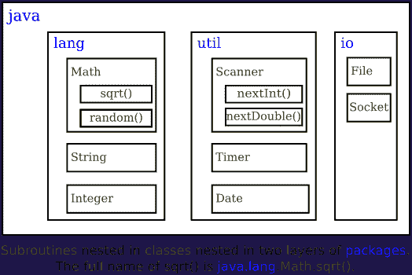

同样，包`javax`包含`javax.swing`包，该包包含了代表 GUI 组件（如按钮和输入框）的类。而`javax.swing`又包含一个`javax.swing.event`包，该包包含了用于处理事件（如按键和鼠标点击）的类。

标准的 Java`API`包含了数百个包中的数千个类。其中许多类相当晦涩或非常专业化，但你可能想浏览一下文档以查看哪些可用内容。在我撰写这段文字时，Java 8 的完整 API 文档位于：

```
https://docs.oracle.com/javase/8/docs/api/
```

请参下文的“模块”章节，了解 Java 8 之后对语言所做的更改以及指向 Java 17 文档的链接。然而，对于本书来说，你可能会发现 Java 8 文档更容易使用，且它提供的信息仍然适用。

即使是专家程序员也不会熟悉整个 Java`API`，甚至不熟悉其大部分。在书中，你只会遇到几十个类，这些类足够编写各种程序了。

## 4.6.3 使用包中的类

假设你想在你编写的程序中使用`java.awt.Color`类。这是`java.awt`包中`Color`类的全名。像任何类一样，`java.awt.Color`是一种类型，这意味着你可以用它来声明变量和参数并指定函数的返回类型。实现此点的方法是使用类的全名作为类型的名称。例如，假设你想声明一个类型为`Color`的变量名为`rectColor`。你可以写：

```
java.awt.Color rectColor;
```

这就是一个普通的变量声明，格式为 "type-name variable-name;"。当然，频繁使用类的全名可能会很疲乏，你几乎永远不会在程序中使用这样的全名。Java 允许通过导入（import）类来避免使用类的全名。如果你放在

```
import java.awt.Color;
```

在 Java 源代码文件的开头，以及文件的其余部分，你可以将全名`java.awt.Color`缩写为类的简单名，即`Color`。注意，导入语句位于文件的开头（如果有`package`语句，则紧随其后），并且不位于任何类定义内部。虽然它有时被称为一条语句（statement），但更准确的术语是导入指令（import directive），因为在通常意义上它并不是一条语句。导入指令`import java.awt.Color`允许你通过以下方式声明变量：

```
Color rectColor;
```

请注意，导入指令的唯一作用是允许你使用简单的类名，而不是完整的`"package.class"`格式的类名。你并没有真正导入任何实质性的内容；如果你省略导入指令，你仍然可以访问该类——你只需要使用它的全名即可。导入来自给定包的所有类有一种快捷方法。例如，你可以通过下述语句导入`java.util`包中的所有类：

```
import java.util.*;
```

`*`是一个通配符，可以匹配包中的每一个类。（但是，它不会匹配子包；例如，你**不能**通过说`import java.*`来导入`java`包下所有子包的全部内容。）一些程序员认为在导入语句中使用通配符是一种坏习惯，因为这可能会让大量你并不会使用、甚至可能不知道的类名变得可用。他们认为，显式地导入每一个你想要使用的类类类要更好。在我自己的编程中，我经常使用通配符导入最相关包中的所有类，而当我只使用某个包中的一两个类时，则会使用单独导入。

处理网络相关的程序可能会包含`import java.net.*;`这一行，而读取或写入文件的程序可能会使用`import java.io.*;`。但当你开始像这样导入许多包时，你必须注意一点：位于不同包的两个类可能同名。例如，`java.awt`包和`java.util`包都包含一个名为`List`的类。如果你同时导入了`java.awt.*`和`java.util.*`，简单名`List`就会产生歧义。如果你尝试声明一个类型为`List`的变量，将得到一个关于类名歧义的编译器错误信息。你仍然可以在程序中使用这两个类：使用类的全名，即`java.awt.List`或`java.util.List`。当然，另一种解决方案是使用 import 来仅导入你需要的单个类，而不是导入整个包。

由于`java.lang`包是如此基础，`java.lang`中的所有类都会被**自动**导入到每个程序中。这就像每个程序都以`import java.lang.*;`语句开头一样。这就是为什么我们能够使用类名`String`而不是`java.lang.String`，使用`Math.sqrt()`而不是`java.lang.Math.sqrt()`。尽管如此，使用较长的名称形式在法律上仍然是完全允许。

程序员可以创建新的包。假设你希望你编写的一些类放在一个名为`utilities`的包中。那么，定义这些类的源代码文件必须以以下行开头：

```
package utilities;
```

这一行甚至位于该文件中任何导入指令之前。此外，源代码文件将被放置在与包同名的文件夹中，在本例中为`"utilities"`。位于子包中的类必须存放在子文件夹中。例如，位于名为`utilities.net`包中的类将位于名为`"utilities"`的文件夹内名为`"net"`的文件夹中。包中的类自动具有访问同包其他类的权限；也就是说，一个类不需要导入它定义所在包中的类。

在定义了大量类的项目中，将这些类组织成包是有意义的。程序员创建新包作为工具箱也是有意义的，这些工具箱可以为处理标准 Java API 未涵盖的领域提供功能和 API。（事实上，这些“制作工具”的程序员往往往往比使用他们工具的应用程序程序员具有更高的声望。）

然而，除了`textio`包中的`TextIO`类等极少数例外外，本书中编写的类都不在包中。出于本书的目的，你主要需要了解包，是因为这以便你能够导入`TextIO`以及来自标准包的类。标准包对你编写的程序始终是可用的。你可能会想知道标准类实际上位于哪里。再次，这在很大程度上取决于你使用的 Java 版本，但它们将是已安装 JDK 的组成部分。

尽管我们不会显式地创建包，但**每一个**类实际上都是某个包的一部分。如果一个类没有被专门地放在某个包中，它就会被放在一个被称为“默认包”（default package）的地方，该包没有名称。你在书中看到的几乎所有的示例都在默认包中。

## 4.6.4 关于模块 (Modules)

从 Java 9 开始，随着模块的引入，Java 的大规模结构发生了重大变化。模块是包的集合，因此它代表了另一个层级的包含关系：模块包含包，包包含类，类包含变量和方法。包并不一定要在模块中才能使用，但 Java 中所有的标准类都被分成了一组模块。

引入模块有几个原因。一个主要原因是为了提供更好的访问控制。在模块出现之前，声明为`public`的类可以在任何地方使用，即任何包中的任何类，其公共变量和方法也是如此。另一方面，对于定义在模块中的类，“public”仅意味着在定义的模块内可见。然而，模块可以显式地导出（export）一个包。从模块导出包允许该包中的公共类从任何地方访问，包括其他模块以及不属于任何模块的类。（甚至可以将一个包只导出给指定的模块，从而提供更细粒度的访问控制。）结果是，现在可以拥有某些本质上是私有的包：它们为同模块的其他包提供服务，但从模块外部是不可见的。因此，模块是另一种类型的黑盒，而未导出的包是其内部实现的一部分。当然，这种规模的模块化对于非常大型应用程序来说真正重要。

模块的另一个动机是标准 JRE（Java 运行环境）体积巨大，它包含了所有的标准类。特定的应用程序只会使用标准运行时的一小部分。模块化使得构建仅包含应用程序所需模块的更小的自定义 JRE 成为可能。JDK 包含一个用于创建自定义运行时的`jlink`命令，它可以包含定义应用程序的模块以及运行该程序所需的标准模块。该运行时可以作为应用程序分发，即使是那些计算机上没有安装 JDK 的人也可以执行。但就像 JDK 本身一样，Windows、MacOS 和 Linux 需要不同版本的自定义运行时。此外，当 JDK 发布安全更新时，这些更新不会自动应用到自定义运行时，因此应用程序开发者承担了更新自定义运行时的责任。再次，这真的对于相当较大的应用程序才有用。

在 Java 9 或更高版本的 JDK 中，来自标准模块的编译类文件共同存储在主 JDK 目录下`lib`文件夹内一个名为`modules`的文件中。这就是所谓的“jimage 文件”，并且有一个名为`jimage`的命令行工具用于处理此类文件。

如果你使用`jlink`工具创建自定义运行时环境，它的工作之一就是创建一个自定义的`modules`文件，其中仅包含运行时环境所需的模块。在我我的 Linux 电脑的 JDK`17`中，`modules`是一个 127 兆的文件，包含来自 70 个模块的 835 个包的 26401 个类。JDK 目录下还有一个名为`jmods`的子目录，其中包含了以另一种形式存储的模块。然而，在编译和运行程序时，该目录并不是必需的，而且据我所知，它主要用于供`jlink`使用。

JDK 中的模块包括例如`java.base`（包含`java.lang`和`java.util`等基础模块）和`java.desktop`（包含用于 Swing GUI 工具包的包）。模块化版本 Java 的 API 文档被分为模块，然后是包，最后是类。这使得文档比旧版本的 Java 文档更难浏览。不过，文档网站确实有一个有效的搜索功能。正当我写这部分内容时，Java`17`的文档位于：

[`docs.oracle.com/en/java/javase/17/docs/api/index.html`](https://docs.oracle.com/en/java/javase/17/docs/api/index.html)

类可以定义在任何模块之外，并且该类可以使用来自模块的包，前提是这些包已被它们所在的模块所导出（export）了。特别是，程序员可以使用 JDK 中的类，而无需思考过模块或不知道它们的存在。这适用于书中的所有程序。

除了本节的基本背景信息外，本教科书不再涵盖模块。

***

## 4.6.5 Javadoc Javadoc

要有效地使用 API，你需要为它准备良好的文档。大多数 Java API 的文档是使用一个名为 Javadoc 的系统准备的。例如，该系统被用于准备 Java 标准包的文档。几乎每个在 Java 中创建工具箱的人都会为它发布 Javadoc 文档。

Javadoc 文档是根据放在 Java 源代码文件中的特殊注释准备的。回想一种 Java 注释以`/*`开头并以`*/`结束。Javadoc 注释采用相同的形式，但它以`/**`而不是简单的`/*`开头。你已经在书中许多示例中见过这种形式的注释。

注意，Javadoc 注释必须放置在它所注释的子程序**之前**。这一规则总是被遵守。你可以为子程序、成员变量和类编写 Javadoc 注释。Javadoc 注释总是**紧接于**它所注释的对象。

与任何注释一样，Javadoc 注释在文件被编译时会被计算机忽略。但有一个工具名为`javadoc`的工具，它可以读取 Java 源代码文件，提取它找到的任何 Javadoc 注释，并创建一组包含这些注释的、格式精美且相互链接的 Web 页面。默认情况下，`javadoc`只收集有关公共类、子程序和成员变量的信息，但它允许为非公共内容创建文档的选项。如果`javadoc`没有为某个内容找到任何 Javadoc 注释，它会构建一个，但该注释仅包含基本信息，例如成员变量的名称和类型，或者子程序的名称、返回类型和参数列表。这是**语法上的**信息。要添加关于语义和语用的信息，你必须编写 Javadoc 注释。

作为一个示例，你可以查看`TextIO`的文档 Web 页面。该文档页面是通过将`javadoc`工具应用于源代码文件 [TextIO.java](https://math.hws.edu/eck/cs124/javanotes9/source/chapter4/textio/TextIO.java) 创建的。如果你下载了这本书的在线版本，可以在`TextIO_Javadoc`目录下找到文档，或者你可以在本节的在线版本中找到它的链接。

在 Javadoc 注释中，每行开头的`'`是可选的。`javadoc`工具会移除它们。除了普通文本，注释还可以包含某些特殊代码。其中，注释可以包含 HTML 标记命令。HTML 是用于创建网页的语言，而 Javadoc 注释旨在显示在网页上。`javadoc`工具会将注释中的任何 HTML 命令复制到它所创建的 Web 页面中。书中不会教你 HTML，但作为一个示例，你可以添加`<p>`来指示新段落的开始。（通常情况下，在没有 HTML 命令的情况下，注释中的空行和额外的空格会被忽略。此外，字符`&`和`<`在 HTML 中具有特殊含义，除非为了这些含义，否则不应在 Javadoc 注释中使用它们；它们可以写成`&amp;`和`&lt;`。）

除了 HTML 命令外，Javadoc 注释还可以包含文档标签（doc tags），这些标签会被`javadoc`工具作为命令处理。文档标签的名称以字符`@`开头。我将只讨论四个标签：`@author`、`@param`、`@return`和`@throws`。`@author`标签只能用于类，后面应该跟着作者的名字。其他三个标签用于子程序的 Javadoc 注释，以提供其参数、返回值以及可能抛出的异常的信息。这些标签位于程序的 Javadoc 注释中，描述之后。这些标签**必须**放在注释的末之后。使用它们的语法如下：

```
@param  parameter-name   description-of-parameter

@return  description-of-value

@throws exception-class-name   description-of-exception
```

描述可以跨行。描述结束于下一个文档标签或注释的结束。你可以为子程序的参数包含`@param`标签，并为你想记录的许多异常类型包含`@throws`标签。对于非 void 子程序，你应该有一个`@return`标签。这些标签不需要以特定的顺序给出。

这是一个没有实际功能但使用了所有三种标签的示例：


```java
/**
 * 此子程序根据给定的宽度和高度计算矩形的面积。
 * 长度和宽度应该是正数。
 * @param width 矩形的一边的长度
 * @param height 矩形的另一边的长度
 * @return 矩形的面积
 * @throws IllegalArgumentException 如果宽度或高度
 *    为负数。
 */
public static double areaOfRectangle( double length, double width ) {
    if ( width < 0  || height < 0 )
       throw new IllegalArgumentException("边必须为正数.");
    double area;
    area = width * height;
    return area; 
}
```

我在许多示例中使用了 Javadoc 注释。我鼓励你在自己的代码中使用它们，即使你不打算为你的工作生成 Web 页文档，因为它是其他 Java 程序员熟悉的标准格式。

如果你确实想创建 Web 页文档，你需要运行`javadoc`工具。该工具作为在 2.6 节中讨论过的 Java 开发包中的命令可用。你可以类似于使用`javac`和`java`命令的方式，在命令行界面中使用`javadoc`工具。Javadoc 也可以在 2.6 节中也讨论过的集成开发环境中应用。我在这里不会介绍这些细节；请查阅你编程环境的文档。

在结束本节之前，我将提到导入指令（import directive）的一种扩展。我们已经看到`import`允许我们使用简单名称`Scanner`来引用如`java.util.Scanner`这样的类。但你仍然需要使用复合名称来引用静态成员变量（如`System.out`）和静态方法（如`Math.sqrt`）。

导入指令还有另一种形式，可以用于导入类的静态成员，其方式与普通导入指令从包（package）导入类相同。这种形式的指令被称为`static import`（静态导入），其语法如下：

```java
import static package-name.class-name.static-member-name;
```

用于从类中导入一个静态成员名称，或者：

```java
import static package-name.class-name.*;
```

用于从类中导入所有的公共静态成员。例如，如果你在类定义之前加上：

```java
import static java.lang.System.out;
```

那么你就可以使用简单名称`out`代替复合名称`System.out`。这意味着你可以写`out.println`而不是`System.out.println`。如果你打算大量使用`Math`类，你可以在类定义之前加上：

```java
import static java.lang.Math.*;
```

这将允许你用`sqrt`代替`Math.sqrt`，用`log`代替`Math.log`，用`PI`代替`Math.PI`等。你还可以使用以下语句从`TextIO`导入`getlnInt`函数：

```java
import static textio.TextIO.getlnInt;
```

注意，`static import`指令需要一个`package-name`，即使对于标准包`java.lang`中的类也是如此。这导致之一是你无法对默认包中的类进行静态导入。

## 第 4.7 节：更多程序设计

理解程序如何工作是一回事，设计一个执行特定任务的程序完全另一回事。在第 3.2 节中，我了如何使用伪代码和步步细化（stepwise refinement）来系统地开发算法。现在我们现在看到子程序（subroutines）是如何融入这一过程的。

步步细化本质上是一个自上而下的过程，但该过程确实有一个“底部”，即你停止细化伪代码算法并将已有内容直接翻译成正式程序代码的点。在没有子程序的情况下，该过程一直持续到赋值语句和非常原始的输入/输出操作层级才会触底。但如果你有现成的子程序来执行某些有用任务，只要你成功地用这些任务表达了你的算法，你就可以停止细化。

这允许你在步步细化的自上而下方法中加入一个自下而上的元素。给定一个问题，你可能从编写一些执行与问题领域相关的任务的子程序开始。这些子程序变成了一个现成的工具箱，你可以在开发算法的过程中将它们集成到你的算法中。（或者，你可能可以购买或找到别人编写的软件工具箱，其中包含你可以在项目中作为“黑盒”使用的子程序。）

即使在严格的自上而下方法中，子程序也很有帮助。当你细化算法时，你可以在任何时候提取算法中的任何子任务并将其转换为子程序。开发该子程序随后就变成了一个独立的问题，你可以对其进行单独处理。你的主算法仅需调用该子程序即可。当然，这只是将你的问题分解为独立的、更小问题的一种方法。它仍然是自上而下的方法，因为对问题的自上而下分析告诉你需要编写哪些子程序。在自下而上的方法中，你从编写或获取与问题领域相关的子程序开始，并在这些子程序的基础上构建你的问题的解决方案。

### 4.7.1 前置条件与后置条件

在将子程序作为构建块使用时，清楚子程序如何与程序的其余部分进行相互作用是至关重要的。这种相互作用由子程序的“合约”（contract）指定，正如第 4.1 节所述。表达子程序合约的一种方便方法是使用前置条件（preconditions）和后置条件（postconditions）。

子程序的前置条件是如果子程序要正确工作，则在调用时必须为真的事情。例如，对于内置函数`Math.sqrt(x)`，前置条件是参数`x`大于或等于零，因为负数无法开平方根。从合约的角度来看，前置条件代表了子程序“调用者”（caller）的义务。如果你在不满足前置条件的情况下调用子程序，那么没有理由期望它正常工作。程序可能会崩溃或给出错误结果，但你只能责怪自己，而不是子程序，因为你没有履行你约定的义务。

子程序的后置条件代表了合约的另一面。它代表了子程序的义务。它是子程序运行后（假设其前置条件已满足——且子程序没有 true）将为事情。函数`Math.sqrt()`的后置条件是该函数返回值的平方等于调用子程序时提供的参数。当然，只有在满足前置条件（即参数大于或等于零）时，这才会成立。内置子程序`System.out.print(x)`的后置条件是参数的值已显示在屏幕上。

前置条件通常对参数的可接受值给出限制，例如`Math.sqrt(x)`。然而，它们也可以引用子程序使用的全局变量。或者，如果只有在某些情况下才能调用子程序，前置条件可能会引用程序必须的状态。

另一方面，子程序的后置条件指定了它执行的任务。对于函数，后置条件应该指定它返回的值。

子程序有时由明确指定其前置条件和后置条件的注释描述。当你获得一个预写的子程序时，前置条件和后置条件的说明告诉你如何使用它以及它做了什么。当你被分配编写一个子程序时，前置条件和后置条件给了你该程序预期的精确规范。我将在本节剩余的示例中使用这种方法。注释以 Javadoc 注释的形式给出，但我会标记前置条件和后置条件。（许多计算机科学家认为应该为 Javadoc 系统添加新的`@precondition`和`@postcondition`文档标签来明确标记前置条件和后置条件，但目前尚未实施。）

### 4.7.2 设计示例

让我们通过一个子程序的程序设计示例。在这个例子中，我们将使用预写的子程序作为构建块，并设计完成项目所需的新子程序。我在这里使用的 API 由我编写的两个类定义：[`Mosaic.java`](https://math.hws.edu/eck/cs124/javanotes9/source/chapter4/Mosaic.java)，它又依赖于[`MosaicCanvas.java`](https://math.hws.edu/eck/cs124/javanotes9/source/chapter4/MosaicCanvas.java)。要编译并运行使用 API 的程序，`Mosaic`和`MosaicCanvas`类必须是可用的。也就是说，`Mosaic.java`和`MosaicCanvas.java`文件（或相应的编译后的类文件）必须与定义程序的类位于同一个文件夹中。（你可以从本教材的网站下载它们。）

现在，假设我有一个已经写好的类名为`Mosaic`。这个类允许程序操作一个窗口，窗口中显示按行和列排列的小型彩色矩形。该窗口可以被打开、关闭，或者通过`Mosaic`类中定义的静态成员子程序进行其他操作。事实上，该类定义了一个可以用于处理此类窗口的工具箱或 API。以下是 API 中一些可用的例程，并附有 Javadoc 风格的注释。（记住，Javadoc 注释位于其所描述的对象之前。）

```java
/**
 * 在屏幕上打开一个“马赛克”窗口。在使用任何其他 Mosaic 子程序之前，
 * 应该调用此子程序。
 *
 * 前置条件：参数 rows、cols、h 和 w 是正整数。
 * 后置条件：屏幕上打开了一个窗口，可以显示行和列的彩色矩形。
 *             每个矩形宽为 w 像素，高为 h 像素。行数由第一个参数
                   决定                   列数由第二个参数决定。初始情况下，
 *             所有矩均为黑色。
 *
 * 注意：行数从 0 到 rows - 1 编号，列数从 0 到 cols - 1 编号。
 */
public static void open(int rows, int cols, int w, int h)

/**
 * 设置窗口中一个矩形的颜色。
 *
 * 前置条件：row 和 col 在有效的行和列号范围内，
 *             且 r、g 和 b 在 0 到 255 之间（包含边界）。
 * 后置条件：行号 row 和列号 col 的矩形颜色已设置为由 r、g 和 b
 *             指定颜色。r 表示颜色中红色的量，
 *             0 表示无红色，255 表示可能的最大红色。
 *             r 的值越大，颜色中的红色越深。g 和 b
 *             处理绿色和蓝色分量的原理类似。
 */
public static void setColor(int row, int col, int r, int g, int b)

/**
 * 获取其中一个矩形颜色的红色分量。
 *
 * 前置条件：row 和 col 在有效的行和列号范围内。
 * 后置条件：返回指定矩形颜色的红色分量，范围为 0 到 255 的
 *             之间的整数。
 */
public static int getRed(int row, int col)

/**
 * 类似于 getRed，但返回颜色的绿色分量。
 */
public static int getGreen(int row, int col)

/**
 * 类似于 getRed，但返回颜色的蓝色分量。
 */
public static int getBlue(int row, int col)

/**
 * 测试马赛克窗口当前是否已打开。
 *
 * 前置条件：无。
 * 后置条件：如果调用此函数时窗口是打开的，则返回 true；
 *             如果窗口已关闭，则返回 false。
 */
public static boolean isOpen()

/**
 * 在程序中插入延迟（例如为了调节颜色变化的速度）。
 *
 * 前置条件：milliseconds 是正整数。
 * 后置条件：程序暂停了至少指定的毫秒，
 *             其中一秒等于 1000 毫秒。
 */
public static void delay(int milliseconds)
```

记住这些子程序是`Mosaic`类的静态成员，因此当从`Mosaic`外部调用它们时，必须将类名作为例程名称的一部分。例如，我们必须使用`Mosaic.open`而不是简单的`open`。

你会发现，子程序上的注释并没有说明在不满足前置条件时会发生什么。虽然子程序的合约并没有强制要求在那种情况下执行任何特定操作，但如果知道会发生什么会更好。例如，如果违反了`setColor()`或`getRed()`例程中的前置条件“row 和 col 在有效的行和列号范围内”，将会抛出一个`IllegalArgumentException`。知道这一事实将允许你编写出能够捕获并处理该异常的程序，并且在 Javadoc 注释中使用`@throws`文档标签对其进行记录将是比较好的。关于子程序的行为还存在其他问题。例如，如果你调用`Mosaic.open()`时屏幕上已经打开了一个马赛克窗口，会发生什么？（事实上，旧的窗口会被关闭，并创建一个新的……）要完全记录一个软件的行为是困难的——有时你只能通过实验或查看完整的源代码。

***

我对程序的想法是使用`Mosaic`类作为一个精美动画的字体。我想用随机颜色的正方形填充窗口，然后在一个只要窗口打开就会持续运行的循环中随机更改颜色。“随机更改颜色”可能有很多不同的含义，但在思考了一段时间后，我决定如果有一个在窗口内随机游走的“扰动”会很有趣，它会改变遇到的每个正方形的颜色。这里有一张图片显示了窗口内容在某一时刻可能的样子：


有了操作窗口的基本例程作为基础，我可以处理具体问题。我的程序大纲如下：

```
打开马赛克窗口
用随机颜色填充窗口
移动并改变颜色
```

用随机颜色填充窗口看起来是一个很好的连贯任务，所以我决定专门写一个子程序来完成它。第三步可以稍微扩展为：在窗口中心开始，然后不断移动并改变颜色。这只要马赛克窗口仍然打开，这种操作就会持续进行。

我们需要一种方式来表示当前位置。可以使用两个名为`currentRow`和`currentColumn`的`int`变量来实现，它们持有扰动当前所在正方形的行号和列号。我将在马赛克中使用 16 行 20 列正方形，因此将当前位置设置在中心意味着将`currentRow`设置为 8，`currentColumn`设置为 10。我已经有一个打开窗口的例程`Mosaic.open()`。为了保持主程序的简单，我决定自己编写另外两个子程序来执行循环循环中的两个任务。这时，算法可以用 Java 写如下：

```java
Mosaic.open(16,20,25,25)
fillWithRandomColors();
currentRow = 8;       // 窗口中间行。
currentColumn = 10;   // 中间列。
while ( Mosaic.isOpen() ) { // 当用户关闭窗口时程序结束。
    changeToRandomColor(currentRow, currentColumn);
    randomMove();      
}
```

加上适当的封装，这基本上就是我程序的`main()`方法。在运行完完成程序后，我发现需要进行小小的修改：为了防止动画运行得太快，我在 while 循环中添加了`Mosaic.delay(10);`这一行。

`main()`例程已经处理完毕，但为了完成程序，我仍然需要编写子程序`fillWithRandomColors()`、`changeToRandomColor(int,int)`和`randomMove()`。编写这些子程序的每一个都是独立的小任务。`fillWithRandomColors()`程序的后置条件定义为“马赛克中的每个矩形都已变为随机颜色”。完成此任务的算法伪代码如下：

```
For each row:
   For each column:
      set the square in that row and column to a random color
```

“每一行”和“每一列”可以用`for`循环来实现。我们已经计划写一个可以用于设置颜色的子程序`changeToRandomColor`。（在多处复用子程序的这种可能性，是使用子程序的巨大益处之一！）因此，`fillWithRandomColors()`可以用标准的 Java 代码写成：

```
static void fillWithRandomColors() {
   int row, column;
   for ( row = 0; row < 16; row++ )
      for ( column = 0; column < 20; column++ )
         changeToRandomColor(row,column);
}
```

转向`changeToRandomColor`子程序，我们已经在`Mosaic`类中有一个方法`Mosaic.setColor()`，它可以用来改变正方形的颜色。如果我们想要随机颜色，只需要为`r`、`g`和`b`选取随机值即可。根据`Mosaic.setColor()`子程序的前置条件，这些随机值必须是 0 到 255 之间的整数。随机选择此类整数的公式为`(int)(256*Math.random())`。因此，随机颜色子程序变为：

```
static void changeToRandomColor(int rowNum, int colNum) {
     int red = (int)(256*Math.random());
     int green = (int)(256*Math.random());  
     int blue = (int)(256*Math.random());
     Mosaic.setColor(rowNum,colNum,red,green,blue);  
}
```


最后，考虑`randomMove`子程序，它应该随机将干扰项向上、下、左或右移动。为了在四个方向中进行随机选择，我们可以选择 0 到 3 之间的随机整数。如果整数是 0，则向一个方向移动；如果是 1，则向另一个方向移动；以此类推。干扰项的位置由变量`currentRow`和`currentColumn`给出。“向上移动”意味着从`currentRow`中减 1。这留下了一个问题：如果`currentRow`变成 -1 怎么办？这会导致干扰项位于窗口上方（这将违反好几个`Mosaic`子程序的前置条件）。为了防止这种情况发生，我决定通过将`currentRow`设置为 15 将干扰项移动到网格的对边。（记住 16 行是从 0 到 15 编号的。）跳转到对边的替代方案是在这种情况下什么都不做。将干扰项向下、向左或向右移动的处理类似。如果我们使用`switch`语句来决定向哪个方向移动，`randomMove`的代码变为：

```
int directionNum;
directionNum = (int)(4*Math.random());
switch (directionNum) {
   case 0 -> {  // move up 
      currentRow--;
      if (currentRow < 0)   // CurrentRow is outside the mosaic;
         currentRow = 15;   // move it to the opposite edge.
   }
   case 1 -> {  // move right
      currentColumn++;
      if (currentColumn >= 20)
         currentColumn = 0;
   }
   case 2 -> {  // move down
      currentRow++;
      if (currentRow >= 16)
         currentRow = 0;
   }
   case 3 -> {  // move left
      currentColumn--;
      if (currentColumn < 0)
         currentColumn = 19;
   }
}
```

### 4.7.3 程序

将这一切整合在一起，我们得到了以下完整的程序。注意，我为类本身以及每个子程序都添加了 Javadoc 风格的注释。变量`currentRow`和`currentColumn`定义为类的静态成员，而不是局部变量，因为它们都被几个不同的子程序使用。你可以在[RandomMosaicWalk.java](https://math.hws.edu/eck/cs124/javanotes9/source/chapter4/RandomMosaicWalk.java)中找到源代码的副本。记住，这个程序实际上依赖于另外两个文件，[Mosaic.java](https://math.hws.edu/eck/cs124/javanotes9/source/chapter4/Mosaic.java)和[MosaicCanvas.java](https://math.hws.edu/eck/cs124/javanotes9/source/chapter4/MosaicCanvas.java)。

```java
/**
 * 此程序打开一个充满随机颜色正方形的窗口。一个“扰动”
 * 在窗口内随机移动，随机改变它所经过的每个正方形的颜色。
 * 程序一直运行到用户关闭窗口为止。
 */
public class RandomMosaicWalk {

    static int currentRow;    // 当前包含扰动的行。
    static int currentColumn; // 当前包含扰动的列。

    /**
     * 主程序创建窗口，用随机颜色填充它，
     * 然后只要窗口是打开的，就让扰动在窗口周围进行随机游走。
     */
    public static void main(String[] args) {
        Mosaic.open(16,20,25,25);
        fillWithRandomColors();
        currentRow = 8;   // 从窗口中心点开始
        currentColumn = 10;
        while ( Mosaic.isOpen() ) {
            changeToRandomColor(currentRow, currentColumn);
            randomMove();
            Mosaic.delay(10);  // 删除此行可以加快速度！
        }
    }  // 结束 main

    /**
     * 用随机颜色的正方形填充窗口。
     * 前置条件：Mosaic 窗口是打开的。
     * 后置条件：每个正方形都已设置为随机颜色。 
     */
    static void fillWithRandomColors() {
        int row, column;
        for ( row=0; row < 16; row++ ) {
            for ( column=0; column < 20; column++ ) {
                changeToRandomColor(row, column);  
            }
        }
    }  // 结束 fillWithRandomColors

    /**
     * 将一个正方形更改为随机选择的新颜色。
     * 前置条件：指定的 rowNum 和 colNum 在行和列号
     *                 的有效范围内。
     * 后置条件：指定行和列的正方形已
     *                 被设置为随机颜色。
     * @param rowNum 正方形的行号，从顶部的 0 开始计数
     * @param colNum 正方形的列号，从左侧的 0 向右计数
     */
    static void changeToRandomColor(int rowNum, int colNum) {
        int red = (int)(256*Math.random());    // 选择范围内的随机级别
        int green = (int)(256*Math.random());  // 红、绿、
                                              // 蓝分量范围 0 到 255
        int blue = (int)(256*Math.random());   
        Mosaic.setColor(rowNum,colNum,red,green,blue);  
    }  // 结束 changeToRandomColor

    /**
     * 移动扰动。
     * 前置条件：全局变量 currentRow 和 currentColumn
     *                 在行和列号的合法范围内。
     * 后置条件：currentRow 或 currentColumn 被更改为网格中
     *                 相邻位置之一——从当前位置向上、下、左或
     *                 右。如果此移动导致位置移出
     *                 网格范围，则它会被移动到网格的
     *                 对侧边缘。
     */
    static void randomMove() {
        int directionNum; // 随机设置为 0, 1, 2, 或 3 以选择方向。
        directionNum = (int)(4*Math.random());
        switch (directionNum) {
            case 0 -> {  // 向上移动
               currentRow--;
               if (currentRow < 0)   // CurrentRow 在 mosaic 之外；
                  currentRow = 15;   // 将其移动到对侧边缘。
            }
            case 1 -> {  // 向右移动
               currentColumn++;
               if (currentColumn >= 20)
                  currentColumn = 0;
            }
            case 2 -> {  // 向下移动
               currentRow++;
               if (currentRow >= 16)
                  currentRow = 0;
            }
            case 3 -> {  // 向左移动
               currentColumn--;
               if (currentColumn < 0)
                  currentColumn = 19;
            }
        }
    }  // 结束 randomMove

} // 结束类 RandomMosaicWalk
```

## 第 4.8 节：声明的真相

正如几章节前提到的，名称是编程的基础。声明和使用名称涉及许多细节。我一直以来都在避开某些细节。在本节中，我将揭示关于 Java 中声明和使用变量的大部分真相（尽管不是全部）。“声明中的初始化”和“命名常量”小节中的材料尤为重要，因为从现在起我将经常使用它们。

### 4.8.1 声明中的初始化

当执行变量声明时，会为该变量分配内存。在变量被用于表达式之前，该内存必须被初始化以包含某个确定的值。对于局部变量，声明之后通常会紧跟一个赋值语句来完成初始化。例如：

```
int count;    // 声明一个名为 count 的变量。
count = 0;    // 给 count 赋初值。
```

然而，声明语句的真相是，在声明语句中包含变量的初始化是合法的。上述两个语句可以简写为：

```
int count = 0;  // 声明 count 并给它一个初始值。
```

计算机仍然分两个步骤执行：声明变量，然后赋值`0`。初始值不必须是常量（此处应为初始值不必须是常量）。它可以是任何表达式。在一个声明语句中初始化多个变量是合法的。例如：

```
char firstInitial = 'D', secondInitial = 'E';
```

这种特性在 for 循环中特别常见，因为允许在实际使用的地方声明循环控制变量。例如：

```
for ( int i = 0; i < 10; i++ ) {
   System.out.println(i);
}
```

你应该记住，这仅仅是以下形式的简写，我添加了一对大括号以显示`i`局部于 for 语句，并在循环结束后不再存在：

```
{
   int i;
   for ( i = 0; i < 10; i++ ) {
      System.out.println(i);
   }
}
```

成员变量也可以在声明处进行初始化，就像局部变量一样。例如：

```java
public class Bank {
   private static double interestRate = 0.05;
   private static int maxWithdrawal = 200;
   .  // 更多变量和方法
   .
}
```

静态成员变量在 Java 解释器加载类时就会创建，初始化也在该同时完成。对于成员变量来说，这不仅仅是声明后跟赋值语句的简写。声明语句是唯一可以在方法之外发生的语句类型。赋值语句不能，因此以下代码是非法的：

```java
public class Bank {
   private static double interestRate;
   interestRate = 0.05;  // 非法：不能在方法之外！
   .
}
```

正因如此，成员变量的声明通常包含初始值。事实上，正如第 4.2.4 小节提到的，如果没有为成员变量提供初始值，则将使用默认初始值。例如，当声明整数成员变量`count`时，`static int count;`等同于`static int count = 0;`。

数组变量也可以被初始化。数组包含多个元素，而不仅仅是一个单一值。要初始化一个数组变量，你可以提供一组值列表，用逗号分隔，并将其封装在一对括号之间。例如：

```
int[] smallPrimes = { 2, 3, 5, 7, 11, 13, 17, 19, 23, 29 };
```

在这条语句中，创建了一个长度为`10`的`int`数组，并用列表中的值填充。数组的长度由列表中项目的数量决定。

注意，这种初始化数组的语法**不能**用于赋值语句。它只能在声明数组变量的时刻声明语句中使用。

使用`new`算符创建的数组来初始化数组变量也是可能的（这种方式也**可以**用于赋值语句）。例如：

```
String[] nameList = new String[100];
```

但在那种情况下，显然，所有的数组元素都将具有它们的默认值。

***

### 4.8.2 使用 var 声明变量

在 Java 11 及更高版本中，有一种新的声明变量的方法，使用`var`关键字而不是为变量指定显式类型。新的声明语法只能用于局部变量，即声明在子程序内部的变量（参见第 4.2.4 节）。此外，使用`var`声明的变量必须赋予一个初始值。使用`var`声明的变量具有定义的类型，就像任何其他变量一样。Java 编译器使用初始值的类型来定义变量的类型。例如，声明语句

```
var interestRate = 0.05;
```

可以用来定义一个名为`interestRate`且初始值为`0.05`的局部变量。该变量的类型是`double`，因为`0.05`是一个`double`类型的值。一个类型为`String[]`名为`nameList`的局部变量可以声明为：

```
var nameList = new String[100];
```

特别地，`var`可以用于声明`for`循环中的循环控制变量。例如，

```
for ( var i = 0;  i < 10;  i++ ) {
   System.out.println(i);
}
```

这一切看起来可能并不特别有用，但对于更复杂的“泛型类型”，它会变得更加有用，这些类型将在第 7.3 节和第 10 章中介绍。

***

### 4.8.3 命名常量

有时，变量的值在初始化后不应该改变。例如，在上面的示例中，`interestRate`被初始化为值`0.05`，`0.05`很有可能在整个程序运行期间都是意图中的值。在这种情况下，程序员可能正在定义变量`interestRate`，以便给原本无意义的数字`0.05`赋予一个有意义的名字。当程序说`principal += principal*interestRate;`时，比说`principal += principal*0.05;`更容易理解发生了什么。

在 Java 中，`final`修饰符可以应用于变量声明，以确保在变量初始化后存储在变量中的值不能被更改。例如，如果成员变量`interestRate`声明为：

```
public final static double interestRate = 0.05;
```

那么在程序的其他地方，`interestRate`的值就不可能改变。任何尝试给`interestRate`赋值的赋值语句都会在程序编译时被计算机作为语法错误拒绝。（在公共利率上使用“final”修饰符非常有意义——银行可能想要公布其利率，但绝对不想让路人对其进行修改！）

将`final`修饰符应用于局部变量和形式参数（甚至可以应用于类和子程序）是合法的，但它对成员变量可能最有用。我经常将声明为`final`的静态成员变量称为命名常量，因为它的值在程序运行的整个时间内保持不变。通过使用命名常量来给程序中的重要数量赋予有意义的名字，可以大大增强程序的可读性。命名常量的一种推荐风格规则是给它们命名完全由大写字母组成的名称，必要时用下划线字符分隔单词。例如，利率常量的优选样式为：

```
public final static double INTEREST_RATE = 0.05;
```

这是 Java 标准类中通使用的样式，这些类定义了许多命名常量。例如，我们已经看到`Math`类包含一个变量`Math.PI`。该变量在`Math`类中声明为类型为`double`的“public final static”变量。同样，`Color`类包含了`Color.RED`和`Color.YELLOW`等命名常量，它们是类型为`Color`的 public final static 变量。

枚举常量（参见第 2.3.3 节）也是命名常量的例子。枚举类型定义

```
enum Alignment { LEFT, RIGHT, CENTER }
```

定义了常量`Alignment.LEFT`、`Alignment.RIGHT`和`Alignment.CENTER`。从技术上讲，`Alignment`是一个类，这三个常量是它的 final static 成员。定义枚举类型类似于定义，例如，int：


```java
static final int ALIGNMENT_LEFT = 0;
static final int ALIGNMENT_RIGHT = 1;
static final int ALIGNMENT_CENTER = 2;
```

事实上，在引入枚举类型之前必须这样做，而且现在许多情况下仍然在使用。使用整数常量，唯一的问题是计算机无法知道你意图让值表示对齐，如果赋值给变量的值不是这三个有效值，它不会提出任何异议。另一方面，使用枚举类型，赋值给 `Alignment` 类型变量的只有列出的常量。这种额外的安全性是枚举类型的主要优势之一。

---

奇的是，使用命名常量的一个主要原因是很容易更改常量的值。当然，值在程序运行时不能更改。但在程序运行之间，可以很容易地更改源代码中的值并重新编译程序。考虑利率的示例。利率的值可能在整个程序中多次使用。假设银行更改了利率并且必须修改程序。如果整个程序都使用字面量 `0.05`，程序员必须跟踪程序中使用利率的每个地方并将速率更改为新值。（由于数字 `0.05` 在程序中可能具有利率以外的其他含义，以及由于有人可能使用了例如 `0.025` 来表示利率的一半，这使得工作变得更加困难。）另一方面，如果命名常量 `INTEREST_RATE` 在整个程序中一致声明并使用，那么只需要更改初始化常量的单行代码即可。

作为一个扩展示例，我将给出上一节中 `RandomMosaicWalk` 程序的新版本。该版本使用命名常量来表示马赛克的行数、列数以及每个小正方形的大小。这三个常量声明为 `final static` 成员变量，其代码如下：

```java
final static int ROWS = 20;        // 赛格的行数。
final static int COLUMNS = 30;     // 赛格的列数。
final static int SQUARE_SIZE = 15; // 赛格中每个方形的大小。
```

程序的其余部分已经过仔细修改，以使用命名常量。例如，在程序的新版本中，通过以下语句打开 `Mosaic` 窗口：

```java
Mosaic.open(ROWS, COLUMNS, SQUARE_SIZE, SQUARE_SIZE);
```

有时候，找到所有需要使用命名常量的地方并不容易。如果你不一致地使用命名常量，那么在某种程度上你就违背了初衷。对于任何命名常量，使用几个不同的值运行程序，以测试它在所有情况下都能正常工作，这是一个好主意。

这里是完整的新程序 `RandomMosaicWalk2`，其中之前版本的所有修改都以红色斜体显示。请特别注意在 `randomMove()` 中将扰动从赛格的一个边缘移动到对边缘时，是如何使用常量 `ROWS` 和 `COLUMNS` 的。为了节省空间，我省略了大部分注释。

```java
public class RandomMosaicWalk2 {

    final static int ROWS = 20;        // 赛格的行数。
    final static int COLUMNS = 30;     // 赛格的列数。
    final static int SQUARE_SIZE = 15; // 赛格中每个方形的大小。

    static int currentRow;    // 当前包含扰动的行。
    static int currentColumn; // 当前包含扰动的列。

    public static void main(String[] args) {
        Mosaic.open( ROWS, COLUMNS, SQUARE_SIZE, SQUARE_SIZE );
        fillWithRandomColors();
        currentRow = ROWS / 2;   // 从窗口中心开始
        currentColumn = COLUMNS / 2;
        while ( Mosaic.isOpen() ) {
            changeToRandomColor(currentRow, currentColumn);
            randomMove();
            Mosaic.delay(5);
        }
    }  // end main

    static void fillWithRandomColors() {
         for (int row=0; row < ROWS; row++) {
            for (int column=0; column < COLUMNS; column++) {
                changeToRandomColor(row, column);  
            }
         }
    }  // end fillWithRandomColors

    static void changeToRandomColor(int rowNum, int colNum) {
         int red = (int)(256*Math.random());    // 选择范围内的随机级别
         int green = (int)(256*Math.random());  // 红、绿、蓝颜色分量范围为 0 到 255
         int blue = (int)(256*Math.random());   // 蓝色
         Mosaic.setColor(rowNum,colNum,red,green,blue);  
     }  // end changeToRandomColor

     static void randomMove() {
         int directionNum; // 随机设置为 0, 1, 2 或 3 以选择方向。
         directionNum = (int)(4*Math.random());
         switch (directionNum) {
            case 0 -> {  // 向上移动
               currentRow--;
               if (currentRow < 0)
                  currentRow = ROWS - 1;
            }
            case 1 -> {  // 向右移动
               currentColumn++;
               if (currentColumn >= COLUMNS)
                  currentColumn = 0;
            }
            case 2 -> {  // 向下移动
               currentRow++;
               if (currentRow >= ROWS)
                  currentRow = 0;
            }
            case 3 -> {  // 向左移动
               currentColumn--;
               if (currentColumn < 0)
                  currentColumn = COLUMNS - 1;
            }
         }
     }  // end randomMove

} // end class RandomMosaicWalk2
```

### 4.8.4 命名与作用域规则

当执行变量声明时，会为该变量分配内存。变量可以在程序源代码的某些部分使用，以引用该内存或存储在内存中的数据。程序源代码中变量有效的区域称为变量的作用域（scope）。同样地，我们可以引用子程序名称和形式参数名称的作用域。

对于静态成员子程序，作用域是直观的。静态子程序的作用域是定义它的类的整个源代码。这意味着，可以从类的任何点调用该子程序，包括源代码中子程序定义出现之前的任何点。甚至可以在子程序内部调用自己。这被称为“递归”（recursion）的示例，这是一个我们将在第 9.1 节中返回的高级话题。如果子程序不是私有的（private），也可以使用全名从定义它的类外部进行访问。

对于在类中声明为静态成员变量的变量，情况类似，但有一个复杂之处。允许局部变量或形式参数拥有与成员变量相同的名称。在那种情况下，在局部变量或参数的作用域内，成员变量会被隐藏。例如，考虑一个名为 `Game` 的类，形式如下：

```java
public class Game {

    static int count;  // 成员变量

    static void playGame() {
        int count;  // 局部变量
    }

}
```

在构成 `playGame()` 体语句中，`count` 指局部变量。在 `Game` 类的其他部分，`count` 指成员变量。然而，当简单名称被局部变量隐藏时，必须通过其全名 `Game.count` 来引用成员变量。因此，静态成员变量的作用域包含了定义它的整个类。非静态成员的作用域规则与静态成员相似，但正如我们将看到的，非静态成员不能在静态子程序中使用。

子程序的形式参数的作用域是构成该子程序体的块。局部变量的作用域从定义变量的声明开始，到该声明所在的块结束。如上所述，可以在 `for` 语句中声明 `for` 循环的循环控制变量，例如 `for (int i=0; i < 10; i++)`。此类声明的作用域被认为是一个特殊情况：它仅在 `for` 语句内有效，而不扩展到包含该 `for` 语句的块的剩余部分。

在作用域内重新定义形式参数或局部变量的名称是不允许的，即使在嵌套块中。例如，这样做不允许：

```java
void badSub(int y) {
    int x;
    while (y > 0) {
       int x;  // 错误 x 已经定义
    }
}
```

在许多语言中，这是允许的；`while` 循环中 `x` 的声明会隐藏原始声明。在 Java 中是不允许的；然而，一旦声明变量的块结束，该名称在 Java 中就可以被重用。例如：

```java
void goodSub(int y) {
   while (y > 10) {
      int x;
      // x 的作用域在此结束。
   }
   while (y > 0) {
      int x;  // 允许：之前的 x 声明已过期
   }
}
```

你可能会好奇局部变量名是否会隐藏子程序名。这种情况不会发生，其原因可能让你感到惊讶。并没有任何规则规定变量和子程序必须具有不同的名称。计算机始终能判断一个名称是指向变量还是子程序，因为子程序的名称后面总是跟着一个左括号 `(`。在同一个类中，拥有一个名为 `count` 的变量和一个名为 `count` 的子程序是完全合法的。（这也是为什么我经常在书写子程序名称时带上括号的原因之一，比如当我谈到 `main()` 例程时。把括号看作名称的一部分是一个好主意。）事实甚至如此：重用类名来为变量和子程序命名也是合法的。Java 的语法规则保证了计算机始终能判断出名称何时被用作类名。类名是一种类型，因此它可以被用于声明变量和形式参数，并用于指定函数的返回类型。这意味着你可以合法地定义一个名为 `Insanity` 的类，并在其中声明一个函数：

```java
static  Insanity  Insanity( Insanity Insanity ) { ... }
```

第一个 `Insanity` 是函数的返回类型。第二个是函数名，第三个是形式参数的类型，第四个是形式参数的名称。然而，请记住，并非所有可能的尝试都是好主意！

## 第 4 章编程练习题

### 练习 4.1

对字符串进行“大写”（capitalize）意味着将字符串中每个单词的首字母改为大写（如果它还不是大写的话）。例如，“Now is the time to act!”的大写化版本是“Now Is The Time To Act!”。编写一个名为 `printCapitalized` 的子程序，用于向标准输出打印字符串的大写化版本。要打印的字符串应该是该子程序的参数。使用一个 `main()` 例程测试你的子程序，该例程从用户获取一行输入并对其应用该子程序。

注意，如果一个字母在字符串中前面没有跟另一个字母，那么它就是一个单词的首字母。回想练习 3.4，我们知道有一个标准的布尔值函数 `Character.isLetter(char)`，可以用于测试其参数是否为字母。还有另一个标准的字符值函数 `Character.toUpperCase(char)`，它会返回作为参数传递的单个字符的大写版本。也就是说，如果参数是字母，它返回大写版本；如果参数不是字母，它仅返回该参数的副本。

查看解答

### 练习 4.2

十六进制数字是普通的 10 进制数字 `'0'` 到 `'9'` 加上字母 `'A'` 到 `'F'`。在十六进制系统中，这些数字分别代表 0 到 15 的值。编写一个名为 `hexValue` 的函数，使用 `switch` 语句找到给定字符的十六进制值。该字符是函数的参数，其十六进制值是函数的返回值。你应当将小写字母 `'a'` 到 `'f'` 视为与相应的大写字母具有相同的值。如果参数不是合法的十六进制数字之一，则返回 -1 作为函数的返回值。

一个十六进制整数是十六进制数字的序列，例如 34A7、ff8、174204 或 FADE。如果 `str` 是一个包含十六进制整数的字符串，那么对应的 10 进制整数可以按如下方式计算：

```java
value = 0;
for ( i = 0; i < str.length();  i++ )
   value = value*16 + hexValue( str.charAt(i) );
```

当然，如果 `str` 包含任何不是十六进制数字的字符，这种方法就是无效。编写一个程序从用户处读取字符串。如果字符串中的所有字符都是十六进制数字，则打印对应的 10 进制值。如果不是，则打印错误信息。

查看解答

### 练习 4.3

编写一个函数，模拟投掷骰子，直到骰子的总和等于一个给定的数字。你投掷的目标数字是函数的参数。投掷骰子的次数是函数的返回值。该参数应该是可能的总和之一：2, 3, ..., 12。如果不符合此情况，函数应当抛出一个 `IllegalArgumentException`。在一个程序中使用你的函数，该程序将计算并打印出得到“双点数”（snake eyes）所需的投掷次数。（双点数”是指骰子显示的总和为 2。）

查看解答

### 练习 4.4

本练习建立在练习 4.3 之上。每当你反复投掷骰子尝试获得一个给定的总和时，所需的投掷次数可能是不同的。自然产生了一个问题：获得给定总和的平均投掷次数是多少？编写一个函数，执行投掷以获得给定总和的实验 10000 次。所需的总和是该子程序的参数。平均投掷次数是返回值。每个单独的实验应通过调用你为练习 4.3 编写的函数完成。现在，编写一个 `main` 程序，为每个可能的总和（2, 3, ..., 12）调用一次你的函数。它应该生成一个结果表格，如下：

```text
骰子总和         平均投掷次数
-------------     -----------------------
       2               35.8382
       3               18.0607
       ...
```

查看解答

### 练习 4.5

本练习要求你编写几个 lambda 表达式以及一个返回 lambda 表达式的函数。假设函数接口 `ArrayProcessor` 定义如下：

```java
public interface ArrayProcessor {
    double apply( double[] array );
}
```

编写一个类，定义四个类型为 `ArrayProcessor` 的 `static final` 变量，以以下方式处理数组：找到数组的最大值、最小值、数组之和以及数组的平均值。在每种情况下，变量的值都由 lambda 表达式给出。该类还应当定义一个函数：

```java
public static ArrayProcessor counter( double value ) { ... }
```

该函数返回一个 `ArrayProcessor`，计算 `value` 在数组中出现的次数。返回值应作为 lambda 表达式给出。

该类应该有一个 `main()` 例程来测试你的工作。你为此练习编写的程序需要访问文件 [ArrayProcessor.java](https://math.hws.edu/eck/cs124/javanotes9/source/chapter4/ArrayProcessor.java)，该文件定义了函数接口。

查看解答

### 练习 4.6

第 4.7 节中的示例程序 [RandomMosaicWalk.java](https://math.hws.edu/eck/cs124/javanotes9/source/chapter4/RandomMosaicWalk.java) 显示了一个在彩色方格网格中游荡的“干扰”。当干扰访问一个方格时，该方格的颜色就会改变。这里有一个关于该程序的变体想法：在新版本中，所有方格都从默认颜色黑色开始。每当干扰访问一个方格时，该方格颜色的绿色分量就会增加少量。结果将产生一种视觉上有趣的效果，因为干扰遵循的路径会变得越来越明亮。


编写一个子程序，将马赛克图中一个方格的绿色分量加 25。（不要让绿色分量超过 255，因为这是颜色分量的最大合法值。）该方格的行号和列号应作为参数传递给子程序。记住，你可以通过调用函数`Mosaic.getGreen(r,c)`来获取第`r`行第`c`列方格的当前绿色分量。使用你的子程序替换程序[`RandomMosaicWalk2.java`](https://math.hws.edu/eck/cs124/javanotes9/source/chapter4/RandomMosaicWalk2.java)中的`changeToRandomColor()`子程序。（这是第 4.8 节中程序的改进版本，该版本使用了命名常量表示行数、列数和方格大小。）将行数和列数设置为 80。将方格大小设置为 5。

默认情况下，马赛克图中的矩形具有“3D”外观和灰色边框，这使得它们在随机游走程序中看起来更好看。但对于这个程序，你想关闭该效果。要这样做，请在主程序调用`Mosaic.setUse3DEffect(false)`。

不要忘记你还需要[`Mosaic.java`](https://math.hws.edu/eck/cs124/javanotes9/source/chapter4/Mosaic.java)和[`MosaicCanvas.java`](https://math.hws.edu/eck/cs124/javanotes9/source/chapter4/MosaicCanvas.java)来编译和运行你的程序，因为它们定义了程序所需的非标准类。

查看解答

### 练习 4.7

在本练习中，你将对第 4.7 节中讨论过的`Mosaic`类进行更有趣的操作。（再次，不要忘记你还需要[`Mosaic.java`](https://math.hws.edu/eck/cs124/javanotes9/source/chapter4/Mosaic.java)和[`MosaicCanvas.java`](https://math.hws.edu/eck/cs124/javanotes9/source/chapter4/MosaicCanvas.java)来编译和运行你的程序。）

你为此练习编写的程序应该首先用随机颜色填充马赛克图。然后重复以下步骤，直到用户关闭马赛克窗口：随机选择马赛克中的一个矩形。然后选择一个相邻的矩形——它的上方、下方、左侧或右侧。将原始选择矩形的颜色复制到所选的相邻矩形中，使得两个矩形现在具有相同的颜色。

随着这个过程不断重复，相邻方格具有相同颜色的概率变得越来越大。结果是形成了更大的颜色块。另一方面，一旦某种颜色的最后一个方格消失，该颜色就永远不会再次出现。（灭绝是永恒的！）如果你让程序运行足够的时间，最终整个马赛克图将变成均匀的颜色。

查看解答

### 练习 4.8

你为此练习编写的程序应该首先用随机颜色填充马赛克图。然后重复以下步骤，直到用户关闭马赛克窗口：随机选择马赛克图中的一个矩形。然后选择一个相邻的矩形——它的上方、下方、左侧或右侧。将原始选择矩形的颜色复制到所选的相邻矩形中，使得两个矩形现在具有相同的颜色。

随着这个过程不断重复，相邻方格具有相同颜色的概率变得越来越大。结果是形成了更大的颜色块。另一方面，一旦某种颜色的最后一个方格消失，该颜色就永远不会再次出现。（灭绝是永恒的！）如果你让程序运行足够的时间，最终整个马赛克图将变成均匀的颜色。

编写一个程序，向用户提出十个问题。每个问题都是一个简单的加法题，例如`17 + 42`，其中数字是随机选择的（且不要太大）。程序应该询问用户的答案，并在最后告诉用户分数。使用三个子程序：一个用于创建测验，一个用于管理测验，一个用于评分。每个正确答案计 10 分。使用`int[]`来指代数组。

查看解答

## 第 4 节测验

**问题 1：**“黑盒”具有`interface`（接口）和`implementation`（实现）。解释*接口*和*实现*的含义。

**问题 2：**一个子程序被认为有一个`contract`（契约）。契约的含义是什么？契约有“语法”和“语义”两个方面。语法方面是什么？语义方面是什么？

**问题 3：**简要说明子程序为什么有用。

**问题 4：**讨论参数的概念。*形式化参数*（formal parameters）和*实际参数*（actual parameters）之间的区别是什么？

**问题 5：**给出使用命名常量（用`final`修饰符声明）的两个不同理由。

**问题 6：**什么是`API`？请举一个例子。

**问题 7：**以下表达式可能意味着什么？

```java
(a,b) -> a + b
```

**问题 8：**假设`SupplyInt`是一个定义了`get()`方法的功能型接口。编写另一个 lambda 表达式，获取 1 到 6 之间的随机整数。

**问题 9：**编写一个名为`stars`的子程序，向标准输出输出一行星号。星号的数量作为参数给出。使用`for`循环。例如，`stars(20)`将输出：

`********************`

**问题 10：**编写一个`main()`程序，使用你在问题 7 中编写的子程序输出 10 行星号，第一行 1 个星，第二行 2 个星，以此此类推，如下：

```text
*
**
***
```

**问题 11：**编写一个函数`countChars`，以一个`String`和一个`char`作为参数。该函数统计该字符在字符串中出现的次数，并将结果作为函数的返回值。

**问题 12：**编写一个带有三个`int`类型参数的子程序。该子程序应确定参数中哪一个最小。将最小值的值作为函数的返回值。

**问题 13：**编写一个函数，计算`double`数组前`N`个元素的平均值。数组和`N`是该子程序的参数。

**问题 14：**解释以下函数的目的，以及它是如何工作的：

```java
static int[] stripZeros(int[] list) {
    int count = 0;
    for (int i = 0; i < list.length; i++) {
        if ( list[i] != 0 )
            count++;
    }
    int[] newList;
    newList = new int[count];
    int j = 0;
    for (int i = 0; i < list.length; i++) {
        if ( list[i] != 0 ) {
            newList[j] = list[i];
            j++;
        }
    }
    return newList;
}
```

查看答案

# 目录

- 第 1 节：对象、实例方法与实例变量
- 第 2 节：构造函数与对象初始化
- 第 3 节：面向对象编程
- 第 4 节：编程示例：卡牌、手、牌组
- 第 5 节：继承、多态与抽象类
- 第 6 节：`this` 和`super`
- 第 7 节：接口
- 第 8 节：嵌套类
- 编程练习
- 本章测验

## 第 1 节：对象、实例方法与实例变量

面向对象编程（OOP）试图让程序模型更贴近人类思考和处理世界的方式。在旧的编程风格中，程序员面对问题时，必须识别出为了解决该问题需要执行的计算任务。编程随后变成了寻找一组能够完成该任务的指令序列。但在面向对象编程的核心，我们找到的不是任务，而是对象——具有行为、存储信息并可以相互作用的实体。编程就是设计一组对象，以某种方式对当前问题进行建模。程序中的软件对象可以代表问题领域中的真实或抽象实体。这被认为使程序的设计更加自然，因此更容易设计正确且易于理解。

在某种程度上，OOP 仅仅是视角的转变。我们可以用标准的编程术语将对象看作是一组变量加上一些操作这些变量的子程序。事实上，在任何编程语言中实现面向对象技术都是可能的。然而，一个让 OOP 可能的语言与一个积极支持 OOP 的语言之间存在巨大差异。像`Java`这样的面向对象编程语言包含了许多特性，这使其与标准语言非常不同。为了有效利用这些特性，你必须正确地“引导”你的思维。

正如我之前提到的，在面向对象编程的语境下，子程序通常被称为方法（methods）。现在我们开始使用对象了，我将更多地使用“方法”一词，而不是“子程序”。

### 5.1 节：对象、类与实例

对象与类紧密相关。我们已经学习了几个章节的类，并且看到类可以包含变量和方法（即子程序）。如果一个对象也是变量和方法的集合，那么它们与类有何区别？为什么理解和有效使用它们需要一种不同的思维方式？在我们处理对象而非类的第 3.9 节中，似乎并没有太大区别：我们只是在子程序定义中去掉了`static`关键字！

我说过类“描述”了对象，或者更准确地说，类的非静态部分描述了对象。但这可能并不意味着很清晰。更通用的术语是说对象属于类，但这可能并不会更清晰。（英语单词中确实缺乏足够的词汇来恰当地​​区分涉及的所有概念。对象并不像成员变量“属于”一个类那样确切地“属于”一个类。）从编程的角度来看，更准确的说法是类被用来创建对象。类是用于构造对象的工厂——或蓝图。类的非静态部分指定了（或描述了）对象将包含哪些变量和方法。这是解释对象与类区别的一部分：对象随着程序的运行而创建和销毁，如果使用同一个类来创建，则可以存在许多结构相同的对象。

考虑一个简单的类，其工作是将几个静态成员变量组合在一起。例如，以下类可以用于存储使用程序的人的信息：

```java
class UserData {
    static String name;
    static int age;
}
```

在使用该类的程序中，`UserData.name`和`UserData.age`每个变量都只有一个拷贝。当类被加载到计算机时，会有一部分内存专门用于该类，该部分内存包含了存储变量`name`和`age`的值的空间。我们可以将内存中的类想象成如下：

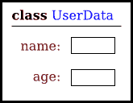

一个重要的点是，静态成员变量是类在内存中表示的一部分。它们的全名`UserData.name`和`UserData.age`使用类名，因为它们是类的一部分。当我们使用类`UserData`来表示程序的用户时，只能有一个用户，因为我们只有内存空间来存储一个用户的数据。注意，类`UserData`及其包含的变量只要程序运行就会存在。（这本质上就是“静态”的含义）。现在，考虑一个包含一些非静态变量的类似类：

```java
class PlayerData {
   static int playerCount;
   String name;
   int age;
}
```

我还在`PlayerData`类中包含了一个静态变量。这里，静态变量`playerCount`作为类在内存中表示的一部分被存储起来。它的全名是`PlayerData.playerCount`，且只有一个。然而，类定义中的另外两个变量是非静态的。不存在`PlayerData.name`或`PlayerData.age`这样的变量，因为非静态变量不是类的一部分。但`PlayerData`类可以被用来创建对象。可以使用该类创建许多对象，每个对象都将拥有自己的`name`和`age`变量。这就是类的非静态部分作为模板的含义：每个对象都获得该非静态部分的拷贝。

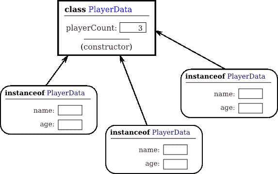

注意，静态变量`playerCount`是类的一部分，且只有一个。相反，每个对象都包含一个名字和一个年龄。从类创建的对象被称为该类的实例（instance），并且如图所示，每个对象都“知道”它是由哪个类创建的。我在这里展示了`PlayerData`类包含一个被称为“构造函数”（constructor）的东西；构造函数是创建对象的子程序。

现在可以有许多“玩家”了，因为我们可以根据需要为新玩家创建新对象。程序可能会使用`PlayerData`类来存储游戏中多个玩家的信息。每个玩家都有名字和年龄。当玩家加入游戏时，可以创建一个`PlayerData`对象来表示该玩家。如果玩家离开游戏，代表该玩家的`PlayerData`对象就可以被销毁。程序中的对象系统被用来动态地模拟游戏中正在发生的情况。你无法用静态变量这一点！“动态”（dynamic）是“静态”（static）的反面。

使用类创建的对象被称为该类的实例。我们有时会说对象属于类。对象包含的变量被称为实例变量（instance variables）。对象包含的方法（即子程序）被称为实例方法（instance methods）。例如，如果使用上面定义的`PlayerData`类来创建一个对象，那么该对象就是`PlayerData`类的实例，`name`和`age`就是该对象中的实例变量。

我这里的示例没有包含任何方法，但方法的工作方式与变量类似。静态方法是类的一部分；非静态方法（或实例方法）则成为从该类创建的对象的一部分。从字面上来说，并不是每个对象都包含一个属于自己的实例方法的实际编译代码副本。但在逻辑上，实例方法是对象的一部分，我将继续说对象“包含”该实例方法。

请注意，你应该将类的`源代码`与`类本身`（在内存中）区分开来。源代码既决定了类，也决定了从该类创建的对象。源代码中的“静态”定义指定了属于类本身（在计算机内存中）的内容，而源代码中的非静态定义指定了将成为从该类创建的每个实例对象一部分的内容。顺便说一下，类中的静态成员变量和静态成员子程序有时被称为类变量和类方法，因为它们属于类本身，而不是该类的实例。

如你所见，类的静态部分和非静态部分是完全不同的东西，服务于截然不同的目的。许多类只包含静态成员，或者只包含非静态成员，我们将看到少数包含两者混合的类示例。

### 5.1.2 对象的基础

到目前为止，我主要在谈论一些泛泛的概念，还没有让你对如果你想在程序中使用对象，需要在程序中放置什么内容的了解。让我们来看一个具体的示例，看看它是如何工作的。考虑这个极其简化的`Student`类，它可以用于存储参加某课程的学生信息：

```java
public class Student {

   public String name;  // 学生的名字。
   public double test1, test2, test3;   // 三次测试的成绩。

   public double getAverage() {  // 计算平均测试成绩
      return (test1 + test2 + test3) / 3;
   }

}  // Student 类结束
```

该类中的任何成员都没有被声明为静态的，因此该类仅为了创建对象而存在。这个类定义说明，任何作为`Student`类实例的对象都将包含名为`name`、`test1`、`test2`和`test3`的实例变量，并且将包含一个名为`getAverage()`的实例方法。不同对象中的名称和测试成绩通常具有不同的值。当为特定学生调用时，`getAverage()`方法将使用*该学生的*测试成绩计算平均值。不同的学生可以有不同的平均值。（再次，这就是说实例方法属于单个对象而不是属于类的含义。）

在 Java 中，类是一种`type`（类型），类似于`int`和`boolean`等内置类型。因此，类名可以用于在声明语句中指定变量的类型，或形式参数的类型，或函数的返回类型。例如，程序可以通过以下语句定义一个类型为`Student`且名为`std`的变量：

```java
Student std;
```

然而，声明变量**并没有**创建对象！这是一个重要的点，它与这个重要的事实有关：

**在 Java 中，没有任何变量可以持有对象。**

```java
Student std, std1,       // 声明四个类型
          std2, std3;    // 为 Student 的变量。

std = new Student();     // 创建一个属于
                         // Student 类的新对象，
                         // 并将该对象的引用
                         // 存储在变量 std 中。

std1 = new Student();    // 创建第二个 Student 对象
                         // 并将其引用
                         // 存储在变量 std1 中。

std2 = std1;             // 将 std1 中的引用值
                         // 复制到变量 std2 中。

std3 = null;             // 在变量 std3 中
                         // 存储空引用。

std.name = "John Smith";  // 设置某些实例变量的值。
std1.name = "Mary Jones";

// （其他实例变量具有默认的
//    零初始值。）
```

在计算机执行完这些语句后，计算机内存中的情况如下：

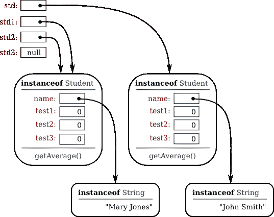

在这张图片中，当一个变量包含指向对象的引用时，该变量的值显示为指向该对象的箭头。顺便提一下，字符串（Strings）也是对象！变量`std3`的值为`null`，它不指向任何地方。`std1`和`std2`的箭头指向同一个对象。这说明了一个非常重要的点：

**当将一个对象变量赋值给另一个时，只复制引用。被引用的对象不会复制。**


当执行赋值`std2 = std1;`时，没有创建新对象。相反，`std2`被设置为指向与`std1`相同的对象。这是预料之中的，因为赋值语句只是将存储在`std1`中的值复制到`std2`，而该值是一个指针，而不是对象。但这带来了一些可能会令人惊讶的后果。例如，`std1.name`和`std2.name`是同一个变量的两个名称，即`std1`和`std2`所指向的对象中的实例变量。在将字符串"Mary Jones"赋值给变量`std1.name`后，`std2.name`的值也是"Mary Jones"，这也是`true`。这里存在产生很多困惑的可能，但如果你不断告诉自己"对象不在变量里。变量只是持有指向对象的指针"，你就可以帮助自己避免这种情况。

你可以使用操作符`==`和`!=`测试对象的相等和不相等性，但在这里，语义与你所习惯的不同。当你进行测试`if (std1 == std2)`时，你是在测试存储在`std1`和`std2`中的值是否相同。但你正在比较的值是对象的引用；它们不是对象本身。所以，你是在测试`std1`和`std2`是否指向同一个对象。如果这是你想做的，那是没问题的。但有时，你想检查的是对象中的实例变量是否具有相同的值。要做到这一点，你需要询问`std1.test1 == std2.test1 && std1.test2 == std2.test2 && std1.test3 == std2.test3 && std1.name.equals(std2.name)`。

我之前提到过字符串是对象，并且在上面的插图中将字符串"Mary Jones"和"John Smith"显示为对象。（字符串是特殊的对象，Java以一种特殊的方式处理它们，我没有尝试展示字符串对象的实际内部结构。）由于字符串是对象，类型为`String`的变量只能持有字符串的引用，而不是字符串本身。这解释了为什么使用`==`操作符测试字符串是否相等不是一个好主意。假设`greeting`是一个类型为`String`的变量，它指向字符串"Hello"。那么测试`greeting == "Hello"`是否为真？嗯，也许吧，也许不是。变量`greeting`和字符串字面量"Hello"分别引用一个包含字符H-e-l-l-o的字符串。但这些字符串仍然可能是不同的对象，恰好包含相同的字符；在这种情况下，`greeting == "Hello"`将为假。函数`greeting.equals("Hello")`测试的是`greeting`和"Hello"是否包含相同的字符，这几乎肯定是你想要问的问题。表达式`greeting == "Hello"`测试的是`greeting`和"Hello"是否包含在相同内存位置的相同字符。（当然，像`greeting`这样的字符串变量也可以包含特殊值`null`，使用`==`操作符来测试`greeting == null`是有意义的。）

---

变量持有对象的引用而不是对象本身，这一事实还有其他你应该注意的后果。只要你始终记住对象没有存储在变量中这一基本事实，这些后果在逻辑上就是成立的。对象存储在其他地方；变量指向它。

假设一个引用对象的变量被声明为`final`。这意味着一旦变量初始化，存储在变量中的值就永远无法更改。存储在变量中的值是对对象的引用。因此，只要变量存在，它将继续引用同一个对象。然而，这并不能防止**对象内部**的数据发生变化。变量是`final`的，而不是对象。这样说是完全合法的：

```
final Student stu = new Student();

stu.name = "John Doe"; // 修改对象的数据；
// 存储在 stu 中的值没有改变！
// 它仍然指向同一个对象。
```

接下来，假设有一个引用对象的变量`obj`。考虑当`obj`作为实际参数传递给子程序时会发生什么。`obj`的值被赋值给子程序中的形式参数，然后执行子程序。子程序只持有该值的副本。然而，由于值是对对象的引用，它可以更改对象。子程序结束后，`obj`仍然指向该对象，但对象内部的数据可能已经发生了。假设`x`是一个类型为`int`的变量，而`stu`是一个类型为`Student`的变量。比较：

```
void dontChange(int z) {
    z = 42;
}

void change(Student s) {
    s.name = "Fred";
}
```

代码：

```
x = 17;

dontChange(x);

System.out.println(x);
```

输出值17。

```
stu.name = "Jane";

change(stu);

System.out.println(stu.name);
```

输出"Fred"。

`x`的值没有被子程序改变，这等同于`z = x;`和`s = stu;`。

### 5.1.3 Getter和Setter (Getters and Setters)

在编写新类时，注意访问控制问题是一个好主意。记住，将类的成员设为公共意味着它可以从任何地方访问，包括其他类。相反，私有成员只能在定义它的类中使用。

在许多程序员的观点中，几乎所有的成员变量都应该声明为`private`。这让你能够完全控制对变量可以进行的操作。即使变量本身是`private`的，你也可以通过提供一个返回变量值的公共访问方法来允许其他类发现它的值。例如，如果你的类包含一个类型为`String`的私有成员变量`title`，你可以提供一个返回该变量值的方法：

```
public String getTitle() {
    return title;
}
```

返回`title`的值。按照约定，变量的访问器方法（accessor method）名称是通过变量名的首字母大写并在其前面加上`"get"`来的。因此，对于变量`title`，我们得到了一个名为`"get"` + `"Title"`的访问器方法，即`getTitle()`。由于这种命名约定，访问器方法通常被称为getter方法（getter methods）。getter方法为变量提供了"读访问权限"。（有时对于布尔型变量，会用`"is"`代替`"get"`。例如，一个名为`done`的布尔成员变量的getter方法可能会命名为`isDone()`。）

### Setter方法（修改器方法 Mutator Methods）

你可能也想对私有变量提供"写访问权限"。也就是说，你可能希望其他类能够为该变量指定新值。这是通过setter方法（setter methods）实现的。（如果你不喜欢简单的盎格-撒克逊语单词，可以使用更高级的术语修改器方法 mutator method。）setter方法的名称应该由`"set"`后面跟着变量名的大写拷贝组成，并且它应该有一个与变量类型相同的参数。变量`title`的setter方法可以这样写：

```
public void setTitle( String newTitle ) {
   title = newTitle;
}
```

### 为什么使用Getter和Setter

实际上，为私有成员变量同时提供getter方法和setter方法是非常常见的。由于这允许其他类既查看又能更改变量的值，你可能会疑惑为什么不直接将变量设为公有呢？原因是getter和setter并不限于简单的读取和写入变量的值。事实上，它们可以执行任何操作。例如，getter方法可能会记录变量被访问的次数：

```
public String getTitle() {
    titleAccessCount++;  // 增加成员变量 titleAccessCount。
    return title;
}
```

而setter方法可能会检查赋值给变量的值是否合法：

```java
public void setTitle( String newTitle ) {
   if ( newTitle == null )   // 不允许标题为空字符串！
      title = "(Untitled)";  // 取而使用一个合适的默认值。
   else
      title = newTitle;
}
```

即使你现在想不出在getter或setter方法中要做哪些额外工作，当你未来重新设计和改进类时也可能改变主意。如果你从一开始就使用了getter和setter，你就可以对类进行修改，而不影响任何使用该类的类。私有成员变量不是你类公共接口的一部分；只有公有的getter和setter方法才是，你可以自由地更改它们的实现，而无需更改你类的公共接口。如果你从一开始就没有使用get和set，你就得联系所有使用你类的人，并告诉他们："抱歉，各位，你们必须追踪你们对该变量的每一次使用，并修改你们的代码以用我新的get和set方法。"

最后有几点：Java的某些高级特性依赖于getter和setter方法的命名约定，因此严格遵守这一约定是一个好主意。而且尽管我一直在谈论为变量使用getter和setter方法，但即使没有变量，你也可以定义get和set方法。getter和/或setter方法定义了类的属性，该属性可能对应也可能不对应变量。例如，如果一个类包含一个签名名为`setValue(double)`的公有实例方法，那么该类就有一个类型为`double`的名为value的"属性"，无论该类是否有名为`value`的成员变量，它都拥有这个属性。

---

### 5.1.4 数组和对象

正如我在子章节3.8.1中提到的，数组是对象。像`Strings`一样，它们是特殊的对象，拥有自己独特的语法。如`int[]`或`String[]`等数组类型实际上是一个类，数组是使用`new`操作符特殊版本创建的。与其他对象变量一样，数组变量永远无法持有实际的数组——只有指向数组对象的引用。数组对象本身存在于堆中。数组变量可以持有`null`，这意味着没有实际的数组。

例如，假设`list`是类型为`int[]`的变量。如果`list`的值为`null`，那么任何访问`list.length`或数组元素`list[i]`的尝试将是错误的，并将导致类型为`NullPointerException`的异常。如果`newlist`是另一个类型为`int[]`的变量，那么赋值语句：

```
newlist = list;
```

仅将`list`中的引用值拷贝到`newlist`中。如果`list`是`null`，结果是`newlist`也是`null`。如果`list`指向一个数组，赋值语句并没有创建数组的副本。它只是让`newlist`指向与`list`相同的数组。例如，以下代码段的输出：

```
list = new int[3];
list[1] = 17;
newlist = list; // newlist 指向与 list 相同的数组！
newlist[1] = 42;
System.out.println( list[1] );
```

输出将是42而不是17，因为`list[1]`和`newlist[1]`只是数组中同一个元素的不同名称。一旦你理解数组是对象且数组变量持有指针，这一切就非常自然。

当数组作为参数传递给子程序时，这一事实同样适用。拷贝到子程序的值是数组的指针。由于子程序拥有数组的引用，对数组元素的任何修改都是在原始数组上进行的，并在子程序返回后依然存在。

---

### 5.2 构造方法和对象初始化

Java中的对象类型与基本类型不同。仅仅声明一个类型为类的变量并不会自动创建该类的对象。对象必须显式地构造。对于计算机来说，构造对象的过程意味着：首先，在堆中找到可以用于存放对象的空闲内存；其次，填充对象的实例变量。作为程序员，你并不在乎对象存储在内存的哪个位置，但你通常希望对新对象实例变量中存储的初始值进行控制。在许多情况下，你还希望在每次创建对象时都执行更复杂的初始化或记录工作。

实例变量可以在声明时赋予一个初始值，就像任何其他变量一样。例如，考虑一个名为`PairOfDice`的类。该类的对象将代表一对骰子。它将包含两个用于表示骰子上数字的实例变量，以及一个用于掷骰子的实例方法：

```java
public class PairOfDice {

    public int die1 = 3;   // 第一颗骰子上显示的数字。
    public int die2 = 4;   // 第二颗骰子上显示的数字。

    public void roll() {
            // 通过将每颗骰子设置为 1 到 6 之间的
            // 随机数来掷骰子。
         die1 = (int)(Math.random()*6) + 1;
         die2 = (int)(Math.random()*6) + 1;
    }

} // end class PairOfDice
```

实例变量`die1`和`die2`分别初始化为值`3`和`4`。每当构造一个`PairOfDice`对象时，这些初始化就会执行。理解这种现象何时以及如何发生非常重要。可能会有很多`PairOfDice`对象。每当创建一个时，它都会拥有自己的实例变量，并执行赋值`"die1 = 3"`和`"die2 = 4"`来填充这些变量的值。为了更清楚，请考虑`PairOfDice`类的变体：

```java
public class PairOfDice {

    public int die1 = (int)(Math.random()*6) + 1;
    public int die2 = (int)(Math.random()*6) + 1;

    public void roll() {
         die1 = (int)(Math.random()*6) + 1;
         die2 = (int)(Math.random()*6) + 1;
    }

} // end class PairOfDice
```

在这里，每当创建一个新的`PairOfDice`，骰子都会初始化为随机值，就像有一对新骰子被掷到游戏桌上一样。由于初始化会对每个新对象执行一次，因此每对新骰子都会计算一组随机初始值。不同的骰子对可能有不同的初始值。当然，对于`static`成员变量的初始化，情况完全不同。静态变量只有一个副本，该变量的初始化只在类第一次加载时执行一次。

如果你不为实例变量提供任何初始值，系统会自动提供一个默认初始值。对于数值类型（`int`、`double`等）的实例变量，如果不提供其他值，它们将自动初始化为零；`boolean`变量初始化为`false`；`char`变量初始化为代码为零的Unicode字符。实例变量也可以是对象类型的变量。对于此类变量，默认初始值为`null`。（特别是，由于`Strings`是对象，因此`String`变量的默认初始值为`null`。）

### 5.2.2 构造方法

对象是通过运算符`new`创建的。例如，一个想要使用`PairOfDice`对象的程序可以写道：

```java
PairOfDice dice;   // 声明一个类型为 PairOfDice 的变量。

dice = new PairOfDice();  // 构建一个新对象并将其引用
                             存储在变量中。
```

在这个示例中，`"new PairOfDice()"`是一个表达式，为对象分配内存，初始化对象的实例变量，然后返回对象的引用。该引用是表达式的值，该值由赋值语句存储在变量`dice`中。因此，在赋值语句执行后，`dice`指向新创建的对象。该表达式的一部分`"PairOfDice()"`看起来像是一个子程序调用，这并非偶然。事实上，它是对一种称为构造方法的特殊类型子程序的调用。这可能会让你感到困惑，因为在类定义中并没有这样的子程序。然而，每个类至少有一个构造方法。如果程序员没有在类中编写构造方法定义，系统将为该类提供一个默认构造方法。这个默认构造方法除了基本操作外都不做：分配内存和初始化实例变量。如果你希望在创建对象时发生更多操作，可以在类定义中包含一个或多个构造方法。

构造方法的定义看起来与其他任何子程序的定义非常相似，但有三个例外。构造方法没有返回类型（甚至没有`void`）。构造方法的名称必须与定义它的方法的类名相同。在构造方法定义上使用的修饰符只有访问修饰符`public`、`private`和`protected`。（特别是，构造方法不能被声明为`static`）。

然而，构造方法确实具有通常形式的子程序体，即一个语句块。对于可以使用哪些语句没有限制。构造方法可以有一个形式参数列表。事实上，包含参数的能力是使用构造方法的主要原因之一。参数可以为构建对象时提供数据。例如，`PairOfDice`类的构造方法可以提供骰子初始显示的值。在这种情况下，该类看起来像如下：


```java
public class PairOfDice {

    public int die1;   // 第一颗骰子上显示的数字。
    public int die2;   // 第二颗骰子上显示的数字。

    public PairOfDice(int val1, int val2) {
        // 构造方法。创建一对初始
        // 显示值为 val1 和 val2 的骰子。
        die1 = val1;  // 将指定的值赋值
        die2 = val2;  // 给实例变量。
    }

    public void roll() {
        // 将每颗骰子设置为 1 到 6 之间的
        // 随机数来掷骰子。
        die1 = (int)(Math.random()*6) + 1;
        die2 = (int)(Math.random()*6) + 1;
    }

} // end class PairOfDice
```

构造方法声明为 `public PairOfDice(int val1, int val2)`，没有返回类型，并且与类名相同。这就是 Java 编译器识别构造方法的方式。构造方法有两个参数，调用构造方法时必须提供这些参数的值。例如，表达式 `new PairOfDice(3,4)` 会创建一个 `PairOfDice` 对象，其实例变量 `die1` 和 `die2` 的初始值分别为 `3` 和 `4`。当然，在程序中，构造方法的返回值应该以某种方式使用，如下：

```java
PairOfDice dice;            // 声明一个类型为 PairOfDice 的变量。

dice = new PairOfDice(1,1); // 让 dice 指向一个初始
                            // 显示 1,1 的新对象。
```

一旦我们在 `PairOfDice` 类中添加了构造方法，我们就不能再通过说 `new PairOfDice()` 来创建对象。只有当类定义中没有包含构造方法时，系统才会为类提供默认构造方法。在这个版本的 `PairOfDice` 中，类中只有一个构造方法，并且需要两个实际参数。然而，这不是大问题，因为我们可以在类中添加第二个构造方法，一个没有参数的构造方法。事实上，你可以拥有尽可能多不同的构造方法，只要它们的签名是不同的，也就是说它们的形式参数的数量或类型不同即可。在 `PairOfDice` 类中，我们可能会有一个没有参数的构造方法，产生一对显示随机数字的骰子：

```java
public class PairOfDice {

    public int die1;   // 第一颗骰子上显示的数字。
    public int die2;   // 第二颗骰子上显示的数字。

    public PairOfDice() {
        // 构造函数。掷骰子，使它们初始
        // 显示一些随机值。
        roll();  // 调用 roll() 方法来掷骰子。
    }

    public PairOfDice(int val1, int val2) {
        // 构造函数。创建一对骰子，
        // 初始显示值为 val1 和 val2。
        die1 = val1;  // 将指定的值赋值
        die2 = val2;  // 给实例变量。
    }

    public void roll() {
        // 通过将每颗骰子设置为
        // 1 到 6 之间的随机数来掷骰子。
        die1 = (int)(Math.random()*6) + 1;
        die2 = (int)(Math.random()*6) + 1;
    }

} // 结束类 PairOfDice
```

现在，我们可以选择使用 `new PairOfDice()` 或 `new PairOfDice(x,y)` 来构造 `PairOfDice` 对象，其中 `x` 和 `y` 是 `int` 类型的表达式。

这个类一旦写好，就可以任何需要处理一对或多对骰子的程序中使用。这些程序都不再需要使用晦涩的咒语 `(int)(Math.random()*6)+1`，因为这是在 `PairOfDice` 类内部完成的。程序员在一旦搞定了掷骰子的逻辑，就再也不需要担心它了。例如，这里有一个主程序，它使用 `PairOfDice` 类来计算两对骰子在显示相同数值之前被掷了多少次。这再次说明了你可以创建同一个类的多个实例：

```java
public class RollTwoPairs {

    public static void main(String[] args) {

        PairOfDice firstDice;  // 指向第一对骰子。
        firstDice = new PairOfDice();

        PairOfDice secondDice; // 指向第二对骰子。
        secondDice = new PairOfDice();

        int countRolls;  // 统计这对骰子
                         //    被掷了多少次。

        int total1;      // 第一对骰子显示的总和。
        int total2;      // 第二对骰子显示的总和。

        countRolls = 0;

        do {  // 掷这两对骰子，直到总和相同。

            firstDice.roll();    // 掷第一对骰子。
            total1 = firstDice.die1 + firstDice.die2;   // 获取总和。
            System.out.println("First pair comes up  " + total1);

            secondDice.roll();    // 掷第二对骰子。
            total2 = secondDice.die1 + secondDice.die2;   // 获取总和。
            System.out.println("Second pair comes up " + total2);

            countRolls++;   // 计数这次掷。

            System.out.println();  // 空行。

        } while (total1 != total2);

        System.out.println("It took " + countRolls
                          + " rolls until the totals were the same.");

    } // 结束 main()

} // 结束类 RollTwoPairs
```

构造函数是子程序，但它们是特殊类型的子程序。它们显然不是实例方法，因为它们不属于对象。由于它们负责创建对象，所以它们在任何对象被创建之前就已经存在了。它们更像静态成员子程序，但它们不是，且不能被声明为 `static`。事实上，根据 Java 语言规范，它们在技术上根本不是类的成员！特别是，构造函数不被称为“方法”。

与其他子程序不同，构造函数只能通过 `new` 运算符进行调用，且该调用位于形式如下的表达式中：

```text
new class-name ( parameter-list )
```

其中 `parameter-list` 可能是空的。我称其为表达式，因为它计算并返回一个值，即所构造的对象的引用。大多数情况下，你会将返回的引用存储在变量中，但以其他方式使用构造函数调用也是合法的，例如作为子程序调用的参数，或者作为更复杂表达式的一部分。当然，如果你不将引用保存在变量中，你将无法再次引用这个刚刚创建的对象。

构造函数的调用比普通的子程序或函数调用更复杂。理解计算机执行构造函数调用时所经历的精确步骤是有帮助的：

1. 首先，计算机在堆中获取一块未使用的内存，大足够容纳指定类型的对象。
2. 初始化对象的实例变量。如果实例变量的声明指定了初始值，则该值会被计算并存储在实例变量中。否则，使用默认的初始值。
3. 构造函数中的实际参数（如果有）将被求值，并将值赋值给构造函数的形式参数。
4. 构造函数体中的语句（如果有）将被执行。
5. 对象的引用作为构造函数调用的值返回。

这最终的结果是你获得了一个新构造的对象的引用。

作为另一个例子，让我们重写 `Student` 类。我会添加一个构造函数，并利用机会将实例变量 `name` 设置为 `private`。

```java
public class Student {

   private String name;                 // 名字。
   public double test1, test2, test3;   // 成绩。

   public Student(String theName) {    // Student 的构造函数
        // 提供一个名字。
        // 名字不能为空。
      if ( theName == null )
          throw new IllegalArgumentException("name can't be null");
      name = theName;
   }

   public String getName() {           // 读取私有
        // 变量 name 的 getter 方法。
      return name;
   }

   public double getAverage() {       // 计算平均分。
      return (test1 + test2 + test3) / 3;
   }

} // 结束类
```

`Student` 类型的对象包含有关学生的信息。该类的构造函数有一个 `String` 类型的参数，指定该学生的名字。类型为 `Student` 的对象可以通过语句创建：

```java
std = new Student("John Smith");
std1 = new Student("Mary Jones");
```

在类的原始版本中，`name` 的值必须在创建 `Student` 对象后赋值。无法保证程序员总是正确地设置名字。在类的新版本中，除了调用构造函数外，没有办法创建 `Student` 对象，而构造函数会自动设置名字。此外，构造函数使得创建一个名字为空的对象是不可能的。另一种保证是由 `private` 修饰符提供的。由于实例变量 `name` 是 `private` 的，`Student` 类之外的程序任何部分都无法直接获取该名字。程序在调用构造函数时间接地设置了 `name` 的值。我提供了一个 `getName()` 函数，可以从类外部用于查找学生的名字。但我没有提供任何 setter 方法或其他更改名字的方法。一旦学生对象被创建，只要它存在，它的名字就会保持不变。

注意，在该类中将变量 `name` 声明为 `final` 是合法的，也是良好的风格。只要实例变量在声明中分配了值，或者在类的每个构造函数中都分配了值，它就可以是 `final`。在构造函数内部之外，为 `final` 实例变量赋值是非法的。

让我们进一步推导这个例子，以说明类的另一个方面：当在同一个类中混合使用静态和非静态成员时，会发生什么？在这种情况下，类中的实例方法使用静态成员变量或调用静态成员子程序是合法的。对象知道自己属于哪个类，并可以引用该类的静态成员。但是静态成员在类本身中只有一份拷贝。从本质上讲，所有对象对象都共享同一个静态成员的拷贝。

例如，考虑一个 `Student` 类版本，我为每个学生添加了 ID 以及一个名为 `nextUniqueID` 的静态成员。虽然每个学生对象中都有一个 `ID` 变量，但 `nextUniqueID` 变量只有一个。

```java
public class Student {

   private String name;                 // 学生的姓名。
   public double test1, test2, test3;   // 三次考试的成绩。

   private int ID;  // 该学生的唯一 ID 号。

   private static int nextUniqueID = 0;
             // 跟踪下一个可用的唯一 ID 号

   Student(String theName) {
        // Student 对象的构造函数；为 Student 提供名称，
        // 并为学生分配一个唯一的 ID 号。
      name = theName;
      nextUniqueID++;
      ID = nextUniqueID;
   }

   public String getName() {
        // 用于读取私有
        // 实例变量 name 值的 getter 方法。
      return name;
   }

   public int getID() {
        // 读取 ID 值的 getter 方法。
      return ID;
   }

   public double getAverage() {
        // 计算平均考试成绩。
      return (test1 + test2 + test3) / 3;
   }

}  // Student 类结束
```

由于 `nextUniqueID` 是一个静态变量，初始化赋值 `nextUniqueID = 0` 只在类第一次被加载时执行一次。每当构造一个 `Student` 对象并执行构造函数中的 `nextUniqueID++;` 时，被递增的始终是同一个静态成员变量。当最第一个 `Student` 对象被创建时，`nextUniqueID` 变为 1。当第二个对象被创建时，`nextUniqueID` 变为 2。第三个对象之后，它变为 3。依此类推。构造函数将 `nextUniqueID` 的新值存储在正在创建对象的 `ID` 变量中。当然，`ID` 是一个实例变量，所以每个对象都有自己独立的 `ID` 变量。该类的构造使得每个学生都会自动获得一个不同的 `ID` 变量值。此外，`ID` 变量是私有的，因此在对象创建后没有办法篡改该变量。仅仅通过该类的设计方式，你就能保证每个学生对象都拥有自己永久的、唯一的识别码。如果你仔细想的话，这其实挺酷的。

（遗憾的是，如果你再深入思考一下，会发现这种保证并不是绝对的。这种保证在单单线程程序中是有效的。但是，作为对并行编程困难性的预告，我指出，在多线程程序中，由于好几件事情可能同时发生，情况可能会变得有点奇怪。在多线程程序中，可能有两个线程同时创建 `Student` 对象，导致两个对象可能获得相同的 `ID` 号。我们将在第 12.1.3 节中回到这个问题，那里你将学习如何解决它。）

### 5.2.3 垃圾回收

到目前为止，本节都在讨论如何创建对象。那么销毁它们呢？在 Java 中，对象的销毁是自动进行的。

对象存在于堆中，只能通过持有该对象引用的变量来访问。如果没有变量引用某个对象，应该对该对象进行处理？这种情况是会发生的。考虑以下两个语句（尽管在现实中，你永远不会在连续语句中这样做！）：

```java
Student std = new Student("John Smith");
std = null;
```

在第一行中，一个新创建的 `Student` 对象的引用被存储在变量 `std` 中。但在下一行中，`std` 的值改变了，对 `Student` 对象的引用消失了。事实上，现在任何变量中都不再有该对象的任何引用了。因此，程序无法再次使用该对象！它就好像不存在了一样。事实上，该对象占用的内存应该被回收以用于其他用途。

Java 使用一种称为“垃圾回收”（garbage collection）的程序来回收程序不再能访问的对象的所占用的内存。跟踪哪些对象是“垃圾”是系统的责任，而不是程序员的责任。在上面的示例中，很容易看出 `Student` 对象已经变成了垃圾。通常情况下，要困难得多。如果一个对象已经被使用了一段时间，可能有多个变量存储了指向该对象的引用。只有当所有引用都被丢弃后，该对象才会变成垃圾。

在其他编程语言中，删除垃圾是程序员的责任。遗憾的是，跟踪内存使用非常容易出错，许多严重的程序 bug 就是由此类错误引起的。程序员可能会在仍然有引用该对象的情况下意外地删除了该对象。这被称为“悬空指针错误”（dangling pointer error），当程序尝试访问一个已不存在的对象时就会导致问题。另一种类型的错误是“内存泄漏”（memory leak），即程序员忽略删除不再使用的对象。由于 Java 使用垃圾回收，这种错误完全是不可能的。垃圾回收是一个很老的概念，自 20 世纪 60 年代以来就用于某些语言。你可能会奇怪为什么所有语言都不使用垃圾回收。过去，它被认为太慢且浪费。然而，垃圾回收技术的研究结合现代计算机的快速，使得垃圾回收变得可行。程序员们应该感到庆幸。

### 5.3 面对象编程

到目前为止，本节一直是关于创建对象的。那么销毁它们呢？在 Java 中，对象的销毁是自动进行的。

对象存在于堆中，只能通过持有该对象引用的变量来访问。如果没有变量引用某个对象，应该对该对象进行处理？这种情况是会发生的。考虑以下两个语句（尽管在现实中，你永远不会在连续语句中这样做！）：

```java
Student std = new Student("John Smith");
std = null;
```


在第一行中，一个新创建的`Student`对象的引用被存储在变量`std`中。但在下一行中，`std`的值改变了，对`Student`对象的引用消失了。事实上，现在任何变量中都不再有该对象的任何引用了。因此，程序无法再次使用该对象！它就好像不存在了一样。事实上，该对象占用的内存应该被回收以用于其他用途。

Java 使用一种称为垃圾回收（garbage collection）的程序来回收程序不再能访问的对象的所占用的内存。跟踪哪些对象是“垃圾”是系统的责任，而不是程序员的责任。在上面的示例中，很容易看出`Student`对象已经变成了垃圾。通常情况下，要困难得多。如果一个对象已经被使用了一段时间，可能有多个变量存储了指向该对象的引用。只有当所有引用都被丢弃后，该对象才会变成垃圾。

在其他编程语言中，删除垃圾是程序员的责任。遗憾的是，跟踪内存使用非常容易出错，许多严重的程序 bug 就是由此类错误引起的。程序员可能会在仍然有引用该对象的情况下意外地删除了该对象。这被称为悬空指针错误（dangling pointer error），当程序尝试访问一个已不存在的对象时就会导致问题。另一种类型的错误是内存泄漏（memory leak），即程序员忽略删除不再使用的对象。由于 Java 使用垃圾回收，这种错误完全是不可能的。垃圾回收是一个很老的概念，自 20 世纪 60 年代以来就用于某些语言。你可能会奇怪为什么所有语言都不使用垃圾回收。过去，它被认为太慢且浪费。然而，垃圾回收技术的研究结合现代计算机的快速，使得垃圾回收变得可行。程序员们应该感到庆幸。

## 5.3 面向对象编程

有多种方法可以将对象概念应用于设计和编写程序。最广泛的是面向对象的分析和设计，它将面向对象的方法应用于程序开发的早期阶段，在该阶段创建程序的整体设计。在这里，核心思想是识别问题领域中可以建模为对象的事物。在另一个层面上，面向对象编程鼓励程序员产生适用于各种项目的泛化软件组件。当然，在大多数情况下，你将通过使用 Java 自带的标准类来体验“泛化软件组件”。本节将从一些用于创建对象的内置类开始。在本节结束时，我们将回到一般性。

### 5.3.1 一些内置类

虽然面向对象编程的重点通常是新类的设计和实现，但重要的是不要忘记 Java 的设计者已经提供了大量的可重用类。其中一些类旨在通过扩展来产生新类，而另一些类则可以直接用于创建有用的对象。真正精通 Java 需要熟悉大量的内置类——这需要大量的时间和经验来积累。让我们花时间看几个你可能有用的内置类。

可以使用`+`运算符从较小的部分构建一个字符串，但这并不总是高效的。如果`str`是一个`String`而`ch`是一个字符，那么执行命令`str = str + ch;`会涉及到创建一个全新的字符串，该字符串是`str`的拷贝，并将`ch`的值附加在末尾。复制字符串需要一些时间。逐个字母地构建一个长字符串将需要极其惊人的处理量。`StringBuilder`类使得从许多较小的部分高效地构建长字符串成为可能。为了做到这一点，你必须创建一个属于`StringBuilder`类的对象。例如：

```
StringBuilder builder = new StringBuilder();
```

（该语句既声明了变量`builder`又将其初始化为指向一个新创建的`StringBuilder`对象。将声明与初始化相结合在第 4.8.1 节中介绍过，并且对于对象与基本类型一样有效。）

与`String`一样，`StringBuilder`包含字符序列。然而，可以在`StringBuilder`的末尾添加新字符，而无需不断对其已包含的数据进行复制。如果`x`是任何类型的值且`builder`是上面定义的变量，那么命令`builder.append(x)`将`x`（转换为字符串表示）附加到`builder`中已存在数据的末尾。这比每次添加内容时都复制数据要高效得多。在`StringBuilder`中，可以使用一系列`append()`命令来构建一个长字符串。当字符串完成后，函数`builder.toString()`将`builder`中字符串的拷贝作为类型为`String`的普通值返回。`StringBuilder`类位于标准包`java.lang`中，因此你可以直接使用它的简单名而无需导入。

许多有用的类被汇集在`java.util`包中。例如，该包包含了用于处理对象集合的类。我们将在第 10 章中深入学习这些集合类。我们之前已经在第 2.4.6 节中遇到过`java.util.Scanner`。该包中的另一个类`java.util.Date`被用于表示时间。当在不带参数的情况下构造`Date`对象时，结果代表当前的日期和时间，因此显示此信息的一种简单方法是：

```
System.out.println( new Date() );
```

当然，由于它位于`java.util`包中，为了在程序中使用`Date`类，你必须在程序的开头通过`import java.util.Date;`或`import java.util.*;`语句之一进行导入，使其可用。（关于包和导入的讨论，请参见第 4.6.3 节。）

我还会提到`java.util.Random`类。属于该类的对象是随机数的*源*（或更准确地说，是伪随机数）。标准函数`Math.random()`在后台使用这些对象之一来生成它的随机数。类型为`Random`的对象可以生成随机整数，也可以生成随机实数。如果使用命令创建了`randGen`：

```
Random randGen = new Random();
```

如果`N`是一个正整数，那么`randGen.nextInt(N)`会生成一个 0 到`N-1`范围内的随机整数。例如，这使得掷两个骰子变得稍微容易了一些。与其说`die1 = (int)(6*Math.random())+1;`，不如说`die1 = randGen.nextInt(6)+1;`。（由于你也必须导入`java.util.Random`类并创建`Random`对象，你可能并不同意这实际上更简单。）类型为`Random`的对象还可以用于生成所谓的高斯分布随机实数。

Java 的一些标准类被用于 GUI 编程。你将在第 6 章中遇到其中的许多类。在这里，我仅提到来自`java.awt`包的`Color`类，以便我在下一个示例中使用它。`Color`对象表示一种可用于绘图的颜色。在第 3.9 节中，你遇到过如`Color.RED`之类的颜色常量。这些常量是`Color`类中的 final static 静态成员变量，它们的值是类型为`Color`的对象。也可以创建新的颜色对象。`Color`类有一个构造函数`Color(r,g,b,a)`，它接受四个`int`参数来指定颜色的红、绿、蓝分量，外加一个指定颜色透明度的“alpha”分量。这些参数必须在 0 到 255 的范围内。例如，`r`的值为 0 意味着颜色不含红色，而值为 255 则意味着该颜色包含最大可能的红色。当你用半透明颜色绘图时，背景会在某种程度上透过颜色显示出来。第四个参数的值越大，颜色透明度越低，越不透明。还有其他颜色构造函数，包括一个省略 alpha 分量并产生完全不透明颜色的构造函数。

`Color`对象只有几个你可能会使用的实例方法。主要有如`getRed()`这样的函数，用于获取颜色的各个分量。没有“setter”方法来更改颜色。事实上，`Color`是一个不可变对象，这意味着它在创建后无法被更改。`String`是不可变对象的另一个例子，我们将在本章稍后部分进行介绍。

### 5.3.2 "Object" 类

我们已经看到面向对象编程的主要特性之一是创建类的子类。子类继承类的所有属性或行为，但可以对其进行扩展。在第 5.5 节中，你将学习如何创建子类。你现在还不知道，Java 中的**每一个**类（仅限一个例外）都是其他类的子类。如果你创建一个类而没有显式地使其成为其他类的子类，那么它会自动成为`java.lang`包中特殊类`Object`的子类。（`Object`是唯一的不是其他类子类的类。）

`Object`类定义被其他类继承的实例方法。这些方法可以用于任何对象。我在这里提到其中两个。你将在书中遇到更多。

`equals(obj)`方法定义在`Object`类中。它接受一个参数，该参数可以是任何对象。它旨在测试两个对象是否“相等”，但它的定义使得`obj1.equals(obj2)`的意义与`obj1 == obj2`相同。也就是说，它测试`obj1`和`obj2`是否引用同一个对象。`String`类重写了这个方法，如果两个字符串包含相同的字符序列，则它们相等；通常也会在类中同样重写`equals()`，表示如果两个对象的内容相同，它们就相等。我们再次看到，对象之间的“相等”并不总是清晰的。我们稍后会更多地使用这个方法。

`Object`类中的实例方法`toString()`返回一个类型为`String`的值，该值应该是对象的字符串表示。你已经隐式地使用过这个方法，任何当你打印对象或将对象连接到字符串时。当你在需要字符串的语境中使用对象时，系统会自动调用其`toString()`方法将对象转换为`String`类型。

在`Object`中定义的`toString`版本仅仅返回对象所属的类的名称，并拼接上一个被称为对象哈希值（hash code）的数字代码；这并没有什么用。当你创建一个类时，可以为它编写一个新的`toString()`方法，该方法将替换继承的版本。例如，我们可以为前一节中的任何一个`PairOfDice`类添加以下方法：

```java
/**
 * 返回一对骰子的字符串表示形式，其中骰子 die1
 * 和 die2 是实例变量，包含了两个骰子上显示的数字。
 */
public String toString() {
   if (die1 == die2)
      return "double " + die1;
   else
      return die1 + " and " + die2;
}
```

如果`dice`指向一个`PairOfDice`对象，那么`dice.toString()`将根据骰子上显示的数字返回如 "3 and 6"、5 and 1" 和 "double 2"之字符串。该方法将被自动用于在语句中将`dice`转换为`String`类型，例如：

```java
System.out.println( "The dice came up " + dice );
```

因此此语句可能会输出 "The dice came up 5 and 1" 或 "The dice came up double 2"。你将在下一节中看到另一个`toString()`方法的示例。

### 5.3.3 编写和使用类

作为一个设计和使用新类的示例，我们将编写一个动画程序，该程序基于第 3.9.3 节中使用的相同动画框架。动画显示了许多半透明圆盘，它们的大小随着动画的播放而增大。圆盘具有随机的颜色和位置。当圆盘变得太大时，或者有时随机，圆盘就会消失并被随机位置的新圆盘取代。这里是该程序的一个缩小版的截图：


在这个程序中，一个圆盘可以表示为一个对象。圆盘具有属性——颜色、位置和大小——这些属性可以是对象中的实例变量。至于实例方法，我们需要考虑可能想对圆盘做什么。一个显而易见的候选者是我们需要能够绘制它，因此我们可以包含一个实例方法`draw(g)`，其中`g`是用于绘图的图形上下文。该类还可以包含一个或多个构造函数。构造函数用于初始化对象。并不总是清楚哪些数据应该作为参数传递给构造函数。在这种情况下，作为一个示例，构造函数的参数指定了圆的位置和大小，但构造函数使用随机值为红、绿、蓝分量来构造一种颜色。这里是完整的类：

```java
import java.awt.Color;
import java.awt.Graphics;

/**
 * 一个简单的类，保存有颜色圆盘的大小、颜色和位置，
 * 并带有一个在图形上下文中绘制圆的方法。圆
 * 被绘制为实心椭圆，并带有黑色轮廓。
 */
public class CircleInfo {

    public int radius;    // 圆的半径。
    public int x,y;       // 圆心的位置。
    public Color color;   // 圆的颜色。

    /**
     * 创建一个给定位置和半径的 CircleInfo，并具有
     * 随机选择的半透明颜色。
     * @param centerX   圆心的 x 坐标。
     * @param centerY   圆心的 y 坐标。
     * @param rad       圆的半径。
     */
    public CircleInfo( int centerX, int centerY, int rad ) {
        x = centerX;
        y = centerY;
        radius = rad;
        int red = (int)(256*Math.random());
        int green = (int)(256*Math.random());
        int blue = (int)(256*Math.random());
        color = new Color(red,green,blue,100);
    }

    /**
     * 在图形上下文 g 中绘制圆盘，带有黑色轮廓。
     */
    public void draw( Graphics g ) {
        g.setColor( color );
        g.fillOval( x - radius, y - radius, 2*radius, 2*radius );
        g.setColor( Color.BLACK );
        g.drawOval( x - radius, y - radius, 2*radius, 2*radius );
    }
}
```

为实例变量编写 getter 和 setter 可能是更好的风格，但为了简单起见，我将变量设为公有。

我动画的主程序是一个类`GrowingCircleAnimation`。该程序使用 100 个圆盘，每个圆盘由一个`CircleInfo`类型的对象表示。为了方便管理，程序使用了对象数组。数组变量是类中的一个实例变量：

```java
private CircleInfo[] circleData; // 持有所有 100 个圆的数据
```

注意它不是静态的。GUI 编程通常使用对象而不是静态变量和方法。基本上这是因为我们可以想象同时有几个`GrowingCircleAnimations`在运行，每个动画都有自己的圆盘数组。每个动画将由一个对象表示，每个对象将需要有自己的`circleData`实例变量。如果`circleData`是静态的，那么只有一个`circleData`。数组必须被创建并填充数据。数组通过`CircleInfo[100]`创建，然后创建 100 个`CircleInfo`对象来填充它。这里是代码，其中`width`和`height`是绘制区域的大小：

```java
circleData = new CircleInfo[100]; // 创建数组

for (int i = 0; i < circleData.length; i++) { // 创建对象
    circleData[i] = new CircleInfo(
                            (int)(width*Math.random()),
                            (int)(height*Math.random()),
                            (int)(100*Math.random()) );
}
```

在每一帧中，圆盘的半径都会增加，并使用以下代码绘制：

```java
circleData[i].radius++;
circleData[i].draw(g);
```

这些语句看起来很复杂，让我们解构一下。现在`circleData[i]`是数组的一个元素。这意味着它是`CircleInfo`类型变量。该变量指向一个`CircleInfo`对象，该对象包含一个名为`radius`的公有实例变量。这意味着`circleData[i].radius`是该变量的完整名称。由于它是一个`int`类型变量，我们可以使用`++`运算符增加它的值。因此`circleData[i].radius++`的效果是将半径增加 1。

### 5.3.4 面向对象的分析与设计

每个程序员都会积累一些技术和知识，并以代码片段的形式存在，通过传统且有效的剪切粘贴方法在新程序中重用：将旧代码物理地复制到新程序中，然后根据需要进行编辑以进行定制。问题是编辑容易出错且耗时，而且整个过程取决于程序员能否从去年的项目中提取出那段看起来可能适用的特定代码。（对于希望通过不每个新项目都重新发明轮子来节省资金的公司来说，仅仅跟踪所有旧轮子本身就变成了一项大任务。）

良好的类是可以在无需修改的情况下重用的软件组件。一个良好的类并不是为了在特定程序中执行特定任务而精心设计的。相反，它是为了建模某些特定类型的对象或单一的连贯概念而设计的。由于对象和概念可以在许多问题中重复，因此一个良好的类很可能在各种项目中无需修改即可被重用。

此外，在面向对象的编程语言中，可以为现有类创建子类。这使得类具有更强的重用性。如果一个类需要进行定制，可以创建一个子类，并在子类中进行添加或修改，而无需对原始类进行任何更改。即使程序员没有访问该类的源代码，并且不知道其内部隐藏实现的任何细节，也可以做到这一点。


前一节中的`PairOfDice`类已经是一个泛化软件组件的例子，尽管它无疑可以被改进。该类表示了一个单一且连贯的概念——“一对骰子”。实例变量持有与骰子状态相关的数据，即每块骰子显示的数字。实例方法代表了这对骰子的行为，即投掷的能力。这个类可以在许多不同的编程项目中重用。

另一方面，上一节中的`Student`类并不很可重用。它似乎是为了代表某个特定课程中的学生设计的，该课程的成绩将基于三次测试。如果有更多的测试、测验或论文，它就派不上用场。如果班里有两个同名的人，我们就会遇到麻烦（这也是为什么经常使用数字学生 ID 的原因之一）。诚然，开发一个通用的学生类比开发一个通用的骰子类要困难得多。但这个特定的`Student`类仅能作为编程教科书中的一个示例。

一个大型编程项目会经历多个阶段，从要解决的问题规范开始，然后是对问题进行分析并设计解决该问题的程序。接着是编码，将程序设计在某种实际编程语言中实现。随后是对程序进行测试和调试。之后是长期的维护期，这意味着修复在程序中发现的任何新问题，并对其进行修改以适应不断变化的需求。这些阶段共同构成了所谓的软件生命周期。（在现实世界中，连续阶段的理想状态很少能实现，或者说根本无法实现。在分析阶段，可能会发现规范是不完整或不一致的。测试期间发现的问题至少需要短暂返回编码阶段。如果问题足够严重，甚至可能需要重新设计。维护通常涉及重新执行之前阶段的一些工作……）

大型复杂的编程项目只有在软件生命周期的所有阶段都采用细致、系统的方法，才可能成功。使用接受的良好设计原则的系统化编程方法被称为软件工程。软件工程师试图高效地构建程序，这些程序经过验证符合其规范，并在必要时易于修改。有许多“方法论”可以帮助程序的系统化设计。（这些方法论似乎都涉及绘制小框来表示程序组件，并用带有标签的箭头来表示框之间的关系。）

我们一直在讨论编程语言中的面向对象，这与程序开发的编码阶段有关。但同时也存在用于分析和设计的面向对象方法论。软件生命周期这一阶段的问题是：人们如何发现或发明程序的整体结构？作为一种相当简单的面向对象分析设计方法的例子，请考虑以下建议：写下对问题的描述。下划出该描述中所有的名词。这些名词应该被视为成为程序设计中类或对象的候选者。同样，下划所有的动词。这些是方法的候选者。这是你的起点。进一步的分析可能会发现需要更多的类和方法，并可能揭示可以使用子类来利用类之间的相似性。

这可能有点简单。（这并不是一本软件工程教科书。）但想法是清晰的，且通用方法可以是有效的：分析问题以发现涉及的概念，并创建类来表示这些概念。设计应该源于问题本身，你最终将获得一个结构自然反映问题结构的程序。

## 第 5.4 节

## 编程示例：牌、手、牌堆

在本节中，我们将观察某个领域中面向对象设计的特定示例，该领域足够简单，让我们有机会产生一些相当可用的东西。考虑使用标准扑克牌玩的牌游戏（所谓的“扑克”牌，因为它被用于扑克游戏）。

### 5.4.1 设计类

在典型的牌游戏中，每个玩家都会获得一手牌。洗牌后，牌从牌堆中逐张取出并添加到玩家手中。在某些游戏中，牌可以从手中移除，并添加新牌。游戏的胜负取决于玩家收到的牌的值（A, 2, 3, ..., K）和花色（桃、方片、梅花、红心）。如果我们在这个描述中寻找名词，有几个对象的候选者：游戏、玩家、手、牌、牌堆、值和花色。这些这些，牌的值和花色是简单的值，它们可能只需表示为`Card`对象的实例变量。在完整的程序中，其他五个名词可能由类表示。但让我们处理最显而易见的可重用的：`card`、`hand`和`deck`。

如果在牌游戏的描述中寻找动词，我们看到可以`shuffle`（洗）牌堆并从牌堆中`deal`（发）牌。这为`Deck`类提供了两个方法的候选者：`shuffle()`和`dealCard()`。牌可以被添加到手中并从中移除。这为`Hand`类提供了两个方法的候选者：`addCard()`和`removeCard()`。牌是相对被动的物体，但我们至少需要确定它们的花色和值。随着学习的进行，我们将发现更多的实例方法。

首先，我们来详细设计`Deck`类。当一个牌组被首次创建时，它包含 52 张按某种标准顺序排列的牌。`Deck`类需要一个构造函数来创建一个新牌组。该构造函数不需要参数，因为任何新牌组与任何其他牌组都是相同的。将有一个名为`shuffle()`的实例方法，它将这 52 张牌重新排列为随机顺序。`dealCard()`实例方法将从牌组中获取下一张牌。这是一个返回类型为`Card`的函数，因为调用者需要知道发出来的是哪张牌。它没有参数——当你从牌组中发出下一张牌时，你不需要向牌组提供任何信息；你只需要获取下一张牌，无论它是什么。如果在调用`dealCard()`方法时牌组中没有更多的牌了，会发生什么？尝试从空牌组中发牌可能应该被视为一个错误，因此牌组在这种情况下可以抛出一个异常。但这引发了另一个问题：程序的其余部分如何知道牌组是否为空？当然，程序可以记录它已经使用了多少张牌。但牌组本身应该知道还剩多少张牌，因此程序应该能够询问牌组对象。我们可以通过指定另一个实例方法`cardsLeft()`来实现这一点，它返回牌组中剩余的牌数。这得出了`Deck`类中所有子程序的完整规范：

```
Deck 类中的构造函数和实例方法：

    /**
     * 构造函数。创建一个未洗牌的牌组。
     */
    public Deck()

    /**
     * 将所有用过的牌放回牌组中，
     * 并将其洗牌为随机顺序。
     */
    public void shuffle()

    /**
     * 当从牌组中发牌时，剩余牌的数量
     * 会减少。此函数返回
     * 牌组中剩余的牌数。
     */
    public int cardsLeft()

    /**
     * 从牌组中发出一张牌并返回。
     * @throws IllegalStateException 如果没有剩余的牌。
     */
    public Card dealCard()
```

这些就是使用`Deck`类所需要的所有知识。当然，它并没有告诉我们如何编写这个类。这是一次设计练习，而不是编码练习。如果你想，可以查看源代码[Deck.java](https://math.hws.edu/eck/cs124/javanotes9/source/chapter5/Deck.java)。该类包含一个`Cards`数组作为实例变量，这并不意外，但在目前你可能无法理解其中的几点。当然，你可以将该类作为一个黑盒在程序中使用，而不需要理解其实现。

我们可以对`Hand`类进行类似的分析。当一个手对象被首次创建时，它内部没有牌。一个`addCard()`实例方法会向手中添加一张牌牌。此方法需要一个`Card`类型的参数来指定添加的是哪张牌。对于`removeCard()`方法，需要一个参数来指定要移除哪张牌。但我们应该指定牌本身（“移除黑桃 A”），还是通过它在手中的位置来指定（“移除手中的第三张牌”）？实际上，我们不需要决定，因为我们可以允许这两种选项。我们将有两个`removeCard()`实例方法，一个带有`Card`类型的参数以指定要移除的牌，另一个带有`int`类型的参数以指定牌在手中的位置。（记住，在类中可以有两个同名的方法，只要它们的参数数量或类型不同即可。）由于手中可以包含任意数量的牌，因此能够询问手对象它包含多少张牌是非常方便的。因此，我们需要一个实例方法`getCardCount()`，它返回手中的牌数。当我玩牌时，我喜欢整理手牌牌，让相同点数的牌挨在一起。由于这是一个非常有实用的操作，我们可以为手中的牌提供排序的实例方法。以下是可重用`Hand`类的完整规范：

```
Hand 类中的构造函数和实例方法：

    /**
     * 构造函数。创建一个初始为空的 Hand 对象。
     */
    public Hand()

    /**
     * 丢弃手中所有的牌，使手变空。
     */
    public void clear()

    /**
     * 将牌 c 添加到手中。c 不应为空。
     * @throws NullPointerException 如果 c 为空。
     */
    public void addCard(Card c)

    /**
     * 如果指定的牌在手中，则将其移除。
     */
    public void removeCard(Card c)

    /**
     * 移除手中指定位置的牌。
     * 牌的编号从零开始计数。
     * @throws IllegalArgumentException 如果指定的
     *    位置在手中不存在。
     */
    public void removeCard(int position)

    /**
     * 返回手中牌的数量。
     */
    public int getCardCount()

    /**
     * 获取手中指定位置的牌，其中
     * 位置从 0 开始编号。
     * @throws IllegalArgumentException 如果指定的
     *    位置在手中不存在。
     */
    public Card getCard(int position)

    /**
     * 对手牌进行排序，使相同花色的牌
     * 聚集在一起，并在花色内
     * 按点数排序。
     */
    public void sortBySuit()

    /**
     * 对手牌进行排序，按点数增大排序。
     * 注意 A 被认为具有最小值。
     */
    public void sortByValue()
```

再次，实现中的某些点你现在可能无法理解，但这并不影响你使用该类。源代码可以在[Hand.java](https://math.hws.edu/eck/cs124/javanotes9/source/chapter5/Hand.java)文件中找到。

* * *

### 5.4.2 Card 类

我们将详细查看`Card`类的设计和实现。该类将有一个构造函数来指定要创建的牌的点数和花色。共有四种花色，可以用整数 0, 1, 2 和 3 表示。记住哪个数字代表哪种花色很困难，因此我在`Card`类中定义了命名常量来表示这四种可能性。例如，`Card.SPADES`是代表“黑桃”花色的常量。（这些常量被声明为`public static ints`。使用枚举类型可能会更好。）牌的可能点数是数字 1, 2, ..., 13，其中 1 代表 A，11 代表 J，12 代表 Q，13 代表 K。再次，我定义了一些命名常量来表示 A 和人头牌的点数。（当你阅读`Card`类时，你会发现我也添加了对王牌的支持。）

已知牌的点数和花色，就可以构造`Card`对象。例如，我们可以使用如下语句调用构造函数：

```
card1 = new Card( Card.ACE, Card.SPADES );  // 构造黑桃 A。
card2 = new Card( 10, Card.DIAMONDS );   // 构造钻石 10。
card3 = new Card( v, s );  // 只要 v 和 s 是
                                          整数表达式，这就是合法的。
```

一个`Card`对象需要实例变量来表示它的点值和花色。我将这些变量设为私有，以便它们无法从类外部进行修改，并提供了访问器方法`getSuit()`和`getValue()`，以便从类外部获取花色和点值。实例变量在构造函数中初始化，之后永远不会被更改。事实上，我将实例变量`suit`和`value`声明为`final`，因为它们在初始化后永远不会改变。只要实例变量在声明时赋予了初始值，或者在类的每个构造函数中都进行了初始化，它就可以声明为`final`。由于其所有的实例变量都是`final`的，因此`Card`是一个不可变对象。

最后，我在类中添加了一些便利方法，以便更容易地以人类可读的形式打印卡牌。例如，我希望将卡牌的花色打印为单词“Diamonds”（方形），而不是无意义的代码数字 2（该数字在类中用于表示方形）。由于这可能在很多程序中都需要这样做，因此在类中包含对该功能的支持是有意义的。因此，我提供了实例方法`getSuitAsString()`和`getValueAsString()`来返回卡牌花色和点值的字符串表示。最后，我定义了实例方法`toString()`来返回一个同时包含点值和花色的字符串，例如“Queen of Hearts”（红心皇后）。记住，每当`Card`需要转换为`String`时，该方法会被自动调用，例如当使用`+`运算符将卡牌连接到字符串时。因此，语句

```
System.out.println( "Your card is the " + card );
```

等同于

```
System.out.println( "Your card is the " + card.toString() );
```

如果卡牌是红心皇后，上述任何一条都会打印出“Your card is the Queen of Hearts”。

这里是完整的`Card`类，你也可以在[Card.java](https://math.hws.edu/eck/cs124/javanotes9/source/chapter5/Card.java)中找到。这个类足够通用，具有高度的可用性，因此在设计、编写和测试它上付出的精力从长期来看将获得丰厚的回报。


```java
/**
 * Card 类型对象代表标准扑克牌中的一张牌牌，
 * 包括王牌。该牌有一个花色，可以是
 * 黑桃、红心、方形、梅花或王牌。黑桃、红心、
 * 方形或梅花拥有 13 种点值之一：ace, 2, 3, 4, 5, 6, 7,
 * 8, 9, 10, jack, queen, 或 king。注意“ace”被认为是
 * 最小的值。王牌也可以有一个关联的值；
 * 此值可以是任意值，并可用于跟踪几张
 * 不同的王牌。
 */
public class Card {

   public final static int SPADES = 0;   // 4 种花色的代码，加上王牌。
   public final static int HEARTS = 1;
   public final static int DIAMONDS = 2;
   public final static int CLUBS = 3;
   public final static int JOKER = 4;

   public final static int ACE = 1;      // 非数字牌的代码。
   public final static int JACK = 11;    // 2 到 10 的牌有
   public final static int QUEEN = 12;   // 对应代码的数值。
   public final static int KING = 13;

   /**
    * 此牌的花色是常量 SPADES, HEARTS, DIAMONDS,
    * CLUBS, 或 JOKER 之一。在牌构造
    * 之后花色不能更改。
    */
   private final int suit;

   /**
    * 牌的点值。对于普通牌，这是 1 到 13
    * 的值之一（包含 ACE）。对于王牌，该值
    * 在牌构造后后不能更改。
    */
   private final int value;

   /**
    * 创建一个王牌，关联值为 1。（注意
    * "new Card()" 等同于 "new Card(1,JOKER)"。）
    */
   public Card() {
      suit = JOKER;
      value = 1;
   }

   /**
    * 创建一张具有指定花色和点值的牌。
    * @param theValue 新牌的点值。对于普通牌
    * (非王牌)，点值必须在 1 到 13 的范围内，
    * 包含 Ace。你可以使用常量 ACE, JACK, QUEEN 和 KING。
    * @param theSuit 新牌的花色。这必须是值
    * SPADES, HEARTS, DIAMONDS, CLUBS, 或 JOKER 之一。
    * @throws IllegalArgumentException 如果参数值不在
    * 允许的范围内
    */
   public Card(int theValue, int theSuit) {
      if (theSuit != SPADES && theSuit != HEARTS && theSuit != DIAMONDS &&
            theSuit != CLUBS && theSuit != JOKER)
         throw new IllegalArgumentException("Illegal card suit");
      if (theSuit != JOKER && (theValue < 1 || theValue > 13))
         throw new IllegalArgumentException("Illegal value");
      value = theValue;
      suit = theSuit;
   }

   /**
    * 返回此牌的花色，是常量 SPADES, HEARTS, DIAMONDS,
    * CLUBS, 或 JOKER 之一。牌构造
    * 之后花色不能更改。
    */
   public int getSuit() {
      return suit;
   }

   /**
    * 返回牌的点值。对于普通牌，这是 1 到 13
    * 的值之一（包含 ACE）。对于王牌，该值
    * 在牌构造后后不能更改。
    */
   public int getValue() {
      return value;
   }

   /**
    * 返回牌花色的字符串表示。
    * @return "Spades", "Hearts", "Diamonds", "Clubs"
    * 或 "Joker" 之一。
    */
   public String getSuitAsString() {
      switch ( suit ) {
      case SPADES:   return "Spades";
      case HEARTS:   return "Hearts";
      case DIAMONDS: return "Diamonds";
      case CLUBS:    return "Clubs";
      default:       return "Joker";
      }
   }

   /**
    * 返回牌点值的字符串表示。
    * @return 对于普通牌返回 "Ace", "2",
    * ..., "10", "Jack", "Queen", 或 "King"。对于王牌，
    * 字符串总是数字形式。
    */
   public String getValueAsString() {
      if (suit == JOKER)
         return "" + value;
      else { //（注意 switch 语句的用法。）
         switch ( value ) {
         case 1:   return "Ace";
         case 2:   return "2";
         case 3:   return "3";
         case 4:   return "4";
         case 5:   return "5";
         case 6:   return "6";
         case 7:   return "7";
         case 8:   return "8";
         case 9:   return "9";
         case 10:  return "10";
         case 11:  return "Jack";
         case 12:  return "Queen";
         default:  return "King";
         }
      }
   }

   /**
    * 返回此牌的字符串表示，包括其
    * 花色和点值（但对于值为 1 的王牌，
    * 返回值仅为 "Joker"）。示例返回值
    * 为："Queen of Hearts", "10 of Diamonds", "Ace of Spades",
    * "Joker", "Joker #2"
    */
   public String toString() {
      if (suit == JOKER) {
         if (value == 1)
            return "Joker";
         else
            return "Joker #" + value;
      }
      else
         return getValueAsString() + " of " + getSuitAsString();
   }

} // end class Card
```

### 5.4.3 示例：简单的牌游戏

我将通过展示一个使用 `Card` 和 `Deck` 类的完整程序来结束本节。程序允许用户玩一种名为 HighLow 的简单牌游戏。洗牌后，发出一张牌给用户。用户预测牌中的下一张牌是比当前牌高还是低。如果用户预测正确，牌中的下一张牌就变成当前牌，用户再次进行预测。这一直持续到用户做出错误预测。正确预测的次数就是用户的得分。

我的程序有一个静态方法，可以玩一次“猜大小”（HighLow）游戏。`main()` 例程允许用户玩几局“猜大小”。在最后，它会报告用户的平均分。

我不会详细介绍该程序中所用算法的开发过程，但我鼓励你仔细阅读，并确保你理解它的工作原理。请特别注意，玩一次“猜大小”的子程序将用户在游戏中的得分作为返回值返回。这使得得分能够回到需要它的主程序。以下是该程序：

```java
import textio.TextIO;

/**
 * 此程序让用户玩猜大小，这是一种简单的纸牌游戏，
 * 在 main() 例程开头的输出语句中描述。
 * 在用户玩几局游戏后，程序将报告该用户的平均分。
 */
public class HighLow {

   public static void main(String[] args) {

      System.out.println("""
          此程序让你玩一个简单的纸牌游戏：
          猜大小（HighLow）。从牌堆中发出一张牌。
          你需要预测下一张牌是比大还是更小。你在游戏中的得分
          是你在猜错之前所做的正确预测的次数。
          """);

      int gamesPlayed = 0;     // 用户玩的游戏数量。
      int sumOfScores = 0;     // 所有玩过的游戏之
                               //      得分总和。
      double averageScore;     // 平均分，通过将 sumOfScores 除以
                               //      gamesPlayed 计算得出。
      boolean playAgain;       // 当用户被问是否想再玩
                               //   另一局游戏时，记录用户的回答。

      do {
         int scoreThisGame;        // 这一局游戏的得分。
         scoreThisGame = play();   // 玩游戏并获取得分。
         sumOfScores += scoreThisGame;
         gamesPlayed++;
         System.out.print("Play again? ");
         playAgain = TextIO.getlnBoolean();
      } while (playAgain);

      averageScore = ((double)sumOfScores) / gamesPlayed;

      System.out.println();
      System.out.println("你玩了 " + gamesPlayed + " 局游戏。");
      System.out.printf("你的平均分是 %1.3f。\n", averageScore);

   }  // end main()

   /**
    * 让用户玩一次“猜大小”游戏，并返回用户
    *在该游戏中的得分。得分是用户做出的正确
    * 猜测次数。
    */
   private static int play() {

      Deck deck = new Deck();  // 获取一个新的牌堆，并
                               //   将其引用存储在
                               //   变量 deck 中。

      Card currentCard;  // 当前牌，即用户看到的牌。

      Card nextCard;   // 牌堆中的下一张牌。用户尝试
                       //    预测这张牌是比当前牌大
                       //    还是更小。

      int correctGuesses ;  // 用户所做的正确预测
                            //   次数。在游戏结束时，
                            //   这就是用户的得分。

      char guess;   // 用户的猜测。如果用户预测下一张
                    //   牌更大，则为 'H'；如果预测
                    //   会更小，则为 'L'。

      deck.shuffle();  // 在开始游戏前将牌堆洗乱成
                       //    随机顺序。

      correctGuesses = 0;
      currentCard = deck.dealCard();
      System.out.println("第一张牌是 " + currentCard);

      while (true) {  // 当用户的预测错误时循环结束。

         /* 获取用户的预测，'H' 或 'L'（或 'h' 或 'l'）。 */

         System.out.print("下一张牌是比大 (H) 还是更小 (L)?  ");
         do {
             guess = TextIO.getlnChar();
             guess = Character.toUpperCase(guess);
             if (guess != 'H' && guess != 'L')
                System.out.print("Please respond with H or L:  ");
         } while (guess != 'H' && guess != 'L');

         /* 获取下一张牌并显示给用户。 */

         nextCard = deck.dealCard();
         System.out.println("下一张牌是 " + nextCard);

         /* 检查用户的预测。 */

         if (nextCard.getValue() == currentCard.getValue()) {
            System.out.println("点与上一张牌相同。");
            System.out.println("平局算输。对不起！");
            break;  // 结束游戏。
         }
         else if (nextCard.getValue() > currentCard.getValue()) {
            if (guess == 'H') {
                System.out.println("你的预测正确。");
                correctGuesses++;
            }
            else {
                System.out.println("你的预测是错误的。");
                break;  // 结束游戏。
            }
         }
         else {  // nextCard 更小
            if (guess == 'L') {
                System.out.println("你的预测正确。");
                correctGuesses++;
            }
            else {
                System.out.println("你的预测是错误的。");
                break; // 结束游戏。
            }
         }

         /* 为下次循环做准备，nextCard
            变为 currentCard，因为 currentCard 必须是用户
            看到的牌，而 nextCard 是用户做出预测
            之后的下一张牌。 */

         currentCard = nextCard;
         System.out.println();
         System.out.println("现在的牌是 " + currentCard);

      } // end while loop

      System.out.println();
      System.out.println("游戏结束。");
      System.out.println("你做了 " + correctGuesses
                            + 次正确预测。");
      System.out.println();

      return correctGuesses;

   }  // end play()

} // end class HighLow
```

### 第 5.5 节：继承、多态与抽象类


类代表一组具有相同结构和行为的对象。类通过指定包含在每个实例中的变量来确定对象的结构，并通过提供对象的实例方法来确定行为。这是一个强大的想法。然而，这种做法在大多数编程语言中都可以实现。面向对象编程的核心思想——即区别于传统编程的理念——是允许类之间共享部分而非全部的结构和行为。这种相似性可以通过继承和多态来表达。

### 5.5.1 扩展现有类

任何程序员都应该知道子类、继承和多态的含义。然而，在真正对继承进行操作之前，你可能还需要一段时间才会这样做。在本节的前部分，我们将介绍如何操作。

在日常编程中，子类主要用于一种情况：存在一个现有类，可以通过少量的更改或添加来适配。这比从零开始设计一组类和子类要常见得多。可以扩展现有类来创建子类。语法如下：

```java
public class subclass-name extends existing-class-name {
   .
   .   // 更改和添加。
   .
}
```

例如，假设你想编写一个玩黑杰（Blackjack）纸牌游戏的程序。你可以使用在第 5.4 节中开发的 `Card`、`Hand` 和 `Deck` 类。然而，黑杰游戏中的手与普通的手牌略有不同，因为它必须能够根据游戏规则计算出黑杰手牌的“值”。规则如下：手牌的值通过相加手牌所有牌的值来获得。数字牌（如三或十）的值等于其数值。将克（Jack）、皇后（Queen）或王（King）的值为 10。王（Ace）的值可以是 1 或 11。除非计为 11 会导致手牌总值超过 21，否则王应该计为 11。注意，这意味着手中的第二、第三或第四张王将始终被计为 1。

处理这种问题的一种方法是扩展现有的 `Hand` 类，添加一个计算手牌黑杰值的方法。以下是该类的定义：

```java
public class BlackjackHand extends Hand {

    /**
     * 计算并返回此手牌在黑杰游戏
     * 中的值。
     */
    public int getBlackjackValue() {

        int val;      // 为手牌计算的值。
        boolean ace;  // 如果手牌包含王，
                      //   此值将设置为 true。
        int cards;    // 手牌中的牌数。

        val = 0;
        ace = false;
        cards = getCardCount();  // (在 Hand 类中定义的方法。)

        for ( int i = 0;  i < cards;  i++ ) {
                // 添加手牌中第 i 张牌的值。
            Card card;    // 第 i 张牌； 
            int cardVal;  // 第 i 张牌的黑杰值。
            card = getCard(i);
            cardVal = card.getValue();  // 正常值，1 到 13。
            if (cardVal > 10) {
                cardVal = 10;   // 对于克、皇后或王。
            }
            if (cardVal == 1) {
                ace = true;     // 至少有一张王。
            }
            val = val + cardVal;
         }

         // 现在，val 是手牌的值，任何王都计为 1。
         // 如果有王，并且如果将其值从 1 变为
         // 11 会使分数小于或等于 21，
         // 则通过给 val 增加额外的 10 分来实现。 

         if ( ace == true  &&  val + 10 <= 21 )
             val = val + 10;

         return val;

    }  // 结束 getBlackjackValue()

} // 类结束 BlackjackHand
```

由于 `BlackjackHand` 是 `Hand` 的子类，类型为 `BlackjackHand` 的对象包含了 `Hand` 中定义的所有实例变量和实例方法，加上名为 `getBlackjackValue()` 的新实例方法。例如，如果 `bjh` 是 `BlackjackHand` 类型的变量，那么以下操作都是合法的：`bjh.getCardCount()`、`bjh.removeCard(0)` 和 `bjh.getBlackjackValue()`。前两个方法在 `Hand` 中定义，但被 `BlackjackHand` 继承。

`Hand` 类中的变量和方法被 `BlackjackHand` 继承，它们可以在 `BlackjackHand` 的定义中使用，就像它们实际上定义在该类中一样——但任何被声明为私有（private）的成员除外，这阻止了即使子类的访问。上述 `getBlackjackValue()` 定义中的语句 `cards = getCardCount();` 调用了在 `Hand` 中定义的实例方法 `getCardCount()`。

扩展现有类是在之前工作的基础上进行的一种的一种方法。我们将看到，许多标准类的编写专门是为了作为创建子类的基础。

访问修饰符（如 `public` 和 `private`）被用于控制对类成员的访问。当考虑子类时，还有一个访问修饰符 `protected` 引入其中。当将 `protected` 作为访问修饰符应用于类中的方法或成员变量时，该成员可以在其定义所在类的子类中（直接或间接）使用，但不能在非子类中使用。（有一个例外：`protected` 成员也可以被包含该保护成员的类相同包中的任何类访问。记住，不使用任何访问修饰符会使成员仅对相同包中的类可见，其他地方不可见。使用 `protected` 修饰符比不使用任何修饰符严格宽松：它允许来自相同包的类以及不在相同包中的子类进行访问。）

当你将一个方法或成员变量声明为 `protected` 时，你是在说它是类实现的一部分，而不是类公共接口的一部分。然而，你允许子类使用并修改该实现的实现部分。

例如，考虑一个 `PairOfDice` 类，它有实例变量 `die1` 和 `die2` 来表示两个骰子上出现的数字。我们可以将这些变量设为 `private`，以使其无法从类外部更改它们的值，同时仍通过 getter 方法允许读取访问。然而，如果我们认为 `PairOfDice` 可能被用于创建子类，我们可能希望允许子类能够更改骰子上的数字。例如，一个绘制骰子的 `GraphicalDice` 子类可能希望在掷骰之外的其他时间更改数字。在这种情况下，我们将 `die1` 和 `die2` 设置为 `protected`。一个 setter 方法可以确保赋值的值在合法范围内。

### 继承与类层次结构

继承术语指的是一个类可以从另一个类继承部分或全部结构和行为。继承的类被称为该类的子类。如果类 `B` 是类 `A` 的子类，我们也说类 `A` 是类 `B` 的超类。（C++ 中通常使用派生类和基类代替子类和超类。）子类可以增加它继承的结构和行为。它还可以替换或修改继承的行为（但不是继承的结构）。子类和超类之间的关系有时通过图表示，其中子类如下所示，并与其超类连接，左侧所示：

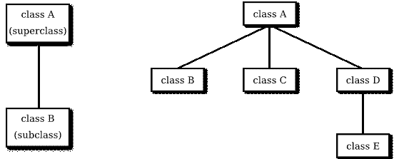

在 Java 中，要创建一个名为 `"B"` 的类作为名为 `"A"` 的类的子类，你可以写：

```java
class B extends A {
    .
    .  // 对从类 A 继承的内容进行添加和修改
    .
}
```

让我们来看一个例子。假设有一个程序需要处理车辆，包括汽车、卡车和摩托车。（这可能是一个由车辆交通管理局用于跟踪注册情况的程序。）该程序可以使用名为 `Vehicle`（车辆）的类来表示所有类型的车辆。由于汽车、卡车和摩托车都是车辆的类型，它们将通过 `Vehicle` 类的子类来表示，如类层级图所示：

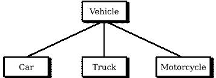

`Vehicle` 类将包含如 `registrationNumber`（注册号）和 `owner`（所有者）等实例变量，以及如 `transferOwnership()`（所有权）等实例方法。这些是所有车辆共有的变量和方法。`Vehicle` 的三个子类——`Car`（汽车）、`Truck`（卡车）和 `Motorcycle`（摩托车）可以用于持有特定类型车辆的方法。`Car` 类可能会添加实例变量 `numberOfDoors`（门数），`Truck` 类可能有 `numberOfAxles`（轴数），而 `Motorcycle` 类可能会有一个布尔变量 `hasSidecar`（是否有边三车）。嗯，在理论上至少可以这样，尽管这可能会让车辆交通管理局的人们会笑出来。）这些类在 Java 程序中的声明大致如下（尽管它们可能被定义在不同的文件中，并声明为公有类）：

```java
class Vehicle {
   int registrationNumber;
   Person owner;  // (假设已经定义了一个 Person 类！)
   void transferOwnership(Person newOwner) {
       . . .
   }
   . . .
}

class Car extends Vehicle {
   int numberOfDoors;
   . . .
}

class Truck extends Vehicle {
   int numberOfAxles;
   . . .
}

class Motorcycle extends Vehicle {
   boolean hasSidecar;
   . . .
}
```

假设 `myCar` 是一个类型为 `Car` 的变量，已通过以下语句声明并初始化：

```java
Car myCar = new Car();
```

给定此声明，程序可以引用 `myCar.numberOfDoors`，因为 `numberOfDoors` 是 `Car` 类中的实例变量。但由于 `Car` 类继承了 `Vehicle` 类，汽车也拥有车辆的所有结构和行为。这意味着 `myCar.registrationNumber`、`myCar.owner` 和 `myCar.transferOwnership()` 同样存在。

现在，在现实世界中，汽车、卡车和摩托车实际上都是车辆。程序中也是如此。也就是说，类型为 `Car` 或 `Truck` 或 `Motorcycle` 的对象自动也是类型为 `Vehicle` 的对象。这引出了以下这一重要事实：

**可以持有 A 类对象引用的变量，也可以持有属于 A 的任何子类的对象的引用。**

这在我们例子中的实际效果是，类型为 `Car` 的对象可以赋值给类型为 `Vehicle` 的变量。也就是说，这样说是合法的：

```java
Vehicle myVehicle = myCar;
```

甚至：

```java
Vehicle myVehicle = new Car();
```

在执行这两个语句中的之后，变量 `myVehicle` 持有一个 `Vehicle` 对象的引用，该对象恰好是子类 `Car` 的实例。该对象“记得”它实际上是一个 `Car`，而不仅仅是一个 `Vehicle`。对象的实际类信息是作为对象的一部分存储的。甚至可以使用 `instanceof` 运算符来测试给定的对象是否属于给定的类。测试语句：

```java
if (myVehicle instanceof Car) ...
```

确定由 `myVehicle` 所指的对象实际上是一辆汽车。

另一方面，赋值语句：

```java
myCar = myVehicle;  // 错误！
```

将是非法的，因为 `myVehicle` 可能指向其他不是汽车的车辆类型。这与我们之前在 2.5.6 节 中看到的问题类似：计算机不允许你将一个 `int` 值赋值给 `short` 类型的变量，因为不是每个 `int` 都是 `short`。同样，它不允许你将 `Vehicle` 类型的值赋值给 `Car` 类型变量，因为不是每辆车都是汽车。与 `ints` 和 `shorts` 的情况一样，这里的解决方案是使用类型转换。如果由于某种原因，你知道 `myVehicle` 确实指向一个 `Car`，你可以使用类型转换 `(Car)myVehicle` 来告诉计算机将 `myVehicle` 视为实际上是 `Car` 类型。所以，你可以说：

```java
myCar = (Car)myVehicle;
```

你甚至可以引用 `((Car)myVehicle).numberOfDoors`。（由于优先级的原因，括号是必要的。`.` 的优先级高于类型转换，所以 `(Car)myVehicle.numberOfDoors` 将被读为 `(Car)(myVehicle.numberOfDoors)`，这尝试将 `int` 类型 `myVehicle.numberOfDoors` 强制转换为 `Vehicle`，这是不可能的。）

作为一个如何在程序中使用此用法的示例，假设你想打印关于 `myVehicle` 所指的 `Vehicle` 的相关数据。如果它是 `Car`，你想打印汽车的 `numberOfDoors`，但你不能说 `myVehicle.numberOfDoors`，因为 `Vehicle` 类中没有 `numberOfDoors`。但你可以说：

```java
System.out.println("Vehicle Data:");
System.out.println("Registration number:  " + myVehicle.registrationNumber);
if (myVehicle instanceof Car) {
   System.out.println("Type of vehicle: Car");
   Car myCar;
   myCar = (Car)myVehicle;  // 类型转换以访问 numberOfDoors!
   System.out.println("Number of doors: " + myCar.numberOfDoors);
}
else if (myVehicle instanceof Truck) {
   System.out.println("Type of vehicle: Truck");
   Truck myTruck;
   myTruck = (Truck)myVehicle;  // 类型转换以访问 numberOfAxles!
   System.out.println("Number of axles: " + myTruck.numberOfAxles);
}
else if (myVehicle instanceof Motorcycle) {
   System.out.println("Type of vehicle: Motorcycle");
   Motorcycle myCycle;
   myCycle = (Motorcycle)myVehicle;  // 类型转换以访问 hasSidecar!
   System.out.println("Has a sidecar: " + myCycle.hasSidecar);
}
```

注意，对于对象类型，当计算机执行程序时，会检查类型转换是否有效。例如，如果 `myVehicle` 指向 `Truck` 类型的对象，那么 `(Car)myVehicle` 将无效。这种检查是在运行时进行的，而不是编译时，因为在编译时不知道对象的实际类型。上述代码通过使用 `instanceof` 避免了 `ClassCastException`。

在 Java 17 中，之前的示例可以使用更晦涩的语言特性——即 `instanceof` 的模式匹配来编写。模式匹配允许在 `instanceof` 测试中包含变量的声明和初始化。例如：

```java
if (myVehicle instanceof Car myCar) {
    System.out.println("Type of vehicle: Car");
    System.out.println("Number of doors: " + myCar.numberOfDoors);
}
```

如果测试成功，则变量 `myCar` 被创建并自动赋值为 `(Car)myVehicle`。该变量的作用域仅限于 if 语句体。

### 5.5.4 多态

作为另一个例子，考虑一个处理屏幕上绘制形状的程序。假设形状包括矩形、椭圆形和各种颜色的圆角矩形。（roundrect 只是带圆角的矩形。）

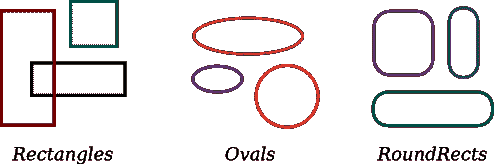

可以使用三个类 `Rectangle`、`Oval` 和 `RoundRect` 来表示这三种形状。这三个类有一个共同的父类 `Shape`，用于表示所有形状共有的特征。`Shape` 类可以包含表示形状颜色、位置和大小的实例变量，并包含用于更改这些属性值的实例方法。更改颜色，例如可能涉及更改实例变量的值，然后用新颜色重新绘制形状：


```
class Shape {

    Color color; // (必须从包 java.awt )

    void setColor(Color newColor) {
          // 改变形状颜色的方法。
       color = newColor; // 改变实例变量的值
       redraw(); // 重绘形状，将以新颜色显示
    }

    void redraw() {
          // 绘制形状的方法
       ? ? ?  // 这里应该放什么命令？
    }

    . . .          // 更多实例变量和方法

} // 类 Shape 结束
```

现在，你可能会发现`redraw()`方法存在一个问题。问题在于，每种不同类型的形状的绘制方式都是不同的。`setColor()`方法可以被任何类型的形状调用。当计算机执行`setColor()`方法中的`redraw()`命令时，它是如何知道绘制哪种形状的呢？非正式地说，我们可以回答这个问题：计算机通过要求形状重绘其*自身*（itself）来执行`redraw()`。每个形状对象都自己它要重绘自己需要做什么。

在实践中，这意味着每个具体的形状类都有它们自己的`redraw()`方法：

```
class Rectangle extends Shape {
   void redraw() {
      . . .  // 绘制矩形的命令
   }
   . . . // 可能有更多的方法和变量
}

class Oval extends Shape {
   void redraw() {
      . . .  // 绘制椭形的命令
   }
   . . . // 可能有更多的方法和变量
}

class RoundRect extends Shape {
   void redraw() {
      . . .  // 绘制圆矩形的命令
   }
   . . . // 可能有更多的方法和变量
}
```

假设`someShape`是一个`Shape`类型的变量。那么它可能指向`Rectangle`、`Oval`或`RoundRect`等任何类型的对象。随着程序的执行，`someShape`的值可能会变化，它甚至会指向不同类型的对象！每当语句

```
someShape.redraw();
```

执行时，实际调用的`redraw`方法是适用于`someShape`所指向的对象类型的。通过查看程序代码，可能无法判断该语句将绘制什么形状，因为它取决于程序执行时`someShape`实际拥的值。事实如此，假设该语句在一个循环中并执行了多次。如果循环执行时`someShape`的值发生了变化，那么同一个语句`"someShape.redraw();"`将调用不同的方法并绘制不同种形状。我们说`redraw()`方法是多态的。如果一个方法执行的操作取决于应用方法的对象的实际类型，它就是多态。多态是面向对象编程的重要特征之一。如果我们有一个形状数组，假设`shapelist`是一个`Shape[]`类型并且已经填充了数据。数组中的某些元素可能是`Rectangles`，可能是`Ovals`，可能是`RoundRects`。我们可以通过以下语句绘制数组中的所有形状：

```
for (int i = 0; i < shapelist.length; i++ {
    Shape shape = shapelist[i];
    shape.redraw();
}
```

随着计算机遍历这个循环，`shape.redraw()`语句有时绘制矩形，有时绘制椭圆，有时绘制圆矩，这取决于数组元素`i`所指向的对象类型。

如果我们稍微改变术语，可能会变得更容易理解：在面向对象编程中，调用方法通常被视为向对象发送消息。对象通过执行相应的方法来响应消息。`"someShape.redraw();"`语句是发送给`someShape`所指向的对象的消息。由于该对象知道自己是什么类型，它知道该如何响应消息。从这个观点来看，计算机总是以相同的方式执行`"someShape.redraw();"`：即通过发送消息。对消息的响应自然取决于接收者。从这个观点来看，对象是发送和接收消息的活动实体，多态是这种观点中自然且必要的一部分。多态仅仅意味着不同的对象以不同的方式响应同一个消息。

多态最神奇的地方之一是，它让你编写的代码实现了你编写时甚至没有考虑的事情。假设我决定为程序处理的形状类型添加圆矩形。圆矩形的每个角都被切掉了：

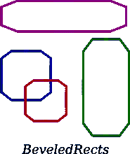

为了实现圆矩形，我可以编写`Shape`类的新子类`BeveledRect`，并赋予它自己的`redraw()`方法。自动，我之前编写的代码（例如`someShape.redraw()`语句）现在可以开始绘制圆矩形，尽管编写该语句时圆矩形类还不存在！

*** *

在语句`"someShape.redraw();"`中，`redraw`消息被发送给了对象`someShape`。回来看`Shape`类中改变形状颜色的方法：

```
void setColor(Color newColor) {
   color = newColor; // 改变实例变量的值
   redraw(); // 重绘形状，将以新颜色显示
}
```

这里发送了一个`redraw`消息，但它是发送给哪个对象的呢？嗯，`setColor`方法本身就是发送给某个对象的消息。答案是，`redraw`消息发送给了同一个对象，即接收`setColor`消息的那个对象。如果该对象是矩形，它就包含一个绘制矩形的`redraw()`方法，执行的就是它。如果对象是椭圆，那么执行的就是`Oval`类中的`redraw()`方法。这是预期，但这意味着`setColor()`方法中的`"redraw();"`语句并不一定调用`Shape`类中的方法！执行的方法可以在`Shape`的任何子类中。这只是多态的另一个案例。

*** *

### 5.5.5 抽象类

当`Rectangle`、`Oval`或`RoundRect`对象必须绘制自己时，执行的是相应类中的`redraw()`方法。这留下了一个问题：`Shape`类中的`redraw()`方法是做什么的？它应该如何定义？

答案可能是出乎意料的：我们应该留空它！事实上，`Shape`类代表形状的抽象概念，没有办法可以画出这样的东西。只有具体的形状（如矩形和椭圆）才能被绘制。那么，为什么`Shape`类中甚至有一个`redraw()`方法呢？嗯，它必须在那里，否则在`Shape`类的`setColor()`方法中调用它是非法的，编写`someShape.redraw();`也是非法的。编译器会抱怨`someShape`是一个`Shape`类型的变量，且`Shape`类中没有`redraw()`方法。

同样，我们说`Shape`类中的`redraw()`方法是一个抽象方法，因为它从根本上就不打算被调用。事实上，它无事可做——任何实际的重绘都是由`Shape`子类中的`redraw()`方法完成的。`Shape`中的`redraw()`方法必须存在。但它的存在仅仅是为了告诉计算机，所有的`Shapes`都能理解`redraw`消息。作为一个抽象方法，它的存在仅仅是为了指定所有子类中实际的、具体的`redraw()`版本的公共接口。`Shape`类中的抽象`redraw()`没有理由包含任何代码。

`Shape`及其它的`redraw()`方法在语义上是抽象的。你也可以通过在它们的定义中添加修饰符`"abstract"`，在语法上告诉计算机它们是抽象的。对于抽象方法，原本提供普通方法实现的代码块被分号所取代。那么，在抽象类的任何一个具体子类中，必须为该抽象方法提供一个实现。以下是`Shape`类作为抽象类时的样子：

```
public abstract class Shape {

    Color color;   // 形状的颜色。 

    void setColor(Color newColor) {
          // 改变形状颜色的方法
       color = newColor; // 修改实例变量的值
       redraw(); // 重绘形状，它将以新颜色出现
    }

    abstract void redraw();
          // 抽象方法——必须在
          // 具体子类中定义

    . . .  // 更多实例变量和方法

} // Shape 类结束
```

一旦你声明该类为抽象类，那么尝试创建`Shape`类型的实际对象就是非法的，如果你尝试这样做，计算机将报告语法错误。

顺便提一下，上面讨论的`Vehicle`类可能也是一个抽象类。你无法拥有一辆这种（抽象）车辆——实际的车辆必须是汽车、卡车、摩托车，或者其他某种“具体”类型的车辆。

* * *

回想第 5.3.2 节，如果一个类没有被显式声明为某个其他类的子类，它将自动成为标准类`Object`的子类。也就是说，一个没有`"extends"`部分的类声明，例如

```
public class myClass { . . .
```

完全等同于

```
public class myClass extends Object { . . .
```

这意味着类`Object`位于一个巨大的类层次结构的顶端，包含了所有其他类。（语义上，`Object`是一个抽象类，事实上它是所有类中最抽象的类。奇怪的是，它在语法上并没有被声明为抽象类，这意味着你可以创建`Object`类型的对象。然而，用它们能做的事情不多。）

由于每个类都是`Object`的子类，类型为`Object`的变量可以引用任何类型的任何对象。同样，类型为`Object[]`的数组可以持有任何类型的对象。

* * *

示例源码文件`[ShapeDraw.java](https://math.hws.edu/eck/cs124/javanotes9/source/chapter5/ShapeDraw.java)`使用了一个抽象`Shape`类和一个类型为`Shape[]`的数组来存放形状列表。你可能想看看这个文件，尽管你现在还理解它的全部。即使是形状类的定义与我在本节中描述的也有所不同。（例如，`draw()`方法有一个类型为`Graphics`的参数。需要这个参数是因为 Java 中所有的绘制都需要一个图形上下文。）当你了解更多关于 GUI 编程后，我会在后面的章节中返回类似的示例。不过，查看源码中`Shape`类及其子类的定义仍然是有值的。你也可以检查如何使用数组来持有形状列表。这里是程序的一个缩放截图：

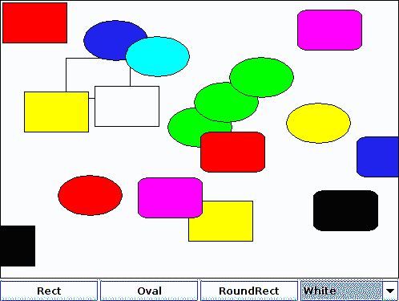

如果你运行`ShapeDraw`程序，可以点击底部的一个按钮向图片添加一个形状。新形状将出现在绘制区域的左上角。形状的颜色由绘制区域下方的颜色弹出菜单提供。一旦形状出现在屏幕上，你就可以用鼠标拖动它。即使在你正在拖动时，形状相对于屏幕上其他形状的层级顺序也会保持不变。然而，如果你在点击它时按住 Shift 键，你可以将该形状移动到所有其他形状之前。

在程序中，使用形状实际类的唯一时刻是该形状被添加到屏幕时。一旦形状被创建，它就完全作为一个抽象形状来被操作。例如，实现拖拽的程序处理的是类型为`Shape`的变量，并且没有引用任何一个子类。当形状被拖动时，拖动程序会在每次需要绘制形状时调用形状的`draw`方法，因此它不需要知道如何绘制形状，甚至不需要知道它是什么类型的形状。对象自己负责绘制自己。如果我想给程序添加一种新类型的形状，我将定义`Shape`的一个新子类，添加另一个按钮，并编写该按钮将正确类型的形状添加到屏幕上。编程中不需要进行其他更改。

* * *

### 5.5.6 最终方法与类

我们已经看到`final`修饰符如何应用于变量：它使得变量在初始化后无法赋予新值。（对于 final 变量，初始化可以在构造函数中完成。）然而，`final`修饰符也可以应用于类和方法定义。

一个 final 类不能作为创建子类的基础。也就是说，如果一个类被定义为`final class A...`，那么用`class B extends A...`扩展它将是语法错误。

如果一个方法在一个类中被声明为`final`，那么其子类不能包含相同签名的方法。也就是说，该方法不能被重写。这对于静态方法和实例方法都是如此。注意，在 final 类中，所有方法都是隐式 final 的。

当你使用像`amount`或`process()`这样的简单标识符引用变量或方法时，这意味着什么？答案取决于作用域规则，这些规则规定了程序中每个声明的变量和方法在何时以及如何可以被访问。在方法的定义内部，如果存在“在作用域内”的局部变量或参数，简单的变量名可能会指向该变量，即该变量的声明在源代码中引用发生点处是有效的。如果没有，它则必须引用引用发生处所属类的成员变量。同样，简单的方法名必须引用同一类中的一个方法。

### 静态成员

类的`static`成员有一个简单名称，该名称只能在类定义内部使用；若要在类外部使用，它具有形式为`class-name.simple-name`的全限定名。例如，`Math.PI`是`Math`类中一个简单名称为`PI`的静态成员变量。使用静态成员的全限定名总是合法的，即使在定义它的类内部也是如此。有时甚至是有必要的，例如当静态成员变量的简单名称被同名的局部变量或参数所遮蔽时。

### 实例成员

实例变量和实例方法也有简单名称。此类实例成员的简单名称可以在定义该成员的类的实例方法中使用（但不能用于静态方法）。实例成员也有全限定名——但请记住，实例变量或实例方法实际上包含在对象而不是类中，且每个对象都有自己的版本。实例成员的全限定名以包含该实例成员的对象的引用开头。例如，如果`std`是一个指向`Student`类型对象的变量，那么`std.test1`就可以作为该对象中名为`test1`的实例变量的全限定名。

但当我们在类内部工作并使用简单名称引用如`test1`这样的实例变量时，包含该变量的对象在哪里呢？这个谜题的答案很简单：假设在某个实例方法的定义中出现了对 "test1" 的引用。该方法是类型为`Student`的某个特定对象的一部分。当该方法执行时，名称 "test1" 的出现指向该相同对象中的`test1`变量。（这就是为什么实例成员的简单名称不能在静态方法中使用——当静态方法被执行时，它不属于任何对象，因此视野内没有实例成员！）

### `this` 变量

这为在定义的同一类内部使用实例成员的全限定名留下了问题。我们需要一种方式来引用“包含此方法的对象”。Java 专门为此此目的定义了一个名为`this`的特殊变量。变量`this`可以在实例方法的源代码中使用，以引用包含该方法的对象。 "this" 这个名称的意图是引用“这个对象”，即当前方法所处的那个对象。如果`var`是与方法在同一个对象中的实例变量，那么`this.var`就是该变量的全限定名。如果`otherMethod()`是同一个对象中的实例方法，则可以使用`this.otherMethod()`来调用该方法。每当计算机执行实例方法时，它都会自动将变量`this`设置为指向该方法的对象。

（某些面向对象的语言使用 "self" 代替 "this"。在这里，对象被视为一个接收消息并通过执行某些操作做出响应的实体。从该实体的角度来看，如`self.name`这样的实例变量指的是实体自身的名称，这是实体本身的一部分。调用如`self.redraw()`这样的实例方法就像在说“发送给自己的消息：重绘！”）

这的一种常见用法是在构造函数中。例如：

```java
public class Student {

    private String name;  // 学生的名字。

    public Student(String name) {
         // 构造函数。创建一个指定名称的学生。
       this.name = name;
    }
      .
      .   // 更多变量和方法。
      .
}
```

在构造函数中，名为`name`的实例变量被一个也称为 "name" 的形式参数所遮蔽。然而，仍然可以通过其全限定名`this.name`来引用该实例变量。在赋值语句`this.name = name`中，右侧的 "name" 是形式参数，该形式参数的值被赋值给实例变量`this.name`。这被认为是可以接受的风格：没有必要为仅用于初始化实例变量的形式参数去想奇的新名称。你可以为参数和实例变量使用相同的名称。

`this`还有其他用途。有时，当你编写实例方法时，你可能需要将该方法的对象作为实际参数传递给子程序。在这种情况下，你可以使用`this`作为实际参数。例如，如果你想打印对象的字符串表示，可以说`System.out.println(this);`。或者你可以在赋值语句中将`this`的值赋给另一个变量。你可以将其存储在数组中。事实上，你可以对`this`执行任何你对任何其他变量可以做的事，但不能改变它的值。（将其视为 final 变量。）

### 5.6.2 特殊变量 super

Java 还定义了另一个名为 "super" 的特殊变量，用于实例方法的定义。变量`super`供子类使用。与`this`类似，`super`指向包含方法的对象。但它是“健忘”的。它忘记了对象属于你正在编写的那个类，而只记得它属于父类。其点在于，该类可以包含对父类的添加和修改。`super`并不了解这些任何添加或修改；它只能用于引用父类中的方法和变量。


假设你在正在编写的类中使用方法调用`super.doSomething()`。现在，`super`并不知道同类中的任何`doSomething()`方法。它只知道该类的父类，因此`super.doSomething()`代表尝试执行父类中名为`doSomething()`的方法。如果父类中没有此类方法，你将得到语法错误——即使在你正在编写的类中有一个`doSomething()`方法。

`super`存在是为了让你能够访问父类中被子类内容遮蔽的内容。例如，`super.var`始终指向父类中名为`var`的实例变量。这对于以下原因非常有用：如果一个类包含一个与其父类中的实例变量同名的实例变量，那么该类的对象实际上包含两个同名变量：一个是在类本身定义的，另一个是在父类定义的。子类中的变量并没有替换父类中的同名变量；它仅仅是遮蔽了它。可以使用`super`访问来自父类的变量。

当子类包含一个与其父类方法签名相同的实例方法时，父类中的方法以相同的方式被遮蔽。我们说子类中的方法覆盖（override）了父类的方法。然而，`super`仍然可以用于访问父类的方法。

`super`的主要用途是用一个扩展了继承方法行为的新方法来覆盖该方法，而不是完全替换该行为。新方法可以使用`super`调用父类中的方法，然后可以添加额外的代码以提供额外的行为。例如，假设你有一个包含`roll()`方法的`PairOfDice`类。假设你想要一个子类`GraphicalDice`来表示在计算机屏幕上画出来的一对骰子。`GraphicalDice`类中的`roll()`方法应该执行`PairOfDice`类中`roll()`方法所执行的所有工作。我们可以通过调用`super.roll()`来实现这一点，它会调用父类中的方法。但除此之外，`GraphicalDice`对象的`roll()`方法还需要重绘骰子以显示新值。`GraphicalDice`类可能像这样：

```
public class GraphicalDice extends PairOfDice {

    public void roll() {
            // 掷骰子，并重绘它们。
         super.roll();  // 调用 PairOfDice 的 roll 方法。
         redraw();      // 调用绘制骰子的方法。
    }
       .
       .  // 更多内容，包括 redraw() 的定义。
       .
}
```

请注意，即使你不知道该方法在父类中是如何实现的，这允许你扩展`roll()`方法的行为！

***

### 5.6.3 作为构造函数使用的 super 和 this

构造函数是不被继承的。也就是说，如果你扩展一个现有类来创建子类，父类中的构造函数不会成为子类的一部分。如果你在子类中需要构造函数，你必须从头开始定义新的。如果你不在子类中定义任何构造函数，计算机将为你生成一个不带参数的默认构造函数。

如果父类中有一个执行了许多必要工作的构造函数，这可能会成为一个问题。看起来你可能必须在子类中重复所有这些工作！如果你没有父类的源代码，甚至不知道它是如何实现的，这可能是一个非常严重的问题。如果父类中的构造函数使用了你在子类中无法访问的私有成员变量，这看起来像是一个无法解决的问题！

显然，对于这个问题必须有某种解决办法，而且确实有。它涉及到特殊变量`super`。作为构造函数中的第一条语句，你可以使用`super`调用父类中的构造函数。这种写法有点丑陋且具有误导性，而且它只能在一种特定情况下使用：看起来你像调用子程序一样调用`super`（尽管`super`并不是子程序，而且你无法以调用其他子程序的方式调用构造函数）。例如，假设`PairOfDice`类有一个接受两个整数作为参数的构造函数。考虑一个子类：

```
public class GraphicalDice extends PairOfDice {

     public GraphicalDice() {  // 此类的构造函数。

         super(3,4);  // 调用 PairOfDice
                              // 类的构造函数，参数为 3, 4。

         initializeGraphics();  // 执行针对 GraphicalDice
                                // 类特有的初始化。
     }
        .
        .  // 更多构造函数、方法、变量...
        .
}
```

`super(3,4);`语句调用了父类的构造函数。此调用必须是子类构造函数的第一行。请注意，如果你没有以这种方式显式地调用父类的构造函数，那么父类的默认构造函数（即不带参数的那个）将被自动调用。（如果父类中不存在这样的构造函数，编译器将认为这是一个语法错误。）

你可以以完全相同的方式使用特殊变量`this`来调用同一类中的另一个构造函数。也就是说，构造函数的第一行可以像是一个子程序调用，以`this`作为子程序名。结果是执行了同一类中另一个构造函数的体。这非常有用，因为可以让你避免在几个不同的构造函数中重复相同的代码。例如，考虑[MosaicCanvas.java](https://math.hws.edu/eck/cs124/javanotes9/source/chapter4/MosaicCanvas.java)，它在第 4.7 节中被间接使用。`MosaicCanvas`表示彩色矩形网格。它有一个带四个参数的构造函数：

```
public MosaicCanvas(int rows, int columns, 
                 int preferredBlockWidth, int preferredBlockHeight)
```

这个构造函数提供了几个选项并进行了大量的初始化。我想提供更用、选项更少的构造函数，但所有的初始化仍然必须完成。该类还包含这些构造函数：

```
public MosaicCanvas() {
    this(42,42);
}

public MosaicCanvas(int rows, int columns) {
    this(rows,columns,16,16);
}
```

这些构造函数每一个存在仅仅是为了调用另一个构造函数，同时为某些参数提供常值。例如，`this(42,42)`调用了这里列出的第二个构造函数，而该构造函数又调用了主要的四参数构造函数。这个主构造函数最终在所有情况下都会被调用，以便在每种情况下完成所有基本的初始化。

### 第 5.7 节：接口

***

某些面向对象的编程语言（如 C++）允许类扩展两个或多个父类。这被称为多重继承。例如，如图所示，类`E`显示具有`A`和`B`作为直接父类，而类`F`有三个直接父类。

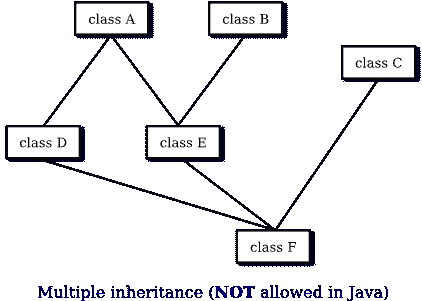

Java 不允许这种多重继承。Java 的设计者希望保持语言简单，认为多重继承的收益并不值得增加复杂性。然而，Java 有一个可以实现许多相同目标的特性：接口。我们在第 4.5 节中通过遇到过“函数式接口”。函数式接口指定单个方法。然而，接口可以比这复杂得多，并且有许多其他用途。

你可能在编写相当复杂的程序之前才需要编写自己的接口。然而，有几个接口在 Java 标准包中以重要的方式使用，你需要学习如何使用它们。

***

### 5.7.1 定义和实现接口

我们在其他语境下遇到过“接口”一词，与通用的黑盒，特别是子程序有关。子程序的接口由子程序的名称、返回类型以及参数的数量和类型组成。这是你想调用子程序时需要的信息。子程序还有实现：定义它并在调用时执行的代码块。

在 Java 中，`interface`是具有额外技术含义的关键字。这种意义上的“接口”由一组实例方法接口组成，没有任何实现。（实际上，Java 接口还可以包含其他内容，我们稍后会。）类通过为接口指定的每个方法提供实现来实现接口。这里有一个非常简单的 Java 接口示例：

```
public interface Strokeable {
   public void stroke(Graphics g);
}
```

这看起来非常像类定义，只是省略了`stroke()`方法的实现。实现接口`Strokeable`的类必须为`stroke()`提供实现。当然，类也可以包含其他方法和变量。例如，

```
public class Line implements Strokeable {
    public void stroke(Graphics g) {
        . . . // 执行某些操作——通常是画线
    }
    . . . // 其他方法、变量和构造函数
}
```

注意，要实现一个接口，类不能仅仅简单地为接口中的每个方法提供实现；它还必须`state`（声明）它实现了该接口，就像本示例所示使用关键字`implements`：“public class Line implements Strokeable”。任何实现`Strokeable`接口的具体类必须定义一个`stroke()`实例方法。从此类类创建的任何对象都包含一个`stroke()`方法。如果一个`object`属于一个实现了该接口的类，我们就说该对象实现了该接口。例如，类型为`Line`的任何对象都实现了`Strokeable`接口。

虽然一个类只能`extend`（继承）另一个类，但它可以`implement`（实现）任意数量的接口。事实上，一个类既可以继承另一个类，也可以实现一个或多个接口。因此，我们可以拥有这样的代码：

```
class FilledCircle extends Circle 
                        implements Strokeable, Fillable {
   . . .
}
```

这一切的意义在于，尽管接口不是类，但它们是非常相似的。接口非常像抽象类，也就是说，一种永远不能用于构造对象的类，但可以作为创建子类的基类。接口中的子程序是抽象方法，这些方法必须在实现接口的任何具体类中被实现。你可以将`Strokeable`接口与抽象类对比：

```
public abstract class AbstractStrokeable {
   public abstract void stroke(Graphics g);
}
```

主要的区别在于，继承`AbstractStrokeable`的类不能继承任何其他类，而实现`Strokeable`的类也可以继承某些类，并实现其他接口。当然，抽象类既可以包含非抽象方法也可以包含抽象方法。接口像是一个“纯”抽象类，它只包含抽象方法。

注意，在接口中声明的方法必须是`public`且`abstract`的。事实上，由于这是唯一的选择，在声明中没有指定这两个修饰符中的任何一个。

除了方法声明外，接口还可以包含变量声明。这些变量必须是“public static final”，并且在实现接口的每个类中实际上都变成了 public static final 变量。事实上，由于变量只能是 public、static 和 final，因此指定修饰符是可选的。例如：

```
public interface ConversionFactors {
    int INCHES_PER_FOOT = 12;
    int FEET_PER_YARD = 3;
    int YARDS_PER_MILE = 1760;
}
```

这是定义可以在多个类中使用的命名常量的方便方法。实现`ConversionFactors`的类可以使用接口中定义的常量，就像它们是定义在类中一样。

特别特别注意，在接口中定义的任何变量都是常量。它实际上不是变量。接口`cannot`（不能）为实现它的类添加实例变量。

接口可以扩展一个或多个其他接口。例如，如果`Strokeable`是上述接口，而`Fillable`是一个定义了`fill(g)`方法的接口，那么我们可以定义：

```
public interface Drawable extends Strokeable, Fillable {
    // (这里可以定义更多方法/常量)
}
```

实现`Drawable`的具体类必须为来自`Strokeable`的`stroke()`方法和来自`Fillable`的`fill()`方法提供实现，还要为`Drawable`接口中直接指定的任何抽象方法提供实现。

接口通常定义在自己的`.java`文件中，其文件名必须与接口的名称匹配。例如，`Strokeable`将定义在名为`Strokeable.java`的文件中。就像类一样，接口可以位于一个包中，并可以从其他包导入内容。

之前的讨论是关于接口的语法规则的。但当然，接口也有一个语义部分。也就是说，创建接口的人意图让它定义的方法具有特定的含义。接口定义应该包含注释来表达这种含义，实现该接口的类应该考虑这种含义。然而，Java 编译器只能检查语法；它无法强制执行含义。例如，实现`Strokeable`的对象的`stroke()`方法据认为是为了通过描边（stroking）它（即沿着其轮廓移动画笔）来绘制该对象的图形化表示，但编译器只能检查该对象中是否存在`stroke()`方法。

* * *

### 5.7.2 默认方法 (Default Methods)

从 Java 8 开始，接口可以包含默认方法。与接口中通常的抽象方法不同，默认方法具有实现。当一个类实现接口时，它不必为默认方法提供实现——尽管如果它想提供不同的实现，也可以这样做。本质上，默认方法从接口继承的方式与普通方法从类继承的方式非常相似。这让 Java 在某种程度上支持了多继承。然而，这并不是真正的多继承，因为接口仍然不能定义实例变量。默认方法可以调用在相同接口定义的抽象方法，但它们不能引用任何实例变量。

注意，函数接口除了指定的单个抽象方法外还可以包含默认方法。

接口中的默认方法必须标记有`default`修饰符。它可以可选地标记为`public`，但对于接口中的其他所有内容，默认方法自动是 public 的，可以省略 public 修饰符。这里有一个示例：

```
public interface Readable { // 表示输入源

    public char readChar(); // 从输入读取下一个字符

    default public String readLine() { 读取到换行符
        StringBuilder line = new StringBuilder();
        char ch = readChar();
        while (ch != '\n') {
            line.append(ch);
            ch = readChar();
        }
        return line.toString();
    }

}
```

实现此接口的具体类必须为`readChar()`提供实现。它将从接口继承`readLine()`的定义，但在必要时也可以提供新的定义。当类包含默认方法的实现时，类中提供的实现将覆盖接口的默认方法。

注意，默认的`readLine()`调用了抽象方法`readChar()`，后者的定义只会在实现类中提供。定义中对`readChar()`的引用是多态的。`readLine()`的默认实现对于几乎实现`Readable`的类都有意义。这里有一个实现`Readable`的类的相当荒的示例，包含一个测试该类的`main()`例程。你能猜出它是做什么的吗？

```
public class Stars implements Readable {

    public char readChar() {
        if (Math.random() > 0.02)
           return '*';
        else
           return '\n';
    }

    public static void main(String[] args) {
        Stars stars = new Stars();
        for (int i = 0 ; i < 10; i++ ) {
            String line = stars.readLine();  // 调用了默认方法！
            System.out.println( line );
        }
    }

}
```

默认方法为 Java 提供了类似于其他编程语言中“混入 (mixin)”的能力，即将另一个来源的功能混入类中的能力。由于一个类可以实现多个接口，因此可以从多个不同的来源混入功能。

### 5.7.3 接口作为类型

与抽象类一样，尽管你不能从接口构造对象，但你可以声明一个类型由接口给定的变量。例如，如果`Strokeable`是上面给接口，并且如果`Line`和`Circle`是实现`Strokeable`的类（如上所示），那么你可以说：


```java
Strokeable figure;  // 声明一个类型为 Strokeable 的变量。它
                    //    可以指向任何实现了
                    //    Strokeable 接口的对象。

figure = new Line();  // figure 现在指向一个 Line 类的对象
figure.stroke(g);     // 调用 Line 类中的 stroke() 方法

figure = new Circle();  // 现在，figure 指向一个
                        //   Circle 类的对象
figure.stroke(g);       // 调用 Circle 类中的 stroke() 方法
```

类型为 `Strokeable` 的变量可以指向实现 `Strokeable` 接口的任何类的任何对象。像上面 `figure.stroke(g)` 的语句是合法的，因为 `figure` 的类型是 `Strokeable`，而任何 `Strokeable` 对象都有一个 `stroke()` 方法。因此，无论 `figure` 指向哪个对象，该对象必须有一个 `stroke()` 方法。

注意，类型是用来声明变量的东西。类型还可用于指定子程序中参数的类型，或函数的返回类型。在 Java 中，类型可以是类、接口，或者八种内置原始类型之一。这些是所有的可能性（考虑到少数特殊情况，例如 `enum`，它被认为是一种特殊的类）。然而，在这些类型中，只有类可以被用来构造新对象。

接口也可以是数组的基类型。例如，我们可以使用数组类型 `Strokeable[]` 来声明变量并创建数组。数组的元素可以指向任何实现 `Strokeable` 接口的对象：

```java
Strokeable[] listOfFigures;
listOfFigures = new Strokeable[10];
listOfFigures[0] = new Line();
listOfFigures[1] = new Circle();
listOfFigures[2] = new Line();
  .
  .
  .
```

数组的每个元素都将拥有 `stroke()` 方法，因此我们可以说诸如 `listOfFigures[i].stroke(g)` 这样的话。

## 5.8 嵌套类

嵌套类是指定义在另一个类内部的类。嵌套类可以是静态的，也可以是非静态的。静态嵌套类类似于普通的顶层类，只是被定义在另一个类内部。静态嵌套类可以访问外部类的所有成员，但不能访问外部类的实例成员，除非它先持有一个该外部类的实例。静态嵌套类通常被用于将逻辑相关的类组合在一起。在 Java 中，静态嵌套类可以被用来组织代码分组。

### 5.8.1 静态嵌套类

静态嵌套类是指定义在另一个类内部的类。静态嵌套类看起来像普通的类，只是被定义在另一个类内部。静态嵌套类可以访问外部类的所有成员，但不能访问外部类的实例成员，除非它先持有一个该外部类的实例。静态嵌套类通常被用于将逻辑相关的类组合在一起。在 Java 中，它们可以被用来组织代码分组。静态嵌套类的全名是 `外部类.内部类`。

### 5.8.2 内部类

非静态嵌套类被称为内部类。内部类在实践中与静态嵌套类没有太大区别，但非静态嵌套类实际上与对象关联，而不是与定义它的类关联。这可能需要一些适应。

类的任何非静态成员都不是类本身的成员（尽管其源代码包含在类定义中）。对于内部类也是如此，正如类的任何其他非静态部分一样。类的非静态成员指定了从该类创建的对象将包含的内容。对于内部类，至少在逻辑上也是如此：似乎属于该类的每个对象都有该嵌套类的副本（尽管它并不真的包含该嵌套类的编译代码）。

在大多数情况下，内部类仅在定义它的类内部使用。如果是这样，使用内部类与使用任何其他类并没有太大区别。你可以像往常一样使用内部类的简单名称来创建变量和声明对象（尽管你只能在类的非静态部分这样做）。

然而，从包含类的外部，内部类必须使用形如 `variableName.NestedClassName` 的名称来引用，其中 `variableName` 是一个指向包含内部类的对象的变量。为了创建一个属于某个内部类的对象，你必须先拥有一个属于包含类的对象。（在类内部进行工作时，会隐式地使用对象 `this`。）

看一个例子将会有帮助，并希望能让你信服内部类确实是非常自然且合理的。考虑一个代表扑克牌游戏的类。该类可能包含一个嵌套类来表示游戏中的玩家。`PokerGame` 类的结构可以是：

```java
public class PokerGame {  // 代表一个扑克游戏。

    class Player {  // 代表该游戏中的玩家之一。
       .
       .
       .
    } // 结束类 Player

    private Deck deck;      // 用于游戏的牌牌组。
    private int pot;        // 下注的金额。

    .
    .
    .

} // 结束类 PokerGame
```

如果 `game` 是类型 `PokerGame` 的变量，那么从概念上讲，`game` 包含了它自己的 `Player` 类的副本。在 `PokerGame` 对象的实例方法中，可以通过说 `new Player()` 创建一个新的 `Player` 对象，就像对于任何其他类一样。（在 `PokerGame` 类外部可以使用形如 `game.new Player()` 的表达式来创建一个 `Player` 对象。同样，这非常罕见。）`Player` 对象将能够访问 `PokerGame` 对象中的 `deck` 和 `pot` 实例变量。每个 `PokerGame` 对象都有它们自己的 `deck`、`pot` 和 `Players`。该扑克牌游戏的玩家使用该游戏的 `deck` 和 `pot`；而另一个扑克牌游戏的玩家则使用另一个游戏的 `deck` 和 `pot`。这就是将 `Player` 类设为非静态的效果：它将任何 `Player` 对象与某个特定的 `PokerGame` 对象关联，并赋予其访问该特定游戏实例变量的权限。这是玩家行为的最自然方式。一个 `Player` 对象代表一个特定扑克牌游戏的玩家。另一方面，如果 `Player` 是一个独立类或 `static` 嵌套类，那么它代表的是扑克玩家的通用概念，独立于特定的扑克牌游戏。

***

### 5.8.3 匿名内部类

在某些情况下，你会发现自己写了一个内部类，然后在程序中仅在该行中使用了该类。创建这样一个类值得吗？确实，它是值得的，但对于这种情况，你可以选择使用匿名内部类。匿名类是通过 `new` 运算符的一种变体创建，格式如下：

```java
new superclass-or-interface(parameter-list) {
    methods-and-variables
}
```

此构造函数定义了一个新类，但没有给它命名。在运行时，它会创建一个属于该类的对象。这种形式的 `new` 运算符可以在任何可以使用普通 `new` 的语句中使用。该表达式的意图是创建一个：“属于某个类的一个新对象，该类与 `superclass-or-interface` 相同，但添加了这些 `methods-and-variables`”。其效果是在程序需要的地方创建一个唯一自定义的对象。

请注意，基于接口而不是类创建匿名类是可能的。在这种情况下，匿名类必须通过定义接口中声明的所有方法来实现该接口。如果使用接口作为基础，`parameter-list` 必须为空。否则，它可以包含父类中构造函数的参数。

目前，我们将看一个不太可能的例子。假设 `Drawable` 是一个定义如下的接口：

```java
public interface Drawable {
    public void draw(Graphics g);
}
```

假设我们想要一个 `Drawable` 对象，能够画出一个填充的、红色的、100 像素的正方形。与其定义一个新的、独立的类然后使用该类来创建对象，我们可以使用匿名类在一条语句中创建对象：

```java
Drawable redSquare = new Drawable() {
    public void draw(Graphics g) {
        g.setColor(Color.RED);
        g.fillRect(10, 10, 100, 100);
    }
};
```

然后 `redSquare` 指向一个实现了 `Drawable` 的对象，当它的 `draw()` 方法被调用时，会画出一个红色正方形。顺便说，语句末尾的分号不是类定义的一部分；它是每个声明语句末尾都要求的分号。

匿名类经常用于实际参数。例如，考虑以下简单方法，它在两个不同的图形上下文中绘制 `Drawable`：

```java
void drawTwice(Graphics g1, Graphics g2, Drawable figure) {
    figure.draw(g1);
    figure.draw(g2);
}
```

在调用此方法时，第三个参数可以使用匿名内部类创建。例如：

```java
drawTwice(firstG, secondG, new Drawable() {
    void draw(Graphics g) {
        g.fillOval(10, 10, 100, 100);
    }
});
```

当编译 Java 类时，每个匿名类都会产生一个独立的 `.class` 文件。如果主类名为 `MainClass`（例如），匿名类的名称将是 `MainClass$1.class`、`MainClass$2.class`、`MainClass$3.class`。

当然，在这个例子中，`Drawable` 是一个函数式接口，可以使用 lambda 表达式（4.5）来代替匿名类。最后的例子可以简单地写为：

```java
drawTwice(firstG, secondG, g -> g.fillOval(10, 10, 100, 100));
```

而 `redSquare` 可以定义为：

```java
Drawable redSquare = g -> {
    g.setColor(Color.RED);
    g.fillRect(10, 10, 100, 100);
};
```

这种方法的优点是不会创建额外的 `.class` 文件。然而，lambda 表达式只能用于函数式接口，而匿名类可以用于任何接口或类。

***

### 5.8.4 局部类与 Lambda 表达式

类可以定义在方法内部。这样的类被称为局部类。局部类只能在定义它的方法内部使用。然而，由局部类定义的对象可以在该方法外部使用。它可以作为方法的返回值返回，也可以作为参数传递给另一个方法。

这是可能的，因为属于类 `B` 的对象可以赋值给类型 `A` 的变量，只要 `B` 是 `A` 的子类，或者如果 `A` 是接口，只要类 `B` 实现了接口 `A`。例如，如果一个方法接受类型 `Drawable` 的参数（其中 `Drawable` 是上述接口），那么任何实现了 `Drawable` 的对象都可以作为参数传递给该方法。而且该对象可以通过局部类定义。

在本节之前的一个例子中，我们将一个类型为 `Drawable` 的自定义对象传递给 `drawTwice` 方法，该方法接收一个类型为 `Drawable` 的参数。在该例子中，该类是一个匿名内部类。局部类通常是匿名的，但并不是强制的。匿名类通常也是局部类，但同样并不是强制的。例如，匿名类可以用于定义全局变量的初始值。在这种情况下，匿名类没有被包含在任何方法内部，因此它不是局部的。

局部类的定义可以使用定义该类的子程序中的局部变量。它还可以使用该子程序的参数。然而，在局部类中使用此类变量和参数存在一个限制：局部变量或参数必须声明为 `final`，或者如果没有显式声明为 `final`，则它必须是“有效最终的”（effectively final）。

如果一个参数的值在子程序内部没有发生改变（包括在引用该参数的任何局部类中），则它是有效最终的。如果一个局部变量的值在初始化后从未改变过，则它是有效最终的。请注意，用于局部类定义中的全局变量没有这种限制。

对局部变量使用的相同限制也适用于 lambda 表达式，lambda 表达式与匿名类非常相似。这里有一个使用第 4.5.2 节中 `FunctionR2R` 函数式接口的示例，它定义了单方法 `double valueAt(double x)`。这段代码创建一个 `FunctionR2R` 对象的数组，其中 `multipliers[i]` 是一个将其参数乘以 `i` 的函数：

```java
FunctionR2R[] multipliers = new FunctionR2R[100];
for (int i = 0; i < 100; i++) {
    int n = i;
    multipliers[i] = z -> n * z;
}
```

局部变量 `n` 是有效最终的，因此可以在 lambda 表达式中使用。另一方面，直接在 lambda 表达式中使用变量 `i` 是非法的，因为 `i` 不是有效最终的；当执行 `i++` 时它的值会发生改变。

同样注意，这个示例可以使用匿名类代替 lambda 表达式来编写：

```java
FunctionR2R[] multipliers = new FunctionR2R[100];
for (int i = 0; i < 100; i++) {
    int n = i;
    multipliers[i] = new FunctionR2R() {
        public double valueAt(double x) {
            return n * x;
        }
    };
}
```

## 第 5 章编程练习

### 练习题 5.1


在第 5.2 节中所有版本的`PairOfDice`类中，实例变量`die1`和`die2`都被声明为`public`。它们实际上应该是`private`的，以便它们免受类外部的修改。编写另一个版本的`PairOfDice`类，其中实例变量`die1`和`die2`是`private`。你的类将需要“getter”方法来获取`die1`和`die2`的值。（其思想是保护它们的值不受类外部修改，但仍然允许读取这些值。）在类中包含其他改进，包括至少一个`toString()`方法。用一个短程序测试你的类，该程序计算掷骰子的次数，直到两个骰子的和等于二。

查看解答

---

### 练习题 5.2

一个常见的编程任务是计算一组数字的统计数据（统计量是总结数据集某些属性的数字）。常见的统计数据包括平均值（也称为平均数）和标准差（它告诉我们数据离平均值的程度）。我写了一个名为`StatCalc`的小类，可以计算这些统计数据，以及数据集中项目总和和项目数量。你可以在文件[StatCalc.java](https://math.hws.edu/eck/cs124/javanotes9/source/chapter5/StatCalc.java)中读取该类的源代码。如果`calc`是一个`StatCalc`类型的变量，则可以使用以下实例方法：

- `calc.enter(item)`其中`item`是一个数字，将该项目添加到数据。
- `calc.getCount()`是一个返回已添加到数据集的项目数量的函数。
- `calc.getSum()`是一个返回所有添加到数据集的项目项目总和的函数。
- `calc.getMean()`是一个返回所有项目平均值的函数。
- `calc.getStandardDeviation()`是一个返回项目标准差的函数。

通常，在数据可用时，通过反复调用`enter()`方法逐个添加所有数据。在输入所有数据后，可以调用任何其他方法来获取有关数据的统计信息。只有当项目数量大于零时，才应该调用`getMean()`和`getStandardDeviation()`方法。

修改源代码[StatCalc.java](https://math.hws.edu/eck/cs124/javanotes9/source/chapter5/StatCalc.java)以添加实例方法`getMax()`和`getMin()`。`getMax()`方法应该返回数据集中所有项目中的最大值，而`getMin()`应该返回最小值。你需要添加两个新的实例变量来跟踪到为止出现的最大和最小项目。

通过在程序中使用你的新类来测试，计算用户输入的一组非零数字的统计数据。从创建一个`StatCalc`类型的对象开始：

```
StatCalc  calc;   // 用于处理数据的对象。
calc = new StatCalc();
```

从用户读取数字并将其添加到数据集。使用`0`作为哨兵值。在输入所有非零数字后，打印来自`calc`的六项统计数据。

查看解答

---

### 练习 5.3

此问题使用了练习 1 中的`PairOfDice`类和练习 2 中的`StatCalc`类。练习 4 中的程序执行了掷骰子直到出现特定和的实验。它重复了 10000 次并报告了平均次数。

对每个可能的总和重做该练习。但不仅报告平均次数，还应该报告标准差和最大次数。使用`PairOfDice`对象表示骰子。使用`StatCalc`对象计算统计数据。（如果你愿意，可以使用新的骰子，但不是强制的。）

---

### 练习 5.4

第 5.5.1 节中的`BlackjackHand`类是第 5.4 节中`Hand`类的扩展。`Hand`的实例方法在该节中进行了讨论。除了这些方法外，`BlackjackHand`还包含一个实例方法`getValue()`，它返回黑牌的值。对于这个练习，你还需要第 5.4 节中的`Deck`和`Card`类。

黑牌通常包含二到六张牌。编写一个程序测试`BlackjackHand`类。你应该创建一个`BlackjackHand`对象和一个`Deck`对象。选取 2 到 6 之间的随机数。从牌中取出相应数量的牌并添加到手中。打印手中的所有牌，然后打印由`getAt()`计算的手值。只要用户想继续，就重复此操作。

除了[TextIO.java](https://math.hws.edu/eck/cs124/javanotes9/source/chapter5/textio/TextIO.java)外，你的程序还将依赖[Card.java](https://math.hws.edu/eck/cs124/javanotes9/source/chapter5/Card.java)、[Deck.java](https://math.hws.edu/eck/cs124/javanotes9/source/chapter5/Deck.java)、[Hand.java](https://math.hws.edu/eck/cs124/javanotes9/source/chapter5/Hand.java)和[BlackjackHand.java](https://math.hws.edu/eck/cs124/javanotes9/source/chapter5/BlackjackHand.java)。

编写一个程序让用户玩黑杰克（Blackjack）。该游戏是赌场中黑杰克游戏的简化版。计算机将扮演庄家。与之前的练习一样，你的程序需要定义在[Card.java](https://math.hws.edu/eck/cs124/javanotes9/source/chapter5/Card.java)、[Deck.java](https://math.hws.edu/eck/cs124/javanotes9/source/chapter5/Deck.java)、[Hand.java](https://math.hws.edu/eck/cs124/javanotes9/source/chapter5/Hand.java)以及[BlackjackHand.java](https://math.hws.edu/eck/cs124/javanotes9/source/chapter5/BlackjackHand.java)中的类。（这是目前为止练习中最长且最复杂的程序。）

你应该首先编写一个子程序，让用户玩一次游戏。该子程序应返回一个布尔值，表示用户是否赢了游戏。如果用户赢则返回`true`，如果庄家赢则返回`false`。程序需要一个`Deck`类的对象和两个`BlackjackHand`类型的对象，一个给庄家，一个给用户。黑杰克的通用目标是获得一组点数尽可能接近 21 但不超过 21 的牌。游戏流程如下：

- 首先，给每个玩家的手牌分发两张牌。如果此时庄家的手牌值为 21，则庄家获胜。否则，如果用户是 21，则用户获胜。（这被称为“黑杰克”）。注意，在平局时庄家获胜，因此如果两名玩家都是黑杰克，则由庄家获胜。
- 现在，如果游戏还没有结束，用户有机会向自己的手牌中添加一些牌。在这个阶段，用户可以看到自己的牌，并能看到庄家两张牌中的`one`张。（在赌场中，庄家会给自己发一张朝上的牌和一张背面的牌。用户所有的牌都是朝上的。）用户需要决定是“要牌”（Hit，即向手牌中添加另一张牌）还是“停止”（Stand，即停止拿牌）。
- 如果用户选择“要牌”，可能会导致点数超过 21。在这种情况下，游戏结束，用户输了。如果没有，则继续进行。用户再次决定是“要牌”还是“停止”。
- 如果用户选择“停止”，游戏将结束，但首先庄家获得抽牌的机会。庄家只遵循规则，没有任何选择。规则是：只要庄家的手牌的值小于或等于 16，庄家就“要牌”（即再拿另一张牌）。此时用户应该看到庄家所有的牌。现在可以确定胜负了：如果庄家超过 21，用户获胜。否则，如果庄家的总分大于或等于用户的总分，则庄家获胜。否则，用户获胜。

关于编程的两点说明：在子程序的任何时候，一旦你知道谁赢了，就可以执行`return true;`或`return false;`来结束子程序并返回主程序。为了避免在子程序中使用过多变量，请记住诸如`userHand.getBlackjackValue()`的函数调用可以用于任何可以使用数字的地方，包括输出语句或`if`语句的条件中。

编写一个主程序，让用户玩几次黑杰克游戏。为了增加趣味性，给用户 100 美元，并让用户在游戏中下注。如果用户输了，从用户的钱中扣除下注。如果用户赢了，向用户的钱中加上等于下注的金额。当用户想要退出或用完钱时，结束程序。

查看解决方案

---

### 练习 5.6

练习 4.8 要求你编写一个程序管理 10 道题的加法测验。重写该程序，使其使用以下类来表示加法题：

```java
public class AdditionQuestion {

    private int a, b;  // 题目中的数字。

    public AdditionQuestion() { // 构造函数
        a = (int)(Math.random() * 50 + 1);
        b = (int)(Math.random() * 50);
    }

    public String getQuestion() {
        return "What is " + a + " + " + b + " ?";
    }

    public int getCorrectAnswer() {
        return a + b;
    }

}
```

查看解决方案

---

### 练习 5.7

重写上一个练习中的程序，使其管理包含不同类型问题的测验。在上一个练习中，你使用一个类来表示加法题。对于这次练习，你将使用以下接口或等效的抽象类来表示以整数作为答案的更通用的问题概念：

```java
public interface IntQuestion {
    public String getQuestion();
    public int getCorrectAnswer();
}
```

你只需通过在定义中添加`implements IntQuestion`来让`AdditionQuestion`类实现该接口。编写一个类似的类来表示减法题。确保答案不是负数。使用`IntQuestion[]`数组来持有测验。包含一些加法题和减法题。你还可以添加一个匿名类定义的题目：

```java
IntQuestion bigQuestion = new IntQuestion() {
    public String getQuestion() {
        return "What is the answer to life, the universe, and everything?";
    }
    public int getCorrectAnswer() {
        return 42;
    }
};
```

查看解决方案

---

## 第五章测验

### 问题 1

面向对象编程使用类（classes）和对象（objects）。什么是类？什么是对象？它们之间的关系是什么？

### 问题 2

仔细解释 Java 中的`null`，以及为什么这个特殊值是必要的。

### 问题 3

什么是构造函数（constructor）？构造函数对类的作用是什么？

### 问题 4

假设`Kumquat`是一个类名，`fruit`是`Kumquat`类型的变量。语句`fruit = new Kumquat();`的含义是什么？执行此语句时做了什么？（尝试给出完整的回答。）

### 问题 5

实例变量（instance variable）和实例方法（instance method）这两个术语是什么意思？

### 问题 6

子类（subclass）和父类（superclass）这两个术语是什么意思？

### 问题 7

修改以下类，使实例变量为私有，并为每个实例变量提供一个 getter 方法和一个 setter 方法：

```java
public class Player {
   String name;
   int score;
}
```

### 问题 8

解释为什么之前定义的`Player`类有一个名为`toString()`的实例方法，尽管类定义中没有该方法的定义。

### 问题 9

解释多态性（polymorphism）一词。

### 问题 10

Java 使用垃圾回收（garbage collection）进行内存管理。解释这里的垃圾回收是指什么。垃圾回收的替代方案是什么？

### 问题 11

什么是抽象类（abstract class）？在 Java 中如何识别抽象类？

### 问题 12

这是什么？

### 问题 13

对于这个问题，你应该编写一个非常简单但完整的类。该类表示一个从 0, 1, 2, 3, 4.... 的计数器。类名应该是`Counter`。它有一个私有实例变量来表示计数值。它有两个实例方法：`increment()`将计数值加 1，`getValue()`返回当前的计数值。为`Counter`类编写一个完整的定义。

### 问题 14

这个问题使用了上一个问题中的`Counter`类。以下代码段旨在模拟抛掷 100 次硬币。使用两个`Counter`对象`headCount`和`tailCount`来统计正面和反面的次数。填空使程序能够实现目标：

```
Counter headCount, tailCount;
tailCount = new Counter();
headCount = new Counter();
for ( int flip = 0;  flip < 100;  flip++ ) {
   if (Math.random() < 0.5)    // 这里有 50/50 的概率使其为真。

       ______________________ ;   // 计数“正面”。

   else

       ______________________ ;   // 计数“反面”。
}

System.out.println("There were " + ___________________ + " heads.");

System.out.println("There were " + ___________________ + " tails.");
```

### 问题 15

解释为什么测试`if (obj.equals(null))`永远是不有意义的。

查看答案

---

# 第 6 章

## GUI 编程简介

如今的计算机用户期望使用图形用户界面（GUI）与计算机进行交互。Java 可用于编写复杂的 GUI 程序。

GUI 程序与你在本书前几章中遇到的传统“直通式”程序有所不同。一个很大的区别是 GUI 程序是事件驱动的。也就是说，用户点击按钮或按下键盘按键等操作会产生事件，程序必须在这些事件发生时对其做出响应。

事件驱动编程建立在你在本书前五章中学到的所有技能之上。你需要能够编写响应事件的方法。在这些方法内部，你正在进行在第 2 章和第 3 章中涵盖的微型编程。而且，对象在 GUI 编程中无处不在。事件是对象。颜色和字体是对象。按钮和菜单等 GUI 组件也是对象。事件由对象中的实例方法处理。在 Java 中，GUI 编程就是面向对象的编程。

本章涵盖 GUI 编程的基础。讨论将在第 13 章中继续，提供更多细节和更高级的技术。

本教材的此版本使用 Swing GUI 工具包进行 GUI 编程，它是 Java 的标准部分，并从 Java 2 起被包含在 JDK 中。另一个版本使用 JavaFX 代替 Swing。该版本可以在[`math.hws.edu/javanotes9`](https://math.hws.edu/javanotes9)找到。两个版本之间唯一显著的区别在于本章以及第 13 章。

---

### 第 6 章目录：

- 第 1 节：基础 GUI 应用
- 第 2 节：图形与绘制
- 第 3 节：鼠标事件
- 第 4 节：定时器、按事件和状态机
- 第 5 节：基础组件
- 第 6 节：基础布局
- 第 7 节：菜单、对话框和完整程序
- 编程练习
- 本章测试

## 6.1 节：基础 GUI 应用

你学习过编程的命令行程序对大多数计算机用户来说非常陌生。这种用户和计算机交替输入文本字符串的交互风格似乎像是计算早期的东西，尽管直到 80 年代中期，带有图形用户界面的家用计算机才开始出现。今天，大多数人完全通过 GUI 与计算机交互。GUI 程序提供了丰富得多的用户界面类型，用户使用鼠标和键盘与 GUI 组件（如窗口、菜单、按钮、复选框、文本输入框、滚动条等）进行交互。

GUI 程序仍然有一个`main()`子程序，但通常情况下，Swing 应用中的主程序只创建一个或多个 GUI 组件并将它们显示在计算机屏幕上。一旦 GUI 组件被创建，它们就会遵循`自己`的编程逻辑——即告诉它们如何在屏幕上绘制自己，以及如何响应诸如用户点击之类的事件。

GUI 程序并不非要极其复杂。例如，我们可以写一个非常简单的 GUI“Hello World”程序，向用户说“Hello”，但它是通过打开一个显示问候语的窗口来实现的：

```
import javax.swing.JOptionPane;

public class HelloWorldGUI1 {

   public static void main(String[] args) {
      JOptionPane.showMessageDialog( null, "Hello World!" );
   }
}
```


运行此程序时，屏幕上会出现一个包含“Hello World!”消息的窗口。该窗口还包含一个“OK”按钮，供用户在阅读消息后点击。当用户点击此按钮时，窗口关闭，程序结束。此程序可以放在命名为 [HelloWorldGUI1.java](https://math.hws.edu/eck/cs124/javanotes9/source/chapter6/HelloWorldGUI1.java) 的文件中，并编译并在命令行上使用`java`命令运行，就像其他任何 Java 程序一样。

现在，这个程序已经在做一些相当花哨的操作了。它创建一个窗口，绘制该窗口的内容，并处理当用户点击按钮时生成的事件。程序之所以写得如此简单，是因为所有工作都是由`showMessageDialog()`完成的，这是内置类的一个静态方法。（注意：代码通过`JOptionPane`类的简单名称来引用它。）

如果你想在 GUI 程序中向用户显示消息，这是一种很好的方法：只需使用已经知道如何执行的标准类。当然，如果你想在 GUI 程序中做任何严肃的事情，会有很多要学的。为了让你对涉及的类型有一个概念，我们将查看一个简短的 GUI 程序，它与之前的程序功能相同——打开包含消息和 OK 按钮的窗口，并通过点击按钮来结束程序——但它是手动完成所有这些，而不是使用`JOptionPane`类。请记住，这不是编写程序的好方法，但它将说明 GUI 编程的一些重要方面。

这是该程序的源代码。你不要求现在就理解它。我将在下方解释它是如何工作的，但还需要本章剩余的内容你才能真正完全理解。在本节中，你将只是对 GUI 编程有一个简要的概述。

```
import java.awt.*;
import java.awt.event.*;
import javax.swing.*;

public class HelloWorldGUI2 {

   private static class HelloWorldDisplay extends JPanel {
      public void paintComponent(Graphics g) {
         super.paintComponent(g);
         g.drawString( "Hello World!", 20, 30 );
      }
   }

   private static class ButtonHandler implements ActionListener {
      public void actionPerformed(ActionEvent e) {
         System.exit(0);
      }
   }

   public static void main(String[] args) {

      HelloWorldDisplay displayPanel = new HelloWorldDisplay();
      JButton okButton = new JButton("OK");
      ButtonHandler listener = new ButtonHandler();
      okButton.addActionListener(listener);

      JPanel content = new JPanel();
      content.setLayout(new BorderLayout());
      content.add(displayPanel, BorderLayout.CENTER);
      content.add(okButton, BorderLayout.SOUTH);

      JFrame window = new JFrame("GUI Test");
      window.setContentPane(content);
      window.setSize(250,100);
      window.setLocation(100,100);
      window.setVisible(true);

   }

}
```

* * *

### 6.1.1 JFrame 和 JPanel

在 Java GUI 程序中，界面上的每个 GUI 组件都由程序中的一个对象表示。组件最基本的类型之一是窗口。窗口有许多行为。它们可以被打开和关闭。它们可以调整大小。它们有显示在窗口上方标题栏中的“标题”。最重要的一点是，它们包含其他 GUI 组件，如按钮和菜单。

当然，Java 有一个内置的类来表示窗口。实际上有几种不同类型的窗口，但最常见的类型由`JFrame`类表示（该类位于`javax.swing`包中）。`JFrame`是一个独立的窗口，例如它可以作为应用程序的主窗口。需要理解的最重要点之一是，`JFrame`对象已经预设了许多窗口行为。特别是，它包含了所有窗口共享的基本属性，例如标题栏以及打开和关闭的能力。由于`JFrame`已经具备了这些行为，你不需要自己编写这些程序！这自然是面向对象编程的核心思想之一。当然，`JFrame`并不具备的是内容，即包含在窗口中的东西。如果你不向`JFrame`添加任何其他内容，它将只会显示一个空白区域——或者，如果你不设置它的尺寸，它会变得非常小，以至于很难在屏幕上找到。你可以通过创建一个`JFrame`对象并向其添加内容，或者通过创建一个`JFrame`的子类并在该子类的构造函数中添加内容来添加内容。

上面的主程序声明了一个类型为`JFrame`的变量`window`，并使用语句将其指向一个新的窗口对象：

```
JFrame window = new JFrame("GUI Test");
```

构造函数中的参数（字符串 "GUI test"）指定了将显示在窗口标题栏中的标题。这行代码创建了窗口对象，但窗口本身尚未在屏幕上可见。在让窗口可见之前，通过这些语句设置了它的某些属性：

```java
window.setContentPane(content);
window.setSize(250,100);
window.setLocation(100,100);
```

这里的第一行设置了窗口的内容。（内容本身在主程序稍些之前创建了。）第二行表示窗口宽为 250 像素，高为 100 像素。第三行表示窗口的左上角将距离屏幕左边缘 100 像素，距离顶部 100 像素。一旦完成了所有这些设置，就可以通过命令让窗口在屏幕上实际可见：

```java
window.setVisible(true);
```

程序似乎在那个点就结束了，事实上，`main()`程序确实结束了。然而，窗口仍然留在屏幕上，在用户点击 OK 按钮之前，整个程序都不会结束。一旦窗口打开，就会创建一个新线程来管理图形用户界面，该线程在`main()`完成后仍会继续运行。

* * *

显示在`JFrame`中的内容被称为它的内容面板（content pane）（除了内容面板之外，`JFrame`还可以有一个菜单栏，这是一个我将在之后讨论的内容。）一个基本的`JFrame`已经有一个空白的内容面板；你可以向该面板添加内容，也可以完全替换这个基础内容面板。在我的示例程序中，`window.setContentPane(content)`这一行将原始的空白内容面板替换为不同的组件。（记住，“组件”仅仅是图形用户界面的一个视觉元素。）在这种情况下，新内容是一个类型为`JPanel`的组件。

`JPanel`是 Swing 中的另一个基础类。基础的`JPanel`还是一个空白矩形。有两种方法可以创建一个实用的`JPanel`：第一种是**向面板中添加其他组件**；第二种是**在面板中绘制某些内容**。这两种技术在示例程序中都得到了演示。事实上，你会在程序中找到两个 JPanel：`content`用于包含其他组件，而`displayPanel`用作绘图表面。

让我们更仔细地观察`displayPanel`。这个变量的类型是`HelloWorldDisplay`，它是`HelloWorldGUI2`类内部的一个静态嵌套类。（嵌套类是在第 5.8 节中引入的。）该类只定义了一个实例方法`paintComponent()`，它重写了`JPanel`类中同名的方法：

```java
private static class HelloWorldDisplay extends JPanel {
   public void paintComponent(Graphics g) {
      super.paintComponent(g);
      g.drawString( "Hello World!", 20, 30 );
   }
}
```

当组件需要在屏幕上进行绘制时，系统会调用`paintComponent()`方法。在`JPanel`类中，`paintComponent`方法仅仅是将面板填充为面板的背景色。`HelloWorldDisplay`中的`paintComponent()`方法首先调用了`super.paintComponent(g)`。这调用了在父类`JPanel`中定义的`paintComponent()`版本；即将面板填充为背景色。（关于特殊变量`super`的讨论请参见第 5.6.2 节。）然后它调用`g.drawString()`将字符串 "Hello World!" 绘制到面板上。结果是，每当`HelloWorldDisplay`显示在屏幕上时，它都会显示 "Hello World!"。

我们经常这样使用 JPanel，作为绘图表面。通常，当我们这样做时，我们会定义一个继承`JPanel`的子类，并在该类中编写`paintComponent`方法来绘制面板所需的内容。JPanel 的子类可以定义为独立类，也可以是嵌套类。在简单的情况下，我倾向于使用嵌套类。

* * *

### 6.1.2 组件与布局

`JPanel`的另一种用法是作为容器来持有其他组件。Java 有许多定义 GUI 组件的类。除了窗口等顶层组件外，组件必须添加到容器中才能出现在屏幕上。在示例程序中，名为`content`的变量指向一个用作容器的`JPanel`。两个其他组件被添加到该容器中。这是通过语句实现的：

```java
content.add(displayPanel, BorderLayout.CENTER);
content.add(okButton, BorderLayout.SOUTH);
```

这些语句中的 "BorderLayout" 部分与这两个组件在容器中的排列方式有关。当组件被添加到容器时，必须有一种方式来决定这些组件在容器内部的排列方式。这被称为对容器中的组件进行“布局”，布局组件的最常用的技术是使用布局管理器（layout manager）。布局管理器是一个实现某种排列容器内组件策略的对象；不同类型的布局管理器实现不同的策略。一种类型的布局管理器由`BorderLayout`类定义。在程序中，语句

```java
content.setLayout(new BorderLayout());
```

创建一个新的`BorderLayout`对象，并告诉内容面板使用该对象作为其布局管理器。本质上，这行代码决定了添加到内容面板的组件在面板内部的排列方式。我们稍后会更详细地介绍布局管理器，但现在你只需要知道，将`okButton`添加到`BorderLayout.SOUTH`（南）位置会将按钮放置在面板底部，而将`displayPanel`置于`BorderLayout.CENTER`（中心）位置会让它填充任何未被按钮占据的剩余空间。

这个示例展示了设置 GUI 的通用技术：创建一个容器并为其分配一个布局管理器，创建组件并将它们添加到容器中，以及使用容器作为窗口的内容面板。容器本身也是一个组件，因此，添加到顶层容器的某些组件本身也是容器，它们有自己的布局管理器和组件。这使得以层级方式构建复杂的用户界面成为可能，即容器内嵌套容器，容器内嵌套容器……

* * *

### 6.1.3 事件与监听器

容器和组件的结构决定了 GUI 的物理外观，但它并没有说明 GUI 如何**运行**。也就是说，用户可以对 GUI 做什么，GUI 又将如何响应？GUI 在很大程度上是事件驱动的；也就是说，程序会等待由用户操作（或其他原因）产生的事件。当事件发生时，程序通过执行事件处理方法来做出响应。为了给 GUI 的行为编程，你必须编写事件处理方法来响应你感兴趣的事件。

Java 中处理事件最常用的技术是使用事件监听器。监听器是一个包含一个或多个事件处理方法的对象。当另一个对象（如按钮或菜单）检测到事件时，监听器对象会被通知，并通过运行相应的事件处理方法来响应。事件是由一个对象检测或生成的。另一个对象，即监听器，负责响应该事件。事件本身实际上是由第三个对象表示的，该对象携带了有关事件类型、发生时间等信息。这种职责分工使得组织大型程序变得更加容易。

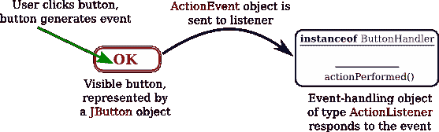

例如，考虑示例程序中的 OK 按钮。当用户点击按钮时，就会生成一个事件。该事件由属于`ActionEvent`类的对象表示。生成的事件与按钮相关；我们称按钮为事件的源。在这种情况下，监听器对象是一个属于`ButtonHandler`类的对象，它定义在`HelloWorldGUI2`内部类类：

```
private static class ButtonHandler implements ActionListener {
   public void actionPerformed(ActionEvent e) {
      System.exit(0);
   }
}
```

该类实现了`ActionListener`接口——这是处理按钮事件的监听器对象的要求。（接口是在第 5.7 节中引入的。）事件处理方法命名为`actionPerformed`，如`ActionListener`接口所指定的。该方法包含了用户点击按钮时执行的代码；在这种情况下，代码仅仅是对`System.exit()`的调用，它将终止程序。

要让事件从按钮传递到监听器对象，还需要一个要素：监听器对象必须在按钮处将自己注册为事件监听器。这是通过以下语句实现的：

```
okButton.addActionListener(listener);
```

这条语句告诉`okButton`，当用户点击按钮时，生成的`ActionEvent`应该发送给`listener`。如果没有这条语句，按钮就无法知道有东西想要监听来自按钮的事件。

这个示例展示了 GUI 行为编程的通用技术：编写包含事件处理方法的类。创建属于这些类的对象，并将它们注册为那些实际检测或生成事件对象的监听器。当事件发生时，监听器会收到通知，你在其中一个事件处理方法中编写的代码将被执行。起初，这看起来可能是一种非常迂回且复杂的操作方法，但随着经验的增加，你会发现它非常灵活，并且与面向对象的编程配合得非常好。

现在，事实上`ActionListener`是一个函数式接口，因为它只定义了一个方法，并且可以用于定义 lambda 表达式（参见第 4.5 节）。这意味着我们可以使用 lambda 表达式作为动作事件的处理器。在示例程序中，我们可以消除嵌套子类`ButtonHandler`和类型为`ButtonHandler`的变量`listener`，并通过语句设置事件处理：

```
okButton.addActionListener( e -> System.exit(0) );
```

参数`e`是必须的，尽管它的值没有被使用，因为`ActionListener`接口定义的函数需要一个参数。访问 [HelloWorldGUI3.java](https://math.hws.edu/eck/cs124/javanotes9/source/chapter6/HelloWorldGUI3.java) 查看使用此技术的完整程序。遗憾的是，lambda 表达式不能用于 Swing 中的所有事件处理，因为 Swing 中的大多数接口都不是函数式接口。

本节介绍了使用 Swing 进行 GUI 编程的一些基础知识。我们将在本章的剩余部分中详细探讨它们。

## 6.2 图形与绘制

* * *

你在计算机屏幕上看到的所有内容都必须画在那里，即使是文字。Java API 包含了一系列用于绘制的类和方法。在本节中，我将查看其中最基础的部分。部分材料已经在第 3.9 节中介绍过。

GUI 的物理结构由组件构建。组件术语指的是 GUI 中的视觉元素，包括按钮、菜单、文本输入框、滚动条、复选框等。在 Java 中，GUI 组件由属于`java.awt.Component`类子类的对象表示。Swing 工具包中的大多数组件（顶层组件如`JFrame`除外）属于`javax.swing.JComponent`子类，该类本身是`java.awt.Component`的子类。每个组件都负责绘制自己。如果你想使用标准组件，只需将其添加到程序中即可。你不需要担心在屏幕上绘制它，那会自动发生，因为它们已经知道如何绘制自己。

然而，有时你确实想在组件上绘制。当你想要显示不包含在标准定义组件类中的内容时，你就必须这样做。当你想要这样做时，你必须定义自己的组件类，并在该类中提供一个绘制组件的方法。当我需要这种绘制表面时，我总是使用`JPanel`的子类，就像我在上一节中示例 [HelloWorldGUI2.java](https://math.hws.edu/eck/cs124/javanotes9/source/chapter6/HelloWorldGUI2.java) 中的`HelloWorldDisplay`类中所做的那样。`JPanel`与任何`JComponent`一样，在方法中绘制其内容：

```
public void paintComponent(Graphics g)
```


要创建一个绘制表面，你应该定义`JPanel`的子类，并提供一个自定义的`paintComponent()`方法。创建一个属于该类的对象并在程序中使用它。当需要将你的组件绘制在屏幕上时，系统会调用它的`paintComponent()`来执行绘制。也就是说，你放入`paintComponent()`方法中的代码将在每当面板需要在屏幕上进行绘制时被执行；通过编写这个方法，你决定了将在面板中显示的图像。请注意，你不太可能去调用`paintComponent()`方法，这比调用`main()`例程程序的概率还要低。该方法是由系统调用的。你*编写*该方法是为了说明当系统调用它时会发生什么。

注意，`paintComponent()`方法有一个类型为`Graphics`的参数。当系统调用你的方法时，会提供一个`Graphics`对象。你需要这个对象来执行实际的绘制。在 Java 中进行任何绘制，都需要一个图形上下文（graphics context）。图形上下文是一个属于`java.awt.Graphics`类的对象。该类提供了用于绘制形状、文本和图像的实例方法。任何给定的`Graphics`对象只能绘制到一个位置。在本章中，该位置将始终属于某个`JPanel`子类的 GUI 组件。`Graphics`类是一个抽象类，这意味着无法通过构造函数直接创建图形上下文。实际上有两种方法可以获取用于在组件上绘制的图形上下文：首先，当然，当系统调用组件的`paintComponent()`方法时，该方法的参数就是用于在该组件上绘制的图形上下文。其次，每个组件都有一个名为`getGraphics()`的实例方法。该方法是一个返回图形上下文的函数，该上下文可以在组件的`paintComponent()`方法之外用于在组件上绘制。官方的说法是你*不应该*这样做，我几乎总是会避免这样做。但我发现在几个示例中使用`getGraphics()`是很方便的。（注意，如果`g`是用`getGraphics()`创建的图形上下文，那么在用完后调用`g.dispose()`是良好的做法。这会释放`g`可能持有的任何操作系统资源。）

`JPanel`类中的`paintComponent()`方法简单地是将面板填充为面板的背景色。在定义一个`JPanel`的子类作为绘制表面时，你通常希望在面板上绘制其他内容之前先用背景色填充面板（尽管如果方法中的绘制命令完全覆盖了组件的背景，则没有必要这样做）。这传统上是通过调用`super.paintComponent(g)`实现的，因此你编写的大多数`paintComponent()`方法将具有以下形式：

```
public void paintComponent(Graphics g) {
   super.paintComponent(g);
   . . . // 绘制组件的内容。
}
```

***

通常，组件应该在它的`paintComponent()`方法中执行所有的绘制操作。如果在某个其他方法的中间，你发现组件的内容需要更改，会怎样？你*不应该*直接调用`paintComponent()`来更改。相反，你必须通知系统组件需要重绘，并让系统通过调用`paintComponent()`来完成它的工作。你通过调用组件的`repaint()`方法来实现这一点。该方法

```
public void repaint();
```

定义在`Component`类中，因此可以与任何组件一起使用。你应该调用`repaint()`来通知系统组件需要重绘。重要的一点是，`repaint()`方法会立即返回，本身不执行任何绘制。系统将在处理完其他待处理事件（如果有的话）后，一旦有机会，就会*稍后*调用组件的`paintComponent()`方法。如果对`repaint()`的调用发生在非常短的时间跨度内，甚至可能许多`repaint()`调用将由一次`paintComponent()`调用处理。

注意，系统还可能因为其他原因调用`paintComponent()`。当组件首次出现在屏幕上时会调用它。当组件的大小发生变化时也会调用，这可能发生在用户调整包含组件的窗口时。这意味着`paintComponent()`应该能够根据需要重绘组件的完整内容。然而，你将看到的，我们的一些早期示例将无法做到这一点。

这意味着，为了正常工作，`paintComponent()`方法必须足够智能，以便随时正确地重绘组件。为了实现这一点，程序应该在其实例变量中存储有关组件状态的数据。这些变量应该包含完全重绘组件所需的所有信息。`paintComponent()`方法应该使用这些变量中的数据来决定绘制什么。当程序想要更改组件的内容时，不应仅仅绘制新内容。它应该更改相关变量的值并调用`repaint()`。当系统调用`paintComponent()`时，该方法将使用变量的新值，并绘制带有预期修改的组件。这看起来可能是一个很迂回的方法。为什么不直接绘制修改部分呢？至少有两个原因。首先，如果所有绘制都在一个方法中完成，事实确实会把事情办得更容易。其次，即使你可以直接绘制修改部分，你仍然需要保存足够的修改信息，以便`paintComponent()`能够根据需要正确地*重绘*组件。

在本章的剩余部分中，我们将通过示例看到这一切是如何运作的。现在，我们将在本节的剩余部分查看如何进行实际绘制。

***

### 6.2.1 坐标

计算机屏幕是由称为像素的小方块组成的网格。每个像素的颜色都可以单独设置，在屏幕上绘制意味着设置单个像素的颜色。

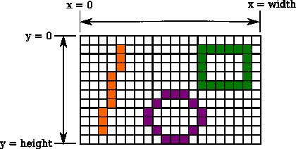

图形上下文在由像素组成的矩形内绘制。矩形中的位置由一对整数坐标`(x,y)`指定。左上角的坐标为`(0,0)`。`x`坐标从左到右增加，`y`坐标从上向下增加。插图显示了一个 20 像素 12 像素的组件（像素很大）。小线、矩形和椭圆以通过渲染单个像素绘制的方式显示。（注意，严格来说，坐标不属于像素，而是属于它们之间的网格线。）

对于任何组件，你都可以通过调用实例方法`getWidth()`和`getHeight()`来获取它所占据的矩形的大小，这两个方法分别返回水平方向和垂直方向的像素数。通常，假设你知道组件的大小并不是好主意，因为大小通常由布局管理器设置，如果组件位于窗口中且用户调整了窗口，大小可能会发生变化。这意味着在组件上进行任何绘制之前检查组件的大小是良好的做法。例如，你可以使用如下的`paintComponent()`方法：

```
public void paintComponent(Graphics g) {
   super.paintComponent(g);
   int width =  getWidth();   // Find 此组件的宽度。
   int height = getHeight();  // 它的高度。
   . . .   // 绘制组件的内容。
}
```

当然，你的绘图命令必须考虑到尺寸。也就是说，它们必须使用基于组件的实际高度和宽度计算出的`(x,y)`坐标。（不过，如果你确定知道尺寸，使用常量来表示宽度高度可以使绘图变得简单。）

***

### 6.2.2 颜色

在绘图时，你可能想要使用某种颜色。Java 设计上用于与 RGB 颜色系统工作。一个 RGB 颜色由三个数字指定，分别代表颜色中红、绿、蓝的色量。Java 中的颜色是`java.awt.Color`类的对象。你可以通过指定其红色、蓝色和绿色分量来构造新颜色。例如：

```
Color myColor = new Color(r,g,b);
```

你可以通过这种方式调用两个构造函数。在我几乎总是使用的那一个中，`r`、`g`和`b`是 0 到 255 之间的整数。在另一个中，它们是类型为`float`的数字，范围在`0.0F`到`1.0F`之间。（记住，`float`类型的字面量用`"F"`结尾，以将其与 double 数字区分开。）通常，你可以完全避免构造新颜色，因为`Color`类定义了几个表示常用颜色的命名常量：`Color.WHITE`、`Color.BLACK`、`Color.RED`、`Color.GREEN`、`Color.BLUE`、`Color.CYAN`、`Color.MAGENTA`、`Color.YELLOW`、`Color.PINK`、`Color.ORANGE`、`Color.LIGHT_GRAY`、`Color.GRAY`和`Color.DARK_GRAY`。（这些常量有旧的替代名称，使用小写而不是大写常量，例如使用`Color.red`而不是`Color.RED`，但大写版本，因为符合常量名应该是大写的约定。）

RGB 的替代方案是 HSB 颜色系统。在 HSB 系统中，颜色由三个称为色相（hue）、饱和度（saturation）和亮度（brightness）的数字指定。色相是基础颜色，范围从红色经过橙色到彩虹中的所有颜色。亮度顾如其名。完全饱和的颜色是纯色调。降低饱和度就像向纯色中混合白色或灰色颜料。在 Java 中，色相、饱和度和亮度始终由类型为`float`的值指定，范围从`0.0F`到`1.0F`。`Color`类不是构造函数，而是名为`getHSBColor`的静态成员函数来创建 HSB 颜色。要创建由`h`、`s`和`b`给出的 HSB 值的颜色，你可以说：

```
Color myColor = Color.getHSBColor(h,s,b);
```

例如，为了创建一个具有随机色相且尽可能亮和饱和的颜色，你可以使用：

```
Color randomColor = Color.getHSBColor( (float)Math.random(), 1.0F, 1.0F );
```

类型转换是必要的，因为`Math.random()`返回的值是`double`类型，而`Color.getHSBColor()`需要`float`类型的值。（顺便说一下，你可能会问为什么 RGB 颜色使用构造函数创建，而 HSB 颜色使用静态成员函数创建。问题在于，我们需要两个不同的构造函数，且它们都带有三个`float`类型的参数。遗憾的是，这是不可能的。只有当参数数量或参数类型不同时，你才能有两个构造函数。）

RGB 系统和 HSB 系统只是描述同一组颜色的不同方式。在两个系统之间进行转换是可能的。理解颜色系统的最好方法是对它们进行实验。（示例程序`SimpleColorChooser.java`允许你这样做。你现在不会理解源代码，但你可以运行它来玩玩颜色选择，或者找到你想要的颜色的 RGB 或 HSB 值。）

Java 还使得使用半透明（部分透明）颜色成为可能。透明度由第四个颜色分量给出，通常称为“alpha”分量。构造函数`new Color(r,g,b,a)`创建一个带有第四个参数以指定 alpha 分量的 RGB 颜色。透明度已经在第 5.3.3 节的示例中使用过了。

***

`Graphics`对象的属性之一是当前绘图颜色，它用于所有形状和文本的绘制。如果`g`是一个图形上下文，你可以使用方法`g.setColor(c)`更改`g`的当前绘图颜色，其中`c`是一个`Color`。例如，如果你想用绿色绘制，只需在绘制之前说`g.setColor(Color.GREEN)`。图形上下文将继续使用该颜色，直到你用另一个`setColor()`命令显式更改。如果你想知道当前的绘图颜色是什么，可以调用函数`g.getColor()`，它返回一个`Color`类型的对象。如果你想临时更改到另一种绘图颜色然后恢复之前的绘图颜色，这会很有用。

每个组件都有关联的前景颜色和背景颜色。通常，在绘制任何内容之前，组件会用背景颜色填充（尽管某些组件是“透明”的，这意味着背景颜色会被忽略）。当为组件创建新的图形上下文时，当前绘图颜色被设置为组件的前景颜色。注意前景颜色和背景颜色是组件的属性，而不是图形上下文的。

***

### 6.2.3 字体

字体代表特定的尺寸和样式。在 Java 中，字体由字体名、样式和大小定义。字体名称取决于系统，但你始终可以使用以下字符串：“Serif”、“SansSerif”、“Monospaced”和“Dialog”（衬线是字母底部的短线。SansSerif 意味着“无衬线”。Monospaced 意味着字体中的所有字符宽度相同。Dialog 字体是通常用于对话框的。）

字体样式使用`Font`类定义的命名常量指定。你可以指定样式为以下之一：

*   `Font.PLAIN`，
*   `Font.ITALIC`，
*   `Font.BOLD`，或
*   `Font.BOLD + Font.ITALIC`。

字体的大小是一个整数。尺寸通常从 9 到 36，但也可以更大的尺寸。字体的大小通常等于字体字符的高度，但这不是精确的规则。默认字体的大小为 12。

Java 使用`java.awt.Font`类来表示字体。你可以通过构造函数指定其字体名、样式和尺寸来构造新字体：

```
Font plainFont = new Font("Serif", Font.PLAIN, 12);
Font bigBoldFont = new Font("SansSerif", Font.BOLD, 24);
```

每个图形上下文都有当前字体，用于绘制文本。你可以使用`setFont()`方法更改当前字体。例如，如果`g`是一个图形上下文且`bigBoldFont`是一个字体，那么命令`g.setFont(bigBoldFont)`将`g`的当前字体设置为`bigBoldFont`。在`setFont()`命令之后绘制的任何文本将使用新字体。你可以通过调用方法`g.getFont()`获取`g`的当前字体，它返回一个`Font`类型的对象。

每个组件也有关联的字体。可以使用实例方法`component.setFont(font)`设置，该方法定义在`Component`类中。当为绘制创建图形上下文时，图形上下文的当前字体被设置为组件的字体。

***

### 6.2.4 形状

`Graphics`类包含了大量的实例方法，用于绘制各种形状，如直线、矩形和椭圆。这些形状使用上述描述的`(x,y)`坐标系进行指定。它们使用图形上下文的当前绘图颜色进行绘制。在创建图形上下文时，当前绘图颜色设置为组件的前景颜色，但可以使用`setColor()`方法随时进行更改。

一些绘图方法已经在第 3.9.1 节中列出。在这里，我将更详细地描述这些方法，并额外添加几个。在执行了所有这些绘制命令后，任何在组件边界之外进行的绘制都将被忽略。请注意，所有这些方法都在`Graphics`类中，因此它们必须通过类型为`Graphics`的对象来调用。在这里它显示为`g`，但当然，图形上下文的名称由程序员决定。

*   `g.drawString(String str, int x, int y)` — 绘制由字符串`str`给出的文本。字符串使用图形上下文的当前颜色和字体绘制。`x`指定字符串左端的 x 坐标。`y`是字符串基线的 y 坐标。基线是字符停留其上的水平线。字符某些部分（例如`y`或`g`的尾部）会延伸到基线以下。

*   `g.drawLine(int x1, int y1, int x2, int y2)` — 从点`(x1,y1)`到点`(x2,y2)`绘制一条线。线条的绘制方式就像用一支笔，该笔从笔所在的`(x,y)`点向右延伸一个像素，向下延伸一个像素。例如，如果`g`指向类型为`Graphics`的对象，那么命令`g.drawLine(x,y,x,y)`（对应于笔落在某一点）将左上角位于点`(x,y)`的单个像素上色。请记住，坐标实际上指的是像素之间的线段。

*   `g.drawRect(int x, int y, int width, int height)` — 绘制矩形的轮廓。左上角位于`(x,y)`，矩形的宽度和高度如指定。如果宽度等于高度，则矩形为正方形。如果宽度或高度为负数，则不绘制任何内容。矩形使用与`drawLine()`相同的笔绘制，该笔会为几何线右侧和下方的一个像素上色。这意味着绘制的矩形的实际宽度为`width+1`，因为绘制超出了矩形的右边缘一个像素，高度方向也是如此。例如，如果你想在组件边缘周围绘制一个矩形，你可以说`"g.drawRect(0, 0, getWidth()-1, getHeight()-1);"`。如果你使用`"g.drawRect(0, 0, getWidth(), getHeight());"`，那么矩形的右边缘和底边缘将在组件之外绘制，且不会显示在屏幕上。

*   `g.drawOval(int x, int y, int width, int height)` — 绘制椭圆的轮廓。该椭圆恰好拟合在`x, y, width, height`指定的矩形内。如果宽度等于高度，则椭圆为圆。

*   `g.drawRoundRect(int x, int y, int width, int height, int xdiam, int ydiam)` — 绘制圆角矩形的轮廓。基础矩形由`x, y, width`和`height`指定，但角是圆的。圆角的程度由`xdiam`和`ydiam`指定。角是水平直径为`xdiam`垂直直径为`ydiam`的椭圆的弧。`xdiam`和`ydiam`的典型值为 16，但所使用的值实际上取决于矩形的大小。

*   `g.draw3DRect(int x, int y, int width, int height, boolean raised)` — 绘制一个具有三维效果的矩形轮廓，仿佛它从屏幕凸起或推入屏幕中。基础矩形由`x, y, width`和`height`指定。`raised`参数告诉矩形看起来是从屏幕凸起还是推入屏幕。3D 效果通过对矩形的不同边缘使用更亮和更深色的绘图颜色来实现。文档建议在使用此方法之前将绘图颜色设置为与背景相同。该效果对于某些颜色可能无效。


- `g.drawArc(int x, int y, int width, int height, int startAngle, int arcAngle)` — 绘制恰好拟合在`x`、`y`、`width`、`height`指定的矩形内的椭圆部分。绘制的部分是一个弧，从`startAngle`度的起始角度开始延伸`arcAngle`度。角度以 3 点钟位置（水平轴的正方向）为 0 度测量。正角从 0 度逆时针测量，负角顺时针测量。要得到一个圆形的弧，请确保宽度等于高度。
- `g.fillRect(int x, int y, int width, int height)` — 绘制一个填充的矩形。这填充了将由`drawRect(x,y,width,height)`绘制的矩形内部。底部和右边缘的额外像素不包含内；填充的是精确的几何矩形。`width`和`height`参数给出矩形的精确宽度和高度。例如，如果你想填充整个组件，可以使用`"g.fillRect(0, 0, getWidth(), getHeight());"`。
- `g.fillOval(int x, int y, int width, int height)` — 绘制填充的椭圆。
- `g.fillRoundRect(int x, int y, int width, int height, int xdiam, int ydiam)` — 绘制填充的圆角矩形。
- `g.fill3DRect(int x, int y, int width, int height, boolean raised)` — 绘制填充的三维矩形。
- `g.fillArc(int x, int y, int width, int height, int startAngle, int arcAngle)` — 绘制填充的弧。

### 6.2.5 Graphics2D

Java 中所有的绘制都是通过类型为`Graphics`的对象进行的。`Graphics`类提供了绘制形状和文本以及选择绘图颜的基本命令。这些命令在许多情况下是足够的，但远未达到图形程序的需求。Java 有另一个类`Graphics2D`，它提供了更大的操作集。`Graphics2D`是`Graphics`的子类，因此`Graphics`类的所有方法也可用。

`JComponent`的`paintComponent()`方法提供一个类型为`Graphics`的图形上下文，用于在组件上绘制。实际上，图形上下文属于子类`Graphics2D`，并且可以类型转换以访问高级的`Graphics2D`方法：

```java
public void paintComponent(Graphics g) {
   super.paintComponent(g);
   Graphics2D g2;
   g2 = (Graphics2D)g;
   // 使用 g2 进行绘制
}
```

我在这里提到`Graphics2D`是为了完整性。我们将在第 13.2 节中涵盖`Graphics2D`的一些重要方面，但完整的处理将超出本书的时间。不过，有两个简单的应用我想现在就开始使用，而不解释它们是如何工作的。如果`g2`是类型为`Graphics2D`的变量（如上面的`paintComponent()`方法所示），那么看起来很复杂的命令

```java
g2.setRenderingHint(RenderingHints.KEY_ANTIALIASING, RenderingHints.VALUE_ANTIALIAS_ON);
```

开启图形上下文中的抗锯齿。锯齿是在使用像素绘制形状时可见的锯状外观。抗锯齿试图减少锯齿。它可以让对角线和椭圆轮廓看起来好得多。它还可以改善文本外观。另一个有用的命令是

```java
g2.setStroke(new BasicStroke(lineWidth));
```

其中`lineWidth`是整数或浮点数。此命令可以绘制较粗的线条。在该之后绘制的线条将具有`lineWidth`像素宽。这也会影响通过`drawRect`和`drawOval`等方法绘制的轮廓形状的厚度。

### 6.2.6 一个示例

让我们使用本节涵盖的某些材料来编写`JPanel`的子类，用作绘制表面。所有的绘制工作将在面板类的`paintComponent()`方法中完成。该面板将在黑色背景上绘制多条消息的副本。每条消息都具有随机的颜色。使用了五种不同的字体，具有不同的大小和样式。消息可以在构造函数中指定；如果使用默认构造函数，则消息为字符串`"Java!"`。无论面板的尺寸如何，该面板都能都能正常工作。

该类的工作方式存在一个问题。当面板的`paintComponent()`方法被调用时，它会为消息选择随机的颜色、字体和位置。关于使用了哪些颜色、字体和位置的信息没有存储在任何地方。当下一次调用`paintComponent()`时，它将做出不同的随机选择，并绘制出一幅不同的图片。如果你调整包含该面板的窗口大小，这幅图片将随着窗口大小的改变而不断重绘！为了避免这种情况，你应该在实例变量中存储足够关于图片的信息，以便`paintComponent()`方法在每次被调用时都能绘制出相同的图片。

面板类的源代码下所示。我使用了一个名为`message`的实例变量来保存面板将要的消息。有五个`Font`类型的实例变量，代表文本的不同大小和样式。这些变量在构造函数中初始化，并在`paintComponent()`方法中使用。

面板的`paintComponent()`方法简单地绘制 25 份消息副本。对于每个副本，它会随机选择五种字体中的一种，并使用`g.setFont()`选择该字体进行绘制。它创建一个随机的 HSB 颜色并使用`g.setColor()`选择该颜色进行绘制。然后它为消息的位置选择随机的`(x,y)`坐标。`x`坐标给出字符串左端的水平位置。用于`x`坐标的公式是`"-50 + (int)(Math.random() * (width+40))`。这产生了一个从 -50 到`width-10`范围内的随机整数。这使得字符串可能超出面板的左边缘或右边缘。同样，`y`的公式允许字符串超出顶部底部。

以下是`RandomStringsPanel`的完整源代码：

```java
import java.awt.*;
import javax.swing.JPanel;

/**
 * 此面板显示 25 份消息。每条消息的颜色和
 * 位置都是随机选择的。每条消息的字体
 * 从五种可能的字体中随机选择。消息显示在
 * 黑色背景上。
 * 注意：这里使用的绘制样式很糟糕，因为每当
 * paintComponent() 方法被调用时，都会使用新的随机值。
 * 这意味着每次都会绘制出不同的图片。  
 */
public class RandomStringsPanel extends JPanel {

    private String message;  // 要显示的消息。这可以在
                             // 构造函数中设置。如果构造函数中
                             // 提供任何值，则使用字符串 "Java!"。

    private Font font1, font2, font3, font4, font5;  // 五种字体。

    /**
     * 默认构造函数创建一个显示消息 "Java!" 的面板。
     */
    public RandomStringsPanel() {
        this(null);  // 调用另一个构造函数，并传递参数 null。
    }

    /**
     * 构造函数创建一个面板，以显示 25 份指定消息的副本。
     * @param messageString 要显示的消息。如果此为 null，
     * 则显示默认消息 "Java!"。
     */
    public RandomStringsPanel(String messageString) {

        message = messageString;
        if (message == null)
            message = "Java!";

        font1 = new Font("Serif", Font.BOLD, 14);
        font2 = new Font("SansSerif", Font.BOLD + Font.ITALIC, 24);
        font3 = new Font("Monospaced", Font.PLAIN, 30);
        font4 = new Font("Dialog", Font.PLAIN, 36);
        font5 = new Font("Serif", Font.ITALIC, 48);

        setBackground(Color.BLACK);

    }

    /**
     * paintComponent 方法负责绘制面板的内容。
     * 它绘制 25 份消息字符串副本，并为每个字符串
     * 使用随机的颜色、字体和位置。
     */
    public void paintComponent(Graphics g) {

        super.paintComponent(g);  // 调用来自父类
                                  // JPanel 的 paintComponent 方法。这仅仅是
                                  // 将整个面板填充为背景颜色，黑色。

        Graphics2D g2 = (Graphics2D)g;  // (为了让文字平滑。)
        g2.setRenderingHint( RenderingHints.KEY_ANTIALIASING, 
                                RenderingHints.VALUE_ANTIALIAS_ON );

        int width = getWidth();
        int height = getHeight();

        for (int i = 0; i < 25; i++) {

            // 绘制一个字符串。首先，随机设置字体为五个
            // 可用字体之一。  

            int fontNum = (int)(5*Math.random()) + 1;
			switch (fontNum) {
				case 1 -> g.setFont(font1);
				case 2 -> g.setFont(font2);
				case 3 -> g.setFont(font3);
				case 4 -> g.setFont(font4);
				case 5 -> g.setFont(font5);
			}

            // 设置颜色为鲜艳颜色，带有随机色调。

            float hue = (float)Math.random();
            g.setColor( Color.getHSBColor(hue, 1.0F, 1.0F) );

            // 随机选择字符串的位置。

            int x,y;
            x = -50 + (int)(Math.random() * (width+40));
            y = (int)(Math.random() * (height+20));

            // 绘制消息。

            g.drawString(message,x,y);

        } // end for

    } // end paintComponent()

} // end class RandomStringsPanel
```

### 6.2.7 main 在哪里

`RandomStringsPanel`类的源代码位于文件[RandomStringsPanel.java](https://math.hws.edu/eck/cs124/javanotes9/source/chapter6/RandomStringsPanel.java)。你可以编译该文件，但无法运行该编译类。问题在于该类没有`main`方法。另一个问题是，`JPanel`并不能独立存在。它必须被放置在一个容器中，例如另一个面板或窗口。通常，为了创建一个完整的程序，我们需要一个`main`方法来创建一个`JFrame`类型的窗口。然后，它可以创建一个面板并将面板放入窗口中。这里有一个带有`main`方法的类：

```java
import javax.swing.JFrame;

public class RandomStrings {

    public static void main(String[] args) {
        JFrame window = new JFrame("Java!");
        RandomStringsPanel content = new RandomStringsPanel();
        window.setContentPane(content);
        window.setDefaultCloseOperation(JFrame.EXIT_ON_CLOSE);
        window.setLocation(120,70);
        window.setSize(350,250);
        window.setVisible(true);
    }

}
```

该类由文件[RandomStrings.java](https://math.hws.edu/eck/cs124/javanotes9/source/chapter6/RandomStrings.java)定义。只要`RandomStringsPanel`类也可用，你就可以编译并运行该程序。

`main`方法在逻辑上并不属于面板（panel）类的一部分。它只是使用面板的一种方式。然而，可以将`main()`作为面板类的一部分包含，即使它在逻辑上并不属于那里。这使得面板类可以作为一个程序来运行，并且具有将所有内容保持在一个文件中的优点。例如，你可以查看[RandomStringsPanelWithMain.java](https://math.hws.edu/eck/cs124/javanotes9/source/chapter6/RandomStringsPanelWithMain.java)，它除了添加了一个`main()`程外，与原始类完全相同。虽然这种风格并不太好，但在未来的示例中，我经常会采用类似的方法。

我在这里不会讨论使用`JFrame`的细节，但你可以预先查阅并在第 6.7.3 节中找到它们。在阅读该节之前，你将无法完全理解我的`main()`方法。

## 第 6.3 节

## 鼠标事件 (Mouse Events)

事件是图形用户界面编程的核心。GUI 程序没有一个`main()`方法来概述程序运行时将发生什么（即从开始到结束的逐步过程）。相反，程序必须准备好响应各种可能在不可预测的时间发生且以程序无法控制的顺序发生的各种事件。最基本的事件由鼠标和键盘产生。用户可以按下键盘上的任何按键、移动鼠标或按下鼠标上的按钮。用户可以在任何时间执行这些操作中的任何一种，而计算机必须做出适当的响应。

在 Java 中，事件是由对象表示的。当事件发生时，系统会收集所有与事件相关的信息，并构造一个对象来包含这些信息。不同类型的事件由属于不同类的对象表示。例如，当用户按下鼠标上的某一个按钮时，会构造一个属于`MouseEvent`类的对象。该对象包含了此类信息，例如事件的源（即用户点击的组件）、点击发生在组件中该位置的`(x,y)`坐标、点击的精确时间，以及按了鼠标上的哪个按钮。当用户按下键盘上的按键时，会创建一个`KeyEvent`。在事件对象构造完成后，它可以被作为参数传递给指定的方法。通过编写该方法，程序员就说明了当事件发生时应该发生什么。

作为一名 Java 程序员，你获得的是关于事件的相当高层次的视图。在用户按下键或移动鼠标与程序中的子程序被调用响应事件之间，有大量的处理过程。幸运的是，你不需要了解这些处理细节。但你应该理解：即使你没有写它，某处有一个程序正在运行并执行着如下形式的循环：

```
当程序仍在运行时：
    等待下一个事件发生
    调用子程序来处理事件
```

这个循环被称为事件循环（event loop）。每个 GUI 程序都有一个事件循环。在 Java 中，你不需要自己写这个循环。它是“系统”的一部分。如果你用其他语言编写 GUI 程序，你可能需要提供一个运行事件循环的`main`方法。

在本节中，我们将查看如何在 Java 中处理鼠标事件，并涵盖处理事件的通用框架。下一节将涵盖与键盘相关的事件和定时器事件。Java 还有其他类型的事件，这些事件是由 GUI 组件产的。这些内容将在第 6.5 节中介绍。

### 6.3.1 事件处理 (Event Handling)

为了让一个事件产生任何影响，程序必须检测到事件并对其做出响应。为了检测事件，程序必须对其进行“监听”。监听事件是由名为“事件监听器（event listener）”的对象完成的。事件监听器对象必须包含用于处理它所监听的事件的实例方法。例如，如果一个对象要用作`MouseEvent`类型事件的监听器，那么它必须包含以下方法（在其他方法之外）：

```java
public void mousePressed(MouseEvent evt) { . . . }
```

方法的体定义了当该对象被通知鼠标按钮已被按下时如何做出响应。参数`evt`包含了关于事件的信息。监听器对象可以使用这些信息来确定其响应方案。


在鼠标事件监听器中需要的方法定义在一个名为 `MouseListener` 的接口中。为了被用作鼠标事件的监听器，一个对象必须实现这个 `MouseListener` 接口。Java 接口在第 5.7 节中介绍过。

简要回顾：Java 接口仅仅是实例方法的列表。类可以通过做两件事来“实现”一个接口：

1. 该类必须声明为实现了该接口，例如 `class MouseHandler implements MouseListener` 或 `class MyPanel extends JPanel implements MouseListener`。
2. 该类必须包含接口中指定的每个实例方法的定义。

接口可以作为变量或形式参数的类型。我们说一个对象实现了 `MouseListener` 接口，如果它属于一个实现了 `MouseListener` 接口的类。请注意，仅仅让对象包含指定的方法是不够的，它还必须属于一个被专门声明为实现了该接口的类。

Java 中的许多事件与 GUI 组件相关。例如，当用户按下鼠标上的按钮时，关联的组件是用户点击的那个。在监听器能够“听到”与组件相关的事件之前，必须将其与组件注册。如果 `MouseListener` 对象 `mListener` 需要听到与 `Component` 对象 `comp` 相关的事件，则必须调用以下代码进行注册：

```java
comp.addListener(mListener);
```

`addListener()` 方法是 `Component` 的实例方法，因此适用于任何 GUI 组件。在我们前面的几个示例中，我们将监听绘图表面 `JPanel` 的事件。

事件类（如 `MouseEvent`）和监听接口（如 `MouseListener`）定义在 `java.awt.event` 包中。这意味着如果你想处理事件，应该在源代码的开头包含 `import java.awt.event.*;`，或导入具体的类和接口。

诚然，当你想要使用事件时，有很多细节需要处理。总结来说，你必须：

1. 在源代码开头放置导入语句 `import java.awt.event.*;`（或单独导入）。
2. 声明某个类实现了相应的监听器接口，如 `MouseListener`。
3. 在该类中为接口指定的方法提供定义。
4. 通过调用 `addListener` 等方法，将属于监听器类的对象注册到将产生事件的组件中。

只要实现了相应的接口，任何对象都可以作为事件监听器。组件可以监听它自己生成的事件。面板可以监听它包含的组件的事件。可以创建一个特殊的类专门用于定义监听对象。许多人认为使用匿名内部类来定义监听对象是良好的做法（参见第 5.8.3 节），命名嵌套类也是合适的。你将在本书的示例中看到所有这些模式。

### 6.3.2 `MouseEvent` 和 `MouseListener`

`MouseListener` 接口指定了以下五个实例方法：

```java
public void mousePressed(MouseEvent evt);
public void mouseReleased(MouseEvent evt);
public void mouseClicked(MouseEvent evt);
public void mouseEntered(MouseEvent evt);
public void mouseExited(MouseEvent evt);
```

当用户按下其中一个鼠标按钮时，会调用 `mousePressed` 方法；当用户松开按钮时，会调用 `mouseReleased`。这是最常用的两个方法，但任何鼠标监听对象都必须定义所有五个方法；如果你不想定义响应，可以把方法体留为空。

如果用户按下鼠标按钮后释放且没有移动鼠标，就会调用 `mouseClicked` 方法。当用户执行此操作时，三个例程——`mousePressed`、`mouseReleased` 和 `mouseClicked`——将按该顺序被调用。在大多数情况下，你应该定义 `mousePressed` 而不是 `mouseClicked`。

`mouseEntered` 和 `mouseExited` 方法在鼠标光标进入或离开组件时被调用。例如，如果你希望组件在用户将鼠标移入或移出组件时改变外观，可以定义这两个方法。

作为第一个示例，我们将查看对上一节中 `RandomStringsPanel` 示例的一个小改进。在新版本中，当用户点击面板时，面板将重绘自己。为了实现这一点，鼠标监听器应该监听面板上的鼠标事件，并且当监听器检测到 `mousePressed` 事件时，它应该通过调用面板的 `repaint()` 方法来做出响应。

对于程序的新版本，我们需要一个实现了 `MouseListener` 接口的对象。创建对象的方法是定义一个独立的类，例如：

```java
import java.awt.Component;
import java.awt.event.*;

/**
 * 类型为 RepaintOnClick 的对象是一个 MouseListener，
 * 它通过调用事件源的 repaint() 方法来响应 mousePressed
 * 事件。也就是说，一个 RepaintOnClick
 * 对象可以作为鼠标监听器添加到任何 Component 中；
 * 当用户点击该组件时，组件将会被重绘。
 */
public class RepaintOnClick implements MouseListener {

   public void mousePressed(MouseEvent evt) {
      Component source = (Component)evt.getSource();
      source.repaint();  // 对被点击的组件调用 repaint()
   }

   public void mouseClicked(MouseEvent evt) { }
   public void mouseReleased(MouseEvent evt) { }
   public void mouseEntered(MouseEvent evt) { }
   public void mouseExited(MouseEvent evt) { }

}
```

该类完成了我们处理鼠标事件需要做的四件事中的三件：

1. 它导入了 `java.awt.event.*` 以访问事件相关的类。
2. 它声明了该类 `implements MouseListener`。
3. 它为 `MouseListener` 接口中指定的五个方法提供了定义。

注意，其中四个方法的方法体为空，因为我们不想对这些事件做出任何响应。

为了设置此示例的事件处理，我们还必须做一件事：将一个事件处理对象注册为生成事件的组件的监听器。在这种情况下，我们感兴趣的鼠标事件将由类型为 `RandomStringsPanel` 的对象生成。如果 `panel` 是指向面板对象的变量，我们可以通过以下语句创建鼠标监听器并将其注册到 `panel`：

```java
RepaintOnClick listener = new RepaintOnClick();  // 创建 MouseListener 对象。
panel.addMouseListener(listener);  // 为面板注册 MouseListener。
```

这可以在创建面板的 `main()` 例程中完成。一旦通过这种方式注册了监听器，它就会收到面板上鼠标事件的通知。当发生 `mousePressed` 事件时，监听器中的 `mousePressed()` 方法将被调用。该方法中的代码会调用事件源（即面板）组件中的 `repaint()` 方法。结果是 `RandomStringsPanel` 以其新的随机颜色、字体和位置进行重绘。

虽然我们为配合 `RandomStringsPanel` 示例编写了 `RepaintOnClick` 类，但该事件处理类中完全没有任何对 `RandomStringsPanel` 类的引用。这怎么可能呢？`RepaintOnClick` 类中的 `mousePressed()` 方法查看事件源，并调用它的 `repaint()` 方法。如果我们把 `RepaintOnClick` 对象注册为 `RandomStringsPanel` 的监听器，那么被重绘的就是该面板。但该监听器对象可以用于任何类型的组件，并且会以相同的方式工作。

同样，`RandomStringsPanel` 类也没有包含 `RepaintOnClick` 类的引用——事实上，在我们甚至知道什么是鼠标事件之前，就已经写好了 `RandomStringsPanel`！该面板将向任何注册为其鼠标监听器的对象发送鼠标事件。它不需要知道关于该对象的任何信息，只要它能够接收鼠标事件即可。

产生事件的对象与响应该事件的对象之间的关系是相当松散的。这种关系通过注册一个对象来监听另一个对象的事件来建立。这种操作潜在可以从两个对象的外部完成。每个对象都可以独立开发，无需了解对象的内部操作。

这就是模块化设计的精髓：由仅以直观、易于理解的方式交互的模块构建一个复杂的系统。然后，每个模块都是一个可以独立解决的设计问题。Java 的事件处理框架旨在为模块化设计提供有力支持。

通常，当发生鼠标事件时，你可能想要鼠标的位置。这些信息可以通过传递给事件处理方法的 `MouseEvent` 参数获取，该参数包含了返回事件信息的实例方法。如果 `evt` 是该参数，那么你可以通过调用 `evt.getX()` 和 `evt.getY()` 来获取鼠标光标的坐标。这些方法返回整数，表示事件发生时鼠标光标所在的 x 和 y 坐标。坐标是以生成事件的组件的坐标系统表示的，其中组件的左上角为 `(0,0)`。

用户在使用鼠标时可以按住某些修饰键。可能的修饰键包括：Shift 键、Control 键、Alt 键（在 Mac 上称为 Option 键）以及 Meta 键（在 Mac 上称为 Command 或 Apple 键）。你可能希望在用户按下修饰键时对鼠标事件做出不同的响应。可以调用布尔值的实例方法 `evt.isShiftDown()`、`evt.isControlDown()`、`evt.isAltDown()` 和 `evt.isMetaDown()` 来测试修饰键是否被按下。

你可能还想根据用户按下左鼠标键、中鼠标键还是右鼠标键产生不同的响应。对于由鼠标按钮触发的事件，你可以通过 `evt.getButton()` 确定按下或释放了哪个按钮，该方法返回整数常量 `MouseEvent.BUTTON1`、`MouseEvent.BUTTON2` 或 `MouseEvent.BUTTON3`，分别代表第一个、第二个和第三个鼠标按钮（通常是左键、中键和右键）。

对于使用触控板或单键鼠标的计算机，可能会以某种方式模拟按钮，例如用两个手指轻点触控板。对于 `mouseEntered` 和 `mouseExited` 等不由按钮触发的事件，`evt.getButton()` 返回 `MouseEvent.NOBUTTON`。

例如，考虑一个执行以下操作的 `JPanel`：

- 用左鼠标键点击面板将在鼠标点击的位置在面板上放置一个红色矩形。
- 用右鼠标键点击则将在面板上放置一个蓝色椭圆。
- 在点击时按住 Shift 键将通过移除所有已放置的形状来清除面板。

你可以尝试示例程序 [SimpleStamper.java](https://math.hws.edu/eck/cs124/javanotes9/source/chapter6/SimpleStamper.java)。以下是添加一些形状后面板的样子：

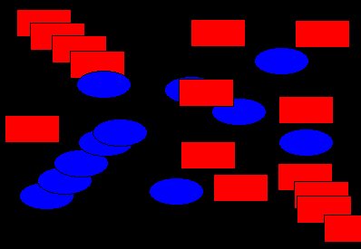

编写这个示例有多种方法。可以像上一个示例那样，有一个单独的类来处理鼠标事件。但在这种情况下，我决定让面板本身对鼠标事件做出响应。只要实现了 `MouseListener` 接口，任何对象都可以作为鼠标监听器。在这种情况下，面板类实现了 `MouseListener` 接口，因此代表程序主面板的对象可以作为该程序的鼠标监听器。面板类的构造函数包含语句：

```java
addMouseListener(this);
```

这等同于说 `this.addMouseListener(this)`，因为 `addMouseListener()` 是 `this` 代表的 `JPanel` 对象的实例方法。现在，注册鼠标监听器的通常方法是使用 `X.addMouseListener(Y)`，其中 `Y` 是监听器，`X` 是生成鼠标事件的组件。

在语句 `this.addMouseListener(this)` 中，这两个角色都由 `this` 承担；也就是说，“此对象”（面板）既在生成鼠标事件，也在监听这些事件。尽管这看起来有点奇怪，但你应该习惯看到此类代码。不过，在大型程序中，编写一个单独的类来执行监听是更好的做法，这样职责划分更加清晰。

面板类的源代码如下所示。我包含了一个 `main()` 例程以允许该类作为程序运行，正如第 6.2.7 节中所述。你应该检查 `MouseEvent` 对象中的实例方法是如何使用的。你还可以检查事件处理的四个步骤：

1. `import java.awt.event.*`
2. `implements MouseListener`
3. 事件处理方法的定义
4. `addMouseListener`


```java
import java.awt.*;
import java.awt.event.*;
import javax.swing.*;

/**
 * MouseEvents 的简单演示。当用户点击面板时，
 * 在黑色背景上绘制形状。如果用户
 * 按住 Shift 并点击，面板将被清空。如果用户
 * 右键点击面板，则会绘制一个蓝色椭圆。否则，
 * 当用户点击时，将绘制一个红色矩形。面板的内容
 * 并不是持久的。例如，如果调整了面板的尺寸，
 * 它们可能会消失。
 * 此类包含一个 main() 例程，允许其作为应用程序运行。
 */
public class SimpleStamper extends JPanel implements MouseListener {

    public static void main(String[] args) {
        JFrame window = new JFrame("Simple Stamper");
        SimpleStamper content = new SimpleStamper();
        window.setContentPane(content);
        window.setDefaultCloseOperation(JFrame.EXIT_ON_CLOSE);
        window.setLocation(120,70);
        window.setSize(450,350);
        window.setVisible(true);
    }

    // ----------------------------------------------------------------------

   /**
    * 此构造函数简单地将面板的背景颜色设置为黑色，
    * 并设置面板监听其自身的鼠标事件。
    */
   public SimpleStamper() {
      setBackground(Color.BLACK);
      addMouseListener(this);
   }

   /**
    *  由于此面板已设置为监听自身的鼠标事件，
    *  当用户在面板上点击鼠标时，将调用此方法。
    *  此方法是 MouseListener 接口的一部分。
    */
   public void mousePressed(MouseEvent evt) {

      if ( evt.isShiftDown() ) {
            // 用户正按住 Shift 键。只需重绘面板。
            // 由于此类没有定义 paintComponent() 方法，
            // 将调用父类 JPanel 的方法。该方法仅仅
            // 用其背景颜色（黑色）填充面板。其
            // 效果是清空面板。
         repaint();
         return;
      }

      int x = evt.getX();  // 用户点击位置的 x 坐标。
      int y = evt.getY();  // 用户点击位置的 y 坐标。

      Graphics g = getGraphics(); // 直接绘制的图形上下文。
                                  // 注意：这被认为是一种不良风格！

      if ( evt.getButton() == MouseEvent.BUTTON3 ) {
             // 用户在 (x,y) 处右键点击。绘制一个以 (x,y)
             // 为中心的蓝色椭圆。（椭圆周围的黑色轮廓会在
             // 形状重叠时更加明显。）
         g.setColor(Color.BLUE);  // 蓝色填充。
         g.fillOval( x - 30, y - 15, 60, 30 );
         g.setColor(Color.BLACK); // 黑色轮廓。
         g.drawOval( x - 30, y - 15, 60, 30 );
      }
      else {
            // 用户在 (x,y) 处左键点击（或中键点击）。 
            // 绘制一个以 (x,y) 为中心的红色矩形。
         g.setColor(Color.RED);   // 红色填充。
         g.fillRect( x - 30, y - 15, 60, 30 );
         g.setColor(Color.BLACK); // 黑色轮廓。
         g.drawRect( x - 30, y - 15, 60, 30 );
      }

      g.dispose();  // 我们已经用完了图形上下文，因此将其释放。

   } // mousePressed() 结束

   // 下四个空例程是 MouseListener 接口要求的。
   // 它们在此类中不执行任何操作，因此它们的定义是空的。

   public void mouseEntered(MouseEvent evt) { }
   public void mouseExited(MouseEvent evt) { }
   public void mouseClicked(MouseEvent evt) { }
   public void mouseReleased(MouseEvent evt) { }

} // SimpleStamper 类结束
```

顺便提一下，此类违反了所有绘制操作都应在`paintComponent()`方法中完成的规则。矩形和椭圆是直接在`mousePressed()`例程中绘制的。为了实现这一点，我需要通过说`g = getGraphics()`来获取图形上下文。在使用`g`进行绘制后，我调用了`g.dispose()`以告知操作系统我将不再使用`g`进行绘制。如果可以避免的话，我不建议进行这种直接绘制，但你可以看到在这种情况下它是有效的。

### 6.3.4 MouseMotionListeners 和拖拽

每当鼠标移动时，就会产生事件。计算机的操作系统会检测到这些事件，并利用它们来移动屏幕上的光标。程序也可以监听这些“鼠标移动”事件并对其做出响应。这样做的最常见目的是实现拖拽。拖拽发生在用户按住鼠标按钮移动鼠标时。

响应鼠标移动的方法定义在一个名为`MouseMotionListener`的接口中。该接口指定了两个处理方法：

```java
public void mouseDragged(MouseEvent evt);
public void mouseMoved(MouseEvent evt);
```

如果在按住按钮时移动鼠标，将调用`mouseDragged`方法。如果在没有按键时移动鼠标，则调用`mouseMoved`。参数`evt`是`MouseEvent`类型的对象，它通常包含鼠标位置的 x 和 y 坐标。只要用户继续移动鼠标，这些方法之一就会被调用。（产生的事件如此多，如果程序不想对其做出任何响应，那么听到所有事件将是低效的。这就是为什么鼠标移动事件处理器定义在与其他事件分开的接口中：你可以监听`MouseListener`中的鼠标事件，而不会自动听到所有的鼠标移动事件。）如果你想让程序响应鼠标移动事件，你需要创建一个实现`MouseMotionListener`接口的对象，并注册该对象以监听事件。注册是通过调用组件的`addMouseMotionListener()`方法完成的。该对象将监听与组件相关的`mouseDragged`和`mouseMoved`事件。在大多数情况下，监听器对象还会实现`MouseListener`接口，以便响应其他鼠标事件。

（为了更好地了解鼠标事件是如何运作的，你应该尝试示例程序`SimpleTrackMouse.java`。该程序对七种不同类型的鼠标事件均有响应，显示鼠标坐标、事件类型以及已按的修饰键（Shift、Control、Meta 和 Alt）。你可以对程序进行实验，看看在你执行各种操作时会发生什么。我也鼓励你阅读源代码。你现在应该熟悉它所使用的所有技术了。）

观察程序为了响应拖拽操作需要执行哪些操作是非常有趣的。通常情况下，响应涉及三个方法：`mousePressed()`、`mouseDragged()`和`mouseReleased()`。拖拽手势在用户按下鼠标按钮时开始，在拖动鼠标时持续，并在用户释放按钮时结束。这意味着，对一个拖拽手势的响应编程必须分布在这三个方法中！此外，随着鼠标的移动，`mouseDragged()`方法可能会被调用多次。为了跟踪在上一次方法调用和下一次调用之间发生了什么，你需要设置一些实例变量。在许多应用程序中，例如，为了处理`mouseDragged`事件，你需要记住鼠标的上一个坐标。你可以将这些信息存储在两个`int`类型的实例变量`prevX`和`prevY`中。将起始坐标（即原始`mousePressed`事件发生的位置）保存在实例变量中也很有用。此外，我建议设置一个布尔型（boolean）变量`dragging`，在处理拖拽手势期间将其设置为`true`。这是有必要的，因为在许多应用程序中，并不是每个`mousePressed`事件都会启动你想要响应的拖拽操作。`mouseDragged`和`mouseReleased`方法可以使用`dragging`的值来检查是否正在进行拖拽操作。你可能还需要其他实例变量，但总体而言，一个处理鼠标拖拽的类看起来如下：

```java
import java.awt.event.*;

public class MouseDragHandler implements MouseListener, MouseMotionListener {

   private int startX, startY; // 原始鼠标按下发生的位置。 
   private int prevX, prevY;   // 最近处理的鼠标坐标。
   private boolean dragging;   // 正在拖拽时设置为 true。
   . . . // 用于拖拽的其他实例变量

   public void mousePressed(MouseEvent evt) {
      if ( we-want-to-start-dragging ) {
          dragging = true;
          startX = evt.getX();  // 记住起始位置。
          startY = evt.getY();
          prevX = startX;       // 记住最近的坐标。
          prevY = startY;
             . 
             . // 其他处理。
             .
      }
   }

   public void mouseDragged(MouseEvent evt) {
       if ( dragging == false )  // 首先，检查我们是否正在 
           return;               //   处理一个拖拽手势。
       int x = evt.getX(); // 鼠标的当前位置。
       int y = evt.getY();
         .  
         .  // 处理从 (prevX, prevY) 到 (x,y) 的鼠标移动。
         .
       prevX = x;  // 记住当前位置以便下次调用。
       prevY = y;
   }

   public void mouseReleased(MouseEvent evt) {
       if ( dragging == false )  // 首先，检查我们是否正在 
           return;               //   处理一个拖拽手势。
       dragging = false;  // 我们完成了拖拽。
        .
        .  // 其他处理和清理。
        .
   }

}
```

作为一个示例，让我们来看看拖拽的一个典型用法：允许用户通过拖动鼠标来绘制曲线。这个示例还展示了图形和鼠标处理的许多其他特性。在程序中，你可以通过在白色绘制区域上拖动鼠标来绘制曲线，并通过点击绘制区域右侧的几个彩色矩形之一来选择绘图颜色。完整的源代码可以在[SimplePaint.java](https://math.hws.edu/eck/cs124/javanotes9/source/chapter6/SimplePaint.java)中找到。这里是完成绘制后的程序图片：

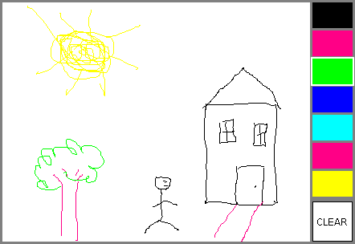

我将在这里讨论源代码的几个方面，但我鼓励你仔细阅读整个代码。源代码中有许多信息丰富的注释。

此示例的面板（panel）设计适用于任何合理的尺寸，也就是说除非面板太小。这意味着坐标是根据面板的实际宽度和高度计算的。（宽度和高度是通过调用`getWidth()`和`getHeight()`获取的。）这比我们假设面板具有某个特定的固定尺寸要困难得多。让我们详细查看其中的一些计算。例如，大型白色绘制区域在垂直方向上从`y = 3`延伸到`y = height - 3`，水平方向上从`x = 3`延伸到`x = width - 56`。这些数字是为了解释鼠标点击的含义而需要的。它们考虑了面板周围的灰色边框以及面板右边的调色板。灰色边框宽 3 像素。彩色矩形宽为 50 像素。加上面板周围的 3 像素边框以及绘制区域与彩色矩形之间的 3 像素分隔线，总共使得绘制区域的右边缘距离面板右边缘 56 像素。

一个标记为“CLEAR”的白色正方形占据了面板右边缘彩色矩形下方的一个 50x50 像素的区域。考虑到这个正方形，我们可以计算出用于七个彩色矩形的可用垂直空间大小，然后将该空间除以 7，得到每个矩形可用的垂直空间。这个量由变量`colorSpace`表示。在这个空间中，3 像素被用作矩形之间的间隙，因此每个矩形的高度为`colorSpace - 3`。第 N 个矩形的顶部位于距离面板顶部`N*colorSpace + 3`像素处，假设我们从零开始计数。这是因为在 N 个矩形上方，每个使用了`colorSpace`像素。额外的 3 是为了顶部的边框。在之后，我们可以写出绘制 N 个矩形的命令：

```java
g.fillRect(width - 53, N*colorSpace + 3, 50, colorSpace - 3);
```

这可不容易！但它展示了为了获得良好结果有时所需的仔细思考和精确图形处理。

程序中的鼠标被用于三种不同的功能：选择颜色、清除绘图和绘制曲线。`mousePressed`必须查看鼠标点击的 (x,y) 坐标并决定如何响应。如果用户点击了 CLEAR 矩形，则通过调用`repaint()`清除绘制区域。如果用户点击彩色矩形条的任意位置，则为绘图选择相应的颜色。这涉及到计算用户点击了什么颜色，通过除 y 坐标来实现。最后，如果用户点击了绘制区域，则启动拖拽操作。在这种情况下，布尔变量`dragging`被设置为`true`，这样`mouseDragged`和`mouseReleased`方法就会知道正在绘制曲线。此代码遵循上述通用形式。曲线的实际绘制在`mouseDragged()`方法中完成，该方法从鼠标的上一个位置到当前位置画一条线。需要一些工作来确保线条不会超出绘制区域。这并不是自动的，因为对于计算机来说，边框和颜色条是绘制区域的一部分。如果用户在画线时将其拖到绘制区域之外，`mouseDragged()`例程会更改 x 和 y 坐标，使其位于绘制区域内。

### 6.3.5 匿名事件处理器和适配器类

如我上面所述，使用匿名内部类来定义监听器对象是一种相当常见的做法正如正如第 5.8.3 节中讨论的，`new`运算符的一种特殊形式被用于创建一个属于匿名类的对象。例如，可以使用如下形式的表达式创建一个鼠标监听器对象：

```java
new MouseListener() {
   public void mousePressed(MouseEvent evt) { . . . }
   public void mouseReleased(MouseEvent evt) { . . . }
   public void mouseClicked(MouseEvent evt) { . . . }
   public void mouseEntered(MouseEvent evt) { . . . }
   public void mouseExited(MouseEvent evt) { . . . }
}
```

这仅仅是一个长表达式，它既定义了一个未命名的类，又创建了一个属于该类的对象。要将该对象作为鼠标监听器，可以将其作为参数传递给某些组件的`addMouseListener()`方法，格式如下：

```java
component.addMouseListener( new MouseListener() {
      public void mousePressed(MouseEvent evt) { . . . }
      public void mouseReleased(MouseEvent evt) { . . . }
      public void mouseClicked(MouseEvent evt) { . . . }
      public void mouseEntered(MouseEvent evt) { . . . }
      public void mouseExited(MouseEvent evt) { . . . }
   } );
```


现在，在典型的应用程序中，该类中的大多数方法定义都是空的。实现接口的类必须为该接口中的所有方法提供定义，即使这些定义是空的。为了避免在此类情况下编写空方法定义的冗长工作，Java 提供了适配器类（adapter classes）。适配器类通过为接口中的所有方法提供空定义来实现监听器接口。适配器类的唯一用处是作为创建子类的基类。在子类中，你只需要定义你真正想要使用的方法。对于其余的方法，将使用适配器类提供的空定义。适配器类`MouseAdapter`既实现了`MouseListener`接口，也实现了`MouseMotionListener`接口，因此它可以作为创建任何鼠标事件监听器的基类。例如，如果你想要一个只响应鼠标按下事件的鼠标监听器，可以使用如下形式的命令：

```
component.addMouseListener( new MouseAdapter() {
      public void mousePressed(MouseEvent evt) { . . . }
   } );
```

为了看到这在实际示例中如何工作，让我们编写第 6.3.2 节中`ClickableRandomStrings`程序的另一个版本。这个版本使用基于`MouseAdapter`的匿名类来处理鼠标事件：

```java
import java.awt.Component;
import java.awt.event.MouseAdapter;
import java.awt.event.MouseEvent;
import java.awt.event.MouseListener;
import javax.swing.JFrame;

public class ClickableRandomStrings2 {

   public static void main(String[] args) {
      JFrame window = new JFrame("Random Strings");
      RandomStringsPanel content = new RandomStringsPanel();

      content.addMouseListener( new MouseAdapter() { 
            // 注册一个由 MouseAdapter 的匿名子类定义的鼠标监听器。
            // 这取代了原始版本使用的 RepaintOnClick 类。
         public void mousePressed(MouseEvent evt) {
            Component source = (Component)evt.getSource();
            source.repaint();
         }
      } );

      window.setContentPane(content);
      window.setDefaultCloseOperation(JFrame.EXIT_ON_CLOSE);
      window.setLocation(100,75);
      window.setSize(300,240);
      window.setVisible(true);
   }

}
```

匿名内部类还可以用于事件处理之外的其他用途。例如，假设你想定义一个`JPanel`的子类来表示绘制画布。该子类将只使用一次。它将重写`paintComponent()`方法，但对`JPanel`不做任何其他更改。将子类定义为匿名内部类可能是有意义的。你将在未来的示例中看到这种模式。

## 第 6.4 节：定时器、按键事件和状态机

* * *

并不是每个事件都是由用户的操作产生的。事件也可以由对象作为其常规编程的一部分而产生，这些事件可以被其他对象监控，以便在事件发生时采取适当的行动。其中一个例子是`javax.swing.Timer`类。`Timer`按照固定间隔生成事件。这些事件可以用于驱动动画或以固定间隔执行某些其他任务。我们将从查看定时事件和动画开始本节。然后我们将查看另一类型的基本用户生成事件：用户在键盘上打字时生成的`KeyEvents`。本节末尾的示例同时使用了定时器和键盘事件来实现简单的游戏，并引入了状态机的重要概念。

* * *

### 6.4.1 定时器和动画

属于`javax.swing.Timer`类的对象的存在仅仅是为了生成事件。在默认情况下，`Timer`产生一系列事件，每个事件与下一个事件之间有固定的延迟。（也可以设置`Timer`在指定的延迟时间后发射单个事件；在这种情况下，定时器被用作“闹钟”。）每个事件都属于`ActionEvent`类。要监听事件的对象必须实现`ActionListener`接口，该接口定义了一个方法：

```
public void actionPerformed(ActionEvent evt)
```

要使用`Timer`，你需要创建一个实现`ActionListener`接口的对象。也就是说，该对象必须属于一个声明了`ActionListener`的类，并且该类必须定义`actionPerformed`方法。如果设置为监听定时器的事件，每当定时器产生事件时，监听器中的`actionPerformed`代码就会执行。

如果没有响应其事件的监听器，那么拥有定时器就没有意义，因此定时器的动作监听器是在定时器的构造函数中指定的。定时器事件之间的时间延迟也在构造函数中指定。如果`timer`是一个`Timer`类型的变量，那么语句

```
timer = new Timer( millisDelay, listener );
```

将创建一个事件间隔为`millisDelay`毫秒的定时器。定时器的事件发送到监听器。（`millisDelay`必须是`int`类型，`listener`必须是`ActionListener`类型。）每当定时器发射事件时，监听器的`actionPerformed()`就会执行。注意，定时器不能保证精确按固定间隔交付事件。如果计算机忙于其他任务，事件可能会延迟甚至完全丢失。

注意，由于`ActionListener`是一个函数接口，监听器可以指定为 lambda 表达式。在这种情况下，`Timer`构造函数的形式如下：

```
timer = new Timer( millisDelay, e -> ... );
```

其中 "..." 代表每次定时器产生事件时执行的语句或块。

定时器在创建时不会自动开始生成事件。必须调用定时器的`start()`方法告诉定时器开始运行。定时器的`stop()`方法可以关闭事件流。稍后可以通过再次调用`start()`来重启。

定时器的一个应用是计算机动画。计算机动画只是一系列静态图像，按顺序呈现给用户。如果图像之间的时间很短，且从一张图像到另一幅图像的变化不是，那么用户就会感知到连续的运动。在 Java 中制作动画最简单的方法是使用`Timer`来驱动动画。每当定时器产生一个事件时，动画的下一帧就会被计算并绘制在屏幕上——实现这一过程的代码位于监听定时器事件对象的`actionPerformed`方法中。

我们使用定时器的第一个例子并不完全是动画，但它确实为每个定时器事件显示一张新图像。该程序显示随机生成的图像，这些图像模糊类似于抽象艺术作品。事实上，程序每当`paintComponent()`方法被调用时就会绘制一张新的随机图像，而对定时器事件的响应只是调用`repaint()`，这反过来触发调用`paintComponent`。程序的工作在`JPanel`的子类中完成，其结构如下：

```java
import java.awt.*;
import java.awt.event.*;
import javax.swing.*;

public class RandomArt extends JPanel {

   /**
    * 构造函数创建了一个延迟为四秒
    * (4000 毫秒)的定时器，并带有一个类型为
    * ActionListener 的 lambda 表达式，通过重绘此
    * 面板来响应事件。它还启动了定时器的运行。
    */
   public RandomArt() {
      RepaintAction action = new RepaintAction();
      Timer timer = new Timer(4000, e -> repaint() );
      timer.start();
   }

   /**
    * paintComponent() 方法将面板填充为随机颜色的灰色
    * 然后绘制三类随机“艺术”中的一种。
    * 要绘制的艺术类型是随机选择的。
    */
   public void paintComponent(Graphics g) {
       .
       .   // 类的其余部分已省略
       .
   }
}
```

你可以在文件`RandomArt.java`中找到该类的完整源代码。另一个使用嵌套类来定义事件监听器而不是 lambda 表达式的版本，可以在`RandomArtWithNestedClass.java`中找到。

在本节稍后的部分，我们将使用定时器来驱动简单电脑游戏中的动画。

***

### 6.4.2 键盘事件

在 Java 中，用户操作变成了程序中的事件。这些事件与 GUI 组件关联。当用户点击鼠标上的按钮时，生成的事件与包含鼠标光标的组件关联。那么键盘事件呢？当用户按下按键时，哪个组件与生成的键盘事件关联？

GUI 使用“输入焦点”的概念来确定与键盘事件关联的组件。在任何给定时刻，屏幕上恰好有一个界面元素具有输入焦点，所有的键盘事件都流向那里。如果该界面元素恰好是一个 Java 组件，那么关于键盘事件的信息就会变成一个`KeyEvent` Java 对象，并传递给任何监听与该组件关联的`KeyEvents`的监听对象。管理输入焦点的必要性为处理键盘事件增加了额外的性。

给用户提供一些视觉反馈，告知哪个组件具有输入焦点是一个好主意。例如，如果组件是文字处理器的输入区域，反馈通常是闪烁的文本光标。另一个可能的视觉线索是在当组件具有输入焦点时，在其边缘画一个亮颜色的边框，正如我在本节稍后的示例中所做的那样。

如果`comp`是任何组件，且你希望它拥有输入焦点，你可以调用`requestFocusInWindow()`，只要包含组件的窗口处于激活状态且只有一个组件在请求焦点，该方法就能生效。在某些情况下，当只涉及一个组件时，在打开窗口后调用一次此方法就足够了，该组件将在程序的剩余时间内保持焦点。（注意，还有一个`requestFocus()`方法，它即使在窗口未激活时也可能有效，但在大多数情况下优先使用较新的方法`requestFocusInWindow()`。）

在典型的用户界面中，用户可以通过鼠标点击某个组件来选择将焦点交给该组件。按下 tab 键通常会将焦点从一个组件移动到另一个组件。这由涉及的组件自动处理，无需你编写任何代码。然而，某些组件在用户点击它们时不会自动请求输入焦点。为了解决这个问题，程序可以在组件上注册一个鼠标监听器来检测用户点击。响应用户点击时，`mousePressed()`方法应该为组件调用`requestFocusInWindow()`。这对于用作绘图表面的`JPanels`特别如此，因为`JPanel`对象不会自动接收输入焦点。

作为处理键事件的第一个示例，我们来看一个简单的程序，用户通过按下箭头键向上、向下、向左和右移动正方形。当用户按下 'R'、'G'、'B' 或 'K' 键时，正方形的颜色分别设置为红色、绿色、蓝色或黑色。当然，除非面板具有输入焦点，否则这些键事件都不会传递给面板。程序中的面板具有焦点时改变外观：当具有焦点时，在面板周围绘制青色边框；当没有时，绘制灰色边框。该示例的完整源代码可以在`KeyboardAndFocusDemo.java`文件中找到。我将讨论它的某些方面。读完本节后，你应该能够理解整个源码。我建议运行程序查看它是如何运作的。

在 Java 中，键盘事件对象属于`KeyEvent`类。需要监听键盘事件的对象必须实现`KeyListener`接口。此外，该对象必须通过调用组件的`addKeyListener()`方法注册到组件上。注册通过命令`component.addKeyListener(listener);`完成，其中`listener`是监听键事件的对象，`component`是产生键事件的对象（当它具有焦点时）。组件和监听器可以是同一个对象。这一切当然与你在上一节中学习的鼠标事件的内容直接类比。`KeyListener`接口定义了以下方法，任何实现`KeyListener`的类都包含这些方法：

```java
public void keyPressed(KeyEvent evt);

public void keyReleased(KeyEvent evt);

public void keyTyped(KeyEvent evt);
```


Java 在`你按下的键`和`你输入的字符`之间做了仔细的区分。键盘上有许多键：字母键、数字键、如`Control`和`Shift`等修饰键、箭头键、上页/下页键、小数字键盘键、功能键等。在某些情况下（例如`shift`键），按下按键并不会输入字符。另一方面，输入字符有时可能涉及按下多个键。例如，要输入大写'A'，你必须按下`Shift`键，然后在释放`Shift`键之前按下`A`键。在我的 Mac 电脑上，可以通过按住`Option`键按下`E`键、释放`Option`键并再次按下`E`来输入带重音的 e。只输入了一个字符，但我必须执行了三次按键，并且要在正确的时间释放按键。在 Java 中，有三种`KeyEvent`。这些类型对应于按下按键、释放按键和输入字符。当用户按下按键时，调用`keyPressed`方法；当用户释放按键时，调用`keyReleased`方法；当用户输入字符时（无论是通过一次还是多次按键完成的），调用`keyTyped`方法。注意，一次用户操作（例如按下`E`键）可能会产生两个事件：一个`keyPressed`事件和一个`keyTyped`事件。输入大写'A'可以产生两个`keyPressed`事件、两个`keyReleased`事件和一个`keyTyped`事件。

通常情况下，将它们看作两个独立的事件流会更好：一个由`keyPressed`和`keyReleased`事件组成，另一个由`keyTyped`事件组成。对于某些应用程序，你想监控第一个流；对于另其他应用程序，你想监控第二个流。当然，`keyTyped`流中的信息可以从`keyPressed/keyReleased`流中提取出来，但这样做是困难的（而且在某种程度上是*具有系统依赖*的）。某些用户操作（例如按下`Shift`键）只能作为`keyPressed`事件被检测到。我以前有一个纸牌接龙游戏，当我按住`Shift`键时，它会高亮每一张可以移动的卡牌。你可以在 Java 中实现类似的功能：当`Shift`键被按下时高亮卡牌，当`Shift`键释放时取消高亮。

还有一个复杂的情况。通常情况下，当你按住键盘上的某个键时，该键会自动重复。这意味着它会在序列结束时产生一个`keyReleased`事件，而在此期间会产生多个`keyPressed`事件。它还可能产生多个`keyTyped`事件。在绝大多数情况下，这不会影响你的编程，但你不应该期望每个`keyPressed`事件都有一个对应的对应的`keyReleased`事件。

键盘上的每个键都有一个整数代码数字。当调用`keyPressed`或`keyReleased`方法时，参数`evt`包含了被按下或释放的按键代码。可以通过调用函数`evt.getKeyCode()`获取该代码。Java 并没有让你去背一张代码表，而是为每个按键提供了一个命名的常量。这些常量定义在`KeyEvent`类中。例如，shift 键的常量是`KeyEvent.VK_SHIFT`。如果你想测试用户按下的键是否是 Shift 键，可以写`if (evt.getKeyCode() == KeyEvent.VK_SHIFT)`。四个箭头键的代码键为`KeyEvent.VK_LEFT`、`KeyEvent.VK_RIGHT`、`KeyEvent.VK_UP`和`KeyEvent.VK_DOWN`。其他键也有类似的代码。（"VK" 代表 "Virtual Keyboard"，虚拟键盘。实际上，不同的键盘使用不同的键代码，但 Java 将来自键盘的实际代码翻译成它自己的"虚拟"代码。你的程序只会看到这些虚拟键代码，因此可以在各种平台上的各种键盘上运行而无需修改。）

在`keyTyped`事件的情况下，你想知道输入的是哪一个字符。此信息可以通过`keyTyped`方法中的参数`evt`并调用函数`evt.getKeyChar()`来获取。该函数返回一个`char`类型的值，代表输入的字符。

在`KeyboardAndFocusDemo`程序中，我使用`keyPressed`例程来响应用户按下四个箭头键之一的动作。该程序包含了实例变量`squareLeft`和`squareTop`，它们提供了可移动正方形左上角的位置信息。当用户按下一个箭头键时，`keyPressed`例程会修改相应的实例变量并调用`repaint()`来重新绘制面板，使正方形处于新位置。注意，`squareLeft`和`squareTop`的值受到限制，使得正方形永远不会移动到面板白色区域之外：

```java
/**
 * 每当用户在面板拥有输入焦点时按下按键，就会调用此方法。
 * 如果按下的键是箭头键之一，则正方形将移动（但不允许移动到面板
 * 边缘之外，它预留了 3 像素的边框）。
 */
public void keyPressed(KeyEvent evt) { 
   int key = evt.getKeyCode();  // 按下按键的键盘代码
   if (key == KeyEvent.VK_LEFT) {  // 左箭头键；正方形向左移动
      squareLeft -= 8;
      if (squareLeft < 3)
         squareLeft = 3;
      repaint();
   }
   else if (key == KeyEvent.VK_RIGHT) {  // 右箭头键；正方形向右移动
      squareLeft += 8;
      if (squareLeft > getWidth() - 3 - SQUARE_SIZE)
         squareLeft = getWidth() - 3 - SQUARE_SIZE;
      repaint();
   }
   else if (key == KeyEvent.VK_UP) {  // 上箭头键；正方形向上移动
      squareTop -= 8;
      if (squareTop < 3)
         squareTop = 3;
      repaint();
   }
   else if (key == KeyEvent.VK_DOWN) {  // 下箭头键；正方形向下移动
      squareTop += 8;
      if (squareTop > getHeight() - 3 - SQUARE_SIZE)
         squareTop = getHeight() - 3 - SQUARE_SIZE;
      repaint();
   }
}  // keyPressed 结束
```

颜色变化——当用户输入'R'、'G'、'B'和'K'或它们的小写时——在`keyTyped`方法中处理。我不在这里包含它，因为它与`keyPressed`方法非常相似。最后，为了完成`KeyListener`接口，必须定义`keyReleased`方法。示例程序中，该方法为空，因为程序对`keyReleased`事件没有响应。

### 6.4.3 焦点事件

如果组件要在拥有输入焦点时改变外观，它需要某种方式知道自己何时拥有焦点。在 Java 中，对象通过`FocusEvent`事件被通知焦点的变化。想要被通知焦点变化的对象实现`FocusListener`接口。该接口声明了两个方法：

```java
public void focusGained(FocusEvent evt);
public void focusLost(FocusEvent evt);
```

此外，必须使用`addFocusListener()`方法来设置焦点事件监听器。当组件获取输入焦点时，它会调用所有已注册组件的监听器的`focusGained()`方法。当它丢失焦点时，会调用监听器的`focusLost()`方法。

在示例`KeyboardAndFocusDemo`程序中，对焦点事件的响应只是重新绘制面板。`paintComponent()`方法通过调用布尔值的函数`hasFocus()`（定义在`Component`类中）来检查面板是否拥有输入焦点，根据是否拥有输入焦点绘制不同的图形。最终结果是，当面板获得或失去焦点时，其外观会发生变化。`FocusListener`接口的方法简单定义为：

```java
public void focusGained(FocusEvent evt) {
       // 面板现在拥有输入焦点。
   repaint();  // 重新绘制带有新消息和青色边框
}

public void focusLost(FocusEvent evt) {
      // 面板现在丢失了输入焦点。
   repaint();  // 重新绘制带有新消息和灰色边框
}
```

处理焦点的另一个方面是确保面板实际上获取了焦点。在这种情况下，我在程序的`main()`进程中，在打开窗口后紧接着为面板调用了`requestFocusInWindow()`。这种方法之所以有效，是因为窗口中只有一个组件，只要窗口处于激活状态，它就应该拥有焦点。如果用户在使用程序期间点击到另一个窗口，该窗口将变为非激活状态，面板会暂时失去焦点，当用户点击回程序窗口时，它会恢复焦点。

关于程序的整体结构，仍有一些决定需要做出。在这种情况下，我决定使用一个名为`Listener`的嵌套类来定义一个同时监听焦点和键事件的对象。在面板的构造函数中，我创建了一个`Listener`类型的对象，并注册它来监听来自面板的键事件和焦点事件。详细信息请参阅[源代码](https://math.hws.edu/eck/cs124/javanotes9/source/chapter6/KeyboardAndFocusDemo.java)。

### 6.4.4 状态机

存储在对象实例变量中的信息被称为代表该对象的状态。当对象的其中一个方法被调用时，对象所采取的操作取决于它的状态。（或者，用我们一直使用的术语来说，方法的定义可以查看实例变量来决定做什么。）此外，状态是可以改变的。（也就是说，方法的定义可以给实例变量分配新值。）在计算机科学中，有一个状态机的概念，它只是一个拥有状态并能响应事件或输入改变状态的东西。状态机对事件的响应取决于事件发生时它所处的状态。对象是一种状态机。有时，这种观点在设计类时非常有用。

状态机的观点在图形用户界面（GUI）所需的事件驱动编程中特别有用。在设计 GUI 程序时，你可以问自己：我需要跟踪哪些状态信息？哪些事件可以改变程序的状态？我对给定事件的响应将如何取决于当前状态？是否应该改变 GUI 的外观以反映状态的变化？`paintComponent()`方法应该如何考虑状态？所有这些都是自顶向下、逐步细化式程序设计风格的替代方案，而这种风格不适用于事件驱动型程序的整体设计。

在上述`KeyboardAndFocusDemo`程序中，程序的状态记录在实例变量`squareColor`、`squareLeft`和`squareTop`中。这些状态变量在`paintComponent()`方法中被用于决定如何绘制面板。它们的值在两个键事件处理方法中被改变。

在本节的剩余部分，我们将查看另一个例子，其中状态起着更重要的作用。在这个例子中，用户通过按下箭头键来玩一个简单的街机游戏。程序定义在源代码文件 [SubKiller.java](https://math.hws.edu/eck/cs124/javanotes9/source/chapter6/SubKiller.java) 中。一如既往，编译运行程序以及阅读完整的源代码是一个好主意。这里有一张图片：

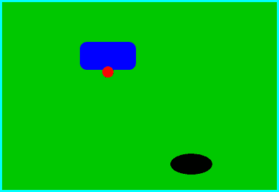

程序在面板底部显示一个黑色的"潜艇"。当面板拥有输入焦点时，这个潜艇会在底部来回地移动。上方有一只蓝色的"船"。你可以通过按下左右箭头键来让这艘船移动。船上挂着一个红色的"炸弹"（或"深水炸"）。你可以通过向下箭头键投掷炸弹。目标是用炸弹击中潜艇。如果炸弹掉出屏幕底部，你会得到一个新的。如果潜艇爆炸，就会创建一个新的潜艇，并给你一个新的炸弹。试一下！确保至少击中一次潜艇，这样你就能看到爆炸。

让我们思考这个游戏是如何编程的。首先，由于我们正在进行面向对象的编程，我决定将船、深水炸弹和潜艇表示为对象。这些每个对象都由主面板类内部的单独嵌套类定义，每个对象都有自己的状态，该状态由对应类中的实例变量表示。我在面板类中使用变量`boat`、`bomb`和`sub`来指代船、炸弹和潜艇对象。

现在，什么构成了程序的"状态"？也就是说，哪些事物随时间推移并影响程序的显示或行为？当然，状态包含了船、潜艇和炸弹的位置，因此这些对象有实例变量来存储位置。还有其他的吗？可能没那么明显？嗯，有时炸弹在掉落，有时又不在掉落。这就是状态的差异。由于存在两种可能性，我在炸弹对象用一个布尔变量`bomb.isFalling`来表示状态的这一方面。潜艇有时向左移动，有时向右移动。这种差异由另一个布尔变量`sub.isMovingLeft`表示。有时，潜艇正在爆炸。这也是状态的一部分，由布尔变量`sub.isExploding`表示。然而，爆炸需要更多的思考。爆炸是发生在系列帧中的一个过程。在爆炸进行期间，潜艇在每一帧中看起来都不同，因为爆炸的大小在不断增加。

这些状态变量的值何时以及如何改变？其中一些似乎是自动改变的：例如，当潜艇向左右移动时，指定其位置的状态变量会改变。当然，这些变量是因为动画而改变的，而该动画是由定时器驱动的。每当定时器产生一次事件，某些状态变量就必须改变，为动画的下一帧做好准备。改变是由监听定时器事件的动作监听器（action listener）完成的。`boat`、`bomb`和`sub`对象各包含一个`updateForNewFrame()`方法，用于更新对象的状态变量以准备动画的下一帧。定时器的动作监听器通过以下语句调用这些方法：

```java
boat.updateForNewFrame();
bomb.updateForNewFrame();
sub.updateForNewFrame();
```

动作监听器还会调用`repaint()`，以便面板能够重绘以反映其新状态。除了潜艇的位置外，这些更新方法中还有几个状态变量会改变：如果炸弹正在掉落，它的 y 坐标从一帧增加到下一帧。如果炸弹击中潜艇，潜艇的`isExploding`变量变为 true，而炸弹的`isFalling`变量变为 false。当炸弹掉出屏幕底部时，`isFalling`变量变为 false。如果潜艇正在爆炸，它的`explosionFrameNumber`从一帧增加到下一帧，当它达到某个值时，爆炸结束，`isExploding`被重置为 false。潜艇随机在向左移动和向右移动之间切换。它的运动方向记录在潜艇的`isMovingLeft`变量中。潜艇的`updateForNewFrame()`方法包含了这些行，用于随机改变`isMovingLeft`的值：

```java
if ( Math.random() < 0.04 )
   isMovingLeft = ! isMovingLeft;
```

`Math.random()`有 1/25 的概率小于 0.04，因此语句`"isMovingLeft = ! isMovingLeft"`平均每 25 帧中有一帧会执行一次。该语句的作用是反转`isMovingLeft`的值，从`false`变为`true`，或从`true`变为`false`。也就是说，小物的运动方向发生了反转。

除了帧与帧之间的状态变化外，当用户按下某些键时，一些状态变量也会发生变化。在程序中，这种变化在一个响应用户按键的方法中进行检查。如果用户按下左或右箭头键，船的位置就会改变。如果用户按下下箭头键，炸弹就会从"未落下"变为"正在落下"。这些代码实现在`KeyListener`的`keyPressed()`方法中，该监听器被注册用于监听面板上的键事件；该方法的实现如下：

```java
public void keyPressed(KeyEvent evt) {
   int code = evt.getKeyCode();  // 按了哪个键。
   if (code == KeyEvent.VK_LEFT) {
        // 向左移动船。（如果这导致船移出框架，它的
        // 位置将在 boat.updateForNewFrame() 方法中调整。）
      boat.centerX -= 15;
   }
   else if (code == KeyEvent.VK_RIGHT) {  
        // 向右移动船。（如果这导致船移出框架，它的
        // 位置将在 boat.updateForNewFrame() 方法中调整。）
      boat.centerX += 15;
   }
   else if (code == KeyEvent.VK_DOWN) {
         // 如果炸弹还没有落下，则开始让落下。
      if ( bomb.isFalling == false )
         bomb.isFalling = true;
   }
}
```


注意，在该方法中没有必要调用 `repaint()`，因为这个面板显示的是一个正在不断重绘的动画。任何状态变化一旦下一帧绘制完成就会立即对用户可见。在程序的某个时刻，我必须确保用户不会将船移动到屏幕之外。我本可以在 `keyPressed()` 中完成此操作，但我选择在另一个例程（即 `boat` 对象中）进行此检查，因为让船对象负责保持自己在屏幕内是有逻辑意义的。

程序使用了四个监听器，分别用于响应来自定时器的动作事件、来自用户的键事件、焦点事件和鼠标事件。在程序中，用户必须点击面板来开始游戏。游戏被设计为只要面板拥有输入焦点就会运行。在这个示例中，程序不会自动请求焦点；用户必须手动操作。当用户点击面板时，鼠标监听器会请求输入焦点，游戏开始。定时器只有在面板拥有输入焦点时运行；其实现方式是：让焦点监听器在面板获得输入焦点时启动定时器，在面板失去输入焦点时停止定时器。四个监听器都在 `SubKillerPanel` 类的构造函数中创建，其中一个使用 Lambda 表达式，其余使用匿名内部类。

我鼓励你阅读 [SubKiller.java](https://math.hws.edu/eck/cs124/javanotes9/source/chapter6/SubKiller.java) 中的源代码。虽然有几点比较棘手，但只要努力一下，你应该能够阅读并理解整个程序。尝试从状态机的角度来理解程序。注意程序中三个对象的每个状态是如何响应来自定时器和用户的事件而改变的。

虽然与街机游戏相比完全并不复杂，但 `SubKiller` 游戏确实使用了一些有趣的编程技巧。它很好地说明了如何在事件驱动编程中应用状态机思维。

## 第 6.5 节：基本组件

在之前的章节中，你已经看到了如何使用图形上下文在屏幕上绘制，以及如何处理鼠标事件和键盘事件。从某种意义上说，这就是 GUI 编程的全部。如果你愿意编写所有的绘制代码并处理所有的鼠标和键盘事件，你就没有需要学习的了。然而，你要么要做很多超出需要的工作，要么就会把自己限制在非常简单的用户界面。典型的用户界面使用标准的 GUI 组件，如按钮、滚动条、文本输入框和菜单。这些组件已经有人为你写好了。

典型的用户界面使用标准的 GUI 组件，如按钮、滚动条、文本输入框和菜单。这些组件已经有人为你写好了。

考虑最简单的用户组件之一：推入按钮。按钮有一个边框，并显示一些文本。有时按钮是被禁用的（disabled），用户无法对它进行任何操作。当按钮被禁用时，它的外观可能会发生变化。

幸运的是，你不需要编写这些中的任何内容，只要你使用属于 `JButton` 的对象即可。这就是标准类 `javax.swing.JButton`。一个 `JButton` 对象会进行自我绘制并处理鼠标、键盘和焦点事件。用户通过点击它或在按钮拥有输入焦点时按下空格键来触发它。当这种情况发生时，`JButton` 对象会创建一个属于 `java.awt.event.ActionEvent` 类的事件对象。该事件对象会被发送给任何监听器，告诉它们按钮已被按下。你的程序只会获取需要的信息——即按钮被按下这一事实。

作为 Swing 图形接口 API 定义的标准组件是由 `JComponent` 的子类定义的，而 `JComponent` 本身又是 `Component` 的子类。（注意，这包括我们已经经常使用的 `JPanel` 类）。许多有用方法定义在 `Component` 和 `JComponent` 类中，因此可以用于任何 Swing 组件。我们先来看这些方法中的几个。假设 `comp` 是一个指向某个 `JComponent` 的变量。那么可以使用以下方法：

- `comp.getWidth()` 和 `comp.getHeight()` 是获取组件当前尺寸（以像素为单位）的函数。警告：当组件首次创建时，其尺寸为零。尺寸将在稍后设置，通常由布局管理器设置。一个常见的错误是在尺寸设置之前（例如在构造函数中）检查组件的尺寸。
- `comp.setEnabled(true)` 和 `comp.setEnabled(false)` 用于启用和禁用组件。当组件被禁用时，它的外观可能会变化，且用户无法对它进行任何操作。有一个布尔值函数 `comp.isEnabled()`，你可以调用它来发现组件是否已启用。
- `comp.setVisible(true)` 和 `comp.setVisible(false)` 可以用来隐藏或显示组件。
- `comp.setFont(font)` 设置用于组件上显示文本的字体。
- `comp.setBackground(color)` 和 `comp.setForeground(color)` 设置组件的背景颜色和前景颜色。
- `comp.setOpaque(true)` 告诉组件在绘制组件内容之前，组件占据的区域应该用组件的背景颜色填充。默认情况下，只有 `JLabels` 是不透明的。不透明（或称“透明”）组件会忽略其背景颜色，并直接在其容器的内容之上绘制自己的内容。这通常意味着它继承了其容器的背景颜色。
- `comp.setToolTipText(string)` 将指定的字符串设置为组件的“工具提示”。当鼠标光标位于组件上且几秒钟内没有移动时，就会显示工具提示。工具提示应该提供有关该组件含义或如何使用它的某些信息。
- `comp.setPreferredSize(size)` 在可能的情况下，设置组件应该显示的大小。参数的类型为 `java.awt.Dimension`，其中 `Dimension` 类型的对象具有两个公共的整型实例变量：`width` 和 `height`。调用此方法的形式通常类似于 `setPreferredSize(new Dimension(100, 50))`。首选大小被布局管理器用作提示，并不是所有情况下都会得到遵守。标准组件通常会自动计算正确的首选大小，但在某些情况下，手动设置它可能很有用。例如，如果你使用 `JPanel` 作为绘制表面，通常为其设置一个首选大小是一个好主意，因为它的默认首选大小为零。

注意，使用任何组件都是多步骤的过程。必须用构造函数创建组件对象。必须将其添加到容器中。在许多情况下，必须注册监听器来响应来自组件的事件。在某些情况下，必须将组件的引用保存在实例变量中，以便程序在组件创建后能够对其进行操作。在本节中，我们将查看 Swing 中提供的一些基础标准组件。在下一节中，我们将考虑在容器中布局组件的问题。

### 6.5.1 `JButton`

`JButton` 类对象是一个推按钮，用户可以点击它触发某些操作。你可能已经在第 6.1 节中见过按钮，但在这里我们将更详细地考虑它们。为了有效地使用任何组件，你应该熟悉对应类的几个方面。以 `JButton` 为例，我明确列出了这些方面：

- **构造函数**：`JButton` 类有一个接受字符串作为参数的构造函数。该字符串将成为显示在按钮上的文本。例如：`stopGoButton = new JButton("Go")`。这创建了一个显示文本“Go”的按钮对象（但请记住，按钮在显示到屏幕之前必须先添加到容器中）。
- **事件**：当用户点击按钮时，按钮会生成一个类型为 `ActionEvent` 的事件。该事件会被发送给任何作为 `ActionListener` 注册到按钮的监听器。
- **监听器**：想要处理按钮生成的事件的对象必须实现 `ActionListener` 接口。该接口只定义了一个方法 `public void actionPerformed(ActionEvent evt)`，通过调用该方法通知对象发生了动作事件。
- **监听器的注册**：为了实际接收来自按钮的事件通知，必须在按钮上注册一个 `ActionListener`。这是通过按钮的 `addActionListener()` 方法实现的。例如：`stopGoButton.addActionListener(buttonHandler);`。
- **事件方法**：当按钮调用 `actionPerformed(evt)` 时，参数 `evt` 包含有关事件的信息。可以通过调用 `ActionEvent` 类中的方法来获取这些信息。特别是，`evt.getActionCommand()` 返回一个 `String`，给出了与按钮关联的命令。默认情况下，该命令是显示在按钮上的文本，但也可以将其设置为其他字符串。方法 `evt.getSource()` 返回产生事件对象的引用，即被点击的 `JButton`。返回值的类型为 `Object` 而不是 `JButton`，因为其他类型的组件也可以产生 `ActionEvents`。
- **组件方法**：除了标准的 `Component` 方法外，`JButton` 类中定义了几个实用的方法。例如，`stopGoButton.setText("Stop")` 将按钮上显示的文本更改为“Stop”。而 `stopGoButton.setActionCommand("sgb")` 更改与此按钮动作事件相关的动作命令。`setEnabled()` 和 `setText()` 方法对于向用户提供程序正在发生的信息特别有用。一个禁用的按钮比一个给出讨厌错误消息（如“抱歉，你现在无法点击我！”）的按钮更好。

### 6.5.2 `JLabel`

`JLabel` 无疑是最简单的组件类型。`JLabel` 类型的对象仅是为了显示一行文本。用户无法编辑该文本，尽管你的程序可以对其进行更改。`JLabel` 的构造函数指定了要显示的文本：

```java
JLabel message = new JLabel("Hello World!");
```

另一个构造函数指定了如果存在额外空间，文本在标签中的位置。可能的对齐方式由常量 `JLabel.LEFT`、`JLabel.CENTER` 和 `JLabel.RIGHT` 给出。例如：

```java
JLabel message = new JLabel("Hello World!", JLabel.CENTER);
```

创建了一个文本在可用空间内居中的标签。你可以通过调用标签的 `setText()` 方法来更改标签中显示的文本：

```java
message.setText("Goodbye World!");
```

由于 `JLabel` 类是 `JComponent` 的子类，你可以在标签上使用 `setForeground()` 和 `setFont()` 等方法。如果你想让背景颜色产生任何效果，你应该在标签上调用 `setOpaque(true)`，否则 `JLabel` 可能不会填充其背景。例如：

```java
JLabel message = new JLabel("Hello World!", JLabel.CENTER);

message.setForeground(Color.RED);   // 显示红色文本...
message.setBackground(Color.BLACK); // 在黑色背景上...
message.setFont(new Font("Serif", Font.BOLD, 18));  // 使用大粗字体。
message.setOpaque(true);  // 确保背景被填充。
```

### 6.5.3 `JCheckBox`

`JCheckBox` 是一个具有两种状态的组件：选中或未选中。用户可以通过点击来更改复选框的状态。复选框的状态由布尔值表示，如果框被选中则为 true，未选中则为 false。复选框有一个标签，在构造时指定：

```java
JCheckBox showTime = new JCheckBox("Show Current Time");
```

通常是由用户设置 `JCheckBox` 的状态，但你也可以通过程序设置。复选框当前的状态使用其 `setSelected(boolean)` 方法设置。例如，如果你想让复选框 `showTime` 被选中，执行 `showTime.setSelected(true)`。要取消选中，执行 `showTime.setSelected(false)`。你可以通过调用 `isSelected()` 方法来确定复选框当前的状态，该方法返回一个布尔值。

在很多情况下，你不需要担心复选框的事件。你的程序只需要在需要知道状态时通过调用 `isSelected()` 方法来检查状态。然而，当用户更改复选框的状态时，复选框确实产生一个事件，如果你希望在状态改变的瞬间发生某些操作，你就可以检测并对该事件做出响应。当用户更改复选框的状态时，它会产生一个类型为 `ActionEvent` 的事件。如果你想在用户更改状态时执行某些操作，必须通过调用 `addActionListener()` 方法为复选框注册一个 `ActionListener`。（注意，如果你通过调用 `setSelected()` 方法更改状态，则不会产生 `ActionEvent`。但是，`JCheckBox` 类中还有另一个方法 `doClick()`，它可以模拟用户点击复选框，并会产生一个 `ActionEvent`。）

在处理 `ActionEvent` 时，你可以调用事件对象的 `evt.getSource()` 方法来确定是哪个对象生成了事件。（当然，如果你只监听一个组件的事件，就不需要这样做。）返回值的类型为 `Object`，但如果你需要，可以将其强制转换为其他类型。一旦你确定了生成事件的对象，就可以请求该对象告诉你它的当前状态。例如，如果你知道事件一定来自两个复选框 `cb1` 或 `cb2` 之一，那么你的 `actionPerformed()` 方法可能如下：

```java
public void actionPerformed(ActionEvent evt) {
    Object source = evt.getSource();

    if (source == cb1) {
        boolean newState = cb1.isSelected();
        ... // 响应状态的变化
    } else if (source == cb2) {
        boolean newState = cb2.isSelected();
        ... // 响应状态的变化
    }
}
```

或者，你可以使用 `evt.getActionCommand()` 获取与源相关的动作命令。对于 `JCheckBox`，动作命令默认是复选框的标签。

### 6.5.4 `JTextField` 和 `JTextArea`

`JTextField` 和 `JTextArea` 类表示包含可供用户编辑文本的组件。`JTextField` 包含单行文本，而 `JTextArea` 可以包含多行文本。还可以将 `JTextField` 或 `JTextArea` 设置为只读，这样用户就可以读取其中包含的文本但不能进行编辑。这两个类都是抽象类 `JTextComponent` 的子类，该类定义了它们的共同属性。

`JTextField` 和 `JTextArea` 有许多共同的方法。接收类型为 `String` 参数的实例方法 `setText()` 可更改输入组件中显示的文本。可以通过调用其实例方法 `getText()` 获取组件的内容，该方法返回一个类型为 `String` 的值。如果你想阻止用户修改文本，可以调用 `setEditable(false)`。调用相同的方法并传入参数 `true` 则可以使输入组件再次变为用户可编辑。

只有当文本组件拥有输入焦点时，用户才能向其中输入文字。用户可以通过鼠标点击组件来给它提供输入焦点，但有时通过程序为文本字段提供输入焦点也是很有用的。你可以通过调用它的 `requestFocusInWindow()` 方法来实现这一点。例如，当我发现用户输入中存在错误时，我通常会在包含错误的文本字段上调用 `requestFocusInWindow()`。这有助于用户看到错误发生的位置，并让用户立即开始输入纠正内容。

默认情况下，文本组件中的文本与组件边缘之间没有空格，这通常看起来不太良好。你可以使用组件的 `setMargin()` 方法在组件边缘和文本之间添加一些空白。该方法接受一个类型为 `java.awt.Insets` 的参数，其中包含四个整数实例变量，用于指定组件上、左、下、右边缘的边距。例如：

```java
textComponent.setMargin(new Insets(5, 5, 5, 5));
```

这会在 `textComponent` 中的文本与组件的每个边缘之间添加五像素的边距。

`JTextField` 类有一个构造函数：

```java
public JTextField(int columns)
```

其中 `columns` 是一个整数，指定文本字段中应可见的字符数。这被用于确定文本字段的首选宽度。（因为字符的大小可能不同，而且由于首选宽度并不总是被遵守，文本字段中可见的实际字符数可能不等于 `columns`。）你不必指定列数；例如，你可能在一个上下文中使用文本字段，此时它会扩展以填充任何可用空间。在这种情况下，你可以使用无参数的默认构造函数 `JTextField()`。你也可以使用以下构造函数，它们指定文本字段的初始内容：

```java
public JTextField(String contents);

public JTextField(String contents, int columns);
```

`JTextArea` 的构造函数为：

```java
public JTextArea();

public JTextArea(int rows, int columns);

public JTextArea(String contents);

public JTextArea(String contents, int rows, int columns);
```


参数 `rows` 指定文本区域中应可见的行数。这决定了文本区域的首选高度，就像 `columns` 决定了首选宽度一样。然而，文本区域实际上可以包含任意行的文本；可以通过滚动文本区域来显示当前不可见的行。通常会将 `JTextArea` 作为 `BorderLayout` 的 `CENTER` 组件。在这种情况下，指定行数和列数的用处不大，因为 `TextArea` 会扩展以填充所有空间。

`JTextArea` 类自 `JTextComponent` 增加了一些有用方法。例如，实例方法 `append(moreText)`（`moreText` 类型为 `String`）将指定的文本添加到文本区域内容的末尾。（在使用 `append()` 或 `setText()` 向 `JTextArea` 添加文本时，可以通过换行符 `'\n'` 在文本中插入换行。）以及 `setLineWrap(wrap)`（`wrap` 类型为 `boolean`），用于告知当行文本无法在文本区域中显示时应该发生什么。如果 `wrap` 为 `true`，则任何过长的行将“换行”到下一行；如果 `wrap` 为 `false`，则行将直接延伸到文本区域之外，用户必须水平滚动文本区域以查看整行。`wrap` 的默认值为 `false`。

由于可能需要滚动文本区域来查看包含的所有文本，你可能期望文本区域自带滚动条。遗憾的是，这并不会自动发生。要为文本区域提供滚动条，你需要将 `JTextArea` 放入另一个名为 `JScrollPane` 的组件中。这样做如下：

```java
JTextArea inputArea = new JTextArea();
JScrollPane scroller = new JScrollPane( inputArea );
```

`JScrollPane` 提供了用于滚动文本区域文本的滚动条。滚动条会在需要出现，即文本的大小超过文本区域的大小时。注意，当你想将文本区域放入容器时，你应该将滚动面板而不是文本区域本身添加到容器中。参考程序 `TextAreaDemo.java`（https://math.hws.edu/eck/cs124/javanotes9/source/chapter6/TextAreaDemo.java）获取在滚动面板中使用文本区域的简短示例。

当用户在 `JTextField` 中输入内容并按下回车键时，会产生一个 `ActionEvent`。如果你想响应此类事件，可以使用文本内容的 `addActionListener()` 方法为该文本字段注册一个 `ActionListener`。（由于 `JTextArea` 可以包含多行文本，在文本区域中按回车键不会产生事件；它仅仅是开始新的一行文本。）

`JTextField` 有一个子类 `JPasswordField`，它与 `JTextField` 相同，不同之处在于不会显示所包含的文本。`JPasswordField` 中的字符都显示为星号（或其他固定字符）。显然，密码字段的设计目的是为了让用户输入密码，而不会在屏幕上显示该密码。

文本组件实际上相当复杂，我在这里只涵盖了它们最基础的属性。我将在第 13 章中回到文本组件的话题。

### 6.5.5 JSlider

`JSlider` 为用户提供了一种从可能的值范围内选择一个整数值的方法。用户通过沿着滑动条拖动“滑块”来实现这一点。滑动条可以可选地装饰有刻度线（tick marks）和标签（labels）。这张来自示例程序 `SliderDemo.java`（https://math.hws.edu/eck/cs124/javanotes9/source/chapter6/SliderDemo.java）的图片显示了三个具有不同装饰和不同值范围的滑动条：

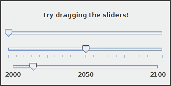

在这里，第二个滑动条装饰了刻度线，第三个滑动条装饰了标签。单个滑动条可以同时具有这两种类型的装饰。

`JSlider` 最常用的构造函数指定了滑动条值范围的起始值和结束值，以及它在首次出现在屏幕上时的初始值：

```java
public JSlider(int minimum, int maximum, int value)
```

如果省略了参数，则将使用值 0、100 和 50。默认情况下，滑动条是水平的，但你可以通过调用其方法 `setOrientation(JSlider.VERTICAL)` 将其变为垂直。可以随时使用 `getValue()` 方法读取 `JSlider` 的当前值，该方法返回一个 `int` 类型的值。如果你想更改该值，可以使用 `setValue(n)` 方法，该方法接受一个 `int` 类型的参数。

如果你想在用户更改滑动条值时立即响应，可以为滑动条注册一个监听器。与我们看过的其他组件不同，`JSlider` 不产生 `ActionEvent`。相反，它们产生类型为 `ChangeEvent` 的事件。`ChangeEvent` 及相关类定义在 `javax.swing.event` 包中，而不是 `java.awt.event`，因此如果你想使用 `ChangeEvents`，应该在程序的开头导入 `javax.swing.event.*`。你还必须定义一个实现 `ChangeListener` 接口的对象，并且通过调用 `addChangeListener()` 方法为滑动条注册更改监听器。`ChangeListener` 必须为以下方法提供定义：

```java
public void stateChanged(ChangeEvent evt)
```

每当滑动条的值改变时，该方法就会被调用。注意，当你使用 `setValue()` 方法更改值时，以及当用户更改值时，它都会被调用。在 `stateChanged()` 方法中，你可以调用 `evt.getSource()` 来找到生成事件的对象。如果你想知道用户是否是通过拖动滑动条上的滑块来产生更改事件，请调用滑动条的 `getValueIsAdjusting()` 方法，该方法返回一个布尔值。

在滑动条上使用刻度线是一个两步过程：指定刻度线之间的间隔，并告诉滑动条应该显示刻度线。实际上有两种刻度线，“主刻度线”（major tick marks）和“小刻度线”（minor tick marks）。你可以拥有其中一种或两者兼有。主刻度线比小刻度线长一点。方法 `setMinorTickSpacing(i)` 表示滑动条上每隔 `i` 个单位应该有一个小刻度线。参数是一个整数。（间隔基于滑动条上的值，而不是像素。）对于主刻度线，有一个类似的命令 `setMajorTickSpacing(i)`。仅调用这些方法不足以让刻度线出现。你还必须调用 `setPaintTicks(true)`。例如，上述图中的第二个滑动条是通过以下命令创建并配置的：

```java
slider2 = new JSlider();  // (使用默认 min, max 和 value.)
slider2.addChangeListener(this);
slider2.setMajorTickSpacing(25);
slider2.setMinorTickSpacing(5);
slider2.setPaintTicks(true);
```

滑动条上的标签处理方式类似。你必须指定标签并告诉滑动条绘制它们。指定标签是一项棘手的工作，但 `JSlider` 类有一个方法可以简化它。你可以通过以下命令创建一组标签并将它们添加到名为 `sldr` 的滑动条中：

```java
sldr.setLabelTable( sldr.createStandardLabels(i) );
```

其中 `i` 是一个给出标签之间间隔的整数。为了显示标签，调用 `setPaintLabels(true)`。例如，上述图中的第三个滑动条是通过以下命令创建并配置的：

```java
slider3 = new JSlider(2000,2100,2014);
slider3.addChangeListener(this);
slider3.setLabelTable( slider3.createStandardLabels(50) );
slider3.setPaintLabels(true);
```

`SliderDemo` 对象实现了 `ChangeListener`，滑动条的 `addChangeListener` 方法使用它来引用该对象。但 `ChangeListener` 接口只定义了一个方法，这意味着滑动条的更改监听器也可以作为 lambda 表达式指定。

每个容器都有默认的布局管理器，并有一个实例方法 `setLayout()`，该方法接受一个类型为 `LayoutManager` 的参数。该方法可以为容器指定不同的布局管理器。通过调用容器对象中名为 `add()` 的实例方法可以向容器添加组件。实际上，`add()` 方法有多个版本，具有不同的参数列表。正如我们在下文中所示，不同版本的 `add()` 适用于不同的布局管理器。

### 6.6.1 基础布局管理器

Java 提供了多种标准布局管理器，可以作为 `setLayout()` 方法的参数。它们由 `java.awt` 包中的类定义。在这里，我们只查看其中的三个布局管理器类：`FlowLayout`、`BorderLayout` 和 `GridLayout`。

`FlowLayout`（流式布局）简单地将组件在跨越容器的方向上成行对齐。每个组件的大小等于该组件的“首选尺寸”（preferred size）。在跨越容器的一行容纳尽可能多的项目后，布局管理器将移动到下一行。`JPanel` 的默认布局是 `FlowLayout`；也就是说，除非你通过调用面板的 `setLayout()` 方法指定了不同的布局管理器，否则 `JPanel` 使用的是 `FlowLayout`。

给定行中的组件可以是左对齐、右对齐或在该行内居中，并且组件之间可以存在水平和垂直间隙。如果使用默认构造函数 `new FlowLayout()`，则每行的组件将居中显示，且水平和垂直间隙均为五个像素。构造函数

```java
public FlowLayout(int align, int hgap, int vgap)
```

可以用于指定替代的对齐方式和间隙。`align` 的可能值为 `FlowLayout.LEFT`、`FlowLayout.RIGHT` 和 `FlowLayout.CENTER`。

假设容器是一个使用 `FlowLayout` 作为其布局管理器的容器对象。那么，可以使用语句向容器添加组件 `comp`：

```java
container.add(comp);
```

`FlowLayout` 将对以这种方式添加到容器的所有组件进行行对齐。它们将按照被添加的顺序进行排列。例如，这张图片显示了使用 `FlowLayout` 的面板中的五个按钮：

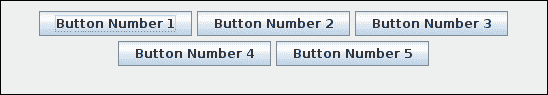

注意，由于五个按钮无法在跨越面板的单行中容纳，因此它们排列在两行。在每一行中，按钮都组合在一起并在行中居中。按钮是通过以下语句添加到面板的：

```java
panel.add(button1);
panel.add(button2);
panel.add(button3);
panel.add(button4);
panel.add(button5);
```

当容器使用布局管理器时，布局管理器通常负责计算容器的首选尺寸（尽管可以通过调用容器的 `setPreferredSize` 方法设置不同的首选尺寸）。`FlowLayout` 倾向于将它的组件放在单行中，因此首选宽度是所有组件的首选宽度之和，加上组件之间的水平间隙。首选高度是所有组件中的最大首选高度。

`BorderLayout`（边界布局）布局管理器设计用于显示一个大的中央组件，并有多达四个较小的组件排列在中央组件的边缘。如果容器 `cntr` 正在使用 `BorderLayout`，则应该使用如下形式的语句向容器添加组件 `comp`：

```java
cntr.add( comp, borderLayoutPosition );
```

其中 `borderLayoutPosition` 指定了组件在布局中应该占据的位置，并作为常量 `BorderLayout.CENTER`、`BorderLayout.NORTH`、`BorderLayout.SOUTH`、`BorderLayout.EAST` 或 `BorderLayout.WEST` 之一给出。这五个位置的含义如图所示：

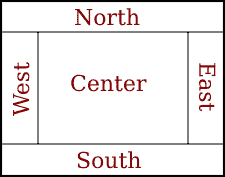

注意，边界布局可以包含少于五个组件，因此不需要填充所有五个可能的位置。然而，没有中央组件将非常不寻常。

`BorderLayout` 如下所示设置其组件的大小：`NORTH` 和 `SOUTH` 组件（如果存在）按其首选高度显示，但它们的宽度被设置为容器的完整宽度。`EAST` 和 `WEST` 组件按其首选宽度显示，但其高度被设置为容器的高度减去 `NORTH` 和 `SOUTH` 组件占据的空间。最后，`CENTER` 组件占据任何剩余空间。在布局完成时，会忽略 `CENTER` 组件的首选尺寸，但在计算整个容器的首选尺寸时会将其考虑在内。你应该确保你放入 `BorderLayout` 的组件适用于它们将占据的位置。例如，水平滑块或文本字段在 `NORTH` 或 `SOUTH` 位置效果良好，但在 `EAST` 或 `WEST` 位置则没有太大意义。

默认构造函数 `new BorderLayout()` 在组件之间不留任何空间。如果你想留一些空间，可以在 `BorderLayout` 对象的构造函数中指定水平和垂直间隙。例如，如果说

```java
panel.setLayout(new BorderLayout(5,7));
```

那么布局将在组件之间插入 5 像素的水平间隙并在组件之间插入 7 像素的垂直间隙。容器的背景颜色将通过这些间隙显示出来。`JFrame` 自带的原始内容面板的默认布局是没有水平或垂直间隙的 `BorderLayout`。

最后，我们考虑 `GridLayout`（网格布局）。网格布局将组件在包含等大小行和列的网格中布局。此图显示了在 4 行 3 列的网格中排列组件：

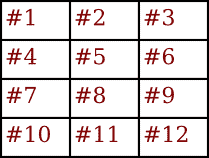

如果容器使用 `GridLayout`，相应的 `add` 方法接受一个类型为 `Component` 的单个参数（例如：`cntr.add(comp)`）。组件按照所示顺序添加到网格；也就是说，每一行填满后再进入下一行。

`GridLayout` 的构造函数形式为 `new GridLayout(R,C)`，其中 `R` 是行数 `C` 是列数。如果你想在列之间留下 `H` 像素的水平间隙，在行之间留下 `V` 像素的垂直间隙，请使用 `new GridLayout(R,C,H,V)`。

当你使用 `GridLayout` 时，最好添加足够填充网格的组件。但这并非要求的。事实上，只要你为行数指定非零值，列数基本上就会被忽略。系统将使用所需的列数来容纳添加到容器的所有组件。如果你希望于这种行为，你应该将列数指定为零。你也可以将行数指定为零。在这种情况下，你必须给出非零列数。系统将使用指定的列数，以及所需的行数来容纳添加的组件。

单行的水平网格和单列的垂直网格非常常见。例如，假设 `button1`、`button2` 和 `button3` 是按钮，你希望在面板中以水平行显示它们。如果你对面板使用水平网格，那么这些按钮将完全填充该面板且大小都相同。面板可以如下创建：

```java
JPanel buttonBar = new JPanel();
buttonBar.setLayout( new GridLayout(1,3) );
// (注意：这里的 "3" 基本上被忽略了，
//  你也可以说 "new GridLayout(1,0)"。
//  要在按钮之间留下间隙，你可以使用
//  "new GridLayout(1,0,5,5)"。)
buttonBar.add(button1);
buttonBar.add(button2);
buttonBar.add(button3);
```

你可能会发现这个按钮栏比使用默认 `FlowLayout` 布局管理器的那个更有吸引力。

### 6.6.2 边框

我们已经看到如何在容器的组件之间留出间隙，但如果你想在容器外部留一个边框怎么办？这个问题并不由布局管理器处理。相反，Swing 中的边框是由对象表示的。一个 `Border` 对象可以添加到任何 `JComponent` 中，而不仅仅是容器。边框不仅仅是空空间。`javax.swing.BorderFactory` 类包含了大量的静态方法，用于创建边框对象。例如，该函数

```java
BorderFactory.createLineBorder(Color.BLACK)
```

返回一个表示组件外部 1 像素宽黑色线条的对象。如果 `comp` 是一个 `JComponent`，可以使用它的 `setBorder()` 方法为 `comp` 添加边框。例如：

```java
comp.setBorder( BorderFactory.createLineBorder(Color.BLACK) );
```


一旦为`JComponent`设置了边框，边框就会自动绘制，程序员无需进行任何额外工作。边框沿着组件的边缘绘制，就在其边界的内部。`JPanel`或其它容器的布局管理器会考虑到边框占据的空间。添加到容器的组件将显示在边框内部的区域。我不建议在作为绘面的`JPanel`上使用边框。但是，如果你这样做，你应该考虑到边框。如果你在边框占据的区域绘图，你的绘画部分将被边框覆盖。

这里是一些可以用于创建边框的静态方法：

- `BorderFactory.createEmptyBorder(top,left,bottom,right)` — 在组件边缘周围留出空边框。此空间内不绘制任何内容，因此组件的背景颜色将出现在边框占据的区域。参数是整数，表示组件顶、左、底、右边缘的边框宽度。这在用于包含其他组件的`JPanel`上实际上非常有用。它在组件和面板边缘之间留出空间。它对于`JLabel`也有用，否则文本和标签边缘之间将没有任何空间。
- `BorderFactory.createLineBorder(color,thickness)` — 在组件的所有四个边缘周围绘制一条线。第一个参数是`Color`类型，指定线条的颜色。第二个参数是整数，指定边框的厚度（单位为像素）。如果省略第二个参数，则绘制一条厚度为 1 的线。
- `BorderFactory.createMatteBorder(top,left,bottom,right,color)` — 与`createLineBorder`类似，但你可以为组件的顶、左、底、右边缘指定不同的厚度。
- `BorderFactory.createEtchedBorder()` — 创建一个像在组件边界周围刻出的槽的边框。该效果通过使用组件背景色的较浅和较深色调来实现，它对所有背景颜色效果都不好。
- `BorderFactory.createLoweredBevelBorder()` — 给组件提供三维效果，使其看起来像是凹入计算机屏幕。与`EtchedBorder`一样，它只对某些背景颜色效果良好。
- `BorderFactory.createRaisedBevelBorder()` — 与`LoweredBevelBorder`类似，但组件看起来像是凸于计算机屏幕。
- `BorderFactory.createTitledBorder(title)` — 创建一个带有标题的边框。标题是一个字符串（`String`），显示在边框的左上角。

`BorderFactory`类中还有许多其他方法，大部分提供了这里给出的基础边框样式的变体。下面的插图显示了具有六种不同边框样式的六个组件。每个组件中的文本是创建该组件边框的命令：

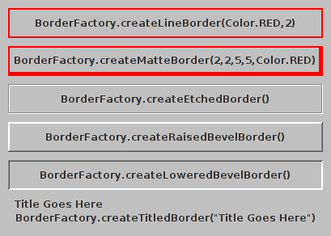

（生成此图片的程序的源代码可以在[BorderDemo.java](https://math.hws.edu/eck/cs124/javanotes9/source/chapter6/BorderDemo.java)中找到。）

### 6.6.3 SliderAndButtonDemo

现在我们已经看了组件和布局，是时候将它们组合成一些完整的程序了。我们从一个简单的演示开始，它使用一个`JLabel`、三个`JButtons`和两个`JSliders`，所有这些都布局在`GridLayout`中，如图：

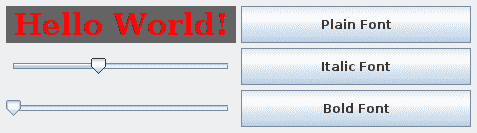

该程序中的滑块控制标签的前景和背景颜色，按钮控制其字体样式。编写这个程序涉及创建组件、布局它们，以及编写监听器来响应来自滑块和按钮的事件。我的程序被定义为`JPanel`的子类，并实现了`ChangeListener`和`ActionListener`，这样面板本身就可以作为来自滑块的更改事件和来自按钮的动作的监听器。在构造函数中，创建并配置了六个组件，将`GridLayout`安装为面板的布局管理器，并将组件添加到面板中：

```java
/* 创建显示标签，其属性与滑块的值
   匹配，并带有默认的粗体字体。 */

displayLabel = new JLabel("Hello World!", JLabel.CENTER);
displayLabel.setOpaque(true);
displayLabel.setBackground(new Color(100,100,100));
displayLabel.setForeground(Color.RED);
displayLabel.setFont(new Font("Serif", Font.BOLD, 30));
displayLabel.setBorder(BorderFactory.createEmptyBorder(0,8,0,8));

/* 创建滑块，并设置面板监听滑块产生的
   更改事件。 */

bgColorSlider = new JSlider(0,255,100);
bgColorSlider.addChangeListener(this);

fgColorSlider = new JSlider(0,100,0);
fgColorSlider.addChangeListener(this);

/* 创建三个控制字体样式的按钮，并设置面板
   监听按钮的动作事件。 */

JButton plainButton = new JButton("Plain Font");
plainButton.addActionListener(this);

JButton italicButton = new JButton("Italic Font");
italicButton.addActionListener(this);

JButton boldButton = new JButton("Bold Font");
boldButton.addActionListener(this);

/* 设置面板的布局，并添加六个组件。
   使用 3 行 2 列的 GridLayout，组件之间留
   5 像素。 */

setLayout(new GridLayout(3,2,5,5));

add(displayLabel);
add(plainButton);
add(bgColorSlider);
add(italicButton);
add(fgColorSlider);
add(boldButton);
```

该类还定义了`ActionListener`和`ChangeListener`接口所需的方法。点击按钮时调用`actionPerformed()`方法。该方法更改`JLabel`的字体，字体取决于点击了哪个按钮。为了确定点击了哪个按钮，该方法使用`evt.getActionCommand()`，它返回按钮的文本：

```java
public void actionPerformed(ActionEvent evt) {
    String cmd = evt.getActionCommand();

    if (cmd.equals("Plain Font")) {
        displayLabel.setFont(new Font("Serif", Font.PLAIN, 30));
    }
    else if (cmd.equals("Italic Font")) {
        displayLabel.setFont(new Font("Serif", Font.ITALIC, 30));
    }
    else if (cmd.equals("Bold Font")) {
        displayLabel.setFont(new Font("Serif", Font.BOLD, 30));
    }
}
```

`stateChanged()`方法在用户操作其中一个滑块时调用，它使用滑块上的值来计算标签的新前景或背景颜色。该方法检查`evt.getSource()`以确定哪个滑块发生了变化：

```java
public void stateChanged(ChangeEvent evt) {
    if (evt.getSource() == bgColorSlider) {
        int bgVal = bgColorSlider.getValue();

        displayLabel.setBackground(new Color(bgVal,bgVal,bgVal));

        // NOTE: 背景颜色是深浅灰色，
        //       由滑块的设置决定的。
    }
    else {
        float hue = fgColorSlider.getValue()/100.0f;

        displayLabel.setForeground(
            Color.getHSBColor(hue, 1.0f, 1.0f)
        );

        // Note: 前景颜色会在整个光谱的各种颜色
        //       之间切换。
    }
}
```

请注意，滑块变量是程序中的全局变量，因为它们在`stateChanged()`方法和构造函数中都被引用。相比之下，按钮变量是构造函数中的局部变量，因为它们只在该处使用。此示例的完整源代码位于[SliderAndButtonDemo.java](https://math.hws.edu/eck/cs124/javanotes9/source/chapter6/SliderAndButtonDemo.java)文件。

### 6.6.4 简单计算器

作为我们的下一个示例，我们将简要查看一个使用嵌套子面板来构建更复杂用户界面的示例。程序有两个`JTextField`，用户可以在其中输入两个数字；四个`JButton`，用户可以点击它们来对这两个数字进行加、减、乘、除；以及一个显示操作结果的`JLabel`。以下是该程序的一张图片：

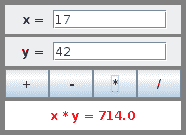

此示例使用了一个带有`GridLayout`的面板，该布局有四行一列。在这种情况下，布局是通过语句创建的：

```java
setLayout(new GridLayout(4,1,3,3));
```

这允许行与行之间有 3 像素的间隙，间隙可以看到面板的灰色背景颜色。

网格布局的第一行实际上包含两个组件：一个显示文本 "x =" 的`JLabel`和一个`JTextField`。网格布局在每个位置只能有一个组件。在这种情况下，第一行的组件是一个`JPanel`；它是嵌套在主面板内部的子面板。该子面板又包含了标签和文本字段。其编程方式如下：

```java
xInput = new JTextField("0", 10); // 创建一个大小足够容纳 10 个字符的文本字段。

JPanel xPanel = new JPanel();     // 创建子面板。

xPanel.add(new JLabel(" x = "));  // 向子面板添加一个标签。

xPanel.add(xInput);               // 将文本字段添加到子面板。

add(xPanel);                      // 将子面板添加到主面板。
```

子面板使用默认的`FlowLayout`布局管理器，因此标签和文本字段仅以其首选大小相邻放置在子面板中，并在子面板中居中。

同样，网格布局的第三行也是一个包含四个按钮的子面板。在这种情况下，子面板使用一个行四列的`GridLayout`，使得所有按钮的大小相同并完全填满子面板。

此示例中另一个引起感兴趣的点是`actionPerformed()`方法，它在用户点击其中一个按钮时做出响应。该方法必须从文本字段中获取用户的数字，对这些数字执行相应的算术运算（取决于点击了哪个按钮），并设置`JLabel`（命名为`answer`）的文本以表示结果。然而，文本字段的内容只能以字符串的形式获取，并且这些字符串必须转换为数字。如果转换失败，标签将设置为显示错误消息：

```java
public void actionPerformed(ActionEvent evt) {
    double x, y;  // 来自输入框的数字。

    try {
        String xStr = xInput.getText();
        x = Double.parseDouble(xStr);
    }
    catch (NumberFormatException e) {
        // 字符串 xStr 不是合法的数字。
        answer.setText("Illegal data for x.");
        xInput.requestFocusInWindow();
        return;
    }

    try {
        String yStr = yInput.getText();
        y = Double.parseDouble(yStr);
    }
    catch (NumberFormatException e) {
        // 字符串 yStr 不是合法的数字。
        answer.setText("Illegal data for y.");
        yInput.requestFocusInWindow();
        return;
    }

    /* 根据按钮的动作命令执行操作。
       动作命令是按钮上显示的文本。
       注意，除以零会产生错误消息。 */

    String op = evt.getActionCommand();

    if (op.equals("+"))
        answer.setText("x + y = " + (x+y));
    else if (op.equals("-"))
        answer.setText("x - y = " + (x-y));
    else if (op.equals("*"))
        answer.setText("x * y = " + (x*y));
    else if (op.equals("/")) {
        if (y == 0)
            answer.setText("Can't divide by zero!");
        else
            answer.setText("x / y = " + (x/y));
    }
} // end actionPerformed()
```

此示例的完整源代码可以在[SimpleCalc.java](https://math.hws.edu/eck/cs124/javanotes9/SimpleCalc.java)中找到。

### 6.6.5 使用空布局

如上，不使用布局管理器是可能的。在下一个示例中，我们将查看一个使用布局器的面板。如果你通过调用`setLayout(null)`将容器的布局管理器设置为`null`，那么你就承担了组件定位和调整大小的责任。

如果`comp`是任何组件，那么语句

```java
comp.setBounds(x, y, width, height);
```

会将组件的左上角放置在`(x,y)`点（以容器的坐标系为单位），并设置组件的宽度高度。只有当容器具有空布局时，你才应该设置组件的边界。在具有非布局管理器的容器中，布局管理器负责设置边界，你不应干扰它的工作。

```java
public NullLayoutDemo() {
    setLayout(null);  // 我将自己处理布局！
    setBackground(new Color(0,120,0));  // 深绿色背景。
    setBorder(BorderFactory.createEtchedBorder());
    setPreferredSize(new Dimension(520,420));

    /* 创建组件并将它们添加到此面板中。如果你
       不将它们添加到容器中，它们将不会显示，
       即使你设置了它们的边界！ */

    board = new Checkerboard();

    // (Checkerboard 是 JPanel 的子类，下方定义为主类内部的
    //  静态嵌套类。)

    add(board);

    newGameButton = new JButton("New Game");
    newGameButton.addActionListener(this);
    add(newGameButton);

    resignButton = new JButton("Resign");
    resignButton.addActionListener(this);
    add(resignButton);

    message = new JLabel("Click \"New Game\" to begin.");
    message.setForeground(new Color(100,255,100)); // 浅绿色。
    message.setFont(new Font("Serif", Font.BOLD, 14));
    add(message);

    /* 通过调用 setBounds() 方法设置每个组件的
       位置和大小。 */

    board.setBounds(20,20,324,324);
    newGameButton.setBounds(370, 120, 120, 30);
}
```


`resignButton.setBounds(370, 200, 120, 30);`

`message.setBounds(20, 370, 380, 30);`

} // 构造函数结束

在这种情况下，获得合理的布局相当容易。如果你想允许大小发生变化，自己编写布局要困难得多。在这种情况下，你必须通过重新计算容器内包含的所有组件的大小和位置来响应容器大小的变化。如果你想响应容器大小的变化，可以在容器上注册一个适当的监听器。任何组件在大小变化时（以及在移动、隐藏或显示时）都会生成一个类型为 `ComponentEvent` 的事件。你可以向容器注册一个 `ComponentListener`，并通过重新计算容器中所有组件的大小和位置来响应调整大小的事件。关于 `ComponentEvents` 的更多信息，请参阅 Java 参考。然而，我的真实建议是，如果你想允许容器大小的变化，尝试寻找一个布局管理器（layout manager）来为你完成工作。

此示例的完整源代码位于 [NullLayoutDemo.java](https://math.hws.edu/eck/cs124/javanotes9/source/chapter6/NullLayoutDemo.java)。

***

### 6.6.6 一个小牌游戏

作为最后一个示例，让我们来看一个程序上稍微有趣一点的东西。示例是一个简单的纸牌游戏，你查看一张扑牌，并尝试预测下一张牌的数值是高还是低。（在这个游戏中，王牌的数值最小。）你之前在 第 5.4.3 节 中见过该游戏的文本版本。第 5.4 节 也介绍了程序使用的 `Deck`、`Hand` 和 `Card` 类。在游戏的 GUI 版本中，你通过点击按钮来做出预测。如果你预测错误，你就输了。如果你做出了三次正确的预测，你就赢了。完成一个游戏后，你可以点击“New Game”按钮开始新游戏。以下是程序在游戏进行中的样子：

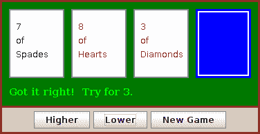

面板的完整源代码可以在文件 [HighLowGUI.java](https://math.hws.edu/eck/cs124/javanotes9/source/chapter6/HighLowGUI.java) 中找到。我鼓励你编译并运行它。记得你还需要 [Card.java](https://math.hws.edu/eck/cs124/javanotes9/source/chapter6/Card.java)、[Deck.java](https://math.hws.edu/eck/cs124/javanotes9/source/chapter6/Deck.java) 和 [Hand.java](https://math.hws.edu/eck/cs124/javanotes9/source/chapter6/Hand.java)，因为它们定义了程序使用的类。

此示例中主面板的整体结构应该相当清晰：它在主面板底部的子面板中有三个按钮，并有一个用于显示纸牌和消息的大型绘制表面。（在这个示例中，纸牌和消息不是组件；它们是在面板的 `paintComponent()` 方法中使用图形上下文中绘制的。）主面板使用了 `BorderLayout`。绘制表面占据了边界布局的 `CENTER` 位置。包含按钮的子面板占据了边界布局的 `SOUTH` 位置，而边界布局的其他三个位置是空的。

绘制表面由一个名为 `CardPanel` 的嵌套类定义，该类是 `JPanel` 的子类。我选择让绘制表面对象承担游戏的大部分工作：它监听来自三个按钮的事件，并通过采取适当的操作来响应。主面板由 `HighLowGUI` 定义，它也是 `JPanel` 的子类。`HighLowGUI` 的构造函数创建了所有其他组件：

```java
public HighLowGUI() {   // 构造函数。
```

我们不希望用户在游戏进行期间启动一个新游戏。那样将是作弊。因此，`newGame()` 方法中的响应取决于状态变量 `gameInProgress` 是为 `true` 还是 `false`。如果游戏正在进行，则应该将消息实例变量设置为适当的消息。如果游戏没有进行，则应将所有状态变量设置为适用于新游戏开始的适当值。无论何种，都必须重新绘制画板，以便用户能够看到状态已改变。完整的 `newGame()` 方法如下：

```java
/**
 * 由 CardPanel 构造函数调用，并在用户点击
 * "New Game" 按钮时调用。开始一个新游戏。
 */
void doNewGame() {
   if (gameInProgress) {
         // 如果当前游戏尚未结束，尝试开始
         // 一个新游戏是错误的。
      message = "You still have to finish this game!";
      repaint();
      return;
   }
   deck = new Deck();   // 创建用于此游戏的牌组和手牌。
   hand = new Hand();
   deck.shuffle();
   hand.addCard( deck.dealCard() );  // 将第一张牌发到手牌中。
   message = "Is the next card higher or lower?";
   gameInProgress = true;
   repaint();
} // end doNewGame()
```

`doHigher()` 和 `doLower()` 方法几乎相同（如果我更聪明一点，它们可能可以合并为一个带参数的方法）。让我们来看 `doHigher()` 例程。它在用户点击 "Higher" 按钮时被调用。这只有在游戏进行期间才有意义，所以 `doHigher()` 做的第一件事应该是检查状态变量 `gameInProgress` 的值。如果值为 `false`，那么 `doHigher()` 只需要设置一个错误消息。如果游戏正在进行，则应向手牌中添加一张新牌，并测试用户的预测。用户此时可能会赢或输。如果是这样，状态变量 `gameInProgress` 的值必须设置为 `false`，因为游戏已经结束了。无论何种，都会重新绘制画板以显示新状态。这里是 `doHigher()` 方法：

```java
/**
 * 当用户点击 "Higher" 按钮时调用。
 * 检查用户的预测。如果用户猜错
 * 或用户进行了三次正确的预测，游戏结束。
 */
void doHigher() {
   if (gameInProgress == false) {
         // 如果游戏已经结束，点击 "Higher" 是错误的，
         // 所以设置一个错误消息并终止处理。
      message = "Click \"New Game\" to start a new game!";
      repaint();
      return;
   }
   hand.addCard( deck.dealCard() );     // 将一张牌发到手牌。
   int cardCt = hand.getCardCount();
   Card thisCard = hand.getCard( cardCt - 1 );  // 刚发的牌。
   Card prevCard = hand.getCard( cardCt - 2 );  // 上一张的牌。
   if ( thisCard.getValue() < prevCard.getValue() ) {
      gameInProgress = false;
      message = "Too bad! You lose.";
   }
   else if ( thisCard.getValue() == prevCard.getValue() ) {
      gameInProgress = false;
      message = "Too bad!  You lose on ties.";
   }
   else if ( cardCt == 4) {  // 手牌满了，在三次正确的猜测之后。
      gameInProgress = false;
      message = "You win!  You made three correct guesses.";
   }
   else {
      message = "Got it right!  Try for " + cardCt + ".";
   }
   repaint();
} // end doHigher()
```

`CardPanel` 类的 `paintComponent()` 方法使用状态变量中的值来决定绘制内容。它显示存储在 `message` 变量中的字符串。它绘制手牌中的每张牌。有一个小技巧：如果游戏正在进行，它会额外绘制一张背朝牌（不在手牌中），代表牌组中的下一张牌。绘制牌需要一些小心和计算。我写了一个方法 `void drawCard(Graphics g, Card card, int x, int y)`，用于绘制一张牌。

`[MosaicDraw.java](https://math.hws.edu/eck/cs124/javanotes9/source/chapter6/MosaicDraw.java)` 文件是一个简单的类，其中只包含程序的 `main()` 程序。`MosaicDraw` 的大部分编程代码可以在 `[MosaicDrawController.java](https://math.hws.edu/eck/cs124/javanotes9/source/chapter6/MosaicDrawController.java)` 中找到（如果我没有决定直接使用那个未经修改的现有类，它可能被放在 `MosaicCanvas` 类中）。是 `MosaicDrawController` 类创建了 `MosaicCanvas` 对象并向其添加了鼠标监听器。它还创建了显示程序顶部的菜单栏，并实现了菜单栏中的所有命令。它有一个实例方法 `getMosaicCanvas()`，用于返回它所创建的 `MosaicCanvas` 的引用；还有另一个实例方法 `getMenuBar()`，用于返回程序的菜单栏。这些方法用于获取画布和菜单栏，以便将它们添加到程序的窗口中。

我敦促你仔细学习 `MosaicDrawController.java` 和 `MosaicDraw.java`。我在这里不会讨论代码的所有方面，但你在阅读完这一节后应该能够理解全部。至于 `MosaicCanvas.java`，它使用了一些你现在还理解的技术，但我鼓励你至少阅读该文件中的注释，以了解 `MosaicCanvas` 的 API。

***

### 6.7.1 菜单与菜单栏

MosaicDraw 是我们看到的第一个菜单栏的示例。幸运的是，Java 中的菜单非常容易使用。菜单中的项由 `JMenuItem` 类表示（该类和其他与菜单相关的类位于 `javax.swing` 包中）。菜单项的使用方式与按钮几乎相同。事实上，`JMenuItem` 和 `JButton` 都是类 `AbstractButton` 的子类，该类定义了它们的共同行为。特别是，`JMenuItem` 是通过一个指定菜单项文本的构造函数创建的，例如：

```java
JMenuItem fillCommand = new JMenuItem("Fill");
```

你可以通过调用菜单项的 `addActionListener()` 方法为 `JMenuItem` 添加一个 `ActionListener`。当用户从菜单中选择该项时，动作监听器的 `actionPerformed()` 方法会被调用。你可以通过调用它的 `setText(String)` 方法更改项的文本，并可以使用 `setEnabled(boolean)` 方法启用或禁用它。这一切的工作方式与 `JButton` 完全相同。

当然，菜单项与按钮之间的主要区别是，菜单项出现在菜单中，而不是面板中。Java 中的菜单由 `JMenu` 类表示。`JMenu` 有一个名称（该名称在构造函数中指定），并且它有一个 `add(JMenuItem)` 方法，可以将 `JMenuItem` 添加到菜单中。例如，MosaicDraw 程序中的“Tools”菜单可以如下所示创建，其中 `listener` 是一个 `ActionListener` 类型的变量：

```java
JMenu toolsMenu = new JMenu("Tools");  // 创建一个名为 "Tools" 的菜单
JMenuItem drawCommand = new JMenuItem("Draw");   // 创建一个菜单项。
drawCommand.addActionListener(listener);         // 为菜单项添加监听器。
toolsMenu.add(drawCommand);                     // 将菜单项添加到菜单。
```

```java
JMenuItem eraseCommand = new JMenuItem("Erase"); // 创建菜单项。
eraseCommand.addActionListener(listener);        // 为菜单项添加监听器。
toolsMenu.add(eraseCommand);                     // 将菜单项添加到菜单。
```

一旦创建了菜单栏，就必须将其添加到框架（frame）中。菜单栏由 `JMenuBar` 类表示。`JMenuBar` 只是菜单的容器。它没有名称。它有一个 `add(JMenu)` 方法。MosaicDraw 程序使用了三个菜单：`controlMenu`、`colorMenu` 和 `toolsMenu`。

```java
JMenuBar menuBar = new JMenuBar();
menuBar.add(controlMenu);
menuBar.add(colorMenu);
menuBar.add(toolsMenu);
```

使用菜单的最后一步是在如 `JFrame` 的窗口中使用菜单栏。我们已经看到框架有一个“内容面板”。`JFrame` 类有一个实例方法 `setMenuBar(JMenuBar)`，用于设置菜单栏（由于只有一个菜单栏，所以是 set 方法而不是 add 方法）。在 MosaicDraw 程序中，菜单栏由 `MosaicDrawController` 对象创建，并可以通过调用该对象的 `getMenuBar()` 方法获取。`MosaicDraw.java` 中的 `main()` 程序获取菜单栏并将其添加到窗口。以下是用于设置界面的经过稍微修改的基础代码：

```java
MosaicDrawController controller = new MosaicDrawController();
MosaicCanvas content = controller.getMosaicCanvas();
window.setContentPane(content);  // 使用控制器的面板。
JMenuBar menuBar = controller.getMenuBar();
window.setMenuBar(menuBar);    // 使用控制器的菜单栏。
```

使用菜单始终遵循相同的模式：创建一个菜单栏。创建菜单并将其添加到菜单栏。创建菜单项并添加到菜单中（设置监听以处理菜单项的动作事件）。通过调用窗口的 `setMenuBar()` 方法在窗口中使用菜单栏。

***

其他类型的菜单项由 `JMenuItem` 的子类定义，也可以添加到菜单中。其中之一是 `JCheckBoxMenuItem`，它表示可以处于两种状态（选中或未选中）的菜单项。`JCheckBoxMenuItem` 具有与 `JCheckBox` 相同的功能且使用方式相同。MosaicDraw 程序的“Control”菜单使用了三个 `JCheckBoxMenuItem`。一个用于开启或关闭方块的随机颜色变化。另一个用于开启或关闭对称功能；当开启对称时，用户的绘制会在水平和垂直方向反射以产生对称图案。第三个复选框菜单项显示或隐藏马赛克中的“缝隙”（grouting）；缝隙是在马赛克中每个小正方形周围的灰色线条。对应“Control”菜单中“Use Randomness”选项的菜单项可以使用以下语句设置：

```java
JMenuItem useRandomnessToggle = new JCheckBoxMenuItem("Use Randomness");
useRandomnessToggle.addActionListener(listener);  // 设置监听器。
useRandomnessToggle.setSelected(true);  // 随机功能初始开启。
controlMenu.add(useRandomnessToggle);   // 将菜单项添加到菜单中。
```


在我的程序中，“使用随机性”`JCheckBoxMenuItem` 对应于`MosaicDrawController`类中名为`useRandomness`的布尔实例变量。该变量是控制器对象状态的一部分。每当用户绘制其中一个方格时，都会测试该变量的值，以决定是否为方格颜色添加随机变化。当用户从菜单中选择“使用随机性”命令时，`JCheckBoxMenuItem`的状态会反转，从已选中变为未选中，或从未选中变为已选中。菜单项的`ActionListener`会检查菜单项是否被选中，并相应地更改`useRandomness`的值。注意，选择菜单命令不会对窗口显示的图片产生任何直接影响。它只是改变了程序的状态，使得用户后续的绘制操作将产生不同的效果。“控制”菜单中的“使用对称性”选项的工作方式非常相似。“显示缝隙”选项则略有不同。选择“显示缝隙”选项会有即时影响：程序将根据菜单项的状态，带有或不带缝隙地重新绘制图片。

我的程序使用单一的`ActionListener`来响应所有菜单中的所有菜单项。这并不是特别好的设计，但对于像这样的小型程序来说，它是很容易实现的，而且它将所有响应菜单项的程序代码放在同一个地方。监听器对象的`actionPerformed()`方法使用以下语句：

```
String command = evt.getActionCommand();
```

来获取事件源的动作命令；这将是菜单项的文本。监听器通过测试`command`的值来确定用户选择了哪一个菜单项。

当菜单项为`JCheckBoxMenuItem`时，监听器必须检查菜单项的状态。监听器可以通过调用`evt.getSource()`获取菜单项对象。由于`getSource()`的返回值是`Object`类型，因此必须将返回值强制转换为正确的类型。这里这里是处理“使用随机性”命令的代码：

```
if (command.equals("Use Randomness")) {

        // 根据菜单项的状态设置 useRandomness 的值。

   JCheckBoxMenuItem toggle = (JCheckBoxMenuItem)evt.getSource();

   useRandomness = toggle.isSelected();

}
```

（`actionPerformed()`方法使用了一个相当长的`if..then..else`语句来检查所有可能的动作命令。使用`command`作为选择器并将所有可能的动作命令作为`case`的`switch`语句可能会更自然且更高效。）

***

除了菜单项外，菜单还可以包含将菜单项分组的隔符线。在`MosaicDraw`程序中，“控制”菜单就包含这样一个分隔符。`JMenu`有一个实例方法`addSeparator()`，可以用于向菜单添加分隔符。例如，“控制”菜单中的分隔符是通过以下语句创建的：

```
controlMenu.addSeparator();
```

菜单还可以包含子菜单。子菜单的名称会作为一个项出现在主菜单中。当用户将鼠标移动到子菜单名称上时，子菜单就会弹出。（`MosaicDraw`程序中没有这方面的示例。）在`Java`中实现这一点容易：你可以使用类似`mainMenu.add(submenu)`的语句将一个`JMenu`添加到另一个`JMenu`中，它就变成了子菜单。

***

### 6.7.2 对话框 (Dialogs)

`MosaicDraw`程序“颜色”菜单中的命令之一是“自定义颜色...”。用户选择此命令时，会出现一个新窗口，用户可以在其中选择颜色。这个窗口是对话框（dialog）或对话框（dialog box）的一个示例。对话框是一种窗口，通常用于与用户进行短时间的、单一目的的交互。例如，对话框可以用于向用户显示消息、向用户提问、让用户选择要打开的文件或让用户选择一种颜色。在`Swing`中，对话框由属于`JDialog`类或其子类的对象表示。

`JDialog`类与`JFrame`非常相似，使用方式也大相同。像框架（frame）一样，对话框是一个独立的窗口。但与框架不同，对话框并不完全独立。每个对话框都关联一个框架（或另一个对话框），称为它的父窗口。对话框依赖于父窗口。例如，如果父窗口被关闭，对话框也将被关闭。可以在不指定父窗口的情况下创建对话框，但在那种情况下系统会创建一个不可见的框架作为父窗口。

对话框可以是模态的（modal）的，也可以是非非模态的（modeless）的。当创建一个模态对话框时，它的父框架会被阻塞。也就是说，用户在对话框关闭之前无法与父窗口交互。非模态对话框不会以相同的方式阻塞父窗口，因此它们看起来更像独立的窗口。在实践中，模态对话框更容易使用，并且比非模态对话框常见得多。我们将看到的所有示例都是模态的。

除了有一个父窗口外，`JDialog`可以像`JFrame`一样被创建和使用。然而，我在这里不会提供直接使用`JDialog`的示例。`Swing`有许多方便的方法来创建常见类型的对话框。例如，用户在`MosaicDraw`程序中选择“自定义颜色”命令时出现的颜色选择对话框属于`JColorChooser`类，它是`JDialog`的子类。`JColorChooser`类有一个静态方法可以让颜色选择对话框非常易用：

```
Color JColorChooser.showDialog(Component parentComp, String title, Color initialColor)
```

当你调用此方法时，会出现一个允许用户选择颜色的对话框。第一个参数指定对话框的父级；对话框的父窗口将包含`parentComp`的窗口（如果有）；该参数可以为空。第二个参数出现在对话框标题栏的字符串。第三个参数`initialColor`指定对话框首次出现时选中的颜色。对话框有一个复杂的界面，允许用户选择颜色。当用户按下“确定”按钮时，对话框关闭，选定的颜色作为方法的值返回。用户也可以点击“取消”按钮或通过其他方式关闭对话框；在这种情况下将返回`null`作为方法的值。这是一个模态对话框，在用户以某种方式关闭对话框之前，`showDialog()`不返回。通过使用这个预定义的颜色选择器对话框，你可以编写一行代码让用户选择任意颜色。`Swing`还有一个`JFileChooser`类，可以几乎同样容易地显示让用户选择要打开或保存文件的对话框。

***

`JOptionPane`类包含了多种方法，用于制作简单的对话框，这些对话框是三种基本类型的变体：消息（message）对话框、确认（confirm）对话框和输入（input）对话框。（这些变体允许你为对话框提供标题、指定在对话框中显示的图标，并向对话框中添加其他组件。我在这里只介绍最基本的形式。）

消息对话框简单地向用户显示一条消息字符串。用户（希望如此）会阅读消息并通过点击“确定”按钮关闭对话框。可以通过调用静态方法显示消息对话框：

```
void JOptionPane.showMessageDialog(Component parentComp, String message)
```

消息可以是多行的。消息中的行之间应该用换行符`\n`分隔。即使消息非常长，系统也不会自动插入换行。例如，假设特殊变量`this`指向一个`Component`：

```
JOptionPane.showMessageDialog( this, "This program is about to crash!\n"
                                      + "Sorry about that.");
```

输入对话框显示一个问题或请求，并允许用户输入字符串作为响应。你可以通过调用以下方法显示输入对话框：

```
String JOptionPane.showInputDialog(Component parentComp, String question)
```

同样，`parentComp`可以为`null`，且`question`可以包含换行符。对话框将包含一个输入框、一个“OK”按钮和一个“Cancel”按钮。如果用户点击“Cancel”或通过其他方式关闭对话框，则该方法的返回值为`null`。如果用户点击“OK”，则返回值为用户输入的字符串。注意，如果用户在没有在输入框中输入任何内容的情况下点击了“OK”，返回值可能是一个空字符串（这与`null`值不同）。如果你想使用输入对话框从用户处获取数值，你必须将返回值转换为数字（参见第 3.7.2 节）。例如：

```
String name;

name = JOptionPanel.showInputDialog(null, "Hi!  What's your name?");

if (name == null)

   JOptionPane.showMessageDialog(null, "Well, I'll call you Grumpy.");

else

   JOptionPane.showMessageDialog(null, "Pleased to meet you, " + name);
```

最后，确认对话框呈现一个问题和三个响应按钮：“Yes”、“No”和“Cancel”。可以通过调用以下方法显示确认对话框：

```
int JOptionPane.showConfirmDialog(Component parentComp, String question)
```

返回值告诉你用户的响应。它是以下常量之一：

*   `JOptionPane.YES_OPTION` — 用户点击了“Yes”按钮
*   `JOptionPane.NO_OPTION` — 用户点击了“No”按钮
*   `JOptionPane.CANCEL_OPTION` — 用户点击了“Cancel”按钮
*   `JOptionPane.CLOSE_OPTION` — 对话框通过其他方式关闭。

顺便说一下，通过调用`JOptionPane`类中的其他方法，可以在确认对话框中省略`Cancel`按钮。只需调用：

```
JOptionPane.showConfirmDialog(

                parent, question, title, JOptionPane.YES_NO_OPTION )
```

最后一个参数是一个常量，指定只使用一个“Yes”按钮和一个“No”按钮。第三个参数是一个字符串，将作为对话框窗口的标题显示。

小型演示程序`SimpleDialogDemo.java`可以演示`JColorChooser`和几个`JOptionPane`对话框。

***

### 6.7.3 Frame 的细节

在之前的章节中，每当我使用帧（frame）时，我会在`main()`程中创建一个`JFrame`对象，并将面板（panel）安装该帧的内容区域（content pane）。这种方法运行良好，但一种更面向对象的方法是定义`JFrame`的子类，并在类的构造函数中设置帧的内容。这就是我在处理`MosaicDraw`程序时的做法。`MosaicDraw`被定义为`JFrame`的子类。该类的定义非常短，但它展示了我想讨论的帧的几个新特性：

```java
public class MosaicDraw extends JFrame {

   public static void main(String[] args) {

      JFrame window = new MosaicDraw();

      window.setDefaultCloseOperation(JFrame.EXIT_ON_CLOSE);

      window.setVisible(true);

   }

   public MosaicDraw() {

      super("Mosaic Draw");

      MosaicDrawController controller = new MosaicDrawController();

      setContentPane( controller.getMosaicCanvas() );

      setJMenuBar( controller.getMenuBar() );

      pack();

      Dimension screensize = Toolkit.getDefaultToolkit().getScreenSize();

      setLocation( (screensize.width - getWidth())/2, 

                                 (screensize.height - getHeight())/2 );

   }

}
```

该类的构造函数以`super("Mosaic Draw")`语句开始，这调用了父类`JFrame`的构造函数。参数指定了将出现在窗口标题栏中的标题。构造函数的接下来三行设置了窗口的内容；创建了一个`MosaicDrawController`，并从控制器中获取窗口的内容区域和菜单栏。下一行是新内容。如果`window`是一个`JFrame`类型（或`JDialog`）的变量，那么`window.pack()`语句将调整窗口的大小，使其与内容的首选尺寸相匹配（在这种情况下，当然，"pack()"等同于`this.pack()`；也就是说，它指向由构造函数正在创建的窗口）。`pack()`方法通常是设置窗口大小的最佳方法。注意，只有当窗口中的每个组件都具有正确的首选尺寸时，它才能正常工作。这在两种情况下会成为问题：当面板用作绘图表面时以及当面板用作带有空布局管理器的容器时。在这两种情况下，系统无法自动确定正确的首选尺寸，你应该手动设置首选尺寸。例如：

```
panel.setPreferredSize( new Dimension(400, 250) );
```

构造函数中的最后两行设置窗口的位置，使其居中屏幕。这行代码

```
Dimension screensize = Toolkit.getDefaultToolkit().getScreenSize();
```

确定了屏幕的大小。水平方向为`screensize.width`像素，垂直方向为`screensize.height`像素。`setLocation()`方法设置帧左上角在屏幕上的位置。表达式`screensize.width - getWidth()`是减去窗口宽度后剩余的水平空间，除以 2 使得一半空间会在窗口的左侧，另一半在右侧。同样，一半的垂直空间在窗口上方，另一半在下方。

注意，构造函数创建了窗口并设置了它的尺寸和位置，但在构造函数结束时，窗口尚未可见。（更准确地说，构造函数创建了对象，但该对象在屏幕上的视觉表示尚未创建。）要在屏幕上显示窗口，必须调用它的实例方法`window.setVisible(true)`。

除了构造函数，`MosaicDraw`类还包含一个`main()`方法。这使得可以将`MosaicDraw`作为独立应用程序运行。（`main()`方法作为静态方法，与`MosaicDraw`对象的功能无关，它可以（可能应该）放在单独的类中。）`main()`方法创建一个`MosaicDraw`并使其在屏幕上可见。它还调用了

```
window.setDefaultCloseOperation(JFrame.EXIT_ON_CLOSE);
```

这意味着当用户关闭窗口时程序将结束。注意没有在构造函数中这样做，因为这样做会降低`MosaicDraw`的灵活性。例如，可以编写一个允许用户打开多个`MosaicDraw`窗口的程序。在这种情况下，我们不希望只关闭其中一个窗口就关闭整个程序。窗口的默认关闭操作还有其他可能的值：

*   `JFrame.DO_NOTHING_ON_CLOSE` — 用户通过点击关闭框关闭窗口的尝试将被忽略，但会产生一个`WindowEvent`事件。程序可以监听此事件，并在用户尝试关闭窗口时采取任何操作。
*   `JFrame.HIDE_ON_CLOSE` — 当用户点击关闭框时，窗口将被隐藏，就好像调用了`window.setVisible(false)`一样。可以通过调用`window.setVisible(true)`使窗口再次可见。如果你没有通过调用`setDefaultCloseOperation`指定其他值，则使用的就是这个值。
*   `JFrame.DISPOSE_ON_CLOSE` — 窗口被关闭，窗口所使用的任何操作系统资源都会被释放。无法再次使窗口可见。（这是在不结束程序的情况下永久移除窗口的正确方法。你可以通过调用实例方法`window.dispose()`以编程的方式实现相同的操作。）

***

### 6.7.4 创建 Jar 文件

Java 类和资源文件通常在 jar（`java archive archive`）文件中分发。对于一个由多个文件组成的程序，将它们打包成单个 jar 文件是有有意义的。作为本章的最后一个主题，我们将查看如何实现这一点。程序可以直接从 jar 文件运行，而无需将其解包。jar 文件可以是“可执行的”，这意味着它指定了包含`main()`例程的类，该例程将在执行 jar 文件时运行。如果你有一个不需要依赖 jar 文件外部任何资源的可执行型 jar 文件，你可以使用格式如下的命令在命令行上运行它：

```
java -jar JarFileName.jar
```

你甚至可能通过在文件浏览器窗口中双击其图标来运行该 jar 文件。如果 jar 文件不是可执行的，你可以将包含主程序的类名添加到命令中：

```
java -jar JarFileName.jar MyMainClass
```


那么，问题在于如何创建 jar 文件。答案取决于你正在使用的编程环境。两种基本类型的编程环境——命令行和 IDE——在[第 2.6 节]中讨论过。

任何 Java 的 IDE（集成开发环境）都应该有一个创建 jar 文件的命令。例如在 Eclipse IDE 中，可以通过以下方式完成：

在包管理器（Package Explorer）面板中，选择编程项目（或仅你想包含的所有单独源文件和资源文件）。在选择上点击右键，从弹出的菜单中选择“导出（Export）”。在出现的窗口中，选择“JAR file”并点击“下一步（Next）”。

在接下来出现的窗口中，在标记为“JAR file”的框中输入 jar 文件的完整路径。（点击此框旁的“浏览”按钮可以使用文件对话框选择文件名。）文件名应以`.jar`结尾。

如果你正在创建一个普通的 jar 文件而不是可执行文件，此时可以点击“完成（Finish）”，jar 文件就会被创建。要创建一个可执行文件，双击“下一步”按钮进入“Jar 清单规范（Jar Manifest Specification）”屏幕。

在该屏幕的底部有一个标记为“主类（Main class）”的输入框。你必须输入包含`main()`例程的类名，该例程将在执行 jar 文件时运行。如果你点击“Main class”框旁的“浏览”按钮，可以从包含`main()`例程的类列表中选择该类。一旦选择了主类，就可以点击“完成”按钮创建可执行型 jar 文件。

在命令行上创建 jar 文件也是可能的。Java 开发工具包（Java Development Kit）包含一个名为`jar`的命令行程序，可用于创建 jar 文件。

如果你的所有类都在默认包中（如书中的大多数示例所示），那么`jar`命令很容易用。要在命令行上创建一个非可执行的 jar 文件，请切换到包含你想包含在 jar 中的类文件的目录。然后给出命令：

```bash
jar cf JarFileName.jar *.class
```

其中`JarFileName`可以是你任何想要用于 jar 文件的名称。`*.class`中的`*`是一个通配符，它使`*.class`匹配当前目录下的每个类文件。这意味着目录中的所有类文件都将包含在 jar 文件中。

如果你只想包含某些类文件，可以单独命名它们并用空格分隔。如果程序使用了资源文件（如图像），它们也应该在命令中列出。

（如果你的类和资源不在默认包中，情况会变得复杂。在这种情况下，文件必须位于你执行`jar`命令的目录的子目录下，并且必须在名称中包含文件的路径。例如：MacOS 和 Linux 上的`textio/TextIO.class`，或者 Windows 上的`textio\TextIO.class`。）

在命令行上创建可执行 jar 文件只稍微复杂一点。必须有一种方法来指定哪个类包含`main()`例程。这可以通过向命令添加`-e`选项来实现，其值为运行 jar 文件运行时时要执行的类的全限定名。

例如，如果类名为`MyMainClass`，则可以使用以下命令创建 jar 文件：

```bash
jar -c -f JarFileName.jar -e MyMainClass *.class
```

对于定义在两个包`grapher.ui`和`grapher.util`中的程序，其主类定义在包`grapher.ui`中的`Main.java`文件中，命令将变为：

```bash
jar -c -f Grapher.jar -e grapher.ui.Main grapher/ui/*.class grapher/util/*.class
```

但在 Windows 上，斜杠将被替换为反斜杠。

（选项`-c`、`-f`和`-e`是长形式`--create`、`--file`和`--main-class`的缩写，如果你倾向于清晰而非简洁，可以使用这些长形式。）

### 6.7.5 `jpackage`

你可以将程序的类文件和资源文件收集到一个 jar 文件中，并将该 jar 文件交给想要使用你程序的人。然而，那个人仍然需要在计算机上安装 Java——除非那是一个 Java 开发者。

一种解决方案是将 Java 虚拟机与你的程序打包在一起。Java 开发工具包包含了`jpackage`命令来实现这一点。`jpackage`命令可以创建一个包含运行程序所需支持的程序。

它有一些限制。它只能为你正在使用的计算机和操作系统创建程序；例如，无法在 Linux 上使用`jpackage`创建 Windows 程序。而且生成的文件巨大，因为它们必须包含大量的 Java 运行环境。因此`jpackage`实际上用于封装大型应用程序。

但如果你想尝试，这里有一个基础示例，使用了`jpackage`可用的部分选项。

要使用`jpackage`，你需要一个包含程序类和资源的 jar 文件。扑牌游戏使用了来自`netgame.common`和`netgame.fivecarddraw`包的类，加上`netgame.fivecarddraw`中的资源图像`cards.png`。

为了制作 jar 文件，我首先在包含`netgame`目录中通过以下命令编译 java 文件：

```bash
javac netgame/common/*.java netgame/fivecarddraw/*.java
```

然后使用此命令创建 jar 文件`Poker.jar`：

```bash
jar -c -f Poker.jar netgame/common/*.class netgame/fivecarddraw/*.class \
    netgame/fivecarddraw/cards.png
```

将图像资源文件与类文件一起很重要。（注意在 Windows 上，斜杠`/`将替换为反斜杠`\`。）

我将`Poker.jar`移动到一个新目录。在新目录中，我使用了以下`jpackage`命令，再次单行输入：

```bash
jpackage --input . --main-jar Poker.jar --main-class netgame.fivecarddraw.Main --name NetPoker
```

`--input`选项的值是一个点（`.`），代表当前工作目录；它可以被替换为包含`Poker.jar`的目录路径。

`--main-class`选项的值是包含主程序的类的全名；如果 jar 文件是可执行的，则不需要此选项。`--name`选项的值用于命名安装程序以及它将要安装的可执行文件名称。

在我运行 Linux Mint 的电脑上使用时，这生成了一个名为`netpoker_1.0-1_amd64.deb`的文件，我随后可以按照通常的方式安装它。它将 poker 可执行文件安装在了`/opt/netpoker/bin/NetPoker`。

在 MacOS 10.15 上，使用来自 adoptium.net 的 JDK（参见第 2.6.1 节），我发现`jpackage`作为 JDK 的一部分安装了，但在命令行中不可用。我可以自己将其定义为别名（alias）：

```bash
alias jpackage="/Library/Java/JavaVirtualMachines/temurin-17.jdk/Contents/Home/bin/jpackage"
```


再次，将以上所有内容写在同一行。完成后，我使用了与上面相同的命令。结果是一个包含程序 `netpoker.app` 的 `.dmg` 文件，可以通过双击运行。（在较新版本的 MacOS 中，`jpackage` 命令可能已经正确设置好了。）

`jpackage` 命令在 Windows 上也应该有效，但它除了 JDK 之外，还需要一个被称为“WiX toolset”的工具。我还没有尝试过。

## 第 6 章编程练习

* * *

### 练习 6.1

在第 6.3.3 节的 `SimpleStamper` 示例中，当用户点击鼠标时，面板上会绘制矩形或椭圆。但当用户按住 Shift 点击（shift-clicks）时，面板会被清空。修改该类，使得修改后的版本在拖拖鼠标时继续绘制图形。也就是说，鼠标拖动时会留下图形轨迹。然而，如果用户按住 Shift 点击，面板应该直接清空，即使用户在 Shift 点击后拖动鼠标，也不应绘制任何图形。这里是我的解决方案图片：

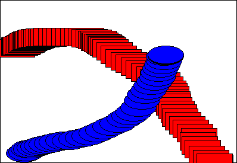

原始程序的源码为 [SimpleStamper.java](https://math.hws.edu/eck/cs124/javanotes9/source/chapter6/SimpleStamper.java)。参见第 6.3.4 节关于拖动的讨论。（注意，原始版本使用黑色背景，且每个图形周围有黑色边框。这在处理间距密集的的图形时效果不佳，因此新版本使用了白色背景。）

如果你想让问题更具挑战性，在拖动操作绘制图形时，确保绘制的图形之间至少间隔 5 像素。为了实现这一点，你需要跟踪上一个绘制图形的位置。

查看解决方案

* * *

### 练习 6.2

编写一个显示一个小红色正方形和一个蓝色正方形的程序。用户可以用鼠标拖动任何一个正方形（你需要一个实例变量来记住用户正在拖动哪一个）。用户可以将正方形拖出面板；如果她这样做了，就没有办法把它放回来了。

注意，对于这个练习，你应该尽可能在 `paintComponent()` 方法中进行所有绘制操作。

查看解决方案

* * *

### 练习 6.3

编写一个显示一对骰子的程序。当用户点击绘制骰子的面板时，骰子应该滚动（即分配新计算的随机值）。每个骰子都应该绘制为显示 1 到 6 个点。由于你需要绘制两个骰子，写一个子程序 `void drawDie(Graphics g, int val, int x, int y)` 在指定的 `(x,y)` 坐标处绘制骰子是一个好主意。第二个参数 `val` 指定骰子上显示的数值。假设面板的大小为 1000 像素。以下是显示骰子的面板图片：

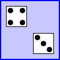

查看解决方案

* * *

### 练习 6.4

在练习 6.3 中，你写了一个在用户点击面板时骰子滚动的骰子面板。现在写一个通过点击按钮来滚动骰子的骰子程序。按钮应该出现在显示骰子的面板下方。还要进行以下更改：当骰子滚动时，不要只显示新值，而是显示一段动画，在此期间骰子数值每帧都会变化。动画应该让骰子看起来更像真的在滚动。

查看解决方案

* * *

### 练习 6.5

在练习 3.8 中，你写了一个用户可以选择正方形的程序。在这个练习中，用户可以通过向 `JTextField` 输入数字并按回车键来输入数字。应该有一个“Clear”按钮可以清除所有数据。这意味着创建一个新的 `StatCalc` 对象并重置标签上的显示。我的面板还有一个“Enter”按钮，其功能与在 `JTextField` 中按回车键相同。（记住，当用户按回车键时 `JTextField` 会产生 `ActionEvent`，因此你的面板应该注册以监听来自 `JTextField` 以及按钮的 `ActionEvent`。）

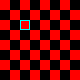

查看解决方案

* * *

### 练习 6.6

对于这个练习，你应该修改来自第 6.4 节的现有游戏 `SubKiller`。它跟踪命中和缺失并显示这些数量。也就是说，每当深弹炸毁潜艇时，命中次数加一。每当深弹从屏幕底部落下未命中潜艇时，缺失次数加一。面板顶部有空间显示这些数字。完成这个练习，你只需要在源码中添加六行代码。但你必须找出它们是什么以及加在哪里。为了做到这一点，你必须仔细阅读源码以理解其工作原理。

查看解决方案

* * *

### 练习 6.7

练习 5.2 涉及一个类 [StatCalc.java](https://math.hws.edu/eck/cs124/javanotes9/source/chapter5/StatCalc.java)，它可以计算一组数字的某些统计数据。写一个 GUI 程序，使用 `StatCalc` 类计算并显示用户输入数字的统计数据。面板将有一个类型为 `StatCalc` 的实例变量来执行计算。面板应该包含一个 `JTextField` 供用户输入数字。它应该有四个标签，显示已输入数字的四个统计数据：数量、总和、平均值和标准差。每当用户输入新数字时，标签上显示的统计数据就会变化。用户通过向 `JTextField` 输入数字并按回车键来输入。应该有一个“Clear”按钮可以清除所有数据。这意味着创建一个新的 `StatCalc` 对象并重置标签上的显示。我的面板还有一个“Enter”按钮，其功能与在 `JTextField` 中按回车键相同。

这是我对该问题的解决方案图片：

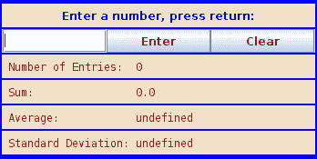

查看解决方案

* * *

### 练习 6.8

编写一个程序，包含一个 `JTextArea`，用户可以在其中输入文本。然后，程序应该有一个按钮，当用户点击该按钮时，面板将统计用户输入的行数、单词数和字符数。这些信息应该显示在三个标签（labels）上。记住，如果 `textInput` 是一个 `JTextArea`，你可以通过调用函数 `textInput.getText()` 来获取 `JTextArea` 的内容。该函数返回一个包含文本区域所有文本的 `String`。字符数就是该 `String` 的长度。`String` 中的行由换行符 `'\n'` 分隔，因此行数就是该 `String` 中换行符的数量加一。单词的计数起来要难一些。练习 3.4 提供了一些关于如何在 `String` 中查找单词的建议。本质上，你想要统计作为单词起始字符的字符数量。不要忘记将你的 `JTextArea` 放入 `JScrollPane` 中，并将滚动面板添加到容器中，而不是文本区域。当用户输入的文本超过可用区域的显示范围时，应该出现滚动条。这是我的解决方案的图片：

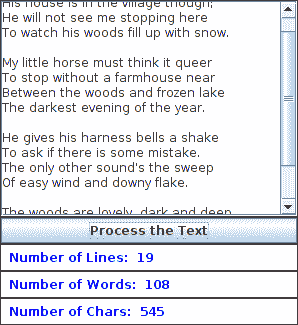

查看解决方案

### 练习 6.9

多边形是由一系列连接线段组成的几何图形。线段相交的点称为多边形的顶点。`Graphics` 类包含了绘制和填充多边形的命令。对于这些命令，多边形的顶点坐标存储在数组中。如果 `g` 是 `Graphics` 类型的变量，那么：

*   `g.drawPolygon(xCoords, yCoords, pointCt)` 将绘制多边形的轮廓，顶点位于 `(xCoords[0],yCoords[0])`、`(xCoords[1],yCoords[1])`、……`(xCoords[pointCt-1],yCoords[pointCt-1])`。第三个参数 `pointCt` 是一个 `int`，用于指定多边形的顶点数量。它的值应该是 3 或更大。前两个参数是 `int[]` 类型的数组。注意，多边形会自动包含一条从最后一点 `(xCoords[pointCt-1],yCoords[pointCt-1])` 回到起始点 `(xCoords[0],yCoords[0])` 的线。

*   `g.fillPolygon(xCoords, yCoords, pointCt)` 用当前的绘制颜色填充多边形的内部。参数的含义与 `drawPolygon()` 方法中相同。注意，多边形的边相互交叉是可以允许的，但自交多边形的内部可能与你预期的完全不同。

编写一个程序让用户绘制多边形。当用户点击一系列点时，统计这些点并将它们的 x 和 y 坐标存储在两个数组中。这些点将成为多边形的顶点。在用户创建多边形时，你应该只用线段连接所有点。当用户点击靠近起始点时，绘制完整的多边形。用红色填充和黑色边框绘制。一旦用户完成了一个多边形，下一次点击将清除数据并从头开始一个新的多边形。所有的绘制都应该在 `paintComponent()` 方法中完成。

这是用户绘制了一个相当复杂的多边形后我的解决方案图片：


查看解决方案

### 练习 6.10

编写一个 GUI 黑色 2 克程序，让用户玩黑色 2 克游戏，由电脑担任庄家。程序应该绘制玩家的牌庄家的牌，就像在子节 6.6.6 中的图形化 HighLow 牌游戏中做的那样。你可以使用该游戏的源码 [HighLowGUI.java](https://math.hws.edu/eck/cs124/javanotes9/source/chapter6/HighLowGUI.java) 获取如何编写黑色 2 克游戏的灵感。HighLow 面板和黑色 2 克面板的结构非常相似。你肯定会想要使用 HighLow 程序中的 `drawCard()` 方法。

你可以在练习 5.5 中找到黑色 2 克游戏的描述。在在该描述中添加以下规则：如果玩家拿了五张牌且没有超过 21 点，则该玩家立即获胜。这条规则在某些赌场中使用。对于你的程序，这意味着你只需要留出五张牌的空间。你应该假设面板足够宽以显示五张牌，并且足够高以显示玩家的手牌和庄家的牌。

注意，GUI 黑色 2 克游戏的设计与你为练习 5.5 编写的面向文本程序的设计非常不同。用户应该通过点击“Hit”（要牌）和“Stand”（停牌）按钮来玩游戏。应该有一个“New Game”（新游戏）按钮，可以在一个游戏结束后开始另一局游戏。你必须决定按下这些按钮每个时会发生什么。如果你不从游戏可能处于的状态以及状态如何变化来思考，否则你没有机会做对。

你的程序将需要 [Card.java](https://math.hws.edu/eck/cs124/javanotes9/source/chapter6/Card.java)、[Hand.java](https://math.hws.edu/eck/cs124/javanotes9/source/chapter6/Hand.java)、[Deck.java](https://math.hws.edu/eck/cs124/javanotes9/source/chapter6/Deck.java) 以及 [BlackjackHand.java](https://math.hws.edu/eck/cs124/javanotes9/source/chapter6/BlackjackHand.java) 中定义的类。

下一个练习有一张黑色 2 克游戏的图片可以作为你的指南，但此练习的版本不允许投注。

查看解决方案

### 练习 6.11

在练习 6.10 的黑色 2 克游戏中，用户可以点击“Hit”、“Stand”和“NewGame”按钮，即使在不这样做的情况下也可以。如果按钮在合适的时间被禁用会更好。当游戏进行时，“New Game”按钮应该被禁用。“Hit”和“Stand”按钮在没有游戏进行时应该被禁用。实例变量 `gameInProgress` 告诉是否有游戏正在进行，因此你只需要确保在变量值变化时正确地启用和禁用按钮。我强烈建议在需要设置 `gameInProgress` 变量值时编写一个子程序。然后该子程序就可以负责启用和禁用按钮。记住，如果 `bttn` 是 `JButton` 类型的变量，那么 `bttn.setEnabled(false)` 禁用按钮，`bttn.setEnabled(true)` 启用按钮。

作为第二个（更困难的）改进，让用户对黑色 2 克游戏进行投注。当程序启动时，给用户 100 元。在面板底部的控件区域添加一个 `JTextField`。用户可以在此 `JTextField` 中输入投注金额。当游戏开始时，检查投注金额。你应该在游戏开始而不是结束时检查，因为可能会发生几种错误：`JTextField` 的内容可能不是有效的数字，玩家投注金额可能超过其拥有的金额，或者投注小于 0。你应该检测这些错误并显示错误消息，而不是开始游戏。用户的投注应该是整数美元。

在游戏进行期间，将 `JTextField` 设为不可编辑是一个好主意。如果 `betInput` 是 `JTextField`，你可以通过 `betInput.setEditable(true)` 和 `betInput.setEditable(false)` 命令使其变为可编辑或不可编辑。

在 `paintComponent()` 方法中，你应该包含显示用户剩余金额的命令。

还有另外一点需要考虑：理想情况下，程序在首次创建时不应该启动一个新游戏。用户应该在游戏开始前有机会设置下注金额。因此，在绘图表面类的构造函数中，你不应该调用 `doNewGame()`。在第一个游戏开始之前，你可能想显示类似“欢迎来到黑 2 克”的消息。

这是我的程序的图片：

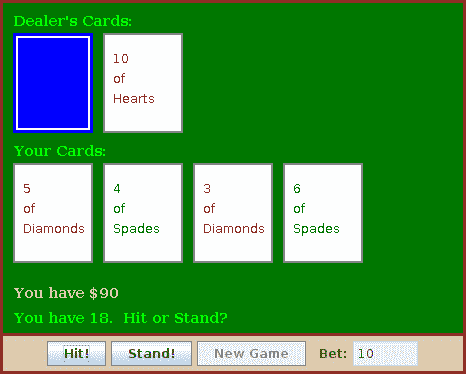

查看解答

## 第 6 章测验

**问题 1：**

为图形用户界面编写的程序必须处理“事件”（events）。请解释*事件*（event）一词的含义。给出至少两个不同的事件示例，并讨论程序如何响应这些事件。

**问题 2：**

请详细解释 `repaint()` 方法的作用。

**问题 3：**

Java 有一个名为 `JPanel` 的标准类。讨论 `JPanel` 可以被使用的**两种**方式。

**问题 4：**

请画出由以下 `paintComponent()` 方法产生的图片：

```
public static void paintComponent(Graphics g) {

    super.paintComponent(g);

    for (int i=10; i <= 210; i = i + 50)

       for (int j = 10; j <= 210; j = j + 50)

          g.drawLine(i,10,j,60);

}
```


## 第 6 章测验

**问题 1：**

为图形用户界面编写的程序必须处理“事件”（events）。请解释*事件*（event）一词的含义。给出至少两个不同的事件示例，并讨论程序如何响应这些事件。

**问题 2：**

请详细解释`repaint()`方法的作用。

**问题 3：**

Java 有一个名为`JPanel`的标准类。讨论`JPanel`可以被使用的**两种**方式。

**问题 4：**

请画出由以下`paintComponent()`方法产生的图片：

```java
public static void paintComponent(Graphics g) {

    super.paintComponent(g);

    for (int i=10; i <= 210; i = i + 50)

       for (int j = 10; j <= 210; j = j + 50)

          g.drawLine(i,10,j,60);

}
```

**问题 5：**

假设你想要一个面板在红色圆形内显示一个绿色正方形，如图所示。为该面板类编写一个`paintComponent()`方法来绘制该图像。

![(正方形中的圆（图片）

**问题 6：**

Java 有一个名为`MouseEvent`的标准类。这个类的目的是什么？`MouseEvent`类型的对象的作用是什么？

**问题 7：**

Swing 中的主要类之一是`JComponent`类。组件（component）是指什么？有哪些例子？

**问题 8：**

Java 中`LayoutManager`的功能是什么？

**问题 9：**

考虑位于第 6.6 节开头的嵌套面板插图。图中三个面板中的每个使用的是哪种类型的布局管理器？

**问题 10：**

解释如何使用`Timers`（定时器）来制作动画。

**问题 11：**

什么是`JCheckBox`？它是如何使用的？

**问题 12：**

组件的*首选尺寸*（preferred size）是如何设置的，又是如何使用的？

查看答案

## 第 7 章：数组、ArrayList 和记录（Records）

计算机的强大程度上源于处理数据结构。数据结构是相关数据的组织集合。对象是一种数据结构，通常结合一些方法，但这种类型的数据结构——由较少数量命名的实例变量组成——仅仅是一个开始。在许多情况下，程序员通过将对象连接在一起来手动构建复杂的数据结构。我们将在第 9 章中查看这些自定义的数据结构。本章将介绍更基础的数据结构。有一种类型的数据结构如此重要且基础，以至于它内置在每种编程语言中：数组。

你之前已经在第 3.8 节和第 5.1.4 节遇到过数组。我们在本章中继续对数组的研究，包括其用法的一些新细节和额外的数组处理技术。特别是，我们将在第 7.5 节中讨论搜索和排序数组算法这一重要课题。

数组具有固定的大小，在数组创建后无法更改。但在许多情况下，拥有一个可以根据需要增长和收小的数据结构是有用的。在第 7.3 节中，我们将查看一个代表此类数据结构的标准类`ArrayList`。

数组是所有类型相同的项的编号序列。记录（record）是另一种标准数据结构。与数组一样，记录由一系列项组成，但在记录中，项通过名称而不是编号来引用，且项可以是不同类型。Java 中的任何对象都可以从这个意义上被视为记录，但 Java 17 将记录显式地引入语言，作为一种带有某些限制的特殊类。我们将在第 7.4 节中查看记录类。

### 第 7 章目录

- 第 1 节：数组细节
- 第 2 节：数组处理
- 第 3 节：ArrayList
- 第 4 节：记录
- 第 5 节：搜索与排序
- 第 6 节：二维数组
- 编程练习
- 本章测验

## 7.1 节：数组细节

数组的基础知识在之前的章节中讨论过，但仍有一些 Java 语法细节需要补充，而且关于数组的使用还有很多要说。本节将介绍一些语法细节，关于数组处理更多信息将在后给出。

数组是所有类型相同的项的编号序列。记录（record）是另一种标准数据结构。与数组一样，记录由一系列项组成，但在记录中，项通过名称而不是编号来引用，且项可以是不同类型。Java 中的任何对象都可以从这个意义上被视为记录，但 Java 17 将记录显式地引入语言，作为一种带有某些限制的特殊类。

还有另外一点需要考虑：理想情况下，程序在首次创建时不应该启动一个新游戏。用户应该在游戏开始前有机会设置下注金额。因此，在绘图表面类的构造函数中，你不应该调用`doNewGame()`。在第一个游戏开始之前，你可能想显示类似“欢迎来到黑 2 克”的消息。

这是我的程序的图片：


查看解答

### for-each 循环

for-each 循环会对数组中存储的每个值执行相同的操作。如果`itemArray`是类型为`BaseType[]`的数组，那么针对`itemArray`的 for-each 循环形式如下：

```java
for (BaseType item : itemArray) {

   // process the item

}
```

按照习惯，如果循环内部只有一个语句，大括号是可选的。在这个循环中，`item`是循环控制变量。它被声明为类型`BaseType`的变量，其中`BaseType`是数组的基类型。（在 for-each 循环中，循环控制变量**必须**在循环内部声明；它不能是循环外已经存在的变量。）

当执行此循环时，数组中的每个值都会轮流赋值给`item`，并为每个值执行循环体。因此，上述循环等同于：

```java
for (int index = 0; index < itemArray.length; index++) {

   BaseType item;

   item = itemArray[index];  // Get 数组中的一个值

   // process the item

}
```

例如，如果`A`是类型为`int[]`的数组，我们可以使用 for-each 循环打印`A`中的所有值：

```java
for (int item : A)
   System.out.println(item);
```

我们可以通过以下代码累加`A`中所有的正整数：

```java
int sum = 0;   // 这是 A 中所有正整数的和。

for (int item : A) {

   if (item > 0)
      sum = sum + item;

}
```

我还要注意到，用于声明局部变量的`var`（已在第 4.8.2 节中引入）适用于 for-each 循环中的循环控制变量。因此，我们不需要写`for (BaseType item : itemArray)`，而是写`for (var item : itemArray)`。变量的类型是从数组的基类型推断出来的。在处理更复杂的类型时，这种语法变得更有用。

for-each 循环并不总是合适的。例如，没有简单的方法可以使用它来处理数组某部分的项，或者按反序处理元素。然而，当你想要按顺序处理所有值时，它确实让代码变得简单了一些，因为它消除了使用数组索引的需要。

但重要的是，for-each 循环处理的是数组中的`values`（值），而不是`elements`（元素，其中元素是指作为数组的一部分并存储该值的实际内存位置）。例如，考虑以下尝试用 17 填充整数数组的错误方法：

```java
int[] intList = new int[10];

for (int item : intList) {   // 错误！没有修改数组！

   item = 17;

}
```

赋值语句`item = 17`将值 17 赋值给循环控制变量`item`。然而，这与数组无关。当执行循环体时，数组中的值会被复制到`item`中。语句`item = 17`不会改变数组。

### 变长参数方法

在 Java 5 之前，方法的参数个数（arity）定义为它接受参数的数量。在 Java 5 中，引入了变长参数方法，它允许方法接受任意数量的参数。`...`语法应用于最后一个形式参数，在方法的定义内部，该参数会变成一个数组。

例如，考虑一个可以通过任意数量的点来绘制多边形的方法。点以类型`Point`的值给出，其中`Point`对象有两个类型为`int`的实例变量`x`和`y`。在这种情况下，该方法除了变长参数外，还有一个普通参数——用于绘图的图形上下文。记住，在方法的定义内部，该参数变成了`Point`数组：

```java
public static void drawPolygon(Graphics g, Point... points) {

    if (points.length > 1) {  // 至少需要 2 个点才能绘制图形。

       for (int i = 0; i < points.length - 1; i++) {

           // 从第 i 个点到第 (i+1) 个点画一条线

           g.drawLine(points[i].x, points[i].y,
                      points[i+1].x, points[i+1].y);

       }

       // 现在，画线回到起点。

       g.drawLine(points[points.length-1].x,
                  points[points.length-1].y,
                  points[0].x,
                  points[0].y);

    }

}
```

当调用此方法时，子程序调用语句必须有一个类型为`Graphics`的实际参数，后面可以跟任意数量类型为`Point`的实际参数。顺便提一下，可以将单个数组传递给变长参数方法，而不是传递单个值的列表。例如，假设`salesData`是一个`double[]`类型的变量。那么调用`average(salesData)`是合法的，这将计算数组中所有数字的平均值。

```java
public static String concat(String... values) {

   StringBuilder buffer;  // 使用 StringBuilder 进行更高效的连接。

   buffer = new StringBuilder();  // 从一个空的 StringBuilder 开始。
```


```java
public static String concat( String... values ) {
   StringBuilder buffer;  // 使用 StringBuilder 进行更高效的连接。
   buffer = new StringBuilder();  // 从一个空的 StringBuilder 开始。

   for ( String str : values ) { // 用于处理值的 "for each" 循环。
       buffer.append(str); // 将字符串添加到缓冲区中。
   }

   return buffer.toString(); // 返回缓冲器的内容
}
```

根据此方法定义，方法调用`concat("Hello", "World")`将返回字符串`"HelloWorld"`，而`concat()`将返回一个空字符串。由于变长参数方法也可以接受数组作为实际参数，我们也可以调用`concat(lines)`，其中`lines`的类型为`String[]`。这会将数组中的所有元素连接成一个字符串。

* * *

### 7.1.3 数组字面量 (Array Literals)

我们已经看到可以在声明数组变量时使用值列表来初始化它。例如，

```java
int[] squares = { 1, 4, 9, 16, 25, 36, 49 };
```

这初始化`squares`指向一个新创建的数组，该数组包含列表中的七个值。

这种形式的列表初始化器`仅`用于声明语句，其中它为新声明的数组变量提供一个初始值。它不能用于赋值语句来给已存在的变量赋值。然而，还有另一种类似的表示法可以创建新数组并可以在其他地方使用。该表示法使用了`new`运算符的另一种形式来同时创建一个新数组对象并向其填充值。（这种相当奇特的语法与匿名内部类的语法相似，匿名内部类在 第 5.8.3 节 中讨论过。）例如，要为类型为`int[]`的数组变量`cubes`分配新值，你可以使用：

```java
cubes = new int[] { 1, 8, 27, 64, 125, 216, 343 };
```

这是一个赋值语句而不是声明，因此不带`"new int[]"`的数组初始化器语法在这里是不合法的。这种形式的`new`运算符的通用语法为

```
new base-type [ ] { list-of-values }
```

这实际上是一个表达式，其值是指向新创建的数组对象的引用。从这个意义上说，它是一个“数组字面量”，因为你可以在程序中输入它来表示一个值。这意味着它可以用于任何允许类型为`base-type []`对象的合法语句中。例如，你可以将新创建的数组作为实际参数传递给子程序。考虑以下根据字符串数组创建菜单的实用方法。（菜单在 第 6.7.1 节 中讨论过。）

```java
/**
 * 创建一个 Menu。菜单中 MenuItems 的名称 
 *     以 String 数组的形式给出。
 * @param menuName  要创建的 Menu 的名称。
 * @param itemNames  一个持有每个 MenuItem 中显示的文本的数组。
 *     如果数组中为空值，则菜单中相应的
 *     项将是分隔而不是 MenuItem。
 * @return  已创建并填充了项的菜单。
 */
public static Menu createMenu(String menuName, String[] itemNames) {
    // ... (代码逻辑)
}
```

对于下一个示例，让我们继续讨论部分未满的数组。我们已经见过如何向部分未满的数组中添加元素，但假设我们还想要能够移除元素呢？假设你正在编写一个游戏程序，玩家可以随着游戏的进行加入和离开游戏。作为一个良好的面向对象的程序员，你可能已经有一个名为`Player`的类来表示游戏中的单个玩家。所有当前游戏中的玩家的列表可以存储在一个类型为`Player[]`的数组`playerList`中。由于玩家人数可能会变化，你将遵循部分未满数组的模式，并且你需要一个变量`playerCt`来记录当前游戏中的玩家人数。假设游戏中的人数永远不会超过 10 人，你可以这样声明变量：

```java
Player[] playerList = new Player[10];  // 最多 10 个玩家。
int      playerCt = 0;  // 开始时，没有玩家。
```

在一些玩家加入游戏后，`playerCt`将大于 0，代表玩家的`Player`对象将存储在数组元素`playerList[0]`、`playerList[1]`、……`playerList[playerCt-1]`中。注意，数组元素`playerList[playerCt]`**没有**被使用：除了`playerCt`是数组中元素的数量外，它还是数组中下一个空闲位置的索引。向游戏添加新玩家`newPlayer`的过程非常简单：

```java
playerList[playerCt] = newPlayer; // 将新玩家放入下一个
                                  // 可用位置。
playerCt++;  // 增加 playerCt 以计数新玩家。
```

但从游戏中删除玩家要稍微困难一点，因为你不希望在数组中为被删除玩家原来的位置留一个“洞”。假设你想删除`playerList`中索引为`k`的玩家。玩家人数减少一个，因此数组使用的空间也减少一个。如果你不在意保持玩家的特定顺序，那么删除第`k`个玩家的一种方法是将数组中最后一个占用位置的玩家移动到位置`k`，然后减小`playerCt`的值：

```java
playerList[k] = playerList[playerCt - 1];
playerCt--;
```

之前在位置`k`的玩家已被替换不再数组中，因此我们已经从列表中删除了该玩家。之前在位置`playerCt - 1`的玩家现在在数组中出现了两次。但由于`playerCt`减少了一，它只在数组的占用或有效部分出现一次。记住，数组的每个元素都持有某个值，但只有位置 0 到`playerCt - 1`之间的值会被查看或进行处理。你可以设置`playerList[playerCt] = null`，这可以释放被删除的`Player`对象以便垃圾回收，但对于从（活动）玩家列表中正确删除玩家来说并不是必要的。（顺便说一下，你应该考虑如果被删除的玩家位于列表最后一个位置会发生什么。在这种情况下代码仍然有效。到底发生了什么呢？）

假设在删除位置`k`的玩家时，你希望保持剩余玩家的原始顺序。（可能因为他们按照数组中存储的顺序轮流。）为了实现这一点，位置`k+1`及之后的所有玩家必须在数组中向上移动一个位置。玩家`k+1`替换离开游戏的玩家`k`。玩家`k+2`填补`k+1`移动后留下的空位。以此类推。相应的代码如下：

```java
for (int i = k+1; i < playerCt; i++) {
    playerList[i-1] = playerList[i];
}
playerCt--;
```

这里是从部分未满数组中删除元素的两种方法的插图。在这里，玩家“C”正在被删除：

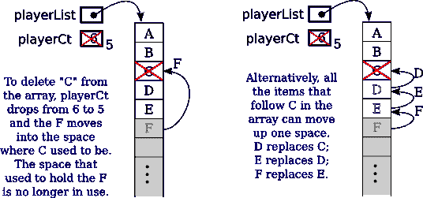

* * *

这引出了一个问题：当部分未满的数组变满但你仍然想向其添加更多元素时，会发生什么？我们无法改变数组的大小——但我们可以创建一个更大的数组，并将数据从旧数组复制到新数组中。但是，首先复制数组到底意味着什么？

假设`A`和`B`是具有相同基类型的数组变量，且`A`已经引用一个数组。假设我们希望`B`指向`A`的拷贝。首先需要注意的是，赋值语句：

```java
B = A;
```

**并没有**制作`A`的拷贝。数组是对象，数组变量只能持有指向数组的指针。赋值语句将指针从`A`复制到`B`，结果是`A`和`B`现在指向同一个数组。例如，`A[0]`和`B[0]`只是完全相同的数组元素的不同名称。要让`B`指向`A`的拷贝，我们需要创建一个全新的数组，并将所有项从`A`复制到`B`。假设`A`和`B`的类型为`double[]`。那么为了制作`A`的拷贝，我们可以说：

```java
double[] B;
B = new double[A.length]; // 创建一个与 A 相同的数组。
for (int i = 0; i < A.length; i++) {
    B[i] = A[i];
}
```

为了解决向变满的部分未满数组添加元素的问题，假设我们使用`playerList`和`playerCt`来存储玩家（如上所示），我们要添加`newPlayer`。如果`playerList`数组满了，我们可以这样做：

```java
if ( playerCt == playerList.length ) {
    // 玩家人数等于数组大小。
    // 数组已满。创建一个更大的数组。
    Player[] temp;   // 指向新数组的变量。
    temp = new Player[2*playerList.length]; // 比旧数组大倍。
    for ( int i = 0; i < playerList.length; i++) {
        temp[i] = playerList[i];  // 从旧数组拷贝到新数组。
    }
    playerList = temp;  // playerList 现在指向更大的数组。
}
// 此时，我们知道数组中有空间存放 newPlayer。
playerList[playerCt] = newPlayer;
playerCt++;
```

在创建新数组后，没有任何变量指向旧数组，因此它将被垃圾回收。

* * *

### 7.2.2 一些标准数组方法

复制数组似乎是非常常见的操作，以至于你可能认为 Java 已经定义的方法。事实上，Java 提供了一些标准的数组处理方法。这些方法定义在名为`Arrays`的类的静态方法中，该类位于`java.util`包。例如，对于任何数组`list`，

`Arrays.copyOf( list, lengthOfCopy )`

是一个函数，返回一个长度由`lengthOfCopy`规定的新数组，包含从`list`复制的项。如果`lengthOfCopy`大于`list.length`，则新数组中的额外空间将具有它们的默认值（数值数组为零，对象数组为 null，等等）。如果`lengthOfCopy`小于或等于`list.length`，则只从`list`复制放入新数组的项。因此，如果`A`是任何数组，那么：

```java
B = Arrays.copyOf( A, A.length );
```

设置`B`指向`A`的精确拷贝，并且：

```java
playerList = Arrays.copyOf( playerList, 2*playerList.length );
```

仅需一行代码即可将部分填满数组的可用空间翻倍。我们也可以使用`Arrays.copyOf`来减小部分填满数组的大小。我们可能想这样做是为了避免大量过剩且未使用的空间。为了实现这个想法，从玩家列表中删除第`k`号玩家的代码可能会变成：

```java
playerList[k] = playerList[playerCt-1];
playerCt--;
if ( playerCt < playerList.length/4 ) {
        // 超过 3/4 的空间是空的。将数组大小减半。
    playerList = Arrays.copyOf( playerList, playerList.length/2 );
}
```


我应该提到的是，`Arrays` 类实际上包含许多 `copyOf` 方法，每种基本类型都有一个，对象类型也有一个。我还应该注意，当复制对象数组时，只有对象的指针被复制到新数组中。对象的内容不会被复制。这是指针赋值的常规规则。

如果你想要的是数组的简单拷贝，且大小与原始数组相同，那么有更简单的方法。每个数组都有一个名为 `clone()` 的实例方法，可以创建数组的副本。例如，为了获取一个 `int` 数组 `A` 的拷贝，你可以直接说：

```java
int[] B = A.clone();
```

---

`Arrays` 类包含了其他有用的方法。我会提到其中几个。和 `Arrays.copyOf` 一样，所有这些方法实际上都有多个版本，对应不同的数组类型。

- `Arrays.fill(array, value)` — 用指定的值填充整个数组。值的类型必须与数组的基础类型兼容。例如，假设 `numlist` 是一个 `double[]` 类型的数组，那么 `Arrays.fill(numlist, 17)` 将 `numlist` 的每个元素都设置为 `17`。
- `Arrays.fill(array, fromIndex, toIndex, value)` — 用值填充数组的部分内容，从索引 `fromIndex` 开始，到索引 `toIndex - 1` 结束。注意，`toIndex` 本身不包含在内。
- `Arrays.toString(array)` — 该函数返回一个 `String`，其中包含 `array` 中的所有值，并用逗号分隔，括在方括号之间。数组中的值转换为字符串的方式与它们被打印出来的方式相同。
- `Arrays.sort(array)` — 排序整个数组。排序数组意味着重新排列数组中的值，使其按递增顺序排列。此方法适用于 `String` 数组和基本类型值的数组（`boolean` 除外，对布尔值排序有点傻）。但它并不适用于所有数组，因为它必须对数组中的任何两个值进行有意义的比较，以判断哪一个“更小”。我们将在第 7.5 节中讨论数组排序算法。
- `Arrays.sort(array, fromIndex, toIndex)` — 仅对 `array[fromIndex]` 到 `array[toIndex - 1]` 的元素进行排序。
- `Arrays.binarySearch(array, value)` — 在数组中搜索 `value`。数组**必须已经按递增顺序排序过**。这是一个返回 `int` 的函数。如果在数组中找到该值，返回值为包含该值的元素的索引。如果该值未出现在数组中，返回值为 `-1`。我们将在第 7.5 节中讨论二分查找算法。

---

### 7.2.3 重复回顾 `RandomStrings`

第 6.3.2 小节中的示例之一是一个 GUI 程序，[`ClickableRandomStrings.java`](https://math.hws.edu/eck/cs124/javanotes9/source/chapter6/ClickableRandomStrings.java)，它在随机的位置、颜色和字体显示消息的多份拷贝。（大部分代码位于一个单独的类 [`RandomStringsPanel.java`](https://math.hws.edu/eck/cs124/javanotes9/source/chapter6/RandomStringsPanel.java)。）当用户点击程序窗口时，位置、颜色和字体会变为新的随机值。

但假设我们想要消息字符串移动。也就是说，我们想运行一个动画，让字符串在窗口漂浮。在这种情况下，我们需要存储每个字符串的属性，因为在动画的每一帧中重绘字符串时都需要这些属性。实现该功能的程序新版本是 [`RandomStringsWithArray.java`](https://math.hws.edu/eck/cs124/javanotes9/source/chapter7/RandomStringsWithArray.java)。

有 25 个字符串。我们需要存储绘制每个字符串的 `(x,y)` 坐标、每个字符串的颜色以及每个字符串使用的字体。为了让字符串移动起来，我还为每个字符串存储了速度，用两个数字 `dx` 和 `dy` 表示。在每一帧中，每个字符串的 `dx` 乘以自上一帧以来经过的时间，加到字符串的 `x` 坐标上，`dy` 也是如此。现在，字符串的数据可以存储在六个数组中：

```java
double[] x = new double[25];

double[] y = new double[25];

double[] dx = new double[25];

double[] dy = new double[25];

Color[] color = new Color[25];

Font[] font = new Font[25];
```

这些数组将被填充随机值。在绘制字符串的方法中，`i` 对应的字符串位于 `x[i], y[i]`。颜色为 `color[i]`，字体为 `font[i]`。`dx[i]` 和 `dy[i]` 也会被赋值。这种方法通过以下代码完成：

```java
g.setColor(Color.WHITE); // 填充白色背景

for (int i = 0; i < 25; i++) {

    stringData[i] = new StringData();

    stringData[i].x = getWidth() * Math.random();

    stringData[i].y = getHeight() * Math.random();

    stringData[i].dx = 1 + 3*Math.random();

    if (Math.random() < 0.5) // 50% 概率 `dx` 是负值

        stringData[i].dx = -stringData[i].dx;

    stringData[i].dy = 1 + 3*Math.random();

    if (Math.random() < 0.5) // 50% 概率 `dy` 是负值

        stringData[i].dy = -stringData[i].dy;

    stringData[i].color = Color.getHSBColor((float)Math.random(), 1, 1);

    stringData[i].font = fonts[(int)(5*Math.random())];

}
```

这种方法被称为使用并行数组。如果你把这些数组想象成并列——`x` 是第一列，`y` 是第二列，`color` 是第三列，`font` 是第四列——那么第 `i` 个字符串的数据可以在第 `i` 行找到。在这个简单的示例中，使用并行数组并没有错误，但它违背了将相关数据放在一个对象中的面向对象哲学。因此，我在编写程序时创建了一个简单的类来表示一个消息拷贝的数据：

```java
private static class StringData { // 绘制一个字符串的数据

    double x, y;       // 坐标

    double dx, dy;     // 速度

    Color color;       // 颜色

    Font font;         // 用于绘制的字体

}
```

为了存储多个拷贝的数据，我使用 `StringData[]` 数组。该数组被声明为实例变量，名为 `stringData`：

```java
StringData[] stringData;
```

当然，在分配实际数组之前，`stringData` 的值为 `null`。数组必须被创建并填充。此外，数组的每个元素都是 `StringData` 类型的对象，在使用之前必须先创建它们。以下子程序创建数组并填充数组：

```java
private void createStringData() {

    stringData = new StringData[25];

    for (int i = 0; i < 25; i++) {

        stringData[i] = new StringData();

        stringData[i].x = getWidth() * Math.random();

        stringData[i].y = getHeight() * Math.random();

        stringData[i].dx = 1 + 3*Math.random();

        if (Math.random() < 0.5) // 50% 概率 `dx` 是负值

            stringData[i].dx = -stringData[i].dx;

        stringData[i].dy = 1 + 3*Math.random();

        if (Math.random() < 0.5) // 50% 概率 `dy` 是负值

            stringData[i].dy = -stringData[i].dy;

        stringData[i].color = Color.getHSBColor((float)Math.random(), 1, 1);

        stringData[i].font = fonts[(int)(5*Math.random())];

    }

}
```

```java
import java.util.Arrays;

/**
 * 表示一个可以增长和缩小的 int 类型值列表。
 */
public class DynamicArrayOfInt {

    private int[] items = new int[8]; // 部分填充的数组

    private int itemCt;

    /**
     * 返回数组中给定索引处的元素。
     * 如果索引无效，则抛出 ArrayIndexOutOfBoundsException。
     */
    public int get(int index) {

        if (index < 0 || index >= itemCt)

            throw new ArrayIndexOutOfBoundsException("Illegal index, " + index);

        return items[index];

    }

    /**
     * 设置数组中给定索引处元素的值。
     * 如果索引无效，则抛出 ArrayIndexOutOfBoundsException。
     */
    public void set(int index, int item) {

        if (index < 0 || index >= itemCt)

            throw new ArrayIndexOutOfBoundsException("Illegal index, " + index);

        items[index] = item;

    }

    /**
     * 返回数组中当前元素的数量。
     */
    public int size() {

        return itemCt;

    }

    /**
     * 将新元素添加到数组的末尾。大小增加一。
     */
    public void add(int item) {

        if (itemCt == items.length)

            items = Arrays.copyOf(items, 2 * items.length);

        items[itemCt] = item;

        itemCt++;

    }

    /**
     * 移除数组中给定索引处的元素。数组的大小减小一。

     * 被移除元素之后的元素会在数组中向上移动一个空间。

     * 如果索引无效，则抛出 ArrayIndexOutOfBoundsException。
     */
    public void remove(int index) {

        if (index < 0 || index >= itemCt)

            throw new ArrayIndexOutOfBoundsException("Illegal index, " + index);

        for (int j = index + 1; j < itemCt; j++)

            items[j - 1] = items[j];

        itemCt--;

    }

} // 类 DynamicArrayOfInt 结束
```

这里的所有内容都应该是清晰的，可能 `items` 数组的初始大小为什么是 8 这一点例外。事实上，数字 8 是任意选取的，对类的功能没有影响。任何正整数都可以，但让数组从一开始就非常大是没有意义的。如果证明元素数量很多，数组将根据需要增长。

示例 [`ReverseInputNumbers.java`](https://math.hws.edu/eck/cs124/javanotes9/source/chapter3/ReverseInputNumbers.java) 使用了一个部分填满的 `int` 数组来按照输入顺序的反向顺序打印输入数字列表。在那个程序中，使用了一个长度为 100 的普通数组来存放这些数字。在程序的任何给定运行中，数组的大小可能太大，也可能太小，导致异常。

现在可以使用 `DynamicArrayOfInt` 来编写该程序，它能够自动适应任何合理数量的输入。关于该程序，请参见 [`ReverseWithDynamicArray.java`](https://math.hws.edu/eck/cs124/javanotes9/source/chapter7/ReverseWithDynamicArray.java)。虽然这是一个简单的程序，但该原理适用于任何无法预先预测数据量的应用：动态数据结构的大小可以适应任何数量的数据，其仅限于程序可用的内存大小。

这是一个很好的例子，但它也存在一个真正的问题。假设我们想要一个 `String` 类型的动态数组。我们无法使用 `DynamicArrayOfInt` 对象来存储字符串，因此看起来我们需要编写一个全新的类，`DynamicArrayOfString`。如果我们想用一个动态数组来存储游戏中的玩家，我们需要一个 `DynamicArrayOfPlayer` 类。以此类推。看起来我们必须为每种可能的数据类型编写一个动态数组类！这显然不对！

事实上，Java 为此问题提供了一个解决方案，一个实现了动态数组并可以与任何类型数据工作的标准类。该类被称为 `ArrayList`，我们将在下一节查看它是如何工作的。

## 7.3 节

## `ArrayList`

正如我们刚刚在 `7.2.4 节` 中看到的，我们可以很容易将动态数组模式封装到类中，但看起来每种数据类型都需要一个不同的类。事实上，Java 有一种名为“泛型类型”（parameterized types）的特性，使得避免大量类成为可能，且 Java 有一个名为 `ArrayList` 的单一类，为所有定义为类的数据类型（但不是直接用于基本数据类型）实现了动态数组模式。

### 7.3.1 `ArrayList` 与泛型类型

Java 有一个名字相当奇特的标准类型 `ArrayList<String>`，代表 `String` 的动态数组。类似地，还有一个类型 `ArrayList<Color>` 可以用于表示 `Color` 的动态数组。如果 `Player` 是一个表示游戏玩家的类，那么类型 `ArrayList<Player>` 就可以表示 `Player` 的动态数组。

这里看起来仍然有很多类，但实际上只有一个类，即定义在 `java.util` 包中的 `ArrayList` 类。但 `ArrayList` 是一个泛型类型。泛型类型可以接受一个类型参数，因此从单一的 `ArrayList` 类，我们可以得到多种类型，包括 `ArrayList<String>`、`ArrayList<Color>`，以及任何对象类型 `T` 的 `ArrayList<T>`。类型参数 `T` 必须是一个对象类型，例如类名或接口名。它不能是基本类型。这意味着遗憾的是，你不能拥有 `int` 的 `ArrayList` 或 `char` 的 `ArrayList`。

考虑类型 `ArrayList<String>`。它可以用于声明变量，例如：

```java
ArrayList<String> namelist;
```

它可以作为子程序定义中的形式参数类型，或作为子程序的返回类型。它可以配合 `new` 运算符来创建对象：

```java
namelist = new ArrayList<String>();
```

用这种方式创建的对象类型为 `ArrayList<String>`，代表一个字符串的动态列表。它拥有实例方法，例如 `namelist.add(str)` 用于向列表添加 `String`，`namelist.get(i)` 用于获取索引 `i` 的字符串，以及 `namelist.size()` 用于获取列表中项的数量。

但我们也可以与其他类型一起使用 `ArrayList`。如果 `Player` 是一个表示游戏玩家的类，我们可以这样创建一个玩家列表：

```java
ArrayList<Player> playerList = new ArrayList<Player>();
```

然后要向游戏添加玩家 `plr`，只需说 `playerList.add(plr)`。我们可以通过 `playerList.remove(k)` 移除编号为 `k` 的玩家。

此外，如果 `playerList` 是一个局部变量，那么它的声明可以简写为：

```java


`var playlerList = new ArrayList<Player>();`

使用`4.8.2 节`中涵盖的替代声明语法。Java 编译器使用分配给`playerList`的初始值来推断其类型为`ArrayList<Player>`。

当你使用诸如`ArrayList<T>`的类型时，编译器将确保只有类型为`T`的对象可以添加到列表中。尝试添加不是类型`T`的对象会导致语法错误，程序将无法编译。然而，请注意，属于`T`的子类的对象可以添加到列表中，因为属于`T`的子类的对象仍被视为类型`T`。因此，如果类`Shape`有子类`Rectangle`、`Oval`和`RoundRect`，那么类型为`ArrayList<Shape>`的变量可以用来持有`Rectangle`、`Oval`和`RoundRect`类型的对象。（当然，这与数组的工作方式相同：类型为`T[]`的数组可以持有属于任何子类的对象。）同样，如果`T`是一个接口，那么任何实现`T`的对象都可以被添加。

是一些最有用的`ArrayList<T>`方法：

- `list.size()`：此函数返回列表的当前大小，即列表中当前项的数量。有效位置是从 0 到`size()-1`。注意大小可以为零。调用默认构造函数`ArrayList<T>()`会创建一个大小为零的列表。
- `list.add(obj)`：将对象添加到列表末尾，大小增加 1。参数`obj`可以引用类型为`T`的对象，也可以`null`。
- `list.get(N)`：此函数返回列表中位置`N`存储的值。该函数的返回类型是`T`。`N`必须是 0 到`size()-1`范围内的整数。如果`N`超此范围，会发生`IndexOutOfBoundsException`。调用此函数类似于引用数组的`A[N]`，区别在于不能在赋值语句的左侧使用`list.get(N)`。
- `list.set(N, obj)`：将对象`obj`分配给`ArrayList`中的位置`N`，替换之前存储在位置`N`的项。参数`obj`必须是类型`T`。整数`N`必须在 0 到`size()-1`范围内。调用此函数相当于对数组`A`执行命令`A[N] = obj`。
- `list.clear()`：从列表中移除所有项，将其大小设置为零。
- `list.remove(N)`：对于整数`N`，这移除`ArrayList`中的第`N`个项。`N`必须在 0 到`size()-1`范围内。列表中被移除项之后的任何项都会移动一个位置。列表的大小减 1。此方法返回被移除的项。
- `list.remove(obj)`：如果指定的对象在列表中某处出现，则从列表中移除。列表中被移除项之后的任何项都会移动一个位置。`ArrayList`的大小减 1。如果`obj`在列表中出现多次，则只移除第一个副本。如果`obj`不在列表中，则什么都不会发生；这不是错误。此方法返回一个布尔值，表示是否实际移除了项。
- `list.indexOf(obj)`：一个在列表中搜索对象`obj`的函数。如果在列表中找到了该对象，则返回找到它的第一个位置编号。如果未找到该对象，则返回 -1。

对于这里列出的最后两种方法，`obj`将通过调用`obj.equals(item)`与列表中的项进行比较，除非`obj`为`null`。这意味着，例如，字符串的相等性测试是通过检查字符串的内容来完成的，而不是它们在内存中的位置。

Java 提供了几个表示不同数据结构的泛型类。这些类成了 Java 集合框架（Java Collection Framework）。在这里我们只考虑`ArrayList`，但我们将在第 10 章中更详细地回到这个重要话题。

顺便说，`ArrayList`也可以作为非泛型类型使用。这意味着你可以声明变量并创建`ArrayList`类型的对象，例如：

```
ArrayList list = new ArrayList();
```

此的效果类似于将`list`声明为`ArrayList<Object>`类型。也就是说，`list`可以容纳任何属于`Object`子类的类的对象。由于每个类都是`Object`的子类，这意味着任何对象都可以存储在`list`中。

***

### 7.3.2 包装类（Wrapper Classes）

正如我已经指出的，泛型类型不支持基本类型。不存在`ArrayList<int>`这种东西。然而，这种限制结果证明并没有那么限制，因为有了诸如`Integer`和`Character`等所谓的“包装类”。

我们已经在第 2.5 节中简要地遇到过`Double`和`Integer`类。这些类包含了静态方法`Double.parseDouble()`和`Integer.parseInteger()`，用于将字符串转换为数值，并且它们包含了诸如`Integer.MAX_VALUE`和`Double.NaN`等常量。我们还在某些示例中遇到过`Character`类，它有一个静态方法`Character.isLetter()`，可以用于测试给定的`char`类型的值是否为字母。对于其他每个基本类型，也都有类似的类，即`Long`、`Short`、`Byte`、`Float`和`Boolean`。这些类就是包装类。尽管它们包含了有用的静态成员，但它们还有另一个用途：它们被用于将基本类型的值表示为对象。

记住基本类型不是类，基本类型的值也不是对象。然而，有时将基本类型的值当作对象处理是有用的。例如，当你想把基本类型的值存储在`ArrayList`中时就是如此。你不能字面上这样做，但你可以将基本类型的值“包装”在属于其中一个包装类的对象中。

例如，`Integer`类型的对象包含一个实例变量，类型为`int`。该对象是`int`值的“包装”。你可以通过以下方式获取一个包装`int`值 42 的对象：

```
Integer n = Integer.valueOf(42);
```

`n`的值与`int`类型的值具有相同的信息，但它是一个对象。如果你想检索封装在对象中的`int`值，可以调用函数`n.intValue()`。同样，你可以将`double`包装在`Double`类型的对象中，将`boolean`值包装在`Boolean`类型的对象中，以此此类推。每个包装类都有一个静态的`valueOf()`方法用于将基本类型的值包装在对象中。

`Integer.valueOf()`方法是一个静态工厂方法，返回一个`Integer`类型的对象。`Integer`类也有用于创建对象的构造函数，但它已被废弃，这意味着它不应该在新代码中使用，并且可能在未来从语言中移除。静态工厂方法的优势在于，如果多次使用相同的参数值调用`Integer.valueOf()`，它可以选择每次都返回同一个对象。这是可以的，因为`Integer`类型的对象是不可变的，也就是说，在对象创建后其内容不能被修改。获取`Integer`的人无法改变它所代表的基本类型`int`值。

***

为了让包装类更加易用，基本类型与相应的包装类之间存在自动转换。例如，如果你在需要`Integer`类型对象的语境中使用`int`类型的值，那么该`int`将被自动包装成一个`Integer`对象。如果你说：

```
Integer answer = 42;
```

计算机将静默地将其读取为类似于：

```
Integer answer = Integer.valueOf(42);
```

这被称为自动装箱（autoboxing）。反反方向也同样有效。例如，如果`d`指向`Double`类型的对象，你可以在`2*d`这样的数值表达式中使用`d`。`d`内部的`double`值会被自动拆箱并乘以 2。自动装箱和拆箱也适用于子程序调用。例如，你可以将一个`int`类型的实际参数传递给一个形式参数类型为`Integer`的子程序，反之亦然。事实上，自动装箱和拆箱使得许多情况下可以忽略基本类型和对象之间的区别。

这对于泛型类型尤为如此。尽管没有`ArrayList<int>`这种东西，但有`ArrayList<Integer>`。`ArrayList<Integer>`保存`Integer`类型的对象，但任何`Integer`类型的对象实际上只是在一个相当薄的包装中表示一个`int`值。假设我们有一个`ArrayList<Integer>`类型的对象：

```
ArrayList<Integer> integerList;
integerList = new ArrayList<Integer>();
```

那么我们可以，例如，向`integerList`添加一个表示 42 的`Integer`对象：

```
integerList.add(Integer.valueOf(42));
```

但因为自动装箱，我们可以说：

```
integerList.add(42);
```

并且编译器会将 42 包装在`Integer`对象中。同样，我们可以说：

```
int num = integerList.get(3);
```

`integerList.get(3)`返回的是`Integer`类型，但因为自动拆箱，编译器将其转换为`int`，仿佛我们说了：

```
int num = integerList.get(3).intValue();
```

所以，实际上我们几乎可以将`integerList`当作`int`的动态数组，而不是`Integer`的动态数组。对于`ArrayList<Double>`和`ArrayList<Character>`如此。

有一个有时会导致问题：列表可以包含`null`值，而`null`不对应任何基本类型值。这意味着，例如，语句`int num = integerList.get(3);`在`integerList.get(3)`返回`null`时产生空指针异常。除非你确定列表中的所有值都为非`null`，否则你需要考虑这种情况。

***

### 7.3.3 使用 ArrayList

作为一个简单的第一个示例，我们可以重做[ReverseArray.java](https://math.hws.edu/eck/cs124/javanotes9/source/chapter7/ReverseArray.java)（来自上一节），使用`ArrayList`代替自定义动态数组类。在这种情况下，我们想在列表中存储整数，所以应该使用`ArrayList<Integer>`。这里是完整的程序：

```
import textio.TextIO;
import java.util.ArrayList;

/**
 * 从用户处读取一系列非零数字，然后
 * 按照输入的反序打印这些数字。
 * 对输入数量没有限制。
 */
public class ReverseWithArrayList {
    public static void main(String[] args) {
        ArrayList<Integer> list;
        list = new ArrayList<Integer>();
        System.out.println("输入一些非零整数。输入 0 结束。");
        while (true) {
            System.out.print("? ");
            int number = TextIO.getlnInt();
            if (number == 0)
                break;
            list.add(number);
        }
        System.out.println();
        System.out.println("你的数字反序为：");
        for (int i = list.size() - 1; i >= 0; i--) {
            System.out.printf("%10d%n", list.get(i));
        }
    }
}
```

如此示例所示，ArrayList 通常使用 for 循环进行处理，这与处理数组的方式非常。例如，以下循环可以打印类型为`ArrayList<String>`的变量`namelist`的所有项：

```
for ( int i = 0; i < namelist.size(); i++ ) {
    String item = namelist.get(i);
    System.out.println(item);
}
```

你也可以对 ArrayList 使用 for-each 循环，因此这个示例也可以写成：

```
for ( String item : namelist ) {
    System.out.println(item);
}
```

在处理包装类（wrapper classes）时，for-each 循环中的循环控制变量可以是基本类型变量。这是由于自动拆箱（unboxing）机制。例如，如果`numbers`的类型为`ArrayList<Double>`，可以使用以下循环来累加列表中所有的值：

```
double sum = 0;
for ( double num : numbers ) {
   sum = sum + num;
}
```

只要列表中的项不为`null`，这段代码就能工作。如果可能存在`null`值，你将希望使用类型为`Double`的循环控制变量并进行`null`测试。例如，为了累加列表中所有非`null`值：

```
double sum;
for ( Double num : numbers ) {
    if ( num != null ) {
        sum = sum + num;  // 这里，num 被安全地拆箱为 double。
    }
}
```

***

为了提供一个更完整且实用的示例，我们将查看程序[SimplePaint2.java](https://math.hws.edu/eck/cs124/javanotes9/source/chapter7/SimplePaint2.java)。这是来自子节 6.3.4 的[SimplePaint.java](https://math.hws.edu/eck/cs124/javanotes9/source/chapter6/SimplePaint.java)的改进版本。在新程序中，用户可以通过点击和拖动鼠标在绘图区域内绘制曲线。用户可以使用菜单选择绘制颜色。绘图区域的背景颜色也可以通过菜单选择。还有一个“控制（Control）”菜单，其中包含几个命令：一个“撤销（Undo）”命令用于移除屏幕上最近绘制的曲线，一个“清除（Clear）”命令移除所有曲线，以及一个“使用对称（Use Symmetry）”复选框用于开启关闭对称功能。当开启对称选项时，用户绘制的曲线会在水平和垂直方向上反射，从而产生对称图案。（对称功能只是为了好看。）

与原始的 SimplePaint 程序不同，这个新版本使用数据结构来存储用户绘制的图片信息。当用户选择新的背景颜色时，画布将填充为新的背景颜色，之前存在的所有曲线都会在新背景上重新绘制。为了实现这一点，我们需要存储足够的数据来重新绘制所有曲线。同样，`Undo`命令的实现方式是删除最近绘制曲线的数据，然后使用剩余数据重新绘制整幅图片。

我们所需的数据结构是使用 ArrayList 实现的。单条曲线的主要数据由曲线上点点列表组成。这些数据存储在类型为`ArrayList<Point>`的对象中（`Point`是`java.awt`包中的标准类：一个`Point`可以由两个`int`值构造，给出点的 (x,y) 坐标。而且`Point`对象`pt`具有表示点坐标的实例变量`x`和`y`）。但除了曲线点列表外，为了重新绘制曲线，我们还需要它的颜色，并且需要知道是否应该将对称选项应用于曲线。重新绘制曲线所需的所有数据都被分组在一个类型为`CurveData`的对象中，该对象在程序中定义为嵌套类：

```
private static class CurveData {
   Color color;  // 曲线的颜色。
   boolean symmetric;  // 是否绘制水平和垂直反射？
   ArrayList<Point> points;  // 曲线上的点。
}
```

然而，图片可能包含许多曲线而不仅仅是一条，因此为了存储重新绘制整幅图片所需的数据，我们需要一个`CurveData`类型对象的列表。对于此列表，程序使用了声明如下的`ArrayList` `curves`：

```
ArrayList<CurveData> curves = new ArrayList<CurveData>();
```

这里有一个对象列表，每个对象都包含一个点列表作为其数据的一部分！让我们来看处理这种数据结构的示例。当用户在绘图表面点击鼠标时，是一条新曲线的开始，必须创建一个新的`CurveData`对象来表示该曲线。新`CurveData`对象中的实例变量也必须初始化。以下是`mousePressed()`例程中执行此操作的代码，其中`currentCurve`是类型为`CurveData`的全局变量：

```
currentCurve = new CurveData();       // 创建一个新的 CurveData 对象。
currentCurve.color = currentColor;    // 曲线的颜色来自一个
                                      // 代表当前选择绘制颜色的
```


// 实例变量。

`currentCurve.symmetric = useSymmetry;` // 曲线的“对称”属性

// 也从实例变量 `useSymmetry`

// 当前值复制。

`currentCurve.points = new ArrayList<Point>();` // 新点列表对象。

我在这里主要感兴趣的是讨论该程序如何使用 `ArrayList`，但我鼓励你阅读完整的源代码 [SimplePaint2.java](https://math.hws.edu/eck/cs124/javanotes9/source/chapter7/SimplePaint2.java) 并尝试运行该程序。除了作为泛型使用的示例外，它还是另一个创建和使用菜单的示例。你应该能够理解整个程序。

## 第 7.4 节

# 记录 (Records)

某些编程语言具有两种基本的内置数据结构：数组（arrays）和记录（records）。数组由一组项组成，其中每个项通过其在序列中的数字位置来引用。相反，在记录中，数据结构中的位置是名称而不是数字。记录中的项被称为“字段”（fields），项的名称称为“字段名”（field names）。通过其字段名可以访问字段。我们认为记录类似于对象，记录中的字段与对象中的实例变量起相同的作用，但记录在面向对象编程之前就已经存在了。“record”一词实际上用于 Pascal 和 Cobol 等编程语言。C 语言使用“struct”一词来表示相同的概念。“record”术语可能源于数据库，数据库只是大型且组织的数据集合，其中记录是一组（通常是较小的）相关数据项，而数据库是记录的集合。

在 Java 中，可以使用类来表示记录，但传统上并没有使用“record”一词。然而，在 Java 17 中，记录以一种特殊类的形式成为了语言的正式部分。Java 记录并不等同于其他语言中的记录，因为 Java 记录是不可变的（immutable），也就是说在记录创建后其内容不能被修改。但是，它们与其他记录的相似之处在于，它们是命名字段的相当简单的容器。

### 7.4.1 基础 Java 记录

Java 记录是一个属于特殊类的对象，我将此类称为“记录类”（record class）。在最简单的情况下，记录类仅指定了代表记录字段的实例变量集。这里有一个示例：

```
public record FullName(String firstName, String lastName) { }
```

这是对名为 `FullName` 的记录类的类定义，它具有两个类型为 `String`、名为 `firstName` 和 `lastName` 的实例变量。这些实例变量就是记录的字段。定义末尾的 `{ }` 是一个空类体。注意，记录类中的实例变量列在类名后的括号中。这种语法与方法定义中形式参数列表的语法相同，但含义完全不同。类型为 `FullName` 的记录——即记录类的实例——是通过通常方式使用 `new` 运算符创建的。例如，

```
FullName fname = new FullName("Jane", "Doe");
```

该语句调用了一个构造函数，该构造函数为记录的每个字段有一个参数，其作用仅仅是为每个字段提供值。注意，这个构造函数没有在类中显式定义。它被称为记录类的规范构造函数（canonical constructor），由编译器自动提供。事实上，编译器会隐式地向记录类定义中添加许多内容。上述 `FullName` 的简单记录定义本质上等同于以下普通类定义：

```java
public final class FullName {

    private final String firstName;

    private final String lastName;

    public FullName( String firstName, String lastName ) {

        this.firstName = firstName;

        this.lastName = lastName;

    }

    public firstName() {

        return firstName;

    }

    public lastName() {

        return lastName;

    }

    public String toString() {

       return "FullName[firstName=" + firstName 

                      + ", lastName=" + lastName + "]";

    }

    public boolean equals(Object obj) {

        // (省略定义)

    }

    public int hashCode() {

        // (省略定义)

    }

}
```

我们看到记录类自动是 `final` 的，也就是说它不能被子类扩展。此外，记录类不能扩展另一个类（但与任何类一样，它是 `Object` 的子类）。

记录中的实例变量是 `private` 且 `final` 的。实例变量的访问器（或“getter”方法）是自动定义的，但它们没有使用典型的 `getXXX()` 命名约定，而是它们的名称与实例变量的名称相同。例如，如果 `fname` 是类型为 `FullName` 的变量，则实例变量将通过 `fname.firstName()` 和 `fname.lastName()` 进行访问。由于其实例变量是 `final` 的，记录是不可变的，因此不能定义“setter”方法。

此外，程序为继承自 `Object` 类的三个方法自动提供了合理的定义：`toString()`、`equals()` 和 `hashCode()`。`toString()` 方法返回一个包含类名及其字段名称和值的字符串。`equals()` 方法如果其参数是一个相同类型的对象且其字段值相同，则返回 true。（我们直到第 10.3 节 才会遇到 `hashCode()` 方法。）

我们将看到记录类的定义可以更复杂，但你应该预感到带有空类体的基础记录类是非常常见的，因为它们提供了一种将一组相关数据项分组的简单方法。例如，SimplePaint2.java](https://math.hws.edu/eck/cs124/javanotes9/source/chapter7/SimplePaint2.java) 示例中的 `CurveData` 类（上一节 { }

注意，嵌套 `CurveData` 记录类不需要声明为 static，因为嵌套记录类自动是静态的。

在此更改之后，创建 `CurveData` 对象时必须为其字段提供值。例如，

```java
currentCurve = new CurveData(currentColor, useSymmetry, new ArrayList<Point>());
```

另一个变化是 `CurveData` 对象现在是不可变的。这在 `SimplePaint2.java` 中是可以的，但它并不适用于所有情况。例如，`Point` 类是 坐标的简单容器，但它不能是记录类。

## 7.4.2 更多记录语法

记录类中无法在类名后的列表中定义的实例变量之外添加额外的实例变量。但在类体中可以添加几乎任何其他内容。例如，记录类可以包含任何类型的静态项。它可以定义实例方法，包括对默认 `toString()`、`equals()` 和 `hashCode()` 方法的替换。它还可以定义构造函数，但只有一些限制。首先，可以扩展自动定义的规范构造函数的定义，使用一种省略构造函数参数列表的语法。例如，`FullName` 类的规范构造函数可以在 `firstName` 为空时抛出异常：

```java
public FullName { // FullName 类的规范构造函数
    if ( firstName == null) {
        throw new IllegalArgumentException("First name can't be null.");
    }
}
```

这扩展了规范构造函数（canonical constructor）。虽然定义中省略了参数列表，但调用此构造函数仍然需要两个参数，并且在执行构造函数定义中的代码之前，它仍然使用这些参数来初始化 `firstName` 和 `lastName`。

可以定义额外的构造函数，但任何非规范构造函数必须以调用同一类中的另一个构造函数开始，并使用第 5.6.3 节中讨论过的特殊变量 `this`。这意味着任何其他构造函数都会直接或间接地接调用规范构造函数。

举例来说，考虑到有些人只使用一个名字，我们可能想要提供一个 `FullName` 构造函数，它只接收一个代表该名字的参数：

```java
public FullName(String onlyName) {
    this( onlyName, null ); // 调用规范构造函数
}
```

此构造函数调用默认构造函数，将 `firstName` 字段设置为 `onlyName`，将 `lastName` 字段设置为 `null`。

我们可能还想为 `FullName` 记录类定义一个更自然的 `toString()` 版本。有关实现所有这些思想的完整类定义，请参见示例文件 [FullName.java](https://math.hws.edu/eck/cs124/javanotes9/source/chapter7/FullName.java)。

最后的语法说明：尽管记录类不能继承其他类，但它可以实现一个或多个接口。

* *

### 7.4.3 复杂示例

复数由两个实数组成，分别称为复数的实部和虚部。在不了解任何复数数学知识的情况下，你应该能发现这是记录（records）的一个自然应用。为了在 Java 中表示复数，我们需要一个用于两个 `double` 类型值的简单容器。这可以通过基础记录类来实现：

```java
record Complex( double re, double im ) { }
```

但复数可以进行许多种操作，我们希望将其中一些内容包含在一个真正可以认为代表它们的类中。这里是一个包含了其中一些内容的记录类：

```java
/**
 * 用于表示复数的记录类型，其中
 * 复数由两个实数组成，称为它的
 * 实部和虚部。该类包含了对
 * 复数进行算术运算的方法。
 */
public record Complex(double re, double im)  {

    // 常用复数的某些命名常量。

    public final static Complex ONE = new Complex(1,0);
    public final static Complex ZERO = new Complex(0,0);
    public final static Complex I = new Complex(0,1);

    /**
     * 此构造函数创建一个具有给定实部
     * 虚部为零的复数。
     */
    public Complex(double re) {
        this(re,0);
    }

    /**
     * 创建复数的字符串表示，
     * 如：3.0 + I*5.0,  -I*3.14,   2.7 - I*8.6,   3.14
     */
    public String toString() {
        if (im == 0)
            return String.valueOf(re);
        else if (re == 0) {
            if (im < 0)
                return "-I*" + (-im);
            else
                return "I*" + im;
        }
        else if (im < 0)
            return re + " - " + "I*" + (-im);
        else
            return re + " + " + "I*" + im;
    }

    // 对两个复数进行算术运算的方法

    public Complex plus(Complex c) {
        return new Complex(re + c.re, im + c.im);
    }
    public Complex minus(Complex c) {
        return new Complex(re - c.re, im - c.im);
    }
    public Complex times(Complex c) {
        return new Complex(re*c.re - im*c.im,
                re*c.im + im*c.re);
    }
    public Complex dividedBy(Complex c) {
        double denom = c.re*c.re + c.im*c.im;
        double real = (re*c.re + im*c.im)/denom;
        double imaginary = (im*c.re - re*c.im)/denom;
        return new Complex(real,imaginary);
    }

} // record Complex 结束
```

该类添加静态成员变量、一个从单个实数创建复数的构造函数、一个以合理格式打印复数的 `toString()` 方法，以及一些实现对复数进行算术运算的实例变量。当然，它也包含一个从两个实数创建复数的规范构造函数。示例程序 [RecordDemo.java](https://math.hws.edu/eck/cs124/javanotes9/source/chapter7/RecordDemo.java) 测试了 [Complex.java](https://math.hws.edu/eck/cs124/javanotes9/source/chapter7/Complex.java) 和 [FullName.java](https://math.hws.edu/eck/cs124/javanotes9/source/chapter7/FullName.java)。

* *

思考一下为什么记录类应该是 `final` 的，以及为什么记录应该是不可变的是值得的。它们是 `final` 的原因之一是它可以让编译器应用某些类型的优化。这种可能性是因为类是 `final`。考虑一个表达式：

```
(A.times(x).times(x)).plus(B.times(x)).plus(C)
```

如果 `A`、`B`、`C` 和 `x` 都是 `Complex` 对象，那么这个表达式的值就可以计算出来。如果你检查 `times()` 和 `plus()` 方法的定义，你会发现每次调用方法都会创建一个新的 `Complex` 对象。在求根公式示例中，生成了五个新对象，但我们只对结果感兴趣。其他对象只是临时工作：它们被创建、短暂使用后就可以被垃圾回收。创建和回收大量对象是不高效的。但在这种情况下，编译器可以通过使用局部`double`变量代替对 `plus()` 和 `times()` 的调用来避免创建这些对象。它可以这样做是因为它确切知道每个方法的作用——但这是因为 `Complex` 类是 `final`。如果不是这样，那么 `A`、`B`、`C` 或 `x` 可能会引用 `Complex` 的子类，并重写了 `plus()` 和 `times()`。这是只能在运行时检查的，无法在编译时。

至于不可变性，它可能有助于优化，因为编译器可以确定调用对象的方法不会修改该对象的实例变量。然而，更重要的是不可变性使得对程序的推理变得更容易。如果你能证明某个不可变对象的属性在某个时间点是正确的，你就可以确定它不会因为对象被修改而变得错误。

### 7.5 

## 搜索与排序

* *

两种特别常见的数组处理技术是搜索和排序。搜索是在数组中找到满足特定标准的项。排序是将数组中的所有项重新排列为递增或递减顺序（递增递减的含义取决于上下文）。我们在第 7.2.2 节中见过 Java 有一些对数组进行搜索和排序的内置方法。然而，计算机科学学生应该熟悉这些方法使用的算法。在本节中，你将学习一些搜索和排序的算法。

排序和搜索通常以理论的方式讨论，并以数字数组作为示例。然而，在实际情况下，通常涉及到更有趣的数据类型。例如，数组可能是一份邮件列表，数组中的每个元素都可能是一个包含姓名和地址的对象。给定一个人的名字，你可能想要查找该人的地址。这就是搜索的一个例子，因为你想要在数组中找到包含给定名字的元素。此外，能够根据各种标准对数组进行排序也是非常有用的。排序的一个例子是对数组元素进行排序，使得姓名按字母顺序排列。另一个例子是在打印一组邮件标签之前，根据邮政编码对数组中的元素进行排序。

这个例子可以推广到一个更抽象的情境，在那种情境下，我们有一个包含对象的数组，并且我们想要根据对象中某个实例变量的值对数组进行搜索或排序。在这种情况下，我们可能会使用源自数据库操作的“记录”（records）和“字段”（fields）这些术语，正如在上一个节中讨论的那样。在邮件列表的示例中，我们可能有一个记录数组，其中每个记录包含名、姓、街道地址、州、城市和邮政编码作为字段。为了搜索或排序，其中一个字段被指定为键字段（key field）。搜索意味着在数组中找到一个其键字段具有指定值的记录。排序意味着移动数组中的记录，使得记录的键字段按递增（或递减）顺序排列。

在本节中，我的大多数示例都遵循使用数字数组的传统。但我也会提供几个使用对象的示例，以提醒你更多更实际的应用。

### 7.5.1 搜索


在数组中搜索特定项目有一个显而易见的算法：依次查看数组中的每个项目，并检查该项目是否是你寻找的那个。如果是，搜索就结束。如果你查看了每个项目但没有找到你想要的，那么你就可以确定该项目不在数组中。编写一个子程序来实现这个算法非常容易。假设你想要搜索的数组是一个`ints`数组。这里有一个方法，可以在数组中搜索指定的整数。如果找到了该整数，该方法将返回其在数组中找到的位置索引。如果整数不在数组中，该方法将返回值`-1`作为无法找到该整数的信号：

```java
/**
 * 在数组 A 中搜索整数 N。如果 N 不在数组中，
 * 则返回 -1。如果 N 在数组中，则返回值是
 * 第一个满足 A[i] == N 的整数 i。
 */
static int find(int[] A, int N) {

   for (int index = 0; index < A.length; index++) {
      if ( A[index] == N ) 
         return index;  // 在此索引找到了 N！
   }

   // 如果我们运行到这里，说明 N 在数组中
   // 都没有被找到。返回值 -1。

   return -1;

}
```

这种通过依次查看每个项目来搜索数组的方法被称为线性搜索（linear search）。如果对数组中项目的顺序一无所知，那么实际上没有更好的替代算法了。但如果已知数组中的元素是递增或递减顺序，就可以可以使用快得多的搜索算法。元素元素顺序的数组被称为已排序数组。当然，对数组进行排序需要一些工作，但如果数组需要被多次搜索，那么排序时所做的工作是非常值得的。

## 二分查找

二分查找（Binary search）是一种在已排序数组中搜索给定项目的方法。虽然实现起来并不简单，但基本思想非常简单：如果你在一个已排序列表中搜索一个项目，那么通过检查单个项目，就可以排除列表中的一半项目。例如，假设你正在一个包含`1000`个整数的已排序数组中寻找数字`42`。假设数组是递增顺序排序的。假设你检查了数组中的第`500`个项目，发现该项目是`93`。由于`42`小于`93`，并且由于数组中的元素是递增的，我们可以得出结论：如果`42`出现在数组中，它一定出现在位置`500`之前的某个地方。所有编号为`500`或以上的位置包含大于或等于`93`的值。这些位置可以被排除在`42`的可能位置之外。

一旦我们确定`42`只位于数组的前半部分，显而易见的下一步是检查位置`250`。如果该位置的数字是（例如）`-21`，你就可以排除`250`之前的位置并将搜索限制在`251`到`499`之间的位置。下一次测试将搜索限制到约`125`个位置，再之后则限制到约`62`个。仅需`10`步，就只剩下一个位置了。这比遍历数组中的每个元素要好得多。如果有数百万个项目，二分查找搜索数组仍然只需要`20`步！（从数学上讲，步数大约等于项目数以 2 为底的对数。）

为了将二分查找变为一个在数组`A`中搜索项目`N`的 Java 子程序，我们只需要可能包含`N`的范围。在每一步中，当我们排除可能性时，都会缩小这个范围。基本操作是查看范围中间的项目。如果该项目大于`N`，则可以排除后半部分。如果它小于`N`，则可以排除前半部分。如果中间的数字恰好是`N`，则搜索结束。如果范围缩小到零，则数字`N`不在数组中。这里有一个实现此算法的子程序：

```java
 * 在数组 A 中搜索整数 N。
 * 前提条件：A 必须按递增顺序排序。
 * 后置条件：如果 N 在数组中，则返回值 i
 *    满足 A[i] == N。如果 N 不在数组中，则
 *    返回值为 -1。
 */
static int binarySearch(int[] A, int N) {

    int lowestPossibleLoc = 0;
    int highestPossibleLoc = A.length - 1;

    while (highestPossibleLoc >= lowestPossibleLoc) {
       int middle = (lowestPossibleLoc + highestPossibleLoc) / 2;
       if (A[middle] == N) {
                 //在此索引找到了 N！
          return middle;
       }
       else if (A[middle] > N) {
                 // 排除 >= middle 的位置
          highestPossibleLoc = middle - 1;
       }
       else {
                 // 排除 <= middle 的位置
          lowestPossibleLoc = middle + 1;
       }
    }

    // 此时，highestPossibleLoc < lowestPossibleLoc，
    // 这意味着 N 不在数组中。返回 -1 表示
    // 未在数组中找到 N。

    return -1;

}
```

## 7.5.2 关联列表

搜索的一个特别常见的应用是关联列表。关联列表的一个标准例子是字典。字典将定义与单词关联起来。给定一个单词，你可以使用字典查找它的定义。我们可以把字典看作形式为`(w,d)`的对对列表，其中`w`是单词，`d`是它的定义。通用的关联列表是键值对`(k,v)`的列表，其中`k`是某个“键”（key）值，而`v`是与该键关联的值。通常情况下，我们假设列表中没有两个键值对具有相同的键。关联列表有两个基本操作：给定一个键`k`，找到与`k`关联的值`v`（如果有的话）；给定一个键`k`和一个值`v`，将键值对`(k,v)`添加到关联列表中（如果存在具有相同键值的键值对，则替换它）。这两个操作通常被称为`get`和`put`。

关联列表在计算机科学中被广泛使用。例如，编译器必须跟踪每个变量关联的内存位置。它可以使用关联列表来实现这一点，其中每个键是变量名，关联的值是该变量在内存中的地址。另一个例子是邮件列表，如果我们将其理解为列表上的每个名称关联一个地址。作为一个相关的例子，考虑一个电话簿，它为每个名称关联一个电话号码。我们将查看这个示例的高度简化版本。（这并不是用于实现电话簿的现实方法！）

电话簿关联列表中的项可以是以下类的对象：

```java
class PhoneEntry {
   String name;
   String phoneNum;
}
```

电话簿的数据由一个`PhoneEntry[]`类型的数组和一个整数变量组成，用于跟踪目录中实际存储了多少条目。可以使用动态数组技术（第 7.2.4 节）来避免对电话簿容量的数量设置任意限制。`PhoneDirectory`类应该包含实现“get”和“put”操作的实例方法。这里是该类的一种简单定义：

```java
import java.util.Arrays;

/**
 * PhoneDirectory 存储了一个名称及其电话号码的列表。
 * 可以找到与给定名称关联的号码，
 * 也可以为给定名称指定电话号码。
 */
public class PhoneDirectory {

   /**
    * PhoneEntry 类型的对象存储一个名称/号码对。
    */
   private static class PhoneEntry {
      String name;     // 姓名。
      String number;   // 关联的电话号码。
   }

   private PhoneEntry[] data;  // 存储名称/号码对的数组。
   private int dataCount;      // 数组中存储的对数。

   /**
    * 构造函数创建一个初始空目录。
    */
   public PhoneDirectory() {
      data = new PhoneEntry[1];
      dataCount = 0;
   }

   /**
    * 根据给定名称查找名称/号码对。如果找到，返回
    * 该键值对在 data 数组中的索引。如果没有对包含
    * 给定的名称，则返回值为 -1。此私有方法在 getNumber() 和 putNumber() 中内部使用。
    */
   private int find( String name ) {
      for (int i = 0; i < dataCount; i++) {
         if (data[i].name.equals(name))
            return i;  // 在位置 i 找到了名称。
      }
      return -1;  // 数组中不存在名称。
   }

   /**
    * 查找给定名称的电话号码（如果有）。
    * @return 与名称关联的电话号码；如果名称在
    *    电话簿中未出现，则返回 null。
    */
   public String getNumber( String name ) {
      int position = find(name);
      if (position == -1)
         return null;   // 给定名称没有电话条目。
      else
         return data[position].number;
   }

   /**
    * 将给定名称与给定电话号码关联。如果名称
    * 在电话簿中已存在，则新号码将替换旧号码。
    * 否则，将添加一个新的名称/号码对。名称和
    * 都不应为 null。如果不符合此情况，则抛出 IllegalArgumentException。
    */
   public void putNumber( String name, String number ) {
      if (name == null || number == null)
         throw new IllegalArgumentException("name and number cannot be null");
      int i = find(name);
      if (i >= 0) {
             // 名称已存在，在数组的 i 位置。
             // 只用新号码替换该位置的旧号码。
         data[i].number = number;
      }
      else {
            // 向数组添加新的名称/号码对。如果数组
            // 已经满了，先创建一个新的、更大的数组。
         if (dataCount == data.length) {
            data = Arrays.copyOf( data, 2*data.length );
         }
         PhoneEntry newEntry = new PhoneEntry();  // 创建一个新的对。
         newEntry.name = name;
         newEntry.number = number;
         data[dataCount] = newEntry;   // 将对添加到数组。
         dataCount++;
      }
   }

} // class PhoneDirectory
```

这个电话簿实现可以通过使用二分查找代替线性查找来改进`find()`方法。然而，只有当`PhoneEntry`列表按照名称字母顺序排序时，我们才能这样做。事实上，保持列表处于排序状态并不困难，正如你将在下一节中看到的。

我会提到关联列表也称为“映射”（maps），Java 有一个标准的泛型类型`Map`，它可以实现任何类型键和值的关联列表。它的实现比你使用基础数组实现的任何操作都要高效。你将在第 10.3 节中遇到它。

## 7.5.3 插入排序

我们已经看到排序数组有很多理由。有很多算法可以实现。最容易理解的一种是插入排序算法。这种技术也适用于在向添加新项时保持列表排序的问题。让我们先考虑这种情况：

假设你有一个有序列表，并想向列表中添加一个项。如果你想确保修改后的列表仍然有序，则必须将项插入到正确的位置，所有较小的项都在它之前，较大的项都在它之后。这意味着将每个较大的项向上移动一个空间，为新项留出空间。

```java
/*
 * 前置条件：  itemsInArray 是存储在数组 A 中的项目
 *    数量。这些项目必须按递增顺序排列
 *    (A[0] <= A[1] <= ... <= A[itemsInArray-1])。
 *    数组的大小至少比 itemsInArray 大 1。
 * 后置条件：  项目数量增加了一个，
 *    newItem 已添加到数组中，且数组中的所有
 *    项目仍然保持递增顺序。
 * 注意：  为了完成在数组中插入一个项目的过程，
 *    在调用此子程序后，必须对计数数组项目
 *    数量的变量进行加 1。
 */
static void insert(int[] A, int itemsInArray, int newItem) {

   int loc = itemsInArray - 1;  // 从数组末尾开始。

   /* 将比 newItem 大的项目向上移动一位；
      遇到较小的项目或到达数组
      开头 (loc == 0) 时停止。 */

   while (loc >= 0 && A[loc] > newItem) {
      A[loc + 1] = A[loc];  // 将 A[loc] 的项目移动到 loc+1。
      loc = loc - 1;        // 继续处理下一个位置。
   }

   A[loc + 1] = newItem;  // 将 newItem 放在最后一个空出的位置。

}
```

从概念上讲，如果我们从未排序数组中取出所有项目，然后一个一个将它们插回数组，在此过程中保持列表有序，这就可以将其扩展为一种排序方法。每次插入可以使用上述提供的`insert`例程完成。在实际算法中，我们并没有从数组中取出所有项目；我们只是记住数组的哪部分已经排序了：

```java
static void insertionSort(int[] A) {
      // 将数组 A 按递增顺序排序。

   int itemsSorted; // 目前已排序的项目数量。

   for (itemsSorted = 1; itemsSorted < A.length; itemsSorted++) {
         // 假设项目 A[0], A[1], ... A[itemsSorted-1] 
         // 已经排序。将 A[itemsSorted]
         // 插入列表的排序部分。

      int temp = A[itemsSorted];  // 要插入的项目。
      int loc = itemsSorted - 1;  // 从列表末尾开始。

      while (loc >= 0 && A[loc] > temp) {
         A[loc + 1] = A[loc]; // 将 A[loc] 的项目移动到 loc+1。
         loc = loc - 1;       // 继续处理下一个位置。
      }

      A[loc + 1] = temp; // 将 temp 放在最后一个空出的位置。
   }
}
```

这是插入排序中一个阶段的插图。它展示了上述方法中`for`循环执行一次时（当`itemsSorted`为`5`）的情况：

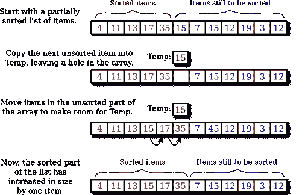

## 7.5.4 选择排序

另一种典型的排序方法使用了找到列表中最大的项目并将其移动到末尾的想法——如果列表要按递增顺序排列，那里就是它所在地。一旦最大的项目处于正确的位置，你就可以对剩余项目应用相同的思路。也就是说，找到下一个最大的项目，并将其移动到倒数第二个位置，依此类推。这种算法被称为选择排序。它很容易编写：

```java
static void selectionSort(int[] A) {
      // 使用选择排序将 A 按递增顺序排序。

   for (int lastPlace = A.length-1; lastPlace > 0; lastPlace--) {
         // 在 A[0], A[1], ...,
         // A[lastPlace] 中找到最大的项目，并通过与
         // 当前 lastPlace 位置上的数字交换
         // 将其移动到 lastPlace 位置。

      int maxLoc = 0;  // 目前为止看到的最大项目的位置。

      for (int j = 1; j <= lastPlace; j++) {
         if (A[j] > A[maxLoc]) {
               // 因为 A[j] 比我们目前看到的最大值大
               // j 是目前为止最大值的新位置。
            maxLoc = j;  
         }
      }

      int temp = A[maxLoc];  // 将最大的项目与 A[lastPlace] 交换。
      A[maxLoc] = A[lastPlace];
      A[lastPlace] = temp;

   }  // for 循环结束

}
```


选择排序的一种变体用于第 5.4.1 节中引入的 `Hand` 类。（顺便说一下，你终于可以完全理解该章节 `Hand` 类的源代码了；注意它使用了 `ArrayList`。源文件是 [Hand.java](https://math.hws.edu/eck/cs124/javanotes9/source/chapter5/Hand.java)。）

在 `Hand` 类中，一手牌由 `ArrayList<Card>` 表示。存储在列表中的对象类型为 `Card`。

我禁不住用一个相关的、虽然不那么常见但更有趣的问题来结束关于排序的这一节。那个问题就是将数组中的元素排列成随机顺序。这个问题的典型案例是洗牌。一个良好的洗牌算法类似于选择排序，不同之处在于，它不是将最大的元素移动到列表末尾，而是随机选择一个元素并移动到列表末尾。这里有一个打乱整型数组的子程序：

```java
/**
 * 后置条件：A 中的元素已重新排列为随机顺序。
 */
static void shuffle(int[] A) {
   for (int lastPlace = A.length-1; lastPlace > 0; lastPlace--) {
         // 从 0,1,...,lastPlace 之间随机选择一个位置。
      int randLoc = (int)(Math.random()*(lastPlace+1));
         // 交换位置 randLoc 和 lastPlace 处的元素。
      int temp = A[randLoc];
      A[randLoc] = A[lastPlace];
      A[lastPlace] = temp;
   }
}
```

## 第 7.6 节 二维数组

二维数组在小节 3.8.5 中引入，但从那以后我们对它们没有做什么。二维数组的类型如 `int[][]` 或 `String[][]`，它有两对方括号。二维数组的元素按行和列排列，二维数组的 `new` 运算符同时指定了行数和列数。例如：

```java
int[][] A;
A = new int[3][4];
```

这创建了一个包含 12 个元素的 `int` 二维数组，这 12 个元素排列为 3 行 4 列。虽然我没有提到，但二维数组也有初始化器。例如，这条语句创建了下图中所示的 3x4 数组：

```java
int[][]  A  =  {  {  1,  0, 12, -1 },
                  {  7, -3,  2,  5 },
                  { -5, -2,  2, -9 }
               };
```

二维数组的初始化器包含 `A` 的每一行，用逗号分隔并括在大括号之间。每一行反过来是一个用逗号分隔并括在大括号之间的值列表。还存在语法相似的二维数组字面量，它们可以在任何地方使用，而不仅仅是在声明中。例如：

```java
A  =  new int[][] {  {  1,  0, 12, -1 },
                     {  7, -3,  2,  5 },
                     { -5, -2,  2, -9 }
                  };
```

所有这些都可以自然地扩展到三维、四维甚至更高维的数组，但它们在实践中并不经常使用。

### 7.6.1 二维数组的真相

但在我们继续之前，有一个小小的惊喜。Java 并没有真正的二维数组。在真正的二维数组中，数组的所有元素都占据一块连续的内存区域，但在 Java 中情况并非如此。数组类型的语法提供了一个线索：对于任何类型 `BaseType`，我们应该能够形成 `BaseType[]`，意思是“BaseType 类型的数组”。如果我们使用 `int[]` 作为基础类型，我们得到的类型就是 `int[][]`，意思是“int 数组的数组”或“数组的数组的数组”。事实上，事实确实如此。类型为 `int[][]` 的二维数组中的元素是 `int[]` 类型的变量。记住，类型为 `int[]` 的变量只能包含指向数组的指针。因此，二维数组实际上是一个指针数组，其中每个指针都可以引用一个一维数组。这些一维数组就是二维数组的行。考虑上面定义的 3x4 数组 `A`：

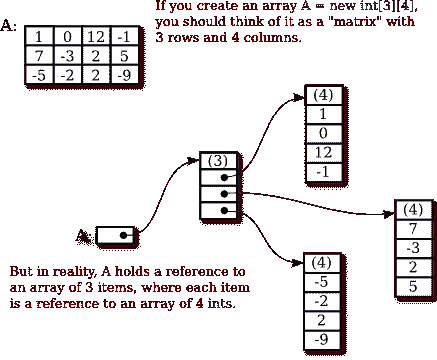

等一下，让我们重新检查文本的逻辑。二维数组中的每一行都是一个单独的一维数组，而且这些数组中的每一个都可以有不同的长度。事实上，某一行甚至可以为 `null`。例如，这条语句：

```java
A = new int[3][];
```

在第二组括号中没有数字，这创建了一个包含 3 个元素的数组，其中所有元素都是 `null`。它留下了三行的空间，但没有创建任何实际行。你可以单独地创建行 `A[0]`、`A[1]` 和 `A[2]`。

作为一个例子，考虑一个对称矩阵。对称矩阵 `M` 是一个二维数组，其行数等于列数，并且对于所有的 `i` 和 `j` 都满足 `M[i][j]` 等于 `M[j][i]`。由于这个等式，我们只需要存储 `i >= j` 的 `M[i][j]`。我们可以将数据存储在“三角矩阵”中：

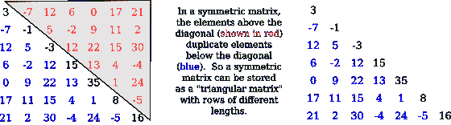

创建一个三角数组很容易，我们单独创建每一行。要创建一个 7x7 的 `double` 三角形数组，我们可以使用代码段：

```java
double[][] matrix = new double[7][]; // 行尚未创建
for (int i = 0; i < 7; i++) {
    matrix[i] = new double[i+1]; // 创建 i+1 个元素
}
```

我们只需要记住，如果我们想知道 `(i,j)` 的值且 `i < j`，那么我们实际上需要访问 `matrix[j][i]`。同样地，写一个类来表示对称矩阵很容易：

```java
/**
 * 表示实数的对称矩阵。
 */
public class SymmetricMatrix {

    private double[][] matrix;  // 用于存储数据的三角矩阵

    /**
     * 创建一个元素全为 0 的 nxn 对称矩阵。
     */
    public SymmetricMatrix(int n) {
        matrix = new double[n][];
        for (int i = 0; i < n; i++)
            matrix[i] = new double[i+1];
    }

    /**
     * 返回 (row,col) 位置的值。如果 row < col，
     * 值实际存储在 (col,row)。
     */
    public double get(int row, int col) {
        if (row >= col)
            return matrix[row][col];
        else
            return matrix[col][row];
    }

    /**
     * 设置 (row,col) 处的值。如果 row < col，
     * 值实际存储在 (col,row)。
     */
    public void set(int row, int col, double value) {
        if (row >= col)
            matrix[row][col] = value;
        else
            matrix[col][row] = value;
    }

    /**
     * 返回矩阵的行数和列数。
     */
    public int size() {
        return matrix.length;  // 大小是行数
    }

} // class SymmetricMatrix
```

这个类位于 [SymmetricMatrix.java](https://math.hws.edu/eck/cs124/javanotes9/source/chapter7/SymmetricMatrix.java) 文件中，一个测试它的小程序可以在 [TestSymmetricMatrix.java](https://math.hws.edu/eck/cs124/javanotes9/source/chapter7/TestSymmetricMatrix.java) 中找到。

顺便说一下，标准函数 `Arrays.copyOf()` 不能一次完成二维数组的完整拷贝。要这样做，你需要单独复制每一行。例如，创建一个 `int` 二维数组的拷贝：

```java
int[][] B = new int[A.length][]; // B 的行数与 A 相同。
for (int i = 0; i < A.length; i++) {
    B[i] = Arrays.copyOf(A[i], A[i].length); // 复制第 i 行。
}
```

### 7.6.2 康威生命游戏

作为一个更典型的二维数组处理的示例，让我们来看一个非常广为人知的例子：康威生命游戏（Conway's Game of Life），由数学家约翰·霍特顿·康威于 1970 年发明。这个生命游戏并不是真正的游戏（尽管它有时被称为一种运行自身的“无人游戏”）。它是一个“二维细胞自动机”。这意味着它是一个细胞网格，其内容根据确定的、确定性的规则随时间而变化。

在生命游戏中，一个细胞只有两种可能的内容：它是“存活的”或“死亡的”。我们将使用一个二维数组来表示网格，数组的每个元素代表网格中一个单元的内容。在游戏中，会设置一个初始网格，其中每个细胞被标记为存活或死亡。之后，游戏就会“自发运行”。网格通过一系列时间步进行演化。每个时间步网格的内容完全由上一个时间步的内容根据简单的规则决定：网格中的每个细胞都会查看它的八个邻居（水平、垂直和对角线），并统计邻居中有多少是存活的。然后，下一步中细胞的状态将由规则决定：

- 对于在当前时间步存活的细胞：如果该细胞有 2 或 3 个存活邻居，则该细胞在下一个时间步保持存活；否则，它死亡。（如果一个存活细胞有 0 或 1 个存活邻居，它会因为孤独死去；如果有超过 3 个存活邻居，它会因为拥挤而死去。）
- 对于在当前时间步死亡的细胞：如果该细胞有 3 个存活邻居，则该细胞在下一个时间步变为存活；否则，它保持死亡。（三个存活细胞会产生一个新的存活细胞。）

这里是生命棋盘的一部分图片，显示了应用规则前后的同一个棋盘。规则被应用于网格中的每个细胞。图片显示了它们是如何应用于其中四个细胞的：

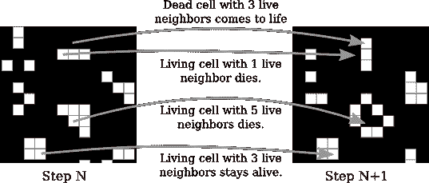

生命游戏之所以有趣，是因为它产生了许多有趣且令人意料的模式。（可以在维基百科上查找）。在这里，我们只感兴趣于编写一个模拟游戏的程序。完整的程序可以在 [`Life.java`](https://math.hws.edu/eck/cs124/javanotes9/source/chapter7/Life.java) 文件中找到。

在程序中，生命网格显示为一个正方形网格，其中死亡的方格是黑色，存活的方格是白色的。（程序使用了 `Section 4.7` 中介绍的 `MosaicCanvas` 类。）网格存储在一个名为 `alive` 的二维布尔数组中，其中 `alive[r][c]` 表示第 `r` 行、第 `c` 列的细胞是否存活。程序使用类似下面的代码随机初始化网格：

```java
for (int r = 0; r < GRID_SIZE; r++) {
    for (int c = 0; c < GRID_SIZE; c++) {
        // 使用 25% 的概率让细胞存活。
        alive[r][c] = (Math.random() < 0.25);
    }
}
```

注意表达式 `Math.random() < 0.25` 是一个可以赋值给数组元素的真/假值。该数组还用于设置屏幕上细胞的颜色。由于细胞网格作为 `MosaicCanvas` 显示在屏幕上，颜色设置是使用 `MosaicCanvas` API 完成的。注意实际绘制是在 `MosaicCanvas` 类中完成的（它有自己的 `Color[][]` 数组来跟踪每个细胞的颜色）。生命程序只需要使用 `MosaicCanvas` API 设置马赛克的颜色。这在程序中通过名为 `showBoard()` 的方法实现，该方法每次棋盘变化时被调用：

```java
for (int r = 0; r < GRID_SIZE; r++) {
    for (int c = 0; c < GRID_SIZE; c++) {
        if (alive[r][c])
            display.setColor(r,c,Color.WHITE);
        else
            display.setColor(r,c,null); // 显示背景颜色，黑色。
    }
}
```

### 计算新状态

当然，程序中最有趣的部分是通过将规则应用到当前状态来计算棋盘的新状态。这是复杂的。事实上，程序使用第二个数组来存储正在创建的新棋盘。当新棋盘创建完成后，它可以替换旧棋盘。该算法的伪代码如下：

```text
let newboard = new boolean[GRID_SIZE][GRID_SIZE]

for (int r = 0; r < GRID_SIZE; r++) {
    for (int c = 0; c < GRID_SIZE; c++) {
        int N = countAliveNeighbors(r, c);

        if (alive[r][c]) {
            if (N == 2 || N == 3)
                newboard[r][c] = true;
            else
                newboard[r][c] = false;
        } else {
            if (N == 3)
                newboard[r][c] = true;
            else
                newboard[r][c] = false;
        }
    }
}

alive = newboard
```

注意：上面的伪代码为了简洁起见省略了 `countAliveNeighbors` 方法的实现。

### 边界处理

但当细胞位于网格边缘时会出现一个问题。在这种情况下，数组的某些元素并不存在，尝试使用它们会导致异常。为了避免异常，我们必须对边缘细胞进行特殊处理。一种想法是在引用任何数组元素之前，检查该数组元素是否存在。在这种情况下，邻居计数的代码变为：

```java
if (r-1 >= 0 && c-1 >= 0 && alive[r-1][c-1])
    N++; // 位置在 (r-1,c-1) 的细胞存活的。

if (r-1 >= 0 && alive[r-1][c])
    N++; // 位置在 (r-1,c) 的细胞存活的。

if (r-1 >= 0 && c+1 < GRID_SIZE && alive[r-1][c+1])
    N++; // 位置在 (r-1,c+1) 的细胞存活的。

if (c-1 >= 0 && alive[r][c-1])
    N++; // 位置在 (r,c-1) 的细胞存活的。

if (c+1 < GRID_SIZE && alive[r][c+1])
    N++; // 位置在 (r,c+1) 的细胞存活的。

if (r+1 < GRID_SIZE && c-1 >= 0 && alive[r+1][c-1])
    N++; // 位置在 (r+1,c-1) 的细胞存活的。

if (r+1 < GRID_SIZE && alive[r+1][c])
    N++; // 位置在 (r+1,c) 的细胞存活的。

if (r+1 < GRID_SIZE && c+1 < GRID_SIZE && alive[r+1][c+1])
    N++; // 位置在 (r+1,c+1) 的细胞存活的。
```

所有可能的异常都被避免了。但在我的程序中，我实际上做了一些在二维计算机游戏中很常见的做法——我假定棋盘的左边缘连接到右边缘，顶部边缘连接到底部。例如，对于第 `0` 行细胞，我们说“上方”行实际上是最后一行，行号 `GRID_SIZE-1`。我使用变量来表示给定细胞上方、下方、左侧和右侧的位置。代码似乎比上面的代码要简单。这里是计算新棋盘的完整方法：

```java
private void doFrame() { // Compute the new state of the Life board.

    boolean[][] newboard = new boolean[GRID_SIZE][GRID_SIZE];

    for ( int r = 0; r < GRID_SIZE; r++ ) {

        int above, below; // rows considered above and below row number r

        int left, right;  // columns considered left and right of column c

        above = r > 0 ? r-1 : GRID_SIZE-1;  // (for "?:" see Subsection 2.5.5)

        below = r < GRID_SIZE-1 ? r+1 : 0;

        for ( int c = 0; c < GRID_SIZE; c++ ) {

            left =  c > 0 ? c-1 : GRID_SIZE-1;

            right = c < GRID_SIZE-1 ? c+1 : 0;

            int n = 0; // number of alive cells in the 8 neighboring cells
```


```java
if (alive[above][left])
    n++;

if (alive[above][c])
    n++;

if (alive[above][right])
    n++;

if (alive[r][left])
    n++;

if (alive[r][right])
    n++;

if (alive[below][left])
    n++;

if (alive[below][c])
    n++;

if (alive[below][right])
    n++;

if (n == 3 || (alive[r][c] && n == 2))
    newboard[r][c] = true;
else
    newboard[r][c] = false;

}

}

alive = newboard;

}

```

我再次敦促你查看源代码[Life.java](https://math.hws.edu/eck/cs124/javanotes9/source/chapter7/Life.java)并尝试运行该程序。别忘记你还需要[MosaicCanvas.java](https://math.hws.edu/eck/cs124/javanotes9/source/chapter7/MosaicCanvas.java)。

***

### 7.6.3 跳国际棋（Checkers）

作为本章的最后一个例子，我们将观察一个使用二维数组的更复杂的示例。这是我们目前为止遇到过的最长的程序，共有 721 行代码。该程序允许两个用户相互对战国际棋。国际棋在八乘八的棋盘上进行，该棋盘基于第 6.6.5 节中的一个示例。玩家根据棋子的颜色被分为“红方”和“黑方”。我在这里不会解释国际棋的规则；也许你可以通过尝试程序来学习它们。

在程序中，玩家通过点击想要移动的棋子，然后点击它要移动到的空格来完成移动。为了帮助玩家，当前玩家在给定时刻可以合法点击的任何方格都会用亮色的边框突出显示。如果选择了要移动的棋子，该棋子所在的方格会被黄色边框包围。其他可以合法移动的棋子会被青色边框包围。如果一个棋子已经被选中移动，则它可以合法移动到的每个空格都会用绿色边框突出显示。游戏强制执行一条规则：如果当前玩家可以跳过对手的棋子，则玩家必须跳过。当玩家的棋子到达棋盘对面并变成王时，棋子上会画一个大大的白色“K”。这是程序在游戏初阶段的一张照片。现在轮到黑方移动。黑方选择了黄色边框方格内的棋子进行移动。黑方可以点击绿色边框的方格之一来完成移动，也可以点击青色边框的方格之一来选择另一个棋子进行移动。

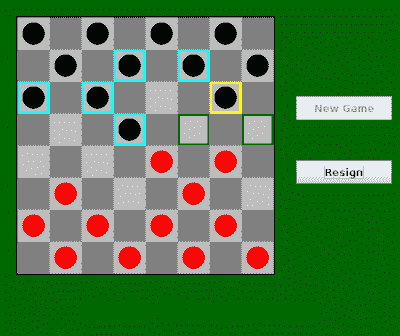

我将仅介绍此示例的部分编程。我鼓励你阅读完整的源代码[Checkers.java](https://math.hws.edu/eck/cs124/javanotes9/source/chapter7/Checkers.java)。它很长很复杂，但通过学习，你应该能理解它所使用的所有技术。该程序是基于状态、事件驱动和面向对象编程的良好示例。

棋盘上棋子的数据存储在一个二维数组中。由于程序的复杂性，我想将其拆分为几个类。除了主类外，还有几个嵌套类。其中一个类是`CheckersData`，它处理棋盘的数据。它不直接负责图形或事件处理的任何部分，但它提供了可以由处理图形和事件的类调用的方法。我想讨论主要是这个类。

`CheckersData`类有一个名为`board`的实例变量，类型为`int[][]`。`board`的值设置为`new int[8][8]`，这是一个 8×8 的整数网格。存储在网格中的值定义为常量，代表国际棋盘上方格可能的内容：

```java
static final int
    EMPTY = 0,      // 表示空方格的值。
    RED = 1,        // 常规红棋子。
    RED_KING = 2,   // 红方王。
    BLACK = 3,      // 常规黑棋子。
    BLACK_KING = 4; // 黑方王。
```

常量`RED`、`RED_KING`、`BLACK`和`BLACK_KING`也用于我的程序表示玩家。当游戏开始时，数组的值被设置为棋盘的初始状态。网格看起来如下：


常规黑棋子只能向棋盘“下方”移动。也就是说，它移动到的方格行号必须大于它起始的方格行号。常规红棋子只能向上棋盘移动。两种颜色的王可以在两个方向移动。`CheckersData`的一个功能是处理用户移动棋子时对数据结构所需的更改。提供了一个名为`makeMove()`的实例方法来实现此。当玩家从一个方格移动到另一个方格时，数组的值会发生变化。但并不是全部。如果是跳跃，被跳过的棋子将从棋盘上移除。（该方法通过检查移动到的方格与起始方格相隔两行来判断是否为跳跃。）此外，红方棋子移动到第 0 行或黑方棋子移动到第 7 行将变成王。将所有这些内容放入子程序是良好的编程：程序的其他部分不需要担心这些细节。它只需调用此：

```java
/**
 * 将 ... 移动到 (toRow,toCol)。假设
 * 此移动是合法的！如果是跳跃，被跳过的棋子将
 * 从棋盘上移除。如果棋子移动到对手一侧的最后
 * 行，棋子将变成王。
 */
void makeMove(int fromRow, int fromCol, int toRow, int toCol) {
    board[toRow][toCol] = board[fromRow][fromCol]; // 移动棋子。
    board[fromRow][fromCol] = EMPTY; // 它离开的方格现在是空的。

    if (fromRow - toRow == 2 || fromRow - toRow == -2) {
        // 这是跳跃。从棋盘上移除被跳过的棋子。
        int jumpRow = (fromRow + toRow) / 2; // 被跳棋子的行。
        int jumpCol = (fromCol + toCol) / 2; // 被跳棋子的列。
        board[jumpRow][jumpCol] = EMPTY;
    }

    if (toRow == 0 && board[toRow][toCol] == RED)
        board[toRow][toCol] = RED_KING; // 红方变成王。

    if (toRow == 7 && board[toRow][toCol] == BLACK)
        board[toRow][toCol] = BLACK_KING; // 黑方变成王。
} // 结束 makeMove()
```

`CheckersData`另一个更重要的功能是寻找棋盘上的合法移动。在我的程序中，国际棋游戏中的移动是由属于以下类的对象表示的：

```java
/**
 * CheckersMove 对象代表跳棋（Checkers）游戏中的一次移动。
 * 它保存待移动棋子的行和列号，以及目标格子的行和列号。
 * （该类不保证该次移动是合法的。）
 */
private static class CheckersMove {
    int fromRow, fromCol; // 待移动棋子的位置。
    int toRow, toCol;     // 移动到的格子。

    CheckersMove(int r1, int c1, int r2, int c2) {
        // 构造函数。设置实例变量的值。
        fromRow = r1;
        fromCol = c1;
        toRow = r2;
        toCol = c2;
    }

    boolean isJump() {
        // 测试此移动是否为跳跃。假设
        // 移动是合法的。在跳跃中，棋子移动两行。
        // （在普通移动中，它只移动一行。）
        return (fromRow - toRow == 2 || fromRow - toRow == -2);
    }
} // 结束类 CheckersMove。
```

`CheckersData`类有一个实例方法，可以找到指定玩家当前可用的所有合法移动。该方法是一个返回`CheckersMove[]`类型数组的函数。该数组包含了用`CheckersMove`对象表示的所有合法移动。该方法的规格说明如下：

```java
/**
 * 返回一个包含当前棋盘上指定玩家的所有
 * 合法 CheckersMoves 的数组。如果玩家没有
 * 合法移动，则返回 null。player 的值应该是 RED（红）或 BLACK（黑）
 * 常量之一；否则，返回 null。如果返回的值非空，它完全由
 * 跳跃移动组成或完全由普通移动组成，因为
 * 如果玩家可以跳跃，则只有跳跃是合法移动。
 */
CheckersMove[] getLegalMoves(int player)
```

该方法的简要伪代码算法如下：

```text
从空移动列表开始

找到任何合法的跳跃并将它们添加到列表

如果没有跳跃：
    找到任何其他合法移动并将它们添加到列表

如果列表为空：
    返回 null
否则：
    返回该列表
```

现在，这个“列表”是什么？我们必须以数组的形式返回合法移动。但由于数组的大小是固定的，在不知道有多少次移动之前，我们无法创建数组，而只有在方法接近结束（在我们已经创建了列表之后）我们才能知道这一点！一个巧妙的解决方案是使用`ArrayList`而不是数组，在发现移动时将其存储起来。事实上，我使用了一个由泛型类型`ArrayList<CheckersMove>`定义的对象，以便列表被限制为持有`CheckersMove`类型的对象。当我们将移动添加到列表时，它会根据需要自动增长。在方法结束时，我们可以创建我们需要的数组并将数据拷贝到其中：

```text
让 "moves" 为一个空的 ArrayList<CheckersMove>

找到任何合法的跳跃并将它们添加到 moves

if moves.size() == 0:
    找到任何其他合法移动并将它们添加到 moves

if moves.size() == 0:
    return null
else:
    让 moveArray 为新的 CheckersMove[moves.size()]
    将 moves 中的每个移动拷贝到 moveArray
    return moveArray
```

```java
CheckersMove[] getLegalMoves(int player) {
    if (player != RED && player != BLACK)
        return null; // （这在正确的程序中不会发生。）

    int playerKing; // 属于该玩家的王的常量。
    if (player == RED)
        playerKing = RED_KING;
    else
        playerKing = BLACK_KING;

    ArrayList<CheckersMove> moves = new ArrayList<CheckersMove>();
    // 移动将存储在这个列表中。

    /*
     * 首先，检查任何可能的跳跃。查看棋盘上的每一个格子。
     * 如果该格子包含该玩家的一个棋子，
     * 从该格子出发的四个方向各查看可能的跳跃。
     * 如果某个方向上有合法的跳跃，将其放入
     * moves ArrayList 中。
     */
    for (int row = 0; row < 8; row++) {
        for (int col = 0; col < 8; col++) {
            if (board[row][col] == player || board[row][col] == playerKing) {
                if (canJump(player, row, col, row + 1, col + 1, row + 2, col + 2))
                    moves.add(new CheckersMove(row, col, row + 2, col + 2));

                if (canJump(player, row, col, row - 1, col + 1, row - 2, col + 2))
                    moves.add(new CheckersMove(row, col, row - 2, col + 2));

                if (canJump(player, row, col, row + 1, col - 1, row + 2, col - 2))
                    moves.add(new CheckersMove(row, col, row + 2, col - 2));

                if (canJump(player, row, col, row - 1, col - 1, row - 2, col - 2))
                    moves.add(new CheckersMove(row, col, row - 2, col - 2));
            }
        }
    }

    /*
     * 如果发现了任何跳跃移动，则用户必须跳跃，因此我们
     * 不添加任何普通移动。然而，如果没有发现跳跃，
     * 则检查任何合法的普通移动。查看棋盘上的每一个格子。
     * 如果该格子包含该玩家的一个棋子，
     * 从该格子出发的四个方向各查看可能的移动。
     * 如果某个方向上有合法的移动，
     * 将其放入 moves ArrayList 中。
     */
    if (moves.size() == 0) {
        for (int row = 0; row < 8; row++) {
            for (int col = 0; col < 8; col++) {
                if (board[row][col] == player || board[row][col] == playerKing) {
                    if (canMove(player, row, col, row + 1, col + 1))
                        moves.add(new CheckersMove(row, col, row + 1, col + 1));

                    if (canMove(player, row, col, row - 1, col + 1))
                        moves.add(new CheckersMove(row, col, row - 1, col + 1));

                    if (canMove(player, row, col, row + 1, col - 1))
                        moves.add(new CheckersMove(row, col, row + 1, col - 1));

                    if (canMove(player, row, col, row - 1, col - 1))
                        moves.add(new CheckersMove(row, col, row - 1, col - 1));
                }
            }
        }
    }

    /*
     * 如果没有找到合法的移动，返回 null。否则，创建一个
     * 足够大的数组来容纳所有合法移动，将 ArrayList 中的
     * 合法移动复制到该数组中，并返回该数组。
     */
    if (moves.size() == 0)
        return null;
    else {
        CheckersMove[] moveArray = new CheckersMove[moves.size()];

        for (int i = 0; i < moves.size(); i++)
            moveArray[i] = moves.get(i);

        return moveArray;
    }
} // end getLegalMoves
```


这个跳棋程序是复杂的，你可以确定它不是随手凑出来的。为了决定使用哪些类和对象、编写哪些方法以及这些方法应该使用什么算法，需要大量的设计工作。完整的源代码位于文件 [Checkers.java](https://math.hws.edu/eck/cs124/javanotes9/source/chapter7/Checkers.java) 中。看一看！

## 第 7 章编程练习

### 练习 7.1

编写一个子程序，创建一个 `ArrayList`，其中包含从 1 到某个指定最大值范围内的若干不同的随机整数。整数的数量和允许整数的最大值应该是子程序的参数。编写一个 `main()` 例程来测试你的子程序。

查看解答

### 练习 7.2

假设 `M` 是一个具有 `R` 行 `C` 列的二维数组。`M` 的转置定义为具有 `C` 行和 `R` 列的数组 `T`，使得 `T[i][j] = M[j][i]`。编写一个函数，接受二维数组作为参数并返回它的转置。（假设所有行的长度相同）。还要包含一个 `main()` 例程来测试你的工作，以整齐的行和列打印数组。

查看解答

### 练习 7.3

在节 7.5.4 中提到，标准的 `Arrays.sort()` 比 `selectionSort()` 快得多且更高效。编写一个程序来测试这一断言。具体来说，创建一个包含随机数的大数组。同时使用 `Arrays.sort()` 和 `selectionSort()` 对数组进行排序，并记录所需的时间（参见 [TimedComputation.java](https://math.hws.edu/eck/cs124/javanotes9/source/chapter2/TimedComputation.java)）。

查看解答

### 练习 7.4

在 `../c6/ex2-ans.html` 中，你写了一个 `DragTwoSquares` 程序，允许用户在画布上拖动红色正方形和蓝色正方形。编写一个改进的版本，用户可以在画布上添加正方形并拖动它们。特别是：如果用户按住 Shift 键或右键点击画布，用户正在尝试拖动正方形；找到鼠标位置的正方形（如果有），并在用户拖动时移动它。其他点击应添加正方形，将新正方形的中心放在当前鼠标位置。为了让图片更美观，给每个正方形一个随机颜色，并在绘制正方形时为每个正方形画一个黑色轮廓（我的程序还给了正方形一个 0.5 到 1.0 之间的随机 alpha 值）。编写一个类来表示绘制一个正方形所需的数据，并使用 `ArrayList` 存储画布中所有正方形的数据。如果用户将正方形完全拖出画布，则从列表中删除它。

查看解答

### 练习 7.5

编写一个程序，读取用户输入的一系列正数并按从小到大的顺序打印这些数字。用户输入零来标记输入结束。假设最多输入 100 个正数。不要使用任何内置函数如 `Arrays.sort()`。自己实现排序。

查看解答

### 练习 7.6

编写一个程序，读取用户选择的文本文件，并对所有不同的单词创建一个字母顺序列表。所有单词都应转换为小写，并从列表中消除重复项。列表应写入用户选择的输出文件中。正如在节 2.4.4 中讨论的那样，可以使用 `TextIO` 来读写文件。使用类型为 `ArrayList<String>` 的变量来存储单词。在读取文件时将其分割单词并不容易，特别是如果你允许单词中间出现单引号的话。你可以在程序中使用以下方法：

```java
/**
 * 从 TextIO 中读取下一个单词，如果存在的话。首先，跳过输入中的
 * 任何非字母字符。如果在找到单词之前遇到文件结束（end-of-file），
 * 则返回 null。否则读取并返回该单词。
 * 单词被定义为字母序列。此外，如果单引号的两边都被字母包围，
 * 则那么单词可以包含一个单引号。
 * @return 从 TextIO 读取的下一个单词，如果遇到文件结束
 *     则返回 null。
 */
private static String readNextWord() {
   char ch = TextIO.peek(); // 查看输入中的下一个字符。
   while (ch != TextIO.EOF && ! Character.isLetter(ch)) {
      // 跳过非字母字符。
      TextIO.getAnyChar();  // 读取该字符。
      ch = TextIO.peek();   // 查看下一个字符。
   }
   if (ch == TextIO.EOF) // 遇到文件结束
      return null;
   // 此时，我们知道下一个字符是字母，因此读取一个单词。
   String word = "";  // 这将是读取的单词。
   while (true) {
      word += TextIO.getAnyChar();  // 将字母附加到单词上。
      ch = TextIO.peek();  // 查看下一个字符。
      if (ch == '\'') {
         // 下一个字符是单引号。读取它，
         // 如果后续字符是字母，则将单引号和
         // 字母添加到单词中并继续
         // 读取单词。如果单引号后的字符
         // 不是字母，则单词结束，退出循环。
         TextIO.getAnyChar();   // 读取单引号。
         ch = TextIO.peek();    // 查看单引号后的字符。
         if (Character.isLetter(ch)) {
            word += "\'" + TextIO.getAnyChar();
            ch = TextIO.peek();  // 查看下一个字符。
         }
         else
            break;
      }
      if (! Character.isLetter(ch)) {
         // 如果下一个字符不是字母，则单词
         // 结束了，因此跳出循环。
         break;
      }
      // 如果我们没有跳出循环，下一个字符是字母。
   }
   return word;  // 返回读取的单词。
}
```

请注意，当文件被完全读取后，此方法将返回 `null`。你可以将其用作停止处理输入文件的信号。

查看解答

### 练习 7.7

五子棋（Moku，也称为 Pente 或 Five Stones）游戏与井棋游戏类似，不同在于它在更大的棋盘上进行，且目标是获得五个连线的格子，而不是三个。棋盘应该有 13 行 13 列方格。玩家交替在棋盘上放置棋子。棋子可以放置在任何空格中。第一个获得五个连线棋子（水平、垂直或对角线）的玩家获胜。如果在任何玩家获胜之前所有格子都被填满，则游戏为平局。编写一个程序让两个玩家相互对战五子棋。

你的程序将比第 7.6.3 节中的国际象棋程序要简单。两个玩家之间严格交替进行，不需要突出合法移动。你只需要一个嵌套子类，一个 `JPanel` 的子类，用于绘制棋盘并处理所有的游戏工作，就像国际象棋程序中的嵌套 `Board` 类一样。你可能想要查看国际象棋程序的源代码，[Checkers.java](https://math.hws.edu/eck/cs124/javanotes9/source/chapter7/Checkers.java)，以获取程序通用大纲的思路。

程序中最难的部分是检查玩家所做的移动是否为获胜移动。为了做到这一点，你必须从用户放置棋子的格子开始，检查四个可能的方向。你必须计算该玩家在该方向上有多少个连线的棋子。如果任何方向上的数量五个或更多，则该玩家获胜。作为提示，这里是我程序中的部分代码。这段代码统计了用户在指定方向上连线的棋子数量。方向由两个整数 `dirX` 和 `dirY` 指定。这些变量的值为 0、1 或 -1，且至少有一个不为零。例如，要查看水平方向，`dirX` 为 1，`dirY` 为 0。

```java
int ct = 1;  // 属于玩家的连线棋子数。

int r, c;    // 要检查的行和列

r = row + dirX;  // 查看指定方向上的格子。
c = col + dirY;

while (r >= 0 && r < 13 && c >= 0 && c < 13
       && board[r][c] == player) {
   // 格子在棋盘上，且
   // 包含玩家的棋子之一。
   ct++;

   r += dirX;  // 继续到下一个。
   c += dirY;
}
```

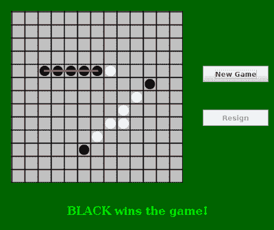

查看解答

## 第 7 章测试

### 问题 1

数组的 `basetype` 是什么？

### 问题 2

以下方法的目的是什么？

```java
static boolean same(int... value) {
    for (int i = 1; i < value.length; i++) {
        if (value[i-1] != value)
            return false;
    }
    return true;
}
```

### 问题 3

数组排序意味着什么？

### 问题 4

二分搜索相对于线性搜索的优势是什么？

### 问题 5

什么是动态数组？动态数组相对于普通数组的优势是什么？

### 问题 6

说 `ArrayList` 是泛型意味着什么？

### 问题 7

假设变量 `strlst` 声明如下：

```java
ArrayList<String> strlst = new ArrayList<>();
```

假设列表为空且列表中的所有项不为 null。编写一段代码，找到并打印列表中字典顺序最前的字符串。

### 问题 8

显示以下代码段产生的精确输出。

```java
char[][] pic = new char[6][6];

for (int i = 0; i < 6; i++)
   for (int j = 0; j < 6; j++) {
      if (i == j || i == 0 || i == 5)
         pic[i][j] = '*';
      else
         pic[i][j] = '.';
   }

for (int i = 0; i < 6; i++) {
   for (int j = 0; j < 6; j++)
      System.out.print(pic[i][j]);
   System.out.println();
}
```

### 问题 9

编写一个完整的静态方法，找到 `int` 数组中的最大值。该方法应该有一个参数，即 `int[]` 数组。数组中的最大数字应作为方法的返回值。

### 问题 10

假设在 2021 年的 100 个城市中都进行了温度测量。这些测量存储在一个数组中：

```java
int[][] temps = new int[100][365];
```

其中 `temps[c][d]` 是城市 `c` 在第 `d` 天的测量值。编写一段代码，打印每个城市全一年的平均温度。城市的平均温度可以通过相加该城市的所有 365 次测量值并除以 365.0 来获得。

### 问题 11

编写一段代码段，输出每位入职公司 20 年或更长的员工的姓、名和时薪。请编写两个版本的代码段：一个使用普通的 `for` 循环，另一个使用 `for-each` 循环。

### 问题 12

将上一个问题中的 `Employee` 类转换为记录类（record class）。在这种情况下，对上一个问题的解答方案需要进行哪些更改？

### 问题 13

编写一个表示日期的记录类（record class），其中 `Date` 对象包含三个整数字段，分别表示日期的月份、日期和年份。如果月份和日期的值不合法，规范构造函数应该抛出异常。还要包含一个 `toString()` 方法，以如 `"5/27/2022"` 类的格式打印日期。

### 问题 14

以下子程序的目的是什么？从参数值的角度，它返回的值代表什么意义？

```java
static double[] sums(double[][] data) {
    double[] answers = new double[data.length];

    for (int i = 0; i < data.length; i++) {
        double sum = 0;

        for (int j = 0; j < data[i].length; i++)
            sum = sum + data[i][j];

        answers[i] = sum;
    }

    return answers;
}
```


# 第 8 章

## 正确性、健壮性、效率

在之前的章节中，我们涵盖了编程基础。本章之后的章节将涵盖编程更高级的方面。这里介绍的思想通常会更复杂，使用这些方法的程序也会更加复杂。这个相对短的章节是一个转折点，我们在这里关注如何让这些复杂的程序变得*正确*的问题。

计算机程序的失败实在太常见了。程序是脆弱的。一个微小的错误就可能导致程序运行异常或崩溃。我们大多数人通过自己的电脑使用经验对此都很熟悉。我们也听过许多关于软件故障导致航天器坠毁、网站离线、电话服务故障，以及在少数情况下导致人员死亡的故事。

程序并不非要变得那么糟糕。要保证程序完全没有问题可能是可能的，但细致编程和设计良好的编程工具可以帮助将问题降到最低。本章将探讨程序的正确性和健壮性问题。第 8.2 节讨论了你如何思考和分析程序，以便让你编写的程序更有可能是正确的——甚至是可以证明是正确的。

第 8.3 节更详细地介绍了异常和`try..catch`语句，第 8.4 节引入了断言，这是 Java 提供的另一个辅助编写正确程序的工具。

在第 8.5 节中，我们来看另一个对现实世界程序同样的问题：效率。一个完全正确的程序如果运行需要不合理的时间，它也没有什么用。本章的最后一节介绍了分析算法运行时间效率的技术。

本章的一些主题是计算机科学高级课程的主题，在这里只能给出简要概述。但你在这里学到的将对书中其余部分有用。

### 第 8 章目录：

* 第 1 节：正确性和健壮性简介
* 第 2 节：编写正确的程序
* 第 3 节：异常与 try..catch
* 第 4 节：断言与注解
* 第 5 节：算法分析
* 练习题
* 本章测验

## 第 8.1 节 正确性和健壮性简介

如果一个程序完成了它的任务，它就是正确的。如果它能以合理的方式处理非法输入和意外情况，它就是健壮的。例如，考虑一个旨在读取输入并打印订单的程序。如果程序符合其规范，它就是正确的。但这意味着每个程序都是正确的吗？正确性问题实际上比看起来要微妙得多。如果一个程序对任何输入都能工作，它就是正确的。

### 8.1.1 恐怖故事

大多数计算机用户都有过程序无法运行或崩溃的个人经验。在很多情况下，这些问题只是困扰，但即使在计算机上也可能产生严重的后果。当计算机被赋予更重要的任务时，失败的后果可能会成倍严重。

大约二十三年前，两次价值数亿美元的火星任务失败在新闻中引起了关注。这两次失败可能都是由于软件问题导致的，但在两种情况下，问题并不在于程序本身的错误。1999 年 9 月，火星轨道器在火星大气层中烧毁，是因为以英制单位（如英尺和磅）表示的数据输入到一个设计用于公制单位（如厘米和克）的计算机程序。几个月后，火星极地着陆器可能坠毁了，因为它的软件过早地关闭了引擎。该程序本应在航天器着陆时检测到撞击并关闭引擎。据确定，着陆架的部署可能震动了航天器足以触发程序，导致在航天器仍高悬于空中时关闭了引擎。失去动力的航天器随后便落向火星表面。一个更健壮的系统会在关闭引擎之前检查高度！

还有许多由于错误或编写不当的软件引起的戏剧性故事。让我们看看 Tom Forester 和 Perry Morrison 所写的《计算机伦理》一书中描述的几个事件。

* 1985 年和 1986 年，有人在接受程序错误的计算机化辐射设备治疗时，因辐射量过大导致一人死亡、多人受伤。在另一个案例中，在截至 1992 年的十年间，有近 1000 名癌症患者由于编程错误而接受了比处方少了 30% 的辐射剂量。
* 1985 年，纽约银行的一台计算机由于程序错误开始销毁正在进行的证券交易记录。修复该程序花费了不到 24 小时，但到那时，银行为了解决该问题而借入资金，支付了 5,000,000 美元的隔夜利息。
* F-16 战斗机惯性引导系统的程序如果不是在仿真中被发现，它在跨越赤道时会导致飞机翻转。水手 18 号太空探测器因为程序中一行代码的错误而丢失。双子座 V 号太空飞船偏离预定着陆点百英里，是因为一个程序员忘记考虑到地球的自转。
* 1990 年，由于新加载的计算机程序被证明包含错误，AT&T 的长途电话服务在全美范围内受到中断。

当然，最近也出现过更多的问题。例如，计算机软件错误导致了 2003 年东北大停电，这是历史上最大的停电事件之一。2006 年，空客 A380 因为软件不兼容问题导致进度推误，损失可能高达数十亿美元。2007 年，一个软件问题导致洛杉矶国际机场数千架飞机停飞。2010 年 5 月 6 日，一个自动交易程序的缺陷显然导致道琼斯工业平均指数下跌了 1000 点。

这些只是几个例子。软件问题太常见了。作为程序员，我们需要理解为什么会这样，以及可以采取什么措施。

***

### 8.1.2 Java 救场

根据 Java 发明者的说法，部分问题可以追溯到编程语言本身。Java 的设计目的是提供对某些类型错误的保护。语言特性如何能帮助防止错误呢？让我们来看几个例子。

有些编程语言不需要声明变量。在这些语言中，当程序中使用变量名时，变量会自动创建。你可能认为这比显式声明每个变量更方便，但这样做会导致一个遗憾的后果：一个无意的拼写错误可能会引入一个你无意中创建的额外变量。根据一个著名的故事，这种类型的错误导致了另一个航天器的失事。在 FORTRAN 编程语言中，命令`DO 20 I = 1,5`是计数循环的第一条语句。现在，在 FORTRAN 中空格是不忽略的，因此这等同于`DO20I=1,5`。另一方面，命令`DO20I=1.5`使用句号而不是逗号，是一个赋值语句，它将值 1.5 赋值给变量`DO20I`。据称，在此类语句中无意间将句号替换为逗号导致火箭在起飞时爆炸。因为 FORTRAN 不需要声明变量，编译器会乐意接受像`DO20I=1.5.`这条语句。它只会创建一个名为`DO20I`的新变量。如果 FORTRAN 要求声明变量，编译器就会抱怨变量`DO20I`未定义。

虽然现在大多数编程语言都要求声明变量，但通用编程语言中还有其他特性可能导致问题。Java 消除了其中一些特性。有些人抱怨说这让 Java 效率更低、功能更弱。虽然这种批评有一定道理，但在大多数情况下，安全健壮性的增加可能值得付出这些代价。防止某些类型错误的最佳防御是设计一种让错误无法发生的编程语言。在其他无法完全消除错误的情况下，可以对语言进行设计，使得当错误确实发生时，它能被自动检测到。这至少可以防止错误造成进一步伤害，并提醒程序员有一个需要修复的 bug。让我们来看看 Java 设计者采取这些方法的几个案例。

数组是根据具有特定数量的位置创建的，编号从零一直到某个指定的最大索引。尝试使用指定范围之外的数组位置是一个错误。在 Java 中，任何此类尝试都会被系统自动检测。在其他一些语言（如`C`和`C++`）中，必须由程序员确保索引在合法范围内。假设数组`A`有三个位置，`A[0]`、`A[1]`和`A[2]`。那么`A[3]`、`A[4]`等指向数组末尾之外的内存位置。在 Java 中，在`A[3]`中存储数据的尝试会被检测到。程序将终止（除非错误被“捕获”，如第 3.7 节所示）。在`C`或`C++`中，计算机将直接把数据存储在不是数组部分的内存中。由于无法得知该内存位置的用途，结果将是不可预测的。后果可能比程序终止严重得多。（例如，参见本节后面对缓冲区溢出错误的讨论。）

指针是编程错误的臭名昭著来源。在 Java 中，对象类型的变量要么持有指向对象的指针，要么特殊值`null`。任何将`null`值用作实际对象的指针使用的尝试都会被系统检测。在其他一些语言中，仍然由程序员来避免此类空指针错误。在我很久以前的第一台 Macintosh 计算机上，空指针的实现方式就像指向内存位置 0 的指针。程序可以使用空指针更改存储在位置 0 附近的内存值。不幸的是，Macintosh 将重要的系统数据存储在这些位置。更改这些数据可能导致整个系统崩溃，其后果比单个程序失败严重得多。

另一种类型的指针错误发生在指针值指向错误类型的对象，或者指向一个根本没有有效对象的内存段时。这类错误在 Java 中是不可能的，因为 Java 不允许程序员直接操作指针。在其他语言中，可以设置指针指向内存中的任何位置。如果这样做不当，那么使用该指针可能会产生不可预测的结果。

另一种在 Java 中不会发生的错误是内存泄漏。在 Java 中，一旦不再有指针引用某个对象，该对象就会被“垃圾回收”，以便其占据的内存可以被重用。在其他语言中，程序员负责将未使用的内存返回给系统。如果程序员没有这样做，未使用的内存就会堆积，留给程序和数据的内存就会减少。有一个故事，许多旧 Windows 电脑的常用程序存在大量的内存泄漏，导致计算机在使用几天后内存耗尽，必须重启。

许多程序被发现存在缓冲区溢出错误。缓冲区溢出错误经常登上新闻，因为它们导致了许多网络安全问题。当一台计算机通过网络从另一台计算机接收数据时，这些数据会被存储在缓冲区中。缓冲区只是程序分配的一段内存，用于存放它期望接收的数据。当接收的数据超过缓冲区能够容纳的时，就会发生缓冲区溢出。问题是，这时会发生什么？如果程序或网络软件检测到了该错误，那么发生的仅仅是网络数据传输失败。真正的问题发生在软件未能正确检测到缓冲区溢出时。在这种情况下，即使缓冲区已满，软件仍继续在内存中存储数据，而多出的数据进入了程序未作为缓冲区分配的内存区域。那部分内存可能正被用于其他用途，它可能包含重要数据，甚至可能包含程序本身的一部分。这就是真正的安全问题所在的地方。假设缓冲区溢出导致程序的某些被通过网络接收的额外数据替换。当计算机执行被替换的程序部分时，它实际上执行的是从另一台计算机接收的数据。这些数据可以是任何内容。它可以是一个导致计算机崩溃或接管计算机的程序。在网络软件中发现方便的缓冲区溢出错误的恶意程序员可以尝试利用该错误，欺骗其他计算机执行他的程序。

对于完全用 Java 编写的软件，缓冲区溢出错误是不可能的。该语言没有提供任何将数据存储到未正确分配内存的方法。要做到这一点，你需要一个指向未分配内存的指针，或者必须引用位于数组分配范围之外的数组位置。如上所述，在 Java 中这二者都是可能的。（然而，Java 的标准类中可能仍然存在错误，因为这些类中的某些方法实际上是用 C 语言而不是 Java 写的。事实上，Java 的内部安全错误有时会成为该语言的问题。）

显而易见，语言设计有助于防止错误或在错误发生时检测到它们。这涉及到限制程序员允许的操作。或者它需要测试（例如检查指针是否为空），这会消耗一些额外的处理时间。一些程序员认为，为了额外的安全性而牺牲性能和效率代价太高。在某些应用程序中，确实如此。然而，在许多情况下，安全性和可靠性是首要考虑因素。Java 正是为了这种情况而设计的。

***

### 8.1.3 Java 中仍然存在问题

Java 设计者在一个领域选择不自动检测错误：数值计算。在 Java 中，`int`类型的值被表示为 32 位二进制数。有了 32 位，就可以表示略多四十亿不同的值。`int`类型的取值范围从`-2147483648`到`2147483647`。当计算结果超出此范围时会发生什么？例如，`2147483647 + 1`是多少？`2000000000 * 2`又是多少？每种情况下数学上的正确结果都无法表示为`int`类型的值。这些都是整数溢出的例子。在大多数情况下，整数溢出应该被视为错误。然而，Java 不会自动检测此类错误。例如，它将计算出`2147483647 + 1`的值为负数`-2147483648`。（发生的情况是正确答案中第 32 位之外任何额外位都会被丢弃。大于`2147483647`的值将“回绕”到负值。从数学上说，结果始终是“模`2³²`的正确值”。）

例如，考虑在 3.2.2 节中讨论过的`3N+1`程序。从一个正整数`N`开始，程序计算特定的整数序列：

```java
while ( N != 1 ) {
   if ( N % 2 == 0 )  // 如果 N 是偶数...
      N = N / 2;
   else
      N = 3 * N + 1;
   System.out.println(N);
}
```

但这里有一个问题：如果`N`太大，那么`3*N+1`的值由于整数溢出而在数学上将是不正确的。每当`3*N+1 > 2147483647`时（即`N > 2147483646/3`），问题就会出现。对于一个完全正确的程序，我们应该在计算`3*N+1`*之前*检查这种可能性：

```java
while ( N != 1 ) {
   if ( N % 2 == 0 )  // 如果 N 是偶数...
      N = N / 2;
   else {
      if (N > 2147483646/3) {
         System.out.println("Sorry, but the value of N has become");
         System.out.println("too large for your computer!");
         break;
      }
      N = 3 * N + 1;
   }
   System.out.println(N);
}
```

（请确保你理解为什么我们不能仅仅测试`if (3*N+1 > 2147483647)`。由于整数溢出，`3*N+1`的值在数学上将是不正确的。`3N+1`的原始算法是错误的，因为它无法使用 32 位整数正确实现。著名的“千禧虫” bug 实际上就是这种错误。）但整数溢出错误导致了许多严重故障，一个完全健壮的程序应该考虑整数溢出。

对于`double`类型数字，还有更多问题。当计算结果超出可以表示的值范围时，仍然会出现溢出错误。这个范围扩展到大约 $1.7 \times 10^{308}$。超出此范围的不会“回绕”到负值。相反，它们由没有数值等值的特殊值表示。`Double.POSITIVE_INFINITY`和`Double.NEGATIVE_INFINITY`特殊值表示超出范围的数字。例如，`20 * 1e308`计算结果为`Double.POSITIVE_INFINITY`。另一种`double`类型特殊值`Double.NaN`表示非法或未定义的结果。（NaN”代表“不是数字”。）例如，除以零或负数开平方的结果是`Double.NaN`。你可以通过返回布尔值的函数`Double.isNaN(x)`来测试数字`x`是否为此特殊的非数字值。

对于实数，还有一个复杂的问题：大多数实数在计算机上只能被近似表示。实数的小数部分可能有无限位。`double`类型的值只能精确到大约 15 位。例如，实数 1/3 是循环小数 0.333333333333...，无法使用有限的位数来精确表示它。对实数进行计算通常涉及精度的损失。事实上，如果不小心，大量此类计算的结果可能是完全错误的！有一门整个计算机科学领域，被称为数值分析，专门研究处理实数的算法。

所以你看到，并不是所有可能的错误在 Java 中都能被自动避免或检测到。此外，即使自动检测到了错误，系统的默认响应也是报告错误并终止程序。这绝不是一种健壮的行为！因此，Java 程序员仍然需要学习避免和处理错误的技术。这些是接下来三个节的主题。

## 8.2 节 编写正确的程序

正确的程序并非偶然产生。避免程序中出现错误需要规划和对细节的关注。程序员可以使用一些技术来增加程序正确性的概率。

### 8.2.1 可证明正确性的程序

在某些情况下，可以`prove`（证明）一个程序是正确的。也就是说，可以通过数学方法证明该程序所代表的计算序列将始终产生正确的结果。严谨的证明足够困难，以至于在实践中它只能应用于较小的程序。此外，它还取决于“正确结果”是否被正确且完整地指定。正如我已经指出的，如果程序的规范是错误的，那么即使程序正确地符合了规范也是没有用的。尽管如此，即使在日常编程中，我们也可以应用一些用于证明程序正确性的思想和技术。

基本思想是过程（process）和状态（state）。状态由程序在执行过程中给定时刻与程序执行相关的所有信息组成。例如，状态包括程序中所有变量的值、已经产生的输出、任何等待读取的输入，以及计算机在程序中工作位置的记录。过程是计算机在执行程序时所经历的一系列状态的序列。从这个角度来看，程序中某语句的含义可以用执行该语句对计算机状态产生的影响来表示。一个简单的例子是赋值语句`x = 7;`的含义是执行该语句后，变量`x`的值将变为`7`。我们可以完全确定这一事实，因此它是我们构建部分数学证明的基础。

事实上，通常可以观察一个程序并推断出在程序执行的某一点某个事实必须为真。例如，考虑以下`do`循环：

```java
do {
   System.out.print("Enter a positive integer: ");
   N = TextIO.getlnInt();
} while (N <= 0);
```

在这个循环结束后，我们可以完全确定变量`N`的值大于零。在满足该条件之前，循环无法结束。这一事实是`while`循环含义的一部分。更一般地说，如果一个`while`循环使用了测试`"while (condition)"`，并且循环中没有`break`语句，那么在循环结束后，我们可以确定该条件为假。我们就可以利用这一事实对程序继续执行时发生的情况进行进一步的推断。（顺便说一下，对于循环，我们还需要担心循环是否会结束。这是需要单独验证的问题。）

***

### 8.2.2 前置条件和后置条件

在给定程序段执行后可以被证明为真的事实被称为该程序段的后置条件（postcondition）。后置条件是已知事实，我们可以据此构建关于程序行为的进一步推断。整个程序的后置条件简单来说就是在程序执行完毕后可以被证明为真的事实。通过证明程序的后置条件符合规范，就可以证明程序是正确的。考虑以下程序段，其中所有变量类型均为`double`：

```java
disc = B*B - 4*A*C;
x = (-B + Math.sqrt(disc)) / (2*A);
```


二次公式（来自中学数学）告诉我们，只要 `disc` 的值大于等于零且 `A` 的值不为零，赋值 `x` 的值就是方程 `Ax² + Bx + C = 0` 的解。如果我们保证 `B*B-4*C >= 0` 且 `A != 0`，那么 `x` 是方程解这一事实就成了程序的后置条件。我们说 `B*B-4*C >= 0` 是程序段的前置条件（precondition）。`A != 0` 是另一个前置条件。前置条件被定义为为了程序正确运行，在程序执行的某一点必须满足的条件。如果你希望程序正确，这就是你必须检查或强制其为真的东西。

我们之前在 4.7.1 中遇到过前置条件和后置条件。该节介绍了它们作为指定子程序的方法。在这里使用这些术语时，前置条件只是代码定义的前置条件，而后置条件是代码的后置条件。在本节中，我们泛化了这些术语，使其在讨论一般的程序正确性时有用。

让我们通过一个较程序程序来看看如何工作：

```java
do {
   System.out.println("Enter A, B, and C.");
   System.out.println("A must be non-zero and B*B-4*C must be >= 0.");
   System.out.print("A = ");
   A = TextIO.getlnDouble();
   System.out.print("B = ");
   B = TextIO.getlnDouble();
   System.out.print("C = ");
   C = TextIO.getlnDouble();
   if (A == 0 || B*B - 4*C < 0)
      System.out.println("Your input is illegal. Try again.");
} while (A == 0 || B*B - 4*C < 0);

disc = B*B - 4*A*C;
x = (-B + Math.sqrt(disc)) / (2*A);
```

循环结束后，我们可以确定 `B*B-4*C >= 0` 且 `A != 0`。`x` 是方程 `Ax² + Bx + C = 0` 的解这一后置条件也是有效的。（实际上，由于实数的问题，这并不是 100% 真的。算法是正确的，但程序不是。见 8.1.3。）

这是另一种变，通过 `if` 语句检查前置条件。在 `if` 语句计算并打印解的部分，我们知道满足前置条件。在其他部分，我们知道其中一个前置条件失败了。无论如何，程序都是正确的。

```java
System.out.println("Enter your values for A, B, and C.");
System.out.print("A = ");
A = TextIO.getlnDouble();
System.out.print("B = ");
B = TextIO.getlnDouble();
System.out.print("C = ");
C = TextIO.getlnDouble();

if (A != 0 && B*B - 4*A*C >= 0) {
   disc = B*B - 4*A*C;
   x = (-B + Math.sqrt(disc)) / (2*A);
   System.out.println("A solution of Ax + Bx + C = 0 is " + x);
}
else if (A == 0) {
   System.out.println("The value of A cannot be zero.");
}
else {
   System.out.println("Since B*B-4*AC is less than zero, the equation Ax + Bx + C = 0 has no solution.");
}
```

每当你编写程序时，留意前置条件并思考你的程序如何处理它们是一个好主意。通常，前置条件可以为如何编写程序提供提示。

例如，每个数组引用（如 `A[i]`）都有前置条件：索引必须在数组的合法索引范围内。对于 `A[i]`，前置条件是 `0 <= i < A.length`。计算机在评估 `A[i]` 时会检查此条件，如果条件不满足，程序将终止。为了避免这种情况，你需要确保索引有一个合法的值。（实际上还有另一个前置条件，即 `A` 不为空，但我们暂时不考虑它）。考虑以下代码，它在数组 `A` 中搜索数字 `x`，并将 `i` 的值设为包含 `x` 的数组元素的索引：

```java
i = 0;
while (A[i] != x) {
   i++;
}
```

按照该程序段目前的写法，它有一个前提条件，即 `x` 实际上在数组中。如果满足了这个前提条件，那么循环将在 `A[i] == x` 时结束。也就是说，循环结束时 `i` 的值将是 `x` 在数组中的位置。然而，如果 `x` 不在数组中，那么 `i` 的值将一直增加，直到它等于 `A.length`。此时，对 `A[i]` 的引用将是非法的，程序将终止。为了避免这种情况，我们可以添加一个测试来确保引用 `A[i]` 的前提条件是满足的：

```java
i = 0;
while (i < A.length && A[i] != x) {
   i++;
}
```

现在，循环一定会结束。循环结束后，`i` 将满足 `i == A.length` 或 `A[i] == x` 其中一个条件。在循环后可以使用 `if` 语句来测试是哪一个条件导致了循环结束：

```java
i = 0;
while (i < A.length && A[i] != x) {
   i++;
}

if (i == A.length)
   System.out.println("x is not in the array");
else
   System.out.println("x is in position " + i);
```

### 8.2.3 不变性

让我们更详细地观察循环是如何工作的。考虑一个寻找 `int` 数组元素之和的子程序：

```java
static int arraySum(int[] A) {
    int total = 0;
    int i = 0;

    while (i < A.length) {
        total = total + A[i];
        i = i + 1;
    }

    return total;
}
```

（顺便提一下，`A` 不为空的要求是子程序的一个前提条件。如果违反了这一条件，子程序中的代码将抛出 `NullPointerException`。）

我们如何能确定这个子程序是正确的呢？我们需要证明在执行返回语句时，`total` 的值是 `A` 中所有元素的和。思考这个问题的一种方法是从循环不变性（loop invariants）的角度出发。

循环不变性简单来说，是一个在循环执行过程中始终保持为陈述。更准确地说，如果满足以下条件，我们可以说明一个陈述是某个循环的不变性：只要该陈述在执行循环体代码之前为真，那么在执行循环体代码之后它也为真。也就是说，循环不变性既是循环体的前提条件，也是后置条件。

上述子程序循环的循环不变性是 `total` 等于 `A` 的前 `i` 个元素的和。假设这在 `while` 循环开始时是成立。也就是说，在执行语句 `total = total + A[i]` 之前，`total` 是数组中前 `i` 个元素的和（即 `A[0]` 到 `A[i-1]`）。在将 `A[i]` 加到 `total` 之后，`total` 现在是数组前 `i+1` 个元素的和。此时，循环不变性不是真的。然而，一旦执行了下一条语句 `i = i + 1`，将 `i` 替换为 `i+1`，循环不变性就再次变为真。我们已经检查过，如果循环不变性在循环体开始时为真，那么它在结束时也为真。

注意，循环不变性在循环执行期间的每一个点并不一定为真。执行循环中的某条语句可以使其临时变为假，只要循环中后面的语句能使其再次变为真即可。

那么，我们证明了子程序 `arraySum()` 是正确的吗？并不完全。还有几点需要检查。首先，我们需要确保在循环第一次执行之前，循环不变性是为真的。在那一点，`i` 为 0，`total` 也等于 0，这是零个元素的正确和。因此，循环不变性在循环之前是真的。一旦知道这一点，我们就知道它在每次执行循环后仍然保持为真（因为它是不变性），特别是，我们知道它在循环结束后仍然为真。

但为了让这一切起作用，我们需要检查循环是否真的结束了！在循环的每次执行中，`i` 的值都会增加 1。这意味着它最终必须达到 `A.length`。此时，`while` 循环中的条件为假，循环结束。

循环结束后，我们知道 `i` 等于 `A.length`，并且我们知道循环不变性是真实的。此时，由于 `i` 是 `A.length`，循环不变性说：“`total` 等于 `A` 的前 `A.length` 个元素的和。”但这包含了 `A` 的所有元素。所以，循环不变性恰好给了我们想要证明的内容：当子程序返回 `total` 时，它等于数组所有元素的和！

这对你来说似乎为了证明一个显而易见的事而做了大量工作。但如果你尝试解释为什么 `arraySum()` 工作是显而易见的，你可能会发现自己在使用循环不变性背后的逻辑，即使你没有使用这个术语。

让我们快速地看另一个类似的例子。考虑一个寻找 `int` 数组中最大值的子程序，我们假设数组长度至少为一：

```java
static int maxArray(int[] A) {
    int max = A[0];
    int i = 1;

    while (i < A.length) {
        if (A[i] > max)
            max = A[i];
        i = i + 1;
    }

    return max;
}
```

在这种情况下，我们有一个循环不变性，说：“`max` 是前 `i` 个元素中的最大值。”这个陈述在循环开始前是真实的，此时 `i` 为 1 且 `max` 为 `A[0]`。假设它在循环开始时成立。在执行 `if` 语句后，`max` 是前 `i+1` 个元素中的最大值，因为这是 `if` 语句的后置条件。当 `i` 被替换为 `i+1` 时，循环不变性再次变为真。循环结束后，`i` 是 `A.length`，循环不变性告诉我们完全需要的：`max` 是所有 `A.length` 个元素中的最大值。

还有另一种对思考程序非常有用的不变性：类不变性（class invariants）。简单来说，类不变性是一个关于类的状态或关于从该类创建的对象的始终为真的陈述。例如，假设我们有一个 `PairOfDice` 类，其中骰子显示的值存储在实例变量 `die1` 和 `die2` 中。（关于此类的示例，请参见第 5.2 节。）我们可能希望有一个类不变性，规定为“`die1` 和 `die2` 的值在 1 到 6 的范围内”。（这是关于从 `PairOfDice` 类创建的任何对象的陈述，而不是关于类本身。）毕竟，这是一个对于任何一对骰子都应该始终为真的陈述。

但是，为了成为类不变性，该陈述必须被保证在任何时候都是成立的。如果 `die1` 和 `die2` 是公共实例变量，那么无法提供这种保证，因为没有办法控制使用该类的程序可能会为它们分配什么值。因此，我们被迫将 `die1` 和 `die2` 设为私有。然后，我们只需要确保类定义中的所有代码都遵循类不变性。也就是说，首先，当构造 `PairOfDice` 对象时，变量 `die1` 和 `die2` 必须初始化在 1 到 6 的范围内。此外，类中的每个方法都必须保持类不变性的真实。在这种情况下，这意味着任何给 `die1` 或 `die2` 赋值的方法都必须确保该值在 1 到 6 的范围内。例如，设置方法（setter method）必须检查赋值的是否合法值。

总来说，我们可以说类不变性是每个构造函数的后置条件（postcondition），既是类中每个方法的先置条件（precondition）也是其后置条件。当你写一个类时，类不变性是你希望它始终为真的某些东西。当你写一个方法时，你需要确保该方法中的代码遵循该不变性：假设在调用该方法时类不变性是真实的，你需要确保在执行完方法代码后它仍然是真实的。这种思考方式对于类设计可以是一个非常有用的工具。

作为另一个例子，考虑一个动态数组类，如第 7.2.4 节中的那个。该类使用普通数组来存储值，并使用计数器来跟踪向动态数组添加了多少项：

```java
private int[] items = new int[8];
private int itemCount = 0;
```

类不变性包括这些事实：“`itemCount` 是项的数量”、“`0 <= itemCount < items.length`”以及“项位于数组元素 `items[0]` 到 `items[itemCount-1]` 之间”。在编写该类时，牢记这些不变性是有帮助的。在编写一个添加项的方法时，第一个不变性提醒你增加 `itemCount` 以确保不变性保持为真。第二个不变性告诉你新项必须存储在何处。第三个不变性告诉你，如果增加 `itemCount` 导致它等于 `items.length`，那么你就需要做一些操作来避免违反不变性。（由于 `itemCount` 必须增加，不变性意味着你将不得不数组变大。）

在未来的章节中，我会偶尔指出从先置条件、后置条件和不变性的角度进行思考是很有用的。

我应该指出，在并行程序中，关于不变性的推理会变得复杂得多，因为有多个线程同时运行并访问相同的数据。当我们在第 12 章中遇到线程时，这将是一个问题。

### 8.2.4 输入的健壮处理

正确性和健壮性很重要——且特别困难的地方是在处理输入，无论数据是由用户输入的、从文件读取的还是通过网络接收的。我们在第 11 节和第 8 节中讨论这些内容，在第 12 章也会遇到。

有时，我们需要能够预看输入中的内容而不实际读取它。例如，我们需要知道输入中的下一个是数字还是单词。为了这个目的，`TextIO` 类包含了 `peek()` 函数。如果输入是行尾，`TextIO.peek()` 返回一个行字符。`TextIO` 允许这种这样做。如果输入是行尾，`TextIO.peek()` 返回 `'\n'`。

通常，我们真正需要知道是用户输入中的非空白字符。在我们测试这一点之前，我们需要跳过任何空格（制表符）。这里有一个可以做到此点的函数。它使用 `TextIO.peek()` 来预看，直到输入中的下一个字符是行尾或非空白字符。相反，`TextIO.getChar()` 会读取并返回输入中的下一个字符，即使该字符是空格。（我们不能使用 `TextIO.getChar()`，因为目标是跳过空白而不读取非空白字符。）

```java
// 跳过任何空白。
static void skipBlanks() {
   char ch;
   ch = TextIO.peek();

   while (ch == ' ' || ch == '\t') {
      // 下一个字符是空格或制表符；读取它
      // 并查看其后的字符。
      ch = TextIO.getChar();
      ch = TextIO.peek();
   }
}
```

（事实上，这种操作如此常见，以至于它内置在 `TextIO` 中。`TextIO.skipBlanks()` 方法与这里提供的 `skipBlanks()` 方法基本相同。）

```java
/**
 * 跳过输入中的任何空格和制表符。
 * 后置条件：输入中的下一个字符是行尾或非空白字符。
 */
static void skipBlanks() {
   char ch;
   ch = TextIO.peek();

   while (ch == ' ' || ch == '\t') {
      // 下一个字符是空格或制表符；读取它
      // 并查看其后的字符。
      ch = TextIO.getChar();
      ch = TextIO.peek();
   }
} // end skipBlanks
```

第 3.5.3 节中的一个示例允许用户输入如“3 英里”或“1ft”之类的长度测量值。它会将测量值转换为英寸、英尺和码。但人们通常使用组合测量，如“3 英尺 7 英寸”。让我们改进程序以允许这种格式的输入。

具体来说，用户将输入包含一个多个测量值的行，例如“1 英尺”或“3 英里 20 码 2 英尺”。合法的单位是英寸、英尺、码和英里。程序还将识别复数（inches, feet, yards, miles）和缩写（in, ft, yd, mi）。让我们写一个子程序，读取这种格式的一行输入并计算等效的英寸数。主程序使用英寸数计算等效的英尺、码和英里。如果输入中有任何错误，子程序将打印错误消息并返回值 `-1`。子程序假设输入行非空。主程序在调用子程序之前会测试这一点，并使用空行作为结束程序的信号。

忽略非法输入可能的情况下，该子程序的伪代码算法为：

```text
inches = 0    // This will be the total number of inches

while there is more input on the line:
    read the numerical measurement
    read the units of measure
    add the measurement to inches

return inches
```

我们可以通过检查下一个非空字符是否为行尾符来判断行内是否还有更多输入。但这个测试有一个先决条件：我们必须确保输入中的下一个字符确实是行尾符或非空字符。为了确保这一点，我们需要跳过任何空白字符。因此，算法变成了：

```text
inches = 0
skipBlanks()

while TextIO.peek() is not '\n':
```


读取数值测量值

读取测量单位

将测量值加到英寸上

`skipBlanks()`

返回英寸

注意在 `while` 循环结束处对 `skipBlanks()` 的调用。`skipBlanks()` 的调用确保了测试的先决条件再次成立。更一般地说，如果 `while` 循环中的测试有一个前提条件，那么你必须确保该前提条件在 `while` 循环的**结束**时（计算机跳转回重新评估测试之前）以及在循环开始之前都是有效的。

错误检查又是怎样的？在读取数值测量之前，我们必须确保那里确实有一个数字可以读取。在读取测量单位之前，我们必须测试那里是否有内容可以读取。（该数字可能是该行的最后一个内容。像 "3" 这样没有测量单位的输入是不可接受的。）此外，我们必须检查测量单位是否为有效单位之一：英寸、英尺、码或英里。以下是一个包含错误检查的算法：

```
inches = 0

skipBlanks()

while TextIO.peek() is not '\n':

    if the next character is not a digit:

       report an error and return -1

    Let measurement = TextIO.getDouble();

    skipBlanks()    // Precondition for the next test!!

    if the next character is end-of-line:

       report an error and return -1                   

    Let units = TextIO.getWord()

    if the units are inches:

        add measurement to inches

    else if the units are feet:

        add 12*measurement to inches

    else if the units are yards:

        add 36*measurement to inches

    else if the units are miles:

        add 12*5280*measurement to inches

    else

        report an error and return -1

    skipBlanks()

return inches
```

如你所示，错误测试显著增加了算法的复杂性。然而，这仍然是一个相当简单的示例，它甚至没有处理所有可能的错误。例如，如果用户输入了如 `1e400` 这样超出 `double` 类型合法值范围的数值测量值，程序将回退到 `TextIO` 中默认的错误处理机制。如果测量值为 "1e308 miles"，会发生更有趣的事情。数字 `1e308` 是合法的，但对应的英寸数超出了 `double` 类型的合法范围。正如在上一节中提到的，计算机在执行时将得到 `Double.INFINITY`。你可能想要运行一下。

这里是用 Java 编写的算法：

```java
/**
 * 从输入中读取测量值。
 * Precondition: input 不为空。
 * Postcondition: 如果输入合法，则返回测量值。
 *                如果不合法，则返回 -1。
 */
static double readMeasurement() {
   double inches = 0; // This will be the total number of inches

   skipBlanks();

   char ch = TextIO.peek();

   while (ch != '\n') { // end of line

      if ( !Character.isDigit(ch)) {
           System.out.println("Expected a number, but found " + ch);
           return -1;
      }

      double measurement = TextIO.getDouble();

      skipBlanks(); // Precondition for the next test

      if (TextIO.peek() == '\n') {
           System.out.println("Error: Missing unit.");
           return -1;
      }

      String units = TextIO.getWord();
      units = units.toLowerCase();

      if (units.equals("inch")) {
           inches += measurement;
      } else if (units.equals("foot")) {
           inches += measurement * 12;
      } else if (units.equals("yard")) {
           inches += measurement * 36;
      } else if (units.equals("mile")) {
           inches += measurement * 12 * 5280;
      } else {
           System.out.println("Error: \"" + units + "\" is not a legal unit.");
           return -1;
      }

      // Look ahead to see whether the next thing is the end-of-line
      skipBlanks();
      ch = TextIO.peek();

   } // while

   return inches;

} // readMeasurement
```

完整程序的源代码可以在文件 [LengthConverter.java](https://math.hws.edu/eck/cs124/javanotes9/source/chapter8/LengthConverter2.java) 中找到。

## 8.3 异常与 try..catch

* * *

让程序在理想情况下运行通常比让程序健壮容易得多。健壮的程序能够在异常或"特殊"情况下生存而不崩溃。编写健壮程序的一种方法是预判可能出现的问题，并在程序中为每个可能的问题包含测试。例如，如果程序尝试使用数组元素 `A[i]`，而 `i` 不在数组 `A` 的索引范围内，程序将会崩溃。健壮的程序必须预见到坏索引的可能性并对其防范。实现此点的一种方法是编写程序以确保（作为引用数组之前的代码的后置条件）该索引在合法范围内。另一种方法是在数组中使用索引之前测试索引值是否合法。这可以通过 `if` 语句来实现：

```
if (i < 0 || i >= A.length) {
   ... // 处理超出范围的索引 i
}
else {
   ... // 处理数组元素 A[i]
}
```

这种方法存在一些问题。预判所有可能发生的故障是困难的，有时是不可能的。当检测到错误时，并不总是清楚该如何做。此外，尝试预判所有可能的问题会让原本简单的算法变成一团混乱的 `if` 语句缠结。

### 8.3.1 异常与异常类

我们在第 3.7 节中已经看到 Java 提供了一种更整洁、结构化的替代技术来处理程序运行时可能发生的错误。这种技术被称为异常处理（exception handling）。"异常"（exception）一词比"错误"（error）更通义。它包含了程序执行过程中出现的任何情况，这些情况被视为对程序正常控制流的偏离。异常可能是一个错误，也可能只是一个你不希望弄乱你优雅算法的特殊情况。

当程序执行过程中发生异常时，我们说该异常被"抛出"（thrown）。当这种情况发生时，程序的正常流就会偏离轨道，程序面临崩溃的危险。然而，如果能以某种方式捕获并处理异常，就可以避免崩溃。异常可以在程序的某部分抛出，并在另一部分捕获。未被捕获的异常通常会导致程序崩溃。（更准确地说，抛出异常的线程将会崩溃。在多线程程序中，即使一个线程崩溃，其他线程也可以继续运行。我们将在第 12 章中介绍线程。特别是 GUI 程序是多线程的，即使程序的某些部分因为异常而无法工作，其他部分可能仍继续运行。）

顺便说一下，由于 Java 程序是由 Java 解释器执行的，程序崩溃仅仅意味着它异常且提前终止了。这并不意味着 Java 解释器会崩溃。实际上，解释器会捕获程序未捕获的任何异常。解释器通过终止程序来做出响应。在许多其他编程语言中，崩溃的程序有时会导致整个系统崩溃并冻结计算机，直到重启。在 Java 中，这种系统崩溃是不可能的——这意味着当它们发生时，你可以心满意地归咎系统而不是你自己的程序。

异常是在第 3.7 节中引入的，连同用于捕获和处理异常的 `try..catch` 语句一起。然而，该节并没有涵盖 `try..catch` 的完整语法或异常的全部复杂性。在本节中，我们将详细介绍这些主题。

***

当异常发生时，实际上被"抛出"的是一个对象。这个对象可以携带信息（在它的实例变量中），从异常发生的地方传递到被捕获并处理的地方。这些信息始终包含了子程序调用栈（subroutine call stack），它是异常抛出时正在执行的子程序列表。（由于一个子程序可以调用另一个，因此多个子程序可以同时处于激活状态。）通常，异常对象还包含一个描述导致异常原因的错误消息，还可以包含其他数据。所有异常对象都属于标准类 `java.lang.Throwable` 的子类。通常，每种不同类型的异常都由其自己的 `Throwable` 子类来表示，这些子类排列在一个相当复杂的类层次结构中，显示了各种类型异常之间的关系。`Throwable` 有两个直接子类：`Error` 和 `Exception`。这两个子类又有许多其他预定义的子类。此外，程序员可以创建新的异常类来表示新类型的异常。

`Error` 类的大多数子类代表 Java 虚拟机内部的严重错误，这些错误通常会导致程序终止，因为没有合理的方法来处理它们。通常，你不应该尝试捕获并处理此类错误。一个例子是 `ClassFormatError`，当 Java 虚拟机在本应包含编译后的 Java 类的文件中发现某种非法数据时就会发生这种错误。如果该类正在作为程序的一部分被加载，那么程序真的没有办法继续运行了。

另一方面，`Exception` 类的子类代表旨在被捕获的异常。在许多情况下，这些异常可能被自然地称为"错误"，但它们是程序或输入数据中的错误，程序员可以预见到它们并可能以某种合理的方式做出响应。（然而，你应该避免产生这种"好吧，我只在这里放一个东西来捕获可能发生的所有错误，这样我的程序就不会崩溃了"的诱惑。如果你没有合理的方法来响应错误，最好让程序直接崩溃，因为尝试继续下去可能会导致后续出现更糟糕的情况——在最坏的情况下，程序给出一个错误的答案，而没有给你提供任何关于该答案可能是错误的指示！）

`Exception` 类有它自己的子类 `RuntimeException`。该类汇了许多常见的异常，包括之前节中涵盖的所有异常。例如，`IllegalArgumentException` 和 `NullPointerException` 都是 `RuntimeException` 的子类。`RuntimeException` 通常表示程序中的 bug，程序员应该修复它。`RuntimeException` 和 `Errors` 共享一个特性：程序可以简单地忽略它们可能发生的可能性。（这里的"忽略"意味着你乐意在异常发生时让程序崩溃。）例如，程序在每次使用像 `A[i]` 这样的数组引用时，如果没有做安排来捕获可能的 `ArrayIndexOutOfBoundsException`，就会这样做。对于 `Error`、`RuntimeException` 及其子类之外的所有其他异常类，异常处理在下文将讨论的意义上是"强制性"的。

下面的图是一个类层次结构，显示了 `Throwable` 类及其少数子类。需要强制性异常处理的类显示为红色：

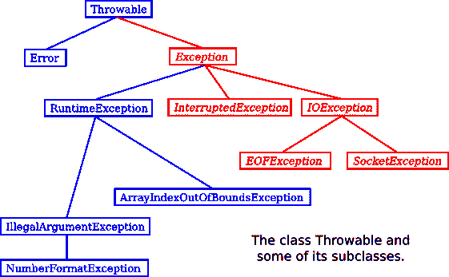

`Throwable` 类包含了几个可以与任何异常对象使用的实例方法。如果 `e` 是 `Throwable` 类型（或其子类之一），那么 `e.getMessage()` 是一个返回描述异常的 `String` 的函数。系统在任何需要对象的字符串表示时都会使用 `e.toString()` 函数，它返回一个字符串，包含异常所属的类名以及与 `e.getMessage()` 相同的字符串。而 `e.printStackTrace()` 方法将堆栈跟踪写入标准输出，告知异常发生时哪些子程序是激活状态的。当你尝试确定问题原因时，堆栈跟踪非常有用。堆栈跟踪中的信息可以告诉异常发生在程序的精确位置。（注意，如果异常没有被程序捕获，那么对异常的默认响应是将堆栈跟踪打印到标准输出。）

***

### 8.3.2 try 语句

要在 Java 程序中捕获异常，你需要一个 `try` 语句。我们从第 3.7 节以来一直在使用这种语句，但 `try` 语句的完整语法比那里介绍的要复杂。

```
try {
    double determinant = M[0][0]*M[1][1] - M[0][1]*M[1][0];
    System.out.println("The determinant of M is " + determinant);
}
catch ( ArrayIndexOutOfBoundsException e ) {
   System.out.println("M is the wrong size to have a determinant.");
   e.printStackTrace();
}
```

在这里，计算机尝试执行 "try" 单词后面的语句块。如果在执行此语句块期间没有发生任何异常，那么语句的 "catch" 部分将被直接忽略。然而，如果发生了 `ArrayIndexOutOfBoundsException` 类型的异常，计算机将立即跳转到 `try` 语句的 `catch` 子句。这块语句被称为 `ArrayIndexOutOfBoundsException` 的异常处理程序。通过这种方式处理异常，你可以防止程序发生崩溃。在执行 `catch` 子句的主体之前，表示异常的对象会被赋值给变量 `e`，在示例中它被用于打印堆栈跟踪信息。

然而，`try` 语句的完整语法有很多选项。介绍这些选项需要花费一段时间。首先，一个 `try..catch` 语句可以有多个一个 `catch` 子句。这使得用一个 `try` 语句捕获多种不同类型的异常成为可能。在上面的示例中，除了可能的 `ArrayIndexOutOfBoundsException` 外，如果 `M` 的值为 `null`，还可能发生 `NullPointerException`。我们可以通过向 `try` 语句添加第二个 `catch` 子句来处理两种可能的异常：

```
try {
    double determinant = M[0][0]*M[1][1] - M[0][1]*M[1][0];
    System.out.println("The determinant of M is " + determinant);
}
catch ( ArrayIndexOutOfBoundsException e ) {
   System.out.println("M is the wrong size to have a determinant.");
}
catch ( NullPointerException e ) {
   System.out.print("Programming error!  M doesn't exist." + );
}
```

在这里，计算机尝试执行 `try` 子句中的语句。如果没有发生错误，两个 `catch` 子句都会被跳过。如果发生了 `ArrayIndexOutOfBoundsException`，计算机执行第一个 `catch` 子句的主体并跳过第二个。如果发生了 `NullPointerException`，它将跳转到第二个 `catch` 子句并执行它。

注意，`ArrayIndexOutOfBoundsException` 和 `NullPointerException` 都是 `RuntimeException` 的子类。可以使用一个 `catch` 子句捕获所有的 `RuntimeExceptions`。例如：

```
try {
    double determinant = M[0][0]*M[1][1] - M[0][1]*M[1][0];
    System.out.println("The determinant of M is " + determinant);
}
catch ( RuntimeException err ) {
   System.out.println("Sorry, an error has occurred.");
   System.out.println("The error was: " + err);
}
```


此 `try` 语句中的 `catch` 子句将捕获任何属于 `RuntimeException` 类或其任何子类的异常。这解释了为什么异常类被组织成一个类层次结构。它让你可以选择缩小撒网范围，只捕获特定类型的异常；或者，你可以扩大撒网范围来捕获一整类异常。由于子类的存在，当 `try` 语句中有多个 `catch` 子句时，给定的异常可能会匹配其中几个 `catch` 子句。例如，类型为 `NullPointerException` 的异常会匹配 `NullPointerException`、`RuntimeException`、`Exception` 或 `Throwable` 的 `catch` 子句。在这种情况下，只有第一个匹配该异常的 `catch` 子句会被执行。

当然，捕获 `RuntimeException` 会捕获的异常类型比我们感兴趣的两种多得多。可以在单个 `catch` 子句中组合多个特定的异常类型。例如：

```java
try {
    double determinant = M[0][0]*M[1][1] - M[0][1]*M[1][0];
    System.out.println("The determinant of M is " + determinant);
}
catch ( NullPointerException | ArrayIndexOutOfBoundsException err ) {
   System.out.println("Sorry, an error has occurred.");
   System.out.println("The error was: " + err);
}
```

在这里，两种异常类型通过 `|` 组合在一起，这个竖线字符也用于布尔或（or）运算符。这个示例将捕获 `NullPointerException` 或 `ArrayIndexOutOfBoundsException` 类型的错误，而不会捕获其他类型。

我在这里使用的示例并不切实际，因为你不太可能使用异常处理来防止空指针和糟糕的数组索引。在这种情况下，严谨的编程比异常处理更好：只需确保你的程序为数组 `M` 分配一个合理的、非空的值即可。如果 Java 的设计者强迫你每次想使用数组时都设置一个 `try..catch` 语句，你一定会感到非常愤的！这就是为什么处理潜在的 `RuntimeExceptions` 不是强制性的。可能出错的事情实在太多了！（这也说明异常处理并没有解决程序的健壮性问题。它只是给你提供了一个工具，在许多情况下让你以一种更有组织的方式来处理问题。）

我还没有完全规定 `try` 语句的语法。下一种变体是在 `try` 语句末尾有 `finally` 子句的可能性。加上这一项，`try` 语句的语法可以描述为：

```java
try {
   statements
}
optional-catch-clauses
optional-finally-clause
```

注意，`catch` 子句也被列为可选。`try` 语句可以包含零个或多个 `catch` 子句，并且可选包含一个 `finally` 子句。`try` 语句必须包含其中之一。也就是说，一个 `try` 语句可以有一个 `finally` 子句，或者有一个或多个 `catch` 子句，或者两者都有。`catch` 子句的语法为：

```java
catch ( exception-names variable-name ) {
   statements
}
```

`exception-names` 可以是单个类或多个类（用 `|` 分隔）。`finally` 子句的语法为：

```java
finally {
   statements
}
```

`finally` 子句的语义是，`finally` 子句中的语句保证会在 `try` 语句执行的最后执行，无论是否发生了异常，也无论发生的异常是否被捕获。`finally` 子句用于执行某些必要的清理工作。这种清理工作的一个例子是关闭网络连接。虽然你还不了解网络方面的具体的编程，但我们可以考虑下面的伪代码：

```java
try {
   open a network connection
   communicate over the connection
}
catch ( IOException e ) {
   report the error
}
finally {
   if the connection was successfully opened
      close the connection
}
```

`finally` 子句确保了无论通信期间是否发生错误，网络连接都会关闭。这个示例中的伪代码遵循了一种通用模式，用于健壮地获取资源、使用资源并释放资源。

```java
try( Scanner in = new Scanner(System.in) ) {
    // 使用 Scanner 从标准输入读取
}
catch (Exception e) {
    // ... 在使用 Scanner 时发生了某些错误
}
```

分配 `Scanner` 的语句位于 "try" 单词后的括号中。该语句必须具有变量声明的形式，并包含变量的初始化。该变量对于 `try` 语句来说是局部的。（实际上，你可以在括号中声明几个变量，并用分号隔开。）在这个示例中，只要 `Scanner` 成功初始化，我们就可以确定系统在 `try` 语句结束时一定会调用 `in.close()`。

这些内容变得相当复杂了，我将不再在这里继续讨论这个话题了。示例程序 [TryStatementDemo.java](https://math.hws.edu/eck/cs124/javanotes9/source/chapter8/TryStatementDemo.java) 演示了一个包含所有选项的 `try` 语句，并包含了大量的注释，以帮助你理解运行程序时会发生什么情况。

### 8.3.3 抛出异常

在某些情况下，程序故意抛出异常是有意义的。当程序发现某种异常情况或错误状态时，但在发现问题的地方没有合理的方法来处理该错误，情况就是这种情况。程序可以抛出一个异常，希望程序的其他部分能够捕获并处理该异常。这可以通过一个 `throw` 语句来实现。你已经从第 4.3.8 节中见过这方面的示例了。在本节中，我们将更全面地介绍 `throw` 语句。`throw` 语句的语法如下：

```java
throw  exception-object ;
```

`exception-object` 必须是一个属于 `Throwable` 的某个子类的对象。通常情况下，它实际上属于 `Exception` 的某个子类之一。在大多数情况下，它将是一个使用 `new` 操作符创建的新对象。例如：

```java
throw new IllegalArgumentException("错误消息");
```

```java
/**
 * 返回二次方程 A*x*x + B*x + C = 0 较大的根。如果 A == 0 或判别式 B*B-4*A*C
 * 为负，则抛出 IllegalArgumentException。 
 * @param A 系数 A
 * @param B 系数 B
 * @param C 常数 C
 * @return 较大的根
 * @throws IllegalArgumentException 如果 A 为零或判别式小于零
 */
static public double root( double A, double B, double C ) 
                              throws IllegalArgumentException {
    if (A == 0) {
      throw new IllegalArgumentException("A 不能为零。");
    }
    else {
       double disc = B*B - 4*A*C;
       if (disc < 0)
          throw new IllegalArgumentException("判别式小于零。");
       return (-B + Math.sqrt(disc)) / (2*A);
    }
}
```

正如在前一节（../c2.html）中所所示，计算的前提条件是 `A != 0` 且 `B*B-4*A*C >= 0`。当违反这些前提条件之一时，子程序会抛出一个类型为 `IllegalArgumentException` 的异常。当子程序发现非法条件时，抛出异常通常是合理的响应。如果调用子程序的程序知道某种处理该错误的方法，它可以捕获该异常。如果不知道，程序将会崩溃——程序员将知道程序需要修复。

子程序头中的 `throws` 子句可以声明多个不同的异常类型，并用逗号隔开。例如：

```java
void processArray(int[] A) throws NullPointerException, 
                                 ArrayIndexOutOfBoundsException { ... }
```


### 8.3.4 强制异常处理

在前面的示例中，声明`root()`子程序可以抛出`IllegalArgumentException`只是对该程序的读者的某种方便。这是因为`IllegalArgumentException`的处理并不是“强制”的。子程序可以抛出`IllegalArgumentException`而不预告这种可能性。调用该子程序的程序自由选择捕获或忽略该异常，就像程序员可以选择捕获或忽略类型为`NullPointerException`的异常一样。

对于需要强制处理的异常类，情况有所不同。如果子程序可以抛出此类异常，则**必须**在子程序定义中的`throws`子句中宣布这一事实。未能这样做会导致编译器报告语法错误。需要强制处理的异常被称为受检异常（checked exceptions）。编译器会检查程序是否处理了此类异常。

假设子程序体中的某个语句可以产生检查异常（checked exception），这种异常要求强制处理。该语句可以是一个直接抛出异常的`throw`语句，也可以是对可能抛出异常的子程序的调用。无论哪种情况，异常都**必须**被处理。这可以通过两种方式之一实现：第一种是将语句放在`try`语句中，该语句包含一个处理异常的`catch`子句；在这种情况下，异常在子程序内部被处理，因此该子程序的调用者永远看不到该异常。第二种是声明该子程序可以抛出异常。这是通过在子程序头部添加`"throws"`子句来实现的，它会提醒任何调用者，在执行子程序时可能会产生该异常。调用者反过来将被迫在`try`语句中处理异常，或者在自己的头部中在`throws`子句中声明该异常。

对于任何**不是**`Error`或`RuntimeException`子类的异常类，异常处理都是强制性的。这些检查异常通常代表程序员无法控制的条件。例如，它们可能代表糟糕的输入或用户采取的非法操作。没有办法可以**避免**此类错误，因此一个健壮的程序必须准备好处理它们。Java的设计使得程序员无法忽略此类错误的可能性。

在检查异常中，有几种在使用Java的输入/输出例程时可能会发生。这意味着，除非你了解异常处理，否则你无法使用这些例程。第11章处理了输入/输出并大量使用了检查异常。

### 8.3.5 使用异常进行编程

异常可以帮助编写健壮的程序。它们为健壮性提供了一种组织化和结构化的方法。没有异常，程序可能会充斥着测试各种可能错误条件的`if`语句。有了异常，就可以编写出算法的整洁实现，用以处理所有正常情况。异常情况可以在其他地方、即在`try`语句的`catch`子句中处理。

当程序遇到异常情况且没有办法立即处理它时，程序可以抛出一个异常。在某些情况下，抛出一个属于Java预定义类之一的异常（例如`IllegalArgumentException`或`IOException`）是有意义的。然而，如果没有标准类能够充分代表该异常情况，程序员可以定义一个新的异常类。新类必须扩展标准类`Throwable`或其一个子类。通常情况下，如果程序员**不想**要求强制性的异常处理，则新类将扩展`RuntimeException`（或其一个子类）。要创建一个**确实**需要强制处理的新检查异常类，程序员可以扩展`Exception`的其他子类之一，也可以扩展`Exception`本身。

在这里有一个扩展了`Exception`的类，因此在使用它时需要强制性的异常处理：

```java
public class ParseError extends Exception {

   public ParseError(String message) {

         // 创建一个 ParseError 对象，
         // 将给定的消息作为其错误消息包含。

      super(message);

   }

}
```

该类只包含一个构造函数，使其能够创建一个包含给定错误消息的`ParseError`对象。（语句`"super(message)"`调用了父类`Exception`中的构造函数。参见第5.6.3节。）当然，该类继承了其父类的`getMessage()`和`printStackTrace()`例程。如果`e`指向`ParseError`类型的对象，那么函数调用`e.getMessage()`将检索构造函数中指定的错误消息。但`ParseError`类的重点仅仅是它的存在。当抛出一个类型为`ParseError`的对象时，表示发生了某种类型的错误。（顺便说一下，解析是指弄清楚字符串的语法。`ParseError`可能表示程序正在处理的某个字符串不符合预期的格式。）

程序可以使用`throw`语句抛出类型为`ParseError`的错误。`ParseError`对象的构造函数必须指定错误消息。例如：

```java
throw new ParseError("Encountered an illegal negative number.");
```

或者

```java
throw new ParseError("The word '" + word 
                                "' is not a valid file name.");
```

由于`ParseError`被定义为`Exception`的子类，因此是一个检查异常。如果`throw`语句没有出现在捕获错误的`try`语句中，那么包含该`throw`的子程序必须通过在子程序头部添加`"throws ParseError"`子句来声明它可以抛出`ParseError`。例如：

```java
void getUserData() throws ParseError {
   . . .
}
```

如果`ParseError`被定义为`RuntimeException`的子类而不是`Exception`，则就不需要这样做，因为在这种情况下`ParseErrors`将不是检查异常。

想要处理`ParseErrors`的例程可以使用带有捕获`ParseErrors`的`catch`子句的`try`语句。例如：

```java
try {
   getUserData();
   processUserData();
}
catch (ParseError pe) {
   . . .  // 处理错误
}
```

注意，由于`ParseError`是`Exception`的子类，形式为`"catch (Exception e)"`的`catch`子句也会捕获`ParseErrors`以及任何其他类型为`Exception`的对象。

有时在异常对象中存储额外数据是有用的。例如：

```java
class ShipDestroyed extends RuntimeException {
   Ship ship;  // 哪艘船被毁了。
   int where_x, where_y;  // 船被毁的位置。

   ShipDestroyed(String message, Ship s, int x, int y) {
         // 构造函数创建一个 ShipDestroyed 对象，
         // 携带错误消息以及 s 在屏幕
         // (x,y) 位置被毁的信息。
       super(message);
       ship = s;
       where_x = x;
       where_y = y;
   }
}
```

在这里，`ShipDestroyed`对象包含一条错误消息和关于被毁船的一些信息。这可以用于，例如在语句中：

```java
if ( userShip.isHit() )
   throw new ShipDestroyed("You've been hit!", userShip, xPos, yPos);
```

注意`ShipDestroyed`对象代表的条件可能不被视为错误。它可能只是游戏正常流程的一种预期中断。异常有时可以用来优雅地处理此类中断。

调用该方法或使用该类的程序需要知道发生了错误。在不支持异常的语言中，唯一的替代方案是返回某个特殊值，或者设置某个全局变量的值来表示发生了错误。例如，第8.2.2节中的`readMeasurement()`函数在用户输入非法时会返回值`-1`。然而，只有当主程序费心去测试返回值时，这种做法才有用处。在每次调用子程序时，都懒得去检查特殊的返回值是非常容易的。而且在这种情况下，使用`-1`作为错误发生信号将导致无法允许负测量值。异常是子程序在遇到错误时做出反应的一种更简洁的方式。

很容易修改`readMeasurement()`函数，使其使用异常而不是特殊返回值来信号错误。我修改后的子程序在用户输入非法时会抛出一个`ParseError`，其中`ParseError`是上面定义的`Exception`的子类。（诚然可以认为，使用标准异常类`IllegalArgumentException`来避免定义新类可能更为合理。）与原始版本相比的更改以红色斜体显示如下：

```java
/**
 * Reads the user's input measurement from one line of input.
 * Precondition:   The input line is not empty.
 * Postcondition:  If the user's input is legal, the measurement
 *                 is converted to inches and returned.
 * @throws ParseError if the user's input is not legal.
 */
static double readMeasurement() throws ParseError {
   double inches;  // Total number of inches in user's measurement.
   double measurement;  // One measurement, 
                        //   such as the 12 in "12 miles."
   String units;        // The units specified for the measurement,
                        //   such as "miles."
   char ch;  // Used to peek at next character in the user's input.

   inches = 0;  // No inches have yet been read.
   skipBlanks();
   ch = TextIO.peek();

   /* As long as there is more input on the line, read a measurement and
      add the equivalent number of inches to the variable, inches. If an
      error is detected during the loop, end the subroutine immediately
      by throwing a ParseError. */
   while (ch != '\n') {
       /* Get the next measurement and the units.  Before reading
          anything, make sure that a legal value is there to read. */
       if ( ! Character.isDigit(ch) ) {
           throw new ParseError("Expected to find a number, but found " + ch);
       }
       measurement = TextIO.getDouble();
       skipBlanks();
       if (TextIO.peek() == '\n') {
          throw new ParseError("Missing unit of measure at end of line.");
       }
       units = TextIO.getWord();
       units = units.toLowerCase();

       /* Convert the measurement to inches and add it to the total. */
       if (units.equals("inch") 
               || units.equals("inches") || units.equals("in")) {
           inches += measurement;
       }
       else if (units.equals("foot") 
                  || units.equals("feet") || units.equals("ft")) {
           inches += measurement * 12;
       }
       else if (units.equals("yard") 
                  || units.equals("yards") || units.equals("yd")) {
           inches += measurement * 36;
       }
       else if (units.equals("mile") 
                  || units.equals("miles") || units.equals("mi")) {
           inches += measurement * 12 * 5280;
       }
       else {
           throw new ParseError("\"" + units 
                                + "\" is not a legal unit of measure.");
       }

       /* Look ahead to see whether the next thing on the line is 
          the end-of-line. */
       skipBlanks();
       ch = TextIO.peek();
   }  // end while

   return inches;
} // end readMeasurement()
```

在主程序中，该子程序以如下形式在`try`语句中调用：

```java
try {
   inches = readMeasurement();
}
catch (ParseError e) {
   . . .  // Handle the error.
}
```


程序可以在文件`LengthConverter3.java`中找到。从用户的角度来看，这个程序的行为与上一节中的`LengthConverter2`程序完全相同。然而，内部差异很大，因为`LengthConverter3`使用了异常处理。

## 8.4 节：断言与注解

在这个短节中，我们简要介绍 Java 的两个在其他地方未涵盖或使用的特性：断言（assertions）和注解（annotations）。将它们包含在这里是为了完整性，但它们主要用于更高级的编程。（特别是注解，并不真正属于这一章，但我找不到更好的地方来对该主题进行简短介绍。）

### 8.4.1 断言

回想起前提条件（precondition）是程序中某一点必须为真的条件，以便程序能够正确执行。在前提条件可能无法满足的情况下——例如，它取决于用户的输入——那么插入一个`if`语句来测试它是好主意。但问题随之产生：如果前提条件不成立该怎么办？一种方案是抛出一个异常。这将终止程序，除非异常在程序的其他地方被捕获并处理。

当然，在许多情况下，程序员并不是使用`if`语句来测试前提条件是否成立，而是尝试以一种能够保证前提条件成立的方式来编写程序。在这种情况下，测试是不必要的，可以避免`if`语句。问题是程序员并不是完美的。尽管程序员有此意图，程序也可能包含一个破坏前提条件的 bug。所以，也许检查前提条件终是一个好主意——至少在程序开发的调试阶段是这样。

同样，后置条件（postcondition）是由于在该点之前执行的代码而导致在程序中某一点为真的条件。假设代码编写是正确的，后置条件是保证为真的，但在这里同样，测试预期的后置条件是否真的为真是检查可能破坏后置条件的 bug 的一种方法。这在调试期间可能是理想的。

这一点也适用于循环不变性（loop invariants）和类不变性（class invariants）。这些是在程序某些点应该为真的属性。如果它们在这些点不为真，意味着程序包含 bug。

编程语言`C`和`C++`一直具有一种向程序中添加所谓“断言”（assertions）的机制。这些断言的格式为`assert( condition )`，其中`condition`是一个布尔值的表达式。该条件表示程序执行到此处时应当满足的前置条件（precondition）或后置条件（postcondition）。当计算机在程序执行过程中遇到断言时，会评估`condition`。如果`condition`为`false`，程序将终止；否则，程序继续运行。这使得程序员对“条件为真”的信念得到了检验；如果条件不为真，则说明断言之前的程序部分包含 Bug。`C`和`C++`中断言的一个好处是，它们可以在编译时被“关闭”。也就是说，如果程序以某种方式编译，则断言会被包含在编译后的代码中；如果程序以另一种方式编译，断言则不会被包含在内。在调试期间，使用第一种编译方式，即开启断言。程序的发布版本在编译时会关闭断言。发布版本将更具效率，因为计算机不需要评估所有的断言。

虽然早期的 Java 并没有断言，但从`1.4`版本开始，Java 已经提供了与`C/C++`类似的断言机制。与`C/C++`版本一样，Java 断言可以在调试期间开启，在正常运行时关闭。然而，在 Java 中，断言是在运行时开启和关闭的，而不是编译时。Java 源中的断言始终会被包含在编译后的类文件中。当程序以正常方式运行时，这些断言会被忽略；由于在这种情况下断言中的`condition`不会进行评估，因此在程序中保留断言几乎或没有任何性能开销。在对程序进行调试时，可以在启用断言的情况下运行程序（如下文所述），此时断言对于定位和识别 Bug 具有极大的帮助。

---

Java 中的断言语句采用以下两种形式之一：

```
assert condition ;
```

或者：

```
assert condition : error-message ;
```

其中`condition`是一个布尔值的表达式，`error-message`是字符串或`String`类型的表达式。`assert`关键字是 Java 中的保留字，不能用作标识符。断言语句可以使用在 Java 中任何合法语句的地方。

如果程序在禁用断言的情况下运行，断言语句等同于空语句，没有任何作用。当启用断言且程序中遇到断言语句时，会评估断言中的`condition`。如果值为`true`，程序正常继续。如果`condition`的值为`false`，则会抛出一个类型为`java.lang.AssertionError`的异常，程序将崩溃（除非该错误被`try`语句捕获）。如果`assert`语句包含了`error-message`，则错误消息字符串将成为`AssertionError`中的消息。

因此，语句`assert condition : error-message;`类似于：

```
if ( condition == false )
    throw new AssertionError( error-message );
```

不同之处在于，`if`语句在每次运行程序时都会执行，而`assert`语句仅在启用断言运行程序时才会执行。

问题是，何时应该使用断言而不是异常？通用规则是：使用断言来测试那些“如果程序编写正确，则一定为真”的条件。断言对于测试程序以判断其是否正确以及发现错误程序中的错误非常有用。在和调试之后，当程序以正常方式使用时，程序中的断言会被忽略。然而，如果以后出现了问题，断言仍然存在于程序中，可帮助定位错误。如果有人写信告诉你你的程序在他们执行某项操作时无法工作，你可以在启用断言的情况下运行程序，执行该操作，并希望程序中的断言能帮助你找到程序出错的位点。

例如，考虑第 8.3.3 节中计算二次方程根的`root()`方法。如果你认为你的程序总是会使用合法参数调用此方法，那么使用断言而不是异常来编写该方法就是合有意义的：

```java
/**
 * 返回二次方程
 *     A*x*x + B*x + C = 0 的两个根中较大的一个。
 * 前置条件：A != 0 且 B*B - 4*A*C >= 0。
 */
static public double root( double A, double B, double C )  {
   assert A != 0 : "二次方程的一次系数不能为零。";
   double disc = B*B - 4*A*C;
   assert disc >= 0 : "二次方程的判别式不能为负。";
   return  (-B + Math.sqrt(disc)) / (2*A);
}
```

当程序以正常方式运行时，断言不会被检查。如果你认为该方法从未被以非法参数调用这一点是正确的，那么检查断言中的条件就是必要的。如果你的信念是不正确的，问题应该会在测试或调试期间（即在启用断言并运行程序时）出现。

如果`root()`方法是你预期他人使用的软件库的一部分，那么情况就没那么明确了。Oracle 的 Java 文档建议，不要使用断言来检查公共方法的合约：如果方法的调用者通过传递非法参数违反了合约，则应该抛出异常。无论是否启用断言，这都会强制执行。（然而，虽然 Java 程序员期望通过异常强制执行合约，但在某些情况下，使用断言也有合理的理由。）可以说，断言是给你用的，帮助你调试代码；而异常是给使用你代码的人用的，提醒他们误用了。

另一方面，使用断言来检查后置条件或不变是没有坏处的。这些条件在任何无 Bug 的程序中都是预定为真的，因此断言是在调试期间检查这些条件的自然方式，而不会在正常执行程序时产生性能负担。如果后置条件或不变条件为假，说明存在 Bug，这是测试和调试阶段需要发现的问题。

---

要使断言生效，在运行程序时必须启用它们。如何操作取决于你使用的编程环境。（参见第 2.6 节关于编程环境的讨论。）在通常命令行环境中，通过在运行程序的`java`命令中添加`-enableassertions`来启用断言。例如，如果包含主程序的类是`RootFinder`，那么命令：

```
java -enableassertions RootFinder
```

将启用断言运行程序。`-enableassertions`可以缩写为`-ea`，因此命令也可以改写为：

```
java -ea RootFinder
```

事实上，可以在程序的某部分启用断言。如`-ea:class-name`这种选项仅启用指定类中的断言。请注意，`-ea`、`:`和类名之间没有空格。要启用某个包及其子包中的所有断言，你可以使用如`-ea:package-name...`形式的选项。要启用“默认包”（即未指定属于某个包的类，例如此书中几乎所有的类）中的断言，请使用`-ea:...`。例如，若要运行一个名为`MegaPaint`的 Java 程序，并对名为`paintutils`和`drawing`的包中的每个类启用断言，你应该使用以下命令：

```
java -ea:paintutils... -ea:drawing... MegaPaint
```

如果你正在使用 Eclipse 集成开发环境，可以通过创建运行配置（run configuration）来指定`-ea`选项。在包资源管理器（Package Explorer）面板中，右键点击主程序类的名称，从弹出菜单中选择“运行方式”（Run As），然后从子菜单中选择“运行...”（Run...）。这将打开一个对话框，你可以在其中管理运行配置。项目名称和主类名称已经自动填充。点击“参数”（Arguments）选项卡，并在“VM 参数”下方的框中输入`-ea`。此框的内容会被添加到用于运行程序的`java`命令中。你可以在此框中输入其他选项，包括更复杂的启用断言选项，例如`-ea:paintutils....`。当你点击“运行”按钮时，这些选项就会生效。此外，除非你更改运行配置或添加新配置否则每次运行程序时它们都会生效。注意，可以为同一个类创建两个运行配置，一个启用断言，另一个禁用断言。

### 8.4.2 注解

“注解”（annotation）一词通常指添加在正文旁或写在正文的注释，以帮助你理解或欣赏文本。注解可能是你在书边空白处自己做的笔记。也可能是编辑为旧小说添加的脚注，用来说解释某些事件的历史背景。注解是元数据或“元文本”（metatext），即关于正文编写的文本，而不是作为正文本身的一部分。

程序中的注释实际上是注解的一种类型。由于它们被编译器忽略，因此对程序的含义没有影响。它们的作用是向人类读者解释这种含义。当然，另一个计算机程序（而非编译器）也可以处理注释。Javadoc 注释就是此类情况，它们由一个程序处理，该程序利用它们创建 API 文档。但注释只是可能添加到程序中的一种类型的元数据。

在 Java 5.0 中，Java 语言引入了一种名为“注解”的新功能，使得为 Java 程序创建新类型的元数据变得更容易。这使得程序员能够发明新的注解程序的方法，并编写出可以读取和使用这些注解的程序。

Java 注解对它们所注解的程序没有直接影响。但它们有许多潜在的用途。某些注解被用于使程序员的意图更加明确。此类注解可能会被编译器检查，以确保代码与程序员的意图一致。例如，`@Override`是一个标准注解，可以用于标记方法定义。它意味着该方法意图重写（即替换）在某些父类中定义的具有相同签名的方法。编译器可以检查父类方法是否实际存在；如果不存在，它可以通知程序员。以这种方式使用的注解是编写正确程序的辅助，因为程序员可以预先收到潜在错误的警告，而不是在以后像找 bug 一样苦苦寻找。

要用`@Override`注解标记方法定义，只需将其放置在定义之前。在语法上，注解是修饰符，其使用方式与`public`和`final`等内置修饰符非常相似。例如：

```
@Override public void WindowClosed(WindowEvent evt) { ... }
```

如果在任何父类中没有`WindowClosed(WindowEvent)`方法，编译器就会抛出错误。事实上，这个例子是基于我曾经引入的一个极难发现的 bug，当时我试图用一个我命名为`WindowClosed`（大写 "W"）的方法来重写一个名为`windowClosed`（小写 "w"）的方法。如果那时存在`@Override`注解——如果我使用了它——编译器就可以拒绝我的代码，从而免去我追踪该 bug 的麻烦。

（注解是一项相当高级的功能，我可能没有在教科书中提到它们，但某些符号（如`@Override`）可能会出现在 Eclipse 等其他集成开发环境生成的代码中。）

还有两个标准注解。一种是`@Deprecated`，可以用于标记已过时的类、方法和变量。（过时项被认为是过时的，但为了旧代码的向后兼容，它们仍然是 Java 语言的一部分。）使用此注解允许编译器在使用这些过时项时生成警告。

另一个标准注解是`@SuppressWarnings`，编译器可以用它来关闭在编译类或方法时通常生成的警告信息。`@SuppressWarnings`是一个带有参数的注解示例。该参数告诉要抑制哪种类的警告。例如，当类或方法被注解为时：

```
@SuppressWarnings("deprecation")
```


那么在编译该类或方法时，就不会发出关于使用过时项的警告。还有其他类型可以被抑制的警告；遗憾的是，警告列表及其名称并没有标准，并且会随编译器的不同而异。

顺便提一下，注解参数的语法——特别是对于接受多个参数的注解——与方法参数的语法是不相同的。

程序员可以为自己的代码定义新的注解以便使用。此类注解会被标准编译器和编程工具忽略，但可以编写能够理解这些注解并检查源代码中是否存在这些注解的程序。甚至可以创建在运行时被保留并成为运行程序一部分的注解。在这种情况下，程序可以检查正在执行的实际编译代码中的注解，并根据注解的存在或其参数的值采取相应的行动。

注解可以帮助程序员编写正确的程序。以 Java 文档中的例子来说，它们可以帮助创建“模板板代码”（boilerplate code）——即具有非常标准格式且可以机械生成的代码。通常，模板板代码是根据其他代码生成的。手动这样做是一个枯燥且容易出错的过程。一个简单的例子可能是将程序状态的某些方面保存到文件并在后恢复的代码。读取和写入所有相关状态变量值的代码是非常重复的。与其手动编写这些代码，程序员可以使用注解来标记作为要保存状态部分的变量。然后可以使用一个程序来检查这些注解并生成保存和恢复代码。事实上，如果程序在运行时检查注解的存在来决定保存和恢复哪些变量，甚至完全可以不需要那些代码。

本章主要集中在程序的正确性上。在实践中，另一个问题同样重要：效率。当我们从效率的角度分析程序时，我们想要考虑诸这样的问题：“程序运行需要多长时间？”以及“是否有其他方法可以更快地得到答案？”效率永远不会比正确性重要；如果你不在乎程序是否运行正确，你确实可以让它运行得非常快，但没有人会认为这是一项了成就！反之，一个在万年后才给出正确答案的程序也大无用处，因此，效率通常是一个重要的问题。

“效率”一词可以指对几乎任何资源的有效利用，包括时间、计算机内存、磁盘空间或网络带宽。然而，在本节中，我们将专门讨论时间效率，我们想要对程序提出的主要问题是：执行其任务需要多长时间？

## 算法分析

将单个程序归类为“高效的”或“低效的”其实没什么意义。通过比较两个执行相同任务的（正确的）程序，并提问其中哪一个“更高效”（即哪一个执行任务的速度更快）要更有意义。然而，即使在这里也存在困难。程序的运行时间并没有一个明确的定义。运行时间取决于运行程序的计算机中处理器的数量和速度；在 `Java` 的情况下，取决于用于解释程序的 `Java Virtual Machine` 的设计。它还取决于用于将程序从高级语言翻译成机器语言的编译器细节。此外，程序的运行时间取决于程序必须解决的问题规模。排序程序排序 10000 个项目花费的时间比排序 100 个项目要长。当比较两个程序的运行时间时，经常会出现程序 A 解决小问题比程序 B 快，而程序 B 解决大问题比程序 A 快的情况，因此，不存在一个程序在所有情况下都比另一个快。

尽管存在这些困难，计算机科学中有一个专门用于分析程序效率的领域。该领域被称为算法分析。它的重点是算法，而不是程序本身，以避免处理用不同语言编写、用不同编译器编译以及在不同计算机上运行的同一种算法的不同实现。算法分析是一个数学领域，它抽象掉了这些琐碎的细节。尽管如此，这是一个理论领域，但每个在行的程序员都应该了解它的一些技术和结果。本节是对这些技术和结果的简要介绍。由于这不是一本数学书，其处理方式将相当非正式。

算法分析的主要技术之一是渐近分析。这里的“渐近”一词基本上意思是“随着输入规模的增大，长期变化的趋势”。对算法运行时间的渐近分析关注的是运行时间如何依赖于问题规模。这种分析是渐近的，因为它只考虑当问题规模无限增大时运行时间会发生什么变化；它不关心小规模问题的情况，或者实际上，不关心任何固定有限规模问题的情况。只有当问题规模无限增长时，长期来看会发生什么才是重要的。证明算法 A 在渐近上比算法 B 快，并不意味着算法 A 在规模为 10、1000 甚至 1000000 的问题上运行得比算法 B 快——它只意味着如果你不断增加问题规模，最终会达到一个算法 A 比算法 B 更的点。渐近分析只是初步近似，但在实践中，它往往能提供重要且有用的信息。

### 大 O 表示法

渐近分析的核心是大 O 表示法（Big-Oh notation）。使用这种符号，我们可以说某个算法的运行时间为 `O(n²)`、`O(n)` 或 `O(log(n))`。这些符号读作“Big-Oh of n squared”、“Big-Oh of n”和“Big-Oh of log n”（其中 `log` 是对数函数）。更通俗地说，我们可以引用 `O(f(n))`（“Big-Oh of f of n”），其中 `f(n)` 是给每个正整数 `n` 分配一个正实数的函数。

该符号中的 `n` 指问题的规模。在开始进行渐近分析之前，你需要一种衡量问题规模的方法。通常这并不是大问题。例如，如果问题是对一个项目列表排序，那么问题规模可以取列表中的项目数量。当算法的输入是一个整数时（例如检查给定的正整数是否为素数的算法），衡量问题规模的常用标准是输入整数的位数，而不是整数本身。更通俗地说，问题输入的位数通常是衡量问题规模的一个良好标准。

说一个算法的运行时间为 `O(f(n))`，意味着对于较大的问题规模 `n`，算法的运行时间不大于某个常数乘以 `f(n)`。（更严谨地说，存在一个数字 `C` 和一个正整数 `M`，使得当 `n` 大于 `M` 时，运行时间小于或等于 `C*f(n)`。）

这个常数考虑了诸如运行算法的计算机的速度等细节；如果你使用较慢的计算机，你可能需要在公式中使用更大的常数，但改变常数不会改变运行时间是 `O(f(n))` 的事实。常数使得我们不需要说明衡量单位是秒、年、CPU 周期或其他任何单位；单位之间的转换只是乘以一个常数。还要注意，`O(f(n))` 完全不取决于小规模问题的情况，只取决于问题规模无限增长时的长期情况。

为了看一个简单的例子，考虑数组中所有数字求和的问题。问题规模 `n` 是数组的长度。使用 `A` 作为数组名称，该算法可以用 Java 表达式如下：

```java
total = 0;

for (int i = 0; i < n; i++)
   total = total + A[i];
```

该算法执行了 `n` 次相同的操作 `total = total + A[i]`。执行该操作的总时间为 `a*n`，其中 `a` 是执行一次操作所需的时间。现在，这不是算法中唯一执行的操作。在每次循环中，`i` 的值都会增加并与 `n` 进行比较。这为运行时间增加了额外的 `b*n` 时间，其中 `b` 是某个常数。此外，`i` 和 `total` 都必须初始化为零；这为运行时间增加了常数级 `c`。

那么精确的运行时间将是 `(a+b)*n+c`，其中常数 `a`、`b` 和 `c` 取决于代码如何编译以及在什么计算机上运行。利用对于任何正整数 `n`，`c` 小于或等于 `c*n` 的事实，可以说运行时间小于或等于 `(a+b+c)*n`。也就是说，运行时间小于等于常数乘以 `n`。根据定义，这意味着该算法的运行时间为 `O(n)`。

如果这个解释对你来说太数学化了，我们只需要注意到，对于较大的 `n` 取值，公式 `(a+b)*n+c` 中的 `c` 与另一项 `(a+b)*n` 相比是忽略不道的。我们称 `c` 为“低阶项”。在进行渐近分析时，低阶项可以丢弃。对算法的一个粗略但正确的渐近分析如下：`for` 循环的每次迭代都需要一定的常数时间。循环有 `n` 次迭代，因此总运行时间是常数乘以 `n` 加上低阶项（为了考虑初始化）。忽略低阶项，我们看到运行时间是 `O(n)`。

### Ω 和 Θ 表示法

说明一个算法的运行时间为 `O(f(n))`，意味着它的运行时间不大于某个常数乘以 `f(n)`（对于较大的 `n` 值）。`O(f(n))` 给运行时间设定了一个上限。然而，运行时间可能更小，甚至小得多。例如，如果运行时间是 `O(n)`，那么说运行时间是 `O(n²)` 甚至 `O(n¹⁰)` 也是正确的。如果运行时间小于一个常数乘以 `n`，那么它一定小于相同的常数乘以 `n²` 或 `n¹⁰`。

当然，有时给运行时间设定一个下限也是有用的。也就是说，我们能够说运行时间大于或等于某个常数乘以 `f(n)`（对于较大的 `n` 值）。这种表示法是 `Ω(f(n))`，读作 "Omega of f of `n`" 或 "Big Omega of f of `n`"。"Omega" 是希腊字母表中的一个字母名称，而 `Ω` 是该字母的大写形式。（从技术上讲，说一个算法的运行时间为 `Ω(f(n))` 意味着存在一个正数 `C` 和正整数 `M`，使得每当 `n` 大于 `M` 时，运行时间都大于或等于 `C*f(n)`。）`O(f(n))` 告诉你关于你可能需要等待算法完成的最长时间的信息；`Ω(f(n))` 告诉你关于最小时间的信息。

累加数组中数字的算法运行时间既是 `Ω(n)` 也是 `O(n)`。当一个算法的运行时间既是 `Ω(f(n))` 又是 `O(f(n))` 时，它的运行时间被称为 `Θ(f(n))`，读作 "Theta of f of `n`" 或 "Big Theta of f of `n`”。（Theta 是希腊字母表中的另一个字母。）说一个算法的运行时间为 `Θ(f(n))` 意味着对于较大的 `n` 取值，运行时间在 `a*f(n)` 和 `b*f(n)` 之间，其中 `a` 和 `b` 是常数（`b` 大于 `a`，且都大于 0）。

让我们来看另一个例子。考虑可以用 Java 方法表示的算法：

```java
/**
 * 将 n 个数组元素 A[0], A[1], ..., A[n-1] 按升序排序。
 */
public static void simpleBubbleSort(int[] A, int n)
                              throws IllegalArgumentException {
   for (int i = 0; i < n; i++) {
      // 对数组进行 n 轮遍历...
      for (int j = 0; j < n-1; j++) {
         if (A[j] > A[j+1]) {
            // A[j] 和 A[j+1] 顺序不对，所以交换它们
            int temp = A[j];
            A[j] = A[j+1];
            A[j+1] = temp;
         }
      }
   }
}
```

在这里，参数 `n` 代表问题规模。方法中的外部 `for` 循环执行了 `n` 次。每执行一次外部 `for` 循环，内部 `for` 循环就会执行 `n-1` 次，因此 `if` 语句执行了 `n*(n-1)` 次。这是 `n²-n`，但由于在渐近分析中低阶项是不重要的，说 `if` 语句执行了大约 `n²` 次就足够了。

特别是，测试 `A[j] > A[j+1]` 执行了大约 `n²` 次，这一事实本身就足以说明算法的运行时间是 `Ω(n²)`，也就是说，运行时间至少是某个常数乘以 `n²`。此外，如果我们观察其他操作——赋值语句、递增 `i` 和 `j` 等——没有任何一个的执行次数超过 `n²` 次，所以运行时间也是 `O(n²)`，也就是说，运行时间不超过某个常数乘以 `n²`。由于它既是 `Ω(n²)` 又是 `O(n²)`，`simpleBubbleSort` 算法的运行时间就是 `Θ(n²)`。

你应该意识到，有些人使用 `O(f(n))` 符号就像它代表 `Θ(f(n))` 一样。也就是说，当他们说一个算法的运行时间是 `O(f(n))` 时，他们的意思是运行时间大约是 `f(n)`。

到为止，我们忽略了一个重要的细节：有些人使用 `O(f(n))` 符号就像它意味着 `Θ(f(n))`。也就是说，当他们说一个算法的运行时间是 `O(f(n))` 时，他们的意思是运行时间大约等于某个常数乘以 `f(n)`。`O(f(n))` 意味着运行时间小于某个常数乘以 `f(n)`，可能小得多。

到为止，我们讨论了运行时间取决于规模，但实际上运行时间通常取决于特定数据。为了解释这种依赖关系，我们可以考虑最坏情况分析或平均情况分析。对于最坏情况分析，我们考虑所有可能的问题并查看最长运行时间。对于平均情况分析，我们考虑所有问题并查看平均运行时间。在很多情况下，平均和最坏情况是相同的。这意味着从渐近分析的角度来看，如果平均运行时间是 `O(f(n))` 或 `Θ(f(n))`，那么最坏情况也是如此。然而，在书的后面，我们会遇到一些平均和最坏情况不同的情况。

我们也可能讨论最好情况分析，它查看的是给定规模下最短的运行时间。然而，最好情况分析偶尔有用。

### 渐近分析的应用

那么，为了阅读这本书的其余部分，你到底需要了解算法？我们不会进行任何严谨的数学分析，但你应该能够理解对本节看过的简单案例的非正式讨论。最重要的是，你应对说一个算法的运行时间是 `O(f(n))` 或 `Θ(f(n))`（对于某些函数 `f(n)`）的确切含义。主要点是，这些符号并没有告诉你任何特定情况下算法运行时间的实际数值。它们对于 `n` 较小时的运行时间没有任何任何信息。它们告诉你的是随着问题规模增大，运行时间增长率的信息。

假设你正在比较解决同一个问题的算法。一个算法的运行时间是 `Θ(n²)`，而第二个算法的运行时间是 `Θ(n³)`。这告诉了你什么？如果你想知道对于某个特定规模（例如 100）哪种算法更快，目前是不确定的。仅仅从渐近分析来看，对于该情况，任何算法都可能更快。但你可以确定的是，如果你观察更大的问题，你会发现 `Θ(n²)` 算法会比 `Θ(n³)` 算法快。此外，随着你继续增加问题规模，`Θ(n²)` 算法的相对优势将继续增长。存在某些 `n` 的值，使得 `Θ(n²)` 算法快千倍、百万倍、十亿倍，以此类推。这是因为对于任何正常数 `a` 和 `b`，随着 `n` 变大，函数 `a*n³` 的增长速度都比函数 `b*n²` 快。

这意味着对于“大”问题，`Θ(n²)` 算法一定会比 `Θ(n³)` 算法快。你只是仅根据渐近分析无法准确判断“大”到底要有多大。在实践中，事实上，`Θ(n²)` 算法即使在 `n` 的值较小时也可能运行得更快，而且在没有其他信息的情况下，你通常会倾向于选择 `Θ(n²)` 算法而不是 `Θ(n³)` 算法。

因此，为了理解并应用渐近分析，掌握一些常用函数的增长速率至关重要。对于幂函数 `n`、`n²`、`n³`、`n⁴`、……，指数越大，函数的增长速率越快。像 `2^n` 和 `10^n` 这样的指数函数（`n` 在指数位置上），其增长速率快于任何幂函数。事实上，指数函数的增长速度极快，以至于运行时间呈指数级增长的算法即使对于相对较小的 `n` 值也几乎是不实用的，因为运行时间太长了。

另一个在渐近分析中经常出现的函数是对数函数 `log(n)`。实际上有许多不同的对数函数，但计算机科学中通常使用的是二底对数，其定义为对于任何数字 `x`，`log(2^x) = x`。（通常这个函数被写成 `log2`，但我将省略下标 `2`，因为我在本书中只会使用二底对数。）对数函数的增长速度非常缓慢。`log(n)` 的增长速率远小于 `n` 的增长速率。`n*log(n)` 的增长速率比 `n` 大一点点，但远小于 `n²` 的增长速率。下表将帮助你理解各种函数增长速率之间的差异：


`log(n)` 频繁出现的原因是因为它与乘以或除以 2 有关：假设你从数字 `n` 开始将其除以 `2`，然后再次除以 `2`，依此类推，直到你得到一个小于或等于 `1` 的数。那么，除法的次数就等于（最近的整数）`log(n)`。

例如，考虑第 7.5.1 节中的二分查找算法。该算法在排序后的数组中搜索项目。问题规模 `n` 可以被视为数组的长度。二分查找算法的每一步都将待考虑的项目数除以 `2`，当待考虑的项目数小于或等于 1（或更早）时算法停止。因此，长度为 `n` 的数组步数最多为 `log(n)`。这意味着二分查找的最坏情况运行时间为 `Θ(log(n))`。（平均情况的运行时间也是 `Θ(log(n))`。）相比之下，在第 7.5.1 节中介绍的线性查找算法的运行时间为 `Θ(n)`。`Θ` 符号为提供了一种量化方法，用来表达和理解二分查找比线性查找“快得多”这一事实。

在二分查找中，算法的每一步都将问题规模除以 `2`。算法中的某些操作（不一定是单个步骤）经常会将问题规模除以 2。每当这种情况发生时，对数函数可能会出现在算法运行时间的渐近分析中。

算法分析是一个庞大且迷人的领域。我们将只使用该领域少数最基础的思想，但即使是这些思想对于理解算法之间的差异也非常有帮助。

## 第 8 章编程练习

### 练习 8.1

编写一个程序，使用第 8.3.3 节中的以下子程序来解决用户指定的方程。

```java
/**
 * 返回二次方程 A*x*x + B*x + C = 0 的两个根中较大的一个，只要它有根。如果 A == 0 或
 * 判别式 B*B - 4*A*C 为负，则抛出 IllegalArgumentException 类型的异常。
 */
static public double root(double A, double B, double C)
                              throws IllegalArgumentException {
    if (A == 0) {
        throw new IllegalArgumentException("A can't be zero.");
    } else {
        double disc = B*B - 4*A*C;
        if (disc < 0)
            throw new IllegalArgumentException("Discriminant < zero.");
        return (-B + Math.sqrt(disc)) / (2*A);
    }
}
```


你的程序应该允许用户指定`A`、`B`和`C`的值。它应该调用子程序来计算方程的解。如果没有发生错误，它应该打印根。然而，如果发生错误，你的程序应该捕获该错误并打印错误信息。处理完一个方程后，程序应该询问用户是否想输入另一个方程。程序将持续运行直到用户回答“否”。

查看解答

### 练习 8.2

如 8.1 节所示，`int`类型的值被限制为 32 位。无法在`int`中表示的过大整数，Java 有一个标准类`java.math.BigInteger`解决了这个问题。`BigInteger`对象可以是任意大的（受内存限制）。由于 Biggers 是对象，必须使用实例方法进行操作。例如，你不能用`+`运算符加两个 Biggers。相反，如果`N`和`M`是 Biggers 变量，你可以通过调用函数`N.add(M)`来计算`N`和`M`的和。该函数返回的值是一个`BigInteger`对象，等于`N`和`M`的和。

`BigInteger`类有一个构造函数`new BigInteger(str)`，其中`str`是一个字符串。该字符串必须表示一个整数，例如"3"或"3984982378372833"。如果字符串不表示整数，构造函数将抛出`FormatException`。

`BigInteger`类有很多实例方法。以下是一些你认为在练习中有用的。假设`N`和`M`是`BigInteger`变量。

* `N.add(M)` —— 一个返回`N`和`M`之和的`BigInteger`函数。
* `N.multiply(M)` —— 一个返回`N`乘以`M`的结果的`BigInteger`函数。
* `N.divide(M)` —— 一个返回`N`除以`M`的结果（舍弃余数）的`BigInteger`函数。
* `N.signum()` —— 一个返回普通`int`的函数。返回的值代表整数`N`的符号。如果`N`大于 0，返回 1；如果`N`小于 0，返回 -1；如果`N`为 0，则返回 0。
* `N.equals(M)` —— 一个返回布尔值的函数，如果`N`和`M`具有相同的整数值，则返回 true。
* `N.toString()` —— 一个返回表示`N`值的`String`函数。
* `N.testBit(k)` —— 一个返回布尔值的函数。参数`k`是整数。如果`N`的第`k`位为 1，则返回 true；如果第`k`位为 0，则返回 false。位从右到左编号，从 0 开始。

对于这个练习，你应该编写一个程序，打印由用户指定的起始值的 3N+1 序列。在程序的这个版本中，你应该使用`BigIntegers`来表示序列中的项。你可以使用`TextIO.getln()`函数或`Scanner`的`nextLine()`函数将用户的输入读入`String`中。使用输入值创建一个表示 3N+1 序列起始点的`BigInteger`对象。不要忘记捕获并处理用户输入不是合法整数时会发生的`NumberFormatException`！当发生这种情况时，程序不应结束；而应该输出一条错误信息。你还应该检查输入的数字是否大于零。

如果用户的输入合法，则打印 3N+1 序列。计算序列中项的个数，并在序列末尾打印计数。当用户输入空行时，退出程序。

查看解答

### 练习 8.3

罗马数字使用字母表示整数。例如，用`XVII`表示 17，`MCMLIII`表示 1953，`MMMCCCIII`表示 3303。相比之下，普通的数字（如 17 或 1953）被称为阿拉伯数字。下表显示了所有单字母罗马数字对应的阿拉伯数字值：

```
M    1000            X   10
D     500            V    5
C     100            I    1
L      50
```

当字母连接在一起时，字母的值直接相加，但有以下例外：当一个值较小的字母后面跟着值较大的字母时，较小的值会从较大的值中减去。例如，`IV`表示 5 - 1，即 4。而`MCMXCV`被解释为`M` + `CM` + `XC` + `V`，即 1000 + (1000 - 100) + (100 - 10) + 5，等于 1995。在标准罗马数字中，同一个字母连续出现的次数不超过三次。遵循这些规则，1 到 3999 之间的每一个数字都可以由以下单字母和双字母组合组成的罗马数字表示：

```
M    1000            X   10
CM    900            IX   9
D     500            V    5
CD    400            IV   4
C     100            I    1
XC     90
L      50
XL     40
```

编写一个表示罗马数字的类。该类应该有两个构造函数。其中一个从如"XVII"或"MCMXCV"的字符串构造罗马数字。如果字符串不是合法的罗马数字，它应该抛出`NumberFormatException`。另一个构造函数从一个`int`构造罗马数字。如果`int`超出 1 到 3999 的范围，它应该抛出`NumberFormatException`。

此外，该类应该有两个实例方法。`toString()`方法返回表示罗马数字的字符串。`toInt()`方法返回罗马数字的`int`值。

在类的某个地方，你必须将一个`int`转换为对应罗马数字的字符串。实现这种方法的方法是将值逐渐从阿拉伯数字“移动”到罗马数字。以下是一个执行此操作的程序开头，其中`number`是要转换的`int`：

```
String roman = "";
int N = number;
while (N >= 1000) {
      // 将 1000 从 N 移动到 roman
   roman += "M";
   N -= 1000;
}
while (N >= 900) {
      // 将 900 从 N 移动到 roman
   roman += "CM";
   N -= 900;
}
.
.  // 继续处理上表的其他值。
.
```

（如果你巧妙地使用数组来表示上表的数据，可以在此程序中节省大量的打字工作。）

一旦你写好了类，请在一个主程序中使用它，该程序将读取用户输入的阿拉伯数字和罗马数字。如果用户输入阿拉伯数字，则打印对应的罗马数字。如果用户输入罗马数字，则打印对应的阿拉伯数字。（你可以通过使用`TextIO.peek()`查看用户输入中的第一个字符来区分它们。如果第一个字符是数字，则用户的输入是阿拉伯数字。否则，它是罗马数字。）当用户输入空行时，程序结束。

查看解答

### 练习 8.4

源代码文件[Expr.java](https://math.hws.edu/eck/cs124/javanotes9/source/chapter8/Expr.java)定义了一个类`Expr`，可以用于表示涉及变量`x`的数学表达式。表达式可以使用运算符`+`、`-`、`*`、`/`和`^`（其中`^`表示幂运算）。它可以使用`sin`、`cos`、`abs`和`ln`等数学函数。完整细节请参见源代码文件。`Expr`类使用了一些书中尚未介绍的高级技术，但它的接口很容易理解。它包含一个构造函数两个公共方法。构造函数`Expr(def)`根据字符串创建一个`Expr`对象。如果参数不是合法的表达式，则抛出`IllegalArgumentException`。异常信息描述了错误。

如果`func`是`Expr`类型变量且`num`是`double`类型，那么`func.value(num)`返回替换`num`后表达式的值。例如，如果`Expr`表示表达式`3*x+1`，则`value(5)`为 16。如果表达式对于`x`未定义，则返回特殊值`Double.NaN`；不抛出异常。

最后，`func.toString()`返回表达式的定义。

对于这个练习，你应该编写一个程序让用户输入表达式。如果表达式包含错误，则打印错误信息。否则，让用户输入一些`x`的数值。对于用户输入的每个数字打印表达式的值。如果表达式在该值未定义，则打印相应的信息。你可以使用布尔值`Double.isNaN(val)`来检查数字`val`是否为`Double.NaN`。用户可以输入任意数量的`x`。之后，用户可以输入新表达式。

查看解答

### 练习 8.5

这个练习使用了`Expr`类，该类在[c8/ex4-ans.html]中描述并在源代码文件[Expr.java](https://math.hws.edu/eck/cs124/javanotes9/source/chapter8/Expr.java)中定义。这个练习你应该编写一个 GUI 程序来绘制用户输入的函数`f(x)`。程序应该有一个文本框，用户可以在其中输入涉及变量`x`的表达式，如`x²`或`sin(x-3)/x`。该表达式就是函数的定义。当用户按下回车键时，程序应该使用文本框的内容构造一个`Expr`对象。如果在定义中发现错误，程序应该显示错误信息。否则，它应该显示函数的图形。

程序需要一个`JPanel`来显示图形。为了简单起见，面板应该表示平面上的一个固定区域，定义为`-5 <= x <= 5`和`-5 <= y <= 5`。为了绘制图形，计算大量的点并用线段连接它们。（这种方法无法正确处理不连续函数；这样做非常困难，所以你不必尝试。）我的程序将区间`-5 <= x <= 5`分为 300 个子区间，并使用这些子区间的 301 个端点进行绘图。注意，函数在其中一个`x`值处可能是未定义的。在这种情况下，你必须跳过该点。

图上的点形式为`(x,y)`，其中`y`是通过在给定的`x`值处评估用户的表达式得到的。你必须将范围从 -5 到 5 的`x`和`y`的值转换为在画布上绘制所需的像素坐标。转换公式如下：

```
int a  =  (int)( (x + 5)/10 * width );
int b  =  (int)( (5 - y)/10 * height );
```

其中`a`和`b`是面板上的水平和垂直像素坐标。`width`和`height`的值表示面板的大小。

查看解决方案

## 第章测试

**问题 1：**
为什么编程语言要求在使用变量之前对其进行声明？这与正确性和健壮性有什么关系？

**问题 2：**
什么是`precondition`（前条件）？请举一个例子。

**问题 3：**
解释如何利用前条件辅助编写正确的程序。

**问题 4：**
为二分查找算法中的`while`循环找到一个有用的循环不变性（loop invariant）（第 7.5.1 节）。

**问题 5：**
Java 有一个名为`Throwable`的内置类。这个类代表什么？为什么存在？

**问题 6：**
编写一个方法，从给整数`N`开始打印 3N+1 序列。起始值应该是方法的参数。如果参数小于或等于零，抛出`IllegalArgumentException`。如果序列中的数字大到无法用`int`类型的值表示，则抛出`ArithmeticException`。

**问题 7：**
重写上一个问题的方法，使用`assert`语句代替异常来检查错误。在程序运行时，这两个版本的方法有什么区别？

**问题 8：**
某些类的异常是`checked exceptions`（受检异常），它们需要**强制性异常处理**（mandatory exception handling）。解释这意味着什么。

**问题 9：**
考虑一个具有标头的子程序`processData()`：

```
static void processData() throws IOException
```

编写一个`try..catch`语句来调用该子程序并在发生`IOException`时打印错误信息。

**问题 10：**
为什么子程序在遇到错误时应该抛出异常？为什么不直接终止程序？

**问题 11：**
假设你有两个执行相同任务的算法。其中一个的平均运行时间为`Θ(n²)`，而第二个算法的平均运行时间为`Θ(n*log(n))`。假设你需要处理大小为`n = 100`的输入。你会选择哪种算法？你能确定你为要处理的输入选择了最快的算法吗？

**问题 12：**
分析以下算法的运行时间。即，找到一个函数`f(n)`，使得算法的运行时间为`O(f(n))`，或者更好的是`Θ(f(n))`。假设`A`是一个整数数组，使用数组长度作为输入大小`n`。

```
 int total = 0;
for (int i = 0; i < A.length; i++) {
   if (A[i] > 0)
      total = total + A[i];
}
```

查看答案

# 第 9 章

## 链数据结构与递归

在本章中，我们将介绍两种高级编程技术：递归和链数据结构，以及它们的一些应用。这两种技术都与一个看似矛盾的想法有关：用自身来定义某个事物。事实证明这是一个非常强大的想法。

如果一个子程序直接或间接地调用它自己，则称它是递归的。这意味着子程序被用于自身的定义中。递归通常可以通过将复杂问题简化为同类型的更简单问题来解决。

一个对象的引用可以存储在另一个对象的实例变量中。这些对象被称为“链接”。通过将对象连接在一起，可以构建复杂的数据结构。当一个对象包含指向同一类的另一个对象的链接时，会出现特别有趣的情况。在这种情况下，类被用于自身的定义。许多重要的数据结构都是使用此类类构建的。

### 第 9 章目录

* 第 1 节：递归
* 第 2 节：链数据结构
* 第 3 节：栈、队列和 ADT
* 第 4 节：二叉树
* 第 5 节：简单的递归下降解析器
* 编程练习
* 本章测试

### 第 9.1 节：递归

在过去的某个时候，你可能被告诉过不能用自身来定义某个事物。尽管如此，如果方法得当，至少部分用自身来定义某个事物可以是一种非常强大的技术。递归定义是指将正在定义的概念或事物作为定义的一部分的定义。例如：“祖先”要么是父母，要么是父母的`ancestor`。“句子”除了其他情况外，还可以是两个由连词连接的`sentences`。“目录”是磁盘驱动器中存放文件的部分。尝试在不使用递归的情况下定义“祖先”一词，可能是：“父亲、爷爷、太祖父、高高太祖父，等等。”但说“等等”是不严谨的。（我经常认为，递归实际上是“等等”的一种严谨的表达。）

递归可以作为一种编程技术使用。递归子程序（或递归方法）是指直接或间接地调用它自己。说一个子程序直接调用自己，意味着它的定义中包含一个调用该定义的子程序调用语句。说一个子程序间接地调用自己，意味着它调用了另一个子程序，而该子程序又（直接或间接地）调用了第一个子程序。递归子程序可以用几行代码定义复杂任务。在本节的剩余部分中，我们将查看各种示例，并在书的其他部分看到更多示例。

### 9.1.1 递归二分查找

让我们从你以前见过的例子开始：第 7.5.1 节中的二分查找算法。二分查找用于在排序列表中查找指定值（或者如果它不在列表中，则确定这一事实）。该思想是测试列表中间的元素。如果该元素等于指定值，则完成。如果指定值小于列表的中间元素，则你应该在列表的前部分搜索该值。否则，你应该在列表的后部分搜索该值。在列表的前部分或后部分搜索该值的方法仍然二分查找。也就是说，你查看仍在考虑的列表部分的中间元素，要么你找到了正在寻找的值，要么你必须对剩余元素的一半再次应用二分查找。等等！这是一个递归描述，我们可以编写一个递归子程序来实现它。

不过，在我们在此之前，有两个因素需要考虑在内。这两个因素中的每一个都说明了关于递归子程序的一个重要通用事实。首先，二分查找算法从查看“列表的中间元素”开始。但如果列表是空的怎么办？如果列表中没有元素，那么就不可能查看中间元素。根据第 8.2.2 节中的术语，拥有非空列表是查看中间元素的“前提条件”（precondition），这提示我们必须修改算法以考虑到这一前提条件。如果我们发现自己正要在一个空空列表中搜索某个特定值，我们该怎么办？答案很简单：如果列表是空的，我们可以确定该值不在列表中，因此可以在不进行任何额外工作的情况下给出答案。空列表是二分查找算法的一个**基准情况**（base case）。递归算法的基准情况是指直接处理的情况，而不是通过递归应用算法来处理。二分查找算法实际上还有另一种基准情况：如果在列表中间找到了正在查找的元素，任务就完成了。不需要进一步的递归。

第二个考虑因素与子程序的参数有关。问题被表述为在列表中搜索一个值。在原始的非递归二分查找子程序中，列表是以数组形式给出的。然而，在递归方法中，我们必须能够将子程序递归地应用于原始列表的`part`。原始子程序设计用于搜索整个数组，而递归子程序必须能够搜索数组的局部。子程序的参数必须告诉它要搜索数组的哪部分。这说明了一个通用事实：为了递归地解决一个问题，通常需要对问题进行稍微的泛化。

这里是一个递归的二分查找算法，用于在整数数组的某部分中搜索给定的值：

```
/**
 * 在数组 A 中从编号从 loIndex 到 hiIndex（包含边界）的
 * 位置搜索指定的值。如果找到了该值，返回其在
 * 数组中出现的索引。如果没有找到该值，则
 * 返回 -1。前提条件：数组必须按升序排序。
 */
static int binarySearch(int[] A, int loIndex, int hiIndex, int value) {
   if (loIndex > hiIndex) {
         // 起始位置在最终索引之后，
         // 所以在指定范围内实际上没有元素。
         // 该值在这个空列表中并不存在！
      return -1;
   }
   else {
```


```java
// 查看列表的中间位置。如果该
// 值出现在该位置，返回该位置。
// 否则，在列表的前半部分
// 或后半部分进行递归搜索。

int middle = (loIndex + hiIndex) / 2;

if (value == A[middle])
    return middle;
else if (value < A[middle])
    return binarySearch(A, loIndex, middle - 1, value);
else   // value 必须 > A[middle]
    return binarySearch(A, middle + 1, hiIndex, value);

} // end binarySearch()
```

在这个例程中，参数`loIndex`和`hiIndex`指定了要搜索的数组部分。要搜索整个数组，只需调用`binarySearch(A, 0, A.length - 1, value)`即可。在两种基准情况下——当指定的索引范围内没有元素以及当在范围中间找到了值时——子程序可以立即返回答案，而无需使用递归。在其他情况下，它使用递归调用来计算答案并返回该答案。

大多数人起初很难说服自己递归实际上是有效的。关键在于注意两个必须满足的条件，递归才能正常工作：必须有一个或多个基准情况，这些情况可以在不使用递归的情况下处理。而且，在解决问题期间应用递归时，必须被应用于一个某种意义上比原始问题小的问题——即更接近基准情况的问题。其核心思想是，如果你能解决小问题，并且能将大问题简化为更小的问题，那么你就可以解决任何规模的问题。最终，大问题必须被简化（可能经过许多、许多步骤）为最小的问题（基准情况）。这样做可能涉及大量的详细记录工作。但那是由计算机来做这些记录的，而不是你！作为程序员，你规划了大局：基准情况以及将大问题简化为更小问题的逻辑。计算机负责处理将大问题通过许多步骤一直还原到基准情况的过程中所涉及的细节。试图详细地思考这种简化的过程可能会让你疯掉，并可能让你认为递归很难。而事实上，递归是一种优雅且强大的方法，通常是解决复杂问题的简单的方法。

编写递归子程序时的一个常见错误是违反了两个规则之一：必须有一个或多个基准情况，而且当递归应用子程序时，它必须应用于一个比原始问题小的问题。如果违反了这些规则，结果可能会导致无限递归，即子程序不断地反复调用自己，而永远无法到达基准情况。无限递归类似于无限循环。然而，由于子程序的每次递归调用都会消耗计算机的一些内存，陷入无限递归的程序很快就会耗尽内存并崩溃。在 Java 中，程序将抛出类型为`StackOverflowError`的异常并崩溃。

### 9.1.2 汉诺塔

这个问题是在遵守上述规则的情况下，将十个盘子从`Stack 0`移动到`Stack 1`。`Stack 2`可以用作备用位置。我们能否将其简化为相同类型的更小问题，并可能对问题进行某种泛化以实现这一点？将问题规模考虑为需要移动的盘子数量是很自然的。如果`Stack 0`中有`N`个盘子，我们知道最终必须将底部的盘子从`Stack 0`移动到`Stack 1`。但在此之前，根据规则，前`N-1`个盘子必须在`Stack 2`上。一旦我们将第`N`个盘子移动到`Stack 1`，就必须将其他`N-1`个盘子从`Stack 2`移动到`Stack 1`以完成解决方案。但移动`N-1`个盘子与移动`N`个盘子是同类型的问题，只是它是该问题的一个较小版本。这正是我们需要的递归方法！问题需要稍微泛化一下，因为较小的问题涉及到将盘子从`Stack 0`移动到`Stack 2`，或从`Stack 2`移动到`Stack 1`，而不是从`Stack 0`移动到`Stack 1`。在解决问题的递归子程序中，必须指定作为盘子源地和目的地的栈。指定用作备用的栈也是方便的，尽管我们可以从其他两个参数推断出来。基础情况是只有一个盘子需要移动时。在这种情况下，解决方案是显而易见的：只需一步移动该盘子即可。这里是子程序的一个版本，它将打印出解决问题的逐步指令：

```java
/**
 * 解决将由第一个参数指定的
 * 数量的盘子，从由第二个参数指定的栈
 * 移动到由第三个参数指定的栈。由第四个参数
 * 指定的栈可用作备用。栈通过数字指定
 * 编号：0, 1, 或 2。
 */
static void towersOfHanoi(int disks, int from, int to, int spare) {
    if (disks == 1) {
        // 只有一个盘子需要移动。直接移动它。
        System.out.printf("Move disk 1 from stack %d to stack %d%n", from, to);
    }
    else {
        // 将除一个以外的所有盘子移动到备用栈，然后
        // 移动底部盘子，然后将所有其他
        // 盘子放在上面。
        towersOfHanoi(disks-1, from, spare, to);
        System.out.printf("Move disk %d from stack %d to stack %d%n",
                disks, from, to);
        towersOfHanoi(disks-1, spare, to, from);
    }
}
```

这个子程序表达了自然的递归解决方案。递归之所以有效，是因为每次递归调用都涉及更少的盘子数量，而且在只有一个盘子的基础情况下，问题是很容易解决的。要解决将`N`个盘子从`Stack 0`移动到`Stack 1`的“顶层”问题，应该使用命令`TowersOfHanoi(N,0,1,2)`调用子程序。该子程序用于示例程序[TowersOfHanoi.java](https://math.hws.edu/eck/cs124/javanotes9/source/chapter9/TowersOfHanoi.java)。这里，例如是程序在盘子数量设置为 4 时运行的输出：

```text
Move disk 1 from stack 0 to stack 2
Move disk 2 from stack 0 to stack 1
Move disk 1 from stack 2 to stack 1
Move disk 3 from stack 0 to stack 2
Move disk 1 from stack 1 to stack 0
Move disk 2 from stack 1 to stack 2
Move disk 1 from stack 0 to stack 2
Move disk 4 from stack 0 to stack 1
Move disk 1 from stack 2 to stack 1
Move disk 2 from stack 2 to stack 0
Move disk 1 from stack 1 to stack 0
Move disk 3 from stack 2 to stack 1
Move disk 1 from stack 0 to stack 2
Move disk 2 from stack 0 to stack 1
Move disk 1 from stack 2 to stack 1
```

该程序的输出向你展示了大量你并不想考虑的细节！跟踪细节的困难与递归解决方案的简单和优雅形成了鲜明对比。当然，你真的想把细节交给计算机。（你可能会思考当违反盘子数量为正数的先决条件时会发生什么。结果是一个无限递归的示例。）

顺便说，有一个故事解释了这个问题的名字。根据这个故事，在创造之初，汉诺内附近一座孤立塔中的一群僧侣被赋予了一叠 64 个盘子，并被分配了根据汉诺塔规则每天移动一个盘子的任务。当他们完成将所有盘子从一个栈移动到另一个栈的任务时，宇宙将走向终结。但别担心。解决`N`个盘子问题所需的步数为`2^N - 1`，而`2⁶⁴ - 1`天超过了 50,000,000,000 年。

接下来转向一个或许更实的应用，我们将查看一种用于数组排序的递归算法。在第 7.5 节中介绍过的选择排序和插入排序算法非常简单，但在应用于大型数组时，它们运行相当慢。有更快的排序算法可用。其中之一就是快速排序（Quicksort），这是一种递归算法，在大多数情况下它是最快的排序算法。

快速排序算法基于一个简单而聪明的想法：给定一个元素列表，从列表中选择任意一个元素。这个元素被称为`pivot`（基值）（在实践中，我将直接使用列表中的第一个元素）。将所有小于`pivot`的元素移动到列表开头，将所有大于`pivot`的元素移动到列表末尾。现在，将`pivot`放置于这两组元素之间。这样`pivot`就处于了它在最终完全排序后的数组中将占据的位置。它将不再需要被再次移动。我们将这一过程称为`QuicksortStep`。


`QuicksortStep`并不是递归的。它被快速排序用作子程序。快速排序的速度取决于`QuicksortStep`的实现效率。由于这并不是本文讨论的重点，我将给出一个没有太多注释的实现。

```java
/**
 * 将 QuicksortStep 应用于数组 A 中从位置 lo 到 hi
 * 的元素列表。此例程返回的值是基值元素在数组
 * 中的最终位置。
 */
static int quicksortStep(int[] A, int lo, int hi) {
    int pivot = A[lo];  // 获取基值值。

    // 数字 hi 和 lo 标记了尚未测试的
    // 数字范围的端点。减小 hi 并增加 lo，
    // 直到它们相等，移动大于 pivot 的数字，
    // 使它们位于 hi 之上，并移动小于 pivot 的数字
    // 使它们位于 lo 之下。
    // 当我们开始时，A[lo] 是一个可用空间，因为它的
    // 值已经移动到了局部变量 pivot 中。

    while (hi > lo) {
        // 循环不变性（参见第 8.2.3 节）：对于 i < lo，A[i] <= pivot
        // 对于 i > hi，A[i] >= pivot。

        while (hi > lo && A[hi] >= pivot) {
            // 将 hi 向下移动大于 pivot 的数字。
            // 这些数字不需要移动。
            hi--;
        }

        if (hi == lo)
            break;

        // 数字 A[hi] 小于 pivot。将它移动到
        // A[lo] 处的可用空间，在 A[hi] 留出一个
        // 可用空间。
        A[lo] = A[hi];
        lo++;

        while (hi > lo && A[lo] <= pivot) {
            // 将 lo 向上移动小于 pivot 的数字。
            // 这些数字不需要移动。
            lo++;
        }

        if (hi == lo)
            break;

        // 数字 A[lo] 大于 pivot。将它移动到
        // A[hi] 处的可用空间，在 A[lo] 留出一个
        // 可用空间。
        A[hi] = A[lo];
        hi--;
    } // 结束 while

    // 在此时，lo 已等于 hi，并且在该位置
    // 处有一个可用空间。该位置位于
    // 小于 pivot 的数字和大于 pivot 的数字之间。
    // 将 pivot 放入此空间并返回它的位置。

    A[lo] = pivot;
    return lo;
}  // 结束 QuicksortStep
```

有了这个子程序，快速排序就变得简单了。用于列表的快速排序算法包括对列表应用`QuicksortStep`，然后递归地对`pivot`新位置左侧的元素以及该位置右侧的元素应用快速排序。当然，我们需要基准情况。如果列表只有一个元素或没有元素，那么该列表已经处于它能达到的排序状态，因此在这些情况下快速排序不需要执行任何操作。

```java
/**
 * 应用快速排序将位置 lo 和位置 hi
 * 之间的数组元素按升序排列。
 */
static void quicksort(int[] A, int lo, int hi) {
    if (hi <= lo) {
        // 列表长度为一或零。不需要做
        // 任何操作，直接从子例程返回。
        return;
    }
    else {
        // 应用 quicksortStep 并获取新的 pivot 位置。
        // 然后应用快速排序对 pivot 之前的
        // 元素和之后的元素进行排序。
        int pivotPosition = quicksortStep(A, lo, hi);
        quicksort(A, lo, pivotPosition - 1);
        quicksort(A, pivotPosition + 1, hi);
    }
}
```

像往常，我们必须对问题进行泛化。原始问题是对数组排序，但递归算法被设定为排序数组的指定部分。要使用`quicksort()`子程序排序整个数组`A`，你需要调用`quicksort(A, 0, A.length - 1)`。

从算法分析（第 8.5 节）的角度来看，快速排序是一个有趣的例子，因为它的平均运行时间与最坏情况运行时间有巨大差异。这里是一个非常正式的分析，从平均情况开始：注意应用一次`quicksortStep`将一个问题分为两个子问题。在平均情况下，子问题的大小大致相同。一个大小为`n`的问题被分为两个大小大致为`n/2`的问题；这些问题又被分为四个大小大致为`n/4`的问题；以此此类推。由于问题规模在每一层都减半，因此会有大约`log(n)`个划分层。每一层的处理量与`n`成正比。（在顶层，数组中的每个元素都会被查看并可能被移动。在第二层，有两个子问题，数组中除一个元素外的每个元素都属于这两个子问题之一，必须被查看并可能被移动，因此两个子问题的总步数大约为`n`。同样地，在第三层，有四个子问题，总步数大约为`n`步……）

灰色或红色方格被视为“已填充的”，而白色方格被视为“空”。在本示例中，我们将一个“斑块”（blob）定义为一个填充方格以及所有通过其他填充方格向上、向下、向左和向右移动到达的填充方格组成。如果用户点击程序中的任何填充方格，计算机将计算包含该点击方格的斑块中的方格数量，并将这些方格的颜色改为红色。在图中，其中一个斑块以红色显示。程序有几个控件。有一个“New Blobs”（新建斑块）按钮；点击此按钮将在网格中创建一个新的随机模式。弹出菜单指定了新模式中填充方格的大致百分比。填充方格越多，斑块越大。一个标记为“Count the Blobs”（统计斑块）的按钮会告诉你模式中有多少个不同的斑块。

该程序使用递归来计算斑块中的方格数量。如果没有递归，这将非常难以实现。递归使得它变得相对简单，但仍然需要一种新技术，这种技术在许多其他应用程序中也有用。

方格网格的数据存储在一个布尔值的二维数组中：

```java
boolean[][] filled;
```

如果网格中第`r`行第`c`列的方格是填充的，则`filled[r][c]`的值为 true。网格行数存储在一个名为`rows`的实例变量中，列数存储在`columns`中。程序使用一个名为`getBlobSize(r,c)`的递归实例方法来计算斑块中的方格数量。参数`r`和`c`告诉程序统计哪个斑块，即包含第`r`行第`c`列方格的斑块。如果位置`(r,c)`没有填充方格，则答案为零。否则，`getBlobSize()`必须统计从位置`(r,c)`方格可以到达的所有填充方格。该思想是递归地使用`getBlobSize()`获取从每个相邻位置到达的填充方格数量：`(r+1,c)`、`(r-1,c)`、`(r,c+1)`和`(r,c-1)`。将这些数字相加，并加 1 以计算`(r,c)`本身的方格，你就得到了从`(r,c)`可以到达的所有填充方格的总数。以下是该算法的实现方法。遗憾的是，它有一个严重的缺陷：它导致了无限递归！

```java
int getBlobSize(int r, int c) {  // 有错误的，不正确的版本！！

    // 这个错误的方法尝试统计从网格中
    // 位置 (r,c) 可以到达的所有填充方格。

    if (r < 0 || r >= rows || c < 0 || c >= columns) {
        // 此位置不在网格中，所以该位置没有
        // 斑块。返回斑块大小为零。
        return 0;
    }

    if (filled[r][c] == false) {
        // 此方格不是斑块的一部分，所以返回零。
        return 0;
    }

    int size = 1;  // 统计此位置的方格，然后统计
```


//   与此方格水平或垂直连接

//   的斑块。

size += getBlobSize(r-1,c);

size += getBlobSize(r+1,c);

size += getBlobSize(r,c-1);

size += getBlobSize(r,c+1);

return size;

}  // 结束不正确的 getBlobSize()

遗憾的是，这个例程会多次统计同一个方格。事实上，如果斑块中至少有两个方格，它将尝试无限地统计每个方格！想象你正站在位置`(r,c)`，并尝试遵循这些指令。第一条指令要求你向上移动一行。你这样做了，然后应用相同的程序。作为该程序的步骤之一，你必须向下`down`移动一行并再次应用相同的程序。但这又把你带回了位置`(r,c)`！从那里开始，你向上移动一行，从那里开始，你又向下移动一行……永远往复！我们必须确保一个方格只被统计和处理一次，这样我们就不会陷入循环中。解决方案是留下一条面包屑轨迹——或者在计算机上留下一条布尔值轨迹——来标记你已经访问过的方格。一旦方格被标记为已访问，它就不会再次被处理。剩余的、未访问方格的数量减少了，因此在缩小问题规模方面取得了明确的进展。无限递归被避免了！

使用第二个布尔数组`visited[r][c]`来跟踪哪些方格已经被访问和处理过。假设在调用`getBlobSize()`之前，此数组中的所有值都设置为`false`。当`getBlobSize()`遇到未访问的方格时，它通过将`visited`数组中的相应条目设置为`true`将其标记为已访问。当`getBlobSize()`遇到已经访问过的方格时，它不再对其计数或进一步处理。这种在遇到时对项进行“标记”的技术是递归算法编程中反复使用的技术之一。以下是`getBlobSize()`的修正版本，更改部分用红色斜体显示：

```
/**
 * 统计网格中位置 (r,c) 斑块中的方格。
 * 只有当方格被填充且未被访问时，才会被统计。
 * 如果对已访问的位置调用此例程，
 * 返回值将零。
 */
int getBlobSize(int r, int c) {
   if (r < 0 || r >= rows || c < 0 || c >= columns) {
         // 此位置不在网格中，所以该位置没有
         // 斑块。返回斑块大小为零。
      return 0;
   }
   if (filled[r][c] == false || visited[r][c] == true) {
        // 此方格不是斑块的一部分，或者已经
        // 被统计，所以返回零。
      return 0;
   }
   visited[r][c] = true;   // 将方格标记为已访问，以便
                           //    在后续的递归调用
                           //    中再次统计它。
   int size = 1;  // 统计此位置的方格，然后统计
                  //   与此方格水平或垂直连接
                  //   的斑块。
   size += getBlobSize(r-1,c);
   size += getBlobSize(r+1,c);
   size += getBlobSize(r,c-1);
   size += getBlobSize(r,c+1);
   return size;
}  // 结束 getBlobSize()
```

在程序中，该方法用于在用户点击方格时确定斑块的大小。当`getBlobSize()`完成其任务后，斑块中的所有方格都被标记为已访问。绘制方格网格的方法将已访问的方格显示为红色，这使得斑块可见。

```java
/**
 * 当用户点击“Count the Blobs”按钮时，找到网格中
 * 斑块（blobs）的数量并在消息标签中报告该数量。
 */   
void countBlobs() {
   int count = 0; // 斑块的数量。
   /* 首先清除 visited 数组。getBlobSize() 方法
      会通过将找到的每个填充方格，在数组中
      相应的元素设置为 true 来标记。一旦某个方格
      被标记为已访问，它将保持被标记状态，直到所有
      斑块都被计数完毕。这将防止同一个斑块
      被重复计数。 */
   for (int r = 0; r < rows; r++)
      for (int c = 0; c < columns; c++)
         visited[r][c] = false;
   /* 对于网格中的每个位置，调用 getBlobSize() 获取
      该位置斑块的大小。如果大小不为零，则计数一个斑块。
      注意，如果我们到达了一个之前计数过的斑块所在的位置，
      getBlobSize() 将返回 0，且该斑块不会被再次计数。 */
   for (int r = 0; r < rows; r++)
      for (int c = 0; c < columns; c++) {
         if (getBlobSize(r,c) > 0)
            count++;
      }
   repaint();  // 重新绘制整个方格网格。
                // 注意，所有填充的方格将是红色，
                //    因为它们现在都被访问过了。
   message.setText("The number of blobs is " + count);
} // end countBlobs()
```

# 第 9.2 链接数据结构

每个有用的对象都包含实例变量。当实例变量的类型由类或接口名称给出时，该变量可以持有指向另一个对象的引用。这种引用也称为指针（pointer），我们说该变量指向该对象。（当然，任何可以包含对象引用的变量也可以包含特殊值`null`，它指向任何地方。）当一个对象包含一个指向另一个对象的实例变量时，我们认为这些对象通过指针被“链接”在一起。通过将对象链接在一起，可以构建出极其复杂的数据结构。

## 9.2.1 递归链接

当一个对象包含一个可以引用相同类型的另一个对象的实例变量时，会发生有趣的事情。在这种情况下，对象类的定义是递归的。这种递归在许多情况下自然产生。例如，考虑一个设计用于表示公司员工的类。假设老板之外的每个员工都有一个主管，主管是公司的另一名员工。那么`Employee`类自然会包含一个类型为`Employee`的实例变量，指向该员工的主管：

```java
/**
 * 类型为 Employee 的对象持有关于一个员工的数据。
 */
public class Employee {
   String name;          // 员工的名字。
   Employee supervisor;  // 员工的主管。
      .
      .  //（其他实例变量和方法。）
      .
} // end class Employee
```

如果`emp`是类型为`Employee`的变量，那么`emp.supervisor`就是另一个类型为`Employee`的变量。如果`emp`指向老板，那么`emp.supervisor`的值应该是`null`，表示老板没有主管。例如，如果我们想打印员工主管的名字，可以使用以下 Java 语句：

```java
if ( emp.supervisor == null) {
   System.out.println( emp.name + " is the boss and has no supervisor!" );
}
else {
   System.out.print( "The supervisor of " + emp.name + " is " );
   System.out.println( emp.supervisor.name );
}
```

现在，假设我们想知道给定员工和老板之间有多少层主管。我们只需要通过一系列主管链接遵循指挥链，并计算需要多少步才能到达老板：

```java
if ( emp.supervisor == null ) {
   System.out.println( emp.name + " is the boss!" );
}
else {
   Employee runner;  // 用于在指挥链中“运行”。
   runner = emp.supervisor;
   if ( runner.supervisor == null) {
      System.out.println( emp.name  + " reports directly to the boss." );
   }
   else {
      int count = 0;
      while ( runner.supervisor != null ) {
         count++;  // 计数这一层的主管。
         runner = runner.supervisor; // 移动到下一层。
      }
      System.out.println( "There are " + count
                             + " supervisors between " + emp.name
                             + " and the boss." );
   }
}
```

随着 while 循环的执行，`runner`依次指向原始员工 (`emp`)，然后指向`emp`的主管，然后是`emp`主管的主管，依此类推。每当`runner`“访问”一个新的员工时，`count`变量就会增加。当`runner.supervisor`为`null`时循环结束，这表示`runner`已到达老板。此时，`count`已经统计`emp`和老板之间的步数。

在这个例子中，`supervisor`变量非常自然且有用。事实上，通过链接对象构建的数据结构非常有用，以至于它们是一个主要的研究课题。

## 9.2.2 链表

在本节剩余部分的示例中，链表将由属于`Node`类的对象构建，该类定义如下：

```java
class Node {
   String item;
   Node next;
}
```

“节点”（node）一词通常用于指代链接结构中的一个对象。类型为`Node`的对象可以像顶部所示那样链在一起。每个节点持有一个`String`和一个指向下一个节点的指针（如果有）。此类链表中的最后一个节点总是可以通过其特征来识别：最后一个节点的`next`实例变量持有`null`值，而不是指向另一个节点的指针。

以某种方式处理链表中的所有项是非常常见的。通用的模式是从列表的头部开始，然后通过跟随每个节点中的指针从当前节点移动到下一个节点，直到遇到标记列表末尾的`null`为止。如果`head`是一个类型为`Node`的变量，指向列表中的第一个节点，那么处理链表中所有项的通用代码形式如下：

```
Node runner;    // 一个将用作遍历列表的指针。
runner = head;  // 从 runner 指向列表头部开始。
while ( runner != null ) {     // 持续执行直到遇到 null。
   process( runner.item );     // 对当前节点中的项进行某种操作。
   runner = runner.next;       // 移动到列表中的下一个节点。
}
```

我们对列表的唯一访问方式是通过变量`head`，因此我们首先通过赋值语句`runner = head`获取`head`中值的副本。我们需要`head`的一个`copy`（副本），因为我们要改变`runner`的值。我们不能改变`head`的值，否则我们就会丢失对列表的唯一访问方式！变量`runner`将依次指向列表的每个节点。当`runner`指向列表中的某个节点时，`runner.next`是一个指向列表中下一个节点的指针，因此赋值语句`runner = runner.next`将指针沿着列表从每个节点移动到下一个节点。我们知道，当`runner`等于`null`时，我们就到达了列表的末尾。请注意，我们的列表处理代码即使对于空列表也有效，因为对于空列表，`head`的值为`null`，且`while`循环体完全不会被执行。作为一个例子，我们可以通过以下语句打印`Strings`列表中的所有字符串：

```
Node runner = head;
while ( runner != null ) {
   System.out.println( runner.item );
   runner = runner.next;
}
```

顺便提一下，`while`循环可以重写为`for`循环。记住，尽管`for`循环中的控制变量通常是数值型的，但这并不是强制要求的。这里有一个等价于上述`while`循环的`for`循环：

```
for ( Node runner = head; runner != null; runner = runner.next ) {
   System.out.println( runner.item );
}
```

同样，我们可以遍历一个整数列表来相加列表中所有的数字。整数链表可以使用以下类来构建：

```
public class IntNode {
   int item;       // 列表中的整数之一。
   IntNode next;   // 指向列表中下一个节点的指针。
}
```

如果`head`是一个类型为`IntNode`的变量，指向一个整数链表，我们可以使用以下代码找到列表中的整数之和：

```
int sum = 0;
IntNode runner = head;
while ( runner != null ) {
   sum = sum + runner.item;   // 将当前项加到和中。
   runner = runner.next;
}
System.out.println("The sum of the list of items is " + sum);
```

使用递归来处理链表也是可能的。递归很少是处理列表的自然方式，因为使用循环遍历列表是如此简单了。然而，理解如何将递归应用于列表有助于理解更复杂数据结构的递归处理。一个非空链表可以被认为由两部分组成：列表头部（即列表中的第一个节点）和列表尾部（即头部之后剩余的列表）。请注意，尾部本身也是一个链表，并且比原始列表短（少一个节点）。这是递归的自然设置，其中处理列表的问题可以分为处理头部和递归处理尾部。基本情况发生在空列表的情况下（有时也出现在长度为 1 的列表情况下）。例如，这里有一个计算整数链表中数字之和的递归算法：

```
如果列表为空，则
   返回 0（因为没有数字需要相加）
否则
   让 listsum = 头部节点中的数字 
   让 tailsum = 尾部列表中数字之和（递归地）
   将 tailsum 加到 listsum
   返回 listsum
```

剩下的一个问题是，我们如何获取非空链表的尾部呢？如果`head`是一个指向列表头部节点的变量，那么`head.next`就是一个指向列表第二个节点的变量——而该节点实际上是尾部的第一个节点。因此，我们可以将`head.next`视为指向列表尾部的指针。一种特殊情况是原始列表只包含一个节点。在这种情况下，列表的尾部是空的，`head.next`为`null`。由于空列表由`null`指针表示，即使在这个特殊情况下，`head.next`也代表了列表的尾部。这允许我们在 Java 中编写一个递归的列表求和函数：

```
/**
 *  计算整数链表中所有整数之和。
 *  @param head 指向链表中第一个节点的指针
 */
public static int addItemsInList( IntNode head ) {
   if ( head == null ) {
         // 基本情况：列表为空，所以和为 0。
      return 0;
   }
   else {
         // 递归情况：列表不为空。计算尾部的和
         // 并加上头部的值。
      int listsum = head.item;
      int tailsum = addItemsInList( head.next );
      return listsum + tailsum;
   }
}
```

通过展示一个可以用递归解决但如果不使用递归会很困难的问题来结束。这个问题是按照字符串在列表中出现的反顺序打印列表中的所有字符串。注意，当我们这样做时，列表头部的项会在尾部所有项之后打印。这引出了下面的递归例程。你应该说服自己可以工作的，并思考在不使用递归的情况下尝试实现：


```java
public static void printReversed( Node head ) {
   if ( head == null ) {
         // 基本情况：列表为空，没有可以打印的。
      return;
   }
   else {
         // 递归情况：列表不为空。
      printReversed( head.next );  // 反序打印尾部的字符串。
      System.out.println( head.item );  // 然后打印头部的项。
   }
}
```

***

在本节的剩余部分，我们将查看字符串链表的一些更高级的操作。我们考虑的方法是在我写的名为`StringList`的类中的实例方法。`StringList`类型的对象表示字符串链表。该类有一个类型为`Node`的私有实例变量`head`，指向列表中的第一个节点，如果列表为空则为`null`。`StringList`类中的实例方法将`head`视为全局变量进行访问。`StringList`类的方法之一是搜索列表以寻找指定的字符串。如果我们寻找的字符串是`searchItem`，那么我们需要将`searchItem`与列表中的每一项进行比较。这是列表遍历和处理的一个示例。然而，在这种情况下，如果我们找到了要寻找的项就可以停止处理。

```java
/**
 * 在列表中查找指定的项。 
 * @param searchItem 要查找的项
 * @return 如果 searchItem 是列表中的项之一，则返回 true；如果
 *    searchItem 不在列表中，则返回 false。
 */
public boolean find(String searchItem) {

   Node runner;    // 用于遍历列表的指针。

   runner = head;  // 从列表的头部开始查找。
                   //   (head 是一个实例变量! )

   while ( runner != null ) {
         // 遍历列表并检查每个节点中的字符串。
         // 如果该字符串就是我们要找的那个，则返回 true，
         // 因为我们已经在列表中找到了该字符串。
      if ( runner.item.equals(searchItem) )
         return true;
      runner = runner.next;  // 移动到下一个节点。
   }

   // 此时，我们已经检查了列表中的所有项，
   // 但没有找到 searchItem。返回 false 表示
   // 该项不存在于列表中。

   return false;

} // end find()
```

列表可能是空的，也就是说`head`的值为`null`。我们应该小心确保这种情况被妥善处理。在上面的代码中，如果`head`为`null`，那么`while`循环体将完全不会执行，因此没有节点被处理，返回值为`false`。这正是我们在列表为空时所需要的，因为`searchItem`不可能出现在空列表中。

***

### 9.2.4 插入到链表中

向链表中插入新项的问题要困难得多，至少在项插入到列表中间的情况下是如此。（事实上，这可能是你在本章中遇到的针对链式数据结构的最困难的操作。）在`StringList`类中，链表节点中的项按递增顺序排列的。当一个新项插入到列表时，必须根据此顺序将其插入到正确的位置。这意味着通常情况下，我们需要将新项插入到列表中间的某个位置，即两个现有节点之间。为了实现这一点，使用两个`Node`类型的变量是方便的，它们分别指向位于新节点两侧的现有节点。在下面的插图中，这些变量是`previous`和`runner`。另一个变量`newNode`指向新节点。为了完成插入，必须“断开”从`previous`到`runner`的链接，并添加从`previous`到`newNode`以及从`newNode`到`runner`的新链接：


一旦我们让`previous`和`runner`指向正确的节点，就可以使用命令`previous.next = newNode;`让`previous.next`指向新节点。而命令`newNode.next = runner`将将`newNode.next`指向正确的位置。然而，在使用这些命令之前，我们需要像插图所示那样设置`runner`和`previous`。其思路是从列表的第一个节点开始，然后沿着列表移动，跳过所有小于新项的项。在此过程中，我们必须意识到“掉出列表末尾”的危险。也就是说，如果`runner`到达列表末尾并变为`null`，我们就无法继续执行。如果`insertItem`是要插入的项，且我们假设它确实位于列表的某个中间，那么下面的代码将正确确定`previous`和`runner`的位置：

```java
Node runner, previous;
previous = head;     // 从列表开始。  
runner = head.next;
while ( runner != null && runner.item.compareTo(insertItem) < 0 ) {
   previous = runner;  // 使用 "previous = previous.next" 同样有效
   runner = runner.next;
}
```

（这使用了`String`类的实例方法`compareTo()`来测试节点中的项是否小于正在插入的项。请参见第 2.3.3 节。）

这样做是可以的，异常是“新节点被插入到列表中间”的假设并不总是有效。`insertItem`可能小于列表的第一个项。在这种情况下，新节点必须插入到列表的头部。可以通过以下指令实现：

```java
newNode.next = head;   // 让 newNode.next 指向旧头部。
head = newNode;        // 让 newNode 成为列表的新头部。
```

列表也可能是空的。在这种情况下，`newNode`将成为列表中的第一个也是唯一的节点。这只需设置`head = newNode`即可实现。以下`StringList`类中的`insert()`方法涵盖了所有这些可能性：

```java
/**
 * 将指定的项插入列表，并保持列表有序。
 * @param insertItem 要插入的项。
 */
public void insert(String insertItem) {

   Node newNode;          // 用于包含新项的 Node。
   newNode = new Node();
   newNode.item = insertItem;  // （注意。newNode.next 为 null。）

   if ( head == null ) {
          // 新项是列表中的第一个也是唯一的节点。
          // 将 head 指向它。
      head = newNode;
   }
   else if ( head.item.compareTo(insertItem) >= 0 ) {
          // 新项小于列表的项，
          // 所以必须插入到头部。
      newNode.next = head;
      head = newNode;
   }
   else {
          // 新项位于列表项之后。
          // 寻找它的位置并插入。
      Node runner;     // 用于遍历列表的节点。
      Node previous;   // 指向 runner 之前的节点。
      runner = head.next;   // 从第二个位置开始。
      previous = head;
      while ( runner != null && runner.item.compareTo(insertItem) < 0 ) {
             // 移动 previous 和 runner 直到 runner 到达末尾
             // 或遇到大于或等于 insertItem 的元素。
             // 当循环结束时，previous 指明
             // insertItem 插入的位置。
         previous = runner;
         runner = runner.next;
      }
      newNode.next = runner; // 在 previous 之后插入 newNode。
      previous.next = newNode;
   }

} // end insert()
```

删除操作与插入相似，但简单一些。有一些特殊情况需要考虑。当要删除列表的第一个节点时，`head`的值必须更改为指向原先第二个节点。由于`head.next`指向列表的第二个节点，可以通过设置`head = head.next`来完成。（再次，你应该检查当`head.next`为`null`时这是否有效，即列表中没有第二个节点时。在这种情况下，列表变为空。）

如果要删除的节点位于列表中间，我们可以设置`previous`和`runner`，其中`runner`指向要删除的节点，而`previous`指向列表中该节点的前一个节点。一旦完成这些设置，执行命令`previous.next = runner.next;`即可删除该节点。被删除的节点将被垃圾回收。我建议你自己画幅图来描述这一操作。以下是`delete()`方法的完整代码：

```java
/**
 * 从列表中删除指定的项，如果该项存在。
 * 如果列表中存在多个该项的副本，则只删除
 * 列表中靠前的那一个。
 * @param deleteItem 要删除的项
 * @return true 如果找到并删除了该项，或者如果该项
 *    不在列表中，则返回 false。
 */
public boolean delete(String deleteItem) {

   if ( head == null ) {
          // 列表为空，所以它显然不包含 deleteString。
      return false;
   }
   else if ( head.item.equals(deleteItem) ) {
           // 字符串是列表的第一个项。将其移除。
      head = head.next;
      return true;
   }
   else {
          // 字符串，如果出现的话，位于列表
          // 第一个元素之后的某个地方。搜索列表。
      Node runner;     // 用于遍历列表的节点。
      Node previous;   // 始终指向 runner 之前的节点。
      runner = head.next;   // 从列表的第二个节点开始查看。
      previous = head;
      while ( runner != null && runner.item.compareTo(deleteItem) < 0 ) {
             // 沿列表移动 previous 和 runner，直到 runner
             // 越过末尾或遇到一个大于或等于
             // deleteItem 的列表元素。当这个
             // 循环结束时，runner 指明 deleteItem
             // 所在的位置（如果它在列表中）。
         previous = runner;
         runner = runner.next;
      }
      if ( runner != null && runner.item.equals(deleteItem) ) {
             // Runner 指向要删除的节点。
             // 通过更改上一个节点中的指针将其移除。
         previous.next = runner.next;
         return true;
      }
      else {
             // 该项不在列表中。
         return false;
      }
   }

} // end delete()
```

### 第 9.3 节 栈、队列和 ADT

链表是一种特殊的数据结构，由指针连接在一起的对象组成。在上一个节中，我们使用链表来存储一个有序的字符串列表，并在该列表上实现了`insert`、`delete`和`find`操作。然而，我们完全可以很容易将字符串列表存储在数组或`ArrayList`中，而不是链表里。我们仍然可以在列表上实现相同的操作。这些操作的实现方式会有所不同，但它们的接口和逻辑行为仍然是相同的。

抽象数据类型（或`ADT`）术语指的是一组可能的值以及对这些值进行的一系列操作，而不包含任何关于如何表示这些值或如何实现这些操作的规范。“有序的字符串列表”可以被定义为一个抽象数据类型。任何按递增排列的字符串序列都是该数据类型的一个可能值。该数据类型的操作包括插入新字符串、删除字符串以及在列表中查找字符串。通常有多种不同的方式来实现同一个抽象数据类型。例如，“有序的字符串列表”`ADT`可以实现为链表也可以实现为数组。仅依赖于`ADT`抽象定义的程序可以互换地使用任何一种实现。特别是，可以更改`ADT`的实现而不影响整个程序。这可以使程序更容易调试和维护，因此`ADTs`是软件工程中重要的工具。抽象是计算机科学中一个重要的通用概念。我们已经见过其他例子：第 3.1.4 节中的控制抽象，以及第 4.1 节中的过程抽象。在这里，我们考虑的是数据抽象。

在本节中，我们将查看两种常见的抽象数据类型：栈和队列。栈和队列通常都实现为链表，但并不是唯一的实现方式。你应该将本节的其余部分部分视为对栈和队列的讨论，部分视为`ADTs`的案例研究。

### 9.3.1 栈

栈由一系列项组成，应该被想象成像物理堆叠箱或食堂托盘一样一个一个堆叠。在任何给定时刻，只有栈顶部的项是可以访问的。它可以通过名为`pop`的操作从栈中移除。栈中较低位置的项只有在它上方所有的项都从栈中弹出后才能被移除。新项可以通过名为`push`的操作添加到栈顶。我们可以为任何类型的项创建栈。例如，如果项的类型是`int`类型的值，那么`push`和`pop`操作可以实现为实例方法：

*   `void push(int newItem)` — 将`newItem`添加到栈顶。

*   `int pop()` — 从栈中移除顶部的`int`。

*   `boolean isEmpty()` — 如果栈为空则返回 true。

你应该确保自己理解了`push`和`pop`操作在链表上是如何运行的。画一些图可能会有所帮助。注意，链表是`StackOfInts`类的私有实现的一部分。使用该类的程序甚至不需要知道正在使用链表。

（顺带一提，`StackOfInts`中嵌套的`Node`类本可以使用`record class`（第 7.4 节），因为节点在创建后不需要被修改。`push()`的实现需要更改为使用`record class`构造函数。参见[StackOfInt.java](https://math.hws.edu/eck/cs124/javanotes9/source/chapter9/StackOfInt.java)，它就使用了这种方法。）

现在，用数组来实现栈比用链表实现要简单得多。由于栈上的项数量随时间变化，因此需要一个计数器来跟踪数组中实际上有多少空间被被使用。如果这个计数器称为`top`，那么栈上的项存储在数组的位置`0`、`1`、 ..., `top-1`中。位置`0`的项位于栈的底部，位置`top-1`的项位于栈的顶部。向栈中压一个项是简单的：将该项放在位置`top`，并将`top`的值加`1`。如果我们不想限制栈能容纳的项数，可以使用第 7.2.4 节中的动态数组技术。注意，数组的典型图像会显示栈是“倒过来”的，栈的底部在数组的顶部。这没关系。数组只是栈的抽象概念的一种实现，只要栈操作按照预期运行，我们就没问题。这里是`StackOfInts`类的第二种实现，使用动态数组：


```java
import java.util.Arrays;  // 用于 Arrays.copyOf() 方法。

public class StackOfInts {  // （另一种版本，使用数组）

   private int[] items = new int[10];  // 存储栈上的项。

   private int top = 0;  // 当前栈上项的数量。

   /**
    * 在栈的顶部添加 N。
    */
   public void push( int N ) {
       if (top == items.length) {
              // 数组已满，所以创建一个更大的数组
              // 并将当前的栈项复制到其中。
           items = Arrays.copyOf( items, 2*items.length );
       }
       items[top] = N;  // 将 N 放在下一个可用位置。
       top++;           // 项的数量增加一。
   }

   /**
    * 从栈中移除顶部的项并返回它。
    * 在调用此方法时如果栈为空，则抛出 IllegalStateException。
    */
   public int pop() {
       if ( top == 0 )
          throw new IllegalStateException("Can't pop from an empty stack.");
       int topItem = items[top - 1];  // 栈顶项。
       top--;    // 栈上项的数量减少一。
       return topItem;
   }

   /**
    * 如果栈为空则返回 true。如果栈上
    * 有一个或多个项，则返回 false。
    */
   public boolean isEmpty() {
      return (top == 0);
   }

} // 结束类 StackOfInts
```

再次，栈的实现（作为数组）对于该类是私有的。两个版本的 `StackOfInts` 类可以交叉使用，因为它们的公共接口是相同的——包括尝试从空栈中弹出将导致 `IllegalStateException` 这一事实。

---

观察栈操作的运行时间分析很有趣。（参见第 8.5 节）。我们可以通过栈上项的数量来衡量问题的大小。对于栈的链表实现，`push` 和 `pop` 操作的最坏情况运行时间均为 $\Theta(1)$。这意味着运行时间小于某个常数，与栈上项的数量无关。如果你看代码，这很容易看出。这些操作是通过几个简单的赋值语句实现的，栈上项的数量对其没有影响。

另一方面，对于数组实现，在 `push` 操作中当数组满时会发生特殊情况。在这种情况下，会创建一个新数组并将所有的栈项复制到新数组中。这花费的时间与栈上项的数量成正比。因此，尽管 `push` 的运行时间是 $\Theta(1)$，但最坏情况的运行时间是 $\Theta(n)$，其中 `n` 是栈上项的数量。（然而，最坏情况很少发生，从自然意义上说，数组实现的平均情况运行时间仍然是 $\Theta(1)$。）

### 9.3.2 队列

队列与栈的相似之处在于，队列由项序列组成，并且对于如何添加和移除项有规定。队列有两个端，称为头部和尾部。项总是添加到尾部并从头部移除。添加和移除的操作被称为 `enqueue` 和 `dequeue`。（这些名称并不像“push”和“pop”那样标准化。例如，操作有时被称为“put”和“take”。）队列就像等待服务的“队列”。


队列可以持有任何类型的项。对于整数队列，`enqueue` 和 `dequeue` 操作可以实现为 `QueueOfInts` 类的实例方法。我们还需要一个检查队列是否为空的实例方法：

- `void enqueue(int N)` 在尾部添加 `N`。
- `int dequeue()` 移除头部并返回项。
- `boolean isEmpty()` 如果队列为空则返回 `true`。

队列可以使用链表或数组实现。高效的数组实现比栈的数组实现更复杂，所以我在这里不给出。在链表实现中，列表的第一个项位于队列头部。从队列头部移除项就像从栈中弹出项。队列的尾部位于列表末尾。入队项涉及将列表最后一个节点的指针指向包含该项的新节点。为了实现这一点，我们需要类似 `tail.next = newNode` 的命令，其中 `tail` 是列表最后一个节点的指针。如果 `head` 是列表第一个节点的指针，那么总是可以通过以下方式获取列表最后一个节点的指针：

```java
Node tail;    // 将指向列表的最后一个节点。
tail = head;  // 从第一个节点开始。
while (tail.next != null) {
   tail = tail.next;  // 移动到下一个节点。
}
// 此时 tail.next 为空，所以 tail 指向
// 列表的最后一个节点。
```

然而，每次入队时都这样做将非常低效。出于效率考虑，我们将使用另一个实例变量来存储指向最后一个节点的指针。这增加了类的复杂性；每当我们向列表末尾添加新节点时，必须小心地更新该变量的值。考虑到所有这些，编写 `QueueOfInts` 类并不那么困难：

```java
public class QueueOfInts {

   /**
    * 类型为 Node 的对象持有链表表示队列
    * 中的一个项。
    */
   private static class Node {
      int item;
      Node next;
   }

   private Node head = null;  // 指向队列中的第一个 Node。
                              // 当 head 为 null 时，队列为空。

   private Node tail = null;  // 当队列不空时，
                              // 指向队列中的最后一个 Node。

   /**
    * 将 N 添加到队列的末尾。
    */
   public void enqueue( int N ) {
      Node newTail = new Node();  // 用于存放新条目的 Node。
      newTail.item = N;
      if (head == null) {
            // 队列之前是空的。新 Node 成为
            // 列表中唯一的节点。由于它既是第一个
            // 又是最后一个节点，因此 head 和 tail 都指向它。
         head = newTail;
         tail = newTail;
      }
      else {
            // 新节点成为列表的新末尾。
            // （列表的头部不受影响。）
         tail.next = newTail;
         tail = newTail;
      }
   }

   /**
    * 移除并返回队列前端的项。
    * 如果队列为空，抛出 IllegalStateException。
    */
   public int dequeue() {
      if ( head == null )
          throw new IllegalStateException("无法从空队列中删除.");
      int firstItem = head.item;
      head = head.next;  // 原来的第二个项现在变成了第一个。
                         // 如果我们刚刚删除了最后一个项，
                         // 那么 head 将为 null。
      if (head == null) {
            // 队列变为空了。被删除的 Node 同时
            // 是列表的尾部也是头部，所以现在没有尾部。（实际上，
            // 该类没有这一步也能正常工作。）
         tail = null;
      }
      return firstItem;
   }

   /**
    * 如果队列为空则返回 true。
    */
   boolean isEmpty() {
      return (head == null);
   }

} // 结束 QueueOfInts 类
```

为了帮助你理解这里 `tail` 指针的操作，从类不变性（第 8.2.3 节）的方法，在列表不空的情况下，不变性告诉我们只需通过执行 `tail.next = newNode` 即可在列表末尾添加一个新节点。它还告诉我们在从方法返回之前必须如何设置 `tail` 的值：它必须设置为指向刚刚添加到队列的节点。

队列通常在计算机中（就像现实生活中一样）用于那些一次时间只能处理一个项，但可以有多个项在等待处理的场景。例如：

- 在一个具有多个线程的 Java 程序中，想要 CPU 处理时间的线程被保存在队列中。当启动一个新线程时，它会被添加到队列末尾。一个线程从队列头部被移除，并被赋予一些处理时间，然后——如果它尚未终止——就会被发送到队列末尾等待下一次机会。
- 击键和鼠标点击等事件存储在一个名为“事件队列”的队列中。程序从事件队列中移除事件并处理它们。在处理某个事件时，可能会发生更多事件。
- Web 服务器是一个接收网络浏览器对“页面”请求的程序。当服务器仍在处理上一个请求时，可能会有新的请求到达。服务器忙时到达的请求会被放入队列中等待处理。使用队列可以确保请求按照它们接收到的顺序进行处理。

队列被认为实现了 FIFO 策略（先进先出）。或者更常用的说法是，先来后到。相反，栈实现了 LIFO 策略（后进先出）。从栈中出来的项是最后放入的那个。和队列一样，栈也可以用于持有等待处理的项（尽管在通常使用队列的地方，栈会被认为是“不公平”的）。

---

为了更好地掌握栈和队列的区别，请考虑示例程序 [`DepthBreadth.java`](https://math.hws.edu/eck/cs124/javanotes9/source/chapter9/DepthBreadth.java)。我建议你运行一下程序。程序显示了一个网格。初始时所有方格都是白色的。当你点击一个白色方格时，该方格会被“标记”为红色。然后程序开始标记与已标记方格在水平或垂直连接的方格。这个过程最终会处理网格中的每一个方格。要理解程序是如何工作的，请把自己想象成程序。当用户点击一个方格时，你会收到一张索引卡。

你应该尝试运行该程序以看看它是如何运作的。尝试理解栈和队列是如何使用的。试着从其中一个角方格开始。在处理过程中，你可以点击其他白色方格，它们会被添加到列表中。当你使用 `stack` 执行此操作时，你会注意到你点击的方格会被立即处理，而所有已经在等待处理的红色方格必须等待。另一方面，如果你使用 `queue` 执行此操作，你点击的方格将等待轮到，直到堆中已有的所有方格都被处理完毕。再次说明，程序的源代码是 `Depthth.java`。

### 栈与队列

队列看起来非常自然，因为它们在现实生活中经常出现，但在某些情况下，栈是合适甚至是必需的。例如，考虑当例程序调用子程序时会发生什么。在执行子程序时，第一个例会被挂起，只有当子程序返回后它才会继续。现在，假设子程序调用了第二个子程序，第二个子程序调用了第三个，以此类推。在执行后续子程序时，每个子程序都会挂起。计算机必须跟踪所有挂起的子程序。它是通过栈来实现的。

当子程序被调用时，会为该子程序创建一个激活记录。激活记录包含了与子程序执行相关的信息，例如它的局部变量、参数和返回地址（计算机应该返回的程序点）。该子程序的激活记录被放在栈上。当子程序返回时，它会被移除并销毁。如果子程序调用了另一个子程序，第二个子程序的激活记录会被推入栈中，位于第一个子程序的激活记录之上。随着更多子程序的调用，栈可以继续增长，随着这些子程序的返回，栈会缩小。在调用自身的递归子程序的情况下，栈上可能会存在多个针对同一个子程序的激活记录。计算机就是这样同时跟踪多个递归调用的：它为每个调用都有一个不同的激活记录。

### 后缀表达式

作为另一个例子，栈可以用于求值后缀表达式。诸如 `2+(15-12)*17` 的普通数学表达式被称为中缀表达式。在中缀表达式中，运算符位于两个操作数之间，如 `2+2`。在后缀表达式中，运算符位于两个操作数之后，如 `2 2+`。中缀表达式 `2+(15-12)*17` 用后缀形式写为 `2 15 12-*17+`。该表达式中的 `-` 运算符作用于它之前的两个操作数，即 `15` 和 `12`。`*` 运算符作用于它之前的两个操作数，即 `15 12-`，而 `+` 运算符作用于 `2` 和 `15 12-*`。这些与原始中缀表达式中进行的计算相同。

现在，假设我们从左到右处理表达式 `2 15 12-*17+` 并找到它的值。我们遇到的第一个项是 `2`；我们能对它做什么呢？在这个点上，我们不知道会有什么运算符（如果有的话）应用到 `2`，或者另一个操作数是什么。我们需要记住 `2` 以备稍后处理。我们通过将其推入栈来实现这一点。移动到下一个项，我们看到 `15`，它被推入栈中 `2` 之上。然后 `12` 被添加到栈中。现在，我们遇到了运算符 `-`。该操作作用于表达式中它之前的两个操作数。我们已经在栈上保存了那两个操作数。因此，为了处理 `-` 运算符，我们从栈中弹出两个数字 `12` 和 `15`，并计算 `15-12` 得到答案 `3`。这个 `3` 必须被记住以便在后的处理中使用，因此我们将其推入栈中，放在仍在等待的 `2` 之上。表达式中的下一个项是 `17`，通过将其推入栈中（`3` 之上）来处理。要处理下一个项 `*`，我们从栈中弹出两个数字。这两个数字是 `17` 和 `3`，它们代表 `15 12-` 的值。这两个数字相乘，结果 `51` 被推入栈中。表达式中的下一个项是 `+` 运算符，通过从栈中弹出 `51` 和 `2` 来处理，将它们相加，并将结果 `53` 推入栈中。最后，我们到了表达式的末尾。栈上的数字就是整个表达式的值，所以我们做的只是从栈中弹出答案，就结束了！表达式的值为 `53`。

尽管人们认为处理中缀表达式更简单，但后缀表达式也有一些优势。首先，后缀表达式不需要括号或优先级规则。运算符应用的顺序完全由它们在表达式中出现的顺序决定。这使得求值后缀表达式的算法相当直观：

```
从一个空栈开始
对于表达式中的每个项:
    如果该项是数字:
       将数字推入栈
    否则如果该项是运算符:
       从栈中弹出操作数  // 可能会产生错误
       对操作数应用运算符
       将结果推入栈
    else
       表达式中存在错误
从栈中弹出一个数字 // 可能会产生错误
```

表达式中的错误可以很容易检测到。例如，在表达式 `2 3+*` 中，缺少 `*` 操作所需的操作数。当算法尝试从栈中弹出 `*` 的第二个操作数时，会被检测到。相反的问题出现在 `2 3 4+` 中。缺少足够的运算符来处理数字。当算法结束时 `2` 仍然留在栈中，会被检测到。

该算法在示例程序 [`PostfixEval.java`](https://math.hws.edu/eck/cs124/javanotes9/source/chapter9/PostfixEval.java) 中得到了演示。该程序允许你输入由非负实数和运算符 `+`、`-`、`*`、`/` 以及 `^` 组成的后缀表达式。`^` 代表幂。也就是说，`2 3^` 计算值为 `2³`。程序处理表达式中的每个项时会打印消息。程序使用的栈类在文件 [`StackOfDouble.java`](https://math.hws.edu/eck/cs124/javanotes9/source/chapter9/StackOfDouble.java) 中定义。`StackOfDouble` 类与上面第一个 `StackOfInts` 类相同，只是修改为存储 `double` 类型的值而不是 `int` 类型的值。

此程序唯一有趣的部分是实现后缀求值算法的方法。它是上述伪代码算法的直接实现：


```java
/**
 *  读取一行输入并将其作为后缀表达式进行处理。
 *  如果输入不是合法的后缀表达式，则会显示错误
 *  消息。否则，将显示表达式的值。
 *  假设输入行的第一个字符不是空格。
 */
private static void readAndEvaluate() {

   StackOfDouble stack;  // 用于求表达式。

   stack = new StackOfDouble();  // 创建一个新的空栈。

   System.out.println();

   while (TextIO.peek() != '\n') {

      if ( Character.isDigit(TextIO.peek()) ) {
             // 输入中的下一个项是数字。读取它并
             // 将其保存在栈中。
         double num = TextIO.getDouble();
         stack.push(num);
         System.out.println("   Pushed constant " + num);
      }
      else {
             // 由于下一个项不是数字，它合法的
             // 只能是一个运算符。获取运算符
             // 并执行该操作。
         char op;  // 运算符，必须是 +, -, *, /, 或 ^。
         double x,y;     // 操作数，从栈中用于操作。
         double answer;  // 要入栈的结果。
         op = TextIO.getChar();
         if (op != '+' && op != '-' && op != '*' && op != '/' && op != '^') {
                // 该字符不是接受的操作之一。
            System.out.println("\nIllegal operator found in input: " + op);
            return;
         }
         if (stack.isEmpty()) {
            System.out.println("   Stack is empty while trying to evaluate " + op);
            System.out.println("\nNot enough numbers in expression!");
            return;
         }
         y = stack.pop();
         if (stack.isEmpty()) {
            System.out.println("   Stack is empty while trying to evaluate " + op);
            System.out.println("\nNot enough numbers in expression!");
            return;
         }
         x = stack.pop();
         switch (op) {
	         case '+' -> answer = x + y; 
	         case '-' -> answer = x - y;
	         case '*' -> answer = x * y;  
	         case '/' -> answer = x / y;  
	         default  -> answer = Math.pow(x,y);  // (op must be '^'.)
         }
         stack.push(answer);
         System.out.println("   Evaluated " + op + " and pushed " + answer);
      }

      TextIO.skipBlanks();

   }  // end while

   // 如果运行到这里，说明输入已成功读取。
   // 如果表达式是合法的，那么表达式的值
   // 在栈中，并且它是栈中唯一的内容。

   if (stack.isEmpty()) {  // 如果输入真的为空，则是不可能的。
      System.out.println("No expression provided.");
      return;
   }

   double value = stack.pop();  // 表达式的值。
   System.out.println("   Popped " + value + " at end of expression.");

   if (stack.isEmpty() == false) {
      System.out.println("   Stack is not empty.");
      System.out.println("\nNot enough operators for all the numbers!");
      return;
   }

   System.out.println("\nValue = " + value);

} // end readAndEvaluate()
```

后缀表达式经常在计算机内部使用。事实上，Java 虚拟机是一个“栈机器”，它使用了我们讨论过的基于栈的表达式求值方法。该算法可以很容易扩展到处理变量以及常数。当表达式中遇到变量时，变量的值会被推入栈中。它也适用于操作数多于或少于两个的运算符。从栈中弹出所需的数量的操作数，并将结果推回栈中。例如，用于表达式 `-x` 的一元负号运算符只有一个操作数。我们将在接下来的两个部分继续研究表达式和表达式求值。

## 第 9.4 节

## 二叉树

***

我们在之前的两个节中已经看到对象如何链接成列表。当一个对象包含两个指向相同类型对象的指针时，就可以创建比链表复杂得多的结构。在本节中，我们将查看这种类型中最基础且实用的结构之一：二叉树。二叉树中的每个对象都包含两个指针，通常称为 `left` 和 `right`。除了这些指针外，节点当然还可以包含其他类型的数据。例如，一个整数二叉树将由以下类型的对象组成：

```
class TreeNode {
   int item;        // 此节点中的数据。
   TreeNode left;   // 指向左子树的指针。
   TreeNode right;  // 指向右子树的指针。
}
```

`TreeNode` 中的 `left` 和 `right` 指针可以为空，也可以指向其他 `TreeNode` 类型的对象。指向另一个节点的节点被称为该节点的父节点，而它指向的节点被称为孩子。在二叉树中，孩子要么是“左孩子”要么是“右孩子”。二叉树必须具有以下属性：树中有一个节点没有父节点；这个节点被称为根。树中的所有其他节点只有一个父节点。最后，二叉树中不存在循环。也就是说，从某个节点开始沿着指针无法回到该节点。


没有孩子的节点被称为叶子节点。叶子节点可以通过 `left` 和 `right` 指针均为空来识别。在标准的树图中，根节点位于顶部，叶子节点位于底部——这对于类比意义不大。但至少你可以看到赋予二叉树命名的分支结构。

***

### 9.4.1 树遍历

考虑二叉树中的任何节点。观察该节点以及它的所有后代（即它的孩子、孩子的孩子，依此类推）。这组节点形成一个二叉树，被称为原树的子树。例如，在图中，节点 2、4 和 5 形成一个子树。这个子树被称为根的左子树。同样，节点 3 和 6 构成了根的右子树。我们可以认为任何非空二叉树由一个根节点、一个左子树和一个右子树组成。这是一个递归定义，与 `TreeNode` 类的递归定义相吻合。因此，使用递归子程序处理树并不意外。

考虑计算二叉树节点数的问题。作为一个练习，你可以尝试设计一种非递归算法来计数，但不要期望能很容易找到。问题的核心在于跟踪哪些节点等待计数。这并不容易，实际上，如果没有像 `stack` 或 `queue` 这样的辅助数据结构是不可能的。然而，使用递归，算法几乎是平凡的。树要么为空，要么由一个根和两个子树组成。如果树为空，节点数为零（这是递归的基准情况）。否则，使用递归计算每个子树的节点数。将子树的结果相加，并加一以计算根节点。这得到了树的节点总数。用 Java 写出的：

```cpp
/**
 * 计算根节点指向的二叉树中的节点数量，
 * 并返回结果。如果 root 为空，则结果为零。
 */
static int countNodes( TreeNode root ) {
   if ( root == null ) {  // 基础情况：空树。
      return 0;  // 空树不包含任何节点。
   }
   else {  // 递归情况：根节点加上两个子树。
      int count = 1;   // 从计数根节点开始。
      count += countNodes(root.left);  //加上左子树中
                                       //的节点数量。
      count += countNodes(root.right); //加上右子树中
                                       //的节点数量。
      return count;  // 返回总数。
   }
} // end countNodes()
```

或者，考虑打印二叉树中各个项的问题。如果树为空，则无事可做。如果树非空，那么它由一个根节点和两个子树组成。打印根节点的项，并使用递归打印子树中的项。这里有一个将所有项打印在输出的一行中的子程序：

```cpp
/**
 * 打印根节点指向的树中的所有项。
 * 先打印根节点的项，紧接着打印
 * 左子树的项，然后是
 * 右子树的项。
 */
static void preorderPrint( TreeNode root ) {
   if ( root != null ) {  // （否则，没有内容可以打印。）
      System.out.print( root.item + " " );  // 打印根项。
      preorderPrint( root.left );   // 打印左子树中的项。
      preorderPrint( root.right );  // 打印右子树中的项。
   }
} // end preorderPrint()
```

这个子程序之所以被称为 `preorderPrint`，因为它使用了树的先序遍历。在先序遍历中，首先处理树的根节点，然后遍历左子树，最后遍历右子树。在后序遍历中，首先遍历左子树，然后遍历右子树，最后处理根节点。而在中序遍历中，首先遍历左子树，然后处理根节点，最后遍历右子树。使用后序和中序遍历来打印树内容的子程序与 `preorderPrint()` 的区别仅在于输出根项的语句的位置：

```cpp
/**
 * 打印根节点指向的树中的所有项。
 * 先打印左子树的项，紧接着打印
 * 右子树的项，然后是
 * 根节点的项。
 */
static void postorderPrint( TreeNode root ) {
   if ( root != null ) {  // （否则，没有内容可以打印。）
      postorderPrint( root.left );   // 打印左子树中的项。
      postorderPrint( root.right );  // 打印右子树中的项。
      System.out.print( root.item + " " );  // 打印根项。
   }
} // end postorderPrint()

/**
 * 打印根节点指向的树中的所有项。
 * 先打印左子树的项，紧接着打印
 * 根节点，然后是
 * 右子树的项。
 */
static void inorderPrint( TreeNode root ) {
   if ( root != null ) {  // （否则，没有内容可以打印。）
      inorderPrint( root.left );   // 打印左子树中的项。
      System.out.print( root.item + " " );  // 打印根项。
      inorderPrint( root.right );  // 打印右子树中的项。
   }
} // end inorderPrint()
```

这些子程序每一个都可以应用于节开头插图所示的二叉树。打印项的顺序在每种情况下都不同：

```
preorderPrint 输出:   1  2  4  5  3  6

postorderPrint 输出:  4  5  2  6  3  1

inorderPrint 输出:    4  2  5  1  3  6
```

例如，在 `preorderPrint` 中，树根节点处的项 1 在任何其他内容之前输出。但先序打印也适用于根节点的每个子树。左子树的根项 2 在该子树中的其他项（ 4 和 5）之前打印。对于根节点的右子树，3 在 6 之前输出。先序遍历适用于树的所有层级。另外两种遍历顺序可以以类似的方式进行分析。

***

### 9.4.2 二叉排序树

第 9.2 节中的示例之一是一个字符串链表，其中字符串按递增顺序存储。虽然链表对于少量字符串效果良好，但对于大量项，它会变得低效。在向列表中插入项时，搜索该项的位置平均需要查看列表中一半的项。在列表中找到一个项也需要相似的时间。如果将字符串存储在排序数组中而不是链表中，那么搜索将变得更高效，因为可以使用二分查找。然而，向数组中插入新项仍然是低效的，因为这意味着平均需要移动数组中一半的项来为新项腾出空间。可以使用二叉树来存储有序列表，这种方式使得插入变得高效。以这种方式使用的二叉树被称为二叉排序树或 BST。

二叉排序树具有以下属性：对于树中的每个节点，该节点中的项大于或等于左子树中的所有项，小于或等于右子树中的所有项。这里是一个包含 `String` 项的二叉排序树示例。（在图中，我没有绘制所有的指针变量。非空指针用箭头表示。）


二叉排序树具有非常有用的属性：树的中序遍历将按顺序处理项。事实上，这实际上是对定义的另一种表达。例如，如果使用中序遍历来打印所示的树，那么项将按字母顺序排列。中序遍历的定义保证“judy”左子树的项在“judy”之前打印，而“judy”右子树的所有项在“judy”之后打印。但二叉排序树属性保证“judy”左子树中的项正是字母顺序中在“judy”之前的，而右子树中的所有项都在“judy”之后。因此，我们知道“judy”是在正确的字母位置输出的。但同样的逻辑也适用于子树。“Bill”将在“alice”之后、在“fred”及其后代之前输出。“fred”将在“dave”之后、在“jane”和“joe”之前输出。依此类推。

假设我们想在一个二叉排序树中搜索一个特定的项。将该项与树的根项进行比较。如果它们相等，则操作完成。如果我们要找的项小于根项，那么我们需要搜索根的左子树——右子树可以排除，因为它只包含大于或等于根的项。同样，如果我们要找的项大于根项，那么我们只需要查看右子树。在任何情况下，随后都可以应用相同的程序来搜索子树。插入新项也类似：首先在树中找到新项所在的位置。当找到该位置时，创建一个新节点并将其附加到树的该位置。

只要二叉树接近平衡，搜索和插入在二叉搜索树上就是非常高效的操作。如果对于每个节点，其左子树包含的节点数与右子树大致相同，则这棵二叉树是平衡的。在完全平衡的二叉树中，这两个数字之差最多为一。并不是所有的二叉树都是平衡的，但如果通过随机顺序插入项来创建树，那么树近似平衡的概率很高。（然而，如果插入顺序不是随机的，树很有可能非常不平衡。）在对任何二叉排序树进行搜索时，每次比较都会排除两个子树中的一个以供后续考虑。如果树是平衡的，这意味着待考虑的项数减少了一半。这与二分搜索算法完全相同，结果也是同样高效的算法。

从渐进分析（第 8.5 节）来看，二叉搜索树中的搜索、插入和删除平均运行时间为 `Θ(log(n))`。问题规模 `n` 是树中的项数，平均值是在所有可能的项插入顺序上取得的。只要实际插入顺序是随机的，实际运行时间预计会接近平均值。然而，二叉搜索树操作的最坏情况运行时间为 `Θ(n)`，这比 `Θ(log(n))` 要差得多。最坏情况发生在特定的插入顺序。例如，如果按照大小递增的顺序将项插入树中，那么每个插入的项在向下移动时总是向右移动。结果是一个看起来更像链表的“树”，因为它由右子节点指针连接而成的线性节点链组成。在这样的树上的操作性能与在链表上的操作相同。现在，有一些数据结构与简单的二叉排序树相似，不同之处在于节点插入和删除的实现方式始终能保持树的平衡（或近似平衡）。对于这些数据结构，搜索、插入和删除的平均情况和最坏情况运行时间都是 `Θ(log(n))`。在这里，我们将只查看插入和搜索的简单版本。

示例程序 `[SortTreeDemo.java](https://math.hws.edu/eck/cs124/javanotes9/source/chapter9/SortTreeDemo.java)` 是二叉排序树的演示。程序包含了实现中序遍历、搜索和插入的子程序。我们将在下文中查看后两个子程序。`main()` 例程通过让你输入要插入树的字符串来测试这些子程序。

在 `SortTreeDemo` 中，二叉树中的节点使用以下静态嵌套类表示，该类包含一个简单的构造函数以便于创建节点：


```java
/**
 * 类型为 TreeNode 的对象表示字符串二叉树中的一个节点。
 */
private static class TreeNode {
   String item;      // 该节点的数据。
   TreeNode left;    // 指向左子树的指针。
   TreeNode right;   // 指向右子树的指针。
   TreeNode(String str) {
          // 构造函数。创建一个包含 str 的节点。
          // 注意 left 和 right 指针为 null。
      item = str;
   }
}  // 类结束
```

类型为 `TreeNode` 的静态成员变量指向程序使用的二叉排序树：

```java
private static TreeNode root;  // 指向树根节点的指针。
                                当树为空时，root 为 null。
```

一个名为 `treeContains` 的递归子程序用于在树中搜索给定项。该例程实现了上述的二叉树搜索算法：

```java
/**
 * 如果 item 是 root 指向的二叉
 *排序树中的项之一，返回 true。否则返回 false。
 */
static boolean treeContains( TreeNode root, String item ) {
   if ( root == null ) {
          // 树为空，所以显然不包含 item。
      return false;
   }
   else if ( item.equals(root.item) ) {
          // 是的，在根节点中找到了项。
      return true;
   }
   else if ( item.compareTo(root.item) < 0 ) {
          // 如果项存在，它一定在左子树中。
      return treeContains( root.left, item );
   }
   else {
          // 如果项存在，它一定在右子树中。
      return treeContains( root.right, item );
   }
}  // treeContains 结束
```

当该例程在 `main()` 例中调用时，第一个参数是静态成员变量 `root`，它指向整个二叉排序树的根。

值得注意的是，在这种情况下递归并不是必须的。搜索二叉排序树的简单非递归算法遵循以下规则：从根节点开始向下移动树，直到找到该项或到达空指针。由于搜索沿着树的单路径向下移动，因此可以实现为 `while` 循环。这里是搜索例程非递归版本：

```java
private static boolean treeContainsNR( TreeNode root, String item ) {
   TreeNode runner;  // 用于在树中“运行”。
   runner = root;    // 从根节点开始。
   while (true) {
      if (runner == null) {
            // 我们掉出了树，但没有找到项。
         return false;  
      }
      else if ( item.equals(runner.item) ) {
            // 我们找到了项。
         return true;
      }
      else if ( item.compareTo(runner.item) < 0 ) {
            // 如果项存在，它一定在左子树中。
            // 所以，runner 向左移动一层。
         runner = runner.left;
      }
      else {
            // 如果项存在，它一定在右子树中。
            // 所以，runner 向右移动一层。
         runner = runner.right;
      }
   }  // while 结束
} // treeContainsNR 结束
```

向树中插入新项的子程序证明与非递归搜索例程更相似，而不是递归。插入例程必须处理树为空的情况。在这种情况下，必须更改 `root` 的值以指向包含新项的节点：

```java
root = new TreeNode( newItem ); 
```

但这意味着实际上，`root` 不能作为参数传递给子程序，因为子程序无法更改实际参数中存储的值。（我应该指出，这在其他语言中是可能的。）递归以本质的方式使用参数。有很多绕过问题的糟糕方法，但最简单的方法是使用一个直接访问静态成员变量 `root` 的非递归插入例程。插入项与搜索项的一个区别在于，我们必须小心不要掉出树。也就是说，我们要在 `runner` 变为 `null` 之前停止搜索。当我们到达树中的空位时，那里就是我们需要插入新节点的地方。

```java
/**
 * 将项添加到全局变量 
 * "root" 所指的二叉排序树中。（注意，root 不能作为参数传递给 
 * 此例程，因为 root 的值可能会改变，而形式参数值的改变 
 * 不会改变实际参数。）
 */
private static void treeInsert(String newItem) {
   if ( root == null ) {
          // 树是空的。将 root 指向一个包含新项的
          // 新节点。这将成为树中唯一的节点。
      root = new TreeNode( newItem );
      return;
   }
   TreeNode runner;  // 沿树向下运行以 newItem 寻找位置。
   runner = root;   // 从根节点开始。
   while (true) {
      if ( newItem.compareTo(runner.item) < 0 ) {
             // 因为新项小于 runner 中的项，
             // 它属于 runner 的左子树。如果 runner.left
             // 有空位，则在该处添加新节点。
             // 否则，将 runner 向左移动一层。
         if ( runner.left == null ) {
            runner.left = new TreeNode( newItem );
            return;  // 新项已添加到树中。
         }
         else
            runner = runner.left;
      }
      else {
             // 因为新项大于或等于 runner 中的项，
             // 它属于 runner 的右子树。如果 runner.right
             // 有空位，则在该处添加新节点。
             // 否则，将 runner 向右移动一层。
         if ( runner.right == null ) {
            runner.right = new TreeNode( newItem );
            return;  // 新项已添加到树中。
         }
         else
            runner = runner.right;
      }
   } // end while
}  // end treeInsert()
```

### 9.4.3 表达式树

树的另一个应用是将如 `15*(x+y)` 或 `sqrt(42)+7` 的数学表达式存储在方便的形式中。我们暂时先专注于由数字和运算符 `+`、`-`、`*` 和 `/` 组成的表达式。考虑表达式 `3*((7+1)/4)+(17-5)`。该表达式由两个子表达式组成：`3*((7+1)/4)` 和 `(17-5)`，通过运算符 `+` 结合。当表达式表示为二叉树时，根节点持有运算符 `+`，而根节点的子树代表子表达式 `3*((7+1)/4)` 和 `(17-5)`。树中的每个节点都持有一个数字或一个运算符。持有数字的节点是树的叶子节点。持有运算符的节点有两个子树，代表该运算符所作用的操作数。树如插图所示。我将这种类型的树称为表达式树。

给定一个表达式树，可以很容易找到它所表示的表达式的值。树中的每个节点都有一个关联值。如果节点是叶子节点，那么它的值就是该节点所包含的数字。如果节点包含运算符，则关联值通过首先找到其子节点的值，然后将运算符应用于这些值来计算得出。该过程如插图中的向上的箭头所示。为根节点计算的值是整个表达式的值。表达式树还有其他用途。例如，对树进行后序遍历将输出表达式的后序形式。


表达式树包含两种类型的节点：包含数字的节点和包含运算符的节点。此外，我们可能希望添加其他类型的节点来使树更有用，例如包含变量的节点。如果我们想在 Java 中处理表达式树，如何处理这些多样化的节点呢？一种方法（会被面向对象的纯主义者所不喜欢）是在每个节点对象中包含一个实例变量，以记录它是什么类型的节点：

```java
enum NodeType { NUMBER, OPERATOR }   // 可能的节点类型。

class ExpNode {  // 表达式树中的节点。

    NodeType kind;  // 这是哪种类型的节点？
    double number;  // 类型为 NUMBER 的节点的值。
    char op;        // 类型为 OPERATOR 的节点中的运算符。
    ExpNode left;   // 指向子树的指针，
    ExpNode right;  // 在类型为 OPERATOR 的节点中。

    ExpNode( double val ) {
          // 创建 NUMBER 类型节点的构造函数。
       kind = NodeType.NUMBER;
       number = val;
    }

    ExpNode( char op, ExpNode left, ExpNode right ) {
          // 创建 OPERATOR 类型节点的构造函数。
       kind = NodeType.OPERATOR;
       this.op = op;
       this.left = left;
       this.right = right;
    }

 } // end class ExpNode
```

给定此定义，以下递归子程序将找到表达式树的值：

```java
static double getValue( ExpNode node ) {
       // 返回 node 所指树的表示的
// 表达式的值。Node 必须不能为空。
    if ( node.kind == NodeType.NUMBER ) {
          // NUMBER 节点的值是它所包含的数字。
       return node.number;
    }
    else {  // 必须是 OPERATOR。
            // 获取子节点的值并
            // 使用运算符结合它们。
       double leftVal = getValue( node.left );
       double rightVal = getValue( node.right );
       switch ( node.op ) {
          case '+':  return leftVal + rightVal;
          case '-':  return leftVal - rightVal;
          case '*':  return leftVal * rightVal;
          case '/':  return leftVal / rightVal;
          default:   return Double.NaN;  // 错误的运算符。
       }
    }
 } // end getValue()
```

这种方法可行，但更面向对象的方法是注意到由于有两种类型的节点，应该有两个类，命名为 `ConstNode` 和 `BinOpNode`。由于任何实际节点都是 `ConstNode` 或 `BinOpNode`，`ExpNode` 应该是一个抽象类。我们对节点的操作之一是找到它们的值，每个类都应该有一个查找值的方法：

```java
abstract class ExpNode {
       // 表示表达式树中任何类型的节点。

    abstract double value();  // 返回节点的值。

} // end class ExpNode

class ConstNode extends ExpNode {
       // 表示持有数字的节点。

    double number;  // 中的数字。

    ConstNode( double val ) {
          // 构造函数。创建一个持有 val 的节点。
       number = val;
    }

    double value() {
          // 值就是节点持有的数字。
       return number;
    }

 } // end class ConstNode

 class BinOpNode extends ExpNode {
       // 表示持有运算符的节点。

    char op;        // 运算符。
    ExpNode left;   // 左操作数。
    ExpNode right;  // 右操作数。

    BinOpNode( char op, ExpNode left, ExpNode right ) {
          // 构造函数。创建一个持有给定数据的节点。
       this.op = op;
       this.left = left;
       this.right = right;
    }

    double value() {
          // 为了获取值，计算左和右
          // 操作数的值，并用运算符结合它们。
        double leftVal = left.value();
        double rightVal = right.value();
        switch ( op ) {
            case '+':  return leftVal + rightVal;
            case '-':  return leftVal - rightVal;
            case '*':  return leftVal * rightVal;
            case '/':  return leftVal / rightVal;
            default:   return Double.NaN;  // 错误的运算符。
         }
    }

 } // end class BinOpNode
```

注意 `BinOpNode` 的左右操作数的类型均为 `ExpNode`，而不是 `BinOpNode`。这允许操作数可以是 `ConstNode` 或另一个 `BinOpNode`——或者我们最终可能创建的任何其他类型的 `ExpNode`。由于每个 `ExpNode` 都有一个 `value()` 方法，我们可以调用 `left.value()` 来计算左侧操作数的值。如果 `left` 实际上是一个 `ConstNode`，这将会调用 `ConstNode` 类中的 `value()` 方法。如果它实际上是一个 `BinOpNode`，那么 `left.value()` 将会调用 `BinOpNode` 类中的 `value()` 方法。每个节点都知道如何计算自己的值。

尽管初看起来可能更复杂，但面向对象的方法具有一些真正的优势。首先，它没有浪费内存。在原始的 `ExpNode` 类中，每个节点中只有部分实例变量实际上被用到了，而且我们需要一个额外的实例变量来跟踪节点的类型。更重要的一点是，可以更干净地添加新类型的节点，因为可以通过创建 `ExpNode` 的新子类来实现，而不是通过修改现有的类。

我们将在下一节中回到表达式树的主题，届时我们将看到如何创建一个表达式树来表示给定的表达式。

## 第 9.5 节

# 一个简单的递归下降解析器

---

我一直对语言着迷——无论是像英语这样的自然语言，还是计算机使用的人工语言。关于语言如何传递信息、它们如何结构以及它们如何被处理，有很多困难的问题。自然语言和人工语言有足够的相似之处，以至于对已经相当容易理解的编程语言的研究，可以为复杂得多且困难的自然语言提供一些见解。而且，编程语言提出的有趣问题已经多到足以作为一个独立的领域来研究。究竟，计算机如何能被用来“理解”甚至是用于编写程序的相对简单的语言呢？计算机只能直接使用用非常简单的机器语言表示的指令。高级语言必须被翻译成机器语言。但翻译是由编译器完成的，而编译器仅仅是一个程序。这样的翻译程序又是如何编写呢？

---

### 9.5.1 Backus-Naur 范式 (BNF)


自然语言和人工语言的相似之处在于它们有一种被称为语法（grammar）或句法（syntax）的结构。语法可以用一组规则表示，这些规则描述了什么是合法的句子或程序。对于编程语言，语法规则通常用`BNF`（Backus-Naur 范式）表示，这是由计算机科学家约翰·巴克斯（John Backus）和彼得·诺尔（Peter Naur）在 20 世纪 50 年代后期开发的系统。有趣的是，语言学家诺姆·乔姆斯基（Noam Chomsky）在同一时期左右独立开发了一个类似的系统来描述自然语言的语法。`BNF`不能表示所有可能的语法规则。例如，它无法表达变量在使用之前必须定义的规定。此外，它对语言的含义或语义一无未字。指定语言语义的问题——即使是人工编程语言——仍然是一个远未完全解决的问题。然而，`BNF`确实表达了语言的基本结构，并且在编译器的设计中起着核心作用。

`BNF`有多种不同的表示法。我在这里使用的相当常见。虽然使用了其他的表示法，但表达的是相同的概念。

在英语中，像“名词”、“及物动词”和“介词短语”这样的术语是描述句子构建单元的句法类别。同样，“语句”、“数字”和“while 循环”是描述 Java 程序构建单元的句法类别。在`BNF`中，句法类别写为位于`<`和`>`之间的单词。例如：`<noun>`、`<verb-phrase>`或`<while-loop>`。`BNF`中的规则根据其他句法类别和/或语言的基本符号，规定了给定句法类别中某项的结构。例如，英语语言的一条`BNF`规则可能是：

```
<sentence>  ::=  <noun-phrase> <verb-phrase>
```

符号`::=`读作“可以是”（can be），所以这条规则说`<sentence>`可以是一个`<noun-phrase>`跟着一个`<verb-phrase>`。（术语用“can be”而不是“is”，是因为可能还有其他规则规定句子的其他可能形式。）这条规则可以被视为一个句子的配方：如果你想做一个句子，就先做一个名词短语，然后跟上动词短语。名词短语和动词短语反过来由其他的`BNF`规则定义。

在`BNF`中，候选项之间的选择用符号`|`表示，读作“或”（or）。例如，规则

```
<verb-phrase>  ::=  <intransitive-verb>  |
                    ( <transitive-verb> <noun-phrase> )
```

表示`<verb-phrase>`可以是一个`<intransitive-verb>`，或者是一个`<transitive-verb>`跟着一个`<noun-phrase>`。注意，括号可以用于分组。为了表示某项是可选的，可以将其括在`[`和`]`之间。可以重复任意次数的可选项目括在`[`和`]...`之间。而作为所描述语言的实际组成部分的符号则括在引号中。例如，

```
<noun-phrase>  ::=  <common-noun> [ "that" <verb-phrase> ]  |
                    <common-noun> [ <prepositional-phrase> ]...
```

表示`<noun-phrase>`可以是一个`<common-noun>`，可选跟着"that"和一个`<verb-phrase>`，或者是一个`<common-noun>`跟着零或多个介词短语。显然，我们可以通过这种方式描述非常复杂的结构。真正的力量来自于`BNF`规则可以是递归的这一事实。事实上，上述两个规则结合起来是递归的。`<noun-phrase>`的定义部分基于`<verb-phrase>`，而`<verb-phrase>`的定义部分又基于`<noun-phrase>`。例如，一个`<noun-phrase>`可以是"the rat that ate the cheese"，因为"ate the cheese"是`<verb-phrase>`。但随后我们可以递归地，通过`<common-noun>`"the cat"、单词"that"以及`<verb-phrase>`"caught the rat that ate the cheese"来构造更复杂的`<noun-phrase>`"the cat that caught the rat that ate the cheese"。由此，语言的递归结构是语言最基础的属性之一，而`BNF`表达这种递归结构的能力正是它如此有用的原因。

`BNF`可以正式且精确地描述如 Java 等编程语言的语法。例如，`<while-loop>`可以定义为：

```
<while-loop>  ::=  "while" "(" <condition> ")" <statement>
```

这表示`<while-loop>`由单词"while"、一个左括号、一个`<condition>`、一个右括号以及随其后的一个`<statement>`组成。当然，我们仍然需要定义什么是条件，什么是语句。由于语句（除在其他情况外）可以是一个 while 循环，我们已经看到了 Java 语言的递归结构。if 语句的精确规范（这用文字很难清楚地表达）可以给出：

```
<if-statement>  ::=  
             "if" "(" <condition> ")" <statement>
             [ "else" "if" "(" <condition> ")" <statement> ]...
             [ "else" <statement> ]
```

这条规则清楚地说明了"else"部分是可选的，并且可以可选地包含一个或多个"else if"部分。

* * *

### 9.5.2 递归下降解析

在本节的剩余部分中，我将展示如何将语言的`BNF`语法法作为构建解析器的指南。解析器是一个确定语言中短语语法结构的程序。这是确定短语含义的第一步——对于编程语言而言，这意味着将其翻译成机器语言。尽管我们只将看一个简单的例子，但我希望它足以说服你，编译器实际上可以由凡人编写和理解，并让你对如何实现这一点有一个初步了解。

我们将使用的解析方法被称为`递归下降解析`（recursive descent parsing）。它不是唯一的解析方法，也不是最高效的方法，但它是最适合手动编写编译器（而不是借助所谓的“解析器生成器”程序）的方法。在`递归下降解析器`中，`BNF`语法的每一个规则都是一个子程序的模型。并不是所有的`BNF`语法法都适用于`递归下降解析`。语法法必须满足某些属性。本质上，在解析短语时，必须仅通过观察输入中的下一个项就能判断出将出现什么语法类别。许多语法法在设计时都考虑了这一属性。

* * *

当我们尝试解析包含语法错误的短语时，我们需要某种方法来响应错误。此的一种方便方法是抛出异常。我将使用一个名为`ParseError`的异常类，定义如下：

```
/**
 * ParseError 类型的对象表示用户输入中发现的
 * 语法错误。
 */
private static class ParseError extends Exception {
   ParseError(String message) {
      super(message);
   }
} // end nested class ParseError
```

另一个通用点是，我们的`BNF`规则没有规定项与项之间的空格，但实际上，我们希望能够随意地在项之间插入空格。为了允许这一点，在尝试向前查看输入中的下一个项之前，我会始终调用`TextIO.skipBlanks()`例。`TextIO.skipBlanks()`会跳过输入中的任何空白字符（如空格和制表符），并在输入中的下一个字符是非空白字符或行尾字符时停止。（关于对`TextIO`输入健壮处理的讨论，请参见第 8.2.4 节。）

让我们从一个非常简单的例子开始。“全括号表达式”可以通过以下`BNF`规则指定：

```
<expression>  ::=  <number>  |
                   "(" <expression> <operator> <expression> ")"

<operator>  ::=  "+" | "-" | "*" | "/"
```

其中`<number>`指任何非负实数。全括号表达式的一个示例是“(((34-17)*8)+(2*7))”。由于每个运算符都对应一对括号，因此对于运算符的执行顺序没有歧义。假设我们想要一个可以读取并计算此类表达式的程序。我们将使用`TextIO`从标准输入中读取这些表达式。为了应用`递归下降解析`，我们需要为语法中的每条规则编写一个子程序。对应于`<operator>`规则，我们得到了一个读取运算符的子程序。该运算符可以是四种选择中的任何一种。任何其他输入都是错误。

```
/**
 * 如果输入中的下一个字符是合法操作符之一，
 * 读取它并返回它。否则，抛出 ParseError。
 */
static char getOperator() throws ParseError {
   TextIO.skipBlanks();
   char op = TextIO.peek(); // 向前查看下一个字符，但不读取它
   if ( op == '+' || op == '-' || op == '*' || op == '/' ) {
      TextIO.getAnyChar();  // 读取运算符，将其从输入中移除
      return op;
   }
   else if(op == '\n')
      throw new ParseError("行尾缺少运算符.");
   else
      throw new ParseError("缺少运算符。发现 \"" +
            op + "\" 而不是 +, -, *, 或 /。");
} // end getOperator()
```

我已尝试提供一个合理的错误信息，取决于下一个字符是行尾还是其他内容。我使用`TextIO.peek()`在读取下一个字符之前向前查看它，并且在测试`TextIO.peek()`之前调用`TextIO.skipBlanks()`以忽略分隔项的任何空白。我将在每种情况下都遵循这一相同的模式。

当我们处理用于`<expression>`的子程序时，情况变得稍微有点趣了。规则规定，表达式可以是一个数字，也可以是括号括的表达式。我们可以通过查看下一个字符来判断它是哪一个。如果字符是数字，我们必须读取一个数字。如果字符是`(`，我们必须读取`(`，接着是一个表达式，然后是一个运算符，再次是一个表达式，最后是`)`。如果下一个字符是任何其他内容，则存在错误。注意，我们需要递归来读取嵌套表达式。该程序不仅读取表达式，它还计算并返回其值。这需要`BNF`规则中未指定的语义信息。

```
/**
 * 从当前输入行读取一个表达式并返回其值。
 * @throws ParseError 如果输入包含语法错误
 */
private static double expressionValue() throws ParseError {
   TextIO.skipBlanks();
   if ( Character.isDigit(TextIO.peek()) ) {
          // 输入中的下一个项是数字，因此表达式
          // 必须由该数字组成。读取并返回
          // 数字。
      return TextIO.getDouble();
   }
   else if ( TextIO.peek() == '(' ) {
          // 表达式必须是形式为
          // "(" <expression> <operator> <expression> ")"
          // 读取所有这些项，执行操作并
          // 返回结果。
      TextIO.getAnyChar();  // 读取 "("
      double leftVal = expressionValue();  // 读取并计算第一个操作数。
      char op = getOperator();             // 读取运算符。
      double rightVal = expressionValue(); // 读取并计算第二个操作数。
      TextIO.skipBlanks();
      if ( TextIO.peek() != ')' ) {
             // 根据规则，这里必须有一个 ")"。
             // 因为它缺失了，所以抛出 ParseError。
         throw new ParseError("缺少右括号.");
      }
      TextIO.getAnyChar();  // 读取 ")"
      switch (op) {   // 应用运算符并返回结果。 
         case '+':  return leftVal + rightVal;
         case '-':  return leftVal - rightVal;
         case '*':  return leftVal * rightVal;
         case '/':  return leftVal / rightVal;
         default:   return 0;  // 不可能发生 op 是上述之一。
                               //（但 Java 语法要求返回值。）
      }
   }
   else {  // 没有其他字符可以合法地开始表达式。
      throw new ParseError("在输入中遇到意外字符 \"" + 
            TextIO.peek() + "\".");
   }
} // end expressionValue()
```

我希望你能看到这个子程序是如何对应于`BNF`规则的。当规则使用`|`在备选项之间进行选择时，程序中有一个`if`语句来确定采取哪一个。当规则包含项的序列，`(` <expression> <operator> <expression> `)`，子程序中有一系列语句按按顺序读取每个项。

当调用`expressionValue()`来求值表达式`(((34-17)*8)+(2*7))`时，它看到输入开头有`(`，因此执行了`if`语句的`else`部分。读取了`(`。然后，第一次递归调用`expressionValue()`读取并评估了子表达式`((34-17)*8)`，调用`getOperator()`读取了运算符`+`，而第二次递归调用`expressionValue()`读取并评估了第二个子表达式`(2*7)`。最后，读取了表达式末尾的`)`。当然了，读取第一个子表达式`((34-17)*8)`涉及到对`expressionValue()`例程的进一步递归调用，但最好不要想得太深！依靠递归来处理细节即可。

你可以在文件`SimpleParser1.java`（https://math.hws.edu/eck/cs124/javanotes9/source/chapter9/SimpleParser1.java）中找到一个使用这些例程的完整程序。

* * *

全括号表达式对人们来说并不十分自然。但对于普通表达式，我们必须担心运算符优先级的问题，例如，它告诉我们`"5+3*7"`中的`*`在`+`之前应用。复杂的表达式`"3*6+8*(7+1)/4-24"`应该被视为由三个“项”组成：`3*6`、`8*(7+1)/4`和`24`，并通过`+`和`-`运算符组合。另一方面，一个项可以由几个通过`*`和`/`运算符组合的因子组成。例如，`8*(7+1)/4`包含了因子`8`、`(7+1)`和`4`。这个例子也说明因子既可以是数字，也可以是括号中的表达式。为了让情况更复杂一点，我们允许表达式中出现前负号，例如`-(3+4)`或`-7`。（由于`<number>`是正数，这是我们获得负数的唯一方法。这样做是为了避免出现类似`"3 * -7"`的情况。）这种结构可以通过`BNF`规则表示：

```
<expression>  ::=  [ "-" ] <term> [ ( "+" | "-" ) <term> ]...
<term>  ::=  <factor> [ ( "*" | "/" ) <factor> ]...
<factor>  ::=  <number>  |  "(" <expression> ")"
```

第一条规则使用了`[ ]...`符号，它表示其中包含的项目可以出现零次、一次、两次或多次。该规则意味着`<expression>`可以可选地以`-`开头。然后必须有一个`<term>`，其后面可以可选地跟随一个运算符`+`或`-`以及另一个`<term>`，之后再可以可选地跟随另一个运算符和`<term>`，以此此类推。在读取和评估表达式的子例程中，这种重复通过`while`循环处理。在循环开头使用一个`if`语句来测试是否存在前负号。


```java
/**
 * 从当前输入行读取一个表达式并返回它的值。
 * @throws ParseError 如果输入包含语法错误
 */
private static double expressionValue() throws ParseError {
   TextIO.skipBlanks();
   boolean negative;  // 如果存在前负号则为真。
   negative = false;
   if (TextIO.peek() == '-') {
      TextIO.getAnyChar();  // 读取负号。
      negative = true;
   }
   double val;  // 表达式的值。
   val = termValue();  // 读取并评估第一个项。
   if (negative)
      val = -val;  // 将前负号应用到第一项。
   TextIO.skipBlanks();
   while ( TextIO.peek() == '+' || TextIO.peek() == '-' ) {
          // 读取下一个项，并将其加或减去
          // 表达式中之前项的值。
      char op = TextIO.getAnyChar();  // 读取运算符。
      double nextVal = termValue();    // 读取并评估下一个项。
      if (op == '+')
         val += nextVal;
      else
         val -= nextVal;
      TextIO.skipBlanks();
   }
   return val;
} // end expressionValue()
```

`<term>` 的子例程与此非常相似，而 `<factor>` 的子例程类似于上面给出的全括号表达式示例。基于上述 BNF 规则读取和评估表达式的完整程序可以在文件 [SimpleParser2.java](https://math.hws.edu/eck/cs124/javanotes9/source/chapter9/SimpleParser2.java) 中找到。

---

### 9.5.3 构建表达式树

现在，到为止我们只评估了表达式。这与将程序翻译成机器语言有什么关系呢？嗯，与其实际上评估表达式，生成评估该表达式所需的机器语言指令几乎同样容易。如果我们处理的是一台“栈机器”，这些指令将是栈操作，例如“推入一个数字”或“应用一次 + 操作”。程序 [SimpleParser3.java](https://math.hws.edu/eck/cs124/javanotes9/source/chapter9/SimpleParser3.java) 既可以评估表达式，也可以打印评估表达式的栈操作列表。

从这个程序跳转到可以读取 Java 编写的表达式并生成等效机器的递归下降解析器——这种跨越并不巨大。它构建了一棵表达式树，如 9.4.3 所述。这里是 [SimpleParser3.java](https://math.hws.edu/eck/cs124/javanotes9/source/chapter9/SimpleParser3.java) 中新的 `BinNode` 类：

```java
private static class BinOpNode extends ExpNode {
   char op;        // 运算符。
   ExpNode left;   // 左操作数的表达式。
   ExpNode right;  // 右操作数的表达式。
   BinOpNode(char op, ExpNode left, ExpNode right) {
          // 构建一个包含指定数据的 BinOpNode。
      assert op == '+' || op == '-' || op == '*' || op == '/';
      assert left != null && right != null;
           //（断言语句，见 8.4.1）
      this.op = op;
      this.left = left;
      this.right = right;
   }
   double value() {
          // 通过评估左右操作数并用运算符结合值来获取值。
      double x = left.value();
      double y = right.value();
      switch (op) {
      case '+':  
         return x + y;
      case '-':  
         return x - y;
      case '*':  
         return x * y;
      case '/':  
         return x / y;
      default:   
         return Double.NaN;  // 错误的运算符！不应该发生。
      }
   }
   void printStackCommands() {
          // 在栈机器上评估表达式，首先执行评估
          // 左操作数的任何操作，将结果留在栈上。然后对
          // 第二操作数执行相同的操作。然后应用运算符（这意味着弹出
          // 操作数，应用运算符并推入结果）。
      left.printStackCommands();
      right.printStackCommands();
      System.out.println("  Operator " + op);
   }
}
```

查看新的解析子例程也很有。每个子例程不再计算值，而是构建一棵表达式树。例如，对应 `<expression>` 规则的子例程变为：

```java
 static ExpNode expressionTree() throws ParseError {
           // Read an expression from the current line of input and
           // return an expression tree representing the expression.
           // (The return value is a pointer to the root of the tree.)
       TextIO.skipBlanks();
       boolean negative;  // True if there is a leading minus sign.
       negative = false;
       if (TextIO.peek() == '-') {
          TextIO.getAnyChar();
          negative = true;
       }
       ExpNode exp;   // The expression tree for the expression.
       exp = termTree();  // Start with a tree for first term.
       if (negative) {
              // Build the tree that corresponds to applying a
              // unary minus operator to the term we've
              // just read.
          exp = new UnaryMinusNode(exp);
       }
       TextIO.skipBlanks();
       while ( TextIO.peek() == '+' || TextIO.peek() == '-' ) {
                // Read the next term and combine it with the
                // previous terms into a bigger expression tree.
           char op = TextIO.getAnyChar();
           ExpNode nextTerm = termTree();
                // Create a tree that applies the binary operator
                // to the previous tree and the term we just read.
           exp = new BinOpNode(op, exp, nextTerm);
           TextIO.skipBlanks();
       }
       return exp;
    } // end expressionTree()
```

在某些真实的编译器中，解析器会创建一个树来表示正在解析的程序。这棵树被称为解析树或抽象语法树。解析树在形式上与表达式树略有不同，但目的是相同的。一旦你拥有了这棵树，就可以用它做很多事情。例如，它可以用来生成机器语言代码。但还有一些技术可以检查树并检测某些类型的编程错误，例如在给局部变量赋值之前尝试引用该变量。（当然，如果程序中包含此类错误，Java 编译器将拒绝该程序。）此外还可以通过操作树来优化程序。在优化过程中，会在生成代码之前对树进行转换，以使程序更高效。

因此，我们回到了第 1 章中的起点，查看编程语言、编译器和机器语言。但我希望在观察它们时，拥有更深入理解和更广泛的视角。

## 第 9 章编程练习

### 练习 9.1

在许多教科书中，递归的第一个示例是数学函数 `factorial` 和 `fibonacci`。这些函数使用以下递归公式定义非负整数：

```text
factorial(0)  =  1

factorial(N)  =  N*factorial(N-1)   for N > 0

fibonacci(0)  =  1

fibonacci(1)  =  1

fibonacci(N)  =  fibonacci(N-1) + fibonacci(N-2)   for N > 1
```

编写递归函数来计算给定非负整数 `N` 的 `factorial(N)` 和 `fibonacci(N)`，并编写一个 `main()` 程序来测试你的函数。在 `main()` 程序中，要求用户输入一个非负整数 `N`，然后打印 `factorial(N)` 和 `fibonacci(N)` 的结果。使用值 `N = 0, 1, 2, 3, 4, 5, 6, 7, 8, 9, 10` 来测试你的函数。

### 练习 9.2

在许多教科书中，递归的第一个示例是数学函数 `factorial` 和 `fibonacci`。这些函数使用以下递归公式定义非负整数：

```text
factorial(0)  =  1

factorial(N)  =  N*factorial(N-1)   for N > 0

fibonacci(0)  =  1

fibonacci(1)  =  1

fibonacci(N)  =  fibonacci(N-1) + fibonacci(N-2)   for N > 1
```

编写递归函数来计算给定非负整数 `N` 的 `factorial(N)` 和 `fibonacci(N)`，并编写一个 `main()` 程序来测试你的函数。在 `main()` 程序中，要求用户输入一个非负整数 `N`，然后打印 `factorial(N)` 和 `fibonacci(N)` 的结果。使用值 `N = 0, 1, 2, 3, 4, 5, 6, 7, 8, 9, 10` 来测试你的函数。

### 练习 9.3

假设链表是由属于以下对象的组成的：

```java
class ListNode {

   int item;       // 列表中的项。

   ListNode next;  // 指向下一个节点的指针。

}
```

编写一个子程序来复制列表。该子程序接受一个 `ListNode` 作为参数，并返回一个作为复制列表头节点的 `ListNode`。原始列表不应被修改。在你的 `main()` 程序中，通过创建一个整数列表、复制它，然后打印原始列表和复制后的列表，以确保它们是完全相同的。

### 练习 9.4

在许多教科书中，递归的第一个示例是数学函数 `factorial` 和 `fibonacci`。这些函数使用以下递归公式定义非负整数：

```text
factorial(0)  =  1

factorial(N)  =  N*factorial(N-1)   for N > 0

fibonacci(0)  =  1

fibonacci(1)  =  1

fibonacci(N)  =  fibonacci(N-1) + fibonacci(N-2)   for N > 1
```

编写递归函数来计算给定非负整数 `N` 的 `factorial(N)` 和 `fibonacci(N)`，并编写一个 `main()` 程序来测试你的函数。在 `main()` 程序中，要求用户输入一个非负整数 `N`，然后打印 `factorial(N)` 和 `fibonacci(N)` 的结果。使用值 `N = 0, 1, 2, 3, 4, 5, 6, 7, 8, 9, 10` 来测试你的函数。

### 练习 9.5

该节内容还提到了如何打印项，前提是使用了栈或队列作为辅助数据结构。假设使用队列，以下是此类子程序的算法：

```text
将根节点添加到空队列

当队列不为空时

   从队列中获取一个节点

   打印节点中的项

   如果 node.left 不为空:

      将其添加到队列

   如果 node.right 不为空:

      将其添加到队列
```

编写一个实现该算法的子程序，并编写一个程序来测试它。注意，你需要一个 `Nodes` 队列，打印项的顺序与深度优先遍历不同。

第 9.5 节中的解析程序处理由数字和操作符组成的表达式。通过允许变量 `"x"` 的出现，我们可以事情变得稍微有趣一点。这将允许诸如 `"3*(x-1)*(x+1)"` 这样的表达式。创建一个示例程序 [SimpleParser3.java](https://math.hws.edu/eck/cs124/javanotes9/source/chapter9/SimpleParser3.java) 的新版本，使其处理此类表达式。在你的程序中，`main()` 例程不能简单地打印表达式的值，因为表达式的值现在取决于 `x` 的值。相反，它应该打印当 `x=0`、`x=1`、`x=2` 和 `x=3` 时表达式的值。

原始程序还需要在其他几个方面进行修改。目前，程序使用 `ConstNode`、`BinOpNode` 和 `UnaryMinusNode` 类来表示表达式树中的节点。由于表达式现在可以包含 `x`，你需要一个新类 `VariableNode` 来表示表达式中 `x` 的出现。

在原始程序中，每个节点类都有一个实例方法 `double value()`，它返回节点的值。但在你的程序中，值可以取决于 `x`，所以你应该将此方法替换为形式 `double value(double xValue)` 的方法，其中 `xValue` 是 `x` 的值。

最后，你程序中的解析子例程必须考虑到表达式可能包含 `x` 的事实。表达式的 BNF 规则中只有一个微小的变化：`<factor>` 允许为变量 `x`：

```text
<factor>  ::=  <number>  |  <x-variable>  |  "(" <expression> ")"
```

其中 `<x-variable>` 可以是大写或小写的 `"X"`。BNF 的变化要求对 `factorTree()` 子例程进行修改。

查看解答

### 练习 9.7

本练习建立在之前的练习 9.6 之上。为了理解它，你应该具备一些微积分背景。涉及变量 `x` 的表达式的导数可以通过几个递归规则来定义：

- 常数的导数为 0。
- `x` 的导数为 1。
- 如果 `A` 是一个表达式，令 `dA` 为 `A` 的导数。那么 `-A` 的导数为 `-dA`。
- 如果 `A` 和 `B` 都是表达式，令 `dA` 为 `A` 的导数，令 `dB` 为 `B` 的导数。那么 `A+B` 的导数为 `dA+dB`。
- `A-B` 的导数为 `dA-dB`。
- `A*B` 的导数为 `A*dB + B*dA`。
- `A/B` 的导数为 `(B*dA - A*dB) / (B*B)`。

对于这个练习，你应该修改之前练习中的程序，使其能够计算表达式的导数。你可以通过向每个节点类添加一个计算导数的方法来实现。首先，在 `ExpNode` 类中添加另一个抽象方法：

```java
abstract ExpNode derivative();
```


然后在 `ExpNode` 的四个子类中的每一个中实现该方法。你所需的所有信息都在上述规则中。在你的主程序中，不要再打印原始表达式的栈操作，而应该打印定义导数的栈操作。注意，你得到的导数公式可能比需要的复杂得多。例如，`3*x+1` 的导数将被计算为 `(3*1+0*x)+0`。这是正确的，尽管它看起来有点丑，而且如果能简化就好了。然而，简化表达式并不容易。

作为打印栈操作的替代方案，你可能想将导数作为一个全括号表达式打印出来。你可以通过向每个节点类添加一个 `printInfix()` 例程来实现。如果能省略不必要的括号就很好，但再次，决定哪些括号可以在不改变表达式含义的情况下被省略是一个相当困难的问题，我不建议你尝试。

（这里发生了一件趣事：如果你将给定的规则应用于表达式树，结果将不再是一棵树，因为同一个子表达式可能出现在导数的多个点上。例如，如果你通过说说 `new BinOpNode('*',B,B)` 来构建一个表示 `B*B` 的节点，那么新节点的左孩子和右孩子实际上是同一个节点！这在树中是不被允许的。然而，在这种情况下差异是无害的，因为像树一样，你得到的结构内部没有循环。另一方面，在我们编写的大多数递归树处理子例程中，循环将是一场灾难，因为会导致无限递归。导数函数构建的结构类型在技术上被称为有向无环图。）

## 查看解答

## 第 9 章测验

### 问题 1

解释什么是*递归子例程*（recursive subroutine）。

### 问题 2

考虑以下子例程：

```java
static void printStuff(int level) {
    if (level == 0) {
        System.out.print("*");
    } else {
        System.out.print("[");
        printStuff(level - 1);
        System.out.print(",");
        printStuff(level - 1);
        System.out.print("]");
    }
}
```

显示由 `printStuff(0)`、`printStuff(1)`、`printStuff(2)` 和 `printStuff(3)` 产生的输出。

### 问题 3

假设链表是由属于以下类的对象形成的：

```java
class ListNode {
    int item;       // 列表中的项。
    ListNode next;  // 指向列表中下一个节点的指针。
}
```

编写一个子例程，用于计算给定链表中出现的零的个数。该子例程应该有一个 `ListNode` 类型的参数并返回一个 `int` 类型的值。

### 问题 4

让 `ListNode` 的定义同上一个问题。假设 `head` 是一个类型为 `ListNode` 的变量，指向列表中的第一个节点。编写一段代码，在列表末尾的新节点中添加数字 `42`。假设列表不为空。

### 问题 5

列表节点可以用于构建不是链表形式的数据结构。考虑左侧的列表节点类和右侧的代码：

```java
class ListNode {
    int item;
    ListNode next;

    ListNode(int i) {
        item = i;
        next = null;
    }
}

// 代码
ListNode one = new ListNode(10);
ListNode two = new ListNode(20);
ListNode three = new ListNode(30);
ListNode four = new ListNode(40);

one.next = two;
two.next = three;
three.next = four;
four.next = two;
```

画出由代码构建的数据结构。如果你尝试使用遍历链表的通常代码打印数据结构中的项，会发生什么：

```java
ListNode runner = one;
while (runner != null) {
    System.out.println(runner.item);
    runner = runner.next();
}
```

### 问题 6

栈（stack）的三种基本操作是什么？

### 问题 7

栈和队列（queue）的基本区别是什么？

### 问题 8

什么是*激活记录*（activation record）？激活记录栈在计算机中起什么作用？

### 问题 9

假设一个整数二树是由属于以下类的对象形成的：

```java
class TreeNode {
    int item;       // 树中的一个项。
    TreeNode left;  // 指向左子树的指针。
    TreeNode right; // 指向右子树的指针。
}
```

编写一个递归子例程，计算树中所有节点的和。你的子例程应该有一个 `TreeNode` 类型的参数，并返回一个 `int` 类型的值。

### 问题 10

假设 `TreeNode` 与上一个问题中的类相同。编写一个递归子程序来创建一个二叉树的副本。该子程序有一个参数，指向要复制的树的根。返回类型为 `TreeNode`，返回值应该是指向副本根的指针。副本应该由新创建的节点组成，且其结构必须与原树完全相同。

### 问题 11

什么是二叉树的`后序遍历`（postorder traversal）？

### 问题 12

假设一个整数二叉排序树最初为空，并按照所示顺序将以下整数插入树中：

```text
5   7   1   3   4   2   6
```

画出生成的二叉排序树。然后按照树的后序遍历产生的顺序列出这些整数。

### 问题 13

假设`<multilist>` 由以下 BNF 规则定义：

```bnf
<multilist> ::= <word> | "(" [ <multilist> ]... ")"
```

其中 `<word>` 可以是任何字母序列。请给出由该规则生成的五个不同的 `<multilist>`。（顺便说一下，这个规则几乎涵盖了 LISP 编程语言的所有语法！LISP 以其简单的语法和优雅、强大的语义而闻名。）

### 问题 14

解释什么是对计算机程序的`解析`（parsing）。

## 查看答案

# 第 10 章：泛型编程与集合类

如何避免重复轮子？许多数据结构和算法（例如来自第 9 章中看到了解决方案的一部分。该节介绍了参数化类型和 `ArrayList` 类。参数化类型使得同一个类能够处理许多不同类型的数据。这种想法——即相同的代码可以用于多种数据类型——被称为泛型编程。

## 第 10 章目录

- 第 1 节：泛型编程
- 第 2 节：列表与集合
- 第 3 节：映射
- 第 4 节：使用 Java 集合框架编程](#s4.html)
- 第 5 节：编写泛型类和方法
- 第 6 节：简介 Stream API
- 编程练习
- 本章测验

## 第 10.1 节：泛型编程

泛型编程是指编写适用于多种数据类型的代码。我们在第 7.2.4 节中遇到过泛型编程的替代方案，在该节我们查看了整数的动态数组。那里展示的处理整数动态数组的源代码仅适用于 `int` 类型的数据。但用于 `double`、`String`、`Color` 或任何其他类型的动态数组的源代码几乎相同，只需将一个类型名称替换为另一个。反复编写本质相同的代码似乎是愚蠢的。Java 解决这一问题的方法是参数化类型。正如我们在第 7.3 节中看到的，参数化类 `ArrayList` 实现了动态数组。由于它是参数化的，因此有如 `ArrayList<String>` 这样的类型表示 `String` 的动态数组，`ArrayList<Color>` 表示颜色的动态数组，更泛地说 `ArrayList<T>` 用于任何对象类型 `T`。`ArrayList` 只是一个类，但其源代码适用于许多不同类型。这就是泛型编程。

`ArrayList` 类只是 Java 中用于泛型编程的许多标准类之一。我们将在接下来的三节中查看其中一些类以及它们的用法，并且发现还有泛型方法和泛型接口。这些节中讨论的类和接口定义在 `java.util` 包中，你需要在程序的开头使用 `import` 语句才能访问它们。

在第 10.5 节中，我们将看到定义新的泛型类、接口和方法是。在此之前，我们将坚持使用 Java 预定义的泛型。在第 10.6 节中，我们将查看流（streams），这是 Java 的一个大量使用泛型的新特性。

为泛型编程设计库并非易事。Java 的解决方案有很多很棒特性，但无疑不是唯一可能的方法。它几乎肯定不是最好的，并且具有几个在我看来只能被称为奇奇怪怪的特性，但在 Java 整体设计的背景下，它可能接近最优。为了对泛泛型编程有一个大致的了解，简要查看一些其他方法可能会有所帮助。

### 10.1.1：Smalltalk 中的泛型编程

Smalltalk 是最早的面向对象编程语言之一。它现在仍在使用，尽管并不常见。它从未获得过像 Java 或 C++ 那样的普及，但它是这些语言中许多想法的来源。在 Smalltalk 中，由于语言的两个基本属性，几乎所有的编程都是泛型的。

首先，Smalltalk 中的变量是没有类型的。数据值有类型（例如整数或字符串），但变量没有类型。任何变量都可以持有任何类型的数据。参数也是没有类型的，因此子程序可以应用于任何类型的参数值。同样，数据结构可以持有任何类型的数据值。例如，一旦你在 Smalltalk 中定义了二叉树数据结构，你就可以用它处理整数、字符串、日期或任何其他类型的二叉树。不需要为每种数据类型编写新代码。

其次，所有数据值都是对象，对对象的所有操作都是通过类中的方法定义的。即使对于 Java 中的“基本”类型（如整数）也是如此。当使用 `+` 运算符相两个整数时，该操作是通过调用整数类的方法执行的。当你定义一个新类时，你可以定义 `+` 运算符，然后你就可以像相加数字一样，通过 `a + b` 来相属于该类的对象。现在，假设你写了一个使用 `+` 运算符累加列表项目的子程序。该子程序可以应用于整数列表，也可以自动地应用于任何定义了 `+` 的其他数据类型。不需要为每种数据类型编写不同的排序子程序。

将这两个特性结合起来，你就有了一种语言，在这种语言中，数据结构和算法适用于任何对其意义的数据类型——也就是说，适用于那些定义了适当操作的数据类型。这就是真正的泛型编程。这听起来很不错，你可能在问自己，为什么所有的编程语言不是这样工作的。这种自由让编写程序变得更容易，但不的是，它让编写正确且健壮的程序变得更加困难（参见第 8 章）。一旦你有一个可以包含任何类型数据的数据结构，就很难确保它只持有你想要它持有的数据类型。如果你有一个可以排序任何类型数据的子程序，就很难确保它只被应用于定义了 `<` 运算符的数据。更具体地说，`compiler` 没有任何办法确保这些事情。问题只会在运行时出现，即当尝试对某个未定义该操作的数据类型执行某些操作时，此时程序将会崩溃。

### 10.1.2：C++ 中的泛型编程

与 Smalltalk 不同，C++ 是一种非常强类型的语言。每个变量都有一个类型，并且只能持有该类型的数据值。这意味着 Smalltalk 中使用的那种泛型编程在 C++ 中是不可能的。尽管如此，C++ 拥有一个强大且灵活的泛型编程系统。这是通过一种名为模板（templates）的语言特征实现的。在 C++ 中，你不需要为每种数据类型编写不同的排序子程序，而是编写一个单一的子程序模板。模板不是子程序；它更像是一个创建子程序的工厂。我们可以看一个例子，因为 C++ 的语法与 Java own 相似：

```cpp
template<class ItemType>

void sort(ItemType A[], int count) {
    // 将数组 A 中的项按递增顺序排序。
    // 位于 0, 1, 2, ..., (count-1) 处的项经过了排序。
    // 这里使用的算法是选择排序法。

    for (int i = count-1; i > 0; i--) {
        int position_of_max = 0;

        for (int j = 1; j <= i; j++)
            if (A[j] > A[position_of_max])
                position_of_max = j;

        ItemType temp = A[i];
        A[i] = A[position_of_max];
        A[position_of_max] = temp;
    }
}
```

这段代码定义了一个子程序模板。如果你删除第一行 `template<class ItemType>`，并将模板其余部分的单词 `ItemType` 替换为 `int`，你就得到了一个用于排序 `int` 数组的子程序。（尽管它写的是 `class ItemType`，但你实际上可以用任何类型替换 `ItemType`，包括基本类型）。如果你用 `string` 替换 `ItemType`，你就得到了一个用于排序字符串数组的子程序。这基本上就是编译器对模板所的操作。如果你的程序说 `sort(list,10)` 且 `list` 是一个 `int` 数组，编译器就会使用模板生成一个用于排序 `int` 数组的子程序。如果你说 `sort(cards,10)` 且 `cards` 是一个 `Card` 类型的对象数组，那么编译器就会生成一个用于排序 `Cards` 数组的子程序。至少，它是这样尝试的。模板使用 `>` 运算符来比较值。如果该运算符为 `Card` 类型的值进行了定义，那么编译器将成功地使用模板生成一个排序卡片的子程序。如果 `Cards` 没有定义 `>`，那么编译器将失败——但这将发生在编译时，而不是像在 Smalltalk 中那样发生在运行时（后者会导致程序崩溃）。顺便说一下，在 C++ 中，可以为任何类型编写如 `>` 所示运算符的定义，因此 `>` 有可能适用于 `Card` 类型的值。）

除了子程序模板外，C++ 还有用于创建类的模板。如果你为一个二叉树类写一个模板，你就可以用它来生成 `int` 二叉树、字符串二叉树、日期二叉树等类——这些都只需要一个模板。现代 C++ 附有大量预写的模板，称为标准模板库或 `STL`。`STL` 非常复杂。许多人会说它太复杂了。但它也是 C++ 最感兴趣的特性之一。

### 10.1.3：Java 中的泛型编程

Java 的泛型编程特性经历了几个阶段的发展。早期的 Java 没有参数化类型（parameterized types），但它们确实有表示通用数据结构的类。这些类被设计为处理 `Objects`；也就是说，它们可以持有任何类型的对象，并且没有办法限制存储在给定数据结构中的对象类型。例如，`ArrayList` 最初并不是一个参数化类型，因此任何 `ArrayList` 都可以持有任何类型的对象。这意味着如果 `list` 是一个 `ArrayList`，那么 `list.get(i)` 将返回一个 `Object` 类型的值。如果程序员实际上是在用 `list` 存储 `Strings`，那么 `list.get(i)` 返回的值必须经过强制类型转换才能被视为字符串：

```java
String item = (String) list.get(i);
```


这仍然是一种泛型编程，因为一个类可以适用于任何类型的对象，但它在精神上更接近 Smalltalk 而不是 C++，因为无法在编译时进行类型检查。遗憾的是，像 Smalltalk 一样，结果是一类只会在运行时出现的错误，而不是编译时。如果程序员假设数据结构中的所有项都是字符串并尝试按字符串处理它们，一旦无意中向数据结构添加了其他类型，就会发生运行时错误。

Java 5.0 引入了参数化类型，这使得创建可以在编译时而非运行时检查泛通用数据结构成为可能。例如，如果 `list` 的类型是 `ArrayList<String>`，那么编译器只允许将 `String` 类型的对象添加到 `list` 中。此外，`list.get(i)` 的返回类型是 `String`，因此不需要类型转换。

Java 的参数化类类似于 C++ 的模板类（尽管实现方式非常不同），它们的引入使得 Java 的泛型编程模型更接近 C++ 并远离了 Smalltalk。在本章中，我将完全使用参数化类型，但你应该记住，使用它们并不是强制的。将参数化类作为非参数化类型使用仍然合法，例如普通的 `ArrayList`。（但如果你确实想这样做，使用 `ArrayList<Object>` 类型会更好。）

注意，Java 中的泛型类与 C++ 中的模板类之间存在显著差异。C++ 中的模板类并不是真正的一个类——它更像是一个用于生成类的工厂。每当使用新类型使用模板时，就会创建一个新的编译后的类。而对于 Java 泛型类，只有一个编译后的类文件。

例如，对于泛型类 `ArrayList`，只有一个编译后的类文件 `ArrayList.class`。泛型类型 `ArrayList<String>` 和 `ArrayList<Integer>` 都使用同一个编译后的类文件，普通的 `ArrayList` 类型也是如此。类型参数——`String` 或 `Integer`——只是告诉编译器限制在数据结构中可以存储的对象类型。类型参数在运行时没有作用，甚至在运行时是未知的。类型信息在运行时会被“擦除”（erased）。

这种类型擦除引入了某种程度的异常。例如，你不能测试 `if (list instanceof ArrayList<String>)`，因为 `instanceof` 运算符是在运行时评估的，而在运行时只存在普通的 `ArrayList`。同样，你无法强制转换为类型 `ArrayList<String>`。

更糟糕的是，你无法使用 `new` 运算符创建一个基类型为 `ArrayList<String>` 的数组，例如 `new ArrayList<String>[N]`。这是因为 `new` 运算符是在运行时评估的，而在运行时并没有 `ArrayList<String>` 这种东西；运行时只存在非泛型的类型 `ArrayList`。（不过，虽然你不能拥有 `ArrayList<String>` 数组，但你可以拥有一个 `ArrayList<String>` 的 `ArrayList`——类型写为 `ArrayList<ArrayList<String>>`——这同样很好甚至更好。）

幸运的是，大多数程序员并不需要处理这类问题，因为它们只出现在相当高级的编程中。大多数使用泛型类型的人不会遇到这些问题，他们将轻松地获得类型安全泛型编程的好处。

值得注意的是，如果泛型类型中的类型参数可以被编译器推断，那么类型参数名称就可以省略。例如，在以下语句的构造函数中 `"String"` 是可选的，因为创建的 `ArrayList` 必须是 `ArrayList<String>` 以匹配变量的类型：

```java
ArrayList<String> words = new ArrayList<>();
```

### 10.1.4 Java 集合框架

正如我所说的，Java 提供了许多实现常用数据结构的泛型类型。这些数据结构类和接口的集合被称为 Java 集合框架（Java Collection Framework，JCF）。我们将在接下来的几节学习 JCF。

Java 集合框架中的泛型数据结构可以分为两类：集合（collections）和映射（maps）。集合在某种程度上如其名：对象的集合。映射将一组中的对象与另一组中的对象关联起来，就像字典将定义与单词关联，或者电话簿将电话号码与姓名关联一样。映射类似于我在 7.5.2 节中所说的“关联列表”。

在 Java 中，集合和映射由泛型接口 `Collection<T>` 和 `Map<T,S>` 表示。这里，`T` 和 `S` 代表除基本类型以外的任何类型。

- `coll.retainAll(coll2)` — 从 `coll` 中移除所有不在集合 `coll2` 中出现的对象。它只“保留”那些在 `coll2` 中出现的对象。`coll2` 可以是任意集合。
- `coll.toArray()` — 返回一个类型为 `Object[]` 的数组，其中包含集合中的所有项。注意返回类型是 `Object[]`，而不是 `T[]`！不过，该方法还有另一个版本，接受一个类型为 `T[]` 的数组作为参数：方法 `coll.toArray(tarray)` 返回一个类型为 `T[]` 的数组，其中包含集合中的所有项。

如果数组参数 `tarray` 足够大以容纳整个集合，则项会被存储在 `tarray` 中，且 `tarray` 也是该集合的返回值。如果 `tarray` 大小不够，则创建一个新数组来存储这些项；在这种情况下，`tarray` 仅用于指定数组的类型。例如，如果 `coll` 是一个 String 集合，可以使用 `coll.toArray(new String[0])`，它将返回一个类型为 `String[]` 的新数组。

由于这些方法是 `Collection<T>` 接口的一部分，它们必须为实现该接口的每个对象进行定义。然而，这存在一个问题。例如，某些集合的大小在创建后无法更改。对于这些集合，添加或删除对象的方法没有意义。虽然调用这些方法仍然是合法的，但在运行时评估调用时将抛出异常。异常的类型是 `UnsupportedOperationException`。

此外，由于 `Collection<T>` 只是一个接口而不是具体的类，方法的实际实现由实现接口的类来决定。这意味着上述描述的方法语义并不保证对所有集合对象都有效；但是，对于 Java 集合框架中的类，它们是有效的。

还存在效率问题。即使当一个操作针对多种类型的集合进行了定义时，它在所有情况下的效率可能是不相等的。即使是如 `size()` 这样简单的方法，其效率也可能差异巨大。

对于某些集合，计算 `size()` 可能涉及对集合中的项进行计数。过程中的步骤数等于项数。其他集合可能拥有实例变量来跟踪大小，因此评估 `size()` 只需要返回一个变量的值。在这种情况下，无论有多少个项，计算仅需一步。

在处理集合时，了解某些操作的效率如何是有好的，并选择一个能够最有效实现所需操作的集合。我们将在接下来的两个章节中看到具体的例子。

### 10.1.5 迭代器和 for-each 循环

`Collection<T>` 接口定义了一些基本的泛型算法，但假设你想编写自己的泛型算法。例如，假设你想执行诸如打印集合中每个项等简单的操作。要以泛型方式实现，你需要某种方法来遍历任意集合并依次访问每个项。

我们已经见过如何针对特定数据结构这样做：对于数组，你可以使用 `for` 循环来遍历所有的数组索引。对于链表，你可以使用 `while` 循环，在其中你沿链表移动指针。对于二叉树，你可以使用递归子程序进行中序遍历。

集合可以用这些形式中的任何一种以及许多其他形式来表示。有了如此多样化的遍历机制，我们如何能希望出一个适用于存储形式截然不同的集合的单一泛型方法呢？这个问题通过迭代器得到了解决。

迭代器是一个可以用于遍历集合的对象。不同类型的集合有实现方式不同的迭代器，但所有迭代器的使用方法都是相同的。使用迭代器遍历集合的算法是泛型的，因为相同的技术可以应用于任何类型的集合。对于第一次接触泛型编程的人来说，迭代器可能看起来相当复杂，但你应该理解它们以一种优雅的方式解决了一个难题。

`Collection<T>` 接口定义了一个可以用于获取任何集合迭代器的方法。如果 `coll` 是一个集合，那么 `coll.iterator()` 返回一个可以用于遍历集合的迭代器。你应该将迭代器视为一种泛化的指针，它从集合的开始处，并沿着集合从一个项移动到下一个项。

迭代器是由一个名为 `Iterator<T>` 的参数化接口定义的。如果 `coll` 为特定类型 `T` 实现了 `Collection<T>` 接口，那么 `coll.iterator()` 返回一个类型为 `Iterator<T>` 的迭代器，其类型参数与类型 `T` 相同。

`Iterator<T>` 接口仅定义了三个方法。如果 `iter` 指向实现 `Iterator<T>` 的对象，那么我们有：

- `iter.next()` — 返回下一项并推进迭代器。返回值类型为 `T`。此方法让你查看集合中的其中一个项。注意，没有办法在不让迭代器跳过该项的情况下查看该项。如果在没有剩余项时调用此方法，它将抛出 `NoSuchElementException`。
- `iter.hasNext()` — 返回一个布尔值，告诉你是否有更多项需要处理。通常情况下，你应该在调用 `iter.next()` 之前对其进行测试。
- `iter.remove()` — 如果你在调用 `iter.next()` 后调用它，它将从集合中移除你刚刚看到的项。注意，此方法没有参数。它移除最近由 `next()` 返回的项。如果集合不支持移除，可能会产生 `UnsupportedOperationException`。

使用迭代器，我们可以编写打印集合中所有项的代码。假设 `coll` 类型为 `Collection<String>`。在这种情况下，`coll.iterator()` 返回的值类型为 `Iterator<String>`，我们可以：

```java
Iterator<String> iter;          // 声明迭代器变量。

iter = coll.iterator();         // 获取集合的迭代器。

while (iter.hasNext()) {
   String item = iter.next();   // 获取项。
   System.out.println(item);
}
```

相同的通用形式适用于其他类型的处理。例如，以下代码将从任何类型为 `Collection<Color>` 的集合中移除所有空值（只要该集合支持移除）：

```java
Iterator<Color> iter = coll.iterator();

while (iter.hasNext()) {
    Color item = iter.next();

    if (item == null)
        iter.remove();
}
```

（顺便注意，当在实际代码中使用 `Collection<T>`、`Iterator<T>` 或任何其他参数类型时，总是使用实际类型如 `String` 或 `Color` 来代替“形式类型参数” `T`。类型为 `Iterator<String>` 的迭代器用于遍历 String 集合；类型为 `Iterator<Color>` 的迭代器用于遍历 Color 集合；以此类推。）

迭代器经常用于对集合中的元素应用相同的操作。在许多情况下，可以使用 for-each 循环来避免在此目的上使用迭代器。for-each 循环在 7.1.1 节中针对数组进行了讨论，在 7.3.3 节中针对 `ArrayList` 进行了讨论。但实际上，for-each 循环可以遍历任何集合。

对于类型为 `Collection<T>` 的集合 `coll`，for-each 循环采用以下形式：

```java
for (T x : coll) { // "对于 coll 中的每个类型为 T 的对象 x"
   // 处理 x
}
```

在这里，`x` 是循环控制变量。`coll` 中的每个对象将按顺序赋值给 `x`，循环体将为每个对象执行一次。由于 `coll` 中的对象类型为 `T`，因此 `x` 被声明为类型 `T`。

例如，如果 `namelist` 的类型为 `Collection<String>`，我们可以通过以下代码打印出集合中的所有名称：

```java
for (String name : namelist) {
   System.out.println(name);
}
```

当然，这个 for-each 循环也可以使用迭代器通过 `while` 循环来编写，但 for-each 循环更易理解。

### 10.1.6 等等与比较

`Collection` 接口中有几种方法可以用于测试对象的相等性。例如，`coll.contains(object)` 和 `coll.remove(object)` 方法会在集合中寻找与 `object` 相等的项。

然而，相等性并不是一个简单的问题。测试相等性的显而易见的技术——使用 `==` 运算符——在应用于对象时通常不会给出合理的答案。`==` 运算符测试的是两个对象是否是相同的，即它们是否共享内存中的同一个位置。

但通常，我们认为如果两个对象代表相同的值，则认为它们是相等的，这是一个完全不同的概念。如果两个 `String` 类型的值包含相同的字符序列，它们应该被认为是相等的。这些字符是否存储在内存的同一个位置并不相关。如果两个 `Date` 类型的值代表相同的时间，它们应该被认为是相等的。

我们已经看到 `Object` 类定义了布尔值方法 `equals(Object)` 来测试一个对象是否等于另一个对象。许多但不是所有集合类都使用此方法来判断两个对象是否被视为相同。

在 `Object` 类中，`obj1.equals(obj2)` 被定义同于 `obj1 == obj2`。然而，对于 `Object` 的许多子类，这个定义是不合理的，应该被重写。例如，`String` 类重写了 `equals()`，使得对于 `String str`，当 `obj` 也是 `String` 且包含与 `str` 相同的字符序列时，`str.equals(obj)` 的值为 `true`。

如果你编写自己的类，可能希望在该类中定义一个 `equals()` 方法，以便在对对象进行相等性测试时获得正确的行为。例如，一个在集合中使用能正常工作的 `Card` 类可以定义为：

```java
public class Card {  // 表示扑克牌的类。

   private int suit;  // 0 到 3 的数字，代表花色 --
                      // 黑桃、钻石、梅花或红心。

   private int value; // 1 到 13 的数字，表示点。

   public boolean equals(Object obj) {
       try {
          Card other = (Card) obj;  // 将 obj 强制转换为 Card。

          if (suit == other.suit && value == other.value) {
                // 其他牌与此牌具有相同的花色和点，
                // 所以它们应该被认为是相等的。
             return true;
          } else {
             return false;
          }
       } catch (Exception e) {
              // 这将捕获 obj 为 null 时产生的 NullPointerException
              // 以及 obj 不是 Card 类型时产生的 ClassCastException。
              // 在这些情况下，obj 不等于此 Card，因此返回 false。
           return false;
       }
    }

    .
    . // 其他方法和构造函数
    .
}
```

如果没有这个类中的 `equals()` 方法，来自 `Collection<Card>` 接口的 `contains()` 和 `remove()` 等方法将无法正常工作。

当集合中的项进行排序时，会出现类似的问题。排序是指根据某些标准将项序列按升序排列。问题在于，对于任意对象，并没有自然的升序概念。在对对象进行排序之前，必须定义某种方法来比较它们。

需要被比较的对象应该实现 `java.lang.Comparable` 接口。事实上，`Comparable` 被定义为一个泛型接口 `Comparable<T>`，代表能够与类型为 `T` 的对象比较的能力。`Comparable<T>` 接口定义了一个方法：

```java
public int compareTo(T obj)
```


当对象按升序排列时，`obj1.compareTo(obj2)` 返回的值当且仅当 `obj1` 排在 `obj2` 之前时为负数。它当且仅当 `obj1` 排在 `obj2` 之后时为正数。返回值为 `0` 意味着就此比较而言，这两个对象被认为是相同的。这并不意味着这些对象在 `obj1.equals(obj2)` 为 `true` 的意义上是相等的。但通常情况下，实现 `Comparable` 的类应该尝试定义 `.equals()` 和 `compareTo()`，使得 `obj1.equals(obj2)` 和 `obj1.compareTo(obj2) == 0` 始终具有相同的值。（JCF 中的某些类使用 `compareTo()` 而不是 `equals()` 来测试对象的相等性。）

`String` 类实现了 `Comparable<String>` 接口，并以合理的方式定义了 `compareTo`。在这种情况下，`compareTo` 的返回值当且仅当所比较的两个字符串相等时为 `0`。如果你定义了自己的类并希望能够对属于该类的对象进行排序，你也应该这样做。例如：

```java
/**
 * 表示由名字和姓组成的全名。
 */
public class FullName implements Comparable<FullName> {
   private String firstName, lastName;  // 非空的名字和姓。

   public FullName(String first, String last) {  // 构造函数。
      if (first == null || last == null)
         throw new IllegalArgumentException("名字不能为空为空");
      firstName = first;
      lastName = last;
   }

   public boolean equals(Object obj) {
      try {
         FullName other = (FullName)obj;  // 将 obj 强制转换为 FullName
         return firstName.equals(other.firstName)
                                && lastName.equals(other.lastName);
      }
      catch (Exception e) {
         return false;  // 如果 obj 为 null 或不是 FullName 类型
      }
   }

   public int compareTo( FullName other ) {
      int compareLast = lastName.compareTo(other.lastName);
      if ( compareLast < 0 ) {
             // 如果 lastName 在另一个 lastName 之前，
             // 则 FullName 就在另一个 FullName 之前。返回负
             // 数以表示此。
         return -1;
      }
      else if ( compareLast > 0 ) {
             // 如果 lastName 在另一个 lastName 之后，
             // 则此 FullName 就在另一个 FullName 之后。返回正
             // 数以表示此。
         return 1;
      }
      else {
             // 姓相同，因此根据名字进行比较，
             // 使用 String 类的 compareTo。
         return firstName.compareTo(other.firstName);
      }
   }

   .
   . // 其他方法
   .
}
```

（我们之前遇到过作为记录类的 `FullName`，见于第 7.4.1 节）。记住记录类可以实现接口，所以我们可以定义一个 `FullName` 记录类来实现 `Comparable<FullName>`。在记录类中，`equals()` 方法已经被相应地定义了。

在 Java 中，还有另一种方法允许比较对象，那就是提供一个能够进行比较的独立对象。该对象必须实现 `Comparator<T>` 接口，其中 `T` 是要比较对象的类型。`Comparator<T>` 接口定义了方法：

```java
public int compare( T obj1, T obj2 )
```

该方法比较两个类型为 `T` 的对象，并返回一个负值、正值或零，取决于就此比较而言，`obj1` 是在 `obj2` 之前、在 `obj2` 之后，还是被认为与 `obj2` 相同。`Comparators` 对于比较没有实现 `Comparable` 接口的对象非常有用，并用于在同一个对象集合上定义多种不同的排序。由于 `Comparator` 是一个函数式接口，因此比较器通常通过 lambda 表达式来定义（参见第 4.5 节）。

注意，经常使用 `Comparator` 时 `obj1.equals(obj2)` 的值并不总是与 `compare(obj1,obj2) == 0` 相等，这是有意义的。例如，在根据邮政编码对地址排序时，你会使用一个查看地址中邮政编码字段的 `Comparator`。

在接下来的两个节中，我们将看到 `Comparable` 和 `Comparator` 如何在集合和映射上下文中使用。

### 10.1.7 泛型与包装类

正如第 7.3 节中关于 `ArrayList` 所提到的，Java 的泛型编程不适用于基本类型。这是因为泛型数据结构只能持有对象，而基本类型的值不是对象。然而，在第 7.3.2 节中引入的“包装类”使得在很大程度上绕过这一限制成为可能。

记住每个基本类型都有一个关联的包装类：类型 `int` 的 `Integer` 类，类型 `boolean` 的 `Boolean` 类，类型 `char` 的 `Character` 类，以此类推。

类型为 `Integer` 的对象包含一个类型为 `int` 的值。该对象作为基本类型值的“包装”，使其可以在需要对象的上下文中使用，例如在泛型数据结构中。例如，一个 `Integers` 列表可以存储在类型为 `ArrayList<Integer>` 的变量中，并且定义了如 `Collection<Integer>` 和 `Set<Integer>` 等接口。此外，`Integer` 类定义了 `equals()`、`compareTo()` 和 `toString()` 方法，它们符合你的预期（即 `compare` 会以通常的方式写出对应的基本类型值）。类似的说明也适用于所有包装类。

还要记住，Java 在基本类型和对应的包装类型之间存在自动转换。（这些转换被称为自动装箱和自动拆箱，也是在第 7.3.3 节中引入的）。这意味着，一旦你创建了用于持有属于某个包装类的对象的泛型数据结构，你就可以几乎像它实际上包含了基本类型值一样使用该数据结构。例如，如果 `numbers` 是类型为 `Collection<Integer>` 的变量，那么调用 `numbers.add(17)` 或 `numbers.remove(42)` 是合法的。你不能字面上地向 `numbers` 添加基本类型值 `17`，但 Java 会自动将 `17` 转换为对应的包装对象 `Integer.valueOf(17)`，并将该包装对象添加到集合中。（创建对象确实会给操作增加一些时间和内存开销，在效率重要的情况下，你应该记住这一点。`int` 数组比 `ArrayList<Integer>` 更高效。）

### 10.2 列表与集合

在上一节中，我们查看了 Java 中集合类的通用属性。在这一节中，我们来查看一些特定的集合类以及如何使用它们。这些类可以分为两大类：列表（lists）和集合（sets）。列表由一组按线性顺序排列的项序列组成。列表有一个确定的顺序，但不一定是有排序的。集合是一个没有重复条目的集合。集合的元素可能也可能按照某种特定的顺序排列。我还将简要讨论第三类被称为“优先级队列”的集合。

### 10.2.1 ArrayList 和 LinkedList

表示列表有两种显而见的方法：作为动态数组和作为链表。我们已经在第 7.3 节和第 9.2 节中遇到过这些。这两种选项都以泛型形式存在于集合类 `java.util.ArrayList` 和 `java.util.LinkedList` 中。这些类是 Java 集合框架的一部分。每个类都实现了 `List<T>` 接口，因此实现了 `Collection<T>` 接口。类型为 `ArrayList<T>` 的对象表示类型为 `T` 的对象的有序序列，存储在数组中，每当添加新项时尺寸就会增大。类型为 `LinkedList<T>` 的对象也表示类型为 `T` 的对象的有序序列，但对象存储在通过指针连接的节点中。

这两个列表类都支持 `List<T>` 接口中定义的各种列表操作，并且抽象数据类型是由其操作定义的，而不是由其表示定义的。那么为什么有两个类呢？为什么不使用具有单一表示法的单一 `List` 类呢？问题在于，没有一种让所有列表操作都高效的单一表示法。对于某些操作，链表比数组高效；对于另一些操作，数组更高效。在特定的列表应用中，可能只使用某些操作。你应该选择一种让频繁使用的操作尽可能高效的表示。

泛而言，`LinkedList` 类在经常需要在列表开头或中间添加或删除元素的应用程序中高效。在数组中，这些操作需要移动大量项目以为新项目腾留空间或填充删除留下的空。从渐近分析（第 8.5 节）来看，其中 `n` 是数组的项目数量。在链列表中，通过更改指针值可以在任何位置添加或删除节点，这种操作的运行时间为 `Θ(1)`。这意味着该操作只需要固定的时间，与列表中有多少项目无关。

相反，当需要随机访问项时，`ArrayList` 类更高效。随机访问意味着访问列表第 `k` 个项。随机访问用于获取或更改存储在列表指定位置的值。这对数组来说轻而易举，运行时间为 `Θ(1)`。但对于链表来说，这意味着从列表开始沿着列表移动 `k` 步，这种操作的运行时间为 `Θ(k)`。

两种类型的列表都可以高效执行包括排序和在列表末尾添加项。

所有列表都实现了在第 10.1.4 节中讨论过的 `Collection<T>` 方法。这些方法包括 `size()`、`isEmpty()`、`add(T)`、`remove(Object)` 和 `clear()`。`add(T)` 方法将对象添加到列表末尾。`remove(Object)` 方法涉及首先找到该对象，它使用线性搜索，对于任何列表来说都不非常高效，因为涉及从头到尾遍历列表项目直到找到对象。`List<T>` 接口增加了一些根据列表中的数值位置访问项的方法。假设列表是一个类型为 `List<T>` 的对象。那么我们拥有以下方法：

- `list.get(index)` — 返回位于 `index` 处的类型为 `T` 对象，其中 `index` 是一个整数。项目编号为 0, 1, 2, ..., `list.size()-1`。该参数必须在此范围内，否则将抛出 `IndexOutOfBoundsException`。
- `list.set(index,obj)` — 将对象 `obj` 存储在列表中位置 `index` 处，替换该位置原有的对象。对象 `obj` 必须是类型 `T`。这不会改变列表中元素数量，也不会移动任何其他元素。
- `list.add(index,obj)` — 在列表中位置 `index` 处插入对象 `obj`，其中 `obj` 必须是类型 `T`。列表中的项目数量增加一，位于位置 `index` 之后的项目将向下移动一个位置以为新项目留出空间。`index` 的值必须在 0 到 `list.size()` 之间（包含边界）。如果 `index` 等于 `list.size()`，则将 `obj` 添加到列表末尾。
- `list.remove(index)` — 移除位置 `index` 处的对象，并将该对象作为方法的返回值返回。此位置之后的项目将在列表中向上移动一个空间以填充空隙，列表的大小减一。`index` 的值必须在 0 到 `list.size()-1` 之间。
- `list.indexOf(obj)` — 返回一个 `int`，表示 `obj` 在列表中出现的位置（如果存在）。如果没有出现，则返回值为 -1。对象 `obj` 可以是任何类型，而不仅仅是类型 `T`。如果 `obj` 在列表中出现多次，则返回第一次出现处的索引。

这些方法在 `ArrayList<T>` 类和 `LinkedList<T>` 类中均有定义，尽管其中某些方法（如 `get` 和 `set`）仅对 `ArrayLists` 效率更高。`LinkedList<T>` 类增加了一些额外方法，这些方法在 `ArrayList` 中并没有定义。如果 `linkedlist` 是类型为 `LinkedList<T>` 的对象，我们可以：

- `linkedlist.getFirst()` — 返回列表中第一个项目的类型为 `T` 对象。列表不会被修改。如果在调用该方法时列表为空，将抛出类型为 `NoSuchElementException` 的异常（接下来的三个方法也是如此）。
- `linkedlist.getLast()` — 返回列表中最后一个项目的类型为 `T` 对象。列表不会被修改。
- `linkedlist.removeFirst()` — 移除列表的第一个项目，并将该类型为 `T` 对象作为返回值返回。同时也定义了函数 `linkedlist.remove()` 和 `linkedlist.pop()`，其含义与 `removeFirst()` 相同。
- `linkedlist.removeLast()` — 移除列表的最后一个项目，并将该类型为 `T` 对象作为返回值返回。
- `linkedlist.addFirst(obj)` — 将必须为类型 `T` 的 `obj` 添加到列表开头。函数 `linkedlist.push(obj)` 具有相同的含义。
- `linkedlist.addLast(obj)` — 将必须为类型 `T` 的对象 `obj` 添加到列表末尾。这与 `linkedlist.add(obj)` 完全相同，但定义是为了保持命名的一致性。

这里存在一些冗余，显然是为了方便像使用栈或队列一样使用 `LinkedList`。例如，我们可以通过 `push()` 和 `pop()` 将 `LinkedList` 用作栈，或者通过 `enqueue()` 和 `dequeue()` 用作队列。如果 `list` 是类型为 `LinkedList<T>` 的对象，`listIterator()` 返回一个 `ListIterator`，它扩展了 `Iterator`。`ListIterator` 拥有 `hasNext()`、`previous()`、`add()` 和 `set()` 方法。迭代器可以位于两个项目之间，也可以位于列表开头。

（顺便提一下，`LinkedList<T>` 类中列表是双向链。这意味着列表中的每个节点都包含两个指针——一个指向下一个节点，另一个指向上一个节点。这使得高效实现 `ListIterator` 的 `next()` 和 `previous()` 方法成为可能。此外，为了让 `LinkedList` 的 `addLast()` 和 `getLast()` 方法高效，`LinkedList<T>` 类包含了指向最后一个节点的“尾指针”。）

作为使用 `ListIterator` 的示例，假设我们想要维护一个按升序排序的项目列表。在向列表中添加项目时，我们可以使用 `ListIterator` 来找到列表中应该添加项目的位置。一旦找到位置，我们便使用同一个列表迭代器放置该项目。其思想是从列表开始，并将迭代器向前移动，跳过所有比要插入的项目小的项目。在那个点，可以使用迭代器的 `add()` 方法来插入该项目。更具体地说，假设 `stringList` 是类型为 `List<String>` 的变量。假设列表中已有的字符串是按升序存储的，并且 `newItem` 是我们想要插入列表的字符串。以下代码将 `newItem` 放置在列表的正确位置，使得修改后的列表仍保持升序：

```java
ListIterator<String> iter = stringList.listIterator();

// 移动迭代器，使其指向 newItem 应该插入
// 列表的位置。如果 newItem 比列表中的所有项目都大，
// 则 while 循环会在 iter.hasNext() 变为 false 时结束，
// 即迭代器到达列表末尾时。
while (iter.hasNext()) {
   String item = iter.next();
   if (newItem.compareTo(item) <= 0) {
         // newItem 应该出现在 item 之前。
         // 将迭代器后移一个空间，使其
         // 指向正确的插入点，并结束循环。
      iter.previous();
      break;
   } 
}
iter.add(newItem);
```


在这里，`stringList` 的类型可能是 `ArrayList<String>` 或 `LinkedList<String>`。用于将 `newItem` 插入列表的算法对于这两种类型的列表来说效率大致相等，它甚至适用于其他实现了 `List<String>` 接口的类。你可能会发现设计一个使用 `get(index)` 和 `add(index,obj)` 方法等类数组索引的插入算法会更简单。然而，该算法对于 `LinkedLists` 来说会极其低效，因为随机访问对于链表来说效率非常低。（顺便提一下，插入算法在列表为空时是有效的，当新项必须插入到列表开头或末尾时也是有效的。思考一下为什么这样可能对你有所帮助。）

### 10.2.2 排序

排序列表是一个相当常见的操作，`List` 接口中确实应该有一个排序方法。但并没有，这可能是因为只对某些特定类型的对象列表进行排序才有意义。然而，排序列表的方法作为 `java.util.Collections` 类中的静态方法的形式可用。该类包含了多种用于处理集合（collections）的静态工具方法。这些方法是泛型的；也就是说，它们适用于各种类型对象的集合。（你已经见过 `Arrays` 类中针对数组的的方法。）假设 `list` 的类型为 `List<T>`。命令

```
Collections.sort(list);
```

可以用于将列表按升序排序。列表中的项应该实现 `Comparable<T>` 接口（参见第 10.1.6 节）。例如，`Collections.sort()` 方法可以用于 `String` 列表以及任何包装类（如 `Integer` 和 `Double`）的列表。还有一个接受 `Comparator` 作为第二个参数的排序方法：

```
Collections.sort(list,comparator);
```

在该方法中，`comparator` 将用于比较列表中的项。如在前一节中提到的，`Comparator` 是一个定义了 `compare()` 方法的对象，该方法可以用于比较两个对象。我们将在第 10.4 节中看到一个使用 `Comparator` 的示例。

`Collections.sort()` 使用的排序方法是所谓的“归并排序”算法，对于大小为 $n$ 的列表，其最坏情况和平均运行时间均为 $\Theta(n*log(n))$。虽然 `MergeSort` 的平均运行时间比 `QuickSort` 慢一点，但它的最坏性能远优于 `QuickSort`。（`QuickSort` 在第 9.1.3 节中介绍过。）`MergeSort` 还有一个被称为“稳定性”的良好特性，我们将在第 10.4.3 节处遇到它。

`Collections` 类还有还有其他修改列表的有用方法。`Collections.shuffle(list)` 将列表元素重新排列为随机顺序。`Collections.reverse(list)` 反转元素的顺序，使得最后一个元素移动到列表开头，倒第二个元素移动到第二个位置，依此类推。

既然为 `Lists` 提供了高效的排序方法，就没有必要自己写一个。

### 10.2.3 TreeSet 和 HashSet

集合（Set）是一个对象的集合，其中没有对象出现超过一次。集合实现了 `Collection<T>` 接口中的所有方法，但其实现方式确保集合中不会出现元素出现两次。例如，如果 `set` 是类型 `Set<T>` 的对象，如果 `obj` 已经是集合中的元素，那么 `set.add(obj)` 对集合没有影响。Java 有两个实现 `Set<T>` 接口的类：`java.util.TreeSet` 和 `java.util.HashSet`。

除了是 `Set` 之外，`TreeSet` 的特性是集合元素按升序排列的。也就是说，`TreeSet` 的 `Iterator`（或 for-each 循环）将始终按升序访问集合中的元素。

`TreeSet` 不能包含任意对象，因为必须有一种方法确定其包含对象的排序顺序。通常，这意味着 `TreeSet<T>` 类型集合中的对象应该实现 `Comparable<T>` 接口，并且对于集合中的任何两个对象 `obj1` 和 `obj2`，`obj1.compareTo(obj2)` 应该有合理的定义。或者，在创建 `TreeSet` 时可以将 `Comparator<T>` 类型的对象作为构造函数的参数提供。在这种情况下，`Comparator` 的 `compare()` 方法将用于比较添加到集合中的对象。

`TreeSet` 不使用 `equals()` 方法来测试两个对象是否相同。相反，它使用 `compareTo()` 或 `compare()` 方法。这可能会产生一个问题。回想第 10.1.6 节，`Comparator` 的 `compare()` 方法可能会为了比较的目的而认为两个对象是相同的，即使这些对象并不相等。（对于定义良好的 `compareTo()` 方法，这种情况较低但仍然可能。）对于使用 `Comparator` 的 `TreeSet`，这意味着这些对象中只能存在一个。例如，如果 `TreeSet` 包含邮寄地址，如果地址的 `compare()` 方法只比较邮政编码，那么集合每个邮政编码只能包含一个地址。显然，这是不对的！但这意味着你必须意识到 `TreeSets` 的语义。

在 `TreeSet` 的实现中，元素存储类似于二叉排序树结构中（参见第 9.4.2 节）。然而，使用的数据结构是平衡的，意味着任何节点的左、右子树的大小相似。这确保了所有基本操作——插入、删除和搜索都是高效的，最坏情况下的运行时间为 $\Theta(log(n))$，其中 $n$ 是集合中的项数。

`TreeSet` 排序元素并移除重复的特性使其在某些应用程序中非常有用。练习题 7.6 要求你写一个程序，读取文件并按字母顺序输出文件中出现的所有单词，并删除重复。单词被存储在 `ArrayList` 中，因此由你确保列表是排序的且没有重复。使用 `TreeSet` 代替列表可以更更容易完成相同的任务。`TreeSet` 会自动消除重复，且集合的迭代器将自动按排序顺序访问项。使用 `TreeSet` 的程序算法如下：

```
TreeSet<String> words = new TreeSet<String>();

while 文件中还有数据:

   让 word = 文件中的下一个单词

   将 word 转换为小写

   words.add(word) // 如果单词不存在则则添加

for ( String w : words ) // 对于 words 中的每个字符串 w

   输出 w // 单词按排序输出
```

如果你想看一个完整的、可运行的程序，可以在 `WordListWithTreeSet.java` 文件找到它。

另一个例子，假设 `coll` 是任何 `String` 的 `Collection`。（对于任何其他 `compareTo()` 被正确定义的类型，同样适用）。我们只需通过以下代码即可使用 `TreeSet` 排序 `coll` 中的项并移除重复项：

```
TreeSet<String> set = new TreeSet<String>();

set.addAll(coll);
```

第二条语句将集合中的所有元素添加到集合中。由于它是一个 `Set`，重复元素会被忽略。由于它是一个 `TreeSet`，集合中的元素是经过排序的。如果你希望将数据放在其他类型的数据结构中，可以很容易地从集合中复制数据。例如，为了将结果存放在 `ArrayList` 中，你可以这样写：

```
TreeSet<String> set = new TreeSet<String>();

set.addAll(coll);

ArrayList<String> list = new ArrayList<String>();

list.addAll(set);
```

现在，事实上，Java 的每一个集合类都有一个接受 `Collection` 作为参数的构造函数。在创建新集合时，该 `Collection` 中的所有条项都会被添加到新集合中。因此，如果 `coll` 的类型为 `Collection<String>`，那么 `new TreeSet<String>(coll)` 就会创建一个 `TreeSet`，该集合包含与 `coll` 相同的元素，但去除了重复项并按排序排列。这意味着我们可以上述示例中的四行代码缩写为单条命令：

```
ArrayList<String> list = new ArrayList<>( new TreeSet<>(coll) );
```


这创建了一个包含 `coll` 中元素且无重复的排序列表。这是泛型编程力量的一个很好的例子。（注意，在示例的两个构造函数中，类型参数 `String` 是可选的，因为编译器可以推断出它。）

`HashSet` 将其元素存储在哈希表中，哈希表是一种数据结构，我将在下一节中讨论它。查找、添加和删除元素的操作在哈希表中的实现非常高效，甚至比 `TreeSet` 还要高效。`HashSet` 的元素不以任何特定顺序存储，因此不需要实现 `Comparable` 接口。（不过，它们确实需要定义一个合适的“哈希码”，我们将在下一节中看到。）

`equals()` 方法用于确定 `HashSet` 中的两个对象是否被视为相同。`HashSet` 的 `Iterator` 将以一种看起来完全随机的顺序访问其元素，甚至在添加新元素时，顺序也可能发生变化。当所包含的元素不可比较、或者顺序不重要、或者当效率上的微小优势非常重要时，请使用 `HashSet` 代替 `TreeSet`。

关于集合数学的说明：在数学集合论中，集合中的项被称为该集合的成员或元素。重要的操作包括向集合中添加元素、从集合中移除元素，以及测试给定实体是否为集合的元素。在两个集合上可以执行的操作包括并集、交集和差集。所有这些操作在 Java 中都为 `Set` 类型的对象进行了定义，但名称不同。假设 `A` 和 `B` 是 `Sets`。那么：

* `A.add(x)` 将元素 `x` 添加到集合 `A`。
* `A.remove(x)` 从集合 `A` 中移除元素 `x`。
* `A.contains(x)` 测试 `x` 是否为集合 `A` 的元素。
* `A.addAll(B)` 计算 `A` 和 `B` 的并集。
* `A.retainAll(B)` 计算 `A` 和 `B` 的交集。
* `A.removeAll(B)` 计算差集 `A - B`。

当然，数学集合和 Java 中的集合之间存在差异。最重要的一点可能是，Java 中的集合必须是有限的，而在数学中，集合论的大部分乐趣源于处理无限性。在数学中，集合可以包含任意元素，而在 Java 中，类型为 `Set<T>` 的集合只能包含类型为 `T` 的元素。操作 `A.addAll(B)` 通过修改 `A` 的值来实现，而在数学中，操作 `A union B` 计算出一个新集合，而不改变 `A` 或 `B` 的值。参见练习 10.2 获取 Java 中数学集合操作的示例。

### 10.2.4 优先级队列

优先级队列是一种抽象数据类型，表示项的集合，每个项都有一个指定的“优先级”，允许对任意两个项进行比较。优先级队列的操作包括 `add`（将项添加到集合中）和 `remove`（移除并返回集合中当前具有最小优先级的项。（也可以支持最高优先级，但在 Java 的版本中，`remove` 操作移除的是优先级最低的项目。）

优先级队列的简单实现可以通过使用链表按优先级递增的顺序存储队列中的项。在这种情况下，`remove` 只需移除并返回列表中的第一个项。然而，`add` 必须将新项插入到列表的正确位置，该操作的平均运行时间为 Θ(n)，其中 `n` 是列表中项的数量。事实上，优先级队列的实现可以使得 `add` 和 `remove` 的运行时间均为 Θ(log(n))，这要高效得多。（高效实现使用了一种被称为“堆”的东西，不要将其与创建对象时使用的堆混淆。我在这里不讨论实现细节。）

参数化类 `PriorityQueue<T>` 实现了类型为 `T` 的对象的优先级队列。该类实现了 `Collection<T>` 接口。因此，如果 `pq` 是一个 `PriorityQueue`，它就拥有该接口中定义的所有方法。但核心优先级队列操作有：

* `pq.add(obj)` 将 `obj` 添加到优先级队列，`obj` 必须是类型 `T` 的对象
* `pq.remove()` 移除并返回优先级最小的项。返回值为类型 `T` 对象。如果队列为空则抛出异常。
* `pq.isEmpty()` 测试优先级队列是否为空。

你可能已经我还没有提到优先级队列中元素的优先级是如何确定的。这种情况与排序非常相似：我们需要能够比较队列中的任意两个项。与排序一样，有两种解决方案。如果项实现了 `Comparable` 接口，则可以使用接口的 `compareTo()` 方法进行比较。或者，可以将一个 `Comparator` 对象作为参数传递给 `PriorityQueue` 构造函数。在这种情况下，将使用 `Comparator` 的 `compare()` 方法。

如 `String`、`Integer` 和 `Date` 等实现 `Comparable` 的类可以用于优先级队列。例如，`PriorityQueue<String>` 可用于字典顺序排序字符串：只需将所有字符串 `add` 到优先级队列，然后逐个 `remove` 它们。由于项是按优先级从队列中移除的，它们将按字典顺序移除。

虽然优先级队列可以用于排序，但它们还有其他自然的应用。例如，考虑在计算机上执行“任务”的调度问题，其中每个任务都被分配了一个优先级，且低优先级的任务应该在高优先级任务之前执行。任务可以在创建时放入优先级队列中。当计算机从队列中取出任务进行执行时，它们将按照优先级从低到高的顺序被移除。

## 映射 (Maps)

一个包含 `N` 个元素的数组可以被看作是将某些项与整数 0, 1, ..., `N-1` 中的每一个整数关联起来的方法。如果 `i` 是这些整数之一，就可以获取与 `i` 关联的项，也可以在第 `i` 个位置放入新项。这些 `"get"` 和 `"put"` 操作定义了数组的含义。

映射（Map）是一种广义数组。与数组类似，映射是通过 `"get"` 和 `"put"` 操作定义的。但在映射中，这些操作不是针对整数 0, 1, ..., `N-1` 定义的，而是针对某些特定类型 `T` 的任意对象定义的。与这些类型为 `T` 的对象关联的是某种可能不同类型 `S` 的对象。

事实上，某些编程语言使用“关联数组”（associative array）而不是“map”，并使用与普通数组相同的符号表示关联数组。在这些语言中，例如，你可能会看到 `A["fred"]` 这种表示法表示关联数组 `A` 中与字符串 `"fred"` 关联的项。遗憾的是，Java 没有使用数组表示法来处理映射，但思想是相同的：映射类似于数组，但映射的索引是对象而不是整数。在映射中，充当 `"索引"`的对象被称为 `key`（键）。与键关联的对象被称为 `value`（值）。注意，一个键最多可以关联一个值，但同一个值可以关联到多个不同的键。映射可以被看作一组“关联”（associations），其中每条关联都是一个键值对（key/value pair）。

### 10.3.1 Map 接口 (The Map Interface)

在 Java 中，映射由 `java.util.Map` 接口定义，该接口包含了 `put` 和 `get` 方法，以及处理映射的其他通用方法。映射接口 `Map<K,V>` 由两个类型参数化。第一个类型参数 `K` 指定了映射中可能作为键的对象类型；第二个类型参数 `V` 指定了映射中可能作为值的对象类型。例如，类型为 `Map<Date,Color>` 的映射会将类型为 `Color` 的值与类型为 `Date` 的键关联。对于类型为 `Map<String,String>` 的映射，键和值都是 `String` 类型。

假设映射 `map` 是某个特定类型 `K` 和 `V` 的 `Map<K,V>` 类型变量。那么以下是为映射定义的一些方法：

* `map.get(key)` — 返回映射与 `key` 关联的类型为 `V` 的对象。如果映射没有与 `key` 关联任何值，则返回 `null`。注意，当映射显式地将值 `null` 与 `key` 关联时，返回结果也可能是 `null`。引用 `"map.get(key)"` 类似于引用数组 `A` 的 `"A[key]"`。（但注意，映射中没有像 `IndexOutOfBoundsException` 这样的异常。）
* `map.put(key,value)` — 将指定的值与指定的 `key` 关联，其中 `key` 必须是类型 `K`，`value` 必须是类型 `V`。如果映射已经与 `key` 关联了其他值，则新值将替换旧值。这类似于数组的命令 `"A[key] = value"`。
* `map.putAll(map2)` — 如果 `map2` 是另一个类型为 `Map<K,V>` 的映射，这会将 `map2` 中的所有关联拷贝到 `map` 中。
* `map.remove(key)` — 如果映射与指定的 `key` 关联了一个值，则该关联将从映射中移除。
* `map.containsKey(key)` — 返回一个布尔值，如果映射与指定的 `key` 关联了某个值，则为 `true`。
* `map.containsValue(value)` — 返回一个布尔值，如果映射将指定的 `value` 与某个键关联，则为 `true`。
* `map.size()` — 返回一个 `int`，映射中键值关联的数量。
* `map.isEmpty()` — 返回一个布尔值，如果映射为空（即不包含任何关联），则为 `true`。
* `map.clear()` — 移除映射中的所有关联，使其变为空。

`put` 和 `get` 方法无疑是 `Map` 接口中最常用的方法。在许多应用中，这些是唯一需要的方法，在这种情况下，映射的使用实际上并不比标准数组更困难。

Java 包含了两个实现了 `Map<K,V>` 接口的类：`TreeMap<K,V>` 和 `HashMap<K,V>`。在 `TreeMap` 中，键值关联存储在一个排序树中，它们根据其键进行排序。为了使这种机制生效，必须能够对键之间进行比较。这意味着要么键必须实现 `Comparable<K>` 接口，要么必须提供一个用于比较键的 `Comparator`。（`Comparator` 可以作为参数传递给 `TreeMap` 的构造函数。）注意，在 `TreeMap` 中，如在 `TreeSet` 中，使用 `compareTo()` 方法来判断键是否相同。如果比较方法与等等性概念不一致，可能会产生意外后果，在使用 `TreeMaps` 时应记住这一点。

`HashMap` 不以任何顺序存储关联，因此用于 `HashMap` 的键不需要是可比较的。然而，键类应该为 `equals()` 方法和 `hashCode()` 方法（在本节稍后会讨论）提供合理的定义。大多数操作在 `HashMaps` 上比在 `TreeMaps` 上快。通常情况下，除非对 `TreeMap` 的排序属性有特殊需求，否则应该使用 `HashMap`。特别是如果你只使用 `put` 和 `get` 操作，可以安全地使用 `HashMap`。

让我们考虑一个映射的示例。在 7.5.2 节中，我介绍了一个简单的 `PhoneDirectory` 类，它将电话号码与名称关联。该类定义了 `addEntry(name,number)` 和 `getNumber(name)` 操作，其中 `name` 和 `number` 都是 `String`。事实上，电话目录的作用就像映射，`addEntry` 方法充当 `put` 操作的角色，`getNumber` 充当 `get` 的角色。在实际应用程序中，没有必要定义新类；我们可以直接使用类型为 `Map<String,String>` 的映射。目录可以定义为：

```
Map<String,String> directory = new TreeMap<>();
```

（使用 `TreeMap` 以便条目按名称排序）。然后 `directory.put(name,number)` 会在目录中记录电话号码，`directory.get(name)` 会检索与给定名称关联的电话号码。

### 10.3.2 视图、子集和子映射 (Views, SubSets, and SubMaps)

映射不是集合，且映射没有实现集合定义的所有操作。特别是，映射没有迭代器。然而，有时能够遍历映射中的所有关联是有用的。Java 通过一种迂回但巧妙的方式实现了这一点。如果 map 是一个类型为 `Map<K,V>` 的变量，那么方法

```
map.keySet()
```

返回映射中作为关联键出现的所有对象的集合。此方法返回的值是一个实现了 `Set<K>` 接口的对象。该集合的元素是映射的键。实现 `keySet()` 方法的一种显而易见的方法创建一个新的集合对象，将映射中的所有键添加其中并返回该集合。但并不是这样做的。`map.keySet()` 返回的值并不是一个独立的对象。它被称为对存储在映射中的实际对象的“视图”（view）。这个映射的“视图”实现了 `Set<K>` 接口，但它其实现方式使得接口中定义的方法直接引用映射中的键。例如，如果你从视图中删除一个键，该键（连同其关联的值）实际上会从映射中被删除。向视图中添加对象是不合法的，因为在不指定应与键关联的值的情况下，向映射中添加键是没有意义的。由于 `map.keySet()` 没有创建新集合，因此它是高效的，即使对于非常大的映射也是如此。

你可以对 Set 执行的操作之一是获取它的迭代器（Iterator），并使用该迭代器逐个访问集合的每个元素。我们可以使用映射键集的迭代器来遍历映射。例如，如果 `map` 类型为 `Map<String,Double>`，我们可以这样写：

```
Set<String> keys = map.keySet();     // 映射中的键集。
Iterator<String> keyIter = keys.iterator();
System.out.println("The map contains the following associations:");
while (keyIter.hasNext()) {
   String key = keyIter.next();  // 获取下一个键。
   Double value = map.get(key);  // 获取该键的值。
   System.out.println( "   (" + key + "," + value + ")" );
}
```

或者我们可以通过 for-each 循环更容易地完成任务，避免显式使用迭代器：

```
System.out.println("The map contains the following associations:");
for ( String key : map.keySet() ) {  // "对于映射键集中的每个键"
    Double value = map.get(key);
    System.out.println( "   (" + key + "," + value + ")" );
}
```

如果映射是一个 `TreeMap`，那么映射的键集就是一个有序集合，迭代器将按升序访问键。对于 `HashMap`，键的访问顺序是任意且不可预测的。

Map 接口定义了另外两个视图。如果 `map` 是类型为 `Map<K,V>` 的变量，那么方法：

```
map.values()
```

返回一个类型为 `Collection<V>` 的对象，包含存储在映射中的所有关联的值。返回值是一个 Collection 而不是 `Set`，是因为它可以包含重复元素（因为映射可以将相同的值关联到任意数量的键）。方法：

```
map.entrySet()
```

返回一个包含映射中所有关联的集合。集合中的元素是类型为 `Map.Entry<K,V>` 的对象。`Map.Entry<K,V>` 定义为 `Map<K,V>` 接口内部的静态嵌套接口，因此它的全名包含一个点。然而，该名称的使用方式与其他任何类型名称相同。（方法 `map.entrySet()` 的返回类型写为 `Set<Map.Entry<K,V>>`。在这种情况下，类型参数本身是一个泛型类型。虽然这看起来可能很困惑，但这只是 Java 表达集合的元素类型为 `Map.Entry<K,V>` 的方式。）由 `map.entrySet()` 返回的集合中的信息实际上与映射本身的信息没有区别，但该集合提供了该信息的不同视图，并具有不同的操作。每个 `Map.Entry` 对象包含一个键/值对，并定义了用于检索键和值的 `getKey()` 和 `getValue()` 方法。还有一个方法 `setValue(value)` 用于设置值；对 `Map.Entry` 对象调用此方法将修改映射本身，就像调用了映射的 `put` 方法一样。作为一个示例，我们可以使用映射的项集（entrySet）来打印映射中所有的键/值对。这比使用键集来打印相同信息（如我在上面的示例中所做的那样）更高效，因为我们不需要使用 `get()` 方法来查找与每个键关联的值。再次假设 `map` 类型为 `Map<String,Double>`。我们可以这样写：

```
Set<Map.Entry<String,Double>> entries = map.entrySet();
Iterator<Map.Entry<String,Double>> entryIter = entries.iterator();
System.out.println("The map contains the following associations:");
while (entryIter.hasNext()) {
   Map.Entry<String,Double> entry = entryIter.next();
   String key = entry.getKey();  // 从条目获取键。
   Double value = entry.getValue();  // 获取值。
   System.out.println( "   (" + key + "," + value + ")" );
}
```

或者，使用 for-each 循环来避免某些冗长的类型名称：


`System.out.println("The map contains the following associations:");`

```
for ( Map.Entry<String,Double> entry : map.entrySet() ) {
   System.out.println( "   (" + entry.getKey() + "," + entry.getValue() + ")" );
}
```

`Map` 不是 Java 泛型框架中使用视图的唯一地方。例如，`List<T>` 接口将子列表（sublist）定义为列表的视图。如果 `list` 实现了 `List<T>`，那么方法

```
list.subList( fromIndex, toIndex )
```

其中 `fromIndex` 和 `toIndex` 是整数，它返回一个由 `fromIndex` 到 `toIndex` 之间的元素组成的列表视图（包含 `fromIndex` 但不包含 `toIndex`）。该视图允许你使用列表定义的任何操作对子列表进行操作，但子列表并不是一个独立的列表。对子列表的更改实际上是应用于原始列表的。

同样，也可以获得表示有序集合某些子集的视图。如果 `set` 是 `TreeSet<T>`，那么 `set.subSet(fromElement,toElement)` 返回一个 `Set<T>`，包含集合中从 `fromElement` 到 `toElement` 之间的所有元素。参数 `fromElement` 和 `toElement` 必须是类型为 `T` 的对象。例如，如果 `words` 是类型为 `TreeSet<String>` 的集合，其中元素都是小写字母，那么 `words.subSet("m","n")` 包含了所有以字母 'm' 开头的元素。该子集是原始集合视图。也就是说，创建子集并不涉及元素的复制。对子集的更改（例如添加或删除元素）实际上应用于原始集合。视图 `set.headSet(toElement)` 由集合中严格小于 `toElement` 的所有元素组成，而 `set.tailSet(fromElement)` 是包含集合中所有大于或等于 `fromElement` 元素的视图。

`TreeMap<K,V>` 类定义了三个子映射（submap）视图。子映射类似于子集。子映射是一个包含原始映射中键的子集及其关联值的 `Map`。如果 `map` 是 `TreeMap<K,V>` 变量，且 `fromKey` 和 `toKey` 的类型为 `K`，那么 `map.subMap(fromKey,toKey)` 返回一个视图，包含 `map` 中键在 `fromKey` 和 `toKey` 之间的所有键/值对（包含 `fromKey` 但不包含 `toKey`）。对应的视图 `map.headMap(toKey)` 和 `map.tailMap(fromKey)`，其定义方式类似于 `headSet` 和 `tailSet`。例如，假设 `phoneBook` 是一个 `TreeMap<String,String>` 映射，其中键是姓名，值是电话号码。我们可以如下打印出 `phoneBook` 中所有姓名以 "M" 开头的条目：

```java
Map<String,String> ems = phoneBook.subMap("M","N");
     // This submap contains entries for which the key is greater
     // than or equal to "M" and strictly less than "N".
if (ems.isEmpty()) {
   System.out.println("No entries beginning with M.");
}
else {
   System.out.println("Entries beginning with M:");
   for ( var entry : ems.entrySet() ) { 
         // Note: type for entry is Map.Entry<String,String>
         // but it's easier to user var to declare the variable!
      System.out.println( "   " + entry.getKey() + ": " + entry.getValue() );
   }
}
```

子集（subsets）和子映射（submaps）最好被视为广化的搜索操作，它们使得查找值范围内的所有项成为可能，而不仅仅是查找单个值。例如，假设一个计划事件数据库存储在一个类型为 `TreeMap<DateTime,Event>` 的 `map` 中，其中键给出事件的日期和时间，假设你想列出所有安排在 2022 年 7 月 4 日某时刻的事件。只需创建一个包含所有从 2022 年 7 月 4 日凌晨 12:00 到 2022 年 7 月 5 日凌晨 12:00 范围内键的子映射，并输出该子映射中的所有项即可。这种被称为子范围查询（subrange query）的是非常常见的。

---

### 10.3.3 哈希表与哈希码

`HashSets` 和 `HashMaps` 是使用一种称为哈希表（hash table）的数据结构实现的。使用 `HashSets` 或 `HashMaps` 不需要理解哈希表，但任何计算机程序员都应该熟悉哈希表及其工作原理。

哈希表是解决搜索问题的优雅解决方案。哈希表像 `HashMap` 一样，存储了键/值对。给定一个 `key`，你必须在表中查找对应的键/值对。当用哈希表来实现集合（set）时，没有值，唯一的问题是键是否出现在集合中。你仍然需要搜索该键以检查它是否存在。

在大多数搜索算法中，为了找到你感兴趣的项，你必须查看许多对你不感兴趣的其他项。在无序列表中查找某个项，你必须逐个检查项，直到找到你正在寻找的那个。在二叉排序树中，你必须从根节点开始向下移动树，直到找到你想要的项。当你在哈希表中搜索键/值对时，你可以直接去包含你想要的项的位置。你不需要查看任何其他项。（这并不完全准确，但如果哈希表工作正常，就非常接近了。）键/值对的位置是根据 `key` 计算的：你只需要查看 `key`，然后直接去到它存储的位置。

这是如何运作的呢？如果键是 0 到 99 范围内的整数，我们可以将键/值对存储在一个长度为 100 的元素的数组 `A` 中。键为 `K` 的键/值对将存储在 `A[K]` 中。`key` 直接带我们到达键/值对的位置。问题是，可能的不同键通常太多了，以至于我们无法使用一个为每个可能的键分配一个位置的数组。例如，如果键可以是 `int` 类型的任何值，那么我们需要一个超过 40 亿个位置的数组——如果我们只存储几千条目，那将太浪费空间了！如果键可以是任意长度的字符串，那么可能的键的数量是无限的，使用一个为每个可能的键分配一个位置的数组简直是不可能的。

尽管如此，哈希表将数据存储在数组中，而存储键的数组索引是基于 `key` 的。该索引不等于 `key`，但它是根据 `key` 计算的。对于一个 `key`，数组索引被称为该键的 `hash code`（哈希码）。给定一个 `key` 计算 `hash code` 的函数被称为 `hash function`（哈希函数）。在哈希表中查找 `key`，你只需要计算该 `key` 的 `hash code`，然后直接去该 `hash code` 给出的数组位置。如果 `hash code` 是 17，就查看编号为 17 的数组位置。

现在，由于数组的位置少于可能的键的数量，我们可能会尝试在同一个数组位置上存储两个或多个键。这被称为 `collision`（哈希冲突）。冲突不是错误。我们不能因为另一个键恰好具有相同的 `hash code` 就拒绝一个键。哈希表必须能够以某种合理的方式处理冲突。在 Java 使用的哈希表类型中，每个数组位置实际上持有键/值对的 `linked list`（链表）（可能为空列表）。当两个项具有相同的 `hash code` 时，它们位于同一个 `linked list` 中。哈希表的结构类似于这样：


在图中图中，有两个 `hash code` 为 0 的项，没有 `hash code` 为 1 的项，有一个 `hash code` 为 2 的项，依此类推。在设计良好的哈希表中，大多数的 `linked lists` 长度为 0 或 1，且 `lists` 的平均长度小于 1。虽然一个 `key` 的 `hash code` 并不一定能直接带你找到该键，但你需要查看的项可能不超过一或两个。每当项的数量超过数组大小的 75% 时，数组会被替换为更大的数组，所有项都会插入到新数组中。（这就是为什么添加一个项有时会导致整个表的顺序完全改变。）

哈希码从哪里来这仍然是一个问题。Java 中的每个对象都有一个 `hash code`。`Object` 类定义了 `hashCode()` 方法，它返回一个 `int` 类型的值。当对象 `obj` 存储在具有 `N` 个位置的哈希表时，需要 0 到 `N-1` 范围内的哈希码。该哈希码的计算方式为 `Math.abs(obj.hashCode()) % N`，即 `obj.hashCode()` 的绝对值除以 `N` 的余数。（需要 `Math.abs` 是 `obj.hashCode()` 可能是一个负整数，而我们需要非负数作为索引。）

为了让哈希正常工作，根据 `equals()` 方法相等的对象必须具有相同的 `hash code`。在 `Object` 类中，这个条件是可以满足的，因为 `equals()` 和 `hashCode()` 都基于对象存储的内存地址。然而，正如 10.1.6 节所述，许多类重新定义了 `equals()` 方法。如果一个类重新定义了 `equals()` 方法，并且该类的对象将用作哈希表的键，那么该类也必须重新定义 `hashCode()` 方法。例如，在 `String` 类中，`equals()` 方法被重新定义，使得两个 `String` 类型的对象如果包含相同的字符序列则被认为是相等。`hashCode()` 方法在 `String` 类中也被重新定义，使得字符串的哈希码是根据字符串中的字符计算的，而不是根据其内存位置。对于 Java 的标准类，你可以预期 `equals()` 和 `hashCode()` 是正确定义的。然而，在你自己编写的类中，可能需要定义这些方法。编写良好的哈希函数是一门艺术。为了良好运行，哈希函数必须将可能的键相当均匀地分布在哈希表中。否则，表中的项可能会集中在可用位置的子集中，这些位置上的 `linked lists` 可能会增长到很大；这将破坏哈希表存在的主要原因——效率。然而，本书将不会涵盖创建良好哈希函数的技巧。

## 10.4 节

使用 Java 集合框架编程

在本节中，我们将查看一些使用 Java 集合框架中类的编程示例。`Collection Framework` 易于使用，特别是与从头开始编写新数据结构的困难相比。

### 10.4.1 符号表

我们从映射（maps）的一个简单但重要的应用开始。当编译器读取程序的源代码时，它会遇到变量、子程序和类的定义。这些东西的名称可以在程序的后续部分中使用。编译器必须记住每个名称的定义，以便在程序后面遇到该名称时，能够识别它并应用相应的定义。这是 `Map` 的一个自然应用。名称可以作为 `map` 中的键（key）。与键关联的值（value）是该名称的定义，以某种方式编码为对象。这样使用的 `map` 被称为符号表（symbol table）。

在编译器中，符号表中的值可能非常复杂，因为编译器必须处理各种类型的名称，并且对于每种类型的名称需要不同类型的信息。我们将查看另一个语境下的符号表来保持简单。假设我们想要一个程序可以评估用户输入的表达式，并且假设表达式除了运算符、数字和括号外，还可以包含变量。为了使这具有意义，我们需要一种给变量赋值的方法。当表达式中使用变量时，我们需要检索该变量的值。符号表可以用来存储我们需要的数据。符号表的键是变量名。与键关联的值是该变量的值，其类型为 `double`。符号表将是一个类型为 `Map<String,Double>` 的对象。（记住，基本类型如 `double`）不能用作类型参数；必须使用如 `Double` 这样的包装类。请参阅 第 10.1.7 节。）

为了演示这个想法，我们将使用一个相当简单的程序，用户可以输入如下命令：

```
let x = 3 + 12
print 2 + 2
print 10*x +17
let rate = 0.06
print 1000*(1+rate)
```

该程序是一个非常简单语言的解释器。程序只理解的两个命令是 `"print"` 和 `"let"`。当执行 `"print"` 命令时，计算机会评估表达式并显示值。如果表达式包含变量，计算机必须在符号表中查找该变量的值。`"let"` 命令用于给变量赋值。计算机必须将变量的值存储在符号表中。（注意：我在这里谈论的“变量”不是 `Java` 程序中的变量。`Java` 程序正在执行一种由用户输入的程序。我谈论的是用户程序中的变量。用户可以自己起变量名，因此 `Java` 程序无法预先知道变量是什么。）

在 第 9.5.2 节 中，我们看到了如何编写一个可以评估不变量表达式的程序 [SimpleParser2.java](https://math.hws.edu/eck/cs124/javanotes9/source/chapter9/SimpleParser2.java)。在这里，我将讨论另一个示例程序 [SimpleInterpreter.java](https://math.hws.edu/eck/cs124/javanotes9/source/chapter10/SimpleInterpreter.java)，它是基于旧程序开发的。我将只讨论与符号表相关的部分。

程序使用 `HashMap` 作为符号表。也可以使用 `TreeMap`，但由于程序不需要按字母顺序访问变量，因此我们不需要键以排序的顺序存储。程序中的符号表由一个类型为 `HashMap<String,Double>` 的名为 `symbolTable` 的变量表示。在程序开始时，使用命令创建符号表对象：

```
symbolTable = new HashMap<>();
```

这创建了一个最初不包含任何键/值关联的 `map`。要执行 `"let"` 命令，程序使用符号表的 `put()` 方法将值与变量名关联。假设变量名由 `String` 类型 `varName` 给出，变量的值存储在类型为 `double` 的变量 `val` 中。接下来的命令将设置符号表中与变量关联的值：

```
symbolTable.put( varName, val );
```

在程序 [SimpleInterpreter.java](https://math.hws.edu/eck/cs124/javanotes9/source/chapter10/SimpleInterpreter.java) 中，你将在名为 `doLetCommand()` 的方法中发现它。存储在符号表中的实际值是一个 `Double` 类型的对象。我们可以在调用 `put` 时使用 `double` 值 `val`，因为 `Java` 在需要时会自动完成 `double` 到 `Double` 的类型转换。

为了好玩，我决定预定义两个名为 `"pi"` 和 `"e"` 的变量，它们的值是通常的数学常数 π 和 e。在 `Java` 中，这些常数的值由 `Math.PI` 和 `Math.E` 提供。为了让程序用户可以使用这些变量，通过以下命令将其添加到符号表中：

```
symbolTable.put( "pi", Math.PI );
symbolTable.put( "e", Math.E );
```

当程序在评估表达式时遇到变量时，使用符号表的 `get()` 方法来检索其值。函数 `symbolTable.get(varName)` 返回一个 `Double` 类型的值。返回值可能是 `null`；如果未给 `varName` 赋值，就会发生。检查这种可能性是非常重要的。它表示用户正尝试使用一个未定义的变量。程序认为这是一个错误，因此处理过程看起来如下：

```
Double val = symbolTable.get(varName);
if (val == null) {
   ... // 抛出异常：变量变量。
}
// 与 varName 关联的值是 val.doubleValue()
```


你会在[SimpleInterpreter.java](https://math.hws.edu/eck/cs124/javanotes9/source/chapter10/SimpleInterpreter.java)中一个名为`primaryValue()`的方法里大体找到这段代码。

正如从这个示例看到的，`Maps`非常有用，而且非常易于使用。

### 10.4.2 Map 中的集合

集合或 map 中的对象可以是任何类型。它们甚至可以是集合。这里有一个例子，其中将集合作为 map 的值对象是自然的。

考虑为制作索引的问题。索引由书中出现的术语列表组成。每个术语旁边是该术语出现的页码列表。在程序中表示索引，我们需要一个能够存储术语列表以及每个术语页码列表的数据结构。添加新数据应该是简单高效的。当需要打印索引时，应该按字母顺序访问术语。有很多方法可以实现这一点，但我想尽可能使用 Java 的泛型数据结构并让它们尽可能多地工作。

我们可以将索引视为一个`Map`，它将每个术语的页码引用列表关联起来。术语是键（keys），与给定键关联的值（value）是该术语的页码引用列表。`Map`可以是`TreeMap`可以是`HashMap`，但只有`TreeMap`方便按排序顺序访问术语。与术语关联的值是一个页码引用列表。我们该如何表示这样的值呢？仔细想想，你会发现它在 Java 泛型类的意义上并不是真正的`list`。如果你查看任何索引，你会发现页码引用列表没有重复项，因此它实际上是一个`set`而不是`list`。此外，给定术语的页码引用总是按递增顺序打印，因此我们需要一个排序后的集合。这意味着我们应该使用`TreeSet`来表示每个页码引用列表。我们真正想要放入此集合中的值类型是`int`，但再次，我们必须处理泛型数据结构只能持有对象的这一事实，因此我们必须使用包装类`Integer`作为集合中的对象。

### 索引表示

总结来说，索引将由`TreeMap`表示。映射的键将是术语，类型为`String`。映射中的值将包含表示页码的`Integer`的`TreeSets`。我们应该使用的集合参数类型是`TreeSet<Integer>`。对于表示整个索引的`TreeMap`，键类型是`String`，值类型是`TreeSet<Integer>`。这意味着索引的类型为：

```java
TreeMap<String, TreeSet<Integer>>
```

这只是普通的`TreeMap<K,V>`，其中`K=String`且`V=TreeSet<Integer>`。像这样复杂的类型名称看起来令人人生畏，但如果你考虑到我们想要表示的数据结构，它就是合理的。

### 实现细节

要创建一个索引，我们需要从一个空的`TreeMap`开始。然后我们通读整本书，并将我们想要放入索引的每个引用插入到映射中。然后我们需要打印映射中的数据。让我们先不考虑如何找到用于索引的引用的问题，只看`TreeMap`是如何使用的。可以使用以下命令创建：

```java
TreeMap<String,TreeSet<Integer>> index; // 声明变量。

index = new TreeMap<>();  // 创建映射对象。
```

（注意，即使对于这种复杂类型，构造函数中的类型参数也可以省略。）

现在，假设我们在某个页码`pageNum`（类型为`int`）上找到了术语（类型为`String`）的引用。我们需要将此信息插入索引。要这样做，我们应该使用`index.get(term)`在索引中查找该术语。返回值是`null`或者我们之前为该术语找到的页码引用集合。如果返回`null`，说明这是该术语的第一个页码引用，我们应该将该术语添加到索引，并创建一个包含刚刚找到的页码引用的新集合。如果返回值非空，说明我们已经有一个页码引用集合，只需将新的页码引用添加到集合中。这里是执行此操作的子程序：

```java
/**
 * 向索引添加页码引用。
 */
void addReference(String term, int pageNum) {
   TreeSet<Integer> references; // 我们目前为该术语
                                // 找到的页码引用集合。

   references = index.get(term);

   if (references == null){
          // 这是我们为该术语找到的
          // 引用。创建一个包含
          // 页码的新集合，并将其添加到索引，
          // 以术语作为键。
       TreeSet<Integer> firstRef = new TreeSet<>();
       firstRef.add( pageNum );  // pageNum 被“自动装箱”为 Integer！
       index.put(term,firstRef);
   }
   else {
         // references 是我们之前为该
         // 语找到的页码引用集合。
         // 将新页码添加到该集合中。该
         // 集合已与索引中的 term 关联。
      references.add( pageNum );
   }
}
```

### 打印索引

对索引需要做的另一件事就是打印它。我们希望遍历索引并打印每个术语，以及该术语的页码引用集合。我们可以使用`Iterator`来遍历索引，但使用 for-each 循环要简单得多。循环将遍历映射的条目集（参见第 10.3.2 节）。每个“条目”都是映射中的一个键/值对；键是术语，值是关联的页码引用集合。在 for-each 循环内部，我们必须打印一个`Integer`集合，这也可以通过 for-each 循环完成。所以，这里有一个嵌套 for-each 循环的示例。（你可以尝试完全用迭代器来做相同的事情；这样做应该让你对 for-each 循环产生些体会！）这里有一个打印索引的子程序：

```java
/**
 * 打印索引中的每个条目。
 */
void printIndex() {
    for ( Map.Entry<String,TreeSet<Integer>>  entry :  index.entrySet() ) {
        String term = entry.getKey();
        TreeSet<Integer> pageSet = entry.getValue();
        System.out.print( term + ": " );
        for ( int page : pageSet ) {
            System.out.print( page + " " );
        }
        System.out.println();
    }
}
```

这里最难的是类型名称`Map.Entry<String,TreeSet<Integer>>`！记住，`Map<K,V>`类型映射中的条目类型为`Map.Entry<K,V>`，因此`Map.Entry<String,TreeSet<Integer>>`中的类型参数只是直接从`index`的声明中拷贝过来的。另一个需要注意的地方是，我使用类型为`int`的循环控制变量`page`来遍历类型为`TreeSet<Integer>`的`pageSet`元素。你可能认为`page`的类型应该是`Integer`而不是`int`，事实上在这里`Integer`也可以。然而，由于自动类型转换，`int`是可以的：将`Integer`类型的值赋给`int`类型变量是合法的。（老实说，当我第一次尝试时也对此感到惊讶！）

考虑到操作的复杂性，这些代码并不多。我没有写一个完整的索引程序，但练习 10.6 了一个几乎相同的问题。

（顺便提一下，`printIndex()`方法可以使用`var`来声明其所有的局部变量。这可以避免复杂的类型名称，但你仍然需要对类型了有所解，因为你必须知道哪些方法（如`entry.getKey()`）可以使用这些变量。）

顺便说一下，在这个例子中，我倾向于用逗号分隔整数来打印每个页码引用列表。在上面给`printIndex()`方法中，它们是用空格分隔的。列表最后一个页码引用后面有一个额外的空格，但由于在打印输出中不可见，所以没有害。列表末尾多出一个逗号会很烦人。列表应该是“17,42,105”这种形式，而不是“17,42,105,”。问题在于如何去掉最后一个逗号。遗憾的是，用 for-each 循环这样做并不容易。看看解决这个问题的几种可能会意思。另一种方法是使用迭代器：

```java
Iterator<Integer> iter = pageSet.iterator();

int firstPage = iter.next();  // 在程序中，我们知道集合
                              // 至少有一个元素。

System.out.print(firstPage);

while ( iter.hasNext() ) {
   int nextPage = iter.next();
   System.out.print("," + nextPage);
}
```

另一种可能性是利用`TreeSet`类定义的方法`first()`，该方法返回集合中的第一个项，即根据比较集合中元素的排序规则最小的那个。（它还定义了`last()`方法。）我们可以使用这个方法和 for-each 循环来解决我们的问题：

```java
int firstPage = pageSet.first();  // 找出集合中的第一个页码。

for ( int page : pageSet ) {
   if ( page != firstPage )
      System.out.print(","); // 仅当不是第一页时才输出逗号。
   System.out.print(page);
}
```

最后，这里有一个使用树的子视图的优雅解决方案。（请参见第 10.3.2 节）。实际上，这个解决方案可能有点极端：

```java
int firstPage = pageSet.first();  // 获取第一个项，我们知道它存在。

System.out.print(firstPage);      // 打印第一个项，不加逗号。

for ( int page : pageSet.tailSet( firstPage+1 ) ) // 处理剩余项。
   System.out.print( "," + page );
```

### 10.4.3 使用比较器 (Comparator)

我们的索引问题的解决方案存在一个潜在问题。如果索引中的术语同时包含大写和小写字母，那么这些术语将不会按字母顺序排序！`String`上的排序并不是字母顺序的。它是基于字符串中字符的 Unicode 编码。所有大写字母的编码都小于小写字母的编码。因此，例如，以"Z"开头的术语会在以"a"开头的术语之前。如果限制术语仅使用小写字母（或仅使用大写字母），那么排序就是按字母顺序的。但假设我们允许同时大写和小写字母，并且坚持按字母顺序排序。在这种情况下，我们的索引无法使用`Strings`的通常排序。幸运的是，可以指定一个不同的方法来比较 map 的键。这是`Comparator`的典型用例。

回想一下，实现`Comparator<T>`接口的对象定义了一个用于比较两个类型为 T 的对象的方法：

```java
public int compare( T obj1, T obj2 )
```

该方法应该返回一个负数、零或正数，具体取决于`obj1`是否小于、等于或大于`obj2`。我们想在忽略大小的情况下比较两个`Strings`。`String`类已经包含一个实现此功能的方法，`compareToIgnoreCase()`。但在`TreeMap`中使用非默认比较时，我们需要一个类型为`Comparator<String>`的对象。由于`Comparator`是函数接口，指定比较器的简单方法是使用 lambda 表达式：

```java
(a,b) -> a.compareToIgnoreCase(b)
```

为了解决我们的索引问题，我们只需要将此比较器作为参数传递给`TreeMap`构造函数：

```java
index = new TreeMap<>( (a,b) -> a.compareToIgnoreCase(b) );
```

事实上，由于 lambda 表达式只是调用了`String`类中已经存在的方法，它实际上可以作为方法引用给出（参见第 4.5.4 节）：

```java
index = new TreeMap<>( String::compareToIgnoreCase );
```

这确实有效。然而，这里有一个技术细节。假设，索引程序调用了`addReference("aardvark",56)`，然后随后调用了`addReference("Aardvark",102)`。单词"aardvark"和"Aardvark"的区别仅在于其中一个以大写字母开头；当转换为小写时，它们是相同的。当我们把它们插入索引时，它们是被算作两个不同的术语还是一个术语？答案取决于`TreeMap`测试对象相等性的方式。事实上，`TreeMaps`和`TreeSets`始终使用`Comparator`对象或`compareTo`方法来测试相等性。它们不使用`equals()`方法来实现此目的。示例中用于`TreeMap`的`Comparator`在比较"aardvark"和"Aardvark"时返回值零，因此`TreeMap`认为它们是相同的。对"aardvark"和"Aardvark"的页引用将合并到一个列表中，当打印索引时，它将只包含程序遇到的第一个单词版本。这在示例中可能是可以接受的行为。如果不是，必须使用其他技术将术语按字母顺序排序。

### 10.4.4 单词计数

本节的最后一个示例也涉及存储有关单词的信息。这里的问题是列出文件中出现的所有单词的列表，以及每个单词出现的次数。文件将由用户选择。程序的输出将包含两个列表。每个列表包含文件中所有的单词，以及该单词出现的次数。一个列表按字母顺序排序，另一个根据出现次数排序，最常见的单词在顶部，最少见的在底部。这里的问题是练习 7.6 的泛化，该练习要求你制作文件中所有单词的字母顺序列表，而不去统计出现次数。

我的单词计数程序可以在文件[WordCount.java](https://math.hws.edu/eck/cs124/javanotes9/source/chapter10/WordCount.java)中找到。[注意：提供的文本在此处突然中断。]

当程序读取输入文件时，它必须跟踪遇到每个单词的次数。我们可以简单地将所有单词（包括重复项）丢进列表中，稍后进行计数。但这需要大量的空间。

```java
String word = readNextWord();

while (word != null) {
   word = word.toLowerCase();  // 将单词转换为小写
   WordData data = words.get(word);

   if (data == null)
      words.put( word, new WordData(word) );
   else
      data.count++;

   word = readNextWord();
}
```

在读取单词并按字母顺序打印后，程序必须按频率对单词排序并再次打印。为了使用泛型算法进行排序，我们可以将`WordData`对象复制到列表中，然后使用泛型方法`Collections.sort(list,comparator)`，该方法的第二个参数指定了一个比较器。由于我们希望按计数从降序排列数据，因此我们需要一个针对两个`WordData`值`a`和`b`的比较器，如果`a.count > b.count`，则将`a`放在`b`之前。你应该检查以下 lambda 表达式是否定义了一个适用于这里的比较器：

```java
(a,b) -> b.count - a.count
```

我们需要的`WordData`对象是映射`words`中的值。回想，`words.values()`返回一个包含映射中所有值的`Collection`。`ArrayList`类的构造函数允许你在创建它时指定一个要复制到列表的集合。因此，我们可以使用以下命令创建一个类型为`ArrayList<WordData>`的列表，包含单词数据，然后根据频率对该列表排序：

```java
ArrayList<WordData> wordsByFrequency = new ArrayList<>( words.values() );

Collections.sort( wordsByFrequency, (a,b) -> b.count - a.count );
```

你会注意到，这两行代码替换了大量的代码！从泛型数据结构和算法的角度来思考需要一些练习，但在节省时间和精精力方面的回报是巨大的。

剩下的问题是打印数据。我们需要两次打印所有`WordData`对象的数据：首先按字母顺序，然后按出现频率计数排序。数据在`TreeMap`（更准确地说是在`TreeMap`的值中）是按字母顺序排列的。我们可以使用 for-each 循环打印集合`words.values()`中的数据，单词将按字母顺序出现。另一个 for-each 循环可以打印列表`wordsByFrequency`中的数据，单词将按频率降序打印。以下是实现该操作的代码：

```java
TextIO.putln("List of words in alphabetical order" 
      + " (with counts in parentheses):\n");
```


```java
for (WordData data : words.values())

   TextIO.putln("   " + data.word + " (" + data.count + ")");

TextIO.putln("\n\nList of words by frequency of occurrence:\n");

for (WordData data : wordsByFrequency)

   TextIO.putln("   " + data.word + " (" + data.count + ")");
```

你可以在[`WordCount.java`](https://math.hws.edu/eck/cs124/javanotes9/source/chapter10/WordCount.java)文件中找到完整的单词计数程序。注意，对于读写文件，它使用了[`TextIO.java`](https://math.hws.edu/eck/cs124/javanotes9/source/chapter10/textio/TextIO.java)的文件 I/O 能力，这些在第 2.4.4 节中讨论过。

顺便说一下，如果你在一个较大的文件中运行`WordCount`程序并查看输出，它将说明`Collections.sort()`方法的一些。输出中的第二组单词按频率排序，但如果你观察一组频率相同的单词，你会发现该组单词按字母顺序排列的。`Collections.sort()`方法用于按频率排序单词，但在应用它之前，单词已经是按字母顺序排列的。当`Collections.sort()`重新排列单词时，它没有改变频率相同单词的顺序，因此它们在相同频率的单词组内仍然保持字母顺序。

这是因为`Collections.sort()`使用的算法是稳定排序算法。如果一个排序算法满足以下条件，则称其是稳定的：当使用该算法根据列表项目的某些属性对列表进行排序时，排序不会改变具有相同属性值的项的相对顺序。也就是说，如果在排序之前项目`B`在列表项目`A`之后，且两个项目的作为排序依据的属性值相同，那么在排序完成后项目`B`仍然会在项目`A`之后。`SelectionSort`和`QuickSort`都不是稳定的排序算法。插入排序是稳定的，但速度并不快。`Collections.sort()`使用的排序算法既稳定又是快速的。

我希望本节的编程示例已经说服了你 Java 集合框架的有用性！

## 第 10.5 节：编写泛型类和方法

到本章为止，你已经学习了使用 Java 集合框架部分的泛型类和方法。现在，是时候学习如何从头编写新的泛型类和方法了。泛型编程产生高度通用且可重用的代码——对于编写可重用软件库的人来说，了解如何进行泛型编程非常有用，因为它使他们能够编写适用于许多不同情况的代码。并不是每个程序员都需要编写可重用的软件库，但每个程序员都应该至少了解如何这样做。

事实上，仅仅为了阅读 Java 泛型类的 Javadoc 文档，你就需要本节中介绍的一些语法。我不会在本节中涵盖泛型编程的每一个细节，但这里介绍的内容应该足够涵盖最常见的情况。

### 10.5.1 简单泛型类

让我们从一个说明泛型编程动机的示例开始。在第 10.2.1 节中，我提到使用`LinkedList`来实现队列是很容易。（队列在第 9.3.2 节中引入。）为了确保对列表执行的唯一操作是队列操作`enqueue`、`dequeue`和`isEmpty`，我们可以创建一个新类，将链表作为私有变量。例如，为了实现字符串队列，我们可以定义该类：

```java
class QueueOfStrings {

   private LinkedList<String> items = new LinkedList<>();

   public void enqueue(String item) {

      items.addLast(item);

   }

   public String dequeue() {

      return items.removeFirst();

   }

   public boolean isEmpty() {

      return (items.size() == 0);

   }

}
```

这是一个很好且实用的类。但是，如果这就是我们编写队列类的方法，如果我们想要整数、浮点数或颜色或其他类型的队列，那么我们必须为每种类型编写不同的类。所有这些类的代码几乎完全相同，这似乎是大量的冗余编程。为了避免冗余，我们可以编写一个泛型`Queue`类，它可以用于定义任何类型对象的队列。

编写泛型类的语法非常直观：我们将特定类型`String`替换为类型参数（如`T`），并将类型参数添加到类名中：

```java
class Queue<T> {

   private LinkedList<T> items = new LinkedList<>();

   public void enqueue(T item) {

      items.addLast(item);

   }

   public T dequeue() {

      return items.removeFirst();

   }

   public boolean isEmpty() {

      return (items.size() == 0);

   }

}
```

注意，在类内部，类型参数`T`的用法就像任何普通类型名一样。它被用于声明`dequeue`的返回类型，作为`enqueue`中形式参数`item`的类型，甚至作为`LinkedList<T>`中的实际类型参数。给定这个类定义，我们可以使用参数化类型，如`Queue<String>`、`Queue<Integer>`和`Queue<Color>`。这意味着`Queue`类的使用方式与`LinkedList`和`HashSet`等内置泛型类完全相同。

注意，在泛型类的定义中，你不一定要使用`T`作为类型参数名。类型参数类似于子程序中的形式参数。你可以在类的`definition`中取任何喜欢的名称。当该类被用于声明变量或创建对象时，定义中的名称将被替换为实际的类型名称。如果你愿意为类型参数使用更具意义的名字，可以这样定义`Queue`类：

```java
class Queue<ItemType> {

   private LinkedList<ItemType> items = new LinkedList<>();

   public void enqueue(ItemType item) {

      items.addLast(item);

   }

   public ItemType dequeue() {

      return items.removeFirst();

   }

   public boolean isEmpty() {

      return (items.size() == 0);

   }

}
```

将名称从`T`改为`ItemType`对类定义的含义或`Queue`的使用方式没有任何影响。

泛型接口也可以以类似的方式定义。定义具有两个或多个类型参数的泛型类和接口也很，就像标准接口`Map<K,V>`那样。一个典型的例子是定义一个包含两个对象（可能类型不同）的`Pair`。此类类的简单版本可以定义为：

```java
public class Pair<T,S> {

   public T first;

   public S second;

   public Pair(T a, S b) {  // 构造函数

      first = a;

      second = b;

   }

}
```

该类可以用于声明变量和创建对象，例如：

```java
Pair<String,Color> colorName = new Pair<>("Red", Color.RED);

Pair<Double,Double> coordinates = new Pair<>(17.3,42.8);
```

注意，在该类的构造函数定义中，名称`Pair`并没有类型参数。你可能期望看到的是`Pair<T,S>`。然而，类的名称是`Pair`而不是`Pair<T,S>`，在类定义内部，`T`和`S`的用法就像是特定实际类型的名字一样。在任何情况下，请注意类型参数永远不会添加到方法或构造函数的名称中，只添加到类和接口的名称中。

记录类（Record classes）也可以是泛型的。例如，`Pair`的泛型记录类版本可以简单地定义为：

```java
public record Pair(T a, S b) { }
```

### 10.5.2 泛型方法

除了泛型类，Java 还有泛型方法。例如，`Collections.sort()`方法就可以排序任意类型的集合。为了了解如何编写泛型方法，让我们从一个非泛型方法开始，该方法计算给定字符串在字符串数组中出现的次数：

```java
/**
 * 返回 itemToCount 在 list 中出现的次数。
 *
 * list 中的项使用 itemToCount.equals() 进行等效性测试，
 * 但 itemToCount 为 null 的特殊情况除外。
 */

public static int countOccurrences(String[] list, String itemToCount) {

   int count = 0;

   if (itemToCount == null) {

      for (String listItem : list)

         if (listItem == null)

            count++;

   }

   else {

      for (String listItem : list)

         if (itemToCount.equals(listItem))

            count++;

   }

   return count;

}
```

再次，我们有了一些适用于`String`类型的代码，我们可以想象编写几乎完全相同的代码来处理其他类型的对象。通过编写泛型方法，我们只需要编写一个单一的方法定义，它就可以适用于任何非原始类型的对象。

我们需要将方法定义中的特定类型`String`替换为类型参数名，例如`T`。然而，如果我们只做了这一处修改，编译器会认为`T`是一个实际类型的名字，并将其标记为未声明的标识符。我们需要某种方法告诉编译器`T`是一个类型参数。这正是泛型类定义`class Queue<T> { ... }`中`<T>`的作用。对于泛型方法，`<T>`紧跟在方法返回类型的名称之前：

```java
public static <T> int countOccurrences(T[] list, T itemToCount) {

   int count = 0;

   if (itemToCount == null) {

      for (T listItem : list)

         if (listItem == null)

            count++;

   }

   else {

      for (T listItem : list)

         if (itemToCount.equals(listItem))

            count++;

   }

   return count;

}
```

`<T>`标记该方法为泛型，并指定了将使用的类型参数名称。当然，类型参数的名字并不非要是`T`；它可以是任何名字。（`<T>`在该位置看起来有点奇怪，但它必须放在某个地方，Java 的设计者把它放在了那里。）

有了泛型方法，我们可以将其应用于任意类型的对象。如果`wordList`是`String[]`变量，`word`是`String`变量，那么：

```java
int ct = countOccurrences(wordList, word);
```

将计算`word`在`wordList`中出现的次数。如果`palette`是`Color[]`变量，`color`是`Color`变量，那么：

```java
int ct = countOccurrences(palette, color);
```

将计算`color`在`palette`中出现的次数。如果`numbers`是`Integer[]`变量，那么：

```java
int ct = countOccurrences(numbers, 17);
```

将计算`17`在`numbers`中出现的次数。最后一个例子使用了自动装箱（autoboxing）；`17`被自动转换为`Integer`。注意，由于 Java 的泛型编程仅适用于对象，我们不能使用`countOccurrences`来计算`17`在`int[]`数组中的次数。

泛型方法可以拥有一个或多个类型参数，例如`countOccurrences`中的`T`。注意，在使用泛型方法时（例如函数调用`countOccurrences(wordlist, word)`），并没有显式提到替换类型参数的类型。编译器根据方法调用中实际参数的类型来推断类型。由于`wordlist`是`String[]`，编译器可以推断出在`countOccurrences(wordlist, word)`中，替换`T`的类型是`String`。这与泛型类的用法形成对比，例如`Queue<String>`，其中类型参数是显式指定的。

`countOccurrences`方法在数组上操作。我们也可以编写一个类似的方法来计算集合中对象出现的次数：

```java
public static <T> int countOccurrences(Collection<T> collection, T itemToCount) {

   int count = 0;

   if (itemToCount == null) {

      for (T item : collection)

         if (item == null)

            count++;

   }

   else {

      for (T item : collection)

         if (itemToCount.equals(item))

            count++;

   }

   return count;

}
```

到目前，我们看到的泛型类和方法存在一个局限性：我们示例中的类型参数（通常命名为`T`）可以是任何类型。这在很多情况下是可以接受的，但这意味着你对`T`能做的事情只能是每种类型都能做的事情，而你对类型`T`的对象能做的事情只能是你对每个对象都能做的事情。

通过我们目前为止涵盖的技术，例如你无法编写一个使用`compareTo()`方法比较对象的泛型方法，因为该方法并没有在所有对象中定义。`compareTo()`方法定义在`Comparable`接口中。我们需要一种方法，来指定某个泛型类或方法仅适用于`Comparable`类型的对象，而不是任意对象。有了这一限制，我们就可以在泛型类或方法的定义中自由地使用`compareTo()`了。

在泛型编程中，对使用的类型进行限制有两种不同但相关的语法。其中一种是**边界类型参数**（bounded type parameters），它们在泛型类和方法的定义中作为形式类型参数；边界类型参数将替代简单的类型参数`T`，用于`class GenericClass<T> ...`或`public static <T> void genericMethod(...)`。

第二种语法是**通配符类型**（wildcard types），它们在变量声明和方法定义中的形式参数中作为类型参数；通配符类型可以替代类型参数`String`，用于声明语句`List<String> list;`或形式参数列表`void concat(Collection<String> c)`。我们将首先查看通配符类型，然后在本节稍后回到边界类型的话题。

### 通配符类型示例

让我们从一个简单的示例开始，其中通配符类型非常有用。假设`Shape`是一个定义了方法`public void draw()`的类，并且假设`Shape`有如`Rect`和`Oval`等子类。假设我们想要一个方法，可以绘制`Shapes`集合中的所有形状。我们可能会尝试：

```java
public static void drawAll(Collection<Shape> shapes) {

   for (Shape s : shapes)

      s.draw();

}
```

如果将此方法应用于类型为`Collection<Shape>`、`ArrayList<Shape>`或任何类型参数为`Shape`的集合类变量，该方法可以正常工作。然而，假设你有一个名为`rectangles`的类型为`Collection<Rect>`的变量存储的`Rects`列表。由于`Rects`是`Shapes`，你可能认为可以调用`drawAll(rectangles)`。遗憾的是，这是不可行的；一个`Rects`集合不被视为`Shapes`集合！变量`rectangles`无法赋值给形式参数`shapes`。

解决方案是将`shapes`声明中的类型参数`Shape`替换为通配符类型`? extends Shape`：

```java


```java
public static void drawAll(Collection<? extends Shape> shapes) {
   for (Shape s : shapes)
      s.draw();
}
```

通配符类型 `? extends Shape` 大致意味着“任何等于 `Shape` 或是 `Shape` 子类的类型”。当形式参数 `shapes` 被声明为类型 `Collection<? extends Shape>` 时，就可以使用类型为 `Collection<Rect>` 的实际参数调用 `drawAll` 方法了，因为 `Rect` 是 `Shape` 的子类，因此符合通配符。我们还可以向 `drawAll` 传递类型为 `ArrayList<Rect>`、`Set<Oval>` 或 `List<Oval>` 的实际参数。我们仍然可以传递类型为 `Collection<Shape>` 或 `ArrayList<Shape>` 的变量，因为 `Shape` 类本身符合 `? extends Shape`。通过使用通配符类型，我们大大增加了该方法的实用性。

（虽然这不是必须的，但你可能想知道为什么 Java 不允许将 `Rects` 集合用作 `Shapes` 集合，尽管每个 `Rect` 都被视为 `Shape`。考虑这个相当愚蠢但合法的方法，它向形状列表添加一个椭圆：

```java
static void addOval(List<Shape> shapes, Oval oval) {
   shapes.add(oval);
}
```

假设 `rectangles` 的类型为 `List<Rect>`。由于 `Rects` 列表不是 `Shapes` 列表的规则，调用 `addOval(rectangles, oval)` 是非法的。如果我们丢弃那条规则，那么 `addOval(rectangles, oval)` 就是合法的，并且它会向 `Rects` 列表添加一个 `Oval`。这将很糟糕：由于 `Oval` 不是 `Rect` 的子类，`Oval` 不是一个 `Rect`，且 `Rects` 列表永远不应该包含 `Oval`。方法调用 `addOval(rectangles, oval)` 没有意义且应该是非法的。）

### `addAll()` 方法

作为另一个示例，考虑 `Collection<T>` 接口中的 `addAll()` 方法。在我对子章节 10.1.4 中该方法的描述中，对于类型为 `Collection<T>` 的集合 `coll`，`coll.addAll(coll2)` “将 `coll2` 中的所有对象添加到 `coll` 中”。参数 `coll2` 可以是任何类型为 `Collection<T>` 的集合。然而，它也可以更通用。例如，如果 `T` 是一个类且 `S` 是它的子类，那么 `coll2` 可以是 `Collection<S>`。但这取决于我们如何使用通配符。为了更具体地，让我们看看通配符类型如何允许 `Queue` 类中添加类似的 `addAll` 方法：

```java
class Queue<T> {
   private LinkedList<T> items = new LinkedList<T>();

   public void enqueue(T item) {
      items.addLast(item);
   }

   public T dequeue() {
      return items.removeFirst();
   }

   public boolean isEmpty() {
      return (items.size() == 0);
   }

   public void addAll(Collection<? extends T> collection) {
      // 将集合中的所有项添加到队列
      for (T item : collection)
         enqueue(item);
   }
}
```

在这里，`T` 是泛型类中的类型参数。我们正在结合通配符类型与泛型类。在泛型定义内部，`T` 被用作特定的、未知的类型。通配符类型 `? extends T` 意味着某种该特定类型。当我们创建一个类型为 `Queue<Shape>` 的队列时，`T` 指 `Shape`，而定义中的通配符类型 `? extends T` 意味着 `? extends Shape`。这确保了 `addAll` 方法适用于 `Rects` 和 `Ovals` 集合，也适用于 `Shapes` 集合。

`addAll` 定义中的 for-each 循环使用类型为 `T` 的变量 `item` 遍历集合。现在，`collection` 可以是 `Collection<S>`，其中 `S` 是 `T` 的子类。由于 `item` 的类型是 `T` 而不是 `S`，这里会有问题吗？没有问题。只要 `S` 是 `T` 的子类，类型为 `S` 的值就可以赋值给类型为 `T` 的变量。通配符类型的限制使得一切运行良好。

`addAll` 方法将集合中的所有项添加到队列。假设我们想要相反的操作：将队列中当前所有的项添加到给定的集合中。实例方法定义为：

```java
public void addAllTo(Collection<T> collection)
```

仅适用于类型与 `T` 完全相同的集合。这太严格了。我们需要某种通配符。然而，`? extends T` 将不起作用。假设我们尝试：

```java
public void addAllTo(Collection<? extends T> collection) {
   // 从队列中移除所有的项并添加到集合
   while (!isEmpty()) {
      T item = dequeue();  // 从队列中移除一个项。
      collection.add(item);  // 将其添加到集合。非法！！
   }
}
```

问题在于，我们无法将类型为 `T` 的项添加到可能只能持有属于 `T` 的某个子类 `S` 项的集合中。这种包含关系方向反了：类型为 `T` 的项并不一定类型为 `S`。例如，如果我们有一个类型为 `Queue<Shape>` 的队列，那么将队列中的项添加到类型为 `Collection<Rect>` 的集合中是没有意义的，因为并不是每个 `Shape` 都是 `Rect`。相反，如果我们有一个 `Queue<Rect>`，那么将该队列中的项添加到类型为 `Collection<Shape>` 的集合中，或者添加到任何 `S` 为 `Rect` 的父类的 `Collection<S>` 中，都是有意义的。

为了表达这种关系，我们需要一种新的类型通配符：`? super T`。这个通配符的大致意思是“`T` 本身或任何作为 `T` 的父类”。例如，`Collection<? super Rect>` 可以匹配类型 `Collection<Shape>`、`ArrayList<Object>` 和 `Set<Rect>`。这正是我们的 `addAllTo` 方法需要的。通过这一更改，我们完整的泛型队列类变为：

```java
class Queue<T> {
   private LinkedList<T> items = new LinkedList<T>();

   public void enqueue(T item) {
      items.addLast(item);
   }

   public T dequeue() {
      return items.removeFirst();
   }

   public boolean isEmpty() {
      return (items.size() == 0);
   }

   public void addAll(Collection<? extends T> collection) {
      // 将集合中的所有项添加到队列的末尾
      for (T item : collection)
         enqueue(item);
   }

   public void addAllTo(Collection<? super T> collection) {
      // 移除队列中所有的项并将其添加到集合
      while (!isEmpty()) {
         T item = dequeue();  // 从队列中移除一个项。
         collection.add(item);  // 将其添加到集合。
      }
   }
}
```

在像 `? extends T` 这样的通配符类型中，`T` 可以是一个接口而不是类。注意，在通配符类型中使用的是 `extends` 而不是 `implements`，即使 `T` 是一个接口。例如，我们见过 `Runnable` 是一个定义了 `public void run()` 方法的接口。这里有一个方法，它通过执行每个可运行对象的 `run()` 方法来运行 `Runnables` 集合中的所有对象：

```java
public static runAll(Collection<? extends Runnable> runnables) {
   for (Runnable runnable : runnables) {
      runnable.run();
   }
}
```

---

通配符类型仅用作参数化类型中的类型参数，例如 `Collection<? extends Runnable>`。通配符类型最可能出现的地方（目前为止）是形式参数列表，其中通配符类型被用于形式参数的类型声明中。然而，它们也可以用于其他少数几个地方。例如，它们可以用于变量声明语句中的类型规范中。

最后的一点说明：通配符类型 `<?>` 等同于 `<? extends Object>`。这意味着它可以匹配任何可能的类型。例如，泛型接口 `Collection<T>` 中的 `removeAll()` 方法声明为：

```java
public boolean removeAll(Collection<?> c) { ...
```

这仅仅意味着 `removeAll` 方法可以应用于任何类型对象的任何集合。

---

### 10.5.4 边界类型

通配符类型并没有解决我们所有的问题。它们允许我们泛化方法定义，以便它们能够处理各种类型对象的集合，而不仅仅是单一类型。然而，它们不允许我们限制在泛型类或方法定义中允许作为形式类型参数的类型。边界类型（Bounded Types）为此而存在。

我们从一个很小的、不太现实的示例开始。假设你想使用一个名为 `ControlGroup` 的泛型类来创建 GUI 组件组。例如，参数化类型 `ControlGroup<JButton>` 代表一组 `JButton`，而 `ControlGroup<JSlider>` 代表一组 `JSlider`。该类将包含一些可以调用的方法，以便一次性对组中的所有组件执行某些操作。例如，将有一个形式如下的实例方法：

```java
public void disableAll() {
   .
   .  // 为组中的每一个控件 c 运行 c.setEnabled(false)。
   .
}
```

问题是 `setEnabled()` 方法定义在 `JComponent` 对象中，而不是任意类型的对象中。允许类型诸如 `ControlGroup<String>` 或 `ControlGroup<Integer>` 是没有意义的，因为 `Strings` 和 `Integers` 没有 `setEnabled()` 方法。我们需要某种方法来限制 `ControlGroup<T>` 中的类型参数 `T`，使得只有 `JComponent` 和 `JComponent` 的子类被允许实际类型参数。我们可以通过在类定义中使用边界类型 `T extends JComponent` 代替普通的 `T` 来实现：

```java
public class ControlGroup<T extends JComponent> {
   private ArrayList<T> components; // 用于存储此组中的组件。

   public void disableAll() {
      for (JComponent c : components) {
         if (c != null)
            c.setEnabled(false);
      }
   }

   public void enableAll() {
      for (JComponent c : components) {
         if (c != null)
            c.setEnabled(true);
      }
   }

   public void add(T c) {  // 将一个类型为 T 的值添加到组中。
      components.add(c);
   }

   .
   .  // 其他方法和构造函数。
   .
}
```

对 `T` 的 `extends JComponent` 限制使得创建参数化类型 `ControlGroup<String>` 和 `ControlGroup<Integer>` 是非法的，因为实际类型参数必须是 `JComponent` 本身或其子类。有了这个限制，我们知道（更重要的是，编译器知道）组中的对象是 `JComponent` 类型，因此操作 `c.setEnabled()` 对于组中的任何 `c` 都是定义的。

通常情况下，边界类型参数 `T extends SomeType` 大致意味着“一个类型 `T`，它等于 `SomeType` 或是 `SomeType` 的子类；结果是任何类型为 `T` 的对象也是 `SomeType` 类型，因此任何为 `SomeType` 对象定义的操作对于类型为 `T` 的对象也是有效的”。`SomeType` 不需要是类名。它可以是任何代表实际对象类型的名称。例如，它可以是一个接口，甚至是一个参数化类型。

边界类型和通配符类型显然是有关系的。然而，它们的使用方式非常不同。边界类型只能作为泛型方法、类或接口定义中的形式类型参数。通配符类型最常用于声明方法的形式参数的类型，而不能作为形式类型参数。顺便说一下，另一个区别是，与通配符类型相反，边界类型参数只能使用 `extends`，不能使用 `super`。

边界类型参数可以在声明泛型方法时使用。例如，作为泛型 `ControlGroup` 类的替代方案，可以编写一个独立的泛型静态方法，如下禁用任何 `JComponents` 集合：

```java
public static <T extends JComponent> void disableAll(Collection<T> comps) {
   for (JComponent c : comps)
      if (c != null)
         c.setEnabled(false);
}
```

使用 `<T extends JComponent>` 作为形式类型参数意味着该方法只能对基类型为 `JComponent` 或其某个子类的集合调用。

注意，在这种情况下我们并不真的需要泛型类型参数。我们可以使用通配符类型编写一个等效的方法：

```java
public static void disableAll(Collection<? extends JComponent> comps) {
   for (JComponent c : comps)
      if (c != null)
         c.setEnabled(false);
}
```

在这种情况下，应优先使用通配符类型的版本，因为其实现更简单。然而，在某些情况下，带有边界类型参数的泛型方法无法使用通配符类型进行重写。请注意，泛型类型参数为未知类型提供了一个名称（例如 `T`），而通配符类型没有为未知类型提供名称。这个名称使得我们可以在正在定义的方法体中引用该未知类型。如果泛型方法的定义多次使用了该泛型类型名称，或者在方法的形式参数列表之外使用了它，那么泛型类型参数就无法替换为通配符类型。

让我们来看一个边界类型参数至关重要的泛型方法。在第 10.2.1 节中，我展示了一段向已排序的字符串列表中插入字符串的代码，使得修改后的列表仍然保持排序状态。这里是相同的代码，但这次是以方法定义的形式呈现（且不包含注释）：

```java
static void sortedInsert(List<String> sortedList, String newItem) {
   ListIterator<String> iter = sortedList.listIterator();

   while (iter.hasNext()) {
      String item = iter.next();

      if (newItem.compareTo(item) <= 0) {
         iter.previous();
         break;
      }
   }

   iter.add(newItem);
}
```

该方法对于字符串列表运行良好，但如果能有一个泛型方法可以将其应用于其他类型对象的列表就太好了。当然，问题在于该代码假设列表中的对象定义了 `compareTo()` 方法，因此该方法仅适用于实现了 `Comparable` 接口的对象列表。我们不能简单地使用通配符类型来强制这一限制。假设我们尝试这样做，将 `List<String>` 替换为 `List<? extends Comparable>`：

```java
static void sortedInsert(List<? extends Comparable> sortedList, ???? newItem) {
```


`ListIterator<????> iter = sortedList.listIterator();`

...

我们立即遇到了一个问题，因为我们没有通配符所代表的未知类型的名称。我们需要为该类型一个名称，因为 `newItem` 和 `iter` 的类型应该与列表中项类型相同。如果我们编写一个带有边界类型参数的泛型方法，问题就解决了，因为那时我们就有了未知类型的名称，并且可以编写出有效的泛型方法：

```
static <T extends Comparable> void sortedInsert(List<T> sortedList, T newItem) {
   ListIterator<T> iter = sortedList.listIterator();
   while (iter.hasNext()) {
      T item = iter.next();
      if (newItem.compareTo(item) <= 0) {
         iter.previous();
         break;
      } 
   }
   iter.add(newItem);
}
```

这个例子中还有一个技术细节需要处理。`Comparable` 本身是一个参数化类型，但我在这里使用时没有带类型参数。这是合法的，但编译器可能会给出一个关于使用“原始类型”（raw type）的警告。事实上，列表中的对象应该实现参数化接口 `Comparable<T>`，因为它们正在与类型为 `T` 的项进行比较。

## 10.6 Stream API 简介

在 Java 8 的特性中，引入了流（stream），它代表了表达数据的新方式。它能够并行化某些计算是引入它的主要动力。流可以从集合、数组或其他源创建。Stream API 是复杂的，我在这里只能进行基础介绍——但希望足以传达它的某些精神。

将计算表示为一系列流操作需要一些适应。让我们从示例开始。假设 `stringList` 是一个大的 `ArrayList`，其中没有任何元素都不为 `null`，你想知道字符串的平均长度。这可以通过 `for-each` 循环轻松完成：

```
int lengthSum = 0;
for ( String str : stringList ) {
    lengthSum = lengthSum + str.length();
}
double average = (double)lengthSum / stringList.size();
```

使用 Stream API 相同的操作，你可以使用：

```
int lengthSum = stringList.parallelStream()
                          .mapToInt( str -> str.length() )
                          .sum();
double average = (double)lengthSum / stringList.size();
```

在这个版本中，`stringList.parallelStream()` 创建了一个包含列表所有元素的流。它是一个“并行流”（parallelStream），这使得并行化计算成为可能。`mapToInt()` 方法对流应用了映射（map）操作。也就是说，它获取流中的每个字符串并对其应用一个函数；在这种情况下，该函数计算字符串的长度。映射操作的结果产生一个新的流，这次是一个整数流，由该函数的所有输出组成。最后的操作 `sum()` 将流中的所有数字相加并返回结果。

最终结果是我们累加了列表中所有字符串的长度。由于存在并行化的潜力，流版本可能比 `for` 循环版本快得多。在实践中，设置和操作流涉及大量的开销，因此在列表变得足够大之前，你可能不会看到任何速度提升。事实上，对于小列表，流版本几乎肯定会花费更长。

### 10.6.1 泛型函数式接口

许多流操作接收参数，这些参数通常以 Lambda 表达式的形式给出。上述示例中的 `mapToInt()` 操作接收一个表示从 `String` 到 `int` 函数的参数。该参数的类型由 `java.util.function` 中的参数化函数式接口 `ToIntFunction<T>` 提供。该接口代表了函数的通用思想：接受类型为 `T` 的输入并输出一个 `int`。如果你查看该接口的定义，它看起来像这样：

```
public interface ToIntFunction<T> {
    public int applyAsInt( T x );
}
```

`Stream<T>` 也是一个泛型接口。在上面的示例中，`stringList` 的类型为 `ArrayList<String>`，由 `stringList.parallelStream()` 创建的流类型为 `Stream<String>`。当对该流应用 `mapToInt()` 运算符时，它期望一个类型为 `ToIntFunction<String>` 的参数。表达式 `"str -> str.length()"` 将 `String` 映射到 `int`，因此它代表正确类型的值。幸运的是，在使用流 API 时你不需要考虑所有这些：你只需要知道，要使用 `mapToInt` 将字符串流转换为整数流，你需要提供一个将字符串映射到整数的函数。然而，如果你想阅读 API 文档，就必须处理类似于 `ToIntFunction` 的这种参数类型了。

`java.util.function` 包包含了大量的泛型函数式接口。其中许多接口（如 `ToIntFunction`）都是泛型类型，它们都是泛型的，因为它们代表了非常通用的函数，没有特定的含义。例如，函数式接口 `DoubleUnaryOperator` 代表了从 double 到 double 的函数的通用概念。这个接口本质上与我在第 4.5.2 节中的示例 `FunctionR2` 相同（除了它定义的函数名称，这通常是无关的）。

`java.util.function` 中的接口被用于指定许多流运算符以及 Java API 中其他内置函数的参数类型，你当然也可以使用它们来为你自己的子程序指定参数类型。我将在这里讨论其中一些。大多数其他的都是我所涵盖的接口的变体。

`predicate`（谓词）这一术语指的是返回类型为 `boolean` 的函数。函数式接口 `Predicate<T>` 定义了一个带有类型为 `T` 参数的布尔值函数 `test(t)`。该接口被用作任何 `Collection` 方法 `removeIf(p)` 的参数类型。例如，如果 `strList` 的类型为 `LinkedList<String>`，你只需通过以下代码即可从列表中删除所有空值：

```
strList.removeIf( s -> (s == null) );
```

该参数是一个 `Predicate<String>`，用于测试其输入 `s` 是否为空。`removeIf()` 方法会从列表中删除所有谓词结果为 true 的元素。

测试 int 值的谓词可以用 `Predicate<Integer>` 类型表示，但这引入了将每个 `int` 包装在 `Integer` 类型类中的自动装箱开销。为了避免这种开销，`java.util.function` 包提供了函数式接口 `IntPredicate`，它定义了布尔值函数 `test(n)`，其中 `n` 的类型为 `int`。同样，它定义了 `DoublePredicate` 和 `LongPredicate`。这是流 API 处理原始类型的典型方式。例如，它定义了 `IntStream` 来表示整数流，作为 `Stream<Integer>` 的更高效的替代方案。

函数式接口 `Supplier<T>` 定义了一个没有参数且返回类型为 `T` 的函数 `get()`。它代表类型为 `T` 的值的源。有一个配套接口 `Consumer<T>`，它定义了带有类型为 `T` 参数的 `void` 函数 `accept(t)`。还有针对原始类型的特殊版本，包括 `IntSupplier`、`IntConsumer`、`DoubleSupplier` 和 `DoubleConsumer`。我将在下方给出使用生产者和消费者的示例。

`Function<T, R>` 代表从类型 `T` 到 `R` 的函数。方法 `apply(t)` 接收一个类型为 `T` 的参数并返回类型为 `R` 的结果。例如：

```
Function<String, Integer> lengthFunc = s -> s.length();
Integer length = lengthFunc.apply("hello");
```

`BinaryFunction<T, U, R>` 代表接受两个类型为 `T` 和 `U` 的参数并返回类型为 `R` 的结果的函数。使用方法 `apply(t1, t2)`。

```java
BinaryFunction<String, String, String> concat = (a, b) -> a + b;
String result = concat.apply("hello ", "world");
```

`Consumer<T>` 代表接受一个类型为 `T` 的参数且不返回结果（`void`）的函数。使用方法 `accept(t)`。例如：

```java
Consumer<String> printer = s -> System.out.println(s);
printer.accept("hello");
```

`Supplier<T>` 代表不接受参数并返回类型为 `T` 的结果的函数。使用方法 `get()`。例如：

```java
Supplier<Double> randomSupplier = () -> Math.random();
Double value = randomSupplier.get();
```

还有针对原始类型的特殊版本，包括 `IntSupplier`、`IntConsumer`、`DoubleSupplier` 和 `DoubleConsumer`。我将在下方给出使用生产者和消费者的示例。

`Predicate<T>` 代表接受一个类型为 `T` 的参数并返回 `boolean` 的函数。使用方法 `test(t)`。例如：

```java
Predicate<String> isLong = s -> s.length() > 5;
boolean result = isLong.test("hello");
```

`UnaryOperator<T>` 代表接受一个类型为 `T` 的参数并返回相同类型 `T` 结果的函数。使用方法 `apply(t)`。例如：

```java
UnaryOperator<String> upperCase = s -> s.toUpperCase();
String result = upperCase.apply("hello");
```

`BinaryOperator<T>` 代表接受两个类型为 `T` 的参数并返回相同类型 `T` 结果的函数。使用方法 `apply(t1, t2)`。例如：

```java
BinaryOperator<Integer> sum = (a, b) -> a + b;
Integer result = sum.apply(5, 10);
```

### 10.6.2 创建流

要使用流 API，你首先需要创建流。有很多方法可以创建流。`Stream<T>` 也是一个泛型接口。在上面的示例中，`stringList` 的类型为 `ArrayList<String>`，由 `stringList.parallelStream()` 创建的流类型为 `Stream<String>`。当对该流应用 `mapToInt()` 运算符时，它期望一个类型为 `ToIntFunction<String>` 的参数。表达式 `"str -> str.length()"` 将 `String` 映射到 `int`，因此它代表正确类型的值。幸运的是，在使用流 API 时你不需要考虑所有这些：你只需要知道，要使用 `mapToInt` 将字符串流转换为整数流，你需要提供一个将字符串映射到整数的函数。然而，如果你想阅读 API 文档，就必须处理类似于 `ToIntFunction` 的这种参数类型了。

## 流操作

对流进行的某些操作会产生另一个流。它们被称为“中间操作”，因为你仍然需要对生成的流进行某些处理以产生最终结果。另一方面，“终端操作”应用于流，并产生一个不是流的结果。处理流的通用模式是：创建一个流，可能对它应用一系列中间操作，然后应用一个终端操作来产生所需的最终结果。在本节开始的示例中，`mapToInt()` 是一个中间操作，它将字符串流转换为整数流（`stream of ints`），而 `sum()` 是一个终端操作，它计算了整数流中所有数字的和。

### 中间操作

两个最基础的中间操作是 `filter` 和 `map`。`filter` 对流应用一个 `Predicate`（谓词），并创建一个新流，该新流由原始流中所有谓词为真的值组成。例如，如果我们有一个返回布尔值的函数 `isPrime(n)` 来测试整数 `n` 是否为质数，那么：

```
IntSteam.range(2,1000).filter( n -> isPrime(n) )
```

将创建一个包含 2 到 1000 范围内所有质数的流。（我并不是说这是产生这些数字的*良好*方法！）

`map` 对流中的每个值应用一个 `Function`（函数），并创建一个由输出值组成的流。例如，假设 `strList` 是一个 `ArrayList<String>`，我们希望得到一个包含列表中所有非空字符串的流，并将其它们转换为小写：

```
strList.stream().filter( s -> (s != null) ).map( s -> s.toLowerCase() )
```

特化方法 `mapToInt()`、`mapToDouble()` 和 `mapToLong()` 允许将 `Streams` 映射为 `IntStreams`、`DoubleStreams` 和 `LongStreams`。

这里还有一些对流 `S` 且可能很有用的中间操作：`S.limit(n)`，其中 `n` 是整数，它创建一个只包含 `S` 中前 `n` 个值的流。（如果 `S` 的值少于 `n` 个，则 `S.limit(n)` 等于 `S`）。`S.distinct()` 通过省略重复值从 `S` 的值中创建一个流，使得 `S.distinct()` 中的所有值都是不同的。而 `S.sorted()` 创建一个包含与 `S` 相同值但按排序排列的流；要对没有自然排序的项进行排序，可以为 `sorted()` 提供一个 `Comparator` 作为参数。（比较器在 10.1.6 节中进行了讨论）。注意，`S.limit(n)` 对于截断可能是无限流可能特别有用，例如从 `Supplier` 生成的流。

### 终端操作

要实际对流进行操作，你需要在最后应用一个终端操作。`forEach(c)` 操作符将一个 `Consumer`（消费者）`c` 应用于流的每个元素。结果不是流，因为消费者不产生值。`S.forEach(c)` 对流 `S` 的影响仅仅是对流中的每个值执行某些操作。例如，我们有一种全新的方法来打印字符串列表中的所有字符串：

```
stringList.stream().forEach( s -> System.out.println(s) );
```

对于并行流，不能保证消费者函数是按照值在流中出现的顺序应用于流中的值的。如果你需要这种保证，可以使用 `forEachOrdered(c)` 代替 `forEach(c)`。

如果我们只想打印某些字符串，例如长度至少为 5 的字符串，并且希望它们按排序排列，我们可以应用一些过滤器：

```
stringList.stream()
          .filter( s -> (s.length() >= 5) )
          .sorted()
          .forEachOrdered( s -> System.out.println(s) )
```

某些终端操作会输出单个值。例如，`S.count()` 返回流 `S` 中值的个数。`IntStreams`、`LongStreams` 和 `DoubleStreams` 拥有终端操作 `sum()`，用于计算流中所有值的和。例如，假设你想通过生成 10000 个随机数并统计其中有多少个小于 0.5 来测试随机数生成器：

```
long half = DoubleStream.generate( Math::random )
                        .limit(10000)
                        .filter( x -> (x < 0.5) )
                        .count();
```


注意`count()`返回的是`long`而不是`int`。同样注意，我在这里使用了方法引用`Math::random`而不是等价的lambda表达式`"() -> Math.random()"`（参见4.5.4节）。如果你在阅读此类内容有困难，请记住这种模式：创建一个流，应用一些中间操作，应用一个终端操作。在这里，通过反复调用`Math.random()`生成了一个无限随机数流。`limit(10000)`操作将该流截断为10000个值，因此实际上生成了10000个值。`filter()`操作只允许`x < 0.5`为真的数字`x`通过。最后，`count()`返回结果流中的项数。

`Stream<T>`还有终端操作`min(c)`和`max(c)`，用于返回流中的最大值。参数`c`的类型为`Comparator<T>`；用于比较。`min()`和`max()`的返回类型是`Optional<T>`，表示可能不存在的值。问题是空流没有最大值或最小值。`Optional`有一个`get()`方法，如果值存在则返回该值；如果`Optional`为空则会抛出异常。例如，如果`words`是一个`Collection<String>`，你可以通过以下代码获取长字符串：

```
String longest = words.parallelStream()
                      .max( (s1,s2) -> s1.length() - s2.length() )
                      .get();
```

同样，`IntStream`、`LongStream`和`DoubleStream`提供了终端操作`min()`和`max()`，返回`OptionalInt`、`OptionalLong`和`OptionalDouble`类型。这些类还有一个`average()`方法，返回`OptionalDouble`。

终端操作`allMatch(p)`和`anyMatch(p)`接受一个`predicate`（谓词）作为参数并计算一个布尔值。`allMatch(p)`如果应用于流的每个值的谓词`p`为真，则值为真。`anyMatch(p)`如果流中至少有一个值使得`p`为真，则值为真。注意`anyMatch()`在发现满足谓词的值时会停止处理并返回true作为输出。而`allMatch()`在发现不匹配谓词的值时会停止处理。

许多计算单个值的终端操作可以通过更通用的操作`reduce`来表示。`reduce`操作使用`BinaryOperator`（二元运算符）合并流中的值。例如，和是通过一个二进制运算加法的`reduce`操作计算的。二进制运算符应该是结合的，这意味着运算符应用的顺序并不重要。没有内置的终端操作来计算流中值的乘积，但我们可以直接通过`reduce`实现。例如，假设`A`是一个`double`数组，我们想要`A`中所有非零元素的乘积：

```
double multiply = Arrays.stream(A).filter( x -> (x != 0) )
                                  .reduce( 1, (x,y) -> x*y );
```

这里的二进制运算符将一对数字`(x,y)`映射到它们的乘积`x*y`。`reduce()`的第一个参数是二元运算的“恒等元”（identity）。也就是说，对于任何`x`，都满足`1*x = x`。double流的最大值可以通过`reduce(Double.NEGATIVE_INFINITY, Math::max)`使用`reduce()`计算。

最后一个主要的终端操作是`collect(c)`，这是一个非常通用的操作，它将流中的所有值收集到一个数据结构或某种类型的单一摘要结果中。参数`c`是一个被称为`collector`（收集器）的对象。收集器通常由`Collectors`类中的某个静态函数提供。这可能会变得非常复杂，我只给出几个例子。`Collectors.toList()`函数返回一个`Collector`，可以配合`collect()`使用，将流中的所有值放入一个`List`中。例如，假设`A`是一个非空`String`数组，我们想要得到`A`中所有以子字符串`"Fred"`开头的字符串列表：

```
List<String> freds = Arrays.stream(A)
                           .filter( s -> s.startsWith("Fred") )
                           .collect( Collectors.toList() );
```

这其实相当简单！更有用的是根据某些标准对流中的项进行分组的收集器。收集器`Collectors.groupingBy(f)`接受一个参数`f`，其类型由函数式接口`Function<T,S>`指定，表示从类型为`T`的值到类型为`S`的值的函数。当与`collect()`使用时，`Collectors.groupingBy(f)`作用于类型为`Stream<T>`的流，并根据函数`f`应用于项时的值将流中的项分成不同的组。也就是说，给定组中的所有项`x`对应的`f(x)`具有相同的值。结果是一个`Map<S,List<T>>`。在这个映射中，键（key）是函数值之一`f(x)`，与该键关联的值（value）是一个列表，包含了流中所有被`f`分配了该函数值的项。

一个例子会说明这一点。假设我们有一个人的数组，每个人都有名字和姓氏。假设我们想把这些人分组，每个组包含所有具有特定姓氏的人。可以用类型为`Person`的对象表示一个人，该对象包含名为`firstname`和`lastname`的实例变量。假设`population`是一个类型为`Person[]`的变量。那么`Arrays.stream(population)`就是一个`Person`的流，我们可以通过以下代码按姓对流中的人进行分组：

```
Map<String, List<Person>> families;
families = Arrays.stream(population)
                 .collect(Collectors.groupingBy( person -> person.lastname ));
```

在这里，lambda表达式`person -> person.lastname`定义了分组函数。该函数接受一个`Person`作为输入，并输出一个表示该人姓氏的`String`。在生成的映射`families`中，键是数组中`Person`的姓氏之一，与该姓氏关联的值是一个包含所有该姓氏的`Person`的`List`。我们可以如下所示打印这些组：

```
for ( String lastName : families.keySet() ) {
    System.out.println("People with last name " + lastName + ":");
    for ( Person name : families.get(lastName) ) {
        System.out.println("    " + name.firstname + " " + name.lastname);
    }
    System.out.println();
}
```

虽然解释得有点冗长，但结果应该是相当容易理解的。

***

### 10.6.4 实验

我目前为止给出的大多数使用流的示例并不实用。在大多数情况下，写一个简单的`for`循环会同样简单，而且可能效率更高。特别是如此，因为我大部分使用的是顺序流（sequential streams），而且大多数示例无法高效地并行化。（一个显著的例外是`reduce`操作，它之所以重要恰恰因为它很容易并行化。）让我们来看一个例子，将流API应用于长时间计算，这种计算通过并行化可能会获得一些真正的加速。问题是计算黎曼和（Riemann sum）。这是微积分中的内容，但你完全不需要理解它的含义。这里是计算所需之和的传统方法：

```java
/**
 * 使用基础的 for 循环计算黎曼和。
 * @param f  要求和的函数。
 * @param a  对 f 求和的区间左端点。
 * @param b  右端点。
 * @param n  区间的划分次数。
 * @return   计算出的黎曼和值。
 */
private static double riemannSumWithForLoop( 
        DoubleUnaryOperator f, double a, double b, int n) {
    double sum = 0;
    double dx = (b - a) / n;
    for (int i = 0; i < n; i++) {
        sum = sum + f.applyAsDouble(a + i*dx);
    }
    return sum * dx;
}
```

第一个参数的类型是函数式接口，所以我们可以这样调用这个方法，例如：

```
reimannSumWithForLoop( x -> Math.sin(x), 0, Math.PI, 10000 )
```

我们如何将流API应用于这个问题？为了模仿`for`循环，我们可以从生成从0到`n`的整数流开始，使用`IntStream.range(0,n)`。这产生了一个顺序流。为了启用并行化，我们必须通过应用`.parallel()`操作将其转换为并行流。为了计算我们要求和的值，我们可以应用`map`操作，通过映射`a+dx`将整数流转换为双精度流。最后，我们可以应用`sum()`作为终端操作。这是一个使用并行流的黎曼和版本：

```java
private static double riemannSumWithParallelStream( 
        DoubleUnaryOperator f, double a, double b, int n) {
    double dx = (b - a) / n;
    double sum = IntStream.range(0,n)
                          .parallel()
                          .mapToDouble( i -> f.applyAsDouble(a + i*dx) )
                          .sum();
    return sum * dx;
}
```

我还写了一个`riemannSumWithSequentialStream`，它去掉了`.parallel()`操作。所有三个版本都在示例程序`RiemannSumExperiment`中。该程序的主例程序调用了每个方法，并使用不同的`n`值。它记录了每个方法计算所需的时间并报告了结果。

正如预期的，我发现使用顺序流的版本统一慢于其他版本。顺序流版本与`for`循环版本本质相同，但增加了创建和操作流的额外开销。并行流的情况更有趣，结果取决于运行程序的机器。在一台有四个处理器的旧机器上，当`n = 100000`时，`for`循环版本更快，但对于1000000或更多项，并行版本要快得多。在另一台机器上，并行版本在10000或更多时就更快。注意，并行版本能加速的速度是有极限的。在具有K个处理器的机器上，并行版本最多不会比顺序版本快K倍，实际上可能可能比那慢一点。我鼓励你在自己的电脑上尝试这个示例程序！

甚至可以想象……（后文省略）

## 第10章编程练习

***

### 练习题10.1:

重写7.5.2节中的`PhoneDirectory`类，使其使用`TreeMap`来存储目录项，而不是数组。（这在10.3.1节中建议这样做。）你还应该写一个短程序来测试该类。

查看解答

***

### 练习题10.2:

在数学中，在集合上定义了若干操作。两个集合`A`和`B`的并集是一个包含`A`中所有元素以及`B`中所有元素的集合。`A`和`B`的交集是包含既存在于`A`又存在于`B`中的元素的集合。`A`和`B`的差集是包含`A`中所有元素但排除掉那些也存在于`B`中的元素的集合。

假设`A`和`B`是Java中类型为`Set`的变量。对`A`和`B`上的数学操作可以使用`Set`接口中的方法进行计算。特别是：`A.addAll(B)`计算`A`和`B`的*并集*；`A.retainAll(B)`计算`A`和`B`的*交集*；而`A.removeAll(B)`计算`A`和`B`的*差集*。（这些操作会改变集合`A`的内容，而数学操作则会创建一个新集合而不改变`A`，但这种差异与本次练习无关。）

对于本次练习，你应该编写一个程序，可以用于非负整数集合的简单操作的“集合计算器”（不允许使用负整数）。对于输入和输出，此类整数集合将以整数列表的形式写入，用逗号分隔，并可选包含空格，且括在方括号中。例如：`[1,2,3]`或`[17, 42, 9, 53, 108]`。字符`+`、`*`和`-`将分别用于并集、交集和差集操作。程序的用户将输入包含两个集合的行，并用操作符分隔。程序应该执行该操作并打印结果集合。以下是一些示例：

```
 Input                                 Output
 -------------------------           -------------------
 [1, 2, 3] + [3,  5,  7]             [1, 2, 3, 5, 7]
 [10,9,8,7] * [2,4,6,8]              [8]
 [ 5, 10, 15, 20 ] - [ 0, 10, 20 ]   [5, 15]
```

为了表示非负整数集合，使用类型为`TreeSet<Integer>`的集合。读取用户的输入，创建两个`TreeSets`，并使用适当的`TreeSet`方法对两个集合执行请求的操作。你的程序应该能够读取并处理任意行的输入。如果某一行包含语法错误，你的程序不应崩溃。它应该报告错误并继续处理下一行输入。（注意：要打印一个`Integer`类型的集合`A`，你可以直接使用`System.out.print(A)`。我选择的集合语法与系统输出集合时使用的相同。）

查看解答

***

### 练习10.3:

Java拥有`HashMap`类意味着任何Java程序员都不需要从头开始编写哈希表的实现——除非当然，该程序员是一个计算机科学专业的学生。

对于本次练习，你应该编写一个哈希表，其中键（keys）和值（values）的类型均为`String`。（这不是泛型编程练习；不要尝试编写泛型类。）从头开始编写哈希表的实现。定义以下方法：`get(key)`、`put(key,value)`、`remove(key)`、`containsKey(key)`和`size()`。记住每个对象`obj`都有一个方法`obj.hashCode()`，可以用于计算该对象的哈希码，所以你至少不需要定义自己的哈希函数。不要使用Java的任何内置泛型类型；使用第9.2.2节中介绍的节点创建你自己的链表。然而，你不需要在表格太满时增加表格的大小。

你还应该编写一个短程序来测试你的解决方案。

查看解答

***

### 练习10.4:

谓词（predicate）是一个带有一个参数的布尔值函数。Java有参数化的函数接口`Predicate<T>`（来自`java.util.function`包）用于表示谓词。`Predicate<T>`的定义可以是：

```
public interface Predicate<T> {
    public boolean test( T obj );
}
```

其核心思想是实现此接口的对象知道如何以某种方式“测试”类型为`T`的对象。Java已经有一些使用谓词的方法，例如为任何`Collection`定义的`removeIf(p)`方法。（参见第10.6.1节）。然而，本次练习要求你自己编写几个类似的方法。定义一个包含以下用于处理谓词对象的泛静态方法的类。类名应为`Predicates`，类比标准类`Collections`，后者提供了用于处理集合的各种静态方法。在本次练习中你不应该使用stream API。

```
public static <T> void remove(Collection<T> coll, Predicate<T> pred)
   // 从 coll 中移除所有 pred.test(obj) 为
   // 真的对象 obj。  (这与 removeIf(pred) 的作用相同。)

public static <T> void retain(Collection<T> coll, Predicate<T> pred)
   // 保留 coll 中所有 pred.test(obj) 为
   // 真的对象。（当谓词通过。）

public static <T> List<T> collect(Collection<T> coll, Predicate<T> pred)
   // 返回一个包含 coll 中所有 pred.test(obj) 为
   // 真的对象的列表。
```


`public static <T> int find(ArrayList<T> list, Predicate<T> pred)`

返回列表中第一个谓词为真的元素的索引。如果没有这样的元素，则返回 `-1`。

查看解答

* * *

### 练习 10.5

这是一个使用 `stream API` 的短练习。假设 `Score` 类定义如下：

```java
/**
 * 关于学生测试成绩的数据。
 */
private record ScoreInfo(
    String lastName,
    String firstName,
    int score
) {
```

在这里定义为一个 `record` 类（参见 7.4）。假设 `scoreData` 是一个 `ScoreInfo` 数组，包含学生成绩的信息。使用 `stream API` 完成以下任务：

- 打印学生人数（不使用 `scoreData.length`）
- 打印所有学生的平均分
- 打印获得 A（分数大于等于 90）的学生人数
- 使用 `collect()` 流操作创建一个 `List<String>`，包含分数小于 70 的学生的姓名；姓名格式应为名字在前，姓在后
- 打印上一个任务生成的 `List` 中的姓名
- 按姓打印学生的姓名和分数
- 按分数打印学生的姓名和分数

你可以将所有代码放在 `main()` 程序中，并将 `ScoreInfo` 作为一个内部类。不要使用任何 `for` 循环或其他控制结构。全部使用 `stream API` 完成。测试你的代码时，可以使用此数组：

```java
private static ScoreInfo[] scoreData = new ScoreInfo[] {
        new ScoreInfo("Smith","John",70),
        new ScoreInfo("Doe","Mary",85),
        new ScoreInfo("Page","Alice",82),
        new ScoreInfo("Cooper","Jill",97),
        new ScoreInfo("Flintstone","Fred",66),
        new ScoreInfo("Rubble","Barney",80),
        new ScoreInfo("Smith","Judy",48),
        new ScoreInfo("Dean","James",90),
        new ScoreInfo("Russ","Joe",55),
        new ScoreInfo("Wolfe","Bill",73),
        new ScoreInfo("Dart","Mary",54),
        new ScoreInfo("Rogers","Chris",78),
        new ScoreInfo("Toole","Pat",51),
        new ScoreInfo("Khan","Omar",93),
        new ScoreInfo("Smith","Ann",95)
};
```

查看解答

* * *

### 练习 10.6

子节 10.4.2 中的一个示例涉及了为书籍创建索引的问题。一个相关的问题是为文档创建索引（concordance）。索引列出了文档中出现的每一个单词，并对于每个单词，给出了文档中出现该单词的每一个行号。在子节 10.4.2 中介绍的所有创建索引的子程序都可以用于创建索引。唯一真正的区别是，索引中的整数是行号而不是页码。

编写一个可以创建索引的程序。文档应该从一个输入文件读取，索引数据应该写入输出文件。你可以使用来自子节 10.4.2 的索引子程序，但要将其修改为将数据写入 `TextIO` 而不是 `System.out`。（你需要将这些子程序设为静态。）输入文件和输出文件应该在程序运行时由用户选择。来自子节 10.4.4 的示例程序 `WordCount.java` 可以作为如何使用文件的模型。该程序还有一个非常有用的子程序，可以从输入读取一个单词。

在读取文件时，你希望获取遇到的每个单词并结合当前行号添加到索引中。跟踪行号是这个问题中最困难的部分之一。在输入文件中，文件中每行的结束由换行符 `'\n'` 标记。每当你遇到这个字符时，必须给行号加 1。`WordCount.java` 忽略了行尾。因为你需要找到并计数行尾字符，你的程序不能以与 `WordCount.java` 完全相同处理输入文件。此外，你还需要检测文件结束。`TextIO.peek()` 函数用于查看输入中的下一个字符，它在文件所有字符读取完后的结束处返回值 `TextIO.EOF`。

由于该词非常常见，不要在你的索引中包含“the”这个单词。此外，不要包含长度小于 3 的单词。

查看解决方案

* * *

### 练习 10.7

来自子节 10.4.1 的示例程序 `SimpleInterpreter.java` 可以执行“let variable = expression”或“print expression”格式的命令。该程序可以处理包含变量、数字、运算符和括号的表达式。扩展程序使其也能处理标准的数学函数 `sin`、`cos`、`tan`、`abs`、`sqrt` 和 `log`。例如，程序应该能够评估如 `sin(3*x-7)+log(sqrt(y))` 的表达式，假设变量 `x` 和 `y` 已经赋值。注意，函数名必须跟在一个括号括内的表达式。

在原始程序中，符号表为每个已定义的变量存储值。在你的程序中，你应该向表中添加另一种类型的符号来表示标准函数。你可以使用以下嵌套枚举类型和类来实现此目的：

```java
private enum Functions { SIN, COS, TAN, ABS, SQRT, LOG }

/**
 * 此类的对象表示一个标准函数之一。
 */
private static class StandardFunction {

   /**
    * 告知这是哪个函数。
    */
   Functions functionCode; 

   /**
    * 构造函数创建一个对象来表示一个 
    * 标准函数之一
    * @param code 所表示的函数。
    */
   StandardFunction(Functions code) {
      functionCode = code;
   }

   /**
    * 为指定的参数值 x 找到该函数在该参数下的值。
    */
   double evaluate(double x) {
          // (这使用了“switch 表达式”语法)
      return switch(functionCode) {
	      case SIN -> Math.sin(x);
	      case COS -> Math.cos(x);
	      case TAN -> Math.tan(x);
	      case ABS -> Math.abs(x);
	      case SQRT -> Math.sqrt(x);
	      default -> Math.log(x);
      };
   }
} // 类结束
```

向符号表添加一个符号来表示每个函数。键是函数名，值是一个表示该函数的 `StandardFunction` 类型对象。例如：

```java
symbolTable.put("sin", new StandardFunction(Function.SIN));
```

在 `SimpleInterpreter.java` 中，符号表是一个类型为 `HashMap<String,Double>` 的 map。在这样的 map 中使用 `StandardFunction` 作为值是不允许的，你必须更改 map 的类型。map 必须持有两种不同的对象。实现这一点的简单方法是创建一个类型为 `HashMap<String,Object>` 的 map。（更好的方法是创建一个通用的类型来表示。）

在你的解析器中，当你遇到一个单词时，必须判断它是变量还是函数。在符号表中查找该单词。如果关联对象不为空且类型为 `Double`，则它是变量。

查看解决方案

* * *

## 第 10 章测验

**问题 1：** 什么是泛型编程，替代方案是什么？

**问题 2：** 为什么不能创建一个 `LinkedList<int>` 类型的对象？你应该做什么？

**问题 3：** 什么是迭代器（iterator），为什么泛型编程需要迭代器？

**问题 4：** 假设 `integers` 是 `Collection<Integer>` 类型的变量。编写一段代码使用迭代器计算集合中所有整数的和。再编写第二段代码，使用 for-each 循环实现相同。

**问题 5：** `List`、`Set` 和 `Map` 等接口定义了抽象数据类型。解释这意味着。

**问题 6：** 区分 `Set` 与其他集合的基本属性是什么？

**问题 7：** `TreeMap` 和 `HashMap` 在功能上的本质区别是什么？

**问题 8：** 解释什么是哈希码（hash code）。

**问题 9：** 修改以下 `Date` 类使其实现 `Comparable<Date>`。`Date` 类型对象的排序应该是自然的、时间顺序。

```java
class Date {
   int month;  // 1 到 12 之间的月份。
   int day;    // 1 到 31 之间的日期。
   int year;   // 年份。

   Date(int m, int d, int y) { 
      month = m;
      day = d;
      year = y;
   }
}
```

此外，将生成的 `Date` 类重写为 `record` 类。

**问题 10：** 假设 `syllabus` 是 `TreeMap<Date,String>` 类型的变量，其中 `Date` 是上一个练习中的类。编写一段代码，输出所有 2021 年 12 月份键对应的值字符串。

**问题 11：** 编写一个泛型类 `Stack<T>`，可用于表示 `T` 类型对象的栈。该类应包含 `push()`、`pop()` 和 `isEmpty()` 方法。在类内部，使用 `ArrayList` 来存储栈中的项。

**问题 12：** 编写一个泛型方法，使用泛型类型参数 `<T>`，将 `ArrayList<T>` 中的每个指定项替换为指定的替换项。列表和两个项目都是该方法的参数。这两个项目的类型都是 `T`。考虑到被替换的项可能为 null 的情况。对于非空项，使用 `equals()` 进行比较。

* * *

假设 `words` 是一个 `Strings` 数组。请解释以下代码的作用：

```java
long n = Arrays.stream(words)
               .filter( w -> (w != null) )
               .map( w -> w.toLowerCase() )
               .distinct()
               .count();
```


### 问题 14

使用 `stream API` 打印从 2 到 20 的所有偶数。请从 `IntStream.range` 开始并应用 `filter` 操作。

### 问题 15

编写一个泛型方法 `countIf(c,t)`，带有类型参数 `<T>`，其中第一个参数 `c` 的类型为 `Collection<T>`，第二个参数 `p` 的类型为 `Predicate<T>`。该方法应返回集合中满足谓词条件的项目数量。给出两个版本：一个使用循环，另一个使用 `stream API`。

查看答案

# 第 11 章：输入/输出流、文件与网络

计算机程序只有在以某种方式与世界其他部分进行交互时才是有用的。这种交互被称为输入/输出，或 I/O（读作 "eye-oh"）。到目前为止，本书一直关注于一种交互：通过图形用户界面或命令行界面与用户进行交互。但用户只是信息的唯一一种可能来源，也是信息的唯一一种可能目的地。我们已经遇到过另一种类型的输入/输出，因为 `TextIO` 可以从文件中读取数据并写入文件。然而，Java 有一个输入/输出框架，它提供了比 `TextIO` 更强大的功能和灵活性，并且涵盖了文件以外的其他类型的 I/O。最重要的，除了文件之外，它还支持通过网络连接进行通信。在 Java 中，涉及文件和网络的最常见的输入输出类型是基于 I/O `streams`（流），这些支持 I/O 命令的对象，类似于你已经使用的命令。事实上，标准输出（`System.out`）和标准输入（`System.in`）就是 I/O 流的示例。（注意，I/O 流并不是第 10.6 节中介绍的 `stream API` 里的流。）

处理文件和网络需要熟悉异常，异常在第 8.3 节中介绍过。许多使用的子程序可能会抛出检查异常（checked exceptions），这要求强制处理异常。这通常意味着要在 `try..catch` 语句中调用子程序，以便在发生异常时可以处理它。有效的网络通信还需要使用 `threads`（线程），这将在第 12 章中介绍。我们将在本章介绍基本的网络 API，但我们将在第 12.4 节中回到线程和网络话题。

### 第 11 章目录

- 第 1 节：I/O 流、读取器和写入器
- 第 2 节：文件
- 第 3 节：文件编程
- 第 4 节：网络
- 第 5 节：XML 简介
- 编程练习
- 本章测试

## 第 11.1 节：I/O 流、读取器和写入器

如果没有与世界其他部分交互的能力，程序将是毫无用处的。程序与世界其他部分的交互被称为输入/输出或 I/O。从历史上看，编程语言设计中最困难的部分之一就是设计出良好的输入输出设施。计算机可以连接到许多不同类型的输入和输出设备。如果编程语言必须将每种类型的设备都作为一个特例来处理，其复杂性将是难以承受的。编程历史上的主要成就之一是设计出表示 I/O 设备的良好抽象。在 Java 中，主要的 I/O 抽象被称为 I/O 流。也存在其他 I/O 抽象，例如"文件"和"通道"（channels），在本节中，我们将只查看流。每个流都代表一个输入源或一个可以发送输出的目的地。

### 11.1.1 字符流和字节流

在处理输入/输出时，你必须记住数据大大类：机器格式化数据和人类可读文本。机器格式化数据以二进制形式表示，与数据在计算机内部表示的方式相同，即 0 和 1 的字符串。人类可读数据以字符的形式存在。当你读取如 `3.141592654` 这样的数字时，你正在读取一个字符序列并将其解释为数字。同一个数字在计算机中将表示为你无法识别的位字符串。

为了处理这两种大类数据表示，Java 有两大类流：用于机器格式化数据的字节流（byte streams）和用于人类可读数据的字符流（character streams）。有几个预定义的类表示每种类型的流。

向字节流**输出**数据的对象属于抽象类 `OutputStream` 的一个子类。从字节流流中**读取**数据的对象属于抽象类 `InputStream` 的子类。如果你向 `OutputStream` 写入数字，你将无法读取产生的数据。但可以使用 `InputStream` 将数据读回计算机。数据的写入和读取将非常高效，因为这里没有翻译：用于表示计算机内部数据的位仅仅是流与流之间之间相互复制的。

对于读取和写入人类可读的字符数据，主要的类是抽象类 `Reader` 和 `Writer`。所有的字符流类都是这些类的子类。如果要向 `Writer` 写入一个数字，计算机必须将其转换为代表该数字的人类可读字符序列。从 `Reader` 读取数字到数值变量也涉及转换，即从字符序列到适当的位字符串。（即使你处理的数据最初就是字符，例如来自文本编辑器的单词，可能仍会有一些翻译。字符在计算机中存储为 16 位的 Unicode 值。）

字节流对于直接的机器间通信非常有用，它们有时对于在文件中存储数据也有用，特别是当需要高效存储大量数据时（例如在大型数据库中）。然而，二进制数据是脆弱的，因为它的意义并不是自言自语的。当面对长串的 0 和 1 时，你必须知道它旨在代表什么信息以及该信息是如何编码的，然后你才能够对其进行解释。当然，这在某种程度上对于字符数据也是如此，因为字符像任何其他类型的数据一样，必须被编码为二进制数字才能被计算机存储或处理。但字符数据的二进制编码已经标准化且广为人知，而且以字符形式表示的数据可以对人类读者产生意义。目前的趋势似乎倾向于增加字符数据的使用，并以一种尽可能使其意义显而易见的方式进行表示。我们将在第 11.5 节中查看实现这一目标的一种方法。

我需要指出，Java 的原始版本并没有字符流，而且对于 ASCII 编码的字符数据，字节流与字符流在很大程度上是可以通用的。事实上，标准输入和输出流 `System.in` 和 `System.out` 是字节流而非字符流。然而，在处理字符数据时（即使是标准的 ASCII 字符集），你也应该优先使用 `Readers` 和 `Writers` 而不是 `InputStreams` 和 `OutputStreams`。

本节讨论的标准 I/O 流类定义在 `java.io` 包中，并包含若干辅助类。如果你想在程序中使用这些类，必须从该包中导入它们。这意味着要么导入单个类，要么在源文件开头放置 `"import java.io.*;` 指令。I/O 流用于处理文件以及通过网络进行通信。它们也可以用于两个并发运行的线程之间的通信，并且有流类用于读写存储在计算机内存中的数据。

（注意：Java API 在 `java.nio` 包及其子包中提供了额外的 I/O 支持，但本教科书未涵盖这些内容。通常，`java.nio` 为程序员提供了高效访问更高级 I/O 技术的方法。）

流抽象的美妙之处在于，向文件写入数据或通过网络发送数据，就像在屏幕上打印信息一样简单。

---

基础 I/O 类 `Reader`、`Writer`、`InputStream` 和 `OutputStream` 仅提供非常原始的 I/O 操作。例如，`InputStream` 类声明了一个抽象实例方法

```
public int read() throws IOException
```

用于从输入流中读取一个字节的数据，其范围为 0 到 255 之间的数字。如果遇到输入流的末尾，`read()` 方法将返回值 -1。如果在尝试输入过程中发生错误，则会抛出类型为 `IOException` 的异常。由于 `IOException` 是一个检查异常（checked exception），这意味着你无法在 `try` 语句内部或在本身声明了 `"throws IOException"` 子句的子程序之外使用 `read()` 方法。（检查异常和强制性异常处理已在第 8.3.3 节中讨论过。）

`InputStream` 类还定义了一次性将多个字节数据读入字节数组数组方法，这比逐个读取字节要高效得多。然而，`InputStream` 没有提供从流中读取其他类型数据（如 `int` 或 `double`）的便捷方法。这并不是问题，因为你很少直接使用 `InputStream` 类型的对象。相反，你会使用 `InputStream` 的子类，这些子类为 `InputStream` 相当原始的能力增加了更方便的输入方法。同样，`OutputStream` 类定义了一个原始输出方法，用于向输出流写入一个字节的数据。该方法定义为：

```
public void write(int b) throws IOException
```

参数类型为 `int` 而不是 `byte`，但在写入之前，参数值会被强制转换为 `byte` 类型；这实际上丢弃了 `b` 除低八位以外的所有位位。再次，在实践中，你几乎总是使用在 `OutputStream` 的某些子类中定义的更高级输出操作。

`Reader` 和 `Writer` 类提供了类似的低级读写方法。与字节流类中一样，`Writer` 中 `write(c)` 方法的参数和 `Reader` 中 `read()` 方法的返回值都是 `int` 类型，但在这些面向字符的类中，I/O 操作读和写的是字符而非字节。如果到达输入流的末尾，`read()` 的返回 -1。否则，返回值必须强制转换为 `char` 类型以获取所读取的字符。在实践中，你通常会使用 `Reader` 和 `Writer` 子类提供的更高级 I/O 操作，下文所述。

---

### 11.1.2 PrintWriter

Java I/O 包的巧妙之处之一是，它允许你通过将流"包装"在另一个提供相应功能的流对象中来为流添加功能。该包装对象也是一个流，因此你可以对其进行读取或写入——但你可以使用比基础流更高级的操作来实现。

例如，`PrintWriter` 是 `Writer` 的子类，它提供了方便的方法，用于输出 Java 所有基本数据类型的人类可读字符表示。如果你有一个属于 `Writer` 类或其任何子类的对象，并且想使用 `PrintWriter` 方法将数据输出到该 `Writer`，你只需要将该 `Writer` 包装在一个 `PrintWriter` 对象中即可。你通过构造一个新的 `PrintWriter` 对象来实现这一点，并使用 `Writer` 作为构造函数的输入。例如，如果 `charSink` 的类型为 `Writer`，你可以说：

```
PrintWriter printableCharSink = new PrintWriter(charSink);
```

事实上，构造函数的参数也可以是 `OutputStream` 或 `File`，构造函数将构建一个可以向该输出目标写入的 `PrintWriter`。（文件将在下一节中讨论……）当你使用 `PrintWriter` 中的高级输出方法向 `PrintWriter printableCharSink` 输出数据时，这些数据将去往与直接写入 `charSink` 的数据完全相同的地方。你只是为同一个输出目标提供了一个更好的接口。例如，这允许你使用 `PrintWriter` 方法将数据发送到文件或通过网络连接发送。

供备录，如果 `out` 是 `PrintWriter` 类型的变量，则定义了以下方法：

- `out.print(x)` — 将 `x` 的值（以字符字符串的形式表示）打印到输出流；`x` 可以是任何类型的表达式，包括基本类型和对象类型。对象使用其 `toString()` 方法转换为字符串形式。空值由字符串 "null" 表示。
- `out.println()` — 向输出流输出一个换行符。
- `out.println(x)` — 输出 `x` 的值，后跟一个换行符；这等同于 `out.print(x)` 后跟 `out.println()`。
- `out.printf(formatString, x1, x2, ...)` — 向输出流对 `x1, x2, ...` 进行格式化输出。第一个参数是指定输出格式的字符串。可以有任意数量的任意额外参数，但参数类型必须与格式字符串中的格式指令匹配。标准输出流 `System.out` 的格式化输出在第 2.4.1 节中被引入，`out.printf` 具有相同的功能。
- `out.flush()` — 确保使用上述方法写入的字符实际发送到输出目标。在某些情况下，特别是向文件或网络写入时，可能需要调用此方法来强制输出实际出现在目标位置。

注意，这些方法中没有一个会抛出 `IOException`。相反，`PrintWriter` 类包含了方法

```
public boolean checkError()
```

如果在向流写入时遇到任何错误，该方法将返回 `true`。`PrintWriter` 类在内部捕获任何 `IOException`，并在发生错误时设置内部错误标志的值。`checkError()` 方法可检查错误标志。这允许你使用 `PrintWriter` 方法而无需担心捕获异常。另一方面，为了编写完全健壮的程序，每当你使用 `PrintWriter` 时都应该调用 `checkError()` 来测试可能的错误。

---

### 11.1.3 Data Streams

当你使用 `PrintWriter` 向流输出数据时，数据会被转换为以人类可读的格式表示该数据的字符序列。假设你想以面向字节的、机器格式的格式来输出数据。`java.io` 包包含一个字节流类 `DataOutputStream`，它可以用于以内部的、二进制数字格式向流中写入数据元值。`DataOutputStream` 与 `OutputStream` 的关系与 `PrintWriter` 与 `Writer` 的关系是相同的。也就是说，`OutputStream` 仅有输出字节的方法，而 `DataOutputStream` 具有 `writeDouble(double x)`（用于输出 `double` 类型的值）、`writeInt(int x)`（用于输出 `int` 类型的值）等方法。此外，你可以将任何 `OutputStream` 包装在 `DataOutputStream` 中，这样你就可以在它上使用更高级的输出方法。例如，如果 `byteSink` 的类型为 `OutputStream`，你可以说

```
DataOutputStream dataSink = new DataOutputStream(byteSink);
```

来将 `byteSink` 包装在 `DataOutputStream` 中。

对于机器可读数据的输入（例如通过写入 `DataOutputStream` 创建的数据），`java.io` 提供了 `DataInputStream` 类。你可以将任何 `InputStream` 包装在 `DataInputStream` 对象中，使其具备从字节流中读取各种类型数据的能力。`DataInputStream` 中用于读取二进制数据的方法被称为 `readDouble()`、`readInt()` 等。由 `DataOutputStream` 写入的数据保证是以 `DataInputStream` 可以读取的格式存在的。即使数据流是在一种类型的计算机上创建并在另一种类型的计算机上读取，这依然成立。二进制数据的跨平台兼容性是 Java 平台无关性的重要方面。

在某些情况下，你可能需要从 `InputStream` 读取字符数据或向 `OutputStream` 写入字符数据。这并不是一个问题，因为字符像所有数据一样，最终都被表示为二进制数字。然而，对于字符数据，使用 `Reader` 和 `Writer` 而不是 `InputStream` 和 `OutputStream` 会更方便。为了实现这一点，你可以将字节流包装在字符流中。如果 `byteSource` 是 `InputStream` 类型变量且 `byteSink` 是 `OutputStream` 类型，那么以下语句

```
Reader charSource = new InputStreamReader( byteSource );
Writer charSink   = new OutputStreamWriter( byteSink );
```

创建了字符流，可以用于从字节流中读取和向字节流写入字符数据。特别是标准输入流 `System.in` 由于历史原因类型为 `InputStream`，它可以被包装在 `Reader` 中，以便更容易从标准输入读取字符数据：

```
Reader charIn = new InputStreamReader( System.in );
```

另一个应用是，与网络连接关联的输入输出流是字节流而非字符流，但字节流可以被包装在字符流中，以便在网络上发送和接收字符数据。我们将在第 11.4 节中遇到网络 I/O。

字符编码为二进制数据有多种方法。特定的编码被称为字符集（charset）。字符集具有标准名称，如 "UTF-16"、UTF-8" 和 "ISO-8859-1"。在 UTF-16 中，字符被编码为 16 位的 UNICODE 值；这是 Java 内部使用的字符集。UTF-8 是一种编码 UNICODE 字符的方法，对于常用的 ASCII 字符使用 8 位，对于其他字符使用更长的代码。ISO-8859-1 也称为 "Latin-1"，是一种 8 位编码，它包含了 ASCII 字符以及用于几种欧洲语言的某些带重音字符。`Readers` 和 `Writers` 使用它们运行的计算机的默认字符集，除非你指定另一个。这可以通过构造函数实现，例如在如下构造函数中

```
Writer charSink = new OutputStreamWriter( byteSink, "ISO-8859-1" );
```


无疑，各种字符集编码的存在使得文本处理变得更加复杂——这对我们英语母者来说是不幸的，但对于使用非西方字符集的人来说是必不可少的。通常情况下，你不需要担心这个，但意识到不同字符集的存在是一个好主意，以防你遇到以非默认方式编码的文本数据。

***

### 11.1.4 读取文本

大量的 I/O 是人类可读字符的形式完成的。鉴于此，Java 没有提供一个标准的字符输入类来以与 `PrintWriter` 的字符输出能力相当对称的方式读取字符数据，这令人感到惊讶。`Scanner` 类在第 2.4.6 节中简要介绍，并在下方进行了更详细的介绍，它非常接近，但 `Scanner` 并不是任何 I/O 流类的子类，这意味着它不能完美地融入 I/O 流框架中。

有一种基本情况可以被标准类 `BufferedReader` 轻松地处理，它有一个方法：

```java
public String readLine() throws IOException
```

用于从其输入源读取一行文本。如果已到达流的末尾，返回值为 `null`。当读取到一行文本时，会从输入流中读取行结束符，但它不是返回的字符串的一部分。不同的输入流使用不同的字符作为行结束符，但 `readLine()` 方法可以处理这些情况。（传统上，Unix 计算机包括 Linux 使用换行符字符 `\n` 来标记行结束；经典 Macintosh 使用回车字符 `\r`；而 Windows 使用双字符序列 `"\r\n"`。通常，现代计算机可以正确处理所有可能性。）

`BufferedReader` 还定义了实例方法 `lines()`，它返回一个类型为 `Stream<String>` 的值，可以配合流 API（第 10.6 节）使用。处理 `BufferedReader` 中所有行的方便方法是对流使用 `forEachOrdered()` 操作符：`reader.lines().forEachOrdered(action)`，其中 `action` 是一个字符串消费者，通常以 Lambda 表达式给出。

行处理非常常见。任何 `Reader` 都可以包装在 `BufferedReader` 中，以便轻松读取整行文本。如果 `reader` 类型为 `Reader`，则可以为 `reader` 创建 `BufferedReader` 包装器：

```java
BufferedReader in = new BufferedReader( reader );
```

这可以与上述的 `InputStreamReader` 类结合以从 `InputStream` 读取行。例如，我们可以将其应用于 `System.in`：

```java
BufferedReader in;  // 用于从标准输入的 BufferedReader。

in = new BufferedReader( new InputStreamReader( System.in ) );

try {

   String line = in.readLine();

   while ( line != null ) {

      processOneLineOfInput( line );

      line = in.readLine();

   }

}

catch (IOException e) {

}
```

此代码段从标准输入读取并处理行，直到遇到流结束。（即使对于交互式输入，流结束也是可能的。例如，在至少某些计算机上，输入 Control-D 会在标准输入上产生流结束。）`try..catch` 语句是必要的，因为 `readLine()` 方法可能会抛出 `IOException` 异常，这需要强制性的异常处理；`try..catch` 的另一种替代方案是声明包含该代码的方法 `throws IOException`。此外，请记住 `BufferedReader`、`InputStreamReader` 和 `IOException` 必须从 `java.io` 包导入。

请注意，`BufferedReader` 的主要目的不仅仅是为了方便读取文本行。某些 I/O 设备在以大块读取或写入数据时效率最高，而不是作为单个字节或字符。`BufferedReader` 读取一个块数据并将其存储在内部内存中。这个内部内存被称为 `buffer`（缓冲区）。当你从 `BufferedReader` 读取数据时，如果可能，它将从 `buffer` 中获取数据，只有当 `buffer` 被清空时，它才会返回输入源获取更多数据。此外还有一个 `BufferedWriter` 类，针对字节流也有相应的缓冲流类。

在本书的之前的章节中，我们已经了非标准类 `TextIO` 来分别从用户和文件进行输入。`TextIO` 的优点是它使得读取任何原始类型的数据值变得非常容易。缺点包括 `TextIO` 一次只能从一个输入源读取数据，而且它没有遵循 Java 内置输入输出类的相同模式。（如果你喜欢 `TextIO` 使用的输入样式，可以看一眼我的 [`TextReader.java`](https://math.hws.edu/eck/cs124/javanotes9/source/chapter11/TextReader.java)，它以更面向对象的方式实现了类似的输入样式。`TextReader` 曾用于本教科书之前的版本，但在本版本中不再使用。）

### 11.1.5 `Scanner` 类

自引入以来，Java 以缺乏对基本输入的内置支持而著称，或者至少说它所提供的支持依赖于相当先进的技术。（这至少是我的观点）。`Scanner` 类的引入是为了更方便地从字符输入源读取基本数据类型。它并没有（再次强调，在我看来）完全解决问题，但这是一个巨大的改进。`Scanner` 类位于 `java.util` 包中。它在第 2.4.6 节中被引入，但此后在书中并没有怎么使用。然而，从现在起，我的大多数示例将使用 `Scanner` 而不是 `TextIO`。

输入例程定义为 `Scanner` 类中的实例方法，因此要使用该类，你需要创建一个 `Scanner` 对象。构造函数指定了 `Scanner` 将读取的字符源。`scanner` 充当输入源的封装。源可以是 `Reader`、`InputStream`、`String` 或 `File` 等。如果使用 `String` 作为输入源，`Scanner` 将简单地从头到尾读取字符串中的字符，就像它处理来自流的相同字符序列一样。例如，你可以通过以下语句使用 `Scanner` 从标准输入读取：

```java
Scanner standardInputScanner = new Scanner( System.in );
```

如果 `charSource` 类型为 `Reader`，你可以通过以下代码创建一个从 `charSource` 读取的 `Scanner`：

```java
Scanner scanner = new Scanner( charSource );
```

在处理输入时，扫描器通常与令牌（tokens）一起工作。令牌是一个有意义的字符字符串，对于当前的目的，它无法进一步拆分为更小的意义片段。例如，一个令牌可以是一个单词或一个代表 `double` 类型值的字符字符串。对于扫描器来说，令牌之间必须由“分隔符”（delimiters）隔开。默认情况下，分隔符是空白字符，如空格、制表符、换行符。在正常处理中，空白字符仅用于分隔令牌，并被扫描器丢弃。

扫描器具有用于读取各种类型令牌的实例方法。假设 `scanner` 是一个 `Scanner` 类型的对象，那么我们有：

- `scanner.next()` — 从输入源读取下一个令牌并将其作为 `String` 返回。
- `scanner.nextInt()`、`scanner.nextDouble()` 等 — 从输入源读取下一个令牌，并尝试将其转换为 `int`、`double` 等类型的值。有专门的方法来读取任何原始类型的值。
- `scanner.nextLine()` — 从输入源读取整行，直到遇到下一个换行符，并将该行作为 `String` 类型的值返回。换行符被读取了，但不是返回值的一部分。注意，此方法**不是**基于令牌的。整行会被读取并返回，包括行中的任何空白字符。返回值可以是空字符串。

所有这些方法都可能产生异常。如果尝试读取输入末尾之后的内容（越界末尾），则会抛出 `NoSuchElementException` 类型的异常。如果输入中的下一个令牌不代表请求类型的值，如 `scanner.getInt()` 等方法将抛出 `InputMismatchException` 类型的异常。可以产生的异常不需要强制进行异常处理。

`Scanner` 类具有非常好的向前查找能力（look-ahead）。你可以查询扫描器以确定是否还有更多令牌，以及下一个令牌是否为给定类型。如果 `scanner` 类型是 `Scanner`：

- `scanner.hasNext()` — 如果输入源中至少还有一个令牌，则返回为 `true` 的布尔值。
- `scanner.hasNextInt()`、`scanner.hasNextDouble()` 等 — 如果输入源中至少还有一个令牌，且该令牌代表请求类型的值，则返回 `true` 的布尔值。
- `scanner.hasNextLine()` — 如果输入源中至少还有行，则返回 `true` 的布尔值。

虽然通过分隔符定义令牌在某种程度上限制了扫描器的可用性，但它们易于使用并适用于许多应用程序。面对这么多可用的输入类——`BufferedReader`、`TextIO`、`Scanner`——你可能会为决定用哪一个而苦恼。（其实可以更改 `Scanner` 使用的分隔符，但其语法使用了被称为正则表达式的东西。遗憾的是，正则表达式的语法相当复杂，书中并没有涵盖它们。然而，作为一个例子，假设你想要令牌是完全由字母组成的单词。在这种情况下，分隔符应该包含所有非字母字符。如果你想让 `Scanner` 使用这种分隔符，可以说 `scnr.useDelimiter("[^a-zA-Z]+")`。之后，`scnr.next()` 返回的令牌将完全由字母组成。正则表达式是程序员来说的一个重要工具。如果你有机会学习它们，你应该这样做。）

### 11.1.6 序列化对象 I/O

`PrintWriter`、`Scanner`、`DataInputStream` 和 `DataOutputStream` 类允许你输入输出 Java 的所有原始数据类型。但当你想要读取和写入对象时会怎样？传统上，你必须想出办法将你的对象编码为属于原始类型的值序列，然后作为字节或字符输出。这被称为对象的序列化。在输入时，你必须读取序列化数据并以某种方式重建原始对象的副本。对于复杂对象，这全可能是一项巨大的工程。

然而，你可以通过使用 `ObjectInputStream` 和 `ObjectOutputStream` 类让 Java 为你完成大部分工作。这些是 `InputStream` 和 `OutputStream` 的子类，用于读取和写入序列化对象。

## 对象流

`ObjectInputStream` 和 `ObjectOutputStream` 是包装类，可以包装在任意的 `InputStream` 和 `OutputStream` 之上。这使得在任何字节流上进行对象输入和输出成为可能。对象 I/O 的方法分别是 `ObjectInputStream` 中的 `readObject()` 和 `ObjectOutputStream` 中的 `writeObject(Object obj)`。这两个方法都可能抛出 `IOException`。请注意，`readObject()` 返回一个 `Object` 类型的值，这通常需要被强制类型转换为所读取对象的实际类型。

`ObjectOutputStream` 还有具有 `writeInt()`、`writeDouble()` 等方法，用于向流输出基本数据类型值，而 `ObjectInputStream` 具有对应的方法来读取基本数据类型值。这些基本数据类型值可以与数据中的对象交替出现。在文件中，基本数据类型将以其内部二进制格式表示。

对象流是字节流。对象以二进制的、机器可读的形式表示。这利于提高效率，但确实面临二进制数据中常见的脆弱性问题。它们还存在一个额外问题：Java 对象的二进制格式非常特定于 Java，因此对象流中的数据对于用其他编程语言编写的程序来说并不容易获取。由于这些原因，对象流主要适用于对象的短期存储，以及通过网络连接将对象从一个 Java 程序传输到另一个 Java 程序。对于长期存储以及与非 Java 程序通信，其他对象序列化方法通常更好。（参见第 11.5 节获取基于字符的方法。参见第 12.5.1 节使用对象流进行网络通信的示例。）

`ObjectInputStream` 和 `ObjectOutputStream` 仅适用于实现了 `Serializable` 接口的对象。此外，对象中的所有实例变量必须是可序列化的。然而，使对象变为可序列化的工作量很少，因为 `Serializable` 接口没有声明任何方法。它仅作为编译器的标记存在，告诉编译器该对象旨在是可写和可读的。你只需要在类定义中添加 `implements Serializable` 即可。Java 的许多标准类已经声明为可序列化。

关于使用 `ObjectOutputStream` 的一个警告：这些流经过优化，以避免重复写入同一个对象。当第二次遇到同一个对象时，只会写入其第一次出现的引用。不幸的是，如果对象在此期间被修改，新数据将不会被写入。也就是说，修改后的值将不会正确地写入流中。由于此原因，`ObjectOutputStream` 主要用于在创建后无法更改的“不可变”对象（`String` 就是其中的例子）。

然而，如果你确实需要向 `ObjectOutputStream` 写入可变对象，并且可能多次写入同一个对象，那么你可以在将对象写入流之前，调用流的 `reset()` 方法，以确保写入对象的完整且正确版本。

## 11.2 文件

计算机主内存中的数据和程序只有在电源开启时才能存在。为了实现更持久的存储，计算机使用文件，文件是存储在硬盘、USB 闪存盘、CD-ROM 或其他类型存储设备上的数据集合。文件被组织在目录（也称为文件夹）中。目录可以包含其他目录，也可以包含文件。目录和文件都有用于标识它们的名称。

程序可以从现有文件中读取数据。它们可以创建新文件并向文件写入数据。在 Java 中，这种输入和输出可以使用 I/O 流完成。可以使用属于 `Reader` 类子类的 `FileReader` 对象从文件中读取人类可读的字符数据。同样，可以通过类型为 `FileWriter`（`Writer` 的子类）的对象以人类可读的格式向文件写入数据。对于以机器格式数据的文件，相应的 I/O 类是 `FileInputStream` 和 `FileOutputStream`。

在本节中，我将只使用 `FileReader` 和 `FileWriter` 类讨论面向字符的文件 I/O。然而，`FileInputStream` 和 `FileOutputStream` 的用法完全相同。所有这些类都定义在 `java.io` 包中。

### 11.2.1 读取和写入文件

`FileReader` 类有一个构造函数，它接受文件名作为参数并创建一个用于从该文件读取的输入流。如果文件不存在，该构造函数将抛出 `FileNotFoundException` 类型的异常。例如，假设你有一个名为 `"data.txt"` 的文件，并且你想让程序从该文件读取数据。你可以执行以下操作为该文件创建一个输入流：

```java
FileReader data;   // (在 try 语句之前声明变量，

                   //   否则变量是

                   //   try 块的局部变量，你无法

                   //   在程序的后续使用它。)

try {

   data = new FileReader("data.txt");  // 创建流

}

catch (FileNotFoundException e) {

   ... // 执行某些处理错误的操作——也许结束程序

}
```

`FileNotFoundException` 类是 `IOException` 的子类，因此在上面的 `try...catch` 语句中捕获 `IOException` 是可以的。更通地说，输入输出操作期间可能发生的任何错误都可以被处理 `IOException` 的 `catch` 子句捕获。

一旦成功创建了 `FileReader`，就可以开始从它读取数据。但由于 `FileReader` 只有继承自基本 `Reader` 类的基本输入方法，你可能希望将 `FileReader` 包装在 `Scanner`、`BufferedReader` 或其他包装类。（参见上一节关于 `BufferedReader` 和 `Scanner` 的讨论。）要为名为 `"data.dat"` 的文件创建一个 `BufferedReader`，你可以说：

```java
BufferedReader data;

try {

   data = new BufferedReader( new FileReader("data.dat") );

}

catch (FileNotFoundException e) {

   ... // 处理异常

}
```

将 `Reader` 包装在 `BufferedReader` 中可以让你轻松地从文件中读取文本行，缓冲可以使输入更高效。

要使用 `Scanner` 从文件读取，你可以以类似的方式构造扫描器。然而，更常见的方法直接从 `File` 类型的对象构造它（将在下文介绍）：

```java
Scanner in;

try {

   in = new Scanner( new File("data.dat") );

}

catch (FileNotFoundException e) {

   ... // 处理异常

}
```


处理输出文件并没有这那么困难。你只需要创建一个属于`FileWriter`类的对象。你可能希望将此输出流包装在类型为`PrintWriter`的对象中。例如，假设你想向名为`result.dat`的文件写入数据。由于`FileWriter`的构造函数可能会抛出`IOException`类型，你应该使用`try..catch`语句：

```
PrintWriter result;

try {

   result = new PrintWriter(new FileWriter("result.dat"));

}

catch (IOException e) {

   ... // 处理异常

}
```

然而，像`Scanner`一样，更常见的方法是通过接受`File`作为参数的构造函数；这会在创建`PrintWriter`之前自动将`File`包装在`FileWriter`中：

```
PrintWriter result;

try {

   result = new PrintWriter(new File("result.dat"));

}

catch (IOException e) {

   ... // 处理异常

}
```

你甚至可以仅用一个`String`作为构造函数的参数，它将被解释为文件名（但你应该记住，`Scanner`构造函数中的`String`并不是文件名；相反，扫描器将从字符串本身读取字符）。

如果不存在名为`result.dat`的文件，将创建一个新文件。如果文件已存在，则文件的当前内容将被擦除，并替换为你的程序写入文件的数据。此操作将在无任何警告的情况下进行。为了避免覆盖已存在的文件，你可以在尝试创建流之前检查是否已存在同名文件，正如本节稍后讨论的那样。在`PrintWriter`构造函数中可能会发生`IOException`，例如，当你正尝试在“写保护”（即不可修改）的磁盘上创建文件。

当你完成对`PrintWriter`的操作后，应该调用它的`flush()`方法，例如`result.flush()`，以确保所有输出都已发送到目的地。如果你忘记这样做，你可能会发现写入文件输出流的某些数据实际上没有显示在文件中。

在使用完文件后，关闭文件是一个好习惯，这可以告诉操作系统你已经结束了对文件的使用。你可以通过调用关联的`PrintWriter`、`BufferedReader`或`Scanner`的`close()`方法来关闭文件。一旦文件被关闭，就不再能从中读取或向其写入数据，除非你将其作为新的 I/O 流重新打开。（请注意，对于大多数 I/O 流类，包括`BufferedReader`，`close()`方法可能会抛出`IOException`，必须对其处理；然而，`PrintWriter`和`Scanner`重写了此方法，使其不会抛出此类异常。）如果你忘记关闭文件，文件通常会在程序终止或文件对象被垃圾回收时自动关闭，但最好不要依赖此。请注意，调用`close()`应该在文件关闭之前自动调用`flush()`。（我曾见过这种失效的情况，但最近没有了。）

作为一个完整的示例，这里有一个程序，它将从名为`data.dat`的文件中读取数字，然后以反向顺序将相同的数字写入另一个名为`result.dat`的文件中。假设`data.dat`仅包含实数。输入文件使用`Scanner`读取。使用异常处理来检查过程中出现的问题。尽管该应用程序并不是特别实用，但这个程序演示了处理文件的基本知识。

```java
import java.io.*;

import java.util.ArrayList;

import java.util.Scanner;

/**

 * 从名为 data.dat 的文件中读取数字并按反序将它们写入

 *名为 result.dat 的文件中。输入文件应仅包含

 * 实数。

 */

public class ReverseFileWithScanner {

    public static void main(String[] args) {

        Scanner data;        // 用于读取数据。

        PrintWriter result;  // 用于写入数据的字符输出流。

        ArrayList<Double> numbers;  // 用于保存数据的 ArrayList。

        numbers = new ArrayList<Double>();

        try {  // 创建输入流。

            data = new Scanner(new File("data.dat"));

        }

        catch (FileNotFoundException e) {

            System.out.println("Can't find file data.dat!");

            return;  // 通过从 main() 返回结束程序。

        }

        try {  // 创建输出流。

            result = new PrintWriter("result.dat");

        }

        catch (FileNotFoundException e) {

            System.out.println("Can't open file result.dat!");

            System.out.println("Error: " + e);

            data.close();  // 关闭输入文件。

            return;        // 结束程序。

        }

        while ( data.hasNextDouble() ) {  // 读取到文件末尾。

            double inputNumber = data.nextDouble();

            numbers.add( inputNumber );

        }

        // 反序输出数字。

        for (int i = numbers.size()-1; i >= 0; i--)

            result.println(numbers.get(i));

        System.out.println("Done!");

        data.close();

        result.close();

    }  // main() 结束

} // class ReverseFileWithScanner 结束
```

注意，如果该程序在输入中遇到数字以外的任何内容，将停止从文件中读取数据。这不会被视为错误。

* * *

正如在 8.3.2 节节 末尾提到的，创建或打开“资源”、使用它然后关闭资源的模式是非常常见的模式，且这种模式得到了`try..catch`语句语法的支持。在这个意义上，文件是资源，`Scanner`、`PrintWriter`以及 Java 的所有 I/O 流也是资源。所有这些东西都定义了`close()`方法，在使用完它们后关闭它们是良好的做法。由于它们都实现了`AutoCloseable`接口，因此它们都是`try..catch`所需的资源。可以使用`try..catch`语句在`try`语句结束时自动关闭资源，从而消除了在`finally`子句中手动关闭它的需要。这假设你会在同一个`try..catch`中打开并使用该资源。

作为一个示例，示例程序 [ReverseFileWithResources.java](https://math.hws.edu/eck/cs124/javanotes9/source/chapter11/ReverseFileWithResources.java) 是我们一直在观察的示例另一个版本。在这种情况下，使用资源模式的`try..catch`语句用于从文件中读取数据并将数据写入文件。我原始的程序在一个`try`语句中打开文件并在另一个`try`语句中使用它。资源模式要求所有操作都在一个`try`中完成，这需要对代码进行一些重组（有时可能会更难确定异常的的确切原因）。以下是示例程序中打开输入文件、从中读取并自动关闭它的`try..catch`语句。

```java
try( Scanner data = new Scanner(new File("data.dat")) ) {

    // 读取数字，将其添加到 ArrayList 中。

    while ( data.hasNextDouble() ) {  // 读取到文件末尾。

        double inputNumber = data.nextDouble();

        numbers.add( inputNumber );

    }

}

catch (FileNotFoundException e) {

    // 如果文件不存在或无法读取可能会导致此异常。

    System.out.println("Can't open input file data.dat!");

    System.out.println("Error: " + e);

    return;  // 因为发生了错误，从 main() 返回。

}
```

资源`data`在第一行构造。该语法要求在`try`关键字后的括号内对带有初始值的资源进行声明。可以有多个资源声明，用分号分隔。它们将按照与声明顺序相反的顺序关闭。

为了使情况更加复杂，路径名称分为两种：绝对路径和相对路径。绝对路径能够唯一标识计算机上所有文件中的某一个。它包含了关于该文件所在目录以及该文件名称的完整信息。相对路径则告诉计算机如何从当前目录定位该文件。

遗憾的是，文件名和路径名的语法在不同类型的计算机之间略有不同。以下是一些示例：

*   `data.dat` — 在任何计算机上，这都是当前目录下的一个名为 "data.dat" 的文件。
*   `/home/eck/java/examples/data.dat` — 这是 UNIX 操作系统（包括 Linux 和 MacOS X）中的绝对路径。它指向`examples`目录下的名为`data.dat`的文件，而`examples`目录又在`java`目录下，…… .
*   `C:\eck\java\examples\data.dat` — Windows 计算机上的绝对路径。
*   `examples/data.dat` — UNIX 下的相对路径；examples" 是当前目录下的一个目录名，`data.dat`是该目录中的一个文件。Windows 对应的相对路径为`examples\data.dat`。
*   `../examples/data.dat` — UNIX 下的相对路径，意思是“进入包含当前目录的目录，然后进入该目录下名为`examples`的目录，并在那里查找名为`data.dat`的文件”。通常，`".."`意味着“返回上一级目录”。Windows 对应的路径为`..\examples\data.dat`。

在命令行界面操作时，可以说，如果你坚持只使用简单的文件名，并且文件与使用它们的程序存储在同一个目录中，那么你就没问题。在本节的稍后部分，我们将介绍一种方便的方法，让用户在 GUI 程序中指定文件，这可以让你完全避免路径名称的问题。

Java 程序可以获取两个重要目录的绝对路径：当前目录和用户主目录。这些目录的名称是系统属性，可以使用函数调用进行读取：

*   `System.getProperty("user.dir")` — 返回`String`类型的当前目录绝对路径。
*   `System.getProperty("user.home")` — 返回`String`类型的用户主目录绝对路径。

为了避免因平台路径名称差异引起的某些问题，Java 提供了`java.io.File`类。属于该类的对象实际上并不代表一个文件！准确地说，`File`类型的对象代表的是文件`name`而不是文件本身。该名称指向的文件可能存在，也可能不存在。目录的处理方式与文件相同，因此`File`对象可以像表示文件一样轻松表示目录。

`File`对象有一个构造函数`new File(String)`，它可以根据路径名称创建一个`File`对象。该名称可以是简单名称、相对路径或绝对路径。例如，`new File("data.dat")`会创建一个指向当前目录下名为`data.dat`文件的`File`对象。另一个构造函数`new File(File,String)`有两个参数：第一个是指向目录的`File`对象；第二个可以是该目录中的文件名，也可以是从该目录到该文件的相对路径。

`File`对象包含几个实用的实例方法。假设`file`是`File`类型的变量，以下是可用方法：

*   `file.exists()` — 布尔值函数，如果`File`对象所命的文件已存在，则返回 true。如果你想在创建新的输出流时避免覆盖现有文件的内容，可以使用此方法。布尔函数`file.canRead()`在文件存在且程序具有读取权限时返回 true。`file.canWrite()`在程序具有写入文件权限时返回 true。
*   `file.isDirectory()` — 布尔值函数，如果`File`对象指向一个目录，则返回 true。如果它指向普通文件或不存在指定名称的文件，则返回 false。
*   `file.delete()` — 如果文件存在，则删除它。返回一个布尔值表示文件是否成功删除。
*   `file.list()` — 如果`File`对象指向目录，此函数返回一个`String[]`类型的数组，包含该目录下的所有文件名。否则，返回`null`。方法`file.listFiles()`类似，但返回的是`File`数组而不是`String`数组。

这里有一个示例程序，它可以列出用户指定目录下的所有文件名。在这个示例中，我使用了`Scanner`来读取用户的输入：

```
import java.io.File;

import java.util.Scanner;

/**

 * 此程序列出用户指定目录中的所有文件。

 * 用户被要求输入目录名。

 * 如果用户输入的名称不是目录，

 * 则打印一条消息并结束程序。

 */

public class DirectoryList {

   public static void main(String[] args) {

      String directoryName;  // 用户输入的目录名。

      File directory;        // 指向目录的 File 对象。

      String[] files;        // 目录中的文件名数组。

      Scanner scanner;       // 用于从用户处读取输入。

      scanner = new Scanner(System.in);  // scanner 从标准输入读取。

      System.out.print("Enter a directory name: ");

      directoryName = scanner.nextLine().trim();

      directory = new File(directoryName);

      if (directory.isDirectory() == false) {

          if (directory.exists() == false)

             System.out.println("There is no such directory!");

          else

             System.out.println("That file is not a directory.");

      }

      else {

          files = directory.list();

          System.out.println("Files in directory \"" + directory + "\":");

          for (int i = 0; i < files.length; i++)

             System.out.println("   " + files[i]);

      }

   } // end main()

} // end class DirectoryList
```


所有用于从文件读取数据和向文件写入数据的类都有接受 `File` 对象作为参数的构造函数。例如，如果`file`是`File`类型的变量，且你想从该文件读取字符数据，可以通过`new FileReader(file)`创建`FileReader`。

### 11.2.3 文件对话框 (File Dialog Boxes)

在许多程序中，你希望用户能够选择用于输入或输出的文件。如果你的程序让用户输入文件名，你只能假设用户理解如何操作文件和目录。但在图形用户界面中，用户期望能够使用文件对话框来选择文件，文件对话框是程序在需要用户选择输入或输出文件时打开的窗口。Swing 包含了一种平台无关的技术，通过名为`JFileChooser`的类使用文件对话框。该类是`javax.swing`包的一部分。我们在 6.7.2 中查看过一些基础对话框。文件对话框与它们相似，但使用起来稍微复杂一点。

文件对话框向用户显示某个目录下的文件和子目录列表，并让用户轻松指定该目录中的文件。用户还可以轻松地在不同目录之间导航。`JFileChooser`最常用的构造函数没有参数，并将对话框中的起始目录设置为用户的主目录。还有显式指定起始目录的构造函数：

```
new JFileChooser( File startDirectory )
new JFileChooser( String pathToStartDirectory )
```

构造一个`JFileChooser`对象不会让对话框显示在屏幕上。你必须调用该对象中的方法来实现这一操作。有两种不同的方法可以使用，因为这里有两种类型的文件对话框：打开文件对话框允许用户指定一个现有的文件，将其数据读取到程序中；保存文件对话框允许用户指定一个文件（该文件可能已经存在，也可能不存在），用于从程序写入数据。这两种类型的文件对话框是通过使用`showOpenDialog`和`showSaveDialog`方法打开的。这些方法会让对话框显示在屏幕上；在用户选择文件或取消对话框之前，这些方法不会返回。

文件对话框始终有一个父级，即与对话框关联的另一个组件。父级是作为参数传递给`showOpenDialog`或`showSaveDialog`方法的。父级是一个 GUI 组件，在实践中，它通常可以被指定为`"this"`，因为文件对话框通常在 GUI 组件类的实例方法中使用。（该参数也可以是`null`，在这种情况下，将创建一个不可见的组件作为父级。）`showOpenDialog`和`showSaveDialog`都有一个返回值，该返回值将是常量`JFileChooser.CANCEL_OPTION`、`JFileChooser.ERROR_OPTION`或`JFileChooser.APPROVE_OPTION`之一。如果返回值是`JFileChooser.APPROVE_OPTION`，则用户选择了一个文件。如果返回值是其他内容，则用户没有选择文件。例如，用户可能点击了“取消”按钮。你应该始终检查返回值，以确保用户确实选择了一个文件。如果是这样，你就可以通过调用`JFileChooser`的`getSelectedFile()`方法来找到选择了哪个文件，该方法返回一个类型为`File`的对象，代表所选的文件。

将所有这些结合起来，我们可以查看一个典型的子程序，它从使用`JFileChooser`选择的文件读取数据：

```java
public void readFile() {

   if (fileDialog == null)   // (fileDialog 是一个实例变量)

      fileDialog = new JFileChooser();

   fileDialog.setDialogTitle("Select File for Reading");

   fileDialog.setSelectedFile(null);  // 初始化未选择任何文件。

   int option = fileDialog.showOpenDialog(this);

       // (将 "this" 作为 showOpenDialog() 的参数假设

       //  readFile() 方法是 GUI 组件类中的实例方法。)

   if (option != JFileChooser.APPROVE_OPTION)

      return;  // 用户取消或点击了对话框的关闭框。

   File selectedFile = fileDialog.getSelectedFile();

   Scanner in;  // (或使用其他包装类)

   try {

      in = new Scanner( selectedFile );  // 或使用某种类型的输入流

   }

   catch (Exception e) {

      JOptionPane.showMessageDialog(this,

          "Sorry，但在尝试打开文件时发生了错误:\n" + e);

      return;

   }

   try {

      .

      .  // 从 Scanner in 中读取并处理数据。

      .

   }

   catch (Exception e) {

      JOptionPane.showMessageDialog(this,

          "Sorry，但在尝试读取数据时发生了错误:\n" + e);

   }

   finally {

      in.close();

   }

}
```

这里有一个关键点是，变量`fileDialog`是类型为`JFileChooser`的实例变量，而不是局部变量。这允许文件对话框在多次调用`readFile()`之间继续存在。这样做的主要效果是对话框将从一次`readFile()`调用到下一次调用之间保持相同的选中目录。当对话框再次出现时，它将显示用户上次出现时选择的目录。这可能正是用户所期的。

注意，在调用`showOpenDialog`或`showSaveDialog`之前对`JFileChooser`进行一些配置是常见的。例如，实例方法`setDialogTitle(String)`用于指定在窗口标题栏中显示的标题。`setSelectedFile(File)`用于设置对话框出现时在选中的文件。这可以用于为用户提供一个默认的文件选择。在上面的`readFile()`方法中，`fileDialog.setSelectedFile(null)`指定当对话框出现时没有预选文件。否则，选中的文件可能会从上一次使用文件对话框时继承。

向文件写入数据也是类似的，但添加一个检查来确定用户选择的输出文件是否已存在好主意。在这种情况下，询问用户是否替换文件。以下是一个向用户选择的文件写入典型子程序：

```java
public void writeFile() {

   if (fileDialog == null)      

      fileDialog = new JFileChooser();  // (fileDialog 是一个实例变量)

   File selectedFile = new File("output.txt"); // (默认输出文件名)

   fileDialog.setSelectedFile(selectedFile);  // 指定一个默认文件名。

   fileDialog.setDialogTitle("Select File for Writing");

   int option = fileDialog.showSaveDialog(this);

   if (option != JFileChooser.APPROVE_OPTION)

      return;  // 用户取消或点击了对话框的关闭框。

   selectedFile = fileDialog.getSelectedFile();

   if (selectedFile.exists()) {  // 询问用户是否替换文件。

      int response = JOptionPane.showConfirmDialog( this,

            文件 \"" + selectedFile.getName()

                + "\" 已存在。要替换它吗？", "确认",

            JOptionPane.YES_NO_OPTION, JOptionPane.WARNING_MESSAGE );

      if (response != JOptionPane.YES_OPTION)

         return;  // 用户不想替换文件。

   }

   PrintWriter out;  // 或使用其他类型的输入流

   try {

      out = new PrintWriter( selectedFile );

   }

   catch (Exception e) {

      JOptionPane.showMessageDialog(this,

          "Sorry，但在尝试打开文件时发生了错误:\n" + e);

      return;

   }

   try {

      .

      .  // 向输出流写入数据，out。

      .

      out.flush();

      out.close();

     }

   catch (Exception e) {

      JOptionPane.showMessageDialog(this,

          "Sorry，但在尝试写入数据时发生了错误:\n" + e);

   }

}
```

## 与文件进行编程

在本节中，我们将查看几个处理文件的编程示例，使用了在 11.1 节 和 11.2 节 中介绍的技术。

### 复制文件

作为第一个示例，我们查看一个可以复制文件的简单命令行程序。复制文件是一个相当常见的操作，每个操作系统都已有一个命令可以完成它。然而，查看一个执行相同功能的 Java 程序仍然很有启发性。许多文件操作与复制文件相似，只是在将数据写入输出文件之前对输入文件数据进行了某种处理。所有此类操作都可以通过具有相同形式的程序完成。4.3.6 节 包含了一个使用 TextIO 复制文本文件的程序。本节中的示例适用于任何文件。

由于程序应该能够复制任何文件，我们不能假设文件中的数据是人类可读的格式。因此，我们必须使用字节流`InputStream`和`OutputStream`来操作文件。程序简单地将所有数据从`InputStream`复制到`OutputStream`中，每次处理一个字节。如果`source`是引用`InputStream`的变量，则可以使用函数`source.read()`来读取一个字节。当输入文件中的所有字节都读取完毕时，该函数返回值`-1`。同样地，如果`copy`指向`OutputStream`，则`copy.write(b)`会向输出文件写入一个字节。因此，程序的核心是一个简单的`while`循环。按照惯例，I/O 操作可能会抛出异常，因此这必须在`try..catch`语句中完成：

```
while(true) {

   int data = source.read();

   if (data < 0)

      break;

   copy.write(data);

}
```

在 UNIX 等操作系统中，`copy`命令使用命令行参数来指定文件的名称。例如，用户可能会输入`"copy original.dat backup.dat"`来将现有的文件`original.dat`复制到名为`backup.dat`的文件。命令行参数也可以用于 Java 程序。命令行参数存储在字符串数组`args`中，该数组是`main()`根程序的一个参数。程序可以从该数组中获取命令行参数。（参见 第 4.3.6 节）。例如，如果程序名为`CopyFile`且用户使用以下命令运行程序：

```
java CopyFile work.dat oldwork.dat
```

那么在程序中，`args[0]`将是字符串`"work.dat"`，`args[1]`将是字符串`"oldwork.dat"`。`args.length`的值告诉程序用户指定了多少个命令行参数。

程序`[CopyFile.java](https://math.hws.edu/eck/cs124/javanotes9/source/chapter11/CopyFile.java)`从命令行参数获取文件名。如果未指定文件名，它将打印错误信息并退出。为了增加一点趣味性，使用该程序有两种。命令行可以简单地指定两个文件名。在这种情况下，如果输出文件已经存在，程序将打印错误信息并结束。这是为了确保用户不会意外覆盖重要文件。然而，如果命令行有三个参数，则第一个参数必须是`"-f"`，而第二个和第三个参数是文件名。`-f`是一个命令行选项，用于修改程序的行为。程序解释`-f`意味着覆盖已有的程序是允许的。（`"f"`代表 "force"，强制，因为即使在其他情况下这被视为错误，它也会强制文件被复制。）你可以在源代码中看到程序是如何解释命令行参数的：

```java
import java.io.*;

/**

 *  创建文件的副本。原始文件和副本的名称

 *  必须作为命令行参数给出。此外，第一个

 *  命令行参数可以是 "-f"；如果存在，程序将

 *  覆盖已存在的文件；如果不存在，当输出文件已存在时，

 *  程序将报告错误并结束。将报告复制的

 *  字节数。

 */

public class CopyFile {

   public static void main(String[] args) {

      String sourceName;   // 源文件的名称， 

                           //    由命令行指定。

      String copyName;     // 副本的名称， 

                           //    由命令行指定。

      InputStream source;  // 从源文件读取的流。

      OutputStream copy;   // 写入副本的流。

      boolean force;  // 如果命令行指定了 "-f" 选项，

                      //    则设置为 true。

      int byteCount;  // 从源文件复制的字节数。

      /* 从命令行获取文件名并检查 -f 

 *         选项的存在。如果命令行不是两种

 *         可能的合法形式之一，则打印错误信息并

 *         结束此程序。 */

      if (args.length == 3 && args[0].equalsIgnoreCase("-f")) {

         sourceName = args[1];

         copyName = args[2];

         force = true;

      }

      else if (args.length == 2) {

         sourceName = args[0];

         copyName = args[1];

         force = false;

      }

      else {

         System.out.println(

                 "Usage:  java CopyFile <source-file> <copy-name>");

         System.out.println(

                 "    or  java CopyFile -f <source-file> <copy-name>");

         return;

      }

      /* 创建输入流。如果发生错误，结束程序。 */

      try {

         source = new FileInputStream(sourceName);

      }

      catch (FileNotFoundException e) {

         System.out.println("Can't find file \"" + sourceName + "\".");

         return;

      }

      /* 如果输出文件已存在且未指定 -f，

 *         则打印错误信息并结束。 */

      File file = new File(copyName);

      if (file.exists() && force == false) {

          System.out.println(

               "Output file exists.  Use -f option to replace it.");

          return;  

      }

      /* 创建输出流。如果发生错误，结束程序。 */

      try {

         copy = new FileOutputStream(copyName);

      }

      catch (IOException e) {

         System.out.println("Can't open file \"" + copyName + "\".");

         return;

      }

      /* 从输入流逐字节复制到输出

 *         流，直到 read() 方法返回 -1
```


```java
 *         （表示到达流的末尾）。如果发生
 *
 *         错误，打印错误信息。如果文件
 *
 *         成功复制，打印消息。 */
 *
 *      byteCount = 0;
 *
 *      try {
 *
 *         while (true) {
 *
 *            int data = source.read();
 *
 *            if (data < 0)
 *
 *               break;
 *
 *            copy.write(data);
 *
 *            byteCount++;
 *
 *         }
 *
 *         source.close();
 *
 *         copy.close();
 *
 *         System.out.println("Successfully copied " + byteCount + " bytes.");
 *
 *      }
 *
 *      catch (Exception e) {
 *
 *         System.out.println("Error occurred while copying.  "
 *
 *                               + byteCount + " bytes copied.");
 *
 *         System.out.println("Error: " + e);
 *
 *      }
 *
 *   }  // end main()
 *
 * } // end class CopyFile
```

逐字节复制实际上相当低。可以使用读取和写入多个字节的 `read()` 和 `write()` 方法来提高效率（详情参见 API）。或者，可以将输入输出流封装在 `BufferedInputStream` 和 `BufferedOutputStream` 对象中，它们会自动以较大的块从文件读取和写入数据。这只需要更改程序中创建流的两个行。例如，可以使用以下方式创建输入流：

```java
source = new BufferedInputStream(new FileInputStream(sourceName));
```

缓冲流的使用方式与非缓冲流完全相同。

还有一个示例程序 [`CopyFileAsResources.java`](https://math.hws.edu/eck/cs124/javanotes9/source/chapter11/CopyFileAsResources.java) 功能与 `CopyFile` 相同，但它在 `try..catch` 语句中使用资源模式以确保在所有情况下都关闭流。参见第 8.3.2 节末尾的讨论。

### 11.3.2 持久化数据

一旦程序结束，存储在程序变量和对象中的任何数据都会消失。在许多情况下，如果能让这些数据中的一部分保留将会非常有用，这样在程序再次运行时这些数据仍然可用。问题是，如何让数据在程序的多次运行之间保持持久化呢？答案是将数据存储在文件中（或者对于某些应用程序，存储在数据库中——但数据库中的数据本身也是存储在文件中）。

考虑一个“电话簿”程序，它允许用户跟踪一个姓名及关联电话的列表。如果用户每次运行程序时都必须从头创建整个列表，那么这个程序就毫无意义了。更合理的想法是将电话簿视为一个持久化的数据集合，并将程序视为该数据集合的接口。该程序将允许用户在电话簿中查找姓名并添加新条目。所做的任何更改都应该在程序结束后被保留。

示例程序 [`PhoneDirectoryFileDemo.java`](https://math.hws.edu/eck/cs124/javanotes9/source/chapter11/PhoneDirectoryFileDemo.java) 是这一想法的非常简单的实现。它仅作为文件用法的示例；它实现的电话簿是一个“玩具”版本，**不是**旨在被严肃对待。此程序将电话簿数据存储在用户主目录下名为 `.phone_book_demo` 的文件中。为了找到用户主目录，它使用了第 11.2.2 节中提到的 `System.getProperty()` 方法。

当程序启动时，它会检查文件是否存在。如果文件存在，它应该包含用户的电话簿，这是之前程序运行时保存的；在这种情况下，从文件中读取数据并输入到名为 `phoneBook` 的 `TreeMap` 中，该 Map 在程序运行期间代表电话簿（参见第 10.3.1 节）。

为了将电话簿存储在文件中，必须对电话簿中数据的表示方式做出决定。对于示例，我选择了一种简单的表示方法：文件的每行包含一个条目，由一个姓名和一个关联电话号码组成，用百分号（`'%'`）分隔姓名和号码。程序开头的以下代码将在文件存在且格式正确时读取电话簿数据文件：

```java
File userHomeDirectory = new File( System.getProperty("user.home") );

File dataFile = new File( userHomeDirectory, ".phone_book_data" );

// 用户主目录下一个名为 .phone_book_data 的文件。

if ( ! dataFile.exists() ) {

   System.out.println("No phone book data file found.  A new one");

   System.out.println("will be created, if you add any entries.");

   System.out.println("File name:  " + dataFile.getAbsolutePath());

}

else {

   System.out.println("Reading phone book data...");

   try( Scanner scanner = new Scanner(dataFile) ) {

      while (scanner.hasNextLine()) {

         // 从文件中读取一行，包含一个姓名/号码对。

         String phoneEntry = scanner.nextLine();

         int separatorPosition = phoneEntry.indexOf('%');

         if (separatorPosition == -1)

            throw new IOException("File is not a phonebook data file.");

         name = phoneEntry.substring(0, separatorPosition);

         number = phoneEntry.substring(separatorPosition+1);

         phoneBook.put(name,number);

      }

   }

   catch (IOException e) {

      System.out.println("Error in phone book data file.");

      System.out.println("File name:  " + dataFile.getAbsolutePath());

      System.out.println("This program cannot continue.");

      System.exit(1);

   }

}
```

程序随后允许用户对电话簿进行各种操作，包括修改。所做的任何更改只作用于持有数据的 `TreeMap`。当程序结束时，使用以下代码将电话簿数据写入文件（如果程序运行期间发生了任何更改）：

```java
if (changed) {

   System.out.println("Saving phone directory changes to file "
         + dataFile.getAbsolutePath() + " ...");

   PrintWriter out;

   try {

      out = new PrintWriter( new FileWriter(dataFile) );

   }

   catch (IOException e) {

      System.out.println("ERROR: Can't open data file for output.");

      return;

   }

   for ( Map.Entry<String,String> entry : phoneBook.entrySet() )

      out.println(entry.getKey() + "%" + entry.getValue() );

   out.flush();

   out.close();

   if (out.checkError())

      System.out.println("ERROR: Some error occurred while writing data file.");

   else

      System.out.println("Done.");

}
```

此的最终效果是所有数据（包括更改）在下次运行程序时仍然在那里。我已经向你展示了程序所有的文件处理代码。如果你想查看程序的其余部分，请参见[源代码](https://math.hws.edu/eck/cs124/javanotes9/source/chapter11/PhoneDirectoryFileDemo.java)。

### 11.3.3 在文件中存储对象

每当数据存储在文件中时，必须对数据的表示采用特定的格式。只要写入数据的程序和读取数据的程序使用相同的格式，文件就是可用的。然而，如往常，正确性并不是全部（参见第 8.1 节）。

为了理解这意味着什么，我们将观察表示相同数据的不同方法。这个示例基于第 7.3 节的 [`Simple2.java`](https://math.hws.edu/eck/cs124/javanotes9/source/chapter7/Simple2.java)（你可能想现在运行它以回顾它能做什么）。在该程序中，用户可以使用鼠标绘制简单的草图。现在，我们将该程序添加文件输入输出功能。这将允许用户将草图保存到文件中，稍后将草图读入程序。基本要求是关于草图的所有数据都保存在文件中，以便在读取文件时能够完全恢复草图。

新版本的程序可以在源代码 [`SimplePaintWithFiles.java`](https://math.hws.edu/eck/cs124/javanotes9/source/chapter11/SimplePaintWithFiles.java) 中找到。新版本添加了一个“文件”菜单。它实现了将程序数据写入文件以及读入保存的数据的保存和打开命令。

草图的数据由图片的背景颜色和用户绘制的曲线列表组成。曲线由一系列 `Point` 组成。`Point` `pt` 有两个 `int` 类型的实例变量 `x` 和 `y`，代表 xy 平面上的坐标。每条曲线可以是不同的颜色。此外，每条曲线可以是“对称”的，这意味着除了曲线本身，水平反射和垂直反射也会绘制。每条曲线的数据存储在类型为 `CurveData` 的对象中，在程序中定义如下：

```java
/**
 * CurveData 对象表示重绘用户绘制的
 * 曲线之一所需的数据。
 */

private static class CurveData {

   Color color;  // 曲线的颜色。

   boolean symmetric;  // 是否绘制水平和垂直反射？

   ArrayList<Point> points;  // 曲线上的点。

}
```

然后，使用类型为 `ArrayList<CurveData>` 的列表来持有用户绘制的所有曲线的数据。

让我们思考一下如何将草图（sketch）的数据保存到文本文件中。基本思想是，重建草图所需的所有数据必须以某种特定的格式保存到输出文件中。读取文件的方法必须遵循与读取数据时完全相同的格式，并且在程序运行时使用这些数据来重建表示草图的数据结构。

### 简单数据转储（Simple Data Dumping）

在写入字符数据时，所有数据最终都以简单数据值（如字符串和基本类型值）的形式表示。例如，颜色可以用三个数字来表示，对应颜色的红、绿、蓝分量。脑海中浮现的第一个（并不好）的想法可能是直接按照某种特定顺序将所有必要的数据转写入文件中。假设 `out` 是一个用于写入文件的 `PrintWriter`。我们可以这样写：

```java
Color backgroundColor = getBackground();

out.println( backgroundColor.getRed() ); // 将背景颜色写入文件。

out.println( backgroundColor.getGreen() );

out.println( backgroundColor.getBlue() );

out.println( curves.size() );       // 写入曲线的数量。

for ( CurveData curve : curves ) {  // 对于每条曲线，写入...

   out.println( curve.color.getRed() );      // 曲线的颜色

   out.println( curve.color.getGreen() );

   out.println( curve.color.getBlue() );

   out.println( curve.symmetric ? 0 : 1 );   // 曲线的对称属性

   out.println( curve.points.size() );       // 曲线上的点数

   for ( Point pt : curve.points ) {       // 每个点的坐标

      out.println( pt.x );

      out.println( pt.y );

   }

}
```

这种方法之所以行得通，是因为文件读取方法可以读取数据并重建数据结构。假设输入方法使用一个名为 `scanner` 的 `Scanner` 来读取数据文件。那么它可以写：

```java
Color newBackgroundColor;                // 读取背景颜色。

int red = scanner.nextInt();

int green = scanner.nextInt();

int blue = scanner.nextInt();

newBackgroundColor = new Color(red,green,blue);

ArrayList<CurveData> newCurves = new ArrayList<>();

int curveCount = scanner.nextInt();      // 需要读取的曲线数量。

for (int i = 0; i < curveCount; i++) {

   CurveData curve = new CurveData();

   int r = scanner.nextInt();            // 读取曲线的颜色。

   int g = scanner.nextInt();

   int b = scanner.nextInt();

   curve.color = new Color(r,g,b);

   int symmetryCode = scanner.nextInt(); // 读取曲线的对称属性。

   curve.symmetric = (symmetryCode == 1);

   curveData.points = new ArrayList<>();

   int pointCount = scanner.nextInt();  // 这条曲线上的点数。

   for (int j = 0; j < pointCount; j++) {

      int x = scanner.nextDouble();        // 读取点的坐标。

      int y = scanner.nextDouble();

      curveData.points.add(new Point(x,y));

   }

   newCurves.add(curve);

}

curves = newCurves;                     // 安装新的数据结构。

setBackground(newBackgroundColor);
```

注意，输出方法写入的每一条数据都是由输入方法以相同的顺序读取的。虽然这种方法有效，但数据文件仅仅是一长串数字。它对于人类阅读者来说，并不比二进制格式的文件更有意义。此外，它仍然是脆弱的，因为程序中对数据表示的任何细微更改（例如向 `curves` 添加一个新属性）都会导致数据文件失效（除非你恰好记得是哪个版本的程序创建了该文件）。

### 有意义的数据格式（Meaningful Data Format）

因此，我决定为我的程序创建的文本文件使用一种更复杂、更有意义的数据格式。我不再仅仅写入数字，而是添加了单词来解释这些数字的含义。这是一个用于程序的简短但完整的数据文件；只需一眼，你可能就能看出发生了什么：

```text
SimplePaintWithFiles 1.0

background 110 110 180

startcurve

  color 255 255 255

  symmetry true

  coords 10 10

  coords 200 250

  coords 300 10

endcurve

startcurve

  color 0 255 255

  symmetry false

  coords 10 400

  coords 590 400

endcurve
```


文件的第一行标识了创建该数据文件的程序；当用户选择打开一个文件时，程序可以检查文件的第一个单词作为简单测试，以确保文件类型正确。第一行还包含一个版本号`1.0`。如果文件格式在程序的后续版本中发生变化，将使用更高的版本号；如果程序在文件中看到版本号为`1.2`，但程序只理解`1.0`版本，程序可以向用户解释需要更高版本的程序来读取该数据文件。

文件的第二行指定了图片的背景颜色。三个数字指定了颜色的红、绿、蓝分量。行开头的`background`单词使得含义变得清晰。文件的其余部分是图中出现的曲线数据。每条曲线的数据由`startcurve`和`endcurve`明确标记。数据包括曲线的颜色、对称属性以及点的坐标。这种格式的文件可以很容易手动创建或编辑。事实上，上面的数据文件是用文本编辑器创建的，而不是程序。

以这种格式输出数据很容易。假设`out`是一个用于将草图数据写入文件的`PrintWriter`。那么输出可以如下：

```
out.println("SimplePaintWithFiles 1.0"); // 版本号。

out.println( "background " + backgroundColor.getRed() + " " +

        backgroundColor.getGreen() + " " + backgroundColor.getBlue() );

for ( CurveData curve : curves ) {

    out.println();

    out.println("startcurve");

    out.println("  color " + curve.color.getRed() + " " +

            curve.color.getGreen() + " " + curve.color.getBlue() );

    out.println("  symmetry " + curve.symmetric);

    for ( Point pt : curve.points )

        out.println(  coords " + pt.x + " " + pt.y );

    out.println("endcurve");

}
```

在程序中，这段代码用于一个`doSave()`方法，该方法与 11.2.3 节介绍的`writeFile()`方法类似。该方法使用文件对话允许用户选择输出文件。

读取数据有些困难，因为输入程序需要处理数据中所有的额外单词。在我的输入程序中，我允许数据在文件中出现的顺序有一定的变化。例如，背景颜色可以在文件末尾指定，而不是在开头。它甚至可以完全省略，在这种情况下将使用白色作为默认背景颜色。这之所以可能，是因为每项数据都带有描述其含义的单词标签；这些标签可以用来驱动输入的处理。这里是`SimplePaintWithFiles.java`中用于读取`doSave()`方法创建的数据文件的完整方法。它使用`Scanner`从文件中读取项目：

```java
private void doOpen() {

    if (fileDialog == null)

        fileDialog = new JFileChooser();

    fileDialog.setDialogTitle("Select File to be Opened");

    fileDialog.setSelectedFile(null);  // No file is initially selected.

    int option = fileDialog.showOpenDialog(this);

    if (option != JFileChooser.APPROVE_OPTION)

        return;  // User canceled or clicked the dialog's close box.

    File selectedFile = fileDialog.getSelectedFile();

    Scanner scanner;

    try {

        Reader stream = new BufferedReader(new FileReader(selectedFile));

        scanner = new Scanner( stream );

    }

    catch (Exception e) {

        JOptionPane.showMessageDialog(this,

                "Sorry, but an error occurred while trying to open the file:\n" + e);

        return;

    }

    try {

        String programName = scanner.next();

        if ( ! programName.equals("SimplePaintWithFiles") )

            throw new IOException("File is not a SimplePaintWithFiles data file.");

        double version = scanner.nextDouble();

        if (version > 1.0)

            throw new IOException("File requires a newer version of SimplePaintWithFiles.");

        Color newBackgroundColor = Color.WHITE;

        ArrayList<CurveData> newCurves = new ArrayList<CurveData>();

        while (scanner.hasNext()) {

            String itemName = scanner.next();

            if (itemName.equalsIgnoreCase("background")) {

                int red = scanner.nextInt();

                int green = scanner.nextInt();

                int blue = scanner.nextInt();

                newBackgroundColor = new Color(red,green,blue);

            }

            else if (itemName.equalsIgnoreCase("startcurve")) {

                CurveData curve = new CurveData();

                curve.color = Color.BLACK;

                curve.symmetric = false;

                curve.points = new ArrayList<Point>();

                itemName = scanner.next();

                while ( ! itemName.equalsIgnoreCase("endcurve") ) {

                    if (itemName.equalsIgnoreCase("color")) {

                        int r = scanner.nextInt();

                        int g = scanner.nextInt();

                        int b = scanner.nextInt();

                        curve.color = new Color(r,g,b);

                    }

                    else if (itemName.equalsIgnoreCase("symmetry")) {

                        curve.symmetric = scanner.nextBoolean();

                    }

                    else if (itemName.equalsIgnoreCase("coords")) {

                        int x = scanner.nextInt();

                        int y = scanner.nextInt();

                        curve.points.add( new Point(x,y) );

                    }

                    else {

                        throw new Exception("Unknown term in input.");

                    }

                    itemName = scanner.next();

                }

                newCurves.add(curve);

            }

            else {

                throw new Exception("Unknown term in input.");

            }

        }

        scanner.close();

        setBackground(newBackgroundColor);

        curves = newCurves;

        repaint();

        editFile = selectedFile;

        setTitle("SimplePaint: " + editFile.getName());

    }

    catch (Exception e) {

        JOptionPane.showMessageDialog(this,

                "Sorry, but an error occurred while trying to read the data:\n" + e);

    }    

}
```

对文件格式进行如此长篇讨论的主要原因，是为了让你思考如何将复杂数据表示为适合存储在文件中的形式。当数据必须通过网络传输时，也会同样的问题。这个问题没有单一的正确答案，但某些方案显然优于其他方案。在第 11.5 节中，我们将介绍一个日益变得常用的数据表示问题的解决方案。

---

除了能够以文本形式保存草图数据外，SimplePaintWithFiles 还可以将图片本身保存为图像文件，例如可以打印或放置在网页上。这是图像处理技术的预览，这些技术将在第 13.1.5 节中介绍，并且它们使用了我尚未介绍过的技术。

## 第 11.4 节

## 网络

---

对于程序而言，网络只是另一个可能的输入数据源，也是是另一个可以输出数据的地方。这种说法过于简化了问题，因为网络不像文件那样容易处理。但在 Java 中，你可以使用输入流和输出流进行网络通信，就像你可以使用这些流与用户通信或处理文件一样。尽管如此，在两台计算机之间建立网络连接有点复杂，因为这涉及到两台计算机，并且必须以某种方式同意建立连接。当每台计算机都可以向对方发送数据时，同步通信可能会成为问题。但其基础与其他形式的 I/O 是相同的。

Java 的标准包之一是`java.net`。该包包含了几个可以用于网络编程的类。它支持两种不同的网络 I/O 样式。其中一种是基于万维网的高级方案，提供了浏览器在下载页面供你查看时使用的网络通信能力。这种网络风格的主要类是`java.net.URL`和`java.net.URLConnection`。`URL`类型的对象是通用资源定位符（Universal Resource Locator）的抽象表示，它是 HTML 文档或其他资源的地址。`URLConnection`代表到此类资源的网络连接。

第二种 I/O 样式更通用也更重要，它从更底层来看网络。它基于套字（socket）的概念。程序使用套字与网络上的另一个程序建立连接。网络通信涉及两个套字，分别位于参与的两台计算机上。Java 使用名为`java.net.Socket`的类来表示用于网络通信的套字。“socket”一词可能源于将电线物理插入计算机以建立连接的形象，但重要的是要理解，这里使用的“socket”仅仅是属于`Socket`类的对象。特别是，一个程序可以同时拥有多个套字，每个套字都将其连接到运行在其他计算机上——甚至是同一台计算机上的另一个程序。所有这些连接都使用相同的物理网络连接。

本节简要介绍了这些基础网络类，并展示了它们如何与输入输出流相关。

---

### 11.4.1 URLs 和 URLConnections

`URL`类用于表示万维网上的资源。每个资源都有一个地址，该地址唯一标识它，并包含足够让浏览器在网络上找到并检索该资源的信息。该地址被称为“url”或“通用资源定位符”（URL 实际上可以指向网络之外其他来源的资源；毕竟它们是“通用的”）。例如，它们可以代表你计算机上的文件）。

属于`URL`类的对象代表这样的地址。一旦你拥有了`URL`对象，就可以使用它来打开指向该地址资源的`URLConnection`。`url`通常以字符串形式指定，例如“https://math.hws.edu/eck/index.html”。还有相对 url。相对 url 指定资源相对于另一个 url 位置的位置，后者被称为相对 url 的基（base）或上下文（context）。例如，如果上下文由 url `https://math.hws.edu/eck/` 提供，那么不完整的相对 url "index.html" 实际上指向`https://math.hws.edu/eck/index.html`。

`URL`类的对象不仅仅是一个字符串，它可以通过一个 URL 的字符串表示来构造。`URL`对象也可以通过另一个`URL`对象（代表上下文）加上一个指定相对于该上下文的相对 URL 字符串来构造。这些构造函数具有以下原型方法：

```java
public URL(String urlName) throws MalformedURLException
```

以及

```java
public URL(URL context, String relativeName) throws MalformedURLException
```

注意，如果指定的字符串不代表合法的 URL，这些构造函数将抛出`MalformedURLException`异常。`MalformedURLException`类是`IOException`的子类，需要强制进行异常处理。

一旦你有了一个有效的`URL`对象，就可以调用它的`openConnection()`方法来建立连接。该方法返回一个`URLConnection`对象。随后，`URLConnection`对象可以用来创建一个`InputStream`，以便从`URL`所代表的中读取数据。这是通过调用它的`getInputStream()`方法实现的。例如：

```java
URL url = new URL(urlAddressString);

URLConnection connection = url.openConnection();

InputStream in = connection.getInputStream();
```


`openConnection()` 和 `getInputStream()` 方法都可能抛出 `IOException` 异常。一旦 `InputStream` 创建完成，你就可以按照通常的方式从其中读取，包括将其封装在另一种输入流类型（如 `BufferedReader`）中，或使用 `Scanner`。当然，从流读取可能会产生异常。

`URLConnection` 类中另一个实用的实例方法是 `getContentType()`，它返回一个 `String`，描述从该 `URL` 可用信息的类型。如果信息类型尚未知或无法确定类型，则返回值为 `null`。在创建输入流之前，该类型可能不可用，因此你通常应该在 `getInputStream()` 之后调用 `getContentType()`。`getContentType()` 返回的字符串采用称为 MIME 类型（mime type）的格式。MIME 类型包括 `"text/plain"`、`"text/html"`、`"image/jpeg"`、`"image/png"` 等。所有的 MIME 类型都包含两个部分：通用类型（例如 `"text"` 或 `"image"`）以及该通用类别下更具体的类型（例如 `"html"` 或 `"png"`）。如果你只对文本数据感兴趣，可以检查 `getContentType()` 返回的字符串是否以 `"text"` 开头。（MIME 类型最初用于描述电子邮件的内容。该名称全称为“多用途互联网邮件扩展协议”。它们现在几乎通用于指定文件或其他资源的信息类型。）

让我们来看一个短示例，它利用了所有这些功能从 `URL` 读取数据。该子程序打开到指定 `URL` 的连接，检查该 `URL` 的数据类型是否为文本，然后将文本复制到屏幕上。子程序中的许多操作都可能抛出异常。这些异常通过声明子程序 `throws IOException` 来处理，并交给主程序决定在发生错误时做什么。

```java
static void readTextFromURL(String urlString) throws IOException {

     /* 打开到 URL 的连接，并获取一个用于从 URL 读取数据的输入流。 */

     URL url = new URL(urlString);

     URLConnection connection = url.openConnection();

     InputStream urlData = connection.getInputStream();

     /* 检查内容是否为某种类型的文本。注意：

        connection.getContentType() 方法应该在

        getInputStream() 之后调用。 */

     String contentType = connection.getContentType();

     System.out.println("Stream opened with content type: " + contentType);

     System.out.println();

     if (contentType == null || contentType.startsWith("text") == false)

          throw new IOException("URL does not seem to refer to a text file.");

     System.out.println("Fetching content from " + urlString + " ...");

     System.out.println();

     /* 将文本行从输入流复制到屏幕，直到

       遇到文件末尾（或发生错误）。 */

     BufferedReader in;  // 用于从连接的输入流读取。

     in = new BufferedReader(new InputStreamReader(urlData));

     while (true) {

          String line = in.readLine();

          if (line == null)

               break;

          System.out.println(line);

     }

     in.close();

} // 结束 readTextFromURL()
```

使用此子程序的完整程序可以在文件 [FetchURL.java](https://math.hws.edu/eck/cs124/javanotes9/source/chapter11/FetchURL.java) 中找到。当你运行程序时，可以在命令行上指定 URL；如果没有指定，将提示你输入 URL。对于此程序，URL 可以以 `"http://"` 或 `"https://"` 开头，代表指向网络上资源的 URL；以 `"file://"` 开头代表计算机上文件的 URL；或者以 `"ftp://"` 开头使用“文件传输协议”的 URL。如果不是以其中任何一个开头，则会在 URL 头部添加 `"http://"`。尝试使用 URL `math.hws.edu/javanotes-swing` 从其网站获取本教材的首页。尝试一些错误的输入以查看可能发生的各种错误。

---

### 11.4.2 TCP/IP 与客户端/服务器

互联网上的通信基于一对协议，称为传输控制协议（Transmission Control Protocol）和互联网协议（Internet Protocol），它们统称为 TCP/IP。（事实上，还有一种更基础的通信协议称为 UDP，在某些应用程序中可以替代 TCP。Java 支持 UDP，但在本讨论中，我将坚持使用 TCP/IP，它提供了网络计算机之间可靠的双向通信。）

为了让两个程序使用 TCP/IP 通信，每个程序必须创建一个套接字（如本节前面所述），并且这些套接字必须连接。一旦建立了这种连接，通信就可以通过输入流和输出流进行。每个程序都有自己的输入流和输出流。一个程序写入其输出流的数据将传输到另一台计算机。在那里，它进入网络连接另一端程序的输入流。当该程序从其输入流读取数据时，它正在接收通过网络传输的数据。

那么，困难的部分在于建立网络连接。这涉及到两个套接字。为了启动，一个程序必须创建一个套接字，被动等待直到收到来自另一个套接字的连接请求。等待的套接字被认为正在监听连接。在即将建立的连接的另一侧，另一个程序创建一个套接字，向监听套接字发送连接请求。当监听套接字接收连接请求时，它会响应，连接随即建立。一旦完成，每个程序都可以获取一个输入流和一个输出流，用于在连接上发送数据。通信通过这些流进行，直到其中一个程序关闭连接。

创建一个监听套接字（listening socket）的程序被称为服务器，而该套接字被称为服务器套接字。连接到服务器的程序称为客户端，它用于建立连接的套接字称为客户端套接字。其核心思想是服务器位于网络上的某处，等待某些客户端的连接请求。服务器可以被认为提供某种服务，而客户端通过连接到服务器获得对该服务的访问。这被称为网络通信的客户端/服务器模型。在许多实际应用中，服务器程序可以同时为多个客户端提供连接。当客户端连接到该类型服务器的监听套接字时，该套接字并不停止监听。相反，它在服务客户端的同时继续监听额外的客户端连接请求。但为了允许多个客户端同时连接，有必要使用线程。我们将在下一章中查看它是如何工作的。

在本节开始时讨论的 `URL` 类在背后使用一个客户端套接字来执行任何必要的网络通信。在该连接的另一端是一个服务器程序，它接受来自 `URL` 对象的连接请求，从该对象读取对服务器计算机上某个特定文件的请求，并通过网络传输将该文件的内容传回给 `URL` 对象作为响应。传输数据后，服务器会关闭连接。

客户端程序必须有某种方式来指定它想要与网络上所有计算机中的某一台通信。互联网上的每台计算机都有一个标识计算机的 IP 地址。许多计算机也可以通过域名引用，例如 `math.hws.edu` 或 `www.whitehouse.gov`。（参见第 1.7 节。）

传统的（或 IPv4）IP 地址是 32 位整数。它们通常以所谓的“点分十进制”形式编写，例如 `64.89.144.237`，其中地址中的四个数字每个代表 0 到 255 范围内的 8 位整数。新版本的互联网协议 `IPv6` 正在引入。`IPv6` 地址是 128 位整数，通常以十六进制形式编写（带有一些冒号，可能还包含一些额外信息）。你可能会看到两种形式的 IP 地址。

一台计算机可以有多个 IP 地址，并同时拥有 `IPv4` 和 `IPv6` 地址。通常，其中一个是环回地址（loopback address），当程序想要与同一台计算机上的另一个程序通信时可以使用它。环回地址的 `IPv4` 地址为 `127.0.0.1`，通常也可以使用域名 `localhost` 来引用。此外，还可以有一个或多个与物理网络连接相关的 IP 地址。你的计算机可能有一个用于显示计算机 IP 地址的实用程序。我写了一个小的 Java 程序 [ShowMyNetwork.java](https://math.hws.edu/eck/cs124/javanotes9/source/chapter11/ShowMyNetwork.java)，它实现相同的功能。当我在一台计算机上运行 `ShowMyNetwork` 时，输出如下：

```text
wlo1 :  /2603:7080:7f41:f400:441a:459f:2c62:c349%wlo1  /192.168.0.2

lo :  /0:0:0:0:0:0:0:1%lo  /127.0.0.1
```

每行的第一个内容是网络接口名称，它只对计算机的操作系统具有实际意义。同一行还包含该接口的 IP 地址。在这个示例中，`lo` 指向环回地址，其 `IPv4` 地址通常是 `127.0.0.1`。这里最重要的数字是 `192.168.0.2`，它是可以用于网络通信的 `IPv4` 地址。（每个地址开头的斜杠不是实际地址的一部分。）输出中的其他数字是 `IPv6` 地址，但 `IPv4` 地址更便于人类使用。

现在，一台计算机可能同时有多个程序在进行网络通信，或者一个程序与多个其他计算机通信。为了实现这种可能性，网络连接实际上由端口号和 IP 地址组合而成。端口号只是一个 16 位正整数。服务器并不简单地监听连接——它在特定的端口上监听连接。潜在的客户端必须同时知道服务器运行的计算机的互联网地址（或域名）以及服务器监听的端口号。例如，Web 服务器通常在端口 80 上监听连接；其他标准的互联网服务也有标准的端口号。（标准端口号均小于 1024，并保留给特定的服务。如果你创建了自己的服务器程序，应该使用大于 1024 的端口号。）

---

### 11.4.3 Java 中的套接字

为了实现 TCP/IP 连接，`java.net` 包提供了两个类：`ServerSocket` 和 `Socket`。`ServerSocket` 代表一个监听套接字，等待客户端的连接请求。`Socket` 代表实际网络连接的一个端点。`Socket` 可以是一个向服务器发送连接请求的客户端套接字。但一个 `Socket` 也可以由服务器创建，以处理来自客户端的连接请求。`ServerSocket` 本身并不参与连接；它只是监听连接请求。

当你构造 `ServerSocket` 对象时，必须指定服务器监听的端口号。该构造函数的规范为：

```java
public ServerSocket(int port) throws IOException
```

端口号必须在 0 到 65535 范围内，且通常大于 1024。如果指定的端口小于 1024，构造函数可能会抛出 `SecurityException`。如果指定的端口已被占用，也会发生 `IOException`。（在该方法中参数值为 0 告诉服务器监听可用端口。）

一旦 `ServerSocket` 被创建，它就会开始监听连接请求。`ServerSocket` 类中的 `accept()` 方法接受此类请求，与客户端建立连接，并返回一个可用于通信的 `Socket`。`accept()` 方法的形式为：

```java
public Socket accept() throws IOException
```

当你调用 `accept()` 方法时，在接收到连接之前它不会返回（或者发生某些错误）。该方法在等待连接时是阻塞的。（在方法阻塞期间，调用该方法的程序——更准确地说是线程——无法做其他事情。如果同一个程序中有其他线程，它们可以继续。）你可以多次调用 `accept()` 来接受多个连接请求。`ServerSocket` 将继续监听，直到使用 `close()` 方法将其关闭，或者发生某些错误，或者程序以某种方式终止。

假设你想让服务器监听端口 1728，并在程序运行期间持续接受连接。假设你已经写好了一个 `provideService(Socket)` 方法来处理与客户端的通信。那么服务器程序的基本形式如下：

```java
try {
   ServerSocket server = new ServerSocket(1728);

   while (true) {
      Socket connection = server.accept();
      provideService(connection);
   }
}
catch (IOException e) {
   System.out.println("服务器关闭，错误为：" + e);
}
```

第一个参数可以是 IP 地址，也可以是域名。该构造函数将阻塞，直到连接建立或发生错误。

一旦你获得了一个连接的 `Socket`，无论它是如何创建的，你都可以使用 `Socket` 方法 `getInputStream()` 和 `getOutputStream()` 来获取可用于通过连接通信的流。这些方法分别返回 `InputStream` 和 `OutputStream` 类型的对象。记住这些点，这里有一个处理客户端连接的方法概述：

```java
/**
 * 打开到指定的服务器计算机和
 * 端口的客户端连接，然后通过该连接进行通信。
 */
void doClientConnection(String computerName, int serverPort) {
   Socket connection;
   InputStream in;
}
```


```java
OutputStream out;

try {
    connection = new Socket(computerName, serverPort);
    in = connection.getInputStream();
    out = connection.getOutputStream();
}
catch (IOException e) {
    System.out.println(
        "Attempt to create connection failed with error: " + e);
    return;
}

.  
.  // 使用流 `in` 和 `out` 与服务器通信。
.

try {
    connection.close();
}
catch (IOException e) {
}
}  // end `doClientConnection()`
```

这一切让网络通信听起来比实际上要简单得多。（如果你觉得它听起来很难，那它实际上更难。）如果网络完全完全的，事情几乎就会像我描述的那样简单。然而，问题在于编写能够处理网络错误和人为错误的健壮程序。我将不会详细介绍。但是，我在这里涵盖的内容应该能给你网络编程的基本概念，并且足够编写一些简单的网络应用程序。让我们来看几个客户端/服务器编程的运行示例。

### 11.4.4 一个简单的客户端/服务器

第一个示例由两个程序组成。程序的源代码文件为 [`DateClient.java`](https://math.hws.edu/eck/cs124/javanotes9/source/chapter11/DateClient.java) 和 [`DateServer.java`](https://math.hws.edu/eck/cs124/javanotes9/source/chapter11/DateServer.java)。其中是一个简单的网络客户端，另一个是匹配的服务器。客户端与服务器建立连接，从服务器读取一行文本，并将该文本显示在屏幕上。服务器发送的文本由服务器运行计算机上的当前日期和时间组成。

为了建立连接，客户端必须知道服务器运行的计算机以及它监听的端口。服务器在端口号 `32007` 上监听。端口号可以是 1025 到 65535 之间的任意数字，只要服务器和客户端使用相同的端口。1 到 1024 之间的端口号预留给标准服务，不应用于其他服务器。

运行服务器的计算机名称或 IP 地址可以作为命令行参数指定。例如，如果服务器运行在名为 `math.hws.edu` 的计算机上，那么你可以使用命令 `java DateClient math.hws.edu` 运行客户端。如果命令行上没有指定计算机，则会提示用户输入一个。这里是完整的客户端程序：

```java
import java.net.*;
import java.util.Scanner;
import java.io.*;

/**
 * 此程序打开到作为第一个命令行参数
 * 指定的计算机的连接。如果没有提供命令行
 * 参数，它会提示用户输入一个要连接的
 * 计算机。连接建立到 LISTENING_PORT 指定
 * 的端口。程序从连接中读取一行
 * 文本然后关闭连接。它将读取的文本
 * 显示在标准输出上。此程序旨在与
 * 服务器程序 DateServer 使用，该程序
 * 发服务器运行计算机上的当前日期
 * 时间。
 */
public class DateClient {

    public static final int LISTENING_PORT = 32007;

    public static void main(String[] args) {

        String hostName;         // 要连接的服务器计算机名称。
        Socket connection;       // 用于与服务器通信的 socket。
        BufferedReader incoming; // 用于从连接读取数据。

        /* 从命令行获取计算机名称。 */

        if (args.length > 0)
            hostName = args[0];
        else {
            Scanner stdin = new Scanner(System.in);
            System.out.print("Enter computer name or IP address: ");
            hostName = stdin.nextLine();
        }

        /* 建立连接，然后读取并显示一行文本。 */

        try {
            connection = new Socket(hostName, LISTENING_PORT);

            incoming = new BufferedReader(
                new InputStreamReader(connection.getInputStream())
            );

            String lineFromServer = incoming.readLine();

            if (lineFromServer == null) {
                // incoming.readLine() 返回空表示
                // 遇到了流末端。
                throw new IOException(
                    "Connection was opened, + 
                    "but server did not send any data."
                );
            }

            System.out.println();
            System.out.println(lineFromServer);
            System.out.println();

            incoming.close();
        }
        catch (Exception e) {
            System.out.println("Error:  " + e);
        }
    }  // end `main()`
} // end class `DateClient`
```

注意与服务器的所有通信都在 `try..catch` 语句中完成。这将捕捉在打开或关闭连接以及从输入流读取数据时产生的 `IOException`。连接的输入流被封装在 `BufferedReader` 中，它有一个 `readLine()` 方法，可以轻松地读取一行文本。如果该方法返回 `null`，可能意味着服务器在没有发送任何数据的情况下关闭了连接。

与 `DateClient` 客户端程序对应的服务器程序被称为 `DateServer`。`DateServer` 程序创建一个 `ServerSocket` 来在端口 `32007` 上监听连接请求。监听套接字创建后，服务器将进入一个无限循环，在其中接受并处理连接。这种会一直持续，直到程序以某种方式被杀死——例如在运行服务器的命令行窗口中输入 `CONTROL-C`。

当收到来自客户端的连接请求时，服务器会调用一个子程序来处理连接。在子程序中，发生的任何 `Exception` 都会被捕获，这样它就不会导致服务器崩溃。仅仅因为由于某个原因与某个客户端失败，并不意味着服务器应该关闭；错误可能是客户端的故障。

处理连接的子程序会创建一个 `PrintWriter` 用于通过连接发送数据。它将当前日期和时间写入此流中，然后关闭连接。（使用标准类 `java.util.Date` 来获取当前时间。`Date` 类型的对象表示特定的日期和时间。默认构造函数 `new Date()` 创建一个表示对象创建时时间的对象。）整个服务器程序如下：

```java
import java.net.*;
import java.io.*;
import java.util.Date;

/**
 * 此程序是一个服务器，在由常量 LISTENING_PORT 指定
 * 端口上接收连接请求。当连接
 * 打开时，程序会将当前时间发送给
 * 连接的套接字。程序将继续接收
 * 并处理连接，直到它被杀死（例如，通过 CONTROL-C）。
 * 注意，此服务器在接收到每个连接时进行处理，
 * 而不是创建一个单独的线程来处理连接。
 */
public class DateServer {

    public static final int LISTENING_PORT = 32007;

    public static void main(String[] args) {

        ServerSocket listener;  // 监听传入的连接。
        Socket connection;      // 用于与连接的程序通信。

        /* 永远接受并处理连接，直到发生某些错误。
           （注意，在与连接的程序通信时发生的错误
           在 sendDate() 例中被捕获并处理，因此
           它们不会导致服务器崩溃。） */

        try {
            listener = new ServerSocket(LISTENING_PORT);
            System.out.println("Listening on port " + LISTENING_PORT);

            while (true) {
                // 接受下一个连接请求并处理它。
                connection = listener.accept();
                sendDate(connection);
            }
        }
        catch (Exception e) {
            System.out.println("Sorry, the server has shut down.");
            System.out.println("Error:  " + e);
            return;
        }
    }  // end `main()`

    /**
     * 参数 client 是一个已经连接到另一个
     * 程序的套接字。获取连接的输出流，发送当前时间，
     * 并关闭连接。
     */
    private static void sendDate(Socket client) {

        try {
            System.out.println(
                "Connection from " + client.getInetAddress().toString()
            );

            Date now = new Date();  // 当前日期和时间。
            PrintWriter outgoing;   // 发送数据的流。

            outgoing = new PrintWriter(client.getOutputStream());
            outgoing.println(now.toString());
            outgoing.flush();  // 确保数据已实际发送！

            client.close();
        }
        catch (Exception e) {
            System.out.println("Error: " + e);
        }
    } // end `sendDate()`
} // end class `DateServer`
```

当你在命令行界面中运行 `DateServer` 时，它将静候连接请求并在接收到时报告它们。为了让 `DateServer` 服务在计算机上永久可用，该程序将作为守护进程（daemon）运行。守护进程是一个在计算机上持续运行、独立于任何用户的程序。可以配置计算机在开机时立即自动启动守护进程。然后它在计算机被用于其他用途时仍在后台运行。

例如，一个在万维网上提供提供页面的计算机运行着一个监听网页请求并通过传输页面做出响应的守护进程。这只是 `DateServer` 程序的增强模拟版！然而，如何将程序设置为守护进程的问题并不是我想在这里讨论的。为了测试，手动启动程序是足够的，无论如何，我的示例并不足够健壮或功能完备到可以作为正式服务器运行。（顺便说一下，“daemon" 这个词只是 "demon" 的另一种拼写，通常发音相同。）

### 11.4.5 简单网络聊天

在 `DateServer` 示例中，服务器传输信息而客户端读取它。客户端和服务器之间也可以进行双向通信。作为第一个例子，我们将查看一个客户端和一个服务器，它们允许连接两端的用户向对方发送消息。

该程序运行在命令行环境中，用户在其中输入他们的消息。在这个示例中，服务器等待来自单个客户端的连接，然后关闭其监听器，以便其他客户端可以连接。在客户端和服务器连接后，连接的两端工作方式非常相似。客户端端的用户输入一条消息，消息被发送到服务器，服务器将其显示给该端的用户。然后服务器的用户输入一条消息，传输到客户端。然后客户端用户再次输入另一个消息，以此此类推。

这种持续一直持续，直到其中一个用户在提示消息时输入“quit”。当发生这种情况时，连接关闭，两个程序都终止。

客户端程序和服务器程序非常相似。打开连接的技术不同，客户端被设计为发送第一条消息，而服务器被设计为接收第一条消息。客户端和服务器程序可以在 [`CLChatClient.java`](https://math.hws.edu/eck/cs124/javanotes9/source/chapter11/CLChatClient.java) 和 [`CLChatServer.java`](https://math.hws.edu/eck/cs124/javanotes9/source/chapter11/CLChatServer.java) 文件中找到。（“CLChat”的名称代表“命令行聊天”）。

以下是服务器的源代码；客户端类似：

```java
import java.net.*;
import java.util.Scanner;
import java.io.*;

/**
 * 此程序是一个简单的命令行界面聊天程序的一端。
 * 它充当服务器，等待来自 CLChatClient 程序的连接。
 * 服务器监听的端口可以作为命令行参数指定。
 * 如果没有指定，则使用常量 DEFAULT_PORT 指定的端口。
 * 注意，如果指定的端口号为 0，则服务器将监听任何可用的端口。
 * 此程序仅支持一个连接。一旦建立连接，监听套接就会关闭。
 * 连接的两个端都会向对方发送一个 HANDSHAKE（握手）字符串，
 * 以便双方验证对方的程序类型是否正确的。
 * 随后，连接的程序将交替互相发送消息。
 * 客户端始终发送第一条消息。
 * 任何端的用户可以在提示消息时输入字符串 "quit" 来关闭连接。
 * 注意，通过连接发送的任何字符串的第一个字符必须是 0 或 1；
 * 该字符被解释为一条命令。
 */
public class CLChatServer {

    /**
     * 如果命令行没有指定端口，则监听的端口。
     */
    static final int DEFAULT_PORT = 1728;

    /**
     * 握手字符串。连接建立后，连接的每一端都会向对方
     * 发送此字符串。这样做是为了确认连接另一端的程序是一个 CLChat 程序。
     */
    static final String HANDSHAKE = "CLChat";

    /**
     * 该字符附加在每条发送的消息的消息前面。
     */
    static final char MESSAGE = '0';

    /**
     * 当用户退出时，会将此字符发送给连接的程序。
     */
    static final char CLOSE = '1';

    public static void main(String[] args) {

        int port;                 // 服务器监听的端口。
        ServerSocket listener;    // 监听连接请求。
        Socket connection;        // 用于与客户端通信。
        BufferedReader incoming;  // 从客户端接收数据的流。
        PrintWriter outgoing;     // 向客户端发送数据的流。
        String messageOut;         // 要发送客户端的消息。
        String messageIn;          // 从客户端接收的消息。
        Scanner userInput;         // System.in 的包装器，用于读取
                                   // 用户输入的行。

        /* 首先，从命令行获取端口号，
           如果未指定，则使用默认端口。 */
```


```
if (args.length == 0) 

    port = DEFAULT_PORT;

else {

    try {

        port = Integer.parseInt(args[0]);

        if (port < 0 || port > 65535)

            throw new NumberFormatException();

    }

    catch (NumberFormatException e) {

        System.out.println("非法端口号，" + args[0]);

        return;

    }

}

/* 等待连接请求。当请求到达时，关闭

   监听器。创建用于通信的流并

   交换握手信息。 */

try {

    listener = new ServerSocket(port);

    System.out.println("正在监听端口 " + listener.getLocalPort());

    connection = listener.accept();

    listener.close();  

    incoming = new BufferedReader( 

            new InputStreamReader(connection.getInputStream()) );

    outgoing = new PrintWriter(connection.getOutputStream());

    outgoing.println(HANDSHAKE);  // 向客户端发送握手。

    outgoing.flush();

    messageIn = incoming.readLine();  // 从客户端接收握手。

    if (! HANDSHAKE.equals(messageIn) ) {

        throw new Exception("连接的程序不是 CLChat!");

    }

    System.out.println("已连接。等待第一条消息。");

}

catch (Exception e) {

    System.out.println("打开连接时发生错误。");

    System.out.println(e.toString());

    return;

}

/* 与连接的另一交换消息，直到其中一方

   另一方关闭连接。此服务器程序等待

   客户端的第一条消息。此之后，消息将严格地交替回传。 */

try {

    userInput = new Scanner(System.in);

    System.out.println("注意：输入 'quit' 结束程序。\n");

    while (true) {

        System.out.println("等待中...");

        messageIn = incoming.readLine();

        if (messageIn.length() > 0) {

                // 消息的第一个字符是一个命令。如果

                // 命令是 CLOSE，则关闭连接。

                // 否则，从消息中移除命令字符

                // 并继续。

            if (messageIn.charAt(0) == CLOSE) {

                System.out.println("对方连接已关闭。");

                connection.close();

                break;

            }

            messageIn = messageIn.substring(1);

        }

        System.out.println("接收：  " + messageIn);

        System.out.print("发送：      ");

        messageOut = userInput.nextLine();

        if (messageOut.equalsIgnoreCase("quit"))  {

                // 用户想要退出。通知连接的

                // 端，然后关闭连接。

            outgoing.println(CLOSE);

            outgoing.flush();  // 确保数据发送！

            connection.close();

            System.out.println("连接已关闭。");

            break;

        }

        outgoing.println(MESSAGE + messageOut);

        outgoing.flush(); // 确保数据发送！

        if (outgoing.checkError()) {

            throw new IOException("传输消息时发生错误。");

        }

}

catch (Exception e) {

    System.out.println("抱歉，发生了错误。连接丢失。");

    System.out.println("错误：" + e);

    System.exit(1);

}

}  // end main()

} //end class CLChatServer
```

此程序比 `DateServer` 更健壮一些。至少一点，它使用握手来确保尝试连接的客户端确实是 `CLChatClient`。握手只是客户端和服务器在建立连接时交换的信息。在这种情况下，连接的每一端都会发送一个字符串来识别身份。握手是我为 `CLChatClient` 和 `CLChatServer` 通通信而设计的协议的一部分。协议详细规定了连接上可以交换哪些数据和消息、它们的表示方式以及它们可以发送的顺序。当你设计客户端/服务器应用程序时，协议的设计是一个重要的考虑因素。`CLChat` 协议的另一个方面是，握手之后，通过连接发送的每行文本都以一个作为命令的字符开头。

请记住，如果你想在单台计算机上尝试此程序，可以使用两个命令行窗口。在一个窗口中，输入命令 `java CLChatServer` 来启动服务器。然后在另一个窗口中，使用命令 `java CLChatClient localhost` 连接到运行在同一台机器上的服务器。如果服务器没有在默认端口监听，你可以将端口号作为第二个命令行选项添加到程序中。如果你没有在命令行中指定连接信息，将会被你输入这些信息。

### 第 11.5 节

## XML 简介绍

* * *

当数据被保存到文件中或通过网络传输时，它必须以某种方式表示，以便在以后读取文件或接收传输时能够重新构建相同的数据。我们已经看到，在许多情况下，倾向于使用文本、基于字符的表示是有理由的，但将给定的数据集合表示为文本有许多方法。在本节中，我们将简要查看一种日益常见的基于字符的数据表示类型。

XML（可扩展标记语言）是一种用于创建数据表示语言的语法。XML 有两个方面或层面。在第一层，XML 规定了严格但相对简单的语法。任何遵循该语法的字符序列都是良好的（well-formed）XML 文档。在第二层，XML 提供了一种对文档中可以出现的内容进行进一步限制的方法。这是通过将 DTD（文档类型定义）与 XML 文档关联来实现。DTD 本质上是允许 XML 文档中出现的内容列表。一个关联了 DTD 且遵循 DTD 规则的良好的 XML 文档被称为有效的（valid）XML 文档。其核心思想是 XML 是一种用于数据表示的通用格式，而 DTD 规定了如何使用 XML 来表示特定类型的数据。（还有 DTD 的替代方案，例如 XML 架构，可用于定义有效的 XML 文档，但我们在这里忽略它们。）

XML 并没有什么神奇之处。它绝不是完完美的。它是一种非常冗长的语言，一些人认为它很丑。另一方面，它非常灵活。它可以用于表示几乎任何类型的数据。它从一开始就被旨在支持所有的语言和字母表。最重要的是，它已经成为一种被接受的标准。几乎任何编程语言都支持处理 XML 文档。有标准的 DTD 来描述许多不同类型的数据。设计数据表示语言有许多方法，但 XML 是其中一种恰好被广泛使用的语言。事实上，它已经进入了信息技术的每一个角落。例如：有用于表示数学表达式（MathML）、音乐符号（MusicXML）、分子和化学反应（CML）、矢量图形（SVG）以及许多其他信息的 XML 语言。OpenOffice 和最新版本的 Microsoft Office 在文字处理、电子表格和演示文稿等办公应用程序的文档格式使用了 XML。XML 摘要语言（RSS, ATOM）使得网站、报纸和博客能够以标准格式提供最新标题列表，并供其他网站和网络浏览器使用；相同的格式也用于发布播客。XML 是业务信息电子交换的常用格式。

我在这里的目的不是告诉你所有关于 XML 的知识。我将仅解释它在你自己的程序中可以使用的几种方法。特别是，我不会再关于 DTD 和有效 XML 说任何话。对于许多目的来说，使用没有关联 DTD 的良好的 XML 文档就足够了。

* * *

### 11.5.1 XML 语法

如果你熟悉 HTML（编写网页的语言），那么 XML 看起来会很熟悉。XML 文档看起来非常像 HTML 文档。HTML 本身并不是 XML 语言，因为它没有遵循所有严格的 XML 语法规则，但基本思想是类似的。这是一个简短的、良好的 XML 文档：

```
<?xml version="1.0"?>

<simplepaint version="1.0">

   <background red='1' green='0.6' blue='0.2'/>

   <curve>

      <color red='0' green='0' blue='255'/>

      <symmetric>false</symmetric>

      <point x='83' y='96'/>

      <point x='116' y='149'/>

      <point x='159' y='215'/>

      <point x='216' y='294'/>

      <point x='264' y='359'/>

      <point x='309' y='418'/>

      <point x='371' y='499'/>

      <point x='400' y='543'/>

   </curve>

   <curve>

      <color red='255' green='255' blue='255'/>

      <symmetric>true</symmetric>

      <point x='54' y='305'/>

      <point x='79' y='289'/>

      <point x='128' y='262'/>

      <point x='190' y='236'/>

      <point x='253' y='209'/>

      <point x='341' y='158'/>

   </curve>

</simplepaint>
```

第一行是可选的，它仅标识此为一个 XML 文档。该行还可以指定其他信息，例如用于编码文档的字符编码。如果文档关联了 DTD，则可以在该行指定 `DOCTYPE` 指令来将字符编码为二进制形式。

除了第一行外，文档由元素、属性和文本内容组成。元素以标签开始，例如 `<curve>`，并以匹配的结束标签 `</curve>` 结束。标签和结束标签之间是元素的内容和嵌套元素。（在示例中，`<symmetric>`的内容是 true 或 false。）如果元素没有内容，则标签和结束标签可以合并为一个空标签，例如`<point x='83' y='96'/>`，在最后的 `>` 之前有一个 `/`。这是 `<point x='83' y='96'></point>` 的缩写。标签可以包含属性，例如 `<point x='83' y='96'/>` 中的 `x` 和 `y` 或 `<simplepaint version="1.0">` 中的 `version`。文档还可以包含一些其他东西，例如注释，我将不会讨论。

良好的 XML 文档的作者可以选择标签名和属性名，可以选择有意义的名称向人类读者描述数据。（对于使用 DTD 的有效 XML 文档，是由 DTD 的作者选择标签名。）

良好的 XML 文档遵循严格的语法。这里是一些最重要的语法规则：XML 中的标签名和属性名是大小敏感的。名称必须以字母开头，并包含字母、数字和其他某些字符。空格和换行仅在文本内容中有意义。每个标签要么是空标签，要么有一个匹配的结束标签。在这里我说的“匹配”是指元素必须正确嵌套；如果一个标签在某个元素内部，那么匹配的结束标签也必须在该元素内部。文档必须有一个根元素，它包含所有其他元素。上述示例中的根元素标签名为 simplepaint。每个属性必须有一个值，且该值必须封装在引号中；可以使用单引号或双引号。此。如果在属性值或文本内容中出现特殊字符 `<` 和 `&`，则必须写为 `&lt;` 和 `&amp;`。`&lt;` 和 `&amp;` 是实体的示例。`&gt;`、`&quot;` 和 `&apos;` 也被定义，分别代表 >、双引号和单引号。（额外的实体可以在 DTD 中定义。）

虽然这段描述不能让你理解在 XML 文档中可能遇到的所有内容，但它应该允许你设计良好的 XML 文档来表示 Java 程序中使用的数据结构。

### 11.5.2 使用 DOM 工作

上述示例 XML 文件旨在存储用户创建的简单绘图信息。这些绘图可以使用第 7.3.3 节中的示例程序 [`SimplePaint2.java`](https://math.hws.edu/eck/cs124/javanotes9/source/chapter7/SimplePaint2.java) 创建的。我们将查看该程序的另一个版本，它使用 XML 格式的数据文件来保存用户的绘图。新版本是 [`SimplePaintWithXML.java`](https://math.hws.edu/eck/cs124/javanotes9/source/chapter11/SimplePaintWithXML.java)。在本节稍早时候显示的示例 XML 文档可用于该程序。我设计的该文档格式旨在用于表示在 `SimplePaint2` 中重建图片所需的所有数据。该文档编码了图片的背景颜色和曲线列表。每个 `<curve>` 元素都包含来自一个 `CurveData` 类型对象的数据。

以自定义的 XML 格式编写数据非常容易，尽管我们必须非常小心地遵循所有语法规则。以下是 `SimplePaintWithXML` 如何将 `SimplePaint2` 图片的数据写入 `PrintWriter` 对象 `out` 的方式。这将产生一个与上方示例结构相同的 XML 文件：

```java
out.println("<?xml version=\"1.0\"?>");

out.println("<simplepaint version=\"1.0\">");

out.println("   <background red='" + backgroundColor.getRed() + "' green='" +

        backgroundColor.getGreen() + "' blue='" + backgroundColor.getBlue() + "'/>");

for (CurveData c : curves) {

    out.println("   <curve>");

    out.println("      <color red='" + c.color.getRed() + "' green='" +

            c.color.getGreen() + "' blue='" + c.color.getBlue() + "'/>");

    out.println("      <symmetric>" + c.symmetric + "</symmetric>");

    for (Point pt : c.points)
```


`out.println("      <point x='" + pt.x + "' y='" + pt.y + "'/>");`

`out.println("   </curve>");`

`}`

`out.println("</simplepaint>");`

将数据读回程序是另一回事。要重建由 XML 文档表示的数据结构，必须解析该文档并从中提取数据。手动完成这些可能会很困难。幸运的是，Java 拥有一个用于解析和处理 XML 文档的标准 API。（实际上，它有两个，但我们只看其中一个。）

一个格式良好的 XML 文档具有特定的结构，由包含属性的元素、嵌套元素和文本内容组成。可以在计算机内存中构建一个与文档结构和内容对应的数据结构。当然，有很多方法可以实现这一点，但有一种通用的标准表示方法被称为文档对象模型，或 `DOM`。`DOM` 规定了如何构建表示 XML 文档的数据结构，并规定了访问该结构中数据的某些标准方法。该数据结构是一种树，其结构镜像了文档的结构。该树由各种类型的节点构建。有表示元素、属性和文本的节点。

- `element.getChildNodes()` — 返回一个 `NodeList` 类型的值，包含所有作为 `element` 子节点的 `Nodes`。该列表包含了代表其他元素的节点以及直接嵌套在 `element` 中的文本内容（此外还有一些我在这里不关心的其他类型的节点）。`getChildNodes()` 方法允许你从根元素开始，通过查看根元素的子元素、子元素的子元素等（以此类推）来遍历整个 DOM 数据结构。（有一个类似的方法可以返回元素的属性，但我在这里不会使用它。）

- `element.getElementsByTagName(tagName)` — 返回一个 `NodeList`，其中包含代表所有嵌套在 `element` 内部且具有给定标签名称的元素节点。请注意，这包含了嵌套在任意层级的元素，而不仅仅直接包含在 `element` 内部的元素。`getElementsByTagName()` 方法允许你深入文档并提取你感兴趣的特定数据。

`NodeList` 类型的对象表示 `Nodes` 列表。遗憾的是，它没有使用 Java 集合框架（Java Collection Framework）为列表定义的 API。相反，类型为 `NodeList` 的值 `nodeList` 有两个方法：`nodeList.getLength()` 返回列表中节点的数量，`nodeList.item(i)` 返回位置 `i` 处的节点，其中位置编号为 0, 1, ..., `nodeList.getLength() - 1`。请注意 `nodeList.get()` 的返回值类型为 `Node`，在使用它之前可能需要将其强制转换为更具体的节点类型。

只需了解这些，你就可以对 DOM 表示进行最常见的类型处理。让我们来看几个代码片段。假设在处理文档的过程中，你遇到了一个表示以下元素的 `Element` 节点：

```
<background red='255' green='153' blue='51'/>
```

这个元素可能在通过 `getChildNodes()` 遍历文档时遇到，也可能出现在调用 `getElementsByTagName("background")` 的结果中。我们的目标是重构文档表示的数据结构，而这个元素代表了该数据的一部分。在这种情况下，该元素代表一种颜色，红、绿、蓝组件由元素的属性给出。如果 `element` 是引用该节点的变量，可以通过以下方式获取颜色：

```
int r = Integer.parseInt( element.getAttribute("red") );
int g = Integer.parseInt( element.getAttribute("green") );
int b = Integer.parseInt( element.getAttribute("blue") );
Color bgColor = new Color(r,g,b);
```

现在假设 `element` 指向表示以下元素的节点：

```
<symmetric>true</symmetric>
```

在这种情况下，该元素代表一个布尔变量的值，该值编码在元素的文本内容中。我们可以通过以下方式从元素恢复值：

```
String bool = element.getTextContent();
boolean symmetric;
if (bool.equals("true"))
   symmetric = true;
else
   symmetric = false;
```

接下来，考虑一个使用 `NodeList` 的示例。假设我们遇到了一个表示 `Points` 列表的元素：

```
<pointlist>
   <point x='17' y='42'/>   
   <point x='23' y='8'/>   
   <point x='109' y='342'/>   
   <point x='18' y='270'/>   
</pointlist>
```

假设 `element` 指向表示 `<pointlist>` 元素的节点。我们的目标是构建由该元素表示的 `ArrayList<Point>` 类型列表。我们可以通过遍历包含 `element` 子节点的 `NodeList` 来实现：

```
ArrayList<Point> points = new ArrayList<>();
NodeList children = element.getChildNodes();
for (int i = 0; i < children.getLength(); i++) {
   Node child = children.item(i);   // element 的一个子节点。
   if ( child instanceof Element ) {
      Element pointElement = (Element)child;  // <point> 元素之一。
      int x = Integer.parseInt( pointElement.getAttribute("x") );
      int y = Integer.parseInt( pointElement.getAttribute("y") );
      Point pt = new Point(x,y); // 创建由 pointElement 表示的 Point。
      points.add(pt);  // 将点添加到点列表中。
   }
}
```

所有嵌套的 `<point>` 元素都是 `<pointlist>` 元素的子节点。代码片段中的 `if` 语句是必要的，因为元素除了嵌套的元素外还可以有其他子节点。在这个示例中，我们只想处理作为元素的子节点。

所有这些技术都可以用于示例程序 [SimplePaintWithXML.java](https://math.hws.edu/eck/cs124/javanotes9/source/chapter11/SimplePaintWithXML.java) 的文件输入方法。在构建 XML 文件表示的数据结构时，我的方法是从默认数据结构开始，然后在遍历文件的 DOM 表示时对其进行修改和添加。这不是一个简单的过程，但我希望你能理解它的逻辑：

```
Color newBackground = Color.WHITE;
ArrayList<CurveData> newCurves = new ArrayList<CurveData>();
Element rootElement = xmldoc.getDocumentElement();
if ( ! rootElement.getNodeName().equals("simplepaint") )
   throw new Exception("File is not a SimplePaint file.");
String version = rootElement.getAttribute("version");
try {
   double versionNumber = Double.parseDouble(version);
   if (versionNumber > 1.0)
      throw new Exception("File requires a newer version of SimplePaint.");
}
catch (NumberFormatException e) {
}
NodeList nodes = rootElement.getChildNodes();
for (int i = 0; i < nodes.getLength(); i++) {
   if (nodes.item(i) instanceof Element) {
      Element element = (Element)nodes.item(i);
      if (element.getTagName().equals("background")) { // 读取背景颜色。
         int r = Integer.parseInt(element.getAttribute("red"));
         int g = Integer.parseInt(element.getAttribute("green"));
         int b = Integer.parseInt(element.getAttribute("blue"));
         newBackground = new Color(r,g,b);
      }
      else if (element.getTagName().equals("curve")) { // 读取曲线数据。
         CurveData curve = new CurveData();
         curve.color = Color.BLACK;
         curve.points = new ArrayList<Point>();
         newCurves.add(curve);  // 将曲线添加到曲线列表中。
         NodeList curveNodes = element.getChildNodes();
         for (int j = 0; j < curveNodes.getLength(); j++) {
            if (curveNodes.item(j) instanceof Element) {
               Element curveElement = (Element)curveNodes.item(j);
               if (curveElement.getTagName().equals("color")) { 
                  int r = Integer.parseInt(curveElement.getAttribute("red"));
                  int g = Integer.parseInt(curveElement.getAttribute("green"));
                  int b = Integer.parseInt(curveElement.getAttribute("blue"));
                  curve.color = new Color(r,g,b);
               }
               else if (curveElement.getTagName().equals("point")) {
                  int x = Integer.parseInt(curveElement.getAttribute("x"));
                  int y = Integer.parseInt(curveElement.getAttribute("y"));
                  curve.points.add(new Point(x,y));
               }
               else if (curveElement.getTagName().equals("symmetric")) {
                  String content = curveElement.getTextContent();
                  if (content.equals("true"))
                         curve.symmetric = true;
               }
            }
         }
      }
   }
}
curves = newCurves;  // 修改窗口中的图片以显示来自数据。
setBackground(newBackground);
repaint();
```

你可以在 [SimplePaintWithXML.java](https://math.hws.edu/eck/cs124/javanotes9/source/chapter11/SimplePaintWithXML.java) 中找到完整的源代码。

---

XML 已经发展成为一项极其重要的技术，它的某些应用非常复杂。但它有一套核心简单概念，可以从 Java 中轻松应用。只需掌握基础知识，你就可以在自己的 Java 程序中很好地使用 XML。

## 第 11 章编程练习

### 练习 11.1

示例程序 [DirectoryList.java](https://math.hws.edu/eck/cs124/javanotes9/source/chapter11/DirectoryList.java) 在第 11.2.2 节中给出，将打印用户指定目录下的文件列表。但该目录中的某些文件本身可能是目录。而子目录本身也可以包含目录，依此类推。编写 `DirectoryList` 的修改版本，能够列出某个目录及其所有子目录中的所有文件，支持任意层级的嵌套。你需要一个 `recursive` 子程序来执行列出操作。该子程序应该有一个 `File` 类型的参数。你需要使用 `File` 类中如下形式的构造函数：

```java
public File( File dir, String fileName )
   // 构建代表 dir 指定目录中名为 fileName 的文件的 File 对象
```

查看解答

### 练习 11.2

编写一个程序，统计命令行指定的每个文件的行数。假设这些文件都是文本文件。注意可以指定多个文件，如下：

```bash
java  LineCounts  file1.txt  file2.txt  file3.txt
```

将每个文件名及其对应的行数输出到标准输出。如果在尝试读取其中一个文件时发生错误，你应该为该文件打印错误信息，但仍应处理所有剩余文件。不要使用 `TextIO` 处理文件；请使用 `Scanner` 或 `BufferedReader` 来处理每个文件。

查看解答

### 练习 11.3

在本练习中，你将编写一个网络服务器程序。该程序是一个简单的文件服务器，提供一组文件供客户端传输。当服务器启动时，它需要知道包含该文件集的目录名称。此信息可以通过命令行参数提供。你可以假设该目录只包含普通文件（即不包含任何子目录）。你也可以假设所有文件都是文本文件。

当客户端连接到服务器时，服务器首先从客户端读取单行命令。命令可以是字符串 `"INDEX"`。在这种情况下，服务器通过发送服务器上所有可用文件的列表来响应。或者命令可以是 `"GET <filename>"` 的形式，其中 `<filename>` 是文件名。服务器检查请求的文件是否实际存在。如果存在，它首先向客户端发送消息 `"OK"`。然后它发送文件内容并关闭连接。否则，它向客户端发送一条以单词 `"ERROR"` 开头的信息并关闭连接。（错误响应可以在行的剩余部分包含错误信息。）

你的程序应该使用一个子程序来处理服务器接收到的每个请求。它不应该在处理一个请求后停止；而应该保持打开状态并继续接受新请求。关于获取目录文件列表的问题，请参考第 11.2.2 节中的 [DirectoryList](https://math.hws.edu/eck/cs124/javanotes9/source/chapter11/DirectoryList.java) 示例。

查看解答

### 练习 11.4

为练习 11.3 中的服务器编写一个客户端程序。设计一个用户界面，允许用户至少做两件事：(1) 获取服务器上的可用文件列表并显示到标准输出；(2) 从服务器获取指定文件的副本并保存到本地文件（运行客户端的计算机上）。

查看解答

### 练习 11.5

示例程序 [PhoneDirectoryFileDemo.java](https://math.hws.edu/eck/cs124/javanotes9/source/chapter11/PhoneDirectoryFileDemo.java) 来自第 11.3.2 节，它在用户主目录下的文本文件中存储电话电话的姓名/号码对。修改该程序，使其使用 XML 格式的数据。你需要做的唯一重大更改是程序中读写数据文件的部分。使用第 11.5.2 节中讨论的 `DOM` 来读取数据。你可以使用以下示例电话目录文件所示的 XML 格式：

```xml
<?xml version="1.0"?>
<phone_directory>
  <entry name='barney' number='890-1203'/>
  <entry name='fred' number='555-9923'/>
</phone_directory>
```


（这只是一个基础 XML 处理的短练习；与之前一样，本练习中的程序并不是为了做一个实用的电话簿程序。）

查看解答

### 练习 11.6

示例程序 [Checkers.java](https://math.hws.edu/eck/cs124/javanotes9/source/chapter11/Checkers.java) 来自第 7.6 节，允许两个玩家玩。在跳棋程序中添加保存和加载文件的功能。假设你已经引入了存储棋盘内容的 `CheckersData` 类型 `board`，以及指示当前是红色还是黑色移动的 `int` 类型 `currentPlayer`。这些数据必须存储在文件中。当文件被读取到程序时，你可以使用以下代码正确设置剩余的程序状态：

```java
board = newBoard;  // 从文件中读取数据并设置游戏。

currentPlayer = newCurrentPlayer;

legalMoves = board.getLegal(currentPlayer);

selectedRow = -1;

gameInProgress = true;

newGameButton.setEnabled(false);

loadButton.setEnabled(false);

saveButton.setEnabled(true);

resignButton.setEnabled(true);

if (currentPlayer == CheckersData.RED)

   message.setText("Game loaded -- it's RED's move.");

else

   message.setText("Game loaded -- it's BLACK's move.");

repaint();
```

查看解答

## 第 11 章测验

问题 1：在 Java 中，输入/输出是通过 I/O 流完成的。I/O 流是一种`抽象`。解释含义及其重要性。

问题 2：Java 有两种流：字符流和字节流。为什么？这两种流之间有什么区别？

问题 3：什么是`文件`？为什么文件是必要的？

问题 4：以下语句的作用是什么？

```java
out = new PrintWriter(new FileWriter("data.dat"));
```

为什么需要涉及两个流类 `PrintWriter` 和 `FileWriter` 的语句？

问题 5：`java.io` 包包含名为 `URL` 的类。`URL` 类型的对象代表什么？它是如何使用的？

问题 6：`JFileChooser` 类的用途是什么？

问题 7：解释网络通信中的`客户端/服务器`模型。

问题 8：什么是`socket`？

问题 9：什么是 `ServerSocket`？它是如何使用的？

问题 10：XML 文档中的`元素`指的是什么？

问题 11：XML 的哪些特性使其能够表示几乎任何类型的数据？

问题 12：

编写一个完整的程序，显示文本文件的前十行。这些行应该输出到标准输出 `System.out`。文件名通过命令行参数 `args[0]` 给出。你可以假设文件至少包含十行。不需要费心让程序具有健壮性。不要使用 `TextIO` 来处理文件；请使用本章涵盖的方法从文件中读取内容。

查看答案

# 第 12 章：线程与多处理

在经典的编程模型中，有一个单一中央处理器，它从内存中读取指令并按顺序执行它们。程序的目的是为处理器提供要执行的指令列表。这是我们到目前为止所考虑的唯一一种编程类型。

然而，这种编程模型具有局限性。现代计算机拥有多个处理器，使得它们能够同时执行多个任务。为了充分利用所有这些处理器的潜力，你需要编写能够进行并行处理的程序。对于 Java 程序员来说，这意味着要学习线程。单个线程与你目前为止编写的程序相似，但同时可以有多个线程在“并行”运行。比单线程编程更有趣——也更困难的一点是，并行程序中的线程之间很少是完全独立的。它们通常需要协作和通信。学习管理和控制线程之间的协作是你在本章中将面临的主要障碍。

使用并行编程有几个原因。其一是为了通过设置多个处理器同时工作来更快地完成计算。同样重要的是，使用线程来处理“阻塞”操作，即进程在某些事件发生之前无法继续运行。例如，在前一章中，我们看到了程序在等待网络连接数据到达时是如何被阻塞的。线程允许程序的部分在另一部分被阻塞等待某些事件发生时，继续做有用的工作。在这种背景下，即使对于只有一个处理单元的计算机，线程也是至关重要的编程工具。

随着 Java 的发展，该语言增加了一些新功能，使得在不直接使用线程的情况下进行并行编程成为可能。我们已经看到了其中一个：来自第 10.6 节“流 API”中的并行流。我们将在本章中遇到更多此类。但为了安全、高效地使用这些高级语言特性，你仍然需要了解线程的风险和益处。

### 第 12 章目录

* 第 1 节：线程简介
* 第 2 节：线程编程
* 第 3 节：线程与并行处理
* 第 4 节：线程与网络
* 第 5 节：网络编程示例：网络游戏框架
* 编程练习
* 本章测试

## 第 12.1 节：线程简介

像人一样，计算机也可以进行多任务处理。也就是说，它们可以同时处理几个不同的任务。只有一个单一中央处理器的计算机无法从字面上说同时做两件事（就像人无法这样做一样），但它仍然可以在几个任务之间来切换注意力。此外，大多数计算机（甚至是移动设备）现在都拥有多个处理单元，这样的计算机可以从字面上说同时处理多个任务。从现在起，计算能力的大部分增加可能将来自于为计算机添加额外的处理器，而不是增加单个处理器的速度。为了充分利用这些多处理计算机的威力，程序员必须进行并行编程，这意味着将程序写成一组可以同时执行的任务。即使在单处理器计算机上，并行编程技术也是很有用的，因为某些问题可以通过将解决方案分解为一组协作解决问题的并行任务以最自然的方式来处理。

在 Java 中，单个任务被称为 `thread`（线程）。“线程”一词指的是“控制线程”或“执行线程”，意味着一组按顺序执行的指令——线程贯穿时间，将每条指令连接到下一条。在多线程程序中，可以有许多控制线程，它们在时间中并行交织，形成程序的完整织结构。（好了，比喻就够了！）每个 Java 程序都至少有一个线程；当 Java 虚拟机运行你的程序时，它会创建一个负责执行程序主例程的线程。这个主线程可以反过来创建其他线程，这些线程即使在主线程终止后也可以继续运行。在 GUI 程序中，至少还有一个额外的线程，它负责处理事件和在屏幕上绘制组件。在 Swing 中，该线程是“事件派发线程”（event dispatch thread）。

遗憾的是，并行编程比普通的单线程编程要困难得多。当多个线程协作处理一个问题时，可能会出现一整类全新的错误。这意味着，编写正确且健壮程序的技巧对于并行编程来说比对于普通编程更为重要。另一方面，幸运的是，Java 有非常好的线程 API，使得线程的基本用法相当简单。它还具有各种标准类来帮助处理一些更棘手的部分或完全隐藏这些部分。直到第 12.3 节的中期，你才会学习处理并行编程中最棘手部分所需的低级技术。事实上，程序员可以在完全不学习底层内容的情况下使用线程完成很多事情。

### 12.1.1 创建和运行线程

在 Java 中，线程由属于 `java.lang.Thread` 类（或该类的子类）的对象表示。`Thread` 对象的目的是执行单个方法且只执行一次。该方法代表由线程要执行的任务。该方法在其自己的控制线程中执行，该线程可以与其他线程并行运行。当线程方法的执行完成时（无论是由于方法正常终止还是由于未捕获的异常），线程都会停止运行。一旦发生这种情况，没有办法可以重启线程或使用同一个 `Thread` 对象启动另一个线程。

编写线程有两种方法。一种是创建 `Thread` 的子类，并在子类中定义 `public void run()` 方法。这个 `run()` 方法定义了线程将执行的任务；也就是说，当线程启动时，将在线程中执行 `run()` 方法。例如，这里有一个简单且相当没用的类，它定义了一个线程，该线程除了在标准输出上打印消息外什么都不做：

```java
public class NamedThread extends Thread {

   private String name;  // 此线程的名字。

   public NamedThread(String name) {  // 构造函数给线程命名。

      this.name = name;

   }

   public void run() {  // run 方法向标准输出打印消息。

      System.out.println("Greetings from thread '" + name + "'!");

   }

}
```

要使用 `NamedThread`，你当然必须创建一个属于该类的对象。例如：

```java
NamedThread greetings = new NamedThread("Fred");
```

然而，创建对象并不会自动启动线程运行，也不会导致其 `run()` 方法执行。要做到这一点，你必须在线程对象上调用 `start()` 方法。对于示例，这将通过语句实现：

```java
greetings.start();
```

`start()` 方法的目的是创建一个新的控制线程，该线程将执行 `Thread` 对象的 `run()` 方法。新线程将与调用 `start()` 方法的线程以及任何其他已存在的线程并行运行。`start()` 方法在启动新的控制线程后会立即返回，无需等待线程终止。这意味着线程中 `run()` 方法的代码将与调用 `start()` 方法之后的语句同时执行。考虑这段代码段：

```java
NamedThread greetings = new NamedThread("Fred");

greetings.start();

System.out.println("Thread has been started");
```

在执行 `greetings.start()` 之后，有两个线程。其中一个将打印“Thread has been started”，而另一个则想要打印“Greetings from thread 'Fred!'”。需要注意的是，这些消息可以以任何顺序打印。这两个线程同时运行，并会竞争标准输出的访问权限，以便打印各自的消息。哪个线程恰好先获得访问权限，哪个就会先打印它的消息。在正常的单线程程序中，事情从开始到结束以确定的、可预测的顺序发生。在多线程程序中，存在根本性的不确定性。你无法确定事情将以什么顺序发生。这种不确定性正是并行编程变得如此困难的原因！

注意，调用 `greetings.start()` 与调用 `greetings.run()` 非常不相同。调用 `greetings.run()` 将在同一个线程中执行 `run()` 方法，而不是创建一个新线程。这意味着 `run()` 方法的所有工作都将在计算机移动到调用 `greetings.run()` 之后的语句之前完成。这种情况下既没有并行性，也没有不确定性。


此讨论假设运行程序的计算机具有多个处理单元，这样原始线程和新创建的线程才可能在字面上同时被执行。然而，即使在只有一个处理器的计算机上，也可以创建多个线程（更广泛地说，在任何计算机上创建的线程数量都可以比处理器数量多）。在这种情况下，两个线程将竞争处理器的运行时间。然而，仍然存在不确定性，因为处理器可以在不可预测的时间从一个线程切换到另一个线程。事实上，从程序员的角度来看，为单处理器计算机编程和为多处理器计算机编程没有区别，我们从现在起将忽略这种区别。

我提到过编程线程有两种方法。第一种是定义 `Thread` 的子类。第二种是定义一个实现 `java.lang.Runnable` 接口的类。`Runnable` 接口定义了一个方法：`public void run()`。给定一个 `Runnable`，可以创建一个 `Thread`，其任务是执行 `Runnable` 的 `run()` 方法。

`Thread` 类有一个接受 `Runnable` 作为参数的构造函数。当将实现 `Runnable` 接口的对象传递给该构造函数时，线程的 `run()` 方法将简单调用 `Runnable` 的 `run()` 方法，而调用线程的 `start()` 方法将创建一个新的控制线程，其中执行 `Runnable` 的 `run()` 方法。例如，作为 `NamedThread` 类的替代方案，我们可以定义类：

```java
public class NamedRunnable implements Runnable {

   private String name;  // 此 Runnable 的名称。

   public NamedRunnable(String name) {  // 构造函数给对象赋值名称。

      this.name = name;

   }

   public void run() {  // run 方法向标准输出打印消息。

      System.out.println("Greetings from runnable '" + name +"'!");

   }

}
```

要使用此版本的类，我们将创建一个 `NamedRunnable` 对象，并使用该对象创建一个 `Thread` 类型的对象：

```java
NamedRunnable greetings = new NamedRunnable("Fred");

Thread greetingsThread = new Thread(greetings);

greetingsThread.start();
```

这种做法的优点是，任何对象都可以实现 `Runnable` 接口并包含一个 `run()` 方法，该方法可以在单独的线程中执行。该 `run()` 方法可以访问类中的所有内容，包括私有变量和方法。缺点是这种方法并不面向对象：它违反了每个对象都应该具有单一、清晰定义的职责的原则。与其让某个随机对象实现 `Runnable` 以便用它创建线程，不如考虑使用作为 `Thread` 类子类的嵌套类来定义线程。（参见第 5.8 节。）

最后，我要指出 `Runnable` 是一个函数式接口，因此 `Runnable` 对象可以作为 Lambda 表达式给出。特别是，`new Thread(r)` 的参数可以是一个 Lambda 表达式。例如：

```java
Thread greetingsFromFred = new Thread(
    () -> System.out.println("Greetings from Fred!")
);

greetingsFromFred.start();
```

为了帮助你理解多个线程如何并行执行，我们考虑示例程序 [ThreadTest1.java](https://math.hws.edu/eck/cs124/javanotes9/source/chapter12/ThreadTest1.java)。该程序创建了几个线程。每个线程执行完全相同的任务。该任务是计算小于 10,000,000 的质数个数。（具体执行什么任务对我们的目的并不重要，只要它是一个需要一定时间的任务即可。这是一个演示程序；在实际程序中让多个线程执行相同的事情是愚蠢的，而且用于计算质数的方法非常低效。）这种计算在现代计算机上不会超过几秒钟。执行此任务的线程由以下静态嵌套类定义，其中 `MAX` 是 10,000,000：

```java
/**
 * 当属于此类的线程运行时运行时，它将计算
 * 2 到 MAX 之间的质数数量。它将结果
 * 打印到标准输出，连同它的 ID 数字以及计算
 * 从开始到结束之间的时间。
 */

private static class CountPrimesThread extends Thread {

   int id;  // 此线程的 ID 数字；在构造函数中指定。

   public CountPrimesThread(int id) {

      this.id = id;

   }

   public void run() {

      long startTime = System.currentTimeMillis();

      int count = countPrimes(2, MAX);  // 计算质数。

      long elapsedTime = System.currentTimeMillis() - startTime;

      System.out.println("Thread " + id + " counted " +
            count + " primes in " + (elapsedTime / 1000.0) + " seconds.");

   }

}
```

主程序询问用户要运行多少线程，然后创建并启动指定数量的线程：

```java
public static void main(String[] args) {

   int numberOfThreads = 0;

   while (numberOfThreads < 1 || numberOfThreads > 30) {

      System.out.print("How many threads do you want to use  (1 to 30) ?  ");

      numberOfThreads = TextIO.getlnInt();

      if (numberOfThreads < 1 || numberOfThreads > 30)

         System.out.println("Please enter a number between 1 and 30 !");

   }

   System.out.println("\nCreating " + numberOfThreads
```


编译并运行这个程序会是一个好主意。

我的电脑有六个处理器。当我在那台电脑上使用一个线程运行程序时，花费了大约 3.36 秒。当我使用十二个线程运行它时，输出如下：

```
Creating 12 prime-counting threads...
Threads have been created and started.
Thread 1 counted 664579 primes in 6.424 seconds.
Thread 11 counted 664579 primes in 6.694 seconds.
Thread 0 counted 664579 primes in 6.727 seconds.
Thread 3 counted 664579 primes in 6.74 seconds.
Thread 10 counted 664579 primes in 6.759 seconds.
Thread 7 counted 664579 primes in 6.77 seconds.
Thread 2 counted 664579 primes in 6.798 seconds.
Thread 9 counted 664579 primes in 6.792 seconds.
Thread 5 counted 664579 primes in 6.824 seconds.
Thread 4 counted 664579 primes in 6.836 seconds.
Thread 8 counted 664579 primes in 6.841 seconds.
Thread 6 counted 664579 primes in 6.877 seconds.
```

第二行在第一行之后立即打印出来。此时，主程序已经结束，但那十二个线程仍在运行。在等待大约 6.5 秒后，所有线程大约在同一时间完成。线程完成的顺序与它们启动的顺序不同，而且这个顺序是不确定的。也就是说，如果再次运行程序，线程完成的顺序可能会不同。

在这台电脑上，十二个线程花费的时间大约是一个线程的两倍。这是因为该电脑有六个处理器。当十二个线程在六个处理器上运行时——每个线程占用半个处理器——每个线程被积极执行的时间只占大约一半，所以完成任务需要需要一倍的时间。在单处理器电脑上，十二个线程花费的时间将是单个线程的十二倍。在具有六个或更多处理器的电脑上，六个线程花费的时间可能不会比单个线程多。由于开销和其他原因，实际的加速效果可能会比这项分析所示的要一点，但在多处理器机器上，你应该能看到明显的加速。当在你自己的电脑上运行该程序时会发生什么？你有几个处理器？

每当需要运行的线程多于处理器数量时……（此处省略部分重复性描述，保留核心逻辑结构）

### 12.1.2 线程的操作

`Thread` 对象包含了几个非常有用的方法供操作。最重要的是 `start()` 方法，我们在上面讨论过它。

一旦线程被启动，它将继续运行，直到它的 `run()` 方法结束。有时，一个线程能够判断另一个线程是否已经终止是有用的。如果 `thrd` 是一个 `Thread` 对象，那么可以使用布尔值的函数 `thrd.isAlive()` 来测试 `thrd` 是否已终止。线程终止后，它被认为已经“死亡”（dead）。（当我们谈到“杀死”或“中止”一个线程时，也会使用这个相当可怕的比喻）。请记住，已经终止的线程无法重新启动。

静态方法 `Thread.sleep(milliseconds)` 会导致执行该方法的线程“睡眠”指定的毫秒数。睡眠中的线程仍然是存活的，但它没有在运行。当线程睡眠时，电脑可以处理其他线程。`Thread.sleep()` 可用于在线程的执行中插入暂停。`sleep()` 方法可能会抛出 `InterruptedException` 异常，这是一个需要强制处理的检查异常。在实践中，这意味着 `sleep()` 方法通常在 `try..catch` 语句内部调用：

```java
try {
   Thread.sleep(lengthOfPause);
}
catch (InterruptedException e) {
}
```

一个线程可以中断另一个线程，以便在它睡眠或由于其他原因暂停时唤醒它。一个 `Thread` 对象 `thrd` 可以通过调用 `thrd.interrupt()` 方法被中断。这样做可以作为从一个线程向另一个线程发送信号的方便方法。当线程捕获到 `InterruptedException` 时，它知道自己被中断了。在异常的任何 `catch` 处理程序之外，线程可以通过调用静态方法 `Thread.interrupted()` 来检查自己是否被中断。该方法告诉我们当前线程（即执行该方法的线程）是否被中断。它还有一个不寻属性，会清除线程的中断状态，因此你只有一次机会检查中断。在你自己的程序中，除非**你**中断它们，否则你的线程不会被中断。因此大多数情况下，你可能不需要对 `InterruptedException` 做出任何反应（除了捕获它）。

有时，一个线程需要等待另一个线程死亡。这是通过 `Thread` 类中的 `join()` 方法来实现的。假设 `thrd` 是一个 `Thread`。那么，如果另一个线程调用 `thrd.join()`，那么该线程将进入睡眠，直到 `thrd` 终止。如果在调用 `thrd.join()` 时 `thrd` 已经死亡，那么它将没有任何影响。`join()` 方法可能会抛出 `InterruptedException`，必须像 usual 一样进行处理。作为一个示例，以下代码启动了几个线程，等待它们全部终止，然后输出经过的时间：

```java
CountPrimesThread[] worker = new CountPrimesThread[numberOfThreads];
long startTime = System.currentTimeMillis();
for (int i = 0; i < numberOfThreads; i++) {
   worker[i] = new CountPrimesThread();
   worker[i].start();
}
for (int i = 0; i < numberOfThreads; i++) {
   try {
      worker[i].join();  // Wait until worker[i] finishes, if it hasn't already.
   }
   catch (InterruptedException e) {
   }
}
// At this point, all the worker threads have terminated.
long elapsedTime = System.currentTimeMillis() - startTime;
System.out.println("Total elapsed time: " + (elapsedTime/1000.0) + " seconds");
```

细心的读者会注意到，这段代码假设不会发生 `InterruptedException`。在可能发生 `InterruptedExceptions` 的环境中，为了绝对确保线程 own `worker[i]` 已经终止，你必须执行如下操作：

```java
while (worker[i].isAlive()) {
   try {
      worker[i].join();
   }
   catch (InterruptedException e) { 
   }
}
```

`join()` 方法的另一个版本接受一个整数参数，用于指定等待的最大毫秒数。调用 `thrd.join(m)` 将等待，直到 `thrd` 终止或经过了 `m` 毫秒（或者等待等待的线程被中断）。这可以用于允许线程在等待期间偶尔唤醒以执行某些任务。例如，这里有一段代码，它会启动一个线程 `thrd`，然后只要 `thrd` 继续运行，它就会每隔两秒输出一个句号：

```java
System.out.print("Running the thread ");
thrd.start();
while (thrd.isAlive()) {
   try {
      thrd.join(2000);
      System.out.print(".");
   }
   catch (InterruptedException e) {
   }
}
System.out.println(" Done!");
```

***

线程有两个偶尔有用的属性：守护状态（daemon status）和优先级（priority）。通过调用 `thrd.setDaemon(true)`，可以将 `Thread` 实例 `thrd` 指定为守护线程。必须在线程启动之前完成，如果调用线程未允许修改 `thrd` 的属性，则可能会抛出 `SecurityException` 类型的异常。这只有一个效果：当没有仍然存活的非守护（non-daemon）线程时，Java 虚拟机将立即退出。也就是说，守护线程仍然活跃这一事实不足以让 Java 虚拟机继续运行。例如，守护线程的存在可能仅仅是为了向其他非守护线程提供某些服务。当没有更多非守护线程时，就不会有对守护线程服务的进一步调用，因此程序可以直接关闭。（调用 `System.exit()` 会强制 JVM 终止，即使仍有非守护线程在运行。）

线程的优先级是一个重要的属性。每个线程都有一个优先级，指定为一个整数指定。优先级值较大的线程将优先于优先级值较小的线程运行。例如，当没有更重要的线程有工作要做时，可以在后台执行的计算可以使用低优先级运行。在下一节中，我们将看到这在 GUI 程序中有什么用处。如果 `thrd` 的类型是 `Thread`，那么 `thrd.getPriority()` 返回指定 `thrd` 优先级的整数，而 `thrd.setPriority(p)` 可用于将其优先级设置为给定的整数 `p`。

优先级不能是任意整数，如果指定的优先级无效，`thrd.setPriority()` 将抛出 `IllegalArgumentException`。优先级的范围是从 `Thread.MIN_PRIORITY` 到 `Thread.MAX_PRIORITY`，默认优先级是 `Thread.NORM_PRIORITY`。你可以使用 `thrd.getPriority()` 获取当前线程的优先级，并使用 `thrd.setPriority(int newPriority)` 设置优先级。

```java
public static final int MIN_PRIORITY = 1;
public static final int NORM_PRIORITY = 5;
public static final int MAX_PRIORITY = 10;
```

最后，`Thread` 静态方法 `currentThread()` 返回当前执行线程的引用。例如，要确定当前运行线程的优先级，可以调用 `currentThread().getPriority()`。

***

### 12.1.3 使用 "synchronized" 实现互斥

编写多个执行独立任务的线程是非常容易的。真正的困难出现在线程需要以某种方式交互时。线程交互的一种方式是共享资源。当两个线程需要访问同一个资源（例如变量或窗口）时，必须采取措施确保它们不会同时尝试使用该资源。想象几个厨师共享一个量杯，想象厨师 A 在量杯中盛了牛奶，但在厨师 A 有机会将牛奶倒入碗里之前，厨师 B 拿走了量杯。

类似的情况也发生在线程中，即使是对于简单的计数器加 1。语句

```
count = count + 1;
```

实际上是三个操作：

```
1. 获取 count 的值
2. 将值加 1
3. 将新值存储到 count 中
```

假设每个线程都执行这三个步骤。记住，两个线程同时运行是可能的，即使只有一个处理器，处理器也可能从一个线程切换到另一个线程。假设当一个线程处于步骤 2 和步骤 3 之间，另一个线程开始执行相同的序列。由于第一个线程尚未将新值存储到 `count`，第二个线程读取了 `count` 的旧值并对其加 1。两个线程计算出了相同的 `count` 新值，然后两个线程都将该值存回 `count`。在两个线程都完成操作后，`count` 的值只增加了 1 而不是 2！这种类型的问题被称为竞态条件（race condition）。当一个线程处于多步操作中间，而另一个线程可以更改第一个线程所依赖的某些值或条件时，就会发生这种情况。（第一个线程正在“竞争”在另一个线程中断之前完成所有步骤。）

竞态条件的另一个例子可能发生在 `if` 语句中。考虑以下语句，其目的是避免除零错误：

```
if ( A != 0 ) {
   B = C / A;
}
```

假设该语句由某个线程执行。如果变量 `A` 被一个或多个其他线程共享，并且没有采取任何措施防止竞态条件，那么可能其中一个其他线程在第一个线程检查条件 `A != 0` 与之后执行除法之间，将 `A` 的值改为 0。这意味着该线程最终可能会导致除以零，尽管它刚刚检查过 `A` 不为 0！

为了解决竞态条件问题，必须有某种方法让线程获取对共享资源的独占访问。实现这一点并非易事，但 Java 提供了一种高级且相对易于使用的独占访问方法。这是通过 `synchronized` 方法和 `synchronized` 语句来实现的。这些方法通过确保同一时刻只有一个线程尝试访问资源，来保护共享资源。Java 中的同步机制实际上只提供了**互斥性**（mutual exclusion），这意味着只有当每个需要访问该资源的线程都使用同步机制时，才能保证对资源的独占访问。同步就像是一个厨师留了一张便条，上面写着“我正在用这个量杯”。这会让该厨师获得量杯的独占访问——但前提是所有厨师都同意在尝试拿取量杯之前检查那张便条。

由于这是一个困难的话题，我将从一个简单的示例开始。假设我们想要避免多个线程都想给一个计数器加 1 时发生的竞态条件。我们可以通过定义一个类来表示计数器，并在该类中使用 `synchronized` 方法来实现。通过在方法定义中添加保留关键字 `synchronized` 作为修饰符，可以将一个方法声明为同步方法：

```java
public class ThreadSafeCounter {
   private int count = 0;  // 计数器的值。
   synchronized public void increment() {
      count = count + 1;
   }
   synchronized public int getValue() {
      return count;
   }
}
```

如果 `tsc` 的类型是 `ThreadSafeCounter`，那么任何线程都可以调用 `tsc.increment()` 以完全安全的方式给计数器加 1。`tsc.increment()` 是同步的，意味着同一时刻只有一个线程可以进入该方法；一旦某个线程开始执行该方法，就能保证它在另一个线程被允许访问 `count` 之前完成执行。不存在发生竞态条件的可能性。注意，这种保证依赖于 `count` 是私有变量这一事实。这强制所有对 `tsc.count` 的访问必须在类提供的同步方法中进行。如果 `count` 是公共的，线程就有可能绕过同步，例如通过执行 `tsc.count++` 来绕过它。这可能会在另一个线程正在执行 `tsc.increment()` 的时候改变 `count` 的值。记住，同步本身并不保证独占访问；它只保证所有同步线程之间的互斥。

然而，`ThreadSafeCounter` 类并没有防止在使用计数器时可能出现的所有竞态条件。考虑以下 `if` 语句：

```
if ( tsc.getValue() == 10 ) {
   doSomething();
}
```

其中 `doSomething()` 是某个需要计数器值为 10 的方法。这里仍然存在竞态条件，如果在第一个线程测试 `tsc.getValue() == 10` 之后、执行 `doSomething()` 之前，第二个线程增加了计数器，就会发生这种情况。第一个线程在执行整个 `if` 语句期间需要对计数器进行独占访问。（`ThreadSafeCounter` 类中的同步仅在它评估 `tsc.getValue()` 的时候为其提供了独占访问。）我们可以通过将 `if` 语句放在 `synchronized` 语句中来解决竞态条件：

```java
synchronized(tsc) {
   if ( tsc.getValue() == 10 )
      doSomething();
}
```

注意，`synchronized` 语句接受一个对象（在这种情况下是 `tsc`）作为一种参数。`synchronized` 语句的语法为：

```java
synchronized( object ) {
   statements
}
```


在 Java 中，互斥始终与对象相关联；我们说同步是“在某个对象上”。例如，上面的 `if` 语句就是“在 `tsc` 上同步”。同步实例方法（如 `ThreadSafeCounter` 类中的方法）是在包含该实例方法的对象上进行同步的。事实上，在实例方法的定义中添加 `synchronized` 修饰符，几乎完全等同于将方法体放在形式为 `synchronized(this) {...}` 的 `synchronized` 语句中。也可以有同步静态方法；同步静态方法是在表示包含静态方法的特殊类对象上进行同步的。

Java 中同步的真正规则是：两个线程不能同时对同一个对象进行同步；也就是说，它们不能同时执行对该对象同步的代码段。如果一个线程在某个对象上进行了同步，而第二个线程尝试对同一个对象进行同步，则第二个线程被强制等待，直到第一个线程完成对对象的操作。这意味着不仅两个线程不能同时执行同一个同步方法，而且如果两个方法都在同一个对象上同步，那么实际上两个线程不能同时执行这两个不同的方法。

这是通过所谓的“同步锁”（synchronization lock）来实现的。每个对象都有一个同步锁，该锁同一时刻只能被一个线程“持有”。要进入同步语句或同步方法，线程必须获取关联对象的锁。如果锁可用，线程就会获取锁并立即开始执行同步代码。它在执行完同步代码后释放锁。如果 `Thread A` 尝试获取一个已被 `Thread B` 持有的锁，那么 `Thread A` 必须等待直到 `Thread B` 释放锁。事实上，`Thread A` 会进入睡眠，直到锁可用时才会被唤醒。

第 8.2.3 节中对不变性的讨论提到，当涉及线程时，推理不变性会变得复杂得多。问题就是竞态条件。我们希望 `ThreadSafeCounter` 类具有如下类不变性：“`count` 的值是 `increment()` 被调用的次数”。在单线程程序中，即使没有同步，这也是正确的。然而，在多线程程序中，需要同步来确保类不变性确实是不变的。

***

作为共享资源的一个简单示例，我们回到质数计数问题。在这种情况下，我们不再让每个线程都执行完全相同的任务，而是将进行一些真正的并行处理。程序将计算给定整数范围内的质数，通过将工作分配给几个线程来实现。每个线程将被分配完整整数范围的一部分，并计算其分配部分内的质数。

在计算结束时，线程必须将其计数结果加到整个范围内质数的总数中。代表总数的变量由所有线程共享，因为每个线程都必须向总数加一个数字。如果每个线程只是说：

```java
total = total + count;
```

那么就有（很小的）概率两个线程会尝试同时这样做，导致最终总数错误。为了防止这种竞态条件，对 `total` 的访问必须是同步。我的程序使用同步方法将计数加到总数中。该方法每个线程调用一次，并且它是更改 `total` 值的唯一方法：

```java
synchronized private static void addToTotal(int x) {
    total = total + x;
    System.out.println(total + " primes found so far.");
}
```

程序的源代码可以在 [ThreadTest2.java](https://math.hws.edu/eck/cs124/javanotes9/source/chapter12/ThreadTest2.java) 中找到。该程序统计 6,000,001 到 12,000,000 范围内的质数。（这些数字是随机选取的。）该程序中的 `main()` 过程会创建 1 到 6 个线程，并将任务的一部分分配给每个线程。它使用上文描述的 `join()` 方法等待所有线程完成。

然后它会报告找到的质数总数以及所花费的时间。注意这里需要使用 `join()`，因为在所有线程完成之前，报告质数的数量是没有意义的。如果你在多处理器计算机上运行该程序，那么当你使用一个以上线程时，程序的运行时间应该更短。

同步可以帮助防止竞态条件，但它也引入了另一种类型错误的可能性：死锁。当一个线程永远等待一个它永远无法获得的资源时，就会发生死锁。在厨房里，如果两个非常头脑简单的厨师同时想测量一杯牛奶，就可能发生死锁。第一个厨师抓起量杯，而第二个厨师抓起牛奶。第一个厨师需要牛奶，但因为第二个厨师拿着它而找不到。第二个厨师需要量杯，但因为第一个厨师拿着它而找不到。两个厨师都无法继续工作，再也没有事情可以进展了。这就是死锁。

程序中也会发生完全相同的情况，例如，有两个线程（就像那两个厨师），它们在继续执行之前都需要获取同一个两个对象（就像牛奶和量杯）的锁。除非非常小心地避免它们，否则死锁很容易发生。

### 12.1.4 `volatile` 变量

同步只是控制线程间通信的方法之一。我们将在章节的后面部分介绍其他几种技术。现在，我们用两种此类技术结束本节：`volatile` 变量和原子变量。

通常情况下，线程通过共享变量并在同步方法或同步语句中访问这些变量来通信。然而，同步在计算上是相当昂贵的，应该避免过度使用。因此，在某些情况下，让线程在不对这些变量访问进行同步的情况下引用共享变量是有意义的。

但是，当一个共享变量的值在一个线程中被设置并在另一个线程中使用时，就会出现一个微妙的问题。由于 Java 中线程的实现方式，第二个线程可能不会立即看到变量值的变化。也就是说，在变量值被另一个线程更改后，一个线程可能会在一段时间内继续看到该共享变量的`旧`值。

这是因为线程被允许缓存共享数据。也就是说，每个线程都可以保留其共享数据的本地副本。当一个线程更改共享变量的值时，其他线程缓存中的本地副本不会立即改变，因此其他线程可以继续（至少在短时间内）看到旧值。

在同步方法或同步语句中使用共享变量是安全的，前提是对该变量的所有访问都经过了同步，并且在所有情况下都使用相同的同步对象。更准确地说，任何在同步代码中访问变量的线程都保证能看到其他线程所做的更改，只要这些更改是在对同一个对象进行同步的代码中完成的。

在同步代码`之外`安全地使用共享变量是可能的，但在那种情况下，变量必须声明为 `volatile`。`volatile` 关键字是一个修饰符，可以添加到全局变量声明中，例如：

```java
private volatile int count;
```

如果一个变量被声明为 `volatile`，则没有线程会在其缓存中保留该变量的本地副本。相反，线程将始终使用变量的官方主副本。这意味着对变量所做的任何更改都会立即对所有线程可见。这使得线程在同步代码之外引用 `volatile` 共享变量是安全的。

访问 `volatile` 变量的效率低于访问非 `volatile` 变量，但比使用同步效率高。（但请记住，使用 `volatile` 变量不能解决发生的竞态条件，例如当变量值被增加时。递增操作仍可能被另一个线程中断。）

当 `volatile` 修饰符应用于对象变量时，只有变量本身被声明为 `volatile`，而不是该变量所指向的对象的内容。由于这个原因，`volatile` 主要用于简单类型的变量，例如基本类型（primitive types）或不可变类型（如 `String`）。

使用 `volatile` 变量的一个典型示例是从一个线程向另一个线程发送信号，告诉第二个线程终止。这两个线程将共享一个变量：

```java
volatile boolean terminate = false;
```

第二个线程的 `run` 方法会频繁检查 `terminate` 的值，并在 `terminate` 的值变为 `true` 时结束：

```java
public void run() {
    while (terminate == false) {
        .
        .  // 执行一些工作。
        .
    }
}
```

该线程将一直运行，直到其他线程将 `terminate` 的值设置为 `true`。这种方法确实是一个线程导致另一个线程死亡的唯一干净的方法。

（顺便说一下，你可能会奇怪为什么线程最初要使用本地数据缓存，因为这似乎不必要地增加了复杂性。允许缓存是因为多处理器计算机的结构导致的。在许多多处理器计算机中，每个处理器都有直接连接到处理器的本地内存。线程的缓存可以存储在运行该线程的处理器的本地内存中。访问这种本地内存远快于访问所有处理器共享的主内存，因此线程使用共享变量的本地副本比使用内存中的某种主副本更高效。）

### 12.1.5 原子变量

在并行编程中，像 `count = count + 1` 这样的语句的问题在于，执行该语句需要多个步骤。只有当这些步骤在没有中断的情况下完成时，语句才能正确执行。

原子操作是不可中断的。它是全有或无的事。它不能被部分完成。大多数计算机在机器语言层面具有原子的操作。例如，可能存在一种可以原子地增加内存位置值的机器语言指令。这种指令可以使用而不必担心竞态条件。

在程序中，即使一个操作在机器语言层面不是真正的原子的，它也可以是原子的。如果一个操作永远不会被任何线程看到是部分完成的，它就可以认为是原子的。例如，我们可以说上面定义的 `ThreadSafeCounter` 类具有原子递增操作。同步可以被视为确保操作在效果上是原子的方法。

尽管如此，如果有不需要同步的原子操作将是特别有用的，特别是这些操作可能在硬件层面实现得非常高效。

Java 有一个包 `java.util.concurrent.atomic`，定义了在几种简单变量类型上实现原子操作的类。我们将查看 `AtomicInteger` 类，它对整数值定义了一些原子操作，包括原子加、递增和递减。假设我们想要累加由许多不同线程产生的整数值。我们可以使用如下的 `AtomicInteger`：

```java
private static AtomicInteger total = new AtomicInteger();
```

该 `total` 创建时的初始值为 0。当一个线程想要向 `total` 添加一个值时，可以使用 `total.addAndGet(x)` 方法，该方法会将 `x` 加到 `total`，并在添加 `x` 后返回 `total` 的新值。这是一个原子操作，不会被中断，因此我们可以确定 `total` 的值最终将是正确的。

示例程序 [ThreadTest3.java](https://math.hws.edu/eck/cs124/javanotes9/source/chapter12/ThreadTest3.java) 是 [ThreadTest2.java](https://math.hws.edu/eck/cs124/javanotes9/source/chapter12/ThreadTest2.java) 的一种变体，它使用 `AtomicInteger` 代替同步来安全地累加来自多个线程的值。

`AtomicInteger` 具有相似的方法来对总数加 1 或减去 1：`total.incrementAndGet()` 和 `total.decrementAndGet()`。`total.getAndSet(x)` 方法将 `total` 的值设置为 `x`，并返回 `x` 替换的旧值。所有这些操作都是原子完成的（要么因为它们使用了原子机器语言指令，要么因为它们内部使用了同步）。

我应该以通常的警告结束：使用原子变量并不会自动解决涉及该变量的所有竞态条件。例如，在代码中：

```java
int currentTotal = total.addAndGet(x);
System.out.println("Current total is " + currentTotal);
```

可能在执行输出语句时，`total` 已经被另一个线程更改，导致 `currentTotal` 不再是 `total` 的当前值！

## 第 12.2 节 编程

线程为编程引入了新的复杂性，但它们是重要的工具，并且在未来只会变得更加本质。因此，每个程序员都应该了解一些用于线程的基本设计模式。在本节中，我们将查看一些基本技术，随着章节的进展，还会有更多内容。

### 12.2.1 线程与定时器

线程最基本的用途之一是在设定的时间间隔执行某些周期性任务。事实上，这种用法非常基础，以至于有专门的类来执行此任务——你已经用过其中一个了：位于 `javax.swing` 包中的 `Timer` 类，它可以生成一组由指定时间间隔隔开的 `ActionEvents`。定时器是在第 6.4 节中引入的，当时它们被用于实现动画。在后台，`Timer` 使用一个线程。该线程大部分时间处于睡眠状态，但会定期唤醒以生成与定时器相关的事件。在定时器引入之前，必须使用线程来实现类似的功能。

在定时器用于动画的典型用法中，定时器的每个事件都会计算并显示动画的新一帧。在响应事件时，只需要更新一些状态变量并重绘显示器以反映变化。一个每三十毫秒执行一次的 `Timer` 可以这样创建：

```java
Timer timer = new Timer(30, e -> {
    updateForNextFrame();
    display.repaint();
});

timer.start();
```

假设我们想用线程做同样的事情。线程的 `run()` 方法必须执行一个循环，线程在循环中睡眠 30 毫秒，然后唤醒进行更新和重绘。这可以在嵌套类中如下实现，使用第 12.1.2 节中讨论过的 `Thread.sleep()` 方法：

```java
private class MyAnimator extends Thread {
    public void run() {
        while (true) {
            try {
                Thread.sleep(30);
            }
            catch (InterruptedException e) {
            }
            updateForNextFrame();
            display.repaint();
        }
    }
}
```

要使用这个类，你需要创建一个属于该类的对象并调用它的 `start()` 方法。目前，一旦线程启动，没有办法可以停止它。实现这种可能的一种方法是在当 `volatile boolean` 变量 `terminate` 变为 `true` 时结束循环，正如在第 12.1.4 节中讨论的那样。线程对象只能执行一次，因此为了在以此方式停止动画后重新启动，就有必要创建一个新线程。在下一节中，我们将看到一些更灵活的线程控制技术。

在动画制作中使用线程和使用定时器之间存在细微的差异。`Swing Timer` 使用的线程只负责生成事件。响应这些事件而执行的事件处理代码实际上是在 Swing 事件处理 GUI 线程中执行的，该线程还负责组件的重绘和对用户操作的响应。这很重要，因为 Swing GUI 不是线程安全的。也就是说，它没有使用同步来避免尝试访问 GUI 组件及其状态变量的线程之间的竞态条件。

只要所有操作都在 Swing 事件线程中完成，就没有问题。当另一个线程操作组件或在 GUI 线程中使用的变量时，就会出现问题。在上面的 `MyAnimator` 示例中，当线程调用 `updateForNextFrame()` 方法时可能会发生这种情况。在 `updateForNextFrame()` 中修改的变量也会被绘制帧的 `paintComponent()` 方法使用。这里存在竞态条件：如果这两个方法同时执行，可能 `paintComponent()` 使用不一致的值——某些适用于新帧，某些适用于旧帧。

解决此问题的方法之一是将 `paintComponent()` 和 `updateForNextFrame()` 都声明同步方法。在这种情况下，更好的解决方案是使用 `Timer` 而不是线程。在实践中，即使使用线程实现，对于简单的动画来说，竞态条件可能不是问题。但当线程用于更复杂的任务时，它可能会变成真正的问题。

我应该指出，组件的 `repaint()` 方法可以从任何线程安全地调用，无需担心同步。记住 `repaint()` 本身并不执行任何绘制操作。它只是调度一个绘制事件。实际绘制将在以后在 Swing 事件线程中完成。我还会指出 Java 还有另一个定时器类 `java.util.Timer`，适用于非 GUI 程序。

例如，示例程序 [RandomWithThreads.java](https://math.hws.edu/eck/cs124/javanotes9/source/chapter12/RandomWithThreads.java) 使用线程驱动非常简单的动画。在这个示例中，线程只负责每两秒调用一次 `repaint()` 方法。用户可以点击按钮启动和停止动画。每次启动动画都会创建一个新线程。当用户停止动画时，会将 `volatile boolean` 变量 `running` 设置为 `false`，作为停止线程的信号，正如在第 12.1.4 节中讨论的那样。线程由以下类定义：

```java
private class Runner extends Thread {
    public void run() {
        while (running) {
            display.repaint();

            try {
                Thread.sleep(2000);  // 在重绘之间等待两秒。
            }
            catch (InterruptedException e) {
            }
        }
    }
}
```


### 12.2.2 线程中的递归

使用独立线程来驱动动画的一个原因是：当该线程正在运行一个递归算法时，你又希望在递归过程中多次重绘显示。（递归在第 9.1 节中介绍过。）将一个递归算法分解为定时器中的一系列方法调用是非常困难的；使用单个递归方法调用来执行递归要自然得多，而且在线程中实现这一点非常轻而易举。

例如，程序 `QuicksortThreadDemo.java` 使用动画来演示用于排序数组的递归快速排序算法。在这种情况下，数组包含颜色，目标是将颜色排序为从红到紫的标准频谱。在程序中，用户点击“Start”（开始）按钮来启动该过程。颜色的顺序是随机的，并调用 `QuickSort` 对它们进行排序，以慢动作形式显示整个过程。在排序期间，“Start”按钮会变为“Finish”（完成）按钮，用于在排序自动完成之前终止它。（这是一个非常有意思的程序，它甚至可能帮助你更好地理解 `QuickSort`，所以你应该尝试运行它。）

在这个程序中，每当算法对数组做出更改时，就会调用显示的 `repaint()` 方法。每当执行操作，线程都会睡眠 100 毫秒，以便留出时间重绘显示让用户看到变化。在数组随机化之后、排序开始之前还有一个更长的延迟，即整整一秒。由于这些延迟发生在代码的好几处，`QuicksortThreadDemo` 定义了一个 `delay()` 方法，使调用它的线程睡眠指定的时间。

一个有趣的问题是如何实现“Finish”按钮，它应该中止排序并终止线程。按下此按钮会导致一个 `volatile` 布尔型变量 `running` 的值被设置为 `false`，作为向线程发送的终止信号。但问题是，这个按钮可以在任何时间被点击，即使算法已经处于递归的很深层。在线程终止之前，所有这些递归方法调用必须返回。实现这一点的一种良好方法是抛出异常。`QuicksortThreadDemo` 为此目的定义了一个新异常类 `ThreadTerminationException`。`delay()` 方法会检查信号变量 `running` 的值。如果 `running` 为 `false`，`delay()` 方法将抛出异常，这将导致递归算法以及最终导致动画线程本身终止。以下是 `delay()` 方法：

```
private void delay(int millis) {

   if (! running)

      throw new ThreadTerminationException();

   try {

      Thread.sleep(millis);

   }

   catch (InterruptedException e) {

   }

   if (! running) // 再次检查，防止在睡眠期间发生了变化。

      throw new ThreadTerminationException();

}
```

`ThreadTerminationException` 在线程的 `run()` 方法中被捕获：

```java
/**
 * 此类定义了运行递归
 * QuickSort 算法的线程。该线程首先对
 * hue 数组进行随机化。然后它调用 quickSort() 对整个数组进行排序。
 * 如果 quickSort() 被 ThreadTerminationException 终止（
 * 这由用户点击 Finish 按钮引起），
 * 则线程将在终止前将数组恢复为排序状态，
 * 这样无论 quickSort 是否被中止，
 * 数组最终都是排序过的。无论在任何情况下，最后
 * 都会将按钮上的文本重置为 "Start"。
 */
private class Runner extends Thread {
    public void run() {
        for (int i = 0; i < hue.length; i++) {
               // 按顺序填充 hue 数组索引
            hue[i] = i;
        }
        for (int i = hue.length-1; i > 0; i--) { 
               // 随机化颜色的顺序。
            int r = (int)((i+1)*Math.random());
            int temp = hue[r];
            hue[r] = hue[i];
            hue[i] = temp;
        }
        try {
            delay(1000);  // 在开始排序前等待一秒。
            quickSort(0,hue.length-1);  // 排序整个数组。
        }
        catch (ThreadTerminationException e) { // 用户点击了 "Finish"。
           for (int i = 0; i < hue.length; i++)
              hue[i] = i;  //恢复原始数组值。
        }
        finally {// 确保 running 为 false 且按钮标签正确。 
           running = false; 
           startButton.setText("Start");
           display.repaint();
        }
    }
}
```

程序使用类型为 `Runner` 的变量 `runner` 来表示执行排序的线程。当用户点击“Start”按钮时，执行以下代码来创建并启动线程：

```
startButton.setText("Finish");
runner = new Runner();
running = true;  // 在启动线程之前设置信号！
runner.start();
```

注意，信号变量 `running` 的值在启动线程之前被设置为 `true`。如果在启动线程时 `running` 为 `false`，则线程可能一启动就会看到该值，并将其解释为在执行任何操作之前停止的信号。记住，当调用 `runner.start()` 时，`runner` 会与调用它的线程并行运行。用户点击“Finish”按钮时，`running` 的值被设置为 `false`，作为终止线程的信号。然而，在按下按钮时线程可能处于睡眠状态，在这种情况下，线程必须唤醒才能处理信号。为了让线程响应更及时，程序调用了 `runner.interrupt()`，这在线程睡眠时会唤醒它。（参见 12.1.2 节。）这在程序中没有太大实际影响，但如果用户在点击“Start”后立即点击“Finish”（此时线程正在睡眠整整一秒），这会让程序响应明显更快。

***

### 12.2.3 后计算线程

为了让 GUI 程序具有响应性（即在事件生成后不久就做出响应），程序中的事件处理方法必须快速地完成工作。记住，事件在生成时会进入队列，在之前的事件的事件处理方法完成工作之前，计算机无法对事件做出响应。这意味着当一个事件处理程序正在执行时，其他事件必须等待。如果一个事件处理程序运行时间较长，用户界面在此期间内实际上会冻结。如果延迟超过几分之一，这将非常令人恼火。坦率地说，现代计算机在几分之一内可以完成大量的计算。

然而，某些计算太大，无法在事件处理程序中完成。在这种情况下，解决方案是在另一个与事件处理线程并行的线程中执行计算。这使得计算机在计算的同时能够响应用户事件。我们说计算是在“后台”进行的。

注意，这种线程的应用与上一个示例非常不同。当使用线程驱动简单动画时，它实际上的工作量很少。线程只需要每秒唤醒几次，进行一些计算以更新动画下一帧的状态变量，然后安排绘制该帧。这为动画线程在帧与帧之间睡眠期间留出了充足的时间，让 Swing 事件线程可以进行任何必要的 GUI 重绘并处理任何其他事件。

然而，当线程用于后台计算时，我们希望计算机尽可能地忙于处理计算工作。该线程将与事件处理线程竞争处理器时间；如果你不小心，事件处理（特别是重绘）仍然可能被延迟。幸运的是，你可以使用线程优先级来避免这个问题。通过将计算线程的优先级设置为低于事件处理线程，你可以确保事件能够尽可能快地被处理，而计算线程将获得所有的空闲处理时间。由于事件处理通常消耗的时间非常少，这意味着大部分处理时间都分配给了后台计算，但界面仍然保持很高的响应速度。（线程优先级在第 12.1.2 节中讨论过。）

示例程序 `BackgroundComputationDemo.java` 是后台处理的一个示例。该程序创建了一幅需要长时间计算的图像，因为计算图像中每个像素的颜色需要一些计算。图像本身是一个被称为曼德尔博集合（Mandelbrot set）的数学对象。我们将在本章的几个示例中使用相同的图像。

概括来说，`BackgroundComputationDemo` 与上面讨论的 `QuicksortThreadDemo` 类似。计算在一个嵌套类 `Runner` 定义的线程中完成。使用一个 `volatile` 布尔型变量 `running` 来控制线程：如果 `running` 的值设置为 `false`，则线程应该终止。示例程序有一个按钮，用户点击它可以来启动和取消计算。区别在于，在这种情况下，线程旨在持续运行，而不进行睡眠。为了让用户看到计算正在进行（这始终是一个好主意），线程每计算完一行像素，它就会将这些像素复制到显示在屏幕上的图像中。用户看到图像被一行一行地构建起来。

当响应“启动”按钮创建计算线程时，我们需要将它的优先级设置为低于 Swing 事件线程。创建线程的代码本身运行在事件处理线程中，因此我们可以使用比执行代码的线程优先级低 1 的优先级。请注意，优先级是在 `try..catch` 语句内部设置的。如果在尝试设置线程优先级时发生错误，程序仍然可以工作，尽管可能没有正确设置优先级时那么平畅。以下是线程的创建和启动方式：

```java
runner = new Runner();

try {
    runner.setPriority( Thread.currentThread().getPriority() - 1 );
}
catch (Exception e) {
    System.out.println("Error: Can't set thread priority: " + e);
}

running = true;  // 在启动线程之前设置信号！
runner.start();
```

该程序的另一个值得感兴趣的大点是，我们有两个线程都在使用表示图像的对象。计算线程访问图像以设置像素的颜色。事件处理线程在将图像复制到屏幕时访问同一图像。由于图像是多个线程共享的资源，对图像对象的访问应该是同步的。当 `paintComponent()` 方法将图像复制到屏幕时（使用了一个我们尚未涵盖的方法），它是在 `synchronized` 语句中执行的：

```java
synchronized(image) {
    g.drawImage(image,0,0,null);
}
```

当计算线程设置一行像素的颜色时（使用另一个不熟悉的方法），它也使用了 `synchronized`：

```java
synchronized(image) {
    image.setRGB(0,row, width, 1, rgb, 0, width);
}
```

注意，这两个语句都是在同一个对象 `image` 上同步的。这是至关重要的。为了防止这两个代码段同时执行，同步必须在同一个对象上进行。在这里使用 `image` 对象是因为它方便，但几乎任何对象都可以；并不要求你对正尝试控制访问的对象进行同步。

尽管 `BackgroundComputationDemo` 运行良好，但存在一个问题：目标是尽可能快地完成计算，利用所有可用的处理时间。该程序在只有一个处理器的计算机上实现了这一目标。但在具有多个处理器的计算机上，我们仍然只使用其中一个处理器进行计算。（事实上，在这种情况下，关于线程优先级的讨论并不那么重要，因为动画线程和应用程序线程可以在不同的处理器上同时运行。）如果能让所有处理器都参与计算就太好了。要做到这一点，我们需要真正的并行处理，即多个计算线程。我们接下来来讨论这个问题。

***

### 12.2.4 用于多处理的线程

我们的下一个示例 `MultiprocessingDemo1.java` 是 `BackgroundComputationDemo` 的变体。它不是在单线程中进行计算，而是 `MultiprocessingDemo1` 可以将问题分派给几个线程。用户可以选择使用的线程数量。每个线程被分配到图像的一部分进行计算。线程并行执行它们的任务。例如，如果有两个线程，第一个线程计算上半部分，而第二个线程计算下半部分。这是一张程序在使用三个线程接近结束时的图片。灰色区域表示尚未计算的图像部分：


你应该尝试一下这个程序。在多处理器计算机上，使用多个线程完成计算比使用单个线程更快。注意，当使用一个线程时，该程序的行为与之前的示例相同。该示例中用于划分问题的方法并不是最优的。我们将在下一节看到如何改进。然而，`MultiprocessingDemo1` 是很好的多处理示例。

当用户点击“启动”按钮时，程序必须创建并启动指定数量的线程，并为每个线程分配图像段。以下是实现方式：

```java
workers = new Runner[threadCount];  // 存放计算线程。

int rowsPerThread;  // 每个线程应该计算多少行？

rowsPerThread  = height / threadCount;  //（height = 图像高度）

running = true;  // 在启动线程之前设置信号！

threadsCompleted = 0;  // 记录有多少线程已终止。

for (int i = 0; i < threadCount; i++) {
    int startRow;  // 线程 i 计算的第一行
    int endRow;    // 线程 i 计算的最后一行

       // 创建并启动一个线程来计算从 startRow
       // 到 endRow 的图像行。注意我们必须确保
       // 最后一个线程的 endRow 是图像的底行。

    startRow = rowsPerThread*i;
    if (i == threadCount-1)
        endRow = height-1;
    else
        endRow = rowsPerThread*(i+1) - 1;

    workers[i] = new Runner(startRow, endRow);

    try {
        workers[i].setPriority( Thread.currentThread().getPriority() - 1 );
    }
    catch (Exception e) {
    }

    workers[i].start();
}
```

除了创建多个线程外，为了获得多处理的效果，只需要极少的更改。与之前的示例一样，每当线程计算完一行像素的颜色时，它就会将该行复制到图像中。

然而，有一点是新的。当所有线程运行完成后，程序中的按钮名称将从“取消”（Abort）变为“重新开始”（Start Again），而在线程运行期间被禁用的弹出菜单也会重新启用。问题是，如何判断所有线程都已终止？（你可能会想为什么我们不能使用 `join()` 来等待线程结束，就像在第 12.1.2 节的示例中做的那样；至少，我们在 Swing 事件线程中绝对不能这样做！）在这个示例中，我使用了一个实例变量 `threadsRunning` 来跟踪仍有多少计算线程正在运行。当每个线程完成时，它都会调用一个方法将该变量的值减 1。（该方法在 `try` 语句的 `finally` 子句中调用，以绝对确保它在线程结束时被调用。）当运行的数量降到零时，该方法会相应地更新程序状态。以下是每个线程在终止之前调用的方法：

```
synchronized private void threadFinished() {
    threadsRunning--;
    if (threadsRunning == 0) { // all threads have finished
        startButton.setText("Start Again");
        startButton.setEnabled(true);
        running = false; // Make sure running is false after the threads end.
        workers = null;  // Discard the array that holds the threads.
        threadCountSelect.setEnabled(true); // Re-enable pop-up menu.
    }
}
```


注意，此方法是`synchronized`的。这是为了避免在减少`threadsRunning`时出现竞态条件。如果没有同步，两个线程可能会同时调用该方法。如果时机恰好，两个线程可能会读取`threadsRunning`的相同值，并在递减时得到相同的答案。最终结果是`threadsRunning`只减少了1而不是2。其中一个线程没有被正确计数，`threadsRunning`将永远不会变为0。程序将陷入某种死锁。由于这取决于精确的时机，该问题发生非常罕见。但在大型程序中，这类问题可能既非常严重又难以调试。恰当的同步可以使这种错误无法发生。

### 12.2.5 SwingUtilities 方法

使用`synchronized`对于控制对共享资源的访问很重要，但它确实会带来性能开销。在 Java GUI 编程中，有另一种替代方案。`javax.swing`包中的`SwingUtilities`类包含了多种对 GUI 编程非常有用的静态方法。其中之一就是：

```java
public static invokeLater(Runnable task)
```

在语句`SwingUtilities.invokeLater(task)`中，`task`是一个实现了`Runnable`接口的对象，因此有一个`run()`方法。该语句导致`task`添加到 GUI 事件队列中。任务的`run()`方法将在稍后由 GUI 线程执行，在处理完队列中的任何其他事件之后。

处理此类问题的常用技术是将问题划分为相当大量的子问题——子问题的数量远多于处理器的数量。这意味着每个处理器都必须解决几个子问题。每当一个处理器完成一个子任务时，它就会被分配另一个子任务继续工作，直到所有子任务都分配完毕。当然，各种子任务所需的时间仍然会有差异。一个处理器可能完成几个子问题，而另一个处理器可能在处理一个特别棘手的用例。一个缓慢或繁忙的处理器可能只完成一个或两个子问题，而另一个处理器则可能完成五个或六个。每个处理器都可以按照自己的速度工作。只要子问题足够小，大多数处理器在计算结束之前都可以保持忙碌状态。这被称为**负载均衡**（load balancing）：将计算负载在所有可用处理器之间进行平衡，以保持它们尽可能都忙碌。当然，某些处理器仍然会比其他处理器先完成，但领先的时间不会超过完成最长子任务所需的时间。

虽然子问题应该很小，但也不应过于微小。创建子问题并将它们分配给处理器涉及某些计算开销。如果子问题非常小，这种开销可能会显著增加总工作量。在我的示例程序中，任务是计算图像中每个像素的颜色。为了将该任务划分为子任务，一种可能性是让每个子任务只计算一个像素。但这种方式产生的子任务可能太小了。因此，我的程序中的每个子任务计算一行像素的颜色。由于图像中有几百行像素，子任务的数量将相当大，同时每个子任务量也相当大。结果是较好的负载均衡，且开销在合理范围内。

顺便一下，我们正在处理的问题对于并行编程来说是一个非常简单的问题。当我们把计算图像的问题划分为子问题时，所有子问题都是完全独立的。可以同时处理其中任意数量的任务，并且可以以任何顺序完成。当某些子任务产生的结果是其他子任务所需要的时，情况就会变得复杂得多。在这种情况下，子任务是不独立的，执行子任务的顺序变得非常重要。此外，必须有某种方法将一个子任务的结果与其他任务共享。当子任务由不同的线程执行时，这就会涉及到控制线程对共享资源访问的所有问题。因此，通常情况下，为并行处理分解问题比我们这个相对简单的示例所看起来要困难得多。但大多数情况下，那是并行计算课程的主题，而不是入门编程课程的主题。

## 12.3.2 线程池与任务队列

一旦我们决定了如何将任务分解为子任务，就会涉及到如何将这些子任务分配给线程的问题。通常在面向对象的方法中，每个子任务由一个对象表示。由于任务代表某些计算，代表它的对象拥有一个执行计算的实例方法是很自然的事。要执行任务，只需调用它的计算方法即可。在我的程序中，计算方法命名为`run()`，任务对象实现了在第 12.1.1 节中讨论过的标准`Runnable`接口。该接口是表示计算任务的自然方式。为每个`Runnable`创建新线程是可能的。然而，当有许多任务时，这并没有意义，因为创建每个新线程都涉及大量的开销。更好的替代方案是只创建几个线程，并让每个线程执行多个任务。

使用的最佳线程数并不完全明确，它取决于你正尝试解决的确什么问题。目标是让计算机的所有处理器都保持忙碌。在图像计算的示例中，为每个可用处理器创建一个线程效果良好，但对于所有问题都不如此。特别是如果一个线程在等待某些事件或访问某些资源时会阻塞相当长的时间，你就希望有额外的线程可供处理器在其他线程阻塞时运行。当我们转向第 12.4 节中使用网络相关的线程时，将恰恰遇到这种情况。

当有多个线程可执行任务时，这些线程被称为**线程池**（thread pool）。线程池用于避免为执行每个任务创建一个新线程。相反，当需要执行任务时，可以将其分配给“池”中的任何空闲线程。

一旦线程池中的所有线程都忙了，任何额外的任务都必须等待其中一个线程变为空闲。这是队列的自然应用：与线程池关联的是等待任务队列。当任务可用时，它们被添加到队列中。每当线程完成一个任务时，它就会去队列获取另一个任务来工作。

注意，线程池只有一个任务队列。池中的所有线程都使用同一个队列，因此该队列是一个共享资源。和所有共享资源一样，可能会出现竞态条件，同步是至关重要的。例如，如果没有同步，两个同时尝试从队列中获取项目的线程最终可能会检索到同一个项目。（看看你是否能在第 9.3.2 节的`dequeue()`方法中发现竞态条件。）

Java 有一个内置类来解决这个问题：`ConcurrentLinkedQueue`。该类以及其他在并行编程中有用的类定义在`java.util.concurrent`包中。它是一个泛型类；为了创建一个可以持有`Runnable`类型对象的队列，你可以说：

```java
ConcurrentLinkedQueue<Runnable> queue = new ConcurrentLinkedQueue<>();
```

该类表示一个用链表实现的队列，其中队列操作经过了适当的同步。`ConcurrentLinkedQueue`的操作与我们习惯的队列操作不完全。向队列末尾添加新项目`x`的方法是`queue.add(x)`。从队列头部移除的方法是`queue.poll()`。如果队列为空，`queue.poll()`方法返回`null`；因此，可以使用`poll()`测试队列是否为空，如果不为空则检索项目。这样做是合理的，因为在从队列中获取项目之前测试队列是否非空涉及竞态条件：如果没有同步，在你检查队列非空和尝试从队列中获取项目之间，另一个线程可能会移除最后一个项目。当你尝试获取项目时，那里已经没有东西了！相反，`queue.poll()`是一个“原子”操作（第 12.1.5 节）。

在我们的图像计算示例中使用`ConcurrentLinkedQueue`，我们可以将队列与线程池结合使用。为了开始图像计算，我们创建组成图像的所有任务，并将它们添加到队列中。然后，我们可以创建并启动执行这些任务的线程。每个线程都会在一个循环中运行，通过调用队列的`poll()`方法从队列中获取一个任务，并执行该任务。由于任务是`Runnable`类型的对象，线程只需要调用任务的`run()`方法即可。当`poll()`方法返回`null`时，表示队列为空，线程可以终止，因为所有任务都已分配给线程。

示例程序[`MultiprocessingDemo2.java`](https://math.hws.edu/eck/cs124/javanotes9/source/chapter12/MultiprocessingDemo2.java)实现了这一思想。它使用了一个类型为`ConcurrentLinkedQueue<Runnable>`的队列`taskQueue`来存放任务。此外，为了允许用户在计算完成之前中止，它使用了一个`volatile boolean`变量`running`在用户中止计算时向线程发送信号。当该变量被设置为`false`时，线程应该终止，即使队列中仍有剩余任务。线程由一个名为`WorkerThread`的内部类定义。编写起来非常短简单：

```java
private class WorkerThread extends Thread {

    public void run() {

        try {

            while (running) {

                Runnable task = taskQueue.poll(); // 从队列中获取一个任务。

                if (task == null)

                    break; // (因为队列为空)

                task.run();  // 执行任务；

            }

        }

        finally {

            threadFinished(); // 记录此线程已终止。

                              // 在 finally 块中执行以确保被调用。

        }

    }

}
```

程序使用一个名为`MandelbrotTask`的内部类来表示计算图像中某行像素的任务。该类实现了`Runnable`接口。它的`run()`方法执行实际工作，即计算每个像素的颜色并将颜色应用到图像上。以下是程序启动计算的操作（省略了一些细节）：

```java
taskQueue = new ConcurrentLinkedQueue<Runnable>(); // 创建队列。

for (int row = 0; row < height; row++) {  // height 是图像的行数

    MandelbrotTask task;

    task = ... ;  // 创建一个计算图像一行的任务。

    taskQueue.add(task); // 将任务添加到队列。

}

int threadCount = ... ; // 池中的线程数量（用户选择）。

workers = new WorkerThread[threadCount];

running = true;  // 在启动线程之前设置信号！

threadsRemaining = workers;  // 记录仍在运行的线程数量。

for (int i = 0; i < threadCount; i++) {

    workers[i] = new WorkerThread();

    try {

        workers[i].setPriority(Thread.currentThread().getPriority() - 1);

    }

    catch (Exception e) {

    }

    workers[i].start();

}
```

注意，在启动线程**之前**将任务添加到队列中是非常重要的。线程会将空队列视为终止的信号。如果线程在启动时队列是空的，它们可能会看到队列为空，并在启动后立即终止，而不执行任何任务！

你应该尝试运行一下`MultiprocessingDemo2`。它计算的图像与`MultiprocessingDemo1`相同，但像素行的计算顺序与该程序中不同（如果存在多个线程）。如果你仔细观察，可能会发现……（注：原文此处似乎出现重复或断码，已按语意翻译核心含义）。

Java 的阻塞队列（blocking queues）提供了许多额外的方法（例如，`bqueue.poll(500)`与`bqueue.take()`类似，不同是阻塞时间不会超过 500 毫秒），但这里列出的四种方法对于我们的目的已经足够了。注意我列出了两种向队列添加元素的方法：`bqueue.put(item)`在队列没有可用空间时会阻塞，最适用于有限容量的阻塞队列；`bqueue.add(item)`则不阻塞，最适用于无限容量的阻塞队列。

`ArrayBlockingQueue`在构造时指定一个最大容量。例如，要创建一个可以容纳 25 个`ItemType`类型对象的阻塞队列，你可以这样写：

```java
ArrayBlockingQueue<ItemType> bqueue = new ArrayBlockingQueue<>(25);
```

使用此声明，如果`bqueue`已经包含了 25 个元素，`bqueue.put(item)`将会阻塞，而在那种情况下`bqueue.add(item)`将抛出异常。请记住，这确保了元素的产生速度不会无限大于其消耗速度。`LinkedBlockingQueue`用于创建无限容量的阻塞队列。例如：

```java
LinkedBlockingQueue<ItemType> bqueue = new LinkedBlockingQueue<>();
```

这创建了一个对元素数量没有上限的队列。在这种情况下，`bqueue.put(item)`永远不会阻塞，且`bqueue.add(item)`永远不会抛出`IllegalStateException`。当你想要避免生产者阻塞，并且有其他方法可以确保队列不会增长到任意大小时，就会使用`LinkedBlockingQueue`。对于这两种阻塞队列，如果队列为空，`bqueue.take()`都会阻塞。

示例程序[`MultiprocessingDemo3.java`](https://math.hws.edu/eck/cs124/javanotes9/source/chapter12/MultiprocessingDemo3.java)使用`LinkedBlockingQueue`代替了之前版本中的`ConcurrentLinkedQueue`，即[`MultiprocessingDemo2.java`](https://math.hws.edu/eck/cs124/javanotes9/source/chapter12/MultiprocessingDemo2.java)。在这个例子中，队列持有任务（即`Runnable`类型的元素），并且队列被声明为名为`taskQueue`的实例变量：

```java
LinkedBlockingQueue<Runnable> taskQueue;
```

当用户点击“Start”按钮且需要计算图像时，所有组成计算的任务都会被放入这个队列中。这是通过对每个任务调用`taskQueue.add(task)`完成的。重要的是这可以在不阻塞的情况下完成，因为任务是在事件处理线程中创建的，我们不希望阻塞该线程。程序中的队列不会无限增长，因为程序一次只处理一张图像，每张图像只有几百个任务。

与程序的之前的版本一样，属于线程池的工作线程将从队列中移除任务并执行它们。然而，在这种情况下，线程是在程序开始时创建的——实际上是第一次按下“Start”按钮时——并且相同的线程会被重复用于任意数量的图像。当没有可执行的任务时，任务队列为空，工作线程将阻塞直到有可用任务。每个工作线程都在无限循环中运行，永远处理任务，但它们会花费大量时间处于阻塞状态，等待任务被加入队列。以下是定义工作线程的内部类：

```java
/**
 * 此类定义了构成线程池的工作线程。
 * WorkerThread 在循环中运行，从 taskQueue 中获取任务
 * 并调用该任务的 run() 方法。注意，如果
 * 队列为空，线程将阻塞直到队列中出现任务。
 * 构造函数启动线程，因此主程序不需要
 * 这样做。线程运行的优先级比调用
 * 构造函数的线程优先级低一。
 *
 * WorkerThread 设计为在无限循环中运行。它
 * 只有在 Java 虚拟机退出时才会结束。（这假设执行的
 * 任务不会抛出异常，这在程序中是真实的。）
 * 构造函数将线程设置为作为守护线程运行；
 * 当唯一的线程都是守护线程时，Java 虚拟机将自动退出，
 * 所以线程池的存在不会阻止 JVM 退出。
 */

private class WorkerThread extends Thread {

    WorkerThread() {

        try {

            setPriority(Thread.currentThread().getPriority() - 1);

        }

        catch (Exception e) {

        }

        try {

            setDaemon(true);

        }

        catch (Exception e) {

        }

        start(); // 线程一旦构造完成立即启动。

    }

    public void run() {

        while (true) {

            try {

                Runnable task = taskQueue.take(); // 如果需要则等待任务

                task.run();

            }

            catch (InterruptedException e) {

            }

        }

    }

}
```


我们应该更仔细地观察线程池是如何工作的。工作线程在任何任务需要执行之前就已经创建并启动了。每个线程都会立即调用`taskQueue.take()`。由于任务队列为空，所有工作线程一旦启动就会阻塞。

该程序中的一个有趣点是，我们希望在计算完成之前中止它，但我们不希望工作线程在这种情况下终止。当用户点击“Abort”按钮时，程序调用`taskQueue.clear()`，这防止了更多任务的分配。然而，当清空任务队列时，某些任务可能正在执行。这些任务将在它们所谓的中止后完成。

我的解决方案是为每个计算作业分配一个作业编号。当前作业的编号存储在实例变量`jobNum`中，每个任务对象都有一个实例变量告知它属于哪个作业。当作业结束时——无论作业自行完成还是被用户中止——`jobNum`的值都会加 1。当任务完成时，任务中存储的作业编号与`jobNum`进行比较。如果相等，则该任务属于当前作业，其输出被应用于图像。如果不相等，则该任务属于之前的作业，其输出被丢弃。

对`jobNum`的访问进行正确的同步是非常关重要的。否则，一个线程在检查作业编号时，另一个线程可能正在增加它，导致属于旧作业的输出在作业被中止后仍然溜进来。在程序中，所有访问或更改`jobNum`的方法都经过同步。

关于 MultiprocessingDemo3 的另一点……我没有在这个程序中提供任何终止工作线程的方法。它们将一直运行到 Java 虚拟机退出。为了在之前允许线程终止，可以使用一个 volatile（volatile）信号变量`running`，并在我们希望工作线程终止时将其设置为`false`。线程的`run()`方法将被替换为

```java
public void run() {

    while ( running ) {

       try {

          Runnable task = taskQueue.take();

          task.run();

       }

       catch (InterruptedException e) {

       }

    }

}
```

然而，如果一个线程阻塞在`taskQueue.take()`中，在它被解阻塞之前，它无法看到`running`的新值。为了确保这一点发生，有必要在将`runner`设置为`false`之后，立即为每个工作线程调用`worker.interrupt()`。

当`running`设置为`false`时，如果一个工作线程正在执行任务，那么该线程在任务完成之前不会终止。如果任务的执行时间足够短，这并不是一个问题。如果任务的执行时间超过了你愿意等待线程终止的时间，那么每个任务也必须定期检查`running`的值，并在该值变为`false`时能够退出。

## 12.3.4 ExecutorService 方法

由于线程池在并行编程中非常常见，Java 拥有更高级的工具来创建和管理线程池这并不意外。位于`java.util.concurrent`包中的`ExecutorService`接口定义了可以执行提交给它的任务。`Executors`类包含了静态方法，可以使用它们创建各种类型的`ExecutorService`。特别是，`Executors.newFixedThreadPool(n)`（其中`n`是一个整数）会创建一个具有`n`个线程的线程池。要获取一个每个可用处理器对应一个线程的线程池，你可以说：

```java
int processors = Runtime.getRuntime().availableProcessors();

ExecutorService executor = Executors.newFixedThreadPool(processors);
```

方法`executor.execute(task)`可用于提交一个`Runnable`对象`task`进行执行。该方法在将`task`放入等待任务队列后立即返回。线程池中的线程会从队列中取出任务并执行它们。

方法`executor.shutdown()`通知线程池在所有等待任务执行完毕后关闭。该方法会立即返回，而无需等待线程完成。在调用此方法之后，再添加新任务是不合法的。多次调用`shutdown()`**不是**错误。线程池中的线程不是守护线程；如果服务没有关闭，在其他线程退出后，这些线程的存在将阻止 Java 虚拟机（JVM）关闭。在退出之前，池中的线程将完成它们已经从队列中取出的任何任务。

方法`executor.shutdownNow()`与`executor.shutdown()`，但它会丢弃队列中仍然存在的任何等待任务，并尝试停止任何正在执行的任务。

示例程序[MultiprocessingDemo4.java](https://math.hws.edu/eck/cs124/javanotes9/source/chapter12/MultiprocessingDemo4.java)是 MultiprocessingDemo3 的变体，它使用`ExecutorService`而不是直接使用线程和阻塞队列。（由于我没有找到一种简单的方法让`ExecutorService`在不关闭的情况下丢弃等待任务，`MultiprocessingDemo4`在每次计算新图像时创建一个新的`ExecutorService`。）

`ExecutorService`的任务也可以由类型为`Callable<T>`的对象表示，这是一个泛型函数接口，定义了没有参数且返回类型为`T`的`call()`方法。`Callable`代表一个输出结果的任务。

可以通过调用`executor.submit(c)`将`Callable`对象`c`提交给`ExecutorService`。随后该`Callable`将在未来的某个时间执行。问题是，在计算完成后如何获取计算结果？这个问题由另一个接口`Future<T>`解决，它代表一个类型为`T`的值，该值在未来的某个时间之前可能可用。方法`executor.submit(c)`返回一个代表未来计算结果的`Future`。

`Future` `v`定义了几个方法，包括`v.isDone()`（这是一个布尔值函数，可以用来检查结果是否可用）以及`v.get()`（它将检索未来的值）。方法`v.get()`将阻塞直到该值可用。它还会产生异常，并且需要在`try..catch`语句中调用。

例如，[ThreadTest4.java](https://math.hws.edu/eck/cs124/javanotes9/source/chapter12/ThreadTest4.java)使用`Callables`、`Futures`和`ExecutorService`来计算某个整数范围内的质数数量。（这与在节 12.1.3 中由[ThreadTest2.java](https://math.hws.edu/eck/cs124/javanotes9/source/chapter12/ThreadTest2.java)执行的同样相当无用的计算。）在这个程序中，子任务计算某个整数子范围内的质数。子任务由类型为`Callable<Integer>`的对象表示，由这个嵌套类定义：

```java
/**

 * 属于此类的对象将统计指定整数范围内的质数。

 * 范围从 min 到 max（包含边界值），其中 min 和 max

 * 作为参数传递给构造函数。计数是在 call() 方法中完成的，

 * 该方法返回找到的质数量。

 */

private static class CountPrimesTask implements Callable<Integer> {

    int min, max;

    public CountPrimesTask(int min, int max) {

        this.min = min;

        this.max = max;

    }

    public Integer call() {

        // 计数逻辑

        return 0; 

    }

}
```

Java 显然有办法来处理这种“等待”和“通知”：它拥有`wait()`和`notify()`方法，这些方法在`Object`类中被定义为实例方法，因此可以与任何对象一起使用。这些方法可以在阻塞队列内部使用。它们属于相当低级、复杂且容易出错的操作，在可能的情况下你应该使用高级别的控制策略（例如阻塞队列）。然而，了解`wait()`和`notify()`是一件好事意义，以防你以后需要直接使用它们。（我不知道它们是否真的在 Java 的标准阻塞队列类中被使用，因为 Java 有其他解决等待/通知问题的方法。）

`wait()`和`notify()`应该与对象关联的原因并不显而易见，所以目前你不必担心这一点。它至少使得根据调用了哪个对象的`notify()`方法，将不同的通知直接发送给不同的接收者成为可能。

其核心思想是：当一个线程调用某个对象上的`wait()`方法时，该线程会进入睡眠状态，直到同一个对象的`notify()`方法被调用。显然，这必须由另一个线程来调用，因为调用`wait()`的线程正在睡眠中。一种典型的模式是：当`Thread A`需要`Thread B`的结果但该结果尚未可用时，它调用`wait()`。当`Thread B`准备好结果后，它调用`notify()`，这会唤醒正在等待的`Thread A`，以便它可以使用该结果。在没有人在等待时调用`notify()`并不是错误，它只是不会产生任何效果。为了实现这一点，`Thread A`将执行类似下面的代码，其中`obj`是某个对象：

```
if ( resultIsAvailable() == false )

   obj.wait();  // 等待结果可用的通知

useTheResult();
```

而`Thread B`则执行类似的操作：

```
generateTheResult();

obj.notify();  // 发出结果可用的通知
```

现在，这段代码中存在一个非常棘手的竞态条件。这两个线程可能会按照以下顺序执行它们的代码：

```
1. Thread A 检查 resultIsAvailable() 发现结果未就绪，

        因此决定执行 obj.wait() 语句，但在执行之前，

2. Thread B 完成结果的生成并调用 obj.notify()

3. Thread A 调用 obj.wait() 等待结果就绪的通知
```

在步骤 3 中，`Thread A`在等待一个永远不会等来的通知，因为`notify()`已经在步骤 2 中被调用过了。这是一种会导致`Thread A`永远等待的死锁。显然，我们需要某种同步机制。解决方案是将`Thread A`的代码和`Thread B`的代码都封装在`synchronized`语句中，并且在同一个对象`obj`（即用于`wait()`和`notify()`调用的对象）上进行同步是非常自然的。事实上，由于在使用`wait()`和`notify()`时几乎总是需要同步，Java 将其变成了强制性要求。在 Java 中，一个线程只有在持有与对象`obj`相关的同步锁时，才能合法地调用`obj.wait()`或`obj.notify()`。如果未持有该锁，则会抛出异常。（该异常类型为`IllegalMonitorStateException`，不需要强制处理，通常也不会被捕获。）另一个复杂之处是，`wait()`方法可能会抛出`InterruptedException`，因此应该在处理该异常的`try`语句中调用它。

为了更明确一点，让我们考虑如何将一个线程计算的结果传递给另一个需要该结果的线程。这是一个简化的生产者/消费者问题，其中只生产和消费一个项目。假设有一个名为`sharedResult`的共享变量，用于将结果从生产者传输到消费者。当结果就绪时，生产者将该变量设置为非空值。消费者可以通过测试`sharedResult`的值是否为`null`来检查结果是否就绪。我们将使用一个名为`lock`的变量进行同步。生产者线程的代码可能如下：

```
makeResult = generateTheResult();  // 未同步！

synchronized(lock) {

   sharedResult = makeResult;

   lock.notify();

}
```

而消费者将执行如下代码：

```
synchronized(lock) {

   while ( sharedResult == null ) {

      try {

         lock.wait();

      }

      catch (InterruptedException e) {

      }

   }

   useResult = sharedResult;

}

useTheResult(useResult);  // 未同步！
```

对`generateTheResult()`和`useTheResult()`的调用是没有同步的，这允许它们与其他可能同样在`lock`上同步的线程并行运行。由于`sharedResult`是共享变量，所有对`sharedResult`的引用都应该是同步的，因此对`sharedResult`的引用必须放在`synchronized`语句内部。目标是在同步代码段中执行尽可能少的操作（但不能更少）。

如果你异常敏锐，可能会发现一个很有趣的地方：`lock.wait()`直到`lock.notify()`执行后才会完成，但由于这两个方法都是在同步同一个对象的`synchronized`语句中调用的，难道这两个方法不应该同时运行吗？事实上，`lock.wait()`是一个特殊情况：当线程调用`lock.wait()`时，它会释放在同步对象上持有的锁。这为另一个线程提供了执行包含`lock.notify()`语句的`synchronized(lock)`块的机会。当第二个线程退出该块后，锁返回给消费者线程，以便它可以继续。

在完整的生产者/消费者模式中，多个结果由一个或多个生产者线程产生，并由一个或多个消费者线程消费。我们不再维护一个`sharedResult`对象，而是维护一个已产生但尚未消费的对象列表。让我们看看在一个非常简单的类中如何运作，该类实现了[MultiprocessingDemo3](https://math.hws.edu/eck/cs124/javanotes9/source/chapter12/MultiprocessingDemo3.java)中使用的`LinkedBlockingQueue<Runnable>`的三种操作：

```
import java.util.LinkedList;

public class MyLinkedBlockingQueue {

    private LinkedList<Runnable> taskList = new LinkedList<Runnable>();

    public void clear() {

        synchronized(taskList) {

            taskList.clear();

        }

    }

    public void add(Runnable task) {

        synchronized(taskList) {

            taskList.addLast(task);

            taskList.notify();

        }

    }

    public Runnable take() throws InterruptedException {

        synchronized(taskList) {

            while (taskList.isEmpty())

                taskList.wait();

            return taskList.removeFirst();

        }

    }

}
```


该类的对象可以直接替换 `MultiprocessingDemo3` 中的 `taskQueue`。

在这个类中，我选择在 `taskList` 对象上进行同步，但任何对象都可以。事实上，我可以直接使用 `synchronized` 方法，这等同于在该对象上进行同步。（注意，你可能会在 `synchronized` 实例方法中看到对 `wait()` 或 `notify()` 的调用，而没有对所使用对象的引用。请记住，在这种上下文中，`wait()` 和 `notify()` 意味着 `this.wait()` 和 `this.notify()`。）

顺便提一下，对 `taskList.clear()` 的调用必须在同一个对象上进行同步，即使它没有调用 `wait()` 或 `notify()`。否则，可能会发生竞态条件：在 `take()` 方法检查 `taskList` 非空之后、在它从列表中移除项目之前，列表可能会被清空。在这种情况下，当调用 `taskList.removeFirst()` 时，列表再次为空，从而导致错误。

可能有多个线程正在等待通知。调用 `obj.notify()` 只会唤醒在 `obj` 上等待的其中一个。如果你想唤醒所有在 `obj` 上等待的线程，可以调用 `obj.notifyAll()`。在上面的示例中，`obj.notify()` 工作正常，因为只有消费者线程可能会被阻塞。当任务被添加到队列时，我们只需要唤醒一个消费者线程，至于由哪个消费者获取任务并不重要。

但请考虑一个容量有限的阻塞队列，生产者和消费者都可能被阻塞。当一个项目被添加到队列时，我们希望确保通知的是一个消费者线程，而不仅仅是另一个生产者。一种解决方案是调用 `notifyAll()` 而不是 `notify()`，这将通知所有线程，包括任何等待中的消费者。

我应该还要提到关于方法名 `obj.notify()` 的一个可能引起误解的观点。这个方法并不会通知 `obj` 任何事情！它通知的是调用了 `obj.wait()` 的线程（如果存在这样的线程）。同样，在 `obj.wait()` 中，等待某些东西的并不是 `obj`，而是调用该方法的线程。

关于 `wait` 的最后一点：还有另一个版本的 `wait()` 接受一个毫秒数作为参数。调用 `obj.wait(milliseconds)` 的线程最多只等待指定的毫秒数以接收通知。如果在此期间没有发生通知，线程将唤醒并在没有收到通知的情况下继续执行。在实践中，此功能最常用于让等待的线程在等待期间周期性唤醒，以便执行某些周期性任务，例如让“等待计算完成”的消息闪烁。

---

让我们来看一个使用 `wait()` 和 `notify()` 来允许一个线程控制另一个线程的示例。示例程序 [TowersOfHanoiGUI.java](https://math.hws.edu/eck/cs124/javanotes9/source/chapter12/TowersOfHanoiGUI.java) 解决了汉诺塔问题（小节 9.1.2），并带有允许用户控制算法执行的控制按钮。

用户可以点击“下一步”（Next Step）按钮来执行解决方案中的某一步，将单个盘从一堆移动到另一堆。点击“运行”（Run）让算法自动运行；按钮上的文字会从“运行”变为“暂停”（Pause），点击“暂停”则停止自动执行。还有一个“重新开始”（Start Over）按钮，可以取消当前的解决方案并将谜恢复到初始配置。这里是程序在求解中间的图片，包含了按钮：


在这个程序中，有两个线程：一个运行递归算法解决问题的线程，以及响应用户操作的事件处理线程。当用户点击其中之一时，事件处理线程会调用一个方法。但实际上是由运行递归的线程来响应，例如执行解决方案的某一步或重新开始。

事件处理线程必须向解决方案线程发送某种信号。这是通过设置两个线程共享的变量的值来实现的。变量名为 `status`，其可能的值是常量 `GO`、`PAUSE`、`STEP` 和 `RESTART`。

当事件处理线程更改变量的值时，解决方案线程应该看到新值并做出响应。当 `status` 等于 `PAUSE` 时，解决方案线程被暂停，等待用户点击“运行”或“下一步”。这是程序启动时的初始状态。

如果用户点击“下一步”，事件处理线程将 `status` 的值设置为“STEP”；解决方案线程应该看到新值并响应执行解决方案的一步，然后将 `status` 重置为 `PAUSE`。

如果用户点击“运行”，`status` 被设置为 `GO`，这应该导致解决方案线程自动运行。当用户在解决方案运行时点击“暂停”时，`status` 被重置为 `PAUSE`，解决方案线程应该返回暂停状态。如果用户点击“重新开始”，事件处理线程将 `status` 设置为 `RESTART`，解决方案线程应该通过结束当前的递归解决方案来响应。

对我们来说的关键点是，当解决方案线程暂停时，它正处于睡眠状态。除非它唤醒，否则它看不到 `status` 的新值！为了实现这一可能，程序在解决方案线程中使用 `wait()` 让该线程睡眠，并在事件处理线程中使用 `notify()`，在每次更改 `status` 的值时唤醒解决方案线程。

以下是响应按钮点击的方法。当用户点击按钮时，相应的方法会更改 `status` 的值并调用 `notify()` 来唤醒解决方案线程：

```java
synchronized private void doStopGo() {

    if (status == GO)  // 动画正在运行。暂停它。

        status = PAUSE;

        nextStepButton.setDisable(false);

        runPauseButton.setText("Run");

    }

    else {  // 动画已暂停。开始运行。

        status = GO;

        nextStepButton.setDisable(true);  // 动画运行时禁用

        runPauseButton.setText("Pause");

    }

    notify();  // 唤醒线程以便它能看到新的状态值！

}

synchronized private void doNextStep() {

    status = STEP;

    notify();

}

synchronized private void doRestart() {

    status = RESTART;

    notify();

}
```

这些方法是同步的（`synchronized`），以允许调用 `notify()`。记住，对象中的 `notify()` 方法只能由持有该对象锁的线程调用。在这种情况下，同步对象是 `this`。同步也是必要的，因为由于 `status` 的值也可以被解决方案线程更改而产生竞态条件。

解决方案线程调用名为 `checkStatus()` 方法来检查 `status` 的值。如果状态为 `PAUSE`，该方法会调用 `wait()`，这会让解决方案线程睡眠，直到事件处理线程调用 `notify()`。注意，如果状态为 `RESTART`，`checkStatus()` 会抛出一个 `IllegalStateException`：

```java
synchronized private void checkStatus() {

    while (status == PAUSE) {

        try {

            wait();

        }

        catch (InterruptedException e) {

        }

    }

    // 此时，status 为 RUN、STEP 或 RESTART。

    if (status == RESTART)

        throw new IllegalStateException("Restart");

    // 此时，status 为 RUN 或 STEP，解决方案应该继续执行。

}
```

解决方案线程的 `run()` 方法设置谜题的初始状态，然后调用 `solve()` 方法解决问题。它在无限循环中运行，以便多次解决问题。

为了实现等待/通知控制策略，`run()` 在启动解决方案之前调用 `checkStatus()`，而 `solve()` 在每次移动后调用 `checkStatus()`。如果 `checkStatus()` 抛出 `IllegalStateException`，则 `solve()` 的调用被提前终止。（之前我们在小节 12.2.2 中使用抛出异常的方法来终止递归算法。）

在上一章中，我们查看了网络编程的几个示例。这些示例展示了如何创建网络连接并通过这些连接进行通信，但它们没有涉及网络编程的一个基本特性，即网络通信是异步的。

从网络连接一端程序的角度来看，消息可能在任何时间从连接的另一端到达；消息的到达是一个 `event`（事件），该事件是不受接收消息的程序控制的。也许面向事件的网络 API 会是处理网络通信异步特性的一种良好方法，但这并不是 Java 采用的方法。相反，Java 中的网络编程通常使用 `threads`（线程）。

## 12.4.1 阻塞 I/O 问题

如第 11.4 节所示，网络编程使用套接字（sockets）。在我们在此处的语境下，`socket` 代表网络连接的一端。每个 `socket` 都有一个关联的输入流和一个输出流。写入连接一端输出流的数据将通过网络传输，并体现在连接另一端的输入流中。

想要从套接字输入流读取数据的程序会调用该输入流的一个输入方法。可能在调用输入方法之前数据已经到达；在这种情况下，输入方法会检索数据并立即返回。然而，更有可能的情况是输入方法必须等待数据从连接的另一端到达。在数据到达之前，输入方法和调用它的线程都将被阻塞。

套接字输出流中的输出方法也可能被阻塞。如果程序向套接字输出数据的速度快于数据在网络上传输的速度，就会发生这种情况。

（这有点复杂：`socket` 使用一个“buffer”（缓冲区）来存储预期在网络上传输的数据。`buffer` 仅仅是一块被像队列一样使用的内存块。输出方法将其数据丢入 `buffer`；下层软件从 `buffer` 中移除数据并通过网络传输它。如果 `buffer` 满了，输出方法将阻塞，直到 `buffer` 中出现可用空间。注意，当输出方法返回时，并不意味着数据已经通过网络发出——它仅意味着数据已经进入了 `buffer` 并被安排稍后传输。）

我们说网络通信使用了阻塞 I/O，因为网络上的输入输出操作可能会阻塞长时间。使用网络的程序必须准备好处理这种阻塞。在某些情况下，程序简单停止所有其他处理并等待输入是可以接受的。（当命令行程序读取用户输入的内容时就会发生这种情况。用户输入是另一种类型的阻塞 I/O。）

然而，`threads` 使得程序的某些部分可以继续执行有用工作，而其他部分被阻塞。一个向服务器发送请求的网络客户端程序，如果它在等待服务器响应时没有别的事情要做，那么单线程可能就足够了。

另一方面，一个网络服务器程序通常可以同时连接到多个客户端。在等待来自客户端的数据到达时，服务器显然有其他事情可以做，即与其他客户端通信。当服务器使用不同的线程来处理与不同客户端的通信时，与一个客户端的 I/O 被阻塞这一事实并不会阻止服务器与其他客户端通信。

至关重要的一点是，使用 `threads` 处理阻塞 I/O 与使用 `threads` 加速计算在根本方式上是不同的。当在第 12.3.2 节中使用 `threads` 进行加速（speedup）时，为每个可用处理器使用一个线程是有意义的。如果只有一个处理器，使用超过一个线程将不会产生任何加速；事实上，由于创建和管理线程涉及的额外开销，它会减慢速度。

另一方面，在阻塞 I/O 的情况下，拥有比处理器多得多的线程是有意义的，因为在任何时刻，许多线程可能处于阻塞状态。只有活跃的、未阻塞的线程在竞争处理时间。

在理想情况下，为了保持所有处理器忙碌，你希望每个处理器对应一个 `active`（活跃）线程（实际上平均少于此，以允许活跃线程数量随时间的变化）。例如，在一个网络服务器程序上，线程通常 `most`（大部分）时间处于阻塞状态等待 I/O 操作完成。如果线程阻塞了大约 90% 的时间，你可能希望线程数量是处理器的十倍。因此，即使在只有单个处理器的计算机上，服务器程序也可以很好地利用大量线程。

### 12.4.2 一个异步网络聊天程序

作为使用线程进行网络通信的第一个示例，我们考虑一个 GUI 聊天程序。

命令行聊天程序 [CLChatClient.java](https://math.hws.edu/eck/cs124/javanotes9/source/chapter11/CLChatClient.java) 和 [CLChatServer.java](https://math.hws.edu/eck/cs124/javanotes9/source/chapter11/CLChatServer.java)（来自第 11.4.5 节）使用直通的、逐步的协议进行通信。当连接一端的用户输入消息后，用户必须等待连接另一端的回复。

一个异步聊天程序会好得多。在这样的程序中，用户可以一直输入行并发送消息，而无需等待任何响应。从另一端——异步地——到达的消息一到达就会显示。在命令行界面中实现这一点并不容易，但它是图形用户界面的自然应用场景。

GUI 聊天程序的基本思想是创建一个线程，其工作是读取从连接另一端到达的消息。消息一到达，就会显示给用户；然后，读取消息的线程会被阻塞直到下一条传入的消息到达。然而，在它阻塞期间，其他线程可以继续运行。特别是响应用户操作的事件处理线程会保持运行；该线程可以在用户生成消息时立即发送出去消息。

`GUIChat` 程序可以作为连接的客户端端，也可以作为服务器端。（有关客户端和服务器如何工作的信息，请参考第 11.4.3 节。）

该程序有一个“监听端口”（Listen on port）按钮，用户可以点击它可以创建一个服务器套接字，以监听传入的连接请求；这使得程序作为服务器运行。它还有一个“连接”（Connect）按钮，用户可以点击它可以发送连接请求；这使得程序作为客户端运行。

按照常例，服务器在指定的端口号上监听。客户端需要服务器运行的计算机以及服务器正在监听的端口。`GUIChat` 窗口中有输入框，用户可以在其中输入这些信息。

一旦两个 `GUIChat` 窗口之间建立了连接，每个用户就可以向对方发送消息。窗口有一个输入框，用户可以在其中输入消息。按下回车键即可发送消息。这意味着消息的发送是由普通的事件处理线程处理的，以响应用户操作产生的事件。

消息由一个单独的线程接收，该线程一直处于等待传入的消息。该线程在等待消息到达时会阻塞；当消息到达时，它会将该消息显示给用户。窗口包含一个大型记录区域，显示所有传入和发出的消息，以及关于网络连接的其他信息。

我强烈建议你编译源代码 `GUIChat.java` 并尝试运行该程序。要在单台计算机上尝试，你可以在该计算机上运行程序的两个副本，并使用 `"localhost"` 或 `"127.0.0.1"` 作为计算机名在一个程序窗口和另一个程序窗口之间建立连接。我也强烈建议你阅读源代码。我在这里只讨论它的部分。

### `ConnectionHandler` 类

程序使用一个嵌套类 `ConnectionHandler` 来处理大多数与网络相关的任务。`ConnectionHandler` 是 `Thread` 的子类。`ConnectionHandler` 线程负责打开网络连接，并在连接建立后读取传入的消息。

通过将打开连接的代码放在单独的线程中，我们确保在连接打开期间 GUI 不会被阻塞。（与读取传入的消息一样，打开连接也是一个需要一些时间完成的阻塞操作。）

`ConnectionHandler` 在程序作为服务器和作为客户端时都会处理连接的打开。当用户点击“Listen（监听）”按钮或“Connect（连接）”按钮时，就会创建一个线程。“Listen”按钮让线程作为服务器运行，而“Connect”让它作为客户端运行。

为了区分这两种情况，`ConnectionHandler` 类具有下面所示的构造函数。注意 `postMessage()` 方法会将消息发布到窗口的记录区域，用户可以在那里看到该消息：

```java
/**
 * 在指定的端口监听连接。构造函数
 * 不执行任何网络操作；它只是设置了一些
 * 实例变量并启动线程。注意，
 * 线程只会监听一个连接，然后将
 * 关闭其服务器套字。
 */
ConnectionHandler(int port) {  // 用于作为“服务器”。

   state = ConnectionState.LISTENING;

   this.port = port;

   postMessage("\nLISTENING ON PORT " + port + "\n");

   try { setDaemon(true); }

   catch (Exception e) {}

   start();

}

/**
 * 打开到指定计算机和端口的连接。构造函数
 * 不执行任何网络操作；它只是设置了一些
 * 实例变量并启动线程。
 */
ConnectionHandler(String remoteHost, int port) {  // 用于作为“客户端”。

   state = ConnectionState.CONNECTING;

   this.remoteHost = remoteHost;

   this.port = port;

   postMessage("\nCONNECTING TO " + remoteHost + " ON PORT " + port + "\n");

   try { setDaemon(true); }

   catch (Exception e) {}

   start();

}
```

在这里，`state` 是一个实例变量，其类型由枚举类型定义：

```java
enum ConnectionState { LISTENING, CONNECTING, CONNECTED, CLOSED };
```


此枚举的值表示网络连接的不同可能状态。将网络连接视为状态机通常是有用的，因为对各种事件的响应取决于事件发生时连接的状态。将状态变量设置为`LISTENING`或`CONNECTING`会告诉线程在建立连接时是作为服务器还是作为客户端。

### `run()`方法

一旦线程启动，它将执行以下`run()`方法：

```java
/**
 * 由线程执行的`run()`方法。它作为客户端或
 * 服务器打开连接（取决于使用了哪种
 * 构造函数）。
 */
public void run() {
   try {
      if (state == ConnectionState.LISTENING) {
         // 作为服务器打开连接。
         listener = new ServerSocket(port);
         socket = listener.accept();
         listener.close();
      }
      else if (state == ConnectionState.CONNECTING) {
         // 作为客户端打开连接。
         socket = new Socket(remoteHost, port);
      }

      connectionOpened();  // 设置使用连接（包括
                           // 创建一个 BufferedReader in 用于读取
                           // 传入的消息）。
      while (state == ConnectionState.CONNECTED) {
         // 从连接的另一端读取一行文本，
         // 并将其报告给用户。
         String input = in.readLine();
         if (input == null)
            connectionClosedFromOtherSide(); // 关闭套接字并报告给用户。
         else
            received(input);  // 将消息报告给用户。
      }
   }
   catch (Exception e) {
      // 发生错误。将其报告给用户，但如果
      // 连接已关闭则不是（因为错误可能是
      // 套接字关闭时产生的预期错误）。
      if (state != ConnectionState.CLOSED)
         postMessage("\n\n ERROR:  " + e);
   }
   finally {  // 在终止线程之前清理。
      cleanUp();
   }
}
```

此方法调用了其他几个方法来完成部分工作，但你可以看到其工作的大纲。在作为服务器或客户端打开连接后，`run()`方法进入循环，接收并处理来自连接另一端的消息，直到连接关闭。

理解连接如何关闭是非常重要的。GUIChat窗口有一个“Disconnect（断开连接）”按钮，用户可以点击它关闭连接。程序通过关闭表示连接的套接字并将连接状态设置为`CLOSED`来响应此事件。这种情况发生时，处理连接的线程可能阻塞在`in.readLine()`方法中，等待传入的消息。当套接字被GUI线程关闭时，此方法将失败并抛出异常；此异常会导致线程终止。（如果套接字关闭时处理连接的线程恰好处于两次`in.readLine()`调用之间，则循环循环将因为连接状态从`CONNECTED`变为`CLOSED`而终止。）注意，关闭窗口也会同样的方式关闭连接。

连接另一端的用户也可能关闭连接。当发生这种情况时，传入的消息流结束，连接此侧的`in.readLine()`返回值`null`，这表示流的结束，并作为连接已由远程用户关闭的信号。

为了最后查看GUIChat代码，请考虑发送和接收消息的方法。这些方法从不同的线程中调用。`send()`方法由事件处理线程响应用户操作时被调用。其目的是向远程用户传输消息。（虽然可以想象，但不太可能，如果套接字的输出缓冲区满了，数据输出操作可能会阻塞。更复杂的程序可能会通过使用另一个线程传输发出的消息来考虑这种可能性。）`send()`方法使用`PrintWriter` `out`，它会写入套接字的输出流。该方法的同步处理防止了连接状态在发送操作期间发生变化。

```java
/**
 * 向连接的另一端发送消息，并将该
 * 发布到日志中。这应该只在连接状态为
 * ConnectionState.CONNECTED 时被调用；如果在其他
 * 时间调用，将会被忽略。
 */
synchronized void send(String message) {
   if (state == ConnectionState.CONNECTED) {
      postMessage("SEND:  " + message);
      out.println(message);
      out.flush();
      if (out.checkError()) {
         postMessage("\nERROR OCCURRED WHILE TRYING TO SEND DATA.");
         close();  // 关闭连接。
      }
   }
}
```

`received()`方法由连接处理线程在远程用户处读取消息后调用。它的唯一工作是将消息显示给用户，但同样，它是同步的，以避免在执行此方法期间如果另一个线程更改了连接状态，可能会发生竞态条件：

```java
/**
 * 当从连接的另一端接收到消息时，此方法由`run()`方法调用。消息会被发布到
 * 日志中，但仅当连接状态为 CONNECTED 时才发布。（
 * 这是因为用户在点击“断开连接”按钮后可能会接收到消息；
 * 用户不应该看到这些消息。）
 */
synchronized private void received(String message) {
   if (state == ConnectionState.CONNECTED)
      postMessage("RECEIVE:  " + message);
}
```

---

### 12.4.3 多线程网络服务器

线程经常被用于网络服务器程序中。它们允许服务器同时处理多个客户端。当一个客户端可以长时间保持连接时，其他客户端不应该等待服务。即使预计与每个客户端的交互非常短暂，你并不能总是假设情况确实如此。你必须考虑到客户端行为异常的可能性——即客户端保持连接状态但没有发送服务器期望的数据。这可能会导致线程无限挂起，但在多线程服务器中，会有其他线程继续处理其他客户端。

来自第11.4.4节的[`DateServer.java`](https://math.hws.edu/eck/cs124/javanotes9/source/chapter11/DateServer.java)示例程序是一个极其简单的网络服务器程序。它没有使用线程，因此服务器必须在完成一个客户端的处理之前才能接受另一个客户端的连接。让我们看看如何将`DateServer`转换为多线程服务器。（这个服务器非常简单，因此这样做并没有太大意义。然而，相同的技术适用于更复杂的服务器。例如，参见练习题12.5。同样请注意，实现日期服务器客户端的程序[`DateClient.java`](https://math.hws.edu/eck/cs124/javanotes9/source/chapter11/DateClient.java)不需要使用线程，因为客户端只使用一个连接。原始客户端程序可以在新版本的服务器上正常工作。）

作为第一次尝试，考虑[`DateServerWithThreads.java`](https://math.hws.edu/eck/cs124/javanotes9/source/chapter12/DateServerWithThreads.java)。该示例程序在每次接收到连接请求时都会创建一个新线程，而不是通过调用子程序来处理连接。主程序简单地创建线程并将连接交给该线程。这花费的时间非常少，特别是不会阻塞。线程的`run()`方法处理连接的方式与原始程序处理完全相同。这在编程上一点也不困难。这里是程序的新版本，用红色斜体显示了重大变化。再次注意，连接线程的构造函数的作用非常小，特别不能阻塞；这非常重要，因为构造函数在主线程中运行：

```java
import java.net.*;
import java.io.*;
import java.util.Date;

/**
 * 该程序是一个服务器，在常量 LISTENING_PORT 指定的
 * 端口上接收连接请求。当连接打开时，程序会将当前时间发送给
 * 连接套字。程序将继续接收
 * 处理连接，直到它被杀死（例如，通过 CONTROL-C）。
 *
 * 此版本的程序为每个
 * 连接请求创建一个新线程。
 */
public class DateServerWithThreads {

    public static final int LISTENING_PORT = 32007;

    public static void main(String[] args) {
        ServerSocket listener;  // 监听传入的连接。
        Socket connection;      // 用于与连接的程序通信。

        /* 永远接受并处理连接，直到发生某些错误。 */
        try {
            listener = new ServerSocket(LISTENING_PORT);
            System.out.println("Listening on port " + LISTENING_PORT);

            while (true) {
                // 接受下一个连接请求并创建一个线程来处理它。
                connection = listener.accept();
                ConnectionHandler handler = new ConnectionHandler(connection);
                handler.start();
            }
        }
        catch (Exception e) {
            System.out.println("Sorry, the server has shut down.");
            System.out.println("Error:  " + e);
            return;
        }
    }  // end main()

    /**
     * 定义一个处理与客户端
     * 连接的线程。
     */
    private static class ConnectionHandler extends Thread {
        Socket client; // 与客户端的连接。

        ConnectionHandler(Socket socket) {
            client = socket;
        }

        public void run() {
            // (代码从原始 DateServer 程序复制)
            String clientAddress = client.getInetAddress().toString();

            try {
                System.out.println("Connection from " + clientAddress);
                Date now = new Date();  // 当前日期和时间。
                PrintWriter outgoing;   // 发送数据的流。
                outgoing = new PrintWriter(client.getOutputStream());
                outgoing.println(now.toString());
                outgoing.flush();  // 确保数据已实际发送！
                client.close();
            }
            catch (Exception e) {
                System.out.println("Error on connection with: "
                        + clientAddress + ": + + e);
            }
        }
    }
} // end class DateServerWithThreads
```

一个有趣的变化位于`run()`方法的末，我将`clientAddress`添加到了错误信息的输出中。这样做是为了识别错误信息指的是哪一个连接。由于线程是并行运行，不同线程的输出可能会以各种顺序混合在一起。来自同一线程的消息并不一定在输出中相邻；它们可能会被来自其他线程的消息隔开。这只是你在处理线程时必须记住的复杂性之一！

---

### 12.4.4 使用线程池

为每个连接创建一个新线程效率并不高，特别是当连接通常很短时。幸运的是，我们有一个替代方案：线程池（第12.3.2节）。

[DateServerWithThreadPool.java](https://math.hws.edu/eck/cs124/javanotes9/source/chapter12/DateServerWithThreadPool.java)是我们使用线程池的服务器改进版本。线程池中的每个线程都在无限循环中运行。每次循环，它都会处理一个连接。我们需要一种方法让主程序将连接发送给线程。自然的方法是使用一个名为`connectionQueue`的阻塞队列（参见第12.3.3节）。处理连接的线程从这个队列中获取连接。由于它是阻塞队列，当队列为空时线程会阻塞，当队列中出现可用连接时会被唤醒。不需要其他的同步或通信技术；这些都内置在阻塞队列中。以下是处理连接的线程的`run()`方法：

```java
public void run() {
    while (true) {
        Socket client;

        try {
            client = connectionQueue.take();  // 直项目可用，否则阻塞。
        }
        catch (InterruptedException e) {
            continue; // (如果被中断，则返回 while 循环开头。)
        }

        String clientAddress = client.getInetAddress().toString();

        try {
            System.out.println("Connection from " + clientAddress);
            System.out.println("Handled by thread " + this);
            Date now = new Date();  // 当前日期和时间。
            PrintWriter outgoing;   // 用于发送数据的数据流。
            outgoing = new PrintWriter(client.getOutputStream());
            outgoing.println(now.toString());
            outgoing.flush();  // 确保数据已发送！
            client.close();
        }
        catch (Exception e) {
            System.out.println("Error on connection with: "
                    + clientAddress + ": " + e);
        }
    }
}
```

与此同时，主程序在一个无限循环中运行，接受连接并将它们添加到队列：

```java
while (true) {
    // 接受下一个连接请求并放入队列。
    connection = listener.accept();

    try {
        connectionQueue.put(connection); // 如果队列满了，则阻塞。
    }
    catch (InterruptedException e) {
    }
}
```


此程序中的队列是 `ArrayBlockingQueue<Socket>` 类型。因此，它具有有限的容量，队列上的 `put()` 操作在队列满时将阻塞。等一下——我们不是想避免阻塞主程序吗？当主程序被阻塞时，服务器将不再接受连接，尝试连接的客户端将保持等待。使用具有无限容量的 `LinkedBlockingQueue` 是否更好？

事实上，阻塞队列中的连接无论如何都在等待；它们并没有在被服务。如果队列增长得不合理，队列中的连接将不得不等待很长的时间。如果队列无限增长，那意味着服务器接收连接请求的速度快于它处理请求的速度。这可能是由于几个原因引起的：你的服务器可能根本不够强大，无法处理你收到的流量负载；你需要购买一台新服务器。或者可能是线程池没有足够的线程来充分利用你的服务器；你应该增加线程池的大小以匹配服务器的性能。又或者你的服务器可能正遭受“拒绝服务”（DoS）攻击，某些坏人正在刻意向你的服务器发送超过其处理能力的请求，并试图阻止其他合法客户端获取服务。

无论如何，具有有限容量的 `ArrayBlockingQueue` 是正确的选择。队列应该足够短，以便队列中的连接不需要等待太久即可获得服务。在实际服务器中，应该调整队列的大小和线程池中的线程数量来“调优”服务器，以适应服务器运行的特定硬件和网络以及它通常处理的客户端请求性质。通常，优化调优是一个困难的问题。

顺便说，还有另一种可能出错的情况：假设服务器需要从客户端读取某些数据，但客户端没有发送任何数据。尝试读取数据的线程可能会无限阻塞，等待输入。如果使用了线程池，这种情况可能会发生在线程池中的每个线程上。在这种情况下，将无法进行任何后续处理！这个问题的解决方案是让连接在长时间不活动状态下“超时”。通常，每个连接线程都会跟踪它最后一次从客户端接收到数据的时间。服务器运行另一个线程（有时被称为“收魂线程”，源自死神），它会定期唤醒并检查每个连接线程查看它们处于不活动状态多久。等待输入过长的连接线程将被终止，并启动一个新线程。超时时间应该是多久是另一个困难的调优问题。

***

### 12.4.5 分布式计算

我们已经看到如何使用线程进行并行处理，即多个处理器协作完成某些任务。到目前为止，我们假设所有处理器都在一台多处理器计算机内部。但并行处理也可以使用位于不同计算机的处理器来实现，只要这些计算机连接到一个可以相互通信的网络上。这种类型的并行处理——多台计算机协作完成一项任务并通过网络进行通信——被称为分布式计算。

在某种意义上，整个互联网是一个巨大的分布式计算，但在这里感兴趣的是网络上的计算机如何协作解决某些计算问题。Java 中有几种方法可以用于分布式计算。作为 Java 标准部分的一种通用技术是 `RMI`（远程方法调用）。`RMI` 允许运行在一台计算机上的程序调用存在于其他计算机的对象的方法。这使得设计面向对象的程序成为可能，其中程序的不同部分在不同的计算机上执行。正如网络中常见的情况一样，存在服务定位的问题（在这种情况下，“服务”意味着一个可以通过网络调用的对象）。也就是说，一台计算机如何知道服务位于哪台计算机上，以及它在哪个端口上监听？`RMI` 使用“请求代理”来解决这个问题——这是一个运行在已知位置的服务器程序，它维护了一份在其他计算机上可服务的列表。提供服务的计算机向请求代理注册这些服务；需要服务的计算机必须知道代理的位置，并与其联系以查找哪些服务可用以及它们位于何处。

`RMI` 是一个复杂的系统，并不容易使用。我在这里提到它是因为它是 Java 标准网络 API 的一部分，但我将不再进一步讨论它。相反，我们将查看一个仅使用基础网络技术的分布式计算的相对简单的演示。

我们将考虑的问题与第 12.2 节和第 12.3 节中用于 [MultiprocessingDemo1.java](https://math.hws.edu/eck/cs124/javanotes9/source/chapter12/MultiprocessingDemo1.java) 及其变体的问题相同，即计算一张复杂的图像。然而，在这种情况下，该程序不是 GUI 程序，图像也不会显示在屏幕上。这种计算使用了最简单的并行编程类型，在这种类型中，问题可以分解为可以独立执行的任务，任务之间没有通信。要将分布式计算应用于此类问题，我们可以使用一个“主（master）”程序将问题划分为任务，并将这些任务通过网络发送到执行实际工作的“工作（worker）”程序。工作程序将结果传回给主程序，主程序将所有任务的结果合并成整个问题的解决方案。在这种背景下，工作程序通常被称为“从机（slaves）”，该程序使用了所谓的主从（master/slave）方法进行分布式计算。

### 演示程序

演示程序由三个源代码文件定义：[CLMandelbrotMaster.java](https://math.hws.edu/eck/cs124/javanotes9/source/chapter12/CLMandelbrotMaster.java) 定义主程序；[CLMandelbrotWorker.java](https://math.hws.edu/eck/cs124/javanotes9/source/chapter12/CLMandelbrotWorker.java) 定义工作程序；[CLMandelbrotTask.java](https://math.hws.edu/eck/cs124/javanotes9/source/chapter12/CLMandelbrotTask.java) 定义了 `CLMandelbrotTask` 类，该类代表工作程序执行的单个任务。主程序将整个问题划分为任务集合；它将这些任务分给执行任务并将结果传回主程序的工作程序；主程序将所有单个任务的结果应用于整个问题。

### 运行演示

要运行此演示，你必须先在几台计算机上启动 `CLMandelbrotWorker` 程序（可能通过命令行运行）。该程序使用了 `CLMandelbrotTask`，因此两个类文件 `CLMandelbrotWorker.class` 和 `CLMandelbrotTask.class` 必须存在于工作计算机上。然后你可以在主计算机上运行 `CLMandelbrotMaster`。注意，主程序也需要 `CLMandelbrotTask` 类。你必须将每台工作计算机的主机名或 IP 地址作为 `CLMandelbrotMaster` 的命令行参数。工作程序监听来自主程序的连接请求，而必须告诉主程序应该向哪里发送这些请求。例如，如果工作程序运行在 IP 地址为 172.21.7.101、172.21.7.102 和 172.21.7.103 的三台计算机上，则你可以使用以下命令运行 `CLMandelbrotMaster`：

```bash
java CLMandelbrotMaster 172.21.7.101 172.21.7.102 172.21.7.103
```

主程序将与每个 IP 地址上的工作程序建立网络连接；这些连接将用于主程序与工作程序之间的通信。

在同一台计算机上运行多个 `CLMandelbrotWorker` 副本是可能的，但它们必须在不同的端口上监听网络连接。也可以在 `CLMandelbrotMaster` 所在的计算机上运行 `CLMandelbrotWorker`。如果你的计算机有多个处理器，这样做甚至可能会看到一些加速。请查看程序源文件中的注释以获取更多信息，这里是你可以用于同一台计算机上运行主程序和两个工作程序副本的命令。请在不同的命令行窗口中这些命令：

```bash
java CLMandelbrotWorker
java CLMandelbrotWorker 2501
java CLMandelbrotMaster localhost localhost:2501
```

每次运行 `CLMandelbrotMaster`，它解决的都是完全相同的问题。（对于这个演示，问题的性质并不重要，但问题是计算一张著名的“曼德尔博集合”一小部分图像所需的数据。如果你想查看生成的图像，请取消 [CLMandelbrotMaster.java](https://math.hws.edu/eck/cs124/javanotes9/source/chapter12/CLMandelbrotMaster.java) 中 `main()` 程序结束处对 `saveImage()` 方法调用的注释。）

你可以用不同数量的工作程序运行 `CLMandelbrotMaster`，以观察解决问题所需的时间如何取决于工作程序的数量。（注意，工作程序在主程序退出后继续运行，因此你可以多次运行主程序而无需重启工作程序。）此外，如果你不带任何命令行参数运行 `CLMandelbrotMaster`，它将独立解决整个问题，因此你可以看到不使用分布式计算需要多久。在我在非常老旧、缓慢的计算机上运行的一次测试中，`CLMandelbrotMaster` 解决问题花费了 40 秒。仅靠自己。仅使用一个工作程序花费了 43 秒。额外的时间代表了使用网络所带来的额外工作。使用两个工作程序（在不同的计算机上），问题在 22 秒内解决。在这种情况下，每个工作程序执行了一半的工作，它们的计算是并行的，因此任务用了一半的时间完成。随着工作程序数量增加，时间继续减少，但仅限于某一点。无论有多少个工作程序，主程序本身都有一定的工作要做，解决问题的总时间永远少于主程序完成其部分所需的时间。在这种情况下，最短时间似乎是五秒。

***

让我们来看看这个分布式应用程序是如何编程的。主程序将整个问题划分为一组任务。每个任务由一个 `CLMandelbrotTask` 类型的对象表示。这些任务必须与工作程序进行通信，工作程序必须传回它们的结果。这种通信需要一些协议。我决定使用字符流。主程序将任务编码为行文本，发送给工作程序。工作程序解码文本（转为 `CLMandelbrotTask` 类型的对象）以确定它应该执行什么任务。它执行分配的任务。它将结果编码为另一行文本，传回主程序。最后，主程序解码结果并将其与其他任务的结果合并。当所有任务完成并合并其结果后，问题就解决了。

`CLMandelbrotWorker` 接收到的不仅是一个任务，而是一系列任务。每当它完成一个任务并传回结果时，就会被分配一个新的任务。在所有任务完成后，工作程序会收到一个“关闭”命令告诉它关闭连接。在 [CLMandelbrotWorker.java](https://math.hws.edu/eck/cs124/javanotes9/source/chapter12/CLMandelbrotWorker.java) 中，这一切都在一个名为 `handleConnection()` 的方法中完成，该方法被调用以处理已经打开到主程序的连接。它使用 `readTask()` 方法解码从主程序接收的任务，并使用 `writeResults()` 方法编码任务结果以便传回主程序。它还必须处理发生的任何错误：

```java
private static void handleConnection(Socket connection) {
   try {
      BufferedReader in = new BufferedReader(
            new InputStreamReader(connection.getInputStream()));
      PrintWriter out = new PrintWriter(connection.getOutputStream());
      while (true) {
         String line = in.readLine();  // 来自主节点的消息。
         if (line == null) {
            // 遇到流末尾 -- 不应该发生。
            throw new Exception("Connection closed unexpectedly.");
         }
         if (line.startsWith(CLOSE_CONNECTION_COMMAND)) {
            // 表示连接的正常终止。
            System.out.println("Received close command.");
            break;
         }
         else if (line.startsWith(TASK_COMMAND)) {
            // 代表该线程应该执行的 CLMandelbrotTask。
            CLMandelbrotTask task = readTask(line);  // 解码消息。
            task.compute();  // 执行任务。
            out.println(writeResults(task));  // 发回结果。
            out.flush();  // 确保数据及时发送！
         }
         else {
            // 协议中不包含其他消息。
            throw new Exception("Illegal command received.");
         }
      }
   }
   catch (Exception e) {
      System.out.println("Client connection closed with error " + e);
   }
   finally {
      try {
         connection.close();  // 确保 socket 已关闭。
      }
      catch (Exception e) {
      }
   }
}
```

注意，此方法并不是在独立线程中执行的。工作线程一次只做一件事，不需要多线程。

转向主节点程序 [CLMandelbrotMaster.java](https://math.hws.edu/eck/cs124/javanotes9/source/chapter12/CLMandelbrotMaster.java)，我们遇到了一个问题：主程序在等待工作线程响应时处于空闲状态。为了解决这个问题，我们可以使用多线程，使得主程序可以在工作线程忙时处理其他任务。其伪代码如下：

```java
while (true) {
   Task task = tasks.poll();
   if (task != null) {
      // 将任务发送给工作线程
      // ... 处理响应 ...
   }
}
```

然而，更健壮的方法是使用 `BlockingQueue` 来存储任务。这允许主程序等待新任务而无需进行忙碌等待（busy-waiting）。修改后的伪代码为：

```java
while (true) {
   Task task = tasks.take(); // 阻塞直到有可用任务
   // 将任务发送给工作线程
   // ... 处理响应 ...
}
```

通过这种方式，主节点可以同时处理多个工作线程。如果某个工作线程失败了，主节点可以将任务放回队列。这是构建可靠网络应用程序的一个非常重要的概念。

这一章节的灵感来自两个学生，Alexander Kittelberger 和 Kieran Koehnlein，他们想在我教的一门课程的期末项目中编写一个网络化扑克游戏。我通过编写一个支持玩家之间通信的基础框架，帮助他们完成了项目的网络部分工作。由于该程序展示了许多重要的概念，我决定在书中包含一个稍微高级且更通用的框架版本。本节的最后一个示例是一个网络化扑克游戏。

### 12.5.1 Netgame 框架

人们可以想象在网络上玩许多不同的游戏。从网络角度来看，所有这些游戏至少有一个共同点：必须有某种方法让一个玩家采取的操作通过网络通信给其他玩家。将这种能力放在一个可重用的公共核心中，并使其用于许多不同的游戏，这在编程上是非常有意义的。我编写了这样一个核心；它由 [`netgame.common`](https://math.hws.edu/eck/cs124/javanotes9/source/chapter12/netgame/common/) 包中的几个类定义。

在本书中，除了使用内置类外，我们没有对包（packages）做过很多事情。包在第 2.6.6 节中引入，但在我们的编程示例中一直使用的是“默认包”。在实践中，除了最简单的编程项目外，所有的项目都会使用包将代码分为相关的类组。在一个包中定义一个可重用的框架并将其作为一个单元包含在各种项目中，是非常有意义的。

像 Eclipse 这样的集成开发环境使得使用包变得非常简单：要在 IDE 的项目中使用 `netgame` 包，只需将整个 [`netgame`](https://math.hws.edu/eck/cs124/javanotes9/source/chapter12/netgame) 目录复制并粘贴到项目中即可。

如果你在命令行下工作，你应该处于一个包含 `netgame` 目录作为子目录的工作目录。然后，为了编译 [`netgame.common`](https://math.hws.edu/eck/cs124/javanotes9/source/chapter12/netgame/common/) 包中的所有 Java 文件，例如，你可以在 Mac OS 或 Linux 上使用以下命令：

```bash
javac netgame/common/*.java
```

对于 Windows，你应该使用反斜杠 `\` 而不是正斜杠 `/`：

```bash
javac netgame\common\*.java
```


你还需要类似的命令来编译本节中示例的源代码，这些示例定义在`netgame`的其他子包中。

要运行定义在包中的主程序，你应该再次处于包含该包作为子目录的目录中，并且应该使用想要运行的类的全限定名。例如，本节稍后讨论的`ChatRoomWindow`类定义在包[`netgame.chat`](https://math.hws.edu/eck/cs124/javanotes9/source/chapter12/netgame/chat/)中，因此你应该使用以下命令运行它：

```bash
jfx netgame.chat.ChatRoomWindow
```

本节讨论的应用程序是分布式计算的示例，因为它们涉及多台计算机通过网络进行通信。与第 12.4.5 节中的示例一样，它们使用一个中央“服务器”或“主节点”，若干“客户端”将连接到那里。所有的通信都通过服务器进行；客户端不能直接向另一个客户端发送消息。在本节中，我将服务器称为“枢纽”（hub），取“通信枢纽”的意思：


你需要理解的主要点是：在任何客户端启动之前，枢纽必须运行。客户端连接到枢纽并向枢纽发送消息。枢纽按照接收到的顺序顺序处理来自客户端的所有消息。处理结果会导致枢纽向一个或多个客户端发送消息。每个客户端都由一个唯一的 ID 数字标识。这是一个可以用于各种应用程序的`框架`，而消息和处理将由具体的应用程序定义。这里是一些细节…………

在第 12.4.5 节中，消息在服务器和客户端之间按照确定的、预设的顺序往返发送。服务器与客户端之间的通信实际上是运行在服务器上的一个线程与运行在客户端上的另一个线程之间的通信。然而，对于`netgame`框架，我想允许异步通信，在这种情况下，无法按照可预测的顺序等待消息到达。为了实现这一点，`netgame`客户端将使用两个线程进行通信，一个用于向枢纽发送消息，另一个用于从枢纽接收消息。同样，`netgame`枢纽将使用两个线程与`每个`客户端进行通信。

枢纽通常连接到许多客户端，并随时从其中任何客户端接收消息。枢纽必须以某种方式处理每条消息。为了组织这种处理，枢纽使用单个线程来处理所有输入消息。当通信线程从客户端接收到消息时，它简单地将该消息丢入一个输入消息队列。只有一个这样的队列，用于所有客户端的消息。消息处理线程在一个循环中运行，它从队列中取出一条消息，处理它，从队列中取出另一条消息，处理它，以此此类推。队列本身被实现为`LinkedBlockingQueue`类型的对象（参见第 12.3.3 节）。


枢纽还有一个图中未显示的线程。这个最后一个线程创建一个`ServerSocket`并使用它监听来自客户端的连接请求。每当它接受一个连接请求时，会将套接字交给嵌套类`ConnectionToClient`定义的对象，该对象将处理该通信。每个连接的客户端由一个 ID 数字标识。在连接时分配 ID 1、2、3……。由于客户端也可以断开连接，任何时候连接的客户端可能并不是连续的。类型为`TreeMap<Integer,ConnectionToClient>`的变量将连接客户端的 ID 数字与其对象关联。

发送和接收的消息是对象。用于对象的 I/O 流类型为`ObjectInputStream`和`ObjectOutputStream`。（参见第 11.1.6 节）。套接字的输出流封装在`ObjectOutputStream`中以便通过套接字传输对象。套接字的输入流封装在`ObjectInputStream`中以便接收对象。记住，用于此类流的对象必须实现`java.io.Serializable`接口。

`netgame Hub`类定义在文件[`Hub.java`](https://math.hws.edu/eck/cs124/javanotes9/source/chapter12/netgame/common/Hub.java)中，位于[`netgame.common`](https://math.hws.edu/eck/cs124/javanotes9/source/chapter12/netgame/common/)包中。服务器套接字监听的端口必须作为参数传递给`Hub`构造函数。`Hub`类定义了一个方法：

```java
protected void messageReceived(int playerID, Object message)
```

当某个客户端的消息到达消息队列队端时，消息处理线程从队列中移除它并调用此方法。这就是客户端消息被实际处理的地方。

第一个参数`playerID`是接收消息的客户端的 ID 编号，第二个参数是消息本身。在`Hub`类中，该方法简单地将消息的副本转发给每个连接的客户端。这定义了进入 hub 消息的默认处理方式。为了转发消息，它将`playerID`和`message`均封装在一个类型为`ForwardedMessage`的对象中（定义在文件[ForwardedMessage.java](https://math.hws.edu/eck/cs124/javanotes9/source/chapter12/netgame/common/ForwardedMessage.java)中，位于`netgame.common`包下）。对于像在下一个小节中讨论的聊天室这样的简单应用程序，这种默认处理可能恰好是应用程序所需的。然而，对于大多数应用程序，有必要定义`Hub`的子类并重写`messageReceived()`方法以进行更复杂的消息处理。`Hub`类中还有其他几个方法你可能想在子类中重写它们，包括：

- `protected void playerConnected(int playerID)` — 每当玩家连接到 hub 时，就会调用此方法。参数`playerID`是新连接玩家的 ID 编号。在`Hub`类中，此方法什么都不做。（hub 已经向每个客户端发送了[StatusMessage](https://math.hws.edu/eck/cs124/javanotes9/source/chapter12/netgame/common/StatusMessage.java)来告知他们新玩家；`playerConnected()`用于`Hub`子类可能想要采取的任何额外操作。）注意，可以通过调用`getPlayerList()`获取当前连接玩家的完整 ID 编号列表。
- `protected void playerDisconnected(int playerID)` — 每当玩家从 hub 断开连接时就会调用此方法（在 hub 向客户端发送`StatusMessage`之后）。参数告知哪个玩家刚刚断开了连接。在`Hub`类中，此方法什么都不做。

`Hub`类还定义了一些有用的公共方法，特别是：

- `sendToAll(message)` — 将指定的消息发送给当前连接到 hub 的每个客户端。消息必须是一个实现了`Serializable`接口的非空对象。
- `sendToOne(recipientID,message)` — 仅向一个用户发送指定的消息。第一个参数`recipientID`是接收消息的客户端的 ID 编号。此方法返回一个布尔值，如果没有具有指定`recipientID`的连接客户端，则返回 false。
- `shutDownServerSocket()` — 关闭 hub 的服务器套接字，使得不再有客户端能够连接。这可以用于，例如，在双人游戏中，在第二个客户端连接之后使用。
- `setAutoreset(autoreset)` — 设置`autoreset`属性的布尔值。如果该属性为 true，则用于向客户端传输消息的`ObjectOutputStreams`将在每条消息传输之前自动重置。默认值为 false。（如果向流写入一个对象、对其进行修改然后再次写入流，则必须重置`ObjectOutputStream`。如果在写入修改后的对象之前没有重置流，则发送到流中的是旧的、未修改的值而不是新值。关于这一技术细节的讨论，请参见第 11.1.6 节。首选的解决方案是仅使用不可变对象进行通信；在这种情况下，没有必要重置。）

要了解更多信息——并查看所有内容是如何实现的——你应该阅读源代码文件[Hub.java](https://math.hws.edu/eck/cs124/javanotes9/source/chapter12/netgame/common/Hub.java)。通过一些努力和学习，你应该能够理解该文件中的所有内容。（不过，你只需要理解`Hub`以及`netgame`框架中其他类的公共和保护接口就可以编写基于此的应用程序了。）

转向客户端，基本的`netgame`客户端类定义在文件[Client.java](https://math.hws.edu/eck/cs124/javanotes9/source/chapter12/netgame/common/Client.java)中，位于[netgame.common](https://math.hws.edu/eck/cs124/javanotes9/source/chapter12/netgame/common/)包下。`Client`类有一个构造函数，指定客户端将连接的 hub 的主机名（或 IP 地址）和端口号。该构造函数会在连接建立之前阻塞。

`Client`是一个抽象类。每个`netgame`应用程序**必须**定义`Client`的子类并为抽象方法提供定义：

```java
abstract protected void messageReceived(Object message);
```

每当从`netgame` hub 接收消息时，就会调用此方法。客户端的子类还可以重写保护方法`playerConnected`、`playerDisconnected`、`serverShutdown`和`connectionClosedByError`。更多信息请参见[源代码](https://math.hws.edu/eck/cs124/javanotes9/source/chapter12/netgame/common/Client.java)。我还应该指出，`Client`包含类型为`int[]`的保护实例变量`connectedPlayerIDs`，这是一个包含所有当前连接到 hub 的客户端 ID 编号的数组。`Client`最重要的公共方法有：

- `send(message)` — 将消息发送到 hub。消息可以是任何实现`Serializable`接口的非空对象。
- `getID()` — 获取 hub 分配给此客户端的 ID。
- `disconnect()` — 关闭与 hub 的连接。如果在断开连接后尝试这样做，`send()`方法将抛出`IllegalStateException`。

`Hub`和`Client`类旨在构建一个通用框架，可以用于各种网络游戏——事实上，还可以用于分布式程序。网络通信和多线程的底层细节隐藏在这些类的私有部分中。构建这些类的应用程序可以使用高级概念，如玩家和消息。这些类的设计是通过多次迭代开发的，基于几个实际的应用程序。我建议你查看源代码，看看`Hub`和`Client`如何使用线程、套接字和输入输出流。在本节的剩余部分，我将讨论基于框架的三个应用程序。我不会详细讨论这些应用程序。你可以在[netgame](https://math.hws.edu/eck/cs124/javanotes9/source/chapter12/netgame/)包中找到所有三个程序的源代码。

### 12.5.2 简单聊天室

我们的第一个示例是“聊天室”，一个用户可以连接到服务器并发布所有用户可见消息的网络应用程序。它类似于第 12.4.2 节](#s4.html_threads.4.2)中的`GUIChat`程序，只不过任何数量的用户都可以参与聊天。虽然这个应用程序不是游戏，但它展示了`netgame`框架的基本功能。

聊天室应用程序由两个程序组成。第一个[ChatRoomServer.java](https://math.hws.edu/eck/cs124/javanotes9/source/chapter12/netgame/chat/ChatRoomServer.java)是一个完全简单的程序，它只是创建一个`netgame` `Hub`来监听来自`netgame`客户端的连接请求：

```java
public static void main(String[] args) {
    try {
        new Hub(PORT);
    }
    catch (IOException e) {
        System.out.println("无法创建监听套接字。正在关闭。");
    }
}
```

端口号`PORT`在程序中定义为常量，并且是任意的，只要服务器和客户端使用相同的端口。注意 ChatRoom 使用的是`Hub`类本身，而不是子类。

聊天室应用程序的第二部分程序`ChatRoomWindow.java`，它供想要参与聊天室的用户运行。潜在用户必须知道运行中心纽（hub）的计算机名称（或 IP 地址）。（为了测试，可以在与中心纽相同的计算机上运行客户端程序，并使用`localhost`作为运行中心纽的计算机名称。）当运行`ChatRoomWindow`时，它会使用对话框向用户询问此信息。然后，它会打开一个窗口作为用户聊天室的界面。该窗口有一个巨大的记录区域，显示用户发布到聊天室的消息。它还有一个文本输入框，用户可以在其中输入消息。当用户输入消息时，该消息将发布到连接到中心纽的每个用户的记录中，因此所有用户都能看到每个用户发送的每条消息。让我们来看部分代码。

任何网络游戏（netgame）应用程序都必须定义抽象类`Client`的子类。对于聊天室应用程序，客户端是由`ChatRoomWindow`内部的嵌套类`ChatClient`定义的。程序有一个类型为`ChatClient`的实例变量`connection`，代表程序与中心纽的连接。当用户输入消息时，通过调用以下方法将消息发送到中心纽：

```java
connection.send(message);
```

当中心纽接收消息时，它将其封装成一个`ForwardedMessage`类型的对象，并带有发送消息的客户端 ID 号。中心纽会将该`ForwardedMessage`的副本发送给每个连接的客户端，包括发送消息的客户端。在每个客户端的客户端侧，当从中心纽接收消息时，客户端中`ChatClient`对象的`messageReceived()`方法会被调用。`ChatClient`重写了此方法，将其设置为将消息添加到`ChatClientWindow`的记录中。总结一下：任何用户输入的每条消息都会发送到中心纽，中心纽只需将其收到的每条消息副本发送给每个客户端。每个客户端都会看到来自中心纽的完全相同的消息流。

当玩家连接或断开与中心纽的连接，以及连接纽丢失时，客户端也会收到通知。`ChatClient`重写了这些事件发生时被调用的方法，以便在记录中发布适当的消息。以下是聊天室应用程序客户端类的完整定义：

```java
/**
 * ChatClient 连接到中心纽，并用于向中心纽发送消息
 * 以及从中心纽接收消息。从中心纽接收的消息
 * 将是 ForwardedMessage 类型，并包含发送者的
 * ID 号以及该用户发送的字符串。
 */
private class ChatClient extends Client {

    /**
     * 在指定的计算机上打开到到聊天室服务器的连接。
     */
    ChatClient(String host) throws IOException {
        super(host, PORT);
    }

    /**
     * 当从服务器接收到消息时做出响应。它应该是一个
     * ForwardedMessage，代表了聊天室中某个参与者
     * 所说的话。消息被简单地添加到记录中，
     * 并连带发送者的 ID 号。
     */
    protected void messageReceived(Object message) {
        if (message instanceof ForwardedMessage) {  
            // (预期其他类型的消息)
            ForwardedMessage bm = (ForwardedMessage)message;
            addToTranscript("#" + bm.senderID + " SAYS:  " + bm.message);
        }
    }

    /**
     * 当由于错误消息导致到客户端的连接关闭时调用。
     * (如果服务器程序终止，就会发生这种情况。)
     */
    protected void connectionClosedByError(String message) {
        addToTranscript(
            "Sorry, communication has shut down due to an error:\n     "
            + message
        );
        sendButton.setEnabled(false);
        messageInput.setEnabled(false);
        messageInput.setEditable(false);
        messageInput.setText("");
        connected = false;
        connection = null;
    }

    /**


```java
/**
 * 当有人加入聊天室时，在记录中发布消息。
 */
protected void playerConnected(int newPlayerID) {
    addToTranscript(
        "Someone new has joined the chat room, with ID number "
        + newPlayerID
    );
}

/**
 * 当有人离开聊天室时，在记录中发布消息。
 */
protected void playerDisconnected(int departingPlayerID) {
    addToTranscript(
        "The person with ID number "
        + departingPlayerID
        + " has left the chat room"
    );
}
```

除了构造函数外，`ChatClient` 类中的没有任何方法被 `ChatRoomWindow` 程序调用；它们是从客户端对象中的连接处理线程调用的，该线程是在 `Client.java` 中编写的。有关聊天室应用程序的完整源代码，请参见源文件，它们可以在 `netgame.chat` 包中找到。

注意：我的聊天室应用程序的用户仅由中心纽在客户端连接时分配的 ID 号识别。基本上，用户是匿名的，这并不令人满意。参见本章末的练习 12.7 以解决此问题的方法。

### 12.5.3 网络井棋游戏

我的第二个示例是一个非常简单的游戏：熟悉的儿童游戏井棋（TicTacToe）。在井棋中，两名玩家交替在三三棋盘上放置标记。一个玩家玩 X；另一个玩 O。目标是获得连续三个 X 或三个 O。

在任何时刻，井棋游戏的状态由各种信息组成，例如棋盘当前内容、轮到谁了，以及——当游戏结束时——谁胜负。在典型的非网络游戏版本中，这种状态将由实例变量表示。程序将查询这些实例变量以决定如何绘制棋盘以及如何对鼠标点击等用户操作做出响应。然而，在网络游戏版本中，涉及到三个对象：两个属于客户端类的对象（它们为游戏的两个玩家提供界面），以及一个管理与客户端连接的中心纽对象。这些对象甚至不在同一台计算机上，因此它们显然不能使用相同的状态变量！尽管如此，游戏在任何时候都必须有一个单一的、定义的状态，并且两名玩家都必须意识到该状态。

我对井字游戏（TicTacToe）的解决方案是将“官方”游戏状态存储在中心（hub）中，并在每次状态更改时将该状态的副本发送给每个玩家。玩家无法直接更改状态。当玩家采取某些操作时（例如在棋盘上放置棋子），该操作将作为消息发送到中心。枢纽会更改状态以反映操作的结果，并将新状态发送给两名玩家。每个玩家使用的窗口随后将更新，以反映新状态。通过这种方式，我们可以确保游戏对两名玩家来说始终是一致的。（与其在每次状态更改时都发送状态的完整副本，我可能只发送变化部分。但这需要某种方法将变化编码为可以在网络上传输的消息。由于状态非常简单，在在这种情况下，直接将整个状态作为消息发送似乎更简单一些。）

网络化井字游戏定义在 [`netgame.tictactoe`](https://math.hws.edu/eck/cs124/javanotes9/source/chapter12/netgame/tictactoe/) 包的几个类中。`TicTacToeGameState` 类代表游戏状态。它包含一个方法：

```java
public void applyMessage(int senderID, Object message)
```

该方法修改游戏状态，以反映从游戏玩家处收到的消息的影响。消息将代表玩家采取的某些操作，例如点击棋盘。

基础的 `Hub` 类对井字游戏一无所知。由于井字游戏的中心必须跟踪游戏状态，因此它必须由 `Hub` 的子类来定义。`TicTacToeGameHub` 类非常简单。它重写了 `messageReceived()` 方法，以便通过将该消息应用于游戏状态来响应来自玩家的消息，并将新状态的副本发送给两名玩家。它还重写了 `playerConnected()` 和 `playerDisconnected()` 方法以采取适当的操作，因为只有当恰好有两名连接玩家时才能进行游戏。以下是完整的源代码：

```java
package netgame.tictactoe;

import java.io.IOException;

import netgame.common.Hub;

/**
 * 用于网络井字游戏的“Hub”。一个游戏只有一个 Hub，
 * 且两个网络玩家都连接到同一个 Hub。
 * 关于游戏状态的官方信息维护在
 * Hub 上。当状态发生变化时，Hub 将新状态
 * 发送给两名玩家，确保两名玩家看到
 * 相同的状态。
 */
public class TicTacToeGameHub extends Hub {

    private TicTacToeGameState state;  // 记录游戏状态。

    /**
     * 创建一个中心，在指定的端口上监听。注意此
     * 方法调用了 setAutoreset(true)，这将导致
     * 每个客户端的输出流在发送每条消息之前重置。这是
     * 至关重要的，因为同一个状态对象会被反复传输，
     * 每次传输之间都有变化。
     *
     * @param port hub 将监听的端口号。
     * @throws IOException 如果无法在指定的端口上打开监听器则抛出异常。
     */
    public TicTacToeGameHub(int port) throws IOException {
        super(port);
        state = new TicTacToeGameState();
        setAutoreset(true);
    }

    /**
     * 当从客户端接收消息时响应。在这种情况下，
     * 消息通过调用 state.applyMessage() 应用于游戏状态。
     * 然后，将可能发生变化的状态传输给所有连接的玩家。
     */
    protected void messageReceived(int playerID, Object message) {
        state.applyMessage(playerID, message);
        sendToAll(state);
    }

    /**
     * 当玩家连接时调用此方法。如果该玩家
     * 是第二个玩家，则服务器的监听套接字
     * 关闭（因为只允许两个玩家），
     * 启动第一个游戏，并将新状态——此时游戏
     * 正在进行——传输给两名玩家。
     */
    protected void playerConnected(int playerID) {
        if (getPlayerList().length == 2) {
            shutdownServerSocket();
            state.startFirstGame();
            sendToAll(state);
        }
    }

    /**
     * 当玩家断开连接时调用此方法。这将
     * 结束游戏并导致另一个玩家也关闭。
     * 通过将 state.playerDisconnected
     * 设置为 true 并将新状态发送给剩余玩家
     *（如果还有的话），以通知该玩家游戏已结束。
     */
    protected void playerDisconnected(int playerID) {
        state.playerDisconnected = true;
        sendToAll(state);
    }
}
```

玩家与游戏的界面由 `TicTacToeWindow` 类表示。正如在聊天应用程序中，此类定义了 `Client` 的嵌套子类来代表与中心的连接。当游戏状态更改时，消息会发送给每个客户端，并调用客户端的 `messageReceived()` 处理该消息。该方法反过来调用 `TicTacToeWindow` 类中的 `newState()` 方法来更新窗口。该方法通过 `SwingUtilities.invokeLater()` 在 Swing 事件线程上调用：

```java
protected void messageReceived(Object message) {
    if (message instanceof TicTacToeGameState) {
        SwingUtilities.invokeLater(
            () -> newState((TicTacToeGameState) message)
        );
    }
}
```

要运行井字游戏网络，两个玩家应分别运行 `netgame.tictactoe` 包中的 `Main.java`。这个 `netgame.tictactoe` 程序向用户显示一个窗口，用户可以选择启动新游戏或加入现有游戏。如果用户启动新游戏，将创建一个 `TicTacToeHub` 来管理游戏，并打开第二个 `TicTacToeWindow`，它立即连接到中心。当第二个玩家连接到中心时，游戏将开始。

另一方面，如果运行 `Main` 的用户选择加入现有游戏，则不创建中心。创建一个 `TicTacToeWindow`，该窗口将连接到第一个玩家创建的中心。第二个玩家必须知道第一个玩家程序运行的计算机名称。如 usual，为了测试，你可以在一台计算机上运行一切并使用 `"localhost"` 作为计算机名称。

### 网络化扑克游戏

最后，我们简要转向启发了 `netgame` 框架的应用程序：扑克。特别是，我实现了传统的“五张牌”版本的双玩家版本。这是一个相当复杂的应用程序，除了描述其总体设计外，我不打算对其说过多。完整源代码可以在 [`netgame.fivecarddraw`](https://math.hws.edu/eck/cs124/javanotes9/source/chapter12/netgame/fivecarddraw/) 包中找到。要完全理解它，你需要熟悉五张牌扑克游戏。

总的来说，扑克游戏与井棋游戏类似。它有一个由双方共同运行的 `Main` 类。第一个玩家启动一个新游戏；第二个玩家必须加入该已存在的游戏。有一个 `PokerGameState` 类来表示游戏状态。此外还有一个 `Hub` 的子类 `PokerHub` 来管理游戏。

但扑克游戏比井棋游戏复杂得多，游戏状态也相应地变得更加复杂。我们并不清楚是否想在状态发生任何细微变化时，就都向玩家广播一份完整游戏状态的新副本。此外，让两个玩家都了解完整的游戏状态并没有真正意义——那将包括对手的手牌以及对发牌牌组的完整信息。（当然，我们的客户端程序不需要向玩家显示完整状态，但玩家可以很轻易地替换自己的客户端程序来实现作弊。）

因此，在扑克应用程序中，完整的游戏状态只有 `PokerHub` 某晓。一个 `PokerGameState` 对象仅代表从某一个玩家视角观察的游戏视图。当游戏状态改变时，`PokerHub` 会创建两个不同的 `PokerGameState` 对象，分别代表从每个玩家视角观察的游戏状态，并将相应的游戏状态对象发送给每个玩家。你可以查看[源代码](https://math.hws.edu/eck/cs124/javanotes9/source/chapter12/netgame/fivecarddraw/)以获取详情。

（扑克游戏的困难部分之一是实现某种比较两手牌的方法，以判断哪一个更高。在我的程序中，这是通过 `PokerRank` 类处理的。你可能会发现这个类在其他扑克游戏中很有用。）

## 第 12 章编程练习

### 练习 12.1

子节 12.1.3 讨论了多线程程序中同步的性，并定义了一个带有必要同步的 `ThreadSafeCounter` 类。这真的重要吗？在多线程中使用一个未同步的计数器真的会产生错误吗？写一个程序来找出答案。使用以下未同步计数器类，你可以将其作为嵌套类包含在程序中：

```java
static class Counter {
    int count;

    void inc() {
        count = count + 1;
    }

    int getCount() {
        return count;
    }
}
```


## 练习 12.1

编写一个线程类，它会反复调用`Counter`类型对象的`inc()`方法。该对象应该是一个共享的全局变量。创建几个线程，启动它们，并等待所有线程终止。打印计数器的最终值，并查看它是否正确。

让用户输入线程数以及每个线程递增计数器的次数。你可能需要较大的增加次数才能看到错误。当然，如果你只使用一个线程，永远不会出现错误。你的程序可以使用`join()`来等待线程终止（参见子节 12.1.2）。

查看解答

---

## 练习 12.2

练习 3.2 要求你找到 1 到 10000 范围内约数数量最多的整数。现在写一个程序，使用多个线程来解决相同的问题，但范围扩大到 1 到 100000。通过使用线程，你的程序在多处理器计算机上运行时将花费更短的时间完成计算。在程序结束时，输出运行耗时、约数数量最多的整数以及它的约数个数。程序可以参考子节 12.1.3 中的示例素数计数程序[`ThreadTest2.java`](https://math.hws.edu/eck/cs124/javanotes9/source/chapter12/ThreadTest2.java)。对于这个练习，你只需将问题拆分成若干部分，并为每个部分创建一个线程。

查看解答

---

## 练习 12.3

在上一个练习中，你将一个大任务分成了几个大块，并为每个任务创建了一个线程。由于问题的性质，这意味着某些线程的工作量比其他线程多得多——寻找一个小数的约数比寻找大数的约数容易得多。正如子节 12.3.1 中讨论的，更好的方法是将问题拆分成较小任务。为了让事情更有趣，你应该尝试一种新技术来合并所有任务的结果：使用两个队列。子节 12.3.2 展示了如何使用线程池，其中池中的每个线程反复从队列中获取任务。当任务完成时，该任务的结果会被放入队列。主程序可以在`for`循环从第二个队列中读取结果；当循环结束时，主程序就知道所有任务已执行完毕。

查看解答

---

## 练习 12.4

在上一个练习中，你使用了线程池和任务队列来寻找 1 到 100000 范围内约数最多的整数。子节 12.3.4 讨论了一种使用`ExecutorService`的高级方法。再写一个程序来解决该问题，这次使用`ExecutorService`和`Futures`。程序仍应将计算拆分成大量小任务，并仍然打印出最大的约数数量以及拥有该数量的整数。（还有另一种解决相同问题的方法：来自 10.6 节的流 API。我对练习练习在线解答也讨论了如何使用流来解决问题。）

查看解答

---

## 练习 12.5

在练习 11.3 中，你编写了一个网络服务器程序，可以从指定目录向客户端发送文本文件。该程序使用单线程处理与每个客户端的通信。修改该程序将其转变为多线程服务器。使用一个处理连接的线程池，并使用`ArrayBlockingQueue`将连接的套字从`main()`程序传递给线程。子节 12.4.3 中的示例程序[`DateServerWithThreads.java`](https://math.hws.edu/eck/cs124/javanotes9/source/chapter12/DateServerWithThreads.java)是这种方式的多线程服务器示例。你的服务器程序将与原始服务器相同的客户端程序配合。你作为练习 11.4 的解答编写了客户端程序。

查看解答

---

## 练习 12.6

可以使用随机过程获得数学常数`π`的估计值。这种方法的想法基于这样一个事实：半径为`1`的圆面积等于`π`，而该圆的四分之一圆面积为`π/4`。这里是一个在 1x1 正方形内的半径为`1`的四分之一圆的图片：


整个正方形的面积为 1，而圆内部部分的面积为`π/4`。如果我们我们在正方形中随机选择一个点，它落在圆内的概率为`π/4`。如果我们在正方形中随机选择`N`个点，如果其中`C`个点在圆内，我们预计落在圆内的点占比`C/N`大约为`π/4`。也就是说，我们预计`4*C/N`接近`π`。如果`N`足够大，我们可以认为`4*C/N`是`π`的一个良好估计值，随着`N`越来越大，估计值可能会越来越精确。

我们可以通过在`0`到`1`的范围内选择数字`x`和`y`（使用`Math.random()`）在正方形中选取一个随机点。由于圆的方程为`x*x+y*y=1`，如果`x*x+y*y`小于`1`，则点位于圆内部。一次试验包括选取`x`和`y`并测试`x*x+y*y`是否小于`1`。为了获得`π`的估计值，你需要进行多次试验，统计试验总数，并统计`x*x+y*y`小于`1`的试验次数。

对于这个练习，你应该编写一个 GUI 程序执行此计算并显示结果。计算应该在单独线程中进行，并定期显示结果。程序可以使用`JLabels`来显示结果。它应该在运行完每批（例如一百万次）实验后设置标签上的文本（在每次实验后设置文本是没有意义的，因为一秒内可以完成数次实验，尝试每秒改变百万次显示是愚蠢的）。

你的程序应该有一个控制计算的“运行/暂停”（Run/Pause）按钮。程序启动时，点击“运行”将开始计算并将按钮上的文本改为“暂停”。点击“暂停”将导致计算暂停。执行计算的线程应该在程序开始时启动，但应立即进入暂停状态，直到按下“运行”按钮。使用线程中的`wait()`方法让它等待直到按下“运行”。在按下“运行”按钮时使用`notify()`方法唤醒线程。使用一个布尔信号变量`running`来控制计算线程是否处于暂停（`wait()`和`notify()`方法在第 12.3.5 节中介绍）。

这里是程序在运行多次试验后的图片：


你可能想从一个没有控制按钮程序版本开始。在那个版本中，计算线程可以从启动开始持续运行。一旦运行正常，你就可以添加按钮和控制功能。

为了帮助你开始，这里是我的解决方案中线程的代码，它运行一批试验并更新显示标签：

```java
for (int i = 0; i < BATCH_SIZE; i++) {
    double x = Math.random();
    double y = Math.random();
    trialCount++;

    if (x*x + y*y < 1)
        inCircleCount++;
}

double estimateForPi = 4 * ((double)inCircleCount / trialCount);

countLabel.setText(" Number of Trials:   " + trialCount);
piEstimateLabel.setText(" Current Estimate:   " + estimateForPi);
```

变量`trialCount`和`inCircleCount`的类型为`long`，以便允许试验次数超过`int`类型变量可能实现的约二十亿次。

（我本打算要求你使用多个计算线程，每个可用处理器使用一个线程，但在多个线程中使用`Math.random()`方法时遇到了一个问题。该方法需要同步，当多个线程同时使用它生成大量随机数时，会导致严重的性能问题。解决此问题的办法是让每个线程使用自己的`java.util.Random`类型对象来生成随机数（参见第 5.3.1 节）。我针对这个练习的在线解决方案进一步讨论了这个问题。）

查看解决方案

---

## 练习 12.7

第 12.5.2 节中的聊天室示例可以从几个方面进行改进。首先，如果聊天室的参与者可以通过名称而不是数字来识别，那就好了。其次，如果一个人可以另一个人发送私信，且只有那个人可以看到而不是所有人都能看到，那就更好了。实现这两处更改。你可以从包[`netgame.chat`](https://math.hws.edu/eck/cs124/javanotes9/source/chapter12/)的副本开始。

### 问题 5

假设一个程序使用单线程运行，耗时 4 秒。现在假设该程序创建了两个线程，并将相同的工作分配在这两个线程之间。关于使用两个线程的程序，其预期执行时间应该是怎样的？

### 问题 6

什么是`ArrayBlockingQueue`？它是如何解决生产者/消费者问题的？

### 问题 7

什么是`thread pool`（线程池）？

### 问题 8

网络服务器程序通常是`multithreaded`的。解释这意味着什么以及为什么是这样。

### 问题 9

为什么多线程网络服务器程序使用的线程数量通常是可用处理器数量的许多倍？

### 问题 10

考虑第 12.1.3 节中[`ThreadSafeCounter`](#s1.html_threads.1.3)示例：

```java
public class ThreadSafeCounter {

   private int count = 0;  // 计数器的值。

   synchronized public void increment() {
      count = count + 1;
   }

   synchronized public int getValue() {
      return count;
   }

}
```

`increment()`方法是同步的，因此方法的调用者就可以完成“获取`count`的值”、“将值加 1”、“将新值存入`count`”这三个操作步骤，而不会被另一个线程中断。但`getValue()`只由一个单一的步骤组成。为什么`getValue()`是同步的？（这是一个深入且棘手的问题。）

查看答案

# 第 13 章：GUI 编程进阶

可以使用第 6 章中涵盖的技巧来编写各种 GUI。在许多情况下，该章中涵盖的基础事件、组件、布局和图形例程就足够了。但 Swing 图形用户界面库比我们目前看到的要丰富得多，它可以用于构建高度复杂的应用程序。本章是对 Swing 以及其他 GUI 编程方面的进一步介绍。尽管本章的标题是“高级 GUI 编程”，但它仍然是一个介绍。要全面涵盖这个主题至少还需要另一本完整的书。

## 第 13 章目录

- 第 1 节：图像与资源
- 第 2 节：更精美的图形
- 第 3 节：动作与按钮
- 第 4 节：复杂组件与 MVC
- 第 5 节：最后的润色
- 编程练习
- 本章测验

# 第 13.1 节：图像与资源

我们已经见过如何使用`Graphics`类在计算机屏幕上可见的 GUI 组件上绘图。然而，通常情况下，能够在计算机内存中创建离屏（`off-screen`）绘图是有用的。能够处理存储在文件中的图像也是重要的。

对于计算机来说，图像仅仅是一组数字。这些数字指定了图像中每个像素的颜色。代表计算机屏幕上图像的数字存储在名为`frame buffer`（帧缓冲区）的内存区域中。每秒多次，计算机的显卡读取`frame buffer`中的数据，并根据这些数据为屏幕上的每个像素着色。每当计算机需要对屏幕进行某些更改时，它就会向`frame buffer`写入一些新数字，更改会在几分之一秒后出现在屏幕上，即显卡下一次重绘屏幕时。

由于它只是一组数字，图像数据并不一定需要存储在`frame buffer`中。它可以存储在计算机内存的其他地方。它可以存储在计算机硬盘上的文件文件中。就像任何其他数据文件一样，图像文件可以通过互联网下载。Java 包含了标准的类和子程序，可以用于将图像数据从内存的一个部分复制到另一部分，并从图像文件中获取数据，然后使用它在屏幕上显示图像。

## 13.1.1 图像与`BufferedImages`

`java.awt.Image`类表示存储在计算机内存中的图像。`Image`有两种根本上不同的类型。一种类型代表从程序外部源读取的图像，例如来自计算机硬盘上的文件或通过网络连接。第二种类型是由程序创建的图像，通过使用图形上下文对其进行绘图。我将这第二种类型称为离屏画布（off-screen canvas）。离屏画布是计算机内存中的一个区域，可以作为绘图表面。可以使用在屏幕上绘图的相同`Graphics`类向离屏图像绘图。

任一类型的`Image`都可以使用`Graphics`类中定义的方法复制到屏幕（或离屏画布）上。这通常在`JComponent`的`paintComponent()`方法中完成。假设`g`是`paintComponent()`方法的参数`Graphics`对象，且`img`是`Image`类型。那么语句：

```java
g.drawImage(img, x, y, this);
```

将在组件的矩形区域内绘制图像`img`。整数值参数`x`和`y`给出了图像所在的矩形左上角的位置，且矩形的大小恰好能容纳图像。第四个参数`this`的存在是出于技术原因。在需要非空图像观察者的情况下，来自 5.6.1 节的特殊变量`this`通常是合适的。图像观察者参数的存在是为了 Java 处理图像文件的特殊方式。对于大多数应用程序，你不需要理解这一点，但这是它的工作原理：`drawImage()`并不在所有情况下都绘制图像。在某些情况下，调用此方法时完整的图像是不可用的。在这种情况下，`drawImage()`仅启动图像绘制并立即返回。图像碎片会在可用后异步绘制。问题是，它们是如何被绘制的呢？这就是图像观察者的作用所在。当图像碎片可以绘制时，系统将通知`ImageObserver`，而观察者负责确保新的图像碎片出现在屏幕上。任何`JComponent`对象都可以充当`ImageObserver`；当通知更多图像可用时，它会调用`repaint()`方法。`drawImage`方法返回一个布尔值，用于指示方法返回时图像是否已绘制。

`drawImage()`方法有一些实用的变体。例如，可以在绘制指定的宽度和高度时缩放图像。这是通过命令实现的：

```java
g.drawImage(img, x, y, width, height, imageObserver);
```

另一个版本允许只绘制图像的一部分。在命令中：

```java
g.drawImage(img, dest_x1, dest_y1, dest_x2, dest_y2,
            source_x1, source_y1, source_x2, source_y2, imageObserver);
```

整数`source_x1`、`source_y1`、`source_x2`和`source_y2`指定了源图像中矩形区域的左上角和右下角。整数`dest_x1`、`dest_y1`、`dest_x2`和`dest_y2`指定了目标图形文中区域的对角顶点。图像中指定的矩形将被绘制到图形文中指定的矩形中，并在必要时进行缩放。

为了说明这种方法的用处示例，请考虑一个需要显示 52 张不同扑牌的扑牌游戏。处理 52 个图像文件可能会非常繁琐且低效，特别是在通过网络下载时。因此，所有的牌牌可以被放在一张图像中：


（此图像来自 Gnome 桌面项目，[`www.gnome.org`](http://www.gnome.org)，在此处显示的尺寸比其实际尺寸小得多。）现在，只需要一个`Image`对象了。绘制一张扑牌意味着从图像中绘制一个矩形区域。这种技术用于第 6.6.6 节中示例程序[`HighLowGUI.java`](https://math.hws.edu/eck/cs124/javanotes9/source/chapter6/HighLowGUI.java)的变体。在原始版本中，扑牌是用文本描述（如“红心国王”）表示的。在新版本[`HighLowWithImages.java`](https://math.hws.edu/eck/cs124/javanotes9/source/chapter13/HighLowWithImages.java)中，扑牌以图像形式显示。你应该尝试一下这个程序，但这里是使用扑牌图像时的效果：


在程序中，扑牌图片是使用以下方法绘制的。实例变量`cardImages`是一个`Image`类型的变量，代表上方显示的图像，其中包含 52 张牌，加上两张王牌和一张背面的牌。每张牌的大小为 79  123 像素。这些数字结合扑牌的花色和点数，用于计算`drawImage()`命令的源矩形的顶点：

```java
/**
 * 在 79x123 的矩形中绘制一张扑牌，其
 * 左上角位于指定的点 (x,y)。绘制
 * 扑牌需要图像文件 "cards.png"。
 * @param g 用于绘制扑牌的图形文。
 * @param card 要绘制的扑牌。如果值为 null，则绘制
 * 一张背面的扑牌。
 * @param x 扑牌左上角的 x 坐标
 * @param y 扑牌左上角的 y 坐标
 */
public void drawCard(Graphics g, Card card, int x, int y) {
   int cx;    // cardsImage 内部扑牌左上角的 x 坐标
   int cy;    // cardsImage 内部扑牌左上角的 y 坐标

   if (card == null) {
      cy = 4*123;   // 背面牌的坐标。
      cx = 2*79;
   }
   else {
      cx = (card.getValue()-1)*79;
      switch (card.getSuit()) {
          case Card.CLUBS -> cy = 0;
          case Card.DIAMONDS -> cy = 123;
```


进入`/path/to/xxx`目录，找到`xxx.json`。

在表达式`cvar = avar + bvar`中，加法运算符（`+`）将`avar`与`bvar`相加，得到它们的和`cvar`。

在`List.of(arg0, arg1, arg2)`中，`List`接口的工厂方法`of()`接受一系列的元素，返回包含它们的只读列表。

之后我们这样调用`cmd`命令：`cmd arg0 arg1 arg2`。

```
if (condVar > someVal) {console.log("xxx")}
```

---

```
case Card.HEARTS -> cy = 2*123; 

default -> cy = 3*123; 
```

```
g.drawImage(cardImages,x,y,x+79,y+123,cx,cy,cx+79,cy+123,this);
```

我将在本节稍后告诉如何将图像文件`cards.png`加载到程序中的。

---

除了从文件中加载图像外，还可以通过向离屏画布（off-screen canvas）绘制来创建图像。离屏画布可以用属于`BufferedImage`类的对象表示，该类定义在`java.awt.image`包中。`BufferedImage`是`Image`的子类，一旦你有了`BufferedImage`，就可以使用`g.drawImage()`方法之一将其复制到图形文`g`中，就像处理任何其他图像一样。可以使用构造函数创建`BufferedImage`：

```java
public BufferedImage(int width, int height, int imageType)
```

其中`width`和`height`指定图像以像素为单位的宽高度，而`imageType`可以是`BufferedImage`类中定义的几个常量之一。图像类型指定了每个像素颜色的表示方式。`imageType`的一个可能值是`BufferedImage.TYPE_INT_RGB`，它指定每个像素的颜色是普通的 RGB 颜色，红、绿、蓝分量范围在 0 到 255 之间。图像类型`BufferedImage.TYPE_INT_ARGB`表示带有“透明度”的 RGB 图像。图像类型`BufferedImage.TYPE_BYTE_GRAY`可用于创建灰度图像，其中可能的颜色只有灰色深浅。

要在`BufferedImage`上绘制，你需要一个设置好在图像上进行绘制的图形文。如果`OSC`的类型为`BufferedImage`，那么方法

```
OSC.createGraphics()
```

返回一个`Graphics2D`类型的对象，用于在图像上绘制。（`Graphics2D`是`Graphics`的子类。参见第 6.2.5 节和下一节。这意味着你也可以将该对象作为普通的`Graphics`上下文使用。）

你应该尝试运行这个程序。尝试在其他形状上方绘制一个`Filled Rectangle`（填充矩形）。当你拖动鼠标时，矩形会从鼠标拖动的起始点一直延伸到当前的鼠标位置。随着鼠标的移动，底层的图片似乎不受影响——图片的某些部分会被矩形遮挡，并在鼠标移动时再次揭开，而*它们仍然在那里*。这意味着，在你拖动鼠标时显示的矩形实际上并不是离屏画布（off-screen canvas）的一部分，因为向图像中绘制内容意味着改变图像中某些像素的颜色。这些像素之前的颜色不会存储在其他任何地方，因此被永久地丢失了。事实上，当你在`PaintWithOffScreenCanvas`中绘制线、矩形或椭圆时，在你拖动鼠标时显示的形状完全没有绘制到离屏画布上。相反，`paintComponent()`方法在画布的内容之上绘制了该形状。只有当你释放鼠标时，该形状才成为离屏画布的永久部分。这说明了一个观点：当使用离屏画布时，屏幕上可见的所有内容并不一定都要绘制在画布上。一些额外的内容可以通过`paintComponent()`方法绘制在画布的内容之上。其他工具的处理方式与形状工具不同。对于曲线、擦除和涂抹工具，更改会在鼠标拖动时立即应用到画布上。

让我们看看在这个程序中是如何使用离屏画布的。画布由一个类型为`BufferedImage`的实例变量`OSC`表示。画布的大小必须与显示画布的面板（panel）的大小相同。大小可以通过调用面板的`getWidth()`和`getHeight()`实例方法来确定。此外，当画布首次创建时，应该被填充为背景色，该颜色在程序中由名为`fillColor`的实例变量表示。所有这些都通过以下方法完成：

```java
/**
 * 此方法创建离屏画布并用当前的
 * 填充颜色填充。
 */
private void createOSC() {
   OSC = new BufferedImage(getWidth(),getHeight(),BufferedImage.TYPE_INT_RGB);
   Graphics osg = OSC.createGraphics();
   osg.setColor(fillColor);
   osg.fillRect(0,0,getWidth(),getHeight());
   osg.dispose();
}
```

注意它是如何使用`OSC.createGraphics()`来获取用于向图像绘图的图形上下文的。还要注意，图形上下文在方法的结束处被销毁。当你创建一个图形上下文时，在使用完毕后销毁它是良好的习惯。现在仍然存在在哪里调用此方法的问题。问题在于，面板对象的宽度和高度在面板对象构造后一段时间之后才被设置。如果在构造函数中调用`createOSC()`，`getWidth()`和`getHeight()`将返回零值，我们无法获得正确尺寸的离屏图像。我在`PaintWithOffScreenCanvas`中采用的方法是在第一次调用`paintComponent()`方法时，在其中调用`createOSC()`。此时，面板的大小已经确定设置，但用户还没有机会绘制任何内容。考虑到这一点，你就可以准备好理解`paintComponent()`方法了：

```java
public void paintComponent(Graphics g) {
   /* 如果离屏画布尚不存在，则先创建它。 */ 
   if (OSC == null)
      createOSC();

   /* 将离屏画布拷贝到面板。由于我们知道图像
       已经完全可用，因此 g.drawImage() 的第四个参数 "ImageObserver"
      * 可以为 null。由于画布完全填充了面板，
      因此没有调用 super.paintComponent(g)。 */
   g.drawImage(OSC,0,0,null);

   /* 如果用户当前正在拖动鼠标绘制线、椭圆或
      矩形，则使用当前的绘图颜色在离屏画布的图像
      之上绘制该形状。（如果用户正在绘制曲线或使用
      涂抹、曲线或擦除工具，则不进行此操作。） */
   if (dragging && shapeTools.contains(currentTool)) {
      g.setColor(currentColor);
      putCurrentShape(g);
   }
}
```

在这里，`dragging`是一个布尔实例变量，当用户拖动鼠标时被设置为 true，`currentTool`告诉我们当前使用的是哪个工具。可能的工具由名为`Tool`的枚举定义，`shapeTools`是一个类型为`ArrayList<Tool>`的变量，包含了线、椭圆、矩形、填充椭圆和填充矩形工具。

你可能会注意到，如果面板的大小发生变化就会出现问题，因为离屏画布的大小不会随之改变。`PaintWithOffScreenCanvas`程序不允许用户调整窗口大小，因此在该程序中这不是问题。然而，如果我们想允许调整大小，则每当面板大小变化时，必须创建一个新的离屏画布。实现此点的一种简单方法是在`paintComponent()`方法中检查画布的大小，如果画布的大小与面板的大小不匹配，则创建一个画布：

```java
if (OSC == null || getWidth() != OSC.getWidth() || getHeight() != OSC.getHeight())
   createOSC();
```

当然，这将丢弃旧画布中的图片，除非做了某种安排将旧画布的图片拷贝到新画布。

程序中使用离屏画布的另一个点是在鼠标拖动操作期间，该操作由`mousePressed()`、`mouseDragged()`和`mouseReleased()`方法处理。上面讨论了实现的策略。形状只有在拖动操作结束时（在`mouseReleased()`方法中）才绘制到离屏画布上。然而，当你移动鼠标时，图像的部分每次都会从画布重新拷贝到屏幕上。然后，`paintComponent()`方法在图像之上绘制用户正在创建的形状。另一方面，对于非形状工具（曲线、涂抹和擦除），更改是直接应用于画布的，并对更改的区域进行重绘以便显示在屏幕上。（顺便说一下，程序使用了`repaint()`的一个版本，它可以只重绘组件的一部分。命令`repaint(x,y,width,height)`通知系统重绘左上角为`(x,y)`且具有指定`width`和`height`的矩形。这比重绘整个组件要快得多。）查看源代码[PaintWithOffScreenCanvas.java](https://math.hws.edu/eck/cs124/javanotes9/source/chapter13/PaintWithOffScreenCanvas.java)可以了解它是如何实现的。

---

离屏画布的一个传统用途是双缓冲。在双缓冲中，离屏图像是屏幕上图像的精确副本；每当屏幕上的图像需要重绘时，新图像会逐步绘制到离屏图像中。这需要一些时间。如果所有这些绘制工作都在屏幕上完成，用户可能会看到图像在绘制时闪烁。相反，长时间的绘制过程在离屏进行，然后将完成的图像快速地拷贝到屏幕上。用户看不到重绘的所有步骤。这种技术可以实现流畅、无闪烁的动画。

“双缓冲”（double buffering）一词源于“帧缓冲区”（frame buffer），它指的是内存中用于存储屏幕上图像的区域。事实上，真正的双缓冲使用了两个帧缓冲区。显卡可以在屏幕上显示任意一个帧缓冲区，并能够从一个帧缓冲区瞬时切换到另一个。其中一个帧缓冲区用于为屏幕绘制一张新图像。然后告诉显卡从一个帧缓冲区切换到另一个。这不涉及内存的复制。在 Java 中实现的双缓冲确实需要复制，这会花费一些时间，并且不能完美做到无闪烁。

在 Java 较旧的 AWT 图形 API 中，需要由程序员手动完成双缓冲。在 Swing 图形 API 中，系统会自动应用双缓冲，程序员不需要担心这个问题。（虽然在 Swing 中可以关闭这种自动双缓冲，但很少有理由这样做。）

### 13.1.2 像素操作（Working With Pixels）

使用`BufferedImage`的一个好理由是它可以方便地访问单个像素的颜色。如果`image`的类型为`BufferedImage`，我们拥有以下方法：

* `image.getRGB(x,y)` — 返回一个`int`，该整数编码了`image`中坐标`(x,y)`处的像素颜色。整数`x`和`y`的值必须在图像范围内。也就是说，必须满足`0 <= x < image.getWidth()`且`0 <= y < image.getHeight()`；否则将抛出异常。

* `image.setRGB(x,y,rgb)` — 将坐标`(x,y)`处的像素颜色设置为由`rgb`编码的颜色。同样，`x`和`y`必须在有效范围内。第三个参数`rgb`是一个编码颜色的整数。

这些方法使用整数代码表示颜色。如果`c`的类型为`Color`，可以通过调用`c.getRGB()`获取颜色的整数代码。反之，如果`rgb`是一个编码颜色的整数，可以通过调用构造函数`new Color(rgb)`获取对应的`Color`对象。这意味着你可以使用

```
Color c = new Color( image.getRGB(x,y) )
```

来获取作为`Color`类型值的像素颜色。如果`c`的类型为`Color`，可以通过以下代码将像素设置为该颜色：

```
image.setRGB( x, y, c.getRGB() );
```

颜色的红、绿、蓝分量表示为 8 位整数，范围从`0`到`255`。当颜色被编码为单个`int`时，蓝色分量包含在`int`的低八位，绿色分量在接下来的八位，红色分量在接下来的八位。（高八位存储的是颜色的“alpha 分量”，它与透明度有关，我们将在下一节遇到它。）使用移位运算符`<<`和`>>`以及按位逻辑运算符`&`和`|`很容易在两种表示方式之间进行转换。（本书之前我没有介绍过这些运算符。简而言之：如果`A`和`B`是整数，那么`A << B`是将`A`的每个位左移`B`位后得到的整数；`A >> B`是将`A`的每个位右移`B`位后得到的整数；`A & B`是对`A`和`B`的每对位应用逻辑**与**（and）操作得到的整数；`A | B`同样通过使用逻辑**或**（or）操作得到。例如，使用 8 位二进制数：`01100101 & 10100001`等于`00100001`，而`01100101 | 10100001`等于`11100101`。）你不一定需要理解这些运算符。以下是你可以用于处理颜色代码的“咒语”：

```
/* 假设 rgb 是一个编码颜色的 int。
   要获取独立的红、绿、蓝颜色分量： */
int red = (rgb >> 16) & 0xFF;
int green = (rgb >> 8) & 0xFF;
int blue = rgb & 0xFF;

/* 假设 red, green, blue 是 0 到 255 范围内的颜色分量。
   要将它们合并为一个代表 RGB 颜色的单个 int： */
int rgb = (red << 16) | (green << 8) | blue;
```

或者，如果你处理的是完全不透明的 ARGB 颜色，你需要将高八位设置为 1。数字`255`是一个八位全为 1 的字节：

```
int argb = 255 << 24 | (red << 16) | (green << 8) | blue;
```

在`BufferedImage`中使用像素颜色的示例可以在示例程序[PaintWithOffScreenCanvas.java](https://math.hws.edu/eck/cs124/javanotes9/source/chapter13/PaintWithOffScreenCanvas.java)的涂抹工具找到。该工具的目的是扩散图像的颜色，就像用湿颜料画出来一样。例如，如果你用涂抹工具擦黑色矩形的中间，你会得到类似的效果：


这是一个通过操作颜色实现的效果。以下是其工作原理：当用户按下鼠标时，针对位置`(c,r)`周围的 9x9 区域使用以下代码：

```
int w = OSC.getWidth();
int h = OSC.getHeight();
int x = evt.getX();
int y = evt.getY();
for (int i = 0; i < 9; i++)
   for (int j = 0; j < 9; j++) {
      int r = y + i;
      int c = x + j;
      if (r < 0 || r >= h || c < 0 || c >= w) {
            // smudgeRed 中的 -1 表示画布之外的像素。
         smudgeRed[i][j] = -1;
      }
      else {
         int color = OSC.getRGB(c,r);
         smudgeRed[i][j] = (color >> 16) & 0xFF;
         smudgeGreen[i][j] = (color >> 8) & 0xFF;
         smudgeBlue[i][j] = color & 0xFF;
      }
   }
```

### 13.1.3 资源

在本书中，我们一直认为程序完全由 Java 代码组成。然而，程序经常使用其他类型的数据，包括图像、声音和文本作为其基本结构的一部分。这些数据被称为资源（resources）。一个例子是本节早前[HighLowWithImages.java](https://math.hws.edu/eck/cs124/javanotes9/source/chapter13/HighLowWithImages.java)程序中使用的图像文件`cards.png`。该文件是程序的一部分。程序运行需要它。程序的用户不需要知道这个文件是否存在或它位于何处；对于用户来说，它只是程序的一部分。程序当然需要某种方法来定位资源文件并加载其数据。

资源通常存储在与程序编译后的类文件相同的路径。类文件由一种称为类加载器（class loader）的机制定位并加载，在 Java 中由类型为`ClassLoader`的对象表示。类加载器包含一个用于查找类文件的位置列表。这个列表被称为类路径（class path）。它包含了 Java 标准类存储的位置，并且通常包含了当前目录。如果程序存储在 jar 文件中，则 jar 文件也会包含在类路径中。除了类文件外，`ClassLoader`还能找到位于类路径上或类路径位置的子目录中的资源文件。

使用资源的第一步是获取一个`ClassLoader`并使用它来定位资源文件。在`HighLowWithImages`程序中，通过以下代码实现：

```
ClassLoader cl = getClass().getClassLoader();
URL imageURL = cl.getResource("cards.png");
```


第一行代码的意思是，为了获取类加载器，你必须询问一个由该类加载器加载的类。在这里，`getClass()` 是指向实际类 `HighLowWithImages` 对象的引用。`getClass()` 方法是 `Object` 类中的实例方法，因此可以与任何对象一起使用。获取类加载器引用的另一种方法是使用 `ClassName.class`，其中 `ClassName` 是任何类的名称。例如，在这种情况下，我可以使用 `HighLoadWithImages.class.getClassLoader()` 来获取类加载器。

上述代码的第二行使用类加载器定位名为 `cards.png` 的资源文件。`cl.getResource()` 的返回值类型为 `java.net.URL`，它代表资源的位置而不是资源本身。如果找不到资源文件，则返回值为 `null`。`URL` 类在第 11.4.1 节中讨论过。

通常资源并不直接存储在类路径上，而是存储在子目录中。在这种情况下，`getResource()` 的参数必须是包含资源目录路径的名字。例如，假设图像文件 `cards.png` 存储在名为 `resources` 的目录下的 `images` 目录下，而 `resources` 直接位于类路径上。那么该文件的路径为 `resources/images/cards.png`，定位资源的命令为：

```java
URL imageURL = cl.getResource("resources/images/cards.png");
```

一旦你拥有了代表资源文件位置的 `URL`，你就可以像第 11.4.1 节中讨论的那样使用 `URLConnection` 来读取该文件的内容。然而，Java 提供了更方便的方法来加载多种资源。对于加载图像资源，`java.awt.Toolkit` 类提供方便的方法。它可以像下面 `HighLowWithImages` 中的这行代码一样使用，其中 `cardImages` 是类型为 `Image` 的实例变量，`imageURL` 是代表图像文件位置的 `URL`：

```java
cardImages = Toolkit.getDefaultToolkit().createImage(imageURL);
```

这还没有完全加载图像——那将在稍后完成，例如当 `cardImages` 在 `drawImage` 命令中使用时。另一种可以完全读取图像的技巧是使用 `ImageIO.read()` 方法，该方法将在下面的第 13.1.5 节中讨论。

### 13.1.4 光标与图标

鼠标的位置在计算机屏幕上由一个称为光标（cursor）的小图像表示。在 Java 中，光标由类型为 `java.awt.Cursor` 的对象表示。`Cursor` 关联有一个图像。它还有一个“热点”（hot spot），这是一个 `Point`，指定了图像中对应于屏幕上鼠标所指精确位置的像素。例如，对于典型的“箭头”光标，热点是箭头的尖端。对于“十字准”光标，热点是十字准的中心。

`Cursor` 类定义了几个标准光标，它们通过诸如 `Cursor.CROSSHAIR_CURSOR` 和 `Cursor.DEFAULT_CURSOR` 等常量来标识。你可以通过调用静态方法 `Cursor.getPredefinedCursor(code)` 获取标准光标，其中 `code` 是标识标准光标的常量之一。

也可以从 `Image` 创建自定义光标。该 `Image` 可以如前一节所述的那样作为图像资源获取。它甚至可以是你在程序中创建的 `BufferedImage`。它应该是很小的，可能是 16x16 或 24x24 像素。（某些平台可能只能处理某些尺寸的光标；更多信息请参阅 `Toolkit.getBestCursorSize()` 的文档）。可以通过调用 `Toolkit` 类中的静态方法 `createCustomCursor()` 创建自定义光标：

```java
Cursor c = Toolkit.getDefaultToolkit().createCustomCursor(image, hotSpot, name);
```

其中 `hotSpot` 类型为 `Point`，`name` 是一个 `String`，将作为光标的名称（据我所知，它没有实际作用）。

光标与 GUI 组件关联。当鼠标移动到组件上时，光标会变为与该组件关联的任何 `Cursor`。要将 `Cursor` 与组件关联，请调用组件的实例方法 `setCursor(cursor)`。例如，将 `JPanel` `panel` 的光标设置为标准的“等待”光标：

```java
panel.setCursor(Cursor.getPredefinedCursor(Cursor.WAIT_CURSOR));
```

将光标重置为默认光标，你可以使用：

```java
panel.setCursor(Cursor.getDefaultCursor());
```

要将光标设置为名为 `imageResource` 的图像资源，可以使用：

```java
ClassLoader cl = getClass().getClassLoader();

URL resourceURL = cl.getResource(imageResource);

if (resourceURL != null) {
   Toolkit toolkit = Toolkit.getDefaultToolkit();
   Image image = toolkit.createImage(resourceURL);
   Point hotSpot = new Point(7, 7);
   Cursor cursor = toolkit.createCustomCursor(image, hotSpot, "mycursor");
   panel.setCursor(cursor);
}
```

短示例程序 [CursorDemo.java](https://math.hws.edu/eck/cs124/javanotes9/source/chapter13/CursorDemo.java) 显示了如何使用预定义和自定义光标。程序有几个按钮，点击可以更改与主面板关联的光标。

图像在 GUI 界面另一种标准用法是图标。图标就是一个小图片。正如我们在第 13.3 节中看到的，图标可以使用 Java 的按钮、菜单项和标签；事实上，对于我们的目的来说，图标就是以这种方式使用的图像。

图标由类型为 `Icon` 的对象表示，这实际上是一个接口而不是类。实现 `Icon` 接口的 `ImageIcon` 类用于从 `Image` 创建图标。如果 `image` 是一个（较小的）`Image`，那么构造器调用 `new ImageIcon(image)` 会创建一个图像为指定图像的 `ImageIcon`。通常，图像来自资源文件。我们将在本章稍后的部分看到这些示例。

### 13.1.5 图像文件 I/O

`javax.imageio.ImageIO` 类可以方便地将图像从程序保存到文件中并从文件中读取图像。这对于像 `PaintWithOffScreenCanvas` 这样的程序非常有用，这样用户就可以保存工作，并打开和编辑现有图像。（参见练习 13.1。）

将图像数据存储在文件中有很多方法。为了实现这一目标，创建了许多标准格式。Java 支持多种标准图像格式，包括 `PNG`、`JPEG` 和 `GIF`。

`JPEG` 格式是“有损”的，这意味着当你读取一个 `JPEG` 文件时，得到的图片只是保存图片的近似值。图片中的某些信息已经丢失了。允许某些信息的丢失使得图像能够压缩为比通常需要少得多的位。通常情况下，这种近似是非常准确的。它对于照片图像效果最好，而对于简单的线条画效果最差。

相反，`PNG` 格式是“无损”的，这意味着文件中的图片是保存图片的的精确副本。`PNG` 文件经过了压缩，但并不是以丢失信息的方式。这种压缩对于主要由大块均匀颜色组成的图像效果最好；对于照片图像效果最 `worst`。

`GIF` 是一种旧格式，图像限制仅限 256 种颜色；它已大部分被 `PNG` 取代。

假设该图像是一个 `BufferedImage`。可以通过调用以下方法将图像保存到文件：

```java
ImageIO.write(image, format, file);
```

其中 `format` 是一个指定文件格式的 `String`，`file` 是一个指定要写入文件的 `File`。（有关 `File` 类的信息请参见第 11.2.2 节）。格式字符串通常应该是 `PNG` 或 `JPEG`，尽管可能支持其他格式。

`ImageIO.write()` 是 `ImageIO` 类中的一个静态方法。它返回一个布尔值，如果图像格式不支持则返回 `false`。也就是说，如果指定的图像格式不支持，则图像将 `not` 被保存，但不会抛出异常。这意味着你应该始终检查返回值！例如：

```java
boolean hasFormat = ImageIO.write(OSC, format, selectedFile);

if (!hasFormat)
   throw new Exception(format + " format is not available.");
```

如果图像格式 `is` 被识别，在尝试将数据发送到文件时仍然可能抛出 `IOException`。

通常，`ImageIO.write()` 中使用的文件将由用户使用 `JFileChooser` 选择，正如在第 11.2.3 节中讨论的那样。例如，这里是一个保存图像的典型方法。（在几处将 `this` 作为参数的使用假设了该方法定义在 `JComponent` 的子类中。）

```java
/**
 * 尝试将图像保存到用户选择的文件。
 * @param image 要保存到文件的 BufferedImage
 * @param format 图像的格式，可能是 "PNG" 或 "JPEG"
 */
private void doSaveFile(BufferedImage image, String format) {
   if (fileDialog == null)
      fileDialog = new JFileChooser();

   fileDialog.setSelectedFile(new File("image." + format.toLowerCase()));
   fileDialog.setDialogTitle("Select File For Saved Image");

   int option = fileDialog.showSaveDialog(this);

   if (option != JFileChooser.APPROVE_OPTION)
      return;  // 用户取消或点击了对话框的关闭框。

   File selectedFile = fileDialog.getSelectedFile();

   if (selectedFile.exists()) {  // 询问用户是否替换文件。
      int response = JOptionPane.showConfirmDialog(
            null,
            "The file \"" + selectedFile.getName()
                  + "\" already exists.\nDo you want to replace it?",
            "Confirm Save",
            JOptionPane.YES_NO_OPTION,
            JOptionPane.WARNING_MESSAGE);

      if (response != JOptionPane.YES_OPTION)
         return;  // 用户不想替换文件。
   }

   try {
      boolean hasFormat = ImageIO.write(image, format, selectedFile);

      if (!hasFormat)
         throw new Exception(format + " format is not available.");
   }
   catch (Exception e) {
      JOptionPane.showMessageDialog(
            this,
            "Sorry, an error occurred while trying to save image.");
      e.printStackTrace();
   }
}
```

`ImageIO` 类还有一个静态的 `read()` 方法，用于从文件读取图像到程序中。该方法

```java
ImageIO.read(inputFile);
```

接收一个 `File` 类型的变量作为参数并返回一个 `BufferedImage`。如果文件不包含存储在支持格式中的图像，则返回 `null`。同样，在这种情况下不会抛出异常，所以你应该始终小心检查返回值。在尝试读取文件时也可能发生 `IOException`。`read()` 方法的另一个版本接收一个 `InputStream` 而不是文件作为参数，第三个版本接收一个 `URL`。

在本节的早些时候，我们遇到了另一个从 URL 读取图像的方法，来自 `Toolkit` 类的 `createImage()` 方法。区别在于 `ImageIO.read()` 会完全读取图像数据并将结果存储在 `BufferedImage` 中。另一方面，`createImage()` 并没有实际读取数据；它实际上只是存储了图像位置，数据直到以后使用图像时才会被读取。这种方法的优点是 `createImage()` 执行速度非常快。而 `ImageIO.read()` 则可能需要一些时间。

## 13.2 更丰富的图形处理

`Graphics` 类提供的图形命令对于许多目的是足够的。然而，Java 的最新版本通过 `Graphics2D` 类提供了更大、更丰富的工具箱。你已经在第 6.2.5 节中简要提到过 `Graphics2D`，并承诺在本章中进一步讨论它。

`Graphics2D` 是 `Graphics` 的子类，因此你熟悉的所有的图形命令都可以用于 `Graphics2D` 对象。事实上，当你为在 Swing 组件上的绘制获取上下文时，图形对象实际上是 `Graphics2D` 类型，并可以强制转换以访问 `Graphics2D` 命令。此外，`BufferedImage` 有一个实例方法 `createGraphics()`，它返回一个 `Graphics2D` 类型的上下文。

要在 Swing 组件的 `paintComponent()` 方法中使用 `Graphics2D` 命令，可以使用如下代码：

```java
public void paintComponent(Graphics g) {
   super.paintComponent(g);

   Graphics2D g2 = (Graphics2D) g;

   // 使用 g2 绘制
}
```

注意，这样做时 `g` 和 `g2` 是指向同一个对象的两个变量，因此它们绘制同一个表面并具有相同的状态。当更改 `g2` 的属性（如绘制颜色）时，更改也会应用于 `g`。通过

```java
Graphics2D g2 = (Graphics2D) g.create();
```


你可以获取一个新的创建的上下文。由`g.create()`创建的对象是一个与`g`绘制到相同表面且初始具有`g`所有属性的图形上下文。但是它是一个独立的对象，因此更改`g2`的属性不会对`g`影响。这在你想要为某些绘制操作保留一个原始图形上下文的未修改副本时非常有用。（在这种情况下，在使用完新的图形上下文后，调用`g2.dispose()`来销毁该图形上下文是一个良好的习惯。）

### 13.2.1 测量文本

尽管本节主要关于`Graphics2D`的，但我们从一个与它无关的话题开始。

通常，在绘制字符串时，了解字符串图像到底有多大是非常重要的。例如，如果你想在组件中居中显示字符串，就需要这些信息。或者，如果你在将两行文本上下堆叠时，想知道在它们之间应该留出多少空间。又或者，当用户正在输入字符串时，你想在字符串末尾放置光标。在 Java 中，关于字符串大小的问题可以通过属于标准类`java.awt.FontMetrics`的对象来回答。

任何字体字体都与多个长度相关。其中一些显示在插图中：


图中的虚线是两行文本的基线（baselines）。字符串的`baseline`是字符底部所落脚的线。对于单倍行距文本，两个基线之间的建议距离被称为字体的`lineheight`（行高）。`ascent`（升基高度）是高字符向上延伸到基线的距离，而`descent`（降基高度）是像字母 "g" 这样的尾部向下延伸到基线的距离。`ascent`和`descent`的总和并不等于`lineheight`，因为在一行的字符顶部与上一行字符的尾部之间应该有一些额外的空间。这段额外的空间被称为`leading`（行间距）。（该词源于使用铅块印刷的时代。字符形成在铅块上，这些铅块排列起来组成一页的文本，涂上墨水，然后压在纸上以打印页面。额外的空白“leading”被用来分隔字符行。）所有这些量都可以通过调用`FontMetrics`对象的实例方法来确定。还有用于确定单个字符宽度以及一串字符字符串总宽度的方法。

请记住，Java 中的字体由`Font`类表示。`FontMetrics`对象与给字体相关，用于测量该字体中的字符和字符串。如果`font`的类型为`Font`且`g`是一个图形上下文，你可以通过调用`g.getFontMetrics(font)`获取该字体的`FontMetrics`对象。如果`fm`是引用`FontMetrics`对象的变量，那么可以通过调用`fm.getAscent()`、`fm.getDescent()`、`fm.getLeading()`和`fm.getHeight()`获取该字体的`ascent`、`descent`、`leading`和`lineheight`。如果`ch`是一个字符，那么`fm.charWidth(ch)`是该字符在该字体中绘制时的宽度。如果`str`是一个字符串，那么`fm.stringWidth(str)`是该字符串在该字体中绘制时的宽度。例如，这里有一个`paintComponent()`方法，它在组件的正中心显示 "Hello World" 消息：

```java
public void paintComponent(Graphics g) {

   super.paintComponent(g);

   int strWidth, strHeight; // 字符串的宽度和高度。

   int centerX, centerY;    // 组件中心的坐标。

   int baseX, baseY;        // 字符串基线的坐标。

   int topOfString;         // 字符串顶部的 y 坐标。

   centerX = getWidth() / 2;

   centerY = getHeight() / 2;        

   Font font = g.getFont();  // g 用什么字体绘制？

   FontMetrics fm = g.getFontMetrics(font);

   strWidth = fm.stringWidth("Hello World");

   strHeight = fm.getAscent();  // 注意：字符串中的字符

                                //   没有尾部！所以我们

                                //   不需要考虑 descent。

   baseX = centerX - (strWidth/2);  // 从中心向后移动字符串宽度

                                    //    宽度的一半的距离。

   topOfString = centerY - (strHeight/2);  // 从中心向上移动字符串高度

                                           //   的一半。

   baseY = topOfString + fm.getAscent();  // 基线位于字符串顶部下方

                                          //   等于 fm.getAscent() 像素的处。

   g.drawString("Hello World", baseX, baseY); // 绘制字符串。

}
```

在该方法中，对于字符串的高度，我使用了`fm.getAscent()`。如果我绘制的是 "Goodbye World" 而不是 "Hello World"，我将使用`fm.getAscent() + fm.getDescent()`，其中`descent`被加到高度中，以考虑到 "Goodbye" 中 "y" 的尾部。`baseX`的值计算结果为组件左边缘到字符串起始位置之间的空间。它是通过从组件的水平中心减去字符串宽度的一半而得到的。这将使字符串在组件中水平居中。下一行以相同的方式计算字符串顶部的位置。然而，为了绘制字符串，我们需要基线的 y 坐标，而不是字符串顶部的 y 坐标。字符串的`baseline`位于字符串顶部下方，距离等于字体的`ascent`。

示例程序中有一个居中两行文本块的示例：[TransparencyDemo.java](https://math.hws.edu/eck/cs124/javanotes9/source/chapter13/TransparencyDemo.java)，它将在下一节中讨论。

### 13.2 透明度

颜色由红、蓝、绿分量表示。在 Java 的通常表示法中，每个分量是 0 到 255 的数字。这三个颜色分量可以封装进 32 位整数中，但这只占了 24 位。剩下的八位为什么要浪费？它们可以作为颜色的第四种分量，即 alpha 分量。alpha 分量有多种用法，但最与透明度相关。当你使用透明颜色绘制时，就像放了一层彩色玻璃。它并没有完全遮挡下方的图像。相反，背景图像与透明颜色进行混合——就像透过彩色玻璃看背景一样。

alpha 分量的值决定了颜色有多透明。实际上，alpha 分量给出颜色的不透明度。不透明度是透明度的对面。如果某个东西完全不透明，你完全无法看透它；如果它几乎完全不透明，那么它就很透明；以此类推。当颜色的 alpha 分量具有最大值时，它是不透明的。当你用不透明颜色绘制时，它会直接替换其上的背景颜色。除了 5.3.3 中的一个小例子外，这是我们在此为止使用的唯一颜色类型。如果颜色的 alpha 分量为零，那么颜色就是完全透明的，用该颜色绘制没有任何效果。alpha 分量的中间值产生半不透明颜色，在使用时会与背景混合。

示例程序 [TransparencyDemo.java](https://math.hws.edu/eck/cs124/javanotes9/source/chapter13/TransparencyDemo.java) 可以帮助你理解透明度。运行程序时，你会看到一个包含三角形、圆形、矩形和文本的显示区域。窗口底部的滑块允许你控制每个形状的透明度。当滑块移动到最右侧时，相应的形状完全不透明；最左侧完全透明。

带有 alpha 分量的颜色是随着`Graphics2D`引入 Java 的，但它们也可以用于普通的`Graphics`对象。要指定颜色的 alpha 分量，可以使用`Color`类中的以下任一构造函数创建`Color`对象：

```java
public Color(int red, int green, int blue, int alpha);
public Color(float red, float green, float blue, float alpha);
```

在第一个构造函数中，所有参数必须是 0 到 255 范围内的整数。在第二个构造函数中，参数必须在 0.0 到 1.0 之间。例如，

```java
Color transparentRed = new Color( 255, 0, 0, 200 );
```

会创建一个略透明的红色，而

```java
Color tranparentCyan = new Color( 0.0F, 1.0F, 1.0F, 0.5F);
```

会创建一个不透明度 50% 的蓝绿色。（使用`float`类型参数的构造函数的优势是，它让你能够以百分比的方式来思考。）当你创建一个普通的 RGB 颜色时，例如`new Color(255,0,0)`，你只会得到一个完全不透明的颜色。

一旦你拥有了透明颜色，你就可以像使用其他颜色一样使用它。也就是说，如果你想用颜色`c`在图形上下文`g`中绘图，你只需要说`g.setColor(c)`，随后的绘制操作将使用该颜色。如你所见，透明颜色非常易用。

图像类型为`BufferedImage.TYPE_INT_ARGB`的`BufferedImage`可以使用透明。图像中每个像素的颜色都可以有自己的 alpha 分量，它会告诉我们当图像绘制在某些背景上时，该像素会有多透明。alpha 分量为零的像素是完全透明的，在绘制图像时完全不产生影响；实际上，它根本不是图像的一部分。像素也可能是部分透明的。当将图像保存到文件时，取决于文件格式，透明信息可能会丢失。PNG 图像格式支持透明；JPEG 不支持。（如果你查看在第 13.1.1 节 的程序`HighLowWithImages`中使用的扑牌图像，你可能会注意到扑牌角的是完全透明的。扑牌图像来自一个 PNG 文件，[cards.png](https://math.hws.edu/eck/cs124/javanotes9/source/chapter13/cards.png)。）

一个 ARGB`BufferedImage`在首次创建时应该是完全透明的，但如果你想确保这一点，这里有一种方法：`Graphics2D`类有一个方法`setBackground()`，可以用于为图形上下文设置背景颜色，它还有一个`clearRect()`方法，该方法用当前背景颜色填充一个矩形。要创建一个宽度为`w`、高度为`h`的完全透明图像，你可以使用：

```java
BufferedImage image = new BufferedImage(w, h, BufferedImage.TYPE_INT_ARGB);
Graphics2D g2 = image.createGraphics();
g2.setBackground(new Color(0,0,0,0));  // (R, G, 和 B 值并不重要。)
g2.clearRect(0, 0, w, h);
```

（注意，仅用透明颜色绘图不会让图像中的像素变得透明。`Color`的 alpha 分量在被用于绘图时会让颜色变透明；它不会改变被绘制操作修改的像素的透明度。）

作为一个示例，纯属好玩，这里有一个方法可以将组件的光标设置为一个内部透明的红色正方形：


```
private void useRedSquareCursor() {

   BufferedImage image = new BufferedImage(24,24,BufferedImage.TYPE_INT_ARGB);

   Graphics2D g2 = image.createGraphics();

   g2.setBackground(new Color(0,0,0,0));

   g2.clearRect(0, 0, 24, 24);  // (在新图像中本没必要)

   g2.setColor(Color.RED);

   g2.drawRect(0,0,23,23); // 在正方形周围画一个宽度为 3 的红色边界

   g2.drawRect(1,1,21,21);

   g2.drawRect(2,2,19,19);

   g2.dispose();

   Point hotSpot = new Point(12,12);

   Toolkit tk = Toolkit.getDefaultToolkit();

   Cursor cursor = tk.createCustomCursor(image,hotSpot,"square");

   setCursor(cursor);

}
```

***

### 13.2.3 抗锯齿 (Antialiasing)

要绘制如线或圆等几何图形，你只需要为图形部分的像素上色，对吧？实际上，这存在一个问题。像素是小方块。而几何图形是由完全没有尺寸的几何点组成的。想一下画一个圆，并考虑该圆边界上的一个像素。圆的无限细的几何边界穿过了该像素。像素的一部分位于圆内，另一部分位于圆外。所以，当我们用颜色填充圆时，我们是否应该给该像素上色呢？一种可能的解决方案是，如果几何圆覆盖了像素的 50% 或更多，则给像素上色。然而，遵循这种程序会导致被称为“锯齿”（aliasing）的视觉缺陷。它在图像中表现为沿曲线形状边缘的锯齿状或“阶梯”效果。非水平或非垂直的线也有锯齿状。

抗锯齿是一种消除锯齿的技巧。它在图像中表现为沿曲线形状边缘的锯齿状或“阶梯”效果。非水平或非垂直的线也有锯齿状。抗锯齿的原理很简单：如果覆盖了像素的 50%，则使用 50% 透明的颜色。如果覆盖了 25%，则使用 75% 透明的颜色。（这个分值很难计算，所以实践中使用了各种方法来近似。）当然，你仍然得不到精确的几何形状，但抗锯齿图像比锯齿图像更好看。作为一个例子，请看下一节。抗锯齿用于绘制第二行和第三行，但在第一行没有使用。你应该注意第一行的锯齿外观。（顺便说，当抗锯齿应用于线时，线被视为一个宽度等于线宽的矩形。）

`Graphics2D` 支持抗锯齿。默认情况下，抗锯齿是关闭的。如果`g2`是`Graphics2D`的图形上下文，可以通过以下方式在`g2`中开启抗锯齿：

```java
g2.setRenderingHint(RenderingHints.KEY_ANTIALIAS, RenderingHints.VALUE_ANTIALIAS_ON);
```

如你所见，这只是一个想要抗锯齿的“提示”，它可能会被忽略。然而，`g2`后续绘制操作可能是抗锯齿的。如果你想在`g2`中关闭抗锯齿，应该说：

```java
g2.setRenderingHint(RenderingHints.KEY_ANTIALIAS, RenderingHints.VALUE_ANTIALIAS_OFF);
```

***

### 13.2.4 笔画 (Strokes) 和 填充 (Paints)

使用`Graphics`类时，绘制的任何线都是单像素宽的实线。`Graphics2D`类使得绘制更多种线条成为可能。你可以绘制任何粗细的线条，也可以绘制点线或虚线而不是实线。

`Stroke`类型的对象包含了关于如何绘制线条的信息，包括线条厚度以及以及使用何种类型的划线或点模式。每个`Graphics2D`都关联一个`Stroke`对象。默认的`Stroke`绘制厚度为一的实线。为了获得不同属性的线条，只需要向图形上下文安装不同的 stroke 即可。

`Stroke`是一个接口，而不是一个类。实现`Stroke`接口的`BasicStroke`类才是实际上用于创建描边对象的类。例如，要创建一个粗细为 3 的实线线条，可以使用：

```
BasicStroke line3 = new BasicStroke(3);
```

如果`g2`的类型是`Graphics2D`，可以通过调用`setStroke()`命令将描边安装到`g2`中：

```
g2.setStroke(line3)
```

调用此方法后，随后的绘制操作将使用比通常厚度宽三倍的线条。线条的厚度可以用`float`类型给出，而不仅仅是`int`。例如，要在图形上下文`g2`中使用厚度为 2.5 的线条，你可以说：

```
g2.setStroke( new BasicStroke(2.5F) );
```

（如果开启了抗锯齿，分数宽度会更有意义。）

当你有一条粗线时，问题就来了：线条末端该如何处理？如果你用粗大的圆粉笔画一条物理线，线条的末端将是圆形的。在电脑屏幕上画线时，末端应该是圆形的，还是简单地平直截断？使用`BasicStroke`类，选择权交给你。也许是时候看一些例子了。这张插图展示了使用不同`BasicStroke`绘制的十五条线。中间一行的线条末端是圆；另外两行的线条在端点处直接截断。图中显示了各种粗度的线条，最后一行显示了虚线。（正如上面提到的，只有最后两行经过了抗锯齿。）


这张插图是示例程序 [StrokeDemo.java](https://math.hws.edu/eck/cs124/javanotes9/source/chapter13/StrokeDemo.java) 的截图。在程序中，你可以点击并拖动任何一个小面板，随着鼠标的移动，所有面板中的线条都会重新绘制。此外，如果你右击并拖动，将绘制矩形而不是线条；这说明描边被用于绘制形状的轮廓，而不仅仅是直线。如果你观察程序绘制的矩形的角，你会发现有几种方法可以绘制两条宽线段相交角。

你对`BasicStroke`需要的所有选项必须在构造函数中指定。一旦创建了描边对象，就没有办法更改选项。有一个构造函数允许指定所有可能的选项：

```
public BasicStroke( float width, int capType, int joinType, float miterlimit,
                                         float[] dashPattern, float dashPhase )
```

我不想详细介绍所有选项，但这里有一些基础信息：

* `width`指定线条的厚度。
* `capType`指定线条末端如何“封口”。可能的值有`BasicStroke.CAP_SQUARE`、`BasicStroke.CAP_ROUND`和`BasicStroke.CAP_BUTT`。这些值分别用于上图的第一行、第二行第三行。默认值是`BasicStroke.CAP_SQUARE`。
* `joinType`指定两条线段在角处如何连接。可能的值有`BasicStroke.JOIN_MITER`、`BasicStroke.JOIN_ROUND`和`BasicStroke.JOIN_BEVEL`。同样，这些值用于示例程序中的三行面板；你只有在运行程序并绘制一些矩形时才能看到效果。默认值是`BasicStroke.JOIN_MITER`。
* `miterLimit`仅当`joinType`的值为`JOIN_MITER`时使用；直接使用默认值`10.0F`即可。
* `dashPattern`用于指定点线和虚线。数组中的值指定点/划线模式中的长度。数组中的数字代表实段的长度，后面是透明段的长度，紧接着是实段的长度，以此此类推。在数组末尾，模式会回到数组开头。如果你想要实线，请使用参数较少的另一个构造函数。
* `dashPhase`告诉计算机在线条的第一段中从`dashPattern`数组的哪个位置开始。在大多数情况下，此参数使用`0`。

对于上图中的第三行，`dashPattern`被设置为`new float[] {5,5}`。这意味着线条的绘制是从一个长度为 5 的实段开始的，随后是一个长度为 5 的透明部分，然后重复相同的模式。简单的点线厚度为 1 且`dashPattern`为`new float[] {1,1}`。使用`new float[] {10,4,4,4}`可以制作出短长交间的虚线模式。更多信息请参见 Java 文档，或尝试实验示例程序的源代码。

***

现在我们可以绘制更花哨的线条了。但任何绘制操作仍然限制为使用单色绘制。我们可以通过使用`Paint`来绕过这一限制。`Paint`类型的对象用于为绘制操作“命中”的每个像素分配颜色。`Paint`是一个接口，`Color`类实现了`Paint`接口。当使用颜色进行绘画时，它会将相同的颜色应用到每个命中的像素。然而，还有其他类型的漆料，应用到像素的颜色取决于该像素的坐标。Java 包含了几个定义具有这种属性漆的类：`TexturePaint`和渐变（gradient）。在纹理中，像素颜色来自图像，必要时它会像壁纸图案一样重复。在渐变中，应用到像素的颜色从一种颜色逐渐变为另一种。查看一些示例会有帮助。这张插图显示了一个填充了两种漆料的多边形。左侧的多边形使用`GradientPaint`，而右侧使用`TexturePaint`。注意在在图中，漆料仅用于填充多边形。多边形的轮廓用纯黑色绘制。然而，`Paint`对象可以用于绘制线条，也可以用于填充形状。这些图片是由示例程序 [PaintDemo.java](https://math.hws.edu/eck/cs124/javanotes9/source/chapter13/PaintDemo.java) 制作的。在程序中，你可以选择不同的漆料，并控制漆料的某些属性。


基础渐变漆料使用构造函数创建：

```
public GradientPaint(float x1, float y1, Color c1,
                             float x2, float y2, Color c2, boolean cyclic)
```

这构造了一个在坐标`(x1,y1)`点颜色为`c1`、在`(x2,y2)`点颜色为`c2`的渐变。当你沿着两点之间的直线移动时，渐变的颜色从`c1`变为`c2`；沿着垂直于此直线的线，颜色保持恒定。最后一个参数`cyclic`告诉如果你从`(x1,y1)`移动越过`(x2,y2)`点会发生什么。如果`cyclic`为`false`，颜色停止变化，`(x2,y2)`之后的任何点颜色都为`c2`。如果`cyclic`为`true`，那么在你越过`(x2,y2)`后，颜色将以循环模式继续变化。（越过另一个端点`(x1,y1)`情况是一样的。）在大多数情况下，你会将`cyclic`设置为`true`。注意你可以改变点`(x1,y1)`和`(x2,y2)`来改变渐变的宽度和方向。例如，要创建一个从`(0,0)`到`(100,100)`直线上从黑色变化到浅灰色的循环渐变，使用：

```
new GradientPaint( 0, 0, Color.BLACK, 100, 100, Color.LIGHT_GRAY, true)
```

另外两个渐变画类`LinearGradientPaint`和`RadialGradientPaint`更为复杂。线性渐变画与`GradientPaint`类似，但它可以基于两种以上的颜色。径向渐变根据像素到中心点的距离对像素着色，这会产生等颜色的环，而不是等颜色的线。详情请参见 API 文档。

要构造一个`TexturePaint`，你需要一个包含用于纹理图像的`BufferedImage`。你还需要指定一个绘制该图像的矩形。如果必要，图像将被缩放以恰好填充矩形。在指定的矩形之外，图像将沿水平和垂直方向重复以填充平面。你可以通过改变矩形的大小和位置来改变纹理的比例以及其在平面上的位置。通常，矩形的左上角被放置在`(0,0)`，矩形的大小与图像的实际尺寸相同。`TexturePaint`的构造函数定义为：

```
public TexturePaint( BufferedImage textureImage, Rectangle2D anchorRect)
```

`Rectangle2D`类是`Graphics2D`框架的一部分，将在本节末尾讨论。通常，构造函数的调用形式如下，这将以实际尺寸显示图像：

```
new TexturePaint( image, 
            new Rectangle2D.Double(0,0,image.getWidth(),image.getHeight() )
```

一旦你有了一个`Paint`对象，就可以使用`Graphics2D`对象的`setPaint()`方法将画笔安装到图形上下。例如，如果`g2`的类型为`Graphics2D`，那么命令：

```
g2.setPaint( new GradientPaint(0,0,Color.BLUE,100,100,Color.GREEN,true) );
```

设置`g2`使用渐变画。后续使用`g2`的绘制操作将使用蓝色/绿色渐变进行绘制。

### 13.2.5 变换与形状

在组件的标准绘制坐标中，组件的左上角坐标为`(0,0)`。坐标是整数，坐标`(x,y)`指从组件左边缘偏移`x`像素、从顶部向下`y`像素的点。然而，通过`Graphics2D`，你并不局限于使用这些坐标。事实上，你可以设置`Graphics2D`图形上下文来使用你喜欢的任何坐标系。你可以利用此功能来选择最适合你想要绘制内容的坐标系。例如，如果你正在绘制建筑蓝图，你可能会使用一个单位代表一英尺实际距离的坐标。

坐标系的变化称为变换（transforms）。变换有基本类型。`translate`（平移）变换改变原点`(0,0)`的位置。`scale`（缩放）变换改变比例，即距离单位。`rotation`（旋转）变换绕某点应用旋转。你可以通过组合这三种基本类型的变换来创建更复杂的变换。例如，你可以先应用旋转，然后是缩放，然后是平移，最后是另一个旋转。当你连续应用多个个变换时，它们的效应是累积的。完全理解复杂的变换需要大量的学习，而且变换是计算机图形课程中的一个主要课题。在这里我将局限于讨论几个最简单的案例，只需让你对变换能做什么做什么。

假设`g2`的类型为`Graphics2D`。那么`g2.translate(x,y)`将原点`(0,0)`移动到点`(x,y)`。这意味着如果你在调用`g2.translate(x,y)`**之后**使用坐标`(0,0)`，那么你指的是在应用变换之前*原本*是`(x,y)`的点。所有其他坐标对都移动相同的距离。例如说：

```
g.translate(x,y);
g.drawLine( 0, 0, 100, 200 );
```

绘制出的线条与以下相同：

```
g.drawLine( x, y, 100+x, 200+y );
```

在第二种情况下，你只是在“手动”执行相同的变换。平移（以及所有变换）会影响后续所有的绘制操作。与其从坐标系统的角度思考，你可能会发现思考所绘制的对象发生的变化更清晰。在你调用`g2.translate(x,y)`后，你绘制的任何对象都会水平偏移`x`个单位、垂直偏移`y`个单位。注意参数`x`和`y`可以是实数。

例如，可能你更倾向于让`(0,0)`位于组件的中心而不是左上角。要做到这一点，只需在组件的`paintComponent()`方法中使用以下命令：

```
g2.translate( getWidth()/2, getHeight()/2 );
```

要对`Graphics2D` `g2`应用缩放变换，使用`g2.scale(s,s)`，其中`s`是指定缩放因子的实数。如果`s`大于 1，所有内容都会放大`s`倍，而如果`s`在 0 到 1 之间，所有内容都将缩小`s`倍。缩放中心是`(0,0)`。也就是说，点`(0,0)`不受缩放，其他点按`s`的倍数靠近或远离`(0,0)`。同样，思考应用缩放变换后对绘制对象产生的影响可能更清晰。这些对象将按`s`倍被放大或缩小。注意缩放会影响**所有内容**，包括线条的粗细和字体的大小。可以使用形式如`g2.scale(sx,sy)`的命令在水平和垂直方向上使用不同的缩放因子。可能你更倾向于让`(0,0)`位于组件的中心而不是其左上角。要做到这一点，只需在组件的`paintComponent()`方法中使用以下命令：

```
g2.translate( getWidth()/2, getHeight()/2 );
```


要对 `Graphics2D` `g2` 应用缩放变换，使用 `g2.scale(s,s)`，其中 `s` 是指定缩放因子的实数。如果 `s` 大于 `1`，所有内容都会放大 `s` 倍，而如果 `s` 在 `0` 到 `1` 之间，所有内容都将缩小 `s` 倍。缩放中心是 `(0,0)`。也就是说，点 `(0,0)` 不受缩放，其他点按 `s` 的倍数靠近或远离 `(0,0)`。同样，思考应用缩放变换后对绘制对象产生的影响可能更清晰。这些对象将按 `s` 倍被放大或缩小。注意缩放会影响所有内容，包括线条的粗细和字体的大小。可以使用形式如 `g2.scale(sx,sy)` 的命令在水平和垂直方向上使用不同的缩放因子。甚至可以使用小于 `0` 的缩放因子，这会导致形状翻转。

第三种基本变换是旋转。命令 `g2.rotate(r)` 将后续绘制的对象绕点 `(0,0)` 旋转 `r` 弧度。通过 `g2.rotate(r,x,y)`，参数可以是实数。角度以弧度为单位，$\pi$ 弧度等于 180 度。要旋转 `d` 度，使用：

```java
g2.rotate( d * Math.PI / 180 );
```

正角是顺时针旋转，负角是逆时针（除非你应用了负缩放因子，这会反转方向）。

旋转不像平移或缩放那么常见，但某些事情可以用它完成而其他方法无法完成。例如，你可以用它来绘制倾斜的图像。旋转还使得绘制倾斜甚至垂直文本成为可能。要在点 `(x,y)` 处以 30 度角绘制字符串“Hello World”，使用：

```java
g2.rotate( -30 * Math.PI / 180, x, y );
g2.drawString( "Hello World", x, y );
```

为了垂直绘制消息，使其基线的中心位于点 `(x,y)` 处，我们可以使用 `FontMetrics` 来测量字符串，并说：

```java
FontMetrics fm = g2.getFontMetrics( g2.getFont() );
int baselineLength = fm.stringWidth("Hello World");
g2.rotate( -90 * Math.PI / 180, x, y);
g2.drawString( "Hello World", x - baselineLength/2, y );
```

有时你可能需要应用多个变换来实现效果。例如，你想将一个字符串放大到通常尺寸的两倍，且基点位于 `(x,y)`。这样做无法实现目标：

```java
g.scale(2,2);
g.drawString("Hello World", x, y);
```

问题在于，缩放不仅让字符串变大，还移动了点 `(x,y)`，导致字符串的基点最终位于 `(2x,2y)`。你应该做的是创建一个基点在 `(0,0)` 的缩放字符串，然后平移 `(x,y)`，这将把基点从 `(0,0)` 移动到 `(x,y)`。可以这样操作：

```java
g.translate(x,y);
g.scale(2,2);
g.drawString("Hello World", 0, 0);
```

需要注意的重要的一点是变换的顺序。翻译适用于 `translate` 命令之后的所有内容。紧随其的是一些代码，用于绘制一个基准点在 `(0,0)` 的缩放字符串。该缩放后的字符串将通过 `(x,y)` 进行平移。实际上，图像是先进行缩放，然后进行平移。多个变换的规则是：变换应用于对象的顺序与代码中变换命令出现的顺序相反。

Java 还有另一个用于应用切变变换（shear transformations）的变换方法。切变不被视为一种基础变换，因为可以通过一系列旋转和缩放（尽管有一定难度）来实现。水平切变的效果是将水平线向左或向右移动，其移动量与 x 轴的距离成正比。也就是说，点 `(x,y)` 被变换为 `(x+a*y,y)`，其中 `a` 是切变量。同样地，垂直切变会将垂直线向上或向下移动，其移动量与 y 轴的距离成正比。`g2.shear(a,b)` 方法将应用一个为 `a` 的水平切变和一个为 `b` 的垂直切变。

示例程序 [TransformDemo.java](https://math.hws.edu/eck/cs124/javanotes9/source/chapter13/TransformDemo.java) 展示了各种变换，包括缩放、旋转、平移和水平切变。一组滑块允许你控制应用于绘制内容的每种变换的量。运行该程序可能帮助你理解变换。

***

`Graphics` 类中的绘制操作只使用整数坐标。`Graphics2D` 则允许使用实数作为坐标。一旦你开始使用变换，这一点就变得尤为重要，因为在应用缩放变换后，一个大小为 `1` 的正方形可能会覆盖许多像素，而不仅仅是单个像素。遗憾的是，Java 的设计者无法决定使用 `float` 类型还是 `double` 类型的数字作为坐标，这种不决让事情变得比所需的稍微复杂了一点。（我猜他们真的想用 `float`，因为 `float` 类型的精度对于图形来说足够了，并且可能在计算机底层的图形计算中使用。然而，在 Java 编程中，使用 `double` 比使用 `float` 更容易，所以他们希望也能使用 `double` 值。）

要使用实数坐标，必须使用 `java.awt.geom` 包中定义的类。该包中的类包含了表示几何形状（如直线和矩形）的类。例如，`Line2D` 类表示一条端点为实数坐标的直线。遗憾的是，`Line2D` 是一个抽象类，这意味着你不能直接创建 `Line2D` 类型的对象。然而，`Line2D` 有两个具体的子类可以用于创建对象。其中一个子类使用 `float` 类型的坐标，另一个使用 `double` 类型的坐标。最奇的地方是，这些子类被定义为 `Line2D` 内部的静态嵌套类。它们的名称为 `Line2D.Float` 和 `Line2D.Double`。这意味着可以如下创建 `Line2D` 对象：

```java
Line2D line1 = new Line2D.Float( 0.17F, 1.3F, -2.7F, 5.21F );
Line2D line2 = new Line2D.Double( 0, 0, 1, 0);
Line2D line3 = new Line2D.Double( x1, y1, x2, y2 );
```

其中 `x1`、`y1`、`x2`、`y2` 是任意数值变量。在我自己的代码中，我通通常使用 `Line2D.Double` 而不是 `Line2D.Float`。

`java.awt.geom` 中的其他形状类也是类似的。表示矩形的类是 `Rectangle2D`。要创建一个矩形对象，你必须使用 `Rectangle2D.Float` 或 `Rectangle2D.Double`。例如：

```java
Rectangle2D rect = new Rectangle2D.Double( -0.5, -0.5, 1.0, 1.0 );
```

这会创建一个顶点位于 `(-0.5,-0.5)` 的矩形，宽度和高度均等于 `1`。其他类包括 `Point2D`（表示单点）、`Ellipse2D`（表示椭圆）以及 `Arc2D`（表示圆弧）。

如果 `g2` 的类型为 `Graphics2D` 且 `shape` 是属于 2D 形状类之一的对象，那么命令

```java
g2.draw(shape);
```

将绘制该形状。对于像矩形或椭圆这样具有内部的形状，只会绘制轮廓。要填充此类形状的内部，请使用：

```java
g2.fill(shape)
```

例如，要绘制从 `(x1,y1)` 到 `(x2,y2)` 的直线，使用：

```java
g2.draw( new Line2D.Double(x1,y1,x2,y2) );
```

要绘制一个顶点位于 `(3.5,7)`、宽度为 `5`、高度为 `3` 的填充矩形，使用：

```java
g2.fill( new Rectangle2D.Double(3.5, 7, 5, 3) );
```

`java.awt.geom` 包还有一个非常棒的类 `Path2D`，可以绘制由任意点定义的多边形和曲线。如果你想了解如何使用它，请查看 Java 文档。

本节向你介绍了 `Graphics2D` 的许多特性，但还有很多部分需要探索。

### 第 13.3 节：Actions 与按钮

在过去的两个章节中，我们一直在研究一些高级图形。但图形界面编程的核心是 GUI 组件。在本节和下一节中，我们将研究 `JComponents`。本节主要关于按钮。按钮是 GUI 组件中最简单的，似乎没什么好说的。然而，按钮并不像那么简单。事实上，有许多类型的按钮。`Action` 接口表示某些执行动作的通用概念，以及与该动作相关的属性，例如动作的名称、表示动作的图标以及动作当前是否启用。Java 中按钮的基本功能由 `javax.swing.AbstractButton` 类定义。该类的子类表示推按钮、复选框和单选按钮。菜单项也被视为按钮。`AbstractButton` 类定义了控制按钮外观的大 API。本节将涵盖部分 API，但你应该查看类文档以获取详情。

### 13.3.1 Action 与 AbstractAction

`JButton` 类表示推按钮。到目前为止，我们使用构造函数创建推按钮：

```java
public JButton(String text);
```

它指定了显示在按钮上的文本。然后我们为按钮添加了 `ActionListener` 以响应用户的点击。创建 `JButton` 的另一种方法是使用 `Action`。`Action` 接口表示某些执行动作的通用概念，以及与该动作相关的属性，例如动作的名称、表示动作的图标以及动作当前处于启用还是禁用状态。动作通常使用 `AbstractAction` 类定义，这是一个抽象类，包含一个方法：

```java
public void actionPerformed(ActionEvent evt)
```

该方法必须在任何具体的子类中定义。通常，这是通过匿名内部类实现的。（遗憾的是，在这里不能使用 lambda 表达式，因为 `Action` 不是函数式接口。）例如，假设 `display` 是一个拥有 `clear()` 方法的对象。那么表示“清除显示”动作的 `Action` 对象可以定义为：

```java
Action clearAction = new AbstractAction("Clear") {
   public void actionPerformed(ActionEvent evt) { 
      display.clear();
   }
};
```

`AbstractAction` 构造函数中的参数 `"Clear"` 是动作的名称。其他属性可以通过调用 `Action` 接口的 `putValue(key,value)` 方法来设置。例如：

```java
clearAction.putValue(Action.SHORT_DESCRIPTION, "Clear the Display");
```

将动作的 `SHORT_DESCRIPTION` 属性设置为“Clear the Display（清除显示）”。`putValue()` 方法中的键参数通常作为 `Action` 接口中定义的几个常量之一给出。作为另一个示例，你可以通过在 `putValue()` 方法中使用 `Action.NAME` 作为键来更改动作的名称。

一旦你有了一个 `Action`，就可以在按钮的构造函数中使用它。例如，使用上面定义的 `clearAction` 动作，我们可以创建一个 `JButton`：

```java
JButton clearButton = new JButton( clearAction );
```

动作的名称将用作按钮的文本，按钮的其他属性将从动作的属性获取。例如，如果动作的 `SHORT_DESCRIPTION` 属性有值，则该值将用作按钮的提示文本（tooltip text）（当用户将鼠标悬停在按钮上时会显示提示文本）。此外，当你更改动作的属性时，按钮相应的属性也会随之改变。例如，更改与键 `Action.NAME` 关联的 `Action` 属性也会改变按钮上的文本。

`Action` 接口定义了一个 `setEnabled()` 方法，用于启用和禁用动作。可以通过调用 `clearAction.setEnabled(true)` 和 `clearAction.setEnabled(false)` 来启用或禁用 `clearAction` 动作。当你这样做时，任何从动作创建的按钮也会同时被启用或禁用。

现在问题自然是，为什么要使用 `Actions` 呢？一个优势是，使用动作可以帮助你更好地组织代码。你可以创建单独的对象来表示程序中可以执行的每个动作。这代表了良好的职责划分。当然，你也可以使用单独的 `ActionListener` 对象实现相同的功能，但那样你就无法将描述和其他属性与动作关联起来。

更重要的是，`Actions` 还可以用于 Java API 中的其他地方。你可以像创建 `JButton` 一样使用 `Action` 来创建 `JMenuItem`：

```java
JMenuItem clearCommand = new JMenuItem( clearAction );
```

事实上，`JMenuItem` 是一种按钮，并共享了 `JButton` 拥有的许多相同属性。你可以使用同一个 `Action` 同时创建按钮和菜单项（如果需要，甚至可以每个都创建几个）。每当你启用或禁用动作或更改其名称时，按钮和菜单项都会同步更改以匹配。如果你更改了动作的 `NAME` 属性，菜单项和按钮的文本都将设置为动作的新名称。如果你禁用了动作，菜单项和按钮都将被禁用。你可以将按钮和菜单项视为 `Action` 的两种表现形式，在创建它们后，你不需要再跟踪按钮或菜单项。你可以通过操作 `Action` 对象来完成你需要做的一切。

顺便说一下，如果你想向菜单添加一个由 `Action` 定义的菜单项，你甚至不需要自己创建 `JMenuItem`。你可以直接将动作对象添加到菜单，菜单项将根据动作的属性创建。例如，如果 `menu` 是一个 `JMenu` 且 `clearAction` 是一个 `Action`，你只需要说 `menu.add(clearAction)`。

`Actions` 还有一些其他实用的属性，我们将在本节的后部分遇到它们。

### 13.3.2 按钮上的图标

除了或替代文本，按钮还可以显示图标。图标由 `Icon` 接口表示，通常如第 13.1.4 节中讨论的那样作为 `ImageIcons` 创建。例如，这里有一个显示大“X”图像作为图标的按钮图片：


按钮的图标可以通过调用按钮的 `setIcon()` 方法设置，或者在创建按钮时将图标对象作为参数传递给构造函数。为了创建上面的按钮，我从一个 `BufferedImage` 创建了一个 `ImageIcon`，在上面绘制了我想要的图片，并使用一个同时接受按钮文本和图标作为参数的构造函数构建了 `JButton`。以下是实现该功能的代码段：

```java
BufferedImage image = new BufferedImage(24,24,BufferedImage.TYPE_INT_RGB);

Graphics2D g2 = (Graphics2D)image.getGraphics();
g2.setColor(Color.LIGHT_GRAY);             // 绘制图标的图像。
g2.fillRect(0,0,24,24);
g2.setStroke( new BasicStroke(3) );        // 使用粗线。
g2.setColor(Color.BLACK);
g2.drawLine(4,4,20,20);                    // 绘制“X”。
g2.drawLine(4,20,20,4);
g2.dispose();

Icon clearIcon = new ImageIcon(image);     // 创建图标。

JButton clearButton = new JButton("Clear the Display", clearIcon);
```

你可以使用仅接受图标作为参数的构造函数创建一个带有图标但没有文本的按钮。另一种方案是让按钮从 `Action` 获取图标。当从动作构建按钮时，它从动作属性 `Action.SMALL_ICON` 的值中获取图标。例如，假设我们想使用名为 `clearAction` 的动作来创建上面的按钮。可以这样做：

```java
clearAction.putValue( Action.SMALL_ICON );
JButton clearButton = new JButton( clearAction );
```

也可以通过将图标作为参数传递给 `AbstractAction` 的构造函数来与动作关联：

```java
Action clearAction = new AbstractAction("Clear the Display", clearIcon) {
   public void actionPerformed(ActionEvent evt) {
      .
      // 执行动作。
      .
   }  
}
JButton clearButton = new JButton( clearAction );
```

`Action` 的 `SMALL_ICON` 也会被从动作创建的 `JMenuItem` 使用。（动作也可以有一个与键 `Action.LARGE_ICON` 关联的图标。如果是这样，`JButton` 将优先使用“大”图标而不是“小”图标。然而，`JMenuItem` 只使用小图标。）

按钮的外观可以通过许多方式进行微调。例如，你可以更改按钮文本与其图标之间间隙的大小。你可以为按钮关联额外的图标，并在按钮处于某些状态时（例如被按下或被禁用时）使用。甚至可以更改文本相对于图标的位置。例如，要将文本置于按钮图标正下方，你可以说：


```java
button.setHorizontalTextPosition(JButton.CENTER);
button.setVerticalTextPosition(JButton.BOTTOM);
```

这些方法以及许多其他方法定义在`AbstractButton`类中。该类是`JMenuItem`、`JButton`以及复选框和单选按钮的类的父类。

最后，我将提到在`JLabel`上使用图标的方式与在`JButton`上使用的方式非常相似。

### 13.3.3 做出选择

`JCheckBox`类在第 6.5.3 节中介绍过，用于菜单的对应项`JCheckBoxMenuItem`在第 6.7.1 节中介绍。复选框允许用户在两种备选项之间做出选择。复选框有两个状态：选中和未选中，用户可以通过点击复选框来更改状态。复选框的状态也可以通过调用其`setSelected()`方法进行程序设置，并可以使用`isSelected()`方法检查当前状态值。

单选框（radio buttons）与复选框密切相关。与复选框一样，单选框可以被选中或未选中。然而，单选框通常成组出现，并且在任何一组内最多只能有一个单选框。单选框组允许用户在几个选项之间做出选择。在 Java 中，单选框由类型为`JRadioButton`的对象表示。当单独使用时，`JRadioButton`的作用就像`JCheckBox`一样，它具有相同的方法和事件。但通常，`JRadioButton`是在组中。一组单选框由一个属于`ButtonGroup`类的对象表示。`ButtonGroup`不是一个组件，它本身在屏幕上没有可见的表示。`ButtonGroup`在后台工作，组织一组单选框，以确保在任何时刻，组内最多有一个按钮被选中。

要使用一组单选框，你必须为组中的每个按钮创建一个`JRadioButton`对象，并创建一个类型为`ButtonGroup`的对象来将这些按钮组织成一组。每个`JRadioButton`必须被单独添加到某个容器中，这样它才会显示在屏幕上。（`ButtonGroup`不负责按钮在屏幕上的布局。）每个`JRadioButton`还必须被添加到`ButtonGroup`中，该类有一个`add()`方法用于此目的。如果你希望其中一个按钮初始被选中，可以为该按钮调用`setSelected(true)`。如果你不这样做，那么在用户点击其中一个按钮之前，没有任何按钮会被选中。

例如，以下是你如何设置一组可以用于选择颜色的单选框：

```java
JRadioButton redRadio, blueRadio, greenRadio, yellowRadio;
// 表示单选框的变量。
// 这些可能应该是实例变量，
// 以便可以在整个程序中使用。

ButtonGroup colorGroup = new ButtonGroup();

redRadio = new JRadioButton("Red");  // 创建一个按钮。
colorGroup.add(redRadio);            // 将其添加到组中。

blueRadio = new JRadioButton("Blue");
colorGroup.add(blueRadio);

greenRadio = new JRadioButton("Green");
colorGroup.add(greenRadio);

yellowRadio = new JRadioButton("Yellow");
colorGroup.add(yellowRadio);

redRadio.setSelected(true);  // 设置初始选择。
```

如果这些按钮要显示在屏幕上，仍然必须将各个按钮添加到容器中。如果你希望在用户点击其中一个单选框时立即做出响应，可以为每个按钮注册一个`ActionListener`。就像复选框一样，并不总是为单选框注册监听器。在某些情况下，当你需要知道状态时，只需使用按钮的`isSelected()`方法检查每个按钮的状态即可。

你可以通过使用`JRadioButtonMenuItem`类将单选框组的对应项添加到菜单中。要使用此类，请创建几个此类类型的对象，并创建一个`ButtonGroup`来管理它们。将每个`JRadioButtonMenuItem`添加到`ButtonGroup`，同时也将它们添加到`JMenu`中。如果你希望其中一个项目初始被选中，调用它的`setSelected()`方法将其选择状态设置为`true`。如果你在用户选择菜单项时需要执行某些操作，可以为每个`JRadioButtonMenuItem`添加`ActionListeners`；如果不需要，你可以在需要知道状态时简单地检查按钮的选中状态。作为示例，假设菜单是一个`JMenu`。那么你可以按照如下方式向菜单添加一组按钮：

```java
JRadioButtonMenuItem selectRedItem, selectGreenItem, selectBlueItem;
// 这些可能被定义为实例变量
ButtonGroup group = new ButtonGroup();
selectRedItem = new JRadioButtonMenuItem("Red");
group.add(selectRedItem);
menu.add(selectRedItem);
selectGreenItem = new JRadioButtonMenuItem("Green");
group.add(selectGreenItem);
menu.add(selectGreenItem);
selectBlueItem = new JRadioButtonMenuItem("Blue");
group.add(selectBlueItem);
menu.add(selectBlueItem);
```

当`JCheckBox`画在屏幕上时，它包含一个小框，该框处于已选中或未选中的状态以显示框的状态。该框实际上是一对`Icons`。当复选框未选中时，显示一个图标；当被选中时，显示另一个。你可以通过用不同的图标替换标准图标来改变复选框的外观。

复选框未选中时显示的图标仅仅是`JCheckBox`的主图标。你可以在构造函数中提供不同的未选中图标，或者使用`JCheckBox`对象的`setIcon()`方法更改图标。要更改复选框被选中时显示的图标，请使用`JCheckBox`的`setSelectedIcon()`方法。这一切同样适用于`JRadioButton`、`JCheckBoxMenuItem`和`JRadioButtonMenuItem`。

此处的示例可以在示例程序[`ToolBarDemo.java`](https://math.hws.edu/eck/cs124/javanotes9/source/chapter13/ToolBarDemo.java)中找到，将在下一个小节中讨论。该程序创建了一组使用自定义图标的单选框。按钮通过以下方法创建：

```java
/**
 * 创建一个 JRadioButton 并将其添加到指定的按钮组中。该按钮
 * 用于选择显示器中的绘图颜色。该颜色用于
 * 创建两个自定义图标，一个用于未选中状态，一个用于
 * 选中状态。这些图标取代了普通的
 * 单选框图标。
 * @param c 绘图的颜色。
 *    （注意 c 必须是 "final"，因为它被用于定义
 *    响应按钮 Action 的匿名内部类。）
 * @param grp 单选框将被添加到 ButtonGroup。
 * @param selected 如果为 true，则将按钮设置为选中。
 * @return 刚刚创建的单选框；抱歉，按钮
 *    并没有我想的那么漂亮！
 */
private JRadioButton makeColorRadioButton(final Color c,
                                           ButtonGroup grp, boolean selected) {

   /* 创建一个正常的、未选中状态的 ImageIcon，
      使用从头开始绘制的 BufferedImage。 */

   BufferedImage image = new BufferedImage(30,30,BufferedImage.TYPE_INT_RGB);
   Graphics g = image.getGraphics();
   g.setColor(Color.LIGHT_GRAY);
   g.fillRect(0,0,30,30);
   g.setColor(c);
   g.fill3DRect(1, 1, 24, 24, true);
   g.dispose();
   Icon unselectedIcon = new ImageIcon(image);

   /* 创建一个选中状态的 ImageIcon。 */

   image = new BufferedImage(30,30,BufferedImage.TYPE_INT_RGB);
   g = image.getGraphics();
   g.setColor(Color.DARK_GRAY);
   g.fillRect(0,0,30,30);
   g.setColor(c);
   g.fill3DRect(3, 3, 24, 24, false);
   g.dispose();
   Icon selectedIcon = new ImageIcon(image);

   /* 创建并配置按钮。 */

   JRadioButton button = new JRadioButton(unselectedIcon);
   button.setSelectedIcon(selectedIcon);
   button.addActionListener( new ActionListener() {
      public void actionPerformed(ActionEvent e) {
           // 此按钮的操作将显示器中的当前绘图颜色
           // 设置为 c。
         display.setCurrentColor(c);
      }
   });
   grp.add(button);
   if (selected)
      button.setSelected(true);

   return button;
} // end makeColorRadioButton
```

可以通过`Actions`创建单选按钮和复选框——包括普通形式和相应的菜单项。按钮或复选框的名称、工具提示文本以及启用/禁用状态都来自`action`。当用户更改状态时，会调用`actionPerformed()`方法。此外，`action`有一个名为`selected`的属性，这意味着`action`本身可以具有一个被选中的状态。默认情况下，`selected`的值为`null`且不起作用。然而，你可以通过调用`setValue(true)`或`setValue(false)`将值设置为`true`或`false`。一旦完成操作，`selected`属性以及从该`action`创建的任何复选框的选中状态将保持同步。你可以通过调用`getValue()`获取该属性的当前值。注意，该值实际上是一个对象。当你将值设置为`true`或`false`时，该值会被封装在`Boolean`类型的对象中。`getValue()`的返回类型是`Object`，因此你可能需要将返回值强制转换为`Boolean`。

## JComboBox

Java 还有另一个允许用户从一组选项中选择的组件：`JComboBox`。组合框包含一个项目列表，但仅显示当前选中的项目。用户点击组合框会弹出一个选项列表，然后可以从列表中进行选择。其功能与一组单选按钮类似。`JComboBox`是一个参数化类，其中类型指定了组合框可以包含的项目类型。最常见的情形是字符串，类型为`JComboBox<String>`。这是我唯一会讨论的情况。当一个`JComboBox<String>`对象首次构造时，它初始不包含任何项目。通过调用组合框的实例方法`addItem(str)`可以向选项列表添加项目，其中`str`是将显示的字符串。例如，以下代码将创建一个类型为`JComboBox`的对象，包含 Red（红）、Blue（蓝）和 Black（黑）选项：

```java
JComboBox<String> colorChoice = new JComboBox<String>();
colorChoice.addItem("Red");
colorChoice.addItem("Blue");
colorChoice.addItem("Black");
```

你可以调用`JComboBox`的`getSelectedIndex()`方法来查找当前选中的是哪个项目。该方法返回一个整数，表示所选项目在列表中的位置，从零开始。或者，你可以调用`getSelectedItem()`获取选中的项目本身（即使项目限于字符串，该方法返回的也是`Object`类型的值）。你可以通过调用方法`setSelectedIndex(n)`来更改选择，其中`n`是表示你想要选择的项目位置的整数。

使用`JComboBox`最常用的方法是在需要知道当前选中哪个项目时调用它的`getSelectedIndex()`方法。然而，当用户选择一个项目时，`JComboBox`组件会生成`ActionEvents`，如果你想在这些事件发生时做出响应，可以为`JComboBox`注册一个`ActionListener`。

`JComboBoxes`有一个巧妙的功能，但在实践中可能并不常用。你可以通过调用其方法`setEditable(true)`使`JComboBox`变为“可编辑的”。如果你这样做，用户可以通过点击`JComboBox`并输入来编辑选择内容。这允许用户做出一个不在你提供的预配置列表中的选择。`JComboBox`名称中的“Combo”（组合）是指它是菜单和文本框的一种组合。如果用户以这种方式编辑了选择，那么`getSelectedIndex()`方法将返回值`-1`，而`getSelectedItem()`将返回用户输入的字符串。如果用户在`JComboBox`中打字时按下回车键，将触发一个`ActionEvent`。

本节包含大量信息。示例程序`ChoiceDemo.java`（https://math.hws.edu/eck/cs124/javanotes9/source/chapter13/ChoiceDemo.java）展示了组合框、复选框和单选按钮的使用——包括在复选框和单选按钮中使用`Actions`。我鼓励你运行该程序以查看这些功能是如何工作的，并阅读源代码。源码中有大量的注释来解释其正在发生的情况。

### 13.3.4 工具栏

程序在窗口的顶部或侧面带有一排小按钮已变得越来越常见，这些按钮提供了访问程序某些功能的功能。这一行按钮被称为工具栏（toolbar）。通常，工具栏中的按钮以小图标的形式呈现，没有文本。工具栏还可以包含其他组件，例如`JTextFields`和`JLabels`。

在 Swing 中，工具栏由类`JToolBar`表示。`JToolBar`是一个可以容纳其他组件的容器。由于它本身也是一个组件，因此可以添加到其他容器中。通常情况下，工具栏的父组件应该使用`BorderLayout`。工具栏应该占据`BorderLayout`中的一个边缘位置——`NORTH`（北）、`SOUTH`（南）、`EAST`（东）或`WEST`（西）。此外，另外三个边缘位置应该是空的。之所以这样做是因为（取决于平台和配置），用户可能会将工具栏从父容器的一个边缘位置拖到另一个边缘位置。用户甚至可能将工具栏完全从父容器中拖出，使其成为一个独立的窗口。

这是一张工具栏的图片。它来自示例程序`ToolBarDemo.java`（https://math.hws.edu/eck/cs124/javanotes9/source/chapter13/ToolBarDemo.java），我在下文中讨论：


在演示程序中，用户可以在大型绘制区域绘制曲线。工具栏的前三个按钮是控制绘制颜色的单选按钮。第四个按钮是一个用户点击即可清除绘制内容的按钮。

工具栏很容易使用。你只需要创建`JToolBar`对象，将其添加到容器，并向工具栏添加一些按钮和其他组件。一个巧妙的做法是在工具栏中留出空间，例如图中单选按钮和按钮之间的间隙。你可以通过向工具栏添加分隔符来留出间隙。例如：

```java
toolbar.addSeparator(new Dimension(20,20));
```

这会在工具栏中添加一个不可见的 20x20 像素块。这将显示组件之间的 20 像素间隙。

这是`ToolBarDemo`程序的构造函数。它展示了如何创建工具栏并将其放入容器。注意`ToolBarDemo`类是`JPanel`的子类，工具栏和显示器被添加到正在构造的面板对象中：


```java
public ToolBarDemo() {

   setLayout(new BorderLayout(2,2));
   setBackground(Color.GRAY);
   setBorder(BorderFactory.createLineBorder(Color.GRAY,2));

   display = new Display();  // 用户绘制的区域。
   add(display, BorderLayout.CENTER);

   JToolBar toolbar = new JToolBar();
   add(toolbar, BorderLayout.NORTH);

   ButtonGroup group = new ButtonGroup();
   toolbar.add( makeColorRadioButton(Color.RED,group,true) );
   toolbar.add( makeColorRadioButton(Color.GREEN,group,false) );
   toolbar.add( makeColorRadioButton(Color.BLUE,group,false) );

   toolbar.addSeparator(new Dimension(20,20));

   toolbar.add( makeClearButton() );

}
```

如果你想要一个可以放在`BorderLayout`的`EAST`或`WEST`位置的垂直工具栏，你应该在工具栏的构造函数中指定方向：

```
JToolBar toolbar = new JToolBar( JToolBar.VERTICAL );
```

默认方向是`JToolBar.HORIZONTAL`。当用户将工具栏拖动到新位置时，方向会自动调整。如果你想防止用户拖动工具栏，只需调用`toolbar.setFloatable(false)`即可。

---

### 13.3.5 键盘加速（Keyboard Accelerators）

在大多数程序中，常用的菜单命令都有键盘等效键。用户可以使用键盘等效键代替从菜单中选择命令，结果完全相同。例如，“保存”（Save）命令的键盘等效键是`CONTROL-S`，而“撤销”（Undo）命令对应`CONTROL-Z`。（在 Mac OS 上，这些命令的键盘等效键可能是`META-S`和`META-Z`，其中`META`指按住“苹果”键。）菜单命令的键盘等效键被称为加速（accelerators）。

`javax.swing.KeyStroke`类用于表示用户在键盘上键的击键。击键可以指按下键、释放按键或输入字符，并且可能在同时按住一个或多个修饰键`control`、`shift`、`alt`和`meta`的情况下发生。`KeyStroke`类有一个方便的静态方法`getKeyStroke(String)`，可以轻松地创建表示按键事件的击键对象。例如：

```
KeyStroke.getKeyStroke( "ctrl S" )
```

返回一个`KeyStroke`对象，表示在按住`control`键的同时按下`"S"`键的操作。除了`"ctrl"`之外，你还可以在描述击键的字符串中使用修饰符`"shift"`、`"alt"`和`"meta"`。你甚至可以组合多个修饰符，例如：

```
KeyStroke.getKeyStroke( "ctrl shift Z" )
```

表示在同时按住`control`和`shift`键的同时按下`"Z"`键的操作。当击键涉及按下字符键时，该字符在字符串中必须大写形式出现。你也可以拥有对应非字符键的击键。数字键可以被称为`"1"`、`"2"`等，而某些特殊键有名称，如`"F1"`、`"ENTER"`和`"LEFT"`（左箭头键）。`KeyEvent`类定义了许多常量，如`VK_ENTER`、`VK_LEFT`和`VK_S`。在击键描述中用于键的名称，是这些常量去掉前缀`"VK_"`后的形式。

至少有两种方法可以将键盘加速与菜单项相关联。一种方法是使用菜单项对象的`setAccelerator()`方法：

```
JMenuItem saveCommand = new JMenuItem( "Save..." );
saveCommand.setAccelerator( KeyStroke.getKeyStroke("ctrl S") );
```

如果菜单项是从`Action`创建的，则可以使用另一种技术。action属性`Action.ACCELERATOR_KEY`可将`KeyStroke`与`Action`关联。当从action创建菜单项时，该菜单项的键盘加速将取此属性的值。例如，如果`redoAction`是一个表示“重做”（Redo）操作的`Action`，你可以这样写：

```
redoAction.putValue( Action.ACCELERATOR_KEY, 
                              KeyStroke.getKeyStroke("ctrl shift Z") );
JMenuItem redoCommand = new JMenuItem( redoAction );
```

或者，你也可以简单地将action添加到菜单中。如果菜单项是从action创建的，该菜单项的键盘加速将取此属性的值。例如，如果`redoAction`是一个表示“重做”（Redo）操作的`Action`，你可以这样写：

```
redoAction.putValue( Action.ACCELERATOR_KEY, 
                              KeyStroke.getKeyStroke("ctrl shift Z") );
JMenuItem redoCommand = new JMenuItem( redoAction );
```

Swing定义了几个组件类，它们比我们目前为止学过的类要复杂得多，但即使是最复杂的组件对于许多用途来说也并不难使用。在本节中，我们将查看支持列表、表格和文本文档的显示与操作的组件。为了有效使用这些复杂组件，你需要了解一些模型-视图-控制器（MVC）模式，该模式是许多Swing组件的设计基础。该模式将在本节的第一部分进行讨论。

本节是我们对Swing组件的最后回顾，但还有许多组件类在本书中甚至没有被触及。你可能感兴趣的一些实用组件类包括：`JTabbedPane`、`JSplitPane`、`JTree`、`JSpinner`、`JPopupMenu`、`JProgressBar`和`JScrollBar`。

在节结束时，我们将简要介绍自定义组件类的概念——当Swing中已经定义的各种组件无法完全满足你的需求时（或者当它们的功能太多，而你想要更简单的东西）时，你可能会考虑这一点。

### 13.4.1 模型-视图-控制器

面向对象设计的原则之一是职责划分。理想情况下，一个对象应该有一个单一且明确定义的角色，其职责范围是明确的。将这一原则应用于图形用户界面设计的一个例子是MVC模式。“MVC”代表“Model（模型）-View（视图）-Controller（控制器）”，指的是图形用户界面设计中三个不同的职责领域。

当MVC模式应用于组件时，模型包含表示组件当前状态的数据。视图仅仅是组件在屏幕上的视觉呈现。而控制器是组件中响应用户（或其他源，如定时器）生成的事件并执行操作的部分。其核心思想是将模型、视图和控制器的职责分配给不同的对象。

视图是MVC模式中最容易理解的部分。它通常由组件对象本身表示，它的职责是在屏幕上绘制组件。在执行此操作时，它当然必须咨询模型，因为模型代表了组件的状态，而该状态决定了屏幕上显示的内容。为了获取模型数据——根据MVC模式，这些数据存储在单独的对象中——组件对象需要保留对模型对象的引用。此外，当模型发生变化时，视图通常需要重绘以反映改变后的状态。组件需要某种方式来感知模型何时发生了变化。通常在Java中，这是通过事件和监听器实现的。模型对象被设置为在数据发生变化时生成事件。视图对象注册自己为这些事件的监听器。当模型改变时，会生成一个事件，视图收到该事件，并通过更新其在屏幕上的外观做出响应。

当MVC用于Swing组件时，控制器的定义通常没有模型和视图那么明确，其职责往往分散在多个对象之间。控制器可能包括响应视图上用户事件的鼠标和键盘监听器；响应菜单命令或按钮的`Actions`；以及对其他高层事件的监听器（例如来自滑块的事件），这些事件会影响组件的状态。通常，控制器通过修改模型来响应事件，而视图仅通过间接方式、响应模型的变化来发生改变。

MVC模式用于Swing设计的许多地方。它甚至被用于按钮。Swing按钮的状态存储在`ButtonModel`类型的对象中。模型存储了此类信息，例如按钮是否被启用、是否被选中，以及它属于哪个`ButtonGroup`（如果有的话）。如果按钮是`JButton`类型（或`AbstractButton`的其他子类之一），则可以通过调用`button.getModel()`获取其`ButtonModel`。对于按钮来说，你可能永远不需要使用模型，甚至不需要知道它的存在。但对于我们接下来要看到的列表和表格组件，了解模型是至关重要的。

### 13.4.2 列表和列表模型

`JList`是一个表示用户可以选择的项目列表的组件。示例程序[SillyStamper.java](https://math.hws.edu/eck/cs124/javanotes9/source/chapter13/SillyStamper.java)允许用户从`Icons`的`JList`中选择一个图标。用户通过点击列表中的图标来选择。可以通过点击绘制区域将选中的图标“盖章”到绘制区域上。（此程序中的图标来自KDE桌面项目。）这里是该程序的图片，绘制区域上已经盖了几个图标章，并且选中了“星形”图标：


注意，该程序中的滚动条不是`JList`的一部分。要为列表添加滚动条，必须将列表放入`JScrollPane`中。参见第6.5.4节，该节讨论了使用`JScrollPane`包含`JTextArea`的方法。滚动面板在列表和其他组件中的用法是相同的。在这种情况下，通过一个命令即可将`JList`（`iconList`）添加到滚动面板，并将滚动面板添加到面板：

```
add( new JScrollPane(iconList), BorderLayout.EAST );
```

`JList`是一个泛型类型，其类型参数指示列表中可以显示什么类型的对象。`JList<String>`和`JList<Icon>`是常用的类型。可以“教”`JList`如何显示其他类型；参见`JList`类中的`CellRenderer()`方法。

构造`JList`的一种方法是通过包含对象的数组。在SillyStamper程序中，从资源文件读取图标并放入数组，然后使用该数组构造`JList<Icon>`。这是通过以下方法实现的：

```java
private JList<Icon> createIconList() {

   String[] iconNames = new String[] {
      "icon5.png", "icon7.png", "icon8.png", "icon9.png", "icon10.png", 
      "icon11.png", "icon24.png", "icon25.png", "icon26.png", "icon31.png", 
      "icon33.png", "icon34.png"
   };              // 包含图标资源文件名的数组。

   iconImages = new Image[iconNames.length];

   ClassLoader classLoader = getClass().getClassLoader();
   Toolkit toolkit = Toolkit.getDefaultToolkit();
   try {                        // 从资源文件获取图标
      for (int i = 0; i < iconNames.length; i++) {
         URL imageURL = classLoader.getResource("stamper_icons/" + iconNames[i]);
         if (imageURL == null)
                throw new Exception();
         iconImages[i] = toolkit.createImage(imageURL);
      }
   }
   catch (Exception e) {
      iconImages = null;
      return null;
   }

   ImageIcon[] icons = new ImageIcon[iconImages.length];
   for (int i = 0; i < iconImages.length; i++)  // 创建图标。
      icons[i] = new ImageIcon(iconImages[i]);

   JList<Icon> list = new JList<Icon>(icons);  // 包含图像图标的列表。
   list.setSelectionMode(ListSelectionModel.SINGLE_SELECTION);
   list.setSelectedIndex(0);   // 列表中的第一个项当前选中。

   return list;
}
```

默认情况下，用户可以在列表中选择任意数量的项目。通过点击可以选择单个项目。通过Shift点击以及按住Control点击或Meta点击（取决于平台）可以选择多个项目。在SillyStamper程序中，我想要限制选择，使得每次只能选择一个项目。这种限制通过调用来实现：

```
list.setSelectionMode(ListSelectionModel.SINGLE_SELECTION);
```


使用这种选择模式时，当用户选择一个项目时，之前选中的项目（如果有）会被取消选择。请注意，程序可以通过调用`list.setSelectedIndex(itemNum)`来更改选择。项目从 0 开始编号。若要在单选模式下查找到当前选中的项目，请调用`list.getSelectedIndex()`。它返回被选中项目的项目编号，如果当前没有选中任何项目，则返回 -1。如果允许多项选择，你可以调用`list.getSelectedIndices()`，它返回一个`ints`类型的数组，其中包含了所有选中项目的项目编号。

现在，你在屏幕上看到的列表只是列表的`view`（视图）部分。`controller`（控制器）由监听器对象组成，当用户点击列表中的项目时，这些对象会响应。对于其`model`（模型），`JList`使用了一个类型为`ListModel`的对象。这个对象是知道实际项目列表的对象。模型的定义不仅取决于它包含的数据，还取决于可以对数据执行的一系列操作。当从对象数组构造`JList`时，使用的模型非常简单。该模型可以告诉你它包含多少项目以及这些项目是什么，但它无法做其他任何事情。特别是，没有办法向列表添加项目或从列表中删除项目！如果你需要这些功能，将不得不使用不同的列表模型。

`DefaultListModel`类定义了支持向列表添加和从列表中移除项目的列表模型。像`JList`一样，它是一个参数化类。（注意，当你从数组创建`JList`时得到的列表模型**不是**这种类型。）如果`dlmodel`的类型为`DefaultListModel`，则定义了以下方法（其他其他）：

* `dlmodel.getSize()` — 返回项目数量。
* `dlmodel.getElementAt(index)` — 返回列表中位置`index`处的项目。
* `dlmodel.addElement(item)` —— 将项目添加到列表的末尾。
* `dlmodel.insertElementAt(item, index)` —— 将指定的项目插入到列表指定的索引处；列表中该位置之后的项目将向下移动，以为新项目腾出空间。
* `dlmodel.setElementAt(item, index)` —— 将列表中当前位置`index`处的项目替换为`item`。
* `dlmodel.remove(index)` —— 列表中位置`index`处的项目。
* `dlmodel.removeAllElements()` —— 从列表中移除所有内容，使其变为空。

要使用可修改的`JList<T>`，你应该创建一个`DefaultListModel<T>`，向它添加任何初始应在列表中的项目，并将其传递给`JList`构造函数。例如：

```
DefaultListModel<String> listModel;
JList<String> flavorList;

listModel = new DefaultListModel<String>();    // 创建模型对象。

listModel.addElement("Chocolate");     // 向模型添加项目。
listModel.addElement("Vanilla");
listModel.addElement("Strawberry");
listModel.addElement("Rum Raisin");

flavorList = new JList<String>(listModel);     // 创建列表组件。
```

通过在实例变量中保留对模型的引用，你将能够在程序运行时，通过调用`listModel`中的相应方法来添加和删除口味。请记住，对`model`进行的更改将自动反映在`view`中。在后台，当列表模型被修改时，它会生成一个类型为`ListDataEvent`的事件。`JList`向其模型注册自己作为这些事件的监听器，并通过重绘自己以反映模型的更改，从而响应事件。程序员除了更改模型外，不需要采取任何额外操作。

顺便说，`JList`的模型除了`ListModel`之外还有另一个部分：类型为`ListSelectionModel`的对象存储关于列表中哪些项目当前被选中的信息。当模型复杂时，使用多个模型对象来存储状态的不同方面并不罕见。

***

### 13.4.3 表格和表格模型

与`JList`一样，`JTable`向用户显示一组项目。然而，表格比列表复杂得多。也许最重要的区别是用户可以编辑表格中的项目。表格项目排列在行和列组成的网格中。每个网格位置被称为表格的`cell`（单元格）。每列都可以有一个头部，该头部出现在列的顶部并包含列的名称。

从一个包含列名的数组和一个包含表格单元格内容的二维数组创建`JTable`是很容易的。例如，示例程序 [StatesAndCapitalsTableDemo.java](https://math.hws.edu/eck/cs124/javanotes9/source/chapter13/StatesAndCapitalsTableDemo.java) 创建了一个具有名为“State”（州）和“Capital City”（首都）两列的表格。第一列包含美国州的列表，第二列包含每个州的首府名称。表格可以这样创建：

```
String[][] statesAndCapitals = new String[][] {
           { "Alabama", "Montgomery" },
           { "Alaska", "Juneau" },
           { "Arizona", "Phoenix" },
                .
                .
                .
           { "Wisconsin", "Madison" },
           { "Wyoming", "Cheyenne" }
        };

String[] columnHeads = new String[] { "State", "Capital City" };

JTable table = new JTable(statesAndCapitals, columnHeads);
```

由于表格自带滚动条，它通常被放置在`ScrollPane`中。例如：

```
add( new JScrollPane(table), BorderLayout.CENTER );
```

`JTable`的列头部并不是表格的一部分；它们是独立的组件。但当你将表格添加到`ScrollPane`时，列头部会自动放置在顶部。

使用默认设置，用户可以通过点击单元格来编辑表格中的任何单元格。在编辑单元格时，可以使用箭头移动到另一个单元格。用户可以通过拖动头部来更改列顺序。用户还可以通过拖动头部之间的线来更改列宽。你可以在 [StatesAndCapitalsTableDemo.java](https://math.hws.edu/eck/cs124/javanotes9/source/chapter13/StatesAndCapitalsTableDemo.java) 中尝试所有这些操作。

允许用户编辑表格中的所有项目并不总是合适的；在“州和首都”示例中显然并不合适`JTable`使用类型为`TableModel`的对象来存储表格内容的信息。模型对象还负责决定用户是否应该编辑表格中的任何给定单元格。`TableModel`包含了方法

```
public boolean isCellEditable(int rowNum, int columnNum)
```

其中`rowNum`和`columnNum`是构成表格网格的位置。当控制器想知道某个单元格是否可编辑时，它会调用模型中的此方法。如果返回 true，则允许用户编辑该单元格。

从对象数组创建表格时使用的默认模型允许编辑所有单元格。对于此模型，`isCellEditable()`的返回值在所有情况下均为 true。为了使某些单元格不可编辑，你必须为表格提供不同的模型。实现这一点的方法是创建一个`DefaultTableModel`的子类并重写`isCellEditable()`方法。（`DefaultTableModel`以及在本节中讨论的其他类定义在`javax.swing.table`包中。）以下是可以在“州和首都”程序中可能这样做的，以使所有单元格都不可编辑：

```
TableModel model = new DefaultTableModel(statesAndCapitals,columnHeads) {
   public boolean isCellEditable(int row, int col) {
      return false;
   }
};
JTable table = new JTable(model);
```

在这里，创建了`DefaultTableModel`的匿名子类，其中`isCellEditable()`方法在所有情况下都返回`false`，并且从该类创建的模型对象被作为参数传递给`JTable`构造函数。

`DefaultTableModel`类定义了许多用于修改表格的方法，例如：`setValueAt(item,rowNum,colNum)`用于更改指定单元格中的项；`removeRow(rowNum)`用于删除一行；以及`addRow(itemArray)`在表格末尾添加新行，该行包含来自数组`itemArray`的项。请注意，如果将指定单元格中的项设置为`null`，则该单元格将是空的。再次记住，当你修改模型时，视图会自动更新以反映这些更改。

除了`isCellEditable()`方法外，你可能想要重写的表格模型方法是`getColumnClass()`，它的定义如下：

```java
public Class<?> getColumnClass(columnNum)
```

该方法的目的是指定指定列中允许什么类型的值。该方法的返回值类型为`Class`。（`"<?>"`的存在是因为与泛型编程相关的技术原因。请参见 第 10.5 节，但这里不需要担心理解它。）虽然类对象在本书的几个地方出现过——例如在子节 13.1.3 中讨论`ClassLoaders`时——但我们第一次直接遇到名为`Class`的类。`Class`类型的对象表示一个类。`Class`对象通常通过形如`"Double.class"`或`"JTable.class"`的表达式从类名中获得。如果你想要创建一个列类型为`String`、`Double`和`Boolean`的三列表格，你可以使用一个表格模型，其中`getColumnClass`定义如下：

```java
public Class<?> getColumnClass(columnNum) {
   if (columnNum == 0)
      return String.class;
   else if (columnNum == 1)
      return Double.class;
   else
      return Boolean.class;
}
```

表格将调用此方法并使用返回值来决定如何显示和编辑表格中的项。例如，如果指定某列持有`Boolean`值，则该列中的单元格将以复选框的形式显示和编辑。对于数值类型，当用户输入值时，表格将不会接受非法输入。（可以更改表格编辑或显示项的方式。请参见`JTable`类中的`setDefaultEditor()`和`setDefaultRenderer()`方法。）

作为使用`DefaultTableModel`子类的替代方案，也可以使用`AbstractTableModel`的子类定义自定义表格模型。虽然`DefaultTableModel`提供了许多预定义的功能，但`AbstractTableModel`提供的很少。然而，使用`AbstractTableModel`让你能够以任何想要的方式表示表格数据。示例程序`ScatterPlotTableDemo.java`使用`AbstractTableModel`的子类来定义`JTable`的模型。在这个程序中，表格有三列。第一列保存行号且不可编辑。其他列持有`Double`类型的值；这两列代表平面上点的 x 坐标和 y 坐标。点本身在表格旁边的“散点图”中绘制。最初，程序用随机值填充了前六个点。这里是程序的图片，选择了第 5 行的 x 坐标进行编辑：


顺便一下，在这个程序中，散点图可以被视为表格模型的视图，就像表格本身一样。散点图将其注册为模型的监听器，因此每当模型更改时它都会收到通知。当发生这种情况时，散点图会重绘自己以反映模型的新状态。MVC 的一个重要特性是多个视图可以共享同一个模型，提供相同数据的替代表示。视图之间不需要相互知道，也不通过共享模型进行通信。虽然我没有在这个程序中这样做，但甚至可以为散点图视图添加一个控制器。这允许用户通过点击散点图上的鼠标来添加点，或拖动点来更改其坐标。控制器将根据用户操作更新表格模型。由于散点图和表格共享同一个模型，表格中显示的值将自动更改以匹配。

以下是散点图程序中定义模型的类。`AbstractTableModel`的任何子类都必须定义该类中的所有方法，`setValueAt()`除外，只有当表格是可修改的时才需要定义它。

```java
/**
 * 此类定义了用于程序中 JTable 的 TableModel。
 * 表格有三列。列 0 仅持有每行的
 * 行号。列 1 持有散点图 x 坐标，列 2 持有 y 坐标。
 * 表格有 25 行。不提供添加更多行的支持。
 */
private class CoordInputTableModel extends AbstractTableModel {

   private Double[] xCoord = new Double[25];  // 列 1 的数据。
   private Double[] yCoord = new Double[25];  // 列 2 的数据。
        // 最初，数组中的所有值均为 null，这意味着
        // 所有的单元格都是空的。

   public int getColumnCount() {  // 告诉调用者有多少列。
      return 3;
   }

   public int getRowCount() {  // 告诉调用者有多少行。
      return xCoord.length;
   }

   public Object getValueAt(int row, int col) {  // 从单元格获取值。
      if (col == 0)
         return (row+1);        // 列 0 持有行号。
      else if (col == 1)
         return xCoord[row];    // 列 1 持有 x 坐标。
      else
         return yCoord[row];    // 列 2 持有 y 坐标。
   }

   public Class<?> getColumnClass(int col) {  // 获取列的数据类型。
      if (col == 0)
         return Integer.class;
      else
         return Double.class;
   }

   public String getColumnName(int col) {// 返回列头的名称。
      if (col == 0)
         return "Num";
      else if (col == 1)
         return "X";
      else
         return "Y";
   }

   public boolean isCellEditable(int row, int col) { // 用户可以编辑单元格吗？
      return col > 0;
   }

   public void setValueAt(Object obj, int row, int col) { 
         // (如果用户编辑了单元格导致需要更改单元格的值，
         // 系统将调用此方法。
         // 也可以通过程序更改该值。
         // 在这种情况下，只有第 1 列和第 2 列可以修改，
         // 数字 obj 的数据类型必须是 Double。必须调用
         // fireTableCellUpdated() 方法向注册的监听器发送事件，
         // 通知它们表格模型已更改。)
      if (col == 1) 
         xCoord[row] = (Double)obj;
      else if (col == 2)
         yCoord[row] = (Double)obj;
      fireTableCellUpdated(row, col);
   }

}  // 结束嵌套类 CoordInputTableModel
```

除了定义自定义表格模型外，我还通过几种方式自定义了表格的外观。由于这涉及对视图的更改，大多数修改都是通过调用`JTable`对象中的方法来实现的。例如，由于默认的单元格高度对我来说太小了，我调用了`table.setRowHeight(25)`来增加高度。为了在行和列之间显示线条，我发现我必须同时调用`table.setShowGrid(true)`和`table.setGridColor(Color.BLACK)`。某些自定义工作必须在其他对象上完成。例如，为了防止用户通过拖动表头来更改列的顺序，我必须使用

```
table.getTableHeader().setReorderingAllowed(false);
```


表格是非常复杂的，我在这里只讨论了表格 API 的一部分。尽管如此，我希望你已经学习了足够的知识来开始使用它们，并独立学习更多内容。

---

## 13.4.4 文档与编辑器

作为复杂组件的最后一个示例，我们简要回顾一下 `JTextComponent` 及其子类。`JTextComponent` 显示文本，这些文本可选可以由用户编辑。在第 6.5.4 节中引入了两个子类 `JTextField` 和 `JTextArea`。但真正的复杂度来自于另一个子类 `JEditorPane`，它支持样式化文本的显示和编辑。这使得诸如粗体和斜体等功能成为。`JEditorPane` 甚至可以处理基础 HTML 文档。

使用 `JEditorPane` 编写一个简单的浏览器程序几乎简单得离谱（尽管你得到的程序只能处理基础网页，而且在处理许多现代网页时表现糟糕）。这在示例程序 [SimpleWebBrowser.java](https://math.hws.edu/eck/cs124/javanotes9/source/chapter13/SimpleWebBrowser.java) 中实现。在这个程序中，用户输入网页的 `URL`，程序尝试加载并显示该位置的网页。`JEditorPane` 可以处理内容类型为 `"text/plain"`、`"text/html"` 和 `"text/rtf"` 的页面。（内容类型 `"text/rtf"` 代表样式化或“富文本格式”的文本。URL 和内容类型在第 11.4.1 节中介绍过。）如果 `editPane` 类型为 `JEditorPane` 且 `url` 类型为 `URL`，那么语句 `editPane.setPage(url);` 就足够加载并显示页面了。由于这可能会产生异常，以下方法被用于 [SimpleWebBrowser.java](https://math.hws.edu/eck/cs124/javanotes9/source/chapter13/SimpleWebBrowser.java) 中用于显示页面：

```java
private void loadURL(URL url) {
   try {
      editPane.setPage(url);
   }
   catch (Exception e) {
      editPane.setContentType("text/plain"); // 设置面板显示纯文本。
      editPane.setText( "Sorry, the requested document was not found\n"
            +"or cannot be displayed.\n\nError:" + e);
   }
}
```

HTML 文档可以包含指向其他页面的链接。当用户点击链接时，网络浏览器应该跳转到链接的页面。`JEditorPane` 不会自动这样做，但当用户点击链接时，它确实会生成一个类型为 `HyperLinkEvent` 的事件（前提是面板已设置为用户不可编辑）。程序可以为此类事件注册监听器，并通过加载新页面来做出响应。

有很多网页是 `JEditorPane` 无法正确显示的，但在你对将显示的页面拥有控制权的情况下，非常有用的。一个很好的应用是随程序分发 HTML 格式的帮助和信息文件。这些文件可以作为资源文件存储在程序的 jar 文件中，并可以使用 `ClassLoader` 的 `getResource()` 方法以通常方式获取资源文件的 `URL`。（参见第 13.1.3 节。）

顺便说一下，[SimpleWebBrowser.java](https://math.hws.edu/eck/cs124/javanotes9/source/chapter13/SimpleWebBrowser.java) 有点简单了。修改后的版本 [SimpleWebBrowserWithThread.java](https://math.hws.edu/eck/cs124/javanotes9/source/chapter13/SimpleWebBrowserWithThread.java) 通过使用线程加载页面并在尝试加载之前检查页面的内容类型，对原始版本进行了改进。它实际上可以作为一个简单的浏览器正常工作。试一试！

`JTextComponent` 的模型是一个类型为 `Document` 的对象。如果你想在模型发生变化时收到通知，可以使用以下代码向模型添加监听器：

```java
textComponent.getDocument().addDocumentListener(listener)
```

其中 `textComponent` 类型为 `JTextComponent`，`listener` 类型为 `DocumentListener`。`Document` 类还有方法方便地从文件读取文档并将文档写入文件。我在这里不会讨论你对文本组件可以做的所有事情。为了进一步窥探它们的功能，请参看示例程序 [SimpleRTFEdit.java](https://math.hws.edu/eck/cs124/javanotes9/source/chapter13/SimpleRTFEdit.java)，这是一个用于 `"text/rtf"` 文件的极简编辑器。

---

## 13.4.5 自定义组件

Java 的标准组件类通常足够你构建用户界面。然而，在某些情况下，你可能需要 Java 未提供的组件。在这种情况下，你可以通过基于 Java 提供的组件之一来编写自己的组件类。实际上，我们已经做过这样做，每当我们编写 `JPanel` 的子类作为绘图区域时。`JPanel` 是一块空白。通过定义子类，你可以让它显示任何喜欢的图片，并编写程序以任何方式对鼠标和键盘事件做出响应。有时，如果你足够幸运，不需要这种自由，可以基于 Java 更高级的组件类进行构建。

例如，假设我们需要一个“停止表”组件。当用户点击停止表时，我希望它开始计时。当用户再次点击时，我希望它显示自第一次点击以来经过的时间。文本显示可以用 `JLabel` 完成，但我们需要一个能够响应鼠标点击的 `JLabel`。我们可以通过定义 `JLabel` 子类的 `StopWatchLabel` 组件来获得这种行为。`StopWatchLabel` 对象将监听自身的鼠标点击。用户第一次点击时，它将显示更改为“计时...”并记住点击发生的时间。当用户再次点击时，它会再次检查时间，然后计算并显示经过的时间。（当然，我不一定非要定义子类。我可以在程序中使用普通的标签，为其设置一个监听器来响应标签上的鼠标事件，并让程序跟踪时间和更改标签上显示文本的工作。然而，通过编写一个新类，我可以在其他项目中复用它。我将涉及停止表功能的所有代码整齐地收集在一个地方。对于更复杂的组件，这两个考虑因素都是非常重要的。）

`StopWatchLabel` 类的编写并不困难。我需要一个实例变量来记录用户启动秒表的时间。Java 中的时间是以毫秒为单位衡量的，并存储在 `long` 类型的变量中（以允许非常大的值）。在 `mousePressed()` 方法中，我需要知道计时器是在启动还是停止，因此我需要一个布尔类型的实例变量 `running` 来跟踪组件状态的这一方面。还有一个值得关注的点：我如何知道鼠标被点击的时间点呢？`System.currentTimeMillis()` 方法返回当前时间。但在用户点击鼠标的时间到 `mousePressed()` 过程被调用的时间之间可能存在某些延迟。为了让我的秒表尽可能准确，我不想知道当前时间，我想知道鼠标被按下时的精确时间。当我编写 `StopWatchLabel` 类时，这个需求促使我在 Java 文档中进行了查找。我发现，如果 `evt` 是 `MouseEvent` 类型的对象，那么函数 `evt.getWhen()` 会返回事件发生的时间。我在 `mousePressed()` 过程中调用此函数，以确定用户点击标签的精确时间。完整的 `StopWatch` 类相当短：

```java
import java.awt.event.*;
import javax.swing.*;

/**
 * 一个充当简单秒表的自定义组件。当用户点击
 * 它时，该组件开始计时。当用户再次点击它时，
 * 它将显示两次点击之间的时间。点击第三次
 * 将会启动另一个计时器，依此类推。在计时期间，标签仅
 * 显示“Timing....”的消息。
 */
public class StopWatchLabel extends JLabel implements MouseListener {

   private long startTime;   // 计时器的开始时间。
                             //   （时间以毫秒为单位。）

   private boolean running;  // 计时器运行时为 true。

   /**
    * 构造函数将标签上的初始文本设置为
    * “Click to start timer.” 并设置鼠标监听器
    * 以便标签能够响应点击。
    */
   public StopWatchLabel() {
      super("  Click to start timer.  ", JLabel.CENTER);
      addMouseListener(this);
   }

   /**
    * 告诉计时器当前是否运行。
    */
   public boolean isRunning() {
      return running;
   }

   /**
    * 当用户按下鼠标时，通过启动或停止
    * 计时器并更改标签上显示的文本做出反应。
    */
   public void mousePressed(MouseEvent evt) {
      if (running == false) {
            // 记录时间并启动计时器。
         running = true;
         startTime = evt.getWhen();  // 鼠标被点击的时间。
         setText("Timing....");
      }
      else {
            // 停止计时器。计算从计时器
            // 开始以来的经过时间并显示它。
         running = false;
         long endTime = evt.getWhen();
         double seconds = (endTime - startTime) / 1000.0;
         setText("Time: " + seconds + " sec.");
      }
   }

   public void mouseReleased(MouseEvent evt) { }
   public void mouseClicked(MouseEvent evt) { }
   public void mouseEntered(MouseEvent evt) { }
   public void mouseExited(MouseEvent evt) { }

}
```

不要忘记，由于 `StopWatchLabel` 是 `JLabel` 的子类，你对 `JLabel` 能做的任何操作都可以对 `StopWatchLabel` 执行。你可以将其添加到容器中。你可以设置它的字体、前景颜色和背景颜色。你可以设置它显示的文本（尽管这会干扰它的秒表功能）。如果你愿意，甚至可以添加一个 `Border`。

让我们看另一个定义自定义组件的例子。假设——出于完全没有任何理由——我想要一个像 `JLabel` 一样的组件，但它以镜像反转的形式显示其文本。由于没有标准组件具有此种功能，因此 `MirrorText` 类被定义为 `JPanel` 的子类。它有一个构造函数来指定要显示的文本，以及一个更改显示文本的 `setText()` 方法。`paintComponent()` 方法在组件中心以镜像反转的形式绘制文本。这使用了子章节 13.1.1 和子章节 13.2.1 中讨论的技术。使用来自 `FontMetrics` 对象的信息将文本在组件中居中。反转是通过使用一个离屏画布实现的。文本以通常的方式绘制到离屏画布上。然后使用以下命令将图像复制到屏幕，其中 `OSC` 是引用离屏画布的变量，`width` 和 `height` 提供了组件和离屏画布的大小：

```java
g.drawImage(OSC, width, 0, 0, height, 0, 0, width, height, null);
```

这是 `drawImage()` 的版本，它指定了目标矩形和源矩形的角。`OSC` 中的角 `(0,0)` 匹配屏幕上的角 `(width,0)`，而 `(width,height)` 匹配 `(0,height)`。这使得图像从左到右发生了反转。这里是完整的类：

```java
import java.awt.*;
import javax.swing.*;
import java.awt.image.BufferedImage;

/**
 * 用于显示镜像反转文本的组件。
 * 文本将在空间内居中。该类定义为 JPanel。
 */
class MirrorText extends JPanel {

   private String text; // 显示的文本。

   private BufferedImage OSC; // 图片。

   /**
    * 构建镜像反转的 MirrorText。
    */
   public MirrorText(String text) {
      if (text == null)
         text = "";
      this.text = text;
   }

   /**
    * 更改显示的文本。
    * @param text 要显示的文本
    */
   public void setText(String text) {
      if (text == null)
         text = "";
      if (! text.equals(this.text) ) {
         this.text = text;  // 修改实例变量。
         revalidate();      // 容器重新计算布局。
         repaint();         // 使组件重绘。
      }
   }

   /**
    * 返回组件上显示的文本。
    * 返回值非空但可能为空。
    */
   public String getText() {
      return text;
   }

   /**
    * paintComponent 方法必要时创建一个新的离屏画布，
    * 将文本写入离屏画布，然后以镜像反转的形式
    * 将画布复制到屏幕。
    */
   public void paintComponent(Graphics g) {
      int width = getWidth();
      int height = getHeight();
      if (OSC == null || width != OSC.getWidth() || height != OSC.getHeight() ) {
         OSC = new BufferedImage(width,height,BufferedImage.TYPE_INT_RGB);
      }
      Graphics OSG = OSC.getGraphics();
      OSG.setColor(getBackground());
      OSG.fillRect(0, 0, width, height);
      OSG.setColor(getForeground());
      OSG.setFont(getFont());
      FontMetrics fm = OSG.getFontMetrics(getFont());
      int x = (width - fm.stringWidth(text)) / 2;
      int y = (height + fm.getAscent() - fm.getDescent()) / 2;
      OSG.drawString(text, x, y);
      OSG.dispose();
      g.drawImage(OSC, width, 0, 0, height, 0, 0, width, height, null);
   }

   /**
    * 计算一个包含文本大小的理想尺寸，
    * 每个边缘留 5 像素的边界。
    */
   public Dimension getPreferredSize() {
      FontMetrics fm = getFontMetrics(getFont());
      return new Dimension(fm.stringWidth(text) + 10,
            fm.getAscent() + fm.getDescent() + 10);
   }

}  // end MirrorText
```

此类定义了方法 `public Dimension getPreferredSize()`。当布局管理器想要知道组件的首选大小有多大时，会调用此方法。标准组件带有一种计算首选大小的方法。对于基于 `JPanel` 的自定义组件，提供一个自定义的首选大小是一个好主意。每个组件都有一个 `setPreferredSizeSize()` 方法，可以用于设置组件的首选大小。然而，对于我们的 `MirrorText` 组件，首选大小取决于组件的字体和文本，而这些会随时间变化。我们需要一种根据当前字体和文本按需计算首选大小的方法。这就是我们通过定义 `getPreferredSize()` 方法来实现的。系统在想要知道组件的首选大小时会调用此方法。作为响应，我们可以根据当前的字体和文本计算首选大小。


`StopWatchLabel` 和 `MirrorText` 类定义了组件。组件本身不能孤立存在。你必须将它们添加到面板或其他容器中。示例程序 [CustomComponentTest.java](https://math.hws.edu/eck/cs124/javanotes9/source/chapter13/CustomComponentTest.java) 展示了如何使用 `MirrorText` 和 `StopWatchLabel` 组件，这些组件由源代码文件 [MirrorText.java](https://math.hws.edu/eck/cs124/javanotes9/source/chapter13/MirrorText.java) 和 [StopWatchLabel.java](https://math.hws.edu/eck/cs124/javanotes9/source/chapter13/StopWatchLabel.java) 定义。

在这个程序中，两个自定义组件和一个按钮被添加到一个使用 `FlowLayout` 作为布局管理器的面板中，因此组件的排列并不整齐。如果你点击标记为“Change Text in this Program”（更改程序中的文本）的按钮，所有组件中的文本都将被更改。你还可以点击秒表标签来启动和停止秒表。当你执行这些任何操作时，你会发现组件将重新排列以考虑新的尺寸。这被称为对容器进行“验证”（validating）。当标准组件发生某些需要更改首选大小或位置的变化时，这种验证会自动完成。这可能是你想要的行为，也可能不是。（验证并不并不总是像在本程序中那样产生那么大的扰动。例如，在 `GridLayout` 中，所有组件都以相同的大小显示，它将完全没有影响。我为这个示例选择 `FlowLayout` 是为了让效果更明显。）当 `MirrorText` 组件中的文本被更改时，其容器不会进行自动验证。像 `MirrorText` 这样的自定义组件必须调用 `revalidate()` 方法，指示包含组件的容器应该被验证。在 `MirrorText` 类中，`revalidate()` 在 `setText()` 方法中调用。

## 第 13.5 节 最后完善

在最后一个节中，我将展示一个比我们之前过的更复杂、更完善的程序。书中的大多数示例都是说明编程技术中一两个要点的“玩具”程序。现在是时候将所有这些内容整合成一个完整的程序了，它使用了我们涵盖的许多技术，以及另外一些技术。在讨论了该程序及其基本设计之后，我将以此为借口简要介绍一些不适合书中其他部分的 Java 特性。

我们将看到的程序是一个曼德勃罗查看器（Mandelbrot Viewer），它允许用户探索著名的曼德勃罗集合。我将首先解释它的含义。请注意，在 [`math.hws.edu/xJava/MB`](https://math.hws.edu/xJava/MB) 可以找到一个更强大的曼德勃罗程序。

### 13.5.1 曼德勃罗集合

曼德勃罗集合是 xy 平面上的一个通过计算过程定义的点集。要使用该程序，你真正需要知道的是曼德勃罗集合可以用来画一些非常漂亮的图片，但这里是数学细节：考虑具有实数坐标 (a,b) 的点，并应用以下计算：

```
Let x = a
Let y = b
Repeat:
   Let newX = x*x - y*y + a
   Let newY = 2*x*y + b
   Let x = newX
   Let y = newY
```

随着循环的重复，点 (x,y) 会发生变化。曼德勃罗集合的问题是，(x,y) 会无限制增长，还是永远被困在平面上的有限区域内？如果 (x,y) 逃逸到无穷大（即无限制增长），那么起始点 (a,b) 就不在曼德勃罗集合中。如果 (x,y) 被困在有限区域内，那么 (a,b) 就在曼德勃罗集合中。现在已知，如果 x² + y² 变得严格大于 4，那么 (x,y) 将逃逸到无穷大。因此，如果在上面的循环中 x² + y² 任何时候大于 4，我们就可以结束循环并说 (a,b) 绝对不在曼德勃罗集合中。对于曼德勃罗集合中的点 (a,b)，循环将永远不会结束。我们在计算机上执行此操作时，当然不希望有一个无限运行的循环，因此我们对循环执行的次数设置了限制：

```
x = a
y = b
count = 0
while ( x*x + y*y < 4 ) {
   count++;
   if (count > maxIterations)
      break;
   double newX = x*x - y*y + a;
   double newY = 2*x*y + b;
   x = newX;
   y = newY;
}
```

循环结束后，如果 count 小于等于 maxIterations，我们可以说 (a,b) 绝对不在曼德勃罗集合中。如果 count 大于 maxIterations，(a,b) 可能在集合中，但 maxIterations 越大，(a,b) 在集合中的概率就越高。

要根据此过程制作图片，使用像素网格来表示平面上的某个矩形。每个像素对应某些坐标 (a,b)。（使用像素坐标。）对每个像素运行上面的循环。如果计数超过了 maxIterations，将像素涂成黑色；这是一个可能在曼德勃罗集合中的点。否则，根据循环结束后 count 的确定像素颜色，不同的 count 使用不同的颜色。在某种意义上，count 越高，距离曼德勃罗集合越近，因此颜色提供了关于集合外部点和形状的信息。然而，理解颜色是任意的且有色的点一定不在集合中是非常重要的。这里是使用曼德勃罗程序通过该计算生成的图片。黑色区域是曼德勃罗集合（尽管并不是所有黑点都确定在集合中）：


当你使用程序时，可以“放大”平面上的某些小区域。要这样做，只需在图片上点击并拖动鼠标。这会在图片周围画出一个矩形。当你松开鼠标时，矩形内的图片部分将放大以填充整个显示器。如果你只需点击图片中的一点，将按两倍的放大率放大你点击的点。（按 Shift 键点击或使用右键来缩小而不是放大。）有趣的点位于曼德勃罗集合的边界上。事实上，该边界是无限复杂的。（注意，如果你放大得太远，将超过 double 数据类型的能力；程序中没有采取任何防止这种措施。随着进一步放大，图片首先会变得“块状”，然后失去意义。）

使用“MaxIterations”菜单来增加循环中的最大迭代次数。记住，黑色像素可能在集合中，也可能不在；当你增加“MaxIterations”时，可能会发现某个黑色区域被颜色填充。“Palette”菜单决定了使用的颜色集合。不同的调色板会为集合提供截然不同的可视化效果。“PaletteLength”菜单决定使用多少种不同的颜色。在默认设置下，算法中 `count` 的每个可能值都使用一种不同的颜色。有时，使用不同数量的颜色可以获得更好的图像。如果调色板长度小于 `maxIterations`，则会重复调色板以覆盖 `count` 的所有可能值；如果调色板长度大于 `maxIterations`，则只使用调色板的一部分。（如果图像呈现出几乎均匀的颜色，请尝试*减少*调色板长度，因为会让颜色随 `count` 的变化而变化得更快。如果你看到的是随机颜色的斑点而不是色带，请尝试*增加*调色板长度。）

程序有一个“File”菜单，可将图片保存为 PNG 图像文件。你还可以保存一个“param”文件，它仅保存了生成当前图像的设置。可以使用“Open”命令将 param 文件重新读入程序。

曼德尔罗集以本诺瓦·曼德尔罗（Benoit Mandelbrot）命名，他是第一个注意到该集合惊人复杂性的人。如此简单的算法竟然能产生如此复杂性和美丽，真是令人惊叹。

### 13.5.2 程序的设计

Java 中的大多数类都定义在包中。虽然我们广泛使用了如 `javax.swing` 和 `java.io` 等标准包，但我几乎所有的编程示例都在“默认包”中，这意味着它们没有声明属于任何命名的包。然而，在进行更深入的编程时，创建一个包来存放程序的类是一个良好的习惯。Oracle 公司建议包名应该基于产生该包的组织的互联网域名名。我的办公电脑域名是 `eck.hws.edu`，世界上不应该有其他计算机有相同的名称。根据 Oracle 的规定，这允许我使用 `edu.hws.eck` 作为包名，将域名的元素反序排列。我还可以使用该包的子包，例如 `edu.hws.eck.mdb`，这是我决定用于我的 Mandelbrot Viewer 程序的包名。其他人——或至少是使用相同命名规范的人——永远不会使用相同的包名，因此这个包名唯一地标识了我的程序。

我简要地在第 2.6.6 节以及第 12.5 节的编程示例中讨论过包的使用。以下是 Mandelbrot Viewer 程序需要了解的内容：程序由八个 Java 源代码文件定义。它们可以在网站源代码目录下的 [edu/hws/eck/mdb](https://math.hws.edu/eck/cs124/javanotes9/source/chapter13/edu/hws/eck/mdb) 找到。（也就是说，它们位于名为 `mdb` 的目录中，该目录在 `eck` 之下，在 `hws` 之下，在 `edu` 之下。目录结构必须以这种方式遵循包名。）该目录下还包含一个名为 [strings.properties](https://math.hws.edu/eck/cs124/javanotes9/source/chapter13/edu/hws/eck/mdb/strings.properties) 的文件，该文件由程序使用并在下文中讨论。还有一个名为 `examples` 的文件夹，包含了用于“Examples”菜单的资源文件。对于像 Eclipse 这样的集成开发环境，你只需要将 `edu` 目录添加到项目中即可。要在命令行上编译文件，你必须在包含 `edu` 目录的目录下工作。使用命令：

```
javac edu/hws/eck/mdb/*.java
```

或者，如果你使用 Windows，

```
javac edu\hws\eck\mdb\*.java
```

来编译源代码。程序的主程序由名为 `Main` 的类定义。要运行程序，使用命令：

```
java edu.hws.eck.mdb.Main
```

此命令必须在包含 `edu` 目录的目录下执行。

计算和显示曼德尔罗集图像在 [MandelbrotDisplay.java](https://math.hws.edu/eck/cs124/javanotes9/source/chapter13/edu/hws/eck/mdb/MandelbrotDisplay.java) 中完成。`MandelbrotDisplay` 类是 `JPanel` 的子类。它使用一个离屏画布来持有图像的副本。（参见第 13.1.1 节）。`paintComponent()` 方法将此图像复制到面板上。然后，如果用户正在用鼠标画“缩放框”，缩放框将画在图像上方。除了图像，该类还使用二维数组来存储图像中每个像素的迭代计数。如果 `xy` 值的范围发生变化或窗口大小改变，所有计数必须重新计算。由于计算可能花费很长时间，在执行计算时阻塞用户界面是不可接受的。解决方案是在“工作”线程中进行计算，如第 12 章 所述。程序为每个可用处理器使用一个工作线程。计算开始时，图像填充为灰色。每隔一段时间（大约两次），收集计算的数据并应用到离屏画布，并将修改过的画布部分复制到屏幕。使用 `Timer` 来控制这个过程——每当计时器触发时，使用新的计算数据更新图像。在计算期间，用户可以继续使用菜单和鼠标。

[MandelbrotPanel.java](https://math.hws.edu/eck/cs124/javanotes9/source/chapter13/edu/hws/eck/mdb/MandelbrotPanel.java) 文件定义了曼德尔罗窗口的主面板。`MandelbrotPanel` 是另一个 `JPanel` 的子类。`MandelbrotPanel` 大部分由 `MandelbrotDisplay` 填充。它在显示器下方添加了一个 `JLabel`。该 `JLabel` 用作状态栏，显示用户感兴趣的信息。`MandelbrotPanel` 还定义了程序的鼠标监听器。除了处理缩放外，鼠标监听器会在用户移动或拖动鼠标时将当前鼠标位置的 `x` 和 `y` 坐标放入状态栏。此外，鼠标离开绘制区域时，状态栏中的文本设置为“Idle”。这是我们第一次看到 `mouseMoved` 和 `mouseExited` 事件的实际用途。（参见第 6.3.2 节和第 6.3.4 节）。

程序的菜单栏定义在 `[Menus.java](https://math.hws.edu/eck/cs124/javanotes9/source/chapter13/edu/hws/eck/mdb/Menus.java)` 中。“文件”（File）和“控制”（Control）菜单中的命令被定义为 `Actions`。（请参见第 13.3.1 节）。注意，在这些操作中包含了文件操作命令，它们使用了来自第 11.2.3 节、第 11.5.2 节和第 13.1.5 节的技术。“最大迭代次数”（MaxIterations）”、“调色板”（Palette）和“调色板长度”（PaletteLength）菜单各包含一组 `JRadioButtonMenuItems`。（请参见第 13.3.3 节）。我尝试过处理此类组的几种方法，但没有一种能完全令我满意。在这个程序中，我在 `Menus` 内部定义了一个嵌套类来表示每个组。例如，`PaletteManager` 类将“调色板”菜单中的菜单项作为实例变量。它为每个项注册了操作监听器，并定义了几个操作菜单的实用例程序。这三个菜单的类非常相似，可能应该被定义为某些更通用类的子类。还有一个“示例”（Examples）菜单，其中包含了曼德博罗集（Mandelbrot set）若干样本视图的设置。

程序中使用的 `MandelbrotPanel` 是 `Menus` 构造函数的一个参数。许多菜单命令是在此面板或其所包含的 `MandelbrotDisplay` 上运行。为了执行这些命令，`Menus` 对象需要 `MandelbrotPanel` 的引用。为了允许访问 `MandelbrotDisplay`，`MandelbrotPanel` 有一个方法 `getDisplay()`，返回它所包含的 `MandelbrotDisplay` 的引用。因此，只要菜单栏拥有该面板的引用，它就能获取显示器的引用。在之前的示例中，所有内容都写在一个大的类文件中，因此所有对象对所有代码都是可见的。当一个程序由多个相互交互的文件组成时，获取必要的对象可能会成为一个大问题。

`MandelbrotPanel`、`MandelbrotDisplay` 和 `Menus` 是组成 Mandelbrot Viewer 程序的主要类。`[MandelbrotFrame.java](https://math.hws.edu/eck/cs124/javanotes9/source/chapter13/edu/hws/eck/mdb/MandelbrotFrame.java)` 定义了 `JFrame` 的简单子类，显示一个 `MandelbrotPanel` 及其菜单栏。而 `[Main.java](https://math.hws.edu/eck/cs124/javanotes9/source/chapter13/edu/hws/eck/mdb/Main.java)` 包含了实际运行程序的 `main()` 例程序。我我将在下文中讨论其他几个类。

这段对 Mandelbrot Viewer 设计的简要讨论表明，它使用了本书早些部分涵盖的各种技术。在本节的剩余部分，我们将查看程序中使用的几个 Java 新功能。

***

### 13.5.3 国际化

国际化（Internationalization）指的是编写易于适应在世界不同地区运行的程序。国际化通常被称为 I18n，其中 18 是“Internationalization”一词中 "I" 和最后一个 "n" 之间的字母数量。将程序适配到特定位置的过程称为本地化（localization），这些位置称为区域（locales）。区域在许多方面都不同，包括使用的货币类型以及数字和日期的格式，但最明显的区别是语言。在这里，我将讨论如何编写程序，使其能够轻松地翻译成其他语言。

核心思想是：展示给用户的字符串不应该硬编码在程序源代码中。如果是这样，翻译人员就必须搜索整个源代码，将每个字符串替换为它的译文。然后程序必须重新编译。在经过良好国际化的程序中，所有字符串都存储在一个或多个与源代码分离的文件中，它们可以被轻松地找到并翻译。由于翻译时不需要修改源代码，因此不需要重新编译。

为了实现这一想法，字符串被存储在一个或多个属性文件（properties files）中。属性文件只是键/值对的列表。为了翻译目的，值是展示给用户的字符串；这些是必须翻译的字符串。键也是字符串，但它们不需要翻译，因为它们永远不会展示给用户。由于它们不需要修改，键字符串可以在程序源代码中使用。每个键唯一地标识一个值字符串。程序可以使用键字符串从属性文件中查找对应的值字符串。程序只需要知道键字符串；而用户只会看到值字符串。当属性文件被翻译时，程序的用户将看到不同的值字符串。

属性文件的格式非常简单。键/值对的形式如下

```
key.string=value string
```

键字符串中或等号之前没有空格。点号经常用于分隔键字符串中的单词。值字符串可以包含空格或其他任何字符。如果行以反斜杠（"\"）结束，值字符串在下一行继续；在这种情况下，行首的空格会被忽略。属性文件应该使用 UTF-8 字符集（参见第 11.1 节）。

假设程序要向用户展示一个字符串（例如作为一个菜单命令）。属性文件将包含如下键/值对：

```
menu.saveimage=Save Image...
```


其中 `"Save Image..."` 是将出现在菜单中的字符串。程序将使用键字符串 `menu.saveimage` 来查找对应的值字符串，然后将值字符串作为菜单项的文本。在 Java 中，查找过程由 `ResourceBundle` 类支持，它知道如何检索和使用属性文件。有时展示给用户的字符串包含运行时才知道的子字符串。一个典型的例子是文件名。例如，程序想告诉用户“抱歉，无法加载文件 `filename`”，其中 `filename` 是用户在运行时选择的文件。为了处理这种情况，属性文件中的值字符串可以包含占位符，由运行时确定的字符串替换。占位符的形式为 `{0}`、`{1}`、`{2}`……对于错误示例，属性文件可能包含：

```
error.cantLoad=Sorry, the file, {0}, cannot be loaded
```

程序获取键 `error.cantLoad` 的值字符串，然后替换占位符 `{0}`。注意，翻译字符串时，词序可能会完全不同。通过文件名的占位符，可以确保文件名被放在所用语言的正确语法位置。

处理整个过程的方法。在这里，`key` 是将在 `strings.properties` 中查找的键字符串。如果有额外的参数，它们将用于替换值字符串中的占位符。（请记住，形式参数声明 `"Object..."` 意味着 `key` 之后可以有任意数量的实际参数；请参见第 7.1.2 节）。典型的用法包括：

```java
String saveImageCommandText = I18n.tr( "menu.saveimage" );

String errMess = I18n.tr( "error.cantLoad" , selectedFile.getName() );
```

你将在整个 Mandelbrot Viewer 源码中看到类似这样的函数调用。`I18n` 类的编写方式非常通用，因此它可以被用于任何程序中。只要你提供一个属性文件，你需要做的只是在 `I18n.java` 中更改资源文件名，并将该类放在自己的包中。

实际上，在同一个程序中提供多个备用属性文件是可能的。例如，你可以包含属性文件的法语版和日语版本。如果英文属性文件命名为 `strings.properties`，那么法语和日语版本的名称应为 `strings_fr.properties` 和 `strings_ja.properties`。每个语言都有两个字母的代码，例如 `"fr"` 和 `"ja"`，用于构建该语言的属性文件名。程序请求 `"strings"`。如果程序运行在首选语言为法语的系统上，将尝试加载 `strings_fr.properties`；如果失败，它将查找 `strings.properties`。这意味着程序在法语区域将使用法语属性文件；在日语区域将使用日语属性文件；而在任何其他区域将使用默认文件。

## 13.5.4 事件

我们已经广泛地处理过鼠标事件、键盘事件和动作事件，但这些只是 Java 中使用的事件类型。Mandelbrot Viewer 程序使用了其他类型的事件。它也是事件驱动编程的一个示例。

让我们从以下事实开始：`MandelbrotDisplay` 类对组成程序的其他类一无所知（除了国际化方法 `I18n.tr()` 的调用外）。然而，其他类知道显示器中正在发生的事情。例如，当显示器尺寸改变时，新尺寸会在 `MandelbrotPanel` 类的状态栏中报告。在 `Menus` 类中，当显示器开始计算时，某些菜单会被禁用，并在计算完成后重新启用。显示器并不调用 `MandelbrotPanel` 或 `Menus` 类中的方法，那么这些类如何获取显示器中发生变化的信息呢？答案是事件。当各种事情发生时，`MandelbrotDisplay` 对象会发出各种类型的事件。`MandelbrotPanel` 和 `Menus` 对象设置了监听器来接收并响应这些事件。

重点在于，由于使用了事件进行通信，`MandelbrotDisplay` 类与其他类没有强耦合。事实上，它可以在不修改且不访问其他类的情况下在其他程序中使用。使用事件的替代方案是让显示对象调用 `MandelbrotPanel` 和 `Menus` 对象中的 `displaySizeChanged()` 或 `computationStarted()` 方法来告诉它们显示器中发生了什么。这将导致强耦合：任何想要使用 `MandelbrotDisplay` 的程序员都必须使用另外两个类，或者必须修改显示器类类。当然，并不是所有事情都能通过事件完成，而且所有的强耦合都是坏的：`MandelbrotPanel` 类直接引用了 `MandelbrotDisplay` 类，没有它就无法使用——但由于 `MandelbrotPanel` 的整个目的是持有 `MandelbrotDisplay`，这种耦合并不是问题。

Mandelbrot Viewer 程序响应显示器上的鼠标事件。这些事件由显示对象生成，但显示类本身并不关心鼠标事件，也不对其做出任何响应。鼠标事件由 `MandelbrotPanel` 中的监听器处理，它通过缩放显示器和在状态栏显示鼠标坐标来响应。

每当显示尺寸改变时，状态栏也会显示新尺寸。为了处理这种情况，使用了 `ComponentEvent` 事件。当组件尺寸改变时，会生成一个 `ComponentEvent`。在 Mandelbrot Viewer 程序中，`MandelbrotPanel` 类中的 `ComponentListener` 监听显示器的尺寸变化事件。当事件发生时，监听器通过在状态栏中显示新尺寸来响应；显示器对显示尺寸的状态栏一所不知。

`MandelbrotDisplay` 类内部以一种有趣的方式使用了组件事件。当用户动态改变显示尺寸时，其尺寸每秒可能会变化多次。通常，显示尺寸的改变会触发新离屏画布的创建并开始新的图像异步计算。然而，这样做是一件大事，不是我希望每秒钟做几次的事情。如果你尝试调整程序窗口的大小，你会发现图像并没有随着窗口大小的变化而动态变化。在尺寸变化期间，会一直使用相同的图像和离屏画布。只有在尺寸停止变化约三分之一秒后，才会产生新的调整大小后的图像。其工作原理如下：显示器设置了一个 `ComponentListener` 来监听自身的调整大小事件。当发生调整大小事件时，监听器启动一个延迟为 1/3 秒的 `Timer`。（参见第 6.4.1 节）。当此计时器运行时，`paintComponent()` 方法不会调整图像大小；而是复用已有的图像。如果计时器在 1/3 秒后触发，图像将在那时被调整大小。然而，如果在第一个计时器运行期间发生了另一个调整大小事件，则第一个计时器将在触发前被停止，并启动一个延迟为 1/3 秒的新计时器。结果是，在窗口尺寸停止变化 1/3 秒后，图像才会调整大小。

Mandelbrot Viewer 程序还使用了 `WindowEvent` 事件，这种事件是窗口在打开或关闭（以及其他时候）时生成的。窗口事件被 `Main.java` 用于触发程序结束时必须采取的动作；这将在下方讨论。

也许 Mandelbrot Viewer 程序对事件最有趣的用法是根据显示器的状态启用和禁用菜单命令。为了这一点，使用了 `PropertyChangeEvent` 事件。这种事件类是 Java 用于某些高级对象操作的“bean”框架的一部分；`PropertyChangeEvent` 及其类定义在 `java.beans` 包中。其思想是 bean 对象是由“属性”定义的（属性只是 bean 状态的方面面）。当 bean 属性改变时，bean 可以发出 `PropertyChangeEvent` 来通知其他对象。

`MandelbrotDisplay` 类有一个绑定属性，其属性名称由常量 `MandelbrotDisplay.STATUS_PROPERTY` 给出。当显示器的状态发生变化时，它会发出属性变化事件。状态属性的可能值由其他常量给出，例如 `MandelbrotDisplay.STATUS_READY`。`READY` 状态表示显示器当前没有运行计算，并准备好进行下一次计算。有几个菜单命令应该在显示器状态为 `READY` 时才被启用。为了实现这一点，`Menus` 类定义了一个 `PropertyChangeListener` 来监听来自显示器的属性变化事件。当该监听器听到事件时，它会根据状态属性的新值，通过启用或禁用菜单命令来做出响应。

Java 的所有 GUI 组件都是 Bean（JavaBeans），并且都能够发出属性变化事件。在 `Component` 的任何子类中，都可以通过调用以下方法来实现：

```java
public void firePropertyChange(String propertyName, 
                                           Object oldValue, Object newValue)
```

例如，`MandelbrotDisplay` 类使用以下方法来设置其当前状态：

```java
private void setStatus(String status) {
   if (status == this.status) {
           // 注意：只有在状态实际发生变化时才触发事件。
      return;
   }
   String oldStatus = this.status;
   this.status = status;
   firePropertyChange(STATUS_PROPERTY, oldStatus, status);
}
```

从头开始编写 Bean 类时，如果你需要属性变化事件，必须添加对它的支持。为了方便起，`java.beans` 包提供了 `PropertyChangeSupport` 类。

## 13.5.5 自定义对话框

Java 有几个标准的对话框，分别定义在 `JOptionPane`、`JColorChooser` 和 `JFileChooser` 类中。这些对话框是在第 6.7.2 节和第 11.2.3 节中引入的。Mandelbrot Viewer 程序使用了所有这些类型的对话框。然而，有时需要其他类型的对话框。在这种情况下，你可以构建自定义对话框。

对话框是由 `JDialog` 类的子类定义的。与窗口（frames）一样，对话框是屏幕上的独立窗口，且 `JDialog` 类与 `JFrame` 类非常相似。主要的区别在于对话框有一个父级，该父级是一个“拥有”该对话框的窗口或其他对话框。如果对话框的父级关闭，对话框也会自动关闭。此外，即使父级是活动窗口，对话框也可能“悬浮”在它的父级上方。

对话框可以是模态的（modal）或非模态的（modeless）。当一个模态对话框显示在屏幕上时，应用程序的其他部分将被阻塞，直到对话框被关闭。这是最常见的情况，且所有的标准对话框都是模态的。非模态对话框更像独立的窗口，因为当用户与其他窗口交互时，它们可以一直留在屏幕上。Mandelbrot Viewer 程序中没有非模态对话框。

Mandelbrot Viewer 程序使用了两个自定义对话框。它们用于实现“设置图像大小”和“设置限制”命令，并由文件 `SetImageSizeDialog.java` 和 `SetLimitsDialog.java` 定义。“设置图像大小”对话框允许用户为 Mandelbrot 图像输入新的宽度和高度。“设置限制”对话框允许用户输入图像中显示的 x 和 y 的最小值和最大值。这两个对话框类非常相似。在两个类中，都使用了多个 `JTextField` 用于用户输入。窗口中添加了两个名为“OK”和“Cancel”的按钮，并为这些按钮设置了监听器。如果用户点击“OK”，监听器会检查文本框中的输入是否合法；如果不合法，将向用户显示错误消息且对话框将留在屏幕上。如果用户点击“OK”时输入合法，则对话框被销毁。如果用户点击“Cancel”或点击对话框的关闭按钮，对话框也会被销毁。结果是，对话框一直留在屏幕上，直到用户取消对话框或输入了合法的值并点击“OK”。程序可以在显示对话框后，通过调用对话框对象中的 `getInput()` 方法来确定发生了哪种情况。如果对话框被取消，该方法返回 `null`；否则返回用户的输入。

为了让我的自定义对话框易于使用，我在每个对话框类中添加了一个静态的 `showDialog()` 方法。当调用此函数时，它会显示对话框，等待其关闭，然后返回 `getInput()` 方法的值。这使得能够像使用 Java 标准对话框一样使用我的自定义对话框。

如果你已经了解了窗口（frames），创建和使用自定义对话框并不困难。我在这里将不再进一步讨论它们，但你可以查看源码文件 `SetImageSizeDialog.java` 作为模型。

## 13.5.6 偏好（Preferences）

大多数程序都允许用户设置偏好。偏好本质上是程序运行之间保存的某些状态。为了让偏好在程序运行之间持久化，可以将偏好简单的保存到用户目录下的文件中。然而，这样就会出现定位文件的问题。还会出现命名文件以避免与其他程序使用的文件名冲突的问题。而且还会出现在用户目录中增加用户根本不知道的文件的问题。

为了解决这些问题，Java 有处理偏好的标准方法。它定义在 `java.util.prefs` 包中。通常情况下，你从该包中只需要 `Preferences` 类。

在 Mandelbrot Viewer 程序中，文件 `Main.java` 有一个使用 `Preferences` 的示例。`Main.java` 包含了程序的 `main()` 方法。

在大多数程序中，用户在自定义对话框中设置偏好。然而，Mandelbrot 程序并没有任何适合这种处理的偏好。相反，作为示例，我自动将程序的某些方面保存为偏好。每当程序启动时，它都会读取偏好（如果有的话）。每当程序退出时，它都会保存偏好。（保存偏好产生了一个有趣的问题，因为程序是在 `MandelbrotFrame` 窗口关闭时结束的，而不是在 `main()` 方法结束时。事实上，`main()` 方法在窗口出现在屏幕上后就结束了。因此，在 `main()` 方法结束保存偏好是不可能的。解决方案是使用事件：监听器监听框架的 `WindowEvents`。当收到窗口关闭事件时（表示程序正在结束），监听器会保存偏好。）

Java 程序的偏好设置以某种依赖平台的形式存储在某种依赖平台的位置中。作为一名 Java 程序员，你不需要担心这个问题；Java 偏好设置系统知道数据存储数据。仍然存在的问题是如何在计算机上可能运行的所有 Java 程序中识别出某一个程序的偏好设置。Java 解决这个问题的方法与其解决包命名问题相同。事实上，按照惯例，程序的偏好设置是通过程序的包名来标识的，只是表示法略有不同。例如，Mandelbrot Viewer 程序定义在包 `edu.hws.eck.mdb` 中，它的偏好设置通过字符串 `/edu/hws/eck/mdb` 来标识。（点被更改为了 `/`，并在开头添加了一个额外的 `/`。）

程序的偏好设置存储在被称为“节点（node）”的结构中。可以通过以下方式访问给定程序标识符的用户偏好设置节点：

```java
Preferences root = Preferences.userRoot();
Preferences prefnode = root.node(pathName);
```

其中 `pathname` 是用于标识该节点的字符串，例如 `/edu/hws/eck/mdb`。节点本身由一个简单的键/值对列表组成，其中键和值都是字符串。你可以在偏好设置节点中存储任何想要的字符串——它们实际上只是在程序运行之间存储某些持久化数据的一种方法。通常情况下，键字符串标识某个特定的偏好项，而关联的值字符串是该偏好设置的值。`Preferences` 对象 `prefnode` 包含方法 `prefnode.get(key)` 用于检索与给定键关联的值字符串，以及 `prefnode.put(key,value)` 用于为给定键设置值字符串。

在 `Main.java` 中，我使用偏好设置来存储程序窗口的形状和位置。这使得窗口的大小和形状在程序多次运行之间保持持久化；当你运行程序时，窗口将出现在你上次运行它时的位置。我还存储了文件对话框中当前选中的目录名称，该对话框供程序的 `Save` 和 `Open` 命令使用。这特别令人满意，因为文件对话框的默认行为是从用户的主目录开始，而那里几乎不是用户想要存放程序文件的地方。有了偏好设置功能，我可以在第一次使用程序时切换到正确的目录，从那时起，当我再次使用程序时，它会自动回到该目录。你可以查看 `Main.java` 中的源代码以获取详情。

***

就是这样……关于 Java 以及通用的编程，我还有很多想说的，但这本书仅仅是《使用 Java 编程入门》，我们的旅程该结束了。我希望这对你来说是一段愉快的旅程，并希望我帮助你建立了一个可以作为进一步探索的基础。

# 第 13 章编程练习

***

## 练习 13.1:


来自第 13.1 节的示例程序 `PaintWithOffScreenCanvas.java` 是一个简单的绘画程序。对该程序进行两个改进：首先，添加一个“文件”菜单，允许用户打开图像文件并以 PNG 或 JPEG 格式保存当前图像。其次，添加一个基础的单级“撤销（Undo）”命令，允许用户撤销最近应用到图像上的操作。（不要尝试制作多级撤销，即允许用户撤销多次操作。）

当你将文件读取到程序中时，你应该将读取的图像复制到程序的离屏画布中。由于程序中的画布具有固定大小，你应该缩放所读取的图像，使其恰好填充画布。

查看解答

***

### 练习 13.2

对于这个练习，你应该继续完善上一个练习中的程序。添加一个“线宽”菜单，允许用户绘制不同粗细的线条。使得填充形状的内部和该形状的轮廓可以使用不同的颜色。为了实现这一点，将“颜色”菜单更改为“描边颜色（StrokeColor）”并添加一个“填充颜色”菜单。（我的解决方案添加了两个新工具，“描边填充矩形”和“描边填充椭圆”，来表示带有当前描边轮廓的填充形状。）添加使用透明颜色填充形状的支持。实现这一点简单方法是使用 `JCheckboxMenuItem` 来选择完全不透明或 50% 透明的填充。（不要尝试对描边应用透明度——要让透明度在曲线工具上正常工作非常困难，而且无论如何，形状轮廓不透明时看起来更好。）最后，通过为某些命令添加键盘加速器，并在适当的地方使用 `JRadioButtonMenuItems`（例如颜色和工具菜单中），使菜单更符合用户习惯。这个练习要完美做完需要大量工作，所以你应该分步骤解决问题。

查看解答

***

### 练习 13.3

来自第 13.4.5 节的 `StopWatchLabel` 组件在秒表运行时显示“Timing...”。如果它能显示自秒表启动以来经过的时间就太好了。为了实现这一点，你需要创建一个 `Timer`。（参见第 6.4.1 节。）在原始源代码 `StopWatchLabel.java` 中添加 `Timer` 来驱动秒数的显示。在启动秒表时在 `mousePressed()` 例程中创建定时器。在停止秒表时在 `mousePressed()` 例程中停止定时器。无论如何时间都不会非常准确，所以显示整数秒。你只需要每秒设置几次文本。在我的 `Timer` 方法中，我使用了 200 毫秒延迟。

查看解答

***

### 练习 13.4

来自第 13.4.5 节的自定义组件示例 `MirrorText.java` 使用离屏画布在 `JPanel` 中显示镜像反转的文本。另一种方法是在用于绘制的图形上下文应用变换后绘制文本。（参见第 13.2.5 节。）通过这种方法，自定义组件可以定义为 `JLabel` 的子类，并重写 `paintComponent()` 方法。编写一个采用这种方法的 MirrorText 组件。解决方案非常短，但很棘手。注意缩放变换 `g2.scale(-1,1)` 是通过组件的左边缘进行左右镜像。

查看解答

***

### 练习 13.5

来自第 11.3.2 节的示例程序 `PhoneDirectoryFileDemo.java` 在用户主目录下的文件中存储“电话录”的数据。练习 11.5 要求你修改该程序，以使用 XML 格式来存储数据。这两个程序都具有简单的命令行用户界面。对于本次练习，你应该为电话录数据提供一个 GUI 界面。你可以基于原始示例程序或练习中修改后的 XML 版本来编写你的程序。使用 `JTable` 来存储数据。用户应该能够编辑表格中的所有条目。此外，用户应该能够添加和删除行。包含可以执行这些操作的按钮或菜单命令。删除命令应该删除所选行（如果有的话）。新行应添加在表格末尾。对于此程序，你可以使用标准的 `DefaultTableModel`。

你的程序应该在启动时从文件加载数据，并在结束时将数据保存到文件中，就像之前的两个程序所做的那样。对于 GUI 程序，你不能简单地在 `main()` 程序的结束处保存数据，因为一旦窗口显示在屏幕上，`main()` 就会终止。你需要在用户关闭窗口并结束程序时保存数据。有几种方法。一种是使用 `WindowListener` 来检测窗口关闭时发生的事件。另一种是“退出”命令来结束程序；当用户退出时，你可以保存数据并关闭窗口（通过调用其 `dispose()` 方法），然后结束程序。如果你使用“退出”命令方法，你不希望用户能够仅仅通过关闭窗口就结束程序。为了实现这一点，你应该调用：

```java
frame.setDefaultCloseOperation(JFrame.DO_NOTHING_ON_CLOSE);
```

其中 `frame` 指你为程序用户界面创建的 `JFrame`。当使用 `WindowListener` 时，你希望窗口上的关闭按钮是关闭窗口而不是结束程序。为了这一点，你需要：

```java
frame.setDefaultCloseOperation(JFrame.DISPOSE_ON_CLOSE);
```

当监听器被通知窗口关闭事件时，它可以保存数据并结束程序。

你本次练习所需的大部分 `JTable` 和 `DefaultTableModel` 方法在第 13.4.3 节中都有讨论，但还有几个你需要了解的。要确定 `JTable` 中选中了哪行，调用 `table.getSelectedRow()`。此方法返回被选中行的行号，如果没有选中任何行，则返回 -1。要指定当前正在编辑哪个单元格，你可以使用：

```java
table.setRowSelectionInterval(rowNum, rowNum);  // 选择行号 rowNum。
table.editCellAt( rowNum, colNum ); // 编辑位置 (rowNum,colNum) 单元格。
phoneTable.getEditorComponent().requestFocus();  // 将输入光标放在单元格中。
```

一个特别棘手的问题是正在编辑的单元格中的数据不在表格模型中。编辑单元格中的值在编辑完成后才被放入表格模型。这意味着，尽管用户可以看到单元格中的数据，但它实际上还没有成为表格数据。如果你丢失了这些数据，用户完全有理由抱怨。为了确保在程序结束时保存数据时获得正确的数据，你必须在从模型中检索数据之前关闭编辑。可以通过以下方法实现：

```java
private void stopEditing() {
   if (table.getCellEditor() != null)
      table.getCellEditor().stopCellEditing();
}
```

在通过添加或删除行来修改表格之前，也必须调用此方法；如果在正在编辑时进行了此类修改，效果可能会非常奇怪。

查看解答

## 第 13 章测验

### 题 1

描述由以下语句创建的对象，并给出一个它在程序中可能使用的示例：

```java
BufferedImage OSC = new BufferedImage(32,32,BufferedImage.TYPE_INT_RGB);
```

### 问题 2

许多程序依赖于*资源文件*（resource files）。在这种语境下，资源指的是什么？给出一个例子。

### 题 3

`FontMetrics` 类的作用是什么？

### 题 4

如果创建一个 `Color` 对象 `c` 为 `c = new Color(0,0,255,125)`，用这种颜色绘图的效果是什么？

### 题 5

什么是*抗锯齿*（antialiasing）？

### 题 6

如何使用 `ButtonGroup` 类？

### 题 7

*MVC* 缩写代表什么？它如何应用于 `JTable` 类？

### 题 8

描述由以下 `paintComponent()` 方法产生的图片：

```java
public void paintComponent(Graphics g) {
   super.paintComponent(g);
   Graphics2D g2 = (Graphics2D)g;
   g2.translate( getWidth()/2, getHeight()/2 );
   g2.rotate( 30 * Math.PI / 180 );
   g2.fillRect(0,0,100);
}
```

### 题 9

程序的*国际化*（Internationalization）指的是什么？

### 题 10

假设类有一个实例方法 `doOpen()`（无参数），用于打开用户选择的文件。编写一段代码，创建一个表示打开文件的 Action。然后显示如何从该 Action 创建按钮和菜单项。

查看答案

# 术语表

**abstraction（抽象）**：泛来说，抽象是指为复杂系统提供简化或高层的接口。它与“黑盒”的概念密切相关。抽象使得人们可以在忽略某些内部细节的情况下理解或使用系统。例如，`if` 语句和 `while` 等控制抽象在机器语言中是通过跳转和条件跳转指令实现的，但在不需要知道其实现的情况下可以使用。抽象使得可以在比机器语言更高的上实现算法。抽象是科学中的一个基本概念。

**abstract class（抽象类）**：一种不能创建对象的类，仅为了创建子类而存在。Java 中的抽象类使用 `abstract` 修饰符定义。

**abstract data type (抽象数据类型)**：指定了数据类型的可能值以及对这些值允许的操作，但不规定如何实现这些值和操作。

**access specifier（访问修符）**：用于方法定义或变量指定的修符，决定哪些类可以使用该方法或变量。Java 中的访问修符有 `public`、`protected` 和 `private`。没有访问修符的方法或变量被认为具有包级可见性。

**activation record（激活记录）**：包含实现过程调用所需的所有信息的数据结构，包括参数和局部变量的值以及过程结束时返回的返回地址。激活记录存储在栈上，这使得多个过程调用可以同时激活。这对于递归至为重要，因为递归中可以同时对同一个过程进行多次调用。

**actual parameter（实际参数）**：过程调用语句中的参数，其值在执行调用语句时将传递给过程。实际参数也称为“参数”（arguments）。

**address（地址）**：内存中的每个位置都有一个地址，这是一个标识该位置的数字。内存位置按顺序编号。在现代计算机中，每个字节内存都有自己的地址。在内存存储或从内存检索信息时会使用地址。

# 术语表

- **算法 (algorithm)**：一种执行某些任务的明确的、逐步的程序，保证在有限步数后终止。

- **Alpha 分量 (alpha color component)**：颜色的一种成分，用于表示颜色的透明或不透明程度。Alpha 分量越高，颜色越不透明。

- **ALU**：算术逻辑单元。`ALU` 是 CPU 中执行加法、减法等算术运算以及 `AND` 和 `OR` 等逻辑运算的部分。

- **API**：应用程序编程接口。软件软件包或“工具箱”接口的规范。`API` 说明了工具箱中提供了哪些类或子程序，以及如何使用它们。

- **Applet (applet)**：一种 Java 程序，旨在运行在 Web 浏览器的网页上，而不是独立的应用程序。

- **动画 (animation)**：通过快速显示一系列静态图像（称为帧）创建的看起来在移动的画面。在 Java 中，动画通常由 `Timer` 对象驱动；每当定时器触发时，就会显示动画的新一帧。

- **抗锯齿 (antialiasing)**：通过调整像素的颜色来减少形状和文本由像素表示时可能出现的“锯齿”效果。对于抗锯齿绘制，当形状只覆盖像素的一部分时，形状的颜色将与该像素先前的颜色混合。混合程度取决于像素被覆盖的比例。

- **数组 (array)**：一个按顺序编号的项列表。列表中的每个项都可以通过其 `index`（即序列号）来标识。在 Java 中，`array` 中的所有项必须具有相同的类型，称为 `array` 的基类型。`array` 是一种随机访问的数据结构；也就是说，你可以在任何时间直接访问 `array` 中的任何一个项。

- **数组类型 (array type)**：其可能值为数组的数据类型。如果 `Type` 是一个类型的名称，那么 `Type[]` 就是基类型为 `Type` 的数组的数组类型。

- **赋值语句 (assignment statement)**：计算机程序中的一种语句，用于获取或计算一个值并将其存储在变量中。Java 中的赋值语句的形式为：`variable-name = expression;`。

- **异步事件 (asynchronous event)**：可以在不可预测的时间发生、在计算机程序控制之外的事件。用户输入事件（如点击鼠标按钮）是异步的。

- **ASCII**：美国信息交换标准代码。一种使用 7 位位编码字符的方法。`ASCII` 仅支持 128 个字符，没有重音字母、非英语字母、特殊符号或用于中文等非字母语言的表意文字。Java 使用更大、更完整的 `Unicode` 代码来处理字符。

- **基准情况 (base case)**：在递归算法中，直接处理的简单情况，而不是递归地应用算法。

- **二进制数 (binary number)**：编码为 0 和 1 序列的数字。二进制数以“二进制”表示的方式，与普通数字以“十进制”表示的方式相同。

- **二叉树 (binary tree)**：一种链式数据结构，可以为空，也可以由一个包含指向两个较小的（可能为空）二叉树指针的根节点组成。这两个较小的树被称为左子树和右子树。

- **位 (bit)**：单数字二进制数，可以是 0 可以是 1。

- **黑盒 (black box)**：系统或系统中的组件，可以在不了解盒子内部运行情况的情况下使用。黑盒具有接口和实现。意图作为系统组件使用的黑盒被称为 `module`（模块）。

- **块 (block)**：在 Java 编程中，封装在一对大括号 `{` 和 `}` 之间的语句序列。块用于将多条语句组合为一个单一语句。块也可以是空的，意味着它不包含任何语句，仅由一对空的大括号组成。

- **阻塞操作 (blocking operation)**：如果一个操作（例如从网络连接中读取数据）必须等待某些事件发生，则被称为“阻塞”的。执行阻塞操作的线程可能会被“阻塞”，直到所需的事件发生。线程在阻塞状态下无法执行任何指令。然而，同一程序中的其他线程可以继续运行。

- **阻塞队列 (blocking queue)**：一种队列，如果队列为空，`dequeue` 操作将阻塞，直到有项被添加到队列中。如果阻塞队列具有有限容量，当队列满时，`enqueue` 操作也可以被阻塞。

- **自底而上的设计 (bottom-up design)**：一种软件设计方法，从设计系统的基本组件开始，然后将它们组合成更复杂的组件，以此类推。

- **BufferedImage**：表示“离屏画布”的类，即存储在计算机内存中并可用于离屏绘制的图像。

- **分支 (branch)**：一种控制结构，允许计算机在两个或多个不同的方案之间进行选择。Java 有两种分支语句：`if` 语句和 `switch` 语句。

- **字节 (byte)**：由 8 位组成的内存单元。一个字节内存可以存储一个 8 位二进制数。

- **字节码 (bytecode)**：“Java 字节码”是 Java 虚拟机机器语言的通常名称。Java 程序被编译成 Java 字节码，然后由 `JVM` 执行。

- **字符集 (charset)**：将字符数据转换为二进制形式的特定编码。示例包括 `UTF-8` 和 `ISO-8859-1`。

- **检出异常 (checked exception)**：Java 中必须处理的异常，可以通过 `try..catch` 语句或可能抛出异常的方法上的 `throws` 子句来处理。未能某种方式处理检出异常会导致错误。

- **类 (class)**：Java 编程的基本单元。类是静态和非静态方法及变量的集合。静态成员属于类本身；非静态（即实例）成员构成了创建对象的蓝图，对象被认为“属于”该类。

- **类不变性 (class invariant)**：关于类或从该类创建的对象的状态始终为真的陈述。类中的任何方法要保持正确，必须保持所有类不变性。

- **类变量和类方法 (class variables and class methods)**：“静态变量”和“静态方法”的替代术语，它们属于类而不是对象。

- **客户端/服务器 (client/server)**：一种网络通信模型，其中“服务器”在网络已知地址等待“客户端”发送的连接请求。这是使用 `TCP/IP` 协议通信的基本模型。

- **命令行界面 (command-line interface)**：一种与计算机交互的方式，用户向计算机输入命令，计算机对每个命令做出响应。

- **注释 (comment)**：计算机程序中被忽略的文本。注释是给人类读者的，帮助他们理解程序。

- **编译器 (compiler)**：将用某种计算机语言（通常是高级语言）编写的程序翻译成机器语言程序的计算机程序。

- **组件 (component)**：GUI 视觉元素的通用术语，如窗口、按钮或菜单。


- **构造函数（constructor）**：类中一种特殊的子程序，其目的是构造该类的对象。构造函数使用`new`操作符调用，并且不被视为“方法”。

- **容器（container）**：可以包含其他 GUI 组件的组件，例如`BorderPane`。

- **方法的契约（contract of a method）**：方法接口的语义部分。契约规定了方法和调用者的责任。它说明了如何正确使用该方法，并规定了在正确使用时方法将执行的任务。方法的契约应该通过其`Javadoc`注释完整说明。

- **CPU**：中央处理器。`CPU`是计算机中实际执行计算和运行程序的部分。

- **CSS**：级联样式表，一种可用于控制`JavaFX`中组件的视觉外观或网页上元素外观的语言。

- **data structure**：**数据结构**：一种组织的数据集合，在程序中被视为一个单元。

- **deadlock**：**死锁**：多个线程无限挂起的情况，例如因为其中每个线程都在等待某个被其他某个线程锁定的资源。

- **default method**：**默认方法**：`Java`接口中具有实现的方法。默认实现用于任何实现了该接口但没有重写该方法的类。默认方法用保留字`default`标记。这在`Java 7`及更早版本中不支持。

- **default package**：**默认包**：未命名的包。没有声明自己位于某个命名包中的类被认为在默认包中。

- **definite assignment**：**确定赋值**：如果在程序的某个特定点，可以确定某个给定的变量在程序该点之前必须被赋过值，则发生确定赋值。只有当局部变量在使用之前已“确定”被赋过值时，使用该值才是合法的。为了实现这一点，编译器必须能够验证从变量声明到其使用的程序中的**每条**路径都必须经过一个给该变量赋值的语句。

- **deprecated**：**已弃**：被认为过时，但为了向后兼容性仍然可用。已弃的`Java`类或方法仍然是`Java`语言的一部分，但不建议在新代码中使用它。已弃置的项目可能会在未来的`Java`版本中被移除。

- **dialog box**：**对话框**：依赖于另一个窗口（称为父所有者）的窗口。对话框通常弹出以从用户获取信息或向用户显示消息。

- **distributed computing**：**分布式计算**：一种并行处理，通过网络连接的几台计算机协同工作解决问题。

- **dummy parameter**：**哑参数**：在子程序定义中使用的标识符，代表在调用子程序时传递给该子程序的实际参数的值。哑参数也被称为“形式参数”（当使用“实参”代替实际参数时，有时也称为“参数”）。

- **enum**：**枚举**：枚举类型。通过列出该类型的所有可能值而定义的类型。`Java`中的`enum`类型是一个类，该类型的可能值是对象。

- **event**：**事件**：在`GUI`编程中，发生在程序控制之外的事件，例如鼠标点击，程序在事件发生时必须做出响应。

- **exception**：**异常**：程序正常控制流之外的错误或异常状态。在`Java`中，异常可以用`Throwable`类型的对象表示，该对象可以在`try..catch`语句中被捕获和处理。

- **factory method**：**工厂方法**：一种返回对象的方法，通常是静态函数。工厂方法是构造函数的替代方案。

- **fetch-and-execute cycle**：**取指执行周期**：`CPU`执行机器语言程序的过程。它从内存中取回（即读取）指令并执行（即运行）该指令，并在连续的循环中不断重复此过程。

- **fill**：**填充**：一种绘制操作，对形状内部的每个像素应用颜色（或其他类型的填充）。

- **flag**：**标志**：一个布尔值，被设置为`true`以指示某些条件或事件为真。二进制数中的单个位也可以用作标志。

- **formal parameter**：**形式参数**：“哑参数”的另一种说法。

- **frame**：**帧**：构成动画的图像之一。也用作激活记录的另一个名称。

- **function**：**函数**：一个返回值的子程序。

- **functional interface**：**函数式接口**：仅定义单个子程序的`Java`接口（这里的“接口”是指定义了`Java`类型的接口）。

- **garbage collection**：**垃圾回收**：自动回收不再能访问的对象所占用的内存的过程。

- **generic programming**：**泛型编程**：编写可以适用于各种数据类型的代码，而不仅仅是单一数据类型。`Java Collection Framework`以及使用类似技术的类都是`Java`中泛型编程的示例。

- **getter**：类中用于读取该类某些属性值的实例方法。通常该属性只是某个实例变量的值。按照习惯，getter 命名为`getXyz()`，其中`xyz`是属性的。

- **global variable**：**全局变量**：成员变量的另一种名称，强调类中的成员变量存在于该类的方法之外。

- **graphics context**：**图形上下文**：向某些特定目标绘制所需的数据和方法。`Swing`中的图形上下文是一个属于`Graphics`类的对象。

- **GUI**：**图形用户界面**：与计算机交互的现代方式，计算机在屏幕上显示按钮和菜单等界面组件，用户与它们进行交互——例如通过用鼠标点击它们。

- **hash table**：**哈希表**：一种针对高效搜索、插入和删除对象而优化的数据结构。哈希表由一个位置数组组成，存储对象的位置由该对象的“哈希码”决定，哈希码是一个可以从对象内容中高效计算的整数。

- **heap**：**堆**：计算机内存中存储对象的区域。

- **high level language**：**高级语言**：如`Java`等编程语言，对人类程序员方便，但在执行之前必须翻译成机器语言。

- **hsb**：**HSB**：一种色彩系统，通过三个数字（在`Java`中为范围为 0.0 到 1.0 的实数）来指定色调、饱和度和亮度。

- **IDE**：**集成开发环境**。一种集成了创建、编译和执行程序工具的具有图形用户界面的编程环境。

- **identifier**：**标识符**：可以在程序中用作名称的字符序列。标识符用于变量、方法和类的命名。

- **index**：**索引**：数组中某项的位置编号。

- **implementation**：**实现**：黑盒的内部，例如定义子程序的代码。

- **immutable object**：**不可变对象**：构造后无法被修改，因为它的所有实例变量都是`final`的。（在我使用的术语中，不可变对象可以包含指向其他不可变对象的指针。）

- **infinite loop**：**死循环**：由于继续条件始终为真而永远不会结束的循环。

- **inheritence**：**继承**：一个类可以扩展另一个类的事实。它继承了所扩展类的数据和行为。

- **instance of a class**：**类实例**：属于该类（或其子类）的对象。当类作为模板，通过该类定义的构造函数创建对象时，该对象属于该类。

- **instance method**：**实例方法**：类中的非静态方法，因此是该类任何实例的对应。

- **instance variable**：**实例变量**：类中的非静态变量，因此是该类任何实例的对应。

- **interface**：**接口**：作为泛泛术语，使用子程序等黑盒的方法。了解接口并不知道盒子内部的情况。“Interface”在`Java`中也是一个保留字；在这种意义上，接口是一种定义了一个或多个抽象方法的类型。实现接口的对象为这些方法提供定义。

- **interpreter**：**解释器**：一种计算机程序，它通过逐条读取某些计算机语言编写的程序指令并执行每一条指令（通过将其翻译成等效的机器语言指令）来执行程序。

### `I/O`
输入/输出，计算机程序与外界进行通信的方式，例如向用户显示数据、从用户处获取信息、读写文件以及在网络上发送和接收数据。

### `I/O stream`
输入/输出流。一种表示输入数据源或输出数据目的地的抽象。Java 有四种基本的 IO 流类，分别表示字符和二进制数据的输入和输出。这些类构成了 Java 输入/输出 API 的基础。

### `iterator`
迭代器。一个与集合（如列表或集合）关联的对象，用于遍历该集合。`iterator`将依次访问集合中的每个成员。

### Java Collection Framework（`JCF`）
一组实现泛型数据结构的标准类，例如`ArrayList`和`TreeSet`。

### `JavaFX`
一个用于 GUI 应用程序的工具包，作为`Swing`GUI 工具包的更现代的替代方案被引入。`JavaFX`不是 Java 的标准部分，本文未涵盖。

### `JDK`
Java 开发工具包。支持编译和运行 Java 程序的基础软件。`JDK`包含一个命令行编程环境以及`JRE`。如果你需要编译 Java 源代码以及执行预编译的程序，就需要一个`JDK`。

### `JRE`
Java 运行环境。支持运行已编译的标准 Java 程序的基础软件。`JRE`包含`Java Virtual Machine`（虚拟机）和所有标准 Java 类。

### `just-in-time compiler`
即时编译器。一种解释器/编译器的结合，在解释程序部分的同时对其进行编译。这使得程序相同部分的后续执行比第一次执行时更快。这可以导致执行速度的极大提升。现代`JVMs`使用了即时编译器。

### `JVM`
Java 虚拟机。一个机器语言为 Java 字节码的虚拟计算机。也指作为字节码编写的程序解释器的计算机程序；要在你的计算机上运行 Java 程序，你需要一个`JVM`。

### `lambda expression`
Lambda 表达式。一种定义匿名方法的表示。更准确地说，`lambda expression`是一种字面量，表示一个类型由函数接口定义的值。

### `linked data structure`
链式数据结构。由多个对象组成的集合，这些对象通过指针连接，指针存储在对象的实例变量中。示例包括链表和二叉树。

### `linked list`
链表。一种链式数据结构，其中节点通过指针连接成一条线性链。

### `listener`
监听器。在 GUI 编程中，一个可以注册以在发生某些给定类型的事件时接收通知的对象。该对象被称为在“监听”这些事件。

### `literal`
字面量。程序中输入的字符序列，用于表示一个常量值。例如，当`'A'`出现在 Java 程序中时，它是一个表示常量`char`值`A`的字面量。

### `location (in memory)`
内存位置。计算机内存由一系列位置组成。这些位置按顺序编号，标识特定位置的数字被称为该位置的地址。

### `local class`
局部类。定义在方法定义内部的类。局部类通常是匿名的，但并非强制要求。

### `local variable`
局部变量。在方法内部声明的变量，仅供方法内部使用。在块内部声明的变量从声明处开始到该声明所在块的结束都是有效的。

### `loop`
循环。一种允许指令序列重复执行的控制结构。Java 有三种循环：`for`循环、`while`循环和`do`循环。

### `loop control variable`
循环控制变量。`for`循环中的一个变量，其值在循环执行过程中被修改，并被检查是否结束循环。

### `loop invariant`
循环不变式。一种语句，如果该语句在循环执行前为真，那么在每次循环执行后仍然为真，因此在循环结束后仍然为真。循环不变式可以证明循环正确性的工具。

### `machine language`
机器语言。一种由计算机直接执行的指令组成的编程语言。机器语言中的指令被编码为二进制数。每种计算机都有自己的机器语言。用其他语言编写的程序在被计算机执行之前必须翻译成该计算机的机器语言。

### `main memory`
主内存。程序和数据可以存储在计算机的主内存中供 CPU 使用。其他形式的内存（如磁盘驱动）也存储信息，但只有主内存可以直接被 CPU 访问。磁盘上的程序和数据在 CPU 使用之前必须复制到主内存中。

### `map (data structure)`
映射。关联数组；一种将集合中的对象与集合中的对象关联的数据结构。在 Java 中，映射由泛型接口`Map<T,S>`表示。

### `map (stream operator)`
映射（流操作）。流的基础操作之一，定义为 Java 流 API 的一部分。`map`操作符将函数应用于流的每个元素，产生一个由函数输出的值组成的新流。

### `member variable`
成员变量。定义在类中但在方法之外的变量，与定义在方法内部的局部变量相对。

### `memory`
内存。计算机中的内存用于存储程序和数据。

### `method`
方法。子程序（subroutine）的另一种说法术语，用于面向对象的编程上下文。方法是包含在类或对象中的子程序。

### `method reference`
方法引用。一种 lambda 表达式的表示法，表示某些类或对象中已存在的方法。方法引用使用`::`运算符，如`Math::sqrt`。

### `module`
模块。泛义地说，它是较大系统中的一个组件，以简单、明确的方式与系统的其余部分交互。在 Java 9 及更高版本中，模块是 Java 包的集合，允许对不同模块之间的依赖关系进行显式控制，标准 Java 包已划分为一组模块。

### `multitasking`
多任务处理。同时执行多个任务，通过在不同任务之间快速切换或从字面上同时处理任务来实现。

### `multiprocessing`
多处理器处理。使用多个处理器进行多任务处理，以便多个任务可以字面上同时处理。

### `mutual exclusion`
互斥。防止两个线程同时访问同一资源。在 Java 中，这仅适用于在同步方法或同步语句中访问资源的线程。互斥可以防止竞态条件，但引入了死锁的可能性。

### `MVC pattern`
MVC 模式。模型-视图-控制器，GUI 组件职责划分策略。模型是组件的数据。视图是组件在屏幕上的视觉呈现。控制器负责通过响应事件来改变模型。根据 MVC 模式，这些职责应该由不同的对象处理。

### `NaN`
不是数字。`Double.NaN`是`double`类型的一种特殊值，表示未定义或非法的值。

### `node`
节点。链式数据结构中对象的常用术语。

### `null`
一种特殊的指针值，表示“不指向任何内容”。

### `numerical analysis`
数值分析。研究近似值（如实数）的算法以及由于这种近似可能产生的误差的领域。

### `off-by-one error`
差一错误。一种常见的错误，处理的项少一个或多一个，通常是因为计数处理不正确，或者由于其他原因导致停止得过早或持续过久。

- **object**：计算机程序中的实体，可以拥有数据（变量）和行为（方法）。`Java`中的对象必须使用某些`class`作为模板来创建。对象的`class`决定了它包含哪些变量和方法。

- **object type**：一种值为对象的类型，与基本类型相对。`Classes`和`interfaces`都是对象类型。

- **observable value**：一种在被修改时会生成事件的值，以便该值的观察者能够接收到更改通知并对其做出反应。

- **OOP**：面向对象编程。一种设计和实现计算机程序的方法，通过创建`classes`和对象来表示概念、实体以及它们的相互作用。

- **operating system**：操作系统，是始终在计算机上运行的基础软件，没有它，计算机就无法运行。示例包括`Linux`、`MacOS`和`Windows Vista`。

- **operator**：一种符号，如`+`、`<=`或`++`，表示可以应用于表达式中一个或多个值的操作。

- **overloading (of operators)**：同一个运算符可以用于不同类型的数据的事实。例如，`+`既可以应用于数字，也可以应用于字符串。

- **overloading (of method names)**：在同一个`class`中定义的多个方法可以具有相同名称的事实，只要它们的签名（signatures）不同。

- **overriding**：在子类中重新定义。当子类对继承自父类的方法提供新的定义时，该新定义就被认为重写（override）了原始定义。

- **package**：在`Java`中，一组相关类和子包的命名集合，例如`java.io`和`javax.swing`。

- **parallel processing**：并行处理，指同时执行多个任务，无论是通过多个处理器，还是通过一个在任务之间来回切换的处理器。

- **parameter**：用于在调用子程序时向该子程序提供信息。在子程序调用语句中，“实际参数”的值会在子程序代码执行之前被赋值给子程序定义中的“形形参数”（dummy parameters）。

- **parameterized type**：一种如`ArrayList<String>`的类型，它包含一个或多个类型参数（例如例中的`String`）。

- **parsing**：确定某种语言中字符串的句法结构。解析字符串是指根据该语言的语法确定字符串是否合法，如果合法，则确定如何使用语法规则创建它。


- **partially full array**：用于存储不同数量项的数组。部分填充数组可以表示为一个普通数组加上一个计数器，用于跟踪实际存储了多少个项。

- **pixel**：屏幕或图像上的“像素元素”。图像由像素的行和列组成。每个像素的颜色都可以被单独设置。

- **polymorphism**：多态性，即对实例方法调用的意义取决于运行时用于调用的对象的实际类型的事实。也就是说，如果 `var` 是一个对象类型的变量，那么由 `var.action()` 等语句调用的方法取决于执行该语句时 `var` 所指的对象的类型，而不是取决于变量 `var` 的类型。

- **pointer**：一个表示计算机内存中地址的值，因此可以被认为“指向”拥有该地址的位置。`Java` 中的变量永远不能持有对象；它只能持有一个指向存储对象位置的指针。指针也被称为“引用”（reference）。

- **pragmatics**：描述编写“良好”程序的经验规则。例如，关于如何构建程序的风格规则和指南是编程语言实用性的一部分。

- **precedence**：运算符优先级，决定了在没有括号的情况下，当多个运算符出现在表达式中时它们的应用顺序。

- **precondition**：前提条件，在程序执行的某一点必须为真的条件，以便程序能从该点正确继续。子程序的前提条件是在调用子程序时必须为真的条件，以便子程序能够正常运行。子程序的前提条件通常是对传递给子程序的实际参数取值的限制。

- **predicate**：谓词，输出布尔值的函数。`Java` 中的谓词可以用参数化函数接口 `Predicate<T>` 表示。

- **priority queue**：优先级队列，一种表示项集合的数据结构，其中每个项都有“优先级”。优先级队列具有 `add` 和 `remove` 操作。项可以任何顺序添加，但 `remove` 操作总是移除优先级最低的项。（某些版本的优先级队列使用最大优先级代替最小优先级。）

- **postcondition**：后置条件，由于在该点之前的计算，在程序执行的某一点已知为真的条件。子程序的后置条件是在子程序完成执行后必须为真的条件。函数的后置条件通常描述该函数的返回值。

- **primitive type**：`Java` 中八种基本内置数据类型之一：`double`、`float`、`long`、`int`、`short`、`byte`、`boolean` 和 `char`。基本类型变量持有实际值，而不是指向该值的指针。

- **priority of a thread**：与线程关联的整数，可以影响线程执行的顺序。高优先级线程优先于低优先级线程执行。

- **producer/consumer**：生产者/消费者模式，并行编程中的经典模式，其中一个或多个生产者产生项供一个或多个消费者消耗，生产者消费者旨在并行运行。问题在于安全地将项从生产者传递给消费者。在 `Java` 中，生产者/消费者模式通过阻塞队列实现。

- **program**：使用适当编程语言编写供计算机执行的指令集。作为动词使用时，意味着创建这样的指令集。

- **programming language**：用于为计算机编写程序的语言。编程语言的复杂度从机器语言到如 `Java` 等高级语言不等。

- **protocol**：在给定语境下构成合法通信的规范。协议规定了合法消息的格式、何时可以发送、期望何种回复等。

- **pseudocode**：算法的非正式规范，使用比实际编程语言更接近英语的语言表示，通常不填充过程的每个细节。

- **queue**：一种由项组成的数据结构，项只能在列表的一端添加并从另一端移除。

- **race condition**：并行编程中可能的错误来源，其中一个线程通过更改另一个线程依赖的程序状态某些方面（例如变量的值），导致另一个线程产生错误。

- **RAM**：随机访问存储器。这个术语通常用作计算机主内存的同义词。从技术上讲，它是指任何时刻所有位置都是可访问的内存。该术语也意味着数据可以写入内存，也可以从内存读取。

- **record**：包含多个通过名称标识的数据项简单数据结构。字段可以是不同类型。`Java` 有 `record` 类来表示（不可变的）记录。

- **recursion**：用自身来定义自身。特别是递归子程序是指调用自身的子程序，无论是直接调用还是通过其他子程序的链间接调用。递归算法通过将复杂问题分解为较小的问题来工作，这些小问题可以直接解决，也可以通过“递归”应用相同的算法来解决。

- **reduce (stream operator)**：流的操作符。流上的基本操作之一。`reduce` 操作以某种方式组合流中的所有元素，例如对它们进行求和或找到最大值，并产生一个最终结果。

- **RGB**：一种颜色系统，通过三个数字（在 `Java` 中为 0 到 255 范围内的整数）来指定颜色的红、绿、蓝分量。

- **reference**：“指针”（pointer）的另一种术语。

- **return type of a function**：函数返回的值的类型。

- **reserved word**：关键字。看起来像标识符的字符序列，但不能作为标识符使用，因为它在语言中具有特殊含义。例如，`class`、`public` 和 `if` 都是 `Java` 中的关键字。

- **resource**：程序的一部分图像、声音、文本或其他数据文件。`Java` 程序的资源文件存储在与程序编译后的类文件相同的 `class path`（类路径）上。

- **robust program**：健壮的程序。如果一个程序不仅是正确的，而且能够合理地处理错误（例如文件不存在或网络连接失败），那么它就是健壮的。

- **scene graph**：在 `JavaFX` 中，包含在窗口中显示的所有 GUI 组件的层次级数据结构。

- **set**：一个不包含重复对象的集合。在 `Java` 中，set 用泛型接口 `Set<T>` 表示。

- **scope**：程序中标识符声明有效的区域。

- **semantics**：语义。语言的语义规则决定了该语言中符号字符串（如句子或语句）的含义。

- **sentinel value**：哨兵值。一种标记数据值序列结束的特殊值，用以指示数据的结束。

- **setter**：类中的一种实例方法，用于设置该类某些属性的值。通常该属性只是某个实例变量的值。按照惯例，setter 被命名为 `setXyz()`，其中 `xyz` 是属性的名称。

- **signature of a method**：方法的名称、其定义中形式参数的数量以及每个形式参数的类型。方法签名是编译器所需的信息，用于指示给定的子程序调用语句调用了哪个方法。

- **socket**：套接字。表示网络上两个计算机连接一端的抽象。socket 代表计算机程序之间的逻辑连接，而不是计算机之间的物理连接。

- **stack**：一种由项列表组成的数据结构，项只能在列表的一端添加和删除，这一端被称为栈的“顶”。向栈中添加项被称为“推”（push），移除项被称为“弹出”（pop）。“栈”一词也指用于实现子程序调用的激活记录栈。

- **standard input**：标准输入。程序读取输入数据的标准源。由对象 `System.in` 表示。通常，标准输入来自用户输入的文本，但标准输入也可以被“重定向”到从另一个源（例如文件）读取。

- **standard output**：标准输出。程序写入输出文本的标准目标。由对象 `System.out` 表示。通常，标准输出显示给用户，但标准输出也可以被“重定向”到写入另一个目标（例如文件）。还有一个用于写入错误信息的对象 `System.err`。

- **state machine**：状态机。一种计算模型，其中一个抽象的“机器”可以处于一组有限的不同状态中的任何一个。机器的行为取决于它的状态，且状态可以响应输入或事件而改变。GUI 程序的基本逻辑结构通常可以表示为状态机。

- **step-wise refinement**：逐步细化。一种开发算法的技术，从过程的一般概括（通常用伪代码表示）开始，然后逐渐填充细节。

- **stream**：在 `Java 8` 中，一种表示可以处理的值流的抽象。流可以从 `Collection`、数组或其他数据源创建。`Java` 的流 API 包含许多可以应用于流的操作。“流”一词也指用于输入输出的 I/O 流。

- **stroke**：描边。一种沿形状边界的像素上应用颜色（或其他类型的漆）的绘制操作。

- **source code**：用高级编程语言编写的文本，在由计算机执行之前必须翻译成 `Java` 字节码等机器语言。

- **subclass**：直接或间接扩展另一个类的类，因此继承其数据和行为。第一个类被称为第二个类的子类。

- **subroutine**：一组分组并命名的程序指令序列。该名称随后可以用于“调用”子程序。在面向对象的编程背景下，子程序也称为 `methods`（方法）。

- **subroutine call statement**：程序中调用子程序的语句。执行子程序调用语句时，计算机会执行子程序内部的代码。

- **super**：一种特殊变量，自动定义在任何实例方法中，引用包含方法的对象，但被视为属于方法定义处类的父类。`super` 允许访问被子类中同名成员所隐藏的父类成员。

- **syntax**：语法。语言的语法规则决定了该语言中哪些符号字符串是合法的（即符合语法的）。

- **TCP/IP**：用于互联网网络通信的协议。

- **this**：一种特殊变量，自动定义在任何实例方法中，引用包含方法的对象。

- **thread**：表示按顺序执行的指令序列的抽象。计算机可以并行执行多个线程。

- **thread pool**：一组用于执行任务的“工作线程”。当任务可用时，它们会被分配给线程。线程池通常与持有任务阻塞队列一起使用。

- **top down design**：自顶向下设计。一种软件设计方法，从整体问题开始，将其划分为更小的问题，再将这些划分为更小的问题，直到得到可以直接解决的问题。

- **type**：指定特定类型的数据值。例如，`int` 类型指定可以用 32 位二进制数表示的整数值。在 `Java` 中，类型可以是基本类型、类名或接口名。类型名称用于指定变量、子程序形式参数以及子程序返回值的类型。

- **type cast**：强制将一种类型的值转换为另一种类型。例如，在 `(int)(6*Math.random())` 中，`(int)` 是一种类型转换操作，通过丢弃实数的小数部分将双精度值 `6*Math.random()` 转换为整数。

- **Unicode**：将字符编码为二进制数的方法。Unicode 字符集包含了许多语言使用的字符，而不仅仅是英语。`Java` 内部使用的字符集是 Unicode。

- **URL**：互联网资源的地址，例如网页。

- **variable**：一个用于存储数据的命名内存位置（或一系列位置）。变量在程序中创建，并在变量声明语句中为变量分配名称。随后，该名称可以在程序中引用该内存位置，或引用存储在该内存位置中的数据，取决于上下文。在 `Java` 中，变量有一个*类型*，该类型指定了它可以持有的数据类型。

### 包装类

如 `Double` 或 `Integer` 等类，它允许将原始类型值“包装”在属于该包装类的对象中。这使得原始类型值可以在需要对象的上下文中使用，例如在 Java 集合框架（Java Collection Framework）中使用。

### XML

扩展标记语言（eXtensible Markup Language）。一种非常常见且支持良好的标准语法，用于创建基于文本的数据表示语言。
