# Greenfoot 编程入门：基于游戏与模拟的 Java 面向对象编程

## 伴随网站

本书的额外材料和资源可以在此处找到：

`http://www.greenfoot.org/book/`

### 针对学生：

- Greenfoot 软件
- 本书中讨论的场景
- Greenfoot 画廊——场景展示平台
- 教程视频
- 讨论论坛
- 技术支持

### 针对教师：

- 教师讨论论坛
- 与书中相关的额外练习
- 包含工作单和其他教学资源的“绿室”（Green Room）

`www.pearsonhigher.com`

> 送给 Krümel 和 Cracker——愿他们的想象力永不褪色。
> —mk

> 教育不是灌满水桶，而是点燃火焰。
> —William Butler Yeats

## 本书中讨论的场景列表

**叶子与袋鼠（第 1 章）**

这是一个简单的示例，展示了袋鼠在屏幕上移动并偶尔吃叶子。该场景除了说明一些面向对象的概念和 Greenfoot 交互之外没有其他目的。

**电梯**

电梯模拟的开始。在现阶段尚不完整——可以作为一个项目的起点。

**鸟群 (Boids)**

一个展示群集行为的演示：一群鸟在屏幕上飞过，目标是在避开障碍的同时聚在一起。

**圆形**

用移动的圆形在屏幕上绘制不同颜色的图案。

**爆炸**

一个更复杂的爆炸效果演示。

**打砖块 (Breakout)**

这是经典游戏“打砖块”实现的开端。非常不完整，但具有有趣的视觉效果。

**平台跳跃游戏**

一个非常受欢迎的游戏类型——平台跳跃游戏——的部分实现演示。

**波**

该场景是一个物理效果的简单演示：波在弦上的传播。

## 前言

Greenfoot 是一个编程环境，可以用于个人、学校或大学入门课程的教学学习，用于学习和教授编程原理。它足够灵活，不仅适用于青少年，也适用于年长的学生。

Greenfoot 支持 Java 编程语言，因此学生可以在 Java 中学习标准的面向对象编程。该环境的设计旨在以简洁、易于获取的方式传递面向对象的概念和原理。

Greenfoot 环境使得图形创建和交互变得简单。学生可以专注于修改动画逻辑，并与对象进行参与和交互。开发模拟和交互式游戏变得容易了，且反馈是实时的。

该环境的设计旨在快速吸引那些可能对编程没有先验兴趣或经验的学生。获得简单的动画结果非常快，而且可以实现复杂的、看起来专业的场景。

## 访问补充材料

书中提到的学习辅助和补充材料可以通过 Greenfoot 网站或出版商网站访问：

**伴侣网站：** `http://www.greenfoot.org/book/`

**出版社网站：** `http://www.prenhall.com/kolling`

### 为学生提供的补充材料

以下补充材料可供学生使用：

- Greenfoot 软件
- 本书中讨论的场景
- Greenfoot 画廊——一个场景展示平台
- 教程视频
- 讨论论坛
- 技术支持

### 为教师提供的补充材料

以下补充材料可供教师使用：

- 教师讨论论坛
- 与书籍相关的额外练习题
- 包含工作单和其他教学资源的“绿室”(Green Room)

有关关于 Greenfoot 和此书的更多信息，请参阅致谢后的引言。

## 致谢

这本书是一组人多达五年工作的成果。首先最重要的是那些对 Greenfoot 环境开发做出贡献的人们，这使得整个教学方法成为可能。Poul Henriksen 从他的硕士项目开始启动 Greenfoot 的实现，并构建了第一个原型。他还将该原型开发成了一个生产系统。在第一年左右的时间，我们是一个双人项目，Poul 的工作确保了当前系统的质量和健壮性。

Bruce Craig 和 Davin McCall 是接下来加入项目的开发人员，Poul、Bruce 和 Davin 共同构建了今天 Greenfoot 的大部分内容。这三位都是卓越的软件开发者，他们对项目的贡献不言而喻。与他们一起工作是一件乐事。

最终，“蓝组”参与了 Greenfoot 项目，包括 John Rosenberg 和 Ian Utting，这本书建立在所有成员的贡献和共同工作基础之上。

肯特大学实验室的同事们也给了我很大帮助，特别是我们的系主任 Simon Thompson，他很早就看到了 Greenfoot 的价值，并支持且鼓励其进一步开发。

另一个重要的贡献——如果没有 Greenfoot 的开发（最终，以及这本书）将无法实现——是太阳微系统公司（Sun Microsystems）的慷慨支持。El Sarpa、Katherine Hartley、Jessica Orquina、Sarah Hammond 以及太阳公司的许多其他人相信我们系统的价值，并提供了重要的支持。

培尔逊教育（Pearson Education）的每个人都努力让这本书出版，进度表非常紧，而且有时是在困难的情况下完成的。Tracy Dunkberger 从一开始就和我们一起工作。她很好地保持了乐观态度并鼓励我继续写下去，Melinda Henrietta 则处理了许多不同的事务。

特别感谢这本书的评审员，他们提供了非常详尽、周全且有效的反馈。他们是：Carolyn Oates, Danielle Persson, Detlef Rik, Gunnar Johnannesmeyer, Josh Fishburn, Mark Hayes, Marla Parker, Matt Judd。

## 引言

欢迎来到 Greenfoot！在书中，我们将使用 Java 编程语言和 Greenfoot 环境讨论如何编程，例如模拟和游戏。

这样做有几个目标：一个是学习编程，另一个是在过程中获得乐趣。虽然我们在书中讨论的示例特定于 Greenfoot 环境，但这些概念是通用的：学习这本书将学到通用的原理。

这本书非常注重实践。章节和练习是围绕真实的开发任务构建的。首先，有一个我们需要解决的问题，然后我们查看帮助解决该问题的语言构造和策略。这与许多围绕语言构造构建的编程教材非常不同。

更具实践性并不意味着这本书没有涵盖必要的理论和原理。只是顺序改变了。我们不是先从理论上介绍一个概念，然后对其进行练习，而是直接投入并使用一个构造，稍后再回到理论背景。我们通常遵循螺旋式方法：我们在遇到一个概念时引入它的某些方面，然后在另一个语境下再次访问，并逐渐加深理解。

贯穿其中的重点是让工作变得有趣、相关且愉快。没有理由计算机编程必须是枯燥、正式或无味的。在过程中获得乐趣是可以的。通过这种方式，我们可以让体验既有趣在教学上也是合理的。这种方法被称为“严肃的乐趣”——我们在变得有趣的同时也学到了有用的东西。

这本书既可以作为自学书，也可以作为编程课程的教材。书中贯穿练习——如果你完成了所有的练习，你将成为一名相当称的程序员。

## 引言

本书中讨论的项目足够简单，足以让高中生进行管理，但它们也足够开放和可扩展，使得即使是经验丰富的程序员也能发现其中有趣且具有挑战性的方面。虽然 Greenfoot 是一个教育环境，但 Java 并不是一种玩具语言。由于 Java 是我们本书选择的语言，这里讨论的项目（以及你可能想在 Greenfoot 中创建的其他项目）可以根据你的意愿变得复杂且具有挑战性。

虽然在 Greenfoot 中可以快速简单地创建游戏，但同样也可以构建复杂系统的高级仿真，可能还会使用人工智能算法、代理技术、数据库连接或你所想到的任何东西。Java 是一门非常丰富的语言，它开启了整个编程世界，而 Greenfoot 对你可以使用该语言的哪些方面没有任何限制。

换句话说，Greenfoot 的扩展性很好。它让年轻的初学者轻松入门，但经验丰富的程序员也可以实现有趣、复杂的场景。

你的限制仅在于你的想象力。

# 第 1 章 了解 Greenfoot

| 主题: | Greenfoot 界面、与对象交互、调用方法、运行场景 |
| --- | --- |
| 概念: | 对象、类、方法调用、参数、返回值 |

本书将向你展示如何使用 Greenfoot 这一开发环境开发游戏和仿真。在本章中，我们将查看 Greenfoot 本身，看看它能做什么以及如何使用它。我们将通过尝试一些现有的程序来实现这一点。

一旦我们熟悉了 Greenfoot 的使用，我们将直接开始编写我们自己的游戏。

阅读这一章（实际上是整本书）的最佳方法是坐在电脑前，屏幕上打开着 Greenfoot，桌子上摆放着这本书。在你在阅读时，我们会经常要求你在 Greenfoot 中执行一些操作。其中有些任务你可以跳过；但有些任务你必须完成才能在本章中继续进行。无论如何，如果你跟随操作并完成这些任务，你将获益最多。

在这个阶段，我们假设你已经安装了 Greenfoot 软件和书籍场景（在附录 A 中描述）。如果没有，请先阅读该附录。

## 1.1 起步

启动 Greenfoot 并打开来自 Greenfoot 文件夹中的 `leaves-and-wombats`（树叶与袋鼠）场景。

> **注意：** 如果你是第一次启动 Greenfoot，你将看到一个询问你想做什么的对话框。点击“选择场景”（Choose a scenario）。否则，使用菜单中的“场景–打开”（Scenario–Open）。

^1 我们使用这种符号提示你从菜单中选择函数。“场景–打开”指的是“场景”菜单中的“打开”（Open）项。

### 图 1.1 Greenfoot 主窗口

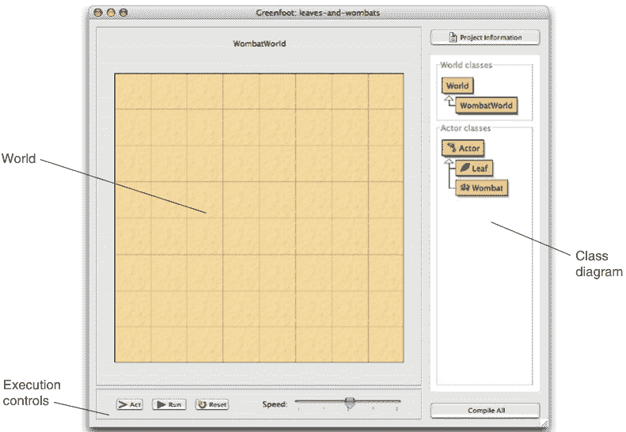

**执行控制**

确保打开了你在 `book-scenarios` 文件夹中找到的 `leaves-and-wombats` 场景，而不是标准 Greenfoot 安装中类似的相似的 `wombats` 场景。

现在你将看到 Greenfoot 主窗口，场景已打开，看起来与图 1.1 相似。主窗口由三个主要区域和额外的按钮组成。主要区域是：

- **世界（The world）。** 覆盖屏幕大部分区域的最大区域（在本例中是一个沙色的网格）被称为世界。这是程序运行以及我们看到物体的地方。
- **类图（The class diagram）。** 右侧带有米色方框和箭头的区域是类图。我们稍后会详细讨论它。
- **执行控制（The execution controls）。** 底部的 `Act`（动作）、`Run`（运行）和 `Reset`（重置）按钮以及速度滑动条是执行控制。稍后我们回到这里。

## 1.2 对象与类

我们将首先讨论类图。类图向我们展示了参与此场景的类。情况下，它们是 `World`、`WombatWorld`、`Actor`、`Leaf` 和 `Wombat`。

我们将使用 Java 编程语言进行项目。Java 是一门面向对象的语言。类和对象的概念是面向对象的基础。

让我们从观察 `Wombat` 类开始。`Wombat` 代表袋鼠这一概念——它描述所有的袋鼠。一旦我们在 Greenfoot 中有一个类，我们就可以从它创建对象。（在编程中，对象也被称为*实例*——这两个术语是同义词。）

顺便说一下，袋鼠是一种澳洲有袋动物（图 1.2）。如果你想了解更多关于它们的信息，可以在网上搜索——它会给你提供大量结果。

右键点击² `Wombat` 类，你将看到弹出*类菜单*（class menu）（图 1.3a）。该菜单中的第一个选项 `new Wombat()` 让我们可以创建新的袋鼠对象。试一试。

你会发现这给了你一个袋鼠对象（Wombat）的小图片，你可以用鼠标在屏幕上移动它（图 1.3b）。通过点击世界的任何地方，将*袋鼠*放入世界中（图 1.3c）。

### 图 1.2 塔斯马尼亚州楠普国家公园的一只袋鼠³


### 图 1.3

- a) 类菜单。
- b) 拖动对象。
- c) 放置对象（`img/9d90a1ac20b9439aba2e593bea21f58a_21_1`）

² 在 Mac 上使用 ctrl 代替右键。
³ 图片来源：维基百科

一旦我们在 Greenfoot 中有一个类，我们就可以从它创建对象。`void` 在此语境下意味着“无”。

## 1.3 与对象交互

一旦我们在世界中放置了对象，就可以通过选择它们来与它们交互。袋鼠的菜单（图 1.4）显示了袋鼠可以执行的所有操作。在 Java 中，这些操作被称为方法，因此我们将习惯这种术语。

**练习 1.1** 创建一些袋鼠。

**练习 1.2** 调用 `move()` 方法。

**练习 1.3** 调用 `turnLeft()` 方法。

方法签名开头的 `void` 是返回值类型。

### 返回类型

返回值被称为返回值类型。它告诉我们在调用方法时它返回了什么。返回 `void` 类型的方法不返回任何信息。它们只是执行动作并停止。

`void` 以外的任何单词都告诉我们方法在调用时会返回内容，以及该信息的类型。在袋鼠的方法（图 1.4）中，我们还能看到 `int` 和 `boolean`。`int` 代表“整数”，指的是整数字（不带小数点的数字）。整数示例有 3、42、-3 和 120000。

`boolean` 类型只有两个可能的值：`true`（真）和 `false`（假）。返回 `boolean` 的方法向我们返回真值或假值。

返回 `void` 类型的方法就像是给我们的袋鼠的命令。如果我们调用 `turnLeft` 方法，袋鼠会听从并向左转。非 `void` 返回类型的方法就像问题。考虑 `canMove` 方法：

```java
boolean canMove()
```

当我们调用它时，我们会看到一个类似于图 1.5 所示的结果，显示在对话框中。重要的信息是这里的单词 `true`，它是被返回的。

### 图 1.5 方法结果

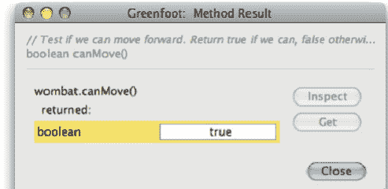

方法调用。实际上，我们只是问了袋鼠“你能移动吗？”，而袋鼠回答了“是的！”（`true`）。

> **练习 1.3** 在你的袋鼠上调用 `canMove()` 方法。它总是返回 `true` 吗？或者你是否能找到它返回 `false` 的情况？

尝试另一个带有返回值的方法：

```java
int getLeavesEaten()
```

使用这个方法，我们可以获取这只袋鼠吃了多少叶子的信息。

> **练习 1.4** 使用一个新创建的袋鼠，`getLeavesEaten()` 方法将始终返回零。你能创建一个该方法的结果不为零的情况吗？（换句话说：你能让你的袋鼠吃一些叶子吗？）

具有非 `void` 返回类型的方法通常告诉我们关于对象的一些信息（它可以移动吗？它吃了多少叶子？），但不会改变对象。在我们询问它关于叶子之前，袋鼠保持原样。返回 `void` 类型的方法通常是给对象的命令，让它们执行某些操作。

## 1.5 参数

方法菜单中我们尚未讨论的另一部分是方法名后的括号。

```java
int getLeavesEaten()
void setDirection(int direction)
```

方法名后的括号存放参数列表。这告诉我们方法运行是否需要任何额外信息，如果是，需要什么类型的信息。

如果我们看到一对括号外没有任何其他内容（正如我们目前为止的所有方法那样），该方法有一个空参数列表。换句话说，如果没有参数——我们只需运行它即可调用该方法。如果括号内有任何内容，该方法期望接收一个或多个参数——即我们需要提供的额外信息。

让我们尝试 `setDirection` 方法。我们可以看到它的参数列表中有 `direction` 这个词。当我们调用它时，会看到一个与图 1.6 中看到的类似的对话框。

`direction` 这个词告诉我们，该方法期望一个 `int` 类型的参数，用于指定方向。参数是我们运行该方法时必须提供的额外数据位。每个参数由两个单词定义：首先是参数类型（这里是：`int`），然后是名称，它为我们提供了该参数用途的提示。如果方法有一个参数，那么我们在调用该方法时就需要提供这个额外信息。

### 图 1.6 方法调用对话框

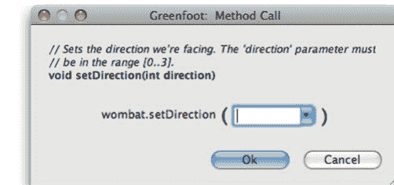

在这种情况下，类型 `int` 告诉我们现在应该提供一个整数，而名称暗示这个数字以某种方式指定了转弯的方向。

对话框顶部有一条注释，告诉了我们更多信息：`direction` 参数应该在 0 到 3 之间。

- **练习 1.5** 调用 `setDirection(int direction)` 方法。提供一个参数值并观察发生了什么。哪个数字对应哪个方向？将它们记录下来。当你输入一个大于 3 的数字时会发生什么？如果你提供的输入不是整数，例如小数（2,5）或单词（three），会发生什么？

> **概念：**
> 方法的规格（显示了其返回类型、名称和参数）被称为该方法的**签名**（signature）。

`setDirection` 方法只执行单个参数。稍后，我们将看到方法执行多个参数的情况。在这种情况下，方法将在括号内列出所有参数。

对象菜单中显示的每个方法的描述（包括返回类型、方法名和参数列表）被称为方法签名。

我们现在已经到了可以与 Greenfoot 对象进行许多交互的阶段。你可以从类创建对象，解释方法签名，并调用方法（带参数和不带参数的）。

## 1.6 Greenfoot 执行

与 Greenfoot 对象交互的另一种方法：执行控制控件。

> **提示：**
> 通过在图表中选择一个类，然后在世界中按住 Shift 键并点击，可以更快地将对象放入世界中。

- **练习 1.6** 将一只袋鼠和许多叶子放入世界，并多次调用袋鼠的 `act()` 方法。这做了什么？它与 `move` 方法有什么不同？务必尝试不同的情况，例如，袋鼠面对世界的边缘，或者坐在叶子上。

- **练习 1.7** 同样在世界中仍有一只袋鼠和一些叶子的情况下，点击 Greenfoot 窗口底部执行控制控件中的 `Act` 按钮。这做了什么？

**练习 1.8** 点击 `Act` 按钮和调用 `act()` 方法之间有什么区别？（尝试在世界中使用几只袋鼠。）

**练习 1.9** 点击 `Run` 按钮。它做了什么？


`act` 方法是 Greenfoot 对象的一个非常基础的方法。我们将在后续所有章节中经常遇到。Greenfoot 世界中的所有对象都有这个方法。调用 `act` 本质上是给对象指令“去做任何你想做的事”。如果你尝试了我们的袋鼠，你会看到袋鼠的 `act` 执行了类似以下的操作：

- 如果我们坐在叶子上，就吃掉叶子。
- 否则，如果我们向前移动，就向前移动。


上述练习中的实验还表明，执行控件中的 `Act` 按钮调用了世界中执行者的方法。与对象菜单调用方法的唯一区别是，`Act` 按钮调用世界中所有对象的方法，而使用对象方法只影响一个选定的对象。

`Run` 按钮会对所有对象反复调用，直到你点击 `Pause`（暂停）。

让我们在另一个场景下尝试我们讨论的内容。


## 第二个示例

从书中 scenarios 的 chapter01 文件夹打开另一个场景 `asteroids1`。它看起来应该和图 1.7 相似（你不会在屏幕上看到火箭或小行星）。


### 理解类图

让我们仔细观察类图（图 1.8）。在顶部，你有两个类 `World` 和 `Space`，它们由箭头连接。

`World` 类在所有 Greenfoot 场景中都存在——它是内置在 Greenfoot 中的。在它下方的类 `Space` 代表了该特定场景的特定世界。它的名称在每个场景中可能不同，但每个场景在这里都会有一个特定的世界。

箭头显示了“是（is）”的关系：`Space` 是一个 `World`（从 Greenfoot 世界的角度来说：我们常说 `Space` 是 `World` 的子类）。


我们不需要创建世界类的对象——Greenfoot 会替我们这样做。当我们打开一个场景时，Greenfoot 会自动创建一个世界子类的对象。该对象随后显示在屏幕的主部分。（巨大的空间图像是...的对象）

## 图 1.7

`asteroids1` 场景

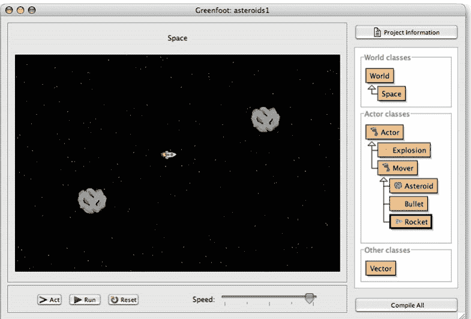

## 图 1.8

类图

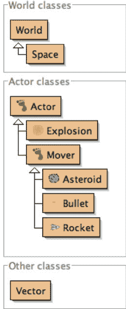

## 12 第 1 章 认识 Greenfoot

在下方，我们看到另一组六个类，由箭头连接。从底部向上读，我们有火箭（rockets）、子弹（bullets）和小行星（asteroids），它们都是“移动者”（movers），而移动者和爆炸（explosions）是执行者（actors）。

同样，我们有子类关系：例如，`Rocket` 是 `Mover` 的子类，而 `Mover` 是 `Actor`。子类关系可以跨越多个级别：例如，`Rocket` 是 `Mover` 的子类，而 `Mover` 又是 `Actor`。

`Vector` 类位于图表底部“Other classes”（其他类）标题下，是一个被其他类使用的辅助类。我们无法放置它的对象。


## 玩小行星

我们可以通过创建一些执行者对象（子类对象）并将它们放入世界来开始玩这个场景。在这里，我们只创建没有子类的类的对象：`Rocket`、`Bullet`、`Asteroid` 和 `Explosion`。

让我们尝试将火箭两个和小行星放入空间。（记得：你可以通过右键点击类来创建对象，或者选择类并按住 Shift 点击。）

当你放置好对象后，点击 `Run` 按钮。你现在可以使用键盘上的方向键控制飞船，并按空格键发射。尝试在撞上它们之前消灭它们。

> 练习 1.10 如果你玩了一会儿游戏，你会发现你射得不够快。让我们稍微调整一下我们的飞船发射软件，让射得快一点。（这应该会让获取小行星变得更容易！）将火箭放入世界，然后调用它的 `setReloadTime` 方法（通过对象菜单），并将重载时间设置为 5。再次运行（至少有两颗小行星）。
>
> 练习 1.11 当你成功移除所有小行星（或在游戏的任何其他时候），停止执行（按下 `Pause`）并找到射了多少次。你可以使用火箭对象菜单中的一个方法来实现。（尝试用最少的次数摧毁小行星。）
>
> 练习 1.12 你会注意到一旦火箭放入世界，它就会移动。它的初始速度是多少？

## 1.10 源代码

（提示：只需射一次，然后再次检查稳定性。另一个提示：要射击小行星，你必须运行游戏。使用对象菜单，你必须先暂停游戏。）

**练习 1.14** 创建一个非常大的小行星。

## 1.10 源代码

每个对象的行为都由它的类定义。我们指定这种行为的方法是使用 Java 编程语言编写源代码。类的源代码是指定关于该类及其对象的所有细节的代码。从类的菜单中选择打开编辑器（Open editor）将向我们显示一个编辑器窗口（图 1.9），其中包含该类的源代码。

该类的源代码相当复杂，我们完全不需要理解它。如果你学习了本书的其他部分并编写自己的游戏或模拟，你将随着时间的推移学会如何编写这些代码。

此时，重要的是理解我们可以通过更改类的源代码来改变对象的行为。让我们尝试一下这样做。

图 1.9

类 `Rocket`（火箭）的编辑器窗口

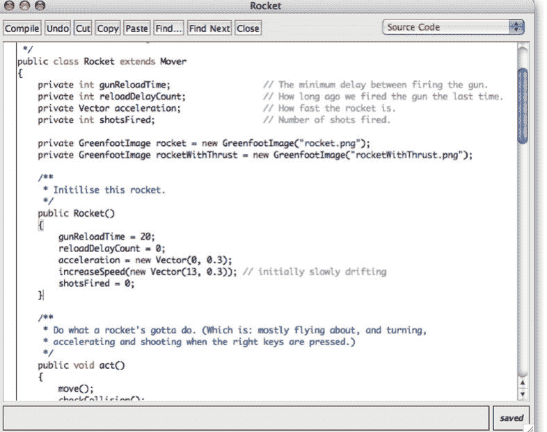

# 第 1 章 认识 Greenfoot

提示：

你可以通过双击类图中的类来打开该类的编辑器。

我们之前看到，火箭的默认初始发射速度相当慢。我们可以通过在每个新火箭上调用方法来单独更改每个火箭的速度，但我们每次启动时都必须重复此操作。相反，我们可以更改火箭的代码，使其初始发射速度发生改变（例如改为 5），这样以后所有的火箭都会以这种改进后的行为开始。

打开 `Rocket` 类的编辑器。从顶部开始第 25 行之后，你应该能找到这样一行代码：

```java
gunReloadTime = 20;
```

这是设置初始装填时间的地方。将此行改为：

```java
gunReloadTime = 5;
```

务确保不要更改任何内容。你会发现编程系统非常挑剔。一个错误或缺失的字符都可能导致错误。例如，如果你删除了行尾的分号，你很快就会遇到错误。

概念：

计算机不理解源代码。在执行之前，它需要被翻译成机器码。这被称为编译。

关闭窗口（我们的修改已完成）并再次查看类图。它现在已经发生了变化：几个类不再显示（图 1.10）。斜纹表示该类已被编辑过且必须编译。编译是一个翻译过程：类的源代码被翻译成你可以执行的机器码。

在更改源代码后，必须始终编译类，然后才能创建该类的新对象。（你可能注意到，即使我们只更改了一个类，有几个类也需要重新编译。这通常是因为类之间相互依赖。当其中一个类发生变化时，另一个就需要再次翻译。）

图 1.10

编辑后的类

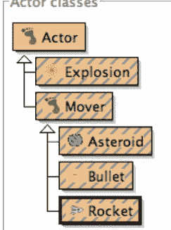

我们可以通过点击 Greenfoot 主窗口右下角的“全部编译”（Compile All）按钮来编译类。一旦类完成编译，条纹就会消失，我们可以再次创建对象。

> 练习 1.15 按照上述描述对 `Rocket` 类的源代码进行更改。关闭编辑器并编译类。尝试一下：火箭现在应该从开始就能快速射击了。

## 1.11 总结

我们将在第 7 章回到小行星游戏，到时我们将讨论如何编写这个游戏。

在本章中，我们看到了 Greenfoot 场景可能是什么样的，以及如何与它们交互。我们看到了如何创建对象，以及如何通过调用这些方法与这些对象通信。某些方法是给对象的命令，而另一些方法返回关于对象的信息。参数用于为方法提供额外信息，而返回值则将信息传回给调用者。

对象是从类中创建的，源代码控制着类的定义（并由此控制该类所有对象的行为和特征）。

我们看到可以使用编辑器更改源代码。编辑源代码后，类需要重新编译。

我们将花费书籍的大部分时间讨论如何编写 Java 源代码来创建实现有趣功能的场景。

### 概念总结

- Greenfoot 场景由一组类组成。
- 从一个类可以创建许多对象。
- 对象拥有方法。调用这些方法可以执行动作。
- 方法的返回类型指定了方法调用将返回的内容。
- 返回类型为 `void` 的方法不返回值。
- `void` 返回类型的方法代表命令，非空返回类型的方法代表问题。
- 参数是向方法传递额外数据的机制。
- 参数和返回值都有类型。示例包括用于数字的 `int` 和用于真/假值的 `boolean`。
- 方法规范（显示其返回类型、名称和参数）称为其签名（signature）。
- 放入世界中的对象被称为演员（actors）。
- 子类是代表另一个类特化的类。在 Greenfoot 中，这通过类图中的箭头表示。
- 每个类都由源代码定义。这段代码定义了该类的对象可以做什么。我们可以通过打开类的编辑器来查看源代码。
- 计算机不理解源代码。在执行之前，它需要被翻译成机器码。这被称为编译。

## 第 2 章

# 第一个程序：小螃蟹

**主题：** 编写代码：移动、旋转、对屏幕边缘的反应

**概念：** 源代码、方法调用、参数、序列、`if` 语句

在上一一章中，我们讨论了如何使用现有的 Greenfoot 场景：我们创建了对象、调用了方法并玩了一个游戏。

现在，我们将开始制作自己的游戏。

## 2.1 小螃蟹场景

我们本章使用的场景名为 `little-crab`。你可以在本书的项目中找到这个场景。

你看到的场景应该类似于图 2.1。

> **练习 2.1** 启动 Greenfoot 并打开 `little-crab` 场景。将螃蟹放入世界并运行程序（点击程序）。

### 让螃蟹移动

让我们看看螃蟹的源代码。打开编辑器显示螃蟹的源代码。（你可以通过从类的弹出菜单中选择“打开编辑器”功能来实现，或者你可以双击该类。）

你看到的源代码是代码 2.1。

## 代码 2.1

```java
import greenfoot.*; // (World, Actor, GreenfootImage, and Greenfoot)
/**
 * 此类定义了一个螃蟹。螃蟹生活在海滩上。
 */
public class Crab extends Animal
{
    public void act()
    {
        // 在此处添加你的动作代码。
    }
}
```

这是一个标准的 Java 类定义。也就是说，这段文字定义了螃蟹可以做什么。我们稍后会详细查看。现在，我们将专注于让螃蟹移动。

在这个类定义中，我们可以看到名为 `act` 的方法。它看起来如下：

```java
public void act()
{
    // 在此处添加你的代码。
}
```

第一行是方法的签名。最后三行（两个括号及其之间的任何内容）被称为方法的体。在这里，我们可以添加一些代码来决定螃蟹的动作。其中一个命令是：

```java
move();
```

图 2.1

小螃蟹场景

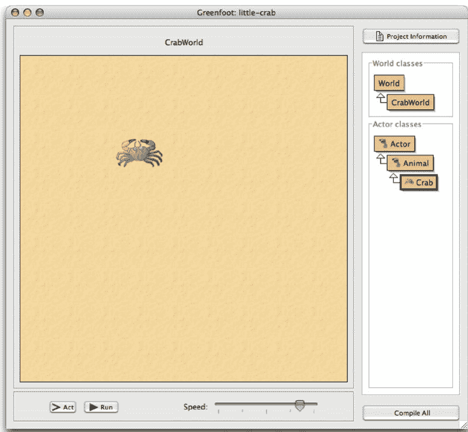

图 2.2

小螃蟹类

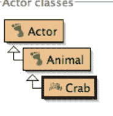

**Exercise 2.2** 修改你的螃类中的 `act` 方法，将 `move()` 指令移动进去，如所示。编译场景（点击 `Compile All` 按钮）并向世界中放入一只螃。尝试点击 `Act` 和 `Run` 按钮。

**Exercise 2.3** 在世界中放入多只螃。运行场景。你观察到了什么？

我们将看到螃可以横跨屏幕移动。`move()` 指令让螃向右移动一小段。当我们点击 Greenfoot 窗口中的 `Act` 按钮时，`act` 方法会执行一次。也就是说，我们在 `act()` 方法内部编写的指令被执行了。

点击 `Run` 按钮就像快速连续点击几次 `Act` 按钮。因此，`act` 方法会一次又一次地执行，直到我们点击 `Pause`（暂停）。

## 术语

`move()` 指令被称为**方法调用**（method call）。**方法**（method）是一个对象知道如何执行的动作（在这里，该对象是螃），而**方法调用**是告诉螃去执行该动作的指令。括号是方法调用的一部分。此类指令以分号结束。

## 转向

让我们看看还可以使用哪些其他指令。螃也能理解 `turn`（转向）指令。它的样子如下：

```java
turn(5);
```

指令中的数字 5 指定了螃应该旋转的度数。这被称为一个**参数**（parameter）。我们还可以使用其他数字，例如：

```java
turn(23);
```

角度值可以指定到 360，因此 0 到 359 之间的任何值都会被使用。（旋转 360 度将旋转一圈，所以它与旋转 0 度相同，或者说不旋转。）

如果我们想转向而不是移动，可以将 `move()` 指令替换为 `turn(5)` 指令。此时 `act` 方法看起来如下：

```java
public void act() {
    turn(5);
}
```

# 20 第 2 章 第一个程序：小螃

> **Exercise 2.4** 在你的场景中使用 `turn(5)` 替换 `move()`。尝试一下。也尝试 5 以外的值，看看看起来像什么样。记住：每次你修改源代码时，都需要重新编译。
>
> **Exercise 2.5** 如何让螃向左转？

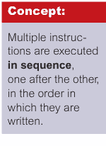

我们可以做的下一件事是既移动又转向。`act` 方法可以包含多个指令——我们只需要连续编写多条指令即可。

代码 2.2 显示了在移动和转向时的完整 `Crab` 类类貌。在这种情况下，每一步，螃都会移动并转向（但这些动作在彼此之间发生得非常快，看起来就像它们是同时发生的）。

## 代码 2.2

让螃移动并转向

```java
import greenfoot.*; // (World, Actor, GreenfootImage, and Greenfoot)
/**
 * 此类定义了一个螃。螃生活在海滩上。
 */
public class Crab extends Animal {
    public void act() {
        move();
        turn(5);
    }
}
```

> **Exercise 2.6** 在你的螃的 `act` 方法中使用 `move()` 和 `turn(N)` 指令。尝试不同的 N 值。

## 术语

`turn` 指令中括号内的数字——即 `turn(5)` 中的 5——被称为**参数**（parameter）。参数是我们在调用某些方法时必须提供的额外信息。

某些方法（如 `move`）不要求任何参数。只要我们写下 `move()` 指令，它们就会很乐意地执行。其他方法（如 `turn`）需要更多信息：*我应该如何转向？* 在这种情况下，我们必须以括号内参数的形式提供该信息，例如 `turn(17)`。

## 2.4 处理屏幕边缘

21

### 侧记：错误

概念：

当我们编写源代码时，必须非常小心——每一个字符都关重要。错错一点都会导致我们的程序无法运行。通常情况下，它将无法编译。

当一个类被编译时，编译器会检查是否存在任何错误。如果发现错误，就会显示错误信息。

这种情况会经常发生：当我们编写程序时，不可避免地会出错，然后我们必须纠正它们。让我们尝试一下。

例如，如果我们忘记在 `move()` 指令后写分号，那么当我们尝试编译时，就会收到通知。

- Exercise 2.7 打开你的编辑器显示螃的源代码，删除 `move()` 后的分号。然后编译。尝试其他错误，例如拼写错误 `move` 或对代码进行其他随机更改。确保在此练习后检查回来。
- Exercise 2.8 进行各种更改以导致不同的错误信息。找到至少五个不同的错误信息。写下每条错误信息以及为了证明该错误引入了什么。

## 提示：

当编辑器窗口底部出现错误信息时，其右侧会出现一个问号按钮。点击此按钮会显示关于该错误信息的额外信息。

正如我们在这个练习中看到的，如果我们弄错了一个小细节，Greenfoot 就会打开编辑器，高亮一行，并在编辑器窗口底部显示一条消息。该消息试图解释错误。然而，这些信息的实用性差异很大。随着时间的推移，我们将学会更好地阅读这些信息。

## 处理边缘


当我们在之前的节中让螃移动并转向时，它们在边缘处卡住了。（Greenfoot 的设计使得 Actor 不掉出。）现在，我们将改进这种行为，让螃发现自己到达了边缘并转向。

# 第 2 章 第一个程序：小螃

概念：

子类从其父类继承方法。这意味着它可以调用所有方法。

我们到为止使用的 `move` 和 `turn` 方法来自 `Animal` 类。螃是一种动物（由类图中指向 `Animal` 的箭头指示），因此它可以执行动物能做的一切。这被称为继承。

我们如何发现？为了研究这一点，我们可以打开 `Animal` 类的编辑器。编辑器可以显示两种视图：显示源代码（如我们查看 `Crab` 类时所示）或显示文档。可以通过编辑器右上角的弹出选择进行切换。我们现在想查看文档视图下的 `Animal` 类（图 2.3）。

## 图 2.3

`Animal` 类的文档视图（带有方法摘要）

| Constructor Summary |
| --- |
| `Animal()` | `Animal` 的构造函数：无所事事。 |

| Method Summary |
| --- |
| `ask()` | 空方法。 |
| `isNear()` | 测试是否接近世界的一个边缘。 |
| `can(java.lang.Class class)` | 如果可以在当前位置创建 `class` 类的对象，则返回 true。 |
| `get(java.lang.Class class)` | 尝试获取 `class` 类的对象。 |


| 方法 | 说明 |
| --- | --- |
| `move()` | 向当前方向向前移动。 |
| `turn(int angle)` | 向右（顺时针）旋转 `angle` 度。 |
| Methods inherited from class `greenfoot.Actor` |  |
| `addrobot`, `getwidth`, `getType`, `getintersectobjects`, `getgetWidth`... |  |
| Loading class interface | ... |

**练习 2.9** 打开 `Animal` 类的编辑器。切换到文档视图。找到该类的方法列表（“方法摘要”）。该类有多少个方法？

## 2.4 处理屏幕边缘

如果我们查看方法摘要，就可以看到 `Animal` 类提供的所有方法。其中，有三个方法目前对我们来说特别有趣。它们是：

```java
boolean atWorldEdge()
测试我们是否接近世界的边缘之一。

void move()
沿当前方向向前移动。

void turn(int angle)
向右侧（顺时针）旋转 "angle" 度。
```

在这里我们看到了三个方法的签名，就像我们在第 1 章中首次遇到它们的那样。每个方法签名都以返回类型开始，随后是方法名和参数列表。在下方，我们有一个描述该方法功能的注释。我们可以看到这三个方法名分别是 `atWorldEdge`、`move` 和 `turn`。

`move` 和 `turn` 方法是在之前的章节中用过的。如果我们查看参数列表，就能看到之前看到的内容：`move` 没有参数（括号是空的），而 `turn` 期望一个 `int` 类型（整数）的参数作为角度。（如果你不确定参数列表，请阅读第 1.5 节）。

我们还可以看到 `move` 和 `turn` 方法的返回类型是 `void`。这意味着这两个方法都不返回值。我们是在命令或指示对象移动或旋转。动物会服从命令，但不会向我们回答。

`atWorldEdge` 的签名稍有不同。它是：

```java
boolean atWorldEdge()
```

这个方法没有参数（括号内为空），但它指定了一个返回值：`boolean`。我们在第 1.4 节中简要解释过 `boolean` 类型——是一种可以包含两个可能值的类型：`true`（真）或 `false`（假）。

调用返回的方法（返回类型不是 `void`）不像发布命令，而是像提问。如果我们使用 `atWorldEdge()` 方法，该方法将响应 `true`（是！）或 `false`（否！）。我们可以使用这个方法来检查我们是否处于世界的边缘。

- **概念：**

  调用带有 `void` 返回类型的方法是命令。

  调用带有非 `void` 返回类型的方法是提问。

练习 2.10 创建一只螃蟹。右键点击，找到 `boolean atWorldEdge()` 方法（它在继承自 `Animal` 的子菜单中，因为螃蟹从 `Animal` 类继承了这个方法）。调用此方法。它返回了什么？

练习 2.11 让螃蟹运行到屏幕边缘（或手动将其移动到那里），再次调用 `atWorldEdge()` 方法。现在它返回了什么？

# 第 2 章 第一个程序：小螃蟹

我们现在可以将此方法与 `if` 语句结合，编写代码 2.3 所示的代码。

### 代码 2.3

#### 在世界的边缘旋转

```java
import greenfoot.*; // (World, Actor, GreenfootImage, and Greenfoot)
/**
 * 此类定义了一只螃蟹。螃蟹生活在海滩上。
 */
public class Crab extends Animal {
    public void act() {
        if ( atWorldEdge() ) {
            turn(17);
        }
        move();
    }
}
```

### 概念

`if` 语句可以编写仅在特定条件为真时才执行的指令。

`if` 语句是 Java 语言的一部分，它使得只有在某些条件为真时才执行命令。例如，我们希望只在靠近世界边缘时才旋转。我们编写的代码如下：

```java
if ( atWorldEdge() ) {
    turn(17);
}
move();
```

`if` 语句的通用形式如下：

```java
if ( condition ) {
    instruction;
    instruction;
}
```

条件（condition）位置可以是任何为真或为假的表达式（例如我们的 `atWorldEdge()` 方法调用），只有当条件为真时，才会执行指令。可以有一条或多条指令。

如果条件为假，指令将直接跳过，执行将在 `if` 语句的大括号下继续进行。

注意，我们的 `move()` 方法在 `if` 语句之外，因此它在任何情况下都会执行。换句话说：如果我们处于世界的边缘，我们就先旋转后移动；如果我们不在世界的边缘，我们就只移动。

## 2.5 编程技巧总结

练习 2.12 试一试！输入上面讨论的代码，看看是否能让你的螃蟹在屏幕边缘旋转。密切注意左括号和右括号——很容易漏掉一个或多写一个。

在 Greenfoot 编辑器中，当你将光标放在右大括号后面时，Greenfoot 会标记出匹配的左大括号。这可以用来检查你的括号是否按预期匹配。

练习 2.13 尝试为 `turn` 方法的参数使用不同的值。找到一个看起来不错的值。

练习 2.14 将 `move()` 语句放在 `if` 语句内部，而不是放在之后。找出效果是什么，并解释你观察到的行为。（然后通过将其移回原位来修复）。

### 缩进

在到为止你看到的所有示例中（例如代码 2.3），你可能已经注意到使用了仔细的缩进。每当一个大括号打开时，后续行的缩进都会比之前的行多缩进一级。当一个大括号关闭时，缩进回退一级，使得右大括号直接位于左括号的下方。这有助于找到匹配的括号。

我们使用四个空格表示一级。适当的缩进会让代码变得易读得多。

# 第 3 章 改进螃蟹——更复杂的编程

## 概念

属于类（而不是对象）的方法在它们的签名中标记有 `static` 关键字。它们也被称为类方法。

> 注意：静态方法

方法既可以属于对象，也可以属于类。当方法属于一个类时，我们使用

`class-name.method-name(parameters);`

来调用该方法。当方法属于一个对象时，我们写

`object.method-name(parameters)`

来调用它。

这两种方法都定义在类中。方法签名告诉我们一个方法是属于该类的对象，还是属于类本身。

属于类本身的方法在方法签名的开头标记有 `static` 关键字。例如，Greenfoot 的 `getRandomNumber` 签名：

`static getRandomNumber(int limit);`

这告诉我们，在调用方法时，在点 `.` 之前必须使用类本身的名字（`Greenfoot`）。

我们将在后面的章节中遇到属于其他对象的方法的调用。

假设我们想让螃蟹长大，让它在每一步都有 10% 的概率稍微偏离路线。我们可以通过一个 `if` 语句来完成大部分工作：

```java
if ( something-is-true )
{
  turn(5);
}
```

现在我们必须找到一个表达式来替换 `something-is-true`，该表达式在恰好 10% 的情况下返回真。

我们可以使用一个随机数（使用 `Greenfoot.getRandom` 方法）和一个小于运算符来实现这一点。小于运算符比较两个数字，如果第一个小于第二个，则返回真。“小于”使用符号 `<` 编写。例如：

```java
2 < 33
```

是真（true），而

```java
162 < 42
```

是假（false）。

**练习 3.1** 在继续阅读之前，在纸上写下一个使用 `getRandomNumber` 方法和小于运算符的表达式，该表达式在执行时恰好 10% 的时间为真。

**练习 3.2** 写另一个在 7% 的时间内为真的表达式。

## 3.1 添加随机行为

### 注意

Java 有许多个运算符来比较两个值。它们是：

- `<` 小于
- `>=` 大于等于
- `>` 大于
- `==` 等于
- `<=` 小于
- `!=` 不等于

如果我们想以百分比表示概率，处理 100 以内的随机数是最容易的。例如，一个在 10% 时间为真的表达式可以是：

`Greenfoot.getRandomNumber(100) < 10`

由于每次调用 `Greenfoot.getRandomNumber(100)` 都会给我们一个 0 到 99 之间的随机数，而且由于这些数字是均匀分布的，它们在所有情况的 100% 中小于 10。

我们现在可以使用这让螃蟹在 10% 的步数中转弯（代码 3.1）。

### 代码 3.1

#### 随机改变方向——第一次尝试

```java
import greenfoot.*; // (World, Actor, GreenfootImage, Greenfoot)
/**
 * 此类定义了一只螃蟹。螃蟹住在海滩上。
 */
public class Crab extends Animal {
    public void act() {
        if ( atWorldEdge() ) {
            turn(17);
        }
        if ( Greenfoot.getRandomNumber(100) < 10 ) {
            turn(5);
        }
        move();
    }
}
```

**练习 3.3** 在你自己的版本中尝试上述的随机方向改变。尝试不同的转弯概率进行实验。

这是一个非常好的开始，但还不够完美。首先，如果螃蟹转弯，它总是转相同的角度（5 度），而且，它总是向右转，从不向左转。我们真正想看到的是螃蟹向左或向右转一个微小的随机角度。（我们现在讨论这一点。如果你觉得有信心，请在阅读之前先自己实现它。）

解决第一个问题（总是转相同的角度，在我们的案例中是 5 度）的简单技巧是将代码中固定的 5 替换为另一个随机数，如下：

```java
if ( Greenfoot.getRandomNumber(100) < 10 )
{
    turn( Greenfoot.getRandomNumber(45) );
}
```

在这个例子中，螃蟹在 10% 的步数中转弯。当它转弯时，它将转一个 0 到 44 度之间的随机角度。

- **练习 3.4** 尝试上述代码。你观察到了什么？螃蟹转弯时会转不同的角度吗？
- **练习 3.5** 我们仍然面临螃蟹只向右转的问题。这不是螃蟹的正常行为，所以让我们修复它。修改你的代码，让螃蟹向右或向左转。每次转弯 45 度。
- **练习 3.6** 在有多个螃蟹的情况下运行场景。它们是同时转弯，还是独立转弯？为什么？

我们现在知道如何处理其他对象的交互。书中展示了我们所做的实现。

## 添加虫子

让我们通过添加另一种动物让我们的世界更有趣。

螃蟹喜欢吃虫子。（好吧，事实并非如此。）

## 3.2 添加虫子


一旦完成，我们可以点击确定。类现在已添加到场景中，我们可以编译并在世界中添加虫子。

练习 3.7 在你的世界添加一些虫子。也添加一些螃蟹。运行场景。你观察到了什么？虫子做了什么？当螃蟹遇到虫子会发生什么？

## 3.3 吃虫子

我们现在想为螃蟹添加行为：当螃蟹遇到虫子时，它吃掉它。再次，我们首先检查从 `Animal` 类继承的方法。当我们打开 `Animal` 编辑并切换到文档视图时，可以看到以下方法：

```java
boolean canSee (java.lang.Class class)
如果我们能看到 'class' 类型的对象，则返回真
```

```java
void eat (java.lang.Class class)
尝试吃掉 'class' 类型的对象
```

使用这些方法，我们可以实现这种行为。第一个方法检查螃蟹是否能看到虫子。（它只有在撞上时才能看到——我们的动物视力不好。）这个方法返回一个布尔值——真或假，因此我们可以将其用于 `if` 语句。

第二个方法吃虫子。这两个方法都期望一个 `java.Class` 类型的参数。这意味着我们期望指定我们场景中的某一个类。这里是示例代码：

```java
if ( canSee(Worm.class) )
    eat(Worm.class);
```

在这种情况下，我们将 `Worm.class` 指定为两次调用的参数。这声明了我们正在寻找哪种对象，以及我们想要吃哪种对象。我们完整的 `act` 方法在代码 3.2 中。

尝试一下这个。在世界中放置一些虫子（记住：按住点击世界是快速放置多个 actor 的快捷方法），放置几只螃蟹，运行场景，看看发生了什么。

## 3.4 创建新方法

### 代码 3.2

#### 吃虫的第一个版本

```java
public void act() {
    if ( atWorldEdge()) {
        turn(17);
    }

    if ( Greenfoot.getRandomNumber(100) < 10 ) {
        turn(Greenfoot.getRandomNumber(90)-45);
    }
    move();

    if ( canSee(Worm.class) ) {
        eat(Worm.class);
    }
}
```

### 高级笔记：包

（标记为“高级笔记”的注释是为了对细节真正感兴趣的读者提供更深入的信息。这些内容对于理解当前阶段的内容并不重要，可以安全地跳过。）

在 `canSee` 和 `eat` 方法的定义中，我们看到了一个类型为 `java.lang.Class` 的参数类型。这里发生了什么呢？

许多类型都是通过类定义的。其中许多类位于标准类库中。你可以通过 Greenfoot 的 Help（帮助）菜单选择 Java Library Documentation（Java 类库文档）来查看 Java 类库的文档。

Java 类库包含数千个类。为了方便操作，它们被分成了不同的“包”（逻辑上相关的类组）。当类名包含点时（如 `java.lang.Class`），只有最后部分是类本身的名称，前面的部分构成了包名。因此，我们在这里查看的是来自 `java.lang` 包的名为 "Class" 的类。

尝试在 Java 库文档中找到该类。

## 创建新方法

在过去的几个章节中，我们为螃蟹添加了新行为——在世界边缘转弯、偶尔随机转弯以及吃虫子。如果我们继续按照目前的方式这样做，`act` 方法将变得越来越长，最终变得非常难以理解。我们可以通过将其拆分为更小的部分来改进。

### 概念

方法定义为该类的对象定义了一个新动作。该动作不会被立即执行，但可以通过方法名调用该方法来执行它。

我们可以根据自己的需求在 `Crab` 类中创建额外的方法。例如，我们不再直接在 `act` 方法中编写寻找并吃掉虫子的代码，而是为此目的添加一个新方法。为此，我们首先要为这个方法确定一个名字。假设我们叫它 `lookForWorm`。然后通过添加以下代码来创建一个新方法：

```java
/*
 * 检查我们是否撞到了一条虫子。
 * 如果发现了，吃掉它。如果没有，什么都不做。
 */
public void lookForWorm() {
    if(canSee(Worm.class)) {
        eat(Worm.class);
    }
}
```

### 概念

注释被写在源代码中，作为给人类读者的解释。计算机会忽略这些注释。

前四行是注释。注释会被计算机忽略——它是为了给人类读者阅读的。我们需要一个注释来向其他人类读者解释这个方法的用途。

当我们定义这个方法时，代码并不会立即执行。事实上，仅仅通过定义这个方法，它根本不会被执行。我们只是定义了一个以后可以执行的新可能动作（“寻找虫子”）。只有在方法被**调用（called）**时，它才会被执行。我们可以在 `act` 方法内部添加对该方法的调用：

```java
lookForWorm();
```

注意调用处带有（空的）参数列表的括号。此重构后的完整源代码见代码 3.3。

### 代码 3.3

#### 将代码拆分为独立的方法

```java
public void act() {
    if (atWorldEdge()) {
        turn(17);
    }
    if (Greenfoot.getRandomNumber(100) < 10 ) {
        turn(5);
    }
    move();
    lookForWorm();
}
```

## 3.4 创建新方法

### 代码 3.3 继续

#### 将代码拆分为独立的方法

```java
/**
 * 检查我们是否撞到了一条虫子。
 * 如果发现了，吃掉它。如果没有，什么都不做。
 */
public void lookForWorm() {
    if (canSee(Worm.class)) {
        eat(Worm.class);
    }
}
```

注意，这种代码的改变完全改变螃蟹的行为。从长远来看，它让代码更容易读。当我们向类中添加更多代码时，方法往往会变得越来越长。长方法更难理解。通过将代码拆分成若干短方法，我们可以让代码更易读。

**练习 3.8** 创建另一个名为 `randomTurn` 的新方法（该方法没有参数也没有返回值）。选择随机转弯的代码，将其从 `act` 方法移动到 `randomTurn` 方法。然后在你的 `act` 方法中调用它。为这个方法写一个注释。

**练习 3.9** 创建另一个名为 `turnEdge` 的方法（同样没有参数也没有返回值）。将检查是否在世界边缘的代码移动到 `turnEdge` 方法。在你的 `act` 方法中调用它。你的 `act` 方法现在应该像代码 3.4。

### 代码 3.4

#### 创建子任务方法后的 `act` 方法


```java
public void act() {
    turnEdge();
    randomTurn();
    move();
    lookForWorm();
}
```

按照习惯，Java 方法名总是小写开头。方法名不能包含空格（或其他标点符号）。如果方法名由多个单词组成，我们在单词中间使用大写字母。

## 添加龙虾

我们现在处于这样一个阶段：螃蟹在世界中或或随机行走，并在遇到它们时吃掉。为了让它更有趣，让我们添加另一个生物：龙虾。场景中的龙虾会追逐螃蟹。

- **练习 3.10** 在你的场景中添加一个新类。该类应该是 `Animal` 的子类（大写字母 L），并且应该使用准备好的 `lobster.png`。

- **练习 3.11** 当你把它们放入世界时，你预计龙虾会做什么？编译场景并尝试。我们想要新的龙虾吃螃蟹。这很容易，因为行为与螃蟹相似。唯一的区别是龙虾寻找螃蟹，而螃蟹寻找龙虾。

- **练习 3.12** 将 `Crab` 类中完整的 `act` 方法复制到 `Lobster` 类。同时也复制 `lookForWorm`、`turnEdge` 和 `randomTurn` 方法。

- **练习 3.13** 修改龙虾代码使其寻找螃蟹而不是虫子。你可以通过将场景中所有的 "Worm" 改为 "Crab" 来实现。例如，在提到 `Worm.class` 的地方改为 `Crab.class`。同样将 `lookForWorm` 重命名为 `lookForCrab`。确保更新了你的注释。

- **练习 3.14** 将一只螃蟹、三只龙虾和许多虫子放入世界。运行场景。螃蟹能在被龙虾抓住之前吃掉所有虫子吗？你现在应该有一个场景版本，螃蟹和龙虾都在随机行走，分别寻找虫子和螃蟹。现在让我们把这个程序变成游戏。

为了获得游戏化的行为，我们需要玩家的加入。玩家（你！）应该能够通过键盘控制螃蟹，而龙虾像之前那样继续随机运行。

世界环境有一个方法让我们检查是否按下了键盘键。它被称为 `isKeyDown`，就像我们在 3.1 节遇到的 `getRandomNumber` 方法一样，它位于 `Greenfoot` 类中。方法签名如下：

```java
static boolean isKeyDown(String key)
```

我们可以看到该方法是静态的（类方法），返回类型是 `boolean`。这意味着方法返回 `true` 或 `false`，并可以作为 `if` 语句的条件。

## 3.6 键盘控制

我们看到该方法期望一个 `String` 类型的参数。`String` 是一段文本（例如单词或句子），用双引号括起来。以下是 `String` 的示例：

- "This is a String"

- "name"

- "A"

在这种情况下，期望的 `String` 是我们要测试的键的名字。对于那些产生可见字符的键，它们的字符就是它们的名字；例如，A 键被称为 "A"。其他键也有名字。例如，左箭头被称为 "left"。因此，如果我们想测试是否按下了左箭头，可以这样写：

```java
if (Greenfoot.getKey("left")) {
    // 做些什么
}
```

注意我们在调用 `keyDown` 前需要写 `Greenfoot.`，因为这个方法定义在 `Greenfoot` 类中。

如果我们想要螃蟹每当按下左箭头时就向左转 4 度，我们可以这样写：

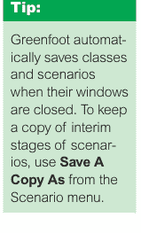

```java
if (Greenfoot.getKey("left")) {
    turn(-4);
}
```

现在的想法是从螃蟹中移除随机转弯的代码，以及在世界边缘自动转弯的代码，并用让我们通过键盘控制螃蟹转弯的代码替换它。

| 练习 3.15 | 从螃蟹中移除随机转弯的代码。 |

| 练习 3.16 | 从螃蟹中移除在世界边缘的代码。 |

| 练习 3.17 | 在螃蟹的 `act` 方法中添加代码，当按下左箭头时让螃蟹左转。 |

| 练习 3.18 | 在螃蟹的 `act` 方法中添加另一段代码，当按下右箭头时让螃蟹右转。 |

| 练习 3.19 | 如果你还没有这样做，请确保代码检查按键，且转弯不是直接在 `act` 方法中，而是在一个独立的方法中，名为 `checkKeyPress`。 |

自己解决这些任务。如果你遇到困难，请看下一页。代码 3.5 显示了此更改后螃蟹完整的 `act` 和 `checkKeyPress` 方法。这个版本包含了我们目前为止讨论的所有更改。

# 38 第 3 章 改进螃蟹——更复杂的编程

## 代码 3.5

螃蟹的“act”方法：使用键盘控制螃蟹

```java
/**
 * Act - 执行螃蟹想要做的任何事情。
 */
public void act() {
    checkcheckKeyPress();
    move();
    lookForWorm();
}

/**
 * 检查键盘上的某个控制键是否被按下。
 * 如果按下了，则做出相应的反应。
 */
public void checkKeyPress() {
    if (Greenfoot.isKeyDown("left")) {
        turn(-4);
    }
    if (Greenfoot.isKeyDown("right")) {
        turn(4);
    }
}
```

你现在已经准备好尝试玩你的游戏了！在世界中放置一只螃蟹、一些虫子和几只龙虾，看看你是否能在龙虾抓住你之前抓到所有的虫子。（显然，放置的龙虾越多，难度越大……）

## 3.7 结束游戏

我们可以做的一个简单改进是：当螃蟹被龙虾抓住时，控制游戏的执行。Greenfoot 有一个方法可以实现这一点——我们只需要找到它叫什么。

概念：

API 文档列出了 Greenfoot 中所有可用的类和方法。我们经常需要在这里查找方法。

要找到 Greenfoot 中可用的方法，我们可以查看 Greenfoot 类的文档。

在 Greenfoot 中，从“帮助”（Help）菜单中选择“Greenfoot 类文档”（Greenfoot Class Documentation）。将在 浏览器中显示所有 Greenfoot 类的文档（图 3.3）。

该文档称为 Greenfoot API（应用程序编程接口）。API 显示了所有可用的类，并且对于每个类，显示所有可用的方法。你可以看到 Greenfoot 提供了五个类：`Actor`、`Greenfoot`、`GreenfootImage`、`MouseInfo` 和 `World`。

## 图 3.3

浏览器窗口中的 Greenfoot API

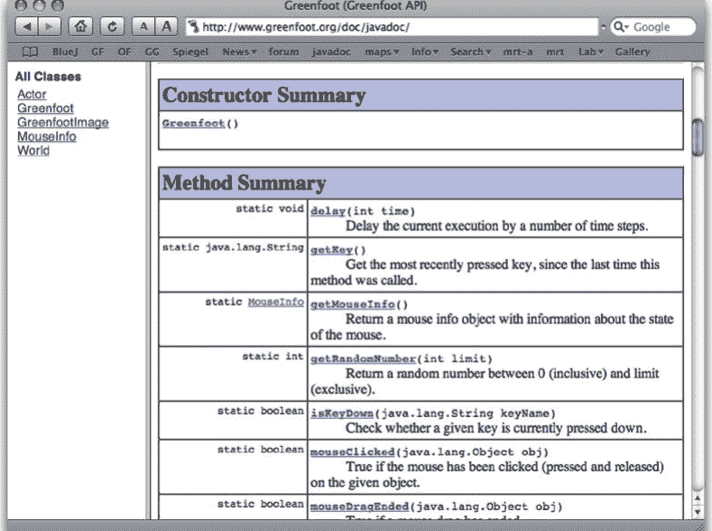

我们要找的方法在 `Greenfoot` 类中。

**练习 3.20** 在你的浏览器中打开 Greenfoot API。选择 `Greenfoot` 类。在它的文档中，找到标题为“Method Summary”（方法摘要）的部分。在该部分中，找到一个可以停止运行场景执行的方法。这个方法叫什么名字？

**练习 3.21** 该方法需要任何参数吗？它的返回类型是什么？

我们可以通过在左侧列表中选择类来查看 `Greenfoot` 类的文档。浏览器中的主面板显示了通用注释、构造函数的详细信息以及它的方法列表。（构造函数将在后面的章节中讨论。）

如果我们浏览 `Greenfoot` 类中的所有可用方法列表，可以找到一个名为 `stop` 的方法。这就是我们可以在螃蟹被抓住时使用它来停止执行的方法。

## 40 第 3 章 改进螃蟹——更复杂的编程

我们可以通过在源代码中编写 `Greenfoot.stop();` 来使用这个方法。

> **练习 3.22** 在你的场景中添加代码，以便在龙虾抓住螃蟹时停止游戏。你需要决定这行代码需要添加到哪里。找到你代码中当龙虾吃掉螃蟹时会执行的地方，并添加这行代码。

将来我们将会经常使用这个类文档来查找我们需要使用的方法细节。过了一段时间，我们会记住一些方法，但总会有一些我们需要查找的方法。

## 3.8 添加声音

我们游戏的另一个改进是添加声音。同样，`Greenfoot` 类中的一个方法可以帮助我们实现这一点。

> **练习 3.23** 打开 `Greenfoot` 类文档（从“帮助”菜单），并查看 `Greenfoot` 类的文档。找到可以播放声音的方法细节。它叫什么名字？它期望什么参数？

通过查阅文档，我们可以看到 `Greenfoot` 类有一个名为 `playSound` 的方法。它期望一个声音文件的名称（作为 `String`）作为参数，并且不返回任何内容。

> **注意**

> 你可以在文件系统中查看 Greenfoot 场景的结构。如果你查看包含书籍场景的文件夹，可以为每个 Greenfoot 场景找到一个文件夹。对于螃蟹的示例，有几个不同的版本（little-crab、little-crab-2、little-crab-3 等）。在每个场景文件夹内部，都有对应每个场景类的的几个文件，以及其他支持文件夹。有两个媒体文件夹：`images` 存储场景图像，`sounds` 存储声音文件。

你可以通过查看此文件夹来查看可用的声音，并将它们存储在这里来制作更多声音。

在我们的场景中，已经包含了两个声音文件。它们分别被称为 `slurp.wav` 和 `au.wav`。

## 3.8 添加声音

我们现在可以使用以下方法调用来轻松地播放其中一个声音：

```java
Greenfoot.playSound("slurp.wav");
```

尝试一下！

练习 **3.24** 在你的场景中添加播放声音：当螃蟹吃掉虫子时，播放“slurp.wav”声音。当龙虾吃掉螃蟹时，播放“au.wav”声音。要做到这一点，你必须找到代码中应该发生这种事情的地方。

该场景的 *little-crab-4* 版本显示了解决方案。它是包含这些内容的项目版本。（图 3.4）。

图 3.4

带有龙虾的螃蟹游戏


## 42 第 3 章 改进螃蟹——更复杂的编程

关于声音

我们现在已经接近可以玩你的游戏了！但是，还有一些事情需要处理。第一个要解决的问题是当螃蟹被龙虾抓住时，执行执行。Greenfoot 有一个方法可以实现这一点——我们只需要找到它叫什么。

概念：

API 文档列了 Greenfoot 中所有可用的类和方法。我们经常需要在这里查找方法。

要找到 Greenfoot 中可用的方法，我们可以查看 Greenfoot 类的文档。

在 Greenfoot 中，从“帮助”（Help）菜单中选择“Greenfoot 类文档”。将在 浏览器中显示所有 Greenfoot 类的文档（图 3.3）。

该文档称为 Greenfoot API（应用程序编程接口）。API 显示了所有可用的类，并且对于每个类，显示所有可用的方法。你可以看到 Greenfoot 提供了五个类：`Actor`、`Greenfoot`、`GreenfootImage`、`MouseInfo` 和 `World`。

## 3.9 技术总结

在本章中我们看到了很多。我们也看到了如何。

概念：

- **点符号 (Dot notation)**：当我们想要调用时使用它。

- **类方法 (Class methods)**：属于类（相对于对象）的方法被标记为 `static`。它们也是方法。

- **方法定义 (Method definition)**：为对象定义新动作。

- **注释 (Comments)**：写入源代码中供人类读者。计算机会忽略它们。

- **API 文档 (API Documentation)**：列出了 Greenfoot 中所有可用的类和方法。我们经常需要在这里查找。

¹ 使用互联网搜索，你应该找到几个可以记录和保存声音的程序。一个很好的程序是 *Audacity* (http://audacity.org)，但有很多。

## 第4 章 完成螃蟹游戏

**主题：**世界初始化、设置图像、动画图像

**概念：**构造函数、状态、实例变量（字段）、赋值

在本章中，我们将完成螃蟹游戏。“完成”意味着我们在这里停止讨论这个项目。当然，游戏永远不会完成——你总是可以想到更多可以添加的想法。我们将在章末提供一些建议。首先，我们将详细讨论许多改进。

## 4.1 自动添加对象

我们现在已经接近可以玩你的游戏了！但是，还有一些事情需要处理。第一个要解决的问题是当螃蟹被龙虾抓住时，控制游戏的执行。Greenfoot 有一个方法可以实现这一点——我们只需要找到它叫什么。

# 44 第 4 章 完成螃蟹游戏

代码 4.1

`CrabWorld` 类的源代码

```java
import greenfoot.*; // (Actor, World, Greenfoot, GreenfootImage)

public class CrabWorld extends World
{
    /**
     * 创建螃蟹的世界（沙滩）。我们的世界大小为
     * 560x560 个单元格，每个单元格仅为 1 像素。
     */
    public CrabWorld()
    {
        super(560, 560, 1);
    }
}
```

接下来是有趣的部分：

```java
public CrabWorld()
{
    super(560, 560, 1);
}
```

这被称为该类的**构造方法**。构造方法看起来和方法非常相似，但也有一些区别：

- 构造方法在关键字 "public" 和名称之间没有指定返回类型。

- 构造方法的名字始终与类名相同。

构造方法是一种特殊的方法，每当该类的实例创建时，它总是会被执行。它可以执行任何操作来将这个新实例设置为初始状态。

在我们的案例中，构造方法将世界设置为我们想要的大小（560x560 个单元格）和分辨率（每个单元格 1 像素）。我们将在本书后面详细讨论世界的分辨率。

由于这个构造方法在每次创建世界时都会执行，我们可以它来自动创建演员（actors）。如果我们在构造方法中插入代码来创建演员，这些代码将在我们使用时执行。例如：

```java
public CrabWorld()
{
    super(560, 560, 1);
    addObject(new Crab(), 150, 100);
}
```

这段代码将创建一个新的螃蟹，并将其放置在世界 x=150, y=100 的位置。150, 100 表示距离世界的左边缘 150 个单元格，距离顶部 100 个单元格。我们坐标系的原点——0,0 点位于世界的左上角（图 4.1）。

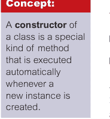

# 图 4.1

世界的坐标系

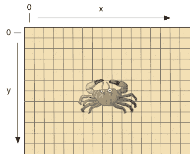

我们在这里使用了两个新东西：`addObject` 方法和创建新螃蟹的 `new` 语句。

`addObject` 方法是 `World` 类的方法。我们可以通过查看 `World` 类的分类来查找它。在那里我们看到它具有以下签名：

```
void addObject(Actor object, int x, int y)
```

从头到尾阅读这个签名，它告诉我们以下信息：

- 该方法不返回结果（`void` 返回类型）。

- 方法的名字是 `addObject`。

- 方法有三个参数，分别名为 `object`、`x` 和 `y`。

- 第一个参数的类型是 `Actor`，另外两个的类型是 `int`。

这可以用来向世界中添加新演员。由于该方法属于 `World` 类，而 `CrabWorld` 是一个 `World`（它继承了 `World` 类），因此该方法在我们的 `CrabWorld` 类中是可用的，我们可以直接调用它。

## 4.2 创建新对象

`addObject` 方法允许我们向世界添加一个演员。然而，为了添加一个对象，我们必须先有一个对象要添加。

Java 关键字 `new` 允许我们创建任何现有类的新对象。例如，表达式

```java
new Crab()
```

创建了 `Crab` 类的新实例。创建新对象的表达式始终以 `new` 关键字开头，后跟跟我们想要创建的类名和参数列表（在示例中为空）。参数列表允许我们向构造方法传递参数。由于我们没有为 `Crab` 类指定构造方法，因此默认参数列表是空的。

> **概念：**

> 可以使用 `new` 关键字通过编程方式（在你的代码内部）创建 Java 对象。

当我们创建一个新对象时，我们必须对它做些什么。我们现在可以使用它来代替 `addObject` 方法的演员参数，将此对象添加到世界中。

```java
addObject(new Crab(), 150, 100);
```

剩下的两个参数指定了我们想要添加对象的位置的 `x` 和 `y` 坐标。

- **练习 4.1** 在你项目的 `CrabWorld` 构造方法中添加代码，如上所述，自动创建一个螃蟹。

- **练习 4.2** 添加代码在 `CrabWorld` 中自动创建三个龙虾。你可以在世界中为它们选择任意位置。

- **练习 4.3** 添加代码在 `CrabWorld` 的任意位置创建 10 只蠕虫。

- **练习 4.4** 将所有创建对象的代码移动到 `CrabWorld` 类中的独立方法中，名为 `populateWorld`。你需要自己声明 `populateWorld` 方法（它不接受参数且没有返回值）并在构造方法中调用它。尝试一下。

- **练习 4.5** 使用随机数作为蠕虫的坐标。你可以通过将你的坐标值替换为获取随机数的调用来实现这一点。

## 4.3 图像动画

我们将讨论的下一步是图像动画。为了让螃蟹看起来更好，我们将交替图像。这通过图像实现（图 4.2）。

**图 4.2** 两种不同的图像

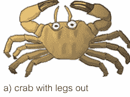


对于我们的目的，将图像的创建与设置分开更好。这意味着当螃蟹行走时多次切换图像，但我们仍然只需要创建一次图像。因此，我们将先创建并存储图像，稍后在不再次创建的情况下使用它们。

## 4.4 实例变量（字段）

通常，我们的演员需要记住某些信息。在编程语言中，通过将信息存储在变量中来实现。Java 支持不同的变量。我们在这里查看的第一种叫做实例变量或字段（这两个术语是同义的）。我们稍后会看到其他类型的变量。

实例变量是属于对象（类的实例）的内存。只要对象存在并可以访问，存储其中的任何内容都会被记住。

实例变量在类中通过编写关键字 `private`，然后是变量类型和名称来声明：

```
private variable-type variable-name;
```

变量的类型定义了我们想要在其中存储的内容。在我们的案例中，我们希望在变量中存储 `GreenfootImage` 类型的对象，类型应该是 `GreenfootImage`。变量名为变量提供了一个稍后引用它时的名称。它应该描述该变量的用途。

为了在我们的螃蟹对象中存储两个图像，我们需要一种以前未使用过的新结构：变量。让我们看 `Crab` 类作为示例（代码 4.2）。

```java
import GreenfootImage.*; // (Actor, World, Greenfoot, GreenfootImage)

// comment omitted

public class Crab extends Animal {
    private GreenfootImage image1;
    private GreenfootImage image2;

    // methods omitted
}
```

## 4.6 赋值 49

在这个示例中，我们在 `Crab` 类中声明了两个变量。它们都是 `GreenFootImage` 类型，并命名为 `image1` 和 `image2`。

我们始终会在类的顶部、在构造函数和方法之前使用实例变量声明。Java 并不强制要求这样做，但这是一个良好的习惯，当我们需要查看变量声明时，总能轻松找到它们。

- **练习 4.7** 在添加此代码之前，在你的世界中右键点击螃蟹对象，从螃蟹的弹出菜单中“检查（Inspect）”。记录螃蟹对象中显示的所有变量。
- **练习 4.8** 为什么你认为螃蟹会有变量，即使我们还没有在 `Crab` 类中声明过任何变量？
- **练习 4.9** 将上方代码 4.2 所示的变量声明添加到你对应版本的 `Crab` 类上方。确保该类可以通过编译。
- **练习 4.10** 在添加变量后，再次检查你的螃蟹对象。记录变量及其对应的值（在白色方框中所示）。

请注意，这两个 `GreenFootImage` 变量的声明并不会带给我们 `GreenFootImage` 对象。它只是提供了一些空空间来存储两个对象（图 4.3）。在图中，实例变量被描述为两个白色方框。

**图 4.3**

具有空实例变量的螃蟹对象

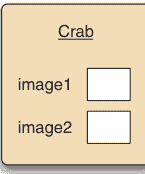

接下来，我们必须创建这两个对象并将它们存储到变量中。对象的创建在已经见过。它是通过以下代码段实现的：

`new GreenfootImage("crab2.png")`

为了将对象存储在变量中，我们需要一种名为“赋值”的 Java 结构。

## 4.6 赋值

赋值允许我们将某些内容存储到变量中的语句。它使用等号编写：

```
variable = expression;
```

等号左侧是我们想要存入的变量名，右侧是我们要想要存储的内容。由于等号代表赋值，因此它被称为赋值符号。我们通常将其读作“变为”，例如：“variable 变为 expression”。

**概念：**

赋值语句将一个对象或值赋给变量。

在我们的示例中，我们写道：

```
image1 = new GreenfootImage("crab.png");
image2 = new GreenfootImage("crab2.png");
```

这两行代码将创建我们希望使用的两个图像，并将它们存储到我们的两个变量 `image1` 和 `image2` 中。执行这些语句后，我们拥有三个对象（一个螃蟹和两个图像），螃蟹的变量包含了对图像的引用。这如图 4.4 所示。

**图 4.4**

拥有两个指向图像对象的变量的螃蟹对象

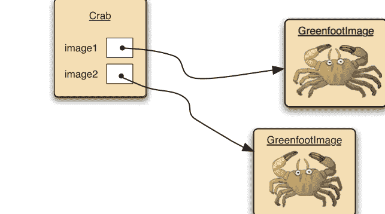

**概念：**

当对象赋值给变量时，该变量包含指向该对象的引用。

关于创建这些图像的下一个问题是，创建图像并将其存入变量的代码放在哪里。由于这应该在螃蟹对象创建时执行一次，而不是每次操作都执行，因此我们不能将其放在 `act` 方法中。相反，我们将此代码放入构造函数中。

### 使用 actor 构造函数

在本章开始时，我们学习了如何使用世界类的构造函数来初始化 actor。同样，我们可以使用 actor 的构造函数来初始化 actor。构造函数中的代码在 actor 创建时执行一次。代码 4.3 显示了 `Crab` 类的构造函数，它通过创建图像并将它们赋值给变量来初始化两个实例变量。

## 4.7 使用 actor 构造函数

### 代码 4.3：在构造函数中初始化变量

```java
import greenfoot.*; // (Actor, World, Greenfoot, GreenfootImage)

// 省略注释
public class Crab extends Animal {
    private GreenfootImage image1;
    private GreenfootImage image2;

    /**
     * 创建一只螃蟹并初始化它的两个图像。
     */
    public Crab() {
        image1 = new GreenfootImage("crab.png");
        image2 = new GreenfootImage("crab2.png");
        setImage(image1);
    }

    // 省略方法
}
```

适用于 `World` 构造函数的规则同样适用于 `Crab` 构造函数：

- 构造函数的签名不包括返回类型。
- 构造函数的名称与类名相同。
- 当螃蟹对象创建时，构造函数会自动执行。

最后一条规则——构造函数会自动执行——确保了当我们创建螃蟹时，图像对象会被自动创建并赋值。因此，在创建螃蟹后，情况将如图 4.4 所示。

构造函数的最后一行将创建的两个图像中的第一个设置为螃蟹的当前图像：

```
setImage(image1);
```

这演示了现在如何使用变量名（`image1`）来引用存储在其中的对象。

**练习 4.11** 将此构造函数添加到你的 `Crab` 类中。你将不会看到螃蟹的行为有任何变化，但该类应该可以通过编译，并且你应该能够创建螃蟹。

> **练习 4.12** 再次检查你的螃蟹对象。再次记录变量及其值。将它们与之前的进行比较。

## 4.8 切换图像

关于创建这些图像的下一个问题是，将创建图像并将其存入变量的代码放在哪里。由于这应该在螃蟹对象创建时执行一次，而不是每次操作都执行，因此我们不能将其放在 `act` 方法中。相反，我们将此代码放入构造函数中。

### 使用 actor 构造函数

在本章开始时，我们学习了如何使用世界类的构造函数来初始化 actor。同样，我们可以使用 actor 的构造函数来初始化 actor。构造函数中的代码在 actor 创建时执行一次。代码 4.3 显示了 `Crab` 类的构造函数，它通过创建图像并将它们赋值给变量来初始化两个实例变量。

## 4.7 使用 actor 构造函数

### 代码 4.3：在构造函数中初始化变量

（见上文翻译）

## 4.8 切换图像

关于创建这些图像的下一个问题是，将创建图像并将其存入变量的代码放在哪里……（见上文翻译）

我们已经到了一个阶段，即螃蟹拥有两个可用的图像。

为了实现动画，我们需要在两个图像之间进行切换。换句话说，如果我们当前显示的是 `image1`，我们就想显示 `image2`。这里是伪伪代码：

```
如果（当前图像是 image1）那么
    使用 image2
否则
    使用 image1
```

伪代码，如此处所示，是部分 Java 代码，部分是纯英语。我们现在用真实的代码来展示这一点。代码 4.4。

### 代码 4.4：切换图像

```java
if ( getImage() == image1 ) {
    setImage(image2);
} else {
    setImage(image1);
}
```

在此段代码中，我们注意到几个新元素：

- `getImage()` 方法可以获取当前图像。
- `==` 运算符（两个等号）可以比较两个值。
- 该语句具有我们之前没过的扩展形式。

**概念：** 我们可以使用双等号测试事物是否相等。

**陷阱：** 一个常见的错误是混淆赋值运算符（`=`）和检查相等性的运算符（`==`）。

### `if/else` 语句

在继续之前，让我们更详细地研究 `if` 语句。正如我们刚刚看到的，`if` 语句可以如下所示编写：

```
if ( 条件 ) {
    语句;
} else {
    语句;
}
```

该语句包含两个（由大括号括起来）块：`if` 子句和 `else` 子句。

当执行此语句时，首先评估条件。如果条件为真，则执行 `if` 子句，然后继续执行 `else` 子句。如果条件为假，则不执行 `if` 子句，而是执行 `else` 子句。因此，两个语句块中始终执行一个，但绝不会都执行。

第二个部分是可选的——省略它就是我们之前看到的较短版 `if` 语句。

**练习 4.13** 将代码 4.4 所示的图像切换代码添加到你螃蟹的 `act` 方法中。尝试一下。（如果遇到错误，修复它。这应该可以运行。）同时在 Greenfoot 中点击 *Act* 按钮而不是 *Run* 按钮——这允许我们更清楚地观察行为。

**练习 4.14** 在第三章中，我们讨论了使用独立方法处理子任务，而不是直接在 `act` 方法中编写代码。对图像切换代码也这样做：创建一个名为 `switchImage` 的新方法，将你的图像切换代码移动过去，并在 `act` 方法中调用它。

**练习 4.15** 从螃蟹的弹出菜单交互式地调用 `switchImage` 方法。它有效吗？

### 计数虫子

我们与螃蟹讨论的最后一件事是计数。我们想要添加一种功能，让螃蟹计算它吃了多少虫子，如果它吃到了八只，我们就赢了游戏。当这种情况发生时，我们还想播放一段短促的“胜利音效”。

# 54 第 4 节 完成螃蟹游戏

为了实现这一目标，我们需要对螃蟹的代码进行一些添加。我们需要：

- 一个用于存储当前吃掉虫子数量的实例变量；
- 一个在开始时将该变量初始化为 0 的赋值语句；
- 每当我们吃掉一条虫子时增加计数器的代码；以及
- 一段检查我们是否已经吃了八只虫子的代码，如果是，则停止游戏并播放游戏。

让我们按照这里列出的顺序来完成这些任务。

我们可以按照第 4.5 节引入的模式定义一个新的实例变量。在我们现有的两个实例变量定义下方，添加以下行代码：

```
private int wormsEaten;
```

`private` 单词用于我们所有实例变量定义的开头。接下来的两个单词是变量的类型和名称。类型 `int` 表示我们想在这个变量中存储整数（数字），而名称 `wormsEaten` 表示了我们意图如何使用它。

接下，我们在构造函数的末尾添加以下代码行：

```
wormsEaten = 0;
```

这在创建螃蟹时将 `wormsEaten` 变量初始化为 0。严格来说，这是多余的，因为 `int` 类型的实例变量会自动初始化为 0。然而，有时我们希望初始值是 0 以外的数值，所以写出我们的初始化语句是一个良好的习惯。

最后一点是检查虫子并检查我们是否达到了八只。我们需要在每次吃掉虫子时执行此操作，所以我们使用 `lookForWorm` 方法，那里有我们定义吃虫子的代码。我们添加一行代码来增加我们的计数：

```
wormsEaten = wormsEaten + 1;
```

在这次赋值中，赋值语句的右侧先求值（`wormsEaten + 1`）。因此，我们读取 `wormsEaten` 的当前值并对其加 1。然后我们将结果赋值回 `wormsEaten` 变量。结果是，变量将增加 1。

此之后，我们需要一个语句来检查我们是否已经吃了八只虫子，如果是，则播放声音并停止执行。

代码 4.5 显示了带有这段代码的完整 `lookForWorm` 方法。声音文件（`fanfare.wav`）已包含在你场景的 `sounds` 文件夹中，因此它可以可以直接播放。

练习 4.16 将上述讨论的代码添加到你自己的场景中。测试它，并确保它工作正常。

## 4.11 更多想法

### 代码 4.5：计算虫子数量

检查我们是否获胜

```java
/**
* 检查我们是否偶然发现了一条虫子。
* 如果发现了，吃掉它。如果没有，什么都不做。如果我们
* 吃了八只虫子，我们就赢了。
 */
public void lookForWorm() {
    if (canSee(Worm.class)) {
        eat(Worm.class);
        Greenfoot.playSound("slurp.wav");
        wormsEaten = wormsEaten + 1;
        if (wormsEaten == 8) {
            Greenfoot.playSound("fanfare.wav");
            Greenfoot.stop();
        }
    }
}
```

**练习 4.17** 作为进一步测试，在开始游戏之前，为你的螃蟹对象打开对象检查器（通过从螃蟹弹出菜单中选择 `Inspect`）。在游戏时保持检查器打开，并观察 `wormsEaten` 变量。

## 4.11 更多想法

`scenarios` 文件夹中的 `little-crab-5` 场景了一个包含了这里描述的所有扩展的项目版本。

我们现在将离开这个场景并转向另一个示例，尽管在这个项目中你有很多明显的事（可能可能还有很多不那么明显的事）可以做。想法包括：

- 为背景和角色（actors）使用不同的图像；
- 使用不同类型的角色；
- 不自动移动，而只在按下向上方向键时移动；
- 通过引入第二个监听不同按键的键盘控制类来构建一个双人游戏；
- 当一条虫子被吃掉时（或随机时间）弹出新的虫子；
- 以及许多你们自己能想出来的想法。

### 编程技术总结

**练习 4.18** 螃蟹在跑步时，图像变化得非常快，这让我们的螃蟹看起来有点过度活跃。也许螃蟹图像只每秒或每三个动作周期变化一次，可能会更好看。尝试实现这一点。为了做到，你可以添加一个在 `act` 方法中增加的计数器。每当它达到 2（或 3）时，图像就会改变，计数器重置为 0。

在本章中，我们看到了许多新的编程概念。我们看到了构造函数如何被用于初始化对象——构造函数在创建新对象时总是执行。我们看到了如何使用变量（也称为 *fields*，字段）和赋值语句来存储信息，以及如何访问这些信息。我们使用了新的语句来程序化地创建新对象，最后，我们看到了 `if` 语句的完整版本，它包含了在条件不成立时执行的 *else* 分支。

结合所有这些技术，我们现在已经可以写出相当多的代码了。

### 概念总结

- 类的**构造函数**（constructor）是一种特殊的方法，每当创建新实例时它都会自动执行。
- 使用 `new` 关键字可以程序化（在你的代码内部）创建 Java 对象。
- 使用 `new` 关键字可以程序化（在你的代码内部）创建 Greenfoot 对象。这些对象继承自 `Actor`。
- **实例变量**（也称为字段 fields）可以用于存储信息。
- 赋值语句为变量分配一个值。
- 当一个对象被赋值给变量时，它包含了该对象的**引用**（reference）。
- 我们可以通过双等号 `==` 来测试两个事物是否**相等**。
- **if/else 语句**在条件为真时执行一段代码，为假时执行另一段代码。

# 间插 1

# 分享你的场景

在这一节中，我们不会引入新的编程技术，而是简单讨论如何将你创建的内容分享给其他人。这些“其他人”可能是坐在你身边的朋友，也可能是世界另一端的 Greenfoot 程序员。在互联网时代，这区别不大。

## I.1 导出你的场景

当你完成一个场景的编写——可能是游戏或模拟——你可能希望其他人可以使用它。那些用户有机会启动（重启）游戏，但不需要访问类图或源代码。他们不应该修改游戏，而是直接使用。

在 Greenfoot 中，这是通过导出场景来实现。你可以通过从 *Scenario* 菜单选择 *Export* 来导出你的场景。这将显示一个对话框，让你从三个导出选项中选择：*Application*（应用程序）、*Webpage*（网页）和 *Publish*（发布）。

## I.2 导出应用程序

第一个选项是导出应用程序。可以在本地计算机上运行的独立程序。

要执行操作，在导出对话框中选择 *Application*。然后你可以为即将创建的可执行场景选择位置和名称（如图 1.1 所示）。

为了让导出的场景良好工作，重要的是它在游戏开始时创建你想看到的所有角色。用户将无法创建对象。这意味着通常你应该有一个像我们为螃蟹游戏创建的那样的 `populate` 方法。

> **概念：**

**jar 文件**是一个后缀为 `.jar` 的单个文件，包含了属于应用程序的所有 Java 类。

使用此功能将创建一个*可执行 jar 文件*。这是一个带有“jar”后缀的文件（代表 *Java Archive*，Java 归档），可以在许多不同的操作系统上执行（只要该机器上安装了 Java）。双击 jar 文件即可执行它。

当应用程序运行时，场景看起来和在 Greenfoot 中一模一样，只是没有 *Compile*（编译）按钮。用户可以运行场景，但不能编辑或编译。

# 58 间歇 1 ■ 分享你的场景


## 将场景导出到应用程序

图 I1.1

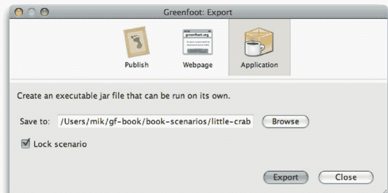

“锁定场景”（Lock scenario）选项会在启动应用程序之前禁用世界中角色的移动，并移除 Act 按钮和执行速度滑块。如果你有一个游戏，通常想要锁定场景，而对于模拟或更具实验性的场景，你可能希望保持未锁定状态以允许用户进行更多实验。

## I1.3 导出到网页

图 I1.2

导出到网页

第二种选项是将你的场景导出到网页（图 I11.2）。导出对话框中的选项与之前相同，但此功能会创建一个网页（HTML 格式），并将你的场景转换为在网页中运行的小型程序（applet）。

你可以通过在网络浏览器中打开生成的网页来执行你的场景。

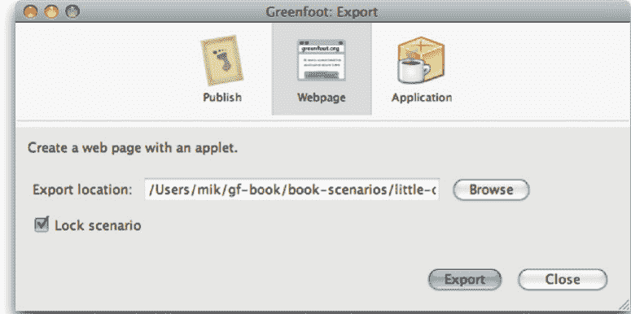

## I1.4 发布在 Greenfoot Gallery 上

如果你可以访问 Web 服务器，现在可以将此页面发布到网络上。如果你没有访问 Web 服务器的权限，下一个选项可能适合你。

你拥有的最后一个导出选项是将你的场景发布到 Greenfoot Gallery。Greenfoot Gallery 是一个公共网站（地址为`http://greenfootgallery.org`），允许 Greenfoot 用户上传他们的 Greenfoot 场景供世界查看和玩。

导出对话框（图 I1.3）在顶部显示地址。点击此处打开网站并查看它是什么。最好先浏览一下该网站。

图 I1.3

发布到 Greenfoot Gallery

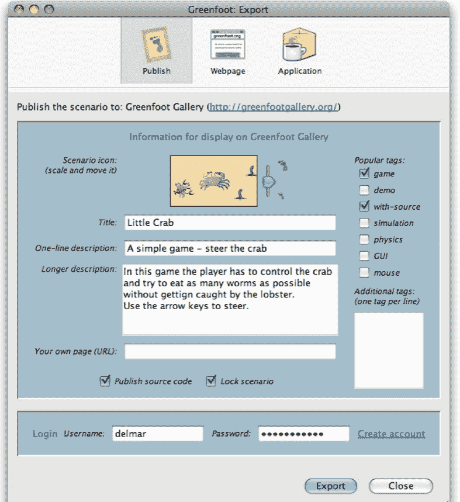

## 概念

Applet（小程序）是 Java 程序的一种版本，可以在网络浏览器内部的网页上运行。

在 Gallery 中，每个人都可以查看和执行场景，但如果你想对它们进行评分、发表评论或上传自己的场景，你需要在网站上创建一个账户。这既快速又简单。

创建账户后，你可以使用图 I1.3 显示的对话框轻松地将场景上传到 Greenfoot Gallery。对话框允许你添加图标、描述和标识你场景的标签。

如果你选择发布源代码（使用“发布代码”复选框），你的完整源代码将被复制到 Gallery 网站，其他人在那里可以下载、阅读它并创建你场景的自己的版本。

你发布的场景稍后可以通过相同的标题再次导出来更改和改进。

将场景发布到 Gallery 是获取其他用户反馈的好方法：关于哪些有效和无效的评论，以及你可以添加到程序中的建议。Gallery 也是获取进一步功能想法或学习如何操作的好地方。只需寻找带有源代码的场景，下载源码，并检查其他程序员是如何实现类的。

### 概念总结

- `jar` 文件是一个带有`.jar`后缀的单个文件，包含了属于应用程序的所有 Java 类。
- Applet 是 Java 程序的一种版本，可以在网络浏览器内部的网页上运行。

# 第 5 章 制作音乐：一个屏幕钢琴

**主题：** 声音

**概念：** 抽象、循环、数组、面向对象结构

在本章中，我们将开始一个新场景：一个我们可以用电脑键盘弹的钢琴。图 5.1 显示了我们完成后它可能的样子。

我们从书籍场景中打开一个场景开始：`piano-1`。这是我们场景的一个版本，包含了我们所需的资源（图像和声音），但没有其他太多内容。我们将以此作为基础场景，开始编写构建钢琴的代码。

**图 5.1**

本章的目标：一个屏幕钢琴

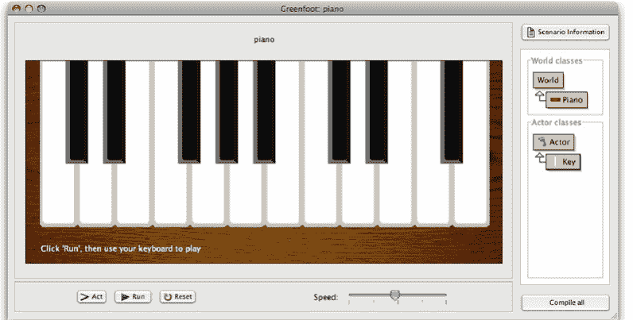

**练习 5.1** 打开场景`piano-1`并检查两个现有类`Piano`和`Key`的代码。确保你了解存在哪些代码以及它们的作用。

> **练习 5.2** 创建`Key`类的对象并将其放入世界中。创建几个对象并将它们放在一起。

## 5.1 钢琴键的动画

当你检查代码时，你会发现目前内容不多：`Piano`类仅指定了世界的尺寸和分辨率，而`Key`类只包含构造函数和`act`方法的少数方法（空方法）（如代码 5.1 所示）。

**代码 5.1**

初始的`Key`

```java
import greenfoot.*; // (World, Actor, GreenfootImage, and Greenfoot)
public class Key extends Actor
{
    /**
     * 创建一个新的按键。
     */
    public Key()
    {
    }

    /**
     * 执行动作。
     */
    public void act()
    {
    }
}
```

## 代码 5.3

仅在需要更改时才设置图像

```java
public void act() {
    if (!isDown && Greenfoot.isKeyDown("g")) {
        setImage("white-key-down.png");
        isDown = true;
    }
    if (isDown && !Greenfoot.isKeyDown("g")) {
        setImage("white-key.png");
        isDown = false;
    }
}
```

在这两种情况下，只要我们检测到变化，我们都会确保将`isDown`字段设置为新状态。

这段代码使用了两个新符号：感叹号（`!`）和双`&`号（`&&`）。

它们都是逻辑运算符。感叹号表示“非”（NOT），而双`&`号表示“与”（AND）。

因此，`act`方法中的以下几行代码：

```java
if (!isDown && Greenfoot.isKeyDown("g")) {
    setImage("white-key-down.png");
    isDown = true;
}
```

可以读得更直观（注意：这不是 Java 代码）：

```text
if ((not isDown) and Greenfoot.isKeyDown("g")) . . .
```

同样的代码，更正式地，可以读作：

```text
if (-piano-key-is-not-currently-down and the-keyboard-key-is-down) {
    更改图像以显示“已按下”的图像；
    记住现在钢琴键现在是按下的；
}
```

再次查看代码 5.3，确保你理解了这里的代码。

所有可用的逻辑运算符的完整列表见附录 D。

**练习 5.4** 实现`act`方法的新版本。它看起来和之前没有什么区别，但这是我们接下来要做的必要准备。不要忘记，你还必须在类的开头添加布尔类型的`isDown`字段。

## 产生声音

我们将做的下一件事是确保按下按键时会发出声音。为了实现这一点，我们在`Key`类中添加一个新方法，命名为`play`。我们可以在编辑器中、`act`方法下方添加这个方法。首先，我们可以为新方法编写注释、方法签名和空方法体：

```java
/*
 * 播放此键的音符。
 */
public void play()
{
```

虽然这段代码没有执行任何操作（方法是空的），但它应该是可以编译的。

该方法的实现非常简单：我们想要播放一个简单的声音文件。你启动此项目时使用的`piano-1`包含一组声音文件（在`sounds`子文件夹中），每个文件都包含单个按键的声音。声音文件的名为`2a.wav`、`2b.wav`、`2c.wav`、`2c#.wav`、`2d.wav`、`2d#.wav`、`2e.wav`等。我们只需要挑选一个大致随机的名字——比如中间的`3a.wav`——来为我们的测试键播放。

要实际播放这个音符，我们可以再次使用`Greenfoot`类的`playSound`方法：

`Greenfoot.playSound("3a.wav");`

这是`play`方法中需要的代码。完整实现见代码 5.4。

## 代码 5.4

播放按键的音符

```java
/*
 * 播放此键的音符。
 */
public void play()
{
    Greenfoot.playSound("3a.wav");
}
```

| 练习 5.5 |
|---|
| 在你自己的场景版本中实现`play`方法。确保代码可以编译。 |

| 练习 5.6 |
|---|
| 测试你的方法。你可以通过创建一个`Key`类的对象，右键点击该对象并从对象的弹出菜单中调用`play`方法来实现。 |

我们快要成功了。现在，我们通过主动调用`play`方法来产生按键的声音，我们可以运行场景并按下键盘按键（“g”）来营造钢琴键被按下的视觉效果。

## 第 5 章 ■ 制作音乐：屏幕上的钢琴

我们现在需要做的就是在按下键盘按键时播放声音。

要程序化地播放声音（通过你的代码），我们只需要调用自己的`play`方法，如下：

```java
play();
```

**练习 5.7** 为你的`Key`类添加代码，以便在按下关联键盘按键时播放该键的音符。为了做到这一点，你需要弄清楚在哪里添加对`play`方法的调用。测试。

**练习 5.8** 当你创建两个键、运行场景并按下“g”键时会发生什么？你对于我们需要做什么让它们对不同的键盘按键做出反应有什么想法吗？

此处描述的所有更改都可以在书籍场景`piano-2`中找到。如果你遇到了无法解决的问题，或者只是想将你的解决方案与我们的进行对比，我们可以查看这个版本。

## 5.3 抽象：创建多个键

我们已经到了一个阶段，可以创建一个对电脑键盘上的一个键反应并播放简单钢琴音符的钢琴键。现在的问题是：当我们创建多个键时，它们都对同一个键盘按键反应，并且产生相同的音符。我们需要改变这一点。

目前的局限性来自于我们将键盘名称（“g”）和声音文件（“3.wav”）硬编码到了该类中。这意味着，我们直接使用了这些名称，而没有机会更改源代码并重新编译。

在编写计算机程序时，编写能够解决一个特定任务的代码——例如找到 1,764 的平方根或播放音符——是有用的，但我们希望编写能够解决更多问题的代码。为了做到这一点，我们需要使用抽象。抽象以许多形式存在。

```java
public class Key extends Actor {
    private boolean isDown;
    private String key;
    private String sound;

    /**
     * 构造函数。
     * 接收按键名称和声音文件。
     */
    public Key(String keyName, String soundFile) {
        key = keyName;
        sound = soundFile;
    }
    // 方法省略
}
```

我们现在直接向前插入一系列`addObject`语句来创建我们键盘所需的所有键。但是，这并不是实现我们目标的方法。

## 使用循环：while 循环

编程循环为你提供了一种特定的结构，用于重复执行某些任务：循环。

循环是一种编程语言结构，允许我们轻松、简洁地表达诸如“执行此语句 20 次”或“调用这两种方法 300 万次”之类的命令（而无需编写 300 万行代码）。Java 有若干种不同的循环。我们现在研究的是被称为`while`循环的一种。

`while`循环具有如下形式：

```java
while ( condition )
{
    statement;
    statement;
    ..
}
```

Java 关键字后面跟着一个在圆括号内的条件，以及一个包含一个或多个语句的块（一组大括号）。只要条件为真（true），这些语句就会不断反复执行。

一种常见的模式是执行指定次数的某些语句的循环。为了实现这一点，我们使用一个循环变量作为计数器。通常的做法是将循环变量命名为`i`，所以我们在这里也这么做。以下是一个执行`while`循环体 100 次的示例：

```java
int i = 0;
while (i < 100)
{
    statement;
    statement;
    ..
    i = i + 1;
}
```

这段代码中有几点值得注意。首先，它使用了一个我们之前没有遇到过的概念：局部变量。

局部变量是一个与字段（field）相似的变量。我们可以使用它来存储值，例如整数或对象引用。

它在几个方面与字段不同：

- 局部变量声明在方法内部，而不是在类的开头；
- 它前面没有可见性修饰符（private 或 public）；
- 它只存在到当前方法运行结束为止，然后就会被擦除。

> ¹ 严格来说，这并不完全准确。局部变量也可以声明在块内部，例如在 if 语句内部或循环体内部。它们只存在到执行退出它们被声明所在的块为止。然而，如果局部变量是在方法开头声明的，那么上面的语句就是正确的。

## 第 5 章 制作音乐：屏幕钢琴

局部变量的声明是通过编写变量的类型，紧接着写名称来实现的：

```java
int i;
```

声明变量后，我们可以为其赋值。以下是这两个语句结合的形式：

```java
int i;
i = 0;
```

Java 允许使用快捷方式在一行中写这两个语句，同时声明变量并赋值：

```java
int i = 0;
```

这一行的效果与两行的版本完全相同。这就是我们在上面`while`循环代码模式中使用的变体。

再次观察循环的模式——现在我们应该能理解它的作用了。我们使用变量`i`并将其初始化为 0。然后执行`while`循环体，每次执行时都让`i`加 1。只要`i`小于 100，我们就继续。当`i`达到 100 时，我们停止循环。执行将继续循环体之后代码。

还有两个值得指出的细节：

- 我们在循环末尾使用语句`i = i + 1;`，以便每次执行循环时将我们的循环变量加 1。这是非常重要的。忘记增加循环计数器是一个常见的错误。那么变量将永远不会改变，条件将始终为真，循环将无限循环下去。这被称为无限循环，它是程序中许多错误的原因。
- 我们执行`while`循环的条件是小于（`< 100`），而不是小于等于（`=`）。当`i`等于 100 时，循环不会执行。起初，人们可能会认为这意味着循环只执行了 99 次而不是 100 次。但事实并非如此。因为我们从 0 开始计数而不是从 1，所以我们执行了 100 次（从 0 数到 99）。在计算机程序中从 0 开始计数很常见——我们将看到这样做的一些优点。

现在我们已经了解了`while`循环，可以使用这种结构创建我们所有的钢琴键。

我们的钢琴将有 12 个键。我们可以通过将语句放置在一个执行 12 次的循环体内部，来创建 12 个键：

```java
int i;
while (i < 12)
{
    addObject(new Key ("g", "3a.wav", 300, 140));
    i = i + 1;
}
```

**练习 5.15** 用此处的循环替换掉你自己的`makeKeys`方法中的代码。尝试一下。你观察到了什么？

## 5.5 使用循环：while 循环

尝试这段代码，起初看起来只创建了一个键。然而，这是欺骗性的。我们确实得到了 12 个键，但由于它们都被插入在完全相同的坐标上，它们全部重叠在一起了，我们无法很好看到它们。在钢琴世界中用鼠标指针移动键，你会发现它们都在那里。

**练习 5.16** 你如何修改你的代码，使键不会全部出现在完全相同的地方？你能否修改代码，让它们恰好相邻放置吗？

键之所以全部重叠在一起，是因为我们将它们在固定位置 300,140 插入到世界中。我们现在想将它们放在不同的位置。解决方案是使用循环变量`i`来改变 x 坐标。

**练习 5.17** 我们的循环执行了多少次？

**练习 5.18** 挑战：如果我们使用数组来存储键盘键和声音文件，我们该如何更改循环？


> 我们可以通过调用键的`getWidth()`和`getHeight()`方法来避免直接使用那些数字。为了这样做，首先在创建键时将键赋值给一个局部变量，然后使用`getWidth()`。这样做之后，即使它们的大小发生变化，我们的代码也将始终很好地放置这些键。

## 5.6 使用数组

目前，我们的键被创建并放置在屏幕上适当的位置，但它们都对“g”有反应，并且都播放相同的音符。尽管如此，我们在构造函数中已经准备了创建不同键和声音文件的键。由于我们所有的键都是通过同一行源代码（在循环中执行）创建的，它们都是以“g”和“3.wav”作为参数创建的。

解决方案是改变我们在 x 坐标方面制作的内容：我们应该为键盘键和声音文件名使用变量，并在每次循环执行时分配不同的值。

然而，这比 x 坐标的情况更棘手。正确的键和声音文件名无法轻松计算。那么我们从哪里获取这些值呢？

我们的答案是：我们将它们存储在数组中。

数组是一个可以包含许多变量的对象，因此可以存储许多值。我们可以通过图表展示这一点。假设我们有一个 `String` 类型的变量`name`。给这个变量赋值字符串“Fred”：

```java
String name;
name = "Fred";
```

图 5.2 阐释了这个例子。

这非常简单。变量是一个可以容值的容器。值存储在变量中。

在数组的情况下，我们得到一个独立的对象——数组对象，它包含许多变量。然后我们可以将该数组的引用存储在我们自己的变量中（图 5.3）。

图 5.2

简单的 `String` 变量

## 5.6 使用数组

图 5.3

一个字符串数组

`String [] names`

| 0 | 1 | 2 | 3 | 4 | 5 | 6 | 7 | 8 | 9 | 10 | 11 |
|---|---|---|---|---|---|---|---|---|---|---|---|
| "a" | "b" | "c" | "d" | "e" | "f" | "g" | "h" | "i" | "j" | "k" | "l" |

创建此这种情况的 Java 代码如下：

```java
String[] names;
names = { "a", "b", "c", "d", "e", "f", "g", "h", "i", "j", "k", "l" };
```

在变量声明中，一对方括号 (`[]`) 表示变量的类型是数组。括号之前的单词表示数组的元素类型，即数组中每个条目应该拥有的类型。`String[]` 表示一个字符串数组，`int[]` 表示一个整数数组。

表达式

```java
{ "a", "b", "c", "d", "e", "f", "g", "h", "i", "j", "k", "l" };
```

创建数组对象并用字符串 "a" 到 "l" 填充它。该对象被赋值给我们的变量`names`。我们可以从图中看到，当数组被赋值给变量时，该变量随后就包含一个指向该对象的指针。

一旦我们准备好了数组变量，就可以使用索引（数组对象中的一个数字）来访问数组的单个元素。在图 5.3 中，每个字符串的索引显示在每个元素上方。注意计数从 0 开始，所以字符串 "a" 位于位置 0，“b" 位于位置 1，以此此类推。

在 Java 中，我们通过在数组名后附上方括号中的索引来访问数组元素。

```java
names[3]
```

- **概念**：数组中的单个元素使用方括号 (`[]`) 和用于指定数组元素的索引来访问。

`names[3]` 访问数组中索引为 3 的元素——字符串 "d"。

对于我们的钢琴项目，我们现在可以准备两个数组：一个包含我们钢琴键键盘键（按顺序）的名称，另一个包含钢琴键声音文件名称。我们在 `Piano` 类中为这些数组和已填充的数组声明了字段。代码 5.6 阐释了这一点。

注意 `whiteKeys` 数组中的值是我们键盘中间一行的按键。不同系统和不同国家的键盘是各不相同的，因此你可能需要更改它们以匹配你的键盘。反斜杠 (`\`) 被称为转义字符，在 Java 字符串中具有特殊含义。要创建一个包含反斜杠作为普通字符的字符串，你必须输入两次。在 Java 源代码中输入字符串 "\\" 实际上创建了字符串 "\"。

## 代码 5.6

为键和音符创建数组

```java
public class Piano extends World {
    private String[] whiteKeys = {
        "a", "s", "d", "f", "g", "h", "j", "k", "l", "-", "";
    };
    private String[] blackKeys = {
        "3c", "3d", "3e", "3f", "3g", "3a", "3b", "4c", "4d", "4e",
        "4f", "4g";
    };

    // 构造函数和方法省略。
```

现在我们有了可用的数组，列出了我们想要为钢琴键使用的键和声音文件。我们现在可以调整 `makeKeys` 方法中的循环，使用数组元素来创建相应的键。代码 5.7 显示了生成的源代码。

## 代码 5.7

使用数组中的键盘键和音符创建钢琴键

```java
/**
 * 创建钢琴键并将它们放置在世界中。
 */
private void makeKeys() {
    int i = 0;
    while (i < whiteKeys.length) {
        Key key = new Key(whiteKeys[i], whiteNotes[i] + ".wav");
        addObject(key, 54 + (i*63), 140);
        i = i + 1;
    }
}
```

有几点值得注意：

- 我们将创建新键的操作从 `addObject` 方法调用移到了单独的一行，并最初将键对象赋值给一个局部局部变量`key`。这只是为了清晰：那行代码太长且太复杂，很难阅读。将其拆分为两个步骤使其更易阅读。

- `Key` 构造函数的参数访问了`whiteKeys[i]`和`whiteNotes[i]`。也就是说，我们使用循环变量`i`作为数组索引来依次访问所有不同的字符串和文件名。

- 我们对`whiteKeys[i]`和字符串 (".wav") 使用加号 (`+`)。变量`whiteKeys[i]`也是一个字符串，所以加号用于两个字符串操作数。

- **概念**：加号 (`+`) 在与字符串一起使用时，表示字符串拼接。它将两个字符串合并为一个。当加号与字符串配合时，它执行字符串拼接。字符串拼接是一种将两个字符串结合并将它们转换为单个字符串的操作。换句话说，我们在`whiteNotes[i]`的值后面附加了 ".wav"。这是因为存储在数组中的名称是 "3c" 形式，而文件名是 "3c.wav"。我们可以在数组中存储全名，但由于后缀对所有音符都是相同的，这似乎没有必要。在这里添加可以节省一些打字量。

- 我们将 `while` 循环条件中的 12 替换为`whiteKeys.length`。数组的长度属性将返回数组中元素的数量。在我们的案例中，有 12 个元素，保留 12 也可以运行。然而，使用长度属性更安全。如果我们某天决定使用更多或更少的键，我们的循环仍然会正确执行，而无需更改条件。

通过这些更改，我们的钢琴应该可以通过键盘上中间一行的键来演奏，并且它应该为不同的键产生音符。

**练习 5.19** 在我们的场景中进行上述更改。让所有键正常工作。如果你的键盘布局不同，请调整`whiteKeys`数组以匹配你的键盘。

**练习 5.20** 钢琴的 sounds 文件夹……（注：原文此处存在大量重复 OCR 错误，已根据核心逻辑整合）。

**练习 5.21** ……（原文此处存在大量重复性错误）。

**练习 5.22** 目前，我们的 `Key` 只能产生白键。这是因为我们硬编码了图像名称。引入两个字段和一个图像名称切换（"white-key.png", "white-key-down.png"）。

**练习 5.23** 修改 `Piano` 类使其添加黑键。

**练习 5.24** 在 `Piano` 类中添加两个用于键盘键和音符的数组。

**练习 5.25** 在`makeKeys`方法中添加另一个循环，创建并放置黑键。

**练习 5.26** 该项目的完整实现 piano-5 还包含另一个在屏幕上显示文本的简短方法。学习它并进行一些更改：更改文本的换行；更改其颜色；并移动文本使其水平居中。

## 5.7 编程技巧总结

在循环内部，我们经常使用循环计数器来执行计算或在每次循环迭代中生成不同的值。

我们使用的另一个主要概念是数组。数组可以在单个对象中提供多个变量（所有类型都相同）。通常，如果我们需要对数组的每个元素进行某些操作，就会使用循环来处理数组。使用方括号来访问元素。

我们遇到的另一个非常基础的技术是抽象。在这种情况下，它通过使用构造函数参数来体现，从而创建的代码能够处理一整类问题，而不是单个特定的问题。

我们还遇到了一些新的操作符：我们已经见过用于布尔表达式的与（AND）和非（NOT）运算符（`&&` 和 `!`），并且我们看到加运算符（`+`）应用于字符串（`String`）时会执行字符串拼接。`String` 类在 Java API 文档中有记录，并有许多有用方法。

### 概念总结

- 逻辑运算符，例如 `&&`（与）和 `!`（非），可以用于将多个布尔表达式组合为一个布尔表达式。

- 抽象在编程中以多种形式出现。其中一种技术是编写可以解决一整类问题而非单个特定问题的代码。

- 循环是编程语言中的语句，可以多次执行某部分代码。

- 局部变量是声明在方法体内部的变量。它用于临时存储。

- 数组是一个持有多个变量的对象。可以通过索引访问。

- 数组中的单个元素通过方括号（`[]`）和指定数组元素的索引来访问。

- 加号（`+`）在与字符串一起使用时，代表字符串拼接。它能将两个字符串合并为一个。

- `String` 类型由普通类定义。它有许多有用方法，我们可以在 Java 库文档中查找。

## 第6 章

对象的交互交互：牛顿实验室

| 主题： | 相互交互的对象、使用辅助类、使用 Java 库中的类 |
| 概念： | 集合 (collection)、列表 (list)、for-each 循环、标准类库 |

在本章中，我们将研究世界中对象之间更复杂的交互。作为一个开始，我们将研究任何地方对象之间最通用的交互之一：引力。

在这个情景中，我们处理的是天体（如恒星和行星）。我们将利用牛顿万有引力定律模拟这些天体在空间中的运动。我们现在知道牛顿的公式并不完全准确，爱因斯坦的广义相对论更精确地描述了行星的运动，但牛顿公式对于我们的模拟来说已经足够了。两者如图 6.1 所示。

如果你担心处理物理和公式，不用担心。我们钻得太深了，我们将使用的公式其实非常简单。最后，我们将这个情景变成一个带有声音和视觉效果的艺术实验。如果你对技术更感兴趣，你可以在物理方面做更多研究。

图 6.1

艾萨克·牛顿和阿尔伯特·爱因斯坦。

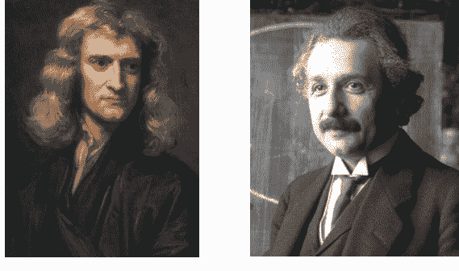

牛顿：Godfrey Kneller 肖像，1689年。爱因斯坦：Ferdinand Schmutzer 肖像，1921年。

## 6.1 起点：牛顿实验室

如果你对艺术更感兴趣，可以专注于这一方面。

我们将通过研究一个部分实现的情景版本开始这个项目。从 book-scenarios 文件夹中打开 Newton-Lab-1 情景。你会发现已经存在一个世界子类（`Space`）。我们还有 `SmoothMover`、`Body` 和 `Vector` 类（图 6.2）。

- **练习 6.1** 打开 Newton-Lab-1 情景。尝试运行它（即将一些天体放入空间）。你观察到了什么？

图 6.2

牛顿实验室情景

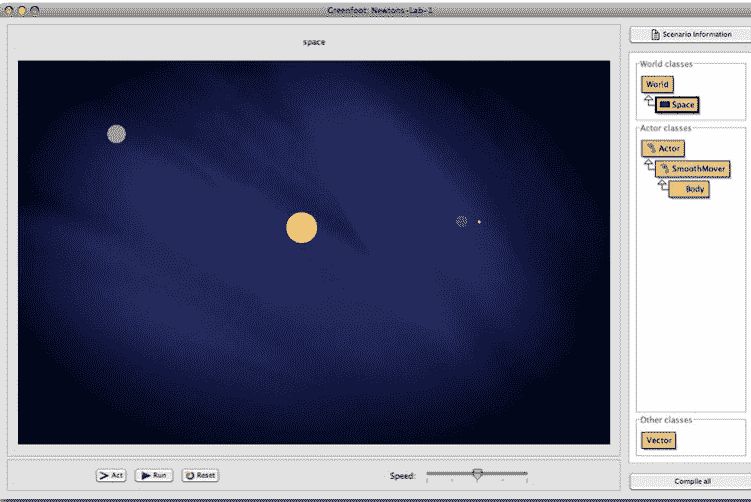

当你尝试运行这个情景时，你会注意到你可以将对象（类型为 `Body`）放入空间中，但这些天体不会移动，它们也没有以任何有趣的方式运行。

在我们开始扩展实现之前，让我们更仔细地研究一下这个情景。

通过右键点击世界的标题（顶部的“space”一词），我们可以看到并调用 `Space` 类的公共方法（图 6.3）。

## 图 6.3

牛顿实验室中的世界方法

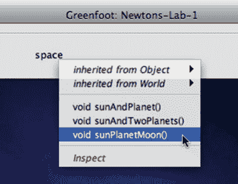

**练习 6.2** 调用 `Space` 对象的不同公共方法。你做了什么？

**练习 6.3** 当你的世界中有一个恒星或行星时，右键点击它查看它有哪些公共方法。它们是什么？

**练习 6.4** 从 `Space` 的公共方法中调用`sunPlanetMoon`方法。找出并写下太阳和月球的质量。

**练习 6.5** 查看 `Space` 类的源代码，看看这里的公共方法是如何实现的。

## 6.2 辅助类：SmoothMover 和 Vector

在这个情景中，我们使用了两个通用的辅助类：`SmoothMover` 和 `Vector`。这些类为给定的情景增加了功能，并可以在不同的情景中用于类似的目的。（这两个类实际上已用于许多不同的现有项目。）

`SmoothMover` 类通过存储坐标为对象提供平滑运动，而不是整数。在与字符串一起使用时，加号（`+`）代表字符串拼接。它能将两个字符串合并为一个。

6.2 辅助类：SmoothMover 和 Vector

在这个情景中，我们使用了两个通用的辅助类：`SmoothMover` 和 `Vector`。这些类为给定的情景增加了功能，并可以在不同的情景中用于类似的目的。（这两个类实际上已用于许多不同的现有项目。）

`SmoothMover` 类通过存储坐标为对象提供平滑运动，而不是整数。在与字符串一起使用时，加号（`+`）代表字符串拼接。它能将两个字符串合并为一个。


## 练习 6.1

打开 `Newton-Lab-1` 情景。尝试运行它（即将一些天体放入空间）。你观察到了什么？

### 图 6.2

牛顿实验室情景


当你尝试运行这个情景时，你会注意到你可以将对象（类型为 `Body`）放入空间中，但这些天体不会移动，它们也没有以任何有趣的方式运行。

在我们开始扩展实现之前，让我们更仔细地研究一下这个情景。

通过右键点击世界的标题（顶部的“space”一词），我们可以看到并调用 `Space` 类的公共方法（图 6.3）。

### 图 6.3

牛顿实验室中的世界方法


### 练习 6.2

调用 `Space` 对象的不同公共方法。你做了什么？

### 练习 6.3

当你的世界中有一个恒星或行星时，右键点击它查看它有哪些公共方法。它们是什么？

### 练习 6.4

从 `Space` 的公共方法中调用 `sunPlanetMoon` 方法。找出并写下太阳和月球的质量。

### 练习 6.5

查看 `Space` 类的源代码，看看这里的公共方法是如何实现的。

## 6.2 辅助类：`SmoothMover` 和 `Vector`

在这个情景中，我们使用了两个通用的辅助类：`SmoothMover` 和 `Vector`。这些类为给定的情景增加了功能，并可以在不同的情景中用于类似的目的。（这两个类实际上已用于许多不同的现有项目。）

`SmoothMover` 类通过存储坐标为对象提供平滑运动，而不是整数。在与字符串一起使用时，加号（`+`）代表字符串拼接。它能将两个字符串合并为一个。

## 现有的 `Body` 类

### 练习 6.10

打开 `Body` 类的源代码并进行检查。

查看 `Body` 类的源代码，有两个方面值得进一步讨论。首先是该类有两个构造函数（代码 6.1）。这是方法重载的另一个例子：如果两个构造函数具有不同的参数列表，在类中拥有两个构造函数是完全合法的。在我们的案例中，一个构造函数没有任何参数，而另一个有四个参数。

### 代码 6.1：`Body` 类的构造函数

```java
public class Body extends SmoothMover {
    // 省略一些代码

    private double mass;

    /**
     * 使用默认尺寸、质量、移动方式和颜色构造 Body。
     */
    public Body() {
        this(20, 300, new Vector(90, 1.0), defaultColor);
    }

    /**
     * 使用指定的尺寸、质量、移动方式和颜色构造 Body。
     */
    public Body(int size, double mass, Vector movement, Color color) {
        this.mass = mass;
        addForce(movement);
        GreenfootImage image = new GreenfootImage(size, size);
        image.setColor(color);
        image.fillOval(0, 0, size-1, size-1);
        setImage(image);
    }

    // 省略更多代码
}
```

### 术语

没有任何参数的构造函数也称为**默认构造函数**。

## 第 6 章 对象间的交互：牛顿实验室

默认构造函数使我们能够轻松地交互式地创建体，而无需指定所有细节。第二个构造函数允许创建具有自定义尺寸、质量、移动方式和颜色的体。例如，该构造函数在 `Space` 类中用于创建太阳、行星和月球。

第二个构造函数使用传入的参数值来初始化演员（actor）的状态。第一个构造函数看起来更神秘，它只有一行代码：

```java
this(20, 300, new Vector(9, 1.0), defaultColor);
```

## 概念

`this` 关键字用于调用另一个构造函数，或者引用当前对象。

这一行看起来几乎像方法调用，区别在于它使用的是关键字而不是方法名。通过这种调用，构造函数会执行另一个构造函数（带有四个参数的那个），并为所有四个值提供默认参数。以这种方式（像方法名一样）使用此关键字仅在构造函数内部可行，用于调用初始化部分的另一个构造函数。

该关键字还有第二个用途：

```java
this.mass = mass;
```

这里我们有另一个重载的例子：同一个名称被用于两个变量（参数和实例字段）。当我们为这些值赋值时，我们需要在赋值符号的两侧指定这两个变量 `mass` 分别代表什么。

当我们不带任何修饰符写 `mass` 时，该同名变量的最接近定义是——在这种情况下，是参数。当我们写 `this.mass` 时，我们指定我们指的是当前对象的 `mass` 字段。这行代码将名为 `mass` 的参数赋值给 `mass` 字段。

### 练习 6.11

移除上述代码行中 `mass` 之前的 `this.` 部分，使其读取为：

```java
mass = mass;
```

这段代码能编译通过吗？它能执行运行吗？你认为这段代码在做什么？它的效果是什么？（创建一个对象并使用它的 Inspect 函数检查 `mass` 字段。实验完成后，将代码恢复到原来的状态。）

进一步探索的第二个方面是类顶部的两行代码，如代码 6.2 所示。

### 代码 6.2：常量的声明

```java
private static final double GRAVITY = 5.8;
private static final Color defaultColor = new Color(255, 216, 0);
```

这两个声明看起来与字段声明相似，不同在于在 `private` 关键字之后插入了两个关键字 `static final`。

## 6.4 第一个扩展：创建移动

### 概念

常量是一个命名的值，可以像变量一样的方式被使用，但永远无法改变。

这就是我们所说的常量。常量与字段有相似之处，在于我们可以在代码中使用该名称来引用它的值，但该值永远不会改变（它是恒不变的）。

`final` 关键字用于表示变量一旦被赋值就不能更改。`static` 关键字意味着该变量属于类本身，而不是属于类的任何特定实例。这意味着类的所有实例都共享同一个常量值。

通过为具有意义的值命名，使用常量可以使代码更具可读性。例如，使用 `GRAVITY` 比直接使用字面量 `5.8` 要清晰得多。它也让未来更改值变得更容易，因为你只需要在一个地方更改它。

### 第一个扩展：创建移动

在本节中，我们将学习如何让我们的对象移动。我们将首先向 `Body` 类中添加一个 `velocity` 字段。该速度将是一个 `Vector` 对象，代表移动的速度和方向。

```java
private Vector velocity;
```

我们还将更新 `Body` 的构造函数以初始化 `velocity`。

```java
public Body(int size, double mass, Vector movement, Color color) {
    this.mass = mass;
    this.velocity = movement;
    addForce(movement);
    GreenfootImage image = new GreenfootImage(size, size);
    image.setColor(color);
    image.fillOval(0, 0, size-1, size-1);
    setImage(image);
}
```

现在我们需要为 `Body` 类添加一个 `move()` 方法，根据其速度来更新位置。

```java
public void move() {
    int x = getX() + velocity.getX();
    int y = getY() + velocity.getY();
    setLocation(x, y);
}
```

最后，我们需要在 `Body` 类的 `act()` 方法中调用 `move()` 方法。

```java
public void act() {
    move();
}
```

现在，我们的对象会在屏幕上移动！我们可以通过更改 `velocity` 向量来控制它们的速度和方向。

- 练习 6.12：修改 `Body` 类包含 `velocity` 字段。
- 练习 6.13：更新 `Body` 构造函数以初始化 `velocity`。
- 练习 6.14：为 `Body` 类添加 `move()` 方法。
- 练习 6.15：在 `Body` 类的 `act()` 方法中调用 `move()` 方法。

## 6.5 使用 Java 类

Java 编程语言带有庞大的预写类库供你使用。这些包含了处理用户输入、图形、网络等类。这些包之一是 `java.awt`，它包含了用于创建图形界面的类。

要使用包中的类，你需要在文件顶部导入它。

```java
import java.awt.Color;
```

`Color` 类用于表示颜色。你可以使用 RGB 值创建一个颜色对象。

```java
Color color = new Color(red, green, blue);
```

当我们想在自己的场景中使用 Java 库中的任何类时，我们需要导入一个导入语句，如上面所示。导入语句命名了包名和我们想要使用的类，中间用点隔开。因此，为了使用 `java.awt` 包中的 `Color` 类，我们写道：

```java
import java.awt.Color;
```

`Color` 类是 Java 标准库中众多类之一。Java 系统自带大量的有用类供我们使用。随着时间的推移，我们需要了解很多。

### 图 6.6

Java 库文档

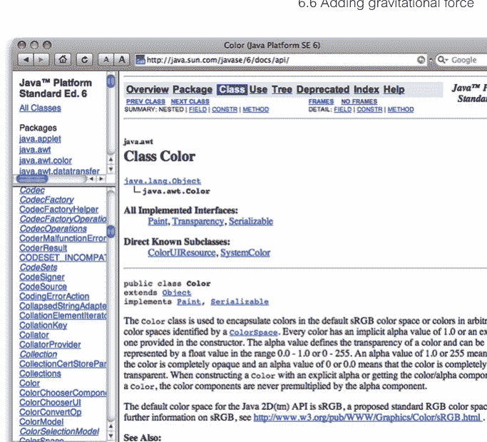

导入一个类可以让我们在自己的场景中使用它，就像它是我们的其他类之一一样。导入之后，我们可以创建该类的对象，调用方法，并执行任何对任何其他类都可以执行的操作。

Java 库非常令人望而畏，因为它包含太多的类了——我们将只使用其中一小部分，并在需要时逐个介绍它们。

然而，其中一个类我们很快就会用到：在下一节中。

我们想要做的是为这个场景添加引力。也就是说当我们的空间中有多个天体时，这些天体之间的引力应该改变每个天体的运动。

## 6.6 添加引力

让我们先看看我们 `Body` 类中当前的方法（代码 6.3）。（如果你没有完成练习 6.12，那么对 `move` 方法的调用将不会在那里——你可以添加它。）

### 代码 6.3：当前的方法

```java
/**
 * 执行。也就是说：应用来自周围
 * 所有其他天体的引力，然后移动。
 */
public void act()
{
    move();
}
```

虽然代码目前只包含 `move` 调用，但注释实际上准确描述了我们必须做的事情：在移动之前，我们应该应用由空间中所有其他物体引力产生的力。

我们可以用伪代码给这个任务列出一个大纲：

```text
应用来自其他天体的力：
    获取空间中的所有其他天体；
    遍历每一个天体：
        {
            将来自该天体的引力作用于我们自己；
```

由于这并不是一件易事，我们首先为这个任务创建一个独立的方法（代码 6.4）。创建一个独立的（最初为空的）方法初似乎是一项微不足道的任务，看起来没有起到什么作用，但它极大有助于将我们的问题分解为更小的子问题，并有助于结构化我们的思考。

### 代码 6.4：准备应用引力

```java
/**
 * 执行。对于一个天体，也就是说：应用来自周围
 * 所有其他天体的所有引力，然后移动。
 */
public void act()
{
    applyForces();
    move();
}
```

```java
/**
 * 应用来自这个宇宙中所有其他外天体的引力。
 */
private void applyForces()
{
    // 在此处执行工作
}
```

## 6.6 添加引力波

# 89

### 概念

私有方法（Private methods）仅在声明它的类内部可见。它们用于改进代码结构。

### 注意：私有方法

我们在代码 6.4 中创建的方法在签名开头处有 `private` 关键字，而不是我们之前看到的 `public`。

方法可以是公的，也可以是私有的。当方法旨在从类外部调用时（无论是通过用户交互式调用，还是从另一个类调用），它们必须是 `public` 的。当方法旨在仅从同一类内的其他方法调用时（如此处），它们应该声明为 `private`。

私有方法在类外部不可见也无法访问。将仅供内部使用的方法设为私有是一种良好的做法。这有助于防止错误，并更清晰地记录该方法的目的。

接下来，我们必须弄清楚如何访问我们世界中的所有其他对象。

Greenfoot 中的 `World` 类拥有让我们访问其内部对象的方法。

### 练习 6.18

在 Greenfoot 类文档中查找 Greenfoot 的 `World` 类。找到所有让我们访问世界内对象的方法。将它们写下来。

对我们来说，这些方法中最有趣的是：

```java
java.util.List getObjects(java.lang.Class cls)
```

在这种模式中，`ElementType` 代表集合中每个元素的类型，`variable` 是这里正在声明的变量，因此我们可以给它起任何名字，`collection` 是我们想要处理的集合名称，而 `statements` 是我们想要执行的一系列语句。通过一个示例，这将变得更加清晰。

使用我们名为 `bodies` 的列表，我们可以这样写：

```java
for (body : bodies) {
    body.move();
}
```

（记住 Java 是区分大小写的：大写字母“B”的 `Body` 和小写“b”的 `body` 是不同的。大写名称指的是类，小写名称指的是持有索引的变量。复数形式——`bodies` 是另一个持有整个列表的变量。）

如果我们把关键字 `for` 读作“对于”，将冒号 `:` 读作“在”，将左大括号读作“执行”，那么这个 for-each 循环就会更容易理解。这时它变成了：

```text
for each body in bodies:...
```

这种读法为我们提供了关于这个循环作用的提示：它将对 `bodies` 列表中的每个元素执行大括号中的语句。如果该列表中有三个元素，这些语句将被执行三次。每次在执行语句之前，变量 `body`（在循环头中声明）都会被赋值列表中的一个元素。因此，动作序列将是：

```text
body = first element from 'bodies'
execute loop statements;
body = second element from 'bodies'
execute loop statements;
body = third element from 'bodies'
execute loop statements;
...
```

变量 `body` 可以在循环语句中使用，以访问列表中的当前元素。例如，我们可以像上面的示例中那样调用对象上的某个方法，或者将对象传递给另一个方法进行进一步处理。

我们可以使用这个循环将所有其他天体的引力作用于当前的天体：

```java
for (Body : bodies) {
    applyGravity(body);
}
```

在代码中，我们获取每个元素（存储在变量 `body` 中）并将其传递给另一个名为 `applyGravity` 的方法，我们稍后将编写这个方法。

我们应该添加一点：由于 `bodies` 是空间中所有天体的列表，它也包含了当前对象（我们想要施加引力的对象）。我们不需要将一个对象的引力施加给它自己，因此我们可以添加一个 `if` 语句，只有当列表元素不是当前对象本身时才调用 `applyGravity`。

## 6.9 应用引力

结果显示在代码 6.6 中。注意关键字 `this` 在这里被用来引用当前对象。

### 代码 6.6：应用来自空间中所有其他天体的引力

```java
private void applyForces() {
  List<Body> bodies = getWorld().getObjects(Body.class);
  for (Body body : bodies) {
    if (body != this) {
      applyGravity(body);
    }
  }
}

/**
 * 将给定天体的引力施加到当前对象。
 */
private void applyGravity(Body other) {
  // work to do here
}
```


### 应用引力

在 6.6 中，我们解决了访问空间中每个对象的任务，但我们推迟了实际施加引力的任务。`applyGravity` 方法（另一个私有方法示例）仍然需要编写。

尽管这并不比以前容易多少，但此方法现在只需要同时处理两个对象：当前对象以及其参数中指定的另一个对象。我们现在想要将另一个对象的引力施加到当前对象上。这正是牛顿定律派上用场的地方。

牛顿万有引力公式如下：

> $force = \frac{mass1 \times mass2}{distance^{2}} G$


换句话说，为了计算施加当前对象的力，我们需要将对象的质量与另一个对象的质量相乘，除以它们之间距离的平方，最后乘以常量 $G$。（你可能记得我们在类中已经定义了这个常量，名为`GRAVITY`。）

如果你非常有信心或喜欢冒险，你可能想尝试实现`applyGravity`方法。你需要创建一个从当前天体指向另一个天体的向量，长度由该公式指定。对于剩下的部分，我们来看该方法的实现（代码 6.7）。

### 代码 6.7：计算并应用另一个天体的引力

```java
/**
 * 将给定天体的引力施加到当前对象。
 */
private void applyGravity(Body other) {
    double dx = other.getX() - this.getX();
    double dy = other.getY() - this.getY();
    Vector force = new Vector(dx, dy);
    double distance = Math.sqrt(dx * dx + dy * dy);
    double strength = GRAVITY * this.mass * other.mass / 
        (distance * distance);
    double acceleration = strength / this.mass;
    force.setLength(acceleration);
    addForce(force);
}
```

这个方法看起来并不复杂。首先，我们计算对象与其他对象在 `x` 和 `y` 坐标上的距离（`dx` 和 `dy`）。然后使用这些值创建一个新向量。这个向量有了正确的方向，但还没有正确的长度。接下来，我们使用勾股定理（a² + b² = c²）计算两个对象之间的距离，见图 6.7。

### 图 6.7：对应 `dx` 和 `dy` 的距离

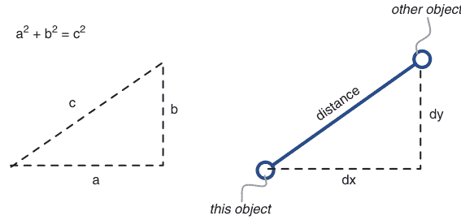

这告诉我们距离是 `dx` 的平方加上 `dy` 的平方的平方根。在我们的代码（代码 6.7）中，我们使用`Math`类中的一个`sqrt`方法来计算平方根。（`Math`是`java.lang`中的一个类，因此被自动导入。）

## 6.10 尝试

**练习 21** 查找 Java 文档中的`Math`类`sqrt`方法有多少个参数？它们是什么类型？该方法返回什么类型？

**练习 22** 在`Math`类中，找到寻找两个整数最大值的方法。它叫什么名字？

我们代码中的下一行使用上述牛顿万有引力公式计算力的强度。

最后一步是计算加速度，对象的实际运动不仅取决于引力，还取决于对象的质量：对象越重，加速度越慢。加速度使用以下公式计算：

```text
acceleration = \frac{force}{mass}
```

一旦我们计算出加速度，就可以将力向量设置为正确的长度，并将此向量添加到天体的运动中。这很容易，使用`SmoothMover`类提供的`addForce`方法。

**练习 23** 将代码 6.7 中的变量映射到牛顿公式、勾股定理以及上述加速度公式。哪个变量对应哪个公式的哪个部分？

到此，我们的任务完成了。（到目前为止的代码实现可以在书中的场景`Newtons-Lab-2`中找到。）这个任务显然比我们看到的其他任务更多数学和物理背景知识。如果这不是你喜欢的领域，不要担心，我们很快会回到这里。然而，我们已经看到这很难模拟。仿真可以显示，初始条件的微小差异在几年后可能会产生巨大的差异。


### 尝试

现在我们完成了引力的实现，是时候尝试一下了。我们可以从使用`Space`中的现成场景开始。

**练习 24** 使用你完成的代码，尝试三种初始化方法（`sunPlanet()`、`sunAndPlanets()`、`sunMoon()`）。你观察到了什么？

**练习 25** 实验引力的变化（`Body`类顶部的`GRAVITY`常量）。

**练习 26** 创建一些新的恒星和行星组合，看看它们是如何相互作用的。你能设计出一个稳定的系统吗？

## 交互对象：牛顿实验室

**陷阱** 使用`Vector`的构造函数时要小心。构造函数是重载的：一个版本接受一个`int`和一个`double`作为参数，另一个接受两个`double`；因此：

```java
new Vector(32, 12.0)
```

将调用构造函数，而：

```java
new Vector(32, 12.0)
```

会导致一个完全不同的向量。

你会很快发现，要配置参数使系统长时间保持稳定是非常困难的。质量和引力的结合通常会导致对象相互碰撞或逃离轨道。（由于我们还没有实现“相互碰撞”，我们的对象可以很容易地穿过彼此。当它们靠近时，产生的力会变得非常大，它们经常会将彼此弹射到奇异的轨道上。）

这些效应与自然相似，尽管由于我们做了一些简化，我们的仿真并不完全准确。所有对象按顺序而非同时行动的事实会对行为产生影响，而且这不是真实的表示。为了让仿真更准确，我们必须先计算所有位置（而不移动），然后根据之前的计算执行所有移动。

我们还可以提出关于太阳系的稳定性问题。我们太阳系行星的轨道是非常稳定的，关于它们的运动细节在未来很长时间很难准确预测。我们非常确定在未来几十亿内没有行星会撞击太阳，但可能会出现微小变化。类似的仿真（只是更精确详细，但原理相似）已被用于预测未来的轨道。

> 如果你想了解更多，维基是一个很好的起点：http://en.wikipedia.org/wiki/Stability_of_the_solar_system

## 6.11 引力与音乐

看到要设计出参数来创建一个在有限时间内稳定的系统是何等困难，我们可能会对太阳系竟然如此稳定感到惊讶。但对此有一个解释：当太阳系形成时，环绕在太阳的气云中的物质形成了团块，这些团块通过与其他物质团块碰撞并合并，逐渐生长成巨大的物体。最初，轨道上有无数个这样的团块。随着时间的推移，有些团块落入太阳，有些则逃逸到深空。当只剩下碎块相互分离且通常具有稳定轨道时，这个过程就结束了。

我们可以创建一个模拟这种效果的程序。如果我们能正确模拟行星从数十亿个微小的随机物质团块生长的过程，我们就能观察到这种效果：一些留在稳定轨道上的大型行星。但为了实现这一点，我们需要更详细、更复杂的模拟以及大量的时间：模拟这种效果需要非常长的时间，即使在速度很快的计算机上也是。


## 引力与音乐

在我们离开“牛顿实验室”场景之前，我们还有一件事可以玩：添加音乐。嗯，无论如何，是噪声。⁴

这个想法是这样的：我们在我们的世界中添加一些障碍物（`Obstacles`）。当行星碰到障碍物时，它们会发出声音。然后我们创建新的行星或恒星，让它们到处飞舞，看看会发生什么。

我们不会详细讨论这个实现，而是留给你们自己尝试，并指出一些最有趣的特征。你可以在《Newton-Lab-3》场景的书中找到这个想法的实现。

**练习 6.28** 打开名为`Newton-Lab-3`的场景并运行它。查看源代码。尝试理解它是如何工作的。

以下是我们从上一个版本到创建此版本所做的的一些有趣更改总结：

- 我们添加了一个新类`Obstacle`。你可以很容易地在屏幕上看到该类的对象。障碍物有两个图像：你大多数时候看到的橙色矩形，以及一个较浅版本的矩形，用于显示它们被碰到时。这被用于创建“点亮”效果。障碍物还关联了一个音频文件，就像我们在钢琴场景中的琴键一样。事实上，我们复用了钢琴场景中的音频文件，所以它们发出的声音相同。

- 我们修改了`Body`类，使物体会在屏幕边缘反弹。这为这类场景提供了更好的效果。我们还增加了引力以获得更快的移动，并修改了代码，使物体在速度过快时会自动减速。它们可能会无限地互相加速。

> ⁴ 为引力项目添加声音的想法灵感源于开普勒的行星仪（Kepler’s Orrery）（参见 https://keplers-orrery.dev.java.net/ 或在 YouTube 上搜索“Kepler’s Orrery”）。

- 最后，我们在`Space`类中添加了代码来创建一排固定的障碍物，并创建五个随机行星（随机的大小、质量和颜色）。

这三个更改的实现包含了值得关注的趣味片段。

- 在`Obstacle`类中，我们使用名为`getIntersectingObject`的方法来检查障碍物是否被行星碰到。代码模式为：

```java
Object body = getIntersectingObject(Body.class);
if (body != null)
{
}
```

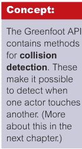

`getIntersectingObject`方法定义在`Actor`类中，对所有 actor 可用。如果存在交叉的 actor，它将返回该 actor；如果没有其他 actor 交叉，则返回`null`。以下语句通过检查`body`是否为`null`来检查是否有其他对象与此相交叉。

这是一个碰撞检测的示例，我们将在下一章讨论更多。

- 在`Space`类中，我们添加了两个方法：`createObstacles`和`randomBodies`。第一个创建带有其关联音频文件名的障碍物，与钢琴示例中的初始化代码非常相似。第二个使用`while`循环创建多个`Body`对象。物体使用随机值初始化。`while`循环从给定的数字倒数到 0，以创建正确数量的对象。它作为循环的另一个示例非常值得学习。

**练习 6.29** 修改此场景中默认创建的物体数量。

**练习 6.30** 玩玩移动参数，看看你是否能为行星创建运动。参数是：`GRAVITY`的值；从边缘反弹时使用的加速度（当前为 0.9）；速度阈值（当前为 7）以及使用`applyForces`方法减慢快速物体的加速度（0.9）；以及用于行星的初始质量（在`Space`类中）。

**练习 6.31** 在你的场景中创建一种不同的障碍物布局。

**练习 6.32** 为你的障碍物使用不同的声音（不同的音频文件）。

## 6.12 编程技术总结

**练习 6.33** 为你的障碍物使用不同的图像。

**练习 6.34** 让行星在每次从宇宙边缘反弹时改变颜色。

**练习 6.35** 让行星在每次撞击障碍物时改变颜色。

**练习 6.36** 创建一种不同的障碍物，通过被击中开启和关闭。当开启时，它会持续闪烁并以固定间隔控制声音。

**练习 6.37** 添加一些键盘控制。

**练习 6.38** 允许更多的`Body`对象。

有无数种方法让这个场景变得有趣，自己发明它们吧！


## 技术总结

在本章中，我们接触了一些新概念。我们看到了一个新的场景——牛顿实验室——它模拟了行星和空间。我们将在第 9 章回到这里。

我们看到了两个辅助类，`Smooth`和`Vector`，它们都帮助我们创建移动。

本章最重要的内容之一是使用了标准库中的类。我们使用了`Color`、`Math`和`List`。

我们工具集的另一个补充是使用一种新循环：`for-each`循环。它用于处理集合的每个元素。

`for-each`循环在处理集合时特别有用。但是它们在没有集合的情况下无法使用，而且在处理元素时不索引，我们需要使用`for`循环或`while`循环。

最后，我们看到了 Greenfoot API 中更多实用的方法，例如`World`类的`getObjects`方法和`Actor`类的`getIntersect`方法。后者引导我们进入通用的碰撞检测领域，我们将在下一章详细讨论，届时我们将再次拿起《小行星》游戏。

# 第 7 章 碰撞检测：小行星游戏

**主题：**更多关于移动、键盘控制和碰撞检测

**概念：**集合（再次）、`for`循环、`for-each`循环（再次）、类型转换

在本章中，我们不会引入许多新概念，而是将回顾并加深对过去几个章节中接触过的某些主题的理解。我们将回到一个之前在本书非常开头（非常早的时候）就遇到过的场景：小行星游戏（图 7.1）。

我们在这里使用的的小行星游戏版本与我们之前看过的略有不同。它增加了一些功能（例如质子波和计分计数器），但它尚未完全实现。

**图 7.1：**新的小行星游戏场景（带有质子波）

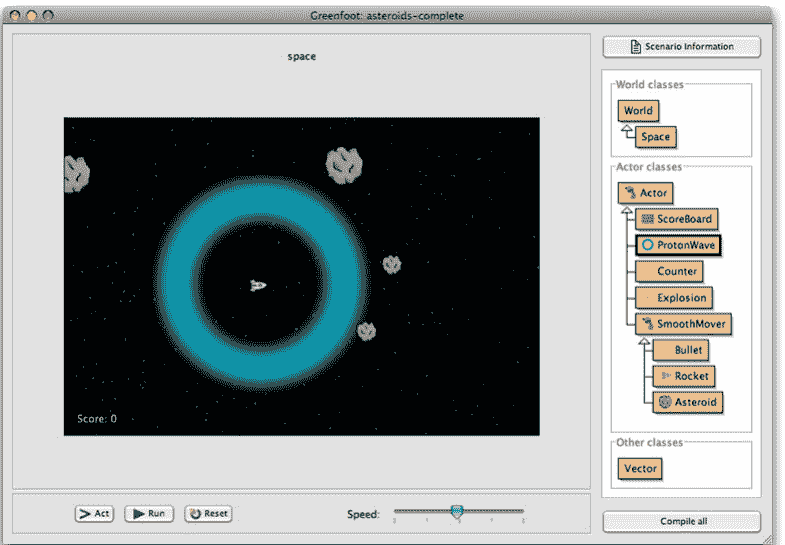

## 调查：里面有什么？

功能中的重要部分仍然缺失，在本章中我们的任务就是实现它们。

我们将通过这个例子来回顾移动和碰撞检测。在 Java 编程概念方面，我们将借此更多地练习循环和集合。

我们应该通过检查现有的代码库开始这个项目。在书籍场景的`chapter07`文件夹中，我们有一个部分实现的解决方案，名为`asteroids-1`。（请确保使用 chapter07 的版本，而不是来自 chapter01 的副本。）

- **练习 7.1** 打开书籍项目`chapter0`文件夹下的`asteroids-7`场景。实验它以找出它能做什么，以及不能做什么。

- **练习 7.2** 写出一份应该添加到此项目中的事项列表。

- **练习 7.3** 使用哪个键盘按键发射子弹？

- **练习 7.4** 在运行的场景中放置一个爆炸效果（通过交互式地创建`Explosion`类的对象）。它有效吗？它是做什么的？

- **练习 7.5** 在场景中放置一个质子波。这有效吗？它是做什么的？

在实验当前场景时，你可能会注意到一些基础功能是缺失的：

- 火箭不会移动。它不能转向，也不能向前移动。

- 当小行星与火箭碰撞时，什么都没有发生。它会穿过火箭，而不是损坏火箭。

- 结果是，你无法失败。游戏永远不会结束，也不会显示最终得分。

- 我们在图中看到的`ScoreBoard`、`Explosion`和`ProtonWave`类似乎没有出现在场景中。

我们可以做的是向小行星发射子弹。（如果你还没有发现如何做，请试一试。）小行星被子弹击中时会破碎，或者如果它们足够小，就会消失。

这个游戏的目标显然是清除屏幕上的小行星，同时我们的火箭不被击中。为了让游戏更有趣，我们还想添加另一种武器——质子波。我们希望在游戏期间保持高分。为了做到，我们有大量工作要做。

- 我们必须实现火箭的移动。目前，它可以发射子弹，但其他不能。我们需要能够向前移动和转向。

- 我们必须确保在击中小行星时火箭会爆炸。

### 7.2 绘制星星

- 当火箭爆炸时，我们希望放出一个显示最终得分的计分板。

- 我们希望能够释放质子波。质子波将从火箭周围很小开始逐渐扩大，在击中小行星时将其摧毁。

在进入这些函数之前，我们先从另一个微小的外观改进开始：在我们的宇宙中绘制星星。


## 绘制星星

在所有之前的场景中，我们使用固定图像作为世界的背景。该图像存储在文件系统中的图像文件中。

在这个场景中，我们想引入一种不同的技术来制作背景图像：动态绘制。

小行星场景没有使用图像文件作为背景。没有背景图像的世界将默认创建一个填充了白色漆的背景图像。

> **练习 7.6** 调查你场景中`Space`类的构造函数。找到创建背景的代码行。

查看`asteroids-1`场景，可以看到背景是纯白色的。当我们调查`Space`类的构造函数时，可以发现这三行代码：

```java
GreenImage background = getBackground();
background.setColor(Color.BLACK);
background.fill();
```

> **提示：**如果你想临时移除某些代码，“注释掉”它们比删除它们更容易。Greenfoot 编辑器有一个功能可以做到此。只需选择相关行，然后从“编辑”菜单中按“注释”（F8）或“取消注释”（F7）。

> **练习 7.7** 从你的类中移除这三行代码。你可以通过注释掉它们来这样做。你观察到了什么？（完成后，将它们放回。）

第一行从世界中获取当前的背景图像。这是一个自动生成的（白色）图像。然后我们有一个存储在`background`变量中的世界背景的引用。

我们在这里存储的背景对象是`GreenImage`类——我们之前见过这个类。

> **练习 7.8** 查找`GreenImage`类的文档。用于绘制矩形的方法名称是什么？`drawOval`和`fillOval`有什么区别？

# 第 7 章 ■ 碰撞检测：小行星游戏

上述代码片段中的第二行将画笔颜色设置为黑色。这样做没有立即生效（它没有改变图像的颜色）。相反，它决定了所有后续绘制操作将使用的颜色。参数是`Color`类中的一个常量，我们在上一个章节遇到过它。

**练习 7.9** 再次查找`Color`类的文档。（你记得它在哪个包中吗？）该类定义了多少种颜色常量字段？


代码片段的第三行现在用我们选择的颜色填充图像。注意，我们不需要将此图像设置为世界的背景。当我们获取图像（使用 `getBackground()`）时，我们获取了背景图像的引用，同一个图像仍然是世界的背景。仅仅因为我们现在有了引用，它并没有从世界中移除。

当我们在这个图像上绘图时，我们直接是在背景上绘图。

- 练习 7.10 在 `Space` 中创建一个新方法。
- 练习 7.11 在 `Space` 中创建一个新方法。
- 练习 7.12 将此方法插入到 `Space` 中。
- 练习 7.13 编译该类。
- 练习 7.14 检查 `Space` 类中的 `addAsteroids` 方法。
- 练习 7.15 查看该方法中的 `for` 循环。

# 第 7 章 ■ 碰撞：小行星

**练习 7.16** 在你的 `Space` 中，将 `addAsteroids` 中的 `for` 循环重写为 `while` 循环。确保它的行为与之前一致。

**练习 7.17** 再次使用 `for` 循环重写该方法，恢复到之前的样子。

**练习 7.18** 实现你之前创建的 `createStars` 方法的体。该方法应该包含以下内容：

- 获取世界的背景图像。
- 使用与 `addAsteroids` 中相似的 `for` 循环。循环的限制由方法参数给出。
- 在循环体中，生成随机的 `x` 和 `y` 坐标。将颜色设置为白色，然后画一个宽度和高度均为 2 像素的椭圆。

测试！你在你的世界中看到星星了吗？如果一切顺利，你应该是能看到的。

**练习 7.19** 创建亮度随机的星星。你可以通过创建一个 0 到 255 之间的随机数（颜色 RGB 值的范围），并使用相同的随机值为所有颜色分量创建一个新的 `Color` 对象，以确保生成的颜色是中性灰调。使用这种新的随机颜色来绘制星星。确保为每颗新星星生成一个新颜色。

这些练习非常具有挑战性。如果你遇到困难，可以查看解决方案。该场景的 *asteroids-2* 版本中提供了此类实现。或者，你现在可以忽略这一部分，先继续后续任务，稍后再回到这里。

## 7.3 转向

在上一节中，我们花费了大量精力在外观上。我们使用 `for` 循环来创建背景中的星星。那是事倍功少的工作。然而，了解 `for` 循环在以后非常有帮助。

现在，我们想要实现一些真实的功能：我们想让火箭移动。第一步是让它在按下键盘上的左键或右键时能够转向。

**练习 7.20** 检查 `Rocket` 类。找到处理键盘输入的代码。处理这段代码的方法名称是什么？

**练习 7.21** 添加一条语句，在按下“左”键时让火箭向左旋转。在每个 `act` 循环中，火箭应该旋转 5 度。你可以使用 `Actor` 类中的 `getRotation` 和 `setRotation` 方法来实现这一目标。

**练习 7.22** 添加一条语句，在按下“右”键时让火箭向右旋转。测试！

如果你成功完成了这些练习，你的火箭现在应该可以在你按下箭头键时转向。由于它是朝向所面对的方向发射的，因此它也可以向所有方向发射。

下一个挑战是让它向前飞行。

## 7.4 向前飞行

我们的 `Rocket` 是 `SmoothMover` 类的子类，我们在上一章中已经见过它。这意味着它包含一个决定其移动的移动向量，并且有一个 `move()` 方法让它根据该向量移动。

我们的第一步是利用这个 `move()` 方法。

**练习 7.23** 在 `Rocket` 的 `act` 方法中，添加对 `move()` 方法（继承自 `SmoothMover`）的调用。测试。你观察到了什么？

在 `act` 方法中添加 `move()` 调用是重要的第一步，但它本身并不能实现什么。它导致火箭根据其移动向量移动，但由于我们还没有启动任何移动，该向量目前的长度为 0，因此没有发生移动。

为了改变这一点，让我们首先引入少量的自动漂移，让火箭从开始就具有一些初始移动。这使得游戏更有趣，因为它阻止了玩家长时间保持不动。

**练习 7.24** 在火箭的构造函数中为火箭添加少量的初始移动。为了做到，创建一个具有任意方向和较小长度的新向量（我自己的版本使用了 0.3），然后使用 `SmoothMover` 的 `addForce` 方法并将该向量作为参数，将此力添加到火箭上（确保在 `Vector` 的构造函数中使用 `int` 作为第一个参数，以便使用正确的构造函数）。

测试。如果一切顺利，火箭在启动时应该会自动漂移。

接下来，我们想要添加一些功能……

# 第 7 章 碰撞检测：小行星

附录 C 总结了不同的碰撞检测方法及其功能。现在是一个快速浏览一遍的内容的好时机。在某个阶段，你应该熟悉所有的碰撞检测方法。

对于我们的目的，`getIntersectingObjects` 似乎是一个很好的选择。如果两个对象的图像中任何像素发生相交，则认为它们是相交的。这正是我们需要的。

这里有一个小问题：执行者（actor）图像中的透明像素。

Greenfoot 中的图像始终是矩形。当我们看到非矩形的图像时（例如火箭），是因为图像中的某些像素是透明的（不可见的）；它们不包含任何颜色。对于我们的程序来说，它们仍然是图像的一部分。

图 7.2 显示了带有边界框（bounding boxes）的火箭和小行星。边界框是实际图像的边缘。（火箭的图像比使其尺寸与第二张火箭图像 `rocketWithThrust` 相同的稍微大一点，后者在空白区域显示了火焰。）

在图 7.2 中，尽管它们的可见部分没有接触，但图像是相交的。碰撞检测方法会报告此为相交。它们作用于边界框，而忽略图像的非透明部分。

结果是，我们的火箭与小行星发生了“接触”，尽管在屏幕上，它们之间似乎还有一小段距离。

对于我们的小行星，我们选择忽略这一点。首先，这个距离很小，所以玩家通常不会注意到。其次，很容易编出一个故事来解释这种效果（“飞近小行星会因为引力而摧毁你的飞船”）。

有时候，如果能检查图像的实际可见（非透明）部分是否相交会很好。这是可能的，但要困难得多。我们不会讨论这一点。

既然我们已经决定了检查对象相交，就可以再次查看 `Actor` 方法了。有两种方法可以检查对象相交。它们的签名如下：

- `ListIntersectingObjects(Class cls)`
- `Actor getIntersectingObject(Class cls)`

这两个方法都接受一个 `Class` 类型的参数（这意味着如果我们需要，可以检查与特定类对象的相交情况）。区别在于，一个方法将返回我们目前正相交的所有对象的列表，而另一个方法只返回单个对象。如果我们与多个一个对象相交，第二个方法会随机选择其中一个并返回它。

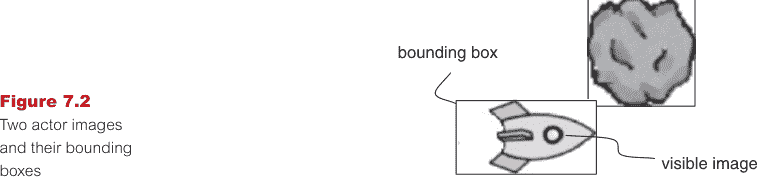

## 7.5 碰撞的小行星

对于我们的目的，第二个方法已经足够了。实际上，撞上一个小行星还是同时撞上两个小行星，对游戏来说并没有区别。火箭同样会爆炸。我们唯一的问题是，我们是否与任何小行星相交了？

因此，我们将使用第二个方法。因为它返回的是 `Actor` 而不是 `List`，所以处理起来稍微简单。如果我们相交，它将返回一个执行；如果我们目前没有与任何小行星相交，它将返回 `null`。我们可以检查空返回值来判断我们是否撞到了东西：

```java
Actor a = getIntersectingObject(Asteroid.class);
if (a != null)
{
    // ...
}
```

- **练习 7.30** 在你自己的 `checkCollision` 方法中添加一个与小行星相交的检查，类似于此处所示的。
- **练习 7.31** 在 `if` 语句体中添加代码，在火箭当前位置向世界添加一个爆炸，并从世界中移除火箭。（要实现这一点，你需要使用 `getWorld()` 来访问其从世界中添加和移除对象的方法。）

对于上面的最后一个练习，我们可以使用 `getX()` 和 `getY()` 方法来获取当前位置。我们可以将其作为爆炸的坐标。

尝试解决这个问题可能如下：

```java
world = getWorld();
world.removeObject(this); // 从世界中移除火箭
world.addObject(new Explosion(), getX(), getY());
```

这段代码乍看之下合理，但无法工作。

- **练习 7.32** 尝试上述所示的代码。它能编译吗？能运行吗？在某一点出现了问题，错误信息是什么？

这种不起作用的原因是，我们在从世界中移除火箭之后调用了 `getX()` 和 `getY()` 方法。当一个 actor 从世界中移除时，它就不具有任何坐标——它只有在世界中时才才有坐标。因此，在这个示例中 `getX()` 和 `getY()` 方法调用失败了。

这可以通过交换最后两行代码来轻松修复：先插入爆炸，然后从世界中移除火箭。

## 7.6 强制转换

**练习 7.33** 这是一个非常高级的练习，你可能想跳过它，稍后再回来。

这里使用的爆炸是一个看起来相当简单的爆炸。它目前足够了，但如果你想创建真正非常看的游戏，可以对其进行改进。Greenfoot 网站上的一份 Greenfoot 教程视频中介绍了一种更复杂的显示爆炸的方法：

```text
http://www.greenfoot.org/doc/videos.html
```

为你的火箭创建一个类似的爆炸。

我们的游戏现在已经相当有玩性了。你可能已经注意到分数计数不起作用（我们稍后会研究这个问题），而且当你失败时什么都没有发生。接下来，我们将在火箭崩溃时的末尾添加一个巨大的“Game Over”标志。

这几乎很容易做到：已经有一个 `Score` 类可以使用了。

**练习 7.34** 创建一个 `Score` 对象并将其放入世界中。

**练习 7.35** 检查 `Score` 类的源代码。它有多少构造函数？它们之间的区别是什么？

**练习 7.36** 修改 `Score` 类：更改显示的文本；更改颜色；更改字体大小以适应你的文本；更改分数板的宽度。

正如你所见，分数板包含了“Game over”文本和最终分数（虽然分数还没有计算）。

`Space` 类已经有一个方法 `gameOver`，用于创建并显示分数板。

**练习 7.37** 查找并 `Space` 类中的 `gameOver` 方法。它目前的实现做了什么？

**练习 7.38** 实现 `gameOver` 方法。它应该创建一个接受 `int` 参数的 `ScoreBoard` 对象。目前使用 999 作为分数——我们会修复它。将分数板放入世界中，正好居中。

**练习 7.39** 实现后，测试你的 `gameOver` 方法。记住：可以通过右击世界标题调用类的方法（见图 6.3）。

**7.40** 如何确保分数板放置在世界的中心，而不是硬编码位置（即不直接使用 300 和 200 作为坐标）？提示：利用世界的宽度和高度。在你的场景中实现。

所以，大部分工作已经为我们准备好了。我们现在只需要在想要游戏结束时调用 `gameOver` 方法。

我们在火箭的 `checkCollision` 方法中想要游戏结束的地方：当我们检测到碰撞时，火箭应该爆炸（我们已经这样做了）并且游戏结束。

**练习 7.41** 在你的 `checkCollision` 方法中添加 `gameOver` 方法调用。编译。你观察到了什么？你可能看到一个错误——错误信息是什么？

简单地添加 `gameOver` 会产生一个问题。这是一个相当基础的问题，我们需要详细检查。我们查看如下代码，假设我们在 `checkCollision`（代码 7.1）中添加了 `gameOver` 方法。这无法编译。

代码 7.1

调用游戏方法的第一次尝试

```java
private void checkCollision() {
    Actor a = getIntersectingObject(Asteroid.class);
    if (a != null) {
        World world = getWorld();
        world.addObject(new Explosion(), getX(), getY());
        world.removeObject(this); // 从世界中移除火箭
        world.gameOver(); // 错误：这无法工作
    }
}
```

# 114 第 7 章 碰撞检测：小行星

问题在于编译器并不像我们想象的那么智能。`getWorld()` 方法定义在 `Actor` 类中，其签名如下：

```java
World getWorld()
```

我们看到它将返回一个 `World` 类型的对象。在我们的案例中，它返回的实际世界类型是 `Space`。

这并不是矛盾：我们的世界对象可以同时是 `World` 类型又是 `Space` 类型，因为 `Space` 是 `World` 的子类（我们说该类型是 `World` 类型的子类型）。

错误源于两者之间的差异：`gameOver` 定义在 `Space` 类中，而 `getWorld` 给的是 `World` 类型的结果。编译器只查看我们正在调用的方法（`getWorld`）的返回类型。因此，编译器只在该处搜索 `gameOver` 方法但没有找到。这就是我们得到错误信息的原因。

为了解决这个问题，我们需要显式地告诉编译器我们获得的类型实际上是 `Space`。我们可以通过使用类型转换来实现：

```java
Space space = (Space) getWorld();
```

类型转换是一种技术，告诉编译器比它自己能推断出的更精确的对象类型。在我们的案例中，编译器可以推断从 `getWorld` 返回的对象是 `World` 类型，而我们现在告诉它实际上是 `Space`。我们通过在方法调用之前的括号中编写名称 `Space` 来实现。一旦完成，我们就可以调用 `Space` 中的方法了：

```java
space.gameOver();
```

注意的是，类型转换不会改变对象的类型。我们的实际对象始终是 `Space` 类型。问题是编译器不知道这一点。通过类型转换，我们只是给编译器添加了额外信息。

回到我们的 `checkCollision` 方法。一旦我们将世界转换为 `Space` 并将其存储在 `Space` 类型的变量中，我们就可以调用它的所有方法，包括在 `Space` 中定义和在 `World` 中定义的方法。因此，我们对 `addObject` 和 `removeObject` 的调用应该仍然有效，`gameOver` 的调用也能正常工作。

**练习 7.42** 使用此处讨论的、将 `World` 对象转换为 `Space` 类型来实现对 `gameOver` 的调用。测试应该在火箭爆炸时进行。

**练习 7.43** 当你错误使用类型转换时会发生什么？尝试将世界对象转换为（例如）`Asteroid` 而不是 `Space`。你观察到了什么？

到目前为止，这项工作实现了“游戏结束”标志的显示（分数仍是错误的）。我们将评分留到本章末尾作为练习。如果你现在真的想修复，可以先跳到章末练习并优先查看这一项。在这里，接下来我们将研究质子波。

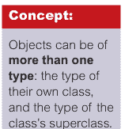

# 7.7 添加火力：质子波

我们的游戏变得越来越好了。本章中详细介绍的最后一点是添加第二种武器：质子波。这应该给游戏带来一些多样性。想法是这样的：我们的质子波一旦释放，就会从飞船向外辐射，损坏或摧毁路径上的每个小行星。由于它同时向所有方向运行，因此它比子弹要强大得多。对于游戏来说，我们可能应该限制使用它的频率，以免游戏变得变得太简单。

- **练习 7.44** 运行你的场景。在场景中放置一个质子波——你观察到了什么？
- **练习 7.45** 检查 `ProtonWave` 类的源代码。已经存在哪些方法？
- **练习 7.46** 每个方法的作用是什么？查看每个方法的注释并扩展它们，以添加更详细的解释。
- **练习 7.47** 尝试解释 `initializeImages` 方法做了什么以及它是如何工作的。用书面形式解释，如果需要，可以使用图表。

## 7.8 波的增长

我们看到 `ProtonWave` 类有一个方法——`initializeImages`，它创建了 30 张不同尺寸的图像并将它们存储在数组中（代码 7.2）。该名为 `images` 的数组在索引 0 处持有最小的图像，在索引 29 处持有最大的（见图 7.3）。图像是通过加载基础图像 (`wave.png`)，然后在循环中创建该图像的副本并将其缩放为不同尺寸创建的。

代码 7.2

初始化质子波的图像

```java
/**
 * 创建用于扩展波的图像。
 */
public static void initializeImages() {
    if(images == null) {
        GreenfootImage baseImage = new GreenfootImage("wave.png");
        images = new GreenfootImage[NUMBER_IMAGES];
```

# 代码 7.2 继续

初始化质子波的图像

```java
int i = 0;
while (i < NUMBER_IMAGES) {
    int size = (i+1) * (baseImage.getWidth() / NUMBER_IMAGES);
    images[i] = new GreenfootImage(baseImage);
    images[i].scale(size, size);
    i++;
}
```

# 图 7.3

图像数组（为了空间原因省略了部分）

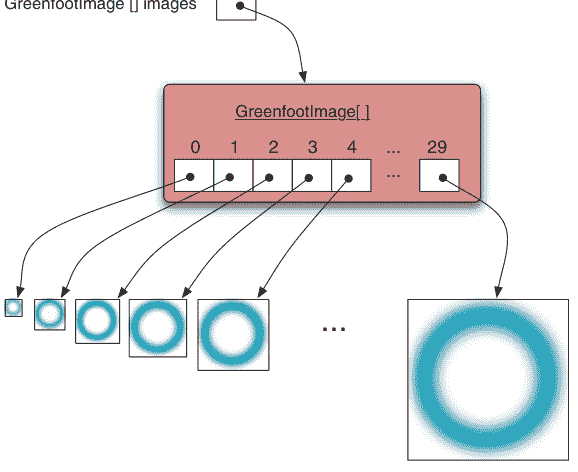


该方法使用`GreenfootImage`类中的`scale`方法来执行缩放。它还使用`while`循环进行迭代。然而，这是一个我们在本章开头遇到过的`for`循环可能更恰当的例子。

> **练习 7.48** 重写`initializeImages`方法，使用`for`循环代替`while`循环。

在实践中，在这种情况下使用哪种循环并不非常重要。（我们在这里更改它主要是为了获得编写`for`循环的额外练习。）然而，这是一个`for`循环是良好选择的情况，因为我们有已知的迭代次数（图像数量），并且我们可以在计算图像尺寸时很好地利用循环计数。`while`循环的优势是`for`循环将循环的所有元素（初始化、条件和递增）都整合在头部，这样我们忘记其中某一部分的风险就更小。

## 7.8 波的增长

`images`字段和`initializeImages`方法是静态的（它们在定义中使用了`static`关键字）。正如我们在第 7 章中简要提到的，这意味着`images`字段存储在`ProtonWave`类中，而不是单个实例中。结果，我们创建的该类的所有对象都可以共享此`images`，我们不需要每次都创建一个单独集。

复制和缩放这些图像需要很长时间（在普通计算机上平均在十分之一到一秒之间）。这看起来并不多，但当我们在游戏中间执行时，它足够产生视觉上的、恼人的延迟了。为了解决这个问题，该方法的代码被封装在一个`if`语句中：

```java
if (images == null)
    ..
```

该语句确保该方法的主部分（语句体）只执行一次。第一次`images`将是`null`，方法完全执行。这将`images`字段初始化为`null`以外的值。从那时起，语句的测试将是唯一执行的内容，体将被跳过。`initializeImages`方法实际上在每次创建质子波时（通过构造函数）被调用，但只有第一次执行时会进行实质性工作。在质子波构造函数中的调用只是作为安全措施：如果此类被用于另一个项目，且没有提前调用此方法，一切仍然会工作。

现在我们对代码和已存在的字段有了相当的了解，终于可以开始工作并让事情发生了。

我们想要做的是：

- 我们想让波从最小的图像开始。
- 在每一步，我们想让波生长（显示更大的图像）。
- 在显示完最大的图像后，波应该消失（从世界中移除）。

以下练习将实现这一目标。

- **练习 7.49** 在`ProtonWave`类的构造函数中，将图像设置为最小图像。（你可以使用`images[0]`作为`setImage`方法的参数。）
- **练习 7.50** 创建一个类型为`int`的实例字段`imageCount`，并将其初始化为 0。我们将使用该字段来计数图像。当前值是当前显示图像的索引。

> 该方法实际上第一次是从`Space`构造函数被调用的，因此在第一个质子波创建之前它就已经执行了。这同样避免了第一个质子波的延迟。

**练习 7.51** 为一个名为`grow`的新私有方法创建一个方法存根。该方法没有参数也没有返回值。

**练习 7.52** 在你的`act`方法中调用`grow`方法。（尽管它在现阶段什么都不做。）

我们快要完成了。剩下的工作就是实现`grow`方法。大致思路如下：显示索引为`imageCount`的图像；将`imageCount`加1。

我们需要添加一个`if`语句，首先检查`imageCount`是否超过了图像的数量。在这种情况下，我们可以从世界中移除质子波，这就完成了。

**练习 7.53** 按照上述讨论的内容实现`grow`方法。

**练习 7.54** 测试你的质子波。如果在场景运行期间交互式地在世界中创建一个质子波，你将看到波的扩散效果。

**练习 7.55** 添加一些声音。场景包含一个名为`proton.wav`的音频文件——你可以播放它。你可以将播放的语句放在质子波的构造函数中。

现在我们已经有一个可以工作的质子波了，我们应该配备我们的火箭来释放它。

**练习 7.56** 在`Rocket`类中，创建一个名为`startProtonWave`带有输出参数的方法存根。它需要返回什么吗？

**练习 7.57** 实现这个方法：它应该将一个新的质子波对象放在世界中，位于火箭坐标处。

**练习 7.58** 在按下“z”键时，从`checkKeys`方法中调用这个新方法。

**练习 7.59** 你很快发现质子波释放得太频繁了。对于发射子弹，`Rocket`类内置了一个延迟（使用`gunReloadTime`常量和`reloadDelayCount`字段）。研究这段代码并为质子波实现类似的机制。尝试不同的延迟值，直到找到一个合理的值。

## 与范围内的对象进行交互

我们有一个可以通过按键释放的质子波。剩下的问题是：这个质子波实际上对小行星并没有产生任何影响。

现在我们想要添加代码，当小行星被质子波击中时，对它们造成伤害。

- **练习 7.60** 为这项新功能做好准备：在`ProtonWave`类中，添加一个名为`checkCollision`的方法存根。该方法没有参数也没有返回值。在你的`act`方法中调用此方法。
- **练习 7.61** 这个新方法的目的是检查波是否触碰了小行星，如果触碰了则对其造成伤害。编写该方法的注释。

我们不想使用`getIntersectingObjects`方法，因为质子波图像角落的不可见图像区域（包含在边界框内，但不是蓝色圆形的一部分）相当大，小行星在波看起来触及它们之前很早就会被摧毁了。

相反，我们将使用另一种碰撞检测方法，称为`getObjectsInRange`。

`getObjectsInRange`方法返回调用对象周围给定半径内的所有对象列表（见图 7.4）。它的签名如下：

```
getObjectsInRange(int radius, Class cls)
```

调用时，我们可以指定我们感兴趣的对象类（像以前一样），还可以指定一个半径（以单元格为单位）。该方法将返回在调用对象周围此半径内找到的所有请求类的对象列表。

要确定哪些对象在范围内，使用了对象的中心点。例如，如果一个小行星的中心点到火箭中心点的距离小于 20 个单元宽度，

**图 7.4** 给定半径的演员周围的范围

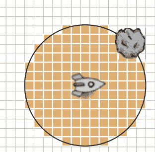

那么该小行星就在半径 20 内。图像的大小对该方法没有影响。

使用此方法，我们可以实现`checkCollision`方法。

我们的质子波将具有逐渐增的图像。在每个周期中，我们可以使用当前图像的大小来确定碰撞检查的范围。我们可以使用以下方法获取当前图像大小：

```
getImage().getWidth()
```

然后我们可以使用该大小的一半作为我们的范围（因为范围指定为半径，而不是直径）。

- **练习 7.62** 在`checkCollision`中，声明一个名为`range`的局部变量并将当前图像宽度的一半赋值给它。
- **练习 7.63** 添加对`getObjectsInRange`的调用，返回计算范围内的所有小行星。将结果赋值给类型为`List<Asteroid>`的变量。记住你还需要为`List`类型添加导入语句。

这为我们提供了质子波范围内所有小行星的列表。现在我们想对范围内的每个小行星造成一些伤害。

`Asteroid`类有一个`hit`方法，我们可以用它来实现。该方法已经用于在小行星被子弹击中时对其造成伤害，我们可以再次使用它。

我们可以使用`for`循环来遍历从`getObjectsInRange`调用收到的列表中所有小行星。（如果你不确定如何编写`for`循环，请回看第 6.8 节。）

- **练习 7.64** 在`Asteroid`类中找到`hit`方法。它的参数是什么？它返回什么？
- **练习 7.65** `ProtonWave`类在顶部定义了一个常量`DAMAGE`，它指定了应该造成的伤害值。找到该常量的声明。它的值是多少？
- **练习 7.66** 在`checkCollision`中，编写一个`for`循环遍历从`getObjectsInRange`获取的小行星列表。在循环体内，使用`DAMAGE`常量对每个小行星调用`hit`。

一旦你完成了这个练习，你现在应该拥有一个可玩的游戏版本，它能让你一次性击中并摧毁小行星。你会发现，如果你可以太频繁地使用波，游戏就会变得太简单了。

这个包含了最后几个章节所有更改的游戏版本可以在书中找到。你可以用它与你自己的版本进行比较，或者在某个练习中遇到困难时查看解决方案。

## 7.10 进一步开发

我们已经完成了本章对场景开发的详细讨论。然而，这个游戏有很多改进空间。有些是显而易见的，其他的你可能想要发明。

以下是以练习形式提供的后续建议，其中许多是相互独立的——不需要按照特定的顺序执行。选择你感兴趣的，并提出自己的想法。

- **练习 7.67** 修复分数计数。你已经看到了分数计数器，但还没有被使用。计数器定义在`Counter`中，并在`Space`类中创建。你需要为`Space`类添加一个名为`countScore`的方法——它应该向计数器添加分数；并在小行星被击中时调用这个新方法（你可能想对分裂小行星和移除小碎片设置不同的分数）。
- **练习 7.68** 当所有小行星都被清理后添加新的小行星。也许游戏应该从两个小行星开始，每当它们被清理时，就会出现新的，每次一个。第二回合有三个小行星，第三回合以此类推。
- **练习 7.69** 添加关计数器。每当小行星被清理时，你就升级。也许在后面的关卡中获得更高的分数。
- **练习 7.70** 添加关卡结束音。每当完成一个关卡时应该播放它。
- **练习 7.71** 添加一个显示质子波加载状态的指示器，以便玩家知道何时可以再次使用。这可以是一个计数器，或者是某种图形表示。
- **练习 7.72** 添加护盾。当护盾部署时，它会保持很短的固定时间。当护盾开启，可以在屏幕上看到它，碰撞的小行星不会造成伤害。

当然，还有无数可能的扩展。发明一些你自己的，并将你的结果提交到 Greenfoot 画廊。

### 编程技术总结

在本章中，我们完成了一个最初只写了一半的小行星迷路游戏。在这个过程中，我们再次遇到了以前见过的几个重要构造结构，包括循环、列表和碰撞检测。

我们看到了一种新的循环类型——`for`循环——并用它来描绘制星空以及生成质子波。在实现质子波功能时，我们还修改了`for-each`循环。

我们使用了两种不同的检测方法：`getIntersectingObject`和`getInRange`。它们在某些情况下各有优劣。后者向我们返回一个参与者（actors）列表，因此我们必须再次处理列表。

理解列表和循环起初相当困难，但在编程中非常重要，所以如果你还不熟练使用它们，应该仔细检查你代码中的这些部分。练习得越多，就越容易。在使用一段时间后，你将会惊讶于起初竟然觉得它们那么难。

### 概念总结

- **for 循环**是 Java 的循环构造之一。它特别适合执行固定次数的迭代。
- **Greenfoot**提供了几种**碰撞检测**方法。它们位于`Actor`类中。
- 图像的**边界框 (bounding box)**是包围该图像的矩形。
- 对象可以是**多于一种类型**：它们所属类的类型，以及该类父类的类型。
- **类型转换 (Casting)**是一种为我们的对象指定比编译器已知的类型更精确类型的技术。

## 间插 2

## Greeps 竞赛

我们将花一点时间进入第二个间插——这是章节顺序中的一个休息，用来做一些不同的事情。这一次，我们将看看“Greeps”——一场编程竞赛。

Greeps 是外星生物。它们来到地球了！关于 Greeps 的重要信息之一是它们喜欢番茄。它们乘坐飞船登陆，并成群地寻找和收集番茄（图 I2.1）。

**图 I2.1** 两个正在寻找番茄的 Greeps

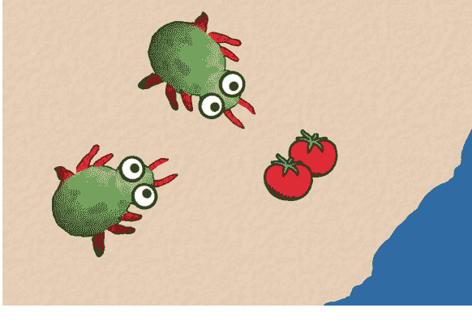

这个编程竞赛的挑战在于编写你的 Greeps，让它们尽可能地找到并收集番茄。你有有限的时间，你成功带回飞船的每一个番茄都能得分。

你可以将此项目作为一个与编写自己 Greeps 的朋友之间的竞赛，也可以作为一个程序员小组或学校班级的集体竞赛。如果你是单兵作战，可以把你的作品发布到 Greenfoot Gallery，看看你与其他人的对比情况¹。或者你也可以为了好玩而独立完成——这应该是一个有趣的挑战。

> ¹ 如果你将 Greeps 场景提交到 Greenfoot Gallery，请不要包含源代码。我们希望将这个项目作为对未来编程者的挑战，不希望让他们太容易地找到别人的解决方案。

## 如何开始

首先，从`book-scenarios`文件夹打开`greeps`场景。运行这个场景。

你会看到一艘飞船降落在一个有沙子和水的区域。Greeps 会离开飞船并开始寻找番茄堆（这些堆恰好发现在该区域的不同地点）。Greeps 是陆地动物——它们不能也不会进入水里。（事实上，它们对水很敏感，在水中会溶解得很快，所以不要尝试。）

当你尝试该场景时，你会很快发现 Greeps 的行为并不智能。它们从船上向随机方向出发，但当它们到达水边时，就会停留在那里，因为它们无法向前移动。

你的任务是编写 Greeps 以使用更智能的策略，让它们找到番茄并将它们带回船上。

关于 Greeps 有一些需要知道的事实：

- 飞船上有 20 个 Greeps。它们在登陆后会出来开始工作。你无法获得更多的 Greeps。
- Greeps 可以背上携带一个番茄，但它们不能将番茄加载到自己的背上。它们只能将番茄加载到另一个 Greep 的背上！这意味着两个 Greeps 必须同时在番茄堆处才能捡起番茄。

**图 I2.2** 一个使用油漆滴的 Greeps 部落

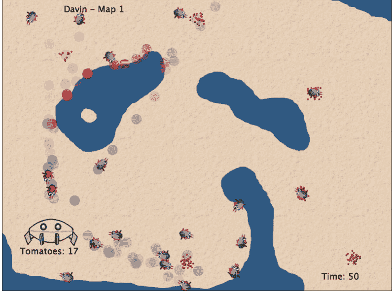

## I2.2 编写你的 Greeps

Greeps 不能说话，无法以任何方式进行口头交流。然而，它们可以向地面吐口。而且它们可以三种不同的颜色旋转！有传言有一个 Greeps 部落利用此来互相传递信息。

Greeps 视力很差。它们只能看到自己所在位置的地面，无法看更远的地方。

Greeps 记忆力很好——它们永远不会忘记所知道的。然而——不幸的是——它们的记忆非常有限。它们一次只能记住几件事。

掌握了这些丰富的背景知识，我们现在可以准备编写我们的 Greeps 了。


为了让你的 Greeps 尽可能多收集番茄，你应该遵循以下规则：

- 分小步工作。
- 一些改进可以如下：
  - 在水边时转弯；
  - 在番茄堆处等待；
  - 在边缘处转弯；

## I2.3 运行竞赛

有一个运行竞赛是有帮助的。在学校里，这可能是你的老师（如果你和朋友一起运行）。

为了让竞赛有趣，应该有两个版本的 Greeps 场景。参与者可以访问所有地图——在所有地图上（可能在大屏幕上）以看到官方得分。

竞赛最好在几天内（或者两周）进行，有多次机会提交他们的工作，这样他们可以慢慢改进。

## I2.4 技术细节

对于提交作品，最简单的方法是只提交`Greeps.java`文件。编译器会将该文件复制到完整的（10 个地图）场景中并进行编译和运行。这确保了没有其他类被修改。

作品（为竞赛制作传单或海报）可以在这里获取：

```
http://www.greenfoot.org/competition/greeps/
```

老师也可以那里找到 Greeps 场景的版本。或者，老师们也可以轻松地制作更多地图。一个空地图在 Greeps 场景的图像文件夹中提供。水可以被画在地图上，地图数据（番茄堆的位置等）可以在`Earth`类中指定。

## 第8章

## 创建图像与声音

| 主题： | 创建声音、创建图像、动态图像变化、处理鼠标输入 |
| --- | --- |
| 概念： | 音频格式、音质参数、图像文件格式、RGBA模型、透明度 |

我们之前遇到的许多场景之所以有趣，不仅是因为定义了它们行为的程序代码，还因为它们有效地利用了声音和图像。到目前为止，我们还没有深入讨论过媒体文件，而且很大程度上依赖于现有的图片。

在本章中，我们将讨论创建和管理媒体文件的某些方面。我们首先将讨论计算机程序中的声音，然后是创建和处理图像的各种技术。作为副作用，我们还会遇到处理鼠标输入的情况。

## 8.1 准备工作

与之前的章节不同，我们在本章中不会构建一个完整的场景，而是通过完成各种练习来演示可以整合到各种不同场景中的技术。第一系列练习将引导我们创建一个场景：当用户点击演员（actor）时，播放一个声音（声音由我们自己创建）。对于这些练习，我们不使用已经部分实现的场景，而是从头开始创建一个新的。

**练习 8.1** 作为练习的准备，创建一个新场景。你可以给它起任何名字。你会发现新场景自动包含了`World`和`Actor`的子类。

**练习 8.2** 创建一个`World`的子类。将其命名为`MyWorld`。你可以给它任何喜欢的背景图像。

**练习 8.3** 修改世界的尺寸和分辨率，使其宽度为 400 像素，高度为 300 像素。在这一阶段，这并不重要。

**练习 8.4** 在你的场景中创建一个演员子类。你可能想查看可用的库图像并选择一个。为你的类恰当命名（记住：类名应以大写字母开头）。


# 第 8 章 创建图像和声音

## 8.1 交互式演员

**练习 8.5** 在你的 `MyWorld` 类中添加代码，自动将你的演员实例放置到世界中。

**练习 8.6** 在你的演员的 `act` 方法中编写代码，使其每次执行时都向右移动 10 像素。然而，移动并不是我们的主要目标。准备工作的下一步将是让演员对鼠标点击做出反应。在 Greenfoot 中，有几种方法可以处理鼠标输入。它们是什么？在 Greenfoot 文档中查找并记录下来。

**练习 8.7** `mouseClicked` 和 `mousePressed` 之间有什么区别？当我们对鼠标点击做出反应时，可以使用 Greenfoot 类中的 `mouseClicked` 方法。该方法返回一个布尔值，可以作为 `if` 语句中的条件。`mouseClicked` 的参数可以指定被点击的对象——如果鼠标点击了任何地方，该方法将返回 `true`。

**练习 8.8** 修改你演员类中的代码，使其在响应鼠标点击时向右移动。

**练习 8.9** 现在修改你的代码，使演员仅在用户点击它时才移动。为了做到这一点，你需要将演员本身（而不是 `null`）作为参数传递给 `mouseClicked` 方法。

**练习 8.10** 在世界中放置多个你的演员实例，并确保只有你点击的那个会移动。你现在应该拥有一个可以对鼠标点击做出反应的演员场景了。这是我们后续对声音和图像进行实验的良好起点。（如果你在创建这个时遇到困难，书中本章有一个名为 `soundtest` 的场景实现了这一功能。）

## 8.2 使用声音

正如我们之前看到的，Greenfoot 类有一个 `playSound` 方法，我们可以用它来播放声音文件。为了能够播放，声音文件必须位于场景内的 `sounds` 文件夹中。首先，让我们播放一个现有的声音文件。

**练习 8.12** 从你的其他 Greenfoot 场景中选择一个声音文件并复制到当前场景的 `sounds` 文件夹中。然后修改你的演员，使其在你点击它时播放声音（而不是移动）。

### 陷阱

某些操作系统的配置为不显示文件扩展名。一个全名为 `mysound.wav` 的文件将显示为 `mysound`。这是一个问题，因为我们需要在 Java 代码中使用包含后缀名在内的全名。编写：

```java
Greenfoot.playSound("mysound");
```

将会失败，因为找不到该文件。然而，在看不到后缀的情况下，我们不知道它是什么。解决方案是更改操作系统的设置，使其始终显示后缀。例如，Windows 有一个“隐藏已知文件类型的扩展名”的复选框，你应该确保没有被勾选。在 Windows Vista 中，你可以通过查看文件夹内容并进入“组织/搜索选项/查看”菜单找到它。在其他 Windows 系统中，菜单名称可能有所不同，但复选框也会在那里。

我们可以轻松地播放现有的声音文件。现在更有趣的任务是自己制作一个声音文件。

## 8.3 录音与编辑

获取声音文件有多种选择。我们可以从其他 Greenfoot 项目复制文件，或从互联网上的免费声音库下载。如果你从互联网下载，请注意版权声明：互联网上的任何都不是免费的——尊重他人的版权！获取声音文件最简单的方法是自己录制。为了做到这一点，我们需要麦克风（许多笔记本电脑内置了麦克风，且电脑耳机通常带有麦克风）和录音软件。如果你现在没有麦克风，可以跳过本节。

有很多录音程序可用，其中几个是免费的。我们在这里使用 Audacity 进行截图。Audacity 是一个很好的选择，因为它功能强大、支持不同的操作系统，并且免费且易用。然而，还有许多其他录音程序，你可以使用你喜欢的任何一个。

图 8.1 显示了录音程序的典型界面。通常会有播放、录制的控件以及录制声音的波形（蓝色图表）。

**图 8.1** 录音与编辑程序 (Audacity)

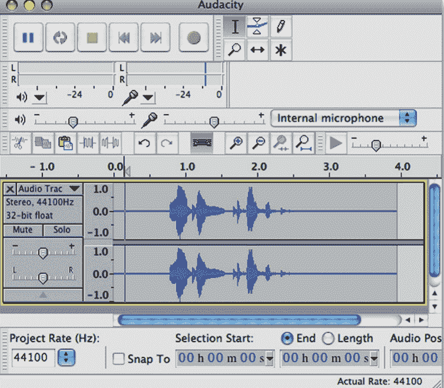

> ¹ Audacity 可从 http://audacityteam.org 获取

## 8.4 格式与大小

录音非常简单——通常可以通过尝试几次来学会。

**练习 8.13** 打开录音程序并录制一段声音。结果符合你的预想吗？如果不是，删除它并重试。当我们录制声音时，开头和结尾通常会有几秒静音，这是我们不需要的。例如在图 8.1 中，我们可以看到很长时间的静音（图表左右的直线）。如果我们按原样保存声音文件，效果将是播放时声音产生延迟（因为声音的前部分是静音）。

我们可以通过选择声音的片段并使用“剪切”和“粘贴”来编辑声音。

**练习 8.14** 编辑你的声音文件，使其包含你所需的精确声音。删除开头或结尾任何噪音或静音。

许多音频编辑程序提供过滤器来修改声音或生成全新的声音元素。通过将过滤器（如放大、回声、速度变化等）应用于简单的声音（如拍掌、口哨、尖叫等），我们可以创造出各种效果。

**练习 8.15** 如果你的声音程序支持过滤器，为你的录制声音应用一些过滤器。选择你最喜欢的三个过滤器并描述它们的作用。描述一个你可能会使用这种效果的例子。

**练习 8.16** 制作以下声音：兔子吃胡萝卜的声音；爆炸声；硬物碰撞声；玩家失败时的“游戏结束”声音；机器人声音；跳跃声（游戏角色跳跃时使用）。

## 8.5 声音格式与文件大小

### 概念

声音可以用多种不同的格式和编码进行保存。并不是所有程序都能播放所有声音。对于 Greenfoot，我们通常使用 WAV 格式，而 Greenfoot 只能读取其中的一部分。因此，Greenfoot 无法播放所有的 WAV 文件。

当你保存录制的声音时，应该将其保存为“带符号 16 位 PCM WAV”（signed 16 bit PCM WAV）文件。这是确保播放的安全格式。在许多录音程序中，这是通过“导出”（Export）功能实现的而不是标准的“保存”（Save）功能。确保以这种格式保存。

当你遇到 Greenfoot 无法播放的声音文件（可能是从互联网下载的），你可以轻松地在声音编辑程序中打开它们并转换为这种格式。

**练习 8.17** 以适用于 Greenfoot 的格式保存你录制的声音。修改你的 actor 类的代码，使其在被点击时播放你的声音。

**练习 8.18** 修改你的代码，使其在点击左键时播放一种音效，在点击右键时播放另一个音效。要实现这一点，你需要获取关于鼠标点击的信息，以告知你按了哪个按钮。Greenfoot 有实现此点的方法——查看 Greenfoot 分类以了解如何操作。

**练习 8.19** 修改代码，使 actor 在被点击时播放音效并移动到新的随机位置。

### 概念

声音录制文件的采样格式、采样率以及单声道/立体声设置决定了大小和质量。

声音文件可能会变得非常大。只要场景只在本地使用，这不是一个主要问题，但如果场景被导出（例如导出到 Greenfoot Gallery），大小就会产生巨大影响。声音和图像文件通常是 Greenfoot 场景中最大的部分，声音文件的大小决定了场景加载是快还是让用户需要等待下载。

为了避免大型声音文件，你应该注意编码。当我们录制和保存声音时，可以在声音质量和文件大小之间进行权衡。我们可以以高质量录制并保存（导致大文件），也可以以低质量录制并保存（导致小文件）。我们变化的的大小主要是：

- 采样格式（通常为 16 位、24 位或 32 位）。
- 采样率，以赫兹（Hz）测量，通常范围在 8,000 Hz 到 96,000 Hz 之间。
- 立体声与单声道录制。立体声记录两个独立的轨道，产生双倍的数据。

如果你仔细查看图 8.1，你可以看到该截图中的声音是以 32 位、44,100 Hz、立体声录制的。这是许多声音录制程序的典型默认设置，但实际上比简单音效所需的质量要高得多。（我们可能在听那类音乐时需要这种质量，但对于一个简短的 Bang! 音效我们不需要。）

通常情况下，你应该考虑以较低质量保存声音，除非你觉得真的需要更高的质量。

**练习 8.20** 在你的声音录制程序中寻找采样格式、采样率和立体声/单声道录制的设置。在某些程序中，你可以转换声音。在其他程序中，你只能为新录制指定这些设置。使用不同的采样格式、不同的采样率以及立体声单声道进行录制。将它们保存为不同的文件并比较文件大小。改变哪一项对文件大小收益最大？

**练习 8.21** 听上一个练习中产生的声音。你能听出区别吗？在保持可接受质量的同时，你能降低多少质量（以及文件大小）？

## 8.6 处理图像

正如在前面的章节中简要讨论过的（例如当我们在第 7 章中制作小行星背景时），管理 actor 和世界背景的图像可以通过两种不同的方式实现：我们可以使用来自文件的预制图像，也可以在程序中即时绘制图像。

我们将在这里更详细地讨论这两种方法。

### 图像文件和文件格式

有多种方法为我们的场景获取图像。简单的方法当然是使用 Greenfoot 图像库中的图像。当我们创建新类时，这些图像会自动显示。互联网上还有几个免费图标和图像库可供选择。花几分钟搜索其中一些即可。（确保你想要使用的图像是用于免费公开使用的——并不是所有在互联网上的东西都是免费的或属于公有领域的。请尊重他人的版权和许可条款。）

然而，如果我们想让自己的场景独一无二并赋予它们独特的氛围，最有趣的替代方案是自己制作图像。

有几种图形程序可以用来制作图像。*Photoshop* 是最著名的商业程序，如果你想用它，它无疑是一个非常好的选择。然而，也有提供强大功能的免费开源程序。*Gimp*² 是一款出色的免费程序，具有许多复杂功能，值得安装。还有许多更简单的画图程序可以使用。

制作看起来良好的图形需要一些时间来学习，本书中无法详细讨论。多玩多练习，你就会发现许多技巧和窍门。在这里，我们将关注使用图像的具体细节。

> ² http://www.gimp.org

重要的问题之一是保存图像时使用什么格式。像声音一样，质量和文件大小之间需要进行权衡。图像文件可能会变得非常大（远大于我们场景中的代码文件），这很容易占据我们项目的总体大小。再次，如果我们想将场景导出到网络服务器，例如 Greenfoot Gallery，这尤为重要。图像格式可以导致大小产生 10 倍或更多的差异，如果我们选择正确的格式，场景下载将快 10 倍（因为大小只有十分之一）。

Greenfoot 可以读取 JPEG、PNG、GIF、BMP 和 TIFF 格式的图像。在这些格式中，JPEG 和 PNG 是两种最好的格式。JPEG 图像具有良好的压缩优点。这意味着它们可以以很小的文件大小保存。对于彩色图像（如照片和背景，许多数码相机使用这种格式）尤其如此。在保存图像时，许多图形程序允许我们选择压缩程度。压缩得越多，文件越小，但质量也会降低。例如，Gimp 在以 JPEG 格式保存图像时会显示“质量”滑块。降低质量会变小。

**练习 8.22** 在你的图形程序中创建一个图像并将其保存为 JPEG 文件。使用至少四种质量设置保存。打开不同的文件并比较文件大小。对于你的图像，哪种质量设置是质量和文件大小之间的良好折中？

**练习 8.23** 在你的图形程序中为你之前章节中的场景创建一个新背景。将其保存为 JPEG 文件。在场景中使用。图像的大小应该是？如果太大会怎样？

**练习 8.24** 你认为 JPEG 算法是如何让图像变小的？它是如何运作的？尝试对这种实现的可能方式提出一些理论和假设。

**练习 8.25** JPEG 实际上是如何压缩文件的？在互联网上进行研究并以书面形式回答。

另一个非常有用的图像格式是 PNG。PNG 图像具有可以很好处理透明度的优点。任何单个像素都可以部分或完全透明的。这允许我们创建非矩形的图像。（正如第 7 章所述，所有图像都是矩形的，但具有透明部分可以创造出透明效果。）JPEG 图像不能具有透明像素，因此不能使用，除非 actor 恰好是矩形的。对于背景，这通常不是问题，因为我们通常不在背景中使用透明度。

很少需要使用 BMP、TIFF 或 GIF 图像。BMP 的压缩效果不如其他格式，且不支持透明像素。TIFF 图像能很好地保持质量，但文件尺寸较大。GIF 是一种专有格式，实际上已经被性能更好且免费的 PNG 格式所取代。

**练习 8.26** 为你的演员创建两个新图像（演员将在这两个图像之间切换）。将它们保存为 PNG 格式。将其中一张图像设置为该类的默认图像。

**练习 8.27** 修改你的演员代码，使其每当用鼠标点击演员时，都能在你的图像之间切换。

**练习 8.28** 再次修改你的演员代码，使其在鼠标按下期间显示第二张演员图像。换句话说，演员从默认图像开始；当鼠标按下演员时，它会显示不同的图像，一旦松开鼠标，它就会恢复到原始图像。


## 8.7 绘制图像

为我们的演员和背景获取图像的第二种方法是通过程序绘制它们。我们在早期章节的某些场景中见过这种方法的示例，例如，当我们在小行星程序中绘制星空时。

图像中的每个像素由两个值定义：它的颜色值和它的透明度值（也称为 *alpha 值*）。

颜色值再次被分为三个部分：红色、绿色分量和蓝色分量。以这种方式表示的颜色通常被称为 RGB 颜色。

这意味着我们可以用四个数字来表示一个像素（带有颜色和透明度）。通常的顺序如下：

- ( R, G, B, A )

即也就是说，前三个值定义了红色、绿色和蓝色分量（按此顺序），最后一个是 alpha 值。

在 Java 中，所有这些值都在 [0...255] 范围内（包含 0 到 255）。颜色值 0 表示该分量没有颜色，而 255 是全强度。alpha 值为 0 是完全透明的（不可见的），而 255 是不透明的（实心的）。

图 8.2 显示了一些可能的颜色对照表，没有透明度（alpha = 255）。图 8.2 中的表格是使用 Greenfoot 场景颜色表生成的，该表位于书中的 `chapter08` 文件夹中。

> ³ 这只是表示颜色的一种可能模型。在计算机图形和打印领域还有其他模型。然而，这是 Java 编程中最常用的，因此我们在这里将重点关注这种模型。

**图 8.2** RGB 颜色表

| 0,0 | 0,51 | 0,102 | 0,153 | 0,204 | 0,255 |
| :--- | :--- | :--- | :--- | :--- | :--- |
| 0,51 | 0,51,51 | 0,51,102 | 0,51,153 | 0,51,204 | 0,51,255 |
| 0,102 | 0,102,51 | 0,102,102 | 0,102,153 | 0,102,204 | 0,102,255 |
| 0,153 | 0,153,51 | 0,153,102 | 0,153,153 | 0,153,204 | 0,153,255 |
| 0,204 | 0,204,51 | 0,204,102 | 0,204,153 | 0,204,204 | 0,204,255 |
| 0,255 | 0,255,51 | 0,255,102 | 0,255,153 | 0,255,204 | 0,255,255 |
| 1,0 | 1,0,51 | 1,0,102 | 1,0,153 | 1,0,204 | 1,0,255 |
| 1,51 | 1,51,51 | 1,51,102 | 1,51,153 | 1,51,204 | 1,51,255 |
| 1,102 | 1,102,51 | 1,102,102 | 1,102,153 | 1,102,204 | 1,102,255 |
| 1,153 | 1,153,51 | 1,153,102 | 1,153,153 | 1,153,204 | 1,153,255 |
| 1,204 | 1,204,51 | 1,204,102 | 1,204,153 | 1,204,204 | 1,204,255 |
| 1,255 | 1,255,51 | 1,255,102 | 1,255,153 | 1,255,204 | 1,255,255 |
| 2,0 | 2,0,51 | 2,0,102 | 2,0,153 | 2,0,204 | 2,0,255 |
| 2,51 | 2,51,51 | 2,51,102 | 2,51,153 | 2,51,204 | 2,51,255 |
| 2,102 | 2,102,51 | 2,102,102 | 2,102,153 | 2,102,204 | 2,102,255 |
| 2,153 | 2,153,51 | 2,153,102 | 2,153,153 | 2,153,204 | 2,153,255 |
| 2,204 | 2,204,51 | 2,204,102 | 2,204,153 | 2,204,204 | 2,204,255 |
| 2,255 | 2,255,51 | 2,255,102 | 2,255,153 | 2,255,204 | 2,255,255 |
| 3,0 | 3,0,51 | 3,0,102 | 3,0,153 | 3,0,204 | 3,0,255 |
| 3,51 | 3,51,51 | 3,51,102 | 3,51,153 | 3,51,204 | 3,51,255 |
| 3,102 | 3,102,51 | 3,102,102 | 3,102,153 | 3,102,204 | 3,102,255 |
| 3,153 | 3,153,51 | 3,153,102 | 3,153,153 | 3,153,204 | 3,153,255 |
| 3,204 | 3,204,51 | 3,204,102 | 3,204,153 | 3,204,204 | 3,204,255 |
| 3,255 | 3,255,51 | 3,255,102 | 3,255,153 | 3,255,204 | 3,255,255 |
| 4,0 | 4,0,51 | 4,0,102 | 4,0,153 | 4,0,204 | 4,0,255 |
| 4,51 | 4,51,51 | 4,51,102 | 4,51,153 | 4,51,204 | 4,51,255 |
| 4,102 | 4,102,51 | 4,102,102 | 4,102,153 | 4,102,204 | 4,102,255 |
| 4,153 | 4,153,51 | 4,153,102 | 4,153,153 | 4,153,204 | 4,153,255 |


| 4,204 | 4,204,51 | 4,204,102 | 4,204,153 | 4,204,204 | 4,204,255 |
|---|---|---|---|---|---|
| 4,255 | 4,255,51 | 4,255,102 | 4,255,153 | 4,255,204 | 4,255,255 |

### 练习 29

颜色/alpha 值为 `(255, 0, 255)` 的像素看起来是什么样？`(0, 0, 255, 128)` 又是怎样的？`(255, 0, 255, 230)` 又是？

在 Greenfoot 中，颜色由来自 `java.awt` 的 `Color` 类表示。导入该类后，我们可以使用 RGB 值创建颜色：

```java
Color mycol = new Color (255, 12, 34);
```

或者使用 RGB 值和 alpha 值创建：

```java
Color mycol = new Color (255, 12, 34, 128);
```

如果我们不指定 alpha 值，颜色将完全不透明的。

- 练习 30 创建一个新的 Greenfoot 场景-test。在其中，创建一个带有图案背景的世界。创建一个 Actor 子类 `ColorPatch`。编写 `ColorPatch` 类，使其生成一个固定大小、固定颜色的 `BufferedImage`。使用这作为演员的图像。尝试不同的颜色和 alpha 值。
- 练习 31 修改你的代码，使补丁在被点击时，获得一个随机大小、随机颜色和随机透明度的图像。
- 练习 32 再次修改你的代码，使图像不是填充的，而是在演员图像内的随机位置绘制 100 个彩色小点。

## 结合图像与动态绘制

一些最有趣的视觉效果是通过将静态图像与程序进行的动态更改相结合的。例如，我们可以从一个静态图像开始，然后在上面绘制不同的颜色，或者将其放大或缩小，或者通过改变其透明度让它逐渐消失。

为了尝试这一点，我们将创建一个烟雾效果。在下一个场景中，我们让一个球穿过屏幕，留下一道烟雾（见图 8.3）。

- 33 创建名为 `smoke` 的新场景。为它制作一个好看且中性的背景。
- 34 创建一个以恒定速度穿过屏幕的球。当它撞击屏幕边缘时，它会弹回来。（屏幕实际上是一个盒子，球在里面弹跳。）

### 图 8.3 烟雾尾效果

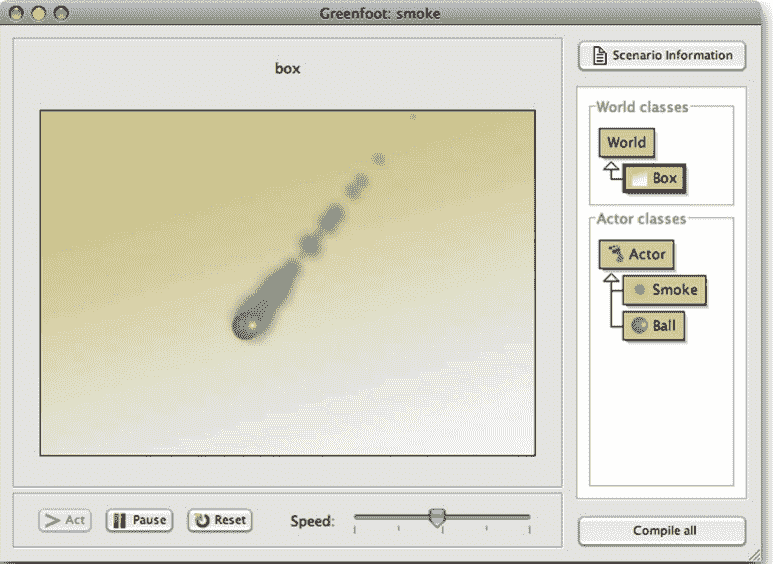

现在我们将处理烟雾效果。首先，创建一个显示烟雾团的图像（图 8.4）。

### 图 8.4 一团烟雾的图像

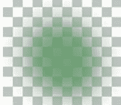

注意，棋格背景不是图像的一部分——它仅用于演示烟雾图像是透明的（我们可以看到它后面的背景）。

你的烟雾不需要是绿色——你可以让它是任何颜色——但它应该是透明的。你可以通过图形程序来实现这一点。如果你在制作图像时遇到困难，可以使用 `chapter08` 中的准备好的 `smoke.png`。

- 练习 35 按照上述描述创建烟雾图像。
- 练习 36 在你的场景中创建一个 `Smoke` 类。当插入世界时，`Smoke` 演员应该很快消失。也就是说，在每个动作周期中，演员的图像应该变得更小更透明。当它们完全透明或非常透明时，应该将它们从世界移除。
- 练习 37 修改你的球，使其在移动时留下烟雾。每次移动都产生烟雾可能太多了：在球移动的每秒创建一个烟雾。测试。
- 练习 38 修改你的烟雾，使其不再总是以完全相同的速率消失。让消失速率具有随机性，使得某些烟雾消失得比其他的快。

如果你完成了所有的练习，那么你现在应该有一个好看的烟雾效果。如果你在这些练习中遇到困难，或者如果你想将你的解决方案与我们的进行比较，可以查看项目中的 `smoke` 场景。它实现了这里描述的任务。

## 总结

制作声音和图像是制作良好的游戏、模拟和其他图形应用程序的一种非常有价值的技能。了解声音和图像格式对于在尺寸和质量之间做出良好的选择非常重要。

声音可以使用各种录音程序录制和编辑，各种参数决定了音质和文件大小。对于 Green 场景，我们通常使用质量较低的 WAV 格式。

图像也可以以各种不同的格式保存。不同格式在压缩文件方面、保持图像质量方面以及处理透明度方面有所不同。JPEG 和 PNG 是 Greenfoot 最常用的格式。

通过将文件图像与动态图像操作（如缩放和透明度更改）相结合，我们可以在场景中实现吸引人的视觉效果。

### 概念总结

- 声音可以用各种格式和编码保存。并不是所有程序都播放所有声音格式。
- 采样格式、采样率和立体/单声道设置决定了录音的大小。
- `JPEG` 图像格式能够很好地压缩大型图像。这通常是背景的最佳选择。
- 图像中的像素具有透明度值，它决定了我们是否能看透它们。像素可以是部分透明的。如果它们是完全透明的，它们就是不可见的。
- `PNG` 图像格式通常是角色图像（actor images）的最佳选择，因为它可以处理透明度且压缩效果良好。

# 第 9 章 模拟

| **主题：** 模拟 |
|---|
| **概念：** 涌现行为、实验 |

在本章中，我们将更详细地讨论一种软件应用：模拟。

模拟是计算领域引人入胜的例子，因为它们具有很强的实验性，并可能允许我们预测未来。计算机可以开发出多种类型的模拟（并且已经开发了许多种）：交通模拟、天气预报系统、经济模拟（股市模拟）、化学反应模拟、核爆炸模拟、环境模拟等。

> **概念：**
>
> 模拟是一个 `string` 计算机程序，用于模拟现实世界中的某些有趣现象。如果模拟足够准确，我们就可以通过观察它们来学习关于现实世界的知识。

我们在第 6 章中见过一个模拟，其中我们模拟了太阳系的一部分。那个模拟过于简单，无法准确预测真实行星的轨道，但天体物理学中仍有一些方面模拟可以帮助我们理解。

通常情况下，模拟有两个用途：它们可以用于研究和理解它们所模拟的系统，也可以用于预测。

在第一情况下，对系统进行建模（例如对股票和行星的建模）可能帮助我们理解其行为的某些方面。如果我们有一个准确的模拟，就可以运行“如果……会怎样”的情景。例如，我们有一个城市的交通模拟，我们观察到每天早上城市的某个路段都会发生堵堵。我们该如何改进模拟？我们应该建立一个新的环岛吗？还是改变交通灯信号？或者我们应该修建一条绕行道？

这些任何干预措施的效果都是难以预测的。我们无法在现实生活中尝试所有选项来看看哪种是最好的，因为那样会产生太大干扰且过于昂贵。但我们可以在交通模拟中模拟它们，然后看看它们如何改善交通。

如果模拟是准确的，那么我们在模拟中观察到的结果在现实生活中也是真实的。但这是一个很大的“如果”：开发一个足够准确的模拟并不容易，这是一项大量的工作。对于许多系统来说，在实用的程度上是可能的。

天气预报模拟现在已经准确到一天预报相当可靠了。然而，七天预报几乎就像掷骰子一样：模拟的结果不仅仅是好不好。

## 模拟的局限性

当我们使用模拟时，意识到其局限性重要的：首先，角色（actors）始终具有程度的不准确性，因为我们没有完全真实地模拟角色的行为，而且我们可能不知道系统的确切状态。

此外，模拟必然只模拟了现实的一部分，我们必须意识到模拟之外的部分实际上可能是相关的。

例如，在我们堵车的的例子中，也许最好的解决方案既不是上述两个选项之一，而是提供更好的公共交通或自行车道以让一些人离开道路。如果我们的模拟不包含这一方面，无论它有多准确，我们永远无法通过使用模拟发现它。

尽管有这些局限性，良好的模拟也是非常有用的，即使是是非常简单的模拟也非常好玩。事实上，它们如此有用，以至于世界上最快的计算机在大多数时间都在运行模拟，或者至少是它们的大部分时间。

> **旁注：超级计算机**
>
> 世界上最快的超级计算机列表定期发布在网上 `http://www.top500.org`。其中大部分在上面有详细的描述，对于其中许多个，列表包含了指向描述其用途和使用工作类型的网站的链接。
>
> 阅读这些材料，你可以看到许多（计算机）运行模拟，研究机构使用它们，例如用于进行物理实验。

模拟在面向对象编程的历史中也占有特殊地位：20 世纪 60 年代由 Kristen Nygaard 和 Ole-Johan Dahl 在奥斯陆的挪威计算中心发明的第一种面向对象的编程语言命名为 `Simula`。正如名字所示，它的目的是运行模拟。今天所有的面向对象编程语言都可以追溯到这门语言。Dahl 和 Nygaard 为这项工作获得了图灵奖——计算机科学界的诺贝尔奖。

介绍足够了——让我们上手键盘尝试一些东西。

在本章中，我们将简要查看一个模拟，然后详细地编写另一个。

## 狐狸和兔子

我们研究的第一个模拟被称为“狐狸和兔子”。它是捕食者-猎物模拟类的一个典型例子——这种模拟中我们追逐（并食用）。在我们的案例中，捕食者是狐狸，猎物是兔子。

这里的想法是：场景显示了一个包含狐狸和兔子的种群。狐狸由蓝色方块表示，兔子由黄色方块表示。

### 图 9.1

狐狸和兔子


狐狸和兔子

狐狸和兔子

狐狸由蓝色方块表示，兔子由黄色方块表示。

> 练习 9.1 打开 `foxes-and-rabbits` 模拟并观察狐狸和兔子的数量。你注意到了什么？
>
> 练习 9.2 将 `RABBIT_REPRODUCTION_RATE` 修改为更高的值。这对种群有什么影响？
>
> 练习 9.3 改变字段的大小。这对种群的稳定性有什么影响？
>
> 练习 9.4 改变字段的宽度和高度。字段的大小会有任何影响吗？
>
> 练习 9.5 选择一个种群几乎稳定但偶尔灭绝的字段大小。然后对 `Rabbit` 参数进行修改以增加种群生存的概率。
>
> 练习 9.6 如果狐狸种群偶尔面临灭绝危险，我们可以推测通过增加兔子的食物价值可以提高狐狸的生存机会。
>
> 练习 9.7 对 `Fox` 参数进行其他修改。你能让种群变得更稳定吗？

## 9.2 蚂蚁

蚂蚁场景模拟了蚂蚁群采集食物的行为。或者更准确地说，我们希望它能模拟这种行为，但它目前并没有这样做。我们将开发它来实现这一功能。在目前状态下，该场景已经在某种程度上准备就绪：图形已经存在，部分实现已经完成。然而，主要功能仍然缺失，我们将着手完成它的工作。

- **练习 9.8** 从书中书中场景的第 09 文件夹中打开名为 `ants` 的场景。在世界中创建一个蚁穴并运行场景。你观察到了什么？
- **练习 9.9** 检查 `Ant` 类的源代码。它目前在做什么？
- **练习 9.10** `Ant` 是 `Creature` 类的子类。该生物具有哪些功能？

### 图 9.2

蚂蚁模拟

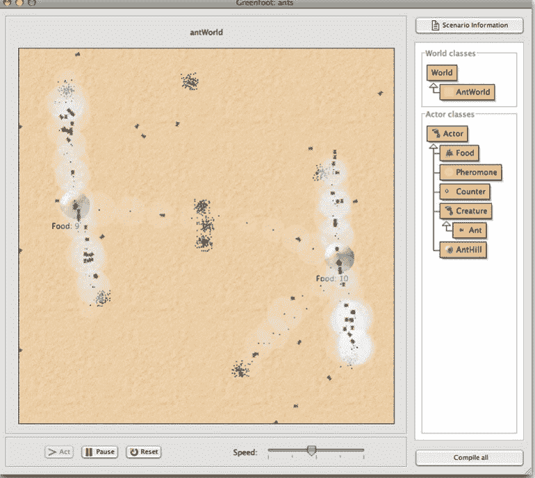

练习 9.11 检查 `AntHill` 类的源代码。这个类是做什么的？一个蚁穴里有多少只蚂蚁？

我们首先注意到的是蚂蚁不会移动。它们在蚁穴的中间被创建，由于它们不会移动，过了一会儿它们都会堆叠在那里。我们的首要任务是让蚂蚁移动起来。

练习 9.12 在蚂蚁的 `act` 方法中，添加一行代码让蚂蚁移动。查阅 `Creature` 类的文档以找到可以使用的方法。

现在，我们将逐步对该场景进行一系列改进。我们将采取的步骤如下：

- 我们将在场景中引入食物，以便蚂蚁有东西可以收集采集。
- 我们将改进蚂蚁，让它们能够找到食物并带回巢。
- 接下来，我们将添加一个信息素（Pheromone）类。信息素是某些动物产生的化学物质，用于向同种的其他动物留下信息。
- 我们将改进蚂蚁以利用信息素：当它们找到食物时，会在地面上留下信息素滴，其他蚂蚁随后就可以闻到信息素并调整它们的去向。

这些步骤共同模拟了蚂蚁群采集食物的行为。完成后，我们可以对该模拟进行一些实验。

### 采集食物

我们的第一个任务是在场景中创建食物，并让蚂蚁收集它们并带回蚁穴。

练习 9.13 创建一个名为 `Food` 的新类。该类不需要固定的图像。我们将从类内部绘制图像。

`Food` 类的每个对象代表一堆食物屑。我们的计划是为 `Food` 对象创建一个新的、动态绘制的图像，并为堆中的每一粒屑画一个小圆点。一堆屑可能从（例如）100 粒屑开始，当每只蚂蚁找到这堆屑时，它就会带走几粒。这意味着每当有蚂蚁拿走一些食物时，必须重新绘制碎屑更少的图像。

练习 9.14 在 `Food` 类中，创建一个字段用于存储堆中目前的碎屑数量。将其初始化为 100。

### 练习 9.15

创建一个名为 `updateImage` 的新私有方法，它创建一个固定大小的图像，并为目前堆中的每一粒屑在随机位置画一个点。为堆选择一个你认为好看的大小。在构造函数中调用此方法。

如果你完成了上面的练习，并在 `Food` 图像内的随机位置放置了食物屑（使用 `Greenfoot.getRandomNumber` 获取坐标），你会发现碎屑堆呈正方形（图 9.3a）。这是因为图像本身是正方形的，而且碎屑均匀地分布在图像上。

如果我们想让它看起来更像一堆（大部分屑集中在中间，其他屑在周围呈粗略的圆形，图 9.3b），我们随后可以使用另一个数字方法以不同的方式放置碎屑。我们将在练习 9.16 和 9.17 中完成。注意，这些是更高级的练习，且纯属视觉效果：它们仅仅改变了食物堆的外观，而不是任何功能，可以安全地跳过。

### 练习 9.16

查阅标准 Java 类库的 API 文档。找到 `java.util` 包中 `Random` 类的文档。该类的对象是随机数生成器，比 Greenfoot 的 `getRandomNumber` 方法更灵活。我们感兴趣的方法是返回高斯分布（也称为“正态分布”）数字的方法。该方法的名字是什么？它是做什么的？

### 练习 9.17

在你的 `Food` 类中，更改在图像中放置食物屑的方式，以利用随机数的高斯分布。为了实现这一点，你需要使用 `java.util.Random` 对象来创建随机数，而不是 `Greenfoot.getRandomNumber`。

### 图 9.3

使用不同随机化算法放置食物屑的情况

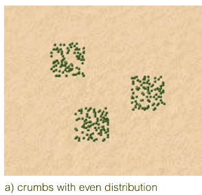

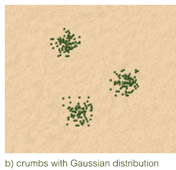

### 旁注：随机分布

如果在程序中需要随机行为，有时考虑我们需要哪种随机分布是很重要的。许多随机函数，例如 `Greenfoot.getRandomNumber` 方法，产生的是均匀分布（在这种情况下，每个可能的结果概率是相同的）。高斯随机数提供了正态分布（在这种情况下，平均结果更容易出现，极端情况较少）。如果我们例如编写一个骰子游戏，我们需要均匀分布（每个骰面出现的概率相等）。相反，如果我们模拟交通中的车辆，正态分布会更好（大多数车辆行驶在平均速度附近，极少数车辆非常慢或非常快）。

接下来，我们需要添加从堆中移除屑的功能，以便蚂蚁可以获取食物。

> 练习 9.18 在 `Food` 类中添加一个公共方法来移除堆中的屑。确保根据碎屑数量重新绘制图像。当屑用光时，`Food` 对象应从世界中移除。交互式测试此方法。

## 9.5 添加信息素

练习 9.19 在 `Ant` 类中实现 `searchFood` 方法。该方法最初执行随机行走并检查我们是否遇到了食物堆。如果我们发现了食物堆，停止执行。（这只是为了测试我们是否检测到了食物。）

练习 9.20 在发现食物堆时添加拿起食物的功能（而不是停止执行）。我们需要从食物堆中移除一些屑（我们已经有了这个方法），标记我们现在带有食物（我们可能需要一个字段），并更改蚂蚁的图像。场景中已经准备好了一个名为 `ant-with-food.png` 的图像可以使用。

练习 9.21 确保蚂蚁在携带食物时向家移动。

练习 9.22 实现一个检查蚂蚁是否到达家的方法。如果它到达了家，放下食物。放下食物包括标记它不再携带食物（包括改回图像），并调用 `Ant` 的 `countFood` 方法来记录它收集了这粒食物屑。

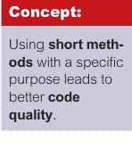

注意代码质量：使用具有明确目的短方法，并确保良好地注释方法。不要把太多代码写在一个方法中。

## 设置世界

在我们向场景添加信息素之前，让我们先添加一些初始化代码，自动我们创建一些蚁穴和食物，这样我们就不需要每次都手动操作。

练习 9.23 在 `AntWorld` 类中添加代码，使其自动在世界中创建两只蚂蚁和几堆食物。

## 添加信息素

现在我们有了良好的准备，准备好为我们的场景添加信息素。每个信息素对象都是蚂蚁留在地面上的化学物质小滴。这种滴会挥发得很快，然后消失。

蚂蚁在从食物源返回的过程中会滴下信息素。当其他蚂蚁闻到信息素滴时，它们就可以离开家，向食物的方向走去。

### 练习 9.24

创建一个 `Pheromone` 类。这个类不需要图像——我们将通过程序来绘制图像。

### 练习 9.25

在 `Pheromone` 类中实现一个 `updateImage` 方法。最初，该方法应该创建一个上面画有白色圆圈的图像，并将其设置为演员的图像。白色圆圈应该是部分透明的。在构造函数中调用此方法。

### 练习 9.26

给费素添加一个强度 `intensity` 属性（即，一个 `intensity` 字段）。费素对象的强度应该从一个定义的最大强度开始，并在每个周期中减少。当强度达到 0 时，从世界中移除该费素对象。一滴信息素大约在 180 个 `act` 周期内蒸发。

### 练习 9.27

修改 `updateImage` 方法，使其利用费素的强度。随着强度的降低，代表它的白色圆圈应该变得更小、更透明。确保从 `act` 方法中调用 `updateImage`，以便我们在屏幕上看到图像的变化。

### 练习 9.28

通过手动将费素放入世界中并运行模拟来测试你的费素。

我们有一个可供蚂蚁使用的 `Pheromone` 类。现在我们只需要让蚂蚁使用它。使用费素的前半部分是将其放入世界中。（后半部分是感知并改变方向。）让我们先完成第一部分。

### 练习 9.29

为你的蚂蚁添加一个方法，在世界中放置一滴信息素。在蚂蚁向家走走的期间，反复调用此方法。

如果你在上一个练习中，每隔一个 `act` 周期就放置一滴信息素，你会发现这向世界中放置了太多的信息素。蚂蚁无法产生无限量的信息素。在放置一滴之后，它们需要一些时间来再生信息素。


### 练习 9.30

修改蚂蚁，使其每 18 步最多只留下一滴信息素。为了实现这一点，你需要一个存储蚂蚁当前信息素水平的字段。当蚂蚁放置信息素滴时，信息素水平（蚂蚁体内的剩余信息素）降至 0，然后缓慢地上升，直到蚂蚁准备好再次留下另一滴。

### 图 9.4

留下信息素足迹的蚂蚁

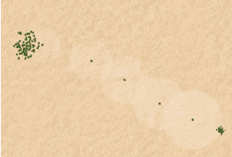

图 9.4 显示了我们的蚂蚁此时留下的信息素轨迹。这些滴之间是有间隔的（蚂蚁需要一些时间来再生信息素），较旧的信息素滴已经部分蒸发——它们更小、更透明。

最后要添加的是让蚂蚁闻到信息素，并在闻到时改变它们的移动方向。

如果蚂蚁闻到一滴信息素，它应该在有限的时间内离开它的家山丘。如果过一段时间后它没有找到食物或新的信息素滴，那么它就恢复恢复行走。我们寻找食物的算法可能像这样：

```java
if (we recently found a drop of pheromone) {
    walk away from home;
} else if (we smell pheromone now) {
    walk towards the center of the pheromone drop;
    if (we are at the pheromone drop center) {
        note that we found pheromone;
    }
} else {
    walk randomly;
}
check for food;
```

在你自己的场景中实现这一点时，请记住为每个不同的子任务创建一个单独的方法。这样，你的代码将保持良好的结构，易于理解且易于修改。

### 练习 9.31

在你自己的场景中实现上述功能：当蚂蚁闻到信息素时，它们会在接下来的 30 步内离开它们的家山丘，然后恢复到默认行为。

> 1 如果你仔细看，你会注意到我修改了信息素图像，在中间有一个小小的深色点。这样做是为了在信息素非常透明时也能更清楚地看到。

如果你完成了这个练习，那么你的蚂蚁模拟就大体完成了（正如任何软件应用都不可能完全完成一样）。如果你现在运行你的场景，你应该能看到蚂蚁形成了通往食物源的路径。

# 9.6 路径形成

该场景的一个方面是，项目中没有任何地方的代码是关于形成路径的。单个蚂蚁的行为是简单的（“如果你有食物，如果你闻到信息素，否则去任何地方”）。然而，蚂蚁显示出相当复杂的行为：它们形成了稳定的路径，随着信息素的蒸发不断刷新，并高效地将食物运回蚁穴。

这被称为涌现行为。它不是被编程到任何单个演员中的行为，而是系统行为从个体中涌现出来的。

# 第 10 章 其他场景创意

## 10.1 大弹球

### 图 10.1

大弹球

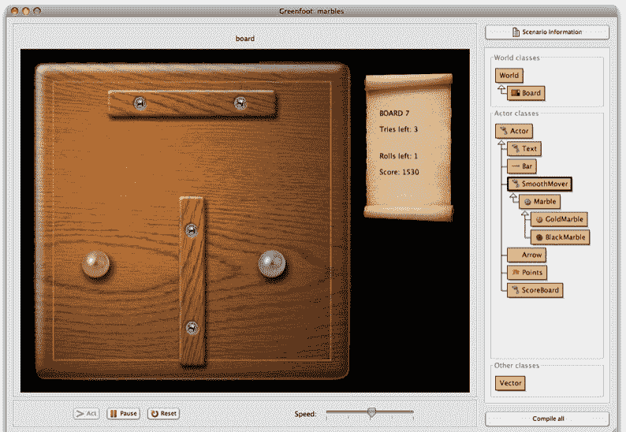

另一个检查碰撞检测的有趣方面是，弹球没有使用任何 Greenfoot 内置的碰撞检测方法，因为这些方法都是针对矩形 `actor` 图像的。相反，弹球是圆形的，而我们需要精确的碰撞检测。

幸运的是，当 `actor` 是圆形的时，这并不困难。如果两个弹球之间的距离（从它们的中心点测量）小于它们的直径，它们就会发生碰撞。我们知道直径，而且距离很容易计算（使用勾股定理）。

下一个有趣点是计算碰撞大弹球的新运动方向。这里涉及一点三角学，但并不太难。

与固定障碍物的碰撞更容易一些，因为它们始终是水平或垂直的矩形。因此，撞击这些障碍物之一的弹球只需反转沿一个轴（`x` 或 `y`）的方向即可。

你可以将大弹球的碰撞逻辑用于所有涉及圆形物体碰撞的游戏。

## 10.2 电梯

电梯场景（图 10.2）展示了一个简单的电梯（或升梯）模拟。它展示了多层建筑的几层楼和三部上下移动的电梯。人们出现在楼层，按下召唤按钮并在电梯到达时进入电梯。

### 图 10.2

一个（部分的）电梯模拟

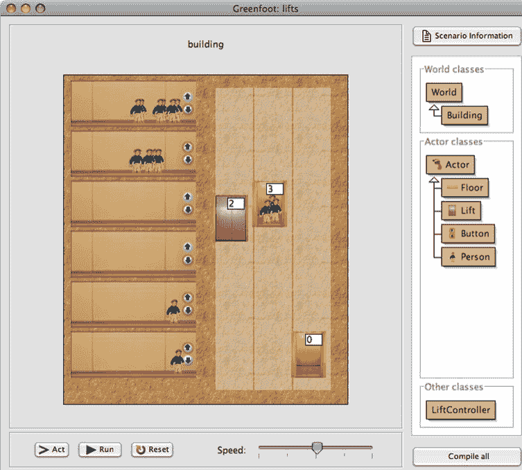

这实际上是一个非常初级的、未完成的实现。我们在屏幕上看到的很多都是虚假的：它没有正确模拟正在发生的事情，只是为了视觉效果而编写。

例如，人们没有正确地进入电梯（当电梯到达某层时，他们被删除了）。电梯中显示的人数只是一个随机数。电梯也没有响应按钮——它们只是随机上下移动。电梯没有实现控制算法。

所以，这是一个展示了思想和画面的快速演示。要完成这个项目，必须对人的移动进行适当的建模（进入和离开电梯）。然后我们就可以尝试实现和测试不同的电梯控制算法。

## 10.3 Boids（群体算法）

Boids 示例（图 10.3）展示了鸟类集群行为的模拟。

“boids”一词源于 Craig Reynolds 在 1986 年开发的程序，该程序首次实现了这种集群算法。在程序中，每只鸟都根据三个规则飞行：

### 图 10.3

Boids：集群行为的模拟

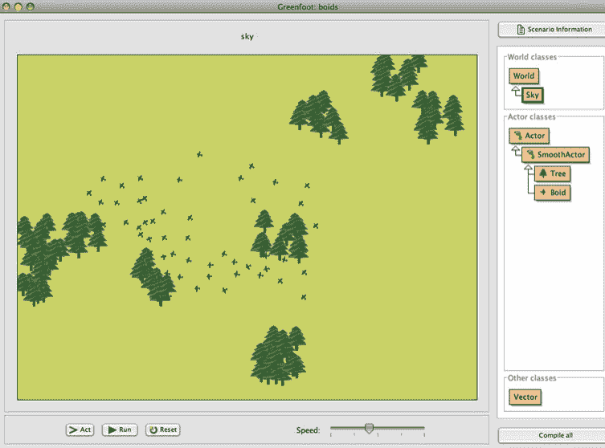

- **分离**：如果离得太近，则远离其他鸟。
- **队列**：向邻近区域其他鸟的平均方向转向。
- **凝聚**：向附近其他鸟的平均位置移动。

通过这种算法，boids 发展出了看起来非常优美的运动。该场景中还包含了避障功能：尽量不要飞进树里。

这种算法的一个版本被用于蒂姆·伯顿 1992 年的电影《蝙蝠侠回归》，用于为计算机生成的蝙蝠群和企鹅群创建动画，并在《魔环》电影中创建兽人军队的运动。

本书中的版本由 Paul Henriksen 编写。

你可以通过在网络上搜索“boids”了解更多信息。虽然这个场景目前除了显示运动外无所事事，但人们觉得某个地方一定有一个游戏……

## 10.4 圆（Circles）

圆形（图 10.4）是一个似乎没有太大目的的项目，但玩起来很有趣而且很好看。

### 图 10.4

“圆形”是物理与艺术的结合

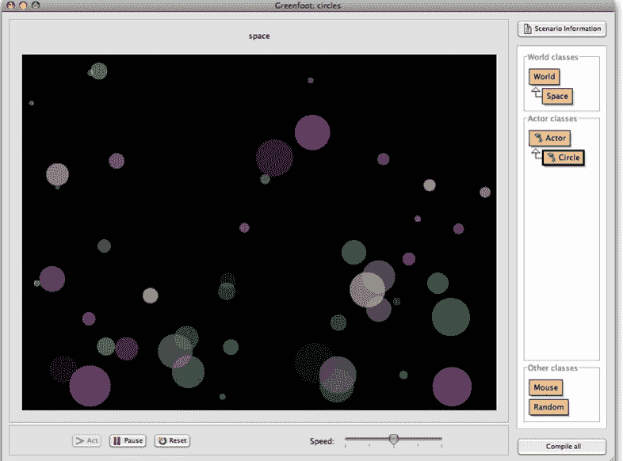

它使用了一些物理模拟（如重力和边缘反弹）以及一些随机性来创建美丽的动态图像。这是物理吗？是艺术吗？或者两者兼有之？

无论它是什么，我相信还有许多其他方法可以产生有趣或美丽的图像、图案或颜色动画。（一个想法可能是将圆形与大弹球游戏中的碰撞检测算法相结合。）

圆形项目由 Joe Lenton 编写。

## 10.5 爆炸

爆炸场景（图 10.5）演示了我们如何实现更壮观的爆炸效果。在这种情况下，爆炸的对象是一个简单的石头，我们在之前的其他场景中遇到过这种物体。（例如，它在小行星场景中扮演了小行星的角色。）但我们真的可以爆炸任何东西，如……

为了实现这一点，我们有一个 `Debris`（碎片）类，代表石头的一部分。当石头爆炸时，我们将其从世界移除并在其位置放置 40 块碎片。

每块碎片都会随机拉伸和旋转，使其具有某种独特性，并且初始具有随机方向的运动向量。在每一步中，我们都会添加一点向下移动来模拟重力，结果就是当你运行此场景时看到的爆炸。

### 图 10.5

一个爆炸效果


一个详细解释该场景的教程视频可以在 Greenfoot 网站获取：<http://www.greenfoot.org/doc/videos>。

## 10.6 打砖（Breakout）

“打砖”（图 10.6）是一个经典游戏，玩家控制屏幕底部的 `paddle` 向上弹球以消除一些方块。如果你不知道这个游戏，搜索一下很快就能发现。

打砖场景是该游戏的局部实现。它使用了我们在第 8 章中讨论过的球体效果，并增加了一个供玩家控制的 `paddle`。然而，它没有目标方块，所以目前的形式并不有趣。

随着时间的推移，打砖出现了许多变体。许多变体使用了不同的布局。很多还有隐藏在方块后的道具——捕捉它们通常会让游戏变得有趣（额外的球、增加的速度）。

以有趣的方式完成这个游戏可以作为一个很好的项目。它还可以修改为每侧一个 `paddle`，将其变成乒乓球（Pong）游戏。

### 图 10.6

打砖开始


## 10.7 跳跃平台（Platform jumper）

一种非常常见的游戏类型是“平台”游戏。玩家通常控制一个游戏角色从屏幕的一个区域移动到另一个区域，克服各种障碍。一种障碍可能是角色行走的地面空隙，通过某种跨越的方法。

企鹅场景（图 10.7）实现了此类游戏的一个小片段。屏幕两侧有两块地面，企鹅可以通过移动的云朵跳到它们上面。

### 图 10.7

一个简单的跳跃平台游戏的开始


详细讨论该场景的教程视频可以在 Greenfoot 网站获取：http://www.greenfoot.org/doc/videos.html，名为“跑步、跳跃和掉落”。

## 10.8 波（Wave）

这里的最后一个场景被称为波（图 10.8）。它是对弦上波传播的简单模拟。尝试一下，你就会发现它是做什么的。

这个示例的迷人之处之一在于，相当简单的实现——在每一轮中，每个小球只是向它的两个邻居的中间移动——实现了对波传播各个方面相当复杂的模拟。

这个示例包含在这里是为了说明，通过一些思考和准备，可以模拟其他学科的各种行为。在这种情况下，它是一个简单的物理效果。同样，我们可以模拟化学反应、生物相互作用、亚原子粒子的相互作用等等。通过一些周密的规划，我们可以学习关于其他应用的知识，同时也学习编程。

此场景还实现了滑块（`slider`）和开关（`switch`）控制，这些在其他项目中可能有用。

### 图 10.8

小珠子链上的波传播仿真

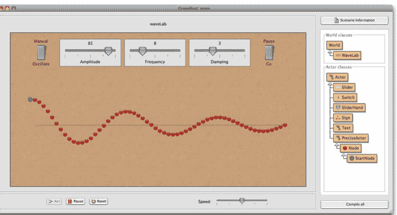

## 10.9 总结

在本书的这一章节中，我们试图向你展示，除了书中详细讨论的几个示例外，你还有许多其他可以遵循的方向。

随着你经验的增加，在开发程序时你将变得更加自信，并更有能力将你的想法变为现实。作为一名程序员，在 Greenfoot 内部以及使用其他开发环境中，一个无限的创意尝试世界正向你展开。

当你在 Greenfoot 之外的其他环境中进行编程时，你将需要学习新的技能和技术，但你使用 Greenfoot 学到的所有知识将是有用且适用的。

如果你一直跟着这本书直到这里，你已经学习了大量的 Java 编程，实际上也学习了通用的面向对象语言编程。在学习编程的过程中，开始总是最困难的，而你已经渡过了这一关。

如果你想获得更多 Greenfoot 编程的支持和创意，请利用 Greenfoot 网站¹。使用 Greenfoot Gallery 发布你的场景，查看他人的作品，并获取一些灵感。查看视频教程以获取提示和技巧。加入讨论组，与其他 Greenfoot 程序员聊天、寻求帮助并讨论新想法。

我们希望你已经像我们一样喜欢编程。如果你是这样的话，整个世界就在你面前。去编程吧，享受其中，并发挥创意吧！

¹ <http://www.greenfoot.org>

# 附录 A 安装 Greenfoot

本附录将告诉你在哪里找到 Greenfoot 软件以及书中使用的场景，以及如何安装它们。

为了运行书中的示例项目，你需要安装三样东西：Java 系统、Greenfoot 软件以及书中的场景。

## A.1 安装 Java

从 <http://java.sun.com/javase/downloads> 下载 Java。你应该安装最新版本的 Java SE 开发工具包（`JDK`）。

在 Mac OS X 上，不需要安装 Java——它已经包含在标准的 Mac OS 安装程序中。

## A.2 安装 Greenfoot

从 <http://www.greenfoot.org> 下载 Greenfoot，并按照安装说明进行操作。

## A.3 安装书中的场景

从 <http://www.greenfoot.org/book> 下载书籍场景。你将收到一个名为 `book-scenarios.zip` 的文件。这是一个必须提取的压缩文件。在 Windows 系统上，通常可以通过右键点击并选择菜单中的“提取所有”来实现。在 Mac OS 和 Linux 系统上，你可以双击进行解压。

解压此文件后，你的文件系统中将有一个名为 `book-scenarios` 的文件夹。记住你把它保存在哪里了——在阅读本书时，你需要从该文件夹中打开项目。

# Greenfoot API

Greenfoot API 由五个类组成：

| 类 | 方法 | 描述 |
| :--- | :--- | :--- |
| `Actor` | `Actor` 方法 | 所有 `actor` 子类可用。 |
| `MouseInfo` |  | 提供关于上一次鼠标事件的信息。 |
| `GreenfootImage` |  | 用于图像展示和处理。 |
| `World` | `World` 方法 | 世界对象可用。 |
| `Greenfoot` |  | 用于与 Greenfoot 环境本身通信。 |

## World 类

- `World(int worldWidth, int worldHeight, int cellSize)`：创建一个新世界。
- `void act()`：世界的 `Actor` 方法。每轮调用一次。
- `void addObject(Actor object, int x, int y)`：向世界中添加一个 `Actor`。
- `GreenfootImage getBackground()`：返回世界的背景图像。
- `int cellSize()`：返回单元格的大小（像素）。
- `Color getColorAt(int x, int y)`：返回单元格中心点的颜色。
- `int getHeight()`：返回世界的高度（单元格数量）。
- `List getObjects(Class cls)`：获取世界中的所有对象。
- `List getObjects(int x, int y, Class cls)`：返回指定单元格处的所有对象。
- `int getWidth()`：返回世界的宽度（单元格数量）。
- `int numberOfObjects()`：获取当前世界中 `actor` 的数量。
- `void removeObject(Actor object)`：从世界中移除一个对象。
- `void removeObjects(Collection objects)`：从世界中移除一个对象列表。
- `void repaint()`：重绘世界。
- `void setOrder(Class... classes)`：设置世界中对象的顺序。
- `void setBackground(GreenfootImage image)`：为世界设置背景。
- `void setBackground(String filename)`：从图像文件设置背景。
- `void paintOrder(Class... classes)`：设置世界中对象的顺序。
- `void started()`：当 Greenfoot 系统启动时被调用。
- `void stopped()`：当 Greenfoot 系统停止时被调用。

## Actor 类

- `void act()`：构造一个 `Actor`。`act` 方法由 Greenfoot 框架调用，让对象有机会执行某些动作。
- `void addedToWorld(World world)`：当插入到世界时调用。
- `GreenfootImage getImage()`：返回表示此 `Actor` 的图像。
- `List intersectingObjects(Class cls)`：返回所有与此对象交叉的对象。
- `List getNeighbors(int distance, boolean diagonal, Class cls)`：返回给定距离内的对象邻居。
- `List getObjectsAtOffset(int dx, dy, Class cls)`：返回指定位置（相对位置）的所有对象。
- `List getObjects(int r, Class cls)`：返回 `r` 范围内的所有对象。
- `Actor getIntersectingObject(Class cls)`：返回交叉的对象。
- `Actor getObjectAtOffset(int dx, dy, Class cls)`：返回指定偏移处的对象。
- `int getRotation()`：返回旋转角度。
- `World getWorld()`：返回所属的世界。
- `int getX()`：返回 `x` 坐标。
- `int getY()`：返回 `y` 坐标。
- `boolean intersects(Actor other)`：检查是否与另一个 `actor` 交叉。
- `void setImage(GreenfootImage image)`：设置图像。
- `void setImage(String filename)`：从文件名设置图像。
- `void setLocation(int x, y)`：设置位置。

## Greenfoot 类

- `Greenfoot()`：构造函数。
- `static void delay(int time)`：延迟 `time` 步。
- `static String getKey()`：获取最近按下的键。
- `static MouseInfo getMouseInfo()`：获取鼠标信息。
- `static int getRandomNumber(int limit)`：返回 0（包含）到 `limit`（不包含）之间的随机数。
- `static boolean isKeyDown(String keyName)`：检查指定的键是否按下。
- `static boolean mouseClicked(Object obj)`：鼠标是否点击了该对象。
- `static boolean mouseDragged(Object obj)`：鼠标拖拽是否结束。
- `static boolean mouseDragged(Object obj)`：鼠标是否在对象上进行拖拽。
- `static boolean mouseMoved(Object obj)`：鼠标是否在对象上移动。
- `static boolean mousePressed(Object obj)`：鼠标是否在对象上按下。
- `static void playSound(String soundFile)`：播放声音文件。


`static void setSpeed(int speed)`

设置执行速度。

`static void start()`

运行（恢复）仿真。

`static void stop()`

停止仿真。

## MouseInfo 类

`Actor getActor()`

返回鼠标相关的 actor（如果有）。

`int getButton()`

按下或点击的按钮编号（如果有）。

`int getClickCount()`

鼠标点击次数。

`int getX()`

鼠标光器的当前 `x` 位置。

`int getY()`

鼠标光器的当前 `y` 位置。

`String toString()`

返回事件信息的字符串表示。

## GreenfootImage 类

`GreenfootImage(GreenfootImage image)`

从另一个 `Greenfootimage` 创建 `Greenfootimage`。

`GreenfootImage(int width, int height)`

创建一个指定大小的空（透明）图像。

`GreenfootImage(String filename)`

从图像文件创建图像。

`void clear()`

`void drawImage(GreenfootImage image, int x, int y)`

将图像绘制到此图像上。

`void drawLine(int x1, int y1, int x2, int y2)`

使用当前绘制颜色在点（`x1`, `y1`）和（`x2`, `y2`）之间画一条线。

`void drawOval(int x, int y, int width, int height)`

用当前绘制颜色按指定的矩形画一个椭圆。

`void drawPolygon(int[] xPoints, int[] yPoints, int nPoints)`

通过 `x` 和 `y` 坐标数组绘制多边形。

`void drawRect(int x, int y, int width, int height)`

绘制指定矩形的轮廓。

`void drawstring(String string, int x, int y)`

使用当前字体和颜色绘制指定的字符串文本。

# GreenfootImage 类（续）

| 方法 | 描述 |
| --- | --- |
| `void fill()` | 使用当前绘制颜色填充整幅图像。 |
| `void fillOval(int x, int y, int width, int height)` | 使用当前绘制颜色填充指定矩形边界内的椭圆。 |
| `void fillPolygon(int[] xPoints, int[] yPoints, int nPoints)` | 使用 `x` 和 `y` 坐标数组填充闭合多边形。 |
| `void fillRect(int x, int y, int width, int height)` | 填充指定的矩形。 |
| `BufferedImage getAwtImage()` | 返回支持此 GreenfootImage 的 `BufferedImage`。 |
| `Color getColor()` | 返回当前的绘制颜色。 |
| `Color getColorAt(int x, int y)` | 返回给定像素点的颜色。 |
| `Font getFont()` | 返回当前字体。 |
| `int getHeight()` | 返回图像的高度。 |
| `int getTransparency()` | 返回图像的透明度（范围 0-255）。 |
| `int getWidth()` | 返回图像的宽度。 |
| `void mirrorHorizontally()` | 水平方向镜像图像（绕 `x` 轴翻转）。 |
| `void mirrorVertically()` | 垂直方向镜像图像（绕 `y` 轴翻转）。 |
| `void rotate(int degrees)` | 绕中心旋转此图像。 |
| `void scale(int width, int height)` | 将此图像缩放到新尺寸。 |
| `void setColor(Color color)` | 设置当前的绘制颜色。 |
| `void setColorAt(int x, int y, Color color)` | 设置给定像素点的颜色。 |
| `void setFont(Font f)` | 设置当前字体。 |
| `void setTransparency(int t)` | 设置图像的透明度（范围 0-255）。 |
| `String toString()` | 返回此图像的字符串表示。 |

## 附录 C：碰撞检测

在本书中，不同的情况下使用了不同的碰撞检测方法。以下是 Greenfoot actor 可用的碰撞检测方法总结，以及它们用途和使用场景的简短说明。

### C.1 方法总结

Greenfoot 的碰撞检测方法可以在 `Actor` 类中找到。共有六个相关方法，如下：

- `getIntersectingObjects(Class cls)`

  返回所有与此对象交叉的对象。

- `getOneIntersectingObject(Class cls)`

  返回一个与此对象交叉的对象。

- `getObjectsAtOffset(int dx, int dy, Class cls)`

  返回所有与给定位置（相对于此对象的位置）交叉的对象。

- `getOneObjectAtOffset(int dx, int dy, Class cls)`

  返回一个位于指定单元格（相对于此对象的位置）的对象。

- `getNeighbours(int distance, boolean diagonal, Class cls)`

  返回给定距离内与此对象相邻的邻居。

- `getObjectsInRange(int r, Class cls)`

  返回此对象周围 `r` 范围内的所有对象。

### C.2 方便方法

其中两个方法 `getIntersectingObjects` 和 `getObjectsAtOffset` 具有相关的方便方法，均以 `getOne...` 开头。

这些方便方法的工作原理与其基于的方法非常相似，但它们返回的是单个 actor 而不是 actor 列表。在可能找到多个 actor 的情况下（例如，其他 actor 同时与我们交叉），返回列表的变体会返回所有相关的 actor。返回单个 actor 的变体则从交叉的对象中随机选择一个。

这些方便方法的目的仅仅是为了简化代码：通常，我们只对单个交叉 actor 感兴趣。在这些情况下，方便方法允许我们处理该 actor，而无需使用列表。

### C.3 低分辨率与高分辨率

正如我们在书中所示的，Greenfoot 世界的分辨率（单元格大小）会有所不同。这与碰撞检测有关，因为我们通常会根据分辨率使用不同的方法。

我们区分了两种情况：低分辨率世界，其中整个 actor 图像完全包含在单个单元格内（图 C.1 a）；以及高分辨率世界，actor 的图像跨越了多个单元格（图 C.1 b）。

图 C.1

Greenfoot 世界中低、高分辨率的示例


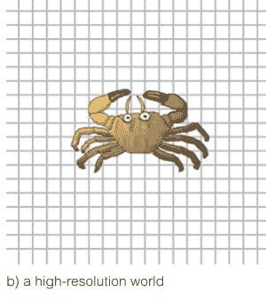

a) 低分辨率世界

b) 高分辨率世界

### C.4 交叉对象

`List getIntersectingObjects(Class cls)`

返回所有与此对象交叉的对象。

`Actor getOneIntersectingObject(Class cls)`

返回一个与此对象交叉的 actor。

这些方法返回图像与调用者 actor 图像交叉的其他 actor。当一个图像的任何部分接触另一个图像的任何部分时，图像即为交叉。这些方法在高分辨率场景下最高。

交叉是通过边界框（bounding boxes）计算的，因此图像完全透明部分的重叠也被视为交叉（图 C.2）。

## C：碰撞检测

图 C.2

使用边界框的 actor 交叉

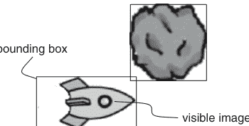

这些方法通常用于检查一个 actor 是否撞到了另一种类型的 actor。使用边界框（而不是图像的可见部分）产生的不准确性通常可以忽略。

参数可以作为过滤器。如果指定了类，则只返回该类的对象。

### C.5 偏移对象

方法：

```java
List getAtOffset(int dx, int dy, Class cls)
返回所有与给定位置交叉的对象。
```

```java
Actor getOneObjectAtOffset(int dx, int dy, Class cls)
返回一个位于指定单元格的对象。
```

这些方法可以用于检查距离 actor 当前位置给定偏移的对象。它们适用于低分辨率和高分辨率场景。

`dx` 和 `dy` 参数指定以单元格为数的偏移。图 C.3 展示了位置的偏移。

图 C.3

检查给定位置的偏移（此处为 `2,0`）

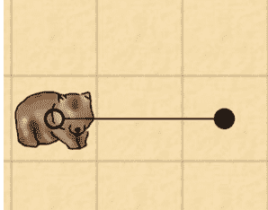

### C.6 邻居

方法：

```java
List getNeighbours(int distance, boolean diagonal, Class cls)
返回给定距离内此对象的邻居。
```

该方法用于获取当前 actor 周围的对象。主要在低分辨率场景下有用。

注意方法名称的拼写：它是 `getNeighbours`（英式拼写）——Greenfoot 没有使用美式系统。

参数指定了应考虑的距离以及是否包含对角线单元。图 C.4 展示了不包含对角线的距离为 I 的邻居单元。

距离 N 定义为从 actor 位置出发 N 步内可以到达的所有单元。`diagonal` 参数决定了算法中是否允许对角线移动。

与之前的方法一样，`cls` 参数提供了考虑给定类对象的选项。

图 C.4

`getNeighbours` 方法的示例


### C.7 范围内的对象

方法：

```java
List getObjectsInRange(int r, Class cls)
返回此对象周围 'r' 范围内的所有对象。
```

该方法返回给定范围内的所有对象。如果对象的位置中心点到调用 actor 的距离为 `r` 或更短，则该对象在范围内（图 C.5）。范围 `r` 以单元格为单位。

图 C.5

给定位置周围的单元格


该方法主要适用于高分辨率场景。与上面的方法一样，可以应用类过滤器。

[第 190 页]

本页特意留

# 附录 D：Java 细节

## D.1 Java 数据类型

Java 包含两种类型：基本类型和对象类型。基本类型直接存储在变量中，它们具有值语义（当赋值给另一个变量时，会复制其值）。对象类型通过存储对象的引用（而不是对象本身）来存储。当被赋值给另一个变量时，只复制引用，而不复制对象本身。

### D.1.1 基本类型

下表列出了 Java 语言中所有的基本类型：

| 类型名称 | 描述 | 示例字面量 |
| --- | --- | --- |
| 整数类型 | | |
| `byte` | 字节大小的整数（8 位） | `24 -2` |
| `short` | 短型整数（16 位） | `137 -119` |
| `int` | 整数（32 位） | `5409 -2003` |
| `long` | 长型整数（64 位） | `423266353L 55L` |
| 实数 | | |
| `float` | 单精度浮点数 | `43.889F` |
| `double` | 双精度浮点数 | `45.632.4e5` |
| 其他类型 | | |
| `char` | 单个字符（16 位） | `'m' '\u00F6'` |
| `boolean` | 布尔值（真或假） | `true false` |

注意说明：

- 不带小数点的数字通常被解释为 `int`，但在赋值时会自动转换为 `byte`、`short` 或 `long` 类型（如果值在范围内）。你可以在数字后加一个 `L` 来将字面量声明为 `long`。（`l`——小写 L——也可以用，但应避免使用，因为它可能被误认为是数字 1）。
- 带有小数点的数字是 `double` 类型。你可以通过在数字后加 `F` 或 `f` 来指定 `float` 字面量。
- 字符可以用单引号括起来写成单个 Unicode 字符，也可以写成以 `\u` 开头的四位 Unicode 值。
- 布尔字面量为 `true` 和 `false`。

由于基本类型的变量不引用对象，因此基本类型没有与之关联的方法。然而，在需要对象类型的上下文中，可能会使用自动装箱（autoboxing）将基本值转换为对应的对象。

下表详细列出了数值类型支持可用最小值和最大值。

| 类型 | 最小值 | 最大值 |
| --- | --- | --- |
| `byte` | `-128` | `127` |
| `short` | `-32768` | `32767` |
| `int` | `-2147483648` | `2147483647` |
| `long` | `-922337203685475808` | `922337203685475807` |
| 正极值 | 正最大值 |
| --- | --- |
| `float` | `1.4e-45` | `3.4028235e38` |
| `double` | `4.9e-324` | `1.7976931348623157e308` |

### D.1.2 对象类型

所有未列在基本类型中的类型都是对象类型。这些包含了标准 Java 库中的类和接口类型（如 `String`）以及用户定义的类型。

对象类型的变量持有指向对象的引用（或“指针”）。赋值和参数传递具有引用语义（即复制的是引用，而不是对象）。在将一个变量赋值给另一个变量后，两个变量引用同一个对象。这两个变量被视为同一个对象的别名。

类是用于对象的，定义了每个实例所拥有的字段和方法。数组的行为类似于对象类型——它们也具有引用语义。

## D.2 运算符

### D.2.1 算术运算符

Java 提供了许多用于算术表达式的运算符，包括：

- 加法
- 减法
- 乘法
- 除法
- 取模

带有小数点的数字是 `double` 类型。你可以通过在数字后加 `F` 或 `f` 来指定 `float` 字面量。

字符可以用单引号括起来写成单个 Unicode 字符，也可以写成以 `\u` 开头的四位 Unicode 值。

布尔字面量为 `true` 和 `false`。

由于基本类型的变量不引用对象，因此基本类型没有与之关联的方法。然而，在需要对象类型的上下文中，可能会使用自动装箱（autoboxing）将基本值转换为对应的对象。

### D.2.2 逻辑运算符

逻辑运算符用于组合布尔表达式以产生另一个布尔值。它们包括：

- 与（`&&`）
- 或（`||`）
- 非（`!`）

`&&` 和 `||` 在应用上略有不同。如果 `&&` 的左操作数为假，则右操作数不会被计算；同样，如果 `||` 的左操作数为真，则右操作数不会。它们被称为短路运算符。

### D.2.3 关系运算符

关系运算符用于比较两个值并返回一个布尔结果：

- 等于
- 不等于
- 小于
- 大于
- 小于等于
- 大于等于

### D.2.4 赋值运算符

赋值运算符用于将值赋给变量，包括：

- `=`
- `+=`
- `-=`
- `*=`
- `/=`
- `%=`

### D.2.5 递和递减运算符

这些运算符将变量的值增加 1 或减少 1：

- `++`
- `--`

### D.2.6 三元运算符

Java 只有一个三元运算符，即条件运算符：

```java
表达式 ? 表达式1 : 表达式2
```

### D.2.7 类型运算符

类型运算符用于检查对象的类型：

- `instanceof`

将第一个 `if-else` 语句的 `else` 部分放置第二个 `if-else` 语句，从而将它们连接起来是非常常见的。这种操作可以无限进行。包含一个最后的 `else` 部分是一个好习惯。

```java
if (n < 0)
{
    handleNegative();
}
else if (number == 0)
{
    handleZero();
}
else
{
    handlePositive();
}
```

### D.3.1.2 switch

`switch` 语句根据单个值切换到任意数量的情况（case）。两种可能的用法模式如下：

```java
switch (expression)
{
    case value: statements;
    break;
    case value: statements;
    break;
    further cases omitted
    default: statements;
    break;
}
```

```java
switch (expression)
{
    case value1:
    case value2:
    case value3:
        statements;
        break;
    case value4:
    case value5:
        statements;
        break;
    further cases omitted
    default:
        statements;
        break;
}
```

注意事项：

- `switch` 语句可以有任意数量的 `case` 标签。
- 每个 `case` 后面都需要一个 `break` 指令，否则执行流将“穿透”（falls through）到下一个标签的语句。上面的第二种形式就利用了这一点。在这种情况下，前三个值都将执行第一个语句部分，而值四和五将执行第二个语句部分。
- `default` 情况是可选的。如果没有给出 `default`，可能会出现没有 `case` 代码被执行的情况。


- `default`（或如果没有 `default` 则为最后一个 `case`）之后的 `break` 指令不是必须的，但被认为是一种良好的风格。

示例：

```java
switch (day)
{
    case 1: dayString = "Monday";
    break;
    case 2: dayString = "Tuesday";
    break;
    case 3: dayString = "Wednesday";
    break;
    case 4: dayString = "Thursday";
    break;
    case 5: dayString = "Friday";
    break;
    case 6: dayString = "Saturday";
    break;
    case 7: dayString = "Sunday";
    break;
    default:dayString = "invalid day";
    break;
}
switch(month)
{
    case 1:
    case 3:
    case 5:
    case 7:
    case 8:
    case 10:
    case 12:
        numberOfDays = 31;
        break;
    case 4:
    case 6:
    case 9:
    case 11:
        numberOfDays = 30;
        break;
    case 2:
        if(isLeapYear())
            numberOfDays = 29;
        else
            numberOfDays = 28;
        break;
}
```

## D.3.2 循环

Java 有三种循环：`while`、`do-while` 和 `for`。`for` 循环有两种形式。除了 `for-each` 循环外，每种循环都通过一个布尔表达式来控制重复。

### D.3.2.1 `while`

`while` 循环只要给定的表达式求值为 `true`，就会执行一个语句块。表达式在执行循环体之前进行测试，因此循环体可能会执行零次（即完全不执行）。这种能力是 `while` 循环的重要特性。

```java
while (expression)
{
    statements;
}
```

示例：

```java
System.out.print("Please enter a filename: ");
input = readInput();
while (input == null)
{
    System.out.print("Please try again: ");
    input = readInput();
}
```

```java
int index = 0;
boolean found = false;
while (!found && index < list.size())
{
    if(list.get(index).equals(item))
    {
        found = true;
    }
    else
    {
        index++;
    }
}
```

### D.3.2.2 `do-while`

`do-while` 循环只要给定的表达式求值为 `true`，就会执行一个语句块。表达式在执行循环体之后进行测试，因此循环体至少执行一次。这是与 `while` 循环的一个重要区别。

```java
do
{
    statements;
} while (expression);
```

示例：

```java
do {
  System.out.print("Please enter a filename: ");
  input = readInput();
} while (input == null);
```

### D.3.2.3 `for`

`for` 循环有两种形式。第一种形式称为 `for-each` 循环，专门用于迭代集合中的元素。循环变量在循环的每次迭代中被赋值为集合中连续元素的值。

```java
for (variable : collection) {
  statements;
}
```

示例：

```java
for (String note : list) {
  System.out.println(note);
}
```

第二种形式的 `for` 循环只要条件值为 `true` 就会执行。在循环开始之前，初始化语句精确执行一次。条件在每次执行循环体之前进行评估（循环可能会执行零次）。增量语句在每次执行循环体后执行。

```java
for (initialization; condition; increment) {
  statements;
}
```

示例：

```java
for (int i = 0; i < text.size(); i++) {
  System.out.println(text.get(i));
}
```

两种类型的 `for` 循环通常用于执行固定次数的循环体——对于集合中的每个元素执行一次。如果要在迭代集合修改修改集合，则不能使用 `for-each` 循环。

# 目录

## 187

- Greenfoot Gallery, 59–60
- Greenfoot images, 47–48
- Greenfoot 界面, 3
- `greenfootImage` 类, 47, 50, 103
- Greeps 场景, 123–124

### 列表类型

- 泛型, 91
- 在 Newton's Lab 场景中, 90–91
- Little-crab 场景, 16–26
- 改进
  - 添加龙虾, 35–36
  - 添加声音, 40–42
  - 添加虫, 30–32
  - 创建新方法, 33–35
  - 吃虫子, 22–33
  - 键盘控制, 36–38
  - 增加随机行为, 27–29
- 改进（完成）
  - 自动添加对象, 43–45
  - 交替图像, 52
  - 动画图像, 46
  - 计数虫, 33–54
  - `little-crab-2`, 30
  - `little-crab-3`, 38
  - `little-crab-4`, 41
  - `little-crab-5`, 46, 55

## I

- `If` 语句, 24, 52–53
- 图片文件和格式, 133
  - BMP, 135
  - GIF, 135
  - JPEG, 134
  - PNG, 134–135
  - TIFF, 135
- 图像
  - 动画, 46
  - 与动态绘制结合, 137–109
  - 绘制, 135–137
  - 交替, 52
  - Greenfoot, 47–48
- `Import` 语句，参见 Java 库类, 86
- 缩进, 25
- 索引，也参见 Arrays, 72
- 无限循环, 70
- 继承, 16
- 继承的方法, 42
- 实例变量（字段）, 48–49
- 实例，参见 Objects
- `Int` 类型, 7–9
- 与对象交互, 6
- 调用 `method()`, 36–37
- 局部
  - 方法, 42
  - 变量, 69–70
- Lock 场景，也参见 Sharing 场景, 58
- 逻辑运算符
  - AND (`&`), 64
  - NOT (`!`), 64
- 循环
  - `for`, 104–105
  - `for-each`, 91–92
  - 无限, 70
  - `while`, 69–105

## J

- `jar` 文件, 57–58
- Java 库类, 86–87
- Java 库文档, 86–87
- JPEG 格式, 134

## M

- Marbles 场景, 154–155
- Math 类, 94–95
- 方法
  - 调用，定义, 19
  - 已定义, 19
  - 继承, 42
  - 调用
    - leaves-and-wombats 场景, 6–7
    - Newton's Lab 场景, 79–80
    - 局部, 42
  - 重载, 82
  - 私有, 89
  - 公有, 89

## K

- 键盘控制, 36–37

## L

- Leaves-and-wombats 场景, 3
- 库类，参见 Java 库类
- Lifts 场景, 155–156
- 列表，定义, 90

## 188

# 目录

- 方法签名, 9, 18
- 单声道录制, 132
- `move()`
  - asteroids 场景, 107
  - leaves-and-wombats 场景, 7
  - little-crab 场景, 18–20, 23–24
  - Newton's Lab 场景, 88–89

## P

- 包, 86
- 参数, 8–9, 19–20
  - 空参数列表, 8
  - 参数列表, 8
- 暂停按钮, 10
- 费洛素类, 146–150–151
- Piano 场景, 61

## N

- `New` 语句, 45–46
- 牛顿, Isaac, 78
- Newton's Lab 场景, 78
- 重力场景, 87–90
- 应用重力, 93–95
- 碰撞检测, 98
- 创建运动, 85
- 重力与音乐, 97–98
- 辅助类
- Newton-Lab-1, 79
- Newton-Lab-2, 95
- Newton-Lab-3, 97
- 使用 Java 库类, 86–87
- World 方法, 80
- 非 `void` 返回类型，参见返回类型, 7
- little-crab 场景, 23
- 正态分布, 148
- Nygaard, Kristen, 142
- 动画键, 62–64
- 创建多个键（抽象化）, 66–67
- piano-1, 61–63
- piano-2, 66
- piano-3, 67
- piano-4, 75
- 产生声音, 65–66
- 使用循环（`while`）, 69–71
- Platform jumper, 160–161
- `playSound()`, 40–41, 65, 129
- PNG 格式, 134–135
- 掠食者模拟，参见 Foxes-and-rabbit
- `Private` 关键字, 48
- 私有方法, 89
- 波形
  - asteroids 场景, 115
- 公有方法, 89
- 发布，参见 Sharing 场景
- Greenfoot Gallery, 59–60

## Q

- Question，也参见返回类型, 23

## O

- Objects, 4
- 在 asteroids 场景中, 12
- 在 leaves-and-wombats 场景中, 4–5
- little-crab 场景改进, 43–45
- 对象的自动添加, 45
- 与对象交互, 119–121
- leaves-and-wombats 场景, 6–7
- 逻辑运算符, 64
- 方法重载, 82

## R

- Rabbits，参见 Foxes-and-rabbit
- 随机行为, 27–29
- 随机分布, 148
- 正态（高斯）分布, 148
- 均匀分布, 148
- 录制
  - 单声道, 132
  - 录制与编辑, 130–131
  - 立声, 132


## 189

# 目录

- 分辨率，参见 Screen resolution
- 返回类型, 7
- 非 `void`, 23
- 返回值, 7–8
- Reynolds, Craig. 156
- Run 按钮, 0, 19
- 文件格式和大小, 131–139
  - AIFF, 131
  - AU, 131
  - 格式编码, 132
  - 采样格式, 132
  - 采样率, 132
  - 立声单声道录制, 132
  - WAV, 131–132
- Soundiest 场景, 129

## S

- 场景
  - ants 场景, 145–153
  - asteroids, 10–14, 101–121
  - boids, 156–157
  - 突破, 159
  - 圆形, 157–158
  - 爆炸, 158–159
  - 导出，参见 Sharing 场景
  - greeps, 123
  - leaves-and-wombats, 3–10
  - lifts, 155–156
  - little-crab 场景, 16–60
  - marbles, 154–155
  - Newton’s Lab, 78–98
  - piano, 61–76
  - platform jumper, 160–161
  - 共享（导出）, 57–60
  - smoke, 137
  - soundest, 129
  - 波形, 161–162
- 源代码, 13–14
  - 编译, 41
- Stars，参见 Asteroids 场景
  - 绘画, 103–104
  - `Static` 关键字, 84
  - 静态方法, 28
  - 参见 Little-crab 场景
  - 立声录制, 132
  - `stop()`, 40
- `String`
  - 类, 76
  - 类型定义, 76
- 字符串拼接, 75
- 子类, 10–12

## T

- `this` 关键字, 84
- TIFF 格式, 135
- 透明度，参见 Images, 34
- 值, 135
- 旋转
  - asteroids 场景, 106–107
  - leaves-and-wombats, 7
  - little-crab 场景, 18–20, 23–24
  - 屏幕分辨率, 44, 69
  - `setImage()`, 40, 106, 108
  - `setRotation()`, 47
- 共享场景
  - 导出到, 57–58
  - 导出到网页, 58
  - 发布, 59–60
- 短方法, 149
- 签名，参见方法签名
- 模拟
  - ants 场景, 145–153
  - 定义, 141
  - foxes-and-rubies, 142–144
  - Newton’s Lab, 78–98
  - smoke 场景, 137
  - smoother 类, 80–81
- 声音
  - 播放, 40–41, 65–66, 129
  - `playSound()`, 40–41, 129
  - 录制, 42, 130–131

## U

- 均匀分布, 148

## V

- 变量，也参见常量
  - 定义, 48
  - 在构造构造函数中初始化, 51
  - 实例, 48–49
  - 局部, 69–70
- Vector 类（Newton 场景）, 82
- 向量表示
  - 卡卡尔, 82
  - 极坐标, 82
- `Void` 返回类型，参见 Non-void
- 返回类型
  - 命令, 7
  - little-crab 场景, 23
- `While` 循环, 69–71, 105
- Wombat 类, 4–5
- World
  - 区域, 4
  - 方法, 80
  - World 类, 10, 45

## W

- WAV，参见 声音播放场景
- 声音文件格式, 131–132
- 波形场景, 161–162
- 虫（little-crab 场景）
  - 添加, 30–32
  - 计数, 53–54
  - 吃, 32–33
