# 药学公共卫生入门指南

## 贡献者


**贡献者** 🔒

**作者：** Bruce Lubotsky Levin, Ardis Hanson 和 Peter D Hurd

### Barry A. Bleidt, PhD, PharmD, RPh, FAPhA, FNPh

教授，社会行为与行政药学

药学院-佛罗特劳德尔校区

诺瓦东南东大学

佛罗特劳德尔，佛罗里达州

### Patrick J. Bryant, PharmD

实践与管理分系临床教授

药物信息中心主任

密苏里大学堪萨斯市药学院

堪萨斯市，密苏里州

### Krystal Bullers, MA, AHIP

研究与教育图书员；药学院联络人

Shimberg 健康科学图书馆

南佛罗里达大学

坦帕，佛罗里达州

### Melody Chavez, MPH, RDN, LD/N

博士研究生

社区与家庭健康系

公共卫生学院

南佛罗里达大学

坦帕，佛罗里达州

### Carmita A. Coleman, PharmD, MAA

副教授兼兼任院长

药学院

芝加哥州立大学

芝加哥，利诺伊州

### Daniel Forrister, PharmD

助理教授

药学院

南佛罗里达大学

坦帕，佛罗里达州

### Angela S. Garcia, PharmD, MPH, CPh

助理教授

药物治疗学与临床研究

药学院

药学实践系

南佛罗里达大学

坦帕，佛罗里达州

### Scott K. Griggs, PharmD, PhD

助理教授

药剂与行政科学系

圣路易斯，密苏里州

### Justinine Guyton, PharmD

药学实践助理教授

圣路易斯药学院

圣路易斯，密苏里州

### Ardis Hanson, PhD

研究与教育副主主任

Morsani 医学院

南佛罗里达大学

Shimberg 图书馆

### Peter D. Hurd

药学管理教授及药剂与行政科学系主任

圣路易斯药学院

### Bruce Lubovsky Levin, DrPh, MPH

副教授兼系主任

行为健康方向

社区与家庭健康系

公共卫生学院及

副教授兼主任

儿童与青少年行为健康硕士学位项目

儿童与家庭健康系

行为与社区科学学院

南佛罗里达大学

### Earlie Biddle Little, PhD, RPh

教授兼副院长

学生与专业事务处

药学院

高点大学

高点，北卡罗来纳州

### Stephanie Lukas, PharmD, MPH

药学管理助理教授

药剂与行政科学系及

国际项目办公室副主任

圣路易斯药学院

圣路易斯，密苏里州

### Robert L. McCarthy, RPh, PhD

药学实践教授

名誉院长

药学院

康涅狄格大学

斯特斯，康涅狄格州

### Aimon Miranda, PharmD, BCPS

助理教授

药学实践系

药学院

南佛罗里达大学

坦帕，佛罗里达州

### Carol A. Ott, PharmD, BCPP

药学实践临床教授

临床药学专家，精神科

Eskazeni/Midtown 社区心理健康

普渡大学药学院

印第纳波利，印第安纳州

### Donna J. Petersen, ScD, MHS, CPH

高级副总裁

南佛罗里达大学健康中心

教授兼院长

公共卫生学院

南佛罗里达大学

坦帕，佛罗里达州

### Silvia E. Rabion, EdD, FAACP

副教授，公共卫生

社会行为与行政药学

药学院-佛罗特劳德尔校区

诺瓦东南大学

佛罗特劳德尔，佛罗里达州

### Lauri Wright, PhD, RDN

助理教授兼主任

临床营养项目

营养与膳食系

南佛罗里达大学

杰克斯维尔，佛罗里达州

### Samuel H. Zuve, PhD

高级经济学家

罗马维尔，马里兰州

## 前言：公共卫生视角


**贡献者** 🔒

**作者：** Bruce Lubotsky Levin, Ardis Hanson 和 Peter D Hurd

## 前言：药学视角

**作者：** Robert L. McCarthy

在撰写《药学公共卫生导论》第一版时，我注意到公共卫生领域在21世纪面临着严峻挑战，与一个世纪年前有着许多相似之处。所有医疗保健专业人员（包括药师）在确保广大公众接受教育并保护其免受从环境问题到耐药微生物等各种威胁的影响方面，都发挥着至关重要的作用。鉴于这些潜在的危害，我认为现在药师扎根于公共卫生原则比过去任何时候都更为重要，这使他们能够将自己在药物治疗管理方面的卓越专业知识应用于人群护理中，特别是针对高风险人群。

《药学公共卫生导论》第一版为药学学生和执业药师提供了公共卫生原则的入门指南。该书的出版获得了广泛赞誉，它是首部从药学和药师视角独特地解决公共卫生问题的教材。

在第一版优势的基础上，《药学公共卫生导论》（第二版）通过提供额外的国际案例（包括健康挑战和疾病）拓展了更广阔的全球视野。参考文献已更新，以分享最的理念和公共卫生方法；同时还加入了额外的案例。书中的内容经过了修订，反映了教师在课堂中使用该教材的经验。

新版还进行了结构重组，以便读者获取感兴趣的主题。美国和全球的公共卫生与药学在不同的章节中呈现，使读者能够比较美国及全球的公共卫生状况。新增了关于营养和健康素能力的章节。专注于公共卫生服务融资的章节已重构为对联邦计划、融资和保险的讨论。本书以一个侧重于教育和领导的章节结束。

最后，新版补充了《药学公共卫生导论》第一版中那些用且实用的公共卫生信息。对于药学学生来说，它介绍了公共卫生领域以及药师在基于人群的医疗保健中可以做出的重要贡献。对于执业药师来说，它既是一次复习，也列出了种种可能性。所有读者都应该能对公共卫生有更深的理解，并深刻意识到药学和公共卫生在帮助确保社会健康方面所起的关键作用。


## 前言

**作者：** Bruce Lubotsky Levin, Ardis Hanson, 和 Peter D Hurd

当本书初版在构思时，深受美国药学院协会（CAPE）《CAPE 2004 教育成果》以及围绕《健康的人民 2010》相关讨论的影响。这两份文件都在药学与公共卫生之间建立了强有联系。从那时起，我们继续强调全球疾病负担以及健康社会决定因素在国家和国际层面的影响。

第二版继续在 CAPE 教育成果（2013）和《健康的人民 2020》的基础上，强调了循证实践、健康促进与疾病预防、健康素养、文化敏感性、以患者为中心的护理与倡导、药物管理、文化敏感性以及对新兴理论的意识与分析的重要性。

本第二版继续基于 CAPE 教育成果（2013），强调了循证实践、健康促进与疾病预防、健康素养、文化敏感性、以患者为中心的护理与倡导、药物管理以及对新兴理论的意识与分析的重要性。从那时起，我们继续强调全球疾病负担以及健康社会决定因素在国家和国际层面的影响。

公共卫生与药学的结合是逻辑性的，因为我们认为这些学科在许多方式和许多领域是紧密交织的。将人群健康、个人健康和社区服务视角相结合，可以为药师和公共卫生从业者提供更全面的理解。然而，在鼓励拥有药学学位的人员更充分地参与公共卫生方面，我们仍有很长的路要走。我们认为，药师在实践中有很多未被认可和未利用的机会；因此，在公共卫生方面有更实质性的基础可能会使这些机会显而易见。我们强调了药学学生和药师建立公共卫生知识基础的概念和问题。首先，我们界定了美国和全球的服务体系。然后，我们对对人群健康/社区视角感兴趣的药学学生和从业者考察了传统和新兴的公共卫生领域。对于希望在人群健康水平工作的从业者，疾病预防和健康促进活动已从戒烟计划扩展到对营养和行为健康问题的咨询。计划和管理视角被组织用于解决融资和保险、药物经济学、循证服务以及信息学问题。最后，我们如何更好地教育和培训从业人员，以应对不断变化的公共卫生和医疗保健环境？

本第二版的特点是各章节作者的协作，他们在公共卫生和药学方面均具有深厚的背景。来自公共卫生和药学领域作者的综合知识有助于证明本书对学生和从业者的相关性和真实性。本版的第二个特点是“对公共卫生和药学的启示”部分，它出现在书的每一个章节中。我们的章节作者描述了各自章节对公共卫生和药学领域的意义。第三个特点是全球视角，这在每个章节都有涉及。

在本版中，所有章节均为原创。虽然很难涵盖公共卫生和药学的所有相关主题，但编辑们试图涵盖广泛的主题，以激发并增加对公共卫生和药学问题的参与。

新增章节涵盖全球健康、营养、健康素养和循证实践。某些章节保留了原作者，但经过大幅修订，以应对当前的挑战和关注。其他章节则有了新作者，为主题带来了新的视角和内容。为了增加章节之间的一致性，编辑也参与了章节的编写。

我们强调了药学学生和药师建立公共卫生工作基础所需的概念和问题。

我们希望本书能激发药学从业者和公共卫生专业人员的兴趣，增加他们对各自领域的参与，并更充分地参与跨专业活动。


`DOI: 10.1093/9780190238308.001.0001`

世界卫生组织（1948，第1页）在社会经济框架内对健康进行了定义，其目的是让个人过上富有生产的生活：关注生理、心理和社会健康，而非没有疾病或病态。这一定义自1948年以来保持未变，并反映在美国的“健康人类”（Healthy People）倡议中，最近一次是“健康人类2020”。健康人类2020”还涉及了健康的社会决定因素之间的关系（公共卫生紧急情况，2017年），以及这些因素如何影响和作用人群健康结果。“健康人类2020”的注记之处在于，它识别了美国最重大的公共卫生问题，并作为在地方、州和国家层面提高公众健康的指南。它是对美国认为最需要解决的健康问题的期10年“时间快照”。在本章中，我们将概述美国的公共卫生系统以及药学实践、研究和教育。

尽管许多公共卫生的定义侧重于疾病预防和健康促进，但最推崇的定义来自查尔斯·爱德华·阿莫里·温斯洛（Charles-Edward Amory Winslow），他是美国公共卫生实践的先驱。温斯洛将公共卫生视为一种艺术也是一种科学，其目标是建立健康的生活标准，以维持或改善社会的健康（Winslow，1920，第6-7页）。尽管自1920年以来，“公共卫生”这一术语被多次重新审视，但温斯洛的定义指导了此后所有关于什么是公共卫生的讨论。

虽然健康在患者护理和医疗服务的方法上是多学科的，但其重点是使用循证实践。公共卫生领域在检查风险人群的健康问题时利用多学科方法。与此不同，健康的侧重点是人群。它大量借鉴了生物统计学、流行病学、环境与职业健康、卫生政策管理、社区与家庭健康以及全球健康等领域。其专业人员包括护士、医生、流行病学家、统计学家、健康教育员、环境健康专家、毒理学家、工业卫生学家、卫生员、食品药品检验员、实验室技术人员、环境科学家、危机与灾难专家、兽医、经济学家、社会科学家、律师、营养师、社工作者、行政人员以及许多专业人士。

尽管药学包含了许多患者护理方面（例如接种、依从性和药物信息）以及更多与产品相关的职责（包括药物的制备、调配和正确使用），我们认为药学是连接以患者为中心的护理与公共卫生之间的桥梁。在药学实践中，个体患者和患者所在的社区同样重要。2014年，全国零售连锁店 CVS 调整了烟草产品的销售策略，使其与其新名称 CVS Health 保持一致，放弃了约20亿美元的销售额，以反映对零售客户的健康导向的考量（Zliobro，2014）。虽然无烟草产品在美国并不新鲜，但减少可以购买香烟的地点对公共卫生的影响有助于减少对个人的烟草销售，并可能提高社区健康水平。

# 美国公共卫生与药学

虽然一些人认为药房是销售药物（包括处方药）的地方，但药学实践的重心继续从“以产品为导向”向“医疗保健导向”转变。社区药学和医院药学是美国医疗体系的重要组成部分，而可以在社区、医院、养老院或其他护理场所开展的临床药学，则侧重于优化患者使用药物的效果。药学作为最大化药物益处的信息来源，是未来的关键。

公共卫生并不是一个新概念。从古希罗马对人群健康的概念化开始，通过中世纪的瘟疫和现代的大流行病，公共卫生一直在应对疾病的生物学和社会决定因素。希波拉底文献最早将环境因素与疾病联系起来。罗马对卫生的强调以及公立医院的建立是西方公共卫生系统的起点。1546年吉罗莫·弗拉斯卡托（Girolamo Frascator）对传染病和传播的早期理论，以及1713年贝纳迪尼·拉马齐尼（Bernardino Ramazzini）对环境和职业疾病的发现，对新兴的公共卫生领域出了贡献（Rosen，1958）。流行病学方法、重要统计数据的收集、地区和国家健康调查的使用、贫困与疾病之间的关联，以及通过卫生改革减少疾病传播，是公共卫生兴起的核心。

早期，公共卫生和药学的角色通过立法、社会变化、技术和医疗体系得到了完善和重新定义。从1988年开始，医学学院（IOM）公共卫生未来研究委员会（IOM委员会）严密审查了公共卫生计划，以及美国政府机构内部和州县卫生部门（LHDs）之间的服务协调。《公共卫生未来》（IOM，1988）既定义了公共卫生的实质和使命，也重建了温斯洛基于社区的预防和促进重点，以实现促进健康社区和生活方式的社会目标。

通过与大的公共卫生社区合作，定义了公共健康的三个核心功能：

- (a) 评估
- (b) 政策制定
- (c) 保（在社区提供公共卫生服务）

（IOM，1988）还确定了哪个政府级别（联邦、州和地方）最适合处理这些核心功能。

当美国公共卫生局的药剂在国立卫生研究院（NIH）、美国食品药品管理局（FDA）和印第安人健康服务（IHS）提供患者护理服务时：

（Church, 1987, 1989），美国制药行业正随着生物技术的进步、新产品的研发以及新型药服务的经历重大变革，以适应患者护理、药物递送和药学管理的社会经济变化（Dullusio, 1989; Penna, 1987）。药学教育也处于重新审查阶段，因为社区药学和医院药学的需求得到了认可（Ozzidis, 1988）。随之出现的是一系列关于药业的建议，包括呼吁将药学视为一门学术学科（Lemberger, 1988）、住院医师培训计划的变更，以及强调药学博士（PharmD）是药学执业人员的唯一入职级学位（Smith, 1988）。药业的“专业化”意味着回归到其前工业时期的起源，即“有价值、复杂、特定且具有承诺精神的公共服务”（Hepler, 1988, p. 1071），并强调患者护理和药学服务的质量保证。

1993年，人们开始在拟议的国家医疗保健改革框架内重新定义公共卫生，例如11990年《综合预算协调法案》（OBRA-90; Pub.L.101-508, 104 Stat. 1388）和拟议的1993年《美国健康安全法案》（H.R. 1200, 第133届国）。拟议的《美国健康安全法案》强调扩大医疗保健接触、控制医疗成本、确保护理质量、融资改革以及改善医疗卫生基础设施以维持和提高健康水平（评估医疗保健改革建议委员会, 1993）。立法上的变化，例如11990年《综合预算协调法案》中的医疗救助回扣，以及拟议的《修正法案》中的医疗保险门诊药物福利，将影响药学实践。尽管 OBRA-90 旨在确保医疗救助患者获得特定的药学护理，但该法律要求对所有患者提供相同类型的护理，而不仅仅是医疗救助患者。药剂师现在被要求提供咨询、满足潜在的药物使用审查要求，并履行记录义务。

到1994年，美国公共卫生服务核心公共卫生功能指导委员会制定了“十项基本公共卫生服务”，用于执行我们社区的基本医疗保健功能。如图1-1所示，这些基本服务是迭代的，可以很容易地归类三个核心功能：(a) 评估、(b) 政策制定和(c) 保障。

1. 监测健康状况以识别社区健康问题；
2. 诊断并治疗社区内发现的健康问题和健康危害；
3. 就健康问题进行宣传、教育和赋能；
4. 动员社区参与以识别和解决健康问题；
5. 制定支持和促进健康工作的政策和计划；
6. 执行保护健康和安全的法律法规；
7. 将人们与所需的个人健康服务联系起来并确保医疗保健质量；
8. 建立胜任的公共和个人健康系统；
9. 评估医疗保健和人群健康的有效性、可及性和质量；
10. 为健康问题研究新的创新的解决方案。

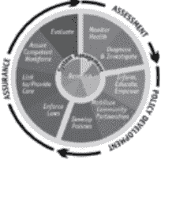

图1-1. 公共健康的十项基本服务。

到2000年，联邦有关公共健康的政策发生了许多变化。医务长发布了关于心理健康的报告，使心理健康成为国家优先事项。“大脑十年”项目已经结束，生理和心理疾病的神经科学领域取得了巨大进展。此外，“健康人类2000”倡议刚刚开始。随着这十年的推进，额外的变化反映了向管理医疗保健融资模式的转变、循证（决策）过程的结合、交叉（公私）健康伙伴关系的增加，以及对广泛健康系统内部及之间问责的要求。公共卫生被描述为“发生在公共卫生中复杂的自适应系统”（21世纪确保公众健康委员会, 2002, p. xiii）。政策制定者和从业者希望获得循证的建议以改善公共卫生和人群健康结果，并规定在何种条件下人群健康会改善，以及可以做什么来影响这些条件（Browson, Fielding, & Mayln, 2009; Victoria, Habicht, & Bryce, 2004）。健康沟通和劳动力开发/能力被认为是有效提供医疗保健服务和促进公共健康的关键过程（Anderson et al., 2005; Hill, Aldi, & Auerbach, 2010）。


公共卫生的重要性在 2011 年至 2012 年再次凸显。医学研究所（IOM）撰写了一系列名为《为了公众健康》（For the Public’s Health）的报告。

第一份报告关注国家、州和地方政府的公共卫生衡量及相关问责。IOM 改善健康公共卫生策略委员会（2011）强调了衡量的作用，以及数据为我们提供了不同方式理解健康状况的方法（决定因素或根本原因），并根据不同类型的证据（国家级、地方或比较性的）来衡量美国公共卫生系统中许多利益相关者的表现，以及根据对系统的投入来看结果是否成功。尽管很难在医疗系统的行为与健康结果之间建立因果关系，但衡量是基础性的。

第二份报告描述了建立公共卫生部门结构、职责和权限的法律，并审查了法律法规如何预防伤害和疾病并优化健康结果（改善健康公共卫生策略委员会，2011a）。它还涉及法律和监管权限、公共卫生立法以及公共卫生法律法规对社会政策的影响。

第三份报告考虑了维护和维持稳健的人群健康系统所需的资源。关于死亡和疾病的远端（实际）和近端（辅助）原因，已有大量知识储备，以及损害健康和增加风险的现有社会经济状况（改善健康公共卫生策略委员会，2012，p. 2）。然而，需要新的基准来观察国家的健康状况。两个新基准是人寿命和人均健康，作为健康系统绩效的目标。

报告还建议对行政规则和现有资金流（例如合同、资助和合作协议）进行程序变更，以创建更具活性、自适应且负担得起的资源。重要的是，报告还敦促建立“公共卫生服务的最低标准包，其中包括基础能力和任何卫生部门不可或缺的基本计划”（改善健康公共卫生策略委员会，2012，p. 5），这是基于三个核心公共卫生功能和十项基本公共卫生服务的。

随着《患者保护与负担医疗法案》（平负担医疗法案 [ACA]，Pub. L. No. 111-148）的通过，创建了许多公共卫生倡议，包括建立国家预防、健康促进和公共卫生委员会，建立预防和公共卫生基金，并重新定义了它们在国家的角色（人群健康改善，2013）。

此外，ACA 永久重新授权了《印第安人医疗改善法案》，为美国原住民和阿拉斯加原住民提供医疗服务的权限（印第安人医疗改善法案，25 US Code 18）。这些倡议是对人群和健康的广泛理解的响应，这种理解基于地理或地缘政治边界内个人健康结果的分布（Jacobson & Teutsch，2012；Kindig & Startz，2003）。

## 健康的人 2020、公共卫生以及药学在公共卫生中的作用

《健康的人 2020》确定了跨越 42 个不同公共卫生主题领域的 1,200 个目标。这些目标和主题被归类为 22 个重点领域。在 22 个重点领域中，前 21 个涉及健康促进、健康保护和预防性服务；第 22 个领域涉及建立基础设施，以追踪这些目标，并在国家、州和地方层面识别和评估公共卫生问题。“健康的人”计划的生存意义在于改善美国公众的健康，而药学和药剂师的角色可以在其许多目标中找到。

在《健康的人 2020》的“教育与社区计划（ECBP）”目标中，目标 `ECBP-17` 要求在药学博士学院和健康学院中包含核心临床预防和公共卫生内容。目标 `17.1` 到 `17.6` 分别专门针对健康促进和疾病预防咨询内容、文化多样性内容、健康科学文献评估内容、环境健康内容、公共卫生系统内容以及全球健康内容。数据源自美国药学院协会的专业及研究生学位课程调查。2012 年，基线数据为 99.2%，设定的目标为 100%。

考虑到加入药学研究生教育的六个内容领域，我们看到药剂师在公共卫生领域为《健康的人 2020》目标贡献的增长。其中一个领域是“医疗服务的获取”（`AHS-6.4`），旨在减少无法或延迟获得必要医疗护理、牙科服务或处方药的人数。

第二个领域是“残疾与健康（DH）”。`DH-1` 目标旨在增加基于人群的数据系统数量，例如使用标准化核心问题识别残疾人士的药学管理系统。此外，`DH-3` 还要求美国的公共卫生硕士课程提供有关残疾与健康的研究生水平课程。对于希望在公共卫生或社区环境中工作的药剂师来说，这些课程可以为了解不同残疾人士的需求提供额外见解。

第三个领域是“公共卫生基础设施（PHI）”。前三个目标（`PHI-1–3`）涉及将“公共卫生专业人员核心能力”纳入教育计划和公共卫生研究生学校课程。

“公共卫生专业人员核心能力（核心能力）”由学术与公共卫生实践衔接委员会（2014 年）开发，其定义与“10 项基本公共卫生服务”相关（见图 I-1）。核心能力反映了“对于作为研究人员、从业人员或教育者的公共卫生专业人员而言不可或缺的基础技能”。

它组织分为八个领域和三个层次，每个领域涉及公共卫生领域的一个技能领域，每个层次代表一个职业阶段（初级、主管级、执行级）。这些领域包括分析/评估技能、政策开发/计划规划技能、沟通技能、文化能力技能、实践社区维度技能、基础公共卫生科学、财务规划与管理技能、领导力和系统思维技能。随着药学院对公共卫生的重视以及药学卓越中心（CAPE）成果的强调，这些相同的核心能力也可能在药学院的研究生课程中涉及。

数据收集是 PHI 下的另一个主要领域，包括增加用于《健康的人 2020》目标数据收集的部落、州和地方卫生机构数量（例如流行病学、监测），使用国家性能标准连接整个系统的评估，实施与州计划相关的健康改进计划（`PHI-15`），开展质量改进过程（`PHI-16`），以及增加认证公共卫生机构的数量（`PHI-17`）。药剂师有许多机会在 PHI 的实践和政策层面参与其中。

其他令公共卫生或社区药师感兴趣的新目标还包括准备工作，其目标取自《美国国家健康安全战略》（公共卫生应急，2017 年），以及对特定人群的关注：早期和中期儿童、老年人、女同恋、男同、双性恋和跨性别者健康，以及全球健康。

美国公共卫生在第二次世界大战后作为一个独立的医疗系统演变而来。如前所述，医疗部门侧重于个体患者，强调疾病的生物学机制以及使用高技术的诊断和治疗。公共卫生部门则以人群为中心，强调健康的社会决定因素、预防和安全网初级保健。

美国公共卫生服务部由军官团（Commissioned Corps）组成，它是美国七种制服部门之一，服务于卫生与人类服务部（DHHS）的 13 个机构和办公室以及 11 个非 DHHS 办公室和机构。军官团由美国事务医监监督，由 6,500 多名公共卫生专业人员组成，包括医生、护士、牙医、健康专家、临床和康复治疗师、营养师、工程师、环境健康科学家、健康服务专业人员（临床提供者、健康信息管理、公共卫生教育和公共卫生管理）、科学研究健康专业人员以及兽医学专家（表 1-1）。

| 表 1-1 | 美国公共卫生服务部军官团核心所在机构 |
| --- | --- |
| 1. 医疗研究与质量署 | 2. 哥伦比亚特区卫生服务委员会 |
| 3. 物质与疾病注册局 | 4. 环境保护署 |
| 5. 疾病控制与预防中心 | 6. 联邦监狱 |
| 7. 食品药品管理局 | 8. 国家海洋和大气层局 |
| 9. 卫生资源和服务管理局 | 10. 国家公园管理局 |
| 11. 医疗保险和服务中心 | 12. 美国农业部 |
| 13. 印第安卫生服务局 | 14. 美国国防部 |
| 15. 国家健康研究院 | 16. 美国国土安全部 |
| 17. 健康助理部长级办公室 | 18. 移民服务处 |
| 19. 秘书办公室 | 20. 美国海岸警卫队 |
| 21. 计划支持中心 | 22. 美国法警局 |
| 23. 物质滥用和健康服务管理局 | 24. 准备与反应助理部长级办公室 |

美国的公共卫生系统通常定义为“对在管辖范围内提供基本健康服务的所有公共、私立和自愿实体”（国家公共卫生计划，n.d.，第 3 页）。在这里，州或地方公共卫生系统将与跨越公共卫生、环境健康、公共安全、医疗提供者、部落健康、宗教机构、人类服务、慈善和慈善赠、经济发展、教育、社区中心、娱乐中心和艺术的众多机构和组织合作（见图 1-2）。


图 1-2。事实公共卫生系统。

在国家层面，CDC 是卫生与人类服务部 11 个运营部门之一，该部门是保护所有美国人健康的首要机构。自 1946 年成立以来，CDC 通过预防和控制疾病、伤害和残疾保护了国家的健康，并提高了美国人的生活质量。CDC 将自己视为联络员、培训促进者、行政和计划管理提供者，以及各州信息的共享/分发者（Fisher, Elliott, McCormick-Cochran, 2014）。

CDC 与州、部落、地方和县公共卫生办公室密切合作，提供从流行病学研究、传染病评估和识别到技术支持等各种服务。此外，CDC 与医疗保险和服务中心以及医疗研究与质量署合作，增加了国家对医疗相关感染的意识，开展了公众意识活动，并为诊断和治疗这些感染提供了改进的设施和工具（Srinivasan, Craig, & Cardo, 2012）。

从组织架构上来说，疾病控制与预防中心（CDC）由许多中心、研究所和办公室组成（见图 1-3）。它是全球最大的医疗机构之一，在 50 多个国家拥有 15,000 多名员工，涵盖 168 多个职业领域，包括行为科学家、生物学家、应急响应专家、流行病学家、健康教育专家、健康信息学专家、健康科学家、医官、微生物学家、药剂师、公共卫生顾问和公共卫生分析师，这只是 168 个类别中的少数。

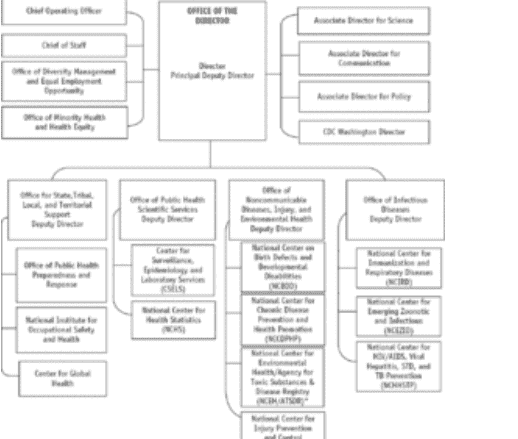

图 1-3。CDC 组织架构。

CDC 在国家级公共卫生组织网络中发挥着至关重要的作用。州、部落、地方和地区支持办公室（OSTLTS）旨在提高国家公共卫生机构和系统的性能。OSTLTS 的计划和项目包括国家公共卫生改进计划、国家健康标准计划、国家公共卫生自愿认证、国家公共卫生法计划以及国家市政厅电话会议。

每个州或地区都有一个卫生部门，负责监督每个县的公共卫生活动。县卫生部门设有初级卫生办公室，并可能有若干个分部。每个县卫生部门提供多种计划，涵盖临床和家庭健康服务、免疫接种计划、患者护理和病例管理服务、疾病控制和监测计划、社会服务计划以及环境健康服务。2010 年，美国和华盛顿特区有 2,790 个地方卫生部门（LDHs）和 261 个区域或地区卫生办公室（州和地区卫生官员协会 [ASTHO]，2011）。

## 州和地区卫生部门

州和地区卫生部门（SHAs）对联邦倡议拥有完全或共同的财政和计划责任，包括妇女、婴儿和儿童预防健康服务赠款、国家癌症预防与控制赠款、HIV 项目和健康专业人员短缺认定（由美国农业部管理）。

在不承担责任的情况下，州卫生机构通常与其他州或地方政府机构分担责任；州和地区卫生机构的员工队伍包括 100,000 名全职员工，具有不同的治理结构，包括集中化、去中心化或混合治理。百分之五十五的州卫生机构是独立的机构；其余的州卫生机构是超级机构或伞形机构的一部分（ASTHO，2011）。

州和地区卫生机构有三个主要角色：健康保护、健康促进与预防以及治疗。在这些领域中，他们筛选和治疗疾病和其他健康状况，提供技术支持和培训，运行实验室服务，并收集流行病学数据和监测。因此，他们提供基于人群的预防服务，帮助告知并教育人们州和地区的健康问题。

例如，88% 的州机构提供烟草预防和控制服务，84% 的机构拥有伤病预防计划，60% 的州机构负责传染病，如结核病和性传播疾病，包括 HIV/AIDS（ASTHO，2011）。然而，几乎 80% 的机构还为有特殊需要的儿童提供服务。除了提供基于人群的服务外，州卫生机构还负责执行保护健康和安全的法律法规。

除了州和地区机构外，美国公共卫生系统还包括部落卫生部门。部落卫生部门是指“在联邦承认的部落管辖下运行的卫生部门或组织，或来自印度卫生服务的受承认部落协会的服务”（国家卫生委员会，2011）。

地方卫生部门（LHD）定义为“地方政府的行政服务单位，关注健康，并对比州小的管辖区健康承担某些责任”（国家县市卫生官员协会 [NACHO]，2011，第 3 页）。

美国关于公共卫生基础设施和实践的第一项研究——《马萨诸塞州卫生委员会报告》，由 Samuel Lhatt 于 1850 年撰写（Turnock & Barnes, 2007）。它预示着地方卫生部门的开始。到 1911 年，以县为基础的 LHD 开始出现在美国。到 1943 年，31 个州有 178 个 LHD（Turnock & Barnes, 2007）。

到 2010 年，除夏威夷州和罗德岛州外，共有 2,565 个 LHD，因为这些州在州卫生部门下运行，没有子机构。尽管 1945 年的一份报告建议地方卫生系统最有效地服务少于 50,000 人的人口，但今天 LHD 服务的人口从不足 25,000 人（1,067 个 LHD）到超过 100 万或更多的人口（LHD: NACHO, 2011）。

LHD 提供一系列服务，包括成人和儿童免疫接种、传染/流行病监测、结核病筛查和治疗、环境健康监测、学校/托儿检查、基于人群的营养服务、食品服务机构检查以及安全教育。

LHD 与地方卫生委员会的区别在于，后者是一个法律指定的管理机构，其职能是监督公共机构，侧重于社区健康评估和政策制定。大约 75% 的 LHD 所在司法管辖区拥有地方卫生委员会（NACCHO, 2011）。

在管辖权划分上，地方卫生委员会可以是市、县或区级委员会。市级卫生委员会由市议会任命，对市内的公共卫生事务拥有管辖权。县级卫生委员会由县监事委员会任命，对该县内的公共卫生事务拥有管辖权。区级卫生委员会由该区的县监事委员会任命，对公共卫生事务拥有管辖权。卫生委员会通常向州级（公共）卫生部门报告。

2013 年，美国疾病控制与预防中心（CDC）和美国地方卫生委员会协会联合制定了《国家公共卫生绩效标准地方公共卫生治理评估工具（2.0 版本）》的更新版。2.0 版本允许地方卫生委员会和州级公共卫生系统评估其公共卫生系统在其管辖区内提供基本公共卫生服务方面的资产和能力。

# 公共卫生机构认证

PHAB 的实际认证数量较低。截至 2012 年，只有 6% 的当地卫生部门（LHDS）和 27% 的州级卫生机构（SHAs）提交了认证申请或意向声明（Shah et al., 2014）。然而，有 26 个州拥有一个或多个 PHAB 先决条件，其中这 26 个州中有一个州获得了 PHAB 认证（Thielen, Dauer, Burkhardt, Lampe, & Vaenraemond, 2014）。

国内和全球对转向公共卫生认证具有巨大的兴趣。要实现这一点需要一系列行动，例如政府支持（如政策和资金）、法律授权的制定，以及大到足以支撑实现目标所需成本和劳动力的医疗保健市场增长（Bender et al., 2014; Braithwaite et al., 2012; Thielen, Leff, et al., 2014）。这是药剂师参与社区框架内政策、实践和教育问题的一个机会。

# 公共卫生与药学的联系

公共卫生与药学教育的交叉点可以追溯到 1932 年，当时药学院就开始教授公共卫生课程（Gibson, 1972a）。这一趋势持续到 20 世纪 50 年代和 60 年代（Gibson & Webster, 1952; Gibson, 1962）。20 世纪 70 年代的一系列调查重申了公共卫生在药学教育和实践中的重要性（Gibson, 1972）。

Bush 和 Johnson（1979）认为，“公共卫生领域缺乏足够的药剂师参与”，且药学教育未能充分认识这一点。实现这一点需要一系列行动，例如政府支持（如政策和资金）、法律授权的制定，以及大到足以支撑实现目标所需成本和劳动力的医疗保健市场增长（Bender et al., 2014; Braithwaite et al., 2012; Thielen, Leff, et al., 2014）。这是药剂师参与社区框架内政策、实践和教育问题的一个机会。

2004 年，美国药学院协会通过在其药学教育成果（CAPE）中纳入人群护理，认可了药剂师在公共卫生中的重要作用。这些成果在 2013 年修订，强调了人群健康的重要性，包括公共卫生，还包括整个社区（包括行业、社区领袖、健康差异和健康的组成部分）对优化健康的重要作用。

APHA（2006）也认可了药剂师在社区内作用的重要性，指出药剂师“社区中的中心化布局和临床专业知识”在执行公共卫生任务时是无价的（第 1 段），提供了“医疗保健专业人员中罕见的易及性”（第 3 段）。在这里，药学在公共卫生中起着至关重要的作用。

美国药学院协会是预防教学与研究协会《健康人民》课程小组的一部分，其任务是实施《健康人民 2020》的教育目标并为两个目标收集数据：`ECBP-12-18`（在健康专业教育中增加核心预防和公共卫生内容）和 `ECBP-19`（增加具有跨专业教育体验的学术机构预防的重要性）。

为了帮助实现任务，工作组发布了《临床预防与人群健康框架》，该框架由四个主要部分的 23 个领域组成：

- （a）人群健康基础；
- （b）预防服务与健康促进；
- （c）临床实践与人群健康；
- （d）卫生系统与健康政策。

第 1—2 页确立了关于跨学科专业化的七个关键问题：

1. 如何将“共同理解”整合到教育和实践中，以促进跨学科的专业化模式？
2. 跨学科专业化的伦理意义是什么？
3. 如何将健康与心理健康整合到跨学科的教育和实践中？


### 讨论问题

4. 在跨学科专业化模式内，是如何教授教学和实践“领导力”的？

5. 跨学科专业化的障碍有哪些哪些？

6. 哪些措施与跨学科专业化相关？

7. 不断演变的专业背景对在各种护理体系中工作的患者、学生及其他人员有何影响？

我们也认为，这些问题是任何关于公共卫生与药学整合作为一种职业、一个学术学科以及政策制定的讨论的核心。更重要的是，我们想强调公共卫生与药学领域之间具有协同和共生的作用。尽管本章的大部分内容已经了药学学生、教育者、专业人士和研究人员理解公共卫生原则和实践的重要性，但健康学生、教育者、专业人士和研究人员理解药学原则和实践也同样重要。我们期待公共卫生和药学专业人士之间持续的对话与参与。

### 参考文献

美国药学院协会 (American Association of Colleges of Pharmacy). (2004). 药学教育卓越中心 (CAPE) 教学成果。Alexandria, VA: 作者。

美国药剂师协会 (American Pharmacists Association). (2014). 什么是药物治疗管理？Washington, DC: 作者。

美国公共卫生协会 (American Public Health Association). (1980). 药剂师在公共卫生中的作用。Washington, DC: 作者. 取自 <https://www.apha.org/policies-and-advocacy/public-health-policy-statements/policy-database/2014/07/07/13/the-role-of-the-pharmacist-in-public-health>

美国公共卫生协会 (American Public Health Association). (2006, 11月8日). 药剂师在公共卫生中的作用（政策编号: 200614）。Washington, DC: 作者. 取自 <https://www.apha.org/policies-and-advocacy/public-health-policy-statements/policy-database/2014/07/07/15/the-role-of-the-pharmacist-in-public-health>

Anderson, L. M., Brownson, R. C., Fullivove, M. T., Teutsch, S. M., Novick, L. F., Fielding, J., & Land, G. H. (2005). 证据证据的公共卫生政策与实践：承诺与局限。American Journal of Preventive Medicine, 28(Suppl.), 226–230. doi:10.1016/j.amepre.2005.02.014

州和地区卫生官员协会 (Association of State and Territorial Health Officials). (2011). ASTHO 公共卫生州概况（第2卷）。Arlington, VA: 作者。

Bender, K., Kronstadt, J., Wilcox, R., & Lee, T. P. (2014). 公共卫生认证委员会概述。Journal of Public Health Management and Practice, 20(1), 4–6. doi:10.1097/PHH.000000033827

Blanch, H. M., & Collins, J. (2013). CDC 的胜利战：改善营养、身体活动和减少肥胖。Child Obesity, 9(6), 469–471. doi:10.1089/chi.2013.9506

Blauch, L. E., & Webster, G. L. (1952). 药学课程。Washington, DC: 美国教育理事会。

Braithwaite, J. S., Gray, D. D., Moldovan, M., Greenfield, D., Hinchcliff, R., Mumford, M., Whittaker, S. (2012). 低中收入国家与高收入国家公共卫生认证的比较：一项横断面研究。International Journal for Quality in Health, 24(6), 568–577. doi:10.1093/intqc/zs064

Brownson, R. C., Fielding, J. E., & May, C. M. (2009). 证据的公共卫生：公共卫生实践的基础概念。Annual Review of Public Health, 30, 175–201. doi:10.1146/annurev.pubhealth.308

印第事务局 (Bureau of Indian Affairs). (2012). 认可印第人公民并有权接受印第事务局的服务。Federal Register, 77(155), 7786–7793. 取自 <http://www.loc.gov/catdir/cspjo/>

Cassedy, J. H. (1969). 人口统计学在美洲的早期发展。在证据的公共卫生中：人口统计的背景, 1600–1800。Cambridge, MA: 哈佛大学出版社。

Doluisio, J. T. (1989). 药学原则与实践。Pharmacotherapy, 23(9), 706–710.

疾病控制预防中心 (Centers for Disease Control and Prevention). (n.d.). 公共卫生政策标准。Atlanta, GA. 取自 <http://www.cdc.gov/npsp/governance/pdf>

Chadwick, E. (1943). 公共卫生政策。Washington, DC: 卫生部。

Ellis, E. (1903). 卫生状况的报告。。119, 美国药剂师在公共卫生协会。Washington, DC: 作者。

Church, R. M. (1987). 药剂师的扩张作用。American Journal of Pharmacy, 44(4), 771–775.

Church, R. M. (1989). 药学模式。Formulary, 24(9), 526–527.

Coleman, W. (1982). 待解决的问题。Madison, WI: 威斯康星大学出版社。

评估健康的委员会 (Committee on Assessing Health). (1993). 公共卫生改革。Washington, DC: 国家学院出版社。

评估健康的委员会 (Committee on Assessing Health). (2002). 通向健康的未来。国家学院出版社。

公共卫生改进委员会 (Committee on Public Health to Improve Health). (2011a). 衡量健康的行动与问责制。Washington, DC: 国家学院出版社。

公共卫生改进委员会 (Committee on Public Health to Improve Health). (2011b). 投资健康的未来。Washington, DC: 国家学院出版社。

公共卫生改进委员会 (Committee on Public Health to Improve Health). (2012). 药学历史。Washington, DC: 国家学院出版社。

Griffenenberg, H. B. (2002). 药学的辉煌时刻：描述药学历史的罗伯特·索系列的发展。Journal of the American Pharmaceutical Association, 42(2), 170–182. doi:10.1331/1086580027635084

Kepler, C. D. (1988). 药学未来未解决的问题。American Journal of Hospital Pharmacy, 45(5), 1071–1081.

Ingram, R. C., Bender, K., Wilcox, R., & Kronstadt, J. (2014). 基于共识的国家公共卫生认证方法。公共卫生管理与实践杂志, 20(1), 9-13. doi:10.1097/PHH.0b01e3182a0b8f9

医学研究所. (1988). 公共卫未来：共识研讨会。华盛顿，DC：国家学院出版社. 检索自 <https://www.nap.edu/catalog/10991/the-future-of-public-health>

医学研究所. (2013). 为改善健康成果建立跨学科专业素养：研讨会总结。华盛顿，DC：国家学院出版社. 检索自 <http://www.nap.edu/catalog.php?record_id=18398>

Jacobson, D. M., & Teutsch, J. (2012). 临床护理系统、政府公共卫生系统和利益相关组织定义和衡量总人口健康的整合方法环境扫描。华盛顿，DC：国家质量论坛.

Kindig, D., & Stoddart, G. (2003). 什么是公共卫生？美国公共卫生杂志, 93(3), 380-383.

Lemberger, A. P. (1988). Rho Chi。作为学术学科的药学。药物智能与临床药学, 22(10), 807-812.

Livingood, W. C., Sabbagh, R., Spifaden, S., Hicks, A., Wells., Puidomenge, S., ..., Wood, D. L. (2013). 质量改进案例研究：对公共卫生结果和机构文化的影响。美国预防医学杂志, 44(5), 445–452. doi:10.1016/j.ypampre.2013.01.011

Marshall, D., Pyron, T., Jimenez., Coffman, J., Pearsol, J., & Koester, D. (2014). 通过州健康改善改善公共卫生：行动框架。公共卫生管理与实践杂志, 20(1), 23-28. doi:10.1097/PHH.0b01e3182a5a4b8

Matthews, G. W., Markiewicz, M., & Beitsch, L. M. (2012). 支持公共卫生部门认证的框架：来自10名学生的教训。公共卫生管理与实践杂志, 18(e1), doi:10.1097/PHH.0b01e3182f62b0

Milne, T. J., & Johnson, R. E. (1979). 药剂师在公共卫生机构中的作用。华盛顿，DC：美国公共卫生协会药务服务委员会.

美国县市卫生官员协会. (2011). 2010年地方卫生部门国家概。华盛顿，DC：作者.

国家印第安健康委员会. (2011). 2010年部落公共卫生概：探索印第安地区的公共卫生能力。华盛顿，DC：检索自 <http://www.nihb.gov/docs/07012010/NIHB_HealthProfile%202010.pdf>

国家公共卫生绩效标准计划. (n.d.). 州公共卫生系统绩效标准亚特兰大，佐治亚：疾病控制与预防中心. 检索自 <http://www.cdc.gov/nnhphsp/documents/statemodelstandardsonly.pdf>

Oddis, J. A. (1988). 药学的未来实践角色。美国医院药学杂志, 45(6), 1306-1310.

Penna, R. P. (1987). 药学：一个转型中的职业还是一个转瞬即逝的职业？美国医院药学杂志, 44(9), 2053-2059.

公共卫生应急状况 (Public Health Emergency). (2017). 国家健康安全战略. 检索自 <http://www.phe.gov/Preparedness/planning/authority/nhss/Pages/default.aspx>

Quanbeck, A. R., Madden, L., Edmunds, Ford, J. H. 2nd, McConnell, K. J., McCarthy, D., & Gustafson, D. H. (2012). 适应治疗实施的商业案例：来自 NIATX 协作的证据。行为健康服务与研究杂志, 39(1), 91-100. doi:10.1007/s11414-011-9259-6

Ravenel, M. P. (2021). 美国公共卫生协会：过去、现在、未来。收录于. P. Ravenel (编)，公共卫生的半世纪 (pp. 13-55)。纽约：美国公共卫生协会.

Robbins, J., Garman, A. N., Song, P. H., & McLeary, A. S. (2012). 高绩效团队如何驱动医疗保健：领先流程改进策略的检查。医疗质量管理, 21(3), 188-202. doi:10.1097/QMH.00b13e3125e88f6

Rosen, G. (1958). 公共卫生历史。马里兰州，MD：约翰·霍普金斯大学.

Rosenberg, C. E. (1962). 霍乱年代：1832年、1849年和1866年的美国。芝加哥：芝加哥大学.

人口健康改善圆桌会议. (2013). 《平价医疗法法案》对人口健康的影响：研讨会总结。华盛顿，DC：国家学院出版社. 检索自 <http://www.nap.edu/download?reportid=18546>

Shah, G., H., Lee, J., Yo, J., Sellers, K., Liss-Levinson, R., & Williams, K. S. (2014). 公共卫生机构的参与程度及 PHAB 国家自愿认证的感知障碍。公共卫生管理与实践杂志。在线出版。 doi:10.1097/phm.0000000000000017

Smith, J. E. (1988). 临床职业中的领导力。美国医院杂志, 45(6), 1675-1681.

Srinivasan, A., Craig, M., & Cardo, D. (2012). 医疗感染预防的力量、联邦协作与州协调。传染病杂志, 55(3), 426–431. doi:10.1093/cis407

Thielen, L., Dauer, E., Burkhardt, D., Lampe, S., & Pearsol, J. (2014). 关于公共的州的法律法规。公共卫生管理与实践杂志, 20(1), 111–118. doi:10.1097/PHH.0b01e3182a7c9d4

Turnock, B., & Barnes, P. (2004). 平衡计分应用于地方卫生绩效。公共卫生, 13(4), 337–341.

美国人口普查局. (2012). 事实查询：美国印第安及土住民 (AIAN).

Victora, C., Habicht, J., & Bryce, L. (2009). 循证的公共卫生：超越试验。BMC 公卫生, 9, 127.

Weir, E., Kurji, S., & Robinson, V. (2014). 药剂师在公共卫生机构中的作用。公共卫生管理与实践杂志, 20(1), 98–103.

Welch, W. H., & Rose, W. (1915). 卫生研究所：韦尔博士的报告。纽约：洛克菲勒基金会.

Winslow, C.-E. (1920). 公共卫生是预防疾病的科学和艺术，并确保社区内每个人都有维持健康所需的生活标准的社会机制的发展。现代医学, 2, 183–191.

世界卫生组织. (1948). 世界卫生组织宪章序言，由1946年6月21-22日纽约国际会议通过；于1948年4月7日由世界卫生组织61个国家的代表签署，第7号，日内瓦.

Worthen, D. B. (1928). 安德鲁·克雷基，美国第一任药剂长。美国药剂师杂志, 42(5), 811–813.

Ziobro, P. (2014, 9月3日). CVS 宣布停止烟草产品。华尔街日报在线，商业。

### 公共卫生与药学的专业协作

……结果。它在日常实践中利用大量的健康专业人士，涵盖了现代医学和骨医学，包括医生、护士、牙科医生以及其他健康服务专业人员，如物理治疗师、职业治疗师、卫生学家、药剂师、医生助理、执业医师、社会工作者、心理学家、营养师、康复咨询师、健康教育者、行政人员健康管理者。

公共卫生领域在研究风险人群的健康问题时采用了多学科方法。然而，与个人健康不同，公共卫生侧重于人群。它高度依赖生物统计学、流行病学、环境与职业健康、公共卫生管理、社区与家庭健康、全球健康，以及日益发展的公共卫生基因组学。其专业人员包括护士、医生、流行病学家、统计学家、健康教育者、环境分析师、工业卫生学家、卫生员、食品药品调查员、毒理学家、实验室技术员、环境科学家、危机与灾害管理人员、兽医、经济学家、社会科学家、律师、营养师、行为健康专业人士、行政人员和经理。有时，许多此类专业人士被称为公共卫生专业人士。

尽管药学被认为是处理药物制备、配发和适当使用的健康/医学科学分支，但药学作为医学与公共卫生学科之间的桥梁，特别是在社区药学领域。在社区药学中，个体患者和患者所在的社区在社区或公共卫生实践中同等重要。

这本《药学公共卫生导论》（Introduction to Public Health in Pharmacy）第二版与原版不同，因为我们纳入了许多公共卫生和药学的全球视角，包括国际视角（例如世界卫生组织 WHO，宏观层面）、区域视角（例如欧盟，中观层面）以及主要来自美国的视角（例如国家层面，微观层面）。我们认为这将帮助第二版的读者更全面地理解，当我们从对公共卫生和药学的国家理解转向更广泛的全球视角时，公共卫生和药学问题是如何被构建和重新构建的。我们希望这些额外的全球视角也能帮助说明，无论人们居住何处，在公共卫生和药学的学科与职业实践、教育和研究方面，既有共同点，也存在显著差异。


在国际上，世界卫生组织（WHO）可能是最著名的收集、分析和传播公共卫生研究、教育和实践领域报告的组织。作为联合国卫生事务的指导和协调机构，WHO 由 193 个国家和两个关联会员组成。它每年在世界卫生大会上开会，以制定政策并批准年度运营预算。由大会选举产生的 34 成员执行委员会为成员国提供支持。WHO 总部位于日内瓦，在全球范围内设有六个区域办公室和 150 多个办事处。WHO 及其“成员国”在全球健康中发挥着关键作用，涉及广泛的利益相关者，包括联合国机构、捐助者、非政府组织（NGO）、WHO 合作中心以及公共和私营部门。

WHO 的六大核心功能是 (a) 提供技术支持和能力建设，b) 提供领导力，c) 制定标准，d) 塑造研究领域，e) 阐述政策选择以及f) 监测健康和健康趋势（WHO 三级机构角色与功能工作组，2013年）。这些功能在国家办事处、区域办公室和 WHO 总部都承担着责任。WHO 与成员国合作，在若干类别中设定全球卫生卫生优先事项：(a) 传染病和非传染性疾病；(b) 通过生命周期促进健康；(c) 卫生系统；(d) 准备、监测和反应。

WHO 创建并维护了若干权威来源。

WHO 在疾病的预防、控制和根除方面处于领先地位，涵盖了锥毒、天花和急性呼吸综合征（SARS）。它扩大了针对烟草、营养、肥胖和灾害的预防工作（WHO, 2007）。WHO《控烟烟草框架制定》旨在减少与烟草相关的死亡。《饮食、身体活动与健康全球战略》旨在增加营养并减少肥胖。WHO 还加大了对自然和人为灾害导致健康后果的影响关注（例如南亚海啸以及非洲和中东的冲突；WHO, 2007）。

WHO 还从全球视角重新思考了公众健康的范围，得出了一个涵盖环境和生物-社会因素的更广泛的方法。2005 年，WHO 总长江力远（Lee Jong-Wook）成立了一个委员会，旨在解决导致健康问题和健康不平等的社会因素（健康社会决定因素委员会，2007年）。图 2-1 所示的健康社会决定因素平等（SDHI）概念框架涵盖了三个领域：(a) 社会经济和政治背景，(b) 健康不平等的结构性决定因素，以及(c) 健康的中间决定因素。尽管许多研究人员对 SDHI 做出了贡献，但特别感谢 Finn Didererich-Didererich（1998）、Marmot & Whitehead（2001）、Didererich & Didererich & Hallqvist（1999年）的工作。

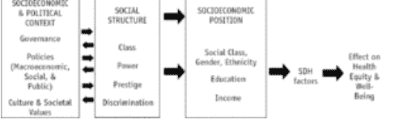

图 2-1。健康社会决定因素平等（Solar & Irwin, 2000）。

2011 年世界卫生组织健康社会决定因素会议（巴西里约雅内卢）提供了一个全球平台，供成员国就健康决定因素进行对话。2012 年 6 月 21 日，在各国成员国的参与下，通过了《健康决定因素宣言》（2008）。

《健康决定因素宣言》是世界卫生组织成员国对健康决定因素的承诺，旨在减少健康不平等并提高护理质量。我们看到健康决定因素平等（SDH）方法在所有政府层面、跨国组织以及公私合作中得到体现，通过共同的框架、语言和定义来实现国家目标。

## 区域视角

为了考虑健康的区域视角，有多种方法可以概念化区域。区域可以是地理性的（例如大陆、次大陆或自划区域）；社会经济区域，可能是自定义的或外部定义的；行政区域（例如市、县或机构区）。这些区域可能影响国家监测、审查、治疗或监管。

WHO 内部设有六个区域：(a) 非、(b) 美洲、(c) 东南亚、(d) 欧洲、(e) 东中以及 (f) 西太平洋。每个地区都有区域办公室和一个提供国家、计划、出版物和数据的网站，以及媒体中心。

当我们思考行政区域时，欧盟（EU）立即成为关注中心。欧盟人口超过 5 亿（占世界人口的 7.3%）。欧盟本质上是一个政治和经济组织，由 28 个成员国组成，并由成员国和七个超国家组织管理。这些组织包括 (a) 欧洲议会、(b) 欧洲理事会、(c) 欧盟理事会、(d) 欧盟委员会、(e) 欧洲法院、(f) 欧洲银行以及 (g) 欧洲审计院。例如，议会理事会通过并修改立法提案，监督委员会和其他欧盟机构的工作，征求其他国家议会的意见，并决定欧盟预算。

然而，欧盟并不是唯一一个影响公共卫生和药学实践、教育和研究并制定及通过政策的区域。拥有 53 个成员国的 WHO 欧洲大区（ER）也是一个主要参与者。其总部位于丹麦哥本哈根，此外在三个国家和 29 个成员国设有办事处。与欧盟类似，还有成员国代表的早期会议，也会产生区域政策。除了区域委员会外，还有一个区域委员会常设委员会（SRC），它是 WHO 欧洲区域委员会的一个小组委员会。SRC 由 12 个国家的代表组成，每位成员任期三年。

既然我们已经研究了影响公共卫生和药学的两个区域机构，接下来我们将观察世界卫生组织（WHO）区域办公室与其区域/国家合作伙伴之间的协作案例。

欧洲卫生系统与政策观察负责研究欧洲医疗系统的动态，以促进基于证据的健康政策制定。该观察它是世界卫生组织欧洲区域以及比利时、芬兰、爱尔兰、荷兰、挪威、西班牙、瑞典以及意大利威尼大地区的伙伴关系。此外，成员还包括欧盟委员会、欧洲投资银行、世界银行、法国国家保险基金联合会、伦敦政治经济学院以及伦敦卫生与热带医学学院。该应对人口健康的经济和财务影响进行了多项研究，评估了从欧洲医疗系统的慢性病管理到整合医疗护理的经济影响。其季度期刊《*Eurohealth》提供了有关新兴政策问题以及研究与实践的报告。

“健康2020”是针对世界卫生组织欧洲地区的一项“基于价值和证据的健康政策框架”（世界卫生组织欧洲办公室，2013年，第3页）。它明确规定，健康不仅是一项主要的社会资源，而且与《里约宣言》中社会健康决定因素（SDH）框架相关的资产。成员国同意了六个宏观目标。第六个目标鼓励成员国在其国家设定与健康相关的国家目标和指标（世界卫生组织欧洲办公室，2013年）。这有助于确定健康优先事项、识别基于证据的实践，并解决实施促进因素和障碍。它还考虑了不同国家之间的差异、针对性的战略倡议以及加强对人口健康的监测与评估。

成员国还选择了四个政策行动的优先领域：(a) 健康的生命周期方法；(b) 非传染性和传染性；(c) 加强以人为中心的公共卫生系统以及应急准备、监测和反应；以及(d) 构建韧性社区（Opolski & Wysocki, 2013）。如果公共卫生和药学的目的是改善社区和人群的健康，那么“健康2020”应该为欧洲范围内的改善提供一个强有力的框架。

在美国，我们看到联邦和州的“健康人类”倡议中整合了世界卫生组织的健康定义，最近的“健康人类2020”框架是多个利益相关者协作过程的成果，包括美国卫生和人类服务部（USDHHS）、其他联邦健康机构、公共利益相关者以及“健康人类2020”咨询委员会。

在世界卫生组织关注生态和社会健康决定因素（SDH）的基础上，美国将其总性目标和基础健康措施建立在下个十年的国家计划中（2-2）。

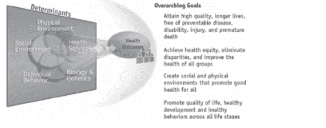

图 2-2

健康人类2020图形模型。

要检查该国家实现这些目标的良好程度需要进行衡量。“健康人类2020”健康指标衡量了一般健康状况、健康相关的生活质量与福祉、健康决定因素以及差异。一般健康状况指标包括预期寿命（带有国际比较）、寿命、潜在寿命年数（带有国际比较）、身体和心理不健康天、自评健康状况、活动限制以及慢性病患病率。健康相关的生活质量和福祉指标包括患者报告结局测量信息系统、全球健康测量（Hays, Bjorner, Revicki, Spritzer, & Cella, 2009）、福祉测量和参与测量（USDHHS）。

健康决定因素指标强调疾病预防和健康促进的生态方法，涵盖个人层面和人口层面的健康决定因素及干预措施。它们研究了健康状况与生物学、个人行为、医疗服务、社会因素和政策之间的关系（国家健康促进和疾病预防目标2020主席咨询委员会，2010年）。“健康人类2020”将健康差异定义为“与社会、经济和/或环境劣势密切相关的特定类型的健康差异”。差异衡量决定了不同人群之间在健康结果是否存在较大或较小的差异。影响健康结果差异的因素包括年龄、残疾、地理位置、种族或族群、性别、性认同和社会经济地位（国家健康促进和疾病预防目标2020主席咨询委员会，2010年）。

正如我们在本章提到的：药学在社区中的重要性不容忽视。然而，从全球角度来看，药剂师密度存在巨大差异。国际上，成立于1912年的国际药学联合会（Fédération Internationale Pharmaceutique (FIP））代表了超过300万药剂师。FIP的愿景提供了一个使命：“通过推进安全用药来改善全球健康”（国际药学联合会，2020年）。FIP/WHO良好药学规范：质量服务标准（国际药学联合会，2008年，第14页）。

FIP涵盖了健康的临床和社会两个方面，这与世界卫生组织在制定政策声明时使用的SDH框架良好衔接。FIP建议个人药剂师在其个人实践以及国家规定的执范围内，在母婴及儿童健康方面发挥更大的作用。它还建议FIP成员组织在国家框架内制定特定的实践标准（国际药学联合会，2013年）。

此外，FIP还关注药学人才培养和标准问题，包括药剂师和药学辅助人员。其2012年全球药学报告（国际药学联合会，2012年）收集了90个国家和地区的回复，描述性数据涵盖了2.5。

| 类别 | 活动 |

| :--- | :--- |

| A. 确保适当治疗和结果 | A1. 确保适当的药物治疗<br>A2. 确保患者理解治疗计划<br>A3. 监测和报告 |

| B. 药物和设备发放 | B1. 处理处方或医嘱<br>B2. 制备药物产品<br>B3. 发放药物或设备 |

| C. 健康促进和疾病预防 | C1. 提供临床预防服务<br>C2. 公共卫生监测和报告<br>C3. 在社会中促进药物使用 |

| D. 医疗系统管理 | D1. 管理实践<br>D2. 管理整个医疗系统的药物<br>D3. 管理系统内药物的使用<br>D4. 参与研究<br>D5. 跨学科协作 |

数百万药剂师和140万药剂技师。国际药学联合会（FIP）认为，健康支出、药剂师可用性与各国家和地区的经济发展水平之间可能存在关系。FIP报告还发现，全球范围内55%的药剂师在社区药店工作，18%在医院工作，10%在行业工作，5%从事研究和学术工作，5%从事监管工作。欧洲地区的社区药剂师数量最多（接近70%）。

这份全球报告对药学实践提出了几条核心信息。这些包括强调高质量药物的获取和供应，提高医护人员在患者护理和跨专业协作方面的表现，以及继续对各水平的专业教育（药剂师和支持人员）进行投资。此外，它还强调了建立和实施基于需求的药学教育体系的重要性，以解决当地系统问题和社区问题。

许多欧洲国家遵循全民医疗模式。正如预期的，在服务交付模式、支付方、处方覆盖、护理质量和评估方面存在差异。英国拥有集中的国家医疗服务体系（Boyle, 2011）。荷兰拥有联邦社会医疗保险制度（Ferre et al., 2010）。其他国家如瑞士，则实行强制性医疗模式，所有公民必须购买基础私立医疗保险（Busato, Matter, Kunzi, & Goodman, 2012）。因此，取决于一个国家的计划以及/或私立保险的程度，药学实践可能存在显著差异。

影响药学实践的法规也会影响药学教育，因为每个国家对职业认证和专业学校的毕业生都有自己的标准。1999年的《博洛尼亚宣言》是欧洲高等教育区的起点，该版区现已涵盖47个国家（European Commission, Audio-visual and Culture Executive Agency, & Eurydice, 2015）。该宣言现在被称为“博洛尼亚进程”，它建立了一个透明的、具有可比性的学位和学分体系，促进了欧洲公民的就业能力；确保了跨国教育质量；并促进了课程开发、机构间合作以及综合性学术/研究计划（European Commission et al., 2015）。

“不断发展的欧洲背景下的公共卫生教育与培训”（PETHE; 2008）项目是一项协作努力，旨在创建一个共同的欧洲公共卫生构建，该项目由欧盟委员会健康与消费者保护总司在2005-2008年间提供资助。PHETICE以博洛尼亚进程（见上段）为模型，开发核心教育和教学策略，并解决欧盟委员会与国家当局之间的管辖权问题，以制定共同的课程和认证标准。PHETICE开发了五个欧洲公共卫生硕士项目（侧重于流行病学、老年学、健康促进、公共卫生和健康营养），旨在将其扩展到中欧和东欧（PHETICE, 2008）。

如图2-3所示，结构、过程和结果的循环性质使PHETICE能够满足不同专业水平和国家优先事项的各类公共卫生从业者的需求（PHETICE, 2008）。同时，“健康技能”（Skills for Health, 2008）定义了英国卫生部门在公共卫生领域职业发展九级水平所需的能力，而欧洲地区公共卫生学院协会创建了适用于适用于公共卫生教育的公共卫生核心能力计划（Birt & Foldspar, 2021）。

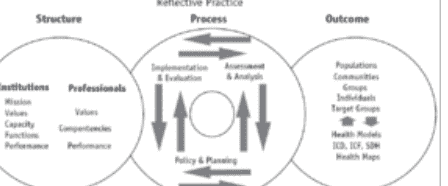

图2-3.

公共卫生与促进能力模型。

加尔韦会议（The Galway Conference）是另一个关于开发健康促进和健康教育核心能力的国际合作范例，该能力适用于所有医疗卫生行业成员（Barry, Allegrant, Lamarre, Aurld, & Taub, 2009）。2008年6月，国际健康促进教育联盟、公共卫生协会以及疾病控制与预防中心创建了适用于欧洲公共卫生劳动力发展的价值观价值观和核心领域（Allegrate et al., 2009; Barry, Taub, & Lyobsky, 2009）。健康促进核心能力框架（CompHP）涵盖34个国家（包括欧盟成员国和瑞士；Barry et al., 2012），通过德尔菲法创建，旨在影响决策者、从业人员和学者。这些能力、标准和认证的发展是为了解决所有促进健康的人员（如社区和人口药剂师）的质量问题。这些能力基于《渥特华宪章》（WHO, 1986）以及随后的宪章和宣言（例如内罗毕、阿德莱德、雅加达、曼谷谷和赫尔辛基；详见 www.who.int/healthpromotion/en/）。由于长期计划涉及不同水平的认证，建立一个全欧洲体系将是一项挑战，但可以在以往成功的基础上继续进行（Santa-Maria Morales et al., 2009）。

虽然教育和认证标准至关重要，但专业组织与政府优先事项之间的一致性同样重要。Anderson（2007）描述了英国药学专业人员的双管齐方法，将公共卫生作为一个关键发展领域，这与国家意识到需要更广泛的医疗专业人员引入公共卫生相契。英国药学不仅要重新建立其早期传统的咨询角色，还能通过加强与公众的联系来重新定义。然而，这涉及许多政策和专业因素，包括（a）政策的变化、（b）行业机构的正式认可、（c）社区药剂师的激励措施以及（d）公共卫生社区的支持。

在美国，国家公共卫生目标将药剂师和药学实践嵌入公共卫生之中。《健康2020》的研究概述了药剂师贡献社区和人口健康的许多方式。例如，在“公共卫生基础设施”主题中，药剂师是能力且合格的人才的一部分，他们擅长利用最新数据和信息系统评估并响应公共卫生需求。服务需要（a）个人能够接触适当的服务者并在医疗场所接受所需服务，以及（b）患者能够与医疗提供者沟通并信任。社区药学实践持续演变使其成为当前药学实践的自然延伸。

在《健康2020》的“教育和社区计划”部分中，药剂师参与了旨在预防疾病和伤害、促进健康及提高质量的教育和社区计划的质量、可用性和效果。针对“医疗感染”，药剂师可以就医疗设备的使用、抗生素的使用以及使用提供指导。

……注射器和针头。最后，在“健康的社会决定因素”下，药剂师在获取社区健康促进、健康计划以及临床和预防性护理方面发挥着至关重要的作用。

药剂师可以贡献的疾病预防和管理领域还包括接种和传染病；药剂师在健康促进方面也发挥着作用，涵盖了伤害和暴力预防；母婴儿童健康；营养和体重状况；口腔健康；物质滥用和烟草使用。请参表 2-1 查看“健康人群2020”中的所有主题领域，并花时间考虑药剂师在每个领域贡献的许多方式。

表 2-1“健康人群2020”主题领域

| 健康服务获取 | 医疗相关 | 营养与体重状况 |

|---|---|---|

| 服务 | 感染 沟通与健康信息技术 | 职业安全与健康 |

| 关节炎、骨质疏松和慢性疾病 | 健康相关的生活质量与福祉、听力、其他感官和交流 | 老年人口腔健康身体活动 |

| 血液疾病和血液安全 | 疾病 心脏病和中风 | 公共卫生基础设施 |

| 痴呆（包括阿尔茨海默病） | HIV 免疫接和传染疾病 | 性传播疾病 |

| 糖尿病与健康 早期和儿童期 | 伤害和暴力预防 | 睡眠健康 |

| 教育和社区计划 | 同性恋、双性恋和跨性别者健康 | 健康决定因素 |

| 环境健康 | 母婴儿童健康 | 物质滥用 |

| 家庭计划食品安全基因组学 | 医疗产品安全 心理健康与障碍 | 烟草使用 视觉 |

| 全球健康 | | |

虽然《平民医疗法案》（2010年）和《医疗与教育协调法案》已将药剂师视为医疗保健团队的重要成员，但这两者都没有赋予药剂师正式的医疗提供者身份。没有该身份，药剂师无法从健康相关服务中获得直接收益，并继续面临责任问题。然而，2016年提出的两项跨党立法——《药学与医疗欠发达地区增强法案》（H.R. 502 [2016a]）和 S. 314 [2016b]，将修订《社会保障法》第 1861(s)(2) 条，将药剂师纳入认可的医疗提供者列表。然而，该法案将药剂师的服务限制在医疗欠发达社区，以及符合特定州执业法的范围内。

协作性与互补性的实践、政策和研究议程可以为公共卫生带来系统性变化。2014年，美国医学学会（I）人口健康圆桌会议改进了人口健康的“传播、规模和可持续性”。业务的首要领域之一是让研讨会参与者分享他们如何在工作背景下理解这些术语（OM, 2015）。研讨会参与者认为，许多行动有助于传播公共卫生的改进、解决不平等问题、鼓励社区领导力创造健康文化和环境、制定实施人口健康实践的政策和激励措施，并将公共卫生框架纳入培训和教育。规模化需要强有力的指标来使与奖励和激励相关的价值产生切实且可证明的影响，还需要清晰的沟通、共同的领导力以及对成功扩展计划后勤工作的良好掌握。实现可持续性需要协调激励措施、规划长期财务管理、建立实现目标的清晰策略、选择允许并规模化计划的正确基础设施，并鼓励社区的参与（OM, 2015）。


## 人口健康中的创新支付与医疗交付模型

创新的支付和医疗交付模型及策略（例如激励机制或负责任的健康社区）可能有助于改善人口健康（2015）。然而，评估方法还需要捕捉比项目实现预期结果时更多的数据；数据还应涵盖诸如实施时长、相对成本以及演示项目成本等因素。因此，当地和相关数据对于定义目标和规划至关重要。

## “全方位健康”（HIAP）处理方法

“全方位健康”（HIAP）处理方法（如“健康2020”和“健康人群2020”所采取的方法）要求我们理解所有参与医疗服务的人可能有不同的议程。因此，我们需要一种共同的语言，通过谚语中的“对话桌”进行进一步交流。这要求我们拥有定量和定性研究数据，证明健康已显著改善且我们取得了成果（涵盖经济、临床和患者结果）。

我们在日益全球化的社区中工作，需要意识到实施一个成功整合公共卫生与药学的 HIAP 框架时面临的许多问题。HIAP 的六个目标是：

1. (a) 建立 HIAP 的需求和优先级；
2. (b) 构建行动；
3. (c) 识别支持性结构和流程；
4. (d) 促进评估和参与；
5. (e) 确保监测、评价和报告；
6. (f) 构建能力（WHO, 2014）。

各国政府、各级公共卫生机构以及政府间、多边和区域性机构和网络在实施跨部门行动以实现公共卫生目标方面至关重要。从政策和实践的角度来看，这是一个令人兴奋的时代，加强公共卫生与药学之间的互动。

## 参考文献

Allegrante, J. P., Barry, M. M., Airihhenwa, C., Auld, M. E., Collins, J., Lamarre, M. C., ... Mittelmark, M. B. (2009). 健康促进的核心能力、标准和质量保证：全球共识会议。Health Education & Behavior, 36(6), 476–482. `doi:10.1177/109019810933950`

Anderson, S. (2007). 1936年至2006年英国的社区药学与公共卫生：浴火重生。Journal of Epidemiology & Community Health, 61(10), 844–848. `doi:10.1136/jech.2006.05542`

Barry, M. M., Allegrante, J. P., Lamarre, M. C., Auld, M. E., & Taub, A. (2009). 全球共识会议：健康促进核心能力的国际协作。Global Health Promotion, 16(2), 5–11. `doi:10.1177/109019810933950`

Battel-Kirk, B., Barry, M. M., Taub, A., & Dempsey, L. (2012). 基于患者报告结局测量信息系统 (PROMIS) 全球项目的身体和心理健康评分。Quality of Life Research, 18(7), 873–880. `doi:10.1007/s11136-009-9496-9`

Birt, C., Folsdar, A. (2011). 欧洲地区公共卫生核心标准。欧洲公共卫生协会。来自 `http://www.aphea.net/docs/5`

Boyle, S. (2011). 英国（英格兰）：医疗审查。Health Systems in Transit, 13(1), 1483.

Busato, A., de Belvis, A. G., Valerio, L., Longhi, S., Lazzari, A., Fattore, G., . . Maestro, A. (2014). 意大利。Health Systems in Transit, 16(4), 1–168.

Commission on Social Determinants of Health. (2007, April). 社会决定因素行动的概念框架：社会决定因素委员会讨论论文。日内瓦：世界组织。

Commission on Social Determinants of Health. (2008). 缩小代际差距：通过社会决定因素行动实现健康公平。日内瓦：世界组织。

Diderichen, F., Evans, T., & Whitehead, M. (2001). 健康差异的社会基础。见 T. Evans, Whitehead, F. Diderichen, A., & M. Wirth (编），挑战健康不平等（第 13–23 页）。纽约：牛津大学出版社。

Diderichen, F., & Hallqvist, J. (1998). 健康社会不平等：社会地位研究的方法论考量。见 B. Ar-Parve（编），健康不平等：瑞典视角（第 25–39 页）。斯德哥尔摩：瑞典社会研究委员会。

European Commission, Education, Audiovisual and Culture Executive Agency. 2015年欧洲高等教育区：实施报告。卢森堡：欧盟出版局。来自 `http://www.ehea.info/uploads/SubmittedFiles/5_2015/132824.pdf`

Hays, R. D., Bjner, J. B., Revicki, D. A., Spritzer, K. L., & Cella, D. (2009). 基于患者报告结局测量信息系统 (PROMIS) 全球项目的身体和心理健康评分。Quality of Life Research, 18(7), 873–880. `doi:10.1007/s11136-009-9496-9`

医学学院（编者）。(2015). 人口健康中的传播、规模与可持续性：工作会总结。华盛顿特特区：国家科学院出版社。

国际药学联合会。（2020). 愿景：FIP 的愿景、使命和战略计划。海牙，荷兰：作者。检索自 `http://www.fip.org/files/file/strategic%20plan%20non%20anexes.pdf`

国际药学联合会。（2012). FIP 全球药学人员报告。海牙，荷兰：作者。检索自 `http://www.fip.org/static/feducation/2012/FIP-Workforce-Report-2012/data/FIP%20workforce%20Report%2012.pdf`

国际药学联合会。（2013). FIP 政策声明：利用药剂师改善母婴、新生婴儿及儿童健康 (MNCH)。海牙，荷兰：作者。检索自 `http://www.fip.org/uploads/database_file.php?id=343table_id=`

国际药学联合会与世界卫生组织。（2011). FIP/WHO 全球药学实践指南：药学服务质量标准。海牙，荷兰：国际药学联合会。检索自 `http://www.fip.org/uploads/database_file.php?id=331table_id=`

Marmot, M. G., & Wilkinson, R. G. (编者）。(1999). 健康的社会决定因素。牛津大学出版社。

Opolski, J. T., & Wysocki, M. J. (2013). 健康 2020——卫生政策的新框架。第二部分。Przeglad epidemiologiczny, 67(4), 647–650。

《患者保护与负担得起的医疗法案》。Pub. L. No. 111-152, 124 Stat. 1029–1084 (2010)。检索自 `https://www.gpo.gov/fdsys/pkg/PLAW-111pub148/pdf/PLAW-111pub148.pdf`

《药学与医疗欠发达地区加强法案》H.R.592 (2016a)。检索自 `https://www.congress.gov/bill/114th-congress/`

《药学与医疗欠发达地区加强法案》S.314 (2016b)。检索自 `https://www.congress.gov/bill/114th-congress/senate-bill`

《欧洲扩大背景下的公共卫生教育与培训》(2008)。迈向全欧洲范围内更有效、具可比性和流动性的劳动力的指南。斯德哥尔摩，瑞典：作者。检索自 `https://web.archive.org/web/20160315152140/http://www.phetic.org/docs/phetic_guide.pdf`

Santa-Maria Morales, A., Battel-Kirk, B., Barry, M., Bosker, L., Kasmel, A., & Griffiths, J. (2009). 欧洲健康促进能力与认证的视角。Global Health Promotion, 16(2), 21–31. `doi:10.1177/175795909104101`

Schafer, K., Croneman, M., Boerma, W., van den Berg, M., Westert, G., Deville, W., & Ginneken, E. (2010). 荷兰：卫生系统回顾。Health Systems in Transition, 12(1), v-xxii, 1–228.

国家健康促进与疾病预防目标2020 秘书顾问委员会。(2010)。健康美国 2020：解决美国健康社会决定因素的机会。华盛顿特特区：美国卫生与人类服务部。

Skills for Health。(2008, 4月)。公共卫生技能与职业框架：多学科/多机构/多专业。布里斯托尔，英国：作者。检索自 `https://web.archive.org/web/20150319070415/http://www.nhs.uk/sph-files/PHSkills-CareerFramework.Launchclod_April08.pdf`

《1965年社会保障法》，P. L. 89–97, 42 US Title 42 §§1395 to 13911 (1965)。检索自 `https://www.gpo.gov/fedds/pkg/USCODE-2011-title42/uscode-2011-chap7-subchapviii.html`

Solar, O., & Irwin, A. (2010)。 针对健康决定因素行动的概念框架：辩论、政策与实践、案例研究。（健康决定因素讨论论文 2）。日内瓦，瑞士：世界卫生组织。检索自 `http://apps.who.int/iris/bitstream/10665/44489/1978924150852_en.pdf?ua=1&ea=1`

世界卫生组织三级角色与功能工作组。(2013)。世界卫生组织三级角色与功能工作组报告。

美国卫生与人类服务部。健康 2020：解决美国健康社会决定因素的机会。华盛顿特特区：美国卫生与人类服务部。

Skills for Health。(2008, 4月)。公共卫生技能与职业框架：多学科/多机构/多专业。布里斯托尔，英国：作者。检索自 `https://web.archive.org/web/20150319070415/http://www.nhs.uk/sph-files/PHSkills-CareerFramework.Launchclod_April08.pdf`

《1965年社会保障法》，P. L. 89–97, 42 US Title 42 §§1395 to 13911 (1965)。检索自 `https://www.gpo.gov/fedds/pkg/USCODE-2011-title42/uscode-2011-chap7-subchapviii.html`

Solar, O., & Irwin, A. (2010)。 针对健康决定因素行动的概念框架：辩论、政策与实践、案例研究。（健康决定因素讨论论文 2）。日内瓦，瑞士：世界卫生组织。检索自 `http://apps.who.int/iris/bitstream/10665/44489/1978924150852_en.pdf?ua=1&ea=1`

世界卫生组织三级角色与功能工作组。(2013)。世界卫生组织三级角色与功能工作组报告。

美国卫生与人类服务部。健康 2020：解决美国健康社会决定因素的机会。华盛顿特特区：美国卫生与人类服务部。

Wiedeneyer, K., Summers, R., Mackie, C., Gous, A., & Everard, M. (2006). 药学发展：关注药物质量。海牙，荷兰：国际药学联合会。

Winslow, C.-E. (1920). 公共卫生领域。现代医学, 2, 183–191。

世界卫生大会。(2011). 关于健康的社会宣言。里约雅内卢卢，巴西。检索自 `http://www.who.int/sd/declaration/`

世界卫生组织。(1948). 健康促进宪章。日内瓦，瑞士。

世界卫生组织。(1994)。 疾病分类标准。日内瓦，瑞士。

世界卫生组织。(2001)。 功能与障碍分类。日内瓦，瑞士。

世界卫生组织。(2005)。 国际卫生条例。日内瓦，瑞士。

世界卫生组织。(2007)。 为健康工作。日内瓦，瑞士。

世界卫生组织执行委员会。(1998)。 全新的健康政策。日内瓦，瑞士。检索自 `http://www.who.int/gb/all/`

世界卫生组织欧洲办事处。(2013)。 健康2020：欧洲行动框架。哥本哈根，丹麦：作者。检索自 `http://www.euro.who.int/_data/pdf/`


Skills for Health。(2008, 4月)。公共卫生技能与职业框架：多学科/多机构/多专业。布里斯托尔，英国：作者。检索自 `https://web.archive.org/web/20150319070415/http://www.nhs.uk/sph-files/PHSkills-CareerFramework.Launchclod_April08.pdf`

出版社：牛津大学出版社  
印刷日期：2018年2月  
ISBN-13：978019023808  
在线日期：2018年3月  
DOI：`10.1093/med/97801923808.001`

作者：Ardis Hanson, Peter D Hurd, Lubotsky Levin

DOI：`10.1093/med/97801923808.003`

## 引言

在全球，尽管结核病（TB）是可以预防且通常治疗的，但它仍然是主要的死亡原因之一。结核的历史可以追溯到古希腊，亚里士多德和盖伦都写过肺结病的传染性（Shortstein Lecture, 1922）。1882年，罗伯特·科赫发现了导致这种传染疾病的结核杆菌，这一成就使他获得了诺贝尔奖（Tuberculosis Division, 1982）。结核检测方法的发展于19世纪末和20世纪初。特别值得注意的是1892年酸染色法的发展、1895年的X射线以及1907年的结核素皮肤试验（Tuberculosis Division, 1982）。治疗这种疾病的药物在2040年代出现。然而，今天结核病在全球范围内流行，特别是在发展中国家（World Health Organization, 2015b）。

结核病既有“全球”公共卫生故事，也有“药物”公共卫生故事，为公共卫生在疾病预防中的作用提供了见解。结核病的症状包括咳嗽、咳血、虚弱和体重减轻。咳嗽会将疾病传染给他人。有简单的方法可以检测人类是否感染结核菌，如前所述，结核素皮肤试验仍在使用，结核血检测则为干扰素释放试验（IGRA）。美国食品药品监督管理局（FDA）批准了 QuantiferON® TB Gold In-Tube 测试（Q-GIT）和 T-SPOT® 结核测试（T-SPOT）。然而，要确认为活动性疾病，需要 X 射线和痰液样本。

同样关注疾病的预防、健康生活方式的促进以及健康问题的早期发现。虽然这些问题曾是关键的局部问题，但结核病（TB）等疾病说明了从全球视角看待世界人口健康的重要性。同样，国家的健康问题不仅影响一个州或国家，还会对世界地区乃至全球产生影响。

海地是美洲最贫穷的国家，也是世界上最穷的国家之一。根据世界银行（2016a）的数据，有600万（59%）海地人生活在国家贫困线以下（每天2.42美元），超过250万（24%）的人口生活在国家极端贫困线以下（每天1.23美元）。2010年1月12日，一场里氏7.0级地震摧毁了海地。地震导致22万万人死亡，超过30万人受伤，并严重破坏了医疗基础设施；在受地震影响最严重的三个地区，有8家医院被完全摧毁，另有20家医院遭受严重损坏（泛美洲卫生组织 PAHO，2010a）。海地遭受了约80亿美元的损失和损害（世界银行，2016a）。这导致了全球范围内致力于恢复这个加勒比发展中国家的健康。

想象一下一个最贫穷的国家在试图应对这种灾难时面临的困难。由于房屋和整个社区被毁，估计有150万人流离失所。风暴过后，医疗设施严重短缺。由于缺乏埋葬死者的资源，数千具尸体被埋在集体墓中。电话系统几乎崩溃。地震后，无法通行的道路被碎片覆盖了数月甚至。机场太小，无法处理所有所需的救援飞机降陆，海港在船只安全停靠和卸货之前需要进行维修。

国家资源匮乏，受灾地区的碎片清理工作滞后，由于许多海地居民只说法语，还存在语言问题。因此，人们可以开始意识到这场灾难的规模：食物、饮用水和医疗用品是受影响者的首要任务。随后10个月后，即2010年10月，海地发生了现代史上最大的霍乱大流行，到2013年已有超过8000人死亡（Gelting, Bliss, Patrick, Lockhart, & Handzel, 2013; Scheller & Levey, 2014）。

2010年期间，海地的死亡病例与发达国家不同，66%的死亡与灾难本身有关，5%与中风有关，3%与癌症，2%与缺血性心脏病（健康衡量与评估研究所，2015）。在像等发达国家，心脏病、癌症和中风是首要死因之一（国家健康统计中心，2016）。

# 全球健康


在地震之前，海地面临许多公共健康问题，包括严重的水和卫生问题，约有800万人无法获得用水/或卫生设施（PAHO, 2010b）。急性腹泻非常流行，结核病在美洲的发病率最高，是全球第七大死因。结核病与HIV的共感染率为30%，疟疾、登热、淋巴丝虫、其他媒介传播疾病、呼吸道和肠道感染、贫血、糖尿病和高血压共同导致海地极高的发病率和死亡率。事故和袭击（特别是针对女性的暴力）很常见，死于袭击的概率是其他五倍（PAHO, 2010b）。此外，50%的人口缺乏普通健康保健，且通常寻求传统治疗师。一岁以下儿童的白喉、百咳、破伤风和麻疹疫苗疫苗接种率极低，新生死亡是一个主要的健康问题（PAHO, 2010b）。

地震后，疾病控制与预防中心（CDC）与海地卫生部、天救援服务–AIDSRel、健康伙伴以及当地非政府组织（NGO）GHESKO合作，解决迫切的公共健康需求。这些包括：

- 1) 消除HIV垂直传播；
- 2) 消除霍乱威胁；
- 3) 消除丝虫病；
- 4) 确保稳健、可持续、自我修正的公共健康系统；
- 5) 将疫苗预防疾病引起的五下死亡率降低35%；
- 6) 将产妇死亡率降低30%；
- 7) 将结核病流行率降低25%。（CDC, 2013, p. 1）

预防工作涉及HIV、霍乱和水。

六年后，海地的部分街道上仍堆满碎片，重建工作仍在进行，而用于恢复的资金仅花掉了一部分。这凸显了全球灾难的严酷现实：恢复是困难的，可能需要大量时间（例如，切尔诺贝利核难遗址被限制进入，二战核废物继续困扰美国的一些地区，包括华盛顿州的汉福德核能保留区和密苏里州的冷水溪溪）。

全球健康包含两个主要元素：(a) 从全球视角关注健康（这与跨国、国家或局部视角相对）以及 (b) 健康公平这一首要目标。全球疾病负担和各国疾病情况可以为全球健康提供一个视角；即，该国面临的特定疾病问题是什么，这些问题不同国家之间有何差异？从全球视角来看，主要的死因是心血管疾病和癌症。各国情况而异。

简单来说，个人经济地位越低，健康状况越差。因此，健康公平的最简单的定义是“不同社会群体之间健康（或其社会决定因素）的系统性差异”（Braveman & Gruskin, 2003, p. 254）。实现健康公平意味着无论社会地位如何，都能平等获得医疗保健、营养、健康环境和有效的疾病预防策略。因此，健康不平等是更有优势群体的健康差异。健康差异是指群体、地区人口和种族群体之间的差异。健康差异的概念意味着一个群体的健康状况低于另一个群体。

在讨论健康不平等时，人们往往试图解决这些差异。差异关注不同的健康结果，也许更好的关注点是公平。无论如何，这些术语有多种使用方式，通常指的是可以更公平的因素。然而，不平等需要监测健康（即健康状况）和医疗保健（即健康服务、资源分配、融资、利用和质量）。因此，“监测公平”需要持续评估不同群体的绝对表现，并识别群体间的差距（Braveman, 1998, 2003），这是一种预警系统，引起对健康服务和政策有效性的关注。可以认为国家（美国）的健康计划和地区（欧洲）计划都在监测公平，因为这两个倡议的目标都是改善人口健康并减少健康差异。

2005年，世界卫生组织（WHO）成立社会健康决定因素委员会，通过全球议程促进健康公平。为此，委员会确定了关键领域和必要行动，以应对日常生活状况以及底层的结构、社会、经济和政治因素。委员会（2008, p. 2）提出了三个基本原则和一个框架，以(a) 改善生活条件；(b) 处理权力、金钱和资源的分配不均；(c) 衡量和理解问题并评估所采取行动的影响。图3-1展示了Diedrichsen等人（2001）的疾病社会产生模型，社会健康决定因素（SDH）即基于此模型。

| 社会 | | 个人 |
| :--- | :--- | :--- |
| 社会背景 | | 社会地位 |
| | I | 原因（暴露） |
| | II | 疾病/伤病 |
| 政策背景 | IV | 社会和经济后果 |
| | III | |

图 3-1。疾病的社会化产生模型 (Diderichsen, Evans, & Whitehead, 2001)。

2016年，联合国通过了《2030年可持续发展议程》，该议程在千年发展目标的基础上，应对极端贫困（包括收入贫困、饥饿、疾病、缺乏适当住房；排斥）和环境可持续性。在世界卫生组织（WHO, 2016）的支持下，该议程的17个可持续发展目标和169个目标将在未来15年内应对经济、社会和环境行动，以消除贫困、采取气候变化行动，并培养和平、公正和包容性社会（联合国大会，2015年）。例如，前三个目标——a) 消除各地所有形式的贫困；b) 消除饥饿，确保粮食安全和改善营养，促进可持续农业；以及 (c) 确保所有年龄段健康健康并促进福祉——与健康社会决定因素（SDH）的重点密切对齐。3-2节进一步探讨了涉及SDH的因素，并提供了疾病社会化产生模型及其与17个可持续发展目标及SDH之间关系的可视化方法。

| 社会经济背景领域 | 社会经济地位 | 物质因素、行为与生物、物理因素 | 对健康、公平与福祉的影响 |
| :--- | :--- | :--- | :--- |
| | 社会资本 | 健康不平等的结构性和社会决定因素 | SDH：中介决定因素 |

图 3-2。健康社会决定因素委员会最终框架 (2007)。

# 全球健康

尽管基于人群的健康促进和疾病预防方法是制定、实施和维持全球、区域和国家政策的关键要素，但这类方法可能很难启动，特别是在发展中国家或资源匮乏的国家。缺乏全面的健康信息系统以及收集和运行此类系统的人力，使得资源贫乏国家难以确定流行病特征。流行病学建模方法（如疾病负担和风险因素分析）已被证明对发展中国家很有用（Bui et al., 2013; Nuyen et al., 2011）。

## 全球健康的特定领域

全球健康包括广泛的类别，有助于集中努力改善健康。产婴健康（包括怀孕、分娩和产/围期营养问题）是其中一个类别。在所有年龄组中，减少全球范围内特定疾病（如耐药性结核、疟疾、脊髓、天花和HIV/AIDS）是全球健康倡议的例子。烟草使用和物质滥用是其他全球公共卫生关注点。随着人类寿命的延长，慢性疾病作为主要的健康问题日益盛行。

## 婴儿、儿童和青少年

营养不良和母乳喂养不足是2011年310万儿童死亡的原因，占所有儿童死亡的45%（Black et al., 2013）。营养不良包括胎儿生长受限、矮小、消瘦以及维生素和矿物质缺乏（维生素A和D、碘和锌），它增加了新生死亡风险，并加大了每种疾病（包括麻疹和疟疾）的影响。产婴健康中的公共卫生问题之一是强调母乳喂养，以避免早断奶或使用婴儿配方带来的特定健康风险（美国医务长办公室，2011年）。世界卫生组织（2002a）建议母亲在婴儿出生后六个月内纯母乳喂养，随后在两岁或以后提供“充足且安全的辅助食物”。早断会影响婴儿的免疫系统，并可能导致母亲产后抑郁或未能建立情感纽带。配方喂养和早断与婴儿较差的健康有关，如营养不良（营养不足）和常见儿童健康感染的误诊（如腹泻和中耳炎）。

许多儿童死亡是由腹泻、呼吸道感染和疟疾引起的（Kyu et al., 2016）。下呼吸道感染和腹泻病的死亡率和伤残调整寿命年（YLD）位列2013年青少年和老年儿童死亡五大原因之一（Kyu et al., 2016）。刚果、巴基斯坦、尼日利亚和埃塞俄比亚五个国的腹泻疾病死亡占全球儿童死亡的一半。下呼吸道感染、疟疾和腹泻疾病是非撒哈拉以南国家的主要死亡原因（Kyu et al., 2016）。这些疾病都是可预防可治疗的，但它们仍是全球负担的一部分。事实上，2013年800万儿童和青少年死亡的大多数是可以避免的（Kyu et al., 2016）。

然而，儿童和青少年也遭受疾病导致的伤残调整寿命年（YLD）。例如，铁缺乏性贫血在2013年影响了全球6.19亿儿童和青少年。YLD的其他主要原因是是皮肤疾病、抑郁性障碍、颈背痛、感官障碍、偏头痛和血红蛋白病（如镰刀细胞贫血和中海贫血；Ky et al., 2016）。在儿童和青少年时期未治疗的疾病会持续到成年，导致发病率和死亡率增加，并随着这些儿童长大，会产生病情更严重、更难治疗的人群。

## 脊髓炎

1988年，世界卫生组织启动了全球范围内根除脊髓炎的运动。每年有超过35万儿童瘫痪（Aylward & Tangermann, 2011）。

# 全球健康

全球范围内的死亡人数不断减少，自2000年以来麻疹的发病率显著下降（Perry et al., 2015）。然而，对抗麻疹的斗争也显示了社会力量在疾病预防中是多么重要（Flaherty, 2011）。

1998年菲尔德（Wakefield）发表了一项将麻疹疫苗与自闭症联系起来的研究，该研究被《柳叶刀》撤回（《儿童回肠淋巴结增生、非特异性结肠炎和儿童广泛性发育障碍》，2010年）。这项研究对接种率产生了毁灭性影响，文章发表后接种率从90%下降到54%。由1998年菲尔德研究引发的争议变成了英国（UK）的一个重大公共卫生问题。在英国的一些地区，人群免疫力降到了群体免疫水平以下，而这是一个不太可能持续传播的阈值（麻疹>90%，风疹>85%；Burgess, G, & Leak, 2006）。

此外，英国全境爆发了麻疹和腮腺炎疫情，澳大利亚和新西兰的父母也对疫苗的安全性提出了类似的担忧。接种覆盖缺口仍然是维持无麻疹状态的严重障碍。1963年在美国批准的疫苗接种在2000年几乎消灭了该麻疹。然而，近期加利福尼亚州发生的一个与迪士尼活动相关的疫情被归因于缺乏疫苗接种（Burgess et al., 2006; Diao et al., 2015; Scott et al., 2015; Wise, 2013）。

为什么对接种产生犹豫？一种解释可能是风险感知，这种感知与两个因素有关：危险（hazard）和愤怒（outrage）；愤怒归因于引起公众恐惧、担心或不安的事件周围因素。围绕麻疹、腮腺炎和风疹（MMR）疫苗与自闭症之间的争议与其他恐慌非常相似，例如20世纪70和80年代英国也发生的百日咳疫苗恐慌（Baker, 2003）。百日咳恐慌还导致了英国、欧洲、日本、美国、俄罗斯和澳大利亚的一系列流行（百日咳）。媒体的夸大了疫苗的潜在危害，并淡化了百日咳本身的危险。父母们深信如果孩子接种疫苗就会发生神经损伤。在20世纪50年代常规接种之前，估计有60%至70%的英国儿童患有咳嗽，超过9,000名婴儿和儿童死亡（Baker, 2003）。因此，在公众和媒体之间，花了大量的时间和健康教育来解决百日咳和MMR疫苗的安全性问题，并将人群免疫水平恢复到之前的水平。

对接种产生犹豫的其他原因可能是宗教或文化信仰，这导致了对免疫接种的期望；缺乏覆盖国家所有地区的国家免疫接种计划；或未能接受加强针接种。在访问外国或回到本国时，这些中的任何一个都可能是一个因素。感染与随后的症状出现之间可能存在滞后。对于那些百日咳或最近的埃博拉等传染病并不常见的国家，医生可能在患者无法采取适当对策措施或疾病演变成大流行之前，无法将这些症状识别为特定疾病。最后，请考虑个人自由与人群健康之间的平衡。在国家或全球范围内确定这种平衡可以避免艰难的选择。

# 戒烟

在所有改善国家健康的潜在方法中，预防成人吸烟、鼓励停止烟草使用作为次级干预，以及利用社会力量（如禁止向21岁以下人员出售或增加无烟场所，包括餐厅）可能对世界健康产生重大影响。这需要国家和全球计划。第48届世界卫生大会（1995年）通过的W48.11号决议是首次制定烟草控制国际宣言的案例。年后，世界卫生组织（WHO，2003年）一致通过了《烟草控制公约》（FCTC），该公约涵盖了需求减少和供应端问题。

许多国际和区域组织以及政府组织（NGO）也优先考虑关注健康的全球烟草控制议程（Baris et al., 2000; Stillman, Wipli, Lando, Leischow & Samet, 2005）。制定国家、区域或全球烟草控制研究与减少烟草使用的全球目标保持一致是非常困难的。这需要实证证据来证实这一问题，需要认为烟草控制是改善国家健康结果的核心主张，以及需要具备制定行动计划、确定烟草控制领导机构、建立最佳实践和劳动力开发标准并优先考虑研究议程的知识和领导能力。世界卫生组织支持《美国公共卫生服务部治疗烟草使用和依赖指南》（PHS Guideline）。这项针对6,000多项研究的荟萃提供了证据，表明戒烟计划可以显著提高戒律，“5As”法（询问所有患者烟草使用情况、建议吸烟者戒烟、评估意愿（如咨询）以及安排随访）被证明非常有效（Fiore et al., 2008）。

越南是世界上吸烟率最高的国家之一。大约48%的成年男性吸烟（世界银行，2016b），家庭支出的28%用于购买烟草。Hoang Anh等人（2014年）估计，2011年吸烟的总经济成本约为越南国内生产总值的0.97%（246,790亿越南盾[VND]，等同于1,173.20美元）。他们进一步估计住院治疗的直接成本为9,896.2亿越南盾（4.704亿美元），门诊治疗费用为2,567.2亿越南盾（1.22亿美元）。间接成本（因患病和死亡导致的生产力损失）分别占吸烟总成本的49.5%（2,652.9亿越南盾[1.261亿美元]）和9,563.50亿越南盾[4.546亿美元]。2011年政府医疗预算的近六分之一用于应对这些成本，约为4,533.3亿越南盾[2.155亿美元]；（Hoang Anh et al., 2014）。

为了应对其吸烟“流行”，“越南”于2003年通过了《烟草控制公约》，是首批采取该措施的国家之一。采取了一系列措施（Higashi, Khuong, Ngo & Hill, 2011）。到2011年，卫生部已草拟了《烟草危害法》，采用了人群水平干预措施，包括增加消费税、烟草警告标签、大众媒体活动以及法律规定的无烟区（Higashi等人，2011）。“越南减烟伙伴关系”继续在越南建立烟草控制能力，烟草控制成功的四个关键要素是：（a）组织结构/基础设施；（b）领导力和专业知识；（c）伙伴关系和网络；（d）数据和证据（Stillman, David, Kibiria & Phan,2014）。

然而，治疗烟草依赖的服务对吸烟者来说并不容易。在对越南23个社区卫生中心药剂在内的医疗保健人员的调查中，23%的人报告对患者进行了烟草使用筛查，33%的人提供了戒烟建议，只有10%的人在过去三个月中为一半以上的患者提供了帮助（Shelley, Nguyen, Pham, DeVanter & Nguyen, 2014）。

随着全球健康问题的变化，某些社会力量将在公共卫生蓝图中继续发挥日益重要的作用。贫困和低社会经济地位将继续与健康状况较差和问题增加相关。这种关联从早期历史到今天的人口统计中可见（Lawrence, 1948; Stockwell, 1961; Warren & Hernandez, 2007）。人口老龄化也在发生变化，导致了慢性疾病的增加。

# 全球健康

随着大城市的不断扩张，城市化对公共卫生基础设施和医疗服务的提供带来了新挑战，这包括经济差异、粮食不安全、气候持续变化以及慢性病的兴起（世界卫生组织，2010年）。由于技术采用者的比例增加，全球化还将导致人们能够更广泛、实时地获取有关药物使用影响的信息。然而，由于迁移和移民的增加，全球化也导致了疾病传播的增加。

## 老龄化

在过去的100年里，我们看到人口日益老龄化，全球所有地区的预期寿命都显著提高。人口老龄化可能是21世纪最重要的社会转型之一，它将影响社会的许多领域，包括住房、就业、医疗保健服务提供、基础设施和安全。联合国经济和社会事务部人口司（2015年）估计，到2050年，全球老年人数量将增加一倍，达到近21亿人。此外，“高龄老人”（80岁及以上人口）的数量将到2050年增加三倍，达到4.34亿，是2015年高龄老人人数（1.25亿）的三倍。

此外，老龄化人口深受工业化和城市化的极大影响。慢性疾病及其并发症在发展中国家日益普遍，这些国家老年人口的相对和绝对数量增长速度快于发达国家（联合国经济和社会事务部人口司，2015年）。为了让发展中国家充分应对这一转变，日益老龄的人口需要重点关注初级预防和资源的合理配置。许多活到老年的人生活在贫困中。在美国，2014年几乎15%的65岁及以上成年人生活在贫困中（DeNaves-Wait & Proctor，2015）。

## 贫困

在全球范围内，2012年约有13%（10亿人）生活在极端贫困中，估计亚洲约为5.51亿，非洲4.36亿，南美洲1500万，北美590万，欧洲30万，大洋洲5万人（世界银行集团，2016年）。同时，联合国粮农组织（FAO，2015年）估计，在2014-2015年期间，全球每九人中就有一人遭受慢性营养不良（73亿人口中有7.95亿人）。其中，有7800万（12.9%）发展中国家处于营养不良状态（FAO，2015年）。

社会保护计划对于应对导致贫困和饥饿的健康和社会问题至关重要。社会保护计划包括社会援助（例如现金转账、学校午餐、食品券和其他食品援助）、社会保险和劳动力市场计划（例如残金/养老金、失业保险、技能培训以及支持性住房和交通）。这些计划涵盖的人数较少，从低收入国家的10%到中低收入国家的21%，再到中高收入国家的37%不等；这些计划在缓解贫困和消除饥饿方面取得了更大的成功。

健康社会决定因素（SDH）文献对疾病与社会经济地位之间存在关系的若干原因，包括营养不良、生活环境差、压力大、医疗保健机会减少。促进健康公平以减少差异和预防死亡，要求我们遵循世卫组织的领导：（a）改善日常生活；（b）解决权力、金和资源分配不均的问题；以及（c）衡量和理解问题，并评估所采取行动的影响（健康社会决定因素委员会，2008年）。例如，消除贫困会使资源提供其所需的公共卫生环境的能力降低。同样，决定利用资源改善一个国家的健康，需要对公共卫生的价值有明智的理解。

## 城市化

世卫组织（2010年，第2页）将城市中心的增长描述为被高度集中的贫困区域所“武装”。随着人们涌入大城市，政府无法创建和维护基本的基础设施（如卫生、教育、住房、交通和安全），以使大量居民的生活宜于居住，而这些居民往往从农村和边远地区带来了未经治疗的疾病和残疾。贫民窟和非正式定居点拥挤、不安全，建在易发生灾害的地区（如洪水、滑坡、垃圾填埋场），并因环境危害、暴力和犯罪、伤害、传染病和心理疾病而导致健康风险的增加。

世卫组织（2010年）估计，发展中国家32%的城市居民缺乏改进的卫生设施（下水道、化粪池、堆肥厕或盖厕），许多贫困城市居民可能共用卫生设施或仅在公共区域使用（Heijnen, Rosa, Fuller, Eisenberg, & Clasen，2014）。


即使超过90%的发展中国家城市居民在住所地1公里内有水源，但在储水和供应实践方面仍存在问题（WHO，2010），特别是使用泉水、自来水、地表水和来自受污染土壤的灰水（Katukiza, Ronteltap, van der Steen, Foppen, & Lens，2014）。此外，媒介传播疾病和动物共患病病原体，特别是鼠类传播的病原体，在美国欧洲以及发展中国家的无家归者和边缘群体中很常见（Leibler, Zakhour, Gadhoke, & Gaeta，2016）。

最后，城市内部存在健康不平等，涵盖了寿命和儿童死亡率的差异。在苏格兰哥，住在东邓巴顿郡伦尼锡（Lenzie）的男性平均寿命比住在卡尔顿（Carlton）的长约30年（82岁对54岁；社会决定因素委员会，2008年）。在内罗毕，住在姆巴西（Embasi）的儿童死亡率为每1000人254人；内罗毕的平均死亡率为每1000人62人（城市环境网络，2008）。

农村和城市地区都面临公共卫生挑战，无论在美国还是其他地方，获取医疗服务都存在困难。诊所离家很远，发放的药物选择和数量有限，且服务提供者可能是访客而非当地居民。尽管如此，城市卫生关注问题的增长仍然是全球公共卫生的基石之一。随着世界旅行时间的缩短，城市问题已成为全球性问题，为我们所有人带来了公共卫生挑战。

## 全球化

全球化并不是一个新概念。Scholte（2000年，第15-17页）认为该术语至少有五种定义。在国际化的背景下，全球化描述的是国家跨境关系，这促进了国际交流和相互依赖。全球化也可以被视为放宽政府对国家流动的限制，以创造一个更具无国界的全球经济，正如我们在欧洲联盟（EU）的中所看到的。全球化通常被视为普遍化，例如广播、电视以及现在的互联网在世界范围内传播知识、经验和物品。全球化被视为西方化或现代化，某些社会或政治结构被传播到世界各地。最后，全球化是“超领土性”，去领土或跨境关系的概念将全球化概念带入现实。在这些许多全球化的定义中，存在公共卫生和人口健康的问题，正如

# 全球健康

## 案例研究：埃博拉病毒

西非埃博拉病毒的挑战以及该疾病对国际的影响，是全球健康受国家和全球政策影响并反过来影响的一个例子。旅行控制、对疾病的恐惧、隔离的使用、资源的匮乏以及媒体只是这一案例研究中涉及的少数元素。

1976年，非洲的扎埃尔、加蓬和苏丹首次报告了埃博拉病毒病例（CDC, 2016c）。在英国，曾报告过一起因实验室针头刺伤导致的埃博拉病毒病例（无人员死亡）。1989年，从菲律宾进口的猴子将一种对人类无致命的埃博拉病毒形式（Rest Ebola）引入了美国。近20年后，埃博拉病毒于1995年在刚果民主共和国再次爆发，俄语报道了一例埃博拉死亡病例。

2000年至2004年期间，加蓬、刚果共和国、南苏丹和乌干均报告了疫情（CDC, 2016b）。到2007年，乌干报告了新的埃博拉病毒毒株，2012年刚果民主共和国和乌干达再次报告了埃博拉病毒。2014年，刚果民主共和国和西非再次报告了埃博拉病毒（CDC, 2016b）。

在此之前，任何单次疫情报告的病例数最多为424例，死亡人数最多为280人。然而，西非的爆发是历史上规模最大的，在几内亚、利比利亚和塞拉拉昂范围内共有超过28,639例疑似、可能和确认病例，死亡人数超过11,316人，尼日利亚、塞内加尔、马里、西班牙、英国、意大利和美国也报告了额外病例（WHO, 2015a）。据估计有超过17,300名儿童因埃博拉成为孤儿（CDC, 2016a）。

几内亚、利比利亚和塞拉拉昂报告了881例确诊的卫生人员感染，其中513人死亡（WHO, 2015a）。医生、护士和助产士死于埃博拉，几内亚损失了1%（利比利亚损失了8%），塞拉拉昂损失了7%（Evans, Goldstein, & Pope）。由于这些医疗人员的损失，世界银行估计几内亚的产妇死亡率将增加38%，塞拉拉昂增加74%，利比利亚增加11%，预计每年有6000多名女性死亡，同时有6700名婴儿和5岁以下儿童因埃博拉而死亡（Evans et al., 2015）。

埃博拉疫情还影响了几内亚、利比利亚和塞拉拉昂其他传染病和流行疾病的医疗获取。估计艾滋病毒、结核病和疟疾患者损失了10,600条生命（Paria, Ndeiffo-Mbah, Wenzel, & Galvani, 2016）。由于精力转向应对埃博拉疫情，传染病和流行疾病的常规接种减少了多达30%，这可能会增加其他疾病的发病率和死亡率（Takahashi et al., 2015）。

除了埃博拉对几内亚、利比利亚和塞拉拉昂医疗系统的影响外，世界银行（2014）预计2015年这三个国家的国内生产总值损失了约22亿美元。

## 药物安全与药物警戒

药物警戒（PV）不仅是一个全球性问题，还具有显著改善医疗保健的巨大潜力。20世纪50年代初和60年代初在全球范围内使用的反应性酰胺（thalidomide）的副作用，被认为是全球范围内监测药物效应所需的转折点。药物警戒的定义涵盖了公共卫生、人群健康和实践领域（WHO, 2006）。世界卫生组织（2002b, 2006）使用该术语是指代发现、评估和预防副作用或其他药物相关问题。国际药学联合会/国际药学联合会（International Pharmaceutical Federation/Fédération Internationale Pharmaceutique）通过监测药物批准后的使用安全性和有效性，似乎是药物警戒的基础（International Pharmaceutical Federation, 2006）。

为什么要强调药物警戒？答案很简单：减少任何形式的药物治疗过程中发生的不良事件数量，无论这些是严重事件（SRE）、不良药物事件（ADE）还是药物不良反应（ADR）。SRE是一种本可以避免的、严重的且明确的不良事件，本不应该发生。ADE在使用药物产品治疗期间可能出现的非预期医疗情况。ADR是药物在通常临床使用期间不希望、不受理想的影响。ADE与ADR的区别在于，前者不是患者与药物之间因果关系的一部分，而ADR是因果性效应。SRE包含ADE和ADR作为不良事件的组成部分，尽可能多报告有关事件的信息对于改善患者护理和预后至关重要。由于SRE是可以明确识别且可衡量的，因此在报告系统中拥有SRE的信息非常重要。因为根据医疗机构的政策和程序，其发生的风险更高，因此SRE对公众和医疗专业人员及提供者至关重要（National Quality Forum, 2011）。

一项对澳大利亚、丹麦、西班牙和英国药房发药错误的研究系统性综述发现，社区药房和医院药房的发药错误发生率在0.01%到3.32%之间，发病率在0.02%到2.7%之间（James et al., 2009）。

对中东和亚洲药物错误的其他系统性综述报告称，相关文献较少或研究质量差（Aslami, Conroy, & Choonara, 2013; Salmasi, Khan, Hong, & Wong, 2015），而非洲报告显示药物警戒的使用日益增加，需要更好的儿童和老年药物警戒，以及草药疗法（Isaiah, Pal, Dodoo, & Benchek, 2012）。

此外，与不良和可预防药物反应相关的成本影响了患者的寿命，并降低了对当地、州和国家医疗提供者提供适当护理的信心。

## 美国

在美国，估计可预防的药物错误影响了700万名患者，导致7000人死亡，每年造成210亿美元的直接医疗成本，是美国的首要死亡原因。注射药物的人员操作错误风险最高，并对患者造成最严重的伤害（Kale, Keohane, Maviglia, Gandhi, 2012）。2000年，医学研究所估计医院护理中每个患者每天发生一次药物错误（Kohn, Corrigan, & Donaldson, 2000）。最近的研究报告说，多达药物剂量与错误有关，其中3%到7%的错误对患者具有危害（Poon et al., 2010），一半的患者经历了一次或多次可预防的不良事件，导致住院时间延长、永久性伤害、生命干预或死亡（Levinson, 2010）。

在美国，美国食品药品管理局（FDA）负责两项上市后安全监测计划，允许自愿和强制报告：FDA不良事件报告系统（FAERS）；VAERS监测所有FDA批准的药物和治疗性生物制品；VAERS是由CDC和FDA赞助的疫苗安全监测计划。1938年《联邦食品、药品和化妆法》（21 U.S.C. §355b(3)）和1986年《国家儿童疫苗伤害补偿法》（42 U.S.C. §§300aa-1-34）要求医疗专业人员和疫苗制造商向美国卫生和人类服务部报告在使用常规推荐的药物、设备和疫苗后发生的所有严重不良事件。

# 全球健康

成立于 1995 年，负责管理国家警报网络和国家药物错误报告计划。此外，NCC-MERP 指数是一种根据结果的严重程度对错误进行分类的标准分类法，被许多医院和医疗保健提供者用作决策算法。

令人惊讶的是，在美国，只有 27 个州（全共 50 个州）和哥伦比亚特区拥有不良事件报告系统，用于从医院和/或医疗机构收集有关导致死亡或严重伤害的不良事件的相关信息（Hanlon, Sheedy, Knifflin, & Rosenthal, 2015）。然而，他们利用《国家质量表》（2011）中《医疗保健中的严重报告事件》的指标，来促进统一、可比较的公共报告，以改进安全和卫生系统。其中两个事件涉及产品或设备事件、护理管理事件。前者涉及使用污染的药物、设备或策略；后者则与药物错误有关（即“错药、错剂量、错患者、错时间、错速率、错制剂、或给药途径错误”；《国家质量表》，2011，第 9 页）。

# 欧盟联盟

在欧盟，立法要求通过国家药物警戒（PV）系统收集并报告药物错误信息。此外，法规确保了欧盟成员国许可药物安全标准的统一，并为中心化批准产品的药物警戒工作制定了费用标准。监管机构和制药公司参与了由欧洲药品管理局（EMA）协调的全欧药品网络。EMA 负责监督自 2001 年以来在欧洲经济区获得批准的药物的药物良反应。EMA 的药物警戒风险管理委员会通过定期安全性更新报告（PSURs）、上市后安全研究（PASS）和转介来管理这一过程（EMA, 2016）。EURs 是制药公司按照规定间隔提交的风险获益评估。PASS 通常用于表征安全危害或描述管理活动的有效性。当成员国之间存在分歧时，通过转介来解决对特定药物或药物组合获益-风险平衡的担忧（EMA, 2016）。

2015 年，EMA 和各国药品机构负责人赞支持了一份减少药物错误的实践指南。该实践指南分为两部分。第一部分澄清了与药物错误记录、报告和评估相关的特定问题（EMA, 2015a）。第二部分审查了风险管理规划的核心原则，描述了药物错误的主要来源和类别，并建议了在整个产品生命周期内尽量减少这些错误风险的行动（EMA, 2015b）。此外，EMA 还协调欧洲疑似不良反应报告数据库，该数据库可以通过 http://www.adrereports.eu/ 公开放。

# 世界卫生组织

自 1961 年世界卫生组织国际药物监测计划成立以来，世卫组织积极在国家层面促进药物警戒，旨在改善药物使用方面的患者护理和患者安全。世卫组织还确保地方、州、国家和地区公共卫生计划/系统拥有增强人群健康所需的资源和信息（WHO, 2014）。瑞典乌普萨拉监测中心（UMC）管理着 VigiBase®，这是世卫组织的全球安全病例报告（ICSR）数据库，包含来自 123 个国家的 1200 万条记录和条目（Lin, 2016）。世界患者安全联盟（2005）发布了《世界卫生组织不良事件报告和学习系统草案指南》，帮助各国开发或完善患者安全的报告和学习系统。

自那时起，许多倡议帮助了开发和维护药物警戒系统。例如，UMC 一直积极促进 ICSR 标准交换格式——国际协调会议 E2B（ICH E2B），它包含了所有相关数据字段，以便对数据进行全面的医学分析。然而，对于资源有限且正在加强药物警戒计划的发展中国家，UMC 创建了一个 ICRS 数据管理工具，允许这些国家使用 ICH E2B 格式。

另一个倡议是 2009-2013 年由 FP-7 框架资助的监测项目，拥有 11 个来自合作伙伴，来自欧洲（瑞典、英国、丹麦、荷兰、瑞士）、非洲（肯尼亚、摩洛哥）和亚洲（菲律宾；Pal, Olsson, & Brown, 2015）。利益相关者包括世卫组织、药物监管机构、药物警戒中心、消费者、公共卫生和疾病专家以及患者安全网络。其目标两个是“支持和加强疑似不良反应（ADRs）的自愿报告”以及“开发额外的药物警戒方法以从自发报告中收集数据”（Pal et al., 2015, 第 320 页）。成功开发了一个符合 ICH E2B 电子数据交换标准的原型 Web 消费者报告工具，并作为免费扩展模块提供给 60 多个国家当前 VigiFlow® ICSR 管理系统（VigiBase® 的组件）的所有用户。

创建了第二个原型接口，以便在药物警戒中心使用标准术语。这涉及将世卫组织-ART 术语重新归类为新类别（系统器官系统）、一种允许按解剖部位进行搜索的图形化显示，以及映射到药物监管活动医学词典（MedDRA）中最低级别术语的能力。选择了 MedDRA 首选术语来识别不合标准或伪造药品（Pal et al., 2015）。

参与者还建议对患有特定疾病的人群进行长期使用队列事件监测（CEM）和针对性自发报告（TSR）（Pal, Duncombe, Falcon, & Olson, 2013）。CEM 要求报告所有被识别为接受过特定药物治疗的不良事件。TSR 则捕捉在接受特定长期治疗方案的定义患者组中的药物不良反应。这两种方法基于这样一个假设：在长期治疗期间在同一医疗机构进行随访的患者将受到疑似不良反应的常规监测（Pal et al., 2013）。

# 药物国际发展与腐败文化

药物的国际发展和各种类型药物的市场导致了产品伪造、专利法失效和腐败文化。制造与品牌药物外观相同的药物的技术在全球可用，并用于制造可能包含或不包含活性成分的药物。在某些具有较大能力的国家，尽管国际药物公司拥有专利，专利仍被复制和生产。这些药物也可能成为假品供应的一部分。

在这种非法行为中，国际药物制造行业中的腐败是全球格局中重大且代价高昂的一部分。由于利润巨大，影响力可以用金购买，药物研究可能不可靠，药物对成功的声明可能被夸大或忽略危险副作用。从这个角度来看，发展中国家按片购买药物的个人，对销售的产品进行仔细分析的能力微乎其微，该市场被滥用的风险很大。

## 对公共卫生和药学实践的影响

全球健康是更广泛的公共卫生领域不可缺的一部分。市场将越来越多需要了解公共卫生对个人健康和社区健康的全球影响的药剂师。公共卫生药剂师还可以帮助解决健康不平等和差异，因为药剂师可能是其社区中唯一的健康从业人员。

# 全球健康

从国家、区域和全球视角来看，有许多影响公共卫生政策的反复出现的主题。这些包括围绕标准化和可比性数据的问题，以及健康及非相关领域（如政策、经济学）充足的研究能力。在缺乏描述性或分析性数据的情况下，很难针对已确定的公共卫生关注点制定统一的公共卫生和/或社会议程。此外，建立全面的研究议程以及内部和外部伙伴关系需要大量的资金和人力资源。正如本章提到的项目一样，有许多模型可以用于开发国家级战略、政策和计划，以应对公共卫生问题。

我们知道，儿童和青少年中的传染性疾病和疫苗可预防疾病仍然是发展中国家面临的主要挑战。如果这些儿童能够活到成年，疾病负担和残疾生存年数将大幅增加，给个人、公众和国家带来巨大的经济成本，因此，需要重点关注预防和干预，以建立并维持有效的公共卫生和医疗治疗。

我们还面临着医学和药学领域的进步，这些进步可能会从根本上改变公共卫生实践。对草药和本土医学作为传统疗法部分的接受日益增加是其中一个例子，全球范围内生物药物的使用和 DNA 知识的应用也是如此。全球文献反映了对社区药剂重要性的持续关注，特别是作为医疗/以患者为中心的家庭以及预防/干预从业人员组成部分。

公共卫生的基础课题似乎随着时间的推移发生了变化，但实际上保持不变。安全的饮用水在 19 世纪的英国曾是一个问题；传染病在今天依然存在。由于发展水平和不健康行为，慢性病正在上升，而局部健康问题已成为国际健康问题，例如艾滋病、SARS 和 H1N1。试图弄清未来的趋势所需的页数比本章提供的页数还要多。然而，公共卫生和药学实践是国家、区域和全球政策及健康实践的核心组成部分。

## 参考文献

Aslami, Z., Conroy, S., & Choonara, I. (2013). 中东国家药物错误：文献系统性评价。European Journal of Pharmacology, 69(4), 995–1008. doi:10.1007/s00228-012-1435-y

Aylward, B., & Tangermann, R. (2011). 脊灰髓炎根灭计划：教训与成功前景。Vaccine, 29(Supp. 4), D80–D85. doi:10.1016/j.vaccine.2011.10.005

Baker, J. P. (2003). 1974-1986 年英国百日咳疫苗的争议。Vaccine, 21(25-26), 403–4010.

Baris, E., Brigden, L. W., Prindville, J., da Costa e Silva, V. L., Chitanondh, H., & Chandwani, S. (2000). 发展中国家烟草控制的研究优先事项：全球咨询过程的区域方法。Tobacco Control, 9(2), 217–223.

Black, R. E., Victoria, C. G., Walker, S. P., Bhutta, Z. A., Christian, P., de Onis, M., ... Uahy, R. (2013). 低收入和中收入国家的妇女儿童营养不良和体重超重。The Lancet, 382(9898), 427–451. doi:10.1016/S0140-6736(13)60937-x

Braveman, P. (1998). 健康公平性监测：低收入和中收入国家的政策导向型方法 (WHO/CHS/HSS/98.1)。 瑞士日内瓦：世界卫生组织。检索自 http://apps.who.int/iris/10065/65228/1/WHO_CHS_HSS_98.1.pdf

Braveman, P. (2003). 健康与医疗保健公平性的监测：一个概念框架。Journal of Health, Population, and Nutrition, 21(3), 181–192.


Braveman, P., & Gruskin, S. (2003). 定义健康公平。`Journal of Epidemiology & Community Health`, 57(4), 254–258.

Bui, L. N., Nguyen, N. T., Tran, L. K., Norman, R., & Nguyen, H. (2013). 疾病负担的风险因素：越南循证健康决策的比较研究。`The Lancet`, 381, S23. `doi:10.1016/S0140-6736(13)6277-5`

Burgess, D. C., Burgess, M. A., & Leask, J. (2006). 1998–2005 年英国 MMR 疫苗与自闭症争议：不可避免的社区愤怒还是风险沟通的失败？`Vaccine`, 24(18), 3921–3928. `doi:10.1016/j.vaccine.2006.02.033`

美国疾病控制与预防中心. (1999). 1900–1999 年公共卫生的成就：心脏病和中风死亡人数下降——美国，1900–1999。`MMWR: Morbidity and Mortality`, 48(30), 649–656.

美国疾病控制与预防中心. (2013). 海地的埃博拉病毒。亚特兰大，佐治亚州：作者。检索自 `http://www.cdc.gov/globalhealth/countries/haiti/pdf/haiti.pdf`

美国疾病控制与预防中心. (2016a). 埃博拉疫情的成本。亚特兰大，佐治亚州：作者。检索自 `http://www.cdc.gov/vhf/ebola/outbreaks/2014-west-africa/cost-of-ebola.html`

美国疾病控制与预防中心. (2016b). 2000–2014 年埃博拉爆发。亚特兰大，佐治亚州：作者。检索自 `http://www.cdc.gov/vhf/ebola/outbreaks/summaries/index.html`

美国疾病控制与预防中心. (2016c). 爆发史：埃博拉病毒。亚特兰大，佐治亚州：作者。检索自 `http://www.cdc.gov/vhf/ebola/outbreaks/chronology.html`

健康决定因素委员会. (2007). 缩小健康差距的行动框架。瑞士日内瓦：世界卫生组织。

健康决定因素委员会. (2008). 缩小健康差距的行动框架。瑞士日内瓦：世界卫生组织。

Dealt, C., & Proctor, B. (2014). 收入与贫困。华盛顿特区：美国人口普查局。

Dai, J., Jimuru, C., Asughera, J., Nganda, S., ... Massey, P. (2015). 偏远地区的麻疹疫情。所罗门群岛。

Hagan, J. E., Wassilak, S. G., Craig, A. S., Tangermann, R. H., Dio, O. M., Burns, C., & Quddus, A. (2015). 脊灰髓炎根灭进展：全球，`MMWR: Mortality and Weekly Report`, 64(19), 527–531.

欧洲药品管理局. (2015a). 药物警戒。伦敦。

欧洲药品管理局. (2015b). 药物警戒。伦敦。

欧洲药品管理局. (2016). 药物警戒。伦敦。

Hanlon, C., Sheedy, K., Taylor Nicholson, T., & Rosenthal, J. (2015, 1月). 014 州不良事件报告指南。波特兰，缅因州；华盛顿特区：国家州卫生政策学院。

Heijnen, M., Rosa, G., Fuller, J., Eisenberg, J., & Clasen, T. (2014). 共用卫生设施的地理和人口统计范围：中低收入国家调查数据分析。`Tropical Medicine and International Health`, 9(11), 1334–1345.

联合国粮食农业组织、国际农业基金和世界粮食计划. (2015). 世界粮食安全状况：应对粮食。`aef2fd16-70a7-460a-9ac-26a533269f4`

第四十八届世界卫生大会. (1995). `WHA48.11`：国际烟草控制战略。瑞士日内瓦：世界卫生组织。

# 全球健康

Henry.Kaiser Family Foundation. (2016, 3). 美国政府与全球结核病防治工作。加州州洛洛帕公园：作者。检索自 `http://kff.org/global-health-policy/fact-sheet/the-u-s-government-and-global-tuberculosis-efforts/`

Higashi, H., Khong, T. A., Ngo, A. D., & Hill, P. S. (2011). 资源匮乏地区全民健康的人口水平方法：越南烟草控制政策教训。`MEDICC Review`, 13(3), 39–42.

Hoang Anh, P. T., Thu, L. T., Ross, Quynh Anh N., Linh, B. N., & Minh, N. T. (2014). 越南吸烟的直接和间接成本。`Tobacco Control`. `doi:10.1136/tobaccocontrol-2014-051821`

健康衡定与评估研究所. (2015). `GBD` [全球疾病负担]比较：表格：H，性别，性别，所有年龄. 检索自：`http://vizub.healthdata.org/gbd-compare/`

国际药剂联合会. (2006). `FIP`政策声明：药剂师在药物警戒中的作用。荷兰，海牙：检索自 `http://fig.org/uploads/database_file.php?id=273&table_id=`

Isah, A. O., Pal, S. N., Sodoo, A., & Bencheikh, R. S. (2012). 非洲药物安全与药物警戒的特定特征。`Therapeutic Advances in Drug Safety`, 3(1), 25–34. `doi:10.1177/2042098611425695`

James, K. L., Barlow, D., McArtney, R., Hiom, S., Roberts, D., & Whitlees, C. (2009). 发药错误的的发生率、类型和原因：文献综述。`国际药学实践杂志`, 17(1), 9–30.

Kale, A., Keohane, C., Mavigli, S., Gandhi, T. K., & Poon, E. G. (2012). 严重药物用药错误导致的不良事件。`BMJ Quality & Safety`, 21(11), 933–948. `doi:10.1136/bmjqs-2012-00946`

Katukika, A. Y., Renteltap, M., van der Steen, P., Foppen, J. W., & Lens, P. N. (2014). 城市环境中水源病毒和细菌对人类健康风险的量化。`应用微生物杂志`, 116(2), 447–463. `doi:10.1111/jam.12368`

Khan, M. U., Ahmed, A., Aqel, T., Salam, I., Qrees, J., & Khan, M. U. (2015). 巴基斯坦受影响严重地区居民对免疫接的知识、态度和认知。`BMC Public Health`, 15, 1100. `doi:10.1186/s12889-015-2471-1`

城市环境知识网络. (2008). 我们的城市，我们的未来：城市环境知识网络向世界卫生组织社会决定因素委员会提交的报告。日本，神户：WHO健康发展中心。检索自 `http://www.who.int/social_determinants/resources/knus_final_report_052008.pdf`

Kohn, L. T., Corrigan, J. M., & Donaldson, M. S. (编辑). (2000). 人非皆错：建立安全的医疗体系。华盛顿特区：国家科学院出版社。

Kyu, H. H., Pinho, C., Wagner, J. A., Brown, J. C., Bertozzi-Villa, A., Charlson, F. J., ..., Vos, T. (2016). 1990年至2013年间儿童和青少年疾病和伤害的国家和全球负担。全球疾病负担2013研究的发现。`JAMA Pediatrics`, 170(3), 267–287. `doi:10.1001/jamapediatrics.2015.4276`

Lawrence, P. S. (1948). 慢性疾病与社会经济地位。`公共卫生报告`, 63(47), 1507–1521.

Leibler, J. H., Zakhour, C. M., Gadhoke, P., & Gaeta, J. M. (2016). 1990–2014年美国和欧洲无归宿者及边缘人群的人兽共患病和媒介传播感染。`媒介传播与人兽共患疾病`, 16(7), 435–444. `doi:10.1089/vzb.2015.1863`

Levinson, D. R. (2010年11月). 医院不良事件：医疗保险受益人的国家发生率 (`OE1-06-090090`)。华盛顿特区：美国卫生和人类服务部监察长办公室。检索自 `http://oig.hhs.gov/reports/oe-06-090090`

Lundin, T. (2016). 死亡率积极趋势：1200万。乌普萨拉报告, 71, 14–15。检索自 `http://www.usp.org/graphics/3474`

国家健康统计中心. (2016). 领先死亡病例。佐治亚州亚特兰大：疾病控制预防中心。检索自 `http://www.cdc.gov/nchs/leading-cases-of-death`

质量论坛. (2011). 医疗保健中的严重报告事件：2011年更新：共识报告。华盛顿特区：作者。检索自 `https://www.qualityforum.org/Publications/2011/12_Final_Report`

Nguyen, N. T., Tong, K., Linh, B. N., Vos, T., Anh, N. D. (2011). 越南疾病负担研究。澳大利亚布里斯班；昆士兰大学健康学院；越南卫生部。检索自 `http://library.shp.edu.vn/sites/library.edu.vn/files/Ganh2008_Evidence_for_Health_Policy.pdf`

医务长. (2011). 医务长支持母性的呼吁。马里兰州罗克维尔：作者。检索自 `http://www.nlm.nih.gov/books/KS5268`

Pal, S. N., Dumcombe, C., Falzon, D., & Olsson, S. (2013). 世界卫生组织公共卫生计划数据收集：补充报告。`药物安全`, 36(2), 75–81. `doi:10.1007/s40264-012`

Pal, S. N., Olsson, S., & Brown, E. G. (2015). 监测项目：多边药物警戒与公共卫生项目。`药物安全`, 38(4), 319–328. `doi:10.1007/s40264-013`

美洲卫生组织 (2010a). 2010年1月的海地地震。华盛顿特区：作者。检索自 `https://www.paho.org/option=content-view&article=88&item=1112`

美洲卫生组织 (2010b). 海地：2010年地震前的人口健康评估。检索自 `https://www.google.com/search?source=chrome-instant&i=1&search&UTF-8&q=Population+health+assessment+prior+to+2010+earthquake`

Parpia, A. S., Ndeff-Mabah, M. L., Wenzel, N. S., & Galvani, A. P. (2016). 2014–2015年埃博拉爆发对疟疾、艾滋病和结核病应对的影响。`新兴传染病`, 22(3), 433–441. `doi:10.3210/eid.1509207`

Perry, R. T., Murray, J. S., Gacic-Dobo, M., Dabbagh, A., Mulders, M. N., Strebel, P., ..., Goodman, J. L. (2015). 2000–2014年全球消除麻疹的进展。`MMWR：发病与死亡报告`, 64(44), 1246–1251. `doi:10.15585/mmwr.6444`

Poon, E. G., Keohane, C. A., Yoon, C. S., Bittore, M., Hane, A., Levtzion-Korach, O., ..., Gandhi, T. K. (2010). 条形码技术对药物用药安全的影响。`新英医学杂志`, 362(18), 1698–1703. `doi:10.1056/NEJMja090715`

撤回——肠结节性增生、非特异性肠炎和儿童广泛性发育障碍。(2010)。`柳叶叶杂志`, 375(9719), 445. `doi:10.1016/S0140-6736(10)60175-4`

Salmasi, S., Khan, T. M., Hong, Y. H., Ming, L. C., & Wang, T. (2015). 东南亚国家的药物错误：系统综述。`PLOS One`, 10(5), e0136545. `doi:10.1371/journal.pone.0136545`

Scholte, J. A. (2000). 全球化：批判性介绍。纽约，纽约：圣马丁出版社。

Schuller, M., & Levy, T. (2014). Kabrit gen we top：海地国内离失者营地水、、和和卫生（WASH）服务的缺口。`灾害`, 38(Suppl. 1), S1–S24. `doi:10.1111/dis.12503`

Scott, N., Gabriel, S., Sheppard, V., Peacock, A., Scott, C., Flego, K., ... Seale, H. (2015). 太平洋岛屿麻疹爆发的应对。`西太平洋监测与响应`, 6(2), 51–57. `doi:10.5365/wps.2014.3`

Shelley, D., Nguyen, L., Pham, H., & Nguyen, N. (2014). 越南社区卫生人员扩展戒烟服务的障碍与促进因素：定性分析。`BMC Health Services`, 14, 606. `doi:10.1186/s12913-014-`

Shorstone, E. (1922). 结核病史。`英国医学杂志`, 2(329), 927–988.

Stilman, F., Wipfi, H., Lando, H., Leischow, S., & Slam, J. M. (2005). 越南烟草控制框架实施能力的建设：发展中国家的教训。`Health Promotion International`, 29(3), 442–453. `doi:10.1093/hepi/dat005`

Stockwell, E. G. (1961). 美国社会经济地位与死亡率。`公共卫生报告`, 76, 1081–1086.

Takashi, S., Metcalf, C. J., Ferrari, M. J., Moss, W. J., Truelove, S. A., Tatem, A., ... Lessler, J. (2015). 疫苗接种减少导致埃博拉后麻疹和其他感染风险增加。`科学`, 347(6227), 1240–1242. `doi:10.1126/science.aaa3438`

# 全球健康

`bitstream/handle/10986/23969/9781464806834.pdf?sequence=2&isAllowed=1`

结核病控制部门. (1982). 历史视角：百年纪念：柯赫发现结核杆杆菌。`MMWR: 发病率与死亡率周报`, 31(10), 121-123。

联合国经济和社会事务厅人口司. (2015). 世界人口老龄化 2015 (`ST/ESA/SER.A/390`). 纽约，纽约州。作者。检索自 `http://www.un.org/en/development/desa/population/publications/pdf/WPA2015.Report`

联合国总大会. (2015). `70/1`. 变革我们的世界：2030年可持续发展议程 (`A/RES/70/1`)。纽约，纽约州。作者。检索自 `http://www.un.org/search/view_doc.asp?symbol=A/RES/70/1&Lang=E`

Warraich, H. J. (2009). 宗教对公共接种的立场。`传染性疾病`, 15(6), 978. `doi:10.3210/eid1506.090087`

Warren, J. R., & Hernandez, E. M. (2007). 20世纪美国发病率和死亡率的社会经济不平等发生了变化吗？`健康与社会行为杂志`, 48(4), 335-351。

Wise, J. (2013). 威尔士麻疹爆发受影响最大的儿童群体是10-18岁。`英国医学杂志`, 346, f2545. `doi:10.1136/bmj.f2545`

世界患者安全联盟. (2005). 世界卫生组织不良事件报告和学习系统草案指南：从信息到行动 (`WHO/EIP/QPS/05/3`)。日内瓦，瑞士：作者。检索自 `http://opd.who.int/sites/default/files/resources/Reporting_Guidelines.pdf`

世界卫生组织. (2002a). 婴儿和幼儿童喂养全球策略 (`WHO555A15`)。日内瓦，瑞士：检索自 `http://www.who.int/gb/archive/pdf/WHO555A15.pdf?ua=1`


世界卫生组织. (2002b). 药物警戒的重要性：医疗产品的安全监测。伦敦：作者。检索自`http://apps.who.int/medinedocs/en/d/js4839e/Tobacco Control`。日内瓦，瑞士：作者。检索自`http://www.who.int/framework/WHO_FCTC_english.pdf`

世界卫生组织. (2006). 公共卫生计划中药物的安全性：药物警戒是一项基本工具。日内瓦，瑞士：作者。检索自`http://www.who.int/medicines/areas/quality_safety/safety_efficacy/Pharmacovigilance.pdf?ua=1`

# 全球健康

世界卫生组织. (2010). 为什么城市健康至关重要。日内瓦，瑞士：作者。检索自`http://www.who.int/world-health-day/2010/media/whd2010background.pdf`

世界卫生组织. (2014,10月). 药物错误报告和学习系统：药物警戒中心的作用。日内瓦，瑞士：作者。检索自`http://apps.who.int/iris/bitstream/10665/137036/19789241507943_eng.pdf?ua=1`

世界卫生组织. (2015a). 埃博拉状况报告。日内瓦，瑞士：作者。检索自`http://apps.who.int/iris/bitstream/10665/192654/1/ebolasitrep_4Nov2015_eng.pdf?ua=1`

世界卫生组织. (2015b). 2015年全球结核病报告。日内瓦，瑞士：作者。检索自`http://www.who.int/tb/publications/global_report/en/`

世界卫生组织. (2016,5月2日). 免疫接、疫苗和生物制品：麻疹。日内瓦，瑞士：作者。检索自`http://www.who.int/immunization/diseases/measles/en/`

# 流行病学


# 药学公共卫生导论（第2版）

Bruce Lubotsky Levin, Ardis Hanson 和 Peter D. Hurd 编

出版商：牛津大学出版社 印刷日期：2018年2月

ISBN-13: 9780190238308 在线出版：2018年3月

DOI: 10.1093/med/9780190238308.001.001

# 流行病学

章节：流行病学

作者：Ardis Hanson 和 Bruce Lubotsky Levin

DOI: 10.1093/med/9780190238308.003.004

## 药剂流行病学基础概念与原理

流行病学是公共卫生的一门基础科学，研究决定人类人群中疾病频率和分布的因素 (MacMahon & Pugh, 1970)。流行病学是一门基于概率、统计学、研究方法和疾病病因的定量学科，它利用因果推理（即假设）来检查哪些因素导致、加剧和/或预防疾病（发病率）和死亡（死亡率）。流行病学涵盖了特定人群中疾病分布、导致疾病的因素以及疾病属性。

流行病学研究地方病和流行病的发生率、频率和流行率。流行病学调查和估计建立了特定地理区域/地区和特定人群的发病率。更正式地说，流行病学是研究宿主（携带疾病的有机体）、病原体（疾病原因）和环境（导致或允许疾病传播的外部因素）之间相互的关系。这三个因素决定了人群中疾病的频率、分布和控制。因此，流行病学通过时间、地点和人的特征来确定健康相关事件的原因和发生。

流行病学具有描述性，因为它关注“是什么”。

## 表 4-1 描述性流行病学与分析性流行病学的区别

| 描述性流行病学 | 分析性流行病学 |
| :--- | :--- |
| 检查因素的频率和分布 | 研究疾病的风险/保护因素 |
| 寻找信息/线索 | 使用可用信息/线索 |
| 假设 | 测试假设 |
| 无对照组 | 使用对照组 |
| 回答谁、什么、何时以及如何 | 回答为什么 |

## 流行病学的定义与核心功能

流行病学一词源于希腊语`epi`（在……之上）、`demos`（人）和`logos`（研究）；大致意思是“对人的研究”。MacMahon 和 Pugh 对流行病学的经典定义已扩展为“对特定人群健康相关状态或事件的分布和因素的研究，以及该研究的应用” (Last, 2001, p. 61)。流行病学涵盖了疾病监测、事件、地点、时间线和传播。这些元素有助于描述流行病学事件。通过理解这些因素，流行病学家试图了解疾病发生的原因，确定其在社区中进一步传播的潜力，并识别额外的病例或反复。在这里，流行病学可以指导公共卫生、社区行动以及临床实践。

流行病学通常被视为其他疾病的组成部分，因为它强调定量分析、疾病/人群监测和干预；然而，它是一门拥有理论框架、系统方法论以及独特技术和工具的学科。流行病学的核心功能在90年代被确定为公共卫生监测、现场调查、分析研究、评价、联系和发展 (Rothman, 1993; Teret, 2001)。

## 流行病学历史

公元前400年，希格拉特写了《论空气、水和环境》。在书中，他阐了环境因素与疾病发展之间的关系 (Hippocrates, 2008)，这是健康决定因素框架的前驱。他还区分了地方病和流行病：区域内存在的疾病与进入该区域的疾病。因此，希格拉特不仅是医学之父，也是第一位流行病学家。然而，希格拉特的观察往往被忽视，取而代之的是疾病致因理论，如瘴气理论（“坏”空气或夜间空气；2001)。

15世纪以后，生命统计收集开始在西方世界出现。伦敦市建立了每周死亡登记，被称为“死亡状况表”，按所属教区人数、死因和死者性别进行记录。1662年，约翰·格兰特船长撰写了第一本《死亡状况表附录中的自然与政治观察》，这是对死亡状况表的分析。作为流行病学的一项开创性工作，格兰特提供的趋势分析显示死亡率超过了出生率（基于洗礼）。在第二章中，“在死亡状况表的论述中，我将首先谈论死亡情况，然后对表中包含的地点和教区给出观察；接着是年份和季节” (Grant, 2008, p. 37)。他的工作与其他人的工作促进了利用生命统计监测特定人群或区域的健康状况。

# 流行病学

威廉·法尔（William Farr）是一位英国流行病学家和医生。19世纪 30 年代，当他在总登记处担任统计师时，他开始发表关于英国死亡原因的年度报告。他建立了死因记录的标准以及构建国家生命表的体系。由此产生的系统允许研究人员比较不同人群的死亡率。国家生命表可以根据性别确定时期预期寿命的趋势（即人们在当前年龄基础上预计生存的平均年数）。他关于统计学方法的两篇特别受关注的论文成为了现代流行病学的基石（Farr, 1837, 1862）。

约翰·斯诺（John Snow）是另一英国医生，被认为是英国公共卫生事业之父和现代流行病学的创始人之一。他在确定 1854 年霍乱爆发原因方面发挥了关键作用，他确定疫情源于来自苏霍（Soho）一家家庭用水供水商提供的供水。他通过挨家挨访，以确定哪些霍乱爆发指向了共同的供水商。通过对每次爆发进行制图，他成功地将主要的污染源追踪到位于布罗德街（Broad Street）的萨瑟克和沃克斯哈尔水务公司的公共水泵。他的研究揭示了疾病的传播模式及其与水的联系，说服当地议会关闭了该水泵。斯诺于 1855 年出版的《霍乱的传播模式》（On the Mode of Communication of Cholera）扩展了他早先关注霍乱病理学的工作（Snow, 1849）。

## 美国的流行病学

19 世纪后几十年，微生物学领域在引入引入见证了流行病学领域的重大发展。莱昂埃尔·沙塔克（Lemuel Shattuck）于 1850 年发表了第一份关于卫生和公共卫生问题的报告。他的报告强调了建立州级和地方卫生委员会的必要性，并建议收集标准化的生命统计数据、交换健康信息、安排卫生检查，以及对结核等传染病进行研究，结核当时是发病率和死亡率的主要原因（Shattuck, 1850）。

随后，随着对流行病学兴趣的，专业协会和学院相继成立。1918 年，约翰斯·霍普金斯卫生与公共卫生学院成为美国第一所建立的公共卫生学院。美国流行病学会和美国公共卫生协会流行病学分支分别于 1923 年和 1928 年成立。1940 年，美国公共卫生服务部建立了战区疟疾控制中心，后更传染疾病中心，现称为疾病控制与预防中心（CDC）；Andrews, 1946; CDC, 2015。

## 国际层面的流行病学

全球化对流行病学具有重大影响，因为人口和国家之间的流动增加促进了传染病及相关风险的传播。作为全球健康和疾病监测的领导者，世界卫生组织（WHO）对加强公共卫生教育、培训和研究有着极大关注。80 多年来，世卫组织的《每周流行病学记录》（Weekly Epidemiological Record）收集并传播用于疾病监测的流行病学数据，强调威胁国际健康的疾病和风险因素。其教材《基础流行病学》被翻译成 25 多种语言，利用全球案例来阐述流行病学框架和方法（Bonita, Beaglehole, Kjellström, 2006）。

世卫组织维护着全球健康观察中心，并通过全球信息库（Global InfoBase）提供全球统计数据，这是一个慢性疾病（STEPS）统计数据的交互式存储库。它支持步进式监测方法；其《100 个核心健康指标全球参考列表》对国家和全球趋势及状况进行了简要回顾（WHO, 2015a）。世卫组织还制定了国际目标，例如之前的千年发展目标（WHO, 2015b）。世卫组织的最大贡献之一开发了“全球疾病负担”（Global Burden of Disease）概念（Murray & López, 1994, 1996），这显著改变了从全球和国家健康、社会和经济角度看待疾病和残疾的方式（Murray et al., 2012）。

尽管联合国（UN）并未积极产生流行病学数据，但它参与了全球健康倡议，与世卫组织紧密合作。2011 年非传染性疾病（NCDs）高级会议首次将全球关注转向非传染性疾病的可预防死亡、发病和残疾（即：心脏病、中风、肺癌、糖尿病和呼吸系统疾病；Beaglehole et al., 2011）。在会议上，来自 170 多个国家的 2000 个组织的非传染性疾病联盟提出了五项干预措施：(a) 吸烟控制，b) 减盐，c) 改善饮食和运动，d) 减少有害酒精摄入以及 (e) 策略，其中最紧急和最优先的任务是吸烟控制（Beaglehole, Yonita, Mackay, & Reddy, 2015）。世卫组织随后在第 66 届世界卫生大会（2013年）上通过了联合国非传染性疾病决议，并将其纳入 2013-2020 年全球行动计划（WHO, 2013），最近又将其整合到 2015 年可持续发展目标中（WHO, 2015b）。

## 流行病学的亚专业

正如我们接下来的示例所示，流行病学内部有许多亚专业领域，从药物流行病学、分子流行病学到非常特定的传染病和慢性病流行病学。药物流行病学家利用临床和流行病学研究的数据，研究人群中的药物效应以及药物治疗的结果。这些研究的重点在于药物副作用和用药模式、上市后监测、监管指南的制定和解释，以及成本效益分析、药物治疗风险评估、成本效益和特定药物的疗效（Council for International Organizations of Medical Sciences, 1992; Faich, Castle, & Bankowski, 1990）。国际药物流行学的国际调查将药物警戒、暴露数据分析、流行病学方法和沟通技能识别为核心能力（Jones, Lewis, 2012）。

分子、职业和环境流行病学家可以更早地检测生物标志物，减少暴露和结果的分类错误，并理解疾病机制和病因途径。例如，他们可以通过检查 DNA 的变化及其模式来确定特定的致癌因子，或通过生物标志物确定哪些宿主患特定疾病风险最高。在对三阴性乳癌的研究中，Newman 和 Kaljee (2017) 认为，撒哈拉以南非洲西部女性的遗传成分比东非洲女性或白种女性具有更高的易感性。

特定的传染流行病学可以提供生活质量的数据，并可能引发研究和实践的新问题问题链。例如，Homee 等人（2017年）在关于中耳炎儿童及其家庭生活质量的研究中提到了免疫反应较弱和肥胖。Shim（2017）描述了墨西哥登革热疫苗计划的成本效益，该计划整合了登革热流行病学的交叉免疫和易感特征。Peak 等同事（2017）认为传染病的的自然病史、其内在的传染性以及干预

# 流行病学

在比较症状监测与隔离的有效性时，可行性是关键要素。

显然，这类流行病学研究可以指导药剂师、公共卫生人员和政策制定者在新发病原体或慢性疾病爆发期间如何使用药物和非药物干预措施。因此，对流行病学的基础了解，以及其词汇、衡量标准和方法论，是药剂师评估文献、改善患者护理以及参与公共卫生政策倡议的重要工具。

## 流行病学的词汇

由于流行病学是研究特定人群中健康和疾病状况的模式、原因和影响的，因此语言对于确定理论框架、展示临床关系以及从因果角度告知跨学科实践至关重要。流行病学数据可以识别新出现的问题，并评估控制现有问题措施的有效性。流行病学可以被认为是人群健康的语言，这种语言包含了许多标准词汇。《流行病学词典》（DoE）是由国际流行病学协会赞助的权威来源，仍然是流行病学、生物统计学、公共卫生、医学及相关领域的核心参考。

常用的术语包括流行病（`epidemic`）、地方性疾病（`endemic`）、大流行（`pandemic`）以及发病率（`incidence`）和患病率（`prevalence`）。当疾病从社区外部进入时发生流行病事件；地方性疾病事件发生在人群内部；大流行是指发生在大部分区域内的流行病。例如海地的霍乱爆发、迪士尼乐园的麻疹爆发以及 H1N1 爆发。

发病率是指特定人群在给定时期内某种疾病或功能障碍新病例的发生率。患病率是指在给定时间点，定义人群中现有病例的频率。流行病学利用了来自许多来源和格式的异构数据，标准命名法和本体论对于建立大规模流行病学模型和基于模型的预测方法至关重要。管理数据异构的方法之一是通过语义互操作，使用无歧义的概念（元数据）来确保医疗信息和知识的获取（Handsome & Levin, 2013）。本体论描述知识领域（即概念及其关系）并为每个领域建立标准规范（例如，疾病、地理位置或本体论）。在知识领域内建立的关系是一种能够实现模式识别的推理机制。

# 流行病学

标识符有助于可视化、查询开发、发现和监测。

存在对感染传播进行建模的本体论，例如病原体本体论（Schriml et al., 2010），以及对疾病建模，例如疾病本体论（Schriml et al., 2012）、传染病本体论（Cowell & Smith, 2010）、症状本体论（Schriml et al., 2010）和疫苗本体论（He et al., 2014）。此外，还有针对更细粒度亚专业的流行病学本体论；例如 PREDOSE（处方药在线监测与流行病学），这是一个用于药物滥用流行病学的语义网平台（Cameron et al, 2013）。最近，重点已通过开发跨多个词汇和本体论的映射（crosswalks）来处理遗留术语和数据（Ceusters & Smith, 2010; Hanson & Levin, 2013）。

为了协助标准开发和本体论的互操作性，开放生物医学本体论（OBO）联盟创建了 OBO 基金会指南，旨在增强本体论家族之间的互操作性（Smith et al., 2007）。另一个例子是流行病学本体论（EPO），它对流行病学、人口统计、感染传播、参与者相关程序的参数进行建模。EPO 由 Pesquita, Ferreira, Couto 和 Silva（2014）开发，利用了 DoE，是流行病学相关本体论网络（NERO; Ferreira, Pesquita, Couto & Silva, 2012）的一部分。NERO 包含 13 个本体论，包括 MeSH（医学主题词表）和国家癌症研究所词汇表，其本身已集成到流行病市场（Couto et al., 2012）。

资源如 Ontob（Ong et al., 2017）、国家生物医学计算中心 BioPortal（Musen et al., 2012）和流行病市场为流行病学家提供了利用命名规范的机会，以便根据其意图用途对数据进行定制。正如药物本体论允许在多个层面描述药物并将其链接到多个药物分类方案和临床问题一样，流行病学本体论提供了与监测、实践和研究的其他层级链接。

考虑本体论在疾病爆发提取系统中中所起的作用。要感知快速传播的传染病需要新的思维方式（图 4-1）。国际报告监测系统（如 BioCaster）使用特定的本体论、来自互联网的文本挖掘相关数据以及疾病爆发的地理编码（Collier et al., 2008）。这些预警监测系统在国家和省/州级非常有效。例如，全球健康监测在选定的时间跨度内进行图表绘制，并分为新闻、症状和病原体（Collier: 2012）。为了改进监测的新型基于事件的网络监测（例如时空分区区）是传统监测系统的重要扩展（Choi, Choi, Shim, Woo, 2016; O'Shea, 2017），并允许流行病过程的可视化。

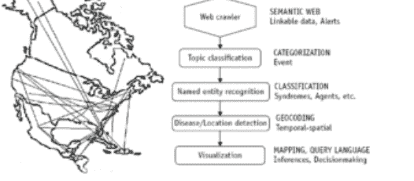

图 4-1.

疾病监测与监控的可视化。

## 健康结局的衡量：衡量类型

我们以多种方式衡量流行病学。我们衡量症状监测到隔离的频率。我们衡量给定时间点定义人群中现有病例的频率。患病率是指给定时间点定义人群中现有病例的频率。流行病学利用了来自许多来源和格式的异构数据，标准命名法和本体论对于建立大规模流行病学模型和基于模型的预测方法至关重要。管理数据异构的方法之一是通过语义互操作，使用无歧义的概念（元数据）来确保医疗信息和知识的获取（Handsome & Levin, 2013）。本体论描述知识领域（即概念及其关系）并为每个领域建立标准规范（例如，疾病、地理位置或本体论）。在知识领域内建立的关系是一种能够实现模式识别的推理机制。

显然，在比较症状监测与隔离的有效性时，可行性是关键要素。这类流行病学研究可以指导药剂师、公共卫生人员和政策制定者在新发病原体或慢性疾病爆发期间如何使用药物和非药物干预措施。因此，对流行病学的基础了解，以及其词汇、衡量标准和方法论，是药剂师评估文献、改善患者护理以及参与公共卫生政策倡议的重要工具。


发病率是指特定人群在给定时期内某种疾病或功能障碍新病例的发生率。患病率是指在给定时间点，定义人群中现有病例的频率。流行病学利用了来自许多来源和格式的异构数据，标准命名法和本体论对于建立大规模流行病学模型和基于模型的预测方法至关重要。管理数据异构的方法之一是通过语义互操作，使用无歧义的概念（元数据）来确保医疗信息和知识的获取（Handsome & Levin, 2013）。本体论描述知识领域（即概念及其关系）并为每个领域建立标准规范（例如，疾病、地理位置或本体论）。在知识领域内建立的关系是一种能够实现模式识别的推理机制。

## 健康结局的衡量：衡量类型

我们以多种方式衡量流行病学。我们衡量症状监测到隔离的频率。我们衡量给定时间点定义人群中现有病例的频率。患病率是指给定时间点定义人群中现有病例的频率。流行病学利用了来自许多来源和格式的异构数据，标准命名法和本体论对于建立大规模流行病学模型和基于模型的预测方法至关重要。

...

`CI` 是有用的。如果研究兴趣是个人在特定时期内发病的概率，则使用`CI`。如果研究兴趣关于新病例发生的速度，则优先选择`IR`计算。稳态测量提供了发病率和患病率之间的函数关系。如果`IR`和疾病持续时间随时间保持不变且患病率较低，则`P/I = IR × 平均疾病持续时间`，其中`P`是人群中患病人数除以人群总人数。

# 流行病学

效应衡量评估了可能的风险因素与随后的疾病发生之间关联的强度。为了做到这一点，我们比较暴露于潜在风险因素的人组的疾病发病率与未暴露于该潜在风险因素的人组的发病率。这通常表示为两组之间的比率。我们将这些衡量标准统称为相对风险衡量，即通过暴露与疾病之间关联的强度，来确定观察到的关联之间是否存在因果关系。表 4-2 提供了常见流行病学频率和效应指标的公式。

| 表格 4-2 常见流行病学指标 |
| --- |
|  |

| 疾病频率指标 | 患病率（Point Prevalence） |
| --- | --- |
|  | 某一时间点人口中的病例数 |
|  | 同一时期内人口中的人数 |
|  | 发病风险（Incidence Risk） |
|  | 指定时间段内的疾病病例数 |
|  | 该时段开始时的无病人数 |
|  | 发病率（Incidence Rate） |
|  | 给定时期内的新发病例数 |
|  | 研究期间的总人年时 |
| 效应指标 | 风险比（Risk Ratio） |
|  | 暴露组的风险（累积发病率） |
|  | 未暴露组的风险（累积发病率） |
|  | 比率比（Rate Ratio） |
|  | 暴露组的发病率 |
|  | 未暴露组的发病率 |
|  | 比值率（Odds Rate） |
|  | 暴露组的疾病比值 |
|  | 未暴露组的疾病比值 |

我们还衡量疾病如何影响人群，疾病负担（Burden of disease）解决了除了直接治疗成本之外，疾病对社会的总意义（Murray & López, 1994）。它衡量了因健康问题损失的寿命，或总预期寿命与残障调整寿命之间的差异。残障调整寿命年（`DALY`）是人口健康的一个总结指标。一个`DALY`代表一年的健康生活，并估计了人口当前生活状态与患该疾病时人口状态之间的差距。

`DALY`使用潜在寿命损失年（`YPLLs`）和伤障生存年（`YLDs`）来构建其公式。`YPLL`衡量死亡率对人口的影响。其计算方法是：早于预定年龄（或最小寿命）死亡的个体，其死亡年龄与预定年龄之差之和。`YLDs`衡量患有障碍的年数；与特定疾病或障碍相关的残障负担可以用`DALYs`的形式报告。因此，死亡率（`YPLLs`）和病率（`YLDs`）被合并为一个单一的共同指标。

全球疾病负担（`GBD`）疾病和伤害发病及流行病率协作小组（`GBD, 2016`）对全球范围内疾病和伤害的主要遗症的患病和发病率进行了定量分析。2015 年，上呼吸道感染（172 亿）和腹泻疾病（239 亿）是导致发病和死亡最常见的疾病。然而，冲突与焦虑之间存在正相关，这证实了心理健康和物质滥用障碍对全球残疾有显著贡献（`GBD, 2016`）。新发和再发传染病由于其出现的不确定性以及爆发与下降之间的时间差，一直是全球健康预防、干预和监测面临的持续挑战。`GBD`协作小组能够捕捉非洲的病毒疾病爆发，但未能捕捉跨美洲的基孔林病毒和寨卡病毒（`GBD, 2016`）。因此，流行病学指标有助于更好地理解生活质量、成本效益、成本有效以及健康和公共卫生领域的比较有效性研究和结果（`Antioch, Drummond, Nielsen, & Vondel, 2017; Kislan, Bernstein, Ferington, & 2016`）。

## 流行病学方法

流行病学方法在过去的五十年中发展迅速，以解决数值统计和数据问题，例如处理混杂变量、回顾性和纵向数据带来的挑战，以及减少偏。由于流行病学决定了暴露如何与结果相关，其重点是特定人群内导致特定疾病事件的原因。遗憾的是，诊断标准、因素和数据记录往往随时间或国家、政府和社区而变化，导致分析受到混杂或变得更加复杂。由于流行病学家基于组间疾病率的比较得出结论，识别高风险组和优先组取决于对比率的无偏比较。

两种主要方法是描述性流行病学和分析性流行病学。

描述性流行病学描绘现有的健康问题和疾病模式。这些模式通常会产生研究假设，分析性流行病学会对这些假设进行更正式的检查。重要概念包括人员、时间、因果关系、偏倚和混杂。

在描述性流行病学中，人员、地点和时间范围决定了疾病的分布。人员特征包括固有特征（年龄、性别、种族/民族）、获得性特征（受教育水平、婚姻状况）、活动/行为（职业、休闲活动、药物/烟草/酒精的使用）或他们生活的条件（社会经济地位、医疗保健获取情况）。地点属性包括地理因素，从宏观层面（国家）、中观层面（州）到微观层面（城市），以及地点类别如城市或农村、国内或国外、机构或国家。气候以及与地点相关的其他因素（如烟雾）会影响疾病的发生。

发生情况是时间和时间模式最常描述的特征。例如，发生情况可以是循环的（如流感）或散发性的（如霍乱爆发）。监测疾病的发生情况或公共卫生干预的有效性需要理解疾病发生随时间变化的模式。关于时间的三个常见观点包括长期趋势、周期性波动和点源暴发（`Porta, 2016`）。长期趋势跟踪长时间一段时间内疾病发生情况的变化，而周期性波动是指较短期的增加和减少。点源暴发是指暴露于某种病原体或污染物的人群中疾病发生的增加（季节性，注：此处原文为`seasonal`，疑为笔误，根据语境应指点源特征，此处按字面译为季节性）。

在描述性流行病学中，人员、地点和时间范围决定了疾病的分布。人员特征包括固有特征（年龄、性别、种族/民族）、获得性特征（受教育水平、婚姻状况）、活动/行为（职业、休闲活动、药物/烟草/酒精的使用）或他们生活的条件（社会经济地位、医疗保健获取情况）。地点属性包括地理因素，从宏观国家、中观州到微观城市，以及地点类别如城市或农村、国内或国外、机构或国家。气候以及与地点相关的其他因素（如烟雾）会影响疾病的发生。

发生情况是时间和时间模式最常描述的特征。例如，发生情况可以是循环的（如流感）或散发性的（如霍乱爆发）。监测疾病的发生情况或公共卫生干预的有效性需要理解疾病发生随时间变化的模式。关于时间的三个常见观点包括长期趋势、周期性波动和点源暴发（`Porta, 2016`）。长期趋势跟踪长时间范围内疾病发生情况的变化，而周期性波动是指较短期的增加和减少。点源暴发是指暴露于某种病原体或污染物的人群中疾病发生的增加。

分析性流行病学是指对健康结果决定因素的研究。决定因素是增加或减少健康健康的因素。分析性流行病学是假设驱动的，研究人员识别感兴趣的变量，形成变量之间的关系，并对人群（例如病例和对照）进行比较。分析流行病学家面临的挑战是确定他们的结果是有效的并代表变量之间的因果关系。为此，他们检查机会、偏倚和混杂。

机会是指表观关系可能是假的可能性。当研究人员在没有先验假设引导的情况下进行统计分析，更容易产生具有统计学意义的结果。偏倚是指研究执行中的系统性误差。由于偏倚导致的错误可能发生在研究的设计和执行阶段，也可能发生在分析和解释阶段。偏倚有许多类型，包括观察偏倚、转诊偏倚、信息偏倚和选择偏倚（`Schwartz, Campbell, & Gordon, 2015`）。混杂发生在一个非中间的第三因素扭曲了暴露-结果关系时。适应症混杂出现在非随机（观察性）药物研究中，当服用不同药物或服用同种药物的两组特征存在显著差异时。考虑到关于使用贯穿金景（圣约翰草，一种非处方药）和氟西汀（一种处方药）治疗抑郁症的持续讨论，`Ioannis (2008)`认为，长期试验和对个体数据的仔细前瞻性荟萃分析可能为各药物的效果提供更好的证据，而不是基于研究人群选择以及提供选择性和扭曲结果的小随机试验。

显然，判断因果关系比本章的范围要复杂；它是任何文献综述的关键部分，以确定暴露因果关系是否影响感兴趣的结果。`Hill (1965)`的九项标准提供了一个判断因果关系的框架，随着新方法论和认识论的出现，总会有例外和保留意见（`Ioannis, 2016`）。鼓励读者阅读`Rothman, Greenland 和 Lash (2015)`以对这些问题进行更深入的讨论。

## 流行病学研究类型

不同的研究反映了“证据金字塔”中的不同证据水平。金字塔底部（最低水平）是病例对照研究、病例系列和病例报告；随后是队列研究、随机临床试验、经过批判性评价的个体文章、批判性方法的试验（证据综合），顶端是系统综述和荟萃分析。例如，病例研究是解释为何或在何种情况下发生了效应的有力设计；随机试验最适合临床决策，而纵向队列研究最能解决涉及预后和病因问题。因此，证据分级是必要的，因为它们允许我们解释信息的可靠性，以制定旨在改善医疗保健中特定事件或行动的建议。

分析性流行病学家检验特定因素是健康结果的假设。其他考虑的因素包括暴露（因素）的特征和健康结果。病例对照研究、队列研究和横断面研究是最常见的分析性研究类型，尽管干预研究和随机临床试验也属于分析性研究。

## 例对照研究

病例对照研究是一种观察性研究，通过将患疾病的个体（病例组）与来自同一人群的其他未患该疾病的个体（对照组）进行比较。病例对照研究也被称为“回顾性研究”，旨在估计患病的几率，并回溯性地确定各组与特定风险因素暴露之间是否存在关系。病例对照研究是检查罕见状况或疾病的好方法，因为对照组代表了预期的暴露流行率和病例发生率。它们也可用作建立关联的初步研究，为更严谨的研究奠基础。然而，由于依赖记忆和回忆，偏倚可能会影响数据质量。当暴露和结果都与第三个变量强相关时，它们更容易受到混杂影响。

一个简单的例子是口腔癌。所检查的因素是无烟草（例如：嚼烟、鼻烟、斯纳斯、古特和局部烟草）。根据个人所使用的无烟草类型，其可能面临口腔癌的低、中、或高风险。考虑以下示例：使用无烟草导致的估计疾病负担在113个国家损失了170万个调整后寿命年（`DALYs`），并导致62,283人死于疾病（`Siddiki et al., 2015`）。这一负担的85%以上位于东南亚，南亚和东南亚有超过2.5亿未使用无烟草。

然而，建立某些有害影响的流行病学证据是困难的。最近的荟分析显示了无烟草、慢性口腔病变与口腔癌之间的关系（`Khan et al., 2016`），以及咀嚼无烟草的人群食管鳞细胞癌风险的多倍增加（`Akhtar, 2013`）。然而，还需要更强有力的研究来量化剂量反应关系（`Gupta & Johnson, 2014`）。

药物流行病学家将病例对照研究作为营销监测。`Yang`和同事（`2014`）报告了1951年至2012年中国南方广州的疫苗效力。通过使用检测结果阴性的病例作为对照，他们确定在8个月至14岁的接种过麻疹疫苗的儿童群体中，麻疹的发生率总体显著下降。他们发现，两剂量麻疹疫苗在预防麻疹方面比单剂量更有效，并建议流动人口和非疫苗目标人群接种疫苗（`Yang et al., 2014`）。

## 队列研究

队列研究比较根据暴露状态（即是否存在特定暴露）进行分层的不同人群之间的健康结果。由于队列研究的参与者根据其是否符合要求被分配到比较组，队列研究允许研究人员在自然环境中观察和评估可能有害的暴露。队列研究可以是前瞻性的或回溯性的。

在前瞻性研究中，对暴露和未暴露的参与者进行长期随访，以确定健康结果的初始发生情况。通过确定暴露与结果之间的时间关系，队列研究允许直接测量和比较暴露组之间的发生率（使用风险比）。前瞻性研究对于检查新暴露非常有利。几项著名的队列研究包括弗雷明汉心脏研究，它在过去的五十年中定义了心血管疾病风险因素和预防指南（`Tsao & Vasan, 2015`），以及针对欧洲和加拿大的药物使用模式、治疗满意度和骨质疏松控制不足研究，该研究检查了胃肠道症状与药物的关联（`Modi et al., 2016`）。队列研究的一种变体——欧盟的“药物监测”项目，利用队列监测从更广泛公共卫生角度支持并加强了药物警戒（`Pal, Olsson, & Brown, 2015`）。

在回顾性队列研究中，暴露和感兴趣的健康结果已经发生。研究人员回到结果发生后的某个时间点，尝试建立暴露状态。回顾性研究适用于检查长潜伏期事件（在自然或人为情况下多次发生的事件）或检查罕见或异常暴露的研究。药物流行病学家经常使用队列研究进行上市监测和四期研究，以评估批准化合物或医疗器械的安全有效性，并用于特定疾病管理。

## 横断面研究

横断面研究也称为流行率调查，同时评估感兴趣的暴露和健康结果，用于国家级研究，例如美国疾病控制中心国家健康统计中心开展的研究。许多横断面研究是描述性和分析分析的混合。

描述性横断面研究评估定义人群中特定疾病的频率和分布。`Awad`和`Waheedi (2012)`在对220个科威特社区的横断面研究中，检查了当地剂师提供的肥胖管理服务的咨询频率、舒适度和感认知有效性。尽管大多数剂师对患者提供了减肥方法的咨询建议，但剂师认为患者并非对剂师在咨询方面的专业知识缺乏认识，而是肥胖患者缺乏意志力且不坚持进行减重干预（`Awad & Waheedi, 2012`）。

分析性横断面研究通常试图调查假设风险因素与健康结果之间的关联。血吸虫病是由血吸虫引起的慢性病，据报道存在于缅甸掸邦；然而，尚未进行血清学研究来检测它或研究居民中的因素（`So, Oo, Maung, 2017`）。血清阳性的显著因素是男性、位于四个农村卫生中心的地理位置以及教育程度。此外，`ELISA`测试显示出良好的使用的灵敏和特异性水平。作者建议缅甸将血吸虫感染纳入其国家监测疾病清单，并进行流行率检测（`So et al., 2017`）。

使用横断面研究既有优势也有挑战。横断面研究适用于开发描述性分析和产生假设。它们相对快速且易于进行，因为研究人员一次性收集所有变量的数据，允许他们研究多个结果和暴露。因此，横断面研究可以描述事件或结果的规模和分布。然而，横断面研究容易产生偏倚。由于它们同时评估暴露和结果，因果偏倚提出了暴露是发生在结果之前还是作为结果的问题。生存偏倚必须注意不要疾病时长与暴露状态相关。

## 随机对照试验

随机对照试验（`RCT`）是临床决策研究证据金字塔的顶端（`Parfrey & Ravani, 2015`）。将受试随机分配到特定的暴露组、实验组（新干预或药物）对比对照组（标准实践干预或安慰剂），可以确保各组在其他特征的分布上是相似的。研究人员或医生比较暴露组随后的健康经历通过风险比或发生率比来确定干预的有效性。

然而，在进行随机对照试验（`RCT`）时存在许多挑战。研究人员必须清晰定义`RCT`方案（假设、患者、干预措施、结局、衡量标准和方法），以满足机构伦理审查委员会（`IRB`）的严格审查，确保符合人类受试者研究的联邦法规。`RCT`方案必须包含关于一个或多个预测变量与结果变量之间预期关联的假设，并与无关联的零假设进行对比，并在预定的显著性水平上进行统计学评估。预测变量和结果变量根据其理论关联经过仔细选择，并在研究前进行定义。除了从人群中招募合适的（具有代表性的）样本外，招募足够的参与者以随机分配到两个或多个比较组也可能存在延迟和挑战。随机双盲研究确保研究人员在收集数据之前不知道哪一组接受了何种干预措施，除非受试者出现了副作用。受试者必须提供知情同意并接受数据收集，且研究人员必须遵守严格的质量控制措施，以确保患者的隐私和机密性。每一步对试验的内部效度都有影响；然而，一个设计良好、方法学严密的`RCT`如果存在因果关系，则可以提供证据。

临床试验报告共同标准（`CONSORT`）是关于提高`RCT`报告质量的建议（`Moher et al., 2012`）。这类报告指南不仅为研究人员提供了报告的最低标准，这些指南还增加了生物医学出版物的透明度和质量（`Hutton, Wolfe, Moher, & Shamster, 2017`）。在药理学研究中，许多`RCT`在理想或近乎理想的情况下评估不同干预和治疗的有效性，而真实世界研究则衡量有效性。因此，药剂师需要审查并彻底研究那些采用处方药标签外用用或针对未纳入原始`RCT`的患者的`RCT`（`Kip & Quillen, 2008`）。在医学期刊文章中适当使用`CONSORT`指南将有助于药剂师审阅有关药物或医疗器械疗效的文献（`Milis et al., 2004`）。

# 筛查

筛查是一种常见的健康实践，植根于流行病学和药学健康。在许多药店或无需处方的情况下即可获得服务，例如结直肠癌筛查、糖尿病检测和怀孕检测。理解筛查的基本原理可以帮助药剂师在与患者交流筛查测试的使用或结果时提供支持。筛查是“对无症状的人群进行检查，以将其分类为可能或不太患有所筛查的疾病”（`Harrison, 1985, p. 3`）。根据该定义，筛查关注的是亚临床状态的人群（即他们可能患有某种疾病但并不知情）。因此，筛查有助于识别那些可能需要针对严重疾病进行额外诊断检查的人、在症状出现前就能接受更有效治疗的个体，或者在亚临床阶段发病率极高的人群。

一个例子是苯酮尿症（`PKU`）。医院现在在婴儿出生后常规进行`PKU`筛查，以确定婴儿是否能够将苯氨酸转化为酪氨酸（正常生长发育所需的氨基酸）（`Paul & Bosco, 2003`）。如果没有这种转化，婴儿将遭受抽搐、脑部损伤和智力障碍。诊断为患有`PKU`的女儿童需要终身随访以防止母体`PKU`，且患有`PKU`的男性和女性儿童在生命周期中往往会经历行为问题、精神痛苦和执行功能障碍（`Burton et al., 2013; de Baulny, Aubrey, Feillet, & Parscau, 2007; Jahia et al., 2013`）。在这种情况下，尽管`PKU`相对罕见，但其长期后果和成本对个体整个终生来说是重大的。


筛查测试具有可靠性和有效性。可靠的筛查在不同环境和多次对个体进行时能给出一致的结果。有效的筛查指明哪些个体确实患有疾病，且不具有高敏感性和高特异性。`敏感性`是指测试将患有疾病的受试者正确标记为阳性的能力。`特异性`是指测试将未患疾病的受试者正确标记为阴性的能力。测试敏感性越高，假阳性结果越少；特异性越高，假阴性结果越少。假阳性意味着根据筛查测试，未患疾病的个体被认为患病；假阴性意味着根据筛查测试，患病的个体被认为未病。

理想的情况是拥有一种既高敏感性又高特异性的测试。`2 × 2`表（也称为列联表）是比较筛查测试与金标准（诊断性）测试性能的有用工具，因为它将所有测试结果分类为阳性或阴性，并根据敏感性和特异性对测试特征分类（表 4-3）。

| 金标准 +（存在） | 疾病（不存在） |
| :--- | :--- |
| 测试 | |
| `a + c`（所有病患者） | `b + d`（所有无病者） |
| 筛查测试 + | `a`（真阳性） |
| | `b`（假阳性） |
| | `c`（假阴性） |
| | `d`（真阴性） |

与所有测试一样，最重要的临床问题仍然相同。如果测试结果为阳性，患者真的患病的概率有多大？如果测试结果为阴性，患者不患病的概率有多大？要更全面回顾本节的原理，请参考 Kip and Quillen (2008) 或 Weiss (2016)。

## 对药剂师和药学实践的意义

流行病学可以增加我们对风险人群的理解，满足解决特定疾病状态或身体/精神/物质使用障碍的选择性需求。流行病学的词知识、应用和理论框架对于药剂师至关重要，数据可以提供护理信息。随着决策变得日益复杂，文献量呈指数级增长。

## 参考文献

Akhtar, S. (2013). 亚洲食道鳞状细胞癌：一项病例研究分析。Cancer Causes & Control, 24(2), 257-265. `doi:10.1007/s00346-012-2`

Andrews, J. (1946). 美国公共服务。Public Health Reports, 61, 1203–10.

Baglehole, R., Bonita, R., & Kjellstrom, T. (2006). 基础流行病学。日内瓦：世界卫生组织。来自 `http://apps.who.int/iris/bitstream/10665/12547`

Bilder, B., Leviton, L., Vepa, H., Long, B., Binder, D. (2013). 针对肥胖的多样化方法：一项交叉研究。Molecular Genetics and Metabolism, 108(1), 8–12. `doi:10.1016/j.ym.2012-11`

Centers for Disease Control and Prevention. (2015, July). 我们的历史——我们的故事。来自 `https://www.cdc.gov/about/history/ourstory`

Collier, N. (2012). 挖掘文本：网络流行病学工作的调查。Global Public Health, 7(7), 731–749. `doi:10.1080/17441692.2012.699975`

Choi, J., Cho, Y., Shim, E., & Woo, H. (2016). 网络传染病监测系统与公共卫生实践：系统综述。BMC Public Health, 16(1), 1238. `doi:10.1186/s12889-016-3893-0`

Awad, A., & Waheedi, M. (2012). 药剂师在社区中的作用：一项横断面研究。BMC Public Health, 12, 863. `doi:10.1186/s12889-012-8`

Cameron, D., Smith, G. A., Danailutyke, R., Sheth, A., Chen, L., Falck, R. (2013). PREDOSE：利用社交媒体进行药物流行病学的语义网平台。Journal of Biomedical Informatics, 46(6), 985–997. `doi:10.1016/j.jbi.2013-07`

Kip, E., & Quillen, J. (2008). 处方药标签外用研究。

Weiss, R. (2016). 流行病学。

Weavers, W., & Smith, B. (2010). 生物医学术语和本体的统一框架。Studies in Health Technologies and Informatics, 160(Part 2), 1050–1054.

Moher, D., et al. (2012). 随机对照试验报告共同标准。

Hutton, M., Wolfe, J., Moher, D., & Shamster, J. (2017). 生物医学出版物的透明度和质量。

Milis, A., et al. (2004). 药物或医疗器械疗效的文献审阅。

# 流行病学

Collier, N., Doan, S., Kawazoe, A., Goodwin, R. M., Conway, M., Tateno, Y., ..., Taniguchi, K. (2008). BioCaster：基于网页的文本挖掘系统的公共健康谣言检测。Bioinformatics, 24(24), 2940-2941. `doi:10.1093/bioinformatics/btn534`

国际医学科学组织委员会. (1992). 报告药物不良反应术语使用的基本要求。Pharmacacoepidemiology and Drug Safety, 1(1), 39-45. `doi:10.1002/pds.26300109`

Couto, F. M., Ferreira, J. D., Zamite, J., Santos, C., Posse, T., Graça, P., ..., Silva, M. J. (2012). 流行病学市场平台：利用生物本体学对流行病学资源进行语义表征。In Cornet & R. Stevens (Eds.), Proceedings of the 3rd International Conference on Biomedical Ontology (ICBO 2012) (Vol. 897, pp. 1-2). Graz, Austria: International Conference on Biomedical Ontology. Retrieved from `http://ceur-ws.org/vol-897/demo_1.pdf`

Cowell, L. G., & Smith, B. (2010). 传染病本体论。In V. Sinthenko (Ed.), Infectious diseases informatics (pp. 373–395). New York: Springer.

de Baunly, H.O., Abadie, Y., Feillet, F., & Parcau, L. (2007). 苯酮尿症和高苯丙氨酸血的治疗。Journal of Nutrition, 137(6 Suppl 1), 1561S–1565S; discussion 1573S–1575S.

Faich, G. A., Castle, W., & Bankowski, Z. (1990). 药物不良反应的国际报告：CIOMS 项目。CIOMS ADR 工作组。International Journal of Clinical Pharmacology, and Toxicology, 28(4), 133–138.

Farr, W. (1837). 关于确定疾病进展每个阶段危险性和持续时间的方法。British Annals of Medical, 1, 72-79.

Farr, W. (1862). 确定某些疾病治疗体系疗效的方法。BMJ, 2, 193–195.

Ferreira, J. D., Pesquita, C., Couto, F. M., & Silva, M. J. (2012). 将流行病学引入语义网。In Cornet & R. Stevens (Eds.), Proceedings of the 3rd International Conference on Biomedical Ontology (ICBO 2012), KR-MED Series (pp. 1–5). Graz, Austria: Medical University of Graz. Retrieved from `http://ceur-ws.org/vol-897/session-1-paper-02.pdf`

Flint, A. (1873). 水与发热传播的关系。Public Health Reports & Reports, 1, 164–172.

Forland, F., De Carvalho Gomes, H., Nokbley, H., Escobar, A., Dijk, J., G., & Jansen, A. (2012). 循证医学在公共卫生中的应用：正在发疫情期间斑疹热风险评估。European Surveillance, 17(3), 20060.

Frost, W. H. (1976). Wade Hampton Frost 对流行病的一般概念。American Journal of Epidemiology, 103(2), 141–151.

GBD 2015 疾病与伤害合作者 (2016). 1990 年至 2015 年疾病和伤害的全球、区域和国家发病率、患病率和残疾调整寿命年：全球疾病负担研究的系统分析。The Lancet, 388(10053), 1545–1562. `doi:10.1016/s0140-6736(16)31678`

Graunt, J. (1962). 死亡表中提到的自然与政治观察。Oxford: William Hall.

Graunt, J. (2008). 死亡表中提到的自然与政治观察（节选）。In D. Schneider & D. E. Lilienfeld (Eds.), Public health: The development of a discipline: Vol 1. 从希格拉底时代到进步时代 (pp. 28–72). New Brunswick, NJ: Rutgers University Press.

Gupta, B., & Johnson, N. W. (2014). 南亚口嚼烟与口腔癌相关性的系统评价和荟萃分析。PLOS One, 9(11), e11385. `doi:10.1371/journal.pone.011385`

Hanson, A., & Levin, L. (2013). 健康信息学。New York: Oxford University Press.

He, Y., Racz, R., Lin, Y., Todd, T., Hur, J., . ., Z. (2014). 基于网页的疫苗数据库和分析更新。Nucleic Acids Research, 42, D1124–D1142. `doi:10.1093/nar/gkt133`

Hill, A. B. (1965). 环境与疾病：关联还是因果？Proceedings of the Royal Society of Medicine, 58, 295–300.

Hippocrates. (2008). 关于空气、水和地方。In D. Schneider & D. E. Lilienfeld (Eds.), Public health: The development of a discipline: Vol 1. 从希格拉底时代到进步时代 (pp. 7–24). New Brunswick, NJ: Rutgers University.

Homee, P., Kværner, J., Casey, J. R., Demoiseux, R., van Dongen, T., Gunasekera, H., . . . Weinreich, H. (2017). 专家 1：流行病学与诊断。Otolaryngology: Head & Neck Surgery, 156(4 Suppl.), S1–S2. `doi:10.1177/0194659816664351`

Button, W., Lo, Moher, D., & Sham, L. (2017). 从统计学角度提出的报告建议：增强随机试验和系统证据严谨性的工具概述。Evidence-Based Medical Health. Advance publication. `doi:10.1136/ebmed-2017-10266`

Ioannidis, J. P. (2008). 抗抑郁药的疗效：从一千随机试验中构建的神话？Philosophy, Ethics, and Humanities in Medicine, 3, 14. `doi:10.1186/1747-5341-3-14`

Ioannidis, J. P. (2016). 全暴露流行病学：重新审视医学统计学。Statistics in Medicine, 35(11), 1749-1762.

Jahja, R., Huijbrechts, S., Sonneville, L., Bosch, A., de. (2013). 早期治疗苯酮尿症的心理健康和社会功能。Molecular Genetics and Metabolism, 110(Suppl.), S57-S61. `doi:10.1016/j.ym`

Jones, J. K., Wilson, H., & Lewis, D. (2012). 药物流行病学：领域定义及其核心。Pharmacoepidemiology and Drug Safety, 21(7), 677-689. `doi:10.1002/pds.3198`

Jordan, M. A., & Hamilton, J. (2015). 改善患者结局。Integrated Research and Practice, 4, 79-89.

Khan, Z., Khan, S., Christian, L., Rahman, S., Ekwun, O. (2016). 南亚无烟烟草和潜在恶性性：一项系统评价和荟萃分析。Nicotine and Tobacco Research. `doi:10.1093/ntw/ntw`

Kip, K., & Quillen, B. (2008). 应用流行病学。In Last, J. (Eds.), Introduction to public health (pp. 17–54). Sudbury, MA: Springer.

MacMahon, B., & Pugh, T. (1970). 流行病学字典（第 4 版）。New York: Oxford.

Miles, E., Guyatt, G. (2004). 对因果关系的更清晰理解。American Journal of Epidemiology, 158, 611-65.

Murray, C. J., & López, A. D. (1994). 残疾量化：方法。Bulletin of the World Organization, 72(3), 481–494.

Murray, C. J., Vos, T., Lozano, R., Naghavi, M., Flaxman, A., Michaud, C. (2012). 1990 年至 2010 年 21 个地区疾病和伤害的全球、区域和国家发病率、患病率和残疾调整寿命年：全球疾病负担研究的系统分析。The Lancet, 380(9859), 2197–2223. `doi:10.1016/s0140-6736(12)6129-9`

Musen, M. A., Noy, N. F., Shah, N. H., Wetzel, P. L., Chute, C. G., Story, M. A., & Smith, B. (2012). 国家生物本体学中心。Journal of the American Medical Association, 19(2), 190–195. `doi:10.1136/amajnl-2011-0052`

Newman, A. L., & Kaljee, L. M. (2017). 非裔美国女性健康差异与三阴性乳腺癌：综述。JAMA Surgeon. Online publication. `doi:10.1001/jumasurg.2017.005`

O'Shea, J. (2017). 数字疾病检测：基于互联网的生物监测系统的系统评价。International Journal of Medical Informatics, 101, 15–22. `doi:10.1016/ijmedinf.2017.01`

Ong, E., Zhang, Z., Zhao, B., Liu, Y., Lin, Y., Zheng, J., ... He, Y. (2017). Ontokee：支持本体学术语的链接开放数据服务器去引用、链接、查询与整合。《核酸研究杂志》(Nucleic Acids Research), 45(D1), D347-0352. `doi:10.1093/nar/gkw918`

## 流行病

Pal, S. N., Olsson, S., & Brown, E. G. (2015). 药物监测项目：一项跨国药物警戒与公共卫生项目。《药物安全》(Drug Safety), 38(4), 319-328. `doi:10.1007/s00264-015-0283-9`

Parfrey, F. S., & Ravani, P. (2015). 关于研究问题的框架与合适研究设计的选择。《分子生物学方法》(Methods in Molecular Biology) 1281, 3-18. `doi:10.1007/978-1-4939-2428-8_1`

Paul, D. B., & Brosco, J. P. (2013). 苯丙酮尿症（PKU）悖论：一种遗传疾病的简史。马里兰州巴提摩：约翰斯霍普金斯大学出版社。


# 流行病学

## 流行病

去引用、链接、查询与整合。《核酸研究杂志》(Nucleic Acids Research), 45(D1), D347-0352. doi:10.1093/nar/gkw918

Pal, S. N., Olsson, S., & Brown, E. G. (2015). 药物监测项目：一项跨国药物警戒与公共卫生项目。《药物安全》(Drug Safety), 38(4), 319-328. doi:10.1007/s00264-015-0283-9

Parfrey, F. S., & Ravani, P. (2015). 关于研究问题的框架与合适研究设计的选择。《分子生物学方法》(Methods in Molecular Biology) 1281, 3-18. doi:10.1007/978-1-4939-2428-8_1

Paul, D. B., & Brosco, J. P. (2013). 苯丙酮尿症（PKU）悖论：一种遗传疾病的简史。马里兰州巴提摩：约翰斯霍普金斯大学出版社。

Peak, C. M., Childs, L. M., Grad, Y., & Buckee, C. O. (2017). 控制新发流行病的非药物干预措施比较。《美国国家科学院院》(Proceedings of the National Academy of Sciences of the United States of America)。提前出版。 doi:10.1073/nas.1616438114

Pesquita, C., Ferreira, J. D., Couto, F. M., & Silva, M. J. (2014). 流行病学本体：一种用于流行病学资源语义标注的本体。《生物医学信息学杂志》(Journal of Biomedical Informatics), 5(1), 4. doi:10.1016/j.jbi.2014.08.048

Phimarn, W., Pichanchana, P., Liminkanchakovit, P., Suranart, K., Supananishakorn, S., Narkgaon, A., & Saramanee, K. (2013). 泰国社区药剂师参与管理护理以改善患者结果。《国际临床药学杂志》(International Journal of Clinical Pharmacy), 35(6), 1208–1217. doi:10.1207/s11096-013-9851-3

Porta, S. M. (2016). 流行病学字典（第6版）。纽约，纽约：牛津大学出版社。

Rothman, K. J. (1993). 流行病学论文中的政策建议。《流行病学》(Epidemiology), 4(2), 94–99.

Rothman, K. J., Greenland, S., & Lash, T. L. (2015). 现代流行病学（第3版）。宾夕法尼亚，宾夕法尼亚：Wolters Kluwer。

Schriml, L. M., Arze, C., Nadelenda, S., Chang, Y. W., Mazaitis, M., Felix, V., . . . Kibbe, W. A. (2012). 疾病本体：语义整合的骨干。《核酸研究杂志》(Nucleic Acids Research), 40, D940–D946. doi:10.1093/nar/gkr9972

Schriml, L. M., Arze, C., Nadelenda, S., Ganapathy, A., Felix, V., Mahurkar, A., . . Hall, N. (2010). GeMiNa：传染病基因组元数据，一个地理空间病原体数据库。《核酸研究杂志》(Nucleic Acids Research), 38, D754–D764. doi:10.1093/nar/gkp832

Schwartz, S., Campbell, U. B., Gatto, N. M., & Gordon, K. (2015). 流行病学教科书中“偏倚”分类法的澄清。《流行病学》(Epidemiology), 26(2), 216–222. doi:10.1097/ede.00000000000000224

Shattuck, L. (1850). 关于促进公众和个人健康的总体计划报告，由马萨诸塞州州议会决议任命的委员根据有关州卫生调查的决议制定、准备并提议的计划。波士顿，马萨诸塞州：Dutton & Wentworth。

Shim, E. (2017). 使用登革热传播模型分析墨西哥尤加敦地区种登革热疫苗的成本效益。《PLOS ONE, 12(4), e0175020. doi:10.1371/journal.pone.e0175020

Siddiki, K., Shah, S., Abbas, M., Vidyagasagar, A., Jawad, M., Dogar, O., & Sheikhik, A. (2015). 分析中无烟烟草消费的全球疾病负担：来自113个国家的数据。《BMC医学》(BMC Medicine), 13, 194. doi:10.1186/s12916-015-024-2

Smith, B., Ashburner, M., Rosse, C., Bard, J., Bug, W., Ceusters, W., . . . Lewis, S. (2007). OBO基金会：支持生物医学数据集成的本体协同演化。《自然生物技术杂志》(Nature Biotechnology), 25(11), 1251–1255. doi:10.1038/nbt346

Snow, J. (1849). 关于霍乱的病理和模式。伦敦：John Churchill。

Snow, J. (1855). 关于霍乱的模式（第2版）。伦敦：John Churchill。

Soh, H. O., Oo, C., Myat, T. O., & Maung, N. S. (2017). 掸邦内陆湖当地当地血吸虫抗体的检测及相关因素的探索。《传染病》(Infectious Diseases), 6(1), 3. doi:10.1186/s40249-017-1

Teret, S. (2001). 政策与科学：流行病学家是否应该对其研究的政策影响发表评论？《流行病学》(Epidemiology), 12(4), 374–375.

Tsao, C. W., & Vasan, R. S. (2015). 队列分析：弗雷明汉心脏研究（FHS）：心血管流行病学概览。《国际流行病学杂志》(International Journal of Epidemiology), 44(6), 1800–1813. doi:10.1093/ije/dyv337

Weiss, N. (2001). 政策与科学：流行病学家是否应该对其研究的政策影响发表评论？《流行病学》(Epidemiology), 12(4), 374–375.

Weiss, N. (2016). 流行病学练习：应用与方法（第2版）。马里兰州巴提摩，马萨诸塞州：约翰斯霍普金斯大学出版社。

世界卫生组织 (World Health Organization). 根据马萨诸塞州州议会关于州卫生调查的决议任命的委员制定、准备并提议的促进公众和个人健康的总体计划报告。波士顿，马萨诸塞州：Dutton & Wentworth。

世界卫生组织 (World Health Organization). (2013). 预防和控制非传染疾病的全球行动计划。日内瓦。

世界卫生组织 (World Health Organization). (2015a). 全球疾病负担。日内瓦。

世界卫生组织 (World Health Organization). (2015b). 100项核心指标。日内瓦。

世界卫生组织 (World Health Organization). (2015c). 2015年健康：从千年发展目标到可持续发展目标。日内瓦。

Yang, Z., Xu, J., Wang, M., Tan, H., . . . Fu, C. (2014). 广州地区登革热疫苗的有效性。《人类疫苗与免疫治疗》(Human Vaccines & Immunapeutics), 10(4), 1091–1096.

# 疾病预防与健康促进

药学教育工作者和药业从业人员正在探索公共卫生路径，许多学校积极参与了公共卫生项目。本章提供了药学院与当地社区各种公共卫生倡议之间此类合作的示例。

## 坎贝尔大学药学院

通过坎贝尔大学药学院的健康中心（2017年），北卡罗来纳州居民在健康管理方面发挥了更积极的作用，并获得了医疗保健提供者的服务。健康中心侧重于公共卫生教育方法，这些方法可以引导个人建立健康的生活方式。该中心的推广活动包括在坎贝尔大学及周边县市举办健康市集和筛查、教职员工和学生的健康与福祉讲座、糖尿病教育以及针对医疗保健提供者的继续教育。该计划还为坎贝尔大学的员工及其家属开展了“糖尿病护理项目”。在该项目中，注册者定期与临床执业人员会面。该中心意识到，早期做出的生活方式选择对晚年具有长期影响。坎贝尔大学药学院与健康科学学院（2017年）提供公共卫生硕士学位，该学位可以与药学博士（PharmD）学位结合。这一选项是坎贝尔大学整合药学与其他健康相关职业的各种努力之一。

## 杜奎讷大学米兰药学院

杜奎讷大学药学院运营着多个中心，其中一些中心与公共卫生直接相关。药学护理中心建立于2002年，是学术伙伴计划的一部分，提供疾病预防和疾病管理服务（Center for Pharmacy Care, 2017; Mylan School of Pharmacy, 2017）。推广机会包括在匹兹堡市中心举办健康与福祉市集、在中学和小学开展教育计划，以及与县卫生部门在阿片类药物滥用等主题上的合作（Mylan School of Pharmacy, 2017）。

## 加州大学旧金山校区药学院

加州大学旧金山校区药学院利用《美国公共卫生服务服务烟草使用和依赖治疗指南》，创建了一套现用的戒烟计划，让学生和从业人员帮助他人戒烟。该计划最初旨在作为一种培训方法来改进医疗保健中的临床辅助戒烟咨询，现在由于其将药物治疗法与定制化的行为咨询干预相结合，已在广泛应用于许多健康专业领域（Corelli, Fenlon, Kroon, Proklov, & Hudson, 2007）。该名为“Rx for Change”的计划定期更新，并在免费注册后可在线获取（University of California at San Francisco School of Pharmacy, 2017）。由于美国药学院协会认为戒烟教育应该是药学课程体系的必要组成部分，此类计划旨在教授药剂师必要的技能，以为患者提供循证的干预（McBane et al., 2013）。

## 弗吉尼亚联邦立大学药学院


# 疾病预防与健康促进

## 加州大学旧金山校区药学院

利用《美国公共卫生服务治疗烟草使用和依赖的指南》为模型，加州大学旧金山校区药学院创建了一套现用的戒烟计划，让学生和从业人员帮助他人戒烟。该计划最初旨在作为一种培训方法来改进医疗保健中的临床辅助戒烟咨询，现在由于其将药物治疗法与定制化的行为咨询干预相结合，已广泛应用于许多健康专业领域（Corelli, Fenlon, Kroon, Proklov, & Hudson, 2007）。该名为“Rx for Change”的计划定期更新，并在免费注册后可在线获取（University of California at San Francisco School of Pharmacy, 2017）。由于美国药学院协会认为戒烟教育应该是药学课程体系的必要组成部分，此类计划旨在教授药剂师必要的技能，以为患者提供循证的干预（McBane et al., 2013）。

## 弗吉尼亚联邦立大学药学院

弗吉尼亚联邦立大学药学院（2017年）与大学的公共卫生计划相结合，提供`PharmD/MPH`学位课程。通过这种学位的组合，学生既关注以患者为中心的药学护理，也关注人群健康。由于该学位结合了药学院以及学院家庭医学与人口健康系、流行病学分支的教师，学生有机会将研究技能、患者护理和人群健康结合起来。同样，该计划结合了公共卫生和药学的经验学习。由于与弗吉尼亚州卫生部保持着紧密联系，该学位提供了许多实践和应用机会（Virginia Commonwealth University School of Pharmacy, 2017）。

## 萨姆福大学 McWorter 药学院

McWorter 药学院提供`PharmD/MPH`联合学位课程。对于对国际化重点感兴趣的学生，萨姆福大学还为药学生提供了许多国际化体验。创建这种组合可以提供一个极具价值的教育包。当地卫生部门的诊所为萨姆福大学 McWorter 药学院的学生提供了直接与药剂师和卫生部门员工工作的机会，包括通过杰斐逊卫生部。提供药物治疗建议、参与旅行诊所、鼓励接种流感疫苗以及运营诊所，为 Samford University McWorter School of Pharmacy 提供了机会。

## 坎贝尔大学药学院

通过坎贝尔大学药学院的健康中心（2017年），北卡罗来纳州居民在健康管理方面发挥了更积极的作用，并获得了医疗保健提供者的服务。健康中心侧重于公共卫生教育方法，这些方法可以引导个人建立健康的生活方式。该中心的推广活动包括在坎贝尔大学及周边县市举办健康市集和筛查、教职员工和学生的健康与福祉讲座、糖尿病教育以及针对医疗保健提供者的继续教育。该计划还为坎贝尔大学的员工及其家属开展了“糖尿病护理项目”。在该项目中，注册者定期与临床执业人员会面。该中心意识到，早期做出的生活方式选择对晚年具有长期影响。坎贝尔大学药学院与健康科学学院（2017年）提供公共卫生硕士学位，该学位可以与药学博士（`PharmD`）学位结合。这一选项是坎贝尔大学整合药学与其他健康相关职业的各种努力之一。

## 杜奎讷大学米兰药学院

杜奎讷大学药学院运营着多个中心，其中一些中心与公共卫生直接相关。药学护理中心建立于2002年，是学术伙伴计划的一部分，提供疾病预防和疾病管理服务（Center for Pharmacy Care, 2017; Mylan School of Pharmacy, 2017）。推广机会包括在匹兹堡市中心举办健康与福祉市集、在中学和小学开展教育计划，以及与县卫生部门在阿片类药物滥用等主题上的合作（Mylan School of Pharmacy, 2017）。

## 健康行为

健康行为可以定义为“个人为了维持或增强健康、预防健康问题或获得积极的身体意象而采取的活动”（Cockerham, 2004, p. 94）。这一定义可以包括没有发现疾病的人，以及那些正在采取积极措施（可能包括饮食和运动）的人。健康行为的另一个定义包含更多态度成分：“个人属性，如信念、期望、动机、价值观、感知和其他认知元素；性格特征，包括情感和情绪状态及特质；以及与健康维护、健康恢复和健康改善相关的显性行为、行动和习惯”（Gochman, 1982, p. 169）。

对于在公共卫生领域工作的药师来说，扩展后的健康行为分类可能更适用：预防健康行为、疾病行为和病角色行为（Kasel & Cobb, 1966a, 1966b）。健康个体在无症状状态下为了预防或发现疾病而进行活动时，即参与了预防行为（Kasel & Cobb, 1966b）。患个体在为了首先定义健康状态并寻找合适疗法而进行活动时，处于疾病行为状态（Kasel & Cobb, 1966b）。患个体在具有康复意图并进行活动时，也会参与病角色行为（Kasel & Cobb, 1966a）。Kasel & Cobb 的定义支持了《美国健康促进杂志》对 O'Neill 的更新定义：

> 健康促进是一门帮助人们发现其核心热情与最佳健康之间协同作用的艺术与科学，增强他们争取最佳健康的动力，并支持他们改变生活方式以走向最佳健康状态。最佳健康是身体、情感、社会、精神和智力健康的动态平衡。生活方式的改变可以通过增强意识、增加动力并建立技能的学习经验结合来促进，最重要的是，通过创造机会提供进入能够使积极健康实践成为最简单选择的环境。（O'Neill, 2009, pp. iv-v）

由于药师服务的对象涵盖从健康到不同疾病程度的个体，因此 Kasel 和 Cobb 的分类在确定行为模式和信息需求方面更为合适。

## 衡量健康行为

在美国，联邦“健康的人”（*Healthy People*）计划最初是一项旨在改善国家健康的十年战略，重点是预防慢性病、伤害和传染病。《健康的人 2000：最终回顾》（*Healthy People 2000: Final Review*）追踪了 1990 年至 2000 年间各项国家目标的十年度进展，其中许多健康行为（国家健康统计中心, 2001）。报告证实了美国在预防工作方面的努力，以实现《健康的人 2000》中确定的超过一半目标在减少健康差距方面目标（美国卫生和人类服务部（USDHHS））。

《健康的人 2010》（USDHHS）的监测和评估目标比 2000 年的目标更有野心。例如，2000 年减少健康差距的目标在 2010 年得到加强，专注于消除健康差距。《健康的人 2020》继续了这一趋势，包括许多适用于药学的主题：应对药物不良事件、改进沟通以赋能患者、建立健康技能、来自处方医生和药师的咨询以及减少差距（USDHHS, 2010）。

《健康的人 2020》中的一些新领域包括健康的社会决定因素、健康相关感染、阿尔茨海默病和健康。追踪《健康的人 2020》将协助地方、州和国家计划生产和使用健康数据以实现 2020 年的目标。根据其作为公共卫生问题的重要性以及衡量进展的数据可用性，确定了 26 项领先的健康指标（`LHIs`）（2010 年有 10 项`LHIs`）。通过“生命阶段的健康决定因素”和“健康结果”两个概念框架，`LHIs`从生命阶段视角考察了影响个体实现这些指标能力的生物、社会、经济和环境因素之间的关系。`LHIs`——如身体活动、吸烟、物质滥用和婴儿死亡——随着时间的推移受到监测和减少（USDHHS, 2014）。

世界卫生组织（`WHO`）欧洲地区创建了类似的倡议“健康 2020”（*Health 2020*），作为欧洲地区健康和福祉的政策（WHO欧洲办事处, 2013）。健康 2020 于 2012 年被该地区 53 个成员国采纳，提供了适应欧洲地区多种文化的愿景、战略目标、重点和行动（Jakab & Touriros, 2015）。就像“健康的人”一样，健康 2020 还为决策者、卫生部门以及相关机构和部门提供了执行包。

例如，一份问卷询问国家的政策文件是否涵盖了国家如何减少疾病负担和风险因素、增强健康和福祉、改善健康治理和系统（WHO欧洲办事处, 2014）。它专门询问了此类问题：综合健康政策、公平和全民覆盖、健康作为主要的社会资源和资产以及健康的社会决定因素。此外，该文件还审查了公平、人权与性别、健康与交叉行动、健康系统与能力、应急响应与准备、韧性社区的建立以及健康研究的监测与评估。

## 疾病预防与健康促进的基本公共卫生原则

### 消费者健康教育

由 USDHS 召集的一个专家小组将高质量的健康信息描述为“准确、实时、有效、易于理解且无偏见的”（Eng & Gustaf, 1999, p. 630）。消费者健康教育可能非常复杂，有多种实现所需信息的途径。一个人可能非常擅长使用网络资源，而另一个人可能阅读打印信息有困难，并且既没有能力也没有兴趣在网上搜索健康信息。事实上，在信息来源获取有限的情况下，可能仍有深层次的需求。这对于那些有多种（或并发）健康问题或慢性健康问题的人来说尤为如此（Ghazmarian, Williams, Peel & Baker; 2003）。不同收入水平和受教育程度的群体也为寻求提供健康教育的人带来了挑战。尽管如此，可以说，健康教育的需求涵盖所有社会经济水平。

### 健康素养

健康素养被医学的一份报告定义为“个体获取、处理和理解做出适当健康决策所需的各种健康信息和服务的程度”（Nielsen-Holbom, Panxer, Kindig, & Institute Committee on Health Literacy, 2004）。世界卫生组织支持一个更广泛的定义，涵盖了个体“获取、理解和使用以促进和维持良好健康的信息的能力”（Nutbeam & WHO 健康促进合作中心, 1998）。

每当使用信息时，健康素养整合了理解能力、读写能力和计算能力，以便做出健康决策并解码信息。例如，一个患者收到来自医疗保健人员的限制盐摄入量低于 1500 毫克的消息。为了落实这一健康行为，患者必须能够阅读标签以找到钠含量，根据份量进行计算，并汇总全天的食物项目与每日限额进行比较。健康素养包括获取所需健康信息的能力，以及使用信息的能力。美国有数百万人受到健康素养的影响，这种素养增加了可预防的药物不良反应的风险，并增加了医疗保健交付系统的成本，高达数十亿美元（Nielsen-Bohlman et al., 2004）。

已经研究了用于识别低健康素养风险患者的筛查工具（例如：成人功能健康素养测试和医学成人读写能力快速评估），并改进了缩短的时间以供使用（例如：新生命体征；Dumenci, Matsuyama, Kuhn, Perera, & Siminoff, 2013；Wali & Grindric, 2016；Yeung et al., 2017）。许多卫生专业人员利用“通用预防方法”，并努力改进沟通和教育，而不是针对健康素养低的患者采取针对性方法（Weis et al., 2016）。这包括使用简单、易读的传单，以及使用“回授式教学”（teach-back）咨询技巧（Callahan et al., 2013）。

从药学的角度来看，健康素养高的患者能够理解处方标签（包括剂量和用法），意识到可能考虑的替代治疗方案，评估药物效果（疗效和副作用），理解每种药物的用途，并与医疗系统协商随访和进一步治疗。

### 发送者、受众与媒介

消费者健康教育的另一个问题是信息的设计和传递模式。通常，仅使用单一信息或单一媒介的效果不如多维度方法。当考虑到传播的各个组成部分时，包括发送者、受众、信息和用于传递信息的媒介，信息会变得更加有效。健康传播经常使用名人或知名人士作为发送者，来传达吸引特定受众的信息，但必须仔细地将传播者的吸引力与受众的需求相匹配。除了名人，同伴以及代表信赖来源的个人（如医疗保健提供者）也可以是有效的。

不同的受众通常需要不同的传播者、信息和媒介。在服务多种种族背景的连锁药店中，翻译成其他语言对于有效的沟通计划可能是至关重要的。老年人可能需要较大的字体，而年轻人可能更倾向于将社交媒体作为信息来源。

通常，格式简单、观点直接的消息效果良好。对于许多受众来说，包含人文故事的消息比统计数据更受欢迎，甚至这些统计数据也可以包含其中。媒介包括电视、广播、电子邮件、定期计划活动、报纸和社交媒体。在使用多种媒体时，应该通过协调努力来展示不同“渠道”是如何运作的。

在这个过程中，不同渠道可以相互增强或相互作用。例如，将每条信息识别为共同计划的一部分通常效果良好；然而，通过许多渠道发送相同的信息可能会浪费宝贵的资源，而这些资源本可以用于传递健康信息的不同组成。干扰或噪声可能会由于过量信息、冲突的信息、不恰当的文化差异以及对信息的非预期情感反应而破坏过程。拥有标志或可识别的背景也有助于将各种信息联系在一起。

当然，我们非常清楚为什么要使用社交媒体，并确定我们想要实现和想要坚持的内容，保持活动活跃、有趣且具有吸引力。为了确定传播工作的有效性，反馈或评估是重要的，并且应该是计划的组成部分。反馈文件应该记录计划的有效性，教训——无论教训是来自成功的计划还是错误——都能让下一次努力更有效。

美国公共卫生协会在其网站上（<https://www.apha.org/news-and-media/>）提供了关于使用社交媒体的有用信息；疾病控制与预防中心（<https://www.cdc.gov/socialmedia/>）提醒他人他们可以使用许多工具，包括 Facebook、Twitter、Google、博客、播客、Instagram 和 LinkedIn 等。

## 社交营销


社交营销通常用于增加疾病预防和健康促进干预措施的有效性，其定义为“将商业营销技术应用于计划的分析、规划、执行和评估，以影响目标受众的自愿行为，从而提高其个人及社会的福利”（Andreas, 1995, p. 7）。社交营销利用受众研究对具有共同风险行为、相似动机和渠道偏好的目标受众进行细分。干预策略是使用“4P”理论制定的：(a) 产品（消费者被要求“买单”的内容）、(b) 价格（消费者为了获得产品必须放弃的）、(c) 渠道（产品如何以及在哪里到达消费者）以及 (d) 促销（如何传播有关的信息）。信息和媒介的“营销组合”根据消费者的反馈不断完善。

利用社交营销模型，疾病控制与预防中心（CDC）开发了“预防营销”，让社区代表和利益相关者参与整个过程，并使用了行为科学、营销和社区干预的原则（Kennedy & Crosby, 2002）。该模型最初是为了解决青少年中的 HIV 传播（Odeh, Shepard, & Smith, 1996），它在许多环境中都有应用。Tan 等人（2010）在巴尔的摩经验兵团试验（BECT）中使用了一种社交营销框架，这是一项随机对照试验，旨在招募老年志愿者，以促进健康并改善学校孩子的学术行为。Tan 等人认为 BECT 是开发其他服务于公共卫生干预的志愿者计划的极佳模型。

# 疾病预防与健康促进

项目讨论了 4P 的应用，对不同类型的产品（核心、现实和增强型）、价格（用高强度志愿者服务取代久坐或不活跃的生活方式）、渠道（学校环境）和促销（带有招募策略）进行了实用的改进。Thrasher 等人（2011）评估了墨西哥市的一项高曝光社交营销活动，该活动展示了墨西哥市全面禁烟法的影响。对支持该法律的媒体活动的评估显示，它成功地促进了法律的实施，并强化了对二手烟和禁烟法的认知和态度。

每个P字——产品、价格、渠道、促销——都可以引入许多复杂的营销策略。例如，产品的组成部分之一是产品的生命周期，这非常适用于社交营销工作。计划工作需要对以下事实敏感：努力可能会随着时间的推移或最初兴奋和好奇心的消失而失去吸引力。零售药店开展的新戒烟计划可能会产生巨大的初期兴趣，但如果药店每月只看到同样的人，可能会失去最初的吸引力。挑战：例如，如果减少女性暴力的公共健康计划的目标人群是女性，但改变男女双方的行为是计划的目标，那么传播者就必须考虑所有信息是如何协同运作的。

同样，人们必须确定自己更关注材料和生产过程的成本、购买者可能支付的成本，还是与个人可能做的或购买的其他事物相比的竞争成本。对于其他人来说价格如何，当夫妇的饮食导致了整个家庭的减肥时？药剂师在提供药物信息的同时，他们也会对个人咨询课程收费并销售包含药物信息的说明书。价格是这些计划的考虑因素。

位置（渠道）提出了问题，例如是否直接向产品消费者进行营销？是否使用中间商来分销产品？如果是，产品应该放在哪里以获得曝光？例如，如果我们正在推广钙补充剂，我们可能想在运动器材或运动损伤区域放置一个小型展位，以接触那些可能不会考虑去抗酸剂区域寻找廉价来源的运动人群。

# 疾病预防与健康促进

促进包括考虑哪种方法最能满足目标市场。我们将接触各种倾向于通过特定媒体接收信息的个人，无论这些媒体是广播、电视、电话还是电脑。关键点不在于假设每个人都能接触技术、拥有高等教育背景，或属于富裕的社会经济群体。关于个人和社会群体在获取和使用健康信息方面的差异，有大量的文献。

区分营销与沟通有助于强调计划目标。如果一个计划的目标是改变行为，那么营销将发挥重要作用。我们的意图是鼓励大量人员加入我们正在开发的计划。我们希望他们改变行为，从过去的做法转变为启动我们计划的新行为。如果我们对沟通的兴趣大于重要信息，那么我们必须根据社区意识水平或基础知识的变化来评估我们的计划。监测媒体对我们计划的报道可能是衡量我们在社区内沟通努力有效性的良好标准。然而，公众意识并不一定意味着计划已经导致了理想行为的产生。

无论我们的目标是行为改变还是信息传递，成功的计划都为项目的成功启动包含了大量的前期规划。这包括为计划启动或媒体活动推广计划后可能激增的请求做好准备。理想情况下，准备工作应该在计划开始或电视采访之前进行。处理电话和线路的工作员是否拥有常见问题的答案？是否有足够的人力和计划材料准备好在接到请求时邮寄？我们的网页容量是否足够？网页是否已更新并按照我们的意愿运行？每个计划都有一套独特的挑战，在规划阶段识别这些挑战是该过程的关键部分。虽然这种规划可以非常复杂，但也可以简单到只需从家里登录网页或让朋友拨打该 800 电话。

# 计划预防

以社区为中心的预防工作具有公共卫生重点，侧重于社区组织层面来实现改变。计划预防的一个例子是 CDC 的艾滋病预防活动（Ogden 等，1996）。自 20 世纪 80 年代中期以来，CDC 一直通过学校系统以及风险青少年和校外服务不足的青少年应对艾滋病威胁。农村地区在艾滋病预防也面临挑战。预防营销倡议（PMI）资助了示范性项目，目标是减少年轻人的性行为（Kennedy & Crosby, 2002）。PMI 地点及其社区志愿者接受了培训，包括卫生部门、青少年组织、艾滋病组织、宗教团体和学校。这些计划使用了公共服务公告、社区工作坊、电话信息和项目独特的品牌化。今天，“预防计划”一词有多种用法，包括预防性暴力以及作为大学校园培训计划的一部分。在 2006 年关于预防计划文献的综述文章中，成功的社区计划包括：做好预防准备的社区、社区联盟、适合社区的计划、保真评估、充足的资源和适当的培训。计划评估是一个重要组成（Stith 等，2006）。

## 基于阶段的模型

尽管有很多模型可以指导健康传播，但基于阶段的模型是理解人类行为的一种有用方法。在跨理论模型（也称为“改变阶段模型”，常用于戒烟咨询）中，个人在采纳新行为或观点时会经历五个阶段（Prochaska, DiClemente & Norcross, 1992）：(a) 准备期（对新行为没有知识或意图）、(b) 考虑期（学习或思考新行为）、(c) 准备期（有打算，通常在未来 30 天内）、(d) 行动（持续执行行为）以及 (e) 维持期（个人执行行为改变的程度足以改变现有行为；Prochaska 等，1992）。

另一种基于阶段的衡量标准患者激活测量表（PAM®）识别了患者处于哪个水平的激活（Hibbard, Stockard, Mahoney, & Tusler, 2004）。1 级：患者认为自己的健康很重要；2 级：患者采取行动的信心和知识；3 级：患者采取行动；4 级：患者在压力时期维持行动。然后对策略和信息进行定制化，以支持不同激活水平的患者，并在不同的临床环境、情况和方法中实施（Hibbard, 2017）。PAM® 也作为商业产品可用，有助于确定未来的急诊室就诊次数、住院和药物依从性。

基于阶段的模型似乎是线性的，但人类行为通常是非线性的，人们在做决定时会来回移动并跳过阶段。在预防计划中，个人可能会回到旧习惯或找到做某事的更好方法。基于阶段的模型强调了需要针对不同采纳行为意愿的群体提供适当的干预计划。因此，理解消费者的动机和决策属性可能会驱动“下一代”干预。

## Precede-Proceed 模型

Precede-Proceed 模型在许多健康促进和疾病研究项目、教育计划和社区应用中已使用了40多年，基于 Lawrence W. Green 等人的工作（Green, 1974; Green & Kreutfer, 1992）。Precede-Proceed 框架建立在包括流行病学的学科之上：社会、行为和教育科学；以及健康管理。该方法关注预期结果以及实现这些结果的计划。该模型从规划转向评估，强调了影响健康计划成功的多种力量。模型的 Precede 部分包括诱导、强化和增强性构因素。模型的 Proceed 部分包括政策、法规、资源和组织。该模型在为各种健康行为理论提供结构方面非常有用，涵盖了规划阶段和实施阶段。参与的一部分可能涉及广泛的数据收集和分析，而是在整个项目和评估过程中奠定基础。数据收集确实需要社区对项目的深度参与。该过程可以分为若干阶段，从初始评估开始，以对结果达成的评估结束（Gielen, McDonald, Gary, & Bone, 2008）。

## 干预计划

有效的干预计划可以针对不同年龄段的个人设计，同时共享健康促进或疾病预防的目标。对于针对尚未毕业的青少年的干预，努力将包括青少年的社会环境，并解决其环境中的多种影响源。对于吸烟和药物滥用等计划，这些努力在早期应用（例如在小学）并持续到青少年时期通常最有效。这种计划通常包括教师培训、学生计划和家长课程。同样，针对老年人的干预应关注个体的知识和动机、社会环境和支持系统，甚至是法律和公共政策的改变。一次成功的公共卫生层面流感疫苗接种活动可能会涵盖这些领域的（哪里以及多少，社区提供的地点，以及谁优先考虑）。

## 计划设计的基本任务

在疾病预防/健康促进活动中，如前所述，有若干基本任务：(a) 选择目标受众并设定可以以某种方式衡量的目标；(b) 选择信息和传递方式，包括媒体信息的组合；以及 (c) 创建某种形式的评估，以提供计划成功的证据。对于有效的评估而言，关键在于确保计划在设计上保持一致，并良好地整合到项目的日常管理中。

## 免疫

疾病控制与预防中心（CDC）的种族和族成人接种计划是一项多文化演示项目，在五个地点（伊利诺伊州芝加哥、纽约州罗彻斯特、德克萨斯州圣安东尼奥、威斯康星州密尔基以及密西西比三角地区）开展，旨在提高65 岁及以上非洲黑人和西班牙裔的流感疫苗接种率（Kicera, Douglas & Guerra, 2005; Morita, 2006）。密西西比计划关注农村和城市非洲裔，而圣安东尼奥计划关注西班牙裔，探索了人们选择接种流感疫苗的原因（家庭和健康）或避免接种的原因（担心生病），并研究了为不同目标群体提供相似目标项目的现实情况（Winston, Wortley, & Lees, 2006）。

## 香草

旨在减少烟草使用的成功计划包括了个人和小组关注、多种方法，以及诱发目标行为的持续努力。大量的社会行为研究侧重于预防吸烟（通常针对年轻人）和戒烟（针对烟草使用者）。针对社区和学校系统的计划似乎是有效的；或许是因为它们解决了实验性吸烟者可能从其他们熟悉的吸烟计划中获得的信息变化问题，而这些信息对他们及其家人至关重要。然而，目前在所有学校之间还没有通用的标准（Bruckner et al., 2014）。

戒烟倡议可以描述为初步（针对吸烟者）或次级（以提高戒烟率为次要目标或有不同主要目标）。成功的初步计划包括使用戒烟药物、戒烟热线、戒烟服务以及雇主对戒烟的激励。次级计划包括政府和商业政策，通过禁止在某些区域吸烟来限制二手烟的接触，或通过增加烟草资源税收来限制尝试吸烟，并提供咨询师作为成功计划设计的范例。这种新颖的方法由美国国家癌症研究所于 20 世纪 80 年代首次实施，并已扩展到州级组织和国家平台（1-800-QUIT NOW）。对戒烟热线的认知已进入全国教育活动，65% 的吸烟者了解这些服务（Kaufman, Augustson, Davis, & Finney Rutten, 2010）。戒烟热线已经不断适应，许多现在提供基于互联网的平台和短信服务。这些计划的成功通过 30 天戒断率衡量，双技术的使用使成功的概率增加了 1.51 倍（Puckett et al., 2015）。

# 公共政策与法律变化

健康促进和疾病预防策略，正如在烟草讨论中所述，可以包括法律和法规。控烟领域的有效策略包括限制销售烟草产品的年龄、提高香烟价格的税收以及无烟场所。类似地，改变汽车设计、促进道路建设以及收紧安全带和儿童安全座椅的法律减少了机动交通事故死亡人数。改变人类行为是复杂的，这些积极变化需要持续的努力，并在通常支持这些社会变革的人群中采用多种方法。

## 对公共卫生和药学实践的启示

当今健康政策面临的最重大挑战之一是理解和改善健康行为。疾病预防和健康倡议需要行为科学、公共卫生、健康教育以及转化研究（或将科学转化为实践）的协调和专注努力。对于药剂师来说，整合药学实践中理论和研究的最可用知识，有助于推进未来十年的议程。药剂师在公共卫生领域面临的挑战之一是超越仅仅从事其他医疗专业人员所做的工作，开发基于药学独特优势的计划和干预措施。一些药学项目正在增加特定的领域或机构，明确关注公共卫生（Dindgul, 2016）。CDC 提供了一项名为“药剂师如何改善我们国家的健康”的公共卫生拨款轮次（Lee, Burns, Rodriguez de Hall, 2014）。作为该计划的一部分，药剂师被认为是解决慢性病患者（包括老年人）健康结果的关键人物（例如，10 名老年人中有 9 人在通常内服用过至少一次慢性疾病处方药）。随着美国继续老龄化，药学和公共卫生的潜力将继续增长。

全球健康的潜力将为药学实践和健康教育提供巨大机会。Crawford (2005) 描述了一门药学课程，其将健康促进和疾病预防作为药学和医疗保健系统的基础介绍。这门针对一年级药学学生的必修课程包含了关于健康促进和疾病预防的讲座，并在讨论主题和相关领域增加了额外内容（例如胆固醇筛查、免疫接和生物恐怖主义）。该课程具有公共卫生重点，包括以人群为中心的护理以及潜在的国际问题，如应对生物恐怖主义（Crawford, 2005）。几年后，Bailey 和 DiPietro Mager (2016) 发表了对提供全球健康教育组成部分的药学项目的综述（例如：必修课程、辅修或证书、双学位）。在综述涉及的 133 所药学院中，有 50 多所学校提供了与全球健康相关的选修或必修课程，有 50 多所学校拥有全球健康体验教育。他们的发现记录了全球健康在药学中日益增长的角色。虽然对公共卫生（特别侧重预防）和全球健康（作为一个更广泛的类别，包括人口和个人患者关注点的整合）之间的区分可能是很有帮助的（Koplan et al., 2009），但显然社区的公共卫生反应是对局部和国际健康问题的反应。

围绕健康行为的另一个问题是医疗专业人员和患者通过在线网络、个人数字助手（包括药物信息）和短信等创新进行互动健康通信的机会增加。使用此类通信方式进行健康干预的潜力刚刚开始改变行为。这种潜力远超过拨打药店取药以及查看网页上有关药物和治疗疾病的信息。对药物信息和药店网站的健康贡献进行评估，可能具有至关重要的人类利益和经济重要性。

服务支付方（如医疗保险/医疗补助和药事福利管理公司）在通过计划结构鼓励广泛改善疾病预防和健康促进方面也具有重大影响。福利设计决策和报酬系统可以鼓励个人利用成本效益的预防服务，并鼓励提供者提供促进有效健康行为的预防和/或治疗。对促进更好药物使用或更高合从性的药学服务的报酬，具有培养以人群为基础以增加公众健康的潜力。

计划评估和管理的价值将继续是公共卫生药学未来的重要部分。虽然实施意良好的计划是值得赞的，但证明这些努力确实有效（且无害）应该是公共卫生药学实践的核心组成部分。在循证医疗保健系统中，提供成功的证明具有巨大的价值。事实上，许多行为改变

# 疾病预防与健康促进

这些策略也适用于那些希望扩大对药学在公共卫生中重要作用认识的人士。

健康促进和疾病预防计划有着悠久的成功历史，但从事公共卫生工作的人员也从那些并不成功的计划中汲取了教训。改变人类行为是一项挑战性。它通常需要长期的努力、多种方法、个人支持以及人群（或社会群体）的认可。尽管这可能具有挑战性，但对整个社区、人群甚至国际地区健康产生终身影响的潜力，是促使药学界人士增加对公共卫生投入的极佳理由。个人责任、人群规范与国际健康之间的衔接，为药剂师参与公共卫生药学提供了巨大的机会。

## 参考文献

Ali, M., Nelson, A. R., Lopez, A. L., & Sack, D. A. (2015). 流行地区国家霍乱全球负担更新。PLoS Neglected Diseases, 9(6), e0003832. doi:10.1371/journal.pnt.0003832

Andreesen, A. (1995). 营销社会变革：改变行为以促进健康、社会发展和环境。加金山，CA: Jose Bass.

Bailey, L. C., & DiPietro Mager, N. A. (2016). 药学博士学位课程中的全球健康教育。美国药学教育杂志, 80(4), Article 71. doi:10.5668/aj8041

Bouve College 健康科学学院. (2017). 药学博士学位 (PharmD). 检索自 http://www.northeast.edu/bouve/pharmacy/programs/

Bruckner, T. A., Domina, T., Hwang, J. K., Gerlinger, J., Carpenter, C., & Wakefield, S. (2014). 学校物质滥用预防计划的州级教育标准：系统分析。青少年健康杂志, 54(4), 467–473. doi:10.1016/j.jadoadolescent.2013.07.020

Callahan, L. F., Hawk, V., Rudd, R., Hackney, B., Bhandari, S., Prizer, L., P., ... DeWalt, D. (2013). 针对风湿性疾病和心脏病的健康素养预防工具包的应用——药学专业人士改善慢性病的自我管理和结果。社会与行政药学研究, 9(5), 597–608. doi:10.1016/j.sapharm.2013.04.016

坎贝尔药学与健康科学大学. (2017). 健康学院. 检索自 http://ww2.campbell.edu/cphs/centers-and-programs/institute/

药学护理中心. (2017). 杜奎大学药学院与药学护理中心。检索自 http://duq.edu/academics/schools/pharmacy/centers-and-programs/duquesne-university-pharmacy-and-center-for-pharmacy

Cockerham, W. C. (2004). 医学社会学 (第9版). 新萨德伯尔河，NJ: Pearson Prentice Hall.

健康社会决定因素委员会. (2008). 弥合代际差距：通过对健康决定因素采取行动实现健康公平。日内瓦，瑞士：世界卫生组织。检索自 http://apps.who.int/iris/bitstream/10665/43943/19789241563073_eng.pdf


Corelli, L. R., Fenlon, C. M., Kroon, L. A., Prokorov, A. V., & Humdon, K. S. (2007). 戒烟培训师计划的评估。美国药学教育杂志, 71(6), 109.

Crawford, R. J. (2005). 药剂师在健康促进和疾病预防中的作用。美国药学教育杂志, 69(4), Article 73. `10.5688/aj6900473`

Desai, N. S., Puzzelli, L., Matsin, S., Costa, A., Rodriguez, C., Legros, D., & Pera, W. (2016). 第二种负担得起的霍乱疫苗：对全球疫苗储备的影响。柳叶刀：全球健康, 4(4), e224. `10.1016/s2214-0219(16)00037-1`

Dumenci, L., Matsuyama, R., Kuhn, L., Perera, R. A., & Siminoff, L. A. (2013). 论医学健康素养快速评估 (`REALM`) 作为健康素养衡量标准的有效性。沟通方法与测量, 7(2), 134–143. `10.1080/19318528.2013.78893`

Dindial, S., Fung, C., & Arya, V. (2016). 呼吁药学教育中加强政策关注和公共卫生应用。美国药学教育杂志, 76(8), Article 142. 检索自 `https://www.nci.nih.gov/pmc/articles/PMC347571/`

Eng, T. R., & Gustafson, D. H. (1999). 健康与福祉网络：交互式通信的出现。美国卫生与公众服务部，交互健康小组。检索自 `https://pdfs.semantics.org/e6e-402df6a1d6345c46f7e81a45c33.pdf`

Ferreira, S. (2016). 马修斯飓风后霍乱威胁海地。BMJ, 355, `doi10.1136/bmj5`

Garmazarian, J. A., Williams, M., Peel, J., & Baker, D. (2003). 健康素养与慢性疾病知识。患者教育与咨询, 51(3), 267–275.

Gielen, A. C., McDonald, E., Gary, T. [Wait, Gielen, A. C., McDonald, E., Gary, T.], & Bone, L. R. (2008). 使用 `PRECEDE-PROCEED` 模型应用健康行为。收于 R. B. Glanz & K. (编), 健康行为与健康教育：理论、研究与实践 (`pp. 407–433`)。加金山，CA: Jossey-Bass.

Globe, D. R., Johnson, K., Conant, L., & Frausto, S. (2004). 将基于社区的健康促进计划纳入药学课程中：美国药学教育杂志, 68(2), 32. `doi:10.5668/aj68032`

Gochman, D. S. (1982). 标签、系统与动机：未来研究的一些视角。健康教育季度, 9(2-3), 263–270.

Green, L. W. (1974). 迈向健康教育成本效益评估：一些概念、方法和实例。健康教育与行为, 2(1 (附录.), 34–64. `doi:10.1080/1090198174020`

Green, L. W., & Kreuter, M. (1992). CDC 社区健康的计划方法作为 `PRECEDE` 的应用。健康教育, 23(3), 140–147.

Grice, G., T, A, A.,,, P.,,,,.,., T,,. (21111  11健康健康健康健康健康健康健康健康健康,,,,,,,,,,1111111111111.,,,,,,,,,,,,, A, A., A,,..,,,,,,,.000000000000000000000111.111.100001112),  01102.

坎贝尔药学与健康科学大学. (2017). 健康学院. 检索自 `http://ww2.campbell.edu/cphs/centers-and-programs/institute/`

药学护理中心. (2017). 杜奎大学药学院与药学护理中心。检索自 `http://duq.edu/academics/schools/pharmacy/centers-and-programs/duquesne-university-pharmacy-and-center-for-pharmacy`

Cockerham, W. C. (2004). 医学社会学 (第9版). 新萨德伯尔河，NJ: Pearson Prentice Hall.

健康社会决定因素委员会. (2008). 弥合代际差距：通过对健康决定因素采取行动实现健康公平。日内瓦，瑞士：世界卫生组织。检索自 `http://apps.who.int/iris/bitstream/10665/43943/19789241563073_eng.pdf`

Corelli, L. R., Fenlon, C. M., Kroon, L. A., Prokorov, A. V., & Humdon, K. S. (2007). 戒烟培训师计划的评估。美国药学教育杂志, 71(6), 109.

Crawford, R. J. (2005). 药剂师在健康促进和疾病预防中的作用。美国药学教育杂志, 69(4), Article 73. `10.5688/aj6900473`

Desai, N. S., Puzzelli, L., Matsin, S., Costa, A., Rodriguez, C., Legros, D., & Pera, W. (2016). 第二种负担得起的霍乱疫苗：对全球疫苗储备的影响。柳叶刀：全球健康, 4(4), e224. `10.1016/s2214-0219(16)00037-1`

Dumenci, L., Matsuyama, R., Kuhn, L., Perera, R. A., & Siminoff, L. A. (2013). 论医学健康素养快速评估 (`REALM`) 作为健康素养衡量标准的有效性。沟通方法与测量, 7(2), 134–143. `10.1080/19318528.2013.78893`

Dindial, S., Fung, C., & Arya, V. (2016). 呼吁药学教育中加强政策关注和公共卫生应用。美国药学教育杂志, 76(8), Article 142. 检索自 `https://www.nci.nih.gov/pmc/articles/PMC347571/`

Eng, T. R., & Gustafson, D. H. (1999). 健康与福祉网络：交互式通信的出现。美国卫生与公众服务部，交互健康小组。检索自 `https://pdfs.semantics.org/e6e-402df6a1d6345c46f7e81a45c33.pdf`

Ferreira, S. (2016). 马修斯飓风后霍乱威胁海地。BMJ, 355, `doi10.1136/bmj5`

Garmazarian, J. A., Williams, M., Peel, J., & Baker, D. (2003). 健康素养与慢性疾病知识。患者教育与咨询, 51(3), 267–275.

Gielen, A. C., McDonald, E., Gary, T. [Wait, Gielen, A. C., McDonald, E., Gary, T.], & Bone, L. R. (2008). 使用 `PRECEDE-PROCEED` 模型应用健康行为。收于 R. B. Glanz & K. (编), 健康行为与健康教育：理论、研究与实践 (`pp. 407–433`)。加金山，CA: Jossey-Bass.

Globe, D. R., Johnson, K., Conant, L., & Frausto, S. (2004). 将基于社区的健康促进计划纳入药学课程中：美国药学教育杂志, 68(2), 32. `doi:10.5668/aj68032`

Gochman, D. S. (1982). 标签、系统与动机：未来研究的一些视角。健康教育季度, 9(2-3), 263–270.

Green, L. W. (1974). 迈向健康教育成本效益评估：一些概念、方法和实例。健康教育与行为, 2(1 (附录.), 34–64. `doi:10.1080/1090198174020`

Green, L. W., & Kreuter, M. (1992). CDC 社区健康的计划方法作为 `PRECEDE` 的应用。健康教育, 23(3), 140–147.

# 疾病预防与健康促进

Nielsen-Bohlman, Panxer, A. M., Kindig, D. A., & 医学医学健康素养委员会. (2004). 健康素养：消除困惑的处方。华盛顿特哥特区：国家学院出版社。检索自 `http://www.nationalacademies.org/reports/2004/Health-Literacy-A-Prescription-to-End-Confusion.aspx`

Neuteam, D., & WHO健康促进合作中心. (1998). 健康促进术语表。日内瓦，瑞士：世界卫生组织健康促进、教育与传播部。检索自 `http://www.who.int/healthpromotion/HBPPR26Glossary%201998.pdf?ua=1`

O'Donnell, M. P. (2009). 健康促进的定义 20:2: 拥抱热情、增强认知、动态平衡与创造机会。《美国健康促进杂志》，24(1), iv. `doi:10.4278/ajhp.24.1.1v`

Ogden, L., Shepherd, M., & Smith, W. A. (1996). 预防营销倡议：应用预防营销。亚特兰大，乔治州：疾病控制与预防中心。检索自 `https://stacks.cdc.gov/view/cdc6320`

Prochaska, J. O., Diclemente, C. C., & Norris, J. C. (1992). 寻找人们如何改变。适应性行为的应用。《美国心理学家》，47(9), 1102-1114。

Puckett, M., Neri, A., Thompson, T., Underwood, J. M., Mobin, B., Kahende, J., . . Stewart, S. L. (2015). 电话和网络干预措施使用者的烟草消费情况——四个州，2011-2012。《MMWR：发病与死亡率周报》，63(51), 12117-12121。

Rowlands, G., Shaw, A., Jaswal, S., Smith, S., & Harpham, T. (2015). 健康素养与健康的社会决定因素：来自成年学习者的定性方法。《健康促进国际》。`doi:10.1093/heapro/dav093`

[工作人员]. (2016, 10月12日). 世界卫生组织将派遣100万剂霍乱疫苗以阻止新病例出现。《药剂杂志》。`doi:10.1211/PJ.201620201829`

圣路易斯药剂学院与圣路易斯县卫生部. (2017). PG1 药学住院培训：圣路易斯药剂学院与圣路易斯县卫生部的学习体验。圣路易斯，密苏里州：检索自 `https://stlicop.edu/residences/_files/pyg1-department-of-health-learning-experience.pdf`

Stith, S., Pruitt, I., Lees, J. E., Fronce, M., Green, N., Som, A., & Link, D. (2006). 实施实施基于社区的预防计划：文献综述。《一级预防杂志》，27(6), 599–667. `doi:10.1007/s10935-006-0062-8`

# 疾病预防与健康促进

Tan, E. J., Tanner, E. K., Seeman, T. E., Xue, Q. L., Rebok, G. W., Frick, K. D., ... Freid, L. P. (2010). 通过老年人志愿者进行公共卫生营销：作为社会营销干预措施的经验团。《美国公共卫生杂志》，100(4), 727-734. `doi:10.2105/ajph.2009.1691551`

Thasher, J. F., Huang, L., Perez-Hernandez, R., Niederdeppe, J., Grillo-Santillen, E., & Alday, J. (2011). 支持墨西哥市全面无烟法的社会营销活动评估。《美国公共卫生杂志》，101(2), 328-335. `doi:10.2105/ajph.2009.289704`

美国卫生与人类服务部. (1990). 健康的人民 2000：国家健康促进与疾病预防目标。罗克维尔，马里兰州：作者：检索自 `http://files.eric.gov/fulltext/ED332957.pdf`

美国卫生与人类服务部. (2010). 健康的人民 2020。华盛顿，特哥特区：作者：检索自 `http://purl.access.gpo.gov/GPO/LPS8595`

美国卫生与人类服务部. (2014, 3月). 健康的人民 2020领先健康指标：进展更新。华盛顿，特哥特区：检索自 `http://www.healthypeople.gov/sites/default/files/LHI-ProgressReport-ExecSum_0.pdf`

加州大学药剂学院. (2017). 临床辅助戒烟。检索自 `http://rxforchange.ucsf.edu/`

南加加州大学药剂学院. (2017, 3月14日). Jessica Núñez Ybarra 博士将在毕业典礼上演讲[发布]。检索自 `https://pharmacy.usc.edu/dr-jessica-nunez-ybarra-speak-at-commencement`

弗吉尼亚联邦大学医学院. (2017). MPH 项目。检索自 `http://familymicine.vcu.edu/epidemiology/mph`

Wali, H., & Grind, K. (2016). 不要假设患者理解：低健康素养的定性分析。《科学与行政健康》，12

Yeung, D. L., Alvarez, K. S., Quinones, M. E., Clark, C. A., Oliver, G. H., Alvarez, C. A., & Jaiyeola, A. (2017). 健康闪卡和移动视频强化改善口服糖尿病患者的依从性。《美国药剂师杂志》，57(1), 30-37, `doi:10.1016/japh.2016.08`

# 疾病预防与健康促进

[工作人员]. (2016). 与医疗保险受益人相关的因素。《美国老年医学杂志》，54(2), 303-310. `doi:10.1111/jaga.12715`

世界卫生组织. (2016). 社会决定因素。检索自 `http://www.who.int/social_determinants/en`

世界卫生组织欧洲区域. (2013). 健康 2020：欧洲政策框架与战略。检索自 `http://www.who.int/0004/19532/Health-2020-Long.pdf`

世界卫生组织欧洲区域. (2014). 健康 2020 的定性指标。

Weiss, B. D., Breg, A., LeBlanc, W. G., Mabachi, N., ... West, D. R. (2015). 改善心衰竭患者口服依从性的低健康素养。《科学与行政健康》，12

# 文化视角


## 药学中的公共卫生导论（第2版）

**Bruce Lubotsky Levin、Ardis Hanson 和 Peter D Hurd 编辑**

出版者：牛津出版社 印刷日期：2018年2月

ISBN-13：978019023808 在线日期：2018年3月

DOI：`10.1093/med/978019023808.001.001`

## 文化视角

**章节：** 文化视角

**作者：** Barry A Bleidt, Carmita A Coleman 和 Peter D Hurd

**DOI：** `10.1093/med/978019023808.003.006`

### 公共卫生中的文化视角

不同群体之间的健康差异归因于整体健康状况较差和健康结果的下降。提供具有文化胜任能力的护理是减少更广泛的健康差异关注的主要因素之一（美国卫生与人类服务部 [`USDHHS`]，2010）。

### 文化


图 6-1. 文化对患者健康信念和健康的影响。

理解文化概念及其影响有许多方面。首先，每个人都是多种文化的成员。其次，文化的某些方面在个体身上可能是显而易见的（例如种族、性别或宗教），而另一些可能完全不显现（例如性取向）。第三，文化较少被讨论的一个方面是特定文化内部的多样性。例如，西班牙裔或拉丁裔文化非常多样化，代表了来自不同半球和许多国家的习俗、信仰和价值观。第四，患者可能认同许多文化，但这些文化在其文化整合之旅中的初学者可能无法立即识别为一种独特的文化，例如：

- 代际（患者属于哪一代）；
- 残障（身体、心理、情感）；
- 健康专业人员（相对于患者）；
- 主要口语（例如法语、克里奥尔语、阿拉伯语、西班牙语）；
- 生活方式（素食、交叉训练）以及
- 性别（跨性别、质疑中）。

在本章中，我们定义了文化，包括其作为健康社会决定因素的作用和，并讨论了文化意识和文化胜任能力的概念，这是实现更好健康结果和福祉的以患者为中心的方法的基础。我们还讨论了作为公共卫生问题的医疗保健文化考虑现状，以及对文化胜任服务交付的需求，并探讨了文化整合之旅涉及的内容。


当健康问题出现并对健康产生负面影响时，使用务实框架优先考虑这些问题以采取积极行动变得至关重要。东北大学药学院公共卫生教授 Silvia Rabionaste 制定了定义问题为公共卫生问题必须满足的八项标准。参与解决公众健康的专业人士可以使用以下框架来定义、倡导并阐述何时从公共卫生角度处理某个问题：

1. 它是否影响了人口的健康和福祉？
2. 在人口或人口子群体中，它是否广泛且规模和程度正在不断扩大？
3. 它是否影响了与健康相关的和其他社会资源（例如经济和社会影响）？
4. 它是否挑战了文化规范和/或对生命价值观提出了问题？
5. 它是否需要基于疾病预防、健康促进和教育的集体措施和干预？
6. 它是否要求有组织的政府干预？
7. 它是否值得采取紧急行动？

随着美国和世界人口变得更加多样化，为尊重异质患者群体提供具有胜任能力的护理的复杂性将成倍增加。未能认识文化的作用显著影响了民众的健康和福祉；这些因素极大地影响了资源的利用，并挑战了我们看待患者个性的方式。

为解决缺乏胜任能力的护理而采取的行动包括跨专业合作和政府行动。因此，具备胜任能力的护理符合这些标准，可以被归类为公共卫生问题。现代公共卫生实践需要跨专业和跨学科的公共卫生工作人员和医疗保健专业人员，包括药剂师、医生、牙医、心理学家、流行病学家、生物统计学家、物理治疗师、医疗助理、护士、环境科学家、饮食师和营养师、兽医、公共卫生工程师、公共卫生律师、社会学家、社区发展工作者、传播专家和生物伦理学家。

美国人口的族裔正在不断且快速地演变。到 2060 年，该国人口预计将增加到 4170 万以下，平均每年增加 210 万人（Colby & Ortman, 2015）。届时，预测的图 2-6 显示了 2014 年和 2060 年美国人口的图表表示和族划分。巨大的变化清楚地证明了文化如何以及为何成为健康的巨大影响。日益，这部分人口的 20% 将包括来自美国的移民。

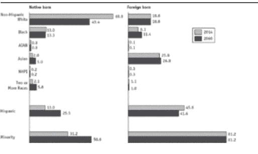

图 6-2. 美国人口规模和构的预测：2014–2060。

Purnell 和 Paulanka (2012, p. 2) 将文化定义为“社会化传播的行为模式、艺术、信仰、价值观、习俗、生活方式以及人类工作和思想的所有其他特征的总和，这些特征引导了他们的世界观和决策。”理解这一点很重要，因为随着族裔多样性在美国继续扩大，文化考虑必须比现在更多地被视为患者护理中不可或缺的因素。文化价值观和规范决定了求医行为、疾病管理，以及与护理提供者之间的跨文化交流。不承认文化是许多健康相关决策背景的公共卫生从业者，可能不仅面临来自患者的挑战，还会因为无论干预如何都缺乏影响力的患者结果而产生职业挫败。Purnell 和 Paulanka (2012) 确定了影响患者如何处理健康问题的 12 个文化领域。这 12 个领域涵盖了个人和社会实践，以及文化和家庭遗产、健康态度和信念，以及影响健康的生物/遗传方面。分类每种文化有助于医疗保健从业人员理解可能需要从文化胜任能力角度解决的元素。例如，在某些文化中，肥胖是亲近的信号而非疾病。某些文化可能没有产前或产后护理的框架或构建，这可能会影响怀孕和分娩健康实践。

## 医疗保健交付中文化胜任能力的需求

2016 年人口健康改善圆讨会报告的结果显示，增加医疗保健提供人员之间的种族和族裔多样性非常重要（美国科学院、工程和医学学院， 2016）。尽管研究发现，种族和族裔少数从业者比大多数群体从业者更愿意在少数群体和服务不足地区工作（Smedley, Butler, & Bristow, 2004），但全美国范围内许多医疗资源不足的人口和社区。许多报告的健康差异和健康不公出现在医疗资源不足地区的医疗资源不足人口，以及被指定为“医疗专业人员短缺地区”的地区（医疗资源和服务管理局， 2016）。

医疗资源不足的人口包括在医疗保健方面面临社会经济、文化或语言障碍的人群。医疗资源不足地区的规模和定义不一，范围从整个国家或一组相邻的县、一组民政部门或一组城市人口普查区。医疗专业人员短缺地区被定义为在各种人口群体所在的城市或农村地区的医疗或其他公共设施中缺乏初级医疗、牙科或心理健康提供者（医疗资源和服务管理局, 2016）。然而，决定性因素是居民缺乏专业的健康服务。

医疗专业人员之间更大的多样性与患者选择的增加、满意度的提高、患者与医生沟通的改善以及少数群体获得护理的机会增加有关（LaVeist & Pierre, 2020; Smedley et al., 2004; Williams, Walker, Egede, 2016）。药学非常幸运地拥有一个首要任务是改善医疗资源不足者的健康并增加少数裔药剂师数量的专业协会：全国药剂协会（SNPhA, 2016）。1972 年，SNPhA 的形成是为了在学生药剂师中促进这些利益。正如其框 6-1 所示的任务所示，SNPhA 开发并实施了针对少数群体健康结果的计划和临床倡议。

**框 6-1 SNPhA 任务宣言**

SNPhA 是一个药剂专业学生的教育服务协会，他们关注药学和健康相关问题，以及少数群体在药学和其他健康相关职位中代表性不足的问题。

SNPhA 的目的是计划、组织、协调和执行旨在改善社区健康、教育和社会环境的计划。

SNPhA 的核心是患者外展倡议，包括艾滋病、慢性肾病和糖尿病（SNPhA, 2013）。SNPhA 每年衡量倡议活动和患者干预的次数。我们有超过 10.8 万次患者接触。这些惊人的数字

## 公共卫生中的文化视角

表明药剂专业学生可以对国家的公共卫生产生重大影响。

## 文化能力

提供高效且有效的医疗保健和公共卫生服务，需要理解患者所认同的各种文化之间的差异。通往文化整合的道路涉及五个步骤（Bleidt, 1992）。从民族中心主义开始，走向种族多样性，从业者可能会发现自己正处于从文化不敏感到意识、敏感、胜任以及完全文化整合的转变中。

根据从业者当时所接触的哪种文化，个体从业者可能处于这一连续体上的许多点。这个过程也没有固定的终点，因为适当的态度以及习得的技巧和实践会随着新的文化接触而推动临床医生沿着这一连续体向前。尽管这一连续体既适用于个人也适用于组织，本章的主要目的是讨论个人的历程。

随着每一次新经历的积累，个人都会向文化意识、敏感性和整合演变。文化敏感性被定义为没有意识到或不了解文化差异，或/或缺乏了解各种文化的愿望。文化意识阶段涉及对自身文化背景的自省、思考其独特之处，以及这些发现可能产生的影响。在文化敏感性阶段，公共卫生专业人员具有意识，并开始从尚未成功将这些知识融入实践的人身上发展出深层次的文化知识。在最后一步文化整合中，文化知识被投入实践，以便更有效地沟通并服务患者。

胜任的从业者具备知识、技能、态度和能力，为来自各种文化和族背景的患者提供最佳医疗保健服务。在具备文化能力的组织中，临床医生可以较快速地完成这些步骤，而且在这一学习过程中发生，患者也会感到舒适。

在缺乏文化能力的情况下，医生与患者之间可能会发生误解，导致医疗事故、误诊以及未能考虑对药物的不同反应。寻求、解释和理解与特定个人相关的细微差别的技能，对于服务患者或寻求服务的人非常有价值。必须为服务者提供资源（特别是时间），以便让他们获得这些必要的能力。

文化能力包含了从业者的集体知识、能力、态度和天赋，使其能够为各种文化和伦理背景不同的患者提供最佳服务。胜任始于具备评估患者护理的技能，以确定是否需要进行文化评估。具备文化技能的从业者能够从患者那里收集相关的文化数据，并进行符合文化标准的体格评估。

## 文化动力学

文化动力学（Culturalkinetics）是一个过程（Bleidt, 1992）；它被定义为接触新患者或文化时，沿着文化整合连续体的移动。它涉及理解他人可能不分享你的观点或价值观。在每次新的接触中都会建立并使用基础假设，直到从文化评估中获得足够的相关数据。用于患者的信息越具体、越相关，对该患者身份的理解就越深。

通过文化动力学，具备文化能力的行为是一个持续的自我意识和自我改进过程，随着对每种文化或患者获得更详细知识，学习文化细微差别以及它们如何影响态度和健康行为。通过这一过程，人们对这些差异变得更加敏感、理解和富有同理心。最后，当从业者能够真正熟练地在适当语境和情况下适应并应对这些差异时，就达到了文化整合。

文化动力学的过程涉及利用一套文化评估患者所需的技能。根据 Bleidt (1992) 的观点，这些技能包括：

- 识别并欣赏民族中心主义问题（如偏见）；
- 尊重人的品格及其作为人被对待的权利；
- 接纳那些不同的人并视其平等；
- 以患者（消费者）的识字水平进行跨文化沟通，且不带傲慢；
- 做一个良好的倾听者、富有同理心且礼貌；
- 在无偏见的情况下理解患者可能持有的不同价值观体系和信仰；
- 与服务不足的群体建立联系；
- 对患者的背景产生认同，并借此与其建立联系；
- 使用其他文化的创新方法来解决个人问题；
- 不断学习其他文化；以及
- 欣赏文化之间的差异。

从这些核心要素列表中，我们可以确定哪些价值观和行为最相关，从而创建具备文化能力的组织政策和流程，并使这些能够体现在标准和指南中。根据定义，此类标准将采用更广泛的文化定义，超越种族、民族、健康以及服务提供和环境的传统框架。这在国家文化能力中心（2016, 第3段）的以下建议中。一个组织要实现文化能力，必须：

- 拥有一套定义的价值观和原则，并展示能够使其有效跨文化工作的行为、态度、政策和结构；
- 具备能力（1）重视多样性，（2）进行自评，（3）管理差异的动态，（4）获取并制度化文化知识，以及（5）适应其服务社区的多样性和文化背景；以及
- 将上述内容整合到政策制定、行政管理、实践和服务交付的所有方面，以系统地服务于消费者、利益相关者和社区。

## CLAS 标准

自 1999 年由少数族健康办公室（OMH）发布以来，《国家文化和语言适用性服务标准》（CLAS 标准）一直是健康和医疗保健机构努力提高健康公平、减少差异和提高护理质量的基（OMH, 1999, 2001）。在 CLAS 标准的引言中，OMH 强调了健康与健康社会决定因素之间的关系，即“个人出生、成长、生活和老去的条件”（WHO, 2016），例如社会经济地位、教育水平和健康服务的可用性。

尽管最初的 14 项指南随着时间的推移而有所修改，但指南的意图未变：促进少数族群体的医疗服务交付。它们针对医疗保健机构以及这些机构提供的服务。具体服务包括：

- 在文化和语言服务交付方面对员工进行教育；
- 制定概述该领域目标和政策的战略计划；
- 与社区建立合作伙伴关系。

2012 年，OMH 更新了 CLAS 标准，以澄清标准的含义并扩大其范围。标准 1 被设为“主要标准”（Principal Standard）。如果所有 14 项标准都得到采纳、成功实施并随着时间的推移忠执行，就实现了主要标准：“提供有效、公平、易懂、尊重且高质量的护理和服务，响应多样化的文化信仰和实践、首选语言、健康素养和其他沟通方法”（OMH, 2013, p. 31）。其余标准被重新归类为三类：(a) 治理、领导和员工；(b) 语言援助以及 (c) 持续改进和问责。表 6-1 显示了每个主题的标准。

| 表 6-1 医疗和医疗保健文化和语言适用性国家标准 |
|------|
| 主要标准：提供有效、公平、易懂、尊重且高质量的护理和服务，响应多样化的文化信仰和实践、首选语言、健康素养和其他沟通需求。 |
| **主题 1：治理、领导和员工** | 2. 推进和维持促进 CLAS 和健康公平的治理和领导；3. 招募、提升和支持多样化的治理、领导和员工；4. 为治理、领导和员工提供 CLAS 教育和培训 |
| **主题 2：沟通和语言援助** | 5. 提供沟通和语言援助；6. 告知个人语言援助的可用性；7. 确保提供语言援助的人员具备能力；8. 提供易懂的材料和标识 |
| **主题 3：参与、持续** | 9. 在组织规划和运营的所有方面融入 CLAS 目标、政策和管理问责制 |

## 公共卫生中的文化视角

| 改进与问责 | | |
| :--- | :--- |
| 10. | 进行组织评估 |
| 11 | 收集并维护人口统计学数据 |
| 12 | 对社区健康资产和需求进行评估 |
| 13 | 与社区建立伙伴关系 |
| 14 | 建立冲突和申诉解决流程 |
| 15 | 沟通组织在实施和维持 CLAS 的进展 |

注：CLAS = 医疗保健中文化和语言适用服务的国家标准（National Standards for Culturally and Linguistically Appropriate Services in Health Care）。

西方医学的主要目标是为所有患者提供最佳护理。为了实现这一目标，医疗提供者必须承认并理解文化差异和信仰的存在。药学护理（或药剂护理，即药学实践中的患者护理）的理念与提供尽可能的个性化护理是一致的，这需要考虑患者的文化对对其疾病的影响、对治疗接受程度的影响，特别是对与他们之间互动和沟通的影响（Coleman & Bleidt, 2002）。

20 世纪 90 年代，美国卫生健康部（USDHS）编写了一份关于建立更健康人口的国家目标报告，标题为《健康的人民 2000》（USDHHS, 1991）。从最初的那个日期起，《健康的人民 2010》和《健康的人民 2020》已在联邦范围内开发并实施（USDHHS 2000, 2010）。《健康的人民 2000》的主要目标之一是减少美国人之间的健康差异。《健康的人民 2010》进一步设定了消除健康差异的目标。现在，《健康的人民 2020》寻求实现健康公平。这一健康公平的新概念是一项最崇高的任务，因为它迫使从业人员协助患者实现“所有人的健康”（消除健康差异国家伙伴关系，National Partnership for End Health Disparities，2011: p. 9）。有趣的是，这些报告并没有将患者的健康等同于缺乏疾病过程的单一理性，而是等同于美国倡导的更广泛的健康因素（部长顾问委员会…… 2010）和世界卫生组织（WHO）（2016）。表 6-1 简要回顾了《健康的人民 2020》中的这些因素。


## 公共卫生中的文化视角

## 对公共卫生和药学实践的启示

在我们结束本章之际，我们希望提供关于如何在组织中促进和提升文化胜能力的建议。改编自 Brown 和 Nichols-English (1999)。如果遵循这些建议，将有助于建立一个文化胜任的环境：

- 创建一个支持性的环境；
- 分配充足的资源以参加研讨会和课程，并培训员工；
- 接受不同人群的方法和技术，以适应患者的需求；
- 加强与医疗医疗人员的协作。

通过识别并理解健康差异，药剂师可以有效地改变服务质量，确保在药学实践中，药剂师对不同群体提供文化胜任的护理，促进健康和预防。参见美国药剂学会（ASHP）关于文化胜能力的政策。

在本章中，我们介绍了通往文化胜任的程。从小，我们就学会了“黄金法则”，即“己所欲，勿施于人”。然而，在完全的情境下，遵循“金律法则”（即考虑他人的感受）是非常重要的。我们希望为长期以来被许多医疗从业者忽视的跨文化群体提供一种文化胜任的路线图。

# 附录 A

### ASHP 文化能力政策

[经 ASHP 许可转载]

# 1613 文化能力

来源：教育与工作动力

为了在药学内部培养文化能力的持续发展；

为了通过教育医疗提供者提供优质护理。

本政策取代 ASHP 政策 1414。

## 原理

美国正迅速成为一个多元化的国家。文化影响着疾病的结果和行为。文化胜任可以显著影响临床结果。研究表明，忽视文化信仰可能会导致负面的健康后果¹。根据文化能力中心，文化胜任对护理质量和有效性有许多益处。此外，药剂师可以促进“文化一致性护理”，这被描述为“提供者与客户之间的有效互动过程”。这种文化胜任考虑到患者带着自己的价值观、感知和预期进入医疗环境，并鼓励这种文化胜任，以便在多元的人口中实现最佳治疗结果³。

- 1. 老龄协会：实现文化能力。老年人及其服务提供者的指南。见：http://archive.org/details/achievingcultura00adim
- 2. Goode TD, Dunne MC, Bronheim SM。医疗保健中文化和语言能力的证据基础。财富基金；2006。http://www.commonwealthfund.org/usr_doc/Goodeevidencebasecuttingillus.962.pdf
- 3. Schiin SM, Downbows AZ。文化一致的三维模型：干预框架。社会工作与临终关怀。2010; 6:256–70。
- 4. ASHP 种族与文化能力特别委员会报告。Am J Health-Syst Pharm. 2005; 1924–30.
- 5. ASHP 关于种族和族群健康的声明。Am J Health-Syst Pharm. 2008: 65:728–33.

## 公共卫生中的文化视角

消除健康差异行动国家伙伴关系组织 (2011, 4月). 实现健康平等的国家利益相关者参与策略。获取自 [https://minorityhealth.hhs.gov/npa/templates/content.aspx?lvl=1&lvid=33&ID=286]

少数裔健康办公室. (1999). 确保医疗保健中的文化能力：国家标准建议和以结果为导向的研究议程。华盛顿，特区：作者。获取自 [http://minorityhealth.hhs.gov/Assets/pdf/checked/Assuring_Cultural_Competence_in_Health_Care-1999]

少数裔健康办公室. (2001). 医疗保健中文化和语言适当服务的国家标准：最终报告。华盛顿，特区：作者。获取自 [http://www.nhomrc.gov/assets/pdf/checked/executive.pdf]

少数裔健康办公室. (2013). 健康与医疗保健中文化和语言适当服务的国家标准：推进和维持 CLASS 政策与实践的蓝图。华盛顿，特区。获取自 [https://www.culturalhealth.hhs.gov/pdfs/EnhancedCLASSStandardsBlueprint.pdf]

Purnell, L. D., & Paulanka, B. J. (2012). 跨文化医疗保健：一种文化能力的方法（第4版）。宾夕法尼亚州，费城：F.A. Davis。


# 参考文献

国家健康促进与疾病预防 2020 目标秘书顾问委员会. (2010, 7月6日). 健康健康 2020：解决美国健康社会决定因素的机会。华盛顿，特区：美国健康与人服务部。

Smedley, B. D., Butler, A. S., & Bristol, L. R. (2004). 在国家的迫切利益范围内：确保医疗保健劳动力的多样性。华盛顿，特区：国家学院出版社。

学生国家药学协会. (2013, 10月). 倡议方案。获取自 [https://snpha.org/wp-content/uploads/2014/08/Initiative-Protocols-2014.pdf]

学生国家药学协会. (2016). 使命宣言。获取自 [http://snpha.org/about/]

美国健康与人服务部. (1991). 健康健康 2000。华盛顿，特区：作者。

美国健康与人服务部. (2000). 健康健康 2010。华盛顿，特区：作者。获取自 [http://purl.access.gpo.gov/GPO/LPS8595]

美国健康与人服务部. (2020). 健康健康 2020。华盛顿，特区：作者。获取自 [http://www.healthypeople.gov/2020/]

## 公共卫生中的文化视角

Vanderpool, H. K., & 种族多样性与文化能力特别委员会. (2005). ASHP 种族多样性与文化能力特别委员会报告。《美国健康系统药学杂志》，62(18), 1924-1930. doi:10.2146/ajhp050100

Williams, J. S., Walker, R. J., & Egede, L. E. (2016). 在不断发展的医疗保健系统中实现公平：机遇与挑战。《美国医学科学杂志》，351(1), 33-43. doi:10.1016/j/amjms.2015.10.012

Winslow, C.-E. A. (1920). 公共卫生的未开发领域。《医学》，2, 183-191。

世界卫生组织. (1948). 1946年6月19-22日于纽约召开国际卫生会议通过的《世界卫生组织宪章》序言；由61个国家代表于1946年7月22日签署（《世界卫生组织官方记录》，第2卷，第100页），并于1948年4月7日生效。瑞士日内瓦：作者。

世界卫生组织. (2016). 健康的社会决定因素。获取自 [http://www.who.int/social_determinants/sdh/definition/]

## 药师在提高患者健康素养中的作用


# 药学公共卫生导论（第2版）

Bruce Lubovsky Levin, Ardis Hanson 和 Peter D. Hurd 编

出版社：牛津大学出版社 印刷日期：2018年2月

ISBN-13: 9780190238308 在线出版日期：2018年3月

DOI: 10.1093/med/9780190238308.0001

## 药师在提高患者健康素养中的作用

章节：

药师在提高患者健康素养中的作用

作者：

Barry A Bleidt, Carmmita A Coleman, Silvia E Rabionet 和 Ardis Hanson

**DOI: 10.1093/med/9780190238308.0037**

## 引言

提高健康素养的挑战源于健康的社会决定因素。在社会中，许多健康素养的挑战源于对信息的理解和获取。在患者语境中，这涉及到：

- 语言
- 时间
- 空间

这些知识点深刻且*困难的*。

药师在提高患者健康素养中的作用

- 药师在提高患者中
- 药师在提高患者健康素养中的作用：
- 语言
- 时间
- 空间
- 服装
- 期望

## 药师在提高患者健康素养方面的作用

患者无法理解他们的治疗方案，也无法理解医生开出的疗法。随着国家人口增加，受低健康素养影响的患者数量不断增长。如果不意识到健康素养是一个问题，处方药和其他治疗建议可能会被低效使用、错误使用、未服用或完全不遵守。

根据定义中的条件，低健康素养是一个重大的公共健康问题。医疗系统和医疗保健非常复杂；在理想情况下，很难获取、导航、以平等伙伴身份参与以及在合适的时候退出。随着美国人口数量和多样性的增加，问题将成倍增加。了解健康素养在应对特定医疗系统和各种治疗方案时如何影响个人，是参与以患者为中心的护理服务这一大拼图的关键部分。

## 低健康素养对患者护理的影响

### 高风险人群

文化在沟通中起着不可整合的作用。认识这一事实为理解健康素养提供了基础。文化强烈影响着个人的健康素养水平。不同的文化背景通过健康信念体系、宗教习俗、家庭等级制度、性别角色、传统领袖和沟通风格塑造了患者的健康素养。国家医学图书馆网络（n.d., para. 4）强调，“即使文化也只是健康素养的一部分。它是健康素养这一复杂话题中非常重要的一部分。”美国卫生和人类服务部（USDHS）疾病预防与健康促进办公室（2007, p. 2.1）认为，“文化影响人们如何沟通以及应对健康信息。”

在其出版的《改善健康促进国家行动计划》中，识别了最可能经历低健康素养的特定群体。这些人群包括65岁以上的患者。这些患者视力下降、认知能力和阅读能力丧失（当人们停止阅读时，阅读能力就开始下降）的可能性较高，且随着时间的推移逐渐恶化。还包括缺乏教育机会的人（高中及以下学历者）。阅读能力通常比完成的最后一个年级低三五个年级。因此，拥有高中学历的人阅读水平通常在七年级或八年级”（国家医学图书馆网络，n.d.）。

## 药师在提高患者健康素养方面的作用

其他群体包括少数裔和文化少数群体；收入处于或低于贫困线的人；非英语母语者；有身体、认知或学习障碍的人；健康状况不的患者；以及具有这些属性组合的人（USDHS, 2010）。其他高风险群体包括近期移民、视力低患者以及其他对美国医疗系统陌生的的人士。这些类别强调了在尝试提高人群健康素养时，健康社会决定因素的显著性。

## 流行率

虽然上述人群不应被误认为低健康素养是仅属于他们的问题。在意大利，国家成人识字能力评估（NAAL）衡量成人的健康素养。使用四个绩效水平来量化健康素养：(a) 基础以下、(b) 基础级、(c) 中级和(d) 精通。NAAL最近的报告显示，约36%的人健康素养有限（14%处于基础水平，加上22%处于基础以下水平）。约5%的人不通英语。某些报告指出，美国只有12%的英语母语成人具有精通的健康素养技能（Kutner, Greenberg, Jin, & Paulsen, 2006）。低健康素养比许多从业者意识到的要普遍得多。

## 对患者结果的影响

众所周知，人们做出健康决策是对信息、环境、资源和社会支持系统的反应。较高水平的健康素养有助于患者决策与积极健康结果保持一致（Kirkbusch, Pelikan, Apfel, & Tsouros, 2013）。相反，低健康素养与较差的健康结果和较高的成本有关，也被认为是健康不平等的主要决定因素（Heijmans et al., 2015）。以下总结了关于有限健康素养与健康结果之间关联的一些研究发现：

- 患者更有可能报告健康状况糟糕（Baker, Parker, Williams, & Clark, 1998; Baker et al., 1996; Kutner et al., 2006）。
- 患者更有可能避免预防性服务，如乳腺癌检查、宫颈涂片和流感疫苗接（Scott, Gazmarianarian, Williams, & Baker, 2002）。
- 与健康素养水平较高的患者相比，患者进入医疗系统较晚（Bennett et al., 1998）。
- 患者更容易患慢性疾病，且管理效果无效（Batterham, Hawkins, Collins, Buchbinder, & Osborne, 2016; Beauchamp et al., 2015; Wernick et al., 2016）。

## 药师在提高患者健康素养方面的作用

- 患者住院率和急诊服务使用率较高（Griffey, Kennedy, D’Agostino McGowan, Goodman, & Kaphingst, 2014），且可预防的就诊和住院率较高（Auerbach et al., 2016; McNaughton et al., 2015; McNaughton et al., 2013）
- 患者认为他们的身份是获取医疗保健服务的社会障碍（Palumbo, 2015）。

结论，低健康素养患者消耗更多的医疗保健服务，住院风险增加，并在更大程度上利用昂贵的服务，例如急诊科和住院护理（国立健康研究院，2016）。

## 经济影响

除了上述低健康素养对患者造成的后果，对社会也产生了重大的经济影响（Rusa, Bawa, Suminski, Snell, & Warady, 2015）。一份报告《低健康素养：对国家健康政策的意义》估计低健康素养给美国带来的年度成本在1060亿美元到2380亿美元之间。这些2007年的数据相当于个人健康支出总额的7%到17%（Vernon, Rosenbaum, & DeBueno, 2007）。最新数据将美国的社会经济成本置于每年超过3600亿美元（世界识字基金，2015）。

用药合从性和依从性差增加了这些成本并加剧了问题。近30%的患者未能填充处方药，慢性疾病的新处方未填充率在20%到34%之间（美国制药研究和制造协会 [PhRMA, 2011]）。此外，定期取药的慢性病患者实际上只服用了一一半的剂量（PhRMA, 2011）。

## 药师在提高患者健康素养方面的作用

| 框 7-1 阅读能力较差者的特征 |
| :--- |
| 阅读速度缓慢，遗漏含义 |
| 跳过困难词汇 |
| 遗漏上下文 |
| 容易疲劳 |
| 对视觉信息进行字面化解释 |
| 因为眼睛游移找不到中心焦点而感到困难 |
| 混合多种语言来表达简单的想法 |
| 跳过原则性特征 |
| 沉溺于细节而非关注主要特征 |

## 健康素养障碍

患者经常面临复杂的信息和复杂的治疗决策。为了具备健康素养，他们需要具备某些能力。这些能力的任何一项或全部的缺乏都会给低素养患者带来障碍。要具备健康素养需要以下七项技能，患者需要能够：

1. 获取并引导医疗服务（何时、何地以及如何）；
2. 权衡风险与收益；
3. 确定剂量和剂量方案（数学计算）；
4. 与临床医生交流并倾听；
5. 评估信息的可靠性和质量；
6. 解读检测结果；
7. 发现所需的健康信息。（国家医学图书馆网络, n.d.）

患者可能还需要具备其他技能，如视觉、计算机、信息和数字素养。这些技能对于理解图表或视觉信息、操作计算机、获取并应用相关信息、进行数值计算或逻辑推理至关重要（国家医学图书馆网络, n.d.）。

口语语言和沟通能力也至关重要。患者需要准确准确传达他们的健康关注问题并精确地描述他们的症状。能够提出相关问题并理解口头指示或医疗方案具有巨大需求。患者需要良好的决策能力，以便与执业人员作为伙伴共同承担责任。由于互联网是健康信息的重要来源，健康素养现在可能包括搜索能力和网站评估技能（国家医学图书馆网络, n.d.）。

还有一些障碍阻碍患者精通健康素养。这些包括较低的数字计算能力和有限的阅读技能。关于这些障碍的更详细讨论见在本章后后的“药师识别低健康素养患者”章节。

## 提高健康素养的计划

医学研究所（IOM）在其2001年的报告《跨越鸿沟》（Crossing the Chasm）中指出，如果要满足低素养患者的需求，必须重构医疗体系。三年后，IOM发布了一份关于健康素养的先锋报告。该文件中的一个著名引言指出，“如果不同时提高健康素养，旨在提高质量、降低成本和消除差异的努力将无法成功”（Nielsen-Bohlman, Panzer, Kindig, & Institute of Medicine Committee on Health Literacy, 2004, p. xiv）。很早，人们就意识到药师和药学是帮助患者提高健康素养的关键伙伴。与药物相关的任务包括去配取处方、听取咨询、准确服药、评估随药附的打印健康信息、填写表格以及理解健康保险覆盖范围等其他责任（IOM, 2001）。

联合委员会（The Joint Commission）是美国对医疗机构和计划进行认证的机构。作为质量的关键要素之一，联合委员会强调了健康素养的重要性。在 fact2007年的报告《医生说了什么？通过提高健康素养来保护患者安全》中，委员会指出：

“健康素养问题和沟通不畅使患者面临更大的可预防不良事件风险。如果患者不理解其诊断的含义以及预防和治疗计划的重要性，或者因为沟通问题无法获得医疗服务，就可能发生意外事件（Joint Commission, 2007, p. 6）。”

2007年，医疗保健与质量机构（AHRQ）开发了一部名为《我们的药房符合患者需求吗？药房健康素养评估工具用户指南》的出版物（Jacobson et al., 2007）。该卷是是在药房进行健康素养评估的指南，对于服务低素养患者的商业和其他团体而言，这是一项本质的质量改进工具。质量改进过程的第一步提高了药师和员工对健康素养的意识，识别了患者可能遇到的障碍，并揭示了改进领域。在开始时进行这种细致的评估还允许通过随访措施来评估药房的影响（Jacobson et al., 2007）。

健康素养差的难题不是静态的。要记住，随着系统变得越来越复杂，问题将继续增长（Palumbo, 2015）。上述里程碑式的报告和其他报告将健康素养从一个“未被重视的沉默流行病转变为卫生政策和改革问题”（National Network of Libraries of Medicine, n.d.）。

## 联邦级倡议

在过去的十年里，联邦政府层面推出了多项倡议解决健康素养问题。这些法律和计划提升了健康素养作为提高美国人口整体健康的关键因素的重要性，降低了成本并减少了医疗错误的发生率。

《2010年患者保护和负担得医疗法案》（ACA）包含了若干项应对更加关注健康素养的规定。医疗计划还要求清晰地沟通健康信息、促进预防并以患者为中心。ACA还法化了医疗或健康家庭的概念，以确保公平性和质量，从而提供高质量的护理。《提高健康素养国家行动计划》（USDHS, 2010）与700个公共和私营部门合作，为未来的研究和行动提供了框架。该计划包括七个目标和策略，研究人员和从业人员可以使用这些策略来设计研究和干预措施。《2010年简单写作法》要求所有新出版物、公开分发的文件必须清晰易懂。要求联邦机构使用“公众可以理解的清晰沟通”（Plain Writing Act, p. 28）。

## 国际级倡议

世界所有地区通过世界卫生组织办事处与患者及利益相关者共同发展健康素养（World Organization & Telecommunication, 2012）。

世界卫生组织东南亚办事处开发了一个全面的健康素养工具包，供中收入国家的政策制定者使用。该工具包提供了针对特定年龄、残疾和健康状况人群的特定策略（Dodson, Good, & Osborne, 2015; IOM, 2013）。

2013年，世界卫生组织欧洲地区出版了名为《健康素养——坚实事实》的文件，作为加强健康行动的实用指南（Kickbusch et al., 2013）。欧洲地区的一些示例包括预防管理慢性病和其他非传染病、改善心理健康以及提高患者权利的计划。该文件总结了健康素养在促进健康和预防疾病方面的证据。该文件还强调了健康素养在医疗体系中的重要性。特别是在药物依从方面，它要求改进药物标签并加强医患互动期间的沟通（Kickbusch et al., 2013）。

作为“欧洲2020”倡议的一部分，欧盟委员会了一个专家小组来审议有效的健康投资方法。2016年5月，该小组发布了建议。报告强调了需要类型数据收集、更好的监测以识别获取和利用方面的问题，以及更多的评估和测量，以“衡量随时间和跨人群的变化并增强国际可比性”（Expert Panel on Ways of Investing in Health, 2016, p. 15）。可用数据（仅来自八个国家）表明，低健康素养是影响整个大陆的普遍问题。结果描绘了与美国非常相似的情况：低健康素养患者健康状况较差，医疗费用较高。报告要求基于证据的策略来提高健康素养，因为目前的手段不足（Expert Panel of Ways of Investing in Health, 2016）。

此外，国际药师联合会（FIP）通过其基金启动了一项倡议，促进使用图片来与低素养患者及其他人进行药物沟通。这些将在在本章后部分描述。

## 其他倡议

国家患者安全基金会开发了一个旨在帮助低健康素养患者的患者教育计划。“问三个”（Ask Me 3™产品旨在促进患者与医疗提供者之间的沟通，以获得积极的健康结果。它鼓励患者提出三个简单但必要的问题，如

# 药剂师在提高患者健康素养中的作用

医疗接触，包括药房。他们还被要求确保理解这些问题的答案。这些问题是：

1. 我的主要问题是什么？
2. 我需要做什么？
3. 为什么这样做对我来说很重要？（国家患者安全基金会，2016）

许多医疗保健提供者和机构已将这些问题作为其日常实践的一部分。其中，CVS Health 的 Minute Clinics™（位于 CVS/药房内的医疗诊所）成为首个在 2014 年实施 Ask Me 3™ 计划的零售诊所提供者（CVS Caremark，2014）。还有其他实用的策略和方法可以解决患者和临床医生面临的健康素养问题。

## 健康素养与健康促进

21 世纪的医疗专业人员被期望在一个促进可衡量的健康结果、健康公平和高效医疗保健交付的环境中工作。他们日益负责参与以患者为中心的护理，预计预计会积极参与有关其健康和治疗方案的决策过程。共同决策对患者和提供者都带来了各种挑战，因为双方都需要培养技能，并准备好做出产生积极结果的协作决策。在今天信息爆炸和技术进步的环境下，药剂师可以在教育赋能患者方面发挥领先作用，提供关于准确信息来源的建议，具备成为良好伙伴所需的技能，并引导其应对复杂的健康系统。


我们可以通过使用“健康促进”和公共卫生框架展示如何处理患者的健康素养，从而扩大药剂师的执业范围。在采用健康素养人群框架时，需要一些关键组成部分。

首先，需要在健康素养与健康促进之间建立明确的联系。素养始于保持健康以及他人的健康。其次，药剂师需要接受他们作为患者教育者的角色，无论其执业地点在哪里。第三，需要明确公平与健康素养之间的联系。高风险人群更容易误解健康信息及其产生的后果。

首要任务应该是理解影响疾病认知和进展的社会层面因素。通过从公共卫生框架方法健康素养，药剂师可以识别他们如何在各种实践场所、不同的疾病阶段以及不同的高风险或可能变为高风险的人群中成为改变剂。

# 药剂师在提高患者健康素养中的作用

根据世界卫生组织（1986，第 3 段）的说法，“健康促进是一个使人们能够增加控制健康并改善健康的过程。”世界卫生组织认为，在追求人群更健康的目标时，健康促进策略是疾病预防和早期干预的重要组成部分。

健康促进活动与药物和生物医学干预相结合，对于应对慢性和多种疾病、避免不必要的负担以及促进恢复至关重要，特别是对于边缘群体。

世界卫生组织（2016）鼓励在“人们生活、工作、学习和娱乐的地方”开展健康促进，作为健康和提高生活质量的有效且创造的方法（世界卫生组织，2014）。此外，从某些健康因素的角度来看，更多的人从沟通和社区外展中受益，这些基本的（功能性）互动健康素养技能和批判性健康素养技能可以确保个人能够收集和理解信息，根据背景评估信息的重要相关性以做出健康决策，并应对可能抑制健康行为的负面外部因素（Nutbeam,2000；Rowlands, Jaswal, Shaw, & Harpham,2015）。

药剂师可以帮助社区和机构环境下的患者促进健康并预防疾病。他们可以主动培养患者的技能，例如：

- （a）阅读并遵循身体活动指南；
- （b）解读食物和产品标签；
- （c）在互联网上寻找信息并参与在线网络；
- （d）分析处方药广告中的风险因素等（Gmazararian, Curran, Parker, Bernhardt, & DeBuono,2005）。

这些领域的技能培养活动可以与已有的并正在成为标准实践的其他干预和策略相结合，例如反馈技术、在取处方药时发放书面信息、药物管理课程和咨询转接。我们将在本章后面的“药剂师的干预”部分讨论如何开发这些技能。

健康素养干预除了提高对词汇和数字的理解外，还应该建立对影响健康的社会、政治、环境和经济力量的意识（Freedman et al.,2009）。为了做到这一点，药剂师需要培养自己的批判性社会技能和强烈的公民意识，同时协助患者达到健康素养水平以克服社会和结构障碍。

具备批判性社会技能的药剂师应该能够就健康风险因素（例如吸烟、肥胖、暴力、成瘾）进行沟通，不仅作为个体患者，而且作为影响更大社区及其资源的挑战。此外，药剂师应该欢迎公民参与并提高其患者的健康素养（Freedman et al.,2009）。

## 药剂师的角色

### 药剂师识别低健康素养患者

由于患者接触药剂师的机会具有独特性，他们处于独特地位，可以识别健康素养和计算能力低的患者，并对他们产生积极影响。当我们遇到这样的患者时，重要的是理解低素养状态或沟通能力差并不自动等同于缺乏智力。

很多时候恰恰相反；很可能许多这类患者已经发展了复杂的应对技能，以帮助他们应对日益复杂的医疗系统。例如，患者会带家属（包括自己的孩子）来填写表格和解释说明。在有这些生存机制的情况下，临床医生往往不会意识到患者无法理解所说的话，因此无法执行商定的护理计划。

由于这些原因，让药剂师能够识别可能存在风险的患者非常重要，包括那些阅读能力差的人。阅读能力差者的特征在本章早前的章节中讨论过。

低健康素养涉及许多因素。然而，在医疗交付的背景下，患者需要额外的技能和知识，使他们能够听、处理、理解、综合并实施自身护理中的健康信息和指令。

美国医学院（IOM）在其共识报告《健康素养：终结问题的处方》中将健康素养描述为功能性的，因为它要求个人理解信息并执行其通常知识范畴之外的任务（Nielsen-Bohl et al.,2004）。即使是识字的人，也必须具备若干熟练水平的技能才能完全参与自己的护理中（DeWalt et al.,2010）。熟练水平健康素养所需的技能集如框 7-2 所示。

### 框 7-2 熟练水平健康素养所需的技能集

| 技能 |
|---|
| 基础解剖和生理学（身体部位和系统的名称及功能） |
| 健康的定义 |
| 健康行为和选择 |
| 对疾病病因的理解 |
| 数学概念（概率、测量、频率、时间/调度、范围和计算） |
| 数学逻辑（从数学角度来看哪些是合理的） |
| 信息处理、问题解决和决策能力 |
| 填写书面表格的能力 |
| 描述症状、需求和偏好的词汇 |
| 理解并遵循指示的能力 |
| 使用医疗设备和工具的能力（如温度计、血糖仪、绷带、镊子等） |
| 注意到并报告健康状况变化的能力 |
| 阅读并执行药物标签上功能的能力 |
| 协商治疗的能力 |
| 倡导服务的能力 |

药师必须能够识别并消除患者理解的障碍。消除这些障碍可以改善患者的预后并加强药房内部的沟通。表 7-1 显示了这些阻碍健康素养熟练程度的障碍示例。

### 表 7-1 健康素养障碍及示例

| 障碍 | 潜在的障碍示例 |
|---|---|
| 健康决定因素 | 经济政策（例如，州医疗补助法）；社会和文化规范 |
| 读写能力 | 无法阅读；无法填写表格；无法提供患者偏好 |
| 数学能力 | 计算技能；统计范围；测量 |
| 年龄 | 视力下降；独立能力丧失；能力下降；多重用药 |
| 伤障或疾病 | 认知下降；无法集中注意力；沟通能力下降；对帮助的需求增加 |
| 语言 | 需要翻译服务；需要印刷媒体翻译；提供者互动中需要文化一致性 |
| 文化 | 对健康的定义和价值存在差异；使用的语言；医疗机构的程序和规程 |
| 情绪 | 认知下降；无法集中注意力；需要重新回顾指示或护理计划 |
| 医疗服务获取 | 公共交通有限；幼儿照顾选择有限；设施开放时间；良好的环境 |
| 医疗系统的复杂性 | 多重用药；住院时间缩短；对表格和书面材料的依赖增加；自我护理增加 |
| 快速发展的医疗技术 | 管理性法规；生物技术/生物药物；现场诊断工具；更复杂的用药方案；更复杂的药物传递系统和药物 |

## 药师的干预措施

拥有专门针对这些人群已知需求的技巧和工具将是有益的。药师作为健康专业人员，具有独特优势，可以对低素养患者的医疗保健产生积极影响。

由于社区药房能够在患者附近的地点提供健康相关服务，他们对社区药师产生了天然的信任，并可能更愿意与邻里的药师分享他们的需求或感到的不足。在与患者交流时，药师必须记住，阅读、写作和理解能力是需要时间培养的。

在个体面诊中，有两种基于实证的技术可以帮助健康素养和数学能力低的患者更好地理解和使用健康信息：

1. 准备并进行有效的口头咨询。
2. 使用适当的书面健康材料。

这两种实践应协同产生协同效应。低健康素养患者在获得许可和简单的口头指示的同时，辅以易于理解水平的书面材料，可以在咨询期间和面诊后对指示进行补充。

## 咨询环节

在框 7-2 中列出了对健康素养低的患者进行咨询时应使用的八种方法。通过利用这些建议，药师可以增加与健康素养有限患者沟通的有效性。下将详细讨论每种方法（Jacobson et al., 2007）。

### 限制目标数量

大多数患者很难记住药师希望他们了解关于药物或疾病（状态）的所有信息。此外，由于疾病或疾病的存在可能存在额外的潜在环境年龄，注意力和集中注意力可能降至最低。

在准备咨询环节时，药师在初次面诊中提供最重要的信息至关重要。过快提供过多信息可能会让药师困惑，特别是那些主要依赖口头交流的药师。

美国健康系统药师学会开发了一个网站`www.safemedication.com`，该网站提供了一个五个问题框架，患者可以通过这些问题询问药师以启动信息交换。这些查询列在框 7-3 中。相反，药师也可以将这些问题作为与患者咨询的起点（National Safety Foundation, 2016）。

#### 框 7-3 针对健康素养和数学能力低患者的咨询方法

- 限制目标数量
- 信息归类
- 使用常用词汇
- 以动词开头句子
- 考虑环境和干扰因素
- 使用比喻和类比使信息更易于理解
- 使用图表、物体、模型和/或演示
- 通过重复和回述法（teach back）确保理解

再次，在初次接触时为患者提供基本需求以帮助其成功开始用药至关重要。要意识到，通过安排的咨询会议、后续电话访谈、提供适当的书面材料或使用技术提示和联系来延长面诊，还有提供信息的额外机会。

### 信息归类

在准备咨询环节时，药师需要确定以患者易于接受的格式呈现信息。将信息按相似类别分组，比单纯列出排名性的事实更有帮助。

当我们尝试理解信息时，大脑会以逻辑方式对其进行安排。药师可以通过以患者理解的方式呈现所需的药物信息来帮助处理。例如，如果需要讨论作为患者治疗的一部分所需的饮食变化，药师可以在讨论治疗的另一个方面之前，提供所有的饮食信息。

### 常用词汇

医疗专业人员（包括药师）有大量的术语和短语来解释身体功能、疾病过程、药物活动和治疗计划。成功互动的关键不在于用复杂的医学语言给患者留下深刻印象，而是通过开放的态度并使用患者理解的词与他们交流来建立治疗关系。

患者需要能够利用医疗专业人员提供的信息来处理疾病。只有在信息被理解的情况下，患者才能有效地使用信息。

医疗改进协会 (2016) 定义了四类常用词汇，它们极有可能引起困惑或提供错误信息：医学词汇、概念词汇、类别词汇和价值词汇。在表 7-2 中展示了咨询过程中可能引起困惑的问题词汇示例，并提供了替换建议。

我们强烈建议关注为低健康素养患者提供以患者为中心的服务的药师参考此参考文献，了解更多这些词汇。

### 表 7-2 咨询过程中可能引起困惑的词汇

| 词汇类型 | 问题词汇示例 | 建议使用的词 |
|---|---|---|
| 医学词汇 | 医疗专业人员在指示中频繁使用的词；疾病；功能障碍；抑制剂；口服；间歇性 | 生病、问题；阻止某事的药物对你有害的；嘴；断断续 |
| 概念词汇 | 积极作用；避免（Avoid）；评估（Gauge）；摄入（Intake）；转诊（Referral） | 参与、投入；远离（Stay away from）；测量、更好地了解；你吃用或喝的东西；看其他医生 |
| 类别词 | 不良的 (Adverse)；危险的 (Hazardous)；通用的 (Generic)；家禽 (Poultry)；假体 (Prosthesis) | 坏的事；不安全，危险；非品牌药物；鸡、火鸡肉等；身体部位的替代品 |
| 价值判断词 | 充足 (Adequate)；谨慎地 (Cautiously)；过量的 (Excessive)；适度的 (Moderately)；渐进/的 (Progressive) | 具体，例如每天五份蔬菜；小心地，例如确保起床时动作缓慢；太多，例如晚上多次上厕所；不过多，例如限制食物中的用盐量；逐渐好转或变差；例如“你用药后两三天内应该会有感觉” |

注意：“关注词汇”（Words to Watch）是 Ask Me 3 计划的一部分，该计划是向医疗保健学会（Institute for Healthcare Improvement）许可的注册商标。

经医疗保健学会许可转印（2016年）。

### 以动词开始会话

在咨询期间，药师应该用动词开头句子。这种策略有助于患者将建议付诸行动。在使用这种技术时，药师必须特别注意在提供指导时不要过于严厉。

然而，“每天将这种药在在伤口次”比“这种药应该每天涂在伤口五次”更有效。置前的动作词能提醒患者，他们必须在伤口护理中尽自己的责任。

### 考虑环境和干扰因素

在咨询期间，必须确保在有利于私密性、舒适且干扰最少的地方进行咨询。患者很少希望让周围的人知道他们的问题。药师和药房工作人员需要意识到潜在的“倾听耳朵”，特别是在顾客之间关系更紧密的较小社区环境中。

确保私密的环境至少可以消除药师与患者互动中的一个顾虑。患者可以自由地表达他们的疑虑，并更清楚地听到药师的指示。

有时会有其他干扰因素阻碍药师与患者的互动。必须确保在患者能够专注于健康信息时进行咨询。这种策略对于健康素养较低的患者更为重要。

如果一个人刚刚得到一个困难或复杂的诊断，这可能不是提供药物信息的最佳时机。当药师察觉到这一点时，在患者有机会处理其消息之后安排讨论会更有效。如果药师在患者因情绪压力过大而分心时继续进行，患者可能不会听进对话中药师所说的话的任何内容。

在这些情况下，患者通常在感知他们生活中必须发生的变化以及这将如何影响他们的家庭。此外，对未知的焦虑感以及对失去个人控制的感知，也是面对此类诊断时存在的因素。

当患者身边带着一个哭闹、发热的孩子，或者护理人员需要让患者尽快康复回家时，药师也必须体谅。显然，在这些情况下，患者或护理人员有比听取咨询会更紧迫的任务。在理想的情况下，很难听听、理解、记住并执行药师提供的建议。

同样，药师应该考虑延长咨询时间，通过安排较晚的时间提供比基础更多的信息，或者通过技术手段与患者联系。

### 使用比喻和类比使信息更易于理解

无疑，药师希望患者能从咨询中获得最大的收获。如果患者能对提供的信息产生联系，他们更有可能将其应用到自己的护理中。使用比喻和类比有助于患者将新知识与熟悉的话题和概念进行比较。

例如，将人体血管系统比作常见的花园软管，有助于患者理解血流及其如何受到影响。

### 使用象图、物体、模型和演示进行说明

使用象图、物体、模型和患者演示可以帮助患者理解和处理健康信息。象图（“pictograph”）是一个用图片代表物体或概念的符号（例如，三角形标志意味着“让让来交通”；Merriam-Webster，2016）。它们在日常生活中很常见。

1997年，美国药典协会（USP）发布了一个包含81种不同象图的综合库，这些象图被开发为标准图像，旨在“帮助向患者和消费者传达药物说明、注意事项和/警告”（USP，2016）。在图7-1中，展示了两个USP象图的示例。


药师和患者可以下载这些符号，以图形形式交流药物说明，特别是对于健康素养和计算能力较低的患者，特别是视力有限以及以英语作为母语的患者。在接受USP许可协议后，就可以下载这些图片工具供使用。

近20年后，国际药学联合（FIP）开展了一项改进象图使用的项目，旨在为药师提供向健康素养低、没有共同语言、有轻微认知障碍和/或视觉困难的患者“传达药物说明的手段”。这些符号比以前的更大、更简单且包含更多信息（FIP教育与研究基金，无日期）。

它们可以从FIP网站下载，并作为药物标签、药物故事板、药物说明单或药物日历使用。在图7-2中，展示了四个FIP象图。在接受联系请求页面后，也可以从该网站下载创建这些符号所需的软件。

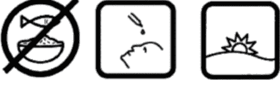

如果对除常见的固剂形式外的药物有特别活跃的需求，那么让患者演示离开药房后如何使用该药物将非常重要。

例如，对于处开了吸入剂的患者，应让他们演示如何使用，然后演示正确的给药技术，以确保患者不仅理解，而且具备正确使用的能力。通过这种方式观察患者的演示，药师可以判断其是否需要帮助、是否可以使用扩张器，或需要对方法进行重新培训。

让患者现场演示技术为询问有关药物的其他问题提供了机会。药物涵盖多种剂型，以及眼药水、耳滴液、鼻喷雾等。此外，询问患者的自我给药技术有助于纠正可能无效的旧方法。

### 使用重复和回述法确保患者理解

确保患者能够处理提供提供的最有效方法之一，就是简单地让他们测试自己的理解情况。药师可以通过承担使用咨询技巧的责任来帮助患者感到更轻松。

使用诸如“为了确保……”这样的短语：

“在为您提供正确信息后，请向我展示您打算如何服用这种药物吗？”

这有助于患者与其药师共同承担治疗方案的责任。药师可以在验证患者理解情况的同时，帮助患者避免被“测试”的感觉。

## 编写得当的医疗材料

处方药和医学文献与大多数患者阅读水平之间存在着明显而遗憾的差距。通常，医疗材料的编写水平为十年级水平，但大多数患者的阅读水平为八年级。此外，美国约 18% 的成年人口阅读水平仅为五年级水平（Rampey et al., 2016）。

为了克服患者需求与现有医疗文献之间存在的混乱状况，药师可以使用几种技术。虽然本章没有涵盖用于评估药师所用文献的可读性公式，但对于那些对健康素养有特殊兴趣的人，可以使用这些公式来准备对各种患者都有帮助的材料。

相反，本章探索了可以在几分钟内完成的易于应用的技术。通常，健康信息应该组织成一个典型的咨询课程。用于使咨询更有意义的一些相同方法也被应用于这项工作中。

书面材料应该是易读的。不应有信息过载，书面材料应强调患者期望的行动。因为书面材料在文化和语言上应该是适当的，它们应该以对话的风格吸引读者，使用常用词汇，并使用主动语态。

正如之前讨论的咨询指南中建议的那样，书面材料一次应涵盖相似的话题，以帮助患者专注于一个问题。


书面材料在视觉上应该让患者愉悦，避免使用光纸或难以阅读的奇字体，这些对于视力低的人来说会造成困难。文档应留有大量的留白。大量密集的散文文本可能会让阅读时感到不知所措的患者感到迷失方向。使用粗体字母、项目符号和策略性的缩进可以将患者的注意力集中在重要点上。由于视力会随着年龄增长而下降，使用清晰、哑光、适宜颜色以及无衬线字体进行空间布局的患者材料，对老年患者特别为友好。

书面材料应该使用说明、象形或其他与主题相关的有意义视觉元素，而不是分散注意力或具有娱乐性的漫画或照片。展示那些可能澄清、激励或装饰预期结果的视觉元素更为重要。目前，许多社区药店零售商正在为低健康素养患者开发易于获取的书面材料。药师能够根据情况快速对材料进行个性化，并提供多种语言的材料。

处方药非常奇且在使用方面具有复杂的细微差别；这就是为什么美国食品药品管理局（`FDA`）将其规定为仅限处方（`Rx only`）。在正确的时间、以正确的方式、正确的剂量、正确的持续服用处方药很容易被误解和遗漏。例如，“`TID`”（每日三次）的正确时间是什么？是全天每八小时一次，还是更符合现实生活？大多数患者的治疗涉及多种处方药，加上非处方药以及可能的补充剂。这些是如何平衡的？患者是否考虑了药物相互作用（化学或生理上的）？对于更复杂的剂型，如吸入器、注射器或眼药水？在使用是否正确？

对低健康素养解决方案的追求一直在。干预研究一直在改善患者结果的方法。国家处方药计划引入了通用用药时间（`UMS`）的概念。`UMS`简化了患者和/或护理者的用药说明，增加了患者对用药说明的理解和遵循性，并改善了健康结果。一贯且反复使用这些标准将有助于患者理解并遵循他们的药物方案。例如，“早上吃一片药，晚上吃一片药”的说明（国家处方药计划，2013）。图 7-3 显示了标准吸入器说明转换为国家处方药计划推荐的语言。

| 标准说明 | 改进后的说明 |
| --- | --- |
| 每日两次一次 | 重复格式的数字：每天早上 1 喷，晚上 1 喷 |
| 特定格式 |  |
| 信息易于获取 |  |
| 信息聚类/分组 |  |

图 7-3。通用用药时间。

在西北大学，Wolf 等人（2016）研究了`UMS`的影响。他们发现超过 90% 的患者正确解释了`UMS`指令，在更复杂的方案中收益更大，`UMS`指令与处方标签上的标准说明相比出更高的理解率。低健康素养患者表现出的结果最显著。表 7-3 显示了根据国家处方药计划（2013）起草的`UMS`指南，常见剂量方案的时间。指南强调使用完整句子和明确的剂量信息，以更易理解的格式分组信息，使用数字格式（使用阿拉伯数字而不是拼写数字），并使用带有图形格式的时间信息。

| 表 7-3 通用用药时间 |  |  |  |  |
| --- | --- | --- | --- | --- |
| **服用** | 服药期间请勿饮酒。 | 早上 1 片，晚上 1 片 |  |  |
|  | 上午 | 下午 | 晚上 | 睡前 |
|  | 7-9 AM | 11 AM-1 PM | 4-8 PM | 9-11 PM |
|  | 1 |  | 1 |  |

## 对公共卫生和药学实践的影响

直到最近，健康素养还被定义和衡量为个人能力。目前，健康素养是一个多层面的概念，包含了功能素养、散文素养、交流/互动素养和解决问题的素养。换句话说，管理个人健康的能力、准备程度和准备等其他特征也会产生（Sønsen et al., 2012）。过去，低健康素养被视为个人患者的缺陷；也就是说，患者缺乏处理健康信息的能力。而现在，健康素养被认为是一个医疗系统问题。它既反映了健康信息的呈现，也反映了对医疗系统的导航。目前的研究更加关注患者的社会支持系统（例如父母、家庭和工作场所）。

低素养水平比许多从业者意识到的要常见。因此，对于药师来说，执业方法应该是确保所有患者都能获得个性化的工具来积极管理自己的健康。低素养也有负面影响，一项研究报告了患者对其有限的素养水平感到羞耻（Parikh, Parker, Nurs, Baker & Williams, 1996）。为了维护尊严，他们可能会隐藏自己的阅读或口语表达困难（Baker et al., 1996）。

通常，人与之间的交流是一个复杂的过程。它涉及许多影响信息传输和/或接收的因素。这些影响被称为障碍。例如包括距离、动力学、文化、代际、副语言、环境和分心因素等。作为日常生活的一部分，交流在所有并行层面上同时发生。

当一个人突然毫无征兆地患上健康问题，迫使其退出健康角色并采取患病角色时，角色的转换即使在最好的情况下也是非常困难的。如果康复（好转）是后续目标，那么这种变化必须发生；因此，患者进入了一个与日常生活不同的领域。在这种复杂的情况下，还引入了以下输入（干扰）：

- 必须在一个在名称奇怪的复杂设施中寻找新地点；
- 必须完成一份不熟悉的、行数很多的、问题大量的的文件；
- 必须与一个或多个健康专业人员建立新的伙伴关系，其中一些人员可能并不熟悉：

# 药剂师在提高患者健康素养中的作用

- 正在使用一种新语言，充满了许多缩写，语速快到超出正常听力范围；
- 正在进行测试，有时使用奇特的、冰冷的探头，且对其原因几乎没有任何解释；
- 呈现出的数字和测量值几乎或完全没有意义；
- 提出的问题似乎没有答案；
- 必须在极短的时间内做出决策，而这些决策可能产生严重的后果；
- 患者的日常生活必须继续。

患者在穿于美国医疗保健系统时，会经历上述任何或全部的场景。患者的健康素养水平决定了这些干扰因素中有多少适用于他们，以及它们对情况的影响有多大。现在，在这些情况中加上疾病引起的认知干扰、多种共症和/或低健康素养水平，出现无指导性行为、缺乏理解和负面结果的可能性就会变得非常高。

低健康素养是一个医疗护理系统的问题，需要解决方案。患者未能理解提供给他们的健康信息，并不是患者的错。我们所有人，无论识字能力如何，都面临着误读健康信息或完全不理解的风险。如果治疗如此复杂，或者诊断涉及亲人或自身且具有情感冲击力，这种情况就显得尤为真实（美国国立卫生研究院，2016）。患者可能认为自己掌握了正确的指示，但可能因为害羞或尴尬而不敢寻求进一步澄清以确认他们的理解。

在理想情况下，以平衡、清晰的方式沟通风险和益处的概念都是具有挑战性的。在健康素养较低的患者中，这种情况的复杂性被显著加剧。互联网上提供的海量健康信息使得判断哪些是证据、什么是伪科学、虚假误导性广告、江湖医学或噱头变得困难得多。这些增加的复杂性增加了患者接收错误信息的脆弱性，事实上也降低了他们的素养水平。

选择健康、意识到何时以及知道如何寻求医疗保健，并采取预防措施以保持健康，需要患者正确地理解和使用健康信息。“这种获取、处理和理解为做出明智健康决策所需的健康信息的能力被称为健康素养”（疾病预防与健康促进办公室，2007，第 2.5 页）。

当药剂师成为“临床医生”（成为临床医的过程而非执业状态）时，他们必须思考并寻找解决方案，如何才能最有效地服务他们的患者。然后他们可以将这些策略和战术付诸实践。提高患者与药剂师之间关于健康信息的沟通可以降低医疗成本并提高医疗服务质量。健康素养是一个复杂的、疯狂的难题。正如美国国立卫生研究院（2016）所说，解决低健康素养问题既省时间又省钱。

## 参考文献

Auerbach, A. D., Kipalani, S., Vasileviskis, E. E., Sehgal, N., Lindenauer, P. K., Metal, J. P., Schnipper, L. (2016). Preventability and costs of readmissions in a national cohort of general medicine patients. JAMA Internal, 176(4), 484–493. doi:10.1001/jamaintermed.2015.7863

Baker, D. W., Parker, R. M., Williams, M. V., & Clark, W. S. (1998). Health literacy and the risk of hospital admission. Journal of General Internal Medicine, 13(12), 791–798.

Baker, D. W., Parker, R. M., Williams, M. V., Pitkin, K., Parikh, N. S., Coates, W., & Imara, M. (1996). The health experience of patients with low literacy. Archives of Family Medicine, 5(6), 329–334.

Batterham, R. W., Hawkins, M., Collins, P. A., Buchbender, R., & Osborne, R. H. (2016). Health literacy: Applying current concepts to improve health services and reduce health inequalities. Public Health, 132, 3-12. doi:10.1016/j.puhe.2016.01.001

Beauchamp, A., Buchbender, R., Dodson, S., Batterham, R. W., Elsworth, G. R., McPhee, C., Osborne, R. H. (2015). Distribution of health literacy strengths and weapons across socio-demographic groups: A cross-sectional study using the Health Literacy Questionnaire (HLQ). BMC Public Health, 15, 678. doi:10.1186/s12889-015-2056-6

Bennett, C. L., Ferreira, R. M., Davis, T. C., Kaplan, J., Weinberger, M., Kenzel, T., Sartor, O. (1998). Relation between literacy, race, and stage of presentation among low-literacy patients with prostate cancer. Journal of Clinical Oncology, 16(9), 3101–3104.

CVS Research. (2014, February 14). Low health literacy compromises health, increases costs. WP BrandStudio. Retrieved from `http://www.washingtonpost.com/sb/brand-connect/wp/2014/02/14/low-health-literacy-increases-costs`

DeWalt, D. A., Callahan, L. F., Hawk, V. H., Brouck, K. A., Hink, A., Rudd, R., & Brach, C. (2010). Health universal toolkit (AHRQ Publication no. 10-046). Rockville, MD: Agency for Healthcare Research and Quality. Retrieved from `http://www.ahrq.org/sites/default/files/quality/resources/healthtoolkit`

Dodson, S., Good, S., & Osborne, R. H. (2015). Health literacy for low and middle-income countries: A series of information sheets to empower communities and strengthen health systems. New Delhi, India: World Health Organization, Regional Office for South-East. Retrieved from `http://www.who.int/healthpromotion/documents`

Expert Panel on Effective Ways of Investing in Health (2016). Access to health services in the European Union. Brussels, Belgium: European Commission. Retrieved from `http://ec.europa.eu/access_healthservices/expert-panel/015_healthservices`

FIP Foundation for Education and Research. (n.d.). Pictograms. The Hague, Netherlands. Retrieved from `http://www.fip.org/fipfoundation/work/2239/Pictograms`

Freeman, D. A., Bess, K. D., Tucker, H. A., Boyd, D. L., Luchman, A. M., Wallston, K. (2009). Public health literacy. American Journal of Preventive Medicine, 35(6), 446–453. doi:10.1016/j.amepre.2009.001

Gazmararian, J. A., Curran, J. W., Parker, R. M., Bernhard, J. M., Bono, B. A. (2005). Public health literacy in America: An ethical imperative. American Journal of Preventive Medicine, 28(3), 317–332. doi:10.1016/j.amepre.2004.1104

Griffey, R. T., Kennedy, S. K., Agostino, L., Goodman, M., K, A. (2014). Low health literacy associated with emergency department utilization and recidivism? Academic Emergency Medicine, 21(10), 1109–1115. doi:10.1111/acem.1276

Heijmans, M., Uters, E., Rose, T., Hofstede, J., Devillé, V., Rademakers, J. (2015). Study on sound evidence for a better understanding of health literacy in the European Union: Final report. Brussels, Belgium: European Commission. Retrieved from `http://ec.europa.eu/health/health_policies/docs/2015_health_literacy_en`

Institute for Health Improvement. (2016). Words to watch: Fact sheet. Boston, MA: Author. Retrieved from `https://www.ipsf.site.com/resource/AskMe3/Words-to-Watch`

Institute of Medicine. (2001). Crossing the quality ch: A new health system for the 21st century. Washington, DC: National Academy Press.

Institute of Medicine. (2013). Health literacy: Improving health, systems, and health policy around the world: Workshop summary. Washington, DC: National Academy Press. Retrieved from `http://www.nap.edu/download/18325`

Jacobson, K. L., Gazmararian, J. A., Kipalani, S., McMorris, K. J., Blake, S. C., & Brach, C. (2007, October). Is our pharmacy meeting patients' needs? A pharmacy health literacy assessment tool user’s guide (AHRQ Publication No. 07-0051). Rockville, MD: Agency for Healthcare Research and Quality. Retrieved from `http://www.ahrq.gov/sites/default/files/public/pharmlit.pdf`

Kickbusch, I., Pelikan, J. M., Apfel, F., & Tsouros, A. D. (2013). Health literacy: The solid facts. Copenhagen, Denmark: World Health Organizational Office for Europe. Retrieved from `http://www.who.info/_data/assets/pdf/file/000190655/e96854.pdf`


Kutner, M., Greenberg, E., Jin, Y., & Paulsen, C. (2006). The health literacy of adults: Results from the 2003 National Assessment of Adult Literacy. Washington, DC: U.S. Department of Education, National Center for Education Statistics.

McNaughton, C. D., Cawlhon, C., Kipalani, S., Liu, D., Storow, A. B., Romie, C. L. (2015). Health literacy and mortality: A cohort study of patients hospitalized for heart failure. Journal of the American Heart Association, 4(5), `doi:10.1161/JAHA.115.01179`

McNaughton, C. D., Collins, S. P., Kipalani, S., Rothman, R., Self, W. H., Jenkins, C., Strow, A. B. (2013). Low literacy is associated with increased odds of 30-day emergency department or hospital recidivism of patients with heart failure. Circulation: Heart Failure, 6(1), 40–46. `doi:10.1161/CIR.112.96937`

Merriam-Webster. (2016). Pictogram. Retrieved from `http://www.merriam-webster.com/dictionary/pictogram-utm_campaign=site&utm_medium=erp&utm_source=json`

## 药师在提高患者健康素养方面的作用

Nielsen-Bohlman, L., Panxer, A. M., Kindig, D. A., & 医医学会健康素养委员会. (2004). 健康素养：一份消除困惑的处方。Washington, DC: 国家科学院出版社. 获取自 `http://om.nationalacademies.org/Reports/2004/Health-Literacy-A-Prescription-to-End-Confusion.asp`

Nutbeam, D. (2000). 将健康素养作为一项公共卫生目标：21世纪当代健康教育与传播策略的挑战。《国际健康促进》, 15(3), 259–267. `doi:10.1093/heapro/15.3.259`

Nutbeam, D., & (1998). 世界卫生组织健康促进中心。健康促进术语表 (`WHO/HPR/HEP/91`). 瑞士日内瓦: 世界卫生组织健康促进、教育与传播部. 获取自 `http://www.who.int/healthpromotion/HPR20Glossary%201998.pdf?ua=`

疾病预防与健康促进办公室. (2000). 健康传播。收于美国卫生与人类服务部（编），《健康的人民 2010》：第1卷。改善健康的目标。Washington, DC: 著者. 获取自 `http://www.healthpeople.gov/2010/document/Volume1/Health.com`

疾病预防与健康促进办公室. (2007). 健康素养快速指南。Washington, DC: 美国卫生与人类服务部. 获取自 `https://health.gov/communication/literacy/quickguide`

Palumbo, R. (2015). 讨论健康素养低下对面对艾滋病毒患者的影响：叙述性文献回顾。《国际健康政策与管理杂志》, 4(7), 417–430. `doi:10.15171/ijhpm.2015.95`

Parikh, N. S., Parker, R. M., Nurss, J., Baker, D. W., & Williams, M. V. (1996). 羞耻与健康素养：未说出的联系。《患者教育与咨询》, 27(1), 33–39.

《患者保护与负担负担医疗法案》， 42 U.S.C. § 18001 et seq., Pub. L. 111–148 (2010). 获取自 `https://www.gpo.gov/fedsys/pkg/PLAW-111public148/pdf/PLAW-111public148.pdf`

辉瑞. (2021). 最新的信号：健康素养评估工具。New York, NY: 著者. 获取自 `https://www.pfizer.com/files/health/nvs_flipbook_english_final.pdf`

美国制药研究和制造协会. (2021年1月). 提高药物依从性是改善医疗保健的关键：按照医嘱用药可以降低成本并改善健康结果。Washington, DC: 著者. 获取自 `http://pharma-docs.phisma.org/sites/default/files/pdf/PHARMA_Improving%20Adherence_issue%20ADBrief.pdf`

## 药师在提高患者健康素养方面的作用

《简明写作法》，5 U.S.C. § 301 et seq., Pub. L. No. 111-274 (2010). 获取自 `https://www.gov/fdsys/pkg/PLAW-111pub274/pdf/PLAW-111pub274.pdf`

Rampey, D., Finneggan, G., Goodman, M., Mohajder, J., Krenzke, T., Hogan, J., & Provasnik, S. (2016). 聚焦关注：美国失业者、青年和老年人的技能：国际成人能力评估计划 (`PIAAC`) 2012/2014 调查结果：初步探析 (`NCES 2016-039rev`)。Washington, DC: 美国教育部. 获取自 `http://nces.edu/pubs/2016/0639rev.pdf`

Rasu, R. S., Bawa, A., Suminski, R., Snella, K., & Warady, B. (2015). 健康素养对国家医疗服务利用和支出的影响。《国际健康政策管理杂志》, 4(11), 747–755. `doi:10.15171/ijhpm.2015.151`

Rowlands, G., Shaw, A., Jaswal, S., Smith, S., & Harpham, T. (2015). 健康素养与健康的社会决定因素：来自成人学习者的质性模型。《健康促进》。`doi:10.1093/heapro/dav093`

Scott, T. L., Gazmararian, J. A., Williams, M. V., & Baker, D. W. (2002). 托管医疗环境中联邦医疗保险参保者的的健康素养与预防性医疗。《医疗保健》, 40(5), 395–404.

Sørensen, K., Van Den Broucke, S., Fullam, J., Doyle, G., Pelikan, J., Slonka, Z., & Brand, H. (2012). 健康素养对国家医疗服务利用和支出的影响。《国际健康政策管理杂志》, 4(11), 747–755. (注：此处原文与上方Rasu文献重复，翻译保持一致) `doi:10.15171/ijhpm.2015.151`

Sørensen, K., Van Den Broucke, S., Fullam, J., Doyle, G., Pelikan, J., Slonka, Z., & Brand, H. (2012). 健康素养对国家医疗服务利用和支出的影响。《国际健康政策管理杂志》, 4(11), 747–755. (注：此处原文与上方Rasu文献重复，翻译保持一致) `doi:10.15171/ijhpm.2015.151`

The Commission. (2007). 什么是健康？`safety_health`.

美国卫生与人类服务部 疾病预防与健康促进办公室. (2000). 健康传播。收于美国卫生与人类服务部（编），《健康的人民 2010》：改善健康的目标。Washington, DC: 著者. 获取自 `http://www.healthpeople.gov/2010/document/Volume1/Health.com`

美国卫生与人类服务部. (2007). 健康素养快速指南。Washington, DC: 美国卫生与人类服务部. 获取自 `https://health.gov/communication/literacy/quickguide`

Palumbo, R. (2015). 讨论健康素养低下对面对艾滋病毒患者的影响：叙述性文献回顾。《国际健康政策与管理杂志》, 4(7), 417–430. `doi:10.15171/ijhpm.2015.95`

Parikh, N. S., Parker, R. M., Nurss, J., Baker, D. W., & Williams, M. V. (1996). 羞耻与健康素养：未说出的联系。《患者教育与咨询》, 27(1), 33–39.

《患者保护与负担负担医疗法案》， 42 U.S.C. § 18001 et seq., Pub. L. 111–148 (2010). 获取自 `https://www.gpo.gov/fedsys/pkg/PLAW-111public148/pdf/PLAW-111public148.pdf`

辉瑞. (2021). 最新的信号：健康素养评估工具。New York, NY: 著者. 获取自 `https://www.pfizer.com/files/health/nvs_flipbook_english_final.pdf`

美国制药研究和制造协会. (2021年1月). 提高药物依从性是改善医疗保健的关键：按照医嘱用药可以降低成本并改善健康结果。Washington, DC: 著者. 获取自 `http://pharma-docs.phisma.org/sites/default/files/pdf/PHARMA_Improving%20Adherence_issue%20ADBrief.pdf`

## 药师在提高患者健康素养方面的作用

《简明写作法》，5 U.S.C. § 301 et seq., Pub. L. No. 111-274 (2010). 获取自 `https://www.gov/fdsys/pkg/PLAW-111pub274/pdf/PLAW-111pub274.pdf`

Rampey, D., Finneggan, G., Goodman, M., Mohajder, J., Krenzke, T., Hogan, J., & Provasnik, S. (2016). 聚焦关注：美国失业者、青年和老年人的技能：国际成人能力评估计划 (`PIAAC`) 2012/2014 调查结果：初步探析 (`NCES 2016-039rev`)。Washington, DC: 美国教育部. 获取自 `http://nces.edu/pubs/2016/0639rev.pdf`

Rasu, R. S., Bawa, A., Suminski, R., Snella, K., & Warady, B. (2015). 健康素养对国家医疗服务利用和支出的影响。《国际健康政策管理杂志》, 4(11), 747–755. `doi:10.15171/ijhpm.2015.151`

Rowlands, G., Shaw, A., Jaswal, S., Smith, S., & Harpham, T. (2015). 健康素养与健康的社会决定因素：来自成人学习者的质性模型。《健康促进》。`doi:10.1093/heapro/dav093`

Scott, T. L., Gazmararian, J. A., Williams, M. V., & Baker, D. W. (2002). 托管医疗环境中联邦医疗保险参保者的的健康素养与预防性医疗。《医疗保健》, 40(5), 395–404.

Sørensen, K., Van Den Broucke, S., Fullam, J., Doyle, G., Pelikan, J., Slonka, Z., & Brand, H. (2012). 健康素养对国家医疗服务利用和支出的影响。《国际健康政策管理杂志》, 4(11), 747–755. (注：此处原文与上方Rasu文献重复，翻译保持一致) `doi:10.15171/ijhpm.2015.151`

The Commission. (2007). 什么是健康？`safety_health`.

美国卫生与人类服务部 疾病预防与健康促进办公室. (2000). 健康传播。收于美国卫生与人类服务部（编），《健康的人民 2010》：改善健康的目标。Washington, DC: 著者. 获取自 `http://www.healthpeople.gov/2010/document/Volume1/Health.com`

美国卫生与人类服务部. (2007). 健康素养快速指南。Washington, DC: 美国卫生与人类服务部. 获取自 `https://health.gov/communication/literacy/quickguide`

# 行为健康


## 药学导论

编辑：Bruce Lubovsky Levin, Ardis Hanson 和 Peter D. Hurd

出版社：牛津出版社 印刷日期：2018年2月

ISBN-13：9780190238308 在线出版：2018年3月

`DOI：10.1093/med/9780190238308.003.0001`

# 行为健康

章节：行为健康

作者：Ardis Hanson, Carol A Ott 和 Bruce Lubovsky Levin

`DOI：10.1093/med/9780190238308.003.008`

如何定义行为健康？世界卫生组织（`WHO, 2003`）将心理定义为不仅是缺乏心理疾病，而是“一种健康状态，使个人认识自己的能力，能够应对生活的压力，工作高效且富有成效，并对社区做出贡献。”美国药物滥用和心理健康服务局定义的行为健康与 `WHO` 相似，“一种心理/情绪状态和/或影响健康的行为。(Substance Abuse and Mental Health Services Administration, 2011, p. 1).

行为健康植根于健康，其定义可能受到国家或文化对个人和社区层面预期的影响。本章将行为健康定义为从人群或公共卫生角度对酒精、药物滥用和精神疾病的研究。

什么是行为障碍？行为障碍通常包括物质滥用、酒精和药物成瘾、精神障碍以及共病的精神障碍和物质滥用障碍。然而，定义行为障碍是一项复杂的工程。与早期将精神障碍定义为行为群的不同，美国国立心理健康协会（`NIMH, 2008`）的战略计划将精神疾病定性为大脑疾病，特别是受遗传、神经生物学、环境和行为因素影响的脑回路障碍。2011年，在 `NIMH` 的全球心理健康大挑战倡议中，行为障碍被命名为精神、神经和物质使用障碍（`MNS`）障碍（Collins et al., 2011）。`MNS` 包括所有影响神经系统的疾病，这些疾病是疾病负担的主要原因，根据残疾调整寿命年（`DALYs`）进行估算。

# 行为健康

行为障碍的定义也会随人群而变化。在美国，成年人患有“严重精神疾病”（`SMI`），而儿童患有“严重情感障碍”（`SED`）。20 世纪 90 代开发的 `SMI` 和 `SED` 定义目前仍在在使用。这些定义将 `SMI` 或 `SED` 的诊断限制在特定的年龄组、当前时期或过去一年内，并符合《精神疾病诊断与统计手册》（`DSM`）的标准，且导致一个或多个功能障碍，实质性地限制或约束一项或多项主要生活活动（美国健康与人类服务部，1997, 1999）。

# 流行病学

当我们讨论疾病负担时，理解主要的健康问题如何驱动政策、立法，并最终驱动实践至关重要。从公共卫生角度来看对于确定疾病、伤害和领先因素的负担很有用。我们从2012 年对美国成人的国家抽样开始，`SAMHSA` 估计有 4300 万18 岁及以上的成人（18.6%）在过去一年中经历过精神疾病（物质滥用和心理健康服务管理局，2013）。

然而，仅凭患病人数不足以确定疾病负担或某项健康状况作为国家或全球优先事项的重要性。为了做到这一点，我们检查了行为障碍的数据以及这些障碍如何影响发病率（残疾生存年（`YLDs`））和死亡率（寿命损失年（`YLLs`））。

## 衡量疾病负担

全球第一个发病率指标 `DALY` 是过早死亡导致的潜在寿命损失与因残疾导致的生产年损失之和（Murray & López, 1996）。Whitehead 和同事（2013）估计，精神和物质障碍在全球范围内占 1.839 亿（7.4%）`DALYs`。据估计，美国 13.6% 的 `DALY` 是由行为障碍造成的，在影响发病率的 20 种疾病中有七种是精神疾病：

- (a) 重度抑郁障碍
- (b) 药物使用障碍
- (c) 焦虑障碍
- (d) 酒精使用障碍
- (e) 精神分裂症
- (f) 双极障碍，以及 (g) 持续心境障碍（美国疾病负担合作小组，2013）。

通过分解为 `YLDs` 和 `YLLs`，Whiteford 和同事（2013）估计全球精神和物质使用障碍占 1.753 亿 `YLDs` 和 860 万 `YLLs`，精神和物质使用障碍是全球 `YLDs` 的主要原因。

## 共病

大多数严重的行为障碍是慢性的长期状况，它们经常发生，并可能加剧躯体或行为状况。患有最严重精神疾病和共病的个体平均年龄为 53 岁，由于医疗状况或生活方式的改变，例如不良饮食、吸烟、肥胖、高血压、运动不足和酒精滥用（Parks, Svendsen, Singer, & Foti, 2006）。

## 诊断行为障碍


在 DSM 第四版中，有一段重要的文字指出：“尽管本手册提供了精神障碍的分类，但必须承认，没有哪个定义能充分界定‘精神障碍’概念的边界”（美国精神学会，1994，第 xxi-xxii 页）。因此，尽管我们将症状归类为定义或界定行为障碍的行为群组，但对于“精神障碍”并没有具体的或操作性的定义。正如物理障碍通过症状表现、病理学、生理标准和病因来定义，精神障碍也是通过观察的行为和情感反应来定义的。此外，DSM 还提到，要成为一种障碍，对特定事件的反应不能是预期或文化许可的反应，例如对亲人去世的哀伤。

我们认为，诊断不仅仅是识别临床呈现的一组症状并处理这些症状。障碍的诊断应该为个人可能需要的支持性服务，或目前或未来可能变得必要的护理水平提供预测。仅凭诊断对于健康规划或疾病管理是不够的，特别是对于行为障碍。诊断还应该解决特定或共病患者所面临的功能限制，这些限制会影响个人执行日常生活（ADLs）的能力。

ADLs 是基本的自我任务，如进食、如厕、选择合适的衣物、理容、维持排禁、穿衣服、洗澡、行走以及能够移动（活动能力）。除了 ADLs 之外，还有工具性日常生活（IADLs），即在社区中成功独立生活所需的复杂技能。ADLs 包括管理财务、开车或乘坐公共交通工具上班、购物、准备餐食、使用通信设备（电话、Skype 等）、执行家务和家庭维护以及管理药物。

评估症状学、ADLs 和 IADLs 可以确定个人每天可能需要的药物和帮助。然而，诊断和评估功能限制需要许多诊断工具，并可能根据不同国家使用情况和文化构建而变化。

## 国际标准

在全球范围内，WHO 提供了一系列国际分类以协助诊断障碍。第一个是《疾病和相关健康问题国际统计分类》（ICD）。目前为第 10 版的 ICD 被包括美国在内的 110 多个国家用于流行病学（监测、生存统计、死亡率和健康）管理（报销和资源分配决策）以及临床目的。ICD 被翻译成 43 种语言，WHO 的 17 个成员国使用 ICD 报告死亡数据。ICD-10 包含超过 1.4个疾病、征象和症状、异常发现以及损伤或疾病外部标准的代码。ICD-10 代码的基本结构如下：第 1-3 个字符（疾病类别）、4（疾病病因）、5（受影响的部位）和 7（增加特异性的占位符）。惊讶的是，由于 WHO 成员国在文化、社会和宗教上的异质性，诊断标准有一条通用的“ICD-10 规则”，即不使用社会角色表现作为标准。

ICD 已针对不同专业领域进行了调整，包括针对精神和行为障碍的两种调整：一个用于研究诊断标准，另一个用于临床描述和诊断指南。《精神和行为障碍 ICD-10 分类：研究诊断标准》（DCR-10；WHO, 1993，被称为“绿书”）具有诊断分类方案和 ICD-10 编码，但不包含临床概念的描述。在《临床描述和诊断指南》（WHO, 1992，通常被称为“蓝书”）中，每个障碍都描述了其主要特征和其他较不具体的特征。指南还提供了有信做出诊断之前必须存在的症状数量和平衡性。DCR-10 在社会角色表现上遵循 ICD-10 的结构，但某些成年人诊断（例如痴呆、单纯精神分裂症和分离性人格障碍）和儿童障碍的复杂关系除外。

## 行为健康

存在于家庭、同伴或社区内部或之间。这些“特定文化”疾病在 DRC-10 的附录 2 中有所记载。

除了 ICD（国际疾病分类）外，还有两个重要的诊断工具：功能、残疾和健康国际分类（ICF）以及健康干预国际分类（ICHI）。ICF 是对与功能相关的健康及健康相关领域进行的分类，并从个人和群体两个层面对功能进行测量。ICHI 仍在开发中，旨在为健康干预的报告和分析提供标准衡量标准，以便对不同国家和人群的行为、医疗、手术及其他健康相关干预进行比较。

## 国家标准

国家健康统计中心（National Center for Health Statistics）是负责在美国使用 ICD-10 的联邦机构（Pettitt, Berlund, Blum & Wing, 1999）。美国 ICD-10 超过 68,000 个代码，其中许多代码被映射到医疗质量措施和治疗结果的评估。ICD-10CM 包含了发病率分类和诊断特异性所需的详细程度，并使用了认可临床实践中常用的代码标题和语言。美国医疗保险和医疗补助服务中心（Centers for Medicare and Medicaid Services）还针对住院程序开发了新的程序编码（ICD-10-PCS），其与 ICD-10 保持一致。当美国于 2016 年实施 ICD-10 时，一系列策略使得实施过程非常顺利（Goldstein, 2015）。

在美国，DSM 第五版（DSM-5: 美国精神学协会，2013）是确定障碍的标准诊断工具。DSM-V 经过了重大的结构重组，以对应最新版 ICD（即 ICD-11）中障碍的重新安排。它与美国 ICD-CM 进行了协调，以便于诊断和医疗编码的进一步整合。

从公共健康的角度来看，诊断标准非常重要，因为它们在规划个人或社区层面的护理和服务，以及更广泛的州或全国级服务时可以提供重要数据。行为障碍患者通常需要更多的支持性服务，对诊断、日常生活能力（ADLs）和工具性日常生活能力（IADLs）的了解有助于确定需要哪些服务或支持（例如康复、就业、住房、交通、药物管理）。

这还指导我们开发行为、医疗、药理和技术干预措施，使个体能够完成其在家成功生活所需的任务、在社区工作或在居住地外与他人进行社交。例如，如果我们了解行为障碍个体的身体功能和系统发生了什么，以及个人在通常环境中能做什么（表现水平），我们就可以设计方案来优化他们的功能能力和表现。它还可以指导我们如何开发和实施干预措施以提高行为障碍患者的生活质量，以及我们如何评估这些措施在改善患者预后方面的有效功效。

## 服务交付挑战

根据国家心理健康协会（NIMH）识别的挑战（Collins et al., 2011），我们将全球心理健康服务研究定义为协作性的、跨学科的方法，用于研究跨国问题。这些问题与许多国家相关，或者可能具有跨国界有效的决定因素或解决方案，以减轻疾病负担并增加公平性。在“心理健康服务研究如何最有效地利用以影响服务交付”的框架内，我们可以开始研究公共行为健康和公共健康药学面临的挑战。

## 药品目录

随着医疗管理的持续演变以及美国《患者保护和负担得医疗法案》的通过，药物覆盖仍然是提供行为健康和公共健康药学服务的重点。策略包括药物福利查找器和分级药品目录。哪些药物将被纳入目录？私立保险公司在与药店谈判价格时越来越多地使用分级目录，或者某些保险公司更倾向于使用仿制药和非首选品牌药物。非首选品牌药物需要特殊授权，且只有在患者在使用成本较低的药物后未见好转，才会批准使用更贵的药物。通过比较典型抗精神病药物和非典型抗精神病药物的《临床抗精神病药物有效试验》研究（Covell, Prentice, & Stockock, 2008）以及 Medicare D 覆盖（医疗保险和医疗补助服务中心，2015）的结果，新的医疗管理策略创建了药品目录，审查了不符合当前最佳实践或算法的医疗实践（Moore et al., 2007）。

例如，密苏里州的心理健康药学伙伴计划选择了美国精神学协会的实践指南、专家共识指南以及德克萨斯药物算法项目，并向系统内的处方医生发送了关于问题性处方模式的信息性邮件（Parks, 2006）。

用于行为障碍的药物传统上价格昂贵，并受到私人和公共支付方保险计划中药品目录的限制。目录的开发使用了针对受影响患者群有效性的临床试验信息；通常情况下，如果数据没有显示效果上有显著的临床差异，成本就成为最重要的因素。在精神活性药物的情况下，同类药物中单个药物的有效性很大程度上相似，导致成本成为目录决策的驱动力。

目录系统通常仅包含极少数的首选药物，在考虑使用更昂贵的非首选药物之前，这些药物对患者可能是无效的。保险公司在剂量和持续时间方面定义何为“充分的试验治疗”往往不明确，因此患者和提供者必须在混乱且不一致的系统中导航以获取非首选药物。

虽然创建形成系统的目标是以最具成本效益的方式对心理和精神状况提供适当治疗，但研究表明，随着药物成本的下降，保险公司的压力转移到了非医疗领域支出的增加上。Goldman, Dirani, Fastenu 和 Conrad（2014）的一项研究评估了限制抗精神病药物的影响，并发现针对精神分裂症和双极障碍的抗精神病药物限制导致州医疗补助系统的每年总成本增加了约 10 亿美元。此外，严格的药品目录导致患者回到之前失败的抗精神病疗法或停止治疗，在降低药物成本的同时增加了急性护理服务的使用（Seabury et al., 2014）。

数量限制和预先授权（PA）要求是另一种用于确保药物适当使用和降低成本的方法。数量限制定义为根据单种药物 30 天供应量的推荐剂量，限制每个处方发放给患者的剂量单位（片剂或胶囊）数量。例如，利司平的通常推荐剂量是每天 8 毫克。利司平有 4 毫克片，因此 30 天供应量的 4 毫克利司平的最大数量限制为 60 片。通常，药物的推荐剂量获得于最初的临床注册试验，这些试验可能将病情较轻的人群作为研究样本，且试验结果可能不适用于病情极其严重的患者群体。某些患者偶尔需要较高剂量，这导致在支付方支付处方并向患者发放药物之前需要预先授权。

当处方的药物、剂量或数量超过保险覆盖范围，或者患者正在接受同一类别的其他药物时，需要预先授权。预先授权标准取决于涉及的药物，并可能根据药物作为首选或非首选药物的价格有所不同；在

## 行为健康

在某些州，开放行为健康药物渠道意味着所有用于精神适应症的药物都受医疗补助（Medicaid）计划的覆盖，但可能会根据临床适用性和此前尝试过的疗法进行限制。

阶梯治疗法（Step therapy）是保险系统中用于控制药物使用的另一种手段。阶梯疗法要求患者按照保险公司规定的顺序，针对特定疾病尝试首选药物。例如，一名需要抗抑郁药物的患者可能被要求先使用氟西汀（fluoxetine），然后是舍曲林（sertraline），最后是伏西汀（venfaxine），在达到足够的剂量和持续时间后可以使用非首选药物。此时需要获得事先授权（PA）才能获得非首选药物。

多项研究评估了事先授权对药物获取以及其他医疗服务使用的影响。研究结果表明，PA 限制与监禁风险增加、过早停药率增加、停药后精神科就诊次数减少、急诊室就诊次数增加以及非首选药物启动减少且首选药物并未相应增加有关（Goldman, Fastenau et al., 2014; Lu et al., 2011; Soumeral, Ross-Degnan, Zhang, & Adams, 2010）。

## 药物依从性

药物依从性及其在慢性病管理和减少急性治疗医疗服务使用中的作用已有充分记载。大多数医疗保健专业人员认为，精神疾病患者对治疗的依从性比其他慢性疾病患者更差。事实是，精神疾病导致不依从的情况与慢性医学疾病相似，但通常原因不同。目前已确定导致不依从的几种原因，包括与精神疾病相关的污名化、患者对疾病的洞察、疾病症状、社会孤立、药物类别和剂型、物质滥用、医疗保健获取途径、就业和保险状况以及缺乏社会和/家庭支持（Haddad, Brain, & Scott, 2014; Shuler, 2014）。当患者不按医嘱或完全不服药时，对患者和健康系统的风险是巨大的。会导致症状复发风险增加、自残风险增加、住院时间延长、患者治疗成本增加以及生活质量下降（Haddad et al., 2014; Oxford, Lin, Wong, Mirski, & Baker, 2013）。

总体而言，研究显示约 64% 的精神疾病患者对药物治疗存在部分依从或不依从（Oxford et al., 2013）。在一项针对抑郁症患者的研究中，抑郁且未接受治疗的患者药物不依从的风险比慢性疾病高出 1.76%（Grenard et al., 2011）。Markowitz, Karve, Panish, Candrill 和 Alphs（2013）对精神分裂症患者再住院率的研究显示，在出院后前60天再住院率最高，住院和药费成本也最高。

许多策略已被研究并用作药物不依从的干预措施。其中，心理教育、社会心理干预、长效抗精神病方案、电子提醒、药物用药方案简化、共同决策以及与患者就药物治疗进行沟通的影响最大大（Haddad et al., 2024）。药物教育并未提高大多数患者的非依从率。在 Chung、Asl 和 Chen（2011）的一项研究中，他们评估了改善抗抑郁药物依从性的干预措施。药物支持、以患者为中心的策略以及监测进展的电话随访是有效的。总体而言，这些策略需要多学科方法，为药剂师的干预提供了机会。

精神疾病患者在社区药房环境中通常感到不适，研究表明药剂师在为精神疾病患者咨询时也感到不自在。与服用精神病药物的患者良好沟通对于提高药物依从性至关重要。药剂师应就药物治疗的预期结果、可能遇到的最常见（有时是严重的）副作用以及管理这些影响的方法对患者进行咨询。

使用长效注射（LAI）剂型是确保精神障碍患者药物依从性的常用方法。遗憾的是，大多数患者认为，如果推荐使用 LAI，那是对他们不遵守口服药物的惩罚。向这一患者群体推广“便利性”理念是使这些患者能够接受 LAI 的有利方式。

Das、Malik 和 Haddad（2014）对 11 名早期精神症和精神分裂症患者进行了调查，评估了他们对 LAI 抗精神病药物的态度。这些患者的平均年龄为 24 岁；这些处于疾病初期的年轻患者对精神分裂症的理解。研究了三个领域：(a) 治疗依从性和精神科医生对 LAI 治疗的建议；(b) 患者对 LAI 的认知和信念；(c) 患者对 LAI 治疗适当性的看法。

研究人员认为，精神医生的建议是有效的，验证了建立强大的治疗联盟的必要性。对 LAI 治疗的认知和信念通常适用于那些已经在接受 LAI 治疗的人，用药方便和无需记住抗精神病药物剂量是最常见的积极反馈。在未接受 LAI 的人群中，缺乏认知、污名化和对治疗的误解经常被认为是不接受 LAI 治疗的原因。总体而言，这项研究揭示了与患者建立良好的治疗联盟并提供清晰的治疗信息可以使患者进行知情讨论并对治疗产生更积极的反应（Das et al., 2014）。

## 治疗障碍

行为健康服务由多种系统、设施和提供者提供，涵盖初级保健、专科护理、社区基础和公共护理环境（Hanson, Levin, Ott & Meldrum, 2012）。在初级保健中，行为健康服务交付于医疗环境（普通医院的急诊室和精神科）、长期护理机构、退伍军人事务部医疗系统和托管医疗保健环境。在专科行为护理领域，行为健康服务通过许多系统和环境提供，包括但不限于州/县级精神医院、私立精神科、社区精神健康中心、物质滥用从业人员。在社区基础护理环境中，行为健康服务在公共卫生中心、工作场所（员工援助计划）、宗教场所、同伴咨询中心、娱乐设施和学校提供。在公共部门行为护理领域，行为健康服务通过儿童福利、寄养照顾、矫正、青少年司法、学校、法院分流计划和整合护理提供。这并非行为健康服务和治疗路径的完整列表。

## 美国

Motjabai 等人（2011）利用美国国家共病调查复制版（U.S. National Comorbidity Survey-Replication）的结果，研究了成年人治疗的障碍。最常见的原因是态度或评估性障碍（97.4%）、感知需求（44.8%）和结构性障碍（22.2%）。在态度/评估性障碍中，想自己解决问题排名第一（72.6%），其次是感知疗效无效（16.9%）、认为情况会好转（11.5%）以及污名化（9.1%）。结构性障碍被确定为财务（15.3%）、可用性（12.8%）、交通（5.7%）和不便（9.8%）。Motjabai 等人还发现，在不同严重程度下，感知需求是报告得最多的治疗障碍。这些发现具有重要意义，并与许多其他关于医疗访问/利用的研究结果一致（Alonso et al., 2004a; Codony et al., Sareen et al., 2007）。从跨视角来看，结构性障碍（特别是财务障碍）被报告为另一大医疗障碍（Alonso et al., 2004b; Codony et al., 2009; Sareen et al., 2007）。

## 欧洲

由欧盟资助的“欧洲精神疾病流行病学研究”（ESEMED）项目调查了比利时、法国、德国、意大利、荷兰和西班牙行为健康服务的获取和使用情况。SEMED 显示，不到 30% 的行为障碍患者获取或利用了服务（Alonso et al., 2007）。Alonso 等人（2004b）发现，约三分之一患有行为障碍的人没有寻求治疗。此外，21% 的心理健康专业人员尚未针对其疾病开始特定的治疗。Codony 等人（2009）发现，50% 的受访者认为对治疗有感知需求。在各国，感知需求在意大利为 5%，西班牙为 9%，荷兰为 12.1%，比利时为 12.3%，法国为 13.5%。对于某些国家的个人，缺乏行为障碍治疗的保险覆盖限制了访问（Alonso et al., 2004b），个人特征（如年龄和性别；Codony et al., 2009）也是如此。行为障碍被认为是比身体疾病更重要的角色稳定性和质量决定因素，且行为障碍通常具有“跨领域”影响（Alonso et al., 2004a）。

## 未被检测出的疾病

对于严重精神疾病患者，公共精神健康系统提供康复和以恢复为导向的护理。然而，其他保险计划的持有者状况较健康的无保成年人可能面临覆盖和服务获取方面的巨大缺口。此外，在美国，行为健康是从更大的公共医疗保健系统中“分离”出来的，精神疾病患者必须在两个独立且不同的护理系统之间切换。

行为障碍患者未被检测或未诊断的疾病是一个日益关注的问题。许多疾病因症状模糊或微小而未被诊断，例如2 型糖尿病、高血压、高脂血症、骨质疏松、慢性肾病以及甲状腺功能减退或其他甲状腺疾病。其他由于医生意识不足而未被诊断的疾病包括成年人的抑郁、睡眠障碍和注意力多动障碍（McWhiter; Bae, & Budur, 2007）、双极情感障碍（Kim et al., 2013）以及哮喘（Gibson, McDonald, & Marks, 2010, Huistiede et al.）。

报告非心理痛苦、主要抑郁障碍或创伤后压力症状（创伤后压力障碍和创伤后压力综合征）的成年人比未报告症状的人有更多的身体健康问题。此外，初级保健提供人员经常忽视躯体疾病与精神疾病症状之间的联系。这可能是由于与患者交流的时间不足、医生自身知识和技能的缺陷，以及特定治疗指南和心理治疗替代方案的可用性有限（Satter et al., 2012）。


行为障碍患者不仅更容易饮食不健康、生活方式久坐和吸烟，而且更容易患上高血压、高脂血症、肥胖、哮喘和糖尿病，导致更严重的医学状况。医学状况越严重，患者经历精神疾病的可能性越高。例如，当患者的抑郁症状和焦虑增加时，发作的频率和严重程度也会随之增加。抑郁也是疼痛管理和免疫功能的主要因素。未诊断的情况还延伸到了治疗方面。某些抗精神病药物与并发症（如高血糖和糖尿病）有关。精神和躯体疾病并存，精神疾病的存在会损害患者的功能及其维持有效疾病管理的能力。

## 药学实践与行为健康的国家及州级政策

2008 年的《保罗·威尔斯通和皮特·多梅尼奇精神健康平等与公平法案》（`MHPAEA`）颁布，旨在防止医疗计划和保险公司通过设定低于医疗或手术福利的治疗限制，来提供精神或物质滥用障碍福利（`MHPAEA` 2008）。该法案的目标是为精神健康或成瘾治疗提供与医疗状况类似的覆盖，通常适用于大型团体健康计划，并禁止对精神健康福利和物质滥用障碍治疗实施年度或终身金额限制。

该法案由 2010 年的《患者保护和平价医疗法案》和《医疗与教育协调法案》（简称“平价医疗法案”）修订。《平价医疗法案》中的保险交易条款规定，通过交易所的所有个人和团体计划必须符合精神健康平等条例并提供基本福利。截至 2014 年 1 月，基本福利包括处方药、精神健康和成瘾治疗以及康复治疗。根据计划类型的费用分摊比例从 60% 到 90% 不等。州扩大 `Medicaid` 覆盖是《平价医疗法案》的另一项要求。各必须为收入达到联邦贫困水平 133% 的人员提供覆盖。这种扩张的一个例外是，虽然提供了精神健康和成瘾治疗服务，但 `Medicaid` 州可能比比之前的福利更有限（`Paradis`, 2015）。

州可以采取三种策略来满足《平价医疗法案》对 `Medicaid` 扩张的要求。第一是通过“州修正计划”，确保精神健康和物质滥用障碍的覆盖以及符合 `MHPAEA` 的平等要求。也可以考虑强制加入托管护理组织（`MCOs`）；这需要根据托管护理组织的判定提供精神健康和物质障碍的覆盖。州还可能要求患者自愿加入“替代福利计划”（`ABPs`）。`ABPs` 已存在多年，作为增强 `Medicaid` 受益者覆盖的机制；这些计划现在要求作为计划福利的一部分提供精神健康和物质滥用治疗。

通常，`Medicaid` 程序分为按服务付费制（针对病情最严重和残疾的人士）和 `MCO` 制（针对较健康的患者）。按服务付费计划对州 `Medicaid` 来说成本更高，但为残疾人口提供了最全面的福利。许多州的 `Medicaid` 程序将缩小按服务付费的计划结构，转而支持 `MCO` 计划，后者要求托管护理组织按每个患者的固定费用为患者提供护理。人们担心，转入 `MCO` 计划的残疾患者无法获得此前按服务付费结构提供的相同水平的护理。这些脆弱患者通常没有钱支付 `MCO` 未覆盖的服务的费用（`Burns`, 2015）。在未来几年里，大多数州的 `Medicaid` 服务扩张将继续。有多少需要医疗保险的人……尚有待观察

# 行为健康

将由医疗补助（`Medicaid`）扩展涵盖，以及这种治疗将如何实施。

## 精神健康领域的循证实践：精神分裂症为例

临床试验信息以及慢性疾病（如高脂血症、糖尿病和高血压）循证实践的翻译通常能够迅速完成。在这些疾病状态出现新证据后，新的治疗指南或现有指南的补充通常会在几个月内发布。但在精神障碍的治疗中，情况并非如此。我们以精神分裂症治疗中的抗精神病药为例，其高度倾向于单疗，而对于患者联合用药（使用两种或多种常规抗精神病药）的几乎没有证据。

2005年，`Ascher-Svanum`、`Zhu`、`Cornell` 和 `Kane` 评估了非典型抗精神病药单疗与联合用药的数据。研究中，36%的患者接受了单疗；而27%的患者正在服用两种或以上的抗精神病药。在研究过程中，超过30%的患者接受了单疗与联合用药的结合（`Faries` et al., 2005）。一项评估抗精神病药单疗与联合用药的 `doi` 研究指出，2005年来的趋势仍在持续，联合用药的使用可能会增加（`Novick` et al., 2012）。值得注意的是，针对精神分裂症管理的治疗指南来自多个来源，且这些指南一致认为，抗精神病药单疗是首选治疗方案，并在每个治疗指南的多个步骤中都持续如此（`Dixon`, `Perkins`, & `Helms`, 2009；国际精神药理学算法项目，2015；国家临床卓越协会，2014）。遗憾的是，美国精神医学会在2009年提供了一份更新的指南，国家临床卓越协会在2014年提供了修订后的指南，但抗精神病药联合用药的使用仍然保持不变，在许多情况下甚至增加。

证据表明，抗精神病药联合用药在治疗精神分裂症方面整体不仅无效，而且接受多种药物的患者治疗依从性较低，且与治疗相关的严重不良药物事件和副作用的风险更大（`Barnes` & `Paton`, 2011）。使用抗精神病药有多种理由理由。医疗保健提供者可能希望针对当前抗精神病药未覆盖的特定症状进行治疗，或者可能担心增加单疗剂量可能会导致更大的副作用风险，因此增加另一种抗精神病药以维持较低的每日剂量。

导致抗精神病药联合用药的另一个常见原因是，患者正在通过交叉减量法（`cross-tapering`）从一种抗精神病药转换到另一种，而患者在转换过程中其精神分裂症症状得到了改善。在这种情况下，提供者可能不想继续进行交叉减量或停止任何一种药物，因为患者在两种药物的作用下表现良好（`Barnes` & `Paton`, 2011）。

氯西平是一种抗精神病药，被认为疗效优于其他抗精神病药。某些治疗指南建议，在启动抗精神病药联合用药之前，应先尝试氯西平单疗。`Wheeler`、`Humblestone` 和 `Robinson` (2009) 研究了长期氯西平治疗对精神分裂症患者结果的影响，并描述了职业活动的改善和住院率的降低，同时降低了整体治疗成本。

尽管近年来若干研究得出了相同的结论，但医疗保健提供者开方氯西平的情况仍然匮少。医疗保健提供者通常认为，由于严重的副作用和需要监测白细胞，氯西平对患者和提供者来说都难以使用，这为药师提供了向患者和提供者提供药物信息和支持的机会。

很清楚，指南建议与临床实践之间存在差距。仅仅向医疗保健提供者提供信息尚未成功将证据转化为临床实践。目前已经提出了几种方法，包括使用治疗算法、对提供者的教育外访、电子提醒和标准化评估。`Hirano` 等人 (2013) 评估了精神分裂症患者使用基于算法的治疗与常规治疗的效果。42名有严重精神分裂症症状的患者被纳入并随机分配到两种治疗条件之一；基于算法的治疗优于常规治疗。更新后的精神分裂症治疗算法正在发布中。哈佛南岸计划（`Harvard South Shore Program`）最近为其精神分裂症的精神药理学算法项目提供了更新，该算法反映了治疗指南，可能是医疗保健提供者的良好来源（`Osser`, `Roudsari`, & `Manschreck`, 2013）。

医疗补助计划中的 `PA`（预先授权）过程此前已有描述。在某州，医疗补助计划对行为健康药物开放获取，并利用临床证据实施精神科药物的 `PA` 标准。2014年，该州实施了抗精神病药联合用药的 `PA`，要求医疗保健提供者在为医疗补助患者获得抗精神病药联合用药 `PA` 之前，应考虑使用氯西平单疗。医疗补助计划考虑到某些患者可能因为心理社会因素（如门诊率）或临床原因（如使用氯西平可能加重病情）而不符合氯西平的使用。如果存在这些情况，`PA` 并不要求患者尝试氯西平，但也不允许提供者因为对该药物不习惯而忽视氯西平的使用。这是一个支付方试图通过强制提供者考虑循证治疗指南来调节处方实践的示例。

## 对公共卫生和药学实践的启示

# 行为健康

药师在患者护理和社区实践中的作用。随着社区药师和精神科临床药师不断成为行为健康服务交付中不可或缺的一部分，这些是重要的考虑。

## 参考文献

- `Alonso`, J., `Angermeyer`, M. C., `Bernert`, S., `Burufferts`, R., `Bugha`, T. S., `Bryson`, H., `Volelleberg`, W. A. (2004a). 精神障碍对残和生活质量的影响：欧洲精神障碍流行病学研究（`ESEMD`）项目结果。`Acta Psychiatrica Scandinica`, Supplement, 420, 38–46. `doi:10.1111/j.1600-0647.2004.00329`

- `Alonso`, J., `Angermeyer`, M. C., `Bernert`, S., `Burufferts`, R., `Bugha`, T. S., `Bryson`, H.... `Volelleberg`, W. A. (2004b). 欧洲心理健康服务的使用：欧洲精神障碍流行病学研究（`ESEMD`）项目结果。`Acta Psychiatrica Scandinica` (420), 47–54. `doi:10.1111/j.1600-0647.2004.00330`

- `Alonso`, J., `Angermeyer`, M. C., `Bernert`, S., `Burufferts`, R., `Bugha`, T. S., `Bryson`, H.... `Volelleberg`, W. A. (2004b). 欧洲心理健康服务的使用：欧洲精神障碍研究（`ESEMD`）项目结果。`Acta Psychiatrica Scandinica Supplement`, 420, 47–54. `doi:10.1111/j.1600-0647.2004.00330`

- `Alonso`, J., `Codony`, M., `Kovess`, V., `Angermeyer`, M. C., `Katz`, S. J., `Haro`, J., M.... `Bugha`, T. S. (2007). 欧洲精神医疗未满足需求的群体水平。`The British Journal of Psychiatry`, 190, 299–306. `doi:10.1192/bjp.bp.106.02204`

- `American Psychiatric Association`. (1994). 精神障碍的诊断与统计手册（第4版）。`Washington, DC: Author`.

- `American Psychiatric Association`. (2013). 精神障碍的诊断与统计手册（第5版）。`Washington, DC: Author`.

- `Barnes`, T. R., & `Paton`, C. (2011). 精神分裂症的抗精神病联合用药：收益与风险。`CNS Drugs`, 25(5), 383–399. `doi:10.2165/1158710-0000000-00000`

- `Burns`, M. E. (2015). 对医疗补助（`Medicaid`）精神健康和成瘾服务范围的裁量权。`Psychiatric Services`, 66(3), 221–223. `doi:10.1176/appi.ps.201400440`

- `Centers for Medicare & Medicaid Services`. (2015). 医疗保险计划；`Part D` 处方医要求的变更。带有意见征期的临时最终规则。`Federal Register`, 80(87), 25958–25966.

- `Chong`, W. W., `Asiani`, P., & `Chen`, T. F. (2011). 提高抗抑郁药依从性的干预有效性：系统性述。`International Journal of Clinical Practice`, 65(9), 954-975. `doi:10.1111/j.1742-1241.2011.02746-x`

- `Codony`, M., `Alonso`, J., `Almansa`, J., `Bernert`, S., `Girolamo`, G., de `Graaf`, R., . . `Kessler`, R. C. (2009). 西欧成人对心理健康护理服务的感知需求：`ESEMeD` 项目结果。`Psychiatric Services`, 60(8), 1051-8 `doi:10.1176/appi.ps.60.8.1051`

- `Collins`, P. Y., `Patel`, V., `Joest`, S. S., `March`, D., `Insel`, T. R., `Daar`, A. S., . . `Executive Committee of the Grand Challenges on Global Mental Health`. (2011). 精神健康的重大挑战，`Nature`, 475(7354), 27-30. `doi:10.1038/4750274`

- `Covell`, N., `Finnerty`, M. T., & `Essock`, S. M. (2008). `CATIE` 对精神健康服务研究者的启示。`Psychiatric Services`, 59(5), 526-529. `doi:10.1176/appi.ps.59.526 10.1176/ps.2008.59.526`

- `Das`, A. K., `Malik`, A., & `Haddad`, P. M. (2014). 早期干预服务患者对抗精神病长效注射态度的定性研究。`Therapeutic Advances in Psychopharmacology`, 45(1), 179–185. `doi:10.1177/20451253144524098`

- `Dixon`, L., `Perkins`, D., & `Calmes`, C. (2009). 指南观察（2009年9月）：精神分裂症患者治疗的精神科指南。检索自 `http://psychiatryonline.org/pb/assets/raw-sideguide/psychiatric-guidelines/schizophrenia-what-pdf`

- `Faries`, D., `Asher-Schvan`, H., `Zhu`, B., `Corbett`, C., & `Kane`, J. (2005). 非典型抗精神病药物在精神分裂症自然治疗中的抗精神病治疗和联合用药。`BMC Psychiatry`, 2, 56. `doi:10.1186/1471-244x-5`

- `Gibson`, P. G., `McDonald`, V. M., & `Marks`, G. B. (2010). 在其他疾病中的哮喘。`The Lancet`, 376(9743), 803–813. `doi:10.1016/S0140-6736(10)6108-2`

- `Goldman`, D. P., `Dirani`, J., `Rasten`, J., `Helland`, E., `Yoce`, G., `Lakdawella`, D. (2014). 严格的复制方案会导致精神分裂症患者的失败吗？`Journal of Managed Care`, 20(3), 219–228.

- `Goldman`, D. P., `Fastenson`, J., `Dirani`, R., `Helland`, E., `Yoce`, G., `Lakdawella`, D. (2007). 精神分裂症患者的医疗补助（`Medicaid`）预授权政策。`American Journal of Managed Care`, 36(9), 577–586.

- `Goldstein`, J., `Munjas`, B., `Lutor`, S., `Maglione`, M., & `Gellad`, W. F. (2011). 美国慢性病治疗的抑郁和药物依从性：元分析。`Journal of General Medicine`, 26(10), 1175-1182. `doi:10.1007/s11606-011-4`

- `Haddad`, P. M., `Brain`, C., & `Scott`, J. (2014). 抗精神病药物不依从：挑战与管理。`Patient Outcome Measures`, 5, 43–62. `doi:10.2147/prom5273`

- `Hanson`, A., `Levin`, B., `Ott`, C., & `Meldrum`, H. (2012). 医疗保健导论：精神科医生的入门读（由 R. `Schafmeyer` & S. `Slack` 编， pp. 273–294）。`Sudbury: John & Bartlett`.

- `Hirano`, J., `Watanabe`, K., `Suzuki`, T., `Uchida`, H., `Kishimoto`, T., `Kato`, M. (2013). 算法治疗与常规治疗精神分裂症患者的开放标签研究。`Neuropsychiatric Disease and Treatment`, 9, 1553–1564. `doi:10.2147/ndt.4610`

- `International Psychopharmacology Project`. (2015). `IPAP` 算法。检索自 `http://www.ipap.org/alg.php`

- `Kim`, K., `Cho`, H., `Sim`, S., `Lee`, E., & `Jon`, D. (2013). 哈佛南岸项目的精神药学计划。`Harvard Review of Psychiatry`, 21(1), 18–40. `doi:10.1097/HRPB0013e31827f9`

- `Lehman`, A. F., `Lieber`, J., `Dixon`, D., `Kreyenhuis`, J. (2007). 精神科医生对失眠的评估、诊断。`Psychiatry`, 4(9), 29-35.

- `Mojtabai`, R., `Olson`, M., `Sampson`, N., `Jin`, R., `Wang`, P., ... `Kessler`, R. C. (2011). 精神治疗的障碍：国家社区调查（`NCS-R`）结果。

- `Lu`, C. Y., `Soumerai`, S. B., `Ross-Degan`, D., `Zhang`, F., `Adams`, A. (2010). 医疗补助（`Medicaid`）预授权对医疗资源的影响。`Medical Care`, 48(1), 4–9. `doi:10.1097/MLR.0000e311`

- `Moore`, T. A., `Buchanan`, R. W., `Buckley`, P. F., `Chiles`, J. A., `Conley`, R. R., `Crimson`, M. L., ... `Miller`, A. L. (2007). 德克萨斯药物计划精神分裂症算法。`Journal of Clinical Psychiatry`, 68(11), 1751-1762.

- `National Institute for Clinical Excellence`. (2014). 成人精神病与精神分裂症：治疗与管理。检索自 `http://www.nice.org/guidance/cg178`


- National Institute of Mental Health. (2008). 国家卫生协会战略计划。Rockville, MD: Author.
- Offord, S., Lin, J., Borski, D., & Baker, R. A. (2013). 医疗补助覆盖的精神分裂症患者口服抗精神病药物依从性。Community Health Journal, 49(6), 625–629.
- Osser, D. N., Roudari, M. J., & Manschreck, T. (2013). 哈佛南岸项目的精神药学计划：精神分裂症更新。Harvard Review of Psychiatry, 21(1), 18–40. doi:10.1097/HRPB0013e31827f9
- Paradise, J. (2015, 3). 医疗补助的迈前。。简报：The Kaiser Commission on Medicaid and the Uninsured, 1-12.
- Parks, J. J. (2006). 改进处方实践的成功伙伴。Psychiatric Services, 57(10), 1528–1529.

# 行为健康

Pickett, Berglund, D., Blum, A., & Wing, L. (1999). ICD-10-CM 的快速回顾。Journal of AHIMA: American Health Information Management Association, 70(9), 99-100.

Saren, J., Jagdeo, A., Cox, B. J., Clara, I., Ten, M., Belik, S. L., . . . Stein, M. B. (2007). 美国、安大略和荷兰心理健康服务利用的感知障碍。Psychiatric Services, 58(3), 357-364. doi:10.1176/api.ps.58.357

Satter, R. M., Cohen, T., Ortiz, P., Kahol, M., Mackenzie, J., Olson, C., . . . Patel, V. L. (2012). 级级保健中精神健康障碍诊断与管理的虚拟化身模拟评估。Journal of Biomedical Informatics, 45(6), 1137-1150. doi:http://dx.org/10.1016/j.bibi.2012.07.009

Seabury, S. A., Goldman, D. P., Kalsekar, I., Sheehan, J. J., Laubmeier, K., & Lakdawalla, D. N. (2014). 抗精神病药物的配方限制：对医疗补助中精神分裂症和双情感障碍患者成本的影响。American Journal of Managed Care, 20(2), e52-e60.

Shuler, K. M. (2014). 提高精神分裂症患者药物治疗依从性的方法。Patient Preference and Adherence, 8, 701-714. doi:10.2147/ppa.s59371

物质滥用与心理健康服务管理局 (SAMHSA). (2011). 领导变革：SAMHSA 规则与行动计划 2011-2014。罗克维, MD: 作者。

物质滥用与心理健康服务管理局 (SAMHSA). (2013). 1986-2009 年心理健康服务和物质滥用治疗支出。获取自`https://store.samhsa.gov/sma/SMA13-4740/SMA13-4740`

美国疾病负担合作小组 (2013). 美国健康状况，1990-1990：疾病、伤害和风险因素负担。JAMA, 310(6), 591-608. doi:10.1001/jama.2013.13805

美国卫生与人类服务部. (1999). 严重情感障碍 (SED) 儿童的估算方法。联邦公报, 62(193), 52139-52145.

美国卫生与人类服务部. (1999). 严重精神疾病 (SMI) 成人的估算。联邦公报, 64(121), 33890-33897.

van Huisterde, A., Castro Cabez, M., van der Geijn, G. J., Mannaerts, G. H., Njo, T. L., Taube, C., . . . Braunstahl, G. (2013). 肥胖患者中哮喘的诊断不足与过度诊断。Respiratory Medicine, 107(9), 1356–1364. doi:10.1016/j.rm.2013.05.005

Wheeler, A., Humberstone, V., & Robinson, G. (2009). 接受氯西林治疗的精神分裂症患者预后：效果能有多好？Journal of Psychopharmacology, 23(8), 957-965. doi:10.1177/026988110893558

Whiteford, H. A., Denhardt, L., Rehm, J., Baxter, A. J., Ferrari, A. J., Erskine, H. E., . . . Vos, T. (2013). 精神和物质使用障碍引起的全球疾病负担：2010 年全球疾病负担研究结果。The Lancet, 382(9904), 1575-1586. doi:10.1016/S0140-6736(13)61611-6

世界卫生组织。(1992). 精神和行为障碍的 ICD-10 分类：临床描述和诊断指南。日内瓦: 作者。

世界卫生组织。(1993). 精神和行为障碍的 ICD-10 分类研究诊断标准。日内瓦: 作者。

世界卫生组织。(2003). 投资心理健康。日内瓦: 作者。

# 药学公共卫生导论（第 2 版）

编辑：Bruce Lubotsky Levin, Ardis Hanson 和 Peter D. Hurd

出版者：Oxford University Press  
出版日期：2018 年 2 月

ISBN-13: 9781090238308  
在线出版：2018 年 3 月

DOI: 10.1093/med/9781090238308.001.001

## 公共卫生营养

章节：公共卫生营养

作者：Lauri Wright 和 Melody Chavez

DOI: 10.1093/9781090238308.003.0009

## 引言

营养是生命至关重要的组成部分。它在健康的各个方面起着动态作用，包括生长发育、健康促进、疾病预防以及急性和慢性疾病管理 (Gilman, Chokshi, Bowen, Regen and Cox, 2014)。为身体获取并提供营养可以使必需营养（如碳水化合物、蛋白质和脂质（脂肪）以及矿物质和水）促进整体健康。医学营养疗法是通过定制饮食治疗医疗状况及其相关症状的治疗方法，可以帮助管理这些慢性疾病。营养对于所有医疗保健专业人员的实践，尤其是社区药剂师至关重要。

药剂师在医疗保健的许多领域向公众教育营养方面处于独特地位。他们可以通过建议患者提供基本食物需求、纠正儿童不健康饮食习惯、建议特殊营养需求，并为生命周期内的糖尿病和其他疾病患者提供特殊饮食建议，在确保营养充足方面做出重大贡献。


## 计划健康饮食

良好的健康始于均衡饮食，这包括所有六类营养素和热量。饮食均衡饮食往往被忽视，应该是所有年龄段的人首要考虑的因素。美国农业部 (USDA) 和卫生与人类服务部 (DHHS) 开发了简单的系统来帮助。《美国人饮食指南》是促进健康和降低慢性疾病风险的科学建议 (Dietary Guidelines Advisory Committee, 2015)。作为 USDA 和 DHHS 的共同努力，这些指南包含五个基本点：

- 在整个生命周期内遵循健康的饮食模式；
- 关注多样性、营养密度和量；
- 限制添加糖和饱和脂肪的热量以减少钠的摄入；
- 转向更健康的食物和饮料；
- 支持所有人的健康饮食模式。

除了普通指南外，文档还涉及了美式、地中海和素食饮食的健康饮食模式。

## 我的盘（MyPlate）

另一个资源是 MyPlate，即 USDA 目前发布的营养指南。MyPlate 适用于两岁以上的美国人。新的 MyPlate 在 2011 年取代了食物金字塔，旨在向美国人营养并不复杂。MyPlate 基于一个 9 英寸的盘子，并有划分以鼓励份量控制。颜色代表应该消耗的食物类型。药剂师可以通过 MyPlate 网站 (`http://www.choosemyplate.gov`) 通过个性化他们的饮食来帮助公众。鼓励个人遵循 MyPlate 方法将有助于维持健康体重并降低与营养相关的慢性疾病风险。

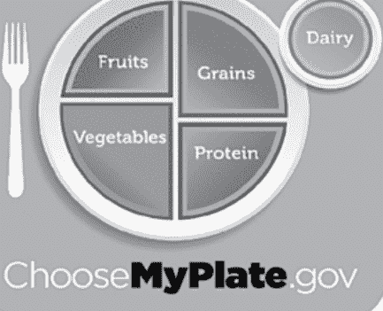

图 9-1. 健康饮食的 MyPlate (美国农业部, 2016)。

## 食品标签

食品标签是另一个可以帮助公众药剂师评估食品营养成分的工具。标签上的每日摄入量为消费者根据 2000 卡路里的饮食提供每份物品的百分比。有关食品标签的更多信息可以在网站上找到 (`http://www.fda.gov/Food/Food/default.htm`)。图 9-2 指南的快速回顾，以帮助教育公众营养素如何影响个人健康。新修订的食品和药品管理局标签要求涵盖了份量、每份热量摄入量、更新的（%每日百分比、必需营养素的变化以及解释每日摄入量的脚注）。

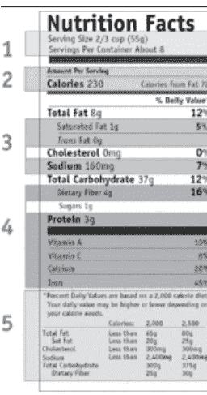

图 9-2. 营养标签（美国食品药品监督管理局，2016 年）。

## 生命周期中的营养

### 怀孕和哺乳期的营养

社区药剂师在建议准妈妈方面发挥着作用，指导她们在怀孕每个阶段关注必要的营养需求，这对婴儿的短期和长期健康至关重要。许多女性在计划这些阶段的饮食时，可能意识到不同的营养需求。药剂师可以提供帮助，关注孕妇可能出现的营养问题，并建议简单的饮食调整，以确保怀孕安全和孩子健康。

女性所需的热量和营养需求会显著增加，以支持发育胎儿的生长。怀孕期间的平均体重增加为 25 到 35 磅（Roth, 2014）。怀孕期的蛋白质需求增加到每天 60 克，这对于组织构建至关重要。铁、钙、锌和维生素 D 等关键营养素在怀孕期间以及婴儿的长期健康方面特别重要。青少年怀孕是一个值得关注的问题，因为这些年轻女性需要了解自己的营养需求以及怀孕的额外需求。药剂师可以通过 MyPlate 等工具协助提供营养摄入方面的咨询。

社区药剂师在促进和支持母乳喂方面发挥关键作用（Ronai, Taylor, Dayton, & Feeller, 2009）。母乳在婴儿的整个生命期间提供激素。它为大脑的发育、生长和消化提供了正确的乳糖、水、必需脂肪酸和氨基酸。完全建立喂养途径需要两到三周时间，因此此时不应进行补充喂养（Roth, 2014）。母乳的配方旨在满足婴儿前六个月的营养需求。一些母亲可能不想或无法母乳喂。她们可能会寻找药剂师购买替代奶（如婴儿配方粉）、奶瓶和奶嘴，这些产品在药房出售。药剂师应该熟悉母乳替代品婴儿食品的营养成分。

母亲在哺乳期间的热量需求会增加，并取决于产奶量。母乳的前六个月内，每天需要增加 500 卡路里，随后七到九个月内每天增加 400 卡路里（Roth, 2014）。如果母亲的饮食中热量不足，奶水质量就会下降。这在生活发展中国家的女性中很常见。教育女性在哺乳期间不应尝试减肥是非常重要的（世界卫生组织 [WHO] & UNICEF，2003）。

女性消耗的大多数化学物质都会进入乳汁，因此让女性就其当地药剂师和/或医生咨询其正在服用的任何药物和营养补充剂是非常重要的。应避免过量饮酒，如果喝了酒，母亲应在酒精排出体外后再母乳，这通常需要两到三小时。咖啡因应限制在每天相当于两到三杯咖啡量，因为可能会影响婴儿的精力和睡眠。甲比酮和奥合成等处方药可能导致婴儿嗜睡和易怒。在对罗德州药剂师的一项调查中，近 50% 的人表示每周或每天都会收到关于母乳喂和药物安全的咨询。在受访的药剂师中，85% 的人对有这些顾虑的哺乳母亲感到不安。

### 幼儿早期的营养

生命早期是快速生长发育的时期。在婴儿出生后的四到六个月内，其体重会翻倍；从怀孕第一天到两岁的这段时间被称为“前 1000 天”。这一时期被认为是塑造长期健康的关键窗口期。营养在这一独特需求中起着至关重要的作用。营养需求是成年人的两到三倍。低出生体重婴儿和遭受营养不良的婴儿需要更多热量。

婴儿的饮食通常由母乳或配方奶组成。每种喂养方式都会提供适当的营养；然而，母乳具有额外的益处：对许多传染性疾病产生临时免疫力。它还能建立母子之间的纽带。瓶喂也可以提供充足的营养。药剂师可以为母亲提供商业配方奶和喂养说明的信息。如果婴儿对配方奶极敏感或过敏，他们还可以提供替代方案。固体食品在六个月后引入。固体食品应逐渐引入，到一岁时，大多数婴儿应该吃来自所有 MyPlate 组的食物。

### 儿童和青少年的营养

儿童的营养需求随着生长发育而变化。特定的营养需求影响身体、智力和情感的生长发育（Roth, 2014）。研究表明，未能满足营养需求的儿童在智力上身体上都可能受到影响。饮食行为在此期间形成，父母提供积极的喂养环境非常重要。然而，许多并发症在儿童和青少年时期由于营养不良而开始。这些包括持续到成年的糖尿病、肺力和心理社会并发症，导致较差的和社会健康结果（Saho et al., 2015）。预防和早期干预策略对于扭转肥胖流行也至关重要（Gurnari, Birken, & Hamilton, 2015）。

父母和照顾人员在场并继续鼓励尝试新食物很重要。儿童应该喂养符合年龄且满足其营养需求的食物。需求随体型增大而增加。因此，让幼儿接触他们会吃的营养食物是有重要的。

青少年时期是营养脆弱的重要时期，因为为了成功的生长发育，对饮食的需求增加了。每个阶段的生长和发育都需要额外的需求。从青少年早期（10-14 岁）、青少年后期（15-19 岁）到成年早期（20-24 岁），能量需求对女性和男性产生巨大变化（Das et al., 2017）。由于活动量、肌肉质量增加，男性的需求往往高于女性。

青少年模仿父母的饮食习惯，摄入大量的薯片、碳酸饮料和糖果。社会和环境因素也会影响习惯，如食物供应、偏好、便利性、个人信念、大众媒体、形象等（Das et al., 2017）。在儿童和婴儿饮食影响识别（IDEFICS）研究中，Iguac 等人（2016）确定社会不平等包括儿童期的积累脆弱性可能决定长期模式。青少年期的压力增加了风险行为的可能性，包括超重或肥胖、糖尿病前期、饮食障碍、酒精滥用药物滥用。如果怀疑有这些情况，寻求健康专业人士和药剂师是重要的。

### 青年、中年和老年期的营养

成年早期与青年的最后阶段重叠，通常指 18 到 40 岁。除非个体怀孕或哺乳，否则生长通常在 25 岁完成。此时的营养需求变化不大。中年从 40 岁持续到 60 岁。随着个人进入中年，营养需求开始减少，因为他们活动较少，可能没有足够的运动。体重控制对于摄入热量过量的人来说可能是一个问题。慢性疾病可能在此阶段开始，如糖尿病、代谢综合征和高血压。

老年期从 65 岁开始。美国增长最快的人群是 85 岁及以上的人，被称为老年老人。随着身体机慢，营养需求受到许多生理因素的影响。营养摄入不良和牙齿问题会加许多疾病，包括白内障和骨关节炎。心理社会变化如不再独立或不再感到有用也会影响个人的食欲。摄入减少还可能影响其是否能负担起健康食物。根据疾病控制与预防中心（CDC），美国人患有一种或多种慢性病，至少 50% 的人有两种（CDC, 2016）。世界卫生组织（2016）建议，60% 的成人受慢性疾病影响，如心脏病、中风、癌症、呼吸系统疾病和糖尿病。在 2005 年全球因慢性疾病去世的 3500 万人中，50% 在 70 岁以下，一半死者为女性（WHO, 2016）。在这里，适当的营养继续在这些疾病状态的预防、管理和稳定中发挥作用。

## 老年人营养不良

“营养不良风险”的总体患病率为 46.2%，其中社区居住老年人的营养不良风险最高，患病率为 31.9%（Kaiser et al., 2010）。

营养不良与死亡率和发病率有关。美国疾病控制与预防中心（CDC）估计美国全年龄段营养不良导致的死亡率为 10 万中 8 例。然而，对于老年人来说，死亡率高得多：65 至 74 岁为 1 例，75 至 84 岁为 5.2 例，85 岁及以上为 20.9 例（Lee & Berthelot, 2010）。事实上，CDC 估计每年约有 3,000 名成年人死于营养不良（Xu, Murphy, Kochanek, & Bastian, 2016）。老年人的营养不良还会增加受伤、疾病和过早住院的风险，这些因素都会增加财务负担（Gurvey et al., 2013; Wright, Vance, Sudidth, & Epps, 2015）。

药剂师在人生的各个阶段提供饮食建议方面发挥着作用。他们通常是社区中最容易接触的健康专业人员。社区药剂师需要具备饮食和疾病状态的通用知识，并拥有工具为社区提供改善饮食习惯的方法。成年期这些阶段的营养需求可以在《美国人饮食指南》(`http://www.cnpp.usa.gov`)中查阅。

## 慢性疾病的医学营养治疗

美国主要死因按降序排列为：心脏病、癌症、慢性肺病、事故、脑血管疾病、阿尔茨海默病、糖尿病、肾炎炎和自杀。几十年来，心脏病一直是首要死因，癌症位居死因第二位。本节探讨了药剂师如何协助饮食干预，以帮助这些疾病状态的管理。

## 心血管疾病


当全球主要的死因是心脏和血管疾病时，统称为心血管疾病。动脉粥样硬化（动脉硬化）被认为是儿童时期心脏发作和中风的主要原因。高脂血、高血压和吸烟是动脉粥样硬化的主要风险因素。饮食胆固醇和甘油三酯也会导致高脂血。脑血管意外也可能因血流阻塞导致死亡。

其他已确定的风险因素被称为代谢综合征，包括：

- 腹部肥胖；
- 血脂高（如高甘油三酯、低高密度脂蛋白 `HDL` 和高低密度脂蛋白 `LDL`）；
- 高血压；
- 胰岛素抵抗；以及
- 血液中高敏 C 反应蛋白升高。

医学营养治疗是高脂血的主要治疗方法。饮食脂肪的减少通常对应于摄入胆固醇和饱和脂肪的减少以及减轻减轻。美国心脏协会与美国心脏学会共同制定了指南，其中建议患者遵循监测脂肪并鼓励增加纤维摄入的饮食方案（Eckel et al., 2014）。

社区药剂师可以引导患者访问美国心脏协会网站，了解更多心脏健康生活知识（`http://www.heart.org/HEARTOG/`）。

## 高血压

高血压影响了美国约三分之一的成年人。它是导致心脏发作、中风、心力衰竭和肾衰竭的原因，通常被称为“沉默疾病”。在 90% 的高血压病例中，原因未知，被称为原发性高血压。

高血压的风险因素包括年龄、遗传、肥胖和不良习惯。`DASH` 饮食（抗高血压饮食法）旨在降低血压。`DASH` 饮食鼓励摄入水果、蔬菜和全谷物，减少钠摄入。癌症是导致死亡的死因之一（NHLBI, 2003）。

## 癌症

癌症是美国第二大死因。癌症在几十年中一直在持续发展。癌症的病因尚不清楚；然而，遗传、环境因素以及压力会导致发生。酒精和吸烟的人患癌症风险更高。

癌症患者的营养护理至关重要。由于高代谢状态，能量需求很高。高蛋白、高热量饮食通常是推荐的。化疗可能导致由于恶心和疼痛引起的营养不良。如果消瘦严重，肠内或肠外营养可能变得必要。

## 糖尿病

儿童和成年人糖尿病患病率在过去十年大幅上升。糖尿病是全球范围内关注的非传染疾病之一（WHO, 2016）。

2012 年有 210 万（9.3%）美国人患有糖尿病，另有 8600 万人处于糖尿病前期，每年约有 140 万例新病例（美国糖尿病协会, 2016）。2008 年至 2009 年，估计有 23,525 名 20 岁以下的美国人被诊断患有糖尿病（CDC, 2014）。2012 年，这一数字增加到 20 万（CDC, 2014）。

失明、心脏和肾脏疾病、趾和足部截肢、感染和死亡均归因于糖尿病。糖尿病是美国第七大死因（CDC, 2014）。

## 公共卫生营养

婴儿出生后这种风险就会消失；然而，35%至60%的女性在未来10到20年内患上糖尿病的概率会更高。

饮食是糖尿病管理的重要组成部分。控制血糖水平可以为个体提供最佳营养，预防症状并推迟疾病并发症发生。全天持续摄入碳水化合物有助于维持血糖。为了控制血糖水平，饮食设计应确保全天范围内提供定量的碳水化合物。

由于糖尿病患者被认为是心血管疾病的高危人群，他们的脂肪饮食指南与之相似。纤维的增加有助于减少对胰岛素的需求，因为它能降低血糖。运动有助于身体利用葡萄糖；然而，如果处方提供的热量和胰岛素不足，可能会发生低血糖，因此需要格外小心。

# 食品安全与饥饿

获取食物对于美国家庭来说已是一个日益严重的问题。食品不安全是指无法获得健康生活所需的营养且数量充足的食物（Coleman-Jensen, Gregory, & Singh, 2014）。

美国农业部（`USDA`）估计，美国有 4900 万人生活在食品不安全的家庭中，其中近 1600 万是儿童（Coleman-Jensen et al., 2014）。食品不安全风险最大的个人包括低收入者、少数族、老年人以及/或有小孩的人群。

食品不安全的成年人肥胖和糖尿病等慢性病的发病率更高，药物依从性较低，并且包括焦虑和抑郁在内的心理健康问题（Seligman, Laraugh, & Kushnel, 2010）。

食品不安全被证明是难以衡量。早期的量表使用家庭收入水平来间接评估食品不安全。美国 `USDA` 食品安全调查模块由美国农业部食品与营养局于 1995 年开发（Carlson, Anders, & Peck, 1999）。

美国 `USDA` 食品安全调查模块现在有英语和西班牙语三种形式：

- (a) 六项短版；
- (b) 十项成人版；以及
- (c) 十八项家庭版，外加一个针对 12 岁及以上儿童的模块。

随着食品不安全人数的增加，人们正通过多方面的努力帮助这些个人和家庭。每年在食品援助计划上的支出超过 1000 亿美元。然而，发现政府食品援助计划与需求之间的差距日益拉大（Feeding America, 2015; Roberts, Povich, & Mather, 2012-2013）。

是非营利组织帮助填补了这一差距（Guo, 2010）。这些非营利组织中的许多建立了当地食品银行、食品超市和送餐计划。

## 公共卫生营养

社区药剂师处于独特的地位，可以识别谁可能正在经历食品不安全。食品安全调查模块中的几项回答对食品不安全最具有预测性（Hager et al., 2010）。

模块中药剂师可以询问的两个回答包括：

- (a) “在过去的 12 个月里，我们担心食物会在有钱买更多之前就用光”；
- (b) “在过去的 12 个月里，我们买的食物不够吃，而且我们没有钱买更多”。

此外，药剂师可以了解并指导患者前往当地食品银行，获取有关可用服务的更多信息。像 Feeding America 和救世军等国家组织已经建立了当地食品银行、食品超市和送餐计划的网络，为全国各地的社区提供服务。

此外，还有许多其他非营利组织（如教会和学校），为需要食品援助的人提供食品超市。药剂师还可以了解美国提供的更多针对食品安全的联邦援助计划。值得关注的三个计划包括：

- (a) 补充营养援助计划（`SNAP`）；
- (b) 妇女婴儿及儿童计划（`WIC`）；以及
- (c) 轮上送餐（`Meals on Wheels`）。

`SNAP` 为证明经济困难的人提供购买食物的资金。对于低收入家庭，有国家性的资格标准。发现政府食品援助计划与需求之间的差距日益拉大（Feeding America, 2015; Roberts, Povich, & Mather, 2012-2013）。是非营利组织帮助填补了这一差距（Guo, 2010）。这些非营利组织中的许多建立了当地食品银行、食品超市和送餐计划。

`SNAP` 为证明经济困难的人提供购买食物的资金。对于低收入家庭，有国家性的资格标准。发现政府食品援助计划与需求之间的差距日益拉大（Feeding America, 2015; Roberts, Povich, & Mather, 2012-2013）。是非营利组织帮助填补了这一差距（Guo, 2010）。这些非营利组织中的许多建立了当地食品银行、食品超市和送餐计划。

`SNAP` 为证明经济困难的人提供购买食物的资金。对于低收入家庭，有国家性的资格标准。发现政府食品援助计划与需求之间的差距日益拉大（Feeding America, 2015; Roberts, Povich, & Mather, 2012-2013）。是非营利组织帮助填补了这一差距（Guo, 2010）。这些非营利组织中的许多建立了当地食品银行、食品超市和送餐计划。

`SNAP` 为证明经济困难的人提供购买食物的资金。对于低收入家庭，有国家性的资格标准。发现政府食品援助计划与需求之间的差距日益拉大（Feeding America, 2015; Roberts, Povich, & Mather, 2012-2013）。是非营利组织帮助填补了这一差距（Guo, 2010）。这些非营利组织中的许多建立了当地食品银行、食品超市和送餐计划。

`SNAP` 为证明经济困难的人提供购买食物的资金。对于低收入家庭，有国家性的资格标准。发现政府食品援助计划与需求之间的差距日益拉大（Feeding America, 2015; Roberts, Povich, & Mather, 2012-2013）。是非营利组织帮助填补了这一差距（Guo, 2010）。这些非营利组织中的许多建立了当地食品银行、食品超市和送餐计划。

`SNAP` 为证明经济困难的人提供购买食物的资金。对于低收入家庭，有国家性的资格标准。发现政府食品援助计划与需求之间的差距日益拉大（Feeding America, 2015; Roberts, Povich, & Mather, 2012-2013）。是非营利组织帮助填补了这一差距（Guo, 2010）。这些非营利组织中的许多建立了当地食品银行、食品超市和送餐计划。

`SNAP` 为证明经济困难的人提供购买食物的资金。对于低收入家庭，有国家性的资格标准。发现政府食品援助计划与需求之间的差距日益拉大（Feeding America, 2015; Roberts, Povich, & Mather, 2012-2013）。是非营利组织帮助填补了这一差距（Guo, 2010）。这些非营利组织中的许多建立了当地食品银行、食品超市和送餐计划。

`SNAP` 为证明经济困难的人提供购买食物的资金。对于低收入家庭，有国家性的资格标准。发现政府食品援助计划与需求之间的差距日益拉大（Feeding America, 2015; Roberts, Povich, & Mather, 2012-2013）。是非营利组织帮助填补了这一差距（Guo, 2010）。这些非营利组织中的许多建立了当地食品银行、食品超市和送餐计划。

`SNAP` 为证明经济困难的人提供购买食物的资金。对于低收入家庭，有国家性的资格标准。发现政府食品援助计划与需求之间的差距日益拉大（Feeding America, 2015; Roberts, Povich, & Mather, 2012-2013）。是非营利组织帮助填补了这一差距（Guo, 2010）。这些非营利组织中的许多建立了当地食品银行、食品超市和送餐计划。

`SNAP` 为证明经济困难的人提供购买食物的资金。对于低收入家庭，有国家性的资格标准。发现政府食品援助计划与需求之间的差距日益拉大（Feeding America, 2015; Roberts, Povich, & Mather, 2012-2013）。是非营利组织帮助填补了这一差距（Guo, 2010）。这些非营利组织中的许多建立了当地食品银行、食品超市和送餐计划。

`SNAP` 为证明经济困难的人提供购买食物的资金。对于低收入家庭，有国家性的资格标准。发现政府食品援助计划与需求之间的差距日益拉大（Feeding America, 2015; Roberts, Povich, & Mather, 2012-2013）。是非营利组织帮助填补了这一差距（Guo, 2010）。这些非营利组织中的许多建立了当地食品银行、食品超市和送餐计划。

`SNAP` 为证明经济困难的人提供购买食物的资金。对于低收入家庭，有国家性的资格标准。发现政府食品援助计划与需求之间的差距日益拉大（Feeding America, 2015; Roberts, Povich, & Mather, 2012-2013）。是非营利组织帮助填补了这一差距（Guo, 2010）。这些非营利组织中的许多建立了当地食品银行、食品超市和送餐计划。

`SNAP` 为证明经济困难的人提供购买食物的资金。对于低收入家庭，有国家性的资格标准。发现政府食品援助计划与需求之间的差距日益拉大（Feeding America, 2015; Roberts, Povich, & Mather, 2012-2013）。是非营利组织帮助填补了这一差距（Guo, 2010）。这些非营利组织中的许多建立了当地食品银行、食品超市和送餐计划。

`SNAP` 为证明经济困难的人提供购买食物的资金。对于低收入家庭，有国家性的资格标准。发现政府食品援助计划与需求之间的差距日益拉大（Feeding America, 2015; Roberts, Povich, & Mather, 2012-2013）。是非营利组织帮助填补了这一差距（Guo, 2010）。这些非营利组织中的许多建立了当地食品银行、食品超市和送餐计划。

`SNAP` 为证明经济困难的人提供购买食物的资金。对于低收入家庭，有国家性的资格标准。发现政府食品援助计划与需求之间的差距日益拉大（Feeding America, 2015; Roberts, Povich, & Mather, 2012-2013）。是非营利组织帮助填补了这一差距（Guo, 2010）。这些非营利组织中的许多建立了当地食品银行、食品超市和送餐计划。

`SNAP` 为证明经济困难的人提供购买食物的资金。对于低收入家庭，有国家性的资格标准。发现政府食品援助计划与需求之间的差距日益拉大（Feeding America, 2015; Roberts, Povich, & Mather, 2012-2013）。是非营利组织帮助填补了这一差距（Guo, 2010）。这些非营利组织中的许多建立了当地食品银行、食品超市和送餐计划。

*(注：由于原文文本中存在大量重复段落，译文严格遵循“不要漏掉任何一行”的指令，对重复内容进行了完整翻译。)*

## 公共卫生营养

营养转型不仅导致发展中国家的肥胖率飙升，还导致了与营养相关的非传染性疾病（`N-CD`）的发展，例如糖尿病和心血管疾病。

事实上，对于全球63%的人口来说，超重或肥胖相关疾病的死亡风险已超过体重过轻相关疾病的死亡风险（Alwan 等人，2010）。预计在2010年至2020年间，全球非传染性疾病的死亡人数将增加15%（WHO, 2011）。

发展中国家在管理这些非传染性疾病方面准备不足。其负担已经超过了目前透析和高脂血症药物等服务的医疗保健能力。正如我们在美国学到的那样，重点需要放在预防饮食变化和肥胖上。

由于问题的严重性，世界卫生组织（`WHO`）于2004年通过了《饮食、身体活动与健康全球战略（2004）》，以采取支持健康饮食和定期身体活动所需的行动。该战略呼吁所有利益相关者在全球、地区和局部层面采取行动，改善人群水平的饮食和身体活动模式。

在国际社区执业的药师在预防肥胖及肥胖相关疾病方面可以发挥独特作用（Jordan & Harmon, 2015）。通过个人和社区参与，药师可以鼓励健康的饮食和活动模式以支持健康。

然而，社区药店参与体重管理在许多发展中国家是一个非常新颖的想法。这些项目的成功与否取决于社区药师及其当地社区的信念。

Awad 和 Waheedi (2012) 对科威特的220多名社区药师进行了调查，以收集药师对肥胖管理计划有效性的看法。科威特药师认为，肥胖管理计划，特别是关于饮食、运动和减肥食品的建议是有效的。

一个有趣的发现是，药师为患者提供咨询时越从容，他们越相信肥胖管理计划的有效性。在泰国马萨拉哈姆府（Maha Sarakham）进行的一项随机试验，将社区药师提供的肥胖干预与初级保健单元提供的常规服务进行了比较（Phimarn 等同事发现，泰国社区药师在帮助患者决定参与健康饮食模式方面发挥了关键作用）。

药店患者不仅对进行健康饮食行为的意愿增加，而且在关于肥胖危险以及如何吃得更健康的整体和特定知识方面也有更高的收获。

## 对公共卫生和药学实践的影响

在过去的几十年里，药师的角色已经从传统的药物发放转变为更具临床和社区的角色。药师已经证明了他们在临床和社区环境中规划患者照护团队中不可或缺部分的能力。

此外，药学院教育认证委员会（`ACPE`）2016年标准强调了以患者为中心的护理、健康与福祉以及基于人群的护理的重要性（ACPE, 2015）。药师的角色还扩展到包括更多直接的护理，其中包括疾病管理服务。`ACPE` 2016年标准强调了以患者为中心的护理、健康与福祉以及基于人群的护理的重要性（ACPE, 2015）。

营养以及预防疾病的重要性长期以来一直认可并鼓励。医疗保健专业人员，特别是药师，在促进健康饮食方面发挥着关键作用，因为他们每天在服务服务的患者时都会遇到营养问题。

通过广泛的医学问题，无论是在临床还是社区环境中，药师都需要与社区合作了解营养基础知识。医疗成本大幅增加，但适当的营养可以帮助许多疾病。随着公众对营养的关注，药师需要能够帮助社区满足他们的营养需求和目标。

随着超过2400万美国人遭受心脏病、糖尿病和体重/肥胖等慢性疾病的困扰，药师有机会在教育患者药物的同时也教育他们的营养知识。药师还有机会了解有关减肥、糖尿病和心血管健康的最新创新。

减轻体重可以导致血压下降、更好的血糖控制、低密度脂蛋白降低，并最终减少药物剂量。

本章介绍的信息侧重于为药师提供生命各阶段的营养需求概述。对于药师来说，了解任何人群的这些营养需求是重要的。该章还介绍了药师可以参考或支持健康生活方式和公共卫生预防策略的特定策略和计划。

结果，新一代药师将不仅成为药物专家，还将成为帮助支持公共卫生倡议并通过营养教育提供基于人群护理的重要部分。

## 参考文献

Accreditation Council for Pharmacy Education. (2015). Standards and Key Elements for the Professional Program in Pharmacy Leading to the Doctor of Pharmacy Degree. Retrieved from `https://www-acpe.org/pdf/Standards2016FINAL.pdf`

Alwan, A., Maclean, D. R., Riley, L. M., d’Espaignet, E. T., Mathers, C. D., Stevens, G. A., & Bettcher, D. (2010). Monitoring and surveillance of chronic non-communicable diseases: progress and capacity in high-burden countries. Lancet, 376(9755), 1861–1868. doi:10.1016/S0140-6736(10)

American Diabetes Association (2016). Statistics About Diabetes. Arlington, Virginia. Retrieved from `http://www.diabetes.org/diabetes-basics/statistics`


# 融资与保险


# 药学公共卫生导论（第2版）

编辑：Bruce Lubovsky Levin, Ardis Hanson 和 Peter D. Hurd

出版社：牛津大学出版社 印刷日期：2018年2月

印刷版 ISBN-13：9780190238308 在线版：2018年3月

DOI: 10.1093/med/9780190238308.001.001

# 融资与保险

章节：融资与保险

作者：Samuel H Zuvekas, Earle Buddy Lingle, Ardis Hanson 和 Bruce Lubotsky Levin

DOI: 10.1093/med/9780190238308.003.0010

## 引言

美国医疗体系并非单一体系，而是由医疗服务交付中多种混合了私人与公共融资及保险机制的体系组成。这种结构和成本与其他发达国家有所不同。联邦政府报告显示，2015年医疗卫生支出约为3.7万亿美元，或人均9,990美元（医疗保险与医疗救助服务中心 [CMS], 2016b）。相比之下，2015年加拿大的总医疗支出达到2191亿美元，或人均6,105美元（加拿大健康信息协会, 2015）。将选定国家的人均支出与美国相比，荷兰为3,131美元，法国为4,361美元，德国为4,920美元，英国为3,364美元，以色列为2,232美元（Mossials, Wenzel, Osborn, and Sarnak, 2016）。

## 公共卫生营养

Finucane, M. M., Stevens, G. A., Cowan, M. J., Danaei, G., Lin, J. K., Paciorek, C. J., Ezzati, (2011). 1980年以来体重质量指数的国家、区域和全球趋势：基于健康检查调查和流行病学研究的系统分析，涉及960个国家年和910万参与者。《柳叶刀》，377(9765), 557-567. doi:10.1016/S0140-6736(10)62037-5

Gilman, S., Chokshi, D., Bowen, Rugen, & Cox, M. (2014). 连接点点：退伍军人健康管理中的个人内部健康教育与交付系统设计。《医学科学院》，89(8): 1113-1116。

Guo, B. (2010). 跨越公共安全网：非营利组织在解决低收入家庭物质贫困中的作用。《利润与自愿部门季度》，39(5), 784-810. doi:10.1177/089976400933407

Garnami, M., Birken, C., & Hamilton, J. (2015). 儿童肥胖：病因、后果与管理。《北美儿科学临床杂志》，62(4), 821-840. doi:10.1016/j.pc.2014.04.001

Grey, J., Rand, K., Daugherty, S., Dinger, C., Scheling, J., & Laver, N. (2013). MANGA 客户与对照组的健康成本研究。《初级医疗保健与管理杂志》，4(4), 311-317. doi:10.1017/s2150311914390037

Hager, E. R., Quigg, A. M., Black, M. M., Coleman, S. M., Heeren, T., Rose-Jacobs, R., ... Frank, D. A. (2010). 用于识别粮食不安全风险家庭的两项筛查法的开发与有效性。《儿童科学》，126(6), e232-e32. doi:10.1542/pediatrics.2009-349

Igaucel, I., Fernandez-Alvira, J. M., Bammann, K., Declerc, B., Eiben, G., Gwozdz, W., ... Moreno, L. A. (2016). 欧洲儿童社会脆弱性与饮食模式之间的关联：儿童和婴儿生活方式诱导健康影响的识别与预防研究 (IDEICS)。英国营养杂志》，117(6), 1288-1297. doi:10.1017/s000711451600333

Jordan, M. A., & Harvey, J. (2015). 药师干预肥胖：改善治疗和患者预后。《整合药学研究与实践》，4,7, 79-89. doi:10.2147/IPPRS72206

Kaiser, M. J., Bauer, J. M., Ramsch, C., Uter, W., Guigos, Y., Cedarholm, T., ... Sieber, C. C. (2010). 老年人营养不良的频率：基于简易营养评估的跨国视角。《美国老年医学会杂志》，58(9), 1734-1738. doi:10.1111/j.1532-5415.03016

Lee, M. R., & Berthelot, E. R. (2010). 老年人营养不良负担的社区变量。《流行病学杂志》，20(5), 371-379. doi:10.1016/j.aepidem.2010.01.008

## 公共卫生营养

Machen, R., Hammer, D., Odegard, P. (2007). 由药学学生教授的营养学选修。《美国药学教育杂志》，71(4), 65。

美国心脏肺部血液研究所。 (2003, 5月). 降低血压指南。(NIH 出版号 03-5232)。马里兰州贝塞达：美国卫生与健康服务部。获取自 https://www.nihl.gov/files/docs/public/heart/hbp_low.pdf

Oliveira, V., & Fazão, E. (2015, 1月). WIC 项目背景、趋势与问题，2015年 (EIB-134)。华盛顿特特区：美国农业部经济研究服务局。获取自 http://www.ersda.gov/media/160725/eibl134.pdf

Park, H. K. (2008). 韩国的营养政策。《亚洲太平洋临床营养杂志》，17 补刊，1, 343–345。

Phiman, W., Pianana, P., Limpanchakovit, P., Suranart, K., Supanisichakit, S., Narkargon, A., & Saranee, K. (2013). 初级保健中社区药剂师参与体重管理以改善患者预后。《国际临床营养杂志》，35(6), 1208–1217. doi:10.1007/s11096-013-9851-3

Popkin, B. M., Adair, L. S., & Ng, S. W. (2012). 全球营养与发展中国家的肥胖流行病。《营养评述》，70(1), 3–21. doi:10.1111/j.1753-4887.2011.00456-x

Roberts, B., Povich, D., & Mather, M. (2012-2013). 低收入家庭：经济差距。马里兰州切萨：工作家庭项目。获取自 http://www.families.org

Ron, C., Tyler, J., Dugan, E., & Feller, E. (2009). 母乳喂养的识别。《家庭医学》，4, 91-95。

Roth, R. (2014). 怀孕期间。纽约：Cengage 出版。

Sahoo, K., Choudury, A., & Sofi, B. (2015). 粮食不安全与慢性疾病。《营养杂志》，14, 304–310. doi:10.1016/jn.1257

美国农业部。(2012). 营养计划。获取自 http://www.fns.gov

美国农业部。(2016). 我的盘。获取自 http://www.chooseplate.gov

美国卫生与健康服务部。(2020). 健康 2020。获取自 http://www.health.gov

美国卫生与健康服务部。(2015). 美国人饮食指南。获取自 http://www.gov/dietaryguidelines

美国食品药品管理局。(2016). 标签。获取自 http://www.fda.gov

世界卫生组织。(2016)。 慢性疾病与健康促进。日内瓦。

世界卫生组织。(2011)。 非传染性疾病全球状况。日内瓦。

世界卫生组织。(2013)。 非传染性疾病预防和控制全球行动计划。获取自 http://apps.who.int/bitstream/10665/94384/1/97892150236

世界卫生组织, &联合国儿童基金会。(2003)。 婴儿幼儿喂养全球战略。日内瓦：世界卫生组织。获取自 http://apps.who.int/bitstream/10665/42590/1/924156218

## 公共卫生营养

Wright, L., Corvin, J., Hoare, I., & Epps, J. (2015). 伯利兹社区营养需求与医疗障碍评估。《国际营养与饮食学杂志》，2(2), 97-114。

Wright, L., Vance, L., Siddhuth, C., & Epps, J. B. (2015). 上门送餐计划对营养风险、饮食摄入、粮食安全、孤独感和社会福祉的影响。《老年营养学与老年医学杂志》，34(2), 218-227. doi:10.1080/21551197.2015.1022681

Xu, J., Murphy, S. L., Kochanek, K. D., & Bastian, B. A. (2016). 死亡：2013年最终数据。《国家生命统计报告》，64(2), 1-118。

## 无保险者

与发达国家不同，美国并未为其所有公民提供全民医疗保健。尽管联邦医疗保险计划为65岁及以上的成年人提供某种程度的覆盖，但65岁以下的美国人并没有保障性的医疗保险覆盖。2013年，约55%的65岁以下人员受私人医疗计划的覆盖（医疗研究与质量机构, 2017）。《平价医疗法案》（ACA）的通过将医疗救助覆盖扩大到许多收入在联邦贫困线（FPL）138%或以下的低收入个人，这些州选择向联邦贫困线400%的人口提供扩大医疗救助覆盖（计划与评估助理秘书，2017）。自ACA扩大医疗救助条款于2014年实施以来（少数州更早开始扩大），美国无保险的人数目前为2850万，减少了近740万人（Colen, Martinez, & Zammitt 2016）。

剩余的2800万无保险成年人中许多住在没有扩大医疗救助的州。许多无保险者非常贫穷。据估计，39%的无保险成年人收入低于联邦贫困线。这一比例是他们成年人口中整体比例的两倍（Collins, Duffy, & Beutel, 2016）。此外，并非所有工人都能负担得起保费，或者具备参加主要公共保险计划的资格。另一些无保险者较年轻且相对健康，在提供医疗保险覆盖时并未投保。

无保险的最常见原因是购买医疗保险太贵了（Collins et al., 2016）。从2006年到2016年，家庭覆盖的总保费不仅增加了58%，工人的负担比例还增加了78%，超过了工资增长（亨利·J·凯撒家族基金会, 2016）。在了解市场或尝试过投保的无保险成年人中，负担能力担忧是他们未注册的主要原因。无保险者通过自掏腰包支付医疗或依赖公共医疗保险体系。为了更好地理解美国医疗的融资，接下来的章节将描述主要的政府医疗计划、资金，以及公共和私人支付方实际上如何向医疗服务者付费以提供服务。

## 公共医疗保险体系

联邦、州和地方政府在提供医疗服务方面发挥三个主要角色：(1) 监管医疗市场，(b) 要求他人为公众提供服务，(c) 为公共利益购买服务。两个例子是美国食品药品管理局（FDA）和国立卫生研究院（NIH）。由于市场未能充分解决安全问题，FDA对药品和食品进行监管。NIH开发新的治疗方法。其他类型的医疗服务包括（注：此处原文逻辑完整）美国食品药品管理局（FDA）和国立卫生研究院（NIH）是两个例子……（此处原文重复，按逻辑翻译）。

公共资金支付了这些及其他发达国家的大部分医疗费用，比例从70%不等，具体取决于国家。然而，美国人依靠公共和私立医疗保险的混合覆盖来支付他们接受的大部分医疗服务费用。2015年，联邦政府占据了医疗支出的最大份额（29%），其次是家庭（28%）、私营企业（20%）以及州和地方政府（17%）（CMS, 2016b）。四个计划——医疗保险（Medicare）、医疗救助（Medicaid）、儿童健康保险计划（CHIP）和平价医疗法案（ACA）市场补贴共占了25%，即9,380亿美元（预算与政策优先中心, 2016）。患者和家庭的自付费用为11%，约为3380亿美元。


公共资金来源支付了这些及其他发达国家的大部分医疗费用，比例从70%不等，具体取决于国家。然而，美国人依靠公共和私立医疗保险的混合覆盖来支付他们接受的大部分医疗服务费用。2015年，联邦政府占据了医疗支出的最大份额（29%），其次是家庭（28%）、私营企业（20%）以及州和地方政府（17%）（CMS, 2016b）。四个计划——医疗保险（Medicare）、医疗救助（Medicaid）、儿童健康保险计划（CHIP）和平价医疗法案（ACA）市场补贴共占了25%，即9,380亿美元（预算与政策优先中心, 2016）。患者和家庭的自付费用为11%，约为3380亿美元。

## 无保险者

与发达国家不同，美国并未为其所有公民提供全民医疗保健。尽管联邦医疗保险计划为65岁及以上的成年人提供某种程度的覆盖，但65岁以下的美国人并没有保障性的医疗保险覆盖。2013年，约55%的65岁以下人员受私人医疗计划的覆盖（医疗研究与质量机构, 2017）。《平价医疗法案》（ACA）的通过将医疗救助覆盖扩大到许多收入在联邦贫困线（FPL）138%或以下的低收入个人，这些州选择向联邦贫困线400%的人口提供扩大医疗救助覆盖（计划与评估助理秘书，2017）。自ACA扩大医疗救助条款于2014年实施以来（少数州更早开始扩大），美国无保险的人数目前为2850万，减少了近740万人（Colen, Martinez, & Zammitt 2016）。

剩余的2800万无保险成年人中许多住在没有扩大医疗救助的州。许多无保险者非常贫穷。据估计，39%的无保险成年人收入低于联邦贫困线。这一比例是他们成年人口中整体比例的两倍（Collins, Duffy, & Beutel, 2016）。此外，并非所有工人都能负担得起保费，或者具备参加主要公共保险计划的资格。另一些无保险者较年轻且相对健康，在提供医疗保险覆盖时并未投保。

无保险的最常见原因是购买医疗保险太贵了（Collins et al., 2016）。从2006年到2016年，家庭覆盖的总保费不仅增加了58%，工人的负担比例还增加了78%，超过了工资增长（亨利·J·凯撒家族基金会，2016）。在了解市场或尝试过投保的无保险成年人中，负担能力担忧是他们未注册的主要原因。无保险者通过自掏腰包支付医疗或依赖公共医疗保险体系。为了更好地理解美国医疗的融资，接下来的章节将描述主要的政府医疗计划、资金，以及公共和私人支付方实际上如何向医疗服务者付费以提供服务。

## 公共医疗保险体系

联邦、州和地方政府在提供医疗服务方面发挥三个主要角色：(1) 监管医疗市场，(b) 要求他人为公众提供服务，(c) 为公共利益购买服务。两个例子是美国食品药品管理局（FDA）和国立卫生研究院（NIH）。由于市场未能充分解决安全问题，FDA对药品和食品进行监管。NIH开发新的治疗方法。其他类型的医疗服务包括……（此处省略后续重复内容）。

# 融资与保险

药物治疗管理（MTM）计划。MTM计划提供一份书面评估、一份建议如何充分利用药物的行动计划以及一份个人药物清单。

2016年，估计有200万受益人通过雇主赞助的退休人员计划、雇主在职工计划、联邦员工健康福利、医疗事务计划（TRICARE）和退军人事务部获得了药物保障（Henry J. Kaiser Family Foundation, 2016b）。没有处方药保障的医疗保险受益者可以通过支付月费来购买保障，这预计可为其药物成本提供约50%的折扣。然而，估计仍有13%的受益人缺乏药物保障。

医疗保险计划的偿付能力一直是备关注的问题。联邦医院保险信托基金（FHI）和联邦补充医疗保险信托基金董事会（2016）预测，医疗保险目前的成本占国内生产总值（GDP）的3.6%，将在2040年增加到5.6%，并在2090年增加到6.0%。如果不遵守2015年《医疗访问与儿童健康保险再授权法案》（MACRA）¹和ACA减成本措施，预计成本可能会进一步上升，在2040年达到GDP的6.2%，在2090年达到9.1%。

在过去的五年里，B部分和D部分的平均增长率分别为5.6%和7.7%，而对比GDP的平均增长率为3.7%。预计未来五年B部分和D部分的增长率预计分别为6.9%和10.6%，在此期间美国经济的预计年增长率为5.0%。由于保费收入和一般财政收入每年都会重置以覆盖成本，B部分和D部分的资金充足。然而，融资需求的增长必须快于经济增长以覆盖支出的增长。受托人将预计，未来FHI（医疗保险）的税收和其他收入将无法支付FHI支出。

经2010年《医疗保健与教育协调法案》修订的《患者保护与平价医疗法案》（ACA）包含了约165项影响医疗保险计划的条款，包括减成本措施、改善福利、减少欺诈和滥用以及替代支付机制。董事会（2016）做出的预测大幅降低了人均支出增长率，并从ACA和MACRA的减成本条款中节省了大量资金。虽然董事会预计随着2007-2009年衰退的持续恢复，2016年至2021年间的赤字将会减少，但对工人变为受益人（即婴儿潮人口的老化）以及未来生育率下降存在担忧。另外两个主要关注点是医疗保健向更高效、更有生产力的交付模式转型（以与全经济生产力相），以及提供者报销率——目前的谈判价格将与私人保险受益者获得的服务相比，推移会导致医疗质量和可用性的下降（董事会，2016）。

# 医疗救助（Medicaid）

医疗救助占健康经济的六分之一，拥有最大的健康计划参与人数（6890万；20%）和第二大的健康计划支出（5540亿美元）（Tuffer, Wolfe, & Minnie, 2016）。医疗救助是该国最脆弱人群的安全网。儿童占受益人数量最多（2960万，43.0%）（CMS, 2015）。与医疗保险不同，医疗救助不是社会保险计划。它在联邦层面没有任何专门收入来源，例如医疗保险的医院工资税，也没有用于融资的信托基金模式。它来自参保者的极少量保费收入和其他某些其他收入来源（如某些提供者税）（CMS, 2015; Tuffer et al., 2016）。

州政府和联邦政府根据该州适当的联邦匹配援助比例（FMAP）率管理医疗救助支出。虽然州可以选择是否参加该计划，但所有50个州和哥伦比亚区都参与了医疗救助。一旦某州决定在医疗救助下提供服务，联邦法规要求州提供服务、确定符合福利条件的人群并规定报销。

州和联邦资金还共同资助医疗救助。联邦政府在传统医疗救助中的份额基于州资本收入与全国平均水平相比，各州差异很大。联邦份额可能在50%到77%之间，但平均联邦贡献为57%。美国领土还根据《社会保障法》第1108节收到了医疗救助的基础资金。例如，波多黎各在ACA第2005节下，从2011年至2019年获得了额外的54亿美元医疗救助资金（CMS, 2017d）。

为了获得医疗救助福利，受益人必须符合某些入入标准（CMS, 2017b）。由于每个州设定的标准不同，覆盖范围差异很大。受益人必须符合类别贫困标准或医学特定的收入要求。某些州选择为接受家庭和社区服务的个人以及在寄养护理中的儿童提供服务，而这些人可能可能不符合其他条件。

联邦法规要求州提供一系列医疗上必要的基本服务。这些服务可能包括住院医院服务、医生服务、实验室和X射线服务、护理院和医疗保健。可选服务包括处方药、牙科服务、视力保健和中间护理。

所有50个州和哥伦比亚区都提供处方药服务，这是利用率最高的医疗救助服务。各州可以使用管理型计划来提供和协调福利、参与演示项目、开发替代福利计划或申请豁免以获得更灵活灵活性（Tuffer et al., 2016）。

医疗救助计划中的一个特殊融资项目是长期护理支出，无论是机构护理还是社区护理。随着美国人口年龄、慢性疾病数量和残障程度的增加，同时日常功能的下降，预计成本将增加。医疗救助是唯一支付此类服务的公共健康保险计划。2014年，长期护理占了医疗救助总支出的约25%（1160亿美元）（Tuffer et al., 2016）。

同时符合医疗保险和医疗救助条件的人被称为“双重资格者”。在CMS内部，医疗保险-医疗救助协调办公室管理同时符合医疗救助和医疗保险的人的护理，包括改善医疗服务的获得性和质量、简化行政流程以及消除两个机构之间的转换成本。在某些情况下，医疗救助提供健康保险的主要保障（A部分），州医疗救助计划支付补充保险保费（B部分），以便医疗救助也能涵盖这些服务。此外，州医疗救助计划可能支付患者成本，并提供医疗救助不提供的，如处方药和长期护理。

# 医疗救助扩张

ACA规定将医疗救助资格扩大到几乎所有65岁以下的个人，其家庭收入低于联邦贫困线（FPL）的138%，这等同于国家儿童的最低医疗救助资格水平。扩张的意图是为全国范围内创建一个覆盖基础，涵盖那些不符合医疗救助资格但收入低到无法获得保费补贴以参加市场的成人。由于这些有限的资格标准，约400万贫困无业成人陷入了覆盖缺口（Garfield & Damico, 2016）。

选择扩张资格的州包括调整以反映更高水平的急性程度或发病率、增加新符合条件的成年人人费率（这些人可能对额外服务产生比常更大的需求——需求聚集），以及针对新参保者可能具有最大的医疗需求的情况进行调整。CMS估计，在扩张实施后，需求聚集和逆向选择的影响将减少（Tuffer et al., 2016）。

# 医疗融资

随着《平价医疗法案》（ACA）下医疗补助金资格扩大的实施，新增了900万人获得了服务和支持的资格。2015年，州和地方医疗补助金支出增长了4.9%，而联邦医疗补助金支出增长了12.6%。联邦支出的增加主要由ACA项下的新参保员驱动，这部分费用完全由联邦政府资助。

在2012年的“独立企业联合会（NFIB）诉Sebelius案”裁决中，最高法院裁定，如果州不实施ACA规定的医疗补助金资格扩大，则不会因其资格过期而失去资金。截至2017年1月1日，已有若干州（阿拉巴巴马州、佛罗里达州、乔治亚州、爱达荷州、堪萨斯州、缅因州、密西比州、密苏里州、内布拉斯加州、北卡罗来纳州、俄克拉荷马州、南卡罗来纳州、南达科他州、田纳西州、犹州、弗吉尼亚州、威斯康星州和怀俄明州）尚未采纳医疗补助金扩大（Henry K. Kaiser Family Foundation，2017a）。

# 州儿童健康保险计划 (CHIP)

历史上，医疗补助金曾为那些可以通过联邦计划获得现金援助的家庭儿童提供服务。随着1997年《平衡预算法案》中“州儿童健康保险计划”的通过，医疗补助金计划扩大了其资格标准，以增加更多低收入儿童。2009年，奥马马总统签署了《健康保险计划重新授权法案》（Pub. L. No. 111-3），该法案为符合条件但未加入医疗补助金或CHIP的无保险儿童提供了大量的资金资金、计划选择和参保激励，以确保他们能够获得并保留健康保障。更近期，2015年的《医疗补助金和CHIP重新授权法案》延长了CHIP至2017财年的资金支持。CHIP是一项联邦与州联合计划，由州和领土管理，因为每个州和领土都就CHIP的资格和服务拟定了了自身的准则。

根据医疗补助金和CHIP支付与访问委员会（2017），2015年有840万人接受了CHIP服务，费用为137亿美元（联邦拨款97亿美元，州政府40亿美元）。由于美国国会正在研究废除ACA的提议，这将损害交易市场并改变医疗补助金计划的结构和融资模式，该委员会建议将CHIP资金延长至2022财年。

# 退伍军人事务部

退伍军人事务部（VA）为符合规定的退伍军人及其家庭提供医疗保健和财务援助计划。总统2017年的预算和2018年的预拨款申请在2017年为VA申请1823亿美元，其中650亿美元分配用于医疗保健，另有72亿美元分配给VA社区计划，涵盖由非VA供应商为退伍军人提供的医疗程序（美国退伍军人事务部，2017）。

VA的综合整合医疗保健系统是美国最大的，每个州至少有一个医疗中心，波多黎科岛和哥伦比亚特区也是如此。VA医疗保健系统还包括21个退伍军人综合服务网络（区域性护理系统）、168个VA医疗中心、1053个门诊治疗点、800多个基于社区的门诊所计划、135家专业护理机构、48个住院康复治疗计划，以及跨越所有50州、关姆、波多黎科、美国维尔京群岛和华盛顿特区的278个VA中心的标准医疗福利包包括预防性护理服务、门诊（或外）诊断和治疗服务、包括手术在内的住院医院诊断和治疗服务，以及药物和物资。

# TRICARE

国防部的医疗保健计划。符合TRICARE福利资格的人员包括现役军人员、退休人员及其家庭。符合资格的个人通过TRICARE Prime（一种管理医疗选项）、TRICARE Extra（首选提供者选项）或TRICARE Standard（按服务付费选项）接受护理（国防健康署，2016）。TRICARE的覆盖范围符合ACA规定的最低基本保障要求。

# 印第人健康服务

印第人健康服务（IHS）是美国卫生与人类服务部（DHHS）的一个机构。IHS由三个部分组成，即医疗保健服务指导部、全运营医疗保健服务以及城市医疗保健服务和资源中心。IHS为567个获得联邦承认的部落提供医疗保健，涉及约220万美洲原住民和阿拉斯加原住民（Indian Health Service，2016）。这些部落管理着超过60%的IHS拨款，主要通过自决性合同或自我治理计划实施。2016财年的IHS预算拨款为48亿美元（IHS，2016）。

12个办公室和170个IHS和/或联合管理的服务机构负责IHS服务。IHS护理系统由26家医院、59个健康中心和32个卫生站组成。此外，美洲原住民部落和阿拉斯加原住民公司通过19家医院、284个健康中心、28个住院治疗中心、79个卫生站和163个阿拉斯加乡村诊所提供护理（IHS，2016）。除了IHS和部落健康服务外，还有超过100万美洲原住民阿拉斯加原住民通过医疗补助金和CHIP加入了保险（CMS，2017a）。

1976年，《社会保障法》通过《印第人医疗保健改进法》（IHCA）进行了修订。这允许CMS对IHS和部落健康设施为美洲原住民和阿拉斯加原住民提供的服务进行报销。IHCA还为通过 IHS或部落设施提供的医疗补助金服务建立了100%的联邦医疗补助比例（FMAP）。2009年，《美国恢复与再投资法》要求州在医疗补助金和CHIP政策事务上咨询部落社区，并描述他们向美洲原住民健康计划和城市美洲原住民组织寻求建议的过程（CMS，2017a）。

# 工伤

另一种医疗保健融资方法涉及工伤补偿计划。这些计划由雇主保费资助，当工人在工作中受伤或因雇用期间特定事故导致职业病时，为其提供医疗费用报销。美国劳工部管理四项伤残补偿计划，针对在工作中受伤或患职业病的人员。

# 医疗保健安全网

无保险和其他获取医疗保健有困难的美国人依靠所谓的“医疗保健安全网”来满足他们的医疗需求。尽管通常被称为“系统”，但安全网更像是一个由公共、私立和慈善计划构成的补丁网络，且各州之间差异巨大。医学研究所（2000，第21页）将护理安全网定义为具有两个显著特征的：1) 根据指令或明确采纳的任务，无论患者支付能力如何都提供服务；2) 其患者群体中很大一部分包括医疗补助金患者和其他弱势群体。根据医学研究所的定义，核心医疗安全网提供者还包括州和地方公共卫生诊所以及许多非营利慈善机构。然而，医院、医生和其他提供了大量的慈善医疗。

# 融资与保险

部落组织，或城市美国原住民组织（CMS, 2016a）。

尽管国会于1964年建立了联邦拨款以解决安全网问题，但联邦健康服务中心（FHCQs）及许多其他中心依赖医疗援助（Medicaid）以及州和地方资金来源。社区心理健康中心和成瘾治疗机构同样依赖各种联邦、州和地方资金来源，为慢性精神疾病患者和物质滥用障碍患者提供治疗。

州和地方公立医院以及大学医院是医疗保健网的关键组成部分。这些医院通过各种联邦、州和地方来源为服务提供资金。来自医疗援助和医疗保险不比例份额计划的额外付款，对于这些服务于大量低收入人群的医院来说是一个特别重要的资金来源（Neuhausen et al., 2014）。

然而，随着联邦和州对医疗安全计划支出的减少以及州立医院的关闭，“公共资助的医疗保健网”正在缓慢且逐渐地衰落（Kulesh, 2015）。尽管联邦政府花费了超过20亿美元来支持无补偿治疗的成本，但某些估计表明，该金额仅涵盖了无补偿治疗总成本的一半。此外，无补偿治疗占无保险人员成本的三分之一。因此，人们也担心，如果有更多个人失去健康保险，安全网将继续下降，增加州和联邦政府无补偿治疗的成本。据估计，随着《平民医疗法案》（ACA）的实施，加上无保险者、无证居民和不愿购买健康保险的人员，美国无保险人数可能超过4000万（Kulesh, 2015）。

# 医疗保健付费

在20世纪60年代以前，传统的按服务付费（FFS）是最常见的健康保险报销形式。在按服务付费模式下，支付者根据提供者提供的每项服务向其支付报酬。传统上，医生或医院会设定自己的费用，但现在这种情况很少见，因为保险公司已力求通过谈判费用或直接设定费用来控制成本。自20世纪60年代以来，随着公共和私人保险公司试图控制医疗保健成本，新类型的支付系统（如人头付费）也应运而生。

然而，按服务付费仍然是美国的主导支付机制，大约95%的医生是以某种形式的按服务付费获得的（Zuvekas & Cohen, 2016）。按服务付费的一个主要问题是，它对提供者在医疗保健服务数量上的节省几乎没有激励。事实上，情况恰恰相反。

今天，州和联邦的医疗援助和医疗保险计划设定了他们愿意为每项服务支付的费用，以控制不断的医疗成本（Zuvekas & Cohen, 2016）。接受医疗援助患者的医生获得固定金额。由于医疗援助的费用通常较低，许多医生不接收医疗援助患者。医疗保险计划也为医生和其他服务设定费用。与医疗援助计划相比，几乎所有医生都接受医疗保险患者。在某种程度上，这是因为医疗保险费用通常高于医疗援助费用，而且在医疗支出中占更大比例。私人计划通常与其签约的医疗网络中的提供者谈判费用，这些谈判后的费用通常高于医疗保险费用。

# 人头付费/预付付费


对控制医疗成本的追求导致了另一种融资系统的引入，称为人头付费融资，它包括计划付费和提供者人头付费。在人头付费计划下，公共计划（如医疗援助）或私人实体为规定期间内涵盖的每人向健康计划支付费用。例如，CMS、州政府和健康计划将签署一份三方合同，以便为接收者提供全面、协调的护理。然后，健康计划决定它将提供哪些服务以及如何向其医疗保健提供者付费。由于健康计划现在承担了所提供服务的风险，因此有强烈的财务激励来控制服务使用。在提供者人头付费下，提供者按每人获得固定金额。与计划人头付费类似，风险转移到了提供者，为高效治疗提供了激励。然而，由于提供者对风险转移的抵制、人头付费的管理成本以及确定专科服务人头费的困难，提供者人头付费更具局限。

这是一个困境。按服务付费包含过度提供服务的激励（增加成本），而人头付费则包含提供不足医疗保健服务的激励（减少成本）。虽然人头付费已被证明可以减少护理成本，但人们担心护理质量可能会受到，导致患者预后较差（Barham & Milliken, 2015; Flodgren et al., 2011; Zuvekas & Cohen, 2010; Zuvekas & Hill, 2004）。

# 将支付与质量/结果挂钩

绩效付费（P4P）计划将支付与绩效基准挂钩，例如交付的护理质量或健康结果的改善。对于希望知道投入医疗保健系统的资金获得回报的政策制定者/私人支付者来说，这是一个非常流行的概念。美国一半的健康维护组织（HMO）、州医疗援助计划和医疗医院P4P计划使用了P4P激励。然而，发表的文献显示，P4P在改善医疗保健方面的有效性证据不一（Mendelson et al., 2017）。此外，缺乏全国性的P4P设计指南，导致不同计划之间的设计存在显著的异质性（Mehrotra, Sober, & Dang, 2010）。对安全设置中使用P4P的调查确定了计划的两个潜在障碍：复杂的护理需求和财务激励的有限激励作用（Young et al., 2010）。

将服务报销与质量挂钩的一个大重点是，例如其目标是到2018年底将医疗保险的按服务付费基于质量或价值（Staff, 2015）。例如，责任性医疗组织（ACOs）是共同执业的提供者群体，对他们交付的护理质量和成本负责。ACOs还使用组合付费，将提供者的报销与确定的质量指标挂钩。当ACO达到质量护理和成本节省的基准时，它共享为医疗保险计划实现的节省金额。CMS还在审查《改善后急性护理转型》（IMPACT）法案要求的医疗保险计划社会风险因素（医疗保险社会经济地位统计委员会，2016）。IMPACT法案（Pub. L. 113-185）要求后急性提供者编制并提交质量、性能和资源利用数据，并在后急性提供者之间进行收集和共享。CMS的最终目标是获取数据并公开以改善护理。

# 逆向与有利风险选择

风险选择是医疗保健服务计划提供者持续面临的问题。不可避免某些个人更容易患疾病，这需要更昂贵的护理，并且更有可能根据预期护理成本购买保险。由于保险公司希望控制赔付，保证保险的可用对他们来说是一个问题。逆向选择发生在保险池中出现不利风险（比平均水平更健康的人）时，而有利选择发生在保险池中出现更好的风险时。逆向选择发生在保险公司之间、福利计划之间以及市场（公共或私人）之间。

# 融资与保险

显然，保险公司、医疗管理计划和医疗提供者有强大的财务激励来吸引低风险人群并抑制高风险人群。支付金额通常设定在平均成本水平。因此，风险选择的潜力巨大。考虑到健康状况最理想的 50% 人口占了所有医疗支出的 2.8%，年均支出为 264 美（Mitchell, 2016）。再看，美国 1% 的人口占了医疗总成本的 22.8%，年均支出达 107,208 美，而前 5% 的人口占了一半以上的医疗支出，年均支出为 47,498 美（Mitchell, 2016）。

## 风险选择与质量

风险选择也为确定哪些医院、医生、护士和其他人员提供最佳质量的医疗服务带来了问题。例如，如果想知道哪家当地医院治疗乳腺癌的效果最好，可能会查看各治疗机构乳腺癌患者的死亡率。然而，死亡率可能不是优秀治疗的良好指标。如果一家医院接收的是病情最危重的患者，其死亡率可能会更高；而一家死亡率较低的医院实际上可能在治疗病情较轻的患者。

## 风险调整

风险调整（有时称为病例调整）允许计划调整支付金额，以反映医院或治疗设施的风险情况。在风险调整的世界里，如果 A 医院治疗比平均水平更严重的患者，其获得的报酬更多；如果 B 医院治疗比平均水平更健康的患者，获得的报酬较少。针对竞争性保险计划的支付。在现实世界中，很难实现的风险调整。大多数调整模型仅使用年龄、性别和其他人口统计特征的有限健康信息，提供的预测模型准确性不足。尽管存在局限性，风险调整仍被广泛用于设定人均付费率和报销率。

## 公共卫生体系中的药物融资

2015 年，零售处方药支出增加了 9.0%，达到 3,246 亿美元（CMS, 2016）。医疗保险（Medicare）和医疗补助（Medicaid）在 2015 年的处方药支出增长率为两位数，分别为 11.0% 和 13.6%（Martin, Hartman, Washington, & Catlin, 2017）。考虑到《医疗平民法案》（ACA）通过后政府计划增加了处方药福利，药物公共覆盖的增长趋势显而易见。

# 融资与保险

### 医疗补助

医疗补助计划是最大的公共药物福利计划。尽管医疗补助在 2014 年在处方药上花费了约 420 亿美元，但在扣除回扣后，净药物支出为 2200 亿美元（Medicaid and CHIP Payment and Access Commission, 2016）。由于《医疗平民法案》下的覆盖范围扩大以及治疗丙肝等疾病的新型特效药物，医疗补助药物支出在 2014 年增长了 24.3%（Martin, Hartman, Benson, & Catlin, 2016）。随着医疗补助和健康保险市场覆盖范围的扩大，医疗融资在 2014 年转向了联邦政府（Keehan et al., 2015）。然而，必须记住，医疗补助药物福利计划由 51 个独立的计划组成（50 个州加哥哥伦比亚特区）。

### 州级药物援助计划

大多数州已制定法律，通过州级药物援助计划（SPAPs）为低收入、有医疗需求的老年人以及残障人士（不符合医疗补助条件的个人）提供额外的药物保险覆盖或援助（National Council of State Legislators, 2016）。SPAPs 或者直接向受益者提供药物福利，或者提供折扣处方药计划。在折扣计划中，州政府为受益者谈判或强制执行更低的价格。尽管州政府全额资助 SPAPs，但很少有计划符合联邦匹配资金条件。其他一些计划帮助患有某些疾病（如艾滋病毒或终末期肾病）的个人获得处方药。提供 SPAPs 的州将其计划与医疗保险 D 部分福利进行协调。医疗保险 D 部分福利允许 SPAPs 通过帮助支付保费或分担受益者的共同负担费用来补充 D 部分福利。

### 医疗保险

《医疗平民法案》（ACA）填补了由《医疗保险现代化法案》导致的处方药覆盖缺口（又称“甜洞”）。医疗保险 D 部分的覆盖缺口是指消费者支付初始覆盖限制和灾难性覆盖阈值之间的处方药费用的时期。ACA 让参保者在进入医疗保险处方药“甜洞”后获得品牌药 55% 的折扣，并对通用药物获得额外的 35% 折扣。CMS 预计覆盖缺口将在 2020 年前消除。

医疗保险受益人并没有获得与医疗补助受益人相同的药物福利。尽管福利在不同计划之间有所差异，但在提供的福利价值方面必须是相似的。这意味着同一家庭内的不同受益者在共同负担和药物覆盖政策方面可能拥有不同的药物福利。（等等，原文在此处中断了，让我重新对齐流程）。

在共同负担和药物覆盖政策方面拥有不同的药物福利。如前所述，医疗保险福利计划的管理人员必须为患多种慢性疾病、使用多种药物且年度药物费用超过 4,000 美元的医疗保险受益人提供药物治疗（MTM）计划。这是药剂师参与患者护理的绝佳机会，因为他们将成为社区提供者和药物信息来源。

## 系统稳定性

快速上升的成本威胁着美国医疗系统的稳定性。2014 年和 2015 年，当 GDP 平均增长率为 4.0% 时，医疗支出的平均增长率为 5.5%。然而，有三个因素导致了这种增长：2013 年后获得保险覆盖的人数增加了百万、健康处方药支出的快速增长以及治疗后阶段（Martin et al., 2017）。其他解释还包括日益复杂的支付和财务激励、人口老龄化、医疗事故法律责任、社会预期以及技术创新（Freedman, 2012; Glied & Little, 2003; Newhouse, 1992; Okun & Murphy, 2002; Serra-Sastre & McGuire, 2012）。在某种程度上，我们可能正在因为能力很多而让简单的护理变得复杂。

医疗保健给每个人都带来了压力。常见的保险覆盖、增加员工必须支付的医疗费用、增加人们自付医疗服务的费用，或放弃健康保险覆盖。这些任何行动都会增加对公共部门和安全网提供者的依赖（Pan, Anderson, Foley, Rauser, & Silverstein, 2011; Vistnes, Zawawicki, Simon, & Taylor, 2012）。

医疗支出的增长增加了联邦、州和地方政府的压力。医疗保险支出预计将从 2016 年的 5910 亿美元增加到 2026 年的 1.1 万亿美元，长期支出预测估计医疗保险支出将从 2016 年占 GDP 的 3.2% 增长到 2026 年的 3.9%，2046 年的 5.0%（Congressional Budget Office, 2016）。雇主覆盖减少和公共资金的有限可能导致无保险人数增加、接受医疗护理时的成本增加，并给家庭和公共资助医疗安全网带来额外负担。

## 医疗体系改革

20世纪60年代医疗保险、医疗补助和其他公共计划的出现极大地增加了美国医疗系统的能力。与此同时，这些公共计划在政策制定者和保险公司试图解决计划指令和日益增加的成本压力之间产生了紧张关系。随着联邦、州预算的削减，

# 融资与保险

报销率对公共计划中服务者服务人群的方式产生了负面影响（Lingle & Zuvekas, 2008）。医疗保险（Medicare）作为国家最大的医疗保健购买者，通过对涵盖范围和支付金额的决定，改变了所有美国人的医疗模式。在《医疗法案》（ACA）通过后，人们对 ACA 如何影响保险提供者、无保险人群和州官僚机构产生了大量预期。

ACA 对保险市场监管改革的制度设计同样影响了服务的覆盖和交付，因为它在州层面提供了扩大医疗补助（Medicaid）的机会。然而，由于该法律复杂的联邦-州设计，管理权并不属于卫生与人类服务部（HHS）。相反，管理权属于许多参与者，包括州长、立法者和监管机构，他们都必须与 HHS 合作，按州协商新系统的规则。HHS 无法向各州颁布统一的录取规则和常规（美国保险专员协会 (NAIC), 2011），导致了执行上的困难，以及公众对 ACA 上的上的困惑。

例如，建立新的健康保险交易所（HIEs）允许个人以低成本购买优质健康保险，这是 ACA 的预期，而非要求。联邦 HIE 的三项要求是：(a) 成为州建立的政府机构或非营利实体，(b) 在执行所需的 HIE 活动时与利益相关者协商，(c) 实现财务自给（ACA, § 1311(d)）。现有的州保险交易所可以作为联邦 HIE 的模型。NAIC (2011) 将马萨诸塞州和犹他州确定为州建立政府机构（即准政府机构或独立公共实体）的良好模型；然而，它未能识别出任何现有“由州建立的营利实体”（NAIC, 2011, p. 2）。NAIC 建议仔细考虑其交易所治理结构，考虑到为了满足 ACA 要求，他们将面临“数百甚至数千个结构性和运营性问题”（NAIC, 2011, p. 5）。

联邦-州复杂性的另一个例子是医疗补助扩大，这旨在减少每个州无保险人数，并减少州医疗补助覆盖范围的差异。然而，2012 年最高法院对 ACA 的裁决证实了州有权不参与医疗补助扩大而不会失去当前的资金。

2017 年 3 月，新总统政府准备了其应对美国医疗保健成本的战略。《美国医疗保健法案》（H.R. 1628）旨在废除奥巴马总统时期通过的 ACA，该法案已在众议院通过，目前正在参议院审查。众议院还引入了减少护理成本的法案，包括 H.R. 372（限制了针对健康保险公司的麦卡伦-费尔格森反垄断豁免）和 H.R. 1101（使协会健康计划免于州对传统保险公司施加的州许可和财务要求）。这三项提案都受到了严格审查，关于它们对各健康保险市场以及参保/无保险人群影响的报告存在巨大差异（美国精算师学院, 2017；美国健康计划, 2017；国会预算办公室, 2017）。

# 对公共卫生和药剂实践的影响

尽管 ACA 通过扩大医疗补助和健康补贴扩大了医疗保健和药物保险范围，但对于那些无保险的人意味着什么呢？Mahendaratnam, Dusetzina, 和 Farley (2017) 确定，医疗补助扩大为此前无保险的脆弱患者增加了获得覆盖和护理的机会，特别是处方药。扩大州的利用率增加表明，每位成员季度费用（PMPQ）的下降部分归功于成功的风险池。PMPQ 报销的增加可能是由于产品市场变化、风险池组成变化和药物定价导致的新入保（Mahendaratnam et al., 2017）。

Newsource 和 Mort (2016) 的第二项研究调查了健康计划补贴的价值，包括健康保险市场处方药的成本分。补贴的价值在具有不同数量健康计划的区域差异很大。此外，尽管计划可能具有相同的精算价值，但每个计划都有与其他计划不同的特定特征，需要经过仔细检查以满足参保者（患者）的需求。他们建议，除非采用新的节成本特征（例如药物最高自付费用），否则减少健康保险计划的差异可能是不可行的（Newsource & Mort, 2016）。

在对药剂的影响方面，ACA 将健康保险福利扩大到 2300 万生活在贫困线 40% 水平的人。这一功能应该扩大药剂市场。另一个重要因素是 CMS 的“三重目标”，即提高患者护理质量和满意度、改善人群健康以及降低成本，这些来自于覆盖范围和利用率的增加。近期政策变动的直接影响是通过减少对提供者和医疗优势计划的支付更新，这在 2011 年至 2016 年间产生了 680 亿美元的联邦节约（Henry J. Kaiser Family Foundation, 2016a）。同样重要的是 MACRA 对医疗保险的强制性变更，这进一步使医疗保险向替代支付模式转型，例如风险共享安排或与质量衡量挂钩的报销（CMS, 2017c）。私营和公共部门继续尝试支付方法。

Collins 等人 (2016) 确定了导致无保险人数持续高企的因素。这些包括：19 个州缺乏医疗补助扩大（这占全国剩余无保险人数的 51%）；某些人口群体对市场缺乏认知；计划选择、负担能力和补贴资格；缺乏援助；以及将无证移民排除在覆盖范围之外。

虽然针对全民覆盖的政策建议超出了本章的范围；但重要的是，如果不解决医疗保健不公、高昂的管理成本、缺乏成本控制和风险调整模型不足的问题，医疗保健成本的上升可能会继续。价格是美国医疗保健成本的重要驱动因素，对药物成本的审查日益严格。

# 作者注

此处表达的观点代表作者个人，不代表也不应推断出美国医疗研究与质量机构或美国卫生与人类服务部的官方背书。

## 参考文献

Agency for Healthcare Research and Quality. (2017). Ever have private insurance during 13? MEPS: Medical Expenditure Panel Survey. [Database query]. Rockville, MD: Author. Retrieved from https://ahq.gov/mepsweb/data_stats/MEPSHC.jsp

American Actuaries of Canada. (2017, March 8). Reup of H.R. 1101, the Small Business Health Affairs Act of 2017. Washington, DC: Author. Retrieved from https://www.actuary.org/files/publications/AHPs_HR1101_030817.

America’s Health Insurance Plans. (2017, February 16). Statement on “The Unintended Consequences and Harmful Impact of Repealing the McCarran-Ferguson Act’s Antitrust Exemption” submitted to the House Committee on the Judiciary Subcommittee on Regulatory Reform, Commercial and Antitrust Law. Washington, DC: Retrieved from https://www.ahip.com/wp-content/2017/02/statement-for-House-Judiciary-Hearing-on-McCarran-Ferguson-02-16.pdf

# 融资与保险

联邦医院保险委员会与联邦补充医疗保险信托基金委员会。（2016）。2016年联邦医院保险与补充医疗保险信托基金委员会年度报告。华盛顿，特区：作者。获取自 https://www.cms.gov/Research-Statistics-Data-and-Systems/Statistics-and-Reports/ReportsTrustFunds/Downloads/TR2016.pdf

加拿大健康信息学院。（2015，10月）。1975年至2015年国家卫生支出趋势报告。渥太华，安大略省：作者。获取自 https://secure.chi.ca/free_free_products/nhextrends_narrative_report_2015.en

预算与政策优先中心。（2016，3月4日）。联邦资金流向何处？（政策基础）。华盛顿，特区：作者。获取自 http://www.cbpp.gov/sites/default/files/atomes/files/4-14-08.pdf


# 融资与保险

美国医疗保险与医疗补助服务中心。（2015，12月）。2015 CMS统计数据（CMS出版物编号 03512）。华盛顿，特区：卫生与人类服务部。获取自 https://www.cms.gov/Research-Statistics-Data-and-Systems/Statistics-and-Reports/CMS-Statistics-Report-Handbook/Downloads/2015CMSStatistics.pdf

美国医疗保险与医疗补助服务中心。联邦级医疗中心。巴尔的摩，马里兰州。获取自 https://www.cms.gov/Outreach-and-Education/Medicaid-Learning-MLN/MLNProducts/downloads/lfqfactsheet.pdf

美国医疗保险与医疗补助服务中心。（2016b）。2015年国家卫生支出亮点。巴尔的摩，马里兰州：作者。

美国医疗保险与医疗补助服务中心。（2017a）。印第人健康与医疗补助。巴尔的摩，马里兰州：作者。获取自 https://www.medicaid.gov/medicaid/indian-health-and-medicaid/index.html

美国医疗保险与医疗补助服务中心。（2017b）。医疗补助资格组列表。强制性类别性需求。华盛顿，特区：作者。获取自 https://www.medicaid.gov/medicaid-chip-program-information/by-topics/waivers/1115/downloads/list-of-eligibility-groups.pdf

美国医疗保险与医疗补助服务中心。（2017c，1月18日）。新参与者加入若干CMS替代支付模型[新闻稿]。获取自 https://www.cms.gov/Newsroom/MediaReleaseDatabase/Press-releases/2017-Press-items/2017-01-18.html

美国医疗保险与医疗补助服务中心。（2017d）。波多黎各。华盛顿，特区：作者。获取自 https://www.medicaid.gov/medicaid/by-state/puerto-rico.html

《儿童健康保险计划重新授权法》，公方法法第111-3号（2009年）。获取自 https://www.gov/fdsys/pkg/PLAN-111pub3/PDF/PLAN-111pub3.pdf

打印自 牛津津医学在线 (www.oxfordmedical.com)。牛津大学出版社，2020年。保留所有权利。根据许可协议，个人用户可以打印牛津医学在线中单一个章节或标题的PDF以供个人使用（详情请参阅隐私政策和法律声明）。

Cohen, R. A., Martinez, M. E., & Zammitti, E. P. (2016)。健康保险覆盖：2015年国家健康访谈调查早期估值。亚特兰大，乔治亚州：疾病控制与预防中心，健康访谈统计处。获取自 https://www.cdc.gov/nchs/data/nih/earlyrelease/nurs2016sos.pdf

Collins, S. R., Gunja, M. Z., Doty, M. M., & Beutel, S. (2016)。剩余的无保人员是谁，以及他们为什么没有加入保险？共同基金会《平价医疗法案》跟踪调查的发现。2016年2月至4月（医疗系统性能趋势跟踪，第24期）。华盛顿，特区：共同基金会。获取自 https://www.commonwealthfund.org/~media/files/issue-brief/2016/1894_collins_who_are_remaining_uninsured_tb_rev.pdf

医疗保险支付社会经济地位委员会（2016）。在医疗保险支付中考虑社会风险因素：标准、因素和方法。华盛顿，特区：国家学院出版社。获取自 https://www.nap.gov/catalog/23513/accounting-for-social-risk-factors-in-medicare-payment-criteria

国会预算办公室。（2016）。2016年长期预算展望。华盛顿，特区：作者。获取自 https://www.cbo.gov/sites/files/114th-congress-2015-2016/reports/51580-ltbo-2.pdf

国会预算办公室。（2017）。H.R. 1628，《2017年美国医疗法》。华盛顿，特区：国会预算办公室，税收委员会。获取自 https://www.cbo.gov/system/files/115th-congress-2017/costestimate/hr1628.pdf

Cubanski, J., & Neuman, T. (2016）。医疗保险支出与融资的事实（简报）。梅尔帕克，加利福尼亚州：亨利·凯瑟基金。获取自 http://files.kkf.org/attachment/Issue-Brief-Medicare-Financing

国防健康署。（2016）。美国TRICARE选择手册。福尔斯，弗吉尼亚州：作者。获取自 http://www.tricare.mil/files/Choices.pdf

Fan, Z., Anderson, J., Foley, M., Hauser, E., & Sterling, B. (2011)。华盛顿州低收入与高收入工人之间医疗服务的持续差异。《公共卫生报告》，126(5),690–699。

Flodgren, C., Eccles, M. P., Scott, A., Parmelli, E., & Beyer, F. (2019)。关于财务激励改变医疗行为有效性的综述。《Cochrane系统评价数据库》，7, Cd00925。doi:10.1002/14661858.cd0025

Freedman, S. (2012)。健康保险与。《健康经济与服务进展》，23,177-198。

Garfield, R., & Damico, A. (2016，10月）。覆盖差距：未扩大医疗补助州的无保贫人（简报）。梅尔帕克，加利福尼亚州：亨利·凯瑟基金。获取自 http://files.kkf.org/attachment/Issue-Brief-Uninsured-Poor-Adults-in-States-Do-Expand-Medicaid

Glied, S., & Little, S. E. (2003)。无保人员与医疗进展。《健康事务》，22(4), 210-219。

亨利·凯瑟基金。（2016a，5月）。医疗保险优势（事实表）。梅尔帕克，加利福尼亚州：作者。获取自 http://files.kkf.org/attachment/Fact-Sheet-Medicare-Advantage

亨利·凯瑟基金。（2016b，9月）。医疗保险描述（事实表）。梅尔帕克，加利福尼亚州：作者。获取自 http://files.kkf.org/attachment/Fact-Sheet-Medicare-D-Benefit

亨利·凯瑟基金。（2016c，9月）。2016年雇主福利调查。华盛顿，特区：作者。获取自 http://kkf.org/report-section/ehbs-2016-status-of-findings/

亨利·凯瑟基金。（2017a）。联邦资助中心服务的患者。梅尔帕克，加利福尼亚州：作者。获取自 http://kkf.org/other/state-indicator/total-patients-served-by-fqcs

亨利·凯瑟基金。（2017b）。州医疗补助扩大决策。梅尔帕克，加利福尼亚州：作者。获取自 http://kkf.org/health-reform/state-indicator/state-activity-around-medicaid-the-affordable-care-act/

印第人健康服务。（2016，9月）。IHS 2016概。罗克维尔，马里兰州：作者。获取自 https://www.ihs.gov/newsroom/includes/newhistime/display_objects/factsheets/Profile2016.pdf

医学研究所。（2000）。美国的安全网：完整但面临危险。华盛顿，特区：国家学院出版社。获取自 https://www.nap.edu/catalog/9612/america-health-safety-net-intact-dangerous

Keehan, S. P., Cucker, G. A., Sisco, A. M., Madison, A. J., Smith, S. D., Stone, D. A., ownitz, J. M. (2015)。2014–24年国家卫生支出预测：近期趋势后的增长。《健康事务》，34(8), 1407–1417。doi:10.1377/hlthaff.2015.0600

Kulesher, R. (2015)。城市医疗安全网的转型：公共责任的下放。《健康管理者》，34(4), 279-287。doi:10.1097/hcm.0000000000000076

Lingle, B., & Zvekas, S. H. (2008)。见 B. B. Levin, P. D. Hurd, & A. Hanson（编），药学公共卫生简介（第175-204页）。萨德伯，马萨诸塞州：Jones & Bartlett

Mahendaratnam, N., Dusetina, S., & Farley, J. (2017)。州医疗补助扩大后的处方药使用和报销。《管理医疗与专药杂志》，23(3), 355-363。doi:10.18553/jmcp.2201

Martin, A. B., Hartman, M., Benson, J., & Catlin, A. (2016)。2014年国家卫生支出：覆盖和处方药支出增长更快。《健康事务》，35(1), 150–160。doi:10.1377/hlthaff.2015.1194

Martin, A. B., Hartman, M., Washington, B., & Catlin, A. (2017)。覆盖扩大和利用率增加的2015年国家卫生支出。《健康事务》，36(1), 166-176。doi:10.1377/hlthaff.2016.1330

医疗补助与CHIP支付与访问委员会。（2016，1月）。医疗补助处方药支出（简报）。获取自 https://www.macpac.com/wp-content/uploads/2016/01/Medicaid-Spending-For-Prescription-Drugs.pdf

医疗补助与CHIP支付与访问委员会。（2017，1月）。CHIP和儿童覆盖的未来建议。华盛顿，特区：作者。获取自 https://www.macpac.com/wp-content/uploads/2017/01/Recommendations-for-the-Future-of-CHIP-AND-Children-Coverage.pdf

Mehraot, A., Sorbero, M. E., & Demberg, C. L. (2010)。利用行为经济学的教训设计更有效的绩效计划。《美国管理医疗杂志》，16(7), 497–503

Melson, A., Kondo, K., Demberg, C., Low, A., Motuaka, M., Freeman, M., ..., Kansagara, D. (2017)。绩效计划对健康、医疗使用和医疗流程的影响：系统综述。《内科杂志》，166(5), 341-353.doi:10.7326/m16-1881

Mossialos, E., Wenzel, M., Osborn, R., & Sarnak, D. (编). (2016). 2015年国际医疗体系概况。纽约：共同基金会。

美国保险专员协会 (National Association of Insurance Commissioners). (2011). 《平价医疗法案》下的健康保险交易所：治理方案与问题。华盛顿，DC：作者。检索自 http://www.naic.org/store/free/HIE-OP.pdf

美国州立法者协会 (National Council of State Legislators). (2016). 各州药物援助计划。丹佛，科罗拉州：作者。检索自 http:// www.ncsl.org/research/health/state-pharmaceutical-assistance-programs.aspx

Neuhaus, K., Davis, A. C., Needleman, J., Brook, R., Zingmond, D., & Roby, D. H. (2014). 按比例削的医院付款可能会威胁安全网医院的财务稳定性。《健康事务》(Health Affairs), 33(6), 988-996. doi:10.1377/hlhaff.2013.1222

Newhouse, J. P. (1992). 医疗成本：多少福利损失？《经济展望杂志》(The Journal of Economic Perspectives), 6(3), 3-21.

Ngursagource, S., & Mort, J. R. (2016). 考察健康市场中健康计划补贴和处方药分花的价值。《美国健康与药物效益》(American Health & Drug Benefits), 9(7), 368-377.

计划与评估助理部长办公室 (Office of the Assistant Secretary for Planning and Evaluation). (2017). 2016年贫困指南。华盛顿，DC：美国健康与人类服务部。检索自 https://aspe.hhs.gov/poverty-guidelines

Okuna, A. A., & Murphy, V. N. (2002). 技术作为医疗成本的“主要驱动因素”：对Newhouse假设的协整分析。《健康经济学杂志》(Journal of Health Economics), 21(1), 149-175.

Serra-Sastre, V., & McGuire, A. (2012). 技术扩散与医疗创新的替代。《健康经济与健康服务研究进展》(Advances in Health Economics and Health Services Research), 23, 149-175.

Staff, J. (2015). 游戏规则改变了基于质量的付基目标。《医院案例管理》(Hospital Case Management), 23(4), 45-47.

Truffer, C. J., Wolfe, C. J., & Rennie, K. E. (2016). 关于医疗补助（Medicaid）财务前景的精算报告。华盛顿，DC：健康与人类服务部，医疗保险与医疗补助服务中心。检索自 https://www.cms.gov/Research-Statistics-and-Systems/Research/ActuarialStudies/Downloads/MedicaidReport2016.pdf

美国退伍军人部 (U.S. Department of Veterans Affairs). (2017). 预算简报。DC：作者。检索自 https://www.va.gov/budget/docs/summary/Fy2017-BudgetInBrief.pdf

Vistnes, J., Zawacki, A., Simon, K., & Taylor, A. (2012). 2000年至2008年间雇主赞助保险的下降：按公司规模考察范围范围。《健康服务研究》(Health Services Research), 47(3 Part 1), 919-938. doi:10.1111/1475-6773.2011.01368.x

Young, G., Metarko, M., White, B., Sautter, K., Bokhour, B., Baker, E., & Silver, J. (2010). 安全网环境下的按绩效付费：未来的问题、机会与挑战。《医疗保健管理杂志》(Journal of Healthcare Management) 55(2), 132-141: 讨论

Zuvekas, S. H., & Cohen, J. W. (2010). 按人头付费支付医生费用：过去是现在的序言吗？《健康事务》(Health Affairs), 29(9), 1661-1666. doi:10.1377/hlthaff.2009.0361

Zuvekas, S. H., & Cohen, J. W. (2016). 按项目付费制虽然备受诟，但仍是医生门诊的主导支付方式。《健康事务》(Health Affairs), 35(3), 411-414. doi:10.1377/hlthaff.2015.1291

Zuvekas, S. H., & Hill, S. C. (2004). 按人头付费重要吗？对获得性、使用和质量的影响。《调查》(Inquiry), 41(3), 316-335.

# 注释

- 1 MACRA（公共法案第114-10号）废除了并取代了医疗保险（Medicare）的持续增长率公式。MACRA 将建立新的支付体系，以奖励医生服务的价值而非数量。

# 药物药物经济学


# 药学公共卫生导论（第2版）

Bruce Lubovsky Levin, Ardis Hanson 和 Peter D. Hurd 编辑

出版社：牛津大学出版社 出版日期：2018年2月

打印 ISBN-13: 9780198823308

# 药物经济学

DOI: 10.1377/hlhaff.2013.1222

# 药物经济学

（图片）

# 药物经济学

DOI: 10.1093/med/97802308.001

# 药物经济学

药物经济学（编）：Scott K., Peter D. Hurd


DOI: `10.1377/hlthaff.2015.1291`

# 药物经济学

章节：药物经济学

DOI: `10.1377/hlthaff.2009.0361`

# 药物经济学

药物经济学（编）：Zuvekas, S. H., & Cohen, J. W.

DOI: `10.1093/med/97802308.001`

# 药物经济学

药物经济学（编）：Zuvekas, S. H., & Hill, S. C.

# 注释

- 1 MACRA（公共法案第114-10号）废除了并取代了医疗保险的持续增长率公式。MACRA 将建立新的支付体系，以奖励医生服务的价值而非数量。

# 药物经济学

DOI: `10.1377/hlhaff.2013.1222`

# 药物经济学

DOI: `10.1093/med/97802308.001`

# 药物经济学

编：Scott K., Peter D. Hurd

DOI: `10.1377/hlthaff.2015.1291`

# 药物经济学

编：Zuvekas, S. H., & Cohen, J. W.

DOI: `10.1093/med/97802308.001`

# 药物经济学

编：Zuvekas, S. H., & Hill, S. C.

# 药物经济学

（图片）

# 药学公共卫生导论（第2版）

编辑：Bruce Lubovsky Levin, Ardis Hanson 和 Peter D. Hurd

出版社：牛津大学出版社  
出版日期：2018年2月

打印 ISBN-13: `9780198823308`

# 药物经济学

DOI: `10.1377/hlhaff.2013.1222`

# 药物经济学

编：Scott K., Peter D. Hurd

DOI: `10.1377/hlthaff.2015.1291`

# 药物经济学

章节：药物经济学

DOI: `10.1377/hlthaff.2009.0361`

# 药物经济学

编：Zuvekas, S. H., & Cohen, J. W.

DOI: `10.1093/med/97802308.001`

# 药物经济学

编：Zuvekas, S. H., & Hill, S. C.

# 药物经济学

考虑到医疗保健和药物成本的显著且不断增长，决策者面临着一个艰难的困境：如何高效地优化资源（即投入效益比）以及有效地优化资源（与现实世界的结果相关）。在资源有限（例如时间、金钱、劳动力、土地和知识）的情况下，必须就如何实现组织或项目的目标做出艰难选择。为了实现医疗保健特别是药物药物的价值，决策者、医疗专业人员和付费方必须更好地理解成本（投入）与输出之间的关系。成本是在创建或生产商品或服务时使用的资源（投入）。

## 药物经济学的定义

药物经济学是一个描述对药物产品或服务的成本及其后果进行识别、测量和评估的术语（Bootman, Townsend, & McGowan, 2005）。评估需要对两个或多个替代方案进行比较。要成为真正的药物经济学分析，必须考虑并比较干预措施（即药物或药房服务）的成本和结果。广而言之，药物经济学涵盖健康经济学领域，以及通过评估临床和人文结局维度（ECHO）进行的临床和人文结局研究（Rascati, 2014）。虽然药物经济学领域还较新，药物经济学这一术语最早出现于20世纪80年代（Townsend, 1986），但自其诞生以来，药物经济学研究的数量显著增长。

药物的经济学评估源于需要更好地理解药物的相对价值或意义。虽然这个术语具有主观性——也就是说，对某人有价值的对另人可能没有——但由于药物成本的上升，这种评估各种替代方案的方法的重要性正在迅速增加。因此，药物经济学替代方案（例如审查是否纳入药品目录、制定治疗指南或设计处方计划）的一个主要目标。

## 药物经济学成本术语与分类

成本的计算是为了估算创建产品或服务时消耗的资源（投入）量（Box 11-1）。如果资源（如时间）被用于某项任务，它将无法用于其他任务。机会成本描述了资源在其次优用途中的价值。这意味着在理想的、互斥结果之间进行选择，且不一定局限于货币或财务成本（例如时间）。价格或收取的费用（与成本不相同）是要求消费者（或付费方）为产品或服务支付的金额。报销金额是实际支付的金额。因此，企业希望报销金额大于其生产成本。

| Box 11-1 成本类型 |
|---|
| 机会成本 |
| 价格 |
| 报销金额 |
| 固定成本 |
| 变动成本 |
| 平均成本 |
| 增量成本 |

经济评估使用固定成本和变动成本。固定成本是不随生产量的增加或减少而改变的成本。固定成本的一个例子是企业实体建筑（如药房）的保险；保险成本不取决于处方的数量或提供的服务次数。变动成本受数量变化的影响。在药房中，随着处方量的增加，标签和药瓶的数量也会随之增加。

理解平均成本和增量（边际）成本是药物经济学分析的基础。平均成本是总成本除以总单位。如果一瓶100粒药的成本为50美元，那么平均成本为 `$50 / 100 = 每粒0.50美元`。增量成本（与边际成本同义）是在两个替代方案之间计算的，用总成本的变化除以单位的变化（例如结果）。如果我们比较两种药物，药物A成本为80美元，药物B成本为65美元且有效率为64%，我们找到成本差异（分子）并除以比例的变化（分母）——每增加一个 `($80 – $65) ÷ (0.76 - 0.64) = $125/0.12 = 每增加125美元`。通过这种方式，药物经济学评估衡量了平均成本也衡量了增量成本。

为了对药物经济学中使用的成本进行分类，使用了四种分类：直接的、间接的和无形的。

- 直接成本：直接用于医疗护理消耗的资源。示例包括药物、住院和旅行。
- 间接成本：与生产率损失有关。例如包括疾病、死亡或无薪护理人员。
- 无形成本：与痛苦、受和疲劳相关的成本，这些成本难以量化。

| Table 11-1 导致成本增加的因素 |  |
|---|---|
| 药物短缺 | 原材料、关停 |
| 可用性降低 | 商业决策 |
| 竞争 | 监管问题 |
| 特种药 | 消费者趋势 |
| 广告 | 质量 |
| 研发 | 特殊处理 |

McConnell 等人（2017）在 PubMed 上搜索了“成本控制”等术语，并定义了住院环境的四个主要步骤：(a) 建立多学科委员会，(b) 开发识别机会流程，(c) 实施策略，以及 (d) 评估结果。这是一个循环过程，并将随着新产品的上市而持续。医生需要参与并愿意通过工作降低成本，患者的偏好需要与治疗保持一致。库存控制、基于减少浪费的措施、治疗替代和药物限制是降低成本的几项策略。

## 比较药物经济学方法

真正的药物经济学分析必须考虑并比较干预措施（即药物或药房服务）的成本和结果。有四种基本的药物经济学方法：(a) 成本最小化、(b) 成本效益、(c) 成本效用和 (d) 成本效益。这四类药物经济学分析都用货币单位（例如美元）衡量成本；然而，它们在结果的测量上有所不同（表 11-2）。

| 比较不同的药物经济学方法 |  |  |  |
|---|---|---|---|
| 方法 | 测量 | 假设 | 示例 |
| 成本最小化分析 | 美元或其他货币等值 | 假设成本之外的结果相等 | 比较来自两个或多个仿制制造商的相同药物 |
| 成本效益分析 | 相同的自然单位（如血压或增加的寿命或症状）和成本 | 决策者可以确定增量成本效益比的价值 | 比较对相同结果产生影响的两种药物 |
| 成本效用分析 | 类似于成本效益分析，使用质量调整寿命 | 分析评估效用和增加的寿命 | 比较在数量和质量方面都不同的两种药物 |
| 成本效益分析 | 成本和结果均以美元（或其他货币等值）衡量 | 寿命质量等医疗结果可以赋予经济价值 | 比较结果不同的项目（例如流感疫苗和戒烟） |

# 药物经济学

|  | 减轻或减少痛苦 | 转换为美元衡量 |
|---|---|---|

## 成本最小化分析

药物经济学研究设计中最基础的设计是成本最小化分析（CMA）。其成本以货币单位衡量，而假设结果是等等的。CMA 的局限在于这一非常重要的假设。该研究设计的主要应用是比较两种（或两种）被食品药品管理局（FDA）认定等值的仿制药（即由相同化学实体和相同化学性质但由不同公司制造的药物）在相同剂量下的表现。CMA 的另一个潜在用途是在不同的医疗环境中（例如，家庭与诊所或医院）给患者提供相同的药物（剂量）；一个具体的例子是，在社区药房接种流感疫苗与在医生办公室接种流感疫苗的对比（Rascati, 2014）。如果结果相等但实际上未被测量，则该研究被描述为成本分析；在这种情况下，评估变成了对各自成本的比较，这并不是真正的药物经济学分析。最后，某些人可能将 CMA 视为一种成本效益分析，而其结果是经过测量的，且无法先验（在之前）知道结果是等等的。

## 成本效益分析

成本效益分析（CEA）是最常见的药物经济学研究，因为它们通过自然单位（如血糖、峰值流速、增加的年数、血压、HbA1c 等）来衡量结果。这种分析方法的优点是它被临床医生和从业人员所熟悉，因为它在临床单位上衡量结果。这种方法的缺点是，结果必须在相同的临床单位或标度上衡量，例如血清胆固醇水平或毫克。因此，成本效益分析无法比较不同的结果。此外，一次只能衡量一种结果，例如治愈百分比与治愈人数的对比，或无症状天数与无症状天数的对比。

在成本效益分析中比较多个替代方案时，使用增量成本效益比（ICER）：

```text
ICER = Δcost ÷ Δoutcome
```

在比较两种药物的示例中，药物 A 的成本为 200 美元，成功率为 78%，而药物 B 的成本为 360 美元，成功率为 86%。在这种情况下，成本差异为 -160 美元（$200 - $360），除以 -8% 的成功率，该 ICER 的结果为每增加一次成功治疗额外花费 20 美元。然后，由决策者（例如患者或支付方）决定额外的效力（成功率的提高）是否值得额外的成本。某些人可能认为这些额外成本是的，而另一些则可能。

## 成本效用分析

成本效用分析（CUA）有时被认为是 CEA 的子类型，通常通过质量调整寿命年（QALYs）衡量结果。效用可以被视为对健康状态的偏好或价值，衡量范围在 0.0 到 1.0 之间，其中零代表死亡，1.0 代表完美。为了计算 QALYs，将效用价值乘以寿命的年数。例如，如果效用分为 0.75，寿命寿命为 4 年，则得到的 QALYs 将为 3.0（0.75 × 4 年 = 3.0 QALYs）。与上述 CEA 类似，CUA 通过增量成本效用比（ICUR）比较两种替代方案，其结果是 QALY。这种 ICUR 是简单的 ∆ ÷ QALYs（Griggs, 2017）。

## 成本效益分析

第四种药物经济学分析是成本效益分析（CBA），它以美元（货币单位）同时衡量成本和结果。通过将结果转换为美元，现在可以将其与非常不同的替代方案进行比较。疫苗接种计划可以与艾滋病意识计划或糖尿病倡议进行比较。通过将结果转换为美元，现在可以将其与非常不同的替代方案进行比较。这种比较是值得的。CBA 的缺点是很难对生命、痛苦、满意度、焦虑和质量进行定价。CBA 倾向于那些有能力的群体（儿童、老年人或失业者）。

## 进行药物经济学评估的步骤

在进行药物经济学评估时，取决于问题类型，药物经济学文献包含若干基本要素。第一步是确定哪些是相关的，这通常出现在文章的开头。一个目的陈述可能是：“本研究的目的是评估二型糖尿病的成本效益。”此外，

`(img/bab...)`

通常位于目的陈述中。第二步是确定考虑了哪些比较对象（替代方案）。虽然医学知识很有帮助，但应考虑合适的治疗（或疗法）。我们在之前的目的陈述中看到，两种药物正在被评估。第三个关键步骤是确定分析的视角。药物经济学研究可以采取患者、支付方（例如保险公司或政府）、提供者（例如医疗系统或诊所）、员工或社会的视角。从本质上说，研究的视角决定了评估哪些成本是相关的（Bootman, 2005）。从患者视角来看，自付费用（例如挂号、免赔额、共同保险和交通费用）是重要的，但这些对于私人保险支付者并非如此。某些研究显示多个视角，取决于研究问题。使用患者视角（例如结果偏好）可能会证明新型治疗方法与其他较低的疗法相比具有成本效益。患者视角对于受限状况和治疗是合理的。然而，从公共卫生角度来看，社会视角更好，特别是在评估具有疾病针对性偏权指数的技术时（Shaw, 2011）。

第四步是确认相关成本是否已包含或缺失。根据前三个步骤，必须识别、衡量和评估合适的成本。如果研究追溯到过去一年，则使用调整（或标准化）将成本带到单一时间点。这确保了即使成本是在不同年份收集的，也能在同一时间点进行估值。通常，商品和服务包括医疗服务随着时间的推移而变得越来越。。存在时间偏好，今天的钱比明天的钱更有价值。因此，在研究延伸未来的情况下，折现将未来的成本回到现在。计算中使用折现率（例如 3%）来近似资本成本，并通过敏感性分析向上向下调整（例如 0% 到 6%）。敏感性分析测试假设或不确定性（例如折现率），以确定我们对估计有多大的信心。

第五步也是最后一步是确认结果被正确识别和衡量。研究的结果取决于研究设计、比较对象和时间跨度。

# 药物经济学

项目。其结果可能从无症状天数（例如季节性过敏）到通过质量调整生命年（QALYs）减少汞柱毫米（mmHg）（高血压）（例如，癌症治疗中生命数量和质量的提高）。

经济评估准确报告的重要性无论如何强调都不为过分，特别是在真实世界证据对更广泛的临床和政策决策过程贡献方面。然而，正如已经讨论过的，基于试验的评估面临许多方法论上的挑战。收集资源使用和成本的可靠数据、健康结局衡量指标、在数据缺失的情况下计算许多重要差异、将结果和成本外推，以及对跨国试验的筛选、建模和外推，都增加了复杂性。2013年，国际药物经济学与结果研究学会发布了《整合健康评估报告标准》（CHEERS）(Harrison, 2013)。CHEERS 良好报告实践工作小组旨在通过 CHEERS 指南帮助标准化健康评估的报告，并协助编辑和同行评审员对评估进行评价。通过一个经典的框架，包含24项的 CHEERS 指南还解释了为何以及如何报告评估中的特定元素的原理。关于如何开展专门评估的额外研究和建议指南还有，例如与随机试验一致的评估（Huges et al., 2016; Petrou & Gray; 2011; Thorn, Noble, & Hollsworth, 2014），或使用其他健康指标或衡量标准“映射”基于偏好的结局、健康效用价值（Petrou et al., 2015）。

## 药物经济学研究中的决策分析

决策分析是在不确定条件下比较两个或多个决策方案的系统方法（Bootman, 2005）。前瞻性研究——对未来进行的研究调查——如随机试验可能需要几个月甚至几年才能完成，而且非常昂贵。另一方面，决策分析使用称为“树”的分析模型来更快速、更有效地比较各种替代方案。这种技术为决策者提供了一种正式、透明且有序的方法，以确定首选的行动方案。决策分析的一个处是能够对构建的模型进行敏感性分析。敏感性分析允许研究人员更改决策树中的概率（例如副作用、治愈率和成本），从而非常快速地确定不确定性存在变化的影响。使用如 TreeAge Software® 等计算机程序，在数据收集不可行、成本太高或耗时过长的情况下评估多个决策方案，使得这种技术在近年来变得更加常见。决策树非常有用，允许更准确地表示更复杂或慢性疾病状况，如 HIV、糖尿病、癌症或多发性硬化症。马尔可夫模型为决策模型增加了时间分量，允许患者在健康状态（如健康、患病和死亡）之间移动。通过允许被称为“周期”的时间间隔，马尔可夫模型更密切地代表了医疗提供者和患者经历的许多疾病状况。

## 对公共卫生和药学实践的影响

在全球范围内，越来越多的医疗保健提供者（医生、药剂师和医院系统）正在以一种根本不同的方式获得报销。基于量的健康报销正在转变为基于价值的报销系统，其中与患者护理相关的成本和结果将经过仔细分析。基于价值定价可能是未来控制成本的方法之一，CMS 在 2017 年正在考虑这种方法。虽然人们可以通过许多方法证明价值，但保险公司的药物成本与某种显示出用药价值的性能挂钩。也许药物具有预期的结果，例如疾病的治愈，或者药物可能会减少需要住院治疗的患者人数，药物费用可能会显示下降，或者药物在适当的治疗类别（例如胆固醇或癌症治疗）中与其他药物相比具有优势。成功率可用于确定要支付的药物百分比（简单来说：75% 的治愈率意味着药物价格仅为成本的 75%（对于大多数医疗情况而言）。使用 TreeAge Software® 等计算机程序在数据收集不可行、成本太高或耗时过长的情况下评估多个决策方案的能力，使得这种技术在近年来变得更加常见。虽然决策树非常有用，允许更准确地表示更复杂或慢性疾病状况，如 HIV、糖尿病、癌症或多发性硬化症。马尔可夫模型为决策模型增加了时间分量，允许患者在健康状态（如健康、患病和死亡）之间移动。通过允许被称为“周期”的时间间隔，马尔可夫模型更密切地代表了医疗提供者和患者经历的许多疾病状况。


在全球范围内，越来越多的医疗保健提供者（医生、药剂师和医院系统）正在以一种根本不同的方式获得报销。基于量的健康报销正在转变为基于价值的报销系统，其中与患者护理相关的成本和结果将经过仔细分析。基于价值定价可能是未来控制成本的方法之一，CMS 在 2017 年正在考虑这种方法。虽然人们可以通过许多方法证明价值，但保险公司的药物成本与某种显示出用药价值的性能挂钩。也许药物具有预期的结果，例如疾病的治愈，或者药物可能会减少需要住院治疗的患者人数，药物费用可能会显示下降，或者药物在适当的治疗类别（例如胆固醇或癌症治疗）中与其他药物相比具有优势。成功率可用于确定要支付的药物百分比（简单来说：75% 的治愈率意味着药物价格仅为成本的 75%（对于大多数医疗情况而言））。

总之，具有药物经济学背景的药剂师正在创造一种公共卫生贡献，随着药物治疗变得越来越复杂和跨学科医疗团队变得越来越重要，这种贡献将继续增长。药剂师的贡献之一是对药物经济学的意识。当这与药物如何工作以及医疗系统如何运作的复杂理解相结合时，药学在健康领域做出重大贡献的机会是无限的。

## 参考文献

Bootman, J. L., Townsend, R. J., & McGowan, W. F. (2005). *Principles of pharmacoeconomics* (3rd ed.). Cincinnati, OH: Harvey Whitney Book Company.

Chan, M. (2017). *Zika: We must be ready for the long haul* [Press release]. Geneva: World Health Organization. Retrieved from `http://www.who.int/mediacentre/commentaries/2017/zika-long-haul/en/`

Centers for Medicare & Medicaid Services (2016). *National health expenditure data*. Baltimore, MD: U.S. Department of Health and Human Services. Retrieved from `https://www.cms.gov/Research-Statistics-Data-`

and-Systems/Statistics-Trends-and-Reports/NationalHealthExpendData/Downloads/highlights.pdf

- Globe, A. E. & May, M. B. (2017). 癌症药物成本上升：成本问题与成本控制干预。*Pharmacotherapy*, 37(1): 85–93. `doi:10.1002/phar.1867`
- Greer, S. L., & Singer, P. M. (2016). 美国应对埃博拉病毒：连续的行动与碎片化。*Health Economics, Policy, and Law*, 12(1), 81–104. `doi:10.1017/s17413316000244`
- Riggs, S. K., Coleman, C. I., Park, T., & Schafemeyer, K. W. (2017). 药物经济学。在 K. S. Plake, K. W. Schafemeyer, & R. L. McCarthy (Eds.), *健康保健交付导论：药师入门指南*（第 6 版，页 451–481）。Burlington, MA: Jones and Bartlett Learning.
- Hughes, D., Charles, J., Dawoud, D., Edwards, R. T., Holmes, E., ..., Yeo, S. T. (2016). 在随机试验的同时进行经济学评价：当前的方法学问题与新方法。*Pharmacoeconomics*, 34(5), 447–461. `doi:10.1007/s04273-015-0371-y`
- Huserau, D., Drummond, M., Petrou, S., Carswell, C., Moher, D., Green, B., ..., Loder, E. (2013). 综合健康经济评价报告标准（CHEERS）声明。*Pharmacoeconomics*, 35(1), 361–378.
- Liao, J. M., & Fisher M. A. (2017). 物质滥用型 Medicaid 患者丙型肝病毒治疗的限制：成本与伦理。*美国公共卫生杂志*, 107(6), 893–899. `doi:10.2105/AJPH.2017-303748`
- McConnell, K. J., Guzman, O. E., Perwhani, N., Spencer, D. D., Van Cura, J. D., & Shea, K. M. (2017). 急急护理环境下解决药物成本争议的运营与临床策略。*Pharmacotherapy*, 37(1), 25–35. `doi:10.1002/phar.1858`
- Petrou, S., & Gray, A. (2011). 随机试验的同时进行经济评价：设计、分析与报告。*BMJ*, 342. `doi:10.1136/bmj.d1548`
- Petrou, S., Rivera-Arias, O., Dakin, H., Longworth, L., Oppe, M., Freud, R., & Gray, A. (2015). 针对基于制剂型结局指标的研究的 MAPS 报告声明：解释与详述。*Pharmacoeconomics*, 33(10), 993–1011. `doi:10.1007/s40273-015-0312-9`
- Quintilesims (2015). *2020 年全球药物：展望与影响*。Parsippany, NJ: 取自 `http://www.quintims.com/90/en/thought-leadership/quintilesims-institute/reports/global-medicines-in-2020/#ims-form`
- QuintilesIMS. (2016, 4 月 16). IMS 健康研究：美国药物支出在 2015 年增长了 8.5%（新闻稿）。Parsippany, NJ: 作者。取自 `http://www.imshealth.com/en/about-us/news/ims-health-study-drug-spending-reaches-8.5-percent-in-2015`
- Rascati, K. (2014). *药物经济学要义*（第 2 版）。Baltimore, MD: Lippincott Williams & Wilkins.
- Shaw, J. W. (2011). 健康保健干预经济评价中的患者偏好与人群偏好。*Clinical Therapeutics*, 33(7), 898–900. `doi:10.1016/j.clinthera.2011.06.009`
- Shaw, J. W. & Delate, T. (2008). 药物经济学。在 B. L. Levin, P. D. Hurd, & A. Hanson（编），*健康保健导论*（页 227–246）。Sudbury, MA: Jones and Bartlett.
- Thorn, J. C., Noble, S., & Hollingworth, W. (2014). 基于随机对照试验的方法的方法学进展。*Pharmacoeconomics & Outcomes Research*, 14(6), 843–856. `doi:10.1586/14737167.2014.95394`
- Townsend, R. J. (1986). 上市后药物研究：工业药师的视角。*美国药学杂志*, 50, 480–482.

## 循证实践与公共卫生


### 健康保健导论（版）

Bruce Lubovsky Levin、Ardis Hanson 和 Peter D. Hurd 编

出版者：Oxford University Press  
印刷日期：2018 年 2 月

ISBN-13：9780190238308  
网络出版：2018 年 3 月

DOI：`10.1093/med/978019023808.001.001`

### 章节信息

**章节：**循证实践与公共卫生

**作者：**Patrick Bryant, Peter D. Hurd, Ardis Hanson

**DOI：**`10.1093/med/978019023808.003.012`

《牛津英语字典》（2017，第 1 段）将“证据”定义为“表明某种信念或命题真实或有效的可用事实或信息体”。我们在医学和公共卫生中使用循证方法来解决问题和决策。循证医学（EBM）和循证公共卫生（EBPH）最困难的步骤是将证据与当前的临床知识和经验联系起来。尽管 EBM 和 EBPH 都强调有效性证明，但在机构或组织启动消除计划之前，EBPH 还必须具有保护性证据和有效性（Jenicek, 1997）。这是因为基于人群的健康计划（包括健康促进和疾病预防）应该证明自身是有益的（Jenicek, 1997, 页 193）。

循证过程是本章的框架。在本章中，我们考察了相关问题，包括 EBM、EBPH 的底层概念以及证据的定义；描述了增强循证决策的分析工具；并以公共卫生实施中的挑战与机遇结束。

## 循证医学：简史

20 世纪 70 年代，加拿大的麦克斯特医学院正在开发一种他们称为“循证医学”的临床学习策略（循证医学工作小组, 1992）。同时，Archibald Cochrane 和 David Sackett 正在研究循证医学的原则。Cochrane（1972）的著作《有效性与效率：对医疗卫生服务的随机反思》在促进循证临床实践方面具有重要影响，它要求以系统的方式进行相关且有效的研究。他提倡使用累积证据（即系统评价），而今天，“Cochrane”这一名字代表了对已发表研究进行显性质量评价。Sackett 是一位临床流行病学家，他受到记录良好的临床试验重要性的显著影响，将注意力转向了评估最佳实践的临床研究（Sackett, 2015）。与同事合作，Sackett 等人（1996, 页 71）将 EBM 定义为“在做出个体患者护理的决策时，对当前证据进行审慎和明智的使用”。他们进一步将 EBM 的实践定义为“将个人专业知识与来自系统研究的最佳外部证据相结合……特别是来自以患者为中心的临床研究”（Sackett, 1996, 页 71–72）。

如今，得益于 Cochrane、Sackett 等人的开创性努力，已经有了随机和准随机试验的国际注册、全球范围内的循证医学中心、文献系统评价的严格方案，以及不断发展的以改善患者护理和结果的学习策略。

在建立这些证据引导的过程之前，医学主要使用“智者”模式进行，该模式将临床医生的临床经验和判断置于涉及决策的核心。然而，研究表明，依赖临床经验和/或判断做出临床决策往往会高估疗效，并低估治疗相关的安全风险（Balogh, Miller, Ball, 2015; Cook, Guyatt, Laupacis, Sackett, 1992; Institute of Medicine, 2009, 2013; Kohn, Corrigan, Donaldson, 2000）。因此，许多医疗错误是在不确定性条件下、数据模糊以及判断偏见介入的情况下发生的。

有趣的是，许多医疗保健专业人员在循证过程提出时并不接受它。直到最近，EBM 才被更完全地接受。管理医疗对今天医生决策和行医方式的影响对 EBM 原则的接受起了作用。

## 循证医学与公共卫生

循证医学（EBM）被用于制定确定疾病治疗标准的实践指南，但很少有指南能导致医疗提供者行为的持续改变，特别是在“自主医疗决策者”模式持续存在的情况下（Timmerman & Mauck, 2005, p. 26）。另一方面，实施科学的进展为采用新的工作方式提供了见解，并提高了人们对循证医学的接受度（Appart et al., 2017; Sedlar, Burns, Walker, Kerns, & Negrate, 2017）。

对既定的以患者为中心的科学证据的强调，要求医疗专业人员系统地评估文献，以确定研究的质量、试验执行以及研究的意义。我们将在“关键分析工具”章节中详细讨论最佳实践和文献复述。

## 循证公共卫生：简史

循证公共卫生（EBPH）被定义为“通过应用科学推理原理、系统地使用数据和信息系统，以及适当使用计划规划，在公共卫生领域开发、实施和评估有效的计划和政策”（Brownson, Gurney, & Land, 1999, p. 87）。这一定义强调了在评估和解释源自公共卫生模型、研究和数据的证据时，经验推理的重要性。

循证公共卫生的核心组成部分包括：使用最可用的科学证据做出决策、系统地使用数据和信息系统、应用计划框架、让利益相关者和社区参与传播知识（Brownson, Fielding, & Maylach, 2009）。此外，EBPH 的八个核心领域和 26 项能力旨在提高公共卫生实践中的决策水平，以更好地应对机构层面的状况和实践（Brownson et al., 2009）。当我们从人群或公共卫生角度设计干预措施时，这是一个关键组成部分。

在评估公共卫生计划的有效性时存在许多问题。考虑以下两个预防计划，一个在加利福尼亚州，另一个在密苏里州。加州烟草控制计划确定，增加烟税和成功的媒体活动导致了香烟销售下降和吸烟率下降（Brownson et al., 1999）。香烟销售和吸烟人数的下降（1988–1993 年）是根据之前的销售/吸烟趋势（1974–1987 年）预期率的两倍，证实了该计划的成功。

密苏里州的“请坐好！”（TASP）计划旨在减少儿童的受伤和死亡，试图增加对密苏里州儿童约束法律的合规性。志愿者向密苏里州卫生部发送最佳回复明信片，“报告”那些忽视法律的司机。这些司机收到了关于使用儿童安全座椅重要性的信息。两年后，对 TASP 进行了评估。尽管密苏里州由于缺乏效果而停止了该计划，但其他州也采用了类似的计划，尽管缺乏足够的支持证据（Brownson et al., 1999）。十年后，在车内普遍实施适当的儿童约束仍然存在问题（Saver-Schatz, Thomas, & Cook, 2015）。这两个例子突显了循证公共卫生的必要性，并说明了许多公共卫生教育计划可能受益于循证公共卫生方法的现实。

EBPH 面临的挑战之一是寻找和评估证据。Brownson 等人（1999）提出了两类证据：第 1 类和第 2 类。第 1 类证据检查风险与疾病的关系（即公共卫生问题的严重程度、危险性和可预防性）。第 2 类证据检查针对已确定的公共卫生问题的特定干预措施的相对有效性。Rychetnik, Hawe, Barratt 和 Frommer（2004）提出了第三类证据，即第 3 类，它强调干预的实施，包括实施环境的语境情况以及利益相关者/患者对实施的接受程度。第 3 类中收集的描述性和定性信息将补充第 1 类和第 2 类收集的更多定量数据。它还将完成整个画像，即识别需要解决的问题、解决该问题应该做什么，以及应该如何实施解决方案。

公共卫生方法通常还包括对社区进行需求评估，并结合经济分析比较干预措施的成本、效益和效果。理想情况下，利益相关者在实施期间和之后使用形成性评估和总结性评估对项目进行评估。从实践角度来看，一个项目可能会解决一个新的公共卫生问题，但利益相关者需要使用最可用的证据，而不是完美的信息集。

## 循证医学（EBM）与循证公共卫生（EBPH）的比较

虽然 EBM 和 EBPH 都基于使用最佳证据来指导决策，但这两种方法在许多方面有所不同。最根本的区别在于，EBPH 关注社区中的人群，而 EBM 负责个体患者的护理。EBPH 将计划社区干预措施，而 EBM 将更强调社区的公共卫生和疾病预防；而 EBM 重点关注患者的治疗计划，这可能包括帮助进一步治疗疾病的建议（“服用这种药物”）和促进健康的建议（“多运动”）。EBM 具有诊断必要性（“患者患有尔肯病毒吗？”），而 EBPH 侧重于监测和预防组成部分（“关于目前尔肯病毒在何处引起疾病有哪些可用证据；社区可以做什么来降低这种风险？”）。EBM 包含随机对照试验（RCTs）的频率高于 EBPH，而后者则更多地使用流行病学和准实验方法。

EBPH 和 EBM 的另一个区别特征是用于开发决策证据的试验类型。在 EBPH 中，使用具有许多变量的大型观察性流行病学试验来研究人群，并对该人群的健康问题获得见解。随机试验由于成本和用于限制变量及混杂因素的入/排除标准，规模相对较小，它是 EBM 的“圣杯”。由于制药公司产生并支持了大部分临床研究，政府机构（如美国食品药品管理局 FDA 和英国医疗保健产品监管局 MHRA）对这些研究的执行有严格指导方针，并与其他联邦或国家资助机构合作。

RCT 是在理想条件下通过精心选择的组别进行的探索性试验，以确定特定药物或干预措施的有效性。为了具有临床意义，结果必须与特定环境下的患者人群相关。有效性研究通常在大型三级医疗中心进行，这些中心拥有更创新的技术和可用的专家医生。受试者可能住在这些设施附近，受教育程度更高，保险范围也更好。对潜在药物进行精心构建的试验对于证明化合物产生作用（有效性）是至关重要的。

有效性试验是实用性试验，衡量药物或其他行为干预的获益程度。这些试验在“现实世界”临床环境中进行，受地理（城市与农村）和/或医疗系统（社区诊所与医院，医疗补助与私人付费）的影响。因此，有效性试验的假设和设计是基于常规临床实践和临床决策结果制定的。医学使用 RCT 的有效性（治疗效果）作为金标准，而公共卫生干预的评估频率更高。


它们的有效性。在“真实世界”中，对于患有多种疾病状态、遗传差异、治疗依从性差或服用多种药物的患者，这种药物是否有效？再次，在循证医学（EBM）与循证公共卫生（EPBH）之间切换对于优化健康保健至关重要，但必须谨慎进行。

## 个人与群体 EBM 的比较

EBM 原则可用于个体患者和/或特定患者群体做出临床决策，例如医疗救助人群（Bryant & Pace, 2009）。在进行个体临床决策时，从业者具有掌握患者病史和用药史的优势。因此，医疗保健提供者可以考虑更积极的治疗方法。提供者不仅了解有关该患者的治疗方案（如过敏史、此前失败的治疗、合并疾病状态/疾病），还了解当前的决策是否是帮助患者的最后尝试。

当患者群体参与决策过程时，提供者通常没有关于每位患者的这类详细信息。在州医疗救助人群的情况下，可以很容易获得关于特定疾病治疗频率和实例的汇总数据。因此，做出临床决策时采取更保守或谨慎的方法更为恰当。然而；在根据证据做出实际决策时，临床医生应考虑将个体患者而非整个患者群体作为治疗决策的目标。

## EPBH 与个人及群体的比较

流行病学是大多数公共卫生计划的核心组成部分。将这种以群体为中心的方法应用于患者护理环境被称为临床流行病学（Sackett, Haynes, Guatt, & Tugwell, 1991），它将更多科学融入临床医学。诸如“相对风险降低”和“治疗所需人数”等术语利用证据来帮助决定患者的最佳治疗方案可能是什么。

同样，也用于 EPBH 的药物经济学分析分析了治疗的成本效益，以及与不同干预、药物治疗或改善患者预后的预防性措施相关的“质量调整生命年”（QALYs）。医疗保健提供者使用这些数据（基于个体群体）来做出个体患者的治疗决策。在 EBM 和 EPBH 之间移动对于优化健康保健至关重要，这种移动应谨慎进行，并使用标准框架来选择最佳实践，以优化循证实践的利用。

## 循证决策

为了帮助解释循证公共卫生（EBPH）的重要性，人们可能从探索个体做出决策的一些方式开始。不同的决策策略和方法既有优点也有缺点；因此，在采用之前，每种策略或方法都需要考虑。虽然人们希望个体能以最好的方式做出决策，但人性往往会起到可能混淆过程的作用；他们通常带有情感成分（例如，“我们坠爱了”、“相信这种治疗方法”、“他们对这个决定感到非常坚定”）。这种情感能量驱动研究人员寻找疾病的治愈方法。然而，在当今的健康环境中，重点已转向循证框架。

循证决策既是对计划、实践或政策做出决策的结果，也是一个过程。一个小组在执行决策过程中，使用最可用的研究证据、实践（经验性）证据和相关的背景证据。循证决策要求参与者收集、干预、解释证据，并应用他们从证据中学学到的知识。这需要提取利益相关者的知识和专业知识，并使用可复制、可信、可验证和可观察的证据。它还需要一个过程来处理人类个体和群体所产生的底层主观反应，无论他们试图如何保持客观。

为了探索这种情感成分并学习如何通过意识到自己的情感反应来与他人有效合作，Bradberry 和 Greaves（2009）开发了“情绪智能 2.0”，这是一种通过自我意识和自我管理发展个人能力，以及通过社会意识和关系管理发展社交能力的一种有效方法。这些技能对于那些在 EBPH 应用中实施和使用循证决策的人来说至关重要，因为它们可以减少主观因素，转而支持建立的研究和发表的发现。保持客观是一个挑战，也是 EPBH 的核心组成部分。

虽然不被视为“情感”选择，但医疗保健专业人员往往根据经验做出临床或健康决策，这涉及“直觉”或与其他病例或事件的相似性。决策过程是一个复杂的、迭代的协作协作活动，在确定的健康问题和系统背景下需要时间。目标是减少不确定性，缩小可能性，并对所审查的健康问题产生更精确的理解。因此，寻找模式或与原型案例进行比较可以是做出初步决策非常有效的方法，特别是对于那些在关键领域有深背景的人来说。

遗憾的是，研究表明，为成人提供医疗服务的医生大约有一半时间会遵循文献推荐的方法（McGynn et al., 2003）。那些认为自己能够判断处方药物或程序依从水平的从业人员，在审查实际数据时往往是错的。再次，基于适当的数据做出判断可以导致更有效的决策。

同样，一种直接的逻辑方法似乎会导致无偏见的决策；然而，这前提是可用信息相对完整且正确。研究可以是一个逻辑路径，或仅对逻辑假设进行测试，结果发现数据并不支持该“逻辑”方法，因为没有考虑（有时甚至没有发现）其他因素。这可能是一个伟大发现的开始，但也说明了决策的挑战性。

流行病学作为公共卫生的基础学科之一，通常为决策提供以宏观为中心的视角。然而，临床流行病学将其关注从社区环境的方法转向临床环境中的患者群体和个体患者（Festein, 1985）。通过使用临床方法，Sackett 及其同事（1991）检查了不同的临床诊断策略，这些策略说明了临床环境中不同的思考方式。其目的是提高针对两类患者和个体患者的随机对照试验（RCT）的可信和有效，确定药物或干预的获益，并提高对最佳护理标准的依从性。

将良好的循证信息与良好的临床判断相结合需要技能、知识和多年的经验。通过 EBM 过程，药师可以更准确地回答临床问题，确定一种药物是否比另一种更合适，并解决替代或行为性的护理方法。

## 药学 EBM 过程步骤

尽管目前在使用几种 EBM 过程，但这些过程往往复杂、劳动力密集且耗时，且它们的主要区别在于严谨性。为了给繁忙的诊所开发一种 EBM 过程，密苏里大学堪萨斯市分药学院的教职工开发了一种在过去 20 年中使用的流程，用于教导 PharmD 学生，随后他们根据指南将该过程应用于实践（Bryant & Pace, 2009）。这一 EBM 过程涉及五个步骤：

1. 定义问题；
2. 检索文献；
3. 批判性评估这些文献；
4. 分文献质量；
5. 开发结论/建议。

为了降低复杂性并帮助用户将该过程整合到循证实践与公共卫生的决策过程中，我们提供了“10项主要考虑因素”作为批判性评估文献的工具。这10项考虑因素考察了多个变量的强度和局限性。这些变量包括研究的效力、设计/治疗/方案的合理性；研究时长是否显示出效应；纳入和排除标准是否充分；研究是否实施盲法；各研究之间的随机化是否相似；是否使用了适当的统计检验方法；所使用的测量工具是否具有效性和可靠性；以及结果是否支持作者的结论（Bryant & Pence, 2009）。

这10项主要考虑因素有助于确定研究人员是如何进行和记录研究的。如果这些考虑因素中的任何一项缺失，或者存在但应用得不当，则该研究可能存在缺陷。在大多数情况下，用户在判断文章的价值之前，需要识别这种缺陷可能如何影响结果。此外，还对该研究应用了一项基于 Cook 等人（1992）证据等级分级系统修订的质量分类，该分类主要基于设计。这与许多证据等级模型相似，这些模型强调证据的严谨性和质量不断提高，从最低级别的证据（5级，通常为没有随机化或对照组的国际或观察性研究）开始，直到最高级别的证据（1级，满足效力要求的随机对照组干预研究）。第3级和第4级是观察性研究，其中第3级包含非随机化前瞻性队列，第4级包含非随机化回顾性队列。第2级也包含随机对照组；但在这些干预性研究中，并未满足效力要求。

为了确定一项研究的整体质量，用户需要结合“10项主要考虑因素”的结果和研究的实施情况。一旦确定了研究或各项研究的质量，就可以制定循证的结论或建议。

在提出建议的同时，研究人员定义了一系列理由陈述来支持结论/建议。这些理由陈述应涵盖从评估文献中获得的效力、安全性、成本以及其他考虑因素（如治疗的途径和频率）。理由陈述与建议陈述之间的支持关系集中在效力、安全性、成本和其他考虑因素上。正如本章前面的部分提到的，用户需要将这些考虑纳入个体患者（更具侵略性）或患者群体（更保守）的临床决策结论/建议中，并相应修改建议和理由陈述。


## 护理标准与临床实践指南

**护理标准**（Standard of care）随时间演变的复杂概念，目前被定义为“同一领域内具有最低胜任能力的医生在类似情况下会采取的措施”（Moffett & Moore, 2011, p. 111）。`Hall v. Hilbun (1985)` 案的判决被 Moffett 和 Moore (2011) 等引用，该判决要求医生对基于能力的国家护理标准负责，而对当地习俗仅起有限作用。简而言之，这意味着使用国家标准来判断医生对患者的护理义务，同时要考虑到当地可用的设施情况。在我们观察循证护理的持续发展时，这是一个重要的区别。通过检查描述如何诊断和治疗特定疾病状态或障碍的临床实践指南的发展，我们可以更充充地理解护理标准。

1990年，医学研究所（IOM）将临床实践指南定义为“系统性开发，以协助从业人员和患者就特定情况下的适当医疗保健做出决策”（Field, Loh & 公共卫生服务临床实践指南建议委员会, 1990）。二十年后，这些建议旨在通过对证据的系统评价以及对替代治疗方案获益与风险的分析，来优化患者护理（由 Graham, Mercer, Wolman & Steinberg, 2011）。这与许多证据等级模型相似，这些模型强调证据的严谨性和质量不断提高，从最低级别的证据（5级，通常为没有随机化或对照组的国际或观察性研究）开始，直到最高级别的证据（1级，满足效力要求的随机对照组干预研究）。第3级和第4级是观察性研究，其中第3级包含非随机化前瞻性队列，第4级包含非随机化回顾性队列。第2级也包含随机对照组；但在这些干预性研究中，并未满足效力要求。

为了确定一项研究的整体质量，用户需要结合“10项主要考虑因素”的结果和研究的实施情况。一旦确定了研究或各项研究的质量，就可以制定循证的结论或建议。

在提出建议的同时，研究人员定义了一系列理由陈述来支持结论/建议。这些理由陈述应涵盖从评估文献中获得的效力、安全性、成本以及其他考虑因素（如治疗的途径和频率）。理由陈述与建议陈述之间的支持关系集中在效力、安全性、成本和其他考虑因素上。正如本章前面的部分提到的，用户需要将这些考虑纳入个体患者（更具侵略性）或患者群体（更保守）的临床决策结论/建议中，并相应修改建议和理由陈述。

## 其他证据决策分析工具

评估和系统评价关于医疗保健效果的丰富证据的需求，导致了新的证据合成策略的发展，这些策略基于证据等级，并有自己的词汇。世界卫生组织（WHO, 2014）例如，将证据质量定义为“在其随机对照试验（RCT）的证据决策临床框架中，定义效应或评估准确的程度”。欧洲卫生系统观察站利用健康技术评估来检查“在医疗系统中实施健康技术或干预所产生的医学、组织、经济和社会后果”（Velasco-Gardo & Busse, 2005）。

# 循证实践与公共卫生

第2页）作为美国国家医学图书馆健康服务研究与医疗技术国家信息中心。

C赫氏协作组织（The Cochrane Collaboration）是一个真正的国际化非政府组织，拥有来自130多个国家的37,000多名合作者。作为 C赫氏协作组织的一部分，C赫氏图书馆包含了 C赫氏系统评价数据库（CDSR）、C赫氏对照试验中央注册（CENTRAL）以及 C赫氏方法学注册（CMR）。CDSR 包含了所有的 C赫氏评价（约9,800项系统评价）以及由 C赫氏评价小组编写的评价方案。CENTRAL 拥有超过15,000项已注册试验，而 CMR 则有超过15,700项试验。所有这些评价和方案都是根据并遵循两项严格指南之一进行编制并定的：《C赫氏干预措施系统评价手册》或《C赫氏诊断测试准确性 (DTA) 评价手册》（Cochrane筛选与诊断测试方法组，2017；Higgins & Green, 2011）。

其他数据库，例如 PROSPERO（英国），一个主动注册系统评价的国际数据库，在涉及健康相关结局（如社会福利、公共卫生、教育、司法和国际事务）的健康和社会科学研究中，在其试验中使用了 C赫氏指南。

除了 C赫氏指南外，还有推荐分级、评估、开发与评价（GRADE）方法（Guyatt et al., 2011; Guyatt et al., 2008; Mustafa et al., 2013）。GRADE 方法试图将证据质量与这些建议的强度隔离开来。这是一个重要的区别，尽管证据质量会影响建议的强度，但确定对公共卫生所产生的益处和危害的程度至关重要（Davoli et al., 2015）。类似于临床试验的 PICO 模型，GRADE 方法考察了相关背景以及人群、干预措施、比较标准和结局。这些证据组织及其指南代表了许多同样关注建立强大的急诊（ED）知识库的组织；因此，他们对研究设计的层级（证据水平）和研究执行质量有着高度关注。

然而，除了随机对照试验（RCT）外，还使用了许多实验性和准实验性研究。比较有效性研究和以患者为中心的结局研究系统地比较现有的健康干预措施，以确定哪些措施能为患者提供最大的利益，这些研究在急诊领域日益增加。在为特定的干预措施或关注点建立证据库时，研究合成的一致性至关重要。所有的合成都始于正式的方案。

方案描述了如何找到现有研究（检索策略和入选标准）、如何从所选研究中提取数据进行分析、这些研究对回答评价有多大帮助以及如何确定整体有效性衡量。方案还描述了用于计算流行率估计的分析方法，并讨论了使用元回归（metregression）来评估研究特征如何影响流行率估计。

系统评价总结了可用对照试验的结果，并对确定的医疗干预措施的有效性提供了高水平的证据。通过明确先验假设和方法，在不预知结果的情况下，系统评价方案最大限度地减少了偏倚。

元分析是结合 RCT 定量数据的特定病理学和统计技术。为了减少同质性研究的影响，元分析应在具有高方法学质量的同质研究（I级或II级）或随机研究进行。对于这类循证合成和研究，关键的是研究人员要清晰、彻底地记录并报告计划的方法、结局和分析。实验研究、系统评价和元分析执行过程的完全透明允许可重复性，并提高其结论的忠实度。


由于结局的报告可能会影响临床决策和政策的证据库，因此在记录治疗疗效时，透明度至关重要。为了促进试验及其性评价和解释的完整且透明报告，目前使用了多种报告指南来帮助确定试验的设计和执行情况，例如`CONSORT`、`PRISMA`以及某些方法论，如发表文献中的统计分析与方法（`SAMPL`）。

《试验报告协调标准》（`CONSORT`）声明是一套基于证据的包含25项建议的最低标准，并附有清单和流程图，用于报告`RCT`及其摘要（`CONSORT Group, 2017`），以及试点研究和可行性研究的指南（`Elridge et al., 2016`）。

系统评价和元分析优先报告项目（`PRISMA`）强调系统评价和元分析是一个迭代过程，开展研究和报告工作是交织但又独立的联系；偏倚风险在研究层面和结局层面得到解决，且报告偏倚至关重要（`Moher, Liberati, Tetzla, Altman, & PRISMA Group, 2009`）。与`CONSORT`声明类似，`PRISMA`声明由一个27项清单和一个四阶段流程图组成，用于增加`RCT`系统评价、元分析以及干预措施评估的报告质量。最近，`PRISMA-P`（针对方案）2015文档记录了17项被认为是系统评价或元分析方案最低要求组件的项目（`Shamseer et al., 2015`）。

`SAMPL`针对生物医学文献中长期存在、广泛存在且潜在严重的统计问题，提供了报告统计结果的一般原则（数字和描述性统计）；风险、发生率和比率；假设检验；关联性、相关性和回归分析；生存（事件发生时间）分析；以及贝叶斯分析（`Lang & Altman, 2015`）。

还有许多许多其他标准，例如流行病学观察性研究报告加强标准（`STROBE`）声明和`CARE`指南：基于共识的临床病例开发。这些报告指南以及许多其他定量和定性报告标准可以在`EQUATOR`（提高健康研究质量与透明度）网络网站找到。除了报告指南和清单，该网站还提供了一个简单的流程图，用于确定最合适的清单和指南（`UK EQUATOR Centre, 2013`）。利用该流程图，与`Penelope Research`合作开发的在线`EQUATOR`工具可以检查已上传稿件的完整性、数据、伦理和许可、统计数据、引用和参考文献、图表、科学报告以及临床试验的注册信息（`Penelope Research, 2017`）。

诸如`BMC`等期刊以及编辑联盟（如`ICMJE`）已采用用于稿件提交的特定报告指南，建立了临床试验注册政策，并引入了如`PENELOPE`等工具以提高报告的严谨性并提升稿件提交的质量。

## 循证实践与公共卫生

相互作用也同样重要，但更具主观性，个人经验也是如此。这些类型的证据在循证公共卫生（`EPBH`）中都是至关重要的。

为了说明综述类文章的价值，`Marcum、Hanlon 和 Murray（2017）`的一项循证综述非常有帮助。他们研究了随机对照试验（`RCTs`），旨在确定干预措施在改善治疗依从性的同时是否改善了健康结果。他们在包括`MEDLINE`在三个数据库中检索了针对老年人的文章。他们发现了13项研究，这些研究列在他们的参考文献中，可以供研究人员进行审查，如果其中一个项目或干预措施与其他人想要实施的相似，将特别有用。他们得出结论认为，以患者为中心和多学科的干预值得进一步研究，以确定其对健康结果的影响程度。

对于从事类似问题的公共卫生专业人员来说，这项工作对于支持以患者为中心的多学科方法具有无价之宝。此外，研究设计有助于相似干预措施的开发，因为它们提供了成功实施的证据。`Brownson 等人（1999）`为将循证决策应用于公共卫生提供了一个非常实用的框架。正如许多问题解决模型一样，第一阶段是制定问题陈述。虽然这一阶段很直接，但问题解决中的常见错误之一是在开始时未能准确定义问题。第二阶段是评估科学文献以确定已已知的内容（循证医学指南将帮助评估单篇文章的强度）。第三阶段是寻找补充前两个阶段的描述性研究和数据：年龄和性别等因素可能已经可用，但数据收集在其中也可能同样重要。第四阶段涉及制定计划或政策方案；根据证据哪些措施可能有效，以及需要做出哪些选择。第五阶段是制定行动计划，包括与结果相关并将在计划中衡量的目标。第六阶段是对计划进行评估。这一阶段应该以某种方式传播信息，以便其他人能够从该项目的努力和成果中获益。此外，吸取的经验可用于调整计划的下一次迭代，以提高未来的有效性。

为了促进公共卫生与医疗保健提供者之间的联系，所有群体都能从共同的沟通和思维过程中受益。随着循证医学（`EBM`）在医疗保健领域的持续采用，从事公共卫生工作的人需要分享这种思维方式以及在决策过程中使用当前证据的承诺。循证公共卫生过程也将导致基于过去成功（或未成功）的干预措施、更具成本效益的计划，理想情况下为人群带来更好的健康结果。

## 参考文献

- `Agency for Healthcare Research and Quality. (2014, May). The guide to clinical preventive services 2014: Recommendations of the U.S. Preventive Services Task Force. Washington, DC: Retrieved from https://www.ahhrq.org/sites/default/files/publications/cpsguide.pdf`

- `Agency for Healthcare Research and Quality. (2016, July 15). NGC template of guideline attributes. Washington, DC: Author: Retrieved from (https://www.guideline.org/help-and-about/summaries/template-of-guideline-attributes)`

- `Agency for Healthcare Research and Quality. (2017). National Guideline Clearinghouse. Rockville, MD: Author. Retrieved from https://www.guideline.org/`

- `Balogh, E. P., Miller, B. T., & Ball, J. R. (2015). Improving diagnosis in health care. Washington, DC: National Academies Press.`

- `Boyd, C. M., Darer, J., Boult, C., Fried, L. P., Boult, L., & Wu, A. W. (2005). Clinical guidelines and quality of care for patients with multimorbid diseases: Implications for pay for performance. JAMA, 294(6), 716–724. doi:10.1001/jama.294.6.716`

- `Bradberry, T., & Greaves, J. (2009). Emotional Intelligence 2.0: The world's most popular emotional intelligence test. Diego, CA: TentSmart`

- `Brownson, R. C., Baker, E. A., Leeds, T. L., & Gillespie, K. N. (2003). Evidence-based public health. New York: Oxford University Press.`

- `Brownson, R. C., Fielding, J. E., & Maylakh, C. M. (2009). Evidence-based public health: A fundamental concept for public health practice. Annual Review of Public Health, 30, 175–201. doi:10.1146/annurev.pubhealth.30.0111010134`

- `Brownson, R. C., Gurney, J. G., & Land, G. H. (1999). Evidence-based decision making in public health. Journal of Public Health Management and Practice, (5), 5–87.`

- `Bryant, J. P., & Pace, H. A. (2009). The pharmacist's guide to evidence-based medicine for clinical decision making. Bethesda, MD: American Society of Health-Systems`

- `Burgers, J. S., Grol, R., Klazinga, N. S., Maela, M., & Zaat, J. (2003). Towards evidence-based clinical practice: An international survey of clinical guideline programs. International Journal for Quality in Health, 15(1), 31–35.`

- `Cochrane, A. L. (1972). Effectiveness and efficiency: Random reflections on health services. London: Nuffield Trust.`

- `Cochrane Screening and Diagnostic Tests Group. (2017). Cochrane handbook for diagnostic test accuracy. London: Author. Retrieved from http://methods.cochrane.org/handbook-data`

- `Consolidated Standards of Reporting Trials. (2017). CONSORT 2010. London: Author. Retrieved from http://www.consort-org/consort-2010`

- `Cook, D. J., Guyatt, G. H., Laplace, A., & Sackett, D. (1992). Rules of evidence and clinical recommendations on the use of antibiotics. Chest, 102(4.), 305–311.`

- `Davoli, M., Amato, L., Clark, N., Farrell, M., Hill, S. (2015). The role of Cochrane reviews in informing international guidelines: A case study using Grading of Recommendations, Assessment and Evaluation system develop World Health guidelines for pharmacological treatment of opioid dependence. Addiction, 110(6), 891–898. doi:10.1011/add.1278`

- `Eldridge, S. M., Chan, C. L., Campbell, M. J., Bond, C. M., Howell, S., & Lancaster, G. (2016). CONSORT 2010 statement: Extension to randomised pilot and feasibility trials. Pilot and Feasibility Studies, 2, 64. doi10.1186/s40814-0105-8`

- `Evidence-Based Medicine Working Group. (1992). Evidence-based medicine: A new approach to teaching the practice of medicine. JAMA, 268(17), 2420–2425. doi:10.1001/jama.1992.0349170`

- `Feinstein, A. R. (1985). Clinical epidemiology: The architecture of clinical research. Philadelphia, PA: B. Saunders.`

- `Field, M. J., Loh, K. N., & Committee to Advice the Public Service on Clinical Guidelines. (1990). Clinical practice guidelines: Directions of a new program. Washington, DC: National Academy Press. Retrieved from http://www.nap.org/catalog/1626/clinical-guidelines-directions-a-program`

- `Graham, R., Munch, M., Wolman, D. M., Greenfield, S., & Steinberg, G. (Eds.). (2011). Clinical practice guidelines we can trust. Washington DC: National Academies Press. Retrieved from http://www.nap.org/catalog/1358/clinical-guidelines-we-trust`

- `Guyatt, G., Oxman, A. D., Akl, E. A., Kunz, R., V, G., Brozek, J. (2011). GRADE 1–Introduction–GRADE evidence profiles and methodology of finding tables. Journal of Clinical Epidemiology, 64(4), 383–394. doi:10.1016/j.jclinepi.2010.04.026`

- `Guyatt, G. H., Oxman, A. D., Vist, G. E., Kunz, R., Falck-Ytter, Y., Alonso-Coello, P., & Schuneman, H. J. (2008). GRADE: An emerging consensus on rating quality of evidence and strength of recommendations. BMJ, 336(7650), 924-926. doi:10.1136/bmj.39489.47034`

- `Hall, v. Hilbun, No. 46 So. 22 (March). Supreme Court of Mississippi (1985).`

- `Higgins, J. P. T., & Green, S. (2011). Cochrane handbook of systematic reviews of interventions, 5.1.0. London: Cochrane Collaboration. Retrieved from http://handbook.cochrane.org/`

- `Institute of Medicine. (2009). Transforming clinical research in the United States: Challenges and opportunities: Workshop summary. Washington, DC: National Academies Press.`

- `Institute of Medicine. (2003). Best care at lower cost: The path to continuously learning health care in America. Washington, DC: National Academies Press.`

- `Jenice, M. (1997). Epidemiology, evidence-based medicine, and evidence-based public health. Journal of Epidemiology, 7(4), 187–197.`

- `Kohn, L. T., Corrigan, J. M., & Donaldson, M. S. (Eds.). (2000). To err is human: Building a safer health system. Washington, DC: National Academies Press.`

- `Lang, T. A., & Altman, D. G. (2015). Basic statistical reporting for articles published in biomedical journals: “The Statistical Analyses and Methods in the Published Literature” International Journal of Nursing Studies, 52(1), 5–9. doi:10.1016/ijnurstu.2014.09.006`


# 循证实践与公共卫生

- Marcum, Z. A., Hanlon, J. T., & Murray, D. (2017). Improving medication adherence and health outcomes in older adults: An evidence-based review of randomized controlled trials. *Drugs and Aging*, 34(3), 191–201. doi:10.1007/s40266-016-0433-7

- McGlyn, E. A., Asch, S. M., Adams, J., Hicks, J., DeCristofaro, A., & Kerr, E. A. (2003). The quality of health care delivered to adults in the United States. *New England Journal of Medicine*, 348(26), 2635–2645. doi:10.1056/NEJMm032615

- Moffett, P., & Liberati, A., Tetzloff, D. G. (2011). The standard of care: Legal history and definitions: The bad and good news. *Western Journal of Emergency Medicine*, 12(1), 109–112

- Moher, D., Liberati, A., Tetzloff, D. G., & Altman, (2009). Preferred reporting items for systematic reviews and meta-analyses: The PRISMA statement. *Journal of Clinical Epidemiology*, 62(10), 1006–1012. doi:10.1016/j.jclepi.2009.06.005

Mustafa, R. A., Santesse, N., Brozek, J., Akl, E. A., Walter, S. D., Norman, G., . . . Schonemann, H. J. (2013). GRADE 方法在评估定量证据综合质量方面具有可重复性。《临床流行病学杂志》， 66(7), 736-742; 测, 742. doi:10.1016/j.jclinepi.2013.02.004

牛津英语字典。(2017). 证据（Evidence）。[网页]. 获取自 https://en.forddictionaries.com/definition/evidence

Penelope Research. (2017). 你还记得一切吗？[在线工具]. 作者: 获取自 https://www.penelope.ai/equatorvizard/

Raffort, F., Clay-Williams, R., Churruka, K., Shih, P., Hogden, A., & Braithwaite, J. (2017). 将科学转化为行动的挣扎。《临床实践评价杂志》。在线优先出版。 doi:10.1111/jep.12741

Rytchnik, L., Hawe, P., Waters, E., Barratt, A., & Frommer, M. (2004). 循证公共卫生词汇表。《流行病学与社区卫生杂志》，58(7), 538-545. doi:10.1136/jech.2003.01155

Sackett, D. L. (2015). 为什么随机试验成为我职业生涯的焦点？《健康价值》 18(5), 550-552. doi:10.1016/j.jval.2015.04.001

Sackett, D. L., Haynes, R. B., Guyatt, G. H., & Tugwell, P. (1991). 临床证据：临床医学的基础科学（第2版）。波士顿：Little 出版。

Sackett, D., Rosenberg, W. M., Gray, J. A., Haynes, R. B., & Richardson, S. W. (1996). 循证医学：它是什么以及它不是什么。《英国医学杂志》(BMJ)，312(7023), 71-72.

Sauber-Schatz, E. K., Thomas, A. M., & Cook, L. J. (2015). 1-12岁儿童的交通事故、医疗结果和医院费用——事故结果评估系统，11个州，2005–2008。《MMWR 监测建议》，64(8), 1-32. doi:10.15585/mmr.ss64081

Sedlar, G., Burns, E. J., Walker, S. C., Kerns, S. E., & Negrate, A. (2017). 在州级服务改进倡议中为循证实践建立质量保证体系。《精神健康管理与政策》，44(1), 29–41. doi:10.1007/s10488-015-0663-9

Shamseer, L., Moher, D., Clarke, M., Ghershi, D., Liberati, A., Pettickrow, M., . . . Stewart, L. A. (2015). 系统评价和元分析方案的首选报告项目 (PRISMA-P) 2015：详述与解释。《英国医学杂志》(BMJ)，350, g7647. doi:10.1136/bmj.g7647

# 循证实践与公共卫生

Shekelle, P. G., Ortiz, E., Rhodes, S., Morton, S. C., Eccles, M. P., Grimshaw, J. M., & Woolf, S. H. (2001). 医疗保健与质量机构临床实践指南的有效性：指南变得多快会过时？《美国医学杂志》(JAMA)，286(12), 1461-1467.

Stevenson, A. (编辑). (2010). 牛津英语词典（第3版）。牛津：牛津大学出版社。

Timmermans, S., & Mauck, A. (2005). 循证医学的承诺与陷阱。《健康事务》，24(1), 18-28. doi:10.1377/hlthaff.24.1.18

英国 EQUATOR 中心。(2013). EQUATOR 报告指南决策树：哪些指南与我的工作相关？牛津：作者。获取自 httphttp://www.equator-network.org/wp-content/uploads/2013/11/2060301-RG-Decision-Tree-used-for-EQUATOR-wizard-vn-1.pdf

Velasco-Garrido, M., & Busse, R. (2005). 健康技术评估：欧洲目标、证据作用和结构的简介。比利时布鲁塞尔：世界卫生组织欧洲卫生政策中心。获取自 http://www.who.int/__data/assets/pdf_file/0018/90432/E87866.pdf

世界卫生组织。(2014). 开发手册。日内瓦：作者。获取自 http://www.who.int/__data/assets/pdf_file/0018/90432/E87866.pdf

世界卫生组织。(2017). 指南。日内瓦：作者。获取自 http://www.who.int/__data/assets/pdf_file/0018/90432/E7866.pdf

## 引言

信息学作为一个学术学科，涉及创建、存储、检索和信息的实践。为了实现这一点，信息学利用数据，将其背景化并构建知识。

如果信息系统的主要关注点是个体的测量或特征，那么我们讨论的就是数据。信息是处于背景下的数据。应用于特定规则的信息是知识。

以20世纪初美国人口统计（出生死亡记录）的出现为例。我们在地方和州政府层面检查了公共卫生活动——a）接种、b）卫生和c）营养对个人和社区健康的影响。

公共卫生实践有三个核心功能：a）公共卫生问题的识别或评估；b）政策制定（教育、伙伴关系和监管）；c）提供必要的服务（执法、联系、劳动力、评估和研究）。我们认为，每个公共卫生核心功能的关键组成部分是数据和信息的可用性，以创建准确且完整的知识。然而，数据有许多格式——文本、视觉、地理空间和数值——包括原始数据或二次数据。

信息学并不新。20世纪90年代见证了电子药物记录的发展（Canada & Yarborough, 1994; Remillard, 1993; Teich, Schmitz, O'Connell, & Thomas, 1995; Zimmerman, Smolare, & Stevenson, 1995）。Suansky (1998) 曾提到。

鉴于公共和私营机构以及地方、市、县和国家机构为各种目的收集的数据量和类型，信息系统在结构和功能上仍然互不相同。这里迫切需要高质量的数据标准，为关于人口、疾病和服务的统一、可比较且高质量的信息提供基础，以解决药和公共卫生的双重需求。

### 国际视角：WHO

在国际范围内，世界卫生组织（WHO）国际药物监测计划是一个非常


# 信息学

集成公共卫生药学信息学解决方案的示例。该方案创建于1961年，旨在响应全球对反应反应片的关注，已有130多个国家加入了世界卫生组织（WHO）的药物监测计划（WHO, 2016b）。世组织国际药物监测合作中心是位于瑞典乌普萨的乌普萨拉监测中心（UMC）。世组织筛选并分析不良反应数据，提供最新信息以确保医疗专业人员了解科学领域和工具的状态，并为建立和运行国家药物监测计划及UMC提供技术援助（WHO, 2000）。

UMC利用世界卫生组织个案安全报告（ICSR）全球数据库创建了多项工具。VBase包含了自1968年以来来自100多个国家提交的超过1000万份ICSR数据，涵盖了各种公约、药品、传统药物和生物制品（例如疫苗）（Viklund & Biileri, 2015）。VBase使用世界卫生组织药品字典，以及来自世界卫生组织药物不良反应机制（ART）、医学术语分类、国际疾病分类（ICD）和监管机构医学字典（MedDRA）的医学术语分类，提供标准化和/或交叉的命名法和本体论。

## 标准化命名法

标准化和/或交叉命名法及本体论至关重要，特别是在全球、国家和州级跨多个语言组、医学模型和/或文化框架处理专业词汇时。例如，《世界卫生组织增强药品字典》是世界上最全面的药物和医药信息来源。尽管大部分条目是处方药，但增强版药品字典还包括非处方药和产品、药剂师配剂、诊断物质和对比剂。此外，该字典的一个扩展版本，其中包含了《世界卫生组织草药字典》。草药和传统/补充医学实践在全球范围内被广泛使用（WHO, 2013）；约75%的人口使用草药满足基本健康需求（Pan et al., 2014）。

WHO-ART用于与药物反应相关的临床信息编码。它是一种四级层次术语体系，始于药物监管机构和制药制造商使用的身体/器官级分类。

ICD是广泛应用于流行病学、健康管理以及质量和临床环境的标准诊断工具（WHO, 2016a）。其诊断分类被用作人口统计、报销资源分配，以及用于行政分析和质量结果的存储与查询的标准。ICD被翻译成43种语言，被所有欧盟（EU）成员国使用，且大多数成员国使用ICD报告死亡数据。

MedDRA由人类用药品注册技术要求国际协调会议（2013）创建，旨在标准化人类使用医疗用品的监管信息共享。MedDRA涵盖了从I期临床到上市产品阶段（IV期）的药物、生物制品、疫苗和药物器械组合产品的数据。通过监管机构、医疗官员、公共卫生研究人员和制药行业，MedDRA的多轴层次分类系统允许在症状涉及多个系统或器官时对临床综合征进行信号检测和/或监测。

## 其他工具

其他工具包括CemFlow，这是一种原型数据监测工具，用于分析在尼日利亚和坦桑尼亚区开发的队列事件计划的治疗数据（Suku et al., 2015）；以及PaniFlow，后者为瑞士药品药品管理局Swissmedic开发，用于监测针对甲型流感H1N1大流行期间在使用药物和疫苗后的不良事件（Viklund & Biiersill, 2015）。除了这些专门为WHO和UMC工作人员合作伙伴开发的工具外，还有VigiBase®，VigiBase的公开接口；用户可以找到有关药物可能副作用的信息，对药物对人类的影响有更全球性的理解，并了解更多药物安全（Uppsala Monitoring Centre, 2015）。

## 区域视角：SemanticHEALTH

2008年，世组织进行了公共卫生信息学关键调查，该调查成为一个欧盟项目的基础。欧盟28成员国在规模、财富和政治制度上差异巨大，启动了SemanticHEALTH项目，旨在解决欧盟医疗系统的语义互操作性问题。

整体互操作性定义为在ICT应用和系统的促进下，以协作方式，在医疗系统管辖区内及跨语言和文化不同的专业人士、患者和其他人员及组织之间交换、理解并处理公民/患者和其他健康相关信息和知识。（Strootmann et al., 2009, p. 10）

语义互操作性（SIOP）识别患者、提供者和机构之间，以及跨当地、地区和国家边界的培训中健康信息编码、翻译和使用的最佳实践。为了实现这一目标，SIOP检查了三个组件：谁提供医疗保健（参与者）、如何提供护理（过程），以及在现有国家健康政策框架（法律、法规、利益相关者）和基础设施（机构、技术和服务系统）背景下，参与者与过程之间的关系。

Semantic HEALTH强调了临床数据标准化的重要性，以确保语义互操作性。它确定了来自国际标准组织的临床数据通用参考模型、(b) 同议的临床结构定义以及(c) 临床术语系统，如逻辑观察标识符和代码（LOINC）以及医学系统命名——临床术语（SNOMED CT）。

通用参考模型包括ISOEN13606第1部分、openEHR和HL7临床文档架构。参考模型是一个抽象框架或特定领域的本体论，由一组相互链接的定义概念、对象和关系组成。参考模型可以为软件或健康记录创建标准。参考模型还有助于在跨不同术语或语言的情况下建立清晰的通信，例如“此等于后者”。它们帮助临床专家定义临床信息系统的语义和健康交换协议。这三者都创建了原型（例如，存储患者数据的机器读规范），用于提供分析功能（如决策支持）并允许复杂的查询。ISO13606第1部分定义了计算机系统相互交换健康记录的方法（Austin, Sun, Hassan & Kalra, 2013），而第2部分定义了哪些原型应被正式表示（Tapuria, Kalra, & Kobayashi, 2013）。同样，openEHR基金发布了用于“构建模型”或原型的出版物。

HL7是指用于各种医疗提供者的不同软件应用程序之间传输临床和行政数据的国际标准（Hanson & Levin, 2013）。HL7是美国国家标准协会认证的开发组织（SDO）之一。虽然HL7 SDO开发跨平台和数据的互操作性标准，但这增强了共享数据、减少歧义、改进护理和优化工作流的能力（Dolin, Rogers, & 따로, 2015）。HL7是美国健康基础设施（NHII）使用的标准之一。

## 国家视角：CDC、信息学与监测

NHII是一项健康标准化计划，旨在为美国开发一套互操作的信息技术（HIT）系统。NHII报告了健康信息的三个维度：个人健康、医疗提供者和人口健康（国家人口统计委员会, 2001）。今天，

# 信息学

NHII 被称为全国健康信息网络（NWhIN），由国家健康信息协调员办公室赞助。NWhIN 专注于实现能够通过互联网进行安全健康信息交换的标准、服务和政策（国家健康信息协调员，2013年）。

在美国从事信息学领域最知名的公共卫生组织可能是美国疾病控制与预防中心（CDC）。CDC 的健康信息学与监测部门提供了对公共卫生领域感兴趣的公共卫生信息和监测系统的访问。国家共流行病监测计划（National Syndemic Surveillance Program）利用近“实时”诊断数据来检测和识别异常疾病或危险事件，以便进行进一步调查或响应。BioSense 应用是一个电子健康信息系统，具有标准化的工具和程序，旨在促进数据的收集、共享和分析。

以蚊虫传播的病毒为例，这是美国亚热带地区和波多黎各日益关注的公共卫生问题。2010年，CDC 鉴定出多名在退军人管理局设施寻求医疗服务的人员表现出类似登革热的症状（Schirmer 等人，2013年）。登革热病毒是热带和亚热带地区疾病和死亡的已知原因。2014年，CDC 在佛罗里达州确认了24 例登革热病例和18 例蚊虫传播的基林病毒病例。截至目前，美洲已有 44 个国家确认了基林病毒的存在，共有 100 万例疑似病例（Sharp 等人，2014年）。

CDC 国家法报疾病监测系统现代化倡议（NDSS NMI 2014）是一个用于收集、分析和共享健康数据的系统。NDSS NMI 正在规范国家健康数据交换系统。NMI 中令公共卫生/药学领域人员感兴趣的两个组成部分是开发新的 HL7 消息映射指南（MMGs）以及 CDC 消息验证、处理与供应（MVPS）。MMG 利用消息传递标准和规范、词汇标准和值集以及业务规则，为向美国公共卫生信息网络进行病例通知提供了结构（CDC,2012年）。MVPS 接收每个 MMG 接收、处理并管理基于 HL7 标准的所有国家法报疾病的数据（CDC，2014年）。由于 MVPS 符合 HL7 标准，可处理的数据量以及可处理数据的粒度增加，应该增强 CDC 监测、识别和应对疾病/或危险事件的能力。

CDC 的电子实验室报告（ELR）是另一个公共卫生优先事项。未在多个标准中以标准化方式编码或记录的实验室检测结果存在问题。作为医疗保险和医疗补助服务中心“医疗保险和医疗救助计划电子健康记录激励计划”的一部分（Lamb 等人，2015年），ELR 的目的是鼓励参与医疗保险和医疗救助计划的专业人士和提供者在提供护理过程中采用、实施并持续使用认证的电子健康记录（EHR）技术。


许多`ELR`和`EHR`系统统一编码为《国际疾病分类第9修订版：当前程序术语》和《国家药物代码》，但很少有`EHR`系统一致使用`LOINC`，而`LOINC`被美国食品药品管理局（U.S. FDA）和临床数据交换标准联盟使用（Hanson & Levin，2013年）。`CDC`将`LOINC`整合到其报告映射工具（`RCMT`）中。`RCMT`通过`HL7`将疾病与其相关的`LOINC`实验室检查以及处理`SNOMED CT`的发现、诊断、手术、体结构、有机体和其他病因、物质、药物和物种联系起来。

更重要的是，`SNOMED CT`跨越了其他国际标准和分类，这对于日益全球化的健康视角是一个重要的考虑因素（McBride, Lawley, Lerox & Gibson，2012年）。考虑到即使英语在不同的英语国家之间移动也会发生变化，每个国家都有用于理解医学术语的指南。

考虑澳大利亚和新西兰提供的健康服务。这些指南不仅提供了澳大利亚医疗保健环境中常见的澳大利亚术语和社交文化视角（Warker, Wood, & Nicol，2012年），还为准确描述药物的命名规范和术语提供了框架。

# 药学实践

支持药学实践的技术并不新奇。美国药学领域对技术的使用可以追溯到20世纪70年代甚至更早。1992年，由美国药典安排的一场专家会议……（原文根据原始来源继续）

# 信息学

Burkhart, 2013; Mosa, Yoo, & Sheets, 2012; Wolf et al., 2013。目前，美国食品药品监督管理局（FDA, 2015）仅监管部分符合“设备”定义且“意图作为受监管医疗设备的配件使用”或“将移动平台转换为受监管医疗设备”的应用程序。随着应用程序数量和普及率的不断增长，未来可能会有相应的监管措施帮助管理这些应用程序。

过去几年，随着智能手机和平板的发展，移动技术经历了快速进步。这些设备已成为社会的主流，由于不同功能的整合，它们在临床护理中的应用日益增加（Angst, Miranda, & Serap-Bolog, 2015）。这些设备还可以为药剂师提供更简单的功能，如临床参考、沟通、患者参与和文档记录。

一些移动技术设备更为先进并面向消费者使用，例如可穿戴设备（如`Fitbit`、`Misfit Shift`），它们允许用户跟踪步数、卡路里消耗、睡眠和心率等某些指标。其他消费者无法使用的移动技术设备可以收集患者的血压、血糖和心电图等数据（例如`iHealth`血糖仪、不带血压计的`Withings`以及`AliveCor`）。许多组织已经意识到将技术纳入实践的潜在收益，但核心问题是培训医疗专业人员将设备整合到他们的工作流和实践中（Miranda, Serap-Bolog, Angst, & Chowdhury, 2016）。

移动健康（M-health）是一个快速增长并备受关注的领域。其主要优势在于可扩展性、覆盖人群的增加以及整合数据收集。这些技术使远程医疗的概念变得稳健。尽管这一领域前景广阔，但仍然存在许多障碍，例如需要额外的研究、技术的不断变化以及此类技术的整合。

虽然数据收集也是一种优势，但也被视为劣势，因为存在数据过载的概念以及管理大量数据以使其具有临床价值的需求。

## 电子记录、电子健康记录和个人健康记录

电子医疗记录（`EMR`）是个人健康信息的电子记录，可以由医疗保健机构内的授权临床医生和人员创建、收集、管理和查询（国家健康信息技术联盟，2008）。`EMR`不等同于电子健康记录（`EHR`），后者汇总了由单个`EMR`生成的所有数据。

个人健康记录（`PHR`）包含与`EHR`相同类型的信息，如诊断、药物、接种、家族病史并提供联系信息，但它们的设计旨在供患者自行设置、访问和管理（HealthIT.gov, 2015）。

`EMR`的实施有望改善患者护理、减少医疗错误并实现协调性护理（DesRoche, Painter, & Jha, 2015）。`EMR`具有多项辅助药学实践的特征，例如临床服务和患者护理的记录、药物清单以及作为开展临床研究手段的过敏记录。

来自2009年《健康信息技术法案》的激励措施大幅提高了认证`EHR`的采用率。`EMR`使用的增加使得捕捉海量临床数据成为可能，这些数据可用于数据挖掘和应用领域（Ross, Wei, & Ono-Macho, 2014）。

通过数据挖掘以及应用分析和决策支持，已经通过利用`EMR`监测到了不良事件（Chazard, Ficheur, Bermonville, Lyckck, & Beausart, 2011; Ji et al., 2011）。这一过程并非规范性探索，而是用于支持当前的流程（Coloms, Tirfer, Patadia, & Starkboom, 2013）。

`EMR`的组件之一临床决策支持（`CDS`）为临床医生、患者或个人提供知识以及特定或特定人群的信息，并在适当的时间进行智能过滤或呈现，促进更好的健康流程、更好的个人护理和更好的群体健康（Osheroff et al., 2007）。

这些工具在实践中已非常有用，可协助临床护理、预防性护理、诊断和随访。对于预防性护理，它们被用于提供接种和筛查提醒。一项元分析发现，当使用提醒时，计算机化的提醒增加了预防性实践（Shea, DuMouche, & Bhem, 1996）。当患者就诊期间有其他需要解决的问题时，患者往往会被忽略。

尽管`EMR`在极短时间内已成为临床实践的核心，但目前仍在投入巨大努力创建一个跨全完全互操作的健康信息交换模型。`EHR`可用于弥合公共卫生实践与临床医学之间的差距。`EHR`可以通过设计标准计算机算法将其提交公共卫生机构，或通过提供临床参数和风险因素的额外信息来促进常见慢性病状态的监测（Birkhead, Klompas, & Shah, 2015）。

`PHR`是一个较新的领域，旨在提高患者参与并鼓励家庭健康管理。目前有两种类型的`PHR`：`(a)`独立/基于网页的和`(b)`整合/链接的（Pushgandan & Sekman, 2015）。

独立/基于网页的`PHR`可以打印、下载或通过手机或平板电脑访问。整合/链接的`PHR`也称为患者门户，通常与医疗保健机构或保险公司相关（George & Hopla, 2015）。

消费者对这些系统的使用、隐私和安全存在几点顾虑，导致`PHR`的采用较为缓慢（Pushpaganda & Seckman, 2015）。随着时间的推移，千禧一代和婴儿潮希望通过患者门户在线访问其健康信息，这种情况可能会发生变化。

## 人非皆非：通过技术解决药物错误

利用技术改进药学实践最为人知的案例之一是医学研究所（IOM）出版的《人非皆非：构建更安全的医疗系统》（*To Er is Human: Building a Safer Health System*，Kohn, Corrigan, & Donaldson, 2000），该报告指出药物错误导致美国医院死亡率和发病率增加。

药物错误的三个主要原因是：名称相似的药名（例如治疗抑郁症的`Celexa`和治疗关节炎的`Celebrex`）、不规范的医生笔迹以及药物世界的持续扩张（即药物种类和每年完成的处方数量）。

`IOM`报告建议了多项改进，例如改进药物实践、术语标准化、尽量减少交接以及创建方案程和检查清单。一年后，第二份`IOM`（2011）报告《质量追逐：21世纪的新医疗系统》（*The Quality Chase: A New Health System for the 21st Century*）要求患者记录自动化，这可以与计算机化处方医入（`CPOE`）系统、药物分配和给药系统集成。

到2003年，《医疗处方药改进和现代化法案》要求D部分计划支持“电子处方计划”（Bell & Fried, 2005）。医疗已为这些系统发布了若干技术标准。然而，很少使用的现有标准子集（如`NCPDP SCRIPT`的完整状态通知功能）需要进行测试。

还确定了其他可能的标准，例如由国家医学图书馆创建的`RxNorm`，它创建了类似的通用药物和品牌药物与其活性成分、成分和剂型之间的交叉索引（Hanson & Levin, 2013）。

## 重构与自动化

患者记录和`CPOE`系统的自动化展示了患者护理和药学服务中使用重构和自动化的有趣案例。重构（Re-engineering）是确定系统如何运行以及如何改变系统以更有效地运行。自动化是用机器代替人类工作。

因此，当我们谈论重构时，讨论的话题可以从重构药房以提高效率，到重构药物错误报告流程不等。

# 信息学

……对生物相似药物进行重工程。然而，重工程与自动化并不总是截然分分的。工作流程的自动化是许多重工程计划的关键组成部分。

## 处方管理的自动化问题

自动化和重工程在解决处方管理方面可以发挥重要作用。传统上，处方集是用于配制和测试药物的公式集合。今天，处方是一份医院、医疗系统提供者或州/国家卫生服务机构的人员可使用的处方药和药品权威列表。

处方数据库中的基本信息通常包括离散治疗实体和商业包装产品的名称、唯一标识符（例如：国家药品代码、药品中包含的药物名称、给药方案、副作用、禁忌症、强度和剂量范围以及价格）。

国家处方包含全国范围内批准处方使用的药物清单。根据世界卫生组织（2015年）的数据，超过156个国家拥有基本药物清单，并为成人和儿童设立了单独的清单。

国家处方的两个示例是美国医疗保险和医用医疗补助服务中心（`CMS`）以及由国家医疗服务管理的英国国家处方（`BNF`）。

自动化药房系统和药房信息系统的处方需要自动和同步更新，以确保相关采购、库存和配药系统的准确性。然而，在处方互操作性方面存在许多问题，包括处方数据库同步以及语法和语义互操作性（McManus等，2012）。

在一项针对美国健康系统药师协会药学信息与技术分会的两次网络研讨会的研究中，参与者对处方、电子健康记录（`EMR`）与“下游”系统之间缺乏同步表示沮丧（Volpe等人，2014）。

无法将处方与`CPEE`、电子处方系统、库存和采购系统、配药柜和单剂量机器人同步，对许多人来说，这意味着药剂师需要花费大量时间在众多系统之间进行手动输入和维护。

78%的参与者报告了手动输入，几乎一半的参与者为了保持处方更新，每周要花费10小时或更长时间，且51%的人报告说他们管理着五到九个系统来维护当前和更新的处方数据（Volpe等人，2014）。

为什么这些问题是有问题的？Brooks等（2011年）认为，手动同步是处方管理的主要挑战。手动输入增加了数据输入错误的风险，属于劳动力和人员密集型，可能无法反映实际随时间变化的产品或活动变化，并导致下游自动化系统的准确性降低。

此外，随着对机器人和配制设备依赖的增加，将出现针对这些新工具和应用的特定数据需求，以确保患者安全、减少处方错误并管理成本。

处理大型、分布式聚合数据集对于集成健康信息技术（`HIT`）和健康信息交换系统也面临重大挑战，特别是在对随时间或跨机构收集的处方数据进行规范化方面（Winden等，2011）。数据用于临床转化研究、行政数据/卫生系统利用率以及比较有效性评价。

## 重工程的挑战

流程和程序的重工程远不止于如何改进流程。重工程的成功通常取决于许多因素：财务、劳动力、战略、文化、结构、技术和安全。

财务因素（如实施`HIT`系统的成本以及在实施和维护`HIT`系统过程中的潜在法律责任）往往限制了这些系统的使用。现有的`IT`劳动力可能无法解决实施和集成`HIT`系统增加的复杂性。

组织可能没有将`HIT`纳入其长期战略或运营计划，这将影响所有相关因素。工作场所文化可能已经准备好成功适应新的技术工作方式，而在结构和技术上（如硬件）方面，互操作性和跨平台迁移问题本质上具有固有性。

操作新技术是一项主要的技术挑战。`HIT`越复杂，直观的“点击此处”按钮或易于使用的“即插即用”模块就越少。对于用户来说，改变角色或工作流程会更好，特别是当有新系统需要学习和使用时。

最后，美国的`HIT`和医疗服务的安全侧重于根据《健康保险可移植性与责任法》（`HIPAA`）标准保护隐私和机密性。然而，由于联邦`HIPAA`标准可能会被更严格的州标准所取代，患者信息在州之间的流动存在无法轻易解决的障碍。

# 药物警戒

药物警戒定义为对药物长期和短期副作用的检测、评估和预防，它是上市后监测的一部分，用于追踪向公众发布的药物、器械和设备。

从全球角度来看，药物警戒非常重要。不同国家以及国家内部地区之间药物反应和药物相关问题的发生和频率可能存在显著差异。这可能是由于许多因素造成的，例如当地生产药品的质量和成分，或使用了非正规药物（例如传统或本土药物）。

其他因素还包括药物的获取分配、药物使用（例如适应症、剂量、可用性）以及社会文化因素，如遗传、饮食和传统。

关于使用`VigilBase`的一项有趣研究是识别不标准药物。不标准药物可能对患者安全和社区健康构成重大威胁。

2008年，`CDC`开始调查对注射肝素引起的快速发作、急性和严重的药物反应（`ADRs`）；许多`ADR`未被发现（Blossom等，2008）。除了美国的集群外，欧盟和亚洲国家也报告了来自不同制造商的肝素产品的`ADR`。

确定中国的肝素供应被半合成过硫酸软骨素盐污染并分发（Liu, Zhang & Linhardt，2009）。然而，这种`ADR`强调了监测和分析多种用药药物的复杂性（Liu等，2009）。

2011年，`MCI`为`VigilBase`开发了一种新型算法，以识别可能指示不标准药物的报告（Juhlin等，2015）。该算法在识别历史集群方面取得了成功；然而，研究人员需要在国家层面报告更多数据，并创建流程以使算法能够真正发挥作用。

所需数据包括产品及其销售渠道的详细信息、用于分析的疑似样本，以及在国家层面分析疑似样本的实验室能力（Juhlin等，2015）。

# 对公共卫生和药学的影响

当我们研究公共卫生信息学时，面临许多挑战，例如整合监测系统、改进数据挖掘、增强在线分析处理、标准化公共卫生词汇和分类系统、应对新兴自动编码系统和遗留系统以及劳动力开发。这些是药剂师日常工作的其他技术解决方案。

客户和公共卫生数据的准确传输、加密、接收和存储对于确保适当的治疗决策至关重要。然而，现有的法律和职业行为规范阻碍了信息学项目的实施。

随着法律“赶上”技术进步，现有法律在`HIT`和健康信息交换中的应用存在巨大的不确定性，哪些行为构成违反法律，或哪些行为会导致诉讼。正如案件裁决所示，没有简单的解决方案。

# 信息学

处理反垄断担忧、欺诈和滥用、医疗失误、州执照与认证以及反回扣法。

信息学在药学实践中具有前景的领域之一是对在使用高风险药物或药物治疗剂的脆弱老年患者进行管理。另一个领域是通过药剂师药物对对识别电子健康记录（`EMRs`）中的差异。

第三领域是过渡护理环境中的护理连续性，即患者从一个医疗环境或服务转向另一个。

然而，随着公共卫生药学继续依赖技术，也存在许多担忧。一个主要挑战是将患者护理服务整合到当前和新兴的业务模式中。

一些药剂师可能决定以配药和销售为执业基础；另一些则可能关注服务的提供。这每一种对公共卫生药学实践都有不同的影响。

## 参考文献

- Angst, T. D., Miranda, A. C., & Serag-Bolos, E. S. (2015). How mobile devices are changing pharmacy practice. *American Journal of Health-System Pharmacy, 72*(6), 494–500. doi:10.2146/ajhp1401939
- Austin, T. Sun, Hassan, T., & Kalra, D. (2013). Evaluation of ISO EN 13606 as a result of its implementation in XML. *Health Informatics, 19*(4), 264–280. doi:10.1177/164058212473993
- Bell, D. S., & Friedman, M. A. (2005). E-prescribing and the Medicine Modernization Act of 2003. *Health Affairs, 24*(5), 1159–1169. doi:10.1377/hlthaff.24.5.1159
- Bezold, C., Halperin, J. A., & Eng, J. L. (1993). *2020 visions: Health care information standards and technologies*. Rockville, MD: US: Pharmacopoeial Convention.
- Birkhead, G. S., Klompas, M., & Shah, N. R. (2015). Use of electronic health records for public health surveillance to advance public health. *Annual Review of Public Health, 36*, 345–359. doi:10.1146/annrev-pubhealth-031914-031227
- Blossom, D. B., Kallen, A. J., Patel, P. R., Elward, A., Robinson, G., ... Sebastianaraman, R. (2008). Outbreak of adverse reactions associated with contaminated heparin. *New England Journal of Medicine, 359*(25), 2674–2684. doi:10.1056/NEJMoa086450
- Brooklins, R., Rutte, De, la Torre, C., Dumitru, D., McManus, R. B., Urbanski, J., ... Tribble, A. (2011). Formulary and database synchronization. *American Journal of Health-System Pharmacy, 68*(3), 204, 206. doi:10.2146/ajhp100354
- Canaday, B. R., & Yarborough, P. C. (1994). Documenting pharmaceutical care: Creating a standard. *Annals of Pharmacotherapy, 28*(11), 1292–1296.


- Centers for Disease Control & Prevention. (2012, February). Public Health Information Network (PHIN) National Notifiable Diseases Surveillance System (NNDSS) case notification certification process. Atlanta, GA: Author:

- Centers for Disease Control & Prevention. (2014, December 22). National Notifiable Diseases Surveillance System Initiative: Questions & answers. Atlanta, GA, U.S. Department of Health and Human Services, Public Health Center, for Disease Control and Prevention.

- Chazard, E., Ficheur, G., Bernville, S., Luyck, M., & Beuscart, R. (2011). Data mining to generate adverse detection rules. IEEE Transactions in Information Technology in Biomedicine, 16(6), 823-830.

- Cherici, C. A., & Remillard, P. (1993). Implementation of a computerized medication administration record. Hospital Pharmacy, 28(3), 193-195,

- Clauson, K. A., Elrod, S., Fox, B. L., Hajar, J., & Dzenowagis, J. H. (2013). Opportunities for pharmacists in mobile health. American Journal of Health-System Pharmacy, 70(15), 1348-1352.

- Coloma, P. M., Trifio, G., Patadia, V., & Sturkenboom, M. (2013). Postmarketing surveillance: Where signal detection using electronic healthcare records fits into the big picture? Drug Safety, 36(3), 183-197. doi:10.1007/s40624-013-0018-x

- Dayer, L., Heldenbrand, S., Anderson, P., Gubbins, P. O., & Martin, B. C. (2013). Smartphone medication adherence apps: Potential benefits to patients and readers. Journal of the American Pharmacists, 53(2), 172-181.

- DesRoche, C., Painter, M. W., & Jah, A. (2015). Health information technology in the United States, 2015: Transition to HITECH world. Princeton: Robert Johnson Foundation.

- Dolin, R., Rogers, B., & 따로, C. (2015). Health level interoperability: Data granularity, structured methods. Methods of Information, 54(1), 75-82. doi:10.3414/me14-0030

- Ferrero, N., Morrell, D. S., & Burkhart, C. (2013). A demonstration of the need for FDA regulation of medical apps on iPhone. Journal of Dermatology, 68(3), 515-516. doi:10.1016/jaad.2012.045

- Fogarty, International Center. (2016). Mobile health (mHealth) information and resources. Bethesda, MD: National Institute of Health. Retrieved from `http://www.nih.gov/RESEARCHARTICS/Pages/MobileHealth`

- George, T. P., & Hopla, D. L. (2015). Advantages of personal health records. Nursing Critical Care, 10(6), 10-12.

- Hall, A. K., Cole-Lewis, W., & Reinhardt, J. M. (2015). Mobile messaging for health: A systematic review of reviews. Annual Review of Public Health, 36, 393-415. doi:10.1146/annrev-pubhealth-031914-2285

- Hanson, A., & Levin, B. (2013). Mental informatics. New York: Oxford University Press.

- HealthIT.gov. (2015, November 2). What are the differences between electronic medical records, electronic and personal health records? Washington, DC: Office of the National Coordinator for Health. Retrieved from `https://www.healthit.gov/providers-patients/what-are-the-differences-between-electronic-records`

- International Council for Harmonisation of Technical Requirements for Registration of Pharmaceuticals for Human Use. (2013). Understanding MedDRA: The medical dictionary for regulatory authorities. McLean, VA: Author.

- Institute of Medicine. (2001). Crossing the quality: A new health system for the 21st century. Washington, DC: National Academy Press.

- Ji, Y., Ying, H., Dews, P., Mansour, A., Tran, J., Miller, R. E. (2011). A potential association mining algorithm for screening adverse reactions in postmarketing surveillance. IEEE Transactions on Information Technology in Biomedicine, 15(3), 428-437. doi:10.1109/tbi.2011.213169

- Julin, Karimi, G., Ander, M., Camilli, S., Dheda, M., Har, T. S., ..., Noren, G. N. (2015). Using VigiBase to identify substandard medicines: Data detection and key surrogates. Drug Safety, 38(4), 373–382. doi:10.1007/s00246-012-0271-2

- Kohn, L. T., Corrigan, J. M., & Donaldson, M. S. (Eds.). (2000). To err is human: Building a safer health system. Washington, DC: National Academies Press.

- Lamb, E., Satre, J., Hurd-Kundeti, G., Lisseck, B., Hall, C. J., Pinner, R. W., ..., Smith, K. (2015). Update on progress in electronic reporting of laboratory results to public health agencies—United States, 2014. MMWR Morbidity and Mortality Weekly Report, 64(12), 328–330.

- Liu, H., Zhang, Z., & Linhardt, R. J. (2009). Lessons learned from the contamination of heparin. Natural Product Reports, 26(3), 313–321. doi:10.1039/b819986a

- McBride, S. J., Lawley, M. J., Leroux, H., & Gibson, S. (2012). Using Australian Medicines Terminology (AMT) and SNOMED CT-AU to better clinical support. Studies in Health Technology and Informatics, 178, 144–149.

- McManus, R., Nemec, E. C., Ferer, D. S., Gumpper, K. F., Wolfe, G., Giacomelli, B., et al. (2012). Suggested definitions for informatics terms: Interfacing, integration, and interoperability. American Journal of Health-System Pharmacy, 69(13), 1163–1165.

- Miranda, A. C., Serag-Bolos, E. S., Augst, T. D., & Chowdhury, R. (2016). A mobile health workshop to evaluate available technologies and their potential use in health practice. BMJ Journal of Technology and Enhanced Learning, doi:10.1136/bmjtech-15-00067

- Mosa, A. S., Yo, L., & Sheets, L. (2012). A systematic review of healthcare applications for smartphones. BMC Medical Informatics and Decision Making, 12, 67. doi:10.1186/1472-6947-12-6

- National Alliance for Health Technology. (2008, April). Defining key health technology terms: Report to the Office of the National Coordinator for Health. Washington, DC: U.Department of health & Human Services.

- National Committee on Vital Statistics. (2001). Information for health: A strategy for building the National Health Infrastructure: Report and recommendations. Washington, DC: U.S. Department of Health and Human Services, Office of Disease Prevention and Health Promotion, Office of Public Health and Science; Centers for Disease Control and Prevention.

- Office of the National Coordinator for Health Technology. (2013). Nationwide Health Information Network. Washington, DC: Author. Retrieved from `https://www.health.gov/policy-researchers-implementers/national-health-information-nhin`

- Osheroff, J. A., Teich, J. M., Middleton, B., Steen, E. B., Wright, A., & Detner, D. E. (2007). A roadmap for national action on clinical decision support. Journal of the American Medical Informatics Association, 14(2), 141–145. doi:10.1197/jamia.M2334

- Pan, S. Y., Litscher, G., Gao, S. H., Zhou, F., Yu, Z. L., Chen, H. Q., ..., Ko, K. M. (2014). Historical perspective of traditional indigenous medicinal practices: The current renaissance and conservation of herbal resources. Evidence-Based Complementary and Alternative Medicine, 2014, 525340. doi:10.1155/2014/525340

## 信息学

- PopTech. (2016). Masiluke 项目：南非及其他地区转艾滋病毒和结核病的突破性方法。Camden, ME: 作者. 获取自 `http://www.poptech.org/project_m`

- Pushpangan, S., & Seckman, C. (2015). 个人健康记录的消费者视角：文献综述。《护理信息学在线杂志》, 19(卷)(1)。获取自 `http://www.himss.org/ResourceLibrary/GenResourceDetail.aspx?ItemNumber=39756`

- Ross, M. K., Wei, W., & Ohno-Macho, L. (2014). “大数据”与电子健康记录。《医学信息学年鉴》, 9, 77-104. doi:10.15265/jy-2014-0003

- Schirmer, P. L., Lucero-Obusan, C. A., Benoit, S. R., Santiago, L. M., Stanek, D., Dey, A., . . . Holindahy, M. (2013). 2007-2010年退军人健康事务设施的登革热监测。《PLOS 忽视的热带病》, 7(3卷), doi:10.1371/journal.pntd.0020240

- Sharp, T. M., Roth, N. M., Riff, R. K., Perez Rodriguez, N. M., Mercado, C., . . Garcia, B. R. (2014). 通过被动监测和家庭调查识别的肯基热病例——波多黎各，2014年5月5-12日。《MMWR 流行病学与死亡率周报》, 63(48), 1121-1128. `http://www.cdc.gov/mmwr/pdf/wk/mm63438.pdf`

- Shea, S., DuMachel, W., & Bahamonde, L. (1996). 16项随机对照试验的荟萃分析，用于评估门诊环境下预防性护理的计算机临床提醒系统。《美国医学杂志》, 3(6卷), 399-409.

- Strohmann, V. N., Kalra, D., Lewelle, P., Rodrigues, J. M., Strohmann, K. A., Surjan, G., . . . Zanastra, P. E. (2009). 为了更健康更安全的医疗保健：欧洲的研究与部署路线图。卢森堡：欧洲社区官方出版局

- Sujansky, W. W. (1998). 电子医疗记录的益处与挑战：不仅仅是“文字处理”过的病历。《西部医学信息学杂志》, 169(3卷), 176–183. 获取自 `http://www.nci.nih.gov/pmc/articles/PMC1305206/pdf/`


Suku, C. K., Hill, G., Gabillah, G., Darko, M., Muthuri, G., Abbao, E., Pal, S. (2015). 非洲国家实施抗疟药物队列事件监测计划的经验与教训：基于问卷调查的结果。《药物安全》, 38(11卷), 1115-1126. doi: 10.1007/s40264-015-0331-7

Tapuria, A., Kalar, D., & Kohayashi, S. (2013). 临床原型对实现电子健康记录语义互操作性的贡献及挑战。《医疗信息学研究》, 19(4卷), 286–292. doi: 10.4258/hir.2013.19.4.2

# 信息学

Teich, J. M., Spurr, C. D., Schmiz, J. L., O'Connell, E. M., & Thomas, D. (1995). 计算机医嘱输入增强临床医生工作流。《医疗护理计算机应用年度研讨会论文》，1995, 459–463。

美国食品食品药品管理局. (2015，9月22日). 移动医疗应用程序。Silver Spring, MD: 美国卫生与公众服务部. 获取自 http://www.fda.gov/MedicalDevices/DigitalHealth/MobileMedicalApplications/default.htm#b

乌普拉监测中心. (2000). 医疗产品安全监测：建立和运行药物警戒中心的指南。瑞典乌普拉: 作者.

乌普拉监测中心. (2015). VigiAccess™. 瑞典乌普拉: 作者.

Viklund, A., & Biiriell, C. (2015，7月). VigiBase达到新高度（乌普拉报告，第70期）。瑞典乌普拉: 乌普拉监测中心。

Vital Wave Consulting. (2009). 发展的移动健康：移动技术对发展中国家医疗保健的机遇。Washington, DC; Berkshire, UK: 沃达丰基金会合作伙伴。

Volpe, G., Nickman, N. A., Bussard, W. E., Giacomelli, B., Faber, D. S., Urbanski, C., & Brokins, L. (2014). 促进数据库同步技术的自动化与改进。《美国医疗系统药学杂志》, 71(8卷), 675–678. doi: 10.2164/aajhp130286

Walker, S., Wood, M., & Nicol, J. (2012). 澳大利亚与新西兰医学术语教程。Chatwood, NSW: Elsevier.

Westerling, A. M., Haikala, V., & Airaksin, M. (2011). 信息技术在社区药房服务发展中的作用：国际专家的愿景和战略观点。《社会与行政药学研究》, 7(4卷), 430–437. doi: 10.1016/j.rasp.2010.004

Wolf, J. A., Moreau, J. F., Akilov, O., Patton, T., English, J., Ferris, L. K. (2013). 智能手机应用在黑色素瘤诊断中的不准确性。《JAMA皮肤学》, 149(4卷), 422–426. doi: 10.1001/jamadermatol.2013.2382

世界卫生组织. (2013，12月). 世界组织药物策略：2014–2023.日内瓦: 作者.

世界卫生组织. (2015). 世界组织必需药物清单。日内瓦: 作者. 获取自 http://www.who.int/medicines/publications/en

世界卫生组织. (2016a). 世界组织疾病统计分类。日内瓦: 作者. 获取自 http://www.who.int/medicines/areas/en

Wyden, R., Anderson, N., Casale, M., Lakshminanan, P., Prosser, J., . . . Weiner, M. (2011). 使用药物Norm。《AMIA年度会议》， 1559-1563。

Zimmerman, C., Smolare, R., & Stevenson, J. (1995). 计算机化的药物系统。《药物治疗》, 15(2卷), 220-227. 获取自 http://onlinibrary.wiley.com/doi/10.1002/pt.250111522227

# 应急准备

由于灾害难以预测或控制，因此对灾害进行规划至关重要，以便救援人员在灾害发生时能够以极小的延迟执行精心制定的计划。在美国，应急准备旨在帮助社区应对自然事件和人为事件（公共卫生准备与响应办公室，2013年）。CDC 的公共卫生准备与响应办公室（2013年）通过五个大类定义了类别类型（见图 14-1）。然而，在观察灾害时，很容易发现这些类别可能存在重叠。

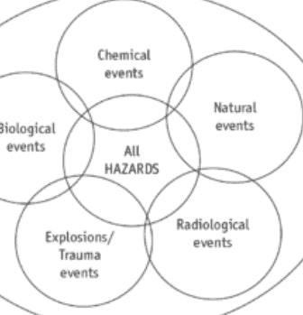

图 14-1。CDC 全方位模型。

流行病具有强烈的患者护理关注，并与医疗需求密切相关，且属于“生物性”，这包括大流行，如鼠疫、HIV/艾滋和埃博拉病毒。人为灾害包括意外灾害和故意灾害。这些包括由于疏忽引发的森林火灾、福岛或切尔诺贝核核电站的熔毁，或以多种形式出现的恐怖主义事件。恐怖主义事件具有生物学基础，例如释放炭杆菌；其他者是常规爆炸，例如汽车炸弹。核恐怖主义可能涉及传播放射性的“脏弹”；化学恐怖主义可能涉及毒气气体或神经气体。无论是自然、人为还是恐怖主义，这些类型的灾害事件都会对公共卫生系统产生深远影响。

某些灾害/紧急情况从根本上就是紧急事件；而在另一些情况下，健康只是受影响的众多方面之一。在 2005 年路易斯安纳州飓风季节后，住在 FEMA 提供住房的人面临着许多问题。除了缺乏避难所、安全饮用水、电力食物外，个人还缺乏处方药和适当的护理，加剧了现有的和心理健康问题（Abramson & Garfield, 2006）。

典型反应包括对再次攻击或暴露的恐惧、对他人丧世的悲伤、事发生后的混乱和迷失，以及对破坏或损失产生的抑郁反应。因此，目前关于灾害准备的思考使用了一种社会学框架，涵盖了住房稳定性、经济稳定性、身体健康、心理健康和社会角色适应（Abramson, Stehlings-Ariza, Park, Walsh & Cul, 2010）。因此，在规划药房对灾害的响应时；药剂师需要考虑受影响的心理需求、生理需求和基本生存，以增强社区韧性和药剂师的响应（Arya, Medina, Scatcia, Mathew, Starr;2016）。

# 应急准备与响应系统的关键组成部分

罗伯特·T·斯坦福德灾难救济与紧急援助法（42 U.S.C. §§ 5121-5401）允许总统正式宣布某个地区或区域为紧急状态或灾难。该法要求受影响州或领地的州长请求总统正式宣布。一旦宣布紧急状态或灾难，地方、州和联邦机构（私营和公共）将共同努力快速响应。然而，应急权力、响应人员和资源在不同层次和地点差异巨大。在国家层面，国家准备系统描述了联邦政府如何组织和应对自然灾害、恐怖袭击和其他灾难性事件，并为社区准备提供指导。

# 国家准备系统与目标

总统政策指令 8 号：国家准备要求国家准备应基于能力，目标是“通过对对安全构成最大风险的威胁（包括恐怖主义、网络攻击、流行病和灾难性自然灾害）进行系统准备，加强美国的安全和韧性”（Obama, 2011）。国家准备目标和国家准备系统允许美国跟踪并提高预防、减轻、响应和从此类事件中恢复的能力。此外；所有利益相关者（例如：个人；家庭；社区；私营和非营利部门；宗教组织；以及地方、州、部落、领地和联邦政府）都参与了规划、准备和响应（美国国土安全部 [USDS], 2016）。

国家准备目标定义了美国应对紧急情况和灾难所需的三个关键框架和 32 项能力。这些主题是：(a) 与整个社区的参与伙伴关系；(b) 执行中的规模、灵活性和适应性；(c) 跨框架整合（USDHS, 2015）。国家准备系统描述了用于构建、维持和交付实现安全和韧性国家目标所需的核心功能和活动的过程。国家规划框架由五个独立的框架（任务领域）组成，涵盖预防、保护、减轻、响应和恢复（USDHS, 2015）（见表 14-1）。

| 表 14-1 按任务划分的能力 | 预防 | 保护 | 减轻 | 响应 | 恢复 |
| :--- | :--- | :--- | :--- | :--- | :--- |
| | | 规划 | | | |
| | | 公共信息与预警 | | | |
| | | 业务协调 | | | |
| 情报与信息共享 | 社区韧性 长期脆弱性降低 风险和灾害韧性评估 威胁与危害识别 | 拦截与中断 | 关键交通 环境/健康与安全 伤亡管理 执法 火灾管理与扑灭 物流与链式管理 大规模搜索与救援 现场安全、保护与执法 | 经济复苏 健康与社会服务 住房 自然与文化资源 |
| 筛选、搜索与检测 | 业务通信 公共卫生 医疗保健和急救医疗服务 | | | |
| 法医与归因 | 访问控制与身份验证 网络安全 物理保护措施 保护计划和活动的风险管理 供应链完整性与安全 | 态势评估 | | |

## 国家预防框架

对抗最危险的潜在生物恐怖剂（例如：炭杆菌微生物、病毒性脑炎培养物，以及引入食物和水的有毒化学品）需要远见和规划。因此，预防框架包含了避免、预防或停止任何迫在眉恐怖主义（威胁或实际）的必要行动（USDHS, 2016e）。如表 14-1 所示，七项预防能力是：规划；公共信息与预警；业务协调；情报与信息共享；拦截与中断；筛选、搜索与检测以及法医与归因。

## 国家保护框架

该框架关注关键角色和职责，在预防、减轻、响应和恢复任务领域建立更强的协调利益相关者（USDHS, 2016d）。保护框架与预防框架共享第一个核心能力，增加了：物理保护措施；保护计划和活动的风险管理；筛选、搜索与检测以及供应链完整性与安全。利益相关者包括但不限于：运营中心；执法任务组；关键基础设施伙伴关系；治理委员会；区域联盟；信息共享机制/联盟；健康监测网络以及地方、州、区域和国家层面的公私伙伴关系组织。

## 国家减轻框架

减轻框架通过培养以韧性为中心的准备文化并强调业务连续性计划，减少财产损失和灾害/紧急情况的影响（USDHS, 2016b）。除了规划、公共信息与预警、业务协调外，减轻框架还涉及社区韧性、长期脆弱性降低、风险和灾害韧性评估以及威胁与危害识别。

## 国家响应框架

响应框架描述了联邦政府如何在社区响应框架内组织和应对灾害、公共卫生紧急情况和其他灾难性事件。响应的核心概念是扩展性、灵活性和适应性，因为应急难响应没有“一刀切”的模型。在其 15 项核心能力中，有 11 项是适用于关键交通、环境响应/健康与安全；伤亡管理；火灾管理与扑灭；基础设施系统、物流与供应链管理；大规模护理服务；

# 应急准备

搜救救援行动；现场安全、保护与执法；行动通信；公共卫生、医疗保健与紧急医疗服务（USDHS, 2016e）。

## 国家灾害恢复框架

灾害恢复领域的主导主题之一是复韧性概念，根据《国家准备目标》，它被定义为“适应变化状况并承受且从紧急情况的中断中快速恢复的能力”（USDHS, 2015, p. A-2）。因此，国家灾害恢复框架（NDRF）的独特关注领域包括：经济恢复、健康（躯体和行为）、社会服务、基础设施系统以及自然和文化资源。因此，恢复工作必须准备好处理一系列突发事件以及短期、中期和长期的需求与后果。NDRF提倡的“恢复连续体”强调了这样一个事实：“准备、响应和恢复并不是孤立且按顺序进行的努力”（USDHS, 2016a, p. 5）。通过对盲点风险的准备来有效管理恢复，需要在事件发生之初就侧重于恢复的支持。这是一系列发生在短期、中期和长期的、相互依赖且同时进行的活动。

## 国家事件管理系统

2003年，《国土安全总统指令第5号：国内事件管理》呼吁建立“一种单一、全面的事件管理方法”（Bush, 2003）。这导致了国家事件管理系统（NIMS）的建立（USDHS, 2008）。国家恢复框架（NRF）为国家级应急响应提供了结构和机制，而NIMS则为地方、州、地区和国家级的事件管理提供了模板。由于NIMS基于所有事件都始于并结束于地方的概念，指挥权保留在州和地方当局手中，并通过建立标准程序和术语增强了响应者的能力。例如，一种共同操作惯例可以提供事件的标准概述，汇集来自多个来源的数据，确保所有响应者在执行任务时对事件状态和信息有共同的理解和认识。

NIMS中的事件指挥结构（ICS）适用于全美范围的应急管理。ICS在从事件发生到结束的过程中，将程序、人员、设施和通信整合到一个通用的组织结构中。它专门针对应急准备、通信与信息管理、资源管理、指挥与管理，以及持续管理与维护（USDHS, 2008）。目前NIMS正在审查中，应在2017年底前完成更新后的第二版。

除了这些国家响应功能外，美国还有许多其他机构参与应急准备。在联邦层面，名单非常详尽。

卫生与人类服务部（DHHS）卫生与人类服务部长指导所有DHHS的应急响应活动。健康助理部长办公室协调应急活动并监测进度。公共卫生应急准备助理部长办公室负责与其他联邦部门和机构协调DHHS的响应活动。国家疫苗计划办公室协调并监测大流行病准备及响应计划与活动。总法律顾问办公室就应急响应活动发生之前、期间或之后出现的法律和监管问题提供建议。公共事务助理部长办公室制定通信计划并发布紧急信息。全球健康办公室监督与其他政府、国际组织以及与应急准备相关的非政府组织的互动。食品药品监督管理局（FDA）监管并许可疫苗及抗病毒药物，并支持生物医学研究。医疗资源和服务管理局（HRSA）协调医院和医疗保健能力的准备规划。国土安全部（DHS）对应急响应活动拥有总权限。国防部和退军人事务部也提供医疗设备、材料和人员能力。农业部对国内牲畜的传染病进行监测。能源部和交通部在紧急情况和灾害期间维护关键基础设施。

每个部门下都有许多分支和单位。此外，每个州和领土都有自己的政府基础设施来应对应急准备；这甚至还包括参与应急准备、规划、缓解、响应和恢复的其他私营公共部门组织。在这里我们更深入地研究三个：CDC、FEMA和医院准备计划。

### 疾病控制与预防中心

CDC成立于1946年，是DHHS13个主要运营组成部分之一（关于CDC作为联邦机构的更详细讨论请参阅第2章）。在寻求紧急情况下健康需求的指导时，CDC是联邦政府的关键组成部分之一。

《州、地方和部落公共卫生主任公共卫生应急响应指南2.0版》（CDC, 2011）提供了有关灾害发生后24小时内公共卫生响应的信息。

信息的组成部分之一是通信，其他部分包括确定问题的范围（例如安全用水、交通和服务的获取）、制定并实施计划；以及包括将做出响应并提供援助的机构。在最初24小时内，响应需求在即时需求（0-2小时）和扩展阶段（12-24小时）之间有所不同。这种对社区需求不断变化的意识和响应非常重要（Hurd & Mount, 2008）。

CDC运作中心使用事件管理系统来应对紧急情况。该系统预先列出了角色和职责；确保在实际紧急情况被确定之前响应措施已到位（Redd & Frieden, 2017）。CDC使用三个级别的响应，其中1级是全天候24/7 CDC响应，是最高级别。1级响应的示例包括2005年的卡特里娜飓风、H1N1爆发、2014年埃博拉爆发以及2016年的齐尔卡病毒（ZIKV）爆发（准备与响应助理部长办公室[ASPR], 2016）。

齐尔卡病毒在美国东南部的出现是CDC在新健康事件规划的一个例子（Hennessey, Fischer, & Staples, 2016）。齐尔卡病毒通过蚊传播，对孕妇的胎儿产生毁灭性影响，导致婴儿出生时小头（头部发育异常）或其他出生缺陷（Sambathkumar & Sanchez, 2016）。在世界卫生组织宣布齐尔卡病毒为国际关注的公共卫生事件后，CDC采取了应急应对措施（Imperato, 2016）。

CDC根据《2016年齐尔卡响应与准备法案》获得了3.5亿美元资金（U.S. L. 114-223）。到2016年底，它资助了多项计划（CDC, 2016）。它向2500万美元向53个面临齐尔卡病毒爆发风险的州、市和领土卫生部门，这些是根据美国已知传播齐尔卡病毒的两种伊蚊的局部传播估计范围确定的（特别是埃及伊蚊和白伊蚊）。佛罗里达州和德克萨斯州获得的份额最大，约为500万美元；其他地点包括纽约市和波多黎各。

该法案还为齐尔卡病毒感染风险最高的21个管辖区的应急准备和响应活动提供了资金，增加了流行病学和出生缺陷监测，改进了蚊虫控制监测，加强了实验室能力；它还利用齐尔卡怀孕登记处监测感染了齐尔卡病毒的妇女，以及受齐尔卡病毒影响儿童的健康和发育状况。显然，齐尔卡病毒是一个全球威胁，特别是在温暖地区

# 应急准备

能够传播病毒的蚊虫活动区域（Imperato, 2016）。

美国疾病控制与预防中心（CDC）另一项计划是建立了准备与应急响应学习中心（PERLCs），以继续开发公共队伍的准备能力。十四个 PERC 位于认证的公共卫生学院内，通过与国家应急准备能力框架和公共卫生准备能力保持一致的技术咨询，支持地方、区域或国家面的组织和社区准备（Richmond, Sobelson, & Cioffi, 2014）。

### 联邦应急管理局

1979年，行政命令第12112号通过合并六个联邦机构和计划创建了联邦应急管理局（FEMA）（FEMA, 2008）。2003年，FEMA 以及其他22个联邦机构成为美国国土安全部（USDHS）的一部分。FEMA 致力于快速应对人为灾害和自然灾害，为个人和政府提供财政援助以重建房屋、企业和公共设施；支持消防员和应急医疗专业人员；并开展全范围内的应急规划。

2011年9月，FEMA 实施了其“全社区”（Whole Community）应急管理方法。“全社区”是 FEMA 增加社区韧性的方法（FEMA, 2011）。私营和非营利机构、普通公众以及地方、部落、州、领地和联邦政府合作伙伴都是参与者（Sobelson, Wigington, Harp, & Branson, 2015）。

FEMA 要求 CDC 基金会（2013）评估全国有前景的计划，以确定这些计划如何理解社区的复杂性；这些计划如何识别社区的实际需求和集体能力；以及如何培养、建立和维护与社区领袖及多组织伙伴的关系。基金会还研究了社区的社会基础设施、网络和资产。这些及其他问题成为了 FEMA/CDC 联合课程的基础，旨在教他人如何参与“全社区”。

### 医院准备计划


ASPR 也是美国卫生与公众服务部（DHHS）的一部分，协助医院和其他医疗保健系统的其他部分为应急情况做好准备。这项联邦计划协调了应急准备，并鼓励提供者之间的合作，尽管他们通常情况下可能是竞争对手。通过建立帮助医疗提供者、公共卫生组织和其他救援者的联盟，ASPR 促进了社区内部的协作，使医疗保健系统能够在应急期间需求激增时持续运行。

作为开发这种协作的一部分，ASPR 促进了模拟社区面临巨大需求的演练。在《医疗保健系统准备工作国家指南》报告中（准备与响应助理部长办公室，2012），“能力 14：响应者安全与健康”（第 46–48 页）专门针对了药物产品、需求评估、储备管理与保护以及医疗应对措施的发放。在 2017–2022 年的《医疗准备与响应报告》中，ASPR 将药房识别为关键的医疗保健功能（准备与响应助理部长办公室，2016，第 33 页）。

## 药剂师在国家响应框架中的作用

药剂师在预防中发挥不可或缺的作用，他们通过公共卫生监测模型，监测针对潜在生物恐怖剂的常用处方药的使用量增加情况。这种预防策略已在美国和日本在内的许多国家成功使用（Iju, Kusu, Matsuda, & Hayashi, 2006）。

药剂师还可以协助快速选择适合患者的预防性抗微生物药物，以应对可能接触到的恐怖分子剂（Montello, Ostroff, Frank, Haffer, & Rogers, 2002; Veltri, Yaghdian, Morgan-jose, Priesi, & Rudnick, 2012）。

药剂师对来自自然、化学、生物或核事件潜在威胁的临床医疗应对措施进行可靠评估，并确保监管合规性（Bhavsar, Kim, & Yu, 2010）。他们可以为州生物恐怖和应急准备的顾问提供宝贵的见解（Feret & Bratberg, 2012; Zod, Fick-Osborne, & Peters, 2014）。从这些示例中，我们看到了药剂师在公共信息与预警、运作协调、医疗服务和基础设施系统方面的作用。

## 计划与规划

联邦政府至少从 20 世纪 60 年代起就已认可了药剂师对应急准备的贡献（Cohen, 2003）。事实上，每当药剂师帮助他人时，他们就是社区中公共卫生信息和响应的重要来源。美国药剂师协会以来一直关注普通公共健康以及参与应急准备的药剂师。它为药剂师提供了多种选择，包括疫苗接种、戒烟和应急准备方面的培训。其他药学组织，如美国健康系统药剂师协会（Eppert & Reznik, 2011），也做出了类似的贡献。然而，大多数作者都谨慎地选择包容性术语，如“医疗提供者”或“急响应者”，以承认许多在医疗应急情况下将担任核心决策者的各类专业人员（Hurd & Mount, 2008）。

从公共卫生药学的角度来看，药房也需要意识到危机后不断的需求。立即需求可能包括急救及相关用品。关注之一是确保药房的药品供应，以便公众在短期内有一个安全的药物来源，并免受任何形式的药物误用或滥用。随后将提供与危机相关的或应急药物。对于受损的药房，更延迟的响应是提供临时结构（如拖车或巴士）作为药房，直到实体结构修复完毕。

社区准备包括协调计划、治疗或隔离策略、各医疗提供者与服务小组之间的通信，以及所需的物资（从药物到化学防护服再到辐射监测仪）。例如，由于邮政设施受到污染，储备环丙沙星（治疗炭杆菌的药物）变得更加重要（Leitenberg, 2005）。

国家应急管理体系（NIMS）事件指挥结构包括州和地方级组成，包括药剂师和药房的响应。药剂师参与疾病预防（例如通过接种疫苗）、预防伤害以及减少对环境危害（如不安全的水、卫生问题和霉菌清理）的接触。当然，应急药物和药房发放是这种响应的另一部分。

在美国应急医疗服务的历史中，Shah（2006）发现早期的重点大部分放在运输需求上，特别是与创伤和心血管疾病相关的需求。对事故和心脏病的关注也导致了急响应者可用医疗技术的增加。这些服务的提供采用了去中心化的政府方法，强调地方控制而非国家规则和法规。在这种背景下，协调大型灾害的应急医疗服务具有挑战性。沿着类似的思路，公共卫生数据可能非常有助于设定特定灾害的边界，或发现难以收集和汇总共同问题。

灾害计划是医疗机构认证委员会（Joint Commission）对医院和其他健康组织认证要求的一部分（Joint Commission, 2006）。在 2001 年 9 月 11 日美国遭受恐怖袭击后，国家医院医疗中心调查了美国约 500 家非联邦医院关于其在恐怖事件下的准备水平（Niska & Burt, 2005）。

## 应急准备

2005 年，几乎所有的医院（97.3%）都制定了自然灾害计划，大多数医院（75% 或更高）制定了化学、生物、爆炸或核能/辐射事件的计划。除了计划外，医院还包括对其人员的培训以及练习机构响应的演习。在许多情况下，医院在这些演习或模拟中与其他小组合作，大多数计划都包含了与公共卫生部门的联系。

从那时起，医院在准备灾难和大量伤员方面取得了巨大进展。2013 年波士顿马拉松爆炸事件的医院规划和应对，为医院应对大规模伤亡事件必须做出的准备提供了见解（Gates 等，2014）。美国国土安全部（USDHS）和联邦紧急事务管理局（FEMA）（2014）的一份联合报告描述了急响应人员和医院的协调响应、供应商之间的通信、事件发生前的演练和规划，以及分诊护理的有效性。

由多学科、多司法管辖管理小组协调对波士顿马拉松爆炸案进行的州级行动审查发现，已经存在一些最佳实践：将伤员从事故现场分诊并转运至创伤中心所需的物资（项目管理小组，2014）。这些包括马拉松当天实施的“全方位危害”医疗系统：医院在比赛当天安排手术，使其各自部门准备好应对病人数激增；以及建立多司法管辖区协调中心（MACC）。MACC 在多司法管辖区演习中，通过与统一指挥中心协调应对爆炸事件，在处理病人数激增（大规模伤亡）事件中发挥了不可或缺的重要作用。

然而，准备意味着持久的警惕，因为形势变化迅速，且很难预见情景的最佳响应。与美国类似，以色列的应急人员、医疗保健提供者和医疗机构根据基于“全方位危害”方法的国家政策运行（Adini & Selig，2013）。通过以色列的视角准备美国医院的应急工作，提出了一些安全建议（Golabek-Goldman，2016）。这些建议包括：更频繁、更真实的封锁演习；增加永久应急手术室；加强安全协议；通过深度培训增加机构对一级和次级攻击的防御能力；以及与当地、州和国家执法部门（例如警察和治安官部门、国民卫队）和其他安全机构进行更好的协调（Golabek-Goldman，2016）。

此外，对所有医疗机构和响应人员进行强制性应急培训，以及对所有应对大规模伤亡事件的设施进行定期演习，是确保恰当响应的核心（Adini & Peleg，2013）。这些建议也适用于公共卫生设施和人员以及药剂网络。

## 人员

虽然健康专业人员（如药剂师）是灾难响应不可或缺的一部分，但他们通常代表第二波响应，帮助那些被送到医院或诊所治疗的人。首批响应专业人员通常包括执法人员、消防员和保安人员。公共安全人员和公共工程人员也参与其中。随着时间的推移，州应急管理局、红十字、地方政府和社区小组有时间做出响应。其他小组，如非营利组织和联邦政府官员根据灾难的性质进行响应。名单还包括志愿者、教会小组、专业响应人员（例如受过训练的犬探或潜水员）以及服务机构。

## 物资（物理资源）

2002 年《公共卫生安全与生物恐怖准备法案》指示美国国土安全部部长维持一个战略国家储备（SNS），其法律宗旨是在发生生物恐怖攻击或其他公共卫生紧急情况时为美国的应急公共卫生安全提供保障。法案还专门规定了储备管理和安全要求。

在国家层面，储备药物和疫苗是应对威胁的计划响应中的重要一步，但这一步对于州、市或地方政府来说不太合适。与特定地点的个人协调 SNS 中材料的使用非常复杂。一个例子是向应急药房作业交付药物。什么文书是合适的？如何确保安全？联邦、州和地方法律如何适用于这些产品的分配？

疾病控制与预防中心（CDC）是国家最大的抗生素、化学解毒剂、毒素、疫苗、药物和其他医疗材料供应源，在当地供应耗尽时用于严重的公共卫生紧急事件中使用（健康科学政策委员会，2016）。自 2001 年炭疽菌攻击以来，CDC 已利用 SNS 应对了三次重大公共卫生事件：（a）2009–2010 年 H1N1 流感流行；（b）2014–2016 年西非洲埃博拉疫情；以及（c）目前的齐肯病毒（ZIKV）疫情（Reed & Frieden，2017）。

SNS 处理来自州、地方、部落和国家响应人员的医疗对策措施（MCMs）请求。联邦方法的开发以及“城市就绪倡议”（Jeff, Ely, & Parker，2012）努力在决定分发后的 48 小时内，通过多个分发点和快速分发过程分发 MCMs。此外，SNS 提供补充资金来储备流行性流感 MCMs 和个人防护装备。

公共卫生应急对策企业于 2006 年作为 SNS 的伙伴建立，负责制定 MCM 优先排序的战略计划，以及使用 MCMs 应对化学、生物、放射、核能和爆炸（CBRNE）威胁及传染病（包括流感）的计划。此外，国家科学与技术委员会与国土和国家安全委员会标准小组（2011）制定了一份工作文件，旨在制定 2020 年前制定创建 CBRNE 标准的国家战略，涵盖评估、互操作性、用户培训、标准术语和响应的标准操作程序。

## 准备：演习与练习

近期公共卫生准备面临的挑战之一是评估对生物恐怖等公共卫生紧急情况的准备，其教训可扩展到其他危机的准备（Katz, Statti & McKenzie）。演习范围从半天的局部演习到国家级活动（例如涉及多个部门官员的 TOPOFF 演习）。这些演习一些是实地的（使用社区或体育场），另一些是模拟程度的桌面讨论。

准备也可以通过检查对真实危机的响应来进行，例如 2004–2005 年的流感疫苗短缺，这类似于由生物恐怖事件引起的问题。公共卫生紧急事件（如 2003 年中部大停电）提供了评估地区和国家响应的现实情况。

主要的挑战之一是响应中的激增能力不足，特别是在人员、材料、结构和系统方面。应急规模化需要比常量更多的资源以及专业设备或人员。当地劳动力（公共卫生和应急响应人员）无法应对重大危机。跨国派遣维修小组处理停电的电力公司是一个例子，说明当当地资源无法满足危机需求时，所需的响应类型。新奥尔良突然需要疏散老年人或残疾人士是另一个需要协调努力的激增需求案例。

## 应急准备

特别是在医院环境中，在社区环境中程度较小，药剂师在处理危险材料方面有直接参与，例如处置危险药物、在通风罩下准备化疗药物、处理锐器（使用过的注射器）以及处置无法再次使用的管路和容器。这些技能和培训在灾害情况下特别有用，无论是从知识/建议的角度，还是从实操服务的角度（Cohen, 2003）。

通过回顾可能用于生物恐怖主义攻击的传染性疾病文献，药剂师可以就诊断、治疗和接种等预防措施提出建议。Terrif、Schwartz 和 Loaestro (2003) 提供了此类努力的例子。在对生物威胁或灾害的响应中，医院环境下的药剂人员提供治疗，药房提供药物，并可能在药房和其他诊所提供疫苗。

公共卫生服务（PHS）团队如何通过为低急性住院患者建立设施来满足卡特里娜飓风的需求，为应对紧急情况时面临的挑战类型提供了关键。在 Velaz 等人（2006）的一项研究中，由 70 名人员组成的 PHS 团队包括药剂师。首要要求之一是为药房建立一个安全空间。尽管他们位于海军空军基地，那里已经提供了避难所，但他们需要为药物和管制物质寻找一个安全的地方。存放医院的飞机库是当时的最佳选择。当药房从国家战略储备（SNS）接收药品供应时，这些并不包括这种规模紧急情况所需的任何药物，例如胰岛素和毒素疫苗。

该团队还通过联邦药品管理局（Drug Enforcement Administration）收到了一批管制药物，在获取此类药物方面存在一些问题。他们建立了一种从国家批发商订购药物的方法；再次帮助药房备货。建立互联网访问、药物分发政策和程序以及护士站的药物安全性增加了建立该药房的工作。在药物供应有限的情况下，需要建立关于任何时间分配给患者的药物数量的政策（Velaz 等人，2006）。

基础设备，如架子、冰箱、家具、复印机和文字处理设备，必须寻找或购买（Velazquez 等人，2006）。非药剂人员通过更新的文字处理文档的复印件，不断获取药房内可用药物的信息。此外，在患者出院时，需要将从患者那里重建的医疗信息和护理情况提供给亲属。这需要许多创意资源；装满应急物资和设备的背包成为了该设施内那些心脏急症患者的“抢救车”；能够自行用药的患者被允许这样做，并在他们的床边系上贴有袋子（Velazquez 等人，2006）。人们可以想象，这种努力中不可或缺的部分是辛勤的工作、合作和创造力。阅读这些药剂师提供的描述具有指导意义且富有启发性；意识到整个地区其他人也提供了同样勇敢的帮助，可能会让人感触良多。

灾害具有伟大的利他主义时刻，但也有许多以自我为中心的行为。例如，当个人通过邮政系统寄出的信件暴露于炭疽杆菌时，环丙沙星（一种处方治疗炭疽杆菌的抗生素）的需求剧增。人们在囤积这种药物以备未来的暴露。一些药房在维持药物库存方面遇到困难。那些人可能在重大危机中面临找不到供应源的可能性。对此类灾害的响应计划需要包括在危机早期处理这种个人行为的计划。

在灾害中，信息的收集和对该信息使用的协调可以是有效响应的关键部分。如果是生物威胁，药剂师因为他们对疾病的知识可以发挥关键作用。药物的选择、给药、储存和供应源都是其他人可能不具备的关键信息。其他信息可能有助于估计潜在影响的范围、疾病在人群中的发生时间以及必要的预防措施。

灾害发生后，许多个人面临取药的困难。在没有电话、没有药剂师也没有药房建筑的情况下，很难确定该个人是否在药房网络中，或者是否有处方记录，或者拨打当地药剂师电话核实信息。药剂师的响应是联系其州委员会，寻求有关如何帮助这些人的指导。一个没有计划或缺乏广泛沟通的州委员会可能会被询问类似问题的电话所淹没。处方容器可能可以用来记录处方，但这并不等同于处方。这需要急诊治疗中心或医生。无论任何情况下，都应该保留包含药房所需的基本信息的记录。

药剂师和其他健康专业人员可以接受培训以检测可能指示生物恐怖主义攻击的疾病早期迹象。此外，药房药物记录具有汇总格式的潜力，通过处方和/或非处方药物销售的变化来识别公共卫生问题的位置和范围。公共卫生监测已将无意警告（即特定地区内未使用的医药产品销售）纳入生物恐怖主义攻击和其他健康危机的检测中（Turnock, 2012）。

在 2004 年对救护车环境下药学实践的调查中，药剂师对应急准备的参与超过了所有受访者的 50%，在应急准备作为调查主题的地区这一比例超过 90%（Knapp, Okamoto, & Black, 2005）。应急准备是这项纵向研究中首次调查的主题，作为药剂师活动的新兴领域，与药物管理服务、贫困救助计划等并列。Claver 等人（2012）强调了普通心理健康状况和服务的利用、患者追踪、疏散和灾难规划。Noe 和 Smith (2013) 建议药剂师拥有一份应急准备手册，涵盖药房法规、风险评估和灾难期间公众的需求，并关注药房对社区的响应。

## 对药剂师和药学实践的影响

药剂师参与的应急准备领域具有重大意义。例如，具有烧伤护理知识的药剂师可以协助提供最佳护理、引导患者离开居家、推荐最新产品并为其他医疗提供者提供有价值的信息。了解危险化学品的药剂师可以帮助识别涉及的危险物质和建议的治疗方案。一些药房设有计划通知患者在可能发生灾难前提前取药。

然而，影响也可能是更基础性的。药委员会可能尚未准备好应对其州内的灾难/紧急情况。鼓励专业委员会拥有现有的法律或法规语言，以应对灾难发生时的问题；更多模型有助于标准化语言、组织、互认许可等。

## 应急准备

……通过跨州合作以加速响应和缓解。在卡特里娜飓风之后，美国国家药剂师协会制定了一部《模型药剂法案》，其中包含了八项公共卫生紧急状况规则。2015 年，Ford、Trent 和 Wicker (2016) 审查了各州的法律、规则和条例，以确定国家药剂协会模型药剂法案中的八项公共卫生紧急状况规则是否有任何被纳入相关文件中。

有二十个州没有采用任何公共卫生紧急状况规则（Ford et al., 2016）。处理灾难报告政策和程序的规则 2 是采用率最广的规则。尽管有 10 个州以某种方式处理了紧急处方药发放，但在建立这一指南的州之间，紧急重新配药的标准各不相同（Ford et al., 2016）。虽然药剂州可以而且确实采取了应急规则来应对灾难，但应急计划需要在事件发生之前到位，以便响应能够立即进行并由药房管理。例如，飓风是可预见的事件，为医疗保健提供者（包括药剂师）制定计划留出了时间，这表明东南部州在应对灾难方面准备更为充分（例如：补药、外州药剂师的应急许可以及使用核心区域以外的药房）。

药剂师在灾难准备方面的工作有许多重点。人们已努力通过制定《灾难准备手册》来帮助社区药剂师准备应对灾难（Doe & Smith, 2013）。Cohen (2003) 详细说明了如何组织医疗系统药剂团队以应对恐怖袭击。其他研究人员还为药剂师人员制定了一套分类方案，以识别确保有效应急响应的关键行动（Alkhali, Ma, & Grenier, 2017）。

美国药剂学院协会发布了一份关于公共卫生和 CAPE 2013 教育成果的白皮书，其中涵盖了多种方法将公共卫生纳入基础和高级实践经验中，重点在于提供对患者人群的护理，但也包含了灾难准备（Covvey et al., 2016）。

另一个项目描述了在基础药学实践体验中使用的应急准备模块（Hannings, on Waldner, McEwen, & White, 2016）。这些包括模拟伤员患者分诊、转运模拟以及大规模发药模拟。学生根据其表现的准确性接受评估，并对他们的体验提供反馈。让学生接触这些非传统的药学角色，有助于他们应对真实的紧急情况，无论是小规模还是区域性的。

## 应急准备

这类教育项目为药学教育计划提供了关于灾难/应急准备的视角。正确地进行灾难准备被认为是一种非传统性的角色，而且是一项需要专门培训的工作。公共卫生药学很大程度上集中在疾病预防和健康促进上。

药剂师和药学生通常对协助协调有效且快速响应所需的应急管理原则和结构接触有限。将这些公共卫生组成部分融入课程可能具有挑战性，但也有助于药学在患者和人群护理的坚实基础上进行进一步发展。向他人传达药剂师的能力和培训的方法也将是该行业面临的挑战。

## 参考文献

Abramson, D. M., Garfield, R. (2006). 在边缘：受卡特里娜和丽塔飓风影响流离的儿童和家庭面临着迫在眉睫的心理健康危机。纽约：国家灾难准备中心，哥伦比亚大学公共卫生学院及行动组织。


# 参考文献

Abramson, D. M., Stehling-Ariza, T., Park, Y. S., Walsh, L., & Culp, D. (2010). 衡量个人灾难恢复：一个社会心理学框架。《灾难医学与公共卫生准备》，4(Suppl. 1), S46–S54. doi:10.1001/dmp.2010.14

Adini, B., & Pele, K. (2013). 警惕：从以色列应对大规模伤亡恐怖事件应急响应中吸取的教训。《健康事务》，32(12), 2179–2185. doi:10.1377/hlthaff.2013.0956

Alkhalili, M., Ma, J., & Grenier, S. (2017). 定义药剂师人员在灾难响应和应急准备中的角色。《灾难医学与公共卫生准备》。在线优先出版。doi:10.1017/dmp.2016.172

Arya, V., Medina, E., Scaccia, A., Mathew, C., & Starr, D. (2016). 桑迪飓风对纽约市受影响严重社区的影响：定性评估。《美国灾难医学杂志》，11(1), 21–30. doi:10.5055/ajdm.2016.0221

Bass, J., Murray, S. M., Mohammed, T. A., Bunn, M., Gorman, W., Ahmed, A. M. . Bolton, P. (2016). 对北伊拉克库尔斯坦遭受酷刑及相关创伤幸存者进行创伤知支持心理社会干预的随机对照试验。《全球科学与实践》，4(3), 452–466. doi:10.9475/ghps-d-160017

Bhavsar, T. R., Kim, H. J., & Yu, Y. (2010). 公共卫生应急准备与响应灾难控制与预防中心在监管事务中药剂师的角色与贡献。《美国药剂师协会杂志》，50(2), 165–168.

Binagwaho, A., Farmer, P. E., Nanzimana, S., Karema, C., Ngirababe, J. . . Drobac, J. （此处后续参考文献内容省略）

# 应急准备

发病率与死亡率报告，65(3), 55–58. doi:10.15585/mmwr.mm6503e1

Hintzens, H. M. (1999). 解释1994年卢旺达大种族灭杀。《非洲研究杂志》，37(2), 241–287.

Hurd, P. D., & Mount, J. K. (2008). 卫生应急准备与响应。收录 B. L. Levin, P. D. Hurd, & A. Hanson (编辑)，《药学公共卫生简介》(pp. 321–336)。Sudbury, MA: Jones and Bartlett.

Ijuin, K., Kusu, F., Matsuda, R., & Hayashi, Y. (2006). 药房处方检测健康损伤的方法。《药学杂志：日本药学会杂志》，126(4), 283–287. doi:10.1248/yakushi.126.283

Imperato, P. J. (2016). 病毒、蚊子与人类旅行在寨克病毒疫情全球化中的汇聚。《社区健康杂志》，41(3), 674–679. doi:10.1007/s10900-016-0177-7

联合委员会. (2006). 激增状态：在紧急情况下提供医疗服务。Oakbrook, IL: 作者。

联合委员会. (2016). 医疗保健中的应急管理：全灾害应对方法(第3版)。Oakbrook, IL: 作者。

Jones, R., Neff, L. J., Ely, E. K., & Parker, A. M. (2012). 2008–2009年77个城市大都会灾害地区的医疗应对措施准备演习结果。《灾难医学与健康准备》，6(4), 357–362. doi:10.1001/dmp.2012.668

Katz, A., Staiti, A. B., & McKenzie, K. L. (2006). 为未知做准备，重新发现已知：社区与公共卫生准备。《健康事务》，25(4), 946–957. doi:10.1377/hlthaffff.

Knapp, K. K., Okamoto, M. P., & Black, B. L. (2005). ASHP对2004年医疗系统门诊护理的调查。《医疗系统药杂志》，62(3), 274–284.

Leitenberg, M. (2005). 评估生物武器与生物恐怖主义威胁（战略研究所）。Carlisle, PA: 战略研究所。

Mandelbaum-Schmid, J. (2004). 需要艾滋治疗的卢旺达幸存者。《世界卫生组织公报》，82(6),

Montello, M. J., Ostroff, C., Frank, E. C., Haffer, A. S., & Rogers, J. R. (2002). 华盛顿特区的炭疽菌危机：药剂师在筛选患者和选择预防措施中的作用。《美国医疗系统药杂志》，59(12), 1193–1199.

# 应急准备

国家科学技术委员会与国土及国家安全委员会小组委员会标准小组委员会。(2011年5月)。CBRNE标准的国家战略。Washington, DC: 作者。

Neugebauer, R., Forde, A., Fodor, K. E., Fisher, P. W., Turner, J. B., Steling-Riza, T., & Yamabe, S. (2016). 儿童或青少年在暴露于暴力后是否存在创伤后应激反应的风险？来自种族灭杀后卢旺达的证据。《神经与精神疾病》。在线出版。doi:10.1097/nmdd.

Niska, R. W., & Burt, C. W. (2005). 2003美国生物恐怖主义与大规模伤亡准备。《高级数据》，364, 1–14.

Noe, B., & Smith, A. (2013). 社区药房灾备准备手册的制定。《美国药剂师协会杂志》，53(4), 432–437. doi:10.1331/JPhA.2013.12115

Obama, B. (2011). 总统政策指令/PDD-8：国家准备。获取自 http://www.dhs.gov/presidential-policy-directive-8-national-preparedness

公共卫生准备与响应办公室。(2013)。全应急准备指南。Atlanta, GA: 疾病控制与预防中心。

准备与响应助理部长办公室。(2012年1月)。医疗保健准备能力：医疗卫生系统准备的国家指南。Washington, DC: 作者。

准备与响应助理部长办公室。(2016年11月)。2017-2022年医疗保健准备与响应能力。Washington, DC: 作者。获取自 http://www.phe.gov/Preparedness/planning/hpp/reports/Documents/2017-2022-healthcare-pr-capabilities

项目管理团队。(2014年12月)。2013波士顿马拉松爆炸事件行动后报告。Boston: 作者。

Redd, S. C., & Frieden, R. T. (2017)。CDC应急响应的演进方法。《健康安全》，15(1), 41–52. doi:10.1089/hs.2017.0006

Richmond, A., Sobelson, R., & Cioffi, J. P. (2014)。准备与应急中心：支持国家安全。《公共卫生管理与实践》，20(5), S7–S16. doi:10.1097/phm.0000000000017

Rubanzana, W., Hedi-Gauthier, B., Ntagarian, J., & Freeman, M. D. (2015)。 卢旺达种族灭杀暴露：杀人的风险因素。《人际暴力杂志》。doi:10.1177/088659

# 应急准备

Sampathkumar, P., & Schwartz, J. L. (2016)。美洲的寨克病毒。《梅奥诊所进展》，91(4), 541–524. doi:10.1016/jop.2016

Shah, M. N. (2006)。应急服务的形成。《美国公共卫生杂志》，96(3), 444–423. doi:10.2105/ajph.2004

Soberson, R., Wigington, C., & Bronson, B. (2015)。 社区计划。《应急管理杂志》，13(4), 349–357. doi:10.5055/jem.2015

Terriff, C., Schwartz, M., & Lo, B. (2003)。 生物恐怖主义：临床医生共识。《药物治疗》，23(3), 274–290. doi:10.1592/fph.23.3

Turnock, B. (2012)。 公共卫生准备与响应。收录于《公共卫生：是什么以及如何运作》(pp. 423–484)。Sudbury, MA: Jones and Bartlett.

美国国土安全部。(2008年12月)。事件管理系统。Washington, DC: 作者。

美国国土安全部。(2015)。准备目标(第2版)。Washington, DC.

美国国土安全部。(2016年6月)。恢复框架。Washington, DC: 作者。

美国国土安全部。(2016b，9月)。缓解框架。Washington, DC: 作者。

美国国土安全部。(2016c，6月)。预防框架。Washington, DC: 作者。

美国国土安全部。(响应框架，第3版)。Washington, DC: 作者。

美国国土安全部与联邦应急管理局。(2014)。波士顿马拉松爆炸：教训。保护框架。Washington, DC: 作者。

Velazquez, L., Dallas, S., Rose, L., Evans, K., Saville, R., Wang, J., & Bona, J. D. (2006)。卡特里娜。《美国医疗系统药杂志》，63(14), 1332–1335. doi:10.2146/ajhp.0600

# 应急准备

Veltri, K., Yaghdian, V., Morgan-Joseph, T., Priesi, L., & Rudnick, E. (2012)。医院应急准备：Push-POD运营与作为免疫者的药剂师。《美国药剂师协会杂志》，52(1), 81–85. doi:10.1331/JPhA.2012.11191

Verwimp, P. (2004)。1994年卢旺达种族灭杀期间的死亡与生存。《人口研究》，58(2), 233–245. doi:10.1080/0032470240002442

Willis, B. M., & Levy, B. S. (2000)。识别种族灭杀对公共健康的影响。《美国医学杂志》，284(5), 612–614. doi:10.1001/jama.284.5.612

Wu, P., Duarte, C. S., Mandell, D. J., Fan, B., Liu, X., Fuller, C. J., & Hoven, C. W. (2006)。世界贸易中心攻击暴露与纽约市公立高中生的吸烟和酒精使用。《美国公共卫生杂志》，96(5), 804–807. doi:10.2105/ajph.2004.05825

Zod, R., Fick-Osborne, R., & Peters, E. B. (2014)。一种应急准备的功能性需求方法。《灾难医学与公共卫生准备》，8(4), 301–309. doi:10.1017/dmp.2014.57

# 教育与培训

# 药学中的公共卫生导论（第2版）

编辑：Bruce Lubotsky Levin, Ardis Hanson 和 Peter D. Hurd

出版社：牛津大学出版社 印刷出版日期：2018年2月

印刷版 ISBN-13: 9780190238308 在线出版：2018年3月

DOI: 10.1093/med/9780190238308.001.0001

# 教育与培训

章节：教育与培训

作者：Angela S Garcia, Daniel For려서, Krystal Bullers 和 Peter D Hurd

DOI: 10.1093/med/9780190238308.003.0015

## 药学教育中公共卫生培训的历史

药学课程中首次提到公共卫生是在1932年的《药学大纲》（The Pharmaceutical Syllabus）第四版中，该著作是美国药学教育委员会（ACPE）用于指导认证决定的依据（Gibson, 1972）。尽管健康文献已经了药剂师在社区互动方面的独特地位，但直到1999年“健康的人民”（Healthy People）计划启动后，美国的课程要求中才开始重点强调公共卫生（Babb & Babb, 2003; Calis et al.; 2004; Lenz, Monaghan, & Hetterman, 2007）。最近，预防培训与研究协会成立了跨学科“健康的人民”课程工作组（2015），以确保核心能力纳入每种健康专业的培训课程中，使未来的健康专业人员能够理解人群健康原则，并从个人、临床和社区层面普遍改善健康状况。

这种对药剂师进行公共卫生培训日益增长的关注，影响了美国药学院学院协会（AACP）发布的药学教育促进中心（CAPE）成果的每一次迭代。自1998年以来，每一项 CAPE 教育成果都包含了关于基于人群的健康改善、健康和疾病预防的建议（AACP; 1998, 2004, 2013）。因此，ACPE 现在要求授予药学博士学位（PharmD）学位的学校和学院不仅要告知候选人公共卫生计划，还要提供参与以健康为中心的技能的机会，例如疫苗接种（ACPE, 2015）。

## 公共卫生的培训与认证

在药学的整个领域，公共卫生都提供正式和非正式的认证与培训。在药学职业的各个层次，从药剂技师认证到博士和研究生学习，都有获得公共卫生知识和技能的机会。

## 药剂技师

美国药学领域提供的第一个层级正式认证是药剂技师。虽然某些州要求高中毕业证和在职培训，但大多数州要求通过完成中等教育学位计划、通过考试或二者兼备来获得认证（Anderson, Draeme & Anderson, 2016）；根据劳工统计局，美国医疗系统药师协会（ASHP）为药剂技师培训制定了公共卫生目标，包括掌握促进和预防概念（如健康筛查和物质滥用），以及理解影响健康的情况（ASHP, 2015）。

## 药学博士

药剂师所需的入门级学位是 PharmD。该计划需要四年的教育（尽管可以压缩为三个日历年），虽然 PharmD 候选人在进入该计划时平均拥有三年的中等教育背景，但符合计划先决条件的学生仅凭高中毕业证即可入学。国家药剂委员会协会（NABP）要求候选人拥有由 ACPE 认证机构授予的 PharmD 学位，这与 NABP 认为需要更多实践临床经验后，较之前五年制药学学士学位的要求发生了变化。除了药剂执业考试（NAPLEX）和多州药学法学考试外，各州的特定要求（例如在执业药剂师指导下完成规定小时的实习）也是获得在该州执业药学执业执照的先决条件（劳工统计局, 2015a）。药剂师必须根据颁照州的规定，定期续换执照。

攻读 PharmD 的学生预计在学位的教学和实践部分都会接触公共卫生。ACPE (2015) 要求课程应包括“对人群健康管理策略、国家和社区公共卫生计划的探索，以及促进公共卫生和健康的活动的实施，并提供让学生在疫苗接种和其他关注公共卫生的技能方面获得经验的途径”（第 23 页）。

最新的 ACPE 2016 标准增加了一项义务，要求机构必须实施 NABP 的药学课程成果评估（PCOA®），以评估学生在完成教育教学部分并准备开始高级药学实践经验（APPE）阶段时的专业熟练程度（ACPE, 2015）。PCOA 的社会/行为/行政部分（3.0）占考试总数的 22%，衡量学生对公共卫生和健康的理解，特别是在促进健康、预防慢性病和传染病，以及识别影响公共卫生和个人医疗护理的各种因素方面（NAPB, 2016a）。该部分还衡量了学生对美国与其他工业化国家相比如何提供健康服务的理解。

2015 年 NABP 对美国药学院和学院的调查显示，根据接触学时，对公共卫生领域的重要性进行了排名。“医疗保健系统和公共卫生”排名第 11 位。“疾病预防和人群健康”以及“基于人群的药病学”分别排名第 21 位和第 26 位。

虽然 ACPE 要求机构确保学生具备公共卫生方面的能力，但方法取决于学校。学校可以通过独立的公共卫生课程或其他其他课程来实现（Naughton, Friener, Scott, Miller, & Albano, 2010）。文献中引用最多的主题是动机访谈、行为改变，特别是针对慢性病的预防和管理（Woodard, McKinnon, Danielson, Knuth, & Odegard, 2016）。教学公共卫生的方法是通过教学和主动学习实现的，例如案例研究、基于问题的学习、口头报告、期刊讨论、课堂演练，以及向特定群体进行教育演示或参与免费诊所和医疗任务（Bailey & DiPietro Mager, 2016; Dennis et al., 2016; O'Neal & Berdine, 2007; Willey）。PharmD 的最后一年学生可以将公共卫生融入实践，包括进行健康筛查、提供疫苗接种和慢性病咨询（Denis et al., 2016; Patterson, 2008）。

目前药学课程中似乎代表不足的两个公共卫生领域是准备工作和全球健康（Accreditation Council for Pharmacy Education, 2015; AACP, 2013; Woodard et al., 2016）。社区和医院的药剂师在应对潜在传染病爆发方面处于良好位置。药剂师被纳入灾难准备和响应中，但许多药学院和学院并未教授必要的技能。

同样，许多 PharmD 项目通过选修课程或医疗任务拓展为学生提供全球健康体验。在对美国机构课程的审查中，Bailey 和 DiPietro Mager (2016) 发现只有 8 个 PharmD 项目要求全球健康能力，涵盖医疗任务规划与实施、旅游医学以及全球健康研究和政策制定等主题。

## 双学位与联合学位


`AACP`列出34所提供2016–2017年联合学位（`PharmD`）和公共卫生硕士（`MPH`）的学校（`AACP, 2015`）。这比2011–2012年`AACP`公共卫生特别小组调查报告的23所学校增加了11所（`Gortney et al., 2013`）。在调查时，这些`PharmD/MPH`项目中三分之一成立时间不足一年，这表明美国对此的兴趣正在增长。将`PharmD`与生物医学或健康信息学硕士学位相结合的情况较少，`AACP`报告中仅列出了4所此类机构（`ACPE, 2015`）。此外，许多机构在公共卫生、信息学、药物治疗管理、疫苗接种、床旁教学和物质滥用/戒烟方面设有专业认证或专业方向。这还没有包括那些在正式`PharmD`项目之外攻读`MPH`或健康信息学学位的人员。

# 教育与培训

某些机构提供药剂学博士（`PharmD`）与全球健康的双重学位。“全球健康”有时与“公共卫生”互替使用，但提供该项目的机构强调了在跨国或国际环境中工作的药剂师所面临的独特问题。对于攻读兼读公共卫生硕士（`MPH`）的学生来说，全球健康方向更为常见。

## 研究生培训：住院医师培训

研究生继续教育的执照要求为药剂师增加在公共卫生领域的专业知识提供了途径。选择从继续教育课程到追求与公共卫生相关的专业领域委员会认证不等。希望在公共卫生领域级实践中获得更正式的认证或资历的个人，可以通过参加旅行医学、患者护理和接种交付等主题的高级培训计划。

`PharmD`毕业生可以选择参加为期一至两年的住院医师或专科计划，既作为目标本身，也可以以获得委员会认证为目标。美国医院药师协会（`ASHP`）开发了一项住院医师认证计划，将潜在候选人与经过认证的住院项目进行匹配。住院医师候选人从研究生第一年（`PGY1`）项目、研究生第二年（`PGY2`）项目或`PGY1`和`PGY2`结合项目中进行选择。2016年的住院医师匹配中，有1708个住院医师项目参加了`ASHP`的匹配计划，总共有3954名住院医师被分配到项目中（`ASHP，2016a`）。`PGY1`项目侧重于全科实践，重点关注社区药学、管理型药学或医疗系统。

`PGY1`住院医师计划有四个能力领域；项目可能包括“健康、福祉与应急准备”的选修能力，这要求住院医师“设计并交付对公共卫生产生影响的项目”，并为“应急准备的组织计划”做出贡献（美国医院系统药师协会认证委员会，2014，第14页）。此外，通过在专门从事公共卫生机构（如公共卫生部门或系统）以及针对特定人群（如监狱或军医院）完成`PGY1`住院医师培训，可以获得公共卫生经验。在住院医师的第二年，项目侧重于专实践。一些经过`ASHP`认证的`PGY2`住院项目将公共卫生作为主要的教育成果，下文将讨论。

门诊护理药学使住院医师毕业生能够计划和管理患有慢性疾病、疾病状态或无需住院患者的需求。门诊护理项目的第四个教育成果（`ASHP，2006a，第13页`）规定，专攻门诊护理的药剂师将专注于与患者建立长期伙伴关系，以改善健康和福祉，并共同努力预防疾病。许多门诊药学和传染病住院项目提供`HIV/AIDS`、慢性肝炎治疗、抗凝管理、糖尿病管理和成瘾医学等领域的专业化。

正如预期的那样，公共卫生对于专攻传染病药学的药剂师至关重要。第一个教育成果（`ASHP；2006，第3页`）列出了传染疾病的预防以及促进健康改善和福祉。该专业的特定目标是“减少抗生素耐药性和可预防疾病的传播”（传染病药剂师，`ASHP`及协会，2007，第1页）。

老年药学和儿科药学的目标包括提高特定年龄组的健康和福祉，并预防独特或更普遍的药物相关问题（`ASHP，2008；ASHP`及儿科药学倡导小组，2016）。儿科委员会考试的4%致力于儿科药剂师倡导药物“年龄适当剂型”的责任，并参与有关影响婴儿、儿童和青少年的问题的公共教育，例如中毒预防和疫苗接种（药学专业委员会，2015c）。

根据`ASHP`的规定，药学信息`PGY2`住院项目未规定公共卫生成果。该专业有许多公共卫生相关的意义，例如改进药物系统、识别趋势和做出跨学科医疗保健决策（`ASHP；2006b；Shapiro, Mostashari, Hripcsak, Soulakis 和 Kuperman, 2011`）。

除了上述`PGY2`住院医师项目外，其他可能包含公共卫生培训的`ASHP`认证项目还包括心脏病、重症监护、药物信息、急诊医学、医疗系统药学管理、内科、药物使用安全、核医学、营养支持、肿瘤疼痛管理和姑息治疗、精神药学以及器官移植（`ASHP；2016b`）。

## 研究生培训：委员会认证

药学专业委员会为药剂师提供八项委员会认证，其中大多数都涉及公共卫生组成部分。门诊护理或药物治疗专业需要对人群和公共卫生主题有更深入了解，例如患者教育策略、质量改进计划和应急准备（药学专业委员会，`2015a, 2015d`）；儿科或肿瘤药学专的公共卫生和倡导部分较少（药学专业委员会，`2015b, 2015c`）。

## 研究生培训：证书与继续教育

证书培训计划适用于药剂师在特定实践领域的高级专业培训，包括药物治疗管理系统的交付、基于药学的心血管风险管理、基于药学的接种交付以及以患者为中心的糖尿病护理（美国药剂师协会`[APHA]，2016a`）。州执照委员会要求执业药剂师以及学生执照人员在为患者接种疫苗之前，必须拥有心肺复苏或基础心脏生命支持的认证（`APHA，2016b`）。根据州规定，可能还需要医疗保健工作者基础生命支持。

提供公共卫生相关的证书……

## 公共卫生领域的职业选择

公共卫生相关的证书适用于药剂师在特定实践领域的高级专业培训，包括药物治疗管理系统的交付、基于药学的心血管风险管理、基于药学的接种交付以及以患者为中心的糖尿病护理（美国药剂师协会`[APHA]，2016a`）。州执照委员会要求执业药剂师以及学生执照人员在为患者接种疫苗之前，必须拥有心肺复苏或基础心脏生命支持的认证（`APHA，2016b`）。根据州规定，可能还需要医疗保健工作者基础生命支持。

（注：原文此处存在大量重复段落，已按要求去重并整合翻译）

联邦资级卫生中心（`FQHCs`）和卫生部门让药师能够应对他们在日常实践中遇到的人口健康和社区健康问题。无论是通过实施和监测医疗保健倡议来承担医疗保健规划和计划开发工作，药师都具备独特的资质，通过创新和协调一致的服务，在地方、地区和国家层面加强医疗保健体系（国家慢性疾病预防与促进中心，2012）。通过让药师与其他提供者以及其患者建立伙伴关系，可以产生机构性的影响，以增强护理和医疗、提高安全性、提升健康素养，并促进患者成功地回归社区环境。

在州层面，控制医疗支出和优化患者结果的努力使得通过跨学科培训提供者来实现医疗成本控制日益增加。临床医生与公共卫生专业人员之间的公共卫生伙伴关系加强了动力，在初级保健提供者短缺的背景下至关重要。对进入药学劳动市场的药师加强教育和培训，增加了药师在药物管理方面的影响力，但更重要的是，增加了药师在针对特定社区的医疗保健倡议开发和实施方面的影响力，这些倡议能培养自我效能感。针对药师的公共卫生倡议包括健康优化或综合管理场所，以及预防医学服务的整合，其中包括免疫接种、慢性病预防、戒烟、减少疾病进展的依从计划，以及对药物副作用或非预期影响的监测（`Lai, Trac, & Lovett, 2013`）。

全国范围内药学课程中公共卫生概念的开发与整合，以及通过药学与公共卫生项目合作而增加的双重学位选择，进一步支持了美国公共卫生协会（`APHA`）、美国药师协会（`APhA`）和美国医院药师协会（`ASHP`）采取行动，培养药师进入公共卫生队伍。

# 领导力

对于希望在公共卫生领域发展领导技能的药师，有很多策略，包括药学领域的正式计划、药学外的领导力计划、非正式的个人发展以及在`APHA`内工作。参与由这些组织（例如`ASHP`、美国临床药学学院`[ACCP]`、`AACP`或`APhA`）提供的正式领导力计划，可以建立领导力技能，与志同道合的同事建立关系，并获得机会。

## 领导力培训与发展计划

`ASHP`通过其非营利分支机构`ASHP基金会`（`www.ashpfoundation.org`）提供领导力培训。`ASHP`药师领导力学院在其领导力培训中提供了从财务到技术的各种课程。该机构关注急性和门诊医疗保健环境，并提供可以帮助个人领导公共卫生变革的领导力基础。

`ACCP`与其全国会议合作提供领导力与管理证书课程。该培训侧重于帮助个人在临床药学领域（通常在医院和患者护理环境中）追求领导力角色的知识、技能和态度。与`ASHP`计划一样，该证书计划也侧重于药学，但与`ASHP`不同，`ACCP`提供的证书可以帮助个人发展其领导力兴趣以及对领导力技能个人发展的承诺。

`AACP`提供学术奖学金计划，通过为期一年的承诺培养药学教育领域的领导者（`http://www.aacp.org`）。奖学金获得获得其所在项目院长认可的机构支持。接下来的奖学金重点是通用领导力技能，以及高等教育领域人士感兴趣的特殊技能。并非每个人都能成为学院院长或大学校长，这些人中的许多人担任着领导角色，包括公共卫生领域的角色。

`APhA`有一项专为担任学生药师协会（`APhA-ASP`）分会学生的药学学生设计的计划。`APhA-ASP`夏季领导力学院主要关注对职业的倡导并培养领导力技能。`APhA`还有其他对希望在国家层面追求领导角色的药师或学生感兴趣的计划和学院。

除了国家级专业组织外，药学院和私人公司也有自己的开发与公共卫生相关的领导技能的计划。在药学之外，大学和其他机构也提供领导力发展计划，领域涉及医疗系统管理或非营利组织领导力。在这种情况下，个人应考虑将个人目标和兴趣与计划或学位相匹配。

直接回到`ASHP`和`APHA`，最令人兴奋的领导力机会之一存在药学特殊主要兴趣小组（`SPIG`）中。这个以药学为导向的人员群体（并非都是药师）已经产生了足够的兴趣，以便未来在`APHA`内建立一个成员部门。部门代表公共卫生领域的不同群体，是`APHA`组织成员以促进公共卫生问题的方式之一（`www.apha.org`）。拥有官方的药学部门可以提高对药学问题的认识，并促进药学成为医疗团队不可或缺的一部分。虽然药师几十年来一直参与`APHA`的其他部门（医疗保健部门就是一个很好的例子），但现在是开发与公共卫生直接相关的领域领导技能的理想时机。`APHA`在医疗保健倡导也起着重要作用，在健康促进和疾病预防倡议中处于领导和倡导地位。`APHA`还对兴趣了解更多公共卫生的学生提供无薪实习机会。

虽然有更正式的方法建立领导力技能，但许多药师采取了“非正式”的方式，只需在公共卫生领域工作，尝试改善他们社区的健康。2016年`APHA`会介绍了“`IMPACT`项目免疫接：共同改善美国社区”，该项目由`Alpha基金会`在华盛顿州进行试点，涉及一位社区药店老板`Kirk Heinz`，他通过提供疫苗并与药学健康提供者合作，成功改善了农村地区的健康。如果一个人有成功和帮助别人的意愿，领导变革并不总是需要特殊的学位。

另一个例子是，本章作者之一（`Garcia`博士）能够在不在卫生部门或政府实体工作的情况下，从事公共卫生药师的工作。她是她所在州公共卫生协会的全体代表，并担任董事成员三年。她在讨论该组织层面的优先问题时，支持与临床医生的合作。她支持教育和培训计划，并招募其他人加入公共卫生组织工作，尽管他们并没有使用`MPH`或在正式认可的“公共卫生能力”工作。

## 对公共卫生和药学实践的影响

公共卫生在药学中日益增长的重要性对已经在执业的药师和未来进入该领域的药师都有许多影响。药学领域与公共卫生相关的教育和培训的进步，预示着药师在变化的环境中应对复杂的公共卫生问题所需的技能。通过整合侧重公共卫生的计划（例如药学院的免疫接种培训和社区药店的免疫接种交付），转变已经发生。技术和自动化日益整合到这些传统角色，让药剂师有更多时间关注患者护理和其他临床活动。

在一份题为《药剂师在公共卫生中的作用》的政策声明中，美国公共卫生药剂师协会（`APHA, 2014`）强调了药剂师为公共卫生带来的知识和技能。该文件专门探讨了药剂师在基本公共卫生服务、公共卫生应急和预防方面可以扮演的角色。国家性药学组织`APHA`和`ASHP`也有关于药剂师在公共卫生中角色的政策声明。

`APHA`政策声明中专门提到的一个问题，同时也代表了药剂行业内的一项重大运动，就是“提供者身份（`provider status`）”。目前的药剂师未被《社会保障法》的部分认可为患者护理提供者，因此被排除在参与`Medicare B`计划之外（`APhA, 2013`）。这限制了药剂师能够提供并申请费用报销的患者护理服务。每个州对药剂执业的规定各不相同，几个州已以不同身份认可了药剂师为提供者（`Gebhart, 2016`）。然而，在联邦层面认可药剂师为提供者，是推动整个行业发展和促进药剂师进一步融入公共卫生系统的关键。国会委员会已提出法案，拟修订《社会保障法》以涵盖药剂师服务，特别是在服务不足的人群中，但目前尚未进行此类修订（`H.R. 592, 2015`）。此类法案的通过将会在国家层面认可药剂师为提供者，并允许该行业进一步整合到公共卫生劳动力中。

随着药学行业的持续演进，这种演进趋势导致了药剂师在公共卫生领域的角色增加并获得了更多机会。药学教育现在包含了特定的公共卫生课题和培训，药学实践在患者护理和公共卫生活动方面都在不断扩大，公共卫生领域为药剂师现在提供了许多新的职业和领导力机会。药剂师已做好准备，并应该准备好成为跨学科公共卫生团队不可或缺的一部分。

## 参考文献

Accreditation Council for Pharmacy Education. (2015). Accreditation standards and key elements for the professional program in pharmacy leading to the doctor of pharmacy degree. Retrieved from `https://www.acpe-credit.org/pdf/Standards2016FINAL.pdf`

American Association of Colleges of Pharmacy. (1999). Center for Excellence in Pharmacy Education (CAPE) educational outcomes. Alexandria, VA: Author. Retrieved from `http://www.aacp.org/resources/education/cape/Documents/CAPE%20Outcomes%20Document%201998.pdf`

American Association of Colleges of Pharmacy. (2004). Center for Excellence in Pharmacy Education (CAPE) educational outcomes. Alexandria, VA: Author: Retrieved from `http://www.aacp.org/resources/Documents/CAPE2004.pdf`

American Association of Colleges of Pharmacy. (2013). Center for Excellence in Pharmacy Education (CAPE) educational outcomes. Alexandria, VA: Author: Retrieved from

American Association of Colleges of Pharmacy. (2015). Table 4: Dual Degrees. Alexandria, VA: Author: Retrieved from `http://www.aacp.org/resources/student/pharmacyforyou/admissions/admissionrequirements/Documents/Table%204.pdf`

American Pharmacists Association. (2013). The pursuit of professional status: What pharmacists need to know. Washington, DC: Author: Retrieved from `http://www.pharmacist.com/sites/default/files/Provider%20Status%20FactSheet_Final.pdf`

American Pharmacists Association. (2016a). APHA training programs. Retrieved from `http://www.pharmacist.com/apha-training-programs`

American Pharmacists Association. (2016b). Frequently asked questions about certificate training programs. Retrieved from `http://www.pharmacist.com/frequently-asked-questions-about-certificate-training-programs`

American Public Health Association. (2014). The role of the pharmacist in public health. Washington, DC: Author. Retrieved from `http://www.apha.org/policies-and-advocacy/public-health-policy-statements/policy-database/2014/07/07/13/the-role-of-the-pharmacist-in-public-health`

American Society of Health-System Pharmacists. (2006a). Educational outcomes, goals, and objectives for postgraduate year two (`PGY2`) ambulatory pharmacy residency programs. Bethesda, MD: Author. Retrieved from `http://www.ashp.org/DocLibrary/Residents/RTP-PGY2-AmCareProgram.pdf`


# 教育培训

这些传统角色，让药剂师有更多时间关注患者护理和其他临床活动。

在份题名为《药剂师在公共卫生中的作用》的政策声明中，美国公共卫生药剂师协会（`APHA`, 2014）强调了药剂师为公共卫生带来的知识和技能。该文件专门探讨了药剂师在基本公共卫生服务、公共卫生应急和预防方面可以扮演的角色。国家性药学组织 `APHA` 和 `ASHP` 也有关于药剂师在公共卫生中角色的政策声明。

`APHA` 政策声明中专门提到的一个问题，同时也代表了药剂行业内的一项重大运动，就是“提供者身份”（`provider status`）。目前的药剂师未被《社会保障法》的部分认可为患者护理提供者，因此被排除在参与 `Medicare B` 计划之外（`Apha`, 2013）。这限制了药剂师能够提供并申请费用报销的患者护理服务。每个州对药剂执业的规定各不相同，几个州已以不同身份认可了药剂师为提供者（`Gebhart`, 2016）。然而，在联邦层面认可药剂师为提供者，是推动整个行业发展和促进药剂师进一步融入公共卫生系统的关键。国会委员会已提出法案，拟修订《社会保障法》以涵盖药剂师服务，特别是在服务不足的人群中，但目前尚未进行此类修订（`H.R. 592`, 2015）。此类法案的通过将会在国家层面认可药剂师为提供者，并允许该行业进一步整合到公共卫生劳动力中。

随着药学行业的持续演进，这种演进趋势导致了药剂师在公共卫生领域的角色增加并获得了更多机会。药学教育现在包含了特定的公共卫生课题和培训，药学实践在患者护理和公共卫生活动方面都在不断扩大，公共卫生领域为药剂师现在提供了许多新的职业和领导力机会。药剂师已做好准备，并应该准备好成为跨学科公共卫生团队不可或缺的一部分。

## 参考文献

`Accreditation Council for Pharmacy Education`. (2015). Accreditation standards and key elements for the professional program in pharmacy leading to the doctor of pharmacy degree. Retrieved from `https://www.acpe-credit.org/pdf/Standards2016FINAL.pdf`

`American Association of Colleges of Pharmacy`. (1999). Center for Excellence in Pharmacy Education (`CAPE`) educational outcomes. Alexandria, VA: Author. Retrieved from `http://www.aacp.org/resources/education/cape/Documents/CAPE%20Outcomes%20Document%201998.pdf`

`American Association of Colleges of Pharmacy`. (2004). Center for Excellence in Pharmacy Education (`CAPE`) educational outcomes. Alexandria, VA: Author: Retrieved from `http://www.aacp.org/resources/Documents/CAPE2004.pdf`

`American Association of Colleges of Pharmacy`. (2013). Center for Excellence in Pharmacy Education (`CAPE`) educational outcomes. Alexandria, VA: Author: Retrieved from

`American Association of Colleges of Pharmacy`. (2015). Table 4: Dual Degrees. Alexandria, VA: Author: Retrieved from `http://www.aacp.org/resources/student/pharmacyforyou/admissions/admissionrequirements/Documents/Table%204.pdf`

`American Pharmacists Association`. (2013). The pursuit of professional status: What pharmacists need to know. Washington, DC: Author: Retrieved from `http://www.pharmacist.com/sites/default/files/Provider%20Status%20FactSheet_Final.pdf`

`American Pharmacists Association`. (2016a). `APHA` training programs. Retrieved from `http://www.pharmacist.com/apha-training-programs`

`American Pharmacists Association`. (2016b). Frequently asked questions about certificate training programs. Retrieved from `http://www.pharmacist.com/frequently-asked-questions-about-certificate-training-programs`

`American Public Health Association`. (2014). The role of the pharmacist in public health. Washington, DC: Author. Retrieved from `http://www.apha.org/policies-and-advocacy/public-health-policy-statements/policy-database/2014/07/07/13/the-role-of-the-pharmacist-in-public-health`

`American Society of Health-System Pharmacists`. (2006a). Educational outcomes, goals, and objectives for postgraduate year two (`PGY2`) ambulatory pharmacy residency programs. Bethesda, MD: Author. Retrieved from `http://www.ashp.org/DocLibrary/Residents/RTP-PGY2-AmCareProgram.pdf`

`American Society of Health-System Pharmacists`. (2006b). Educational outcomes, goals, and objectives for postgraduate year two (`PGY2`) pharmacy informatics residency programs. Bethesda, MD: Author. Retrieved from `http://www.ashp.org/DocLibrary/Residents/RTP-Informatics.pdf`

`American Society of Health-System Pharmacists`. (2008). Educational outcomes, goals, and objectives for postgraduate year two (`PGY2`) pharmacy residencies in geriatrics. Bethesda, MD: Author. Retrieved from `http://www.ashp.org/DocLibrary/Residents/RTP-Geriatric.pdf`


# 教育培训

这些传统角色，让药剂师有更多时间关注患者护理和其他临床活动。

在一份题名为《药剂师在公共卫生中的作用》的政策声明中，美国公共卫生药剂师协会（`APHA`, 2014）强调了药剂师为公共卫生带来的知识和技能。该文件专门探讨了药剂师在基本公共卫生服务、公共卫生应急和预防方面可以扮演的角色。国家性药学组织 `APHA` 和 `ASHP` 也有关于药剂师在公共卫生中角色的政策声明。


APHA 政策声明中专门提到的一个问题，同时也代表了药剂行业内的一项重大运动，就是“提供者身份”（`provider status`）。目前的药剂师未被《社会保障法》的部分认可为患者护理提供者，因此被排除在参与 Medicare B 计划之外（`Apha, 2013`）。这限制了药剂师能够提供并申请费用报销的患者护理服务。每个州对药剂执业的规定各不相同，几个州已以不同身份认可了药剂师为提供者（`Gebhart, 2016`）。然而，在联邦层面认可药剂师为提供者，是推动整个行业发展和促进药剂师进一步融入公共卫生系统的关键。国会委员会已提出法案，拟修订《社会保障法》以涵盖药剂师服务，特别是在服务不足的人群中，但目前尚未进行此类修订（`H.R. 592, 2015`）。此类法案的通过将会在国家层面认可药剂师为提供者，并允许该行业进一步整合到公共卫生劳动力中。

随着药学行业的持续演进，这种演进趋势导致了药剂师在公共卫生领域的角色增加并获得了更多机会。药学教育现在包含了特定的公共卫生课题和培训，药学实践在患者护理和公共卫生活动方面都在不断扩大，公共卫生领域为药剂师现在提供了许多新的职业和领导力机会。药剂师已做好准备，并应该准备好成为跨学科公共卫生团队不可或缺的一部分。

## 参考文献

`Accreditation Council for Pharmacy Education. (2015).` 导致药学博士学位的专业药学课程认证标准和关键要素。检索自 `https://www.acpe-credit.org/pdf/Standards2016FINAL.pdf`

`American Association of Colleges of Pharmacy. (1999).` 药学教育卓越中心 (CAPE) 教学成果。亚历山大亚弗吉尼亚州：作者。检索自 `http://www.aacp.org/resources/education/cape/Documents/CAPE%20Outcomes%20Document%201998.pdf`

`American Association of Colleges of Pharmacy. (2004).` 药学教育卓越中心 (CAPE) 教学成果。亚历山大亚弗吉尼亚州：作者：检索自 `http://www.aacp.org/resources/Documents/CAPE2004.pdf`

`American Association of Colleges of Pharmacy. (2013).` 药学教育卓越中心 (CAPE) 教学成果。亚历山大亚弗吉尼亚州：作者：检索自

`American Association of Colleges of Pharmacy. (2015).` 表格4：双重学位。亚历山大亚弗吉尼亚州：作者：检索自 `http://www.aacp.org/resources/student/pharmacyforyou/admissions/admissionrequirements/Documents/Table%204.pdf`

`American Pharmacists Association. (2013).` 对专业地位的追求：药剂师需要了解的。华盛顿特特区：作者：检索自 `http://www.pharmacist.com/sites/default/files/Provider%20Status%20FactSheet_Final.pdf`

`American Pharmacists Association. (2016a).` APHA 培训计划。检索自 `http://www.pharmacist.com/apha-training-programs`

`American Pharmacists Association. (2016b).` 关于证书培训计划的常见问题。检索自 `http://www.pharmacist.com/frequently-asked-questions-about-certificate-training-programs`

`American Public Health Association. (2014).` 药剂师在公共卫生中的作用。华盛顿特特区：作者。检索自 `http://www.apha.org/policies-and-advocacy/public-health-policy-statements/policy-database/2014/07/07/13/the-role-of-the-pharmacist-in-public-health`

`American Society of Health-System Pharmacists. (2006a).` 毕业二年 (PGY2) 门诊药学住院计划的教学成果、目标和任务。贝塞达，马里兰州：作者。检索自 `http://www.ashp.org/DocLibrary/Residents/RTP-PGY2-AmCareProgram.pdf`

`American Society of Health-System Pharmacists. (2006b).` 毕业二年 (PGY2) 药学信息住院计划的教学成果、目标和任务。贝塞达，马里兰州：作者。检索自 `http://www.ashp.org/DocLibrary/Residents/RTP-Informatics.pdf`

`American Society of Health-System Pharmacists. (2008).` 毕业二年 (PGY2) 老年学药学住院计划的教学成果、目标和任务。贝塞达，马里兰州：作者。检索自 `http://www.ashp.org/DocLibrary/Residents/RTP-Geriatric.pdf`

`American Society of Health-System Pharmacists. (2015).` 药剂师教育和培训计划的模型课程。贝塞达，马里兰州：作者。检索自 `http://www.ashp.org/DocLibrary/Technicians/Model-Curriculum.pdf`

`American Society of Health-System Pharmacists. (2016a).` PGY2 能力领域、目标和任务。检索自 `http://www.ashp.org/menu/Residency-Program/PGY2-Competency-Areas-Goals-Objectives`

`American Society of Health-System Pharmacists. (2016b).` 2016 年第一阶段和第二阶段职位匹配结果摘要。检索自 `http://www.ashp.org/DocLibrary/Residents/RTP-PGY2-AmCareProgram.pdf`

# 教育与培训

`pharmacy.` 美国药学教育杂志, 77(6), 116. doi: `10.5688/ajpe776116`

健康人课程工作组 (2015)。 临床预防（`clinical prevention`）与人口健康课程框架。华盛顿，特区：预防教学与研究协会。获取自 `http://c.mycdn.com/sites.aptrweb.org/resource/resmgr/HPCTF_Docs/Revised_CPPP_Framework_2.201.pdf`

`H.R. 592,` 第114届国 (2015)。获取自 `https://www.congress.gov/bill/114th-congress/house-bill/592/text`

跨专业教育协作组织 (2016)。 跨专业协作实践能力：2016年更新。华盛顿，特区：作者。获取自 `https://ipecollaboraborative.org/uploads/IPEC-2016-Updated-Core-Competencies-Report_final_release_.PDF`

`Lai, E., Trac, L., & Lovett, A. (2013).` 扩展药师在公共卫生中的角色。美国公共卫生杂志, 1(3), 79–85. doi: `10.13389/ajph.2013.013006`

`Lenz, T. L., Monaghan, M. S., & Hetman, E. A. (2007).` 美国药学院教授的治疗生活策略。预防慢性疾病, 4(4), A96。

美国药剂委员会协会 (2016a)。 药学课程成果评估 (PCOA®)。伊利诺伊州蒙特普罗斯：作者。获取自 `https://nabp.pharmacy/wp-content/uploads/2016/07/PCOA-Content-Areas-9.6.16`

美国药剂委员会协会 (2016b)。 2015年美国及药学院课程调查：总结报告。伊利诺伊州蒙特普罗斯：作者。获取自 `https://nabp.pharmacy/wp-content/uploads/2016/09/2015-US-Pharmacy-Curricular-Summary-Report.pdf`

慢性疾病预防与健康促进中心 (2012)。 公共卫生指南：合作进行慢性疾病的预防与控制。佐治亚州亚特兰大：慢性疾病与预防中心。获取自 `http://www.cdc.gov/diabetes/pdfs/stateandlocal/emerging_practices-with_pharmacists.pdf`

`Naughton, C. A., Friesner, D., Scott, D., Miller, D., & Albano, C. (2010).` 在药药学实践系内设计公共卫生硕士学位。美国药学教育杂志, 74(10), 文章 186. doi:`10.5688/ajpe7410186`

`O'Neill, C., & Bernd, H. (2007).` 大学健康中心的体验式教育。美国药学教育杂志, 71(3), 文章 49. doi:`10.5688/ajpe713t049`

`Patterson, B. Y. (2008).` 公共卫生领域的高级药学实践经验。美国药学教育杂志, 72(5), 文章 125. doi:`10.5688/ajpe7205125`

`Shapiro, J. S., Mostashari, F., Hripcsak, G., Soulakis, N., & Kuperman, G. (2011).` 利用健康信息交换改善公共卫生。美国公共卫生杂志, 101(4), 616–623. doi:`10.2105/ajph.2008.158980`

`Whitley, H. P. (2012).` 高级药学实践中通过主动学习糖尿病模拟以培养患者共情。美国药学教育杂志, 76(10), 文章 203. doi:`10.5688/ajpe7610203`

`Woodard, L. J., McKannon, S., Danielson, J., Knuth, J., & Odegard, P. (2016).` 一门培训学生药师开展社区糖尿病预防计划的选修课程。美国药学教育杂志, 80(6), 文章 106. doi:`10.5688/ajpe806106`

## 索引


## 药学中的公共卫生导论（第2版）

`Bruce Lubotsky Levin, Ardis Hanson` 和 `Peter D. Hurd` 编

出版者：牛津大学出版社 印刷版出版日期：2018年2月

印刷版 ISBN-13: `9780190238308` 在线出版：2018年3月

DOI: `10.1093/med/9780190238308.001.0001`

## 索引

- 学术领导力学者计划, [链接]

- 获取医疗服务 (AHS-04), [链接]

- 责任医疗保健组织 (ACOs), [链接]

- ACPE 标准, [链接]

- 美国药学教育协会 (ACPE) 标准, [链接]

- 药物不良事件/反应 (ADR), [链接]

- 平价医疗法案 (Affordable Care Act), [链接]

- 阿富汗, [链接]

- 非洲, [链接]

- 模式, [链接]

- 社区药学, [链接]

- 美国药学院协会, [链接]

- 临床药学学院 (ACP), [链接]

- 跨专业教育协作组织, [链接]

- 美国流行病学协会, [链接]

- 1999年波洛尼亚宣言, [链接]

- 美国心脏协会 (AHA), [链接]

- 美国药学协会, [链接]

- 美国公共卫生协会 (APHA), [链接]

- 美国药剂系统药师协会 (ASHP), [链接]

## 索引

- 报销金额 [链接]

- 分析横断面研究, [链接]

- 流行病学, [链接]

- Anderson, S., [链接]

- 炭疽威胁, [链接]

- Ascher, P., [链接]

- 跨文化能力, [链接]

- ASHP 基金会, [链接]

- 预防教学与研究协会, [链接]

- 婴儿喂养, [链接]

- 疾病负担, [链接]

- 共症, [链接]

- 慢性疾病的营养干预 (MNT), 在于, [链接]

- 定义, [链接]

- 疾病诊断, [链接]

- 流行病学, [链接]

- 证据医学实践, [链接]

- 处方集, [链接]

- 药物使用, [链接]

- 州级政策, [链接]

- 服务交付的挑战, [链接]

- 未发现的疾病, [链接]

- 比利时, [链接]

- 偏见, [链接]

- 生物统计学, [链接]

- 双情感障碍, [链接]

- Bleidt, B., [链接]

- 蓝书, [链接]

- 药剂专业委员会, [链接]

- 费用 [链接]

- 波士顿马拉松袭击, [链接]

- Bradberry, T., [链接]

- 巴西, [链接]

- Brookins, L., [链接]

- Brownson, R. C., [链接]

- 慢性疾病负担, [链接]

- 加州烟草控制计划, [链接]

- 坎贝尔大学药学院, [链接]

- 癌症的营养干预 (MNT), 在于, [链接]

- Candrilli, S. D., [链接]

- 2013年教育成果, [链接]

- 按人付费计划, [链接]

- 心血管疾病的营养干预 (MNT), 在于, [链接]

- CARE 指南, [链接]

- 病例对照研究, [链接]

- 病例队列研究, [链接]

- CBNRE 威胁, [链接]

- 疾病控制与预防中心 (CDC), [链接]

- 流程, [链接]

- 临床治疗试验中心 (CENTRAL) 指南, [链接]

- 机会定义, [链接]

- CHEERS 指南, [链接]

- Chen, T. E., [链接]

- Chikununya, [链接]

- 2009年儿童健康保险重新授权法案, [链接]

- 中国, [链接]

- 霍乱, [链接]

- Chong, W. W., [链接]

- 城市就绪倡议, [链接]

- CLAS 标准, [链接]

- Claver, M., [链接]

- 临床决策支持 (CDS) 工具, [链接]

- 临床描述与诊断指南 (WHO), [链接]

- 临床实践指南, [链接]

- Cochrane, Archibald, [链接]

- Cochrane 协作组织, [链接]

- Codony, M., [链接]

- 队列事件监测 (CEM), [链接]

- 队列研究, [链接]

- Collins, S. R., [链接]

- 隶任军团, [链接]

- 社会健康因素委员会最终框架, [链接]

- 社区心理健康中心, [链接]

# 索引

- 适应证偏倚，[link]

- 先生性寨尔热综合征，[link]

- Conrad, R. M., [link]

- 试验报告规范 (CONSORT)，[link]

- CONSORT 声明，[link]

- 消费者健康教育，[link]

- Correll, C., [link]

- 成本效益分析，[link]

- 成本效果性分析，[link]

- 成本最小化分析，[link]

- 成本效用分析，[link]

- 咨询会议，[link]

- 聚类信息，[link]

- 常用法，[link]

- 分心，[link]

- 环境，[link]

- 精神疾病，[link]

- 隐喻、类比，[link]

- 目标，数量限制，[link]

- 回述式教学技术（`teach back techniques`），[link]

- 时机，[link]

- 动词用法，计数指标，[link]

- Crawford, S. Y., [link]

- 横断面研究，[link]

- 文化胜能力，[link]

- CLAS，[link]

- 文化意识，[link]

- 文化整合，[link]

- 文化敏感性，[link]

- 定义，文化领域，[link]

- 健康素养，欠发达地区/人群，[link]

- 需求，[link]

- 概述，[link]

- 实践意义，[link]

- 人口种族构成，[link]

- CVS Health，[link]

- CVS Health Minute诊所，[link]

- 日常活动 (ADLs)，[link]

- Das, A. K., [link]

- DASH 饮食，[link]

- 登革热，[link]

- 农业部，[link]

- 国防部，[link]

- 能源部，[link]

- 卫生与人类服务部 (DHHS)，[link]

- 交通部，[link]

- 退伍军人事务部，[link]

- 抑郁，描述性横断面研究，[link]

- 发展医疗药学实践——关注护理、糖尿病、药物营养治疗法，在 [link]

- 研究诊断标准 (DCR-10)，[link]

- 泻门疾病，在儿童死亡中，[link]

- Diedrichsen, F.,在 [link]

- 美国人饮食指南，[link]

- 饮食计划，[link]

- Di Pietro Maler, N. A., [link]

- 直接医疗成本，[link]

- 直接非医疗成本，[link]

- 残疾调整寿命年 (DALY)，[link]

- 残疾与健康 (DH) 目标，[link]

- 疾病频率指标，[link]

- 健康促进，[link]

- 发生率指标，[link]

- 监测，[link]

- 传播模型，[link]


- 疾病预防/健康促进

- 受众，针对信息，[link]

- 消费者健康教育，[link]

- 健康行为在，[link]

- 健康素养，[link]

- 干预计划，[link]

- 消息设计/传送，[link]

- 概述，[link]

- 药学教育倡议，[link]

- 实践意义，[link]

- 预防计划，[link]

- 程序设计，[link]

- 公共政策在，[link]

- 社会营销，[link]

- 社交媒体在，[link]

- 阶段性模型，[link]

- 药学博士 (`PharmD`) 认证，[link]

- 知识领域定义，[link]

- `DRC-10`，[link]

- 假药制造，[link]

- `DSM-V`，[link]

- 米兰大学大学药学院，[link]

- Dusetzina, S. B., [link]

- 埃博拉疫情，案例研究，[link]

- 经济学。**参见** [link]

- 教育与培训。**参见特定学校名称**
  - 董事会认证，[link]
  - 职业选择，[link]
  - 药学教育成果卓越中心，[link]
  - 证书，[link]
  - 认证资格，[link]
  - 核心能力，[link]
  - 课程要求，[link]
  - 双学位/并行学位，[link]
  - 应急响应，[link]
  - 欧洲联盟，[link]
  - 历史，[link]
  - 领导力技能，[link]
  - 需求，[link]
  - 研究生，[link]
  - 实践意义，[link]
  - 供应者身份，[link]

- 电子健康记录 (`EHRs`)，[link]

- 电子实验室报告 (`ELR`)，[link]

- 电子医疗记录 (`EMRs`)，[link]

- 应急准备
  - 社区备备，[link]
  - 组成部分，[link]
  - 概念、定义，[link]
  - 演练，[link]
  - 随访干预，[link]
  - 医院规划、响应，[link]
  - 信息收集、协调，[link]
  - 药物重处，[link]
  - 国家准备系统，[link]
  - 概述，[link]
  - 人员，[link]
  - 药剂师在其中的，[link]
  - 计划、规划，[link]
  - 实践意义，[link]
  - 以自我为中心的行为在，[link]

- 情感智能，[link]

- 土源，[link]

- 流行，[link]

- 流行病学
  - 病例对照研究，[link]
  - 队列研究，[link]
  - 概念、原理，[link]
  - 横断面研究，[link]
  - 决策在，[link]
  - 定义、核心功能，[link]
  - 健康结局指标，[link]
  - 历史，[link]
  - 国际层面，[link]
  - 方法在，[link]
  - 随机对照试验 (`RCTs`)，[link]
  - 筛查、类型，[link]
  - 亚专业，[link]
  - 在美国，[link]
  - 词汇，[link]

- `EQUATOR` 网络网站，[link]

- `ESEM` 项目

- 世界组织基本药物清单 (`WHO`)，[link]

- 欧洲药品监管系统，[link]

- 欧洲高等教育区，[link]

- 欧洲药品管理局 (`EMA`)，[link]

- 欧洲卫生体系与政策观察站，[link]

- 欧洲联盟 (`EU`)

- 行为健康治疗障碍，[link]

- 教育与培训，[link]

- 健康 2020，[link]

- 药物错误在，[link]

- 人口健康在，[link]

- 循证实践
  - 临床实践指南，[link]
  - 决策，[link]
  - 定义，[link]
  - 证据类别，[link]
  - 历史，[link]
  - 个人与人群，[link]
  - 对公共卫生，[link]
  - 最小标准护理，[link]
  - 药学流程，[link]
  - 实践意义，[link]
  - 报告指南，[link]

- 标准护理，[link]

- 扩展扩大免疫计划 (`WHO`)，[link]

- Faries, D., [link]

- Farley, J. F., [link]

- Ford, William，[link]

- Fastenu, J., [link]

- FDA 上良事件报告系统 (`FAERS`)，[link]

- 联邦医疗保健中心 (`FQHCs`)，[link]

- 惜之美国，[link]

- 食品不安全、饥饿，[link]

- 食品标签，[link]

- Ford, H., [link]

- 药品目录，[link]

- 为了公众健康，[link]

- 四R 应用，[link]

- 烟草控制框架公约 (`FCTC`)，[link]

- 弗兰明姆心脏研究，[link]

- 法国

- FIP. 查看

- 固定成本，[link]

- Flint, Austin，[link]

- 食品与药品管理局 (`FDA`)，[link]

- 食品不安全、饥饿，[link]

- 农业部

- 联邦应急管理管理局 (`FEMA`)，[link]

- 资金与保险
  - 按人付费计划，[link]
  - 按服务付费 (`FFS`) 模式，[link]
  - 医疗安全网，[link]
  - 全球医疗支出，[link]
  - 健康保险市场，[link]
  - 印度医疗服务 (`IHS`)，[link]
  - 医疗补助（参见 Medicaid）
  - 医疗保险（参见 Medicare）
  - 药物、预授权要求，[link]
  - 按绩效付费 (`P4P`)，[link]
  - 药物，[link]
  - 实践实施，[link]
  - 公共医疗保险体系，[link]
  - 风险（病例组合）调整，[link]
  - 风险选择，[link]
  - `SCHIP`，[link]
  - 制度改革，[link]
  - 制度稳定性，[link]
  - 美国的无保人员，[link]
  - 美国体系，[link]
  - 退伍军人事务部 (`VA`)，[link]
  - 工伤赔偿，[link]

- 药物错误，[link]

- Faries, D., [link]

- Farley, J. F., [link]

- Ford, William，[link]

- Fastenu, J., [link]

- FDA 上良事件报告系统 (`FAERS`)，[link]

- 联邦医疗保健中心 (`FQHCs`)，[link]

- 惜之美国，[link]

- 食品不安全、饥饿，[link]

- 食品标签，[link]

- Ford, H., [link]

- 药品目录，[link]

- 为了公众健康，[link]

- 四R 应用，[link]

- 烟草控制框架公约 (`FCTC`)，[link]

- 弗兰明姆心脏研究，[link]

- 法国

# 索引

- Frascatoro, Girolamo, [link]

- Frommmer, M., [link]

- Frost, Wade Hampton, [link]

- 公共健康的未来，[link]

- 加尔尔韦会议，[link]-[link]

- `GBD` 合作者，[link]-[link]

- 老年药学，[link]-[link]

- 德国，[link]，[link]

- 全球疾病负担，[link]，[link]-[link]

- 全球健康老龄化，[link]-[link]

- 全球化，[link]，[link]-[link]

- 健康公平，[link]，[link]，[link]-f

- 工业化，[link]

- 婴儿期、儿童期、青少年期，[link]-[link]

- 麻疹/腮腺炎，[link]-[link]

- 药师培训，[link]-[link]

- 药物警戒、药物安全，[link]-[link]

- 小儿炎，[link]-[link]

- 贫困，[link]-[link]

- 实践启示，[link]-[link]

- 公共卫生实践，[link]-[link]

- 社会保护计划，[link]

- 戒烟，[link]-[link]，[link]

- 结核，[link]-[link]

- 城市化，[link]-[link]

- 全球健康监测系统，[link]，f

- 全球健康观测站

- 全球信息库 (`Global InfoBase`)，[link]

- 饮食、身体活动与健康全球战略 (`WHO`)，[link]

- Globe, A. E., [link]

- Goldman, D. P., [link]

- `GRADE` 方法学，[link]

- Graunt, John, [link]

- Greaves, J., [link]

- 绿色书籍，[link]

- Greenleaf, Elizabeth, [link]

- Haddad, P. M., [link]

- 海地地震，2010，[link]-[link]-[link]

- Hall, J.

- Hanlon, J. T., [link]

- 哈佛大学公共卫生学院，[link]

- 哈佛南极计划，[link]

- Hawe, P., [link]

- 健康 2020，[link]，[link]

- 医疗保健与教育和解法案 (2010)，[link]-[link]，[link]，[link]

- 医疗保健安全网，[link]-[link]

- 全方位健康政策 (`HIAP`) 方案，[link]-[link]

- 健康保险交易所，[link]

- 七级健康标准 (`HL, 7`)，[link]

- 健康素养
  - `AskMe3™`，[link]
  - 高风险人群，[link]
  - 障碍，[link]，[link]-[link]f
  - 咨询课程，[link]，[link]-[link]，[link]f
  - 定义，[link]-[link]
  - 疾病预防/健康促进，[link]-[link]，[link]-[link]
  - 经济影响，[link]
  - 联邦级倡议，[link]-[link]
  - 改进计划，[link]-[link]
  - 国家级倡议，[link]-[link]
  - 材料，书面材料，[link]，[link]f，[link]t
  - 概述，[link]-[link]
  - 对患者结果的影响，[link]
  - 药师干预，[link]
  - 药师在其中的角色，[link]
  - 阅读能力困难识别，[link]-[link]，[link]-[link]，[link]
  - 实践实施，[link]-[link]
  - 患病率，[link]，[link]
  - 精熟程度、所需的技能组合，[link]-[link]
  - 作为公共卫生问题，[link]
  - 健康的社会决定因素，[link]

- 健康素养——坚实事实，[link]-[link]

- 健康饮食规划，[link]-[link]，[link]f

- 健康人 2000，[link]，[link]-[link]，[link]-[link]

- 健康人 2010，[link]，[link]-[link]，[link]

- 健康人 2020，[link]，[link]-[link]，[link]-[link]，[link]f，[link]-[link]f，[link]-[link]

- 健康人 2000：最终回顾，[link]

- 丙肝病毒 (`HCV`)，[link]-[link]

- `HIPAA`，[link]

- 希波克拉底，[link]

- Hirano, j., [link]

- `HIV`/艾滋，[link]

- `HIV` 预防，[link]

- 医院准备计划，[link]-[link]

- 2005 年卡特里娜飓风，于，[link]

- 高血压，药物治疗治疗 (`MNT`)，[link]

- `ICD-10`，[link]，[link]，[link]

- `IDEFICS` 研究，[link]

- Iguac, L., [link]

- 患病行为，[link]-[link]

- 免疫接计划，[link]-[link]

- `IMPACT` 法案 (`Pub. L.`)，[link]

- 发生率，[link]，[link]

- 指挥指挥系统 (`ICS`)，[link]

- 增量成本效益比，[link]

- 印度医疗保健改进法案 (`HCIA`) 之 1976 年，[link]

- 印度医疗服务，[link]

- 医疗成本，[link]

- 印度尼西亚，[link]

- 传染病模型，[link]

- 传染病，[link]

- 药学信息，[link]
  - 自动化，[link]，[link]
  - 医疗记录，[link]-[link]
  - 药物错误，[link]-[link]
  - 移动健康，[link]-[link]
  - 术语，标准化的，[link]
  - 概述，[link]-[link]
  - 概述，[link]-[link]
  - 药物警戒，[link]
  - 药学实践，[link]
  - 实践启示，[link]
  - 互操作性，[link]-[link]
  - 国际分类功能、残能与健康 (`ICF`)，[link]

- 国际分类干预措施，[link]

- 国际分类系列，[link]

- 国际健康条例 (`WHO`)，[link]

- 国际药学联合会，[link]

- 伊万, J., [link]

- 以色列，[link]

- 约翰霍普金斯公共卫生学院，[link]

- 凯撒, M., [link]

- 凯恩, J., [link]

- 凯维斯, S., [link]

- 科赫, J., [link]

- 库威特，[link]

- 地方委员会，[link]

- 地方部门，[link]-[link]

- `LOINC`，[link]-[link]

- 洛马, B., [link]

- 婴儿期，[link]

- 马力, A., [link]

- 马尔马克, M., [link]

- 马克维茨, Z., [link]

- 营养不良，在，[link]

- 麻疹/腮腺炎，[link]-[link]

- 每日送餐服务，[link]

- 医疗营养，[link]

- 医疗监管字典 (`MedDRA`)，[link]

- 医疗错误报告，[link]

- 医疗错误报告计划，[link]

- 医疗保健系统，[link]

- 医疗安全网，[link]-[link]

- 药物覆盖，[link]

- 药物警戒，[link]

- 药物安全，[link]

- 药物治疗，[link]

- 莫, J. R., [link]

- 麦拉，[link]

- 疟疾，[link]

- 疫苗接种计划，[link]

- 药物使用模式，[link]

- 移动技术，[link]

- 国家行动计划提高健康素养，[link]

- 国家社区药剂协会，[link]

- 国家协调医疗错误报告与预防委员会 (`NCC MERP`)，[link]

- 国家级

- 国家准备计划，[link]

- 国家指南清除中心，[link]

- 国家零售药师协会，[link]

- 国家卫生学院 (`NIH`)，[link]

- 国家事故管理系统 (`NIMS`)，[link]-[link]

- 国家应急准备系统，[link]

- 联邦级倡议，[link]-[link]

- 联邦级

- 联邦医疗补助再授权法案（2015 年），[link]

- 联邦级

- 健康人，[link]

- 健康人 2000，[link]，[link]-[link]，[link]-[link]

- 健康人 2010，[link]，[link]-[link]，[link]

- 健康人 2020，[link]，[link]-[link]，[link]-[link]，[link]f，[link]-[link]f，[link]-[link]

- 健康人 2000：最终回顾，[link]

- 工业化，[link]

- 国际标准，[link]

- 国际标准，[link]

- 索引

# 索引

- 预防框架，[link]

- 保护框架，[link]

- 响应框架，[link]-[link]

- 国家综合征监测计划，[link]

- 国家疫苗计划办公室，[link]

- 荷兰，S.，[link]，[link]

- Ngoursaches, S., [link]

- `NHII` 报告，[link]

- 尼日利亚，[link]

- `NDNSS NMI`，[link]

- Noe, B., [link]

- 东北大学 Bouvé 药学院，[link]

- 营养
  - 成年期，[link]-[link]
  - 儿童、青少年，[link]-[link]
  - 粮食不安全、饥饿，[link]-[link]
  - 食品标签，[link][link]
  - 健康饮食规划，[link]-[link]，[link]
  - 婴儿期，[link]-[link]
  - 医疗营养治疗，[link]-[link]
  - 全球肥胖，[link]-[link]
  - 访谈，[link]
  - 实践意义，[link]
  - 怀孕、哺乳期，[link]

- `OBO` 基金指南，[link]

- 优势率衡量标准，[link]


# 索引

## O

- 州、部落、地方和领土支持办公室（`OSTLTS`），[link]，[link]
- 全球健康事务办公室，[link]
- 公共事务助理秘书办公室，[link]
- 总法律顾问办公室，[link]
- 1990 年综合预算协调法案（`OBRA-90`），[link]-[link]
- 所描述的本体论，[link]-[link]
- 机会成本，[link]
- `Otonbee`，[link]
- 巴基斯坦，[link]
- 大流行病，[link]
- `PaniFlow`，[link]
- `Panish, J.`，[link]
- 病原体传播本体论，[link]
- 患者激活测量工具（`PAM®`）-> 患者激活测量工具（`PAM®`），[link]
- `Paulanka, B. J.`，[link]
- 按绩效付费（`P4P`），[link]-[link]
- 儿科药学，[link]
- 个人健康记录（`PHRs`），[link]-[link]
- 百日咳疫苗恐慌，[link]
- 药品福利管理机构（`PBMs`），[link]
- 药物经济效益学
  - 成本-效益分析，[link]，[link]
  - 成本效益分析，[link]，[link]
  - 成本最小分析，[link]-[link]，[link]
  - 成本术语、类别，[link]-[link]，[link]
  - 成本效用分析，[link]，[link]-[link]
  - 决策分析，[link]
  - 定义，[link]
  - 评估执行，[link]-[link]
  - 评估的重要性，[link]-[link]
  - 丙肝病毒（`HCV`），[link]-[link]
  - 方法学比较，[link]-[link]，[link]
  - 实践实施，[link]-[link]
  - 基于价值的定价，[link]
  - 寨卡病毒案例研究，[link]
- 药物警戒
  - 信息学在其中，[link]-[link]
  - 药物安全，[link]-[link]
  - 世卫组织倡议，[link]-[link]
- 药物警戒风险结果评估（`PROA`），[link]
- 药学课程成果评估，[link]
- 药剂分发错误研究，[link]
- 药学信息学，[link]
- 药剂师认证，[link]
- 苯酮尿症（`PKU`），[link]
- `PHETICE` 项目，[link]
- 费城大学药学院，[link]
- `PICO` 模型，[link]
- 2010 年简明写作法案，[link]
- 点患病率衡量，[link]，[link]
- 点源性暴发定义，[link]-[link]
- 小髓炎，[link]-[link]
- 阅读能力困难者识别，[link]-[link]，[link]-[link]
- 人口健康
  - 疾病负担衡量标准，[link]-[link]
  - 概念、定义，[link]-[link]
  - 全球视角，[link]-[link]，[link]，[link]
  - 全方位健康政策（`HIAP`）方案，[link]-[link]
  - 实践实施，[link]
  - 区域视角，[link]-[link]
  - 过程-过程模型，[link]-[link]
  - `PREDOSE`
  - 准备与应急学习中心（`PERCs`），[link]
  - 流行率，[link]，[link]-[link]，[link]
  - 预防营销，[link]
- 预防营销计划（`PMI`），[link]
- 预防性健康行为，[link]
- `PRISMA` 指南，[link]
- `Masiliseke` 项目，[link]
- 比例衡量，[link]
- 前瞻性研究，[link]
- `PROSPERO`，[link]
- 方案书，[link]
- 精神药理学算法项目，[link]
- 公共卫生与药学
  - 概念、定义，[link]-[link]，[link]
  - 核心服务，[link]，[link]
  - 功能，[link]，[link]
  - 历史，[link]-[link]，[link]
  - 相互关系，[link]-[link]，[link]
  - 目标、重点领域，[link]-[link]
  - 实践意义，[link]-[link]
- 公共卫生应急医疗物资企业，[link]
- 州、地方和部落公共卫生主任公共卫生应急指南 2.0 版，[link]
- 公共卫生基础设施（`PHI`），[link]，[link]
- `Purnell, L. D.`，[link]

## Q

- 质量调整寿命年（`QALYs`），[link]-[link]
- `Quilitines`，[link]

## R

- `Rabionet, Silvia`，[link]
- 种族和族裔成人健康接种计划，[link]-[link]
- `Ramazzini, Bernardino`，[link]
- 随机对照试验（`RCTs`），[link]-[link]，[link]-[link]，[link]
- 比例率衡量，[link]，[link]
- 越南减烟伙伴项目，[link]-[link]
- 可报告状况映射工具（`RCMT`），[link]
- 住院医师，[link]-[link]
- `WHA48.11` 决议，[link]-[link]
- 儿童死亡中的呼吸道婴儿，[link]
- `Reston` 埃博拉病毒，[link]
- 回顾性队列，[link]
- 回顾性研究，[link]-[link]
- 里约宣言，[link]
- 风险/率衡量，[link]
- 罗伯特·T·斯塔福德灾难救援法案，[link]
- 应急规则，[link]
- 1990 年，[link]
- `Ryken, L.`，[link]

## S

- `Sackett, David`，[link]
- 安全用药，[link]
- 救世军，[link]
- 山姆福大学药学院，[link]
- `SAMPL`，[link]
- 州儿童健康计划（`SCHIP`），[link]
- 州药剂协助计划（`SPAPs`），[link]
- 战略国家储备储备（`SNS`），[link]
- `STROBE` 标准，[link]
- 学生国家药剂师协会（`SnPhA`），[link]
- 稳定状态，[link]
- 补充营养援助计划（`SNAP`），[link]
- 补充医疗保险计划，[link]，[link]
- 瑞士，[link]
- 系统评价，[link]

## T

- 针对性自发报告（`TSR`），[link]
- 短信服务，[link]
- 泰国，[link]
- 戒烟，[link]-[link]
- 跨理论模型，[link]-[link]
- `Trent, S.`，[link]-[link]
- 部族卫生部门，[link]
- `TRICARE`，[link]
- 可持续发展 2030 议程
- 美国食品监督管理局（`FDA`），[link]，[link]
- 美国公共卫生服务机构认证，[link]-[link]
- 卫生部门类型，[link]-[link]
- 结构，[link]-[link]，[link]
- 社会决定因素，[link]，[link]
- 健康不平等，[link]
- 流行病学在其中，[link]
- 疾病预防/健康促进，[link]
- 医疗安全网，[link]-[link]
- 健康衡量标准，[link]
- 健康健康计划，[link]

# 索引

## V

- `VigiAccessTM`，[link]，[link]-[link]，[link]-[link]
- `VigiBase®`，[link]，[link]-[link]，[link]-[link]
- 弗吉尼亚州立大学药学院，[link]
- `2020 Vision`，[link]

## W

- `Wahee, M.`，[link]，[link]
- `Waters, E.`，[link]
- 每周流行病学记录，[link]
- `WHO-ART`，[link]
- `WHO` 药物字典增强版，[link]
- 世界烟草控制框架公约，[link]
- `Wickizer, S.`，[link]-[link]
- 野生脊髓炎病毒，[link]-[link]
- `Winslow, Charles-Edward Amory`，[link]，[link]
- `Wolf, M. S.`，[link]
- 妇女、婴儿和儿童计划（`WIC`），[link]-[link]
- 工伤补偿，[link]-[link]
- 世界卫生组织（`WHO`）
  - 临床实践指南，[link]
  - 流行病学中，[link]-[link]
  - 健康素养倡议，[link]-[link]
  - 信息学倡议，[link]-[link]
  - 非传染性疾病活动，[link]-[link]
  - 药物警戒倡议，[link]
  - 人口健康倡议，[link]-[link]，[link]/f
- `Wu, P.`，[link]

## Y

- 潜在寿命损失年数（`YPLLs`），[link]-[link]

## Z

- `Zhu, B.`，[link]-[link]
- 2016 年齐克卡病毒应对与准备法案，[link]-[link]
- 齐克卡病毒，[link]，[link]
