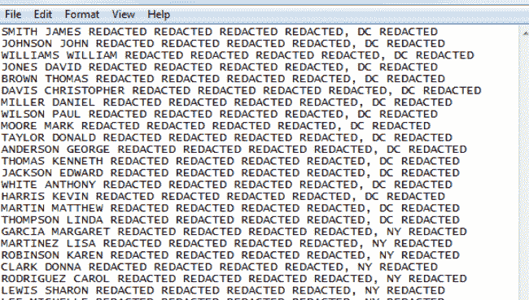

# SAS 正则表达式入门指南


SAS 提供了完整的书籍和电子产品选择，帮助客户充分发挥 SAS® 软件的潜力。有关我们产品的更多信息，请访问 `support.sas.com/bookstore` 或拨打 1-800-727-0025。

# 关于本书

## 目的

本书面向广泛的 SAS 用户群体，从初级程序员到高级专家均适用。由于以前关于该主题的出版较少，不同技能水平的读者都能从本书中受益。然而，本书的编写旨在确保初级程序员能够立即实施所讨论的每一个元素。

## 这本书适合你吗？

当然，适合！你希望处理非结构化数据源吗？你是否想更有效地处理半结构化数据源？你是否希望有一天能在你的 Base SAS 代码中利用高级的文本挖掘概念？你当然是这样的！本书为这一切奠定了基础，是任何想要增强编程能力的人的理想教材。

## 先决条件

读者应该熟练使用和应用 SAS DATA 步、基础 PROC（例如 `PROC PRINT`）、DO 循环和条件处理概念。读者应熟悉 SAS 数组和 `RETAIN` 语句。

## 本书范围

本书涵盖所有的 PRX 函数和调用例程。

本书**不**涵盖需要 MACRO 编程、PROC SQL 和系统自动化的高级概念。

# 关于示例

## 开发本书内容的软件

Base SAS (Microsoft Windows)

## 示例代码与数据

你可以通过链接到作者页面 `http://support.sas.com/publishing/authors` 访问本书的示例代码和数据。选择作者姓名。然后查找本书的封面缩略图，并选择“Example Code and Data”来显示书中包含的 SAS 程序。

对于所有提供示例代码和数据的书籍字母列表，请参阅 `http://support.sas.com/bookcode`。选择标题以显示书籍的示例代码。

如果你无法通过网络访问代码，请发送电子邮件至 `sasupport@sas.com`。

## 本书使用的输出与图形

本书中使用的所有输出都是通过 SAS 日志和 `PROC PRINT` 生成的。

## 其他帮助

尽管本书说明了许多各行业企业经常进行的分析，但可能会出现针对你特定目标和问题的问题。为了提供全面支持，SAS Institute 和 SAS Press 为你提供了以下资源：

- 关于本书涵盖的主题，请通过 SAS Press 联系作者：
  - 向 `sasupport@sas.com` 发送电子邮件问题；请在来信中注明书名。
  - 在 `http://support.sas.com/author_feedback` 的作者页面提交反馈。
- 关于本书内或超出本书范围的主题，请在相关的 SAS Support 社区 `https://communities.sas.com/welcome` 发布问题。
- SAS Institute 维护着一个包含最新信息的综合网站。对于初学者和资深 SAS 用户来说，特别有用的页面是知识库（Knowledge Base）。在 `http://support.sas.com/resources` 知识库的“Samples and SAS Notes”部分搜索相关说明。
- 注册 SAS 用户或其组织可以访问 `http://support.sas.com` 的 SAS 客户支持。在此处你可以向 SAS 客户支持提交特定问题：点击“Submit a Problem”（提交问题）。你需要提供一个可以接收回复的电子邮件地址，识别你的组织，并提供客户站点号或许可证信息。这些信息可以在你的 SAS 日志中找到。

我们期待你的来信。我们欢迎问题、评论和建议。如果你想就特定书籍与我们联系，请在给 `saspress@sas.com` 的来信中注明书名。

# 关于作者

K. Matthew Windham, CAP 是 NTELX Inc. 的分析总监，该公司位于华盛顿特区。他的重点是通过数学和统计建模、数据文本挖掘以及优化来帮助客户。作为长期 SAS 用户，Matt 喜欢利用 SAS 平台创建新的预测分析。在职业生涯中，Matt 曾在关键环境中领导咨询团队提供高影响力的结果。他还为政府构建了分析解决方案，特别是针对美国国防部和财政部。Matt 是一位认证分析师（CAP），在北罗来纳州立大学获得应用数学学士，在乔治大学获得数学和统计学硕士学位。


访问其作者页面 `http://support.sas.com/publishing/authors/windham.html` 了解更多信息。你可以在那里下载免费书籍章节、访问代码和数据、阅读最新评论、获取更新等。

# 致谢

感谢我才华的妻子 Lori，感谢你一直以来在我所做的事情上的支持和鼓励。没有你，我无法完成这一切。感谢我的朋友和家人，你们的建议和鼓励对我弥足珍贵。

# 第一章：引言

1.1 本书目的 ................................................................................................ 1

1.2 本书结构 ................................................................................................. 1

1.3 定义正则表达式 ................................................................................ 2

1.4 动机性示例 ....................................................................................... 3

- 1.4.1 提取、转换与加载 (ETL) ................................................................ 3
- 1.4.2 数据处理 ............................................................................ 4
- 1.4.3 数据增强 ................................................................ 5

## 1.1 本书目的

本书适用于几乎所有技能水平的 SAS 程序员。然而，我们预计你至少具备 SAS 语言的基础知识，包括 DATA 步以及如何使用 SAS PROC 过程。

本书提供了你学习所需的所有工具，帮助你掌握如何在 SAS 编程语言中利用正则表达式的力量。这些信息为相当高级的应用奠定了基础，这些应用将在本章作为动机性示例进行简要讨论。我们呈现这些内容并不是为了吓唬或让你无从适从，而是为了鼓励你带着能够快速实现所学内容的预期，继续阅读接下来的页码。

## 1.2 本书结构

我的目标是提供立即可用的信息。因此，每一章的结构都将引导你完成应用的每一个步骤，遵循以下流程：语法 ► 示例。除了后续章节讨论的信息外，附录中还包含了一份正则表达式参考指南，以帮助处理本文范围之外的更高级应用。

第一章

本章在为本书其余部分提供路线图的同时，还提供了关于你如何在现实世界中使用这些信息的动机性示例。

第二章

本章介绍了正则表达式的基本语法和概念。书中甚至包含了一些 SAS 代码，用于运行与每个新概念相关的示例。

## 2 SAS 中的正则表达式简介

第三章

本章的设计初衷是详细阐述在 SAS 语言中实现正则表达式的细节。

第四章

在最后一个章节中，我们将处理一系列深度示例——如果你愿意，可以称之为案例研究——以便将“所有内容整合在一起”。这些示例并不代表你读完本书后所能做的局限性，而是为可能性提供了一些基础思维。

附录

虽然并不详尽，但可以作为正则表达式、SAS 文档和参考表的价值且实用的参考。我希望每个人都能利用这些额外信息来丰富当前和未来的正则表达式能力。

### 1.3 定义正则表达式

在继续下去之前，我们需要定义什么是正则表达式。

采用非常正式的定义可能无法提供理想的清晰度：

定义 1（正式）

正则表达式：“正则表达式由常量和运算符符号组成，它们分别表示字符串集以及对这些集合进行的操作。”

为了清晰起见，我们将使用一个稍微松散的正则表达式定义。由于实际应用是我们的首要目标，固守任何晦涩的定义都是没有意义的。因此，对于我们的目的而言，我们将使用以下定义：

定义 2（更易理解——我们的定义）

正则表达式：用于自动搜索和匹配的模式。

在 SAS 中编程时，正则表达式被视为字母和特殊字符的字符串，这些字符由内置的 SAS 函数识别，用于搜索和匹配。结合内置的 SAS 函数和过程，我们可以实现巨大的能力，其中一些我们将在下一节中进行探索。

注意：SAS 使用的正则表达式语法与 Perl 语言相同。因此，在整个 SAS 文档中，你会发现正则表达式反复被称为“Perl 表达式”。在书中，我选择 SAS 文档中的约定，除非 Perl 约定对程序员来说更为常见。要了解更多关于 SAS 如何看待 Perl 的信息，请访问此网站：

`http://support.sas.com/documentation/cdl/enfunctionsref/67239/HTML/default/viewer.html#p0s9ilaagemxjl8n1u7e1ijfnzlk.htm`。要了解更多关于 Perl 编程，请访问 `http://perldoc.org/perl/re.html`。但在书中，我主要省略了对 Perl 的引用，因为可能会引起混淆。

# 第一章：引言

### 1.4 动机性示例

书中的信息对于广泛的应用非常有用。然而，在你阅读它之前，这一点不会显而易见。因此，为了直观展示你如何在工作中使用这些信息，我提供了一些真实的示例。

你们可能都熟悉数据，即数据提供给分析师的形式很少是直接可用的。在这些源数据之前，通常需要对它们进行清洗、转换和增强——尤其是文本数据。以下示例决定了书中稍后讨论的编码细节，但它们在不同复杂程度上展示了这些概念。这里的主要目标仅仅是帮助你看到这些信息的用处，并开始思考利用它们的方法。

### 1.4.1 提取、转换与加载 (ETL)

ETL 是一套通用流程，用于从源提取数据、修改以适应你的最终需求，并将其加载到目标位置以便你进行最佳处理（例如：数据库、数据存储、仓库）。我们将从一个相当典型的示例开始。假设我们有一个包含客户地址的 SAS 数据集，其中包含一些质量问题。我们不知道记录数据的方法，但视觉检查已经显示了许多重复记录的情况，如下表所示。在这个示例中，它们显然是相同的，只是略微

| 名字 | 姓氏 | 生日 | 城市 | 邮编 |
| --- | --- | --- | --- | --- |
| Robert | Smith | 2/5/1967 | Fairfax | 22030 |
| Robert | Smith | 2/5/1967 | | |

money! 对于涉及 ETL 以及如何解决此常见问题的详细示例，请参见第 4 章的 4.2 节。

### 1.4.2 数据处理

假设你被赋予了一项任务，为过去一年的所有证券交易委员会 (SEC) 创建报告。然而，源数据只是一堆 (XML) 文件，如图 1.1 所示。对于未经训练的人来说，这看起来像是一堆乱码；对于经过训练的人来说，这看起来像是大量工作。

图 1.1：2009 年行政程序的示例

```
<xml version="1.0" encoding="ISO-8859-1">
<administrative_proceeding>
  <url>http://www.sec.gov/litigation/admin/2009/34-6262.pdf</url>
  <release_number>34-6262</release_number>
  <release_date>Dec 30, 2009</release_date>
  <respondents>Stephen C. Gingring</respondents>
</administrative_proceeding>
<url>http://www.sec.gov/litigation/admin/2009/34-6256.pdf</url>
  <release_number>34-6256</release_number>
  <release_date>Dec 30, 2009</release_date>
  <respondents>Gabelli Funds LLC</respondents>
</administrative_proceeding>
<url>http://www.sec.gov/litigation/admin/2009/34-6255.pdf</url>
  <release_number>34-6255</release_number>
  <release_date>Dec 30, 2009</release_date>
  <respondents>Gabelli Funds LLC</respondents>
</administrative_proceeding>
```

然而，通过恰当使用正则表达式，这项任务变得相当简单。正则表达式为我们提供了一种方法，以算法方式识别 XML 文件中的模式、标签内部的数据，并生成具有正确列的数据集。生成的数据集将包含每个记录一行，结构类似于集合（对于具有这种事务结构的情况）；

| 发布编号 | 发布日期 | 响应者 | URL |
| --- | --- | --- | --- |
| 34-6262 | Dec 30, 2009 | Stephen C. Gingring | http://www.sec.gov/litigation/admin/2009/34-6262.pdf |

由于 XML 文件的复杂性，正则表达式无法孤立地完成此任务。泛泛处理 XML 文件，还需要健全的逻辑和其他 Base SAS 函数。然而，这里的点在于，正则表达式帮助我们克服了其他

# 第1章：引言 5

处理数据面临着巨大的挑战。如果你对 XML 或其他基于标签的语言（例如 HTML）不熟悉，建议进一步阅读有关该主题的资料。虽然你不需要深入了解它们就能有效地处理它们，但对它们的结构有良好的理解将为你节省很多烦恼。我在本书的一些高级示例中使用了一些基于标签的语言，因为它们在实践中非常普遍。

### 1.4.3 数据增强

数据增强是指利用我们已有的数据从其他来源收集有关我们主题的额外细节或信息的过程，从而增加此类数据的价值。除了解析和结构化文本外，我们还可以利用 SAS 中正则表达式的力量来丰富数据。

现在，假设我们要对 SAS 主园区——位于北卡罗来纳州的卡里——对周边社区的经济影响分析。为了正确地完成这项工作，我们需要使用地理空间信息进行统计分析。

地址信息可以从 `www.sas.com` 轻松获取。然而，并非必须，但包含地理位置信息（如纬度和经度）对于有效的分析和地理统计报告非常有用。自动化这一过程并不简单，包含了超出本书范围的高级编程步骤。然而，对于你理解书中使用的技术未来将导致此类复杂的能力是非常重要的。为了让这些技术更具体，我们将通过这些步骤和结果。

- 首先，通过正则表达式从图1.2中的数据处理示例中提取地址信息。

```
图1.2：HTML 地址信息
<p>World Headquarters<br>
SAS Institute Inc.<br>
100 SAS Drive<br>
Cary, NC 27513-2414, USA<br>
Phone:919-677-0000<br>
Fax:919-677-4444<br>
</p>
```

### 示例数据结构

| 地点 | 地址行 1 | 地址行 2 | 城市 | 州 | 邮编 | 电话 |
| :--- | :--- | :--- | :--- | :--- | :--- | :--- |
| 总部 | SAS Institute Inc. | 100 SAS Drive | Cary | NC | 27513-2414 | 919-677-0000 |

- 2. 向 Google 或 Yahoo 等 Web 服务提交地址进行地理编码。将以下字符串输入你的浏览器以获得 XML 输出，如图1.3 所示。

```
http://maps.googleapis.com/maps/api/geocode?address=100+SAS+Drive,Cary,+NC&sensor=false
```

图1.3：地理编码结果

```
<geometry>
  <location>
    <lat>35.801133</lat>
    <lng>-78.764911</lng>
  </location>
  <location_type>ROOFT</location_type>
  <viewport>
    <southwest>
      <lat>35.828843</lat>
      <lng>-78.768800</lng>
    </southwest>
    <northeast>
      <lat>35.831123</lat>
      <lng>-78.765142</lng>
    </northeast>
  </viewport>
</geometry>
```

- 3. 使用正则表达式解析返回的 XML 文件——我们的纬度和经度——并将其添加到数据集中。

**注意：** 我们跳过了关于如何解析我们特定的纬经度点的细节。执行此类工作的工具将在书中后文介绍。在这里提供的示例是为了激发你对正则表达式可能性的想象。

**示例数据结构**

| 地点 | ... | 纬度 | 经度 |
|---|---|---|---|
| 总部 | | 35.801733 | -78.766916 |

- 4. 通过 `https://maps.google.com/` 执行反向查找纬度对来验证你的结果。如图1.4 所示，得到了预期结果（北卡罗来纳州卡里的 SAS 主园区）。`img/c58184a1652486f0486b8350e0431fbb.png`。


现在有了包含了纬度和经度的增强数据集，我们可以采取后续步骤进行经济影响分析。

1. 维基百科，http://en.wikipedia.org/wiki/Regular_expression#Formal_definition
2. 关于使用的 Perl 版本的更多信息，请参考 SAS 支持：http://support.sas.com/base/datastep/regexp/compliance.html
3. 此示例来自 data.gov：http://www.data.gov/open/proceedings_2009

# 第2章：入门

## 2.1 引言

本章完全侧重于进入 SAS 中使用正则表达式的细节之前，培养你对正则表达式（RegEx）的理解。我们将直接跳入到所有内容背后的 SAS 代码。然而，RegEx 模式是使我们的 SAS 编码元素变得强大的基础。如果不先学习 RegEx，接下来的 SAS 函数和调用只能在非常理论的水平进行讨论，这与我在本书中试图实现的目的是背道而驰的。此外，试图同时学习任何过程中许多不同的元素可能会让人感到无所适从。

为了促进本书的任务——实际应用，同时不至于被过多的信息（新函数、调用和表达式）所淹没，本章中有一段非常短的测试代码将与 RegEx 示例配合使用。我想强调的是，彻底理解 RegEx 语法对于利用 SAS 中这一强大能力至关重要。

RegEx 由字母、数字、元字符和特殊字符组成，它们构成了模式。为了让 SAS 正确解释这些模式，所有 RegEx 值都必须被分隔符封装——我在全文中使用正斜杠 `/`。（请参考测试代码）。每个分隔符都充当我们模式的容器。因此，我们创建的所有 RegEx 模式看起来像这样：`/pattern/`。

假设我们想在地址中匹配字符字符串“Street”。模式看起来将是 `/Street/`。但我们显然感兴趣的是利用 RegEx 做更多事情，而不是搜索字符串。本章其余部分将探索我们可以插入到 `//` 中的各种 RegEx 元素，以开发丰富的功能。

## 2.2 特殊字符

特殊字符是有限 ASCII 字符集之一，影响 RegEx 模式的结构和行为。例如，左括号和右括号 `(` 和 `)` 用于在 RegEx 模式中创建字符或元字符的逻辑组。这些将在第 2.2 节中详细讨论。

## 2.3 基础元字符

在继续下去之前，我应该澄清一些术语。“元字符”（Metacharacter）是书中经常使用的术语，因此我需要明确它的实际含义。元字符是像 SAS 这样的编程语言用于其字面意思之外用途的字符或字符集。例如，`\s` 在模式中表示空白字符，而不仅仅是文本中并列的 `\` 和字母 "s"。我们从第 2.3 节开始对特定的元字符进行讨论。

所有非字面量的 RegEx 元素都是某种元字符。保持这种区分是好的，因为当我想要讨论实际字符串值或元字符使用的结果时，我也会引用字符（character）。

### 2.3.1 通配符

### 2.3.2 单词

### 2.3.3 非单词

### 2.3.4 制表符

### 2.3.5 空格

### 2.3.6 非空白

### 2.3.7 数字

### 2.3.8 非数字

### 2.3.9 换行

### 2.3.10 铃声

### 2.3.11 控制字符

### 2.3.12 八进制

### 2.3.13 十进制

## 2.4 字符类

### 2.4.1 列表

### 2.4.2 非列表

### 2.4.3 范围

## 2.5 修饰符

### 2.5.1 大小写修饰符

### 2.5.2 重复修饰符

## 2.6 选项

### 2.6.1 忽略大小写

### 2.6.2 单行

### 2.6.3 多行

### 2.6.4 编译一次

### 2.6.5 替换操作符

## 2.7 零宽元字符

### 2.7.1 行首

### 2.7.2 行尾

### 2.7.3 单词边界

### 2.7.4 非单词边界

### 2.7.5 字符串起始

## 2.8 总结

## RegEx 模式处理

在此阶段，澄清 SAS 如何处理 RegEx 也同样重要。SAS 从左到右分块读取每个模式，连续读取模式中的每个元素（字符或元字符）。如果我们想找到字符串 "hello"，SAS 会搜索并找到 "h" 的第一个匹配项。SAS 确定 "e" 是否紧随其后，依此类推，直到找到整个字符串。下面是此的一些伪代码，即使在我们开始用元字符替换字符后，该逻辑仍然成立（只会更令人印象深刻）。

## 模式匹配过程的伪代码

```
START IF POS = "h" POS+1 NEXT ELSE POS+1 GOTO START

IF POS = "o" POS+1 NEXT ELSE POS+1 GOTO START

IF POS = "l" POS+1 NEXT ELSE POS+1 GOTO START

IF POS = "l" POS+1 NEXT ELSE POS+1 GOTO START

IF POS = "o" THEN MATCH=TRUE END ELSE POS+1 GOTO START

END
```

在这个伪代码中，我们看到 `START` 标签是我们算法的启动，`END` 标签表示算法的终止。同时，`NEXT` 标签告诉我们跳到下一行伪代码，而 `GOTO` 标签告诉我们跳转到其中的指定行。`POS` 标签表示字符位置。我们还在代码中运用了 `IF`、`THEN` 和 `ELSE` 逻辑。

再次，这演示了在某些文本源中搜索 "hello"。算法通过测试第一个字符位置是否为 "h" 来启动。如果不是，则算法将字符位置增加一——并再次测试 "h"。如果第一个位置是 "h"，则增加字符位置，并执行字母 "e" 的代码。这会持续直到找到单词 "hello"。

## 2.1.1 RegEx 测试代码

以下代码片段允许我们在学习本章内容时快速测试新的 RegEx 概念。当你学习 RegEx 元字符、选项等时，你可以编辑此代码以测试其功能。此外，通过编辑代码的 `datal` 部分可以引入更多数据。然而，由于我们还没有讨论这段代码如何运作的细节，我不建议

## SAS 中的正则表达式引言

**注意：** 我在上面的 `datalines` 中提供了一个数据示例。不过，在我们学习本章内容时，请随意编辑这些行以彻底测试每一项。

为了促进本书的任务——实际应用，同时不至于被过多的信息（新函数、调用和表达式）所淹没，本章中有一段非常短的测试代码将与 RegEx 示例配合使用。我想强调的是，彻底理解 RegEx 语法对于利用 SAS 中这一强大能力至关重要。

RegEx 由字母、数字、元字符和特殊字符组成，它们构成了模式。为了让 SAS 正确解释这些模式，所有 RegEx 值都必须被分隔符封装——我在全文中使用正斜杠 `/`。（请参考测试代码）。每个分隔符都充当我们模式的容器。因此，我们创建的所有 RegEx 模式看起来像这样：`/pattern/`。

假设我们想在地址中匹配字符字符串“Street”。模式看起来将是 `/Street/`。但我们显然感兴趣的是利用 RegEx 做更多事情，而不是搜索字符串。本章其余部分将探索我们可以插入到 `//` 中的各种 RegEx 元素，以开发丰富的功能。

## 元字符

在继续下去之前，我应该澄清一些术语。“元字符”是书中经常使用的术语，因此我需要明确它的实际含义。元字符是像 SAS 这样的编程语言用于其字面意思之外用途的字符或字符集。例如，`\s` 在模式中表示空白字符，而不仅仅是文本中并列的 `\` 和字母 "s"。我们从第 2.3 节开始对特定的元字符进行讨论。

所有非字面量的 RegEx 元素都是某种元字符。保持这种区分是好的，因为当我想要讨论实际字符串值或元字符使用的结果时，我也会引用字符。

## 特殊字符

特殊字符是有限 ASCII 字符集之一，影响 RegEx 模式的结构和行为。例如，左括号和右括号 `(` 和 `)` 用于在 RegEx 模式中创建字符或元字符的逻辑组。这些将在第 2.2 节中详细讨论。

## RegEx 模式处理

在此阶段，澄清 SAS 如何处理 RegEx 也同样重要。SAS 从左到右分块读取每个模式，连续读取模式中的每个元素（字符或元字符）。如果我们想找到字符串 "hello"，SAS 会搜索并找到 "h" 的第一个匹配项。SAS 确定 "e" 是否紧随其后，依此类推，直到找到整个字符串。下面是此的一些伪代码，即使在我们开始用元字符替换字符后，该逻辑仍然成立（只会更令人印象深刻）。

## 模式匹配过程伪代码

```
START IF POS = "h" POS+1 NEXT ELSE POS+1 GOTO START

IF POS = "o" POS+1 NEXT ELSE POS+1 GOTO START

IF POS = "l" POS+1 NEXT ELSE POS+1 GOTO START

IF POS = "l" POS+1 NEXT ELSE POS+1 GOTO START

IF POS = "o" THEN MATCH=TRUE END ELSE POS+1 GOTO START

END
```


在这个伪代码中，我们看到 `START` 标签是我们算法的启动，`END` 标签表示算法的终止。同时，`NEXT` 标签告诉我们跳到下一行伪代码，而 `GOTO` 标签告诉我们跳转到指定的指定行。`POS` 标签表示字符位置。我们还在代码中运用了 `IF`、`THEN` 和 `ELSE` 逻辑。

再次，这演示了在某些文本源中搜索 "hello"。算法通过测试第一个字符位置是否为 "h"。如果不是，则算法将字符位置增加一——并再次测试 "h"。如果第一个位置是 "h"，则增加字符位置，并执行字母 "e" 的代码。这会持续直到找到单词 "hello"。

## 2.1.1 RegEx 测试代码

以下代码片段允许我们在学习本章内容时快速测试新的 RegEx 概念。当你学习 RegEx 元字符、选项等时，你可以编辑此代码以测试其功能。此外，通过编辑代码的 `datal` 部分可以引入更多数据。然而，由于我们还没有讨论这段代码如何运作的细节，我不建议

## SAS 中的正则表达式引言

**注意：** 我在上面的 `datalines` 中提供了一个数据示例。不过，在我们学习本章内容时，请随意编辑这些行以彻底测试每一项。

为了促进本书的任务——实际应用，同时不至于被过多的信息（新函数、调用和表达式）所淹没，本章中有一段非常短的测试代码将与 RegEx 示例配合使用。我想强调的是，彻底理解 RegEx 语法对于利用 SAS 中这一强大能力至关重要。

RegEx 由字母、数字、元字符和特殊字符组成，它们构成了模式。为了让 SAS 正确解释这些模式，所有 RegEx 值都必须被分隔符封装——我在全文中使用正斜杠 `/`。（请参考测试代码）。每个分隔符都充当我们模式的容器。因此，我们创建的所有 RegEx 模式看起来像这样：`/pattern/`。

假设我们想在地址中匹配字符字符串“Street”。模式看起来将是 `/Street/`。但我们显然感兴趣的是利用 RegEx 做更多事情，而不是搜索字符串。本章其余部分将探索我们可以插入到 `//` 中的各种 RegEx 元素，以开发丰富的功能。

## 元字符

在继续下去之前，我应该澄清一些术语。“元字符”是书中经常使用的术语，因此我需要明确它的实际含义。元字符是像 SAS 这样的编程语言用于其字面意思之外用途的字符或字符集。例如，`\s` 在模式中表示空白字符，而不仅仅是文本中并列的 `\` 和字母 "s"。我们从第 2.3 节开始开始特定的特定元字符进行讨论。

所有非字面量的 RegEx 元素都是某种元字符。保持这种区分是好的，因为当我想要讨论实际字符串值或元字符使用的结果时，我也会引用字符。

## 特殊字符

特殊字符是有限 ASCII 字符集之一，影响 RegEx 模式的结构和行为。例如，左括号和右括号，(`(` 和 `)` 用于在 RegEx 模式中创建字符或元字符的逻辑组。这些将在第 2.2 节中详细讨论。

## RegEx 模式处理

在此阶段，澄清 SAS 如何处理 RegEx 也同样重要。SAS 从左到右分块读取每个模式，连续读取模式中的每个元素（字符或元字符）。如果我们想找到字符串 "hello"，SAS 会搜索并找到 "h" 的第一个匹配项。SAS 确定 "e" 是否紧随其后，依此类推，直到找到整个字符串。下面是此的一些伪代码，即使在我们开始用元字符替换字符后，该逻辑仍然成立（只会更令人印象深刻）。

## 模式匹配过程伪代码

```
START IF POS = "h" POS+1 NEXT ELSE POS+1 GOTO START

IF POS = "o" POS+1 NEXT ELSE POS+1 GOTO START

IF POS = "l" POS+1 NEXT ELSE POS+1 GOTO START

IF POS = "l" POS+1 NEXT ELSE POS+1 GOTO START

IF POS = "o" THEN MATCH=TRUE END ELSE POS+1 GOTO START

END
```


在这个伪代码中，我们看到 `START` 标签是我们算法的启动，`END` 标签表示算法的终止。同时，`NEXT` 标签告诉我们跳到下一行伪代码，而 `GOTO` 标签告诉我们跳转到指定的指定行。`POS` 标签表示字符位置。我们还在代码中运用了 `IF`、`THEN` 和 `ELSE` 逻辑。

再次，这演示了在某些文本源中搜索 "hello"。算法通过测试第一个字符位置是否为 "h"。如果不是，则算法将字符位置增加一——并再次测试 "h"。如果第一个位置是 "h"，则增加字符位置，并执行字母 "e" 的代码。这会持续直到找到单词 "hello"。

由于你还没有学习过任何正则表达式（`RegEx`）元字符，让我们用这些新概念重新回顾字符串。请注意，我们已经开始可以使用字符和特殊字符来匹配有用的模式。

## 表 2.1：使用 `{}`、`|` 和 `\` 的示例

| 用法 | 匹配 |
|--- |--- |
| `/(C)at/` | "Cat" "cat" |
| `/mouse/` | "cat" "mouse" |
| `/((S)sreet))((R)oad)/` | "Street" "street" "Road" |
| `/((This))((That)/` | "This" 或 "That" |

注意：在 Perl 中，`\` 被称为转义字符。为了避免不必要的混淆，我们将不再使用这个术语，而是直接称之为反斜杠（backslash）。请准备好在 Perl 文献和社区网站上经常看到这个术语。

现在，还有一些特殊字符也需要在前面加上反斜杠才能作为普通字符进行匹配。它们是：`{` `}` `[` `]` `$` `*` `+` `?`。所有这些字符都是保留字符，因此会被区别化对待，因为它们在正则表达式的世界中各自各自特殊的用途和含义。由于每个字符在第 2.4 和 2.5 节中都有详细的定义和讨论，我们将不再讨论紧跟在其之前的反斜杠。目前，只需记住如果没有前面的反斜杠，它们不能作为模式字符串的一部分。表 2.2 显示了如何将它们作为普通字符使用的示例。

## 表 2.2：使用 `{` `}` `[` `]` `$` `.` `*` 的示例

| 用法 | 匹配 |
|--- |--- |
| `\$1,00 \$0.50 = \$1.50/` | "$1.00 + $0.50 = $1.50" |
| `/2*3 = 6/` | "2*3 = 6" |
| `/[2]V/2/` | "[2]^2" |
| `/{1,2,3,4,5}/` | "{1,2,3,4,5}" |

注意：注意 `=` 和 `,` 作为字符进行的（即没有反斜杠），因为它们不被视为特殊字符。

第 2 章：开始学习正则表达式 15

## 2.3 基础元字符

当你以后编写 `RegExp` 模式时，你会发现自己频繁使用本节中讨论的大多数元字符，因为它们是正则表达式模式创建的基础元素。现在，我们可以根据第 2.1 节讨论的信息轻松地构建一些有用的模式。然而，由于本节中的元字符能让正则表达式模式变得如此灵活且强大，它们在时间上的投资回报率是最高的。

在我们查看示例时，请注意我们如何获得一些意想不到的结果。在使用这些某些 `RegExp` 元字符时，采取非常有策略的方法是非常重要的，因为你并不总是知道你正在处理的文本中会预期什么。当你非常熟悉来源时，不可避免地会有错误或未知的变化，这可能会破坏设计不当模式。因此，像任何出色的分析师一样，你需要向前思考几步，以保持健壮的 `RegExp` 代码。

注意：与 SAS 不同，所有的 `RegExp` 元字符都是大小敏感的，如果字母是小写或大写，则必须以那种方式使用。否则，你的程序结果将与你预期的完全不同。换句话说，尽管在编写 SAS 代码时你可以随意处理大小写（例如 `DATA` vs. `data`），但这里并非如此。

### 2.3.1 通配符

通配符元字符是一个点（`.`），匹配任何单个字符值，换行符（`n`）除外。匹配几乎任何单个字符的能力在搜索字符字符串的超集时可能证明非常有用。当你不知道特定字符位置可能包含什么值时，你可能也想使用它。表 2.3 提供了示例。

表 2.3：使用 `.` 的示例

| 用法 | 匹配 |
| --- | --- |
| `/Rn/` | "Run" "R+n" "R n" "R(n" ... |
| `/.un/` | "Fun" "fun" "Run" "bun" "un" ... |
| `/Street/` | "Street," "Street," "Street+" "Street_ ... |

注意：点匹配除换行符（`n`）之外的所有内容——包括它本身。这可能帮助，但最好明智使用。此外，只有 `\n` 匹配换行符。

### 2.3.2 单词

元字符 `\w` 匹配任何字符值，包括字母和下划线（`_`）值。它匹配单个字符位置上的任何单个字母（不区分大小写）、数字或下划线。但不要被包含下划线所误骗；`\w` 不匹配连字符、破折号、空格或标点符号。表 2.4 提供了示例。

16 SAS 正表达式简介

表 2.4：使用 `\w` 的示例

| 用法 | 匹配 |
| --- | --- |
| `/R\wn/` | "Run" "Run" "Ron" ... |
| `\wun/` | "Fun" "fun" "Run" "run" "Bun" "bun" "_un" ... |
| `/Street\w/` | "Street" "Street" ... |

注意：`\w` 通配符前后不应有任何意外空格。这些空格会导致模式在匹配 `\w` 的之外还尝试匹配这些额外的空格。（这对任何正则表达式元字符都适用。）

### 2.3.3 非单词

元字符 `\W` 匹配非单词值（即 `\w` 不包含的所有内容，换行符除外）。当你确定某个位置是字符但不是单词时，`\W` 元字符非常有价值。第 2.5 节提供了示例。

表 2.5：使用 `\W` 的示例

| 用法 | 匹配 |
| --- | --- |
| `/Washington\W/` | "Washington." "Washington," ... |
| `/D\WC/` | "D." "D " ... |
| `/Street\W/` | "Street." "Street," ... |

注意：作为相反的小写版本正则表达式字符可能并不聪明，但很重要。

### 2.3.4 制表符

元字符 `\t` 匹配制表符。与正则表达式字符不同，该元字符仅匹配制表符。在处理制表符分隔的文件时非常有用。第 2.6 节提供了示例。

表 2.6：使用 `\t` 的示例

| 用法 | 匹配 |
| --- | --- |
| `/SAS\t/` | "SAS " |
| `/SAS\t/` | "SAS Inc" |
| `/Street\t/` | "Street " |

第 2 章：开始学习正则表达式

注意：该元字符没有相反（即不存在 `\T`）。

### 2.3.5 空格

元字符 `\s` 匹配单个空白字符，包括空格、制表符、换行符和分页符。当你匹配由空格分隔的文本且不确定会出现什么时，必须包含它。第 2.7 节提供了示例。

表 2.7：使用 `\s` 的示例

| 用法 | 匹配 |
|---|---|
| `/SAS\s/` | "SAS " |
| `/SAS\sInc/` | "SAS Inc" |
| `/Street\s/` | "Street " |

注意：这种形式的 `\s` 元字符匹配单个字符。我们在第 2.5 节回顾如何找到多个匹配。

### 2.3.6 非空白

元字符 `\S` 匹配单个非空白字符——`\s` 的精确相反。该元字符经常用于解释的连字符、撇号、逗号等可能阻止匹配的内容。第 2.8 节提供了示例。

表 2.8：使用 `\S` 的示例

| 用法 | 匹配 |
|---|---|
| `/Leonato\S/` | "Leonato's" "Leonatoos" "Leonato_s" ... |
| `/Washington\S/` | "Washingtons," ... |
| `/Street\S/` | "Street," "Streets" ... |

### 2.3.7 数字

元字符 `\d` 匹配数字字符（例如 `0-9`）。这个正则表达式元字符可能是最直接的，因为它关注点。记住 `\d` 的单次出现适用于文本中的单个字符位置。为了捕捉更大的数字（例如大于 9 的任何数字），必须构建包含多个 `\d` 的模式。第 2.9 节提供了示例，但我们在本章后面会讨论更复杂的方法（见第 2.4.2 节的"重复修饰"）。

18 SAS 正表达式简介

表 2.9：使用 `\d` 的示例

| 用法 | 匹配 |
| --- | --- |
| `\dst/` | "1st" "9st" "4st" ... |
| `/10\d/` | "101" "102" "103" ... |
| `/1-800-\d\d\d'\d/` | "1-800-123-4567" "1-800-789-3456" ... |

注意：只需记住，即使你的模式可能是正确的，数据也不一定是正确的（4st 和 9st 没有意义！）。

### 2.3.8 非数字

元字符 `\D` 匹配任何单个非数字字符。再次，这是小写元字符 `\d` 的相反。该元字符匹配每个非数字值。第 2.10 节提供了示例。

表 2.10：使用 `\D` 的示例

| 用法 | 匹配 |
| --- | --- |
| `\D800\D123\D4567/` | "1-800-123-4567" "1.800.123.4567" ... |
| `/1560\DWilsonDBlvd/` | "1560 Wilson Blvd" "1560_Wilson_Blvd" ... |
| `/19\D:\D:Street/` | "19th Street" "19th...Street" "19...Street" ... |

### 2.3.9 换行符

元字符 `\n` 匹配换行符。对于某些模式来说，知道你遇到了新行是非常用的。例如，你可能正在处理文本文件中的地址，地址通常在不同的行包含不同的信息。第 2.11 节提供了示例。

表 2.11：使用 `\n` 的示例

| 用法 | 匹配 |
| --- | --- |
| `/103 Pennsylvania Ave.\nNW,\nWashington, DC 20216/` | "103 Pennsylvania Ave. NW, Washington, DC 20216" |
| `/<html tag>\n/` | "<html tag> ... |

# 第 2 章：正则表达式入门

| 用法 | 匹配项 |
| --- | --- |
| | i |
| | c |
| | a |
| | l |
| | t |
| | e |
| | x t"... |

**注意：** 测试代码并没有让我们实际尝试此元字符，因为它使用了数据行（data lines），这是 SAS 的一个特性，输入时会特意忽略换行符（即：按回车键只是在 SAS 代码中创建了一个新数据行的开头）。由于这个原因，数据行中不存在供你读取和匹配的换行符。但请相信，它目前正如描述的那样工作。在下一章中你将发现处理不同文本的方法，让你能够处理换行符。

### 2.3.10 铃声 (Bell)

元字符 `\a` 匹配一个警报"铃"。警报字符属于 ASCII 字符集中的非打印或不可见字符类。ASCII 产生于很久以前，当时操作系统广泛地使用非打印字符。然而，如今这些字符已相对少见，通常只出现在供计算机读取而非人类阅读的文件中——因为它们是不显示的的。当遇到这些字符时，计算机的内部扬声器会产生警报音或"铃声"。它们通常与错误相关，也可以用来提醒用户文件或进程已结束（例如，在系统日志文件中）。当你知道源文件中可能会遇到此类字符时，可以使用此元字符。表 2.12 提供了示例。

**表 2.12：使用 `\a` 的示例**

| 用法 | 匹配项 |
| --- | --- |
| `/\a END OF FILE/` | "BEL END OF FILE" |
| `/PROCESS COMPLETED SUCCESSFULLY\a/` | "PROCESS COMPLETED SUCCESSFULLY BEL" ... |
| `/\aERROR/` | "BELERROR" ... |

**注意：** 由于警报字符是一个非打印的 ASCII 字符，我用 `BEL` ASCII 字符来表示它在匹配文本中的位置。然而，请记住，这种代码并没有出现在我们的文本中。

### 2.3.11 控制字符 (Control Character)

元字符 `\c[A-Z]` 匹配 `\c` 后面字母对应的控制字符。例如，`\cF` 匹配源代码中的控制-F。这是你可能处理较少使用的文件类型（即并非供人类阅读）的多个示例之一。控制字符（或非打印字符）曾被事务耦合和电信系统广泛使用。这些控制字符在大多数文本编辑器中不可见，但它们仍然是 ASCII 字符集的一部分，并且仍然被这些领域的旧系统使用。对于表 2.13 中的示例，我们遵循了上面警报元字符使用的惯例——尽管它们从未真正被看到，但仍使用了标准的 ASCII 缩写。

表 2.13：使用 ASCII 的示例

| 用法 | 匹配项 |
| --- | --- |
| `\cP/` | `DEL` 非打印的数据链路退出（Data Link Escape）ASCII 字符 `^P` |
| `/\cB/` | `STX` 非打印的文本开始 ASCII 字符 `^B` |
| `/\cBHello\cC/` | `STXHelloETX` 非打印的文本开始 ASCII 字符 `^B`，后跟文本字符串 "hello"，并以非打印的文本结束 ASCII 字符 `^C` 结束 |

### 2.3.12 八进制 (Octal)

元字符 `\ddd` 匹配 `ddd` 形式的八进制字符。它用于匹配你正在搜索的 ASCII 字符的八进制代码。当你需要在文件中查找特定的非打印 ASCII 字符时，它特别有用。SAS 的默认行为是在结果中返回此八进制代码关联 ASCII 字符。表 2.14 提供了示例。

表 2.14：使用 `\ddd` 的示例

| 用法 | 注释 |
| --- | --- |
| `\s/041/s` | " " | 这个八进制代码翻译为 `!` ASCII 字符 |
| `\s/110/105/114/117/` | "HELLO" | 这一系列八进制代码翻译为 ASCII 字符字符串 "HELLO" |
| `\s/007\011/s` | `BEL TAB` | 这些八进制代码翻译为两个非打印的 ASCII 字符 `BEL` 和 `TAB`。关于不显示的字符，请参考我们在第 2.3.10 节中对警报元字符的讨论。注意：你将在下一节（第 2.4 节）发现如何搜索这些值的范围。还要注意，最大的 ASCII 值为十进制 127，八进制 177，十六进制 7F。 |

### 2.3.13 十六进制 (Hexadecimal)

元字符 `\xdd` 匹配 `dd` 形式的十六进制字符。我们实现的目的再次是为了搜索原始文件等。我们使用它来搜索源中我们需要的 ASCII 字符关联的十六进制代码（原始数据处理）。表 2.15 提供了示例。

表 2.15：使用 `\x` 的示例

| 用法 | 匹配项 | 注释 |
|---|---|---|
| `\x2B/` | "+" | 此十六进制代码翻译为 `+` ASCII 字符。 |
| `\x31\x2B\x3D/` | "1=" | 这些十六进制代码翻译为。 |
| `\x30\x20\x46/` | "0 F" | 这提醒了我们可以在 ASCII 中匹配数字，它们是不相同的。 |

## 2.4 字符类 (Character Classes)

在 ASCII 中匹配数字是一个提醒，它们是不相同的。字符类允许匹配特定的字符集。方括号 `[]` 允许你匹配括号内的任意一个字符。这种能力可以创建字符类。方括号 `[]` 允许你匹配括号内的任意一个字符。这种能力可以创建字符类。方括号 `[]` 允许你匹配括号内的任意一个字符。这种能力可以创建字符类。

### 2.4.1 列表 (List)

元字符 `[]` 匹配方括号内列出的任意一个字符。这可以定义一组特定的字符类型。表 2.16 提供了示例。

表 2.16：使用 `[]` 的示例

| 用法 | 匹配项 |
| --- | --- |
| `/[abcABC]/` | "a" "b" "c" "A" "B" "C" |
| `/[0173]/` | "0" "1" "3" "7" |
| `/[CcRr]/` | "cat" "Cat" "bat" "rat" |
| `/[dABC]/` | "0" "1" "2" "7" "8" "9" "A" "B" "C" "D" "E" "F" |

### 2.4.2 非列表 (Not List)

元字符 `[^]` 匹配方括号内列出的字符之外的任意字符。有时写出我们不要的比写出需要的更简单。表 2.17 提供了示例。

表 2.17：使用 `[^]` 的示例

| 用法 | 匹配项 |
| --- | --- |
| `/[^abcABC]/` | "d" "e" "f" ... |
| `/[^0173]/` | "2" "4" "5" "6" "8" "9" |
| `/[^Ccjat]/` | "fat" "Fat" "hat" "rat" "Hat" "mat" ... |
| `/[^WGHJKLMNOPQRSTUVWXYZabcdefuvwxyz]/` | "0" "1" "2" "3" "4" "5" "6" "7" "8" "9" "A" "B" "C" "D" "E" "F" |

### 2.4.3 范围 (Range)

元字符匹配落在字符值范围内的任意字符。换句话说，对于括号内列出的字母，大小写敏感。`RegEx` 以及 SAS 理解字母和数字的内在顺序。因此，我们可以定义任何数字或字母范围以供此元字符匹配。表 2.18 提供了示例。

表 2.18：使用 `v-` 的示例

| 用法 | 匹配项 |
| --- | --- |
| `/[f-m]/` | "g" "h" "j" "k" "l" "m" |
| `/[1-9]/` | "2" "3" "4" "5" "6" "7" "8" "9" |
| `/[a-cA-C]/` | "a" "b" "c" "A" "B" "C" |
| `/[dA-F]/` | "0" "1" "2" "3" "4" "5" "6" "7" "8" "9" "A" "B" "C" "D" "E" "F" |

# 第 2 章：正则表达式入门 23

## 2.5 修饰符 (Modifiers)

在之前的章节中，你可能注意到了两个点，值得在这里进一步讨论。首先，到目前为止所有应用的元字符都会忽略字母的大小写。也就是说，`\w`、`\S`、`\D` 等匹配时不取决于字母是小写还是大写。然而，在某些情况下，字母的大小写变得很重要，但字母本身是预未知的。

其次，我们可以根据需要多次使用单个匹配字符，这为我们的匹配增加了额外的模糊性。但是，仅仅列出它们也有缺点：每个出现的情况都必须按顺序存在才能匹配模式。例如，如果上述 `\D` 示例的源包含没有空格的 "19thStreet"，那么我们使用三次 `\D` 将永远无法找到它。由于正则表达式功能的主要目标是自动化文本处理，我们需要一种稳健的方法来让这种匹配更具灵活性。

在接下来的小节（2.5.1 和 2.5.2）中，我们将学习使用修饰符来克服这些局限性。修饰符有两种类型：大小写修饰符和重复修饰符。通过将它们结合，我已经介绍了一种在现实正则表达式实现中处理这种情况的初级方法，它们应该被视为与我们目前讨论的元字符同等重要的现实世界实现基础知识。

## 2.5.1 大小写修饰符

在对文本进行匹配时，显然的考虑因素是字母的大小写（大写 vs. 小写）。尽管我已经介绍了一种在字母未知时处理这种情况的初级方法，但在字母未知时，必须有一套方法来考虑字母的大小写。本节讨论了处理大小写匹配的各种方法。根据情况，某些方法比其他方法更方便，但并不一定有对错之。

### 小写

当模式中的下一个字符是小写时，`\l` 匹配。该元字符适用于字符（元字符、分组等不起作用）。在实践中，直接输入所需字符的小写版本，或提供一个要匹配的小写字母列表会更实用。表 2.19 提供了示例。

| 表 2.19：使用 `\l` 的示例 |
| 用法 | 匹配项 |
| `\lStreet/` | "street" ... |
| `\sIS\IA\sInstitute/` | "sas Institute" ... |
| `/(IS\|F)leet/` | "fleet" ... |

### 大写

元字符 `\u` 匹配模式中的下一个字母是大写字母。它的功能与上面介绍的小写版本（`\l`）完全相同，但也适用于大写。表 2.20 提供了示例。

| 表 2.20：使用 `\u` 的示例 |
| 用法 | 匹配项 |
| `\uinc./` | "Inc." ... |
| `\ustreet\ust]./` | "Street" "St." ... |
| `\uave\uavenue,/` | "Ave." "Avenue," |

### 小写范围

元字符 `\L...\E` 将 `\L` 和 `\E` 之间的所有字符按小写匹配。在 `\L` 和 `\E` 之间输入的字符串将被强制匹配小写，即使它们是用大写字母输入的。与 `\L` 元字符不同，`\L...\E` 还可以包含字符类和重复修饰符。表 2.21 提供了示例。

| 表 2.21：使用 `\L...\E` 的示例 |
| 用法 | 匹配项 |
| `\[[a-z0-9][a-z0-9][a-z0-9]\E/` | "sas" "abc" "123" ... |
| `\LTHSE ARE LOWERCASE` | "these are lowercase" |
| `\sR\L[a-z][a-z]\s/` | "Read" "Road" "Rode" "Ride" "Real" ... |

> 注意：当对非字母字符应用修饰符时，该修饰符会被忽略。它不会影响匹配。

### 大写范围

元字符 `\U...\E` 在 `\U` 和 `\E` 之间的所有字符均为大写时创建匹配。同样，此元字符的功能与上面讨论的小写版本相同，但适用于大写。该元字符对于识别缩写字母或其他大写字母重要的文本非常有用。表 2.22 提供了示例。

| 表 2.22：使用 `\U...\E` 的示例 |
| 用法 | 匹配项 |
| `\[[a-z][a-z][a-z]\E/` | "SAS" "CIA" ... |
| `\[[a-z][a-z][a-z]\E\sInstitute\W/` | "SAS Institute Inc." ... |
| `\sallcaps\E/` | "ALLCAPS " |

**注意：** 注意在 `\L...\E` 或 `\U...\E` 元字符内部不允许使用其他元字符。也就是说，`\w` 不能用于替换上述字符类。

### 引用范围

元字符 `\Q...\E` 将 `\Q` 和 `\E` 内部的所有内容作为字符字符串匹配，禁用包括反斜杠在内的所有功能。元字符不能在 `\Q...\E` 中使用。此元字符提供的功能非常适合搜索包含大量转义字符的字符串，例如 XML、Web 服务器日志或 HTML。表 2.23 提供了示例。

| 用法 | 匹配项 |
| --- | --- |
| `\Q.*\E/` | ".*" |
| `\Qf(x)\E/` | "f(x)" |
| `\Q\w+ \E/` | "\w+" |

## 2.5 重复修饰符

修饰符有两种：大小写修饰符和重复修饰符。通过将它们结合，我已经介绍了一种在现实正则表达式实现中处理这种情况的初级方法，它们应该被视为与我们目前讨论的元字符同等重要的现实世界实现基础知识。

在接下来的小节（2.5.1 和 2.5.2）中，我们将学习使用修饰符来克服这些局限性。重复修饰符改变了字符或组匹配的次数、迭代（循环）和数据源。需要注意这些因素。

### 0 次或多次

修饰符 `*` 要求紧 preceding字符或元字符匹配 0 次或多次。它允许可选匹配。例如，我们可能想要匹配单词的每个出现情况。通过允许前缀和后缀可选，我们能够实现这一目标。表 2.24 提供了示例。

| 表 2.24：使用 `*` 的示例 |
| 用法 | 匹配项 |
| --- | --- |
| `/Sing/w*` | "Sings" "Sings" "Singing" "Singer" "Sings" ... |
| `/D\W*C*/` | "DC" "D.C" "D " ... |
| `/19\D*Street/` | "19th Street" "19Street" "19" ... |
| `/Hello*` | "Hell" "Hello" "Hellooooooooo" |

### 1 次或多次

修饰符 `+` 要求紧 preceding字符或元字符匹配 1 次或多次。加号修饰符的功能与星号类似，不同在于它强制至少匹配 1 次元字符。表 2.25 提供了示例。

| 表 2.25：使用 `+` 的示例 |
| 用法 | 匹配项 |
| --- | --- |
| `/Ru/w+` | "Run" "Ruin" "Grunt" "Runners" ... |
| `/\U[a-z]+E/s/` | 全大写的单词，且被空格包围。 |
| `/19\D+Street/` | "19th Street" "19...Street" ... |
| `/(ha)+` | "hahahahahahaha" |

### 0 次或 1 次

修饰符 `?` 创建 0 次或 1 次的匹配。问号提供了使元字符出现变为可选的能力，而不会允许其多次多次。这是有效的

# 第 2 章：正则表达式入门

用于匹配连字符或空格使用不一致的词对（例如，short-term 与 short term）。
表 2.26 提供了示例。

表 2.26：使用 `?` 的示例

| 用法 | 匹配项 |
|---|---|
| `/\D800?\D23\D4567/` | "1-800-123-4567" "18001234567" ... |
| `/1560\sWilson\sBvd\?W?/` | "1560 Wilson Blvd.\ " "1560 Wilson Blvd" ... |
| `/19th?/Street/` | "19th Street" "19thStreet" ... |

# 贪婪匹配 n 次

修饰符 `[n]` 创建恰好 `n` 次的匹配。这与手动多次输入该元字符的效果相同。然而，从代码编写和维护正则表达式模式的角度来看，使用修饰符是一个更好的方法。它限制了我们在初始创建正则表达式模式时出现拼写错误的概率，表 2.27 提供了示例。

# 表 2.27：使用 `(n)` 的示例

| 用法 | 匹配项 |
|---|---|
| `/1-800-d{3}-d{4}/` | "1-800-123-4567" "1.800.123.4567" ... |
| `/Rw[4]/` | "Round" "Runts" "Ruins" ... |
| `/19\D{3}/Street/` | "19th Street" "19th.Street" "19...Street" ... |
| `/\d{3,}-\d{4}(\d{5})/` | "12345-6789" "12345" ... |

# 贪婪匹配 n 次或更多

修饰符 `[n,]` 创建至少 `n` 次的匹配。通过确保我们可以至少匹配 `n` 次，我们能够创建出与 `+` 修饰符非常相似的功能。然而，我们提高了元字符必须匹配的最小次数。这对于某些应用非常有用，但必须谨慎处理。此外，`+` 修饰符很容易可能会因为模式构建中的单个逻辑错误而导致非常长的意外匹配字符串。表 2.28 提供了示例。

# 表 2.28：使用 `(n,)` 的示例

| 用法 | 匹配项 |
|---|---|
| `/1-800-\d{1,}-\d{2}/` | "1-800-123-4567" "1-800-789-12" ... |
| `/\d{3,}-\d{2,}-\d{4}/` | "143-25-7689" "12345689-54654565-9820" ... |
| `/19\D{3}/Street/` | "19th Street" "19th, Not My Street" ... |

# 28 SAS 正则表达式简介

**注意：** 注意在花括号内的逗号后输入一个空格。习惯性地这样做很容易很容易，但这会破坏我们的模式！

# 贪婪匹配 n 到 m 次

修饰符 `{n,m}` 创建至少 `n` 次但不不超过 `m` 次的匹配。创建指定范围的匹配对于确保维护数据质量标准非常有用。在提取邮政编码、出生日期和电话等半结构化数据元素时，在保持一定灵活性的同时确保源在容差范围内是非常重要的。例如，可以接受两位年份代替四位年份，但四位邮政编码是不可接受的。表 2.29 提供了示例。

表 2.29：使用 `{n}` 的示例

| 用法 | 匹配项 |
| --- | --- |
| `/(1-)?\d-\d[3,3]-\d[4,4]/` | "1-800-123-4567" ... |
| `/\d[1,2]-\d[1,2]-\d[2,4]/` | "10-20-1950" "8-30-52" "4-3-1979"... |
| `/Wash{1,7}/` | "Washington" "Wash" "Waste" "Washing"... |

**注意：** 如你在上面的示例所示，`{n,m}` 并不总是修饰符的最佳选择，但这些示例旨在演示实现的灵活性。例如，第二个示例中的年份在这种用法下被允许为三位数。使用带有 `{n}` 修饰符的 OR 子句是一个简单的解决方法。

# 懒惰重复修饰符简介

现在你已经熟悉了贪婪修饰符，让我们开始检查懒惰的修饰符。在语法上，它们与贪婪修饰符的区别仅在于增加了一个问号（`?`）。通过在每个贪婪修饰符后立即添加问号，我们能够微妙地改变它们的行为——以意想不到的方式。

通常情况下，懒惰修饰符用于避免过度匹配，并与贪婪修饰符相比提高性能。在某些情况下，使用贪婪修饰符匹配会导致获取过多信息，或仅仅减慢系统性能。例如，处理 HTML 或 XML 等半结构化文本文件就是懒惰修饰符用场的绝佳示例。

# 懒惰匹配 0 次或多次

修饰符 `{*}` 创建 0 次或多次，但尽可能少地创建匹配。

# 第 2 章：正则表达式入门

# 30 SAS 正则表达式简介

# 懒惰匹配 0 次或多次

修饰符 `{*}` 创建 0 次或多次，但尽可能少地创建匹配。

# 第 2 章：正则表达式入门

# 懒惰匹配 0 次或多次

修饰符 `{*}` 创建 0 次或多次，但尽可能少地创建匹配。

# 第 2 章：正则表达式入门

# 懒惰匹配 0 次或多次

修饰符 `{*}` 创建 0 次或多次，但尽可能少地创建匹配。

# 第 2 章：正则表达式入门

# 懒惰匹配 0 次或多次

修饰符 `{*}` 创建 0 次或多次，但尽可能少地创建匹配。

# 第 2 章：正则表达式入门

# 懒惰匹配 0 次或多次

修饰符 `{*}` 创建 0 次或多次，但尽可能少地创建匹配。

# 懒性 n 或更多

修饰符 `{n,}?` 创建一个至少 `n` 次的匹配，并以创建匹配所需的最小次数进行。其功能与 `*` 或 `+` 修饰符相同，不同之处在于匹配次数是任意的。我们看到了由于修饰符的懒性而导致的相似行为。表 2.34 提供了示例。

表 2.34：使用 `{n,}` 的示例

| 用法 | 匹配项 | 备注 |
| --- | --- | --- |
| `/Singw{3,?}/` | "Singing" ... | 此用法恰好匹配 `n=3` 次。同样，通过提供懒性选项来匹配最小次数，它每次都会这样做。 |
| `/0{3,?}/s/` | "0000" ... | 现在你已经掌握了这些修饰符，这个示例应该会更有趣一点。在模式上添加 `'s'` 会强制它匹配 0 直到遇到空白字符。该模式被"锚定"在 0 的第一次出现处，捕获了比最小值更多的内容。 |
| `/(ha){4,?}/` | hahahaha | 在模式中没有周围信息的情况下，它仅匹配最小次数。由于没有其他内容强制进行额外匹配，懒性修饰符在达到最小次数 `n=4` 后就会停止。 |

# 懒性 n 到 m 次

修饰符 `{n,m}?` 创建一个至少 `n` 次的匹配，但不超过 `m` 次——在该范围内以创建匹配所需的最小次数进行匹配。它的功能与目前为止讨论的许多其他懒性修饰符类似，但它在设置任意最小次数的同时，对匹配次数设置了上限。表 2.35 提供了示例。

表 2.35：使用 `{n,m}?` 的示例

| 用法 | 匹配项 | 备注 |
| --- | --- | --- |
| `/Readw{1,3,?}/` | "Ready" ... | 这仅匹配一次单词字符。同样，通过给懒性修饰符提供匹配最小次数的选项，它每次都会这样做。 |
| `/0{2,5}?s/` | "0000" ... | 再次，模式被"锚定"在 0 的第一次出现处，如果存在则捕获最小值，直到最大值。 |
| `\sha(ha){0,6}?` | "ha" | 由于模式的"锚定"点之后没有可以用于匹配的内容，因此没有可以进行额外匹配。懒性修饰符在达到最小次数 `n=0` 后就会停止。 |

# 32 SAS 正则表达式简介

## 2.6 选项

选项会影响与其关联的 `RegEx` 模式的行为。这些行为变化提供了多种益处，从使 `RegEx` 创建更方便，到提供新的或增强的功能。

选项出现在结束斜杠字符*之后*，但在第一个斜杠字符*之前*还有一个意义重大的项目，我们也将进行讨论——它实际上并不是一个选项，但它是回顾它的最佳地方。由于我们之前没有涵盖所有内容，出于同样的原因，我们也将不会涵盖所有的元字符——因为这是一篇介绍性文本。

### 2.6.1 忽略大小写

选项 `/i` 忽略整个模式（包括字符字符串）的大小写。当我们确切知道要搜索什么，但不想让字母大小写成为问题时，这是一个非常棒的选项。表 2.36 提供了示例。

表 2.36：使用 `/i` 的示例

| 用法 | 匹配项 |
| --- | --- |
| `/1600 Pennsylvania Avenue/i` | "1600 pennsylvania avenue" "1600 PENNSYLVANIA AVENUE" ... |
| `/Street/i` | "street" "Street" "STREET" ... |
| `/CAPS don't MattEr/i` | "caps don't matter" "CaPs Don't MATTER" ... |

### 2.6.2 单行

选项 `/s` 强制点字符（`.`）在出现在模式中时匹配所有内容，包括换行符。这对于确保我们不会遗漏特定字符位置的任何内容非常有帮助。表 2.37 提供了示例。

表 2.37：使用 `/s` 的示例

| 用法 | 匹配项 |
| --- | --- |
| `/43rd and Times Square.New York, NY 10036/s` | "43rd and Times Square New York, NY 10036" ... |
| `/Bob Smith.\d{3}-d{3}-d{4}/s` | "Bob Smith 123-456-7891" ... |

### 2.6.3 多行

选项 `/m` 导致 `^` 和 `$` 不仅匹配字符串的开头和结尾。相反，它们匹配每个遇到的每一个换行符，因为各种行信息被视为一条连续的行。这种增强功能适用于我们尚未涵盖的两个元字符（我们将在 2.7 节中讨论它们），所以如果你需要，可以尽管先看看再回到这一项。表 2.38 提供了示例。

表 2.38：使用 `/m` 的示例

| 用法 | 匹配项 |
| --- | --- |
| `/\w+/m` | 字符串开头的单词和换行符后的单词。 |
| `\w+?$s$/m` | 空格和字符串结尾之前的单词，以及空格和换行符之前的单词。 |

### 2.6.4 编译一次

选项 `/o` 被称为编译选项。通过在结束斜杠后紧跟一个 `"o"`，SAS 知道只编译 `Regex`。此选项为 SAS 带来了一个非常好的简化，我通过显示下面的测试代码来演示这一点（见第 2.7 节）。


## 2.5 替换

替换运算符`s`替换内容。由于模式的“锚定”点之后没有任何可以用于匹配的内容，因此没有可以进行额外匹配。懒性修饰符在达到最小次数`n=0`后就会停止。

```text
/* 此处为代码块，不翻译 */
```

（抱歉，原文提供的文本中并没有实际代码块，我将严格按照提供的文本翻译。）

# 懒性 n 或更多

修饰符`{n,}?`创建一个至少 n 次的匹配，并以创建匹配所需的最小次数进行匹配。其功能与`*`或`+`修饰符相同，不同之处在于匹配次数是任意的。我们看到了由于修饰符的懒性而导致的相似行为。表 2.34 提供了示例。

### 表 2.34：使用 `{n,}` 的示例

| 用法 | 匹配项 | 备注 |
| --- | --- | --- |
| `/Singw{3,?}/` | `"Singing" ...` | 此用法恰好匹配`n=3`次。同样，通过提供懒性选项来匹配最小次数，它每次都会这样做。 |
| `/0{3,?}/s/` | `"0000" ...` | 现在你已经掌握了这些修饰符，这个示例应该会更有趣一点。在模式上添加`s`会强制它匹配 0 直到遇到空白字符。该模式被“锚定”在 0 的第一次出现处，捕获了比最小值更多的内容。 |
| `/(ha){4,?}/` | `hahahaha` | 在模式中没有周围信息的情况下，它仅匹配最小次数。由于没有其他内容强制进行额外匹配，懒性修饰符在达到最小次数`n=4`后就会停止。 |

# 懒性 n 到 m 次

修饰符`{n,m}?`创建一个至少 n 次的匹配，但不超过 m 次——在该范围内以创建匹配所需的最小次数进行匹配。它的功能与目前为止讨论的许多其他懒性修饰符类似，但它在设置任意最小次数的同时，对匹配次数设置了上限。表 2.35 提供了示例。

### 表 2.35：使用 `{n,m}?` 的示例

| 用法 | 匹配项 | 备注 |
| --- | --- | --- |
| `/Readw{1,3,?}/` | `"Ready" ...` | 这仅匹配一次单词字符。同样，通过给懒性修饰符提供匹配最小次数的选项，它每次都会这样做。 |
| `/0{2,5}?s/` | `"0000" ...` | 再次，模式被“锚定”在 0 的第一次出现处，如果存在则捕获最小值，直到最大值。 |
| `\sha(ha){0,6}?` | `"ha"` | 由于模式的“锚定”点之后没有任何可以用于匹配的内容，因此没有可以进行额外匹配。懒性修饰符在达到最小次数`n=0`后就会停止。 |

# 32 SAS 正则表达式简介

## 2.6 选项

选项会影响与其关联的 RegEx 模式的行为。这些行为变化提供了多种益处，从使 RegEx 创建更方便，到提供新的或增强的功能。

### 2.6.1 忽略大小写

选项`/i`忽略整个模式（包括字符字符串）的大小写。当我们确切知道要搜索什么，但不想让字母大小写成为问题时，这是一个非常棒的选项。表 2.36 提供了示例。

### 2.6.2 单行

选项`/s`强制点字符（`.`）在出现在模式中时匹配所有内容，包括换行符。这对于确保我们不会遗漏特定字符位置的任何内容非常有帮助。表 2.37 提供了示例。

### 2.6.3 多行

选项`/m`导致`^`和`$`不仅匹配字符串的开头和结尾。相反，它们匹配每个遇到的每一个换行符，因为各种行信息被视为一条连续的行。这种增强功能适用于我们尚未涵盖的两个元字符（我们将在 2.7 节中讨论它们），所以如果你需要，可以尽管先看看再回到这一项。表 2.38 提供了示例。

### 2.6.4 编译一次

选项`/o`被称为编译选项。通过在结束斜杠后紧跟一个`"o"`，SAS 知道只编译 Regex。此选项为 SAS 带来了一个非常好的简化，我通过显示下面的测试代码来演示这一点（见第 2.7 节）。

## 2.5 替换

（注：原文提供的文本中 2.5 替换之后的内容似乎不完整或被截断，我将根据您提供的最后部分继续翻译。）

（由于您提供的原始文本在 2.6.4 之后就中断了，我将停止在您提供的文本末尾处。）

# 36 SAS 正则表达式简介

### 表 2.42：使用 `\b` 的示例

| 用法 | 匹配项 |
| --- | --- |
| `/Street\b/` | 匹配子字符串中的`"Street"`、`"Street,"`、`"Street"`……<br>但**不会**匹配子字符串`"Street"`等。 |
| `/\b8d{2}\b/` | 匹配子字符串`"(800)"`–`"888"`……中的`"800"`–`"888"`……<br>但**不会**匹配子字符串`"18002"`…… |
| `/\b'U[a-z]+E\b/` | 匹配全大写单词。如果没有第二个`\b`，输出将还包含单词开头的单字母大写字母。 |

## 2.7.4 非单词边界

元字符`\b`匹配一个非单词边界边界（即`\b`不匹配的任何地方）。这对于匹配根词或子字符串而不包含周围的辅助信息特别有用。表 2.43 提供了相关示例。

### 表 2.43：使用 `\B` 的示例

| 用法 | 匹配项 |
| --- | --- |
| `/read\B/` | 匹配子字符串`"reads"`、`"reading"`、`"reader"`……中的`"read"`<br>**不会**匹配子字符串`"read"` |
| `/\Bun\b/` | 匹配子字符串`"fun "`、`"rerun,"`、`"gun,"`……中的`"un"`<br>**不会**匹配子字符串`"un"` |
| `/\b[a-zA-Z]{3,}\b/` | 任何大于三个字母的单词。 |

## 2.7.5 字符串起始

元字符`\A`匹配字符串的开头。与单词边界元字符（`\b`）类似，`\A`发生在两个字符之间。它也表示字符串值出现在其右侧，而左侧无内容。在数据行的上下文中（如我们本章的测试代码所示），这种情况发生在每行的开头。

然而，假设我们有一个更复杂的任务，例如拼接多个提取的文本字符串（存储在 SAS 变量中）。在这种情况下，`\A`可以是确定放置或排序它们的顺序的关键。但是，对于我们的测试代码，`\A`仅在每行数据的开头匹配，因为每行都被标识为字符串的开头。这是另一个你在我们开始下一章进行更有趣的任务之前需要带着一点信心去处理的问题。表 2.44 提供了示例。

### 表 2.44：使用 `\A` 的示例

| 用法 | 匹配项 |
| --- | --- |
| `/\A\w*?s/` | 行的第一个单词。在我们的测试代码中，它匹配：<br>第 2 行的`"ROBERT "`<br>第 4 行的`"103 "`<br>第 5 行的`"508 "`<br>第 6 行的`"650 "`<br>第 7 行的`"3000 "`<br>以及第 8 行的`"1560 "`。 |

## 2.8 总结

在这一章中，我们探索了许多新概念，我已尽力让这些概念变得具体。希望你现在已经准备好在接下来的章节中迎接在 SAS 代码中实现这些概念的挑战。以下是你在接下来的页面及之后中应该记住的一些要点。

### 灵活性

通过阅读本章，你应该清楚完成相同任务有许多方法，很少有方法是绝对正确或错误的。你必须决定实现目标最高效、最有效的方法，以确定对于给定情况的最佳方案。

### 浅尝辄止

我们刚刚开始触及正则表达式（RegEx）能力的皮毛。你目前所学的信息是一个坚实的基础，你可以在此基础上开发的功能。

### 从小开始

由于我们在本章中探索了各种 RegEx 能力，很容易因为试图一次性做太多而感到不知所措。与任何事情一样，最好的是从简单模式开始实验并迭代进化。记住，仅仅利用我们涵盖的几个元素就可以对文本信息的处理和分析产生巨大影响。

¹ 八进制是一种使用 8 进制代替 10 进制的数字系统。该系统仅表示 0–7。一些旧的微控制器和微处理器曾使用这种编码，但现在已极其罕见。

² 十进制是一种使用 16 进制代替 10 进制的数字系统。单个字符位置上可能的值从“0”到“F”（其中 A=10, B=11, …, F=15）。

## 第 3 章：在 SAS 中使用正则表达式

- 3.1 引言 ................................................................................................ 39
- 3.1.1 捕获缓冲区（Capture Buffer） .............................................................................. 39
- 3.2 SAS 内置函数 ....................................................................................... 40
- 3.2.1 `PRXPARSE` ................................................................................. 40
- 3.2.2 `PRXMATCH` ................................................................................ 42
- 3.2.3 `PRXCHANGE` ............................................................... 43
- 3.2.4 `PRXPOSN` ................................................................................. 46
- 3.2.5 `PRXPAREN` ................................................................ 47
- 3.3 SAS 内置调用例（Call Routines） ................................................................ 49
- 3.3.1 `CALL PRXCHANGE` ........................................................................ 50
- 3.3.2 `CALL PRXMATCH` ................................................................................ 54
- 3.3.3 `CALL PRXSTR` .......................................................................... 56
- 3.3.4 `CALL PRXNEXT` .......................................................................... 57
- 3.3.5 `CALL PRXDEBUG` ................................................................. 59
- 3.3.6 `CALL PRXFREE` ................................................................. 62
- 3.4 总结 ................................................................................69

## 3.1 引言

本章重点在于开发对内置函数和调用例的理解。在这里你将学习如何在实际场景中使用第二章介绍的元字符。

### 3.1.1 捕获缓冲区（Capture Buffer）

现在，在继续之前，我们必须处理一个名为捕获缓冲区的概念。捕获缓冲区是一种我为止一直避免的技术，但必须理解它才能使用`PRXREN`和`PRXPOSN`。每个括号创建一个本地缓冲区，然后被引用。

## 3.2 SAS 内置函数

在本节中，我们涵盖了执行正则表达式操作的 SAS 函数。正则表达式的 SAS 函数使用限制与内置函数相同。与其他函数一样，它们只能接收参数并返回输出。

注意：每个正则表达式函数都以`PRX`开头，代表 Perl 表达式。

### 3.2.1 `PRXPARSE`

#### 描述

该函数接受正则表达式模式作为输入，并提供数值正则表达式标识符作为输出。该唯一标识符被其他函数和调用例引用。该函数的用法与我们在第二章中的示例代码相似。

#### 语法

```sas
RegEx_ID = PRXPARSE(RegEx)
```

- `RegEx`：要解析的模式（输入参数，必需）。
- `RegEx_ID`：`PRXPARSE`返回的唯一正则表达式标识符（输出，必需）。

现在，此处需要理解`PRXPARSE`会编译正则表达式以创建供 SAS 引用的标识符。这就是为什么在代码中使用`PRXPARSE`时，正则表达式`//o`选项非常重要。

## 示例 3.1：使用 `PRXPARSE` 定义模式

让我们回顾第 2 章中的最后一段代码，因为它已经很熟悉了。下面的正则表达式定义为`/Smith/o`，这意味着我们要在提供的数据行中查找字符串字面量`"Smith"`的任何出现情况。该正则表达式是`PRXPARSE`的参数，它创建一个模式标识符并将其赋值给变量`pattern_ID`。该变量被传递给调用程序`PRXSUBSTR`，我们将在下一节讨论它。由于你现在已经熟悉了这段代码的整体功能，因此这不需要分心。

该正则表达式的输出位于输出 3.1 中。正如我们预期的，无论周围是什么（包括其他字母），代码都找到了`"Smith"`的每一次出现位置。

```sas
/* RegEx Testing Framework */

data NULL;

pattern = "Smith/o"; /* 在此处编辑模式. */

pattern_id = PRXPARSE(pattern);

input some_data=$;

call prexubstr(pattern_ID, some_data, position, length);

if position ^= 0
do;

  match = substr(some_data, position, length);

  put match:QUOTE. "found in " some_data:$QUOTE;

end;

datalines;

Smith, BOB A.

ROBERT Allen Smith

Smithe, Cindy

103 Pennsylvania Ave. NW, Washington, DC 20216

508 First St. NW, Washington, DC 20001

650 1st NE, Washington, DC 20002

3000 K Street NW, Washington, DC 20007

1560 Wilson Blvd, Arlington, VA 22209

1-800-4567

1(800) 789-1234

run;
```

### 输出 3.1：模式 `/Smith/o` 的日志输出

```text
"Smith" found in "Smith, BOB A."
"Smith" found in "ROBERT Allen Smith"
"Smith" found in "Smithe, Cindy"
```

# 42 SAS 正则表达式简介

### 3.2.2 `PRXMATCH`

#### 描述

`PRXMATCH`返回匹配的正则表达式模式中第一个字符的数值位置。此外，它可以用于`IF`语句以测试模式匹配，而无需进行变量赋值，就像许多其他熟悉的 SAS 函数一样。`PRXMATCH`的第一个参数是正则表达式`RegEx`或`RegEx_ID`。第二个参数是源变量或字符串字面量。

#### 语法

```sas
Position = PRXMATCH(RegEx_ID or RegEx, Source_Text)
```

- `RegEx_ID`：由`PRXPARSE`返回的唯一正则表达式标识符（输入参数，如果不使用`RegEx`则必需）。
- `RegEx`：要匹配的模式（输入参数，如果不使用`RegEx_ID`则必需）。
- `Source_Text`：要操作的文本变量或字面量（输入参数，必需）。
- `Position`：数值位置变量赋值（输出，必需）。


正如在`PRXPARSE`函数中讨论的那样，正则表达式由 SAS 编译以供其他函数使用。因此，除了使用实际正则表达式外，`PRXMATCH`能够通过 RegEx ID 利用之前编译的正则表达式，而不是使用正则表达式本身。这允许我们通过`PRXPARSE`函数编译一次正则表达式（使用`/o`选项），最大限度地减少相关的计算周期。在处理大量文本时，计算周期的微小节省可以非常显著。

利用正则表达式模式的两种不同方法为`PRXMATCH`在实践中的用法创造了极大的灵活性。由于不需要预编译正则表达式，`PRXMATCH`允许我们将正则表达式嵌入到整个代码中，而无需为每次遍历 DATA 步维护它们而分配额外的内存。当你以动态方式使用`PRXMATCH`时非常有用，例如在嵌套 IF 语句内部，只有当某些条件成立时才使用正则表达式。根据实现的不同，这对速度和内存使用都有影响。

## 示例 3.2：使用 PRXMATCH 在源文中查找字符串

让我们尝试一个简单的示例，看看此函数如何在实践中的使用。假设我们要在源文中找到名为“Street”的字符串。下面的代码演示了如何将每次出现的位置打印到日志中。显然，在实践中，我们需要执行打印位置之外的操作（例如提取或处理匹配的文本），但这演示了`PRXMATCH`的基本功能。

## 第 3 章：在 SAS 中使用正则表达式 43

在这段代码中实现了`PRXMATCH`函数，以正则表达式作为第一个参数，以 datelines 引用地址作为第二个参数。结果赋值给变量`Position`。`Position`的值使用 PUT 语句写入日志。

计算数据行中的字符数。在出现“Street”的行中，我们在哪个位置遇到“S”？通过将结果与输出 3.2 进行比较，我们看到`PRXMATCH`返回的是模式匹配中第一个字符的位置。

```sas
data _NULL;

input address $50;

position = PRXMATCH('/Street/o', address);

if position = 0 then

do

  put position=;

end;

datalines

103 Pennsylvania Ave NW, Washington, DC 20216

508 First Street NW, Washington, DC 20001

650 last St Ne, Washington, DC 20002

3000 K Street NW, Washington, DC 20007

run;
```

输出 3.2：“Street”位置的日志输出

```text
position=11

position=8
```

### 3.2.3 PRXCHANGE

该函数在第三参数提供的源文中搜索由第一个参数（RegEx_ID 或 RegExp）提供的模式。匹配的次数为第二个参数指定的次数。在找到每次匹配时，函数根据 RegExp 返回更改后的文本。如果没有找到匹配，`PRXCHANGE`返回原始文本。

#### 语法

```sas
Output_String = PRXCHANGE(RegExp_ID or RegExp, Num_Times, Input_String)
```

`RegExp_ID`：由`PRXPARSE`返回的唯一正则表达式标识符（输入参数，如果不使用 RegExp 则必需）

`RegExp`：要匹配的模式（输入参数，如果不使用 RegEx_ID 则必需）

## 44 SAS 正则表达式简介

`Num_Times`：应用更改的次数（输入参数，必需）。-1 强制根据模式在源文中出现的次数进行更改。

`Input_String`：输入变量（输入参数，必需）

`Output_String`：输出变量赋值（输出，必需）

就像`PRXMATCH`函数一样可以使用实际的正则表达式模式或 RegExp ID，提供了很大的灵活性。这取决于所需的应用程序。该函数对于数据标准化非常有用，将在下一章看到更多示例。

### 示例 3.3：标准化数据

数据标准化是 SAS 提供的一种相对简单但强大的功能。`PRXCHANGE`允许我们清洗数据，使每个单词或短语完全相同。当你尝试进行高级文本挖掘时，数据清洗尤为重要。例如，在对数据进行任何分析之前，我们希望“street”单词的每次出现都是完全相同的。如果每次出现都不相同，可能会对“street”、“Street”、“St.”等无效结果进行词频统计。根据信息的最终用途，这可能是灾难性的。

```sas
data NULL;

input address $50;

text = PRXCHANGE('/^\s+([Ss]t)?|st)\s+/St\. /o',1,address);

put text;

datalines;

103 Pennsylvania Ave NW, Washington, DC 20216

508 First St. NW, Washington, DC 20001

650 1st St NE, Washington, DC 20002

3000 K Street NW, Washington, DC 20007

run;
```

输出 3.3：带更新数据的日志

| 103 Pennsylvania Ave NW, Washington, DC 20216 |
|---|
| 508 First St. NW, Washington, DC 20001 |
| 650 1st St NE, Washington, DC 20002 |
| 3000 K Street NW, Washington, DC 20007 |

## 第 3 章：在 SAS 中使用正则表达式 45

**注意：** 通常有多种方法可以实现相同的结果。理解应用的上下文将帮助你确定要使用的正则表达式。

## 示例 3.4：使用缓冲区

回顾示例 3.3，假设我们现在还想将地址提供给仅接受逗号分隔值（CSV）文件的系统。这是一个使用缓冲区的极佳机会。只需进行少量更改，我们现在就可以将数据行转换为 CSV 格式。新行代码使用`PRXCHANGE`配合复杂的正则表达式将地址更改为街道、城市、州和邮政编码。我们看到新行将输出变量`Text`作为输入参数，而不是`address`。这样做是对已更改的文本进行更改。如果我们使用`address`，则只是更新原始数据行，而不是在上一步的基础上进行。

通过查看新正则表达式中的括号元素，我们可以看到如何识别地址组成。在同一行中，这四个元素通过缓冲区引用放置，后面紧跟着一个逗号和空格。查看输出 3.4，我们看到代码产生了预期的结果。

```sas
data NULL;

input address $50;

text = PRXCHANGE('/^\s+(Street|St|st|)\s+St\. /o',-1,address);

text2 = PRXCHANGE('/(.+?),\s+(\w+)?\s+(\w+)?\s+(\d+)?/$1, $2, $3,$4/o,-1,text);

put text2;

datelines;

103 Pennsylvania Ave NW, Washington, DC 20216

508 First St NW, Washington, DC 20001

650 1st St NE, Washington, DC 20002

300 K Street NW, Washington, DC 20007

run;
```

输出 3.4：日志中修正后的数据

| 103 Pennsylvania Ave NW, Washington, DC 20216 |
|---|
| 508 First St NW, Washington, DC. 20001 |
| 650 1st St NE, Washington, DC 20002 |
| 300 K St NW, Washington, DC, 20007 |

## 3.2.4 PRXPOSN

### Description

`PRXPOSN`从指定的捕获缓冲区中返回匹配到的信息。此正则表达式函数在使用之前，需要先运行`RSXUBSTR`、`PRMATCH`、`PRXNEXT`和`PRCHANGE`函数，以便引用捕获缓冲区。此外，它需要 RegEx ID 而非实际的正则表达式。否则，`PRXPOSN`将无法工作——这需要使用`PRXPARSE`。输入参数`N`是数值，指代捕获缓冲区（$）。

### Syntax

```sas
Text = PRXPOSN(RegEx_ID, N, Source_Text)
```

- `RegEx_ID`：由`PRXPARSE`返回的唯一正则表达式标识符（输入参数，必需）
- `Integer`：捕获缓冲区的值（输入参数，必需）
- `Source_Text`：要操作的文本变量或字面量（输入参数，必需）
- `Text`：捕获文本的字符变量（输出，必需）

当我们确切知道捕获缓冲区元素的数量（即`N`是已知的）时，我们可以毫无问题地使用`PRXPOSN`。然而，当元素数量与我们预期的不同会发生什么？如果捕获缓冲区中有值，但我们引用的索引超出了范围，`PRXPOSN`将返回空值。如果在捕获缓冲区中有值，但我们引用的索引为 0，则会返回整个缓冲区。

`PRXPOSN`在我们知道捕获缓冲区元素数量时非常有用。在编写代码时，编写有效的正则表达式模式以确保缓冲区内容，并防止出现问题。

### 示例 3.5：使用捕获缓冲区

为了让捕获缓冲区的操作更清晰，我们将通过一个具体的示例来演示。假设我们想要处理具有已知结构的地址，使用`PRXPOSN`提取数据。首先，我们通过`PRXPARSE`函数测试捕获缓冲区。如果`PRMATCH`匹配成功，我们可以根据`N`值将捕获缓冲区赋值给变量。`PRXPOSN`是直观的，它根据 POSN 提取的提取结果。以下代码展示了包含了三个数字的输出。

```sas
data extract;

input address $50;

text = PRXPARSE('/\s*(\w+),\s*(\w+),\s*(\d+)/');

if PRXMATCH(text, address) then

do;

    city = PRXPOSN(text, 1, address);

    state = PRXPOSN(text, 2, address);

    zip = PRXPOSN(text, 3, address);

    output;

end;

datalines;

103 Pennsylvania Ave NW, Washington, DC 2016

508 First St NW, Washington, DC 2001

run;

proc print data=extract;

run;
```

### 输出 3.5

| Obs | city | state | zip |
|---|---|---|---|
| 1 | Washington | DC | 2016 |
| 2 | Washington | DC | 2001 |

## 2.5 PRXPAREN

### Description

`PRXPAREN`返回捕获缓冲区的数值。与`PRXPOSN`类似，在使用此函数之前需要运行`RSXUBSTR`、`PRMATCH`、`PRXNEXT`或`PRCHANGE`。此外，它需要 RegEx ID 而非实际的正则表达式。

### Syntax

```sas
Paren = PRXPAREN(RegEx_ID)
```

- `RegEx_ID`：由`PRXPARSE`返回的唯一正则表达式标识符（输入参数，必需）
- `Paren`：捕获缓冲区的值（输出，必需）

**注意：** 此函数需要 RegEx ID 而非实际正则表达式，否则无法工作。

为了防止代码中出现问题，在处理缓冲区时编写有效的正则表达式是非常有用的。

### 示例 3.6：识别缓冲区

理想情况下，当我们想要使用`PRXPAREN`时，我们需要知道缓冲区的内容。下面的示例演示了如何使用它。

```sas
data extract;

input address $50;

text = PRXPARSE('/\s*(\w+),\s*(\w+),\s*(\d+)/');

if PRXMATCH(text, address) then

do;

    city = PRXPOSN(text, 1, address);

    state = PRXPOSN(text, 2, address);

    zip = PRXPOSN(text, 3, address);

    max_buf = PRXPAREN(text);

    output;

end;

datalines;

103 Pennsylvania Ave NW, Washington, DC 2016

508 First St NW, Washington, DC 2001

run;

proc print data=extract;

run;
```

## 3.3 内置调用函数

在本节中，你将学习用于执行之前讨论的许多任务以及新任务的`PRX`函数。深入探讨这些差异。

### 3.3.1 CALL PRXCHANGE

### Description

此调用函数执行与`PRXCHANGE`函数类似的匹配和替换操作。与函数版本不同，调用函数必须接收正则表达式标识符。此外，还有一些函数版本中没有的额外参数（长度和截断值）。必需的参数是`RegEx_ID`、`Num_Times`和`Input_string`。

### Syntax

```sas
CALL PRXCHANGE(RegEx_ID, Num_Times, Input_string, Output_string, result_length, trunc_value, num_changes)
```

- `RegEx_ID`：由`PRXPARSE`返回的唯一正则表达式标识符（输入参数，必需）
- `Num_Times`：应用更改的次数（输入参数，必需）
- `Input_string`：输入变量（输入参数，必需）
- `Output_string`：输出文本变量（输入参数，可选）。默认为`Input_string`。
- `result_length`：输出`Output_string`的字符长度（返回值，可选）
- `trunc_value`：二进制整数（0 或 1）值（返回值，可选）。1 表示插入的文本比被替换的文本长；0 表示插入的文本与被替换的文本等长或短。
- `num_changes`：更改的次数（返回值，可选）

## 第 3 章：在 SAS 51 中使用正则表达式

### 示例 3.7：转换数据

让我们看看修改源文本的基本用法。这是一个如何使用调用例（call routine）的简单示例。注意这在保持功能的同时如何使我们的代码变得简洁。输出 3.7 表明我们已经实现了预期的功能（将各种形式的“street”替换为“St.”）。

```sas
data ~NULL;

input address $50;

mypattern = PRXPARSESE('/\s+(Street|street|St|st)\s+/,'St./'o');

CALL PRXCHANGE(mypattern, -1, address);

put address;
```

```sas
datelines:

103 Pennsylvania Ave NW, Washington, DC 20216

508 First St NW, Washington, DC 20001

650 1st St NE, Washington DC 20002

3000 K St NW, Washington, DC 20007

run;
```

### 示例 3.7：SAS 日志中的结果

| 103 Pennsylvania Ave NW, Washington, DC 20216 |
|---|
| 508 First St NW, Washington, DC 20001 |
| 650 1st St NE, Washington DC 20002 |
| 3000 K St NW, Washington, DC 20007 |

现在我们已经查看了`CALL PRXCHANGE`的基本实现，让我们来探索它的可选参数。

### 示例 3.8：脱敏敏感数据

在这个示例中，我们侧重于培养你对`CALL PRXCHANGE`中可选元素的理解。为了变换一下节奏，我们将开发一种脱敏敏感信息的基本方法。这是一项频繁的需求，特别是在医疗领域，用于保护个人身份信息（PII）。现在，我们不会从提供的数据中消除所有 PII，因为我们只是在演示`CALL PRXCHANGE`的功能。然而，这一过程在下一章将以更严谨、更大的规模进行。

### SAS 正则表达式简介

在下面的代码中，我们首先创建一个传递到 DATA 步的数据集，名为 example。该数据集包含各种配置的名称、地址和电话号码信息。在 DATA 步中，我们使用`PRXPARSE`创建一个 RegEx ID，然后使用`CALL PRXCHANGE`执行正则表达式规定的更改。注意，有一个正则表达式被注释掉了。该行中的正则表达式的行为与初始的 RegEx ID 定义不同，这允许我们演示 trunc 和 num 选项。我们使用这个 RegEx ID 创建了输出 3.8.2。在 DATA 步之后，我们执行 PROC PRINT 以创建输出 3.8.1 和输出 3.8.2 所示的输出。

```sas
data example:

  input text $80;

  datalines:

    Ken can be reached at (801)443-9876

    103 Pennsylvania Ave NW, Washington, DC 20216

    JP's address:

    650 1st St, Washington DC 20002

    Carla's information is: (910) 998-8762

    3000 K Street NW, Washington, DC 20007

    Eric can be reached at: (321) 456-7890
```


508 First St Nw, Washington, DC 20001

```sas
run;

data changed;

  set example;

  /*RegEx ID = PRXPARSE('/s/\d+***NUMBER REMOVED*/','o');

  RegEx_ID = PRXPARSE('/s/[1-9]\d\s?[1-9]\d-\d\d*REDACTED*/','o');

  Call PRXCHANGE(RegEx_ID, -1, text, text, length, trunc, num_changes);

  put text=;

run;

proc print data=changed;
```

### 简单插入结果

如我们在下面的结果所示，通过使用值`redacted`，原始文本中的电话号码已被脱敏。数据集的其他部分显示了我们的可选变量值。`Length`是写入的字符串的总长度（我们只是将其写回了旧字符串）。每一行的`trunc`均为 0，因为插入的值并不比原始电话号码长。事实上，第 1、5 和 7 行缩短了，因为插入的内容更短。最后，`num_changes`记录了每行中电话号码脱敏的次数（如果每行有多个电话号码，则在该列中会有相应记录）。

## 第 3 章：在 SAS 53 中使用正则表达式

### 输出 3.8.1：SAS PROC PRINT 结果

### SAS 系统

| Obs | text | RegEx_ID | length | trunc_val | num_changes |
|---|---|---|---|---|---|
| 1 | Ken be reached at: `REDACTED` | 1 | 77 | 0 | 1 |
| 2 | Pennsylvania Ave NW, Washington, DC 20216 | 1 | 80 | 0 | 0 |
| 3 | JP's address is: | 1 | 80 | 0 | 0 |
| 4 | 650 1st St, Washington DC 20002 | 1 | 80 | 0 | 0 |
| 5 | Carla's information is: `REDACTED` | 1 | 77 | 0 | 1 |
| 6 | 3000 K Street NW, Washington, DC 20007 | 1 | 80 | 0 | 0 |
| 7 | Eric can be reached at: `REDACTED` | 1 | 76 | 0 | 1 |
| 8 | 508 First St NW, Washington, DC 20001 | 1 | 80 | 0 |  |

### 更多插入结果

被注释的正则表达式定义对于输出 3.8.2 是不同的。`NUMBER REMOVED` 插入的变量与输出 3.8.1 相同，但请注意：`REDACTED` 每次发生脱敏时，`num_changes` 会大于 1。例如，`trunc_val` 设置为 1 意味着文本被截断了。这种文本被截断了。记得，`trunc_val` 设置为 1 意味着文本被截断了。

## SAS 正则表达式简介 54

### 输出 3.8.1：SAS PROC PRINT 结果

### SAS 系统

| Obs | text | RegEx_ID | length | trunc_val | num_changes |
|---|---|---|---|---|---|
| 1 | Ken be reached at: `REDACTED` | 1 | 77 | 0 | 1 |
| 2 | Pennsylvania Ave NW, Washington, DC 20216 | 1 | 80 | 0 | 0 |
| 3 | JP's address is: | 1 | 80 | 0 | 0 |
| 4 | 650 1st St, Washington DC 20002 | 1 | 80 | 0 | 0 |
| 5 | Carla's information is: `REDACTED` | 1 | 77 | 0 | 1 |
| 6 | 3000 K Street NW, Washington, DC 20007 | 1 | 80 | 0 | 0 |
| 7 | Eric can be reached at: `REDACTED` | 1 | 76 | 0 | 1 |
| 8 | 508 First St NW, Washington, DC 20001 | 1 | 80 | 0 |  |

### 更多插入结果

被注释的正则表达式定义对于输出 3.8.2 是不同的。`NUMBER REMOVED` 插入的变量与输出 3.8.1 相同，但请注意：`REDACTED` 每次发生脱敏时，`num_changes` 会大于 1。例如，`trunc_val` 设置为 1 意味着文本被截断了。这种文本被截断了。

### 3.3.2 `CALL PRXN`

#### 描述

该调用例接收`PRXPARSE`提供的正则表达式 ID 和缓冲区，并返回位置和长度。

#### 语法

```sas
CALL PRXN(RegEx_ID, N, Position, Length)
```

`RegEx_ID`：由`PRXPARSE`返回的唯一正则表达式标识（输入参数）

`N`：缓冲区的整数值（输入参数）

`Position`：匹配的字符位置（输出参数）

`Length`：匹配长度的整数值（输出参数）

## 第 3 章：在 SAS 68 中使用正则表达式

### 示例 3.9：上下文算法开发

有时根据文本中的特定词来限制代码行为是有用的。在这个示例中，你将看到如何将`CALL PRXN`与`PRXPAREN`、`PRXMATCH`和`SUBSTR`结合使用来实现。

首先，我们使用`PRXPARSE`创建`RegEx_ID`，然后将其传递给`PRXMATCH`。如果`PRXMATCH`有结果（即找到了模式匹配），我们使用`PRXPAREN`确定模式中匹配的捕获缓冲区。`PRXPAREN`的输出被用作`CALL PRXN`的输入以创建位置和长度。`SUBSTR`用于提取特定文本。然后我们打印一条留下缓冲区的消息。

```sas
data null_;

input text $50;

RegEx_ID=prxparse('/((Dog) | (Rat) | (Cat))/o');

if prxmatch(RegEx_ID) then do;

  paren=prxparen(RegEx_ID);

  CALL PRXN(RegEx_ID, paren, position, length);

  buffer = substr(text, position, length);

  put 'I matched capture buffer ' paren 'with ' buffer;;

end;

else paren=2 then put 'I love dogs!'

else put 'I cannot stand a ' buffer'';

datalines;

The Cat in the Hat

The Rat in the Hat

The Dog on the Roof

run;
```

### 输出 3.9：代码行为的日志输出

| matched capture buffer 4 with Cat |
| cannot stand a Cat ! |
| matched capture buffer 3 with Rat |
| cannot stand a Rat ! |
| matched capture buffer 2 with Dog |
| I love dogs! |

## 3.3.3 `CALL PRXSUBSTR`

#### 描述

此例程接受`RegEx_ID`和`Source_Text`作为输入，并返回`Position`（位置）和`Length`（长度）作为输出。直接使用实际正则表达式并不是一个可行的选项。

#### 语法

```sas
CALL PRXSUBSTR(RegEx_ID, Source_Text, Position, Length)
```

- `RegEx_ID`：由`PRXPARSE`返回的唯一正则表达式标识符（输入参数，必需）
- `Source_Text`：要操作的文本（输入参数，必需）
- `Position`：匹配模式中第一个字符所在位置的整数值（返回值，必需）
- `Length`：匹配模式长度的整数值（返回值，可选）

此调用程序被广泛用于信息提取应用中，例如第 4 节中讨论的那些应用。由于`CALL PRXSUBSTR`只能识别匹配的位置和长度，因此它必须结合`SUBSTR`等函数使用来提取实际文本。

### 示例 3.10：信息提取

在这个示例中，我们重新回顾了第 2 章中不熟悉的示例代码。它是展示如何利用`CALL PRXSUBSTR`的绝佳案例。

代码创建了一个正则表达式模式，用于搜索源文本中所有出现的“Smith”字符串。然后使用`PRXPARSE`生成一个`RegEx_ID`。接着，代码使用`CALL PRXSUBSTR`根据提供的模式搜索源文本，并返回匹配文本的位置和长度。如你现在所知，这可能是一个复杂得模式，但这种简单性有助于突出我们关注的功能。调用后，代码会检查变量（`Position`）是否为 0，0 是默认值，表示未找到匹配项。如果存在位置，代码将继续使用`SUBSTR`根据`CALL PRXSUBSTR`获取的源文本和长度从源中捕获文本。然后将结果输出到日志中。请参见输出 3.10。

```sas
data NULL ;

pattern = "Smith/"; /*在此处修改模式.*/

pattern_ID = PRXPARSE(pattern);

input some_data=$50;

CALL PRXSUBSTR(pattern_ID, some_data, position, length);

if position ^= 0 then

do;

  match = substr(some_data, position, length);

  put match:$QUOTE. "found in " some_data:$QUOTE.;

end;

datalines;

Smith, BOB A.

ROBERT Allen Smith

Sithe, Cindy

103 Pennsylvania Ave. NW, Washington, DC 20216

508 First St. NW, Washington, DC 20001

650 1st St NE, Washington, DC 20002

3000 K Street NW, Washington, DC 20007

1560 Wilson Blvd, Arlington, VA 22209

1-800-123-4567

1 (800) 789-1234;

;
```

正如我们预期的，输出显示了提供的数据行中“Smith”的各种出现情况。这个示例通过上述代码完成了一个闭环，将所有部分整合了一起。

### 输出 3.10：“Smith”的日志结果

```text
"Smith" found in "Smith, BOB A."

"Smith" found in "ROBERT Allen Smith"

"Smith" found in "Sithe, Cindy"
```

## 3.3.4 `CALL PRXNEXT`

#### 描述

此例程在`Source_Text`的`Start`和`Stop`之间之间搜索与`RegEx`关联的模式。它返回该位置的`Position`和`Length`。

#### 语法

```sas
CALL PRXNEXT(RegEx_ID, Start, Stop, Source_Text, Position, Length)
```

- `RegEx_ID`：由`PRXPARSE`返回的唯一正则表达式标识符（输入参数，必需）
- `Start`：包含开始搜索起始字符的数值常数、变量或表达式（输入参数，必需）
- `Stop`：包含搜索中使用的最后一个字符的数值常数、变量或表达式。如果值为 -1，则停止位置将变为搜索范围中最后一个非空字符的位置（输入参数，必需）
- `Source_Text`：要操作的文本（输入参数，必需）
- `Position`：匹配模式中第一个字符所在位置的整数值（返回值，必需）
- `Length`：匹配模式长度的整数值（返回值，必需）

此调用程序可以用于两个应用：

1. 在定义范围内搜索模式
2. 在整个文本中迭代搜索模式，包括每行中的多次出现

`CALL PRXNEXT`的第一个应用是该例程参数的直接实现。然而，第二种用法也与其定义不同。因此，我们在示例中重点关注该例程的这种用法。

### 示例 3.11：每行中的多次模式匹配

能够识别特定文本行中的任意次数出现对于许多实际应用都非常有价值。例如，进行词频统计显然需要这种能力以获得准确的计数。

下面的代码展示了如何使用`CALL PRXNEXT`来识别来自`data-lines`源的每行中模式的多次出现。该模式被定义为匹配任何长度为三个单词字符（w）并以“.”结尾的字符串。`Start`和`Stop`变量分别初始化为字符位置 1 和`Length(some_data)`。在例程第一次使用时必须为这些变量提供初始值。然而，后续调用会自动重置起始位置。

```sas
data NULL;

pattern = "\w{3}/";

pattern_ID = PRXPARSE(pattern);

input some_data=$50;

do

  start = 1;

  CALL PRXNEXT(pattern_ID, start, length(some_data), some_data, position, length);

  if position = 0 then leave;

  match = substr(some_data, position, length);

  put match:$QUOTE. "found in " some_data:$QUOTE.;

  start = position + length;

end;

datalines;

Smith

Smithson

Smithing

;
```

## 3.3.5 `CALL PRDEBUG`

#### 描述

此例程用于对所有`PRX`函数进行调试，并接受一个输入。

#### 语法

```sas
CALL PRDEBUG (ON-OFF)
```

- `ON-OFF`：数值常数、变量或表达式。如果等于 0，则关闭调试，任何正值均可开启。

此例程向日志输出逐步信息，允许对任何`PRX`程序进行底层理解。然而，请做好准备——此例程会产生大量的输出。如果在整个程序中使用此例程，你应该准备好处理大量信息，这并不是诊断问题的高效方法。最好的方法是针对性使用它来理解特定的函数。

### 示例 3.12：调试 `PRXPARSE` 函数

为了保持针对性使用`CALL PRDEBUG`的目标，我们仅将其应用于代码中的`PRXPARSE`函数。注意，我们需要在代码的不同点开启和关闭它，以识别我们要调试的片段。请参见输出 3.12。

```sas
data _null;

  input text $50;

CALL PRDEBUG(1);

RegEx_ID=prxparse('/((Dog) | (Rat) | (Cat))/';

CALL PRDEBUG(0);

  if prxmatch(RegEx_ID, text) then do

    paren=prxparen(RegEx_ID), paren, position, length;

    CALL PRXPOSN(RegEx_ID, paren, position, length);

    buffer = substr(text, position, length);

    put ' matched buffer ' with buffer;

  end;

  if paren=2 then put 'I love dogs!';

  else put 'I cannot stand a buffer!';

datalines;

The Cat in the Hat

The Rat in the Hat

The Dog on the Roof

;
```

### 输出 3.12：日志结果

```text
PRDEBUG: ON

PRXPARSE: /((Dog) | (Rat) | (Cat))/

PRDEBUG: OFF

 matched buffer "Cat"

I cannot stand a buffer!

 matched buffer "Rat"

I cannot stand a buffer!

 matched buffer "Dog"

I love dogs!
```


## 第 3 章：在 SAS 中使用正则表达式

第一行表示 `PRXPARSE` 函数中的正则表达式（RegExp）。下一行向我们展示了编译后的正则表达式的大小以及后续代码的起始位置。具体来说，大小 `26` 指的是 26 行编译后的正则表达式代码（行尾带有分号的行中的数字）；而 `first` 指的是第一行代码执行。每行右侧括号内的数字对应于编译后正则表达式的标签（这些标签的作用类似于我们在第 2 章中的伪代码标签）。

第 1 到第 26 行是我们正则表达式中的编译步骤，一旦我们理解了每个步骤代表的含义，它们就会变得易于理解。例如，各种 `OPEN` 和 `CLOSE` 语句对应我们的开启和结束配对；`BRANCH` 命令对应内部括号对之间的逻辑或测试；而 `EXACT` 用于关联单词的字符串字面量匹配。`END` 显然意味着子程序的结束。

剩余的输出是我们的代码正常运行的结果。如果我们的代码出现故障，在调用 `PRXDEBUG` 时我们可能不会看到这样的正常输出。

### 3.12：向日志输出调试信息

```
+ 1 Compiling Reg ((Dog)(Rat)|(Cat))
size 26 first at 3
1: OPEN(3)
3: BRANCH(10)
4: OPEN(5)
6: EXACT <Dog>(8)
8: CLOSE(24)
10: BRANCH(17)
11: OPEN(3)
13: EXACT <Rat>(15)
15: CLOSE(24)
17: BRANCH(24)
18: OPEN(20)
22: EXACT <Cat>(22)
24: CLOSE(26)
26: END(0)
4 minlen 3
| matched capture buffer 4 with Cat
| cannot stand a Cat |
| matched capture buffer 3 with Rat
| cannot stand a Rat |
| matched capture buffer 2 with Dog
| love dogs|
```

+ 为 `PRXPARSE` 给出的引号正则表达式开始编译过程。
+ 注意，每个 `OPEN` 和 `CLOSE` 配对都有相同的名称（`OPEN1` 和 `CLOSE1`）。这些数字对应于该组括号形成的捕获缓冲区数值。
+ 每一行都以括号内的数字结束，表示从该行跳转的下一行。然而，`END` 标签跳转到 0，这带我们离开了子程序。
+ `minlen` 字段定义了匹配的最小长度为 3。此信息在后续函数和例程使用此编译模式时会被用到。

## SAS 正则表达式简介

更改调试例程调用的位置应该会产生一些有趣的、可能相当长的输出。这样做是进一步熟悉 SAS 在我们的 `PRX` 代码后台执行的底层操作的最佳方式。

`PRXDEBUG` 输出可以提供大量信息，但对调试输出进行更深入的研究超出了本文的范围。有关调试输出及其含义的更多信息，请访问 SAS 支持官方网站。

### 3.3.6 CALL PRXFREE

#### 描述

此调用使用唯一的 `RegEx_ID` 释放与正则表达式相关的内存资源。对该标识符的后续引用将返回缺失值。

#### 语法

```sas
CALL PRXFREE(RegEx_ID)
```

`RegEx_ID`：由 `PRXPARSE` 返回的唯一正则表达式标识符（输入参数，必需）

此例程用于释放特定 `RegEx_ID` 的内存，对于管理大型程序的内存变得非常重要。记住，尽管仅仅是一个数字，但在 `RegEx_ID` 的构建后台发生了很多操作（参见 `CALL PRXDEBUG`）。无论如何强调都不为过，SAS 仍然会在会话结束时处理内存清理以避免内存泄漏，但在单个会话中可能会遇到内存限制。请非常有策略地考虑哪些 `RegEx_IDs`（或任何其他变量）对于每块代码是必须的。

### 示例 3.13：使用 CALL PRXFREE 释放内存

为了演示 `CALL PRXFREE` 的功能，我们重新查看了 `PRXCHANGE` 示例代码的新版本。然而，我们不像原始示例那样打印输出，而是只关注 `CALL PRXFREE` 的结果。（参见输出 0.13。）

如我们在下面的代码所示，`PUT` 语句是在每次使用 `DATA` 步运行时，将 `Street_RXID` 和 `AddParse_RXID` 的值打印到日志中（产生四次日志写入）。然而，使用 `IF` 语句，我们在最后记录上运行 `CALL PRXFREE` 例程，以释放与两个 `RegEx_ID` 关联的内存。然后，我们将结果打印到日志中。这产生了第五次日志写入，但这次值缺失了，因为我们的例程成功释放了为它们分配的内存——使它们变得无法恢复。

## 第 3 章：在 SAS 中使用正则表达式

```sas
data sample;
input address $50;
datalines
103 Pennsylvania Ave NW, Washington, DC 20216
508 First St NW, Washington, DC 20001
650 1st St NE, Washington DC 20002
3000 K Street NW, Washington, DC 20007
;
run;
```

```sas
data null;
set sample end=last;
Street_RXID = PRXFASE('/s|s)?(\w+\s+/St. /o');
AddParse_RXID = PRXFASE('/(.*),(\w+\s+/St. /o');
AddParse_RXID = PRXFASE('/(.*),(\w+);
if AddParse_RXID;
then put Street_RXID;
then put AddParse_RXID;
run;
```

```sas
data null;
set sample end=last;
Street_RXID = PRXFASE('/s|s)?(\w+\s+/St. /o');
AddParse_RXID = PRXFASE('/(.*),(\w+);
if last then do;
CALL PRXFREE(Street_RXID);
CALL PRXFREE(AddParse_RXID);
end;
```

| 输出 3.13: 释放内存 | |
|---|---|

剩余的输出是我们的代码正常运行的结果。如果我们的代码出现故障，在调用 `PRXDEBUG` 时我们可能不会看到这样的正常输出。

### 3.4 总结

在本章中，我们探索了哪些函数和调用，将在下一章中继续探索。

## 4.1.1 随机 PII 生成器

开发以下代码的目的是为后续的示例提供一组随机生成的元素。这一过程旨在复制我们日常经常看到的那种数据——即 PII（个人身份信息），而不会遇到与它相关的常见问题。正如我们在代码中所看到的，我们已尽努力让这些元素看起来是真实的。然而，值得注意的是，由于本文具有介绍性，我们并未采用更高级（或更高效）的技巧。如果你对此感兴趣，可以使用此代码作为基准来开发一个更复杂、更高效的随机 PII 生成器。这样做是支持学习和实际工作的极佳方式。

注意：后续页面中显示的所有 PII 均是随机生成的。与实际 PII 的任何相似之处完全属巧合。

下方使用了随机生成数据的静态快照，不保证其可以复现。由此代码生成的任何数据集的参数对于任何数据集都是相同的。此外，代码使用了几种不同的方法来创建数据元素。我想演示一下在 SAS 中执行任何任务时我们所使用的多种方法。

由于创建姓名、地址和其他信息所需的步骤，这些代码的大部分内容不可避免地非常冗长。与上一章的示例不同，后续所有的代码都经过了大量的注释和图解，以确保你完全理解每一个元素。

```sas
/*首先，我们为名和姓创建数据集*/
data FirstNames;
input FirstName $20;
/*美国常见的名（男性和女性）*/
datalines;
JAMES
JOHN
ROBERT
MICHAEL
WILLIAM
DAVID
RICHARD
CHARLES
JOSEPH
THOMAS
CHRISTOPHER
DANIEL
PAUL
MARK
DONALD
GEORGE
KENNETH
STEVEN
EDWARD
BRIAN
RONALD
ANTHONY
KEVIN
JASON
MATTHEW
MARY
PATRICIA
LINDA
BARBARA
ELIZABETH
JENNIFER
MARIA
SUSAN
MARGARET
DOROTHY
LISA
NANCY
KAREN
BETTY
HELEN
SANDRA
DONNA
CAROL
RUTH
SHARON
MICHELLE
LAURA
SARAH
KIMBERLY
DEBORAH
run;

data surnames;
input Surname $20;
/*美国常见的姓*/
datalines;
SMITH
JOHNSON
WILLIAMS
JONES
BROWN
DAVIS
MILL
WILSON
MOORE
TAYLOR
ANDERSON
THOMAS
JACKSON
WHITE
HARRIS
MARTIN
THOMPSON
GARCIA
MARTINEZ
ROBINSON
CLARK
RODRIGUEZ
LEWIS
LEE
WALKER
;
run;
```

```sas
/*接下来，对固定数量的姓名进行简单随机采样*/
proc surveyselect data=firstnames method=srs n=25
out=firstnamesSRS;
run;

proc surveyselect data=surnames method=srs n=25
out=surnamesSRS;
run;
```

```sas
/*我们必须创建一个索引值以便后续进行匹配合并（match-merge）*/
data firstnamesSRS;
set firstnamesSRS;
Num_=N_;
run;

data surnamesSRS;
set surnamesSRS;
Num_=N_;
run;
```

```sas
data PIINumbers;
n = 25; /*确定我们将要创建的记录数.*/
```

```sas
/*下方用于随机日期的数组*/
array x x1-x12 (1:12);
array d d1-d28 (1:28);
array a a1-a30 (1:30);
array y y1-y31 (1:31);
array z z1-z20 (1974:1994);
seed=1234567890123; /*随机数种子值*/
```

```sas
i = 1 to n; /*用于电话、出生日期和 SSN 主循环*/
Num=i; /*Num 用作数据集合并的唯一索引值*/
/*首先，我们随机创建数字段*/
CountryCode = Strip(INT(10*rand('UNIFORM')));
AreaCode = Compress(INT(10*rand('UNIFORM')))|INT(10*rand('UNIFORM')))|INT(10*rand('UNIFORM')));
NextThree = Compress(INT(10*rand('UNIFORM')))|INT(10*rand('UNIFORM')))|INT(10*rand('UNIFORM')));
LastFour = Compress(INT(10*rand('UNIFORM')))|INT(10*rand('UNIFORM')))|INT(10*rand('UNIFORM')));
/*接下来，我们随机创建常见的分隔符类型*/
separator = rand('UNIFORM');
if separator >= .66 then do;
PhoneNumber = Compress(CountryCode)|'-'|AreaCode|'-'|NextThree||'-'|LastFour;
end;
else if separator >=.33 and separator <66 then do;
PhoneNumber = Compress(CountryCode)|'-'|AreaCode|'-'|NextThree||'-'|LastFour;
end;
else if separator <.33 then do;
/*社会安全号码*/
SSN=Compress(INT(10*rand('UNIFORM'))|INT(10*rand('UNIFORM'))|INT(10*rand('UNIFORM')));
```


# SAS 中的正则表达式简介

输出 4.1: `Rand_Generator_sas` 示例输出

| 观测 | Firstname | Surname | PhoneNumber | SSN | DOB | Address |
|---|---|---|---|---|---|---|
| 1 | JAMES | SMITH | 2745-475-4589 | 539-71-9216 | 12/17/1986 | 1776 D St NW, Washington, DC 20006 |
| 2 | JOHN | JOHNSON | 043-270-9250 | 189-03-1020 | 03/25/1981 | 1600 Pennsylvania Ave NW, Washington, DC 20500 |
| 3 | DAVID | WILLIAMS | 062-781-3926 | 97-45-0631 | 11/12/1967 | 600 14th St, Washington, DC 20005 |
| 4 | JAMES | JONES | 934-208-5935 | 227-055-1989 | 08/15/1981 | 1321 Pennsylvania, Washington, DC 20004 |
| 5 | THOMAS | BROWN | 327-870-2874 | 668-123-9946 | 12/23/1964 | 2480 Rayleigh Hob, Washington, DC 20515 |
| 6 | CHRISTOPHER | DAVIS | 639-100-712 | 688-139-916 | 05/20/1992 | 101 Independence Ave SE, Washington, DC 20540 |
| 7 | DANIEL | MILLER | 827-233-9564 | 676-36-2491 | 09/21/1957 | 511 10th St NW, Washington, DC 20004 |
| 8 | PAUL | WILSON | 663-684-0367 | 304-594-5889 | 01/15/1989 | 450 7th St NW, Washington, DC 20007 |
| 9 | MARK | MOORE | 560-501-7811 | 102-014-5724 | 02/21/1972 | 2919 15th St, Washington, DC 20007 |
| 10 | DONALD | TAYLOR | 301-9744-1550 | 439-732-6580 | 21/2/1982 | 3700 O St NW, Washington, DC 20057 |
| 11 | GEORGE | ANDERSON | 053-200-7891 | 116-122-8367 | 11/30/1931 | 3001 Connecticut Ave, Washington, DC 20008 |
| 12 | KEMNET | THOMAS | 170-665-8843 | 549-544-0433 | 05/25/1962 | 3106 Wisconsin Ave, Washington, DC 20051 |
| 13 | EDWARD | JACKSON | 841-764-8908 | 457-111-9760 | 11/16/1992 | 800 Florida Ave, NE, Washington, DC 20002 |
| 14 | ANTHONY | WHITE | 851-935-9941 | 374-430-5208 | 05/7/1979 | 1 First St NE, Washington, DC 20543 |
| 15 | KEVIN | HARRIS | 789-620-4418 | 877-452-6254 | 06/10/1984 | 600 Independence Ave SW, Washington, DC 20560 |
| 16 | MATTHEW | MARTIN | +623-941-6074 | 566-887-1662 | 500-498-0805 | 10/23/1979 | 10th St. & Constitution Ave, NW, Washington, DC 20560 |
| 17 | LINDA | THOMAS | 595-667-1962 | 772-073-0844 | 10/10/1983 | 555 Pennsylvania Ave NW, Washington, DC 20001 |
| 18 | MARGARET | GARCIA | 504-941-1766 | 426-275-8312 | 10/16/1992 | 1000 5th Ave, New York, NY 10028 |
| 19 | LISA | MARTINEZ | 595-540-6931 | 171-096-3082 | 11/18/1974 | 10 Lincoln Center Plaza, New York, NY 10023 |
| 20 | KAREN | ROBINSON | 781-276-1544 | 131-447-7120 | 11/3/1991 | Pier 86 W 46th St and 12th Ave, New York, NY 10036 |
| 21 | DONNA | CAROL | 402-781-1754 | 317-773-2667 | 05/22/1988 | 305 5th Ave, New York, NY 10018 |
| 22 | CAROL | RODRIGUEZ | 918-493-8608 | 285-994-9844 | 01/31/1975 | 405 Lexington Ave, New York, NY 10014 |
| 23 | SHARON | LEE | 018-490-2361 | 896-336-5928 | 01/31/1975 | - |
| 24 | MICHELLE | LEE | 949-873-8608 | 326-625-9023 | 01/10/1984 | Albany St, New York, NY 10006 |
| 25 | KIMBERLY | WALL | 783-226-2389 | 109-062-1349 | 09/17/1990 | 1585 Broadway, New York, NY 10036 |

## 4.2 数据清洗与标准化

作为数据集，我们即将处理的随机生成数据集相当干净。事实是，我们无法探索现实世界中所有可能脏的数据（这本书永远写不完！）。通过一些真实数据，我们可以测试调试代码以处理和清洗数据集中的常见问题。本练习将帮助你应对现实世界，并教你工具箱中所有必要的工具。让我们回顾一下练习中需要清洗和检查的内容。

## 第 4 章：正则表达式在 SAS 中的应用

- `Firstname`: 人的名。这部分数据应只包含字符。
- `Surname`: 人的姓。这部分数据应只包含字符。
- `PhoneNumber`: 人的电话号码。不同国家的电话号码写法不同，因此我们必须准备好解析各种格式——特别是企业可能来自或位于不同的国家。
- `SSN`: 人的社会安全号码。我们应该只看到由折号或空格分隔的数字，我们需要强制这种格式。
- `DOB`: 人的出生日期。这可以用几种方式表示，但在美国我们主要看到经典的 8 位格式。欧洲日期将日放在月份之前。上下文非常重要，因为除非超过明显的阈值，否则很难检测这种格式。
- `Address`: 人的地址。这些数据具有最大的自然变异，解析起来最有趣。我们主要需要关注缩写、标点和邮政编码长度。

现在，正如我在上一章中暗示的那样，数据清洗和标准化通过积累过滤器来实现。这些过滤器是连续应用的正则表达式函数和例程，以便实施增量更改。按照正确的顺序，我们可以清理一些混乱的数据供以后使用。对我们来说的是，PII 生成的数据集相对温和。但只需少量变化它就会再次变得可怕。无论如何，为了利用当前状态下的整个数据集，我们必须修复几个问题。例如，查看数据集中的 16 条（输出 4.2），我们看到地址的问题很少。

### 输出 4.2：PII 观测值 16

| 观测 | Firstname | Surname | PhoneNumber | SSN | DOB | Address |
|---|---|---|---|---|---|---|
| 16 | MATTHEW | MARTIN | +223.941.6074 | 436-07-9380 | 10/29/1975 | 10th St. & Constitution Ave. NW, Washington, DC 20560 |

## SAS 中的正则表达式简介

在下面的代码中，我使用`PRXPARSE`、`PRXMATCH`、`CALL PRXCHANGE`和`PRXPOSN`创建了一系列清洗和标准化步骤。注意通过使用`CALL PRXCHANGE`代替函数版本，我们的代码有多整洁。

```sas
data CleanPII;

set PII;

ChangeAND = PRXPARSE('s/\x26/and/o');

ChangeSTR = PRXPARSE('s/\(St|St)/Street/o');

ChangeAVE = PRXPARSE('s/\(Ave|Ave)/Avenue/o');

ChangeRD = PRXPARSE('s/\(Rd|Rd)/Road/o');

ChangeDASH = PRXPARSE('s/\.(.|\(|\))\s*/-/o');

ChangePLUS = PRXPARSE('s/\s+/o');

ChangeSPAC = PRXPARSE('s/ /+o');

/*清洗地址*/

CALL PRXCHANGE(ChangeAND,-1, address);

CALL PRXCHANGE(ChangeSTR,-1, address);

CALL PRXCHANGE(ChangeAVE,-1, address);

CALL PRXCHANGE(ChangeRD,-1, address);

/*清洗电话号码*/

CALL PRXCHANGE(ChangeDASH,-1, PhoneNumber);

CALL PRXCHANGE(ChangePLUS,-1, PhoneNumber);

CALL PRXCHANGE(ChangeSPAC,-1, PhoneNumber);

/*清洗 SSN*/

CALL PRXCHANGE(ChangeDASH,-1, SSN);

CALL PRXCHANGE(ChangeSPAC,-1, SSN);

/*清洗出生日期*/

CALL PRXCHANGE(ChangeSPAC,-1, DOB);

drop ChangeAND ChangeSTR AVE RD DASH PLUS ChangeSPAC;

run;
```


# 76 SAS 正则表达式简介

## 输出 4.3：清洗并标准化的 PLI 数据

| 观测 | 文件名 | 姓 | SSN | 出生日 | 街道 | 城市 | 州 | 邮编 |
|---|---|---|---|---|---|---|---|---|
| 1 | JAMES | SMITH | 2:74-475-4589 | 539-71-9216 | 12/17/1986 | 177 D Street | Washington | DC | 2006 |
| 2 | JOHN | JOHNSON | 043-270-9250 | 985-01-1020 | 03/25/1901 | 1600 Pennsylvania Avenue NW | Washington | DC | 2050 |
| 3 | WILLIAM | WILLIAMS | 6:28-791-3626 | 91-45-0631 | 10/2/1986 | 600 14th Street | Washington | DC | 2005 |
| 4 | DAVID | JONES | 9:38-509-5355 | 277-05-1081 | 08/9/1985 | 1321 Pennsylvania Avenue NW | Washington | DC | 2004 |
| 5 | THOMAS | BROWN | 6:39-100-7721 | 123-94-827 | 12/26/1980 | 2470 Rayham Blu | Washington | DC | 20515 |
| 6 | CHRISTOPHER | DAVIS | 6:39-100-721 | 68-45-1392 | 05/2/1992 | 101 Independence Avenue | Washington | DC | 20540 |
| 7 | DANIEL | MILLER | 8:227-323-9564 | 67-35-2491 | 09/7/1991 | 511 10th Street | Washington | DC | 20004 |
| 8 | PAUL | WILSON | 6:683-034-6887 | 504-35-5889 | 01/5/1979 | 450 75th Street | Washington | DC | 20011 |
| 9 | MARK | MOORE | 5:697-801-3886 | 102-01-9754 | 07/2/1999 | 21 15th Street | Washington | DC | 20027 |
| 10 | DONALD | TAYLOR | 3:019-416-1550 | 94-73-6285 | 01/2/1982 | 3700 2nd Street | Washington | DC | 20057 |
| 11 | GEORGE | ANDERSON | 0:036-200-7811 | 116-62-3879 | 10/3/1980 | 3001 Continental Avenue NW | Washington | DC | 20002 |
| 12 | KENNETH | THOMAS | 1:705-466-9843 | 54-58-0433 | 05/22/1976 | 3101 Wisconsin Avenue | Washington | DC | 20016 |
| 13 | EDWARD | JACKSON | 7:441-864-9908 | 46-17-1160 | 09/6/1997 | 800 Flower Avenue NE | Washington | DC | 20002 |
| 14 | ANTHONY | WHITE | 8:451-939-9041 | 87-45-2254 | 05/5/1979 | 1 First Street | Washington | DC | 20543 |
| 15 | KEVIN | HARRIS | 7:690-620-6418 | 374-43-5250 | 10/6/1904 | 555 Pennsylvania Avenue | Washington | DC | 20560 |
| 16 | MATTHEW | MARTIN | 2:623-941-6774 | 43-07-9339 | 10/29/1975 | 10th Street and Constitution NW | Washington | DC | 20560 |
| 17 | LINDA | THOMPSON | 5:894-411-7716 | 500-98-4839 | 10/16/1982 | 555 Pennsylvania Avenue | New York | NY | 10026 |
| 18 | LISA | MARTINE | 1:617-551-7259 | 42-25-2712 | 08/8/1981 | 64th Street and 5th Avenue | New York | NY | 10021 |
| 19 | KAREN | ROBINSON | 5:395-540-6531 | 96-201-3882 | 10/16/1974 | 10 Lincoln Plaza | New York | NY | 10023 |
| 20 | DINNA | CLARK | 7:781-276-1544 | 131-47-7120 | 11/3/1991 | Pier 46th Street and 12th Avenue | New York | NY | 10036 |
| 21 | CAROL | RODRIGUEZ | 7:738-775-2671 | 290-95-4644 | 12/28/1985 | 350 5th Avenue | New York | NY | 10118 |
| 22 | SHARON | LEE | 0:918-040-2361 | 89-33-5968 | 01/3/1975 | 405 Lexington Avenue | New York | NY | 10174 |
| 23 | MICHELLE | LEE | 9:488-783-8066 | 735-62-9238 | 10/3/1984 | 10 Albany Street | New York | NY | 10006 |
| 24 | KIMBERLY | WALKER | 8:223-096-2389 | 109-02-1641 | 09/17/1990 | 15805 Broadway | New York | NY | 10036 |

- 包含比我们目前更多的缩写（例如：Parkway, Court 等）。
- 标准化字段中的两位年份。
- 创建一种处理小数缩写的方法。
- 使用 `CALL FREE` 清理地址字段中的 `Reg_IDs`。
- 增强数据集以处理单词之间的多个空格、逗号以及意外位置的标点。

# 作业

# 第 4 章：正则表达式在 SAS 中的应用

## 4.3 信息提取

解析大量文本以生成结构化数据集是正则表达式的一种常见价值用途。例如，我们可能想从技术博客或网站收集有关我们产品的价值反馈。为了进一步分析，此类信息无法手动或廉价地收集。由于需要提取信息的来源广泛，且信息的结束标签众多，有很多方法可以完成这项任务。考虑到 HTML 和 XML 等标签语言的普及，我们需要准备好有效地提取信息。

现在，由于标签语言的半结构化性质，它们的处理过程比想象的要容易。所有此类语言都有成对的开始和结束标签来定义不同的信息。我们可以利用这一点来正确检测并提取我们需要的信息。

如果有更高级的技术（例如使用 SAS 宏功能），我们实际上可以“学习”嵌入的数据元素并提取发现的变量数据。然而，对这些技术的强调超出了本书的范围。因此，我们还需要知道 XML 或 HTML 源中我们要寻找的各种标签。我们将使用这种方法处理示例中的 XML 文件。

回到第 1 章的 SEC 行政程序，让我们解析并从示例文件中提取信息：

**图 4.1：SEC XML 示例**

```xml
<xml version="1.0" encoding="ISO-8859-1"?>

<root>

  <administrative_proceeding>

    <url>http://www.sec.gov/litigation/admin/2009/34-61262.xml</url>

    <release_number>34-61262</release_number>

    <release_date>Dec. 30, 2009</release_date>

    <respondents>James Smith</respondents>

  </administrative_proceeding>

  <administrative_proceeding>

    <url>http://www.sec.gov/litigation/admin/2009/34-61262.xml</url>

    <release_number>34-61262</release_number>

    <release_date>Dec. 25, 2009</release_date>

    <respondents>John Johnson</respondents>

  </administrative_proceeding>

  <administrative_proceeding>

    <url>http://www.sec.gov/litigation/admin/2009/34-61262.xml</url>

    <release_number>34-61262</release_number>

    <release_date>Dec. 29, 2009</release_date>

    <respondents>William Williams</respondents>

  </administrative_proceeding>

  <administrative_proceeding>

    <url>http://www.sec.gov/litigation/admin/2009/34-61262.xml</url>

    <release_number>34-61262</release_number>

    <release_date>Dec. 09, 2009</release_date>

    <respondents>David Jones</respondents>

  </administrative_proceeding>

  <administrative_proceeding>

    <url>http://www.sec.gov/litigation/admin/2009/34-61262.xml</url>

    <release_number>34-61262</release_number>

    <release_date>Dec. 26, 2009</release_date>

    <respondents>Thomas Brown</respondents>

  </administrative_proceeding>

  <administrative_proceeding>

    <url>http://www.sec.gov/litigation/admin/2009/34-61262.xml</url>

    <release_number>34-61262</release_number>

    <release_date>Dec. 02, 2009</release_date>

    <respondents>Christopher Davis</respondents>

  </administrative_proceeding>

  <administrative_proceeding>

    <url>http://www.sec.gov/litigation/admin/2009/34-61262.xml</url>

    <release_number>34-61262</release_number>

    <release_date>Dec. 07, 2009</release_date>

    <respondents>Daniel Miller</respondents>

  </administrative_proceeding>

  <administrative_proceeding>

    <url>http://www.sec.gov/litigation/admin/2009/34-61262.xml</url>

    <release_number>34-61262</release_number>

    <release_date>Dec. 05, 2009</release_date>

    <respondents>Paul Wilson</respondents>

  </administrative_proceeding>

  <administrative_proceeding>

    <url>http://www.sec.gov/litigation/admin/2009/34-61262.xml</url>

    <release_number>34-61262</release_number>

    <release_date>Dec. 02, 2009</release_date>

    <respondents>Mark Moore</respondents>

  </administrative_proceeding>

  <administrative_proceeding>

    <url>http://www.sec.gov/litigation/admin/2009/34-61262.xml</url>

    <release_number>34-61262</release_number>

    <release_date>Dec. 02, 2009</release_date>

    <respondents>Donald Taylor</respondents>

  </administrative_proceeding>

  <administrative_proceeding>

    <url>http://www.sec.gov/litigation/admin/2009/34-61262.xml</url>

    <release_number>34-61262</release_number>

    <release_date>Dec. 03, 2009</release_date>

    <respondents>George Anderson</respondents>

  </administrative_proceeding>

  <administrative_proceeding>

    <url>http://www.sec.gov/litigation/admin/2009/34-61262.xml</url>

    <release_number>34-61262</release_number>

    <release_date>Dec. 22, 2009</release_date>

    <respondents>Kenneth Thomas</respondents>

  </administrative_proceeding>

  <administrative_proceeding>

    <url>http://www.sec.gov/litigation/admin/2009/34-61262.xml</url>

    <release_number>34-61262</release_number>

    <release_date>Dec. 06, 2009</release_date>

    <respondents>Edward Jackson</respondents>

  </administrative_proceeding>

  <administrative_proceeding>

    <url>http://www.sec.gov/litigation/admin/2009/34-61262.xml</url>

    <release_number>34-61262</release_number>

    <release_date>Dec. 05, 2009</release_date>

    <respondents>Anthony White</respondents>

  </administrative_proceeding>

  <administrative_proceeding>

    <url>http://www.sec.gov/litigation/admin/2009/34-61262.xml</url>

    <release_number>34-61262</release_number>

    <release_date>Dec. 06, 2009</release_date>

    <respondents>Kevin Harris</respondents>

  </administrative_proceeding>

  <administrative_proceeding>

    <url>http://www.sec.gov/litigation/admin/2009/34-61262.xml</url>

    <release_number>34-61262</release_number>

    <release_date>Dec. 29, 2009</release_date>

    <respondents>Matthew Martin</respondents>

  </administrative_proceeding>

  <administrative_proceeding>
```


# 78 SAS 正则表达式简介

主要的关注点是如何有效地从 XML 标签内提取信息。如上图所示，某些 XML 标签是不相关的。它们仅仅为系统消费而提供行政功能。

```sas
data SECfilings;

infile 'Introduction to Regular Expressions with SAS_4_Example_proceedings_2009.xml'
length source_text $500 pad;

varlen=0;
input source_text $varying500;

start =;
stop =;
Pattern_ID = PRPARSE('/<(\w+)>>(.*?)\<\w+)>/o');
CALL PRXNEXT(pattern_ID, start, stop, source_text, position, 3)

DO WHILE (position > 0)
  tag = PRXOSEN(pattern_ID,1,source_text);
  if tag='url' then URL = PRXOSEN(pattern_ID,2,source_text);
  else if tag='release_number' then ReleaseNumber = PRXOSEN(pattern_ID,2,source_text);
  else if tag='release_date' then ReleaseDate = PRXOSEN(pattern_ID,2,source_text);
  else if tag='respondents' then do;
    Respondents = PRXOSEN(pattern_ID,2,source_text);
    put releasenumber releasedpondents url;
    end;
  end;
  CALL PRXNEXT(pattern_ID, start, stop, source_text, position, 3);
end;

keep ReleaseNumber ReleaseDate Respondents URL;
run;

print data=secfilings;
run;
```

## 第 4 章：正则表达式在 SAS 中的应用

与我们在第 3 章中的示例一样，我们首次调用 `CALL PRXNEXT` 例程，为 `DO WHILE` 循环的输出设置初始值。

由于我们试图构建一个包含所有四个数据元素的单个记录，我们必须对 XML 中的最后一个元素进行 `OUTPUT` 条件判断——该元素恰好是 `respondents`（受访者）。

必须使用 `RETAIN` 语句来跟踪每次 `OUTPUT` 语句出现之间的所有变量。否则，`DO` 循环将在每次迭代之间丢弃这些变量的值。

### 输出 4.4：提取的数据样本

| 观测值 (Obs) | 发布编号 (ReleaseNumber) | 发布日期 (ReleaseDate) | 受访者 (Respondents) | URL |
|---|---|---|---|---|
| 3 | 34-61262 | 2009年12月 | Stephen C. Girginick | http://www.sas.com/get/admin/2009/34-61262.pdf |
| 2 | 34-61256 | 2009年12月 | Gabeli Funds LLC | http://www.sas.com/get/admin/2009/34-61256.pdf |
| 3 | 34-61255 | 2009年12月 | Gabeli Funds LLC | http://www.sas.com/get/admin/2009/34-61255.pdf |
| 4 | 34-61252 | 2009年12月 | Banc One Investment Advisors Corporation and Mark A. Beeson | http://www.sas.com/get/admin/2009/34-61252.pdf |
| 5 | 34-61247 | 2009年12月 | Jeffrey C. Young | http://www.sas.com/get/admin/2009/34-61247.pdf |
| 6 | 33-91101 | 2008年12月 | Baham A. Jafar and Montgomery Resources, Inc. | http://www.sas.com/get/admin/2009/33-9101.pdf |
| 7 | 34-61245 | 2009年12月 | Anna M. Baird, CPA | http://www.sas.com/get/admin/2009/34-61245.pdf |
| 8 | 34-61243 | 2009年12月 | Customer Stores, Inc., General Magic, Inc.; Leonidas Ltd. (via Consolidated Pictures, Inc.); SportLife Entertainment, Inc., U.S. International, and USA Corp | http://www.sas.com/get/admin/2009/34-61243.pdf |
| 9 | 33-9100 | 2002年12月 | Apiled Metals, Inc. (Formerly as Atlas Mining Company) | http://www.sas.com/get/admin/2009/33-9100.pdf |
| 10 | 34-61210 | 2008年12月 | Imxa, Inc. and Jefferson Life Insurance Company | http://www.sas.com/get/admin/2009/34-61210.pdf |
| 11 | 34-61209 | 2008年12月 | IHC, Co., Management Services, LLC, and Equity States, Inc. | http://www.sas.com/get/admin/2009/34-61209.pdf |
| 12 | 34-61208 | 2009年12月 | Cornerstone Management, Inc., and Laura Kent | http://www.sas.com/get/admin/2009/34-61208.pdf |
| 13 | 33-9097 | 2008年12月 | ICAP Securities Services, Inc., Ronald A. Purcell; Gregory F. Murphy; Peter M. Alexander; Robert J. Smith; and Anthony Pike | http://www.sas.com/get/admin/2009/33-9097.pdf |
| 14 | 34-6199A | 2009年12月 | Bear Weiner Specialists, Inc. Fleet Specialist, LaBranche & Co.; LLC, Spear & Leek; Kellogg Specialists LLC, Van der Most Specialists USA, LLC., Performance Management LLC, and IOS Specialists, Inc. | http://www.sas.com/get/admin/2009/34-6199a.pdf |
| 15 | 33-9096 | 2009年12月 | Ernst & Young LLP | http://www.sas.com/get/admin/2009/33-9096.pdf |

正如输出 4.4 所示，代码有效地捕获了我们 XML 源的四个元素。这种方法可以推广处理 HTML 等其他文件类型，非常值得探索。

## 作业

1. 重新排列 `ReleaseDate` 以看起来像标准的 SAS 日期格式。
2. 创建一个命名变量，提供每行受访者（`Respondents`）的数量。这既有趣又具有挑战性。

## 80 SAS 中的正则表达式简介

3. 增强当前的 RegEx 模式以强制匹配具有相同名称的结束标签。现有输出中有两处出现了名为 `SUB` 的格式标签。修复此问题并不困难，但比预期的代码更多。

## 4.4 搜索与替换

特定的搜索和替换需求可能有所不同，但没有地方比 PII（个人身份信息）脱敏更需要这种能力。在公共部门，脱敏很常见，机构之间的信息定期共享通常是强制性的。我们重新查看第 4.2 节中使用的数据已导出到文本文件。我们已经处理过结构化数据，因此探索非结构化数据是自然的一步。现在在我们进入如何进行脱敏之前，值得显示 TXT 文件是如何创建的。尽管预先知道如何创建，我们仍然希望通过其构造来确保创建了稳健的代码。你可以在下面的代码中看到我们简单地通过 `SET` 语句获取来自第 4.2 节的结果数据 `FinalPII`。接下来，我们使用 `FILE` 语句创建 TXT 文件。一旦 `FILE` 语句被使用，随后的 `PUT` 语句写入识别出的变量：

```sas
data NULL;

set finalpii;

file 'F:\Introduction to Regular Expressions with SAS\Chapter_4_Example_Source\FinalPII_Output.txt';

put firstname ssn;

run;
```

输出 4.5 显示了该代码提供的输出。正如我们看到的，结构在很大程度上被删除了，这让我们接近现实世界中可能在 Microsoft Word 文件中的 PII。

## 第 4 章：正则表达式在 SAS 中的应用

### 输出 4.5：PII 原始文本


我们有了可以处理的数据源，就可以脱敏所有敏感数据元素。有效执行此点的挑战在于我们不能依赖周围信息的结构来做出决策。因此，在脱敏它们之前，确保正确识别元素很重要。

以下是执行 PII 元素（SSN、DOB、街道和邮政编码）脱敏的代码。现在，许多机构被允许提前发布少量信息，如城市或电话号码。然而，我们专注于如何脱敏所有，使选择变得容易。在执行脱敏步骤之外，我们将脱敏后的文本输出到 TXT 文件。这也是为了支持这些技术的实际应用。例如，许多组织保留行政人员更新的文件中信息。内部或外部实体共享部分信息必须非常小心。因此，在进行最终审查和共享之前，对此类文件进行自动清理是有用的。

注意：虽然以下代码比我们在第 3 章开发的更真实，但仍然需要改进以适应现实世界的应用。作业提供了一些建议，但仍有改进空间。

```sas
data NULL;

infile='F:\Introduction to Regular Expressions with SAS\Chapter_4_Example_Source\FinalPII_Output.txt' length=line
lrecl=500 pad;

varlen=input_text $varying. varlen;

input Redact_SSN = PRXPARSE('/s/\d{3}-\s*-\d{2}-\s*-\d{4}/','REDACTED/o');
```

### 82 SAS 中的正则表达式简介

```sas
Redact_Phone = PRXPARSE('s/(\d\-)?\s*\d(3)\s*\d(3)\s*-\s*\d(4)/REDACTED/o');

Redact_DOB = PRXPARSE('s/(\d(1,2)\s*\d(1,2)\s*\s*\d(4))/REDACTED/o');

Redact_Addr = PRXPARSE('s/(\w+\s+)*w+(\w+\s+)*w+(\w+\s+)*\s+(\s*\d(4))\(\d(5))/REDACTED, REDACTED 4 REDACTED');

CALL PRXCHANGE(Redact_Addr,1,source_text);

CALL PRXCHANGE(Redact_SSN,-1,source_text);

CALL PRXCHANGE(Redact_Phone,-1,source_text);

CALL PRXCHANGE(Redact_DOB,-1,source_text);
```

```sas
file F:\Introduction to Regular Expressions with SAS\Chapter_4_Example_Source\RedactedPII_Output.txt

put source_text;

run;
```


- 我们从源文件中想要脱敏的不同 PII 元素（SSN、电话号码、DOB、街道、城市和邮政编码）创建了不同的 RegEx ID。
- 我们使用`CALL PRXCHANGE`例程按顺序允许不同的模式。
- 使用`file`语句，我们创建一个写入结果文本的输出文件。由于我们使用`CALL PRXCHANGE`例程覆盖了原始文本（即更改被插回`source_text`），我们需要使用`PUT`语句输出原始变量`source_text`。

**图 4.2：脱敏后的 PII 数据**



正如我们在脱敏输出结果文件（图 4.2）所示，只留下了个人的姓名和状态。脱敏显然起了作用，但在这种情况下，生成的信息可能不是最读的。我们如何在实现相同目标的同时让输出更易读呢？我们可以采用替换。与其插入`REDACTED`，不如插入“(i.e., nothing)，这可以有效地删除了文本。尝试一下看看会发生什么。

# 作业

1. 更新 RegEx 模式以允许显示城市（City）（对于像 New York 这样双单词的名称比较复杂）。
2. 结合第 4.2 节作业第 5 题的结果，以便显示人口普查跟踪。
3. 使用第 4.1 节中的 PII 生成器引入一个全新的字段来显示此输出。
4. 通过引入零宽元字符（如单词边界`\b`）使此代码更具健壮性，确保正确识别单词边缘。

## 4.5 总结

在本章中，我们通过一系列示例将这些内容整合在一起，这些示例涉及了在 SAS 中使用的多种正则表达式。希望这些示例每个都是具有启发性、教育意义且实用的——并且实际上帮助前几章变得更有意义。

我们处理了三个长示例——“数据清洗与标准化”、“信息提取”以及“搜索与替换”，这些示例解决了许多常见的需求，并且可以推广到许多场景。这些场景包括但不限于：执法、零售、电子商务、金融和国防。

到此时，你已经拥有了将这些信息应用于现实世界高度复杂问题的所有工具和经验。在开始之前，这里是一些提醒。

### 4.5.1 从小开始

从简单任务开始并在此基础上构建其益处不容忽视。通过仅在一个大问题的一个小部分上实现 RegEx 能力，你能够仔细地构建每个元素——最终以更少的工作量更快地解决整个问题。这也让初学者能够发展能力而不会不知所措，这对于维持整个开发项目的动力始终非常重要。

### 4.5.2 整体规划

尽管你可能在解决一个大问题的一个小部分，但你必须考虑全局。始终花时间理解任何开发工作的上下文；你工作的次级和三级影响是无法完全预见的。此外，考虑任何项目的各个方面有助于你预判 RegEx 模式的需求。

该文件是从 SEC 网站手动下载的 XML 格式。可以在此处找到原始网站源：http://www.sec.gov/litigation/admin/adminarchive/adminarcarc2009.shtml

# 附录 A：Perl 版本说明

本附录包含了关于 SAS 9.4¹ 使用的 Perl 限制说明。它针对对 SAS 某些缺失感到好奇的 Perl 专家。以下信息直接摘自 SAS 网站，在此提供是因为它们较难找到，但对本书的高级读者来说可能非常有用。

> “PRX 函数使用了修改过的 Perl 5.6.1 版本执行正则表达式的编译和匹配。Perl 被编译成一个库供 SAS 使用。该库随 SAS 9² 一起发布。修改和原始的 Perl 5.6.1 文件在技术支持网站的 ZIP 文件中免费提供。提供 ZIP 文件是为了遵守 Perl 艺术许可，且使用 PRX 并不需要该文件。每个修改后的文件顶部都有注释块，描述了文件如何以及何时被更改。可执行文件赋予了非标准的 Perl 名称。可以从 Perl 网站获取标准的 Perl 版本。
>
> PRX 函数只能访问 Perl 正则表达式。Perl 语言的其他部分无法访问。修改版本的 Perl [RegEx] 不支持以下内容：
>
> - 所有 Perl 变量，除捕获缓冲区`$1 - \$`外
> - 元字符`G`、`\p`、`\P`和`\X`
> - RegEx 选项`/c`和`/g`，以及带有替换的选项
> - 命名字符（即`{name}`）
> - 在正则表达式中执行 Perl 代码，包括语法`(?code)`、`{code}`和`(?code)`
> - Unicode 模式匹配
> - 反斜杠以外的模式定界符。例如：`?PATTERN?`、`!PATTERN!`等。
> - 模式和替换文本之间的 Perl 代码注释。例如：`s{regexp} #perl comment {replacement}`
> - 使用`m\`而不是`m\V`来匹配反斜杠
>
> ¹自 SAS 9.1 以来，可用 Perl RegEx 功能未发生变化。这些注释截至本书编写时。地址：http://support.sas.com/documentation/  
> ²http://support.sas.com/documentation/cdn/enlefunctionsref/67239/HTML/default/viewer.htm#p0tw80fkqqpow5n1f7xwvd6bsonq.htm

# 附录 B：ASCII 代码查找表

## 非打印字符

| 二进制 | 十六进制 | 十进制 | 八进制 | ASCII 缩写 | 控制字符（命令提示符显示） | 描述 |
|---|---|---|---|---|---|---|
| 0000 0000 | 00 | 0 | 000 | NUL | ^@ | 空字符 |
| 0000 0001 | 01 | 1 |  | SOH | ^A | 头 |
| 0000 0010 | 02 | 2 | 002 | STX | ^B | 文本开始 |
| 0000 0011 | 03 | 3 | 003 | ETX | ^C | 文本结束 |
| 0000 0100 | 04 | 4 | 004 | EOT | ^D | 传输结束 |
| 0000 0101 | 05 | 5 | 005 | ENQ | ^E | 询问 |
| 0000 0110 | 06 | 6 | 006 | ACK | ^F | 确认 |
| 0000 0111 | 07 | 7 | 007 | BEL | ^G | 铃声 |
| 0000 1000 | 08 | 8 | 010 | BS | ^H | 退格 |
| 0000 1001 | 09 | 9 | 011 | HT | ^I | 制表符 |
| 0000 1010 | 0A | 10 | 012 | LF | ^J | 行行 |

| 二进制 | 十六进制 | 十进制 | 八进制 | ASCII 缩写（命令提示符显示） | 描述 |
|---|---|---|---|---|---|
| 0000 1011 | 0B | 11 |  | VT | ^K | 垂直制表符 |
| 0000 1100 | 0C | 12 | 014 | FF | ^L | 换页 |
| 0000 1101 | 0D | 13 | 015 | CR | ^M | 回车 |
| 0000 1110 | 0E | 14 | 016 | SO | ^N | 移出 |
| 0000 1111 | 0F | 15 | 017 | SI | ^O | 移入 |
| 0001 0000 | 10 | 16 |  | DLE | ^P | 数据转义 |
| 0001 0001 | 11 | 17 | 021 | DC1 | ^Q | 控制 1 (ON) |
| 0001 0010 | 12 | 18 | 022 | DC2 | ^R | 控制 2 |
| 0001 0011 | 13 | 19 | 023 | DC3 | ^S | 控制 3 (OFF) |
| 0001 0100 | 14 | 20 | 024 | DC4 | ^T | 控制 4 |
| 0001 0101 | 15 | 21 |  | NAK | ^U | 否定确认 |
| 0001 0110 | 16 | 22 | 026 | SYN | ^V | 同步空 |
| 0001 0111 | 17 | 23 | 027 | ETB | ^W | 块结束 |
| 0001 1000 | 18 | 24 | 030 | CAN | ^X | 取消 |
| 0001 1001 | 19 | 25 | 031 | EM | ^Y | 媒体结束 |

| 二进制 | 十六进制 | 十进制 | 八进制 | ASCII 缩写（命令提示符显示） | 描述 |
|---|---|---|---|---|---|
| 0001 1010 | 1A | 26 | 032 | SUB | ^ | 替换符 |
| 0001 1011 | 1B | 27 | 033 | ESC | ^[ | 转义 |
| 0001 1100 | 1C | 28 | 034 | FS | ^\ | 文件分隔符 |
| 0001 1101 | 1D | 29 | 035 | GS | ^] | 组分隔符 |
| 0001 1110 | 1E | 30 | 036 | RS | ^] | 记录分隔符 |
| 0001 1111 | 1F | 31 | 037 | US | ^_ | 单元分隔符 |
| 0111 1111 | 7F | 127 | 177 | DEL | ^? | 删除 |

| 二进制 | 十六进制 | 十进制 | 八进制 | 显示字符 |
|---|---|---|---|---|
| 0010 0000 | 20 | 32 | 040 | ! |
| 0010 0001 | 21 | 33 | 041 | " |
| 0010 0010 | 22 | 34 | 042 | ' |
| 0010 0011 | 23 | 35 | 043 | # |
| 0010 0100 | 24 | 36 | 044 | $ |

| 二进制 | 十六进制 | 十进制 | 八进制 | 显示字符 |
|---|---|---|---|---|
| 0010 0101 | 25 | 37 | 045 | % |
| 0010 0110 | 26 | 38 | 046 | & |
| 0010 0111 | 27 | 39 | 047 | ' |
| 0010 1000 | 28 | 40 | 050 | ( |
| 0010 1001 | 29 | 41 | 051 | ) |
| 0010 1010 | 2A | 42 | 052 | * |
| 0010 1011 | 2B | 43 | 053 | + |
| 0010 1100 | 2C | 44 | 054 | . |
| 0010 1101 | 2D | 45 | 055 | - |
| 0010 1110 | 2E | 46 | 056 | . |
| 0010 1111 | 2F | 47 | 057 | / |
| 0011 0000 | 30 | 48 | 060 | 0 |
| 0011 0001 | 31 | 49 | 061 | 1 |
| 0011 0010 | 32 | 50 | 062 | 2 |
| 0011 0011 | 33 | 51 | 063 | 3 |
| 0011 0100 | 34 | 52 | 064 | 4 |

| 二进制 | 十六进制 | 十进制 | 八进制 | 显示字符 |
|---|---|---|---|---|
| 0011 0101 | 35 | 53 | 065 | 5 |
| 0011 0110 | 36 | 54 | 066 | 6 |
| 0011 0111 | 37 | 55 | 067 | 7 |
| 0011 1000 | 38 | 56 | 070 | 8 |
| 0011 1001 | 39 | 57 | 071 | 9 |
| 0011 1010 | 3A | 58 | 072 | : |
| 0011 1011 | 3B | 59 | 073 | ; |
| 0011 1100 | 3C | 60 | 074 | < |
| 0011 1101 | 3D | 61 | 075 | = |
| 0011 1110 | 3E | 62 | 076 | > |
| 0011 1111 | 3F | 63 | 077 | ? |
| 0100 0000 | 40 | 64 | 100 | @ |
| 0100 0001 | 41 | 65 | 101 | A |
| 0100 0010 | 42 | 66 | 102 | B |
| 0100 0011 | 43 | 67 | 103 | C |
| 0100 0100 | 44 | 68 | 104 | D |

| 二进制 | 十六进制 | 十进制 | 八进制 | 显示字符 |
|---|---|---|---|---|
| 0100 0101 | 45 | 69 | 105 | E |
| 0100 0110 | 46 | 70 | 106 | F |
| 0100 0111 | 47 | 71 | 107 | G |
| 0100 1000 | 48 | 72 | 110 | H |
| 0100 1001 | 49 | 73 | 111 | I |
| 0100 1010 | 4A | 74 | 112 | J |
| 0100 1011 | 4B | 75 | 113 | K |
| 0100 1100 | 4C | 76 | 114 | L |
| 0100 1101 | 4D | 77 | 115 | M |
| 0100 1110 | 4E | 78 | 116 | N |
| 0100 1111 | 4F | 79 | 117 | O |
| 0101 0000 | 50 | 80 | 120 | P |
| 0101 0001 | 51 | 81 | 121 | Q |
| 0101 0010 | 52 | 82 | 122 | R |
| 0101 0011 | 53 | 83 | 123 | S |
| 0101 0100 | 54 | 84 | 124 | T |

| 二进制 | 十六进制 | 十进制 | 八进制 | 显示字符 |
|---|---|---|---|---|
| 0101 0101 | 55 | 85 | 125 | U |
| 0101 0110 | 56 | 86 | 126 | V |
| 0101 0111 | 57 | 87 | 127 | W |
| 0101 1000 | 58 | 88 | 130 | X |
| 0101 1001 | 59 | 89 | 131 | Y |
| 0101 1010 | 5A | 90 | 132 | Z |
| 0101 1011 | 5B | 91 | 133 | [ |
| 0101 1100 | 5C | 92 | 134 | \ |
| 0101 1101 | 5D | 93 | 135 | ] |
| 0101 1110 | 5E | 94 | 136 | ^ |
| 0101 1111 | 5F | 95 | 137 | - |
| 0110 0000 | 60 | 96 | 140 | ' |
| 0110 0001 | 61 | 97 | 141 | a |
| 0110 0010 | 62 | 98 | 142 | b |
| 0110 0011 | 63 | 99 | 143 | c |
| 0110 0100 | 64 | 100 | 144 | d |

## SAS 中的正则表达式简介

| 二进制 | 十六进制 | 十进制 | 八进制 | 显示字符 |
|---|---|---|---|---|
| 0110 0101 | 65 | 101 | 145 | e |
| 0110 0110 | 66 | 102 | 146 | f |
| 0110 0111 | 67 | 103 | 147 | g |
| 0110 1000 | 68 | 104 | 150 | h |
| 0110 1001 | 69 | 105 | 151 | i |
| 0110 1010 | 6A | 106 | 152 | j |
| 0110 1011 | 6B | 107 | 153 | k |
| 0110 1100 | 6C | 108 | 154 | l |
| 0110 1101 | 6D | 109 | 155 | m |
| 0110 1110 | 6E | 110 | 156 | n |
| 0110 1111 | 6F | 111 | 157 | o |
| 0111 0000 | 70 | 112 | 160 | p |
| 0111 0001 | 71 | 113 | 161 | q |
| 0111 0010 | 72 | 114 | 162 | r |
| 0111 0011 | 73 | 115 | 163 | s |
| 0111 0100 | 74 | 116 | 164 | t |

| 二进制 | 十六进制 | 十进制 | 八进制 | 显示字符 |
|---|---|---|---|---|
| 0111 0101 | 75 | 117 | 165 | u |
| 0111 0110 | 76 | 118 | 166 | v |
| 0111 0111 | 77 | 119 | 167 | w |
| 0111 1000 | 78 | 120 | 170 | x |
| 0111 1001 | 79 | 121 | 171 | y |
| 0111 1010 | 7A | 122 | 172 | z |
| 0111 1011 | 7B | 123 | 173 | { |
| 0111 1100 | 7C | 124 | 174 | \| |
| 0111 1101 | 7D | 125 | 175 | } |
| 0111 1110 | 7E | 126 | 176 | ~ |

# 附录 C：元字符

# 102 索引

## G

- G 标签 11
- 贪婪 0 或 1 次 (?) 修符 26–27
- 贪婪 0 或多次 (*) 修符 26
- 贪婪 1 或多次 (+) 修符 26
- 贪婪 n 次或更多 {n,} 修符 27–28
- 贪婪 n 次 {n} 修符 27
- 贪婪 n 到 m 次 {n,m} 修符 28
- 贪婪重复修符 25–26

## H

- 十六进制 (xdd) 元字符 21
- 十六进制计数制 38
- HTML 77

## I

- IF 语句 11, 42, 46–47, 49
- 忽略大小 (/i) 修符 32
- INFILE 语句 78
- 信息
  - + 调试 60–62
  - 提取 56–57, 77–80
- INPUT 语句 12, 78
- INT 函数 71

## L

- 懒惰 0 或 1 次 (?) 修符 30
- 懒惰 0 或多次 (*?) 修符 28–29
- 懒惰 1 或多次 (+) 修符 29
- 懒惰 n 次或更多 {n,?} 修符 31
- 懒惰 n 次 {m} 修符 30
- 懒惰 n 到 m 次 {n,m} 修符 31
- 懒惰重复修符 28–31
- 列表 ([]) 元字符 21–22
- 小写 (l) 元字符 23
- 小写范围 (L...E) 元字符 24

## M

- 内存，使用`CALL PRXFREE`释放 62–63
- 元字符
  - + 关于 10–11, 15
  - 铃声 (a) 19
  - 大写敏感性 15
  - 控制 (cA-cZ) 20
  - 数字 (d) 17–18
  - 行尾 ($) 35
  - 十六进制 (xdd) 21
  - 列表 ([]) 21–22
  - 小写 (l) 23
  - 小写范围 (L...E) 24
  - 换行 (n) 18–19
  - 非数字 (D) 18
  - 非空白 (S) 17
  - 非单词字符 (W) 16
  - 非单词边界 (B) 36
  - 非列表 ([^]) 22
  - 八进制 (d) 20
  - POSIX 99
  - 引号范围 (Q...E) 25
  - 范围 (...) 22
  - 行首 (^) 35
  - 字符串开头 (\A) 36–37
  - 制表符 (t) 16–17
  - 大写 (u) 24
  - 大写范围 (U...E) 24–25
  - 空白 (s) 10–11, 17, 26
  - 单词 (w) 15–16
  - 单词边界 (b) 35–36
  - 零宽 34–37

## N

- 换行 (\n) 元字符 15, 18–19
- 非数字 (D) 元字符 18
- 非打印字符，ASCII 码 87–89
- 非空白 (\S) 元字符 17
- 非单词边界 (B) 元字符 36
- 非单词 (\W) 元字符 16
- 非列表 ([^]) 22

# 索引 103

## O

- 八进制 (ddd) 元字符 20
- 八进制计数制 38n1
- OPEN 语句 61
- 选项 32–34
- OUTPUT 语句 79
- 字符类 21–22
- 元字符 15–21
- 修符 23–25
- 选项 32–34
- 特殊字符 13–14
- 测试代码 11–13
- 在 SAS 中使用 39–64
- 零宽元字符 34–37
- 重复修符 25–31
- 替换与搜索 80–83
- 结果，插入 52–54
- RETAIN 语句 12, 33–34, 79

## P

- 括号 ( ) 13
- 模式匹配 11
- 模式
  - 使用`PRXPARSE`函数定义 41
  - 每行多次匹配 58–59
- 点 ( ) 15
- Perl
  - 关于 2
  - 转义字符 14
  - 版本 85
  - 个人身份信息 (PII) 51
  - POSIX 元字符 97
  - PRINT 过程 47, 53
  - 打印字符，ASCII 码 89–95
- PRX (正则表达式) 40
- `PRXCHANGE`函数 39–45
- `PRXMATCH`函数 42–43
- `PRXPAREN`函数 47–49
- `PRXPARSE`函数 40–41
- `PRXOSN`函数 46–47
- 使用正则表达式 39–64

## S

- SAS
  - 内置调用 49–63
  - 内置函数 40–49
  - `CALL PRXCHANGE` 50–54
  - `CALL PRXDEBUG` 59–62
  - `CALL PRXFREE` 62–63
  - `CALL PRXNET` 57–59
  - `CALL PRXOSN` 55–54
  - `CALL PRXSUBSTR` 56–57
  - 捕获 39–40
  - `PRXCHANGE` 43–45
  - `PRXMATCH` 42–43
  - `PRXPAREN` 47–49
  - `PRXPARSE` 40–41
  - `PRXOSN` 46–47
- SET 语句 80

## Q

- 问号 (?) 28
- 引号范围 (Q...E) 元字符 25

## R

- RAND 函数 71
- 随机生成器 66–72
- 范围 {} 元字符 22
- RANPER 函数 71
- 敏感数据脱敏 51–52
- 正则表达式 (RegEx)
  - 关于 2, 10–11
  - 应用 65–84
- 搜索与替换 80–83
- 单行 (/) 选项 32
- 斜杠 (/) 34
- 源文本，在`PRXMATCH`函数中 42–43
- 特殊字符 11, 13–14
- SQL 过程 97
- 方括号 [] 21
- 标准化数据 44–45, 72–76
- 行首 (^) 元字符 35
- START 标签 11

# 104 索引

- 字符串开头 (\A) 元字符 36–37
- 字符串，在源文本中使用`PRXMATCH`函数 42–43
- 替换 (s/) 操作 34

## T

- 制表符 (\t) 元字符 16–17
- 测试代码，用于正则表达式 (RegEx) 11–13
- THEN 标签 11
- 数据转换 51

## U

- 大写 (\u) 元字符 24
- 大写范围 (\U...E) 元字符 24–25

## V

- 竖线 (|) 13

## W

- 空白 (\s) 元字符 10–11, 17, 26
- 通配符元字符 15
- 单词边界 (\b) 元字符 35–36
- 单词 (\w) 元字符 15–16

## X

- XML 77

## Z

- 零宽元字符 34–37
