# 软件工程入门指南

系列主编

Richard LeBlanc

西雅图大学计算机科学与软件工程系主任

## 目标与范围

本系列涵盖了软件工程和软件开发的所有方面。该系列中的书籍将是创新的参考书、研究性专著，以及本科和研究生阶段的教科书。涵盖范围将包括传统课题、前沿研究以及当前的行业实践，例如敏捷软件开发方法和面向服务的架构。我们同时也欢迎关于能够捕捉实践最有效领域和条件之最新研究成果的书籍征稿建议。

Ronald J. Leach

华盛顿大学

美国华盛顿特特区

- 5.8 配置管理 249

## 第 8 章 维护与软件演进 335

- 8.1 引言 335
- 8.3 适应性维护 343
- 8.7 敏捷开发中的重用、重构维护与生命周期成本 350
- 8.8 主要软件项目的维护 350
- 总结 350
- 关键词与短语 351
- 进一步阅读 351

进一步阅读 365

## 第二版序言 ■ xv

2013年，这种基于Web的软件在使用过程中经常发生崩溃，导致应用程序处于各种完成状态，让申请者不确定是否应该重新启动应用程序进程。显然，当时的通用应用程序软件既不高效、也不可靠，甚至是不可用的。

`healthcare.com`网站在保险交易所注册方面也存在技术问题，而保险交易所注册是《平价医疗法案》的重要组成部分。这些问题包括响应缓慢、链接损坏和错误，以及网站内部的逻辑不一致。（与私有化开发的通用应用程序软件一样，许多技术实现上的问题很可能在本书出版前很久就已经解决了。）

汽车软件的持续更新也是令人关注的问题。文献中报道了许多关于娱乐和通信软件的问题。我有一个自己的案例：我最爱爱的车。在供应商端对卫星电台软件进行升级后，即使在汽车关闭的情况下，车上的软件也会不断连接卫星获取编程数据。这耗尽了电池，导致更换了两块电池，并让经销商的技师花费了两天时间修好汽车。这是一个软件配置管理方面的问题，因为卫星提供商系统的最新版本与现有的支持卫星功能的收音机没有接口。这也是软件设计方面的问题，因为没有像超时那样的安全机制来保护电池。将软件部署到多个位置是现代使用网络和各种终端设备的多型软件中一个长久存在的问题。（你可能会看到这辆特定的车，一辆挂着个性化车牌的敞篷车。如果你看到了，请微笑并再买一本这本书。谢谢。）

我的汽车所面临的问题只是我们向“物联网”迈进过程中可能发生的问题的一小部分。该术语指的是许多人认为几乎每个数字设备都将连接到互联网并访问的方式。从某种意义上说，比标准计算机设备和智能手机多得设备可以通过互联网访问。你可能已经注意到人们对访问电厂和电网的担忧，这些担忧涉及到可能遭受安全漏洞的潜在风险。事实上，你日常生活中使用的每个设备，包括人驾驶汽车、自动驾驶汽车、电梯、恒温器、医疗设备、家用电器和电子锁等，都可以从互联网访问。包括Google和许多汽车制造商在内的许多公司都有开发自动驾驶车辆的项目，这些车辆将在很大程度上取代人类司机。（“物联网”一词的首次已知用法是Kevin Ashton在2009年6月版的《RFID Journal》中提出的。）

这是一个我非常熟悉的具体示例：利用互联网监控电梯。背景如下：几乎所有现代电梯都使用微处理器来控制电梯轿的运行并监控它们的“健康与安全”。由于电梯的高效运行通常使用比栈或队列更复杂的数据结构，多年来，电梯模拟一直是数据结构领域中一个备受青睐的话题。我看到的第一个电梯调度模拟是在Donald Knuth的《计算机程序设计》第一卷中（Knuth, 1973）。

## 第二版序言

微处理器通常首先将所有安装电梯的电梯公司的安全状态信息发送到单一通信中心的数据库中。对于大多数电梯来说，该数据库与当地消防部门的服务相连，以便在电梯轿卡在楼层之间发生故障或某些冗余机械电气系统发生故障时提供支持。在某些电梯公司的系统中，可以检查数据库以确定哪些问题会反复出现，以便它们可以在现场修复或通过重新编程微处理器来修复，从而减少服务电话量。这一切都发生在一个互联网通信和数据库技术不断变化的环境中，而典型的微处理器是专门为某一代电梯创建的，难以替换甚至无法重新编程。关于电梯监控和故障检测问题的更多信息可以查阅我的论文《在仅访问清洗数据的混合分布式系统中分析故障的经验》（Leach, 2010）。

云计算现在是一个非常热门的话题，从某种意义上说，这是一个追溯到20世纪60年代初的老观点。在20世纪60年代，计算是在主机上完成的，主机上连接着一组终端。软件在主机上安装和更新，终端上不需要任何更改。所有的控制权都掌握在主机操作员手中。如果主机宕机、软件崩溃，远程用户将无法完成任何工作。远程用户可能不知道主机所在的位置，尽管他们需要理解主机的硬件和软件架构才能对其进行编程。

当个人电脑革命开始时，访问控制和开发在个人电脑上的软件为系统管理员带来了问题，因为他们必须支持大量的用户，其中许多人对计算机并不特别了解。

向云计算的迁移允许系统管理员将所有的应用程序和数据保留在用户看来是单一位置的“云端”，而云端实际上可能是存储在某或多个数据中心中的服务器和网络集合，该位置对于远程用户是不可知的。

云计算中的一些问题涉及可扩展性：也就是说，即使计算机系统被迫响应比原始设计多得多的用户、执行更复杂算法的更复杂的程序以及比原始设计得多的数据集，仍能良好运行。Sean Hull在2013年《ACM通讯报》上发表的一篇文章（Hull, 2013）描述了可扩展性的一些问题。

基于云的软件经常存在性能问题。适当的数据设计和安全措施可以防止远程用户进行无限制访问，而糟糕的数据设计和糟糕的安全性使得将一切置于云端的潜在危险变得更加严重。

基于云系统的另一个担忧是云的所有权和管理。5月7日《纽约时报》上的两篇文章阐明了这一点。Nick Wingfield在《Zynga裁减员工并缩减目标》中谈到了这一点；Mark Scott在《欧洲对电子商务增加反垄调查》中描述了对Amazon、Google和Apple等公司影响的担忧。考虑一下当公司由于法律或其他压力将其大部分放在云平台时可能会出现的问题。

目前使用的软件开发流程在本书出版时并不常见。可能最重要的新流程被称为敏捷开发（Agile programming）。敏捷开发试图通过让特定领域的软件专业人员使用重用组件来开发软件，从而提高效率，这些组件的性能和能力是开发人员所熟知的。

人们认为，现代系统中软件与硬件之间的交互应被视为软件服务（SaaS）。这种观点有助于抽象，但对意料之外的交互带来了压力。

SaaS术语用于云计算背景，在那种背景下，数据或应用程序的实际位置对用户可能是未知的。两个常用的云服务是Amazon Cloud和IBM Cloud。SaaS通常用于按需付费的软件服务变现。

云计算通常包含虚拟化概念，即软件应用程序在运行操作系统镜像及其一系列协作操作远程机器上执行。这种想法是，在虚拟环境中维护应用程序要比在多个物理计算机上维护相同的应用程序更容易控制。虚拟化是一个老概念，从某种意义上说，因为已经有了允许Apple Mac应用程序在运行MicrosoftWindows的计算机上运行、允许Windows在现代Apple计算机上运行，或者在Windows环境中运行Sun Solaris应用程序，而无需运行多个操作系统的双启动计算机的麻烦。

理想情况下，运行在不同虚拟环境中的应用程序与其他应用程序隔离。然而，人们对虚拟化环境中运行的程序的安全性提出了许多问题，特别是当不同的虚拟化环境在同一台服务器上执行时。

这里是另一个云计算可能无法解决的软件问题示例。2015年5月6日，我被邀请担任涉及产生性能差和安全缺陷软件公司的诉讼的专家证人。当时存在关于该公司的软件与现有的遗留系统有多接近的问题。（这个机会是在上述《纽约时报》文章发表的前一天获得我的。）

显而易见，软件工程领域正在飞速演变，但我们现在面临的许多问题是旧汤换药的问题。这本书的目标是为你提供基础知识，以便你拥有一个满意的职业生涯

## 第二版序言

无论未来发生什么变化，软件工程师的职业生涯都是如此，即使其中许多变化是不可预测的或本质上具有破坏性的。理想情况下，你将以极其精深的水平理解书中讨论的所有软件开发方法和流程，并精通其中至少一种。

然而，不要认为所有的软件工程问题都出现在新系统中。Ada 编程语言虽然不如在 20 世纪 80 年代后期和 90 年代初那样流行，但它仍被用于 32 个空中交通系统、26 个商用飞机系统、13 个道路运输系统（包括英吉利海隧道）、21 个科学航天器、8 个商业卫星、2 个核电站、一个汽车机器人组装厂、8 个银行系统，当然还有许多军事应用。Ada 对先进软件工程原则的强力支持是这些安全关键领域的一个主要问题。

第二版的组织结构与第一版相同，由九个主要章节组成。许多章节将包含一个或多个章节，提供软件经理对相关技术活动的典型观点。“管理视角”的目的是为你提供软件工程的额外视角，而不是让你在短期内成为经理。在大多数组织中，在一个人被赋予任何级别的管理职位之前，积累大量的各种项目经验是至关重要的。

第 1 章包含了软件工程的简要介绍。讨论了软件工程的目标，以及团队成员的典型职责。文中讨论了经典的瀑布模型和迭代软件开发模型（如快速原型法和螺旋模型）。本章的新内容是关于开源和敏捷软件开发方法的大量材料。

第 2 章包含项目管理的简要概述。其意图是提供最少的信息，让学生了解职业领域中可能遇到的多种软件开发环境。该章已重写，以强调编码实践（例如减少模块之间的耦合），而不是通过展示实际代码的长示例作为示例。这里还提供了成本和进度信息的概述。我们还从一个敏捷软件开发的案例研究开始，该案例研究将贯穿全书。

第 3 章至第 8 章致力于需求；设计；编码；测试与集成；交付、安装和维护。虽然这六章是按照它们在经典瀑布软件开发模型中发生的顺序排列的，但这些内容与其他软件开发方法也同样适用。

我们在第 3 章中介绍了一种独特的方法，该章节致力于需求过程，重点强调了从初步、非正式需求到更完整需求的方法，后者详细描述了系统并可以作为测试计划的基础。书中有一段假设性的对话，说明了如何从潜在客户处获取需求。本章的目标是指出理解需求的重要性，即使在没有已知客户的情况下（例如开发移动设备应用时）。我们在书中剩余每个章节中讨论的大型软件项目将在本章中介绍。互操作性和用户界面问题作为需求过程的一部分进行了讨论。这里开发的需求追溯矩阵贯穿全书。该章通过开发实际系统的需求，继续了关于敏捷编程的案例研究。

第 4 章致力于软件设计。书中讨论了面向对象和面向过程的设计，并给出了几种常用的设计表示法。我们将将现有的软件模式与软件需求相匹配视为设计过程的一部分。此章还强调了软件复用。大规模、可重用的软件组件是敏捷软件开发持续案例研究的核心。

第 5 章讨论了编码主题，在其中我们检查了软件实现技术。本章强调源文件组织、命名规范和其他编码标准。由于假设读者在编写源代码方面已有丰富的经验，本章非常简短。书中还包含了编码（尤其是编码标准）在敏捷开发中的作用。

第 6 章详细讨论了测试和集成。讨论了“白盒”测试和“黑盒”测试，作为面向对象项目的测试方法。这里讨论了“大盒”、“自底向上”和“自顶向下”的软件集成方法。由于软件集成是许多敏捷开发项目的核心，我们在持续的案例研究中描述了这一点。

第 7 章很短，主要致力于交付和安装。它还包含了对内部和外部开发的讨论，以及对在线系统的简要讨论。由于敏捷软件开发流程的独特性，在交付和安装章节中，持续案例研究非常简短。

第 8 章描述了对于软件工程初学者来说陌生的的话题：软件维护。对其进行了详细讨论，是因为维护占据了软件项目资金的大部分，而且许多学生将从软件维护人员开始他们的职业生涯。与第 7 章一样，在演化和软件维护章节中，持续案例研究非常简短。

第 9 章列出了软件工程中的一系列开放问题，并提供了一些帮助你阅读现有软件工程文献的建议。

共有三个附录：一个关于软件专利，一个关于命令行参数，一个关于流程图。

任何书籍都是团队努力的结果。我们对 Chapman & Hall/CRC Press 的高级采买编辑 Randi Cohen、《软件工程与软件开发创新系列”丛书的编辑 Richard LeBlanc、许多读过手稿的匿名学生，以及 Taylor & Francis 的“书籍团队”（特别是 Jay Margolis 和 Adel Rosario）深表谢意。

# 第一版序言

软件工程处于计算机革命的核心。软件工程最好的描述也许是应用工程技术来开发和维护运行良好且构建方式高效的软件。

在计算机科学的大多数领域，软件工程都受到了互联网和网络浏览器普及的影响。你可能已经意识到，互联网在利用通用网关接口 (CGI) 和 Java 等工具在网页设计和服务器开发领域创造新的工作机会方面发挥了作用。许多组织同时使用互联网和被称为“内网”的网络，内网仅供组织内部使用。

然而，互联网并非没有问题。设计不当的网页、由于没有系统的计划来保持更新而导致过时的链接、在多用户负载下崩溃的服务器、消耗过多资源的应用程序、在 15 英寸显示器（而非开发者的 21 英寸系统）上看起来并不美的页面和框架布局，以及计算机安全故障，对于任何深度互联网用户来说都是熟悉的。

不那么显而的是服务器和客户端之间的程序功能问题。技术的快速变化且标准较少（其中许多是不一致的）导致了额外的问题。正如你所看到的，这些本质上是软件工程问题，我们将在书中解决这些问题。对于连接到网络的单用户机器、独立或连接到网络的多用户机器以及网络本身编写程序，软件工程都是必要的。

软件被应用于汽车、飞机和许多家用电器。随着电信、娱乐和计算机行业在多媒体和网络领域的边界继续模糊，对软件的需求只会增加，至少在可预的未来是如此。如果希望以负担得起的满足对高质量软件的需求，软件工程是至关重要的。

几乎同样重要的是互联网对软件开发过程更微妙的影响。由于现代软件系统的复杂性，几乎所有的软件开发都是团队完成的。正如你在书后续部分看到的，网络可以用于辅助开发过程。

这本书面向计算机科学专业的大三和大四级学生。在某些机构，这本书也可以作为研究生课程的教材。

## xxii 第一版序言

那些没有修过本科课程的学生。阅读本书的学生应该已经修过几门编程课程，其中包含一门使用如 C、C++、Java、Ada 或 Swift 等现代编程语言的课程。至少，学生应该修过一门关于数据结构的后续课程。理想情况下，学生应该具有一些比几百行代码规模更大的软件项目经验，无论是作为实习的一部分，还是在正式课程中获得的。

一本面向本科生读者的书籍必须足够短，以便学生阅读。它必须向学生展示，工业级软件工程项目的现实情况，与他们在大多数计算机科学课程中编写的规模、独立编写的程序之间存在巨大差异。我认为，除了教授给经验丰富的专业人士或高级研究生的课程外，项目实践是任何软件工程课程中重要的组成部分。因此，使用适当的团队项目被认为是强化书中介绍内容的至关重要的。

我们大多数学生都是通过实践中学来学习的。然而，如果能提供一个系统性的框架，并在适当的情况下提供许多实际软件行业实践案例，他们的学习将会得到加强。这种实战方法的示例将出现在本书的大多数章节中。目标是让学生从从零开始独立编写较小程序的教育环境，转变为对软件系统如何复杂出几个数量级的理解。

每当在教学上合理时，我们都会强调当前在工业和政府领域使用的软件开发方法。因此，我们讨论了互联网作为构建需求文档和设计文档的媒介，从而使项目协调变得更容易。这样做是因为许多公司目前正在使用、或打算使用互联网或本地“内网”来完成软件项目的通信和协调。这种趋势无疑将持续。Java 语言作为统一多个平台软件开发的“软件背板”的影响是不容忽视的。Active-X 和 CORBA（通用对象体系器架构）也被广泛用于组件涉及多种编程语言的大型软件项目。

面向对象技术（OOT）对于任何软件工程导论性书籍的作者来说都提出了一个特殊问题。无疑，良好的类库可用性对第一个软件工程项目有影响，正如 CSC'96 会议上关于此主题的专题小组所证明的那样。Java 语言通常被认为比 C++ 更具面向特性，因为 C++ 支持过程化和面向对象编程，而 Java 则强制要求面向对象的范式。关于 Java 编程的书籍比任何其他编程语言都多。在软件工程书中，面向对象技术有四种替代方法：忽略 OOT；仅使用 OOT；两者都用，在同一本书中建立两条并行轨道；或使用混合方法。每种方法都有支持者和反对者。

本书采用了混合方法，以系统的方式将面向对象分解和功能分解描述为替代方法。其重点在于展示软件工程的目标；即编写满足以下条件的程序：

- 高效的
- 可靠的
- 易用的
- 可修改的
- 可移植的
- 可测试的
- 可复用的
- 可维护的
- 与其他软件具有互操作性的
- 正确的

本书包含一个简单但非凡凡的运行示例，并以电子形式提供。该软件示例由 C 和 C++ 语言的组件组成，这些组件将与某些商业软件应用程序集成。使用多种语言是为了反映现代软件开发的现实。该示例说明了作为问题解决方案的一部分，对软件组件进行适当设计和实现的必要性。书中强调了软件工程所需的所有步骤：需求；设计（包括设计权衡）；测试；安装；维护。除了编码标准外，对编码仅做了简要提及。书中还涵盖了计算以及某些软件指标（如代码行数或 McCabe 圈复杂度）的正确使用。它强调尽可能使用软件工具，并包含了对软件复用的简要讨论。与书中相关的软件可用于测试和实验。有几个用于项目进度和指标的电子表格。

本书分为九章。每章都将包含一或多个小节，提供相关技术活动的典型视角。“管理层视角”的目的是为你提供关于软件工程的额外视角，并让你在担任任何层级的管理职位之前具备丰富的项目经验。

第一章包含了软件工程的简要介绍。讨论了软件工程的目标，以及团队成员的典型职责。经典的瀑布模型和迭代式软件开发模型（如螺旋模型）也得到了讨论。

## xxiv 第一版序言

第二章包含了项目管理的概述。其意图是让学生了解在职业工作中可能遇到的最低信息。这里还提供了关于成本和进度信息的概述。

我们在第三章中介绍了一种独特的方法，该章节致力于需求过程，重点强调从初步、非正式需求转向详细描述系统的完整需求，并可以作为测试计划的基础。我们展示了一个假设对话，说明了如何从潜在客户处获取需求。互操作性和用户界面问题作为需求过程的一部分进行了讨论。书中使用的需求跟踪矩阵贯穿始终。

第四章专注于软件设计。讨论了面向对象设计和过程导向设计，并给出了常用的设计表示法。我们在设计过程中考虑了现有的软件模式。这里也强调了软件复用。

编码主题在第五章中讨论，我们在那里考察了软件实现技术。该章强调了源文件组织、命名约定和其他编码标准。由于假设读者具有丰富的源代码编写经验，因此章节较简短。

在第六章中，我们详细讨论了测试和集成。讨论了“白盒”和“黑盒”测试，以及面向对象程序的测试方法。软件集成的“大爆炸式”、“自底向上”和“自顶向下”方法在这里也得到了讨论。


第七章很短，主要致力于交付和安装。它还包括对内部和外部文档的讨论，以及对帮助系统的简要讨论。

第八章描述了大多数初级软件工程学生来说陌生的东西：软件维护。对其进行了详细讨论，是因为维护占了项目资金的大部分，而且许多学生将从软件维护开始他们的职业生涯。

第九章列出了软件工程领域的一些开放研究问题，并提供了一些帮助你阅读现有软件工程文献的建议。

书中描述的一些设计文档、软件和电子表格可以从网站`http://imappl.org/~rjl/Software-Engineering`下载。

任何书籍都是团队努力的结果。我们诚挚感谢 CRC Press（Taylor & Francis）的编辑 Dawn Mesa、许多审阅过稿的匿名评审员，以及 CRC Press/Taylor & Francis 的“书籍团队”，特别是 Helena Redshaw 和 Schuyler Meder。

# 致讲师与读者

软件工程是一门宏大的学科，内容无法在任何篇幅适中的单书中进行详尽阐述。我选择提供我认为是基础性的内容，其详细程度在当今这个许多关键信息可以在世界维网上免费获取的时代是恰恰当的。这里讨论的几乎所有主题都包含了一些示例（通常是历史案例），前提是关于应用这些主题理念的软件项目成功案例，以及在使用这些理念时出现的某些陷阱，具有足够充足的信息。对于预见的在未来可能重要的软件工程趋势，书中提供了相应的前沿信息。本书中的选择很大程度上源于这样一种可能性：在你的未来（我希望是一段长久且卓越的职业生涯）中，你将在许多不同的技术环境中担任多种类型的职位。

书中包含了对一个主要软件项目的讨论，旨在为讲师可能提供的任何期末项目提供基础。我相信，如果学生能够养成利用书中的任何理念来完成软件项目的习惯，那么软件工程入门课程将得到大大提高。书中还有一个使用敏捷开发过程创建的实际复杂项目案例。当然，学术课程中的任何团队软件开发都是人工的，因为工业界通常涉及的压力在单个课堂项目中通常并不存在。

请注意，本节同时面向讲师和读者。这是因为我认为软件团队中的学生和讲师们都必须共同努力，以确保学习过程尽可能高效。通常，讲师会兼任“客户”和“经理”的角色，主要与软件团队负责人对接。在某些情况下，团队项目将有外部客户，可能来自学院或大学，也可能是某些潜在雇主的代表。在其他情况下，讲师则兼任这两个角色。这些课堂项目的情况为学生在工业界可能遇到的情况提供了一个理想模型。

预计学生在修读软件工程课程之前，能够熟练地编写程序（至少是小型程序）。他们应该乐于接受这样一个观点：为了创建影响现代生活每个部分的庞大软件系统，他们需要学习许多知识。书中说明了设计技术，但预计学生在进入课程之前至少熟悉他们可能需要的设计表示方法。例如，书中并未尝试对数据流图和 UML 提供详尽的教程。即使是打算成为独立创业者的学生，也将从书中的讨论中受益。

讲师需要根据机构的课程设置，决定在课程中主要讨论哪种软件开发生命周期：经典瀑布模型、快速原型模型、螺旋模型、开源模型、敏捷方法或类似的生命周期。他或她可以为班里的每个小组选择一个特定的软件开发生命周期，允许学生选择自己的特定软件开发生命周期，甚至可以让全班合作同一个项目，每个小组使用不同的软件开发生命周期并比较结果。

根据学校的课程要求，讲师可能还有其他目标：评估并提高学生在以技术报告或演示文稿形式存在的许多交付物中的表现。（根据我担任系主任九年间与数数百位雇主交流的经验，大多数雇主都非常看重书面和口头交流的优秀水平。）

在海量源代码免费发布、多所大学学生之间频繁交流想法的时代，要求学生不从其他来源复制代码的好处微乎其微。事实上，应该鼓励他们复用代码，只要他们能为源代码组件注明出处，并有一套系统的方法来确定软件组件的实际功能、它是如何记录的，并对其质量提供某些估值（或许通过查看代码结构）。

# 引言

## 1.1 软件工程的必要

“软件工程”这一术语最早为人知的用法是 1968 年，作为北约软件工程会议的标题。A. J. S. Rayl 在 2008 年一篇纪念 NASA 五十周年的 NASA 杂志文章指出，科学家玛格丽特·汉密顿（Margaret Hamilton）早早创造了这个术语（Rayl, 2008）。

计算机软件的性质在过去的四十五年中发生了巨大变化，在前十五到二十年中变化更加加速。软件工程已经成熟，确保了一套缩写为 SWEBOK 的通用软件工程知识体系的形成。详见文章《工程知识体系》（SWEBOK, 2013）。尽管拥有这些优秀的软件工程学科知识集合，该领域持续的快速变化使得学生和从业者理解该学科的基本概念，并理解何时适用何时不适用某些技术和方法至关重要。提供这些基础知识是本书的目标。你需要这些基础知识来适应软件开发、部署以及未来不可避免的变革。

简述历史。20 世纪 70 年代末和 80 年代初，个人电脑刚刚开始以合理的价格出现。报刊和书店里有许多计算机杂志；这些杂志充斥着描述如何通过计算机操作系统确定特定内存位置内容的文章。其他文章描述了算法以及它们在某种 BASIC 编程方言中的实现。高中生通过为计算机编程几个月赚的钱比他们父母一年的收入多。媒体报道暗示，一个才华的独立程序员的可能性是无限的。似乎社会的计算机化以及由这种计算机化引起的根本性变化是由大量独立运行的程序员驱动的。

然而，另一种趋势正在发生，并在很大程度上隐藏在公众视野之外。软件规模正在大幅增长并变得极其复杂。文字处理软件的演变就是一个很好的说明。

# 2 软件工程简介

20 世纪 70 年代末，像 Microsoft Word 和 WordStar 等软件成功运行在用户内存仅为 64 KB 的小型个人电脑上。早期版本的 WordStar 允许用户随意插入和删除，使用`斜体`和`粗体`突出文本，设置字符大小，并从有限的字体中选择。它提供了拼写检查功能。它允许少量命令，并要求用户知道每个命令的可用选项。塑料或纸板模板上有命令列表，这些模板覆盖在键盘上，提醒用户典型操作需要哪些按键组合。纸板或塑料模板通常与软件单独售卖。

Microsoft Word 和 WordStar 随着时间的推移而进化，它们的大多数竞争对手也是，包括苹果的 Pages 文字处理软件。几乎每个现代文字处理系统都包含了原始文字处理器的所有功能。此外，现代文字处理软件通常具有以下特征：

- 有使用鼠标或其他指针设备的图形用户界面。（在平板电脑和智能手机上，此界面基于一个或多个手指的触摸和移动。）
- 有一组可以打开文档的文件格式。
- 有一组可以保存文档的文件格式。
- 有一组转换例程，允许文件在不同的应用程序之间传输。
- 有大量允许使用的字体。
- 软件具有剪切和粘贴图形的能力。
- 软件具有插入并可能编辑从电子表格导入表格的能力。
- 软件具有插入并可能编辑其他非文本材料的能力。
- 具有生成字数和其他关于文档统计数据的设施。
- 有可选的语法检查功能。
- 软件具有自动创建目录和索引的能力。
- 软件具有针对不同纸张尺寸格式化输出的能力。
- 软件具有打印信封的能力。
- 软件具有组合和格式化页面能力以便用于“桌面出版”。许多廉价的打印机都能产生高质量的输出。
- 对文档进行自动备份，以便在文字处理软件出现意外错误或系统崩溃时恢复文件。

# 引言 3

由于打印机的泛普及，文字处理系统必须包含大量的打印机驱动程序。大多数文字处理系统通常包含在线帮助功能。

然而，增加的复杂性并非免费。20 世纪 90 年代后期的大多数文字处理器的版本需要 9 张 1.44 MB 的软磁盘进行安装，可执行文件本身就超过了 4 兆字节。现在此类软件通过光盘或 DVD 销售、通过下载提供，或者作为预装选项成本已包含在新电脑的价格中。

有些软件作为独立的系统存在，有些则作为“办公套件”的一部分存在，这些套件与其他应用程序（如电子表格、演示文稿图表软件和数据库管理软件）集成在一起。Microsoft Word 通常以此类套件的形式售卖。Apple 的 iWorks 已经免费提供，许多包含大量必要功能的开源软件包也可供选择。在 Apple 制作出 iWorks 之前，它的三个主要组件——Pages、Numbers 和 Keynote 既单独销售，也作为集成套件销售。

支持许多打印机并允许安装可选功能增加了文字处理系统的复杂性。大多数打印机驱动程序都通过下载提供。大多数文字处理系统的最新版本由数千个文件组成。如果一年内有新版本发布，那么许多想要额外功能的用户可能会转向竞争对手的产品。

即使某个人完全理解了文字处理软件新版本所需的所有源代码和相关数据，也没有足够的时间及时做出必要的更改。因此，文字处理软件市场的竞争本质以及产品本身的复杂性，实际上从根本上迫使人们雇佣软件开发团队。这是现代软件开发的典型特征——它通常由团队而非个人完成。团队成员通常被称为“软件工程师”。软件工程师可能会独立从事某个特定项目，但大多数人可能会在职业生涯的大部分时间内作为软件开发团队的一员工作。团队本身会随着旧项目的完成、新项目的启动以及个人职业和其他变化和快速演变而发生改变。

本节讨论的文字处理系统所涉及的问题是软件工程师面临的问题的典型代表。能够复制和粘贴图形及表格的要求本质上是市场强制要求的。因此，反过来要求文字处理软件的剪贴部分必须与图形和电子表格应用程序建立接口。

可以为每种可能的互操作应用程序（文字处理器和图形软件包、文字处理器和电子表格、Internet 浏览器等）创建接口。或者，可以在每个应用程序（文字处理器、图形软件包、电子表格等）与操作系统或其他常用软件之间建立单一的标准接口。图 1.1 和 1.2 说明了这两种方法。注意，图 1.1 显示了一个具有核心的系统，该核心在各种应用程序和操作系统之间进行通信。

# 4 软件工程引论

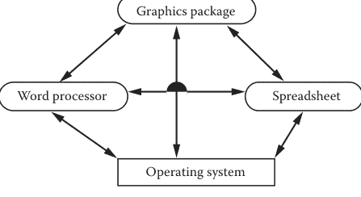

图 1.1 复杂的互连系统。

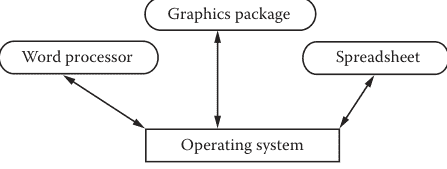

图 1.2 概念简单的互连系统。

图 1.2 所示的设计在概念上简单，设备驱动程序、标准和接口的主要复杂性隐藏在接口之中。无论何种情况，文字处理软件必须遵循先前指定的接口。这是软件行业的典型特征；不与现有软件建立接口的软件是稀少的。

这个简单的模型说明了解决系统复杂性问题需要一种系统的方法。涉及软件的软件系统的复杂性受其设计复杂性的影响。

软件还涉及质量问题。假设一家公司为了快速发布软件并抢先竞争对手上市，发布了一个包含严重缺陷的产品。作为一个假设性例子，假设该公司发布了一个包含严重缺陷的产品，在忙于快速发布软件并击败竞争对手时，由于包含边距、字体和样式等严重缺陷，导致任何使用这种未经充分测试的文字处理软件版本都不可能使用该产品。

有时，向产品添加新功能的决策可能基于技术因素，如 Internet 或云。无论数据是存储在本地还是远程，都有几种可能的方案：

1. 将所有软件存储在用户的本地计算机上。
2. 在需要时通过网络远程调用。
3. 将应用程序的核心存储在本地计算机上。
4. 将文档和应用程序都存储在远程服务器。

第一种方案的优点是不会改变公司的策略。风险是对于分散分布的用户来说，共享操作可能会受到损害。此外，还存在用户认为该软件性能跟不上要求的风险。

使用第二种方案意味着分发成本几乎降为零，并且可以通过电子方式从用户那里获得稳定的收入。当数据安全、计费信息和性能响应问题变得非常重要时，软件必须变得复杂。

第三种方案具有前两种方案的一些优点。例如，分发成本降低了，而且存储在本地计算机上的软件成本也更小了。遗憾的是，这种方案在技术方面也与第一种方案有共同缺点。

第四种方案是第二、第三种方案的自然延伸。这种方法存在一些性能上的，正如任何 Internet 用户所感知的。由于在用户存储时格式在用户屏幕上显示时可能会出现延迟，性能问题是关键的。

如果用户的关键或机密数据存储在用户或其组织控制的远程服务器上，就会出现明显的安全问题。自由软件基金会的 Richard Stallman 的这篇文章（Stallman, 2010）关于该主题非常值得阅读。

## 软件工程简介

类似的需求也适用于控制空中交通的计算机软件、飞机内部使用的软件、核电厂的核心控制系统、石油公司的化学工艺，或者监控医院中递送给患者的数十种药物的软件。

这些系统的测试和分析程度比文字处理软件高得多，因为它们关乎人类的生命和安全。“安全关键型”（safety-critical）一词被用来描述这类系统。显然，安全关键型软件系统所需的关注远比电脑游戏等软件得多。

然而，请注意，许多电脑游戏非常复杂，并且对计算机提出了很高要求，以实现许多用户所要求的写实水平。这就是为什么许多游戏是为强大的游戏机编写的，例如在 Microsoft Xbox 和 Nintendo 3DS 系列以及个人电脑中的那些设备。从另一方面，一些为智能手机编写的相对简单的游戏，如具有基础画面的《愤怒的小鸟》，已经取得了巨大的成功。

计算机游戏行业将发生什么变化？我在本书的“第二版序言”中提到过游戏制作公司 Zinga 计划的变更。这些变更是对当前和预期市场趋势的反应。

2008 年，在巴尔的摩工程学会位于该市历史悠久的 Vernon 地区举行的一场观众爆满的讲座上，Firaxis 公司的 Sid Meier 所说的话让不熟悉他职业生涯技术细节的观众感到惊讶：他是用 C 语言编程的。这基本上是 Objective 语言，但他对游戏规则和逻辑拥有最大的控制权，将视频、声音、音乐以及与面向对象游戏引擎的交互留给了其他人。这种分工现在在 Firaxis 仍在继续。要点在于，许多旧技术会持续很长时间，并且在我们可能认为的最先进的系统中是至关重要的。

让我们总结一下到目前为止讨论的内容。20 世纪 80 年代和 90 年代个人电脑的爆炸式增长。这种增长持续到今天，计算现在运行在智能手机、平板电脑和其他设备上。正如所示，早期软件产品的许多初始版本已经演变成非常大的系统，其所需的精力超过了个人能够投入到任何项目中的精力。现在有什么不同呢？

稍作思考可能会让你认为，像超文本标记语言（HTML）和带有应用程序接口的 Java 编程语言等标准改变了一切。还有更最近的发展。应用程序框架和云计算已成为主要参与者，以及具有专门用户界面的高度移动设备，如智能手机和平板电脑。

还有廉价、高质量的应用程序开发工具和软件开发工具包。有很多十六岁的青少年作为网页设计师赚取了大量资金，尽管在 2014 年这种情况相对较少，因为美国许多小学生在进入青少年时期之前就被教导如何设计网页。现在最紧缺的职业技能之一是“网页管理员”（web master）——这个职位名称在 1993 年还不存在。随意浏览在线招聘列表可能会让你认为，我们已经回到了 20 世纪 80 年代那个更加自由所欲的时代。

技术的影响确实是巨大的。事实也如此，几乎任何有倾向的人都可以在几分钟内学会足够的 HTML 知识来组合出一个华丽的网页。

然而，问题并没有那么简单。即使是极少数偶尔使用互联网的用户也注意到了系统性能的重大问题。等待模糊图片和在线动画的延迟降低了用户获取所需信息或服务的速度。如果这些内容在许多屏幕“显示空间”有限的便携式设备上无法正常显示，那是完全不可接受的。

网站的合理设计并不是一项平凡的练习。作为用户界面设计教学的一部分，我的一个学生被要求检查几所当地大学的主要网站，以获得几个问题的答案。对于这些简单操作，通过点击鼠标按钮选择了 5 到 11 次。在某些情况下，由于需要滚动超过一个屏幕长度、甚至更糟超过一个屏幕宽度的在线文档，需要更多的交互。设计的效率往往是一种美德。

几个问题对偶尔使用互联网的用户可能并不透明。也许最令人困扰的是缺乏系统的配置管理，服务器在移动，数据在动态重组，而客户端没有得到通知。谁没有被在尝试连接某个有趣的网站时经常出现的以下这条著名信息所烦恼过呢？

```
ERROR 404: File not found.
```

用户想要的信息发生了什么是显而易见的，至少在没有打字错误的情况下如此。正如我们在本书后部分看到的，网站的维护通常是“配置管理”的一种，即随着系统演变而变化的软件及相关制品进行系统化处理。

在确保服务器数据安全以及防止服务器与用户的客户端计算机发生意外交互方面，也存在重大问题。最后，将大型系统分解为客户端和服务器子系统并不是一件简单的事，如果设计糟糕，将产生严重的后果。

显然，软件工程是为了以高效的方式进行现代软件开发。这些新技术已经拒绝让软件工程包含市场力量对软件开发的影响。正如我们将看到的，这些新技术适用于良好的软件工程实践。

我们将在下一节详细地考虑项目规模及其与软件团队之间的关系。

## 1.2 软件团队真的是必须的吗？

你可能计划成为（例如）智能手机等独立应用程序的开发者，并怀疑所有形式化是否都是必要的。这里是一些现实情况。App Store 上有超过百万个针对 iPhone 和 iPad 的应用程序，结果就是人们很难找到你的应用。你可能听过一位程序员，他开发的某个 App 在一天内售出了 17,000 份，然后他辞职成为全职 App 开发者。你可能听说过 Nick。

一些轶闻表明，对于比典型应用规模更大的系统，软件工程师团队并非必要。例如，MS-DOS 操作系统的初始版本大部分由微软的 Bill Gates 和 Paul Allen 开发。Apple II 的 Apple DOS 操作系统是由 Steve Jobs 和 Wojniak 创建的，其中 Wojniak 完成了大部分工作。UNIX 操作系统最初是由 Dennis Ritchie 和 Kenneth Thompson 开发的（Ritchie and Thompson，1978）。第一个流行的电子表格程序 VisiCalc 主要由一人 Dan Bricklin 编写。列表还将继续

时代发生了很大变化。原始 PC-DOS 操作系统运行在具有 64K 随机访问存储器的机器上。它现在作为应用程序运行在终端窗口中。Apple DOS 操作系统使用的内存较少；它仅需 16K。UNIX 最初是为 PDP11 系列微机开发的。VisiCalc 的版本运行在 Apple II 和基于 886 的 IBM PC 上。其后继程序的执行文件要大得多。

事实上，PC-DOS 长期以来已被微软 Windows 的多个变体（如 Windows 8 和 10）取代。Mac Apple DOS 被 OS X 等取代。UNIX 仍然存在，但变得大了很多，其内核（操作系统始终留在内存中的部分）远大于其最初编写的 PDP11 计算机的内存空间。内核的大小导致 Lin Torvalds 开发了一个较小的内核，该内核已发展为流行的 Linux。


`VisiCalc`不再作为商业产品存在，但它的两个后继者`Excel`和`Numbers`在执行文件大小上要大几个数量级。目前版本的`Excel`包含用`C`和相关语言编写的百万行代码。有关`Excel`的更多信息，请参阅`Michael Cusmano`和`Richard Selby Cusmano`的著作及文章（`Cusmano and Selby, 1995`）。

开发此类复杂系统的额外精力并不廉价。在其重要的著作《人人神话》中，`Fred Brooks`提出了一个经验准则：一个由一人或两人创建的软件项目需要额外的九倍原始开发精力，才能从一个仅供创建者使用的工具变为其他人有用的工具（`Brooks, 1975`）。`Brooks`的准则在今天看来也仍然有效。听到`Hari Srinivasan`在讨论医疗保健网站部署问题时引用`Brooks`的书，这非常有趣。

# 引言 9

针对《负担负担医疗法案》下提供的保险交易所进行注册（`PBS NewsHour, 2013年10月23日`）

理解软件的初始原型版本（通常由极小的人群完成）与需要庞大组织结构的版本之间的区别至关重要。今天，任何类型的商业软件都需要一个稳固的用户界面，这在桌面设备、笔记本电脑以及更大的全屏平板电脑上通常是图形化的。智能手机的用户界面必须更简单，以便在这些设备较小的屏幕上变得实用。平视显示和其他可穿戴设备（如`Google Glass`）有自己的界面问题，遗憾的是，这些问题远超本书的涵盖范围。

测试在现代软件开发中至关重要，而且需要一个技术支持组织来回答客户的问题。对于正在学习软件的新手用户，以及希望通过使用该软件包的高级功能来提高效率的资深用户来说，文档必须清晰且易于使用。时间和规模上的巨大压力几乎总是意味着软件项目需要多人参与。一个开发周期为几个月的软件产品，乘以布鲁克斯（`Brooks`）的 8 倍保守系数，意味着需要四年才能准备好发布——假设人小时所需的时间按同样比例扩大。当然，该产品在年后可能已经过时，因为软件行业的其他部分并没有停滞不。（这也是敏捷软件流程变得日益流行的原因之一。）

大多数催生软件公司的成功项目在雇人数上都变得大得多。显然，即使最初由一或两个创业者开发的软件，现在也是由他们开发的。即使是极其成功的互联网浏览器公司和组织（其初始版本很大程度上归于一个小团队的努力），现在也雇佣了许多软件工程师，以增加可用功能、确保在多个环境中的可移植性、提高广泛用户的使用用性，甚至提供充分的文档。

软件团队应该有多大？最重要的因素似乎是项目规模，团队成员的能力、进度安排和方法论同样重要。我们将在第 2 章讨论软件项目规模的估算。目前，只需记住一点：你的软件可能会在团队环境中开发。

现代团队可能是高度分布的，团队项目的一些主要部分可能完全外包。外包带来了其自身的一系列复杂性，正如我两个亲戚的经历所示：其中一个负责电子健康记录系统的大型项目，另一个负责网站到数据库的接口。`Lisa Kaczmarczyk`在 2013 年的一篇文章中对外包软件开发协调中的某些文化问题进行了有趣的讨论（`Kaczmarczyk, 2013`）。请记住，与执行这些外包工作的实体进行协调的问题可能非常复杂，你可以通过观察你组织的资深人员或管理层如何处理不可避免发生的外包软件问题，学到很多知识。

## 1.3 软件工程的目标

显然，参与软件生产的组织有强兴趣确保软件按照认可的行业实践进行开发，具有良好的质量控制、遵守标准，并以高效及时的方式完成。对于某些组织来说，这对组织本身以及软件的潜在用户来说，都是关乎生死的问题。软件工程是描述遵循这些原则的软件开发的术语。

具体而言，软件工程是指在通常公认的一系列目标背景下，用于软件的分析、设计、实现、测试和维护的系统化程序。生产软件应该是高效、可靠、易用、可修改、可移植、可测试、可维护、具有互操作性且正确的。这些术语既指系统也指它们的组件。许多术语是自言自明的；然而，为了完整起见，我们包含了它们的定义。你可以参考最近编写但仍然可用且实用的`IEEE`计算机术语表（`IEEE, 1990`）或《软件工程知识体系》（`SWEBOK, 2013`）来获取相关定义。

- **效率**——软件在预期时间内并在可用资源范围内生产。运行的软件在完成各种计算所需的预期时间内运行。

- **可靠性**——软件按预期执行任务。在多用户系统中，即使系统有其他负载，系统也能执行其功能。

- **易用性**——软件可以正确使用。这通常指的是用户界面的易用性，但也涉及软件对计算机操作系统、实用功能以及应用环境的适用性。

- **可修改性**——如果系统需求发生变化，软件很容易更改。

- **可移植性**——软件系统可以迁移到其他计算机或系统，而无需对软件进行大规模重写。只需要重新编译即可在新机器上正常运行的软件被认为具有很强的移植性。

- **可测试性**——软件可以很容易测试。这通常意味着软件是以模块化的方式编写的。

- **可重用性**——部分或全部可以在其他项目中再次使用。这意味着每个软件模块都有定义良好的接口，且每个模块的执行结果都有明确的定义。这意味着最经常重用的模块具有相当程度的抽象和通用性。

- **可维护性**——如果发生问题，软件随着时间的推移很容易理解和更改。这个术语通常用于描述长期系统的寿命，例如必须运行几十年的空中交通管制系统。

- **互操作性**——软件系统可以与其他系统进行正常交互。这既适用于单台独立计算机上的软件，也适用于网络上使用的软件。

- **正确性**——程序产生正确的输出。

然而，这些目标本身并不能帮助开发满足这些目标的软件。本书将讨论有助于开发高质量软件的系统化过程和技术。我们在本书中作为讨论基础的软件系统通常规模太大，无法由单个人完成。

## 1.4 典型的软件工程任务

每个软件工程项目都包含若干任务：

- 问题分析

- 需求确定

- 软件设计

- 软件解决方案编码

- 代码测试与集成

- 软件安装与交付

- 文档编制

- 维护

- 质量保证

- 培训

- 资源估算

- 项目管理

# 12 软件工程引论

创建它们的应用程序。用户界面的变化也是深远的，使用了“电容式触摸”技术，其中单指滑动和多指触摸都是用户界面的一部分。

遗憾的是，对软件培训的讨论超出了本书的范畴。

我们将简要介绍软件开发中必要的其他活动。这些活动大部分将在单独的章节中详细描述。你应该注意，这些任务通常不是在孤立的情况下进行的。相反，它们是作为一个组织的活动序列执行的，这被称为组织的“软件生命周期”。在下一节关于软件生命周期的介绍中，将描述软件开发活动排序的几种不同方法。现在，假设每个软件开发组织都有自己特定的软件生命周期，在该周期中规定了这些活动的顺序。

组织软件生命周期的需求阶段涉及精确确定系统将具有的功能。如果预先知道某个单一客户或一组客户，则需求过程将需要客户与团队中的需求专家之间进行讨论。这种场景适用于开发控制飞机飞行的软件过程。

如果没有可以立即识别的客户，但有一组潜在的相同客户，则可以使用市场分析和偏好测试等其他方法。这种方法可能适用于智能手机或平板电脑应用的开发，或者用于互联网的简单软件包。

开发软件需求的过程如此重要，以至于我们将整个第3章都用于这个主题。

设计阶段涉及获取需求并制定一个计划和表示形式，以便将需求转换为源代码。软件设计者必须在设计方法论以及估计替代设计选择中的权衡方面丰富的经验。设计者必须了解可用软件系统的特性，例如数据库、操作系统、图形用户界面以及可以帮助最终编码过程的实用程序。软件设计将在第4章中讨论。

编码对大多数学生来说是熟悉的，在此处无需讨论。然而，我们注意到，关于使用面向对象或过程语言进行编码的决策可能会推迟到软件生命周期的这一阶段，或者它们可能在设计甚至需求阶段就已经做出。由于在许多第一、二级编程课程中，编码标准往往被忽视，而这些标准对于逻辑严密的工业型系统，以及在进入应用商店上架前为了质量开发的小型应用都至关重要，我们将详细讨论编码标准。软件编码将在第5章涵盖。

初级软件工程师很可能被分配到软件测试或软件维护工作，后者是一项通常在软件创建后开始，但在被判断为准备好交付客户之前很久就已经开始的活动。它通常包含软件集成中，软件集成是将单独模块组合成更大的软件系统的过程。软件集成通常需要集成现有的软件系统以构建大型系统。软件测试和集成将在第6章中讨论。

文档包含的内容远多于源代码的注释。它涉及需求和设计的原理、帮助文件、用户手册、培训手册、编程参考手册等技术指南以及安装手册。即使是源代码的内部文档也比初级程序员认为的要复杂得多。源文件的文档和注释行数是实际可执行代码行数两倍的情况并不罕见。

在软件设计、编码、测试和文档化之后，必须进行交付和安装。软件文档、交付和安装将在第7章中讨论。

软件维护术语用于描述软件发布后进行的活动。维护包括修复软件中的错误；将软件迁移到新的环境、计算机和操作系统；以及增强软件以增加功能。对于许多软件系统来说，维护是软件开发周期中最昂贵且最耗时的任务。我们已经讨论过独立应用的维护。软件维护将在第8章中进行详细讨论。

当然，所有这些活动必须经过协调。项目管理可能是软件工程中最关键的活动。遗憾的是，仅凭参与大型软件开发项目的经验很难理解项目管理活动的细节。因此，我们选择在第2章中介绍项目管理活动的概述。后面的每个章节都将包含一个部分，介绍对本章讨论的技术活动的典型管理观点。

质量保证（或`QA`）关注的是确保生产的软件产品以及开发软件的过程都符合组织的质量标准。`QA`团队通常负责制定标准。在许多组织中，`QA`团队与软件开发团队的其他部分是离开。`QA`将贯穿全书，而不是放在单独的章节。我们选择这种方法是为了强调质量不能简单地在软件项目开发的末尾添加。相反，质量必须是创建软件所使用的工程过程的结果。

## 1.5 软件生命周期

在上一节中，我们讨论了通常作为软件工程系统过程组成的不同活动。正如我们所看到的，有许多这样的活动。知道这些活动会在软件产品的生命周期内发生，并不能告诉你这些活动发生的时机。这些活动可以按照严格的顺序发生，每个活动在下一个活动开始之前完成，也可以若干活动可以同时发生。在某些软件开发组织中，这些活动大部分只执行一次。在其他组织中，若干活动可能会迭代多次，例如，只有在完成了几次设计和源代码实现后，需求才最终确定。这些活动的时机以及在迭代与非迭代方法之间的选择通常被称为软件开发模型。

我们将在本介绍部分简要讨论六种软件开发生命周期的基本模型：

- 经典瀑布模型

- 快速原型模型

- 螺旋模型

- 市场驱动模型

- 开源开发模型

- 敏捷开发模型

（本书第一版仅描述了列出的前四种循环模型。还有第七种软件生命周期，称为硬件和软件并行开发（或协同开发），它超出了本书的范畴。）

每个生命周期模型都将在单独的章节中讨论。为了简单起见，我们将在对各种软件开发模型的讨论中省略文档。请记住，所描述的模型描述的是“纯过程”；在任何实际的软件开发项目中，这里描述的过程可能会有许多变体。

### 1.5.1 经典瀑布模型

软件开发过程的常见模型之一被称为经典瀑布模型，如图1.3所示。该模型几乎专门用于为某个特定客户创建软件的情况。在没有已知客户的应用程序中，该模型基本上不会被采用，例如为多个零售买家设计的商业市场软件。

在最简单的瀑布模型中，软件生命周期中的不同活动被认为是顺序发生的。唯一的例外是图1.3中相邻的两个活动可以通过反馈进行通信。这种人工性是该模型在工业界不再被广泛使用的主要原因之一。第二个原因是技术可能会使原始需求集过时。尽管如此，该模型作为软件开发生命周期的说明仍然具有启发意义。

诸如图1.3所示的生命周期模型展示了许多主要软件开发活动的顺序，至少在高级层面上是。例如，系统需求的规范将在模块测试之前发生。从这个软件开发生命周期的抽象中也可以清楚地看到

## 引言 15

## 规范

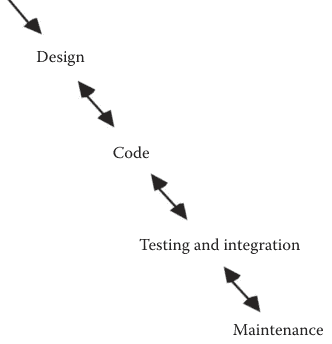

图 1.3 经典瀑布生命周期模型的简化插图。

仅在某些成对活动之间存在反馈：需求规范与软件设计；源代码的设计与实现；编码与测试；以及测试与维护。

从该插图中尚不清楚的是不同活动之间的关系，以及一个活动结束而下一个活动开始的时间点。这种对经典瀑布模型的风格化描述通常通过一系列里程碑来增强，生命周期中的每两个相邻阶段在此进行接口。图 1.4 给了一个基于经典瀑布模型的软件开发过程的简单里程碑图示例。

通常，软件系统设计人员有多次机会与软件系统的需求规范进行交互。系统的需求通常通过一系列需求评审提交，这些评审可能命名为初步需求评审、中期需求评审以及

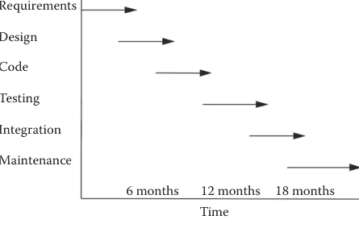

图 1.4 经典瀑布软件开发过程的里程碑图示例。

对于几乎所有使用经典瀑布软件开发模型的组织，在关键需求评审中提交的需求被设计人员和客户接受的操作将标志着需求阶段的“官方”结束。

使用经典瀑布软件开发模型的决策有一个主要的后果。设计人员在初步评审和（被接受的）最终（或关键）需求评审期间的任何工作，如果它与需求的任何变化不再一致，则可能需要重新进行。这迫使软件开发活动本质上遵循图 1.3 所示的顺序。

请注意，经典瀑布模型的需求规范阶段与设计阶段之间的边界并没有特殊之处。设计和实现阶段也是如此，系统设计将在初步设计评审、中期设计评审和最终（或关键）设计评审中获得批准。该模式同样适用于生命阶段之间的其他接口。

经典瀑布模型对于那些可以在合理时间内确定系统需求，且这些需求在开发期间不太可能发生很大变动的软件开发项目来说，非常有吸引力。当然，在许多情况下，这些假设并不成立。

### 1.5.2 快速原型模型

由于经典瀑布模型的局限性以及设定需求到交付产品之间很长的时间，许多组织遵循软件开发的快速原型模型或螺旋模型。这些模型是迭代的，要求作为软件开发过程的一部分创建一个或多个原型。无论是否有已知的客户都可以应用该模型。快速原型如图 1.5 所示。（螺旋模型将在第 1.5.3 节中讨论。）

软件开发快速原型模型的主要假设是，在软件设计和实现之前，软件软件完整的需求规范

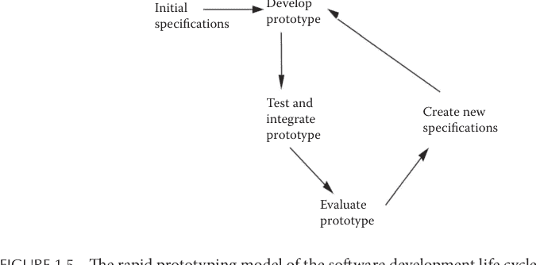

图 1.5 软件开发生命周期的快速原型模型。

## 引言 17

相反，软件是增量开发的，规范随着软件本身而发展。快速原型方法的核心点是，产生的最终软件项目被认为是一系列软件原型中最可接受的一个。

现在将更详细地解释快速原型方法，通过一个你可能对其开发历史熟悉的系统来阐明基本原理：微软`Internet Explorer`网络浏览器的初始开发。（同样的问题在很大程度上适用于`Mozilla Firefox`、`Apple Safari`和`Google Chrome`浏览器的开发。）让我们考虑微软所处的环境。出于战略考虑，公司决定进入`Internet`浏览器领域。`Mosaic`和`Netscape`等产品的成功意味着开发路径在某种程度上受到了限制。必须支持`HTML`，并让大多数现有的网页能够被新浏览器读取。用户界面必须具有与`Netscape`和`Mosaic`功能相似的许多特性。然而，用户界面必须与这些系统有本质区别，以避免版权问题。

一些新功能无法预先指定。例如，新系统必须包含一个`HTML`文档的解析器。此外，用户界面必须由鼠标驱动。

然而，必须对用户界面的可用性进行仔细测试。在用户界面达到微软满意的测试之前，预计软件将进行多次迭代。测试软件的用户将被要求评价`Internet Explorer`每个版本中提供的可用功能集。用户界面不仅需要正常工作，软件还必须有一组足够价值的功能集，使得其他潜在用户（如果他们已经在使用某个`Internet`浏览器）就会切换，或者（如果他们从未使用过此类产品）就会购买微软`Internet Explorer`。

因此，该软件的开发过程必须是迭代的。软件作为一系列原型进行开发，每个原型的规范根据来自用户的反馈进行调整。许多迭代反映了微小的变化，而另一些则响应了破坏性的变化，例如带有独立操作系统的小屏幕浏览器和平板电脑的移动浏览器，以及与许多`Adobe`产品互操作的需求，例如。

现在让我们考虑此浏览器的更新。有很多可以添加的功能，但我们必须优先考虑先实现哪些功能。我们决定添加对新版本`CSS`的支持，这种`CSS`在当时变得越来越流行。我们还想添加一个更好的搜索功能，让用户能够更快地在网站内找到信息。这些更改随后实现在下一个原型中，我们再次对用户进行测试以获取反馈。这种迭代过程允许我们精炼软件，并确保它满足用户的需求。

## 引言 18 软件工程导论

- 9. 使初始更新的网站具有基本功能，仅包含带有可用链接的静态网页。

- 10. 在创建网站的过程中不断地对其进行迭代测试，确保所有链接都能直接工作。

- 11. 移除不必要的编程，例如在那些对编程几乎没有益处的简单页面上移除`JavaScript`编程。这样做是为了安全考虑。

- 12. 将网站的这部分发布给成员和整个外部。

- 13. 使用新版本的`MySQL`替换数据库软件，并配合更新后的应用程序软件。这些都是通过改进的安全访问完成的。将所有这些内容放在网站新创建的受保护区域内，该区域专门供我们的成员使用。

- 14. 让少数个人访问，并在整个重构过程中测试安全功能。根据他们的测试结果，我将尽可能修复所有问题。

- 15. 向网站用户社区发布最终版本。

我们现在逐一考虑这些步骤。

幸运的是，我获得了网站原`Internet`托管服务的许可，可以访问该账户，足够我将网站的所有文件移动到我的家用电脑上。我能够使用一种非常快速免费软件`Filezilla`，它使用`FTP`传输协议进行并发文件传输，这比批量传输每个目录和每个子目录快得多。

当然，原网站的创建者并没有所有文件的完整备份。这些文件的命名没有遵循任何一致的文件命名标准，因此需要一个学习过程来查看每个文件包含的内容，以及超链接与哪个文件对应。

更糟糕的是，用于创建网站的软件工具`Netscape Communicator`在新托管公司的系统上不再工作了。事实上，`Netscape`这公司已经不存在了。

对可用工具的实验说服了我，我必须从头开始通过原始`HTML`来重新创建网站大部分页面。显然，唯一合理的方法是迭代的，让所需的细节和实现共同演进。

我对新网站上可能存储的数据量，以及每月可能传输的数据量做了一个简单的计算。掌握了这些信息后，我为托管公司选择了一个特定的方案包。（由于费用很小，我决定自己承担托管费用，以避免向委员会申请，以便在年底收到一封代表组织感谢我支出的信，而不是为了获得每项小开支的批准。有了这封信，我可以将这笔费用视为慈善捐赠。）然后我将目录上传到新的网络托管公司站点。


显示了使用过时且不可用的网站设计软件创建的原始 HTML 部分。它看起来真的很丑。那是几年前，一位名叫 Howard Siege 的本科生（他现在是一位非常成功的计算机顾问）正在开发一个 HTML 翻译器，该翻译器会标记 HTML 4 中在 HTML 5 中执行可能会导致问题的异常，他描述这段代码为“不成熟的”。它确实不成熟，从下面的 HTML 代码片段中看出，其目的是在特定页面的固定位置插入一个标记为“Md-Map”的可点击标签。

```html
begin("auto","0","0","vertically","","","0","0","2","3","#ff0000","","","tiled",
"000000", "1","solid", "0", "Wipe right",
"15", "0", "0", "0", "0", "2",
"#777771", "false", "000000", #000000,
"simple")
appendSTMI("false", "Md-Map&nbsp;", "center", "middle", ""," "-1",
-1", "normal", "#f3c3a", #ff0000, "1",-1",-1", "blank.gif",
blank.gif, "1",-1", "0", "","mdmap01.html", "self", "Arial", "9", #0000
0", "normal", "normal", "Arial", "9", #ffffff, "normal", "normal",
"none", "2", "solid", #000000, #000000, #000000, #000000,
"000000", #000000", #000000, mdmap01.html, "", "tiled", "tiled")
```

注意，对象和属性之间很少分离，这是面向对象编程的一个常见问题。你没有的是我必须在整个代码中手动输入换行符，因为这些 HTML 语句是在没有任何中断的情况下产生的，所以书中显示的由多行代码组成的两个块仅以非常长行的形式存在。显然，更改代码过程的第一步之一就是插入这些硬换行符，并检查每次插入是否保持相关网页的功能未变。（代码片段末尾附近的点反映了为了清晰起见省略了许多行 HTML 代码。）

一旦我修复了换行符以便能够智能地读取代码，我就查看了文件结构并为文件名开发了一些命名规范。然后我细致地一个接一个加载网页，检查所有超链接，并在过程中将文件名更改为标准命名规范。我创建了一个表格，列出了我所做的所有更改以及它们是否解决了发现的问题。

我尽快让网站可以运行，专注于静态网页。我移除了一些诸如使用 JavaScript 的页面，在我看来，这些页面并没有足够的功能来证明旧版本 JavaScript 的安全问题。在这个最小化网站运行并正常工作后，我可以专注于我需要包含的更动态、更复杂的功能。

# 20 软件工程导论

# 21

最后两个步骤是安装构建在 MySQL 数据库之上的数据库系统，并创建一个仅供组织成员访问的受保护区域。讨论遇到的数据库和安全问题会将我们带离软件工程讨论太远。

令人惊讶的是，成员访问网站成员区域的主要问题是由于需要清除浏览器数据缓存，他们的密码经常不起作用。用户计算机上的许多浏览器处理缓存数据有不同方式，我必须单独响应每个用户。我很清楚，我讨厌做客户服务，但我对在帮助台技术支持的人有了更多的欣赏。到此时，这个项目已经从重构旧网站、重用大部分代码以及开发多个原型（每次都是更新网站）的结合，演变成了网站的维护。

### 1.5.3 螺旋模型

另一种迭代软件开发生命周期是 Barry Boehm 开发的螺旋模型（Boehm, 1988）。螺旋模型与快速原型模型的主要区别在于在评估期间对每个原型进行软件风险评估的显式强调。“风险”一词用于描述潜在的灾难。

## 22 软件工程简介

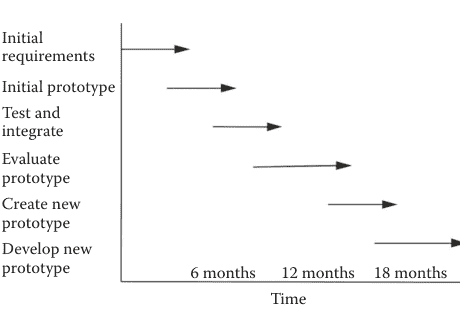

图 1.6 快速原型软件开发过程的里程碑图示例。

软件项目。注意，该模型几乎不会应用于没有已知客户的项目。

显然，灾难有几个等级，且不同的组织和项目对相同情况的看法可能不同。软件开发项目中常见的灾难性情况示例包括：

- 软件开发团队无法在分配的预算和进度内交付软件。

- 软件开发团队能够交付软件，但超出了预算或进度，且尚在允许的超支范围内（这并不总是灾难性的）。

- 软件开发团队无法在任何类似于类似于分配的预算内交付软件。

- 在投入了大量的时间和资源后，软件开发团队确定无论如何都无法按照预期的需求构建软件。

规划也是螺旋开发模型中使用的迭代过程的一部分。螺旋模型如图 1.7 所示。

正如我们之前看到的经典瀑布模型和快速原型软件模型一样，里程碑图也可用于螺旋开发过程。这种里程碑图如图 1.8 所示。将图 1.8 的图与图 1.4 和 1.6 中的里程碑图进行比较。为了简单起见，仅包含了里程碑图的一部分。

快速原型模型和螺旋模型都被归类为迭代模型，因为在生产最终产品之前有多个可以评估的中间软件实例。

很容易看出迭代方法与经典瀑布模型之间的区别；瀑布模型没有规定迭代以及与潜在客户的交互。

## 23 简介

目标、目的 评估

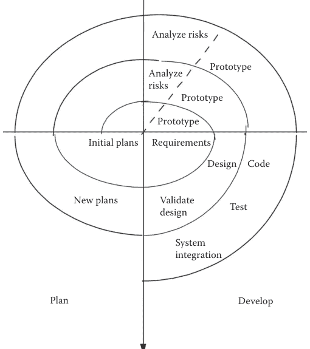

图 1.7 软件开发周期的螺旋模型。

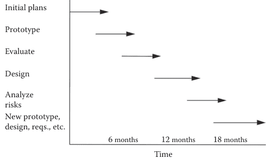

图 1.8 螺旋软件开发过程的里程碑图示例。

在需求完成后。相反，客户必须等待开发组织交付最终产品。许多（并非所有）使用经典瀑布模型的组织允许客户参与设计评审。即使客户参与了详细设计的评估，这通常也是客户与开发人员之间的最后正式交互。

## 24 软件工程简介

开发者，且客户在最终交付之前通常感到不安（通常在交付后也感到不安）。迭代式软件开发方法受到客户欢迎这并不不足为奇。

### 1.5.4 市场驱动型软件开发模型

应当明确的是，书中之前描述的任何软件生命周期模型都不直接适用于面向普通消费者市场的现代软件开发。之前讨论的模型假设有时间进行相对完整的初始需求分析（如经典瀑布模型所示）或进行迭代分析（如快速原型模型和螺旋模型所示，这些模型带有风险评估和对不满意原型的处理）。例如，这些模型并没有解决面向个人电脑和各种移动设备的软件开发的现实问题。在这里，驱动开发过程的主要压力是让产品以足够的质量进入市场以满足消费者，并具有足够的理想功能来维持甚至增加市场份额。

这是一种软件开发相对较新方法，目前还没有出现精确的、公认的此类软件开发过程模型，至少在通用文献中还没有。现实情况是，营销部门通过要求增加新功能来驱动过程，直到产品接近目标发布日期。因此，没有“需求冻结”的概念，这是之前模型的共同假设。

我们指出了市场驱动的“并发工程”存在的问题，如图 1.9 所示的样式化里程碑图反映了许多产品每年有多次发布的情况。

我们强调，即使是单个程序员编写的小型应用程序也有预期的维护周期。假设你为手机编写了一个应用程序，如果发现错误或底层技术发生变化，应用程序必须更新。

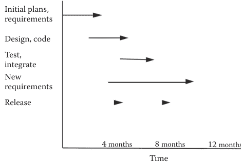

图 1.9 基于市场的并发工程软件开发过程的里程碑图示例。

## 25 简介

开发者不这样做或速度缓慢，会导致差评，销售额将下降。

即使是21世纪初的偶然观察者也会注意到，许多成功的软件公司由远见卓识者领导，他们看到了对许多人有用的事的机会。我希望本书的读者具有见解并开发出成功的软件。

幸运的是，现在任何面向未知客户的软件分发比过去容易得多。它几乎肯定通过下载交付，消除了软件创建者制作大量光盘或DVD并与商店安排架位维护库存的工作。

### 1.5.5 开源软件开发模型

开源软件开发基于一种基本信念：软件的知识内容应公开供任何人进行修改。因此，任何项目的源代码应该是公开的。正如我们在稍后部分讨论的，“免费”并不意味着“免费”，而是由于缺乏所有权，软件可以根据任何目的进行修改。

使源代码可用是容易的部分。困难在于如何让不同地区的人开发的各种源代码组件具有组织性、可维护性且质量足够。如何做到？

为了回答这个问题，我们将开源项目的讨论分为两个大类：(1) 为了共同利益的新计算机语言、编译器、软件库和工具函数项目；(2) 重用开源版本的计算机语言、编译器、库和工具函数来创建特定目的的软件系统。

权威人员或小组决定创建一个特定类型的软件应用程序或工具。设定初始需求并开发相对较少的软件模块。它们通过发布在网站上（可能是与包含完整项目的不同的网站）向开源社区公开。

希望向项目做出贡献的开发者社区。这些开发者在一个或多个相关的源代码模块上工作，并测试模块性能直到满意，将模块提交给权威人员或小组审批。如果模块看起来满意，就会上传到网站，任何人都可以下载、阅读源代码并测试代码。任何人都可以对代码发表评论并修改它。唯一的规则是这些

只要源代码始终免费提供，任何更改都必须对任何人可用。

对这一广泛社区的成就和创成果进行利用，并对其进行免费访问，是开源软件开发的基础。

如果开源程序员大群体不被允许对他们的软件作品收费，那么他们是如何赚钱的呢？通常有两种常见的方法。最资深、最具权威的人士通常拥有开发系统的巨额合同，前提是开源组织生产的软件源代码必须向公众免费提供。除了来自志愿者和各种用户社区成员的捐赠外，这些巨额合同也是维持自由软件基金会（Free Software Foundation）持续运营的大部分资金来源。

除了上述资金外，开源社区的成员通常还通过从事软件咨询来赚钱，利用了他们对许多作为开源系统开发的重要软件产品内部结构的深入了解。作为系统中使用的某些主要模块的开发者，是关于该系统如何运作以及该系统在安装、配置和运行中涉及哪些问题的强有力证据。

请注意，许多捐出时间和精力为各种项目创建源模块的程序员，通常由开发开源软件系统的公司雇佣。这似乎是这些志愿者认为自己可以更有创造力的一种，因为他们可以决定哪些项目对他们最感兴趣，而不是被分配的某些项目。有一个轶事证据支持这一观点。我在一次学术软件工程会议上与同事交流时，曾听过这样的说法。当2006年比尔·盖斯访问哈佛大学时（我正担任系主任），问他是否知道这一点，他同意这是一种可能的情况。（在2004–2005学年，哈佛大学进入微软的学生人数比美国任何其他学院或大学都多，盖斯作为六大学巡回的一部分来到我们这里，目的是增加计算机科学的入学率。微软通常不被认为是一家以开发开源而闻名的公司。）

我们现在考虑开源开发的第二类：重用这些计算机语言、编译器、软件库和实用函数的开源版本，以便为特定目的创建一个新的软件系统。

我们没有尝试对开源软件开发给出精确的定义，因为它在实际实践中的用法存在差异。请注意，开源并不意味着免费。

Quentin Hardy（海特）于2014年7月28日在《纽约时报》上发表的一篇文章描述了 Big Switch 公司如何从一种完全开源的开发模式转向一种并行开发模式：一种是完全开源的软件，另一种是包含许多具有商业价值的专有且因此不免费的特征。这种方法与几个 Linux 软件分销商的方法某些相似之处，特别是红帽（现在的 Fedora）、Ubuntu 和 Debian，它们提供了许多免费服务，但对咨询和其他一些其他服务是收费的。特别是，某些公司更倾向于为他们使用的开源软件支付维护费用，而不是依赖志愿者。

关于开源软件与免费软件区别的另一种视角，请参阅自由软件基金会网站上的哲学说明，URL 为 `https://www.gnu.org/philosophy/free-software-for-freedom.html`。本文将不再进一步讨论开源软件这一精确定义的问题。

### 1.5.6 软件开发的敏捷编程模型

敏捷开发概念的根源至少可以追溯到洛马希德（Lockheed）的“Skunk Works”，即现在被称为洛马希德·马丁公司的工程项目。（2015年5月5日访问的一篇维基百科指出，“Skunk Works 是洛马希德·马丁高级开发计划 [ADP] 的官方别名，以前被称为洛马希德高级开发项目。Skunk Works 于 20 世纪 40 年代初二战期间形成。

该术语仍用于描述高度自治的团队和项目，这些项目通常是高度先进的。许多 Skunk Works 项目使用了技术（基于组件的软件开发的先驱），以及现有软件组件的效率，这些组件的规模可以大到子系统。

现在被称为敏捷编程的原则通过《敏捷宣言》描述得最为恰当，可以在 `http://agilemanifesto.org/principles.html` 找到，为了方便起见，其基本原则列在此处。

### 敏捷宣言背后的原则

我们遵循这些原则：

- 我们的最高优先级是通过早期和持续地交付价值软件来满足客户的需求。

- 欢迎新的需求，即使在开发后期。敏捷流程利用变化来提高客户的竞争优势。

- 频繁交付软件，时间周期从几周到几个月不等，并倾向于更短的时间尺度。

- 业务人员和开发人员在整个项目中必须合作工作。给予他们所需的环境和支持，并信任他们能够完成工作。

- 在开发团队内部及之间传递信息的最高效、有效的方法是面对面交流。

- 运行的软件是衡量进展的主要标准。敏捷流程促进可持续开发。赞助者、开发者和用户应该能够无限地保持恒定的节奏。

- 对技术卓越和良好设计的持续关注可增强敏捷性。

- 简单性——最大化“不做工作”数量的艺术——至关重要。

- 最好的架构、需求和设计源于自组织团队。

- 团队定期反思如何变得更有效，然后相应地调整和优化其行为。

## 28 软件工程导论

这些原则中的一些可能是显而易见的。

- 敏捷开发是原型设计的一种形式。

- 它依赖于开发团队非常熟悉的、高质量且运行良好的组件。

- 由于工具包的可用，该模型也适用于移动设备的软件。一个典型的例子是用于应用程序的框架。

`scrum` 一词用于敏捷开发的背景下。最初，该术语经常用于描述每天结束时协调利益相关者想法和成就的会议。该术语受橄榄球运动的启发。更多地用于描述 `scrum.org` 的产品。通常，该词首字母大写，这也是我们将遵循的模式。

我们将在书中多次回到敏捷开发。

### 1.5.7 所有软件开发模型的共同特征

许多组织都有它们自己的软件模型变体，并意识到在任何情况下，任何模型都是实际软件开发的样式化近似。即使是为政府工作的数百万美元项目的承包商也可能由于技术的破坏性变化而必须以迭代方式开发某些原型。市场驱动的生命周期可能会更多事情同时发生。我们在书中不再进一步讨论这些生命周期模型的细微差别。

生命周期模型有很多变体，但这些是最常用的。注意每个生命周期模型中的许多活动是类似的。主要的区别在于活动的时间，以及如果使用迭代方法（如快速原型或螺旋开发模型），初始原型的一些部分将被丢弃。

关于生命周期活动的时间点可能会被过度强调。各种生命周期模型充其量是对过程的样式化描述。大多数组织都有自己在软件开发期间遵循的程序。当然，你应该遵循雇主设定的指南。只需注意，这些是无论发生顺序如何必须发生的一系列基本活动。

### 1.5.8 软件演进与购买还是重构的决策

### 软件演进

除了单个程序员为自己编写的小型独立程序外，几乎所有软件产品都会随着时间而改变。例如，2014 年5 月，我的 iPhone 的 iOS 操作系统版本是 7.1.1，我的 MacBook Air 的操作系统是 10.9.2，Word 的版本是 14.4.1。

# 引言 29

我的台式机运行的是 Windows 7（Windows 7 专业版），还可以运行一个 Windows XP 模拟器，我几年来需要它来运行特定版本的出版软件。（我不再使用 Windows XP 模拟器了，因为微软已经结束了对这个老旧系统的支持）。我的台式机 Mac 与 MacBook Air 使用相同的操作系统版本。

这种情况在较小的设备上也是如此。2Screens Remote 允许我的 iPhone 控制加载到 iPad（1.5.2 版本）2Screens 应用中的 Apple Keynote 演示文稿。我收到通知，Delta 应用的 2.6.1 版本已发布，我应该通过 App Store 更新到最新版本。

你应该将所有这些软件看作是随时间不断演变的，包含了错误修复、功能增加，或者例如让应用程序软件在新的操作系统上运行的需求。“软件维护”这一术语通常被用来描述这种演变。显然，软件的这种演变需要在设计、编码、测试和集成方面投入努力。这种努力显然涉及时间、人员和其他资源。随着软件工程师从一个职位流到另一个职位（在公司内部或最常见的是在公司外部）的典型流动，在维护这些软件方面存在着真实需要做的决策。

对于长寿命系统，估计在软件整个寿命范围内，超过 80% 的总成本发生在初始交付后的维护阶段。SEER 软件成本估计工具的创建者 Dan Galator 在他的模型中使用 75% 这一比例。SEER 网站 `http://www.galator.com/index.php/software_maintenance_cost`。这些成本如此高的原因之一是，软件维护工程师需要长时间才能学习对他们来说陌生的源代码详细结构。

如果维护软件剩余预期寿命的预期成本过高，那么做许多相同的事情可能比承担高昂的维护成本更为明智。其他替代方案可能是对软件进行重构，以便可以使用现有的现成软件组件，或者从其他项目中重用更大比例的软件。

## 1.6 软件工程活动的不同视角

正如我们在本章开头看到的那样，大多数现代软件开发项目都需要团队。组织团队有两种方式：确保每个人都是具有独特技能的专家；或者让每个人都成为通才，能够承担大多数（如果不是全部）团队职责；亦两者的结合。每种组织方法都有其优缺点。

拥有专家的团队在完成个人任务时，可能比由通才完成更高效。某些技术非常复杂且变化迅速，只有专家才能跟上它们的节奏。

另一方面，通才更能应对短期紧急情况，例如团队某位成员严重生病或发生家庭突发状况。通才通常能看出看似无关的主题之间的联系，并能帮助识别以前解决过的软件开发问题的模式。

## 软件工程导论

无论何种，特定软件开发团队内部和外部的不同人员，对组织的软件、开发软件过程的效率以及他们正在从事的特定项目都有不同的观点。

软件项目经理关注的是软件开发过程运行得如何，以及系统是否能按时且预算内生产。关于软件可行性的决策可能在更高的层次做出，许多按时且在预算内的项目被取消，是因为竞争对手发布了新版本，或者因为公司经理使某些合并后的系统变得冗余，甚至可能是由于颠覆性技术的出现。


经理特别关心他或她领导的小组。低级经理对其他小组在相关项目上完成的工作表示某种关注也是自然的。毕竟，一个经验丰富的经理深知，如果软件项目预计将延迟交货或超出预算，就会被取消。高层管理必须根据任何可用信息做出不受欢迎的决策。因此，一个负责某个子系统的团队表现不佳可能会对项目产生不利影响，即使负责其开发的其他子系统可能按时产出。

因此，经理通常会要求其团队提交团队进展的测量数据。这些测量数据可能包括编写、测试或从其他项目重用的代码行数；系统中发现的错误数量和类型；以及集成到大型系统的软件模块的数量和大小。

软件工程师通常讨厌填写表格，因为他们觉得填写表格所需的时间夺走了他们开展活动的时间。希望理解经理的视角能让这项活动更容易被接受，即使对于最忙碌不堪的程序员也是如此。

## 1.7 作为工程学科的软件工程

此部分的目的是说服你软件工程是一门工程学科。我们将通过介绍一系列与当前软件开发实践相关的轶事来实现这一点。我们将描述三类软件应用环境：用于互联网的 `HTML` 及其他编程、个人电脑的应用程序，以及涉及健康和安全的应用程序。在每种情况下，我们都说明软件工程需要一种严谨的方法。

目前为互联网创建移动端和传统网站的狂热，以及创建这些网站的培训人员的短缺，意味着技术知识极少的人很容易找到工作。然而，至少对于传统的非移动网站来说，由于某些原因，这种异常状况不太会在未来持续很久。

对前沿技术的实验可能许多软件工程师很有吸引力，但如果组织依赖于该技术的正常运行，那么对组织的首席官来说吸引力就小了。这种情况通常被称为“血缘技术”（`bleeding edge technology`）。管理层更有可能支持小型实验项目，而不是对其主营业务进行重大改变。

你应该注意，当创建初始网页的狂热时，网页必须对准确性、链接正确性、负载性能、移动设备适用性和通用可用性进行测试，配置管理是一个非常普遍的问题。目前，将其理解为确保旧版本浏览器访问的方法。

这里有一个问题的例子：我招募了一个团队进行网页设计。团队由四名计算机科学的大一学生组成。（年初的学生师聚会。）该项目的目标是为软件工程研究人员开发一个包含逻辑错误的在线网站。

在三个月的网页设计、测试替代设计以及编写 `HTML` 和 `Perl` 脚本后，网页基本上以最终形式产生。剩下的精力投入到学生学习软件测试理论、将一种编程语言的示例移植到其他语言、数据库设计，以及编写要包含在软件工程档案中的驱动程序。不幸的是，这已不再活跃。

简而言之，大学生在几个月内完成了网页工作，并转向了标准的软件工程活动。为小型项目编写网页太简单了，不足以作为职业基础。使用 `HTML` 涉及计算机科学内容似乎非常小。计算机科学内容涉及服务器、客户端以及 `Java` 等其他语言的编程。由于 `HTML` 是一种语言，增强该语言和开发 `HTML` 翻译器是计算机科学工作。软件工程活动发生在编程部分。

网页设计的经历让人想起个人电脑流行时的情况。对软件行业早期成功的创业者给予巨大关注的一个负面影响，是是非专业人士的一种普遍认知，即软件工程主要是一门留给有天赋程序员的艺术，而不是回到计算机的起源。最早的程序员是科学家，他们编写自己的简单算法并在现有的计算机上实现。最早的计算机通过在框架中连接电线来编程，尽管这种艰苦的过程很快被编写机器语言的二进制和八进制代码所取代。最后，我们现在所说的软件工程的首次尝试出现在子程序的发展中，即执行一个计算任务的代码块和被反复使用。（格蕾丝·墨·霍珀将军被认为编写了第一个可重用的子程序。）随后开发了更高层次的语言，具有更强的表达能力并对软件开发提供了广泛的支持。事实上，每个现代软件开发环境都包含了编译器、编辑器、调试器和大量的库。

最现代的软件开发环境还包含了构建图形界面的工具以及辅助软件开发过程本身的特殊软件。这些软件甚至有一个专门的名称——`CASE` 工具，其缩写代表计算机辅助软件工程。

即使软件开发环境有所改进，现代软件的复杂性不断增加，“独行程序员”的形象依然存在。如果独行程序员为自己开发软件，并并无大碍。在开发小型原型系统时，也会用到独行程序员。

对于较大的项目，一门工程学学科是必要的。这意味着整个软件开发过程都受到良好理解且公认原则的指导，而这些原则是基于记录的经验。软件开发过程应当：

- 允许对完成项目所需的时间和资源进行准确估算
- 为所有决策提供易理解、可量化的指南
- 具有可识别的里程碑
- 有效地利用人员和其他资源
- 能够按时交付产品
- 适用于质量控制

产生的软件产品必须是高质量的并满足软件工程的其他目标。最重要的是，作为一门工程学科，过程效率和产品质量必须是可衡量的。

质量问题引导我们对本章将考虑的另外两个软件应用环境进行讨论：个人电脑应用程序以及涉及健康安全的应用程序。

个人电脑和便携设备软件开发领域存在着巨大的竞争压力。许多软件开发组织尝试每六个月发布一次新版本。对于某些应用程序，发布之间的间隔可能短至四个月。快速软件开发生命周期需要某种程度的“并发工程”，即同时执行若干不同的生命周期活动。这一过程的驱动因素是为产品提供新功能的需求。

然而，这种高效的软件生产是有代价的。通过安装易用性、与其他应用程序的互操作性、健壮性等标准衡量的质量，不可能像在有更长的测试和设计审查周期那样高。与某些观点相反，这类软件是经过测试的。发布软件产品的决策是基于对软件错误数量和严重程度的仔细评估，以及由于新功能带来的市场份额相对收益。微软等公司使用软件可靠性技术，基于正式的数据分析做出决策。

此时值得简要讨论微软用于大型软件产品的软件开发过程（`Cusumano and Selby, 1995, 1997`）。微软大部分新软件开发分为三个阶段：

1. 在规划阶段，根据客户分析为软件制定愿景声明。编写规格并列出功能列表。最后，制定项目计划。
2. 在开发阶段，开发与规格的测试和演进同步进行。这是一个迭代过程。
3. 在第三也是最后一个阶段，称为“稳定阶段”，会在微软内部以及通过选定的“`Beta` 测试站点”由外部人员进行全面测试。

该过程的后大部分通常被称为“同步与稳定”，以反映这些阶段允许单个软件模块被放入整体产品中。大多数开发中的系统都有每日“构建”（`build`），其中会进行清洁编译。这允许同步单个模块，无论模块何时创建，考虑到软件开发的全球性，这一点至关重要。从个人角度来说，看到 `Windows` 操作系统各个版本等大型项目的每日构建数量总是很有趣。

当软件中出现的更改数量和错误数量减少到认为可以接受的水平时，就会发生稳定。每天都会计算整个软件系统检测到的软件错误数量。图 1.10 显示了一个典型的、假设的一个月每日软件错误数量图表。

由于图 1.10 所示软件中剩余的错误数量似乎稳定在 7 以下，那么在这个假设示例中，软件开发可能会停止并发布软件，至少如果剩余错误被认为是微小且重要性极的话。隐含的假设是，一旦剩余已知软件错误数量低于预定义的水平，且统计历史表明该数字将保持低位，软件将是足够无缺陷的。这一假设基于软件可靠性这一学科，我们将进行详细讨论。


图 1.10 一个月内每日软件错误数量的典型图表。

你应该意识到，每个组织对其发布的产品可接受质量都有自己的标准。然而，如果市场普遍认为其产品质量极低，任何公司都无法维持经营。

请注意，这些系统是在一段时间内开发的，无论时间多短。像 `Windows NT` 这样开发周期长得多的软件在最新版本发布之前经过了一千多次构建（`builds`）。此外，微软产品现在需要大型开发团队。例如，`Windows 95` 的开发团队有 200 多名成员（`Cusumano and Selby, 1997`）。较新版本的操作系统也有类似的规模。

很显然，微软有一套软件开发过程。该过程是根据公司独特的企业文化、对市场的理解及其财务资源量身定制的。2014 年成为 CEO 的 `Satya Nadella` 改变了公司做法，在所有平台上建立了通用的软件开发环境，旨在提高开发效率并鼓励重用。

涉及健康安全的应用程序通常具有更严格的软件开发过程和对逻辑错误更高的标准。原因是显而易见的：医疗监控系统可能导致人员损失，空中交通控制系统的错误可能导致巨大的困扰，如果用于美国社会安全系统的数据库软件故障会导致金融市场遭受严重干扰。例如，酒店预订系统或包裹跟踪系统发生重大故障，可能会造成巨大的财务损失。人们可能会失去工作。对正式软件开发过程的需求甚至更高。这些领域的系统通常比之前讨论的领域大得多，因此更需要细致的软件工程过程。该过程必须仔细记录，以通过机构的批准，例如控制医疗产品的计算机软件美国食品药品管理局（`FDA`）。

我们已经说明了每种类型的软件开发领域——互联网、个人电脑应用程序和安全关键型应用程序——都涉及某种程度的软件工程，尽管在不同领域的流程可能有所不同。但将软件工程视为一门工程学科的另一个优势是：避免未来的风险。风险分析是任何工程学科的重要组成部分。

如果在程序员使用两位数字而不是四位数来表示日期时就在软件开发中应用风险分析，那么软件开发行业就不会面临“2000年问题”（也称为“`Y2K`问题”），该问题的预计成本曾高达数十亿美元。（该问题的发生是因为程序员面临着在代码和数据集中节省空间的压力，而且他们没有预料到自己的软件在开发二十或二十二年后仍会被使用。）风险分析会花费资金，但在充分规划的情况下，解决该问题的资源可以被用于更具效益的活动。

此时，提到软件工程领域中的一个重大争议是恰当的：软件专业人员的认证。在在美国，认证最可能在州政府层面进行。

支持认证的理由是，软件的生产效率过低或质量低下。为了确保影响人类安全的关键型软件的正确性，这种需求增加了支持认证的压力。大多数工程学科要求组织中的执业人员（或至少是高级专业人员）通过考试并获得执照，从而获得“注册工程师”的称号。例如，拥有此认证的机械或土木工程师被认为知道建筑中使用的特定类型和尺寸的螺栓组件是否具有特定应用的强度。

反对软件专业人员认证的主要论点是，认为缺乏与软件开发相关的核心工程知识。许多软件专业人员认证的反对者认为该领域还太新了，少有软件工程实践是基于定义良好的原则的。对创建目的之外的软件组件进行以供复用的认证是一个备受关注的问题。

计算机学术协会（`ACM`）正式反对软件工程师执业许可，而 `IEEE` 则支持这一观点。我不会对这个问题发表立场，尽管我预计在未来几年内会形成共识。然而，你应该注意，获得 `ABET` 认证的本科计算机科学计划数量正在迅速增长。`ABET` 原本是指工程技术认证委员会，但现在通常使用 `ABET` 这一术语。获得 `ABET` 认证的计算机科学计划由 `ABET` 部分的计算科学委员会（`CAC`）在计算机科学认证委员会（`CSAB`，原计算机科学认证委员会）的赞助下进行专门评估。`Phillip A. Lapcante`（2014）在《`ACM` 通信》上发表的一篇最新文章为软件专业人员的执照提供了一个有趣的视角（`Lapcante, 2014`）。

## 1.8 软件工程的一些技术

效率是软件工程的目标之一，既包括开发过程的效率，也包括生成的软件系统的运行效率。我们在本书中不会讨论软件的运行效率，只是提一下它通常在“算法分析”或“性能评估”等主题下进行研究。高效地开发软件通常涉及对软件复用的系统性努力，正如我们在本节稍后部分将看到的。

第 1.3 节介绍的软件工程其他目标同样重要。然而，专注于软件产品本身以及开发该软件的过程的效率，可以阐明这一被称为“软件工程”的学科的工程视角。

以下通常作为良好软件工程实践一部分的五项主要技术，你可能对它们熟悉：

1. 必须对软件复用进行系统化的处理。
2. 必须系统地使用指标来评估和改进软件质量以及过程效率。
3. 必须系统地使用适用于项目开发环境的 `CASE` 工具。
4. 必须系统地使用有效的软件成本估算模型来评估项目所需的资源并高效地分配这些资源。
5. 必须系统地使用评审和检查，以确保项目软件和开发软件的过程都能为软件本应解决的问题产生高质量的解决方案。

接下来的每个独立章节将简要讨论这些每种技术。请注意，这些技术旨在支持第 1.4 节中列出的软件工程任务的高效执行。即使你只是一个在一个小项目上的独立程序员，你也需要尽可能高效地工作，因此这些指南同样适用于你。

### 1.8.1 复用

软件复用是指使用先经过测试且定义良好的具有标准接口的组件部分来开发软件系统。软件复用是大幅提高软件生产力的关键。在过去的三十多年里，程序员的生产力保持着惊人的持续性，平均程序员每天产生八到到十二行正确、文档完备且经过测试的代码（`Brooks, 1975`）。浅看之下，这个数字似乎非常低，但你应该意识到，这考虑了所有的会议、设计评审、文档检查、代码走读、系统测试、培训课程、质量控制等。请记住，虽然从代码行数来看，生产力变化不大，但由于 `API` 的力量以及通过尽可能复用代码和其他产物来利用努力的能力，从解决问题的角度来看，生产力已经大大增加了。

软件复用在软件工程领域有几种不同的含义。不同的人根据其职责有不同的观点。例如，一个高级软件经理可能将软件复用视为一种提高其组织整体生产力和质量的技术。因此，重点将放在组织复用计划的成本和效益，以及实施公司范围方案上。复用他人编写代码的软件开发者将软件复用视为一组可用资源的集合。对于这些也是现有软件消费者的开发者来说，软件复用被视为一个积极的目标。如果合适的软件易于获取且质量很高，此类项目经理可能会认为复用是有用的。但如果他们被迫使用由于缺乏模块化或不遵守标准而导致许多问题的测试代码，他们会有不同的看法。

另一方面，为自己的项目产生可复用代码的开发者认为复用是对其有限资源的消耗。如果他们被要求为产品提供额外的质量，或者收集和分析额外的指标以使源代码更具复用性，这一点尤为如此。负责运营和维护可用组件库的复用管理员会有不同的看法。每个新的复用库组件都必须经过配置管理。（配置管理是对新文档的原子存储，以及回溯到任何以前版本的能力。它是软件工程过程中不可或缺的一部分，并包含在几乎所有支持软件工程的中。）如果文件在很一段时间内被更改，即使只有一个人编辑，配置管理也是必要的，如果是多人使用和编辑，则更为如此。为了未来的访问，某种程度的分类是必要的。软件复用使得复用管理员的工作变得必要。

简化产品并提高其可靠性。通常，子系统的总数更少，组织子系统花费的时间也更短。

如果一个软件系统足够大，程序员通常在白天工作，等到第二天再通过运行程序来检查代码的正确性。许多系统规模巨大，因此每天只编译一次，以减少计算机负载并提供一致性。

计算机生产力的主要提高得益于编程语言的改进。现代编程语言中的单行代码——例如 `C++` 或 `Java`——就可以表达许多行汇编语言才能实现的相同计算信息。对于特殊应用程序，电子表格语言（如 `Microsoft Excel` 或 `Numbers`）比大多数现代通用编程语言在特定应用上更强大。表 1.1 显示了编程语言的选择对典型计算所需的学生数量的影响。相关数据可以在 `Capers Jones` 的书中找到（1993）。

表 1.2 展示了另一个视角，即如何比较编程语言的表达能力：每行代码的成本。注意，提高软件生产力有一种高效方法：源代码的高效复用（以及需求、测试用例等其他软件工程项目）可以极大地改进软件的生产方式。

# 表 1.1 几种编程语言表达能力的比较

| 语言 | 代码行数 |
| :--- | :--- |
| 汇编 | 320 |
| `Ada` | 71 |
| `C` | 150 |
| `Smalltalk` | 21 |
| `COBOL` | 106 |
| 电子表格语言 | 6 |

来源：`Reier, D. J., Crosstalk: The Journal of Software Engineering, vol. 9, no. 7, 28–30 July 1996.`

注：“电子表格语言”一术语指的是许多可用的、高级编程应用程序或数据库。

# 表 1.2 不同领域几种编程语言交付代码的成本比较

| 应用领域 | `Ada` | `C` | `C++` | `3GL` | 其它 |
|---|---|---|---|---|---|
| 商业控制 | 50 | 40 | 35 | 50 | 45 |
| 军事控制 | 75 | 75 | 70 | 100 | 80 |
| 商业产品 | 35 | 25 | 30 | 40 | 40 |
| 商业电信 | 55 | 40 | 45 | 50 | 50 |
| 军事电信 | 60 | 50 | 50 | 90 | 75 |

来源：`Reier, D. J., Crosstalk: The Journal of Software Engineering, vol. 9, no. 7, 28–30 July 1996.`

初看之下，对于初级软件工程师来说，在许多应用程序运行于云端和移动设备上的网络为中心的计算时代，软件复用的相关性可能会令人惊讶。然而，经过思考可以发现，云计算环境隐藏了大规模子系统的细节，是软件复用的极佳场所。

### 1.8.2 指标 (Metrics)

任何工程学科都有可量化的基础。软件工程也不例外。在这里，相关的衡量标准包括软件系统的规模、质量、性能和成本。最常用的系统规模衡量方法是源代码行数，因为这种衡量最容易向非程序员解释。书中我们将遇到系统规模的其他衡量方法，包括对需求集的衡量。

有两种常用的软件系统质量衡量标准。第一是缺陷数量，或与软件规范的偏离。系统的质量通常被衡量为缺陷总数或“缺陷率”，即每千行代码的缺陷数。软件工程文献中有时使用 `fault`（故障）和 `failure`（失效）这两个术语。遗憾的是，`defect`、`error`、`fault` 和 `failure` 在人们看来并不总是相同。`bug` 这个词一直常用，直到 `Grace Murray Hopper` 讲述了一个 `Mark II` 计算机的错误，被追溯到一个被困在继电器里的蛾子。《软件工程知识体系》使用了 `bug` 一词（`WEBOK, 2013`）。然而，我们将遵循 `IEEE` (1988) 的建议，使用以下术语：`fault` 是对系统要求的微小偏离；而软件 `failure` 是系统无法执行其核心职责。

软件系统质量的第二个衡量标准是每运行小时的故障数。这种衡量可能比每千行代码的故障数更有意义。

一种更不常用的衡量方法是对软件系统用户界的评估。虽然用户界质量很难衡量，但良好的用户界面往往软件应用程序在竞争市场中成功失败的关键。我们将在第 4 章作为软件设计的一部分详细讨论用户界面。


“指标”（metrics）一词在软件工程文献中常用于描述我们想要衡量的软件方面。收集了大量的指标，但结果并不经常被用作改进组织软件开发过程或提高产品质量的指南。指标的使用对于系统化的软件工程过程至关重要。没有指标，就无法评估软件开发状态或跟踪开发成本。

指标可以在软件生命周期的几乎任何阶段收集和分析，无论使用哪种软件开发生命周期。例如，项目可以衡量软件系统旨在满足的需求数量，或者更可能衡量关键需求的数量。在测试期间，可以衡量发现的错误数量，目标是观察其随时间的变化情况。如果错误在接近发布日期时出现，显然存在问题。理想情况下，其他指标应该在开发周期的更早阶段发现这些问题。

我们的观点是，指标应该系统地收集，但要稀疏地。我们的方法是使用 Basili 和 Rombach（Basili and Rombach, 1988）的目标-问题-指标（GQM）范式。GQM 范式由三部分组成：过程和产品的目标、我们想要提出的问题以及衡量这些答案的方法。GQM 范式为“我们应该收集哪些指标”这个问题提供了系统性的回答。

## 典型目标

- 量化软件相关成本
- 特征软件质量
- 特征使用的语言
- 特征软件变异性（变异性是指单位时间内软件组件的变化次数）

对于这些目标，显然可以提出许多问题。典型问题包括（我们每个目标只列出两个）：

- 每个项目的成本是多少？（用于成本衡量）
- 每个生命周期阶段的成本是多少？（用于成本衡量）
- 有多少软件缺陷？（用于质量衡量）
- 某部分是否比其他部分更容易产生缺陷？（用于质量衡量）
- 使用了哪些语言？（用于语言衡量）
- 使用了哪些面向对象的语言特性？（用于语言衡量）
- 需求发生了多少次更改？（用于变异性衡量）
- 开发过程中源代码发生了多少更改？（用于变异性衡量）

这些问题的清晰性在许多情况下使得指标的选择变得简单。我们注意到，存在一些隐藏的问题使得指标数据的收集变得复杂。

例如，如果没有追踪机制来确定软件错误的源头，那么很难判断软件的某部分是否比其他部分更容易出现缺陷。然而，如果你认为为了实现你设定的目标必须回答这个问题，那么你就必须收集数据（这无疑会花费资金、时间和其他资源），或者更改你的信息收集目标。

为了支持软件重用的系统化过程，对于指标数据的收集和分析有以下几个要点：

- 指标的收集应根据组织的典型情况进行，并进行扩展以便能够记录和重用生产率和成本数据。
- 预测模型应使用重用数据，并且将观测到的资源和质量指标与估计值进行比较。
- 应为每个模块计算衡量产品质量的指标，例如每 1000 行代码的错误数、源代码的感知可读性以及控制流的简单性。
- 应为每个模块计算衡量过程的指标，如消耗的资源、成本节省百分比和客户满意度，并将其作为重用有效性评估的一部分。

## 1.8.3 计算机辅助软件工程（CASE）

CASE 工具的供应商有很多，多到无法在这里进行详细讨论。目前，学术界和其他研究机构正在开发更多的原型 CASE 工具。CASE 工具可能非常复杂，需要大量的精力来开发。商业性 CASE 工具通常昂贵，并且需要大量的培训。我曾用过一种商业产品，在我的大学的一个研究项目中，仅单人席许可就花费了 3600 美元，每年的维护费用接近 500 美元。我使用的第二种商业产品要便宜得多。（许多 CASE 工具公司为学术机构提供巨大的折扣，从而鼓励培养知识型劳动力并获得税收减免。）为什么这些产品如此流行？

这种流行有几个原因。最重要的一点是，对于大多数组织来说，软件开发极其昂贵，任何能提高软件过程效率和质量的工具都是受欢迎的。对于许多组织来说，软件开发的成本之高，任何略微提高生产率的工具都是物有所值的。

为了在吸引和留人才方面具有竞争力，组织通常希望提供被认为是尖端的开发环境。对招聘软件工程师的大型招聘广告进行调查表明，招聘广告强调提供良好的开发环境。

CASE 工具流行的其他原因包括：在组织软件生命周期的不同阶段，对产物需要一个通用、一致的视图。事实上，如果项目的需求、设计和源代码实现都存储在一个可以检查此类一致性的通用存储库中，那么它们的一致性会高得多。在大多数情况下，这种包含不同类型软件产物的通用存储库仅存在于昂贵的高端 CASE 工具中。

CASE 工具种类繁多。某些简单工具仅有助于生成高质量图表，以描述软件系统的控制流或软件在执行期间的数据流。控制流图和数据流图的示例分别如图 1.11 和 1.12 所示。

最早流行的图形化设计被称为“流程图”，是以控制流为导向的。“控制流”这一术语是指通过控制其运行的主要代码块来描述系统的方法。控制图的节点由方框表示，框的形状和方向提供了关于程序的额外信息。例如，一个具有水平和垂直边的矩形框表示程序中这一步发生了计算过程。此类方框通常被称为“动作框”。菱形方框的边相对于水平方向成 45 度角，被称为“决策框”。决策框代表程序控制流中的分支。其他符号则用于表示程序行为中常见的情况。

控制流图指示了程序控制的结构，代价是忽略了数据的移动和转换。这并不意外，因为控制系统的数据流表示比控制流描述稍晚一些开发。最初用于科学编程应用程序。主要功能是管理数据的程序（例如工资应用程序）通常以不同的方式表示，即使用“数据流图”。

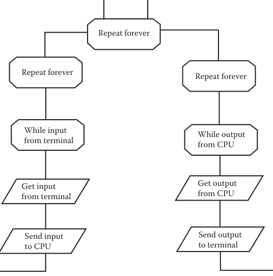

图 1.11 控制流图示例。

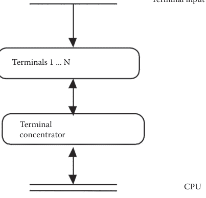

图 1.12 带有数据源和数据汇的高级数据流图示例。

经常有一种观点认为流程图在现代软件中已完全过时了。这种观点并不完全正确。由 Michael David Smith 发明并分配给 Google 的一项名为“自动启用网页权限浏览及应用程序”的美国专利，使用了与流程图相关的图表。提交获取该专利的申请（专利号为 US 8,935,798 B1，于 2015 年 1 月 13 日发布）所包含的图之一位于附录 A。

系统的数据流表示比控制流描述得晚。Yourdon（Yourdon, 1988）和 DeMarco（DeMarco, 1979）的书籍可能是获取信息的来源。

你现在可能会问这些符号是如何使用的。许多编译环境包含对语言敏感的编辑器（它们鼓励使用正确的语法）、帮助修复源代码中错误的调试器，以及性能分析工具（后者通过允许用户确定程序执行时间占比最大的例程来帮助提高程序效率）。这些编辑器、调试器和性能分析工具都是 CASE 工具。

其他工具允许管理库，让许多人同时进行源代码开发。这些工具确保同一时间只有一个人在编辑特定的源代码文件。如果一个软件工程师正在编辑某个源代码文件，其他对该文档的编辑请求将被拒绝。正如第 1.8.1 节所述的，这种技术被称为配置管理。它是软件工程过程中不可或缺的一部分，并且几乎总有 CASE 工具的支持。

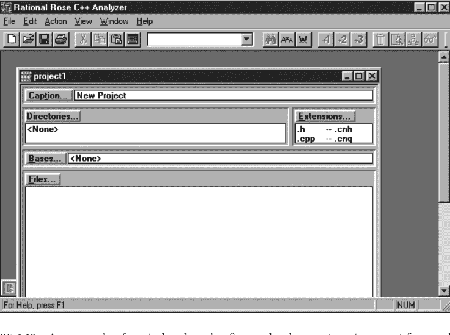

图 1.13 面向对象系统的基于窗口的软件开发示例。（来自 Rational Rose 软件启动界面，Rational Software 公司。Rational 现为 IBM 的子公司。）

显然，CASE 工具在软件工程中无处不在。软件开发工具已经变得如此流行且令人印象深刻，以至于许多工程师不再将开发工具称为 CASE 工具，除非它是详尽的、昂贵的，并且支持整个生命周期。我将根据本节所描述的示例的精神，选择更宽泛地使用这一术语。

## 1.8.4 成本估算

软件成本估算既是一门艺术，也是软件工程中一个独特的分支。在任何通用的软件工程书籍中详细讨论它都是极其复杂的。我们满足于提供简单的经验法则和初步估算，以确定不同系统设计和编程方案的成本效益比。Boehm 的经典著作（Boehm, 1981）仍然是软件成本估算最好的入门参考。

其基本思想是通过与其他相似项目进行比较，来估算软件项目的成本。这种转变既需要一组“相似”的软件项目，也需要确定哪些项目与给定项目“相似”的方法。

为了确定项目的成本，必须建立一个基线（baseline）。通过“基线”这一词，我们指的是一组既有规模测量又有成本测量的先前项目。从这些先完成的项目中获得的信息存储在数据库中，以供未来分析。基线信息应包括：应用领域；根据公认的衡量标准划分的项目规模；任何特殊的系统限制（例如系统对某些输入有实时响应）；项目的非寻常特征（例如首次使用新技术、编程语言或软件开发环境）；任何可能影响软件成本的可互操作软件系统；当然，还有软件本身的成本。在许多组织中，基线信息可以细化为不同子系统的成本。

“相似性”或“相同性”的确定是通过检查基线数据库中项目的特征，并选择信息被认为是相关的项目来完成的。对“相似性”的有效确定在很大程度上取决于经验。

理想情况下，成本估算将以系统成本（以及要进行成本估算的每个子系统成本）的形式呈现，并针对正在估算的系统给出一个可能处于的预期范围。

## 1.8.5 评审与检查

不同的组织开发了不同的方法来确保软件项目产生有用、正确的软件。某些技术在某些开发环境中似乎比其他技术效果更好，因此将任何成功的方法适应到完全不同的环境中存在困难。

然而，有一件事在任何执行得当的组织中都能非常成功：设计评审。评审应该在项目的每个重大里程碑举行，包括需求、设计、代码和测试计划。对于使用迭代过程的软件生命周期，应该在软件生命周期内主要项创建的每次迭代中举行评审。

基本思想非常简单：针对特定里程碑开发的每个产物（artifact）都必须经过正式评审，评审期间必须提供所有相关文档；回答一套精心设计的问题；并将评审结果记录下来并传给所有相关方。

接下来将描述针对需求、设计、源代码和测试计划的几类评审。在本文的用法意义下，review（评审）和 inspection（检查）这两个词是同义词。在通用文献中，inspection 一词可以指代这种意义，也可以指阅读相关文档的程序。

关于评审和检查，还有一点需要说明。本书强调系统化的方法，试图在软件还原为代码之前确定需求和设计中的问题。这种强调与几乎每个应用领域中各种软件项目的经验是一致的。

Linux 操作系统的开源开发方法避免了大量的需求和设计评审，而是依赖于大量程序员的努力，他们评审在网上发布的源代码。因此，每份源代码都经过密集的评审，通常由数百名程序员完成。源代码的修改由一个小得多的专家团队控制。当然，还有配置管理和测试，只是顺序不同。参阅 McConnell（McConnell, 1999）的文章以获取开源方法的概述。

## 1.9 软件开发过程中的常用标准

许多组织拥有一套非常特定的软件开发流程。这些流程的动力源于组织经验，也来自政府和工业外部客户的压力。美国最常见的形式化软件开发流程是：

- 来自卡内基梅隆大学软件工程研究所（SEI）的能力成熟度模型（CMM）。（从技术上讲，这并不是一个过程，而是对组织软件开发流程系统性的评估，以及评估流程改进可能性的指南。）有关 CMM 的信息可以从网站 `http://www.sei.cmu.edu/cmmi/` 获取。
- CMM 模型已被能力成熟度模型集成（CMMI）取代。该模型的主要所在地已从其最初的软件工程研究所（`http://www.sei.cmu.edu/cmmi/`）移动到卡内基梅隆大学全资持股的子公司 `http://cmmiinstitute.com/`。这个新网站提供了几个软件开发过程适当衡量的示例，可提高质量并降低成本。
- 来自 NASA 戈达德航天中心软件工程实验室（SEL）的流程改进范式（PIP）。与 CMM 类似，这在技术上不是一个过程，而是对软件开发流程系统性的评估以及评估流程改进可能性的指南。
- 国防标准 MIL-STD 21。
- 国防标准 MIL-STD 1574A。
- 国防标准 MIL-STD 882C。
- 电子工业协会（EIA）SEB-6-A。

一些国际软件开发流程包括：

- 欧洲 ESPR 项目。
- 国际标准组织（ISO）标准 9001。
- 英国 MOD 0055。

这些软件过程模型都强调收集和使用软件指标来指导软件开发过程。来自 SEI 和 SEL 的模型强调对基线信息进行当前开发。

### 表 1.3 能力成熟度模型（CMM）各级描述

由软件工程研究所（SEI）开发

| 等级 | 名称 | 描述 |
| :--- | :--- | :--- |
| 1级 | 初始（Initial） | 软件开发过程基本上是随机的。具体，定义的流程很少，成功更多取决于个人的英雄行为而非遵循流程和团队协作。（混沌通常用于描述具有这些特征的软件开发过程。） |
| 2级 | 可重复（Repeatable） | 该级的特征是过去的经验可以指导软件开发。具体，建立了基本的管理过程来跟踪成本、进度和功能。许多新流程基于对相似项目的经验。 |
| 3级 | 已定义（Defined） | 该级的特征是标准且一致。具体，管理和工程过程经过记录、标准化并集成到组织的标准软件开发过程中。所有项目都使用经过批准的定制的组织软件过程进行开发。 |
| 4级 | 已管理（Managed） | 该级的特征是可预测的。具体，使用详细的软件过程和产品质量指标建立定量评估。可以将过程性能的波动与随机噪声区分开来，并预测过程和质量的趋势。 |
| 5级 | 已优化（Optimizing） | 该级的特征是持续改进。具体，软件组织拥有定量反馈系统来识别并加强缺陷。项目团队分析缺陷以确定其原因；更新软件过程以防止已知类型的缺陷再次发生。 |

你所属的任何大型软件公司都会有自己的软件流程，并且可能有一套标准和实践手册。

还有许多其他软件标准在某种程度上仍被遵循。IEEE 对标准活动的统计显示，截至 1995 年底，软件工程领域已有 35 种不同的标准。最重要的 IEEE 标准之一是 P 610.12(R)，标题为“软件工程标准术语表”。另请参考 SEWBOK 网站。

任何关于软件工程主题的介绍性书籍，如果没有提到洁净室开发过程（Mills et al., 1987），将是不完整的。该过程最初由 Harlan Mills 及其同事在 IBM 开发。洁净室流程的目标是通过从源头上不引入错误，来产生无错误的软件。选择“洁净室”是为了让人联想到制造硅片或计算机芯片时使用的洁净室。此类房间的工人穿着白色大褂，以减少污染物引入产品中的可能性。在洁净室方法中，软件错误被认为源于缺陷的开发过程。

洁净室流程的主要技术是对程序函数和过程正确性进行数学推理。其核心思想是仔细地创建源代码，以至于无需进行测试。严谨的数学推理和非常正式的代码审查都是洁净室过程中不可或缺的组成部分。

第 6 章将指出软件测试的目的是发现软件中的错误，而不是证明软件存在错误。洁净室方法的实践者认为，这种方法可能更有助于软件开发过程的目标：产生无错误的软件。

我们不会在书中进一步讨论洁净室方法。相反，我们对数学在软件工程中作用的重点将很大程度上限制在可靠性理论，以及对第 2 章和第 3 章讨论的某些其他形式开发方法的简要提及。

在 App Store 允许用于 Macintosh 或 iPad、iPhone 等其他 Apple 产品销售之前，有一套审核流程。《App Store 审核指南》为用户界面设计、功能、内容和特定类型技术等事项提供了规则和示例。对于推送技术的使用和数据的安全处理，也有相应的指南。有关这些特定指南的更多信息，可以在网站 `https://developer.apple.com/app-store/review/` 找到。（注：如果你能告诉你的孙子你可以获得几种不同 Apple 产品的折扣，那么成为 Apple 开发者是一件好事。）

意不意外的是，其他应用商店也开始拥有类似的流程。

## 1.10 书籍结构

在第 2 章讨论了项目管理之后，软件开发生命周期的每个主要阶段都将在单独的章节中详细介绍。从第 3 章开始，每一章将考虑一个贯穿全书的较大项目。

在整本书中考虑同一个项目的目的是为了消除在软件需求、设计和编码方面做出不同决策所产生的影响。部分源代码和文档将直接在书中给出。然而，其余大部分内容将不会提供，以便教师在定制作业时具有更强的灵活性，特别是针对班级中的个人小组。

书中还将贯穿提供一个敏捷软件开发项目的持续案例研究，以提供一个成功的敏捷项目如何运作的完整蓝图。

第 3 章到第 8 章的顺序基本上与经典的瀑布型软件开发模型相同。这种顺序是人为安排的（必须先介绍某些东西！）而且这些章节可以在一定程度上以任何顺序阅读。某些老师可能会选择快速涵盖几种开发方法，以便专注于最符合课程教学目标的开发方法。

本书在与重用现有代码的团队软件项目相结合时效果最好，但这些项目需要比简单的源代码复制粘贴更复杂的内容。

正如你将学到的，软件工程中有很多非编程活动。其中某些活动需要成本估算、数据收集和分析。书中包含了表格，以说明典型的做法并为你提供经验。

第 3 章到第 8 章的每一章将包含一个或多个章节，提供软件经理对相关技术方面的典型观点。管理视角的目的是提供对软件工程的额外视角，而不是培养你成为经理。在大多数组织中，在被赋予任何级别的管理职位之前，积累丰富的项目经验是至关重要的。

第 9 章讨论了如何阅读软件工程文献，并提供了大量的重要参考文献。

关于软件专利、命令行参数和流程图的三个附录可以在需要时阅读。

## 总结

软件工程是应用良好的工程实践以高效的方式生产高质量软件。良好的软件工程实践可以减少软件开发过程中出现的问题数量。软件工程的目标是开发高效、可靠、易用、可修改、可移植、可测试、易于维护并能与其他系统交互的软件。最重要的是，软件在满足规格说明和用户真实意愿方面应该是正确的。

软件工程的目标包括效率、可靠性、易用性、可修改性、可移植性、可测试性、可重用性、可维护性、交互性和正确性。为了支持这些目标，软件工程涉及许多活动：

- 分析
- 需求
- 设计
- 编码
- 测试与集成
- 安装与交付
- 文档
- 维护
- 质量保证
- 培训

项目管理对于协调所有活动至关重要。

软件开发过程有几种常见的模型。在经典的瀑布过程模型中，需求、设计、编码、测试与集成、交付与安装以及维护步骤顺序进行，反馈指向上一步。在快速原型和螺旋开发模型中，软件是迭代开发的，在产生最终系统之前，会对中间系统给出客户或用户的反馈。

无论应用领域如何，严谨的软件工程方法都是必要的：无论是互联网开发、个人电脑应用程序还是健康安全关键型应用。通常作为任何工程活动一部分的风险分析可能会防止“2000 年问题”的发生。


开源模型涉及一小组专家，他们充当看门人，评估来自大量个人软件工程师提交的内容，以帮助解决这些专家看门人设置的问题。提交的所有软件都是基于这样理解：只要不收费，其他人就可以自由使用或修改它；也就是说，软件必须保持免费，尽管允许对安装、设置和控制收费。

敏捷编程模型的主要目标是为问题提供快速解决方案，团队对特定应用领域有丰富的知识，并且有许多高质量软件组件可供重用以帮助解决这些问题。

使用高级编程语言可以提高程序员的生产力。然而，重用高质量软件组件会有更大的效果。

## 关键词与短语

软件工程、软件重用、经典瀑布软件开发模型、快速原型模型、螺旋模型、敏捷软件开发、敏捷方法、开源软件开发、市场驱动的软件开发、软件演化、重构、CASE 工具、指标

## 延伸阅读

关于软件工程有许多优秀的书籍，包括 Pleeger 和 Atlee (Pleeger and Atlee, 2010)、Schach (Schach, 2011)、Sommerville (Sommerville, 2012) 以及 Pressman 和 Maxim (Pressman and Maxim, 2015)。一些有趣的通用软件工程类书籍来自 Ghezzi、Mandrioli 和 Jayazerri (Ghezzi, Jayazerri, and Mandrioli, 2002)、Jalote (Jalote, 1991) 以及 Shoman (Shoman, 1983)。*软件开发：一种开源方法* (Tucker and Silva, 2011) 一书专门致力于开源开发。Boehm 写的经典著作 (Boehm, 1981) 为软件工程经济学提供了良好的概述。Fenton 和 Pleeger (Fenton and Pleeger, 1996) 以及后期版本中的 Fenton 和 Boehm (Fenton and Boehm, 2014) 对软件指标提供了详细且严谨的描述。Beizer (Beizer, 1983, 1990)、Howden (Howden, 1987) 以及 Myers (Myers, 1979) 提供了优秀的软件测试介绍，这些内容在今天仍然具有意义。在文章“洁室软件工程”（Mills et al., 1987）中可以找到关于洁室流程的优秀介绍。

软件工程社区的一项大规模努力创建了“软件工程知识体系”，通常简称为 `SWEBOOK`。这项工作可以在一系列在线 PDF 文档找到 (`SWEBOOK`, 2013)。

来自 Quality Management 的有助于 2014 年研究版《软件年鉴》可以在 `qsm.com` 下载。

Ritchie 和 Thompson 在 1978 年的论文 (Ritchie and Thompson, 1978) 既对极其成功的 `UNIX` 操作系统提供了概述，也对所使用的设计决策进行了洞察。`Linux` 操作系统是 `UNIX` 的现代变体。

关于计算机语言的信息可以在很多地方找到。`Ada` 语言在 Ada (1983, 1995) 和 Ichbiah (1986) 中描述。`C++` 原始描述的原理由 Stroustrup (Stroustrup, 1994) 给出，Ellis 和 Stroustrup (1990) 编写书中提供了详细的语言手册。Kernighan 和 Ritchie 提供了 `C` 的原始描述 (Kernighan and Ritchie, 1982)，第二版 (Kernighan and Ritchie, 1988) 描述了 ANSI C 特性。关于各种计算机语言还有许多其他优秀的书籍。

Nielsen (1994) 和 Shiderman (1980) 为人机交互提供了良好的概述。在 Wright、Moss-Wooley 和 Wooley (1993) 的文章中可以找到关于颜色在用户界面中作用的简单介绍。Miller (1968) 较早的论文为限制系统用户可用选择的数量提供了良好的实证依据。这对于计算机系统菜单结构的设计师来说特别相关。

Lapl (2014) 对要求软件工程师持有许可的这一演变观点提供了一个有趣的视角。

Cusumano 和 Selby (1995) 的文章提供了微软软件开发实践的优秀概述。

关于能力成熟度模型 (`CMM`) 的信息可以通过 `http://www.sei.cmmu.edu/cmmi/` 获取。

## 引言 53

关于能力成熟度模型集成 (`CMMI`) 的更多信息可以通过网站 `http://cmmiinstitute.com/` 获取。

Basili 和 Rombach (1988) 的论文是 GQM 范式的良好介绍。Leach (1997) 的书籍是软件复用的良好介绍。

## 练习题

1. 列出软件开发生命周期的主要类型。它们之间有何区别？
2. 列出所有软件开发生命周期共有的活动。
3. 软件工程的目标是什么？
4. 解释 GQM 范式。
5. 考虑你曾作为课程作业完成的最规模最大的软件项目。该项目有多大？开发该系统花了多久？它是运行完美、在大多数时间内运行正常，还是在最简单的测试用例上失败？
6. 针对你在工业或政府工作期间编写的内容重复第 5 题。
7. 检查你学院或大学就业办公室的分类广告，寻找计算机领域的职位列表。将每个工作分类为：分析、需求、设计、编码、测试与集成、安装与交付、文档、维护、质量保证或培训。关于开源软件是否有任何说明？关于敏捷开发又是怎样的？
8. 如果你在计算机领域有兼职（全职）工作，请要求查看你的员工软件开发手册。确定你的雇主遵循哪种软件开发过程标准。
9. 本章提到了几种软件开发过程标准。在图书馆或互联网上找到其中一个或多个。检查该标准的细节。你能解释为什么它们是必要的吗？
10. 检查一个并非由你亲自开发且提供源代码的较大软件系统。（来自自由软件基金会的 GNU 软件工具是一个极佳的来源。）你能就源代码对这些软件开发过程标准说明什么吗？
11. 我们讨论了网络在未来中的一些问题。你可能会发现阅读 Andrew Tanenbaum 最近的《现代操作系统》第四版 (Tanenbaum, 2014) 中的讨论会有帮助。
12. 研究洛希德·马丁的 Skunk Works 项目（也称为“先进开发计划”），获取其非常快速且粗略的开发过程描述。将其与“敏捷”进行对比。

## 项目管理

在本章中，我们将讨论涉及项目管理的一些问题。正如第 1 章所示，关于该主题的大部分讨论对于初级软件工程师来说是遥远的。对于没有参与过多人项目的人来说，沟通项目管理的复杂性是很有用的。然而，每个软件工程学生对通常与小组项目相关的软件工程活动至少有一个介绍是有帮助的。因此，我们将在本中介绍项目管理的高层次视角。其目的是介绍该主题，而不是创造专家专家。记住大多数现代软件开发都是团队完成的这一点。

# 软件工程导论

你从软件工程师开始你的职业生涯。不同的组织会有不同的软件开发流程，并据此构建他们的软件开发团队。然而，每个项目都会有一位经理，该经理必须处理许多问题。

对于任何项目经理来说，最重要的问题之一就是项目团队的选拔。一个理想的团队成员精通应用领域，并且是一个出色的软件开发者。他或她是一个优秀的团队合作者，这一点至关重要。完美的团队成员很难得的，他们通常被选为具有技能和经验组合的人。回想一下你在受教育期间在做团队项目时不得不做出的那些妥协吧！

关于项目管理还有最后一点需要说明。软件工程文献中常见的的大多数正式软件开发流程，直接适用于面向单一客户的大型软件系统，例如政府或需要高度复杂的数据库连接系统的大型公司。

要在市场驱动的环境中应用其中一些较为正式的流程，需要进行许多修改。开发环境具有很高的并发性，许多活动（如编码、设计、需求分析和测试）同时进行，以满足非常紧的进度安排。在本章中，我们还将讨论影响市场驱动环境中软件开发的一些问题。

我经常发现，在开始第一门软件工程课程时，大多数学生（尤其是那些在工业或政府从事软件工程项目经验很少的学生）会忽视项目管理的正式性。我认为这是因为他们的主要经验是自己自己开发的较小程序，他们认为项目管理的开销是毫无意义的，阻碍了他们进入编码阶段。当他们获得更多团队项目经验时，他们开始理解其重要性。在我所在的大学对程序目标进行评估时，最近毕业的计算机科学专业毕业生通常对他们在学生期间的项目管理经验给出高评价。在最初的不情愿之后，他们最终学会了重视项目管理和团队项目。

开始学习软件工程课程的学生通常希望可以使用他们听过的关于敏捷软件开发流程的内容。他们通常认为这个词意味着低开销、几乎没有会议（如果有的话）以及大量的编码。当学生们了解到，为了充分推进项目进展，他们必须已经精通应用领域，达到能够确定大规模重用软件组件的程度时，敏捷编程就没那么有吸引力了。他们需要一段时间来领会敏捷流程所必需的持续编码、测试以及在定期的正式会议上报告状态的重要性。

敏捷流程的管理与大多数其他常用的软件开发流程非常不同，将在本章末后的独立章节中进行详细讨论。

正如第 1 章多次提到的，开源软件开发本质上只有在存在一个较小的专家小组时才能良好完成，这些专家通过他们自己的评估以及开源社区对贡献软件组件的评估，来决定是否应该将开源组件包含在正在开发的软件应用程序或工具中。显然，开源项目的管理本质上仅限于专家，我认为很难要求作为本书读的相对较新的软件工程师去执行这些最高级别权威所要求的任务。因此，我们在本章中不再进一步讨论开源项目的管理。

## 2.1 软件工程项目所需的子团队

显而易见，大型现代软件项目的系统化开发需要团队。将软件项目团队认为由若干个“子团队”组成通常很有帮助。这些子团队不需要像这里描述的那样具有正式结构，事实上，在许多情况下，其中一些子团队仅由一个人组成。事实上，同一个人可能执行多个子团队的所有活动。然而，无论团队整体结构和项目规模，这些活动仍然需要执行。这些团队执行的活动无论软件开发生命周期如何都会发生，尽管这些活动的时间几乎会有不同。

这些子团队中的几个可能在软件项目的整个生命周期中都不存在。对于某些软件项目，一个或多个团队可能由单人组成，其职责分散在多个项目或活动中。在其他项目中，团队可能非常大且在地理上相互分离。在规模较大的合作软件开发项目中，团队成员甚至可能向不同的公司汇报。

下列出了一些典型的工程子团队及其职责。虽然所有活动都是重要的，但这里强调了某些特定的软件开发生命周期需要子团队提供专门知识的案例。

- **需求分析团队**——该团队负责判断项目是否可行。可行性研究包括成本分析、预计收入以及对项目工程实施难度的估算。在产生可行性研究后，该团队应与需求团队互动，接收其反馈。软件开发过程是迭代的，如快速原型模型和螺旋模型，因此互动和反馈应该更加频繁，并可能与其他额外的子团队进行。
- **计划团队**——该团队负责为项目制定整体管理计划，并确保项目在各项活动的预期时间范围内进行。这通常涉及人员配置，人员配置对于敏捷软件开发流程变得尤为关键，以确保团队拥有足够的应用领域知识，以了解现有软件组件和系统的能力。开源项目也是如此。
- **需求团队**——该团队的职责是与客户会面，并为项目确定一套完整、精确的需求。这需要与客户进行一系列正式和非正式会议，从相对不精确和不完整的初始需求中确定需求。如果没有客户可用，则需求团队应从一个或多个潜在用户处获取相同的信息。如果没有潜在用户可用，则可以使用替代客户。在产生系统需求后，该团队应与设计团队互动，接收其反馈。如果软件开发过程是迭代的，如快速原型模型和螺旋模型，那么互动和反馈应该更加频繁，并可能与其他额外的子团队进行。
- **系统设计团队**——该团队的职责是在需求团队需求后产生系统的详细设计。如果软件开发过程使用经典的瀑布模型，系统设计团队应向需求团队反馈遇到的困难。在产生设计后，系统设计团队应与实现团队互动，接收其反馈。如果软件开发过程是迭代的，如快速原型模型和螺旋模型，那么互动和反馈应该更加频繁，并可能与其他额外的子团队进行。这种反馈对于敏捷开发流程至关重要。
- **实现团队**——该团队的职责是实现系统设计团队设计的软件。在产生实现后，该团队应与测试集成团队互动，接收其反馈。如果软件开发过程是迭代的，如快速原型模型和螺旋模型，那么互动和反馈应该更加频繁，并可能与其他额外的子团队进行。
- **测试集成团队**——该团队的职责是对实现团队创建的模块和系统制定测试用例。该团队可能通过与实现团队达成一致，从不完整的系统中提取某些模块。在产生测试计划并测试软件模块后，该团队将软件模块集成到可运行的系统中。该团队应与实现团队互动，接收其反馈。如果软件开发过程是迭代的，如快速原型模型和螺旋模型，那么互动和反馈应该更加频繁，并可能与其他额外的子团队进行。集成团队负责接口控制文档（`ICD`），精确描述主要组件之间的接口。这可以是指定 `API` 的形式，或者是软件子系统之间的接口。
- **培训团队**——该团队负责培训材料的开发和制作。
- **交付安装团队**——该团队负责软件的交付和安装。
- **维护团队**——该团队负责软件交付和安装后的维护。在系统交付和安装后，该团队应该与实现团队互动，接收其反馈。如果软件开发过程是迭代的（如快速原型模型和螺旋模型），那么交互和反馈应该更加频繁，并可能与额外的子团队进行。
- **质量保证 (`QA`) 团队**——该团队负有两项职责。第一是为项目团队遵循一系列既定的系统创建流程制定标准，并为所产软件的性能制定标准。第二是对项目团队履行这些标准的执行情况提供评估。行业标准做法是，该团队所获得的信息应予以保留且不与客户共享。在发生法律诉讼时可以发布这些信息，因此不能销毁。这些信息将提交给项目经理，由项目经理将其用于评估 QA 团队的绩效。
- **指标团队**——该团队负责对项目中团队的性能进行统计。根据组织的数据收集程序，记录的一些典型统计数据可能包括生成的需求请求数、服务的维护请求数、编写的代码行数、每项任务执行的小时以及工具在系统每个新版本上产生的价值。该团队将与需求、设计、实现、测试、集成以及维护团队互动，提供质量和效率的评估，并向这些子团队提供反馈。
- **文档团队**——该团队负责项目文档。它包括需求、设计、源代码以及其他支持性外部文档。
- **系统管理团队**——该团队负责确保底层硬件、软件和网络支持按照项目团队的需求正常工作。该团队通常包括网络管理团队。
- **重用与重构团队**——该团队负责选择和使用适当的可重用软件组件。如果软件项目依赖某些由于技术新进展而必须更改的旧代码，则重构可能是必要的。

这里涉及多项管理任务这并不意外，每个子团队都有相应的任务。当然，如果团队足够小，经理可以是团队中的技术成员之一（甚至是团队的唯一成员）。

上述列出的任务是大多数软件项目要求的组成部分。因此，询问它们是如何安排的是合理的。当然，这些任务的调度高度依赖于项目所使用的软件生命周期模型。例如，基于经典瀑布型软件开发模型的软件开发过程可能会将任务如图 2.1 所示整合到过程中。在练习中，你将被要求为快速原型和螺旋软件开发模型制作类似的图表。

# 软件工程导论

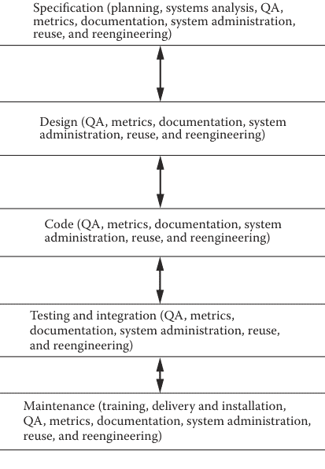

图 2.1 将基础软件工程任务整合到经典瀑布生命周期模型的简化插图中。

市场驱动的软件开发计划非常有意思。整个过程被压缩了，至少与经典瀑布过程相比是。步骤通常包括以下内容：

1. 确定产品市场
2. 需求确定
3. 设计与编码结合
4. 测试与集成
5. 交付

初看之下，该过程与其他过程相似，不同在于设计和实施阶段的组合方式。观察这种差异最简单的方法是考虑市场驱动软件开发中典型的里程碑。

在这一模型中，产品需求和营销规划通常是同步进行的。规划间隔很少超过五年，而且通常更短。目标是制定一个项目计划，得出一个营销和销售团队可以销售的产品。由于技术变化如此之快，较长的开发周期是不可接受的。

# 项目管理 ■ 61

可用性测试通常包含在设计和早期实施阶段。这在详细测试阶段开始之前。

交付过程通常包括最小、典型和最大安装版本的确定，以及一个可以根据用户喜好选择组件的安装套件。软件可能封装成学术版、标准版或专业版，每个版本有一组不同的内置组件或系统配置参数，因此具有不同的安装程序。

在竞争激烈的全球经济中，产品可能被运往母语不是英语的国家。这意味着需要新的在线帮助和手册。它也可能意味着内置安全等项内容具有不同的配置，因为美国政府不允许无限制地向非军事应用出口 128 位加密。（军事和非军事产品，以及出售给所谓“流氓国家”的产品有不同的限制）。请访问 `www.bis.gov/index.php/policy-guidance/encryption` 网站获取最新信息。

你应该注意，在之前列出的任务中，有几项必须执行的技术任务。执行这些任务的人员通常会被赋予官方或非官方的头衔，如下列表所示。即使没有特定的头衔，软件工程师通常需要说明花费在特定活动上的时间百分比。这种时间统计对于确定单个项目的成本通常是必要的。

- **人机界面评估员**——此人负责评估软件系统与用户之间的交互类型。至少，他或她对最终软件产品的新手和熟练用户的预期技能有一个心理模型。
- **工具支持人员**——此人负责确保支持性软件环境正常运行。此人将与系统或网络管理员合作。
- **软件经济学家**——此人负责开发和使用适当的模型，以估计软件成本、硬件和软件资源以及完成项目所需的时间。
- **项目管理员**——此人负责跟踪所有文档。

软件开发环境中可能还有其他人员，特别是那些具有大量重用的环境。为了简单起见，我们将忽略这些专家，专注于初级工程师可能遇到的人员。

## 2.2 团队的性质

在典型的学术课堂环境中，软件项目由一个人独立完成，或由一个学生团队完成。学生一起工作一个学期，有时甚至是一年。计算机科学课程的人员流动率很低，因此很容易保持同一团队。在真实的软件开发项目中，团队很少在整个系统生命周期内保持，通常在每次发布后，甚至更早。

实际项目中人员流动率较高有几个原因：

- **项目人员变动**：编码和测试阶段需要的人可能比需求收集阶段的人多。通常，维护阶段需要的较少，特别是当系统预计寿命短时。
- **项目可能会持续很长时间**：例如，NASA 的探险者号卫星预计产生一科学数据，原始软件维护团队预计在卫星进入轨道后工作一年。相反，该卫星的科学寿命持续了 19 年，在其运行最后一年产生的科学数据和后续研究与其第一年产一样多。显然，在此期间项目人员发生了多次变化。几个知名的数据库系统已经运行了 30 多年。
- **人员更换工作**：许多软件工程师倾向于与新技术接触，并在特定项目使用的技术不再前沿后离开项目。
- **公司失去合同**：许多组织合并，业务部门被撤回。在极端情况下，公司会倒闭。如果一家公司正在为一个已倒闭的包商工作，那么项目团队将发生变化。
- **人员退休或大病**。
- **产品线以及公司本身可能被卖给新公司**。


- 聘用新人以为组织带来新想法和新技术。

很显然，大多数现实项目在整个过程中人员会有重大变化。现在你理解了项目团队组成在项目生命周期内往往会发生巨大变化，你可能会考虑这种相对不稳定性对你作为软件工程师职业的影响。

# 项目管理

随着时间的推移，你会遇到许多不同的风格。例如，你可能会遇到一个总是严 literal 遵守公司书面政策的人，除非句子语法完全正确，否则拒绝提交任何组织提供的表单。项目中的另一个人会使用捷径，只写短语和片段，而另一个人则可能写出正式、完整的句子。这两种方法对于使用它们的人来说可能都是非常有效的，而你可能需要与每一类型的人进行互动。当然，最终的交付产品在语法上是正确的，并符合组织的标准。对于安全关键型软件、安全软件或金融用途软件，这一点变得更加重要，因为在软件发生故障时，此类软件可能会被审计。

在小组内适应不同的性格和学习风格是非常重要的，要避免詹姆斯·麦卡锡（James McCarthy）所说的“翻转笨蛋位值”（flipping the bozo bit）（McCarthy, 1995）。这个口语化的术指的是将一个人的意见和建议评估为无关紧要，因为那个人是个“笨蛋”（bozo），因此他们的“笨蛋位值”被翻转了（设为零）。麦卡锡（和我一样）坚认为这是一个非常糟糕的主意。对所有想法保持开放态度，并将它们视为潜在合理的，无论这些想法的来源如何。仅根据想法本身的价值来决定其有效性。这将有助于你成为一名有价值的团队成员，并让你的工作更好。

理解组织文化之间的差异是非常重要的。有些组织遵循严格的流程，要求执行所有程序并对所有决策进行详细记录。不精确遵循组织程序的个人往往会被忽视或被赋予较少的要求。

另一些组织在流程上的正式化程度低得多。它们通常只给软件开发团队提供最通用的指南，让他们完全自由执行核心活动。这种自由通常发生在团队有成功完成并在预算范围内完成项目的历史时。Mandl（Mandl, 1998）的一份 NASA 技术报告描述了一个有效的软件开发团队，该团队使用的公式较少，但能够产出实际系统。需要注意的是，该团队在其特定的应用领域拥有多年经验。我们在第 2.10 节描述敏捷项目管理时，将更详细地讨论《敏捷宣言》中的这种敏捷编程示例。

你应该根据你选择加入的组织类型自行做出区分，以便将你的气质与适合你的组织开发风格相匹配。

## 2.3 项目管理

项目管理术语是指对人员、资源和进度进行协调，其目的是成功生产出高质量的、在规定时间内交付且符合预算的软件产品。

假设你被指派指导一个项目，其目标是开发特定的软件系统。你会希望项目取得成功，并会尝试集结现有的最佳团队。你希望团队拥有适当的设备和任何合适的软件开发工具。你需要了解你的软件必须与之交互的任何其他软件系统。你需要能够预测项目何时完成以及总成本可能是多少。

很显然，项目经理的首要任务是对项目的规模和复杂性进行良好的估算。这些估算对于经理为项目获取适当的资源是必要的。我们将在第 2.4 节讨论软件项目估算。

一旦你确定了项目所需的资源，就要制定一个进度计划。进度计划将包含开始和完成关键活动的日期。这些成就通常被称为“里程碑”。由于里程碑事件可能需要不同程度的投入，项目的不同阶段对资源的需求也可能不同。某些项目活动可能几乎不需要精力。我们将在第 2.5 节讨论软件进度安排。

到此时，项目经理已经规划了项目的资源和进度。他或她可能面临创建进度表或资源的压力，但无论如何，这项努力都投入了规划和周全的工作。不幸的是，许多其他项目并不具备规划的奢侈，相反，只能对出现的情况做出反应。

我们接下来说明这一点。其余的项目管理活动通常包括许多内容，但不限于：

- 管理人员
- 分配资源
- 定义角色
- 激励项目人员
- 处理进度中不可避免的延误
- 处理项目需求的变化
- 衡量系统的进度和质量
- 对计算机崩溃等意外事件做出反应
- 向高层管理人员汇报问题和成功
- 确保主要的里程碑事件经过适当的评审
- 与潜在客户或客户代表互动

某些软件开发方法（如 Scrum）具有额外的项目管理活动。Scrum 团队通常会有一个“产品所有者”（product owner），他代表项目的主要利益相关者。甚至可能有一个“Scrum 主管”（Scrum master），他担任项目的协调员。（在不使用此类敏捷方法的组织中，这一角色可能由 QA 或质量控制团队承担。）

如果项目经理只对危机做出反应（正如目前看起来那样），那么就没有时间采取主动措施，即采取可能消除问题的行动，而不是仅仅对迫眉之急做出反应。

项目经理的主要任务之一是激励项目团队。在工业或政府部门，激励可以是晋升、加薪、奖金，或仅仅是赞扬和认可。它也可以意味着降职和终止雇。（学术项目缺乏此类奖惩是此类项目经常被视为“玩具”的主要原因。项目规模和学术历期的限制是导致这种假设非现实性的其他因素。）

上述列表中缺少的是针对经理的任何形式的继续教育。这种教育可以跟上组织内部以及外部世界项目管理的最新趋势。假设项目经理希望职业发展，他或她可以参加继续教育或其他课程和研讨会。

简而言之，项目经理非常忙。你不应该期望从负责多个项目或大量软件工程师的高级经理那里获得大量的指导。时间完全不够。

## 2.4 软件项目估算

软件项目估算是项目规划阶段所进行的通用系统工程过程的一部分。它对于大型软件项目来说始终是必要的，原因只有一个：任何合理的人或组织在不相信项目可以用其愿意投入的资源来完成的情况下，都不会启动一个大项目。显然，某种形式的流程估算是必要的。本节提供了额外的细节，将扩展第 1 章第 1.8.4 节中开始的讨论。

任何项目都需要大部分以下资源，在非常小的项目或组织中，许多人员、计算机或软件需要承担多种职责：

- 用于开发的计算机
- 开发基础软件，如编译器或链接器，最好位于包含配置管理和类似工具的集成开发环境中
- 计算机之间的通信方法，如网络
- 计算机辅助软件工程（CASE）工具
- 与系统必须交互的软件包
- 测试和开发环境的软件和硬件模拟器以及设备，如手机和平板
- 实际部署设备，如手机和平板
- 用于测试的计算机
- 用于训练的计算机
- 用于大规模开发的云和云计算服务
- 系统运行被认为是必要的商业现成（COTS）产品
- 文档工具
- 复制设备
- 程序员
- 测试人员
- 经理
- 设计师
- 需求工程师

请注意，中等规模或更大规模的项目可能需要每种资源有多个实例，包括软件工具（例如 CASE 工具或配置管理系统）。事实上，本章前面提到的每个软件团队职责都必须被计入项目的资源需求。

在本节中，“规模”一词是非正式的用法。确定一个项目的实际规模是一项非易事的工作，我们稍后会多次回到这一点。目前，项目的规模是指组织为了开发某个项目而创建的源代码行数。代码行是指程序中任何不是空行也不是由注释组成的行。（书中稍后部分将给出对“代码行”这一术语更好的定义。）

如果我们希望预估新系统的规模，那么理解现有系统规模的含义并能够以一致的方式量化这种规模是至关重要的。因此，我们将注意力暂时转向软件系统规模的测量。

当然，软件系统规模的测量可能非常困难。例如，假设你写了一个长 100 行的程序，将其输出写入数据文件。假设该数据文件随后导入到电子表格中，而你创建的电子表格使用了表格内置的统计程序，这些程序被导出到另一个文件，该文件包含了最终结果。这个系统有多大？是你写的 100 行代码吗？是组成电子表格的数百万行代码（加上你写的 100 行）吗？是你写的行数（100 行）加上你输入电子表格程序的代码大小吗？是你写的行数（100 行）加上写入电子表格的数据输出大小吗？

测量软件系统规模的困难需要精确的定义。遗憾的是，软件行业内并没有通用的标准。在书中当我们讨论软件指标时，会多次回到这一点。目前，我们仅考虑将代码行数作为软件系统规模的衡量标准，忽略代码行数具体是如何计算的。

有一个经验法则：10,000 行大约是一个既熟悉应用领域又熟悉用编程语言的优秀软件工程师能够完全理解的最大源代码行数。（这一经验法则是软件工程领域传说的一部分。）让我们用它来估算开发各种规模软件所需的团队规模。（如果将一个较小的数字视为任何人能理解的最大值，将增加软件工程师的数量，而较大的数字则会减少这个数字。）为了简单起见，我们假设项目的所有源代码都由团队创建。结果总结在表 2.1 中。

#### 表 2.1 软件项目新代码行数与开发团队中程序员人数之间关系不现实的乐观观点

| 新代码行数 | 软件工程师近似人数 |
|---|---:|
| 5,000 | 1 |
| 10,000 | 1 |
| 20,000 | 2 |
| 50,000 | 5 |
| 100,000 | 10 |
| 200,000 | 20 |
| 500,000 | 50 |
| 1,000,000 | 100 |
| 2,000,000 | 200 |
| 10,000,000 | 500 |
| 100,000,000 | 1,000 |

请注意，在每一个较大的规模范围内都有许多软件项目。例如，现代个人电脑上典型的文字处理器由数百万行代码组成。正如之前提到的，Excel 的一个版本包含超过 120 万行代码。20 世纪 90 年代后期终止的美国交通控制系统修订项目，预计包含超过 1000 万行代码。这些巨大的数字清楚地表明，大多数产品都复用了大量的代码，这仅仅是因为没有足够的优秀软件工程师。

遗憾的是，表 2.1 显示的巨大数字极大地低估了由大量新代码组成的特大型软件项目所需的人数。原因有以下几点：

- 并非所有的程序员都能理解 10,000 行代码复杂级别的系统。
- 较大的系统意味着开发软件的程序员必须在物理上分离，也就是说，在同一栋大楼的不同楼层、不同的建筑、不同的地点，甚至在不同的国家。能够快速解决问题的非正式一对一讨论无法像在较小环境中那样自发地进行。
- 努力的协调至关重要。这意味着许多会议；许多协调会议的经理；以及许多用于安装、维护和配置支持该项目所需的计算机和软件的支持人员。软件经理协调超过二十个人的情况是极其罕见的，八到十个人是一个更现实得多的数字。
- 中层经理的数量随着项目规模的扩大呈指数级增长。对于小团队，一个经理可能就足够。对于大团队，可能有一个负责八到十人的初级经理，一个八到十个初级经理二级经理，以此此类推。这些经理对于协调工作以及确保一个小组的变化局限于该小组而不影响项目的其他部分至关重要。随着规模扩大，必须发展更多“程序员”和更少中层经理的扁平组织结构。
- 团队很少持续整个项目。每个组织都有人员流失。通常会有大量刚毕业的新人（freshouts），他们需要接受组织标准和实践的培训。新项目的资深人员通常需要大量的时间精力进入状态。
- 成功的软件开发还需要许多其他活动。必须对正在开发的软件的需求达成共识。代码必须经过测试，包括较小的模块级和较大的系统级。系统必须编写文档。系统必须维护。

当然，还有其他活动。高层管理希望明智地支出资源。它想知道项目是否按计划和预算进行。它不希望被最后一刻灾难震惊。理想情况下，高层管理希望获得流程改进的反馈，以使组织更有竞争力。反馈和报告通常需要收集许多指标，还需要一个或多个人员来评估这些指标获得的数据。必须进行项目演示，这些演示需要仔细的准备。

软件工程项目总工作中有多少比例用于编写源代码？答案在不同组织和项目之间略有不同，大多数丰富的软件经理报告说，代码开发仅占总努力的 15%。这似乎适用于所有规模的组织。在小型组织中编写代码的人可能花费大量时间营销公司产品。

我们假设程序员时间的百分比被用于测量，另有 20% 用于会议、进度报告（或解释进度的缺失）以及其他活动（需求、设计、测试、文档、交付、维护等）。我们还假设程序员理解 5,000 行代码都有困难，更不用说 10,000 行了。

# 表 2.2 软件项目规模（新代码行数）与项目人数之间更贴近现实的关系

| 新代码行数 | 软件工程师近似人数 |
|---|---:|
| 5,000 | 7 |
| 10,000 | 14 |
| 20,000 | 27 |
| 50,000 | 77 |
| 100,000 | 144 |
| 200,000 | 288 |
| 500,000 | 790 |
| 1,000,000 | 1,480 |
| 2,000,000 | 3,220 |
| 5,000,000 | 8,000 |
| 10,000,000 | 15,960 |
| 100,000,000 | 160,027 |

从表 2.2 可以看出，一些规模最大的项目需要国际合作。现实情况是，除非你所在一家主要活动为培训、硬件维护、系统配置或作为客户服务技术支持的软件机构，否则你在软件行业的大部分工作将作为团队的一员进行。

你一定注意到美国及其他地区对软件外包导致工作流失这一趋势的常见担忧。问题不再被认为像以前那样严重了，因为美国软件工程师相对短缺，而且在完全不同的时区协调团队存在困难。这已经影响了一些国际化项目。

现在外包最大的问题似乎是独立程序员“投机性”地接工作，这往往导致客户不满意，因为他们没有为正在工作的程序员恰当地定义其拟议项目的需求。

当然，如果项目使用了大量的重用代码，这些数字会有很大不同。我们要求你在章节末的一个练习中考虑这个问题。

关于规模测量这个问题，还有最后一点。按照产生的新代码行数来衡量，典型程序员的生产力在过去的五十年里并没有大幅提高，或者仍然保持在每小时编写几行经过记录和测试的代码的水平。然而，软件系统的复杂性和规模已经大大增加，而不需要消耗整个组织甚至整个国家的资源。这为什么可能呢？

开发现代复杂系统能力所取得改进主要有两个原因。第一是现代高级语言以及软件开发包（SDK）中可用 API 相比纯汇编语言在抽象和表达能力增强。第二是在开发新软件时，通过重用现有软件来利用之前的投资。

示例 2.1 的代码是使用高级语言获得生产力提升的良好说明。它还说明了不同的人如何看待软件系统的规模。

### 示例 2.1：说明行计数的简单示例

```c
#include <stdio.h>
main() {
  int i;
  for (i = 0; i < 10; i++)
    printf("%d\n", i);
  }
```

根据 UNIX 工具，源代码由 9 行、16 个单词和 84 个字符组成。由 gcc 编译器为运行 UNIX 操作系统变体（HP-UX）的计算机生成的汇语言代码由 49 行、120 个单词和 1,659 个字符组成。按照产生的功能来衡量，真实的生产力通过使用高级语言提升了 49/9 倍，即 5.44 倍。这个数字说明了高级语言的作用。我们注意到，考虑到重用之前编写的 `printf()` 函数的优势，生产力甚至高于 5.44。

当整个应用程序都可以被重用时，重用会更加有效。使用现有的数据库包显然比开发插入、删除和管理数据库的代码要高效得多。不加修改的整个应用程序被称为“现货”（off-the-shelf）；最常见的情况是使用 COTS 软件管理数据库、电子表格或类似工具。

我们注意到，敏捷软件开发等方法可以大幅减少表 2.2 中建议的软件工程师人数。随着敏捷团队对应用程序环境有了良好的理解，特别是哪些现有的大型组件可以以最少的编码组合成程序以创建所需的软件解决方案，表 2.2 中所示数字可以大幅减少。系统化的软件项目估算方法有几个组成部分：

- 资源必须经过估计，最好带有某些可验证的测量值。
- 应该创建一个“经验数据库”，用于描述以往项目所用资源的历史。

## 表 2.3 用于项目规模估算的经验数据库示例

| 项目名称 | 领域 | 持续月数 | 人工投入（人月） | 代码行数 |
|---|---|---:|---:|---:|
| 应用 1 | 图形工具 | 12 | 30 | 5,000 |
| 应用 2 | 图形工具 | 10 | 40 | 8,000 |
| 应用 3 | 图形工具 | 24 | 30 | 5,000 |
| 应用 4 | 图形工具 | 36 | 100 | 20,000 |
| 应用 5 | 图形工具 | 12 | 30 | 5,000 |
| 应用 6 | 图形工具 | 24 | 30 | 10,000 |
| 应用 7 | 图形工具 | 48 | 90 | 25,000 |

注：图中展示了直线拟合。软件估算的第一步是预测规模。项目越不熟悉，经理越难以进行估算。类比推理要求其他项目是相似的。项目越熟悉，经理越能进行估算。投入量以人月衡量。项目完成的时间以月为衡量。

Boehm 开发了一个包含三层的成本模型体系：基础模型、中间模型和高级模型。在本节中，我们将简要描述基础模型和中间模型，但将忽略高级模型，读者可以参考 Boehm 的原著。

Boehm 的模型基于对所生产系统规模的评估。在原始的 COCOMO 模型中，第一步是估计代码行数规模。项目规模的评估（通常以代码行数衡量）通常通过使用“工作分解结构”来完成。工作分解结构的创建方式如下所示：

1. 检查详细需求列表。
2. 针对每个需求，估算实现该需求所需的代码行数。
3. 忽略任何可以重用现有组件的需求。
4. 计算所有新代码行的总和。

这将被作为 COCOMO 公式中的变量 `K`。它的计量单位是千行代码（KSLOC）。这种方法被称为工作分解结构，是因为项目被分解成了更小的部分。

你可能对这种估算方法有异，因为它用系统各个组件的规模总和代替了对整个系统规模的估算。然而，这种方法的许多实践者认为，高估单个组件规模的任何错误都可能被低估其他组件规模的错误所抵消。无论如何，通过工作分解结构来估算项目规模在实践中是经常使用的。

一旦估出了千行代码数（`K`），我们首先讨论基础 COCOMO 模型。人员需求量可以通过以下公式进行估算：

```
E = ab × K × exp(bb)
D = cd × E × exp(bd)
```

系数 `ab`、`bb`、`cd` 和 `bd` 是基于对软件相对复杂性的相关评估。计算出的数量 `E` 和 `D` 分别是项目所需的工作量，以及项目开发所需的时间（而非维护时间）。

常量 `ab`、`bb`、`cd` 和 `bd` 的值应从表 2.4 中相应的条目中获取。

注意，对数量 `E` 和 `D` 的估算本身是基于对数量 `K` 的估算的。因此，期望在估算值与项目所需规模和资源的实际值之间达到精确匹配是不合理的。理想情况下，可以确定一个具有预期精度范围的近似值，而这个允许误差范围很大程度上受到估算者的经验以及组织内用于与类似项目比较的信息质量的影响。

基础 COCOMO 模型与某些成本数据之间的典型关系如图 2.3 所示。


| 软件项目类型 | `a_b` | `b_b` | `c_b` | `d_b` |
| :--- | :--- | :--- | :--- | :--- |
| 小型项目，拥有经验团队且需求灵活（通常称为基础或“有机型”系统） | 2.4 | 1.05 | 2.5 | 0.38 |
| 具有硬实时性需求和严格互操作性的系统（通常称为“嵌入式”系统） | 3.6 | 1.2 | 2.5 | 0.32 |
| 其他两种类型项目的混合（通常称为“中间级系统） | 3.0 | 1.12 | 2.5 | 0.35 |

来源：Boehm, *Software Engineering Economics*, Prentice Hall, Englewood Cliffs, NJ, 1981.

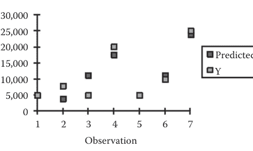

图 2.3 尝试使用 COCOMO 模型方法为图 2.2 的散点图拟合一条平滑曲线。

基础 COCOMO 模型可以扩展为“中间 COCOMO 模型”。中间 COCOMO 模型使用了一组“测试驱动属性”，这些属性在表 2.5 中。

这些测试驱动属性的权重由估算软件成本的人员根据其经验确定。权重按 1 到 6 的范围输入到表 2.5 对应的电子表中。所得总和被用于创建一个乘因子，用以修改基础 COCOMO 模型的结果。

## 2.5 项目调度

软件项目调度涉及及时将资源分配给项目。正如本章早期提到的，如果一个项目需要五年才能完成，在峰值时期需要一千人，而从第一天起就让这一千人全部列入工资单，但第一年可能只需要二十个人，这将是极其低效的。

然而，另一种方案同样糟糕。如果项目在任何关键时期人员严重不足，它很可能比计划晚完成，甚至根本无法完成。在过程后期增加额外人员通常没有帮助，因为经验越丰富的项目

## 表 2.5 中间 COCOMO “测试驱动属性”

| 测试驱动属性 | 权重 |
| --- | --- |
| 产品属性 | |
| 可靠性需求 | |
| 数据库的大小 | |
| 软件复杂度 | |
| 硬件属性 | |
| 运行时间性能限制 | |
| 内存限制 | |
| 其他争夺虚拟内存的进程 | |
| 人员属性 | |
| 分析师经验 | |
| 软件工程师经验 | |
| 应用领域经验 | |
| 虚拟机经验 | |
| 编程语言经验 | |
| 项目属性 | |
| 软件工具的使用 | |
| 软件工程方法的使用 | |
| 要求的开发进度 | |
| 总计 | |

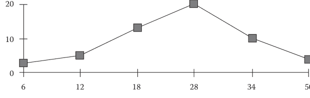

图 2.4 项目人员随时间的典型模式。

软件工程导论 76

受限制。随着测试和集成阶段的结束，人数将会减少。最后一个数字代表维护软件所需的人员。如果系统运行寿命很长，很容易看出维护阶段的成本将是最大的，正如我们之前提到的。

项目调度通常使用多种技术。两种最常用的是：

- 里程碑图
- 关键路径法

里程碑图的一个简单示例之前在图 1.4 中所示。（里程碑图的其他示例分别在图 1.6 和图 1.8 中给出，对应快速原型模型和螺旋模型。见第 1 章。）图 2.5 展示了同一系统的两个不同版本的稍微复杂一点的里程碑图示例。

注意软件的多次发布。在组织中，此类图表将包含每个里程碑的预计日期和实际日期。还要注意对每个作为交付物的里程碑举行评审。

一种不常用的规划和表示进度表的方法是使用所谓的“关键路径法”。关键路径法基于一种评估：某些事件是关键的，因为它们从根本上影响了其他决策。一旦确定了关键决策，任何不受关键事件影响的事件都可以任何时间安排进度。例如，在开始子系统设计和实现的主要工作之前，必须产生并评审描述组件子系统之间精确接口的 ICD。（我们将在第 4 章学习详细设计时描述 ICD。）

| 需求 | |
| 设计 | |
| 代码 | |
| 集成 | |
| 测试 | |
| 时间 | 发布 |
| | 发布 |

图 2.5 遵循经典瀑布软件开发流程的具有多次发布的软件项目的典型里程碑图。

# 项目管理 ■ 77

你应该注意面向对象的设计是如何与软件开发中关键路径的确定保持一致的。如果我们能用抽象类来描述对象的方法，那么我们就知道了该类的接口，任何开发将与该类交互的类人员都拥有了足够的信息来编写代码。也就是说，如果我们在开发一个类时，对该类方法的数量、类型以及类中方法的返回值类型有完整的描述，那么在编码期间，抽象类方法的实现设计可以与类中方法细节的实现并行进行。

显然，确定一个将被另一个类使用的类的抽象接口处在关键路径上，而对使用该接口的成员函数细节进行编码，则不是在关键路径上。

类似的情况在每个软件开发周期的许多地方都会发生。我们将在练习中要求你研究这一点。

## 2.6 项目测量

系统化的项目管理通常需要对软件开发过程进行测量。回想软件工程研究所的能力成熟模型（CMM），规定软件开发过程必须是可测量的。CMM 的高级别（第4级和第5级）规定：“软件开发组织在过程中具有定量反馈系统，以识别过程弱点并主动加强它们”（第5级），以及“使用详细的软件过程和产品质量指标来建立定量评估基础。能够将过程性能的有意义变化与随机噪声区分开来，并可以预测过程和产品质量的趋势”（第4级）。你可能将此与 CMMI 模型中的陈述进行比较。

一个过程（而非实体产品）如何被测量？与之前一样，使用 Basili 和 Rombach 的 GQM 范式是有帮助的。一些明显的目标是按时、预算内生产出满足系统要求的软件。

与这些目标相关的问题包括：

- 里程碑是否达成？
- 哪些项目落后于进度？
- 项目可能何时完成？

另一个相关的问题是令人恐惧的：

- 项目是否可能失败？

当然，这些问题中的许多在回答之前需要详细的测量。

一眼看出项目是否落后于进度很容易。遗憾的是，如果没有额外信息，这条简单的信息带给我们的帮助微乎其微。额外信息可能包括一张图表，显示各种软件生命周期阶段实际花费的时间与预测花费的时间与组织基准中之前数据的比较。可能项目实际上是按计划完成的，唯一的困难在于分配给每个活动完成的相对时间量。或者，项目可能面临严重的麻烦。唯一的判断方法就是开发项目测量。

什么是项目测量？鉴于软件开发环境的广泛性，没有绝对的答案。然而，经理应该掌握项目根据进度所处的位置，以及到为止花费了多少成本。

## 2.7 项目管理工具

项目管理显然是软件工程不可或缺的一部分。因此，它可以从应用高质量软件工具中获益，这些工具可以自动完成协调项目所需的某些步骤。这将是我们第一次讨论 CASE 工具的应用。在本节的后半部分，我们将讨论一些广泛可用且相对低廉或免费的较不复杂的工具。

现代用于项目管理的 CASE 工具应该帮助完成以下任务：

- 创建和修改项目进度
- 允许发布进度表，以便不同的管理人员查看，并在必要时进行更改
- 支持资源分配
- 识别进度中的关键项目以及依赖于关键项目的项目
- 允许所有授权的人员查看文档
- 支持不同的项目管理方法，以便工具能够定制以适应组织的业务模式，而不是让业务模式去适应工具

一些典型的商业 CASE 软件包包括用于项目管理的工具。也许用于项目管理和规划的最常见的独立工具是 Microsoft Project 和来自 Software Productivity Research 的 SPR KnowledgePLAN。GantProject 是另一个项目管理软件包，某些版本是免费的，可能适用于小型学生项目。这些产品的信息可以在以下网站找到：

- http://www.microsoft.com/project/
- http://www.spr.com/home
- http://www.gantproject.biz

这些工具是灵活的，并与现有的若干应用程序接口，用于数据收集、报告和统计分析。

你对支持项目管理的软件有什么期望？答案随着软件开发实践的多样化而异。然而，你应该期望软件能够支持成本建模、项目计划、项目调度和报告、资源分配、配置管理、变更管理以及任何其他适合项目的功能。无论如何，软件都应该是可配置的，能够与你组织常用的报告和控制流程配合。

对于使用 Google Docs 之类的工具，文本文档将提供配置管理支持，但不一定适用于其他类型的文档。在某些情况下，如果有一个能与项目相关的不同类型产物工作的配置管理工具将很好。

## 网络在项目管理中的作用

除了前面的章节讨论的项目管理工具和未来章节将简要讨论的 CASE 工具外，还有一些正在使用的辅助软件开发过程的软件工具和技术。由于技术进步和进入市场的速度如此之快，我们将满足于对一些重要的示例进行简要概述。

改变需求过程的突出力量无疑是互联网及其产生的标准，如超文本标记语言（HTML）、各种文字处理器、PostScript 和便携式显示格式（PDF）文件、jpeg（联合图像专家小组）和 mpeg（运动专家小组）。标准文件格式、图形浏览器和强大的搜索工具允许轻松访问信息。

考虑项目协调优于以前方法的优势。项目文档填满了多个活页夹，由于纸质文档的体积和数量，某些办公室无法工作。发布软件系统时的文档集通常使得无法存储所有文档。如果团队的关键成员被调到软件开发组织的其他地方，文档就会丢失。如果人员离开组织，情况会更糟糕。

增长最快的领域之一是所谓的“内网”，它们使用互联网标准进行网络的计算机系统，但实际上与整个互联网隔离开。在这种方法下，受限的互联网部分可以使用互联网标准进行通信，并有相对信心存储在内网上的工作免受外部未经授权对敏感材料的访问。因此，组织开展业务时不必担心商业应用程序工具的安全性。

我遇到的一种折中方案是两级安全流程。一家公司允许我访问一个门户以获取特定的机密信息，然后需要另一个流程通过名为工作协作小组的安全存储库来获取特定项目的细节。你可能熟悉类似的，但

# 8 软件工程引言

并非完全相同，授权过程是指银行可能要求在线银行系统的用户在输入密码之前使用站点密钥（该密钥通常包含一个图形图像，供用户检查以确保其没有错误地进入伪造网站），这在进入银行账户之前是访问银行账户的授权方式。

我应该指出的是，许多内网禁止使用无线连接到其安全区域。这是因为管理良好的有线连接在固有的安全性上具有相对优势，而且许多人（即使是计算机专业人士）倾向于使用不安全的无线网络，例如酒店和咖啡馆的网络。许多公司和组织允许甚至鼓励“自带设备”（BYOD）来设置虚拟专用网络（VPN），这提供了很水平的安全保障，但需要在通信方面付出努力并进行协调，还需要网络管理人员的配合，因此并不总是能够做到。使用加密电子邮件也有帮助。

当我讲授身份盗用话题时，我会提到电影《十一钱夺金》，因为我个人认识很多这样的人，他们在酒店或咖啡馆使用“免费”Wi-Fi 时账号被黑客入侵。如果你必须付出重新在电脑上安装所有应用程序和数据的代价，那么免费 Wi-Fi 并不免费。如果使用 Wi-Fi 意味着你或你组织的关键机密数据遭到泄露，那么 Wi-Fi 真的不免费。

正如前面提到的，现在将需求文档和项目进度表放在组织的内部网络、云存储中，偶尔放置在开放互联网上，已成为常态。多个人同时处理同一份文档的部分内容，并与所有需要访问的人共享。对需求和设计的检查应基于书面文档，且检查应按惯例进行，而不考虑文档是否可以在互联网上获取。

当然，使用电子文件存在一些问题。通过使用以下指南，可以减少甚至完全消除这些问题：

- 确定用于存储图形文件的标准格式。
- 确保该格式与所使用的浏览器兼容。
- 确定一种对在线文档缺陷提供反馈的机制。
- 特别如果同时需要纸质版和电子版文档。
- 确保在线文档受配置管理和版本控制。可以通过为每个迭代版本的需求和设计文档设置不同的目录来实现。
- 源代码和文本需求文档都应使用标准的文本配置管理工具。
- 通过 HTML 的 `mailto` 功能提供方便的反馈。这使得通信变得简单得多。
- 像在未使用互联网开发的软件项目那样使用评审（reviews）和检查（inspections）。
- 使用电子邮件协调会议，并通知项目团队成员文档已更改。
- 确定是否将使用聊天室进行项目管理。
- 在适当的情况下，使用维基（wiki）供多用户并发访问文档。（我们在 2.9 节中简要讨论过维基）。

正如软件工程中的许多事情一样，要量化某些技术或方法的影响是很的。然而，初步迹象表明，效率的提高是巨大的。无论如何，一个不使用网络协助项目管理的组织通常被认为技术上过时。

作为对互联网和内网发布效率认可的证明，美国航空航天局（NASA）戈达德航天中心的许多新软件开发项目将所有需求、设计、项目会议纪要、项目进度表和主要行动事项发布在互联网上，供项目人员访问。这减少了许多办公室的混乱，以前那里整整层的书架曾被用于存放包含项目文档的活页笔记本。此外，文档丢失的情况极少。Mandl (1998) 描述了使用互联网减少项目数量的一些积极影响。

## 2.9 群组软件 (GROUPWARE)

有一种特殊的工具被许多组织用于帮助协调会议和各种项目评审，这被称为群组软件（groupware）。群组软件一词是指一组人同时查看和处理同一份文档的能力。其访问控制通常比许多网络浏览器提供的控制要精得多。这在某些情况下非常有用。

例如，项目的需求工程师可以在一个带有大显示器的房间里会合，每位需求工程师都可以访问自己的电脑或工作站。或者，位置可以是远程的，通过网络进行访问。所有个人计算机都连接到网络，控制文档访问的软件被称为群组软件。

你可能熟悉 Google Docs，它是一个优秀的存储库，鼓励对存储在云存储库中的文档进行协作。尽管它非常有帮助，特别是对于共享文本文档以及 Microsoft Word 和 PowerPoint 等标准应用程序，但这个免费产品并不适用于所有的软件项目。因此，我们将讨论其他群组软件项目。对于涉及 Google Docs 等使用 Gmail 账号的协作项目，我使用不同的 Gmail 地址，以保持不同项目的信息隔离开。出于同样的原因，我在使用 Yahoo Groups 免费软件项目中也这样做。（我告诉我的孙子 Matt，他在马里兰州霍华德县一所公立学校上六年级，他必须遵守全县的要求，在所有语言艺术项目中使用 Google Docs。这让我很惊讶，直到我了解到许多学校在更低年级就开始使用这种连接性了。）

曾几何时，商业软件领域的领导者是 Lotus Notes。该产品现在是 IBM 产品的一部分，名为 IBM Notes 和 IBM Domino。IBM Domino 主要是用于 IBM 社区的名称，而 IBM Notes 是运行在客户端计算机上的版本。

群组软件在互联网访问方面又进了一步，意义在于它允许项目中的每个人都更改文档，或者将更改权限限制给一个人。这比 Linux 或各种版本的 Windows 典型的操作系统级权限更透明。这种对群组的使用更加顺畅。

一种已流行的群组软件形式被称为维基（wiki）。将维基百科视为一个主要例子。任何人都可以在维基上添加或删除任何内容。当然，有配置管理功能允许撤销更改。维基的概念通常意味着维基的创建本身是免费的。大多数维基系统与免费或低成本软件来源的组件接口，通常在 Linux 系统上。

当然，地理位置分散的软件团队经常使用某些工具来支持技术会议。最流行的商业工具之一是 Citrix Systems 生产的 GoMeeting。该商业软件提供为期三十天的免费试用版下载。也有创建群组软件的免费解决方案。请注意，Citrix Systems 是一家著名的公司，其极其成功的产品是将性能不足以运行较新版本 Windows 和 Office 的旧 PC 转换为可以与 UNIX 和 Linux 服务器通信的机器。还有其他产品，我也参加过使用一系列开源工具包的会议。

使用互联网或内部内网进行视频会议与群组软件具有一些相同的功能，特别是当存在回放机制时。

## 2.10 敏捷流程项目管理案例研究

软件开发中使用敏捷方法的支持者几乎总是声称，通过简化敏捷项目管理可以降低成本并加速开发周期。我们将通过考虑一个我非常熟悉的特定案例研究来检查这些说法。当然，单个案例研究（甚至一组案例）的结果无法证明所有敏捷项目都能降低成本和缩短开发时间，但这些结果可以提供一些指导。该案例研究中学的经验被认为是适用于使用敏捷方法的典型项目。

敏捷开发团队的经验以及高级管理层对使用敏捷开发的支持。

书中关于敏捷开发的特定案例研究关注于通常可以描述为空间卫星运行的应用领域。

正如涉及工业和政府的一系列实际软件项目的案例研究中常见的情况，不会提供参与者的姓名、其公司以及具体的项目细节。这种限制始终是因为保密考虑。在 2014 年 2 月，在 Google 上搜索项目负责人的姓名产生了超过 565,000 条结果，这对于任何不是卡戴珊（Kardashian）的人来说，都是一个巨大的数字。

项目团队成员包括：两名政府员工和五名代表几家公司的承包商。该团队最重要的属性是它在该应用领域拥有丰富的经验，并且理解预算需要进行激进的流程改进。

对于几乎任何存在多年的组织来说情况都是如此，团队成员对于在项目中使用本可以使用的软件组件存在某种程度的盲点。这种盲点通常被称为“未发明在此综合征”（Not Invented Here Syndrome）（Webb et al., 2011）。

在第一次使用这种敏捷流程时，许多人抱怨无法确定“谁负责”。这让高级管理层感到困扰，但对团队能力和经验的信心，使得在最初结果并不理想的情况下，允许敏捷流程继续进行实验。

从事后视角的角度来看，这种困难是一件好事，因为它表明转型正在从一种僵化的、封闭的、分级的控制机制（这种机制在学习新事物时往往效率较低），向更开放的、基于团队的控制机制转变，后者允许更多的学习。

学习至关重要。这个七人团队是一项更大努力的一部分，多个团队和内部组织竞争以使他们的想法得以实施。工作的前提是，最大的学习能力不需要管理或协调，只需朝着产品迈进。

我们可以通过投入管理、协调和控制的活动与剩余活动之间的比例来衡量自组织的程度。该比例越接近零，团队的自组织程度越高，层级化越低。这种比例被称为“自组织因子”，或 SOF，为：

```
SOF = (管理 + 外部测试)/(管理 + 系统工程 + 需求 + 实现 + 内部测试 + 外部测试 + 软件维护 + 系统管理 + 文档)
```

每个项目都得出了一个基于规模的因子，以便通过重用百分比和代码规模对数字进行进一步归一化。

# 84 软件工程导论


在这项研究中，`SOF` 接近零的项目往往在成本和减少测试工作方面取得了更大的改进，如图 2.6 所示。人们认为创新的实现是因为障碍已被扫除，团队可以更有协同地管理他们的“团队模型”，而用于行政控制上花费的精力较少。

该过程使用了两个工具来辅助开发过程：用于配置管理的并发版本控制系统（Concurrent Version System）以及用于跟踪错误及其在开发过程中如何消除的综合性差异系统（Comprehensive Discrepancy System）。尽管用于配置管理和错误跟踪的软件工具已作为廉价的应用程序或独立系统存在了三十多年，或者作为集成开发环境（`IDEs`）存在了近同样的时间，但其使用的某些方面仍然值得讨论。

用于配置管理的并发版本控制系统允许团队成员在线配置软件和文档。这在任何类型的现代协作分布式软件开发中（如 Eclipse）都是典型的，但将其扩展到通常在文字处理程序中创建的文档，在当时是不寻常的。每个文字处理文档都有一个几行文本形式的标记，指示文档是否被修改过。

综合性差异系统是一个在线数据库，帮助管理测试中识别出的差异并帮助跟踪解决方案。作为一项特殊功能，综合性差异系统可以提供各种指标，用于跟踪进度和评估教训（例如，开发中何时以及发生了什么类型的错误）。这在任何类型的现代分布式软件开发中都是典型的，但在当时的项目中并不典型。

可能还有另一个支持敏捷团队表现的干扰因素。NASA 多年来一直使用迈尔斯-布里格类型测试（Myers-Briggs Type Indicator Test）来帮助确定人员分配。这项测试将人分为内向或外向、感性或直觉、思考或情感、以及判断或感知，之后他们被置于四个象限之一。我非常熟悉的一位非常有创造力的团队成员在“直觉型外向者”方面得分很高。该团队在迈尔斯-布里格光谱上非常平衡。

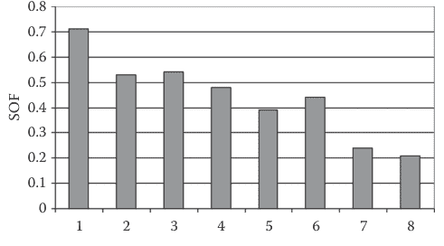

图 2.6 八个项目开发的自组织因子（`SOF`）。

著名的计算机科学教授 Lisa Kaczmarczyk 写了一篇关于内向者在计算领域经验的有趣文章，特别是关于敏捷流程的（Kaczmarczyk, 2013）。以下是文章中的一些引言。

一位资深开发者在描述大型跨国公司使用敏捷流程时说：

“……当团队成员之间存在语言障碍时，敏捷仍然意味着团队许多成员之间的日常交流，但通常通过聊天界面进行。这在很多情况下适合内向者，尽管（在我看来）在这种情况下效果并不好……”

另一家公司的一位更资浅的软件开发者说：

“在处理困难问题或对某事进行构思时，我不介意与人一起工作，但当我冲刺完成一项任务时，我觉得旁边有别人没什么意义……”

# 总结

软件项目管理是对通用管理工具和技术的系统应用，以提高软件流程的效率。软件活动包括：

- 系统分析
- 需求
- 系统设计
- 实现
- 测试
- 交付
- 维护
- 质量保证
- 指标
- 文档
- 系统管理
- 重用和重构
- 人机界面
- 工具

# 软件工程导论

所有活动必须由项目经理协调。他或她还将负责确保资源得到适当使用。敏捷流程需要相当的时间才能生效，因此敏捷流程需要组织的支持。

# 关键词和短语

软件项目管理、软件团队、项目计划、人员配备、交付、软件成本估算、`CASE`、`CASE` 工具、`COCOMO`

# 延伸阅读

有很多关于管理的优秀书籍。最好的之一是 Watts Humphrey 的经典著作《软件管理》（Humphrey, 1989），尽管已经过去了多年，它仍然畅销。Tom DeMarco 关于这个主题的书（DeMarco, 1982）也非常有用，对于一本 1982 年的书来说非常先进。

来自 Humphrey 的另一本书描述了个人软件流程，可以帮助程序员确定软件工程活动（需求、设计、实现、测试等）消耗他们大部分时间。该书的一个主要特征是一系列练习，旨在提供项目经验的定量测量数据库，以提高个人作为软件工程师的能力。

Jim McCarthy 在 1995 年的《软件开发动态》中提出了对软件管理的略有不同的观点。它描述了在微软进行软件项目的经验。

《软件质量管理》2014 年研究版的《软件年鉴》包含了对某些项目指标的讨论，以及一些案例研究。可以在 `qsm.com` 下载。

Boehm（1981）的 1981 年著作仍然是软件资源估算最好的参考文献之一。它详细介绍了 `COCOMO 2` 模型。`COCOMO 2` 模型由 Boehm 创建，扩展了 `COCOMO` 模型。其他常用的模型还有 `SEER`（Garareth 和 Evans, 2006）和 `Win-Win`（Boehm, 1998）。`SEER` 和 `SLIM` 软件成本估算工具是用于软件项目估算的工具包的一部分，分别可以在 `golarath.com` 和 `qsm.com` 找到。关于该主题的概述，请参阅关于成本估算的百科文章（Leach, 1999）。有关使用的信息，请参阅 Terry Bollinger 和 Shari Lawrence Pleeger（1990）的文章。

项目管理 — 87

投资回报率（`ROI`），这通常用于确定特定软件项目的成本和效益，即将启动。

请完整阅读 Lisa Kaczmarczyk (2013) 和 Phillip Armour (2013) 最近的文章，以获得关于敏捷开发及其他快速软件开发过程的一些见解。

Chris Sims 和 Hilary Louise Johnson 编写的这本简短且廉价的书，为敏捷项目管理提供了一个快速而全面的介绍（Sims and Johnson, 2014）。

关于更具颠覆性的业务实践（云计算仅是其中之一），请参阅 Nicholas Webb 和 Chris Thoen (2010) 的著作。

# 练习题

1. 检查一个你以前使用过的 `IDE`，并判断是否允许两或三个人同时处理同一个项目。如果 `IDE` 内部不存在这种能力，请描述你将如何组织团队成员之间的通信。

2. `COCOMO` 模型中的活动“测试驱动器属性”是什么？

3. 项目计划中应该包含哪些活动？你的答案是否依赖于软件开发生命周期？

4. 项目管理计划中应该指示哪些里程碑事件？

5. 检查一些开发软件的政府组织的网页。选择一个项目，并确定哪些需求或设计是你可以获得的。然后估计完成你所发现的软件项目所需的精力和资源。

6. 检查一些开发软件项目管理工具的公司的网页。确定这些工具是否允许用户估计完成你通常开发的软件项目所需的精力和资源。

7. 检查你之前在计算机科学课程中做的几个项目。通过比较每个项目的代码行数与每个项目所花费的时间，利用这些项目来确定你的生产力。所需时间是项目分配日期与提交日期之间的差值，乘以一个代表你每天在项目上花费平均小时数的系数。平均时间是否准确反映了你花费时间的情况，还是说大部分工作都是在项目截止日期前才完成的？

8. 绘制一张显示快速软件开发模型主要软件工程任务的图。以图 2.2 为模型。

9. 绘制一张显示螺旋型软件开发模型主要软件工程任务的图。以图 2.2 为模型。

10. 此题涉及 `COCOMO` 软件成本估计模型。检查一个有多个版本且你可以获取源代码的软件系统。（自由软件基金会的 `GNU` 软件工具是回答此问题的极佳来源。）描述该系统是有机型的、嵌入式的还是中间型的。检查最后两个版本中新代码和重用代码的数量。`COCOMO` 模型预测的时间估计与这些版本之间的时间是否一致？请解释原因。

11. 获取一个组织的软件项目管理手册副本。找出如何确定人员配置和资源分配。手册中是否提到了任何 `CASE` 工具？

12. 检查你最近完成的一个项目。确定哪些活动处于开发的关键路径上，哪些活动可以并行进行。如果在项目开始之前就拥有这些知识，是否会让软件开发过程更高效？

13. 为“2038 年问题”制定一个项目计划，即 `UNIX` 系统中使用的日期字段将在 2038 年的某个时候溢出。溢出是因为整数的最大大小限制。`UNIX` 系统中许多使用时间的函数使用从 1970 年开始计算的秒数时间，这个数字最终将大到无法存储在 32 位整数中。

14. 为社会安全号码溢出问题制定计划。当美国人口增加加上已有的社会安全号码数量超过了存储社会安全号码的九位数容量时，就会发生这个问题。在你的项目计划中，考虑如果社会安全号码发放给现已去世的人，是否应该重用。务必考虑所有可能的社会安全福利类别。

15. 这是一个思考题，因为你无法获得足够的实际数据来验证你的答案。在 2.4 节中，我们考虑了假设项目规模与完成该项目所需的软件工程师数量之间的关系。我们假设项目完全由新代码行组成（数据列在表 2.1 和 2.2 中）。现在你来考虑同一个项目，但假设该项目有一半代码是该假设项目现有的可重用代码。你预计这种重用对所需的软件工程师数量会产生什么影响？你的答案是否取决于软件开发团队的性质，或者在开发生命周期的何时决定重用源代码，抑或对代码质量有何预期？给出理由来证明你的答案。（你可以查阅关于软件重用的书籍。）

# 需求

在本章中，我们将讨论许多从业人员认为的软件工程最重要的部分：软件系统需求的开发。我们将从介绍需求工程的一些典型问题开始。然后，我们将说明无论使用哪种软件开发生命周期模型、是否存在一组已知的客户提供反馈需求收集，或者是否希望产品在交付后决定其自己的客户群，这些问题是如何发生的。我们将讨论信息隐藏、形式化表示和需求评审等基本技术，还将讨论软件需求工程过程的典型管理观点。

我们将稍微评估用于敏捷软件开发的需求。在介绍需求的基本技术后，我们将开始讨论 3.1 需求需求。

## 3.1 软件工程导论

在教育中（在强调软件原理的课程之前）经常缺失两个主题：(1) 需求和 (2) 设计。

遗憾的是，如果需求是错误的、不完整的或模糊的，大多数软件工程活动都是徒劳的。让我们考虑在这些情况下会发生什么。

如果项目的需求需要重做，那么其余软件工程活动也必须重做，前提是有人识别了需求中的错误。这是极其昂贵的，并且意味着大部分工作被丢弃。在最坏的情况下，所有的项目努力必须放弃。

“错误”还能意味着什么？它可能意味着不符合目标系统的使用。这是“建立了错误的系统”。错误”还可能意味着需求针对的是过时的或与客户完全相反的系统。这被称为“建立了错误的系统”。

如果需求不完整，有两种可能性。需求不完整的最佳情况是它们是模块化的，项目的设计和代码也可以以模块化的开发。在这种情况下，通过对设计和源代码进行较少修改就可能满足需求。这种灵活性是迭代方法（如快速原型或螺旋型开发模型）的主要优点之一。在使用敏捷方法的项目中，这种灵活性更大。

如果需求是完整的但不是模块化的，那么设计和生成的源代码不太可能是模块化的。在这种情况下，设计和代码的大部分必须丢弃，因为它们难以与现代编程技术和软件工程目标保持一致。许多失败项目的经验强烈表明，缺乏模块化的需求是非常昂贵的。

糟糕需求的第三类情况发生在需求模糊的情况下。在这种情况下，很难判断设计是否正确，因为软件设计师不知道需求意味着。设计师可能会对需求工程师的意图做出一些毫无根据的假设。这些假设如果不正确，可能成为项目灾难的主要来源。最常见的问题是这些毫无根据的假设变成了项目文化的一部分，并且从未被质疑。

关于模糊的需求，还有一点需要记住。如果需求如所述是模糊的，但负责项目的软件工程师在特定应用领域具有很高的知识，并具备填补空白并以清晰、明确的方式完成它们的能力，那么只要有高层的支持，敏捷开发过程就是行的。

## 3.2 需求

在某些情况下会使用“非功能性需求”这一术语。该术语通常意味着某些特定的软件属性是理想的，但没有描述如何获得该属性，或者是否存在（例如）任何性能需求。通常，这类需求仅由对特定应用领域了如的高级软件工程师采用。我经常在学生提出的提案书中看到，他们承诺某个软件系统是“用户友好的”，这个术语总是表明其对人机交互的了解甚少。该系统对于哪类用户是用户友好的？“用户友好”的反面是“用户讨厌（user-nasty）”吗？本书将不再进一步讨论非功能性需求。

需求模糊会导致软件系统要么无法完全按照客户的要求运行，要么无法运行，因为与其他软件的接口没有经过适当的规范。模糊的需求可能导致无法从技术角度解决的问题，因此必须在法律系统中解决。让软件问题导致法庭，意味着一个由相对非技术背景的人组成的陪审团必须确定需求的精确含义，而这些需求又太模糊，以至于参与的技术人员都无法理解。这绝不是一个吸引人的场景。

事实上，问题比表面看到的要严重得多。纠正错误最便宜的时间是在需求开发阶段（见后文表 3.2）。无论采用什么开发模型：经典瀑布型、快速原型、螺旋型或其他，事实如此。另一方面，纠正软件问题最昂贵的时间是在维护阶段，此时之前所有的生命周期活动（需求、设计、编码、测试、集成、文档、交付和安装）都已完成。软件维护还需要对代码有深入的理解。我们将在第 8 章充分讨论软件维护。

你可能认为使用迭代软件开发方法可以消除大部分这类问题。确实，迭代模型允许比经典瀑布模型更早地发现不完整的需求。不一致或错误的需求需要通过迭代方法更早地被发现。

然而，除非仔细地处理各种评估评审，否则需求可能无法被发现。如果没有健康的怀疑态度，需求仍然可能成为项目文化的一部分，而模糊性永远得不到解决。

美国国家标准与技术研究院（`NIST`）的 Dolores Wallace 以及加州 SoHar 公司的 Herbert Most 和 Myron Hector 的一项研究表明，由于软件系统中错误的性质，这是一个金字塔效应（Hert et al., 1997）。他们检查了大量项目，并根据错误发生的生命周期对错误进行了分类。他们结果的非正式总结如表 3.1 所示。显然，许多错误发生在需求阶段。

及时发现错误或不一致之处有多重要？有许多研究考虑了在软件生命周期不同阶段修复软件问题的成本。其中一项（专有）研究的结果如表 3.2 所示。注意在软件生命周期早期（需求阶段）发现错误的巨大优势。

显而易见，确定软件系统的需求是至关重要的。即使在敏捷流程中，或者说在任何迭代软件开发过程中，需求最终必须被确定，初始需求越准确越完整，迭代就越少、成本也越低。我们将讨论一些能够高效确定需求的技术。

## 3.3 软件工程导论

### 表 3.1 软件项目错误来源分类

| 生命周期阶段 | 软件错误来源 |
|---|---|
| 需求 | 很多 |
| 设计 | 相对较少 |
| 代码 | 进一步较少 |
| 测试 | 进一步较少 |

来源：Hecht, H., Hecht, M., and Wallace, D., *Toward more effective testing for high assurance systems*, Proceedings of the High Assurance Systems Engineering Workshop, HASE '97, Washington, D.C., 176–181, August 11–12, 1997.

### 表 3.2 软件生命周期不同阶段修复软件错误的相对成本

| 生命周期阶段 | 修复软件错误的相对成本 |
|---|---|
| 需求 | 1.0 |
| 设计 | 5.0 |
| 代码 | 10.0 |
| 测试 | 30.0 |

当然，许多项目的需求由于技术变化和组织新方向而随时间推移发生变化。这对于大型项目尤为如此，它们的开发时间可能会持续数几年。一组高质量、模块化的初始需求以及有效的软件开发过程可以以系统化、有效的方式支持变更的纳入。

敏捷流程呢？我认为敏捷流程最重要的优势是，组建得良好的项目团队（其成员在特定应用领域的软件开发方面具有丰富的经验）对于从高层需求中会产生哪些详细需求有着直观的感受。因此，他们可以通过缩短需求来缩短开发过程，因为他们可以精确确定用于目标系统的大规模组件和子系统。原型的持续改进降低了敏捷流程非正式性的风险。你将在本书对敏捷软件开发过程案例研究的持续描述中看到这一点。

根据我的经验，如果没有这种必不可少的应用领域专业知识，在关键项目中可能会导致灾难，最好留给那些失败不会对组织造成灾难性影响的尝试。文献表明，敏捷流程不应应用于对安全性至关重要的领域。参见软件工程学院 Carol Woody 在 2013 年发表的文章（Woody, 2013），对该问题的更详细的讨论。

## 3.4 需求爬取

需求工程有几种方法。其中一些是经典方法（Davis, 1990）。另一些受面向对象方法的启发（Berry, 1995）。还有一些受成本问题驱动，例如复用驱动的需求方法（Kontio, 1995; Leach, 1998b; Waund, 1995）以及系统性的流程变更（Mandl et al., 1998）。由 `scrum.org` 建议的名为“`scrum`”的敏捷方法，专注于确定所谓的产品所有可以在三十天内满足的需求。

### 图 3.1 需求过程的样式视图

（系统环境、问题理解、组织目标 → 需求过程 → 描述系统的详细需求集）

在本节中，我们将描述大多数方法通用的基本原则。个体差异将在接几节中展开。需求工程过程应该被认为是从对项目目的的已知情况开始，到一组需求结束。这包括软件系统将运行的环境、系统的目的（从潜在用户或客户的角度感知）以及组织的基本目标。

需求过程的输出是对系统应该做什么的完整、详细、无歧的描述。需求应该是足够无歧的，以便可以开发出与之匹配的设计，并且能够判断设计是否符合需求。需求过程的基本输入如图 3.1 所示。

让我们通过一个简单的示例来说明需求工程的基本问题：确定一个安装在个人计算机上的软件包的需求。我们不会讨论问题陈述的其他部分，因为即使是问题描述中的这一小部分也足以说明几个几点。系统需求必须回答以下问题：

- 将使用什么硬件平台？
- 支持哪些操作系统（`Windows`、`UNIX`、`Linux`、`iOS`、`Yosemite`、`Android` 等）？
- 需要哪些版本的操作系统？
- 是否不同的软件版本运行在不同的计算机和操作系统上？如果是，是哪些？

# 94 软件工程导论

- 文件格式是否在不同的操作系统之间保持一致？
- 软件是否具有图形用户界面？
- 软件的图形用户界面是否与操作系统的界面以及在相同环境中运行的其他应用程序一致？
- 是否有强制接口标准，例如在 `Apple App Store` 销售软件所需的标准？
- 是否会有多个实现版本，例如：针对内存和磁盘空间较小的笔记本电脑提供最小尺寸版本，提供包含更多支持文件和功能的、用于内存和尺寸限制较少的计算机的大尺寸版本？
- 内存大小和可用硬盘空间方面的最小系统要求是什么？
- 程序在内存中的存在是否会对同样运行在计算机上的其他应用程序产生影响？


是否有其他软件包（如文字处理器、电子表格程序、数据库管理器、数据可视化工具或绘图工具）是程序必须与其共享数据的？

软件内是否提供在线帮助？

软件将如何交付？是使用 CD、DVD 还是仅通过在线下载提供？

软件将以压缩格式还是未压缩格式提供？

是否会提供安装和设置软件？

是否需要培训？

是否有时间限制，例如必须在有限时间内完成某些操作？（这些约束被称为“硬性”约束，与下一个项目符号中描述的“软性”约束形成对比。具有硬性时间约束的系统被称为“硬实时系统”。）

是否有时间限制，例如必须在单一指定的时限制内完成若干特定操作，使得限制体现在单位时间内的平均操作次数上？（这些约束被称为软性约束，与上一个项目符号中描述的硬性约束形成对比。一个仅具有软性时间约束的系统被称为“软实时系统”。具有硬性或软性实时约束的系统统称为“实时系统”。）

你可以看到，为了写出完整的设计描述，软件需求必须达到多么详细的程度。如果软件需要实现任何功能，这一切都会变得复杂得多！对于任何真实系统，其表面复杂度似乎是巨大的，以至于问题看起来是不可解决的。唯一的解决办法是遵循计算机专业学生熟悉的方法：尽可能使用步步细化和抽象。现实世界中的许多软件项目也尝试尽可能复用现有的软件组件和系统。

在这种情况下，步步细化过程涉及一个系统性的翻译过程，从初始的、相当不完整的问题描述（从高层次描述系统）翻译为指定目标系统功能的详尽需求集。翻译的结果仅仅是将问题列表重新表述为一组无歧的陈述，并对平台、操作系统、可用 API 等做出了决策。

假设这些步骤已经完成。此时，我们已经了解了假设的软件项目必须满足的类型类型，至少在操作系统支持和环境方面。这是需求工程师在需求过程开始之前被预期具备的这类背景信息和知识。软件工程行业使用通用的术语领域知识来描述这种假设的专业水平。这种领域知识有助于抽象以及对现有大规模组件和系统的复用。

尚未完成的是从所有可能的选项中选出特定的需求。在我们的示例中，很可能假设我们的软件产品会有很多客户，但需求团队并不直接认识这些客户中的任何一个。在这种情况下，需求团队可能会与几个人（包括营销和销售团队）见面，以便对系统的需求做出初步决策。

为了固定本节后续的内容，让我们假设已经做了以下决策：

- 软件将在 Windows 8.1 操作系统上运行。不支持其他版本。

- 软件将具有图形用户界面。

- 图形用户界面在菜单组织上将与 Mystery 系统 3.1 版本的界面保持。

- 用于创建新文件、打开现有文件、关闭文件、标准格式保存文件以及以另一种格式保存文件的命令将从包含 ASCII 文本的列表中选择。

- 系统将只有一个版本，适用于所有安装环境。

- 系统将需要少于 200 MB 的空闲内存和 500 MB 的可用磁盘空间。

- 软件必须能够与 Catchall 数据库 7.3 版本共享数据。

- 提供在线帮助。

- 软件将以压缩格式通过 CD 交付。

- 软件将包含一个安装程序，其中包含一个软件解压程序。

你应该注意的一点是，需求陈述是软件开发人员与问题描述制定者之间协议的一部分。这种协议可能是一个合同，在某些情况下具有完全法律效力。由于本章前面给出的原因，软件需求必须精确且完整。需求文档在初始产品交付后仍会被保留很久。

这是一个需求文档长寿的例子。为 NASA 设计用于操作航天器的若干计算机程序是由外部商业组织生产的，而不是政府员工。某些航天器的寿命比原计划要长，在某些情况下，在运行多年后仍产生了实用的科学数据！多家公司通常负责软件的不同部分。每当软件操作员发现问题时，都会通过将软件的实际操作与需求中指定的输出进行比较来验证问题的发生。当实际所需的输出与该输入指定的输出不符时，该问题被认定为已发生，如果认为足够重要，该问题就变成了某人的修复责任。

# 要求 ■ 97

需求团队在与客户的藻会议之间必须完成大量工作。团队必须精炼此前提交给客户的上一组需求，并对客户反对的需求进行添加、删除或修改。由于客户可能没有显式地表示他们的需求，因此必须对客户真正想要的内容进行分析，而不仅仅是他们口头上所说的。

当然，如果客户能够看到实际系统原型并确定该系统是否满足其需求，那么这些与客户进行的需求收集会议将更加高效。如果现有的原型不满足客户需求，可以更改原型的需求并开发另一个原型。这种灵活性以及减少产生不满意系统的概率，是选择快速原型模型、螺旋模型或其他软件开发模型的两个重要原因之一。使用对象模型来为在对象上可以执行的各种动作（成员函数）自动生成框架代码，也可以通过在需求过程的每一次迭代中为客户提供具体内容，从而促进需求过程。

需求收集过程将持续进行，直到客户对系统需求满意为止。最终结果必须是对待设计系统的完全无歧义的描述。在许多情况下，需求过程就是编写源代码以实现设计的过程：即逐步细化。在需求团队确认已掌握需求后，他们会编写一份需求文档，该文档可能会提交给客户评审。遗憾的是，需求团队的工作尚未结束。我们将在 3.4 节重新讨论需求过程。

## 3.3 需求追溯

需求文档中最核心的部分之一是需求矩阵。其目的是允许在软件系统的整个开发周期内轻松跟踪需求。

需求追溯矩阵的格式因组织而异；大多数组织使用它们自己的标准表格。它们都有几个共同点：单个需求、其他生命周期阶段的条目位置以及签字确认。该概念如表 3.3 所示。

（重点是 Microsoft Windows 8 和 8.1，因为它们的用户界面与之前的 Windows 版本有本质不同。当然，Windows 10 的用户界面也发生了类似的剧性变化。然而，Windows 8 允许两种用户视图。）

为了简单起见，需求被编号为 1、2、3 等。遗憾的是，这种简单化的需求组织方式并不是行业实践的典型。更真实的软件项目将具有多个层级的需求，通常按功能分组。例如，美国航空航天局（NASA）的一个当前软件项目有 1156 个需求，这些需求被分为四个层级的层次结构。因此，需求编号 4.1.3.2 反映出这是系统 4 的子系统 1 的单元 3 中的第二个需求。

### 表 3.3 需求追溯矩阵

| 编号 | 需求 | 设计 | 代码 | 测试 |
|---|---|---|---|---|
| 1 | 基于 Intel 的 | | | |
| 2 | Windows 8 | | | |
| 3 | 与 Windows 8 用户界面一致 | | | |
| 4 | 图形化用户界面 | | | |
| 5 | 与 Mystery 3.1 一致 | | | |
| 6 | 系统仅限单一尺寸 | | | |
| 7 | <200 MB 系统，<500 MB 磁盘 | | | |
| 8 | 与 Catchall 7.3 共享数据 | | | |
| 9 | 提供在线帮助 | | | |
| 10 | 以光盘交付 | | | |
| 11 | 包括安装和解压缩 | | | |

需求工程过程的下一步是检查我们需求的状态。（从技术上讲，这应该在创建需求追溯矩阵之前完成。）当然，我们还需要寻找任何表述模糊的需求，这些应该在此时出现，因为模糊的需求是无法测试的。表 3.3 所示的需求追溯矩阵中最后一列的存在提醒了我们，可测试的功能性需求对软件项目至关重要。希望在需求收集过程中做出的大多数决策都是直接的，并能引导可以完成的软件项目。

片刻的反思应该看出我们需求中的潜在问题。在用户界面方面存在困难。“与 Windows 8 操作系统的用户界面保持一致”这一说法完全太模糊了。它根本无法测试。这个短语的存在几个潜在问题：

- 软件的用户界面不会与 Windows 8 界面产生任何冲突。哪种界面：平贴式的还是经典的？与 Windows 8.1 有任何冲突吗？

- 软件的用户界面将与 Windows 8 操作系统用于相同目的的按键和菜单选择约定。是哪些约定（此操作系统有两个界面）？

- 软件菜单将具有与 Windows 8 相同的组织结构和选项。

- 软件将使用与 Windows 8 相同的系统调用和 API。

目前还不清楚是指其中的哪一个。经验法是“细节越多越好”。同样，使用清晰的动词（如“必须”、“应当”和“将”，而不是“可能”或“可以”）也是如此。不明确的需求在实际项目中可能会导致灾难。由于存在变异，很难将任何关于设计或实现的决策追溯回需求，以确保满足了这些需求。当你将需求组织成需求追溯矩阵时，对于无法测试的陈述进行标记。事实上，某些组织要求在需求批准之前编写测试用例。

## 3.4 软件架构与需求

是时候评估我们对需求过程的理解了。由于我们已经进展到了这一步，我们已经通过逐步细化和对应用领域的知识编写了一组适用于我们软件的需求。在表 3.3 中，我们展示了软件的一组特定需求。

遗憾的是，这种过程对于更复杂的软件是不满意的。具有超过 1150 个需求的软件系统，其工作量至少是到目前为止描述的示例的 100 倍，许多系统需求会影响其他需求，导致不一致。可能存在实时需求。该系统的需求工作可能接近示例的 200 倍。对于真实的系统，产生的工作量可能会大。通常，软件架构（显示软件系统的高层结构的主要组件和功能）是有用的。我们将在 4.5 节详细讨论软件架构。

我们如何处理这种增加的复杂性？逐步细化和抽象是显而易见的方法，但需要更多指导。常用的技术有四种：

1. 使用数据抽象和信息隐藏原则来产生系统功能的完整描述。这种方法自然地引导面向对象的需求集，但也适用于本质上完全面向过程的系统。

2. 重新分组需求，使其与现有和计划系统的需求及设计保持一致。

3. 重用需求，以便重用以前开发的满足这些需求的设计和源代码。

4. 自动化需求过程。

为了保持一致，我们将假设一个假设的图形数据库系统已经确定了一组需求。（图形数据库允许对二维和三维对象进行组织、搜索和检索以及

# 软件工程导论

表 3.4 假设数据库系统的初始需求

1. 系统必须允许最多 100 个多面体。

2. 系统允许对象为单个多面体或多达三个多面体的组合。

3. 系统允许使用标准集合运算或对一个、两个或三个多面体进行交集运算来形成组合。

4. 系统将跟踪所有对象的体积。

5. 系统将跟踪所有对象的表面积。

6. 系统允许撤销最近将两个或三个对象合并为单个大对象的组合。

7. 系统必须使用世界到屏幕的变换来显示对象。

8. 系统必须允许保留每个多面体每个面或每条边的指针。

9. 系统能够确定每个对象每条边的长度。

10. 与 XYZ 计算机对象相关的其他需求（为了简单起见，此处不再赘出）。

11. 系统必须在可用 200 MB RAM 和 500 MB 磁盘空间的情况下运行，使用 3.72 版本操作系统、DISPLAY Master 3.32 以及 3.4 版本的 WWM 数据库系统。

一组允许的操作。此类数据库通常包含在实体建模系统中，例如用于计算机辅助设计软件的系统。

需求集如表 3.4 所示。关于将这组需求细化为完整且无歧的需求集的不同方法，将在单独的章节中进行讨论。

## 3.4.1 需求工程中数据抽象和信息隐藏的使用

数据抽象和信息隐藏是软件工程中最重要的两个工具。它们鼓励减少良好的软件工程所必需的复杂性。因此，它们存在于任何规模的成功软件项目中。

遗憾的是，它们被认为如果不采用面向对象的方法是不可能实现的。虽然面向对象鼓励数据抽象和信息隐藏，但实现它们并不是必不可的。为了强调这一点，我们为该系统开发了一套完全面向过程的需求集，其初始需求如表 3.4 所示。本节的讨论深受 Daniel Berry (1995) 在《系统与软件杂志》上发表的一篇论文以及 Berry 在研讨会上对其阐述的影响。

Berry (1995) 的论文是需求工程师的必读物。在这个过程中有两个核心参与者：需求工程师，他们本质上熟悉需求过程，但对应用领域一无所知；以及领域专家，他们理解应用领域，但对需求工程并不特别了解。该论文对需求工程过程的核心信息非常清晰，可以用两个互补的原则来描述：

1. 系统的需求必须不断修改和细化，直到系统可以由软件设计师和编码人员开发，这些人员熟悉应用领域的基本算法，但不了解需求工程过程。最终的需求将是完整且无歧的，使得设计是的，并且可以通过实现标准的、为人知的算法轻松完成。

2. 系统的需求必须不断修改和细化，直到系统需求可以被熟悉需求工程但对应用领域一无所知的需求工程师理解。最终的需求将是完整且无歧的，使得需求工程师即使没有领域知识也能完全理解。

系统的需求必须迭代，直到每个需求都符合这两个原则中的某一个。Berry (1995) 将这种方法称为“无知隐藏”，因为设计师和编码人员对需求工程缺乏理解（无知），而需求工程师和领域专家对应用领域的无知，使得可以在没有先入为主观念的情况下进行精确通信。只有当双方都坚持获取无歧的需求时，这种方法才有效。

让我们看看表 3.4 中列出的前两个需求。第一个需求是“系统必须允许最多 100 个多面体被表示”。这个需求中有两个名词：“系统”和“多面体”。动词是“允许”和“表示”。其他重要词是“最多”和“100”。

假设你是一个对应用领域一无所知的需求工程师。“系统”显然是指项目产生的软件。这没有疑问。但“多面体”这个词呢？假设我们承认这是一个复数，我们必须询问领域专家什么是多面体。他会回答类似：“边界由多边形组成的几何图形”。讨论将继续，直到需求工程师确定多边形具体。显然，如果我们假设看到的是某个三维对象的可见边界，那么图 3.2a 和 b 中指示的对象就是多面体。然而，图 3.2c 中的退化情况更难刻画。

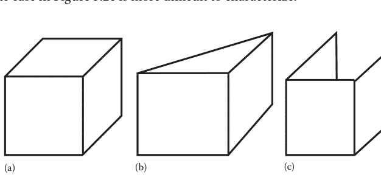

图 3.2 (a) 立方体。(b) 棱柱。(c) 多面体。

显然，在设计任何系统之前，必须获得多面体的精确定义。为了节省空间，我们假设该术语已经过适当定义，并将注意力转向第二个需求。那里的主要困难在于“组合”一词。三维几何图形可以被视为边界的实体对象、无边界的实体对象，或者由其边界表面描述的空间区域。最终在这些多面体上执行的操作包括构造、破坏、空间方向的确定，以及确定对于特定位置看向特定方向的观察者来说是可见的面。因此，“组合”一词可以指图 3.3 所示的两种情况之一。需求需要指示允许哪种或这两种组合。还必须考虑异常情况，例如从自身移除一个长方体。我们顺便提到一下，对这些“异常情况”的正确处理可能会占据基于图形的建模系统所需的大部分编程工作。

图 3.3 (a) 组合。(b) 。

根据无知隐藏原则，表 3.4 中的初始需求缺乏清晰度。我们将对其他需求的改进讨论留到练习题中。

## 3.4.2 需求工程中的需求重组

通过重组需求，我们的意思是将单个需求分组成组。这是一个比单个需求更高层次的视角。现在我们将注意力集中在更高层次的组件上。这种重组通常被认为是必要的。

如果我们重组表 3.4 中列出的需求，会变成什么样？例如，如果我们把所有与数据库的需求放在列表顶部。在这里我们将第 1 到 5 个数据库相关的需求放在一起。注意判断数据库是否具有适当设施变得容易得多。我们可以更进一步，直接设计数据库本身。为了简单起见，我们将省略这一讨论，因为我们将在后的更真实的示例中回到这一点。请注意，还有另一种组织方式。大多数软件工程师会同意，目前的系统是使用分层列表描述的，如使用 C、Ada 等过程语言。需求 103

因此，如果要使用 Java、Swift、Smalltalk 或 Eiffel 等面向对象的语言或 C++ 等混合语言编写软件，从本质面向过程的视角到对象视角的映射是必要的。我们在此不进行映射，将关于面向对象的完整讨论推迟到设计阶段。那时，我们将注意到“有 (has-a)”、“是 (is-a)”和“使用 (uses-a)”关系在映射中是重要的，无论它发生在哪个生命周期。

## 表 3.5 假设图形数据库系统的重组需求

1. 系统必须允许使用 WWM 数据库系统表示最多 100 个多面体。

2. 系统允许对象为单个多面体或多达三个多面体的组合。

3. 系统允许使用标准集合运算或对一个、两个或三个多面体进行交集运算来形成组合。

4. 系统允许撤销最近将两个或三个对象合并为单个大对象的组合。

5. 系统必须允许保留每个多面体每个面或每条边的指针。

6. 系统必须允许与对象显示相关的对象（为了简单起见，此处不再赘出）。

7. 与世界到屏幕变换相关的其他需求。

8. 系统必须在可用 16 MB RAM 和 42 MB 磁盘空间的情况下运行，使用 3.72 版本操作系统、DISPLAY Master 3.32 以及 3.4 版本的 WWM 数据库系统。

软件工程导论

104

## 3.4.3 需求工程中的需求复用

需求复用是提高需求过程效率的最大机会之一。其理念是将过程进一步延伸，不仅是复用一组需求，而是确保不遗漏任何需求。此外，软件复用可以通过允许整个子系统（设计、源代码等）投入使用来缩短软件生命周期。

只有当存在某种在其他系统中成功使用过的需求存储库，或者有熟悉该应用（领域专家）或可用构件（领域工程师）的人员时，需求复用才是有可能的。在这种情况下，我们能够兼顾了这两者的优点。

我们正尝试创建的系统已经在另一个项目中开发过，事实上，它与《C++面向对象设计与编程》(Object-Oriented Design and Programming in C++, Leach, 1995) 一书中所提供的源代码完全相同。由于我是那本书的作者，获取复用这些经过设计、实现和测试的代码的许可并无障碍，从而节省了大量的开发工作。在更贴实际的情况下，需要搜索可复用软件以定位将要复用的系统部分。此外，可能还会对待复用软件的所有权问题产生疑问。

### 3.4.4 需求过程的自动化

需求过程至少部分部分的自动化也具有吸引力。其理念是将单个高级需求输入到需求生成系统中，然后系统产生一组额外的需求，这些需求通常具有更详细的内容。自动化可以应用于全部或部分需求。在完全自动化过程中，输入一个需求（例如目标计算机环境），将生成为该软件所能确定的所有相关需求。

在部分自动化的需求生成过程中，输入单个需求将导致一组问题，在满足整套相关需求之前必须回答这些问题。作为部分自动化需求系统运行的示例，需求工程师可能会输入“个人电脑”一词，系统将给出类似下面的响应：

操作系统：Windows 8, Linux, OS X（选择其一）。在用户指定了操作系统后，系统可能会提示其选择版本。选择这些版本之一可能会影响关联链接库（DLL）的版本。对话可能会一直持续，直到用户选择特定的硬件设备或网络连接，在这种情况下，需求生成系统将生成诸如“必须与命名为的DLL建立接口”的需求，以此类推。理想情况下，需求生成系统的组织方式应对对需求分组和复用进行最佳利用。

## 3.5 需求工程中的用例


有时，借助所谓的“用例”（use cases）来开发一组需求是非常方便的。用例是对系统在描述常见特定特定场景如何运行的描述。图 3.4 展示了管理员如何与网络爬虫交互，从一组网站中收集信息以备后续分析的简单示例。在我们稍后考虑书中剩余部分讨论的主要软件项目时，将会遇到这些用例。（该项目将涉及收集和分析描述几个大型开源仓库内容的指标。）

用户与此软件系统交互的更详细信息见图 3.5。“分析：等效性”将是通过许多源代码软件评估指标的结果。


图 3.4 用例的简单图。


图 3.5 一个说明用例的稍微复杂的图。

## 软件工程导论

……通过许多源代码软件评估获得。注意与不同利益相关者相关的不同系统层面的划分。同样注意，这种用例表示与流程图或数据流图不同。

用例的目的是描述所提的软件系统如何被使用。其意图当然是为了辅助需求的开发。显然，任何非本质软件系统的开发都需要不同的用例。

还有另一个与用例相关的概念，对于安全关键型或容错软件系统尤为相关。这个概念通常被称为“误用用例”（misuse case）。误用用例旨在强调所提的系统可能被人类用户错误地使用（例如在计算机界面等方面犯错），或者子系统未对预期的查询做出响应，或者根本没有响应。因此，误用用例可以引导系统开发者通过在软件系统的各个处提供异常处理能力来提供某种容错机制。

## 3.6 系统需求的重构

如本章早些时候所示，确定需求是一个迭代过程。当需求规定了客户的需求时，该过程通常结束。我们将展示如何将需求设定为理想状态……在的的的的的。

107。

分析并控制 COTS 系统，其软件开发过程高度依赖于 COTS 和复用，以驱动需求（Bracken, 1995；另见 Leach, 1999 和 Waund, 1995）。该团队因节约成本质量获得了全中心奖项。

## 3.7 系统需求的可行性评估

工程学通常被描述为系统地运用科学原理，以高效、具有成本效益的方式开发系统，并适当关注安全。到目前为止，我们侧于描述科学或工程原理的系统化运用。我们还没有考虑效率、成本效益或安全性。

现在是时候对系统进行评估了。这种评估通常用作管理层提案的一部分。当然，许多需求会被交给一位“软件经济学家”，由他来估计生产系统的总成本。软件经济学家通常具有应用领域的经验，并能够根据详细需求预测软件规模。他或她了解应用领域的任何特殊特征，例如对实时处理的需求、现有或可预测应用程序或操作系统的接口复杂性，以及相关软件和硬件标准的变更率。简而言之，软件经济学家执行了我们在第二章讨论预测时描述的许多活动。

对于可能影响人类生命或对记录或个人隐私产生重大影响的软件，也应该考虑安全性。需求中可能会阐明对特殊技术的需求，包括在除法发生之前测试除数是否为零、在允许访问数据库之前测试权限、加密软件数据的部分，或使用冗余技术来提高软件的容错能力。

取决于市场压力，可能还有其他因素。微软的 Jim McCarthy (1995) 在一本有趣的书中很好地描述了这种情况。McCarthy 是 Visual C++ 产品 1.0 版本的项目经理。由于市场竞争，每六个月发布一次更新（包括重大系统更新）被认为是迫切的。保持这些更新按时进行认为比包含某些技术改进更为重要，特别是当这些改进不是最高优先级时。例如，曾决定推迟在微软产品 1.0 版本中引入 C++ 模板。做出这一决定是为了对编译语义进行更稳健（无故障）的实现，并对包含模板进行进行评估。很长一段时间里，Visual C++ 的更新甚至以更短的间隔产生。

这是现代软件开发中市场因素影响的典型情况。某些理想的需求通常会被推迟到软件的后续版本。你应该注意，这种评估可能意味着需求必须重写。这是标准做法，无需引起警觉。正如我们所看到的，在需求阶段解决问题比后期要便宜得多。

在某些情况下，评估可能表明系统构建成本过高。此时，有两个选择：寻找节约成本的方法或放弃项目。需求修订节省成本的主要来源是收集可用于系统的现有、可复用的软件。

需求往往是矛盾的。例如，一个系统可能有对优雅用户界面的需求，同时也可能有对某些操作的实时性能的需求。这些可能是冲突的，而确定此类冲突是需求过程的责任。

需求评估应该特别关注任何系统或子系统是否是安全关键的，即如果软件系统运行不正常，可能会导致人员死亡或财产重大破坏。

## 3.8 可用性需求

第一章中软件工程的目标之一是产生可用的软件。初级软件工程师通常没有意识到软件的可用性是可以衡量的，至少在初步阶段是可以。事实上，即使是经验丰富的工程师和经理也经常不知道评估用户界面的技术。

这一领域通常被称为人机交互，或 HCI。多年来它一直是大量研究的主题。计算机学术协会（ACM）有一个专门研究这一问题的特殊兴趣小组 SIGCHI。（缩写 SIGCHI 表示计算机与人类交互特殊兴趣小组。）关于这个主题有多次年度会议和大量的跨学科研究，涉及心理学、美术、传播学（用于多媒体应用）以及计算机科学的研究人员和从业人员。

用户界面是计算机系统不可或缺的一部分，因此它也必须接受需求工程的处理。用户界面的需求通常用术语表述，其精确性程度远低于描述用于过程控制、数据库管理，甚至是本章稍后介绍的主要软件项目的软件行为时所使用的术语。Davis (1990) 在其关于软件需求的书中将用户界面的需求文档描述为“非行为”的。我们也看到了 Stone 等人 (2005) 的观点。

评估人机界面的要步骤之一是对典型用户进行建模。用户的范围可以从不熟悉计算机任何方面的新手，到可能不熟悉特定软件的经验丰富用户，再到某个特定软件包的资深用户。显然，这类用户的需求和愿望是不同的。用户界面设计人员在设计界面时必须心中有目标用户。

理想情况下，界面应该简单到让新手用户只需少量培训就能取得合理的成就，但又足够复杂，让经验丰富的用户能够以极小的努力完成更复杂的任务。任何看着小孩使用智能手机或平板电脑的人都知道简单、优雅界面的优势。我们将在本节的稍后部分讨论可用性需求的一些问题。现在，我们将关注更适合大屏幕显示的通用问题。

具有这种灵活性的设计用户界面并不是一项易事。如果软件控制飞机、医院监护器或发电厂，操作员错误可能是危险的。用户界面设计是一项严肃事务。

文档中相对高层的指南适用于各种应用程序。样式指南的目标是鼓励应用程序在外观和感受上保持一致。

开发样式指南的过程包括以下步骤，正如 Bresser (1994) 建议：

- 识别相关指南。
- 从整体指南中选择与开发应用相关的指南。
- 缩小相关指南子集。
- 根据指南制定设计规则。
- 允许合理的例外。

例如，如果指南规定显示应保持格式一致，则需要一套设计规则来指定此类显示功能的位置，如菜单标题、图标标签、对话框和错误消息。设计规则将指南带到具体的、高度特定的水平。

由于特定的指南可以用许多方式翻译，因此翻译要求设计人员定义界面组件、应用组件以及必须满足的约束。

第一步选择的指南子集可能包含一些冲突的内容。在时间和预算的限制下，保留哪些指南的选择基于相对重要性或影响。通过考虑哪一个更适用于其应用来解决任何出现的冲突。然而，当答案不明确时，团队可以使用更正式的决策过程，步骤如下：

- 识别受冲突指南影响的用户性能属性（例如颜色区分、目标检测、响应速度）。
- 加权这些属性对整体系统性能的重要性。这些权重可能随项目而异。
- 使用数字量表，根据冲突指南对每个性能结果的预期影响进行评分。
- 将评分与权重相乘并求总和。选择总分较高的指南。

这里是可用性指南的示例。当不同的窗口使用相同的按钮时，应始终将它们放置在相同的位置，并将相关按钮放在一起。一些问题包括：

- 涉及哪些按钮？
- 是否有相关的按钮？
- 这些按钮在应用程序中应该放置在何处？

设计规则应该足够具体，以便不同的开发者在应用这些规则时能够产生完全相同的功能。因此，应对这些规则进行预测试，以确保开发者在理解上达成一致。不应留有太多多种解读的空间。

考虑图 3.6 和 3.7 所示的两种替代屏幕设计。注意它们在放置位置以及分配给文本信息空间上的差异。此屏幕能够让用户在紧急情况下轻松选择正确的按钮吗？我们将在接段落中对这个问题给出部分回答。

请注意，图 3.6 中的上方窗口包含的文本信息比图 3.7 中的对应窗口得多。同样注意，图 3.7 中有一个按钮，允许软件用户通过单一操作关闭所有阀门。图 3.6 中没有这样的功能。

右上角图表中颜色变化的规范可以增加软件的可用性，例如让计算机发出警报等声音信号。此类接口规范应是系统需求的一部分。对其他问题的分析，例如窗口中显示的文本量，更有可能交由系统设计决定。

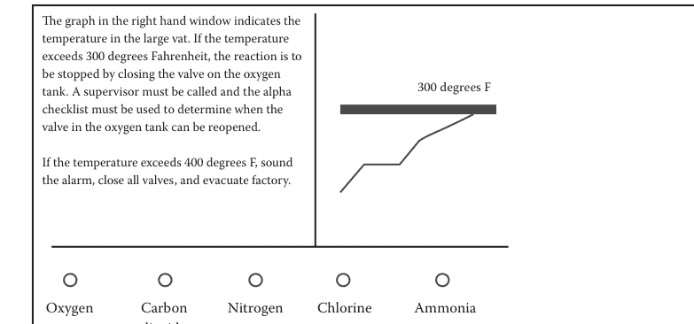

图 3.6 一个屏幕设计。

## 软件工程导论

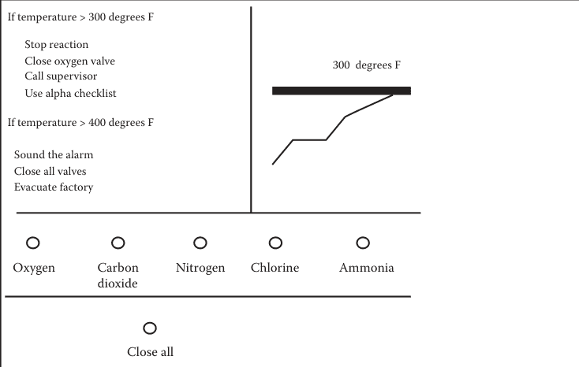

图 3.7 另一种屏幕设计。

在本节的剩余部分将提供一个基于对象-实体关系的用户界面详细模型。该模型包含了用户、计算机硬件以及输入/输出（I/O）设备的属性。它还包含了实时和环境限制，以及底层的应用程序软件。

该模型提供了接口的高层视图，并包含了接口的正式评估。人类因素和用户界面系统的研究思想都被纳入其中。

在这个模型中，用户界面的所有特征都被抽象为对象，其属性指示了对象可能拥有的属性。对象的任何实例都有每个属性的值；这些值指示了软件拥有这些属性的程度。构成用户界面的对象之间的关系同样重要，并包含我们的信息模型中。

该模型包含了构成用户界面的七个对象：

- 约束（Constraint）
- 环境（Environment）
- 硬件（Hardware）
- 输入（Input）
- 输出（Output）
- 软件（Software）
- 用户（User）

## 需求

这七个基本对象之间的关系如图 3.8 所示。接下来将提供图 3.8 中每个对象的简要描述以及一些重要的属性。不同对象的属性集相对复杂，某些对象的完整属性列表将在练习中给出。

约束对象对于实时系统很重要，在这些系统中，用户/操作员必须在规定的时间范围内对某些情况做出反应。这种需求可能适用于化学处理厂的控制系统或医疗监测设备。约束对象体现了这样的思想：用户的响应是至关重要的，时间限制必须反映在用户界面模型中。约束对象的关键属性称为 `TIME_CONSTRAINT`、`TIME_LIMIT` 和 `CRITICAL`；这些属性反映了实时系统接口中可能的时间需求。

硬件对象涉及系统中那些本质上不是 I/O 设备且主要面向硬件的部分。这里可能包括便携式与非便携式计算机、用于远程数据访问的网络是否存在等。典型属性包括 `OPERATING_SYSTEM`、`HARDWARE_VERSION`、`RESPONSE_TIME`、`HARDWARE_ERRORS` 和 `PORTABLE`。

输入和输出对象区别于彼此以及硬件对象。输入对象具体包括键盘、鼠标、触摸板、智能手机和光笔。LCD、打印机、扬声器和纸记录仪是输出对象。输入对象的典型属性是 `DEVICE_TYPE` 和 `NUM_INPUT`。输出对象的典型属性是 `DEVICE_TYPE`、`NUM_OUTPUT`、`HORIZ_DIMENSION` 和 `VERT_DIMENSION`。

软件对象包含了软件的所有特征，这些可以分为三类：

- 命名属性（Naming attributes）给出属性名称。
- 描述性属性（Descriptive attributes）给出属性的描述。
- 引用属性（Referential attributes）引用其他对象。

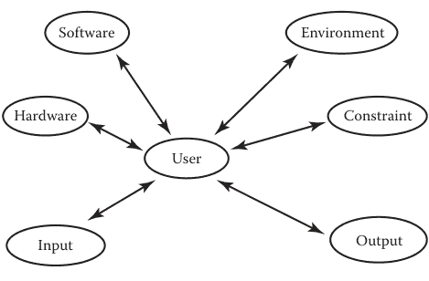

图 3.8 对象之间的关系。

## 软件工程导论

然而，在许多大型软件系统中，自然语言描述固有的模糊性会导致项目需求不适用于文本需求。即使需求可以完全用自然语言编写，生成的文档也可能过于庞大而毫无用。长达几千页的详细文档很少有人阅读，更不用说理解了！

在许多情况下，我们被要求使用更正式、更精确的系统需求方法。本节将描述其中两种方法：有限状态机和决策表。这些描述非常短，旨在补充你之前在离散数学或自动机理论课程中对这些及相关概念的认知。

有限状态机是一种计算模型，其系统行为取决于系统处于一组有限“状态”中的哪一个状态，以及期间观察到的一组“事件”。其中一个特定状态用于表示系统的初始状态。对于一个控制化学工厂中工艺过程的软件系统，其状态如表 3.6 所示。

控制化学过程的软件将使用这九种状态来决定在不同时间采取什么操作合适。例如，在反应完成之前，软件绝不会允许将容器内的物质倒进模具。除非通过冷却降低了容器的温度，否则不应将试剂倒入容器中。

如果状态数量不是太大，可以按照以下约定将有限状态机描述为状态图：

- 每个状态都表示为一个气泡。
- 软件的控制流由气泡之间的一有向弧标出。
- 每条弧都标记了发生的动作。
- 从一个气泡到另一个气泡的转换仅取决于其发出的状态和弧上的标记。
- 该过程有一个或多个首选状态，理想情况下它会在这些状态终止。

### 表 3.6 化学过程中的状态示例

| 状态 |
|---|
| 1. 容器为空 |
| 2. 碱性化学品已放入容器 |
| 3. 通过冷却降低容器温度 |
| 4. 添加了试剂 |
| 5. 发生反应 |
| 6. 通过加热提高容器温度 |
| 7. 反应完成（容器内压力正常） |
| 8. 容器中的化合物已倒入模具 |
| 9. 故障；化学工厂必须疏散 |

我们可以使用这些非正式规则来为本节描述的化学过程开发状态图。该图如图 3.9 所示。

从状态到状态的移动完全由转换函数控制。由于转换函数在数学上是精确的，因此允许的状态和转换都必须完全指定。

描述状态图创建的规则可以在精确的定义中用数学公式。形式上，有限状态机是一个包含以下内容的五元组：

- 一组用于输入的允许符号集合
- 一个非空有限的“状态”集合
- 一个称为“起始状态”的单一特殊状态
- 一个（可能为空）的称为“终止状态”的状态集合
- 一个转换函数，接受一个状态和一个允许的符号作为输入，并输出单个状态

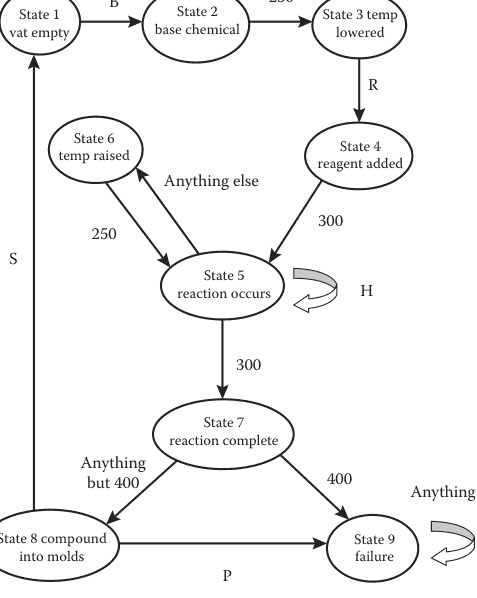

图 3.9 简单化学反应的状态图。

对于我们的示例，状态是表 3.6 所示。允许的输入及其相关含义可能如下：

- `B`（表示碱性化学品）
- `R`（试剂）
- `S`（溶剂）
- `250`（低温限制）
- `300`（高温限制）
- `400`（温度故障）
- `H`（加热）
- `C`（冷却）
- `M`（准备好模具）

图 3.9 的转换函数见表 3.7，该状态图的决策表见表 3.8。

还有另一种可用于描述此系统的表示方法：决策表。决策表本质上是对某些状态下所做选择的描述。该系统的决策表可能类似于表 3.8 所示的图。决策表相比状态图方法有一个优势：它们可以指示一个值范围的影响，而不是单个输入。尽管我们没有详细说明，但你应该意识到决策表可以允许关联的状态变化反映多个输入范围的输入。

### 表 3.7 图 3.9 所示状态图的状态转换函数

| 当前状态 | 输入 | 新状态 |
|---|---|---|
| 1 | `B` | 2 |
| 2 | `250` | 3 |
| 3 | `R` | 4 |
| 4 | `300` | 5 |
| 5 | `H` | 5 |
| 5 | `300` | 7 |
| 5 | 其他任何 | 6 |
| 6 | `250` | 5 |
| 7 | 除 `400` 外 | 8 |
| 7 | `400` | 9 |
| 8 | `P` | 9 |
| 8 | `S` | 1 |
| 9 | 所有 | 9 |

### 表 3.8 图 3.9 所示状态图的决策表

| 当前状态 | 输入 | 新状态 |
|---|---|---|
| 1 | `B` | 2 |
| 2 | 如果 `temp <= 250` | 3 |
| 3 | `R` | 4 |
| 4 | 如果 `temp > 300` | 5 |
| 5 | `H` | 5 |
| 5 | 如果 `temp > 300` | 7 |
| 5 | 如果 `temp > 400` | 9 |
| 5 | 其他任何 | 6 |
| 6 | 如果 `temp <= 250` | 5 |
| 7 | 除 `400` 外 | 8 |
| 7 | 如果 `temp > 400` | 9 |
| 8 | `P` | 9 |
| 8 | `S` | 1 |
| 9 | 所有 | 9 |

## 3.10 使用 Petri 网规范需求

许多系统必须在有同步或无同步的情况下处理并发事件。目前已经开发了若干方法来规范如何表示并发性、哪些过程必须同步，以及哪些过程可以在没有同步的情况下并发执行。其中一种技术是 Petri 网（Petri, 1975）。

Petri 网是一种图，其中节点称为“场所”（places），弧称为“转换”（transitions）。图中的每个场所允许包含零或多个“令牌”（tokens），表示计算已到达该场所。如果每个输入场所中都至少有一个令牌，则称该转换是“已启用的”或“触发”。当转换触发时，会从它的每个输入场所移除一个令牌，并在它的每个输出场所中放置新令牌。这并不要求输入令牌的数量等于输出令牌的数量。Petri 网的示例见图 3.10 至 3.12。注意，我们在每对场所之间使用线来表示“先于”（happens before）关系。当转换触发时，令牌会从它的每个输出场所中取出，如图 3.12 所示。

使用 Petri 网描述并发软件有两个优势：它允许图形化表示，并且是可自动化的。对于在单个进程中顺序执行的非软件，Petri 网在功能上与流程图相比基本没有优势。

### 3.11 伦理问题

在软件开发过程的需求阶段，始终存在巨大的压力。每个软件项目经理都希望他的项目产生一个按时且在预算完成的高质量系统。每个常用的软件开发方法都依赖于获取若干正确的需求。

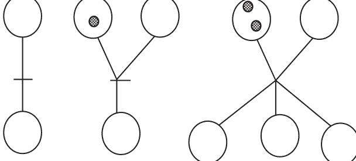

图 3.10 转换均未启用的 Petri 网。

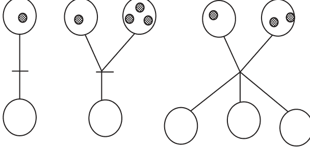

图 3.11 转换均已启用的 Petri 网。

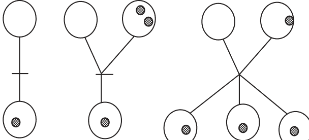


图 3.12 转换触发后图 3.11 中的 Petri 网。

# 需求

什么构成了最终需求中至少较大的子集？如果没有这些，软件开发充其量是低效的。

这对需求收集过程意味着什么？人们往往想快速通过需求（以及随后的设计过程）以开始开发软件。在迭代方法中，这是可以接受的，只要需求实际上是正确的。对于基于经典瀑布模型的软件开发，这并不理想。简而言之，不完整的需求是可以接受的，只要大家意识到需求是不完整的，并且可以通过合理的努力使其完善。

显然不可接受的是在已知错误的情况下将一组需求呈现为正确的。这种错误可能源于以下情况：

- 某些计算在理论上是不可能的。
- 软件内部某些交互不一致。
- 与旨在互操作的系统之间的交互不一致。
- 软件执行时间或空间需求存在无法实现的限制。

# 软件工程导论

通话已接通。美国的 911 电话系统就是一个典型的例子。在每个区号内，最多有 $10^7$ 个可能的七位电话号码。追踪呼叫者的信号到紧急电话服务处是很容易的。事实上，此类通话永远不会终止，即使呼叫方挂断或连接断开。

确定电话的位置是另一回事。这里是我在重新激活位于一个没有明显街道地址的度假区社区某公寓的固定电话时，所遇到的关于固定电话处理过程的描述。将地址与电话号码匹配实际上是顺序搜索，如果系统要在适当的时间限制内做出响应，这种方法是不可行的。因此，电话号码与地址的匹配通常在 911 电话服务安装之前完成一次。事实上，这些信息多年来一直存在于所谓的“交叉目录”（cross directory）中。交叉目录的共存，或者在尚不存在时创建一个，都应该是紧急电话系统需求分析的一部分。否则，由于搜索电话号码和地址对所需的时间，这些需求将是不可行的。

对于手机（无论是智能手机还是其他），其位置通常通过三角测量找到，这与 GPS 的工作原理有些相似。

防止内部软件不兼容性是项目团队的责任，需求团队不应设置任何不兼容问题。此类问题的一个例子是要求系统的两个组件在没有控制的情况下向同一位置写入内存缓冲区。在个人电脑的台式桌面计算器程序中，使用打印机缓冲区队列的起始地址来存储中间结果就是该问题的一个例子。

外部兼容性问题和可互操作软件要难检测得多。COTS（商业现成）软件的用户通常需要知道哪些端口正在被写入，或者使用哪些名称将套接字绑定到位置。软件子系统之间产生意外干扰的典型例子可能是：一个运行在 Linux 版本上的现有系统，假设所有相关文件都在`/usr`文件系统上。这可能会为使用某些相同文件并期望公共文件位于`/var`或`/usr`文件系统上的另一个软件应用程序带来问题。

最近对《华盛顿邮报》求职栏目中计算机列表的检查显示，COTS 领域有几份工作。行业已开始意识到避免此类冲突的重要性。当然，在能够有信心地预测不会发生此类冲突之前，对 COTS 产品和软件的领域领域都进行深入了解是必要的。显然，在评估 COTS 产品作为系统需求解决方案的适当性时，存在伦理考量。

IEEE 道德准则（IEEE 政策编号 7.8）在这方面非常有参考价值。它发布在网站`http://www.ieee.org/about/corporate/governance/p7-8.html`。为了完整起见，该代码列如下。接下来是第 1 项描述的在做出技术决策时承担责任的指南，以及第 6 项描述的重新培训的常量。

# 需求 ■ 123

我们，IEEE 成员，承认技术对影响全球生活质量的重要性，并接受对我们专业、其成员以及我们所服务的社区的个人义务，在此承诺遵守最高标准的道德和职业行为规范，并同意：

- 1. 接受在与公众安全、健康和福利一致的工程决策时承担责任，并及时披露可能危害公众或环境的因素；
- 2. 尽可能避免真实的或感知的利益冲突，并在冲突存在时向影响方披露这些冲突；
- 3. 在根据可用数据陈述主张或估算时保持诚实和现实；
- 4. 拒绝任何形式的贿赂；
- 5. 提高对技术及其适当应用以及潜在后果的理解；
- 6. 维护并提高我们的技术能力，仅在通过培训或经验获得资格，或在充分披露相关暗示后，才为他人承担任务；
- 7. 在做出与公众安全、健康和福利一致的工程决策时承担责任，并及时披露可能危害公众或环境的因素；
- 8. 公平对待所有人，无论种族、宗教、性别、年龄；
- 9. 避免通过恶意行为损害他人的财产、声誉或就业；
- 10. 协助同事遵循最高标准的职业行为规范，并在承认错误后纠正错误。

## 需求 125

系统需求。有几种常用的衡量一组需求规模的方法：

- 统计不同需求的数量。这种方法可能太简单了，因为它没有考虑系统的复杂性。此外，该指标还受到将单个需求句中的多个从句拆分成独立句子的（每个句子代表一个独立的需求）的影响。
- 计算所有需求所表达的“功能”总和。这种方法要求描述与每个需求相关的功能。将这些功能映射到带有一组权重因子的量表上。
- 将需求与将重用的现有系统进行匹配。在这种方法中，在任何系统需求规模的测量中，只计算新软件。
- 计算与目标软件将互操作的其他软件系统接口的“大小”。

我们现在将逐一讨论这些衡量方法。

计算不同需求的数量是估计系统最终规模最简单的方法，因为不需要对单个需求进行特殊分析。该数量可以通过检查需求追溯矩阵中的行数来计算。

遗憾的是，仅仅统计需求的数量没有考虑到实现不同独立需求的困难程度。因此，这种方法无法区分实现某项需求的复杂性，例如：

> 当用户输入单个 UNIX 命令 "go" 时，软件将开始执行。

与实现以下需求的复杂性相比：

> 系统将能够每分钟处理 10,000 笔不同的交易，且没有任何交易在处理前在等待队列中超过一秒。

尽管存在明显的不精确性，但需求数量至少为实现整个软件系统的困难程度提供了一个提示。我们可以通过详细检查需求来获得更准确的信息。估计一组需求功能的最常用技术被称为“功能点分析”。该术语由 Albrecht 创造，他于 1979 年在 IBM 首次开发了这一概念（Albrecht, 1979）。Jones (1993) 描述了功能点在项目估计中的使用。

## 软件工程导论

功能点估算技术基于对以下因素的每个需求所需功能的进行评估：

- 用户交互的数量和类型
- 内部文件接口的数量和类型
- 外部文件接口的数量和类型
- 对项目应用领域编程难度的通俗感知

我们现在描述一种计算功能点的正式程序。所有功能点指标都基于程序中接口的数量和类型。接口可以是内部的，也可以是外部的。接口的总数和大小是收集功能点的依据。一旦获得此总数，将通过几个权重因子进行修改，其中一些是主观的，另一些是客观的。主观因素包括对接口复杂性和系统复杂性的评估。

更准确地说，权重根据表 3.9 中的规则分配。分配权重后，对于表 3.10 给出的每个因素，在 0（表示无影响）到 5（表示强影响）范围内确定一个复杂度因子。

对于每个要分析的软件系统，使用表 3.10 确定的值计算“复杂度调整值”`f`之和。最终结果是根据公式计算系统的功能点总数：

> `FP = count_total * (0.65 + sumf)/100`

正如你看到的，计算建议软件系统的功能点数量在某种程度上是主观的，因为对“平均”、“简单”或“复杂”等术语并没有定义。“复杂度分析”中的其他术语也清楚地表明其定义缺乏精确性。不同的人可能会对同一个软件系统的功能点数量产生非常不同的估计。对于功能点分析过程中相关的歧义性，有两种通用的方法。

### 表 3.9 功能点分析的权重使用

| | 简单 | 平均 | 复杂 |
|---|---|---|---|
| 外部输入或文件 | 3 | 4 | 6 |
| 外部输出或报告 | 4 | 5 | 7 |
| 外部查询或响应 | 3 | 4 | 6 |
| 系统的外部接口 | 7 | 10 | 15 |
| 内部文件 | 5 | 7 | 10 |

### 表 3.10 功能点分析的复杂度因子和权重使用

| 复杂度因子 | 权重 (0-5) |
|---|---|
| 可靠系统备份和恢复 | |
| 数据通信 | |
| 分布式功能 | |
| 性能 | |
| 高频使用系统 | |
| 在线数据输入 | |
| 操作易用性 | |
| 在线更新 | |
| 复杂接口 | |
| 复杂处理 | |
| 可重用性 | |
| 安装易用性 | |
| 多点操作 | |
| 可修改性 | |

第一种方法是忽略微小差异，假设许多软件测量存在误差，且微小差异可以忽略，因为它们在统计上不具显著性。这使得很难确定从多个不同的软件开发项目收集的功能点数据之间任何变异的原因。可能不清楚功能点数量与投入精力（以人月衡量）之间的任何相关性是由于实际关系，还是仅仅由于计数方法的差异。

第二种方法是尝试使功能点分析更加严谨。对于功能点分析过程中相关的歧义性，有两种通用的方法。

## 3.13 需求评审

一旦需求团队确定了一组需求，通常需要进行需求评审。该评审的目的是让客户对需求团队产生的需求做出反应。如果在评审时不知道客户，则通常使用营销人员和其他人员代替。

需求评审是所有超过一名软件工程师或程序员的软件开发环境中共同的。需求评审是一项确保需求团队设定的需求实际上满足用户需求的检查。基本原则是，如果开发的软件不满足用户的需求，那么继续下去是没有意义的。因此，需求评审提供了必要的健全性检查。

取决于组织的软件开发方法，可能会有不同的评审。在经典的软件开发过程中，至少会有两次预计划的评审：初步评审和功能评审。如果生成的需求被认为是满意且完整的，迭代软件开发过程可能会使用单次需求评审。然而，使用迭代方法的组织中可能会有很多评审。注意，迭代软件开发过程中的评审通常包含设计、源代码和需求。我们现在更详细地考虑需求评审。根据开发软件的组织性质，需求评审可以从几个人坐在桌旁交谈的非正式演示，到高度脚本化、排练良好的正式表演，并带有投影胶片、幻灯片、多媒体计算机生成的演示以及类似的通信辅助工具。需求的正式性和复杂性随着所开发软件的复杂性和组织规模而增加。

对于使用基于经典瀑布模型软件开发流程组织，需求评审是一个基础性的里程碑。因此，其重要性是显而易见的。如果组织使用迭代软件开发过程，需求评审可能看起来不重要，因为软件需求缺陷将在下一次迭代中得到修正。事实上，人们可能会认为需求评审完全不重要，因为任何缺陷可以在后续迭代中修复。

## 要求 129

然而，事实并非如此。一次良好的需求评审可以指示需求是接近令人满意的、是正确但不完整的，还是是错误的。（实际上，这三种情况在同一个软件项目中经常同时发生。为了便于讨论，我们在概念上会考虑一次只发生其中一种情况的需求，这样会更简单。）即使软件需求预计将经历一次或多次迭代，但如果在投入大量精力根据这些错误需求开发软件之前，能够尽早检测到任何错误需求，该过程将变得高效得多。

注意这种对需求的观点揭示了关于软件测试的什么。在学术环境中，学生可以与导师辩论，认为他的作业或程序是正确的，因为它满足了导师设定的需求。通常，这种对话会因为导师设定的项目规格存在歧义而变得复杂。只有那些与导师规格一致的测试用例才被认为是公平的。

遗憾的是，获得良好的需求比这种纯学术的软件开发观点所显示的要重要。如果需求因为不完整或不符合客户真实想法而不能满意，那么软件最终与（错误的）初始需求达成一致，并不意味着软件是正确的，也不意味着它在市场上会成功。想象在直接放在沙滩上的一层薄板上建造一栋三十层高的建筑。建筑的其他部分可能与木板精确匹配，但整个结构从本质上来说是不稳定的。

显然，评审是非常重要的，即使它们预计将作为迭代软件开发过程的一部分而重复。即使在像经典的瀑布模型这样相对规范化的过程中，也可能存在多次需求评审。此类评审的第一次和最后一次分别被称为初步需求评审和关键需求评审。

还有另一种方法可以让你理解专业运行的需求评审的重要性。让我们从估算举行需求评审会议本身的成本开始。典型的一年由 52 周每周 40 小时组成，大约 2,000 小时。软件工程师的典型“负载成本”包括以下各项：

- 他的年度薪水
- 福利（约 25% 到 30%）
- 技术写作、秘书、保洁和人力资源（人员）支持人员的平均分摊成本
- 计算机维护、网络管理员和其他技术支持支持人员的平均分摊成本
- 设备、公用事业和其他物理成本的分摊成本

## 软件工程导论

这通常被认为每年远超过 100,000 美元，或者大约每小时 50 美元，即使对于非常初级的人员也是如此。因此，一个五个人的四小时会议至少花费一千美元，而且可能多得多，假设会议不需要准备时间，不需要协调日程来安排会议，并且不需要往返会议的时间。

对于一个相同规模的系统，更现实的估计是：八小时的会议，十个人参加会议，并有两天的准备工作。通常，至少有三个人属于需求部门，因此他们参与了准备时间，包括排练；文档、幻灯片、透明片或计算机生成的多媒体演示文稿的准备；以及在会议上分发的文档的校对。每程应该预留 15 分钟的交通时间，即使会议安排在走廊尽头的会议室举行。由于人类注意力跨度的限制，此类会议通常分散在几天内进行，因为通常需要多次休息。这种对成本的保守估计超过了 6,500 美元。

在许多环境中，费用要大得多。注意，这里没有列出食物、客户娱乐或前往客户现场的特殊费用。显然，必须认真对待评审。不建议浪费客户或你高层管理层的时间。

既然我们已经确定了需求评审的重要性，现在是时候描述如何进行评审了。我们将描述两种类型的需求评审：(1) 在会议上进行的典型正式评审，(2) 需求的检查，通常由一个或多个个人完成，但没有正式演示。此处的讨论是作为在软件工程课程的架构限制内如何进行需求评审的指南。在工业或政府的实际软件需求评审中，可能会有取代此处建议的公司政策。如果是这样，使用公司政策。

我们首先考虑在正式会议期间进行的评审。最有效的评审由一名专人负责做记录并提供会议笔录。记录员的目的是提供一份书面文档，指示作为会议的一部分对需求进行的任何更改。此类书面文档将在会议结束后提供给所有参与者。这允许组织对项目的所有操作拥有完整的记录。评审通常使用录音机记录，有些组织还使用视频或电子存储。

通常由一个人负责演示组织。此人可能是需求团队经理。在某些组织中，他或她可能是项目经理。在其他组织中，他或她可能没有其他项目行政责任。在任何情况下，此人将介绍需求演示团队的成员并协调讨论的其他部分。

表 3.11 给出了需求评审的清单。

## 表 3.11 需求评审会议清单

| 项目 |
| :--- |
| 演示已排练。 |
| 演示时间在分配的范围内。 |
| 有充足的时间回答提问。 |
| 可以回答技术问题的人员出席。 |
| 检查幻灯片、透明片和多媒体材料准确性。 |
| 检查幻灯片和多媒体材料的拼写。 |
| 为所有参与者提供幻灯片和多媒体材料的纸质或数字副本。 |
| 会议室配备所有必要的设备：麦克风、投影仪、幻映仪、视频磁盘/录带播放器和显示器、平板接口、电脑显示接口。可以使用从智能手机等设备控制演示所需的网络和连接（包括蓝牙、红外和自组织网络）。 |
| 传递姓名、地址、电话和单位的签到表，所有人员签字。 |

提供的细节取决于评审的性质。对于初步需求评审，需求可能处于非常高的水平。对于遵循经典瀑布模型的软件开发也是如此。大多数其他需求评审要详细得多。

需求评审演示的组织通常由软件的组织引导。典型的评审演示包含以下主题：

- 引言
- 系统概述
- 子系统需求
- 子系统 1 需求
- 子系统 2 需求
- 子系统 3 需求
- 子系统 4 需求
- 子系统 1 接口
- 子系统 2 接口
- 子系统 3 接口
- 子系统 4 接口
- 建议资源
- 建议进度
- 潜在问题
- 总结

# 132 软件工程导论

在需求的每个主要章节都应留足够的时间进行提问。目标是获得一份清晰、全面的文档。

可以考虑的下一种需求评审类型可以描述为“检查”。接下来描述了一组典型的（简化的）检查指南。

系统需求评审必须回答以下问题：

- 将使用哪个硬件平台？支持哪些版本的操作系统？
- 不同版本的软件是否会运行在不同的计算机和操作系统上？如果是，是哪些版本？
- 文件格式在不同操作系统之间是否保持一致？
- 软件是否具有图形用户界面？
- 软件的图形用户界面是否与操作系统以及在相同环境中运行的其他应用程序保持一致？
- 是否会有多个实现版本？例如，针对内存和磁盘空间较小的笔记本电脑的最小尺寸版本，以及具有更多支持文件和功能、用于在内存和尺寸限制较少的计算机上的较大实现版本？
- 从内存大小和可用硬盘空间来看，最低系统需求是什么？
- 程序在内存中的存在是否会对计算机上运行的其他应用程序产生问题？
- 是否有任何其他软件软件包（如文字处理器、电子表格程序、数据库管理器或绘图工具），是程序必须能够与之共享数据的？
- 软件内部是否提供在线功能？
- 软件将如何交付？
- 软件将以压缩或未压缩的形式提供？
- 是否会提供安装和设置软件？
- 是否需要培训？
- 是否有任何实时限制，例如在指定的限制内完成某些操作？

需求收集过程有两个互补的原则（Berry, 1995）：

1. 系统的需求必须不断修改和精炼，直到能够由熟悉应用领域基础算法但不熟悉需求工程过程的软件设计人员和程序员进行开发。最终的需求将是完整且无歧义，使得设计是清晰的，并且可以通过实现标准的、为人熟知的算法轻松完成编码。
2. 系统的需求必须不断修改和精炼，直到系统需求可以被熟悉需求工程但对应用领域一无所知的需求工程师理解。最终的需求将是完整且无歧义，需求工程师即使在没有应用领域知识的情况下也能完全理解。

系统的需求必须不断迭代，直到每项需求都符合这两个原则之一。为了开发特定的可验证需求，必须完成以下任务：

1. 为每项需求编号。
2. 针对每项需求，开发一个特定的、无歧义的测试用例，以确定该需求是否满足。
3. 如果你无法开发一个特定的、无歧义的测试用例来确定需求是否满足，请重写该需求或将其拆分为更小的需求，直到你开发出一个确定新需求是否满足的特定的、无歧义的测试用例。如果拆分现有需求产生了新需求，请使用点号法编号以显示需求的来源。（因此，通过拆分需求 3 获得的新需求将编号为 3.1、3.2 等。）
4. 重复步骤 1 到 3 的过程，直到你可以开发出一个特定的、无歧义的测试用例来确定需求是否满足。

一旦你开发出了可以确定每个系统需求是否满足的特定、无歧义的测试用例，就可以确定实现需求的可行性。

针对系统开发的每项需求，执行以下任务：

1. 开发一个用于实现特定需求的高级设计。
2. 迭代该设计，直到设计足够详细并可以交给程序员。
3. 如果任何需求无法被设计成可以作为代码实现，则将该需求标记为歧义或不可实现，然后重新评审需求。（某些需求虽然单独来说是可以测试的，但可能与其他需求不一致。）


4. 如果任何需求不一致，则修订需求集以消除不一致性。

# 134 软件工程导论

一旦开发了需求，必须给客户机会与其进行交互。决定是以系列原型的形式还是以单一交付系统的形式将系统呈现给客户。

如果将给客户提供一系列原型，则开始开发初始原型。在这种情况下，允许客户参与开发过程，并在最后期限前进行更改。如果只给客户提供单一系统交付，则与客户进行迭代，以确定项目团队是否正在构建该系统。

从上述指南中可以看出，需求评审是严肃的事务，需要组织投入大量的资源。经验表明，这样做是值得的。

显然，需求的开发是软件工程的一个主要部分。对于任何产生的需求文档，质量保证（QA）团队的评估无疑是恰当的。QA 可以在评审之前、期间或之后进行，取决于组织结构。

正如本章前面承诺的那样，我们现在讨论适用于敏捷软件开发过程的需求评审问题。快速审查关于敏捷流程需求评审的在线文献表明，在采用敏捷流程的早期（2008 年之前），要设计能够在敏捷环境中良好运行的评审相当困难。共识似乎是，困难在于倾向于将经典瀑布型生命周期中（例如评审）的所有特征强加到敏捷评审中（Gothelf, 2012）。

成功的敏捷项目的共同点是，评审应限制频率和持续时间，并包含对该特定领域有深厚知识的专家级设计人员和客户代表。需求评审必须产生可测试的需求，因为敏捷团队面临着在严格截止日期内完成项目的巨大压力。你将看到，这些是 3.15 节案例研究中讨论的自组织团队的不可或缺的一部分。

## 3.14 管理视角

在许多大型软件项目中，总项目经理可能会为需求、设计编码和测试团队配备各自的经理。更常见的情况是项目经理为这些团队提供指导，同时保持整体控制。为了简单起见，我们将忽略这一额外的管理层，假设一个经理负责整个项目。在本节中，我们将描述该经理对需求阶段的期望，以及创建该需求的过程。

需求过程的目标是获得一套清晰、无歧义、一致且完整的需求。经理希望及时获得这些需求，因为他或她面临着通常由组织内部高级机构施加的期限。他或她期望需求收集过程有频繁的更新。这些更新是非正式的。更有可能是每周或每月一次书面报告，可能附带需求评审。

## 需求 ■ 135

在大多数会议中，经理都希望展示其项目的进展。通常，最重要的一点是避免给经理带来不必要的惊喜。通常，经理更倾向于收到一份不完整的报告（并且他或她知道在会议开始前就已经准备好了），而不是一份逻辑不一致的报告。经理期望看到许多“行动项”，用以执行特定任务，并对任务的完成时间给出大致准确的估算。

经理会期望他或她参加简报和评审的方式符合组织文化以及在场人员的格调。在一个非正式组织的内部会议上，可能没有任何特殊的着装要求。在与客户的会议或更正式的环境中，可能被要求穿西装打领带，女性则需要同样正式的职业装。职场准则是不让经理、客户或组织感到尴尬。如果不确定，请提问。

需求总会有一个最终的演示。经理期望演示经过仔细的排练，并根据情况配备媒体辅助工具，包括透明片、幻灯片、录像带或计算机生成的幻灯片演示。应该向所有参与者分发足够数量的所有相关文档副本。为所有参会者提供幻灯片和投影透明片副本是必须的。

经理还期望所有内部使用的文档都能在适当的时间和地点交给他或她。通常，客户不需要看到需求跟踪矩阵文档。（如果该过程必须通过质量保证认证，例如需要美国食品药品管理局批准的医疗软件产品，则如此）。内部备忘录也应该保持隐私。

经理期望获得系统的成本和人员估算。如果存在此类估算，经理需要理解估算的任何变化，以便他或她能为提案争取更多资源。

经理还希望了解任何未预见的问题以及解决方法。获取这些信息的根本原因是，经理希望为未来类似的情况做好准备。经理讨厌不愉悦的惊喜，特别是在软件生命周期活动结束时。

经理还必须确保所有关键项目文档都存在适当的项目存档中。希望组织已经针对计算机崩溃和其他灾难制定了预防措施，通过将所有关键文档的多个副本存储在远离火灾、洪水和盗窃的独立地点。

本质上，根据组织软件开发实践的不同，经理希望出现两种状态之一：

- 如果组织使用标准的瀑布模型方法，那么需求应该是完整、一致且没有任何歧义的。软件设计应该准备好开始。

- 如果组织使用迭代方法进行软件开发，那么下一次迭代应该无延迟地继续。这意味着需求应该是一致且没有任何歧义的。需求中的任何不完整之处应该在软件开发的下一次迭代中解决。如果存在上一次迭代，需求应该比上一次迭代结束时更完整。

软件项目经理希望其项目能够高效开发软件，并且最终产品具有高质量。在设定需求和系统设计过程中，某些效率低下的或绕路可能是不可避免的。经理讨厌的是意外之外的惊喜。

一些典型的不愉快惊喜包括：

- 需求评审本身的固有缺陷

- 文档缺失

- 显而易见的遗漏

- 客户因为早期会议中提出的技术或其他问题被忽视而愤怒

- 缺乏后勤基础设施，例如合适的音视设备或空间太太小的房间

老话依然有效：你只有一次机会留下第一印象。在计划需求评审时，请记住这一点。表现得好像你自己的未来和你公司的未来都悬于一线一样。事实确实如此。

但请记住，即使在经典的瀑布过程中，需求也可能发生变化。软件经理预计系统需求会变化，并有一套系统的计划来决定优先处理哪些问题，将哪些问题推到以后处理。变更管理是软件过程中至关重要的部分。

项目管理计划已经制定，并将包含了需求的开发和需求的规划。一旦需求相对确定，就可以更详细地描述项目计划。通常，项目经理期望在需求评审完成后有一份相对详细的项目管理计划。

在任何软件开发生命周期的所有阶段，都必须有一种配置管理机制，以妥善处理任何项目中必然发生的变化。在某些项目中，如果没有复杂的配置管理工具，将所有更改列在需求跟踪矩阵中可能是很有用的，按编号列出修订并通过指向相应文件的超链接进行访问。

## 3.15 敏捷开发中管理视角的需求研究

对于在教育阶段的这一阶段遇到敏捷开发讨论的软件工程学生来说，这一部分可能会让他们感到困惑。在你们职业生涯的这个阶段，你们早已超过了那个可能是传闻的“能够从零创建 300 行程序”的学生的描述。本书的许多读者在工业或政府的全职工作中已经有了丰富的编写计算机软件的实践经验，或者可能正在兼职就读。也许你参加过校合作实习计划（co-op program）并获得了宝贵的工作经验。你可能在校园实验室工作过，这通常是一次极佳的学习经历。即使你是一个处于“传统大学年龄”（十八至二十二岁）的全职学生，你很可能在计算机行业有一份兼职，或者至少有一份暑期工作或实习。尽管有了所有这些可能的经验，你可能还没有作为敏捷开发团队的一员在需求的特定部分工作过的经验。

原因如下。敏捷开发过程的一个关键部分是能够在不要求大量编码的情况下创建系统。这迫使敏捷团队尽可能复用已部署的组件作为他们构建的软件的一部分。只有当团队了解现有软件组件以及其功能如何与需求匹配时，这才能实现。这通常发生在需求通用阶段。在大多数情况下，对应用领域的意识只有在积累了大量经验后才能获得。

这种领域知识与智力、技术知识以及卓越的人际技巧的结合，是雇主非常看重的。

你可能还没有到这种职业发展的那个阶段。在我四十一年的教学中，我只有一个本科生在二十二岁毕业后立即被聘用为项目经理。她显然是出色的，即使与我教过的许多才俊相比也是如此。大多数情况下，详细的知识会在很久以后到来。

以下是关于我们在敏捷开发案例研究中使用的需求过程的一些细节。

团队成员朝着宽定义的目标工作，具有高度的自由。同时，他们知道项目要走向何方，因此具有动力且自我驱动。一个障碍尽可能少的自控过程是至关重要的。当冲突出现时，团队会努力解决。在许多情况下，与之前的项目相比，花费在讨论问题上的时间更少了。

我们顺便提到，关于由团队、管理层设定甚至在没有设定目标的情况下对团队行为的影响，我们通过 Babar 等人（2004）研究过。这当然与第 2 章第2.10 节讨论的自组织因素（SOF）有关。

# 138 ■ 软件工程简介

集体探究的过程与过去传统的内部和外部竞争模式背道而驰。

工作并不是根据详细的需求集或设计来完成，正如旧项目中的那样。相反，每位成员都受到一些宽泛指导方和可能是一些模糊的需求的驱动。通过这种方式，每个人将大部分时间花在产品开发上，而不是创建详细的文档。由于模糊的需求并没有导致“非此发明征候”（Not Invented Here Syndrome），为团队开启了更多可能性。他们表现出的态度更多是：“我无法告诉你我想要什么，但当你拿到它们时，我会告诉你。”

这种广泛的态度鼓励了在卫星任务的不同阶段对功能进行创造性的分组，并应用非自己的软件来解决问题。例如，团队使用了 LabView，这是一种相对廉价的软件包，通常用于控制环境的测试工程仪器，它提供了通常需要由三个不同小组完成的服务。请记住，我们常用 COTS（商业现货）软件这一术语来指代在应用程序中使用商业产品。

我希望大家能清楚，如果敏捷开发团队不了解该软件的能力以及这些能力如何应用于本项目中的非自有应用，那么在该应用中使用相对廉价的 LabView 将是不可能的。请记住，团队必须精确了解 LabView 软件具有什么类型的数据接口，以便将其输入和输出与其他大型组件集成。这说明了敏捷开发团队成员必须精通应用领域。这种对数据接口的知识将是项目管理中的关键一步。这种描述将以某种 ICD（接口控制文档）的形式存在。

在敏捷开发过程的这一阶段，问需求是什么样的，是很自然的。毕竟，开发的系统很可能具有产生科学数据的很长寿命。

起点是对软件要做什么的概括性描述。许多细节在开始时故意是模糊的，等待在敏捷开发过程中进行澄清。

澄清过程是令人不安的，特别是对于对敏捷流程熟悉有限的高级经理来说。软件组件的功能能力变成了所需系统需求的一部分！以下是其运作方式，至少在我们讨论的案例中如此。

LabView 最初设计用于测试工程台仪器，这些仪器能够以特定的速率表示并产生输出数据，而数据传输速率将作为需求的一部分。在传统需求方法中创建的需求大部分需要提供有关航天器健康和安全状态的信息，而这些需求现在可以更快地提供。

一旦系统建成，需求将被存入存档中，供他人使用并以备未来如果需要更改。（记住

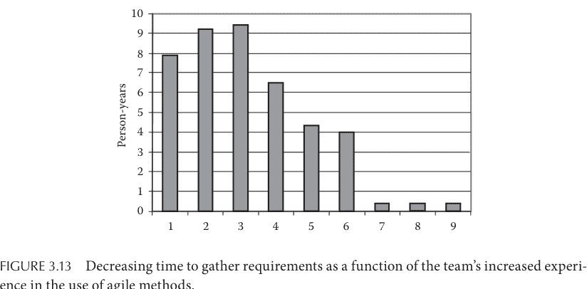

变更被认为是软件维护的一部分，而维护是第 8 章讨论的主题。）如果需要这些维护更改，极不太会再次使用创建软件的同一支敏捷开发团队，因此需求文档化（设计等）是绝对必要的。

图 3.13 显示了使用敏捷方法的一系列软件项目需求收集过程的改进模式。后期的项目大部分在团队更熟练地运用敏捷开发过程后开发，位于图表的右侧。

你可能已经注意到，在这个案例中可能会发生潜在的利益冲突。LabView 软件在很多地方销售，NASA 购买的相对较少的席位许可不太可能影响 LabView 制造商大幅更改项目甚至停止该项目的决策。对于在大型系统中将该软件作为 COTS 产品使用的系统会发生什么？（我们将在第 8 章描述系统演变时详细讨论这一点。）

Jacobson 等人（2014）的一份重要近期报告表明，名为 SEMAT（软件工程方法与理论）的方法可以通过检测系统性问题并采取适当行动来改进需求过程。清单信息可以在 http://www.ivarjacobson.com/resource.aspx?id=1225 找到。务必阅读这些博客，特别是 2014 年 3 月 24 日创建的那一个。

# 3.16 大项目：问题描述

到目前为止，我们在抽象层面上讨论了需求过程。现在是时候考虑一个中等规模的具体示例来说明这一过程了。正如序言和第 1 章所示，这个示例将在本书的剩余章节中贯穿。这个运行示例唯一不现实的地方在于，它必须足够小，以便在本书的范围内进行完整讨论。

# 140 软件工程简介

我们现在描述要解决的问题背景。软件经理面临的一个主要困难是缺乏良好的工具来衡量软件，并确定项目源代码的实现是否与原始软件设计一致。

想象两个软件专业人士在当地的一家餐馆通过非正式午餐见面。其中两个是老朋友，其中一人是一个身负许多责任的高级员工，管理着另一位。我们将称他们为“经理”和“软件工程师”。软件工程师也是一名经理，但只管理一个小团队。由于野心勃勃，软件工程师希望改变现状。职业晋升是软件工程师的主要目标。

经理正在抱怨难以获取关于她直接或间接控制的项目规模的良好信息。经理还抱怨组织的软件开发使用了三种不同的语言：C、C++ 和 Java。经理还抱怨缺乏能够让代码维护人员检查程序控制流结构检查的软件工具。此外，她没有任何好的方法来跟踪针对特定功能或源代码的更低级系统的软件报告。收集了大量关于软件错误的数据，但经理就是无法高效地使用它们。

软件工程师听了老朋友的问题，并想要提供帮助。此外，快速提供一套高质量的软件工具可以提供可见性，有助于职业提升。软件工程师在心里做下记录，要更充分地考虑这个问题。对话随后转向了八卦和政治。

在开车回办公室的路上，软件工程师决定与同事合作，为经理的需求制定一套需求。他们将作为一个需求团队共同工作。他们将产生一个开发以满足经理需求的软件建议。如果建议被接受，将分配资源。

## 3.17 大项目：需求获取

我们对该示例需求开发讨论的下一步将以客户与需求团队之间非正式对话的形式出现。对话的目的是阐明经验丰富的团队如何识别客户的任何遗漏或隐藏偏见，以便在需要时将其用于需求。由于并非所有的对话都在客户面前进行，因此我们将使用间插语来指示应该隐藏的内部讨论。

远离客户。我们遵循了在 3.4.1 节中讨论过的“无知隐藏”方法。

在我们的案例中，需求团队是软件工程师和未指定的同事。为了让对话更容易理解，我们不会在任何时候区分他们中哪一个在说话。他们在一个有大白板的小会议室里见面，但没有电话。

> “我认为我们可以为客户生产一些东西，这些东西也能帮助我们在公司内部晋升。”

> “客户想要什么？”

> “我觉得有很多真实的问题需要解决。目前还没有办法确定软件的规模。无法预测它，甚至无法为我们的系统进行计算，可能会导致非常昂贵的成本。”

> “我们目前统计代码的技术又如何？我们已经做了多年了。有什么新奇的？”

> “嗯，我们现在用 C、C++ 和 Java 开发代码。三种不同的语言，三种不同的方法，三种不同的计数标准。”

> “好，那我们就多写一些新的实用程序吧。如果我们必须那样做，为什么不把它做到位呢？”

> “好，我服了我们需要一些改变。但其他事情呢？我们应该做些什么？”

> “嗯，我想她想要某种图形化工具来显示程序的结构。也许是调用图。”

> “提醒我一下。调用图是哪些函数调用了其他函数的列表，对吧？”

> “没错。如果一个函数不在调用图中，它就是死代码，我们在尝试理解代码时可以忽略它。”

> “我们是应该真的画一张图，还是仅仅确定调用了其他函数的函数？我不知道。”

> “为不同的编程语言使用不同的工具怎么样？”

> “这可能是一个问题。我不清楚命令行参数。也许应该使用 GUI 来避免命令行问题。”

> “我不知道。如果没有 GUI，使用该工具可能会更简单。”

> “我们现有的软件错误数据呢？我们可以和它们建立接口吗？”

> “谁知道呢？那其中的某一些数据可能不是以一致的电子格式存储的。”

> “我们有很多问题要回答。让我们下周二上午 10 点见。”

在思考几天问题后，他们再次会合了。他们为会议做好了准备，并带了一份问题陈述以及针对问题解决方案的潜在需求列表。由于他们每一个人都熟悉公司的业务战略，他们已经决定包含表 3.3 中之前提供的需求。

# 软件工程简介

需求团队成员互相交换了准备好的材料副本，并恢复了对话。

好，我们对问题陈述达成一致了吗？有独立的工具吗？

是的。

多语言的问题怎么处理？我们想要共同的输出，这样用户只需要少少的新培训。

共同输入呢？

是的，尽可能这样做。在最后可能的时刻之前，我们不要引入 GUI。也许我们应该将 GUI 的引入推到该工具的第二代。

我不赞同。但让我们保持用户界面简单。

让我们对最简单的原型进行演示。

我们将一次处理一个源代码输入文件。这就是我们现在开发源代码的方式，软件系统使用多种语言。我们在 UNIX 开发中使用 Motif 和 Builder Xcessory，在 PC 应用程序中使用电子表格软件，以及使用 SQL 或 MySQL。我们的许多系统作为公司重用的一部分被移植到其他环境中。我们经常必须为不同语言编写的组件建立接口。

简化一下。我们只考虑用单一语言编写的软件子系统。

哈？

好，那刚才太模糊了。只需限制需求为一次只处理一种源代码语言。也就是说，系统被调用处理 C 源代码文件，第二次处理 C++，第三次处理 Java。

我们是提示用户，还是允许将文件类型指定为命令行参数？

拥有命令行参数通常强迫使用 C 或 C++ 编码。我们现在就要做这个决定吗？

可能不要。让我们把此项的行动推迟到客户决定为止。

好。

显示调用图怎么样？

这是一个更基础的问题。如果只只分析程序的一部分，比如用 C 编写的部分，那么我们如何处理未包含在分析的源代码文件中的函数呢？

如果被分析的程序是用 C 写的，但我们每次只分析程序中的源文件，问题是一样的。我们只需标记那些被调用过但未提供源代码进行分析的函数即可。

我明白了。这和我们处理任何库函数的方式一样。

我们想使用 CASE 工具的 IDE 来画图吗？

也许吧。我们已经有那种能力了。尽管如此，找一些开源的可能更好。我听我们可能会更换 CASE 工具，以节省一些成本。

对。还有别的吗？

需求 ■ 143

“没有。让我们把这些写下来。我认为我们准备好和管理层谈谈了。让我安排下次会议。”

“好。提前几天告诉我，以便我们做准备。不想在管理层面前表现得很糟。下周见。”

用例，正如我们之前描述的那样，对于解释用户与数据收集、分析和存储之间的某些交互将非常有帮助。在需求团队向客户展示那个著名的 C 程序（这之前讨论过）之前，需求团队随后讨论了该程序的规模……（注：原文后续部分为大量重复段落，已根据“不要重复输出原文”原则进行处理）

请注意，使用用例（如图 3.4 和 3.5 所示）有助于理解项目预期的功能。（在需求阶段，通常不会讨论误用用例。）让我们回到想象的对话中。

- 客户：这意味着我可以从这项工作中获得一些有用的东西，即使它没有产生我想要的所有。

- ：没错。我们可以进行原型设计，并频繁向您展示中间进度。

- 客户：好的。你们打算如何处理多种语言？公司的许多系统使用了多种编程语言的组合。

- ：我们将分别测量 C、C++ 和 Java 代码。我们将让用户负责确定输入文件，并确保它们都是同种类型的源代码语言。

- 客户：我更希望看到一个系统能够接受各种源代码作为输入，无论是什么什么语言。

- ：我们考虑过这一点。这样做选项太多了，错误检查也太复杂。我们将在稍后的原型中尝试。

- 客户：我希望这有一个好的理由。

- ：这样比较容易。我们将指定一个允许某些灵活性的软件接口。

- 客户：还有什么我应该知道的吗？


- ：我们决定用 `C` 或 `C++` 编写工具的前端，以便使用命令行参数。
- 客户：这有什么意义？
- ：我们可以使用该工具进行批处理。如果有大量文件需要分析，它可以运行一整夜。
- 客户：你们的团队会在我们的系统上工作吗？我不想再购买任何无法计入项目成本设备或软件。
- ：我们将使用最精的接口，并尽可能减少平台特定软件的使用。
- 客户：文件名呢？可以使用通配符吗？
- ：我们还不知道。我们会对此给您答复。
- 客户：这看起来考虑得很周全。这个工具符合我们的需求。我什么时候可以拿到它，费用是多少？

在实际项目的这个阶段，需求团队会将工作交给一个已经为项目制作初步成本估算的人。进度表也将由一个喜欢当项目经理的人制定。通常情况下，此时不会向客户展示详细的成本估算，因为对软件收取正确的费用可能是一家公司繁荣或破产的区别。成本估算应该像项目计划一样，极其谨慎地进行。

在我们的示例中，没有必要的，因为项目将在内部完成，已经有了初步的成本估算和进度表，而且在与潜在客户会议期间，需求没有发生明显变化。

这个假设性的讨论说明了需求收集团队成员与潜在客户或其代理之间可能进行对话的一些方式。在下一节中，我们将为系统提供一套完整的需求。剩下的讨论将遵循更正式的方法。然而，请始终记住，对初始系统需求的某些非正式引导几乎总是是必要的。

## 3.18 大型软件项目：需求分析

我们现在将考虑在本书剩余部分将讨论的软件开发项目的需求。我们的起点是需求团队收集的一组需求。目标是将非正式获得的初始需求转换为足够精确的需求，以便我们能够告知最终开发的软件系统将真正满足预期的需求。

我们假设需求文档的初步尝试看起来像下面。

### 大型软件项目的问题陈述

- 确定用三种语言（`C`、`C++` 和 `Java`）中的任意一种编写的软件代码的大小。
- 为用 `C`、`C++` 或 `Java` 编写的程序开发通的代码计数标准。
- 应该有一个尽可能简单的前端用户界面。
- 其他语言中的函数应被视为库函数处理。
- 开发一个能显示程序调用图的工具。
- 将代码计数和调用图显示集成到单一软件系统中。

让我们过一遍列表，应用第 3.4.1 节中介绍的 Berry 忽略隐藏技术。这些词汇和短语哪些是模糊且不可测试的？

- “标准”
- “尽可能简单的用户界面”
- “足够灵活”
- “应该有一个通用的输出接口”
- “被视为库函数处理”

## 表 3.12 大型软件项目的需求溯源矩阵

| | 设计 | 代码 | 测试 |
| --- | --- | --- | --- |
| 1. 基于 Intel | | | |
| 2. Windows 8.1 | | | |
| 3. Windows 8.1 UI | | | |
| 4. 与 Excel 14.0 一致 | | | |
| 5. 仅限一种系统尺寸 | | | |
| 6. 200 MB 系统 | | | |
| 7. 500 MB 磁盘空间 | | | |
| 8. 一张 CD | | | |
| 9. 包含安装 | | | |
| 10. 无解压缩程序 | | | |
| 11. 一次处理一个输入文件 | | | |
| 12. 为 C、C++、Java 开发标准 | | | |
| 13. 每个函数的大小 | | | |
| 14. 每个文件的大小 | | | |
| 15. 系统的大小 | | | |
| 16. 计算总计 | | | |
| 17. 前端使用 C 或 C++ | | | |
| 18. 面向批处理的系统 | | | |
| 19. 精确定义 LOC | | | |
| 20. 分别测量 | | | |
| 21. 对输入不进行错误检查 | | | |
| 22. 文件名限制为 32 个字符 | | | |
| 23. 可以通配符 | | | |
| 24. 忽略死代码 | | | |
| 25. 不需要特殊的编译器 | | | |

这个列表当然可以继续写下去。“前端”一词几乎意味着系统用户的界面，但也可能意味着软件的初始组件：与操作系统以及电子表格和数据库等软件接口的组件。我们不再在此赘述，而只需指示对初始需求列表的修订。需求溯源矩阵见表 3.12。我们包含了其中的一些。

### 大型项目初始需求列表

- 项目必须开发出一种计算 `C`、`C++` 和 `Java` 代码行的标准方法。
- 系统应是面向批处理的。
- 系统的界面应尽可能简单，因为我们在第二次迭代的需求中包含了这一点。
- 死代码可以被忽略。
- 系统应该有一个针对多种语言的通用输出接口。
- 系统应该有一个针对多种语言的通用输入接口。
- 假设每个软件子系统是用单一语言编写的。
- 前端将用 `C` 或 `C++` 编写以便使用命令行参数。
- 源代码中未包含的调用将被标记并作为库函数处理。
- 软件必须计算源代码中每个函数的大小。
- 软件必须根据每个函数的大小计算每个文件的大小。
- 软件必须通过累加每个组件源代码的大小计算系统总大小。

### 软件工程绪论

- 不需要特殊的编译器或应用程序。
- 系统将确定调用其他函数。它足够灵活，可以扩展到发布版本中的图表。
- 系统足够灵活，可以扩展到现有的软件错误维护和测试数据。
- 。
- 系统应该有一个针对多种语言的通用输出接口。
- 系统应该有一个针对多种语言的通用输入接口。
- 假设每个软件子系统是用单一语言编写的。
- 前端将用 `C` 或 `C++` 编写以便使用命令行参数。
- 源代码中未包含的调用将被标记并作为库函数处理。
- 软件必须计算源代码中每个函数的大小。
- 软件必须根据每个函数的大小计算每个文件的大小。
- 软件必须通过累加每个组件源代码的大小计算系统总大小。

### 客户现在想要

基于 Web 的用户界面，带有图 3.14 和 3.15 所示的启动和关闭屏幕。

第二个变化是客户现在希望使用云端进行数据存储，而不是基于 PC 的存储。

显然，需要对需求进行一些更改。你将在练习中被要求修改需求。请记住对需求过程需要做哪些更改，以及需求本身需要做哪些更改。

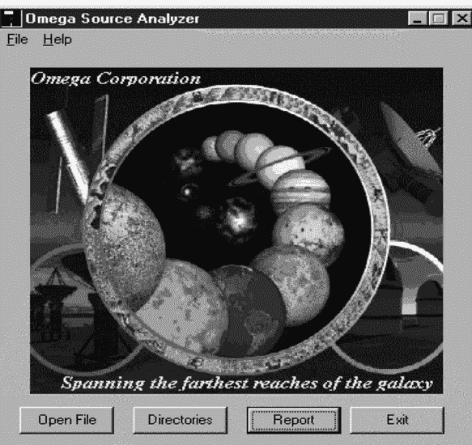

图 3.14 示例启动屏幕。（软件系统由 Sean Armstrong、Aaron Rogers 和 Melvin Henry 准备。）

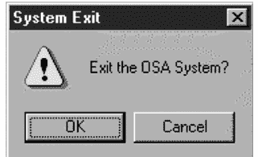

图 3.15 示例关闭屏幕。（软件系统由 Sean Armstrong、Aaron Rogers 和 Melvin Henry 准备。）

# 总结

为软件系统制定一套适当的需求是项目成功的关键。如果没有完整、一致且清晰的需求，项目将注定失败。无论软件是按照经典的瀑布模型、快速原型模型、螺旋模型开发的，还是开发过程基于开源软件，甚至是使用了敏捷开发过程，都是如此。最终，即使在迭代过程中，需求也必须被正确确定。

有几种技术可以帮助需求组织：

1. 使用数据抽象和信息隐藏来产生对系统功能的完整描述。
2. 重新分组需求，使其与现有和计划系统的需求及设计保持一致。
3. 重用需求，以便重用现有的设计和源代码。
4. 自动化需求工程过程。

需求必须清晰且无歧义。为了在整个软件开发过程中追溯需求，必须创建一个需求追溯性矩阵。该矩阵列出了需求编号、每项需求，以及用于检查设计、代码和测试阶段需求是否已满足的勾选项。

需求一旦制定，应对对其效率、潜在成本以及对安全关键性问题的关注进行评估。此时，对当前技术进行研究以确定可行性可能是恰当的理想情况下，组织的软件开发过程应包含估计规模和成本的指标。

需求占了软件开发工作的大部分比例。因此，它们将在项目进度表中被强调，并接受一次或多次需求评审。评审的目的是确保正在评估的产品（在这种情况下为需求）具有足够高的质量。需求评审通常配合质量保证评估。

软件需求经常变化，即使开发过程不是显式的迭代。变更管理包括任务优先级排序、重新分配资源以及确保更改的影响能够对现有需求进行最高效利用。

敏捷开发过程与此不同，主要是因为它们最适用于敏捷开发团队已充分理解应用领域，并且有许多可用的软件组件可以加速开发过程的情况。使用如 `LabView` 这样的 C 产品（我们在 3.15 节关于敏捷过程管理的案例研究中评估需求时描述过）是一个极佳的例子，因为除非敏捷团队了解核心需求并能预见到 `LabView` 如何满足这些需求，否则无法做出这一选择。

# 关键词和短语

需求工程、需求取取、功能点、COTS、软件架构、数据抽象、信息隐藏、可测试需求、功能点、功能点指标、需求评审

# 扩展阅读

很少有书籍专门致力于需求生成过程。也许 Alan Davis (1990) 编写的《软件需求：分析与规格说明》以及 Richard Thayer 和 Merlin Dorfman (1992) 编写的第二版《软件需求》是最容易获取的。Davis 书的一个主要优点是它包含了一份关于软件需求及相关研究的 598 参考文献注释目录。Thayer 和 Dorfman 的书包含了许多关于软件需求最重要的论文，并对 20 世纪 90 年代后期这一活跃研究领域的现状提供了极佳的概述。

对于想要了解软件需求工程领域的人来说，查看专门针对需求的会议论文集或阅读一些更关注需求工程特定领域的书籍可能是易事的。需求工程领域年度会议论文集的重要网站可以在 `requirements-engineering.org` 找到。

发表在该会议集中的两篇论文特别值得注意，它们被列为这些会议上影响力最大的论文，且对本书读者来说特别易读。Orlena C. Z. Gotel 和 Anthony C. W. Finkelstein (1994) 发表的论文《需求追溯问题分析》侧重于追溯性问题。Barry Boe 和 Hoh In (1996) 基于其丰富的工业经验写的论文《识别质量与需求冲突》于 1996 年发表。最具影响力论文奖在论文发表十年后分别于 2004 年和 2006 年颁发。

Daniel Berry (1995) 发表在《系统与软件杂志》上的论文是需求工程的必读读物。

通常很难找到关于敏捷过程使用的信息，且能为敏捷需求过程的用户提供足够的信息。Dean Leffing (2001) 一本相对较新的书为敏捷需求过程提供了详细的视角。

Albrecht (1979) 引入了功能点作为规模衡量标准的概念。Jones (1993) 描述了如何将其应用于软件生命周期中的许多地方，包括需求工程。

用户界面研究一直集中在两个主要领域：

1. 确定输入设备效率和可用性的心理实验；
2. 开发辅助设计者的软件模型及相关工具。

《ACM 综述》（Computing Surveys）拥有丰富的资源。Hartson 和 Hix (1989) 的著作提供了关于用户界面设计的更多补充信息。Shneiderman (1980) 和 Nielsen (1994) 就该主题编写了优秀的教材。

当然，用户界面社区受到了智能手机和平板等移动设备出现的深远影响，这些设备具有触摸屏界面和多点触控能力。关于此类设计的易读信息可以在 Nielsen Norman Group 网站 `http://www.nngroup.com` 找到，该网站强调使用证据评估用户界面。我们注意到 Jakob Nielsen 是 Apple 最初的用户界面设计师之一。在他之前的咨询公司网站 `useit.com` 上，他标出现场研讨会的价格为每天 7 万美元加差旅。（咨询费率令人震惊。）

# 练习

1. 在我们对软件工程的初步讨论中，我们在表 3.3 展示了营销个人电脑软件前必须做出的决策示例。这是一个自动化的理想机会。编写一套名为 `RGS` 的软件系统需求，该系统将与用户交互，以最少的需求工程师输入确定十一项需求。（`RGS` 的缩写代表需求生成系统。）
2. 使用 3.4 节讨论的 Daniel Berry 忽略隐藏法完成表 3.4 中剩余需求的分析。
3. 为表 3.4 中的需求提供一个状态图。
4. 为表 3.4 中的需求提供一个决策表。
5. 为表 3.4 中的需求提供一个 Petri 网。
6. 使用功能点法对表 3.4 中的需求规模进行估计。
7. 本练习涉及本章讨论的用户界面模型。利用该对象的详细描述对图 3.4 和图 3.5 所示的显示进行量化评估。将该模型应用于你最喜欢的文字处理软件中。
8. 一个系统有两个并发执行的进程 `A` 和 `B`。考虑以下需求：
   - a. 进程 `A` 和 `B` 将在网络上的不同机器上执行。
   - b. 进程 `A` 和 `B` 之间的通信尽可能少。

   这两个需求中，哪一个与系统“无单点故障”最一致？哪一个最符合“实时性能需求”？请解释你的答案。

9. 开发一个 Petri 网（Pet理网），用于对以下任务进行同步，这些任务可能会并发发生：

   任务 1：穿袜子  
   任务 2：穿袜子  
   任务 3：穿右袜子  
   任务 4：穿左袜子

   同步要求是：在任务 3 或任务 4 发生之前，任务 1 和任务 2 中至少有一个必须已完成。
10. 与问题 9 相同，不同之处在于在任务 3 或任务 4 发生之前，任务 1 和任务 2 必须都完成。
11. 选择一个你熟悉的软件软件包。使用该软件包执行一些你以前做过很多的操作。在执行此操作时，注意用户界面的变化，包括可能出现的任何新屏幕或消息。现在，列出该软件必须具备的需求列表。（在没有现有需求文档的情况下，通过性能来确定系统需求是项被称为“逆向工程”的过程的一部分。）
12. 考虑接下来给出的状态图。它与示例 3.9 中的图相关但并不完全相同。你如何确定这些需求是否是不一致的？

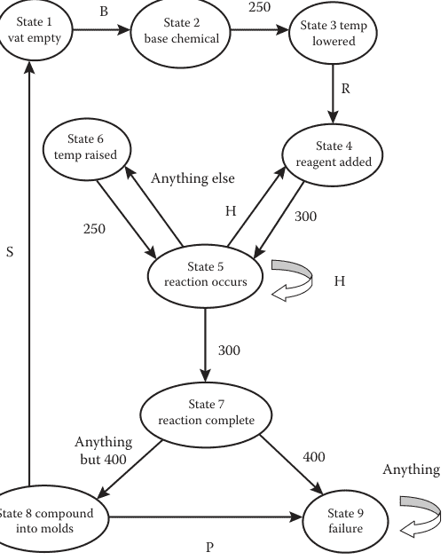

# 大型软件项目练习

1. 为我们在第 3.18 节和本章总结中开发的持续软件项目需求编写一个状态图。
2. 为我们在第 3.18 节和本章总结中开发的持续软件项目需求编写一个决策表。
3. 为我们在第 3.18 节和本章总结中开发的持续软件项目需求编写一个 Petri 网。
4. 使用功能点（function point approach）估计我们在第 3.18 节和本章总结中开发的持续软件项目的需求规模。
5. 考虑我们在第 3.18 节和本章总结中开发的持续软件项目需求。应用本章的建议重新组织需求，使软件架构更简单。
6. 为在练习 5 中修改后的、我们在第 3.18 节和本章总结中开发的持续软件项目需求编写一个状态图。
7. 为在练习 5 中修改后的、我们在第 3.18 节和本章总结中开发的持续软件项目需求编写一个决策表。
8. 为在练习 5 中修改后的、我们在第 3.18 节和本章总结中开发的持续软件项目需求编写一个 Petri 网。
9. 为我们在第 3.18 节和本章总结中开发的持续软件项目需求编写一组用例（use cases）。
10. 修改需求允许软件具有基于 Web 的界面。应用第 3.4.1 节的忽略隐藏技术（ignorance hiding technique）来分析这些新需求。必须进行何种的技术评估？哪些现有需求必须修改？
11. 为我们在章中介绍的大型软件项目制定详细的项目计划。
12. 对于一个尝试使用敏捷软件过程完成我们大型项目的项目，你预期它具有哪些属性？你的项目团队在这门课程中具备这些属性吗？从评估你的团队对应用领域的知识开始你的回答。
13. 此问题考虑了需求重大变化的影响。第一个变化是客户现在想要一个基于 Web 的用户界面，而不是基于 PC 的。确定为了获得不同类型的用户界面需要需求进行哪些修改，以及可能的配置中存在的不同问题（PC 上的多个操作系统、多个浏览器以及多个版本的 HTML 和 Java）。软件开发生命周期模型或需求切取过程是否需要进行任何更改？
14. 此问题考虑了需求重大变化的影响。第二个变化是客户现在想要使用云进行数据存储，而不是基于 PC 的。确定为了实现数据云存储需要需求进行哪些修改，涉及可扩展性和项目所需的云大小的不同问题。此外，确定为了对被分析的源代码模块进行云存储需要需求进行哪些修改，涉及可扩展性和项目所需的云大小的不同问题。软件开发生命周期模型或需求切取过程是否需要进行任何更改？
15. 此问题考虑了需求重大变化的影响。这一变化是客户现在想要尽可能使用开源软件和 Linux 环境，而不是基于 Microsoft Windows 环境。确定为了实现这一点需要需求进行哪些修改。软件开发生命周期模型或需求切取过程是否需要进行任何更改？

# 软件设计

## 4.1 引言

在编写任何用于控制或与其交互的软件之前，开发一个系统模型是至关重要的。软件建模可能是软件设计中最困难的部分。产生良好的软件设计需要大量的实践，并对设计质量进行大量的反馈，由此产生的软件将影响下一个系统的设计。

我们将软件设计看作一个迭代过程，其目标是在每次迭代中改进设计。本章的目的是讨论一些可以指导软件设计过程的原则。这些原则将通过几个示例来说明。

你无疑已经意识到软件行业正发生着根本性的变化。随着云计算的出现，软件不再像以前那样束缚在特定的服务器上。计算机本身正在发生变化，从需要时连接服务器的强大桌面电脑或笔记本电脑，变为无处不在的设备，如智能手机和平板电脑，并通常带有云计算。

此外还强调面向对象的技术和软件重用。面向对象方法论的某些方面与传统的、仍然常见的程序化软件设计方法中的对应问题如此不同，以至于它们应该分开讨论。这在软件设计中尤为如此。

然而，大量的软件工程努力仍然集中在需求分析、设计、实现、测试和维护上，而这些程序是在更熟悉的程序化方法下开发的，而不是面向对象技术。因此，软件工程师必须熟悉这两类软件系统的设计。这为编写软件工程书籍的作者带来了一个问题。

软件组件，例如我们在敏捷流程案例研究第 3.15 节讨论过的 `LabView` 使用，就是一个很好的例子。如果我们使用商业现成（COTS）产品或任何大型组件，主要的考虑因素是它们对我们特定项目的适用性。这对于任何敏捷软件开发过程来说无疑为重要。即使软件组件是开源的，我们主要关心的仍然它的功能和质量，而不是组件的内部设计是否面向对象。


请注意，这种混合方法在软件工程领域非常常见，并已被若干机构正式化。这是一个历史性的案例。考虑一下美国国防部的经验，他们在软件开发和维护上花费了巨资。20 世纪 70 年代的一项调查显示，当时使用 1600 多种不同的计算机语言和方言进行开发或维护。这就是开发 `Ada` 编程语言的动力，该语言旨在利用多年软件开发中获得的教训（Ada, 1983; Ichbahn, 1996）。这些教训包括信息隐藏、使用包规范（package specifications）和体（bodies）将软件接口与内部分离、通过“泛型”（generics）实现多态和抽象，以及强类型。`Ada` 在 1995 年、2005 年和 2012 年进行了重大修订，增加了面向对象技术的应用。

在编写本章时，公众正密切关注一种名为“正向列控制”的技术，许多专家认为这种技术防止了最近的一起列车脱轨，当时一列火车在费城第 30 街以北的一个急弯处行驶超过了每小时 50 英里的限速。车站测量显示，该列火车在该弯道处的行驶速度达到了惊人的每小时 106 英里。许多不熟悉该技术的人简单地使用 `GPS` 测量火车速度，并在确定其速度过快时自动减速。遗憾的是，那种方法根本无法应对问题的复杂性。

正向列控制利用本地跟踪设备提供的信息，提供一个具有高容错性的实时控制系统。从个人角度来说，我在 20 世纪 90 年代初与联邦铁路管理局的一个技术经理进行过一次有趣的讨论，当时速度和防碰撞软件是使用一种名为 `Tandem Application Language` 的特殊语言编写的，后来被更名为 `Tandem Transaction Application Language`。即使在当时，纯粹的面向对象编程语言似乎也无法胜任任务。一种混合方法正在被部署。

虽然目前使用的编程语言数量远于 1600 种，但数量庞大且不断增加，包括用于统计数据分析、脚本、可视化编程、文本分析以及手机应用开发的语言。你应该预计在职业生涯中学习许多语言、软件开发包（`SDK`）和开发环境。

本章的其余部分安排如下：首先，我们将介绍一些基础的、通用的设计原则。某些设计原则将基于软件模式匹配的基本技术。目标是尽可能在高层次重用软件组件。此讨论之后是一些常用的用于过程化系统设计的表示方法，并附有每种表示方法的示例。在完成对过程化系统设计的初步讨论后，我们将讨论它们的某些表示方法，同样带有示例。面向对象的软件将遵循相同的步骤。这将完成我们对软件设计技术的初步讨论。我们还将讨论我们的敏捷案例研究。

本章的最后三个部分将主要致力于书中之前介绍的示例的设计。该示例将进行详细讨论。特别关注那些由于必须结合过程化和面向对象系统而产生的问题。

## 4.2 软件设计模式

设计软件的一种可能方法是尝试将解决的问题与一个解决相同类型问题的现有软件系统相匹配。这种方法至少减少了部分设计模式匹配。其有效性取决于一组先开发的软件模块以及识别不同模式的方法。以下是软件开发中似乎反复出现的一些模式类型。模式是相对高层次的，与通常被称为“四人帮书籍”（Gang of Four Book）的著作中所描述的模式不同，该书的作者是 Erich Gamma、Richard Helm、Ralph Johnson 和 John Vides（Gamma et al., 1995）。这些高层次模式包括：

1. **菜单驱动系统**，用户必须通过分级结构中的几个步骤来完成其工作。菜单可能是下拉式的（如个人电脑上常见的类型），也可能是完全基于的。

2. **事件驱动系统**，用户必须选择步骤来完成其工作。步骤不需要按分级顺序执行。这种模式最常见于并发进程，其中操作可以无限重复，与模式 3 形成对比。它也典型于通过菜单选项选择和键键组合来引导的用户界面，例如在响应用户请求时弹出的菜单。在任何情况下，它的层级结构都比上一个模式要少。

3. **状态系统**，其操作取决于少数几个“状态”之一，以及每个状态可以采取的一小组可选操作。可选操作取决于状态本身和输入“令牌”（token）的值。在这种模式中，令牌通常以流的形式呈现。一旦令牌被处理，它就会从输入流中被移除。

4. **序列处理系统**，逐个处理一组输入令牌。这种模式与前一个模式的区别在于，采取何种操作的决策可能取决于比仅仅状态和输入令牌更多的的信息。

## 软件工程导论

5. **搜索系统**，为了寻找一个或多个信息而进行大量搜索。搜索可能发生一次或多次。

6. **通用系统**，可以用于各种应用程序，但在新环境中需要调整才能正常工作。

7. **算法驱动系统**，其中一切都主要由算法引导，而不是依赖数据。

8. **分布式系统**，有许多独立的计算动作发生。某些计算动作可能与其他计算动作进行通信。

这些模式中有多少对你来说是熟悉的？前两种描述了僵化的、菜单驱动的系统，另一个是由移动鼠标或其他指针以及按下按钮等操作控制的。但在平板电脑和智能手机时代，这些模式中哪些仍然适用？注意，模式 1 在性质上似乎是过程化的，模式 2 很好地符合面向对象系统中通过消息通信的对象。软件模式 3 描述了我们所知的“有限状态机”或“有限自动机”。这种模式在控制工厂中的某些过程时特别有用，如图 3.9 所示。它可能最容易被组织为过程化设计，至少在顶层是如此。

### 创建模式

1. **抽象工厂**——该模式提供了一个创建相关对象族的接口，而不指定它们的具体类。

2. 建造者（`Builder`）——这种模式将复杂对象的构建过程与其表示分离开。

3. 工厂方法（Factory method）——这种模式定义了一个创建单个对象的接口，并允许子类决定实例化哪一个类。

4. 原型（`Prototype`）——这种模式通过原型实例来定义要创建的对象类型，并通过复制该原型来创建新对象。在理论上，这有助于使用快速原型生命周期的项目开发。

5. 单例模式（`Singleton`）——这种模式确保一个类只有一个实例。

### 结构型模式

6. 适配器（`Adapter`）——这种模式将一个类的接口转换为客户端所期望的另一种接口。在其他上下文中，这种功能被称为桥接软件（bridgeware）或胶合软件（glueware）。

7. 桥接（`Bridge`）——这种模式确保抽象与其实现细节分离开。

8. 组合（`Composite`）——这种模式允许将对象组成树形结构，其中可以同时访问单个对象和对象的组合。

9. 装饰器（`Decorator`）——这种模式在保持相同接口的同时，动态地为对象附加额外的责任。

10. `Facade`（Facade）——这种模式为子系统中的一组接口提供统一的接口。

11. 享权重模式（`Flyweight`）——这种稀有的模式使用共享的形式来高效地处理大量相似的对象。

12. 代理（`Proxy`）——这种模式为另一个对象提供占位符，以控制对它的访问。

### 行为型模式

13. 责任链（`Chain of responsibility`）——这种模式允许给多个对象一个处理请求发送者的机会。如果存在备选响应者（包括回退操作），这种模式将非常有用。

14. 命令（`Command`）——这种稀有的模式将请求封装为对象，从而允许客户端获取化不同的请求。

15. 解释器（`Interpreter`）——这种大规模模式允许设计者使用语言语法的表示来进行解析。这对于开发代码指标很有帮助。

16. 迭代器（`Iterator`）——这种模式提供了一种按顺序访问聚合元素的方法，而无需暴露其底层表示（该表示不必是数组）。

17. 中介者（`Mediator`）——这种模式定义了一个对象，用于封装一组对象如何交互，以防止显式引用。

18. 备备（`Memento`）——这种模式允许对象捕并外部化对象的内部状态，同时允许对象被恢复。这在发生不可预见的系统错误时创建回滚用例可能非常有用。

19. 观察者（`Observer`）——这种实用的模式定义了对象之间一对多的依赖关系，其中一个对象的状态变化会导致所有依赖者被通知并更新。

20. 状态（`State`）——这种模式允许对象在 fact内部状态改变时改变其行为。这在发生系统错误时进行回滚非常有用。

21. 策略（`Strategy`）——这种模式定义了一个算法族，封装每一个算法并使它们可以互换。策略让算法独立于使用它的客户端而发生变化。当被整合到“N版本编程”或“多版本”方案时，它可以用于提高系统的容错性，在这种方案中，正确性通过多数投票或一组独立实现的程序版本来确保。

22. 模板方法（`Template method`）——这种模式对于上过数据结构课程的人来说很熟悉，它定义了操作中的算法骨架，并将步骤留给子类。

23. 访问者（`Visitor`）——这种模式用于表示在对象结构的元素上执行的操作，而无需改变其所操作的元素的类。

我建议读者参阅原始的“四人帮”书籍（Gamma et al., 1995）以获取这二十三种模式的更多细节。读者可以在很多地方找到这些模式的实现示例。当然，1995年的一本书是非常重要的，因为它引发了许多研究工作。文献中描述了至少四八种模式，多到无法讨论。

需要注意的是，原始的二十三种设计模式是用 `C++` 给出的，这种语言并不像 `Java`、`Objective C`、`Swift`、`Ruby` 等语言那样是面向对象的。上述某些为了解决 `C++` 特定问题而引入的模式可能不适用于后来的面向对象编程语言。

我们明确指出，没有必要在考虑上述每种模式时都考虑整个软件系统。让同一个软件系统的不同部分匹配不同的模式是完全合理的。当我们在本章后面使用软件示例时，情况就是如此。

在软件设计期间，将软件系统分为若干个子系统是常见的。事实上，设计的某种步进细化对于高效的软件设计过程是关重要的。系统设计的分解将是本章的一个反复出现的主题。现在，我们将忽略系统分解，专注于软件模式。

让我们考虑这些模式如何作为设计过程的一部分被使用。假设我们发现某个模式适用于我们要设计的软件系统。接下来我们该如何做？

第一步是看看是否可以让工作变得简单。具体来说，我们应该搜索任何可用的软件，看看事实上我们是否已经有了一个完整的解决方案。如果现有的软件完全解决了问题，我们就完成了。所需的修改应与完全新软件的估计成本进行比较，看看是否可以重用部分。我们将在本章4.20节对主要软件工程示例的持续讨论中说明重用的应用。

## 4.3 软件设计表示引言

任何帮助我们理解或描述系统的符号、技术或工具都受到建模者的认真考虑。在本节中，我们将注意力放在建模技术上，并简要讨论设计符号。

假设我们找不到任何直接解决问题的现有软件，或者即使是修改后也是候选解决方案。在这种情况下，我们被迫设计新软件。我们该如何做？

有几种描述软件系统的方法：

- 软件可以通过系统的控制流来描述。
- 软件可以通过通过系统的数据流来描述。
- 软件可以通过系统执行的操作来描述。
- 软件可以通过被操作的对象来描述。

每种系统描述反过来引导我们进入被发现有助于描述和理解这些类型系统的设计表示。

软件系统的第一种类型描述引导我们进入流程图或流图的概念。最早的图形设计表示被称为“流程图”，它们是面向控制的。控制流是通过控制其运行的主要代码块来描述系统的方法。在20世纪50年代和60年代，流程图通常是手绘制的，使用一种图形符号，其中程序的控制被表示为描述程序的有向图中的边。使用塑料模板来保持符号的一致性。

流程图的节点是框，其形状和方向提供了关于程序的额外信息。例如，具有水平或垂直边的矩形框表示在程序的这一步中发生了计算过程。与水平方向成45度角的菱菱形框被称为“决策框”。

程序的控制流。其他符号用于表示程序行为中常见的情况。图 4.1 给出了一个假设程序的流程图示例。关于流程图的更多信息请见附录 C。

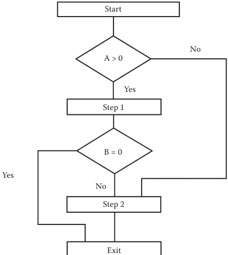

图 4.1 某个假设程序的流程图描述。

第二种描述设计的方法适用于软件的数据流表示。正如第 1 章提到的，系统的数据流表示的开发时间晚于控制流描述。`Yourdon` 的著作（其中一本由他独立完成，另一本与 `Constantine` 合著）可能是关于数据流设计最易于入门的基础资料（Yourdon and Constantine, 1979; Yourdon, 1989）。大多数软件工程书籍都包含了在软件系统设计中使用数据流图的示例。

由于不同的数据沿程序中的不同路径移动，因此数据流设计描述的传统做法是在指示数据移动方向的箭头上包含数据名称。

数据流设计还依赖于特定的记法来表示系统的不同方面。在这里，箭头表示数据移动。不同类型的数据处理使用不同的记法。例如，图中的矩形框表示节点。输入数据流的源（如交互式终端输入）将用另一种记法表示，指示它是一个“数据源”。另一方面，无法从其回溯数据的存储（如终端屏幕）由另一个符号描述，指示这是一个“数据汇”。见附录 C。


图 4.1 某个假设程序的流程图描述。

由于不同的数据沿程序中的不同路径移动，因此数据流设计描述的传统做法是在指示数据移动方向的箭头上包含数据名称。

系统的典型数据流描述使用不同“级别”的几张图。数据流图的每个级别都代表对之前描述的较高层次系统部分更详细的视图。图 4.2 显示了假设程序数据流初步分析的非常高视图。这个简单的图可能会被称为 1 级数据流图，而 0 级数据流仅表示输入和输出。

第三种表示软件系统设计的方法显然最适用于面向过程（过程）的系统视图。它可能包括控制流或数据流，甚至是软件的组合描述。这种混合方法使用的记法并不是标准的。这种设计可能非常简单，例如，从图 4.2 中标记为“步骤 1”的框到图 4.1 中描述的流程图之间有一个链接。

最后，第四种方法显然最适用于面向对象的系统视图。我们选择使用一种名为统一建模语言（`UML`）的建模表示法。`UML` 试图描述系统内部对象之间的关系，但并不直接描述控制流或数据的转换。

注意，图 4.3 所示的每个框代表一个对象，其继承结构由箭头的方向清晰地指示：类型为类 i 的对象

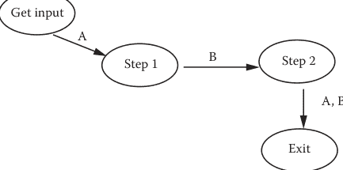

图 4.2 某个假设计算机系统的 1 级数据流图（`DFD`）描述。

| 类 1 | 类 2 |
| :--- | :--- |
| 属性：type 1 | 属性：type 2 |
| 操作 1: (arg, type) | 操作 1: (arg, type) |
| 操作 2: (arg, type) | |

| 类 3 |
| :--- |
| 属性：type 3 |
| 操作 3: (arg, type) |

图 4.3 使用 `UML` 记法对假设计算机系统进行的过度简化的面向对象描述。

是类 3 对象的超类。在使用统一对象模型的实际设计中，水平线将包含关于关系类型（一对一、多对一、一对多）的信息，以及多个对象聚合为单个对象的信息。我们在这里省略了这些细节。

对于软件工程师来说，确定适用于软件系统设计的对象是非常困难的。尽管很少的研究支持“良好的面向对象设计比使用面向过程的方法更容易创建”这一假设，但我们认为需要大量的训练来理解面向对象方法的微妙之处。鼓励不熟悉面向对象方法的学生在熟悉软件开发后，多次阅读并联系书中的讨论，以理解为什么会做出某些设计决策。

一种有帮助的方法是用完整的句子来思考系统功能的描述。句子中的动词是系统中的动作；名词代表对象。当我们开发软件工程项目示例的这部分设计时，如果使用面向对象的方法是有意义的，我们就使用这种简单的方法。

在软件工程的初期，询问为什么需要设计表示方法是自然的。某些技术是出于历史原因演变出来的，但许多技术和表示之所以能存存，是因为它们提供了软件设计有用的替代视图。

数组排序这一经典问题很好地说明了这四种方法的区别。考虑由 C. A. R. `Hoare` (1961) 开发的著名的快速排序算法。

快速排序将数组划分为两个（可能）不相等的子数组。这两个子数组由一个“基值元素”分隔，该元素至少与一个子数组中的所有元素一样，且大于另一个子数组的元素。然后对每个子数组执行相同的处理。该过程以一个完全排序的数组结束。注意，这种算法描述是递归的。将快速排序算法应用于设计中以满足未知数据集的某些需求。（希望获取快速排序更详细描述的学生，建议查阅任何关于数据结构的优秀书籍，`Hoare` 的原始论文（1961）仍然值得一读。）

算法的控制流描述会导致一个严重依赖于程序逻辑分解的设计。考虑在 `FORTRAN` 或 `BASIC` 等不支持递归的语言中实现递归快速排序。设计的逻辑将非常重要。另一方面，如果使用纯递归算法，大数据可能意味着过多的递归函数调用。这种控制流可能会指出简单快速排序设计的局限性。数据流描述将强调在快速排序每次迭代中创建的数组之间的数据移动。

## 设计 167

系统的典型数据流描述使用不同“级别”的几张图。数据流图的每个级别都代表对之前描述的较高层次系统部分更详细的视图。图 4.2 显示了假设程序数据流初步分析的非常高视图。这个简单的图可能会被称为 1 级数据流图，而 0 级数据流仅表示输入和输出。

由于不同的数据沿程序中的不同路径移动，因此数据流设计描述的传统做法是在指示数据移动方向的箭头上包含数据名称。

程序的控制流。其他符号用于表示程序行为中常见的情况。图 4.1 给出了一个假设程序的流程图示例。

第二种描述设计的方法适用于软件的数据流表示。正如第 1 章提到的，系统的数据流表示的开发时间晚于控制流描述。`Yourdon` 的著作（其中一本由他独立完成，另一本与 `Constantine` 合著）可能是关于数据流设计最易于入门的基础资料（Yourdon and Constantine, 1979; Yourdon, 1989）。大多数软件工程书籍都包含了在软件系统设计中使用数据流图的示例。

由于不同的数据沿程序中的不同路径移动，因此数据流设计描述的传统做法是在指示数据移动方向的箭头上包含数据名称。

数据流设计还依赖于特定的记法来表示系统的不同方面。在这里，箭头表示数据移动。不同类型的数据处理使用不同的记法。例如，图中的矩形框表示节点。输入数据流的源（如交互式终端输入）将用另一种记法表示，指示它是一个“数据源”。另一方面，无法从其回溯数据的存储（如终端屏幕）由另一个符号描述，指示这是一个“数据汇”。见附录 C。


图 4.2 某个假设计算机系统的 1 级数据流图（`DFD`）描述。

| 类 1 | 类 2 |
| :--- | :--- |
| 属性：type 1 | 属性：type 2 |
| 操作 1: (arg, type) | 操作 1: (arg, type) |


| 操作 2: (`arg`, `type`) | |

| 类 3 |

| :--- |

| 属性：`type` 3 |

| 操作 3: (`arg`, `type`) |

图 4.3 使用 UML 记法对假设计算机系统进行的过度简化的面向对象描述。

是类 3 对象的超类。在用统一对象模型的实际设计中，水平线将包含关于关系类型（一对一、多对一、一对多）的信息，以及多个对象聚合为单个对象的信息。我们在这里省略了这些细节。

对于软件工程师来说，确定适用于软件系统设计的对象是非常困难的。尽管很少的研究支持“良好的面向对象设计比使用面向过程的方法更容易创建”这一假设，但我们认为需要大量的训练来理解面向对象方法的微妙之处。鼓励不熟悉面向对象方法的学生在熟悉软件开发后，多次阅读并联系书中的讨论，以理解为什么会做出某些设计决策。

一种有帮助的方法是用完整的句子来思考系统功能的描述。句子中的动词是系统中的动作；名词代表对象。当我们开发软件工程项目示例的这部分设计时，如果使用面向对象的方法是有意义的，我们就使用这种简单的方法。

在软件工程的初期，询问为什么需要设计表示方法是自然的。某些技术是出于历史原因演变出来的，但许多技术和表示之所以能存在，是因为它们提供了软件设计有用的替代视图。

数组排序这一经典问题很好地说明了这四种方法的区别。考虑由 C. A. R. Hoare (1961) 开发的著名的快速排序算法。

快速排序将数组划分为两个（可能）不相等的子数组。这两个子数组由一个“基值元素”分隔，该元素至少与一个子数组中的所有元素一样，且大于另一个子数组的元素。然后对每个子数组执行相同的处理。该过程以一个完全排序的数组结束。注意，这种算法描述是递归的。将快速排序算法应用于设计中以满足未知数据集的某些需求。（希望获取快速排序更详细描述的学生，建议查阅任何关于数据结构的优秀书籍，Hoare 的原始论文（1961）仍然值得一读。）

算法的控制流描述会导致一个严重依赖于程序逻辑分解的设计。考虑在 FORTRAN 或 BASIC 等不支持递归的语言中实现递归快速排序。设计的逻辑将非常重要。另一方面，如果使用纯递归算法，大数据可能意味着过多的递归函数调用。这种控制流可能会指出简单快速排序设计的局限性。数据流描述将强调在快速排序每次迭代中创建的数组之间的数据移动。

系统的典型数据流描述使用不同“级别”的几张图。数据流图的每个级别都代表对之前描述的较高层次系统部分更详细的视图。图 4.2 显示了假设程序数据流初步分析的非常高视图。这个简单的图可能会被称为 1 级数据流图，而 0 级数据流仅表示输入和输出。

面向对象系统中的通用类将包含应用于该对象的方法。在 C++ 中，与对象关联的方法被称为类的“成员函数”。在 C++ 的情况下，类描述可能会包含所谓的“模板”，即通用类，其中类成员的特定类型在类被使用时才相关。因此，一个模板类

# 软件工程导论

可以指向整数数组、字符字符串或任何使得类操作具有意义的其他相关类型。

只要能为类中的特定对象类型实现模板类的方法，就可以通过简单地调用对象的成员函数来调用称为排序方法的通用方法，如下所示：

```
A.sort();
```

在这里，对象 `A` 的类型与模板类型兼容，并使用了该对象的 `sort()` 成员函数。

即使对于排序算法这种简单的情况，我们已经看到了几种可以用于软件系统设计的不同方法。每种方法都有其优缺点。我们还没有详细检查过任何一种缺点。特别是，我们从未考虑过根据之前给出的任何设计编写的软件的效率。例如，一个缓慢的排序算法或一个使用递归的算法，对于许多软件应用程序来说完全是不够的。

描述系统还有另一种常用方法。这涉及到对系统进行类似于类英语的（至少在英语软件环境中是如此）伪代码描述。伪代码会不断被细化，直到源代码的实现变得简单直观（至少在逻辑实现上是如此）。注意，伪代码不是一种符号表示。示例 4.1 显示了伪代码的一个例子。该伪代码描述了一个假设计算机系统中用于密码保护的身份验证系统。

# 示例 4.1：假设计算机系统的伪代码描述

```
从键盘获取输入 login_id
将输入与 login_id 数据库中的条目进行比较
IF 不匹配 则
  等待 10 秒
  将 error_count 设置为 1
  重复
    提示用户输入新的 login_id
    IF login_id 匹配数据库
      然后 提示密码
    ELSE 增加 error_count
    等待 10 秒
  END IF
IF error_count > 3 退出密码提示
END REPEAT
ELSE
从键盘获取输入 password
与 password 数据库中的 password 条目进行比较
```

```
IF 错误 THEN
退出
ELSE
开始登录过程
END IF
```

与图形化表示相比，伪代码表示有两个主要优势：它们可以以文本信息的形式在 ASCII 文件中呈现，而且大型系统的伪代码描述在表示上并不比小系统复杂。当然，伪代码表示可能非常长，并且在语句大纲中具有许多层嵌套，导致它们极难理解。

你应该注意伪代码表示用于设计时的另一个优势：它们可以产生源代码文件的即时内部文档。我们将在练习中讨论这一点。

本节中描述的设计表示方法绝没有穷尽所有可用的表示方法。

国防部架构框架（DoDAF）过程提供了一种更复杂的设计表示方法。该框架由七种不同的“视图”（Viewpoints）组成，每个视图包含多个视角。七种 DoDAF 视图（国防部架构框架，2009）分别是：

- 1. 能力视图 (Capability Viewpoint)
- 2. 数据和信息视图 (Data and Information Viewpoint)
- 3. 业务视图 (Operational Viewpoint)
- 4. 项目视图 (Project Viewpoint)
- 5. 服务视图 (Services Viewpoint)
- 6. 标准视图 (Standards Viewpoint)
- 7. 系统视图 (Systems Viewpoint)

还有一个名为“全视图”（All Viewpoint）的组合视图。这些视图每一个由若干元素组成。例如，业务视图至少需要七种不同的模型描述。对于任何非平凡系统的 DoDAF 表示，保持这些视图的一致性显然需要使用高质量的 CASE 工具，例如来自 Teleologic AG 的 System Architect。此类 CASE 工具价格昂贵，且面向大规模系统。它们不太可能在大多数学院或大学的普通教学中提供。请参阅参考文献获取更多信息。

# 4.4 面向过程的设计表示法

在本节中，我们将为某一个单系统示例提供一些不同的面向过程的设计表示示例。我们将在本章稍后的第 4.9 节考虑同一系统的面向对象的设计表示。

# 170 软件工程导论

考虑一种常见的情况：控制终端集线器的软件。终端集线器是一种硬件设备，允许许多不同的终端线路访问同一个 CPU。曾几何时这些设备非常常见，因为访问计算能力的唯一手段是使用连接到大型机或微型计算机的相对廉的“终端”。由于我们将在下一段中讨论的原因，这种看似过时的技术在顶级域 IP 地址即将趋于耗尽的设置中正变得越来越常见，但使用 DHCP 扩展网络访问并不总是恰当，因为某些 IP 地址需要保持静态以满足特定应用程序的需求。

这种概念最常见的例子可能出现在医院环境中，监控设备的输出被发送到位于（例如）重监护室护士站的计算机。知道设备所在的患者病房至关重要，因此使用动态 IP 可能并不恰当。没有必要将所有监控数据发送到护士站以外，尽管附近可能有次级或三级数据设备，因为医院需要能够防御医疗过失诉讼。任何住过重监护室病房或探视过那里患者的人都清楚，这些监控设备经常因为此类报警、患者不小心断开设备或用于静脉输液的塑料袋故障而需要重置。

由于这种特定情况可能比经典的终端集线器更让你熟悉，我们将在稍后的讨论中使用“医疗设备终端集线器”这一术语。我们将保留“终端”（terminal）一词来描述位于患者病房的设备。

来自任何线路的输入都连接到医疗设备终端集线器，线路连接在其末端。运行在某个终端上的数据采集或分析程序的相应输出被发送到医疗设备集线器。为了防止发送到不同终端的数据进入错误位置，信号由医疗设备集线器进行“复用”（multiplexed）。复用硬件和软件允许许多终端连接到计算机的同一个端口，从而允许更多的并发用户（尽管代价是处理速度降低）。集线器上的所有终端共享通向计算机的连接，如图 4.4 所示。

控制终端集线器的软件流程图部分如图 4.5 所示。复用意味着使用一组电线用于从集线器到中央计算机的连接。与这些线路通信的决策可以通过为信号使用不同的频率或为发送的每个数据包附加路由信息来实现。复用系统中的基本数据结构是队列。用户的数据从其终端发送到医疗设备集线器 CPU，是以先进先出的流的形式。数据通过医疗设备集线器的复用操作，并在进程调度执行时发送到 CPU。所有其他进程（以及来自终端的输入/输出 I/O）都等待进程释放 CPU 控制权。输出也通过医疗设备集线器的复用操作发送到相应的终端。

因此，存在输入队列、输出队列，以及确定哪些数据属于哪个终端（无论是输入还是输出）的机制。

# 示例 4.2：医疗设备终端集线器的伪代码表示

```
对于每个终端
{
  无限重复
  {
    当输入到 CPU 时
    {
      从医疗设备集线器的输入队列中获取输入
      放入医疗设备集线器输入队列发送到 CPU
      包含标识终端的信息
      从集线器将输入数据发送到医疗设备终端
    }
  }
}
```

# 软件工程简介

```
concentrator CPU
从集中器队列中移除数据
{
  当 CPU 输出时
  {
    从 CPU 接收输出数据
    将其放置在医疗设备终端集中器的输出队列中
    包含识别终端的信息
    将输出数据发送到终端队列
    从医疗设备终端集中器队列中移除数据
  }
}
```

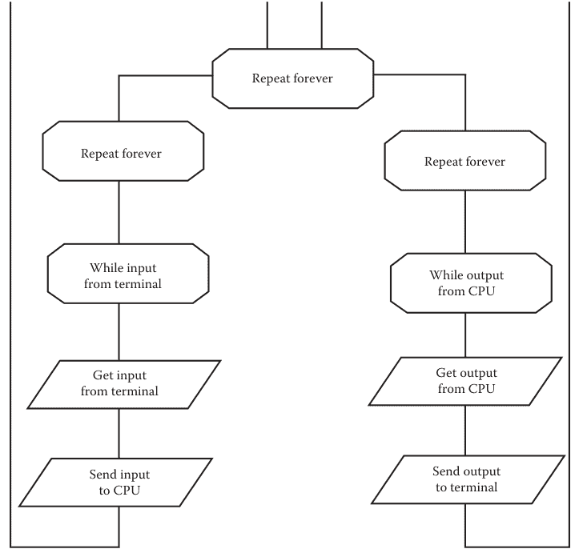

> 图 4.5 医疗设备终端集中器的流程图局部。（来自 Leach, R. J., *Object-Oriented Design and Programming in C++*, Academic Press Professional, Boston, 1995.经许可。）

# 软件设计

在课程中，可以使用许多不同的表示方法来描述同一个系统；我们并不限于流程图。我们针对这个小例子讨论的下一种设计表示是数据流图。

图 4.6 给出了用一种图形表示法描述程序数据流的示例。图中显示的数据流图描述了之前述的终端集中器示例的一个流向。医疗设备终端集中器系统可以通过更详细的图来完全描述。你将在练习中被要求这样做。

在现实中，技术的变革和软件工程行业的快速更迭意味着软件设计者必须熟悉几种不同的表示方法。

实体关系模型（或 E-R 模型）在数据库设计中很常见。另一种是经常用于人工智能和专家系统的信息模型。我们将在本节中简要讨论这些每一个模型。

E-R 图表示了一组基本量（称为实体）以及它们之间的关系。E-R 图中弧的标记表示了由每个弧连接的不同实体之间关系的性质。

E-R 图可以作为初步一组对象的起点。图中的关系通常暗示了对系统对象进行的一些可能方法或变换。

对于 E-R 图来说，这种方法只是开发系统中对象和方法完整描述的第一步，因为 E-R 图通常缺乏任何自变换。

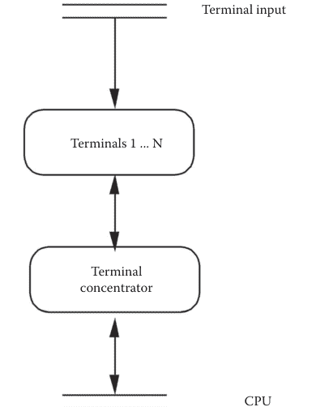

图 4.6 医疗设备终端集中器的数据流表示。

# 174 软件工程简介

TABLE 4.1 确定对象的方法论

| |
| :--- |
| 1. 选择一个对象作为对象。 |
| 2. 确定一组属性及其可能的取值集合。使用“具有”关系（has-relation）。列出对象上所有相关的变换。 |
| 3. 开发对象上的一组初始变换作为成员函数。属性列表及其值通过确定对象的每个属性的值并为其赋值，从而提供了一组初始变换。还应包含构造函数、析构函数和 I/O 函数。 |
| 4. 确定对象是否有一个多个实例。如果是，将所提的对象考虑在潜在对象集中。如果不是，将其丢弃，因为它无法满足多个实例。 |
| 5. 通过考虑所有形式为“对象 1 是对象 2”的句子来应用“是”关系（is-relation）。考虑此关系的对象应包括正在开发的对象和任何其他要关联的对象。（在对象的这一期间，应咨询类库和任何 SDK。）每个值语句都应导致一个继承关系。每个继承都应以图形形式阐明。 |
| 6. 使用多态和运算符（以及函数）的重载来检查我们对对象的描述是否足够详细。如果没有发现多态或重载，则检查该描述。 |
| 7. 使用“使用”关系（uses-relation）“对象 1 使用对象 2”来确定所有客户端-服务器或基于代理的关系实例。使用这些关系来确定程序设计问题。 |
| 8. 审查对象、其属性、成员函数、继承属性、多态、重载以及与其他对象的关系，以确定该对象是否是完整的（即不再需要其他函数、属性或关系）。 |
| 9. 针对所有相关对象的组合（三元组、四元组等）重复第 2 到第 8 步，直到该对象在任何提议系统中的角色得到充分描述。 |

关于对象。这些、构造函数、析构函数和初始化器通常在 E-R 图上并不易见。相等性测试通常不明确。许多常用方法在 E-R 图中不易表示。

关于 E-R 图在处理对象方面的实用性观察可以总结如下：

- 如果已经存在 E-R 图，则使用实体作为对象和方法的初始选择。特别注意需要构造函数、析构函数和初始化器等自变换方法。
- 如果不存在 E-R 图，则不要费力编写一个。相反，使用表 4.1 中的过程来描述对象。

## 4.5 软件架构

“软件架构”一词在软件工程社区中以许多不同且往往相互冲突的方式使用。无论具体的语境如何，该术语通常用于描述软件系统的组织结构。

我们将架构定义为构成系统的关键元素、它们之间的关系以及任何约束。我们将架构视为由几种类型组成，每种类型也是一种架构。在描述和分类架构类型时，我们使用了 Ezran、Morisio 和 Tully 的方法（Ezran et al., 1999）。

通常来说，基于软件的系统架构可以分为几类：

- 业务架构描述了组织执行的业务任务的结构以及系统支持这些任务的机制。业务架构的描述通常由精通该业务的业务分析师创建。
- 物理架构描述了系统将运行的硬件平台（或网络）的结构。通常，通过使用云，系统的大部分物理架构被大大简化。
- 逻辑架构描述了业务和应用对象的结构。这种架构通常是系统面向对象视图的一部分。相应地，逻辑架构的描述通常由精通对象技术的分析师创建。
- 功能架构描述了潜在用用例的结构和从用户角度来看的需求。同样，这种架构通常是系统面向对象视图的一部分。
- 软件架构描述了系统的分层结构，例如数据通信的 OSI（开放系统互连）七层模型或 UNIX 操作系统系统的分层架构。（见图 4 关于 UNIX 分层架构的视图。）将系统分解为客户端和服务器的决定是软件架构的一部分。
- 技术架构描述了软件架构中主要接口的结构。技术架构的元素包括应用程序编程接口（API）、中间件、数据库管理系统、图形用户界面以及连接软件架构中各层组件所需的其他胶水或桥。使用 CORBA、DCOM、Java RMI 或 RPC 或带有 HTTP、SOAP、REST 或 JSON 等协议的云计算的决策将反映在这种类型的架构中。（HTTP、SOAP、REST 和 JSON 协议将在第 4.6 节讨论。）
- 系统架构描述了业务、应用和技术对象的结构及其关系。系统架构的描述通常由系统分析师创建。
- 部署架构描述了系统和技术架构映射到物理架构上的结构。部署架构包含了必要的基本文件的静态视图以及并发进程和线程的动态视图，以及它们的同步和通信机制。将线程放置在特定计算机上或让自主代理在空闲处理器上执行计算的决定将反映在这种类型的架构中，使用某种云服务的决定也是如此。

# 176 软件工程简介

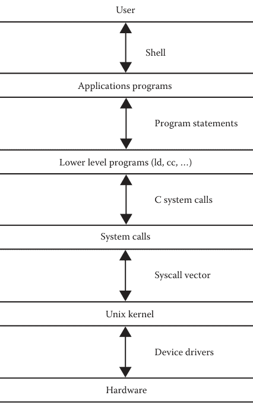

图 4.7 UNIX 的分层软件架构。(Leach, R. J.: Advanced Topics in UNIX. 1994. Copyright Wiley-VCH Verlag GmbH & Co. KGaA. 经许可复制。)

为什么架构被认为是重要的？OSI 模型和 UNIX 操作系统的成功展示了软件架构中分层方法的威力。其他类型的架构则试图通过鼓励在不同细节程度和抽象层次上描述系统，来提高系统的重用水平。

UNIX 操作系统的分层架构如图 4.7 所示。该架构清楚地表明，系统调用通过“系统调用向量”（syscall vector）与 UNIX 内核交互，内核通过设备驱动程序与硬件交互，依此类推。

需要注意的是，使用 UML 等符号可以促进不同架构视图之间的一致性。这种一致性是否能够纳入计算机辅助软件工程（CASE）工具和开发流程中以提高效率，尚有待观察，尽管初步工作是有前景的。

此时，我们满足于对不同架构类型的高级描述。我们将在第 4.17 节阐述我们主要软件项目的设计时，回到它们的描述。

## 4.6 过程导向程序设计原则

在我们开始深入研究软件设计表示之前，我们将向讨论中引入现实元素。考虑一个大约 500 行代码、可能有七或八个函数的程序。无论使用何种设计技术或表示，程序设计的高层视图可能都较小。一个相当完整的设计视图很可能放在一页内。显然，如果系统不是太复杂，本章之前描述的任何表示方法都可以使用。

我们不应期望工业或政府部门的真实程序是这种情况。显然，一个拥有 500,000 行代码、超过 2000 个函数以及复杂的控制和数据流的程序设计，无法在一张纸上准确表示。因此，每种设计表示都将包含某种方法，将设计表示分解为相互链接的较小单元。

是这种分解方法的一个示例：图 4.8 中的图表来自用于系统自动生成（TAGS）的 CASE 工具。

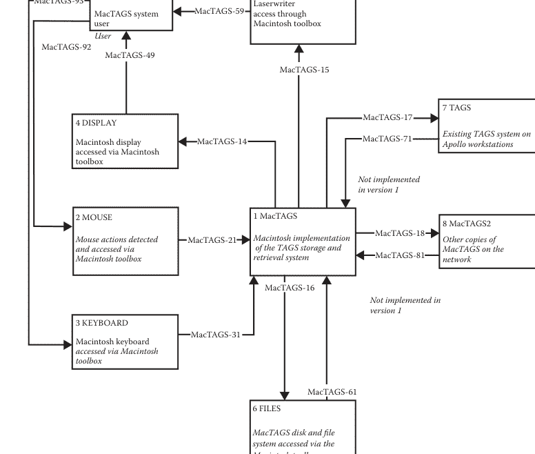

图 4.8 使用 CASE 工具的设计表示示例。


该工具由 Teledyne Brown Engineering 提供。这里展示的版本为 Macintosh 实现的工具“前端”的公有领域版本。该前端仅包含完整软件中的设计表示部分。它使用了一种名为 IORL（输入需求语言）的特殊描述语言。CASE 工具的功能包括对图形化表示的设计进行一致性检查，以及允许从系统的图形化描述生成源代码的代码生成功能。

图 4.8 仅表示了分解的一个示例。该图描述了 TAGS Macintosh 版本（称为 MacS）与 Macintosh MacOS 操作系统以及 Macintosh 工具箱（toolbox）的交互，工具箱包含了一些访问 Macintosh 图形实用程序的例程。（图表已压缩以适应标准页页边距。）

我们详细讨论图 4.8 是恰当的。然而，有几点需要注意。框之间通过绘制良好的箭头连接。显然，这是自动完成的，而不是通过简单的绘图软件包。箭头带有标签，通过箭头提供了更多关于框接口的信息。箭头上的标签指示了接口的编号。

图 4.8 中的框也有标记，但目的不同。框的左上角的数字表示其他子系统，这些子系统也由类似的图表表示。这是将不同的图形页面链接到同一个系统的机制。

MacTAGS 使用了软件由“系统”组成的方法，而系统反过来又由一个或多个部分组成。部分由“系统框图”表示。图 4.8 中的图是系统框图 0，被标记为名为“MacTAGS”系统的部分“SBD-0”。

我们注意到，这个 CASE 工具不仅仅是提供软件图形表示的绘图工具。它还包含一个“上下文编辑器”，从这个意义上说，双击任何接口箭头或标记框都可以访问详细信息，例如框或接口的创建者、不同框之间接口间流动的数据等。这种非常有用的技术类似于点击邮件文档中的统一资源定位符（URL），点击时 Eudora™ 邮件软件会自动打开相关网络浏览器的副本。同样的方法也适用于其他关联了特定类型文件的应用程序，如 `.html`, `.item`, `.doc`, `.docx`, `.xls`, `.xlsx`, `.ppt`, `.pptx` 等。

该工具更加先进，从系统的互连中可以看到。由此生成的源代码不是完整的，但可以节省开发时间。

我们现在回到设计分解的研究。设计分解的目标是产生详细设计。详细设计应该详细到什么种程度？它应该足够详细，以成为一个设计。

遗憾的是，目前并不清楚设计表示的选择如何导致更详细的设计。例如，基于控制流的系统分解自然会导致对系统所采取动作的详细描述。另一方面，基于数据流表示的分解会导致对系统数据移动的详细描述。

显然，不同的设计表示和分解策略对最终的设计有很大影响。当然，设计师之间存在差异；独立工作的设计师也会为同一个系统产生不同的设计。因此，管理层对设计进行对比分析通常是重要的。

必须检查设计分解步骤以确保结果设计是模块化的、高效的，并且符合系统需求。不用说，详细设计应该经过检查以确保基于该设计的实现符合需求追溯矩阵。

云计算以及相关的 SaaS 概念如何？使用这些技术的决策需要遵循特定的协议，就像在移动设备上部署软件需要遵循这些设备软件开发包（SDK）的指定标准一样。

以下是 SaaS 中使用的典型 API 列表，以及关于协议标准的一些信息以及可以访问技术细节的地方。

- 超文本传输协议 (HTTP): 超文本传输协议格式由 W3 委员会标准化，可以访问 `http://www.w3.org/protocols`。

- 表征状态转移 (REST): 表征状态转移格式由 W3 委员会标准化（Erl et al., 2013），可以访问 `http://www.w3.org/protocols`。

- 简单对象访问协议 (SOAP): SOAP 以前称为简单对象访问协议，现在简称为 SOAP。SOAP 格式由 W3 委员会标准化，可以访问 `http://www.w3.org/TR/soap`。

- JavaScript 对象表示法 (JSON): JSON 数据交换格式在 2013 年由 Ecma 正式化，可以访问 `http://www.ecma-international.org`。

# 180 软件工程导论

我们将在第 6 章第 6.10 节讨论“云”中的软件集成时，回到云计算标准。

## 4.7 什么是对象？

本节将为确定我们想要设计的系统中存在的对象提供一些指南。基本思想是：对象具有属性，并且在对象的任何实例中，这些属性都具有值。通过适当的抽象，包括对可以在对象上执行的操作（方法）进行细致的设计，可以将对象的实现细节从与其通信的其他对象中隐藏起来，从而实现对象源代码的重用。

遗憾的是，对于面向对象的设计和编程与更具过程化的方法相比在源代码重用方面的影响，通常存在着巨大的困惑。这种困惑似乎源于对一个通用原则的误解，即无论使用哪种生命周期模型，在软件开发生命周期的早期进行重用能够带来最大的成本节省和开发效率。因此，由于面向对象的实践而导致的代码重用增加虽然是有用的，但其带来的成本降低潜力将不如重用更大的组件和 COTS（现成商业软件）产品。重用和定制现有系统所节省的成本和开发时间是捷软件开发过程的主要优势之一，且远大于重用单个对象类及其相关方法的优势。考虑到这一点，在接下来的几节中将尽可能强调软件重用，希望这些建议能鼓励你既重用代码，又创建易于同事重用的代码。

假设你已经为你的系统选择了一个候选者作为对象，并已经确定了一组属性及其可能的取值。你可以应用哪些非正式测试来确保你的对象是你的系统最合适的抽象？

- 第一个测试是“多示例测试”。简单来说，如果一个对象的实例只有一个示例，那么该概念的通用性就不足以认为它需要使用面向对象的技术来实现它。

- 多示例测试与过程化编程的格言是一致的：“如果你只用一次，就写代码就好。如果你用了两次，就写一个过程或函数。”

- 从软件重用领域来看还有一个相对的观点。Bigget (1988) 提供了一条经验法则：“除非你打算至少使用三次，否则不要尝试重用某些东西。”

最后，这与给年轻数学家的建议也是一的：“如果一个概念或理论至少没有三个不同的例子，它就不值得研究。”

一旦我们的对象代码通过了多示例测试，它就会被放入一组潜在对象中。现在使用“具有……的”（has-as）关系对对象的属性进行测试，这有助于对象属性集的形式化。我们应该根据所提对象某些属性值的合理转换，为这个潜在对象编写一组初始成员函数。

用于检查对象恰当性的非正式规则涉及类层次结构，即从旧类中设计新类。基类与派生类之间的这种关系最好描述为“是一个（的）关系（is-a relationship）”。如果“对象 1 是一个对象 2”这个句子看起来不通顺（不考虑语法），那么这种关系就不是“基类、派生类”的形式，因此我们没有继承关系。为什么继承关系很重要？因为如果一个对象从另一个类（基类）继承了任何属性，我们就可以避免功能的重复编写。我们可以在派生类中添加基类功能之外的新功能。

另一方面，如果这个句子看起来是通的，那么我们就有了这种关系的候选者。在这种情况下，我们应该画出对象图以及该对象与其他对象之间的任何关系。

我们应该列出潜在的成员函数，并警惕任何多态的示例。多态的出现表明我们正确地选择了继承。如果没有多态，那么我们应该怀疑没有正确描述成员函数，或者至少没有提供足够的细节。

多态性新书的作者 Joseph Berlin (Berlin, 2015) 在一封私人邮件中更清楚地指出：“要构建大东西，你需要先构建小东西。”在开发对象时，要记住你的系统。潜在对象集及其成员函数的描述应该在每一步都进行精炼。

还需要进行最后的关系测试，以便将对象整合到软件系统的初步面向对象设计中。这里的关注点是列出的对象应该形成所设计软件系统所需的完整对象。我们寻找的关系是“使用……的关系（use-a relation）”。

我们通过询问“对象 1 使用对象 2”这个句子对于考虑的对象对是否通顺来使用这种关系。每一个有意义的句子都暗示了客户端-服务器或基于代理的关系，并应被视为程序设计的一部分。如果我们找不到任何该句子通顺的实例，那么有两种可能：要么是对象的定义不足，以至于我们无法描述整个系统，要么系统的自然描述是一个控制对象的过程化程序。

# 软件设计 183

（包括本书编写时使用的这种）并使用链表将连续的字符数组（在文字处理器的情况下，还有图形和图像等对象）连接在一起。链表特别适用于文字处理文档中文本和其他对象的插入和删除。也可以采用其他数据组织方式。

重要的点是，任何关于实现组织或细节的决定都与字符串对象无关。我们需要确定对象的属性，并为每个属性确定一组可能的值。有了了这种确定，我们就可以写出类描述的首次尝试。因此，字符串对象定义的首次尝试可能会类似于 `class string` 的定义。此时，我们不需要担心语法问题。

## class String

成员函数：

```cpp
int length;
int strlen(String s);
void display(String s);
```

由于我们没有精确确定接口，出现了一些问题。构造函数成员函数需要为字符串的长度指定大小。其他成员函数也必须确定它们的接口。因此，我们可能对表示字符串的类设计进行第二次迭代。

## class String

成员函数：

```cpp
int length;
String(char *arr); // 由 \0 终止
int strlen();
operator <<;
```

还需要进行更多迭代，以获得 `String` 类接口的完整定义。当然，我们仍然需要开发这些方法的实现。在此，我们省略了类描述的迭代细节，因为该类是 C++ 语言标准库以及几乎每种其他常用的面向对象编程语言的一部分。

## 4.8 面向对象设计的表示法

在本节中，我们将为第 4.4 节描述的医疗设备终端软件系统展示一个简单的对象模型。我们不会尝试完善该对象模型，而是将其保持在与之前使用不同设计表示法时的模型相同的高水平。

该表示法（至少到目前为止）如下：我们将使用矩形框来描述一个对象，使用菱形框和线段来表示对象之间的关系。类名位于框内水平线的上方。

我们将遵循类名以大写字母开头的惯。在这种表示法中，对象之间的关系有一个名称。这种关系被称为“连接到”（is connected to），其行为与我们在本章稍些之后讨论的“使用”（uses）关系相似。

类中任意对象的某些属性包含在框内。我们本想包含所有属性，但属性太多了。

在图表的底部，我们再次列出图表部分的类，再次使用图形化表示法。列表中的类对于每个类中对象的每个属性都有典型值。

注意，该模型没有提到对象模型可能用于在缓冲区中维护流向和流出医疗设备终端集中器的信息的队列数据结构。

我们可以对面向对象系统有两种两种视图：对象模型和接口模型。我们将顺序讨论这两种视图。

在对象模型表示中，我们将使用扩展的 E-R 符号。我们将遵循以下惯例：类名使用大写字母，类的实例使用小写字母。

我们此讨论的起点是第 4.4 节给出的图表。此类图表提供了系统良好的高层视图。

对象图可以通过将每个关系的基数（cardinality）纳入图中来进一步细化。图 4.9 释了这一点。关系侧边或顶部的数字表示每侧具有该关系的项数。基数可以是以下之一：精确值、取值范围、表示 0 或更多的星号 (*), 或表示 1 或多多的加号 (+)。我们在图 4.9 中使用了 + 和范围。

对象模型应该不断扩展，直到它能够描述系统中对象的本质抽象。遗憾的是，本节到目前为止的对象模型不足以完全描述不同对象之间的关系。考虑到这一局限性，我们将尝试将对象之间的接口整合到我们的模型中。这样做有几种方法。

一种方法是使用状态表。“状态图”、“状态机”和“有限状态机”术语通常用来代替“状态表”。这是设计系统最老的方法之一。它确实描绘了面向对象设计中的任何当前效果。

医疗设备终端集中器系统的状态可能有六个状态，我们将其称为 TIR、CIR、CPU、CPUOR、COR 和 TOR。这些缩写分别代表终端输入就绪（Terminal Input Ready）、连接器输入就绪（Connector Input Ready）、CPU 输入就绪、CPU 输出就绪、集中器输出就绪（Concentrator Output Ready）和终端输出就绪。

我们在图 4.10 中展示了医疗设备终端集中器系统的状态表。该符号与最常见的符号略有不同，在于我们没有指定系统输入（来自键盘）到达的初始状态，以及输出离开系统并在终端屏幕上显示（何时）结束状态。

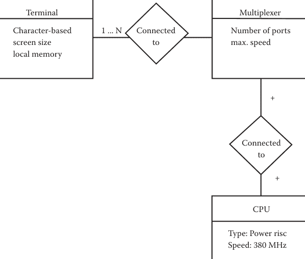

FIGURE 4.9 对象模型表示法中添加基数信息。（源自 Leach, R. J., Object-Oriented Design and Programming in C++, Academic Press Professional, Boston, 1995. 经许可。）在尝试用面向对象的术语描述现有表示法时，了解如何使用它们很有用。我们通常对系统有一个对象模型。我们对使用现有模型和图的建议总结如下：

- 如果存在信息模型图，使用它来确定初始关系，特别是聚合（aggregation）关系。

- 检查属性列表以指示数据结构和用于处理值的初步转换集。

- 如果没有可用的信息模型，则直接进入对象描述。

关于 E-R 图和信息建模的更多信息，请参阅参考文献。

## 4.9 面向对象程序的设计原则

之前讨论的所有设计表示方法都是为了提高软件设计的质量和创建这些设计过程的效率而创建。

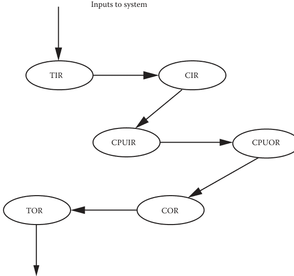

FIGURE 4.10 医疗设备终端集中器系统的状态图。（源自 Leach, R. J., Object-Oriented Design and Programming in C++, Academic Press Professional, Boston, 1995. 经许可。）

用于传统的过程化组织系统的设计表示技术比用于面向对象系统的技术要常见得多。考虑到面向对象技术的新颖性，这并不意外。除了 UML 之外，早期的面向对象设计表示法很少仍使用。

正如我们在上一节中看到的，一旦我们确定了描述要设计系统的高层软件模式，分解法就是用于软件开发的主要技术。之前使用 MacTAGS CASE 工具构建的示例强调了这种基于分解的方法。

提供自动代码生成器的 CASE 工具增强功能的可用性，并不局限于那些支持过程化设计的 CASE 工具。我们注意到，在用于面向对象开发的可用软件软件包中可以找到一些相关功能。例如，由 Rational Corporation 最初开发的 ROSE 系统是另一个支持带代码框架的面向对象分析流行系统。它已经演变为 Eclipse IDE，因为创建该产品的公司现在是 IBM 的子公司。

面向对象的设计通常侧重于开发完整的类来描述对象。其核心思想是所有必要的方法或成员函数都将在类描述中提供。因此，首要问题是类的完整性设计，以确保可能的交互通过适当的接口来处理。对象通过从一个类向另一个类发送消息进行交互，而单个类仅对其接收到的消息做出反应。对象被视为是自主的，除了对象接口中指定的交互外，没有其他交互。

如果在设计开始之前没有完全确定软件的需求，那么使用抽象类可能特别有用，这在个人电脑世界中常见的并行工程、市场驱动的软件开发过程中无疑是肯定的。

在这种方法下，系统中对象的接口在早期阶段就已指定。方法的具体实现细节可以稍后开发。如果一个对象仅用于新项目，且其中少数方法可能会被使用，那么可能没有实现所有方法。这在许多使用集成开发环境（IDEs）和仿真器开发智能手机和平板板应用的迭代设计过程中经常发生。如果需要新功能，它将在与对象关联的方法中提供，而不是在对象的接口中。在 C++ 中，通常使用纯虚函数（没有实现细节且作为基类使用，其接口供继承它的类使用）来实现此目的。

即使在最坏的情况下，对象成员函数的开发也可以与对象的设计并行进行。如果对象接口中添加了新的交互，大多数现有方法不需要更改。只需添加新方法来实现新增的接口即可。

以下是不同设计方法对面向对象系统影响的说明。我们考虑一个描述表示四边形（四边几何体）类的简单情况。我们希望开发一个类结构来描述四边形，其中正方形和矩形是特殊的几何形状。

我们有几种选择。我们可以使用 `vertex` 类构建一个 `edge` 类，然后使用 `vertex` 类构建一个新的 `figure` 类。`figure` 类可以作为子集来构建四边形。

这种构造如图 4.11 所示。我们在示例 4.3 中提供了一些 C++ 源代码来实现实现这种组织结构。

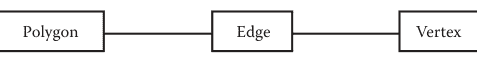

图 4.11 基于顶点原语的一些几何图形的设计组织说明。

## 示例 4.3：基于顶点原语的组织的 C++ 源代码

```cpp
// FILE: vertex.cpp
class Vertex
{
public:
    double x, y; // coordinates
    Vertex(double x1 = 0, double y1 = 0);
}
```

```cpp
// FILE: edge.cpp
#include "vertex.cpp"
class Edge : public Vertex
{
public:
    Vertex first, second;
    Edge();
    void init(Vertex, Vertex);
    boolean is_adjacent_to(Edge E);
    double length;
}
```

```cpp
// FILE: figure.cpp
#include "edge.cpp"
class Figure : public Edge
{
public:
    List<Edge> set_of_edges;
    List<Vertex> set_of_vertices;
    void init(List<Edge> e, List<Vertex> &);
    boolean is_adjacent_to(Figure F);
    int number_of_edges;
    int number_of_vertices;
}
```

遗憾的是，没有明显的方法可以捕捉几何图形是三角形、正方形、菱形、平行四形、五边形等的概念。我们可以修改 `figure.cpp` 文件中提供的类，但这似乎很笨拙。


允许需求、设计和编码并行的灵活性存在一个缺点：在发布前最后一刻添加到类中的任何方法，由于时间压力，其测试将是极少的。对象极不太可能对方法的所有可能响应类型进行测试，特别是当接口是多态的或运算符被重载时。因此，用户可能会观察到许多系统故障，特别是当用户以设计者意想不到的方式操作软件时。代码的潜在重用者可能会发现，代码经过修改后无法重用。

在许多开发组织中，此类潜在问题的处理被推到下一次发布。因此，对已发布版本软件组件的纠正测试可以在下一版本的开发（需求、设计、编码、测试）期间进行。决定何时发布软件、何时要求额外测试以及将哪些内容纳入新发布中，对于在市场驱动的软件环境中成功至关重要。我们将在第 6 章学习测试时回到这一点，并在第 8 章（以及其他地方）学习配置管理时再次讨论。

我们在本章提出的模型仅用于说明。任何复杂系统的真实模型都将比后续节呈现的内容更详细。这里给出的模型描述了系统的最高层级。在阅读本章后，你应该体会到面向对象和面向过程的软件系统的不同设计表示所具有的表达能力。

## 4.10 类设计问题

有必要讨论与上一节描述的类定义方法开发程序相关的某些困难。上一节描述的方法论假设软件系统是在真空环境中开发的。

### 结构模式

- 6. 适配器（Adapter）
- 7. 桥接（Bridge）
- 8. 组合（Composite）
- 9. 装饰器（Decorator）
- 10. 外观（Façade）
- 11. 权重类（Flyweight）
- 12. 代理（Proxy）

### 行为模式

- 13. 责任链（Chain of responsibility）
- 14. 命令（Command）
- 15. 解释器（Interpreter）
- 16. 迭代器（Iterator）
- 17. 中介者（Mediator）
- 18. 备忘（Memento）
- 19. 观察者（Observer）
- 20. 状态（State）
- 21. 策略（Strategy）
- 22. 模板方法（Template method）
- 23. 访问者（Visitor）

显然，在设计面向对象的程序时，确定类库中的类仅仅是一个起点。然而，它是设计面向对象系统时至关重要的一步。

## 4.11 用户界面

许多软件产品在市场上的成功很大程度上取决于软件的用户界面或可见功能集，而不是像健壮性这样的隐藏功能。这在竞争激烈的市场中尤为如此，因为个人电脑应用软件有许多竞争产品。

在本节中，我们将对这一重要主题进行简要概述。其目的是说服你，界面设计不仅仅是使用多种颜色、闪烁的消息、巧妙的图标、声音或计算机动画。用户界面设计既是一门艺术，也是一门科学。

大多数软件系统具有基于窗口、交互、鼠标、指针（WIMP）范式的用户界面。Mac 操作系统和微软 Windows 变体遵循这一范式，使用 X Windows 以及类似的 Linux 和其他 Unix 类环境实用程序编写的软件也是如此。Jakob Nielsen（1994）和 Ben Shneider（1980）的书籍为人机交互及其在良好软件设计中的作用提供了极好的概述。他们的讨论今天适用于运行在具有足够屏幕空间的桌面或笔记本电脑上的大多数软件系统用户界面。

WIMP 范式已被平板电脑（如 iPad）和智能手机（如 iPhone 和 Android）的用户界面所扩展，它们的电容式多点触控允许一个或多个手指用于传统媒体的选择器和指针操作。Jakob Nielsen 和 Ralucia Bidiu 编写了一本关于移动设备软件可用性的书（Nielsen and Bidiu, 2012）。针对屏幕空间有限的平板电脑和智能手机开发用户界面的问题超出了本书的范围。

高质量软件包和网页的图形界面都具有一致性，这种一致性体现在其菜单设计的简单性。例如，大多数个人电脑的图形用户界面在屏幕左侧上方有带有文件操作的下拉菜单。

我们现在区分下拉菜单（pull-down menu）和弹出菜单（pop-up menu）。下拉菜单是指用户通过移动指针设备（如鼠标）到固定位置，并通过按下鼠标按钮或其他选择设备进行选择，从一组选项中选择的菜单。这一系列操作会使菜单出现在指针设备放置的位置下方。然后用户将指针设备移动到菜单选项列表，直到选择其中一个选项。（用户可以选择通过释放鼠标按钮或将鼠标移动到另一个位置来终止此过程。）下拉菜单中列出的初始选项对用户始终可用。

与下拉菜单中的信息不同，弹出菜单中的任何信息除非用户采取了特定操作（例如按下鼠标按钮或等效按键组合），否则都是不可见的。

图 4.12 和图 4.13 展示了按下鼠标按钮前后下拉菜单的实际情况。将这些与图 4.14 和图 4.15 进行比较，后者说明了弹出菜单的操作。注意，如图 4.12 所示，只要此应用程序（Microsoft Word）运行且窗口显示在屏幕上，下拉菜单就会出现在屏幕顶部。对比图 4.13 中的情况，相同的下拉菜单与一个通过从该菜单选择选项而获得的新菜单一起显示。

下拉菜单和弹出菜单的存在导致了大量选项，给界面设计师带来了巨大的问题。他或她应该小心，不要仅仅因为这些功能可用就使用这些诱人的特性。以下是指南：

- 当选项应该始终可见时，使用下拉菜单。
- 使用下拉菜单为初级用户提供一组选项。
- 当选项并非始终可见时，使用弹出菜单。
- 使用弹出菜单为经验丰富的用户提供快捷方式。

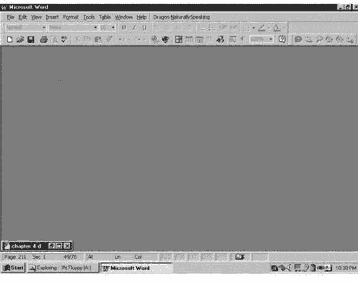

图 4.12 做出选择前的下拉菜单示例。

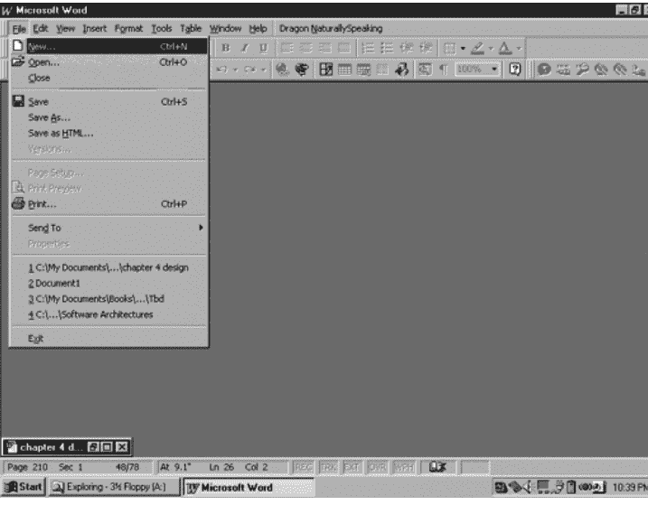

图 4.13 做出选择后的下拉菜单示例。

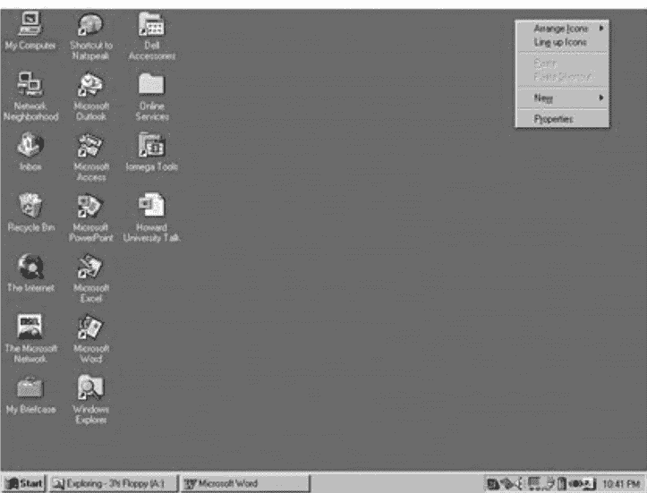

图 4.14 初始选择前的弹出菜单示例。

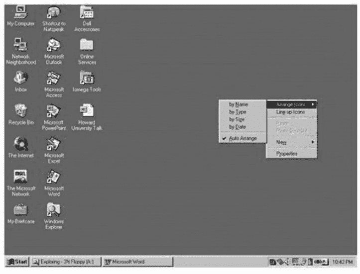

图 4.15 选择后的弹出菜单示例。

## 4.12 接口

某些个人计算机最有趣的软件类型被称为“冲突解决器”。冲突解决器检查软件配置文件，以寻找不同应用程序之间、甚至同一应用程序不同版本之间的不一致性。这些实用程序试图解决在连接到不同版本的操作系统、编译器、实用程序或应用程序环境时可能出现的问题。冲突检测程序通常由用户运行，这些用户面临运行不正确、导致崩溃或破坏其他程序创建的数据的软件。

当然，当从单个软件组件创建软件系统时，就会出现问题。市场驱动的、几个月发布一次软件的需求对软件重用和高级软件组件（包括完整的子系统）要求很高。这会导致子系统之间的接口出现严重问题。由于用户通常看不到这些接口，冲突或不一致的结果并不明显，特别是对于普通或缺乏经验的用户来说。当然，配置管理至关重要。

许多软件开发组织创建一个正式接口控制文档（ICD）来管理软件组件或子系统之间的接口。小型项目的典型 ICD 包括每个子系统的名称，以及它们之间接口的正式描述。接口可以是简单的函数、任何参数的类型和用法、任何返回值以及函数操作的任何副作用，特别是在错误情况下。

在更真实的应用程序中，ICD 会更加详细。通常，ICD 以矩阵的形式给出，行和列标记为主要子系统或组件的名称。矩阵条目描述了比小空间所能提供的更详细的接口。

| S A C 主菜单 |
| --- |
| 1. 耦合测量 |
| 2. 耦合描述 |
| 3. 帮助 |
| 4. 退出 |

例如，一个包含 A、B、C 三个子系统的项目接口控制文档（ICD）可能如下所示：

有一点需要说明。面向对象分析和设计的所谓优点之一是对象的接口与其实现的分离。一个在开发过程早期阶段就确定了系统中主要对象公共接口的软件开发项目，将使得发布接口的对象的实现以及所有使用该接口的对象的实现得以进行，且几乎不需要额外的协调。缺点是，虽然确定微小对象之间的接口很容易，但描述主要子系统组件之间的接口却很难。

我们注意到，当所有组件都处于同一个应用程序领域，且对组件或子系统接口拥有控制权时，软件接口是最容易管理的。特定应用领域中的既有标准有助于提高重用的成功。当存在强制性标准时，会发生以下良好情况：

- 解决特定领域内源代码的问题变得更易于管理，因为该领域可能很窄。
- 库中的组件被重用的概率比不使用标准时更高。
- 数据类型较少，且重用部分较小，因此更有可能在多个应用程序中被重用。
- 开发和维护成本降低，因为减少了编写过滤器或胶接软件来在不同组件之间建立接口的需求。

使用标准接口意味着，对一个模块或子系统作出的决策不应与其他模块或子系统产生冲突。

某些标准比其他标准更容易确定。例如，基本数据类型作为字符、整数和浮点数的存储方式，在不同的计算机语言中，甚至在相同语言的不同编译器中都可能不同。字符集国际化的趋势可能会为新版本 C 语言的宽字符集（类型 `w_char`）与旧版本之间的交互带来极大困难，或者使得某些简单的声明（类型 `char`）就足够了。这些差异可以通过在源文件中查找是否存在 `w_char` 等词汇来发现。

另一方面，确定两个软件组件是否正确处理日期可能更困难。例如，一个组件可能将日期存储为由月、日、年三个整数组成的集合。另一个组件可能通过仅使用 `MMDYYY` 格式的六个字符来节省空间。转换例程，加上由于“两个字符始终足够表示年份”这一隐含假设而导致的限制，并不是微不足道的，特别是当日期在软件组件中以许多不同的方式使用时。不同国家对日期的表示通常有不同的国家标准，这可能会给旨在供国际使用的软件带来问题。当然，空间限制是导致 Y2K 问题的主要困难。

关于软件组件之间接口要问的问题：

- 软件组件是否是根据编码标准开发的？
- 是否对必要的配置和头文件进行了文档说明？
- 软件组件是否具有高质量？
- 将组件整合到系统中需要花费多大的精力？

在下一节中，我们将讨论这些点，并牢牢记住我们大型持续软件工程项目示例的背景。

## 4.13 设计的某些指标

本节的目的是向你介绍衡量软件系统设计的理念。遗憾的是，该领域很少有标准方法，而且关于最有效指标的研究也较少。尽管如此，显然，对于能够为评估设计的经理提供指导的指标将日益受到重视。因此，我们将就这一话题为经理提供一些建议。

在软件开发过程的这一阶段，许多软件经理的主要关注点是其设计的模块化。因此，我们建议采用以下指标来衡量设计阶段子系统之间接口的大小：

1. 一种可能的衡量方法是统计系统中函数、模块、子系统或组件的数量。
2. 另一种可能的衡量方法是统计每个组件必须与之接口的对象、函数、模块、子系统或组件的数量。这本质上是复杂性的衡量。
3. 另一种可能的衡量方法是描述不同函数、模块、子系统或组件之间接口的大小。这种测量可能包括对共享变量数量的计数，或者可以扩展到对共享变量复杂性的评估。与第 2 点一样，这也是复杂性的衡量。
4. 另一种可能的衡量方法是统计用于描述系统设计的控制流图中的循环次数。
5. 有一些显而易见的指标，项目经理可以应用于设计团队产出的设计。第 3 章讨论的函数点指标可以在此阶段使用，以对实现设计的难度提供评估。
6. 一个通过重用来鼓励高生产率的设计，应该确保不同的软件组件具有标准接口。遵循标准的目标同样重要，并且在某种程度上是可衡量的。这里指标的目标是产生尽可能简单的设计，并将子系统之间的耦合降至最低。应该收集不同子系统或模块之间互连程度的指标。具有宽接口的系统设计应该经过审查，以降低集成和测试成本。
7. 成本指标在设计阶段可能非常重要。将使用要重用的设计构建的系统的成本估计与该设计的实际实现成本进行比较，并记录并解释任何异常偏差。

你可能还可以建议其他指标。为设计提出指标是容易的；困难的任务是收集指标并分析收集的数据，以确定这些指标是否准确地描述了系统的某些方面。我们将在第 9 章中简要讨论这一点。

你的软件开发项目可能会根据组织的经验和偏好的开发环境开发其他设计指标。

## 4.14 设计评审

记住，软件经理的主要目标之一是预测软件开发项目的风险。他或她希望完全消除风险。因此，经理非常强调那些被认为可以降低风险、允许创建满足客户规格的当前软件，并确保整个项目按时并在预算内完成的活动。

### 表 4.2 设计评审清单

- 演示内容应经过演练。
- 演示时间应在规定的限制范围内。
- 应留出足够的时间供提问。
- 能够回答技术问题的人员应出席。
- 必须检查所有幻灯片、透明片和多媒体材料的准确性。
- 必须检查所有幻灯片、透明片和多媒体材料的拼写。
- 所有参与者应都有幻灯片、透明片和多媒体材料的纸质副本。
- 必须有人确认会议室配备了所有必要的设备：麦克风、投影仪、幻灯投影仪、录像播放器显示器、计算机显示器、摄像头等。
- 必须传阅包含姓名、地址、电话和所属机构的签到表，所有参会人员必须签字。

软件工程实践中日益常见的做法，是将每份设计文档（初步的、中间的或最终的）发布在本地组织网络或互联网上。设计文档可能仅仅是由文字处理程序创建的一组附件。它们可能包含某些绘图工具格式的项目设计图。它们也可能是存储为 `.gif` 文件等格式的其他文档的数字照片。在极端情况下，某些文档可能以 `.jpg` 或 `.png` 文件等格式存储。

为什么许多组织要以电子化方式发布设计文档？原因很简单：人们会因为人员变动、办公室搬迁而丢失纸质文档，而且他们通常希望减少办公室的杂物。此外，网络上的可用文档可以由任何访问这些文件的人使用。使用这些文档有助于维护阶段的系统修订，特别是当设计文档包含在 CASE 系统中时。

从个人角度来说，我最近做过一个重工程项目，在该项目中所有的原始需求和设计文档都丢失了。由于现有硬件不再生产，源代码必须迁移到新机器上。大量的重工程工作花费在通过分析代码结构来获取系统设计上。如果该系统的任何书面文档可用，项目将会顺利得多。这种与项目相关的纸质文档丢失并非未预知的现象。你应该预见到在许多项目中将使用网络进行文档存储。

询问敏捷软件开发过程中的设计评审有何不同是合理的。显然，设计评审应该是计划的，并有严格的规则防止任何一个人垄断评审。敏捷过程涉及对代码的持续评审，并在不同的间隔进行评审。对设计的任何更改几乎都会伴随着对已写代码更广泛的讨论，以及任何有利于使用现有大规模组件或 COTS 产品（商业现成软件）的更改。

## 4.15 管理视角的设计

如前节所示，项目经理在设计过程中可能会期望两件事：详细的设计评审和某种形式检查。在许多组织中，将会有多次设计评审，并呈现越来越详细的设计视图。在其他组织中，特别是使用敏捷流程的组织，设计评审将是频繁安排的会议中的短部分，其中设计的重要性在很大程度上限于对高层组件的讨论，或讨论可以使用 COTS 产品来更快地创建所需的系统。无论软件开发生命周期如何，经理通常都会认为这些评审是极其重要的。在本节的剩余部分中，我们将关注非敏捷过程的设计评审，并留到第 4.16 节给出案例研究。

正如我们通过需求过程简化讨论一样，我们将继续通过假设整个软件项目有一个单一的总项目经理来简化问题。

项目经理将希望对需求跟踪矩阵中的每一项都与详细设计进行检查，以确保根据此详细设计可以实现的每个可能的软件系统都能满足所写的系统需求。

因为主管对经理工作绩效的评估通常取决于项目的完成，审慎的经理会尝试通过分析代码结构来获取系统设计。如果该系统的任何书面文档可用，项目将会顺利得多。这种与项目相关的纸质文档丢失并非未预知的现象。你应该预见到在许多项目中将使用网络进行文档存储。

# 软件设计 ■ 203

回想一下，有几种不同的架构类型：

- 物理架构
- 逻辑架构
- 功能架构
- 软件架构
- 技术架构
- 部署架构

我们将首先从最简单的概念开始。该软件将运行在某个版本的 Windows 操作系统上。因此，我们可以利用 Windows 提供的功能与操作系统建立接口。此外，如果计算机连接到网络，我们可以利用网络在客户端和服务器之间分离计算任务。我们主要的软件工程项目在物理架构上的某些方案如图 4.18 和图 4.19 所示。

微软 Internet Explorer 与操作系统紧密集成的一个优势是，对于网络系统和单机系统，其用户界面是相同的。（这种紧密集成是美国政府对微软提起反垄断诉讼的主要依据之一。）用户界面的共性

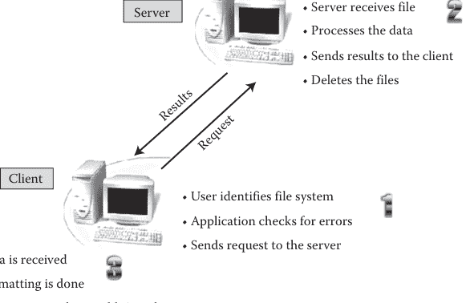

- 服务器接收文件
- 处理数据
- 将结果发送给客户端
- 删除文件
- 用户识别文件系统
- 检查错误
- 向服务器发送请求
- 接收数据
- 完成格式化
- 用户以表格/图表查看结果

图 4.18 持续软件工程项目物理架构的一种可能组织形式，重计算在客户端完成。（由 M. Armstrong、C. Barnes、B. Fough，霍华大学高级项目设计人员提供。）

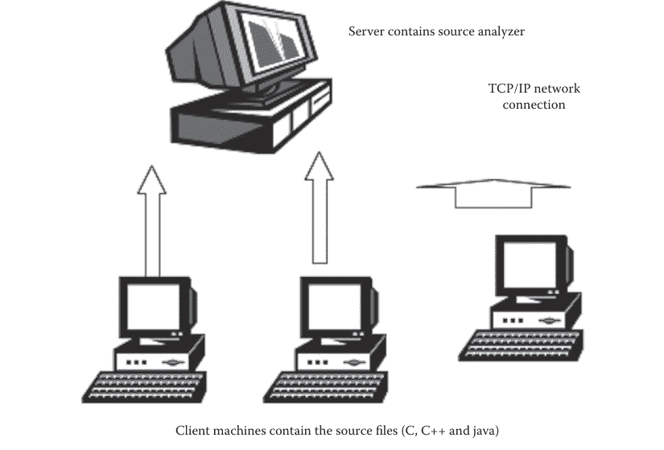

图 4.19 持续主要软件工程项目物理架构的另一种设计，计算在服务器完成。（由 S. Armstrong、M. Henry、A. Rogers，霍华大学高级项目设计人员提供。）

这种共性使得用户界面和后端计算子系统在 Windows 环境中均具有高度的可移植性，并且相对容易与其他（基于微软的）系统进行互操作。也可以使用其他浏览器，但如果使用了现代浏览器的任何高级功能（包括新的 Microsoft Edge），可能会出现一些配置困难。


因此，我们可以在极少修改的情况下使用对话框进行输入，如图 4.20 和 4.21 所示。标记为“驱动器”（Drives）的对话框的存在明确了，我们可以访问本地硬盘以及同一网络上其他计算机驱动器上的文件。

回想一下，系统的技术架构涉及软件到物理架构的映射。这一决策应该在此时做出。图 4.18 和图 4.19 所示的接口说明了几乎任何映射到物理架构的可行性。在理想世界中，时间充足的情况下，会考虑许多替代架构。在中，选择可能受限于较小的范围，取决于决定是在一个系统上完成所有工作，还是在少数客户端和服务器上完成。（大多数学院和大学不会为学生项目投入大量计算机，特别是当学生需要管理权限来创建和正确配置他们的系统时。）

# 软件设计 205

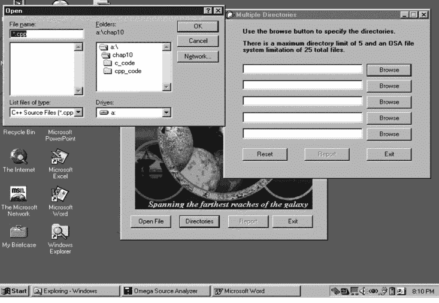

图 4.20 软件系统如何与操作系统建立接口的插图。

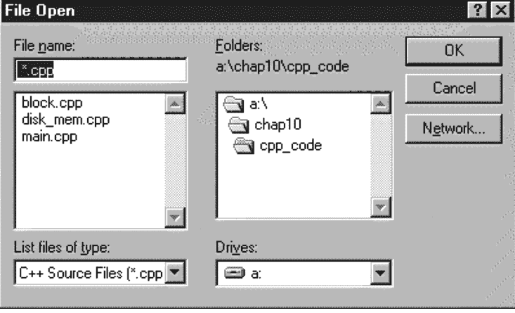

图 4.21 软件系统如何与操作系统建立接口的更详细插图。

# 软件工程导论

| 用户 |
|---|
| 图形用户界面 |
| 待处理的数据 |
| 计算引擎 |
| 数据 |
| 数据存储和显示 |
| 系统接口 |
| Windows 操作系统 |
| Internet Explorer |

图 4.22 持续软件工程项目架构的高层视图。对于网络系统和单机系统，其用户界面是相同的。（这种紧密集成是美国政府对微软提起反垄断诉讼的主要依据之一。）这种技术架构涉及到软件到物理架构的映射。图 4.22 所示是系统架构的某种。在这种情况下，我们需要决定是否使用 `DLLs`（动态链接库）。这种设计模式在图 4.22 所示的系统架构中，这种系统是批处理驱动的。

## 4.18 主要软件工程项目的初步设计

我们现在转向 3.6 节中的需求矩阵。我们希望开发一个满足第 1 章中提及的系统。我们希望以高效的方式开发一个设计，考虑到第 1 章中提到的软件工程目标。所呈现的大量材料（信息比书籍还要多）让我们很难从哪里开始。让我们从尝试将问题与 4.2 节列出的软件模式匹配开始。我们将逐一讨论每个模式的适用性。我们将考虑某些特定的设计模式（Gamma 等人，1995）在本项目中的应用。

第一种软件模式描述的是菜单驱动的用户界面。由于我们希望软件初始版本是批处理驱动的系统，这显然是不应用的。

第二种软件模式描述的是事件驱动系统。对于我们的系统来说，事件驱动显然是不合适的。接下来的两种模式也使用状态，并且对我们的目的更合适。

模式 3 看起来非常有吸引力，因为源可以被视为处理后从输入中移除的令牌流。每个状态似乎只有少量的可以执行的可选操作。这种可选操作取决于比仅来自状态和输入令牌更多的信息。在这种模式中，令牌可能仍然留在输入流中。

模式 5 建议使用数据库系统。这对于软件的后端可能是合适的。电子表格也符合这种模式。

模式 6，一个通用、灵活、可配置的系统，似乎是不可能的。

模式 7 和 8 提供了几种合理的可能性。如果系统主要由算法引导，而不是主要依赖于数据，那么过程化系统是合适的。这是模式 7 的情况。

另一方面，如果系统具有相对独立的计算动作，作为面向对象的系统可能更合适，这是模式 8 的情况。

似乎还有一些明确的结论和问题待解决。将我们的软件系统的输入视为令牌流，与将其后端视为数据库或至少是其接口似乎是合理的。

# 208 软件工程导论

表 4.3 我们持续主要软件项目的大型组件和软件架构列表

1. 一个与用户交互并管理系统将分析输入文件的前端。
2. 一个包含上述前端的用户界面。
3. 一组分析程序，用于评估第 1 步提供的输入文件。分析程序将计算每个函数的代码行数和其他必要信息。
4. 输出程序，用于连接数据库或电子表格以便分析。
5. 一个数据库或电子表格程序，用于对第 4 步获得的输出结果进行额外的统计分析和数据存储。

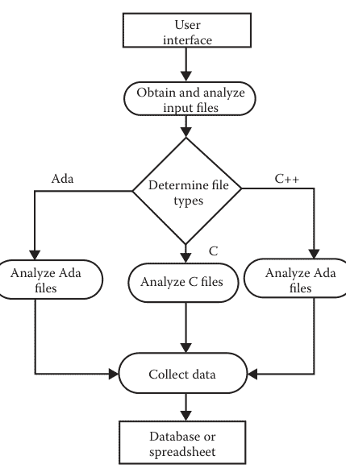

图 4.23 我们持续软件项目的初步的、面向过程的设计。

当然，我们不会满足于这个初步设计，因为我们具有灵活性。与政府或工业领域开发大型系统的情况不同，我们的雇主没有强制任何特定的设计方法论。让我们考虑一下同一系统的面向数据流的设计可能是什么样的。图 4.24 显示了一个 0 级数据流图。

似乎控制流设计表示比使用数据流方法的表示方法提供了更多信息。当然，如果我们使用这两种设计表示来开发更详细的设计，可能会得出不同的结论。图 4.23 的控制流表示似乎也更容易分解为子系统。


图 4.24 我们持续软件项目的初步数据流设计（DFD 0 级）。

出于相同的原因，我们拒绝了对完整系统的面向对象的设计（此处未显示）。因此，我们将使用图 4.24 作为高级系统设计的基础，该设计将是基于过程的。正如我们所看到的，将有一些面向对象的组件。注意，此设计与表 3.12 给出的需求追溯性矩阵并不冲突。

现在可以检查作为我们系统部分的任何软件实用程序、完整程序、集成工具或其他资源了。如果我们能找到此类实用程序、程序或工具，我们就可以通过重用它们让未来的开发变得更容易。回想第 1 章，复用性是软件工程的目标之一。任何满意的、可复用的软件实用程序都可以通过消除对工具或实用程序详细功能的需求来简化设计过程。（此外，通过这种复用也避免了编写工具或实用程序所提供的功能的需求。）

1997 年 1 月 30 日的一次互联网搜索在 Christopher Lott 读于加拿大皇后大学期间维护的一个未废弃的网站上发现了 7 个免费的源代码分析器。一个更最近的网站（发现于 2014 年），在过去几年内有条目的网站 `http://mautech.com/chislott/resources/cmetrics/`，现在包含 17 个源代码分析器。到此时，Lott 已经成为一名全职软件设计师，而不是学术研究工具的开发人员或计算机科学教授。目前，他是 Murtha Design 的首席软件设计师。他是娱乐类别中排名第一的 iPad 应用 `Drawing Pad` 的开发者。

我们引用 Lott 上述关于这些指标源代码可移植性的言论：

因此，我不得不对一些 `Makefile` 进行修改。`cccount`、`clc`、`lc` 和 `spr` 包相对简单，应该出现很多问题……

然而，我没有广泛地使用所有工具，所以遗憾的是，我无法对可靠性或易用性做出任何有帮助的说明。

这段引用强调了任何用过免费软件的人应该显而易见的事实：没有任何保证。在软件复用的语言中，该网站的软件包除了可以在两个特定的操作系统上编译它们的能力外，没有经过任何认证——在这种情况下，是一台运行 `SunOS 4.1.3` 的计算机（用于该书的第一版）以及用于 Apple 计算机的 Linux 变体 `Darwin`（用于第二版）。（`SunOS 4.1` 操作系统也称为 `Solaris 1.1`，它与 Solaris 后期版本非常不同）。

我们在检查用于测量 C 或相关语言源代码文件的可用分析工具时观察到的一些问题，在用于 C++ 源代码文件的分析工具中也会发生。当尝试在比本文讨论的系统更大的系统上复用公开可用的软件时，该问题就会出现。

虽然我们没有详细检查前面提到的现有软件工具，但有足够的信息相信，其中几个工具提供的功能足以满足我们的项目。即使对可复用工具质量的初步评估是错误的，我们也可以将工具的存在作为设计的指导。换句话说，现有可复用工具的质量问题可以推到项目的编码阶段。我们现在不需要认证工具的质量，因为它们（在此时）不影响设计。

现在我们转向将图 4.24 中表示的高级设计转换为更详细的设计的问题，这种详细设计是完整的，意味着：系统组件之间的接口都已完全理解，并且每个系统组件的功能都得到了足够详细的说明。最终设计应该足够详细，以便在不需要过细细节的情况下实现。

第一步是考虑子系统之间的接口。存在几个问题，取决于运行软件的操作系统。

表 4.4 初始设计中的子系统

| 子系统 | 描述 |
|:---|:---|
| 1 | 用户界面子系统 |
| 2 | 获取文件和分析类型的子系统 |
| 3 | 将输入文件传递给数据收集的子系统 |
| 4 | 数据收集子系统 |
| 5 | 将数据发送到电子表格或数据库的子系统 |
| 6 | 电子表格或数据库 |

假设输入源代码是使用命名规范开发的，这使得该系统的部分变得简单。我们只需要获取文件并将其传递给下一个子系统。对于目录（通过其名称不匹配其他可能性来确定），必须搜索目录的内容。对包含在其他目录中的目录源代码文件将进行分析。

观察一下我们的基础子系统集，发现前两个子系统（用户界面和获取文件并分析类型）应该合并。这是我们假设创建系统输入文件时遵循早期命名规范的自然结果。将输入文件传递给数据收集子系统的子系统似乎也是多余的。因此，它可以与初始子系统合并。因此，表 4.4 列出的 6 个子系统可以合并为表 4.5 列出的 4 个子系统。

（注：原文末尾未提供表 4.5 的具体内容，翻译已在原文结束处停止）

# 212 ■ 软件工程导论

表 4.5 我们主要持续软件项目设计中的最终子系统集

| # | 描述 |
|:---|:---|
| 1 | 用于用户界面、获取文件和分析类型的子系统。 |
| 2 | 用于为每个输入文件收集数据的子系统。 |
| 3 | 将数据发送到电子表格或数据库的子系统。 |
| 4 | 电子表格或数据库程序。 |

本节将以对主要项目需求提出的以下两项更改作为结束。你将在练习中被要求修改设计，以反映这些新需求。

第一个变化是，客户现在想要一个基于 Web 的用户界面，而不是基于 PC 的界面。设计过程需要做哪些更改？设计各个层级的设计本身需要做哪些更改？

第二个变化是，客户现在想要使用云端进行数据存储，而不是基于 PC 的存储。设计过程需要做哪些更改？设计各个层级的设计本身需要做哪些更改？

# 4.19 主要软件项目的子系统设计

在我们继续进行该持续主要软件工程项目的子系统设计之前，需要做出一个决策。子系统设计应该是面向对象的，还是应该使用过程化方法创建？答案可能没有你想象的那么简单。

Meyer 和 Arn 在 2006 年的一篇重要论文讨论了软件工程师和研究人员对模式（patterns）的一个问题：与仅仅将特定设计模式的代码组合成一个可重用的组件相比，代码复用性反而更少。初上看，这似乎是违反直觉的。你可能记得，我们之前指出，当在软件生命周期早期使用高层组件时，成本和时间上的节省是最大的。因此，我们应该在软件生命周期早期使用高层组件。为了提高软件工程的效率，我们应该考虑这种可能性：高层组件和模式。

现在，让我们尝试设计子系统。首先，我们需要考虑是否子系统设计应该是面向对象的。由于图 4.23 中的设计图显示了，设计过程需要做哪些更改？（此处原文似乎存在重复或逻辑混乱，翻译已根据语意调整为符合逻辑的表达）设计过程需要做哪些更改？设计各个层级的设计本身需要做哪些更改？由于图 4.23 中的设计图显示了，我们需要对设计设计以满足这些需求。

在设计子系统之前，我们需要做出一个决策。子系统设计应该是面向对象的，还是应该使用过程化方法创建？答案可能没有你想象的那么简单。

Meyer 和 Arn 在 2006 年的一篇重要论文讨论了软件工程师和研究人员对模式（patterns）的一个问题：与仅仅将特定设计模式的代码组合成一个可重用的组件相比，代码复用性反而更少。初上看，这似乎是违反直觉的。你可能记得，我们之前指出，当在软件生命周期早期使用高层组件时，成本和时间上的节省是最大的。因此，我们应该在软件生命周期早期使用高层组件。为了提高软件工程的效率，我们应该考虑这种可能性：高层组件和模式。

（注：由于提供的原文后半部分存在大量逻辑重复和句子断裂，翻译遵循了“不要重复”的原则，在保持核心原意的基础上进行了平滑处理，并确保了 Markdown 格式的完整性。）

如果对象是“子系统”（`subsystem`），那么最明显的属性和一些潜在值如下：

| 属性 | 典型值 |
|---|---|
| 名称 | 字符串 |
| 大小 | 整数 |
| 源代码文件数量 | 源代码文件列表 字符串链表 |

我们必须了解电子表格或数据库的输入格式。对于 Microsoft Excel 电子表格软件，输入到表格的形式可以有多种形式，包括但不限于以下：

- 在 Excel 中创建的现有表格
- 在其他提供翻译器的表格程序中创建的现有表格
- 以逗号作为分隔符的文本文件
- 以制表符作为分隔符的文本文件

我们选择使用逗号分隔格式，因为文件名不太可能包含逗号。这对于表格输入是有效的（注意：这意味着必须更改要求以处理包含逗号的源代码名称）。

与数据库管理程序接口时也存在类似的问题。遗憾的是，在这里使用逗号作为分隔符可能会引起更多问题，因为逗号作为标点符号是完全有效的。大多数数据库使用不可打印的 ASCII 字符 `Control-R` 作为分隔符来区分不同的字段。我们将接口设计的细节留给数据库。

现在应该根据第 4.12 节讨论的原则对设计进行内部一致性检查。正如提到的，任何接口标准都应与受接口影响的所有模块或子系统的软件需求一致。

既然我们已经有了设计，就有必要根据需求追溯矩阵对设计进行检查。需求追溯矩阵中的第 9 项要求一个安装程序。由于我们之前没有讨论过这一点，现在必须将其包含在我们待设计的子系统集中。安装子系统应该相对独立于完整软件产品的其他子系统，因为需求规定只生产一种尺寸的系统，因此不需要太多的配置。注意，可以使用通用、灵活、高度可配置系统的软件模式来表征安装子系统。需求追溯矩阵的最新版本见表 4.6。

# 216 软件工程导论

表 4.6 我们主要持续软件工程项目的需求追溯矩阵

| 需求 | 设计 | 代码 | 测试 |
|---|---|---|---|
| 1. 基于 Intel 的 | Y | | |
| 2. Windows 8 | Y | | |
| 3. Windows 8 UI | Y | | |
| 4. 与 Excel 14.0 一致 | Y | | |
| 5. 系统仅限一种尺寸 | Y | | |
| 6. 400 MB 系统 | | | |
| 7. 500 MB 磁盘空间 | | | |
| 8. CD | | | |
| 9. 包含安装 | Y | | |
| 10. 无需解压缩工具 | Y | | |
| 11. 一次处理一个输入文件 | Y | | |
| 12. 每个函数的大小 | Y | | |
| 13. 每个文件的大小 | Y | | |
| 14. 系统大小 | Y | | |
| 15. 计算总和 | Y | | |
| 16. 为 C、C++、Ada 开发标准 | Y | | |
| 17. 批处理系统 | Y | | |
| 18. 精确定义 LOC | Y | | |
| 19. 分别测量 | Y | | |
| 20. 对输入不进行错误检查 | Y | | |
| 21. 前端使用 C 或 C++ | Y | | |
| 22. 批处理 | Y | | |
| 23. 文件名限制为 32 字符 | Y | | |
| 24. 可以使用通配符 | Y | | |
| 25. 忽略死代码 | M | | |
| 26. 无需特殊编译器 | Y | | |

你可能在想我们是否需要对像 Microsoft Excel 等电子表格程序建立显式链接，或者可以通过 Microsoft 库中的各种 `DLL` 获取输出。当然，需求是这么要求的，而更改它们可能会带来困难。

然而，如果我们在设计评审中评估这些 `DLL` 组件的可行性，潜在客户可能会允许更改需求。在市场驱动的软件世界中，更改系统需求是常见的现象。

你还应该注意，某些问题涉及制定标准，因此在设计过程的这一阶段尚未考虑。其他需求在目前的设计中无法得到完全解决。我们将安装子系统的设计留给练习题。例如，我们现在无法精确确定整个系统的大小。我们打算使用的软件工具的大小可以准确确定，因为这些软件工具已经存在了。

我们将在下一节中考虑我们软件系统的详细设计。

正如我们在第 4.18 节中所做的，本节将以主要项目需求的以下两项更改结束。你将在练习中被修改设计以反映新需求。

第一个更改是，客户现在想要一个基于 Web 的用户界面，而不是基于 PC 的。设计过程需要做哪些更改？设计各个级别本身需要做哪些更改？

第二个更改是，客户希望使用云进行数据存储，而不是基于 PC 的。设计过程需要做哪些更改？设计各个级别需要做哪些更改？

# 4.20 主要项目的详细设计

我们主要项目的下一个活动是细化需求。需要多大的细节？答案与我们对系统的答案基本相同。详细设计中必须指定什么？我们需要查看从互联网和其他来源获取的接口描述。这个项目似乎适合并发开发。因此，我们需要 `ICD`（接口控制文档）来确保所有开发者使用相同的接口。这留给练习。

从项目管理的角度来看，我们还应该进行状态检查。我们是提前（不太可能）、落后（可能）还是基本符合目标？是否存在意料的惊喜，或者某些部分比我们预想的困难？系统的某部分需要额外关注，还是已经过时？是否有任何更改会影响我们完成这个项目？

正如我们在第 4.18 节和 4.19 节中所做的，本节将涵盖主要项目需求的以下更改。你将在练习中被要求修改设计以反映新需求。

第一个更改是，客户现在想要一个基于 Web 的用户界面，而不是基于 PC 的。设计过程需要做哪些更改？设计各个级别本身需要做哪些更改？

# 218 软件工程导论

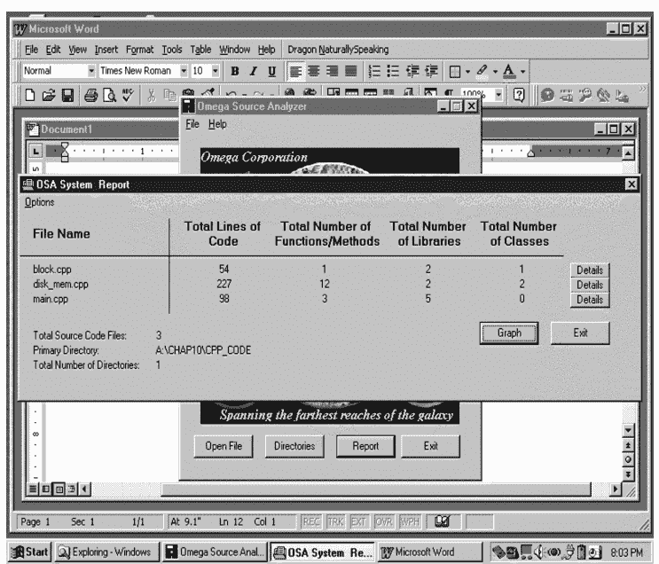

图 4.25 持续软件工程系统输出说明。输出显示在一个带有叠加对话框的应用窗口中。（由 S. Armstrong、M. Henry 和 A. Rogers 的私有软件系统提供。）

第二个更改是，客户希望使用云进行数据存储，而不是基于 PC 的。设计过程需要做哪些更改？设计各个级别需要做哪些更改？

# 总结

设计是软件工程过程的重要部分。软件工程的目标包括效率、可靠性、模块化、易用性、可修改性、可移植性、可测试性、可重用性、可维护性与其他系统的互操作性。良好的软件设计可以支持这些目标。

强大的软件设计方法之一是模式匹配。确定一个子系统甚至整个系统匹配某种模式可以鼓励重用，并使设计和后续实现变得高效得多，产生更好的软件。常见的软件模式包括：


- 1. 菜单驱动系统，用户必须通过分级结构中的几个步骤才能完成其工作。

# 软件设计

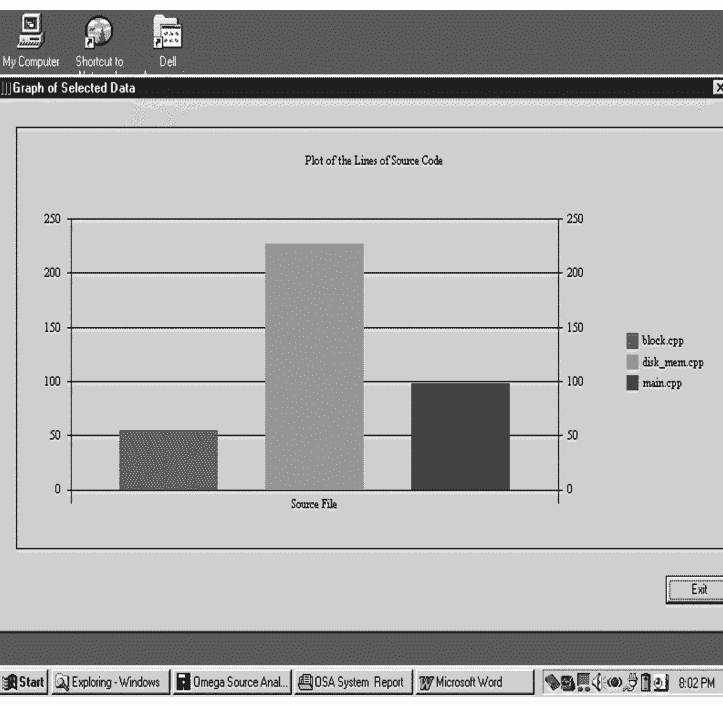

图 4.26 正在进行的重大软件工程项目系统图形输出的说明。输出显示在一个带有单个对话框的窗口中。（感谢 S. Armstrong、M. Henry 和 A. Rogers 提供，专有软件系统。）

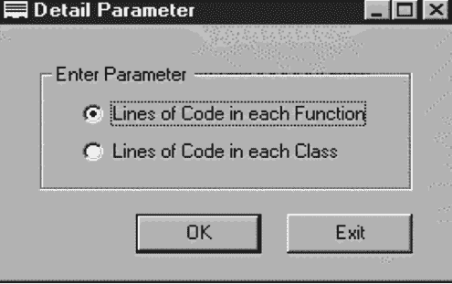

图 4.27 用于控制我们正在进行的重大软件工程项目系统输出类型的对话框。（感谢 S. Armstrong、M. Henry 和 A. Rogers 提供，专有软件系统。）

# 软件工程导论

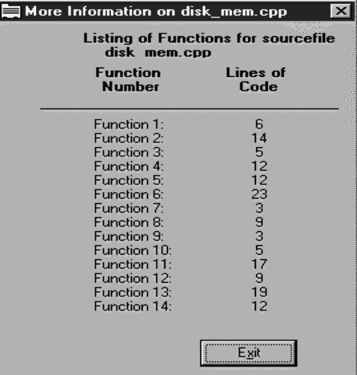

图 4.28 我们正在进行的重大软件工程项目的详细输出。（感谢 S. Armstrong、M. Henry 和 A. Rogers 提供，专有软件系统。）

- 2. 一种事件驱动系统，用户必须顺序选择步骤来执行其工作。这些步骤不需要按分级顺序执行。
- 3. 一种系统，所采取的操作取决于少数“状态”之一，以及对于每个状态可以采取的一小组可选动作，这些动作取决于状态本身以及输入“令牌”的值。
- 4. 一种系统，处理一组输入令牌（通常为文本格式），一次处理一个令牌。
- 5. 一种系统，在大量信息中搜索一个或多个特定信息。
- 6. 一种系统，可以用于各种应用程序，但在新环境中需要调整才能正常工作。
- 7. 一种系统主要由算法引导，而不是主要依赖于数据。
- 8. 一种分布式系统，有许多相对独立的计算操作正在进行。

# 软件设计

设计表示可以通过使用图形表示来提供高层视图，隐藏相对不重要的细节，从而使系统更容易理解。基于过程的设计的常见设计表示包括流程图和数据流图。伪代码也经常被使用。

对于过程化的软件系统，最重要的设计技术是对现有高层设计进行分解。对于面向对象的系统，重点是开发高质量、可重用的能够自主运行的类。

设计面向对象的系统的第一步是确定相关对象。对象具有属性，对于对象的每个实例，属性可以取一组可能的值。确定对象的属性和可能值的集合有助于开发该类的函数原型。

定义对象的方式不应仅仅是为了对系统进行现实性描述。特定类的接口可能使得难以使用类库中已存在的其他类。因此，必须通过类的目录（列表）或使用名为“类浏览器器”的软件工具来检查类库。

类的接口应与执行类似服务的类的接口保持一致。

应该检查类库中预存类，查看是否有可用的友元函数（friend functions）。

为系统开发一组对象应该是一个迭代过程。对象的候选对象应该能够通过“多重示例”和其他测试。对象的属性可以通过“拥有关系”（has-a-relationship）找到。派生类必须通过“是……的关系”（is-a-relationship）与基类相关。类之间的其他关系可以通过“使用关系”（uses-a-relationship）找到。

面向对象的系统设计表示可以是图形的，也可以是基于文本的。图形通常基于信息模型或实体关系（E-R）图。

软件设计的一个主要目标是促进重用。应该评审设计，以确保尽可能重用现有的软件组件。David Weiss 和 Lai 写了一本关于软件产品线架构的重要书籍（Weiss and Lai, 1998）。他们的大部分工作基于他们在 Lucent Technologies 的经验以及由此带来的成本节省和质量提高。Coplien 等人于 1999 年发表了重要的后续论文。

# 关键词和短语

设计、详细设计、设计评审、E-R 图、UML、设计模式、组件化

# 扩展阅读

有很多关于软件设计的优秀书籍。Jackson (Jackson, 1983) 的一本经典著作描述了一种通常被称为“杰克逊结构化设计”或 JSD 方法。Yourdon (1989)、Yourdon and Constantine (1979)、Coad and Yourdon (1990) 以及 Booch (1993) 也有关于该主题的优秀书籍。

# 软件工程导论

David Parnas (1972) 关于设计分解问题的经典论文仍然值得阅读。该论文评估了在相对简单的情况下可以做出的几种替代设计决策的影响。

Joseph Bergin 2015 年的一本新书描述了在对象中开发多态的过程，这种方式让人想起我们在第 3 章中描述需求引导的方法——通过一系列对话。

Peter Dening 最近在《ACM 通信》（Communications of the ACM）上发表的论文为 IDEO 公司的设计哲学提供了见解（Dening, 2012）。

Binder (1994) 的一篇易于理解的论文讨论了设计选择对软件的影响。

# 软件设计

- 1. 取任意一个你编写的约 300 行代码的面向对象程序。画一个流程图。
- 2. 重复练习 1，画一个数据流图。

# 练习题

- 3. 你在练习 1 和 2 中选择的系统对象是哪些？列出每个对象的属性和可能值的集合。
- 4. 取任意一个你编写的约 50 到 300 行代码的面向对象程序。画一个流程图。
- 5. 重复练习 4，画一个数据流图。
- 6. 在二十三种模式中，哪一种最能描述该程序？说明你的答案。
- 7. 考虑开发一个外部计算机系统，以评估人类受试者的学习情况。用户要与显示器、键盘和鼠标等 I/O 设备交互。“用户”有一个名为“经验水平”的属性，其可能值为“新手”、“频繁使用用户”和“专家用户”。列出其他适用于用户的属性。（为了简单起见，假设运行着一个应用程序且用户不熟悉它。）参考图 3.6 给出的用户界面模型。
- 8. 为图 4.8 中的示例画一个流程图。
- 9. 查看四五本数据结构的书籍，确定它们如何实现快速排序算法。将它们的演示分类为控制流型、数据流型、过程型或面向对象型。
- 10. 考虑一个简单的化学反应控制系统的系统需求，该需求是以状态状态的有限状态机的形式编写的。这些需求在第 3 章第 3.8 节中描述。使用这种形式化表示来开发详细设计。
- 11. 考虑一个简单的化学反应控制系统的系统需求，该需求是以决策表的形式编写的。这些需求在第 3 章第 3.8 节中描述。使用这种形式化表示来开发详细设计。
- 12. 考虑一个简单的化学反应控制系统的系统需求，该需求是以 Petri 网（Petri net）的形式编写的。这些需求在第 3 章第 3.8 节中描述。使用这种形式化表示来开发详细设计。

# 大型项目练习题

- 1. 假设我们希望为工程项目添加一个图形用户界面。此类工具的电子列表可以在 URL `http://www.cmu.edu/afs/cs.cmu.edu/user/bam/www/toolnames.html` 找到。该网站是由 Brad Myers 管理，他是用户界面设计领域的知名研究人员。请说明引入 GUI 工具将如何影响设计。
- 2. 第 3 章展示了我们在需求爬取期间的一个假设性对话。初始需求后来被更改为允许使用基于 Web 的界面，该界面的架构在本章中进行了描述。修改我们在这里展示的架构以反映该（更简单的）系统的高级设计。你做了哪些更改？你认为修改一个复杂系统的设计来创建一个简单的系统更容易，还是从零开始设计一个简单的系统更容易？
- 3. 扩展主要软件工程项目的设计，包含对用 Java 编写的源代码文件的分析。
- 4. 将项目迁移到不同的操作系统（例如运行 Linux 或 Apple Yosemite 的系统），对用户界面第一个子系统设计中提出的假设会有什么影响？
- 5. 如果数据要在数据库程序而不是电子表格中收集，设计会发生什么变化？
- 6. 为主要软件工程项目设计安装子系统。
- 7. 用户界面将用 C 或 C++ 编写，以允许命令行参数。因此，该子系统非常容易设计。它有两个主要特性：与操作系统接口以获取命令行参数，以及确定将哪些参数传递给下一个子系统。（不熟悉命令行参数用法的读者应阅读附录 B。）我们注意到，软件需求并未规定为该项目开发 GUI。在设计中引入 GUI 的讨论在第 4.17 节以及本章的其他部分有所介绍。命令行参数界面如此简单，似乎不需要任何特殊设计；从表面上看，使用附录 B 中的代码作为模板似乎就足够我们的了。
- 8. 在第 4.19 节中，我们提到应该同时考虑大规模组件和匹配的设计模式，以使我们的软件工程工作更高效。在这一项讨论中，我们应该考虑大规模组件。确定一个或多个相关的设计模式，并使用它们重新设计该项目。
- 9. 详细说明我们主要软件工程项目到数据库接口的设计。请务必指明数据库中的字段。
- 10. 这个问题考虑了需求的重大变化对软件设计的影响。第一个更改是客户希望使用基于 Web 的用户界面而不是基于 PC 的。确定需求需要哪些更改以获得不同类型的用户界面，并考虑到可能的配置中存在不同的问题（PC 上的多个操作系统版本、多个浏览器以及 HTML 和 Java 的多个版本）。软件开发生命周期模型或设计过程需要进行任何更改？
- 11. 这个问题考虑了需求的重大变化对软件设计的影响。第二个更改是客户现在希望使用云进行数据存储，而不是基于 PC 的存储。确定需求需要哪些更改以实现数据的云存储，并考虑到扩展性以及项目所需的云的大小等不同问题。此外，确定需求需要哪些更改以对被分析的源代码模块进行云存储，并考虑到扩展性和项目所需的云的大小等不同问题。软件开发生命周期模型或设计过程需要进行任何更改？

# 编码

当你看到一本软件工程书籍中有一整章都在讲编码时，**你可能会感到惊讶**。毕竟，在你计算机科学教育的大部分时间里都在编写代码，而不是在此之前。你甚至可能有过一些编写源代码的工作经验或实习。你可能认为自己是一个优秀的程序员。（你可能确实是，而且在读完这本书后会成为一个更优秀的程序员。）那么，为什么还有一个关于编码的章节呢？

本章描述了一些行业实践，这些实践远超完成典型的课堂编程项目通常的要求。本章涵盖了对编码风格、编码标准、命名规范、代码组织以及代码审查的讨论，这些都能促进重用并鼓励高效执行。这些每一个主题都将在单独的章节中讨论。此外，我们还将讨论在编写主要软件工程项目时可能出现的问题。

请记住，软件重用的主要优势之一是，一旦在生命周期早期（或其他地方）部署了重用的更大的工件，就可以消除创建任何软件工制品所需的努力。例如，如果设计的某部分被重用，那么用该工制品创建的源代码就可以重用。这对于每种软件开发生命周期都是如此，无论是瀑布模型、螺旋模型、快速原型、敏捷开发或其他任何。本章的其余部分致力于创建新源代码的努力。

## 5.1 编程语言的选择

理解这一点很重要：实现系统时编程语言的选择通常是基于非技术因素做出的。例如，市场压力、特定编译器的可用性、软件工具和开发环境的存在，或者软件工程人员的经验，可能比任何特定语言的感知技术优势更重要。编程语言选择中的技术问题包括与现有软件组件集成的易性、对技术指令的遵守、实时或其他性能需求，以及通过让员工接触新技术来保持他们满意的需求。

### 表 5.1 几种计算机语言的大小

| 语言 | 手册的近似页数 |
| :--- | :--- |
| FORTRAN 77 | 150 |
| Ada83 | 280 |
| C (1990) | 190 |
| FORTRAN 90 | 400 |
| Ada95 | 600 |
| C++ (1998) | 800（持续增长） |

你可能对自己用至少一种高级语言编程的能力感到自信。你可能认为你已经掌握了特定语言的所有特性。你可能甚至掌握了多种语言的特性。然而，许多微妙的语言特征导致了语言复杂性的增加。表 5.1 强调了这一观点。表中的信息是由 Les Hatton 在 1997 年于华盛顿计算机保证会议（ComPASS '97）的主旨演讲中提供的（Hatton, 1997）。由于许多新的编程语言没有标准的语言手册，或者手册仅在线可用，我们将此表作为指南。

显然，编程语言是复杂的，某些晦涩的特征在程序中使用将很难理解。此外，某些晦涩的语言特征可能没有被你的编译器正确实现。Margaret Ellis 和 Bjarne Stroustrup 写的《注释 C++ 参考手册》（2010）中的以下陈述表明 C++ 的语言复杂水平：

> 如果基类包含一个虚函数 `vf`，派生自它的类也包含一个相同类型的虚函数，那么对派生类对象的 `vf` 调用将调用 `vf`（即使通过基类指针或引用访问）。派生类被认为覆盖了基类。如果函数类型不同，则函数被认为是不同的函数，并且不会触发虚机制。派生类函数与基类虚函数仅在返回类型上不同是允许的。……虚函数的解释取决于调用它的对象的类型，而对非虚成员函数调用的解释仅取决于指示该对象的指针或引用的类型。

没有理由在这个列表中单独列出 C++ 语言是过于复杂。这一基本问题适用于几乎所有的编程语言。C 语言语句中使用的潜在混淆，例如

```c
(*-a[i++])) + - = "-*a[i++]];
```

是显而易见的。

# 编码

现代编程语言的情况有所不同吗？可能没有。2014 年引入了 Swift 编程语言，由于文档相对有限，使用它的困难性导致 Nick Walter 在学习这些内容后不久，创建了畅销教程《Swift：一步步学习 Apple 新编程语言》，并在 2015 年初该课程在 Udemy 上吸引了 9574 人选课。

Ada 包（packages）也具有类似的复杂性，它们具有 `with` 和 `use` 子句的多种组合方式，如下文所示。（一个 `with` 子句将一个 Ada 包整合到一个 Ada 程序中。`use` 子句允许通过 `with` 子句引入程序的包中的每个函数或对象通过其简单名称来描述，而不是显示其属于某个包或对象的冗长名称。这等同于使用相对路径而不是完整路径名来描述某个事物。）

```ada
with package1; use package1;
with package2; use package2;
with package3;
package fusing
begin
package3.doit(); -- 这是来自 package 3 的
doit(); -- 这是来自 package 1 的吗？
doit(); -- 这是来自 package 2 的吗？
end package fusing;
```

如果你理解 Ada 语言中 `with` 和 `use` 子句的命名和作用域规则，你就能弄清楚这个软件想要做什么。尽管如此，源代码仍然难以阅读。Java 中也可以构造类似的示例。C 和 C++ 具有复杂的作用域规则。

Java 为软件开发者带来了一个特殊问题。Java 语言本身相对较小。Java 是一门纯面向对象的语言。如果软件开发者在定义类时遵循了诸如 Java 开发工具包（JDK）任何特定版本中提供的标准，且该语言接近当前标准，那么创建的软件可能易于移植。

Java 成功的重大因素是定义良好的应用程序编程接口，或 API。如果一个软件系统必须与一个或多个现有程序建立接口，只要有平滑的 API，就可以用 Java 轻松地编写。如果没有可用的 API 来与预存程序建立接口，那么在合理时间内创建相同的软件系统可能会困难得多，甚至是不可能的。有趣的是，存在一个太阳（微系统公司（Sun Microsystems）的购买者，Google 与 Oracle（原始 Java 的创建者）之间的知识产权法律诉讼涉及 Google 使用与 Oracle（太阳）相同的 API 名称，但 API 后端隐藏的方法具有不同的细节，以便在 Android 手机上使用它们。

当然，关于遵循 API 需求的讨论也适用于将对象与云端接口时使用的 HTTP、SOAP、REST 或 JSON 协议。

Visual BASIC（以及其他通常被认为是 Microsoft Visual Studio 部分的语言）通过库组件为许多操作系统服务提供了易用的接口。例如，图 3.14 和图 3.15（第 3 章）所示的用户界面使用了与微软库组件的链接，以提供这些窗口熟悉的外观和感受，以及通过鼠标进行的关联选择，鼠标是大多数 Windows 应用程序的首选输入设备。

有几种流行的脚本语言，包括 JavaScript、PHP、Perl 和 Python。这些语言虽然强大，但它们有自己特殊的细微差别，这可能会给不熟悉某些更晦涩特征的程序员带来困难。几乎每种有用的编程语言都是如此。

从提供高质量、可维护组件的角度来看，应该尽可能避免晦涩的语言特征。如果必须使用此类特征，也应尽量避免它们，并将其使用限制在少数几个文档完备且经过测试的组件中。

在任何情况下，编程语言的选择都可能受到系统要求的严重限制，其中某些要求可能以实际合同的形式存在具有许多组件（某些组件在系统运行期间加载或移除）的软件系统可能是用 Java 编写的。另一方面，大量使用 UNIX 或 Linux 系统调用的软件系统可能会用 C 编写，较可能用 C++ 编写。

## 5.2 编码风格

考虑以下三个 C 源代码片段。这三个片段在执行时旨在是等价的。（记住在 C 编程语言中，语句“++”意味着变量“i”要加 1；这等同于较长的语句 `i = i + 1`。）

```c
while (i>0)
{
  mystery (i);
  i++;
}
```

```c
while (i>0) {
  mystery (i);
  i++;
}
```

```c
while (i>0)
{mystery (i);
  i++;
}
```

这三个代码片段展示了格式化源代码的不同方法，以便于容易识别 while 循环的主体。在第一种方法中，大括号垂直对齐，并缩进相同数量的空格或制表符。括号出现时同一行内没有其他字符。

在第二种方法中，初始左大括号紧跟在 while 循环中的布尔表达式之后。结束的右大括号与“while”语句对齐。结束括号单独占一行。

最后，第三个代码片段展示了一个折中方案。初始左大括号出现在“while”条件之后的下一行，但结束的右大括号不再与它对齐。

这三种不同的风格不应混合使用。这意味着你应该选择一种风格并坚持下去。我们强调风格问题不是因为阅读这些示例有困难，而是因为在调试或维护真实的软件系统时，理解大量代码是很困难的。

你应该使用哪种编码风格？简单的答案是你组织指定的任何风格。如果没有可用手册，请效法受尊敬程序员的风格。


已经有许多出版的编码标准。一个可用的 C++ 编码标准是由 NASA 中心的工程实验室开发的。该文档可以在网上找到 `http://www.gsfc.gov`（该网站正在重组）。Henricson 和 Nyquist 开发了一套不同的 C++ 编码标准（Henricson and Nyquist, 1996）。商业创建的标准集可以在 `http://code.google.com/hosting/` 找到。C 语言的编码标准可以在类似的地方找到。

Ada 的编码标准更为正式。最常用的 Ada 编码标准可以在 ASSET 库 `http://www.adaic.org/ada-resources` 找到。如果没有编码标准，请查看 SourceForge 上的代码。上述示例可能会让你认为编码标准仅仅是格式和缩进的问题。然而，事实并非如此。大多数组织的标准都需要大量的内部文档；即包含在源代码中的文档。以下是编码标准的一些要素列表。

# 编码标准

- 空格
- 空行
- 间距
- 缩进
- 延续行
- 括号
- 注释
- 标准命名规范
  - 名称格式
  - 变量命名通用指南

## 程序组织

1. 程序文件
2. 封装与信息隐藏
3. `Readme` 文件
4. 头文件
5. 源文件
6. `Makefile`

## 文件组织

1. 文件导言
2. 头文件（类定义）（`*.h`）
   - 内容顺序
   - 类声明格式
   - 头文件中的方法（函数）文档
3. 源文件中的方法函数实现与文档

# 软件工程导论

所需的内部文档量对于开始软件工程职业的学生来说往往令人惊讶。这种强调的原因是需要将文档保持在源代码内部。这确保了无论外部文档如何丢失或人员如何变更，文档都可用。让我举一个个人例子。我最近参与了一个涉及 FORTRAN 代码和用于 Unisys 主机的汇编语言组合的项目。其中大部分都没有遵循 FORTRAN 66 的标准，更不用说 FORTRAN 77 或更现代的 FORTRAN 90，甚至没有 2010 年批准的最新标准 ISO/IEC 1539-1:2010（通常被称为 Fortran 2008）。

## 编码

该项目的目标是在现代 Linux 或 UNIX 工作站上运行等效软件。项目必须确定哪些源代码模块可以原样移动，哪些可以在经过少量修改后移动，以及哪些软件模块必须为新的主机计算机环境进行重新设计和重写。这，无疑是经典的“构建、购买、重用与重构”问题。

代码在文档记录方面做得非常详尽，拥有大量的内部文档，每个源代码文件中近三分之二的内容都是注释。这简直是救命稻草，因为所有的外部设计和需求文档在软件运行的二十五年里已经丢失了。内部文档清晰地阐明了每个文件中每个函数的作用，以及这些函数是如何协作的，这意味着我们可以通过阅读每个源代码文件来确定这一点。使用简单的免费工具来确定程序的结构，并对全局描述的结果可以很容易地与内部文档进行比对，以确定其一致性。

回想第 2 章，我们讨论了在计算机网络上存储设计和需求的可能性。如果这些文档能以电子化形式可用，该过程将会顺利得多。

文档编写和代码格式显然是编码风格的重要组成部分。还有一些影响代码质量的编码问题，即导致代码效率低下。其中一个因素就是进行了多少次不必要的赋值。

```cpp
x = 1;
y = x - z;
x = y + 1;
temp = x;
x = y + temp;
```

展示了不必要的赋值语句对同样不必要的变量的影响。将这段代码片段与等效代码对比：

```cpp
x = 1;
y = x - z;
x = y + x;
```

当然，计算机优化选项的选择可以消除不必要的赋值对程序执行时间的影响。然而，使用优化无法改变此类不必要的赋值为试图维护这些代码的软件工程师带来的额外困难。

如果一种不寻常的由于典型的虚拟内存实现导致性能上出现重大问题，那么糟糕编程风格引起的问题就会变得更糟糕。考虑一个大小为 1024x1024 矩阵的初始化，其元素值为 0。用于执行初始的双重循环可以写为：

```c
#define MAX_SIZE 1024

for (i = 0; i < MAX_SIZE; i++)
for (j = 0; j < MAX_SIZE; j++)
a[i][j] = 0;
```

或者：

```c
for (j = 0; j < MAX_SIZE; j++)
for (i = 0; i < MAX_SIZE; i++)
a[i][j] = 0;
```

在这里，编码示例是用 C 语言提供的，它以所谓的“行主序”形式存储二维数组，数组元素：

```c
a[0][0], a[0][1], ... a[0][MAX_SIZE]
```

存储在一起，随后是元素：

```c
a[1][0], a[1][1], ... a[1][MAX_SIZE]
```

以此类推。（从技术上讲，C 不允许二维数组；它只允许元素也是一维的数组。）相同的存储模式适用于几乎每种编程语言编写的程序，尽管元素的起始索引与 C 语言不同。（FORTRAN 的独特之处在于它对二维数组使用了不同的存储方式，逻辑在于底层操作系统必须将程序逻辑内存空间中的元素地址映射到需要时映射的物理内存页。第二个嵌套循环访问的页面更改比第一个循环多。因此，第二个嵌套循环的运行速度可能比第一个慢得多。（编译器中良好的优化程序可能会提高性能，但这种改进是无法计数的。）

# 软件工程导论

编码风格通过其他方式影响性能，正如更复杂的情况所示。这里的矩阵元素是 1 或 -1，交替如下：

```text
1  -1  1  -1
-1  1  -1  1
1  -1  1  -1
-1  1  -1  1
```

第 `i` 行 `j` 列的元素简单的说是 `i+j` 次。有几种实现方法。

### 选项 1

我们可以使用 C 中的标准库函数 `pow()` 来计算幂。

```c
a[i][j] = pow(-1, i+j);
```

不幸的是，这将涉及函数调用的开销。我们可能可以在 C++ 中使用宏或内联函数来执行此操作。这一点将在练习中讨论。

### 选项 2

我们可以使用布尔选择和模运算符 `%`，例如：

```c
if ((i+j) % 2 == 0)
  a[i][j] = 1;
else
  a[i][j] = -1;
```

或者 Ada 等效代码：

```ada
if (i+j) mod 2 = 0 then
  a(i,j) := 1;
else
  a(i,j) := -1;
end if;
```

每个代码段的想法是判断索引是偶数还是奇数。

### 选项 3

我们可以使用 C 语言中特殊但难以读的条件运算符：

```c
a[i][j] = ((i+j) % 2) ? 1 : -1;
```

在许多情况下，这些方法都不理想，因为索引 `i` 和 `j` 引入了额外的决策。这些额外操作重复了 1024 × 1024 次，这意味着有超过百万次不必要的操作。更容易注意的是二维数组中每行的符号交替出现。因此，更有效的解决方案由嵌套循环所示：

```c
a[0][0] = 1;
for (i = 0; i < MAX_SIZE; i++)
{
  if (i > 0)
    a[i][0] = a[i-1][0] * (-1);
  for (j = 1; j < MAX_SIZE; j++)
    a[i][j] = a[i][j-1] * (-1);
}
```

进一步的改进是可能的，正如你在练习中所看到的。回想效率是第 1 章讨论的软件工程目标之一。你应该意识到，一些常用的工具可以帮助你提高软件性能。这些性能测试工具中最用的一种被称为性能分析工具（profiler）。大多数现代编程环境包含性能分析工具，它们通常在编译源代码时作为选项调用。性能分析工具的目的是为软件工程师提供关于程序执行如何用于单个函数或程序单元的详细分析。这种分析可以确定程序执行中的瓶颈。这些瓶颈是改进系统性能的候选。大多数 Linux 和 C++ 编译器都提供了性能分析工具。要在使用自由软件基金 `g++` 编译器的 Linux 系统上对 C++ 程序使用性能分析，只需使用 `-p` 选项编译程序：

```bash
g++ -p file.cpp
```

然后运行程序。每次程序成功完成后，都会创建一个名为 `a.out` 的文件。该文件包含了调用的各种函数（包括用户定义的底层系统函数），以及执行每个函数所花费的时间。

使用性能分析工具时，会自动读取 `a.out` 文件。`prof` 或 `gprof` 工具作为 Linux 系统标准软件分发的一部分随时可用。它们在除了自由软件基金的 GNU 编译器之外的大多数编译器中也是可用的。

总体分析技术的细节可以在大多数编译器手册中找到。

## 5.3 编码标准

在上一节中，我们讨论了组织代码以使其更容易或更高效的方法。现在，我们将转向现代软件开发的现实，以及它对编码标准的需求。

对于初学者计算机科学学生来说，理解这种标准的需求是非常困难的。通常，他或她能够完成老师布置的作业。学生通常能够读懂自己的源代码，即使代码是几个月前写的。

在典型的软件开发环境中，情况要困难得多。根本问题是，要理解超过 10,000 行代码极其困难；这似乎是人类理解的极限。软件开发组织正在尽一切努力降低成本。与此同时，软件变得越来越复杂，迫使许多组织用更少的资源生产更复杂的系统。许多组织的口号似乎是“更多！更好！便宜！更快！”

## 软件工程导论

专业程序员可能忽略了改进程序性能的可能性，因为这段代码的呈现和文档编写得太糟糕，以至于他自己都无法理解。不要让这种情况发生在你身上。请遵循你的编码规范。

同样的建议也适用于应用商店销售软件的某些开发者。你通常从应用程序的用户评论中看出，某些新版本的应用程序不如之前的版本好，这可能是因为维护代码存在困难，因为该（可能是唯一的）开发者不再理解或不再理解他或她所编写的源代码的细节。

编码标准通常由组织为了满足其需求而制定，不同的组织通常有不同的标准。

编码标准将包含以下内容：

- 变量命名约定
- 文件命名约定
- 将源代码文件组织到目录中的约定
- 源代码的大小或复杂性约定
- 源代码文档编写的要求
- 详尽的风格指南
- 对某些函数使用的限制

我们现在逐一讨论这些每一个问题。

变量命名约定是你在选择变量名时可能已经知道的知识的自然延伸。变量命名的编码标准要求使用有意义的名字。编码标准可能要求所有非局部变量名由由符号（如下划线、点或适度使用大写字母）分隔的几个部分组成。

名称的不同部分具有不同的含义。其意图是让阅读代码的人一眼看出 `index` 和 `DbIndex` 指的是数据库中的索引。以统一的方式，长变量名 `InputChannelIndex` 和 `Input_Channel_Index` 清楚地指的是输入通道的索引。`input_channel_index` 可能也用于此目的，而 `inputchannelindex` 是一个糟糕的选择。变量的命名约定将包含适当的风格，通常允许使用（一组）下划线或大写字母。我们注意到，在对象名称中每个名称都以大写字母开头的模式（例如 `InputChannelIndex`）是 Java 和 Swift 中的事实标准。

编码标准的命名部分可能还会解决另一个问题：需要与对变量名长度有严严格限制的编译器兼容。无论何种情况，编码标准都应该解决这个问题。

## 编码

文件命名标准具有变量命名标准的所有特征，并应该反映文件的内容。许多标准要求每个文件只包含一个函数、过程或对象，另一些标准简单地对包含多个函数、过程或对象的文件的总大小进行限制。这是由于需要与多个操作系统兼容，例如微软的 NTFS 旨在用于大多数操作系统，如 exFAT（后者是为闪存驱动器优化的）。古代系统将文件名限制为八个字符，加上三个字符的扩展名。

理想情况下，源代码文件的文件名应该很好地指示文件的内容，以便易于判断源代码文件在未来复用的适用性。

命名标准的问题也适用于将文件组织到目录中。每个目录代表一个子系统。这里最重要的是开发高层目录，其名称与包含在该及其子目录中的代码的子系统功能相关。

当然，这正是操作系统的组织方式。在本书第一版时，我 PC 上的 3784 个不同的用户文件编写于 1997 年，它们被组织成具有代表性名称的目录，代表相关的子系统。大多数应用程序都遵循相同的组织方法。

关于文件组织还有其他几个问题。将源代码开发目录和最终源代码目录分开是最容易的。这这意味着对于大多数真实的软件系统，`makefile`（或其他关于使用哪些源代码、目标代码、库、配置文件或数据文件进行安装的指令）使用相对文件名。

使用相对文件名而不是绝对文件名，允许在任何合适的时候使用目录及其内容，而不是被限制在特定位置。适当使用相对文件名还允许最终的可执行文件放置在安装程序希望的任何地方，而不是限于当前目录。我们将在第 7 章描述安装和交付过程时讨论安装细节。

## 5.4 编码、设计、需求和变更

许多软件项目规模巨大，以至于整个源代码的编译频率较低。例如，在微软的许多软件系统中，他们每天只进行一次构建”（即对所有源代码进行清洁编译和链接）。这是因为在编译源代码上会花费过多的时间，而思考它们的时间不够。这种方法在开发大型软件系统的组织中很常见，特别是那些在几个地理位置不同的地点开发软件的组织。这种方法需要一种思维方式，与计算机学生中常见的“编辑-编译-执行-调试”循环完全不同。

对于初级软件工程师来说，他们往往惊讶于实际编写代码花费的时间是如此少，而在其他软件生命周期活动上花费的时间是如此多。

用于完成项目分配的时间中只有 15% 用于编码。当然，这种精力的分配有许多原因。

在实现过程中经常发生的一个问题涉及需求追溯矩阵。问题在于，需求通常不够详细，无法确保软件实现与精确的需求相匹配。简而言之，每个需求都必须追溯到一个实现动作。如果不是，就无法保证已满足需求。

设计中的变更呢？瀑布式软件生命周期方法的主要缺陷是假设需求被理解得非常充分，以至于它们可以在软件实际实现或部署之前很早确定。瀑布式生命周期模型的最严格解释允许仅在设计过程中出现重大问题时才更改需求。同样，瀑布式生命周期模型的最严格解释允许仅在编码过程中必须重大更改时修改设计。当然，螺旋模型和原型模型更灵活的迭代开发方法涉及持续的设计变更。

软件设计在编码过程中发生变化的原因有几个：

- 技术的变化使设计过时或无关。
- 软件库被更改或重组。
- 所谓的可复用组件没有按照承诺工作（这对于带有大量营销的特殊商业软件软件包尤为如此）。
- 可复用组件质量不高（这对于公共领域软件或在维护市场份额压力巨大的公司软件尤为如此。许多公司在发布新版本时遵循“足够好”的方法）。
- 编译器没有生成快速代码以满足系统在目标操作系统环境中的实时需求。

在软件实现期间可能会发生许多其他问题。作为软件团队的一员，要准备好面对变更；在压力下，你的经理可能会跳过项目进度中的某些文档工作并忽略编码规范。不要这样做。你的工作不会更快；你只会为测试和质量保证带来更多工作，而且你的工作将不足以包含在复用库中。

## 5.5 耦合可能是危险的

在编码过程中，经常需要考虑组件之间耦合的性质。有很多衡量程序单元间相互连接的耦合指标。最常用的耦合指标首次描述在由 S. D. Conte、H. E. Dunsmore 和 V. Shen 在他们经典但仍然重要的书籍《软件工程指标与模型》（Conte et al., 1986）中进行了详细阐述。

总的来说，模块之间的耦合越低越好，至少从将模块作为组件使用的角度来看如此。基于耦合的测试基于这样一个前提：系统错误最频繁发生在单元边界及其接口处。耦合度最高的模块需要最大量的测试。

耦合有许多类型。我们将按照耦合程度从大到小的顺序进行介绍，前提是我们应该在最可能发生错误的地方进行测试。并不是所有形式的耦合都出现在每种编程语言中。

- 内容耦合（Content coupling）
- 共同耦合（Common coupling）
- 控制耦合（Control coupling）
- 邮票耦合与数据耦合（Stamp coupling and data coupling）
- 外部耦合（External coupling）
- 消息耦合（Message coupling）
- 无耦合，也称为弱耦合

我们现在来定义这些术语。

内容耦合是模块之间最高级别的耦合。一个模块修改或依赖另一个模块的内部局部数据。更改一个模块的数据（如位置、类型、时）将改变依赖它的模块。我们将在图 5.1 中说明这种形式的耦合。

我们对内容耦合注意到以下事实：

- 控制流由异常处理器以系统化的方式管理。
- 理想情况下，异常处理器会将软件执行带回“安全状态”，尽管这并不能保证。
- 如果分布式系统中出现多个内容耦合实例，可能会出现问题。

| 单元 1 | 单元 2 |
| --- | --- |
| ... | ... |
| ... 发生异常 | 异常被处理 |
| ... | ... |

图 5.1 用异常和异常处理器阐明的内容耦合示例。

# 软件工程导论

- 内容耦合也会在非分布式系统中导致灾难。
- 这些可能非常难以测试。
- 具有内容耦合模块的系统可以使用恢复测试的思想进行测试。

在 C 等语言中，使用常用的低级调用集 `setjmp()` 和 `longjmp()` 来提供比大多数编程语言提供的异常处理更低层次的异常处理，这使得问题难以测试、定位和修复。你应该尽可能避免使用非局部 `GOTO` 语句。Java 和 Ada 等语言，以及程度较轻的 C++，使用异常和异常处理来处理这种共同耦合，而不是底层的系统级函数调用。

当两个或多个模块共享相同的全局数据（例如全局变量）时，发生了共同耦合。在共同耦合中，更改单个模块中的共享资源意味着更改所有使用它的模块。我们将在图 5.2 中说明这种形式的耦合。

当一个模块能够通过传递关于做什么的信息（例如传递一个做什么的标志）来控制另一个模块的逻辑时，发生了控制耦合。因此，控制耦合中循环或程序分支的执行取决于参数。我们将在图 5.3 中说明这种形式的耦合。

当模块通过参数共享数据时，发生了数据耦合。参数可能用于计算，但它们不会影响接收模块的逻辑流（循环、分支）。某些研究人员将这种称为邮票耦合（意味着只使用了多字段记录中的一个字段），而用数据耦合来描述参数的传递。）我们将在图 5.4 中说明这种形式的耦合。

当两个模块使用存在于两者外部的数据时，发生了外部耦合。外部数据可能有指定的格式、通信协议或设备接口。这种相对罕见的耦合形式如图 5.5 所示。


消息耦合是一种非常低层次的耦合，模块之间不通过参数相互通信。通信模块使用公共接口，如消息或事件来交换不带参数的消息。


图 5.2 两个模块共享全局数据的共同耦合示例。

# 单元 1

- ...

- 发送参数

- ...

# 单元 2

- ...

- ...

- `If (parameter > 0)`

  执行此操作

- `Else`

  执行那个...


# 单元 1

- ...

- 发送参数

- ...

# 单元 2

- ...

- ...

- 参数被使用，但不是用于控制程序单元。

- ...


# 单元 1

- ...

- 使用外部指定的数据

- ...

# 单元 2

- ...

- ...

- 使用外部指定的数据

- ...

- ...


最低形式的耦合是模块之间似乎完全没有相互通信。存在微小的担忧，即每个模块可能会耗尽系统资源，导致另一个模块难以执行。在不采取极端的情况下，很难发现此类错误。

# 271

# 244 软件工程导论

单元 1

单元 2

- ...

- 使用外部消息

- ...

- ...

- 使用外部消息

- ...


图 5.6 消息耦合示例。

最低形式的耦合是模块之间似乎完全没有相互通信。存在微小的担忧，即每个模块可能会耗尽系统资源，导致另一个模块难以执行。在不采取极端的情况下，很难发现此类错误。

# 272

## 5.6 编码指标

由于软件工程毕竟是一门工程学科，测量是一项重要的活动。在本节中，我们将描述与测量相关的几个问题。我们的主要项目开发了一个测量代码大小的工具，我们在本节中不考虑大小指标。相反，我们将考虑常用的指标类型：控制流指标（描述程序可能的执行路径）以及处理单元间的耦合指标。我们将先描述控制流指标。

圈指标（McCabe, 1976）衡量源代码内部控制流的复杂度。指标过程根据欧拉公式创建控制流图的表示。程序中的所有语句被视为图的顶点。如果语句之间通过循环、条件分支、调用子图或顺序直接连接，则在顶点之间绘制边。McCabe 的指标是 `E - V + 2P`，其中 `E` 是边数，`V` 是顶点数，`P` 是独立部分数（调用的子程序数量），包括主程序。

圈指标本质上简化为逻辑谓词的总数加 1。因此，它在变量名称的更改和表达式参数顺序的更改下保持不变。该指标对于控制结构格式的任何更改也保持不变。因此，将 `while` 循环从

```
while (!found)
}
```

变为形式

```
while (found ! = 0)
}
```

不会改变圈复杂度。

这些程序片段都有与图 5.8 所示类似的图。每个图都有三个相关的顶点（节点），对应程序中识别出的三行。每个图中也有三条边。因此，这两个循环的 McCabe 圈复杂度均为 `3 - 3 + 2`，即 2。在括号之间添加非分支语句会使顶点数和边数各增加 1，从而保持该指标的值不变。注意，将 `while` 循环转换为等效的 `do-while` 循环也会使该指标不变。

`while (!found)`

图 5.8 程序图的一部分。

这是一个说明了为什么这个圈复杂度指标如此重要的例子。Enerjy Co. 在2008年的一项研究分析了开源 Java 应用，发现高圈复杂度与软件故障概率之间存在很强的相关性：

- 组合圈复杂度为 11 的类其故障概率为 0.28。

- 组合圈复杂度为 74 的类其故障概率为 0.98。

这种相关性的在于在于高得多的圈复杂度意味着有更多的执行路径需要测试，而并非所有路径都得到了测试。

几年前，当我访问位于马萨诸塞州沃尔特姆的 HP 医疗产品小组（Medical Products Group）时，我遇到了另一个类似的例子。（现在是安捷科技 Agilent 的一部分）。我了解到了一项政策：任何创建圈复杂度大于十的源模块的人，必须安排一次正式会议，解释为什么源代码会如此复杂。不说说，每个人都试图避免这些会议，因此源代码总是被简化。

圈复杂度指标只考虑了控制流，忽略了操作符和操作数数量及出现次数的复杂性，或者忽略了通用结构，因此不能作为程序复杂性的完整衡量。然而，圈复杂度可以应用于整个程序、单个文件或单个模块。它也可以应用于详细设计，以及在模块编码之前的 PDL（程序设计语言）。它是少数可以应用于生命周期中多个阶段的指标之一。哈斯泰德（Halstead）软件科学指标是基于操作符和操作数的计数（1976）。

我们现在考虑耦合指标。在本文考虑的最简单的情况下，耦合指标是基于函数可以访问的参数和全局变量的数量。更精细的分析区分了参数与全局变量：哪些可以在模块内修改，哪些控制模块流，或仅仅作数据源。关于耦合指标的详细讨论，请参阅第 5.5 节。注意，SANAC 系统（我们在第 4.11 节第 4 章讨论接口时，其文本用户界面如图4.16 所示）描述了一个为 Ada 编程语言程序开发这些指标的系统。

我们现在考虑一种基于函数和子程序之间发布的接口的指标。具体来说，我们考虑发送给每个函数或子过程的参数。BVA 指标（Leach, 1997）基于对模块接口测试所需案例数量的评估，并根据测试理论，该理论表明软件中的逻辑错误可能发生在软件领域中某些边界值处。它是对模块化可测试性的衡量。与函数参数相关的 BVA 值定义如下：

- `Boolean` 类型的参数权重为 2（`true`, `false`）。

- `int` 类型的参数权重为 5（`MININT`, `-1`, `0`, `1`, `MAXINT`）。

- `float` 类型的参数权重为 5（`MINFLOAT`, `-1.0`, `0.0`, `1.0`, `MAXFLOAT`）。

- `struct` 类型的参数权重为各组件权重的乘积。

- `pointer` 类型的参数权重为 1 加上所指向的对象的类型。

- `array` 类型的参数权重为 2 加上数组中元素的类型。（数组和指针处理方式的差异反映了常见用法而非语法，因为在 C 语言中数组和指针是同一个概念。）

- 对函数可见的全局变量处理方式与函数参数相同。

- 对于具有多个参数的函数，BVA 值是各个参数相关 BVA 值的乘积。

- 对于一个文件，BVA 值是各个函数 BVA 值之和。

我们选择省略 `long`、`short` 或 `unsigned` 等修饰符，因为前两个不改变 BVA 值。`unsigned` 修饰符将整数限制为非负。这会导致 BVA 值略微减小；我们选择忽略它，是因为该修饰符很少使用，且经常被错误使用。对于 Ada 编程语言中类型分类为 `NATURAL` 的函数参数，我们将使用权重三（`0`, `1`, `MAXINT`），因为这种类型的正确使用更有可能由 Ada 编译器强制执行。`static`、`register` 和 `volatile` 存储修饰符在我们的 BVA 计算中也被忽略了，因为它们指定的是数据类型存储的位置和方式，而不是可能取值的集合。

作为该指标计算的一个示例，考虑以下栈的 C 代码实现：

```
struct stack
{
  int ITEM[MAXSTACK];
  int top;
};
```

该结构化数据类型有两个字段：一个固定大小的数组，名为 `ITEM`，条目为整数；以及一个名为 `top` 的整数变量。任何使用此栈数据类型参数的函数都必须考虑这两个字段。第二个字段具有无限范围（如果我们忽略栈的构造的话），并且有几个可能用于黑盒测试的候选者。我们使用的少数情况：`-1`, `0`, `1`, `MAXSTACK`, `MAXSTACK + 1`，假设 `top` 只取索引值范围内部或附近的值。

数组索引在上下边界加减 1 处进行测试；测试用例为 `0`, `1`, `2`, `MAXSTACK – 1`, `MAXSTACK`, `MAXSTACK + 1`。BVA 指标为 `5 × 6 = 30`。

注意，有几种不同的方法可以检查代码的正确性。你应该阅读关于该主题的最新文献。

# 软件工程导论

## 5.7 代码审查与检查

大量的软件工程文献表明，对源代码进行仔细检查比软件测试更有可能发现故障（至少在小型程序中）。尽管这一假设尚未得出定论，且对于大型程序尚未详细检查，但在此处详细描述审查过程是值得的。

Fagan (1996) 是第一个在公开文献中详述审查的人，且审查通常被称为“费根审查”。审查的研究表明，无论是由团队还是个人执行，以下类型的方法非常有帮助（Arbey and Strohmeyer, 1994; Basili and Selly, 1985）。

对于软件系统的需求和设计，代码也可以进行审查。表 3.11（第 3 章）和表 4.2（第 4 章）分别给出了需求和设计的清单。现在你应该查看这些清单。

对于需求和设计审查，我们也可以对源代码进行检查。检查可能采取以下形式：

- 检查代码是否符合编码标准。

- 检查目录结构是否符合命名规范。

- 检查每个函数的输入或输出是否正确。

- 检查循环不变式以确保满足退出条件。

- 如果对象的某些方法被重载，则检查对象的完整性。

例如，在 Ada 中的定义可能如下：

```
record STACK is
  ITEM: array(1..MAXSTACK) of integer;
  TOP: integer range 0..MAXSTACK;
end STACK;
```

该结构化数据类型有两个字段：一个固定大小的数组，名为 `ITEM`，条目为整数；以及一个名为 `top` 的整数变量。任何使用此栈数据类型参数的函数都必须考虑这两个字段。第二个字段具有无限范围（如果我们忽略栈的构造的话），并且有几个可能用于黑盒测试的候选者。我们使用的少数情况：`-1`, `0`, `1`, `MAXSTACK`, `MAXSTACK + 1`，假设 `top` 只取索引值内部或附近的值。

数组索引在上下边界加减 1 处进行测试；测试用例为 `0`, `1`, `2`, `MAXSTACK – 1`, `MAXSTACK`, `MAXSTACK + 1`。BVA 指标为 `4 × 4 = 16`。

注意，栈有几种不同的使用方式，特别是在面向对象的环境中，对内部数据的访问限制为栈顶元素，通过使用入栈和出栈函数。

## 5.8 配置管理

编码过程中最棘手的问题之一发生在当多个程序员处理系统的同一部分时。即使程序员严格遵守接口控制文档中设定的标准，他们所做的更改

# 软件工程导论

程序员可能会影响他人编写的代码。通常，即使是一个程序员，也希望回到前一天编写的代码。这并不总是容易的，因为在过去的时间段内可能发生了许多更改。

如果有更多开发人员在不同的地点工作，情况会变得糟糕得多。由于这在大型、分布式软件开发项目中已变得常见，因此迫切需要一种平滑的机制，允许系统地进行更改，并在需要时撤销这些更改。

在软件开发过程中系统地控制更改的通用问题被称为配置管理（Configuration Management，简称 CM）。它在软件行业无处不在。简单来说，如果你没有使用配置管理，你就没有参与过大型软件项目。你可能使用的是版本控制而不是配置管理；这两个术语是同义的。我们之前在第 2.7 节（第 2 章）、第 3.14 节（第 3 章）和第 4.13 节（第 4 章）遇到过配置管理。

有很多商业系统和免费工具可以执行 CM。它们都在 CM系统的控制下维护每份文档的主集。更改会带有版本号和日期输入，并且很容易返回到任何之前的版本。

在大多数 CM 系统中，一旦文件被“检出”（由开发人员处理），该文件在 CM 系统中就会记录为他人的只读文件。这种阻止非检出文件的开发人员进行编辑机制有助于确保系统的一致性。少数强大的 CM 系统放宽了这一规则，因为组织需要从相距较远的地点进行并发访问，但这种方法并非常态。

我们通过使用 Marc Rochkind 为 UNIX 系统开发的强大 `sccs` 工具来演示 CM 系统的行为。该缩写代表源代码控制系统（Source Code Control System）。它是最早的 CM 系统之一，并且在大多数 Linux 系统上免费提供。`sccs` 工具并没有强制你在每次想备份时都保留每份文档的副本，它只保留你所做更改的副本，以及文档最新版本的副本。尽管现在有更新、更强大的 CM 系统，但这仍然值得讨论，因为它的结构清晰地说明了这些问题。

在最基础的层，`sccs` 工具的使用方式如下：想要使用此工具的程序员创建一个名为 `SCCS` 的目录。需要受 CM 管理的文件放置在此目录中。我们通过示例 5.1 所示的目录内容来说明这一点。

## 示例 5.1：使用 sccs 工具进行配置管理的项目的 SCCS 目录内容

- `s.makefile`

- `s.file1.c`

- `s.file2.c`

- `s.file1.h`

你可能想知道文件是如何放入此目录的，以及它们是如何获得奇怪名字的。它们是通过以下命令放入的：

```
sccs create file1.c
```

此命令寻找适当的目录并将 `file1.c` 文件的副本放在该目录中。

假设程序员想要编辑受 `sccs` 控制的 `file1.c` 文件。（该文件在 `SCCS` 目录中的名称为 `s.file1.c`）。从父目录中，程序员输入命令：

```
sccs edit file1.c
```

`sccs` 工具通过打开文件进行编辑来做出响应。该文件将显示为字节集合以及一些关于版本号的指示，如示例 5.2 所示。（版本号会随着文件的连续编辑而变化。）

## 示例 5.2：受 sccs 控制的文件

```
/* Version 1.1 */
int main(int argc, char *argv[]) {
  int i;
  for (i = 1; i <= 10; i++) {
    printf("%d\n", i);
  }
}
```

`sccs` 的范式是，除非你显式地编辑文件，否则你的文件将保持只读。当一个用户想要编辑文件时，该文件会被 `sccs` 工具从 `SCCS` 目录中检出，其他人将无法编辑它。

有一个明显的问题：当别人创建此文件时，其他用户如何能看到它？实现这一点有两种明显的方法。第一种方法充满了潜在的安全问题，是让 `sccs` 目录的所有者将权限设置为 `rwxrwxrwx`，以便每个人都能查看、打开并编辑文件。UNIX 和 Linux 系统上的权限是所有者、组和其他人员的读、写或执行权限三元组。（当应用于目录时，执行权限允许某遍历它。）这种权限设置必须对描述 `sccs` 目录位置的完整路径进行。

处理文件访问的更好方法是将项目的所有开发人员放在同一个组中。这由系统管理员完成，管理员创建一个名为 `newgrp` 的新组命令，用于在用户会话期间更改当前组 ID。有了这个选择，权限需要是 `rwxrwxrxr` 而不是 `rwxrwxrwx`，反映出所有者及其新组可以查看并编辑文件，但其他人（“世界”）则不能。

当文件在系统中准备就绪时（如果在适当的目录级别输入了 `make` 命令），该文件可能显示为特定版本的某个用户，如示例 5.3 所示。

## 示例 5.3 最终的 SCCS 控制（假设无更改）

```
int main(int argc, char *argv[])
{ 
  int i;
  for (i = 1; i <= 10; i++) {
    printf("%d\n", i);
  }
}
```

当你在编辑文件时，可以输入命令：

```
sccs delta file1.c
```

将被要求提供关于你所做内容的注释。记录更改的原因可以使维护变得容易。你可以看到 `sccs` 工具允许一次访问一个文件，并在软件更改引起新问题时允许文件恢复到早期的版本。记住 `sccs` 旨在用于单机系统（最早于 1972 年产生，并在 1975 年作为标准 UNIX 发行版的一部分发布）通过远程终端登录。这显然不是我们现在的计算方式！

现在让我们看看新的配置管理软件。支持远程访问且不受限于硬件系统显然是重要的。这至少需要客户端-服务器模型，并且对于地理分布的系统可能需要某些分布式方案。

最近对 SIGCSE 邮件列表的讨论列出了以下本质免费的工具作为学术环境中提供配置管理的流行解决方案：

- Razor（来自 Visible Systems 的工具）

- CVS

- RCS

- Git

- Github（实际上源代码集合，包含了配置管理工具）

- Mercurial（HG Init 是 Mercurial 的教程，可以从网站 `http://hgitinit.com` 获取）

- Subversion

- Bitbucket

- Bugzilla

大多数工具都有图形用户界面，这非常有帮助，因为配置管理是一种旨在辅助软件开发过程的工具。如果你在软件工程项目中使用这些或类似的软件工具，请将 `sccs` 示例作为你自己的工具中可用功能以及其如何工作的指南。

图 5.9 和 5.10 展示了关于 Visible Systems 的 Razor SCM 工具的一些信息。该工具既可以独立使用，也可以作为更大系统的集成部分。例如，Razor 可以与任何受微软标准的源控制系统的文件集集成。特别是，Razor 不仅可以处理源代码，还可以处理需求和设计文档。


图 5.9 Razor，一种商业软件配置管理工具。（由 Visible Systems 提供。）

# 254 软件工程简介


图 5.10 来自 Razor（一种商业软件配置管理工具）的另一幅截图。（由 Visible Systems 提供）。

## 5.9 编码的管理视角

正如我们之前多次讨论的那样，一旦组织致力于一个项目，项目经理就希望尽度地降低风险，并使任何必要风险的后果是可预测的。遗憾的是，编码阶段是任何在需求或设计阶段被掩盖的问题无法避免的阶段。

在许多项目中，经理处于这种境地是因为编程过程的性质。。困难之处在于，经理必须信任他或她的编程团队的承诺，即软件将按时完成并能够正常运行。经理没有办法知道这些承诺是否会履行。

让我们详细说明这一陈述。如果软件开发遵循经典的瀑布模型，经理在接近完成日期之前看不到任何软件。他或她无法预见灾难的发生。


迭代开发方法可能会给经理带来更多的安慰。显而易见的灾难可以更快地被发现。许多面向对象设计的新软件开发环境可以在软件开发的非常早期向潜在用户提供对象模型和程序原型。遗憾的是，硬性问题很少如此迅速地浮现，除非软件的设计很糟糕或不完整。

## 编码 255

对于经理来说，软件实现始终是生命周期中最紧张的部分。在许多情况下，经理依赖于一个仔细定义的流程，例如软件工程协会（SEI）能力成熟度模型（CMM）的高层模型。这可以有所帮助，因为监控活动已经构建在过程模型中。显然，经理的目标是防止在项目延期交付或无法交付时出现灾难的发生。

指标对于提供软件状态的快照，以及朝着在预算内和按计划发布高质量产品的目标的进展至关重要。

需求溯性矩阵用于确保系统需求中指定的每个功能以及在设计中承诺的每个功能在最终产品发布之前已经在实际源代码中得到了实现并经过了测试。

## 5.10 敏捷开发中编码的案例

敏捷开发过程中编码的目标是尽可能快速地创建一个高质量系统。为此，在编码过程中，将尽可能减少在与编码无关的问题上的投入。这可能意味着在编码标准上的投入可能比典型水平少。

因此，敏捷团队不同成员编写的源代码可能不遵循关于缩进以及源代码纸质打印中循环格式的实际物理呈现方式的编码标准。由于代码几乎肯定使用 IDE（集成开发环境），这些标准（如果有的话）几乎肯定会被 IDE 使用。使用配置管理工具进行版本控制几乎是通例的。

出于相同的原因，代码的内部开发（即源模块内部的注释）对于团队来说，其优先级通常比源代码的实际开发和测试低得多。

代码的测试至关重要。它主要关注组件、COTS（商用现成）产品和子系统之间的接口。我们将在第 6 章的敏捷开发案例研究中讨论测试。

遗憾的是，目前还不清楚在敏捷开发过程中创建软件系统时，可能缺乏对编码标准的遵循是否会对该系统随时间推移的维护产生影响，特别是如果新创建的系统具有长寿命。对于部署寿命短的系统，发生的任何维护问题都不可能是重大问题。

## 5.11 主要软件项目的编码

在本节中，我们开始实现我们在过去几个章节中考虑过的主要项目的设计。我们必须记住的最重要点是，我们必须在合理范围内遵守设计，并且任何更改都必须仔细记录。毕竟，目标是为我们的客户提供他或她想要的系统。你应该从根据需要审查设计文档和项目需求开始。

我们不会提供完整的源代码，因为可以通过电子方式提供给你。相反，我们将注意力放在几个关键的实现细节上。

例如，系统的用户界面是用 C 语言编写的。在示例 5.4 中，我们展示了部分代码以说明我们为 C 代码使用的编码标准。

### 示例 5.4：项目中一小部分 Java 代码（操作系统的前端接口）显示某些编码标准

```java
import java.awt.*;
import java.net.URL;
import com.sun.java.swing.JLabel;

public class AttentionDialog extends ModalDialog {
    public AttentionDialog(Frame parent, String title, String message, URL iconURL) {
        super(parent, title);
        if (iconURL != null) {
            ImageView img = new ImageIcon(iconURL);
            add(img);
        }
    }

    // SOME SOURCE CODE OMITTED HERE
    //

    void okButton1_ActionPerformed_Interaction1(java.awt.event.ActionEvent event) {
        try {
            this.dispose();
        } catch (Exception e) {
        }
    }
}
```

作为另一个例子，代码的内部开发（即源模块内部的注释）对于团队来说，其优先级通常比源代码的实际开发和测试低得多。

代码的测试至关重要。它主要关注组件、COTS（商用现成）产品和子系统之间的接口。我们将在第 6 章的敏捷开发案例研究中讨论测试。

遗憾的是，目前还不清楚在敏捷开发过程中创建软件系统时，可能缺乏对编码标准的遵循是否会对该系统随时间推移的维护产生影响，特别是如果新创建的系统具有长寿命。对于部署寿命短的系统，发生的任何维护问题都不可能是重大问题。

### 示例 5.5：项目中部分 Java 代码显示某些编码标准

```java
import java.rmi.*;
import java.rmi.server.*;
import com.sun.java.swing.*;
import java.util.*;
import java.io.*;
import java.lang.*;

public class SoftwareEval
// SOME SOURCE CODE OMITTED HERE
//
// ---------------------------------------------------------
// check class definition
if (classDec.search(line) && !commentFlag && classDec.search(line)) {
    s[i].total_classes++;
    isClass = true;
    if ((s[i].filetype).equals("C")) {
        // SOME SOURCE CODE OMITTED HERE
        //
        s[i].filetype = "C";
    }
    // SOME SOURCE CODE OMITTED HERE
    //
}
```

作为另一个例子，系统的后端（必须进行接口）是用 Java 语言编写的。在示例 5.5 中，我们展示了部分代码以说明我们为 C 代码使用的编码标准。

## 编码 257

### 示例 5.6：项目中部分 Java 代码（子系统与操作系统的接口）显示编码标准

```java
/* JDialog 类的基本实现 */
import java.awt.*;
import com.sun.java.swing.*;

public class JAlertDialog extends com.sun.java.swing.JDialog {
    // SOME SOURCE CODE OMITTED HERE
    //

    void onClick_ActionPerformed_Interaction1(java.awt.event.ActionEvent event) {
        try {
            // JAlertDialog 隐藏 JDialog
            this.setVisible(false);
        } catch (Exception e) {
        }
    }
}
```

你应该注意，如果开发的是安全关键软件，前段的方法是不够满意的。对于软件应用程序，系统中使用的每个组件都必须经过其正确性和对相应标准的认证。

让我们假设软件开发已经完成，将进行测试和集成。当然，我们必须将设计与项目的需求溯性矩阵联系起来。更改后的矩阵见表 5.2。注意，由于更改了图形化 Web 用户界面，针对小型系统的需求（例如磁盘空间限制）已被删除。

# 编码 259

表 5.2 我们主要的后续软件工程项目的需求追溯矩阵

| 需求 | 设计 | 编码 | 测试 |
| :--- | :--- | :--- | :--- |
| 1. 基于 Intel | Y | Y | |
| 2. Windows 8.1 | Y | Y | |
| 3. Windows 8.1 界面 | Y | Y | |
| 4. 与 Excel 14.0 一致 | Y | Y | |
| 5. 尺寸尺寸统一 | Y | Y | * |
| 6. 内存使用 | * | * | * |
| 7. 磁盘空间 | * | * | * |
| 8. 一张 CD | * | * | * |
| 9. 安装 | Y | Y | |
| 10. 无解压工具 | Y | Y | |
| 11. 一次处理一个文件 | Y | Y | |
| 12. 每个函数的大小 | Y | Y | |
| 13. 每个文件的大小 | Y | Y | |
| 14. 系统的大小 | Y | Y | |
| 15. 计算总计 | Y | Y | |
| 16. 为 C, C++, Ada 开发标准 | Y | Y | |
| 17. 批量排序系统 | Y | Y | |
| 18. 精确定义 LOC | Y | Y | |
| 19. 分别测量 | Y | Y | |
| 20. 对输入无错误检查 | Y | Y | |
| 21. 前端使用 C 或 C++ | Y | N | |
| 22. 批量处理 | Y | Y | |
| 23. 文件名限制为 32 位 | Y | Y | |
| 24. 可以使用通配符 | Y | Y | |
| 25. 忽略死代码 | | | |
| 26. 需要特殊的编译器 | Y | Y | |
| 27. 需要 Microsoft Excel 14.0 | Y | Y | |

我们在这个这一点上需要关注什么？我们必须知道各个软件组件已经连接在一起，过滤器或“胶水层”已经创建，并且软件运行得足够好（至少是单个模块），以便我们可以交给另一个人：一个软件测试员。测试和集成过程是该软件系统开发的下一步。

从管理的角度来看，我们还应该进行状态检查。我们是领先于进度（不太可能）、落后进度（可能），还是大致符合目标？是否有任何意外的惊喜，系统的某些部分比我们预想的困难？系统的任何部分是否需要额外的关注，也许是额外的资源？技术或市场压力是否导致系统的任何部分过时？（回我们在早期进行了这种检查。）

在之前的两个章节中，我们考虑了需求发生重大变化的可能性，例如将用户界面从基于 PC 的系统转向基于 Web 的界面，或者从基于 PC 的数据存储转向基于云的存储。这些变化都可能导致对编程语言的不同选择，因为对于特定的应用程序具有更好的适用性。我们不会在书中进一步讨论这个问题。

# 总结

本章考虑了可能影响源代码可维护性、可读性和性能的一些问题。这些问题包括编码风格、编码标准和文件组织。

还考虑了一些常用的源代码软件指标。这些指标的意图是对源代码的大小和复杂性提供某些评估。讨论了这些指标：

- 代码行数
- Halstead 软件科学指标
- McCabe 圈复杂度
- 模块互连指标

在许多组织中，实现团队负责为测试团队提供一个编译干净且消除了许多明显错误或故障的系统。在另一些组织中，实现团队负责为测试团队提供一个实现团队认为没有主要故障或错误的软件系统。

软件经理期望实现团队能够尽可能遵循该组织的既定流程。他或她可能要求对软件源代码及其开发过程收集几种不同类型的指标数据。

# 关键词和短语

配置管理、编码标准、代码检视、继承、可读性、软件指标、代码行数、圈复杂度、McCabe 复杂度、耦合、内容耦合、公共耦合、控制耦合、印章耦合、数据耦合、外部耦合、消息耦合

# 延伸阅读

关于编码标准的参考文献较少。位于 URL `http://www.adaic.org` 的公共 Ada 目录提供了关于 Ada 编程在语言和哲学方面的某些信息。Henricson 和 Nygquist (1996) 的书中描述了一本 C++ 编码指南，说明了适用于许多组织的团队建设活动和企业文化。关于软件指标的信息有几个极好的来源。McCabe (1976) 的原始论文，以及 Fenton 和 Pfleeger (1996) 的经典书籍及其修订版 (2014) 可能是最容易的。许多关于特定语言的书都包含了对风格和编程标准的讨论。参考文献列表包括 Ada 编程参考手册 (1983)、Kernighan 和 Ritchie (1988) 的经典 C 语言书籍、Lee (1993) 的几本通用 C++ 书、Stroustrup (1991,1994) 的两本经典、Ellis (1990) 的 C++ 注释手册、三四本 Java 书，以及你当地图书馆书架上几乎任何相关的书籍。对于新的编程语言，没有现成的手册。因此，解决技术细节的最佳方法是查阅以下内容：

- Python—`https://docs.python.org`
- Swift—`https://developer.apple.com`
- Perl—`http://perldoc.com`

# 练习

1. 从编码标准的角度检查编写的代码。你会进行哪些改进吗？
2. 与第 1 题相同，但现在考虑标准。
3. 在你无法找到任何标准的情况下，检查你系统的某些部分。
4. 本章中列出的标准之间存在某些差异。请解释这些差异。
5. 确定你的软件环境是否有“漂亮打印机”。如果是，确定是否足够。
6. 开发一个 C 宏或 C++ 内联函数来计算。比较你的实现与内置函数的效率。
7. 在 C++ 中考虑以下简单的语句：

```c++
a++;
```

和

```c++
a = a + 1;
```

对于整数变量它们是完全等价的。对于 C++ 中的指针，在使用这些表示法存在问题（由于标准库的设计）。

实现该算法，使代码运行速度达到你认为可能的水平。然后分析代码以确定是否存在你可能遗漏的额外改进。

8. 设计一个实验来确定 5.1 节中提出的两种不同实现哪种最快。回顾我们通过交替正负元素初始化矩阵的目的。

9. 使用编译器的分析器选项检查 5.1 节末尾的代码片段。（如 5.2 节所述，分析器的目的是创建一个包含运行时间信息的可执行代码。）分析器的输出应包含足够确定程序耗时最部分的信息。重写这些部分并运行新程序。比较两个输出。

10. 写一个求解线性方程组 `AX = B` 的程序，其中 `A` 是 `n` `n` 浮点数数组，除主对角线元素外其他元素均为 0，`X` 是 `n` `1` 浮点数数组，代表待解未知数数组，`B` 是 `n` `1` 浮点数数组。

```c
#include <stdio.h>
#include <math.h>

#define PI 3.14159

static double old[3][3] = {
    {0.0, 0.0, 0.0},
    {0.0, 0.0, 0.0},
    {0.0, 0.0, 0.0}
};

static double new[3][3] = {
    {1.0, 0.0, 0.0},
    {0.0, 1.0, 0.0},
    {0.0, 0.0, 1.0}
};

static double trans[3][3] = {
    {0.0, 0.0, 0.0},
    {0.0, 0.0, 0.0},
    {0.0, 0.0, 0.0}
};

static double x, y, z, theta = PI, phi = PI, psi = 2 * PI;
```

```c
/* 函数原型声明 */
void move_to(double x, double y, double z);
void draw_to(double x, double y, double z);
```

```c
int main(void) {
    int i, j, k, count, p, q, r, s, t, u, v, w;
    int a, b, c, d, e, f, g, h, l, m, n, o;

    for (count = 1; count <= 500; count++) {
        get_angles();
        get_transformation_matrix(theta, phi, psi);

        for (i = 0; i <= 3 - 1; i++) {
            for (j = 0; j <= 3 - 1; j++) {
                new[i][j] = 0.0;

                for (k = 0; k <= 3 - 1; k++) {
                    new[i][j] = new[i][j] + new[i][k] * trans[k][j];
                }

                new[i][j] =
                    (new[i][0] * 0.9 + new[i][1] * 0.9 + new[i][2] * 1.2) / 4.60;
            }
        }

        x = new[0][0];
        y = new[0][1];
        z = new[0][2];

        if (count % 2 == 0) {
            move_to(x, y, z);
        } else {
            draw_to(x, y, z);
        }

        /* count 循环结束 */
    }

    /* main 函数结束 */
}
```

```c
/* 这是一个粗糙的随机数生成器 - 注意 theta、psi 和 phi 的取值范围。 */
void get_angles(void)
{
    static int i;
    float result = PI;

    if (i == -1) {
        i = 1;
    }

    theta = result / (i + 6);
    phi = theta / (i + 2);
    psi = psi / (i + 4);
    i = i + 1.000;
}
```


```c
/*----------------------------------------------------
get_transformation_matrix(double
theta,double phi,double psi)
{
int i,j,k;
/* 大量的矩阵乘法 */
trans[0][0] = cos(theta);
trans[0][1] = sin(theta);
trans[1][0] = - sin(theta);
trans[1][1] = cos(theta);
trans[2][2] = 1.0;
trans[0][1] = trans[0][1] * cos_phi;
trans[0][2] = trans[0][1] * sin_phi +
trans[1][1] = trans[1][1] * -sin_phi;
trans[1][2] = trans[1][1] * sin_phi;
trans[2][1] = trans[2][2] * -sin_phi;
trans[2][2] = trans[2][2] * cos_phi;
trans[0][0] = trans[0][0] * cos_psi +
trans[0][2] = * sin_psi ;
trans[1][0] = trans[1][0] * cos_psi +
trans[1][2] = * sin_psi;
trans[2][0] = trans[2][0] * cos_psi +
trans[2][2] = * sin_psi;
trans[0][2] = trans[0][0] * -sin_psi +
trans[0][2] = * cos_psi;
trans[1][2] = trans[1][0] * -sin_psi +
trans[1][2] = * cos_psi;
trans[2][2] = trans[2][0] * -sin_psi +
trans[2][2] = *cos_psi;
}
```

```c
/* 不要修改此函数 - 它没有任何作用，只是模拟光标移动的时间。 */
void move_to(double x,double y, double z)
{
int i;
for (i = 1;i <= 1000000;i++)
}
```

```c
/* 不要修改此函数 - 它仅模拟光标的移动。 */
draw_to(double x,double y, double z)
{
int i;
for (i = 1;i <= 1000000;i++)
}
```

# 软件工程导论

最终完整的软件系统很大程度上是组合出来的。将模块组合成更大的单元（特别是系统）的过程被称为集成。在这个层级结构中，用于描述测试的最常用术语是单元测试和系统测试。

一旦软件系统经过了一系列测试，它可能还会接受进一步测试，以确定软件在计算机承受重负载时的运行情况（对于多处理系统而言）。软件的另一种测试方法是检查当软件的核心表和其他数据结构即将填满时，系统的行为表现如何。这种额外的测试被称为压力测试或性能测试。

对于面向对象的软件，情况则大不相同，因为这些软件通常使用 `C++`、`Java`、`Smalltalk` 或 `Eiffel` 编程语言开发。对于 Apple 最近发布的用于 iOS 开发的 `Swift` 编程语言也是如此。面向对象的编程范式由一组独立对象组成，这些对象通过向彼此发送消息来相互通信和操作。

对于面向对象的语言，待测试项存在一种自然的层级结构：

- 类 (`Class`)
- 类与其他类的交互（这些类要么被该类直接访问，要么该类直接访问它们）
- 子系统 (`Subsystem`)
- 系统 (`System`)

请注意，当对象本身可能是分布式的，或者它们包含或被包含完整的系统和子系统时，对象的层级结构显然需要修改。

即使是现在，相对于过程化程序测试的理论，面向对象编程的理论基础仍处于起步阶段，因此，在这种情况下，我们只讨论最通用的集成问题。

当然，多种现代编程语言流行的一个主要因素是某些环境中可用的强大库集合。例如，在 iOS 开发中使用 `Apple Xcode`、`Android APIs`、微软基础类（`Microsoft Foundation classes`）、`Microsoft.NET` 框架或 `X-Windows` 工具包，提供了丰富的工具集。除非应用程序是安全关键型的，否则这些易于获取的设施可以在测试过程中用于纠错。测试本身已经足够困难了，没必要尝试测试每一个细节。

遗憾的是，对于使用 `Prolog` 等语言编写的功能型程序，或对于逻辑测试语言，相关的理论讨论或发表的实践指南甚至更少。我们在书中不再进一步讨论针对用函数型或逻辑语言编写的程序的测试问题。

大多数测试技术通常被描述为使用黑盒方法或白盒方法。黑盒测试指的是一种概念：对模块的测试仅取决于其符合规范的程度，而不关注模块内部实际代码的结构。在第 5 章第 5.6 节中，我们展示了 `BVA` 指标，它通过覆盖整个单元输入所需的多少个测试用例来衡量例如单个软件单元的复杂度。由于该指标只需要外部接口的知识，因此它是衡量所需黑盒测试数量的一个示例，即所谓的边界测试。

在白盒测试中，模块源代码的结构与模块规范相结合，用于引导测试该模块的测试用例。这种方法的一个简单示例是：一个程序接收学生在一个学期内的成绩以及每个成绩所占的权重方案，并产生学生的学期字母等级作为输出。在这里，选择测试用例可能是为了执行成绩计算，并检查数据录入中的错误。因此，将针对坏数据（负分！）和所有可能的输出成绩范围的测试分开来可能是恰当的。这通常被称为等价类划分，因为许多可能的输入会导致相同的输出成绩，不需要对所有输入进行测试。

我们将在本章中阐述白盒和黑盒测试方法。

## 6.2 黑盒模块测试

我们首先考虑黑盒模块测试的主题。这种测试方法基于软件在测试中的性能比较。黑盒测试需要几项内容，如表 6.1 所示。然而，如果这些条件不具备，那么继续测试就没有意义了，因为我们无法判断结果是否有任何意义。我们转而关注核心问题。

现代编程语言流行的一个主要因素是某些环境中可用的强大库集合。例如，在 iOS 开发中使用 `Apple Xcode`、`Android APIs`、微软基础类、`Microsoft.NET` 框架或 `X-Windows` 工具包，提供了丰富的工具集。除非应用程序是安全关键型的，否则这些易于获取的设施可以在测试过程中用于纠错。测试本身已经足够困难了，没必要尝试测试每一个细节。

遗憾的是，对于使用 `Prolog` 等语言编写的功能型程序，或对于逻辑测试语言，相关的理论讨论或发表的实践指南甚至更少。我们在书中不再进一步讨论针对用函数型或逻辑语言编写的程序的测试问题。

大多数测试技术通常被描述为使用黑盒方法或白盒方法。黑盒测试指的是一种概念：对模块的测试仅取决于其符合规范的程度，而不关注模块内部实际代码的结构。在第 5 章第 5.6 节中，我们展示了 `BVA` 指标，它通过覆盖整个单元输入所需的多少个测试用例来衡量例如单个软件单元的复杂度。由于该指标只需要外部接口的知识，因此它是衡量所需黑盒测试数量的一个示例，即所谓的边界测试。

在白盒测试中，模块源代码的结构与模块规范相结合，用于引导测试该模块的测试用例。这种方法的一个简单示例是：一个程序接收学生在一个学期内的成绩以及每个成绩所占的权重方案，并产生学生的学期字母等级作为输出。在这里，选择测试用例可能是为了执行成绩计算，并检查数据录入中的错误。因此，将针对坏数据（负分！）和所有可能的输出成绩范围的测试分开来可能是恰当的。这通常被称为等价类划分，因为许多可能的输入会导致相同的输出成绩，不需要对所有输入进行测试。

我们将在本章中阐述白盒和黑盒测试方法。

我们首先考虑黑盒模块测试的主题。这种测试方法基于软件在测试中的性能比较。黑盒测试需要几项内容，如表 6.1 所示。然而，如果这些条件不具备，那么继续测试就没有意义了，因为我们无法判断结果是否有任何意义。我们转而关注核心问题。

现代编程语言流行的一个主要因素是某些环境中可用的强大库集合。例如，在 iOS 开发中使用 `Apple Xcode`、`Android APIs`、微软基础类、`Microsoft.NET` 框架或 `X-Windows` 工具包，提供了丰富的工具集。除非应用程序是安全关键型的，否则这些易于获取的设施可以在测试过程中用于纠错。测试本身已经足够困难了，没必要尝试测试每一个细节。

遗憾的是，对于使用 `Prolog` 等语言编写的功能型程序，或对于逻辑测试语言，相关的理论讨论或发表的实践指南甚至更少。我们在书中不再进一步讨论针对用函数型或逻辑语言编写的程序的测试问题。

大多数测试技术通常被描述为使用黑盒方法或白盒方法。黑盒测试指的是一种概念：对模块的测试仅取决于其符合规范的程度，而不关注模块内部实际代码的结构。在第 5 章第 5.6 节中，我们展示了 `BVA` 指标，它通过覆盖整个单元输入所需的多少个测试用例来衡量例如单个软件单元的复杂度。由于该指标只需要外部接口的知识，因此它是衡量所需黑盒测试数量的一个示例，即所谓的边界测试。

在白盒测试中，模块源代码的结构与模块规范相结合，用于引导测试该模块的测试用例。这种方法的一个简单示例是：一个程序接收学生在一个学期内的成绩以及每个成绩所占的权重方案，并产生学生的学期字母等级作为输出。在这里，选择测试用例可能是为了执行成绩计算，并检查数据录入中的错误。因此，将针对坏数据（负分！）和所有可能的输出成绩范围的测试分开来可能是恰当的。这通常被称为等价类划分，因为许多可能的输入会导致相同的输出成绩，不需要对所有输入进行测试。

我们将在本章中阐述白盒和黑盒测试方法。

我们首先考虑黑盒模块测试的主题。这种测试方法基于软件在测试中的性能比较。黑盒测试需要几项内容，如表 6.1 所示。然而，如果这些条件不具备，那么继续测试就没有意义了，因为我们无法判断结果是否有任何意义。我们转而关注核心问题。

现代编程语言流行的一个主要因素是某些环境中可用的强大库集合。例如，在 iOS 开发中使用 `Apple Xcode`、`Android APIs`、微软基础类、`Microsoft.NET` 框架或 `X-Windows` 工具包，提供了丰富的工具集。除非应用程序是安全关键型的，否则这些易于获取的设施可以在测试过程中用于纠错。测试本身已经足够困难了，没必要尝试测试每一个细节。

遗憾的是，对于使用 `Prolog` 等语言编写的功能型程序，或对于逻辑测试语言，相关的理论讨论或发表的实践指南甚至更少。我们在书中不再进一步讨论针对用函数型或逻辑语言编写的程序的测试问题。

大多数测试技术通常被描述为使用黑盒方法或白盒方法。黑盒测试指的是一种概念：对模块的测试仅取决于其符合规范的程度，而不关注模块内部实际代码的结构。在第 5 章第 5.6 节中，我们展示了 `BVA` 指标，它通过覆盖整个单元输入所需的多少个测试用例来衡量例如单个软件单元的复杂度。由于该指标只需要外部接口的知识，因此它是衡量所需黑盒测试数量的一个示例，即所谓的边界测试。

在白盒测试中，模块源代码的结构与模块规范相结合，用于引导测试该模块的测试用例。这种方法的一个简单示例是：一个程序接收学生在一个学期内的成绩以及每个成绩所占的权重方案，并产生学生的学期字母等级作为输出。在这里，选择测试用例可能是为了执行成绩计算，并检查数据录入中的错误。因此，将针对坏数据（负分！）和所有可能的输出成绩范围的测试分开来可能是恰当的。这通常被称为等价类划分，因为许多可能的输入会导致相同的输出成绩，不需要对所有输入进行测试。

我们将在本章中阐述白盒和黑盒测试方法。

我们首先考虑黑盒模块测试的主题。这种测试方法基于软件在测试中的性能比较。黑盒测试需要几项内容，如表 6.1 所示。然而，如果这些条件不具备，那么继续测试就没有意义了，因为我们无法判断结果是否有任何意义。我们转而关注核心问题。

现代编程语言流行的一个主要因素是某些环境中可用的强大库集合。例如，在 iOS 开发中使用 `Apple Xcode`、`Android APIs`、微软基础类、`Microsoft.NET` 框架或 `X-Windows` 工具包，提供了丰富的工具集。除非应用程序是安全关键型的，否则这些易于获取的设施可以在测试过程中用于纠错。测试本身已经足够困难了，没必要尝试测试每一个细节。

遗憾的是，对于使用 `Prolog` 等语言编写的功能型程序，或对于逻辑测试语言，相关的理论讨论或发表的实践指南甚至更少。我们在书中不再进一步讨论针对用函数型或逻辑语言编写的程序的测试问题。

大多数测试技术通常被描述为使用黑盒方法或白盒方法。黑盒测试指的是一种概念：对模块的测试仅取决于其符合规范的程度，而不关注模块内部实际代码的结构。在第 5 章第 5.6 节中，我们展示了 `BVA` 指标，它通过覆盖整个单元输入所需的多少个测试用例来衡量例如单个软件单元的复杂度。由于该指标只需要外部接口的知识，因此它是衡量所需黑盒测试数量的一个示例，即所谓的边界测试。

在白盒测试中，模块源代码的结构与模块规范相结合，用于引导测试该模块的测试用例。这种方法的一个简单示例是：一个程序接收学生在一个学期内的成绩以及每个成绩所占的权重方案，并产生学生的学期字母等级作为输出。在这里，选择测试用例可能是为了执行成绩计算，并检查数据录入中的错误。因此，将针对坏数据（负分！）和所有可能的输出成绩范围的测试分开来可能是恰当的。这通常被称为等价类划分，因为许多可能的输入会导致相同的输出成绩，不需要对所有输入进行测试。

我们将在本章中阐述白盒和黑盒测试方法。

我们首先考虑黑盒模块测试的主题。这种测试方法基于软件在测试中的性能比较。黑盒测试需要几项内容，如表 6.1 所示。然而，如果这些条件不具备，那么继续测试就没有意义了，因为我们无法判断结果是否有任何意义。我们转而关注核心问题。

现代编程语言流行的一个主要因素是某些环境中可用的强大库集合。例如，在 iOS 开发中使用 `Apple Xcode`、`Android APIs`、微软基础类、`Microsoft.NET` 框架或 `X-Windows` 工具包，提供了丰富的工具集。除非应用程序是安全关键型的，否则这些易于获取的设施可以在测试过程中用于纠错。测试本身已经足够困难了，没必要尝试测试每一个细节。

遗憾的是，对于使用 `Prolog` 等语言编写的功能型程序，或对于逻辑测试语言，相关的理论讨论或发表的实践指南甚至更少。我们在书中不再进一步讨论针对用函数型或逻辑语言编写的程序的测试问题。

大多数测试技术通常被描述为使用黑盒方法或白盒方法。黑盒测试指的是一种概念：对模块的测试仅取决于其符合规范的程度，而不关注模块内部实际代码的结构。在第 5 章第 5.6 节中，我们展示了 `BVA` 指标，它通过覆盖整个单元输入所需的多少个测试用例来衡量例如单个软件单元的复杂度。由于该指标只需要外部接口的知识，因此它是衡量所需黑盒测试数量的一个示例，即所谓的边界测试。

在白盒测试中，模块源代码的结构与模块规范相结合，用于引导测试该模块的测试用例。这种方法的一个简单示例是：一个程序接收学生在一个学期内的成绩以及每个成绩所占的权重方案，并产生学生的学期字母等级作为输出。在这里，选择测试用例可能是为了执行成绩计算，并检查数据录入中的错误。因此，将针对坏数据（负分！）和所有可能的输出成绩范围的测试分开来可能是恰当的。这通常被称为等价类划分，因为许多可能的输入会导致相同的输出成绩，不需要对所有输入进行测试。

我们将在本章中阐述白盒和黑盒测试方法。

我们首先考虑黑盒模块测试的主题。这种测试方法基于软件在测试中的性能比较。黑盒测试需要几项内容，如表 6.1 所示。然而，如果这些条件不具备，那么继续测试就没有意义了，因为我们无法判断结果是否有任何意义。我们转而关注核心问题。

（注：由于原文中存在大量重复段落，译文已按要求去除了重复，保留了核心内容的逻辑顺序及表格的完整性。）

### 表 6.2 黑盒模块测试中测试用例选择的一些指南

| 参数类型 | 测试用例 |
|---|---|
| `Boolean` | `True`, `False` |
| `Integer` | `MIN_INT`, `-1`, `1`, `MAX_INT` |
| `Positive integer` | `1`, `MAX_INT` |
| `Nonnegative integer` | `0`, `1`, `MAX_INT` |
| `Float` | `MIN_FLOAT`, `-1.0`, `0.0`, `1.0`, `MAX_FLOAT` |
| `Double precision` | `MIN_DOUBLE`, `-1.0`, `0.0`, `1.0`, `MAX_DOUBLE` |
| `Character` | `Printable`, `"escape sequence,"`, `null-byte` |
| `Array index` | `Min index`, `max array index` |


| 类型 | 测试内容 |
|---|---|
| `Array` | 测试任意数组索引 |
| `Pointer` | `NULL`、正常值 |
| 结构化类型 | 根据字段类型，为结构体的每个字段设计一个或多个测试用例 |
| `String` | `NULL`、长度为 2、`MAX_STRING_LENGTH` |

## 测试与集成

注意，生产质量的软件开发环境通常包含一个测试驱动程序，用于计算运行这些测试的结果。因此，测试用例的数量并不是完全不合理的。然而，如果测试用例的数量对于测试工具来说太大了，可能需要用某些纸笔测试来代替。

这里是黑盒测试工作的一个简单示例。示例 6.1 中的代码旨在计算作为输入参数的非负整数的阶乘。该源代码的问题是 C 语言中常见的一个：在 `if-else` 语句（第 8 行）的相等判断使用了赋值语句 `n = 0`，而不是预期的布尔比较 `n == 0`。（这种不幸的符号表示是 C 程序中产生许多意外错误的根源。许多（但不是所有）C 编译器在遇到这种模式时都会产生这种错误。）

我们可以看到这个逻辑错误，特别是如果我们指出了它。然而，在黑盒测试中，我们的问题不同。需要考虑的真正问题是：在无法看到该模块任何源代码的情况下，我们如何检测这种逻辑缺陷？也就是说，如何仅根据函数接口和函数规范中的信息来确定合适的测试用例？我们注意到该函数将通过几乎每类型的测试。特别是，它将通过简单的测试用例 `n = 2`。

### 示例 6.1：一个旨在计算阶乘的错误 C 函数

```c
int fact(int n)
{
  if (n < 0)
  {
    printf("Error-negative int\n");
    return (-1);
  }
  else if (n == 0)
    return 1; /* 0! 被定义为 1 */
  else
    return (n * fact (n-1));
}
```

如果我们想确保我们的简单函数是健壮的，当然，我们可以对作为该函数测试数据的参数进行划分：负数情况（以查看函数是否会报错并停止）、任何合法输入，以及任何大于 `MAX_INT` 的值（以查看在发生溢出时是否能检测到）。

另一个复杂的例子是 Pleschok、Linger 和 Hener (1992) 提供的。他们在对软件重构中使用形式化程序转换方案的研究中，检查了示例 6.2 中规范的几种不同实现。在仅知道函数规范的情况下，我们应该为该函数开发哪些测试用例？脑海中出现了一些情况：

- 矩阵 A 中的所有元素都是正值。
- 矩阵 A 中的所有元素都是负值。
- 矩阵 A 的每一行都有正数元素和负数元素。
- 矩阵 A 的每一行都有非零元素和值为零的元素。
- 可能因为第一行和最后一行的特殊位置产生问题。
- 可能因为第一列和最后一列的特殊位置产生问题。
- 数字 N 可能存在系统限制。

你可能还能想出其他一些。

我们将该函数某一种实现的源代码展示推迟到在下一节讨论白盒测试时。（代码将在示例 6.3 中给出。）

### 示例 6.2：示例函数的规范

对于 1..N 中的每个 i，搜索 A(i,1), A(i,2), A(i,3)...，寻找第一个非零元素。将第一个非零元素的位置放在 W(i) 中，并将类型（+1 表示正，-1 表示负）放在 T(i) 中。假设始终存在非零元素。矩阵 A 中的所有元素值均为零。

## 6.3 白盒模块测试

白盒测试与黑盒测试的区别在于，测试用例集是通过从源代码内部结构获得的额外信息来选择的。这种测试需要表 6.1 测试指南中列出的项目，特别是基于某些输入对模块输出的一组规范。白盒测试的额外指南始终基于表 6.3 中的信息。

当做出决策时，就会发生源代码的分支点。这可以是简单的 `if` 或 `if-then-else` 结构的形式。多路决策语句中的每个选项也会产生分支点，例如 C 和 C++ 中的 `switch` 语句或某些其他语言中的 `case` 语句。

### 表 6.3 模块白盒测试计划的典型输入

| 序号 | 输入 |
|---|---|
| 1 | 待测试的模块。 |
| 2 | 模块在特定输入下的输出规范。 |
| 3 | 源代码中分支决策的数量。 |
| 4 | 源代码中循环的数量和类型。 |
| 5 | 源代码中函数调用的次数。 |
| 6 | 源代码中局部跳转（`goto`）的数量。 |
| 7 | 递归需要额外关注，以确保模块终止。 |

几乎所有的白盒测试指南都要求对决策语句的每个分支进行测试。指南（Computer Science Corporation, 1991）是典型的。事实上，这些指南仅要求测试决策的每个分支。

我们还注意到示例 6.1 的代码包含递归。必须对递归本身进行测试，以确保递归函数调用之间的正确连接，并确保递归正常终止。在我们的示例中（但并非通用），如果模块使用迭代而不是递归，这些情况也将被测试。

我们现在转向对示例 6.2 给出规范的代码进行白盒测试。该代码最初由 Pleschok、Linger 和 Hener (1992) 设计，以说明生产质量的一些问题。我们可以通过让每个语句对应一个节点来绘制描述逻辑流的图。6.3 的图如图 6.1。（`img/90dbf1ff5760476762f8b5e17571b79e_301_0.png`）

图 6.1 示例 6.3 代码的代码

### 示例 6.3：示例函数的源代码

```c
i = 1; // f1
done = false;
new_one = true;
while (done) // 主循环
{
  if (new_one)
    {
      if (i <= N) // p1
      {
        j = 1; // f2
        new_one = false;
      }
      else
        done = true; // end if
    }
  else
    {
      if (rest)
      {
        j = j + 1; // f3
        rest = false;
      }
      else
      {
        W(i) = j; // f4
        if (A(i,j) > 0) // p2
        {
          T(i) = 1; // f5
          new_one = true;
        }
        else
        {
          if (A(i,j) < 0) // p3
            T(i) = -1; // f6
            new_one = true;
          }
          else
            rest = true;
        } // end if
      }
    } // end if
  if (new_one)
    i = i + 1;
} // end if
} // end loop
```

注意，没有分支的直线对分支没有贡献。我们可以使用简化程序图来简化分支，如图 6.2 所示。简化程序图是通过合并程序图中所有只有一个错误发发射的节点而得到的。

我们从图 6.2 的简化程序图中可以看到，代码中有四个逻辑分支，每个分支都必须通过测试。即使是由于输入整数导致的简单错误状态也必须通过测试。非常常见的编程错误是仅仅打印错误消息，而不设置函数的返回值来向调用函数或例程通信错误。

区分决策语句的分支与程序中执行路径的数量是重要的。程序总会有有限的分支，但潜在的执行路径数量可能大得多。数量可能是无限的，如下例示例所示：

```c
i = 0;
while (i > 0)
{
  i = i +1
  do_something();
}
```

（`img/90dbf1ff5760476762f8b5e17571b79e_304_0.png`）

图 6.2 示例 6.1 代码的简化程序图。

## 表 6.4 用于测试带循环程序的测试用例数量建议

| 序号 | 描述 |
|---|---|
| 1 | 使用循环体执行 0 次、1 次或任意数量次来测试程序。 |
| 2 | 测试循环是否总是终止（假设预期会终止）。 |
| 3 | 对于嵌套循环，同时测试最外层和最内层循环。如果嵌套了三个或更多循环，至少测试一次各个内部循环。 |

显然，我们不会去测试无限数量的程序执行路径。通过图 6.1 中的程序图可以清楚看出，至少测试每个程序语句（称为**全语句覆盖**）或测试每个程序分支（称为**全分支覆盖**）都是非常理想的。理想情况下，可以通过选择编译器选项并使用调试器检查程序执行过程中特定位置关键变量的值，或者通过使用创建软件的 IDE 或 CASE 工具的功能来达到这些覆盖水平。如果没有这种自动化能力，我们必须主要通过手动选择测试用例。

我们需要为带有循环和分支的程序确定一组测试用例。表 6.4 给出了一种对带循环程序的白盒测试方法。你可能认为这个过程在实际情况下会产生太多的测试用例。对于嵌套循环，我们建议至少使用九个测试用例。对于具有嵌套级的循环，建议了更多的测试用例。如果循环体包含分支语句，测试用例的数量将呈天文数字增长。显然，我们必须对白盒测试的测试用例数量设置某种限制，就像我们对黑盒测试做的那样。当然，通过仔细应用前提条件和后置条件推理（将其与源代码结合），可以减少测试用例的数量。我们将在第 6.5 节讨论这个问题。

## 6.4 通过有效的测试策略减少测试用例数量

本章到为止描述的两种测试方法（过程和函数的黑盒测试和白盒测试）以及大多数测试对象的技巧，都面临着产生过多潜在测试用例的问题。让我们来看看这对于现实中的软件来说这是一个多大的问题。

我们将考虑一个大约 100,000 行代码的软件系统。假设有 1000 个函数或过程，每个函数的源代码都包含一个双层嵌套循环，其中最内层循环体包含一个 `if-else` 语句，循环体中有一个带有三分支的嵌套循环，以及一个独立的三分支语句。假设这些函数中的每个都有三个参数：一个布尔值、一个浮点数和一个指向具有两个字段结构类型的指针（每个字段都是浮点数）。示例 6.4 给出了其中一个函数的伪代码。

### 示例 6.4：一个难以完全测试的示例函数

```c
float f(int bool, float x, struct f_type *p)
{
    int i,j, count;
    float temp;

    count = 0;
    for (i = 0; i < 10; i = i + 1)
    {
        if (bool = 0) /* false /
            do_something(bool);
        else
            count = do_something_else(bool, x);
    }
    for(i = 0; i < 10; i = i + 1)
        for(j = 0; j < 20; j = j + 1)
        {
            switch (i +j)
            {
                case 0 :
                    do_something(bool);
                    break;
                case 1:
                    do_something_else(bool, x);
                    break;
                default:
                    do_something_different(p);
            }
        }
    } /* end switch */
} /* end for loop */
```

```c
switch (count)
{
    case -1:
        printf("error\n");
        exit (1);
    case 0:
        printf("Count = 0\n");
        return (0);
    default:
        temp = x*x;
        return temp;
```

```c
/* end switch */
/* end function */
```

这些函数有多少个测试用例？由于浮点数和结构类型参数的存在，使用所有可能的函数参数进行穷尽测试显然不可行的。即使使用表 6.4 给出的建议，布尔参数也需要 2 个测试用例，浮点参数需要 5 个，指向结构类型的指针需要 11 个。所得到的数量是通过使用结构类型两个字段的每个值并相加这些数字，然后因为指针的间接访问加 1。因此，如果我们使用表 6.4 给出的减少后的数量，黑盒测试总共需要 `2 × 5 × 11 = 110` 个测试用例。

计算白盒测试用例的数量稍微有点困难，可以使用分支计数以及表 6.4 针对带循环程序的指南。由于 `if-else` 语句，我们对初始 `for` 循环体有两个测试用例。循环本身至少要测试三次，为第一个循环提供了 6 个情况。

嵌套循环中最内层循环的体包含一个具有三个可能选择的分支语句。最内层循环至少要测试三次，为第一个循环提供了 6 个情况。（注：此处 OCR 文本存在重复或错误，此处已根据逻辑清理。）

## C++ 程序测试

由于 C++ 继承自 C，即使是简单的输入输出也会在使用了 C 和 C++ I/O 函数的 C++ 程序测试中带来一些问题。此时主要的困难出现在运算符重载上。

我们提供了两个在测试 C++ 程序时需要考虑的简单检查清单。为了简单起见，我们将关注 C++ 特有的面向对象特征，这些特征允许运算符重载和多态。

第一个检查清单描述了测试使用重载运算符的程序所需的步骤。该清单如表 6.5 所示。

例如，像 `+` 这样的运算符已经针对 `int`、`float` 和 `double` 数据类型进行了重载。如果我们有一个重新定义了该运算符的新类型，那么我们必须对以下参数组合的 `+` 运算符进行测试：

```text
int and new_type
new_type and int
float and new_type
new_type and float
new_type and new_type
double and double
new_type and double
```

我们不需要测试那些假设之前已经测试过的情况，例如：

```text
int and int
float and float
int and float
float and int
float and double
double and double
```

### 表 6.5 测试重载运算符的建议清单

1. 列出所有重载运算符的列表。（我们在本节中讨论的运算符已经针对某些标准类型进行了定义。）
2. 对于每个重载的运算符，列出所有可以使用该运算符的操作数类型。确保包含该运算符可以应用的所有预定义类型。
3. 对于一元运算符，在新的对象类型上测试该运算符。
4. 对于二元运算符，列出操作数类型的所有可能组合。
5. 测试每种可能的允许操作数组合。

### 表 6.6 C++ 程序中 I/O 函数的测试

1. 将所有的 `printf()`、`putchar()` 和 `puts()` 函数调用替换为运算符 `<<` 以及根据情况使用的 `cout` 或 `cerr`。
2. 将所有的 `scanf()`、`getchar()` 和 `gets()` 函数调用替换为运算符 `>>` 和 `cin`。
3. 包含 `iostream.h` 头文件。
4. 重新运行程序，并将某些标准输入下的结果与之前的结果进行比较。
5. 如果存在差异，对 I/O 流应用操纵符以获得正确结果。如果使用了任何 I/O 操纵符，请务必包含 `iomanip.h`。

第二章描述了测试使用 C 语言标准 I/O 函数而非 C++ 可用函数的 C++ 程序所需的步骤。该清单如表 6.6 所示。

这些清单有助于避免初学 C++ 程序员犯的一些常见错误。考虑示例 6.5 所示的面向对象程序。注意，该程序中有三个重载运算符：`+`、`>>` 和 `=`。其中两个被显式声明为函数，可以访问 `Complex` 类中的所有数据。（`Complex` 类中没有没有成员被声明为 `private`。）我们直接使用了赋值运算符 `=` 的默认顺序。

### 示例 6.5：测试面向对象程序的示例


```cpp
#include <iostream>

class Complex {
public:
    double real;
    double imag;
    Complex(double real = 0.0, double imag = 0.0);

    double realpart(Complex z) { return z.real; }
    double imagpart(Complex z) { return z.imag; }
    void print(Complex z) {
        cout << z.real << " + " << z.imag << "i" << endl;
    }
}

Complex operator+(Complex a, Complex b)
{
    Complex C;
    C.real = a.real + b.real;
    C.imag = a.imag + b.imag;
    return C;
}

ext ostream &operator<<(ostream &stream, Complex a)
{
    cout << a.real << " " + " " << a.imag << "i" << endl;
    return stream;
}

main()
{
    Complex z1, z2;
    float x1, x2, y1, y2;
    cout << "Enter the real and imaginary parts of "
            "the first complex number"
         << endl;
    cin >> x1 >> y1;
    cout << "Enter the real and imaginary parts of "
            "the second complex number"
         << endl;
    cin >> x2 >> y2;
    z1.real = x1;
    z1.imag = y1;
    z2.real = x2;
    z2.imag = y2;
    z1.print();
    z2.print();
    cout << z1 << endl;
    cout << z2 << endl;
    z2 = z1 + z2;
    cout << z2;
}
```

这里提供了三个用于测试的函数。包含成员函数 `print()` 是为了确保不同的函数工作正常。如果没有调试器，当 I/O 函数工作不正常时，发现错误将困难得多。与该函数定义对应的输出函数调用将是：

```cpp
z2.print(z2);
```

`realpart()` 和 `imagpart()` 也用于测试程序。某些测试是通过 C++ 中预定义算术参数的默认转换完成的。

## 6.6 测试带有继承的对象

继承的存在为 C++ 或其他支持继承的语言程序带来了特殊的测试问题。其中一个问题是需要测试什么。

继承的存在为 C++ 或其他支持继承的语言程序带来了特殊的测试问题。其中一个问题是需要测试什么。显然，测试派生类需要完全了解其派自的基类。

继承的存在为 C++ 或其他支持继承的语言程序带来了特殊的测试问题。其中一个问题是需要测试什么。显然，测试派生类需要完全了解其派自的基类。

我们假设成员函数的逻辑已经过测试（至少是手工测试），主要的关注点是对象之间的接口。为了测试派生类，我们首先应该测试成员函数以确保没有歧义。在测试了派生类的成员函数后，是时候测试被继承的成员函数了。

测试多继承时会出现额外问题。适用于单继承的每个测试也应适用。此外，每个可能的歧义情况都应该经过测试。这种复杂性促使 C++ 程序员避免多继承。多继承意味着类可以通过不同的路径被继承。许多编译系统通过优先级方案来处理这种潜在的歧义。测试难度在于，继承路径的细微变化可能会导致整个派生类的变化。许多面向对象的语言不支持多继承，因此使用多继承的理由可能不大。

以下引用 Ellis 和 Bjarne Stroustrup (1990) 编写的《注释版 C++ 参考》，说明了由于继承引起的某些困难，至少在 C++ 中。该段文字解决了关于运算符和变量作用范围的问题：

> 使用虚拟基类时，单个函数、对象、类型或枚举可以通过有向无环图中的多条路径到达。这并不是歧义；与非虚拟基类相同的情况是歧义；在这种情况下会调用多个子对象。使用虚拟基类时，通过有向无环图的路径可能会到达多个函数、对象或枚举。除非其中一个基类占据主导地位，否则这就是一个歧义。（第 204 页）

问题出在 C++ 编程语言的复杂性，而不是 Ellis 和 Stroustrup 的阐述。这段文字所指示的复杂性表明，对于 C++ 类应避免某些构造，以便使生成的 C++ 程序更容易维护。

## 6.7 面向对象软件的通用测试问题

注意 Java 不允许友元函数（friend functions），也不允许重要的非面向对象结构。

注意，在存在许多成员函数或多级继承关系的情况下，可能的测试用例数量可能会出现“组合爆炸”。如果测试用例看起来过于冗余，可以通过阅读代码并判断是否使用了良好的编码规范来解决。随后，对你认为最复杂的对象（由于其内部结构或其在 C++ 程序中最可能的用途引起）进行仔细的测试。

正如我们所见，非面向对象程序的测试可以使用白盒方法或黑盒方法。这两种方法之间的区别取决于合适测试用例的选择是否是基于代码的内部结构。当然，混合测试方法也是可行的。

软件测试发生在系统生命周期中的几个阶段；这些阶段通常被称为模块级、单元级和系统级。面向对象程序对应的测试阶段是方法级测试（考虑类中单个的转换/变换）、类级测试、模块级测试和系统级测试。“模块（module）”一词的定义较为宽泛，指的是一组相关类和几个相关函数的集合。

类（class）是面向对象编程中最重要的单元。遗憾的是，类的成员函数（即用于类的所谓方法）可以以任意方式组合。因此，测试类的可能性是巨大的，特别是当类在某种意义上相对完整（例如包含许多成员函数，可能还带有多态和运算符重载时）。

类的测试过程之一是搜索带有各种参数组合的方法顺序，这些组合会产生错误（Loren, 1993）。对象测试的常用策略包括（Smith and Robson, 1992）：

- 封装（Encapsulation）
- 最小化（Minimalization）
- 深度穷尽（Exhaustion of depth）
- 继承（Inheritance）
- 交互（Interactive）

测试对象的封装策略利用了定义对象时使用的抽象。任何可以合法地应用于抽象对象的抽象方法集都应该对应于类上的一组线性变换。

最小化策略为被测试的类开发出最少测试用例，其中错误可以被该类的任何子类所覆盖。

深度穷尽策略考虑了对象允许的所有合法方法组合，其中任何方法链中的方法数量小于或等于之前确定的深度值。

继承策略用于继承自父类的子类。它会维护一个待测试的方法列表，并根据父类的测试结果对类执行测试。如前所述，如果在编码中避免了多重继承，这将要容易得多。

交互策略要求测试人员根据对类内部数据结构相对复杂性的评估来决定要测试哪些方法。该方法可以总结为“在经验指导下运用你的直觉”。

注意，深度穷尽策略可以机械地实现且难度相对较小。注意，继承测试策略具有自动化潜力，但其他测试策略没有。通常而言，面向对象程序的自动测试工具要么不存在，要么非常原始（至少与良好的软件开发环境中用于过程化程序的自动化测试和分析工具相比）。

面向对象编程中鼓励高效程序开发的若干特性也为测试带来了一些困难。我们将在接下来的几段中描述其中一些。

如上一节所述，多重继承意味着类的一部分可能通过不同的继承路径被继承。在某些情况下，如果代码是新编写的，让测试团队要求编码人员避免这样做可能更好。如果代码已经运行多年且没有出现问题，最好的选择可能是保持代码不变。我们将在第 8 章中进一步讨论这一点，那里将讨论完美维护。

多态也会引起问题。我们必须确定当一个对象接收消息时，该对象处于接收消息的正确状态，并会按照预期的方式做出反应。

并发系统中也存在潜在问题，其中特定形式对象的创建或销可能可能瞬间发生，因此可能会出现计时问题。这类计时问题通过测试发现是臭名的难以检测。注意，这些问题不是由类本身引起的，而是由它们组合的方式引起的。

类中方法的应用没有隐含的顺序，这使得使用“测试数据”变得困难。使用过程化编程中常用的控制流或数据流技术也同样困难。

对于具有合理复杂性的系统，在许多之前测试过的类（直接或通过继承）与使用需要大量测试的复杂对象之间存在权衡。由于测试复杂对象很困难，似乎更好的方法是使用更简单的对象，包括数据结构类库中的对象。虽然缺乏来自多个相似软件项目的硬性数据来支持这一观点，但它是大量项目经理和软件工程研究人员日益增长的共识。

## 6.8 测试脚本、测试平台和测试计划

本章考虑了系统化测试的三个基本要素：测试脚本、测试平台（test harnesses）和测试计划。这三个要素按复杂性递增的顺序给出。

我们首先考虑的是测试脚本。测试脚本无非一种简单、优雅的方法，提供了一种平畅的将数据输入现有程序单元的方法。主要的操作系统（Windows、Linux、Apple Darwin 等）都具有使用通常称为终端窗口的界面来执行命令的能力。在第 4 章中，我们简要讨论过一个名为“sanac”的程序。如果我们编写此程序来接收输入文件名作为其输入数据，那么简单的 I/O 重定向在所有终端窗口中都有效，例如：

```bash
sanac < inputFile > outputFile
```

这会将 `sanac` 程序在输入文件 `inputFile` 输出保存到名为 `outputFile` 的输出文件中，以便检查。

使用简单的循环允许对 100 个文件执行 `sanac < inputFile >> outputFile`，通过将 `<` 替换为 `>>`，允许通过手动或软件分析大型输出文件。

（如果我们选择使用命令行参数，就可以替换 `sanac < inputFile` 这一行，我们在附录 B 中详细讨论）。

测试平台是测试过程自动化的另一种方法。通常，测试平台为参数提供一组输入值，并产生一种系统的方法来保存和检查函数在这些输入下的输出。这是许多现代 IDE 以及所有 CASE 测试的典型功能。

测试计划不仅是测试用例的集合以及包含测试结果的数据库。它是一种系统检查软件以检测缺陷的策略，然后分析这些缺陷并确定适当的措施。构成测试计划有几个要素：

- 应该有一个必须测试的需求的精确列表。没有这个列表，就无法判断是否满足了需求。
- 测试计划必须与组织的目标一致。如果组织的最重要目标是对营销部门确定的软件核心功能进行最小化测试，那么测试计划应优先测试这些功能。（在许多组织中，这些核心功能可以在 24 小时内完成测试）。
- 在测试完最核心需求集中的所有需求后，下一组测试用例应该考虑用户最可能遇到的情况。
- 剩余的测试用例应该是那些在实践中极不可能遇到的功能的测试。基本思想是只有在时间允许的情况下才测试其他功能。
- 测试计划应规定运行环境。考虑到个人电脑世界中硬件的巨大范围，这可能意味着软件在最小配置下的性能、硬件的最大配置以及最常见的配置。（在这里，以单台台式电脑为例的情况下，“配置”一词指的是内存、可用硬盘空间、显示器、显卡和声卡的组合。该术语对于笔记本电脑、网络计算机（如 Google Chromebook）、网络布署或云计算而言，显然具有不同的含义；这些含义将在此处不再描述。）
- 计划必须为测试（在每个阶段）分配足够的时间。
- 必须明确可用于测试的人员组成，并将其作为计划的一部分。
- 计划必须确保有足够的硬件资源供测试。
- 计划必须确保有足够的软件资源供测试，通常以测试驱动程序和测试工具的形式存在。
- 必须有足够的可用空闲计算周期资源供测试。
- 计划必须解决可用于测试数据分析的可用工具。
- 计划必须考虑任何现有的标准和操作手册。
- 计划必须考虑软件类型（面向对象、过程化、混合型）。

到此时，你应该已经相信，对于任何现实软件来说，详尽测试是不可能的，因此必须进行权衡。这些因素必须是测试计划的一部分。

测试计划像什么样？它可能简单到测试每个决策点上的每个分支，或者确保每个函数都使用正确的参数调用。它也可能不测试某些在长期运行期间被认为无错误的软件组件。

每个测试计划必须包含的一点是**回归测试**。该术语指的是，当某个模块、单元或类似项目为了响应特定测试的结果而更改时，（至少）下一个程序单元中的所有内容都必须接受该测试，还要接受之前已通过的所有测试。这样做是为了确保修复某个特定模块、单元、对象或类似项目的行为不会导致包含单元产生新故障。

重要的一点是必须制定一个现实的计划并遵循其进行软件测试。计划可能会受到组织典型软件实践的影响。

注意，`Bugzilla` 软件可以从 `http://www.bugzilla.org` 免费下载，它提供跟踪软件漏洞的简单方法。

## 6.9 软件集成

假设我们已经对使用 C 或 Ada 等过程化语言编写的程序中的每个软件模块进行了单独测试。或者，假设我们已经对在 C++、Java、Swift 或类似语言编写的面向对象程序中将要使用的每个类进行了测试。如果程序包含多个类，也会出现相同的问题。我们必须确保整个程序作为一个单元能够正常工作。

此外，我们必须确保我们的程序作为一个系统运行正常。也就是说，我们必须确保我们的程序与我们意图在程序中使用的任何软件都能正常工作。回想一下这种属性被称为**互操作性**（interoperability），它是我们在第一章中讨论的软件工程目标之一。

确保程序从能够协同工作并形成一个单元的单个程序模块创建出来的过程被称为*软件集成*（software integration）。

当然，许多软件系统（包括我们正在作为主要软件工程示例的一部分而开发的系统）都由面向对象和过程化编程技术组成。因此，可能需要同时采用过程化和面向对象的软件集成技术。初级软件工程师可能会对许多组织处理软件集成问题时所采取的正式程度感到惊讶。软件集成不仅仅是让各个模块编译并链接成一个完整的系统。最终的软件系统必须满足我们最初为其设定的要求。对最终软件的这种测试被称为*系统测试*（system testing），以区别于第 6.1 节至 6.8 节讨论的单元测试主题。

软件集成并不总是一个顺利的过程，特别是在那些效率要求重用软件模块甚至现有 COTS（商业现成软件）软件包的开发环境中。如果一个或多个模块与其他模块集成极其困难，可能会发生严重问题。如果项目管理层确定由于缺乏对标准的遵循或由于模块存在大量软件缺陷导致质量低低，那么可能会召集原始编码团队、设计团队、需求团队来帮助解决问题。

软件集成有三种常用方法：

- 爆炸式（Big bang）
- 自下而上（Bottom-up）
- 自顶向下（Top-down）

这些每种方法都有显著的优缺点，因此每种方法都有其支持者和反对者。我们将依次描述这些方法。

爆炸式软件集成方法之所以这样命名，是因为它尝试在不进行任何初步软件集成活动的情况下，将之前测试过的软件模块和现有的 COTS 产品集成到一个完整的系统中。其基本思想是看在不对单个模块或配置进行任何更改的情况下，系统作为一个整体是否有效。理想情况下，新创建的系统将完美运行。爆炸式方法如图 6.3 所示。在图中，方框代表单个软件模块、子系统或 COTS 产品。连接方框的线表示模块、子系统或 COTS 产品之间的链路，但不代表任何类型的控制流或数据。该图没有指示特殊的顺序，这样做是恰当的，因为爆炸式方法在集成模块时，并不根据它们的相对重要性或它们与目标系统控制流或数据流的关系来区分模块。

更常见的是，完整系统为了正常工作通常需要许多更改。此时，系统集成团队被赋予任务确定哪些模块导致了集成困难并修复问题。

注意，在大多数实际软件系统中（与学生通常完成的软件项目类型不同），让编译器链接源代码模块是问题中最简单的部分。无论使用何种集成方法，情况都是如此。我们只考虑由软件模块中的逻辑错误、错误的模块接口标准或由于设计或需求错误而导致的困难。

爆炸式方法的主要优势是，如果系统设计足够模块化，且单个软件组件遵循适当的接口和性能标准，则具有降低系统集成成本的潜力。

爆炸式方法对许多组织的缺点是，确定哪些模块真正导致了问题需要大量的时间和资源。使用的技术包括使用调试器和其他软件工具来确定困难发生的精确位置。这可能是一项非常耗时的任务。

由于适当软件项目管理的目标之一是风险降至最低，除非组织对各个模块接口所需的工作量有经验，否则爆炸式软件集成方法可能并不适用。如果应用领域被良好理解且相对静态，并且组织对负责集成模块的团队具有丰富的积极经验，情况就是如此。（注意，许多组织会外包部分软件开发。此外，许多组织在地理位置不同的地点生产组件，生产安全关键软件的特定地点的质量要求可能高于非此类地点。）

我们现在考虑两种软件集成方法，它们可以降低风险，但成本会比“爆炸式”（big bang）方法的优化情况要高，因为它们需要编写额外的软件来执行集成。

自下而上的方法基于这样一个假设：软件系统由一组简单的、低级的软件模块组成，并且这些简单的模块应该被组合成一个系统。

自下而上的集成过程是迭代的，大致如下。请注意其对系统架构的持续依赖。

1. 确定系统中的最低层模块，最好通过检查系统架构来确定。如果系统架构不够详细，则可以通过检查系统的调用图来定位这些模块，既可以使用如标准 UNIX `cflow` 工具，也可以手动检查软件。
2. 为每个最低层模块编写驱动程序（Drivers）。驱动程序是一个向其他函数或过程传递参数并确定返回值（对于函数而言）的函数。我们将在第 6.18 节在讨论我们的主要软件工程示例系统的集成时，给出一个驱动函数的示例。
3. 将低级模块与新的驱动函数一起进行测试。以这种方式对低级模块进行测试后，它们就被认为是正确的，并开始软件集成过程的下一步。
4. 用软件架构中逐个更高高级的模块逐一替换驱动函数。在驱动模块被下一高级的实际模块替换后，将编写新的驱动函数，以控制系统架构中驱动程序以下所有模块的动作。
5. 重复步骤 3 和 4，直到顶层模块替换最后一个人工创建的驱动程序。


请注意，每次迭代都将由一组经过测试的集成模块组成，顶部是较小的驱动函数。由于低级程序是正确的，因此软件集成过程中的中间步骤将始终产生一个具有设备驱动程序等低级程序正确输出的系统。能够获得实际输出是自下而上软件集成方法的一个主要优势。

遗憾的是，最终系统的用户界面在整个集成过程几乎完成之前无法进行测试，甚至无法完全实现。因此，经理或客户在系统完成之前无法看到系统的“外观和感觉”。而编写多个驱动程序（这可能非常复杂），是自下而上软件集成过程的主要缺点。

自下而上的方法通过图 6.4 至 6.7 中的一系列图表进行了说明。这四幅图旨在展示图 6.3 中不明显的内容：即系统中存在低级模块，并且这些模块将首先被集成到更大的系统中。模块 2 和 7 是该系统的最低层。


图 6.4 自下而上软件集成方法第一步的说明：确定底层模块并将它们每一个链接到人工驱动模块上。


图 6.5 自下而上软件集成方法第二步的说明：将紧邻底级之上的模块与人工驱动模块进行集成。


图 6.6 自下而上软件集成方法第三步的说明：将下一级模块与人工驱动模块进行集成。


图 6.7 自下而上软件集成方法最后一步的说明：将顶层模块集成到系统中，此时所有人工驱动模块都被实际模块所替换。

# 294 软件工程导论

自上而下的集成过程也是迭代的，大致如下：

1. 确定系统中的最高层模块，最好通过检查系统架构来确定。如果系统架构不够详细，则可以通过检查系统的调用图来定位该模块，既可以使用如标准 Linux 和 UNIX `cflow` 工具，也可以手动检查软件。

2. 为每个连接到顶层模块的二级模块编写函数存根（Stubs）。函数存根是一个接收从其他函数或过程传递的参数并返回返回值（对于函数而言）的函数。我们将在第 6.18 节讨论我们的主要软件工程示例系统的集成时，给出一个函数存根的示例。

3. 如果系统主要是面向对象的，则函数存根的概念被一个简单的模拟对象（mock object）取代，该模拟对象模拟了（几乎）所有将放入系统中的对象的行为，而不会产生完整对象对系统性能的开销。

4. 现在将顶层模块与新的函数存根一起进行测试。以这种方式对顶层模块进行测试后，系统就被认为是正确的，并开始软件集成过程的下一步。

5. 用软件架构中逐个更高级的模块逐一替换函数存根。在存根被下一高级的实际模块替换后，将编写新的函数存根，以控制系统架构中存根以下所有模块的动作。

6. 重复步骤 3 和 4，直到顶层模块替换最后一个人工创建的存根。

注意，每次迭代都由一组经过测试的集成模块组成，顶部是函数存根。与自下而上的情况不同，软件集成过程中的中间步骤不可能产生具有设备驱动程序等低级程序正确输出的系统。无法获得实际输出是自上向下软件集成方法的一个主要缺点。

遗憾的是，在集成过程完成之前，最终系统的界面永远不会是程序的准确描述。因此，经理或客户在系统完成之前无法看到系统的“外观和感觉”。这以及编写多个函数存根的成本，是自上向下软件集成过程的主要缺点。

自上而下的方法通过图 6.8 至 6.10 进行了说明。回想该示例，模块 5 是最高层模块。


图 6.8 自上向下软件集成方法第一步的说明：将顶层模块以下模块与人工存根模块进行集成。


图 6.9 自上向下软件集成方法下一步的说明：将顶层模块下方下一级的模块与人工存根模块进行集成。

没有必要表示自上向下集成过程的最后一步；它与图 6.7 给出的图相同，因为它代表了软件集成过程的结果。

你应该注意，自下而上和自上而下的方法可以在同一个混合集成过程中采用。目标是减少在使用其他一种集成方法时所对额外驱动程序和存根的需要。

在软件重用的背景下，考虑这些集成方法中的每一种都是值得的。如果大规模软件组件未经过认证其具有高质量和标准的接口，爆炸式方法可能会导致严重的问题。

# 296 软件工程导论


图 6.10 自顶向下法软件集成下一步的插图：使用人工存根模块（stub modules）将下一层的所有软件模块进行集成。

自底向上的方法最适合重用粒度较细的软件组件，这些组件在意义上具有定义明确但范围有限的功能。如果没有一个大型复用组件库，那么出现大量需要描述、编目、维护和访问的函数的概率就很小。

自顶向下的方法最适用于存在少数高层组件的情况。这可以避免维护复用库的开销。重用大型高层组件具有降低系统成本的潜力。然而，要找到任何高层软件组件与实际需求之间的精确匹配是相对罕见的。

我们现在转向面向对象程序的集成问题。显而易见，对对象所有可能的交互进行完整测试本质上是不可能的。

我们在示例 6.5 中提供的用于复数简单算术的源代码说明了这种低效性。考虑一下可能性：每个复数、双精度或整数操作数都必须与相同类型集的第二个操作数配对。这至少有十六种可能的情况，每种情况都必须测试，以确保每个类型都有测试示例。如果允许算术运算结果有多种类型，则会有六十四种情况（每对可能的参数类型和四种基本算术运算对应一个测试用例）。这实在太多了。

当然，对于既包含过程部分又包含面向对象部分的软件，集成问题更为复杂。我们主张在这种情况下追求比通常更高程度的模块化。尽可能地考虑各个部分似乎是最好的方法，但目前很少的研究能指导实践者。

在某些情况下，可以使用另一种集成技术，即“即插即用”。通过示例来解释这种技术最为简单。某些软件系统（如用于飞机控制的系统）永远无法离线。对于此类系统，增加功能的新模块或替换故障模块的模块必须在正常运行期间集成。这需要一个非常仔细的集成过程，我们在这里将不再讨论。当然，新的网页不断被添加到世界维网中，而不影响核心服务，但这本质上是因为 HTML 标准导致的数据更新。

关于软件集成技术的最后一点说明，第 5 章中讨论的文件组织和命名编码标准在集成过程中会非常有帮助。

# 6.10 云计算与软件集成：软件即服务（SaaS）

云计算的主要优势之一是对软件即服务（SaaS）的支持。让我们回顾 SaaS 的一些主要属性，它是基于这样信念：现代以网络为中心的系统中，软件与硬件之间的交互应被视为一组相互独立的服务，并利用云计算允许用户通过浏览器访问所提供的服务。这种观点有助于抽象和关注点分离，但给系统性能以及软件集成中未在 API 中描述的意外交互的处理带来了沉重负载。这些问题出现在软件集成的初期和维护阶段。我们将在下一章讨论软件维护。

为了方便起见，我们重复第 4 章第 4.6 节列出的 SaaS 最常用 API 列表，以及关于协议标准化状态和可以访问技术细节的信息：

- HTTP（超文本传输协议）——超文本传输协议格式由 W3 联盟标准化，可以在`http://www.w3.org/protocols`获取。
- REST（表征状态转移）——表征状态转移格式由 W3 联盟标准化（Erl et al. 2013），可以在`http://www.w3.org/protocols`获取。
- SOAP（简单对象访问协议）——SOAP 以前被称为简单对象访问协议，但现在简称为 SOAP。SOAP 格式由 W3 联盟标准化，可以在`http://www.w3.org/TR/soap`获取。
- JSON（JavaScript 对象表示）——JSON 数据交换格式于 2013 年由 ECMA 正式化，可以在`http://www.ecma-international.org`获取。

随着时间演变的标准为与云服务器及 SaaS 的集成带来一个配置问题。请参阅`http://www.ietf.org`的互联网工程任务组（IETF）报告，以获取协议标准化状态的最新信息。另外注意，在本节提到的某些网站上还有许多请求注释（RFC）。

SaaS 的一个基本假设是服务在随时随地都是可访问的。云服务器（或更准确地说，一组云服务器）被认为始终处于运行状态。新服务将集成到 SaaS 系统中，而不会产生中断。这类似于很久以前解决计算机硬件问题的方法，即故障的磁盘和处理器可以被交换替换为正常运行的单元，而不需要整个硬件停止运行。大型服务器可以认为是由多个“刀片服务器”组成，它们本质上是集成的磁盘-处理器组合，可以在不需要关机和重启的情况下移除或插入。在硬件行业，这被称为热插拔。

SaaS 系统在集成过程中出现潜在问题的原因有一些：

1. SaaS 系统可能被实现为一个单一实体，具有特定的硬件、软件和底层操作系统组合。云内部可能存在许多该实体的副本版本，因此对单个用户来说是不可见的。如果副本版本过多，更改所有版本需要的时间太长，会导致不一致。这对于大规模 SaaS 系统来说是一个问题。
2. 如果构成 SaaS 系统的一个或多个更改组件很大（例如后端数据库），从用户的角度来看，集成时间可能太长。
3. SaaS 系统可能位于公司防火墙之后。如果使用服务的软件使用了云内部软件与浏览器交互的特殊软件，可能会由于浏览器安全策略或设置产生问题。
4. 如果不同组织的多个应用程序在同一台云服务器上运行，可能会出现安全问题。大规模政府和医疗数据应用需要使用专用托管云，例如 Termark（Verizon 的子公司）提供的服务，以避免这一问题。

# 6.11 管理集成过程中的变更

我们现在考虑无论采取何种方法在软件集成过程中出现的问题。当某个特定的软件模块由于系统集成期间出现的问题而被更改时，必须确保在修复另一个模块的同时不会引入新的缺陷。软件模块之间的交互通常非常复杂，且频繁发生。我们必须解决的基本问题是将变更纳入软件集成过程。

变更可以分为两类。如果问题是因为某个特定的软件模块被更改而发生的，我们只需要考虑可能受更改影响的模块。自底向上和自顶向下的软件系统集成方法将影响限制在已集成的模块上。因此，只有故障模块更高层次的模块必须在自底向上的方法中发生更改。另一方面，在自顶向下的方法中，只有比故障模块层次更高的模块必须被更改。当然，在使用爆炸式方法（big bang approach）时，更改发生没有任何限制，这也是反对软件集成使用爆炸式方法的另一个理由。

你应该注意，配置管理系统（如我们在第 5 章中讨论的那样）对于控制集成过程中的变更至关重要。

显然，我们必须执行与之前完全相同的测试，以确保不引入任何新错误。必须使用测试日志和测试结果来比较更改前后的结果。这一步被称为回归测试（regression testing）。需要注意的是此处“回归”一词的使用与统计学中常见的同名术语之间只有微弱的联系。

软件集成中还有另一个问题可以被视为“大规模软件变更”。在这种情况下，在集成过程中，许多子系统甚至 COTS（商业现成软件）产品都发生了变化。可能发布了新版本的操作系统或数据库软件包，而正在集成的软件必须与它们进行接口。这在现代竞争激烈的软件开发环境中相当常见。在这种情况下，某种形式的配置管理是必要的。

如果集成的组件是用编程语言编写的，情况会更加复杂。在你的职业生涯中几乎肯定会遇到这个问题。这是由于已经编写了海量的代码。2014 年 5 月对 Ohloh.net 网站的检查显示，公共仓库中跟踪了 21,500,060,755 行开源代码。这 40 亿行 C 语言、15 亿行 C++ 代码和 10 亿行 Java 代码。

即使有如 CORBA、通用对象模型（COM）、接口定义语言（IDL）以及 Java 虚拟机等各种“虚拟机”之类的工具和标准，由于语言差异，问题将永远存在。考虑不同语言处理异常的方式，例如。你是抛出异常、尝试异常（try）、捕获异常（catch）、接受异常（accept）、删除异常（delete）、引发异常（raise）、处理异常（handle），还是使用`longjmp`和`setjmp`等非本地 C 系统调用？并不是所有的都熟悉，但如果你尝试集成用混合语言编写的程序，它们将给你带来困难。请参考 David Chishnell 的文章，获取更多关于多语言编写系统接口组件可能出现问题的信息（Chishnell, 2013）。

在大多数学院和大学，计算机科学学生通常会编译他们的程序，进行更改以响应检测到的逻辑错误。在代码输入过程中会有更多的编译，许多学生使用编译器来检测拼写错误或语法错误。

大多数专业软件工程师的工作方式不同。他们可能会花费更少的时间来重新编译和修复源代码，而花费更多的时间阅读代码并尝试在第一次就确保逻辑正确。至少在大多数从业的软件专业人士看来，等待程序编译的时间最好花在有产出的活动上。

事实上，许多软件系统非常巨大，以至于编译频繁。编译和链接过程可能花费很长时间，以至于每天只进行一次。让一百个程序员都将宝贵的 CPU 周期花在编译上是毫无意义的，每个人都更改一个单一源文件，因此没有任何程序员知道软件在任何时刻的正确状态。在许多组织中，“构建”（build）一词被用来描述整个系统的编译版本。

一个复杂的软件系统在发布之前可能有许多构建版本。例如，Microsoft Windows NT 3.51 版本的源代码表明该版本是构建号 1381。（这是我作为大学教授和研究员收到的第一个 Windows 操作系统源代码版本。）由于 Microsoft 每天构建软件，这表明了从第一个版本（可能仅供 Microsoft 内部使用的版本）的首次清理到该操作系统发布之间经过的总时间。将整个系统的编译限制在一天内是因为软件系统的大小。该版本的 Windows NT 完整源代码和文档需要四张紧凑磁盘。大多数桌面和虚拟笔记本电脑操作系统随着时间的推移而大幅增长，创建构建所需的时间也将将会增加。

当然，敏捷开发过程的假设排除了创建构建时间可能达到一整天的软件系统的可能性。

## 6.12 性能与测试

让我们假设所有相关的软件模块和对象都通过了单元测试并集成到一个完整的系统中。让我们也假设软件已经通过了所有集成测试。在软件发布之前，它通常会通过所谓的性能测试。

性能测试仅仅是——它是检查软件是否将以适当水平运行的手段。通常会有需求说明规定某些操作将如何执行。典型的性能规范可能是类似于“系统每秒将处理 50,000 次交易”或“系统每秒将产生 50 MB 的输出”。显然，这类需求在实时系统中很常见。它们通过使用典型输入进行测试，这些输入可能是对实际预期运行的模拟。

如果软件未通过性能测试，必须提高性能。此事的典型方法是使用性能分析工具（profiler）。性能分析工具是一种允许工程师检查软件系统在程序执行期间大部分时间花在哪里的工具。

性能分析工具通过在每个函数入口点或对象的调用处插入语句对对象代码进行“插桩”（instrument）。这些插入的语句控制计时信息，每个函数被调用的次数以及执行每个函数花费的时间。

性能分析工具通过在每个函数入口点或对象的调用处插入语句对对象代码进行“插桩”。这些插入的语句控制计时信息，每个函数被调用的次数以及执行每个函数花费的时间。

在 Linux 系统上，对执行文件运行`gprof`可能会得到如下结果：

| 函数 | 调用次数 | 时间 | 累计 |
| --- | ---: | ---: | ---: |
| `main()` | 1 | 1:00:00 | 100.0% |
| `slow()` | 5,000 | 30:00 | 50.0% |
| `slower()` | 10,000 | 27:30 | 45.8% |
| `slowest()` | 100,000 | 2:30 | 4.2% |

这表明软件大部分时间花在了`slow()`和`slower()`函数上，而不是只在`slowest()`中花费一小部分。

另一种测试类型是压力测试（stress testing）。在这种测试类型中，目的是观察当软件系统被推向极限时发生什么。

这是一个典型的场景。假设软件满足每秒处理 50,000 次交易的要求。如果流量翻倍到每秒 100,000 次会怎样？我们预期延迟。但不希望交易永远无法被系统处理，因为我们没有写入缓冲区。我们不希望软件在过载下崩溃，相反它应该优雅地响应。

你应该注意，负载负载会使许多系统崩溃。大多数互联网用户都经历过由于服务器过载且无法高效处理请求导致的长时间延迟。

许多提高软件容错的技术被用于改进压力下的运行。如 Java、C++ 和 Ada 中的异常技术；Randell (1975) 的回滚技术；网络中的拒绝服务，都是保护系统完整性的常用方法。

## 6.13 质量保证

针对你正在开发的软件提出此问题：我（或我的组织）如何确定软件质量足够，可以发布？当然，必须有一个系统性的过程来确保一切运行正常。这种改进质量的系统性过程被称为质量保证，或 QA。

质量保证可以由开发和测试团队执行。通常，它由一个专门负责质量的团队完成。根据客户项目的初始需求，可能需要 ISO9000 质量认证。

QA 团队可能会检查开发过程的数据，以确定在测试和集成阶段是否出现了许多错误。发布前检测到的软件故障（通常称为内部故障）应该在减少，表明许多故障已被发现并移除。如果发现的故障数量波动很大，则有理由怀疑软件的质量。我们将在下一节中更系统地讨论这一点，并在该节描述软件可靠性。

质量保证（QA）团队将应用大量的复杂统计测试和技术，目标是衡量系统的质量并将其与接受的标准进行比较。

## 6.14 软件可靠性

众多电气和机械设备在其使用寿命内通常遵循“浴缸曲线”。也就是说，设备可能在投入使用的初期发生故障，这是由于安装不当、设计缺陷或某个坏部件导致的。在设备经过“老化”后，它通常会良好地运行一段时间，然后开始需要更多维修，因为不同的组件发生了磨损。最终，维修设备的成本会变得太高，它就会报废。这种情况如图 6.11 所示。

“可靠性”一词初看时可能令人困惑。软件不会磨损（尽管存储软件的介质可能会）。因此，软件可靠性似乎是不可衡量的。然而，软件错误和正确运行的间隔长度是可衡量的数量。


软件可靠性模型基于对开发生命周期中每个检查点（checkpoint）后软件中剩余故障的统计估计。在这种背景下，“检查点”一词可以指在测试过程的某个阶段、软件的某个版本或某个外部事件发生时对软件错误的修正。

如 Musa 等人 (1987) 或 Musa (1993) 等软件可靠性模型是这些估计的基础，这些估计通常被测量为平均故障间隔时间，或 MTBF。

软件可靠性的基本前提是，无论投入多大的努力去检测和纠正，故障都会导致软件失效。可靠性理论通过使用在检查点收集的现有故障数据来建立软件错误分布的概率模型，从而估计剩余的故障，即所谓的“残余故障”。

需要注意的是，可靠性模型中使用的数据是在软件发布之前收集的。收集到的数据被放置在适当的概率分布模型中，然后用于预测交付后软件行为。在这种情况下用于可靠性模型的方法如图 6.12 所示。


图 6.11 电气和机械设备故障的典型浴缸曲线。

将软件可靠性模型应用于软件系统的目的是确定软件故障随时间变化的概率分布。关键变量是不同软件故障之间的时间以及故障之间的间隔时间。这意味着将获取开发过程中每个检查点发生的故障数量和发生时间，然后对数据进行分析。在测试过程中，可以定期或在源代码开发的里程碑处持续检查这些检查点。一个常用的里程碑是软件内部版本的完成。理想情况下，信息是按系统为单位收集的，最好是按模块为单位收集的。为了讨论方便起见，我们将注意力限制在整个系统的单可靠性测试上。

数据收集的方法非常有趣。目标是统计每个检查点的故障数量，其方式要与软件实际投入运行时的行为保持一致。在实践中，这意味着必须获得操作剖面（operational profile）。

软件将在实践中投入。这涉及设置可能的使用百分比，并选择相应的用户输入序列。选定的输入集被写入文件，作为脚本来驱动待测试可靠性的软件运行。任何必要的外部数据文件也将包含在内。评估软件在所有脚本上的性能以检查是否存在软件故障。脚本应被视为软件的输入流。

显然，用于操作剖面的输入流中项目的选择受软件实际使用方式的指导。通常使用分析器（profiler）来确定在“典型”用法中执行中的哪些函数。许多输入选择是随机生成的。关于此过程的更多细节，请参阅 Musa、Iannino 和 Okumoto (1987) 以及 Fenton 和 Pleeeger (1996) 的书籍。

一旦收集了数据，必须对其进行分析。想法是为数据拟合概率分布，以便预测未来可能发生的错误。最常用的概率分布是泊松分布和指数分布。参阅


图 6.12 软件可靠性的典型概率分布。

# 304 软件工程导论

任何关于应用概率和统计的佳书都可以提供更多关于估计概率分布的信息（Box 等，1978；Mont, 1991）。

收集可靠性数据的组织使用任何关于错误的内部数据，在系统发布后修复错误。这些数据应输入数据库中，并检查易错的模块。这些数据将有助于标记在重用情况下可能导致问题的模块。它通常有助于标记那些过于复杂、难以修改和测试的模块和系统，除非更改为生产或使用该软件的组织提供了巨大的利益，否则不应对其进行修改。

可靠性建模中有几个问题需要解决。例如，我们必须确保数据是准确且相关的。如果仅使用故障数据，将是不相关的（注意：对于非内部开发的软件，可能无法获得详细的可靠性信息）。

1. 估计代码大小。

2. 估计故障密度（每千行代码的故障）。最好通过重用类似应用程序的数据来实现。

3. 将这两个数字相乘，得到初始预期故障数量。

4. 选择可靠性模型，通常是 Musa 或 Jelinski-Littlewood 模型。

5. 确定关键值：

* 初始故障数量。

* 执行故障的概率。

* 预测有效的时间。

* 单位故障概率。

* 初始故障率。

可靠性测量的最重要的用途是对系统质量进行性评估，并根据每千行代码剩余缺陷的最终可靠性目标指示何时停止测试。


图 6.13 可靠性模型的使用。

此图中的曲线表示在水平轴所示的时间，代码中剩余特定数量故障（如垂直轴所示）的概率。

对于内部开发的软件几乎总会有软件故障信息。故障率（每千行代码的故障数）可能是已知且易于获取的。如果不是，可以从已知的尺寸信息和测试数据中推出。

在缺乏任何可靠性信息的情况下，假设其质量与项目使用的大多数软件相同是合适的。也就是说，你应该假设其故障率是类似应用程序的其他系统的平均水平。注意比较不同领域之间的故障率。

当然，在软件发布前依赖统计信息可能会引发一些伦理问题。我们将在下一节结束时简要讨论这一点。

## 6.15 管理人员对测试和集成的观点

软件经理在早期阶段更不想在测试和集成阶段出现任何意外。测试过程应该以组织化、系统化的方式进行。经理会在测试开始前审查测试计划和部分测试数据。他或她将确保需求追溯矩阵经过检查，可能将此类责任留给

# 306 软件工程导论

交付给质量保证（QA）团队。经理还将坚持进行回归测试；这在遵循迭代软件开发过程时尤为关键。

当然，如果在构建软件系统时直接复用了未经修改的高质量软件组件，那么它们可能不需要进行测试，这可以节省大量的测试成本，让测试经理非常高兴。

在测试期间应该保留并使用指标数据；经理通常会安排在这一阶段识别出问题的模块，并在必要时重新分配资源。

集成过程必须以系统化的方式进行。审慎的经理在集成期间也会坚持进行回归测试。作为真正的测试，经理将安排在集成期间收集并使用指标数据。这也有助于识别该阶段出现问题的模块。

当然，经理还希望过程是高效的，让测试能够按计划进行。测试领域是软件工程中少数几个对“最小工具集的预期需求”达成共识的领域之一：

- * 测试驱动程序（Test drivers）

- * 桩程序生成器（Stub generators）

- * 测试测试子架（Test harnesses，用于在不创建封装代码的情况下执行函数和对象）

- * 测试数据管理工具

- * 回归测试器（Regression tester）

- 路径分析器（Path analyzer，用于确定所有决策点）

- * 静态分析器（Static analyzer，用于确定源代码结构的异常）

对于许多软件系统，特别是安全关键型环境中的系统，还会使用故障注入工具。此类软件故意在代码中放置故障，以确定子系统中的故障是隔离的，还是故障的影响会传播到整个软件。

程序在已知缺陷的情况下可以发布吗？可以。事实上，这种情况经常发生。测试发现的缺陷在功能上可能被认为是不重要的，考虑到竞争压力和市场紧迫需求，可能不值得投入额外的测试努力。当然，这不适用于（或至少不应该适用于）安全关键型软件，后者必须遵循更高的标准。

为了获得市场份额，可能会实现某些功能。微软 Visual C++ 1.0 版本的发布就是如此，它在发布时还没有实现名为“模板（templates）”的重要 C++ 构造。当时人们认为，凭借带有集成工具包的 C++ 编译器抢先进入市场，比等待在下一个版本中完全整合 C++ 模板是更好的策略。这一策略显然是成功的。

# 307 测试与集成

这里不存在伦理问题，因为当时的产品规格和文档已明确指出 C++ 模板未包含在第一个发布版本中。然而，如果声称发布版中包含模板，就会引发严重的伦理关注！

# 6.16 敏捷开发中的测试与集成案例研究

正如我们在第 5 章第 5.10 节对敏捷开发案例的讨论中所看到的，敏捷开发过程中的测试与编码过程是交织在一起的。记住，在敏捷开发过程中，大部分源代码可能用于连接大型软件组件、COTS（商业现成软件）产品甚至是子系统的接口。

未经测试的代码作用很小。源代码在测试子架内进行测试，并且大部分测试过程是自动化的，以使过程尽可能高效。

根据我们描述的敏捷开发团队在连续项目中的“学习”情况，预计随着团队经验的增加，测试时间将会缩短。（我们拒绝测试时间缩短是因为团队在测试测试本身的可能性！）

图 6.14 显示了使用敏捷方法测试过程的改进模式。后期的项目大部分在团队更熟练地运用敏捷开发过程之后开发，显示在图右侧。注意，这既包含了内部测试也包含了外部测试，内部测试占总测试的百分比也随着时间的推移而减少。与之前一样，“内部”指的是任何软件版本发布之前，“外部”指的是至少一个软件版本发布之后的的时期。

在讨论敏捷开发案例研究的此时，总结所学到的主要教训是合适的。当然，正如案例研究通常的情况一样，这个特定团队在特定应用领域内这一系列项目中的经验可能并不具有通用性，但它们提供了指南。


图 6.14 测试时间随团队使用敏捷方法经验的增加而减少的函数图。

# 软件工程导论

- * 敏捷团队的成员对应用领域具有相当的深厚知识，这些知识是通过多个项目获得的，而且他们以前都合作工作过。

- * 高层管理支持使用敏捷方法的初始决策，并在如果对负责人归属有重大初始疑虑时允许工作继续进行。

- * 团队是自组织的，结构相对扁平，这在以前这种环境中是常态。

- * 团队会“学习”，这从创建需求的时间缩短和测试时间的缩短得到了证明。

关于本案例研究描述的敏捷项目所使用的测试方法还有最后一点。敏捷编程的一种方法是创建一个测试集，通过通过通过来指导软件的需求和编码。这种方法被称为测试驱动开发（TDD）。它显然与以下观点有关：如果无法为某个需求描述测试，那么该需求就是模糊且说明不足的。我们在第 3 章第 3.13 节中讨论过可测试的需求。我不知道这里的案例研究中是否显式使用了这种特定的敏捷方法。更多信息请参阅参考文献。

# 6.17 测试大型软件项目

我们现在把软件测试技术应用于贯书中一直使用的大型示例中。由于我们的系统由面向对象和过程化的部分组成，我们需要采用这两种测试技术。此外，我们应该考虑白盒和黑盒方法。

在开始测试过程之前，审查该项目的需求跟踪矩阵是一个好主意。目标是确保在系统集成开始之前至少对系统需求进行了测试。我们将在下一节系统集成后展示需求跟踪矩阵。

考虑到将系统视为由第 5 章设计的子系统组成是合理的。因此，子系统可以自然地分为两类：使用黑盒或白盒方法进行过程测试的系统，以及使用面向对象测试方法的电子表格接口。

让我们回顾基本设计策略。我们希望将整个系统视为由一组模块组成，其中许多是从其他来源获得的。显然，我们的测试策略应该受到我们设计和实现系统时使用的复策略的影响。

这种方法的自然结果是什么？首先想到的是，我们的软件工具程序应该被视为黑盒，只需要检查接口。当我们

## 测试与集成 ■ 309

测试用于组合这些工具的“胶水层（glueware）”。显然，黑盒测试是我们系统大部分部分的自然选择。

那么白盒测试呢？当存在许多执行路径和复杂的内部逻辑时，这种方法似乎特别适用。这似乎是那些旨在为操作系统提供接口、以将输入文件名链接到程序后继例程的软件的特征。请记住，这是要通过命令行参数完成的。在输入文件中允许通配符的要求明确暗示了复杂性，这使得检查每条路径变得尤为重要。

当然，面向对象的方法必须应用于系统的后端。关于该子系统的正确性，似乎需要回答的主要问题是相关类成员函数的完备性，以及对成员函数默认值的正确赋值。

本节将以对主要项目需求的以下两项变更结束。你将被要求修改测试和集成过程，以反映示例中的新需求。第一个变化是，客户现在想要一个基于 Web 的用户界面，而不是基于 PC 的界面。测试和集成过程需要做哪些更改？第二个变化是，客户现在想要使用云端进行数据存储，而不是基于 PC 的存储。测试和集成过程需要做哪些更改？

## 6.18 集成主要软件项目

我们现在将针对贯穿全本书的大型运行软件示例，考虑软件集成技术。假设所有模块都经过了单独测试，并且都通过了测试。

为了避免编写大量的虚拟驱动程序（drivers）或存根程序（stubs），我们将遵循一种自顶向下和自底向上技术混合的集成方法。我们将从自顶向下的方法开始。将检查接口以查看文件名是否被正确处理。将检查每个输入源代码文件，查看第一个子系统是否识别了这些文件和相应的目录。这与我们单独测试该子系统时将采用的测试技术并没有差别。

一旦我们正确地测试了初始子系统并通过命令行参数与操作系统链接，我们将开始分组分析分析子系统。自然地，为了软件集成的目的，我们将每个分析工具视为一个单一实体。

在继续之前，有一点需要讨论。MS/DOS 有一种通过管道（pipes）将一个可执行文件的输出连接到另一个输入的方法，就像 UNIX 允许使用管道进行进程间通信一样。命令如

```
type file.txt |more
```

允许通过简单的命令执行多个操作。可以想象，我们可以通过如下命令来链接文件分析工具

## 310 软件工程导

```
dir | analysis1 | analysis2 > outfile.xls
```

其中 `outfile.xls` 是一个电子表格输入文件。我们选择不这样做是因为该系统非常脆弱，如果其中一个组件处理过程中出现意外错误，整个过程将终止。我们将使用更面向程序的链接来增量地开发代码，以形成一个整体。

集成后的系统是增量增长的。我们在目标系统中链接的第一批模块是分析 C 源代码文件的子系统。我们开发胶水层来桥接子系统与操作系统接口产生的输出与我们用于 C 程序的分析工具之间的任何差距。这以最原始的方式进行测试，使用一组用于过单元测试的文件，并检查软件是否运行完成并产生相同的输出。我们主要关注的问题是出现了两个名为 `main()` 的不同函数，一个在初始子系统中，另一个在分析 C 程序的软件工具中。最简单的方法是重命名下载的实用工具系统中的 `main()` 函数。像 `C_main()` 这样的名称可能是合适的，因为为了将其他软件工具集成成一个完整的包，必须遵循完全相同的步骤。这再次是软件集成的一种自顶向下的方法。

将软件的面向对象部分集成到整个系统中将从另一个方向进行。将遵循自底上的方法，将输出链接到电子表格。

最后，两组软件模块连接、交织在一起，我们得到了一个完整的系统。

完成的需求追溯矩阵见表 6.7。请注意，如果我们的系统可以放在软磁盘上且可执行文件满足一兆字节的限制，我们就可以衡量系统的大小。（当然，它并没有。当客户要求图形化的基于 Web 的用户界面时，我们消除了这一要求。）

从管理的角度来看，我们还应该进行状态检查。我们是领先（不太可能）、落后（可能）还是基本符合目标？是否有不快的惊喜，即系统的某些部分比我们预想的困难？系统的某部分是否需要额外的关注或资源？技术或市场压力是否导致系统的某些部分过时？（记得我们之前做过这种状态检查。）

正如第 6.17 节一样，本节将关注对主要项目需求的以下两项变更。你将被要求修改测试和集成过程以反映其中的新需求。第一个变化是，客户现在想要一个基于 Web 的用户界面，而不是基于 PC 的界面。测试和集成过程需要做哪些更改？是否需要新工具？第二个变化是，客户现在想要使用云端进行数据存储，而不是基于 PC 的存储。测试和集成过程需要做哪些更改？是否需要新工具？

## 表 6.7 我们主要项目完成的需求追溯矩阵

| 需求 | 设计 | 代码 | 测试 |
|---|---|---|---|
| 1. 基于 Intel | Y | Y | Y |
| 2. Windows 8 | Y | Y | Y |
| 3. Windows 8.1 | Y | Y | Y |
| 4. 符合 Excel14.0 | Y | Y | Y |
| 5. 系统大小 | Y | Y | Y |
| 6. 一兆系统 | * | * | * |
| 7. 一兆空间 | * | * | * |
| 8. 1.44 MB 磁盘 | * | * | * |
| 9. 包含安装 | Y | Y | Y |
| 10. 无解压工具 | Y | Y | Y |
| 11. 一次一个输入文件 | Y | Y | Y |
| 12. 每个函数的大小 | Y | Y | Y |
| 13. 每个文件的大小 | Y | Y | Y |
| 14. 系统的大小 | Y | Y | Y |
| 15. 计算总计 | Y | Y | Y |
| 16. C, C++, Ada 标准 | Y | Y | Y |
| 17. 批处理系统 | Y | Y | Y |
| 18. 精确定义 LOC | Y | Y | Y |
| 19. 分别测量 | Y | Y | Y |
| 20. 输入不进行检查 | Y | Y | Y |
| 21. 前端使用 C 或 C++ | Y | Y | Y |
| 22. 批处理 | Y | Y | Y |
| 23. 文件名限制 32 字符 | Y | Y | Y |
| 24. 可以使用通配符 | Y | Y | Y |
| 25. 不需要特殊编译器 | Y | Y | |

## 总结

类的测试策略与过程化程序的测试策略不同。测试面向对象程序和类的常用技术包括封装、最小化、深度遍历、继承和交互方法。

软件测试可以是白盒或黑盒，取决于使用源代码细节来确定测试用例还是仅使用模块接口。

软件集成是将模块、对象、子系统和 COTS 产品组合成完整系统的过程。集成也可以以自顶向的方式进行，在这种情况下需要为低级模块 stub。

回归测试是确保修复软件故障的更改不会引入其他故障的过程。它在软件集成过程中至关重要。

# 312 软件工程简介

软件可靠性是一种基于统计学的技术，用于确定何时测试充分以可以发布软件。

对于集成过程中发生更改的软件管理，通过配置管理进行控制可以获得巨大的益处。

## 关键词与短语

- 白盒测试、黑盒测试、全语句覆盖、全分支覆盖、单元测试、模块测试、测试脚本、测试用例、测试计划、Alpha 测试、Beta 测试、数据划分、回归测试、系统测试、压力测试、性能测试、可用性测试、自顶向下集成、自底向上集成、大爆炸式集成、测试驱动开发。

## 延伸阅读


有很多部关于软件测试的优秀通用书籍，包括`Beizer (1983, 1990)`、`Howden (1987)`、`Myers (1979)`、`DeMillito 等人 (1987)`以及`Marick (1997)`的两个版本。`Miller`和`Howden`有有一本关于软件测试的教程书，包含了该领域的许多早期研究论文（`Miller and Howden, 1978`）。这些参考文献大部分集中在过程化程序上，关于面向对象程序测试的信息较少。关于这个主题，最近的两本特别有参考价值的书是`Whittaker, Aaron, and Carollo (2012)`以及`Fiedler (2013)`。

与`Michael Donat`、`Jafar Hsein`和`Terry Coatta`的讨论说明了`Electronic Arts`公司在线游戏测试实践中的问题（`Donat et al., 2014`）。

还有其他几个关于软件测试信息的 URL。田纳西中部州立大学（`Middle Tennessee State University`）的`STORM`软件测试主页链接到了其他软件测试网站，并提供了软件测试领域研究人员的目录。URL 为`http://capone.mtsu.edu/storm`。链接`http://www.gimpel.com`指向一个用于`C`和`C++`的测试工具`PC-line`。这为 UNIX 工具用户在程序模块之间缺乏一致性方面提供了非常有用的信息，帮助很大。

关于软件集成与产品线架构相结合的有趣视角——即在产品线架构中，新组件的开发既是为了即时实用性，也是为了未来在不断增长的软件制品集合中使用——这可以在软件工程学院找到：`https://www.sei.cmu.edu/products/frame_report/softwares.htm`。

测试驱动开发范式的示例可以在`Beck (2003)`的书中找到。另，请参见`Freeman`和`Pryce (2009)`的书。

使用“众包”进行软件测试是一个相对新的概念。`Mukesh Sharma`和`Rajini Padmanaban`的书描述了在使用这种众包测试技术测试商业软件时可能出现的一些问题（`Sharma et al., 2014`）。他们购买的某些缺陷软件产品的某些适配器可能觉得自己也是众包测试员）。

`Beth Gold-Bernstein`和`William Ruh`在 2005 年写的一本书描述了企业级的软件集成，重点关注数据库集成（`Gold-Bernstein and Ruh, 2005`）。`Pawel Czarnul`较新的一本书《Integration of Services into Workflow Applications》探讨了软件即服务（SaaS）中的一些问题（`Czarnul, 2015`）。遗憾的是，关于软件集成没有其他易获取的信息来源。

## 练习题

1. 列出示例 6.3 中给出的源代码的所有黑盒测试用例。你认为哪些测试用例最重要？为什么？
2. 列出示例 6.3 中给出的源代码的所有白盒测试用例。你认为哪些测试用例最重要？为什么？
3. 确保示例 6.3 中每个路径都被测试的最少测试用例数量是多少？
4. 确保示例 6.3 中每个语句都被测试的最少测试用例数量是多少？
5. 编写一个测试用架（test harness）来对示例 6.3 中的代码段进行测试。
6. 检查一个常见的软件应用程序。确定如果你负责测试该软件，你会使用哪些黑盒测试用例。
7. 设计一个新类来描述浮点数。浮点数的精度将是类的一部分。要考虑的三种精度是`float`、`double`和`long double`。
8. 假设你已经创建了练习 4 中描述的类。假设已经编写了函数来对该类执行所有算术运算，并且这些函数重载了`+`、`-`、`*`和赋值运算符。对于该类的重载`+`运算符，必须测试哪些参数的组合？
9. 列出示例 6.5 中为了正确处理`+`运算符重载而应该测试的特殊情况。还列出测试`<<`和赋值运算符所需的特殊情况。
10. 列出你认为对测试示例 6.5 中定义的对象是必要的全部测试用例。

## 大型软件项目项目练习题

1. 将本章描述的软件测试技术应用到我们在书中一直在考虑的大型软件示例中。
2. 将本章描述的软件集成技术应用到我们在书中一直在考虑的运行软件示例中。
3. 本练习考虑了需求重大变化对软件设计的影响。第一个变化是客户现在想要一个基于 Web 的用户界面而不是基于 PC 的界面。确定为了实现这种用户界面需要对需求进行哪些更改（考虑操作系统版本、浏览器和 Java 版本）。对软件开发周期或测试过程需要进行哪些更改？是否需要新工具？
4. 本练习考虑了需求重大变化对软件设计的影响。第二个变化是客户现在想要使用云存储而不是基于 PC 的存储。确定为了数据存储需要对需求进行哪些更改（考虑扩展性和云存储的大小）。此外，确定为了对分析的源代码进行云存储需要进行哪些更改（考虑扩展性和云存储的大小）。对集成过程需要进行哪些更改？是否需要新工具？

# 交付、安装与文档

## 7.1 交付

即使是最好的软件，在提供给用户之前也是没有用的。假设软件系统已经完成了设计、开发和测试。现在是向用户提供软件了。在本章中，我们将软件视为需要交付、安装和文档的制品。

当然，软件可能是为国际市场设计的，并且需要本地化（更改字符集，确保软件中的任何图像或图标不违反文化规范）。这些问题的讨论超出了本书的范围。

软件通常根据三种场景之一交付，取决于客户与软件开发组织之间关系的性质：

1. 如果只有一个或少数用户，则软件通常通过 CD 或 DVD 交付，交付格式由项目需求决定。软件交付团队负责确保软件可以交给单个用户，并确保软件能够在用户的机器上正确安装。
2. 如果软件有很多潜在用户，且软件要在商店或其他零售机制销售，则软件通常通过 CD 或 DVD 交付，格式由市场决定。软件交付团队负责确保软件可以正确复制以便分发。交付团队提供安装脚本或安装程序。安装的责任由用户承担。
3. 如果软件有许多潜在用户且软件将通过电子方式交付（使用 FTP 或类似的文件传输方式），则无需创建软件的多个副本。在这种情况下，即使在应用商店中，软件交付团队的责任也是确保软件可以被正确获取。交付团队会提供安装脚本或安装程序。安装的责任由用户承担。

我们现在将逐一讨论这些交付场景。

第一种交付场景描述了一个针对单个客户（或最多少数几个客户）的软件系统。任何客户都可能拥有接受过该软件培训的人员。如果软件没有按照合同要求中的规范交付给客户，客户将不会支付尾款。因此，客户将通知软件开发组织交付失败。

在这种场景下，安装过程中常见的问题有：

- 承载软件的物理介质故障
- 软件放置目录不正确，导致目录名称错误
- 子目录名称使用错误，导致子系统无法访问
- 访问权限错误，导致文件无法访问
- 软件格式化错误，例如使用了错误的转换工具来压缩或解压文件
- 交付说明文档编写不正确

在交付前的演练过程中，应该考虑每一个潜在问题，并在演练中仔细测试安装步骤。

第二种交付场景（CD 或 DVD）特别适用于在商店或通过邮寄销售的塑封（shrink-wrapped）软件。本节之前提到的每一点也适用于此场景。此外，软件生产组织必须考虑到在此种情况下缺乏开发者与客户之间的直接关系。因此，开发人员无法详细了解每个潜在客户的硬件环境或客户计算机上已经安装的软件。

对用户环境的缺乏控制可能会产生严重问题。用户在安装软件时可能会遇到很大困难，因为他们的环境与软件开发时的环境不同。

用户的计算机专业知识水平也可能差异很大。（本书的大多数读者可能听过那个[可能是编造造的]故事：某人拨打个人电脑厂商的热线电话，因为“杯架”坏了。当然了，那个杯架其实是 CD 驱器！）

在第二种交付场景中，开发软件的组织最重要的额外步骤是在交付前的过程中进行多次演练，并使用各种环境和用户。

第三种交付场景描述了通过互联网或应用商店等介质以电子方式向潜在用户提供的软件。第二种场景中描述的所有问题也适用于该场景。由于操作系统和应用环境的变化，也存在类似的问题。

第三种交付场景中可能会出现两个新问题：软件费用的收取以及作为软件远程服务器的主机计算机的保护。关于软件电子支付的讨论最好留给电子商务的专家。无论如何，鉴于互联网的爆炸式增长和信用卡的变化，你在书中读到的任何内容都可能很快就会过时。

包含软件的服务器将具有某种形式的远程访问，使用匿名 FTP 或文件传输方法。由于服务器最容易受到入侵，因此必须对“让入侵者破坏整个系统的风险”与“提供访问权限”之间的关系做出决定。强烈建议使用防火墙等安全设备。有关此主题的更多信息，请参见`Charles Pleeger`、`Shari Pleeger`和`Jonathan Margulies`（2015）的计算机安全书籍。

确定哪种交付场景通常很容易。处理完提出的问题后，我们必须决定合适的格式格式和压缩/解压实用。曾经经常需要缩小文件大小以便将其放入软磁盘、特殊驱动器（如 Zip）、磁带或 CD 中。现在的问题是尝试通过压缩来缩小软件尺寸，以便将其放入 CD 或 DVD 中。

减少互联网上的流量也是一个好主意，因此我们希望限制下载大小。智能手机用户注意到，升级智能手机操作系统通常需要将手机连接到电源，而不是依靠电池，并且对于主要的操作系统更新，Wi-Fi 优于即使是最快的 4G LTE 网络。

我们很乐意列出在选择交付软件的格式时可能用到的实用工具。表 7.1 给出了源代码和其他文本文件的格式简要列表。我们没有考虑到如 JPEG、MPEG、TIFF 或用于存储图形或非文本材料的特殊格式和标准。

我们现在将提供一个关于如何使用和创建压缩、交付和解压的示例。我在霍华大学的同事`Craven`开发了一组用于文件传输的 UNIX 脚本，这些脚本为一些标准 UNIX 实用工具提供了平滑的接口，而这些工具的接口复杂且不“用户友好”。这些 shell 脚本可以在 Linux 环境下运行。

脚本使用 Bourne shell。要理解这些脚本是如何工作的，请记住在 Bourne shell 中，以`#`符号开头的行是注释，而不是 Twitter 地址的开头。以`#`和`!`两个符号开头的命令指定了在 shell 脚本语法中使用多个命令 shell 中的某一个。

### 表 7.1 用于压缩、解压或存储软件文件的一些实用工具

| 实用工具 | 操作系统 |
| --- | --- |
| `tar` | UNIX, Linux |
| `bar` | UNIX, Linux |
| `rar` | UNIX, Linux, Windows |
| `jar` | 许多 |
| `cpio` | UNIX, Linux |
| `gzip` | 许多 |
| `gunzip` | 许多 |
| `pzip` | Windows-DOS |
| `bzip` | 许多 |
| `binhex` | Macintosh |

`stow`的源代码为：

```bash
#!/bin/sh
# stow source_name
case $# in
2)
    if [ -d $1 ]; then
        if [ $(du -s $1) -le $limit ]; then
            find $1 -print | cpio -o > $2
        else
            echo "$1 is too large"
        fi
    else
        echo "$1 is not a directory"
    fi
    ;;
*)
    echo "Usage: stow source destination"
    ;;
esac
```

虽然`stow`工具中的 shell 编程比较复杂，但比调用单个 shell 命令更容易记忆且更直观：

```bash
cat directory_name | cpio -o > archive_name
```

`cpio`命令中`o`、`a`选项的含义对于非专家 Unix 或 Linux 用户来说很难记忆。

本节描述的第二个脚本命名为`huput`。该脚本允许用户将 UNIX 格式的归档文件移动到某（通常是老师）的特殊目录。`rje`目录的目的是允许将文件放在另一个用户的目录下。`rje`名称是操作系统早期多处理时期的遗留；该名称代表远程作业输入（remote job entry）。

`huput`工具会将归文件中每个组件文件的权限更改为提交归者的权限。该工具的语法为：

```bash
huput archive_name source_name
```

# 软件工程简介

`hupit`的源代码：

```bash
#! /bin/sh
# 10-6-88(wdc)send file(s) to rje directory
#
case $# in
0|1) echo "usage: $0 file[file ...] user";
*) list=$@
  shift $(( $ - 1 ))
  login=$1
  if pw=$(grep "^\${login}:" /etc/passwd)
    then rje=$(echo $pw | cut -d: -f6)
    if [ -d rje -a -w $rje ]
      then set $list
        while [ $# -gt 1 ]
          do file=${rje}/$(basename "$1")
          if cp "$1" $rje
            then chown $login $file
            echo $file
          fi
        done
      fi
    else echo "Can't write to rje of login\a"
else echo "No such login!\a"
fi;
esac
# 10-4-96 (wdc) -- force /bin/sh
```

`hup`工具是一个 UNIX shell 脚本。它在主要的`case`语句内部有一系列嵌套的`if`语句。第一个`shift`语句使用算术表达式的值（包含在反引号中）作为参数。这是一个非常巧妙的结构。更多信息请参阅我的书籍《UNIX 高级主题》（`Leach, 1994`）或第二版《AfterMath》版（`Leach, 2012`）。

`login`参数的值通过名为`grep`的 UNIX 模式匹配工具与密码文件`/etc/passwd`中的条目进行比对。如果匹配成功，则文件将被发送到目标目录所在人员的`rje`目录。使用`chown`工具将归档文件的所有权更改给接收者。

交付、安装与文档 ■ 321

本节描述的最后一个脚本命名为`unstow`。该脚本将一个 UNIX cpio 格式的单个归包展开到包含该归包内文件的目录中。`unstow`工具的语法如下：

`# unstow archive_name`

`unstow`的源代码为：

```bash
# !/bin/sh
# 2-7-88 (wdc) get all files out of archive
#
case $# in
1) cpio -icdm $1;
*) echo 'Usage: unstow source';
esac
#
# 10-4-96 (wdc) -- force /bin/sh
```

幸运的是，这个脚本比前两个要简单。和之前一样，该脚本的第一条语句强制使用 Bourne shell。它还包含了用户的环境，至少是临时性的。`case`语句用于控制执行流，且脚本有良好的文档。

显然，不同的环境需要不同的交付脚本。这里介绍脚本是面向 UNIX 的，可能无法直接应用于任何其他环境。然而，对于许多交付情况，原理是相同的：

- 始终需要赋予用户或安装程序访问文件的权限，以便更改任何权限。
- 为了方便编程，会对用户的环境进行临时限制。
- 需要提供包装器来隐藏复杂的操作系统工具（utility），特别是当这些工具有许多选项时。
- 创建归包并传输它，比要求用户传输多个文件要容易得多。

关于交付的最后一点，使用归包和压缩格式可以减少网络流量，因此考虑了其他用户的利益。

## 7.2 安装

软件的安装通常非常耗时。例如，操作系统的安装通常是一个顺序的“引导”（bootstrapping）过程。也就是说，通常必须先加载操作系统的一部分（所谓的微内核软件）。之后，使用第一部分来安装第二部分（整个内核和根文件系统）。然后使用第二部分来安装额外的部分（如完整的`complete`/`var`文件系统），依此类推。

由于本章之前提到了交付过程中可能出现失败的问题，软件的成功安装通常取决于对系统中已安装软件的精确了解。必须注意不一致性之处，特别是在对软件进行大版本升级时。最好的安装软件实用程序通常包含一个安装日志，以助于排除故障。

我们明确地注意到，同样的理念（即使不是同样的具体细节）也适用于此类工具，例如`Microsoft Windows`（多个版本）的“Setup”和 Windows 安装程序、`Stiff Expander`以及用于 Mac 的`VISE`安装程序，这些其他工具通常通过格式化的文本文件调用。

作为`Setup`工具的示例，下面给出了之前讨论过的由`Aaron Rogers`、`Sean Armstrong`和`Melvin Henry`开发的`OSA`分析器安装的一小部分。请注意，该文件指示了可执行文件、可以找到库文件的路径、动态链接库（DLL）的链接，以及对 Windows 注册表的检查，以确定是否存在最新版本的库文件或是否需要更新。


```
[Bootstrap]
SetupTitle=Install
SetupText=Copying Files, please stand by.
CabFile=Omega Source Analyzer.CAB
Spawn=Setup1.exe
Uninstall=st6unext.exe
TmpDir=msftqws.pdw
[IconGroups]
Group0=Omega Source Analyzer v1.0
PrivateGroup0=True
Parent0=$(Programs)
[Omega Source Analyzer v1.0]
Icon1=""Omega Source Analyzer.exe""
Title=Omega Source Analyzer v1.0
Start=$(AppPath)
[Setup]
Title=Omega Source Analyzer v1.0
DefaultDir=$(ProgramFiles)
AppExe=Omega Source Analyzer.exe
AppUninstall=Omega Source Analyzer.exe
```

节节剩余部分，我们将描述 `dmalloc` 对标准分配函数问题的解决方案。该软件可以通过 FTP 从 `dmalloc.com` 获取。该网站包含了 `dmalloc` 库、配置脚本和其他有用项目。

安装日志中的最后两条语句说明了软件作者对安装程序知识和经验的假设。

- 请检查 `Makefile` 和 `conf.h` 以确保设置了合理的配置值。
- 在运行 `make` 之前，你可能需要修改 `settings.h` 中的值。

“合理的配置值”这一术语对于熟悉 Linux 到能够定义配置值的安装程序才有意义。这句话同样适用于考虑修改 `files.h` 或任何其他头文件的人。

这种安装过程与大多数个人电脑软件的安装过程进行比较。软件包（通常称为安装程序）可以是通用的，也可以是专门为此应用程序设计的。安装程序通常会提示用户选择安装目录并自动完成其余工作。

这种安装过程要简单得多，至少在正常运行时。困难在于与系统中存在的其他软件发生冲突。如果没有安装日志以及对文件存储位置的了解，解决此类冲突可能会非常困难。

安装过程类型的选择很大程度上取决于目标用户。这里描述的三种场景反映了可能的用户，因此反映了安装过程的自动化程度。

关于安装程序的最后一点，特别是对于个人电脑系统。尽管它们需要一些详细的系统知识，但像 Microsoft Windows Setup 安装程序这样的工具不需要特殊的许可安排。

云端安装如何？云计算在许多方面都是软件组件安装的理想选择，因为对于所需的应用程序而言，在设计良好的代码中，安装过程是非破坏性的。

## 7.3 文档

即使是界面最直观的软件也需要某种形式的文档。文档可以是以下任何形式：

- 内部文档（嵌入在源代码文件中）
- 以需求文档和设计文档形式呈现的外部文档

## 324 软件工程导论

- 解释设计决策的额外文档，例如设计理由（design rationale）
- 手册，如用户手册、操作手册或安装手册
- 软件自带的在线帮助

这些文档的每种形式在软件开发过程中都有其特定的用途。由于这些形式差异巨大，我们将在单独的章节中讨论每一种。

有一个问题适用于多种类型的文档。长生命周期系统有多个版本。对于文档编写人员来说，在这些情况下，如何组织材料通常是一个问题。选择通常在于：是维护一份单一文档，并配以许多发布说明来指示最新版本的更改；还是为每个版本都准备一套全新的文档。第一种方法在打印方面的成本较低，但在理解上可能成为一个问题；后一种方法使文档更易于理解，但很容易占满办公室里所有的书架。这两种方法在实践中都有人使用。（对初级软件工程师的建议：避免与他人共用没有书柜或文件柜的办公室，因为那里会有堆积的纸质文档。你工作所需的物品将没有空间。）

请注意，互联网和公司内部网都可以使某些形式的文档更容易传播和共享，但需要进行某种组织来确定特定的文档版本。例如，通过使用某种形式的配置管理，可以减少不同版本多个文档的问题。

## 7.4 内部文档

本节扩展了第 5 节第 5.2 节在考虑编码风格时开始的讨论。内部文档是指包含在源代码内部的文档。内部文档可能限于嵌入在单个源代码文件中的注释。更常见的是，它也提供在 `readme` 文件中。通常每个源代码目录以及整个系统的父目录都包含自己的 `readme` 文件。

自然而然，一个组织的编码标准优于书中关于内部文档的任何通用陈述。你应该记住第 5 节中关于编码标准的讨论。尽管如此，我们仍然对内部文档问题做出通用的陈述：

- 大多数组织，特别是当它们设计要重用或维护的软件时，需要大量的文档。
- 为每个程序语句都编写注释既不实际也不符合愿望。
- 良好的实践方法（例如文件和子系统目录的命名规范）有助于文档工作。

## 325 交付、安装与文档

第一点可能会让初级软件工程师产生一些困惑。许多软件标准要求每个源代码文件都有导言（prologs）或文件头。其目的是指示文件中所包含的函数或过程的基本功能。随后是针对源代码文件中包含的每个函数或过程的详细信息头。当然，每个主要的源代码代码块或每个主要的控制分支都需要额外的注释。

关于文档的第二点是，并不是每一行都需要注释。通常情况下，无意义的文档没有帮助。例如，请注意以下注释并没有添加任何内容：

```
i = i + 1;
/* add one to i */
temp = x; /* assign value of x to temp */
x = y;      /* assign value of y to x */
y = temp;   /* assign value of temp to y * */
```

注释这些行的更好方法是：

```
i = i + 1;
/* swap x and y */
temp = x;
x = y;
y = temp;
```

第三点是文件和子系统良好的命名规范对文档的影响。将源代码目录划分为名为数据库（database）、图形用户界面（GUI）和处理（processing）的三个子目录，使得在尝试修复图形用户界面问题时很容易确定第一步。即使只是对目录和文件名称进行光标检查，通常也消除潜在的问题源。

如前所述，最后有一条从程序员传给程序员的非正式经验法则：如果文档和源代码不一致，那么两者都是错误的。在编写源代码文档时请记住这一点。文档是软件开发活动不可或缺的一部分。试图在最后时刻通过“注释”来记录代码似乎是这种不一致问题中最严重的。此外，在开发代码的同时记录代码可以使你的开发工作比以前更高效。

## 7.5 外部文档

外部文档包括需求文档和设计文档（这些通常不提供给系统的潜在用户），以及培训指南。

完整的需求文档和设计文档应该被编制并提供给软件开发项目的经理和技术监控人员。文档可以是书质形式和电子形式。如果使用电子形式，文档可以存储在产生它们的文字处理程序的格式中，或者面向显示的格式，如 PostScript、便携文档格式 (PDF) 或类似的格式。

## 软件工程导论

这些外部文档通常由一个被称为技术出版办公室（通常称为“tech pubs”）的团体签署。tech pubs 负责创建和格式化由他人开始的外部文档，对文档进行校对，并检查其技术一致性。

技术出版团队最重要的成员是技术作家。他们具有组织文档并将其转化为简洁、标准英语的经验。让技术作家在软件产品发布截止日期之前就开始着进行文档工作至关重要，这样在必要时就可以对文档进行任何重大重组。

软件系统的外部文档从其本质上来说，与带有同一系统的源代码是分离的。因此，不同形式的文档之间存在一致性问题。计算机辅助软件工程（CASE）工具的一个潜在优势是能够拥有软件和文档的共同视图。

## 7.6 设计理由

许多大型软件系统都有设计理由（design rationales），试图解释在系统设计中所做出的若干决策背后的思想。这些理由对于澄清系统在使用后出现的歧义有时很有帮助。

可能最广泛的设计理由是 Ichbiah 等人（1986）编写的《Rational for the Design of the Ada Programming Language》。对于理解创建 Ada 语言的原理至关重要。尽管技术上不是设计理由，但 Margaret Ellis 和 Bjarne Stroustrup（1990）编写的《Annotated C++ Reference Manual》为 C++ 语言提供了相关信息。

除了对编程语言演变领域的研究人员具有历史价值外，这些理由还可以解释许多关于程序设计和使用的问题，而这些问题在其他参考书中无法得到答案。

从个人而言，我最近参与了 NASA 的一项工作，重新托管一个用于从特定探测器获取数据、检查点并组织数据，并将数据以各种格式提供给分散科学人员的软件系统。原始软件开发于 20 世纪 70 代。该软件将从过时主机机上的混合 FORTRAN 和汇编代码迁移到现代工作站。原始需求文档和设计文档的所有副本都丢失了。只有源代码、可执行代码和操作手册仍然存在。如果其他文档可用，重新工程化系统将会更容易。

我们的首要任务是为之前已做出并运行的决策制定一套理由，以便确定新软件的哪些可以从现有主机机迁移，哪些部分由于技术进步导致迁移不再合适而应该重写或丢弃。这项工作的剩余

# 交付、安装与文档 ■ 327

一旦制定了设计原理，工作就变得更加简单了。通过在最初投入精力理解设计中使用的命名规范，从而消除了重复内容，节省了近 20% 的成本（Leach, 1998a）。

## 7.7 安装、用户、培训和操作手册

安装手册的目的在本章早前的讨论中应该已经很清楚了。其中任何系统配置信息都应该包含在。

手册旨在供系统正常使用。通常，这类手册很短，描述几个简单的命令，这些命令可以提供系统的大部分功能。额外的功能可能会记录在另一份更长的手册中。许多软件系统都会附带一份简单的“入门指南”手册和一份针对日常操作的更详细的手册。

当软件足够复杂，或者属于任务关键型或安全关键型系统时，通常需要单独的培训和软件操作手册。不言说，培训和操作手册必须使用真实人员进行测试，最好由可能的用户亲自进行。从技术上讲，技术合同监督员将负责确保手册的充分性。

需要注意的是，已经出现了一个庞大的行业，专门处理软件包的技术培训问题。

## 7.8 在线文档

在线文档是指作为软件本身的一部分为用户提供的帮助。因此，关于在线文档的决定应该在软件系统获得最终文档很久之前就做出，以确保任何链接或引用都能恰善放置。

在线设施的创建者必须在开发应用程序特定的帮助系统和使用通用帮助系统之间做出选择，后者需要根据需要插入特定应用程序的特定。使用通用帮助系统的能力为制造了一系列相关办公软件套件的制造商提供了巨大的竞争优势，例如 Microsoft Office、Word Perfect、Pages 或 Lotus Smart 集合，这些套件包含了文字处理器、电子表格、数据库系统和电子邮件程序。

软件的在线帮助通常可以分类为四种形式之一：

- 一组文档页（通常以超文本格式链接），可以从始终可见的菜单出现，也可以通过使用特定键出现。
- 提供一组精心设计的常见（常见问题解答）。
- 可以自动调用与用户交互的“智能体”或“向导”，每当发生某些动作组合时就会触发。
- 一个或多个视频可以发布在软件创建者的网站上，或者像现在越来越常见的那样，放在更通用的非专利平台上，如 YouTube。

# 328 ■ 软件工程简介

在第一类在线帮助中，主要的困难是确保在选择帮助后，用户的计算或文档状态保持不变。当访问帮助菜单时，用户的工作必须被中断（至少到临时位置），并在在使用帮助菜单完成后恢复。当帮助信息在单独的网页中提供时，这种操作最容易完成。通常涉及安全问题，特别是如果用户必须通过密码或其他安全控制登录软件才能访问帮助页面。你可能识别出这类问题与我们之前讨论过的状态图模式有关。

几乎所有的计算机平台都有一些廉价甚至免费的软件，允许例如，让安装程序将各种交互会话中的菜单和鼠标/指针选择记录下来，然后放置在适当的网页中。

我想起一个关于软件开发者的旧笑话：一位开发者为两个朋友（都是软件工程师）创建一个用户手册，他们认为非常清晰。然后，该软件开发者决定该手册对大多数用户将无效，并将创建用户手册的工作交给了一个技术作家。

第二种形式的在线帮助与提供的完整文档情况有些相似。在线，两者可能会连接起来。当然，常见问题解答的用性取决于它们所传达的信息以及组织方式。前面的笑话在这一情况下也适用。

智能体的情况也类似，它是书中讨论的在线文档的第三种形式。（这种形式的文档被认为是在线的，尽管它可能包含在软件本身。当然，在无处不在的云计算的世界里，我们可能不知道软件实际上位于何处。）这里还有一个额外的复杂性：智能体在改进帮助的同时，还在监控用户的进度。这极大地增加了程序的复杂性和设计，特别是考虑到潜在的安全问题时。使用状态图模式进行开发可能比第一种在线帮助更难应用。更多信息请参阅 Tucci 和 Keeling (1998)。

第四种形式的在线文档是视频形式，如前所述，它可以托管在软件开发者的网站上，或在 YouTube 等商业频道上。此类视频需要专业的制作水平，包括灯光和音效。低质量的视频会对软件产品产生负面影响，这不是我们想要的效果。

在所有情况下，帮助机制最重要的部分是它告诉用户他或她需要知道什么。

## 7.9 阅读水平

你如何判断文档是否充分？最重要的一是对不熟悉文档的人员对文档进行测试。其思想是让软件文档根据他或她看到或读到的内容，根据他或她对系统设计的了解提供反馈。回想我们在 3.8 节中讨论过不同级别的用户专家水平。

阅读水平是用于文档的一个很好的指标。通常来说，阅读水平越低越好，特别是如果文档是非开发人员阅读的。较高的阅读水平对于系统的用户界面来说可能足够了。

# 交付、安装与文档 ■ 329

然而要注意，即使是对最复杂的用户也可能有额外的需求。例如，如果一个潜在的可重用系统要在其他地方重用，通常需要对应用领域有深入知识以理解更多的技术细节。

Kincaid 和其他阅读水平测试在这种背景下是有用的。它们可以从许多来源获得，并包含在 AT&T System V UNIX 和其他经典 UNIX 变体上提供的 `wbb`（作家工作台）软件包中。`wbb` 工具执行了每个现代、完整的文字处理系统所做的事情：指示拼写错误的单词、重复词、混乱的标点符号和其他不符合语法的结构。

此外，该软件许多商业文字处理系统中不具备的功能。`wbb` 工具计算的指标通常包括阅读水平，以及相对于某些清晰写作示例文档的词汇评估。`wbb` 工具还包括句子复杂性，因为过多的复合句，或者另一个极端，过多的简单陈述句，会让文档变得断续。`wbb` 工具还会标记过度使用被动语态的文档。

Harris 公司最近为美国国防部开展了一项关于阅读水平的项目。该项目旨在减少招募人员平均阅读水平与技术手册平均阅读水平之间的差距。解决问题的办法是双的：通过专业培训提高招募人员的阅读水平，通过使用语言方法降低手册的阅读水平。

你应该谨慎使用单一阅读水平衡量作为可读性的决定因素。有很多可读性问题，包括读者对主题的熟悉程度；技术词汇；单词平均长度；简单句、复合句或主复合句的数量；以及形容词/副词比例。

# 330 软件工程导论

安装后执行。（我使用“也许”一词，是因为关于使用敏捷开发流程项目的交付成本和精力，很少有实际数据。）

大多数所需的组件可能已经存在于目标应用程序环境中，从而减少了安装工作。想象一个敏捷开发过程：向客户展示原型在适当环境中运行成功，并经过了“客户”以及负责大部分测试的敏捷开发团队成员的仔细审查。这种开发模式中的原型经过了不断完善，直到满足客户的需求。

## 7.12 大型软件项目的交付、安装与文档编制

此时，我们这项大型软件项目的第一步是交付软件。一如既往，我们必须根据需求来确定使用何种交付格式。

- 我们如何确定适当的交付格式？答案很简单：阅读系统需求。需求追溯矩阵中有几条与交付相关的条目。我们只包含相关项（表 7.2）。

在交付方面，需求似乎略显模糊。然而，我们认为系统应该在单张紧凑光盘上交付，且不应使用任何压缩工具。由于文中没有提到编译器，确定客户期望使用的环境和编译器是开发者的责任。在这一点上不咨询客户只会导致灾难。

正如我们完成其他每个里程碑一样，我们也应该从项目管理的角度进行状态检查。我们是进度领先（不太可能）、落后（很可能）还是基本符合目标？是否有任何不快的意外，系统某些部分比我们预想的更困难？系统的某部分是否额外关注，例如额外的资源？技术或市场压力是否导致系统的某部分过时？

事实上，我们应该做得更多。项目的交付是进行严肃回顾的绝佳机会。在这个项目中学到的经验应该与其他项目经理以及高层经理分享。

表 7.2 我们大型持续性软件项目的需求追溯矩阵部分内容

| 需求 | 设计 | 代码 | 测试 |
| --- | --- | --- | --- |
| 1. 基于 Intel | | | |
| 2. Windows 8.1 | | | |
| 3. Windows 8.1 UI | | | |
| 4. 与 Excel 14.0 一致 | | | |
| 5. 系统仅限一种尺寸 | | | |
| 6. 1 MB 系统 | | | |
| 7. 1 MB 磁盘空间 | | | |
| 8. 一张紧凑光盘 | | | |
| 9. 包含安装 | | | |
| 10. 无解压缩工具 | | | |

# 交付、安装与文档 ■ 331

正如第6.17节（第6章）和其他几个章节一样，本节将以大型项目需求的以下两个变化结束。你将被要求修改交付和安装过程，以便在练习中反映新需求。第一个变化是客户想要基于 Web 的用户界面而不是基于 PC 的界面。交付和安装过程需要哪些更改？第二个变化是客户现在希望使用云进行数据存储，而不是基于 PC 的。交付和安装过程需要哪些更改？

## 总结

软件如果不交付给客户并能够安装在其计算机上，就是毫无用的。交付方式有所不同，取决于软件是交付给单个客户、通过多种媒介交付给多个客户，还是通过互联网等分发媒介。

无论使用何种交付媒介，交付前的评审都应解决以下问题：

- 软件所在的物理介质故障
- 软件放置目录不正确，导致目录名称错误
- 子目录名称使用不当，导致子系统无法访问
- 访问权限错误，导致文件无法访问
- 软件格式化错误，例如使用错误的转换工具进行压缩或解压缩文件
- 交付说明文档编写错误

一旦软件交付，就必须进行安装。安装通常遵循软件随附的安装脚本。软件文档可以是以下任何一种形式：

- 内部文档（嵌入在源代码文件中）
- 以需求和设计文档形式形式的外部文档


- 解释为何做出设计决策的额外文档，例如设计原理说明
- 手册，如用户手册或安装手册
- 软件自带的在线帮助

# 332 ■ 软件工程导论

无论软件文档以何种形式，都应由不熟悉软件内部设计的人对文档的准确性和可用性进行测试。理想情况下，测试软件文档的人员应从广泛的潜在用户中选择，包括经验丰富的用户和新手。

## 关键词与短语

交付、安装、安装脚本、安装日志、下载、压缩软件、文档、内部文档、外部文档、设计原理说明、托管、重托管

## 扩展阅读

有几本关于软件文档的书；Horton (1994) 以及 Barker 和 Dragga (1997) 的著作是最易读的。

关于文档的最有趣的两本书是经典，但仍具有现实意义。Ada 编程语言的原理可以在 Ichbiah 等人 (1986) 的著作中找到。C++ 的注释语言手册可以在 Ellis 和 Stroustrup (1990) 找到。Pawel Czarny (2015) 最近的新书包含了关于应用程序安装到云的一些有趣观点。

## 练习

1. 选择一个你最近使用的软件产品。描述它是如何交付的。
2. 在计算机系统上安装一个软件产品。分析你在此过程中做出的每一个选择。如果是你的软件，你想做哪些更改？
3. 与你经常使用的系统或网络管理员交流。查看他在每次安装新软件时使用的日志。上次安装期间做了哪些重大决定？上次升级又是怎样的？
4. 用 C 语言编写的程序，在大量调用 `malloc()` 为数组或字符串分配内存以及使用 `malloc()` 创建和销毁对象时会出现性能问题。通过减少调用或使用 `malloc()` 分配更大的内存，并让程序员根据需要访问这块大内存可以提高性能。从软件维护的角度来看这种方法。你可能通过带有 `-p` 选项编译以开启性能分析器并运行程序，然后检查性能分析器的输出以确定程序在何处消耗时间。

## 大型项目练习

- 为我们一直在考虑的大型项目开发交付指南。
- 为我们一直在考虑的大型项目开发安装指南。
- 检查一个你熟悉的商用软件包。该软件提供了哪些类型的文档？评估文档的准确性和可用性。
- 检查我们一直在考虑的大型项目的源代码。提供的文档只有内部文档，因为仅限于源代码。评估文档的准确性和可用性。
- 为我们一直在考虑的大型项目编写外部文档。
- 为我们一直在考虑的大型项目同时编写用户手册和操作手册。
- 为我们一直在考虑的大型项目编写设计原理说明。
- 客户想要基于 Web 的用户界面而不是基于 PC 的界面。测试和集成过程需要哪些更改？
- 客户现在希望使用云进行数据存储，而不是基于 PC 的。测试和集成过程需要哪些更改？

# 维护与软件演化

在本章中，我们将考虑软件交付后发生的软件工程过程。你可能会惊讶地发现，对于许多长寿命系统，维护占据了软件整个生命周期总成本的 75% 以上。对于这些长寿命产品，这种“冰山一角”的情况发生在支持技术发生变化和用户预期变化的时期，并导致了巨大的变化——如果这些变化是渐进的，则被称为软件演化，否则被称为破坏性软件变更。

## 8.1 引言

乍初看来，将“维护”一词用于软件似乎很奇怪。毕竟，软件不会像计算机的电源开关或硬件那样磨损。存储软件的介质可能会随着时间的推移而改变，例如磁颗粒导致磁盘或磁带表面的磁性消失，甚至光盘弯曲。第一种情况可能发生在个人计算机上，也可能发生在云端。细心的系统管理员会保留所有软件（以及用户文件）的备份副本，最好存放在物理隔离的位置，以避免火灾和洪水问题。

同样注意，软件既不会生锈，也不会因为在电气连接中断而故障。计算机供电发生重大变化（例如，美国的 110 特、60 周期交流电；英国的 220 特）是不可能的。当然，由于发电设施导致的电压波动或电压可能会产生影响，但这些问题是众所周知的。良好的系统管理员会使用浪涌抑制器、调稳电源和不间断电源来确保适当的服务水平。这些问题显然与硬件有关，对软件工程师没有产生特殊问题。

硬件系统的可靠性通常遵循如图 8.1 所示的模式。硬件在生命周期早期故障数量相对较高。


图 8.1 电气和机械设备故障的典型浴盆曲线。

这主要由于三个因素：组件故障、安装这些组件时的错误，以及缺乏经验的操作员使用不当。图右侧故障数量的增加代表发生在硬件使用寿命结束附近的故障，这些是由于实际组件故障引起的。

硬件维护不同于硬件测试。例如，你应该预期最近购买的新车是由专家使用高质量零件组装的，并对某些子系统（如电气、转向和制动操作系统）进行了安全测试。汽车在从组装线被运到等待的运输工具，以及从货物运输工具检查到经销商展厅的期间，还应该接受其他基础检查。所有这些都被视为测试活动。如果一辆新车在保修期内需要修理刹车或转向，你可能会认为这辆车质量糟糕，并且绝对不会向朋友推荐类似的汽车。

如果你的汽车仪表盘塑料裂开，或者汽车在经过颠簸路时咯咯作响，你可能也会担心。另一方面，如果在运行 10 万英里后发生了相同的（与安全无关）问题，你可能会将这些问题视为正常的维护工作。你可能会选择不修复这些问题，因为你可能认为汽车的剩余寿命太短，维护费用不划算。

在这里说明一下个人观点是合适的。由于美国新汽车的平均成本超过 30,000 美元，五年的平均每月付款大约在每月 580 美元左右（假设很少或没有首付款且利率极低）。我的决策基于对维修价值和汽车效用的估计。如果维修意味着汽车能够安全额外运行两个月，那么我预计维修费用不超过 1,160 美元。超过这一点后，我必须问这辆车是否还值。如果我预计汽车至少还能运行三年，那么 7,000 美元的维修也是如此。因此，我进行了非正式的成本效益分析，以确定是否应该维护该汽车、将其捐赠给高中汽车维修计划（以抵扣所得税）、卖给经销商，还是报废。

硬件的妥当维护涉及保持清洁、特别注意运动部件、更换故障组件，并通常计划更换陈旧、过时、故障或面临即将失效风险的组件。根据组织的目标，还应该进行成本效益分析，以确定维护工作是否具有成本效益。惊讶的是，这种方法也是看待软件维护的一种良好方式。

软件维护可以描述为对已运行的软件进行更改的系统过程，以防止系统故障并提高性能。软件维护涉及保持软件接口简单且标准、特别关注问题模块、更换故障组件，并通常计划更换陈旧、过时、故障或面临即将失效风险的组件。还必须考虑软件的剩余使用寿命，以确定维护工作是否值得投入增加的成本。

在对软件维护的原因进行这一非正式介绍后，我们对该主题进行更系统性的讨论。有几个因素需要软件进行维护：

1. 硬件平台改变或过时。
2. 操作系统改变或过时。
3. 编译器改变或过时。
4. 语言改变或过时。
5. 通信改变或过时。
6. 用户界面改变或过时。
7. 相关软件包改变或过时。
8. 与系统的关系改变或过时。
9. 客户需求新功能。
10. 软件缺陷变得明显。
11. 软件升级。
12. 必须防止现有错误。

这些因素可以被归类为几个不同的组。因素 1 到 8 可以归类为适应性维护，因为它们旨在帮助适应新技术。因素 9 到 11 可以归类为纠正维护，因为它们试图使软件更正确。在这种情况下，也使用完善维护这一术语。因素 12 可以归类为预防性维护，因为它试图减少未来故障的可能性。

## 8.2 纠正软件维护

纠正软件维护的第一步是确定需要维护的内容。在纠正软件维护中，所有活动都始于对现有软件问题的识别。确定引起问题的特定模块可能是困难的。方法基于试错法，并在维护人员对系统的知识以及其计算机科学和软件工程的基础知识指导下进行。

一旦确定了问题，就可以决定何时以及如何修复问题。这通常需要几个相关的行动：

- 观察到问题存在
- 记录问题
- 确定问题的重要性
- 按修复重要性顺序对问题进行排序
- 由于资源不足，确定哪些问题将不被修复
- 问题的解决方案
- 测试系统以查看对该问题的修复是否会导致软件其他部分出现故障
- 将解决方案作为源代码的一部分进行记录
- 如果已对原始系统设计进行了更改，则在其他形式的文档中记录解决方案
- 更新软件错误信息数据库

这看起来可能是一项大量的工作。从本质上说，软件维护必须需要大量的文书工作来更新文档。毕竟，工业或政府部门软件系统的开发人员很少永远一直留在一个同一个项目上。随着人员的变动，必须将追踪任何已做更改的书面文档留给该系统的未来维护人员。

对软件问题的观察可能发生在多个层面。在理想情况下，观察者是一个完全熟悉系统需求的人。在这种情况下，问题的记录是实时的，且问题的来源可以很容易确定。

更常见的情况是，观察问题的人对软件的内部结构完全不熟悉。事实上，观察问题的人可能不熟悉软件的预期操作。这类问题通常是初级用户发现的，他们为新的字处理或类似应用程序拨打免费热线寻求技术支持。在技术支持部门工作的技术人员负责引导来电者通过导致这一假定问题的步骤（即为了在软件的设置和配置中寻找问题），简而言之，要确定问题是由于错误还是软件中的实际故障引起的。本质上只有两种可能：用户误解了安装和操作说明，或者错误在软件中。

一旦技术支持人员确定用户误解了文档或操作，他或她就剩下两个任务。必须引导用户通过正确的步骤来修复他们问题。此外，技术支持人员必须记录该问题，以便改进文档和用户界面。这通常在产品的未来发布版本中完成。技术支持人员应该充分描述文档问题并将其交给系统发布版本，以便用户社区会将新发布版本视为改进。我们顺带提到一下，大多数计算机文档都可以通过聘用技术撰稿员来得到改进。

在发生软件故障的情况下，不期望用户提供有关问题细节的详细文档。普通用户不具备技术能力，而且无论如何，这并不是他或她的工作。技术支持人员负责获取用户的信息并将其组织成可以在维护过程中使用的格式。

记录软件问题的人的目标是能够填写一份像图 8.2 显示那样详细的表格。这种表通常被称为软件维护请求表或软件维护报告表。注意，该表有用于完整描述问题以及对问题相对重要性评估的地方。一个明智的软件经理通常倾向于根据对遇到的问题相对重要性的评估为维护人员的部署设置优先级。对修复错误模块难度的现实估计对于分配优先级也是很有用的。一些小问题可能永远不会被修复。

问题修复后，应该填写另一张表。第二张表表示对软件维护请求表的响应，正如通常所说的，它是软件维护响应表。图 8.3 展示了一个典型的软件维护响应表。

| 维护请求单号_________ | |
| :--- | :--- |
| 系统______ 版本______ 日期______ | |
| 相关维护请求单号______ | |
| 环境 | |
| 计算机硬件： | |
| 操作系统______ 版本______ | |
| 相关系统软件：GUI | |
| 相关应用程序 | |
| 问题描述 | |
| 问题严重程度 | |
| 严重______紧急______重要______常规______ | |
| 分类：硬件______软件______文档______ | |
| 报告人 | |
| 报告验证人 | |
| 问题验证问题日期 | |
| 负责修复问题的组织 | |

图 8.2 典型的软件维护请求表。

| 维护修复单号：__________________________ | |
| :--- | :--- |
| 响应维护请求单号：__________________________ | |
| 相关维护请求单号：__________________________ | |
| 系统__________ 版本__________ 日期__________ | |
| 环境 | |
| 计算机硬件：__________________________________________ | |
| 操作系统__________________________版本__________ | |
| 相关系统软件：GUI__________________________________________ | |
| 相关应用程序__________________________________________ | |
| 问题严重程度 严重 | 紧急 | 重要 | 常规：__________ | |
| 分类：硬件 | 软件 | 文档：__________ | |
| 报告人 | |
| 报告验证人__________________________________________ 日期__________ | |
| 修复问题人员__________________________________________ | |
| 问题解决__________________________________________ | |
| 解决方案验证人__________________________________________ | |
| 受影响的模块 | |
| 修复问题所需的时间 | |

图 8.3 典型的软件维护响应表。

许多组织将这些请求和响应表合并为一张表，如图 8.4 所示。注意，响应表将始终指示受影响的模块列表和修复问题所需的时间。

注意这些表格上额外文档的重要性。附上屏幕截图（screen dumps）的纸质副本对维护人员通常非常有帮助。如果软件或操作系统没有提供截屏功能，拍摄屏幕的照片也可以。显然，数字图像是最好的。

| 维护请求单号 | |
| :--- | :--- |
| 相关维护请求单号 | |
| 系统__________ 版本__________ 日期__________ | |
| 环境 | |
| 计算机硬件：版本__________ | |
| 操作系统__________ | |
| 相关系统软件：GUI | |
| 相关应用程序__________ | |
| 问题描述 | |
| 问题严重程度 | |
| 严重紧急重要常规 | |
| 分类：硬件______软件______文档______ | |
| 报告人 | |
| 报告验证人 | |
| 修复问题人员 | |
| 解决方案验证人 | |
| 问题解决 | |
| 受影响的模块 | |
| 修复问题的时间 | |

图 8.4 典型的软件维护请求与响应表。

你可能担心这些表格要求的额外文书工作泛滥。为什么需要这些信息？谁需要？一个实际示例说明了这些活动的必要性。

假设你正在检查一个需要最高质量的软件系统，因为它被作为许多其他软件产品的核心。由于其设计和对标准的遵守，该软件的每千行代码缺陷率（KLOC）低于其他软件。然而，高质量是不够的。由于这种重用代码需要在许多应用程序中重用，检查错误在哪里发生很重要。

对维护请求和响应的检查表明，44% 的可识别软件故障追溯到一组使用了本地开发的命令语言。决定放弃这种命令语言，使用一种可以使用 `flex` 和 `bison` 等标准语法工具轻松处理的更现代的语言。对语言作为许多来源的识别无疑影响了这一决定。

当然，没有需要编写表格。表格本身可以以电子形式存储，并自动录入数据库。

# 软件工程导论

## 8.3 适应性软件维护

适应性软件维护是为了满足新的技术或市场趋势而更改软件的过程。硬件、系统、互操作应用程序包以及竞争对手提供的新功能的预期变化都是决定是否需要适应性维护的重要因素。

考虑为智能手机或平板电脑编写的应用程序。专注于运行在多种手机（每部手机运行在多个 Android 操作系统版本）上的应用程序设计师可能需要更改应用程序以适应最新版本，或者可能于与之前的系统状态保持一致。应用程序布局可能需要更改，以适应各种屏幕尺寸的外观和感受。

Apple iOS 设备的设计师考虑的变化较少，因为 iOS 版本较少。然而，编程语言从 Swift 到 Objective C 的更改可能会在现有应用程序中添加任何新功能时导致许多问题。

# 软件工程简介

请注意文中提到了 Git（一个开源配置管理系统）以及针对 Ruby 的特定工具。核心问题显然是：需要最新版本的 Rails 以及一个无缝的集成包。这些信息是由 DePauw 大学的 Steven Bogaerts 教授于 2014 年 5 月 2 日发布在 SIGCSE（计算机科学教育特殊兴趣小组）邮件列表上的。

大家好——我将教授一门使用 Ruby on Rails 的课程，我需要决定如何要求我们的 IT 员工在校园机器上安装我们所需的所有内容。学生也会希望在个人机器上安装这些内容，因此安装的简易性非常重要。

过去我一直使用 `http://railsinstaller.org`，它非常好。它不仅包含了 Ruby 和 Rails，还包含了 Bundler、Git 和 SQLite，且从一开始就进行了良好的集成。

问题在于使用了 Rails 3.2。如果可能，我真的想使用 Rails 4.x。我找到了 `http://railsftw.bryanbibat.net/`，它看起来和 railsinstaller 类似，只是版本是 4.0.3。它似乎包含的内容没有 railsinstaller 那么多（我目前不确定问题的后果），而且它只支持 Windows。这虽然不是不可逾越的问题，但确实增加了一点复杂性。

我在想其他人是如何处理这个问题的：

- 简化学生的安装程序
- 在无需/极少配置的情况下，使用 Rails 4.x 以及各种工具（像 railsinstaller 一样）

有人用 railsftw 成功过吗？或者使用 railsinstaller 提供的相同工具进行分步手动配置？我非常感谢各位提供的任何建议，谢谢！

作为另一个例子，考虑 Microsoft Word 的情况，它自诞生以来已经经历了许多版本。其中某些变化涉及用户界面和易用性。另一些变化提供了额外的功能和通用格式文件。经常，在 Word 的后续版本中打开的文档要么无法读取，要么其页面格式是由同一软件的较早版本格式化的。（这个问题并不是 Microsoft 特有的。同样的陈述也适用于 Corel WordPerfect 等程序。）

对于某些用户来说，可以在 PC 和 Mac 上都能读取文档的通用格式带来的优势，被文档文件变大的缺点所抵消了。对于另一些人来说，宏提供的额外功能可能比追踪宏病毒的额外安全要求更重要，因为宏病毒可能会在 PC 和 Mac 之间迁移。

作为纠正性维护，必须对软件进行大量的测试，特别是回归测试。

在此时，指出某些在最详尽的软件测试中无法合理预期发现的问题是合适的。


遗憾的是，标准的测试程序通常无法检测到竞态条件（race conditions）等错误事件，这些事件发生的频率极低。“竞态条件”一词是指计算结果（甚至系统操作的继续）取决于不同的并发执行进程访问 CPU 的顺序。

图 8.5 显示了竞态条件的一个示例。在异步计算结束时，变量`X`的值取决于并发运行进程的执行顺序。

另一个同样重要的问题会给并发系统（尤其是实时系统）的维护者带来麻烦。此类系统的维护者必须特别注意那些调用了操作系统接口但本身不是原子性（atomic）的函数（“原子指令”不会被外部事件中断，因此此类指令一旦开始执行将始终完成）。

在一个或多个 CPU 上的进程调度是不可预测的，因此竞态条件和非原子系统可能是灾难性的。

这两个问题可能发生在必须与其它进程并发执行的软件系统中。原子函数和竞态条件对于实时或安全关键型系统来说都是极其危险的，因为无法保证系统能够成功运行，且系统的运行时性能无法预测。即使在最坏的情况下，测试也无法为必要的系统质量提供保证。

在用原子函数同步系统资源访问的情况下，并发执行的进程可能是不足的，因为在测试期间发生系统故障的概率很小。图 8.6 说明了这个问题。

该问题的发生是因为同步取决于两个不同变量`X`和`Y`的值，而这两个变量是在不同的步骤中测试的。然而，如果进程访问 CPU 的方式导致进程 2 的第三条指令在进程 1 的第三条指令之前执行，同步条件可能不再成立，导致对共享资源的访问被错误授予（拒绝）。

另一个问题对软件维护者来说尤为棘手。许多软件工程师，特别是那些主要经验是处理大物理内存计算机的工程师，并不认为他们的系统有任何限制。然而，内存可能会耗尽，特别是当存在内存需求未知的商用成品（COTS）产品时。

| 进程 1 | 进程 2 |
| :--- | :--- |
| `X = 1;` | `X = 1;` |
| `Y = 7;` | `Y = 7;` |
| `X = X + Y;` | `X = X - Y;` |

图 8.5 竞态条件，具有不同的计算结果，取决于 CPU 执行进程中指令的执行顺序。

# 软件工程简介

| 进程 1 | 进程 2 |
| :--- | :--- |
| `X = 1;` | `X = 1;` |
| `Y = 7;` | `Y = 7;` |
| `IF (X == 1) AND (Y == 7)` | `X = X - Y` |
| 访问共享资源； | `Y = X;` |
| `X = X + Y;` | |
| `Y = 1;` | |

图 8.6 由原子函数控制的共享资源访问。

对于维护者来说，同样困难的问题是过度使用其他受限系统资源。例如，两个不同的软件包可能会分别向同一个套接字（根据操作系统的不同，可能实现为“winsock”或“socket descriptor”）写入数据进行网络通信，这可能会导致意外的冲突。

在另一个更复杂的例子中，用户进程随时可以打开的文件数量范围从使用旧版本 C 程序的 8 个，到 ANSI 标准 C 的 20 个，再到某些 UNIX 系统上的 64 个（系统管理员可以增加的“软限制”），直到允许的最大值（“硬限制”，在 UNIX 和 Linux 系统上通常为 100）。

你应该意识到，如果软件维护需要与许多内部结构未知的商用成品（COTS）产品进行交互，情况将同样复杂。

很清楚，软件维护者可能需要许多简单的编程经验之外的技能。

## 8.4 如何阅读需求、设计和源代码

一旦维护问题交给维护者，就必须修改源代码。然而，许多软件系统由数百万行代码组成。每一行源代码都有可能成为问题发生的地方。当然，例如用户界面的所有问题都需要检查。但我们该去哪里查找呢？

软件维护者将查看所有可用信息：需求、设计、手册和其他文档，当然还有源代码本身。目标是在进行更改之前理解软件更改可能产生的影响。每个写过软件的人都对软件某部分的更改影响另一部分的性能的情况非常熟悉。因此，系统的方法是必要的。

让我们假设此时我们只考虑源代码。我们首先寻找什么？

维护与软件演变 ■ 347

答案由几个部分组成。我们首先会查看软件中相关情况的维护报告，以寻求在何处查找问题的建议。我们还会利用任何可用的集成开发环境（IDE）或计算机辅助工程（CASE）工具来分析源代码并显示程序的结构。请注意，如果创建该软件的原始 IDE 或 CASE 工具已由于过时或许可证过期而不再可用，可能仍然可以使用维护项目可用的较新 IDE 或 CASE 工具，甚至是用于分析程序结构的免费软件（freeware）或共享软件工具来获取程序结构的信息。

当我们拥有了足够的信息将注意力限制在少数几个模块后，将对每个模块进行检查，其详细程度与第 5 章中讨论的代码审查类型处于同一水平。

## 8.5 管理人员对软件维护的观点

尽管对某些人可能感到惊讶，但软件维护是软件生命周期中最昂贵的项目之一。经理喜欢的一点是降低成本。经理意识到，软件维护通常不会增加市场份额，因此无法帮助提高组织的利润。你经常可以通过建议一些减少维护成本的方法来为经理提供帮助。

一个维护请求和操作数据库会非常有帮助。例如，第 8.2 节描述的系统有一个维护数据库，通过简单的查询发现某个特定的软件模块导致了 44% 的可追踪软件故障。问题被追溯到两种命令语言方言，这些方言是随着每个新版本的发布而创建的。用户认为，冻结命令语言几乎没有功能损失，但它减少了大量的维护成本。经理喜欢这类信息。它让他们的工作变得更轻松，特别是在预算压力增加的时候，在不减少或几乎减少功能或质量的情况下降低成本是一个首要目标。

这种分析工作对于所有层级的经理来说都极其重要。对于大多数商业组织来说，除非有新版本的计划，否则在维护期间带来的收入很少。因此，维护被视为一种可以尽可能最小化的成本。

当然，始终遵循你组织的标准和实践手册（如果存在此类手册）来进行文档记录程序是至关重要的。

## 8.6 维护成本、软件演变以及购买、重建与重构工程的决策

正如第 1 章所述，许多软件系统具有很长的使用寿命。想想美国用于社会保障局发放支票的软件。该软件最初用于打印邮寄给老年人和残障人士的支票，以及父母双方均去世的 18 岁以下儿童的幸存父母或监护人。现在，资金发放几乎完全基于互联网，资金传输到接收者的银行账户。用于分析大型数据库以进行此类发放的底层软件运行在大型主机计算机上，使用了非常老老的计算机语言，如 COBOL 和支持 Codasyl 的数据库，这些工具允许高效的批处理，这是无延迟交付资金所必需。

在开放市场上是不可能购买此类软件的，这（通常由于美国法律法规的变化引起）通常通过构建、重用和重构工程相结合来实现。对于学生和初级程序员来说，重构工程很难理解（Leach et al., 2008）。

另一个例子是 Microsoft Word，它最初是一个独立的文字处理器，运行在带有文本命令行界面的操作系统的 16 位微型计算机上。现在，Microsoft Word 是 Microsoft Office 的，这是一个运行在支持多窗口、使用鼠标指向和选择的操作系统上的集成工具套件。Microsoft Office 已移植到平板设备，其用户界面使用单指触控进行选择、滑动动作选择文本，以及双指合拢或拉开来指示大小变化等。可以通过 Office 360 程序进行租赁。这是一个重构工程和构建结合使用的案例。

显然，系统根据技术变化、竞争压力以及重构问题的欲望等因素进行演变。要理解这些问题，可以考虑航天工业的一个真实案例。（我们之前以更简单的形式讨论过这一点。）许多卫星在预期寿命结束后多年继续产生关于地球磁性和大气条件的有用研究数据。行星际监测平台（以下简称 IMP-8）于 1973 年 10 月 26 日发射，数据传输持续到 2006 年 10 月 7 日，术期 33 年。（该项目的网站为 http://pdf.gsc.nasa.gov/imp8/project.html）。

由于规划、建造和发射卫星的时间很长，许多用于控制卫星和处理数据的硬件和软件系统早已过时。不意外的是，硬件和软件公司决定不再继续支持它们的系统。

为了专注于其核心业务，Unisys 决定将其专用主机的硬件和软件维护年费提高到涵盖整个维护、操作、地面控制、数据存储和人员成本的预算水平。Unisys 的决定在 1997 年宣布，在 IMP-8 项目最终终止近九年之前，有许多有用的数据需要收集。

决定使用全新的硬件进行卫星的地面控制，并完全重构软件。新的计算机硬件被选择为运行 HP-UX（一种 UNIX 变体）的 HP 工作站，这在本质上远超……

决定使用完全全新的硬件进行卫星的地面控制，并完全重构软件。新的计算机硬件被选择为运行 HP-UX（一种 UNIX 变体）的 HP 工作站，这在本质上远超……

决定使用完全全新的硬件进行卫星的地面控制，并完全重构软件。新的计算机硬件被选择为运行 HP-UX（一种 UNIX 变体）的 HP 工作站，这在本质上远超。

维护与软件演变 ■ 349

有时，维护也提供了改进代码的机会。正如第 6 章所述，多重继承技术已经冷落，因为类可能会通过不同的路径被继承。在某些情况下，如果部分代码是新编写的，测试团队要求编码人员重写任何带有多重继承的软件可能更好。如果代码已经使用了多年没有发生事故，最好的选择是不放它不管。

我们简要关注软件重用。软件重用的最极端情况是整个软件系统作为 COTS（商业现有软件）产品在不改变的情况下被重用。问题在于，当重用没有成本效益时，由于 COTS 软件大量的演变变化导致系统变化过多，由于对于内部结构未知的系统配置和测试的隐藏成本（大多数 COTS 产品均如此）。Jeffrey Voas (1999) 的一篇重要论文引发的讨论，以及 Greg Saunders (2003) 和我（Leach, 2005）的研究得出了以下建议：

- 收集你的项目如何花费资金的数据。
- 将这些数据随时间进行映射，以获得当 COTS 产品发布新版本并必须整合到系统时成本如何增加的图像。
- 保留前期系统分析和 COTS 评估成本以及所需时间的数据。考虑在基于 COTS 的系统的第二次或第三次迭代中，使用成本较低的级人员作为 COTS 评估团队的一部分。
- 考虑通过分阶段引入一些初级人员，减少长期项目中保留的高级人数。你可能不得不这样做，因为人才渴望职业成长！
- 确保始终有几位领域专家和高级软件工程师可用，即使你必须支付更多费用。顾问可能协助完成这一角色的部分，而非全部。
- 从你的错误中学习！

# 软件工程导论

## 8.7 敏捷开发中的维护与全生命周期成本

这一节之所以容易写，是因为原因非常简单：敏捷开发强调与“客户”合作，快速开发经过良好测试的软件。敏捷开发团队中不太可能有很大一部分人留在组织内部，更不用愿意从事像软件维护这样生产效率低得多的活动了，因为在维护系统之前，需要对程序投入巨大的精力进行理解。

遗憾的是，由于敏捷软件开发团队的波动性，目前基本上没有数据能够描述敏捷开发团队所创建的系统在维护所需的时间和精力，至少还没有达到指导从业人员和管理人员所需的详细程度。

## 8.8 大型软件项目的维护

关于软件维护的观点观点认为，当需求更改为使用互联网时，系统已经处于维护状态。我们可能会忽略之前的需求，转而考虑交付后某些可能发生的更改。

要考虑的第一类维护是纠正性维护。软件的行为是否符合预期？在考虑了正确性之后，我们必须担心用户界面以及增强的可能。当然，如果响应时间需要提高，可能会出现性能问题。

人机界面又如何？原始系统拥有为基于 Windows 的 PC 开发的用户界面。对于 Microsoft Windows 8.1 版本，需要哪些更改？维护工作可能集中在更新软件以运行在较晚的操作系统上，并带有新的语言版本和应用程序工具包。

设计用于单机系统的系统也可以被移植到 Apple Mac 计算机并使用 Apple 用户界面。它也可以在敏捷用户界面下使用基于 Linux 的操作系统。（这个基于 Linux 的系统被称为 Darwin。）从基于 Windows 的计算机迁移到 Apple Mac 需要哪些额外的维护工作？

该系统是否可以重构为基于 Web 的，将指标计算在服务器上执行，或者在每个托管任何源代码文件的独立服务器组上执行？用户界面可以主要基于平板电脑吗，例如一个连接到远程数据库的银行应用程序？它可以使用开源软件创建吗？

我们将这些问题留给练习题。

## 总结

软件项目大部分的工作发生在软件交付和安装之后。这被称为维护阶段。

## 维护与软件演变 ■ 35

软件维护有三大类型：

1. 纠正性维护
2. 适应性维护
3. 预防性维护

Y2K 问题是日期更改之前预防性维护的一个例子，随后它变成了纠正性维护问题。有一句格言描述了维护者必须具备的：如果代码、设计或文档不一致，那么它们都是错误的。在软件演变期间考虑的主要问题之一是购买、复用还是重构一个复杂的现有系统。

## 关键词与短语

软件维护、软件演变、重构、纠正性维护、适应性维护、预防性维护、COTS

## 扩展阅读

对于初级软件工程师，最好的信息来源可能是公司的软件开发标准和实践手册。本文提供的形式通常可以从这些文档中获得。有一些关于软件维护的通用参考文献。由 Arnold 和 Bohner (1997) 编辑的《影响分析》（Impact Analysis）一书为维护影响的评估提供了极佳的概述。Pigoski (1997) 编写的书也很有用。参阅 Voas (1999)、Saunders (2003) 和 Leach (2005) 的文章，了解 COTS 产品在软件演变期间的观点。有几篇关于软件维护这一重要主题的文章，你应该检查一些更面向从业人员的期刊：《软件维护杂志》（Journal of Software Maintenance）曾更名为《软件维护与演变：研究与实践》（Journal of Software Maintenance and Evolution: Research and Practice），现在被称为《软件演变与过程》（Journal of Software Evolution and Process）。

## 练习题

1. 列出至少十个软件包，以适应社会安全号码的增加。
2. 列出至少十个软件包，以适应电话号码的变化。
3. 列出至少十个软件包，以适应 UNIX 日期计算的变化。确保讨论实用程序的使用。
4. 考虑一种流行的个人电脑应用程序，描述连续发布之间的主要更改。按预计成本列出它们。

## 大型软件项目练习题

1. 检查第 3 章提出的对话，即我们开发大型软件项目需求时。根据该对话，你预计软件在其生命周期内会发生哪些更改？
2. 将大型项目的软件更改与你在上一个问题中预测的进行比较。
3. 修改大型软件项目以允许计算部分与用户界面分离。然后引入客户端-服务器关系，在服务器上进行计算，在客户端机器上显示用户界面。
4. 修改大型软件项目的用户界面以运行在 Windows 8.1 上。
5. 修改大型软件项目的用户界面以使用 Apple 用户界面。
6. 修改大型软件项目的用户界面以使用 Apple 用户界面底层的 Linux 操作系统。（这个基于 Linux 的系统被称为 Darwin。）
7. 修改大型软件项目的用户界面变为基于 Web，将指标计算在服务器上执行，或者在每个托管许多源代码的独立服务器组上执行。
8. 修改大型软件项目的用户界面使其主要基于平板电脑运行，例如一个连接到远程数据库的银行应用程序。
9. 第一个更改是客户现在想要基于 Web 的用户界面，而不是基于 PC 的。维护过程需要哪些更改？需要新的维护计划吗？
10. 第二个更改是客户现在想要使用云存储数据，而不是基于 PC 的存储。维护过程需要哪些更改？需要新的维护计划吗？

## 软件工程中的研究问题

**软件工程的性质**在近年来发生了巨大变化。“程序”的概念正在被“系统”的概念所取代，系统由许多不同的通信和协作的组件组成。不同的组件可能是完全或部分分布的，在不同的计算机上执行。这种软件开发方法需要规划、资源分配、协调调度、需求工程、风险评估、模块化设计、测试、质量评估、灵活且重复的开发过程以及适当的评审。简而言之，这种方法具有工程化过程的所有方面。

市场压力迫使组织生产高质量、文档良好的系统，并具有许多新功能、性能及时且技术正确，并高效利用资源。竞争压力通常让许多小型公司（特别是那些没有研发小组的公司）难以花费大量时间改进其流程，特别是当他们通常专注于改进对当前和未来技术的使用时。跟不上当前技术可能会导致公司失败（如营销和分销，但我们不讨论这些）。

然而，不改进软件工程过程的代价同样可能是灾难性的，因为高效生产高质量软件的公司通常比竞争对手具有巨大的技术优势。

本简要章节描述了如何改进软件过程。第 9.1 节列了一些被认为现在重要且可能在未来重要的研究问题。第 9.2 节为如何解释软件工程文献提供了指导。

本章目的是让你能够阅读和解释日益增长的软件工程文献。即使你从未打算成为该领域的研究人员，这种

# 软件工程导论

参考文献中呈现的信息在您评估项目回顾（postmortem）期间发生的情况时将非常重要。

## 9.1 软件工程中一些重要的研究问题

在本节中，我将介绍我对软件工程中一些最重要的研究领域的观点，并针对每个领域提出一些重要的研究问题。

### 9.1.1 基本问题

购买、构建还是重构——决策可以说无疑是软件开发项目中必须做出的最重要的选择。设计一系列案例研究、比较研究和控制实验，以确定在某些非平凡应用领域中做出此类决策的系统过程。请注意，本节中提出的许多研究问题将解决该问题的部分。（我们将在 9.2 节中讨论案例研究、比较研究和控制实验在软件工程研究中的重要性。）

### 9.1.2 需求

需求表示——设计并实施一项实验，确定在给定应用领域内编写需求的最有效方法。这种确定将考虑纯文本、图形化描述和形式化方法。

需求评审和检查——举行需求评审或检查的最有效方法是什么？

需求聚合——应该如何聚合一组需求以促进软件重用？

面向过程的需求——在特定应用领域中确定面向过程系统需求的最有效方法是什么？

面向对象的需求——在特定应用领域中确定面向对象系统需求的最有效方法是什么？

混合需求——在特定应用领域中，确定既具有面向过程又具有面向对象组件的系统需求的最有效方法是什么？

需求生成工具——创建一个工具（或一组工具），根据一组特定的高级需求生成详细需求。

需求生成的验证——开发一种方法来确定需求生成工具（或工具集）的有效性，将其作为对需求过程的改进。

需求生成与高阶语言的比较——设计并实施一项实验，确定前述的需求生成工具（或工具）在提高软件开发过程效率方面是否比第四代或第五代语言更有效。

在整个系统将用 LISP 等函数式编程语言编写的特定应用领域中，确定开发需求的最有效方法。


在整个系统将用 `Prolog` 等逻辑编程语言编写的特定应用领域中，确定开发需求的最有效方法。

在系统将用多种编程语言（包括过程、面向对象、函数式、逻辑或高级语言）编写的特定应用领域中，确定开发需求的最有效方法。

### 9.1.3 设计

面向过程系统的设计表示——表示面向过程系统设计的最有效方法是什么？

面向对象系统的设计表示——表示面向对象系统设计的最有效方法是什么？

具有面向过程和面向对象组件的混合系统的设计表示——表示面向过程和面向对象子系统混合设计的最有效方法是什么？

图形设计表示——图形表示是否比基于文本的更有效？

设计评审和检查——举行设计评审或检查的最有效方法是什么？

### 9.1.4 编码

编码标准——设计并实施一项实验，确定是否存在哪种编码标准可以提高编写源代码的效率。

### 9.1.5 测试

测试方法的效率——开发一种方法论，确定在特定应用领域中哪种测试方法可能更有效：白盒测试或黑盒测试。

白盒测试——开发一种方法确定某一类应用领域执行白盒测试的最有效方法。

黑盒测试——开发一种方法确定某一类应用领域执行黑盒测试的最有效方法。

面向对象测试——开发一种方法确定某一类应用领域执行面向对象测试的最有效方法。

性能测试——开发一种软件性能测试方法，就可能延迟软件部署的性能问题提供早期反馈。

压力测试——开发一种系统压力测试方法，就可能延迟部署的系统限制问题提供早期反馈。

故障注入与测试——确定一种方法，用于确定故障注入作为衡量测试期间缺陷消除效率的有效性。

智能代理——开发一种测试可能在网络节点间移动的智能自主代理的方法。

功能系统测试——开发一种方法系统地测试用 `LISP` 等函数式编程语言编写的软件。

逻辑系统测试——开发一种方法系统地测试用 `Prolog` 等逻辑编程语言编写的软件。

人工神经网络测试——开发一种方法系统地测试以人工神经网络形式编写的软件。（这假设这种测试在人工神经网络的正常训练之后。）

### 9.1.6 集成

自顶向下集成——设计并实施实验，确定在具有适当集成工具的真实应用领域中自顶向下集成的效率。

自下向上集成——设计并实施实验，确定在具有适当集成工具的真实应用领域中自下向上集成的效率。

即插即用集成——设计并实施实验，确定在具有适当集成工具的真实应用领域中即插即用集成的效率。（即插即用集成涉及将组件插入到运行系统中。）

崩性集成（`Big-bang`）——设计并实施实验，确定在具有适当集成工具的真实应用领域中崩性集成的效率。

### 9.1.7 维护

编码标准——设计并实施实验，确定是否存在哪种编码标准可以提高维护源代码的效率。

`COTS` 维护——开发一个在包含 `COTS` 产品的项目生命周期内维护对商业现货（`COTS`）产品接口的过程。确保该过程包含一种处理 `COTS` 产品有多个版本的机制。

### 9.1.8 成本估算

成本估算与互联网——创建一个估计大量使用互联网的软件项目成本的过程和模型。设计并实施一系列实验来验证你的模型和过程。

成本估算、`COTS` 与重用——创建一个估计大量使用 `COTS` 和重用的软件项目成本的过程和模型。设计并实施一系列实验来验证你的模型和过程。

### 9.1.9 软件重用

管理——从鼓励企业级系统化重用的角度来看，哪种组织或管理结构最有效，从而能够大幅减少组织的总软件开发和维护成本？

领域工程——组织和分类领域内软件构物以支持系统化重用的最有效方法是什么？

重用库搜索——确定重用库中与目标构物（或构物）最接近的最有效方法是什么？

库组织——为了允许软件生命周期中多个层级的构物进行存储，以便我们根据其功能、符合的接口标准或创建它们的计算机辅助软件工程（`CASE`）工具进行检索，最有效的重用库组织方法是什么？

单个应用领域内的 `FAST`——面向家族的抽象、规范和翻译（`FAST`）方法涉及对领域内可重用组件以及使用这些组件开发应用的并发分析。哪些领域可以使用 `FAST` 过程？`Weiss` 和 `Lai` (1998) 的书中有详细描述。

`FAST` 部署——如何在不同应用领域中高效使用 `FAST` 方法？

生成式重用——使用高度可配置框架和应用程序生成器的重用。开发一种方法来确定生成式重用对特定应用领域的适用性以及该方法成功的可能性。

# 软件工程简介

组件重用——组件重用是指使用现有软件组件的软件重用。开发一种方法来确定组件重用在特定应用领域的适用性，以及该方法成功的可能性。

生成式重用与组件重用——开发一种方法，用于预测在定的应用领域中生成式重用或组件重用哪个可能成功。

重用成本核算——对于跨多个组织的系统化重用计划，确定一种高效的成本估计和核算方法。

重用与设计表示——有许多设计表示形式（流程图、数据流图、状态图、`UML` 等）。哪种形式对于促进软件重用最有效？

确定最有效的方法来实施系统化的软件重用实践，其中所有组件都是使用如 `LSP` 等函数式编程语言编写的。

确定最有效的方法来实施系统化的软件重用实践，其中所有组件都是使用如 `Prolog` 等逻辑编程语言编写的。

### 9.1.10 容错性

恢复块与容错性——确定哪一类应用将系统回滚到恢复块是提高软件容错性的有效技术。

恢复块、容错性与系统正确性——开发一种方法来开发无错误的恢复块，从而使其整合到程序中能够提高而非降低系统的容错性。

异常与容错性——开发一种正式方法，证明使用异常在检测到异常情况后控制程序执行的程序具有正确性。

断言与容错性——开发一种正式方法，证明使用断言在检测到异常情况后控制程序执行的程序具有正确性。

容错性与复制（`N`-版本编程，或多版本编程）——确定哪一类应用将系统主要组件的复制与“表决控制器”（通过多数通过规则确定系统正确性）相结合是提高软件容错性的有效技术。

智能体与容错性——设计并实施一项实验，以确定智能体在检测并可能纠正系统中发生的运行时故障方面的有效性。

### 9.1.11 指标

过程指标——通用问题是确定哪些指标能够以足够的准确性描述软件开发过程的状态，以便能够检测出低效环节。

描述性过程指标——确定一组指标，用于判断项目在开发过程中特定里程碑处是否延期或预算超支。

预测性过程指标——确定一组指标，用于预测项目是否会延期或预算超支。

产品指标——通用问题是确定哪些指标能够以足够的准确性描述软件产品的质量，以便能够检测出低效环节。

面向过程的系统需求指标——确定哪些指标反映了面向过程程序需求的复杂性。

面向过程的系统设计指标——确定哪些指标反映了面向过程系统设计的复杂性。

面向过程的系统指标——确定哪些指标反映了面向过程系统的复杂性。

面向对象的系统需求指标——确定哪些指标反映了面向对象程序需求的复杂性。

面向对象的系统设计指标——确定哪些指标反映了面向对象系统设计的复杂性。

面向对象的系统指标——确定哪些指标反映了面向对象系统的复杂性。

混合系统需求指标——确定哪些指标反映了面向过程和面向对象的子系统混合系统的需求的复杂性。

混合系统设计指标——确定哪些指标反映了面向过程和面向对象的子系统混合系统设计的复杂性。

混合系统指标——确定哪些指标反映了过程和面向对象系统的复杂性。

### 9.1.12 语言与效率

`Java` 效率——确定最佳技术，将 `Java` 语言软件组件分组到“`jars`”中，以提高程序效率。

`C` 效率——确定最佳技术，将 `C` 语言软件组件分组到文件和目录中，以提高程序效率。

`C++` 效率——确定最佳技术，将 `C++` 语言组件分组到文件和目录中，以提高程序效率。

`Ada` 效率——确定最佳技术，将 `Ada` 语言组件分组到包（`packages`）中，以提高程序效率。

`Smalltalk` 效率——确定最佳技术，将 `Smalltalk` 语言软件组件分组到文件和目录中，以提高程序效率。

函数语言效率——确定最佳技术，将使用 `LISP` 等函数语言编写的软件组件分组到文件和目录中，以提高程序效率。

逻辑语言效率——确定最佳技术，将使用 `Prolog` 等逻辑语言编写的软件组件分组到文件和目录中，以提高程序效率。

语言间的接口——确定多种语言编写的组件之间接口的最佳方式。在特定的应用领域对比接口定义语言 (`IDL`)、`CORBA`、`COM`、`Java` 和 `HTML`。

### 9.1.13 语言生成器

词法分析器——设计并实施一项实验，以确定使用 `lex` 或 `flex` 等分析工具编写的词法分析器的相对效率。

设计一种方法，在生成源代码之前，在高级阶段对 `lex` 或 `flex` 等词法分析器产生的代码进行测试。

解析器生成器——设计并实施一项实验，以确定使用 `yacc` 或 `bison` 等工具编写的解析器的相对效率。

设计一种方法，在生成源代码之前，在高级阶段对 `yacc` 或 `bison` 等解析器生成器产生的代码进行测试。

应用生成器——设计并实施一项实验，以确定使用领域特定生成器编写的软件的相对效率。

设计一种方法，在生成源代码之前，在高级阶段对应用生成器产生的代码进行测试。

### 9.1.14 检查与评审

通用问题——运行检查和评审的最有效方法是什么？

小组检查——应该如何组织和实施小组检查以发现错误？

小组假报——应该如何组织和实施小组检查以便在减少假报的同时仍发现错误？

个人检查——应该如何实施个人检查以发现错误？

个人假报——应该如何实施个人检查以便减少假报的同时仍发现错误？

开源软件方法（如用于 `Linux` 操作系统的编码和维护）依赖于通过互联网进行的多次详细检查（`McConnell`, 1999）。从每个程序员减少软件故障的角度来看，这一过程效率如何？

这个问题也涉及开源方法（`McConnell`, 1999）。开源方法适用于哪些类型的项目？

### 9.1.15 分布式系统

客户端/服务器系统——将软件系统划服务器和客户端的最佳方式是什么？

远程过程——设计并实施一项实验，比较远程过程调用和 `Java RMI`。

### 9.1.16 软件项目管理

软件项目管理——确定管理项目的有效方法。

自组织团队——设计并实施一项实验，确定在没有经理过多指导的情况下让团队自组织对于小型项目是否高效。

### 9.1.17 形式化

形式化方法的适用应用领域——确定一组形式化方法有效的应用领域。

验证验证器——开发一种验证定理证明器的形式方法，以证明形式定义系统的正确性。（理论说明：无法完全验证一个“通用”定理证明器）

### 9.1.18 过程

通用问题——确定几种不同软件开发过程的效率。

获得不同软件工程学院 (`SEI`) 级别的投资回报率——设计并实施一项实验，以确定获得 `SEI` 级别 2、3、4 或 5 带来的效率提升的投资回报率。

获得不同国际标准组织（`ISO`）级别的投资回报率——设计并实施一项实验，以确定获得 `ISO 9000` 或 `9001` 带来的效率提升投资回报率。

获得国防部（`DOD`）`2167A` 合规的投资回报率——设计并实施一项实验，以确定遵循 `DOD 2167A` 带来的效率提升投资回报率。（其他标准同样适用。）

### 9.1.19 风险管理

通用问题——开发一种精确的方法来确定任何新技术的风险。

生命周期中的风险评估——将风险评估整合到经典的瀑布模型和快速原型软件开发模型中。

### 9.1.20 质量保证

高效团队——设计并实施一项实验，以确定人员在质量保证团队中的高效配置。

质量保证的投资回报率——确定质量保证团队的投资回报率。

### 9.1.21 配置管理

分布式开发的配置管理——开发一个灵活的过程，用于非常大型软件系统的配置管理，这些系统的软件开发者在多个地理位置不同的地点、甚至可能在不同的时区工作。

整个生命周期的配置管理——开发一个灵活的过程，允许配置管理应用于生命周期各个阶段创建的产物。

### 9.1.22 水晶球

确定二十年后最重要的软件工程工具、方法、过程或环境。请记住，如果在二十年前做这件事，你需要洞察出面向对象编程、`Java` 和互联网的重要性。十年前，你必须洞察出云、敏捷流程和应用商店的重要性。

## 9.2 如何阅读软件工程研究文献

软件工程中的许多论文要么描述一种理论、一个工具、一个过程或一个软件系统。另一些则尝试通过对工具、过程或软件系统的性能进行某种数值评估，以证明某东西运行特别良好。在本节中，我们只考虑第二种类型。当然，为组织内部编写的文章与面向通用文献的文章在技术细节（尤其是专利细节）的多少上会有很大差异。（我们将忽略组织内销售或营销部门编写的任何内容。）

通常来说，任何描述试图量化工具、过程或软件系统效用的研究报告都可以分为以下三类：

- 1. 案例研究

- 2. 对比研究

- 3. 实验

理解这三类研究的正确用法，可以帮助你理解它们对你特定环境的适用性，并避免在不适合研究的应用环境中误用研究结果而产生问题。我们将在下文中描述这些每一个类型。

案例研究详细地描述了一个特定情况。一篇介绍案例研究的优秀论文将包含对创建工具、过程或软件系统的环境的描述。它将描述工作是如何完成以及得出了什么结论，如下：

> “该工具将逻辑软件故障减少了 20%。”

> “直接从需求到代码而不创建系统设计导致成本增加了 30%。”

> “要求严格的检查使测试时间缩短了 10%，测试成本降低了 25%。”

> “使用专利成本估算软件使我们低估了成本 50%。”

作为案例研究类研究的读者，你应该寻找暗示类似结果也适用于你组织的信息。这意味着你必须确定你是否具有类似的环境和应用领域，以及是否能够完成案例研究中所描述的操作。反之，这意味着论文提供了足够的开发环境和基础设施细节供你与自己的环境和基础设施进行比较。

如果论文中的细节不足，在尝试在你的组织中实施该工具、过程或软件系统之前，你应该寻找一些额外的细节。如果你无法获得所需的额外信息，那么你不应该尝试这样做，除非你愿意承担推荐的工具、过程或软件系统完全失败的风险。

## 364 软件工程导论

即使你有足够的详细信息来确定环境、基础设施和应用是否与你的情况相似，你仍然必须小心。不幸的是，这个问题源于案例研究方法本身的本质。

即使是最详细的案例研究，其主要问题也是缺乏控制。可能存在除案例研究报告的因素之外的因素，对获得结果产生了重大贡献。另一方面，案例研究通常描述大型系统。

另一种研究方法是对比研究。对比研究也对工具、过程或软件系统的两个或多个实例提供评估。它与案例研究相比的优势在于有一个比较的框架。一项良好的对比研究通常会描述环境和应用领域，但由于空间限制，细节通常比案例研究少得多。对比研究通常描述真实情况。

对比研究通常会包含如下的陈述：

- “`A` 系统的逻辑软件故障比 `B` 系统少 20%。”

- “工具 `A` 的使用率少于 50%，而工具 `B` 的使用率超过了 85%。”

- “`A` 系统在截止日期前三个月完成。`B` 系统在错过截止日期两年后被取消。”

- “两个系统在质量或执行速度方面没有明显区别。然而，`B` 系统成本比 `A` 系统低 10%。”

与案例研究一样，对比研究中很少有控制，结果只能被建议而不能证明。除了论文中提出的因素外，可能还有许多因素解释了结果。

在阅读对比研究时，观察论文所比较的系统是否描述得足够详细。对比研究中最常见的问题是，比较的方式并不符合预期。

软件工程研究的最后一种形式是控制实验。控制实验具有巨大的前景，设计良好的实验可以清楚地表明某种工具、过程或软件系统是有效的。一项良好的实验将把设计记录在报告中。

不幸的是，控制实验通常用于学术机构，受试者是初学者。对于具有大量受试者的实验，你应该怀疑结果能否扩展到大型开发工作。

对于，`NASA` 戈达德航天中心（`NASA/Goddard Flight Center`）软件工程实验室（`SEL`）的方法是典型的。在位于马里兰大学（`University of Maryland`）`Victor Basili` 和 `Marvin Zelkowitz` 的指导下，创建了大量的知识，以支持或反驳常见的观点和行业实践。该知识库包含了三个形式——案例研究、对比研究和实验，每一种都建立在另一种的基础上。例如，案例研究建议了对比研究。

## 延伸阅读

对于希望在该领域发展的软件工程研究人员来说，阅读以下论文是必须的：`Fenton` 和 ... (1996, 2014)，`Tichy` 等人 (1995) 以及 `Kitchenham`、`Pledger` 和 `Fenton` (1995)。`IEEE Software`、`IEEE Computer`、`Communications of the ACM`、`ACM Transactions on Software Engineering and Methodology`、`IEEE Transactions on Software Engineering`、`Journal of Systems and Software`、`Software: Practice and Experience` 以及 `Experimental Computer` 的每一期都包含重要且引人深的文章。你应该尝试参加国际软件工程会议。还有一个专门针对实证工作的会议：年度软件工程实证评估（`EASE`）会议。

## 练习

- 1. （对于正在实践的软件工程师）选择本章列出的前 123 个研究问题之一，确定该问题如何影响你的组织。

- 2. （对于考虑读研究的同学）选择本章列出的前 99 个研究问题之一，开始攻读计算机科学博士学位。

- 3. 阅读以下期刊的最新一期：`IEEE Software`、`IEEE Computer`、`Communications of the ACM`、`ACM Transactions on Software Engineering and Methodology`、`IEEE Transactions on Software Engineering`、`Journal of Systems and Software`、`Software: Practice and Experience`、`Experimental Computer Science` 或最近的 `EASE` 会议论文。有多少篇文章描述了案例研究？有多少篇描述了对比研究？有多少篇描述了控制实验？

- 4. 阅读一份描述项目的公司内部报告。你会对该报告进行分类：案例研究、对比研究还是控制实验？根据本章提出的观点对报告进行评论。

## 附录 A：有趣的软件专利

本附录简要介绍了一个名为“自动启用网页的私密浏览及其应用”的美国专利，该专利由 `Michael David Smith` 发明，并于 2015 年 1 月 13 日转让给 `Google`。该专利申请可以在线获取，包含四幅图，其中一张包含在此处。根据申请内容：

- 图 1 根据一种实施方案，展示了示例网页浏览器系统架构。

- 图 2 根据一种实施方案，描述了示例网页浏览器系统架构中示例隐私启用器的详细视图。

- 图 3 根据一种实施方案，阐明了示例操作层面的流程图。


- 图 4 是一份可用于本文所述实施方案的系统文档。

我认为，对于本书的读者来说，具有最高教育价值的图表是标记为“图 3”的那一个，正如专利申请中所述，它是一个流程图。我认为该专利中存在这张图清楚地表明，尽管现代软件中很少使用设计表示，但理解它们是非常有帮助，即使是用于顶级科技公司的尖端产品也是如此。

为了简单起见，仅展示了提交给专利局的图表中的一个（图 A.1）。注意，申请中未使用 UML 来传达信息。

有关该特定专利的更多信息，请在美国专利局网站在线查看完整申请。一种简单的方法是使用 URL `http://patft.uspto.gov/nhtml/PTO/srchnum.htm` 并搜索专利号 `8,935,798`。选择“images”（图像）选项可以方便地找到图像。


图 A.1 作为近期 Google 专利图表一部分的流程图图像。

关于专利，还有最后一点需要说明的。对一个新软件（无论是整个系统还是新的较小代码单元）申请专利并不是一件可以轻率对待的事。即使只花几个小时浏览专利数据库，也能提供有趣的见解。至少，这些花费在浏览专利上的时间可以为计算的影响和社会伦理影响提供一个有用的视角。

## 附录 B：命令行参数

C 或 C++ 程序中的 `main()` 函数可以与其自身环境——计算机的操作系统进行交互。程序与操作系统之间的通信可以双方向进行。如果程序出现错误（例如除以 `0`），则程序将与操作系统通信并停止。另一个方向的通信通过命令行参数完成。

示例 B.1 展示了一个带有命令行参数的程序示例。注意 `main()` 函数的参数的形式。这些参数是字符字符串，通过命令行 shell（操作系统的一部分）与运行程序之间的接口输入到程序中的。

### 示例 B.1

```c
#include <stdio.h>

int main(int argc, char *argv[]) {
    int i;
    puts("The arguments to this function are:");
    for (i = 0; i < argc; i++)
        printf("%s\n",argv[i]);
    printf("\n");
}
```

输入此程序并运行它。如果你的可执行程序命名为 `a.out`（这是 UNIX 操作系统下可执行文件的默认名称），那么你的输出将是字符串：

```text
a.out
```

独占一行。（在运行 MS/DOS 下的计算机上，对应的输出将是字符串：

```text
progname
```

（假设可执行文件名为 `progname`。）对于输入：

```text
a.out Fred Marie Harry Computer Science types
```

输出将是：

```text
a.out
Fred
Marie
Harry
Computer
Science
types
```

每个字符字符串都独占一行打印。程序第一次运行时的命令行参数是：

```text
a.out
```

在程序的第二次运行中，有之前列出的七个命令行参数。`argc` 的值在第一次运行中为 `1`，在第二次运行中为 `7`。`argv` 的值至少为 `1`，因为可执行文件的名称（在本例中为 `a.out`）始终被计作一个命令行参数。其他的命令行参数存储在 `argv[]` 中。（在运行 MS/DOS 的系统上，除了可执行文件名外，输出将完全相同。）

这个示例表明，命令行（包括可执行文件名和其他字符字符串）由操作系统处理，并将信息传递给程序。当我们希望向 C 程序传递参数时，这非常有用。示例 B.2 显示了我们如何将命令行参数作为字符字符串（从操作系统获取命令的唯一方法）并将其转换为整数。

### 示例 B.2

```c
#include <stdio.h>

int main(int argc, char *argv[])
{
    int i,lim;
    lim = atoi(argv[1]);
    for(i=1; i <= lim; i++)
    printf("%d\n",i);
}
```

输入此程序并使用几个不同的参数进行测试。如果你输入如下命令行：

```text
a.out 2
```

它会给出正确的答案。

如果命令行是：

```text
a.out c
```

它也会给出正确的输出（无输出）。

然而，如果你直接输入命令行：

```text
a.out
```

就会出现严重的错误。

程序将以核心转储（core dump）的方式不优雅地终止。从编程的角度来看（特别是 C 语言编程），该程序写得不好：确保接口中可能的错误不会导致程序崩溃。编写此程序的最佳方法是在类型声明后立即插入一些防御性代码。由于变量 `argc` 跟踪命令行参数的数量，我们可以根据计数在参数不足时退出。这允许程序优雅地终止，而不是将内存转储到文件中。防御性代码是：

```c
if (argc == 1) {
  printf("Error - not enough arguments\n");
  exit(1);
}
```

这允许通过使用 `exit()` 函数终止程序，该函数带参数 `0` 调用，表示不应采取任何异常操作。

## 附录 C：流程图

流程图中可以使用许多符号。Microsoft Word 的绘图功能具有 28 个表示常用符号的图标，这非常有帮助。其中五个符号在图 C.1 中。


图 C.1 流程图中常用的符号，从左上角顺时针方向是过程、数据、文档、预定义（子程序）和内部存储。

## 参考文献

- Ada, Reference for the Ada, ANSI/STD-1815A。
- Ada, Reference for the Ada, ANSI/STD-1815B。
- Ada, 2005 Manual, `http://www.ada.org/standards/`。
- Ada, 2012 Manual, `http://www.ada.org/auth/`。
- Albrecht, A. J., and Gaffney, R., The use of software science in engineering modularity, IEEE Transactions on Software Engineering, vol. SE-5, no. 3, 110–120, 1979。
- Albrecht, A. J., and Gaffney, R., Source lines of code, and development prediction, Proceedings of the IBM Joint Symposium, 83–92, 1983。
- American National Standards Institute, Standard of Software Terminology, ANSI 729–1991。
- American National Standards Institute, Recommended Practice for Software Reliability, ANSI R01-1992。
- Armour, P. G., The business of software: When faster is slower, Communications of the ACM, vol. 56, no. 10, 30–32, 2013。
- Arnold, R. S., ed., Software Engineering, IEEE Press, Los Alamitos, California, 1992。
- Arnold, R. S., and Bohner, S., Software Change Analysis, IEEE Press, Los Alamitos, California, 1997。
- Arnold, T. R., and Fuson, W. A., "Testing in a perfect world," Communications of the ACM, vol. 37, no. 9, 78–86, 1994。
- Atkinson, C., Object-Oriented Reuse, Currency, and Distribution, ACM Press, New York, 1991。
- Bas,, M. A., Kitchenham, B., Zhu, L., and Jeffery, R., An exploratory study of support for distributed software architecture, Proceedings of the 11th Asia-Pacific Software Engineering Conference (APSEC ’04), 222–229, November 30–December 3, 2004。
- Baker, T. T., and Dragga, S., Writing Software Documentation: A Task-Orient Approach, Allyn & Bacon, New York, 1997。
- Barnard, J., and Price, A., Managing code inspection information, IEEE Software, vol. 11, no. 2, 59–69, March 1994。
- Basili, V. R., and Selby, R. W., Comparing the effectiveness of software testing strategies, University of Maryland at College Park, Department of Computer Science, Technical Report Number TR-1501, 1985。
- Basili, V. R., and Rombach, H. D., The TAME project: Towards improvement-oriented software development, IEEE Transactions on Software Engineering, vol. SE-14, no. 6, 758–773, 1988。
- Basili, V. R., Viewing maintenance as reuse-oriented software development, IEEE Software, vol. 7, no. 1, 19–25, January 1990。

## 376 参考文献

Basili, V. R., Caldera, G., and Cantone, G. 组件工厂的参考架构，ACM Transactions on Software Engineering and Methodology, vol. 1, no. 1, 53–80, 1992年1月。

Batory, D., and O'Malley, S. 可重用组件的分层软件系统的设计与实现，ACM Transactions on Software Engineering and Methodology, 1992年10月。

Beck, C. 测试开发：实例引导，Addison-Wesley, 波士顿, 2003年。

Behrens, C., A. 通过功能衡量计算机系统开发活动的熟练程度，IEEE Transactions on Software Engineering, SE-13, no. 1, 311–323, 1987年。

Beizer, B. 软件测试技术，Van Reinhold, 纽约, 1983年。

Beizer, B. 软件测试技术，第2版，Van Reinhold, 纽约, 1990年。

Berard, E. V. 面向对象的软件工程论文集，第一卷，Prentice-Hall, 新泽西州 Englewood Cliffs, 1993年。

Bergin, J. 多态：其运行机制，Slant Flying Press, 纽约, 2015年。

Berry, D. M. 需求工程中重要性的重要性，Journal of Systems and Software, vol. 28, no. 2, 179–184, 1995年2月。

Bhea, R., Duran, B., and Bouillon, T. L. 工程师与科学家的统计方法，第2版，Merkel Decker, 纽约, 1985年。

Bieman, J. M., and Zhao, J. 通过继承实现重用：C++ 软件的定量研究，Proceedings of the ACM-SIGSOFT Symposium on Software Reusability, 华盛顿州西雅图, 1995年4月28–30日。

Bieman, J. M., and Karunanithi, S. 面向对象和基于对象的软件中语言支持的重用测量，Journal of Systems and Software, vol. 30, no. 3, 271–293, 1995年9月。

Biggerstaff, T., and Richter, C. 重用性框架、评估与设计，IEEE Software, vol. 4, no. 2, 41–49, 1987年3月。

Biggerstaff, T., and A. Perlis, A., 编. 软件重用，第1和第2卷，ACM Press, 纽约, 1989年。

Binder, R. 面向对象系统的测试设计，Communications of the ACM, vol. 37, no. 9 97–101, 1994年9月。

Biser, W. 人机交互指南，Century Computing, 马里兰州 Laurel, 1994年。

Boehm, B., Brown, J. R., MacLeod, G. J., and Merritt, M. J. 软件质量特征，Elsevier, North-Holland, 1978年。

Boehm, B. 软件工程经济学，Prentice Hall, 新泽西州 Englewood Cliffs, 1981年。

Boehm, B. 软件开发与增强的螺旋模型，IEEE Computer, vol. 21, no. 2, 61–72, 1988年2月。

Boehm, B., Eyed, A., Kwan, J., Port, D., Shah, A., and Madachy, R. 使用 WinWin 螺旋模型：案例研究，IEEE Computer, vol. 31, no. 7–33, 1998年7月。

Boehm, B., and In, H. 识别质量需求冲突，第二次需求工程年度会议，科罗拉多州科罗拉多斯普林斯, 1996年4月15–18日。

（授予“最具影响力论文奖”）

Hollinger, T., and Pleeeger, S. L. 重用的经济学：问题与替代方案，Information and Software Technology, vol. 32, no. 10, 643–652, 1990年12月。

Booch, G. Ada 语言软件工程，第3版（与 D. Bryan 和 C. G. Petersen 合作），Benjamin Cummings, 加利福尼亚州 Redwood City, 1991年。

Booch, G. 应用驱动的面向对象分析与设计，Benjamin Cummings, 加利福尼亚州 Redwood City, 1993年。

Box, G. E. P., Hunter, W. J., and Hunter, J. S. 实验者的统计学，John Wiley & Sons, 纽约, 1978年。

Bracken, M. R., Hoge, S. L., Sary, C., Kashin, R., Pendley, R. D., and Working, R. D. IMACCS：基于 COTS 的运行系统概念验证项目，欧洲空间会议论文，pp. 37.1–37.8, 1995年。

Brooks, F. 《人月神》，Addison-Wesley, 马利福尼亚州 Reading, 1975年。

Knuth, D. C++ 经典数据结构，Addison-Wesley, 马利福尼亚州 Reading, 1994年。

Burnstein, I. 实用软件测试，Springer-Verlag, 纽约, 2003年。

Burton, B. A. 等. 可重用库，IEEE Software, vol. no. 4, 25–33, 1987年。

Campbell, R. 客户端-服务器界面样式（草），NASA/Goddard Flight Center, 马里兰州 Greenbelt, 1994年。

Card, S. 计算机菜单搜索中的感知机制，Human Factors, 华盛顿特区, 1982年。

Card, D., Church, V. E., and Agresti, W. 软件设计的实证研究，IEEE Transactions on Software Engineering, vol. 12, 264–271, 1986年。

Chase, E., and Cross, J. 逆向工程与设计：分类法，IEEE Software, vol. 12, 50–56, 2013年。

Coad, P. and Your, E. 面向对象分析，第2版，Prentice-Hall, 新泽西州 Englewood Cliffs, 1990年。

Cohen, D., Lindvall, M., and Costa, P. 敏捷方法简介，Advances of Computer Science, 纽约, 2004年。

Computer Science Corporation (CSC), 软件工程与分析，NASA/Goddard Flight Center, 马里兰州 Greenbelt, 1991年。

Conte, S., Dunsmore, H., and Hen, V. 软件工程指标与模型，Benjamin Cummings, 加利福尼亚州 Menlo Park, 1991年。


Coplien, J., Hoffman, D., and Weiss, D. 软件工程中的共性与变异，IEEE Software, 37–45, 1999年11月。

CORBA（公共对象请求架构），对象管理组织，http://www.omg.org。

Cusmano, A., and Selby, R. 微软如何构建软件：世界上强大的技术、形状与人，纽约， 1995年。

Cusmano, A., and Selby, R. W. 微软如何构建软件，Communications of ACM, vol. 40, 53–61, 1997年6月。

Czarny, P. 工作流服务集成，Chapman & Hall, 佛罗里达州Boca Raton, 2015年。

Date, C. J. 数据库简介，第6版，Addison-Wesley, 马利福尼亚州Reading, 1995年。

Davis, A. M. 软件需求：分析与规范，Prentice-Hall, 新泽西州Englewood Cliffs, 1990年。

Davis, M. J. 可变重用代码，软件重用会议论文，华盛顿, 38–46, 1998年4月。

Deitel, H. M., and Deitel, P. J. C++ 编程，Prentice-Hall, 新泽西州Englewood Cliffs, 1994年。

DeMarco, T. 结构化分析与系统规范，Prentice-Hall, 新泽西州Englewood Cliffs, 1979年。

Deillo, R. A., Cracken, W. M., Martin, R. J., and Jaffe, F. 软件测试与评估，Benjamin Cummings, 加利福尼亚州Menlo Park, 1987年。

Denning, P. J. IT 专业：设计思维，Communications of the ACM, vol. 56, no. 12, 29–31, 2012年12月。

国防架构框架 (DoDAF)，版本 2.0，doc.defense.gov/Portals/Documents/DoDAF/DoDAF_v2_0.pdf。

Hama, H. 软件内聚与耦合的定量模型，Journal of Systems and Software, 29, 65–74, 1995年。

Dingsyaar, T., Dyba, T., and Moe, N. B. 敏捷软件开发：现状与未来，Springer, 柏林, 2010年。

## 378 参考文献

Dijkstra, E. W. 守护命令、非确定性与程序的形式化推导，Communications of the ACM, 21, no. 8, 453–457, 1990年。

DISA 领域分析与设计过程，国防信息系统信息管理中心 (CIM) 重用办公室，文档 #1222-04-21/30.1, 1993年。

Donat, M., Husein, J., and Coatta, T. Electronic Arts 的自动化 QA：与 Michael Donat, Jafar Husein 和 Terry Coatta 的交流，Communications of the ACM, vol. 57, no. 7, 50–57, 2014年7月。

Dougherty, D. 见 O'Reilly & Associates, 佛罗里达州Bakersfield, 1992年。

Dromey, R. G. 软件产品质量模型，IEEE Transactions on Software Engineering, SE-no. 21, 146–162, 1995年。

Ellis, M., and Stroustrup, B. 注释 C++ 参考手册，Addison-Wesley, 马利福尼亚州Reading, 1990年。

Ellis, T. 软件解决方案中的 COTS 集成——成本模型，系统工程，NASA/Goddard Flight Center, 马里兰州Greenbelt, 1995年。

Cusmano, A., and Selby, R. W. 微软如何构建软件，Communications of ACM, vol. 40, 53–61, 1997年6月。

Cusmano, A., and Selby, R. W. 微软如何构建软件，Communications of ACM, vol. 40, 53–61, 1997年。

Cusmano, A., and Selby, R. W. 微软如何构建软件，Communications of ACM, vol. 40, 53–61, 1997年。

Fakes, W. B., and Gandel. 可重用软件的表示，Information and Software Technology, vol. 32, no. 10, 651–663, 2000年12月。

Fakes, W., 编. 软件重用：第二次软件重用国际会议论文选集，重用性，意大利, 1993年3月24–26日。

Fakes, W., 编. 软件重用：第三次软件重用国际会议论文选集，系统重用的成功因素，IEEE Software, vol. 11, no. 5, 14–22, 1994年9月。

Fakes, W. A., and Pohl, T. P. 可重用软件表示方法的实证研究，IEEE Transactions on Software Engineering, SE-no. 20, no. 8, 617–630, 1994年8月。

Fakes, W., and Fox, C. J. 跨软件生命周期的重用建模，Journal of Systems and Software, vol. 30, no. 3, 295–301, 1995年9月。

Fakes, W., and Fox, C. J. 关于软件重用的16个问题，Communications of ACM, vol. 38, no. 6, 75–87, 1995年。

Fenton, N. E., and Pleeeger, S. 软件指标：严谨方法，第2版，International Press, 1996年。

Fenton, N. E. 软件指标：严谨方法，第3版，Chapman & Hall, 2014年。

## 参考文献 ■ 379

Freeman, S., and Pryce, N., *Growing Object-Oriented Software, Guided by Tests*, Addison-Wesley, Upper Saddle River, New Jersey, 2009.

Gaffney, J., and Cruickshank, R. D., *A general economics model for software reuse*, Software Productivity Consortium, 2001.

Golarath, D. D., and Evans, M. W., *Software Sizing, Estimation, and Risk Management*, Auerbach, Boca Raton, Florida, 2006.

Gamma, E., Helm, R., Johnson, R., and Vlissides, J, *Design Patterns: Elements of Reusable Object-Oriented Software*, Addison-Professional, Boston, 1998.

General Accounting Office, *Software Reuse—Major Issues to Be Resolved Before Benefits Can be Achieved*, GAO GAO-93-16, Washington, D.C., 1993.

Ghezzi, C., Jazayeri, M., and Mandroli, D., *Fundamentals of Software Engineering*, Pearson Prentice Hall, Upper Saddle River, New Jersey, 2002.

Gilb, T., *Principles of Software Engineering Management*, Addison-Wesley, Reading, Massachusetts, 1987.

Goguen, J. A., *Reusing and interconnecting software components*, IEEE Computer, 16–28, February 1986.

Gold-Bernstein, B., and Ruh, W. A., *Enterprise Integration: The Essential Guide to Integration* Addison-Wesley, Reading, Massachusetts, 2005.

Goldberg, A., and Rubin, K. S., *Taming object-oriented technology*, Computer Language, vol. 7, no. 10, 34–35, 1990.

Gomaa, M., *Methods and tools for domain-specific software architectures*, Proceedings of the Fifth Workshop on Software Reuse, WISR-5, 1992.

Goodman, A., Goyal, M., and Massoud, R. A., *Polaris Sorting Guide*, SunSoft Press, Mountain California, 1993.

Gotel, O. C., and Frankel, A. C., *An analysis of the requirements traceability problem*, Requirements Engineering, 1994, Proceedings of the First Annual Conference on Requirements Engineering, Colorado Springs, Colorado, 94–101, April 18-22, 1994. (2004年授予“最具影响力论文奖”).

Gothelf, J., *How we finally made agile development work*, Harvard Business Review, October 11, 2012. 2014年12月访问 https://hrbr.org/2012/10/how-we-finally-made-agile-work.

Goulde, M., *Developing a strategy reading*, Open Computing, vol. 12, no. 8, August 1, 1995.

Grady, R. B., and Caswell, D. L., *Software Metrics: Establishing a Company-Wide Policy*, Prentice-Hall, Englewood Cliffs, New Jersey, 1987.

Grady, R. B., *Successfully applying software metrics*, IEEE Computer, vol. 27, no. 9, 28–26, September 1994.

Green, M., *University of Alberta interface management system*, Proceedings SIGGRAPH Conference—Computer Graphics (ACM), vol. 19, no. 3, 205–213, 1995.

Guerrieri, E., *Case study: Digital’s application generator*, IEEE Software, vol. 11, no. 5, 9–96, September 1994.

Hall, P. A. V., *Software Reuse and Reuse Engineering in Practice*, Chapman & Hall, 1992.

Halstead, M. H., *Elements of Software Science*, Elsevier, North-Holland, 1977.

Hardy, Q., *Free software keeps evolving quickly*, The New York Times, May 12, 2014a.

Hardy, Q., *Free software big challenge*, The New York Times, July 28, 2014b.

Harms, D. E., and Weide, B. B., *Coping and Influence: On the design of reusable software components*, IEEE Transactions on Software Engineering, vol. SE-17, no. 5, 424–435, May 1991.

Harroll, M. J., Gregor, J. D., and Fitzgerald, K. J., *Incremental testing of object-oriented class structures*, Proceedings of the 14th International Conference on Software Engineering, Melbourne, Australia, 68–79, May 11–15, 1992.

Hartson, H. R., and Hix, D., *Human-computer interface development concepts and systems for its management*, ACM Computing Surveys, vol. 21, no. 1, 5–92, March 1989.

Hashemi, R., and Leach, J., *Issues in porting software from C to C++*, Software: Practice & Experience, vol. 22, no. 5, 599–602, 1990.

Hecht, H., Hecht, M., and Wallace, D., *Toward effective testing for high assurance systems*, Proceedings of the High Assurance Systems Engineering Workshop, HASE '97, Washington, D.C., 176–181, August 12, 1997.

Henel, M. A., *Testing for the achievement of software reliability*, in *Reliability and Safety*, B. Littlewood and D. R. Miller, Elsevier Science, London, 1991.

Henning, S., *Developing domain knowledge through the reuse of project experience*, Proceedings of the Symposium on Software Reusability, SSR '95, Seattle, 186–195, April 28–30, 1995a.

Henning, S., *Information access tools for software reuse*, Journal of Systems and Software, vol. 30, 231–247, 1995b.

Henricson, M., and Nykquist, *Industrial C++: Rules and Recommendations* (Prentice Hall Series in Innovative Technology), Prentice-Hall Electronics, New Jersey, 1996.

Henry, S., and Kafura, D., *Software metrics based on information flow*, IEEE Transactions on Software Engineering, SE-7, no. 5, 510–518, 1981.

Hoare, C. A., *Algorithm 64: Quicksort*, Communications of the ACM, vol. 4, no. 7, 321, 1961.

Hoare, C. R., *Communicating Sequences*, Prentice-Hall, Englewood Cliffs, New Jersey, 1985.

Hollingsworth, E. E., Weide, B. W., and Zeben, S. H., *Confessions of some used-program clients*, Proceedings of the 4th Annual Workshop on Software Reuse, Herndon, Virginia, November 1991.

Hooper, J. W., and Chester, R., *Software reuse: Guidelines and Methods*, Plenum New York, 1991.


Horton, W. K., *Designing and Writing Online Documentation for Self-Helping Products*, John Wiley & Sons, New York, 1994.

Howden, W. E., *Functional Program Testing and Analysis*, McGraw-Hill, New York, 1987.

Full, S., On blocks to scalability, Communications of the ACM, vol. 56, no. 9, 54–58, September 2013.

Humphrey, W., *Managing the Software Process*, Addison-Wesley, Upper Saddle River, New Jersey, 2009.

Kamath, Y. H., Miller, R. E., and Smith, J. G., Reaping benefits with object-oriented technology, AT&T Technical journal, vol. 72, 1993.

Keiller, P. A., and Miller, D. R., 软件可靠性增长模型，于《软件可靠性》，B. Littlewood and D. R. Miller 编，Elsevier Science, 伦敦, 1991.

Kernighan, B., and Ritchie, D., 《C程序语言》，Prentice-Hall, Englewood Cliffs, New Jersey, 1982.

Kernighan, B., UNIX系统与软件可靠性，IEEE Transactions on Software Engineering, 第 SE-10 卷，第 5 期, 51–358, 1978.

Kernighan, B., and Ritchie, D., 《C程序语言》，第 2 版，Prentice-Hall, Englewood Cliffs, New Jersey, 1998.

Kitchenham, B., Pleeger, S. L., and Fenton, N. E., 迈向软件测量验证框架，IEEE Transactions on Software Engineering, 第 21 卷，第 12 期, 929–944, 1995.

Knuth, D. E., 《程序设计艺术》。第 1 卷，基础算法，第 2 版，Addison-Wesley, Massachusetts, 1973.

Kontio, J., OTSO：一种软件组件选择的系统过程，University of College Park 技术报告 CS-3748, UMIACS-TR-95-63, 1995年12月.

Krishnamurthy, B., 《实用Unix软件》，John & Wiley, New York, 1995.

Krueger, C. W., ACM Computing Surveys, 第 24 卷，第 2 期, 131–183, 1992.

LaMonica, M., 对象代码并非由容易驱动，第 19 卷，第 3 期，19–20，1995年8月21日。

Laplante, P. A., 许可软件工程师：抓住机会，Communications of the ACM 第 57 卷，第 7 期，38–40, 2014年7月。

Larman, C., and Basili, V. R., 交互式与增量式开发：简史，IEEE Computer, 2003年6月.

Lea, D., and de Champeau, 面向对象的软件技术机会，软件复用会议论文，WISR-5, 1992.

Leach, R. J., 《在软件设计中掌握C》，Academic Professional, Boston, 1993.

Leach, R. J., 《UNIX高级主题》，John & Wiley, New York, 1994.

Leach, R. J., 《C++面向对象的设计与程序》，Academic Professional, Boston, 1995.

Leach, R. J., 《软件复用：方法、模型、成本》，McGraw-Hill, New York, 1997.

Leach, R. J., 从操作系统角度评估COTS产品，太平洋西北质量会议，Oregon, 223–245, 12–15, 1998a.

Leach, R. J., 在软件中使用复用，LASTED 会议，内华达州，拉斯维加斯，1998年10月28–31日b.

Leach, R. J., 需求测量：一个案例研究，国际功能用户点会议论文，佛罗里达州，奥兰多，141–148, 1998年9月22–25日c.

Leach, R. J., 软件成本估计，《电气与电子工程百科全》，John New York, 1999.

Leach, R. J., 使用软件复用驱动需求，于波罗的海数据库与信息系统会议 (IEEE)，立陶宛，维尔纽斯，2000年5月1–5日.

J. Bardins and A. Caplinskas, 编，Kluwer Academic, Dordrecht, CrossTalk 第 17 卷，第 12 期，19–22, 2004年12月.

Leach, R. J., 这个基于COTS的系统可以使用吗？PC/104 嵌入式解决方案，第 9 卷，第 4 期，38–44, 2005年秋.

Leach, R. J., 一种软件质量与复用的关联模型，CrossTalk, 27–28, 2006.

Leach, R. J., 软件成本估计，《电气与电子工程百科全书》，John New York, 2007a, http://www.mrwiinterscience.com/emrw/9780471346081/home.

Leach, R. J., 展望——十五年来发生了多少变化？第十届年度信息系统联合会议，JICS2007, 2007年7月b, http://proceedings.worldscience.com/978812096777/978812096777_0106.html.

Leach, R. J., 在接入清洗后数据的分布式混合系统中分析故障的经验，软件工程与应用期刊 (JSEA)，第 3 卷，第 5 期，446–454, 2010.

Leach, R. J., 《UNIX高级主题》，第 2 版，AfterMath, 2012.

Leach, R. J., Charles, C., Fagan, K., Kimbrough, T., and Thomas, K. R., 使用早期分解和简单工具的重构过程，信息与软件技术，第 40 卷，第 14 期，871–875, 1998.

Leach, R. J., Burge, L., and Keeling, H. N., 学生能重构吗？第39 届计算机科学研讨会，SIGCSE, 2008, 波特兰, 12–15.

Ledbetter, L., and Cox, B., 软件复用，BYTE，28–35,1985.

Leffing, D., 敏捷软件需求：团队、程序与企业（敏捷软件开发系列），Pearson Education, Boston, 2001.

Levesson, N., 软件安全：是什么，如何，ACM Computing Surveys, 第 18 卷，第 2 期，125–163, 1986.

Leveson, N., 工程更安全的世界，MIT Press, Massachusetts, 2012.

Levine, J. R., Mason, T., and Brown, D., 面向对象的设计，第 2 版，O'Reilly & Associates, Sebastopol, 1992.

Lillie, C., 软件复用，第二届软件复用教育与培训，Morgantown, West Virginia, 1993.

Lim, W. C., 复用对质量、生产力和经济的影响，IEEE Software 第 11 卷，第 5 期，23–30, 1994.

Lim, W., 管理软件复用，Prentice-Hall, Englewood Cliffs, New Jersey, 1995.

Lindholm, E., 代码，Datation, 第 40 卷，63, 1994.

Littlewood, B., and Miller, D. R., 编，《软件可靠性与安全》，Elsevier Science, 伦敦, 1991. (亦见可靠性与系统安全，第 32 卷，第 1 期).

Liu, M., Hansen, S., and Tu, Q., 软件开发的质量，Communications of the ACM 第 57 卷，第 5 期，88–96, 2014.

Lorenz, M., 面向对象的软件开发：实用指南，Academic Professional, Boston, 1993.

Luqi, and Kobayashi, A., 计算机辅助原型系统，IEEE Software 第 5 卷，第 2 期，66–72, 1988.

Mandl, D., NASA 飞行中心内部报告, 1998.

Marick, B., 《软件测试工艺》，Prentice-Hall, Englewood Cliffs, New Jersey, 1997.

Matsumoto, Y., and Ono, Y., 《软件工程视角》，Prentice-Hall, Englewood Cliffs, 1989.

McCabe, T. J., 复杂度测量，IEEE Transactions on Software Engineering, SE-2, 308–320, 1976年12月.

McCarty, J., 《软件开发动力学》，Microsoft Press, Redmond, Washington, 1995.

McClure, C., 软件自动化的三个 R：Repository, Prentice-Hall, Englewood Cliffs, New Jersey, 1992.

Connell, S., 方法论：准备好进入后期了吗？IEEE Software 第 16 卷，第 4 期，6–8, 1999年7月.

Gregor, J. D., and Krosen, T., 集成面向对象的测试过程，Communications of the ACM 第 37 卷，第 9 期，59–77, 1994.

McLroy, M. D., 大规模软件组件，于《软件工程概念与技术》，1980 年 NATO 软件工程会议论文，Petrocelli/Charter, 88–98, 1968.

Meyer, B., 可靠性：面向对象设计的依据，IEEE Software 第 4 卷，50–63, 1987年3月.

Meyer, B., and Arnout, K., 组件化：访问示例，IEEE Computer 第 39 卷，第 7 期，23–30, 2006.

Mili, H., Mili, F., and Mili, A., 软件复用：问题与研究方向，IEEE Transactions on Software Engineering, SE-21 卷，第 6 期，528–561, 1995年6月.

# 参考文献

Miller, G., 魔力数字七或二：我们处理信息能力的限制，The Psychological Review 第 63 卷，81–97, 1996年3月.

Miller, R. B., 人机交互中的响应时间，AFIPS 会议论文，第 22 卷，267–277, 1968年12月.

Miller, E., and Howden, W. E., 软件测试与验证技术，IEEE Computer Society, Long Beach, California, 1978.

Miller, E., and Howden, W. E., 软件测试与验证技术，第 2 版，IEEE Computer Society, Long Beach, California, 1983.

Miles, H. D., Dyer, M., and Linger, R. C., 净室软件工程，IEEE Software 第 4 卷，19–24, 1987年9月.

Musen, R., 《通信系统的基础》，Springer-Verlag, New York, 1980.

Montgomery, D. C., 《统计学导论》，1991.

Moore, J. M., and Bailin, S., 领域分析，于《领域分析与系统》，John Wiley, Alamos, 1991.

Murphy, G. C., and Wong, P. S., 分类测试的经验，Communications of the ACM 第 40 卷，第 5 期，39–47, 1994年9月.

Musa, J., 软件可靠性：测量与预测，McG-Hill, New York, 1987.

Musa, J., 软件工程中的操作配置，IEEE Software 第 10 卷，第 2 期，14–32, 1993.

Muser, M., 知识共享维度，IEEE Research 第 25 卷，435–467, 1992.

Myers, J., 软件可靠性，IEEE Press, 1976.

Myers, J., 《软件测试的艺术》，John Wiley, 1979.

NASA, 第 2 届软件研究研讨会论文，由 NASA Langley 中心赞助，Melbourne, Florida，17–18, 1988.

NASA, 第 2 届软件研究研讨会论文，Triangle Park, North Carolina，5–6, 1992a.

NASA, 软件概况，NASA SER R01-92, 1992年12月b.

National Institute for Standards and Technology, 管理目录 1.0，NIST, 和 Management Forum, Gaithersburg, 1992. (包含选目录).

National Institute for Standards and Technology, 软件复用术语表，S. Katz, C. Dabrowski, K. Miles, and M. Law 编，Gaithersburg, 1995.

- Perry, D., and Kaiser, G., 适当的测试与面向对象编程，《面向对象编程杂志》，第3卷，第3期，1990年1月/2月。

- Petri Nets，Petri网及相关方法会议，麻省理工学院，1975年7月。

- Pleefer, C. P., Pleefer, S. L., and Marguries, J., 《计算机安全》，第5版，Prentice-Hall，新泽西州Englewood Cliffs，2015。

- Pleefer, S. L., 《软件工程：高质量软件的生产》，Macmillan，纽约，1989年。

- Pleefer, S. L., 软件工作与生产力模型，《信息工程与技术》，第33卷，第2期，224–231页，1991年。

- Pleefer, S. L., and Bollinger, T. B., 重用的经济学：建模与评估成本与软件技术的新方法，《Cost and Software Technology》，1994年8月。

- Pleefer, S. L., Lenton, N., and Page, S., 评估软件工程标准，《IEEE Computer》，第27卷，第9期，71–79页，1994年9月。

- Pleefer, S. L., 衡量用：一个警示故事，《IEEE Software》，118–127页，1996年7月。

- Pleefer, S. L., and Atlee, M., 《软件工程：理论与实践》，第4版，Prentice-Hall，新泽西州Englewood Cliffs，2010。

- Pogoski, T. M., 《实用软件维护》，IEEE Press，加利福尼亚州Los Alamitos，1997。

- Plauger, P. J., 《标准C语言库》，Prentice Hall，新泽西州Englewood Cliffs，1992。

- Plauger, P. J., 《标准C++模板库》，Prentice Hall，新泽西州Englewood Cliffs，1994。

- Pleszech, M. G., Singer, R. C., and Hehner, A. R., 消除结构化中的不可迁移路径，《IEEE软件维护汇报》，156–164页，佛罗里达州Orlando，1992年9月9日–12日。

- Pohl, I., 《面向程序员的C++》，Benjamin Kaufmann，加利福尼亚州，1989。

- Roston, R. M., 基于对象模型的自动化测试，《ACM学报》，第37卷，第9期，48–58页，1994年9月。

- Poulin, J. S., 衡量软件可重用性，《软件重用国际研讨会论文》，巴西约热内卢，1994年11月1日–4日。

- Plin, J. S., and Werkman, K. J., 用于检索可重用组件的熔融结构与万维网，《软件重用专题会议论文》，SSR ’95，华盛顿州西雅图，160–168页，1995年4月28–30日。

- Pressman, R. S., and Maxim, B. R., 《软件工程：实践者的方法》，第8版，McGraw-Hill，纽约，2015。

- Prieto-Diaz, R., 软件重用的面向面的分类实现，《ACM学报》，第34卷，第5期，88–87页，1991年5月。

- Pieto-Diaz, R., and Arango, G., 《领域分析与软件系统建模》，IEEE Press，加利福尼亚州Los Alamitos，1991。

- Prieto-Diaz, R., 领域分析的某些经验，《第六届软件重用研讨会论文》，WISR 6–66，1993a。

- Prieto-Diaz, R., 状态报告：软件重用，1993年5月b。


- Putnam, L. H., 软件规模与估算问题的通用经验解决方案，《软件工程汇报》，SE-4，第4期，345–361页，1978年。

- Rada, R., 《软件重用》，Abex，1995。

- Ramamoorthy, C. V., and Bastiani, B. F., 可靠性——状态与观点，《IEEE软件工程汇报》，SE-8，第4期，4–354–371页，1982年7月。

- Ramamoorthy, C. V., and Prakash, A., 可重用性的支持：起源，《IEEE软件工程汇报》，SE-14，第8期，1145–1154页，1988。

- Randell, B., 软件故障容错的系统结构，《软件工程汇报》，SE-11，第2期，1975年6月。

- Ratcliffe, B., and Rollo, A. L., 将功能点分析适配于Jackson系统开发，《软件工程杂志》，第5卷，第1期，1990年。

- Ray, G., 软件重用并非万灵药：一些公司将其作为开发目标；另一些公司对其可行性表示怀疑，《Computerworld》，26, 47，1992年12月21日。

# 386 参考文献

- Rayl, A. J. S., NASA工程师与科学家——将梦想变为现实，《NASA50周年杂志》，2008，`http://www.nasa.gov/50/50th_magazine/scientists.html`。

- Reifer, D. J., 《管理软件重用》，John Wiley & Sons，纽约，1995。

- Reifer, D. J., 量化争论：Ada对阵C++，《交叉感染：防务软件工程杂志》，第9卷，第7–28页，1996年7月。

- Renshaw, L., 在保持程序结构的同时消除通用现成软件（GOTS），《ACM学报》，第35卷，第4期，1988年10月。

- Riehle, D., 适应性开发与极端编程的价值比较：方法论如何相互学习，《极端编程详解》，G. Ricci和M. Marches主编，Addison-Wesley，波士顿，2001。

- Ritchie, D. M., and Thompson, K., UNIX时分共享系统，《贝尔系统技术杂志》，第57卷，第6期，1905–1929页，1978年。

- Rix, M., 成功重用程序的案例研究，《第五届软件重用研讨会论文》，WISR-5，1992。

- Rombach, H. D., 软件重用：维护问题的关键，《信息与软件技术》，第33卷，第1期，86–92页，1991年1月/2月。

- Rubin, H., 运行时审查、自编程还是使用？，《ACM学报》，第37卷，第8期，21–25页，1994。

- Samelson, P., 软件可专利吗？，《ACM学报》，第56卷，第11期，23–25页，1994年11月。

- Saunders, G., COTS：内置方法与测试入方法，第5卷，第3期，40–47页，2003。

- Schach, S. R., 《面向对象与经典软件工程》，McGraw-Hill，波士顿，2011。

- Schaefer, W., Prieto-Diaz, R., and Matsumoto, M., 主编，《软件重用》，Ellis-Horwood，纽约，1994。

- Schneid, N. F., 软件维护的现状，《IEEE软件工程汇报》，SE-13，3–10页，1987。

- Seaton, B., 改进项目估量的软件工程课程，工程大学，马里兰州College Park，1995。

- Shafer, W., Prieto-Diaz, R., and Matsumoto, M., 主编，《软件可靠性》，Ellis-Horwood，1994。

- Sharma, M., and Garland, D., 软件架构：一种新兴学科，《软件工程汇报》，IEEE Press，加利福尼亚州Los Alamitos，2014。

- Shaw, M., and Crowd, D., 软件设计，IEEE Press，加利福尼亚州Los Alamitos，1992。

- Shneman, B., 人机交互中的软件因素，《软件工程汇报》，1980。

- Shneman, B., and Plaisant, C., 《软件工程：设计》，第5版，Addison-Wesley，Reading，2010。

- Shoomman, M., 《软件工程：设计》，McGraw-Hill，纽约，1983。

- Shore, J., and Weiner, S., 敏捷开发，O'Reilly，加利福尼亚州，2008。

- Sims, C., and Johnston, H., 软件重用模型，《软件重用国际研讨会论文》，巴西，1994。

- Plin, J. S., and Werkman, K. J., 用于检索可重用组件的熔融结构与万维网，《软件重用专题会议论文》，SSR ’95，华盛顿州西雅图，160–168页，1995年4月28–30日。

- Tecuci, C., and Keeling, H., 开发智能教育智能体，在《智能辅导系统》中，B. Goettel, H. M. Half, C. L. Redfield, and V. J. Shute编，45–463页，Springer出版社，柏林，1998。（最佳论文奖。）

- Taylor, R. H., and Dorfman, M., 《软件需求工程》，第2版，IEEE Press，加利福尼亚州Los Alamitos，1992。

- Tichy, W. F., Lucowicz, P., Prechell, L., and Heinz, E. A., 计算机科学中的实验评估：一项定量研究，《系统与软件杂志》，第28卷，第1期，9–18页，1995。

- Tanenbaum, A., 《现代操作系统》，第4版，Prentice-Hall，新泽西州Englewood Cliffs，2014。

- Tate, G., and Vner, J. M., 使用CASE工具衡量应用规模的方法，《信息与软件技术》，第33卷，第9期，622–628页，1991年11月。

- Tucker, A., Morelli, R., and de Silva, C., 《软件开发：一种开源方法》，Chapman & Hall/CRC，Boca Raton，2011。

- Udell, Componentware, BYTE, vol. 19, no. 5, 46–56, 1994年5月。

- Verner, J. M., Tate, G., Jackson, B., and Haywood, R. G., 《功能点分析中的技术依赖：案例研究与批判性回顾》，第12次国际软件工程会议集，375–382，1989。

- Voas, J., Payne, J., Mills, R., and McManus, J., 《软件可重复性：测量模拟重复性的实验》，ACM-SIGSOFT软件重用研讨会，华盛顿州西雅图，11995年4月28–30日。

- Voas, J. M., and Miller, K. W., 《软件见证：验证》，IEEE Software，vol. 12, no. 3, 17–28, 1995年5月。

- Voas, J., 《软件维护：我们正在失去它！》，1999年，`http://www.cital.com/papers/ndia99.pdf`。

- Walker, H. M., 《家庭作业与互联网资源》，ACM Inroads，vol. 4, no. 4, 16–17, 2013年12月。

- Walton, G. H., Poe, J. H., and Tammrell, C. J., 《用例模型的统计测试》，Software–Practice and Experience，vol. 25, no. 1, 97–108, 1995年1月。

- Wang, Y., and King, G., 《软件工程：原理与应用》，CRC Press，Boca Raton，2000。

- Ward, M., Fallis, W., and Munro, M., 《维护者助手》，1989年软件维护会议论文集，IEEE计算机学会，佛罗里达州迈阿密，307–315, 1989年10月。

- Waud, C., 《OTS集成与支持模型》，全球市场系统工程：NCOSE国际研讨会，密苏里州圣路易斯，1995年7月24–26日。

- Webb, N. J., and Theo, C., 《创新手册：业务卓越的革命》，John Wiley & Sons，纽约，2010。

- Wiss, D. M., and Lai, C., 《产品线工程》，Addison-Wesley Longman，纽约，1998。

- Wentzel, K., 《软件重用——这是一门生意》，第五次软件重用研讨会，WISR-5，1992。

- Weyker, E., 《软件测试数据充分性的公理化》，IEEE Transactions on Software Engineering，vol-SE-12, no. 12, 1986。

- Weyker, E., 《软件复杂性度评估》，IEEE Transactions on Software Engineering，vol-SE-14, 1357–1365, 1988。

- Whittaker, J., Jordan, B., and Carollo, G., 《如何测试软件》，Pearson Education，泽西州上萨德河，2012。

- Wilken, D. E., Loyall, J. P., Parytus, M. J., and Littlejohn, K., 《软件重构的方法》，Journal of Systems and Software，vol. 30, no. 1–2, 117–125, 1995年8月。

- Wilson, B., 《迭代生命周期工程模型》，帕森斯信息映射研究所，纽约，2008。

- Wohlin, C., and Rusen, P., 《软件组件认证》，IEEE Transactions on Software Engineering，vol. 20, no. 6, 494–499, 1999年6月。

- Woody, C., 《敏捷安全：当前研究回顾与试点使用》，软件工程学院，2013年4月，`https://resources.sei.com/asset_files/WhitePaper/2013_019_001_70236.pdf`。

- Wright, P., Moss-Wooley, D., and Wooley, B., 《在计算机界面设计中使用颜色》，ACM Crossroads，vol. 3, no. 3, 4–8, 1993年春季。

- Yourdon, E., and Constantine, L., 《结构化设计》，Prentice-Hall，泽西州英伍德，1979。

- Yourdon, E., 《现代结构化分析》，Prentice-Hall，泽西州英伍德，1988。

- Zaremski, A., and Wing, J. M., 《签名匹配：软件库的工具》，ACM Transactions on Software Engineering and Methodology，vol. 4, no. 2, 146–170, 1995年4月。

- Zweben, S., and Heyn, W., 《软件规范数据抽象的系统化测试》，Journal of Software Testing, and Reliability，vol. 1, no. 4, 39–55, 1992。
