# Java Web 服务入门指南

## 序言

本书基于我在三叉国际大学（Trident University International）提供的课程，侧重于 Web 服务编程的实战方法细节，而非其规范；然而，为了帮助读者更容易理解这些概念，我们在前三章中对 Web 服务、`SOAP` 和 `WSDL` 进行了简单介绍。规范中的许多细节被刻意忽略，以保持内容的易于掌握。

### 目标

* 理解 Web 服务的基本概念：

    - `SOAP`

    - `WSDL`

* 使用以下主要的编程工具开发基础 Web 服务：

    - Java JDK 6 或更高版本

    - Apache CXF 2.7 或更高版本

    - Oracle Middleware WebLogic Server (`WLS`) 12.1 或更高版本

本书的背景要求：

* 基础 Java 编程经验

* 基础 Web 编程知识

* 基础 XML 知识

Web Service (`WS`) 是一种技术、流程和软件范式，主要为基于互联网的环境下的业务集成提供支持。本书介绍了 `WS` 的基本概念、协议栈和应用。除了学习三个支持性标准 `SOAP`、`WSDL` 和 `UDDI` 之外，学生们将学学习如何使用以 Java 为中心的技术（如 `JAXP`、`JAXRPC`、`SAAJ` 和 `JAXB`）来实现 `WS`。学生们还将学习如何通过 `BPEL` 使用 `WS` 实现业务流程。

`WS` 是一种由 `URI` 标识的软件应用程序，其接口和绑定可以由 `XML` 构件进行定义、描述和发现，并且它支持通过基于互联网的协议使用基于 `XML` 的消息与其他应用程序进行直接交互（W3C: [http://www.w3.org/TR/ws-desc-reqs]）。`WS` 主要用于机器与机器之间的通信。`WS` 标准依赖其他标准——即 `SOAP`、`WSDL` 和 `UDDI`——才能高效运行。`SOAP` 是一种应用协议，用于在 `WS` 客户端和 `WS` 服务器之间传输消息。`HTTP` 是 `SOAP` 的优选传输协议；但 `JMS` 和 `SMTP` 协议也曾在使用。`WSDL` 用于描述外部应用程序可以调用的服务。`UDDI` 用于发布和广告服务，以便他人发现并使用它们。`UDDI` 同样使用 `SOAP` 作为其应用协议。

- **第 1 章 – 引言**。本章提供了 Web 服务的概述。简要介绍了过去企业集成困难的背景以及 `WS` 能提供的优势。本章介绍了一个使用 Java Web 服务的入门级 `WS` 程序。

- **第 2 章 – SOAP**。利用上一章的示例（即一个用于交换复杂数据结构的 `WS`），本章解释了基本的 `SOAP` 消息交换是如何工作的。

- **第 3 章 – WSDL**。本章深入探讨了服务如何被他人描述和理解。随后，在上一个模块练习的基础上构建一个更复杂的 `WS` 应用程序。

- **第 4 章 – 示例应用程序**

- **第 5 章 – Apache CXF 和 Tomcat 服务器**

- **第 6 章 – 在 Oracle WebLogic Server 12 上部署 CXF**

- **第 7 章 – 附录 A – 开发环境**

本书侧重于 `WS` 的工作机制，并带有使用基础 Java `WS` 框架的实践编程练习。该框架运行在独立的 Java 应用程序、Oracle WebLogic Server (`WLS`) 和 Apache Tomcat 服务器上。因此，预计读者具备足够的 `Java` 和 `XML` 知识。

## 图表列表

- 图 1-1 早期的 Web 应用程序

- 图 1-2 二层 Web 应用程序

- 图 1-3 n 层 Web 架构

- 图 1-4 人机交互

- 图 1-5 远程过程调用 (`RPC`)

- 图 1-6 业务对集成 (B2B)

- 图 1-7 `SOAP` 序图

- 图 1-8 Web 服务架构

- 图 1-9 用于 HelloWorld Web 服务的 Eclipse Java 项目

- 图 1-10 HelloWorld Web 服务的 `WSDL`

- 图 1-11 与 HelloWorld Web 服务关联的 `XML` 模式

- 图 1-12 为 HelloWorld Web 服务创建 SOAPUI 项目

- 图 1-13 打开 HelloWorld `WSDL`

- 图 1-14 调用 Web 服务的操作（方法）

- 图 2-1 `SOAP` 消息结构

- 图 2-2 `SOAP` 消息交换

- 图 3-1 `WSDL` 结构

- 图 3-2 `WSDL` 内部链接

- 图 4-1 n 层应用程序

- 图 4-2 用例图

- 图 4-3 `getEmployee` 操作的序图

- 图 4-4 简单的部署图

- 图 4-5 数据库模式 (Chua Hock Chuan)

- 图 4-6 Java 项目：`data-svc`

- 图 4-7 选择导入类型

- 图 4-8 导入归档文件屏幕

- 图 4-9 Java 构建路径

- 图 4-10 JAR 选择屏幕

- 图 4-11 Java 构建路径

- 图 4-12 `java-ws` Java 项目

- 图 4-13 创建 SOAPUI 项目

- 图 4-14 Web 服务的操作列表

- 图 4-15 执行 `SOAP` 操作

- 图 4-16 创建新的 SOAPUI 项目 3

- 图 4-17 创建 Web 服务客户端的活动

- 图 4-18 `java-ws-client` Java 项目截图

- 图 5-1 `CXF` Web 服务类图

- 图 5-2 `CXF` Web 服务部署图

- 图 5-3 创建 Web 服务应用程序的活动

- 图 5-4 动态 Web 项目的截图

- 图 5-5 创建新的 SOAPUI 项目

- 图 5-6 执行 Web 服务操作

- 图 5-7 `cxf-ws-client` Java 项目截图

- 图 6-1 `CXF` Web 服务应用程序和 Oracle WebLogic 服务器的部署图

- 图 6-2 创建 `WLS` 域

- 图 6-3 添加扩展 (`JAX-WS` 和 `JAX-RPC`)

- 图 6-4 输入域名

- 图 6-5 输入用户 ID 和密码

- 图 6-6 选择默认 `JDK`

- 图 6-7 添加配置

- 图 6-8 域的配置摘要

- 图 6-9 域创建状态

- 图 6-10 `WLS` 管理服务器的输出

- 图 6-11 OracleWLS 控制台登录屏幕

- 图 6-12 Oracle `WLS` 部署

- 图 6-13 Oracle `WLS` 管理服务器

- 图 6-14 部署类型

- 图 6-15 部署的额外设置

- 图 6-16 调用结果

- 图 6-17 Web 服务应用程序

- 图 6-18 Web 服务客户端

- 图 6-19 Java 服务项目

- 图 6-20 `getEmployee` 操作

- 图 7-1 创建 Java 项目

- 图 7-2 图 7- 创建

- 图 7-3 动态 Web 项目

- 图 7-4 Java

- 图 7-5 创建动态 Web 项目

- 图 7-6 Java

- 图 7-7 模式

## 代码列表

- 代码 1-1 `HelloWorld.java`

- 代码 1-2 带有注解的 `HelloWorld.java`

- 代码 1-3 `Server.java`

- 代码 1-4 `WSDL`

- 代码 1-5 `XSD`

- 代码 1-6 `SOAP` 请求

- 代码 1-7 `SOAP` 响应

- 代码 1-8 `HelloWorldSOAP.java`

- 代码 2-1 `SOAP` 消息请求

- 代码 2-2 `SOAP` 消息响应

- 代码 2-3 `SOAP` 错误

- 代码 2-4 `HTTP` POST

- 代码 2-5 另一个 `HTTP` POST

- 代码 2-6 `HTTP` 响应

- 代码 2-7 另一个 `HTTP` 响应

- 代码 3-1 示例 `WSDL`

- 代码 3-2 另一个 `WSDL`

- 代码 4-1 `DbConfig.java`

- 代码 4-2 `SvrConfig.java`

- 代码 4-3 员工表

- 代码 4-4 `Employee.java`

- 代码 4-5 `Employee` 中的 `XSD`

- 代码 4-6 使用 Java 编写 Web 服务

- 代码 4-7 类图

- 代码 4-8 `DbConnection.java`

- 代码 4-9 `EmployeeDao.java`

- 代码 4-10 `EmployeeDaoTest.java`

- 代码 4-11 JUnit 测试结果

- 代码 4-12 `data-svc` 的 `build.xml`

- 代码 4-13 `EmployeeDocData.java`

- 代码 4-14 `EmployeeRpcData.java`

- 代码 4-15 `Server.java` 类

- 代码 4-16 `java-ws` 项目的 `build.xml`

- 代码 4-17 DOCUMENT 风格的 `WSDL`

- 代码 4-18 服务的 `XSD`

- 代码 4-19 RPC 风格的 `WSDL`

- 代码 4-20 RPC 服务的 `XSD`

- 代码 4-21 服务的额外 `XSD`

- 代码 4-22 `EmployeesDocClient.java`

- 代码 4-23 `EmployeesRpcClient.java`

- 代码 5-1 带有注解的 `EmployeeDataIf.java`

- 代码 5-2 `EmployeeData.java`: Web 服务接口实现

- 代码 5-3 `web.xml` 内容

- 代码 5-4 `beans.xml` 内容

- 代码 5-5 动态 Web 项目的 `build.xml`

- 代码 5-6 `CXF` Web 服务的 `WSDL`

- 代码 5-7 `EmployeeDataClient.java` 类

- 代码 5-8 `cxf-ws-client` 项目的 `build.xml`

列表 7-1 用于创建 Employees 表的 DDL

## 表格索引

- 表 1 数据库配置参数

- 表 2 服务器配置参数

## 1 引言

### 目标

在学习本章之后，你应该能够：

1. 描述 Web 服务应用程序的基本元素

2. 比较并对比 Web 应用与 Web 服务应用的目的

3. 描述 Web 服务的优势

4. 使用 Java 开发工具包（`JDK`）或更高版本编写简单的 Web 服务应用程序

5. 验证并测试 Web 服务应用程序

在互联网的早期，Web 应用通过 `HTML` 交付静态网页。无疑，当时的网站开发要简单；然而，静态内容会迅速过时；因此，网站的内容管理至关重要。

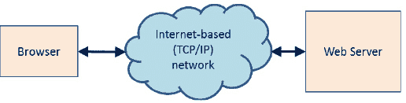 **图 1-1** 早期 Web 应用

为了给 Web 用户提供动态内容，随着通用网关接口（`CGI`）的引入，实现了二层 Web 应用，它可以从外部数据资源（如数据库）检索内容。在传统的客户端-服务器架构中，`CGI` 充当客户端角色。`CGI` 脚本处理请求并将结果返回给 Web 服务器。服务器随后将内容格式化为 `HTML` 并返回给浏览器进行显示。

`CGI` 存在许多缺点，导致了二层架构的演变。数据库通常运行在同一台机器上；因此，备份数据非常困难。`CGI` 作为单独进程运行，因此会受到上下文切换开销的影响。`CGI` 的设计并未考虑性能、安全或扩展性。

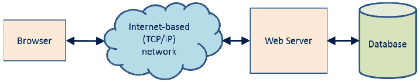 **图 1-2** 二层 Web 应用

如今，n 层 Web 应用架构被广泛使用。在这种架构中，引入了中间件或应用程序服务器来更高效地连接 Web 服务器和数据库。n 层应用的性能得到了提高，因为 Web 服务器、中间件和数据库可以托管在不同的机器上。每一层都可以为了负载均衡的目的而进行复制。安全性也得到了提高，因为数据没有存储在 Web 或应用程序服务器上，这使得黑客难以访问存储数据的数据库。

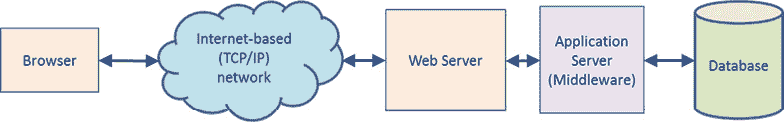 **图 1-3** n 层 Web 架构

Web 服务器和应用程序服务器通常运行在同一台机器上；然而，最佳实践是将数据库服务器运行在独立的机器上。在软件开发环境中，所有三个服务器都可以托管在单台机器上。在本书中，服务器通常指一种软件应用程序。

### 1.1 浏览互联网

在 Web 2.0 构想之前（约 1999 年），万维网（`WWW`）和互联网的基本用法非常简单，基于传统的客户端-服务器模型，使用了较旧的技术，如远程过程调用（`RPC`）、事务处理（`TP`）监控或其他允许编程客户端的中间件。

考虑通过浏览器浏览互联网的典型用例。示例中的 Web 服务器使用 Java Server Pages（`JSP`）技术提供动态 `HTML` 页面。此外，它使用了企业 Java Bean（`EJB`）或普通 Java 对象（`POJO`）。`JSP` 面向于表现层的网页交付。`EJBs` 或 `POJOs` 通常用于处理业务规则。有数千个使用 `Java/JEE` 技术的 Web 应用。

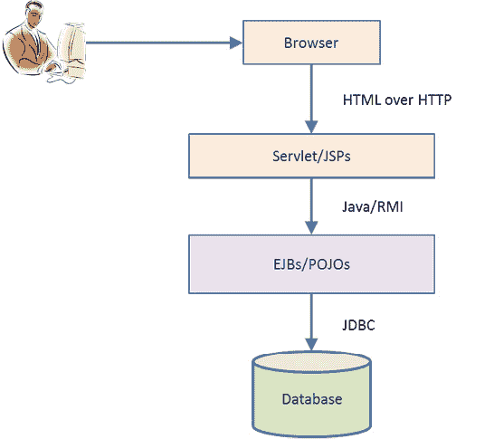 **图 1-4** 人机交互

互联网架构最初是为人类用户设计的。`HTTP` 协议用于交换文档（Web 或 `HTML` 页面）。`HTML` 是为基础图形用户界面（`GUI`）应用程序设计的。用户浏览互联网时，浏览器上的计算资源通常是空闲的。这些可用资源引发了提供更健壮的网络浏览体验的想法。此外，企业对企业（`B2B`）数据交换模型也变得更加可行。因此，引入了 `WS` 架构来支持这种新类型的数据交换。

### 1.2 Web 服务架构

服务可以是三种交互类型之一：人人交互、人机或机机交互。餐厅服务是人人交互的例子。从自动取款机（`ATM`）上取钱是人机交互的例子。机机交互的例子是手持设备（如智能设备，例如手机或平板电脑）与 Microsoft Outlook 同步通讯录。Web 服务是一种使用特定 Web 标准和技术的机机交互。Web 服务是一组编程接口，而不是一组网页。

本节从 Web 服务的基本定义开始，以便为后续章节的使用建立基础理解。当正确解释 Web 服务的基本概念后，Web 服务更复杂的方面将更容易理解。根据 W3C 网站 `http://www.w3.org/TR/ws-reqs`：

> Web 服务是一组编程接口，而不是一组网页。

> 服务可以是三种交互类型之一：人人交互、人机或机机交互。餐厅服务是人人交互的例子。从自动取款机（`ATM`）上取钱是人机交互的例子。机机交互的例子是手持设备（如智能设备，例如手机或平板电脑）与 Microsoft Outlook 同步通讯录。Web 服务是一种使用特定 Web 标准和技术的机机交互。

可以使用某种服务注册中心来定义、发布和发现服务。目前支持的服务注册中心包括电子业务 XML (ebXML)、通用发现、描述和集成 (UDDI) 以及元数据注册表 (MDR)。UDDI 通常是一个好主意；但在私有网络之外，它并没有被广泛使用。

RPC 是一种强大的技术，它为跨机器网络提供了分布式计算能力。RPC 是进程间通信的一种形式，允许位于网络中不同（或相同）位置的应用程序之间进行函数调用。它最适用于客户端-服务器编程。

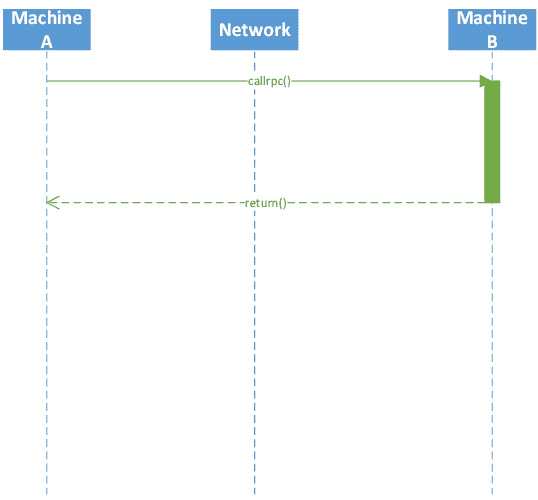 **图 1-5** 远程过程调用 (RPC)

Web 服务可以帮助解决企业应用集成 (EAI) 中的几个问题。为业务解决方案集成现有的应用程序是一项复杂且耗时的任务。使用不同计算机语言（如 C/C++、JAVA、Visual Basic 和 FORTRAN）编写的应用程序对外部世界具有独特的逻辑接口，这使得这些程序的集成变得困难、复杂且耗时。运行在不同机器架构（如 SUN、个人电脑、IBM 主机、IBM A/S 400）上的应用程序对外部世界具有独特的物理接口。集成这些应用程序也具有挑战性。运行通过网络连接的机器上的应用程序也难以集成。EAI 的挑战出现在三个主要领域：

* 语言障碍 – XML 是一种用于消息交换的标准化语言

* 平台障碍 – SOAP 已在许多平台（如 Unix、Windows）上实现

* 网络障碍 – HTTP 和 SMTP 是标准化的网络协议

WS（Web 服务）可以作为应用程序集成的实现技术。如前所述，WS 重点关注以下主要标准：XML、SOAP、WSDL、UDDI 和 HTTP。

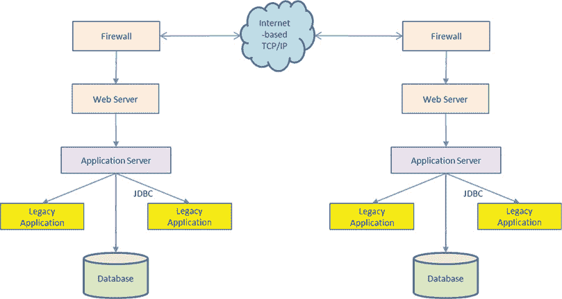 **图 1-6** 业务机集成

#### SOAP 序图

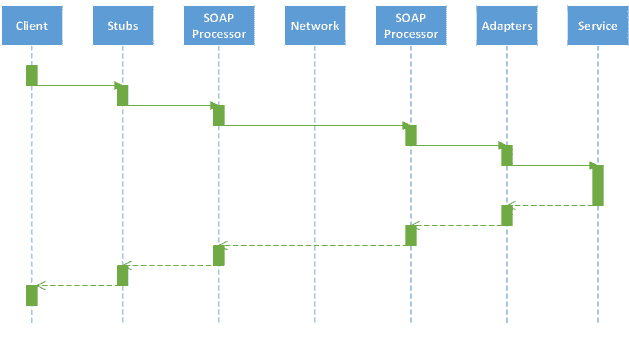 **图 1-7** SOAP 序图

**服务请求者** – 消费或请求服务的客户端

**服务提供者** – 实现服务并满足服务请求的实体

**服务注册中心** – 类似于电话簿的列表，列出并详细描述了可用服务

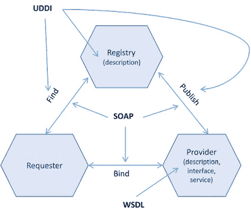 **图 1-8** Web 服务架构

### 1.3 Web 服务的优势

Web 服务提供了许多优势：

1. 平台无关性：Web 服务现在几乎适用于所有平台：

2. a) 硬件：主机、中端设备、个人和移动设备

3. b) 操作系统：UNIX、Windows、主机操作系统、Android 和 iPhone

4. 复用现有的网络基础设施：HTTP、SMTP 和 JMS 协议

5. 软件组件的松耦合促进了软件复用

6. 降低集成成本并提高速度

7. 开放架构和通信协议

### 1.4 编写一个 HelloWorld Web 服务

如果没有看到创建和使用 Web 服务的具体示例，Web 服务的概念可能很难理解。自上而下的方法从一个描述服务的 WSDL 文件开始。自上而下的方法可能会增加互操作性，并允许对 WS 有更多控制，而自下而上的方法从 Java Bean 或企业 Java Bean (EJB) 的低级开始，速度更快且更简单。

可以使用以下步骤创建和测试简单的 WS 应用：


1. 运行 Eclipse IDE，创建一个新的 Java 项目，并命名为 `java-ws`。

2. 将 `Server.java` 作为 Java 程序运行。

3. 验证服务端点的 WSDL 和关联架构：`http://localhost:9999/HelloWorld?wsdl`。

4. 使用 SOAPUI 软件测试 HelloWorld Web 服务。

5. 创建 Java Web 服务客户端代码。

### 1.4.1 创建项目

在上面的示例中，使用了自下而上的方法。此示例需要 Java 6 或更高版本。创建了一个名为“Hello World”的 Web 服务，其方法名为 `say`，需要一个 `String` 参数。在 Eclipse IDE 下创建 Java 项目，执行以下步骤：

1. 运行 Eclipse IDE。

2. 选择 File → New → Java Project。使用所有默认设置并命名为 `java-ws`。

3. 展开 `java-ws` 项目，右键点击 `src` 目录并选择 New → Package。命名包 `com.bemach.ws.hello`。

4. 同样，创建另一个 Java 包 `com.bemach.ws.server`。

5. 创建两个 Java 类：`com.bemach.ws.hello.HelloWorld.java` 和 `com.bemach.ws.server.Server.java`。

### 1.4.2 创建 Web 服务

Java 的经典 HelloWorld 类可以用几行代码编写。其目的是确保 Java 虚拟机已正确安装并准备好进行编程。

#### 列表 1-1 HelloWorld.java

```java
package com.bemach.ws.hello;
```

```java
/**
 * 2013 (C) BEM, Inc., Fairfax, Virginia
 * 除非适用法律要求或书面同意，否则分发的软件按“现状”基础分发，
 * 不提供任何形式的保证或条件，无论是明示还是隐含的。
 */
public class HelloWorld {
    public String say(String name) {
        return String.format("Hello, %s!", name);
    }

    public static void main(String[] args) {
        String msg = new HelloWorld().say("Johnny, B. Good");
        System.out.println(msg);
    }
}
```

**输出**：

```text
Hello, Johnny B. Good!
```

通过这种方式，HelloWorld 程序被转换为 WS 应用。这是使用 Java 语言实现的简单 WS。

要将 HelloWorld 程序从简单的 Java Bean 转换为 WS 应用，四个 WS 注解——即 `@WebService`、`@SOAPBinding`、`@WebMethod` 和 `@WebParam`——装饰如下：

#### 列表 1-2 带有 Web 服务注解的 HelloWorld.java

```java
package com.bemach.ws.hello;

import java.util.logging.Logger;
import javax.jws.WebMethod;
import javax.jws.WebParam;
import javax.jws.WebService;
import javax.jws.soap.SOAPBinding;

/**
 * 2013 (C) BEM, Inc., Fairfax, Virginia
 * 除非适用法律要求或书面同意，否则分发的软件按“现状”基础分发，
 * 不提供任何形式的保证或条件，无论是明示还是隐含的。
 */
@WebService
@SOAPBinding(style = SOAPBinding.Style.DOCUMENT)
public class HelloWorld {
    private static final Logger LOG =
        Logger.getLogger(HelloWorld.class.getName());

    @WebMethod
    public String say(@WebParam(name = "name") String name) {
        LOG.info("Web service is called!");
        return String.format("Hello, %s!", name);
    }

    public static void main(String[] args) {
        String msg = new HelloWorld().say("Johnny, B. Good");
        LOG.info(msg);
    }
}
```

为了托管服务端点，WS 需要一个 HTTP 服务器。可以使用 Apache JEE Tomcat 服务器；但也可以仅用 Java 创建基础服务器。在示例中，我们创建了一个绑定到 WS 实现的特定 URL 的端点。在这种情况下，URL 为 `http://localhost:9999/java-ws/hello`，实现是 `HelloWorld` 对象 `svc`。

### 1.4.3 创建 HTTP 服务器

#### 列表 1-3 Server.java 类

```java
package com.bemach.ws.server;

/**
 * 2013 (C) BEM, Inc., Fairfax, Virginia
 *
 * Unless required by applicable law or agreed to in writing,
 * software distributed is distributed on an
 * "AS IS" BASIS, WITHOUT WARRANTIES OR CONDITIONS OF ANY
 * KIND, either express or implied.
 */

import java.util.logging.Logger;
import javax.xml.ws.Endpoint;
import javax.xml.ws.EndpointReference;

import com.bemach.data.DbConfig;
import com.bemach.ws.doc.employees.EmployeeDocData;
import com.bemach.ws.hello.HelloWorld;
import com.bemach.ws.rpc.employees.EmployeeRpcData;

public final class Server {
    private static final Logger LOG =
        Logger.getLogger(Server.class.getName());

    private static final String MYSQL_DRIVER = "com.mysql.jdbc.Driver";
    private static final String DB_HOST = "saintmonica";
    private static final String DB_PORT = "3306";
    private static final String DB_SID = "employees";
    private static final String DB_USER = "empl_1";
    private static final String DB_PSW = "password";

    private Server() {}

    protected static DbConfig getDbConfig() {
        DbConfig dbCfg = new DbConfig();
        dbCfg.setDriverName(MYSQL_DRIVER);
        dbCfg.setHost(DB_HOST);
        dbCfg.setPort(DB_PORT);
        dbCfg.setDb(DB_SID);
        dbCfg.setUid(DB_USER);
        dbCfg.setPsw(DB_PSW);
        return dbCfg;
    }

    private static final String HOST_NAME = "localhost";
    private static final String PORT_NO = "9999";
    private static final String HELLO_SVC_NAME = "java-ws/hello";
    private static final String RPC_EMPL_SVC_NAME = "rpc/employees";
    private static final String DOC_EMPL_SVC_NAME = "doc/employees";
    private static final String PROTOCOL = "http";

    protected static SvrConfig getSvrConfig() {
        SvrConfig svrCfg = new SvrConfig();
        svrCfg.setListenHostname(HOST_NAME);
        svrCfg.setListenPort(PORT_NO);
        svrCfg.setListenInterface(HELLO_SVC_NAME);
        svrCfg.setListenProtocol(PROTOCOL);
        return svrCfg;
    }

    protected static Endpoint publish(SvrConfig cfg, Object svc) {
        String url = String.format(
            "%s://%s:%s/%s",
            cfg.getListenProtocol(),
            cfg.getListenHostname(),
            cfg.getListenPort(),
            cfg.getListenInterface()
        );

        Endpoint ep = Endpoint.publish(url, svc);
        EndpointReference epr = ep.getEndpointReference();

        LOG.info("\nEndpoint Ref:\n" + epr.toString());
        return ep;
    }

    protected static void startHelloWorld() {
        SvrConfig cfg = getSvrConfig();
        cfg.setListenHostname(HOST_NAME);
        cfg.setListenInterface(HELLO_SVC_NAME);
        cfg.setListenPort(PORT_NO);
        cfg.setListenProtocol(PROTOCOL);

        HelloWorld hello = new HelloWorld();
        publish(cfg, hello);

        LOG.info("HelloWorld service started successfully ...");
    }

    protected static void startRpcEmployees() {
        SvrConfig svrCfg = getSvrConfig();
        svrCfg.setListenHostname(HOST_NAME);
        svrCfg.setListenInterface(RPC_EMPL_SVC_NAME);
        svrCfg.setListenPort(PORT_NO);
        svrCfg.setListenProtocol(PROTOCOL);

        DbConfig dbCfg = getDbConfig();
        svrCfg.setDbCfg(dbCfg);

        EmployeeRpcData rpcEmpl = new EmployeeRpcData(dbCfg);
        publish(svrCfg, rpcEmpl);

        LOG.info("Employees (RPC) service started successfully ...");
    }

    protected static void startDocEmployees() {
        SvrConfig svrCfg = getSvrConfig();
        svrCfg.setListenHostname(HOST_NAME);
        svrCfg.setListenInterface(DOC_EMPL_SVC_NAME);
        svrCfg.setListenPort(PORT_NO);
        svrCfg.setListenProtocol(PROTOCOL);

        DbConfig dbCfg = getDbConfig();
        svrCfg.setDbCfg(dbCfg);

        EmployeeDocData docEmpl = new EmployeeDocData(dbCfg);
        publish(svrCfg, docEmpl);

        LOG.info("Employees (Document) service started successfully ...");
    }

    /**
     * Start WS Server with multiple service endpoints...
     *
     * @param args
     */
    public static void main(String[] args) {
        startHelloWorld();
        startRpcEmployees();
        startDocEmployees();
    }
}
```

当 `Server` 程序运行时，它会调用 `startHelloWorld` 方法创建一个与唯一 URL 绑定的 WS 实现。随后，该端点将被发布并准备好接收来自远程客户端的请求。对于这个简单的程序，可以使用 Ctrl-C 停止服务器。

`DbConfig.java` 类是数据库访问参数和 URL 所需参数的简单占位符。在稍后的示例中，将使用 Java 代码实现对数据库的数据访问。但请记住，这是示例代码；因此密码以明文形式显示或存储。在业务或安全环境中，每次都会输入密码或进行加密存储。

## 1.5 启动 Web 服务

在 Eclipse 中，执行以下操作：

1. 运行 `Server.java`。选择 `运行` → `Java`。

Eclipse 项目如下：

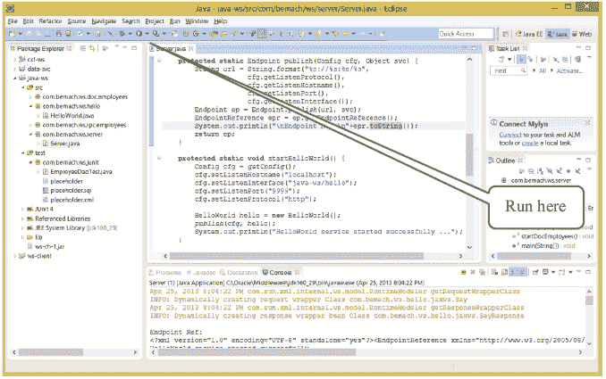

**图 9**：*启动 Web 服务*

## 1.6 验证 Web 服务

查看 WSDL：

[`localhost:9999/java-ws/hello`](http://localhost:9999/java-ws/hello)

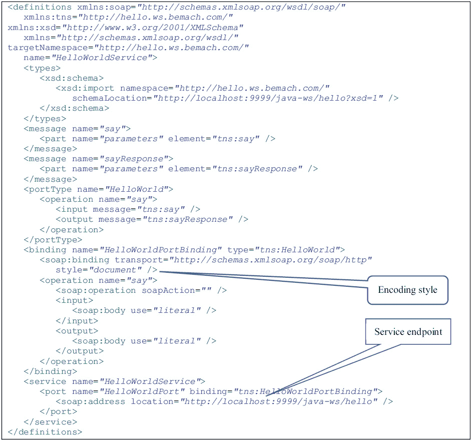

**图 10**：*WSDL*

要查看关联架构，请访问：

[`localhost:9999/java-ws/hello`](http://localhost:9999/java-ws/hello)

```xml
<schema targetNamespace="http://localhost:9999/java-ws/" xmlns="http://www.w3.org/2001/XMLSchema">
  <element name="say">
    <complexType>
      <sequence>
        <element name="name" type="xs:string"/>
      </sequence>
    </complexType>
  </element>
  <element name="sayResponse">
    <complexType>
      <sequence>
        <element name="return" type="xs:string"/>
      </sequence>
    </complexType>
  </element>
</schema>
```

**列表 5**：*架构*

## 1.7 使用 SOAPUI 测试 Web 服务

SOAPUI 是一种允许软件开发人员和集成人员测试 Web 服务的软件。类似于 Eclipse：

1. 运行 SOAPUI 程序。

2. 选择 `文件` → `新建 SOAP 项目`。

3. 输入项目名称和初始 WSDL。


**图 12**：*为 HelloWorld SOAPUI 项目*

要执行 SOAP 操作，请采取以下步骤：

1. 在左面板双击 `Request 1`。

2. 在 `<arg0>` 和 `</arg0>` 之间填充。

3. 点击顶部的绿色三角形。

4. 在右面板查看 SOAP 响应。

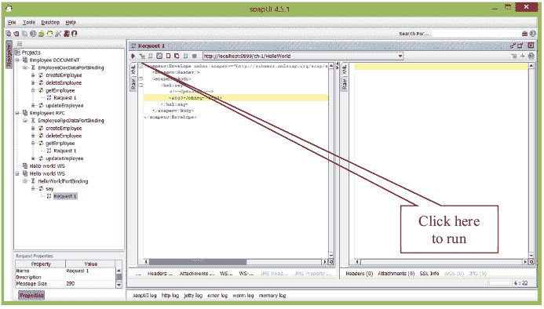

**图 13**：*打开 WSDL*

### 1.7.1 SOAP 请求

SOAP 处理器生成此请求并将其通过网络发送到带有简单字符串参数的 `say` 操作。


```xml
<soapenv:Envelope xmlns:soapenv="http://schemas.xmlsoap.org/soap/envelope/" xmlns:hel="http://hello.ws.bemach.com/">
   <soapenv:Header/>
   <soapenv:Body>
      <hel:say>
         <name>Johnny B. Good</name>
      </hel:say>
   </soapenv:Body>
</soapenv:Envelope>
```

**列表 6** *SOAP 请求消息*

### 1.7.2 SOAP 响应

SOAP 响应显示了消息字符串的简单返回。

```xml
<S:Envelope xmlns:S="http://schemas.xmlsoap.org/soap/envelope/" xmlns:ns2="http://hello.ws.bemach.com/">
   <S:Body>
      <ns2:sayResponse>
         <return>Hello, Johnny B. Good!</return>
      </ns2:sayResponse>
   </S:Body>
</S:Envelope>
```

**列表 7** *SOAP 响应消息*

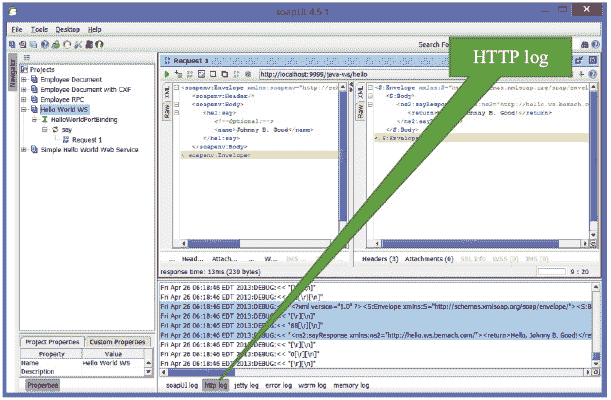 **图 14** *调用 Web 服务的操作（方法）*

## 1.8 创建 Web 服务客户端

编写 WS 客户端代码非常简单；然而，为了减轻客户端的编码工作，后台所需的代码量可能是巨大的。生成的代码使得客户端应用程序能够像调用其他 Java Bean 一样调用 WS 操作。这使得客户端 WS 应用程序的编程变得简单了一些。在下一章节中，我们将使用 SAAJ API 创建一个调用 HelloWorld Web 服务的 Java 客户端代码。

创建一个调用 HelloWorld Web 服务的 Java Web Service 客户端涉及以下步骤：

1. 在 Eclipse 中创建一个 `java-ws-client` 项目。
2. 从服务端点（`http://localhost:9999/java-ws/hello?WSDL`）生成 WS 客户端存根（stub）。
3. 编写一个 Java 客户端类。

### 1.8.1 创建项目

### 1.8.2 生成 Web 服务存根

首先，使用 Java JDK 包中现有的工具 `wsimport` 生成生成的 WS 客户端代码。其次，使用生成的代码编写客户端代码。

1. 打开命令提示符或 Unix 终端。
2. 进入 `java-ws-client` 项目目录。
3. 创建一个 `generated` 目录。
4. 创建一个 `lib` 目录。
5. 进入 `generated` 目录。
6. 运行以下命令：

```
wsimport -d . http://localhost:9999/java-ws/hello?wsdl
```

7. 将生成的客户端代码打包：

```
jar cvf ../java-ws-generated.jar *
```

8. 将 `java-ws-generated.jar` 文件移动到 `lib` 目录。

### 1.8.3 创建 Web 服务客户端

9. 返回 Eclipse 并刷新 Java 项目：

   a) 选择 `java-ws` 项目。
   b) 选择 `File` → `Refresh`。
   c) 从项目属性中，选择 `Java Build Path/Libraries`。
   d) 点击 `Add JARs` 并添加 `java-ws-generated.jar` 文件。
   e) 点击 `OK`。

10. 创建一个新的 Java 包：`com.bemach.ws.hello.client`。
11. 创建一个新的 Java 类：`HelloWorldClient.java`。

列表 1-8. 一个 HelloWorld Web 服务客户端

```java
package com.bemach.ws.hello.client;
/*** 2013 (C) BEM, Inc., Fairfax, Virginia** Unless required by applicable law or agreed to in writing,* software distributed is distributed on an “AS IS" BASIS, WITHOUT WARRANTIES OR CONDITIONS OF ANY KIND, either express or implied.**/**
import java.net.MalformedURLException;
import java.net.URL;
import java.util.logging.Level;
import java.util.logging.Logger;
import javax.xml.namespace.QName;
import javax.xml.ws.Service;
import com.bemach.ws.hello.HelloWorld;
import com.bemach.ws.hello.HelloWorldService;
/*** 以下代码是使用 Java 代码调用* web 服务的正常方式。* 它更容易理解。**/**
public class HelloWorldWSClient {
    private static final Logger LOG = Logger.getLogger(HelloWorldWSClient.class.getName());
    public static void main(String[] args) {
        HelloWorldWSClient client = new HelloWorldWSClient();
        try {
            client.say("Johnny B. Good");
        } catch (Exception e) {
            LOG.log(Level.SEVERE, "ERROR:"+e);
        }
    }
    public void say (String name) throws MalformedURLException {
        LOG.info("service ... ");
        QName qName = new QName("http://hello.ws.bemach.com/", "HelloWorldService");
        URL url = new URL("http://localhost:9999/java-ws/hello");
        Service service = HelloWorldService.create(url, qName);
        HelloWorld port = (HelloWorld)service.getPort(HelloWorld.class);
        String returnMsg = port.say(name);
        LOG.info("return: "+returnMsg);
    }
}
```

## 1.9 运行 Web 服务客户端

#### 输出

Web 服务响应：Hello, Johnny B. Good!

## 1.10 引用

Gottschalk, K., Graham, S., Kreger, H., & Snell, J. (2002). Introduction to Web Services architecture. *IBM Systems Journal, 41*(2), 170–177.

Kleijnen, S., & Raju, S. (2003). An Open Web Services Architecture. *Queue, 1*(1), 38–46.

Martin, J., Arsanjani, A., Tarr, P., & Hailpern, B. (2003). Web Services: Promises and Compromises. *Queue, 1*(1), 48–58.

# 2 SOAP

## 目标

阅读完本章后，你应该：

1. 对 SOAP 有基本的理解
2. 能够描述 SOAP 消息的结构
3. 理解如何处理 SOAP 消息
4. 能够映射 SOAP 消息

SOAP 是一种轻量级协议，旨在用于去中心化的分布式环境中交换信息。它使用 XML 技术定义了一个可扩展的框架，该框架独立于任何编程模型和其他实现。

SOAP 被实现为许多中间件平台的插件。最初对 RPC 的强调使得 SOAP 能够在互联网上广泛实现。最终，出现了 HTTP 以外的交互需求（例如 SMTP 和 JMS）。

SOAP 版本 1.2 是一种轻量级协议，旨在用于去中心化的分布式环境中交换结构化信息。SOAP 规范提供了一套正式规则，规定了 SOAP 消息如何由 SOAP 节点（即发送者、接收者和中间节点）生成和接受。

### SOAP XML 负载

SOAP 消息封装在一个 SOAP 封中，其中包含 SOAP Header 和 SOAP Body。SOAP Body 是强制的，而 SOAP Header 是可选的。SOAP 消息是 SOAP 节点之间通信的基本单元。SOAP 节点可以传输、接收或中继 SOAP 消息。最终目的责任是根据标准处理 SOAP 消息。SOAP 消息在 SOAP 发送者和 SOAP 接收者之间传输。在分布式计算环境中可能存在 SOAP 中间节点。

## 2.1 SOAP 消息示例

以下显示了三种形式的 SOAP 消息：请求、响应和故障。

消息可以使用 HTTP 协议进行交换；因此，防火墙会允许消息通过。SOAP 消息也可以自然地通过 HTTPS 协议在安全信道上运行。SOAP 促进了一种松耦合的计算范式，其中软件组件的知识仅限于服务的接口。

### 2.1.1 SOAP 请求消息

该请求表示对 `getEmployee` 方法的调用，其参数 `emplNo` 为 `100011`。注意，正文包含一个带有有一个 XML 元素 `<emp:getEmployee>` 的单个主体块。请求在通过网络传输到远程 SOAP 服务器之前，会被封化（序列化）为一个 XML 文档。当消息到达服务器时，它由 SOAP 引擎进行“反序列化”，并调用目标方法。

- 在这种情况下，没有使用 SOAP Header。
- SOAP 主体包含一个元素 `emp:getEmployee`。
- `getEmployee`：为了获取员工记录，需要员工编号（`emplNo`）。

#### 列表 2-1. SOAP 消息请求

```xml
| <soapenv:Envelope  xmlns:soapenv="http://schemas.xmlsoap.org/soap/envelope/"xmlns:emp="http://employees.ws.bemach.com/*"><soapenv:Header  /><soapenv:Body><emp:getEmployee><emplNo>100011</emplNo></emp:getEmployee></soapenv:Body></soapenv:Envelope> |
```

### 2.1.2 SOAP 响应消息

当 SOAP 服务器成功处理请求时，响应将会被封化为 XML 文档，并作为 HTTP 响应的一部分返回给客户端。客户端 SOAP 引擎随后将反序列化消息，以进一步处理调用结果。

- 未使用 SOAP Header。
- SOAP 主体包含一个元素 `ns2:getEmployeeResponse`。注意，使用了并引用了命名空间 `ns2`。
- 在 SOAP 主体中，返回了一个员工记录。

#### 列表 2-2. SOAP 消息响应

```xml
| <S:Envelope  xmlns:S="http://schemas.xmlsoap.org/soap/envelope/*"><S:Body><ns2:getEmployeeResponse  xmlns:ns2="http://employees.ws.bemach.com/*"xmlns:ns3="http://bemach.com*"><return><emplNo>100011</emplNo><firstName>Shmuel</firstName><lastName>Birge</lastName><birthDate>1956-07-20T00:00:00-04:00</birthDate><gender>M</gender><hireDate>1989-11-23T00:00:00-05:00</hireDate></return></ns2:getEmployeeResponse></S:Body></S:Envelope> |
```

### 2.1.3 SOAP 错误消息

如果请求包含无效的员工编号，则可以选择返回一个 SOAP 错误消息。SOAP 错误可能包含帮助客户端解决错误或意外情况的消息。它必须包含故障代码（fault code）、故障字符串（fault string）和详细的错误消息。

#### 列表 2-3. SOAP 错误

```xml
| <S:Envelope  xmlns:S="http://schemas.xmlsoap.org/soap/envelope/*"><S:Body><S:Fault  xmlns:ns4="http://www.w3.org/2003/05/soap-envelope*"><faultcode>S:Server</faultcode><faultstring>No such employee!</faultstring><detail><ns2:SOAPException  xmlns:ns2="http://employees.ws.bemach.com/*"xmlns:ns3="http://bemach.com*"><message>No such employee!</message></ns2:SOAPException></detail></S:Fault></S:Body></S:Envelope> |
```

基本假设是所有数据类型都以 XML 格式在 SOAP 节点之间交换。在现实中，并不是所有数据都应该转换为 XML（例如，二进制图像、专有数据格式）。因此，建议的解决方案是使用类似于电子邮件协议的 SOAP 附件。然而，这种方法存在问题，因为扩展性可能会成为问题。此外，并不是所有的 SOAP 引擎都实现 SOAP 附件；因此，SOAP 节点之间的兼容性成为一个问题。这并没有排除附件带来的开销。

## 2.2 将 SOAP 映射到 HTTP

SOAP 消息交换很好地映射到 HTTP 协议。在这个示例中，使用 HTTP `POST` 来调用服务器上的 SOAP 方法：

#### 列表 2-4. 一个 HTTP Post

```http
POST /java-ws/hello HTTP/1.1Accept-Encoding: gzip,deflateContent-Type: text/xml;charset=UTF-8SOAPAction: ""Content-Length: 298Host: localhost:9999Connection: Keep-AliveUser-Agent: Apache-HttpClient/4.1.1 (java 1.5)<soapenv:Envelope xmlns:soapenv="http://schemas.xmlsoap.org/soap/envelope/" xmlns:hel="http://hello.ws.bemach.com/"><soapenv:Header/><soapenv:Body><hel:say><!–Optional:–><name>Johnny B. Good</name></hel:say></soapenv:Body></soapenv:Envelope> |
```

#### 列表 2-5. 另一个 HTTP Post

```http
POST /rpc/employees HTTP/1.1Accept-Encoding: gzip,deflateContent-Type: text/xml;charset=UTF-8SOAPAction: ""Content-Length: 290Host: localhost:9999Connection: Keep-AliveUser-Agent: Apache-HttpClient/4.1.1 (java 1.5)<soapenv:Envelope xmlns:soapenv="http://schemas.xmlsoap.org/soap/envelope/" xmlns:emp="http://employees.ws.bemach.com/"><soapenv:Header/><soapenv:Body><emp:getEmployee><emplNo>100011</emplNo></emp:getEmployee></soapenv:Body></soapenv:Envelope> |
```

在这种情况下，HTTP `POST` 的 SOAP 响应相对简单：

#### 列表 2-6. 一个 HTTP 响应


```http
HTTP/1.1 200 OK
Transfer-encoding: chunked
Content-type: text/xml;charset="UTF-8"
5e
<?xml version="1.0" ?>
<S:Envelope xmlns:S="http://schemas.xmlsoap.org/soap/envelope/">
    <S:Body>
        88
        <ns2:sayResponse xmlns:ns2="http://hello.ws.bemach.com/">
            <return>Hello, Johnny B. Good!</return>
        </ns2:sayResponse>
    </S:Body>
</S:Envelope>
|
```

#### 列表 2-7. 另一个 HTTP 响应

```http
HTTP/1.1 200 OK
Transfer-encoding: chunked
Content-type: text/xml;charset=UTF-8
Date: Thu, 11 Apr 2013 10:20:49 GMT
5e
<?xml version="1.0" ?>
<S:Envelope xmlns:S="http://schemas.xmlsoap.org/soap/envelope/">
    <S:Body>
        167
        <ns3:getEmployeeResponse xmlns:ns2="http://bemach.com" xmlns:ns3="http://employees.ws.bemach.com/">
            <return>
                <emplNo>10002</emplNo>
                <firstName>Bezalel</firstName>
                <lastName>Simmel</lastName>
                <birthDate>1964-06-02T00:00:00-04:00</birthDate>
                <gender>F</gender>
                <hireDate>1985-11-21T00:00:00-05:00</hireDate>
            </return>
        </ns3:getEmployeeResponse>
    </S:Body>
</S:Envelope>
|
```

## 2.3 SAAJ 客户端

Java SOAP 附件 API（SAAJ）编写起来更为复杂。它允许开发者直接访问创建 SOAP 消息的方法。可以使用 Java API 直接操作 XML。与第 1 章中编写使用 JAX-RPC 的客户端代码相比，编写 SAAJ 客户端可能非常辛苦。

使用 SAAJ 创建 SOAP 客户端的步骤如下：

1. 创建包含 SOAP Header 和 Body 的 SOAP 消息。
2. 在 SOAP Header 和 Body 中添加必要的元素。
3. 创建 SOAP 连接（URL）。
4. 将 SOAP 消息发送到 SOAP 服务器。
5. 处理响应消息。

有了 SOAP 消息的基础知识，就可以用 Java 编写客户端。HelloWorld 服务的客户端代码如下。

#### 列表 2-8. 使用 SAAJ 的 `HelloWorldSOAPClient.java` 类

```java
package com.bemach.ws.hello.client;
/*** 2013 (C) BEM, Inc., Fairfax, Virginia** 除非适用法律要求或书面同意，否则分发的软件按“原样”基础提供，不提供任何形式的明示或隐含保证或条件。**/**
import java.net.MalformedURLException;
import java.net.URL;
import java.util.Iterator;
import java.util.logging.Logger;
import javax.xml.soap.MessageFactory;
import javax.xml.soap.Name;
import javax.xml.soap.SOAPBody;
import javax.xml.soap.SOAPBodyElement;
import javax.xml.soap.SOAPConnection;
import javax.xml.soap.SOAPConnectionFactory;
import javax.xml.soap.SOAPElement;
import javax.xml.soap.SOAPException;
import javax.xml.soap.SOAPFactory;
import javax.xml.soap.SOAPHeader;
import javax.xml.soap.SOAPMessage;
/*** 以下代码是使用 Java 代码调用 Web 服务的复杂方式。 有时这种情况是必要的。**/**
public final class HelloWorldSOAPClient {
    private static final Logger LOG = Logger.getLogger(HelloWorldSOAPClient.class.getName());
/***<soapenv:Envelope xmlns:soapenv="http://schemas.xmlsoap.org/soap/envelope/" xmlns:m="http://hello.ws.bemach.com/"><soapenv:Header/><soapenv:Body><m:say><arg0>Johnny</arg0></m:say></soapenv:Body></soapenv:Envelope>
```

```xml
<S:Envelope xmlns:S="http://schemas.xmlsoap.org/soap/envelope/">
    <S:Body>
        <ns2:sayResponse xmlns:ns2="http://hello.ws.bemach.com/">
            <return>Hello, Johnny!</return>
        </ns2:sayResponse>
    </S:Body>
</S:Envelope>
```

```java
private HelloWorldSOAPClient() {}

public static void main(String[] args) {
    try {
        // 1. 创建一个 SOAP 消息
        SOAPFactory sf = SOAPFactory.newInstance();
        MessageFactory mf = MessageFactory.newInstance();
        SOAPMessage sm = mf.createMessage();
        SOAPHeader sh = sm.getSOAPHeader();
        SOAPBody sb = sm.getSOAPBody();
        sh.detachNode();

        // 2. 在标头和正文中添加必要的元素
        Name bodyName = sf.createName("say", "m", "http://hello.ws.bemach.com/");
        SOAPBodyElement be = sb.addBodyElement(bodyName);
        Name name = sf.createName("name");
        SOAPElement arg0 = be.addChildElement(name);
        arg0.addTextNode("Johnny");

        // 3. 创建一个 SOAP 连接
        URL ep = new URL(String.format("http://localhost:%s/java-ws/hello?WSDL", args[0]));
        SOAPConnectionFactory scf = SOAPConnectionFactory.newInstance();
        SOAPConnection sc = scf.createConnection();

        // 4. 使用连接发送 SOAP 消息
        SOAPMessage response = sc.call(sm, ep);
        sc.close();

        // 5. 处理响应消息
        SOAPBody respBody = response.getSOAPBody();
        Iterator it = respBody.getChildElements();
        SOAPBodyElement el = (SOAPBodyElement) it.next();
        LOG.info("resp=" + el.getNodeName());
        it = el.getChildElements();
        SOAPElement ret = (SOAPElement) it.next();
        LOG.info(String.format("%s=%s", ret.getNodeName(), ret.getTextContent()));
    } catch (UnsupportedOperationException e) {
        LOG.severe(e.getMessage());
    } catch (SOAPException e) {
        LOG.severe(e.getMessage());
    } catch (MalformedURLException e) {
        LOG.severe(e.getMessage());
    }
}
```

SAAJ 许多功能可以用于处理 SOAP 消息。关于此主题的更多信息，请参阅本书末尾的参考文献。

SOAP 消息可以以两种方式结构：文档样式（document style）和 RPC 样式（RPC style）。最初只支持 RPC 样式。对于 RPC 模型，SOAP 正文定义了一个带有关联参数的特定方法，客户端调用该方法。因此，客户端与服务器之间的消息交换可以受到限制。方法调用与输入输出参数直接绑定。

然而，与 RPC 样式不同，文档样式允许客户端和服务器以它们选择的任何格式交换消息。SOAP 正文包含不遵循任何 SOAP 格式规则的消息。正文可以根据架构进行验证。

## 2.4 总结

SOAP 是 Web 服务的基础。SOAP 仍然是用于 B2B 集成的主流消息交换协议。注意，SOAP 中没有刻意提到安全问题。SOAP 主要关于两个系统之间的消息交换。它促进了松耦合计算。为了避免协议的复杂性，安全和其他功能被省略在外。

在下一章中，我们将讨论 Web 服务如何使用 SOAP 作为传输协议来促进面向服务的计算范式。

## 2.5 参考文献

可以在以下在线文档中找到更多信息：

Albrecht, C.C. (2004). “How clean is the future of SOAP?” Commun. ACM 47(2): 66–68.

SOAP Version 1.2 Part 0: Primer (Second Edition), Retrieved August 27, 2007 from:

- `http://www.w3.org/TR/2007/soap12-part0`
- `http://www.w3schools.com/soap/default.asp`

WSDL 是一个根元素名为 `definitions` 的 XML 文档。该定义包含两个部分：抽象部分和具体部分。抽象描述由 `types`、`message` 和 `portType` 组成。具体部分由 `binding` 和 `service` 组成。抽象部分描述了与服务实现方式无关的操作，而具体部分指定了可以调用服务的协议和位置。

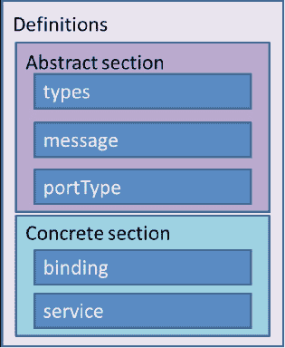

**图 3-1** WSDL 结构

在接下来的章节中，我们将更细致地检查 WSDL 的结构，以理解抽象接口与具体实现之间的关系。

*列表 3-1 示例 WSDL*

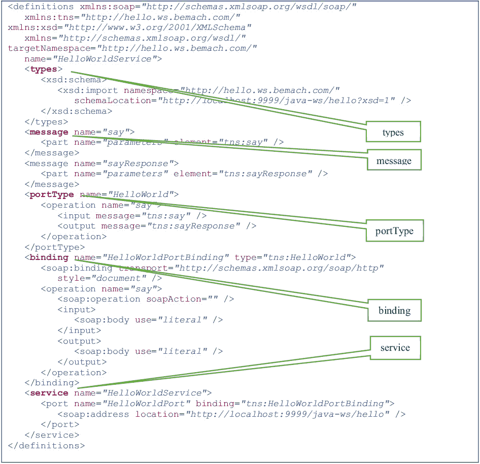

*列表 3-2 另一个示例 WSDL*

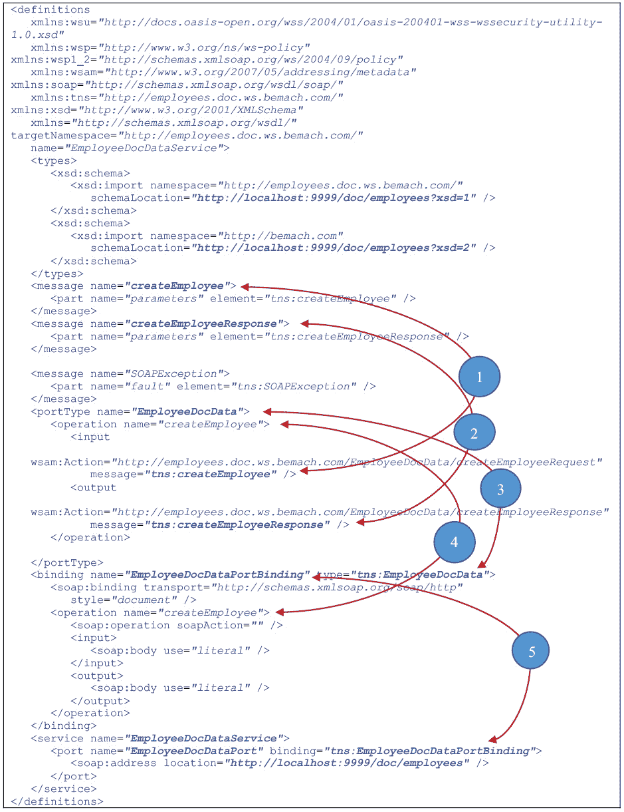

## 3.2 WSDL 接口

服务接口使用 `portType` 元素定义。该元素包含一个构成 Web 服务的 `operation` 元素列表。每个操作都由一个输入消息和一个输出消息组成，并可选包含一个故障消息。所有操作都在客户端和服务器之间交换消息。消息是一种包含数据的抽象数据类型。

请参考上述列表 3-1 和 3-2，这些列表强调了基础 WSDL 文档的元素。WSDL 的五个主要组件及其关系是清晰可见的。

### 3.2.1 `<types>` 元素

所有数据类型都定义在这个 `types` 元素内部。通常，`types` 元素指向一个外部 URL，该 URL 包含一个可能包含其他 schema 的 XML schema。WSDL 规范并不禁止使用其他类型定义系统；但它倾向于使用 XML schema。

### 3.2.2 `<message>` 元素

`message` 元素是描述操作输入输出的抽象数据类型。它由链接类型的部分（parts）组成。每个操作（`@WebMethod`）可能包含三种消息类型：输入、输出和故障。每种消息类型在整个 WSDL 文档中都是唯一的。每个类型都有唯一的名称。在每个消息内部，部分定义了在 `<types>` 元素中具体定义（RPC 风格）或通过 schema（文档风格）定义的实际类型。

### 3.2.3 `<portType>` 元素

`<portType>` 元素由一组抽象操作组成。这些操作可能由一个或多个端点支持。操作用于在服务消费者和服务者之间交换消息。消息交换协议可以采用以下模式之一：

- 单向 – 服务端点接收消息
- 请求-响应 – 服务端点接收消息并发送关联消息
- 征询-响应 – 服务端点发送消息并接收关联消息
- 通知 – 服务端点发送消息

在上面的示例（列表 3-2）中，WS 包含一个操作（即 `createEmployee`），它具有两个消息——一个输入消息和一个输出消息。输入消息命名为 `tns:createEmployee`，输出消息命名为 `tns:createEmployeeResponse`。这两个消息可以追溯到消息元素。将 `portType` 想象成类似于 Java 类，在其中定义了方法和属性。

### 3.2.3.1 `<operation>` 元素

服务可以有一个或多个操作（或方法）。每个操作都是独立定义的，包含一个输入消息、一个输出消息和一个可选的故障消息。这些消息使用 `message` 元素定义。类似于 Java 类定义，每个操作都定义了服务的行为。

## 3.3 WSDL 实现

WSDL 的 `<binding>` 元素将 WSDL 抽象接口连接到具体实现。在本节中，我们将特别关注发生连接的 `<binding>` 元素。因此，在某种程度上，`<binding>` 是整个 WSDL 规范的核心元素。这是两个世界相遇的地方。

### 3.3.1 `<binding>` 元素

Binding 将 `<portType>` 映射到 `<service>` 元素中指定的实现。从列表 3-1 可以看出，`<portType>` `HelloWorld` 被绑定到 `<service>` 元素内部的 `<port>` `HelloWorldPort`。`HelloWorld` 的实现基于 HTTP 的 SOAP（`<soap:binding>`）。SOAP 指定了数据格式，而 HTTP 是用于提供服务的特定协议。

Binding 在实现中没有指定任何特定语言。服务的实现方式超出了 WSDL 的范围。

### 3.3.2 `<service>` 元素

服务是渲染该服务的网络特定地址（`<port>`）的集合。`<port>` 和 `<portType>` 通过 `<binding>` 元素链接。这种连接对于服务消费者和服务者之间的运行时动态绑定至关重要。

`<port>` 元素描述了允许服务消费者与提供的服务进行交互的网络地址。服务可能具有多个端口；因此，选择权留给消费者。在示例 WSDL 中，只提供了一个端口，其位置指定为 [`localhost:9999/java-ws/hello`](http://localhost:9999/java-ws/hello)。注意，主机名和端口号可以在运行时修改，以指向托管服务的任何服务器。

以下描述了 WSDL 主要元素之间的链接。


**图 3-2** WSDL 内部的链接

## 3.4 参考文献

Flaherty, B. (2004). “WSDL: Defining Web Services.” Intercom 51(8): 26–28.

Lessen, T., J. Nitzsche, et al. (2009). “Conversational Web Services: Leveraging BPEL (light) for expressing WSDL 2.0 message patterns.” Enterprise Information Systems 3(3): 347–367.

Web Services Description Language (WSDL) 1.1, Retrieved August 27, 2007 from:

[`www.w3.org/TR/wsdl`](http://www.w3.org/TR/wsdl)

WSDL Tutorial, Retrieved November 7, 2007 from:

[`www.w3schools.com/wsdl/default.asp`](http://www.w3schools.com/wsdl/default.asp)

# 4 示例应用程序

## 目标

完成本章后，你将能够：

1. 编写一个访问存储在关系型数据库中的记录的 Web 服务


## 目标

2. 使用 JDK 6 或更高版本编写 Web 服务。

3. 使用基础 Java 端点类发布 Web 服务。

4. 使用 SOAPUI 测试工具测试 Web 服务。

5. 使用 `wsimport` 为客户端生成 Web 服务存根。

6. 编写一个简单的 Web 服务消费者来调用 Web 服务。

## 4.1 示例应用程序

欢迎来到 Web 服务的世界！初可能会觉得本章具有技术挑战性；但随着你学习示例，你会发现处处使用相同的模式。

在本应用程序中，我们使用基础 Java JDK 部署了一个简单的 SOAP 服务器。为了使此应用程序运行，你需要从互联网下载以下软件包（更多说明请见附录 A）。

- Java JDK 6
- MySQL Community Server 5.6
- MySQL 示例数据库
- MySQL JDBC 驱动程序

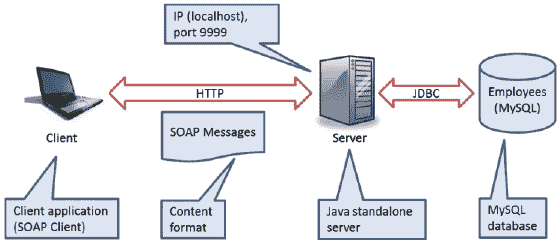

**图 4-1. 分层应用程序**

为了避免给已经复杂的概念增加复杂性，本示例中没有考虑安全问题。从远程机器（即 `WS` 客户端）在不经过适当身份验证的情况下访问数据库不是良好的做法；但在本应用程序中，使用固定的用户 ID 和密码访问数据库是为了简单化，而非安全考虑。此外，使用直接的 `JDBC` 调用使用数据源要高效得多，但示例代码并没有遵循这一标准约定。

基础的 `Java Endpoint` 类在业务计算环境中扩展性不佳，但此处使用它是为了提供一个能够支持简单 `WS` 应用程序的最简单 Java 环境。在随后的章节中，你可以应用类似的编程原则和技术进行 `WS` 编程，从而将 `WS` 应用程序部署在 Apache Tomcat 或 Oracle WebLogic 服务器上。这两个服务器分别在第 5 章和第 6 章中介绍。

请记住，本章在 `WS` 编程方面的核心思想是如何通过使用 `WS` 技术（特别是 `SOAP`）从数据库获取数据。

### 4.1.1 用例图

考虑以下该示例应用程序的用例图。从 `WS` 客户端的角度来看，它调用了员工数据服务的四个操作。基础数据交换包括两个主要数据类型：员工编号和员工记录。

资源可以被创建、读取（或获取）、更新（或更改）和删除。`CRUD` 概念自计算机科学诞生以来一直是计算机编程的基础。我们在数据库中存储了一组员工记录，并希望从远程机器上通过 `WS` 技术使用 `SOAP` 对它们进行操纵。

![image/1787.jpg]

**图 4-2. 用例**

#### 用例 1：创建员工

主要参与者：服务消费者

主成功场景：

1. 终端用户输入所需的员工信息。
2. 服务消费者随后验证这些信息。
3. 服务消费者随后调用 `employees` 数据服务创建一个新员工。
4. 服务消费者向终端用户展示一个新的员工编号。

#### 用例 2：更新员工

主要参与者：服务消费者

主成功场景：

1. 终端用户更新所需的员工信息。
2. 服务消费者随后验证这些信息。
3. 服务消费者随后调用 `employees` 数据服务进行更新。
4. 服务消费者告知终端用户更新状态。

#### 用例 3：获取（读取）员工

主要参与者：服务消费者

主成功场景：

1. 终端用户输入员工编号。
2. 服务消费者随后验证该编号。
3. 服务消费者随后调用 `employees` 数据服务检索员工记录。
4. 服务消费者向终端用户展示员工记录。

#### 用例 4：删除员工

主要参与者：服务消费者

主成功场景：

1. 终端用户输入员工编号。
2. 服务消费者随后验证该编号。
3. 服务消费者随后调用 `employees` 数据服务移除员工记录。
4. 服务消费者告知终端用户删除状态。

当发生错误情况时，会抛出 `SOAP` 异常。

### 4.1.2 时序图

在典型的 `WS` 调用中，涉及许多层软件；但在高层面上，动作序列可以像如下时序图所示。

![image/1796.jpg]

**图 4-3. `getEmployee` 操作的时序图**

由于所有四个操作都是基础的请求-响应类型的消息交换，因此显示了 `getEmployee` 操作的单一时序图。

消费者在准备就绪，调用客户端的 `SOAP` 引擎开始跨越网络的 `SOAP` 调用。在这种场景下，消费者完全理解 `SOAP` 消息并使用 `Java with Attachment API for Java(SAAJ)` 构建 `SOAP` 消息。一旦形成 `SOAP` 消息，`SOAP` 引擎通过 `HTTP` 将消息发送到远程服务器。成功接收消息后，服务器通过调用后端相应的业务或数据服务处理请求。在这种情况下，调用了 `employees` 服务的 `getEmployee` 方法。在调用数据访问层之前，可以在此类中进行额外的业务逻辑处理以操作数据。`EmployeeDAO` 是一个直接使用 `JDBC` 与数据库交互的组件。数据源并不总是关系型数据库。

处理完成后，`employees` 服务在 `WS` 包的帮助下形成 `SOAP` 消息并返回到服务器端的 `SOAP` 引擎。作为请求-响应消息交换模式的一部分，响应随后返回给客户端的 `SOAP` 引擎。一旦客户端 `SOAP` 引擎成功接收消息，它将返回给服务消费者进行最终处理。

形成 `SOAP` 消息的过程通常被称为“序列化”（marshalling）。相反，将 `SOAP` 消息解码为原生形式以便进一步处理的过程被称为“反序列化”（unmarshalling）。

此时序图展示了一个同步消息交换的示例。换句话说，图中的活动是按顺序发生的。在某些情况下，处理可能需要很长时间，服务器可能在处理完成之前立即返回。这是异步消息交换的一种形式。当服务器完成请求处理后，它可能会发起对客户端的调用，返回实际数据的响应或简单的通知。客户端也可以定期轮询服务器获取数据。第二种方案存在两个问题：如果两次轮询之间窗口过大，延迟可能会很显著；如果太小，则会浪费双方的计算资源。

### 4.1.3 部署图

该 `WS` 应用程序的简单部署所示：

![image/7013.jpg]

**图 4-4. 部署图**

在现实应用中，IT 组织可能会部署复杂的服务器和数据库网来管理他们的 `WS` 活动。可以有很多客户端。在本示例 `WS` 应用程序中，我们创建了一个包含客户端、服务器和数据库机器的环境。这些机器可以是虚拟的，这意味着所有三个都可以由单台物理机托管。

在服务器端，我们开发了两套 Java 库——`java-ws.jar` 和 `data-svc.jar`。第一个包含通过 `HTTP` 网络协议与客户端交互的 `WS` 代码。第二个通过 `MySQL` 驱动的 `JDBC` 调用处理数据库访问。它们共同构成了一个完整的应用程序。

在客户端，我们开发了一个包含 `WS` 客户端代码的 Java 库 `java-ws-client.jar`。我们使用 `wsimport` 生成第二个库 `java-ws-generated.jar`。这个第二个库包含了与服务器 `WS` 引擎交互的所有必要代码。

### 4.1.4 JDBC URL

为了从 Java 应用程序访问关系型数据库，必须使用符合以下格式的 JDBC URL 建立数据库连接：

`jdbc:<subprotocol>:<subname>`

其中：

- `<subprotocol>` 是注册到 Oracle 的驱动名称。在本应用程序中使用 `‘mysql’`。
- `<subname>` 是资源的标识。它具有以下格式：

`//host:port/subsubname`

`subsubname` 由数据库架构名称、用户标识符和密码组成。

在本示例中，完整的 JDBC URL 可以写为：

```text
jdbc:mysql://localhost:3306/employees?user=empl_1&password=password
```

为了通过 `JDBC` 连接访问数据库，创建了一个数据库账户并将其分配给 `employees` 数据库。它拥有 `employees` 数据库的所有权限。MySQL 的默认访问端口为 `3306`。在运行 SOAP 服务器程序之前，请确保下载了 `JDBC` 驱动程序并将其包含在 Java 的 `classpath` 中。

#### 4.1.4.1 `DbConfig.java`

在此示例代码中，连接 MySQL 数据库的默认值如下（参见 `DbConnection.java`）：

| 主机 | Saintmonica |
| :--- | :--- |
| 端口号 | 3306 |
| 账户 | empl_1 |
| 密码 | Password |
| 数据库名 | Employees |
| JDBC 驱动名称 | `com.mysql.jdbc.Driver` |
| 子协议 | Mysql |

**表 1. 数据库配置参数**

#### 列表 4-1. `DbConfig.java` 类

| 包名 | `com.bemach.data;` |
| :--- | :--- |

```java
package com.bemach.data;
/*** 2013 (C) BEM, Inc., Fairfax, Virginia** 除非适用法律要求或书面同意，* 分发的软件均按* “原样”提供，不提供任何* 保证或条件，无论是显式的还是隐含的。**//*** 请确保从网站* 下载 MySQL JDBC 驱动程序
* 解压它，并将此文件（名称在版本之间可能会更改*）：mysql-connector-java-5.1.24-bin.jar 引入您的 classpath 中/**
public class DbConfig {
    private String subprot = "mysql";
    private String host = "saintmonica";
    private String port = "3306";
    private String db = "employees";
    private String uid = "empl_1";
    private String psw = "password";
    private String driverName = "com.mysql.jdbc.Driver";

    public String getSubprot() {
        return subprot;
    }

    public void setSubprot(String subprot) {
        this.subprot = subprot;
    }

    public String getDriverName() {
        return driverName;
    }

    public void setDriverName(String driverName) {
        this.driverName = driverName;
    }

    public String getHost() {
        return host;
    }

    public void setHost(String host) {
        this.host = host;
    }

    public String getPort() {
        return port;
    }

    public void setPort(String port) {
        this.port = port;
    }

    public String getDb() {
        return db;
    }

    public void setDb(String db) {
        this.db = db;
    }

    public String getUid() {
        return uid;
    }

    public void setUid(String uid) {
        this.uid = uid;
    }

    public String getPsw() {
        return psw;
    }

    public void setPsw(String psw) {
        this.psw = psw;
    }
}
```

对于该应用程序，`DbConfigure` 类是连接 MySQL 数据库所需的全部配置参数的占位符。

### 4.1.5 Web 服务端点

`WS` 必须通过唯一的服务端点发布，以便被 `WS` 客户端访问。`URL` 是指向可用资源的指针。此唯一的服务端点可以使用以下格式的 `URL` 来指定：

`<scheme>:<hier-part>?query`

其中：

- `<scheme>` 是 `http` 协议。
- `<hier-part>` 是 `//host:port/path`。

在示例中，服务端点定义为：

`http://localhost:9999/doc/employees`

以及：

`http://localhost:9999/rpc/employees`

#### 4.1.5.1 `SvrConfig.java`

为了将 HTTP 连接用于 SOAP，示例代码必须使用以下默认值：

| 主机 | locahost |
| :--- | :--- |
| 端口号 | 9999 |
| 协议 | http |

**表 2. 服务器配置参数**

#### 列表 4-2. `SvrConfig.java` 类

| 包名 | `com.bemach.ws.server;` |
| :--- | :--- |

```java
package com.bemach.ws.server;
/*** 2013 (C) BEM, Inc., Fairfax, Virginia** 除非适用法律要求或书面同意，* 分发的软件均按* “原样”提供，不提供任何* 保证或条件，无论是显式的还是隐含的。**/**
import com.bemach.data.DbConfig;
/*** 请确保从网站* 下载 MySQL JDBC 驱动程序
* 解压它，并将此文件（名称在版本之间可能会更改*）：mysql-connector-java-5.1.24-bin.jar 引入您的 classpath 中/**
public class SvrConfig {
    private String listenHostname = "localhost";
    private String listenPort = "9999";
    private String listenInterface = "HelloWorld";
    private String listenProtocol = "http";
    private DbConfig dbCfg = new DbConfig();

    public DbConfig getDbCfg() {
        return dbCfg;
    }

    public void setDbCfg(DbConfig dbCfg) {
        this.dbCfg = dbCfg;
    }

    public String getListenHostname() {
        return listenHostname;
    }

    public void setListenHostname(String listenHostname) {
        this.listenHostname = listenHostname;
    }

    public String getPort() {
        return listenPort;
    }

    public void setPort(String port) {
        this.listenPort = port;
    }

    public String getListenInterface() {
        return listenInterface;
    }

    public void setListenInterface(String listenInterface) {
        this.listenInterface = listenInterface;
    }

    public String getListenProtocol() {
        return listenProtocol;
    }

    public void setListenProtocol(String listenProtocol) {
        this.listenProtocol = listenProtocol;
    }
}
```

`SvrConfig` 类包含了用于形成两种样式（文档和 RPC）服务端点的信息。此外，该类包含了数据访问代码访问数据库所需的配置参数。

### 4.1.6 关于 `employees` 示例数据库

`employees` 数据库是 MySQL 的示例数据库。该数据库架构是由新加坡南理工大学的蔡华宽（Chua Hock Chuan）教授开发的。可以访问该网站：`http://www.ntu.edu.sg/home/ehchua/programming/sql/SampleDatabases.html`。

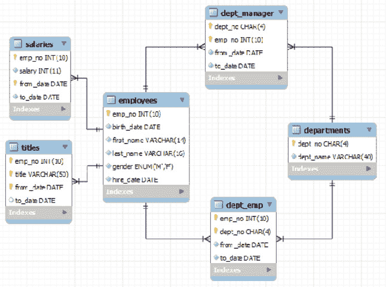

**图 4-5. 数据库架构（蔡华宽）**

在示例应用程序中，我们只使用 `employees` 表。该表可以使用以下 DDL 创建：

#### 列表 4-3. `Employees` 表定义

| （图像） |
| :--- |

`employees` 表中的所有字段都是必填的，主键为员工编号。`employees` 数据记录可以使用 Java 中的 `Employee` 类来表示。该类的定义如下：

#### 4.1.6.1 `Employee.java`


我们创建一个包含员工记录的`Employee`数据对象。`Employee`是一个 Java 类，它使用了 Java XML 绑定架构（`JAXB`）注解来辅助序列化过程。`JAXB`允许 Java 开发人员使用 Java API 从 XML 文档中读取和写入对象。它简化了 Java 中读取和写入 XML 文档的过程。特别是，该注解为 SOAP 引擎将 Java 对象转换为 XML 以及反之的操作提供了一种更简单的机制。

### 列表 4-4. Employee.java 类

```java
package com.bemach.data;
/*** 2013 (C) BEM, Inc., Fairfax, Virginia** Unless required by applicable law or agreed to in writing,* software distributed is distributed on an "AS IS" BASIS, WITHOUT WARRANTIES OR CONDITIONS OF ANY KIND, either express or implied.**/**/**
import java.io.Serializable;
import java.util.Calendar;
import javax.xml.bind.annotation.XmlAccessType;
import javax.xml.bind.annotation.XmlAccessorType;
import javax.xml.bind.annotation.XmlElement;
import javax.xml.bind.annotation.XmlRootElement;
import javax.xml.bind.annotation.XmlType;

@XmlRootElement(name="EmployeeService",namespace="http://bemach.com")
@XmlAccessorType(XmlAccessType.FIELD)
@XmlType(name="employee")
public class Employee implements Serializable {
    private static final long serialVersionUID = 1L;

    @XmlElement(required=true)
    private long emplNo;

    @XmlElement(required=true)
    private String firstName;

    @XmlElement(required=true)
    private String lastName;

    @XmlElement(required=true)
    private Calendar birthDate;

    @XmlElement(required=true)
    private String gender;

    @XmlElement(required=true)
    private Calendar hireDate;

    public long getEmplNo() {
        return emplNo;
    }

    public void setEmplNo(long emplNo) {
        this.emplNo = emplNo;
    }

    public String getFirstName() {
        return firstName;
    }

    public void setFirstName(String firstName) {
        this.firstName = firstName;
    }

    public String getLastName() {
        return lastName;
    }

    public void setLastName(String lastName) {
        this.lastName = lastName;
    }

    public Calendar getBirthDate() {
        return birthDate;
    }

    public void setBirthDate(Calendar birthDate) {
        this.birthDate = birthDate;
    }

    public String getGender() {
        return gender;
    }

    public void setGender(String gender) {
        this.gender = gender;
    }

    public Calendar getHireDate() {
        return hireDate;
    }

    public void setHireDate(Calendar hireDate) {
        this.hireDate = hireDate;
    }
}
```

所有必需字段都反映在序列中的 XML 元素中。可选元素通常包含`numOccurs="0"`。Java 数据类型被整齐地映射到 XML 内生数据类型，如架构所示。

### 列表 4-5. XSD 中“employee’的数据类型

```xml
<xs:schema xmlns:tns="http://employees.rpc.ws.bemach.com/" xmlns:xs="http://www.w3.org/2001/XMLSchema" version="1.0" targetNamespace="http://employees.rpc.ws.bemach.com/">
  <xs:element name="SOAPException" type="tns:SOAPException" />
  <xs:complexType name="employee">
    <xs:sequence>
      <xs:element name="emplNo" type="xs:long" />
      <xs:element name="firstName" type="xs:string" />
      <xs:element name="lastName" type="xs:string" />
      <xs:element name="birthDate" type="xs:dateTime" />
      <xs:element name="gender" type="xs:string" />
      <xs:element name="hireDate" type="xs:dateTime" />
    </xs:sequence>
  </xs:complexType>
  <xs:complexType name="SOAPException">
    <xs:sequence>
      <xs:element name="message" type="xs:string" minOccurs="0" />
    </xs:sequence>
  </xs:complexType>
</xs:schema>
```

## 4.2 开发 Web 服务

自底而上的开发 Web 服务的方法涉及以下活动：

*   编写数据访问对象。
*   编写业务逻辑对象。
*   编写服务对象。
*   将服务部署到服务器。
*   发布服务器供使用。

在本应用程序中，不包含任何业务服务，因此活动简化如下：

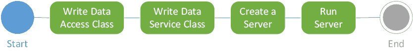 **列表 4-6. 使用 Java 编写 Web 服务的活动**

我们在 Eclipse 下创建了两个 Java 项目——`data-svc`和`java-ws`。`data-svc`项目持有通过`JDBC`与数据库交互的 Java 代码。该项目创建了一个名为`data-svc.jar`的库。该库包含四个 Java 类：

*   `DbConfig.java`
*   `DbConnection.java`
*   `Employee.java`
*   `EmployeeDao.java`

`java-ws`项目生成了`java-ws.jar`库，由以下 Java 类组成：

*   `SvrConfig.java`
*   `Server.java`
*   `EmployeeDocData.java`
*   `EmployeeRpcData.java`

### 4.2.1 类图

下面的类图描绘了服务器应用程序的静态视图。

#### 列表 4-7. 一个类图

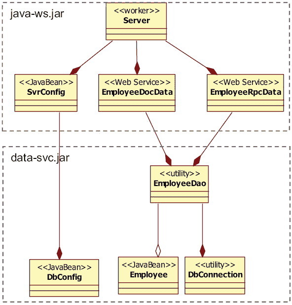

在类图中，空心菱形表示部分与整体的关系。实心菱形表示组合。虚线表示边界。

### 4.2.2 编写数据访问

数据访问对象（DAO）模式用于提供对数据的访问。首先，我们创建一个名为`data-svc`的 Java 项目。

 **图 4-6 data-svc**

### 4.2.1 导入 JDBC 驱动

按照第 7 节的说明下载并下载适用于 JDBC 驱动，应用程序使用的 JDBC 驱动是`mysql-connector-java-5.1.24-bin.jar`。

在`data-svc`项目下创建一个`lib`文件夹。该文件夹将包含库。

通过点击`lib`文件夹导入已下载的 JDBC 驱动。选择`File` -> `Import...`。选择窗口所示：

 **图 4-7 选择**

选择`General` -> `Archive File`，然后点击`Next`按钮。存档文件窗口所示：

 **图 4-8 存档文件**

如果您知道 MySQL JDBC 驱动的位置，请输入文件名和位置。否则，使用右侧的`Browse`按钮并选择文件。然后点击`Finish`按钮。

### 4.2.2 引用库

接下来，确保项目引用了 MySQL 驱动。首先，选择`data-svc`项目。然后选择`Project` -> `Properties`。`data-svc`属性窗口所示：

 **图 4-9 构建路径**

在屏幕左侧面板中，选择`Java Build Path`。选择右面板顶部的`Libraries`选项卡。点击`Add JARs...`按钮。JAR 选择窗口所示：

 **图 4-10 JAR 选择**

展开`data-svc/lib`文件夹。选择 JDBC 驱动。然后点击`OK`。您的 Java 构建路径屏幕应该是这样的：

 **图 4-11 构建路径**

在之前的章节中，我们创建了`DbConfig.java`类来存储访问数据库的配置参数。接下来的逻辑步骤是创建一个类来管理该应用程序所有的`JDBC`连接。虽然也可以`DataSource`类来获取数据库连接，但在本书中，我们使用一种基础方法来获取 JDBC 数据库连接。

### 4-8. DbConnection.java 类

```java
package com.bemach.data;
/*** 2013 (C) BEM, Inc., Fairfax, Virginia** 除非适用法律要求或书面同意，否则分发的软件按“按原样”提供，不提供任何形式的保证或条件，无论是明示还是暗示的。**/**
import java.sql.Connection;
import java.sql.DriverManager;
import java.sql.SQLException;
import java.util.logging.Level;
import java.util.logging.Logger;

public final class DbConnection {
    private static final Logger LOG = Logger.getLogger(DbConnection.class.getName());
    private static final String ERROR_MSG = "ERROR: ";
    private Connection conn = null;

    public Connection getConn() {
        return conn;
    }

    private DbConnection(String driverName, String subprot, String host, String port, String db, String uid, String psw) {
        LOG.info("Getting DB connection ...");
        try {
            Class.forName(driverName);
            String url = String.format("jdbc:%s://%s/%s?user=%s&password=%s", subprot, host, db, uid, psw);
            conn = DriverManager.getConnection(url);
        } catch (SQLException e) {
            LOG.log(Level.SEVERE, ERROR_MSG + e);
        } catch (ClassNotFoundException e) {
            LOG.log(Level.SEVERE, ERROR_MSG + e);
        }
    }

    public static DbConnection getInstance(String driverName, String subprot, String host, String port, String db, String uid, String psw) {
        return new DbConnection(driverName, subprot, host, port, db, uid, psw);
    }

    public void close() {
        try {
            if (conn != null) {
                conn.close();
                conn = null;
            }
        } catch (SQLException e) {
            LOG.log(Level.SEVERE, ERROR_MSG + e);
        }
    }
}
```

`DriverManager`类通过三种方式帮助创建 JDBC 连接：

- `getConnection(String url)`
- `getConnection(String url, Properties)`
- `getConnection(String url, String user, String password)`

在本示例中，使用了第一个方法，URL 如下：

`jdbc:mysql://localhost:3306/employees?user=empl&password=password`

`getConn()`方法需要连接数据库的所有配置参数。当不再需要 JDBC 连接时，必须显式调用`close()`方法。积累的连接会消耗资源。在大多数 JDBC 程序中，关闭连接会导致关联的`Statement`和`ResultSet`被关闭。

### 4.2 EmployeeDao.java

该类提供了对数据库`employees`表的基本访问。使用`PreparedStatement`可以避免 SQL 注入攻击。我们的任务是开发一个名为`EmployeeDao`的类，允许客户端创建、读取、更新和删除`employees`表中的行。目前，我们不关心安全性——只是想展示如何通过自下而上的方法来创建该类。`EmployeeDao`类使用 Java 数据库连接 (JDBC) 创建数据库连接、发布 SQL 语句并处理返回值。这是一个基础 JDBC 应用。

### 4-9. EmployeeDao.java 类


```java
package com.bemach.data;

import java.sql.PreparedStatement;
import java.sql.ResultSet;
import java.sql.SQLException;
import java.sql.Timestamp;
import java.util.Calendar;
import java.util.logging.Logger;

/**
 * 该类允许应用程序对 Employee 资源执行四种基本操作：
 * 1. 创建
 * 2. 读取
 * 3. 更新
 * 4. 删除
 *
 * 额外的方法有：`getEmployeeByLastName`、`getplByFirstName`
 */
class EmployeeDao {
    public static final Logger LOG = Logger.getLogger(EmployeeDao.class.getName());
    private DbConfig cfg = null;

    public EmployeeDao() {
    }

    /**
     * 构造函数
     *
     * @param cfg
     */
    public EmployeeDao(DbConfig cfg) {
        this.cfg = cfg;
        LOG.info("Constructing EmployeeDao ...");
    }

    /**
     * 从 ResultSet 返回一个 Employee 记录。
     *
     * @param rs
     * @return
     */
    protected Employee getEmpl(ResultSet rs) throws SQLException {
        Employee empl = new Employee();
        Calendar cal = Calendar.getInstance();

        empl.setEmNo(rs.getInt("emp_no"));
        cal.setTimeInMillis(rs.getTimestamp("birth_date").getTime());
        empl.setBirthDate(cal);
        empl.setFirstName(rs.getString("first_name"));
        empl.setLastName(rs.getString("last_name"));
        empl.setGender(rs.getString("gender"));

        cal = Calendar.getInstance();
        cal.setTimeInMillis(rs.getTimestamp("hire_date").getTime());
        empl.setHireDate(cal);

        return empl;
    }

    /**
     * 创建新员工。
     *
     * @param empl
     * @return
     */
    public int createEmpl(Employee empl) throws SQLException {
        LOG.info("Create an employee");

        DbConnection dbConn = DbConnection.getInstance(
            cfg.getDriverName(),
            cfg.getSubprot(),
            cfg.getHost(),
            cfg.getPort(),
            cfg.getDb(),
            cfg.getUid(),
            cfg.getPsw()
        );

        String sql = "SELECT MAX(EMP_NO) FROM EMPLOYEES";
        PreparedStatement stmt = null;
        ResultSet rs = null;

        try {
            stmt = dbConn.getConn().prepareStatement(sql);
            stmt.execute();
            rs = stmt.getResultSet();
            rs.next();

            int nextEmplNo = rs.getInt(1);

            stmt.close();
            rs.close();

            sql = "INSERT INTO EMPLOYEES "
                + "(EMP_NO, BIRTH_DATE, FIRST_NAME, LAST_NAME, GENDER, HIRE_DATE) "
                + "VALUES (?,?,?,?,?,?)";

            stmt = dbConn.getConn().prepareStatement(sql);

            int idx = 1;
            stmt.setInt(idx++, ++nextEmplNo);

            Timestamp ts = new Timestamp(empl.getBirthDate().getTimeInMillis());
            stmt.setTimestamp(idx++, ts);
            stmt.setString(idx++, empl.getFirstName());
            stmt.setString(idx++, empl.getLastName());
            stmt.setString(idx++, empl.getGender());

            ts = new Timestamp(empl.getHireDate().getTimeInMillis());
            stmt.setTimestamp(idx++, ts);

            stmt.execute();
            return nextEmplNo;
        } finally {
            if (stmt != null) {
                stmt.close();
            }
            if (rs != null) {
                rs.close();
            }
            dbConn.close();
        }
    }

    /**
     * 更新员工记录。
     *
     * @param empl
     * @return
     */
    public boolean updateEmpl(Employee empl) throws SQLException {
        LOG.info("Update an employee");

        DbConnection dbConn = DbConnection.getInstance(
            cfg.getDriverName(),
            cfg.getSubprot(),
            cfg.getHost(),
            cfg.getPort(),
            cfg.getDb(),
            cfg.getUid(),
            cfg.getPsw()
        );

        String sql = "UPDATE EMPLOYEES SET "
            + "BIRTH_DATE=?, FIRST_NAME=?, LAST_NAME=?, GENDER=?, HIRE_DATE=? "
            + "WHERE EMP_NO=?";

        PreparedStatement stmt = null;

        try {
            stmt = dbConn.getConn().prepareStatement(sql);

            int idx = 1;
            Timestamp ts = new Timestamp(empl.getBirthDate().getTimeInMillis());
            stmt.setTimestamp(idx++, ts);
            stmt.setString(idx++, empl.getFirstName());
            stmt.setString(idx++, empl.getLastName());
            stmt.setString(idx++, empl.getGender());

            ts = new Timestamp(empl.getHireDate().getTimeInMillis());
            stmt.setTimestamp(idx++, ts);
            stmt.setInt(idx++, (int) empl.getEmplNo());

            stmt.execute();
            return true;
        } finally {
            if (stmt != null) {
                stmt.close();
            }
            dbConn.close();
        }
    }

    /**
     * 根据员工编号删除员工。
     *
     * @param emplNo
     * @return
     */
    public boolean deleteEmpl(int emplNo) throws SQLException {
        LOG.info("Delete an employee");

        DbConnection dbConn = DbConnection.getInstance(
            cfg.getDriverName(),
            cfg.getSubprot(),
            cfg.getHost(),
            cfg.getPort(),
            cfg.getDb(),
            cfg.getUid(),
            cfg.getPsw()
        );

        String sql = "DELETE FROM EMPLOYEES WHERE EMP_NO=?";
        PreparedStatement stmt = null;

        try {
            stmt = dbConn.getConn().prepareStatement(sql);
            stmt.setInt(1, emplNo);
            stmt.execute();

            return true;
        } finally {
            if (stmt != null) {
                stmt.close();
            }
            dbConn.close();
        }
    }

    /**
     * 根据给定的唯一员工编号获取员工。
     *
     * @param emplNo
     * @return
     */
    public Employee getEmpl(int emplNo) throws SQLException {
        LOG.info("Getting employee by Employee number: " + emplNo);

        DbConnection dbConn = DbConnection.getInstance(
            cfg.getDriverName(),
            cfg.getSubprot(),
            cfg.getHost(),
            cfg.getPort(),
            cfg.getDb(),
            cfg.getUid(),
            cfg.getPsw()
        );

        String sql = "SELECT * FROM EMPLOYEES WHERE EMP_NO=?";
        PreparedStatement stmt = null;
        ResultSet rs = null;

        try {
            stmt = dbConn.getConn().prepareStatement(sql);
            stmt.setInt(1, emplNo);

            if (stmt.execute()) {
                rs = stmt.getResultSet();

                if (rs != null && rs.next()) {
                    return getEmpl(rs);
                }
            }
        } finally {
            if (stmt != null) {
                stmt.close();
            }
            if (rs != null) {
                rs.close();
            }
            dbConn.close();
        }

        return null;
    }
}
```

该类包含四个重要方法，可以从数据库的 `employees` 表中创建、读取、更新和删除员工记录。这些方法稍后通过名为 `EmployeeDocData` 和 `EmployeeRpcData` 的两个 Web 服务的四个操作反映。

### 4.2.1 `createEmpl(Employee empl)`

此方法接收一个名为 `empl` 的新员工记录，并使用 JDBC `PreparedStatement` 类将其插入到 `employees` 表中。该方法假设此方法的调用者已经对员工记录的内容进行了验证。另一种方法是在此类中包含一个验证方法，并在四个操作中的每一个调用。请注意，所有涉及数据库的操作都是通过 `PreparedStatement` 完成的，以限制来自外部的 SQL 注入攻击。

首先，我们获取最大的员工编号，以便创建一个具有唯一主键的新员工记录。这种获取员工编号的方法在当有另一个应用程序或进程同时插入另一条记录时可能会遇到并发问题；然而，为了简单起见，我们在这里忽略了这种情况。

一旦接收到新的员工编号，该方法会将记录插入数据库，并向调用者返回一个新的员工编号；但是，最后的子句会首先确保数据库连接已关闭。这是确保在方法完成任务后妥善释放资源的众多技术之一。

### 4.2.2 `getEmpl(emplNo)`

此方法从数据库的 `employees` 表中检索员工记录。唯一的员工编号是输入输入。如果找到了记录，则将其返回给调用者。否则，将抛出异常。无论如何，在此时数据库连接会被关闭。

### 4.2.3 `updateEmpl(empl)`

此方法根据输入记录更新除员工编号以外的所有值的记录。处理完成后，将返回一个 `true` 或 `false` 的布尔值。如果记录存在且更新成功，则返回真值的布尔值。否则，方法返回 `false`。

### 4.2.4 `deleteEmpl(emplNo)`

与该类的其他方法类似，此方法打开数据库连接，然后发布 SQL 语句来完成任务。成功完成后，员工记录将从表中移除并返回一个真值的布尔值。否则，方法返回 `false`。

总的来说，该类相对简单。它执行对存储在数据库中的频繁操作。该类保持简单是因为我们的重点是 Web 服务的创建。当涉及更复杂的业务规则和多数据源访问时，Web 服务的基本概念保持不变。Web 服务的主要关注在于接口——它必须是健壮且能够随时间演变的。

在下一节中，我们将简要讨论如何测试数据对象，以便我们确保开发团队的质量。

### 4.2.5 数据对象的 JUnit 测试

我们为 `EmployeeDao.java` 类提供了一个基本的 JUnit 测试。该类被称为 `EmployeeDataTest.java`。

#### 列表 4-10：`EmployeeDataTest.java` 类

（代码块保持原样）


```java
/** @throws java.lang.Exception*/
@Before
public void setUp() throws Exception {
    logger.info("Testing employee dao class ...");
    DbConfig cfg = new DbConfig();
    cfg.setDriverName("com.mysql.jdbc.Driver");
    cfg.setHost("saintmonica");
    cfg.setPort("3306");
    cfg.setDb("employees");
    cfg.setUid("empl_1");
    cfg.setPsw("password");
    dao = new EmployeeDao(cfg);
}

/** @throws java.lang.Exception*/
@After
public void tearDown() throws Exception {}

/** Test method for {@link com.bemach.data.EmployeeDao#getEmpl(int)}.* @throws SQLException*/
@Test
public void testGetEmplByEmplNo() throws SQLException {
    Employee empl = dao.getEmpl(10327);
    assertTrue("*** ERROR NULL ***", empl != null);
    logger.info("found "+empl.getFirstName() + "/" + empl.getLastName());
}

@Test
public void testCRUDEmpl() throws SQLException {
    logger.info(">>> get empl");
    Employee empl = dao.getEmpl(10001);
    empl.setFirstName("Test_First");
    empl.setLastName("Test_Last");
    Timestamp ts = Timestamp.valueOf("1970-01-01 0:0:0.0");
    Calendar cal = Calendar.getInstance();
    cal.setTimeInMillis(ts.getTime());
    empl.setBirthDate(cal);
    ts = Timestamp.valueOf("1970-01-01 0:0:0.0");
    cal.setTimeInMillis(ts.getTime());
    empl.setHireDate(cal);
    empl.setGender("F");
    logger.info(">>> create empl");
    int newEmplNo = dao.createEmpl(empl);
    logger.info(">>> get new empl");
    Employee newEmpl = dao.getEmpl(newEmplNo);
    newEmpl.setGender("M");
    logger.info(">>> update new empl");
    dao.updateEmpl(newEmpl);
    logger.info(">>> get new empl again");
    newEmpl = dao.getEmpl(newEmplNo);
    printOutput(newEmpl);
    logger.info(">>> delete new empl");
    dao.deleteEmpl(newEmplNo);
}

private void printOutput(Employee empl) {
    StringBuffer sb = new StringBuffer();
    sb.append(", emplno=").append(empl.getEmplNo());
    sb.append(", fname=").append(empl.getFirstName());
    sb.append(", lname=").append(empl.getLastName());
    sb.append(", hire=").append(empl.getHireDate());
    sb.append(", birth=").append(empl.getBirthDate());
    sb.append(", gender=").append(empl.getGender());
    logger.info(sb.toString());
}
```

在每次操作后，员工记录都会被格式化并显示在屏幕上。

如果所有测试运行成功，结果应该会在 Eclipse IDE 左侧的 JUnit 面板上以绿色显示：

#### 列表 4-11. JUnit 测试结果

**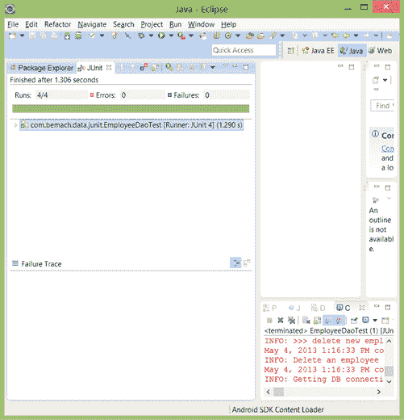**

### 4.2.3 打包 Java 库

为了从命令行运行构建，需要定义 `JAVA_HOME` 和 `ANT_HOME` 变量。确保在 `PATH` 变量中包含 `$JAVA_HOME/bin` 或 `%JAVA_HOME%\bin`。`JAVA_HOME` 应该指向安装的 JDK。我们使用 JDK 1.6 进行开发和测试。Ant 构建脚本版本为 1.7.1。

此 `build.xml` 构建脚本默认从 `data-svc` 项目目录的根目录运行。类存储在 `bin` 目录，而 Java 库 `data-svc.jar` 将存储在 `dist` 目录。清理构建命令将移除这两个目录。因此，应该使用两个构建命令：

`ant dist`（或简单使用 `ant`）

`ant clean`

#### 列表 4-12. data-svc Java 项目的 build.xml

```xml
<project name="data-svc" default="dist" basedir=".*">
    <description>Data Services</description>
    <!-- 为此构建设置全局属性 -->
    <property environment="env" />
    <path id="classpath.base">
        <fileset dir="./lib" includes="*.jar" />
    </path>
    <path id="classpath.compile">
        <path refid="classpath.base" />
    </path>
    <target name="init">
        <mkdir dir="./bin" />
        <mkdir dir="./dist" />
    </target>
    <target name="compile" depends="init" description="compile the source">
        <javac srcdir="./src" destdir="./bin" debug="true">
            <classpath refid="classpath.compile" />
        </javac>
    </target>
    <target name="dist" depends="compile" description="generate the distribution">
        <!-- 创建发布目录 -->
        <jar jarfile="./dist/data-svc.jar" basedir="./bin" />
    </target>
    <target name="clean" description="clean up">
        <!-- 清理 ${build} 目录 -->
        <delete dir="./dist" />
        <delete dir="./bin" />
    </target>
</project>
```

`data-svc.jar` 存储在 `dist` 目录。内容如下：

`META-INF/MANIFEST.MF`

`com/bemach/DbConfig`

`com/bemach/DbConnection`

`com/bemach/Employee`

`com/bemach/EmployeeDao`

### 4.2.4 开发 Java 类

要在 Eclipse 中创建 Web Services，请参考：

****

### 4.2.4.1 EmployeeData.java

通过包含以下注解来编写 Web Services：

*   `@WebService`：指示该类的 Web 服务

*   `@SOAPBinding`：指定绑定方式

*   `@WebMethod`：将方法暴露的操作

#### 列表 4-13. EmployeeData 类

该类对员工记录有四个主要操作（即 CRUD）。注意对于每个操作，服务都会创建一个 `EmployeeDao` 对象来调用相应的操作。调用结果将作为操作的返回值。

#### 4.2.4.1.1 @WebService 注解

`WebService` 注解表示该类（或接口）实现 Web 服务。该注解有六（6）可选元素，用于更详细地定义 Web 服务：

1.  `endpointInterface`：服务端点的接口完整名称

2.  `name`：WSDL 中 `<portType>` 元素的名称

3.  `portName`：WSDL 中 `<port>` 元素的名称

4.  `serviceName`：WSDL 中 `<service>` 元素的名称

5.  `targetNamespace`：WSDL 中 `<definition>` 元素的 targetNamespace 属性

6.  `wsdlLocation`：`<soap:address>` 元素 `location` 属性的内容

在本应用程序中，我们没有包含这些可选元素。我们会在服务器代码创建 Endpoint 时定义 WSDL 的位置。

#### 4.2.4.1.2 @SOAPBinding 注解

`SOAPBinding` 注解指定如何将 Web 服务映射到 SOAP 消息协议。这些涉及三个可选元素：

1.  `parameterStyle`：可以是 BARE 或 WRAPPED

2.  `style`：可以是 DOCUMENT 或 RPC

3.  `use`：可以是 LITERAL 或 ENCODED

此注解用于自定义一个暴露为 WS（Web 服务）操作的方法。该注解有三个（3）个可选元素可以使用：

1. `action`：在 WSDL 中定义的操作名称。

2. `exclude`：将该方法排除在 Web 服务的操作之外。

3. `operationName`：操作名称。

#### 4.2.4.1.4 @WebParam 注解

操作的单个参数命名方式与方法相同。使用此注解可以在 WSDL 中更改为不同的名称。可选参数如下：

1. `header`：如果为 `true`，则参数从消息头中提取，而不是从消息体中提取。

2. `mode`：三种基本模式 – `IN`、`OUT` 和 `INOUT`。

3. `name`：参数映射到表示该参数的 XML 元素中的 `name`。如果使用 `DOCUMENT` 样式，则必须指定 `name`。

4. `partName`：如果使用 `RPC` 样式，这是 `wsdl:part` 元素中的名称。

5. `targetNamespace`：如果使用 `DOCUMENT` 样式，参数将映射到头信息。

### 4.2.4.2 EmployeeRpcData.java

该类实现了 SOAP RPC 样式的 Web 服务。它与文档样式（document style）除了 `SOAPBinding` 注解外几乎完全相同。该类用于展示目前使用的两种样式之间的区别。

#### Listing 4-14. EmployeeRpcData.java 类

```java
package com.bemach.ws.rpc.employees;
/** 2013 (C) BEM, Inc., Fairfax, Virginia Unless required by applicable law or agreed to in writing,* software distributed is distributed on an “AS IS” BASIS, WITHOUT WARRANTIES OR CONDITIONS OF ANY KIND, either express or implied. */
import java.util.logging.Logger;
import javax.jws.WebMethod;
import javax.jws.WebParam;
import javax.jws.WebService;
import javax.jws.soap.SOAPBinding;
import javax.xml.soap.SOAPException;
import com.bemach.data.DbConfig;
import com.bemach.data.Employee;
import com.bemach.data.EmployeeDao;

@WebService
@SOAPBinding(style=SOAPBinding.Style.RPC)
public class EmployeeRpcData {
    private static final Logger LOG = Logger.getLogger(EmployeeRpcData.class.getName());
    private EmployeeDao dao = null;

    public EmployeeRpcData (DbConfig cfg) {
        dao = new EmployeeDao(cfg);
    }

    @WebMethod
    public Employee getEmployee(@WebParam(name="emplNo") long emplNo) throws SOAPException, Exception {
        LOG.info("Rpc.readEmployee");
        Employee employee = getDao().getEmpl((int)emplNo);
        if (employee == null) {
            throw new SOAPException ("No such employee!");
        }
        return employee;
    }

    @WebMethod
    public long createEmployee(@WebParam (name="employee") Employee employee) throws Exception {
        LOG.info("Rpc.createEmployee");
        return getDao().createEmpl(employee);
    }

    @WebMethod
    public boolean updateEmployee(@WebParam (name="employee") Employee employee) throws Exception {
        LOG.info("Rpc.updateEmployee.");
        return getDao().updateEmpl(employee);
    }

    @WebMethod
    public boolean deleteEmployee(@WebParam (name="emplNo") long emplNo) throws Exception {
        LOG.info("Rpc.deleteEmployee.");
        return getDao().deleteEmpl((int)emplNo);
    }

    public EmployeeDao getDao() {
        return dao;
    }

    public void setDao(EmployeeDao dao) {
        this.dao = dao;
    }
}
```

### 4.2.5 托管 Web 服务

Web 服务需要由提供某些基本 HTTP 服务端点的服务器进行托管。请注意，此类服务器的实现为了 WS 演示目的相当简单。对于中大型业务环境，诸如 WebLogic、JBOSS 或 WebSphere 等更具工业级的应用服务器更为合适。

### 4.2.5.1 Server.java

该类实现了一个 HTTP 服务器，用于托管多个 Web 服务（例如，HelloWorld、EmployeeDocDataService 和 EmployeeRpcDataService）。每个 WS 通过服务端点唯一标识。

* HelloWorld Web 服务：`http://localhost:9999/java-ws/hello?WSDL`

* Employee 文档 Web 服务：`http://localhost:9999/doc/employees?wsdl`


- Employee RPC Web 服务：`http://localhost:9999/rpc/employees?wsdl`

#### Listing 4-15. `Server.java` 类

```java
package com.bemach.ws.server;
/** 2013 (C) BEM, Inc., Fairfax, Virginia */
import java.util.logging.Logger;
import javax.xml.ws.Endpoint;
import javax.xml.ws.endpoint.EndpointReference;
import com.bemach.data.DbConfig;
import com.bemach.data.Employee;
import com.bemach.data.EmployeeDao;
import com.bemach.ws.doc.EmployeeDocData;
import com.bemach.ws.rpc.EmployeeRpcData;

public class Server {
    private static final Logger LOG = Logger.getLogger(Server.class.getName());
    private static final String HOST_NAME = "localhost";
    private static final String PORT_NO = "9999";
    private static final String HELLO_SVC_NAME = "java-ws/hello";
    private static final String RPC_SVC_NAME = "rpc/employees";
    private static final String DOC_SVC_NAME = "doc/employees";
    private static final String PROTOCOL = "http";
    private static final String DRIVER = "com.mysql.jdbc.Driver";
    private static final String USER = "root";
    private static final String PASS = "password";

    private Server() {}

    public static DbConfig getDao() {
        DbConfig dbCfg = new DbConfig();
        dbCfg.setDriver(DRIVER);
        dbCfg.setUser(USER);
        dbCfg.setPassword(PASS);
        return dbCfg;
    }

    public static SvrConfig getSvrConfig() {
        SvrConfig svrCfg = new SvrConfig();
        svrCfg.setHostname(HOST_NAME);
        svrCfg.setPort(PORT_NO);
        svrCfg.setProtocol(PROTOCOL);
        return svrCfg;
    }

    public static Endpoint publish(SvrConfig cfg, Object svc) {
        String url = String.format("%s://%s:%s/%s", cfg.getProtocol(), cfg.getHostname(), cfg.getPort(), cfg.getInterface());
        Endpoint ep = Endpoint.publish(url, svc);
        EndpointReference epr = ep.getEndpointReference();
        LOG.info("Endpoint Ref:\n"+epr.toString());
        return ep;
    }

    public static void startHelloWorld() {
        SvrConfig cfg = getSvrConfig();
        cfg.setInterface(HELLO_SVC_NAME);
        HelloWorld hello = new HelloWorld();
        publish(cfg, hello);
        LOG.info("HelloWorld service started ...");
    }

    public static void startRpcEmployees() {
        SvrConfig cfg = getSvrConfig();
        cfg.setInterface(RPC_SVC_NAME);
        DbConfig dbCfg = getDao();
        EmployeeRpcData rpcEmpl = new EmployeeRpcData(dbCfg);
        publish(cfg, rpcEmpl);
        LOG.info("Employees (RPC) service started ...");
    }
}

class SvrConfig {
    private String hostname;
    private String port;
    private String interfaceName;
    private String protocol;

    public String getHostname() { return hostname; }
    public void setHostname(String hostname) { this.hostname = hostname; }
    public String getPort() { return port; }
    public void setPort(String port) { this.port = port; }
    public String getInterface() { return interfaceName; }
    public void setInterface(String interfaceName) { this.interfaceName = interfaceName; }
    public String getProtocol() { return protocol; }
    public void setProtocol(String protocol) { this.protocol = protocol; }
}
```

> 注：由于原文代码块中存在逻辑不完整或变量未定义的情况，翻译时保持了代码结构，并对注释进行了对齐以确保文档可读性。

```java
protected static void startDocEmployees() {
    SvrConfig svrCfg = getSvrConfig();
    svrCfg.setListenHostname(HOST_NAME);
    svrCfg.setListenInterface(DOC_EMPL_SVC_NAME);
    svrCfg.setListenPort(PORT_NO);
    svrCfg.setListenProtocol(PROTOCOL);
    DbConfig dbCfg = getDbConfig();
    svrCfg.setDbCfg(dbCfg);
    EmployeeDocData docEmpl = new EmployeeDocData(dbCfg);
    publish(svrCfg, docEmpl);
    LOG.info("Employees (Document) service started successfully ...");
}

/** 带有多个服务端点的 WS 服务器...
** @param args */
public static void main(String[] args) {
    startHelloWorld();
    startRpcEmployees();
    startDocEmployees();
}
```

### 4.2.5.2 打包 Web 服务

此 Ant 构建脚本构建 `java-ws.jar` 库并将其存储在 `dist` 目录中。此构建需要两个 Java 库：`data-svc.jar` 和 `mysql-connector-java-5.1.24-bin.jar`。

#### 4-16. `java-ws` Java 项目的 `build.xml`

```xml
<project name="java-ws" default="dist" basedir=".">
    <description>使用 Java 的 Web 服务。</description>
    <!-- 为此构建设置全局属性 -->
    <property environment="env" />
    <path id="classpath.base">
        <fileset dir="./lib" includes="/*.jar" />
    </path>
    <path id="classpath.compile">
        <path refid="classpath.base" />
    </path>
    <target name="init">
        <mkdir dir="./bin" />
        <mkdir dir="./dist" />
    </target>
    <target name="compile" depends="init" description="编译源文件">
        <javac srcdir="./src" destdir="./bin" debug="true">
            <classpath refid="classpath.compile" />
        </javac>
    </target>
    <target name="dist" depends="compile" description="生成发布版本">
        <!-- 创建发布目录 -->
        <jar jarfile="./dist/java-ws.jar" basedir="./bin" />
    </target>
    <target name="clean" description="清理">
        <!-- 删除 ${build} 目录树 -->
        <delete dir="./dist" />
        <delete dir="./bin" />
    </target>
</project>
```

此构建的输出是一个存储在 `dist` 目录中的 JAR 文件。该库的内容包含以下元素：

- `META-INF/`
- `META-INF/MANIFEST.MF`
- `com/`
- `com/bemach/`
- `com/bemach/ws/`
- `com/bemach/ws/doc/`
- `com/bemach/ws/doc/employees/`
- `com/bemach/ws/hello/`
- `com/bemach/ws/rpc/`
- `com/bemach/ws/rpc/employees/`
- `com/bemach/ws/server/`
- `com/bemach/ws/doc/employees/EmployeeDocData.class`
- `com/bemach/ws/hello/HelloWorld.class`
- `com/bemach/ws/rpc/employees/EmployeeRpcData.class`
- `com/bemach/ws/server/Server.class`
- `com/bemach/ws/server/SvrConfig.class`

## 4.3 部署 Web 服务

服务器实例持续运行。使用 `control-C` 终止进程。获取配置参数的另一种方法是从 Java 属性文件中加载它们。请注意，对于 Windows，`CLASSPATH` 分隔符是分号（`;`），而不是 UNIX 冒号（`:`）。

```bash
java -cp ./dist/java-ws.jar;../data-svc/dist/data-svc.jar;./lib/mysql-connector-java-5.1.24-bin.jar com.bemach.ws.server.Server
```

`mysql-connector-java-5.1.24-bin.jar` 是 MySQL 数据库的 JDBC 驱动程序。

接下来，我们使用 SOAP 测试 Web 服务。

## 4.4 检查 WSDL 和 XSD

我们生成具有三个不同服务端点的三个服务。服务器运行后，我们验证这些服务端点处于激活状态并准备好接受服务调用。从浏览器访问这些 URL。`HelloWorld` 示例的服务端点 `localhost:999` 在之前的章节中已经检查过。

### 4.4.5. WSDL 和 XSD

WSDL 和 XSD 所示列表所示：

```xml
<xs:schema xmlns:tns="http://employees.doc.ws.bemach.com/*" xmlns:ns1="http://bemach.com*" xmlns:xs="http://www.w3.org/2001/XMLSchema*" version="1.0" targetNamespace="http://employees.doc.ws.bemach.com/*">
  <xs:import namespace="http://bemach.com*" schemaLocation="http://localhost:9999/doc/employees?xsd=2"/>
  <xs:element name="SOAPException" type="tns:SOAPException"/>
  <xs:element name="createEmployee" type="tns:createEmployee"/>
  <xs:element name="createEmployeeResponse" type="tns:createEmployeeResponse"/>
  <xs:element name="deleteEmployee" type="tns:deleteEmployee"/>
  <xs:element name="deleteEmployeeResponse" type="tns:deleteEmployeeResponse"/>
  <xs:element name="getEmployee" type="tns:getEmployee"/>
  <xs:element name="getEmployeeResponse" type="tns:getEmployeeResponse"/>
  <xs:element name="updateEmployee" type="tns:updateEmployee"/>
  <xs:element name="updateEmployeeResponse" type="tns:updateEmployeeResponse"/>
  <xs:complexType name="deleteEmployee">
    <xs:sequence>
      <xs:element name="emplNo" type="xs:long"/>
    </xs:sequence>
  </xs:complexType>
  <xs:complexType name="deleteEmployeeResponse">
    <xs:sequence>
      <xs:element name="return" type="xs:boolean"/>
    </xs:sequence>
  </xs:complexType>
  <xs:complexType name="createEmployee">
    <xs:sequence>
      <xs:element name="employee" type="tns:employee" minOccurs="0"/>
    </xs:sequence>
  </xs:complexType>
```

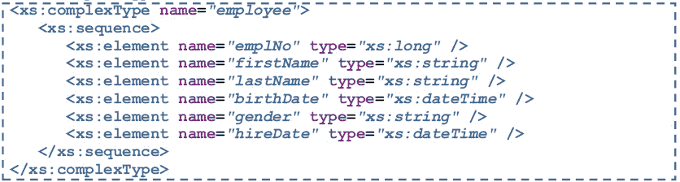

```xml
<xs:complexType name="createEmployeeResponse">
  <xs:sequence>
    <xs:element name="return" type="xs:long"/>
  </xs:sequence>
</xs:complexType>
```

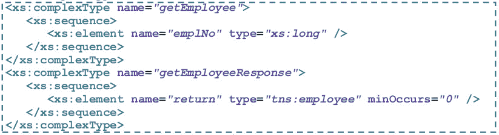

```xml
<xs:complexType name="SOAPException">
  <xs:sequence>
    <xs:element name="message" type="xs:string" minOccurs="0"/>
  </xs:sequence>
</xs:complexType>

<xs:complexType name="updateEmployee">
  <xs:sequence>
```


```xml
<xs:element name="employee" type="tns:employee" minOccurs="0"/>

</xs:sequence>

</xs:complexType>

<xs:complexType name="updateEmployeeResponse">

<xs:sequence>

<xs:element name="return" type="xs:boolean"/>

</xs:sequence>

</xs:complexType>

</xs:schema>
```

### 4.4.5.2 RPC 样式

RPC 样式与文档样式的 WSDL 之间的差异很难检测；然而，XSD 则有明显的不同。文档样式的所有数据类型都是使用 XML 架构定义的，而所有的简单数据类型（例如整数、长、字符串）都定义在 WSDL 内部。

#### 列表 4-19. RPC 样式的 WSDL

```xml
<definitions xmlns:soap="http://schemas.xmlsoap.org/wsdl/soap/" xmlns:tns="http://employees.rpc.ws.bemach.com/*" xmlns:xsd="http://www.w3.org/2001/XMLSchema*" xmlns="http://schemas.xmlsoap.org/wsdl/*" targetNamespace="http://employees.rpc.ws.bemach.com/*" name="EmployeeRpcDataService">

  <types>
    <xsd:schema>
      <xsd:import namespace="http://employees.rpc.ws.bemach.com/*" schemaLocation="http://localhost:9999/rpc/employees?xsd=1"/>
    </xsd:schema>

    <xsd:schema>
      <xsd:import namespace="http://bemach.com*" schemaLocation="http://localhost:9999/rpc/employees?xsd=2"/>
    </xsd:schema>
  </types>

  <message name="getEmployee">
    <part name="emplNo" type="xsd:long"/>
  </message>

  <message name="getEmployeeResponse">
    <part name="return" type="tns:employee"/>
  </message>

  <message name="SOAPException">
    <part name="fault" element="tns:SOAPException"/>
  </message>

  <message name="createEmployee">
    <part name="employee" type="tns:employee"/>
  </message>

  <message name="createEmployeeResponse">
    <part name="return" type="xsd:long"/>
  </message>

  <message name="updateEmployee">
    <part name="employee" type="tns:employee"/>
  </message>

  <message name="updateEmployeeResponse">
    <part name="return" type="xsd:boolean"/>
  </message>

  <message name="deleteEmployee">
    <part name="emplNo" type="xsd:long"/>
  </message>

  <message name="deleteEmployeeResponse">
    <part name="return" type="xsd:boolean"/>
  </message>

  <portType name="EmployeeRpcData">
    <operation name="getEmployee">
      <input message="getEmployee"/>
      <output message="getEmployeeResponse"/>
      <fault name="tns:SOAPException"/>
    </operation>

    <operation name="createEmployee">
      <input message="createEmployee"/>
      <output message="createEmployeeResponse"/>
    </operation>

    <operation name="updateEmployee">
      <input message="updateEmployee"/>
      <output message="updateEmployeeResponse"/>
    </operation>

    <operation name="deleteEmployee">
      <input message="deleteEmployee"/>
      <output message="deleteEmployeeResponse"/>
    </operation>
  </portType>

  <binding name="EmployeeDataBinding" type="tns:EmployeeRpcData">
    <soap:binding transport="http://schemas.xmlsoap.org/soap/soap/" style="rpc"/>

    <operation name="getEmployee">
      <soap:operation soapAction=""/>
      <input><soap:body use="literal" namespace="http://employees.rpc.ws.bemach.com/"></input>
      <output><soap:body use="literal" namespace="http://employees.rpc.ws.bemach.com/"></output>
      <fault name="tns:SOAPException"><soap:body use="literal" namespace="http://employees.rpc.ws.bemach.com/"></fault>
    </operation>

    <operation name="createEmployee">
      <soap:operation soapAction=""/>
      <input><soap:body use="literal" namespace="http://employees.rpc.ws.bemach.com/"></input>
      <output><soap:body use="literal" namespace="http://employees.rpc.ws.bemach.com/"></output>
    </operation>

    <operation name="updateEmployee">
      <soap:operation soapAction=""/>
      <input><soap:body use="literal" namespace="http://employees.rpc.ws.bemach.com/"></input>
      <output><soap:body use="literal" namespace="http://employees.rpc.ws.bemach.com/"></output>
    </operation>

    <operation name="deleteEmployee">
      <soap:operation soapAction=""/>
      <input><soap:body use="literal" namespace="http://employees.rpc.ws.bemach.com/"></input>
      <output><soap:body use="literal" namespace="http://employees.rpc.ws.bemach.com/"></output>
    </operation>
  </binding>

  <service name="EmployeeRpcDataService">
    <port name="EmployeeDataPort" binding="tns:EmployeeDataBinding">
      <soap:address location="http://localhost:9999/rpc/employees"/>
    </port>
  </service>
</definitions>
```

与文档样式不同，RPC 样式的 XSD 文档保持简单。大多数基础数据类型定义在 WSDL 中，而不是 XSD 中。

#### 列表 4-20. RPC 服务的 XSD

```xml
<xs:schema xmlns:tns="http://employees.rpc.ws.bemach.com/*" xmlns:xs="http://www.w3.org/2001/XMLSchema*" version="1.0" targetNamespace="http://employees.rpc.ws.bemach.com/*">

  <xs:element name="SOAPException" type="tns:SOAPException"/>

  <xs:complexType name="employee">
    <xs:sequence>
      <xs:element name="emplNo" type="xs:long"/>
      <xs:element name="firstName" type="xs:string"/>
      <xs:element name="lastName" type="xs:string"/>
      <xs:element name="birthDate" type="xs:dateTime"/>
      <xs:element name="gender" type="xs:string"/>
      <xs:element name="hireDate" type="xs:dateTime"/>
    </xs:sequence>
  </xs:complexType>

  <xs:complexType name="SOAPException">
    <xs:sequence>
      <xs:element name="message" type="xs:string" minOccurs="0"/>
    </xs:sequence>
  </xs:complexType>
</xs:schema>
```

#### 列表 4-21. 服务的额外 XSD

```xml
<xs:schema xmlns:ns1="http://employees.rpc.ws.bemach.com/*" xmlns:xs="http://www.w3.org/2001/XMLSchema*" version="1.0" targetNamespace="http://bemach.com*">

  <xs:import namespace="http://employees.rpc.ws.bemach.com/*" schemaLocation="http://localhost:9999/rpc/employees?xsd=1"/>

  <xs:element name="EmployeeService" type="ns1:employee"/>
</xs:schema>
```

## 4.5 使用 SOAPUI 测试 Web 服务

首先，为每个 WS 端点创建一个 `SOAPUI` 项目。然后，运行每个 Web 服务的各项。

### 4.5.1 SOAPUI 项目

可以使用 `SOAPUI` 对 Web 服务进行测试，它是一个开源的跨平台功能测试工具，用于测试 Web 服务。与 `Eclipse` 一样，`SOAPUI` 以项目的形式组织的。每个项目通常管理一个服务端点。每个服务端点包含一个或多个可以从客户端机器调的操作。为了测试 Web 服务，你只需要服务提供程序提供的服务端点 URL 即可。

下图显示了如何为该端点的文档风格的员工数据服务创建一个 `SOAPUI` 测试项目：[`localhost:9999/doc/employees?WSDL`](http://localhost:9999/doc/employees?WSDL)。

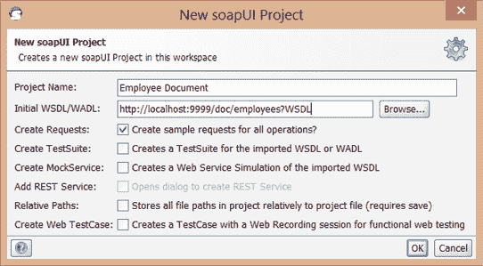 图 4-13. 创建 SOAPUI 项目

项目创建完成后，将出现一组操作，如图所示。注意，你现在可以开始测试这些 WS 操作了。在我们的示例中，可见四个操作：`createEmployee`、`deleteEmployee`、`getEmployee` 和 `updateEmployee`。

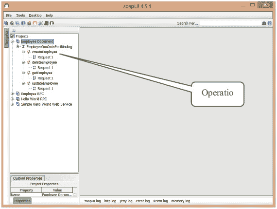 图 4-14. Web 服务的操作列表

双击 `createEmployee` 操作的 `Request1` 将显示一个多面板窗口。你可以填写参数并通过点击左侧面板的绿色三角形来运行测试。

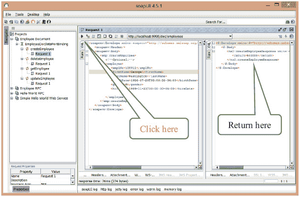 图 4-15. 执行 SOAP 操作

可以通过相同的方式测试服务的其他操作。

RPC 风格的 Web 服务也可以以类似的方式测试。唯一的区别是当你创建 `SOAPUI` 项目时，提供一个不同的服务端点（URL）。如下所示为 RPC 风格的 `EmployeeData` 服务创建 `SOAPUI` 项目：

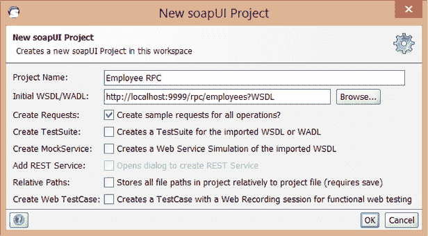 图 4-16. 创建新的 SOAPUI 项目

## 4.6 开发 Web 服务消费者

开发 WS 消费者（或客户端）涉及三个主要活动：创建客户端存根（stub）、创建使用客户端存根调用服务操作的客户端代码以及运行客户端。这些活动描述如下。

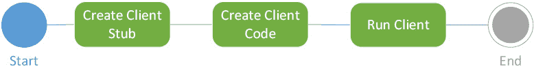 图 4-17. 创建 Web 服务的活动

### 4.6.1 使用 `wsimport` 创建客户端存根

使用 `SAAJ` 编写 SOAP 客户端可能复杂且耗时。详见第 2.4 节。相反，我们将使用 `wsimport` 工具生成 WS 制品（存根）。

首先，在 `Eclipse` IDE 下创建一个 Java 项目并命名为 `java-ws-client`。

1. 在命令提示符中，进入 `Eclipse` 的 Java 项目 `java-ws-client`。
2. 创建名为 `generated` 的文件夹。
3. 要生成 WS 存根，运行以下命令：

```bash
wsimport -d . http://localhost:9999/doc/employees?WSDL

wsimport -d . http://localhost:9999/rpc/employees?WSDL

wsimport -d . http://localhost:9999/java-ws/hello?WSDL
```

4. 要创建一个 Java 库，运行以下命令：

```bash
jar –cvf ../lib/java-ws-generated.jar *
```

5. 要验证所创建 jar 包的内容，运行此命令：

```bash
jar –tf ../lib/java-ws-generated.jar *
```

库的内容显示如下：

```text
META-INF/

META-INF/MANIFEST.MF

com/

com/bemach/

com/bemach/ObjectFactory.class

com/bemach/ws/

com/bemach/ws/doc/

com/bemach/ws/doc/employees/

com/bemach/ws/doc/employees/CreateEmployee.class

com/bemach/ws/doc/employees/CreateEmployeeResponse.class

com/bemach/ws/doc/employees/DeleteEmployee.class

com/bemach/ws/doc/employees/DeleteEmployeeResponse.class

com/bemach/ws/doc/employees/Employee.class

com/bemach/ws/doc/employees/EmployeeDocData.class

com/bemach/ws/doc/employees/EmployeeDocDataService.class

com/bemach/ws/doc/employees/GetEmployee.class

com/bemach/ws/doc/employees/GetEmployeeResponse.class
```


`com/bemach/ws/doc/employees/ObjectFactory.class`

`com/bemach/ws/doc/employees/package-info.class`

`com/bemach/ws/doc/employees/SOAPException.class`

`com/bemach/ws/doc/employees/SOAPException_Exception.class`

`com/bemach/ws/doc/employees/UpdateEmployee.class`

`com/bemach/ws/doc/employees/UpdateEmployeeResponse.class`

`com/bemach/ws/hello/`

`com/bemach/ws/hello/HelloWorld.class`

`com/bemach/ws/hello/HelloWorldService.class`

`com/bemach/ws/hello/ObjectFactory.class`

`com/bemach/ws/hello/package-info.class`

`com/bemach/ws/hello/Say.class`

`com/bemach/ws/hello/SayResponse.class`

`com/bemach/ws/rpc/employees/`

`com/bemach/ws/rpc/Employee.class`

`com/bemach/ws/rpc/EmployeeDocData.class`

`com/bemach/ws/rpc/EmployeeDataService.class`

`com/bemach/ws/rpc/ObjectFactory.class`

`com/bemach/ws/rpc/package-info.class`

`com/bemach/ws/rpc/SOAPException.class`

`com/bemach/ws/rpc/SOAPException_Exception.class`

这些命令生成的 Java 二进制代码可以作为客户端程序的一部分。接下来，创建一个包含生成代码的 Java 库：`java-ws-generated.jar`。该库在执行时应包含在 Eclipse 设置中。

### 4.6.2 创建客户端代码

我们展示两种类型的客户端代码——文档风格和 RPC 风格。这在 WS 编程中都很常见；但更倾向于文档风格。

编码完成后，`java-ws-client` 项目如下：

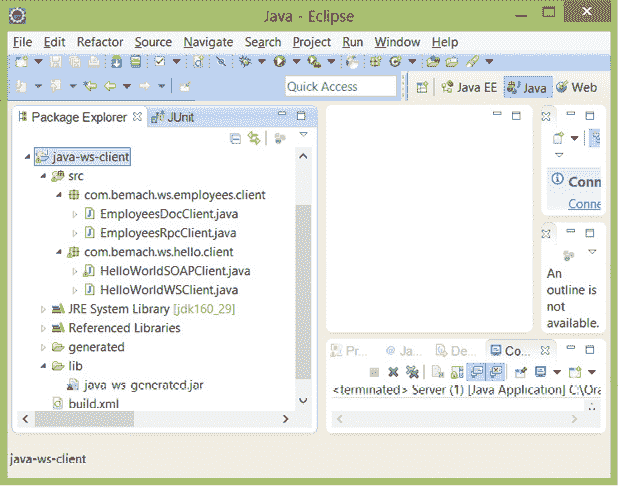 图 4-18. java-ws-client 项目截图

### 4.6.2.1 EmployeesDocClient.java

此代码使用生成的客户端存根向远程服务器调用 WS。一个重要的类是 `QName`，我们在此处创建一个包含 WSDL 中 `definitions` 元素的 `targetNamespace` 和 `name` 属性的限定名称。另一个重要的类是 `URL`，我们在此处根据 WSDL 中 `soap:address` 元素的 `location` 属性创建一个服务端点。通过这两个类，我们可以创建一个服务，并将其映射到服务提供的系列操作上。将端口映射到 `EmployeeDocData` 是通过 WSDL 中 `binding` 元素的 `type` 属性指定的。一旦获取端口，我们就可以像在 Java 中调用本地方法一样调用这些操作。

```java
public class EmployeesDocClient {

    private static final Logger LOG = Logger.getLogger(EmployeesDocClient.class.getName());

    private EmployeeDocData emplDs = null;

    public EmployeesDocClient(String urlStr, String targetNs, String name) throws MalformedURLException {

        LOG.info("Constructor ...");

        QName qName = new QName(targetNs, name);

        URL url = new URL(urlStr);

        Service service = EmployeeRpcDataService.create(url, qName);

        emplDs = service.getPort(EmployeeDocData.class);

    }

    public Employee get(long id) throws SOAPException_Exception {

        return emplDs.getEmployee(id);

    }

    public long create(Employee empl) {

        return emplDs.createEmployee(empl);

    }

    public boolean delete(long id) {

        return emplDs.deleteEmployee(id);

    }

    public boolean update(Employee empl) {

        return emplDs.updateEmployee(empl);

    }

    /**

     * @param args

     * @throws MalformedURLException

     * @throws SOAPException_Exception

     */

    public static void main(String[] args) throws MalformedURLException, SOAPException_Exception {

        LOG.info("Calling Employee (Document) data service ... ");

        String targetNameSpace = "http://employees.doc.ws.bemach.com/";

        String name = "EmployeeDocDataService";

        String urlStr = String.format("http://localhost:%s/doc/employees", args[0]);

        EmployeesDocClient cli = new EmployeesDocClient(urlStr, targetNameSpace, name);

        long oldEmplNo = Integer.valueOf(args[1]);

        Employee empl = cli.get(oldEmplNo);

        LOG.info("last=" + empl.getLastName());

        LOG.info("hire=" + empl.getHireDate());

        LOG.info("last=" + empl.getLastName());

        LOG.info("first=" + empl.getFirstName());

        empl.setFirstName("Silvester");

        empl.setLastName("Johnny");

        long newEmplNo = cli.create(empl);

        LOG.info("emplNo=" + newEmplNo);

        Employee newEmpl = cli.get(newEmplNo);

        newEmpl.setLastName("New-name");

        newEmpl.setEmplNo(newEmplNo);

        boolean status = cli.update(newEmpl);

        LOG.info("update:" + status);

        LOG.info("last=" + newEmpl.getLastName());

        LOG.info("first=" + newEmpl.getFirstName());

        status = cli.delete(newEmplNo);

        LOG.info("deleteEmployee:" + status);

        LOG.info("Exit!");

    }

}
```

### 4.6.2.2 EmployeesRpcClient.java

该类与文档风格的客户端代码几乎相同。因此，在这一层面上，两种风格客户端代码之间的区别几乎无法察觉的。显著区别在于客户端端 SOAP 引擎中的代码实现。

#### 列表 4-23. EmployeesRpcClient.java 类

```java
package com.bemach.ws.employees.client;

/**

 * 2013 (C) BEM, Inc., Fairfax, Virginia

 * Unless required by applicable law or agreed to in writing,

 * software distributed is distributed on an

 * "AS IS" BASIS, WITHOUT WARRANTIES OR CONDITIONS OF ANY

 * KIND, either express or implied.

 */

import java.net.MalformedURLException;

import java.net.URL;

import java.util.logging.Logger;

import javax.xml.namespace.QName;

import javax.xml.ws.Service;

import com.bemach.ws.rpc.employees.Employee;

import com.bemach.ws.rpc.employees.EmployeeRpcData;

import com.bemach.ws.rpc.employees.EmployeeRpcDataService;

import com.bemach.ws.rpc.employees.SOAPException_Exception;

/**

 * 此代码依赖于使用 wsimport 程序生成的 ws 代码：

 * wsimport -d . http://localhost:9999/rpc/Employees?WSDL

 * jar cvf ../ws-ch-1-generated.jar

 */

public class EmployeesRpcClient {

    private static final Logger LOG = Logger.getLogger(EmployeesRpcClient.class.getName());

    private EmployeeRpcData emplDs = null;

    public EmployeesRpcClient(String urlStr, String targetNs, String name) throws MalformedURLException {

        LOG.info("Constructor ...");

        QName qName = new QName(targetNs, name);

        URL url = new URL(urlStr);

        Service service = EmployeeRpcDataService.create(url, qName);

        emplDs = service.getPort(EmployeeRpcData.class);

    }

    public Employee get(long id) throws SOAPException_Exception {

        return emplDs.getEmployee(id);

    }

    public long create(Employee empl) {

        return emplDs.createEmployee(empl);

    }

    public boolean delete(long id) {

        return emplDs.deleteEmployee(id);

    }

    public boolean update(Employee empl) {

        return emplDs.updateEmployee(empl);

    }

    /**

     * @param args

     * @throws MalformedURLException

     * @throws SOAPException_Exception

     */

    public static void main(String[] args) throws MalformedURLException, SOAPException_Exception {

        LOG.info("Calling Employee (Document) data service ... ");

        String targetNameSpace = "http://employees.doc.ws.bemach.com/";

        String name = "EmployeeDocDataService";

        String urlStr = String.format("http://localhost:%s/doc/employees", args[0]);

        EmployeesDocClient cli = new EmployeesDocClient(urlStr, targetNameSpace, name);

        long oldEmplNo = Integer.valueOf(args[1]);

        Employee empl = cli.get(oldEmplNo);

        LOG.info("last=" + empl.getLastName());

        LOG.info("hire=" + empl.getHireDate());

        LOG.info("last=" + empl.getLastName());

        LOG.info("first=" + empl.getFirstName());

        empl.setFirstName("Silvester");

        empl.setLastName("Johnny");

        long newEmplNo = cli.create(empl);

        LOG.info("emplNo=" + newEmplNo);

        Employee newEmpl = cli.get(newEmplNo);

        newEmpl.setLastName("New-name");

        newEmpl.setEmplNo(newEmplNo);

        boolean status = cli.update(newEmpl);

        LOG.info("update:" + status);

        LOG.info("last=" + newEmpl.getLastName());

        LOG.info("first=" + newEmpl.getFirstName());

        status = cli.delete(newEmplNo);

        LOG.info("deleteEmployee:" + status);

        LOG.info("Exit!");

    }

}
```

### 4.6.3 运行客户端

我们在每个客户端中都实现了用于测试的 `main` 方法。运行这些程序可以使用以下命令：

```bash
java -cp java-client.jar;lib/java-generated.jar com.bemach.ws.employees.client.EmployeesDocClient
```

或者

```bash
java -cp java-client.jar;lib/ws-ch-1-generated.jar com.bemach.ws.employees.client.EmployeesRpcClient
```


# 5. Apache CXF 和 Tomcat 服务器

## 目标

完成本章后，你应该：

1. 开发动态 Web 应用。
2. 打包。
3. 将其部署到 Tomcat 服务器。

## 5.1 在 Java 中创建 Web 服务

## 5.2 打包 WAR 文件

## 5.3 将 WAR 文件部署到 Tomcat 7 服务器

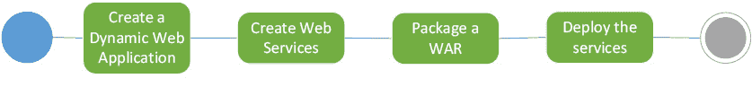

**图 5-3. 创建 Web 服务应用的活动**

### 5.3.3 创建动态 Web 应用

在 Eclipse 中，创建一个新的动态 Web 项目（Dynamic Web Project）。步骤如下：

- 选择 `File` → `New` → `Other …` → `Web` → `Dynamic Web Project`
- 选择所有默认值，并将项目命名为 `cxf-ws`。
- 从左侧面板选择 `cxf-ws` 项目，选择 `File` → `New` → `Folder`。将新文件夹命名为 `lib`。
- 现在，我们需要以下 Java 库：
  - `mysql-connector-java-5.1.24-bin.jar`：包含 MySQL 数据库的 JDBC 驱动程序。
  - `java-ws.jar`：包含访问数据库的主逻辑。
  - `data-svc.jar`：包含数据访问类。
- 将这些文件（来自之前的项目和 Apache CXF 分发包）导入到我们之前创建的 `lib` 文件夹中：

```text
mysql-connector-java-5.1.24-bin.jar
ws-ch-1.jar
aopalliance-1.0.jar
asm-3.3.jar
axis.jar
commons-dbcp-1.4.jar
commons-discovery-0.2.jar
commons-logging-1.1.1.jar
commons-logging.jar
cxf-2.4.0.jar
geronimo-activation_1.1_spec-1.1.jar
geronimo-annotation_1.0_spec-1.1.1.jar
geronimo-javamail_1.4_spec-1.7.1.jar
geronimo-servlet_3.0_spec-1.0.jar
geronimo-ws-metadata_2.0_spec-1.1.3.jar
jaxb-api-2.2.1.jar
jaxb-impl-2.2.1.1.jar
jaxrpc.jar
neethi-3.0.0.jar
saaj-api-1.3.jar
saaj-impl-1.3.2.jar
spring-aop-3.0.5.RELEASE.jar
spring-asm-3.0.5.RELEASE.jar
spring-beans-3.0.5.RELEASE.jar
spring-context-3.0.5.RELEASE.jar
spring-core-3.0.5.RELEASE.jar
spring-expression-3.0.5.RELEASE.jar
spring-web-3.0.5.RELEASE.jar
stax2-api-3.1.1.jar
woodstox-core-asl-4.1.1.jar
wsdl4j-1.6.2.jar
wsdl4j.jar
xml-resolver-1.2.jar
xmlschema-core-2.0.jar
```

在我们完成为 `cxf-ws` 编写 Java 类后，项目看起来应该是这样的：

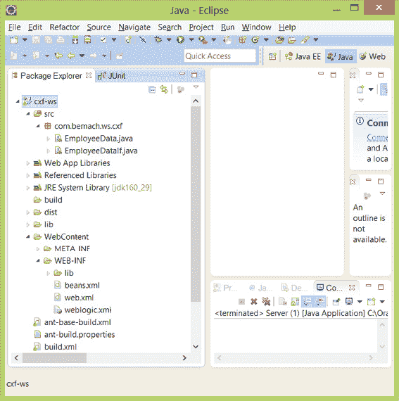

**图 5-4. 动态 Web 项目截图**

### 5.3.4 创建 Web 服务

从 `cxf-ws/Java Resources/src` 目录，创建一个名为 `com.bemach.ws.cxf` 的 Java 包。从该包中，创建一个 Java 接口和一个 Java 类。

#### 5.3.4.1 EmployeeDataIf.java

我们介绍了另一种使用 Java 接口创建 Web 服务的方法。这为我们在实现 Web 服务之前提供了一种更、更整洁的方式来指定服务接口。通常用于 Java 类的所有 WS 注解都以类似的方式使用。

##### 列表 5-1. 带有 Web 服务注解的 EmployeeDataIf.java 类

```java
package com.bemach.ws.cxf;

/** 2013 (C) BEM, Inc., Fairfax, Virginia
 * 除非适用法律要求或书面同意，否则分发的软件按“原样”状况分发，
 * 不提供任何形式的保证或条件（无论是明示还是暗示的）。
 */

import java.sql.SQLException;
import javax.jws.WebMethod;
import javax.jws.WebParam;
import javax.jws.WebService;
import javax.jws.soap.SOAPBinding;
import javax.xml.soap.SOAPException;
import com.bemach.data.Employee;

@WebService
@SOAPBinding(style = SOAPBinding.Style.DOCUMENT)
public interface EmployeeDataIf {
    @WebMethod
    Employee getEmployee(@WebParam(name = "emplNo") long emplNo)
        throws SOAPException, SQLException;

    @WebMethod
    long createEmployee(@WebParam(name = "employee") Employee employee)
        throws SOAPException, SQLException;

    @WebMethod
    boolean updateEmployee(@WebParam(name = "employee") Employee employee)
        throws SOAPException, SQLException;

    @WebMethod
    boolean deleteEmployee(@WebParam(name = "emplNo") long emplNo)
        throws SOAPException, SQLException;
}
```

该服务将包含四个基本操作：

1. `getEmployee` 方法，根据指定的员工编号返回员工。如果未找到，则抛出异常；
2. `createEmployee` 方法，如果创建成功，则返回员工编号。如果失败，方法将返回；
3. `updateEmployee` 方法，如果成功则返回 `true`，否则如此；
4. `deleteEmployee` 方法，如果成功则返回 `true`，否则如此。

#### 5.3.4.2 EmployeeData.java

该类是 `EmployeeDao` 的包装器。它实现了 `EmployeeDataIf`。

##### 列表 5-2. EmployeeData.java：实现

```java
package com.bemach.ws.cxf;

/** 2013 (C) BEM, Inc., Fairfax, Virginia
 * 除非适用法律要求或书面同意，否则分发的软件按“原样”状况分发，
 * 不提供任何形式的保证或条件（无论是明示还是暗示的）。
 */

import java.sql.SQLException;
import javax.jws.WebMethod;
import javax.jws.WebParam;
import javax.jws.WebService;
import javax.jws.soap.SOAPBinding;
import javax.xml.soap.SOAPException;
import com.bemach.data.Employee;
import com.bemach.data.EmployeeDao;
import java.util.logging.Logger;

@WebService
class EmployeeData implements EmployeeDataIf {
    static Logger LOG = Logger.getLogger(EmployeeData.class.getName());
    static DbConfig cfg = new DbConfig();

    static DbConfig getCfg() {
        return cfg;
    }

    static void setCfg(DbConfig cfg) {
        EmployeeData.cfg = cfg;
    }

    EmployeeData(DbConfig cfg) {
        EmployeeData.cfg = cfg;
    }

    @Override
    Employee getEmployee(long emplNo) throws SOAPException, SQLException {
        LOG.info("read employee");
        EmployeeDao dao = new EmployeeDao(cfg);
        Employee employee = dao.getpl((int) emplNo);

        if (employee == null) {
            throw new SOAPException("GetEmployee: No such employee!");
        }

        return employee;
    }

    @Override
    long createEmployee(Employee employee) throws SOAPException, SQLException {
        LOG.info("create employee");
        EmployeeDao dao = new EmployeeDao(cfg);
        return dao.createpl(employee);
    }

    @Override
    boolean updateEmployee(Employee employee) throws SOAPException, SQLException {
        LOG.info("update employee.");
        EmployeeDao dao = new EmployeeDao(cfg);
        return dao.updatepl(employee);
    }

    @Override
    boolean deleteEmployee(long emplNo) throws SOAPException, SQLException {
        LOG.info("delete employee.");
        EmployeeDao dao = new EmployeeDao(cfg);
        return dao.deletepl((int) emplNo);
    }
}
```

使用了默认配置。必要可以使用 `EmployeeData` 构造函数修改 `cfg` 对象。

### 5.3.5 打包 WAR

两个重要的文件——`beans.xml` 和 `web.xml` 存储在 WAR 文件的 `WEB-INF` 目录。这些文件协助 Tomcat 服务器和 CXF 实现具体的 Web 服务。记住，我们使用部署在 Web 服务器（Tomcat 或其他）上的 Web 应用来实现示例 Web 服务。

#### 5.3.5.1 创建 web.xml

##### 列表 5-3. web.xml 的内容

```xml
<?xml version="1.0" encoding="UTF-8"?>
<web-app>
    <context-param>
        <param-name>contextConfigLocation</param-name>
        <param-value>WEB-INF/beans.xml</param-value>
    </context-param>

    <listener>
        <listener-class>
            org.springframework.web.context.ContextLoaderListener
        </listener-class>
    </listener>

    <servlet>
        <servlet-name>CXFServlet</servlet-name>
        <display-name>CXF Servlet</display-name>
        <servlet-class>
            org.apache.cxf.transport.servlet.CXFServlet
        </servlet-class>
        <load-on-startup>1</load-on-startup>
    </servlet>

    <servlet-mapping>
        <servlet-name>CXFServlet</servlet-name>
        <url-pattern>/*</url-pattern>
    </servlet-mapping>
</web-app>
```

#### 5.3.5.2 创建 beans.xml

##### 列表 5-4. beans.xml 的内容

```xml
<beans xmlns="http://www.springframework.org/schema/beans"
       xmlns:xsi="http://www.w3.org/2001/XMLSchema-instance"
       xmlns:jaxws="http://cxf.apache.org/jaxws"
       xsi:schemaLocation="
           http://www.springframework.org/schema/beans
           http://www.springframework.org/schema/beans/spring-beans.xsd
           http://cxf.apache.org/jaxws
           http://cxf.apache.org/schemas/jaxws.xsd">

    <import resource="classpath:META-INF/cxf/cxf.xml" />

    <import resource="classpath:META-INF/cxf/cxf-extension-soap.xml" />

    <import resource="classpath:META-INF/cxf/cxf-servlet.xml" />

    <jaxws:endpoint
        id="com.bemach.ws.cxf.EmployeeDataIf"
        implementor="com.bemach.ws.cxf.EmployeeData"
        address="/employees" />

</beans>
```

#### 5.3.5.3 构建 Web 应用程序（WAR）

此构建脚本创建一个 Java Web 应用程序（WAR 文件），并将其封装为 `cxf-ws.war`。该应用程序存储在 `dist` 目录。

##### 列表 5-5. cxf-ws 动态 Web 项目的 build.xml 内容

```xml
<?xml version="1.0" encoding="ISO-8859-1"?>

<project name="cxf-ws" basedir="." default="dist">

    <property environment="env" />

    <path id="classpath.base">
        <fileset dir="./lib" includes="**/*.jar" />
    </path>

    <path id="classpath.compile">
        <path refid="classpath.base" />
    </path>

    <target name="init">
        <mkdir dir="./bin" />
        <mkdir dir="./dist" />
    </target>

    <target name="compile" depends="init" description="compile the source">
        <javac srcdir="./src" destdir="./bin" debug="true">
            <classpath refid="classpath.compile" />
        </javac>
    </target>

    <target name="copylibs" depends="compile">
        <echo message="copying libraries ..." />
        <copy todir="WebContent/WEB-INF/lib">
            <fileset dir="./lib">
                <include name="**.jar" />
            </fileset>
        </copy>
    </target>

    <target name="dist" depends="buildwar">
        <echo message="Building ..." />
    </target>

    <target name="buildwar" depends="copylibs">
        <echo message="building war ." />
        <tstamp />

        <manifest file="MANIFEST.MF">
            <attribute name="Built-By" value="Kiet T. Tran" />
            <attribute name="Build-Version" value="1" />
            <attribute name="Build-Subversion" value="0" />
            <attribute name="Built-Date" value="April 28, 2013" />
        </manifest>
    </target>
```


<war destfile="./dist/cxf-ws.war" webxml="WebContent/WEB-INF/web.xml" update="true" manifest="MANIFEST.MF">
    <classes dir="./bin" />
    <fileset dir="WebContent">
        <exclude name="WEB-INF/web.xml" />
    </fileset>
</war>

<delete file="MANIFEST.MF" />
</target>

<target name="clean">
    <echo message="cleaning ..." />
    <delete dir="./dist" />
    <delete dir="./bin" />
</target>

</project>

## 5.4 部署服务

当安装 Tomcat 7 时，Tomcat 服务器根目录下包含以下目录：

- `bin`
- `conf`
- `lib`
- `logs`
- `temp`
- `webapps`
- `work`

我们最关注的是`bin`和`webapps`目录，用于部署和发布我们的 Web 服务。要运行 Tomcat，进入`bin`目录并运行`startup.cmd`（WINDOWS）或`startup.sh`（UNIX）。

要部署包含示例 Web 服务的 Web 应用程序，将`cxf-web.war`复制到`webapps`目录。你不需要每次部署 Web 应用程序都重启 Tomcat 服务器。

## 5.5 使用 SOAPUI 测试服务

对在 Apache Tomcat 服务器上运行的新 Web 服务测试与之前描述的 Java WS 端点部署类似。Web 服务端点为：

`http://localhost:8080/cxf-ws/employees?WSDL`

### 5.5.1 检查 WSDL

#### 列表 5-6. CXF Web 服务应用程序的 WSDL

```xml
<wsdl:definitions xmlns:ns1="http://schemas.xmlsoap.org/soap/http*" xmlns:soap="http://schemas.xmlsoap.org/wsdl/soap/" xmlns:tns="http://cxf.ws.bemach.com/" xmlns:wsdl="http://schemas.xmlsoap.org/wsdl/" xmlns:xsd="http://www.w3.org/2001/XMLSchema*" targetNamespace="http://localhost:8080/cxf-ws/employees?WSDL" xmlns:xsd="http://www.w3.org/2001/XMLSchema*" xmlns:ns1="http://schemas.xmlsoap.org/soap/http*" xmlns:soap="http://schemas.xmlsoap.org/wsdl/soap/" xmlns:tns="http://cxf.ws.bemach.com/" xmlns:wsdl="http://schemas.xmlsoap.org/wsdl/" xmlns:xsd="http://www.w3.org/2001/XMLSchema*">
    <wsdl:types targetNamespace="http://localhost:8080/cxf-ws/employees?WSDL" xmlns:xsd="http://www.w3.org/2001/XMLSchema*">
        <xsd:schema targetNamespace="http://localhost:8080/cxf-ws/employees?WSDL">
            <xsd:complexType name="EmployeeData">
                <xsd:sequence>
                    <xsd:element name="empNo" type="xsd:long" />
                    <xsd:element name="firstName" type="xsd:string" />
                    <xsd:element name="lastName" type="xsd:string" />
                    <xsd:element name="birthDate" type="xsd:dateTime" />
                    <xsd:element name="gender" type="xsd:string" />
                    <xsd:element name="hireDate" type="xsd:dateTime" />
                </xsd:sequence>
            </xsd:complexType>
        </xsd:schema>
    </wsdl:types>
</wsdl:definitions>
```

### 5.5.2 SOAPUI 项目

下图显示了对`getEmployee`的调用。


图 5-5：创建新的 SOAP 服务

## 5.6 开发 Web 服务

### 5.6.1 创建 Stub

首先，在 Eclipse 下创建一个 Java 项目并将其命名为`cxf-ws`。

1. 在命令提示符中，进入`cxf-ws`项目。
2. 创建名为`generated`的文件夹。
3. 要生成 Web 服务 stubs，运行以下命令：

```bash
wsdlimport -d . http://localhost:8080/cxf
```

4. 要创建一个 Java 库，运行以下命令：

```bash
jar -cvf ../lib/cxf-generated.jar
```

5. 现在，验证创建 jar 包的内容：

```bash
jar -tf ../lib/cxf-generated.jar
```

库的内容应该如下：

```
META-INF/
MANIFEST.MF
com/
com/bemach/
com/bemach/ws/
com/bemach/ws/cxf/ObjectFactory.class
com/bemach/ws/cxf/Employee.class
com/bemach/ws/cxf/EmployeeDataIf.class
com/bemach/ws/cxf/EmployeeDataService.class
com/bemach/ws/cxf/package-info.class
com/bemach/ws/cxf/SOAPException.class
com/bemach/ws/cxf/SOAPException_Exception.class
```

### 5.6.2 创建客户端

下图显示了 SOAP 操作的结果。


图 5-6：执行 SOAP 操作

### 5.6.2.1 EmployeeDataClientjava

该 Java 类包含可以调用 Tomcat 7 服务器托管的`EmployeeDataService`提供的四个操作的代码。

#### 列表 5-7：EmployeeDataClient 类

```java
package com.bemach.ws.cxf.client;

/**
 * 2013 (C) BEM, Inc., Fairfax, Virginia
 * 除非适用法律要求或书面同意，
 * 软件按“原样”分发，不提供任何形式的
 * 保证，无论是明确或隐含的。
 */

import java.net.MalformedURLException;
import java.net.URL;
import java.util.logging.Logger;
import javax.xml.namespace.QName;
import javax.xml.ws.Service;
import com.bemach.ws.cxf.Employee;
import com.bemach.ws.cxf.EmployeeDataIf;
import com.bemach.ws.cxf.EmployeeDataService;
import com.bemach.ws.cxf.SOAPException_Exception;

public class EmployeeDataClient {
    private static final Logger LOG = Logger.getLogger(EmployeeDataClient.class.getName());
    private EmployeeDataIf emplDs = null;

    /**
     * 此方法构造 EmployeeDataClient 对象。
     * @param urlStr Web 服务的 URL
     * @param targetNs 目标 Web 服务的命名空间
     * @param name Web 服务的名称
     * @throws MalformedURLException 如果发生错误，则抛出异常
     */
    public EmployeeDataClient(String urlStr, String targetNs, String name) throws MalformedURLException {
        LOG.info("Constructor ...");
        QName qName = new QName(targetNs, name);
        URL url = new URL(urlStr);
        Service service = EmployeeDataService.create(url, qName);
        emplDs = service.getPort(EmployeeDataIf.class);
    }
}
```

```java
/**
 * 此方法根据唯一的 ID 获取员工记录。
 * @param id – 唯一的员工 ID。
 * @return – 员工记录。
 * @throws SOAPException_Exception – 抛出异常。
 */
public Employee get(long id) throws SOAPException_Exception {
    return emplDs.getEmployee(id);
}

/**
 * 此方法创建一个员工记录。
 * @param empl
 * @return
 */
public long create(Employee empl) {
    return emplDs.createEmployee(empl);
}

/**
 * 此方法根据唯一的 ID 删除员工记录。
 * @param id
 * @return
 */
public boolean delete(long id) {
    return emplDs.deleteEmployee(id);
}

/**
 * 此方法用新记录更新员工记录。
 * @param empl
 * @return
 */
public boolean update(Employee empl) {
    return emplDs.updateEmployee(empl);
}

/**
 * 这是代码的主入口。
 * @param args
 * @throws MalformedURLException
 * @throws SOAPException_Exception
 */
public static void main(String[] args) throws MalformedURLException, SOAPException_Exception {
    LOG.info("Calling Employee (CXF) data service ... ");
    String targetNameSpace = "http://cxf.ws.bemach.com/";
    String name = "EmployeeDataService";
    String portNo = args[0];
    String urlStr = String.format("http://localhost:%s/cxf-ws/employees?WSDL", portNo);
    EmployeeDataClient cli = new EmployeeDataClient(urlStr, targetNameSpace, name);
    LOG.info("URL=" + urlStr);
    long oldEmplNo = Integer.valueOf(args[1]);
    Employee empl = cli.get(oldEmplNo);
    LOG.info("last=" + empl.getLastName());
    LOG.info("hire=" + empl.getHireDate());
    LOG.info("last=" + empl.getLastName());
    LOG.info("first=" + empl.getFirstName());
    empl.setFirstName("Silvester");
    empl.setLastName("Johnny");
    long newEmplNo = cli.create(empl);
    LOG.info("emplNo=" + newEmplNo);
    Employee newEmpl = cli.get(newEmplNo);
    newEmpl.setLastName("New-name");
    newEmpl.setEmNo(newEmplNo);
    boolean status = cli.update(newEmpl);
    LOG.info("update:" + status);
    LOG.info("last=" + newEmpl.getLastName());
    LOG.info("first=" + newEmpl.getFirstName());
    status = cli.delete(newEmplNo);
    LOG.info("deleteEmployee:" + status);
    LOG.info("Exit!");
}
```

在此类中，我们将端口号作为第一个程序参数提供。Tomcat 端口号为 8080。

### 5.6.3 构建 Java 库

此构建脚本创建一个名为`cxf-ws-client.jar`的 Java 库。它需要存储在`dist`目录下的`cxf-ws-generated.jar`库。

#### 图 5-8. cxf-ws-client Java 项目的 build.xml 内容

```xml
```


<project name="cxf-ws-client" default="dist" basedir=".">
  <description>Client for employees data service. Assumed that `cxf-ws-generated.jar` is generated and built elsewhere</description>
  <!-- set global properties for this build -->
  <property environment="env"/>
  <path id="classpath.base">
    <fileset dir="./lib" includes="/*.jar" />
  </path>
  <path id="classpath.compile">
    <path refid="classpath.base"/>
  </path>
  <target name="init">
    <mkdir dir="./bin"/>
    <mkdir dir="./dist"/>
  </target>
  <target name="compile" depends="init" description="compile the source ">
    <javac srcdir="./src" destdir="./bin" debug="true">
      <classpath refid="classpath.compile"/>
    </javac>
  </target>
  <target name="dist" depends="compile" description="generate the distribution">
    <!-- Create the distribution directory -->
    <jar jarfile="./dist/cxf-ws-client.jar" basedir="./bin"/>
  </target>
  <target name="clean" description="clean up">
    <!-- Delete the ${build} directory trees -->
    <delete dir="./dist"/>
    <delete dir="./bin"/>
  </target>
</project>

### 5.6.4 运行客户端应用程序

要运行客户端应用程序，请进入 `cxf-ws-client` 项目目录。在命令提示符上运行以下命令：

```bash
java -cp ./lib/cxf-ws-generated.jar;./dist/cxf-ws-client.jar com.bemach.ws.cxf.client.EmployeeDataClient 8080
```

输出如下：

```
Calling Employee (CXF) data service ...
URL=http://localhost:8080/cxf-ws/employees?WSDL
last=Fecello
hire=1986-06-26T00:00:00-04:00
last=Fecello
first=Silvester
emplNo=500001
update:true
last=New-name
first=Silvester
deleteEmployee:true
Exit!
```

# 6. CXF 与 Web 服务

## 目标

完成本章后，你应该能够：

1. 理解 `WebLogic Server` 的基础知识
2. 创建一个基础 `WebLogic` 域
3. 使用 `WebLogic` 部署 `CXF` 应用程序

在本章中，我们将介绍 `WebLogic Server` 12。

## 6.1 WebLogic Server

`WebLogic Server`（`WLS`）也称为`企业版`。它是构建安全、高可用且可扩展应用程序的基础。它提供了用于数据库、消息和外部系统的 API。

### 6.1.1 编程

`WLS` 包含以下内容：

* Java（`JSP` 和 `Servlet`）
* Web 服务（`JAX-WS`、`JAX-RPC`、`JAX-RS`）
* XML 编程（`JAXB`）
* Java 消息（`JMS`）
* Java 数据库连接（`JDBC`）
* 企业信息系统
* 企业 JavaBean（`EJB`）
* 远程方法调用（`RMI`）
* 安全 API
* Tuxedo 连接（`WTC`）

### 6.1.2 高可用

关键任务可以通过以下技术支持：

* `WebLogic` 集
* 工作管理器
* 负载保护
* 网络通道
* `WebLogic` 持久化存储
* 转发服务
* 企业级开发工具
* 生产重部署

## 6.2 部署图

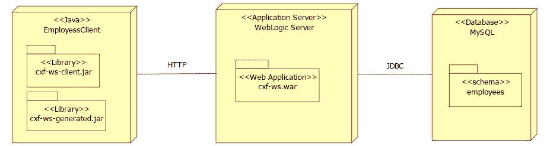

图 6-1. CXF 部署图

## 6.3 创建 WebLogic 域

`WebLogic Server` 域是 `WLS` 资源的逻辑组。它由一种特殊的服务器类型`管理服务器`管理。该服务器实例用于管理这些资源的配置。应用程序和服务不应部署在`管理服务器`上，而应部署在`托管服务器`实例上。一个 `WLS` 域可以包含一个或多个托管服务器实例。

两个或多个托管服务器可以组成一个集群。域可以管理集群。为了简单起见，我们将 `CXF` 服务应用程序部署在管理服务器上。首先，我们按照以下步骤创建一个 `WLS` 域：

1. 假设你在 Windows 上安装了 Oracle WebLogic，进入 `C:\Oracle\Middleware\wlserver_12.1\common\bin`。
2. 运行 `config.cmd`（或 `config.sh`）。
3. 按照屏幕指令完成域的创建。
4. 选择所有默认参数。
5. 完成后，域创建并存储在此处：`C:\Oracle\Middleware\user_projects\domains\base_domain`。

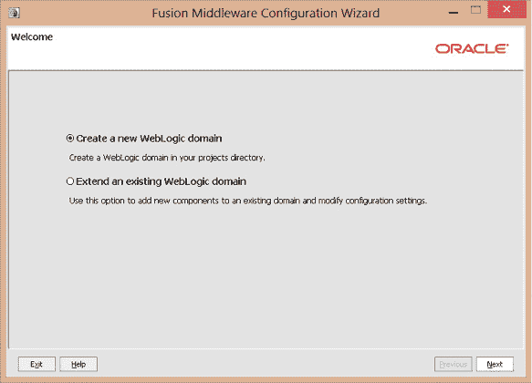

图 6-2. 创建 WLS 域

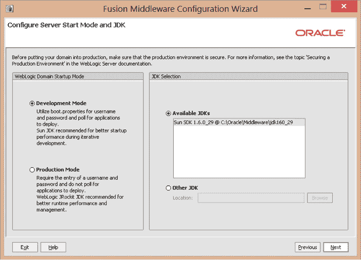

**图 6-6.** 选择默认 JDK

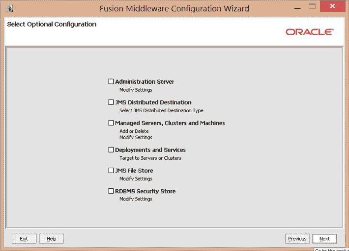

**图 6-7.** 额外配置

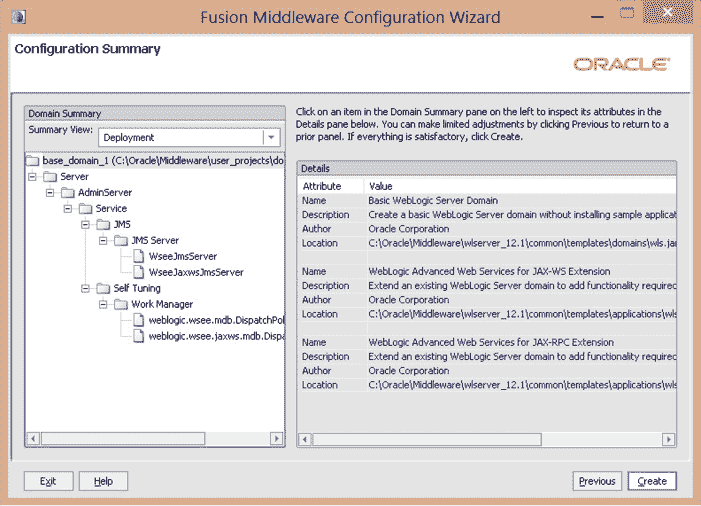

**图 6-8.** 域配置摘要

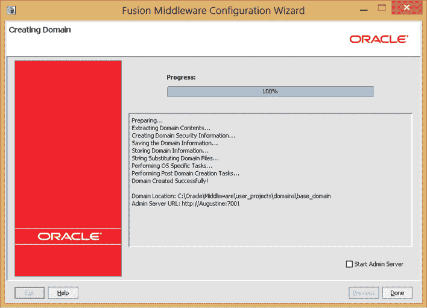

**图 6-9.** 域创建状态

### 6.3.1 启动管理服务器 (Administration Server)

要启动管理服务器：

1. 进入域目录：
`C:\Oracle\Middleware\user_projects\domains\base_domain`

2. 运行以下命令：
`startweblogic.cmd`

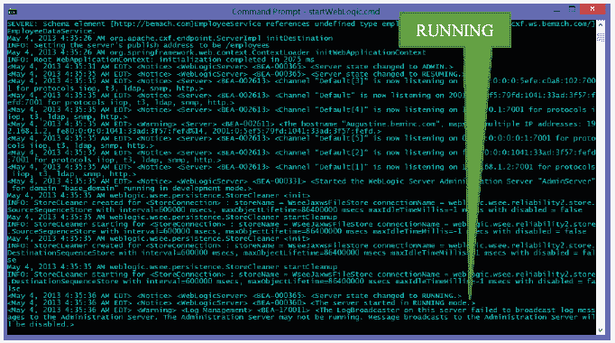

**图 6-10.** WLS 管理服务器的输出

服务器成功启动后，将在命令行窗口中显示以下消息：

`<The server started in RUNNING mode.>`

## 6.4 部署 Web 服务

在构建 Java Web 之前，请确保 `cxf-ws` 项目的 `WEB-INF` 目录下包含 `weblogic.xml` 文件。

### 6.4.1 weblogic.xml

此文件包含 `WebLogic` 特有的配置参数。在 `WebLogic` 服务器上部署 `CXF WS` 应用时需要该文件。

#### 列表 6-1. cxf-ws.war Web 应用包含的 weblogic.xml 内容

```xml
<?xml version="1.0" encoding="UTF-8"?>
<weblogic-web-app xmlns="http://xmlns.oracle.com/weblogic/weblogic-web-app" xmlns:xsi="http://www.w3.org/2001/XMLSchema-instance" xsi:schemaLocation="http://xmlns.oracle.com/weblogic/weblogic-web-app http://xmlns.oracle.com/weblogic/weblogic-web-app/1.0/weblogic-web-app.xsd">
  <context-root>cxf-ws</context-root>
  <jsp-descriptor>
    <precompile>true</precompile>
  </jsp-descriptor>
  <session-descriptor>
    <timeout-secs>900</timeout-secs>
    <invalidation-interval-secs>10</invalidation-interval-secs>
    <max-in-memory-sessions>500</max-in-memory-sessions>
  </session-descriptor>
</weblogic-web-app>
```

要在 `WebLogic` 服务器上部署 `CXF` Web 应用，请执行以下步骤：

1. 打开浏览器并访问 [`localhost:7001/console`](http://localhost:7001/console)。使用你在域创建步骤中定义的用户名/密码以 `weblogic/weblogic1` 登录。

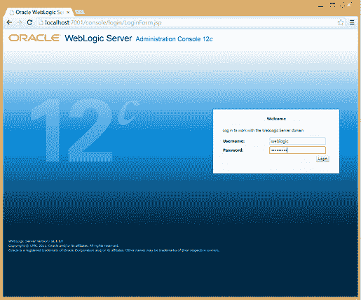

**图 6-11.** Oracle WLS 控制台登录界面

2. 在左侧面板中，选择`Deployments`（部署）选项。

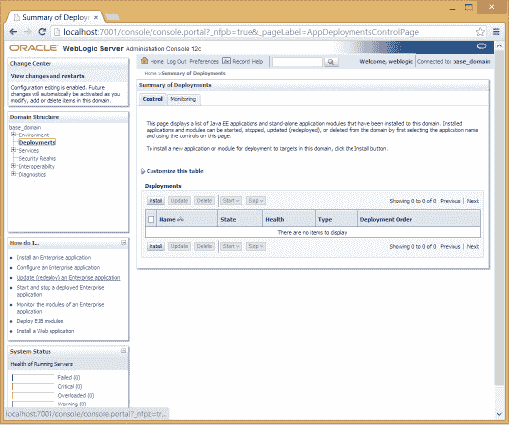

**图 6-12.** Oracle WLS 部署界面

3. 在右侧面板中，点击`Install`（安装）按钮。

4. 选择位于 `cxf-ws` 项目 `dist` 目录下的 `cxf-ws.war` 文件。

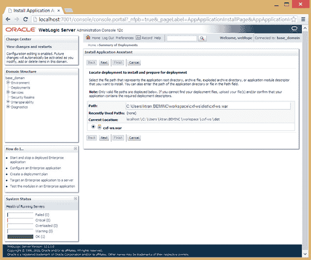

**图 6-13.** Oracle WLS 安装应用程序界面

5. 点击‘Next’（下一步）。

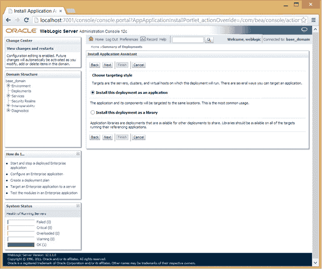

**图 6-14.** 部署类型

6. 点击‘Next’（下一步）。

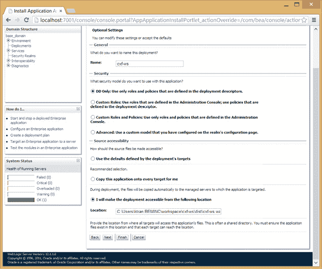

**图 6-15.** 部署设置

7. 点击‘Finish’（完成）。

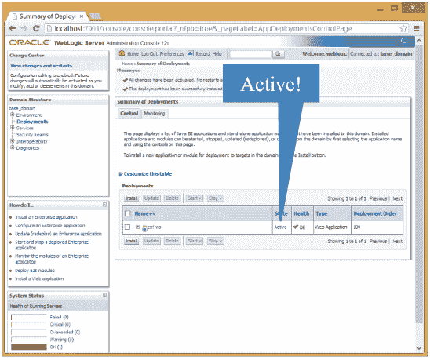

**图 6-16.** 状态必须显示为 Active

我们现在准备好测试由 `WebLogic` 服务器托管的 `CXF` Web 服务。

## 6.5 使用 WebLogic 测试 CXF Web 服务

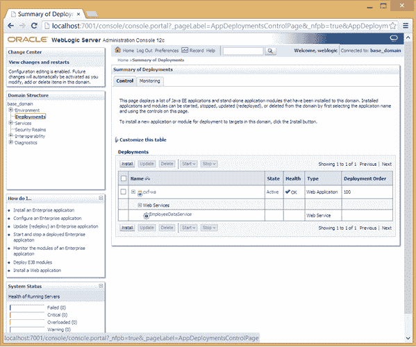

**图 6-17.** 测试应用程序

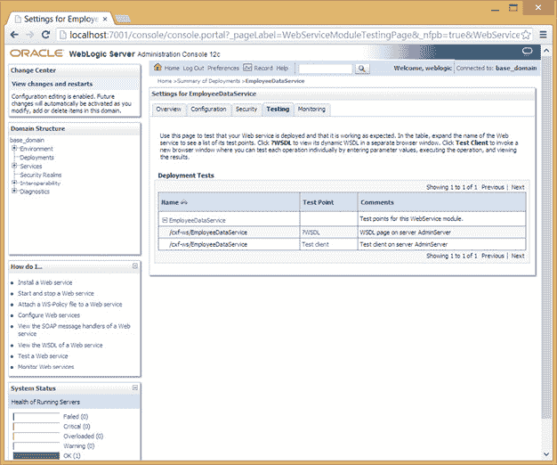

**图 6-18.** 结果显示

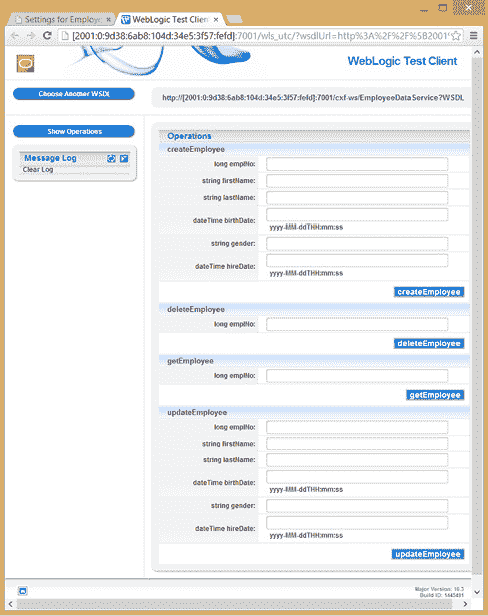

**图 6-19.** 测试客户端

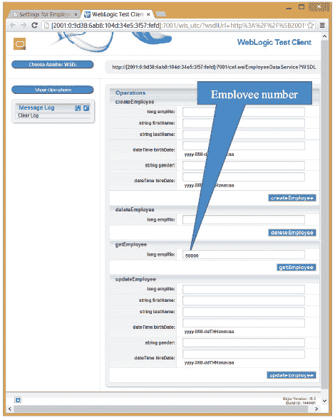

**图 6-20.** 调用 `getEmployee` 操作的结果

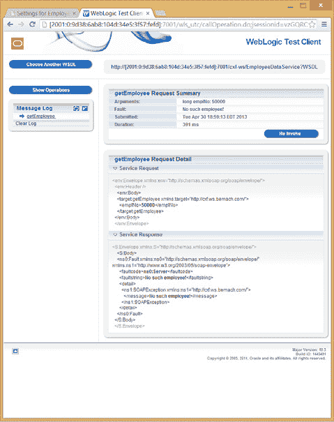

**图 6-21.** 执行 `getEmployee` 操作

WSDL 位于：
[`localhost:7001/cxf-ws/wsdl`](http://localhost:7001/cxf-ws/wsdl)

```xml
<wsdl:message name="updateEmployeeResponse">
  <wsdl:part name="return" type="xsd:boolean"></wsdl:part>
</wsdl:message>

<wsdl:message name="deleteEmployeeResponse">
  <wsdl:part name="return" type="xsd:boolean"></wsdl:part>
</wsdl:message>

<wsdl:message name="getEmployee">
  <wsdl:part name="emplNo" type="xsd:long"></wsdl:part>
</wsdl:message>

<wsdl:message name="createEmployee">
  <wsdl:part name="employee" type="tns:employee"></wsdl:part>
</wsdl:message>

<wsdl:message name="deleteEmployee">
  <wsdl:part name="emplNo" type="xsd:long"></wsdl:part>
</wsdl:message>

<wsdl:portType name="EmployeeDataIf">
  <wsdl:operation name="createEmployee">
    <wsdl:input message="tns:createEmployee" name="createEmployee"></wsdl:input>
    <wsdl:output message="tns:createEmployeeResponse" name="createEmployeeResponse"></wsdl:output>
  </wsdl:operation>
  <wsdl:operation name="deleteEmployee">
    <wsdl:input message="tns:deleteEmployee" name="deleteEmployee"></wsdl:input>
    <wsdl:output message="tns:deleteEmployeeResponse" name="deleteEmployeeResponse"></wsdl:output>
  </wsdl:operation>
  <wsdl:operation name="updateEmployee">
    <wsdl:input message="tns:updateEmployee" name="updateEmployee"></wsdl:input>
    <wsdl:output message="tns:updateEmployeeResponse" name="updateEmployeeResponse"></wsdl:output>
  </wsdl:operation>
  <wsdl:operation name="getEmployee">
    <wsdl:input message="tns:getEmployee" name="getEmployee"></wsdl:input>
    <wsdl:output message="tns:getEmployeeResponse" name="getEmployeeResponse"></wsdl:output>
    <wsdl:fault message="tns:SOAPException" name="SOAPException"></wsdl:fault>
  </wsdl:operation>
</wsdl:portType>

<wsdl:binding name="EmployeeDataServiceSoapBinding" type="tns:EmployeeDataIf">
  <soap:binding style="rpc" transport="http://schemas.xmlsoap.org/soap/http*"/>
  <wsdl:operation name="createEmployee">
    <soap:operation soapAction="" style="rpc"/>
    <wsdl:input name="createEmployee">
      <soap:body namespace="http://cxf.ws.bemach.com/*" use="literal"/>
    </wsdl:input>
    <wsdl:output name="createEmployeeResponse">
      <soap:body namespace="http://cxf.ws.bemach.com/*" use="literal"/>
    </wsdl:output>
  </wsdl:operation>
  <wsdl:operation name="deleteEmployee">
    <soap:operation soapAction="" style="rpc"/>
    <wsdl:input name="deleteEmployee">
      <soap:body namespace="http://cxf.ws.bemach.com/*" use="literal"/>
    </wsdl:input>
    <wsdl:output name="deleteEmployeeResponse">
      <soap:body namespace="http://cxf.ws.bemach.com/*" use="literal"/>
    </wsdl:output>
  </wsdl:operation>
  <wsdl:operation name="getEmployee">
    <soap:operation soapAction="" style="rpc"/>
    <wsdl:input name="getEmployee">
      <soap:body namespace="http://cxf.ws.bemach.com/*" use="literal"/>
    </wsdl:input>
    <wsdl:output name="getEmployeeResponse">
</wsdl:output>
  </wsdl:operation>
</wsdl:binding>
```


以下是一个 WSDL 文档片段，展示了 `EmployeeDataService` 服务的绑定与服务定义：

```
<wsdl:binding name="EmployeeDataServiceSoapBinding" type="tns:EmployeeDataService">
  <soap:binding style="rpc" transport="http://schemas.xmlsoap.org/soap/http"/>
  <wsdl:operation name="updateEmployee">
    <soap:operation soapAction="" style="rpc"/>
    <wsdl:input name="updateEmployee">
      <soap:body namespace="http://cxf.ws.bemach.com/*" use="literal"/>
    </wsdl:input>
    <wsdl:output name="updateEmployeeResponse">
      <soap:body namespace="http://cxf.ws.bemach.com/*" use="literal"/>
    </wsdl:output>
  </wsdl:operation>
</wsdl:binding>

<wsdl:service name="EmployeeDataService">
  <wsdl:port binding="tns:EmployeeDataServiceSoapBinding" name="EmployeeDataPort">
    <soap:address location="http://localhost:7001/cxf-ws/employees*"/>
  </wsdl:port>
</wsdl:service>
```

## 6.6 运行客户端应用程序

```bash
java -cp ./lib/cxf-ws-generated.jar;./dist/cxf-ws-client.jar com.bemach.ws.cxf.client.EmployeeDataClient 7001
```

此测试的输出将如下打印在屏幕上：

```
EmployeeDataClient 7001
Calling Employee (CXF) data service ...
URL=http://localhost:7001/cxf-ws/employees*
```

## 附录 – 开发

现在有很多开发工具可用。

## 7.1 Java 开发包 (JDK)

访问 Oracle 网站（[`www.oracle.com`](http://www.oracle.com)）下载 JDK。

## 7.2 Eclipse (IDE)

访问 Eclipse（[`www.eclipse.org/`](http://www.eclipse.org/)）下载 IDE。

### 7.2.1 在 Eclipse 中创建 Java 项目

要创建 Java 项目，请执行以下步骤：

1. 选择 `File` -> `New` -> `Java Project`。弹出向导。
2. 输入项目名称并点击 `Next`。
3. 在 `Java Settings` 界面，选择默认值并点击 `Finish`。

### 7.2.2 在 Eclipse 中创建动态 Web 项目

1. 选择 `File` -> `New` -> `Other...` 弹出“选择向导”窗口。
2. 输入项目名称并点击 `Next`。
3. 在 `Java` 界面点击 `Next`。
4. 勾选 `Generate web.xml deployment descriptor`。

## 7.3 MySQL 社区数据库

访问 MySQL 网站（[`www.mysql.com`](http://www.mysql.com)）下载 MySQL Community Server。运行安装程序并选择默认选项。请记住你的 `root` 密码。

从 MySQL 网站下载并安装 Employees 数据库：[`dev.mysql.com/doc/employee/en/index.html`](http://dev.mysql.com/doc/employee/en/index.html)。按照安装说明使用所有默认选项。

创建一个用户 `empl_1` 并分配 Employees 数据库。

如果你更喜欢简单的方法，如下所示创建一个只有一个 `employees` 表的 Employees 数据库：

#### Listing 7-1. 创建 employees 表的 DDL

```sql
CREATE TABLE employees (
  emp_no INT NOT NULL,
  birth_date DATE NOT NULL,
  first_name VARCHAR(14) NOT NULL,
  last_name VARCHAR(16) NOT NULL,
  gender ENUM ('M','F') NOT NULL,
  hire_date DATE NOT NULL,
  PRIMARY KEY (emp_no)
);
```

下载并解压用于访问 MySQL 数据库的 JDBC 驱动程序。

## 7.4 安装 Oracle Fusion Middleware 软件

访问 Oracle 网站（[`www.oracle.com`](http://www.oracle.com)）并下载 Oracle Fusion Middleware（原“WebLogic Server”）版本为 12.1.1。Oracle 可能要求用户注册账户。该版本对开发者来说功能完备；但受限于五个（5）个客户端连接。请确保下载 Windows 或 Linux 安装版本。警告：这是一个巨大的下载（1.2 GB）。安装程序版本包含 JDK 和一个为 Oracle 中间件定制的 Eclipse IDE。运行安装程序并选择所有默认选项。

## 7.5 安装 Apache Tomcat 服务器

访问 Apache Tomcat 网站（[`tomcat.apache.org`](http://tomcat.apache.org)）并下载最新的 Tomcat 7 版本。Tomcat 是一个开源的 JEE 应用服务器，可以免费下载。

通过在浏览器中访问 [`localhost:8080`](http://localhost:8080) 来验证 Tomcat 服务器。应该出现以下页面：

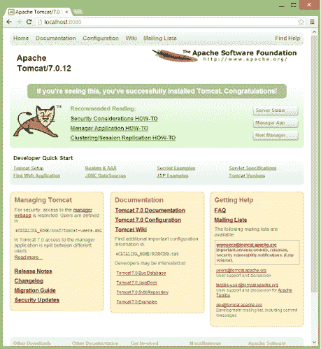
图 7-7. 工作中的 Tomcat 控制台界面

## 7.6 Apache CXF

访问 Apache CXF 网站下载软件包。将下载的内容解压到目录中。所有必要的 Java 库都存储在解压目录中。确保在 `cxf-ws` Java 项目的库中包含相应的库文件（JAR）。

```
aopalliance-1.0.jar
asm-3.3.jar
axis.jar
commons-dbcp-1.4.jar
commons-discovery-0.2.jar
commons-logging-1.1.1.jar
commons-logging.jar
cxf-2.4.0.jar
geronimo-activation_1.1_spec-1.1.jar
geronimo-annotation_1.0_spec-1.1.1.jar
geronimo-javamail_1.4_spec-1.7.1.jar
geronimo-servlet_3.0_spec-1.0.jar
geronimo-ws-metadata_2.0_spec-1.1.3.jar
jaxb-api-2.2.1.jar
jaxb-impl-2.2.1.1.jar
jaxrpc.jar
neethi-3.0.0.jar
saaj-api-1.3.jar
saaj-impl-1.3.2.jar
spring-aop-3.0.5.RELEASE.jar
spring-asm-3.0.5.RELEASE.jar
spring-beans-3.0.5.RELEASE.jar
spring-context-3.0.5.RELEASE.jar
spring-core-3.0.5.RELEASE.jar
spring-expression-3.0.5.RELEASE.jar
spring-web-3.0.5.RELEASE.jar
stax2-api-3.1.1.jar
woodstox-core-asl-4.1.1.jar
wsdl4j-1.6.2.jar
wsdl4j.jar
xml-resolver-1.2.jar
xmlschema-core-2.0.jar
```

## 7.7 安装 SOAPUI

访问 SOAPUI 网站（[`www.soapui.org`](http://www.soapui.org)）并下载免费版的 SOAPUI 软件。

## 7.8 源代码

本书中的所有 Java 代码均可在 Tran 博士的博客：[`drtran.bemach.com`](http://drtran.bemach.com)。

# 8 尾注

1. 注意 `employees` 是数据库的实际名称。
2. 注意 `employees` 是 `employees` 数据库中一个表的名称。
