# Java 编程入门指南

## 编制人员

学生互动高级经理：Linda DeStefano

学生互动经理：Julie Dieriq

学生互动经理：Janey Moeller

高级营销经理：Heather Kramer

制作编辑经理：Kim Fry

知识产权项目经理：Brian Methe

生产与制造高级经理：Donna M. Brown

生产经理：Terri Daly

排字员：PMG

# 第一章 创建 Java 程序

在本章中，你将：

- 定义基础编程术语
- 比较过程化和面向对象的编程
- 描述 Java 语言的特性
- 分析产生控制台输出的 Java 应用
- 编译 Java 类并修正语法错误
- 运行 Java 应用并修正逻辑错误
- 为 Java 类添加注释
- 创建产生 GUI 的 Java 应用
- 查找帮助

## 学习编程术语

**计算机程序**是你编写的一组指令，用于告诉计算机要做什么。计算机设备（如显示器或键盘）是**硬件**，而程序是**软件**。为用户执行任务的程序（例如计算并生成薪资单、文字处理或玩游戏）是**应用程序软件**；管理计算机本身的程序（如 Windows 或 Linux）是**系统软件**。任何计算机程序（无论是应用程序还是系统程序）背后的逻辑都决定了产生所需结果所需的指令的确切顺序。这本书的大部分内容描述了如何开发创建应用程序软件的逻辑。

所有计算机程序最终都会转换为机器语言。**机器语言**或**机器码**是计算机可以执行的最基础指令集。每种类型的处理器都有其自己的机器语言指令。程序员经常使用 `1` 和 `0` 来定义机器语言，以表示计算机系统的开启和关闭电路。

机器语言是一种**低级编程语言**，它与计算机处理器的电路密切对应。低级语言要求你在创建命令时使用内存地址来执行特定命令。这意味着低级语言很难使用，并且必须为运行程序的每种类型的机器进行定制。

幸运的是，由于高级编程语言的发展，编程已演变成了一项更容易的任务，因为高级语言允许你使用合理的术语词汇，例如 `read`（读）、`write`（写）或 `add`（加），而不是使用 `1` 和 `0` 的序列来执行这些任务。高级语言还允许你为内存区域分配单词的、直观的名称，例如 `hoursworked`（工作小时）或 `rateOfPay`（薪资率）。Java 是一种高级编程语言。

每种高级语言都有其自己的**语法**，即语言规则。例如，取决于特定的高级语言，你可能使用 `print`（打印）或 `write`（写）动词来输出。所有语言都有特定的、有限的词汇（**关键字**）以及使用这些词汇的特定规则。当你学习编程语言（如 Java、C++ 或 Visual Basic）时，你正在学习该语言的词汇和语法。

使用编程语言，程序员编写一系列类似于英语句子的**程序语句**来执行他们希望程序执行的任务。程序语句也被称为命令，因为它们是对计算机“输出这个单词”或“相加这两个数字”。

编写程序语句后，高级语言程序员使用称为**编译器**或**解释器**的计算机程序将他们的语言翻译成机器语言。编译器在执行（或运行）语句之前翻译整个程序，而解释器每次翻译一条语句，翻译后立即执行。

你使用编译器还是解释器通常取决于你使用的编程语言。例如，C++ 是编译型语言，而 Visual Basic 是解释型语言。每种类型的翻译都有支持者；使用编译语言编写的程序更容易开发和调试。Java 使用了这两种技术的优点：使用编译器翻译你的程序语句，使用解释器在执行（运行时）读取代码。

## 学习编程术语：调试程序

编译器和解释器在每次遇到无效程序语句（即包含语法错误或误用语言的语句）时都会发出一个或多个错误消息。随后，程序员可以修正错误并尝试通过再次编译或解释程序再次翻译。定位和修复语法错误是调试程序（消除程序所有错误）的第一部分。图 1-1 展示了程序员在开发可执行程序时所采取的步骤。你将在本章晚些部分学习更多关于调试 Java 程序。

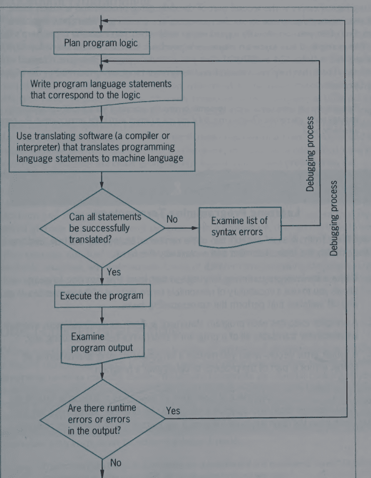

**图 1-1** 程序开发流程

## 逻辑错误

如图 1-1 所示，你可能能够正确使用计算机语言的语法，但仍然会有需要修正的错误。除了学习特定语言的正确语法外，程序员还理解编程逻辑。当你开发任何相当规模的程序时，应该在编写任何语句之前对其逻辑进行规划。正确的逻辑要求按适当的顺序发布所有正确的命令。逻辑错误的示例包括：在想要除法两个值时却使用了乘法，或者在获得适当的输入之前就产生了输出。

纠正逻辑错误是调试过程的第二部分，比修正语法错误要困难得多。语法错误在编译程序时会被发现，但通常你只有在检查程序的首次输出时才能识别逻辑错误。例如，如果你知道员工的工资单应该包含 $5,000 的值，但在执行工资程序后，看到它包含的是 $50 或 $50,000，那么就发生了逻辑错误。帮助你可视化和理解逻辑的工具将在“做决策”章节中介绍。

程序员将某些逻辑错误称为语义错误。例如，如果你拼错了一个编程语言中的单词，你犯了语法错误；但如果你在错误的语境中使用了正确的单词，你就犯了语义错误。


# 两真一假

## 学习编程术语

在每个“两真一假”部分中，三个有编号的陈述中有两个是真实的，一个是假的。识别出错误的陈述并解释它为什么是假的。

1. 与低级编程语言不同，高级编程语言允许你使用合理的术语词汇，而不是执行相应任务的开/关开关序列。
2. 编译器在翻译每个程序语句后立即执行它，而解释器则在执行任何语句之前翻译整个程序的所有语句。
3. 当你误用某种语言时，就会发生语法错误；定位并修复所有语法错误是调试程序过程的一部分。

错误的陈述是 #2。编译器在执行任何语句之前会翻译整个程序，而解释器是一次翻译一条程序语句并立即执行它。

# 比较过程式编程和面向对象编程概念

编写计算机程序的两种流行方法是过程式编程和面向对象编程。

## 过程式编程

过程式编程是一种按顺序连续执行操作的编程风格。在过程式应用程序中，你为计算机内存位置命名，这些位置可以存储电子形式的值——例如数字和文本。这些命名的计算机内存位置被称为变量，因为它们持有可能变化的值。例如，一家公司的工资程序可能包含一个名为 `rateOfPay`（工资率）的变量。由名称 `rateOfPay` 引用的内存位置在不同时间可能包含不同的值（公司每位员工对应的值都不同）。在工资程序执行期间，存储在 `rateOfPay` 名称下的每个值可能都会进行许多操作——该值可能会乘以另一个代表工作小时的变量，并且该值可能会被打印在纸上。为了方便起见，计算机程序中的单个操作通常被分组为称为“过程”的逻辑单元。例如，一组四个或五个比较和计算共同决定了一个人的联邦税收值，它们可以被分组为一个名为 `calculateFederalWithholding` 的过程。过程定义了内存位置，然后调用一系列过程来输入、处理和输出存储在这些位置中的值。当程序被调用时，当前逻辑会被暂时放弃，以便执行过程的命令。一个过程式程序通常包含数百个变量和过程调用。过程也被称为模块、方法、函数和子程序。不同编程语言的用户倾向于使用不同的术语。正如你将在本章后面学到的，Java 程序员最频繁使用“方法”（method）一词。

## 面向对象编程

面向对象编程是过程式编程的扩展。编写面向对象的程序涉及创建类（类是对象的蓝图）；从这些类创建对象；以及创建使用这些对象的应用程序。这种创建可以反复重复使用以开发新程序。以面向对象的方式思考是将程序构想为类的组件，这些组件类似于现实世界中的实体对象；然后你就可以操作这些对象，它们相互关联以实现所需的结果。

> 程序员将 OO 作为面向对象（object-oriented）的缩写；读音为 "oh oh"。面向对象编程缩写为 OOP，且与 soup 押韵。

最初，面向对象编程最常用于两种类型的应用程序：

- 计算机模拟，试图模仿现实世界的活动，以便改进其过程，或让用户能够更好地理解现实世界的流程是如何运作的
- 图形用户界面，或 GUI（读作 "gooeyys"），允许用户在图形环境中与程序交互

在这两类应用程序中思考对象是有意义的。例如，一个城市可能想要开发一个模拟交通模式的程序以防止交通堵塞。通过创建一个包含汽车和行人等对象的模型（这些对象包含自己的数据和行为规则），模拟就可以启动了。例如，每个汽车对象都有特定的速度和改变速度的周期。通过使用对象创建交通模型，计算机可以创建一个城市高峰时段的模拟。

为用户创建 GUI 环境也是对象的自然用途，例如屏幕上的按钮和滚动条，它们类似于现实世界的对象。每个 GUI 对象包含数据——例如，屏幕上的按钮有特定的大小和颜色。每个对象还包含行为——例如，按钮可以被点击，并在点击时做出反应。有些人认为面向对象编程术语与 GUI 编程同义，但面向对象编程的意义更多。虽然许多 GUI 程序是面向对象的，但不要假设所有面向对象的程序都使用 GUI 对象。现代企业在开发各种业务应用程序（无论是否是 GUI 应用程序）时都使用面向对象的设计技术。

理解面向对象编程需要三个基本概念：

- 应用于类对象的封装
- 继承
- 多态

## 理解类、对象和封装

在面向对象术语中，类是描述具有共同属性的对象组或集合的术语。正如蓝图在建造房屋之前存在一样，食谱在烘焙饼干之前存在一样，类定义在创建任何对象之前也存在。类定义描述了对象将具有哪些属性以及这些对象能够做什么。

对象是类的特定的、具体的实例。当你创建一个对象时，你就是在对其实例化。你可以从你编写的类以及其他程序员（包括 Java 的创建者）编写的类中创建对象。对象包含的值

## 过程化与面向对象编程概念的比较

同一类的不同实例往往是不同的。例如，`Automobile` 类描述了 `Automobile` 对象是什么样子的。`Automobile` 的一些属性有品牌、型号、年份和颜色。每个 `Automobile` 对象可能有一辆 2009 年的白色福特金，也可能是一辆 2014 年的雪佛兰凯马罗。同样，你的狗拥有所有 `Dog` 的属性，包括品种、名字、年龄以及它的短裤是否合身。对象属性的值也被称为对象的状态。换句话说，你可以将对象大致等同于名词，将它们的属性比作描述名词的形容词。

当你理解了一个对象的类时，你就理解了该对象的特征。如果你的朋友买了一辆 `Automobile`，你就知道它有品牌型号；如果你的朋友养了一只 `Dog`，你就知道这只狗有品种。了解类存在哪些属性可以允许你对这些属性的状态或值提出适当的问题。例如，你可能会问汽车每加油能跑多少英里，但不会问汽车是否打了疫苗。同样，在 GUI 运行环境中，你期望每个组件都具有特定的、一致的属性和方法，例如窗口具有标题栏和关闭按钮，因为每个组件作为 GUI 组件通用类的一员，获得了这些属性。图 1-2 显示了某些 `Dog` 对象与类之间的关系。

按照惯例，使用 Java 的程序员类名以大写字母开头。因此，定义汽车属性和方法的类可能会被命名为 `Automobile`，狗的类可能会被命名为 `Dog`。然而，产生一个可运行的程序并不遵循这一惯例。

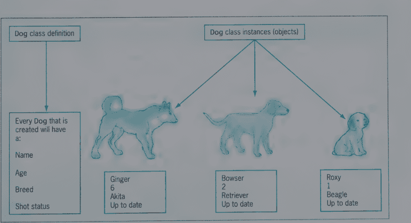

图 1-2 类定义以及从其创建的一些对象

除了定义属性，类还定义了对象使用的方法。方法是一段自包含的程序代码块，执行某些操作，类似于过程化程序中的过程。例如，一个 `Automobile` 可能有前进、后退、加油和清洗的方法。某些方法可以确定特定的属性，例如 `Automobile` 的当前速度和燃油箱状态。同样，`Dog` 可以行走或跑步、吃东西、洗澡，并且有方法可以确定 `Dog` 有多饿或它叫什么。GUI 操作系统组件可以最大化、最小化和拖动。换句话说，如果对象类似于名词，那么方法类似于动词。

在面向对象的类中，属性和方法被封装到对象中，其使用方式与现实世界的对象相似。封装指的是两个密切相关的面向对象概念：

- 封装是将数据和方法封闭在对象内部。封装允许你将对象的所有方法和数据视为一个整体。就像一只真实的狗包含了它所有的属性和能力一样，程序中的 `Dog` 也是如此。
- 封装还指从外部源隐藏对象的数据和方法。隐藏数据有时被称为“信息隐藏”，而隐藏工作原理则被称为“实现隐藏”；你将在“方法、类和对象”章节中学习更多关于这两个术语的知识。封装允许你从外部源隐藏特定的对象属性和方法，并提供安全性，使数据和方法免受意外更改。

如果一个对象的方法编写得很好，用户就感知不到方法执行的低级细节，用户只需理解方法与对象之间的接口或交互即可。例如，当你给 `Automobile` 加油时，是因为你理解了加油枪嘴与车辆燃油箱口之间的接口。你不需要了解加油泵机械上是如何工作的，也不需要知道燃油箱位于车辆内部位置。如果你能看懂速度表，显示的数字是如何计算出来的就并不重要。事实上，如果有人生产了一种更优、更准确的设备并将其放入你的 `Automobile` 中，只要你的接口保持不变，你就不需要知道或关心它是如何工作的。同样的原理也适用于面向对象程序中构建良好的类——这些程序只需要与接口协同工作。

## 理解继承和多态

面向对象程序设计的一项重要特性是继承——创建共享现有类属性和方法、但具有更具体特征的类的能力。例如，`Automobile` 是一个类，所有的 `Automobile` 共享许多特征和属性。`Convertible` 是一个继承自 `Automobile` 类的类；`Convertible` 是 `Automobile` 的类型，它拥有并能做“普通” `Automobile` 能做的一切事情——但增加了一个可以收起顶篷的机制（相应的，`Automobile` 继承自 `Vehicle` 类）。`Convertible` 不是一个对象——它是一个类。一个特定的 `Convertible` 是一个对象——例如，`my1967BlueMustangConvertible`。

继承帮助你理解现实世界的对象。例如，当你第一次遇到 `Convertible` 时，你已经理解了点火、刹车、门锁和其他 `Automobile` 系统是如何工作的。你只需要关注 `Convertible` 新增的属性和方法。编程的优势是相同的——你可以基于现有类构建新类，并专注于你正在添加的专门功能。

面向对象术语中的最后一个重要概念是多态。字面上，多态意味着“许多形式”——它描述了语言允许根据上下文正确解释同一个单词或符号的功能。例如，`Automobile`、`Sailboat` 和 `Airplane` 类都继承自 `Vehicle`，但这些类的实例执行 `turn` 和 `stop` 方法的方式不同。开始创建包含窗口、按钮和菜单栏的 GUI 应用时，多态的优势将变得更加明显。当你在数字之间看到加号（`+`）时，你理解它们正在相加。当你看到它刻在树上的名字之间时，你理解这两个名字之间存在浪漫关系。因为该符号根据上下文具有不同的含义，所以它是多态的。第 10 章和第 11 章提供了关于继承和多态以及如何在 Java 中实现的更多信息。


# 两真一假

## 过程化与面向对象编程概念的比较

1. 类的实例是一个创建的对象，它拥有类定义中描述的属性和方法。
2. 封装通过将数据隐藏在对象内部来保护数据。
3. 多态是创建共享现有类属性和方法的具有更多特征的能力。

> 多态描述了使用一个术语引起多个动作的能力。
>
> 现有类的属性和方法具有更具体的特征；

错误的陈述是 #3。继承是创建共享的

# Java 语言的特性

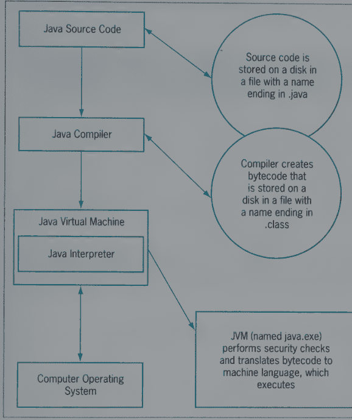

**图 1-3** Java 环境

Java 的使用也比许多面向对象的语言更简单。Java 是模仿 C++ 设计的。虽然这两个语言在初接触时都不容易阅读或理解，但 Java 确实消除了 C++ 中一些最难理解特性，例如指针和多继承。

## Java 程序类型

你可以使用 Java 编写两种程序：

- **Applets**（小程序）是嵌入 Web 页面中的程序。你将在“小程序、图像与声音”一章中创建 applet。
- **Java applications**（Java 应用程序）是独立的程序。Java 应用程序可以进一步细分为**控制台应用程序**（例如支持在 DOS 窗口中向计算机屏幕输出字符）和**窗口化应用程序**（创建带有菜单、工具栏和对话框等元素的 GUI 应用程序）。控制台应用程序是最容易创建的程序；你将在下一节中开始使用它们。

# 第一章 创建 Java 程序

## 两个真理和一个谎言：Java 语言的特性

1. Java 的设计目标是实现架构中立，这意味着任何人可以在不经过深入研究的情况下构建应用程序。
2. 在你写完 Java 程序后，编译器会将源代码转换为字节码的二进制程序。
3. 嵌入在 Web 页面中的 Java 程序称为 applet，而独立程序称为 Java 应用程序。

> 你可以使用 Java 编写可以在任何平台上运行的程序。

错误的陈述是 #1：Java 的设计目标是实现架构中立，

# 分析产生控制台输出的 Java 应用程序

乍一看，即使是最简单的 Java 应用程序也涉及大量令人困惑的语法。考虑图 1-4 中的程序。该程序由七行组成，其唯一任务是在屏幕上显示“First Java application”。

```java
public class First {
    public static void main(String[] args)
    {
        System.out.println("First Java application");
    }
}
```

图 1-4 `First` 类

- 当你看到书中的代码时，Java 关键字以及 `true`、`false` 和 `null` 是蓝色的，所有其他程序元素都是黑色的。Java 关键字的完整列表将在本章稍后显示。
- 书中显示的每个完整程序的代码都可以在你可以下载的学生文件中找到，以便你可以在自己的计算机上执行这些程序。

## 理解产生输出的语句


尽管图 1-4 中的程序占据了若干行，但它只包含一个 Java 编程语句。语句 `System.out.println("First Java application");` 执行了该程序中的实际工作。与所有 Java 语句一样，它以分号结束。大多数 Java 编程语句可以分布在你选择的任意行数，只要你在适当的位置放置换行符即可。例如，在图 1-4 程序中，你可以在左括号之前或之后换行。然而，你通常希望将短语句放在单行中。

文本 `"First Java application"` 是一个字面量字符串——一组将按照输入完全出现在输出中的字符。Java 中的任何字面量字符串都写在引号之间。在 Java 中，字面量字符串不能拆分并在多行。图 1-5 标记了此字符串以及语句的其他部分。

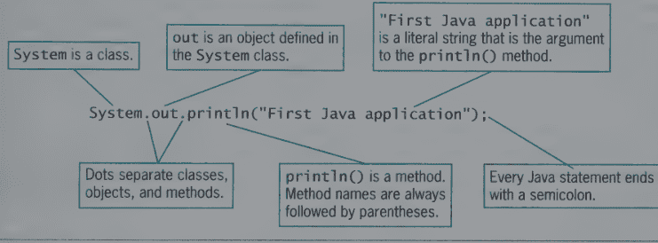

图 1-5 语句分析

字符串 `"First Java application"` 出现在括号内，是因为该字符串是方法的参数，而方法的参数总是出现在括号内。参数是发送到方法的信息片段，通常是因为方法需要信息来执行其任务或实现其目的。向方法发送参数的行为被称为向方法传递参数。

例如，考虑一家销售体育用品的公司的目录订单。处理目录订单是一个方法，它由一组标准程序组成——记录订单、检查物品可用性、从仓库提取物品等。每份目录订单还需要一组数据项，例如你订购的是哪一个商品编号以及所需的商品数量；这些数据项可以被看作订单的参数。如果你从目录中订购了两个 5432 商品，你所预期的结果将与订购了一个 9008 商品不同。向一个 Java 方法传递 `"Happy Holidays"`，你预期的结果与传递参数 `"First Java application"` 时预期的结果不同。

在语句 `System.out.println("First Java application");` 中，你向其传递 `"First Java application"` 的方法名为 `println()`。Java 方法 `println()` 和 `print()` 都会产生输出。使用 `println()`，在输出显示后，插入点会移动到下一行。（插入点是下一个输出出现的位置。）然而，使用 `print()`，插入点不会进到新行；它保持与输出在同一行。

当你调用方法时，始终要使用括号。在书中，你将学习到许多在括号之间需要参数的方法，以及其他一些你留空括号的方法。当你想要输出空行时，可以使用不带参数的 `println()` 方法。在本章稍后，你将学习一种名为 `messageDialog()` 的方法，它需要两个参数。其他方法需要的更多。

在语句 `System.out.println("First Java application");` 中，`out` 是 `System` 类的一个属性，它指向系统的标准输出设备（通常是显示器）。`out` 对象本身是 `PrintStream` 类的实例，它包含了几个方法，包括 `println()`。

从技术上讲，你可以创建 `out` 对象并在 `println()` 方法内部编写指令，但这将非常耗时，而且 Java 的创建者假设你经常需要在屏幕上显示输出。因此，创建 `System` 和 `PrintStream` 类、`out` 对象以及 `println()` 方法是为了方便程序员。

在语句 `System.out.println("First Java application");` 中，`System` 是一个类。因此，`System` 为 `System` 对象定义属性，就像 `Dog` 类为 `Dog` 对象定义属性一样。`System` 的属性之一是 `out`。（你可能猜到另一个属性是 `in`，它代表输入设备。）

`System.out.println()` 中的点（句号）用于分隔语句中的组件名称。你将在 Java 程序中反复使用这种格式。

Java 是区分大小写的；名为 `System` 的类与名为 `system`、`SYSTEM` 的类是完全不同的类，`out` 与名为 `Out` 或 `OUT` 的对象也是不同的对象。编写 Java 程序时，必须密切注意使用正确的大小写值。

因此，显示字符串 `"First Java application"` 的语句包含一个类、一个对象引用、一个方法、一个方法参数和一个用于语句结束的分号；该语句不能独立存在；它嵌入在一个类中，如图 1-4 所示。

### 理解第一个类（Class）

你在 Java 程序中使用的所有内容都必须是类的一部分。当你写 `public class First` 时，你正在定义一个名为 `First` 的类。你可以使用任何名称或标识符定义 Java 类，只要它满足以下要求：

- Java 标识符必须以英语字母表中的字母、非英语字母（如 `α` 或 `π`）、下划线或美元符号开头。类名不能以数字开头。
- Java 标识符可以包含字母、数字、下划线或美元符号。
- Java 标识符不能是关键字，例如 `public` 或 `class`。（关键字列表见表 1-1。）
- Java 标识符不能是以下值之一：`true`、`false` 或 `null`。这些不是关键字（它们是原始值）；但被保留了。

> Java 基于 Unicode，这是一种字符表示系统。letter 指英语字母以及来自、希腊和其他和其他字母的字符。你可以在附录 B 中了解更多关于 Unicode 的信息。

| abstract | continue | for | new | switch |
|---|---|---|---|---|
| assert | default | goto | package | synchronized |
| boolean | do | if | private | this |
| break | double |  |  | protected |
| throw | byte | else | import | return |
| transient | case | enum | instanceof | public |
| throws | catch | extends | int | short |
| try | char | final | interface | static |
| void | class | finally | long | strictfp |
| volatile | const | float | native | super |
| while |  |  |  |  |

表 1-1 保留关键字

尽管被保留为关键字，但 `const` 和 `goto` 在 Java 程序中没有使用，且没有功能。这两个词在其他语言中使用，并被保留以防未来 Java 版本的开发者想要实现它们。

## 第 1 章 创建 Java 程序

| 类名 | 描述 |
|---|---|
| `Employee` | 以大写字母开头 |
| `UnderGradStudent` | 以大写字母开头，不包含空格，并通过每个新单词的首字母大写来强调 |
| `InventoryItem` | 以大写字母开头，不包含空格，并通过第二个单词的首字母大写来强调 |
| `Budget2014` | 以大写字母开头且不包含空格 |

表 1-2 Java 中一些有效的类名

| 类名 | 描述 |
|---|---|
| `Undergradstudent` | 新单词没有通过首字母大写来指示，这使得该标识符难以阅读 |
| `Inventory_Item` | 下划线并不常用于指示新单词 |
| `BUDGET2014` | 对类标识符使用全大写字母不符合习惯 |
| `budget2014` | 按照习惯，类名不以小写字母开头 |

表 1-3 Java 中合法但不符合习惯且不推荐的类名

| 类名 | 描述 |
|---|---|
| `Inventory Item` | 标识符中不允许空格字符是非法的 |
| `class` | `class` 是保留字 |
| `2014Budget` | 类名不能以数字开头 |
| `phone#` | 数字符号（`#`）在标识符中是非法的 |

表 1-4 Java 中一些非法的类名

在图 1-4 中（再次在图 1-6 中），`public class First` 这一行是类头；它包含了关键字 `class`，该关键字将 `First` 标识为一个类。保留字 `public` 是访问修饰符。访问修饰符定义了类可以被访问的情况以及有权使用该类的其他类。公共访问是最宽松的访问类型；你将在“使用方法、类和对象”章节中学习公共访问和其他类型的访问。

## 分析一个产生控制台输出的 Java 应用程序

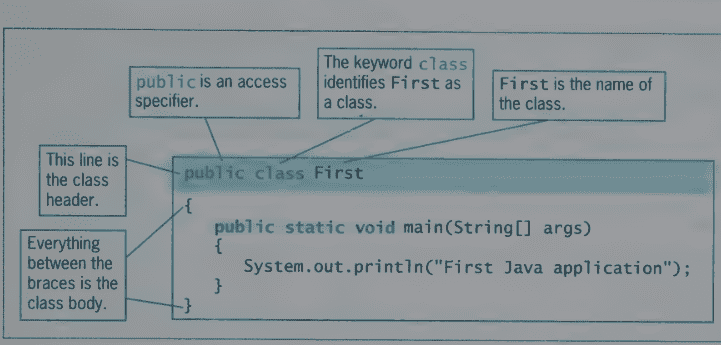

**图 1-6** 典型类的部分，其中用大括号 `{ }` 包围类的内容，以及大括号之间的任何数据项和方法构成了**类体**。类体可以由任意数量的数据项和方法组成。在图 1-4 中（再次在图 1-6 中），类 `First` 在其大括号内仅包含一个方法。方法的名字是 `main()`，而 `main()` 方法像 `println()` 方法一样，包含了自己的一套括号。`First` 类中的 `main()` 方法只包含一条语句——使用 `println()` 方法的语句。`main()` 方法并不包含任何其他方法，但它调用了 `println()` 方法。

### 缩进风格

通常情况下，Java 中的空白是可选的。**空白字符**是任何非打印字符的组合。你可以通过输入空格、制表符或空行在程序代码的单词或行之间插入空白，因为编译器会忽略这些额外的空格。然而，你不能在标识符或关键字中使用空白字符。

对于 Java 程序中的每一个左大括号 `{`，都必须有一个对应的右大括号 `}`，但左右大括号放置的位置对编译器并不重要。例如，接下来的类执行方式与图 1-4 所示的类完全相同。唯一的区别是括号的布局——换行发生在不同的位置。

```java
public class First{
    public static void main(String[] args){
        System.out.println("First Java application");
    }
}
```

在前例所示的缩进风格（当左大括号不在单独行时）被称为 **K & R 风格**，以 Kernighan 和 Ritchie 命名，他们编写了第一本关于 C 语言语言的书。图 1-4 所示并在本书中使用的缩进风格（大括号对齐且每个括号占一行）被称为 Allman 风格，并以程序员 Eric Allman 命名，他是这种风格的推广者。Java 程序员使用各种缩进风格，所有的都能生成可以运行的 Java 程序。当你编写自己的代码时，应该养成一种一致的风格。在学校里，你的老师可能有偏好的风格，而当你作为 Java 程序员工作时，你的机构很可能也会有一个偏好的风格。在许多开发环境中，缩进会自动为你完成的。

## 理解 `main()` 方法

随着你完成本教科书，头部使用的每个术语的含义和目的将变得清晰。

- 在方法头 `public static void main(String[] args)` 中，`public` 单词是一个访问修饰符，就像你用它定义 `First` 类一样。
- 在 Java 中，`static` 关键字意味着即使不存在该类的对象，该方法也是可访问且可用。
- 方法的名字是 `main()`。并不是所有的类都有 `main()` 方法；大多数 Java 应用程序必须包含一个名为 `main()` 的公共方法的类。当你执行 Java 应用程序时，JVM 会首先执行 `main()` 方法。
- 在方法头 `public static void main(String[]) args` 中，括号内的内容 `String[] args` 代表可以传递给 `main()` 方法的参数类型，就像 `"First Java application"` 是传递给 `println()` 方法的参数一样。
- `String` 是一个 Java 类，可以用于存储字符串。标识符 `args` 用于存储可能发送给 `main()` 方法的任何 `String` 对象。`main()` 方法可以对这些参数进行操作，例如显示它们，但在图 1-4 中，`main()` 方法并没有实际使用 `args` 标识符。尽管如此，它不需要命名为 `args`——它可以是任何合法的 Java 标识符——但 `args` 这个名字是传统的写法。

> 你在本书中不会向 `main()` 方法传递任何参数，但当你运行 Java 程序时，你可以传递。即使你没有传递参数，`main()` 方法内部也必须包含 `String[]` 和一个合法的标识符（如 `args`）。当你在 `main()` 方法头中引用 `String` 类时，方括号表示 `String` 对象的数组。你将在第 7、8、9 章学习更多关于 `String` 类和数组的知识。

## 分析一个产生控制台输出的 Java 应用程序

`main()` 方法不向任何可能使用它的方法返回任何值。事实上，图 1-4（图 1-6）意味着 `main()` 方法不发送任何值。你将在“方法、类和对象”章节中学习更多关于返回值的知识。

- 图 1-7 展示了 `main()` 方法的部分。

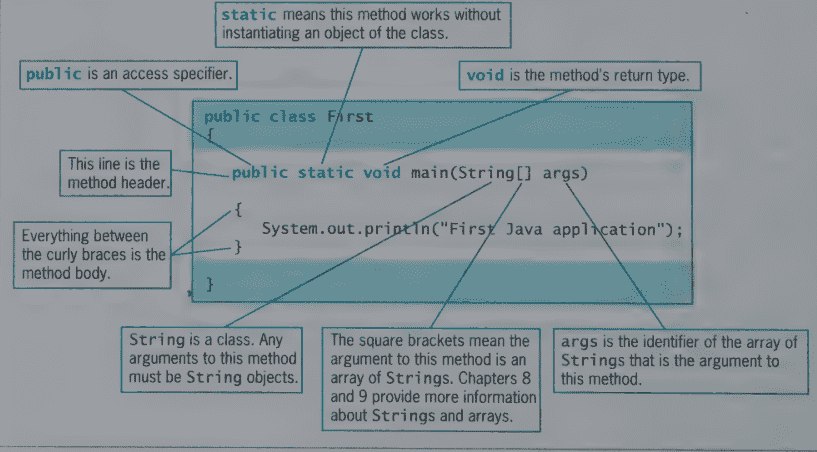

图 1-7 `main` 方法的部分

图 1-4 所示的简单应用程序有很多需要记忆的部分。然而，你可以使用图 1-8 所示的 Java 代码作为外壳，其中将 `AnyClassName` 替换为类名，并将 `****` 行替换为你想要执行的任何语句。


观看视频 A Java Program。

```java
public class AnyClassName {
    public static void main(String[] args) {
        /*******/
    }
}
```

图 1-8 Shell 代码

### 保存 Java 类

当你编写一个 Java 类时，必须使用存储介质（如磁盘、DVD 或 USB 设备）来保存它。在 Java 中，如果一个类是公共的（即如果你在类名之前使用了 `public` 访问修饰符），你必须将该类保存为文件名完全相同且扩展名为 `.java` 的文件。例如，`First` 类必须储存在名为 `First.java` 的文件中。类名和文件名必须完全匹配，包括大小写。附录 A 包含了关于保存 Java 程序的额外信息。

## 分析产生控制台输出的 Java

1. 在方法头 `public static void main(String[] args)` 中，`public` 是一个访问修饰符。
2. 在方法头 `public static void main(String[] args)` 中，`static` 意味着即使在不存在类对象的情况下，该方法也是可访问和使用的。
3. 在方法头 `public static void main(String[] args)` 中，`void` 意味着 `main()` 方法是一个空方法。

## 你来做

### 第一个应用程序

现在你已经理解了 Java 应用程序的基础知识，准备好在文本编辑器中输入你的 Java 应用程序了。程序员之间有一项传统：你用任何语言编写的第一个程序其输出都是 `"Hello, world"`。你现在将创建这样一个程序。你可以使用任何文本编辑器，如记事本或 TextPad，或者开发环境，如 jGRASP。

编写 Java 程序时，最好使用最简单的文本编辑器。多功能的文字处理程序由于包含了内置功能（如字体样式和页边距设置），保存的文件大得多，而 Java 编译器无法解释这些功能。

1. 启动任何文本编辑器，然后打开新文档。
2. 如下所示输入类头：

```java
public class Hello
```

在此示例中，类名是 `Hello`。你可以为类使用任何有效名称。如果你选择 `Hello`，你始终将该类引用为 `Hello` 而不是 `hello`，因为 Java 是区分大小写的。

3. 按一次回车键，输入 `{`，再次按一次回车键，然后输入 `}`。你将在这些大括号之间添加 `main()` 方法。虽然不是要求的，但本书使用的习惯是将每个大括号单独占一行，并使左右大括号对对齐。使用这种格式会让你的代码更易读。
4. 如图 1-9 阴影区域所示，在大括号之间添加 `main()` 方法头，然后为 `main()` 输入一组大括号。

```java
public class Hello
{
    public static void main(String[] args)
{
}
}
```

图 1-9 `Hello` 类的 `main()` 方法外壳

## 第 1 章 创建 Java 程序（续）

5. 接下来，在 `main()` 方法内部添加产生输出（`"Hello, world!"`）的语句。参考图 1-10，在 `main()` 方法中添加阴影部分的 `println()` 语句。

```java
public class Hello {
    public static void main(String[] args) {
        System.out.println("Hello, world!");
    }
}
```

图 1-10 完整的 `Hello` 类

6. 将应用程序保存为 `Hello.java`。类名和文件名必须匹配，并且必须使用 `.java` 扩展名。

## 编译 Java 类和修正语法错误

在编写并保存应用程序之后，查看程序的输出之前必须执行两个步骤：

1. 你必须将编写的类（称为源代码）编译成字节码。
2. 你必须使用 Java 解释器将字节码翻译成可执行语句。

### 编译 Java 类


要从命令行编译源代码，你的提示符应该显示存储程序文件所在的文件夹或目录。然后，你输入`javac`后跟包含源代码的文件名。例如，要编译名为`First.java`的文件，输入以下内容并按回车：

```bash
javac First.java
```

将出现三种结果之一：

- 你收到一条消息，提示`javac`不是内部或外部命令、可程序或批处理文件。
- 你收到一个或多个程序语言错误消息。
- 你没有收到任何消息，这意味着应用程序编译成功。

## 编译 Java 类并修正语法错误

编译时，如果源文件不在当前路径中，你可以输入带有文件名的完整路径。

例如：

`javac c:\java\MyClasses\Chapter.01\First.java`

在 DOS 环境中，你可以使用`cd`命令更改目录。例如，要从当前目录更改到名为`MyClasses`的子目录，你输入`cd MyClasses`并按回车。在任何目录中，你都可以通过输入`cd\`并按回车返回根目录。

如果你收到命令未被识别的错误消息，可能意味着以下情况之一：

- 你拼写错了`javac`命令。
- 你拼写错了文件名。
- 你在命令行中没有正确的子文件夹或子目录中。
- Java 未安装妥当。（有关安装的信息请参阅附录 A。）

如果你收到编程语言错误消息，说明源代码中存在一个或多个语法错误。记住，语法错误是在你在程序中引入输入错误或不正确使用编程语言时发生的编程错误。例如，如果类名是`first`（小写 f），但你将文件保存为`First.java`，当你编译`First.java`时会收到错误消息，因为`First`和`first`是相同。如果发生这种错误，你必须重新打开源代码文件进行必要的修正。

附录 A 包含了关于故障排除的信息，包括在 Windows 环境下如何重命名文件。

如果你在编译名为`First.java`的代码后没有收到错误消息，说明应用程序编译成功，生成的`First.java`文件保存在文本文件所在的文件夹中。成功后，你可以在任何带有 Java 解释器的计算机上运行类文件。

### 修正语法错误

在文本编辑器中输入 Java 语句时经常会输入错误。当你编译包含错误的类时，Java 编译器会产生一个或多个错误消息。具体的错误消息取决于你使用的编译器。

图 1-12 中的`MissingSemicolon`类包含一个错误——`println()`语句末缺少分号。（当然，这个类已经帮助你注意到了错误。）当你编译这个类时，会显示与图 1-12 类似的错误消息。

```java
public class FirstMissingWithSemicolon
{
    public static void main(String[] args) {
        System.out.println("Hello, world!");
    }
}
```

图 1-11 `FirstMissingWithSemicolon`类

```text
C:\Java>javac FirstMissingWithSemicolon.java
FirstMissingWithSemicolon.java:5: error: '"' expected
    System.out.println("Hello, world!");
1 error
C:\Java>
```

图 1-12 编译`FirstMissingWithSemicolon`类生成的错误消息

图 1-12 中错误消息的第一行显示了发现错误的文件名（`FirstMissingWithSemicolon.java`）、发现错误的行号（5）以及错误的名称（`'" expected'`）。错误消息的下一行显示了包含错误的语句，并有一个指向发现错误精确位置的插入符号。正如你在编写和编译 Java 程序时看到的，发现错误的地方并不一定是错误发生的地方。有时，需要一些侦探工作来解读错误消息并确定其原因。

## 编译 Java 类和修正语法错误

## 二真一假

- 在你编写并保存一个应用程序后，你可以编译字节码来创建源代码。
- 当你编译一个类时，你会创建一个与原文件同名、但扩展名为`.class`的新文件。
- 语法错误是编译时错误。

错误的陈述是 #1。在你编写并保存应用程序后，你可以编译字节码。

## 由你来做做

### 编译 Java 类

你已经准备好编译在上一节“动手实践”中创建的`Hello`类了。

- 如果你的屏幕上没有打开它，请打开你在上一节“动手实践”中保存的`Hello.java`文件。
- 进入你保存`Hello.java`的驱动器、文件夹或子目录的命令行提示符。在命令行中输入：

```
javac Hello.java
```

片刻之后，你应该返回到命令行提示符。如果你看到忽略了错误消息，请重新阅读上一节以以你是否可以确定错误的来源。

如果错误消息显示无法识别该命令，请确保你的`javac`命令拼写正确，包括正确的大小写。此外，确保你正在使用`Hello.java`文件所在的正确目录或文件夹。

如果错误消息指示语言错误，请检查你的文件并对比图 1-10，确保其完全匹配。修复任何错误，并重新编译应用程序。如果错误仍然存在，请阅读下一节看看你是否能发现解决方案。

### 修正语法错误

在本节中，你将检查错误消息并获得语法错误的第一手经验。

- 1. 如果你的`Hello`类版本没有编译成功，请检查语法错误消息。现在你已经知道消息包含行号和脱字符符号（caret）来定位错误，修复问题可能可能会变得更容易。在确定任何错误的性质后，请重新保存文件并重新编译。
- 2. 即使你的`Hello`类版本编译成功，你也需要积累错误消息的经验。你的学生文件包含一个名为`HelloErrors.java`的文件。找到该文件并在文本编辑器中打开它。如果你没有随书的学生文件，你可以像图 1-13 所示自己输入该文件。

```
public class HelloErrors {
    public static void main(String[] args) {
        System.out.println("Hello");
        System.out.println("This is a test");
    }
}
```

图 1-13 `HelloErrors`类

- 3. 将文件保存为你想工作文件夹中的`HelloErrors.java`。然后使用以下命令编译该类，以确认它无错误编译：

```
javac HelloErrors.java
```

- 4. 在文件的第一行，删除`class`中的`c`，使第一行变为`public HelloErrors`。保存文件并编译程序。生成的错误消息类似于图 1-14 所示。尽管你只在文件中更改了一个按键，但出现了四条错误消息。第一条表示第 1 行缺少`class`、`enum`或`interface`。你还没有学习过 Java 关键字`enum`或`interface`，但你知道通过更改单词`class`导致了错误。接下来的第 3、6 和 7 行的三个错误显示编译器继续寻找这三个关键字之一，但未能找到它们。

## 编译 Java 类和修正语法错误

（续）

```
Command Prompt
:\java>java HelloErrors.java
HelloErrors.java:1: expected class, interface, or enum expected
public last HelloErrors

HelloErrors.java:3: expected class, interface, or enum expected
public static void main(String[] args)

HelloErrors.java:6: expected class, interface, or enum expected
    System.out.println("This is a test");
}

HelloErrors.java:9: expected class, interface, or enum expected
4 errors
C:\java>
```

图 1-14 在`HelloErrors`程序中拼写错误`class`时生成的错误消息

- 1. 通过在`class`中重新插入`c`来修复程序。保存文件并再次编译。程序应该能成功编译。当你修复一个错误时，四条错误消息会被移除。
- 2. 接下来，从程序的第三行删除`void`单词。保存文件并编译。图 1-15 显示了错误消息，它指示需要一个返回类型。该消息并没有指示缺少`void`，因为 Java 为方法支持许多返回类型。在这种情况下，`void`是正确的返回类型，因此将其重新插入程序中的正确位置，然后保存并重新编译文件。

```
Command Prompt
:\java>java HelloErrors.java
HelloErrors.java:3: invalid method declarations return type required
public static void main(String[] args)
1 error
C:\java>
```

图 1-15 在`HelloErrors`程序的`main()`方法头中省略`void`时生成的错误消息

- 3. 从`HelloErrors`程序中删除最后一个右大括号。保存文件并重新编译它。图 1-16 显示了生成的 own“reached end of file while parsing（在解析时到达文件末尾）”。解析是编译器用于将你的源代码划分为意义部分的过程；该消息意味着编译器在分析代码时，文件过早结束了。如果你通过重新插入右大括号、保存文件并重新编译来修复错误，就会消除该错误消息。

```
Command Prompt
$java HelloErrors.java
HelloErrors java:7: error: reached end of file while parsing
error
$java
```

图 1-16 在`HelloErrors`程序中省略右大括号时生成的错误消息

- 8. 继续通过拼错单词、省略标点符号和添加多余的按键向程序中引入错误。记住在重新编译之前保存每个程序版本；否则你将重新编译上一个版本。生成错误消息时，仔细阅读它们，并尝试根据你故意引起的错误背景理解它们的含义。尽管你向程序中插入了错误，也不会生成任何错误消息。这并不意味着你的程序是正确的。它只意味着程序不包含语法错误。程序可能没有语法错误但仍然错误，正如你将在下一节中学到的那样。

## 运行 Java 应用程序和修正逻辑错误

在程序无语法错误地编译后，你就可以执行它。然而，仅仅程序通过编译，并不意味着程序没有错误。

### 运行 Java 应用程序

要运行图 1-4 中的第一个应用程序，你输入：`java First`

图 1-17 显示了应用程序在命令行窗口中的输出。

```
Command Prompt
$java First
First application
$java
```

图 1-17 `First`程序的输出

## 运行 Java 应用程序和修正逻辑错误

确认`First.class`存储位置的方法取决于你的操作系统。例如，在 Windows 操作系统中，你可以打开资源管理器，定位到代表存储设备的图标，找到你保存文件的文件夹并展开该文件夹。你应该看到`First.class`文件。

如果你输入`Java First`，解释器会寻找名为`First.class`的文件。如果你输入`Java First.class`，解释器会错误地寻找名为`First.classclass`的文件。

## 修改已编译的 Java 类

查看应用程序输出后，你可能决定修改类以获得不同的结果。例如，你可能决定将`First`应用程序的输出从`Java application`改为：

My new and improved Java application

要产生新输出，首先必须修改包含现有类的文本文件。你需要更改现有的字面量字符串，然后为另一个文本字符串添加输出语句。图 1-18 显示了更改输出的类。

```
public class First {
    public static void main(String[] args) {
        System.out.println("My new and improved");
        System.out.println("Java application");
    }
}
```

图 1-18 修改原始版本修改输出的`First`类

如果你如图 1-18 所示对文件进行更改，然后保存文件并在命令行输入`java First`执行程序，你将看不到新输出——你将看到没有添加该行的旧输出。尽管你保存了包含类修改后源代码的文本文件，但已编译类文件中的类仍然在执行。在你保存名为`First.java`的文件后，旧的已编译类具有相同的

## 创建 Java 程序

文件名仍然存储在你的计算机上。在执行新的源代码之前，你必须执行以下操作：

- 保存带有更改内容的文件（使用相同的文件名）。
- 使用`javac`命令编译该类（实际上，你是在重新编译该类）。
- 使用`java`命令解释类字节码并执行该类。

图 1-19 显示了新的输出。

当你重新编译一个类时，带有`.class`扩展名的原始编译文件版本会被替换，原始版本将不再存在。当你修改一个类时，必须决定是否要保留原始版本。如果你想保留，则必须为新版本提供一个新的类名和文件名。

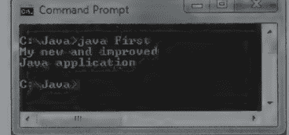

图 1-19 修改后的`First`类的执行

偶尔，当你对 Java 类进行更改并重新编译和执行它时，旧版本仍然运行。最简单的解决方案是删除`.class`文件并重新编译。程序员将这种行为称为创建“清理构建”（clean build）。

观看视频《编译与执行程序》。

## 修正逻辑错误

除了语法错误外，第二种错误发生在程序语法正确且程序已编译，但在执行时产生错误结果的情况下。这种错误是逻辑错误，它们通常更难发现和解决。例如，图 1-20 显示了名为`FirstBadoutput`的成功编译程序的执行输出。如果你快速地扫一眼输出，可能不会注意到 Java 的拼写错误。编译器不会在字面量字符串（literal string）中寻找拼写错误；输出任何字母组合都是合法的。

逻辑错误的其他示例包括：在想要相加两个值时却执行乘法；在必须先打印第一份报告时只打印了一份；或者在用户请求生成总计时忘记在报告末尾生成总计。这类错误必须通过仔细检查程序输出来检测。测试程序并发现任何逻辑错误是程序员的责任。

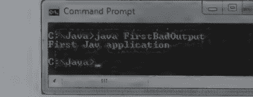

图 1-20 `FirstBadoutput`程序的输出

## 在 Java 类中添加注释

你已经学习过语法错误是编译错误。逻辑错误是一种运行时错误——在程序执行期间要求计算机做某些错误（甚至是非法）操作之前，该错误不会被检测。并不是所有的运行时错误都是程序员的错。例如，计算机硬件可能会在程序执行时发生故障。然而，良好的编程实践可以帮助减少错误。

修复计算机错误的过程被称为“调试”（debugging）。1947 年，在哈佛大学的一台大型机计算机电路中发现了一只大大的老鼠。请访问这些网站查看感兴趣的细节和图片：`www.jamesshuggins.com/h/tek1/first_computer_bug.html`和`www.history.navy.mil/images/h96056kc.htm`。


# 二真一假

## 运行 Java 和修正逻辑错误

1. 在 Java 中，如果类是公共的（public），你必须将该类保存到命名完全相同且具有`.java`扩展名的文件中。
2. 要编译名为`MyProgram.java`的文件，你输入`javac MyProgram.java`，但要执行程序你需要输入`java MyProgram`。
3. 当你编译程序时，有时一个语法错误会导致多条错误信息。

> MyProgram

```
javac MyProgram.java
```

错误的陈述是 #2。要编译名为`MyProgram.java`的文件，你输入`javac MyProgram.java`但要执行程序你需要输入`java MyProgram`。

## 在 Java 类中添加注释

如你所示，即使是最简单的 Java 类也需要几行代码并包含某些令人困惑的语法。执行许多任务的大型应用程序包含更多的代码，随着你编写更大的应用程序，记住为什么要包含某些步骤或你打算如何使用变量将变得越来越困难。程序注释帮助你记住为什么那样写代码行。注释是你为了文档化目的而添加到程序中的非执行语句。换句话说，注释是为阅读源代码的人设计的，而不是为执行程序的计算机设计的。

程序员使用注释来为自己以及未来可能阅读他们程序的其他人留记笔记。至少，你的 Java 类文件应该包含指示作者、日期以及类名或函数的注释。最佳实践要求你还应该包含一个简短的注释来描述你在类中创建的每个方法的用途。

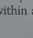

在你学习此书时，请在每个文件的第一行添加注释。注释应该包含类名和目的、你的名字以及日期。你的老师可能会要求你包含额外的注释。

在开发应用程序时，注释也很有用。如果程序运行不符合预期，你可以“注释掉”（comment out）各种语句并随后运行程序。当你注释掉一条语句时，你将其变为注释，这样编译器就不会翻译它，JVM 也不会执行其命令。这可以帮助你确定位故障程序中错误语句的位置。

Java 中有三种类型的注释：

- 行注释以两个正斜杠（`//`）开头，并持续到当前行的末尾。行注释可以单独占一行，也可以出现在可执行代码行的末尾（右侧）。行注释不需要结束分号。


块注释以一个正斜杠和一个星号（`/*`）开始，以星号和正斜杠（`*/`）结束。块注释可以单独占一行，也可以出现在可执行代码之前的一行或可执行代码之后的一行。块注释可以跨越所需的任意数。

Javadoc 注释是块注释的一种特殊情况，称为文档注释——它们用于通过程序 `javadoc` 自动生成格式良好的程序文档。Javadoc 注释以一个正斜杠和两个星号（`/**`）开始，以星号和正斜杠（`*/`）结束。附录 E 将教你如何创建 javadoc 注释。

> 正斜杠（`/`）和反斜杠（`\`）字符经常被混淆，但它们是两个不同的字符。你不能交叉使用它们。

Java 开发工具包（JDK）包含了 `javadoc` 工具，你可以在编写 Java 程序时使用它。该工具产生描述类及其内容的 HTML 页面。

图 1-21 显示了注释在代码中的用法。在这个示例中，只有 `System.out.println("Hello");` 语句是执行的；其他部分（所有阴影部分）都是注释。

```
// Demonstrating comments
/* This shows
   that comments
   don't matter */
System.out.println("Hello"); // This line executes
// up to where the comment started
 * Everything but the println()
 * is a comment */
```

图 1-21 包含多个注释的程序段

## 在 Java 类中添加注释

你可能只是为了美观而创建注释。例如，你可能想使用一行简单的连字符或星号注释，作为程序部分之间的视觉分割线。

1. 行注释以两个正斜杠（`//`）开始并在当前行末尾结束；它们不能跨越任意行。

2. 块注释以一个正斜杠和一个星号（`/*`）开始并以星号和正斜杠（`*/`）结束；它们可以跨越任意行。

3. Javadoc 注释以一个正斜杠和两个星号（`/**`）开始，以星号和正斜杠（`*/`）结束；它们用于通过程序 `javadoc` 生成文档。

错误的陈述是 #1。行注释以两个正斜杠（`//`）开始。

# 二真一假

## 在 Java 类中添加注释

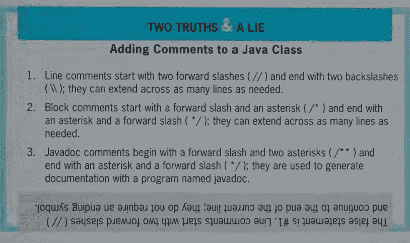

## 你来做做

## 为类添加注释

在练习中，你为 `Hello.java` 添加注释并将其保存为名为 `Hello2` 的新类，这样你可以保留原始类和修改后类的副本。

1. 打开在本章早期创建的 `Hello.java` 文件。在文件顶部输入以下注释，在指示处插入你的名字和日期。

```
//Filename Hello2.java
// Written by <your name>
// Written on <today's date>
```

2. 将类名更改为 `Hello2`，然后在类头之后输入以下块注释：

```
/* 此类演示了如何使用 println()
方法打印 Hello, world! 消息。 */
```

## 第1章

## 创建 Java 程序

（续）

3. 将文件保存为 `Hello2.java`。文件必须命名为 `Hello2.java`，因为类名是 `Hello2`。

4. 转到保存 `Hello2.java` 的驱动器、文件夹或子目录的命令提示符，并输入以下命令来编译程序：

```
javac Hello2.java
```

5. 编译成功后，在命令行中输入 `java Hello2` 来执行你的应用程序。注释对程序执行没有影响；输出应该显示在下一行。

当应用程序编译成功后，会创建一个名为 `Hello2.class` 的文件，并存储在与 `Hello2.java` 文件相同的文件夹中。如果你的应用程序编译时没有错误，但在执行程序时收到错误信息（例如“Exception in 'thread' java.lang.ClassNotFoundException”），你可能没有正确设置类路径（classpath）。详情请参附录 A。


## 创建产生 GUI 输出的 Java

除了允许你使用 `System` 类产生命令行窗口输出外，Java 还提供了产生 GUI 输出的内置类。具体来说，`JOptionPane` 允许你产生对话框。对话框是一个类似于窗口的 GUI 对象，你可以在其中放置想要显示的消息。图 1-22 显示了一个名为 `FirstDialog` 的类。`FirstDialog` 类包含了许多你熟悉的元素；阴影部分是新的内容。

```java
import javax.swing.JOptionPane;
public class FirstDialog
{
    public static void main(String[] args)
    {
        JOptionPane.showMessageDialog(null, "First Java dialog");
    }
}
```

图 1-22 `FirstDialog` 类

在较旧版本的 Java 中，任何使用 `JOptionPane` 对话框的应用程序都要求以 `System.exit(0);` 语句结束，否则应用程序不会终止。你可以将此语句添加到你的程序中，它们将正常工作，但并不是必要的。


## 创建产生 GUI 输出的 Java

在图 1-22 中，第一行阴影部分是一个导入语句。当你想要访问包含在名为包（package）的类组中的内置 Java 类时，就会使用导入语句。要使用 `JOptionPane` 类，必须导入名为 `javax.swing.JOptionPane` 的包。任何导入语句都必须放置在文件中编写的任何类之外。随着你继续学习 Java，你将学习更多关于导入语句以及特别是 `javax.swing` 包的内容。

```
System.out.println("Hello world");
```

图 1-22 中 `FirstDialog` 类的第二个阴影语句使用了 `JOptionPane` 类中的的 `showDialog()` 方法。`println()` 方法用于控制台输出，而 `showDialog()` 方法只需要一个参数即可产生输出字符串，不，`showDialog()` 方法需要两个参数。（每当一个方法需要多个参数时，它们用逗号分隔）当 `showDialog()` 的第一个参数为 `null` 时（如图 1-22 中的类所示），意味着输出消息框应该放置在屏幕中心。第二个参数（紧随逗号之后）是所显示的字符串。

在本章的早些部分，你已经学习了 `true`、`false` 和 `null` 都是表示值的保留字。

你将在第 2 章学习更多关于对话框的知识，包括如何将它们放置在不同的位置以及如何为它们添加更多选项。

当用户执行 `FirstDialog` 类时，会显示图 1-23 所示的对话框。用户必须点击 OK 按钮或 Close 按钮来关闭对话框。

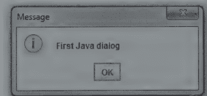

图 1-23 `FirstDialog` 程序的输出

## 第1章 创建 Java 程序

## 两真一假

## 创建产生 GUI 输出的 Java

1. 对话框是一个类似于窗口的 GUI 对象，你可以在其中放置想要显示的消息。

2. 当你想访问包含在名为包的类组中的内置 Java 类时，你会使用 append 语句。

3. 不同方法可能需要不同数量参数。

> 错误的陈述是 #2。当你想要访问包含在名为包的类组中的内置 Java 类时，使用的是 import 语句。

## 动手做

### 创建对话框

接下来，你编写一个在对话框中产生输出的 Java 应用程序。

1. 在你的文本编辑器中打开一个新文件。输入类似于下所示的注释，在指定位置插入你的名字和今天的日期。

2. 输入允许你使用 `JOptionPane` 类的导入语句：

3. 输入 `HelloDialog` 类：

```java
// Filename HelloDialog.java
// Written by <your name>
// Written on <today's date>
import javax.swing.JOptionPane;

public class HelloDialog {
    public static void main(String[] args) {
        JOptionPane.showMessageDialog(null, "Hello, world!");
    }
}
```

（续）

## 寻找帮助

4. 将文件保存为 `HelloDialog.java`。使用以下命令编译类：

```
javac HelloDialog.java
```

如有必要，消除任何语法错误，重新保存文件并重新编译。然后使用以下命令执行程序：

```
java HelloDialog
```

输出如图 1-24 所示。

5. 点击 OK 关闭对话框。


图 1-24 `HelloDialog` 程序的输出

## 寻找帮助

Java 网站 www.oracle.com/technet/java/index.html 上存在着大量的有用材料。特别有价值的是 Java 应用程序编程接口，通常称为 Java API。Java API 也称为 Java 类库；它包含了有关如何使用每个预先定义的 Java 类的信息，包括在使用这些类时可以使用所有方法列表。

Java 网站上另一个受关注的是常见问题解答（FAQs），它们为许多常见问题提供了简短回答。Java 开发工具包（JDK）是包含程序员使用的工具的软件开发包。它提供 Windows、Linux 和 Solaris 操作系统的版本。你可以下载 JDK 并将其安装在计算机上。

http://docs.oracle.com/javase/tutorial/ 提供了一名为“Java 教程”的课程。教程被组织成“路径”（trails）——即关于特定主题的课程组。你可以从开始学习教程并按顺序导航到末尾，也可以在不同的路径之间跳转。

## 动手做

### 探索 Java 网站

在本节中，你将探索 Java 网站的一些材料。

1. 打开浏览器浏览器并导航到 www.oracle.com/technet/java/index.html。

2. Oracle 可能在本书出版后更改其网站的布局。但是，你应该能够找到并点击 Java APIs 的链接或另一个 SE 7 的链接。（如果你使用的是较旧版本的 Java，可以选择该版本。）

3. 所有 Java 类都列在“所有类”（All Classes）面板中。滚动直到你可以选择 `System` 类。页面上最大的面板应该显示关于 `System` 类的详情。

4. 你可以看到 `System` 类包含三个字段。你已经对 `out` 字段熟悉了，你可以看到它是 `PrintStream` 的对象。点击 `PrintStream` 类型的超链接，将跳转到带有该类详情的新页面。

5. 滚动查看 `PrintStream` 类的方法。注意该类包含几几个版本的 `print()` 和 `println()` 方法。接受 `String` 参数的 `println()` 方法版本。点击该方法的链接以阅读关于它接受参数的详细信息，以便它“打印一个字符串并结束行”。

## 不要这样做

在每章的末尾，都会有一个“不要这样做”（Don't Do It）列表，提醒你初学者容易犯的常见错误。

- 不要忘记在 Java 中，公共文件的文件名必须与它包含的类名匹配。例如，如果一个文件名为 `Program1.java`，除非你更改文件中的类名，否则你不能简单地将其重命名为 `Program1Backup.java` 并期望它通过编译。

- 不要混淆括号（parentheses）、大括号（braces）、括号（brackets）、花括号（curly braces）、方括号（square brackets）和角括号（angle brackets）。当你编写程序或执行其他计算机任务时，如果有人告诉你：“现在，输入一些大括号”，你可能想澄清对方指的是哪个术语。表 1-5 总结了这些标点符号。

| 标点符号 | 名称 | Java 中的典型用法 | 替代名称 |
| --- | --- | --- | --- |
| `()` | 括号 (Parentheses) | 跟在方法名后面，如 `println()` | 可以称为 round brackets，这种用法不常见 |
| `{}` | 花括号 (Curly braces) | 一对包围类体、方法体和代码块；在第 8 章学习数组时，你会发现花括号也包围着值列表 | 花括号 也可以称为 curly brackets |
| `[]` | 方括号 (Square brackets) | 一对表示数组；数组将在第 8 章介绍 | 方括号也可以称为 box brackets 或 square brackets |
| `<>` | 角括号 (Angle brackets) | 一对角括号包围 HTML 标签，你将在第 17 章学习；在 Java 中，一对角括号也用于参数化类中的泛型参数 | 当两个角括号之间没有任何内容时，它们被称为 chevron |

表 1-5 Java 中使用的大括号和括号

- 不要忘记结束块注释。每个 `/*` 必须有一个对应的 `*/`，即使它在几行之后。单行注释（以 `//` 开头的注释）较难出错，但请记住，`//` 之后行的任何内容都不会执行。

- 不要忘记 Java 是区分大小写的。

- 不要忘记用分号结束每个语句，但不要在类或方法头部的末尾加分号。

- 不要忘记对你已修改的程序进行重新编译。修复一个错误后运行程序，却发现没有看到更改的迹象，这可能会让你非常沮丧。可能的原因是 `.class` 文件没有包含你的更改，因为你忘记了重新编译。

- 看到大量的编译器错误信息时不要惊慌。通常，修复一个就能解决好几个。

- 当消除了所有编译器错误时，不要认为你的程序是完美的。只有通过多次运行程序并仔细检查输出，才能确保你的程序在逻辑上是正确的。

## 关键术语

计算机程序是一组你编写的指令，用于告诉计算机做什么。

**硬件**（Hardware）是计算机设备的泛指。

**软件**（Software）是计算机程序的泛指。

**应用软件**（Application software）为用户执行任务。

**系统软件**（System software）管理计算机。

任何程序背后的**逻辑**（logic）涉及按顺序执行各种语句和过程以产生预期结果。

**机器语言**（Machine language）是一种电路级语言，表示一系列开启和关闭开关。

**机器码**（Machine code）是机器语言的另一种说法。

**底层编程语言**（low-level programming language）是为了密切对应计算机处理器的电路编写的。

**高级编程语言**（high-level programming language）允许你使用类英语词汇来编写程序。

**语法**（Syntax）指的是语言的规则。

**关键字**（Keywords）是编程语言的一部分单词。

**程序语句**（Program statements）类似于英语句子；它们执行程序完成的任务。

**命令**（Commands）是程序语句。

**编译器**（compiler）是将语言语句翻译成机器码的程序；它在程序的任何部分执行之前，一次性翻译整个程序。

**解释器**（interpreter）是将语言语句翻译成机器码的程序；它一次翻译一条语句，允许程序部分执行。

**执行**（Executing）一个语句或程序意味着完成它。

**运行时**（At run time）是一个描述程序执行期间的短语。

**语法错误**（syntax error）是你在程序中引入拼写错误或不正确使用编程语言时发生的编程错误。包含语法错误的程序将无法编译。

**调试**（Debugging）是一个消除所有错误的过程。

**语义错误**（Semantic errors）发生在你在程序代码的错误语文中使用了正确的单词时。

**过程化编程**（Procedural programming）是一种编程风格，其中一组操作按顺序一个一个执行。

**变量**（Variables）是命名的内存位置，存储可能变化的值。

**过程**（Procedures）是计算机程序执行的一组操作。

**调用过程**是指暂时放弃当前逻辑，以便执行过程的命令。

**编写面向对象的程序**涉及创建类、从类中创建对象，以及创建使用这些对象的应用程序。以面向对象的方式是将程序组件想象成类似于现实世界中实体对象的对象；然后，你可以操作这些对象以实现预期结果。

**计算机模拟**（Computer simulations）试图模拟真实世界的活动的程序，以便改进其过程，或让用户更好地理解真实过程是如何运作的。

**图形用户界面**（Graphical user interfaces，或 GUIs，读作“gooeys”）允许用户在图形环境中与程序进行交互。

**类**（class）是具有共同属性的对象组或集合。

**类定义**（class definition）描述了其对象将具有哪些属性以及这些对象能够做什么。

**属性**（Attributes）是定义类中对象的特征。

**属性**（Properties）是类的属性。

**对象**（object）是类的实例。

**类的实例**（instance of a class）是一个对象。

**实例化**（instantiate）是创建一个实例。

**对象的状态**（state）是其属性的值集合。

**方法**（method）是一个自包含的程序代码块，类似于过程。

**封装**（Encapsulation）是指将数据和方法封装在对象内部。

**继承**（Inheritance）是创建共享类属性和方法但具有更特定特征的类的能力。

## 第1章 创建Java程序

**多态**（Polymorphism）描述了语言的一种特性，允许根据上下文在不同情况下正确解释同一个单词。


Java 由 Sun Microsystems 开发的一种面向对象的语言，用于通用业务应用程序，也用于交互的基于 Web 的互联网应用程序。

**架构中立**（Architecturally neutral）描述了 Java 的特性，允许你在任何平台（操作系统）上编写程序。

Java 虚拟机（JVM）是一个在 Java 上运行的假设性（基于软件的）计算机。

**源代码**（Source code）由用高级编程语言编写的程序语句组成。

`jGRASP` 是一个开发环境和源代码编辑器。

**开发环境**（development environment）是一组工具，通过提供如彩色显示语言关键字等功能帮助你编写程序。

**字节码**（Bytecode）由已编译成二进制格式的程序语句组成。

Java 解释器（Java interpreter）是一个检查字节码并操作系统通信的程序，在 Java 虚拟机内部逐行执行字节码指令。

“一次编写，到处运行”（Write once, run anywhere, WORA）是 Sun Microsystems 开发的口号，描述任何版本的 Java 程序都能在多个平台上正确运行的能力。

**Applet**（Applets）是嵌入网页的 Java 程序。

**Java 应用程序**（Java applications）是独立的 Java 程序。

**控制台应用程序**（Console applications）支持在 DOS 窗口中向计算机屏幕输出字符。

**窗口应用程序**（Window applications）创建带有菜单、工具栏和对话框等元素的图形用户界面（GUI）。

**字面量**（literal）是一系列与代码中完全相同的字符序列。Java 中的任何字面量字符串都出现在双引号之间。

**参数**（Arguments）是传递给方法的信息以便其执行任务。

**传递参数**（Passing arguments）是将它们发送到方法的行为。

标准输出设备**（Standard output device）通常是显示器。

**标识符**（identifier）是程序组件的名称，如类、对象或变量。

**Unicode**是一种国际字符表示系统。

**帕斯卡大峰命名法**（Pascal casing）是一种命名约定，标识符大写字母开头，并使用大写字母开始每个新单词。

# 大驼峰大驼峰命名法（Upper camel casing）即 Pascal 命名法。

访问修饰符定义了类的访问情况以及哪些类有权使用该类。

类体是类头之后大括号之间的数据项和方法的集合。

空白字符是任何非打印字符的组合，例如空格、制表符和回车符（空行）。

K & R 风格是一种缩进风格，其左括号紧跟在类头的同一行上；它以 Kernighan 和 Ritchie 的名字命名，他们编写了第一本关于 C 语言语言的书。

Allman 风格是一种缩进风格，其中大括号对齐且每个大括号独占一行；它以推广了这种风格的程序员 Eric Allman 的名字命名。

关键字 `static` 意味着即使在不存在该类的对象的情况下，该方法也是可访问且可用的。

关键字 `void` 在方法头中使用时，表示该方法在被调用时不返回任何值。

编译时错误是指编译器检测到违反了语言语法规则，并且无法将源代码翻译成机器码。

解析是编译器用于将源代码划分为有意义的部分进行分析的过程。

在再次编译之前，删除所有之前编译过的类版本，即可创建一个整洁的（clean build）。

逻辑错误发生在程序编译成功但在执行过程中产生错误时。

运行时错误发生在程序编译成功但未执行。

程序注释是您为了文档目的而添加到 Java 文件中的非执行语句。

将一个语句注释掉是指将其转换为注释，这样编译器就不会执行它的命令。

单行注释以两个正斜杠（`//`）开始，并持续到行尾。单行注释可以单独成一行，也可以出现在可执行代码行的行尾。

块注释以一个正斜杠和一个星星号（`/*`）开始，以星号和一个正斜杠（`*/`）结束。块注释可以单独成一行、出现在可执行代码之前的行，或出现在可执行代码之后的行。块注释还可以根据需要跨多行。

Javadoc 注释是生成文档的注释。它们以正斜杠和两个星号（`/**`）开始，以星号和正斜杠（`*/`）结束。

文档注释是自动生成格式良好的程序文档的注释。

对话框是一种类似于窗口的 GUI 对象，您可以在其中放置想要显示的消息。

`import` 语句访问包含在包中的内置 Java 类。

包包含一组内置的 Java 类。

Java API 是应用程序接口，是一系列关于如何使用每个预写的 Java 类的信息。

FAQs 是常见问题。

JDK 是 Java 开发工具包（Java Development Kit）。

SDK 是软件开发包或一组对程序员有用的工具。

## 章节总结

- 计算机程序是一组告诉计算机执行做什么的指令。您可以使用高级编程语言编写程序，这种语言有它自己的语法或语言规则。在您写完程序后，您使用编译器或解释器将语言语句翻译成机器码。

- 编写面向对象的程序涉及创建类、从这些类创建对象，以及创建应用程序——使用这些对象的独立可执行程序。面向对象的编程语言支持封装、继承和多态。

- 用 Java 编写的程序在一个名为 Java 虚拟机（JVM）的标准化假设计算机上。当您的类被编译成字节码时，JVM 内部的解释器随后解释字节码并与您的操作系统通信以产生程序结果。

- Java 程序中的所有内容都必须是类的一部分，并包含在大括号和大括号内。所有 Java 编程语句都以分号结尾。点（称为 dots）用于分隔程序代码中的对象和方法。所有 Java 应用程序必须有一个名为 `main()` 的方法。

- 从命令行编译您的源代码，输入 `javac` 后紧跟包含源代码的文件名。编译器可能会发布语法错误，您必须修正这些错误。当您成功编译源代码时，编译器会创建一个带有 `.class` 扩展的文件。

## 复习题

- 您可以在任何带有 Java 语言解释器的计算机上运行 `.class` 文件，方法是输入 `java` 命令后紧跟类文件名。当您修改类时，必须重新编译它才能使更改生效。程序执行后，您必须检查输出以发现逻辑错误。

- 程序注释是您为了文档目的而添加到文件中的非执行语句。Java 为您提供了三种注释：单行注释、块注释和 javadoc 注释。

- Java 为您提供了产生 GUI 输出的内置类。例如，Java 包含名为 `JOptionPane` 的类，允许您产生对话框。

## 复习题

- 1. 最基础的电路级计算机语言，由开启和关闭开关组成，是 ________。

   a. 高级语言

   c. Java

   b. 机器语言

   d. C++

- 2. 允许您使用描述性词汇（如读、写或加）的语言被称为 ________。

   a. 高级

   c. 过程

   b. 机器

   d. 面向对象

- 3. 编程语言的规则构成了它的 ________。

   a. 对象

   c. 格式

   b. 逻辑

   d. 语法

- 4. ________ 将高级语言语句转换为机器码。

   a. 程序员

   c. 编译器

   b. 语法检测器

   d. 解密器

- 5. 命名的计算机内存位置被称为 ________。

   a. 编译器

   c. 地址

   b. 变量

   d. 名称

- 6. 计算机程序中使用的单个操作通常被分组为 ________。

   a. 过程

   c. 常量

   b. 变量

   d. 方法

- 7. 将程序组件视为与现实世界相似的对象，是 ________ 的特征。

   a. 命令行系统

   c. 面向对象编程

   b. 过程编程

   d. 机器语言

# 第1章 创建Java程序

8. 对象的属性也被称为 ________。

   a. 状态

   c. 方法

   b. 倾向性

   d. 条件

9. 类的实例是 ________。

   a. 对象

   c. 方法

   b. 过程

   d. 类

10. Java 在架构上是 ________。

    a. 特定的

    c. 中立的

    b. 面向

    d. 抽象的

11. 您必须将 Java 类编译成 ________。

    a. 字节码

    c. javadoc

    b. 源代码

    d. 机器码

12. 所有 Java 编程语句都以 ________ 结尾。

    a. 点

    c. 分号

    b. 逗号

    d. 圆括号

13. 方法参数总是出现在 ________ 中。

   a. 圆括号

   c. 单引号

   b. 双引号

   d. 大括号

14. 在 Java 程序中使用 ________ 来分隔类、对象和方法。

    a. 逗号

    c. 点

    b. 分号

    d. 正斜杠

15. 所有 Java 应用程序必须有一个名为 ________ 方法。

    a. `method()`

    c. `java()`

    b. `main()`

    d. `Hello()`

16. 提供文档的非执行语句被称为 ________。

    a. 类

    c. 注释

    b. 笔记

    d. 命令

17. Java 支持三种类型的注释：________ 和 javadoc 注释。

    a. 单行、块

    c. 常量、变量

    b. 字符串、字面量

    d. 单、多

18. 在您编写并保存 Java 文件后，您 ________。

    a. 解释后编译

    c. 编译后保留

    b. 解释后执行

    d. 编译后解释

19. 执行编译后的 Java 的命令是。

    a. run

    c. javac

    b. execute

    d. java

20. 您使用 ________ 扩展名保存 Java 源代码文件。

    a. .java

    c. .txt

    b. .class

    d. .src

## 练习

- 1. 对于以下 Java 标识符，请注明它是合法的还是非法：

   a. `budgetApproval`

   g. `ssn#`

   b. `German Shepherd`

   h. `4999`

   c. `static`

   i. `17`

   d. `HELLO`

   j. `Accounts_Receivable`

   e. `212AreaCode`

   k. `32MP`

   f. `qhu6TRfg`

   l. `rules0Forder`

- 2. 为每个类命名至少三个属性：

   a. 邮轮

   b. 保险单

   c. 学生成绩记录

- 3. 为每个类命名至少三个实例：

   a. 歌曲

   b. 棒球球队

   c. 作家

- 4. 列出每个对象可能所属的至少三个类：

   a. 我的红毛衣

   b. 英国伦敦

   c. 周四的晚餐

5. 编写、编译并测试一个类，该类在屏幕上显示你的全名。将该类保存为 `FullName.java`。

在完成本书中的编程练习时，你将创建许多文件。为了组织这些文件，你可能想创建一个单独的文件夹来存储每个章节的文件。

6. 编写、编译并测试一个类，该类在屏幕上分行显示你的全名、电子邮件地址和电话号码。将该类保存为 `PersonalInfo.java`。

7. 编写、编译并测试一个类，该类在屏幕上显示以下模式：

```
X                   X
X XXXXXXXXXX X
XXXXX X   XXXXXX
X X X   X X X
X X X   X X X
```

将该类保存为 `TableAndChairs.java`。

8. 编写、编译并测试一个类，该类使用相应的字符显示每个大写字母，如下所示：

```
J       A   V   A
J      AA  V   AA
J      A  V   V   AA
J    AAAAAA VV AAAAAA
JJJJJ A   V   A
```

将该类保存为 `BigJavaWord.java`。

9. 编写、编译并测试一个类，该类显示至少四行你最喜爱的歌曲。将该类保存为 `FavoriteSong.java`。

10. 编写、编译并测试一个类，该类使用命令行窗口显示关于注释的陈述：

> “程序注释是您为了文档目的而向文件中添加的非执行语句。”

同时在类中的三个不同的注释中包含相同的陈述；每个注释应使用在Java类中包含注释的三种方法之一。将该类保存为 `Comments.java`。

11. 修改第10题题中的 `Comments.java` 程序，使关于注释的陈述在对话框中显示。将该类保存为 `CommentsDialog.java`。

12. 从1925年到1963年，Burma Shave的广告牌出现在美国各地的公路旁。通常一排里有四个或五个牌子，其中包含韵律诗的片段，最后是一个一个写着“Burma Shave”的牌子。例如，史密森尼学会保存的一组牌子内容如下：

剃须刷

你很快就会看到它们

在架子上

在某个博物馆里

Burma Shave

在网上找到一个经典的 Burma Shave 韵律。编写、编译并测试一个类，该类产生一系列四个对话框，以便每个对话框依次显示一条 Burma Shave 的口号。将该类保存为 `BurmaShave.java`。

## 调试练习

- 1. 在可下载的学生文件中，Chapter01 文件夹中的以下每个文件都有语法或逻辑错误。在每种情况下，确定问题并修复错误。如果你纠正了错误，请使用相同的在前名前加上 `Fix` 来保存每个文件。例如，`DebugOne.java` 将变为 `FixDebugOne.java`。

    - a. `DebugOne.java`

    - b. `DebugTwo.java`

    - c. `DebugThree.java`

    - d. `DebugFour.java`

当你更改文件名时，记得更改文件中每一个类名实例，使其与新文件名匹配。在Java中，文件名和类名必须始终一致。

## 游戏区

- 1. 1952年，A. S. Douglas 在剑桥大学撰写了关于人机交互的博士论文，并创建了第一个图形计算机游戏——一个版本的井棋。该游戏是在 EDSAC 真管大型主机计算机上编写的。第一个计算机游戏于1962年在麻省省理工学院开发；第一个商用的视频游戏是雅达在1973年推出的“乒乓”。雅达的“小行星”和“月球着陆器”成为首批在美国版权局注册的视频游戏。在整个80年代，玩家们花费数小时玩那些现在看来非常简单且不不起眼的游戏；你还记得玩过《冒险》、《俄勒冈之路》或《世界卡门·桑迪戈》，或《迷宫》吗？

今天，计算机游戏要复杂得多；它们需要许多程序员、美术师和测试人员来开发，并需要大量的管理和营销人员来推广。一个游戏的开发和营销可能花费数百万美元，但一个成功的游戏可能会赚取数亿美元。显然，根据本章中对编程的简要介绍，你无法创建一个非常复杂的游戏。但是，你可以开始。

为了让游戏保持你的兴趣，它们几乎总是包含一些随机的、不可预测的行为。例如，在一个射击行星的游戏中，如果行星每次玩时都遵循相同的、可预测的路径，游戏就会失去一些乐趣。因此，生成随机值是创建大多数有趣游戏的关键组件。

附录 D 包含了生成随机数的信息。要完全理解这个过程，你必须更多地学习 Java 类和方法。但现在你可以复制以下语句来生成并使用一个显示1到10之间随机数的对话框：

```
JOptionPane.showMessageDialog(null,"The number is " + (1 + (int) (Math.random() * 10));
```

编写一个Java应用程序，按顺序显示两个对话框。第一个要求你思考一个1到10之间的数字。第二个显示一个随机生成的数字；用户可以看他或她的猜测是否准确。（在随后的章节中，你将改进这个游戏，使用户可以输入猜测，程序可以判断用户是否正确。如果你愿意，你还可以告诉用户猜测是高了还是低了，并提供特定次数的重复尝试。）将文件保存为 `RandomGuess.java`。

## 案例问题

本节的题目引入了两个虚构业务。在书中，你将掌握不断增加的概念。

- 1. Carly's Catering 为派对和特殊活动提供食物。编写一个程序显示其格言，内容为“Carly's makes the food that makes”。保存为 `CarlyMotto.java`。创建一个第二个程序，用星号组成的围框显示。保存为 `CarlyMotto.java`。

- 2. Sammy's Seashore Supplies 为游客租赁皮划艇、独舟、沙滩椅和伞。编写一个程序显示其格言，内容为“Sammy's makes fun in the sun.”保存为 `SammysMotto.java`。创建一个第二个程序，用重复的S组成的围框显示保存为 `SammysMotto.java`。


## 声明变量

变量声明是一个预留内存位置的语句，它包含以下内容：

- 一个标识变量将存储的数据类型的类型

- 一个作为变量名称的标识符

- 一个赋值运算符和一个被被赋值的值（如果你想让变量包含一个初始值）

- 一个分号

你的名称命名规则与合法类标识符的命名规则相同。基本上，变量名必须以字母开头，且不能是保留关键字。你必须在使用变量之前先对其进行声明。你可以在任何点进行声明，但通常的做法是先声明变量，然后在声明之后编写可执行的语句。Java 是一种强类型语言，每个变量在使用之前必须有定义的类型。

变量名按照惯例以小字母开头，以区别于类名。然而，与类名一样，如果名称构建方式不符合习惯，程序也可以无错误地编译。以大写字母开头标识符以及像 `lastName` 这样的标识符，由于中间有一个大写的“驼峰”，类似于驼峰命名法（camelCase）。

例如，以下声明创建了一个类型为 `int` 的变量 `myAge`，并分配了初始值 25：

```java
int myAge = 25;
```


此声明是一个完整的、可执行的语句，因此它以分号结束。等号（`=`）是赋值运算符。等号右侧的任何值都会赋值给等号左侧的变量。赋值仅仅是赋值。因此，第一个语句是初始化，第二个是赋值：

```java
int myAge = 25;
myAge = 42;
```

注意，赋值运算符左侧为字面量的表达式（例如`25 = myAge`）是非法的。赋值运算符具有从右到左的结合性。此外，每个运算符的结合性要么是从右到左，要么是从左到右。出现在赋值运算符左侧的内容称为左值（lvalue）。常量不是左值，它只是右值（rvalue），只能出现在赋值运算符的右侧。变量可以作为左值或右值使用，但

## 第 2 章 使用数据

当你声明一个变量而不给它赋值时，它是一个未初始化的变量。例如，以下变量声明声明了一个类型为`int`、名为`MyAge`的变量，但在创建时没有分配值：

```java
int MyAge;
```

未初始化的变量可能会无意中使用存储在未初始化变量中的垃圾值。例如，如果你尝试显示垃圾值或将其作为计算的一部分，你可能会收到一条错误消息，说明该变量可能未被初始化。

当你在“使用方法、类和对象”章节中学习创建类时，你会发现声明在类中（任何方法之外）的变量会自动为你初始化。

你可以在单独的语句中声明多个相同类型的变量。你也可以通过用逗号分隔变量声明，在单个语句中声明两个（或更多）相同类型的变量，如下句所示：

```java
int myAge = 25, yourAge = 19;
```

按照惯例，程序员在单独的语句中声明大多数变量。只有当变量密切相关时，你可能在同一个语句中声明多个变量。记住，如果一个语句跨了多行，在遇到分号之前，该语句是不完整的。

你可以在语句中声明你需要的任意变量，只要这些变量是相同的数据类型。然而，如果你想声明不同类型的变量，必须为每个类型使用单独的语句。

## 声明命名常量

变量是一个内容可以变化的内存位置。如果一个命名位置的值在程序执行期间不应该改变，你可以将其创建为命名常量。命名常量与变量相似，因为它有一个名称，但它在几个方面与变量不同：

- 在其声明中，其前面跟有关键字`final`。
- 常量被初始化一次，然后不能更改。
- 虽然不是强制要求，但常量通常用大写字母编写。

## 声明和使用常量

例如，以下定义了常量：

```java
final double PI = 3.14159;
final double TAX_RATE = 0.05;
final String COMPANY = "ABC";
```

当你声明一个变量而不给它赋值时，它是一个未初始化的变量。例如，以下变量声明声明了一个类型为`int`、名为`MyAge`的变量，但在创建时没有分配值：

未初始化的变量可能会无意中使用存储在未初始化变量中的垃圾值。例如，如果你尝试显示垃圾值或将其作为计算的一部分，你可能会收到一条错误消息，说明该变量可能未被初始化。

当你在“使用方法、类和对象”章节中学习创建类时，你会发现声明在类中（任何方法之外）的变量会自动为你初始化。

你可以在单独的语句中声明多个相同类型的变量。你也可以通过用逗号分隔变量声明，在单个语句中声明两个（或更多）相同类型的变量，如下句所示：

```java
int myAge = 25, yourAge = 19;
```

按照惯例，程序员在单独的语句中声明大多数变量。只有当变量密切相关时，你可能在同一个语句中声明多个变量。记住，如果一个语句跨了多行，在遇到分号之前，该语句是不完整的。

你可以在语句中声明你需要的任意变量，只要这些变量是相同的数据类型。然而，如果你想声明不同类型的变量，必须为每个类型使用单独的语句。

变量是一个内容可以变化的内存位置。如果一个命名位置的值在程序执行期间不应该改变，你可以将其创建为命名常量。命名常量与变量相似，因为它有一个名称，但它在几个方面与变量不同：

- 在其声明中，其前面跟有关键字`final`。
- 常量被初始化一次，然后不能更改。
- 虽然不是强制要求，但常量通常用大写字母编写。

### 变量和常量的作用域

数据项的作用范围是其生命周期。变量或常量的作用域从它声明的地方开始，直到该声明所在的代码块结束。所以，如果你在方法内部声明一个变量或常量，它可以从声明处开始一直使用到方法结束，除非该方法包含多组大括号。在这种情况下，数据项仅可以使用到持有该声明的块结束为止。

> 在“使用方法、类和对象”章节中，你将开始创建包含多组大括号的类。在“更多阶对象概念”章节中，你将学习一些使用当前不在作用域内的变量的技术。

### 将字符串连接到变量和常量

你可以单独在`print()`或`println()`语句中显示变量或常量，也可以将其与字符串结合使用。例如，图 2-1 所示的`NumbersPrintln`类声明了一个整数`billingDate`，它初始化为 5。在第一个阴影语句中，`billingDate`的值被发送到`print()`方法；在第二个阴影语句中，`billingDate`与字符串结合或连接到字符串。在 Java 中，当使用`+`运算符将数字变量连接到字符串时，图 2-1 中的`print()`和`println()`调用用于显示不同的数据类型，包括字符串、数字和连接后的字符串。图 2-1 所示应用程序的输出出现在图 2-2 中。

```java
public class NumbersPrintln {
    public static void main(String[] args) {
        int billingDate = 5;
        System.out.print("Bills are sent on day ");
        System.out.print(billingDate);
        System.out.println(" of the month");
        System.out.println("Next bill: October " + billingDate);
    }
}
```

图 2-1 `NumbersPrintln` 类


## 声明和使用常量与变量

```text
Command Prompt
c:\Java>java NumbersPrintln
Bills are sent on day 5 of the month
Next bill: October 5
c:\Java>
```

图 2-2 `NumbersPrintln` 程序的输出

在本章后面的部分，你将学习到两个数值值之间的加号（`+`）命令表示加法操作。然而，当你将加号的一侧或两侧都放置字符串时，就会发生字符串拼接。在第 1 章中，你学习了多态性描述了语言的一种特性，该特性允许相同的单词或符号根据上下文在不同情况下被正确解释。加号是多态的，因为它在与字符串一起使用时表示拼接，与数字一起使用时表示相加。

当你将字符串与数字拼接时，整个表达式的结果都是字符串。因此，表达式`"A" + 3`的结果是字符串`"A3"`。如果你的意图是创建字符串`"A7"`，你可以为`"A" + (3 + 4)`添加括号。

图 2-1 中的程序使用了命令来显示值，但你也可以使用对话框。回想第 1 章，你可以使用带有两个参数的`showDialog()`方法：`null`，表示对话框应该出现在屏幕中心，以及要在对话框中显示的字符串。图 2-3 显示了一个`NumbersDialog`类，该类使用了声明为`creditDays`的方法，并将其初始化为 30。在类中的每个阴影语句中，数值型变量都与字符串拼接，使得第二个参数变成空字符串（`""`）。在第一个阴影语句中，拼接的字符串是一个空字符串（null 字符串），它是通过输入一对之间没有任何内容的引号创建的。该应用程序生成了图 2-4 和 2-5 所示的两个对话框。第一个对话框仅显示值 30；在点击 OK 将其关闭后，第二个对话框就会出现。

```java
import java.swing.JOptionPane;
public class NumbersDialog {
    public static void main(String args) {
        int creditDays = 30;
        JOptionPane.showMessageDialog(null, "" + creditDays);
        JOptionPane.showMessageDialog(null, "Every bill is due in " + creditDays + " days");
    }
}
```

图 2-3 `NumbersDialog` 类


图 2-4 `NumbersDialog` 应用程序创建的第一个对话框


图 2-5 `NumbersDialog` 应用程序创建的第二个对话框

## 陷阱：忘记变量一次只能持有一个值

每个常量在程序运行期间只能持有一个值；每个变量一次只能持有一个值。假设你有两个变量`x`和`y`，`x`存储 2，`y`存储 10。进一步假设你想要交换它们的值，使`x`存储 10，`y`存储 2。你不能简单地进行像`x = y`的赋值，因为两个变量都将持有 10，而 2 将丢失。同样，如果你进行赋值`y = x`，那么两个变量都将持有 2，而 10 将丢失。解决方案是使用第三个变量，如下序列所示：

```java
int x = 2, y = 10;
z = x;
x = y;
y = z;
```

在这个示例中，第三个变量`z`被用作原始值之一的临时存储。变量`z`被赋值为`x`的值，所以`z`变成了 2。然后将`y`的值 10 赋值给`x`。最后，将`z`持有的 2 赋值给`y`。使用额外的变量是因为一旦你给变量赋值，该内存位置中之前存在的任何值都会消失。

- 观看视频 Declaring Variables and Constants（声明变量与常量）。

# 真理和一个谎言

## 声明和使用常量与变量

- 1. 变量是一个可以存储值的内存位置；它可以改变。
- 2. 常量是一个可以存储值的内存位置；它不能改变。
- 3. 变量是一个为值预留空间的内存位置；它的类型是固定的。

错误的陈述是“变量的内存位置不能改变”。


## 你来做

在本节中，你将操作一个变量和一个常量。

1. 在编辑器中打开一个新文档。创建一个名为`DataDemo`的类：

```java
public class DataDemo {
```

2. 在大括号之间，输入以下`main`方法：

```java
public static void main(String[] args) {
```

3. 在`main`方法内部，输入以下变量声明：

```java
int wholeNumber = 315;
```

4. 在变量声明之后添加以下输出语句：

```java
System.out.print("The number is ");
System.out.println(wholeNumber);
```

5. 将文件保存为`DataDemo.java`。

6. 在命令行中输入`javac DataDemo.java`编译文件。

7. 在命令行中输入`java DataDemo`运行应用程序。输出如图 2-6 所示。


图 2-6 `DataDemo` 程序的输出

## 尝试使用未初始化的变量

在本节中，观察变量未初始化时会发生什么。

1. 在`DataDemo`类中，移除`wholeNumber`变量的赋值运算符和初始化值，使声明变为：

```java
int wholeNumber;
```

2. 保存类并重新编译。出现如图 2-7 所示的错误消息。注意，声明语句没有产生错误，因为你可以声明变量而不对其初始化。然而，`println()`语句产生了错误消息，因为在 Java 中，你不能显示未初始化的变量。

```text
Command Prompt
java DataDemo
error: cannot find symbol wholeNumber
System.out.println(wholeNumber);
```

**图 2-7** 变量未初始化时生成的错误消息

3. 修改`wholeNumber`声明，使变量再次初始化为 315。编译类并再次执行。

## 向程序添加命名常量

在本节中，你向`DataDemo`程序添加了一个命名的常量。

1. 在`DataDemo`类中`wholeNumber`变量的声明之后，在程序中插入新行并输入以下常量声明：

```java
final int STATES_IN_US = 50;
```

2. 在现有程序的最后一个`println()`语句之后，添加一条新语句来显示字符串和常量。在这种情况下，你拼接了字符串和数值值，因此`println()`方法调用了接受字符串参数的版本。

```java
System.out.println("The number of states is " + STATES_IN_US);
```

## 第 2 章 使用数据

3. 保存程序，然后编译并执行它。输出如图 2-8 所示。

```text
Command Prompt
C:\java\java DataDemo
The number is 315
The number of states is 50
C:\java\>
```


## 学习整数数据类型

在 Java 中，你可以使用`byte`、`short`、`int`和`long`类型的变量来存储（或持有）整数；即整数整数。

`int`数据类型是最常用的整数类型。`int`变量可以存储从 -2,147,483,648 到 2,147,483,647 之间的任何整数。当你给`int`变量赋值时，不需要使用任何逗号或句号；只需使用数字以及可选的加负号来表示正整数或负整数。

法的整数值范围是 -2^31 到 2^31-1。这些是在四个字节内存中可以存储的最高和最小值，而四个字节正是一个`int`变量的大小。

`short`和`long`整数类型占据的内存较少，只能存储较小的值；`long`类型占用更多内存，可以存储更大的值。表 2-2 显示了这些类型的上限和下限限制。其他限制可能取决于运行程序的平台。相比之下，Java 一致地规定了其原始数据类型的大小和格式。

| 类型 | 最小值 | 最大值 | 大小（字节） |
|---|---:|---:|---:|
| `byte` | -128 | 127 | 1 |
| `short` | -32,768 | 32,767 | 2 |
| `int` | -2,147,483,648 | 2,147,483,647 | 4 |
| `long` | -9,223,372,036,854,775,808 | 9,223,372,036,854,775,807 | 8 |

按类型的整数值限制

为应用程序中使用的变量选择合适的类型是非常关重要的。当你尝试赋值一个超出该变量数据类型范围的数值值时，编译器会发出错误信息，应用程序将不会执行。如果你选择了一个比你需要的更大的数据类型，就会浪费内存。例如，一个人事应用程序可能会使用`byte`变量来存储养属人数（因为 127 的限制是不够的），使用`short`每月工作小时数（因为 127 不够），并使用`int`存储年薪（即使 32,000 的限制对你的薪水可能足够，但对 CEO 来说是不够）。


由于程序员没有注意各种数据类型的限制，发生了一些故障。例如，华盛顿特区的一个计算机系统曾使用等同于`short`的类型来计算 1900 年 1 月 1 日以来经过的天数。该系统在第 32,768 天（即 1989 年）崩溃了，导致在很长一段时间内需要手动操作。

如果应用程序使用字面常量整数（例如 932），则该数字默认是`int`类型。如果你需要使用高于 2,147,483,647 的常量，必须在数字后面跟上字母`L`以表示`long`。例如，下面的语句显示了一个大于`int`类型最大限制的数字。

你可以在数字后输入大写或小写的`L`来表示`long`类型，但为了选大写的`L`以避免产生混淆。在`int`或`short`中存储数值常量时不需要任何特殊表示法。

由于整数常量（如 18）默认是`int`类型，书中的示例在变量目的是为了存储整数时，几乎都会将变量声明为`int`类型。也就是说，如果预期的值小于 128（例如今天的工作小时数），本书将把变量声明为`int`。如果你正在编写一个对节省内存非常重要的应用程序，你可能会将同一个变量声明为`byte`。


对于运行在 PC 上的应用程序，节省内存很少是一个问题。但当你为内存有限的小设备（如手机）编写应用程序时，节省内存变得更加重要。

## 真相和一个谎言

1. `int`类型的变量可以存储从大约负二亿到正二亿之间的任何整数值。
2. 当你给`int`变量赋值时，不需要输入任何逗号；只需使用数字以及可选的加负号来表示正整数或负整数。
3. 你可以使用`byte`或`short`数据类型来存储比`int`能容纳更大的值；如果你知道一个变量需要存储大值，就使用`Long`。


虚假的陈述是 #3。如果你知道一个变量将处理大值，你应该使用`Long`。

## 你来做


### 处理整数

在本节中，你将更多地处理整数值。

1. 在你的文本编辑器中打开一个新文件，并创建一个`IntegerDemo`类的壳：

```java
public class IntegerDemo
{}
```

2. 在花括号之间，缩进几个空格并编写`main()`方法的壳，如下：

```java
public static void main(String[] args)
{
```

3. 在`main()`方法内部，创建四个数据声明，每个对应一种整数数据数据类型。

```java
int anInt = 12;
byte aByte = 12;
short aShort = 12;
long aLong = 12;
```

4. 接下来，添加四个输出语句来显示每个值。

```java
System.out.println("The int is " + anInt);
System.out.println("The byte is " + aByte);
System.out.println("The short is " + aShort);
System.out.println("The long is " + aLong);
```

5. 将文件保存为`IntegerDemo.java`。然后编译并执行它。图 2-9 显示这些值对于每个数据类型都是合法的大小，因此程序可以编译并执行。

学习数据类型

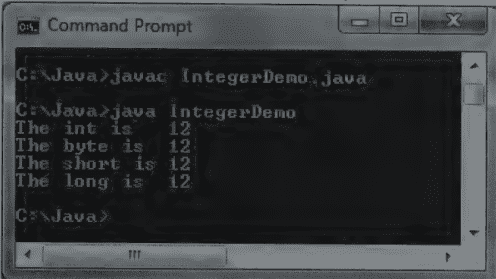

图 2-9 `IntegerDemo` 的输出

6. 将每个赋值值从 12 改为 1234，然后保存并重新编译程序。图 2-10 显示了生成的错误，因为 1234 对于`byte`变量来说太大了。“possible loss of precision”（可能会丢失精度）信息意味着如果将大数插入较小的空间中，数字的准确性将受到损害。

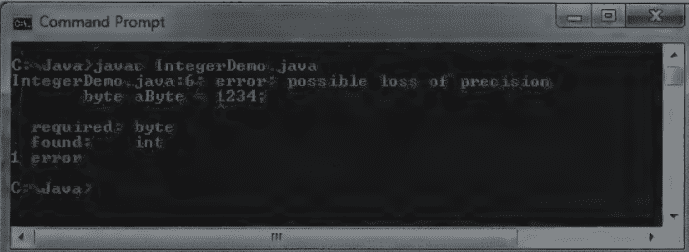

图 2-10 将过大赋值给`byte`变量时生成的错误

7. 将`aByte`的值改回 12。将`aShort`的值改为 12345。保存并重新编译程序。图 2-11 显示了结果。“possible loss of precision”错误信息与`byte`值无效时相同，但错误指示现在问题在`short`变量上。

```text
Command Prompt
C:>Java IntegerDemo(integerDemo, java)
IntegerDemo.java:7: error: possible loss of precision
short aShort = 12345;

required: short
found: int
C:>Java\_
```

图 2-11 将过大赋值给`short`变量时生成的错误

8. 将`short`变量的值改为 12345，然后保存并编译程序。现在，程序在没有错误的情况下通过编译。执行程序并确认其运行符合预期。

9. 在 Java 网站（`www.oracle.com/technet/java/index.html`），检查`PrintWriter`类中的`println`方法列表。尽管你可以找到接受`String`、`int`和`long`参数的版本，但找不到接受`byte`或`short`值的方法。然而，最新版本程序中的`println`语句运行正常。原因一定与类型转换有关，你将在本章稍些后学习。

10. 将`aLong`的值替换为 1234567890987654321。保存程序并编译。图 2-12 显示了指示整数数字过大的错误信息。该信息并不是说该值对于`long`类型变量太大。相反，它意味着在尝试将其存在`long`变量之前，字面常量就已经被评估并发现超默认`int`的范围。

```text
Command Prompt
C:>Java IntegerDemo(integerdemo, java)
IntegerDemo.java:8: error: integer number too large: 1234567890987654321
long aLong = 1234567890987654321;
C:>Java\_
```

图 2-12 将过大赋值给`long`变量时生成的错误

## 使用布尔数据类型

11. 在长数字数值末尾添加`L`来解决此问题。现在，该常量是可以赋值给`long`变量的正确数据类型。保存、编译并执行程序；程序执行成功。

12. 注意可能出现的错误，即数据值单独用于数据类型时是可以接受的，但组合在一起可能会产生超出范围的算术结果。为了演示，在`IntegerDemo`程序当前变量声明列表的末尾添加以下声明：

```java
int anotherInt = anInt * 100000000;
```

13. 在当前输出语句列表的末尾添加另一个输出语句，这样你就可以看到算术结果：

```java
System.out.println("Another int is " + anotherInt);
```

保存、编译并执行程序。输出结果如图 2-13 所示。尽管 1234 和 100000000 都是接受的`int`值，但它们的乘积超出了`int`的范围，结果`int`似乎没有被正确计算。因为算术结果太大，关于该值的某些信息已经丢失，包括结果的符号。如果你在程序中看到此类不合理的结果，你需要考虑为你的值使用不同的数据类型。

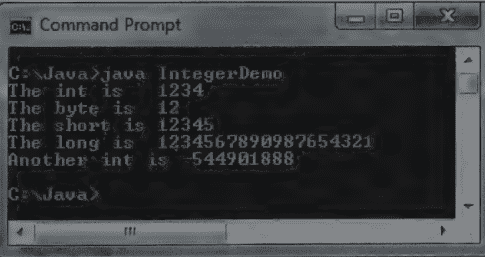

图 2-13 修改后的 `IntegerDemo` 程序输出超出范围的整数

## 使用布尔数据类型

`int`变量可以持有数百万不同的值（在不同的时间）；而`boolean`变量只能持有两个。以下语句为`Boolean`变量声明并分配了适当的值：

```java
boolean isPayday = false;
boolean areBroke = true;
```

# 第 2 章 使用数据

你也可以根据比较的结果为`Boolean`变量赋值。Java 支持用于进行比较的关系运算符。关系运算符进行比较；它有时也被称为比较运算符。包含关系运算符的表达式具有一个`Boolean`值。表 2-3 描述了这些操作符。

当你将`Boolean`作为形容词时（例如布尔运算符），你通常以大写字母`B`开始，因为该数据类型是以符号逻辑创始人乔治·布尔爵（Sir George Boolean）命名的，他生活于 1815 年至 1864 年。然而，Java 的数据类型`boolean`使用小写字母`b`。

| 操作符 | 描述 | 真示例 | 假示例 |
| --- | --- | --- | --- |
| `<` | 小于 | `3 < 8` | `8 < 3` |
| `>` | 大于 | `4 > 2` | `2 > 4` |
| `==` | 等于 | `7 == 7` | `3 == 9` |
| `<=` | 小于等于 | `5 <= 5` | `8 <= 6` |
| `>=` | 大于等于 | `7 >= 3` | `1 >= 2` |
| `!=` | 不等于 | `5 != 6` | `3 != 3` |

## 关系运算符

当你使用任何两个符号的运算符（`==`、`<=`、`>=`或`!=`）时，不能在符号之间放置任何空格。你不能反转符号的顺序。也就是说，`=`、`>=`和`!=`都是无效的操作符。

合法的声明可能包括以下语句，它们直接比较两个值：

```java
boolean isSixBigger = (6 > 5);
// 存储的值将为 true
boolean isSevenSmallerOrEqual = (7 <= 4);
// 存储的值将为 false
```

虽然你可以为`Boolean`变量使用任何合法的标识符，但如果你在变量名中使用`be`的形式（如`is`或`are`），它们很容易被识别为`Boolean`，如`isSixBigger`所示。

当在比较中使用变量（已赋值的变量）时，`Boolean`表达式会更有意义，如下所示。在第一条语句中，`hours`变量与常量值 40 进行比较。如果`hours`变量大于 40，则表达式求值为`false`。在第二条语句中，`income`变量必须大于 100000，表达式才会求值为`true`。在第三条语句中，比较两个变量以确定`isFirstScore`的值。

```java
boolean isOvertimePay = (hours > 40);
boolean isBracket = (income > 100000);
boolean isFirstScore = (score > score2);
```

当你学习第 5 章和第 6 章的决策和循环时，`Boolean`表达式将对你变得有用得多。

## 使用布尔数据类型（两真一假）

1. `Boolean`变量只能持有两个值之一——`true`或`false`。

2. Java 支持六种用于比较比较的关系运算符：`<`、`>`、`<=`、`!=`等。

3. 包含关系运算符的表达式具有一个`Boolean`值。

## 学习浮点数据类型

Java 支持两种浮点数据类型：`float`和`double`。`double`具有更高的精度和更多的有效数字。例如，给出一个`0.3246177`的`float`值将精确到小数点后六位。表 2-4 显示了每个浮点数据类型的最小值和最大值。注意，`double`的最大值为 $3.4 \times 10^{38}$，这意味着它是 3.4 乘以 10 的八次幂——一个非常大的数字。给出一个`3.2461777`的`float`将显示为`3.246177e+08`，这意味着在显示处大约是 3.246177 乘以 10 的八次幂。负数表示小数点在左侧，表示一个较小的数。这种格式被称为科学计数法，大值仅包含六位数字。程序员可能会选择将值存储为`float`而不是`double`以节省内存。然而，如果需要高水平的精度（在图形密集型软件中），程序员可能会选择使用`double`，选择高精度而非节省内存。

| 类型 | 最小值 | 最大值 | 大小（字节） |
| --- | --- | --- | --- |
| `float` | $-3.4 \times 10^{38}$ | $3.4 \times 10^{38}$ | 4 |
| `double` | $-1.7 \times 10^{308}$ | $1.7 \times 10^{308}$ | 8 |

表 2-4 浮点值的限制

存储在`double`中的值是双精度浮点数；`float`中的值是单精度浮点数。

正如整数常量（如 18）一样，由于`18`默认是`int`类型，浮点常量例如`28.3`默认是`double`类型。你可以指定`float`类型，如下：

```java
float pocket = 28.3f;
```

你可以输入小写或大写`F`（或者`f`）来指示它是`float`类型，但默认是`double`类型。`double`类型是不精确的，你将在稍后的章节中看到。

## 学习浮点数据类型（三真一假）

1. Java 支持两种浮点数据类型：`float`和`double`。

2. 浮点常量，如`5.6`，默认是`double`类型。

3. 与整数一样，你可以对浮点数进行加、减、乘、除数学运算。

## 使用 `char` 数据类型

使用`char`类型来存储字符值，因为`char`可以存储任何字符值。例如，以下是典型的声明：

```java
char middleInitial = 'M';
char gradeInChemistry = 'A';
char aStar = '*';
```

有些程序员喜欢将`char`读作 "care"，因为它代表单词中的第一个字母。其他人喜欢将`char`读作 "car"，因为它与 "care" 押韵。你应该使用`char`来表示任何字母——大写或小写、标点符号或数字。`char`类型以 Unicode 存储值。例如，如下：

```java
char aCharValue = '9';
int aNumValue = 57;
```

以下语句是合法的，除非你理解它们的含义，否则它们可能会产生意外的结果：

如果你使用`printf()`显示这些值，那么`aCharValue`的输出是空白，而`aNumValue`是 57。这些意外的结果是 Unicode 值。每个计算机将每个字符存储为数字；每个字符都分配了一个唯一的 Unicode 编码。表 2-5 显示了某些 Unicode 十进制值及其对应的字符。

| Dec | Char | Dec | Char | Dec | Char | Dec | Char |
| --- | --- | --- | --- | --- | --- | --- | --- |
| 0 | nul | 32 |  | 64 | @ | 96 |  |
| 1 | ^A | 33 | ! | 65 | A | 97 | a |
| 2 | stx^B | 34 |  | 66 | B | 98 | b |
| 3 | etx^C | 35 | # | 67 | C | 99 | c |
| 4 | opt^D | 36 | $ | 68 | D | 100 | d |
| 5 | enq^E | 37 | % | 69 | E | 101 | e |
| 6 | ask^F | 38 | & | 70 | F | 102 | f |
| 7 | bel^G | 39 |  | 71 | G | 103 | g |
| 8 | bs^H | 40 | ( | 72 | H | 104 | h |
| 9 | ht^I | 41 |  | 73 | I | 105 | i |
| 10 | ll^J | 42 | * | 74 | J | 106 | j |

表 2-5 Unicode 值 0 到 127 及其对应的字符（继续）

# 第 2 章 使用数据

（续）

| Dec | Char | Dec | Char | Dec | Char | Dec | Char |
| --- | --- | --- | --- | --- | --- | --- | --- |
| 11 | vt^K | 43 | + | 75 | K | 107 | k |
| 12 | ff^L | 44 | ' | 76 |  | 108 | l |
| 13 | cr^M | 45 |  | 77 | M | 109 | m |
| 14 | so^N | 46 |  | 78 | N | 110 | n |
| 15 | si^O | 47 | / | 79 | O | 111 | o |
| 16 | dle^P | 48 | 0 | 80 | P | 112 | p |
| 17 | dc1^Q | 49 | 1 | 81 | Q | 113 | q |
| 18 | dc2^R | 50 | 2 | 82 | R | 114 | r |
| 19 | dc3^S | 51 | 3 | 83 | S | 115 | s |
| 20 | dc4^T | 52 | 4 | 84 | T | 116 | t |
| 21 | nak^U | 53 | 5 | 85 | U | 117 | u |
| 22 | syn^V | 54 | 6 | 86 | V | 118 | v |
| 23 | etb^W | 55 | 7 | 87 | W | 119 | w |
| 24 | can^X | 56 | 8 | 88 | X | 120 | x |
| 25 | em^Y | 57 | 9 | 89 | Y | 121 | y |
| 26 | sub^Z | 58 | : | 90 | Z | 122 | z |
| 27 | esc | 59 |  | 91 |  | 123 |  | |
| 28 | fs | 60 | < | 92 | ] | 124 |  | |
| 29 | gs | 61 | = | 93 |  | 125 |  | |
| 30 | rs | 62 |  | 94 | ^ | 126 |  | |
| 31 | us | 63 | ? | 95 |  | 127 | del |

表 2.5 Unicode 0 到 127 的值及其等效字符。

`char`类型的变量只能存储一个字符。要存储一个字符字符串（例如姓名），你必须使用一种名为`String`的数据结构。在 Java 中，字符串是对象，而不是基本数据类型（注：此处原文 primitives 指基本类型）。与使用单引号的单个字符不同，字符串被包含在双引号中。例如，将名字 Audrey 作为字符串存储在名为`firstName`的变量中的表达式：`firstName = "Audrey";`。

你将在“字符、字符串和 StringBuilder”章节中学习更多关于字符串和`String`类的知识。

## 使用 `char` 数据类型

你可以在变量中存储任何字符——包括退格键或制表符等非打印字符。为了存储这些字符，你可以使用转义序列——例如，下面的代码在`char`变量中存储了一个换行符和一个制表符：

```java
char newLine = '\n';
char tabChar = '\t';
```

在`newLine`和`tabChar`的声明中，反斜杠和字符对序列赋予了该字符新的含义。也就是说，前述代码中的字面字符的值与“普通”字符 'n' 或 't' 不同。表 2-6 描述了在 Java 输出中可以使用的一些常用转义序列。

| 转义序列 | 描述 |
| --- | --- |
| `\b` | 将光标向左移动一个空格 |
| `\t` | 将光标移动到下一个制表位 |
| `\n` | 换行或换进符；将光标移动到下一行的开头 |
| `\r` | 回车；将光标移动到当前行的开头 |
| `\"` | 双引号；显示一个双引号 |
| `\'` | 单引号；显示一个单引号 |


| `\\` | 显示一个反斜杠字符 |

表 2-6 常用转义序列。

当你在 `JOptionPane` 对话框而不是命令行窗口查看值时，转义序列 `'\n'`（换行）、`\"`（双引号）和 `'\\'`（反斜杠）在 `JOptionPane` 对象内部按预期工作，而 `'\t'`、`'\b'` 和 `'\r'` 在 GUI 环境中不起作用。

当你想要在命令行窗口中多行输出时，有两种选择：你可以使用换行转义序列，也可以多次使用 `println()` 方法。例如，图 2-14 和图 2-15 显示了产生相同输出的类：一行显示 "Hello"，另一行显示 "there"。选择哪种版本取决于你。图 2-14 中的示例更高效——从打字者的角度来看，文本 `System.out.println()` 只出现了一次；从编译器的角度来看，`println()` 只被调用了一次。然而，图 2-15 中的示例可能更容易阅读和理解。在用 Java 编程时，你会发现某些情况下这两种方法……

# 第 2 章 使用数据

```java
public class HelloThereNewLine {
    public static void main(String[] args) {
        System.out.println("Hello\nthereline");
    }
}
```

图 2-14 HelloThereNewLine 类

```java
public class HelloTherePrintInTwice {
    public static void main(String[] args) {
        System.out.println("Hello");
        System.out.println("there");
    }
}
```

图 2-15 HelloTherePrintInTwice 类。

`println()` 方法使用本地平台的行终止符字符，该字符可能是也可能不是换行符 `\n`。

# 话真一假

使用 char 数据类型

- 1. 你使用 `char` 数据类型来持有任何单个字符；你将常量字符值放在单引号内。

- 2. 要存储一个字符字符串，你使用一种名为 `Text` 的数据结构；字符串常量写在括号之间。

- 3. 转义序列始终以反斜杠开头，后跟一个字符；该对代表一个单个字符。

## 你来做

处理 char 数据类型

在本节的步骤中，你将创建一个演示 `char` 数据类型某些功能的应用程序。

- 1. 如下所示创建名为 `CharDemo` 的类及其 `main()` 方法的壳：

```java
public class CharDemo
{
    public static void main(String[] args)
    {
}
```

- 2. 为 `main()` 方法创建大括号，声明一个 `char` 变量并提供初始化值：

`char initial = 'A';`

- 3. 添加两个语句。第一个显示变量，第二个演示一些转义序列字符。

`System.out.println(initial);`

`System.out.println("\abc\bghi\nnjkl");`

- 4. 将文件保存为 `CharDemo.java`，并编译执行它。图 2-16 显示了输出。

输出的第一行包含 `char` 变量的值。下一行由转义序列 `\t` 创建的制表符开始。下一行输出包含 `char` 变量的值。下一行由转义序列 `\t` 创建的制表符开始。下一行输出包含 `char` 变量的值。下一行由转义序列 `\t` 创建的制表符开始。下一行输出包含 `char` 变量的值。下一行由转义序列 `\t` 创建的制表符开始。下一行输出包含 `char` 变量的值。下一行由转义序列 `\t` 创建的制表符开始。下一行输出包含 `char` 变量的值。下一行由转义序列 `\t` 创建的制表符开始。下一行输出包含 `char` 变量的值。下一行由转义序列 `\t` 创建的制表符开始。下一行输出包含 `char` 变量的值。下一行由转义序列 `\t` 创建的制表符开始。

- 5. 根据需要无限次数修改、重新编译并执行 `CharDemo`，直到你能准确预测使用各种转义序列会显示的内容。


图 2-16 CharDemo 的输出

## 使用 Scanner 类接收键盘输入

| 方法 | 说明 |

| --- | --- |

| `nextDouble()` | 将输入作为 `double` 类型获取 |

| `nextInt()` | 将输入作为 `int` 类型获取 |

| `nextLine()` | 获取下一行数据并将其作为 `String` 返回 |

| `next()` | 将下一个完整的标记（token）作为 `String` 获取 |

| `nextShort()` | 将输入作为 `short` 类型获取 |

| `nextByte()` | 将输入作为 `byte` 类型获取 |

| `nextFloat()` | 将输入作为 `float` 类型获取。注意，当你输入一个将存储为 `Float` 的输入值时，不需要输入 F。F 仅用于程序中编码的常量。 |

| `nextLong()` | 将输入作为 `long` 类型获取。注意，当你输入一个将存储为 `long` 的输入值时，不需要输入 L。L 仅用于程序中编码的常量。 |

# 定的 Scanner 类方法

`Scanner` 类不包含 `nextChar()` 方法。要从键盘检索单个字符，你可以使用 `nextLine()` 方法然后使用 `charAt()` 方法。`Characters`、`Strings` 和 `StringBuilder` 提供了关于 `charAt()` 方法的更多详细信息。

图 2-17 包含一个使用了 `Scanner` 类方法的程序。该程序从键盘读取一个字符串和一个整数并显示它们。`Scanner` 类被用于图中四个阴影标记的语句。

- 第一条阴影语句是 `import java.util.Scanner;`。该语句导入了使用 `Scanner` 类所必需包。

- 第二条阴影语句声明了一个名为 `inputDevice` 的 `Scanner` 对象。

- 第三条阴影语句使用 `nextLine()` 方法从键盘检索一行文本并将其存储在 `name` 变量中。

- 最后一条阴影语句使用 `nextInt()` 方法从键盘检索一个整数并将其存储在 `age` 变量中。

图 2-18 显示了程序的典型执行情况。

Java 程序员会说 `Scanner` 方法返回了适当的值。这意味着该方法的值就是适当的值，你可以将返回的值赋给变量、显示它或在其他合法的语句中使用它。在“使用方法、类和对象”章节中，你将学习如何编写自己的返回返回值的方法。

# 第 2 章 使用数据

```java
import java.util.Scanner;
public class GetUserInfo {
    public static void main(String[] args) {
        String name;
        int age;
        Scanner inputDevice = new Scanner(System.in);
        System.out.print("Please enter your name >> ");
        name = inputDevice.nextLine();
        System.out.print("Please enter your age >> ");
        age = inputDevice.nextInt();
        System.out.println("Your name is " + name + " and you are " + age + " years old.");
    }
}
```

将用户输入的输入内容作为输出重复一遍被称为回显输入（echoing）。回显输入是一种良好的编程实践；当用户可以在视觉上确认输入的内容时，它有助于消除误解。

图 2-17 GetUserInfo 类

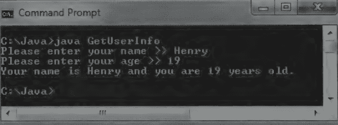

图 2-18 GetUserInfo程序的典型执行

如果你使用任何 `Scanner` 方法且下一个标记无法转换为正确的数据类型，你将收到错误消息。例如，图 2-17 中的程序使用 `nextInt()` 获取 age，因此如果你为 age 输入一个非整数值（例如双精度数19.5 或字符串 "nineteen"），就会发生错误。你将在“异常处理”章节中学习如何从此类错误中恢复，但现在你必须信任用户会输入正确的数据类型。

图 2-17 中出现在每个输入语句之前的 `print()` 语句中的字面量字符串是提示（prompts）的示例。交互式程序没有提示也可以运行，但它们对用户不利。`GetUserInfo` 类中的每个提示都以两个大于号和一个空格结束。这种标点不是必须的；它只是将提示中的词与屏幕上的用户输入值隔开，提高可读性。你可能更倾向于使用一系列点、几个破折号或仅仅几个空格。

编写一个请求多个输入值的单个提示是合法的——例如，“请输入您的年龄、区号和邮政编码。”用户随后可以使用空格、制表符或回车键分隔输入这三个值。这些值将分别解释为独立的标记，并可以通过三次单独的 `nextInt()` 方法调用来检索。然而，要求用户输入多个值往往会导致错误。本书将遵循为每个所需的输入值使用一个独立提示的习惯。

## 陷阱：在其他 Scanner 输入方法之后使用 nextLine()

当你使用数值型 `Scanner` 类检索方法之一或在使用 `nextLine()` 方法之前，可能会遇到一个问题。考虑图 2-19 中的程序。它与图 2-17 中的程序相同，只是在要求输入名称之前先要求输入年龄。（见阴影部分）。图 2-20 显示了典型的执行情况。

```java
import java.util.Scanner;
public class GetUserInfo2 {
    public static void main(String[] args) {
        String name;
        int age;
        Scanner inputDevice = new Scanner(System.in);
        System.out.print("Please enter your age >> ");
        age = inputDevice.nextInt();
        System.out.print("Please enter your name >> ");
        name = inputDevice.nextLine();
        System.out.println("Your name is " + name + " and you are " + age + " years old.");
    }
}
```

图 2-19 GetUserInfo 类

```
C:Java>>GetUserInfo2
Please enter your age >> 28
Please enter your name >> 
```

图 2-20 程序的典型执行

如果你使用任何 `Scanner` 方法且下一个标记无法转换为正确的数据类型，你将收到错误消息。例如，图 2-17 中的程序使用 `nextInt()` 获取 age，因此如果你为 age 输入一个非整数值（例如双精度数19.5 或字符串 "nineteen"），就会发生错误。你将在“异常处理”章节中学习如何从此类错误中恢复，但现在你必须信任用户会输入正确的数据类型。

当你使用键盘输入字符时，它们被临时存储在一个名为缓冲区的地方。键盘缓冲区有时被称为输入。问题的发生是因为 `nextLine()` 方法与其他 `Scanner` 方法的工作方式不同。

- `Scanner` 方法 `next()`、`nextInt()` 和 `nextDouble()` 获取缓冲区中直到空白符的标记，空白符可能是空格、制表符或回车键。

- `nextLine()` 方法读取所有数据直到回车键字符。

因此，在图 2-20 的执行中，用户被要求输入年龄，输入 28 并按下回车。`nextInt()` 方法获取了 28，并将回车留在输入缓冲区中。随后显示名称提示，`nextLine()` 在用户输入名称之前检索了那个留下的回车键。

在图 2-20 中，用户被要求输入年龄。然而，在用户输入年龄并显示名称提示后，程序直接进入输出语句，而没有等待输入名称，正如你所见。

问题的解决方法很简单。在任何 `next()`、`nextInt()` 或 `nextDouble()` 调用之后，你可以添加一个额外的 `nextLine()` 方法调用来检索遗留的回车键字符。这样，无论后续是什么类型的输入，程序都能平畅运行。图 2-21 显示的程序与图 2-19 相比只有一个变化——增加了从输入中检索遗留回车键字符的阴影语句。虽然你可以将回车键赋给字符变量，但没有这样做。

图 2-21 显示 `nextInt()` 调用接受了整数，第一次 `nextLine()` 调用接受了回车键，第二次 `nextLine()` 调用同时接受了输入的名称和随其后的回车键。图 2-22 显示了修改后的程序执行正确。

```java
import java.util.Scanner;
public class GetUserInfo {
    public static void main(String[] args) {
        String name;
        int age;
        Scanner inputDevice = new Scanner(System.in);
        System.out.print("Please enter your age >> ");
        age = inputDevice.nextInt();
        inputDevice.nextLine();
        System.out.print("Please enter your name >> ");
        name = inputDevice.nextLine();
        System.out.println("Your name is " + name + " and you are " + age + " years old.");
    }
}
```

# 第2章 使用数据

## 两个真实与一个谎言

### 使用 Scanner 类接受键盘输入

- 1. `System.in` 代表标准输入设备，通常是键盘。

- 2. `System.in` 比 `System.out` 更灵活，因为它可以读取所有的基础 Java 数据类型。

- 3. 当用户输入数据并按回车键时，在 `Scanner` 类方法检索到其他按键后，回车键字符会留在键盘缓冲区中。

> 错误的陈述 #2：`System.out` 不像 `System.in` 那样灵活，但 `System.in` 可以显示各种数据类型，它被设计为只读取字节。

## 你来做

### 接受用户输入

在接下来的步骤中，你将创建一个接受用户输入的程序文件。

- 1. 打开你在在本章“你来做”部分创建的 `IntegerDemo.java` 文件。将类名改为 `IntegerDemoInteractive`，并将文件保存为 `IntegerDemoInteractive.java`。

- 2. 在文件的第一行插入一条 import 语句，以便你使用 `Scanner` 类：

`import java.util.Scanner;`

- 3. 从四个数值变量声明中删除赋值运算符和赋值值。

- 4. 在数值变量声明之后，插入一个 `Scanner` 对象声明：

`Scanner input = new Scanner(System.in);`

- 5. 在变量声明之后，插入一个整数值的提示语句，以及一个接受该值的输入语句，如下：

`System.out.print("Please enter an integer >> ");`

`anInt = input.nextInt();`

- 6. 然后为其他三个变量添加相似的语句：

```java
System.out.print("Please enter a byte integer >> ");
abByte = input.nextByte();
System.out.print("Please enter a short integer >> ");
ashort = input.nextShort();
System.out.print("Please enter a long integer >> ");
along = input.nextLong();
```

- 7. 保存文件，然后编译并执行它。图 2-23 显示了一个典型的执行过程。再次多运行几次程序，每次使用不同的值，并确认已从键盘接受了正确的值。

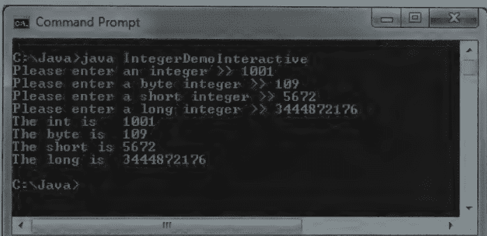

图 2-23 IntegerDemoInteractive 程序的典型执行

添加 String 输入

接下来，你为 `IntegerDemoInteractive` 程序添加 `String` 输入。

- 1. 将 `IntegerDemoInteractive` 程序的类名改为 `IntegerDemoInteractiveWithNameName`，并立即将文件保存为 `IntegerDemoInteractiveWithNameName.java`。

- 2. 按照其他变量声明添加一个新变量，如下：

`String name;`

- 3. 在最后一个输入语句（获取 `along` 的值）之后，添加三条语句来提示用户名称、接受名称并使用该名称，如下：

`System.out.print("Please enter your name >> ");`

`name = input.nextLine();`


`System.out.println("Thank you, " + name);`

- 4. 保存文件，编译并执行它。图 2-24 显示了一个典型的执行过程。你可以输入数字，但当名称提示出现时，你并没有获得响应的机会。相反，字符串 "Thank you"（包括结尾的逗号和空格）被立即输出，程序结束。这种输出是错误的，因为本应从键盘检索名称的输入语句反而检索了在上一次数值输入后仍留在键盘缓冲区中的回车键。

```text
C:\Java>java IntegerDemoInteractiveWithName
Please enter an integer >> 525
Please enter a byte integer >> 36
Please enter a short integer >> 72
Please enter a long integer >> 7329
Please enter a char name >> Thank you.
The int is 525
The byte is 36
The short is 72
The long is 7329
C:\Java>
```

**图 2-24** 不接受名称的未完整 `IntegerDemoInteractiveWithName` 程序的典型执行

- 5. 为了修复这个问题，在接受名称的语句之前插入一个额外的 `nextLine()` 方法调用。此调用将消耗掉回车键。你不需要在该语句中使用赋值运算符，因为没有必要存储回车键字符。

```java
input.nextLine();
```

## 使用 `JOptionPane` 类接受 GUI 输入

- 6. 保存、编译并执行程序。图 2-25 显示了一个典型的成功执行过程。

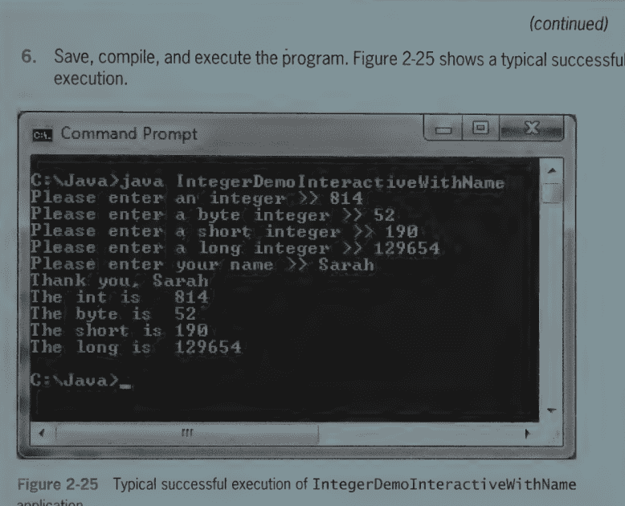

在第 1 章中，你学习了如何在命令行显示输出以及如何创建 GUI 消息框来显示 `String` 对象。在本章较早时候，你学习了在命令行接受键盘输入。你也可以使用 `JOptionPane` 类在 GUI 对话框中接受输入。

用于接受用户输入的两个对话框是：

- `InputDialog`——提示用户输入文本

- `ConfirmDialog`——向用户提问，提供用户可以点击的 Yes（是）、No（否）和 Cancel（取消）按钮

### 使用输入对话框

在此对话框中你可以使用 `show` 方法创建一个输入对话框。该方法有多个版本，但最简单的版本使用单个参数，该参数是你想在对话框内显示的提示信息。`showInputDialog()` 方法返回一个 `String`，代表用户的响应。

位于 `java.lang` 包中的类；与大多数类一样，这些类的名称以大写字母开头。这些类被称为包装类。它们封装了原始类型。

图 2-30 显示了一个 `SalaryDialog` 应用程序，它包含两个 `String` 对象——`wageString` 和 `dependsString`。调用了两次 `showInputDialog()` 方法，并将答案存储在声明的 `String` 中。图 2-30 中的阴影语句显示了如何使用包装类 `Integer` 和 `Double` 中的方法将 `String` 转换为数值。`double` 类型使用 `Double.parseDouble()` 方法进行转换，整数使用 `Integer.parseInt()` 方法进行转换。图 2-31 显示了该程序的典型执行过程。

记住，在 Java 中，保留的 `static` 关键字意味着即使不存在该类的对象，该方法也是可以访问和使用的。你可以看出 `Double.parseDouble()` 方法是一个静态方法，因为该方法名是与类名 `Double` 一起使用的——不需要对象。同样，你可以看出 `Integer.parseInt()` 也是一个静态方法。

语法学家会谈论“解析句子”。解析 `String` 是将其转换为其数值等价物。

```java
import javax.swing.JOptionPane;
public class SalaryDialog {
    public static void main(String[] args) {
        String wageString, dependsString;
        double wage, weeklyPay;
        int dependents;
        final double HOURS_IN_WEEK = 37.5;
        wageString = JOptionPane.showInputDialog(null, "Enter employee's weekly wage", "Salary dialog 1",
        JOptionPane.INFORMATION_MESSAGE);
        weeklyPay = Double.parseDouble(wageString) * 
        HOURS_IN_WEEK;
        dependsString = JOptionPane.showInputDialog(null, "How many dependents?",
        JOptionPane.QUESTION_MESSAGE);
        dependents = Integer.parseInt(dependsString);
        JOptionPane.showMessageDialog(null, "Weekly salary is $" + 
        weeklyPay + "\nDeductions will be made for " + 
        dependents + " dependents");
    }
}
```

图 2-30 `SalaryDialog` 类

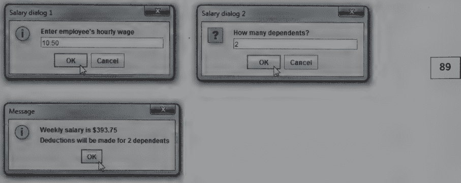

图 2-31 `SalaryDialog` 应用程序的示例执行

### 使用确认对话框


有时，你想要从用户那里获得的输入不需要键盘输入。当你向用户提供简单选项时，可以提供让用户点击以确认选择的按钮。确认对话框显示选项；你可以使用`JOptionPane`类中的`showDialog`方法创建一个。该方法有四种版本可用；最简单的一个需要一个父组件（可以是`null`），并且`String`提示显示在框中。`showDialog()`方法返回一个包含三个可能值之一的整数：`JOptionPane.YES_OPTION`、`JOptionPane.NO_OPTION`或`JOptionPane.CANCEL_OPTION`。图 2-32 显示了一个向用户提问题的应用程序。阴影语句显示了图 2-33 所示的对话框并将用户的响应存储在名为`selection`的整数变量中。

```java
import javax.swing.JOptionPane;
public class AirlineDialog{
    public static void main (String[] args) {
        int selection;
        boolean isYes;
        selection = JOptionPane.showDialog(null,
            "Do you want to upgrade to first class?");
        isYes = (selection == JOptionPane.YES_OPTION);
        JOptionPane.showMessageDialog(null,
            "You responded " + isYes);
    }
}
```

图 2-32 `AirlineDialog`类

# 第 2 章 使用数据

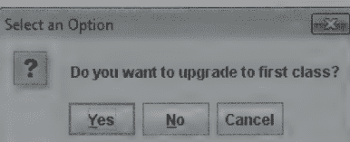

图 2-33 `AirlineDialog`应用程序显示的确认对话框

在值存储在`selection`后，当将`selection`和`JOptionPane.YES_OPTION`进行比较时，名为`YesIs`的布尔变量被设置为结果。如果用户选择了对话框中的 Yes 按钮，此变量被设置为`true`；否则，显示`true`或`false`结果；图 2-34 显示了用户点击对话框中 Yes 按钮时的结果。


图 2-34 用户点击 Yes 时`AirlineDialog`应用程序的输出

- 父组件，可以是`null`
- 提示消息
- 在标题栏中显示的标题
- 指示将显示哪个选项按钮的整数（它应该是类变量`YES_NOCANCEL_OPTION`或`YES_NO_OPTION`之一。）
- 描述对话框类型的整数（它应该是类变量`ERROR_MESSAGE`、`INFORMATION_MESSAGE`、`PLAIN_MESSAGE`、`QUESTION_MESSAGE`或`WARNING_MESSAGE`之一。）

当执行以下语句时，它会显示一个确认对话框，如图 2-35 所示：

`JOptionPane.showConfirm(null);`

```java
JOptionPane.showConfirm("Data input error has occurred. Continue?", "Data input error", JOptionPane.YES_OPTION, JOptionPane.ERROR_MESSAGE);
```

标题栏显示“Data input error”，Yes 和 No 按钮出现，对话框显示错误消息“A data input error has occurred. Continue?”。它还显示八角形的`ERROR_MESSAGE`图标。

## 执行算术运算

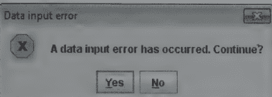

图 2-35 确认对话框

在 Java 中，保留的`static`关键字意味着即使不存在该类的对象，该方法是可以访问和使用的。你可以看出`Double.parseDouble()`方法是一个静态方法，因为方法名是与类名`Double`一起使用的——不需要对象。同样，你可以看出`Integer.parseInt()`也是一个静态方法。

语法学家会谈论“解析句子”。解析`String`是将其转换为其数值等价物。

## 执行算术运算

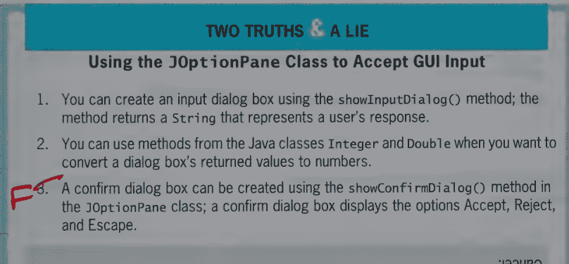

算术运算

表 2-8 描述了你在程序中使用进行计算的标准算术运算符。在运算符两侧的每个都是操作数。算术运算符是二元运算符。

# 第 2 章 使用数据

| 运算符 | 描述 | 示例 |
|---|---|---|
| + | 加法 | 45 + 2 |
| - | 减法 | 45 - 2 |
| * | 乘法 | 45 * 2 |
| / | 除法 | 45 / 2 |
| % | 余数 (模) | 45 % 2 |

运算符`/`和`%`值得特别关注。Java 支持两种除法：

- 浮点除法：例如，`45.0 / 2`是 22.5。
- 整数除法：在 Java 中，结果的小数部分会丢失。例如，`45 / 2`的结果是 22。

余数运算符：余数运算符用于你需要余数时，结果是除法后的整数值。例如，`45 % 2`的结果是 1，因为 2 进入 45 二十二次，余数为 1。其他余数运算的示例包括：

- `39 % 5`是 4，因为 5 进入 39 七次，余数为 4。
- `20 % 3`是 2，当 20 除以 3 时，余数为 2。
- `36 % 4`是 0，因为 4 除以 36 没有余数。

注意，当你进行纸笔计算除法时，你会先除以确定余数。在 Java 中，你不需要在执行余数运算之前执行除法运算。余数运算可以独立存在。

虽然余数运算符主要用于整数，但在浮点值上使用该运算符是合法的但通常不太用。在 Java 中，当你对浮点值使用`%`运算符时，结果是舍入法的余数。

余数运算符也称为模运算符，或者有时称为 mod。数学家会认为 remainder 是更好的术语，因为在 Java 中，使用余数运算符的结果可能是负数，但在数学中，模运算的结果永远不会是负数。

## 结合性与优先级

当你在单个语句中组合数学运算时，你必须同时理解结合性和优先级。相同优先级的算术运算符的结合性是从左到右的。在像`answer = x + y + z;`这样的语句中，首先计算`x`和`y`，产生一个临时结果，然后将`z`加到临时和上。求和后，将结果赋值给`answer`。

运算符优先级指的是数学表达式各部分求值顺序的规则。乘法、除法和取余运算符具有相同的优先级。它们的优先级高于加法和减法运算符。加法和减法的优先级相同，且低于其他运算符。换句话说，表达式从左到右求值，乘法、除法和取余始终发生在加法或减法之前。表 2-9 总结了算术运算符的优先级。

| 运算符 | 描述 | 相对优先级 |
| :--- | :--- | :--- |
| * / % | 乘法、除法、取余 | 较高 |
| + - | 加法、减法 | 较低 |

例如，以下语句将 14 赋值给`result`：

`int result = 2 + 3 * 4;`

乘法`(3 * 4)`在加 2 之前发生。你可以通过将要先执行的操作放在括号中来覆盖标准的运算符优先级。以下语句将 20 赋值给`result`：

`int result = (2 + 3) * 4;`

括号内的加法首先执行，然后将中间结果`(5)`乘以 4。当语句中使用多对括号时，最内层括号包围的表达式先求值。例如，以下表达式的值为 46：

`2 * (3 + (4 * 5))`

首先，`4 * 5`求得为 20，然后加上 3，得到 23。最后，该值乘以 2，得到 46。

在算术计算中，记住`*`、`/`和`%`优先级是非常重要的。无论这些操作出现的顺序如何，它们都从左到右执行。例如，以下表达式的值为 9：

`25 / 8 * 3`

首先，25 除以 8。结果为 9 是因为整数除法，你丢失了任何余数。然后 3 乘以 3，得到 9。如果你假设乘法在除法之前执行，你将算出错误的答案。

## 高效地编写算术语句

如果你能避免算术语句不必要的重复，就可以让程序运行得更高效。例如，假设你知道员工的小时薪资和费率值，并想根据已知费率计算州税和联邦预扣税。你可以编写以下两个语句：

```
stateWithholding = hours * rate * STATE_RATE;
federalWithholding = hours * rate * FED_RATE;
```

通过这种方法，你执行了两次`hours * rate`的乘法。执行一次计算更高效，如下：

```
grossPay = hours * rate;
stateWithholding = grossPay * STATE_RATE;
federalWithholding = grossPay * FED_RATE;
```

节省的时间非常少，但如果计算更复杂，或者在程序中重复多次，这些节省将变得更加重要。在你思考编写的程序时，请留心通过避免操作重复来提高效率的方法。

## 陷阱：不理解浮点数的不精确性

整数值是精确的，但浮点数通常只是近似值。例如，当你用 1.0 除以 3.0 时，数学结果是 0.333333...，数字无限持续。无论你能存储多少位小数，结果都只是一个近似值。即使是在我们通常的计数系统中不无限循环的值（例如 0.1），也无法在计算机使用的二进制格式中精确表示。不精确性会导致几个问题：

- 附录 B 对数字系统以及为什么分数值无法准确表示提供了更详细的解释。
- 当你产生浮点输出时，它看起来可能不像你预期或想要的。
- 当你与浮点数进行比较时，比较结果可能不是你预期或想要的。

例如，图 2-36 显示了一个类，其中答案计算为`2.20 – 2.00`。从数学上讲，结果应该是`0.20`。但如图 2-37 中的输出所示，答案计算为一个略大于 0.20 的值，当`answer`与 0.20 比较时，结果为`false`。

```java
public class ImprecisionDemo {
    public static void main(String[] args) {
        double answer = 2.20 - 2.00;
        boolean isEqual = answer == 0.20;
        System.out.println("answer is " + answer);
        System.out.println("isEqual is " + isEqual);
    }
}
```

图 2-36 `ImprecisionDemo`程序

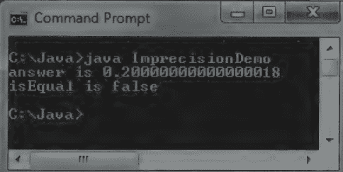

图 2-37 执行`ImprecisionDemo`程序

目前，你可能选择接受浮点数产生的小细微不精确性。然而，如果你想消除这些不精确性，可以使用几种技术之一对数值进行四舍五入。附录 C 包含了如何四舍五入数字以及如何格式化浮点数以便显示所需数值的说明。

## 执行浮点数运算（续）

接下来，你将修改`ArithmeticDemo`应用程序以处理浮点值而不是整数。

1. 在`ArithmeticDemo`应用程序中，将类名更改为`ArithmeticDemo2`，并立即将文件保存为`ArithmeticDemo2.java`。将所有变量的数据类型更改为`double`。将两个提示更改为请求`double`值，并将两次对`nextInt()`方法的调用改为`nextDouble()`。保存、编译并再次执行程序。注意，平均值的计算现在显示了小数位。

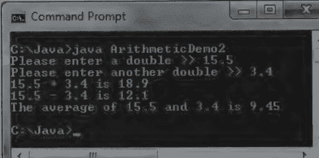

图 2-39 `ArithmeticDemo2`程序的典型执行

2. 重新运行程序，尝试不同的输入值。你的某些输出可能会出现类似于图 2-40 所示的不精确性。如果你对使用浮点数运算产生的细微不精确不满意，可以像附录 C 中讨论的那样对数值进行四舍五入或更改显示。

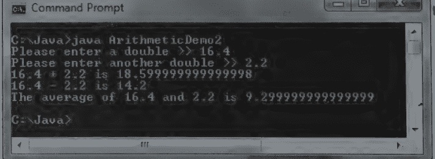

图 2-40 `ArithmeticDemo2`程序的另一种典型执行

## 理解类型转换

当你对相同类型的变量或常量进行算术运算时，结果保持相同的类型。例如，当除以两个`int`时，结果是`int`；当减去两个`double`时，结果是`double`。然而，你可能可能想对不同类型的操作数执行数学运算。

Java 会自动或隐式地为你执行某些转换，但其他转换必须由程序员显式地请求。

### 自动类型转换

当你对不同类型的操作数进行算术运算时，Java 会为结果选择一个统一类型。执行此过程是为了使它们相互兼容。Java 执行隐式转换，即它在值之间提升类型。

图 2-41 显示了建立统一类型的顺序。

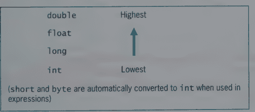

图 2-41 建立统一数据类型的顺序

当一个表达式涉及两个不同类型时，结果类型是级别较高的那一个。换句话说，当列表中位置较低类型的操作数与级别较高的类型组合时，低类型的操作数会被转换为高类型。例如，`double`和`int`的相加结果是`double`，从`float`中减去`long`的结果是`float`。

布尔值不能转换为其他类型。在某些语言（如 C++）中，布尔值实际上是数字。然而，Java 并非如此。

例如，假设了`int`类型`hoursWorked`和`double`类型`payRate`，然后如下所示相乘：

```java
int hoursWorked = 37;
double payRate = 6.73;
double grossPay = hoursWorked * payRate;
```

相乘的结果是`double`，因为当`double`和`int`相乘时，`int`被提升为更高级统一类型`double`——即图 2-41 列表中级别更高的类型。因此，将结果赋值给`grossPay`是合法的。

以下代码无法编译，因为`hoursWorked`乘以`payRate`是一个`double`，Java 不允许在尝试将计算出的`double`结果存储在`int`中发生精度丢失。

```java
int hoursWorked = 37;
double payRate = 6.73;
grossPay = hoursWorked * payRate;
```

数据类型`char`、`short`和`byte`在与不同类型的语句中使用时都会被提升为`int`。如果你对`char`、`short`和`byte`值的任何组合进行计算，结果默认都是`int`。例如，如果加上两个`byte`，结果是`int`而不是`byte`。

### 显式类型转换

你可以通过执行类型转换来故意覆盖 Java 强加的统一类型。要执行类型转换，你使用由括号创建的转换运算符。使用强制转换运算符是一种显式转换，它

```java
// 例如，在如下情况下执行类型转换
double bankBalance = 189.66;
float weeklyBudget = (float)(bankBalance / 4);
// weeklyBudget 为 47.415，bankBalance 的四分之一
```

> 强制转换运算符更完整地称为一元强制转换运算符。与两个操作数的二进制运算符不同，一元运算符只使用一个操作数。一元强制转换运算符后面跟着它的操作数。

在此示例中，`double`值`bankBalance`除以整数`4`，结果是`double`。然后，`double`结果在存储到`weeklyBudget`之前被转换为`float`。

## 理解类型转换

如果没有转换，赋值结果给`weeklyBudget`的语句将无法编译。同样，在此代码段中发生了从`float`到`int`的强制转换：

```java
float money = 47.82;
int dollars = (int) money;
// dollars 为 47，money 的整数部分
```

在此示例中，`float`值`money`在存储到整数变量名`dollars`之前被转换为`int`。当`float`转换为`int`时，小数位的值会丢失。强制转换运算符不会永久性地更改任何变量的数据类型；该更改仅在当前操作期间有效。

`cast`一词在提到金属铸造（如铸铁 cast iron）时用法类似。在 Java 算术转换中，值被“铸造”成不同的类型。

执行强制转换很容易丢失数据。例如，`byte`的最大值为 127，而`int`的最大值为 2,147,483,647，因此以下语句产生扭曲的结果：

```java
int anOkayInt = 200;
byte aBadByte = (byte)anOkayInt;
```

`byte`由八个 1 和 0（即二进制位）组成。第一个二进制位持有 0 或 1 以表示正负。其余七位存储实际值。当整数值 200 存储在`aBadByte`变量中时，其大值消耗了第八位，将其变为 1，并强制`aBadByte`变量看起来持有值 -72，这是不准确且误导的。

向更高类型赋值时，不需要执行强制转换。例如，当你编写如下语句时，Java 会自动将整数 10 提升为`double`以便存储在变量中：

```java
double payRate = 10;
```

然而，为了清晰起见，如果你想赋值给`payRate`，你可能更喜欢写成：

```java
double payRate = 10.0;
```


## 理解类型转换

（续）

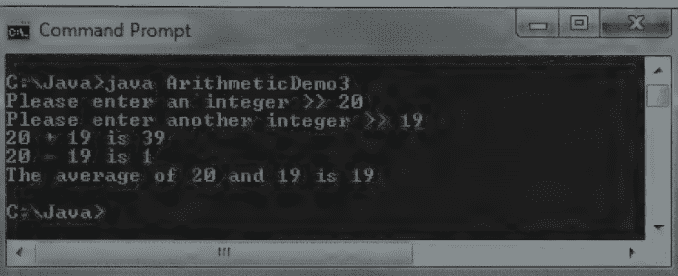

图 2-42 ArithmeticDemo3 程序的典型执行

- 4. 修改计算平均值的语句，包含如下的强制类型转换：

  `average = (double) sum / 2;`

- 5. 保存、编译并执行程序。如图 2-43 所示，现在程序显示了更准确的平均值。整数 `sum` 已被强制转换为 `double`，当 `double` 除以整数时，结果为 `double`，然后赋值给 `average`。

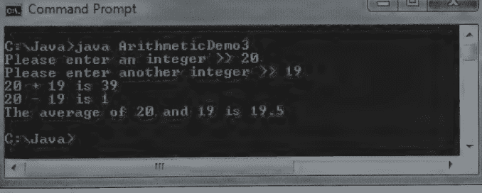

图 2-43 为平均值添加强制类型转换操作后，ArithmeticDemo3 程序的典型执行

- 6. 修改计算平均值的语句，包含第二组括号，如下：

  `average = (double) (sum / 2);`

（续）

# 第 2 章 使用数据

（续）

- 7. 保存、编译并执行程序。现在，结果的小数部分再次被省略了。这是因为先计算 `sum / 2` 的结果，该结果是一个整数。然后将该整数结果强制转换为 `double` 并赋值给 `double`——但答案的小数部分已经丢失了，强制转换得太晚了。删除新添加的括号，保存程序，编译并执行，以确认答案的小数部分已恢复。

- 8. 作为 `ArithmeticDemo` 程序中除法语句显式转换的替代方案，你可以这样写平均值计算：`average = sum / 2.0;`

在此计算中，由于整数除以 `double` 类型常数 `2.0`，结果不需要任何转换即可赋值给 `double` `average` 而不丢失数据。在你的程序中尝试一下。

- 9. 进入 Java 网站 (`www.oracle.com/technet/java/index.html`)，选择 Java APIs，然后选择 Java SE 7。滚动查看所有类（All Classes）列表，选择 `OutputStream`，它是用于 `println()` 方法的 `out` 对象的数据类型。向下滚动查看方法摘要（Method Summary）中的方法列表。正如你在之前的练习中所做的那样，注意 `print()` 和 `println()` 方法有多个版本，包括接受 `String`、`int` 和 `long` 的版本。但请注意，没有版本接受 `byte` 或 `short`。这是因为当 `byte` 或 `short` 发送到 `print()` 或 `println()` 方法时，它会被提升为 `int`，因此会使用该方法版本。

## 不要这样做

- 不要误读 "integer"（整数）。不熟悉该术语的人会说 "inter"，多读了一个 r 的音。

- 不要尝试直接将字面量常数浮点数（如 `2.5`）赋值给 `float`，除非在常数后面紧跟一个大写或小写的 `F`。默认情况下，常数浮点值是 `double`。

- 不要尝试将 Java 关键字作为变量或常量的标识符。第 1 章中的表 1-1 包含了 Java 关键字列表。

- 不要尝试在不跟跟大写或小写 `L` 的情况下，将常量值 `-2,147,483,648` 或 `+2,147,483,647` 赋值给 `long` 变量。默认情况下，常量整数是 `int`，小于 `-2,147,483,648` 或大于 `+2,147,483,647` 的值对于 `int` 来说太大了。

- 不要假设必须通过除法步骤来确定余数；只需要取模运算符 (`%`) 就足够了。

## 核心术语

- 不要尝试使用尚未赋值的变量或命名常量。

- 在使用 `Scanner` 类进行数字输入后调用 `nextLine()` 方法时，忘记消耗掉回车键（Enter key）。

- 使用 `Scanner` 或 `JOptionPane` 类时，忘记使用相应的 `import` 语句。

- 在编写包含多个算术操作的语句时，忘记优先级规则。例如，`score1+score2/2` 并没有计算两个数的平均值。相反，它将 `score2` 的一半加到 `score1`。要计算平均值，你应该写 `(score1+score2) / 2`。

- 不要忘记整数除法的结果是整数，会丢任何小数部分。例如，`1 / 2` 不等于 `0.5`；它等于 `0`。

- 不要忘记括号可以改变包含强制转换的操作结果。

- 不要忘记浮点数是不精确的。

- 不要尝试使用前导 `0` 将常数小数值赋值给整数。例如，如果你声明 `int num = 021;` 然后显示 `num`，你将看到 `17`。`0` 表示该值是 8 进制（八进制），所以它的值是 2 的二次加一次。在十进制系统中，`21` 和 `021` 意思相同，但在 Java 中不是。

- 在布尔相等比较中不要使用单个等号 (`=`)。等价运算符由两个等号 (`==`) 组成。

## 核心术语

- 引用类型（Reference types）是由基本类型构造的复杂数据类型。

- 变量声明是一个预留命名位置的语句。

- 强类型语言（Strongly typed language）是指具有严格类型的语言。

- 驼峰法（Camel case）是一种标识符以小写开头、后续单词字母大写的写法。

- 赋值运算符是等号 (`=`)；它将右侧的值赋值给左侧的变量。

- 赋值是提供值的行为。

- 优先级规则（Precedence rules）决定了多个算术操作的执行顺序。

- 左值（lvalue）是赋值语句中左侧出现的表达式。

- 右值（rvalue）是赋值语句中右侧出现的表达式。

- 未初始化变量（Uninitialized variable）是指尚未赋值的变量。

- 垃圾值（Garbage value）是未初始化变量中的未知值。

- 命名常量（Named constant）是赋值后不会更改的命名位置。

- 符号常量（Symbolic constant）是使用定义的常量。

- `final` 关键字位于常量定义之前。

- 空白 final 变量（Blank final）是指尚未赋值的 `final` 变量。

- 魔数（Magic number）是指没有直观含义或在没有额外说明的情况下解释的数字。

- 作用域（Scope）是数据项可见且可以通过其标识符引用的区域。

- 代码块（Code block）是包含在大括号内的代码。

## 核心术语

`byte` 数据类型存储非常小的整数，范围从 `–128` 到 `127`。

`short` 数据类型存储较小的整数，范围从 `-32,768` 到 `32,767`。

`long` 数据类型存储非常大的整数，范围从 `-9,223,372,036,854,775,807` 到 `9,223,372,036,854,775,807`。

`boolean` 变量只能存储两个值之一——`true`（真）或 `false`（假）。

关系运算符比较两个项目；包含关系运算符的表达式具有布尔值（Boolean value）。

比较运算符是关系运算符的另一个名称。

浮点数据类型存储带有小数位数。

`float` 数据类型可以存储精度高达六或七位有效数字的浮点值。

`double` 数据类型可以存储精度高达 14 位或 15 位有效数字的浮点值。

有效位数法是指数值的数学准确性。

科学计数法是一种更方便地表示大数值或小数值的显示格式；它将多位数字转换为单位数字，并乘以 10 的幂次。

双精度浮点数存储在 `double` 中。

单精度浮点数存储在 `float` 中。

`char` 数据类型用于存储任何单个字符。

`String` 是 Java 的内置类，它为你提供了存储和操作字符字符串的方法。

转义序列以反斜杠开头，后面跟着一个字符；这一对组合表示一个单个字符。

标准输入设备通常是键盘。

标记（token）是与空白符分隔的数据单元。

提示符（prompt）是请求并描述用户输入的消息。

编码输入意味着将用户的输入作为输出重复，以便用户可以从视觉上确认输入的准确性。

键盘缓冲区是一个小块内存区域，按键在被程序检索之前存储在其中。

预读缓冲区（type-ahead buffer）就是键盘缓冲区。

消耗（consume）一个条目是指检索它并丢弃它而不使用它。

输入对话框询问一个问题并提供一个文本字段，用户可以在其中输入响应。

`showInputDialog()` 方法创建一个输入对话框。

包装类（Type-wrapper classes）包含在 `java.lang` 包中，包含了可以处理原始类型值的方法。

解析（parse）意味着将其分解为组成部分。

确认对话框显示是、否和取消等选项；你可以使用 `JOptionPane` 类中的 `showConfirmDialog()` 方法创建一个。

标准算术运算符用于对值进行计算。

操作数（operand）是算术语句中使用的值。

二元运算符需要两个操作数。

浮点除法是将两个值相除的操作，其中一个或两个值都是浮点值。

整数除法是将两个整数相除的操作；结果不包含小数部分。

取余运算符是百分号 `%`；当与整数一起使用时，结果是除后余数的整数。

模运算符（缩写为 mod）是取余运算符的另一种名称。

运算符优先级是数学表达式各部分求值的顺序规则。

类型转换是将一种数据类型转换为另一种数据类型的过程。

统一类型（unifying type）是表达式中所有操作数转换到的单一数据类型。

隐式转换是从一种数据类型到另一种自动转换。

提升（Promotion）是隐式转换。

类型强制（Type casting）强制将一种数据类型的值作为另一种类型的值使用。

显式转换是强制运算符；它通过在要转换的表达式之前的括号中放置所需的结果类型来创建。

一元运算符只使用一个操作数。

## 章节总结

* 变量是程序存储值的命名位置；变量的值可以改变。你必须通过提供数据类型和名称来声明程序中所有要使用的变量。Java 提供了八种原始类型数据类型：`boolean`, `byte`, `char`, `double`, `float`, `int` 和 `long`。命名常量（named constant）是一个存储永远不可更改的值的内存位置；其前面带有关键字 `final`。`int` 类型的变量可以存储从 `-2,147,483,648` 到 `+2,147,483,647` 之间的任何数字。`byte`、`short` 和 `long` 都是整数类型的变体。`boolean` 类型可以存储 `true` 或 `false` 值。Java 支持一些关系运算符：`>`、`<`、`==`、`<=`、`!=`。浮点数包含小数位。Java 支持两种浮点数据类型：`float` 和 `double`。你使用 `char` 数据类型存储任何单个字符。单引号内的内容是常量值。`String` 常量在引号之间存储多个字符。你可以使用转义序列存储某些字符，转义序列始终以反斜杠开头。你可以使用 `Scanner` 类和 `System.in` 从键盘接受用户输入。有几种方法可以将输入转换为可用的数据，包括 `nextDouble()`、`nextInt()` 和 `nextLine()`。`JOptionPane.showInputDialog()` 方法返回一个 `String`，在将其作为数值使用之前，必须使用包装类将其转换为数字。有五种算术运算符：`+`、`-`、`*`、`/` 和 `%`。运算符优先级是数学表达式各部分求值的顺序。在表达式中，乘法、除法和取余始终在加法或减法之前。当需要对该规则进行例外时，会在表达式内部添加左右括号。当添加多对括号时，首先求值括号包围的最内层表达式。当你执行数学运算时，Java 会隐式地将变量转换为统一类型。你可以通过执行类型转换（type cast）来显式覆盖 Java 施的统一类型。

## 复习题

1. 当数据在类编译后无法更改时，数据是 ________。

a. 常量

b. 变量

2. 下哪项不是原始数据类型？

a. `boolean`

b. `byte`

c. `int`

3. 声明变量时，以下元素不是必须的？

a. 类型

b. 标识符

c. 数值

d. 分号

4. Java 中的赋值运算符是 ________。

a. `=`

b. `==`

c. `:=`

d. `!=`

5. 假设你已经声明 `shoeSize` 为 `int`，以下哪项是有效的赋值语句？

a. `shoeSize = 9;`

b. `shoeSize = 9.5`

6. 下列数据类型存储内存最少？

a. `short`

b. `long`

c. `int`

d. `byte`

7. `boolean` 变量可以存储 ________。

a. 任何字符

b. 任何整数

c. 任何小数

d. `true` 或假

8. 数值 `137.68` 可以 ________ 类型存储。

a. `int`

b. `float`

c. `double`

d. 前述两个均正确

9. 转义序列始终以 ________ 开头。

a. `e`

b. 正斜杠

c. 反斜杠

d. 等号

10. 哪个 Java 语句产生以下输出？

```
w
xyz
```

a. `System.out.println("wxyz");`

b. `System.out.println("w" + "xyz");`

c. `System.out.println("wxyz");`

d. `System.out.println("wn\nynz");`

11. 取余运算符 ________。

a. 用正斜杠表示

b. 必须在除法之后

c. 提供整数除法的商

d. 以上均不是

12. 根据运算符优先级规则，当除法与 ________ 在同一算术语句中发生时，除法始终优先。

a. 乘法

b. 取余

c. 减法

d. a 和 b

13. "等于"关系运算符是 ________。

a. `=`

b. `==`

c. `!=`

d. `!!`

14. 当对不同类型的值进行算术运算时，Java ________。

a. 发布错误信息

b. 隐式地将值转换为统一类型

c. 要求你显式地将值转换为统一类型

d. 隐式地将值转换为第一个操作数的类型

15. 如果将一个 `float`、一个 `int` 和一个 `byte` 相加，结果将是一个 ________。

a. `float`

b. `int`

c. `byte`

d. 错误信息

17. 在 Java 中，`3 + 7 * 4 + 2` 的值是多少？

- a. 21

- b. 33

- c. 42

- d. 48

18. 在 Java 中，哪种赋值是正确的？

- a. `int value = (float) 4.5;`

- b. `float value = 4 (double);`

- c. `double value = 2.12;`

- d. `char value = 5c;`

19. 在 Java 中，哪种赋值是正确的？

- a. `double money = 12;`

- b. `double money = 12.0;`

- c. `double money = 12.0d;`

- d. 以上全部正确

20. 在 Java 中，哪种赋值是正确的？

- a. `char aChar = 5.5;`

- b. `char aChar = "W"`

- c. `char aChar = '*';`

- d. 前述答案中有两个是正确的。

## 练习题

编程练习题

1. 在 Java 求值时，每个以下表达式的数值值是多少？

- a. `3 + 7 * 2`

- b. `18 / 3 + 4`

- c. `9 / 3 + 12 / 4`

- d. `15 / 2`

- f. `29 / 10`

- g. `14 % 2`

- h. `15 % 2`

- i. `31 % 7`

- j. `6 % 4 + 1`

- k. `(5 + 6) * 3`

- d. `25 / (3 + 2)`

- m. `13 % 15`

2. 每个以下布尔表达式的值是多少？

- a. `5 < 8`

- b. `4 <= 9`

- c. `3 == 4`

- d. `12 >= 12`

- e. `3 + 4 == 8`

- f. `7 < 2`

- g. `5! != 5`

- h. `15 != * 5`

- i. `9! != -9`

- j. `3 + 5 * 2 == 16`

3. 为以下每个项目选择最合适的数据类型，以便能够容纳任何合理的值但不浪费内存存储。给出一个该变量可能持有的典型值示例，并解释你为什么选择该类型。

- a. 你兄弟姐妹的数量

- b. 你在这门课上的最终成绩

- c. 地球人口

- d. 美国某县的人口

- e. 公交车上的乘客人数

- f. 拼字游戏（Scrabble）中一名玩家的得分

- g. 大联盟棒球比赛中一个球队的得分

- h. 历史事件发生的年份

- i. 动物腿的数目

编写一个 Java 类，声明一个命名常量来存储每英里的英尺数：`5280`。还要声明一个变量来表示你家和你叔叔家之间的距离（英里）。给变量分配一个适当的值——例如 `85.5`。计算并显示到你叔叔家的距离（英里和英尺）。显示带有数值的解释性文本——例如：到你叔叔家的距离为 `8.5` 英里或 `44880.0` 英尺。将该类保存为 `MilesToFeet`。

将 `MilesFeet` 类转换为交互式应用程序。不要给距离赋值，而是从用户处接受输入作为值。将修改后的类保存为 `MilesToFeetInteractive.java`。

5. 编写一个 Java 类，声明一个命名常量，代表公司每个部门明年销售额预计增长的 `10%`（你可以将 `10%` 表示为 `0.10`）。还要声明变量来代表北部和南部部门本年的销售额总计（美元）。给变量分配适当的值——例如 `4000` 和 `5500`。计算并带有解释性文本显示每个部门明年的预计销售额。将该类保存为 `ProjectedSales.java`。

将 `ProjectedSales` 类转换为交互式应用程序。不要为北部和南部的当前销售变量赋值，而是从用户处接受输入值。将修改后的类保存为 `ProjectedSalesInteractive.java`。

6. 编写一个类，声明一个命名常量来存储以英寸为单位的长度，并赋值。以英尺和英寸显示该值；例如，`86` 英寸变为 `7` 英尺 `2` 英寸。确保在适当的地方使用命名常量。将该类保存为 `InchesToFeet.java`。

b. 编写 `InchesToFeet` 类的交互版本，从用户处接受英寸值。将该类保存为 `InchesToFeetInteractive.java`。

7. 编写一个类，声明变量来存储你的三个首字母。显示这三个字母，每个字母后面跟着一点，如 `J.M.F.`。将该类保存为 `Initials`。

# 第 2 章 使用数据


## 第 3 章 使用方法、类和对象

### 本章你将学习：

- 学习方法的调用和位置
- 识别方法的组成部分
- 为方法添加参数
- 创建返回值的方法
- 学习类和对象
- 创建一个类
- 在类中创建实例方法
- 声明对象并使用它们的方法
- 创建构造函数
- 将类作为一种数据类型来理解

### 理解方法的调用和位置

你已经见过包含 `main()` 方法的 Java 类，该方法在你运行程序时会自动执行。程序的 `main()` 方法可以执行其他方法，而这些方法又可以执行其他方法。

考虑你在第 1 章中看到的简单 `First` 类；它显示了单行输出，“First Java application”。假设你想向此应用程序添加三行输出，以显示公司的名称和地址。一种方法是简单地添加三个新的 `println()` 语句，如图 3-1 中阴影语句所示。

```java
public class First {
    public static void main(String[] args) {
        System.out.println("XYZ Company");
        System.out.println("8900 U.S. Hwy 14");
        System.out.println("Crystal Lake, IL 60014");
        System.out.println("First Java application");
    }
}
```

图 3-1 `First` 类

与其在图 3-1 的应用程序中添加三个 `println()` 语句，你可能更喜欢调用一个执行这三个语句的方法。那么程序将如图 3-2 所示。阴影行包含了 `nameAndAddress()` 方法的调用。

```java
public class First {
    public static void main(String[] args) {
        nameAndAddress();
        System.out.println("First Java application");
    }
}
```

图 3-2 调用了 `nameAndAddress()` 方法的 `First` 类

创建独立方法来显示这三行地址有两种方法。

首先，`main()` 方法变得短且易于遵循，因为 `main()` 只包含一个调用方法的语句，而不是三个执行方法任务的独立 `println()` 语句。这样做的好处是代码变得可重用。在你创建了名称和地址方法后，你可以在任何地方调用它。换句话说，你只需工作一次，就可以多次使用该方法。

除了在 `First` 类中添加对方法的调用外，你必须实际编写该方法。你可以将方法放在任何其他地方。换句话说，图 3-3 显示了在 `First` 类中可以放置额外方法的两个位置——类的大括号之内，但在任何其他方法之外（在它们之前或之后）。

方法的顺序不影响方法执行的顺序。无论你将 `main()` 方法放在哪里，它始终会按照你的意愿首先执行，并且它可以以任何顺序和任何次数调用任何其他方法。调用方法的顺序（而不是它们的物理位置）决定了 Java 应用程序的可执行性。

```java
public class First
{
    // 你可以在这里放置额外方法，在 main() 之前
    public static void main(String[] args) {
        nameAndAddress();
        System.out.println("First Java application");
    }
    // 你可以在这里放置额外方法，在 main() 之后
}
```

图 3-3 类中的方法

运行程序时 `main()` 方法会自动执行，但其他方法并不会因为你将它们放在类中就执行——它们必须被调用。类可能包含在特定应用程序从未被调用的方法，就像某些电子设备包含你从未使用过的功能一样。例如，你可能使用 DVR 播放电影但从未录制电视节目，或者你可能使用微波炉做爆米花但从不解冻。

图 3-4 显示带有两个方法的 `First` 类：`main()` 方法和放在 `main()` 之后的 `nameAndAddress()` 方法。图 3-5 显示了图 3-4 中 `First` 类执行的输出。当程序执行时，`main()` 方法首先调用 `nameAndAddress()` 方法，其显示三行输出。然后 `main()` 显示字符串“First Java application”。

```java
public class First {
    public static void main(String[] args) {
        nameAndAddress();
        System.out.println("First Java application");
    }

    public static void nameAndAddress() {
        System.out.println("XYZ Company");
        System.out.println("8900 U.S. Hwy 14");
        System.out.println("Crystal Lake, IL 60014");
    }
}
```

图 3-4 `main()` 调用 `nameAndAddress()` 的 `First` 类

图 3-5 `First` 应用程序的输出，包含 `nameAndAddress()` 方法

观看视频 Methods。

### 两个真理一个谎言：理解方法的调用和位置

1. 任何类都可以包含无限数量的方法。
2. 在程序执行期间，一个方法可以被调用任意次数。
3. 方法通常写在另一个方法内部。

### 理解方法的构造

每个方法由图 3-6 所示的两个部分组成：

- **方法头** - 方法头在其中进行声明。方法头是一个声明。
- **方法体** - 任何括号的部分——方法体包含了执行方法任务的语句。方法的体被称为其实现。技术上，方法不需要在正体中包含任何语句，但通常你没有理由在类中创建一个空方法。有时，在开发程序时，程序员会创建一个空方法作为占位符，稍后填充实现。

```java
public class First {
    public static void main(String[] args) {
        nameAndAddress();
        System.out.println("First Java application");
    }
    public static void nameAndAddress() {
        System.out.println("XYZ Company");
        System.out.println("8900 U.S. Hwy 14");
        System.out.println("Crystal Lake, IL 60014");
    }
}
```

图 3-6 `First` 类中方法的头和体

方法头是方法的第一行。它包含：

- 访问修饰符
- 返回类型
- 参数

接下来的几图比较了 `First` 类中 `main()` 方法和 `nameAddress()` 方法的这些部分。

#### 访问修饰符

图 3-7 突出了 `First` 类中方法的可选访问修饰符。Java 方法的访问修饰符可以是以下：`public`、`protected` 或 `private`（默认是包）。通常方法被赋予 `public` 访问；本书将介绍其他修饰符。没有访问修饰符的方法包内可用，而不只是定义它的类。

| 应用程序中的 `main()` 方法必须指定 `public` 访问。 | `setNameAddress()` 方法不需要指定 `public` 访问。但是，如果访问是 `public`，该方法就可以被外部类使用。 |
|---|---|
| `public static void main(String[] args)` | `public static void setNameAddress()` |

图 3-7 方法的访问修饰符

你在第 1 章就学过访问修饰符，……

此外，不需要实例化对象即可使用的方法被称为静态方法。程序的 `main()` 方法必须使用 `static` 关键字，但其他方法如 `setNameAddress()`，你也可以使用。你将在本章的晚些时候学习非静态方法。

#### 返回类型

图 3-8 展示了 `First` 类中 `main()` 和 `setNameAddress()` 方法的返回类型。`void` 方法不向调用它的方法返回值。……程序的 `main()` 方法具有 `void` 返回类型。在示例中，`setNameAddress()` 也具有 `void` 返回类型。你在本章晚些时候看到的其他方法具有不同的返回类型。`void method` 和 `method of type` 短语都指的是具有 `void` 返回类型的方法。

| 应用程序中的 `main()` 方法必须具有 `void` 返回类型。 |
|---|
| `public static void main(String[] args)` | `public static void setNameAddress()` |

图 3-8 方法的返回类型

#### 理解方法名称

图 3-9 突出了 `First` 类中两个方法的名称。方法的名称可以是任何合法的标识符。也就是说，就像类和变量的标识符一样，运行应用程序时第一个执行的方法必须命名为 `main()`，但在为你在类内部创建的其他方法命名时，你将会有很大的发挥余地。从技术上讲，只要你不在括号内包含 `String[]`，你甚至可以为另一个方法命名为 `main()`，但这样做会引起困惑，且不建议这样做。

图 3-9 两个方法的标识符

#### 括号

如图 3-10 所示，每个方法头都包含一组跟在标识符后面的括号。括号中可能包含发送给方法的数据。例如，当你在类中编写 `main()` 方法时，其方法头中的括号包围着 `String[] args`。`First` 类中的 `nameAndAddress()` 方法不需要外部数据，因此它的括号是空的。在本章稍后的部分，你将看到几个接受数据的方法。

图 3-10 两个方法的括号及其内容

`nameAndAddress()` 方法返回的是 `void`，它包含了地址，因为 `nameAndAddress()` 是一个 `void` 方法。（名称不包含对象）当你在它自己的类内部使用 `nameAndAddress()` 方法时，你不需要使用完全限定名（尽管你可以这样做）；仅需简单的方法名就足够了。然而，如果你想在另一个类中使用 `nameAndAddress()` 方法，除非你使用全名，否则编译器无法识别该方法。在调用 `JOptionPane.showMessageDialog()` 方法时，你已经使用过类似的语法（包括类名、点和方法名）。

两个不同的类中的每个类都可以拥有自己的名为 `nameAndAddress()` 的方法。第二个类中的此类方法与第一个类中同名的方法是完全不同的。你可以通过使用它们的完全限定标识符在第三个类中同时使用这两个方法。

> 将类名想象成姓氏。在自己的家族内部，你可能会将某项活动称为“家族聚会”，但在家族之外，人们需要使用姓氏，例如“安德森家族的聚会”。同样，在类内部，仅需方法名就足够了，但在类外部，你需要使用完全限定名。

### 两个真相和一个谎言：理解方法的构造

1. 方法头也被称为实现。
2. 当方法用 `public` 访问权限声明时，其他类中的方法可以调用它。
3. 并不是所有方法都返回返回值，但每个方法都需要返回类型。

错误的陈述是 #1。方法头是声明；方法体是它的实现。

### 你来做：创建一个不需要参数且不返回值的静态方法

Paradise Day Spa 提供许多个人服务，如剪发、美甲和面部护理。在本节中，你创建一个名为 `ParadiseInfo` 的新类，该类包含一个调用 `displayInfo()` 方法的 `main()` 方法。

1. 在你的文本编辑器中打开新文档，并输入以下类的结构：

```java
public class ParadiseInfo {
}
```

（继续）

2. 在类的括号之间，缩进几个空格并创建 `main()` 方法的结构：

```java
public static void main(String[] args)
{

```

3. 在 `main()` 方法的大括号之间，插入对 `displayInfo()` 方法的调用：

`displayInfo();`

4. 将 `displayInfo()` 方法放在 `main()` 方法之外：

```java
public static void displayInfo()
{
    System.out.println("Paradise Day Spa wants to pamper you.");
    System.out.println("We will make you good.");
}
```

5. 保存为 `ParadiseInfo`。

6. 编译该类。输出应该是图 3-11 所示。

---

## 练习题

### 第 2 章

8. Meadowdale 牧场向当地客户出售有机棕蛋。他们每打鸡蛋收取 3.25 美元，未成打的单个鸡蛋收取 45 美分。编写一个类，提示用户订单的鸡蛋数量，并带有完整的解释显示金额。例如，典型的输出可能是：“你订了 22 个鸡蛋。那是 2 打，每打 3.25 美元和 3 个散蛋，每个 45.0 美分，总计 7.85 美元。”将该类保存为 `Eggs`。

9. 快乐犬养场按每磅 50 美分的价格养狗。编写一个类，接受用户养狗的天数并显示总价格。将该类保存为 `DogBoarding`。

10. 编写一个类，计算并显示以美元为单位的金额。将该类保存为 `Dollars`。

11. 编写一个程序，从用户处接受摄氏度并通过减去 32 再乘以 5/9 转换为华氏度。将该类保存为 `FahrenheitToCelsius`。

12. Travel Tickets 销售机票、旅游和其他服务。编写一个类，提示用户输入数字，并根据除以 7 的余数来判断是否有效。该过程如下例所示：

- 步骤 1：输入数字，例如 2345。
- 步骤 2：将数字除以 7。
- 步骤 3：确定数字除以 7 后的余数。
- 步骤 4：显示带有解释性文本的数值。
- 步骤 5：接受用户数字并验证其是否有效。使用以下数字测试应用程序：
  - 12345；比较结果为 true
  - 4713；比较结果为 true
  - 5423；比较结果为 false

将该程序保存为 `TicketNumber`。

### 调试题

1. 2 文件夹中的以下每个文件都存在语法或逻辑错误。在每个情况下，确定问题并修复应用程序。修复后，使用 Fix 前缀保存文件。例如，`Debug1.java` 将变为 `Fix1.java`。

- a. `Debug1.java`
- b. `Debug2.java`
- c. `Debug3.java`
- d. `Debug4.java`

当你更改文件名时，记得更改类名以保持匹配。

### 游戏区

1. Mad Libs 是一种儿童游戏，玩家提供的单词将随后整合到一个故事中。该游戏有助于理解他们要求的词性。例如，你可以要求提供一个名词、另一个名词、一个形容词和一个过去时动词。孩子提供的可能是 table, book, silly 和 studied。创建的 Mad Lib 可能是：

Mary had a little table
Its book was silly as snow
And everywhere that Mary stayed
The table was sure to go.

2. 在第 1 章的“游戏区”部分，你学习了如何获取 MIN 和 MAX 之间的随机数并赋值给变量 `random`：

`random = 1 + (int)(Math.random() * MAX);`

编写一个程序选择 1 到 5 之间的随机数并让用户猜测。显示一条消息，指示随机数与用户猜测之间的差。显示另一条消息，根据用户的猜测是否等于随机数显示布尔值 true 或 false。将文件保存为 `RandomGuessMatch`。

### 分析

1. Carly's Catering 为派对和特殊活动提供餐饮。编写一个程序，提示用户参加活动人数，然后计算总价（每人 35 美元）。显示你在第 1 章在 `Carlyotto2` 类中创建的带框标语，然后显示人数、每人价格和总价。还要显示一条 true 或 false 的消息，取决于该工作是否被分类为大型活动——50 人或以上的活动。将文件保存为 `CarlyEventPrice.java`。

2. Sammy's Seashore Supplies 为游客租赁皮划、独木舟、海滩椅和阳伞。编写一个程序，提示用户租赁运动器材的分钟数。计算租赁费用为每小时 40 美元加每额外分钟 1 美元。（你可能已经推出这种费率存在逻辑缺陷，但目前请按描述计算费率）。显示你在第 1 章在 `SammysMotto2` 类中创建的带框标语。然后显示小时、分钟和总价。

将文件保存为 `SammysRentalPrice.java`。


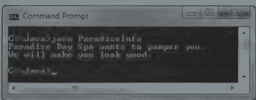

图 3-11 `ParadiseInfo` 的输出

### 从另一个类调用静态方法

接下来，你将学习如何在另一个类中使用 `displayInfo()` 方法。

1. 在你的文本编辑器中打开新文档，并输入以下类：

```java
public class TestInfo
{
    public static void main(String[] args) {
        System.out.println("Calling method from another class:");
        ParadiseInfo.displayInfo();
    }
}
```

（继续）

2. 将文件保存为 `TestInfo.java`。如果 `ParadiseInfo` 类中没有包含 `public` 关键字，编译器将报错错误“找不到 symbol”。

3. 编译并运行应用程序。输出应该是图 3-12 所示。`ParadiseInfo` 类中的 `displayInfo()` 方法必须是 `public`。

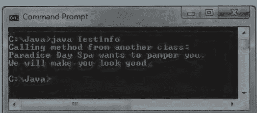

图 3-12 预写静态方法的输出

## 为方法添加参数

某些方法需要发送给它们的数据。例如，当你在类中编写 `main()` 方法时，其方法头中的括号包围着 `String[] args`。`First` 类中的 `nameAndAddress()` 方法不需要外部数据，因此它的括号是空的。在本章稍后的部分，你将看到几个接受数据的方法。

面向对象编程的一个重要原则是实现隐藏。例如，当你进行真实的餐厅预订时，你不需要知道预订是如何记录的——也许是写在书上、画在黑板上，还是输入到计算机数据库中。实现细节与作为客户端无关，如果餐厅更改了方法，也不会影响你使用该方法——你只需调用并提供姓名。

良好的面向对象方法通过实现隐藏确保调用另一个方法的方法知道被调用方法的名称以及发送什么类型的信息。（通常，你还想知道返回的任何数据；你将在本章晚些时候学习。）客户端不需要知道方法内部是如何工作的。换句话说，方法的接口是客户端看到或与之交互的唯一部分。此外，如果你替换新的或修订的方法实现，只要方法的接口不发生变化，你就不需要对调用该方法的任何方法进行更改。

实现隐藏也被称为黑盒方法。许多日常设备都是黑盒——也就是说，你可以在了解它们如何工作的情况下使用它们。例如，我们大多数人在使用电话、电视和汽车时，对其内部机制并不了解。

## 创建接收单个参数的方法

当你编写一个接收参数的方法时，你从开始开始定义与不接受参数的方法相同的元素——区别在于，你必须在方法声明的括号内包含以下项：

- 参数
- 返回值类型

例如，一个名为 `predictRaise()` 的公共方法，该方法接收一个人的年薪并计算 10% 的加薪后的金额，其声明可以写如下：

`public static void predictRaise(double salary)`

你可以将方法声明中的参数看作进入方法的“漏斗”——在其中列出的参数包含了“掉入”方法的数据。方法可以是任何类型，包括基本数据类型（如 `int`、`double` 和 `char`）或对象类型（如 `String` 或 `PrintStream`）。在 `predictRaise()` 的方法头中，括号内的参数 `double salary` 表示该方法将接收一个 `double` 类型的值，在方法内部，传递的值将被称为 `salary`。图 3-13 显示了一个完整的方法。

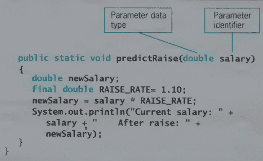

图 3-13 `predictRaise()` 方法

`predictRaise()` 方法是一个 `void` 方法，因为它不需要向使用它的其他方法返回任何值——它的唯一功能是接收 `salary` 值，将其乘以 `RAISE_RATE` 常量（1.10，这会导致薪水增加 10%），然后显示结果。

你可以使用常量值或变量作为参数来调用 `predictRaise()` 方法。因此，假设 `mySalary` 是一个 `double` 值，那么 `predictRaise(472.25);` 和 `predictRaise(mySalary);` 都能正确地调用 `predictRaise()` 方法。

## 为方法添加参数

该变量在调用方法中被分配了适当的值。你可以调用任意次 `predictRaise()` 方法，每次都使用不同的常量或变量作为参数。这些参数中的每一个在方法内部都被变名为 `salary`。标识符 `salary` 代表一个持有传递到方法的任何 `double` 副本的值。

有趣的是，如果用于 `predictRaise()` 方法调用中用作参数的值是一个变量，它可能具有与 `salary` 相同的标识符，也可能是不同的标识符，例如 `startingWage`。例如，图 3-14 中的代码显示了三次对 `predictRaise()` 方法调用，图 3-15 显示了输出。其中一次使用了常量 200.00。另外两个变量——一个与 `salary` 相同，另一个是不同的名称 `startingWage`。`main` 方法中的标识符 `salary` 指向与 `predictRaise()` 方法中的标识符不同的内存位置。参数 `salary` 在 `predictRaise()` 方法内部使用期间是一个占位符，无论它的值在调用方法中“被称为什么”。

参数 `salary` 是一个局部变量，也就是说，它


```java
public class DemoRaise
{
    public static void main(String[] args)
    {
        double salary = 200.00;
        double startingWage = 800.00;
        System.out.println("Demonstrating some raises");
        predictRaise(400.00);
        predictRaise(salary);
        predictRaise(startingWage);
    }

    public static void predictRaise(double salary)
    {
        double newSalary;
        final double RAISE_RATE = 1.10;
        newSalary = salary * RAISE_RATE;
        System.out.println("Current salary: " + 
            salary + " After raise: " + 
            newSalary);
    }
}
```

使用三个不同的参数调用了三次 `predictRaise()` 方法。

参数 `salary` 接收传递的每个参数值的副本。

图 3-14 `Demo` 类，其 `main()` 方法调用了三次 `predictRaise` 方法。

> 回忆，`final` 修饰符使 `RAISE_RATE` 成为常量。因为在图 3-14 的 `predictRaise()` 方法中 `salary` 没有被修改，你也可以通过将方法头声明为 `static void predictRaise(final double salary)` 来实现。这在程序的执行上没有区别，但将参数声明为 `final` 意味着它在方法内部不能被修改。阅读你的程序时将看到该参数是不打算改变的。

## 第 3 章 使用方法、类和对象

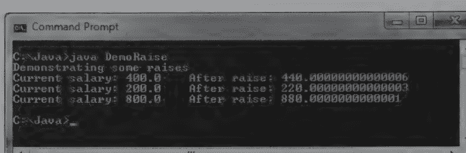

图 3-15 `DemoRaise` 程序的输出

每当方法变量被重新声明——也就是说，一个足够容纳 `double` 的新内存位置被命名为 `salary`。在 `predictRaise()` 方法内部，`salary` 持有由 `main()` 方法传递到方法的任何值的副本。当 `predictRaise()` 方法在结束括号处结束时，该局部变量不再存在。也就是说，如果你在 `predictRaise()` 的计算中使用 `salary` 值，它不会影响其他任何内容。持有 `salary` 的内存位置在方法结束时被释放，方法内部对其值的任何更改都不会影响调用方法中的任何值。特别，不要认为 `main()` 方法中的变量名 `salary` 会发生任何变化；尽管它与方法中局部声明的参数同名，但它有自己的内存地址，与 `predictRaise()` 方法中的那个完全不同。

程序中变量存在并可以使用其未限定名称进行访问的部分。下一章将更详细地讨论作用域。

## 创建需要多个参数的方法

方法可以接收一个或多个参数。当你调用一个方法时，可以向方法传递多个参数。例如，与其创建一个为每个人的薪水增加 10% 加薪的 `predictRaise()` 方法，你可能更倾向于创建一个方法，你可以向该方法传递两个值——要加薪的薪水和加薪的百分比。图 3-16 显示了一个使用此类两个参数的方法。

```java
public static void predictRaiseUsingRate(double salary, double rate) {
    double newAmount;
    newAmount = salary * (1 + rate);
    System.out.println("With raise, new salary is " + newAmount);
}
```

图 3-16 接收两个参数的 `predictRaiseUsingRate()` 方法

## 为方法添加参数

在图 3-16 中（`double salary` 和 `double rate`）出现在方法头的括号内。用逗号分隔每个参数，每个参数都需要自己的类型（在本例中，都是 `double`）以及自己的标识符。注意方法可以没有参数，如示例所示。

当值通过如下语句传递给方法时，第一个传递的值在方法内部被称为 `salary`，第二个传递的值被称为 `rate`：

`predictRaiseUsingRate(mySalary, promisedRate);`

因此，`predictRaiseUsingRate(200.00, 0.10)` 产生的输出是基于 200.00 增加了 10%（结果为 220.00），但 `predictRaiseUsingRate(0.10, 200.00)` 产生的输出是基于 10 分的增加了 20000%（结果为 20.10）。如果两个方法参数类型相同（例如都是 `double`），按错误的顺序传递参数会导致逻辑错误；程序将能够编译并执行，但可能会产生错误结果。如果方法期望不同类型的参数，按错误的顺序传递参数构成语法错误，程序无法编译。

你可以编写一个接受任意数量、任意顺序参数的方法。然而，当你调用方法时，你发送给方法的参数在顺序、数量和类型上必须匹配方法声明中列出的参数。

因此，一个计算销售人员佣金金额的方法可能需要诸如所售汽车的整数值、双精度浮点数佣金率以及车辆类型的字符代码等参数。只有按照正确顺序发送三个正确类型的参数时，正确的方法才能执行。图 3-17 显示了一个包含三参数方法的类，以及一个调用了两次 `main()` 方法，一次使用变量参数，另一次使用常量参数。图 3-18 显示了程序的输出。

```java
public class ComputeCommission
{
    public static void main(String[] args)
    {
        char vType = 'S';
        int value = 23000;
        double commRate = 0.08;
        computeCommission(value, commRate, vType);
        computeCommission(40000, 0.10, 'L');
    }
}
```

图 3-17 `ComputeCommission` 类（续）

## 第 3 章 使用方法、类和对象

（续）

```java
public void computeCommission(double value, double rate) {
    double commission;
    commission = value * rate + vehicle;
    System.out.println("\n" + 
    " type vehicle is worth $" + value);
    System.out.println("With " + (rate * 100) + 
    "% commission rate, the commission is $" + 
    commission);
}
```

图 3-17 `ComputeCommission` 类

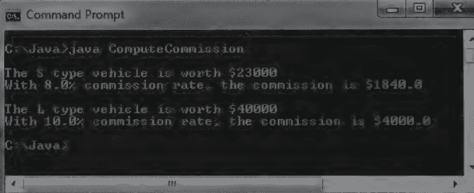

图 3-18 `ComputeCommission` 程序的输出

参数（Parameters）：在方法调用期间传递的实际值。方法定义中的变量被称为形式参数（formal parameters）。

当你查看 Java 程序时，可能会看到某些似乎可以通过多种方式调用的方法。例如，不带参数地使用 `System.out.println()` 来显示空行，或者带一个 `String` 参数来显示该字符串。你之所以可以使用不同的参数列表来使用该方法，是因为编写了该方法的多个版本，每个版本都接受一组特定的参数。通过更改参数列表来执行不同方法实现的能力被称为方法重载（method overloading），你将在下一章学习到这个概念。

## 创建有返回值的方法

## 两个真理和一个谎言

## 为方法添加参数

1. 一个类可以包含任意数量的方法，每个方法都可以被调用任意次。

2. 参数（Arguments）用于方法调用；它们被传递给方法头中的参数（parameters）。

3. 方法头始终包含一个返回类型、一个标识符和圆括号内的参数。

## 创建有返回值的方法

- 方法返回时，会发生以下事件之一：

- 方法返回其所有语句。你已经在本节中见过这样的方法。

- 方法抛出一个异常。异常是错误；你将在“异常处理”章节中学习它们。

- 方法返回一个值。使用 `return` 语句返回到调用它的方法。此外，`return` 语句经常会向调用者方法返回一个值。

方法的返回类型可以是 Java 中的任何类型，包括基本数据类型如 `int`、`double`、`char` 等，以及类类型（包括你创建的类型）。当然，方法也可以不返回任何内容，在这种情况下返回类型为 `void`。

返回类型指定为方法类型。例如，图 3-4 之前所示的 `nameAndAddress()` 方法的声明如下：

```java
public static void nameAddress()
```

此方法不返回值，所以它的类型是 `void`。

一个提示用户输入年龄并将年龄返回给调用者的方法可能被声明为：

```java
public static int getAge()
```

该方法返回一个 `int`，所以它的类型是 `int`。

## 第 3 章 使用方法、类和对象

另一个例子是，根据员工是否加班来返回 `true` 或 `false` 的方法可能被声明为：

```java
public static boolean workedOvertime()
```

此方法返回一个 `Boolean` 值，所以它的类型是 `boolean`。

之前所示的 `predictRaise()` 方法产生输出但不返回任何值；所以如果你想创建一个方法来返回计算后的新薪资值而不是显示它，方法头应写如下：

```java
public static double predictRaise(double salary)
```

```java
public static double predictRaise(double salary)
{
    double newAmount;
    final double RAISE = 1.10;
    newAmount = salary * RAISE;
    return newAmount;
}
```

图 3-19 显示了该方法。

图 3-19 返回 `double` 的 `predictRaise()` 方法

注意图 3-19 中 `predictRaise()` 方法头之前的阴影返回类型。还要注意 `newAmount` 的阴影声明。这个 `double` 变量在方法的最后一个阴影语句中被返回。`return` 语句导致值从被调用的方法发送回调用者方法。在这种情况下，存储在 `newAmount` 中的值被发送回任何调用 `predictRaise()` 方法的方法。方法声明的返回类型必须与 `return` 语句中使用值的类型匹配；如果不匹配，类将无法通过编译。方法可以返回（或最多返回）一个值。该值可以是 `int`、`char` 或 `double` 等基本数据类型，也可以是代表类的类型（你将在本章稍后的部分学习更多关于类类型的知识）。返回的值可以是命名或未命名的常量，只要它是正确的数据类型或可以自动转换为正确类型即可。例如，返回类型为 `double` 的方法可以包含语句 `return 1;` 或 `1.0`。

除了 `void` 方法外，所有方法都需要一个返回相应类型值的 `return` 语句。你可以在 `void` 方法中放置 `return` 语句，只需 `return` 单词后加分号；然而，许多 Java 程序员不会在不返回内容的方法中包含 `return` 语句。


不可达语句（unreachable statement）永远不会执行，它会导致编译器错误。不可达语句是错误。

如果`return`子句嵌套在决策结构中，方法可以包含多个返回子句，但不建议这种做法，因为它可能导致难以检测的错误。然而，在方法的最后一个`return`子句之后不能放置任何其他语句。你将在“决策”章节中学习决策制定。

如果方法返回一个值，那么当你调用它时，你通常会使用该值。例如，当你调用`predictRaise()`方法时，你可能这样做：

```java
double spendingMoney = predictRaise(salary);
```

## 链式方法调用

任何方法都可以调用任意其他方法。例如，`main()`方法可能会调用`predictRaise()`方法，而`predictRaise()`方法可能会调用`calculateBonus()`方法，如图 3-20 中的阴影语句所示。

```java
public static double predictRaise(double salary)
{
    double newAmount;
    double bonusAmount;
    final double RAISE = 1.10;
    newAmount = salary * RAISE;
    bonusAmount = calculateBonus(newAmount);
    newAmount = newAmount + bonusAmount;
    return newAmount;
}
```

图 3-20 `predictRaise()`方法调用`calculateBonus()`方法

通过`predictRaise()`方法调用`calculateBonus()`，你不知道`calculateBonus()`是如何工作的。你只知道`calculateBonus()`接受`double`作为参数（因为`newAmount`被传递给它），并且它必须返回`double`或可以自动转换为`double`的类型（因为结果存储在`bonusAmount`中）。换句话说，

例如，`calculateBonus()`方法可能像图 3-21 所示的任意一个版本。第一个版本简单地为薪资增加 $50.00 的奖金。第二个版本调用另一个名为`trickyCalculation()`的方法，返回一个加到薪资的值。当你阅读`calculateBonus()`方法时，你不知道`trickyCalculation()`方法发生了什么，当你阅读调用`calculateBonus()`的`predictRaise()`方法时，你并不确定调用了`trickyCalculation()`。

```java
public static double calculateBonus(double salary)
{
    final double BONUS_AMT = 50.00;
    salary = salary + BONUS_AMT;
}

public static double calculateBonus(double salary)
{
    salary = salary + trickyCalculation();
}
```

图 3-21 `calculateBonus()`方法的两种可能版本

## 你来试试

创建接受参数并返回数值的静态方法

在本节中，你将为`ParadiseInfo`类添加一个你在上一个“你来试试”章节中开始编写的方法。新方法接收两个参数并返回一个值。该方法的目的是接收本周特惠折扣的最低价格和折扣比例，并返回客户将节省的最小金额。

1. 在文本编辑器中打开`ParadiseInfo.java`文件，将类名改为`ParadiseInfo2`。立即将文件保存为`ParadiseInfo2.java`。

2. 作为文件的第一行，添加允许用户输入的导入语句：

`import java.util.Scanner;`

3. 在`main()`方法的左大括号之后添加四个声明语句。其中一个存储允许折扣的最低价格，另一个存储折扣率。第三个变量是最小节省金额，通过最低价格和折扣率相乘得出。第四个变量是一个用于键盘输入的`Scanner`对象：

```java
double price;
double discount;
double savings;
Scanner keyboard = new Scanner(System.in);
```

与其导入`Scanner`类来提供控制台输入，你可以替换为`OptionPane`并包含提供 GUI 输入的语句。输入过程可以使用其他技术，例如从存储设备获取数据——你将在“文件输入与输出”章节中学习文件输入输出。无论你使用何种特定技术或硬件设备，输入的输出（从外部将数据获取到内存）都是相同的。

4. 在声明之后，提示用户输入最低折扣价格，并从键盘接受一个值：

`System.out.print("Enter cutoff price for discount >> ");`

`price = keyboard.nextDouble();`

5. 提示用户输入折扣率并接受。

`System.out.print("Enter discount rate as a whole number >> ");`

`discount = keyboard.nextDouble();`

# 第三章 方法、类、对象

6. 在调用`displayInfo()`之后，插入对`computeDiscountInfo()`的调用。你将`price`和`discount`值传递给该方法，该方法返回消费者节省的最小金额，并存储在`savings`中：

`savings = computeDiscountInfo(price, discount);`

7. 在`main()`方法的右大括号之前，显示节省信息：

`system.out.println("Special this week on any service over " + price);`

`system.out.println("Discount of " + discount + " percent");`

`system.out.println("That's a savings of at least $" + savings);`

8. 在`displayInfo()`方法实现之后，但在类大括号之前，添加`computeDiscountInfo()`方法。它接受两个`double`类型并返回一个`double`。

```java
public static double computeDiscountInfo(double pr, double dscnt) {
    double savings;
    savings = pr * dscnt / 100;
    return savings;
}
```

9. 保存文件，然后编译并执行。在用户被提示本周销售截止价和要应用的折扣后，程序执行`displayInfo()`方法。然后程序执行`computeDiscountInfo()`方法，该方法返回一个值存储在`savings`变量中。最后，显示折扣信息。

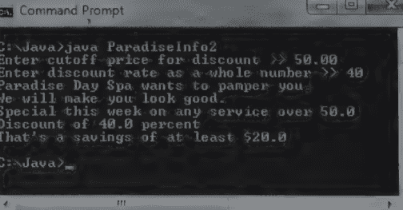

*图 3-22* `ParadiseInfo2`程序的典型执行

## 学习类和对象

## 理解方法可以作为黑盒使用（继续）

在本章中，你已经学习了可以在不知道实现细节的情况下使用方法。作为专业程序员如何使用实现隐藏的示例，你可以访问 Java 官网查看位于 Java 预写类中的成千上万个预写方法的接口。你不被允许查看这些方法内部的代码；你只能看到它们的接口，而这正是使用这些方法所需的所有。

1. 打开网络浏览器，访问 Java 官网，并到 Java SE 7 的 Java APIs。

2. 从按字母排列的类列表中选择`PrintStream`。

3. 在`PrintStream`页面，阅读该类的几个方法的描述。对于每个方法，你都可以看到返回类型、方法名和参数列表，但你无法看到任何现有方法的实现。

4. 检查其他类。再次注意，Java 文档为你提供了方法接口而不是而不是实现。当你以后开发自己的类时，你可能会选择为用户提供文档和编译后的类，这样他们无法查看、修改或盗取你辛苦开发的代码。

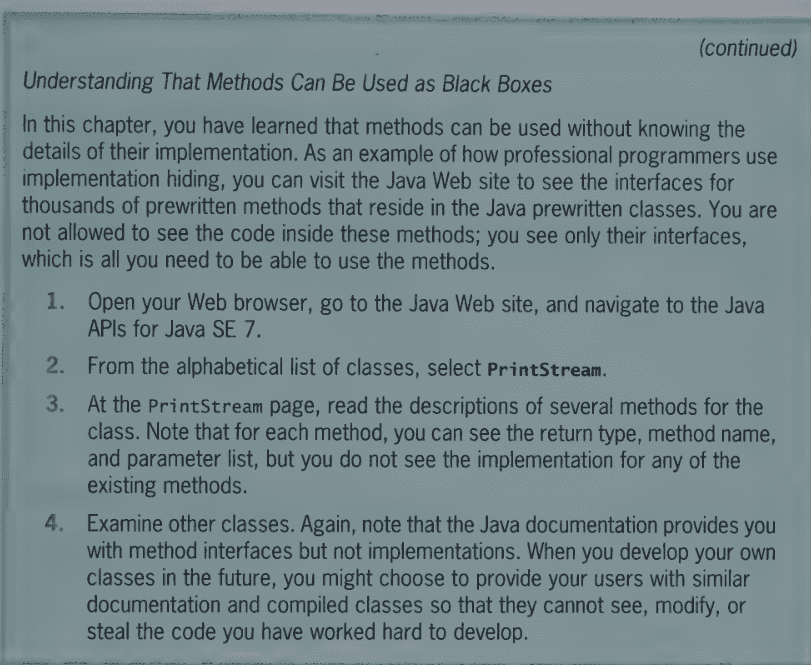

## 学习类和对象

当你以面向对象的方式思考时，你可以将任何无生命的物理物品视为对象——你的办公桌、你的电脑以及你居住的建筑在日常对话中都是对象。你也可以将生物体视为对象——你的盆植物、你的宠物鱼和你的姐妹都是对象。事件也是对象——你进行的商店购物、你正在办理的抵押贷款以及在你家里举办的毕业派对都是对象。

万物皆对象，而每个成员都是一个更通用类的成员。你的办公桌是某个类的成员。你的办公桌是某个类的成员。输入的输出是相同的。输入的输出（从外部将数据获取到内存）是相同的，无论你使用何种特定技术或硬件设备。你的办公桌是某个类的成员。。输入的输出（从外部将数据获取到内存）是相同的，无论你使用何种特定技术或硬件设备。

当你使用“黑盒”来描述这种关系是正确的。当你使用对象时，可以理解为向对象发送消息以直接让完成某些任务——你即使你的`AnniversaryParty`也是该类的成员，即使尽管它也能访问`setState()`和`setTime()`方法，你发送给`AnniversaryParty`方法的参数也将你发送给`myGraduationParty`方法的参数不同。在任何面向对象的程序中，你不断向对象的方法发出请求，并经常将参数作为这些请求的一部分。

## 学习类与对象

美元和分的金额，以及库存（`Inventory`）类中的一个方法可能会返回 true 或 false，取决于该方法对项目是否达到重新订货点的判断。

在面向对象编程中，你有时会从这些类中创建实例，并且你会创建类及其数据（方法）。他或她使用的每一个类。通常，你将编写使用他人创建的类的程序；同样地，你可能会创建一个类，用于在他们自己的应用程序中实例化对象。你可以调用你在命令提示符（Command Prompt）中使用产生输出的`System`类，它提供了一个使用他人编写的类的示例。你不需要创建它或它的`print()`方法；它们都是由 Java 的创建者创建的。

你可以通过一个类包含一个`public static void main()`方法来将其识别为应用程序。`main()`方法是任何应用程序的起点。你将编写和使用许多不包含`main()`方法的类——这些类可以被应用程序或小程序（applets）的其他类使用。（你将在“小程序、图像和声音”章节中学习小程序。）

```
一个 Java 应用程序只能包含一个头部为 
public static void main(String[] args) 的方法。如果你编写的类导入另一个类，且两个类都具有 public main() 方法，那么你的应用程序将无法编译。
```

到为止，你已经学习了面向对象编程涉及向其他对象发送消息请求其执行任务的对象，以及每个对象都属于一个类。理解类以及如何从类中实例化对象，是面向对象思维的核心。

## 两个真理和一个谎言

学习类与对象

1. 类是许多对象的实例化。

2. 对象从它们所属的类中获得属性和方法。

3. 实例化另一个预写类对象的对象的应用程序或类被称为类客户端（class client）。

## 创建类

当你创建一个类时，你必须为该类分配一个名称，并且必须确定哪些数据和方法将成为类的一部分。假设你决定创建一个名为`Employee`（员工）的类。`Employee`的一个实例变量可能是员工编号，两个必要的方法将是设置（或为员工编号提供值）的方法以及另一个是获取（或检索）员工编号的方法。作为开始，你创建一个包含三个部分的类头部：

- 一个可选的访问修饰符

- `class`关键字

- 你为类名选择的任何合法标识符

例如，代表员工的类的头部可能是：

```
public class Employee
```

访问的最字面形式是`public`。`public`关键字是一个类修饰符。`public`的类可以被所有对象访问。`public`类可以被其他类扩展或使用。将访问设置为`public`意味着如果你开发了一个良好的`Employee`类、`SalariedEmployee`（月薪员工）和`HourlyEmployee`（时薪员工），你就不需要开发两个更具体的类。每个新类都可以是原始`Employee`类的扩展，继承它的数据和方法。尽管存在其他修饰符，但你的大多数类将使用`public`修饰符。

> 你将在“继承导论”章节中学习扩展类。

在写完类头部`public Employee`后，你在一组大括号之间编写`Employee`类的体。体包含该类的数据和方法。类的组件通常被称为数据字段（data fields），以帮助它们与你可能使用的变量区分开来。图 3-23 显示包含一个名为`empNum`数据字段的`Employee`类。数据字段是在类内部但在任何方法之外定义的变量。

```
public class Employee {
    private int empNum;
}
```

图 3-23 有一个字段的`Employee`类

在图 3-23 中，数据字段`empNum`前没有`static`关键字。如果插入了`static`关键字，那么最终实例化的所有`Employee`对象将共享同一个`empNum`值。由于该字段不是静态的，当你最终从类中创建、实例化对象时，每个`Employee`对象都可以拥有它自己独特的副本。

## 在类中创建实例方法

### 静态 (static)

### 非静态 (nonstatic)

在 Java 中，`static`是一个关键字。它也可以用作形容词。

没有用于非静态项的关键字。当你没有显式地声明一个字段或方法为`static`时，它默认是非静态的。

类中的静态字段称为类字段。

类中的非静态字段称为实例变量。

类中的静态方法称为类方法。

类中的非静态方法称为实例方法。

当你使用静态方法时，不需要使用对象；例如：`JOptionPane.showMessage();`

当你使用非静态方法时，必须使用对象；例如：`System.out.println();`

当你创建一个带有静态字段的类并实例化了 100 个对象时，内存中只存在该字段的一个拷贝。

当你创建一个带有非静态字段的类并实例化了 100 个对象时，内存中会存在 100 个该字段的拷贝。

当你在类中创建一个静态方法并实例化了 100 个对象时，内存中只存在一个方法的一个方法拷贝，且该方法不会接收此引用。

当你在类中创建一个非静态方法并实例化了 100 个对象时，内存中只存在一个方法拷贝，但该方法会接收一个包含当前使用它的对象的地址的引用。

静态变量不是实例变量。系统为每个类分配一次内存来存储类变量，无论你实例化了多少个类实例。系统在第一次遇到某个类时会为类变量分配内存，该类的每个实例都拥有任何静态变量的同一个拷贝。

实例字段和方法是非静态的。系统为每个实例中的每个非静态字段分配一个单独内存位置。

表 3-1 静态与非静态的比较

表 3-1 提到了此引用。你将在下一章学习关于此引用。

图 3-25 还提供了关于 public、private、static 和 nonstatic 类成员如何被另一个类使用的总结。该图显示了一个名为`MyClass`的类，其中包含四个方法：`public static`、`private static`、`public nonstatic`和`private nonstatic`。该图还显示了一个实例化`MyClass`对象的`TestClass`。`TestClass`包含八个方法调用。三个有效调用都是对`public`方法的调用。调用对


非静态方法使用对象，而两个对静态方法的调用可以使用对象，也可以不使用。注释之后的其余`TestClass`代码都是无效的。`private`方法无法从类外部调用，且非静态方法需要对象。

```java
public class MyClass {
    public static void pubStatMethod() {}
    private static void privStatMethod() {}
    public void pubNonstatMethod() {}
    private void privNonstatMethod() {}
}
```

`public static`方法可以在`TestClass`中通过对象使用，也可以不通过使用。

`public nonstatic`方法可以在`TestClass`中通过一个`MyClass`对象来使用。


# 第 3 章 使用方法、类和对象

例如，一个组织可能有很多姓 Johnson 或周薪为 $400.00 的员工，但员工编号为 128 的员工只有一个。

由于当前 `Employee` 类中有两个 `String` 组件，它们可以在同一条语句中声明，如下所示：

```java
private String empLastName, empFirstName;
```

然而，如果字段是垂直列出的，通常更容易一眼识别出每个 `Employee` 字段。

## 类的组织

你可以以任何顺序将类的数据字段和方法放置在类中。例如，你可以将所有方法放在前面，然后是所有数据字段；或者你可以组织该类，使得几个数据字段后面跟着使用它们的方法，然后是更多的数据字段，再跟着使用它们的方法。

即使图 3-27 开始的 `Employee` 类中唯一的方法仅为每个实例变量包含一个 `set` 方法和一个 `get` 方法（总共八个方法），但当你考虑大多数组织的员工记录时，你会发现还需要更多的字段（如地址、电话号码、入职日期、受养人人数等）以及更多的方法。在列表中寻找所需的路径可能变成一项艰巨的任务。对于定位类方法，许多程序员按字母顺序存储它们。其他程序员则将值与 `get` 和 `set` 方法成对排列，这种顺序也能实现功能分组。图 3-28 显示了 `Employee` 的完整类定义可能如下：

```java
public class Employee {
    private int empNum;
    private String lastName;
    private String firstName;
    private double empSalary;
    // 方法放在这里
}
```


虽然没有要求这样做，但例如员工号可能被用作唯一标识符，因此将员工放在第一个是合理的。尽管有这些共同规则，你在类中放置数据字段具有很大的灵活性。

（继续）

```java
public String getEmpFirstName() {
    return firstName;
}
public void setFirstName(String name) {
    firstName = name;
}
public double getEmpSalary() {
    return empSalary;
}
public void setSalary(double sal) {
    empSalary = sal;
}
```

**图 3-28** 具有多个数据字段和相应方法的 `Employee` 类

`Employee` 类仍然不是一个特别大的类，它的每个方法都非常短，但它已经变得相当难以管理。这种情况确实发生了。例如，当程序员在类顶部添加了一些静态变量和注释，而组织可能对类内部的注释有特定要求。

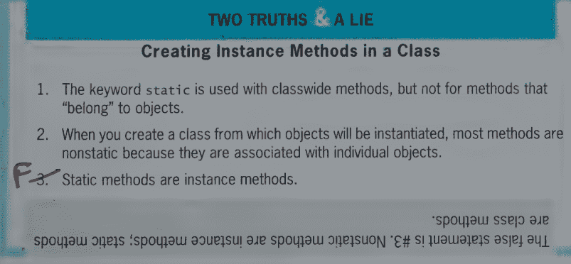

- 1. `static` 关键字用于类方法，但不用于“属于”对象的方法。
- 2. 当你创建一个将从其实例化对象的类时，大多数方法是非静态的，因为它们与单个对象相关。
- 3. 静态方法是实例方法。

## 你来做

### 创建一个包含实例字段和方法的类

接下来，你创建一个类来存储 Paradise Day Spa 提供的活动服务信息。

- 1. 在你的文本编辑器中打开一个新文档，输入以下类头和包围类体的大括号：

```java
public class SpaService
{}
```

- 2. 在类的大括号之间，插入两个私有数据字段，用于存储水疗服务的数据：

```java
private String serviceDescription;
private double price;
```

- 3. 在类的大括号内部并在字段声明之后，输入两个设置字段值的方法。`setServiceDescription()` 方法接受一个 `String` 参数并将其分配给每个将被实例化的对象的 `serviceDescription` 字段。同样，`setPrice()` 方法接受一个 `double` 参数并将其分配给 `price` 字段。注意，这两个方法都不是静态的：

```java
public void setServiceDescription(String service)
{
    serviceDescription = service;
}
public void setPrice(double pr)
{
    price = pr;
}
```

- 4. 接下来，添加两个如下所示获取字段值的方法：

```java
public String getServiceDescription()
{
    return serviceDescription;
}
public double getPrice()
{
    return price;
}
```

- 5. 将文件保存为 `SpaService.java`，编译它并纠正任何语法错误。记住，你不能运行此文件作为程序，因为它不包含 `public static main()` 方法。在阅读下一节之后，你将使用此类来创建对象。

## 声明对象并使用它们的方法

类只是对对象如果真的被实例化将会是什么样子的的一种抽象描述。就像在第一件产品离开装配线之前，你都会了解打算制造的物品的所有特征一样，你可以在实例化该类的任何成员对象之前先创建一个带有字段的类。要声明一个对象，指定它的名称（就像声明任何变量一样）和它的类型。例如，你可能声明一个整数为 `someValue`；你可能如下所示声明一个 `Employee`：

`Employee someEmployee;`

在这一语句中，`someEmployee` 代表你选择的任何表示 `Employee` 的合法标识符。当你声明一个整数为 `someValue` 时，你通知编译器 `someValue` 将存在，并同时为它预留内存。当你声明 `Employee` 类的实例时，你是在通知编译器你将使用 `someEmployee`。然而，你还没有像基本数据类型那样预留内存。实际预留内存存储 `Employee` 的两条语句如下：

`Employee someEmployee;`

`someEmployee = new Employee();`

你在第 2 章创建对象时学习了 `new` 运算符。与其使用两条语句，你可以在一条语句中为 `someEmployee` 声明并预留内存如下：

`Employee someEmployee = new Employee();`

在这一语句中，`Employee` 是对象的类型（也是它的类），而 `someEmployee` 是对象的名称。在这一语句中，`someEmployee` 变成指向对象的引用——即对象所在的内存地址。在第 2 章中，你学过引用也是对位置的引用。等号是赋值运算符，因此在声明中有一个值被分配给 `someEmployee`。`new` 运算符正在为 `someEmployee` 分配一段新的、未使用的内存。该语句分配给 `someEmployee` 的值是 `someEmployee` 所在的内存地址。你不需要担心实际内存地址是什么——当你引用 `someEmployee` 时，编译器会为你找到相应的地址找到它。

# 第 3 章 使用方法、类、对象

在 `new` 运算符之后语句的第一部分，带有括号的 `Employee()`，看起来很很像一个方法名。事实上，`Employee()` 是一个构造方法。你可以为类编写你自己的构造方法，你将在稍后学到这一点。对象实例化后，可以使用对象的标识符、一个点和一个方法调用来访问它的方法。例如，图 3-29 显示了一个实例化两个 `Employee` 对象的应用程序。这两个对象 `clerk` 和 `driver` 分别使用 `setEmpNum()` 和 `getEmpNum()` 方法。`DeclareEmployees` 程序可以使用这些方法，因为它们是公共的，并且它必须配合 `Employee` 对象使用它们，因为这些方法不是静态的。图 3-30 显示了程序的输出。

```java
public class DeclareTwoEmployees {
    public static void main(String[] args) {
        Employee clerk = new Employee();
        Employee driver = new Employee();
        clerk.setEmpNum(345);
        driver.setEmpNum(567);
        System.out.println("The clerk's number is " + 
            clerk.getEmpNum() + " and the driver's number is " + 
            driver.getEmpNum());
    }
}
```

图 3-29 `DeclareTwoEmployees` 类

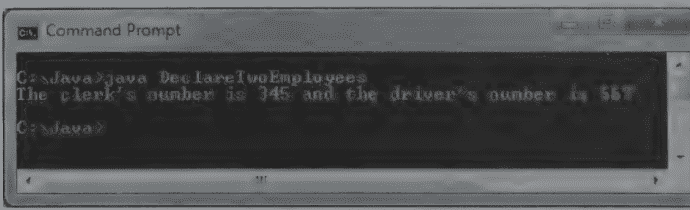

图 3-30 `DeclareEmployees` 程序的输出

## 声明对象并使用它们的方法

图 3-2 中的程序假设 `Employee.java` 文件存储在与应用程序相同的文件夹中。如果 `Employee.java` 文件存储在不同的文件夹中，你需要在文件顶部使用 `import` 语句，类似于你用于 `Scanner` 和 `JOptionPane` 类的语句。

## 理解数据隐藏

在 `DeclareTwoEmployees` 类中，你必须使用公共方法 `setEmpNum()` 和 `getEmpNum()` 来设置和获取每个 `Employee` 的 `empNum` 字段的值，因为你不能直接访问私有的 `empNum` 字段。例如，以下语句是不允许的：

```java
clerk.empNum = 789;
```

这条语句会产生错误消息 "empNum in Employee"，意味着你不能从 `DeclareTwoEmployees` 类访问它。如果你不是将其设为私有（`private`），那么直接赋值语句将可以工作，但你就违反了面向对象编程的一个重要原则——使用封装实现的数据隐藏。

然而，你可能会合理地问：“当我写应用程序时，如果我不能直接设置对象的数据字段，但可以使用公共方法来设置，这有什么区别呢？字段值两种来说是一样的！”实际上，图 3-2 中 `Employee` 类中的 `setEmpNum()` 方法确实接受你发送给它的任何整数值。你可以重写 `setEmpNum()` 方法以防止将无效数据分配给对象的数据字段。例如，你的组织对有效的员工 ID 号有规定——例如，它们必须不少于五位数，或者它们必须以 9 开头——或者你计算一个附加到每个员工 ID 号的数字。强制执行这些要求的语句将在 `setEmpNum()` 方法中进行检查。你将在“做决策”章节学习更多内容。

## 静态与非静态成员

静态变量不是实例变量。系统为每个类分配一次内存来存储类变量，无论你实例化了多少个类实例。系统在第一次遇到某个类时会为类变量分配内存，该类的每个实例都拥有任何静态变量的同一个拷贝。

实例字段和方法是非静态的。系统为每个实例中的每个非静态字段分配一个单独内存位置。

表 3-1 静态与非静态的比较

表 3-1 提到了此引用。你将在下一章学习关于此引用。

图 3-25 还提供了关于 `public`、`private`、`static` 和 `nonstatic` 类成员如何被另一个类使用的总结。该图显示了一个名为 `MyClass` 的类，其中包含四个方法：`public static`、`private static`、`public nonstatic` 和 `private nonstatic`。该图还显示了一个实例化 `MyClass` 对象的 `TestClass`。`TestClass` 包含八个方法调用。三个有效调用都是对 `public` 方法的调用。


非静态方法使用对象，而两个对静态方法的调用可以使用对象，也可以不使用。注释之后的其余 `TestClass` 代码都是无效的。`private` 方法无法从类外部调用，且非静态方法需要对象。

```java
public class MyClass {
    public static void pubStatMethod() {}
    private static void privStatMethod() {}
    public void pubNonstatMethod() {}
    private void privNonstatMethod() {}
}
```

`public static` 方法可以在 `TestClass` 中通过对象使用，也可以不通过使用。

`public nonstatic` 方法可以在 `TestClass` 中通过一个 `MyClass` 对象来使用。

```java
public class TestClass {
    MyClass object = new MyClass();
    void test() {
        object.pubNonstatMethod();
        object.pubStatMethod();
        MyClass.pubStatMethod();
        // 以下操作均不起作用
        MyClass.privStatMethod();
        MyClass.pubNonstatMethod();
        object.privStatMethod();
        object.privNonstatMethod();
        MyClass.privStatMethod();
    }
}
```

`TestClass` 无法访问 `private` 方法。

非静态方法必须配合 `MyClass` 对象一起使用。

对象可以使用静态或非静态方法，但这些方法是 `private` 的，在此处无法使用。

这在两个方面都是错误的——该方法是非静态的，所以它需要一个对象；而且在任何情况下，该方法都是 `private` 的。

图 3-25 基于方法修饰符组合的合法非法方法调用总结

- 图 3-26 显示了包含一个 `private` 类的完整 `Employee` 类


例如，一个组织可能会使用五位员工 ID，其中第五位通过将前四位除以 `7` 并取余数计算得出。例如，如果你的 ID 号的前四位是 `7235`，那么当你把前四位除以 `7` 时，第五位是 `4`。所以五位 ID 为 `72354`。稍后如果你犯了错误并在公司应用程序中将你的 ID 输入为 `82354`，它会将前四位 `8235` 除以 `7`。余数是 `4`，你的 ID 就会被找到。

# 第一章 使用方法、类和对象

观看视频：类与对象（Classes and Objects）。

## 两个真相和一个谎言

### 声明对象并使用其方法

1. 当你声明一个对象时，你为它命名并为该对象留出足够的内存以供存储。
2. 对象名是一个引用；它持有一个内存地址。
3. 当你没有为类编写构造函数时，Java 会为你创建一个；构造函数的名称始终与其类名完全相同。

错误的陈述是 #1。当你声明一个对象时，存储该对象的内存尚未被分配；要为对象分配所需的内存，你尚未预留计算机内存；你必须使用 `new` 算符。

## 你来做（You Do It）

### 声明和使用对象

在之前的“你来做”章节中，你创建了一个名为 `SpaService` 的类。现在你创建一个应用程序，来实例化并使用 `SpaService` 对象。

1. 在你的文本编辑器中打开一个新文件，并输入接受用户键盘输入的交互式程序所需的导入语句：

```java
import java.util.Scanner;
```

2. 创建一个名为 `CreateSpaServices` 的类的外壳：

```java
public class CreateSpaServices
{}
```

3. 在 `CreateSpaServices` 类的大括号之间，为创建一个 `main()` 方法的壳壳：

```java
public static void main(String[] args)
{}
```

在 `main()` 方法内部，声明变量来存储用户从键盘输入的服务描述和价格：

```java
String service;
double price;
```

5. 接下来，声明三个对象。两个是 `SpaService` 对象，使用了在上组“你来做”步骤中创建的类。第三个对象使用 Java 内置的 `Scanner` 类。这两个类都使用 `new` 算符为它们的对象分配内存，并且都调用了与类名相同的构造函数。区别在于 `Scanner` 构造函数需要一个参数（`System.in`），而 `SpaService` 类不需要。

```java
SpaService firstService = new SpaService();
SpaService secondService = new SpaService();
Scanner keyboard = new Scanner(System.in);
```

6. 在接下来的语句中，提示用户输入服务，从键盘接收，提示用户输入价格，并从键盘接收。

```java
System.out.print("Enter service >> ");
service = keyboard.nextLine();
System.out.print("Enter price >> ");
price = keyboard.nextDouble();
```

7. 回想 `SpaService` 类中的 `setServiceDescription()` 方法是非静态的，这意味着它是与对象一起使用的，并且它需要一个 `String` 参数。编写一条语句，将用户输入的服务发送给 `firstService` 对象的 `setServiceDescription()` 方法：

```java
firstService.setServiceDescription(service);
```

8. 同样，将用户输入的价格发送给 `firstService` 对象的 `setPrice()` 方法。回想该方法是非静态且需要一个 `double` 参数。

```java
firstService.setPrice(price);
```

9. 调用 `nextLine()` 方法来移除最后一次数字输入后残留在输入缓冲区中的回车键。重复提示，并为第二个 `SpaService` 对象接受数据。

```java
keyboard.nextLine();
System.out.print("Enter service >> ");
service = keyboard.nextLine();
System.out.print("Enter price >> ");
price = keyboard.nextDouble();
secondService.setServiceDescription(service);
secondService.setPrice(price);
```

10. 显示 `firstService` 对象的详情。

```java
System.out.println("First service details:");
System.out.println(firstService.getDescription() + 
" " + firstService.getPrice());
```

11. 显示 `secondService` 对象的详情。

```java
System.out.println("Second service details:");
System.out.println(secondService.getDescription() + 
" " + secondService.getPrice());
```

12. 将文件保存为 `CreateSpaServices.java`。编译并执行程序。

图 3-31 显示了一个典型的执行过程。确保你理解用户输入的值是如何赋值给并从两个 `Spa` 对象中获取的。

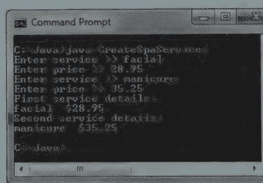

图 3-31 `CreateSpaServices` 程序的典型执行

## 使用构造函数简介

当你创建一个类（例如 `Employee`）并使用类似下面的语句实例化一个对象时，你实际上是在调用 Java 编译器提供的 `Employee` 类构造函数：

```java
Employee chauffeur = new Employee();
```

当你创建一个对象时，默认构造函数是不带任何参数而存在的构造函数。

当你创建任何类且没有编写自己的构造函数时，Java 编译器会自动为该类创建一个默认构造函数。

当调用重写后的 `Employee` 类的默认构造函数时，它会根据提供的标识符建立一个 `Employee` 对象。自动提供的默认构造函数为对象的数据字段提供以下特定的初始值：

- 数值字段被设置为 `0`（零）。
- 字符字段被设置为 Unicode（`'\u0000'`）。
- 布尔字段被设置为 `false`。
- 对象的类型字段（例如 `String` 字段）被设置为 `null`（空）。

如果你不希望对象中的某个字段持有默认值，可以编写自己的构造函数。注意，在 Java 中，构造函数的名称与它所构建的类名相同，且没有返回值。

通常情况下，你将构造函数定义为 `public`（公有的），除非有理由不这么做。

例如，如果你希望每个 `Employee` 对象的周薪都设为 300.00，你可以编写图 3-32 所示的构造函数：

```java
public Employee()
{
    empSalary = 300.00;
}
```

图 3-32 `Employee` 类构造函数

上面的 `Employee` 类构造函数不接受参数。因此它是默认构造函数。你将在下一章学习带参数的非默认构造函数。

你可以在构造函数中编写任何 Java 语句。虽然通常没有理由，但你可以显示消息或执行其他任务。通常，构造函数与其他方法放在一起。使用它在创建对象时初始化类的字段。

你不需要为类编写构造函数；如果类没有显式构造函数，Java 会为你提供一个默认版本。

- 类可以包含多个构造函数。你将在下一章学习如何重载构造函数。

# 第三章 使用方法、类和对象

观看视频：构造函数（Constructors）。

## 两个真相和一个谎言

### 使用构造函数简介

在 Java 中，你不能编写默认构造函数；它必须自动为你提供。

2. 自动提供的默认构造函数将所有数值字段设置为 `0`，字符字段设置为 Unicode（`'\u0000'`），布尔字段设置为 `false`，对象引用字段设置为 `null`。

3. 当你编写构造函数时，它必须与它所构建的类名相同，且不能有返回值。

然而，你可以创建一个默认构造函数来替换自动提供的那个。如果你没有为类创建构造函数，Java 会创建一个不带参数的默认构造函数。错误的陈述是 #1。

## 你来做（You Do It）

### 在类中添加构造函数

1. 打开在本章之前的“你来做”章节中创建的 `SpaService.java` 文件。

2. 在字段之后、方法声明之前，插入一个显式的默认构造函数，将 `serviceDescription` 设置为 `"XXX"` 并 `price` 设置为 `0`。由于对象的数值字段默认设置为 `0`，因此赋值并非真的。然而，程序员有时会编写像将价格设为 `0` 这样的语句，以便阅读程序的人明确他们的意图。

```java
public SpaService()
{
    serviceDescription = "XXX";
    price = 0;
}
```

3. 保存该类并编译它。

4. 打开 `CreateSpaServices.java` 文件。通过在每行开头添加双斜杠，注释掉用于提示、接收和设置 `secondService` 对象值的 7 条语句，如下所示。通过注释掉这些行，你更改了程序，使用户将不再为 `secondService` 对象输入值。相反地，由构造函数分配的值将将是该对象的最终值。

```java
// keyboard.nextLine();
// System.out.print("Enter service >> ");
// service = keyboard.nextLine();
// System.out.print("Enter price >> ");
// price = keyboard.nextDouble();
// secondService.setsetDescription(service);
// secondService.setPrice(price);
```

5. 保存文件，然后编译并执行它。图 3-33 显示了一个典型的执行。`firstService` 对象包含用户提供的值，但 `secondService` 对象显示的是对象构造期间赋值的值。

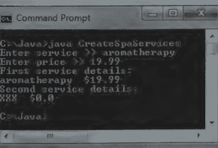

图 3-33 `CreateSpaServices` 程序的典型执行，第二个对象使用了构造函数的值

## 理解类的数据类型

你创建的类变成了数据类型。程序员有时将它们称为抽象数据类型或 ADT。抽象数据类型是通过公共方法进行隐藏和暴露的类型实现。换句话说，类可以被称为一种数据类型，它不是语言内置的类型，而是一个由较小部分组合成的复合类型。

基本数据类型不是复合的。Java 有内置的基本型数据类型，如 `int` 和 `double`。基本数据类型也可以称为简单类型。你不需要定义这些简单类型；Java 的创建者已经完成了这些工作。例如，当 `int` 类型首次被创建时，设计它的程序员必须考虑以下问题：

- 问：我们应该称它为什么什么？

  答：`int`。

- 问：它的属性有哪些？

  答：一个 `int` 存储在四个字节中；它持有整数值。

- 问：`int` 需要哪些方法？

  答：一个给变量赋值的方法（例如，`num = 32`）。

- 问：还有其他方法吗？

  答：一些对变量进行算术运算的运算符（例如，`num + 6`）。

- 问：还有其他方法吗？

  答：当然，`int` 还有更多属性和方法，但这是一个很好的开始。

你构建新数据类型的工作也是类似的。如果你需要为员工（employee）创建一个类，你应该这样开始：

- 问：我们应该称它为什么什么？

  答：`Employee`。

- 问：它的属性有哪些？

  答：它有一个整数 ID 号、一个 `String` 类型的姓和一个 `double` 类型的薪水。

- 问：`Employee` 需要哪些方法？

  答：一个给该类成员赋值赋值的方法（例如，一个 `Employee` 的 ID 号是 `3232`，她的姓是 `"Walters"`，薪水是 `30000`）。

- 问：还有其他方法吗？

  答：一个显示该类成员数据的方法（例如，显示一个 `Employee` 的数据）。

- 问：还有其他方法吗？

  答：可能吧，但这已经足够入门了。

当你声明一个基本类型对象时，你提供了它的类型和一个标识符。当你从你的某个类中声明一个对象时；你也是这样做。在每个对象存在后，你可以以非常相似的方式使用它们。例如，假设你声明了一个 `int myInt` 和一个名为 `myEmployee` 的 `Employee`。每个对象都可以传递给方法、从方法返回，或赋值给另一个相同数据类型的对象。

例如，图 3-34 显示了一个程序，其中 `main()` 方法使用了另外两个方法。其中一个方法接受一个 `Employee` 作为参数，另一个方法返回一个 `Employee`。（`Employee` 类定义在图 3-28 中）图 3-35 显示了一个典型的执行情况。你可以从这个示例程序中看到，`Employee` 传递到方法内部和传出方法就像基本对象一样。类并不神秘；它们只是你发明的新类型。

```java
import java.util.Scanner;
class MethodsThatUseAnEmployee {
    public static void main(String[] args) {
        Employee myEmployee;
        myEmployee = getEmployeeData();
        displayEmployee(myEmployee);
    }
    public static Employee getEmployeeData() {
        Employee tempEmp = new Employee();
        int id;
        double sal;
        Scanner input = new Scanner(System.in);
        System.out.print("Enter employee ID >> ");
        id = input.nextInt();
        tempEmp.setEmpNum(id);
        System.out.print("Enter employee salary >> ");
        sal = input.nextDouble();
        tempEmp.setSalary(sal);
        return tempEmp;
    }
    public static void displayEmployee(Employee anEmp) {
        System.out.println("\nEmployee #" + anEmp.getEmpNum() +
        " Salary is " + anEmp.getEmpSalary());
    }
}
```

**图 3-34** `MethodsThatUseAnEmployee`

# 第 3 章 使用方法、类和对象

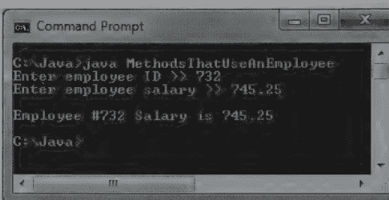

**图 3-35** `MethodsThatUseEmployee` 程序的典型执行

## 理解类是数据类型

在本节中，你修改了 `SpaService`。它与原始版本不同，但通过创建一个接受未填充 `SpaService` 对象并返回填充数据对象的方法，你使 `main()` 方法变得更短并重用了数据输入代码。

## 不要这样做

- 每条语句末尾都有分号，这很容易让你在太多地方加上分号。方法头（Method headers）永远不以分号结尾。
- 不要认为“默认构造函数”仅指自动提供的构造函数。虽然类自动提供的构造函数是默认构造函数，你创建的任何不接受参数的构造函数也是默认构造函数。
- 不要认为类的方法必须接受其自身字段的值作为参数，或将其自身字段的值作为返回值。当一个类同时包含字段和方法时，每个方法都可以直接访问类中的每个字段。
- ... 如果你这样做，你将只允许访问方法内的局部变量，而无法访问字段。在阅读完下一章后，你将可以使用相同的标识符并访问这两个值。现在，请确保任何类方法中的参数标识符与任何类字段都不同。

## 核心术语

**方法（method）**是一个包含一系列执行任务的语句的程序模块。当你**调用（invoke）**或**执行（call）**一个方法时，你就在执行它。

**调用方法（calling method）**通过**方法调用（method call）**来触发**被调用方法（called method）**。

**客户端方法（client method）**是调用其他方法的方法。

**抽象（Abstraction）**是允许你使用方法名来封装一系列语句的编程特性。

**方法头（method header）**是方法的第一行，包含了关于其他方法如何与其进行交互的信息。

**声明（declaration）**是方法头的另一个名称。

**方法体（method body）**是紧随方法头之后的大括号之间的语句集合，用于执行方法的动作。

**实现（Implementation）**描述了在方法内部执行的动作——即方法体。


**存根（stub）**是不包含任何语句的方法；程序员在程序开发过程中创建存根作为临时的占位符。

**访问修饰符（Access modifier）**有时用作访问修饰符（access specifier）的另一个术语。

**返回值（return type）**表示在方法完成后，发送回其调用方法的数据类型。

# 第 3 章 使用方法、类、对象

返回一个值是将该值从被调用方法传回调用方法。完全限定的标识符包含类名和一个标识符之前的点。

**参数（Arguments）**是在方法调用中发送到方法的数据项。

**形参（Parameters）**是方法接收的数据项。

**实现隐藏（Implementation hiding）**是面向对象编程的一个原则，描述了在类内部对方法细节的封装。

方法的接口（interface to a method）包括方法的返回类型、名称和参数。它是客户端看到并使用的部分。

**黑盒（black box）**是你可以在不理解工作原理的情况下使用的设备。

**局部变量（local variable）**仅在方法的范围内已知。

方法的签名（method's signature）是方法名以及参数的数量、类型和顺序的组合。

**实际参数（Actual parameters）**是方法调用中的参数。

**形式参数（Formal parameters）**是方法声明中的变量，用于接收来自实际参数的值。

**返回语句（return statement）**结束方法，并经常将值从被调用方法传回调用方法。

方法的类型是它的返回值。

**不可达语句（Unreachable statements）**是指那些因为逻辑路径永远无法遇到而无法执行的语句；不可达语句会导致编译器错误。

**死代码（Dead code）**是一组逻辑上不可达的语句。

**is-a关系（is-a relationship）**是对象与其所属的类之间的关系。

类的**实例化（instantiation of a class）**是一个对象；换句话说，它是类的一个具体实例。

**类客户端（class client）**或**类用户（class user）**是实例化另一个预写类中对象的应用程序或类。

类可以被扩展，也可以作为任何其他类的基础。

**数据字段（Data fields）**是声明在类中任何方法之外的变量。

类的**实例变量（instance variables）**是它的数据组件。

对字段进行分配私有访问权限（Assigning private access）意味着没有其他类可以访问该字段的值，只允许相同类的方法设置、获取或以其他方式使用私有变量。

**信息隐藏（Information hiding）**是在为数据字段创建私有访问时使用的面向对象编程原则；类的私有数据只能通过类自身的方法进行更改或操作，而不能通过属于其他类的方法。

**修改器方法（Mutator methods）**设置值。

**访问器方法（Accessor methods）**获取值。

**非静态方法（Nonstatic methods）**，即那些与对象实例化一起的方法，被称为实例方法（instance methods）。

**主键（primary key）**是数据库内数据的唯一标识符。

**new 操作符（new operator）**分配存储对象所需的内存。

**对象的引用（reference to an object）**是存放对象的内存地址的名称。

**构造函数（constructor）**是建立对象的方法。

**默认构造函数（default constructor）**是不需要参数的构造函数；如果你不写，Java 编译器会自动为类创建一个默认构造函数。

**抽象数据类型（abstract data type）**是一种实现被隐藏且通过其公共方法访问的类型。

**程序员定义的数据类型（programmer-defined data type）**是由程序员创建而非内置于语言的类型。

## 章节总结

- 方法是执行任务的一系列语句。任何方法都可以调用、触发另一个方法。你将方法放在类中，任何其他方法之外。
- 方法必须包含一个声明（或头或定义）、一个左大括号和一个方法体。方法声明包含可选的访问修饰符、方法的返回类型、方法名、一个左括号、可选的参数列表和一个右括号。
- 当你为可以接收参数的方法编写声明时，你需要在方法声明中包含参数的类型和参数的局部名称。你可以传递多个参数。
- 返回语句结束方法，并经常将值从被调用方法传回调用方法。
- `is-a`关系是对象与其所属的类之间的关系。
- 类的实例化是一个对象；换句话说，它是类的一个具体实例。
- 类客户端或类用户是实例化另一个预写类中对象的应用程序或类。
- 类可以被扩展，也可以作为任何其他类的基础。
- 数据字段是声明在类中任何方法之外的变量。
- 类的实例变量是它的数据组件。
- 对字段分配私有访问权限意味着没有其他类可以访问该字段的值，只允许相同类的方法设置、获取或以其他方式使用私有变量。
- 信息隐藏是在为数据字段创建私有访问时使用的面向对象编程原则；类的私有数据只能通过类自身的方法进行更改或操作，而不能通过属于其他类的方法。
- 修改器方法设置值。
- 访问器方法获取值。
- ...
- 抽象是允许你使用方法名来封装一系列语句的编程特性。
- 方法头是方法的第一行，包含了关于其他方法如何与其交互的信息。
- 声明是方法头的另一个名称。
- 方法体是紧随方法头之后的大括号之间的语句集合，用于执行方法的动作。
- 实现描述了在方法内部执行的动作——即方法体。
- 存根是不包含任何语句的方法；程序员在程序开发过程中创建存根作为临时的占位符。
- 访问修饰符有时用作访问修饰符（access specifier）的另一个术语。
- 返回值表示在方法完成后，发送回其调用方法的数据类型。

# 第 3 章 使用方法、类、对象

返回一个值是将值从被调用方法传回调用方法。完全限定的标识符包含类名和一个标识符之前的点。

参数是在方法调用中发送到方法的数据项。

参数是方法接收的数据项。

实现隐藏是面向对象编程的一个原则，描述了类内部对方法细节的封装。

方法的接口包括方法的返回类型、名称和参数。它是客户端看到并使用的部分。

黑盒是你可以在不理解工作原理的情况下使用的设备。

局部变量仅在方法的范围内已知。

方法的签名是方法名以及参数的数量、类型和顺序的组合。

实际参数是方法调用中的参数。

形式参数是方法声明中的变量，用于接收来自实际参数的值。

返回语句结束方法，并经常将值从被调用方法传回调用方法。

方法的类型是它的返回值。

不可达语句是指那些因为逻辑路径永远无法遇到而无法执行的语句；不可达语句会导致编译器错误。

死代码是一组逻辑上不可达的语句。

`is-a`关系是对象与其所属的类之间的关系。

类的实例化是一个对象；换句话说，它是类的一个具体实例。

类客户端或类用户是实例化另一个预写类中对象的应用程序或类。

类可以被扩展，也可以作为任何其他类的基础。

数据字段是声明在类中任何方法之外的变量。

类的实例变量是它的数据组件。

对字段分配私有访问权限意味着没有其他类可以访问该字段的值，只允许相同类的方法设置、获取或以其他方式使用私有变量。

信息隐藏是在为数据字段创建私有访问时使用的面向对象编程原则；类的私有数据只能通过类自身的方法进行更改或操作，而不能通过属于其他类的方法。

修改器方法设置值。

访问器方法获取值。

非静态方法，即那些与对象实例化一起的方法，被称为实例方法。

主键是数据库内数据的唯一标识符。

`new`操作符分配存储对象所需的内存。

对象的引用是存放对象的内存地址的名称。

构造函数是建立对象的方法。

默认构造函数是不需要参数的构造函数；如果你不写，Java 编译器会自动为类创建一个默认构造函数。

抽象数据类型是一种实现被隐藏且通过其公共方法访问的类型。

程序员定义的数据类型是由程序员创建而非内置于语言的类型。

## 复习题

1. 在 Java 中，方法必须包含以下所有内容除：

   - a. 声明
   - b. 调用另一个方法
   - c. 左大括号
   - d. 方法体

2. 所有方法声明包含：

   - a. `static`关键字
   - b. 一个或多个显式命名的访问修饰符
   - c. 参数
   - d. 括号

3. 公静态方法`computeSum()`位于`classA`。在类`B`内部调用该方法，使用语句：

   - a. `computeSum(classB);`
   - b. `classB(computeSum());`
   - c. `classA.computeSum();`
   - d. 无法在类`B`内部调用`computeSum()`

4. 如果方法接收一个`int`参数，则以下哪个方法声明是正确的：

   - a. `static static int displayFacts()`
   - b. `public void displayFacts(int data)`
   - c. `public static void displayFacts(int data)`
   - d. 以上两个都是正确的

5. 声明为`public static int aMethod(double d)`的方法返回类型为 ____________。

   - a. `static`
   - b. `int`
   - c. `double`
   - d. 你无法确定该方法的类型。

6. 下列是对声明为`public static aMethod(char code)`的方法的正确调用是：

   - a. `void aMethod();`
   - b. `void aMethod('V');`
   - c. `aMethod(char 'M');`
   - d. `aMethod('Q');`

7. 方法声明为`public static void showResults(double d, int i)`。下列哪项是正确的方法调用？

   - a. `showResults(double d, int i);`
   - b. `showResults(12.2, 67);`
   - c. `showResults(4, 99.7);`
   - d. 以上两项都是正确的。

8. 声明为`public static char procedure(double d)`的方法返回类型为 ____________。

   - a. `public`
   - b. `static`
   - c. `char`
   - d. `double`

9. 方法`public static boolean testValue(int response)`返回 ____________。

   - a. 一个布尔值
   - b. 一个`int`值
   - c. 无返回值
   - d. 你无法确定返回的内容。

10. 下列哪项可以是声明为`public static int getVal(double sum)`的方法的最后合法代码行？

   - a. `return;`
   - b. `return 77;`
   - c. `return 2.3;`
   - d. 以上任何一项都可以是该方法的最后一行代码。

# 第 3 章 使用方法、类和对象

11. 类的非静态数据组件通常被称为该类的 ____________。

    - a. 访问类型
    - b. 实例变量
    - c. 方法
    - d. 对象

12. 对象包含方法和数据项，这些数据项也称为 ____________。

    - a. 字段
    - b. 函数
    - c. 主题
    - d. 实例

13. 你通过对象的 ____________ 向其发送消息或信息。

    - a. 字段
    - b. 方法
    - c. 类
    - d. 类型

14. 实例化另一个预写类对象的程序或类是(n) ____________。

    - a. 类客户端
    - b. 超类
    - c. 对象
    - d. 赞助者

15. 类的体始终写在 ____________。

    - a. 单独一行中，作为类的第一条语句
    - b. 在括号内
    - c. 在大括号之间
    - d. 作为方法调用

16. 大多数类字段都是 ____________。

    - a. 私有的（`private`）
    - b. 公有的（`public`）
    - c. 静态的（`static`）
    - d. 最后的（`final`）

17. 允许仅通过类方法更改私有数据的概念被称为 ____________。

    - a. 结构化逻辑
    - b. 面向对象
    - c. 信息隐藏
    - d. 数据掩码

18. 假设你声明一个对象`Book thisBook;`。在向`thisBook`存储数据之前，你 ____________。

    - a. 也必须显式地为它分配内存
    - b. 不需要显式地为它分配内存
    - c. 只有在它有构造函数时才必须显式地为它分配内存
    - d. 可以声明它不使用内存

19. 如果一个类名为`Student`，则该类的构造函数名称为 ____________。

    - a. 任何合法的 Java 标识符
    - b. 任何以`S`开头的合法 Java 标识符
    - c. `StudentConstructor`
    - d. `Student`

20. 如果你在创建对象时使用自动提供的默认构造函数，____________。

    - a. 数值字段被设置为 0（零）
    - b. 字符字段被设置为空
    - c. 布尔字段被设置为 `true`
    - d. 以上所有都是正确的。

## 练习题

## 编程练习题

1. 假设你创建了一个只包含以下变量的程序：

```java
int v = 4;
int w = 6;
double x = 2.2;
```

# 第 3 章 使用方法、类和对象

假设你还有一个具有以下头部的方法：

`public static void calculate(int x, double y)`

下列方法调用哪些是合法的？

- a. `calculate(w, w);`
- d. `calculate(18, x);`
- b. `calculate(v, x);`
- e. `calculate(1.1, 2.2);`
- c. `calculate(x, y);`
- f. `calculate(5, 7);`


## 第 3 章 使用方法、类和对象

2. 假设类 `ClassA` 包含一个名为 `b` 的私有非静态整数，一个名为 `d` 的公有非静态整数。在名为 `ClassB` 的类中，已经实例化了一个 `ClassA` 对象为 `ClassA obA = new ClassA();`，下列哪些是合法的语句：

- a. `obA.b = 12;`
- b. `obA.c = 5;`
- c. `obA.d = 23;`
- d. `ClassA.b = 4;`
- e. `ClassA.c = 33;`
- f. `ClassA.d = 99;`

3. 创建一个应用程序 `ArithmeticMethods`，其 `main()` 方法包含两个整数变量。为这些变量赋值。然后，将每个值传递给名为 `displayNumberPlus(10,)` 和 `displayNumberPlus(10,)` 的方法。（由于 OCR 文本混乱，请遵循逻辑：）

   创建一个应用程序 `ArithmeticMethods`，其 `main()` 方法包含两个整数变量。为这些变量赋值。然后，将每个值传递给名为 `displayNumberPlus(10,)` 和 `displayNumberPlus(10,)` 的方法。（由于 OCR 文本重复，请再次查看：）

   创建一个应用程序 `ArithmeticMethods`，其 `main()` 方法由于 OCR 文本损坏，请根据标准逻辑重构：

   创建一个应用程序 `ArithmeticMethods`，其 `main()` 方法包含两个整数变量。为这些变量赋值。然后，将每个值传递给名为 `displayNumberPlus(10,)` 和 `displayNumberPlus(10,)` 的方法。（由于 OCR 文本损坏，请检查剩余部分：）

   创建一个应用程序 `ArithmeticMethods`，其 `main()` 方法包含两个整数变量。为这些变量赋值。然后，将每个值传递给名为 `displayNumberPlus(10,)` 和 `displayNumberPlus(10,)` 的方法。（由于 OCR 文本重复，请提供清理后的版本。）

## 第 3 章 使用方法、类和对象

12. a. 创建名为 `Student` 的类。`Student` 拥有学号、已获得学分数和获得分数的字段。（例如，许多学校根据 4 分制计算平均学点，因此一门 3 学分的课程应包含一个为所有字段赋值赋值的方法。`Student` 应该拥有一个用于存储平均学点（GPA）的字段。包含一个方法，通过将分数除以已获得学分来计算平均学点。编写方法来显示每个 `Student` 字段中的值。将此类保存为 `Student.java`。

b. 写一个名为 `ShowStudent` 的类，从你创建的类实例化一个 `Student` 对象并为其字段赋值。计算 `Student` 的平均学点，然后显示与 `Student` 相关的所有值。将该程序保存为 `ShowStudent.java`。

c. 为你创建的 `Student` 类创建一个构造函数。该构造函数应将 `Student` 的学号初始化为 9999，或将其分数初始化为 12，学分初始化为 3（导致平均学点为 4.0）。编写一个程序，通过实例化对象并显示初始值来证明构造函数工作正常。将该程序保存为 `ShowStudent2.java`。

13. a. 创建名为 `BankAccount` 的类，包含账户号码、所有者姓名和账户余额。包含一个构造函数，将每个字段初始化为相应的默认值。包含获取和设置每个字段的方法。包含一个名为 `monthlyFee()` 的方法，将余额减少 40.00 元。包含一个名为 `explainAccountPolicy()` 的静态方法，解释每月将扣除 40 美元的费用。将该类保存为 `BankAccount.java`。

b. 创建名为 `TestBankAccount` 的类，其 `main` 方法声明了四个 `BankAccount` 对象。调用 `getData()` 三次。在方法内部，提示用户输入 `BankAccount` 的每个字段的值，并返回一个 `BankAccount` 对象给 `main()` 方法，在方法中将其赋值给 `main()` 的 `BankAccount` 对象之一。不要提示用户输入第四个 `BankAccount` 对象的值，让其继续保留默认值。然后，在 `main()` 中，将每个 `BankAccount` 对象依次传递给 `showValues()` 方法，该方法显示数据、调用扣除月费的方法并再次显示余额。`showValues()` 方法还会调用解释扣除策略的方法。将该程序保存为 `TestBankAccount.java`。

14. a. 创建名为 `Painting` 的类，包含绘画标题、艺术家、介质（如水彩）、价格和画廊佣金的字段。创建一个构造函数，将每个字段初始化为适当的默认值，并创建实例方法来获取和设置标题、艺术家、介质和价格的字段。画廊佣金字段不能在类外设置；每当设置价格时，它都会被计算为价格的 20%。将该类保存为 `Painting.java`。

b. 创建名为 `TestPainting` 的类，其 `main()` 方法声明了三个 `Painting` 条目。创建一个方法，提示用户并接受两个 `Painting` 对象的值，并让第三个对象保留构造函数提供的默认值。然后显示每个已完成的对象。最后，显示一条解释画廊佣金费率的消息。将该程序保存为 `TestPainting.java`。

## 调试练习题

1. 在你下载的学生文件的 `Chapter03` 文件夹中保存的以下文件都有语法和/或逻辑错误。在每种情况下，确定并修复问题。纠正错误后，使用相同的文件名并在前面加上 `Fix` 来保存每个文件。例如，`DebugThree1.java` 将变为 `FixDebugThree1.java`。

a. `DebugThree1.java`
b. `DebugThree2.java`
c. `DebugThree3.java`
d. `DebugThree4.java`

当你更改文件名时，记得更改文件中每一处实例的类名，使其与新文件名匹配。在 Java 中，文件名和类名必须始终匹配。

## 游戏区

1. 扑牌被许多计算机游戏使用，包括经典游戏版本，如纸牌（solitaire）、接心子（hearts）和扑克。设计一个 `Card` 类，其中包含一个字符数据字段用于存储花色（s 代表黑桃，h 代表红心，d 代表方片或 c 代表梅花）和一个用于存储 1 到 13 数值的整数数据字段。（当你在“字符、字符串和 StringBuilder”章节中学习更多关于字符串处理的知识时，你可以修改该类以存储花色的单词，如 spades 或 hearts，以及某些数值——例如 ace 或 king。）为每个字段包含 `get` 和 `set` 方法。将该类保存为 `Card.java`。

创建一个应用程序，随机选择两张扑牌并显示它们的值。只需为每张牌分配一个花色，但为每张牌的值生成一个随机数。附录 D 包含了生成随机数的信息。要完全理解这个过程，你必须更多了解 Java 类和方法。但现在你可以复制以下语句来生成 1 到 13 之间的随机数并赋值给变量：

```java
final int CARDS_IN_SUIT = 13;
mValue = ((int)(Math.random() * 100) % CARDS_IN_SUIT + 1;
```

在阅读“做决策”章节后，你将能够让游戏判断哪张牌更大。现在，只需观察在多次执行程序时牌值的变化即可。将该程序保存为 `PickTwoCards.java`。

你使用 `Math.random()` 函数生成随机数。该函数只调用了类和方法名——没有对象——所以你知道 `random()` 方法必须是一个静态方法。

2. 计算机游戏通常包含不同的角色或生物。例如，你可能会设计一个外星生物拥有颜色、眼睛数量或寿命特征的游戏。为该游戏设计一个类，包含至少三个属性。将文件保存为 `MyCharacter.java`。然后，写一个应用程序创建至少两个角色。依次将每个角色传递给显示属性的方法。将程序保存为 `TwoCharacters.java`。

## 分析

a. Carly's Catering 为派会对特殊活动提供餐饮。在第 2 章中，你写了一个程序提示用户输入人数，显示带边框的标语，然后显示价格。现在修改程序，使 `main()` 方法包含三条可执行语句，每条语句调用如下：

- 第一条可执行语句调用一个静态方法提示用户输入人数并将值返回给 `main()` 方法。
- 第二条可执行语句调用一个静态方法显示带边框的标语。
- 最后一条可执行语句将人数传递给一个 void 方法，计算活动价格、显示价格并显示是否为大型活动。

将文件保存为 `CarlyEventWithMethods.java`。

b. 创建一个类来存储 Carly's Catering 的活动数据。该类包含：

- 两个公共静态字段，存储每人的价格（35）和大型活动的截止值（50）
- 三个私有字段，存储活动编号、人数和价格。活动编号存储为 String，因为 Carly 计划将活动编号分配为 M32。

## 练习

- 两个公共方法设置活动编号 (`setEventNumber()`) 和人数 (`setGuests()`）。价格没有方法，因为每次设置人数时，`setGuests()` 方法都会将人数乘以人价来计算价格。
- 三个公共方法返回三个非静态字段的值。文件保存为 `Event.java`。

使用你在步骤 1a 中创建的 `CarlyEventWithMethods` 类作为起点，编写一个演示你在步骤 1b 中创建的 `Event` 程序，但进行以下更改：将程序保存为 `EventDemo.java`。

a. Sammy's Seashore Supplies 为游客租赁皮划艇、独木舟、沙滩椅和伞。在第 2 章中，你写了一个程序提示用户租赁运动器材的分钟数，显示带边框的标语并显示租赁价格。现在修改程序，使 `main()` 方法包含三条可执行语句，每条语句调用如下：

- 第一条可执行语句调用一个方法提示用户租赁时间的分钟数并将值返回给 `main()` 方法。
- 第二条可执行语句调用一个方法显示带边框的标语。
- 最后一条可执行语句将分钟数传递给一个方法，计算租赁的小时、额外分钟和租赁价格，然后显示所有细节。将文件保存为 `SammysRentalPriceWithMethods.java`。

创建一个类来存储 Sammy's Seashore Supplies 的租赁数据。该类包含：

- 两个公共静态字段，存储每小时分钟数和每小时租赁费（40 美元）

## 第 3 章 使用方法、类和对象

- 四个私有字段，分别用于存储合同号、租赁小时数、超过一小时的分钟数以及价格。合同号以 String 类型形式存储，因为 Sammy 计划将合同号赋值为 K681 等格式。
- 两个公共 set 方法。一个用于设置合同号（`setContractNumber()`）。另一个命名为 `namedHoursAndMinutes()`，它接受租赁的分钟数，然后设置小时数、额外的分钟以及总价。回顾第 2 章，价格为每小时 40 美元，每额外一分钟增加 1 美元。
- 四个公共 get 方法，用于返回这四个非静态字段中的值。

将文件保存为 `Rental.java`。

c. 使用你在步骤 2a 中创建的 `SammyRentalPriceWithMethods` 类作为程序的起点，用以演示你在步骤 2b 中创建的 `Rental` 类，并进行以下更改：

- 你已经有一个从用户处获取分钟数的方法；现在添加一个获取合同号的方法。`main()` 方法应该声明一个 `Rental` 对象，调用这两个数据输入方法，并使用它们返回的值来设置 `Rental` 对象中的字段。
- 从 `SammyRentalPriceWithMethods` 类调用 `RentalDemo` 方法，该方法会显示带边框的公司格言。该方法是可以访问的（public），但因为它位于另一个类中，你必须使用全限定。
- 修改显示租赁详情的方法，使其接受新创建的 `Rental` 对象。该方法应该显示合同号，并且仍然显示小时、分钟、小时率和总价。

将程序保存为 `RentalDemo.java`。

## 更多对象概念

在本章中，你将：

- 理解块（blocks）和作用域（scope）
- 重载方法
- 避免歧义
- 创建并调用带参数的构造函数
- 使用 `this` 引用
- 使用静态字段
- 使用自动导入的预写常量和方法
- 使用组合和嵌套类

## 理解块和作用域

在任何类或方法中，一对大括号之间的代码被称为一个“块”。例如，图 4-1 所示的方法包含两个块。第一个块包含另一个块，因此它是一个外部块（也称为外层块）的示例。它紧接在方法声明之后开始，并在方法结束时结束。第二个块被称为内部块或内层块。它包含在第二组大括号内，并包含可执行的语句：`anotherNumber` 的声明和一个 `println()` 语句。内部块是嵌套的，或者说被完全包含在外部块中。

```java
public static void methodWithNestedBlocks() {
    // 外层块从左大括号 { 开始
    int aNumber = 10; // aNumber 诞生
    System.out.println("In outer block, aNumber is " + aNumber);
    // 内部块从下一个左大括号 { 开始 
    int anotherNumber = 512; // anotherNumber 诞生
    System.out.println("In inner block, aNumber is " + aNumber + " and another number is " + anotherNumber);
    // 内部块结束 } anotherNumber 消失；它离开了作用域
} // aNumber 消失；它离开了作用域 }
```

**图 4-1** 带有嵌套块的方法

一个块可以完全存在于另一个块内部，也可以完全完全位于另一个块之外并与之分离，但块之间绝不会重叠。例如，如果一个方法包含两个左大括号（表示两个块的开始），那么下一个右大括号始终会关闭内部（第二个）块——绝不会重叠。表述这一概念的另一种方式是：每当你遇到结束一个块的右大括号时，它总是关闭最近打开的那个块。

当你声明一个变量时，无法引用其所在块之外的变量。正如你在第 3 章中学到的，你在程序中可以引用变量的区域就是该变量的作用域。变量在你声明它时，它就诞生了（或进入作用域）。在声明它的块块结束时，变量就会消失（或离开作用域）。尽管你可以在任何程序中创建需要数量变量和块，但在没有理由的情况下这样做是不明智的。使用不必要的变量和块会增加变量命名和作用域使用不当的可能性。

## 理解块和作用域

图 4-1 所示的 `methodWithNestedBlocks()` 方法中，变量 `aNumber` 从声明处开始一直到方法结束。这意味着 `aNumber` 在外层块和内部块中都存在，并可以在方法的任何地方使用。变量 `anotherNumber` 在内部块内诞生；当内部块结束时，`anotherNumber` 离开作用域，无法在其块之外使用。图 4-2 显示了从另一个方法调用图 4-1 中的方法时产生的输出。

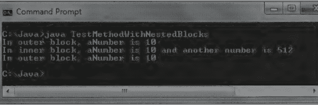

图 4-2 使用 `methodWithNestedBlocks()` 的应用程序产生的输出

> 生成图 4-2 所示输出的程序存储在你可下载文件的 CodeIn 文件夹中。

你不能使用不在作用域内的数据项。例如，图 4-3 显示了一个包含两个块和一些阴影部分的无效语句的方法。每个块的左右大括号在垂直方向上对齐。你并不需要垂直对齐一个块的左右大括号，但如果你这样做，你的程序将易读得多。

```java
public static void methodInvalidStatements() {
    aNumber = 75; // 无效：aNumber 未声明
    int aNumber = 22;
    {
        anotherNumber = 489; // 无效：anotherNumber 未声明
        anotherNumber = 165; // 无效：anotherNumber 未声明
        int anotherNumber = 99;
    }
    anotherNumber = 2; // 无效：anotherNumber 离开了作用域
}
```

图 4-3 `methodInvalidStatements()` 方法

图 4-3 第一个块中的第一个语句 `aNumber = 75;` 是无效的，因为 `aNumber` 未声明。同样，尝试将 489 和 165 赋值给 `anotherNumber` 的语句也是无效的，因为 `anotherNumber` 未声明。在声明它之后，它可以在该块的剩余部分中使用，但图 4-3 中最后的赋值语句 `aNumber = 29;` 是不起作用的，因为它位于声明它的块之外。


在方法内部，你可以多次声明同名的变量，只要每个声明都位于自己的互不重叠的块中。例如，图 4-4 中的两个 `someVar` 声明是有效的，因为每个变量都包含在自己的块中。第一个 `someVar` 实例在第二个实例诞生之前就已经离开了作用域。

```java
public static void twoDeclarations() {
  {
    int someVar = 7;
    System.out.println(someVar);
  }
  {
    int someVar = 845;
    System.out.println(someVar);
  }
}
```

图 4-4 `twoDeclarations()` 方法

即使一个块包含其他块，你也不能在同一个块内多次声明同一个变量名。当在一个块内多次声明变量时，你是在尝试重新声明该变量——这是非法操作。例如，在图 4-5 中，`aValue` 的第二次声明会导致错误，因为你不能在方法的外层块内声明两次。由于同样的原因，`aValue` 的第三次声明也是无效的，尽管它出现在一个新的块中。包含第三次声明的块完全位于外部块内部，因此 `aValue` 的第一次声明还没有离开作用域。

```java
public static void invalidRedeclarationMethod() {
  {
    int aValue = 35;
    int aValue = 44; // 错误：重复声明
  }
  {
    int anotherValue = 0;
    int aValue = 10; // 错误：重复声明
  }
}
```

图 4-5 `invalidRedeclarationMethod()`

## 理解块与作用域

虽然你不能在同一个块中多次声明变量，但你可以在类的一个方法中声明变量，并在类的另一个方法中使用相同的变量名。在每个方法内部声明的变量存储在计算机内存中独立的位置。当你声明该变量的方法中使用该变量名时，它的优先级将高于或覆盖另一个方法中同名的变量。换句话说，局部声明的变量总是会遮蔽（mask）或隐藏类其他部分的同名变量。

例如，考虑图 4-6 所示类。在 `OverridingVariable` 类的 `main()` 方法中，声明了 `aNumber` 并将其赋值为 10。当程序调用 `firstMethod()` 时，会声明一个同名但内存地址不同且值不同的新变量。新值仅存在于 `firstMethod()` 中，并在其中显示值为 77。在 `firstMethod()` 包含 10 并执行完返回 `main` 方法的逻辑后，将显示原始的 `aNumber`。当 `aNumber` 传递给 `secondMethod()` 时，方法内部会创建一个副本。该副本与原始 `aNumber` 具有相同的标识符，但内存地址不同。因此，当 `secondMethod()` 将值更改为 862 并显示时，对 `main()` 中的原始变量没有影响。当逻辑从 `secondMethod()` 返回 `main` 后，将再次显示原始值。查看图 4-7 中的输出以理解事件的发生顺序。

```java
public class OverridingVariable {
    public static void main(String[] args) {
        int aNumber = 10;
        System.out.println("In main(), aNumber is " + aNumber);
        secondMethod(aNumber);
        System.out.println("Back in main(), aNumber is " + aNumber);
    }

    public static void firstMethod() {
        int aNumber = 77;
        System.out.println("In firstMethod(), aNumber is " + aNumber);
    }

    public static void secondMethod(int aNumber) {
        System.out.println("In secondMethod(), at first " + "aNumber is " + aNumber);
        aNumber = 862;
        System.out.println("In secondMethod(), after an assignment " + "aNumber is " + aNumber);
    }
}
```


# 第 4 章 更多对象概念

## 命令提示符

```cmd
C:\Java\Java OverridingVariable
In main() {
    int aNumber = 10;
    In FirstMethod(), aNumber is 77
    Back in main(), aNumber is 10
    In secondMethod(), at first aNumber is 10
    In secondMethod(), after an assignment aNumber is 862
    Back in main(), again, aNumber is 10
}
C:\Java>
```

图 4-7 `OverridingVariable` 程序的输出

- 面向对象的程序员师在子类包含与父类中同名的字段或方法时，也会使用“重写”（override）一术语。你将在“继承简介”和“高级继承概念”章节中学习更多关于继承的内容。

- 你熟悉局部名称覆盖其他地方名称的情况。如果你家里有一个人叫 Eric，隔壁邻居家也有人叫 Eric，那么你家成员谈论 Eric 时指的是本地版本。你会添加诸如 Eric Johnson 或“隔壁的 Eric”这样的限定符来指代非本地版本。

当变量名称相同时，类方法中的变量会重写或隐藏类的字段。Java 将这种现象称为“遮蔽”（shadowing）；一个隐藏了另一个变量的变量就遮蔽了它。例如，图 4-8 显示了一个 `Employee` 类，它包含两个实例变量和三个方法。`setValues()` 方法为两个类字段提供值。每当使用 `Employee` 对象调用 `methodUsesInstanceAttributes()` 方法时，都会使用 `empNum` 和 `empPayRate` 的实例值。然而，当使用 `Employee` 对象调用另一个方法 `methodUsesLocalVariables()` 时，方法内部的局部变量值 33333 和 555.55 会遮蔽类的实例变量。图 4-9 显示了一个短程序，它声明了一个 `Employee` 对象并使用了每个方法；图 4-10 显示了输出。

## 理解块与作用域

```java
public class Employee
{
    private int empNum;
    private double empPayRate;
    public void setValues() {
        empNum = 111;
        empPayRate = 22.22;
    }
    public void methodThatUsesInstanceAttributes() {
        System.out.println("Employee number is " + empNum);
        System.out.println("Pay rate is " + empPayRate);
    }
    public void methodThatUsesLocalVariables() {
        int empNum = 33333;
        double empPayRate = 555.55;
        System.out.println("Employee number is " + empNum);
        System.out.println("Pay rate is " + empPayRate);
    }
}
```

**图 4-8** `Employee` 类

```java
public class TestEmployeeMethods
{
    public static void main(String[] args) {
        Employee aworker = new Employee();
        aworker.setValues();
        aworker.methodThatUsesInstanceAttributes();
        aworker.methodThatUsesLocalVariables();
    }
}
```

**图 4-9** `TestEmployeeMethods` 程序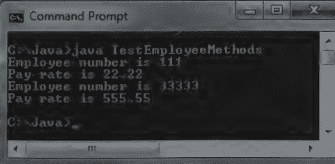

**图 4-10** `TestEmployeeMethods`程序的输出

# 第 4 章 更多对象概念

## 变量

在 `methodThatUsesLocalVariables()` 中，`empNum` 和 `empPayRate` 分别被赋值 33333 和 555.55。理解块对变量的影响对于避免混淆的情况至关重要。

# 两真理一假言

1. 变量在块结束时不再存在，离开作用域。

2. 你不能在一个块内多次声明同一个变量。

3. Java 将这种现象称为遮蔽（shadowing）；一个隐藏了另一个变量的变量就遮蔽了它。

## 动手实践

在本节中，你将创建一个方法来演示作用域。

```java
public class DemoBlock {
    public static void main(String[] args) {
        System.out.println("Demonstrating scope");
        int x = 1111;
        System.out.println("In first block x is " + x);
        {
            int y = 2222;
            System.out.println("In second block x is " + x);
            System.out.println("In second block y is " + y);
        }
        {
            int y = 3333;
            System.out.println("In third block x is " + x);
            System.out.println("In third block y is " + y);
            demoMethod();
            System.out.println("After method x is " + x);
            System.out.println("After method block y is " + y);
        }
        System.out.println("At the end x is " + x);
    }

    public static void demoMethod() {
        int x = 7777;
        System.out.println("Inside demoMethod x is " + x);
    }
}
```

# 第4章 更多对象概念

（续）

8. 最后，输入以下 `demoMethod()`，它创建了它自己的 x 和 y 变量，为它们赋值，然后显示结果：

```java
public static void demoMethod() { int x = 8888, y = 9999; System.out.println("In demoMethod x is " +x); System.out.println("In demoMethod y is " +y); } }
```

9. 输入最后的右大括号，并将文件保存为 `DemoBlock.java`。在命令提示符中，输入命令 `javac DemoBlock.java` 编译文件。如有必要，修正任何错误并重新编译程序。

10. 输入命令 `java DemoBlock` 运行程序。你的输出应该类似于图 4-11 所示。确保你理解每行输出中 x 和 y 的值是如何确定的。

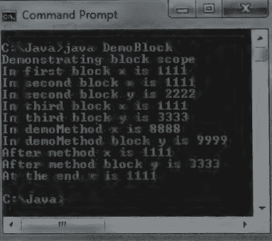

图 4-11 DemoBlock 程序的输出

11. 为了更深入地理解块和作用域，更改程序中几处 x 和 y 的值，并在重新保存、重新编译和重新运行程序之前，尝试预测准确的输出。

## 方法重载

重载涉及使用术语来表示不同的含义。在 Java 中，它更具体意味着在同一个作用域内编写多个名称相同但参数列表不同的方法。参数列表中使用的名称并不重要；列表必须在参数类型、参数数量或两者上有所区别。

当你使用英语时，你一直都在进行重载。当你说“open the door”（开门）、“open your eyes”（睁眼睛）和“open a computer file”（打开电脑文件）时，你正在使用不同的方法描述三个不同的动作，并产生非常不同的结果。然而，任何流利英语的人都能理解你的意思，因为动词 open 的含义是根据其后续名词的上下文来理解的。

## 方法重载

当你重载 Java 方法时，多个方法共享同一个名称，编译器会根据方法调用中的参数来判断使用哪一个。例如，假设你创建一个类来为银行余额应用简单利率。该方法名为 `calculateInterest()`；它接收两个 `double` 参数——余额和利率——并显示相乘的结果。图 4-12 显示了该方法。

```java
public static void calculateInterest(double bal, double rate) {
    double interest;
    interest = bal * rate;
    System.out.println("Simple interest on $" + bal +
        " " + rate + "%% rate is " + interest);
}
```

**图 4-12** 带有两个 double 参数的 `calculateInterest()` 方法

当应用程序调用 `calculateInterest()` 方法并传递两个 `double` 值时（如 `calculateInterest(1000.00, 0.04)`），利息被正确计算为 $1000.00 的 4%。

然而，假设不同的用户想要使用不同的参数类型计算利息。某些想要表示 4% 利率的用户可能会使用 `0.04`；另一些用户可能会使用 `4` 并假设它代表 4%。当使用参数 `1000.00` 和 `0.04` 调用 `calculateInterest()` 方法时，利息正确计算为 40.00。当使用 `1000.0` 和 `4` 调用方法时，该方法可以工作，因为整数参数被提升为 `double`，但利息计算错误，为 4000.00，这高出了 100 倍。

解决用数字表示参数值产生冲突的方法是重载 `calculateInterest()` 方法。例如，除了图 4-12 所示的 `calculateInterest()` 方法外，你还可以添加图 4-13 所示的方法。

```java
public static void calculateInterest(double bal, int rate) {
    double interest, rateAsPercent;
    rateAsPercent = rate / 100.0;
    interest = bal * rateAsPercent;
    System.out.println("Simple interest on $" + bal +
        " " + rate + "%% rate is " + interest);
}
```

**图 4-13** 带有一个 double 参数和一个 int 参数的 `calculateInterest()` 方法

在图 4-13 中，注意 `rateAsPercent` 是通过除以 100.0 计算的，而不是 100。如果两个整数相除，结果是截断后的整数；除以 double 100.0 则导致结果为 double。或者，你也可以使用显式强制转换，例如 `rateAsPercent = (double)rate / 100`。

如果应用程序使用两个参数调用方法 `calculateInterest()`（例如 `calculateInterest(1000.0, 0.04)`），将执行方法的第一个版本（即图 4-12 所示的版本）。然而，如果在调用 `calculateInterest()` 时使用整数作为第二个参数（如 `calculateInterest(1000.0, 4)`），则执行方法的第二个版本（即图 4-13 所示的版本）。在第二个例子中，整个整数速率数字在用于确定所得利息之前被正确地除以 100.0。

当然，你可以使用不同名称的方法来解决产生准确利息数字的困境——例如 `calculateInterestUsingDouble()` 和 `calculateInterestUsingInt()`。然而，使用一个方法名更简单、更方便。

### 方法调用中的自动类型提升


在第 2 章中，你学习了当对不同类型进行算术运算时，Java 就会将变量转换为统一类型。例如，当你将一个 `int` 和一个 `double` 相乘时，结果是 `double`。类似地，当你向方法传递参数时，Java 可以将一种数据类型提升为另一种。

当应用程序只包含一个方法版本时，可以使用正确的数据类型或可以提升的类型来调用它。例如，考虑图 4-14 所示的方法。

```java
public static void simpleMethod(double d) {
    System.out.println("Method receives double parameter");
}
```

图 4-14 带有 `double` 参数的 `simpleMethod` 方法

如果你编写一个应用程序，将 `doubleValue` 声明为 `double`，并将 `intValue` 声明为 `int`，如图 4-15 所示，那么两个方法调用 `simpleMethod(doubleValue)` 或 `simpleMethod(intValue)` 都会输出“Method receives double parameter”。

当你使用 `double` 参数调用方法时，方法按预期工作；当你使用整数参数调用它时，整数会被转换（或提升）为 `double`。图 4-15 程序的输出如图 4-16 所示。

```java
public class CallSimpleMethod {
    public static void main(String[] args) {
        double doubleValue = 45.67;
        int intValue = 17;
        simpleMethod(doubleValue);
        simpleMethod(intValue);
    }

    public static void simpleMethod(double d) {
        System.out.println("Method receives double parameter");
    }
}
```

图 4-15 使用 `double` 和 `int` 调用 `simpleMethod()` 的 `CallSimpleMethod` 应用程序

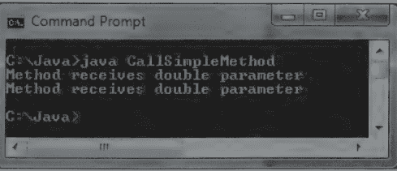

图 4-16 `CallSimpleMethod` 程序的输出

> 注意，如果不存在声明为 `void simpleMethod(int i)` 的方法，则方法调用 `simpleMethod(intValue)` 将失败。虽然 `int` 可以提升为 `double`，但 `double` 不能还原为 `int`。考虑到 `double` 还原为 `int` 时可能丢失信息，这是合理的。

假设你为图 4-15 中的程序添加了 `simpleMethod()` 的重载版本。该版本接受一个整数参数，如图 4-17 所示。当你正确重载方法时，可以提供不同的参数列表来调用它，并执行适当版本的方法。

现在，当你调用 `simpleMethod(intValue)` 时，输出发生了变化。编译器没有将整数参数提升为 `double`，而是识别出使用整数参数的方法调用具有更精确的匹配，因此它调用了输出“Method receives integer”的版本。图 4-18 显示了输出。

```java
public class CallSimpleMethod {
    public static void main(String[] args) {
        double doubleValue = 45.67;
        int intValue = 17;
        simpleMethod(doubleValue);
        simpleMethod(intValue);
    }

    public static void simpleMethod(double d) {
        System.out.println("Method receives double");
    }

    public static void simpleMethod(int d) {
        System.out.println("Method receives integer");
    }
}
```

图 4-17 `CallSimpleMethod` 应用调用带有 `double` 和 `int` 参数的 `simpleMethod()`

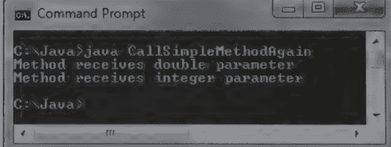

图 4-18 `CallSimpleMethod` 应用的输出

## 重载方法

### 两个事实和一个谎言

1. 当你重载方法时，你编写了多个相同名称的方法。
2. 当你重载 Java 方法时，使用不同的参数调用方法。
3. 重载方法比编写具有唯一标识符的方法更好。

错误的陈述是第 3 点。重载方法比使用唯一标识符更好，因为对于功能上完全相同的任务，程序员使用一个合理的名称更方便。


## 你来做

### 重载方法

在本节中，你将重载方法来显示日期。日期显示方法可能被组织中的许多应用程序使用，例如日程、预约和员工审查。方法接受一个、两个或三个整数参数：

- 如果有一个参数，它代表月份，日期变为 2014 年该月份的第一天。
- 如果有两个参数，它们是 2014 年的月份和日期。
- 三个参数代表月份、日期和年份。

与其创建自己的类来存储日期，不如使用内置的 `GregorianCalendar` 来处理日期。这个练习说明了 Java 创建者是如何构建内置的 `GregorianCalendar` 类的。

1. 在文本编辑器中打开一个新文件。

2. 开始以下 `DemoOverload` 类，使用三个整数变量来测试方法并调用三次 `displayDate()` 方法：

```java
public class DemoOverload {
    public static void main(String[] args) {
        int month = 6, day = 24, year = 2015;
        displayDate(month);
        displayDate(month, day);
        displayDate(month, day, year);
```

3. 创建以下 `displayDate()` 方法。它需要一个参数来表示月份，并对日期和年份使用默认值：

```java
public static void displayDate(int mm) {
    System.out.println("Event date " + mm + "/2014");
}
```

4. 创建以下 `displayDate()` 方法。它需要两个参数来表示月份和日期，并对年份使用默认值：

```java
public static void displayDate(int mm, int dd) {
    System.out.println("Event date " + mm + "/" + dd + "/2014");
}
```

5. 创建以下 `displayDate()` 方法。它需要三个参数作为月份、日期和年份：

```java
public static void displayDate(int mm, int dd, int yy) {
    System.out.println("Event date " + mm + "/" + dd + "/" + yy);
}
```

6. 输入 `DemoOverload` 类的右大括号。

7. 将文件保存为 `DemoOverload.java`。

8. 编译程序，修正任何错误，必要时重新编译，然后执行程序。图 4-19 显示了输出。注意，无论你使用一个、两个还是三个参数调用 `displayDate()` 方法，日期都能正确显示，因为你成功重载了 `displayDate()` 方法。

```text
C:\Java\java DemoOverload
Event date 6/1/2014
Event date 6/24/2014
Event date 6/24/2015
:\Java\>
```

图 4-19 `DemoOverload` 应用的输出

### 歧义

当你重载方法时，可能会创建一个歧义的情况，即编译器无法确定使用哪种方法。例如，考虑以下重载的 `computeBalance()` 方法声明：

```java
public static void computeBalance(double deposit)
public static void computeBalance(double withdrawal)
```

如果你声明了一个 `double` 变量 `myDeposit` 并进行类似 `computeBalance(myDeposit)` 的方法调用，就创建了一个歧义的情况。两个方法都接受一个 `double` 参数。

## 创建和调用带参数的构造函数

编写接收参数的版本。这些参数通常用于初始化对象的数据字段。

例如，考虑图 4-20 所示的仅有一个数据字段的 `Employee` 类。它的构造函数将 `999` 赋值给潜在实例化的 `Employee` 对象的 `empNum`。每当使用类似 `Employee partTimeWorker = new Employee();` 的语句创建 `Employee` 对象时，即使没有其他数据赋值方法，也能确保 `partTimeWorker` 对象与所有 `Employee` 对象一样，将有一个初始为 `999` 的 `empNum`。

```java
public class Employee {
    private int empNum;

    Employee() {
        empNum = 999;
    }
}
```

**图 4-20** 带有初始化 `empNum` 字段的默认构造函数的 `Employee` 类

或者，你可能选择创建具有不同初始 `empNum` 值的 `Employee` 对象。为了在对象实例化时实现这一点，可以将一个员工编号传递给构造函数。图 4-21 显示了一个包含接收参数的构造函数的 `Employee` 类。使用此构造函数，可以通过如下语句传递参数：

`Employee partTimeWorker = new Employee(881);`

当构造函数执行时，构造函数调用中的整数将作为参数 `num` 传递给 `Employee()`，并赋值给 `empNum` 字段。

```java
public class Employee {
    private int empNum;

    Employee(int num) {
        empNum = num;
    }
}
```

当你创建一个带有如图 4-21 所示构造函数的 `Employee` 类时，你创建的每个 `Employee` 对象都必须在其构造函数调用中有一个整数参数。换句话说，有了这个新版本的类，以下语句将不再有效：

`Employee partTimeWorker = new Employee();`

**图 4-21** 带有接受一个值的构造函数的 `Employee` 类

一旦你为类编写了构造函数，就不再获得自动提供的默认构造函数。如果一个类唯一的构造函数需要参数，则必须为你创建的该类的每个对象提供一个参数。

## 重载构造函数

与任何其他方法一样，也可以重载构造函数。重载构造函数提供了一种根据需要创建具有不同初始化参数或不带参数的对象的方法。

例如，除了使用图 4-21 所示的构造函数外，还可以为 `Employee` 类创建第二个构造函数。图 4-22 显示了一个包含两个构造函数的 `Employee` 类。

当你使用该类创建 `Employee` 对象时，可以选择创建带有或不带初始 `empNum` 值的对象：

- 当你使用语句 `aWorker = new Employee();` 创建 `Employee` 对象时，将调用无参数的构造函数，`Employee` 对象将接收初始为 `999` 的 `empNum` 值。
- 当你使用 `anotherWorker = new Employee(7677);` 创建 `Employee` 对象时，将使用需要整数的构造函数版本，`anotherWorker` 对象将接收初始为 `7677` 的 `empNum`。

```java
public class Employee {
    private int empNum;

    Employee(int num) {
        empNum = num;
    }

    Employee() {
        empNum = 999;
    }
}
```

图 4-22 包含两个构造函数的 `Employee` 类

你可以使用构造函数来初始化字段值，但也可以将参数用于任何其他用途。例如，你可以仅通过参数的存在与否来确定调用哪种可能的构造函数，而不在构造函数内部使用该参数。只要构造函数的参数列表不同，构造函数就没有歧义。

观看视频“重载构造函数（Overloading Constructors）”。

### 两个事实和一个谎言

#### 创建和调用带参数的构造函数

1. 默认构造函数是自动创建的。
2. 当你编写构造函数时，可以将其写为接收参数或不接收参数。
3. 如果一个类唯一的构造函数需要参数，则必须为你创建的该类的每个对象提供一个参数。

默认构造函数是不接受参数的构造函数。

错误的语句是第 1 点。默认构造函数是在没有编写任何构造函数时自动创建的，它不接受任何参数。

## 创建和调用带参数的构造函数

### 你来做

在本节中，你将创建一个带有重载构造函数的类，并演示它们是如何工作的。

1. 在文本编辑器中打开一个新文件，并如下所示开始 `CarInsurancePolicy` 类。该类包含三个字段，分别持有保单号、保单人每年支付的次数以及保单人的居住城市。

```java
public class CarInsurancePolicy {
    private int policyNumber;
    private int numPayments;
    private String residentCity;
```

2. 创建一个对三个数据字段都需要参数的构造函数。

```java
public CarInsurancePolicy(int num, int payments, String city) {
    policyNumber = num;
    numPayments = payments;
    residentCity = city;
}
```

3. 假设销售汽车保险单的机构位于 Mayfield 市。创建一个仅包含两个参数的构造函数，只需要保单号和支付次数。此构造函数将 `Mayfield` 赋值给 `residentCity`。

```java
public CarInsurancePolicy(int num, int payments) {
    policyNumber = num;
    numPayments = payments;
    residentCity = "Mayfield";
}
```

4. 添加第三个构造函数，只需要一个保单号参数。此构造函数使用两次年度支付和 Mayfield 作为居住城市的默认值。（在本章稍后的部分，你将学习如何消除重复的赋值。）

```java
CarInsurancePolicy(int num) {
    policyNumber = num;
    numPayments = 2;
    residentCity = "Mayfield";
}
```

5. 添加一个 `display()` 方法，输出所有数据：

```java
public void display() {
    System.out.println("Policy #" + policyNumber + ". " + numPayments
        + " payments annually. Resides in " + residentCity + ".");
}
```

6. 为类添加一个大括号。保存为 `CarInsurancePolicy.java`。

7. 打开一个新文件，创建一个演示构造函数的短程序。该程序每次使用不同的构造函数声明三个 `CarInsurancePolicy` 对象：

```java
public class CreatePolicies {
    public static void main(String[] args) {
        CarInsurancePolicy first = new CarInsurancePolicy(123);
        CarInsurancePolicy second = new CarInsurancePolicy(456, 4);
        CarInsurancePolicy third = new CarInsurancePolicy(789, 12, "Newcastle");
    }
}
```

8. 显示每个对象，并为方法添加大括号：

```java
first.display();
second.display();
third.display();
```

9. 在 `CreatePolicies` 中添加第四个声明，尝试使用默认构造函数创建 `CarInsurancePolicy` 对象：

```java
CarInsurancePolicy fourth = new CarInsurancePolicy();
```

10. 保存并编译修改后的 `CreatePolicies` 程序。由于 `CarInsurancePolicy` 没有默认构造函数，该类无法编译。将新添加的声明改为使用带参数的构造函数，再次编译，并观察到现在可以编译了。

## 第 4 章 更多对象概念


通常，你希望类的实例化拥有它自己的数据字段。如果一个`Employee`类包含工号、姓名和薪资字段，那么每个独立的`Employee`对象都需要唯一的编号、姓名和薪资值。（当你希望每个对象共享一个值时，你将该字段定义为`static`；当每个对象中的值可以是唯一的时，该字段就不是静态的。）

然而，当你为类创建一个方法时，任何对象都可以使用同一个方法。无论该方法是执行计算、设置字段值还是构造对象，对于每个实例化的对象，指令都是相同的。为从类中创建的每个对象存储一个单独的方法拷贝不仅会消耗大量的内存，而且还会浪费内存，因为你存储的是相同的方法拷贝——也就是说，每个对象的方法拷贝的内容是相同的。幸运的是，在 Java 中，类中的每个方法只存储一个拷贝，所有实例化对象都使用该拷贝。

当你使用非静态方法时，你使用对象名、点号和方法名——例如，`worker.getEmpNum()`或`anotherWorker.getEmpNum()`。当你执行`getEmpNum()`时，你运行的只是该方法的拷贝。在`getEmpNum()`方法内部，当你访问`empNum`字段时，你会根据对象访问不同的字段。编译器必须确定由单个`getEmpNum()`方法返回哪个对象的`empNum`值拷贝。

编译器能够访问正确对象的字段，是因为每当你调用非静态方法时，你都会隐式地传递附加到方法调用的命名对象的引用。引用是对象的内存地址。该引用是隐式的，因为所传递的对象实际上正在被写入。传递给任何对象的非静态方法的对象引用被称为`this`引用；这是 Java 中的一个关键字。

只有非静态的实例方法才具有`this`引用。例如，图 4-24 所示`Employee`类的两个`getEmpNum()`方法执行方式完全相同。第一个方法简单地使用了该引用而没有感知到它的存在；第二个方法显式地使用了该引用。两个方法都返回用于调用该方法的对象的`empNum`。

```java
public int getEmpNum() {
    return empNum;
}

public int getEmpNum() {
    return this.empNum;
}
```

该引用会自动作为参数发送到这个非静态方法中；你不需要（也无法）为它编写代码。你不需要配合`empNum`使用`this`。

然而，你可以显式地配合`empNum`使用`this`引用。此图中的两个方法的操作相同。

图 4-24 两个版本的`getEmpNum()`方法，带有和不带显式的`this`引用

通常情况下，你不想也不需要在你编写的实例方法中引用此`this`引用，但此引用始终在那里，在后台工作，以便可以访问对象的数据字段。

在某些情况下，你必须使用此引用来确保你的类能够正常工作；对于这一点，图 4-25 中的`Student`类展示了一个示例。在该类的构造函数中，参数名`stuNum`和`gpa`与类字段名相同。在构造函数内部，`stuNum`和`gpa`指向局部声明的名称，而不是类字段名。`stuNum = stuNum`语句没有产生任何作用——它将局部变量的值赋值给它自己。图 4-26 中的客户端应用程序尝试创建一个 ID 为 111、平均学分为 3.5 的`Student`对象，但图 4-27 显示了错误的输出。值没有被赋值到字段中；相反，它们只是零。

```java
public class Student {
  private int stuNum;
  private double gpa;
  public Student(int stuNum, double gpa) {
    stuNum = stuNum;
    gpa = gpa;
  }
  public void showStudent() {
    System.out.println("Student #" + stuNum + " gpa is " + gpa);
  }
}
```

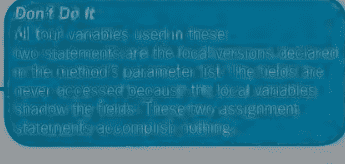

图 4-25 一个构造函数不起工作的`Student`类

```java
public class TestStudent {
  public static void main(String[] args) {
    Student aPsychMajor = new Student(111, 3.5);
    aPsychMajor.showStudent();
  }
}
```

图 4-26 实例化`Student`对象的`TestStudent`类

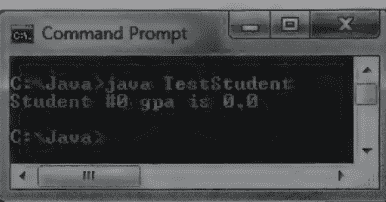

图 4-27 使用图 4-25 中错误的`Student`类的`TestStudent`程序的输出

解决`Student`类问题的一种方法是对类的字段和构造函数的参数使用不同的标识符。然而，你选择的标识符已经是该值最好且简单的标识符。如果你选择使用相同的标识符，可以显式地使用`this`引用来标识字段。图 4-28 显示了修改后的`Student`类。该类与图 4-25 中的类的唯一区别在于构造函数内部显式使用了此引用。当类方法中使用字段名配合引用时，引用指向类字段而不是局部变量。当`TestStudent`应用程序使用此版本的`Student`类时，输出符合预期，如图 4-29 所示。

```java
public class Student {
    private int stuNum;
    private double gpa;
    Student(int stuNum, double gpa) {
        this.stuNum = stuNum;
        this.gpa = gpa;
    }
    public void showStudent() {
        System.out.println("Student #" + stuNum + " gpa is " + gpa);
    }
}
```

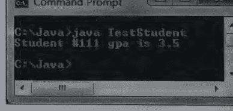

图 4-28 在构造函数内部使用`this`引用的`Student`类

图 4-29 `Student`程序的输出

## 使用`this`引用使重载构造函数更高效

假设你创建了一个带有学号和平均学分数据字段的`Student`类。进一步假设你想要以下四个构造函数：

- 一个接受`int`和一个`double`并分别将它们赋值给学号和平均学分的构造函数。
- 一个接受`double`并将其赋值给平均学分的构造函数，但将学号初始化为 999。
- 一个接受`int`并将其赋值给学号的构造函数，但将平均学分初始化为 0.0。
- 一个无参构造函数，将学号赋值为 999，平均学分赋值为 0.0。

```java
public class Student {
    private int stuNum;
    private double gpa;
    Student(int num, double avg) {
        stuNum = num;
        gpa = avg;
    }
    Student(double avg) {
        stuNum = 999;
        gpa = avg;
    }
    Student(int num) {
        stuNum = num;
        gpa = 0.0;
    }
    Student() {
        stuNum = 999;
        gpa = 0.0;
    }
}
```

图 4-30 显示了该类。虽然这个类可以工作并允许以四种不同的方式构造`Student`，但构造函数内部存在大量重复。

可以通过调用一个构造函数版本来减少图 4-30 中的重复代码并降低错误概率。要这样做，你从一个构造函数版本使用`this`引用调用另一个。图 4-31 显示了如何重写`Student`类。

```java
public class Student {
    private int stuNum;
    private double gpa;
    Student(int num, double avg) {
        stuNum = num;
        gpa = avg;
    }
    Student(double avg) {
        this(999, avg);
    }
    Student(int num) {
        this(num, 0.0);
    }
    Student() {
        this(999, 0.0);
    }
}
```

图 4-31 使用此方式处理四个构造函数的`Student`类

通过编写每个构造函数都调用一个主构造函数，你可以节省代码量并减少出错机会。例如，如果添加代码以确保所有学号都是三位数，或者确保没有平均学分大于 4.0，这些新代码只需编写在两个参数的构造函数版本中，所有其他版本都会使用它。（测试变量以确保其落在适当的数值范围内需要决策。下一章将讨论这一主题。）

虽然你可以在类中的任何方法中配合字段名使用`this`引用，但你不能从类中的其他方法调用`this()`；你只能从构造函数中调用。此外，如果你从构造函数中调用`this()`，它必须是构造函数的第一条语句。

观看视频**The this Reference**。

# 两个真话一假

## 学习`this`引用

1. 通常情况下，你希望类的每个实例都拥有自己的非静态数据字段，但每个对象并不需要拥有大多数方法的独立副本。
2. 当你使用非静态方法时，编译器会访问正确对象的字段，因为你隐式地向方法传递了对象引用。
3. `this`引用是在类中自动提供的；你不能显式地使用它。

错误的陈述是 #3。通常情况下，你既不想也不需要在你编写的方法中引用这个`this`引用，但你可以使用它——例如，当字段和局部变量的标识符之间发生冲突时。

## 你来做

### 使用`this`引用让构造函数更高效

在本节中，你将修改`CarInsurancePolicy`类，使其构造函数更加高效。

1. 打开`CarInsurancePolicy.java`文件。将类名改为`CarInsurancePolicy2`，并立即将文件保存为`CarInsurancePolicy2.java`。
2. 将三参数构造函数的名称从`CarInsurancePolicy()`改为`CarInsurancePolicy2()`。
3. 将接受单参数保单号的构造函数替换为以下构造函数。该构造函数的名称与之前的版本有所不同，此版本将保单号和两个常量值传递给三参数构造函数：

```java
public CarInsurancePolicy2(int num)
{
    this(num, 2, "Mayfield");
}
```

4. 将接受两个参数（保单号和付款次数）的构造函数替换为以下构造函数。该构造函数有一个新名称，并将两个参数和一个常量值传递给三参数构造函数：

```java
public CarInsurancePolicy2(int num, int payments)
{
    this(num, payments, "Mayfield");
}
```

5. 保存文件并编译。
6. 打开`CreatePolicies.java`文件，它演示了不同构造版本的使用。将类名改为`CreatePolicies2`，并将文件保存为`CreatePolicies2.java`。
7. 在六处添加数字 2——三次用于在作为数据类型使用时更改类名`CarInsurancePolicy2`，另外三次用于在三个构造函数调用中。
8. 保存文件，然后编译并执行。输出与“你来做”部分中图 4-23 所示的内容相同，但消除了重复的代码。
9. 你可以通过将单参数构造函数更改为以下内容来进一步减少`CarInsurancePolicy`类中的代码，这将从构造函数调用中移除常量 "Mayfield"：

```java
public CarInsurancePolicy2(int num)
{
    this(num, 2);
}
```

现在，单参数版本调用双参数版本，并传递保单号和常量 2。反之，双参数版本调用三参数版本，并将 "Mayfield" 作为城市名。

10. 保存此版本的`CarInsurancePolicy2`类并编译。然后重新编译`CreatePolicies2.java`文件并执行。输出保持不变。

## 使用静态字段

在第 3 章中，你学习了无需使用对象即可创建的方法是静态的。例如，程序中的`main()`方法以及`main()`在不使用对象引用的情况下调用的方法都是静态的。你还学到，在将实例化对象的类内部创建的大多数方法是非静态的。静态方法没有指向`this`的引用；因此，它们被称为类方法。

你还可以创建类变量，它们由类的每个实例共享。虽然类中的实例变量在每个对象中独立存在，但每个类只有一个静态变量的副本。例如，考虑图 4-32 中的`BaseballPlayer`类。`BaseballPlayer`类包含一个名为`count`的阴影静态字段，以及两个名为`number`和`battingAverage`的非静态字段。`BaseballPlayer`构造函数设置了`number`和`battingAverage`的值并将`count`加一。在其他情况下，每当创建一个`BaseballPlayer`对象时，都包含`number`和`battingAverage`的独立值，而`count`字段包含现有对象的计数，并被所有`BaseballPlayer`对象共享。

```java
public class BaseballPlayer {
    private int count = 0;
    private double battingAverage;
    public BaseballPlayer(int id, double avg) {
        number = id;
        battingAverage = avg;
        count = count + 1;
    }
    public void showPlayer() {
        System.out.println("Player #" + number +
            " batting average is " + battingAverage +
            " There are " + count + " players");
    }
}
```

图 4-32 `BaseballPlayer`类

`BaseballPlayer`类中的`showPlayer()`方法显示`BaseballPlayer`的编号、击球率和所有当前手的计数。该方法不是静态的——它访问单个对象的数据。声明为静态的方法无法访问实例变量，但实例方法可以同时访问静态和实例变量。

图 4-33 中的`TestPlayer`类是一个声明了两个`BaseballPlayer`对象、显示它们、并创建第三个`BaseballPlayer`对象并显示它的应用程序。当你检查图 4-34 中的输出时，你会发现，在前两个对象声明时，它们共享的`count`值已经是 2。无论是由捕手对象还是游手对象访问`count`，其值都是相同的。

# 第 4 章 更多概念

## `TestPlayer`

```java
public class TestPlayer {
    public static void main(String[] args) {
        BaseballPlayer b1 = new BaseballPlayer(1, .250);
        BaseballPlayer b2 = new BaseballPlayer(2, .300);
        b1.showPlayer();
        b2.showPlayer();
        BaseballPlayer b3 = new BaseballPlayer(3, .350);
        b3.showPlayer();
    }
}
```

### 使用常量字段

在第 2 章中，你学习了使用`final`关键字来创建常量。有时你希望类中的某个数据字段是常量。例如，如果你希望每个`Student`对象都有一个相同的值，就将其声明为`static`。此外，如果你想让它的值不可更改，就使用`final`关键字。

```java
public class Student {
    public static final int SCHOOL_ID = 12345;
    private int stuNum;
    private double gpa;
    public Student(int stuNum, double gpa) {
        this.stuNum = stuNum;
        this.gpa = gpa;
    }
    public void showStudent() {
        System.out.println("Student #" + stuNum + " gpa is " + gpa);
    }
}
```

图 4-35 包含常量的`Student`类

非静态字段的最终值可以在类的构造函数中设置。例如，你可以使用常量来设置，或者使用传递构造函数的参数来设置。然而，静态字段的值必须在声明时设置，如 4-35 中的`Student`类示例所示。这是合理的，因为每个对象只存储一个静态字段。


> `final` 关键字不仅用于字段，还可以用于方法或类。以这种方式使用时，`final` 表示对继承的限制。你将在“继承引论”和“高级继承概念”章节中学习更多内容。
>
> `final` 字段也可以在静态初始化块中初始化。有关此技术的更多细节，请参阅 Java 网站。

# 第 5 章 更多对象概念

## 两个真相一个谎言

### 使用静态字段（Fields）

1. 声明为 `static` 的方法会接收一个引用，该引用包含指向与之关联对象的引用。

2. 声明为 `static` 的方法被称为类方法（class methods）。

3. `final static` 字段的值被该类的每个对象共享。

> 错误的陈述是 #1：静态方法没有与之关联的对象，也没有指向它们的引用。

## 你来做做

### 使用静态和非静态 `final` 字段

在本节中，你将为 Riverdale 犬俱乐部（Riverdale Kennel Club）创建一个类，以演示静态和非静态 `final` 字段的使用。该俱乐部参加了年度三项铁赛活动，每只狗在敏捷性、体型和服从方面获得三个分数。

1. 在你的文本编辑器中打开一个新文件，并输入 `DogTriathlonParticipant` 类的前几行。该类包含一个 `final` 字段，用于存储狗参加的活动数量。一旦 `final` 字段被设置，它永远不会改变。该字段不是静态的，因为每只狗都是不同的。该类还包含一个 `static` 字段，用于存储所有参赛狗的累计总分。该字段不是 `final`，因为它的值会随着每只狗参加三项铁赛而增加，但在任何时刻它都是静态的，对所有参与者都是相同的。

```java
public class DogTriathlonParticipant
  private final int NUM_EVENTS;
  private static int totalCumulativeScore = 0;
```

2. 添加六个私有字段，用于存储参赛狗的名字、狗在三项活动中的分数以及平均分：

```java
private String name;
  private int obedienceScore;
  private int conformationScore;
  private int agilityScore;
  private int total;
  private double avg;
```

（继续）

## 使用静态字段

（继续）

3. 类的构造函数需要五个参数——狗的名字、狗参加的活动数量以及狗在三项活动中的分数。（在你读完关于决策的章节后，你将能够确保输入的非零分数数量与活动数量匹配，但目前不会进行此类检查。）构造函数将每个值分配给相应的字段。

```java
public DogTriathlonParticipant(String name,
 int numEvents, int score1, int score2, int score3)
{
    this.name = name;
    NUM_EVENTS = numEvents;
    obedienceScore = score1;
    conformationScore = score2;
    agilityScore = score3;
```

4. 赋值后，构造函数计算参与者的总分和平均分。注意除法结果被强制转换为 `double`，这样计算出的平均分的任何分数部分都不会丢失。此外，将参与者的总分加到所有参与者的累计得分中。记住这个字段是静态的，因为它在任何时间对所有参与者都应该是相同的。这些语句之后，为构造函数添加一个大括号。

```java
total = obedienceScore +
conformationScore + agilityScore;
avg = (double) total / NUM_EVENTS;
totalCumulativeScore = totalCumulativeScore +
total;
}
```

5. 开始一个方法，显示每个三项铁赛参赛者的数据。

```java
public void display()
{
    System.out.println( + name + " participated in " +
    NUM_EVENTS +
    " events and has an average score of " + avg + ");
    System.out.println( + name + +
    " has a total score of " + total +
    " bringing the total cumulative score to " +
    totalCumulativeScore + ");
}
```

6. 为类添加一个大括号。然后，将文件保存为 `DogTriathlonParticipant.java`。编译该类并修正任何错误。

（继续）

# 第 4 章 更多对象概念

（继续）

7. 在你的文本编辑器中打开一个新文件，然后输入一个类的头部和起始结束大括号，你可以使用这个类来测试 `DogTriathlonParticipant` 类。还要包含 `main()` 方法头及其起始结束大括号。

```java
public class TestDogs
{
    public static void main(String[] args)
    {
    }
}
```

8. 在 `main()` 方法的大括号之间声明一个 `DogTriathlonParticipant` 对象。为参与者的名字、活动数量和三个分数提供值，然后显示该对象。

```java
DogTriathlonParticipant dog1 =
new DogTriathlonParticipant("Bowser", 2, 85, 89, 0);
dog1.display();
```

9. 在 `main()` 方法中创建并显示两个对象。

```java
DogTriathlonParticipant dog2 =
new DogTriathlonParticipant("Rush", 3, 78, 72, 80);
dog2.display();
DogTriathlonParticipant dog3 =
new DogTriathlonParticipant("Ginger", 3, 90, 86, 72);
dog3.display();
```

10. 将文件保存为 `TestDogs.java`。编译并执行程序。输出类似于图 4-36。从视觉上确认每个总分、平均分和累计总分都是正确的。

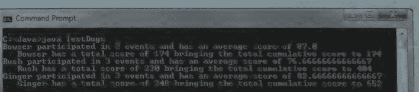

图 4-36 `TestDogs` 程序的输出

（继续）

# 使用自动导入的预写常量

（继续）

11. 在 `DogTriathlonParticipant` 类中实验 `static` 字段。对于任何程序，尝试以下：

- 在 `DogTriathlonParticipant` 类中实验 `static` 字段。对于任何程序，尝试以下：
- 在 `DogTriathlonParticipant` 类中实验 `static` 字段。对于任何程序，尝试以下：
- 在 `DogTriathlonParticipant` 类中实验 `static` 字段。对于任何程序，尝试以下：
- 在 `DogTriathlonParticipant` 类中实验 `static` 字段。对于任何程序，尝试以下：
- 在 `DogTriathlonParticipant` 类中实验 `static` 字段。对于任何程序，尝试以下：
- 在 `DogTriathlonParticipant` 类中实验 `static` 字段。对于任何程序，尝试以下：
- 在 `DogTriathlonParticipant` 类中实验 `static` 字段。对于任何程序，尝试以下：
- 在 `DogTriathlonParticipant` 类中实验 `static` 字段。对于任何程序，尝试以下：

# 使用自动导入的预写常量和方法

（续）

| 方法 | 方法返回的值 |
| --- | --- |
| `exp(x)` | 幂，其中 `x` 是自然对数的底 |
| `floor(x)` | 不大于 `x` 的最大整数值 |
| `log(x)` | `x` 的自然对数 |
| `max(x, y)` | `x` 和 `y` 中的较大值 |
| `min(x, y)` | `x` 和 `y` 中的较小值 |
| `pow(x, y)` | `x` 的 `y` 次方 |
| `random()` | 0.0 到 1.0 之间的随机双浮点数 |
| `rint(x)` | 最接近 `x` 的整数（`x` 是 `double` 类型，返回值表示为 `double` 类型） |
| `round(x)` | 最接近 `x` 的整数（其中 `x` 是 `float` 或 `double` 类型，返回值为 `int` 或 `long`） |
| `sin(x)` | `x` 的正弦 |
| `sqrt(x)` | `x` 的平方根 |
| `tan(x)` | `x` 的正切 |

表 1 常见的 `Math` 类方法

由于 `Math` 类中的所有常量和方法都是类范围的（即静态的），因此不需要创建 `Math` 类的实例。你不能实例化 `Math` 类型的对象，因为 `Math` 类是私有的，你的程序无法访问其构造函数。

> 除非你是一个数学家，否则你不会使用许多 `Math` 类方法，而且在理解它们的用途之前这样做是不明智的。例如，由于负数的平方根未定义，如果你在调用方法 `imaginaryNumber = Math.sqrt(-12);` 后显示结果，你会看到 NaN。

# 导入未自动导入的类

Java 包含数百个类，其中只有少数类——`java.lang` 包中的类——会自动包含在你编写的程序中。要使用任何其他预写类，你必须使用三种方法之一：

- 使用类名的完整路径。
- 导入该类。
- 导入包含你正在使用的类的包。

# 第 4 章更多对象概念

Java 在其 `java.util` 包中包含一个 `GregorianCalendar` 类，它在处理日期和时间时非常有用。格列哥历在世界大部分地区使用；它于 1582 年 10 月 15 日设立，以格列哥十三世命名，他在该历法的采纳中起了关键作用。（对于在格列哥历转换日期之前的日期，`GregorianCalendar` 类使用儒略历，该历法仅使用一种不同的闰年规则。）

你已经在书中看到过示例，其中导入了 `joptionName` 和 `Scanner` 类，以便你可以使用它们的方法。同样，你可以导入 `java.util` 类包，该包包含了 `GregorianCalendar` 类。

你可以使用完整类路径或通过以下方式从该类实例化 `GregorianCalendar` 类型的对象：

```java
java.util.GregorianCalendar myAnniversary = new java.util.GregorianCalendar();
```

或者，当你在程序的第一行导入 `java.util.GregorianCalendar;` 时，你可以将 `myAnniversary` 的声明缩短为：

```java
GregorianCalendar myAnniversary = new GregorianCalendar();
```

导入类的替代方案是导入整个类包。你可以使用星号（`*`）作为通配符符号，它表示符号可以被任何字符集替换。在 Java 导入语句中，使用通配符符号表示包中的所有类。因此，以下语句导入了 `GregorianCalendar` 类以及任何其他 `java.util` 类：

```java
import java.util.*;
```

导入语句并没有像其名称暗示的那样将整个导入的类或包移动到你的程序中。它只是通知程序你将使用部分导入类或包的数据和方法名。导入整个包而不是只导入类并没有坏处，你经常会在专业的编写 Java 程序中看到通配符方法。然而，你也可以选择单独导入每个类。通过名称导入每个类而不使用通配符，可以作为一种文档形式；这种技术专门显示了正在使用包的哪些部分。

你不能像 DOS 或 UNIX 通配符那样使用 Java 的通配符，因为你无法通过 `import java.*;` 导入所有的 Java 类。Java 通配符仅适用于特定的包，例如 `import java.util.*;` 或 `import java.lang.*;`。此外，请注意导入语句中的星号导入包中的所有类，但不会导入该包内的其他包。

由于你的类路径（classpath）设置，你自己的类不需要导入语句即可包含应用程序。关于类路径的更多信息，请参见附录 A。


# 使用 `GregorianCalendar` 类

`GregorianCalendar` 对象有七个构造函数。这些构造函数是重载的，在调用时需要不同的参数列表。`GregorianCalendar` 类的默认构造函数创建一个日历对象，包含计算机设置的默认区域（时区）的当前日期和时间。你可以使用其他构造函数来指定：

- 年，月
- 年，月，日
- 区域
- `Locale`
- 时区

你可以通过以下语句创建一个默认 `GregorianCalendar` 对象：

```java
GregorianCalendar today = new GregorianCalendar();
```

或者，使用重载的构造函数创建 `GregorianCalendar` 对象，例如：

```java
GregorianCalendar graduation = new GregorianCalendar(2014, 5);
```

特定的数据，如日期、月份，可以通过 `GregorianCalendar` 对象获取，例如：

```java
int dayOfYear = today.get(GregorianCalendar.DAY_OF_YEAR);
```

`get()` 方法总是返回一个整数。某些参数见表 4-2。特别注意，`GregorianCalendar` 中的月份值从 0 到 11。因此，一月是 0，二月是 1，依此类推。

作为使用 `GregorianCalendar` 对象的示例，图 4-37 显示了 `AgeCalculator`。在这个类中，创建一个名为 `now` 的默认 `GregorianCalendar` 对象。提示用户输入年份，通过 `get()` 方法从对象中提取当前年份，并通过从当前年份减去出生年份来计算年龄。图 4-38 显示了 1986 年出生的人运行程序时的输出。

# 第 4 章更多对象概念

| 参数 | `get()` 返回的值 |
| --- | --- |
| `DAY_OF_YEAR` | 1 到 366 |
| `DAY_OF_MONTH` | 1 到 31 |
| `DAY_OF_WEEK` | `SUNDAY`、`MONDAY` 到……，对应 1 到 7 |
| `YEAR` | 当前年份；例如 2012 |
| `MONTH` | `JANUARY` 到 `DECEMBER`，对应 0 到 11 |
| `HOUR` | 1 到 12 之间的值；A.M. 或 P.M. 中的当前小时 |
| `AM_PM` | A.M. 或 P.M.，对应 0 到 1 |
| `HOUR_OF_DAY` | 基于 24 小时制的 0 到 23 之间 |
| `MINUTE` | 小时内的分钟，0 到 59 之间 |
| `SECOND` | 分钟内的秒，0 到 59 之间 |
| `MILLISECOND` | 秒内的毫秒，0 到 999 之间 |

表 4-2 `GregorianCalendar get()` 方法的一些可能的参数和返回值

```java
import java.util.*;
import javax.swing.*;
public class AgeCalculator {
    public static void main(String[] args) {
        GregorianCalendar now = new GregorianCalendar();
        int nowYear;
        int birthYear;
        int yearsOld;
        birthYear = Integer.parseInt(
            JOptionPane.showInputDialog(null,
            "你是在哪一年生的？"));
        nowYear = now.get(GregorianCalendar.YEAR);
        yearsOld = nowYear - birthYear;
        JOptionPane.showMessageDialog(null,
            "你将在这一年变成 " + yearsOld + " 岁");
    }
}
```


**图 4-38** `AgeCalculator` 程序的执行结果

## 两真一假

### 使用自动导入的预写常量和方法

1. Java 的创建者为你生成了数百个类，供你在程序中使用。
2. Java 包只有在你的程序中显式地命名它们时，才可用。
3. 隐式导入的 `java.lang` 包包含了基础的 Java 类。

> 错误的陈述是 #2。许多 Java 包是自动导入的，但其他包除非你显式导入，否则在你的程序中是不可用的。

## 你来做

### 使用 Java 网站

1. 使用浏览器访问 Java 网站，选择 **Java APIs** 和 **Java SE 7**。使用类的字母顺序列表找到 `GregorianCalendar` 类并选择它。
2. 注意到描述顶部引用了 `java.util`，这表示它是包含该类的包。


### 阅读 `GregorianCalendar` 类的历史和背景

阅读 `GregorianCalendar` 类的历史和背景，以了解确定诸如一周的第一天和一年中的周数等值时涉及多少问题。然后阅读文档的其他部分，以感受该类可用的字段和方法。

### 使用显式导入的预写类

接下来，你将使用 `GregorianCalendar` 类以及 `GregorianCalendar.get()` 方法的一些参数来构建一个程序。

1. 在你的文本编辑器中打开一个新文件。在文件的第一行，输入以下内容：

```java
import java.util.*;
```

2. 在接下来的行中，通过输入类头、左大括号、`main()` 方法头及其左大括号开始定义类：

```java
public class CalendarDemo {
    public static void main(String[] args) {
```

3. 一个名为 `now` 的 `GregorianCalendar` 对象，它持有关于当前日期时间的信息。然后创建一系列输出语句，显示包含日期信息的 `GregorianCalendar` 字段：

```java
GregorianCalendar now = new GregorianCalendar();
System.out.println("YEAR: " + now.get(Calendar.YEAR));
System.out.println("MONTH: " + now.get(Calendar.MONTH));
System.out.println("WEEK_OF_YEAR: " + now.get(Calendar.WEEK_OF_YEAR));
System.out.println("WEEK_OF_MONTH: " + now.get(Calendar.WEEK_OF_MONTH));
System.out.println("DATE: " + now.get(Calendar.DATE));
System.out.println("DAY_OF_MONTH: " + now.get(Calendar.DAY_OF_MONTH));
System.out.println("DAY_OF_YEAR: " + now.get(Calendar.DAY_OF_YEAR));
System.out.println("DAY_OF_WEEK: " + now.get(Calendar.DAY_OF_WEEK));
```

4. 添加更多显示当前时间信息的语句，如下：

```java
System.out.println("AM_PM: " + now.get(Calendar.AM_PM));
System.out.println("HOUR: " + now.get(Calendar.HOUR_DAY));
System.out.println("HOUR_OF_DAY: " + now.get(Calendar.HOUR_OF_DAY));
System.out.println("MINUTE: " + now.get(Calendar.MINUTE));
System.out.println("SECOND: " + now.get(Calendar.SECOND));
System.out.println("MILLISECOND: " + now.get(Calendar.MILLISECOND));
```

5. 添加 `main()` 方法的右大括号和类的右大括号。

### 使用自动导入的预写常量和方法

6. 将文件保存为 `CalendarDemo.java`。编译并执行该程序。图 4-39 显示了程序在 2014 年 4 月 3 日星期四上午 10 点稍前执行时的输出。注意，尽管人们认为 4 月是第 4 个月，但输出中的月份是 3——`GregorianCalendar` 中的值是从 0 到 11。在程序中显示月份值时，你可能选择在显示之前向值加 1，这样用户就能看到他们熟悉的月份数字。

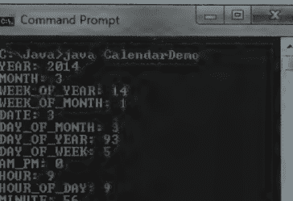

图 4-39 `CalendarDemo` 程序的输出

## 使用计时器创建一个交互式应用程序

接下来，你将使用 `GregorianCalendar` 类创建一个输出用户对问题响应的应用程序。

1. 在你的文本编辑器中打开一个新文件，输入以下两个 `import` 语句。你需要 `JOptionPane` 类来显示 `confirmDialog()` 方法，你需要 `java.util` 包来使用 `GregorianCalendar` 类：

```java
import javax.swing.JOptionPane;
import java.util.*;
```

2. 按照如下方式开始 `DialogTimer` 应用程序。声明名为 `milli1`、`milli2`、`sec1` 和 `sec2` 的变量。这些用于从程序开始和结束时创建的日历对象计算 `time1` 和 `time2`。然后你使用常量计算差值。

```java
public class DialogTimer {
    final int SECOND = 1000;
    long milli1, milli2, timeDifference, sec1;

    public static void main(String[] args) {
        GregorianCalendar before = new GregorianCalendar();
        milli1 = before.getTimeMillis();
```

3. 使用对话框等待用户的回答：

```java
        int response = JOptionPane.showDialog(null, "Is it?");
```

4. 如果响应为是，创建另一个：

```java
        GregorianCalendar after = new GregorianCalendar();
        milli2 = after.getTimeMillis();
        timeDifference = milli2 - milli1;
        sec1 = timeDifference / SECOND;
```

5. 在对话框中显示结果：

```java
        JOptionPane.showMessageDialog(null, "It took " + sec1 + " seconds");
    }
}
```

6. 将文件保存为 `DialogTimer.java`。编译并执行程序。图 4-40 显示了输出。

7. 添加一个 `else` 语句来处理否的响应：

```java
        else JOptionPane.showMessageDialog(null, "You did not answer");
```


（注：此处对应原文截断处）

## 理解组合与嵌套类

分组类的两种方式是使用组合和嵌套类。本节将简要介绍两者。

### 组合

类的字段可以是简单的数据类型（如 `int` 和 `double`），也可以是类类型。**组合**描述了当一个类的对象是另一个类的数据字段时，类之间的关系。你已经学习了许多包含 `String` 字段的类。这些类使用了组合。

当你对象作为另一个类的数据成员时，如果该对象没有默认构造函数，你必须记住为其提供值。例如，你可能会创建一个名为 `NameAddress` 的类来存储姓名地址。此类类可以用于员工、客户、学生或任何有姓名和地址的人。图 4-41 显示了一个 `NameAddress` 类。该类包含三个字段，所有字段都通过构造函数设置。`display()` 方法分三行显示姓名和地址。

```java
public class NameAddress
{
    private String name;
    private String address;
    private int zipCode;

    public NameAddress(String nm, String add, int zip)
    {
        name = nm;
        address = add;
        zipCode = zip;
    }
    public void display()
    {
        System.out.println(name);
        System.out.println(address);
        System.out.println(zipCode);
    }
}
```

**图 4-41** `NameAddress` 类

假设你想创建一个 `School` 类来持有有关学校的信息。与其为学校的名称和地址声明字段，不如使用 `NameAddress` 类。这种创建的关系有时被称为**拥有关系**（**has-a-relationship**），因为一个类“拥有”另一个类的实例。图 4-42 显示了一个声明并使用 `NameAndAddress` 对象的 `School` 类。

# 第 4 章 更多对象概念

| | |

| --- | --- |

| 这条语句声明了一个 `NameAndAddress` 对象。 | `public class School {

    private NameAndAddress nameAdd;

    private int enrollment;

    public School(String name, String address, int zip, int enrollment) {

        nameAdd = new NameAndAddress(name, address, zip);

        enrollment = enrollment;

    }

    public void display() {

        System.out.println("The school information:");

        nameAdd.display();

        System.out.println("Enrollment is " + enrollment);

    }}` |

| 这条语句调用了 `NameAndAddress` 类中的构造函数。 | |

| 这条语句调用了 `NameAndAddress` 类中的 `display()` 方法。 | |

图 4-42 `School` 类

如图 4-42 所示，`School` 构造函数需要四个参数。在构造函数内部，有三个项目——名称、地址和邮政编码——被传递给 `NameAndAddress` 构造函数，为相应的字段提供值。第四个构造函数参数（学校的入学人数）被分配给 `School` 类的 `enrollment` 字段。

在 `School` 类的 `display` 方法中，调用了 `NameAndAddress` 对象的 `display()` 方法来显示学校的名称和地址。随后显示入学人数值。图 4-43 显示了一个实例化一个 `School` 对象的简单程序。图 4-44 显示了执行结果。

```java
public class SchoolDemo {
    public static void main(String[] args) {
        School mySchool = new School(
            "Audubon Elementary",
            "3500 Hoyne", 60618, 350);
        mySchool.display();
    }}
```

图 4-43 `SchoolDemo` 程序

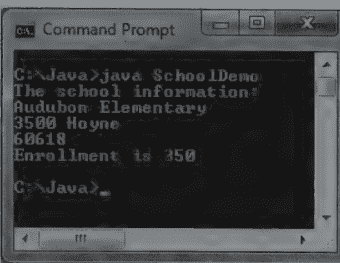

图 4-44 `SchoolDemo` 程序的输出

## 嵌套类

到目前为止你学过的每个类都存储在自己的文件中，且文件名始终与类名匹配。在 Java 中，你可以在另一个类内部创建一个类并将它们存储在一起；这样的类被称为嵌套类。包含类是顶层类。嵌套类有四种类型：

- 静态成员类：静态成员类可以访问顶层类的所有静态方法。
- 非静态成员类，也称为内部类：这种类需要一个实例；它可以访问顶层类的所有数据和方法。
- 局部类：这些类是局限于某个代码块的。
- 匿名类：这些是没有标识符的局部类。

将一个类嵌套在另一个类内部的最常见原因是内部类仅供顶层类使用；换句话说，它是顶层类的“辅助类”。将类打包在一起使得它们之间的关系更容易理解，代码也更容易维护。

例如，考虑一个由房地产公司使用的 `RealEstateListing`（房地产列表）类，用于描述待售的房屋。该类可能会为挂源编号、价格、街道地址和房屋的居住面积划分字段。作为替代方案，你可能决定尽管挂源编号和价格“属于”房地产列表，但街道地址和居住面积实际上“属于”房屋。因此，你可能会创建一个如图 4-45 所示的内部类。

```java
public class RealEstateListing {
    private int listingNumber;
    private double price;
    private HouseData houseData;
    public RealEstateListing(int num, double price, String address, int sqFt) {
        listingNumber = num;
        this.price = price;
        houseData = new HouseData(address, sqFt);
    }
    public void display() {
        System.out.println("Listing number #" + listingNumber + 
            " Selling for: " + price);
        System.out.println("Address: " + houseData.streetAddress);
        System.out.println(houseData.squareFeet + " square feet");
    }
    private class HouseData {
        private String streetAddress;
        private int squareFeet;
        public HouseData(String address, int sqFt) {
            streetAddress = address;
            squareFeet = sqFt;
        }
    }
}
```

**图 4-45** `RealEstateListing` 类

注意图 4-45 中的内部类 `HouseData` 是一个私有类。你不需要将内部类设为私有，但这样做可以使其成员对外部类隐藏。如果你希望一个类的成员是可访问的，你就不会将其设为内部类。内部类可以访问其顶层类的字段和方法（即使它们是私有的），而外部类也可以访问其内部类的成员。

你通常不会想要创建内部类。例如，如果你将 `HouseData` 设为一个普通类（而不是内部类）并将其存储在自己的文件中，你就可以可以在其他类中通过组合来使用它——可能是在 `MortgageLoan` 类或 `Appraisal` 类中。目前，它只能在它当前所在的类中使用。你可能不会频繁创建嵌套类，但你会在某些内置 Java 类中看到它们的实现。

## 二真一假

### 理解组合与嵌套类

1. 阐述（Exposition）描述了类之间的关系。
2. 组合（Composition）描述了当一个类的对象是另一个类的数据字段时，类之间的关系。
3. 嵌套类是包含在其他类中的类。

错误的陈述是 1。组合描述了当一个类的对象是另一个类的数据字段时，类之间的关系。

## 术语

- 块（block）是两个大括号之间的代码。
- 外部块（outer block）包含另一个块。
- 内部块（inner block）包含在另一个块内部。
- 嵌套（nested）描述内部块的状态。
- 进入作用域（comes into scope）描述了变量变得可用时发生的情况。
- 离开作用域（goes out of scope）描述了变量在声明它的块结束时而消失时发生的情况。
- 重复声明（redeclare）一个变量是指尝试两次声明它——这是一种非法操作。
- 覆盖（override）是指一个变量在另一个同名变量具有优先权时覆盖另一个。
- 遮蔽（shadowing）是指当局部变量隐藏了作用域中更远的同名变量时发生的动作。
- 作用域更近（Closer in scope）描述了局部变量相对于其他变量的状态。

## 章节总结

静态成员类是嵌套类的一种，它可以访问顶层类的所有静态方法。

非静态成员类（也称为内部类）是需要实例的嵌套类。

局部类是嵌套类的一种，它们局部于某个代码块。

匿名类是没有标识符的嵌套局部类。

## 章节总结

- 变量的作用范围是程序中你可以引用该变量的区域。代码块（block）是一对大括号之间的代码。在方法内部，你可以多次声明同名的变量，只要每个声明都在其各自的互不重叠的代码块中。如果你在类中声明了一个变量，并在类的某个方法中使用相同的变量名，则方法内部使用的变量的优先级高于（或覆盖、掩码）第一个变量。

- 方法重载（Overloading）涉及编写多个具有相同名称但参数列表不同的方法。参数列表完全相同但返回类型不同的方法不属于重载；它们是非合法的。

- 当你重载方法时，可能会产生歧义的情况——即编译器无法确定使用哪种方法。


当你编写构造函数时，它们可以接收参数。这些参数通常用于初始化对象的数据字段。在你为类编写了构造函数后，就不再获得自动生成的默认构造函数。如果一个类的唯一构造函数需要参数，则你必须为创建该类的每个对象提供参数。你可以像重载其他方法一样重载构造函数。

在非静态方法内部，可以访问正确对象的数据字段，因为该引用被隐式地传递给非静态方法。静态方法没有引用，因为它们没有关联的对象；静态方法也被称为类方法。

静态类和方法被类的每个实例所共享。当一个字段是最终的（`final`）时，它在被赋值初始值后就不能更改。

Java 包含了数百个被重写的类，它们存储在包（packages）中，包是为类提供方便分组的文件夹。隐式导入到每个程序中的包是`java.lang`。它包含的类是基础类，而可选的类则必须显式导入。`java.lang.Math`类包含了常数和方法，可用于执行常见的数学函数。`GregorianCalendar`类允许你定义和处理日期与时间。

# 第 4 章 更多对象概念

组合（Composition）描述了类之间的关系，当一个类的对象是另一个类中的数据字段时。你可以创建存储在同一个文件的嵌套类。将一个类嵌套在另一个类内部的最常见原因是：内部类仅供外部类或顶层类使用；换句话说，它是顶层类的“辅助类”。

## 复习题

1. 方法中一对大括号之间的代码是一个 ____________________。

   - a. 函数
   - b. 代码块
   - c. 砖
   - d. 扇

2. 当一个块存在于另一个块内部时，这些块是 ____________________。

   - a. 结构化的
   - b. 嵌套的
   - c. 受保护的
   - d. 非法的

3. 程序中引用变量的部分是变量的____________________________________。

   - a. 范围
   - b. 空间
   - c. 域
   - d. 作用

4. 你可以多次声明同名的变量 ____________________。

   - a. 在语句内部
   - b. 在代码块内部
   - c. 在方法内部
   - d. 你永远不能声明多个同名的变量。

5. 如果你在类中声明一个变量为实例变量，并在类的方法内部声明并使用相同的变量名，那么在方法内部，____________________________________。

   - a. 方法内部使用的变量优先级更高
   - b. 实例变量优先级更高
   - c. 两个变量指向同一个内存地址
   - d. 会发生错误

6. 方法变量 ____________________ 与同名的类变量。

   - a. 顺从
   - b. 破坏
   - c. 覆盖
   - d. 修改

7. 无歧义的重载方法必须具有相同的 \_\_\_\_\_\_\_

   - a. 名称
   - b. 参数数量
   - c. 参数名称
   - d. 参数类型

8. 如果方法被写为接收一个 `double` 参数，而你向该方法传递一个整数，那么该方法将 \_\_\_\_\_\_\_

   - a. 正确工作；整数将提升为 `double`
   - b. 正确工作；整数将保持为整数
   - c. 执行，但任何输出都是错误的
   - d. 不工作；将发布错误信息

9. 构造函数 \_\_\_\_\_\_\_\_\_\_\_\_\_\_\_ 参数。

   - a. 可以接收
   - b. 不能接收
   - c. 必须接收
   - d. 最多可以接收 10

10. 构造函数 \_\_\_\_\_\_\_\_\_\_\_\_\_\_\_ 重载。

   - a. 可以
   - b. 不能
   - c. 必须是
   - d. 总是自动的

11. 通常，你希望类的每个实例都拥有自己的 \_\_\_\_\_\_\_\_\_\_\_\_\_\_\_\_ 副本。

   - a. 数据字段
   - b. 类方法
   - c. 以上两者皆是
   - d. 以上都不是

12. 如果你创建一个包含一个方法的类并实例化两个对象，你通常存储 \_\_\_\_\_\_\_\_\_\_\_\_\_\_\_ 以供使用。

   - a. 一份方法的副本
   - b. 两个方法的副本
   - c. 两个不同的方法
   - d. 仅

13. 引用 \_\_\_\_\_\_\_\_\_\_\_\_\_\_ 这种。

   - a. 可以使用
   - b. 必须使用
   - c. 必须不能使用
   - d. 不使用

14. 你与对象使用的方法是 \_\_\_\_\_\_\_\_

   - a. 静态的
   - b. 公有的
   - c. 共享的
   - d. 非静态的

15. 每个实例共享的变量是

   - a. 类变量
   - b. 变量
   - c. 变量
   - d. 非法的

16. `final`关键字与变量使用表示

   - a. 程序的结束
   - b. 字段
   - c. 常数
   - d. 那个

17. Java 类存储在 a

   - a. 文件夹
   - b. 包
   - c. 束
   - d. 数据

18. 下列哪个语句确定数字的平方根？

   - a. `s = Math.sqrt(number);`
   - b. `s = number;`
   - c. 包
   - d. 日期

19. `GregorianCalendar`对象可以使用构造函数来创建。这意味着构造函数

   - a. 覆盖
   - b. 歧义
   - c. 重载
   - d. 以上都是

20. `GregorianCalendar`的`get()`方法总是返回 a

   - a. 整数
   - b. 对象

## 练习题

a. 创建一个`BirdSighting`类，它包含物种、观察到的数量以及年份。例如，4月1日不是闰年。该类还包含获取每个字段的方法。此外，创建一个默认构造函数，将物种设置为“robin”，并将年份设置为1。将此文件保存为`BirdSighting.java`。创建一个名为`Testighting`的程序，显示每个方法工作正常。

b. 为你在第3题中创建的`BirdSighting`类创建一个额外的重载构造函数。该构造函数接收每个字段的参数并进行相应赋值。在`Testighting`程序中添加所需的语句以确保重载构造函数正常工作，然后测试。

c. 创建与`BirdSighting`类功能相同的类，但让默认构造函数调用三参数构造函数。将类保存为`Sighting2.java`。创建一个应用程序来测试这个新版本，并命名为`Testighting2.java`。

4. 创建一个`BloodData`类，包含血型字段（血型有 O、A 和 AB）（因子有 + 和 –）。创建一个默认构造函数将字段设置为“O”和“+”，以及需要两个值的重载构造函数。为每个字段提供`get`和`set`方法。将此文件保存为`BloodData.java`。创建一个名为`TestBloodData`的程序，显示每个方法工作正常。

b. 创建一个`Patient`类，包含一个 ID 号、年龄和`BloodData`。提供一个默认构造函数将 ID 号设置为“0”，年龄设置为 0，`BloodData`设置为“O”和“+”。创建一个为每个字段提供值的重载构造函数。为每个字段提供`get`方法。将文件保存为`Patient.java`。创建一个名为`TestPatient`的程序，显示每个方法工作正常，并将其保存为`TestPatient.java`。

## 第 4 章 更多对象概念

5. 为 Tip Top Bakery 的面包创建一个类，包含类型（例如 `"ry"`）和每片卡路里的热量字段。包含一个接收每个字段参数的构造函数，以及返回字段值的`get`方法。还应包含一个名为`motto`的`public final static String`变量，并将其初始化为 `"The Staff of life"`。编写一个名为`TestBread`的应用程序来实例化 3 个具有不同值的`Bread`对象，然后显示每个对象的所有数据（包括`motto`）。保存`Bread.java`和`TestBread.java`文件。

b. 创建一个名为`SandwichFilling`的类。包含填充物类型（例如`"egg salad"`）和每份热量（卡路里）字段。包含一个接收每个字段参数的构造函数，以及返回字段值的`get`方法。编写一个名为`TestSandwichFilling`的应用程序来实例化 3 个具有不同值的`SandwichFilling`对象，然后显示每个对象的所有数据。保存`SandwichFilling.java`和`TestSandwichFilling.java`文件。

c. 创建一个名为`Sandwich`的类。包含一个`Bread`字段和一个`SandwichFilling`字段。包含一个接收两个对象所需的每个字段的构造函数，并将它们分配给每个对象的构造函数。编写一个名为`TestSandwich`的应用程序来实例化 3 个具有不同值的`Sandwich`对象，然后显示每个对象的所有数据，包括明治的总卡路里（假设每个明治使用两片`Bread`）。保存`Sandwich.java`和`TestSandwich.java`文件。

6. 创建一个名为`Circle`的类，带有`radius`、`diameter`和`area`字段。包含一个将半径设置为 1 并计算其他两个值的构造函数。还包括`setRadius()`和`getRadius()`方法。`setRadius`方法不仅设置半径，还会计算另外两个值。（圆的直径是半径的两倍，圆面积是 pi 乘以半径的平方。使用`Math`类进行此类计算。）将该类保存为`Circle.java`。

b. 创建一个名为`TestCircle`的类，其`main()`方法声明几个`Circle`对象。使用`setRadius()`方法为一个`Circle`分配较小的半径值，为另一个分配较大的半径值。不要为第三个圆的半径赋值；而是保留在构造函数时分配的值。显示所有`Circle`对象的所有值。将应用程序保存为`TestCircle.java`。

7. 编写一个 Java 应用程序，使用`Math`类确定以下每个问题的答案：

   a. 37 的平方根

   b. 300 的正弦和余弦

   c. 22.8 的取整（floor）、向上取整（ceiling）和四舍五入（round）的值

   d. 字符“D”和整数 71 的较大值和最小值

   e. 0 到 20 之间的随机数（提示：`random()`方法返回 0 到 1 之间的值；想要一个大 20 倍的数字。）

   将应用程序保存为`MathTest.java`。

8. 编写一个应用程序，使用`GregorianCalendar`类中的方法计算到下个月第一天还有多少天。将文件保存为`NextMonth.java`。

9. 编写一个应用程序，使用`GregorianCalendar`类中的方法计算到今年年底的天数。将文件保存为`YearEnd.java`。

10. a. 创建一个`CertificateOfDeposit`类。该类包含持有证书编号、账户持有人姓氏、余额、发行日期和到期日的字段，并使用`GregorianCalendar`对象来表示每个日期。为每个字段提供`get`和`set`方法。还提供一个需要用于设置前四个字段参数的构造函数，并将到期日设置为发行日期后恰好的一年。将该类保存为`CertificateOfDeposit.java`。

b. 创建一个交互式应用程序，提示用户输入`CertificateOfDeposit`对象所需的数据。为每个`CertificateOfDeposit`提示用户输入证书编号、姓名、余额和发行日期，然后实例化对象。显示所有值，包括到期日。将应用程序保存为`TestCertificateOfDeposit.java`。

11. 创建一个名为`State`的类，持有以下字段：用于州名的`String`，用于人口的`integer`，以及两个用于持有首府城市和最人口城市数据的`City`对象。该构造函数需要六个参数，代表该州、首府及其最人口城市的名称和人口。为每个字段提供`get`方法。将`City`类创建为`State`类内部的非静态私有内部类；`City`类包含城市名称和人口。创建一个类来为两个`State`对象赋值并显示其值。将文件保存为`State.java`和`TestState.java`。

## 调试练习

1. 你的可下载学生文件`Chapter04`文件夹中的以下每个文件都有语法和/或逻辑错误。在每种情况下，确定问题并修复程序。纠正错误后，使用相同的文件名并在前面加上`Fix`来保存每个文件。例如，将`DebugFour1.java`保存为`FixDebugFour1.java`。

   - a. `DebugFour1.java`
   - b. `DebugFour2.java`
   - c. `DebugFour3.java`和`DebugBox.java`
   - d. `DebugFour4.java`

## 游戏区

1. 骰子被用于许多游戏中。其中一个骰子可以被随机掷出，显示从 1 到 6 之间的值。设计一个类，可以包含一个整数字段来表示值（1 到 6）。包含一个随机为骰子对象分配值的构造函数。附录 D 包含了生成随机数的信息。为了完全理解该过程，现在使用以下语句生成随机数：

```java
randomValue = (int)(Math.random() * 6) + 1;
```

将该类保存为`Die.java`。创建一个名为`TestCircle`的类，其`main()`方法声明几个`Circle`对象。使用`setRadius()`方法为一个`Circle`分配较小的半径值，为另一个分配较大的半径值。不要为第三个圆的半径赋值；而是保留构造函数时分配的值。显示所有`Circle`对象的值。将应用程序保存为`TestCircle.java`。

2. 使用`Die`类编写一个应用程序，随机“掷出”计算机和玩家的骰子。显示结果，并在学习决策判断后，你可以根据以下层级判断胜负：

   - 五点
   - 四点
   - 三点
   - 一对

   将应用程序保存为`Dice.java`。

## 案例分析

这些项目建立在第 3 章创建的项目的基础上，因此具有相同的文件名。如果你想保留两个版本的文件，将它们保存在不同的文件夹中。

1. a. Carly's Catering 为派对和特殊活动提供餐饮。在第 3 章，你为公司创建了一个`Event`类。该类包含包含两个公共静态字段，持有每人价格（$35）和大型活动的截止值（50 人），以及三个私有字段，持有事件编号、人数和价格。现在修改`Event`类以包含两个重载构造函数：

   - 一个构造函数接收事件编号和人数作为参数。将这些值分别传递给`setEventNumber()`和`getGuests()`方法，`getGuests()`方法会自动计算价格。
   - 构造函数是默认构造函数，将`"A000"`和 0 传递给双参数构造函数。将文件保存为`Event.java`。

b. 在第 3 章，你还创建了一个`EventDemo`类来演示两个`Event`对象。现在修改为实例化两个`Event`对象，并在类中包含以下新方法：

   - 实例化一个对象以保留构造默认值。
   - 接受编号和人数字段的用户数据，并使用该组数据实例化第二个对象。显示对象的所有细节。将文件保存为`EventDemo.java`。

2. a. Sammy's Seashore Supplies 向游客租赁皮划艇、独木舟、沙滩椅和伞等海滩设备。在第 3 章，你为公司创建了一个`Rental`类。该类包含两个公共静态字段，持有每小时分钟数和每小时费率（$40），以及四个私有字段，持有合同编号、租赁小时数、超出小时的分钟数和价格。现在修改`Rental`类以包含两个重载构造函数：

   - 一个构造函数接收合同编号和分钟数作为参数。将这些值分别传递给`setContractNumber()`和`setHoursAndMinutes()`方法。`setHoursAndMinutes()`方法会自动计算小时数、额外分钟和价格。
   - 另一个构造函数是默认构造函数，它将`"A000"`和 0 传递给双参数构造函数。

   将文件保存为`Rental.java`。

b. 在第 3 章中，你还创建了一个`RentalDemo`类来演示`Rental`对象。现在，修改该类以实例化两个`Rental`对象。

   - 实例化一个对象以保留构造函数的默认值。
   - 接收用于合同号（contract number）和分钟（minutes）字段的用户数据，并使用这些数据实例化第二个对象。显示两个对象详细信息。

   将文件保存为`RentalDemo.java`。

# 第 5 章

## 决策制定

在本章中，你将：

- 规划决策逻辑
- 使用`if`和`if...else`结构进行决策
- 在`IF`和`if...else`子句中使用多个语句
- 嵌套`if`和`if...else`语句
- 使用 AND 和 OR 运算符
- 做出准确且高效的决策
- 使用`switch`语句
- 使用条件运算符和 NOT 运算符
- 评估运算符优先级
- 在实例方法中添加决策和构造函数

## 规划决策逻辑

当计算机程序员编写程序时，他们很少只是坐在键盘前开始打字。程序员必须使用纸和笔来规划程序的复杂部分。程序员经常使用伪代码（pseudocode），这是一种通过编写通俗英语语句来帮助规划程序逻辑的工具。使用伪代码需要你写下完成任务所需的步骤。你用日常语言编写伪代码，而不是编程语言中使用的语法。事实上，你编写的伪代码不必与计算机相关。如果你写了一份去你家的路线说明——例如，(1) 在 Algonquin Road 上西行，(2) 在 Roselle Road 左转，(3) 进入向东的高速公路，等等——你已经写了伪代码。流程图（flowchart）与伪代码类似，但你以图表的形式编写它，即一系列由箭头连接的形状。


有些程序员使用各种形状来表示流程图中的不同任务，但你只需要矩形和菱形就可以画出表示复杂情况的简单流程图。你用矩形表示任何无条件的步骤，用菱形表示任何决策。例如，图 5-1 显示了一个描述去朋友家驾驶路线的流程图。图 5-1 中的逻辑是一种被称为顺序结构（sequence structure）的逻辑结构示例——一个步骤无条件地跟随另一个步骤。顺序结构可能包含任何数量的步骤，但当一个任务跟随另一个任务且没有分支或跳过步骤的机会时，你就在使用顺序结构。

有时，逻辑步骤并不按无条件的顺序执行——某些任务根据你做的决策可能发生也可能不发生。为了表示决策，流程图创建者使用菱形来包含问题，并从菱形的侧面画出替代行动方案的路径。图 5-2 显示了一个描述某些步骤的执行取决于决策的流程图。


图 5-1 一系列顺序步骤的流程图

图 5-2 包含一个决策结构——涉及根据程序中的某些值来选择行动方案。例如，生成工资单的程序可以对预扣税的正确金额做出决策，引导导弹的程序可以改变其路线，而在手术期间监测血压的程序可以决定何时响响警报。做出决策是计算机程序看起来“聪明”的原因。

当简化为最基本的形式时，所有的计算机决策都是是或否（yes-or-no）的决策。也就是说，每个计算机问题的答案都是真或假（或者、开启或关闭）。这是因为计算机电路由数百万微小的开关组成，这些开关要么开启要么关闭，每个决策的结果都会设置内存中的其中一个开关。正如你在第 2 章中学的，`true` 和 `false` 值是布尔值；每个计算机决策都会产生一个布尔值。因此，在内部，程序从不会问（例如）“用户输入什么数字？”相反，决策可能是“用户输入了 1 吗？如果没有，用户输入了 2 吗？如果不是，用户输入了 3 吗？”


图 5-2 包含决策的流程图

乔治·布尔（Sir George Boole，1815年至1864年）。他开发了一种基于 0 和 1 的语言代数，其中最基本的三个操作（过去是现在）是 AND、OR 和 NOT。所有的计算机逻辑都基于他的发现。

## 第 5 章 决策制定

### 二真一假

### 规划决策逻辑

1. 伪代码和流程图都是用于检查计算机程序语法的工具。
2. 在顺序结构中，一个步骤无条件地跟随另一个步骤。
3. 在决策结构中，根据布尔值选择替代的行动方案。

错误的陈述是 #1。伪代码和流程图都是帮助程序员逻辑的工具。

## if 和 if...else 结构

在 Java 中，你能够用来做出决策的最简单语句是 `if` 语句。例如，假设你声明了一个名为 `quizScore` 的整数变量，并且你希望在 `quizScore` 的值为 10 时显示一条消息。图 5-3 中的 `if` 语句决定了是否产生消息。

```java
if (quizScore == 10)
    System.out.println("You are perfect!");
```


图 5-1 一系列顺序步骤的流程图（等等，文本这里说是图 5-3，但图片是 5-1。我们遵循文本）。

图 5-3 中的 `if` 语句决定了是否产生消息。注意双等号表示等号。

## if...else 结构

在 Java 中，你能够用来做出决策的最简单语句是 `if` 语句。例如，假设你声明了一个名为 `quizScore` 的整数变量，并且你希望在 `quizScore` 的值为 10 时显示一条消息。图 5-3 中的 `if` 语句决定了是否产生消息。注意双等号表示等号。

### 陷阱：漏掉分号

if...else 结构

在 Java 中，你能够用来做出决策的最简单语句是 `if` 语句。例如，假设你声明了一个名为 `quizScore` 的整数变量，并且你希望在 `quizScore` 的值为 10 时显示一条消息。图 5-3 中的 `if` 语句决定了是否产生消息。注意双等号表示等号。

```java
if (quizScore == 10)
    System.out.println("You are perfect!");
```

比较对象；包含此类比较的程序无法编译。你可以对对象使用相等和不等比较（`==` 和 `!=`），但当你使用它们时，比较的是对象的内存地址而不是它们的值。记住，每个对象名称都是一个引用；等价运算符比较的是对象的引用。换句话说，只有当两个对象指向内存中的同一个对象时，`==` 才会产生真，而不是当它们是具有相同不同对象时。要比较对象的值，你应该使用专门的方法。字符串是对象，因此不要使用 `==` 来比较字符串。你将在“字符、字符串和 StringBuilder”章节中学习更多相关内容。

虽然对象是引用，但如果它们的字段名表示原始数据类型，则这些字段名不是引用。你可以通过公共访问器方法比较对象字段之间的值。例如，假设你创建了一个名为 `Student` 的类，其中有一个 `double` 类型的 `grade point average` 字段和一个名为 `getGpa()` 的非静态公共方法。在实例化两个对象 `student1` 和 `student2` 后，你可以编写如下语句：

```
if(student1.getGpa() > student2.getGpa())
    System.out.println("The first student has a higher gpa");
```

`student1.getGpa()` 和 `student2.getGpa()` 代表的值都是 `double` 类型，因此它们可以使用任何关系运算符进行比较。

## if...else 结构

考虑以下语句：

```
if(quizScore == 10)
    System.out.println("The score is perfect");
```

此类语句有时被称为“单备选 if”（single-alternative if），因为在这个示例中，程序只执行一个操作，或者基于一个替代方案；当 `quizScore` 为 10 时，会显示该语句。通常，你需要在决策后的行动方案需要两个选项。“双备选 if”（dual-alternative if）是你需要在采取两种可能的行动方案之一时所使用的决策结构。例如，如果你想在 `quizScore` 为 10 时显示一条消息，在不为 10 时显示不同的消息，你就会使用双备选 if 结构。在 Java 中，`if...else` 语句提供了机制，当布尔表达式求值为真时执行一个操作，当布尔表达式求值为假时执行另一个操作。

图 5-5 中的代码显示了两条消息。在这个示例中，当 `quizScore` 的值为 10 时，语句的 `if` 子句执行，显示消息“The score is perfect”。当 `quizScore` 不为 10 时，语句的 `else` 子句执行，程序显示消息“No, it's not”。你可以在没有前面的 `if` 的情况下编写 `else if`，但在没有前面的 `if` 的情况下编写 `else` 是非法的。

## 第 5 章 决策

```
if(quizScore == 10)
    System.out.println("The score is perfect");
else
    System.out.println("No, it's not");
```


图 5-5 示例代码中的 if...else 结构。图 5-5 不是要求的，但是它是标准用法。示例代码中了缩进。你将关键字 `if` 与关键字 `else` 垂直对齐，然后缩进依赖于评估结果的动作语句。

当你执行 `if...else` 语句时，根据布尔表达式的评估结果，只有其中一个操作会发生。每个语句（`if` 之后的和 `else` 之后的）都是完整的语句，因此每个语句都以分号结束。

- 观看视频 Making Decisions（决策）。

### 两个真理和一个谎言

## if 和 if...else 结构

- 1. 在 Java 的 if 语句中，`if` 关键字后面跟着括号内的布尔表达式。
- 2. 在 Java 的 if 语句中，布尔表达式后面跟着一个分号。
- 3. 在 Java 中确定等效性时，你使用双等号。

### 你来做

### 使用 if...else 语句

在本节中，你开始为 Sacks Fifth Avenue 一家非营利旧货店编写程序。该程序决定分配哪位志愿者来处理捐赠物品。首先，你提示用户回答一个关于捐赠是衣服还是其他类型的问题，然后程序显示处理此类捐赠的志愿者姓名。衣服捐赠由 Regina 处理，其他捐赠由 Marco 处理。

- 打开一个新文件，然后输入第一行代码来创建一个名为 `AssignVolunteer` 的类。你导入 `Scanner` 类以便可以使用键盘输入。该类包含一个 `main()` 方法，执行该类的所有工作：

```
import java.util.Scanner;
public class AssignVolunteer{
    public static void main(String[] args)
{
```

- 在新行上，声明此应用程序使用的变量和常量。用户将受到提示输入两个常量中存储的值之一。该值将分配给整数 `donationType`，并与 `CLOTHING_CODE` 常量进行比较。然后，根据比较结果，程序将其中一个 `PRICER` 常量的值赋值给字符串变量 `volunteer`。

```
int donationType;
String volunteer;
final int CLOTHING_CODE = 1;
final int OTHER_CODE = 2;
final String CLOTHING_PRICER = "Regina";
final String OTHER_PRICER = "Marco";
```

- 定义输入设备，然后添加提示用户为捐赠类型输入 1 或 2 的代码。接受响应并将其赋值给 `donationType`：

```
Scanner input = new Scanner(System.in);
System.out.println("What type of donation is?");
donationType = input.nextInt();
```

## 决策

- 4. 使用 `if...else` 语句选择志愿者，如下所示：

```
if(donationType == CLOTHING_CODE)
    volunteer = CLOTHING_PRICER;
else
    volunteer = OTHER_PRICER;
```

- 5. 显示选定的志愿者：

```
System.out.println("You entered " + donationType);
System.out.println("The volunteer who will price this item is " + volunteer);
```

- 6. 输入两个括号以结束 `main()` 方法和 `AssignVolunteer` 类。
- 7. 将程序保存为 `AssignVolunteer.java`，然后编译并运行程序。确认当你选择衣服（1）或其他类型类型时，程序选择了正确的志愿者。例如，图 5-6 显示了用户输入 1（衣服）时的典型执行情况。


图 5-6 AssignVolunteer 的典型执行

### 在 if...else 子句中使用多个语句

通常，你希望在评估布尔表达式后执行多个一个操作。例如，你可能想显示几行输出或进行多次数学计算。要执行多个依赖于布尔表达式评估的语句，你使用一对大括号将依赖的语句放在块中。例如，图 5-7 中的程序片段判断员工工作时间是否超过了常量 `FULL_WEEK`；如果是，程序将计算常规工资和加班费。

```
if(hoursWorked > FULL_WEEK)
{
    regularPay = FULL_WEEK * rate;
    overtimePay = (hoursWorked - FULL_WEEK) * OT_RATE * rate;
}
```


在 if 语句放置块时，正确放置大括号至关重要。例如，在图 5-8 中，省略了大括号。在代码段中，如果 `hoursWorked > FULL_WEEK` 为真，则计算 `regularPay`，然后 `if` 表达式结束。计算 `overtimePay` 的下一个语句每次程序运行时都会执行，无论 `hoursWorked` 中存储什么值。最后这个语句并不依赖 `if` 语句；它是一个独立的独立语句。缩进可能具有误导性；看起来有两个语句依赖于 `if` 语句，但缩进并不会导致 `if` 语句之后的语句产生依赖。当你创建一个块时，不需要在其中放置多个语句。对单个语句使用大括号是完全合法的。为了清晰起见，某些程序员始终使用大括号包围 `if` 语句中的动作，即使块中只有一个语句。

## 第 5 章 决策

```java
if (hoursWorked > FULL_WEEK)
    regularPay = FULL_WEEK * rate;
    overtimePay = (hoursWorked - FULL_WEEK) * OT_RATE * rate;
```

这种缩进会被编译器忽略。


图 5-8 缺少大括号导致的加班费计算错误

由于缺少大括号，无论 `hoursWorked` 是否大于 `FULL_WEEK`，图 5-8 中的最后一条语句都是一个独立的语句，不属于 `if` 的部分，因此它总是执行。例如，如果 `hoursWorked` 为 30，而 `FULL_WEEK` 为 40，则程序计算出的 `overtimePay` 值为负数（因为 30 减 40 的结果是 -10）。因此，输出是错误的。纠正块对于获得有效输出至关重要。

当你没有对依赖于 `if` 的语句进行块处理，并且还使用了 `else` 子句时，程序将无法编译。例如，考虑以下代码：

```java
if (hoursWorked > FULL_WEEK)
    regularPay = FULL_WEEK * rate;
    overtimePay = (hoursWorked - FULL_WEEK) * OT_RATE * rate;
else
    regularPay = FULL_WEEK * rate;
```

在这种情况下，如果语句在第一个 `regularPay` 计算后结束，那么第二个完整的独立语句将执行 `overtimePay` 的计算。此代码中的第三条语句以 `else` 开头，这是非法的。错误信息将指示程序包含“else without if”（缺少 if 的 else）。

### 在 if 和...else 子句中使用多个语句

就像你可以将语句块以依赖于 `if` 一样，你也可以将语句块以依赖于 `else`。图 5-9 显示了一个包含带有两个依赖语句的 `if` 结构和一个带有两个依赖语句的 `else` 结构的应用程序。程序执行了 `println()` 语句，而不考虑 `hoursWorked` 变量的值；它不属于 `if` 结构的一部分。图 5-10 显示了两次 `rate` 为 20.00 的输出；在第一次执行中，用户输入的 `hoursWorked` 为 39，`rate` 为 20.00；在第二次执行中，用户输入的 `hoursWorked` 为 42，`rate` 为 20.00。

```java
import java.util.Scanner;
public class Payroll {
    public static void main(String[] args) {
        double rate;
        double hoursWorked;
        double regularPay;
        double overtimePay;
        final int FULL_WEEK = 40;
        final double OT_RATE = 1.5;
        Scanner keyboard = new Scanner(System.in);
        System.out.print("How many hours did you work this week? ");
        hoursWorked = keyboard.nextDouble();
        System.out.print("What is your regular pay rate? ");
        rate = keyboard.nextDouble();
        if(hoursWorked > FULL_WEEK) {
            regularPay = FULL_WEEK * rate;
            overtimePay = (hoursWorked - FULL_WEEK) * OT_RATE * rate;
        } else {
            regularPay = hoursWorked * rate;
            overtimePay = 0.0;
        }
        System.out.println("Regular pay is " + 
            regularPay + "\novertime pay is " + overtimePay);
    }
}
```

**图 5-9** 包含带有块的 if 和 else 子句的工资应用程序


# 决策

```text
C:\Java>java Payroll
How many hours did you work this week? 39
What is your regular pay rate? 20.00
Regular pay is 780.0
Overtime pay is 0.0

C:\Java>java Payroll
How many hours did you work this week? 42
What is your regular pay rate? 20.00
Regular pay is 800.0
Overtime pay is 60.0

C:\Java>_
```

图 5-10 工资应用程序的输出

当你对语句进行块处理时，必须记住在块中声明的任何变量都是该块的局部变量。例如，以下代码段包含一个名为 `sum` 的变量，该变量局部于此 `if` 之后的块。最后一个 `println()` 语句会导致错误，因为该变量无法被识别。

```java
if(a == b) {
    int sum = a + b;
    System.out.println("The two variables are equal");
}
System.out.println("The sum is " + sum);
```

> `sum` 变量在此块中声明...

> ...所以在这里不被识别。

- 在 `if` 和 `if...else` 子句中使用多个语句

1. 为了执行多个依赖于布尔表达式求值的语句，你使用一对大括号，将依赖的语句置于块中。
2. 可以使用缩进来使 `if` 语句后的语句依赖于布尔表达式的求值。
3. 当你在块内声明变量时，它是该块的局部变量。

## 你来做

## 在 `if` 和 `else` 子句中使用多个语句

在本节中，你将使用代码块为 `if...else` 语句添加多个操作。

- 从上一个“你来做”部分打开 `AssignVolunteer` 应用程序。将类名更改为 `AssignVolunteer2`，并立即将文件保存为 `AssignVolunteer2.java`。
- 向变量中添加一个 `String`。该 `String` 将被赋值一个显示捐赠类型的消息：
- 在程序中现有的 `if...else` 语句处，插入以下针对每个捐赠类型的两个块操作语句。它分配了一个志愿者并为 `message` 字符串赋值。

```java
if(donationType == CLOTHING_CODE)
{
    volunteer = CLOTHING_PRICER;
    message = "a clothing donation";
} else {
    volunteer = OTHER_PRICER;
    message = "another donation type";
}
```

- 在显示捐赠类型的语句之后，添加以下显示赋值的语句：

```java
System.out.println("This is " + message);
```

5. 保存文件，编译并执行程序。图 5-11 显示了两次执行结果。

```text
Command Prompt
C:\>java AssignVolunteer2
How many hours did you work this week? 39
What type of donation is this?
Enter 1 for clothing, 2 for anything else... 1
You entered 1
This is a clothing donation
The volunteer will price this item is Regina
C:\>java AssignVolunteer2
What type of donation is this?
Enter 1 for clothing, 2 for anything else... 2
You entered 2
This is another donation type
The volunteer will price this item is Marco
```

图 5-11 `AssignVolunteer2` 程序的执行

# 嵌套 `if` 和 `if...else` 语句

在 `if` 或 `else` 子句中，你可以编写所需的任意依赖语句，包括其他的 `if` 和 `else` 结构。一个 `if` 结构在另一个 `if` 结构内部的语句被称为嵌套 `if` 语句。嵌套 `if` 语句在执行某些操作之前满足两个条件时特别有用。

例如，假设只有当销售人员在指定时间内售出至少三件价值 1000 美元的商品时，才支付 50 美元的奖金。图 5-12 显示了解决该问题的逻辑和代码。


**图 5-12** 使用嵌套 `if` 语句确定奖金

注意图 5-12 显示的 `if` 语句代码中没有分号，直到 `bonus = SALES_BONUS;` 语句之后。表达式 `itemsSold >= MIN_ITEMS` 先求值。只有当此表达式为真时，程序才会评估第二个布尔表达式 `totalValue >= MIN_VALUE`。如果该表达式也为真，则执行奖金赋值语句，`if` 结构结束。

# 第 5 章 决策


图 5-13 使用嵌套 `if` 语句确定三种奖金之一

如图 5-13 所示，当一个 `if` 语句紧跟另一个 `if` 语句之后时，遇到的第一个 `else` 子句将与最近遇到的 `if` 配对。在图中，完整的嵌套 `if...else` 结构完全位于外层 `if...else` 语句范围内。无论需要多少层 `if...else` 语句来产生解决方案，`else` 语句总是根据“后进先出”的原则与其对应的 `if` 关联。在图 5-13 中，代码行的缩进有助于显示哪个 `else` 与哪个语句配对。请记住，编译器并不考虑缩进，但一致的缩进有助于读者理解程序的逻辑。

## 两个真理一个谎言

### 嵌套 `if` 和 `if...else` 语句

- 将 `if` 结构包含在另一个 `if` 结构内部的语句通常被称为嵌套 `if` 语句。
- 当一个 `if` 语句紧跟另一个 `if` 语句之后时，遇到的第一个 `else` 子句将与其之前的 `if` 配对。
- 完整的嵌套 `if...else` 结构完全位于其外层 `if...else` 语句的 `if` 部分或 `else` 部分。

## 使用逻辑 AND 和 OR 运算符

## 你来做

使用嵌套 `if` 语句

在本节中，你将为 `AssignVolunteer2` 添加一个嵌套 `if` 语句。

1. 重新运行 `AssignVolunteer2` 程序并输入一个无效代码（例如 3）。选中的志愿者是 `Marco`，因为程序只测试输入的值是否为 1 或非 1。修改程序，使其仅在输入值为 1 或 2 时显示输入的代码、志愿者名称和捐赠类型消息，否则显示输入的代码和错误信息。将类重命名为 `AssignVolunteer3`，并将文件保存为 `AssignVolunteer3.java`。图 5-14 显示了程序的两种典型执行情况。


## 使用逻辑 AND 和 OR 运算符

在 Java 中，你可以使用逻辑 AND 和 OR 运算符将两个布尔测试合并为一个单一表达式。

## AND 运算符

作为某些嵌套 `if` 语句的替代方案，你可以在两个布尔表达式之间使用逻辑 AND 运算符来判断两者是否都为真。在 Java 中，AND 运算符写为两个 `&` 符号（`&&`）。例如，图 5-15 所示的两个语句工作方式相同。在每种情况下，`itemsSold` 变量必须至少达到奖金所需的最小数量，且 `totalValue` 变量必须至少达到奖金所需的最低价值，才能被设置为 `SALES_BONUS`。


图 5-15 使用嵌套 `if` 和 `&&` 运算符确定奖金决策的代码

需要注意的是，当你使用 `&&` 运算符时，必须在每一侧都包含一个完整的布尔表达式。也就是说，就像许多算术运算符一样，`&&` 运算符是一个二元运算符，意味着它每侧都需要一个操作数。如果你想在 `saleAmount` 同时超过 $1,000 且小于 $5,000 时将奖金设置为 $400，正确的语句是：

```java
if(saleAmount > 1000 && saleAmount < 5000)
bonus = 400;
```

尽管 `saleAmount` 变量意图用于 AND 表达式的两个部分，但以下语句是错误的且无法编译，因为二元运算符的每一侧都没有完整的表达式：

```java
if(saleAmount > 1000 && < 5000)
bonus = 400;
```

为了清晰起见，许多程序员倾向于为复合布尔表达式中的每个布尔表达式加上自己的一组括号，如下例所示：

```java
if((saleAmount > 1000) && (saleAmount < 5000))
bonus = 400;
```

如果使用额外的括号让复合表达式对你来说更清晰，请使用它们。你并不强制使用 `&&` 运算符，因为使用嵌套 `if` 语句总是达到相同的结果，但使用 `&&` 运算符通常会让你的代码更简洁、更不容易出错且更容易理解。

## OR 运算符

当你希望在两个条件中只有一个为真时执行某些操作，可以使用嵌套 `if` 语句，也可以使用逻辑 OR 运算符（写为 `||`）。例如，如果你想对满足两个条件之一的客户（购买最小数量的商品或购买总额达到最低值的任意数量商品）提供折扣，可以使用图 5-16 所示的任一种方式编写代码。

OR 运算符中两个竖线有时被称为“管道”（pipes）。管道出现在键盘上与反斜杠相同的按键上。

```java
if(itemsBought >= MIN_ITEMS)
    discountRate = DISCOUNT;
else
    if(itemsValue >= MIN_VALUE)
        discountRate = DISCOUNT;

if(itemsBought >= MIN_ITEMS || itemsValue >= MIN_VALUE)
    discountRate = DISCOUNT;
```

图 5-16 当仅符合一项标准时确定折扣

你并不强制使用 `&&` 运算符，因为使用嵌套 `if` 语句总是达到相同的结果，但使用 `&&` 运算符通常会让你的代码更简洁、更不容易出错且更容易理解。

## 短路求值

在 Java 中，当你使用 `&&` 运算符时，必须在每一侧都包含一个完整的布尔表达式。也就是说，就像许多算术运算符一样，`&&` 运算符是一个二元运算符，意味着它每侧都需要一个操作数。如果你想在 `saleAmount` 同时超过 $1,000 且小于 $5,000 时将奖金设置为 $400，正确的语句是：

```java
if(saleAmount > 1000 && saleAmount < 5000)
bonus = 400;
```

尽管 `saleAmount` 变量意图用于 AND 表达式的两个部分，但以下语句是错误的，因为二元运算符的每一侧都没有完整的表达式：

```java
if(saleAmount > 1000 && < 5000)
bonus = 400;
```

为了清晰起见，许多程序员倾向于为复合布尔表达式中的每个布尔表达式加上自己的一组括号，如下例所示：

```java
if((saleAmount > 1000) && (saleAmount < 5000))
bonus = 400;
```

如果使用额外的括号让复合表达式对你来说更清晰，请使用它们。你并不强制使用 `&&` 运算符，因为使用嵌套 `if` 语句总是达到相同的结果，但使用 `&&` 运算符通常会让你的代码更简洁、更不容易出错且更容易理解。

# （续）

6. 将文件保存为 `ShortCircuitTestAnd.java`，然后编译并执行它。图 5-17 显示了输出。首先，显示 "True method"，因为 `trueMethod()` 作为程序中 `if` 语句中布尔表达式的前半部分被执行了。然后，布尔表达式的后半部分调用了 `falseMethod()`。最后，显示 "Both are not true"，因为被测试表达式的两个部分都不为真。


**图 5-17** `ShortCircuitTestAnd` 程序的执行

7. 更改 `if` 语句中方法调用的位置，使语句变为如下形式：

```java
if(falseMethod() && trueMethod())
    System.out.println("Both are true");
else
    System.out.println("Both are not true");
```

8. 保存文件，编译并执行。现在的输出看起来如图 5-18 所示。如果 `if` 语句调用了 `falseMethod()`，则它的输出就会被显示。因为布尔表达式的前半部分为假，所以不需要测试后半部分，因此 `trueMethod()` 永远不会执行，程序直接显示 "Both are not true."。

# 准确高效的决策


**图 5-18** 反转布尔表达式后 `ShortCircuitTest` 的输出

9. 将类改为 `ShortCircuitTestOr`，并立即保存文件为 `ShortCircuitTestOr.java`。将 `&&` 运算符替换为 `||`。编译并执行程序，将 `trueMethod()` 放在 `||` 运算符的右侧，`falseMethod()` 放在左侧，反转方法的位置，再次编译并执行程序。确保你理解每种输出。

新程序员在进行范围检查时，往往会在程序中引入错误或无效的代码。在本节中，你将学习如何进行准确高效的范围检查，以及如何正确地使用 `&&` 和 `||` 运算符。

## 范围检查

**范围检查**是一系列用于确定一组连续值落在哪一个范围内的语句。例如，销售额在 $1000 或以上的销售人员获得 8% 的佣金，销售额在 $500 到 $999 之间的获得 6%，任何 $499 或以下的销售获得 5%。使用三个独立的 `if` 语句来测试布尔表达式可能会导致错误的佣金分配。例如图 5-19 所示。

# 第 5 章 决策

```java
final double HIGH_LIM = 1000.00;
final double HIGH_RATE = 0.08;
final double MED_LIM = 500.00;
final double MED_RATE = 0.05;
final double LOW_LIM = 499.99;
final double LOW_RATE = 0.05;

if(saleAmount >= HIGH_LIM)
    commissionRate = HIGH_RATE;
if(saleAmount >= MED_LIM)
    commissionRate = MED_RATE;
if(saleAmount < LOW_LIM)
    commissionRate = LOW_RATE;
```


**图 5-19** 错误的佣金确定代码

使用图 5-19 所示的代码，当 `saleAmount` 为 $5000 时，第一个 `if` 语句执行，布尔表达式 `(saleAmount >= HIGH_LIM)` 为真，因此 `commissionRate` 被正确赋值为 `HIGH_RATE`。然而，下一个 `if` 表达式 `(saleAmount >= MED_LIM)` 也评估为真，导致刚刚设置为 `HIGH_RATE` 的 `commissionRate` 被错误地重置为 `MED_RATE`。解决此问题的部分方案是在第一次评估之后使用 `else` 语句，如图 5-20 所示。


**图 5-20** 改进但仍高效的佣金确定代码

使用图 5-20 中的新代码，当 `saleAmount` 为 $5000 时，表达式 `(saleAmount >= HIGH_LIM)` 为真，`commissionRate` 变为 `HIGH_RATE`；然后整个结构结束。当 `saleAmount` 不大于或等于 $1000 时（例如 $800），第一个 `if` 为假，`else` 语句执行并正确地将 `commissionRate` 设置为 `MED_RATE`。

图 5-20 所示的代码可以工作，但效率不高。当 `saleAmount` 为任何超过 `LOW_RATE` 的金额时，要么是第一个语句将至少 $1000 的金额设置为 `HIGH_RATE`，要么是它的 `else` 语句将至少 $500 的金额设置为 `MED_RATE`。在这两种情况下，下一个语句 `if(saleAmount <= LOW_LIM)` 中的布尔值始终为假，因此 `commissionRate` 留存了其正确的值。然而，询问 `LOW_LIM` 的问题是不必要的。


在知道 `saleAmount` 不是 `MED_LIM` 之后，与其询问 `if(saleAmount <= LOW_LIM)`，不如使用 `else`，这样更简单、更高效且不易出错。如果 `saleAmount` 不是 `HIGH_LIM` 也不是 `MED_LIM`，它一定小于或等于 `LOW_LIM`。图 5-21 显示了这种改进的逻辑。注意不再声明 `LOW_LIM` 常量，因为不再需要——如果 `saleAmount` 不大于或等于 `MED_LIM`，`commissionRate` 必须接收 `LOW_RATE`。


**图 5-21** 改进且高效的佣金确定逻辑

## 高效范围检查

在嵌套的 `if...else` 中（如图 5-21 所示），最有效的方法是询问最可能为真。也就是说，如果你知道大多数 `saleAmount` 值都很大，首先比较 `saleAmount` 和 `HIGH_LIM`。这样你就可以避免提问多个问题。然而，如果你知道大多数 `saleAmount` 值都很小，你应该先询问 `if(saleAmount < LOW_LIM)`。图 5-22 所示的代码会导致相同的佣金值，但当 `saleAmount` 值较小时，这种询问方式更有效。

## 正确使用 `&&` 和 `||`

新程序员在进行范围检查时，往往会在程序中引入错误或无效的代码。在本节中，你将学习如何进行准确高效的范围检查，以及如何正确地使用 `&&` 和 `||` 运算符。

**范围检查**是一系列用于确定一组连续值落在哪一个范围内的语句。例如，销售额在 $1000 或以上的销售人员获得 8% 的佣金，销售额在 $500 到 $999 之间的获得 6%，任何 $499 或以下的销售获得 5%。使用三个独立的 `if` 语句来测试布尔表达式可能会导致错误的佣金分配。例如在图 5-19 所示。

# 第 5 章：决策

> 注：此处提供的原文文本似乎存在重复和逻辑错乱，已根据要求对内容进行了翻译处理。由于原文中存在多次重复的段落，翻译文已根据原文实际呈现的逻辑进行了整合。

## 两个真理一个谎言

### 准确且高效的决策

1. 范围检查是一系列语句，用于确定一个值落在一组范围中的哪一个。

2. 当你必须在程序中做出一系列决策时，最高效的方法是先询问最可能是真的问题。

3. 语句 `if(payRate < 6.00 && payRate > 50.00)` 可用于选择同时高于或低于指定限制的 `payRate` 值。50.00 不可能同时满足这两个条件。

错误的陈述是 #3。语句 `if(payRate > 6.00 && payRate < 50.00)` 无法用于选择，因为 `payRate` 的值不可能既低于 6.00 又高于 50.00。

## 使用 `switch` 语句

通过嵌套 `if` 和 `else` 语句，你可以从任意数量的备选方案中进行选择。例如，假设你想根据存储的名称显示学生的年级。图 5-23 显示了程序的一种可能的实现方式。

```java
if(year == 1)
    System.out.println("Freshman");
else
    if(year == 2)
        System.out.println("Sophomore");
else
    if(year == 3)
        System.out.println("Junior");
else
    if(year == 4)
        System.out.println("Senior");
else
    System.out.println("Invalid year");
```

图 5-23 使用嵌套 `if` 语句确定年级。

在像图 5-23 所示的程序段中，许多程序员（特别是熟悉 Visual Basic 编程语言的程序员）会将每个 `else` 及其后的 `if` 子句写在同一行，并将这种格式称为 `else...if` 子句。因为 Java 忽略空格，无论每个 `else` 和随后的 `if` 在同一行还是不同行，逻辑都是相同的。

使用图 5-23 所示的嵌套 `if` 语句的替代方案是使用 `switch` 语句。当你需要将单个变量与一系列精确的整数（包括 `int`、`byte` 和 `short` 类型）、字符或字符串值进行比较时，`switch` 语句非常有用。在 `switch` 语句中使用字符串作为测试值是 Java 7 的一项新功能。

`switch` 语句使用了四个关键字：

- `switch` 开始该结构，后面紧跟一个括在括号中的测试表达式。
- `case` 后面跟着测试表达式的一个可能值和一个冒号。
- `break` 可选，用于在每个 `case` 结束时终止 `switch` 语句。
- `default` 可选，在测试变量不匹配任何 `case` 时、在任何应执行的操作之前使用。

图 5-24 显示了如何使用 `switch` 语句根据名为 `year` 的整数变量显示四个学校年级。

```java
switch(year) {
  case 1:
    System.out.println("Freshman");
    break;
  case 2:
    System.out.println("Sophomore");
    break;
  case 3:
    System.out.println("Junior");
    break;
  case 4:
    System.out.println("Senior");
    break;
  default:
    System.out.println("Invalid year");
}
```

图 5-24 使用 `switch` 语句确定年级。

你不需要像图 5-24 所示按顺序列出 `case` 值，尽管这样做通常会让语句更容易理解。为了效率，你可能想先列出最可能的情况。

图 5-24 中的 `switch` 语句从评估第一行的 `year` 变量开始。如果 `year` 等于第一个 `case` 值（即 1），则执行显示 `"Freshman"` 的语句。`break` 语句跳过 `switch` 结构的其余部分，并继续执行 `switch` 结构结束大括号之后的任何语句。

如果 `year` 变量不等于第一个 `case` 值 1，则将比较下一个 `case` 值，依此类推。如果 `year` 变量的值与任何 `case` 语句的值都不符，则执行 `default` 语句或语句。

你可以在 `switch` 结构中省略 `break` 语句。然而，如果你省略了 `break` 且程序找到了测试变量的匹配项，则 `switch` 语句中的所有语句将从该点开始执行。例如，如果你省略了图 5-24 代码中的每个 `break` 语句，当 `year` 为 3 时，前两个 `case` 会被跳过，但 `Junior`、`Senior` 和 `Invalid year` 都会输出。如果你希望在测试变量匹配后执行后续的 `case`，则应该故意省略 `break` 语句。

你不需要为 `switch` 语句中的每个 `case` 编写代码。例如，假设第 1、2、3 部门的主管是 Jones，但其他部门有不同的主管。在这种情况下，你可能使用图 5-25 中的代码。

```java
int department;
String supervisor;
// 获取部门的语句写在此处
switch(department)
{
    case 1:
    case 2:
    case 3:
        supervisor = "Jones"
        break;
    case 4:
        supervisor = "Staples"
        break;
    case 5:
        supervisor = "Tejano"
        break;
    default:
        System.out.println("Invalid department code");
}
```

图 5-25 使用空 `case` 以产生相同的结果。

另一方面，你可能在 `switch` 结构中使用字符串来判断主管名称是否有效，如图 5-26 所示。

```java
public static boolean isValid(String name)
{
    boolean isValid;
    switch (name)
    {
        case "Jones":
        case "Staples":
        case "Tejano":
            isValid = true;
            break;
        default:
            isValid = false;
    }
    return isValid;
}
```

图 5-26 使用 `switch` 方法。

当必须检查多个字符变量且你想忽略它们的大小写时，一种常用的技术是使用空 `case` 语句，如图 5-27 所示。

```java
switch(departmentCode)
{
    case 'a':
    case 'A':
        departmentName = "Accounting";
        break;
    case 'm':
    case 'M':
        departmentName = "Marketing";
        break;
    // 以此类推
}
```

图 5-27 使用 `switch` 结构忽略字符大小写。

你并不需要使用 `switch` 结构；你始终可以使用嵌套的 `if` 语句实现相同的结果。当有多个取决于单个整数、字符或字符串值的备选方案时，`switch` 结构非常方便。此外，只有当需要测试合理数量的特定值时，使用 `switch` 才是合理的。

视频 `switch` 语句。

1. 将要求用户输入 1 或 2 的输出语句替换为以下简单的语句：

```java
System.out.print("Enter an integer...");
```

在专业程序中，你可能希望向用户展示所有选项的细节，但此示例保持了提示的简单，以避免过度输入。

2. 将现有的 `if...else` 结构替换为以下 `switch` 结构：

```java
switch(donationType)
{
  case(CLOTHING_CODE):
    volunteer = CLOTHING_PRICER;
    message = "a clothing donation";
    break;
  case(FURNITURE_CODE):
    volunteer = FURNITURE_PRICER;
    message = "a furniture donation";
    break;
  case(ELECTRONICS_CODE):
    volunteer = ELECTRONICS_PRICER;
    message = "an electronics donation";
    break;
  case(OTHER_CODE):
    volunteer = OTHER_PRICER;
    message = "another donation type";
    break;
  default:
    volunteer = "invalid";
    message = "an invalid donation type";
}
```

3. 保存文件，然后编译并执行它。图 5-28 显示了一个典型的执行过程。

## 使用条件运算符和非运算符

除了使用 `if` 语句和 `switch` 结构外，Java 还提供了另一种决策方法。条件运算符（conditional operator）需要三个用问号和冒号分隔的表达式，它是 `if...else` 结构的简写版本。在使用 `switch` 结构时，你永远不需要使用条件运算符；它仅仅是一个方便的快捷方式。条件运算符的语法为：

```java
testExpression ? trueResult : falseResult;
```

第一个表达式 `testExpression` 是一个布尔表达式，会被求值为真或假。如果它为真，则整个条件表达式将取问号后面表达式（`trueResult`）的值。如果 `testExpression` 的值为假，则整个表达式将取 `falseResult` 的值。

> 你已经见过许多像 `==` 和 `&&` 这样的二元运算符。条件运算符是一个三元运算符（ternary operator）——即需要三个操作数的运算符。在 Java 6 中，条件运算符是 Java 中唯一的三元运算符，因此有时被称为“三元运算符”。Java 7 引入了三元运算符的版本，用于检查赋值给对象的空值。新运算符被称为 Elvis 运算符，因为它同时使用了问号和冒号（`?:`）；如果你侧面看它，它会让你想起猫王埃尔维斯。

例如，你想为一个销售商品分配最低价格。假设变量 `a` 是标价，变量 `b` 是销售标签上的折扣价。分配最低成本的表达式为：

```java
smallerNum = (a < b) ? a : b;
```


使用表达式 `a < b`（其中 `a` 小于 `b`），整个条件表达式将取冒号左侧的值 `a`，然后将其赋值给 `smallerNum`。如果 `a` 不小于 `b`，则表达式将取冒号右侧的值 `b`，并将 `b` 赋值给 `smallerNum`。

你可以通过以下 `if...else` 结构实现相同的结果：

```java
if(a < b)
    smallerNum = a;
else
    smallerNum = b;
```

使用条件运算符的优点是语句的简洁性。

## 使用非运算符

你使用非运算符（写为感叹号 `!`）来取反任何布尔表达式的结果。任何求值为真的表达式在位于非运算符前面都会变为假，同样地，任何位于非运算符前面的假表达式都会变为真。

例如，假设司机为 25 岁或以下，每月车险费为 $200；如果司机为 26 岁或以上，则为 $125。图 5-29 中的每个 `if...else` 语句都正确分配了费用值。


图 5-29 四个功能相同的 `if...else` 语句。

在图 5-29 中，带有 `!` 运算符的语句更难阅读，特别是因为它们需要双层括号，但每个情况下决策过程的结果都是相同的。当测试布尔变量的值时，使用 `!` 运算符更加清晰。例如，一个初始化为 `boolean oldEnough = (age >= 25);` 的变量可以成为相对易于读的表达式 `if(!oldEnough)...`。

## 两真一假：使用条件运算符和非运算符

1. 条件运算符被用作 `if...else` 结构的简写版本，并需要两个用感叹号分隔的表达式。
2. 非运算符写为感叹号（`!`）。
3. 任何假表达式在位于非运算符前面时都会变为真。

错误的陈述是 #1。条件运算符需要三个用问号和冒号分隔的表达式。

## 理解运算符优先级

你可以根据需要组合任意数量的 `&&` 和 `||` 运算符来做出决策。例如，如果你想给任何在四次测验中任何一次获得满分的学生奖励奖金（定义为 `BONUS`），你可能会写如下语句：

```java
if(score1 == PERFECT || score2 == PERFECT ||
score3 == PERFECT || score4 == PERFECT)
    bonus = BONUS;
else
    bonus = 0;
```

在这种情况下，学生获得了奖金。

虽然你可以组合任意数量的 `&&` 和 `||` 运算符来做决策，但运算符的使用顺序会有影响。例如，如果你想给任何在四次测验中任何一次获得满分的学生奖励奖金（定义为 `BONUS`），你可能会写如下语句：

在这种情况下，学生获得了奖金。

虽然你可以组合任意数量的 `&&` 和 `||` 运算符来做决策，但运算符的使用顺序会有影响。例如，如果你想给任何在四次测验中任何一次获得满分的学生奖励奖金（定义为 `BONUS`），你可能会写如下语句：

在这种情况下，学生获得了奖金。

虽然你可以组合任意数量的 `&&` 和 `||` 运算符来做决策，但运算符的使用顺序会有影响。例如，如果你想奖励奖金。

| 优先级 | 运算符 | 符号 |
| :--- | :--- | :--- |
| 最高 | 乘法、除法 | `*` `%` |
| 中间 | 加法、减法 | `+` `-` |
| 关系 |  | `<` `>` `<=` `>=` |
| 等于 |  | `==` `!=` |
| 逻辑 | AND | `&&` |
| 逻辑 | OR | `||` |
| 最低 | 赋值 | `=` |

你可以根据需要组合任意数量的 `&&` 和 `||` 运算符做出决策。例如，如果你想给任何在四次测验中任何一次获得满分的学生奖励奖金（定义为 `BONUS`），你可能会写如下语句：

在这种情况下，学生获得了奖金。

在混合这些运算符时需要注意。例如，`&&` 的优先级高于 `||`。图 5-1 显示了目前为止使用的运算符优先级。

在这种情况下，学生获得了奖金。

在混合这些运算符时需要注意。例如，`&&` 的优先级高于 `||`。图 5-1 显示了目前为止使用的运算符优先级。

在这种情况下，学生获得了奖金。

## 在实例方法中添加决策和构造函数

你经常会想要使用所学的决策判断知识来控制对象字段中允许的值。无论值是通过构造函数还是通过变异器方法（mutator methods）赋值给对象的，通常都需要使用决策来控制值。

例如，假设你按照图 5-31 所示创建了一个 `Employee` 类。该类包含两个字段，分别存储员工工号和薪资率。构造函数以参数的形式接收这些字段的值，但代码并没有简单地将参数赋值给字段，而是确定每个值是否在字段的允许范围内。类似的逻辑可以用于为类创建的任何设置方法（set methods）。通过使用决策，你可以确保字段具有可接受的值。


```java
public class Employee {
    private int empNum;
    private double payRate;
    public int MAX_EMP_NUM = 9999;
    public double MAX_RATE = 60.00;
    Employee(int num, double rate) {
        if(num <= MAX_EMP_NUM)
            empNum = num;
        else
            empNum = MAX_EMP_NUM;
        if(payRate <= MAX_RATE)
            payRate = rate;
        else
            payRate = 0;
    }
    public int getEmpNum() {
        return empNum;
    }
    public double getPayRate() {
        return payRate;
    }
}
```

图 5-31 包含一个进行决策的构造函数的 `Employee` 类

# 第 5 章 决策

## 你来做

### 在构造函数和实例方法中添加决策

在本节中，你将修改第 4 章创建的 `DogTriathlonParticipant` 类。由于参加每个项目都会获得积分，除非狗没有参加，否则得分不可能是 0。在现有的类中，构造函数接收狗参加的项目数量以及参与者在每个项目中的得分。目前还没有方法可以检查这些值是否一致。现在，你可以修改该类，使得项目数量与提供给构造函数的有效得分相匹配。

1. 打开你在第 4 章创建的 `DogTriathlonParticipant.java` 文件。将类名更改为 `DogTriathlonParticipant2`，并立即将文件保存为 `DogTriathlonParticipant2.java`。

2. 将构造函数名称更改为 `DogTriathlonParticipant2`。

3. 如果现有程序中的项目数量被赋值为 0，计算平均分将产生非数值结果。现在你已经知道如何使用决策了，可以修复这个问题。不要使用通过除法产生平均分的算术语句，而是要使用以下 `if...else` 结构：

```java
if(NUM_EVENTS == 0)
    avg = 0;
else
    avg = (double) total / NUM_EVENTS;
```

4. 在类字段列表中添加一个布尔（Boolean）字段。如果报告的项目数量与非零得分的数量匹配，该字段为 `true`；否则，该字段为 `false`：

```java
private boolean scoresAgree;
```

5. 有几种方法可以确保传递给构造函数的项目数量与传递的非零得分数量匹配。一种方法是对每个非零得分在总和上加 1，然后判断总和是否等于传递的项目数。为了实现这一点，首先在为名称和项目数量赋值的语句之后，向构造函数立即添加以下代码。这些语句声明了一个变量，用于保存传递给构造函数的非零得分数量，然后对于每个非零项目得分将变量加 1：（待续）

```java
int totalNoto = 0;
if(score1 != 0)
    totalNoto = totalNoto + 1;
if(score2 != 0)
    totalNoto = totalNoto + 1;
if(score3 != 0)
    totalNoto = totalNoto + 1;
```

6. 比较项目数量与非零得分的数量，并设置 `scoresAgree`：

```java
if(numEvents == totalNoto)
    scoresAgree = true;
else = false;
```

7. 将无条件给 `obedienceScore`、`conformationScore` 和 `agilityScore` 赋值的语句替换为以下 `if...else` 结构，当 `scoresAgree` 为真时：

```java
if(scoresAgree)
{
    obedienceScore = score1;
    conformationScore = score2;
    agilityScore = score3;
}
else
{
    obedienceScore = 0;
    conformationScore = 0;
    agilityScore = 0;
}
```

8. 在 `DogTriathlonParticipant` 类的 `display()` 方法中，如果发生错误，添加以下语句：

```java
if(!scoresAgree)
    System.out.println("Notice! Number of events for " + name + " does not agree.");
```

9. 保存文件并编译。

10. 打开你在第 4 章“你来做”部分创建的 `TestDogs` 文件。将类重命名为 `TestDogs2`，并立即将文件保存为 `TestDogs2.java`。

# 第 5 章 决策（续）

11. 在对象声明的六处将 `DogTriathlonParticipant` 更改为 `DogTriathlonParticipant2`。

12. 修改声明，使得项目数量与非零得分在某些情况下匹配。

13. 保存文件、编译并执行。图 5-32 显示了典型的执行情况，其中一个参与者有效，另外两个包含错误。


图 5-32 `TestDogs` 程序的执行

14. 修改 `TestDogs` 程序中的值。重新编译并多次执行程序，以确保不同的组合产生正确的结果。

15. 自己修改 `DogTriathlonParticipant` 类并重命名为 `DogTriathlon3`。在这个版本中，不要使用非零得分计数来判断项目数量是否匹配。将文件保存为 `DogTriathlon3.java`，并创建一个名为 `TestDogs3.java` 来测试该类。确保测试所有可能的参数组合——例如，当项目参数为 2 时，无论非零得分是前两个、前后还是后两个都是正确的。

## 不要这样做

- 不要忽略决策中的细微差别。例如，选择薪资低于 20 美元的员工与选择薪资为 20 美元或更不同的。

- 在测试相等性时，不要使用赋值运算符代替比较运算符。

- 不要在 `if` 语句的布尔表达式后插入分号；应在整个语句完成后再插入分号。

- 当多个语句依赖于 `if` 或 `else` 语句时，不要忘记用大括号将一组语句括起来。

- 在 `&&` 或 `||` 运算符的两侧，不要忘记包含完整的布尔表达式。

- 不要尝试使用 `switch` 结构来测试整数、字符或字符串以外的值。

- 如果 `switch` 结构的逻辑需要，不要忘记 `break` 语句。

## 第 5 章 决策

在 Java 中，你可以用来做决策的最简单语句是 `if` 语句，你用它来编写单分支决策。

等值运算符 `( == )` 比较值，如果它们相等则返回 `true`。

空语句只包含一个分号。

单分支 `if` 是一种决策结构，根据一个备选方案执行或不执行操作。

双分支 `if` 是一种决策结构，在两种可能的行动方案中选择一种。

在 Java 中，`if...else` 语句提供了一种机制：当布尔表达式求值为 `true` 时执行一个操作，当求值为 `false` 时执行另一个操作。

`if...else` 语句的 `if` 子句是在求值的布尔表达式为 `true` 时执行的部分。

`if...else` 语句的 `else` 子句是在求值的布尔表达式为 `false` 时执行的部分。

嵌套语句是指在另一个 `if` 结构内部包含一个 `if` 结构。

逻辑与与运算符使用两个布尔表达式作为操作数，如果两个操作数都为 `true`，则结果为 `true`。与运算符写作两个安和符号 `(&&)`。

逻辑或运算符使用两个布尔表达式作为操作数，如果其中一个操作数为 `true`，则结果为 `true`。或运算符写作两个竖线 `(||)`。

短路求值描述了与和或运算符的特性，即求值只执行到做出最终决策所需的程度。

范围检查是一系列语句，用于确定一个值落在一组范围中的哪一个范围内。

`else...if` 子句是用于嵌套语句的格式，其中每个 `else` 实例及其随后的内容被放置在同一行。

`switch` 语句使用最多四个关键字来将变量与一系列精确的整数或字符值进行比较。这些关键字是 `switch`、`case`、`break` 和 `default`。

条件运算符需要三个用问号和冒号分隔的表达式，并作为 `if...else` 结构的简写形式。

三元运算符是一种需要三个操作数的运算符。

你使用非运算符（写为感叹号 `!`）来取反任何布尔表达式的结果。

## 总结

- 决策涉及根据程序中的某些值在两种备选方案之间进行选择。

- 你可以使用 `if` 语句根据求值为 `true` 或 `false` 的布尔表达式来做决策。如果 `if` 语句括号内的布尔表达式为 `true`，则执行后续的语句或块。单分支根据一个备选方案执行操作；双分支（或 `if...else`）提供了在布尔表达式为 `true` 时执行一个操作、在为 `false` 时执行另一个操作的机制。

- 要执行多个依赖于布尔表达式求值的语句，你使用一对大括号将依赖语句置于块中。在 `if` 或 `else` 语句中，你可以编写所需的任意依赖语句，包括其他 `if...else` 语句。

- 嵌套 `if` 语句在执行某些操作前必须满足两个条件时特别有用。

- 你可以在布尔表达式中使用与运算符 `(&&)` 来确定两个表达式是否都为 `true`。当你希望在两个条件中仅有一个为 `true` 时执行某些操作时，使用或运算符 `(||)`。

- 新程序员在错误或低效地执行范围检查，或者在尝试进行与或或决策时使用错误的运算符，经常会在语句中引起错误。

- 你使用 `switch` 语句将单个变量与一系列精确的整数、字符或字符串值进行比较。

- 条件运算符需要三个表达式、一个问号和一个冒号，并作为 `if...else` 语句的简写。非运算符 `(! )` 取反任何布尔表达式的结果。

- 运算符优先级影响表达式的求值方式。你可以使用括号来改变优先级或使意图更清晰。

- 决策经常用于控制构造函数和修改方法中的字段值。

## 复习题

1. 一条指令在另一条指令之后且没有分支的逻辑结构是_________________________。

a. 顺序 (sequence)   c. 循环 (loop)

b. 选择 (selection)   d. 分支 (case)

2. 下列哪项通常用于流程图表示决策？

a. 正方形               c. 菱形

b. 形             d. 椭圆

3. 下列哪项不是 `if` 语句的类型？

a. 单分支 if (single-alternative if)  c. 反向 if (reverse if)

b. 双分支 if (dual-alternative if)      d. 嵌套 if (nested if)

4. 决策是基于\_\_\_\_\_\_\_\_\_\_\_\_\_\_值的。

a. 布尔 (Boolean)                c. 确定的 (definitive)

b. 绝对的 (absolute)               d. 复杂的 (convoluted)

5. 在 Java 中，(4 > 7) 的值是\_\_\_\_\_\_\_\_\_\_\_\_\_\_\_\_\_\

a. 4                       c. true

b. 7                       d. false

6. 假设变量 `q` 被赋值为 3，以下哪个语句会显示 XXX？

a. `if(q > 0) System.out.println("XXX");`

b. `if(q > 7); System.out.println("XXX");`

c. 两个语句都显示 XXX。

d. 以上语句都不显示 XXX。

7. 下述代码段的输出是什么？

```java
t = 10;
if(t > 7)
{
    System.out.print("AAA");
    System.out.print("BBB");
}
```

a. AAA                      c. AAABBB

b. BBB                      d. nothing

20. 假设变量 `y` 被赋值为 6，则 `!(y < 7)` 的值是：

a. 6

b. true

c. 7

d. false

## 练习

## 编程练习题

1. 编写一个程序，要求用户输入一个整数。显示一条指示该整数是偶数还是奇数的语句。将文件保存为 `EvenOdd.java`。

2. 编写一个程序，提示用户输入当天的最高和最低温度。如果最高温度大于或等于 90 度，显示消息“Heat warning（高温警报）”。如果最低温度小于 32 度，显示消息“Free warning（低温警报）”。如果高低温温差超过 40 度，显示消息“Large temperature swing（温差巨大）”。将文件保存为 `Temperatures.java`。

3. a. 为 Summerdale Condo Sales 办公室编写一个程序；该程序确定公寓的价格。要求用户选择 1 代表景观景，2 代表高尔夫球场景或 3 代表湖景。输出是所选景观的名称以及公寓的价格。景观景公寓为 $150,000，高尔夫球场景公寓为 $180,000，湖景公寓为 $210,000。如果用户输入无效代码，则将价格设置为 0。将文件保存为 `CondoSales.java`。

b. 在 `CondoSales` 程序中添加一个提示，要求用户指定是 (1) 车库还是 (2) 停车位，且仅在公寓景观有效时才进行。对于任何带有车库的公寓，价格增加 $5,000。如果停车位值无效，显示相应的消息，并假设价格为无车库的公寓。将文件保存为 `CondoSales2.java`。

4. a. Williams Women's Club 为符合以下几项标准的当地高中中生提供奖学金。编写一个程序，提示用户输入学生的数值型高中平均分（例如 3.2）、学生的课外活动数量以及学生的服务活动数量。如果学生符合以下任何条件，则显示消息“Scholarship candidate（奖学金候选人）”：

- 平均分在 3.8 及以上，且至少有一项课外活动和一项服务活动

- 平均分在 3.8 以下但至少为 3.4，且至少有三项课外活动和服务活动

- 平均分在 3.4 以下但至少为 3.0，且至少有两项课外活动三项服务活动

## 第 5 章 决策

如果学生不符合任何一项资格标准，显示“Not a candidate（非候选人）”。将文件保存为 `Scholarship.java`。

b. 修改 `Scholarship` 程序，使得如果用户输入的任一项活动的平均分低于 0 或大于 4.0，则会显示一条错误消息。将文件保存为 `Scholarship2.java`。

5. 编写一个程序，为 Jivin' Java Coffee Shop 显示一个包含三个项目的菜单，如下所示：

| 项目 | 价格 |

| :--- | :--- |

| (1) American (美式咖啡) | 1.99 |

| (2) Espresso (浓缩咖啡) | 2.50 |

| (3) Latte (拿铁咖啡) | 2.15 |

提示用户使用与项目对应的数字（1, 2 或 3）选择项目，或输入 0 退出程序。在用户做出首次选择后，如果选择是 0，则显示总费用为 $0。否则，再次显示菜单。用户应响应此提示输入另一个项目编号进行订单，或输入 0 退出。如果用户输入 1、2 或 3，将第二个项目的费用加到第一个项目上，并第三次显示这两个项目的费用。然后再次显示菜单。如果用户输入 0，则退出。将文件保存为 `Coffee.java`。

6. Barnhill Fastener 公司经营着一家工厂。该公司雇佣的员工根据以下等级支付薪资：

| 等级 | 小时薪资 ($) |

| :--- | :--- |

| 1 | 17.00 |

| 2 | 20.00 |

| 3 | 22.00 |

此外，对于每周超过 40 小时的部分，按其薪资的一半支付。编写一个交互式程序，提示用户输入等级和工作时长，并根据等级显示：(1) 工作时长；2) 薪资；3) 常规薪资；4) 加时薪资；5) 常规和加时薪资的总和。如果扣款超过总额，显示错误消息；否则，计算净工资。将文件保存为 `Pay.java`。

7. 创建一个 Shutterbug 的类。该类名为 `DigitalCamera`，包含品牌、像素和价格字段。创建一个构造函数接受所有字段。在构造函数内部，根据像素设置价格：

- 如果像素少于 10，价格为 $99。

- 其他相机为 $129。

在 `DigitalCamera` 类中，包含一个显示所有细节的方法。编写一个包含 `main()` 方法的程序，声明几个 `DigitalCamera` 对象，证明构造函数和显示方法有效。使用三个不同的像素值。

8. 创建一个 Cloverdale 的类。该类名为 `Park`，包含一个公园名称的字符串字段、一个表示英数的整数字段，以及关于公园是否有野餐设施、网球场、游泳池的布尔字段。为每个字段包含 get 和 set 方法。创建一个构造函数来设置英数，且不允许负数或超过 400 的数字。在 `Park` 类中，包含一个显示所有字段的方法。编写一个包含 `main()` 方法的程序，声明几个 `Park` 对象，证明所有方法有效。使用三个对象测试 set 方法。将文件保存为 `TestPark.java`。


## 第 5 章 做出决策

### 编程练习

**9. a.** 创建一个名为 `Invoice` 的类，持有票号、余额以及代表月份、日期的三个字段。创建一个接受所有字段的构造函数。在构造函数内部，将每个参数赋值给相应的字段，有以下例外：

- 如果票号小于 1000，则将票号设置为 0。
- 如果月份字段小于 1 或大于 12，则将月份字段设置为 0。
- 如果日期字段小于 1 或大于 31，则将日期字段设置为 0。
- 如果年份字段小于 2011 或大于 2017，则将年份字段设置为 0。

在 `Invoice` 类中，包含一个显示 `Invoice` 对象所有字段的方法。将文件保存为 `Invoice.java`。

**b.** 编写一个包含 `main()` 方法的程序，声明几个 `Invoice` 对象，证明构造函数中的所有语句均按说明操作。将文件保存为 `TestInvoice.java`。

**c.** 修改 `Invoice` 类中的构造函数，使得日期不大于 31、0 或 28，取决于月份。例如，如果用户尝试创建 4 月 31 日的发票，则将其强制设置为 4 月 30 日。此外，如果月份无效并被强制设置为 0，也将日期设置为 0。将修改后的 `Invoice` 类保存为 `Invoice2.java`。然后修改 `TestInvoice` 类创建 `Invoice2` 对象。创建足够的对象来测试构造函数中的每个决策。将文件保存为 `TestInvoice2.java`。

**10.** 在网上找到传统歌曲《圣诞十二夜》的歌词。这首歌包含了节日期间收到的礼物列表。列表是累积的，因此每过去“一天”，新的一节就会包含前一节的所有内容加上一个新项目。编写一个程序，从用户输入的任何一天开始显示歌曲歌词。（提示：使用按日期倒序排列 `case` 的 `switch` 语句且不使用任何 `break` 语句，这样任何一天的歌词都会重复之前日期的歌词。）将文件保存为 `TwelveDays.java`。

### 调试练习

在你下载的学生文件中，Chapter0 文件夹中的以下每个文件都存在语法和/或逻辑错误。在每个情况下，确定问题并修复程序。纠正错误后，使用在原文件名前加上 `Fix` 的前缀来保存每个文件。例如，将 `DebugFive1.java` 保存为 `FixDebugFive1.java`。

- `DebugFive1.java`
- `DebugFive3.java`
- `DebugFive2.java`
- `DebugFive4.java`

### 游戏区

- 在第 1 章中，你创建了一个名为 `RandomGuess` 的类。在这个游戏中，玩家猜一个随机数，并判断自己是否正确。现在你就可以做决策了，修改应用程序，允许玩家在显示随机数之前输入猜测，然后显示消息指示玩家的猜测是正确、高还是太低。将文件保存为 `RandomGuess2.java`。（完成本章后，你将能够修改应用程序，让用户可以一直猜直到输入正确答案。）

- 创建一个彩票游戏应用程序。生成三个 0 到 9 之间的随机数（帮助请参见附录 D）。允许用户猜测三个数字。将用户的每个猜测与三个随机数进行比较，并显示一条消息，其中包含用户的猜测、随机生成的三位数以及用户赢得金额，如下所示：

| 匹配数字 | 奖金 ($) |
|---|---|
| 匹配任意一个 | 10 |
| 匹配两个 | 100 |
| 三个匹配但顺序不同 | 1,000 |
| 三个匹配且顺序完全 | 1,000,000 |
| 无匹配 | 0 |

确保你的应用程序能够处理重复数字。例如，如果用户猜了 1、2 和 3，而随机生成的数字是 1、1 和 1，不要给用户三次正确猜测的奖励——只给一个即可。将文件保存为 `Lottery.java`。

### 编程练习（续）

**3.** 在第 3 章中，你创建了一个 `Card` 类。修改 `Card` 类，使 `setValue()` 方法不允许 `Card` 的值小于 1 或大于 13。如果 `setValue()` 的参数超出范围，则为 `Card` 的值赋值 1。

在第 3 章中，你还创建了一个 `PickTwoCards` 应用程序，随机选择两张扑克牌并显示它们的值。在该应用程序中，所有 `Card` 对象都被任意分配了一个由单字符表示的值，但它们可以有不同的值，玩家观察两个 `Card` 对象中哪一个值更高。现在，修改应用程序，使花色和值都被随机选择。使用两个 `Card` 对象，玩一个非常简单的“战争”（War）游戏版本。分发两张 `Card`——一张给电脑，一张给玩家——并确定胜者，显示消息指示扑克牌是否相等、电脑胜或玩家胜。（当扑克牌的值相同时，无论花色如何，都视为相等。）对于这个游戏，假设 Ace（值 1）是最小的。确保分发的两张 `Card` 不相同。例如，一副牌中不能包含两张代表黑桃 2 的 `Card`。如果选择的两个值相同，则改变其中一个的花色。将应用程序保存为 `War.java`。（学习完数组章节后，你将能够创建一个更复杂的战争游戏，在其中不重复的情况下使用整副牌。）

**4.** 在第 4 章中，你创建了一个 `Die` 类，通过它可以实例化一个 1 到 6 的随机值。你还写了一个应用程序，随机“掷”两个骰子并显示它们的值。修改应用程序，以判断两个骰子是否相同、第一个值更高还是第二个值更高。将应用程序保存为 `TwoDice2.java`。

**5.** 在石头剪刀布的游戏中，两个玩家同时选择三个选项之一：石头、纸或剪刀。如果两个玩家选择相同的选项，结果为平局。然而，如果他们选择的不同，胜者的确定如下：

- 石头赢剪刀，因为石头可以砸碎剪刀。
- 剪刀赢纸，因为剪刀可以剪开纸。
- 纸赢石头，因为一张纸可以盖住石头。

创建一个游戏，由电脑随机选择石头、纸或剪刀。让用户输入数字 1、2 或 3，每个数字代表三个选择之一。然后确定胜者。将应用程序保存为 `RockPaperScissors.java`。（在字符、字符串和 `StringBuilder` 章节中，你将修改游戏，让用户输入石头、纸和剪刀的字符串，而不是仅仅输入数字。）

### 案例分析

**1. a.** Carly's Catering 为派对和特殊活动提供餐饮。在第 3 和第 4 章中，你为公司创建了一个 `Event` 类。现在，对该类进行以下更改：

- 目前，该类包含一个存储 `Event` 价格的字段。现在添加另一个存储每位客人价格的字段，并添加一个公共方法来返回其值。
- 目前，该类包含一个每位客人价格的常量。将该字段替换为两个字段——每位客人低价为 $32，每位客人高价为 $35。
- 添加一个新方法 `isLargeEvent()`，如果客人人数为 50 或更多则返回 `true`，否则返回 `false`。
- 修改设置客人人数的方法，使大型 `Event`（超过 50 人）使用较低的每位客人价格来设置新的 `priceGuest` 字段并计算总价。小型 `Event` 使用较高的价格。

将文件保存为 `Event.java`。

**b.** 在第 4 章中，你修改了 `EventDemo` 类以演示两个 `Event` 对象。现在，对该类进行如下修改：

- 实例化三个 `Event` 对象，并提示用户输入每个对象的值。
- 修改显示详情的方法，使用新的 `isLargeEvent()` 方法和每位客人价格。对所有对象使用显示方法。
- 创建一个接受两个 `Event` 对象并根据客人人数返回较大的一个的方法。（如果 `Event` 的人数相同，你可以返回任一对象。）调用此方法三次——每对实例化的 `Event` 调用一次——并显示每个参数的事件号和人数，以及较大 `Event` 的事件号和人数。将文件保存为 `EventDemo.java`。

**2. a.** Sammy's Seashore 为游客租赁皮划艇、独木舟、沙滩椅和伞。在第 3 和第 4 章中，你为公司创建了一个 `Rental` 类。

现在，对该类进行以下更改：

- 目前，租赁价格计算方式为每小时 $40 加上超过一小时每分钟 $1。这意味着超过一小时 41 分钟或以上的客户，其费用比等到下一个小时还的客户要多。更改价格计算方式，让客户每小时支付 $40，并在 40 分钟以内的每个额外分钟支付 $1。

将文件保存为 `Rental.java`。

**b.** 在第 4 章中，你修改了 `RentalDemo` 类以演示一个 `Rental` 对象。现在，对该类进行如下修改：

- 实例化三个 `Rental` 对象，并提示用户输入每个对象的值。显示每个对象的详情以验证新的价格计算是否工作正常。
- 创建一个接受两个 `Rental` 对象并返回租赁时间较长的一个。（如果 `Rental` 的时间相同，你可以返回任一对象。）调用此方法三次——每对实例化的 `Rental` 调用一次——并显示每个参数的合同号和以小时和分钟计算的时间，以及较长 `Rental` 的合同号。将文件保存为 `RentalDemo.java`。

## 第 6 章 循环

在本章中，你将：

- 学习循环结构
- 创建 `while` 循环
- 使用快捷算术运算符
- 创建 `for` 循环
- 创建 `do...while` 循环
- 嵌套循环
- 提高循环性能

### 学习循环结构

如果说决策让程序看起来智能，那么循环就让程序看起来强大。循环是一种允许重复执行一个语句块的结构。在循环结构中，会评估一个布尔表达式。如果该表达式为真（`true`），则执行被称为“循环体”的语句块，并再次评估该布尔表达式。循环体可以是单个语句，也可以是大括号内的语句块。只要表达式为真，循环中的语句就会继续执行。当布尔评估结果为假（`false`）时，循环结束。循环的任意一次执行称为迭代。图 6-1 显示了循环逻辑图。

在 Java 中，你可以使用几种机制来创建循环。在本章中，你将学习使用三种类型的循环：

- `while` 循环，其中控制循环的布尔表达式是循环的第一条语句
- `for` 循环，通常用作执行循环的简洁格式
- `do...while` 循环，其中控制循环的布尔表达式是循环的最后一个语句


图 6-1 循环结构流程图

### 两个真理一个谎言

**学习循环结构**

1. 循环是一种只要测试表达式为真，就允许重复执行一个语句块的结构。
2. 如果循环的测试布尔表达式为真，则在评估布尔表达式之前会执行名为循环体的语句块。
3. 当循环中测试的布尔评估变为假时，循环体会最后执行一次。

### 创建 while 循环

你可以使用 `while` 循环来持续执行语句体，只要控制进入循环的布尔表达式持续保持为真。在 Java 中，`while` 循环由关键字、其后的括号内的布尔表达式以及随后的循环体组成。

当你需要执行次数为预定次数或不可预测次数的任务时，可以使用 `while` 循环。执行特定次数的循环是确定性循环，或称为计数循环。另一方面，循环执行的次数可能在程序运行期间无法确定。这种循环被称为不确定循环，因为你不知道它最终会循环多少次。

### 编写确定性 while 循环

要编写确定性循环，你需要初始化一个循环控制变量，该变量的值决定了循环执行是否继续。当比较循环控制变量与另一个值所得到的布尔值为真时，`while` 循环体继续执行。在循环体中，你必须包含一条更改循环控制变量的语句。例如，图 6-2 所示的程序段显示了从 1 到 10 的整数。变量 `val` 是循环控制变量——它从值 1 开始，只要值保持在 11 以下，`val` 就会继续输出并增加。


**图 6-2** 显示整数 1 到 10 的 `while` 循环

```
int val;
final int LIMIT = 11;

val = 1;
while(val < LIMIT) {
  System.out.println(val);
  val = val + 1;
}
```

在编写包含循环的应用时，很容易出错。例如，执行图 6-3 所示的代码会导致（理论上）无限显示消息“Hello”，因为没有代码来结束循环。永不结束的循环被称为无限循环。


**图 6-3** 无限显示 "Hello" 的循环

无限循环可能不会真的无限执行。取决于循环执行的任务，计算机内存最终可能会耗尽（字面意思和比喻意义上都是），执行可能会停止。此外，处理器可能具有超时功能，强制循环结束。无论何种，取决于你的系统，在循环停止运行之前可能会经过一段时间。

作为程序员的一个内部梗，苹果公司（Apple Computer, Inc.）的地址是 One Infinite Loop, Cupertino, California。

在图 6-3 中，表达式 `4 > 2` 为真。你显然永远不需要进行这样的评估，但如果你在这个 `while` 循环中这样做了，就会进入循环体并显示“Hello”。接下来，再次评估该表达式。表达式 `4 > 2` 仍然为真，因此再次进入循环体。“Hello”被重复显示；循环永远不会结束，因为 `4 > 2` 永远不会为假。

无意中意外编写无限循环是一个坏主意。因此，在开始循环之前，最好知道如何退出无限循环。如果你发现反复显示相同的输出，或者屏幕长时间保持空闲而没有显示预期的输出，你可能怀疑进入了无限循环。如果你认为你的应用程序处于无限循环中，可以按住 `Ctrl`，然后按 `C` 或 `Break`；循环程序应该会终止。（在许多键盘上，`Break` 键也是暂停键）。

为了防止 `while` 循环无限执行，必须发生三个独立的动作：

- 循环控制变量被初始化为一个起始值。
- 在 `while` 语句中对循环控制变量进行测试。
- 在循环体内更改循环控制变量，以便测试表达式最终评估为假。

必须更改循环体，以便循环能够结束。

图 6-4 中的示例满足了所有这些条件。首先，命名循环控制变量 `loopCount` 并将其设置为值 1。其次，测试语句 `while(loopCount < 3)`，因为 `loopCount` 小于 3，所以执行循环体。第一条语句显示“Hello”，然后第二条语句将 `loopCount` 加 1。下一次评估 `loopCount` 时，它是 2。它仍然小于 3，所以执行循环体。“Hello”第二次显示一次，`loopCount` 变为 3。最后，因为表达式 `loopCount < 3` 现在评估为假，循环结束。程序执行继续任何随后的语句。


图 6-4 显示两次的 `while` 循环

### 陷阱：未更改循环控制变量

在循环体内更改循环控制变量是非常重要的。图 6-5 显示了与 6-4 相同的代码，但消除了大括号。在这种情况下，循环体在“Hello”语句末尾的分号处结束了。给 `loopCount` 加 1 不再是包含循环的块的一部分，因此 `loopCount` 的值永远不会改变，从而创建了无限循环。

```
loopCount = 1;
while (loopCount < 3)
    System.out.println("Hello");
    loopCount = loopCount + 1;
```


**图 6-5** 因为循环体内未更改 `loopCount` 而无限显示 "Hello" 的 `while` 循环

### 陷阱：创建带有空体的循环

与你在第 5 章学到的决策判断 `if` 语句一样，在处理 `while` 语句时，语句结束分号的位置很重要。如果错误地将分号放在部分语句 `while(loopCount < 3);` 的末尾，如图 6-6 所示，该循环也是无限的。这个循环有一个空体，或者说一个不包含任何语句的体。因此，评估布尔表达式，因为为真，所以进入循环体。因为循环体是空的，没有采取任何行动，再次评估布尔表达式。没有任何变化，所以它仍然为真，进入空循环体，无限循环继续。


**图 6-6** 一个无限循环的 `while` 循环，由于循环体为空，没有任何输出

### 修改确定次数循环的控制变量

确定循环是一种**计数控制循环**，因为循环控制变量是通过计数来改变的。通过在控制变量上加 1（即**递增**变量）来改变循环控制变量的值是非常常见的。然而，并不是所有的循环都是通过加 1 控制的。图 6-7 显示的循环显示了两次“Hello”，正如图 6-4 中的循环一样，但它的循环是通过从循环控制变量中减 1（即**递减**变量）来控制的。

```
loopCount = 3;
while(loopCount > 1) {
  System.out.println("Hello");
  loopCount = loopCount - 1;
}
```

**图 6-7** 一个 `while` 循环显示两次“Hello”，在循环体中递减 `loopCount` 变量

在图 6-7 所示的程序段中，变量 `loopCount` 的初始值为 3。`loopCount` 大于 1，循环体显示“Hello”并将 `loopCount` 减到 2。测试 `while` 循环中的布尔表达式。由于它大于 1，再次显示“Hello”，且 `loopCount` 变为 1。现在 `loopCount` 不大于 1，循环结束。执行循环两次有许多种方法。例如，你可以将循环变量初始化为 10，并在值大于 8 时继续，每次通过循环时将该值减少 1。同样，你可以将循环控制初始化为 12，在它大于 2 时继续，每次减少 5。通常情况下，你不应该使用不寻常的方法来计算重复次数，因为这只会引起不必要的困惑。要执行特定次数的循环，最清晰且最好的方法是循环控制变量从 0 开始，每次通过循环加 1，并在循环控制达到适当限制时停止。

当你刚开始编程时，将计数器值初始化为 1 似乎是合理的，这是一种可行的方法。然而，许多资深程序员将计数器值从 0 开始，因为他们在处理数组时习惯于这样做。当你在“数组简介”章节学习数组时，你将学到它们的元素是从 0 开始编号的。


观看视频循环（Looping）。

### 创建不确定次数的 while 循环


你并不需要通过加或减法来修改循环控制变量。通常，循环控制变量的值不是通过算术运算改变，而是通过用户输入来改变。不确定循环不是计数控制循环，而是事件控制循环。也就是说，会发生一个事件来决定循环是否继续执行。事件控制循环是不确定循环的一种类型，因为你不知道它最终会重复多少次。例如，你可能希望只要用户通过按键表示继续，就一直执行某些任务。在这种情况下，在你编写程序时，并不知道循环最终会执行 2 次、200 次还是完全一次都不执行。

考虑这样一个应用程序：你询问用户银行余额，并询问用户是否想看到利息积累后的余额。每当用户选择继续，就会出现一个增加的余额，反映多一年的积累利息。当用户最终选择退出时，程序结束。程序见图 6-8。

# 创建 while 循环

```
import java.util.Scanner;
public class BankBalance {
    public static void main(String[] args) {
        double balance;
        int response;
        int year = 1;
        final double INT_RATE = 0.03;
        Scanner keyboard = new Scanner(System.in);
        System.out.print("Enter initial bank balance > ");
        balance = keyboard.nextDouble();
        System.out.println("Do you want to see next year's balance?");
        System.out.print("Enter 1 for yes");
        System.out.print(" or any other number for no >> ");
        response = keyboard.nextInt();
        while (response == 1) {
            balance = balance + balance * INT_RATE;
            System.out.println("After year " + year + " at " + INT_RATE + 
                " interest rate, balance is $" + balance + ");\n
            year = year + 1;
            System.out.println("\nDo you want to see the balance " + 
                " at the end of another year?");\n            System.out.print("Enter 1 for yes");
            System.out.print(" or any other number for no >> ");\n            response = keyboard.nextInt();
        }
    }
}
```

6-8 BankBalance 应用程序

`BankBalance` 程序与交互式程序中的一样，用户必须输入符合预期数据类型的数据。如果发生错误，程序将终止。你将在“异常处理”章节中学习管理用户输入错误。

图 6-8 所示的程序声明了所需的变量和一个用于 3% 利率的常量，然后要求用户如果想看明年的余额就输入 1。只要用户想继续，应用程序就会继续显示增加的银行余额。

图 6-8 应用程序中的循环从包含以下内容的行开始：

`while(response == 1)`

如果用户输入除 1 以外的任何整数值，循环体永远不会执行；程序将结束。然而，如果用户输入 1，循环体内的所有语句都会执行。应用程序根据利率值增加余额，显示新余额，将 `year` 加 1，并询问用户是否想要另一个余额。循环体中的最后一条语句接受用户的响应。循环体执行后，控制返回到循环顶部，在那里测试 `while` 循环中的布尔表达式。如果用户的响应是 1，则进入循环并重新开始过程。图 6-9 显示了用户输入 $575.00 初始余额并响应后 `BankBalance` 应用程序的输出。

```
java BankBalance
Enter initial bank balance > 575
Do you want to see next year's balance?
Enter 1 for yes
 or any other number for no >> 1
After year 1 at 0.03 interest rate, balance is $592.25
Do you want to see the balance at the end of another year?
Enter 1 for yes
 or any other number for no >> 1
After year 2 at 0.03 interest rate, balance is $610.01
Do you want to see the balance at the end of another year?
Enter 1 for yes
 or any other number for no >> 1
After year 3 at 0.03 interest rate, balance is $628.31
Do you want to see the balance at the end of another year?
Enter 1 for yes
 or any other number for no >> 1
After year 4 at 0.03 interest rate, balance is $647.16
Do you want to see the balance at the end of another year?
Enter 1 for yes
 or any other number for no >> 1
After year 5 at 0.03 interest rate, balance is $666.56
Do you want to see the balance at the end of another year?
Enter 1 for yes
 or any other number for no >> 2
```

图 6-9 BankBalance 应用程序的输出

# 数据验证

程序员经常使用不确定循环来验证输入数据。数据验证是确保值落在指定范围的过程。例如，假设你要求用户输入一个不超过 3 的值。图 6-10 显示了一个应用程序在用户输入正确值之前不会继续数据输入。如果用户在第一次提示时输入 3 或更小的值，循环将不会执行。然而，如果用户输入大于 3 的数字，循环将执行，为用户提供输入正确值的机会。当用户继续输入错误数据时，循环会重复。图 6-11 显示了一个典型的执行。

```
import java.util.Scanner;
public class EnterSmallValue
{
    public static void main(String[] args) {
        int userEntry;
        final int LIMIT = 3;
        Scanner input = new Scanner(System.in);
        System.out.print("Please enter an integer no higher than " +
            LIMIT + " ");\n        userEntry = input.nextInt();
        while(userEntry > LIMIT) {
            System.out.println("The number you entered was too high");
            System.out.print("Please enter an integer no higher than " +
            LIMIT + " > ");\n            userEntry = input.nextInt();
        }
        System.out.println("You correctly entered " + userEntry);
    }
}
```

图 6-10 EnterSmallValue 应用程序


图 6-11 EnterSmallValue 程序的典型执行

图 6-10 阐述了验证输入的优秀方法。在进入循环之前，获取了第一个输入。这个第一个输入可能是阻止循环任何执行的值。循环之前的第一个输入语句被称为引导读（priming read）或引导输入（priming input）。在循环内部，最后一条语句获取同一变量的后续输入值，这些将在进入循环时进行测试。

# 第 6 章 循环

初级程序员经常犯一个错误，即使用判断语句而不是循环来检查无效数据。也就是说，他们使用 `if` 语句询问数据是否无效；如果数据无效，他们就会要求用户重新输入。然而，他们忘记了可能会多次输入错误数据。通常，在验证输入数据时，循环是最好的结构。

310

## 两真一假

### 创建 while 循环

- 1. 有限循环执行特定的次数；无限循环是永不结束的循环。

- 2. 一个编写良好的 `while` 循环包含一个已初始化的循环控制变量，该变量在 `while` 表达式中进行测试，然后在循环体中被修改。

- 3. 在无限循环中，你不知道循环会发生多少次。


## 你来做

### 编写循环以验证数据输入

在第 5 章中，你为 Sacks Fifth Avenue（一家非营利慈善商店）创建了一个 `AssignVolunteer4` 程序。该程序接受捐赠代码，并将相应的志愿者分配给商品进行定价。现在，你添加一个循环以确保始终输入有效代码。

- 1. 打开你在第 5 章中创建的 `AssignVolunteer4.java` 文件。将类名更改为 `AssignVolunteer5`，并立即将文件保存为 `AssignVolunteer5.java`。

- 2. 在获取用户代码的输入语句之后，但在分配志愿者的 `switch` 语句之前，插入以下循环。当输入的捐赠类型 `donationType` 小于最小有效代码或大于最大有效代码时，循环继续。（记得 `CLOTHING_CODE`、`FURNITURE_CODE`、`ELECTRONICS_CODE` 和 `OTHER_CODE` 的值分别为 1 到 4，

### 创建 while 循环

（上）在循环体内部，语句向用户解释错误，然后为 `donationType` 获取新值。

```java
while(donationType < CLOTHING_CODE || donationType > OTHER_CODE) {
    System.out.println("You entered " + donationType + 
    " which is not a valid donation type");
    System.out.print("Please enter a value between " + 
    CLOTHING_CODE + " and " + OTHER_CODE + " ...");
    System.out.print("Please enter an integer ...");
    donationType = input.nextInt();
}
```

- 3. 保存文件，编译并执行。图 6-12 显示了一个典型的执行过程，其中用户在输入有效代码之前输入了三次无效的捐赠代码。


图 6-12 AssignVolunteer5 程序的典型执行过程

- 4. 在当前程序中，`default` 分支将“invalid”分配给志愿者。此时，一些专业人士会建议你从 `case` 结构中移除 `default` 分，因为用户已经不再可能输入无效代码了。其他人则认为，保留该 `case` 有两个：首先，它提供了文档说明，明确了当输入的代码不匹配列出的任何 `case` 时应采取的操作。其次，程序需求在未来可能会发生变化。例如，可能某个类别会被取消。那么，如果你删除了该类别的 `case` 指令，一个默认块已经存在，可以处理新的错误。

## 使用简写算术运算符

程序员通常需要增加程序中变量的值。正如你在上一节中看到的，许多循环通过不断给某个变量加 1 来控制，例如 `count = count + 1;`。在循环中增加变量的值以跟踪某些事件发生的次数被称为“计数”。同样，在图 6-8 所示的循环余额程序中，不仅通过加 1 增加了年份变量，还通过 `balance = balance * INT_RATE;` 语句按利率增加了余额；换句话说，银行余额变成了旧值加上新的利息；这种通过某些金额重复变量的过程被称为“累加”。

由于增加变量非常常见，Java 为你提供了几种递增和累加的快捷方法。`count += 1;` 语句含义与 `count = count + 1` 相同。`+=` 是加并赋值运算符；它在一个操作中完成加法和赋值。同样，`balance += balance * INT_RATE;` 按 `INT_RATE` 百比增加余额。使用减并赋值运算符 (`-=`)、除并赋值运算符 (`/=`) 和取余运算符 (`%=`)；这些运算符中的每一个都用于在一步中执行操作并赋值结果。例如，`balanceDue -= payments` 从 `balanceDue` 中减去 `payments`并将结果赋值给 `balanceDue`。

当你想将变量的值精确增加 1 时，可以使用另外两个运算符——前置 `++`（也称为前置递增运算符）和后置 `++`（也称为后置递增运算符）。要使用前置 `++`，在变量名之前输入两个加号。语句 `someValue = 6;` 后接 `++someValue;` 会导致 `someValue` 变为 7——比应用 `++` 之前的值多一个。要使用后置 `++`，在变量名后直接输入两个加号。语句 `anotherValue = 5; anotherValue++;` 导致 `anotherValue` 为 6。图 6-13 显示了增加数值 1 的四种方法；每种方法产生相同的结果。

```java
int value = 6;
++value; // value 变为 7

int anotherValue = 5;
anotherValue++; // anotherValue 变为 6
```

# 第6 章 循环

```java
public class IncrementDemo {
    public static void main(String[] args) {
        int myNumber, answer;
        myNumber = 17;
        System.out.println("Before incrementing, myNumber is " + myNumber);
        answer = ++myNumber;
        System.out.println("After prefix increment, myNumber is " + myNumber);
        System.out.println(" and answer is " + answer);
        myNumber = 17;
        System.out.println("Before incrementing, myNumber is " + myNumber);
        answer = myNumber++;
        System.out.println("After postfix increment, myNumber is " + myNumber);
        System.out.println(" and answer is " + answer);
    }
}
```

图 6-14 IncrementDemo 应用


图 6-15 IncrementDemo 应用的输出

在本章稍后部分，你将学习另一个你可能想要使用前置运算符而不是后置运算符的原因。

当运算符是较大表达式的一部分时，选择使用前置还是后置运算符很重要。例如，如果 `b` 为 5，那么 `2 * ++d` 等于 12，但 `2 * d++` 等于 10。

在使用前置和后置减运算符时，也可以应用类似的逻辑。例如，如果 `b = 4` 且 `c = b--`，4 被赋值给 `c`，但 `b` 减小并取值 3。如果 `b = 4` 且 `c = --b`，`b` 减到 3 并赋值给 `c`。

## 使用快捷算术运算符

观看视频《使用快捷算术运算符》。

## 两个真理一个假

## 使用快捷算术运算符

- 1. 假设 `x = 4` 且 `y = 5`。`++y + +x` 的值为 11。

- 2. 假设 `x = 4` 且 `y = 5`。`y == x++` 的值为真。

- 3. 假设 `x = 4` 且 `y = 5`。`y += x` 的值为 9。

错误的陈述是 #2。如果 `x` 是 4 且 `y` 是 5，那么 `x++` 和 `y` 的值为 5，不等于 4。

## 你来做

操作前置和后置递增运算符

接下来，你编写一个应用程序，演示如何使用前置和后置运算符递增变量，以及递增如何影响包含这些运算符的表达式。


1. 打开一个新的文本文件，通过输入以下内容开始名为`DemoIncrement`的演示类：

```java
public class DemoIncrement {
    public static void main(String[] args) {
    }
}
```

2. 在新行添加变量`v`，并为其赋值`4`。然后声明一个名为`plusPlusV`的变量，通过输入以下内容为其赋值`++v`：

```java
int v = 4;
int plusPlusV = ++v;
```

3. 最后一条语句`int plusPlusV = ++v;`将`v`增加到`5`，在声明一个`vPlusPlusPlus`变量并为其赋值`v++`之前，将`v`重置为`4`：

```java
v = 4;
int vPlusPlusPlus = ++v;
```

（继续）

4. 添加以下`println`语句来显示三个值：

```java
System.out.println("v is " + v);
System.out.println("v is " + plusV);
System.out.println("v is " + plusPlusV);
```

5. 为`main()`方法添加右大括号并为`DemoIncrement`类添加右大括号。将文件保存为`DemoIncrement.java`，然后编译并执行程序。你的输出应该像图 6-16 一样。


**图 6-16** `DemoIncrement`类的输出

6. 为了说明如何比较，在`DemoIncrement`程序中添加更多变量。将类名更改为`DemoIncrement2`，并立即保存文件为`DemoIncrement2.java`。

7. 在最后一个`println`语句之后添加三个整数变量和两个布尔变量。第一个布尔变量比较`++w`和`y`；第二个布尔变量比较`x`和`y`：

```java
int w = 17, x = 17, y = 18;
boolean compare1 = (++w == y);
boolean compare2 = (x++ == y);
```

8. 添加以下语句显示存储在`compare`变量中的值：

```java
System.out.println("First compare is " + compare1);
System.out.println("Second compare is " + compare2);
```

9. 保存、编译并运行程序。输出见图 6-17。确保你理解为什么语句显示这些值。通过改变变量的值进行实验，重新编译并运行程序。


# 创建`for`循环

`for`循环是一种需要固定次数的特殊循环；它提供了一种创建计数循环的方便方法。虽然`while`循环也可以满足这一需求，但`for`循环提供了这种循环的快捷表示。当你使用`for`循环时，可以在一个地方指示循环变量的起始值、控制循环进入的条件以及更改循环变量的表达式。

你通过关键字`for`开始一个`for`循环，后面跟着一对括号。括号内由两个分号隔开三个部分。这三个部分通常是：

- 初始化循环变量
- 测试循环变量
- 更新循环变量

`for`语句的主体位于括号之后。与`if`语句或`while`循环一样，可以使用单个语句作为主体，也可以使用大括号括起来语句块。许多程序员建议即使`for`循环的主体只包含单个语句，也使用大括号。你应该遵循你所在组织的约定。

假设名为`val`的变量已声明为整数，那么图 6-18 显示的`for`语句与`while`语句产生相同的输出——都显示 1 到 10 的整数。

```java
for(val = 1; val < 11; ++val)
{
    System.out.println(val);
}
val = 1;
while(val < 11)
{
    System.out.println(val);
    ++val;
}
```

**图 6-18** 显示 1 到 10 整数的`for`循环和`while`循环

`for`语句的括号内，第一个分号将`val`初始化为`1`。程序在第一个分号之前执行此语句，取决于`for`循环主体执行多少次。初始化之后，程序控制传递到两个分号之间的中间测试部分。如果布尔表达式为真，则进入`for`循环主体。在图 6-18 所示的程序段中，`val`被设置为`1`，因此当测试`val < 11`时，结果为真。循环显示`val`。在这个例子中，循环主体是单个语句，因此不需要大括号（尽管可以添加）。

在循环主体执行后，紧随第二个分号的循环最后部分执行，`val`增加到`2`。在`for`语句的第三部分之后，程序控制返回到第二部分，在此比较`val`与`11`。由于`val`仍然小于`11`，循环执行：显示`val`（现在为`2`），然后再次执行循环修改部分。变量增加到`3`，`for`循环继续。

最终，当`val`不小于`11`时（在显示 1 到 10 之后），循环结束，程序继续循环后的任何语句。虽然`for`循环的三个部分最常用于初始化、测试和递增，但你也可以执行以下任务：

- 在`for`语句的第一部分通过在单独语句之间放置逗号初始化多个变量，如下：

  `for(g = 0, h = 1; g < 6; ++g)`

- 在第二部分使用 AND 或 OR 运算符执行多次测试，如下：

  `for(g = 0; g < 3 && h > 1; ++g)`

## 创建`for`循环

在第三部分执行递减或某些其他任务，如下：

`for(g = 5; g >= 1; --g)`

在第三部分修改多个变量，如下：

`for(g = 0; g < 10; ++g, sum += g)`

你可以让`for`循环的一个或多个部分为空，尽管两个分号仍作为占位符需要。例如，如果`x`在之前的程序语句中已初始化，可能会编写以下内容：

```java
for(; x < 10; ++x)
```

然而，对于阅读你程序的人来说，留空`for`语句的部分不如使用所有部分。通常情况下，你应该在`for`语句的所有三个部分使用相同的循环控制变量，尽管你可能会看到其他人编写程序并非如此。你还应该避免在循环主体内修改循环控制变量。如果变量在语句内部和控制块内部都被修改，将很难遵循程序的逻辑。这种技术还会产生难以的程序错误。通常，你应该将`for`循环用于它的用途——编程循环的快捷方式。

偶尔你会遇到一个没有主体的`for`循环，如下：

```java
for(x = 0; x < 100000; ++x);
```

这种循环仅仅是为了节省时间——即为了占用中央处理器数千个周期——当在程序执行期间需要短暂暂停时。例如`if`和`while`语句，你不希望在`for`语句的主体前放置分号。Java 还包含一个暂停程序执行的方法。`sleep()`方法是`java.lang`包中`Thread`类的一部分，当你继续学习 Java 时将学会如何使用它。

你也可以在`for`语句中声明变量，如下：

```java
for(int val = 1; ++val)
```

程序员经常使用这种技术，当该变量在程序的其他部分不再需要时。如果你在`for`语句中声明变量，该变量仅在依赖它的块中有效。

Java 还支持增强`for`循环。你将在“数组介绍”章节中学习这种循环。

# 两个真话一假

## 创建`for`循环

1. `for`循环的括号内必须始终包含两个分号。
2. `for`循环体可能永远不会执行。
3. 在`for`循环的括号内，最后一部分必须修改循环控制变量。

虚假的陈述是 #3。通常情况下会这样做，但并非强制要求。`for`循环的第三部分用于

# 由你来完成

## 处理确定循环

假设你想找到所有能整除 100 的数字。你想编写一个确定循环——即恰好执行 100 次的循环。在本节中，你将编写一个`for`循环，将一个变量设置为`1`并将其递增到`100`。在循环的 100 次中的每一次中，如果 100 能被该变量整除，应用程序就会显示该数字。

1. 打开一个新的文本文件。输入以下代码启动`DivideEven`应用程序。为 100 这个值使用命名常量，并使用名为`var`的变量来依次存储从 1 到 100 的每一个值：

```java
public class DivideEven
{
    public static void main(String[] args)
    {
        final int LIMIT = 100;
        int var;
```

2. 输入一条解释程序目的的语句：

```java
System.out.print(LIMIT + " is evenly divisible by ");
```

3. 编写让`var`从 1 变为 100 的`for`循环。在循环的每次迭代中，测试`100 % var`是否为 0。如果你将 100 除以一个数字且没有余数，则该数字就能整除 100。

```java
for(var = 1; var <= LIMIT; ++var)
    if(LIMIT % var == 0)
        System.out.print(var + " ");
// 显示数字和空格
```

4. 输入以下内容添加一个空的`println()`语句，将插入点移动到下一行：

```java
System.out.println();
```

5. 输入`main()`方法和`DivideEven`类的右大括号。

6. 将程序保存为`DivideEven`。编译并运行程序。图 6-19 显示了输出。


图 6-19 `DivideEven`应用程序的输出

7. 根据定义，任何大于`LIMIT`一半的值都不可能整除`LIMIT`。因此，如果让循环在`var`小于或等于`LIMIT`的一半时执行，那么`DivideEven`程序中的循环就可以被改为执行得更快。如果你决定对程序进行此更改，请记住你必须在输出中包含`LIMIT`的值，因为它可以整除它自己。

# 学习如何以及何时使用`do...while`循环

对于你目前为止编写的所有循环，循环体可能会执行很多次，但循环也可能完全不执行。例如，回想图 6-8 显示的显示复利的余额程序。该程序开始询问用户是否想查看明年的余额。如果用户不输入 1 表示是，则循环体永远不会执行。

同样，回想`EnterSmallValue`（输入一个 3 或更小的值），错误循环的体会被提示输入一个值，如果用户输入了值，它永远不会执行。

在这些种情况下，循环控制变量都在循环体执行之前在循环的“顶部”进行评估。而`while`循环和`for`循环是预测试循环——即在循环执行之前测试循环控制变量的循环。

有时，你可能需要确保循环体至少执行一次。如果是这样，`do...while`循环就是这种循环；它是一种后测试循环——即在循环执行后测试循环控制变量的循环。

图 6-20 显示了`do...while`循环的通用结构。注意在询问循环控制问题之前，循环体就已经执行了一次。图 6-21 显示了一个包含`do...while`循环的`Balance2`应用程序。循环以阴影关键字`do`开始。循环体随其后并包含在大括号内。在用户有任何响应选项之前，会输出第一年的值。在循环的底部，用户会被提示：“你想查看另一年底的余额吗？”现在用户有了查看更多余额的选项，但查看第一次显示是无法避免的。用户的响应在循环底部的阴影评估中检查；如果是 I 表示是，则循环将重复。图 6-22 显示了典型的执行过程。


图 6-20 `do...while`循环的通用结构

```java
import java.util.Scanner;
public class BankBalance {
    public static void main(String[] args) {
        double balance;
        int response;
        int year = 1;
        final double INT_RATE = 0.03;
        Scanner keyboard = new Scanner(System.in);
        System.out.print("Enter initial balance > ");
        balance = keyboard.nextDouble();
        keyboard.nextLine();
        do {
            balance = balance * INT_RATE;
            System.out.println("After " + year + " years, interest is $" + balance);
            System.out.print("Do you want to see the balance at the end of another year? ");
            response = keyboard.nextInt();
            year++;
        } while (response == 1);
    }
}
```

图 6-21 一个`do...while`循环


图 6-22 典型的执行

当`do...while`循环包含单个语句时，你不需要使用大括号。然而，许多程序员建议使用它们以避免误解。

```java
do
    total += numberValue;
while (total < 200);
```

# 学习嵌套循环

就像`if`语句可以嵌套一样，循环也可以嵌套。你可以将`while`循环放在`while`循环中，将`for`循环放在`for`循环中，将`while`循环放在`for`循环中，或者任何其他组合。当循环嵌套时，每一对都包含一个内部循环和一个外部循环。内部循环必须完全包含外部循环内部；循环永远不会重叠。


图 6-23 嵌套循环

（续）

```java
for(interest = LOW; interest <= HIGH; interest += INCREMENT) {
    balance = initialBalance;
    System.out.println("\nWith an initial balance of $" + balance + " at an interest rate of " + interest + ");");
    for(year = 1; year <= MAX_YEAR; ++year) {
        balance = balance + balance * interest;
        System.out.println("After year " + year + " balance is $" + balance + ")");
    }
}
```

图 6-24 包含嵌套循环的`BankBalanceByRateAndYear`类


图 6-25 `BankBalanceByRateAndYear`程序的典型执行

> 在 6-25 中，浮点计算导致余额包含了分分的小数。如果你为银行编写此程序，你必须询问是否应该像现在这样对分钱进行复利，或者是否应对金额进行四舍五入或截断。

## 学习嵌套循环

当你嵌套循环时，有时哪个变量控制外层循环、变量控制内层循环并没有区别，但通常是有区别的。当在一个循环中使用循环时，你应该始终将外层循环视为全包含的循环。外层循环中的变量变化频率较低。例如，假设有一个名为`outputLabel()`的方法创建三种不同颜色的客户邮件标签，用于连续的促销活动。以下嵌套循环调用该方法 60 次，并为第一个客户生成三个标签，为第二个客户生成三个标签，依此类推：

```java
for(customer = 1; customer <= 20; ++customer)
    for(color = 1; color <= 3; ++color)
        outputLabel();
```

以下嵌套循环也调用`outputLabel()`60 次，并最终产生相同的 60 个标签，但它先是第一种颜色创建 20 个标签，然后是第二种颜色创建 20 个，最后是第三种颜色创建 20 个。

```java
for(color = 1; color <= 3; ++color)
    for(customer = 1; customer <= 20; ++customer)
        outputLabel();
```

如果更改墨水颜色是在方法中执行的耗时过程，那么第二个嵌套循环的执行可能会比第一个快得多。

观看视频嵌套循环（Nested Loops）。


## 你来做做

### 使用嵌套循环

假设你不仅知道哪些数字能被整除 100，还想知道哪些数字能被直到 100 以内的每个正整数整除。你可以编写 99 个循环——一个显示能被整除 1 的数字，另一个显示能被整除 2 的数字，依此类推——或者你可以根据需要将循环放置在不同的外层循环内部。

1. 如果必要，在文本编辑器中打开`DivideEvenly.java`文件，将类名更改为`DivideEvenly2`，然后将该类保存为`DivideEvenly2.java`。

2. 在文件开头与其他变量声明一起添加一个新的变量声明：


将现有的 `for` 循环替换为以下嵌套循环。外层循环从 1 变化到 100。对于外层循环中的每个数字，内层循环使用从 1 到该数字的每个正整数，并测试它是否能被该数字整除：

```java
int number;

for(number = 1; number <= LIMIT; ++number)
{
    System.out.print(number + " is evenly divisible by ");
    for(var = 1; var <= number; ++var)
        if(number % var == 0)
            System.out.print(var + " ");
    // 显示数字和空格
    System.out.println();
}
```

确保文件以三个大括号结尾——一个用于变化数字的外层循环，一个用于 `main()` 方法，一个用于类。内层循环不需要大括号，因为它只包含一个输出语句，尽管你可以为循环添加一组大括号。

将文件保存为 `DivideEvenly2.java`，然后编译并执行应用程序。当输出停止滚动时，它应该类似于图 6-26。

## 提高循环性能


无论你决定在应用程序中使用 `while`、`for` 还是 `do...while` 循环，都可以通过以下方法提高循环性能：

- 确保循环不包含不必要的操作或语句。
- 考虑短路运算符的求值顺序。
- 与 0 进行比较。
- 使用循环合并（loop fusion）。
- 使用前增而非后置增。

## 避免不必要的操作

通过不在循环的测试表达式或循环体内使用不必要的操作或语句，你可以让循环更高效。例如，假设循环在 `x` 小于两个整数 `a` 和 `b` 之和时执行。循环可以写为：

```java
while (x < a + b)
// 循环体
```

如果此循环执行 1000 次，那么表达式 `a + b` 将被计算 1000 次。相反，如果你使用以下代码，结果是相同的，但算术运算只执行一次：

```java
int sum = a + b;
while(x < sum)
// 循环体
```

当然，如果 `a` 或 `b` 在循环体内被修改，那么每次循环迭代都必须计算新的和。然而，如果 `a` 和 `b` 的和在循环开始之前已经固定，那么以第二种方式编写代码高效得多。

同样，尽可能避免在循环中调用方法。例如，如果方法 `...` 在程序执行期间始终返回相同的值，那么调用它的循环可能会不必要地多次调用该方法：

```java
while(count < getNumberOfEmployees())...
```

调用该方法一次并将结果存储在变量中，并在重复评估中使用该变量会更高效，如下例所示：

```java
numEmployees = getNumberOfEmployees();
while(count < numEmployees)...
```

## 考虑短路运算符的求值顺序

在第 5 章中，你学习了在 `AND`（与）或 `OR`（或）表达式中使用短路；也就是说，如果表达式的第一部分决定了结果，第二部分就不会被评估。这可以提高性能。

例如，假设你想检查一个变量是否不为零并除以它。如果你将零检查放在最后，除法操作可能会导致错误。如果你将零检查放在第一个，除法就不会执行：

```java
if (x != 0 && 100 / x)
    // 执行操作
```

## 与 0 比较

与 0 比较比与其他值比较更快。因此，如果你的应用程序进行比较，可以通过将循环结构化为比较零而不是其他值来提高循环性能。例如，从 0 变化到 100000 的循环与基于 100000 的执行次数相同。然而，后一个循环执行略快。无论你使用哪种比较运算符——大于、小于、等于等，在编译语言中，标志位只设置一次。

图 6-27 包含一个测试嵌套循环执行时间的程序。（空循环是不执行操作的循环。）在每个循环之前，调用 `currentTimeMillis()` 方法获取当前时间。在嵌套循环重复 100000 次后，再次获取时间。减去之前的时间计算间隔。图 6-28 显示，两个循环之间的执行时间有微差异——大约 1/10 秒。时间在不同的机器上会有变化，但使用 0 比较的循环绝不会比另一个慢。这种差异在更多的重复或更深的嵌套层次中变得更加明显。如果循环使用了循环控制变量，例如向用户显示计数器，那么它们可能需要增加变量。然而，如果循环的目的只是计数，它们可能考虑让循环比较使用 0。

```java
public class Compare {
    public static void main(String[] args) {
        long startTime1, startTime2, endTime1, endTime2;
        final int REPEAT = 100000;
        startTime1 = System.currentTimeMillis();
        for(int x = 0; x <= REPEAT; ++x)
            for(int y = 0; y <= REPEAT; ++y);
        endTime1 = System.currentTimeMillis();
        System.out.println("从 0 开始的循环时间: " + (endTime1 - startTime1) + " 毫秒");

        startTime2 = System.currentTimeMillis();
        for(int x = 1; x <= REPEAT; ++x)
            for(int y = 1; y <= REPEAT; ++y);
        endTime2 = System.currentTimeMillis();
        System.out.println("从 1 开始的循环时间: " + (endTime2 - startTime2) + " 毫秒");
    }
}
```

**图 6-28** `Compare` 应用程序的输出

# 第 6 章 循环

## 命令行提示符

```text
C:>Java CompareLoops
Time for loops starting from M: 2177 milliseconds
Time for loops ending at B: 2143 milliseconds
:>Java>
```

**图 6-28** `CompareLoops` 应用程序的典型执行

如果你执行图 6-27 中的程序，你可能会看到不同的结果。在操作系统运行速度很快的情况下，你可能看不到图 6-28 所示的差异。如果是这样，请尝试通过增加 `REPEAT` 的值或为循环添加更多嵌套层级来对程序进行实验。

## 采用循环融合（Loop Fusion）

**循环融合**（loop fusion）是将两个循环合并为一个循环的技术。例如，假设你想让两个循环都各执行 100 次。你可以设置一个名为 `TIMES` 的常量为 100，并使用以下代码：

```java
for(int x = 0; x < TIMES; ++x)
method1();
for(int x = 0; x < TIMES; ++x)
method2();
```

然而，你也可以使用以下代码：

```java
for(int x = 0; x < TIMES; ++x)
{
method1();
method2();
}
```

循环融合并不在所有情况下都有效；有时 `method1()` 的所有活动必须在执行 `method2()` 之前完成。然而，如果这两个方法之间不相互依赖，融合循环可以提高性能。另一方面，为了节省几毫秒而导致代码更难理解，你几乎应该总是倾向于选择运行较慢但可读性更高的程序。

## 使用前置自增代替后置自增

在语句中第二个分号之后最常见的操作可能是循环控制变量自增。在大多数教科书和许多专业程序中，使用后置自增运算符来实现这一目的，如下所示：

```java
for(int x = 0; x < LIMIT; ++x)
```

由于对 `x` 的自增是循环中一个一个独立的语句，因此无论你使用 `x++` 还是 `++x`，结果都是相同的。然而，使用前置自增运算符可以产生更快的循环。考虑图 6-29 中的程序。它与图 6-27 中的 `CompareLoops` 应用程序类似，但它比较的不是计数增加和减少的循环，而是比较使用前置和后置自增的循环。图中重复 10 亿次的带计时的空体循环各被阴影标记。

```java
public class CompareLoops2 {
    public static void main(String[] args) {
        long startTime1, startTime2, endTime1, endTime2;
        final long REPEAT = 1000000000L;
        startTime1 = System.currentTimeMillis();
        for(int i = 0; i < REPEAT; i++);
        startTime2 = System.currentTimeMillis();
        for(int i = 0; i < REPEAT; ++i);
        endTime2 = System.currentTimeMillis();
        System.out.println("Time with postfix increment: " + (endTime1 - startTime1));
        System.out.println("Time with prefix increment: " + (endTime2 - startTime2));
    }
}
```

**图 6-29** `CompareLoops2` 程序

图 6-30 显示了输出。使用前置自增的程序比使用后置自增的程序快一点，正如你在图 6-30 中看到的。这是因为前置自增运算符在循环体执行之前增加值，而后置自增运算符在循环体执行之后增加值。尽管在这个例子中，由于循环体是空的，这种差异微乎其微，但在复杂的循环中，这种性能差异可能会变得显著。使用前置自增的程序比使用后置自增的程序快，是因为它减少了每次迭代中操作的次数。正如你在图 6-30 中看到的，使用前置自增的程序运行时间更短。

**图 6-30** `CompareLoops` 应用程序的典型执行

## 比较循环与融合循环的执行时间

在本节中，你比较了使用两个循环或一个循环完成相同任务的时间。

- 打开一个名为 `TimeFusedLoop` 的新文件。
- 创建用于存储开始和结束时间的变量。
- 获取开始时间。然后，使用两个循环调用 `method1()` 和 `method2()` 10000 次。
- 获取结束时间，并显示差异。

## TimeFusedLoop.java

```java
public class TimeFusedLoop {
    public static void main(String[] args) {
        long startTime1, startTime2, endTime1, endTime2;
        long REPEAT = 1000000000L;

        startTime1 = System.currentTimeMillis();
        for(int i = 0; i < REPEAT; i++);
        for(int i = 0; i < REPEAT; i++);
        endTime1 = System.currentTimeMillis();
        System.out.println("Time for separate loops: " + (endTime1 - startTime1));

        startTime2 = System.currentTimeMillis();
        for(int i = 0; i < REPEAT; ++i) {
            method1(REPEAT);
            method2(REPEAT);
        }
        endTime2 = System.currentTimeMillis();
        System.out.println("Time for fused loops: " + (endTime2 - startTime2));
    }

    public static void method1(long REPEAT) {
        for(long i = 0; i < REPEAT; i++);
    }

    public static void method2(long REPEAT) {
        for(long i = 0; i < REPEAT; i++);
    }
}
```

- 创建两个名为 `method1()` 和 `method2()` 的方法。每个方法简单地执行一个空循环，次数由其参数指定。
- 为类添加一个结束大括号。
- 将文件保存为 `TimeFusedLoop.java`，然后编译并执行它。图 6-31 显示了执行情况。时间在你的系统上可能会不同，但你应该能看到使用单个循环的性能显著优于使用独立循环。如果你的系统非常快，你可能需要增加 `REPEAT` 常量的值（可能将其从 `int` 改为 `long`），或者更改每个方法的体以包含如下的嵌套循环：

```java
for(int x = 0; x < REPEAT; --x)
    for(int y = 0; y < REPEAT; --y);
```

**图 6-31** `TimeFusedLoop` 程序的执行

- 尝试增加和减少 `REPEAT` 的值，并观察其影响。你观察到的时间值在不同时间运行程序时也可能不同，取决于你的系统当前运行了哪些其他任务。

## 不要这样做

- 不要在循环体之前的 `while` 子句末尾添加分号；这样做会创建一个空的循环体。
- 不要忘记将要在循环中执行的多个条语句用代码块括起来。
- 不要犯使用判断语句代替循环来检查无效数据的错误。用户可能会多次输入错误数据，因此循环是输入验证的更优选择。
- 不要忽略用于停止循环性能的边界界值中的细微差别。例如，在利率小于 8% 时循环，与在利率不大于 8% 时循环是不同的。
- 不要在循环内部重复那些完全可以放在循环之外的步骤；这将提高你的程序性能。

## 核心术语

- 循环（loop）是一种允许重复执行语句块的结构。
- 循环体（loop body）是在控制循环的布尔表达式为真时执行的语句块。
- 迭代（iteration）是指循环的一次完整执行。
- `while` 循环在控制进入循环的布尔表达式持续为真时，不断执行语句体。
- 执行特定次数的循环称为定数循环（definite loop）或计数循环（counted loop）。
- 不定循环（indefinite loop）是指最终循环次数未知的循环。
- 循环控制变量（loop control variable）是一个值决定循环执行是否继续的变量。
- 无限循环（infinite loop）是一个永远不会的循环。
- 空体（empty body）是一个内部不包含语句的块。
- 计数控制循环（counter-controlled loop）是一种定数循环。
- 变量递增（Incrementing）是在其值基础上加 1。
- 变量递减（Decrementing）是将其值减去 1。
- 不定循环是一种事件循环（event-controlled loop）。
- 数据验证（Validating data）是确保某个值落在指定范围的过程。
- 预读（priming read）或预读输入是在循环之前的第一个输入语句，它将为同一变量执行后续的输入语句。
- 计数（Counting）是通过不断增加变量值来跟踪某些事件发生次数的过程。
- 累加（Accumulating）是通过通过某个值增加一个值以产生总和的过程。
- 加赋值运算符（`+=`）通过将右侧的操作数加到左侧的操作数上来改变左侧操作数的值。
- 减赋值运算符（`-=`）通过从左侧的操作数中减去右侧的操作数来改变左侧操作数的值。
- 乘赋值运算符（`*=`）通过将右侧的操作数与左侧的操作数相乘来改变左侧操作数的值。
- 除赋值运算符（`/=`）通过将右侧的操作数除到左侧的操作数中来改变左侧操作数的值。
- 取余赋值运算符（`%=`）通过将左侧操作数除以右侧操作数的余数赋值来改变左侧操作数的值。
- 前缀 `++`（也称为前缀递增运算符）先给变量加 1，然后对其进行求值。
- 后缀 `++`（也称为后缀递增运算符）先对变量进行求值，然后加 1。
- 前缀和后缀递减运算符从变量中减 1。
- `for` 循环是一种特殊的循环，当需要固定次数的迭代时可以使用。
- 预测试循环（pretest loop）是在执行循环体之前测试循环控制变量的循环。
- `do-while` 循环至少执行一次循环体；它在发生一次迭代后在循环底部检查循环控制变量。
- 后测试循环（posttest loop）是在执行循环体之后测试循环控制变量的循环。
- 内循环（inner loop）完全包含另一个循环内部。
- 外循环（outer loop）包含另一个循环。
- 空操作循环（do-nothing loop）除了循环外不执行任何操作的循环。
- 循环合并（Loop fusion）是将两个循环合并为一个的技术。

## 章节总结

- 循环是一种允许重复执行语句块的结构。在循环结构中，会评估一个布尔表达式，如果它为真，则执行一个被称为循环体的语句块；然后再次评估布尔表达式。


你可以使用`while`循环在某些条件持续为真时不断执行语句块。要执行`while`循环，你需要初始化一个循环控制变量，在`while`语句中测试它，然后在结构体中改变循环控制变量。

加赋值运算符（`+=`）在一个操作中完成加法和赋值。减法、乘法和除法也有类似的版本。前缀和后缀递增运算符将变量值增加1。前缀和后缀递减运算符将变量值减1。使用前缀运算符的表达式使用改变后的值，而使用后缀运算符的表达式则使用增加之前的初始值。

`for`循环在一个语句中完成初始化、测试和递增。`for`循环括号内有三个部分，它们由恰好两个分号隔开。

`do-while`循环在发生一次重复后在循环底部测试布尔表达式。

循环可以嵌套，创建内层循环和外层循环。

你可以通过确保循环不包含不必要操作，或考虑短路求值、循环合并和递增等因素来提高循环性能。

## 复习题

1. 允许重复执行语句块的结构是 ________。

a. cycle（循环）

b. ring（环形）

c. iterative（迭代的）

2. 永远不结束的循环是 ________ 循环。

a. illegal（非法的）

b. infinite（无限的）

c. structured（结构的）

3. 为了构建一个运行正确的循环，你应该初始化循环控制 ________。

a. variable（变量）

b. constant（常量）

c. condition（条件）

# 第 6 章 循环

4. 以下代码的输出是什么？

```java
b = 1;
while(b < 4)
```

（注：此处代码不完整，根据常见题目推断缺少循环体，但仅按文本翻译）

原文代码为：`b = 1; while(b < 4)`

根据翻译标准，代码块保持不变：

```java
b = 1;
while(b < 4)
```

（修正：根据原文提供的文本，代码块内容如下）

```java
b = 1;
while(b < 4)
```

- a. 1

- b. 2

- c. 3

- d. 

5. 以下代码的输出是什么？

```java
b = 1;
while(b < 4) {
  System.out.print(b);
  b++; 
}
```

- a. 1

- b. 2

- c. 3

- d. 

6. 以下代码的输出是什么？

```java
int e = 1;
while(e < 4) {
  System.out.print(e);
  e++;
}
```

- a. 

- b. 

- c. 

- d. 

7. 如果`total = 100`且`amt = 20`，执行`total += amt`后的结果是：

- a. 100

- b. 200

- c. 120

- d. 

8. `++`是 ________ 运算符。

a. unary（单元的）

b. binary（二元的）

c. tertiary（三元的）

9. 如果`g = 5`，执行`++g`的结果是：

- a. 5

- b. 6

- c. 

- d. 

10. 如果`m = 9`，执行`m++`的结果是：

- a. 8

- b. 9

- c. 

- d. 

11. 如果`m = 9`，执行`m++`后`m`的值是：

- a. 8

- b. 9

- c. 

- d. 

12. 如果`j = 5`且`k = 6`，`j == k`的结果是：

- a. true

- b. false

- c. 

- d. 

13. 循环中必须始终包含 ________。

a. 两分号

b. 三分号

c. 两逗号

d. 三逗号

14. 以下代码的输出是什么？

```java
int a = 0;
for(a = 0; a < 5; a++) {
  System.out.print(a);
}
```

- a. 0000

- b. 01234

- c. 12345

- d. 

15. 以下代码的输出是什么？

```java
int b = 1;
for(b = 1; b <= 3; b++) {
  System.out.print(b);
}
```

- a. 111

- b. 123

- c. 1234

- d. 

16. 以下代码的输出是什么？

```java
int f = 1, g = 4;
for(; f < g; g--) {
  System.out.print(f + " " + g);
}
```

- a. 1423...

- b. 1423

- c. 

（注：无限循环）

17. 在循环底部进行条件检查的是 ________ 循环。

a. while

b. do_while

c. for

d. for_while

18. 以下代码段的输出是什么？

```java
int d = 0;
do {
  System.out.print(d + " ");
  d++;
} while (d < 2);
```

- a. 0

- b. 01

- c. 012

- d. 

19. 以下代码段的输出是什么？

```java
for(int f = 0; f < 3; ++f) {
  for(int g = 0; g < 2; ++g) {
    System.out.print(f + " " + g + " ");
  }
}
```

- a. 00101201

- b. 010212

- c. 

- d. 00112

20. 以下代码段的输出是什么？

```java
int m, n;
for(m = 0; m < 4; ++m);
for(n = 0; n < 2; ++n);
System.out.print(m + " " + n + " ");
```

- a. 30

- b. 31

- c. 42

- d. 31

## 练习

## 编程练习

1. 编写一个程序，从 5 计数到 200（包含 200），每隔 50 换一行（50, 100, 150, 200）。将文件保存为`CountByFives.java`。

b. 修改`CountByFives`程序，让用户输入计数的步。每显示 10 个值换一行。将文件保存为`CountByAnything.java`。

## 练习题

- 3. 编写一个应用程序，显示从 1 到 10 每个整数的阶乘。数的阶乘是该数与其每一个比它小的正整数的乘积。例如，4 的阶乘是 4 * 3 * 2，即 24。将文件保存为`Factorials.java`。

- 4. 编写一个应用程序，提示用户输入两个整数，并显示它们之间的每一个整数。如果输入的值之间没有整数，则显示一条消息。确保无论输入的哪个值较大，程序都能正常工作。将文件保存为`InBetween.java`。

- 5. “节”是一个速度单位，等于每小时一海里。编写一个应用程序，显示从 15 到 30 的每一个整数节值及其对应的每小时公里和每小时英里数。一海里等于 1.852 公里或 1.151 英里。将文件保存为`Knots.java`。

- 6. 编写一个应用程序，显示从 1 到 50 每一个 n 的 1 到 n 之和。即，程序显示 1（1 的和）、3（1 和 2 的和）、6（1, 2 和 3 的和）以及 10（1、2、3 和 4 的和），依此类推。将文件保存为`EverySum.java`。

- 7. 编写一个应用程序，显示从 1 到 1000 之间的每一个完全数。完全数是指等于所有能整除它的数字之和的数。例如，6 是完全数，因为 1、2 和 3 能整除它，且它们的和为 6；然而，12 不是完全数，因为 1、2、3、4 和 6 都能整除它，但它们的和大于 12。将文件保存为`Perfect.java`。

- 8. 编写一个应用程序，使用循环来创建如图 6-32 所示的 Xs 模式，其中每个 X 均向右侧多显示一个空格。将文件保存为`Diagonal.java`。


图 6-32 Diagonal 程序的输出

- 9. 编写一个应用程序，提示用户输入孩子的当前年龄以及该孩子在 18 岁时的预计费用。如果用户输入的年龄值大于 18，则继续提示用户。假设这些钱不产生利息。显示用户在孩子 18 岁之前每年需要储蓄的金额。对于此应用程序，你可以假设整数除法提供了足够的答案。将文件保存为`CollegeCost.java`。

- 10. 编写一个应用程序，提示用户输入距离退休的年数以及用户每年可以储蓄的金额。如果用户对任一个值输入 0 或负数，则重新提示用户直到输入有效为止。假设这些钱不产生利息。显示用户在退休时将拥有的金额。将文件保存为`RetirementGoal.java`。

- b. 修改`RetirementGoal`应用程序，如果用户每年余额获得 5% 的利息，则显示用户将拥有的金额。将文件保存为`RetirementGoal.java`。

- 11. Pickering 公司每周随机选择其四个工厂中的一个进行检查。编写一个应用程序，确定未来 52 周内每周将选择哪个工厂。使用附录 D 中解释的`Math.random()`函数生成 1 到 4 之间的因子；你将使用类似下面的语句：

`factory = 1 + (int)(Math.random() * 4);`

在每次选择后，显示当年在每个工厂检查的百分比。多次运行该程序，直到你确信工厂选择是随机的。将文件保存为`Inspections.java`。

- 12. 假设墨西哥的人口为 1.14 亿，每年增长 1.01%。假设美国的人口为 3.12 亿，人口每年减少 0.15%。编写一个应用程序，每年显示这两个国家的人口，直到墨西哥的人口超过美国，并显示花费的年数。将文件保存为`Population.java`。

- 13. Friendly Hal's 二手车有四位名为 Pam、Leo、Kim 和 Bob 的销售人员。接受每个销售人员每月售汽车的数量，并创建一个说明销售情况的条形图，类似于图 6-33 中的图表。将文件保存为`BarGraph.java`。


图 6-33 BarGraph 程序的典型执行

a. 创建名为`Purchase`的类。每个`Purchase`包含一个发票号、销售金额和税额。为发票号和销售金额包含设置方法（set）。在销售金额的`set()`方法中，计算销售税为销售金额的 5%。此外，还包含一个显示购买详情的方法。将文件保存为`Purchase.java`。

b. 创建一个应用程序，声明一个`Purchase`对象并提示用户输入购买详情。在提示发票号时，在用户输入 1,000 到 8,000 之间的数字之前，不要让用户继续。在提示销售金额时，在用户输入之前不要继续。当创建一个有效的`Purchase`对象后，显示发票号、销售金额和销售税。将文件保存为`CreatePurchase.java`。 (注：此题原文描述似乎有重复或错位，已按逻辑整合翻译)

- 15. 创建名为`BabittingJob`的类。该`BabittingJob`包含以下字段：

- 票票号（1, 2, 3...）

- 姓名（Cindy, Greg, Marcia）

- 孩子数量

- 小时

创建一个`BabittingJob`的构造函数，它接受发票号、姓名、孩子数量和小时。包含一个显示所有字段的显示方法。接下来，创建一个应用程序，提示用户输入以下数据，直到其有效：

- 2013 到 2025 之间的年份

- 1000 到 9999 之间的序列号

- 1, 2 或 3 之间的姓名

- 1 到 9 之间的孩子数量

- 1 到 12 之间的小时

当所有数据输入有效时，从年份的后两位和四位序列数字构造发票号。然后构造`BabittingJob`对象并显示其值。将文件保存为`CreateBabittingJob.java`。

## 练习

3. 在第 4 章中，你创建了一个`Die`类，可以通过该类实例化一个包含 1 到 6 之间随机值的对象。现在使用该类创建一个简单的骰子游戏，用户在 2（两个骰子可能的最小总和）和 12（两个骰子可能的总和）之间选择一个数字。用户最多可以“掷”三次骰子。如果用户选择的数字出现了，用户获胜，游戏结束。如果三次内没有出现该数字，则电脑获胜。将应用程序保存为`TwoDice3.java`。

4. 使用你自己在第 4 章中创建的`Die`类，创建一个 Pig 骰子游戏让用户与电脑对战。游戏目标是先达到 100 分。用户和电脑轮流掷一对骰子，遵循以下规则：

- 在每个回合中，每个玩家“掷”两个骰子。如果没有出现 1，则将骰子的值相加到当前总分中，玩家可以选择再次掷或将回合交给另一位玩家。

- 如果其中一个骰子出现了 1，则玩家的总分不再增加，并轮到另一位玩家的回合。

- 如果两个骰子都出现了 1，不仅该玩家的回合结束，该玩家的所有累积分将重置为 0。

- 在这个版本的游戏中，当电脑没有掷出 1 且可以选择再次掷时，生成一个 0 到 1 之间的随机值。当该值等于 0.5 或更多时，电脑继续掷骰子；当该值小于 0.5 时，电脑停止并将回合交给玩家。

将游戏保存为`PigDiceGame.java`。

b. 修改`PigDiceGame`应用程序，使得如果玩家掷出 1，不仅该玩家的回合结束，该玩家在该轮中获得的所有分数都会被消除。（之前的轮不受影响。也就是说，当玩家或电脑一方掷出 1 时，自对方上次回合以来积累的所有分数都会被扣除。）将游戏保存为`PigDiceGame2.java`。

5. 两个人轮流玩“数21”游戏，轮流输入 1、2 或 3，这些数字会被累加到一个运行总分中。导致总和超过 21 的玩家输掉游戏。创建一个玩家与电脑对战的“数21”游戏，并编写一种让电脑始终获胜的策略。在任何回合中，如果玩家输入的值不是 1、2 或 3，则强制玩家重新输入该值。将游戏保存为`Count21.java`。

## 案例分析题

1. Carly's Catering 为派对和特殊活动提供餐点。在之前的章节中，你开发了一个存储餐饮活动信息的类，以及一个使用该类的四个对象来测试方法的应用程序。现在修改`EventDemo`类，以实现以下操作：

- 持续提示每个`Event`的人数，直到该值落在 5 到 100 之间（包含边界）。

- 对于其中一个`Event`对象，创建一个循环，根据该`Event`的人数次数显示“欢迎参加我的活动！”。

将修改后的文件保存为`EventDemo.java`。

2. Sammy's Seashore Supplies 为游客租赁海滩设备。在之前的章节中，你开发了一个存储设备租赁信息的类，以及一个使用该类的四个对象来测试方法的应用程序。现在修改`RentalDemo`类以实现以下操作：

- 持续提示每个`Rental`的时长（分钟），直到该值落在 60 到 7,200 之间（包含边界）。

- 对于其中一个`Rental`对象，创建一个循环，根据该`Rental`的完整小时数显示“优惠券下次租赁可打九折”。。

将修改后的文件保存为`RentalDemo.java`。

## 字符、字符串与 StringBuilder

- 本章中，你将：

- 识别字符串数据问题

- 操纵字符

- 声明并比较 String 对象

- 使用其他 String 方法

- 将 String 对象转换为数字

- 使用`StringBuilder`和`StringBuffer`类

## 理解字符串数据问题

操纵字符和字符串对为初级 Java 程序员带来了一些挑战。例如，考虑图 7-1 所示的`TryCompareStrings`应用程序。`main()`方法声明了一个`String aName`并将其赋值为 "Carmen"。提示用户输入一个名字。应用程序使用等等运算符`( == )`比较这两个名字，并显示两条消息之一，以指示字符串是否相等。

```java
import java.util.Scanner;
public class TryToCompareStrings {
    public static void main(String[] args) {
        String aName = "Carmen";
        String anotherName;
        Scanner input = new Scanner(System.in);
        System.out.print("Enter your name > ");
        anotherName = input.nextLine();
        if(aName == anotherName)
            System.out.println(aName + " equals " + anotherName);
        else
            System.out.println(aName + " does not equal " + anotherName);
    }
}
```

**图 7-1** `TryToCompareStrings`应用程序

图 7-2 显示了应用程序的执行情况。当用户为`anotherName`输入 "Carmen" 时，应用程序得出这两个名字不相等。


**图 7-2** `TryToCompareStrings`应用程序

7-1 中的问题在于，在 Java 中，`String`是一个类，当你比较两个对象时，比较的是它们的引用。

## 操纵字符


程序员比较字符频率比比较字符串更频繁。你在第 2 章中已经学习过`char`数据类型用于存储单个字符——例如，字母、数字或标点符号。除了基本类型`char`，Java 还提供了`Character`类。`Character`类包含了许多测试字符的方法。表 7-1 描述了`Character`方法。以 "is" 开头的方法返回布尔值；以 "to" 开头的方法返回转换格式后的字符。程序员更想比较字符串：

- `Character`：一个可以持有单个字符的类
- `String`：用于不可变数据的类
- `StringBuilder`和`StringBuffer`：用于可变数据的类


可以用于比较语句的值。

`Character`类定义在`java.lang`中，并会自动导入到你的每个程序中。`Character`类继承自`java.lang.Object`。你将在下一章学习继承的概念。

图 7-3 包含一个使用了表 7-1 中许多方法的应用程序。该应用程序要求用户输入一个字符。接受一个`String`并使用`charAt()`方法提取字符串中的第一个字符。（`charAt()`方法属于`String`类；你将在本章稍晚些时候学习更多关于该类的知识。）应用程序确定了字符的属性并显示相关信息。

```java
import java.util.Scanner;
public class TestCharacter {
    public static void main(String[] args) {
        char aChar;
        String aString;
        Scanner keyboard = new Scanner(System.in);
        System.out.print("Enter a character... ");
        aString = keyboard.nextLine();
        aChar = aString.charAt(0);
        System.out.println("The character is " + aChar);
    }
}
```

**图 7-3** `TestCharacter`应用程序

| 方法 | 说明 |
| --- | --- |
| `isUpperCase()` | 测试字符是否为大写 |
| `toUpperCase()` | 返回参数的大写等形式；如果参数不是字母，则保持不变 |
| `isLowerCase()` | 测试字符是否为小写 |
| `toLowerCase()` | 返回参数的小写等形式；如果参数不是大写，则保持不变 |
| `isDigit()` | 如果参数是数字 (0–9)，则返回`true`，否则返回`false` |
| `isLetter()` | 如果参数是字母，则返回`true`，否则返回`false` |
| `isLetterOrDigit()` | 如果参数是字母或数字，则返回`true`，否则返回`false` |
| `isWhitespace()` | 如果参数是空白字符则返回`true`，否则返回`false`；这包括空格、制表符、换行符、回车符和分页符 |

表 7-1 `Character`类常用方法

## 处理字符

(续)

```java
if (Character.isUpperCase(aChar))
    System.out.println(aChar + " is uppercase");
else
    System.out.println(aChar + " is not uppercase");
if (Character.isLowerCase(aChar))
    System.out.println(aChar + " is lowercase");
else
    System.out.println(aChar + " is not lowercase");

aChar = Character.toLowerCase(aChar);
System.out.println("After toLowerCase(), " + aChar + " " + aChar);
aChar = Character.toUpperCase(aChar);
System.out.println("After toUpperCase(), " + aChar + " " + aChar);

if (Character.isLetterOrDigit(aChar))
    System.out.println(aChar + " is a letter or digit");
else
    System.out.println(aChar + " is neither a letter nor a digit");

if (Character.isWhitespace(aChar))
    System.out.println(aChar + " is whitespace");
else
    System.out.println(aChar + " is not whitespace");
```

**图 7-3** `TestCharacter`应用中使用的`Character`类方法


你可以看出图 7-3 中的每个`Character`类方法都是一个静态方法，因为在使用方法名时没有使用对象引用——你只需要使用类名、一个点符号和方法名。你在第 3 章中学习了静态方法和实例方法之间的区别。

`TestCharacter`应用的三次典型执行的输出如图 7-4 所示。例如，注意当测试字符 C 时，你可以看到以下内容：

- `isUpperCase()`方法返回值为`true`。
- `isLowerCase()`方法返回值为`false`。
- `toLowerCase()`方法返回值为 'c'。
- `toUpperCase()`方法返回值为 'C'。
- `isLetterOrDigit()`方法返回值为`true`。
- `isWhitespace()`方法返回值为`false`。

# 第 7 章 字符、字符串和 StringBuilder

```
命令提示符
java>javaTestCharacter
Enter a character: C
The character is: C
C is not uppercase
C is not lowercase
AftertoLowerCase(), char is c
AftertoUpperCase(), char is C
C is a letter or digit
C is not whitespace

java>javaTestCharacter
Enter a character: a
The character is: a
a is not uppercase
a is not lowercase
AftertoLowerCase(), char is a
AftertoUpperCase(), char is A
a is a letter or digit
a is not whitespace

java>javaTestCharacter
Enter a character: 5
The character is: 5
5 is not uppercase
5 is not lowercase
AftertoLowerCase(), char is 5
AftertoUpperCase(), char is 5
5 is a letter or digit
5 is not whitespace

java>
```

图 7-4 `TestCharacter`应用的三次典型执行

## 二真一假

## 处理字符

1. `Character`是一个类，但`char`是一个简单的数据类型。
2. `Character`类方法`isLowerCase()`返回任何大写字符的小写版本。
3. 如果一个字符变量持有制表键（Tab）的 Unicode 值，`isWhitespace()`将为`true`，而`isLetterOrDigit()`将为`false`。

虚假的陈述是 #2。`Character`类方法`isLowerCase()`返回`false`，所有名称中使用带有`is`前缀的`Character`类方法都是如此。

## 你来做

## 获取并测试字符

在本节中，你将编写一个短程序，从字符串中提取一个字符并使用其小写形式。

1. 在你的文本编辑器中打开一个新文件，编写一个使用对话框接收用户输入的程序。

```java
import javax.swing.JOptionPane;
public class YLoop {
    public static void main(String[] args) {
```

2. 声明一个表示用户想要继续的常量字符，以及一个存储字符串内容的变量。

```java
final char YES_OPTION = 'y';
String entryString;
char entryChar;
int count = 0;
```

3. 接收用户的字符串，并使用`charAt()`方法提取字符。

```java
entryString = JOptionPane.showDialog(null, "Do you want to continue?");
entryChar = entryString.charAt(0);
```

4. 写一个通过比较字符串的小写形式来控制的循环。在循环内部，计数器递增并显示。

```java
while (Character.toLowerCase(entryChar) == YES_OPTION) {
    count++;
    System.out.println("Iteration: " + count);
}
```

# 第 7 章 字符、字符串和 StringBuilder

(续)

1. `String`是一个类，每个创建的`String`都是一个对象。在 Java 中，`String`变量名是一个引用——也就是说，变量名指向内存中的某个位置，而不是特定的值。

区别在于，当你声明一个基本类型变量时（如`int x = 10;`），x 所在的内存地址持有值 10。如果你给 x 赋值一个新值，赋值的内存地址将替换旧地址。例如，如果你编写`x = 45;`，那么 45 将替换 x 的地址。

相反，当你声明一个`String`时，如`String agreeing = "Hello";`，`agreeing`并不持有字符 "Hello"，它持有的是存储字符的内存地址。

2. 你可以通过`new`关键字和`String`构造函数来创建一个`String`对象。例如，以下语句定义了一个名为`agreeing`的对象，它声明为`String`：

```java
String agreeing = new String("Hello");
```

变量`agreeing`存储指向`String`对象的引用——它跟踪`String`对象所存储的位置。当你声明并初始化`agreeing`时，它链接到`String`值。因为字符串在程序中经常被声明，Java 提供了一个快捷方法，你可以通过以下语句省略`new`关键字且不显式调用构造函数来声明包含 "Hello" 的字符串：

```java
String agreeing = "Hello";
```

## 定义和比较字符串对象

在 Java 中，`String`是一个类，每个创建的`String`都是一个对象。`String`变量名是一个引用——也就是说，变量名指向内存中的某个位置，而不是特定的值。

字面量是一个未命名对象或匿名对象。字面量是双引号内的字符序列。你使用过许多字符串，例如 "first"。字面量就是字符串。

3. `String`定义在`java.lang.String`中，它会自动导入到你写的每个程序中。你将在下一章中学习数组。

## 第 7 章 字符、字符串与 StringBuilder


**图 7-6** 声明和赋值后 `Greeting`的内容

当你引用`Greeting`时，你实际上是在访问你想要使用的字符的地址。（在图 7-6 左侧的示例中，从地址 32564 开始的内存位置尚未被使用，包含垃圾值。）

如果你随后为`Greeting`分配一个新值，例如`aGreeting = "Bonjour";`，`aGreeting`持有的地址就会被更改；现在`aGreeting`持有一个存储 "Bonjour" 字符的新地址。如图 7-6 右侧所示，"Bonjour" 是一个创建的全新对象，拥有它自己的位置。"Hello" 字符串仍然留在内存中，但`aGreeting`不再持有它的地址。最终，系统一个名为垃圾回收器的部分会丢弃 "Hello" 字符。因此，字符串实际上从未被更改；而是创建了新的字符串，并由字符串引用持有新地址。字符串和其他不可更改的对象是不可变的。

Java 的创建者将字符串设计为不可变有几个原因：在多个程序（或程序的各个执行线程）并发运行的环境中，一个逻辑路径无法更改另一个路径正在使用的字符串。编译器也可以对不可变字符串对象执行得更高效。在简单程序中，你并不太关心这些特征。然而，不可变性会导致性能问题。在本章稍后，你将学到如果你想使用可变对象来持有字符字符串，可以使用`StringBuilder`类。

## 声明和比较字符串对象

由于字符串引用持有内存地址，在它们之间进行简单比较往往会产生误导性的结果。例如，回想图 7-1 中的`TryCompareStrings`。在这个示例中，Java 评估字符串变量`aName`和`anotherName`为不相等，尽管这些变量包含相同的系列字符，其中一个是直接赋值的，另一个是从键盘输入并存储在内存的不同区域的。当你使用`==`运算符比较字符串时，你比较的是它们的地址，而不是它们的值。此外，当你尝试使用小于 (`<`) 或大于 (`>`) 运算符比较字符串时，程序将无法通过编译。

如果你声明两个字符串对象并将它们都初始化为相同的值，该值仅在内存中存储一次，且两个对象持有相同的内存地址。由于字符串只存储一次，因此节省了内存。考虑下面的示例，将相同的值分配给两个字符串（而不是从用户输入获取）。此示例中输出的原因是误导性的。当你编写以下代码时，输出是 "Strings are the same"。

```
String firstName = "abc";
String secondString = "abc";
if(firstName == secondString) 
    System.out.println("Strings are the same");
```

输出相同是因为`firstName`和`secondString`持有的内存地址相同，而不是因为它们的内容相同。

幸运的是，`String`类为你提供了许多方法，可以按照你通常想要的方式比较字符串。`String`类的`equals()`方法评估两个字符串对象的内容以确定它们是否等效。如果对象具有相同的内容，该方法返回`true`，无论内容是如何赋值的。例如，图 7-7 显示了一个`CompareStrings`应用程序，它与图 7-1 中的`TryCompareStrings`应用程序相同，除了阴影比较部分外。

```java
import java.util.Scanner;
public class CompareStrings {
    public static void main(String[] args) {
        String aName = "Carmen";
        String anotherName;
        Scanner input = new Scanner(System.in);
        System.out.print("Enter your name > ");
        anotherName = input.nextLine();
        if(aName.equals(anotherName)) {
            System.out.println(aName + " equals " + anotherName);
        } else {
            System.out.println(aName + " does not equal " + anotherName);
        }
    }
}
```

图 7-7 `CompareStrings`应用程序

当用户运行`CompareStrings`应用程序并输入名称 "Carmen" 时，输出如图 7-8 所示；字符串的内容是相等的。`String`类的`equals()`方法仅在两个字符串内容相同时才返回`true`。因此，引用 "Carmen (n 后面有一个空格)" 的字符串不等同于引用 "Carmen (n 后面没有空格)" 的字符串。


图 7-8 `CompareStrings`应用程序的输出

> 技术上，`equals()`方法没有对字符串进行字母顺序比较；它执行的是字典序比较——基于字符的整数 Unicode 值的比较。

图 7-7 中声明的每个字符串（`aName`和`anotherName`）都是`String`类型对象，因此每个字符串都可以访问`String`类的`equals()`方法。如果你分析图 7-7 应用程序中如何使用`equals()`方法，你可以看出很多关于 Java 创建者是如何编写该方法的。


因为你对字符串对象使用`equals()`方法，该方法使用该对象的唯一内容进行比较，你可以看出它不是一个静态方法。

（注：原文在末尾部分存在大量重复，翻译时已根据逻辑进行了清理。）

# 第 7 章 字符、字符串与 StringBuilder

空字符串`word1`引用一个未存储字符的内存地址。空字符串`word2`使用 Java 关键字`null`，因此`word2`尚未持有内存地址。未赋值的字符串`word3`默认也是空字符串。这些声明之间的重要区别在于，`word1`可以用于本章描述的 String 方法，而`word2`和`word3`则不能。例如，假设名为`someString`的 String 已赋值，那么比较式`word1.equals(someString)`是有效的，但`word2.equals(someString)`会导致错误。

由于 String 默认被设置为`null`，一些程序员认为显式将 String 设置为`null`是多余的。其他程序员则认为，显式使用`null`关键字可以让阅读程序的人更清楚地理解你的意图。你应该使用你所在推荐的风格。

观看视频：比较字符串（Comparing Strings）。


- 1. 要创建一个 String 对象，必须使用关键字`new`并显式调用该类的构造函数。
- 2. 当你使用`==`运算符比较字符串时，你比较的是它们的内存地址，而不是值。
- 3. 当你使用`equals()`方法比较字符串时，你比较的是它们的值，而不是地址。

错误的陈述是 #1：你可以在不调用字符串构造函数的情况下创建 String 对象。

## 动手实践

### 在 Java 网站上检查 String 类

在本节中，你将学习更多关于 String 类的知识。

- 1. 使用网络浏览器访问 Java 网站，选择 Java APIs 和 Java SE 7。使用类的字母顺序列表找到 String 类并选择它。

## 使用其他 String 方法

- 2. 检查`equals()`方法。在上一节中，你看到该方法用于诸如`aName.equals(anotherName)`等表达式中。由于`equals()`是与对象`aName`一起，你可以预测`equals()`方法不是静态的。当你查看`equals()`方法的文档时，你会发现事实如此。你还会看到它返回一个布尔值。你可能预测的是`equals()`方法接收一个字符串参数，因为`anotherName`是 String；然而，文档显示`equals()`方法接受一个对象参数。你将在“高级继承概念”章节中学习更多关于 Object 类的知识，但现在请理解字符串是 Object 的类型。Object 是所有其他类所派生的基类。在 Java 中，每个类都是 Object 的类型。

String 类提供了许多额外方法。`toUpperCase()`和`toLowerCase()`方法可以将任何字符串转换为其大写或小写等形式。例如，如果你声明一个字符串`a = "something";`，那么内存中会创建字符串 "something" 并将其地址赋值给`a`。语句`a = a.toUpperCase()`在内存中创建 "SOMETHING" 并将其地址赋值给`a`。由于`a`现在指向 "SOMETHING"，`a = a.toLowerCase()`会改变`a`使其指向 "something"。

`length()`方法是一个访问器方法，用于返回字符串的长度。例如，以下语句将导致变量`len`的值为 5：

```java
String greeting = "Hello";
int len = greeting.length();
```

在第 2 章中，你学习了访问器方法通常以前缀`get`。Java 的创建者在命名`length()`方法时并没有遵循这一约定。

当你判断一个字符串是否为空时，将其与 0 比较比使用`equals()`方法更高效。

`indexOf()`方法确定特定字符是否出现在字符串中。如果存在，该方法返回该字符的位置；字符串的第一个位置是零。如果字符在字符串中不存在，则返回值为 -1。例如，在`String myName = "Stacy";`中，`myName.indexOf('S')`的值为 "0"，`myName.indexOf('a')`的值为 "2"，而`myName.indexOf('q')`的值为 "-1"。

`charAt()`方法需要一个整数参数，表示该方法返回的字符的位置，从 0 开始计数。例如，如果`myName`是指向 "Stacy" 的字符串，`myName.charAt(0)`的值为 "S"，`myName.charAt(4)`的值为 "y"。如果你使用的参数为负数或大于调用字符串的长度，就会发生错误。与其在`charAt()`中使用常量参数，你经常会希望在循环中使用变量参数来检查每个字符。例如，为了统计`StringSentence`中字符的数量，你可以写一个这样的循环：

```java
for(int x = 0; x < myName.length(); ++x)
  if(mySentence.charAt(x) == ' ')
    ++countOfSpaces;
```

`endsWith()`和`startsWith()`方法均接收一个字符串参数，如果字符串没有以指定的参数结尾或开头，则返回 true 或 false。例如，如果`StringName="Stacy"`，那么`myName.startsWith("Sta")`为 true，而`myName.endsWith("z")`为 false。这些方法是区分大小写的，因此如果`StringName="stacy"`，那么`myName.startsWith("Sta")`为 false。

`replace()`方法允许你替换字符串中出现的所有某个字符。例如，如果`StringName="Annette"`，那么`String gofamilyName=familyName.replace('n', 'X');`

# 第 7 章 字符、字符串与 StringBuilder

```java
import javax.swing.*;
public class BusinessLetter
{
    public static void main(String[] args)
    {
        String name;
        String firstName = "";
        String lastName = "";
        int x;
        char c;
        name = JOptionPane.showDialog(null,
            "Please enter customer's first and last name");
        x = 0;
        while(x < name.length()){
            if(name.charAt(x) == ' ') {
                firstName = name.substring(0, x);
                lastName = name.substring(x + 1, name.length());
                x = name.length();
            }
            ++x;
        }
        JOptionPane.showMessageDialog(null,
            "Dear " + firstName +
            "\nI am so glad we are on a first name basis " +
            "\nbecause I would like the opportunity to " +
            "\ntalk to you about an affordable insurance " +
            "\nprotection plan for the entire family. " +
            "\nCall A-One Family Insurance today " +
            "\nat 1-800-555-9287.");
    }
}
```

**图 7-9** BusinessLetter

为了保持示例简单，图 7.9 中的 BusinessLetter 应用仅显示了一个客户的信件。实际的业务应用程序很可能允许文员人员输入几十或上百个客户的名字，并将它们存储在数据文件中以备后之用。你将在“文件输入与输出”章节中学习如何在文件中持久化地存储数据。现在，只需专注于应用程序的字符串处理能力即可。

## 使用其他字符串方法


图 7-10 BusinessLetter 应用的典型执行

`regionMatches()`方法用于测试两个 String 区域是否相同。`regionMatches()`方法的一个版本接受四个参数——调用该字符串的起始位置、要比较的另一个字符串、另一个字符串的起始位置以及比较的长度。例如，假设你如下所示声明了两个 String 对象：

```java
String firstString = "abcde"
String secondString = "bcbcdef";
```

那么，表达式`firstString.regionMatches(1, secondString, 2, 4)`为真，因为`firstString`从位置 1 开始的四个字符子字符串是 "bcde"，而`secondString`从位置 2 开始的四个字符子字符串也是 "bcde"。表达式`firstString.regionMatches(0, secondString, 3, 2)`为假，因为`firstString`从位置 0 开始的两个字符子字符串是 "ab"，而`secondString`从位置 3 开始的两个字符子字符串是 "cd"。

`regionMatches()`方法的第二个版本接受一个额外的布尔参数。该参数表示在判断区域是否匹配时是否忽略大小写。例如，假设你如下声明了两个 Strings：

```java
String thirdString = "123 Maple Drive"
String fourthString = "a maple tree";
```

那么，以下表达式为真，因为`thirdString`从位置 4 开始并持续五个字符的子字符串是 "Maple"，`fourthString`从位置 2 开始并持续五个字符的子字符串是 "maple"，且忽略大小写的参数已设置为 true：

```java
thirdString.regionMatches(true, 4, fourthString, 2, 5)
```

# 第 7 章 字符、字符串与 StringBuilder

# 两个真相与一个谎言

## 使用其他字符串方法

- 假设`myName`是定义为 "molly" 的 String。`myName.toUpperCase()`的值是 "Molly"。
- 假设`myName`是定义为 "molly" 的 String。`myName.length()`的值是 "5"。
- 假设`myName`是定义为 "molly" 的 String。`myName.indexOf('M')`的值是 -1。

> "错误的陈述是 #1。如果`myName`是 "molly"，那么`myName.toUpperCase()`是 "MOLLY"。"

## 你来做

## 使用 String 类方法

为了演示字符串方法的使用，在本节中你将创建一个应用程序，询问用户姓名，然后“修复”该名字，使得每个单词的首字母大写，或者说用户输入的名字并不是那样的。

- 在你的文本编辑器中打开一个新文本文件。输入`RepairName`程序的前几行。程序声明了几个变量，包括两个引用名字的字符串：其中一个将是“修复”后具有正确大小写的名字；另一个将按用户输入的方式保存，以便在程序结束时以原始形式显示。在声明变量后，提示用户输入姓名：

```java
import javax.swing.*;
public class RepairName {
    public static void main(String[] args) {
        String name, saveOriginalName;
        int stringLength;
        int i;
        char c;
        name = JOptionPane.showInputDialog(null,
        "Please enter your first and last name");
    }
}
```

（继续）

2. 将输入的名字存储在`saveOriginalName`变量中。接下来，计算用户输入的名字的长度，开始一个循环来检查名字中的每一个字符。名字的首字母大写，因此循环结束。

```java
saveOriginalName = name;
stringLength = name.length();
for(i=0; i < stringLength; i++) {
    c = name.charAt(i);
    if (c == ' ') {
        i++;
        c = name.charAt(i);
    }
    c = Character.toUpperCase(c);
    name = name.substring(0, i) + c + name.substring(i + 1);
}
```

3. 在检查所有字符后，显示原始和修复后的名字，并添加大括号。

```java
JOptionPane.showMessageDialog(null, "Original name was " +
saveOriginalName + "\nRepaired name is " + name);
```

4. 将应用程序保存为`RepairName.java`，然后编译并运行程序。图 7-11 显示了典型执行。确保你理解所有的字符串方法是如何有助于程序成功的。


图 7-11 RepairName 应用的典型执行

## 将 String转换为数字

如果 String 包含数字，例如 "649"，你可以将其从 String 转换为数字以便进行运算。例如，假设你要求用户在输入对话框中输入薪水。当你接受输入`showInputDialog()`时，接受的值总是 String。为了能够在算术语句中使用该值，你必须将 String 转换为数字。

> 当你使用本节描述的任何方法尝试将 String 转换为数字时，如果 String 不代表有效的数字（例如它包含字母），或者 String 代表错误类型的数字（例如它包含小数点但正在转换为整数），就会发生名为`NumberFormatException`的错误。你将在“异常处理”章节中学习异常。

将 String 转换为整数，你使用`Integer`类，它是`java.lang`的一部分并会自动导入到你编写的程序中。`Integer`类是包装（wrapper）的示例。包装器是封装了简单元素的类或对象；`Integer`包装类包含一个简单的整数以及处理它的有用方法。你已经使用过`parseInt()`方法，它是`Integer`类的一部分；它接受一个 String 参数并返回其整数值。例如，以下语句将数值 649 存储在变量`anInt`中：

```java
int anInt = Integer.parseInt("649");
```

## 将字符串对象转换为数字

你可以像使用其他整数方法一样使用`parseInt()`。你可以看出`parseInt()`是一个静态方法，因为你是通过类名使用它，而不是通过对象。

或者，你也可以使用`Integer`类的`valueOf()`方法将`String`转换为`Integer`对象，然后使用`Integer`类的`parseInt()`方法从其包装类中提取出原始整数。图 7-12 中的`ConvertStringToInteger`展示了如何完成此转换。当用户在`showInputDialog()`方法中输入字符串时，该字符串被存储在`stringHours`中。随后，程序使用`valueOf()`方法将字符串转换为`Integer`对象，并使用`parseInt()`方法提取该整数。当用户输入字符串 "37" 时，它会被转换为一个可以在数学运算语句中使用的数字，且输出符合预期；该输出在图 7-13 所示。


```java
import javax.swing.JOptionPane;
public class ConvertStringToInteger {
    public static void main(String[] args) {
        {
            String stringHours;
            int hours;
            Integer integerHours;
            final double PAY_RATE = 12.25;
            stringHours = JOptionPane.showInputDialog(null,
                "How many hours did you work this week?");
            integerHours = Integer.valueOf(stringHours);
            hours = Integer.parseInt(stringHours);
            JOptionPane.showMessageDialog(null,"You worked " +
                hours + " hours at $" + PAY_RATE + " per hour " +
                "\nThat's $\$" + (hours + PAY_RATE));
        }
    }
}
```

图 7-12 `ConvertStringToInteger`


图 7-13 `ConvertStringToInteger` 程序的典型执行

# 第 7 章 字符、字符串与 StringBuilder

将 `Double` 对象转换为 `double` 值同样容易。你必须使用 `Double` 类，它和 `Integer` 类一样都是包装类，并且会自动导入到你的程序中。`Double` 类的 `parseDouble()` 方法接收一个 `String` 参数并返回其 `double` 值。例如，以下语句将数值 147.82 存储在变量 `doubleValue` 中。

```java
double doubleValue = Double.parseDouble("147.82");
```

要将包含 "147.82" 的字符串转换为 `double`，你也可以使用以下代码：

```java
String stringValue = new String("147.82");
Double tempValue = Double.valueOf(stringValue);
double value = tempValue.doubleValue();
```

在这个示例中，`stringValue` 被传递给 `Double.valueOf()` 方法，该方法返回一个 `Double` 对象。`doubleValue()` 方法用于 `tempValue` 对象；该方法返回一个基础类型 `double` 并存储在 `value` 中。

`parseInt()` 和 `parseDouble()` 方法比 `valueOf()` 方法更新，许多程序员在编写新应用程序时倾向于使用它们。

除了 `Double` 和 `Integer` 之外，其他包装类（如 `Float` 和 `Long`）也提供了将字符串转换为包装类型的 `valueOf()` 方法。此外，这些类分别提供了 `parseFloat()` 和 `parseLong()` 方法。

观看视频：字符串方法（String Methods）。

## 两个真假设一个谎言

### 将字符串对象转换为数字

1. `Integer` 和 `Double` 类是包装类。
2. `Integer.parseInt("22.22")` 的值是 22。
3. `Double.parseDouble("22.22")` 的值是 22.22。

## 你来做

### 将字符串转换为整数

在接下来的步骤中，你编写一个提示用户输入数字、从键盘读取字符、将字符存储在字符串中，然后将字符串转换为可以在算术语句中使用的整数。

1. 在文本编辑器中新建一个文件。输入 `NumberInput` 类的前几行，它将接受字符串输入：

```java
import javax.swing.*;
public class NumberInput{
    public static void main(String[] args)
{
```

2. 为输入字符串、转换后的整数以及结果声明以下变量：

```java
String inputString;
int inputNumber;
int result;
```

3. 定义一个持有乘数因子的常量。此程序将用户的输入乘以 10：

```java
final int FACTOR = 10;
```

4. 输入以下输入对话框语句，将用户的键盘输入存储在 `String` 变量 `inputString` 中：

```java
inputString = JOptionPane.showInputDialog(null,
"Enter a number");
```

5. 使用 `Integer.parseInt()` 方法将字符串转换为整数。将输入乘以 10 并显示结果：

```java
inputNumber = Integer.parseInt(inputString);
result = inputNumber * FACTOR;
JOptionPane.showMessageDialog(null,
inputNumber + " * " + FACTOR + " = " + result);
```

6. 为程序添加最后的两个大括号，将程序保存为 `NumberInput.java` 并编译测试。图 7-14 显示了典型的执行过程。尽管用户输入的是字符串，它可以成功地用在算术语句中，因为它通过 `parseInt()` 方法进行了转换。

（待续）


## 了解 StringBuilder 和 StringBuffer

- `StringBuilder` 效率更高。
- `StringBuffer` 是线程安全的。

# 第 7 章 字符、字符串与 StringBuilder

要查找 `StringBuilder` 对象的容量，你可以使用 `capacity()` 方法。图 7-15 中的应用程序演示了该方法。该应用程序创建了一个包含七个字符“Barbara”的 `nameString`。获取 `StringBuilder` 对象的容量并将其存储在名为 `nameCapacity` 的整数变量中进行显示。

```java
import javax.swing.JOptionPane;
public class StringBuilderDemo {
    public static void main(String[] args) {
        StringBuilder nameString = new StringBuilder("Barbara");
        int nameCapacity = nameString.capacity();
        System.out.println("Capacity of nameString is " + nameCapacity);
        StringBuilder addressString = null;
        addressString = new StringBuilder("6311 Hickory Nut Grove Road");
        int addStringCapacity = addressString.capacity();
        System.out.println("Capacity of addressString is " + addStringCapacity);
        nameString.setLength(20);
        System.out.println("The name is " + nameString + "end");
        addressString.setLength(20);
        System.out.println("The address is " + addressString);
    }
}
```

**图 7-15** `StringBuilderDemo` 应用程序

图 7-16 显示 `StringBuilder` 的容量为 23，比字符串“Barbara”的长度多出 16 个字符。每当你创建一个 `StringBuilder` 对象时，它的容量都是 `StringBuilder` 中包含的字符串长度加上 16。这“额外”的 16 个位置允许在创建对象后对 `StringBuilder` 句进行合理的修改，而无需分配任何新的内存位置。

## 学习 StringBuilder 和 StringBuffer 类


**图 7-16** `StringBuilderDemo` 应用程序的输出

Java 的创建者选择 16 个字符作为 `StringBuilder` 对象的“额外”长度，因为 16 个字符正好占用 4 个字节的内存。随着你更多地接触计算机，特别是编程，你会发现存储容量几乎总是以 2 的幂值创建的——4、8、16、32、64 等。

在图 7-15 的应用程序中，`addressString` 变量通过 `StringBuilder addressString = null;` 创建。在接下来的语句使用定义的 `StringBuilder` 对象对其进行初始化之前，该变量不引用任何内容：

```java
addressString = new StringBuilder("6311 Hickory Grove Road");
```

这个新 `StringBuilder` 对象的容量如图 7-16 所示，为字符串长度加上 16，即 43。

在图 7-15 的应用程序中，每个字符串的长度都使用 `length()` 方法更改为 20。应用程序显示了扩展后的 `nameString` 和“end”，因此你可以从输出中看到字符串末尾有 13 个额外的空格。应用程序还显示了截断的 `addressString`，让你能够看到将其长度缩减到 20 的效果。

使用 `StringBuilder` 对象比使用 `String` 对象具有更优的计算机性能，因为你可以向 `StringBuilder` 中插入或追加新内容。换句话说，与不可变字符串不同，`StringBuilder` 对象的这种修改性使得当你知道字符串内容将发生变化时，它们更加高效。

虽然 `equals()` 方法比较的是 `String` 对象的内容，但当你将其与 `StringBuilder` 对象一起使用时，它会比较它们。你可以通过如下表达式将 `StringBuilder` 对象转换为字符串，从而比较名为 `obj1` 和 `obj2` 的 `StringBuilder` 对象的内容：

```java
obj1.toString().equals(obj2.toString())
```

`StringBuilder` 类为你提供了以下四个构造函数：

- `public StringBuilder()` 构建一个没有字符且默认大小为 16 个字符的 `StringBuilder`。
- `public StringBuilder(int capacity)` 构建一个没有字符且容量由参数指定的 `StringBuilder`。
- `public StringBuilder(String s)` 包含与 `StringBuilder` 对象中存储相同的字符。`StringBuilder` 的容量是你所提供的字符串参数的长度加上额外的 16 个字符。
- 第四个 `StringBuilder` 构造函数使用 `CharSequence` 类型的参数。`CharSequence` 不是另一个 Java 类；它是一个持有 `char` 值序列的接口。你将在“高级继承概念”一章中学习如何创建接口。

`append()` 方法允许你向 `StringBuilder` 对象的末尾添加字符。例如，以下两个语句声明了 `phrase` 存储“Happy”，并修改 `phrase` 使其存储“Happy birthday”：

```java
StringBuilder phrase = new StringBuilder("Happy");
phrase.append(" birthday");
```

`insert()` 方法允许你在 `StringBuilder` 对象的内部特定位置添加字符。例如，如果 `phrase` 指向“Happy birthday”，那么 `phrase.insert(6, "30th birthday")` 会将 `StringBuilder` 修改为包含“Happy 30th birthday”。`StringBuilder` 对象中的第一个字符占据位置零。

要修改 `StringBuilder` 中的单个字符，你可以使用 `setCharAt` 方法，它允许你更改 `StringBuilder` 对象中指定位置的字符。该方法需要两个参数：一个整数位置和一个字符。如果 `phrase` 指向“Happy 30th birthday”，那么 `phrase.charAt(6, '4')` 将值更改为第 40 岁生日的问候。

从 `StringBuilder` 中提取字符的一种方法是使用 `charAt()` 方法。`charAt()` 方法接受一个参数，该参数是字符距离字符串开始的偏移量，并返回该位置的字符。以下语句将字符 `'P'` 赋值给：

## 学习 StringBuilder 和 StringBuffer 类

（继续）

```java
StringBuilder str = new StringBuilder("singing");

print(str);
```

3. 输入以下 `append()` 方法向现有的 `StringBuilder` 添加字符并再次显示它：

```java
str.append(" in the dead of ");
print(str);
```

4. 输入以下 `insert()` 方法插入字符。然后显示 `StringBuilder`，插入额外的字符并再次显示它：

```java
str.insert(0, "Black");
print(str);
str.insert(5, "bird ");
print(str);
```

5. 再添加一个 `append()` 和 `print()` 组合：

```java
str.append("night");
print(str);
```

6. 为 `main()` 方法添加一个右大括号。

7. 输入以下 `print()` 方法，用于显示 `StringBuilder` 对象：

```java
public static void print(StringBuilder s)
{
    System.out.println(s);
}
```

8. 输入类的右大括号，然后将文件保存为 `DemoStringBuilder.java`。编译并执行，然后将你的输出与图 7-19 进行比较。


图 7-19 `DemoStringBuilder` 程序的输出

## 不要这样做

- 不要尝试使用标准比较运算符比较 `String` 对象。`==` 运算符只会比较 `String` 的地址，而 `<` 和 `>` 运算符将不起。
- 不要忘记 `startsWith()`、`initWith()` 和 `replace()` 是区分大小写的，因此你可能希望在使用它们之前将参与的 `String` 转换为相同的大小。
- 在声明初始化的 `StringBuilder` 或 `StringBuffer` 对象时，不要忘记使用 `new` 运算符和构造函数。

## 关键术语

引用（reference）是一个存储内存地址的变量。

`Character` 类是一个实例可以包含单个字符值的类。该类还定义了操作或检查单个字符数据的方法。

`String` 类用于处理固定字符串数据——即由多个字符组成的、不可更改的数据。

`String` 变量是 `String` 类的一个命名对象。

匿名对象（anonymous object）是一个没有命名的对象。

不可变对象（Immutable objects）不能被更改。

`String` 类的 `equals()` 方法评估两个 `String` 节点的内容以判断它们是否相等。

字典序比较（lexicographical comparison）基于字符的整数 Unicode 值。

`String` 类的 `equalsIgnoreCase()` 方法与 `equals()` 方法相似。正如其名称所示，它在判断两个 `String` 是否相等时会忽略大小写。

`String` 类的 `compareTo()` 方法用于比较两个 `String`；只有当两个 `String` 指向相同的值时，该方法才返回零。如果 `String` 之间有任何差异，如果调用对象“小于”参数，则返回负数；如果调用对象“大于”参数，则返回正数。

null `String` 不持有内存地址。

`String` 类的 `toUpperCase()` 方法将任何 `String` 转换为其大写等价。

`String` 类的 `toLowerCase()` 方法将任何 `String` 转换为其小写等价。

`String` 类的 `length()` 方法返回 `String` 的长度。


# String 类方法

`String` 类的 `indexOf()` 方法确定特定字符是否出现在 `String` 中。如果出现，该方法返回字符的位置；`String` 的第一个位置从 0 开始。如果字符在 `String` 中不存在，则返回值为 -1。

`String` 类的 `charAt()` 方法需要一个整数参数，指示方法返回的字符的位置。

`String` 类的 `endsWith()` 方法接收一个 `String` 参数，如果 `String` 对象以或不以指定的参数结尾，则返回 `true` 或 `false`。

`String` 类的 `startsWith()` 方法接收一个 `String` 参数，如果 `String` 对象以或不以指定的参数开头，则返回 `true` 或 `false`。

`String` 类的 `replace()` 方法替换 `String` 中某些字符的所有出现。

`toString()` 方法将任何对象转换为 `String`。

拼接（Concatenation）是将变量与字符串连接以创建更长字符串的过程。

`substring()` 方法测试两个 `String` 区域是否相同。

`Integer` 类是一个包装类（wrapper class），它包含一个简单的整数和操作它的有用方法。

包装类（wrapper）是“包裹”了更简单元素的类或对象。

`Integer` 类的 `parseInt()` 方法接收一个 `String` 并返回其整数值。

# 学习 StringBuilder 和 StringBuffer 类

```
StringBuilder str = new StringBuilder("singing");
print(str);
```

# 不要这样做

- 不要尝试使用标准比较运算符比较 `String` 对象。`==` 运算符只会比较 `String` 的地址，而 `<` 和 `>` 运算符将不起作用。
- 不要忘记 `startsWith()`、`endsWith()` 和 `replace()` 是区分大小写的，因此你可能希望在使用它们之前将参与的 `String` 转换为相同的大小写。
- 在声明初始化的 `StringBuilder` 或 `StringBuffer` 对象时，不要忘记使用 `new` 运算符和构造函数。

# 术语

引用是一个存储内存地址的变量。

`Character` 类是一个实例可以包含单个字符值的类。该类还定义了操作或检查单个字符数据的方法。

`String` 类用于处理固定字符串数据——即由多个字符组成的、不可更改的数据。

`String` 变量是 `String` 类的一个命名对象。

匿名对象是一个没有命名的对象。

不可变对象不能被更改。

`String` 类的 `equals()` 方法评估两个 `String` 对象的内容以判断它们是否相等。

字典序比较基于字符的整数 Unicode 值。

`String` 类的 `equalsIgnoreCase()` 方法与 `equals()` 方法相似。正如其名称所示，它在判断两个 `String` 是否相等时会忽略大小写。

`String` 类的 `compareTo()` 方法用于比较两个 `String`；只有当两个 `String` 指向相同的值时，该方法才返回零。如果 `String` 之间有任何差异，如果调用对象“小于”参数，则返回负数；如果调用对象“大于”参数，则返回正数。

`null` String 不持有内存地址。

`String` 类的 `toUpperCase()` 方法将任何 `String` 转换为其大写等价。

`String` 类的 `toLowerCase()` 方法将任何 `String` 转换为其小写等价。

`String` 类的 `length()` 方法返回 `String` 的长度。

# 第 7 章：字符、字符串和 StringBuilder

## 关键术语

- 引用是一个存储内存地址的变量。
- `Character` 类是一个实例可以包含单个字符值的类。该类还定义了操作或检查单个字符数据的方法。
- `String` 类用于处理固定字符串数据——即由多个字符组成的、不可更改的数据。
- `String` 变量是 `String` 类的一个命名对象。
- 匿名对象是一个没有命名的对象。
- 不可变对象不能被更改。
- `String` 类的 `equals()` 方法评估两个 `String` 对象的内容以判断它们是否相等。
- 字典序比较基于字符的整数 Unicode 值。
- `String` 类的 `equalsIgnoreCase()` 方法与 `equals()` 方法相似。正如其名称所示，它在判断两个 `String` 是否相等时会忽略大小写。
- `String` 类的 `compareTo()` 方法用于比较两个 `String`；只有当两个 `String` 指向相同的值时，该方法才返回零。如果 `String` 之间有任何差异，如果调用对象“小于”参数，则返回负数；如果调用对象“大于”参数，则返回正数。
- `null` String 不持有内存地址。
- `String` 类的 `toUpperCase()` 方法将任何 `String` 转换为其大写等价。
- `String` 类的 `toLowerCase()` 方法将任何 `String` 转换为其小写等价。
- `String` 类的 `length()` 方法返回 `String` 的长度。
- `String` 类的 `indexOf()` 方法确定特定字符是否出现在 `String` 中。如果出现，该方法返回字符的位置；`String` 的第一个位置从 0 开始。如果字符在 `String` 中不存在，则返回值为 -1。
- `String` 类的 `charAt()` 方法需要一个整数参数，指示方法返回的字符的位置。
- `String` 类的 `endsWith()` 方法接收一个 `String` 参数，如果 `String` 对象以或不以指定的参数结尾，则返回 `true` 或 `false`。
- `String` 类的 `startsWith()` 方法接收一个 `String` 参数，如果 `String` 对象以或不以指定的参数开头，则返回 `true` 或 `false`。
- `String` 类的 `replace()` 方法替换 `String` 中某些字符的所有出现。
- `toString()` 方法将任何对象转换为 `String`。
- 拼接是将变量与字符串连接以创建更长字符串的过程。
- `substring()` 方法测试两个 `String` 区域是否相同。
- `Integer` 类是一个包装类，它包含一个简单的整数和操作它的有用方法。
- 包装类是“包裹”了更简单元素的类或对象。
- `Integer` 类的 `parseInt()` 方法接收一个 `String` 并返回其整数值。

## 总结

- 当字符串内容必须更改时，可以使用 `StringBuilder` 和 `StringBuffer` 提高性能。
- `StringBuilder` 和 `StringBuffer` 是提供可变字符序列的类。
- `StringBuilder` 不是同步的，而 `StringBuffer` 是。
- `String` 类是不可变的，意味着它的内容不能被更改。

## 复习题

1. 包闭在引号内的字符序列是 \____________________。

   a. 符号字符串  c. 提示

   b. 字面量字符串 d. 命令

2. 为了创建 `String` 对象，你可以在调用构造之前使用关键字 \____________________，但不是使用这种格式。

   a. 对象 c. 字符

   b. 创建 d. new

3. `String` 变量名是一个 \____________________。

   a. 引用 c. 常量

   b. 值 d. 字面量

4. 程序员描述不可更改对象的术语是 \____________________。

   a. 不可撤销 c. 不可变的

   b. 非易变的 d. 稳定的

5. 假设你声明了两个 `String` 对象：

   ```
   String word1 = new String("happy");
   String word2;
   ```

   当你要求用户输入 `word2` 时，如果用户输入 "happy"，`word1 == word2` 的值为 \____________________。

   a. true c. 非法

   b. false d. 未知

6. 如果你声明了两个对象：

   ```
   String word1 = new String("happy");
   String word2 = new String("happy");
   ```

   `word1.equals(word2)` 的值为 \____________________。

   a. true c. 非法

   b. false d. 未知

7. 忽略大小写判断两个 `String` 对象是否相等的方法是 \____________________。

   a. equalsCase() c. equalsIgnoreCase()

   b. toUpperCase() d. equals()

8. 如果一个 `String` 声明为：

   ```
   String aStr = new String("lima bean");
   ```

   那么 `aStr.equals("Lima Bean")` 的结果为

   a. true c. 非法

   b. false d. 未知

9. 如果你创建两个 `String` 对象：

   ```
   String name1 = new String("Jordan");
   String name2 = new String("Jore");
   ```

   那么 `name1.compareTo(name2)` 的值为

   a. true c. -1

   b. false d. 1

10. 如果 `String myFriend = new String("Ginny");`，在下列选项中哪一个是有效的？

    a. `myFriend.compareTo("Gabby")`

    b. `myFriend.compareTo("Gabriella")`

    c. `myFriend.compareTo("Ghazala")`

    d. `myFriend.compareTo("Hammie")`

11. 如果 `String movie = new String("West Side Story");`，那么 `movie.indexOf('s')` 的值为

    a. true c. 2

    b. false d. 3

12. `String` `replace()` 方法用于

    a. 用一个字符替换一个字符串

    b. 用另一个字符串替换一个字符串

    c. 将字符串中的一个字符替换为另一个字符

    d. 将字符串中出现的每个字符替换为另一个字符

13. `toString()` 方法将 a(n) 转换为 `String`。

    a. char c. float

    b. int d. 以上所有

14. 使用加号连接字符串称为

    a. 链式调用 c. 解析 (parsing)

    b. 拼接 (concatenation) d. 链接连接

15. 字符串中的第一个位置 ________

    a. 必须是字母

    b. 必须是大写字母

    c. 是位置 0

    d. 被 `compareTo()` 方法忽略

16. 从另一个字符串内部提取字符串的方法是 ________

    a. extract() c. substring()

    b. parseString() d. append()

17. `parseInt()` 方法将 a(n) ________ 转换为

    a. 整数转换为 `String` c. `Double` 转换为 `String`

    b. 整数转换为 `Double` d. `String` 转换为整数

18. `int` 和 `Integer` 的区别是 ________

    a. `int` 是基本类型；`Integer` 是一个类

    b. `int` 是一个类；`Integer` 是基本类型

    c. 不存在，两者都是基本类型

    d. 不存在，两者都是类

19. 作为 `String` 类的替代方案，并以便你更改 `String` 的内容，你可以使用 ________

    a. char c. StringBuilder

    b. StringHolder d. Merger

20. 与创建 `String` 不同，当你创建一个 `StringBuilder` 时，你必须使用关键字 ________

    a. buffer c. null

    b. new d. class

# 练习题

1. 编写一个程序，提示用户输入三个名字，并将它们以所有可能的两个名字的组合进行拼接，这样新父母就可以轻松地比较它们以找到最悦耳的婴儿名字。将文件保存为 `BabyNameComparison.java`。

2. a. 编写一个程序，统计字符串 "The person who says something is impossible should not interrupt the person who is doing it." 中包含的空格总数。将文件保存为 `CountSpaces.java`。

   b. 编写一个程序，统计用户输入的字符串中包含的空格总数。将文件保存为 `CountSpaces2.java`。

3. 编写一个程序，提示用户输入一个包含至少五个字母和五个数字的字符串。连续提示用户，直到输入了有效字符串或有足够的数字、字母或两者。将文件保存为 `FiveLettersAndFiveDigits.java`。

4. 编写一个程序，允许用户输入两个字符串。输出第一个字符串中也出现在第二个字符串中的字符数量，并输出这些字符。图 7-20 显示了两次典型的执行。将文件保存为 `CountMatches.java`。

   

   图 7-20 `CountMatches` 程序的两次典型执行

5. 编写一个程序，统计用户输入的字符串中的单词数。单词由空格、句、分号、逗号、问号、感叹号或破折号的任意组合分隔。图 7-21 显示了两次典型的执行。将文件保存为 `CountWords.java`。

   

   图 7-21 `CountWords` 程序的两次典型执行

6. a. 编写一个程序，接受用户的三个字符串，并根据用户是否按不区分大小写的字母顺序输入字符串来显示两条消息之一。将文件保存为 `Alphabetize.java`。

   b. 编写一个程序，接受用户的三个字符串，并按不区分大小写的字母顺序显示它们。将文件保存为 `Alphabetize2.java`。

7. 编写一个程序，根据以下内容演示每种方法：

   “在你没有勇气失去岸边的视觉之前，你永远无法跨越海洋。” —— 哥里斯多斐·哥伦布

   - `indexOf('v')`
   - `indexOf('x')`
   - `charAt(16)`
   - `endsWith("bus")`
   - `endsWith("shore")`

   将文件保存为 `Demonstrating.java`。使用 IDE（集成开发环境）编写，使用 JDK（Java 开发包）编译，使用 JVM（Java 虚拟机）运行。图 7-22 显示了典型的执行。

   

   图 7-22 典型的执行

8. 编写一个程序，根据用户的姓、名、地址和邮编构造 ID。三字母缩写是常见的。将文件保存为 `ConstructID.java`。

9. 提示用户输入一系列由空格分隔的整数，并显示它们的和。将文件保存为 `SumIntegers.java`。

10. 编写一个程序，判断用户输入的字符串是否为回文。回文是指正反读相同的字符串。例如，“Madam, I'm Adam" 和 "Was it a cat I saw?" 是回文。将文件保存为 `Palindrome.java`。

11. 编写一个程序，接受用户的首字母并据此构造 ID。例如，住在 34 Elm 的 Henry 将拥有 ID WH34。将文件保存为 `ConstructID.java`。

12. 编写一个程序，接受密码。如果密码少于六个字符、超过十个字符或未包含一个字母和一个数字，则重新提示用户，直到满足要求。将文件保存为 `Password.java`。


## 练习题

13. 创建一个 `TaxReturn` 类，持有纳税人的社会安全号、姓、名、地址、邮编、年收入、婚姻状况和税额。构造税额以外的所有字段。根据下表计算税额：

| 收入 ($) | 单身 (Single) | 已婚 (Married) |
| --- | --- | --- |
| 0–20,000 | 15% | 20% |
| 20,001–50,000 | 22% | 20% |
| 50,001 以上 | 30% | 28% |

在 `TaxReturn` 类中，包含一个显示所有 `TaxReturn` 数据的方法。将文件保存为 `TaxReturn.java`。

创建一个程序，提示用户输入创建 `TaxReturn` 所需的数据。只要满足任一条件，就继续提示用户：

- 社会安全号格式不正确，缺少适当的横杠；例如 `999-99-9999`。
- 邮编不是位数。
- 婚姻状况不以 `S`、`s`、`M` 或 `m` 开头。
- 年收入为负。

在所有输入数据都正确后，创建一个 `TaxReturn` 对象并显示其值。将文件保存为 `PrepareTax.java`。


## 调试练习题

`Chapter07` 文件夹中的以下文件都有语法和/或逻辑错误。在每种情况下，确定问题并修复程序。修正错误后，使用相同的文件名并前缀 `Fix` 保存每个文件。例如，`DebugSeven.java` 将变为 `FixDebugSeven.java`。

a. `DebugSeven1.java`
b. `DebugSeven2.java`
c. `DebugSeven3.java`
d. `DebugSeven4.java`


## 游戏区

a. 在第 3 章，你设计了一个 `Card` 类。该类持有卡牌的值和花色的字段。目前，花色由单个字符表示（`s`, `h`, `d`, `c`）。修改该类，使花色成为字符串（`"Spades"`、`"Hearts"`、`"Diamonds"` 或 `"Clubs"`）。为该类添加一个新字段，根据其值存储卡牌等级的字符串表示。在 `setValue()` 方法中，除了设置数值外，还设置字符串等级，如下：

## 第 7 章 字符、字符串与 StringBuilder

| 数值 | 排名对应的字符串值 |
| --- | --- |
| 1 | `"Ace"` |
| 2 到 10 | `"2"` 到 `"10"` |
| 11 | `"Jack"` |
| 12 | `"Queen"` |
| 13 | `"King"` |

b. 在第 5 章中，你创建了一个战牌游戏（War Card），该游戏会随机选择两张牌（一张给玩家一张给电脑）并宣布胜者（或平局）。修改该游戏，将每张 `Card` 的花色设置为相应的字符串，使用新修改的 `Card` 类执行游戏。图 7-23 显示了四种典型的执行情况。记住在这个版本的 `War2` 中，你假设 `Ace` 是数值最低的牌。将游戏保存为 `War2.java`。


图 7-23 `War2` 游戏的四种典型执行情况

2. 在第 5 章中，你创建了一个剪刀石头布游戏。在游戏中，玩家输入一个数字来代表三个选择之一。对该游戏进行以下改进：

- 允许用户输入字符串（`"rock"`、`"paper"` 或 `"scissors"`）而不是数字。
- 确保无论玩家输入大写字母、小写字母还是两者组合，游戏都能正常运行。

## 练习题

- 为了允许玩家拼写错误，只要玩家的前两个字母正确，就接受玩家的输入。（换句话说，如果玩家输入 `"scixxrs"`，你将其接受为 `"scissors"`，因为至少前两个字母是正确的）
- 当玩家没有正确输入选择的前两个字母时，提示玩家并继续提示，直到玩家的输入包含其中一个选项的前两个字母为止。
- 允许进行 10 轮完整的游戏。在结束时，显示玩家胜的次数、电脑获胜的次数以及平局的次数。

将文件保存为 `RockPaperScissors2.java`。

3. 创建一个简单的猜词游戏（类似于猜字游戏 Hangman），用户使用字母尝试猜一个部分隐藏的短语。显示一个某些字母被星号替换的短语；例如 `"G* T****"`（代表 `"Go Team"`）。每当用户猜一个字母时，将该字母放在短语中正确的位置（或位置）并再次显示，或者告诉用户所猜的字母不在短语中。当推导出正确的短语时，显示祝贺信息。将游戏保存为 `SecretPhrase.java`。在下一章中，你将修改此程序，使得每次玩游戏时，程序都会从短语列表中随机选择一个短语。

4. Eliza 是由 Joseph Weizenbaum 于 1966 年编写著名计算机程序。它通过将患者的许多陈述改写为问题并向患者提出，来模拟心理学家（更具体地说是罗杰斯疗法师）。这种疗法（有时称为非方向性疗法）在电影和电视中经常出现，治疗师甚至不需要听患者说话，而是给出“格式化”的回复引导患者从一个陈述转向另一个。例如，当患者说“我和哥哥之间有问题”时，治疗师可能会说“告诉我关于你哥哥的情况”。如果患者说“我不喜欢学校”，Eliza 成为了计算机史上的里程碑，因为这是计算机程序员首次尝试创建人与人交互的错觉。

创建一个简单的 Eliza 版本，允许用户连续输入陈述，直到用户输入 `"Goodbye"` 退出。在每个陈述之后，让电脑执行以下操作之一：

- 如果用户输入了单词 `"my"`（例如 `"I am having trouble with my brother"`），回复 `"Tell me more about your"` 并插入相关的名词——例如 `"Tell me more about your brother."`。在用户的输入中搜索单词时，确保它是整个单词，而不仅仅是另一个单词中的字母。例如，在搜索 `my` 时，确保它不是 `dummy` 或 `mystic` 等其他单词的一部分。
- 如果用户输入了情感词汇，如 `"love"` 或 `"hate"`，回复 `"You seem to have strong feelings about that"`。
- 添加几个你选择的其它合适的回复。
- 在没有上述任何输入的情况下，从以下短语中随机选择一个回复：`"Please go on"`、`"Tell me more"` 或 `"Continue"`。

将文件保存为 `Eliza.java`。

## 案例分析

1. 卡莉的餐饮服务（Carly's Catering）为派对和特殊活动提供餐。在之前的章节中，你开发了一个持有餐饮活动信息的类，以及一个使用该类四个对象来测试方法的应用程序。现在按照以下方式修改 `Event` 和 `EventDemo` 类：

- 修改 `Event` 类中设置活动编号的方法，使得传递给方法的参数不是一个以字母开头后跟三个数字的四字符字符串，如果是，则活动编号被强制设置为 `"A000"`。如果活动编号的首字母不是大写字母，则强制设为大写。
- 在 `Event` 类中添加一个联系电话号码字段。
- 为 `Event` 类中的联系电话号码字段添加 `set` 方法。无论用户输入的电话号码是全数字还是空格、破折号、点或括号的任意组合，都将其存储为纯数字。例如，如果用户输入 `(920) 872-9182`，将该数字存储为 `9208729182`。如果用户输入的数字少于或多于10位，将其存储为 `000000000`。
- 为电话号码字段添加 `get` 方法。该方法返回一个字符串，格式如下：括号内包含三位区码，后面是空格，然后是三位交换机号码，最后是破折号和电话号码的最后四位。
- 修改 `EventDemo` 程序，在输入活动编号和人数之前，程序还要提示用户并获取每个对象的联系电话号码。与其他活动详情一起显示电话号码。测试 `EventDemo` 应用以确保它能处理有效的活动编号和电话号码。

将文件保存为 `Event.java` 和 `EventDemo.java`。

2. 山米海滨租赁（Sammy's Seashore）向游客租赁设备。在之前的章节中，你开发了一个持有租赁信息的类，以及一个使用该类四个对象测试方法的应用程序。现在按照以下方式修改 `Rental` 和 `RentalDemo` 类：

- 修改 `Rental` 类中设置合同编号的方法，使得传递给方法的参数不是一个以字母开头后跟三个数字的四字符字符串，如果是，则合同编号被强制设置为 `"A000"`。如果合同编号的首字母不是大写，则强制设为大写。
- 在 `Rental` 类中添加一个电话号码字段。
- 为 `Rental` 类中的联系电话号码字段添加 `set` 方法。无论用户输入全数字还是空格、破折号、点或括号的任意组合，都将其存储为纯数字。例如，如果用户输入 `(920) 872-9182`，将该数字存储为 `9208729182`。如果用户输入的数字少于或多于10位，将其存储为 `0000000000`。
- 为电话号码字段添加 `get` 方法。该方法返回一个字符串，格式如下：括号内包含三位区码，后面是空格，然后是三位交换机号码，最后是破折号和电话号码的最后四位。
- 修改 `RentalDemo` 程序，除了合同编号和分钟外，程序还要提示用户并获取每个对象的联系电话号码。与其他 `Rental` 详情一起显示电话号码。测试 `RentalDemo` 应用以确保它能正确处理有效和无效的合同编号和电话号码。

将文件保存为 `Rental.java` 和 `RentalDemo.java`。

## 数组

在本章中，你将：

- 声明数组
- 初始化数组
- 在数组中使用其他变量下标
- 声明和使用对象数组
- 搜索数组并使用并行数组
- 将数组传递给方法并从方法返回数组

## 声明数组

在完成本书的前五章时，你一直将值存储在变量中。在那些早期的章节中，你简单地存储一个值并使用它，通常只使用一次，但绝不超过几次。在第 6 章中，你创建了循环，允许你“回收”变量并多次使用它们；也就是说，在创建变量后，你可以分配一个值，使用该值，然后在循环的连续周期中，重用该变量，因为它持有不同的值。

然而，有时你可能会遇到仅在内存中存储一个值无法满足你需求的情况。例如，监督 20 名员工的销售经理，产生的销售额可能高于或低于平均水平。当你将第一位员工的销售额输入到应用程序时，你无法确定它是高于还是低于平均水平，因为在获得所有 20 个值之前，你不知道平均值。遗憾的是，如果你尝试将 20 个销售额分配给同一个变量，当你分配第二位员工的值时，它会替换第一位员工的值。

一种可能的解决方案是创建 20 个员工销售变量，每个变量都有唯一的名称，这样你就可以存储所有销售额，直到你能确定平均值为止。这种方法的缺点是，如果你有 20 个不同的变量名需要赋值，你就需要 20 条单独赋值语句。对于 20 个不同的变量名，计算总销售额的语句将变得非常冗长，例如：

```
total = firstAmt + secondAmt + thirdAmt + ...
```

这种方法对于 20 个销售人员可能有效。最好的解决方案是创建一个数组。数组是所有具有相同类型的数据项的命名列表。每个数据项都是数组的一个元素。你声明数组变量的方式与声明简单变量相同，但在类型之后插入一对方括号。例如，要声明一个 `double` 类型的数组来存储销售人员的销售数字，你可以写道：

```
double[] salesFigures;
```

> 在 Java 中，你也可以通过在数组名称后面放置方括号来声明数组变量，如 `double salesFigures[]`。这种格式对 C 和 C++ 程序员来说是熟悉的，但 Java 程序员首选的格式是将括号放在类型之前、变量名之前。

```
int[] idNums;
```

你可以为数组提供任何你想要的合法标识符，但 Java 程序员惯常上遵循与变量相同的规则来命名数组——数组名称以小写字母开头，并使用大写字母开始后续单词。此外，许多程序员会遵循以下约定之一，以便更明显地表示数组名称代表一组项目：

- 数组通常使用复数形式命名，如 `Figures`。
- 数组通常通过添加表示组的末尾词来命名，如 `list`、`table` 或 `sales`。

在你创建数组变量后，你仍然需要预留内存空间。你使用与创建对象相同的步骤来创建数组。回想当你创建一个名为 `Employee` 的类时，你可以通过如下声明一个 `Employee` 对象：

```
Employee worker;
```

然而，该声明并没有实际创建 `worker` 对象。当你使用关键字和构造方法时才会创建 `worker` 对象，例如：

```
worker = new Employee();
```

同样，声明数组并为其预留内存空间是两个不同的过程。要为 20 个 `salesFigures` 值预留内存位置，你可以通过两个单独的语句声明变量并创建数组，如下：

```
double[] salesFigures;
salesFigures = new double[20];
```

或者，就像对象一样，你也可以通过以下一条语句声明并创建数组：

```
double[] salesFigures = new double[20];
```

> 在 Java 中，数组的大小遵循数据类型，并紧跟在数组之后声明，正如在 C++ 等其他语言中一样。其他语言如 Visual Basic、BASIC 和 COBOL 使用圆括号而不是方括号来识别数组元素。通过使用方括号，Java 的创建者更容易区分数组名称和方法。

语句 `double[] salesFigures = new double[20];` 为 20 个 `double` 值预留了 20 个内存位置。你可以通过下标将每个 `salesFigures` 项与其他区分开。下标是包含在方括号内的整数，用于指定数组的元素。在 Java 中，数组元素从 0 开始编号，因此在处理具有 20 个元素的数组时，你可以合法地使用从 0 到 19 的任何下标。换句话说，第一个 `salesFigures` 元素是 `salesFigures[0]`，最后一个 `salesFigures` 元素是 `salesFigures[19]`。图 8-1 显示了 20 个 `salesFigures` 数组的第一个和最后一个元素出现在计算机内存中的情况。


**图 8-1** 内存中 20 个 `salesFigures` 项数组的前几个和最后的元素

## 第 8 章 数组

下标也称为索引（index）。特别是，你将在编译器发布的某些错误信息中看到 `index` 一词。

忘记数组的第一个元素是 0 是一个常见的错误，特别是当第一个元素也是 0 的时候。为了记住数组元素从 0 开始，认为最后一个元素比数组的大小少 1 可能会有帮助。

当你想要填充数组时，使用下标为特定元素赋值。例如，要为数组的第一个元素赋值，你可以使用：

```
salesFigures[0] = 2100.0;
```

要显示数组的最后一个元素，你可以写道：

```
System.out.println(salesFigures[19]);
```

如果你使用的下标太小（即负数）或对于数组太大，将生成错误。换句话说，第一个 `salesFigures` 元素是 `salesFigures[0]`，最后一个 `salesFigures` 元素是 `salesFigures[19]`。

当你访问数组时，只要是整数，就可以使用任何下标。在 Java 中，你可以使用变量以及常量来声明数组的大小。例如，要声明名为 `moneyValues` 的双数组，你可以使用以下任何一种：

- 字面量常量：`double[] moneyValues = new double[10];`
- 命名整数常量：`double[] moneyValues = new double[NUMBER_LS];`
  - （注意：在本示例中，常量 `NUMBER_LS` 必须先声明并赋值。）
- 整数变量：`double[] moneyValues = new double[numberOfOfElements];`
  - （注意：在本示例中，变量 `numberOfOfElements` 必须先声明并赋值。）
- 算式：`double[] moneyValues = new double[x + y];`
  - （注意：在本示例中，变量 `x`、`y` 和 `z` 必须先声明并赋值，且数学表达式的结果必须是整数。）
- 方法返回值：`double[] moneyValues = new double[getElements()];`
  - （注意：在本示例中，方法 `getElements()` 必须返回一个整数。）

其他某些编程语言如 C++ 在声明数组时仅允许使用命名或未命名的常量。Java 允许变量、算术表达式和方法返回值，这使得数组声明更加灵活。


1. 语句 `int[] nums = new int[35];` 预留了恰好 34 个整数的内存。
2. 数组的第一个元素的下标为 0，无论存储什么数据类型。
3. 在 Java 中，你可以使用变量以及常量来声明数组的大小。

> 错误的语句是 #1。语句 `int[] nums = new int[35];` 预留了 35 个整数的内存，编号直到 34。


在本节中，你创建一个小型数组以查看数组是如何使用的。该数组存储四类员工的薪水。

1. 在你的文本编辑器中打开一个新文件。
2. 通过输入以下类和 `main()` 方法头部及其对应的大括号，开始编写演示数组使用的类：

## 第 8 章 数组

```java
public class DemoArray (continued)
{
    public static void main(String[] args)
{
```

3. 在新的一行，通过输入以下内容声明并创建一个可以容纳四个 `double` 值的数组：

```java
double[] salaries = new double[4];
```

4. 通过输入以下内容，依次为四个数组元素分配四个值：


```java
salaries[0] = 6.25;
salaries[1] = 6.55;
salaries[2] = 10.25;
salaries[3] = 16.85;
```

- 5. 为了确认这四个值已经赋值，使用以下代码逐个显示 `salaries`：

```java
System.out.println("Salaries one by one are: ");
System.out.println(salaries[0]);
System.out.println(salaries[1]);
System.out.println(salaries[2]);
System.out.println(salaries[3]);
```

- 6. 添加两个结束 `main()` 方法和 `DemoArray` 类的大括号。

- 7. 将程序保存为 `DemoArray.java`。编译并运行程序。程序的输出如图 8-2 所示。


图 8-2 `DemoArray` 程序的输出（继续）

## 初始化数组

## 使用越界下标（继续）

在本节中，你将故意产生一个越界错误，以便熟悉所生成的错误信息。

- 1. 作为 `DemoArray.java` 文件的最后一条可执行行，添加一条新的输出语句，尝试使用超出数组范围的下标来显示 `salaries` 值：

  `System.out.println(salaries[4]);`

- 2. 保存文件，然后编译并执行它。输出如图 8-3 所示。当用于数组的下标为 0、1、2 或 3 时，程序可以成功运行。然而，当下标达到 4 时，就会生成图 8-3 中的错误。该消息表示发生了 `ArrayOutOfBoundsException`，并且错误的索引是 4。


图 8-3 下标越界时 `DemoArray` 程序的输出

> 在第 12 章，你将学习更多关于“异常”（exception）术语的内容，并学习处理异常的新方法。

- 3. 从 `DemoArray` 类中删除错误的语句。保存程序，然后重新编译并运行，以确认它再次正确执行。

## 初始化数组

具有基本类型（如 `int`）的变量持有一个值。具有引用类型（如数组）的变量持有存储值的内存地址。换句话说，所有的 Java 对象一样，数组名包含引用。

## 数组

当仅使用数据类型、括号和名称声明数组时，不会分配内存地址。相反，数组变量名具有特殊值 `null`，这表示该标识符未与内存地址关联。例如，当在以下语句中定义 `someNums` 时，`someNums` 的值为 `null`：

```java
int[] someNums;
```

当你使用关键字 `new` 来定义数组时，数组名会获得实际的内存地址值。例如，当在以下语句中定义 `someNums` 时，会分配内存地址：

```java
int[] someNums = new int[10];
```

当声明 `int[] someNums = new int[10];` 时，`someNums` 持有一个地址，但 `someNums` 的每个元素的值都是 0，因为 `someNums` 是一个整数数组。`double` 或 `float` 数组中的每个元素都被赋值为 0.0。默认情况下，`char` 数组元素被赋值为 `'\u0000'`（空字符的 Unicode 值），而 `boolean` 数组元素被自动赋值为 `false`。在包括 `String` 在内的对象数组中，每个元素默认被赋值为 `null`。

你已经知道如何为数组的单个元素赋值，例如：`someNums[0] = 4;`。

你也可以在创建时为数组元素分配非默认值。要初始化数组，你使用一个由逗号分隔并包含在大括号内的值组成的初始化列表。为数组中的所有元素提供值被称为“填充数组”。例如，如果你想创建一个名为 `tenMults` 的数组并在数组中存储 10 的前六倍数，可以如下声明 `tenMults`：

```java
int[] tenMults = {10, 20, 30, 40, 50, 60};
```

注意，你在大括号后没有使用分号，但在初始化列表之后需要使用分号。当你通过提供初始化列表在创建时填充数组时，大小将根据你放置的值的数量进行分配。例如，`tenMults` 数组的大小为 6。此外，当你初始化数组时，不需要使用关键字 `new`；相反，会根据列表的长度分配内存。在 Java 中，你不能直接初始化数组的一部分。例如，你不能创建一个 10 个元素的数组并只初始化其中 5 个；你必须初始化每个元素，或者一个都不初始化。

## 事实与谎言

- 事实：数组可以存储多个相同类型的值。

- 事实：数组的大小在创建时是确定的。

- 事实：数组可以通过下标访问。

- 谎言：数组可以存储不同类型的值。

- 谎言：数组的大小可以在创建后动态更改。

- 谎言：数组的下标从 1 开始。

## 使用下标（继续）

在本节中，你将故意产生一个越界错误，以便熟悉所生成的错误信息。（注：此处原文内容似乎与上方重复，但根据翻译要求已尽量按原文逻辑进行翻译）

- 1. 作为 `DemoArray.java` 文件的最后一条可执行行，添加一条新的输出语句，尝试使用超出数组范围的下标来显示 `salaries` 值：

  `System.out.println(salaries[4]);`

- 2. 保存文件，然后编译并执行它。输出如图 8-3 所示。当用于数组的下标为 0、1、2 或 3 时，程序可以成功运行。然而，当下标达到 4 时，就会生成图 8-3 中的错误。该消息表示发生了 `ArrayOutOfBoundsException`，并且错误的索引是 4。

- 3. 从 `DemoArray` 类中删除错误的语句。保存程序，然后重新编译并运行，以确认它再次正确执行。

## 初始化数组

具有基本类型（如 `int`）的变量持有一个值。具有引用类型（如数组）的变量持有存储值的内存地址。换句话说，所有的 Java 对象一样，数组名包含引用。

## 数组

当仅使用数据类型、括号和名称声明数组时，不会分配内存地址。相反，数组变量名具有特殊值 `null`，这表示该标识符未与内存地址关联。例如，当在以下语句中定义 `someNums` 时，`someNums` 的值为 `null`：

```java
int[] someNums;
```

当你使用关键字 `new` 来定义数组时，数组名会获得实际的内存地址值。例如，当在以下语句中定义 `someNums` 时，会分配内存地址：

```java
int[] someNums = new int[10];
```

当声明 `int[] someNums = new int[10];` 时，`someNums` 持有一个地址，但 `someNums` 的每个元素的值都是 0，因为 `someNums` 是一个整数数组。`double` 或 `float` 数组中的每个元素都被赋值为 0.0。默认情况下，`char` 数组元素被赋值为 `'\u0000'`（空字符的 Unicode 值），而 `boolean` 数组元素被自动赋值为 `false`。在包括 `String` 在内的对象数组中，每个元素默认被赋值为 `null`。

你已经知道如何为数组的单个元素赋值，例如：`someNums[0] = 4;`。

你也可以在创建时为数组元素分配非默认值。要初始化数组，你使用一个由逗号分隔并包含在大括号内的值组成的初始化列表。为数组中的所有元素提供值被称为“填充数组”。例如，如果你想创建一个名为 `tenMults` 的数组并在数组中存储 10 的前六倍数，可以如下声明 `tenMults`：

```java
int[] tenMults = {10, 20, 30, 40, 50, 60};
```

注意，你在大括号后没有使用分号，但在初始化列表之后需要使用分号。当你通过提供初始化列表在创建时填充数组时，大小将根据你放置的值的数量进行分配。例如，`tenMults` 数组的大小为 6。此外，当你初始化数组时，不需要使用关键字 `new`；相反，会根据列表的长度分配内存。在 Java 中，你不能直接初始化数组的一部分。例如，你不能创建一个 10 个元素的数组并只初始化 5 个；你必须初始化每个元素，或者一个都不初始化。

## 使用下标（继续）

在本节中，你将故意产生一个越界错误，以便熟悉所生成的错误信息。

- 1. 作为 `DemoArray.java` 文件的最后一条可执行行，添加一条新的输出语句，尝试使用超出数组范围的下标来显示 `salaries` 值：

  `System.out.println(salaries[4]);`

- 2. 保存文件，然后编译并执行它。输出如图 8-3 所示。当用于数组的下标为 0、1、2 或 3 时，程序可以成功运行。然而，当下标达到 4 时，就会生成图 8-3 中的错误。该消息表示发生了 `ArrayOutOfBoundsException`，并且错误的索引是 4。


> 在第 12 章，你将学习更多关于“异常”术语的内容，并学习处理异常的新方法。

- 3. 从 `DemoArray` 类中删除错误的语句。保存程序，然后重新编译并运行，以确认它再次正确执行。

## 初始化数组

具有基本类型（如 `int`）的变量持有一个值。具有引用类型（如数组）的变量持有存储值的内存地址。换句话说，所有的 Java 对象一样，数组名包含引用。

## 数组

当仅使用数据类型、括号和名称声明数组时，不会分配内存地址。相反，数组变量名具有特殊值 `null`，这表示该标识符未与内存地址关联。例如，当在以下语句中定义 `someNums` 时，`someNums` 的值为 `null`：

```java
int[] someNums;
```

当你使用关键字 `new` 来定义数组时，数组名会获得实际的内存地址值。例如，当在以下语句中定义 `someNums` 时，会分配内存地址：

```java
int[] someNums = new int[10];
```

当声明 `int[] someNums = new int[10];` 时，`someNums` 持有一个地址，但 `someNums` 的每个元素的值都是 0，因为 `someNums` 是一个整数数组。`double` 或 `float` 数组中的每个元素都被赋值为 0.0。默认情况下，`char` 数组元素被赋值为 `'\u0000'`（空字符的 Unicode 值），而 `boolean` 数组元素被自动赋值为 `false`。在包括 `String` 在内的对象数组中，每个元素默认被赋值为 `null`。

你已经知道如何为数组的单个元素赋值，例如：`someNums[0] = 4;`。

你也可以在创建时为数组元素分配非默认值。要初始化数组，你使用一个由逗号分隔并包含在大括号内的值组成的初始化列表。为数组中的所有元素提供值被称为“填充数组”。例如，如果你想创建一个名为 `tenMults` 的数组并在数组中存储 10 的前六倍数，可以如下声明 `tenMults`：

```java
int[] tenMults = {10, 20, 30, 40, 50, 60};
```

注意，你在大括号后没有使用分号，但在初始化列表之后需要使用分号。当你通过提供初始化列表在创建时填充数组时，大小将根据你放置的值的数量进行分配。例如，`tenMults` 数组的大小为 6。此外，当你初始化数组时，不需要使用关键字 `new`；相反，会根据列表的长度分配内存。在 Java 中，你不能直接初始化数组的一部分。例如，你不能创建一个 10 个元素的数组并只初始化 5 个；你必须初始化每个元素，或者一个都不初始化。

## 使用下标（继续）

在本节中，你将故意产生一个越界错误，以便熟悉所生成的错误信息。

- 1. 作为 `DemoArray.java` 文件的最后一条可执行行，添加一条新的输出语句，尝试使用超出数组范围的下标来显示 `salaries` 值：

  `System.out.println(salaries[4]);`

## 在数组中使用变量下标

对于包含数组的程序，声明一个等于数组大小的符号常量，并将该符号常量作为每个处理该数组的循环的限制值，将是十分方便的。这样一来，如果未来数组的大小发生变化，你只需要修改符号常量中存储的值，而不需要在每个处理数组的循环中搜索并修改限制值。

例如，假设你按照如下方式声明了一个数组和一个符号常量：

```java
int[] scoreArray = {2, 14, 35, 67, 85};
final int NUMBER_OF_SCORES = 5;
```

那么，以下两个循环是等价的：

```java
for(sub = 0; sub < 5; ++sub)
scoreArray[sub] += INCREASE;
for(sub = 0; sub < NUMBER_OF_SCORES; ++sub)
scoreArray[sub] += INCREASE;
```

第二种格式有两个优点。首先，通过使用符号常量 `NUMBER_OF_SCORES`，读者可以理解你正在根据整个数组的大小处理每一个数组元素。如果你使用数字 `5`，读者必须回头查看数组声明，以确认 `5` 代表数组的完整大小。如果数组大小发生变化，由于你只需要修改一次符号常量，所有的循环都会自动更改以执行正确的重复次数。

另一种选项是，你可以使用一个在你创建的每个数组上都会被赋值的字段（实例变量）；`length` 字段包含数组中的元素数量。例如，当你使用以下任意一条语句声明数组时，字段 `scoreArray.length` 会被赋值为 `5`：

```java
int[] scoreArray = {2, 14, 35, 67, 85};
int[] scoreArray = new int[5];
```

因此，你可以使用以下循环为每个数组元素加 3：

```java
for(sub = 0; sub < scoreArray.length; ++sub)
scoreArray[sub] += INCREASE;
```

稍后，如果你修改了数组的大小并重新编译程序，数组 `length` 字段中的值就会相应地变化。在处理数组元素时，在编写操作数组的循环时，使用符号常量或 `length` 字段总是更好的。

程序员经常犯的一个错误是尝试将 `length` 作为数组方法使用，例如引用 `scoreArray.length()`。然而，`length` 不是数组方法；它是一个字段。实例变量或对象字段也被称为对象的属性。

在第 6 章中，你学习了如何使用 `for` 循环。Java 还支持增强型 `for` 循环。这种循环允许你遍历数组，而无需指定循环控制变量的起始和结束点。例如，你可以使用以下任意语句来显示名为 `scoreArray` 的数组中的每个元素：

```java
for(int sub = 0; sub < scoreArray.length; ++sub)
System.out.println(scoreArray[sub]);
for(int val : scoreArray)
System.out.println(val);
```

# 第 5 章 数组

在第二个示例中，`val` 被定义为与冒号后面指定的数组相同的类型。在循环内部，`val` 轮流获取数组中的每个值。你可以将第二个示例读为：“对于 `scoreArray` 中的每个值，显示 `val`。” 事实上，你会看到增强型 `for` 循环被称为 `foreach` 循环。

正如你将在下一节中看到的，你也可以对更复杂的 Java 对象使用增强型 `for` 循环。

## 使用数组的一部分

有时，你不想使用数组中的每一个值。例如，假设你编写了一个程序，允许学生输入多达 10 个测验分数，然后计算并显示平均分。为了允许 10 个测验分数，你创建了一个可以容纳 10 个值的数组，但因为学生输入的次数可能少于 10 次，你可能只使用数组的一部分。图 8-4 显示了这样一个程序。


```java
import java.util.*;
public class FlexibleQuizAverage
{
    public static void main(String[] args)
    {
        int[] scores = new int[10];
        int score = 0;
        int count = 0;
        int total = 0;
        final int QUIT = 999;
        final int MAX = 10;
        Scanner input = new Scanner(System.in);
        System.out.print("Enter quiz score or ");
        score = input.nextInt();
        while(count < MAX && score != QUIT) {
            if(score == QUIT) {
                scores[count] = score;
                total += scores[count];
                System.out.print("Enter next quiz score or " + 
                QUIT + " to quit >> ");
                score = input.nextInt();
            }
            count++;
        }
        System.out.println("The scores entered were:");
        for(int i = 0; i < count; ++i) {
            System.out.print(scores[i] + " ");
        }
        System.out.println("\nThe average is " + (total * 1.0 / count));
    }
}
```

图 8-4 `FlexibleQuizAverage`

## 在数组中使用变量下标

`FlexibleQuizAverage` 程序声明了一个可以容纳 10 个测验分数的数组。用户被提示输入第一个分数；在图 8-4 中阴影行开始的 `while` 循环中，分数被放置在 `scores` 数组中。然后该分数被加到运行总量中，并提示用户输入另一个测验分数或输入 999 作为 `QUIT` 来停止。`while` 循环持续检查以确保输入的次数不超过 10 个，且用户没有输入 999。在每次输入后，变量 `count` 递增，这指示了下一个分数存储的位置，当循环最终结束时，`count` 持有输入分数的数量。变量 `count` 随后可以用于控制输出循环（在阴影行）并帮助计算平均分。图 8-5 显示了程序的典型执行情况。


**图 8-5** `FlexibleQuizAverage` 程序的典型执行

# 两个真理一个假言

## 在数组中使用变量下标

- 当应用程序包含数组时，通常会执行循环控制变量从 0 到数组大小减 1 的循环。
- 数组的 `length` 字段包含可以作为数组下标的最大值。
- 增强型 `for` 循环允许你在遍历数组时无需指定循环控制变量的起始和结束点。

该假言是：数组的 `length` 字段包含可以作为数组下标的最大值。

## 在数组中使用变量下标

`FlexibleQuizAverage` 程序声明了一个可以容纳 10 个测验分数的数组。用户被提示输入第一个分数；在图 8-4 中阴影行开始的 `while` 循环中，分数被放置在 `scores` 数组中。然后该分数被加到运行总量中，并提示用户输入另一个测验分数或输入 999 作为 `QUIT` 来停止。`while` 循环持续检查以确保输入的次数不超过 10 个，且用户没有输入 999。在每次输入后，变量 `count` 递增，这指示了下一个分数存储的位置，当循环最终结束时，`count` 持有输入分数的数量。变量 `count` 随后可以用于控制输出循环（在阴影行）并帮助计算平均分。图 8-5 显示了程序的典型执行情况。


**图 8-5** `FlexibleQuizAverage` 程序的典型执行

# 两个真理一个假言

## 在数组中使用变量下标

## 使用数组的一部分

1. 修改 `DemoArray` 以使用 `for` 循环来访问元素：

在编辑器中打开 `DemoArray.java`。删除 `println` 语句，并替换为以下内容：

```java
for(int x = 0; x < salaries.length; ++x)
    System.out.println(salaries[x]);
```

2. 编译 `Demo3.java` 并运行程序：数组 `length` 字段包含元素的数量。

# 声明数组和使用对象

正如你可以声明 `int` 或 `double` 数组一样，你也可以声明对象数组。假设如下类：

```java
public class Employee {
    private int empNum;
    private double empSal;
    Employee(int e, double s) {
        empNum = e;
        empSal = s;
    }
    public int getEmpNum() {
        return empNum;
    }
    public double getSalary() {
        return empSal;
    }
}
```

图 8-6 中的 `Employee` 类包含一个需要参数的构造函数，而有些类只包含默认构造函数，这在没有创建其他构造函数时会自动提供，或者可以显式编写。要使用默认构造函数构造数组，你必须使用 `new` 关键字为每个数组元素调用构造函数。例如，假设你有一个名为 `InventoryItem` 的类：

```java
public class InventoryItem {
    // 字段...
}
```

要创建一个 1000 个 `InventoryItem` 对象数组，你会写：

```java
InventoryItem[] items = new InventoryItem[1000];
```

为了使用属于数组中对象的方法，你需要在数组名和方法名前之前插入适当的下标符号。例如，为了显示存储在 `emps` 数组中的七个 `Employee`，你可以写道：

```java
for(int x = 0; x < emps.length; x++)
System.out.println(emps[x].getEmpNum() + " " +
emps[x].getSalary());
```

正如你可以声明 `int` 或 `double` 数组一样，你也可以声明对象数组。假设如下类：

```java
public class Employee {
    private int empNum;
    private double empSal;
    Employee(int e, double s) {
        empNum = e;
        empSal = s;
    }
    public int getEmpNum() {
        return empNum;
    }
    public double getSalary() {
        return empSal;
    }
}
```

图 8-6 中的 `Employee` 类包含一个需要参数的构造函数，而有些类只包含默认构造函数，这在没有创建其他构造函数时会自动提供，或者可以显式编写。要使用默认构造函数构造数组，你必须使用 `new` 关键字为每个数组元素调用构造函数。例如，假设你有一个名为 `InventoryItem` 的类：

```java
public class InventoryItem {
    // 字段...
}
```

要创建一个 1000 个 `InventoryItem` 对象数组，你会写：

```java
InventoryItem[] items = new InventoryItem[1000];
```

# 第 3 章 数组

## 用于对象的增强型循环

你可以使用增强型循环来遍历对象数组。例如，要显示存储在 `emps` 数组中的七个员工（`Employee`）的数据，你可以这样写：

```java
for(Employee worker : emps)
    System.out.println(worker.getEmpNum() + " " + worker.getSalary());
```

在这个循环中，`worker` 是一个局部变量，代表 `emps` 中的每个元素。使用增强型 `for` 循环消除了对循环限制值的需求，也消除了在每个元素后使用下标的需求。

## 操作字符串数组

与任何其他对象一样，你可以创建一个 `String` 对象的数组。例如，你可以如下所示存储三个公司部门名称：

```java
String[] deptNames = {"Accounting", "Human Resources", "Sales"};
```

你可以像访问其他数组对象一样访问这些部门名称。例如，你可以使用以下代码显示存储在 `deptNames` 数组中的字符串列表：

```java
for(int a = 0; a < deptNames.length; ++a)
    System.out.println(deptNames[a]);
```

注意，`deptNames.length` 是数组 `deptNames` 的长度（三个元素），而不是 `deptNames` 数组中存储的任何 `String` 对象的长度。数组使用 `length` 字段（后面没有括号）。每个 `String` 对象都有一个 `length()` 方法，该方法返回字符串的长度。例如，如果 `deptNames[0]` 是 "Accounting"，那么 `deptNames[0].length()` 为 10，因为 "Accounting" 包含 10 个字符。

## 二真一假题

- 1. 下述语句声明了一个名为 `students` 的数组，它持有 10 个 `Student` 对象：

  `Student[] students = new Student[10];`

- 2. 当一个类具有默认构造函数且你从该类创建对象数组时，你不需要显式地调用构造函数。

- 3. 要使用属于数组部分对象的方法，你需要在数组名之后、方法名之前的点之前插入相应的下标符号。


## 你来做

### 创建一个包含字符串数组的类

在本节中，你创建一个名为 `BowlingTeam` 的类，它包含一个保龄球队的名称和一个持有四名成员名称的数组。

- 1. 在你的文本编辑器中打开一个新文件，输入 `BowlingTeam` 类的类头和大括号：

```java
public class BowlingTeam
{
}
```

- 2. 为团队名称创建一个字段和一个持有团队成员名称的数组。

```java
private String teamName;
private String[] members = new String[4];
```

- 3. 如下为 `teamName` 字段创建 `get` 和 `set` 方法：

```java
public void setTeamName(String team)
{
    teamName = team;
}
public String getTeamName()
{
    return teamName;
}
```

- 4. 添加一个设置成员名称的方法。该方法需要一个位置和一个名称，并使用位置作为 `members` 数组的下标。

```java
public void setMember(int number, String name)
{
    members[number] = name;
}
```

- 5. 添加一个返回成员名称的方法。该方法需要一个值作为下标，用于确定返回哪个成员的名称。

```java
public String getMember(int number)
{
    return members[number];
}
```

- 6. 将文件保存为 `BowlingTeam.java`。编译它并修正任何错误。（持续）

## 创建程序以演示 `BowlingTeam` 类的实例

在本节中，你将编写一个程序，其中创建一个 `BowlingTeam` 类的实例并为其提供值。

- 1. 在你的文本编辑器中打开一个新文件，输入以下代码开始该类。

```java
public class BowlingTeamDemo
{
    public static void main(String[] args)
    {
```

- 2. 添加五个声明。这些包括：一个持有用户输入的字符串、一个 `BowlingTeam` 对象、一个作下标的整数、一个表示保龄球队成员数量的常量，以及一个用于输入的 `Scanner` 对象。

```java
String name;
BowlingTeam bowlingTeam = new BowlingTeam();
int x;
final int NUM_TEAM_MEMBERS = 4;
Scanner input = new Scanner(System.in);
```

- 3. 提示用户输入保龄球队名称。接受它，然后将其赋值给 `BowlingTeam` 对象：

```java
System.out.print("Enter team name >> ");
name = input.nextLine();
bowlingTeam.setName(name);
```

- 4. 在执行四次的的循环中，提示用户输入成员名称。接受该名称并使用识别 `BowlingTeam` 类数组中成员位置的下标将其赋值给 `BowlingTeam` 对象。

```java
for(x = 0; x < NUM_TEAM_MEMBERS; ++x)
{
    System.out.print("Enter team member's name >> ");
    name = input.nextLine();
    bowlingTeam.setMember(x, name);
}
```

- 5. 使用以下代码显示 `BowlingTeam` 对象的详情：

```java
System.out.println("\nMembers of team " + 
    bowlingTeam.getName());
for(x = 0; x < NUM_TEAM_MEMBERS; ++x)
    System.out.println(bowlingTeam.getMember(x) + " ");
```

- 6. 为 `main()` 方法和类添加一个右大括号。

- 7. 将文件保存为 `BowlingTeamDemo.java`。编译它并修正任何错误。

## 数组搜索与并行数组的使用

假设一家公司生产 10 物品。当客户对某件商品下订单时，你需要确定订单单上的商品编号是否有效。当你需要确定一个变量是否等于多个有效值之一时，一种方法是使用一系列 `if` 语句将变量与一系列值进行比较。如果有效商品编号是连续的（例如 101 到 110），可以使用以下使用逻辑与（AND）的简单 `if` 语句来验证订单号并将布尔字段设置为 true：

```java
final int LOW = 101;
final int HIGH = 110;
boolean validItem = false;
if(itemOrdered >= LOW && itemOrdered <= HIGH)
validItem = true;
```

如果商品编号是非连续的——例如 101, 108, 201, 213, 266, 304 等——你可以编写以下深度嵌套的 `if` 语句或长的或（OR）比较来确定商品编号的有效性：

```java
if(itemOrdered == 101)
  validItem = true;
else if(itemOrdered == 108)
  validItem = true;
else if(itemOrdered == 201)
  validItem = true;
// 以此类推
```

与其使用长系列的 `if` 语句，更优雅的解决方案是将 `itemOrdered` 变量与数组中的值列表进行比较，这个过程被称为数组数组。你可以使用以下语句用有效值初始化数组，该语句会创建正好 10 个下标从 0 到 9 的数组元素：

```java
int[] validValues = {101, 108, 201, 213, 266,
  304, 311, 409, 411, 422};
```

在初始化 `validValues` 列表后，你可以使用 `for` 语句遍历数组，并在找到匹配项时将布尔变量设置为 true：

```java
for(int x = 0; x < validValues.length; ++x)
{
  if(itemOrdered == validValues[x])
    validItem = true;
}
```

这个简单的 `for` 循环取代了长系列 `if` 语句；它逐个检查 `itemOrdered` 值与数组中的 10 个值值。此外，如果公司经营 1000 件物品而不是 10 件，`for` 语句没有任何变化变化——`validValues.length` 的值会自动更新。

## 使用并行数组


作为一个额外奖励，如果你设置另一个具有相同元素数量和对应数据的数组，你可以使用相同的下标来访问额外信息。

并行数组（Parallel array）是指与另一个数组具有相同数量元素且对应元素中的值相关的数组。例如，如果你公司的 10 物品有 10 种不同的价格，你可以设置一个数组来存储这些价格：

```java
double[] prices = {0.29, 1.23, 3.50, 0.69};
```

价格顺序必须与`validValues`数组中对应的商品编号顺序相同。现在，寻找有效商品编号的`for`循环也能找到价格，如 8-9 节的应用所示。在代码的阴影部分，注意当在`validValues`数组中找到订单商品编号时，`itemValue`从`prices`数组中“提取”出来。换句话说，如果商品编号位于`validValues`数组的第二个位置，你可以在`prices`数组的第二个位置找到正确的价格。图 8-10 显示了程序的典型执行。用户请求商品 409，它是`validValues`数组中的第八个元素，因此显示的价格是数组中的第八个元素。

```java
import javax.swing.*;
public class FindPrice {
  public static void main(String[] args) {
    int NUMBER_OF_ITEMS = 10; 
    int[] validValues = {101, 108, 201, 213, 266, 304, 311, 409, 422};
    double[] prices = {0.29, 1.23, 3.50, 0.69, 6.79, 3.19, 0.99, 0.89, 1.00};
    String strItem;
    int itemOrdered;
    double itemPrice = 0.0;
    boolean validItem = false;
    strItem = JOptionPane.showDialog(null, "Enter the item number you want to order");
    itemOrdered = Integer.parseInt(strItem);
    for(int x = 0; x < NUMBER_OF_ITEMS; x++) {
      if(itemOrdered == validValues[x]) {
        validItem = true;
        itemPrice = prices[x];
      }
    }
    if(validItem)
      JOptionPane.showMessageDialog(null, "The price for item " + itemOrdered + " is $" + itemPrice);
    else
      JOptionPane.showMessageDialog(null, "Sorry invalid item entered");
  }
}
```


图 8-9 访问并行数组信息的 FindPrice 应用


图 8-10 FindPrice 的典型执行

当你初始化并行数组时，使用间距使得值在屏幕或打印页面对齐是很方便的。与其使用包含商品编号和价格的并行数组，你可能更喜欢创建一个名为`Item`的类，每个实例包含`itemOrdered`和`itemPrice`字段。你也可以创建一个封装商品编号和价格的单一数组。编程几乎有多种方法。

在 8-9 节的代码中，你将`itemOrdered`与`validValues`的每一个值进行比较。当`itemOrdered`等于`validValues`数组中的第一个值 (101) 时，总是会额外的循环。在这些额外循环中，`itemOrdered`与`validValues[x]`的比较为假。一旦找到匹配项，提前退出循环是有效的。实现这一点的一种简单方法是在语句块内将`x`设置为一个高值。匹配后，由于限制比较`(x < NUMBER_OF_ITEMS)`循环不再执行。图 8-11 显示了这一点。在具有许多可能匹配项的数组中，将常见的物品放在前面是有效的。例如，如果经常订购 311，在`validValues`数组中先放置 311，在`prices`数组中放置价格 ($0.99)。

```java
for(int x = 0; x < NUMBER_OF_ITEMS; ++x) {
  if(itemOrdered == validValues[x]) {
    validItem = true;
    itemPrice = prices[x];
    x = NUMBER_OF_ITEMS;
  }
}
```

图 8-11 带有退出的 for 循环

在图 8-11 中，控制变量在循环体内被修改。某些程序员反对在`for`循环的主体内修改控制变量；他们认为控制变量应该只在`for`循环的第三部分修改（即`x`增加的地方）。这些程序员更倾向于图 8-12 中的循环，其中在阴影部分出现了布尔表达式。相反，在每次迭代之前必须检查`x`且`validItem`尚未设置为 true。

```java
for(int x = 0; x < NUMBER_OF_ITEMS && !validItem; ++x) {
  if(itemOrdered == validValues[x]) {
    validItem = true;
    itemPrice = prices[x];
  }
}
```

图 8-12 使用复合测试终止的循环

在数组中搜索精确匹配并不总是实际。假设你的公司根据订购数量提供折扣。也许对于少于十二件物品的订单没有折扣，但对于数量增加的订单有相应的折扣，如表 8-1 所示。

| 总订单数量 | 折扣 |
|---|---|
| 1 到 12 | 无 |
| 13 到 49 | 10% |
| 50 到 99 | 14% |
| 100 到 199 | 18% |
| 200 或更多 | 20% |

表 8-1 折扣表

一种笨的编程选项是创建一个单一数组来存储折扣率。你可以使用名为`numItems`的变量作为数组的下标，但该数组需要数百个条目，如下例所示：

```java
double[] discounts = {0, 0, 0, 0, 0, 0, 0, 0, 0,
  0, 0, 0, 0, 0.10, 0.10, 0.10, ...};
```

`discounts`数组中列出了十三个零。第一个元素的零代表零物品的零折扣。接12个折扣（针对第1到12件物品）也是零。当`numItems`或`discounts[numItems]`为 13 时，数组将为元素 1到13 存储13份 0.0。`discounts`数组需要极其巨大才能包含每个可能订购数量的精确值。

更好的选项是创建两个对应的数组，并在比较值与数值范围的端点时执行范围匹配，以找到值所属的类别。例如，一个数组可以包含五个折扣率，另一个数组可以包含五个范围限制。表 8-1 中的“总订单数量”列显示了五个范围。如果你只使用每个范围中的第一个数字，你可以创建一个包含五个低限的数组：

```java
int[] discountRangeLimits = { 1, 13, 50, 100, 200 };
```

并行数组可以包含五个折扣率：

```java
double[] discountRates = { 0.00, 0.10, 0.14, 0.18, 0.20 };
```

那么，从最后一个折扣数组元素开始，对于任何大于或等于`discountRangeLimits[4]`的`numItems`，适当的折扣就是`counts[4]`。换句话说，对于`numOrdered`小于`discountRangeLimits[4]`，你应该减少下标并在较低的范围内查找。图 8-13 显示了一个使用并行数组的应用，图 8-14 显示了程序的典型执行。

## 搜索数组与使用并行数组


图 8-14 FindDiscount 类的典型执行

在 8-13 应用程序的 while 循环中，`sub`必须大于或等于 0，否则比较`numOrdered`与`discountRangeLimits[sub]`的语句后半部分将执行。确保数组下标不低于 0 是一种良好的编程习惯，这可以防止运行时错误。

观看视频：搜索数组（Searching an Array）。

## 三个真话一个假言

### 搜索数组与使用并行数组

- 1. 并行数组是指与另一个数组具有相同数量元素，且对应元素中的值是相关的数组。
- 2. 在搜索数组时，一旦找到所需的元素，立即停止搜索通常是最有效的方法。
- 3. 在范围匹配中，你通常将一个值与一系列数值范围的中点进行比较，而不是与系列数值范围的低端或高端端进行比较。错误的陈述是 #3。

## 你来做

### 搜索数组

在本节中，你将修改`BowlingTeamDemo2`程序，使得在输入保球队数据后，用户可以请求特定队伍的名单。

1. 打开`BowlingTeamDemo2.java`文件，并将类名改为`BowlingTeamDemo3`。立即保存文件为`BowlingTeamDemo3.java`。

2. 在现有应用程序的末尾、最后一个大括号之前，插入一个提示，要求用户输入队伍名称。然后接受输入的值。

3. 接下来，插入一个嵌套 for 循环。外层循环`y`从 0 变化到`teams`数组允许的最大下标。在循环内部，将用户请求的队伍名称与存储每个队伍名称进行比较；当它们相等时，另一个 for 循环将显示四个成员的名字。

4. 插入一个额外的空`println()`方法调用。

5. 保存文件，然后编译并执行程序。图 8-15 显示了典型执行的最后部分。

```java
System.out.print("\nEnter a team name to see its roster >> ");
name = input.nextLine();
```

```java
for(y = 0; y < teams.length; ++y)
    if(name.equals(teams[y].getTeamName()))
        for(x = 0; x < NUM_TEAM_MEMBERS; ++x)
            System.out.print(teams[y].getMember(x) + " " ");
```

```java
System.out.println();
```

## 将数组传递给方法并从方法返回数组


图 8-15 BowlingTeamDemo3 程序的典型执行

你已经看到，你可以像使用任何相同类型的单个变量一样，使用任何单个数组元素。也就是说，如果你声明了一个整数数组`int[] someNums = new int[12];`，随后可以显示`someNums[0]`，或增加`someNums[1]`，或像处理任何整数一样处理任何元素。同样，你可以以完全相同的方式将一个单个数组元素传递给方法。

检查图 8-16 所示的`PassArray`程序和图 8-17 所示的输出。该程序创建一个包含四个整数的数组并显示它们，依次传递每个元素。然后，程序调用四次`GetsOneInt()`方法，依次传递每个元素。该方法显示该数字，将数字改为 999，再次显示该数字。最后，在`main()`方法中，再次显示这四个数字。

### 第 8 章 数组

```java
public class PassArrayElement {
    public static void main(String[] args) {
        final int NUM_ELEMENTS = 4;
        int[] someNums = {5, 10, 15, 20};
        int x;
        System.out.print("At start of main:");
        for(x = 0; x < NUM_ELEMENTS; ++x)
            System.out.print(" " + someNums[x] + " ");
        System.out.println();
        for(x = 0; x < NUM_ELEMENTS; ++x)
            methodGetsOneInt(someNums[x]);
        System.out.print("At end of main:");
        for(x = 0; x < NUM_ELEMENTS; ++x)
            System.out.print(" " + someNums[x] + " ");
        System.out.println();
    }
    public static void methodGetsOneInt(int one) {
        System.out.print("At start of method one is: " + one + " ");
        one = 999;
        System.out.println("and at end of method one is: " + one + " ");
    }
}
```

图 8-16 PassArrayElement 类


图 8-17 PassElement 程序的输出

如你在图 8-17 中所示，`main()`方法中的数字保持不变，因为数组是通过按值传递的（引用的副本）。方法中的更改仅对该方法局部的。

在某些语言（特别是 C、C++ 和 C#）中，你可以选择按值或按引用将变量传递给方法。在 Java 中，你无法做出这种选择。基本类型变量总是按值传递的。当你传递对象时，始终传递的是对象引用的副本。

```java
public class PassArray {
    public static void main(String[] args) {
        final int NUM_ELEMENTS = 4;
        int[] someNums = {5, 10, 15, 20};
        int x;
        System.out.print("At start of main:");
        for(x = 0; x < NUM_ELEMENTS; ++x) {
            System.out.print(" " + someNums[x] + " ");
        }
        System.out.println();
        methodsArray(someNums);
        System.out.print("At end of main:");
        for(x = 0; x < NUM_ELEMENTS; ++x) {
            System.out.print(" " + someNums[x] + " ");
        }
        System.out.println();
    }

    public static void methodsArray(int[] arr) {
        System.out.print("At start of method: ");
        for(int i = 0; i < arr.length; i++) {
            System.out.print(" " + arr[i] + " ");
        }
        System.out.println();
        for(int i = 0; i < arr.length; i++) {
            arr[i] = 888;
        }
        System.out.print("and at end of method: ");
        for(int i = 0; i < arr.length; i++) {
            System.out.print(" " + arr[i] + " ");
        }
        System.out.println();
    }
}
```

图 8-18 PassArray 类

注意在图 8-18 的第一个阴影语句中，数组名称被传递给方法且没有使用括号。在方法头中，使用了括号来显示该参数是整数数组（引用），而不是简单的`int`。

图 8-19 PassArray 程序的输出

## 从方法返回数组

方法可以返回数组引用。当方法返回数组引用时，你在方法头部的返回类型中使用方括号`[]`。例如，图 8-20 显示了`getArray()`方法，它返回一个局部声明的整型数组。方括号作为返回类型的一部分；而`return`语句直接返回数组名，不带任何方括号。

```java
public static int[] getArray() {
    int[] scores = {90, 80, 70, 60};
    return scores;
}
```

图 8-20 getArray() 方法


当你调用图 8-20 中的`getArray()`方法时，你可以将其返回的值存储在任何整数数组引用中。例如，你可以在以下语句中声明数组并进行方法调用：

```java
int[] scoresFromMethod = getArray();
```

观看视频《数组与方法》。

## 两个真理和一个谎言

# 向方法传递数组以及从方法返回数组

- 1. 你使用数组名称将单个数组元素传递给方法，该方法必须准备好接收相应的数据类型。
- 2. 你使用数组名称后跟一对括号将数组传递给方法；数组是按值传递的。
- 3. 当方法返回数组引用时，你在方法头部的返回类型中使用方括号。

## 你来做做

### 向方法传递数组

接下来，你为`BowlingTeamDemo3`应用程序添加一个方法。此改进允许你从主程序中移除数据输入过程，并将该过程封装在它自己的方法中。

- 1. 在文本编辑器中，如果尚未打开`BowlingTeamDemo3.java`文件，请将其打开。立即将其另存为`BowlingTeamDemo4.java`。更改类名以与文件名匹配。
- 2. 在关闭类大括号之前，添加以下方法的结构，该方法接受一个`BowlingTeam`数组作为参数。

```java
public static void getData(BowlingTeam[] teams)
{
```

- 3. 在`getData()`方法内部，添加以下六个声明（或从`main()`方法中复制）：

```java
String name;
final int NUM_TEAMS = 4;
int x;
int y;
final int NUM_TEAM_MEMBERS = 4;
Scanner input = new Scanner(System.in);
```

- 4. 剪切为`BowlingTeam`数组分配内存并获取所有数据的 13 行代码。将这 13 行放在`getData()`方法中声明之后。

```java
for(x = 0; y < NUM_TEAMS; ++y)
{
    teams[y] = new BowlingTeam();
    System.out.print("Enter team name >> ");
    name = input.nextLine();
    teams[y].setName(name);
    for(x = 0; x < NUM_TEAM_MEMBERS; ++x)
    {
        System.out.print("Enter team member's name >> ");
        name = input.nextLine();
        teams[y].setMember(x, name);
    }
}
```

# 关键术语（续）

- 5. 在被剪切的13 行代码的位置插入一个方法调用。该调用将数组引用的副本传递给方法。注意，此调用没有赋值返回值。该方法是一个`void`方法，不返回任何内容。尽管如此，`main()`方法中的数组将被更新，因为该方法获得了对数组内存地址的访问权限。

```java
getTeamData(teams);
```

- 6. 保存文件（作为`BowlingTeamDemo4.java`），然后编译并执行程序。确认程序运行情况与添加新方法之前完全一致。

# 不要这样做

- 不要忘记数组的最小下标是 0。
- 不要忘记数组的最大下标是数组长度减 1。
- 不要忘记数组初始化列表中闭合大括号后要有分号。
- 不要忘记`length`是数组的属性而不是方法。相反，`length()`是一个`String`方法而不是属性。
- 在访问对象数组时，不要在对象的字段或方法名后放置下标。相反，对象的下标应紧跟在对象之后，并位于点号以及字段或方法名之前。

## 关键术语

数组是同一种类型变量的命名列表。元素是存储在数组中的单个项。下标是用于访问数组特定元素的数值索引。初始化列表是用于在声明时初始化数组的逗号分隔列表。

# 第 8 章：数组

数组是同一种类型变量的命名列表。元素是存储在数组中的单个项。下标是用于访问数组特定元素的数值索引。初始化列表是用于在声明时初始化数组的逗号分隔列表。

# 章总结

- 数组是同一种类型变量的命名列表。元素是存储在数组中的单个项。下标是用于访问特定元素的数值索引。
- 就像你可以声明整型或双精度型数组一样，你也可以声明包含任何类型元素的数组，包括`String`和对象。要使用属于数组中对象的方法，你需要在数组名和方法之前的点号之后插入相应的下标。
- 通过遍历数组并进行比较，你可以搜索数组以找到匹配项。你可以使用具有相同元素数量的并行数组存储相关元素。通过将数值范围的边界值放在数组中并进行大于或小于比较，执行范围匹配。
- 你可以像传递简单变量一样，将单个数组元素传递给方法，数组接收的是所传值的副本。然而，数组像对象一样是引用类型；这意味着当数组名传递给方法时，方法接收的是数组内存地址的副本，并可以访问原始数组的值。

## 复习题

- 1. 数组是变量的命名列表，它们_________
  - a. 类型均相同
  - c. 都是整数
  - b. 名称都不同
- 2. 当你声明数组时，_________
  - a. 你始终在同一语句中预留内存
  - b. 你可能会在同一语句中预留内存
  - c. 你无法在同一语句中预留内存
  - d. 在同一语句中预留内存取决于数组的类型
- 3. 你在_________为数组预留内存位置
  - a. 声明数组名
  - b. 使用`new`关键字
  - c. 使用`mem`关键字
  - d. 显式存储数组元素的值
- 4. 下述语句为多少整数留出了空间？

```java
int[] value = new int[34];
```

  - a. 0
  - c. 34
  - b. 33
  - d. 35
- 5. 下列中哪可以作为数组下标？
  - a. character
  - c. int
  - b. double
  - d. String
- 6. 如果你按照如下声明一个数组，如何指示数组的最后一个元素？

```java
int[] num = new int[6];
```

  - a. `num[0]`
  - c. `num[6]`
  - b. `num[5]`
  - d. 无法得知
- 7. 如果你按照如下声明一个整数数组，`num[2]`的值是多少？

```java
int[] num = {101, 202, 303, 404, 505, 606};
```

  - a. 101
  - c. 303
  - b. 202
  - d. 无法得知
- 8. 数组名代表 ____________。
  - a. 值
  - c. 引用
  - b. 函数
  - d. 提示
- 9. Unicode 值 '\0' 也称为 ____________。
  - a. nil
  - c. nada
  - b. void
  - d. null
- 10. 当你在创建时通过赋值来初始化数组时，你 ____________。
  - a. 没有显式给数组分配大小
  - b. 也必须显式地给数组分配大小
  - c. 必须使所有值变为零、空或假
  - d. 必须确保每个值都与其他不同
- 11. 在 Java 中，你可以声明一个包含 12 个元素的数组并初始化 ____________。
  - a. 仅初始化第一个
  - c. 两者都是正确的
  - b. 全部初始化
  - d. 两者都不正确

## 复习题

- 12. 假设按照如下声明数组。下列哪条语句正确地将值 100 赋值给数组的每个元素？

```java
int[] num = new int[4];
```

  - a. `for(x = 0; x < 3; x++) num[x] = 100;`
  - b. `for(x = 0; x < 4; x++) num[x] = 100;`
  - c. `for(x = 1; x < 4; x++) num[x] = 100;`
  - d. `for(x = 1; x < 5; x++) num[x] = 100;`
- 13. 假设你声明了如下数组：

```java
int[] creditScores = {670, 720, 815};
```

`creditScores.length`的值是多少？
  - a. 0
  - b. 1
  - c. 2
  - d. 3
- 14. 如果类`Student`包含一个接受`int`参数的方法`setID()`，并且你在程序中创建了一个名为`scholar`的包含 20 个`Student`对象的数组，下列哪条语句正确地为第一个`Student scholar`分配了一个 ID 编号？
  - a. `scholar[0].setID(1234);`
  - b. `scholar[].setID(1234)`
  - c. `Student.setID[0](1234)`
  - d. `scholar.setID[0](1234);`
- 15. 并列数组是指
  - a. 存储与另一个数组中的值对应的值
  - b. 包含偶数个的值
  - c. 在代码中放置在另一个数组相邻的位置
  - d. 在内存中放置在另一个数组相邻的位置
- 16. 在以下哪情况下，设置并列数组最有用？
  - a. 你需要查找员工 ID 以找到员工的姓氏。
  - b. 你需要计算储蓄余额产生的利息。
  - c. 你需要存储 20 个常见拼写错误的单词列表。
  - d. 你需要确定地图上两点之间的最短距离。
- 17. 当你将数组元素传递给方法时，该方法接收
  - a. 数组的副本
  - b. 数组的地址
  - c. 元素值的副本
  - d. 元素的地址

# 第8 章

## 数组

- 18. 原始类型的单个数组元素通过 _________ 传递给方法
  - a. 值
  - c. 地址
  - b. 引用
  - d. 渗透
- 19. 当你将数组传递给方法时，该方法接收 _________
  - a. 数组的副本
  - b. 数组第一个元素的副本
  - c. 数组的地址
  - d. 无
- 20. 如果一个方法应该向其调用方法返回一个数组，_________
  - a. 方法的返回类型必须与其参数类型匹配
  - b. 方法头中的返回类型前有一个取地址符号 &
  - c. 方法头中的返回类型后有一个方括号 []
  - d. Java 方法不能返回数组。

## 练习

## 编程练习

- 1. 编写一个程序，可以在数组中包含 8 个整数。从第一个到最后一个显示这些整数，然后再次从第一个到最后一个显示一次。将文件保存为`EightInts.java`。
- 2. 允许用户输入最多 10 个双精度浮点数（`double`）。用户输入 99999 退出。如果用户在未输入数字的情况下退出，则显示错误信息；否则，显示每个值及其与平均值的距离。将文件保存为`DistanceFromAverage.java`。
- 3. a. 为 Carl 编写一个程序，显示可用物品列表：桌（`table`）、桌（`desk`）、娱乐中心（`entertainment center`）。允许用户输入其中一个字符串，并显示价格为 $250、$420 或 $600。如果用户输入无效，则显示错误信息。将文件保存为`Carpentry.java`。
  - b. 期望用户输入如 "entertainment center" 这样的长字符串可能并不合理。修改`Carpentry`类，使得用户输入前三个字符被视为有效。将文件保存为`Carpentry2.java`。
- 4. 创建一个包含 8 个整数数组的程序。该程序应该 (1) 显示所有整数 (2) 反序显示所有整数 (3) 显示整数之和 (4) 显示所有小于 5 的值 (5) 显示最小值 (6) 显示最大值 (7) 计算并显示平均值 (8) 显示所有大于平均值的值。将文件保存为`NumberList.java`。
- 5. 编写一个接受 20 个字符串的程序。将其分为两个列表——五个字符以内的和长字符串。提示用户输入哪种类型的字符串，然后输出相应的列表。如果请求的列表为空，输出适当的消息。将文件保存为`DivideStrings.java`。
- 6. a. 创建一个名为`Salesperson`的类。`Salesperson`的数据字段包括整数 ID 和双精度销售金额。方法包括一个需要两个字段值的构造函数，以及每个字段的 get 和 set 方法。编写一个名为`DemoSalesperson`的程序，声明一个 10 个`Salesperson`对象的数组。将每个 ID 初始化为 999，每个销售值初始化为零。将文件保存为`Salesperson.java`。
  - b. 修改`DemoSalesperson`，使每个`Salesperson`拥有从 11 到 20 的连续 ID 以及范围从 $25,000 到 $70,000 的销售值，每次增加 $5,000。将文件保存为`salesperson2.java`。
- 7. a. 创建`CollegeCourse`。类字段包括课程 ID（例如 "CIS210"）、学分（例如 3）和字母成绩（例如 'A'）。为每个字段包含 get 和 set 方法。创建一个包含 ID 和五个`CollegeCourse`对象的`Student`类。为 ID 数字创建一个`get()`和`set()`方法。还创建一个接受整数参数并返回位置（0 到 4）`CollegeCourses`的`get()`方法。创建一个`set()`方法来设置`CollegeCourses`中的一个值；该方法接受两个参数——`CollegeCourse`和代表位置（0 到 4）的整数。将文件保存为`Student.java`。
  - b. 编写一个程序，提示教授为10 个学生输入五门课程的成绩。一次输入一个学生的数据，包括学生 ID 和课程数据。使用提示正在输入的学生编号和课程编号，例如，"Enter ID for student #s"，其中 s 是1到10之间的整数，"Enter course ID #n"，其中 n 是1到5之间的整数。验证教授每门课程只输入 A、B、C、D 或 F。将文件保存为`InputGrades.java`。
- 8. 编写一个程序，用户可以使用数字和斜杠输入日期（例如 "6/24/2014"），并接收以单词形式显示的日期输出（如 "June 24, 2014"）。允许用户可能或不在月份或日期数字前加零（例如，用户可能会输入 "06/24/2014" 或 "6/24/2014"）。不允许用户输入无效日期，定义为月份小于 1 或大于 12，或日期小于 1 或大于指定月份的天数的日期。还显示该日期在一年中的序数位置；6/24/14 是当年的第 175 天。在此程序中，利用你数组的知识存储月份名称以及每个月份的天数值，以便你可以计算已过去的天数。将程序保存为`ConvertDate.java`。

在确定日期是否有效以及计算已过去的天数时，记住某些年份是闰年。在闰年，日历上增加了 2 月 29 日。闰年是任何被 4 整除的年份，除非该年份也能被 100 整除。所以 1908 年和 2008 年都是闰年，但 1900 年不是。异常发生在年份被 400 整除时——因此，2000 年是闰年。

- 9. 编写一个程序，允许用户输入最多 20 个朋友的名字和电话。继续提示用户输入姓名和电话，直到用户输入 "zzz" 或输入了20 个名字（以先者为准）。当用户完成姓名输入后，统计输入的姓名数量，确保不计算结束输入的 "zzz"。要求用户输入一个姓名并显示相应的电话号码。将程序保存为`PhoneBook.java`。
- 10. 编写一个包含三个并列数组的程序，每个数组包含 10 个元素。第一个数组存储四位学生 ID，第二个数组存储名字，第三个数组存储学生的平均分。使用对话框接受学生 ID 号并显示学生的名字和平均分。如果没有找到匹配项，显示包含无效 ID 的错误信息，并允许用户搜索新的 ID 号。将文件保存为`StudentIDArray.java`。
- 13. 在第 5 章的练习中，你创建了一个`DigitalCamera`类和一个`TestDigitalCamera`应用程序，用于接收并显示四个`DigitalCamera`对象的数据。现在，请修改`TestDigitalCamera`程序，使用一个包含四个`DigitalCamera`对象的数组来代替四个独立的对象。将程序保存为`TestDigitalCameraArray.java`。

## 调试练习

- 1. 在下载的学生文件的 Chapter8文件夹中，以下每个文件都存在语法或逻辑错误。在每种情况下，请确定问题并修复程序。纠正错误后，使用相同的文件名并在前面加上`Fix`来保存每个文件。例如，`Debug1.java`将变为`DebugEight1.java`。
  - `DebugEight1.java`
  - `DebugEight2.java`
  - `DebugEight3.java`
  - `DebugEight4.java`

## 游戏区


# 第 8 章 数组

## 编程练习

1. 编写一个应用程序，包含一个包含 10 个与你喜好的爱好相关的多选择题的数组。每个问题包含三个选项。同时创建一个存储每个问题正确答案（A、B 或 C）的数组。显示每个问题并验证用户是否仅输入 A、B 或 C 作为答案——如果不是，则持续提示直到输入有效回答为止。如果用户回答正确，显示“Correct!”；否则，显示“The correct answer is”以及正确答案的字母。在用户回答完所有问题后，显示正确答案和错误答案的数量。将文件保存为`Quiz.java`。

2. 在第 4 章中，你创建了一个`Die`应用程序，为计算机和玩家各随机“掷”五个骰子。该程序显示数值。修改该程序，根据以下骰子值的层级结构来决定胜者。任何更高的组合都胜过较低的组合；例如，五条相同胜过四条相同。

   - 五条
   - 四条
   - 三条
   - 一对

   对于这个游戏，骰子的具体数值不计入；例如，如果两个玩家都有三条相同，则平局，无论这三个骰子的数值是多少。此外，该游戏不识别葫芦（三条相同加一对子）。图 8-21 显示了示例执行过程。将程序保存为`FiveDice2.java`。

   

   **图 8-21** FiveDice 程序的典型执行情况

3. b. 改进 FiveDice2 游戏，使得当玩家拥有相同的骰子组合时，数值更高的获胜。例如，两个 6 胜过两个 5。图 8-22 显示了一个示例执行。将程序保存为`FiveDice3.java`。

   

   **图 8-22** FiveDice3 程序的典型执行情况

4. a. 在第 7 章中，你修改了之前创建的`Card`类，使得每个`Card`都能持有“黑花”、“红心”、“桃牌”或“梅花”的名字，以及一个值（“Ace”、“王”、“Q”、“J”或数值）。现在，创建一个包含 52 个`Card`对象的数组，为每个`Card`分配不同的值，并显示每个`Card`。将程序保存为`FullDeck.java`。

5. b. 在第 7 章中，你创建了一个名为 war2 的纸牌游戏，随机选择两个`Card`对象（一个给玩家，一个给计算机）并根据纸牌值宣布胜者或平局。现在创建一个玩 26 轮“战争”的游戏，洗发整副不重复的扑牌。提示：

   - 先从创建一个包含所有 52 张扑牌的数组开始，如本练习的 a 部分。
   - 为玩家第一张牌的牌位置选择一个随机数，并将该数组位置上的`Card`分配给玩家。
   - 将牌中每个位置更高的牌“向上”移动以填补空隙。换句话说，如果玩家第一个随机数是 49，则选择位置 49 的牌，将原在位置 50 的牌移动到位置 49，将原在位置 51 的牌移动到位置 50。在发完玩家的第一张牌后，牌中仅剩 51 张牌，因此可用牌数组减小一。
   - 同样地，随机为计算机选择一张牌并从牌中“移除”。
   - 显示玩家和计算机纸牌的数值，比较它们的值并决定胜者。
   - 当牌中所有牌用完时，显示玩家获胜的次数、计算机获胜的次数，并将游戏保存为`War3.java`。

6. 在第 7 章中，你创建了一个类似于吊字游戏（Hangman）的秘密短语游戏，用户通过填入部分隐藏的短语中的字母来尝试确定完整短语。修改程序使得：

   - 要猜的短语从至少 10 个短语的列表中随机选择。
   - 向用户展示线索，用星号替换待猜的字母，但在适当的位置保留空格。例如，如果要猜的短语是“No man is an island”，用户看到的第一个线索如下：

     ** ** ** ** *****

   - 当用户正确猜短语时，显示胜利信息。将游戏保存为`SecretPhrase2`。

## 秘密短语

1. 在第 6 章中，你使用数组存储了一个单单词短语。现在，修改程序以使用字符串数组来存储多单词短语。将程序保存为`SecretPhrase`。

# 第 9 章 高级数组概念

## 冒泡排序算法

例如，你可能有一个包含五个数字的列表，想要将它们按升序排列。目前已经有了多种排序算法；算法是解决问题的过程或一组步骤。在冒泡排序中，你继续对成对的项目进行比较，如果它们的顺序不对，就对它们进行交换，使得最小的“泡泡”有机地浮到顶部……它是最容易理解的算法之一，并能让你对数组元素的操作有更深的理解。

要使用冒泡排序，你将原始未排序的值放入数组中，如下所示：

```java
int[] someNums = {88, 33, 99, 22, 54};
```

你比较前两个数字；如果它们不是升序，就交换它们。你比较第二个和第三个数字；如果它们不是升序，就交换它们。你继续向下遍历列表。通常，对于任何`someNums[x]`，如果`someNums[x]`的值大于`someNums[x + 1]`，则交换这两个值。

使用数字 88, 33, 99, 22 和 54，过程如下：

- 比较 88 和 33。它们的顺序不对。交换它们。列表变为 33, 88, 99, 22, 54。
- 比较列表中的第二个和第三个数字--88 和 99。它们的顺序是正确的。什么都不做。
- 比较列表中的第三个和第四个数字--99 和 22。它们的顺序不对。交换它们。列表变为 33, 88, 22, 99, 54。
- 比较第四个和第五个数字--99 和 54。它们的顺序不对。交换它们。列表变为 33, 88, 22, 54, 99。

当你到达列表末尾时，数字还没有升序排列，但最大的数字已经移动到了底部。这种特征赋予了冒泡排序的名字——最“重”的值下沉到底部。

假设`b`已经声明，冒泡排序的代码如下：

```java
for (int b = 0; b < someNums.length - 1; b++) {
    if (someNums[b] > someNums[b + 1]) {
        int temp = someNums[b];
        someNums[b] = someNums[b + 1];
        someNums[b + 1] = temp;
    }
}
```

与其每次遍历循环时都比较`b`和`someNums.length - 1`，更高效的方法是声明一个变量赋值`someNums.length - 1`。这样，比较只需要执行一次。

注意`for`语句测试`b`从 0 到 3。数组`someNums`包含五个整数，下标范围从 0 到 4。在`for`循环中，每个`someNums[b]`都会与`someNums[b + 1]`进行比较。

起始为 88, 33, 99, 22, 54 的列表目前为 33, 88, 22, 54, 99。为了继续排序列表，你必须再次执行整个比较-交换过程：

- 比较前两个值--33 和 88。它们的顺序是正确的。什么都不做。
- 比较第二个和第三个值--88 和 22。它们的顺序不对。交换它们，列表变为 33, 22, 88, 54。
- 比较第三个和第四个值--88 和 54。它们的顺序不对。交换它们，列表变为 33, 22, 54, 88。
- 比较第四个和第五个值--88 和 99。它们的顺序是正确的。什么都不做。

在第二次遍历列表后，数字是 33, 22, 54, 88 和 99——接近升序，但尚未完全达到。你可以看到，再通过一次列表，值 22 和 33 就会交换，列表最终被排序。要完全排序最坏情况的列表（即原始数字为降序，即最可能的非升序状态），你需要遍历列表四次，进行比较和交换。最多情况下，你遍历列表的次数等于长度减一。图 9-1 显示了整个过程。

```java
for(a = 0; a < someNums.length - 1; ++a)
  for(b = 0; b < someNums.length - 1; ++b)
    if(someNums[b] > someNums[b + 1])
      temp = someNums[b]
      someNums[b] = someNums[b + 1]
      someNums[b + 1] = temp
```

要将列表按降序排序，你需要将代码中的大于号改为小于号。

## 两个真理和一个谎言

### 使用冒泡排序算法对数组元素

1. 在升序冒泡排序中，你比较成对的元素，如果它们的顺序不对就对其进行交换，使得最大的元素“泡”到列表顶部，最终创建一个排序后的列表。
2. 当你对对象进行排序时，你通常希望根据特定的对象字段进行排序。
3. 当你在对对象数组进行排序交换时，你通常交换的是整个对象，而不仅仅是用于比较的字段。

> 错误的陈述是 #1：在升序冒泡排序中，如果它们的顺序不对就对其进行交换，使得最小的元素“泡”到列表顶部，你比较成对的元素。

## 你来做

### 使用冒泡排序

在本节中，你将创建一个程序，在程序中输入值并使用冒泡排序算法对其进行排序。你在外层排序循环的每次迭代中显示这些值，以便跟踪它们在数组中重新定位的过程。

1. 在文本编辑器中打开一个新文件，并按照如下方式创建 BubbleSort 程序的框架：

```java
import java.util.*;
class BubbleSortDemo {
    public static void main(String[] args) {
    }
}
```

2. 在`main()`方法的大括号之间进行一些声明。声明一个包含五个整数的数组和一个用于控制排序期间比较次数的变量。声明一个`Scanner`对象、两个用于处理数组下标的整数变量，以及一个在排序期间使用的临时整数值。

```java
int[] someNums = new int[5];
int comparisonsToMake = someNums.length - 1;
Scanner keyboard = new Scanner(System.in);
int a, b, temp;
```

3. 写一个`for`循环，提示用户为每个数组元素输入一个值并接收这些值。

```java
for(a = 0; a < someNums.length; ++a)
{
  System.out.print("Enter number " + (a + 1) + " >> ");
  someNums[a] = keyboard.nextInt();
}
```

4. 接下来，调用一个接受数组和目前已执行排序迭代次数（为 0）的方法。该方法的目的是显示数组在排序过程中的当前状态。

```java
display(someNums, 0);
```

5. 添加执行排序的嵌套循环。外层控制遍历列表的次数，内层循环控制每次遍历列表时的比较。当任何两个相邻元素的顺序不对时，就会对它们进行交换。在嵌套循环结束时，输出当前列表并将下一次遍历的比较次数减一。

```java
for(a = 0; a < someNums.length - 1; ++a)
{
  for(b = 0; b < comparisonsToMake; ++b)
  {
    if(someNums[b] > someNums[b + 1])
    {
      temp = someNums[b];
      someNums[b] = someNums[b + 1];
      someNums[b + 1] = temp;
    }
  }
  display(someNums, (a + 1));
  --comparisonsToMake;
}
```

6. 在`main()`方法的结束括号之后、类的结束括号括号之前，插入`display()`方法。它接受数组和当前的外层循环索引，并显示数组内容。

```java
public static void display(int[] someNums, int a)
{
    System.out.print("Iteration " + a + ": ");
    for(int x = 0; x < someNums.length; ++x)
        System.out.print(someNums[x] + " ");
    System.out.println();
}
```

7. 将文件保存为`BubbleSortDemo.java`，然后编译并执行它。图 9-5 显示了典型的执行情况。注意，在第一次迭代后，最大值已经沉到了列表底部。在第二次迭代后，两个最大的值位于列表底部，以此此类推。


**图 9-5** BubbleSortDemo 的典型执行

8. 修改`BubbleSortDemo`应用以适应你选择的任意大小的数组。确认无论你指定多少个数组元素，排序算法都能正确工作，并以一个完全排序的列表结束，无论你输入值的顺序如何。

## 使用插入排序算法对数组元素

冒泡排序效果良好且相对容易理解和操作，但也开发了许多其他排序算法。例如，当你使用插入排序时，你一次查看一个列表元素。如果某个元素相对于列表中较早的任何项目顺序不对，你就将每个项目向下移动一个位置，然后插入测试的元素。插入排序类似于你最可能用于手动对一组对象排序的技术。例如，如果一个列表包含值 2, 3, 1, 4，且你想使用插入排序将它们按升序排列，你就会测试该元素。

```java
int[] someNums = {2, 3, 1, 4};
for (int a = 1; a < someNums.length; a++) {
    temp = someNums[a];
    b = a - 1;
    while (b >= 0 && someNums[b] > temp) {
        someNums[b + 1] = someNums[b];
        b--;
    }
    someNums[b + 1] = temp;
}
```

插入排序类似于你最可能用于手动对一组对象排序的技术。例如，如果一个列表包含值 2, 3, 1, 4，且你想使用插入排序将它们按升序排列，你就会测试该元素。

在这些步骤之后，所有数组值都已按升序重新排列，如下：1, 2, 3, 4。

观看视频《插入排序》(The Insertion Sort)。


## 两个真理一个假

### 使用插入排序算法排序数组元素

1. 当你使用插入排序时，你每次查看一个列表元素，如果测试的元素应该插入到它们之前，则将这些项向下移动。
2. 你可以使用插入排序创建一个升序列表，但不能创建降序列表。
3. 插入排序类似于你手动对一组对象进行排序时最可能使用的技巧。

> 错误的陈述是 #2。你可以使用插入排序同时创建升序和降序列表。

## 你来操作

### 使用插入排序

在本节中，你将修改`BubbleSortDemo`程序使其执行插入排序。

1. 打开`BubbleSortDemo.java`文件。将类名更改为`InsertionSortDemo`，并立即将文件保存为`InsertionSortDemo.java`。
2. 移除`comparisonsToMake`的声明。
3. 移除执行冒泡排序的嵌套循环的 14 行代码。换句话之，从第二个`for`循环的开始到递减`comparisonsToMake`语句后的右大括号的所有行。
4. 用执行插入排序的语句替换移除的行。这些你在图 9-6 中看到的相同语句，增加了对`display()`方法的调用，以便你可以跟踪排序进度：

```java
a = 1;
while(a < someNums.length)
{
    temp = someNums[a];
    b = a - 1;
    while(b >= 0 && someNums[b] > temp)
    {
        someNums[b + 1] = someNums[b];
        --b;
    }
    someNums[b + 1] = temp;
    display(someNums, a);
    a++;
}
```

5. 将文件保存为`InsertionSortDemo.java`，编译并循环执行它。图 9-7 显示了一个典型的执行过程。在第一次循环中，77 与 88 比较并插入到数组开头。在第二个循环中，66 与 77 和 88 比较并插入到数组开头。然后对 55 和 44 执行同样的操作，直到所有值都排序完毕。


**图 9-7** InsertionSortDemo 程序的典型执行

6. 尝试使用其他输入值运行程序并检查输出，以便理解插入排序算法的工作原理。

## 使用二维数组和其他多维数组

当你声明一个数组为`int[] someNumbers = new int[3];`时，你可以将声明的整数想象成内存中的一列数字，如图 9-8 所示。换句话，你可以想象这三个声明的数字一个堆在另一个上面。一个你可以想象成一列值、并且可以使用单个下标访问其元素的数组被称为**一维数组**或**单维数组**。你可以将数组的大小视为它的高度。

Java 还支持二维数组。**二维数组**具有两列或多列值，如图 9-9 所示。两个维度代表数组的高度和宽度。另一种想象二维数组的方法是将其视为数组的数组。将二维数组想象成既有行又有列是最简单的。你必须使用两个下标来访问二维数组中的元素。当数学家将其称为**矩阵**或**表格**时，你可能使用过名为电子表格的二维数组。


| `someNumbers[0][0]` | `someNumbers[0][1]` | `someNumbers[0][2]` | `someNumbers[0][3]` |
| `someNumbers[1][0]` | `someNumbers[1][1]` | `someNumbers[1][2]` | `someNumbers[1][3]` |
| `someNumbers[2][0]` | `someNumbers[2][1]` | `someNumbers[2][2]` | `someNumbers[2][3]` |

**图 9-9** 内存中的二维数组视图

当你声明一维数组时，在数组数据类型后输入一组方括号。在 Java 中声明二维数组时，在数组类型后输入两组括号。例如，图 9-9 中的数组可以如下声明，创建一个包含三行四列的数组 `someNumbers`：

```java
int[][] someNumbers = new int[3][4];
```

与一维数组一样，如果你不为二维数值数组中的元素提供值，这些值默认为零。你可以为数组元素分配其他值。例如，`someNumbers[0][0] = 14;` 将值 14 分配给 `someArray` 第一行第一列的元素。

或者，你可以用值初始化二维数组。例如，以下代码：

```java
int[][] someNumbers = {{400, 450, 510},
                       {500, 560, 630},
                       {625, 676, 740},
                       {1000, 1250, 1600}};
```

# 第 9 章 高级数组概念

要确定租客的租金，你需要两个信息：租客租公寓的楼层和卧室的数量。如果你声明了两个名为 `floor` 和 `bedrooms` 的整数，那么任何租客的租金都可以通过 `rents[floor][bedrooms]` 来引用。表 9-1 所示：

| 楼层 | 0 卧室 | 1 卧室 | 2 卧室 |
|---|---|---|---|
| 0 | 400 | 450 | 510 |
| 1 | 500 | 560 | 630 |
| 2 | 625 | 676 | 740 |
| 3 | 1000 | 1250 | 1600 |

> 表 9-1 月租（美元）

作为二维数组用途示例，图 9-10 显示了一个提示用户输入楼层和卧室数量的应用程序。图 9-11 显示了典型的执行过程。

```java
import javax.swing.*;
class FindRent {
    public static void main(String[] args) {
        int[][] rents = { {400, 450, 510},
                         {500, 560, 630},
                         {625, 676, 740},
                         {1000, 1250, 1600} };

        String entry;
        int floor;
        int bedrooms;
        entry = JOptionPane.showInputDialog(null,
                "输入楼层 ");
        floor = Integer.parseInt(entry);
        entry = JOptionPane.showInputDialog(null,
                "输入卧室数量 ");
        bedrooms = Integer.parseInt(entry);
        JOptionPane.showMessageDialog(null,
                "楼层 " + floor +
                " 的 " + bedrooms +
                " 室公寓租金为 $" + rents[floor][bedrooms]);
    }
}
```

**图 9-10** `FindRent` 类

**图 9-11** `FindRent` 程序的典型执行

# 将二维数组传递给方法

当你将一个二维数组传递给方法时，就像传递一维数组一样传递数组名称。接收二维数组的方法在方法头部的参数列表中，在数据类型之后会使用两对括号。例如，以下方法分别接收 `int` 类型、`double` 类型和 `Employee` 类型的二维数组：

```java
public static void displayScores(int[][] scoresArray)
public static boolean areAllPricesHigh(double[] prices)
public static double computePayrollForAllEmployees(Employee[][] staff)
```

在每种情况下，注意方法头中指示数组的括号是空的。不需要在括号中插入数字，因为每个数组名称都是一个起始地址。你在方法内部操作下标的方式决定了如何访问行和列。

# 在二维数组中使用 `length` 字段

在第 8 章中，你学习了一维数组有一个 `length` 字段，该字段用于存储数组中元素的个数。对于二维数组，`length` 字段存储的是数组的行数。反之，每一行都有一个 `length` 字段，用于存储该行的列数。例如，假设你如下所示声明了一个数组：

```java
int[][] rents = { {400, 450, 510},
                   {500, 560, 630},
                   {625, 676, 740},
                   {1000, 1250, 1600} };
```

`rents.length` 的值为 4，因为数组中有四行。`rents[0].length` 的值为 3，因为数组的第一行有三列。同样，`rents[1].length` 的值也是 3，因为第二行有三列。

图 9-12 显示了一个应用程序，它使用与 `rents` 数组相关的 `length` 字段来显示所有的租金。在外层循环中，`floor` 变量从 0 变到 4 1，在内层循环中，`bdrms` 变量从 0 变到 3 减。图 9-13 显示了输出。

```java
class DisplayRents
{
    public static void main(String[] args)
    {
        int[][] rents = { {400, 450, 510},
                            {500, 560, 630},
                            {625, 676, 740},
                            {1000, 1250, 1600} };
        int floor;
        int brdms;
        for(floor = 0; floor < rents.length; ++floor) {
            for(bdrms = 0; bdrms < rents[floor].length; ++bdrms) {
                System.out.println("Floor " + floor + 
                                   " Bedrooms " + brdms + " Rent is $" + 
                                   rents[floor][bdrms]);
            }
        }
    }
}
```

图 9-12 `DisplayRents` 类


图 9-13 `DisplayRents` 程序的输出

观看视频“二维数组”（Two-Dimensional Arrays）。

# 理解不规则数组（Ragged Arrays）

在二维数组中，每一行都是一个数组。在 Java 中，你可以声明每一行具有不同的长度。当二维数组的行长度不同时，它被称为不规则数组（ragged array），因为你可以想象每一行的末端是不平齐的。你通过定义二维数组的行，但不定义这些行中的列数来创建不规则数组。例如，假设你有四位销售代表，他们各自的销售区域覆盖了不同数量的州。进一步假设你想用一个数组来存储每个销售代表在每个州的总销售额。你可以如下所示定义该数组：

```java
double[][] sales = new double[4][];
```

该语句声明了一个有四行的数组，但行尚未创建。然后，你可以根据每个销售员覆盖的州数声明各个行：

```java
sales[0] = new double[3];
sales[1] = new double[5];
sales[2] = new double[2];
sales[3] = new double[4];
```

# 使用多维数组

除了一维和二维数组，Java 还支持三维、四维及更多维度。超过一个维度的数组的通称为“多维数组”。例如，如果你拥有几间楼层不同的公寓，你可能可以使用一个二维数组来存储租金。具体来说，`rents[floor][bedroom]` 指的是该楼层的卧室号。

只要内存不耗尽，Java 就允许你创建任何大小的数组。

## 你来做

在本节中，你将创建一个演示使用二维数组的应用程序：

```java
import java.util.Scanner;

class TwoDimensionalArrayDemo {
    public static void main(String[] args) {
        int[][] count = new int[3][3];
        final int QUIT = 99;
        int row, column;
        Scanner input = new Scanner(System.in);

        System.out.print("Enter a row or " + QUIT + " to quit ");
        row = input.nextInt();

        while(row != QUIT) {
            System.out.print(" a column > ");
            column = input.nextInt();
            if(row < count.length && column < count[row].length) {
                count[row][column]++;
            } else {
                System.out.println("Invalid position selected");
            }

            for(int r = 0; r < count.length; ++r) {
                for(int c = 0; c < count[r].length; ++c) {
                    System.out.print(count[r][c] + " ");
                }
                System.out.println();
            }

            System.out.print("Enter a row or " + QUIT + " to quit ");
            row = input.nextInt();
        }
    }
}
```

# 第 9 章

# 高级数组概念

9. 将文件保存为 `TwoDimensionalArrayDemo.java`。编译并执行程序。图 9-14 显示了典型的执行过程。当用户继续输入行和列值时，数组中相应的元素会增加。


图 9-14 `TwoDimensionalArrayDemo` 程序的典型执行过程

## 使用 `Arrays` 类

当你完全理解了数组的作用后，你将希望使用它们来存储各种对象。通常，你可能希望对不同的数组执行相似的任务——例如向它们填充值并对元素进行排序。Java 提供了一个 `Arrays` 类，其中包含许多操作数组的有用方法。表 9-2 显示了 `Arrays` 类的一些有用方法。对于表格左列列出的每个方法，`type` 代表数据类型；每个适当的数据类型都存在该方法的重载版本。例如，有一个 `sort()` 方法的版本用于排序 `int`、`double`、`char`、`byte`、`float`、`long`、`short` 和 `Object` 数组。

## 第 8 章 高级数组概念

你将在“高级继承概念”章节中学习关于 `Object` 类。

| 方法 | 目的 |
|---|---|
| `static int binarySearch(type[] a, type key)` | 使用二分查找算法在指定的数组中搜索指定的键值 |
| `static boolean equals(type[] a, type[] a2)` | 如果两个相同类型的指定数组相等，则返回 `true` |
| `static void fill(type[] a, type val)` | 为指定数组的每个元素分配指定的值 |
| `static void sort(type[] a)` | 将指定的数组按升序排序 |
| `static void sort(type[] a, int fromIndex, int toIndex)` | 将指定数组的特定范围按升序排序 |

表 9-2 `Arrays` 类的有用方法

`Arrays` 类中的方法是静态方法，这意味着你直接通过类名来使用它们，而无需实例化 `Arrays` 对象。`Arrays` 类位于 `java.util` 包中，因此你可以使用 `import java.util.*;` 语句来访问它。图 9-15 中的 `ArraysDemo` 演示了如何使用 `Arrays` 类中的一些方法。在 `ArraysDemo` 类中，创建了 `myScores` 数组来存放五个整数。然后将一条消息和数组引用传递给 `display()` 方法。图 9-16 输出的第一行显示，原始数组在创建时填充了 0。在第一次显示之后，在图 9-15 的第一个阴影语句中调用了 `Arrays.fill()` 方法。由于参数是数组名和数字 8，当数组第二次显示时，输出结果全为 8。在应用程序中，两个数组元素被更改为 6 和 3，然后再次显示数组。最后，在第二个阴影语句中，调用了 `Arrays.sort()` 方法。图 9-16 的输出显示，当 `display()` 方法第四次执行时，数组元素已经按升序排序。

## 使用 `Arrays` 类

```java
import java.util.*;
public class ArraysDemo {
    public static void main(String[] args) {
        int[] myScores = new int[5];
        display("Original array: ", myScores);
        Arrays.fill(myScores, 8);
        display("After filling with 8s: ", myScores);
        myScores[2] = 6;
        myScores[4] = 3;
        display("After changing two values: ", myScores);
        Arrays.sort(myScores);
        display("After sorting: ", myScores);
    }
    public static void display(String message, int array[]) {
        int sz = array.length;
        System.out.print(message);
        for(int x = 0; x < sz; x++) {
            System.out.print(array[x] + " ");
        }
        System.out.println();
    }
}
```

**图 9-15** `ArraysDemo` 应用程序


**图 9-16** `ArraysDemo` 程序的输出

## 第 9 章 高级数组概念

`Arrays` 的 `binarySearch()` 方法为搜索各种数据类型的已排序列表提供了方便的方法。在调用 `binarySearch()` 之前，确保列表是有序的是非常关重要的，否则结果将是不可预测的。你不需要理解二分查找是如何工作的就可以使用 `binarySearch()` 方法，但其操作原理如下：

- 你有一个已排序的数组和一个你要在数组内搜索的项目。根据数组的大小，你确定了中间位置。（在元素个数为偶数的数组中，这可以是两个中间位置之一。）

- 你将你正在查找的项目与数组中间位置的元素进行比较，并判断你的项目是否在数组的该点之上——即你的项目的值是否小于中间点的值。

- 如果它在数组的该点之上，你就找到数组上半部分的中间位置；如果不在该点之上，则找到下半部分的中间位置。


`Arrays` 类的 `binarySearch()` 方法为搜索各种数据类型的已排序列表提供了方便的方法。在调用 `binarySearch()` 之前，确保列表是有序的是非常关重要的，否则结果将是不可预测的。你不需要理解二分查找是如何工作的就可以使用 `binarySearch()` 方法，但其操作原理如下：

- 你有一个已排序的数组和一个你要在数组内搜索的项目。根据数组的大小，你确定了中间位置。（在元素个数为偶数的数组中，这可以是两个中间位置之一。）
- 你将你正在查找的项目与数组中间位置的元素进行比较，并判断你的项目是否在数组的该点之上——即你的项目的值小于中间点的值。
- 如果它在数组的该点之上，你就找到数组上半部分的中间位置；如果不在该点之上，则找到下半部分的中间位置。

程序员通常将二分查找称为“分治”技术。如果你玩过猜别人想的数字的游戏，你可能用过类似的技术。假设某人想了一个 1 到 100 之间的数字，你想猜中它。最有效的方法是从 50 开始。如果答案较大，你知道数字在 51 到 100 之间。如果答案较小，你知道数字在 1 到 49 之间。无论哪种情况，你都缩小了范围。然后对剩下的数字重复此过程直到找到数字。这就是二分查找的工作原理。

`Arrays` 类的 `binarySearch()` 方法为搜索各种数据类型的已排序列表提供了方便的方法。在调用 `binarySearch()` 之前，确保列表是有序的是非常关重要的，否则结果将是不可预测的。你不需要理解二分查找是如何工作的就可以使用 `binarySearch()` 方法，但其操作原理如下：

- 你有一个已排序的数组和一个你要在数组内搜索的项目。根据数组的大小，你确定了中间位置。（在元素个数为偶数的数组中，这可以是两个中间位置之一。）
- 你将你正在查找的项目与数组中间位置的元素进行比较，并判断你的项目是否在数组的该点之上——即你的项目的值小于中间点的值。
- 如果它在数组的该点之上，你就找到数组上半部分的中间位置；如果不在该点之上，则找到下半部分的中间位置。

`Arrays` 类的 `binarySearch()` 方法为搜索各种数据类型的已排序列表提供了方便的方法。在调用 `binarySearch()` 之前，确保列表是有序的是非常关重要的，否则结果将是不可预测的。你不需要理解二分查找是如何工作的就可以使用 `binarySearch()` 方法，但其操作原理如下：

```java
import java.util.*;
import javax.swing.*;
public class VerifyCode {
    public static void main(String[] args) {
        char[] codes = {'B', 'E', 'K', 'M', 'P', 'T'};
        String entry;
        char usersCode;
        int position;
        entry = JOptionPane.showDialog("Enter a product code");
        usersCode = entry.charAt(0);
        position = Arrays.binarySearch(codes, usersCode);
        if(position >= 0) {
            JOptionPane.showMessageDialog("Position of " + usersCode + " is " + position);
        } else {
            JOptionPane.showMessageDialog(usersCode + " is an invalid code");
        }
    }
}
```

图 9-17 VerifyCode 应用程序


图 9-18 VerifyCode 程序的典型执行过程

## 两真一假

使用 `Arrays` 类

1. `Arrays` 类包含了操作数组的方法，如 `binarySearch()`、`fill()` 和 `sort()`。
2. 只要你给数组分配了值，就可以成功地在 `Arrays` 类的 `binarySearch()` 方法上对任何数组进行操作。
3. `binarySearch()` 方法通过不断判断所求元素在原始列表子列表中位于上方还是下方来工作。

错误的陈述是 #2。在使用 `Arrays` 类的 `binarySearch()` 之前，数组元素必须是有序的。

## 你来做

使用 `Arrays` 类方法

在本节中，你创建一个演示多个 `Arrays` 类方法的应用程序。该应用程序将允许用户输入餐厅当天的主菜。然后，应用程序将向用户展示菜单，允许请求，并指示请求的项目是否在菜单上。

1. 在文本编辑器中打开一个新文件，并导入创建使用 `JOptionPane` 和 `Arrays` 类所需的导入语句：

2. 添加 `MenuSearch` 应用程序类的前几行：

```java
import java.util.*;
import javax.swing.*;
public class MenuSearch
{
    public static void main(String[] args)
{
```

3. 声明一个数组来存储当日菜单选择；用户允许最多输入 10 个主菜。还要声明两个字符串——一个用于存储用户的当前输入，另一个用于在输入时累积整个菜单列表。这两个 `String` 变量使用引号初始化为空字符串；如果你不初始化这些字符串，你将收到编译器错误，因为你可能会在没有输入有效值的情况下尝试显示它们。此外，声明一个整数作为数组的下标，另一个整数用于存储已输入的菜单项数量，第三个整数用于存储允许的最大下标（该值小于数组长度）：

```java
String[] menuChoices = new String[10];
String entry = "", menuString = "";
int x = 0;
int numEntered;
int highestSub = menuChoices.length - 1;
```

4. 使用 `Arrays.fill()` 方法用字符 `z` 填充数组，如下所示代码行所示。使用此方法是为了确保在你稍后执行搜索时，任何未使用的菜单位置都存储了实际值。如果你忽略这一步并填充的内容少于数组的一半，你的搜索方法可能会产生错误。

```java
Arrays.fill(menuChoices, "zzzzzz");
```

特意选择小写 `z` 作为数组填充字符，是因为它们的值比任何其他字母都高。因此，当对用户的输入进行排序时，`zzzzzz` 项将位于列表的底部。

5. 显示一个输入对话框，用户可以在其中输入菜单项。允许用户在输入 10 个项目之前通过输入 "zzz" 退出。（使用 "zzz" 作为值是一种常用的编程技术，用于检查用户停止输入数据的意愿。如果数据项是数字而不是文本，你可能会使用诸如 999 等值。用户输入的不是“真实”数据而为了停止的值通常被称为占位值。）在用户输入第一个菜单项后，应用程序进入一个循环，继续将插入项添加到菜单列表中，增加下标，并提示输入新菜单项。只要用户没有输入 "zzz" 且下标没有超过允许限制，循环就会继续。循环结束时，保存输入的菜单项数量：

```java
menuChoices[x] = JOptionPane.showInputDialog(null,
  "请输入今日菜单的选项，或输入 zzz 退出：")
while(!menuChoices[x].equals("zzz") && x < highestSub)
{
  menuString = menuString + menuChoices[x] + "\n";
  x++;
  if(x < highestSub)
    menuChoices[x] = JOptionPane.showInputDialog(null,
      "请输入今日菜单的选项，或输入 zzz 退出")
}
numEntered = x;
```

6. 当菜单完成后，向用户显示菜单并允许用户提出请求：

```java
entry = JOptionPane.showInputDialog(null,
  "今日的菜单是：\n" + menuString +
  "请进行选择：");
```

7. 从索引位置 0 到 `numEntered` 对数组进行排序，使其在调用 `binarySearch()` 方法之前处于升序状态。如果你不对数组进行排序，`binarySearch()` 方法的结果将不可预测。你可以对整个数组进行排序，但只对存储实际菜单项的元素进行排序效率更高：

```java
Arrays.sort(menuChoices, 0, numEntered);
```

8. 使用 `Arrays.binarySearch()` 在之前排序的数组中搜索请求的条目。如果该方法返回一个小于 `numEntered` 的非负值，则显示消息“Excellent choice”（极佳的选择），否则显示错误消息：

```java
x = Arrays.binarySearch(menuChoices, entry);
if(x >= 0 && x < numEntered)
  JOptionPane.showMessageDialog(null, "Excellent choice")
else
  JOptionPane.showMessageDialog(null,
    "Sorry - 该项目不在今晚菜单上")
```

9. 为 `main()` 方法和类添加右括号，将文件保存为 `MenuSearch.java`。编译并执行应用程序。在出现提示时，输入你任意数量的菜单选择，并在想停止数据输入时输入 "zzz"。再次出现提示时，输入一个菜单选择并观察结果。（你输入的选择必须与菜单中的拼写完全匹配。）图 9-19 显示了呈现给用户的典型菜单，以及用户做出有效选择后的结果。

## 使用 `ArrayList` 类


除了 `Arrays` 类外，Java 还提供了 `ArrayList` 类，用于创建存储对象列表的容器。`ArrayList` 类相比 `Arrays` 类具有一些优势。具体来说，`ArrayList` 是动态可调整的，这意味着它的大小在程序执行过程中可以更改。这意味着：

- 你可以在 `ArrayList` 容器的任何点添加项，数组大小会自动扩展以容纳新项。
- 你可以在 `ArrayList` 容器的任何点删除项，数组大小会自动收缩。

要使用 `ArrayList` 类，你必须使用以下导入语句之一：

```java
import java.util.ArrayList;
```

```java
import java.util.*;
```

然后，要声明一个 `ArrayList`，可以使用默认构造函数：

```java
ArrayList<String> names = new ArrayList<>();
```

默认构造函数创建一个具有初始容量的 `ArrayList`。如果你知道需要超过 10 个项目，也可以指定初始容量。例如：

```java
ArrayList<String> names = new ArrayList<>(20);
```

表 9-3 `ArrayList` 类方法

| 方法 | 用途 |
| :--- | :--- |
| `public void add(Object)` | 向 `ArrayList` 添加；默认版本将其添加到下一个位置。 |
| `public void add(int, Object)` | 向 `ArrayList` 添加；重载版本允许你指定位置。 |
| `public void remove(int)` | 从指定位置从 `ArrayList` 删除项。 |
| `public void set(int, Object)` | 修改指定位置的项。 |
| `Object get(int)` | 从指定位置获取项。 |
| `public int size()` | 返回 `ArrayList` 的当前大小 |

> 在继承章节，你将学到 `Object` 类是最通用的。要向 `ArrayList` 名称添加项，你可以使用 `add()` 方法。例如，要向 `names` 添加 Abigail，可以使用以下语句：

```java
names.add("Abigail");
```

正如表 9-3 所示，你也可以修改和删除 `ArrayList` 中的项。`ArrayList` 类包含一个 `size()` 方法，返回 `ArrayList` 的当前大小。图 9-20 包含一个演示这些方法的程序。

```java
import java.util.ArrayList;
public class ArrayListDemo {
    public static void main(String[] args) {
        ArrayList<String> names = new ArrayList<>();
        names.add("Abigail");
        display(names);
        names.add("Brian");
        display(names);
        names.add("Zachary");
        display(names);
        names.add(2, "Christy");
        display(names);
        names.remove(1);
        display(names);
        names.set(0, "Annette");
        display(names);
    }
    public static void display(ArrayList<String> names) {
        System.out.println("该列表的大小为 " + names.size());
        for(int x = 0; x < names.size(); ++x) {
            System.out.println("position " + x + " Name: " + names.get(x));
        }
    }
}
```

**图 9-20** `ArrayListDemo` 程序


**图 9-21** `ArrayListDemo` 程序的输出

你可以无需循环遍历值即可显示字符串 `ArrayList` 的内容。例如，图 9-22 显示了一个名为 `students` 的 `ArrayList`，该列表是由用户交互交互地填充的。如阴影语句所示，显示数组名称会产生一个方括号之间的逗号分隔列表。图 9-23 显示了典型的执行过程。

```java
import javax.swing.*;
import java.util.ArrayList;
public class ArrayListDemo2 {
    public static void main(String[] args) {
        ArrayList students = new ArrayList();
        String name;
        final int LIMIT = 4;
        for(int x = 0; x < LIMIT; ++x) {
            name = JOptionPane.showInputDialog(null, "Enter a student's name");
            students.add(name);
        }
        System.out.println("The names are " + students);
    }
}
```

图 9-22 `ArrayListDemo2` 类


图 9-23 `ArrayListDemo2` 程序的典型执行

你可以使用任何类类型的 `ArrayList` 名称来获得类似的结果。在第 7 章中，你学习了每个类都包含一个 `toString()` 方法，该方法可以将它的对象转换为字符串；当你显示 `ArrayList` 名称时，就会使用该方法。然而，除非你在类内部重写了 `toString()` 方法，否则 `toString()` 返回的字符串并没有很有用。你将在“高级继承概念”章节中学习更多关于它的知识。

你可以使用 `Collections.sort()` 方法并提供 `ArrayList` 作为参数来排序 `ArrayList`——例如：

```java
Collections.sort(students);
```

要使用此方法，你必须在文件顶部导入 `java.util.Collections` 包。

## 理解 `ArrayList` 的局限性

`ArrayList` 可以用于存储任何类型的对象引用。事实上，一个 `ArrayList` 可以存储多种类型。但这造成了两个缺点：

- 你不能使用 `ArrayList` 存储基本类型（如 `int`、`double` 或 `char`），因为这些类型不是引用。如果你想处理基本类型，可以创建一个数组或使用 `Arrays` 类，但不能使用 `ArrayList`。
- 当你想存储 `ArrayList` 元素时，你必须先将它们转换为适当的引用类型，或者在 `ArrayList` 声明中声明引用类型。

例如，如果你想声明一个 `String` 来保存 `names` `ArrayList` 中的第一个名字，你必须编写如下的语句：

```java
String firstName;
firstName = (String)names.get(0);
```


强制转换`(String)`将`get()`方法返回的通用对象转换为`String`。如果不执行此强制转换，你会收到一个指示你正在使用不兼容类型的错误消息。（你在第 2 章中学习过强制转换运算符。）

通过指定`ArrayList`可以包含的类型，你可以消除对`ArrayList`对象进行强制转换的需求。例如，你可以这样声明`names`的`ArrayList`：

```java
ArrayList<String> names = new ArrayList<String>();
```

创建一个带有指定类型的`ArrayList`声明具有几个优势：

- 当从`ArrayList`中检索项时，你不再需要使用强制转换运算符。
- Java 会检查并确保只有适当类型的项被添加到列表中。
- 消除了指示你的程序使用了未检查或不安全操作的编译器警告。

## 创建枚举

### 两个真理一个谎言

使用`ArrayList`类

- 1. `ArrayList`类相比于`Arrays`类的一个优势是`ArrayList`是可以动态调整大小的。
- 2. `ArrayList`类相比于`Arrays`类的一个优势是它可以持有多个对象类型。
- 3. `ArrayList`类相比于`Arrays`类的一个优势是它可以持有如`int`和`double`等基本数据类型。

> 虚假的陈述是 #3。`ArrayList`类的一个缺点是它不能持有基本数据类型。

## 创建枚举

数据类型有一组特定的值。例如，在第 2 章中，你学习了`byte`不能存储大于 127 的值，`int`不能存储大于 2,147,483,647 的值。你可以创建自定义的、具有有限合法值集的数据类型。由程序员创建的具有固定值集的数据类型是**枚举数据类型**。

在 Java 中，你可以在使用`enum`关键字的语句中创建枚举数据类型，该关键字是类型的标识符，用一对大括号包含一个**枚举常量**列表，这些常量是该类型被允许的值。例如，以下代码创建了一个名为`Month`的枚举类型，它包含 12 个值：

```java
enum Month {JAN, FEB, MAR, APR, MAY, JUN, JUL, AUG, SEP, OCT, NOV, DEC};
```

按照习惯，枚举数据类型的标识符以大写字母开头。这种习惯是有意义的，因为枚举类型是一个类。此外，按照习惯，枚举常量像其他常量一样全大写出现。这些常量不是字符串，也不包含在引号中；它们是 Java 标识符。

创建枚举数据类型后，你可以声明该类型的变量。例如，你可能会声明如下：

```java
Month birthMonth;
```

你可以将枚举常量赋值给变量。因此，你可以编写如下代码：

```java
birthMonth = Month.MAY;
```

## 第9章 数组概念

枚举类型是一个类，它的常量像变量一样。这些内置方法包括表 9-4 所示的。这些方法是非静态的，与对象一起使用。你可以将`birthMonth`传递给`print()`或`toString()`，它会自动转换为字符串等效值。

| 方法 | 描述 | 示例 |
| :--- | :--- | :--- |
| `toString()` | `toString()`方法返回对象的名称。 | `birthMonth.toString()`返回 "MAY" |
| `ordinal()` | `ordinal()`方法返回常量在列表中的位置。 | `birthMonth.ordinal()`是 4 |
| `equals()` | `equals()`方法在对象与参数相等时返回`true`。 | `birthMonth.equals(MAY)`为`true` |
| `compareTo()` | `compareTo()`方法当调用对象的值小于参数时返回负整数，相等时返回 0，当调用对象的值大于参数时返回正整数。 | `birthMonth.compareTo(JUL)`为负数；`birthMonth.compareTo(FEB)`为正数；`birthMonth.compareTo(MAY)`为 0 |

| 方法 | 描述 | 示例 |
| :--- | :--- | :--- |
| `valueOf()` | `valueOf()`方法接受字符串参数并返回枚举常量。 | `Month.valueOf("DEC")`返回 DEC |
| `values()` | `values()`方法返回枚举常量的数组。 | `Month.values()`返回带有 12 个元素的数组 |

## 创建枚举

你可以在单独的文件中声明枚举类型，此时文件名与类型名匹配并具有`.java`扩展名。你将在本章后面的“你来做”练习中使用这种方法。或者，你可以在类内部而不是方法内部声明枚举。图 9-24 是一个声明了`Month`枚举并演示其使用的应用程序。图 9-25 显示了两种典型的执行。

```java
import java.util.Scanner;
public class EnumDemo {
    enum Month {JAN, FEB, MAR, APR, MAY, JUN, JUL, AUG, SEP, OCT, NOV, DEC};
    public static void main(String[] args) {
        Month birthMonth;
        String userEntry;
        int position;
        int comparison;
        Scanner input = new Scanner(System.in);
        System.out.println("The months are: ");
        for(Month mon : Month.values())
            System.out.print("\nenter the first letters of " + 
                your birth month >> ");
        userEntry = input.nextLine().toUpperCase();
        birthMonth = Month.valueOf(userEntry);
        System.out.println("You entered " + birthMonth);
        position = birthMonth.ordinal() + " is in position " + position;
        System.out.println("So its month number is " + (position + 1));
        comparison = -birthMonth.compareTo(Month.JUN);
        if(comparison < 0) {
            System.out.println(birthMonth + 
                " is in the earlier than " + Month.JUN);
        } else if(comparison > 0) {
            System.out.println(birthMonth + 
                " is later in the year than " + Month.JUN);
        } else {
            System.out.println(birthMonth + " is " + Month.JUN);
        }
    }
}
```

# 第 9 章 高级数组概念


```text
C:JavaEnumDemo
JAN FEB MAR APR MAY JUN JUL AUG SEP OCT NOV DEC
Enter the first three letters of your birth month >>
You entered SEP
SEP is in-position 8
So its month-number is 9
SEP is later in the year than JUN
C:JavaEnumDemo
JAN FEB MAR APR MAY JUN JUL AUG SEP OCT NOV DEC
Enter the first three letters of your birth month >> Feb
You entered FEB
FEB is in-position 1
So its month-number is 2
FEB is earlier in the year than JUN
C:Java
```

在图 9-24 的程序中，声明了一个`Month`枚举；在`main()`方法中，第一个阴影语句声明了一个`Month`变量。该阴影语句使用了增强 for 循环，这是你在第 8 章中首先学习如何与数组使用的。增强循环声明了一个名为`month`的本地`Month`变量，依次获取`Month.value()`数组中每个元素的值以便进行显示。

在图 9-24 的程序中，用户被提示输入月份的前三个字母，这些字母会被转换为对应的大写形式。图中的第三个阴影语句使用`valueOf()`方法将用户的字符串转换为枚举值。第四个阴影语句获取该月份在枚举列表中的位置。最后一个阴影语句将该月份与`JUN`常量进行比较。接着是一个`if`语句，用于显示用户输入的月份在列表中位于`JUN`之前、之后或与与之相等。

从 Java 7 开始，你可以使用比较运算符处理枚举常量，而不是使用`compareTo()`方法返回数字。例如，你可以编写以下代码：

```java
if(birthMonth < Month.JUN)
    System.out.println(birthMonth + 
        " is earlier in the year than " + Month.JUN);
```

你可以使用枚举来控制`switch`结构。图 9-26 包含一个为房地产公司声明`Property`枚举的类。该程序将值中的一个赋值给`Property`变量，然后使用`switch`显示适当的消息。图 9-27 显示了结果。

```java
import java.util.Scanner;
public class EnumDemo2 {
    enum Property {SINGLE_FAMILY, MULTIPLE_FAMILY, CONDOMINIUM, LAND, BUSINESS};
    public static void main(String[] args) {
        Property propForSale = Property.MULTIPLE_FAMILY;
        switch(propForSale) {
            case SINGLE_FAMILY:
            case MULTIPLE_FAMILY:
                System.out.println("Listing fee is 5%");
                break;
            case CONDOMINIUM:
                System.out.println("Listing fee is 6%");
                break;
            case LAND:
            case BUSINESS:
                System.out.println("We do not handle this type of property");
        }
    }
}
```

图 9-26 EnumDemo2 类


图 9-27 EnumDemo2 程序的输出

创建枚举类型具有若干优势。例如，`Month`枚举在以下方面改进了你的程序：

- 如果你没有为月份值创建枚举类型，你可以使用其他类型——`int`或`String`。但问题是，任何值都可以赋值给`int`或`String`变量，但只有 12 个允许的值可以赋值给`Month`。
- 如果你没有为月份值创建枚举类型，你可以创建另一种类型来表示月份，但可能会对值应用无效的行为。例如，如果你使用整数表示月份，你可以对两个月份进行加、减、乘、除操作，这在逻辑上是不合理的。使用枚举的程序员使值变得具有**类型安全（type-safe）**。

类型安全描述一种仅允许适当行为的数据类型。

# 第 9 章 高级数组概念

- 枚举常量提供了一种自文档的形式。阅读你程序的人可能会误解 9 作为月份值的含义，但当你使用标识符`OCT`时，困惑就会少很多。
- 与其他类一样，你也可以向枚举类型添加方法和其他字段。


观看视频：Enumerations。

## 两个真理和一个谎言

# 创建枚举

假设你编写了以下代码：

```java
enum Color {RED, WHITE, BLUE};
Color myList = Color.RED;
```

- 1. `myList.ordinal()`的值为 1。
- 2. `myList.compareTo(Color.RED)`的值为 0。
- 3. `myList < Color.WHITE`的结果为`true`。

> 错误的语句是 #1。作为第一个枚举常量，其值为 0。

## 你来做

# 创建枚举

在本节中，你将创建两个包含颜色和汽车型号的枚举。你这些它们作为`Car`类的字段类型，并编写一个演示程序展示如何使用这些枚举。

- 1. 在你的文本编辑器中打开一个新文件，输入以下颜色枚举：

- 2. 将文件保存为`Color.java`。

- 3. 在你的文本编辑器中打开一个新文件，输入以下模型枚举：

- 4. 将文件保存为`Model.java`。

- 5. 在你的文本编辑器中打开一个新文件，定义以下`Car`类：

- 6. 为类添加一个`display()`方法。

- 7. 将文件保存为`Car.java`。

- 8. 在你的文本编辑器中打开一个新文件，编写一个演示程序展示如何使用这些枚举。

```java
enum Color {
    BLACK, GREEN, RED, WHITE, YELLOW
}
```

```java
enum Model {
    SEDAN, CONVERTIBLE, MINIVAN
}
```

```java
class Car {
    private int year;
    private Model model;
    private Color color;

    public Car(int yr, Model m, Color c) {
        year = yr;
        model = m;
        color = c;
    }

    public void display() {
        System.out.println(year + " " + model + " " + color);
    }
}
```

```java
public class CarDemo {
    public static void main(String[] args) {
        Car firstCar = new Car(2009, MINIVAN, RED);
        Car secondCar = new Car(2011, CONVERTIBLE, BLUE);
        firstCar.display();
        secondCar.display();
    }
}
```

# 第 9 章 高级数组概念（续）

9. 将文件保存为`CarDemo.java`，然后编译并执行它。图 9-28 显示了结果。


## 不要这样做

- 不要忘记在使用二维数组时，第一个下标表示行，第二个下标表示列。
- 不要尝试在`ArrayList`中存储原始数据类型。
- 不要认为枚举常量就是字符串。

## 关键术语

排序是按照某种逻辑顺序排列对象。

升序描述对象从低值到高值的顺序。

降序描述对象从高值到低值的顺序。

算法是解决问题的过程或步骤集。

冒泡排序是一种排序类型，其中你对对项目进行比较，如果顺序不正确则进行交换，使得最小的元素“泡”到列表顶部，最终创建一个有序列表。

在插入排序中，你每次查看列表中的一个元素，如果某个元素相对于列表中较早的任何项目顺序错误，则将每个较早的元素向下移动位置，然后插入被测试的元素。

## 第 9 章 高级数组概念

- 一种可以被想象成一列值的数组，并且可以使用单个下标访问其元素的数组被称为一维数组（或单维数组）。二维数组既有行也有列。在访问二维数组中的一个元素时，你必须使用两个下标。声明一个二维数组时，在数组类型后输入两组括号。
- Java 的`Arrays`类包含许多处理数组的有用方法。这些方法提供了轻松搜索、比较、填充和排序数组的方法。
- `ArrayList`类包含了处理动态大小调整数组的有用方法。你可以向`ArrayList`中添加对象、删除对象和替换对象。
- 一个由程序员编写的具有固定值集合的数据类型是枚举数据类型。在 Java 中，你通过使用`enum`关键字的语句创建一个枚举数据类型，该语句包含一个类型标识符以及一对包含枚举常量列表的大括号，这些枚举常量是该类型被允许的值。

# 复习习题


1. 当你从值最大的对象开始按顺序放置对象时，你正在进行 ________________ 排序。

   a. 获取 (acquiring)

   c. 贬低 (demeaning)

   b. 升序 (ascending)

   d. 降序 (descending)

2. 使用冒泡排序涉及 ________________。

   a. 比较数组

   b. 将每个数组元素与平均值进行比较

   c. 将每个数组元素与相邻数组进行比较

   d. 将每个数组元素与其相邻元素进行交换

3. 当你使用冒泡排序进行升序时，在遍历数组第一轮后，最大值位于 ________________。

   a. 在列表开头

   b. 在列表中间

   c. 在列表末尾

   d. 在没有更多信息的情况下无法确定答案

4. 当你使用冒泡排序进行升序时，在遍历数组第一轮后，最小值值是 _______。

   a. 在列表开头

   b. 在列表中间

   c. 在列表末尾

   d. 在没有更多信息的情况下无法确定答案

5. 当数组元素是对象时，你通常想根据对象的特定 _______ 进行排序。

   a. 字段 (field)

   b. 方法 (method)

   c. 名字 (name)

   d. 类型 (type)

6. following代码定义了一个 _______ 数组：

   `int[] nums={{1, 2}, {3, 4}, {5, 6}};`

   a. 一维

   b. 二维

   c. 三维

   d. 六维

7. 下列数组包含多少行？

   `double[][] prices = {{2.56, 3.57, 4.58, 5.59}, {12.35, 13.35, 14.35, 15.00}};`

   a. 1

   b. 2

   c. 4

   d. 8

8. 下列数组包含多少列？

   `double[][] prices = {{2.56, 3.57, 4.58, 5.59}, {12.35, 13.35, 14.35, 15.00}};`

   a. 1

   b. 2

   c. 4

   d. 8

9. 在下述数组中，`code[2][1]` 的值是多少？

   `char[][] code = {{'A', 'D', 'M'}, {'P', 'R', 'S'}, {'U', 'V', 'Z'}};`

   a. 'P'

   b. 'R'

   c. 'U'

   d. 'V'

10. 在下述数组中，`address[1][1]` 的值是多少？

    `String[][] address = {{"123 Oak ", "345 Elm"}, {"87 Maple ", "901 Linden"}};`

    a. "123 Oak "

    c. "87 Maple"

    b. "345 Elm "

    d. "901 Linden"

11. 在下述数组中，`fees.length` 的值是多少？

    `double[][] fees = {{3.00, 3.50, 4.00, 5.00}, {6.35, 7.35, 8.35, 9.00}};`

    a. 2

    c. 8

    b. 4

    d. 以上均非

12. 在下述数组中，`fees[1].length` 的值是多少？

    `double[][] fees = {{3.00, 3.50, 4.00, 5.00}, {6.35, 7.35, 8.35, 9.00}};`

    a. 2

    c. 8

    b. 4

    d. 以上均非

13. 在接收二维数组的方法的参数列表中，你在数据类型之后放置了 __________。

    a. 一对空括号

    b. 两对空括号

    c. 一对包含行数的括号，后跟一对空括号

    d. 一对空括号，后跟一对包含列数的括号

14. 一个 __________ 数组具有不同长度的行。

    a. 锯齿形 (ragged)

    c. 憔悴的 (haggard)

    b. 参规则的 (jagged)

    d. 破碎的 (tattered)

15. 如果 `credits[0].length` 不等于 `credits[1].length`，你就知道 `credits` 是 __________。

    a. 三维数组

    c. 部分填充的数组

    b. 未初始化的数组

    d. 参规则的数组

16. 如果程序包含语句 `Arrays.fill(tax, 10);`，下述哪项是正确的？

    a. 二维数组

    b. 静态方法

    c. 数组

    d. 以上都不是

17. 当使用二分搜索时，哪项是要求？

    a. 数组必须是数值型的

    b. 数组必须经过排序

    c. 数组必须有三个元素

    d. 以上都不是

18. 使用 `ArrayList` 代替 `Arrays` 类的优点是 `ArrayList` 可以

    a. 更大

    b. 更容易搜索

    c. 可调整大小

    d. 可以作为参数

19. 使用 `ArrayList` 代替 `Arrays` 类的缺点是 `ArrayList`

    a. 无法排序

    b. 无法存储基本类型

    c. 无法使用下标访问

    d. 以上所有

20. 使用枚举类型的优点是

    a. 因为只能使用有限集合的值，减少了错误

    b. 因为程序编译更快，节省了时间

    c. 因为类型是自动创建，减少了编码时间

    d. 以上所有

## 第 9 章 高级数组概念

## 练习

## 编程练习

- 编写一个包含 10 个字符串值的应用程序，并按升序显示它们。

- 数字列表的平均值是其算术平均数。位数是排序后中间的值。例如，如果列表包含 1, 4, 7, 8, 10，那么平均值为 6，中数为 7。编写一个应用程序允许你输入五个整数并显示这些值、平均值和位数。

- 修改 `MeanMedian` 类，使用户可以输入最多20 个值。如果列表数量为偶数，位数是两个中间值的数值平均值。

- 创建一个名为 `Recording` 的类。电台需要一个类来跟踪它播放的录音。创建一个名为 `Recording` 的类，包含用于设置和获取录音标题、艺术家和播放时间（秒）的字段。执行请求的排序过程，并显示录音对象。

- 编写一个应用程序，实例化五个 `Recording` 对象，并提示用户输入数据字段的值。然后提示按哪个字段进行排序——标题、艺术家或播放时间。执行请求的排序过程，并显示录音对象。

- 在第 8 章中，你创建了一个包含 ID 号和销售值字段的 `Salesperson` 类。现在，编写一个应用程序允许用户输入 `Salesperson` 对象的数组。为用户提供按 ID 号或销售值顺序显示对象的选择。

## 练习

- 如果用户选择删除选项，如果数据库为空，则输出错误信息。否则，提示用户输入 ID 号。如果该 ID 号不存在，则输出错误信息。否则，不再访问该记录进行任何后续处理。

- 如果用户选择修改选项，如果数据库为空，则输出错误信息。否则，提示用户输入 ID 号。如果请求的记录不存在，则输出错误信息。否则，提示用户输入新的销售额，并更改该记录的销售额。

在每个选项执行后，按销售人员 ID 号升序顺序更新数据库，并提示用户选择下一个操作。将应用程序保存为 `SalespersonDatabase.java`。

- 6. 编写一个应用程序，在二维数组中存储至少四个课程名称以及上课日期和时间。允许用户输入课程名称（例如 "CIS 110"），并显示该课程所在的周几和时间（例如 "Th 3:30"）。如果课程不存在，则显示错误信息。将文件保存为 `Schedule.java`。

- 7. a. 表 9-6 显示了美发沙龙提供的各种服务，包括其价格和所需时间：

| 服务描述 | 价格 ($) | 时间 (分钟) |
|---|---|---|
| 理发 | 8.00 | 15 |
| 洗头 | 4.00 | 10 |
| 美甲 | 18.00 | 30 |
| 造型 | 48.00 | 55 |
| 烫发 | 18.00 | 35 |
| 修剪 | 6.00 | 5 |

表 9-6 沙龙服务、价格和时间

创建一个类，用于存储服务描述、价格和执行该服务所需的分钟数。包含一个需要所有三个数据字段参数的构造函数，以及三个返回其中一个数据字段值的方法。将类保存为 `Service.java`。

- b. 编写一个名为 `SalonReport` 的应用程序，其中包含一个存储六个 `Service` 对象的数组，并用表 9-6 中的数据填充该数组。包含按每个数据字段升序排序数组的方法。提示用户输入偏好的排序顺序，并按照要求的顺序显示服务列表。将程序保存为 `SalonReport.java`。

- 8. 创建一个应用程序，其中包含一个表示星期几的枚举（enumeration）。显示星期列表，然后提示用户输入一天。显示所选日期的营业时间。假设该业务在周日 11 点到 5 点，工作日 9 点到 9 点，周六 10 点到 6 点开放。将文件保存为 `DayOfWeek.java`。

- 9. 创建一个名为 `Majors` 的类，包含一个用于学院提供的六个专业的枚举，如下：ACC, CHEM, CIS, ENG, HIS, PHYS。向用户显示枚举值，然后提示用户输入一个专业。显示该专业所属的学院部门。ACC 和 CIS 属于商学院，CHEM 和 PHYS 属于科学学院，ENG 和 HIS 属于人文学院。将文件保存为 `Majors.java`。

- 10. 创建一个名为 `AppointmentKeeper` 的类，存储一个 31 行 24 列的二维 `String` 数组。该程序允许用户连续选择日期和小时，然后输入一个描述预约的 `String` 值。在用户完成数据输入后，持续提示用户输入日期，并显示该日的 24 个预约时。将文件保存为 `AppointmentKeeper.java`。图 9-29 显示了典型执行的一部分。

```
Command Prompt - java AppointmentKeeper
5 a.m. >> Nothing scheduled
6 a.m. >> Nothing scheduled
7 a.m. >> Breakfast meeting with staff
8 a.m. >> Nothing scheduled
9 a.m. >> Nothing scheduled
10 a.m. >> Haircut
11 a.m. >> Nothing scheduled
12 p.m. >> Nothing scheduled
1 p.m. >> Lunch with Sally
2 p.m. >> Conference call to San Francisco office
3 p.m. >> Gym
4 p.m. >> Nothing scheduled
5 p.m. >> Nothing scheduled
6 p.m. >> Dinner at Mom and Dad's
7 p.m. >> Nothing scheduled
8 p.m. >> Nothing scheduled
9 p.m. >> Nothing scheduled
10 p.m. >> Nothing scheduled
11 p.m. >> Nothing scheduled

Enter day to see what is scheduled, or 99 to quit >>
```

**图 9-29** `AppointmentKeeper` 程序典型执行的一部分

## 调试练习

- 1. 在可下载的学生文件中，Chapter0 文件夹中的以下每个文件都有语法和/或逻辑错误。在每个情况下，确定问题并修复程序。纠正错误后，使用相同的文件名保存每个文件，但在文件名前加上 Fix。例如，`DebugNine1.java` 将变为 `FixDebugNine1.java`。

- a. `DebugNine1.java`

- b. `DebugNine2.java`

- c. `DebugNine3.java`

- d. `DebugNine4.java`

- e. `Movie1.java`，被 `DebugNine2.java` 使用。

## 游戏区

- 1. 创建一个名为“它有腿吗？”的猜谜游戏，你想一种动物，电脑尝试猜它是什么。随着你的玩，游戏会不断变得越来越“聪明”，因为你正在教它。

## 案例问题

- 1. 在上一章中，你修改了 Carly's Catering 的 `EventDemo` 程序，以接受并显示包含三个 `Event` 对象的数组数据。现在，修改该程序以使用包含八个 `Event` 对象的数组。提示用户选择一个选项，按事件编号、客人数或事件类型对 `Events` 进行升序排序。显示排序后的列表，并继续提示用户选择排序选项，直到用户输入哨兵值。将该文件保存为 `EventDemo.java`。

- 2. 在上一章中，你修改了 Sammy's Seashore Supplies 的 `RentalDemo` 程序，以接受并显示包含三个 `Rental` 对象的数组数据。现在，修改该程序以使用包含八个 `Rental` 对象的数组。提示用户选择一个选项，按合同编号、价格或设备类型对 `Rentals` 进行升序排序。显示排序后的列表，并继续提示用户选择排序选项，直到用户输入哨兵值。将该文件保存为 `RentalDemo.java`。

## 与 Java 平台工作

在本附录中，你将：

- 配置 Windows 以使用 Java SE 开发工具包（JDK）

- 使用记事本（Notepad）保存和编辑源代码

- 使用 TextPad 进行 Java 工作

## 配置 Windows 以使用 Java SE 开发工具包

Java 网站（oracle.com/technwork/java/index.html）免费提供多个版本的 Java。最新版本的正式名称为 Java Platform, Standard Edition 7，通常称为 Java SE 7。该使用两个版本号（例如 1.7 和 7）来标识此版本的 Java 平台发布。版本 7 是产品版本，而 1.7.0 是开发者版本。数字 7 用于反映 Java 不断进化的成熟度。随着现有版本的合并或包含高级特性的全新版本的发布，你可以下载它们。例如，在本书编写时最近的更新是 Java SE 7u7；7u7 指的是版本 7 的第 7 次更新。

> 在 Java 被 Oracle 收购之前，Java 网站是 http://java.sun.com。现在该网站已变为 http://oracle.com/technwork/java/index.html。不过，较短的 URL 会重定向到较长的 URL，因此如果更方便，可以使用短地址。Java 的每个新版本都有一个代号。版本 7 的代号是 Dolphin（海豚）。版本 5 的名称是 Tiger（老虎），版本 6 的名称是 Mustang（野马）。

> 多年来，Java 在新版本的命名上并不一致。在版本 6 之前，标准版被称为 JDK 1.0.3、JDK 1.1.2 到 1.1.8、JSE 2.0 到 1.4.2 以及 JSE 5.0。随着版本 6 和 7 的出现，Java 试图简化名称和数字的变化。Java 有时会对版本的微小修订添加一个“半步”，例如 JDK 1.7.0_05。

Java 版本的不同名称经常令人困惑并被误用。如果你下载 Java 来配合本书使用，获得的是 Java 标准版（SE）开发工具包，也称为 JDK。Java 还支持 Java 企业版（EE），它包含了 Java SE 中的所有类，外加上许多对于运行在服务器和工作站上的程序所需的类。Java EE 开发工具包被称为 SDK。开发工具包的名称经常变化；最初，JDK 的意思是“Java Development Kit”（Java 开发工具包），但该解释用于最早的 Java 版本，现在不再官方使用。

> Java 微型（ME）是另一个 Java 平台，用于像 PDA（个人数字助理）、手机和其他消费类电器等小型设备。

为了配置你的 Windows 操作系统以使用 JDK 工作，你必须将 Java 的 `bin` 目录添加到操作系统（OS）的命令路径中。也就是说，你的操作系统将知道去哪里查找你所使用的 Java 命令。

设置 Windows PATH 的一种方法是在 `autoexec.bat` 文件中编辑或设置 PATH。该文件会在每次启动计算机时自动执行。另一种更简单且不易出错的方案是，当你想要开始处理 Java 程序会话时，在 OS 提示符处输入两条命令。（这两条命令将在本附录稍后的部分描述。）

你不需要成为操作系统专家也可以发布操作系统命令。学习几个命令就允许你创建并运行书中的所有示例。

## 配置 Windows 以使用 Java SE 开发工具包

### 找到命令提示符

要在你的 Windows 计算机上找到命令提示符，点击“开始”，指向“程序”，指向“辅助工具”，然后点击“命令提示符”。

> 在早期的 Windows 版本中，控制台窗口被称为 MS-DOS（微软磁盘操作系统）提示符，或更简单地称为 DOS 提示符。许多人仍然使用这个术语而不是命令提示符。

### 命令提示符的结构

Windows 命令提示符至少包含一个驱动器名称后跟一个冒号、一个反斜和一个大于号（例如 `C:\`）。你也可能在命令提示符中的大于号之前看到文件夹或目录名称，如下例所示：

```
C:\Documents and Settings
C:\Documents and Settings\Administrator
```

路径中的每个目录都由反斜杠分隔。

### 更改目录

你可以通过输入 `cd`（代表“change directory”）后跟两个点来向上退回一级目录：

```
cd..
```

例如，如果你的 OS 提示符包含 `C:\Documents and Settings\Primary>` 而你输入 `cd..`，命令提示符将变为 `C:\Documents and Settings>`。如果你再次输入 `cd..`，提示符将变为 `C:\`。

## 配置 Windows 以使用 Java SE 开发工具包

### 设置类路径（Classpath）


在学习书中的示例时，你经常会发现更改现有文件的名称非常方便——例如，当你想在不丢失原始版本的情况下实验代码，或者你发现之前保存文件时拼写错了文件名，导致其与类名不匹配。你可以采取至少三种方法：

- 使用适当的软件（例如记事本）打开现有文件，点击菜单栏上的“文件”，然后选择“另存为”。选择你想要的文件夹，然后为文件输入一个新名称。你现在有两个版本——一个旧名称，一个新的。
- 在 Windows 中，打开“我的电脑”并找到重命名后的文件。选择该文件并点击文件名（不要双击你想打开的文件名）。你可以使用退格键、删除键和字符键编辑文件名。当文件名正确时按回车键。
- 在命令提示符处使用 `rename` 命令。你输入 `rename`、一个空格、旧文件名、另一个空格和新文件名。例如，要将名为 `xyz.java` 的文件更改为 `abc.java`，在包含现有文件的目录提示符下输入：

```bash
rename xyz.java abc.java
```

## 编译和执行 Java 程序

在命令提示符处，从默认驱动器切换到存储应用程序的驱动器。然后切换到存放应用程序的目录（或文件夹）。

要编译应用程序或 Applet，请使用 `javac` 命令启动 Java 编译器，然后输入一个空格和 Java 文件的完整名称——例如 `First.java`。如果应用程序没有编译成功，可能是路径没有正确设置到存放 `javac.exe` 文件的 Java JDK `bin` 目录。此外，你可能没有使用与 Java 文件名相同的拼写。

## 附录 A：与 Java 平台交互

当你正确编译一个 `.java` 文件时，Java 会创建一个与 `.java` 文件文件名相同的 `.class` 文件。因此，成功编译 `First.java` 文件会创建一个名为 `First.class` 的文件。要运行 Java 应用程序，你需要使用 `java` 命令和不带 `.class` 扩展名的类名。例如，在编译应用程序 `First.java` 并产生 `First.class` 后，你使用以下命令执行程序：

```bash
java First
```

在程序执行完毕后，控制权将返回到命令提示符。如果程序没有自动结束，或者你想提前结束它，可以按 `Ctrl+C` 返回到命令提示符。

在编译了 Java 程序后，你可以根据需要多次执行它，而无需重新编译。如果你更改了源代码，必须先保存并重新编译，才能在执行的程序中看到更改后的结果。

- 当你在测试 Java 程序时，通常会在对结果满意之前多次发送编译和执行该程序的命令。如果你在命令行中按向上方向键，之前的命令将按反序出现。当你找到想要重复的命令时，只需按回车键即可。

## 使用记事本保存和编辑源代码

你可以使用 Windows 记事本文本编辑器编辑 Java 程序的源代码。要通过 Windows 启动记事本，点击开始菜单，指向“所有程序”，指向“辅助工具”，然后点击“记事本”。启动记事本后，你可以像使用任何文本编辑器一样输入和编辑代码。

在记事本保存代码需要 Java 源文件以 `.java` 扩展名保存。由于 Java 是区分大小写的，你必须以正确的大小写保存文件。如果文件的类名和文件名在拼写和大小写都不匹配，当你尝试执行编译后的源码时会收到错误。记事本文档的默认扩展名是 `.txt`。要创建一个 `.java` 扩展名的文件，请使用“另存为”，找到你所在的文件夹并输入文件名。在 Windows 7 或 Vista 中，你只需输入文件名。在较旧的 Windows 操作系统中，输入文件名时加上双引号，例如 `"First.java"`。这可以确保文件不会被保存为 `"First.java.txt"`。然后点击保存。

## 使用 TextPad 处理 Java

作为记事本的替代方案，你可以使用 TextPad——这是一个包含许多对 Java 程序员有帮助功能的文本编辑器。你可以从 `textpad.com` 下载预览版。与记事本不同，TextPad 不包含在 Windows 中；要安装 TextPad，请从 TextPad 下载后运行安装程序，然后根据对话框选项进行操作。由于你下载的是预览版，如果你决定在试用期之后使用，应该购买 TextPad。注意 TextPad 仅在 Windows 系统下运行。如果你没有使用 Windows，可以使用操作系统自带的文本编辑器，或者可以在网上搜索适合你需求的文本编辑器。

要在 TextPad 中输入和编辑源代码，你可以使用与任何其他 Windows 文本编辑器相同的技术。简而言，你可以使用标准的 Windows 快捷键和菜单来输入、编辑和保存代码。你可以使用“文件”菜单打开和关闭文件。你可以使用“编辑”菜单剪切、复制和粘贴文本，并使用“搜索”菜单查找和替换文本。此外，TextPad 对源文件进行颜色编码，更容易识别 Java 语法。TextPad 还让更容易以正确的大小写和扩展名保存 Java 文件。要编译当前源码，可以从“工具”菜单选择“编译”命令。如果源码没有编译通过，TextPad 会显示“命令行结果”窗口，其中包含标识问题所在行的号。通过 TextPad，你可以选择在代码中显示行号。

## 关键术语

`Java SE 7` 是 Java 的最新版本。全正式名称为 Java Platform, Standard Edition 7（Java 平台标准版 7）。

`JDK` 是 Java 标准版开发工具包。

Java 企业版（`EE`）包含了 `Java SE` 中所有的类，以及许多对于运行在服务器上的程序更有用的类。

`SDK` 是 Java EE 开发工具包。

Java 微版（`ME`）是另一个 Java 平台，用于 PDA、手机和其他消费类电器等小型设备。

## 附录：学习数据表示

在本附录中，你将学习：

- 计数制的操作
- 表示数值
- 表示字符值

### 理解计数制

你可以使用电脑、手机、微波炉和汽车等设备，而无需了解它们的内部工作原理。同样，你可以编写许多 Java 程序，而无需了解它们使用的数据项在内部是如何表示的。然而，一旦学习了数据项是如何存储的，你将对通用编程特别是 Java 有更深入的理解。你还可以轻松地解决程序中出现的某些类型的问题。

你最熟悉的计数制是十进制，它基于 10 个数字（0 到 9）。当你使用十进制时，如果想表示大于 9 的值，必须从这 10 个数字池中使用多个数字并将其按列排列。十进制也称为位值制。

当你使用十进制时，通过在头脑中为每一列分配位值来分析多列数字。最右侧列的值是 1，左侧下一列的值是 10，下一列的值是 100，再下一列的值是 1000，以此类推。每一列代表 10 的幂。

| 位值 | 1000 | 100 | 10 | 1 |
| :--- | :--- | :--- | :--- | :--- |
| 10 的幂 | $10^3$ | $10^2$ | $10^1$ | $10^0$ |
| 数字 | 1 | 2 | 3 | 4 |

数字 1234 代表 $(1 \times 1000) + (2 \times 100) + (3 \times 10) + (4 \times 1)$。

二进制制是二进制，意味着它只使用两个数字：0 和 1。二进制数中的每一列代表 2 的幂。

| 位值 | 16 | 8 | 4 | 2 | 1 |
| :--- | :--- | :--- | :--- | :--- | :--- |
| 2 的幂 | $2^4$ | $2^3$ | $2^2$ | $2^1$ | $2^0$ |
| 数字 | 1 | 0 | 1 | 1 | 0 |

二进制数 10110 代表 $(1 \times 16) + (0 \times 8) + (1 \times 4) + (1 \times 2) + (0 \times 1) = 22$。

十六进制制是十六进制，意味着它使用十六个数字：0 到 9 以及 A 到 F。字母 A 到 F 代表 10 到 15 的值。

| 位值 | 4096 | 256 | 16 | 1 |
| :--- | :--- | :--- | :--- | :--- |
| 16 的幂 | $16^3$ | $16^2$ | $16^1$ | $16^0$ |
| 数字 | 1 | A | B | C |

1ABC 代表 $(1 \times 4096) + (10 \times 256) + (11 \times 16) + (12 \times 1) = 6844$。

## APPENDIX A：Working with the Java Platform

When you compile a `.java` file correctly, Java creates a `.class` file that has the same filename as the `.java` file. Thus, a successful compilation of the `First.java` file creates a file named `First.class`. To run a Java application, you use the `java` command and the class name without the `.class` extension. For example, after an application `First.java` is compiled, producing `First.class`, you execute the program using the following command:

```bash
java First
```

After the program executes, control is returned to the command prompt. If a program does not end on its own, or if you want to end it prematurely, you can press `Ctrl+C` to return to the command prompt.

After you compile a Java program, you can execute it as many times as you want without recompiling. If you change the source code, you must save and compile again before you can see the changed results in an executed application.

- When you are testing a Java program, you often issue the commands to compile and execute it many times before you are satisfied with the results. If you press the Up Arrow key at the command line, the previous commands appear in reverse sequence. When you find the command you want to repeat, just press Enter.

## Using Notepad to Save and Edit Source Code

You can use the Windows Notepad text editor to edit the source code for Java programs. To start Notepad using Windows, click the Start menu, point to All Programs, point to Accessories, and click Notepad. After you start Notepad, you can enter and edit the code just as you would with any text editor.

Saving code in Notepad requires that the Java source file be saved with a `.java` extension. Because Java is case sensitive, you must save a file with the proper capitalization. If the class name of the file and the filename do not match in both spelling and case, you receive an error when you attempt to execute compiled source code. The default extension for Notepad documents is `.txt`. To create a file with a `.java` extension, use Save As, locate the folder you are in, and type the filename. In Windows 7 or Vista, you can simply type the filename. In older Windows operating systems, type the filename with double quotation marks around it, as in `"First.java"`. This ensures that the file is not saved as `"First.java.txt"`. Then click Save.

## Using TextPad to Work with Java

As an alternative to Notepad, you can use TextPad—a text editor that includes many features helpful to Java programmers. You can download a trial version from `textpad.com`. Unlike Notepad, TextPad is not included in Windows; to install TextPad, run the setup file after downloading it from the TextPad Web, and then respond to the dialog box options. Because you download a trial version, you should purchase TextPad if you decide to use it beyond the trial period. Note that TextPad runs only under the Windows operating system. If you are not using Windows, you can use the text editor that comes with your operating system, or you can search the Web to find a text editor that suits your needs.

To enter and edit source code in TextPad, you can use the same techniques that you use with any other Windows text editor. In short, you can use the standard Windows shortcut keystrokes and menus to enter, edit, and save your code. You can use the File menu to open and close files. You can use the Edit menu to cut, copy, and paste text, and you can use the Search menu to find and replace text. In addition, TextPad color-codes the source files so it is easier to recognize the Java syntax. TextPad also makes it easier to save Java files with the proper capitalization and extension. To compile the current source code, you can select the Compile command from the Tools menu. If the source code does not compile cleanly, TextPad displays a Command Results window, including line numbers that identify the source of problems. With TextPad, you can choose to display line numbers in your code.

## Key Terms

`Java SE 7` is the most recent version of Java. The full, official name is Java Platform, Standard Edition 7.

The `JDK` is the Java Standard Edition Development Kit.


Java 企业版（Java EE）包含 Java SE 中的所有类，以及一些对运行在服务器上的程序更有用的类。

SDK 是 Java EE 开发工具包。

Java 微型版（Java ME）是另一个 Java 平台，用于小型设备，如 PDA、手机和其他消费类电器。

## 附录

了解数据表示

在本附录中，你将：

- 使用编号系统

- 表示数值

- 表示字符值

## 了解编号系统

你可以使用计算机、手机、微波炉和汽车等设备，而无需了解它们的内部工作原理。同样，你可以编写许多 Java 程序，而无需了解它们使用的数据项在内部是如何表示的。然而，一旦你了解了数据项的存储方式，你就会对计算机编程（尤其是 Java）有更深入的理解。你还可以轻松地排查程序中出现的某些类型的问题。

你最熟悉的编号系统是十进制编号系统，它基于 10 个数字，即 0 到 9。当你使用十进制系统时，如果要表示大于 9 的值，必须使用同一组 10 个数字中的多个数字，并将它们放在列中。十进制数也称为以 10 为基数的数字。

当你使用十进制系统时，你会通过在心里为每一列分配位值来分析一个多列数字。最右侧列的值是 1，其左侧下一列的值是 10，再下一列的值是 100，再下一列的值是 1000，依此类推。每一列代表 10 的幂。

| 位值 | 1000 | 100 | 10 | 1 |

| :--- | :--- | :--- | :--- | :--- |

| 10 的幂 | $10^3$ | $10^2$ | $10^1$ | $10^0$ |

| 数字 | 1 | 2 | 3 | 4 |

数字 1234 表示 $(1 \times 1000) + (2 \times 100) + (3 \times 10) + (4 \times 1)$。

二进制系统是以 2 为基数的，意味着它只使用两个数字：0 和 1。二进制数中的每一列代表 2 的幂。

| 位值 | 16 | 8 | 4 | 2 | 1 |

| :--- | :--- | :--- | :--- | :--- | :--- |

| 2 的幂 | $2^4$ | $2^3$ | $2^2$ | $2^1$ | $2^0$ |

| 数字 | 1 | 0 | 1 | 1 | 0 |

二进制数 10110 表示 $(1 \times 16) + (0 \times 8) + (1 \times 4) + (1 \times 2) + (0 \times 1) = 22$。

十六进制系统是以 16 为基数的，意味着它使用十六个数字：0 到 9 以及 A 到 F。字母 A 到 F 分别代表值 10 到 15。

| 位值 | 4096 | 256 | 16 | 1 |

| :--- | :--- | :--- | :--- | :--- |

| 16 的幂 | $16^3$ | $16^2$ | $16^1$ | $16^0$ |

| 数字 | 1 | A | B | C |

1ABC 表示 $(1 \times 4096) + (10 \times 256) + (11 \times 16) + (12 \times 1) = 6844$。

将十分之一相加三次的结果，并将该总和与十分之三进行比较。由于浮点数的不精确性，第一个值计算出的结果略大于 0.3，因此十分之一 + 十分之一 + 十分之一与十分之三的比较为假（`false`）。

```java
import java.util.Scanner;
public class FloatingPointTest {
    public static void main(String[] args) {
        double oneTenth = 0.1;
        double threeTenths = 0.3;
        System.out.println(oneTenth + oneTenth + oneTenth);
        System.out.println(oneTenth + oneTenth + oneTenth == threeTenths);
    }
}
```

**B-3** `FloatingPointTest` 类


**B-4** `FloatingPointTest` 程序的输出

对于许多用途，你并不关心浮点计算产生的微小不精确性，但有时它们会产生影响。例如，一些受欢迎的电影曾使用过这种情况：在计算复利时，可以从银行余额中切出一小部分额外资金并转入犯罪者的账户。许多程序员建议你在处理精度要求高的货币或科学数值时使用 Java 的 `BigDecimal` 类。此外，请注意，当你测试浮点值的等效性时，可能无法得到预期的结果。

当精度不是问题但良好的输出效果很重要时，你可以对输出进行格式化，以消除小数点远处右侧的微小不精确性。附录 C 教了你许多将输出格式化为指定小数位数的技术。

# 表示字符值

Java 中使用的字符用 Unicode 表示，Unicode 是一种用于字符的 16 位编码方案。例如，字母 A 在计算机内存中存储为一组 16 位的 0 和 1，即 `0000 0000 0100 0001`（为了可读性，在每四个数字后插入一个空格）。由于 16 位数字难以阅读，程序员通常使用一种称为十六进制系统（或 16 进制）的简记法。十六进制系统使用 16 个值，0 到 9 以及 A 到 F，来表示十进制值 0 到 15。在十六进制简记中，`0000` 变成 0，`0100` 变成 4，`0001` 变成 1，因此字母 A 在十六进制中表示为 0041。编译器通过在其前面加上 `\u` 转义序列，将四位十六进制 0041 视为单个字符。因此，存储字符 A 有两种方法：

```java
char letter = 'A';
char letter = '\u0041';
```

关于 Unicode 的更多信息，请访问 `www.unicode.org`。

使用十六进制的第二种显然比第一种方法更困难且令人困惑，因此不建议使用十六进制值存储字母表。然而，你可以使用 Unicode 格式产生一些有趣的输出。例如，将序列 `"\u0007"` 发送到输出会产生类似铃声的声音。外语字母使用字符而非字母（希腊语、希伯来语、中文等），其他特殊符号（外币符号、数学符号、几何形状等）可以使用 Unicode 提供，但在标准键盘上无法使用，因此，了解如何使用 Unicode 字符可能很重要。

- 两位 16 进制数字可以通过左侧数字乘以 16 并加上右侧数字转换为十进制数字。例如，十六进制 41 是 4 乘以 16 加上 1，即 65。

在美国，传统上最使用的字符集是 ASCII（信息交换标准代码）。ASCII 字符包含 128 个字符。你可以通过在其 ASCII 等效字符的开头添加 8 来创建任何 Unicode 字符。这意味着任何 ASCII 字符的十进制值与其对应的 Unicode 字符相同。例如，B 在两个集合中的值都是 66。十进制值很重要，因为它们允许你在十进制代码中显示不可打印字符（如回车符）。此外，当计算机存储并按升序排序字符时会使用编码方案的数值，例如，先排序数字（因为它们的 Unicode 值以十进制 48 开始），接着是大写字母（从十进制 65 开始），然后是小写字母（从十进制 97 开始）。

第 2 章包含了常用字符的 Unicode 值列表。要查看完整列表，请参见 `www.unicode.org/charts`。在那里你将找到希腊语、亚美尼亚语、希伯来语、塔加洛语、切罗基语以及许多其他字符集。Unicode 还包含数学符号、几何形状和其他异常字符。ASCII 字符集比 Unicode 更有限，因为它只包含英语使用的字母和符号。

## 关键术语

十进制计数系统基于 10 个数字（0 到 9），其中每一列的值比其右侧一列高 10 倍。

二进制计数系统基于两个数字（0 和 1），其中每一列的值比其右侧一列高 2 倍。

位（`bit`）是用于表示计算机数值的每个二进制数字（0 或 1）。

Unicode 是一种用于表示字符的 16 位编码方案。

十六进制计数系统基于 16 个数字（0 到 F），其中每一列的值比其右侧一列高 16 倍。

ASCII（信息交换标准代码）是一种广泛使用的字符集。

# 格式化输出

在本附录中，你将：

- 舍入数字

- 使用 `printf()` 方法

- 使用 `DecimalFormat` 类

# 舍入数字

在第 2 章和附录 B 中，你学习了浮点数的不精确性。例如，从 2.20 中减去 2.00 的结果是 0.200000000000018。为了消除浮点数计算引起的不直观输出，你可以采用图 C-1 所示的方法：

```java
public class Roundingol {
    public static void main(String[] args) {
        double answer = 2.20 - 2.00;
        boolean isEqual;
        isEqual = answer == 0.20;
        System.out.println("Before conversion");
        System.out.println("answer is " + answer);
        System.out.println("isEqual is " + isEqual);

        answer = answer * 100;
        answer = answer + 0.5;
        answer = (int)answer;
        answer = answer / 100;
        isEqual = answer == 0.20;
        System.out.println("After conversion");
        System.out.println("answer is " + answer);
        System.out.println("isEqual is " + isEqual);
    }
}
```

图 C-1 `Roundingol` 类

图 C-2 显示了程序的输出。没有舍入的情况下，2.20 和 2.00 之间的差异是 0.200000000000018。但在应用舍入后，结果显示为预期的 0.2。

# 使用 `printf()` 方法


图 C-2 `Round` 程序的输出

作为另一种方案，你可以使用 Java `Math` 类提供的 `round()` 方法。`round()` 方法返回最近的 `long` 值。图 C-3 显示了一个将 `double` 类型 `answer` 乘以 100、进行舍入、然后除以 100.0 的程序。其输出与图 2 显示的相同。

```java
public class RoundingDemo2 {
    public static void main(String[] args) {
        double answer = 2.20 - 2.00;
        boolean isEqual;
        isEqual = answer == 0.20;
        System.out.println("Before conversion");
        System.out.println("answer is " + answer);
        System.out.println("isEqual is " + isEqual);
        answer = answer * 100;
        long roundedAnswer = Math.round(answer / 100.0);
        answer = roundedAnswer;
        isEqual = answer == 0.20;
        System.out.println("After conversion");
        System.out.println("answer is " + answer);
        System.out.println("isEqual is " + isEqual);
    }
}
```

图 C-3 `RoundingDemo2` 类

# 附录 C 输出格式化

浮点数末尾的零没有被显示，是因为它们没有添加任何数学信息。你可能更倾向于看到 0.20，因为原始数字都表示为两位小数，或者特别是当值代表货币时。

此外，你经常需要对数值列进行对齐。例如，图 C-4 显示了一个 `NumberList` 应用程序，它包含一个浮点数数组。该应用程序使用 `for` 循环显示值，但如图 C-5 所示输出所示，数字并没有按照小数点对齐，而你通常希望数字是对齐的。由于 `println()` 方法将值显示为字符串（`Strings`），因此显示的值是左对齐的，就像一组单词一样。这些数值是准确的，只是排列得不够美观。

```java
public class NumberList {
    public static void main(String[] args) {
        double[] list = {0.20, 2.00, 2.20, 22.22, 22.20, 222.00, 222.22};
        int x;
        for(x = 0; x < list.length; x++) {
            System.out.println(list[x]);
        }
    }
}
```

图 C-4 `NumberList` 应用程序


图 C-5 `NumberList` 应用程序输出

`System.out.printf()` 方法用于格式化数值。它是较新的 Java 特性，首次包含在 Java 1.5.0 的 `Formatter` 类中。（这是 Java 开发工具包的内部版本号；外部版本号为 5.0。）由于该类包含在 `java.util` 包中，你不需要导入任何语句即可使用它。`printf()` 方法还允许你通过两种有用的方式格式化数值：

# 使用 `printf()` 方法

-   通过指定要显示的小位数

-   通过指定显示值的字段大小

> `Formatter` 类包含了许多此处未涵盖的格式。要查看将 `BigDecimal` 和 `Calendar` 格式化数据类型的详情，请访问 Java 网站。

C 语言程序员使用的 `printf()` 函数与 Java 的 `printf()` 方法非常相似。虽然这些示例使用了 `printf()` 方法，但在 Java 中，你可以用 `System.out.format()` 替换 `System.out.printf()`。使用这两种方法没有区别。


在创建数值时，你可以使用`printf()`方法指定要显示的小数位数，使用两种类型的参数，代表以下内容：

- 格式字符串
- 参数列表

**字符串**是一个字符字符串；它包括可选文本（以字面形式显示）以及一个或多个格式说明符。**格式说明符**是数值的占位符。在调用`printf()`时，你为每个格式说明符包含一个参数（变量或常量）。

通用类型、字符类型和数值类型的格式说明符包含以下元素，按顺序排列：

- 百分号（`%`），表示每个格式说明符的开始
- 可选的参数索引，是一个指示参数在参数列表中位置的整数。该整数后面跟着一个美元符号。你将在本附录稍后学习更多关于此选项的内容。
- 修改输出格式的可选标志。有效标志集取决于你正在格式化的数据类型。你可以在 Java 网站找到关于此特性的更多详情。
- 可选的字段宽度，是一个指示写入输出的最小字符数的整数。你将在本附录稍后学习更多关于此选项的内容。
- 可选的精度因子，是一个小数点后跟一个数字，通常用于控制显示的小数位数。你将在下一节学习更多关于此选项的内容。
- 必需的转换字符，指示其对应的参数应该如何格式化。Java 支持多种转换字符，但你最常使用的三个是`d`、`f`和`s`，它们分别代表十进制（十进制整数）、浮点数（`float`和`double`）和字符串值。

其他转换字符包括用于显示十六进制数和科学计数法的字符。如果你需要这些显示格式，可以在 Java 网站找到更多详情。

# 附录 输出格式化

例如，你可以使用图 C-6 中的`ConversionCharacterExamples`类来显示声明的整数和双精度浮点数。该类的`main()`方法包含三个`printf()`语句。该类中的三个`printf()`调用包含一个格式字符串；前两个调用包含一个参数，最后一个`printf()`语句在字符串之后包含两个参数。该类中的没有任何格式说明符使用任何可选参数——只使用了必需的百分号和转换字符。第一个`printf()`语句在它的格式字符串中使用`%d`作为末尾整数参数的占位符。第二个`printf()`语句使用`%f`作为末尾浮点参数的占位符。最后一个`printf()`语句同时使用`%d`和`%f`分别指示末尾整数和浮点值的位置。如果你尝试使用对于数据类型无效的转换字符，程序将编译，但在遇到与显示值匹配错误的转换字符时会抛出执行异常。

```
public class ConversionCharacterExamples {
    public static void main(String[] args) {
        int age = 23;
        double money = 123.45;
        System.out.printf("Age %d\n", age);
        System.out.printf("Money is $%f\n", money);
        System.out.printf("Age %d and money is $%f\n", age, money);
    }
}
```

图 C-6 ConversionCharacterExamples

 图 C-7 ConversionCharacterExamples 应用程序输出

注意`printf()`不包含自动换行。

# 使用 printf() 指定小数位数

当你在`printf()`语句中使用浮点值时，可以通过添加精度因子来控制显示的小数位数。例如，以下语句产生 "Money is $123.45"，显示了两位小数：

```
double money = 123.45;
System.out.printf("Money is %.2f\n", money);
```

同样，以下语句显示 8.10。如果你对`amount`使用`println()`，只显示 8.1；如果你在`printf()`语句中不插入`.2`精度因子，则显示 8.100000。

```
double amount = 8.1;
System.out.printf("%.2f",amount);
```

在一个位数大于显示值的值使用精度因子，结果将被四舍五入。例如，以下语句产生 100.457 (100.456)，因为精度因子显示了三位小数。

```
double value = 100.4568;
System.out.printf("%.3f",value);
```

不能对整数值使用精度因子；如果你这样做，程序将抛出`IllegalFormatException`。

# 使用 printf() 指定字段大小

你可以通过使用可选整数作为字段宽度来指定输出的字段大小。例如，图 C-8 中的`NumberList`类在大小为 6 的字段中显示每个数组元素，使用两位小数。图 C-9 显示了应用程序的输出。每个值在它的字段内右对齐；例如，0.20 前有两个空格，而 22.20 前有一个空格。如果数值包含的位置比你指示的`printf`字段大小多，则字段大小被忽略，并显示整个值。

```
public class NumberList2
{
    public static void main(String[] args)
    {
        double[] list = {0.20, 2.00, 2.20, 22.22, 22.20, 222.00, 222.22};
        int x;
        for(x = 0; x < list.length; x++) {
            System.out.printf("%6.2f\n", list[x]);
        }
    }
}
```

图 C-8 NumberList 类

# NumberList 类的输出

在本书中，我们鼓励使用命名常量来表示数值而不是字面量常量，以便使你的程序更加清晰。在图 C-9 的程序中，你可以定义如下常量：

```
final int DISPLAY_WIDTH = 6;
final int DISPLAY_DECIMALS = 2;
```

那么`printf()`语句将变为：

```java
System.out.printf("%s" + DISPLAY_WIDTH + "." + DISPLAY_DECIMALS + "\f\n", list[x]);
```

另一种可能更清晰的替代方案是定义如下的格式字符串：

```java
final String FORMAT = "%6.2f\n";
```

那么`printf()`语句将变为：

```java
System.out.printf(FORMAT, list[x]);
```

你可以通过在宽度前插入负号来指定值在字段中左对齐而不是右对齐。虽然你可以对数字这样做，但大多数情况下你会选择左对齐字符串。例如，以下代码显示了五个空格后跟 "hello"，然后是五个空格后跟 "there"。每个字符串都在大小为 10 的字段中左对齐。

```java
String string1 = "hello";
String string2 = "there";
System.out.printf("%-10s%-10s\n", string1, string2);
```

# 在 printf() 中使用参数索引

参数索引是一个整数，表示参数在`printf()`语句参数列表中的位置。为了将其与其他格式化选项隔开，参数索引后面跟着一个美元符号（`$`）。第一个参数通过`$1`引用，第二个参数通过`$2`引用，依此类推。

# 使用参数索引

以下代码中的`printf()`语句包含四个格式指定符，但参数列表中只有两个变量：

```java
int x = 56;
double y = 78.9;
System.out.printf("%1$6d%2$2f%1$6d%2$2f", x, y);
```

`printf()`语句在大小为 6 的字段中显示第一个参数`x`的值，然后在大小为 6 且保留两位小数的字段中显示第二个参数`y`。然后再次显示`x`的值，最后显示`y`的值。输出如下：

56 78.90 56 78.90

# 使用 DecimalFormat 类

`DecimalFormat`类提供了轻松将数字转换为字符串的方法，允许你控制前导零和后尾零、前缀和后缀、分组（千位）分隔符以及小数点分隔符的显示。你通过模式`String`使用`DecimalFormat`的格式化属性。模式`String`由决定格式化数字外观的符号组成；它被传递给`DecimalFormat`类的构造函数。

你可以在模式`String`中使用的符号包括：

- 井号（`#`），表示一个数字
- 句号（`.`），表示小数点
- 逗号（`,`），表示千位分隔符
- 零（`0`），当它替换井号时，表示前导零和后尾零

> 井号在标准电脑键盘上使用 Shift+3 输入。它也被称为 octothorpe、数字符号（number sign）、哈希符号（hash sign）、square、tic-tac-toe 和 crunch。


例如，以下代码行将导致值显示为 12,345,678.9。

```java
double value = 12345678.9;
DecimalFormat aFormat = new DecimalFormat("###,###,###.00");
System.out.printf("%s\n", aFormat.format(value));
```

使用模式`###,###,###.00`创建了一个`DecimalFormat`对象。当在`printf()`语句中使用对象的`format()`方法时，不会使用两个井号和逗号，因为`value`不够大，不需要这些位置。该值在需要的地方插入逗号显示，小数部分带有一个后尾零显示，因为模式末尾的零表示它们应该被用来填充数字到两位。

# 附录 C 格式化输出

当你使用`DecimalFormat`类时，必须使用导入语句`java.text.*;`。图 C-10 显示了一个创建一个`String`模式的类，将其传递给`DecimalFormat`构造函数以创建一个`moneyFormat`对象。该类显示一个值数组，每个值都在宽度为 10 个字符的字段中。某些值需要逗号，而某些不需要。图 C-11 显示了输出。

```java
import java.text.*;
public class DecimalFormatTest
{
    public static void main(String[] args)
    {
        String pattern = "###,###.00";
        DecimalFormat moneyFormat = new DecimalFormat(pattern);
        double[] list = {1.1, 23.23, 456.249, 7890.1, 987.5678, 65.0};
        int x;
        for (x = 0; x < list.length; ++x) {
            System.out.printf("%10s\n", moneyFormat.format(list[x]));
        }
    }
}
```

图 C-10 DecimalFormatTest 类


图 C-11 DecimalFormat 输出

## 术语

- **参数索引**：表示`printf()`语句参数列表中参数位置的整数。
- **DecimalFormat 类**：提供了轻松将数字转换为字符串的方法，允许你控制前导零和后尾零、前缀和后缀、分组（千位）分隔符以及小数点分隔符的显示。
- **模式 String**：由决定格式化数字外观的符号组成；它被传递给`DecimalFormat`构造函数。
- **octothorpe**：井号。

# 生成随机数

在附录中，你将：

- 理解计算机生成的随机数
- 使用`Math.random()`方法
- 使用`Random`类

# 理解计算机生成的随机数

随机数是一个无法预测的数字。许多类型的程序都使用随机数。例如，预测交通模式、作物产量和天气系统通常使用随机数。你可能想使用随机数来更改屏幕的外观；例如，屏幕保护程序经常使用随机数。

随机数也用于许多计算机游戏。当你与人类对手游戏时，他们的选择通常是不可预测的（有时是不理性的）。计算机是可以预测的且理性的，但当你与电脑对手游戏时，你经常需要生成随机数。例如，如果你被要求猜同一个数字，那么猜游戏将非常没意思。

大多数编程语言（包括 Java）都带有生成随机数的方法。随机数是根据起始值（称为种子）计算的。使用这些方法生成的随机数不是真正的随机；它们是伪随机的，因为只要种子相同，它们就会产生相同的数字。因此，如果你为随机数生成器设置常量种子，你总是得到相同的序列。许多计算机程序使用当天的时间作为随机数生成的种子。对于游戏应用程序，这种方法很好，因为玩家不太可能重置电脑时并尝试在完全相同的时刻重新开始游戏。

> 对于随机性在游戏过程中至关重要的应用程序，可以使用其他方法，例如使用放射性源衰变的时间来生成真正的随机起始数字。

Java 中生成随机数有两种方法。这两种技术在附录中都有解释，并在表 D-1 中进行了总结。

| 方法/类 | 优势 |
|---|---|
| `Math.random()`方法 | 你不需要创建对象<br>你不需要理解构造和多个方法 |
| `Random`类及其方法 | 你可以按照所需的格式生成数字，而无需进行算术操作<br>如有需要可以创建可重复的结果 |

表 D-1 在 Java 中生成随机数

# 使用 Math.random() 方法

Java 的`Math`类提供了一个`random()`方法，它返回一个从 0.0 到但不包括 1.0 之间的`double`值。例如，图 D-1 中的应用程序生成了三个随机数并显示了它们。图 D-2 显示了程序的程序连续执行。

```java
public class SomeRandomNumbers {
    public static void main(String[] args) {
        double ran;
        ran = Math.random();
        System.out.println(ran);
        ran = Math.random();
        System.out.println(ran);
        ran = Math.random();
        System.out.println(ran);
    }
}
```

**图 D-1** SomeRandomNumbers 类


**图 D-2** SomeRandomNumbers 程序的三次执行

图 D-2 中显示的值看起来是随机的，但它们并不是游戏类程序中所使用的典型值。通常，你需要相对较少的整数值。例如，一个涉及掷硬币的游戏可能只需要两个值来代表正面或反面，而骰子游戏可能只需要六个值来表示单个骰子的点数。即使在一个有 40 种外星人可能攻击玩家的复杂游戏中，你只需要 40 个数字来生成程序需求。

例如，假设你需要一个从 1 到 10 的随机数。要将由`Math.random()`方法生成的任何值落在 0 到 10 之间，你可以将生成的数乘以 10。例如，图 D-2 中的最后三个数字将变成大约 2.75、6.15 和 9.66。然后，你可以通过将每个数字强制转换为`int`来消除其小数部分；执行此步骤后，每个生成的数字都将是 0 到 9 之间的值。最后，你可以给该值加 1，使其落在 1 到 10 的范围内，而不是 0 到 9。简而言之，以下语句生成一个 1 到 10（包含）的随机数，并将其赋值给`ran`：

```java
int ran = 1 + (int)(Math.random() * 10);
```

假设，在 1 到 10 中，你需要从 1 到 13 的随机数。（例如，标准扑克牌有 13 个值，你可能想从中选择。）当你使用模运算符（`%`）来寻找余数时，余数始终是从 0 到比该数减 1 的值。例如，如果你将任何数字除以 4，余数始终是 0 到 3 之间的值。因此，要找到从 1 到 13 的数字，你可以使用下面的语句：

```java
int randCardValue = ((int)(Math.random() * 100) % 13 + 1);
```

在该语句中，一个随机生成的值（例如 0.447）乘以 100（产生 44.7）。除以 13 后的余数是 5。最后，结果加 1，使其变为 1 到 13 而不是 0 到 12（得到 6）。简而言之，将随机数赋值给变量的通用格式为：

```java
int result = ((int)(Math.random() * 100) % HIGHEST_VALUE_WANTED + LOWEST_VALUE_WANTED);
```

与其使用 100 作为乘数，你可能更倾向于使用更高的值，例如 1000 或 10000。对于大多数游戏，使用 100 生成的随机性足够了。

# 使用 Random 类

`Random`类提供了一个生成器，可以创建一个随机数列表。要使用此类，你必须使用以下导入语句之一：

```java
import java.util.*;
import java.util.Random;
```

你还需要使用以下构造函数之一实例化随机数生成器对象：

- `Random()`，其中种子来自操作系统。此构造函数将随机数生成器的种子设置为一个可能与此构造函数的任何其他调用都不同的值。


# 附录 D：数字

## 使用 `Math.random()` 方法

Java 的 `Math` 类提供了一个 `random()` 方法，它返回一个从 0.0 到但不包括 1.0 的 `double` 值。例如，图 D-1 中的应用程序生成了三个随机数并显示了它们。图 D-2 显示了程序的连续执行。

```java
public class SomeRandomNumbers {
    public static void main(String[] args) {
        double ran;
        ran = Math.random();
        System.out.println(ran);
        ran = Math.random();
        System.out.println(ran);
        ran = Math.random();
        System.out.println(ran);
    }
}
```

**图 D-1** `SomeRandomNumbers` 类


**图 D-2** `SomeRandomNumbers` 程序的三次执行

图 D-2 中显示的值看起来是随机的，但它们并不是游戏类程序中所使用的典型值。通常，你需要相对较少的整数值。例如，一个涉及掷硬币的游戏可能只需要两个值来代表正面或反面，而骰子游戏可能只需要六个值来表示单个骰子的点数。即使在一个有 40 种外星人可能攻击玩家的复杂游戏中，你只需要 40 个数字来生成程序需求。

例如，假设你需要一个从 1 到 10 的随机数。要将由 `Math.random()` 方法生成的任何值落在 0 到 10 之间，你可以将生成的数乘以 10。例如，图 D-2 中的最后三个数字将变成大约 2.75、6.15 和 9.66。然后，你可以通过将每个数字强制转换为 `int` 来消除其小数部分；执行此步骤后，每个生成的数字都是 0 到 9 之间的值。最后，你可以给该值加 1，使其落在 1 到 10 的范围内，而不是 0 到 9。简而言之，以下语句生成一个 1 到 10（包含）的随机数，并将其赋值给 `ran`：

```java
int ran = 1 + (int)(Math.random() * 10);
```

假设，在 1 到 10 中，你需要从 1 到 13 的随机数。（例如，标准扑克牌有 13 个值，你可能想从中选择。）当你使用模运算符（`%`）来寻找余数时，余数始终是从 0 到比该数减 1 的值。例如，如果你将任何数字除以 4，余数始终是 0 到 3 之间的值。因此，要找到从 1 到 13 的数字，你可以使用下面的语句：

```java
int randCardValue = ((int)(Math.random() * 100) % 13 + 1);
```

在该语句中，一个随机生成的值（例如 0.447）乘以 100（产生 44.7）。除以 13 后的余数是 5。最后，结果加 1，使其变为 1 到 13 而不是 0 到 12（得到 6）。简而言之，将随机数赋值给变量的通用格式为：

```java
int result = ((int)(Math.random() * 100) % HIGHEST_VALUE_WANTED + LOWEST_VALUE_WANTED);
```

与其使用 100 作为乘数，你可能更倾向于使用更高的值，例如 1000 或 10000。对于大多数游戏，使用 100 生成的随机性足够了。

## 使用 `Random` 类

`Random` 类提供了一个生成器，可以创建一个随机数列表。要使用此类，你必须使用以下导入语句之一：

```java
import java.util.*;
import java.util.Random;
```

你还需要使用以下构造函数实例化随机数生成器对象：

- `Random()`，其中种子来自操作系统。此构造函数将随机数生成器的种子设置为一个可能与此构造函数的任何其他调用都不同的值。
- `Random(long seed)`，在其中你提供一个起始种子，以便你的结果是可重复的。

创建随机数生成器对象后，你可以使用表 D-2 中的任何方法从生成器中获取下一个随机数。

| 方法 | 解释 |
|---|---|
| `nextInt(int n)` | 返回一个在 0（包含）和指定的 `n`（不包含）之间的伪随机 `int` 值，提取自随机数生成器的序列 |
| `nextInt()` | 返回一个在 0（包含）和 1.0（不包含）之间的伪随机 `int` 值，提取自随机数生成器的序列 |
| `nextLong()` | 返回生成器序列中的下一个伪随机 `long` 值 |
| `nextFloat()` | 返回生成器序列中下一个在 0.0 到 1.0 之间的伪随机 `Float` 值 |
| `nextDouble()` | 返回生成器序列中下一个在 0.0 到 1.0 之间的伪随机 `double` 值 |
| `nextBoolean()` | 返回生成器序列中的下一个伪随机 `boolean` 值 |

表 D-2 选定的方法

# 附录 E Javadoc

## 术语

**Javadoc** 是由 Sun 公司创建的文档生成器，它可以从 Java 源代码生成超文本标记语言（HTML）格式的应用程序接口（API）文档。

**Javadoc 注释** 是一种特殊形式块注释，为 Java 代码提供了标准的记录方式。

**Javadoc 标签** 是注释中的一个关键字，Javadoc 工具可以处理它。

**类级 Javadoc 注释** 提供对类的描述；你将类级注释放在声明类的代码上方。

**成员级 Javadoc 注释** 描述类的字段、方法和构造函数。

## 生成 Javadoc 文档

要从你的类生成 Javadoc 文档，你应该执行以下操作：

1. 创建一个用于存储你的类的文件夹。例如，你可以将 `Employee2.java` 文件存储在名为 `Employee2` 的文件夹中。
2. 在文件夹中，你可以创建一个子文件夹来存放生成的文档。然而，如果你跳过这一步并使用第 3 步中描述的语法，系统会自动为你创建文件夹。
3. 进入命令行提示符，并导航到包含 `Employee2.java` 文件的目录。（查找命令行提示符和切换目录的信息，请参见附录 A。）从命令行提示符运行以下命令：

```
javadoc -d Documents *.java
```

`-d` 是目录选项。如果你省略它，所有生成的文件将保存在当前目录中。通过包含此选项，你指明文件应该保存在 `Documents` 目录中。

要在生成的文档中查看作者姓名，请将 Javadoc 命令更改为：`javadoc -d Documents -author *.java`

如果你正在使用 iGRASP 开发环境创建 Java 程序，你可以点击按钮来执行 Javadoc 命令。你可以从 http://iGRASP.org 下载 iGRASP 程序。

4. 导航到 `Documents` 文件夹。你会看到许多生成的文件，如图 E-3 所示。列表包含了有关你类中所有常量的信息、你类中所有已弃用的方法等的 HTML 文档。（`Employee2` 类没有常量或已弃用方法，但你可以打开文件并查看其格式）


图 E-3 包含私有成员的 Javadoc 文档


图 E-4 包含 Javadoc 文档

## 指定 Javadoc 文档的可见性

默认情况下，Javadoc 文档只显示 `public`（公共）和 `protected`（受保护）成员。这意味着即使你为私有成员编写了 Javadoc 注释，也不会出现在生成的文档中，除非你采取特殊操作使其可见。要生成该文档，你需要使用以下命令：`javadoc -d Documents -private *.java`

图 E-5 显示了该命令生成的文档。你可以看到字段部分。

| 包 类树 弃用 索引 帮助 |
| :--- | :--- | :--- | :--- |
| 前一类 后一类 框架 | 所有类 |
| 摘要 嵌套 | 字段 | 构造函数 | 方法详情 | 字段 | 构造函数 | 方法 |
| 类 `Employee2` |
| `java.lang.Object` |
| `Employee2` |
| `public class Employee2 extends java.lang.Object` |
| 字段摘要 |
| 修饰符和类型 | 字段描述 |
| :--- | :--- |
| `private double hourlyPay` | 员工每小时工资 |
| `private int idNum` | 员工 ID 号 |
| 构造函数摘要 |
| 构造函数和描述 |
| `Employee2(int id, double pay)` | `Employee2` 的唯一构造函数 |

图 E-5 包含私有成员的 `Employee2` 类

## 术语表

## A


绝对路径（absolute path）——完整的文件路径，不需要其他信息即可在系统上定位文件。

累积（accumulating）——通过反复增加值来产生总和的过程。

抽象类（abstract class）——无法实例化具体对象的类，但可以作为继承的依据。抽象类通常包含一个或多个抽象方法。与具体类对比。

动作键（action key）——不产生字符的键盘键。

`actionPerformed(ActionEvent)` 方法——定义响应事件时发生的参数的方法。

抽象数据类型（abstract data type）——隐藏实现类型并通过其公共方法进行访问。

实际参数（actual parameters）——方法调用中的参数。与形式参数对比。

抽象方法（abstract method）——使用 `abstract` 关键字声明的方法；它是没有体的方法，必须在子类中实现。

无循环渐变（acyclic gradient）——在两点之间发生颜色变化的填充模式。

抽象（abstraction）——允许方法名封装多个语句的编程特性。

适配器类（adapter class）——实现接口中所有方法的类，为每个方法提供空方法体。

快捷键（accelerator）——无论菜单是否可见，都能选择菜单项的组合键。

加赋值运算符（add and assign operator）——通过将右侧的操作数加到左侧来改变左侧操作数值的运算符；由加号和等号组成（`+=`）。

访问修饰符（access modifier）——访问限定符。

`add()`——向容器添加组件的方法。

访问修饰符（access specifier）——定义类被访问的情况以及有权使用该类的其他类。

`addListener()`——告诉类等待事件（Events）的方法。

`addPoint()`——向 `Polygon` 对象添加点的方法。

访问器方法（accessor methods）——返回有关对象信息的方法。

即兴多态（ad-hoc polymorphism）——当存在多种实现时，同一个方法名可以用于多种数据类型时发生的多态；它是方法重载的另一种名称。

弧（arc）——圆的一部分。

架构中性（architecturally neutral）——描述允许程序运行在任何平台上的 Java 特性。

聚合（aggregation）——组合的一种，其中类包含一个或多个另一个类的成员，而这些成员在没有其包含的对象的情况下可以继续存在。

参数索引（argument index）——在 `printf()` 语句中，指示参数在参数列表中位置的整数。

参数（arguments）——方法调用发送到方法的数据项。

算法（algorithm）——解决问题的过程或一组步骤。

算术运算符（arithmetic operators）——用于对数值进行计算的运算符。

Allman 风格（Allman style）——大括号对齐且每个括号占一行的缩进风格；它以推广该风格的程序员 Eric Allman 命名。与 K&R 风格对比。

数组（array）——所有具有相同类型的数据项的命名列表。

`ArrayList`——一种提供动态调整大小容器的 Java 类，用于存储对象列表。

歧义的（ambiguous）——描述编译器无法确定使用哪种方法的情况。

`Arrays` 类——内置的 Java 类，包含许多用于数组的有用方法，如搜索、填充和排序数组的方法。

匿名类（anonymous classes）——没有标识符的嵌套局部类。

升序（ascending order）——对象按值从低到高排列的顺序。参见降序。

匿名对象（anonymous object）——未命名的对象。

升部（ascent）——字体高度的三衡量标准之一；它是大写字母从基线到字符顶部的高度。参见行距（leading）和降部（descent）。

`append()`——`StringBuilder` 类向 `StringBuilder` 对象末尾添加字符的方法。

ASCII——美国信息交换标准的缩，一种广泛用于表示计算机数据的字符集。

小程序（applet）——从另一个应用程序（通常是 Web 页面）调用的 Java 程序。

Applet Viewer——随 JDK 提供的程序，无需浏览器即可显示小程序。

`appletviewer` 命令——启动 Applet Viewer 的命令。

断言语句（assert statement）——创建一个断言的语句。

应用程序（application software）——为用户执行任务的程序。与系统软件对比。

断言（assertion）——可以帮助检测逻辑错误和调试程序的 Java 语言特性。

应用触发绘制（application-triggered painting）——当组件内部状态改变时发生的绘制操作。与系统触发绘制对比。

赋值（assignment）——为变量提供值的行为。

赋值运算符（assignment operator）——等号（`=`）；等号右侧的任何值都被赋值给等号左侧的变量。

结合性（associativity）——操作执行的顺序。

执行时间（at time）——程序执行期间。

属性（attributes）——对象的特征。

回（back）——内存位置。

基类（base class）——其他类派生出的类。

批量处理（batch processing）——分组处理数据。

二进制（binary）——代码编译后的格式。

比特（bit）——数据的最小单位。

黑箱子（black box）——内部运作隐藏的系统。

空白（blank）——项目之间的空间。

块（block）——代码段。

`Boolean`——持有真或假的类数据类型。

`boolean`——持有真或假的原始类型。

边框布局 Layout 布局管理器（BorderLayout manager）——将容器划分为区域的布局管理器。

`BoxLayout`——按垂直或水平排列组件的布局管理器。

`ButtonGroup`——一组组件（如复选框）。

字节（byte）——持有较小整数的数据类型。

容量（capacity）——`ArrayList` 在不增加大小的情况下可以容纳的项目数；对于 `StringBuilder` 对象，则是缓冲区的实际长度。

类（class）——对象的组或集合。

类体（class body）——类头之后大括号之间的数据项和方法集。

`capacity()`——`StringBuilder` 类方法，返回 `StringBuilder` 对象的实际长度或容量。

类客户端（class client）——实例化另一个类对象的应用程序或类。

`CardLayout` 布局管理器（CardLayout manager）——生成堆叠容器的布局管理器。

类定义（class definition）——对从类实例化对象的属性和方法的描述。

强制转换运算符（cast operator）——执行显式类型转换的运算符。

类图（class diagram）——提供类概览的视觉工具。

## 术语表

`byte`——持有 -128 到 127 小整数的数据类型。

`catch`——处理 `try` 块抛出异常的代码段。

字节——代码编译后的格式。

`char`——持有单个字符的数据类型。

字符——任何字母或特殊符号。

调用过程——调用方法。

`Character` 类——实例可以持有单个字符的类。

调用栈——计算机存储位置列表的内存位置。

`charAt()`——需要一个整数参数指示字符位置的 `String` 和 `StringBuilder` 类方法。

调用方法——被另一个方法调用的方法。

调用方法——调用另一个方法。

检查异常（checked exceptions）——程序员应该计划的异常。

驼峰命名（camel casing）——标识符以小写字母开头，标识符内后续单词大写的命名风格。

子类（child class）——派生类。

容量——`ArrayList` 的一个属性，其值是不增加大小的情况下可以容纳的项目数。

类——对象的组或集合。

类体——类头之后大括号之间的数据项和方法集。

`catch` 块（catch block）——处理 `try` 块抛出异常的代码段。

`class methods`——静态方法，没有 `this` 引用（因为它们没有与之关联的对象）。

`class user`——一个实例化另一个预写类对象的应用程序或类。另请参见 `class client`。

`class variables`——静态变量，由类的每个实例共享的变量。

`class-level Javadoc comments`——类级 Javadoc 注释，提供类的描述，并应该放置在声明该类的上方。

`clean build`——在删除之前编译的类版本后创建的编译版本。

`clearRect()`——一种使用背景颜色绘制矩形的方法，以创建一个看起来是“清空”的矩形。

`client`——调用另一个方法的方法。

`close the file`——使文件不再供应用程序使用。

`closer in scope`——描述局部变量相对于其所遮蔽（shadows）的其他变量状态的术语。

`collision`——描述类命名冲突。

`Color` 类——定义内置颜色的类。

`comes into scope`——描述声明变量时发生的情况。与 `goes out of scope`（离开作用范围）相对。

`comma-separated values (CSV)`——用逗号分隔的字段。

`commands`——程序语句。

`comment out`——将程序语句转换为注释的技术，以便编译器不会执行其命令。

`compareTo()`——`String` 类方法，用于比较两个字符串；该方法返回一个描述字符串之间差异的数字。

`comparison operator`——关系操作符。

`compiler`——将语言语句翻译成机器码的程序。编译器在执行之前会翻译整个程序。与 `interpreter`（解释器）相对。

`compile-time error`——编译器发现违反语法规则且无法将源代码翻译成机器码的错误。

`composition`——描述类之间的关系，当一个类的对象是另一个类中的数据字段时。另请参见 `has-relationship`（组合关系）。

`computer file`——计算机系统中存储信息的集合。

`computer program`——一组告诉计算机该做什么的指令集；软件。

`computer simulations`——模拟真实世界活动的程序，以便改进流程或让使用户更好地理解真实世界流程是如何运行的。

`concatenated`——描述添加到另一个值末尾的值。

`concatenation`——将变量连接以创建更长字符串的过程。

`concrete class`——可以实例化对象的非抽象类。与 `abstract class`（抽象类）相对。

`conditional operator`——一种需要由问号和冒号分隔的三个表达式的操作符；该运算符作为 `if...else` 的简写形式。

`data fields`——在类中任何方法之外声明的变量。

`confirm dialog box`——使用 `OptionPane` 类中的 `showDialog()` 方法创建的窗口，并显示是、否和取消选项。

`data files`——由相关记录组成的文件，其中包含事实和数据，如员工编号、姓名和工资。

`console applications`——支持在 DOS 窗口的计算机屏幕上输出字符的程序。

`data type`——描述存储在变量中的数据类型、项目占据的内存大小以及可以对数据执行哪些类型的操作。

`constant`——描述在应用程序执行期间不能更改的值。

`dead code`——不可达的语句。

`constructor`——建立对象的方法。

`debugging`——定位和修复程序错误的过程。

`consume`——检索并丢弃某条目而不使用它。

`decimal numbering`——基于 10 个数字（0到9）的计数系统，其中每一列的值是其右侧列值的 10 倍。

`container`——一种持有其他组件的组件类型，以便它们被视为一个单一实体。

`Decimal Format`——一种提供轻松将数字转换为字符串方法的类，允许使用前导和尾随零、前缀、分组（千位）分隔符和小数符进行格式化。

`containment hierarchy`——以顶层容器为根（即位于最顶层）的组件树。

`decision structure`——一种涉及根据程序中的某些值选择备选方案的逻辑结构。

`content pane`——包含顶层容器用户界面中所有可见组件的组件。

`declaration`——方法头的另一种名称；也是将数据类型和标识符分配给变量的语句。

`copyArea()`——将任何矩形区域复制到新位置的方法。

`decrementing`——从变量中减 1 的行为。

`counter-controlled loop`——无限循环。与 `event-controlled loop`（事件控制循环）相对。

`default constructor`——不需要参数的构造函数。

`counting`——不断增加变量以跟踪某些事件发生次数的过程。

`default package`——如果没有指定包，类被放置的未命名包。

`crash`——程序过早、意外且非法的结束。

`cyclic gradient`——一种填充模式，在两点之间反复发生颜色偏移。

`double loop`——执行特定次数的循环；计数循环。与 `indefinite loop`（不确定循环）相对。

`double buffering`——默认的缓冲策略，其中 `JPanels` 在更新时在离屏处绘制，仅在完成后显示。

`derived class`——继承自基类的类。

`Double` 类——包装类，包含一个简单的 `double` 和用于操作它的有用方法。

`descending order`——对象从高到低值的排列顺序。另请参见 `ascending order`（升序）。

`double-precision floating-point number`——存储在 `double` 中的值类型。

`descent`——字体高度的衡量标准之一；它测量字符“悬挂在基线以下”的部分，例如小写字母 `g` 和 `j` 的尾部。另请参见 `ascent`（升部）和 `leading`（行间距）。

`do...while loop`——至少执行一次的循环。

`destroy()`——终止 `applet` 的方法。

`double`——一种数据类型，可以持有 14 或 15 位有效数字。

`dual-alternative if`——一种采取两种可能方案的决策结构。与 `single-alternative if`（单分支 if）相对。

`dummy values`——那些不是“真实”数据而只是信号的值。

`dynamic method binding`——应用程序在执行时选择正确子类的能力。另请参见 `late binding`（后期绑定）。

`enhanced for loop`——一种无需指定开始和结束点的循环数组的语言结构。

`dynamically resizable`——描述执行期间可以更改大小的对象。

`enum constants`——枚举类型的允许值。

`enumerated data type`——具有固定类集的程序员创建类型。

`echoing the input`——将用户的输入重复作为输出，以便使用户视觉确认输入。

`equals()` method——`Object` 方法，接收单个参数（类型必须与调用对象相同），并返回一个指示对象引用相等的布尔值。该方法在 `String` 类中重写，以评估两个字符串的内容判断它们是否相等。

`editable`——可以接受按键输入的组件。

`equalsIgnoreCase()` method——`String` 类方法，在判断两个字符串相等时忽略大小写。

`element`——数组中的一个变量或对象。

`equivalency operator`——由两个等号组成的操作符，比较值并在相等时返回 `true`。

`else clause`——`if...else`语句中执行的部分...——一种用于嵌套语句的格式，其中每个 `else` 及其随后的 `if` 放在同一行。

`escape sequence`——以反斜杠开头后跟字符的序列；序列完整表示一个非打印字符。

`empty body`——没有语句的块。

`empty statement`——仅包含分号的语句。

`encapsulation`——在对象内部隐藏数据和方法的行为。

`endcap styles`——应用于与其他线条连接的线条端；包括 `CAP_BUT`、`CAP_ROUND` 和 `CAP_SQUARE`。

`event`——用户对组件采取操作的结果。

`event-controlled loop`——不确定循环。与 `counter-controlled loop` 相对。

`endsWith()` method——`String` 类方法，接收一个 `String` 参数，如果 `String` 对象以其结尾则返回 `true` 或 `false`。

`event-driven program`——用户可以按任何顺序启动任意数量事件的程序。

事件处理器（event handler）——一种在适当事件发生时自动执行的方法。

异常（exception）——在面向对象的术语中，指意外情况或错误状态。

异常类（Exception class）——一个包含比 `Error` 类更严重错误的类；`Exception` 类表示程序运行过程中出现的非正常情况，且程序可以从中恢复。

异常处理（exception handling）——一种用于管理错误的面向对象技术。

异常规格（exception specification）——在方法头部使用关键字后跟 `Exception` 类型的做法。当方法抛出一个不会被捕获但将由另一个方法捕获的检查异常（checked Exception）时，就需要规格。

执行（executing）——执行程序语句或程序的行为。

显式转换（explicit conversion）——使用类型转换符引起的数据类型转换。

扩展（extended）——描述继承自另一个类的类。

`extends`——一个在 Java 中实现继承的关键字。

可扩展超文本标记语言（XHTML）——HTML 的扩展。

# F

工厂方法（factory methods）——辅助对象创建的方法。

常见问题（FAQs）——经常被问的问题。

容错的（fault-tolerant）——描述设计为在系统部分故障时仍能继续运行（可能处于降低水平）的应用。

字段（field）——在类中方法之外声明的数据变量。在存储方面，指具有某些名称的字符组。

文件通道（file channel）——一种用于读写文件的对象。

`Files` 类（Files class）——一个用于对文件和目录执行操作的类，例如删除、确定属性和创建输出流。


填充模式（fill patterns）——描述绘制对象如何填充的模式。

`fill3DRect()`——一个创建填充的三维矩形的方法。

`fillArc()`——一个创建实心圆弧的方法。

`fill10Oval()`——一个绘制实心填充椭圆的方法。

`fillPolygon()`——一个绘制实心多边形形状的方法。

`fillRect()`——一个绘制实心填充矩形的方法。

`final`——位于命名常量之前的关键字，用于描述不能在子类中被重写的父类方法，并用于描述所有方法均为 `final` 的类。

`finally` 块（finally block）——在 `try..catch` 序列末尾执行的代码块。

固定方法绑定（fixed method binding）——动态方法绑定的反面；当程序在编译而非运行时选择子类方法时发生。参见静态方法绑定。

`float`——一种可以存储具有六或七位有效数字精度的浮点数值的数据类型。与 `double` 对。

# 术语表

浮点（floating-point）——描述包含小数位的数字。

浮点除法（floating-division）——对两个值进行除法，其中一个或两个均为浮点值的操作。

流程图（flowchart）——一种通过图表形式（一系列由箭头连接的形状）编写步骤来帮助程序员规划程序逻辑的工具。

`FlowLayout` 布局管理器——一种在 `Container` 宽度内按行排列组件的布局管理器；当当前行满时，额外的组件被放置在新行中。默认情况下，每行的组件居中显示。

刷新（flushing）——清除未发送到输出缓冲区且尚未输出到硬件设备的字节的操作。

文件夹（folders）——存储组织层级结构中的元素。参见目录（directories）。

`Font` 类（Font class）——一个持有字体和大小信息的 Java 类。

`for` 循环（for loop）——当需要确定循环迭代次数时使用的循环。

`foreach` 循环（foreach loop）——增强型 `for` 循环。

形式参数（formal parameters）——方法声明中接收实际参数值的变量。与实际参数（actual parameters）对比。

格式占位符（format specifier）——在 `printf()` 语句中，数值的占位符。

格式字符串（format string）——在 `printf()` 语句中，字符字符串（字面显示）和一个多个格式占位符。

脆弱的（fragile）——描述容易出错的类。

全限定符（fully qualified identifier）——描述包含类存储的完整层级的文件名。

基础类（fundamental classes）——`java.lang` 包中包含的基本类，它们会自动导入到每个程序中。与可选类（optional classes）对比。

垃圾值（garbage value）——存储在未初始化变量中的未知值。

`getAvailableFontFamilyNames()`——一个返回所有可用字体名称的方法。

`getContentPane()`——一个返回容器内容面板引的方法。

`getDefaultToolkit()`——一个提供正在使用的系统信息的方法。

`getFontMetrics()`——一个返回 `FontMetrics` 对象的方法，该对象包含字体行间（leading）、升部（ascent）、降部（descent）和高度（height）的信息。

`getScreenResolution()`——一个返回当前系统屏幕分辨率的方法。

`getSize()`——一个返回作为 `Dimension` 对象形式的屏幕尺寸的方法。

`getText()`——一个检索组件中文本字符串的方法。

面板（pane）——容器中浮于内容面板之上的面板。它可以包含工具提示。

超出作用范围（goes out scope）——描述变量在声明的块结束时发生的情况。与进入作用范围（comes into scope）对比。

渐变填充（gradient fill）——从某一点的颜色到第二个坐标点的不同颜色的渐变过渡。

图形用户界面（GUIs）——允许用户在图形环境中与程序交互的环境。

`Graphics` 类（Graphics class）——一个直接继承自 `Object` 的抽象类，包含图形操作的数据以及绘制形状、文本和图像的方法。

`Graphics2D` 类——一个为二维绘制提供工具的类。

`GridBagLayout` 布局管理器——一种允许在网格的精确位置添加组件，并指示组件可以跨网格内的多行或多列的布局管理器。

`GridLayout` 布局管理器——一种将容器表面分为网格的布局管理器。

硬件（hardware）——计算机的物理组件。

具有的关系（has-relationship）——两个对象之间的关系。

头部（header）——方法的第一行。

重量级的（heavyweight）——需要系统资源的组件。与轻量级（lightweight）对比。

高度（height）——对象的垂直维度。

十六进制（hexadecimal）——基于 16 的计数系统。

标识符（identifier）——变量、方法或类的名称。

`if` 子句——条件语句。

`else` 语句——当条件为假时执行的 `if` 语句部分。

图像（image）——视觉表示。

不可变的（immutable）——描述无法更改的对象。

实现（implementation）——方法内部的代码。

信息隐藏（information hiding）——在创建私有访问时使用的面向对象原则。

隐式转换（implicit conversion）——一种数据类型到另一种自动转换。

导入（import）——允许访问包的语句。

包含（inclusion）——子类继承或假设父类行为和属性的能力。

递增（incrementing）——给变量加 1 的行为。

循环（indefinite loop）——迭代次数未知的循环。

`indexOf()`——一个确定字符是否出现在字符串中的 `String` 方法。

死循环（infinite loop）——永远不结束的循环。

信息隐藏（information hiding）——数据的封装。

继承（inheritance）——一种允许一个类继承或假设另一个类的行为和属性的机制。

`init()`——任何 applet 中调用的第一个方法。

初始化（initialization）——在变量声明时赋值的行为。

内联（inlining）——一种优化性能的自动过程。

内部块（inner block）——包含在外部块中的块。

内部循环（inner loop）——包含在另一个循环中的循环。

输入对话框（input dialog box）——提问 GUI 对象。

`insert()`——在特定位置添加字符的 `StringBuilder` 类方法。

内部（inside block）——包含在外部块中的块。

实例（instance）——类的现有对象。

`instanceof`——判断对象是否为类成员的运算符。

实例化（instantiate）——创建一个实例。

实例化（instantiation）——对象；类的一个具体示例。

`int`——用于声明变量和常量的数据类型，存储范围在 -2,147,483,648 到 2,147,483,647 之间的整数。

World Wide Web——基于 Internet 的应用程序。

integer（整数）——一个没有小数部分的整数。

Java API——编程接口，一个关于如何使用每个编写的 Java 代码的信息集合。

`Integer` 类——一个包装类，包含一个简单的整数和用于操作它的有用方法。

Java 应用程序——独立的 Java 程序。

integer division（整数除法）——将一个值除以另一个值的操作；结果不包含分数部分。

Java Archive (JAR) 文件——一种压缩存储数据的文件。

interactive program（交互式程序）——用户可以直接请求的应用程序，与输入来自文件的程序相反。

Java 企业版 (EE)——一个 Java 版本，包含了 Java SE 中的所有类，以及更多对运行在...上的程序更有用的类。

interface（接口）——一种与类类似的结构，不同之处在于它的所有方法必须是抽象的，且所有内容（如果有的话）必须是静态的；它声明了方法而不包含这些方法的实现。也用于描述客户端看到并使用的方法部分——包括方法的返回类型、名称和参数。

Java Foundation Classes (JFC)——来自 `java.awt` 包的精选类，包括 Swing 组件类。

Java 解释器——检查字节码并与操作系统通信的程序，在 Java 虚拟机内部逐行执行字节码。

interpreter（解释器）——一个将语言语句翻译成机器码的程序。解释器一次翻译并执行一条语句。与编译器（compiler）形成对比。

Java Micro Edition (ME)——一种用于小型设备（如 PDA、手机和其他消费级家电器）的 Java 平台。

invoke（调用）——调用或执行一个方法。

Java SE 7——最新版本的 Java。完整正式名称为 Java Platform, Standard Edition 7。

is-a 关系（继承关系）——对象与其所属的类之间的关系。

Java 虚拟机 (JVM)——运行在上面的假设的（基于软件的）计算机。

iteration（迭代）——一次循环执行。

`java.lang`——隐式导入到每个 Java 程序中的包，包含了基础类。

# J

`JApp`——一种 Swing 类，作为 applet（小程序）继承的基础。

`Javadoc`——一种文档生成器，能够从 Java 源代码创建超文本标记语言（HTML）格式的应用程序接口（API）文档。

Java——由 Sun Microsystems 开发的编程语言，是一种面向对象的语言，用于通用业务应用程序和交互式...

# GLOSSARY（术语表）

Javadoc 注释——一种特殊形式的块注释，提供了记录 Java 代码的标准方法。

Javadoc 标签——注释中一个 `Javadoc` 工具可以处理的关键字。

`JButton`——用户可以用鼠标点击以进行选择的组件（Component）。

`JCheckBox`（复选框）——一种 UI 组件，由一个位于正方形旁边的标签组成；用户可以点击正方形来显示或取消标记。通常，`JCheckBox` 用于开启或关闭选项。

`JComboBox`——一个结合了两个特征的 UI：一个显示区域和一个包含额外选项的列表框。显示区域包含一个用户可以点击的按钮，或者一个用户可以输入的的可编辑字段。

JDK——Java 标准版开发工具包。

`JFrame`——一个带有标题栏和边框的容器。

jGRASP——一个开发环境和源代码编辑器。

`JLabel`——一个显示文本的内置 Java Swing 类。

`JOptionPane`——一个产生对话框的 Java 类。

`JPanel`——一个可以容纳轻量级组件的普通无边框表面。

`JScrollPane`——一个沿单侧或双侧滚动的面板，使用户可以将初始可见的面板部分滚动到视图。

`JTextField`（单行文本框）——用户可以在其中输入单行文本数据的组件。

juncture styles（连接样式）——适用于连接线条的样式；它们包括 `JOIN_MITER`、`JOIN_ROUND` 和 `JOIN_BEVEL`。

# K

K & R 风格——一种缩进样式，其中大括号跟在标题行之后；它以 Kernighan 和 Ritchie 命名。与 Allman 风格形成对比。

key field（键字段）——一个来自 C 编程语言记录的字段。

keyboard buffer（键盘缓冲区）——在按键被检索之前存储的小区域。也称为输入缓冲区。

`KeyListener` 接口——一个对键盘动作响应的接口。`KeyListener` 包含三个方法——`keyPressed()`、`keyTyped()` 和 `keyReleased()`。

# L

late binding（后期绑定）——应用程序选择子类的...能力。

layout manager（布局管理器）——控制组件布局的类。

leading（行间距）——字体之间的空间高度。

leaf method（叶子方法）——一个返回...的方法。

length field（长度字段）——数组中元素的数量。

`length()` 方法——一个返回...的 `String`。

lexicographical comparison（字典序比较）——基于 Unicode 值的比较。

library of classes（类库）——一个提供类分组的文件夹。参见 package。

lightweight components（轻量级组件）——完全不依赖本地操作系统的 Java 组件。与重量级组件形成对比。

line comments（行注释）——以双斜杠 `//` 开头并持续到行尾的注释。注释可以单独出现，也可以出现在执行代码之后。与块注释形成对比。

listener（监听器）——对事件感兴趣并做出的对象。

literal constant（字面量常量）——每次使用都是字面的值。参见未命名常量。

literal string（字面字符串）——按照输入的字符序列。Java 中的任何字面字符串出现在双引号之间。

local classes（局部类）——代码块内的嵌套类。

local variable（局部变量）——在方法边界可见。

logic（逻辑）——描述产生正确结果的程序语句。

logic error（逻辑错误）——程序编译成功但在执行期间发生错误。

logical AND 运算符——用于布尔表达式以判断两者是否为真。AND 运算符写作两个 ampersands (`&&`)。

logical OR 运算符——用于布尔表达式以判断任意一个是否为真。OR 运算符写作管道 (`||`)。

long（长型）——存储大整数的数据类型...

look and feel（外观和感觉）——描述任何用户界面的默认外观和行为。

loop（循环）——允许重复执行语句块的结构。

loop body（循环体）——当控制循环的布尔表达式为真时执行的语句块。

loop control variable（循环控制变量）——决定循环继续。

loop fusion（循环融合）——将两个循环合并为一个的技术。

lossless data compression（无损压缩）——一种允许从压缩版本重建数据精确副本的规则。

# 术语表

knowledge。未命名的常量是魔术数字。

matrix——二维数组。

member 级 Javadoc 注释——描述类的字段、方法和构造函数的 Javadoc 注释。

菜单栏（menu bar）——位于容器顶部的水平条，包含用户选项。

菜单（menus）——用户选项列表。

方法（method）——包含执行任务的任务语句的程序模块。

方法体（method body）——方法头之后的大括号之间的语句集，用于执行方法的操作。

方法头（method header）——方法的声明或第一行，包含其他方法如何与其交互的信息。

方法类型（method type）——方法的返回值。

关键任务（mission critical）——描述对操作至关重要的任何过程。

助记符（mnemonic）——选择已可见菜单项的键。

取模运算符（modulus operator）——百分号；当与两个整数一起使用时返回除法后的余数。也称为余数运算符，有时称为 mod。

`MouseEvent`——由鼠标操作生成的事件类型。

`MouseListener` 接口——实现了 `MouseListener` 和 `MouseListener` 接口中所有方法的接口（注：原文此处重复）。

`MouseListener` 接口——一个提供 `mousePressed()`、`mouseClicked()`、`mouseReleased()` 方法的接口，这些与键盘事件方法 `keyPressed()`、`keyTyped()` 和 `keyReleased()` 类似。

`MotionListener`——一个提供 `mouseDragged()` 和 `mouseMoved()` 方法的接口，用于检测鼠标在组件表面上滚动或移动。

多维数组（multidimensional arrays）——包含两个或更多维度的数组。

多媒体（multimedia）——描述在计算机程序中使用声音、图像、图形和视频。

多重继承（multiple inheritance）——继承自多个类的能力；Java 不支持这种继承。

乘赋值运算符（multiply and assign operator）——通过将右侧的操作数乘以它改变左侧操作数值的运算符；它由一个星号和一个等号组成。

变器方法（mutator methods）——设置字段值的方法。

# N

命名常量（named constant）——值在程序执行期间无法更改的内存位置；在 Java 中，其声明包含关键字 `final`。

NaN——"Not a number"的三三字母缩写。

嵌套（nested）——语句、块或类当一个包含另一个时的关系。

嵌套类（nested classes）——包含在其他类中的类。

嵌套 `if` 语句（nested if statements）——描述一个 `if` 语句包含另一个的情况。

`new` 运算符（new operator）——分配存储对象所需的内存的运算符。

非静态成员类（nonstatic member classes）——需要实例的嵌套类。另见内部类（inner classes）。

非静态方法（nonstatic methods）——与对象实例化一起使用的方法。另见*实例*方法。

易失性存储（volatile storage）——不需要电源即可保留信息的存储。与*易失性*（volatile）存储对比。

NOT 运算符——感叹号 (`!`)；它否定任何布尔表达式的结果。

null 字符串（null String）——通过输入一组之间没有任何内容的引号创建的空字符串。

数值常量（numeric constant）——在每次使用时按字面值获取数值。

对象（object）——类的实例。

`Object` 类（Object class）——定义在 `java.lang` 包中的类，它会自动调用到每个 Java 程序，并是所有其他 Java 类的基础。

面向对象编程（object-oriented programming）——一种涉及创建类、从这些类创建对象以及创建使用这些对象的程序的编程风格。与*过程化编程*（procedural programming）对比。

井号（octothorpe）——磅号 (`#`)。


一维数组（one-dimensional array）——包含一列值的数组，其元素使用单个下标访问。另见*单维数组*（single-dimensional array）。

打开文件（open a file）——创建对象并将其与字节流关联的操作。

操作数（operand）——在算术语句中使用的值。

运算符优先级（operator precedence）——数学表达式中各部分评估顺序的规则。

可选类（optional classes）——位于包中且必须显式导入到程序中的类。与*基础类*（Fundamental classes）对比。

越界（out of bounds）——描述一个不在数组范围内的下标。

外部块（outer block）——包含嵌套块的块。另见*外部块*（outside block）。

外层循环（outer loop）——包含另一个循环的循环。

外部块（outside block）——包含嵌套块的块。另见*外部块*（outer block）。

重载（overloading）——描述使用一个术语表示多种含义，或编写多个同相同但参数不同的方法。

重写（override）——子方法优于父类中具有相同名称和列表的方法的操作。

重写（overrides）——描述一个变量或方法在优于另一个变量时对其产生的操作。

包（package）——类的命名集合或库。另见*类库*（library of classes）。

`paint()`——Java 显示屏幕时运行的方法，在使用图形的程序中它通常被重写。

绘画（painting）——显示或重新显示表面的行为。

# 术语表

并行数组（parallel array）——与另一个数组具有相同数量元素且对应元素的值相关的数组。

路径分隔符（path delimiter）——用于分隔组件的字符。

参数（parameters）——方法接收的数据项。

模式字符串（pattern String）——传递给 `DecimalFormat` 构造函数的参数，由符号组成，用于确定格式化数字的外。

父类（parent class）——基类。

解析（parse）——分解成部分；编译器用于将源代码划分为有意义的部分进行分析的过程。

永久性存储设备（permanent storage devices）——即使在丢失电源也能保留数据的硬件存储设备。

`parseDouble()` 方法——`Double` 类方法，接收一个 `String` 参数并返回其 `double` 值。

像素（pixels）——构成视频显示器上图像的元素或微小光点。

`parseInt()` 方法——`Integer` 类方法，接收一个 `String` 参数并返回其 `double` 值（注：原文此处可能有误）。

多态（polymorphism）——允许将单一实现用于多种相关对象的特性，因为它们是参数类型子类的对象。

解析过程（parsing）——编译器用于将源代码划分为有意义的部分的过程。

填充（populating）——向数组提供值的行为。

传递（passing）——向方法发送参数。

路径（path）——目录的层级结构。

`Path` 类——用于处理位置类。

后测试循环（posttest loop）——在执行体后测试控制变量循环。与先测试循环对比。

首选大小（preferred size）——文件的默认大小。

点（point）——在文件存在时提供关于大小等信息的行为。

预读（priming read or priming input）——循环之前的第一个输入语句。

先测试循环（pretest loop）——在执行循环前测试控制变量循环。与后测试循环对比。

主键（primary key）——数据库数据的唯一标识符。

主表面（primary surface）——双缓冲期间的屏幕。

原始类型（primitive type）——简单数据类型。Java 的原始类型有 `byte`, `short`, `int`, `long`, `float` 和 `double`。

私有访问（private access）——引用类无法访问的字段。

过程化编程（procedural programming）——一种按顺序执行操作集的编程风格。与面向对象编程对比。

过程（procedures）——计算机执行的操作。

程序注释（program comments）——添加到 `java` 文件中的非执行语句。

程序文件（program files）——存储指令的文件。

程序语句（program statements）——执行程序任务的英语句子。

程序员定义数据类型（programmer-defined data type）——由程序员创建而非语言内置的类型；类。

提升（promotion）——隐式转换。

提示（prompt）——请求并描述用户输入的消息。

属性（property）——类的实例变量、字段或特征。

`protected`——一种在公共和私有访问之间提供中间安全级别的 Java 关键字。保护成员是类及其后代可以使用的成员。

伪代码（pseudocode）——通过编写英语语句帮助程序员规划程序逻辑的工具。

伪随机（seudorandom）——描述看起来随机但只要种子相同就是相同的数字的数字。

纯多态（pure polymorphism）——允许将单一实现用于多种相关对象的特性，因为它们是参数类型子类的对象。另见包含多态（inclusion polymorphism）。

# R

锯齿数组（ragged array）——行长度不同的二维数组。

随机访问文件（random access files）——可以任意顺序定位记录的文件。

随机访问内存（RAM）——临时、易失性存储。

随机数（random number）——无法预测值的数字。

范围检查（range check）——确定值落在一组范围内的系列语句。

范围匹配（range match）——将值与数值范围的端点比较以找到值所属的类别的过程。

实时（real-time）——描述在客户端等待时立即访问记录的应用。

# 术语表

record（记录）——包含实体数据的字段集合。

rerender（重绘）——重新绘制或显示图形。

declare a variable（声明变量）——尝试声明变量——一种非法操作。

return a value（返回值）——从被调用的方法将数据值传回调用方法。

reference（引用）——持有内存地址的变量。

return statement（返回语句）——结束方法并频繁从被调用的方法传值回调用方法的语句。

reference to an object（对象引用）——存储对象的内存地址名称。

return type（返回类型）——方法完成后传回调用方法的数据类型。

reference types（引用类型）——持有内存地址的对象。

robustness（健壮性）——描述系统对压力的抵抗程度，并保持正确运行。

`regionMatches()` 方法——包含两个 `String` 区域的 `String` 类。

root directory（根目录）——存储设备的主目录，位于任何文件夹之外。

relational operator（关系运算符）——比较两个值的运算符；包含关系运算符的表达式具有布尔值。

runtime error（运行时错误）——发生在程序编译成功但未执行时发生的错误。

relative path（相对路径）——依赖其他路径信息才能完整的路径。

runtime exceptions（运行时异常）——程序执行期间发生的非计划异常。该术语更具体地描述 `RuntimeException` 类的成员。

remainder and assign operator（取余赋值运算符）——通过将左侧操作数除以右侧操作数的余数赋值给左侧来改变值的运算符；它由百分号（`%`）和等号（`=`）组成。

rvalue（右值）——只能出现在赋值语句右侧的表达式。与 lvalue（左值）相对。

remainder operator（取余运算符）——百分号；当与两个整数使用时，结果是一个取值为除法后余数的整数。也称为取模运算符。

sandbox（沙箱）——程序可以在其中运行且不会对系统其他区域造成危害的安全区域。

`remove()` 方法——从容器中移除组件的方法。

scalar（标量）——描述简单的原始类型变量，如 `int`、`double` 或 `char`。

`repaint()` 方法——当窗口需要更新时（例如当包含新图像时）执行的方法。

scientific notation（科学计数法）——一种更方便地表示极大或极小数值的显示格式；将多位数数字转换为个位数并乘以 10 的幂次方。

`replace()` 方法——`String` 方法，用于替换字符串中指定字符的所有出现处。

scope（作用域）——对于变量而言，指变量存在并可以被引用的程序部分。

`setStroke()`——一个 Java 2D 方法，用于更改描边宽度。

SDK（软件开发工具包）——软件开发工具包，或一组对程序员有用的工具；Java EE 开发工具包。

`setText()`——一个更改已创建的 `Component` 中文本的方法。

searching an array（数组搜索）——将值与数组中的值列表进行比较以查找目标的过程。

`setToolTipText`——定义在工具提示（tool tip）中显示的文本的方法。

seed（种子）——起始值。

shadowing（遮蔽）——当局部变量隐藏了作用域更远处的名称时发生的行为。

seekable（可寻的）——描述文件通道可以在操作的任何指定位置开始。

short（短整型）——持有小型整数的数据类型，范围从 -32,768 到 32,767。

semantic errors（语义错误）——当程序代码中在错误的语境中使用正确的单词时发生的错误类型。

short-circuit evaluation（短路求值）——描述 AND 和 OR 运算符的特征，即评估仅到做出最终决策所需的程度。

sequence structure（顺序结构）——一种一步紧接一步的逻辑结构。

`showInputDialog()`——一个创建输入对话框的方法。

sequential access（顺序访问）——一种数据文件，每个记录按顺序存储，但基于某些字段的值。

signature（签名）——方法的名称以及参数的数量和顺序。

`charAt()`——`StringBuilder` 类方法，用于更改 `StringBuilder` 对象中指定位置的字符。

significant digits（有效数字）——指数值的数学准确性。

`Editable()`——一个更改 `JTextField` 可可编辑状态的方法。

single-alternative（单选分支）——一种根据一个备选方案执行操作或不执行操作的决策结构。与双选分支相对。

`setEnabled()`——一个更改组件是否可用状态的方法。

single-dimensional array（单维数组）——一个通过下标访问的、在设置字体后是可用的或不可用的数组。

`setFont()`——更改字体的方法。

single-precision floating-point number（单精度浮点数）——

`getLength()`（长度）——一个获取字符串长度的方法。

sorting（排序）——将对象按顺序排列的过程。

`setLocation`（设置位置）——更改组件位置的方法。

source（源代码）——程序代码。

stack trace（栈跟踪）——程序执行期间的跟踪路径。

string（字符串）——`String` 文本。

standard arithmetic operators（标准算术运算符）——用于进行计算的运算符。

standard input（标准输入设备）——通常是键盘。

standard output（标准输出设备）——通常是显示器。

`system.out.printf()`——用于格式化数值的方法。

`substring()`（子字符串）——提取字符串一部分的方法。

`startsWith`（开始于）——检查字符串是否以指定字符串开头，返回布尔值。

`start()`（开始）——一个启动线程的方法。

`stop()`（停止）——一个停止线程的方法。

string（字符串）——`String` 类。

standard variables（标准变量）——使用 `String` 字符的变量。

stream（流）——数据流进出的管道。

static（静态）——一个方法是可用的关键字。

stack（栈）——一个使用栈的类。

state（状态）——应用程序的属性。

super（超级类）——引用父类的关键字。

superclass（父类）——基类。

Swing components（Swing 组件）——如对话框和按钮等 UI 元素。

switch statement——一个使用整数或字符值进行切换的语句。

symbolic constant（符号常量）——一个命名的常量。

syntactic salt（语法盐）——描述一种难以编写糟糕代码的语言特性。

syntactic sugar（语法糖）——描述让程序员使用起来更“甜”、更更容易的语言特性。

syntax（语法）——语言的规则。

subtype polymorphism（子类型多态性）——一个方法适用于不同子类的能力。

subclass（子类）——包含嵌套类的类。

# 术语表

顶层容器有 `JFrame`、`JDialog` 和 `Applet`。

一元强制转换符（unary cast operator）——执行显式转换的强制转换符的更完整名称。

`toString()` 方法——`Object` 的方法，用于将 `Object` 转换为包含该对象信息的 `String`。它也是一种 `String` 类方法，可将任何 `Object` 转换为 `String`。

一元运算符（unary operator）——仅使用一个操作数的运算符。

`toUpperCase()` 方法——`String` 类方法，用于将任何 `String` 转换为其等效的大写形式。

未检查异常（unchecked exceptions）——指在程序执行期间无法合理预期可以恢复的异常。与已检查异常（checked exceptions）对比。

try 块（try block）——程序员承认可能会产生异常的代码块。

Unicode（统一字符编码）——一种国际字符表示系统。

二维数组（two-dimensional array）——包含两行或更多列值的数组，使用多个下标访问其元素。与一维数组对比。

统一建模语言（UML）——程序员和分析师用于描述类和面向对象过程的图形化语言。

预输入缓冲区（type-ahead buffer）——键盘缓冲区。

统一类型（unifying type）——表达式中所有操作数都被转换到的单一数据类型。

类型转换（type casting）——强制将一种数据类型的值用作另一种数据类型使用的行为。

未初始化变量（uninitialized variable）——已声明但未赋值的变量。

类型转换（type conversion）——将一种数据类型转换为另一种数据类型的过程。

无名常量（unnamed constant）——没有关联标识符的值。参见字面量（literal）。

字体（typeface）——`Font` 构造函数的参数，表示一种字体。常用字体有如 Arial、Century、Monospaced 和 Times Roman 等名称。

不可达语句（unreachable statements）——由于逻辑路径永远无法遇到而无法执行的语句；在包括 Java 在内的某些语言中，不可达语句会导致编译器错误。

类型安全（type-safe）——描述一种在其继承层次结构中允许执行适当行为的数据类型。

类型包装类（type-wrapper）——可以处理原始值的类。

大写驼峰（upper casing）——帕斯卡命名法（Pascal casing）。

数据验证（validating data）——确保值落在指定范围内的过程。

UI 组件（UI components）——用户界面组件，如按钮和文本框，用户可以与之进行交互。

变量（variable）——命名的内存位置，其内容在程序执行期间可以被更改。

变量声明（variable declaration）——预留命名内存位置的语句。

视口（viewport）——`JScrollPane` 中的可视区域。

虚拟类（virtual classes）——在某些其他语言（如 C++）中的抽象类。

虚拟键码（virtual key codes）——表示已按下键盘键的代码。

虚拟方法调用（virtual method calls）——此类调用在程序运行时确定所使用的方法，因为所使用的对象类型在默认情况下可能是未知的。

`void`——一个关键字，当在方法头中使用时，表示该方法不返回任何值。

易失性存储（volatile storage）——需要电源来保留信息的内存。与非易失性存储（volatile storage）对比。

Web 浏览器（Web browser）——在屏幕上显示 HTML 文档的程序。

while 循环（while loop）——只要布尔表达式保持为真，就会执行语句块的结构。

空白符（whitespace）——任何非打印字符的组合；例如空格、制表符和回车（空行）。

通配符（wildcard symbol）——用于表示它可以被任何字符集替换的符号。在 Java 中，通配符是星号；在 `import` 语句中，通配符表示包中的所有类。

窗口装饰（window decorations）——窗口或框架的图标和按钮。

窗口应用程序（windowed applications）——创建带有菜单、工具栏和对话框等元素的图形化用户界面（GUI）的程序。

被包装的（wrapped）——一个类或对象被“包裹”在一个更简单的元素周围。

“一次编写，随处运行”（WORA）——由 Sun Microsystems 公司开发的口号，用于描述一个程序在多个平台上正确运行的能力。

x 轴（x-axis）——指示屏幕位置的虚拟水平线。

x 坐标（x-coordinate）——跨越窗口从左到右增加的位置值。

XHTML——可扩展超文本标记语言，HTML 的扩展。

y 轴（y-axis）——指示屏幕位置的虚拟垂直线。

y 坐标（y-coordinate）——跨越窗口从上到下增加的位置值。

# 索引

注意：**粗体**页码用于关键术语的定义。

## 特殊字符

- &（安符），**259**, 259–261, 262–265, 269


# 符号索引

- `<>`（尖括号），**39**, 68, 359
- `*`（星号），**32**, 92, 318, 312, 1030
- `@`（at符号），**1030**
- `\`（反斜杠），**73**, 677, 688
- `:`（冒号），**276–277**, 279
- `{`（大括号），**17**, 21, 39
- `$`（美元符号），**1016**
- `"`（双引号），**73**
- `=`（等号），**53**, 68, 244, 245, 246
- `!`（感叹号），**68**, 247, 277
- `/`（斜杠），**32**, 93, 312, 637, 1030
- `#`（井号），**1017**
- `-`（负号），**92**, 312, 501
- `(`（括号），**99**, 123–124
- `%`（百分号），**92**, 93, 312, 1013, 1024
- `|`（竖线），**261**, 262
- `+`（加号），**57**, 92, 312, 365, 501
- `?`（问号），**276–277**, 279
- `[`（方括号），**39**

# A

- access（访问），**16**, 121–122
- accessor methods（访问器方法），**144**
- accumulating（累积），**312**
- range checks（范围检查），**265–268**
- `acos(x)` 方法，**216**
- action keys（动作键），**841**
- `ActionEvents`，**766**, 767, 769–770, 838
  - listener and handler（监听器和处理器），**840**
- `ActionListener` 类，**766**, 767, 775, 776
- `actionPerformed()` 方法，**767**, 773–774, 881, 882, 884, 956, 972
- `CardLayout` manager（卡片布局管理器），**817**
- `FlowLayout` manager（流布局管理器），**811–812**
- actual parameters（实际参数），**132**
- acyclic gradients（无环渐变），**920**, 920–921
- adapter classes（适配器类），**639**
- add and sign（加号），**321**, 321
- `add()` 方法，**474**, 749, 750, 802–803, 816, 826, 839
- `addActionListener()` 方法，**767**, 775
- `addItem()` 方法，**784**
- `addListener()` 方法，**775**, 776–780
- addition operator（加运算符），**92**, 93
- `addPoint()` 方法，**903**
- ad-hoc polymorphism（即时多态），**559**
- `AdjustmentEvents`（调整事件），listener and handler，**840**
- `AdjustmentListener`，**775**, 776
- ADTs（抽象类型），**160**
- aggregation（聚合），**503**
- algorithms（算法），**445**
  - bubble sort（冒泡排序），**442–445**
  - insertion sort（插入排序），**453–456**
- `abs(x)` 方法，**216**
- absolute paths（绝对路径），**679–680**
- abstract classes（抽象类），**54**, 548–557
- abstract data types（抽象数据类型），**160**
- abstract keyword（抽象关键字），**549**
- abstract methods（抽象方法），**549**
- abstraction（抽象），**119**
- accelerators（加速器），**858**
- access modifiers（访问修饰符），**122**
- Allman（艾尔曼命名法），**18**
- Allman, style（艾尔曼风格），**18**
- ambiguity（歧义），**195–196**
- American Standard for Information Interchange（ASCII 标准），**1006**
- ampersand（与符号），**259**, 259–261, 262–265, 269
- AND operator（与运算符），**251**, 259–261, 262–265, 269–270
- angle brackets（尖括号），**399**
- greater operator（大于运算符），**359**
- anonymous classes（匿名类），**227**
- anonymous objects（匿名对象），**357**
- API（应用程序接口），**132**
- append（追加），**378**
- array(s)（数组），**397–433**, 398, 443–488
  - declaring（声明），**398–403**
  - enumerations（枚举），**479–486**
  - objects（对象），**410–417**
  - one-dimensional（一维的），**457**
  - parallel（并行），**418–421**, 419
  - passed by reference（引用传递），**427**
  - passing to and returning from methods（方法的传递和返回），**425–431**
  - populating（填充），**404**
  - ragged（锯齿状），**462**
  - searching（搜索），**418**, 418–425
  - Strings（字符串操作），**412**
  - subclass objects（子类对象），**561–564**
  - subscripts（下标），**399**, 399–400
  - using parts（使用部分），**408–409**
  - variable subclasses（变量子类），**406–410**
  - wrapped（被包装的），**704**
- ASCII (美国信息交换标准代码)，1006
- `asin(x)` 方法, 216
- `assert` 语句, 645, 648–649
- 断言(s), 645, 645–649
- `AssertionError`, 648, 645
- 赋值, 53
- 赋值运算符 (`=`), 53, 279
  - 不当使用, 246
  - 结合性, 53
- 算术运算符, 93
- 星号 (`*`)
  - 注释, 32
  - Javadoc 命令, 1030
  - 乘法运算符, 92, 93, 279
  - 乘法并赋值运算符, 312
  - 通配符符号, 218
  - 在运行时, 2
- `@` 符号 (`@`), Javadoc 标签, 1030
- `atan2(x, y)` 方法, 216
- `atan(x)` 方法, 216
- 属性, 6
- 音频文件格式 (`.au`), 977
- 自动类型转换, 99–100
- 自动导入的内容和方法, 215–217
- `AWTEvent` 类, 837, 838, 843–845

# B

- 外部 (outer), 180
- 代码的, 56
- 嵌套的, 180
- 块注释, 32
- 块行传输, 828
- 乔治·布尔 (George Boole), 68, 243
- 布尔数组, 404
- 布尔运算符。另参见 AND 运算符，NOT 运算符；OR 运算符
  - 优先级, 278–280
- 布尔值, 243
- 布尔变量, 67, 67–69
- `sort(s)`, 围绕字符串周围绘制, 918–919
- `BorderLayout`, 753, 753–754, 808–811, 809, 818–821, 828–829
- `BoxLayout` 管理器, 808
- `break` 关键字, 271, 272
- 冒泡排序算法, 444–452
- `bubbleSort()` 方法, 449
- 缓冲区(s), 375, 690
  - 后退, 828
  - 双缓冲, 828
  - 键盘, 80
- `BufferedInputStream` 类, 691
- `BufferedOutputStream` 类, 691, 693, 694
- `BufferedReader` 类, 692, 696, 697, 700–702
- `BufferedWriter` 类, 692, 699, 708
- `ButtonGroup` 类, 781, 781–782
- 字节数组, 692
- 字节数据类型, 62, 63
  - 类型转换, 100, 101
- `ByteBuffer`, 704–705
- 字节码, 10
- 后缓冲区, 828
- 反斜杠 (`\`)
  - 转义字符, 688
  - 转义序列, 73
  - 路径分隔符, 677
- 基类, 503
- `BasicFileAttributes` 对象, 684
- `BasicStroke` 类, 922
- 批量处理, 703, 703–704
- `BigDecimal` 类, 1005
- 二进制文件, 676
- 二进制计数法, 1002, 1003, 1004
- 二进制运算符, 91
- `binarySearch()` 方法, 466, 468, 469
- 位, 1004
- 黑盒, 127, 139
- 空侧翼, 54
- 位块传输 (blitting), 828
- 块(s), 180, 180–188
  - 内部 (inner), 180, 181

# C

- 日历(格里高历) 和 儒历, 218
- `Calendar` 类, 548
- 调用栈, 636
  - 追踪异常, 636–641
- 被调用的方法, 118
- 调用
  - 继承中的构造函数, 514–521
  - 方法, 118, 128–129
  - 过程, 5
- 驼峰命名法, 53
- 容量, 473
  - `StringBuilder`, 375
- `capacity()` 方法, 376
- `CardLayout`, 808, 815, 815–817
- `case` 关键字, 271, 272, 273
- 大小敏感，Java 术语, 14
- `case` 运算符, 100
- 强制转换，隐式和显式, 102–104
- `catch` 块 (`catch` 语句), 609, 609–613, 628
  - 多个异常, 619, 620–625
- catch 或指定补救, 634
- `ceil(x)` 方法, 216
- `ChangeListener` 接口, 775
- 更改目录, 995–996
- 字符数组, 404
- `char` 数据类型, 70, 70–75
  - 类型转换, 100
- 字符(s), 688
- `Character` 类, 351
  - 操作数组, 351–356
- 字符值，表示, 1006–1007
- `charAt()` 方法, 77, 352–353, 364, 378
- `checkAccess()` 方法, 681–882
- check-digits, 153
- 已检查异常, 634
- 子类, 503
- 类(s), 另参见特定类
  - 抽象, 548, 548–557
  - 适配器, 839
  - 匿名, 227
  - 应用程序, 141
  - 基, 503
  - 主体, 142
  - 注释, 31–34
  - 编译的, 29–30
  - 编译, 22–28
  - 概念, 139–140
  - 具体的, 548
  - 确认存储位置, 29
  - 包含实例字段和方法
  - 创建, 142–143
  - das 数据类型, 160–164
  - 声明, 151
  - 定义, 14–15
  - 扩展, 504–511
  - 扩展的，脆弱的, 512
  - 基础, 215
  - 头文件, 142
  - 标识符, 14–16
  - 合法名称, 15, 16
  - 内部, 227
  - 库, 215
  - 在类中放置, 119
  - 方法。另参见特定方法
  - 嵌套的, 227, 228–227
  - 非方法, 227
  - 对象和实例化, 140
  - 可选的, 215
  - 组织, 147–149
  - 父类, 503
  - 写入, 217–218
  - 静态方法, 220
  - 子类, 503, 508–509
  - 超类。另参见超类
  - 顶级, 227
  - 包装, 88
- 类主体, 177
- 客户端, 141
- 类定义, 500, 500–503
- `class` 关键字, 226
- 类方法, 208
- 类用户, 141
- 类变量, 296
- 类变量, 209
- 类级 Javadoc 注释, 1030, 1030–1031
- classpath 设置, 218
- classpath 变量, 996–997
- 清理构建, 330
- `clearRect()` 方法, 894, 894–995
- `clearRoundRect()` 方法, 897
- 客户端(s), 类, 141
- 客户端方法, 118
- `clone()` 方法, 565
- `close()` 方法, 692, 697, 699
- `closePath()` 方法, 925
- 范围, 186
- 关闭文件, 689
- 冲突, 585
- 冒号 (`:`), 条件运算符, 276–277, 279
- 进入范围, 180
- 进入, 805, 808
- 逗号(s), 2
- 逗号分隔值 (CSVs), 689
- 块, 32
- Javadoc, 32, 1030, 1030–1032
- 行, 32
- 注释 out() 方法, 361, 480, 482, 686
- 字典序的, 360
- `String` 对象, 350–351, 357–361
- 比较运算符, 68
- 方法歧义, 195, 195–196
- 编译时错误, 24
- 编译, 22–28, 997–998
- 组件(s)
  - `JApplets`, 955–961
  - `JPanels`, 826–827
- `Component` 类, 740, 750, 805
- `ComponentEvent`, 840, 844
- 组件, 225–225, 503
- 计算机文件, 676, 676–777
  - 可访问性, 681–683
  - 关闭, 689
  - 确定属性, 684–687
  - 打开, 689
  - 组织, 688–689
  - 随机访问 (直接访问；即时)
    - 读取, 695–697
  - 顺序访问, 689, 697–703
  - 写入, 693–695
- 应用程序, 22。另参见应用程序
  - 开发，过程, 3
  - 事件-事件驱动。另参见事件驱动程序
  - 执行, 998
  - 交互式, 704
  - 面向对象, 5, 5–6
  - 类型, 11–2
- 计算机模拟, 6
- 连接, 56, 56–58, 364
- 具体的类, 548
- 条件运算符 (`?`), 276–277, 279
- 确认对话框, 88–89–91
- 控制台应用程序, 11, 12
  - 类, 14, 17
  - 样式, 18
  - `main()` 方法, 18–20
  - 保存, 24
  - 输出, 13
- 常量, 52
  - 自动导入, 215–217
  - `BorderLayout` 管理器, 808–809
  - 比较变量, 246
  - 枚举, 279
  - `final` 关键字, 210–211
  - 字面量, 52
  - 命名的, 562
  - `PI`, 216
  - 写入的, 215
  - 相关接口, 578–580
  - 范围, 56
  - `StandardOption`, 694
  - 未命名的, 52
- 构造函数, 152–159
  - 添加实例方法, 281–284
  - 继承中的, 514–521
  - 默认, 156–157
  - `Dimension` 类, 912
  - `Exception` 类, 641–642
  - `JLabel` 类, 749
  - `JPanels`, 828
  - `JTextFields`, 759
  - 重载。另参见重载构造函数
  - 带有参数, 516–517
  - 被的的, 80
- 容器(s), 740
- `Container` 类, 740
- `ContainerEvents`, 840
- 包含, 740
- `copy()` 方法, 180
- 拷贝区域, 910
- 计数(s), 2
- 计数控制循环, 305
- 计数, 62

# D

- 数据处理, 969
- 数据文件, 676
- 数据隐藏, 152
- 数据表示, 1006–1007
- 数据系统, 1002–1004
- 数据类型, 160–164
- 数据值, 689
- 十进制, 1002
- 小数位, 1015–1018
- `DecimalFormat` 类, 101, 1017–1018
- `decision()`, 添加实例方法, 281–284
- 决策, 241–287
  - 准确范围检查, 265–268
  - 将决策和构造函数添加到实例方法, 281–284
  - AND 运算符, 259–261, 262, 265, 269, 279–280
  - 条件运算符, 276, 276, 277
  - 短路求值, 262
  - `switch` 语句, 270–276
- 递减变量, 305
- 默认构造函数, 156–157
- 定义的循环
- `delete()` 方法, 683
- `deleteIfExists()` 方法, 684
- 派生类, 503
- `derive()` 方法, 752
- 降序排列, 444
- 下降, 912
- `destroy()` 方法, 962, 963
- 开发环境, 105
- 对话框, 34, 34–37
  - 确认, 89–91
  - 输入, 85–89
- 直接访问字段, 704
- 目录, 676–677
  - 范围, 995–996
- 除法类，605–608, 610
- 除法运算符 (`/`), 92, 93, 279
- 文档。参见 Javadoc
- 文档注释, 32
- 美元符号 (`$`), 参数索引, 1016
- 海豚 (dolphin), 994
- `do-while` 循环, 331
- 双精度型数组, 404
- 双双缓冲, 828
- `double` 类, 372
- `double` 数据类型, 69, 69–70
  - 类型转换, 99, 100
- 双引号 (`"`), 转义序列, 73
- `Double.parseDouble()` 方法, 循环 88
- 双精度浮点数, 70
- `do...while` loops, 300, 321–324
- 绘制对象, 884
- `drawArc()` 方法, 899–899
- `drawImage()` 方法, 969, 970, 975


# 索引

## 绘制与图形

- 绘制笔画，`Graphics2` 类，922–923, 926–928
- `drawLine()` 方法，89, 893–894, 906–907
- `drawOval()` 方法，898, 888–899
- `drawPolygon()` 方法，901, 902–1
- `drawRect()` 方法，894
- `drawRound()` 方法，896, 896–897
- `drawString()` 方法，885, 885–893
- `draw3DRect()` 方法，897
- 线 (line)，绘制，893–894, 906–924
- `line2To()` 方法，925
- `Line2D.Double()` 类，924
- `Line2D.Float()` 类，924
- 渐变填充，920–921
- `GradientPaint()` 方法，921
- `fill()` 方法，466
- 填充模式，920
- `fillArc()` 方法，900, 900–901
- `fillOval()` 方法，898
- `fillPolygon()` 方法，902, 902–1
- `fillRect()` 方法，894
- `fillRoundRect()` 方法，897
- `fill3DRect()` 方法，897
- 封端样式 (endcap styles)，922
- `GeneralPath` 类，925
- `Ellipse2D.Double()` 类，924
- `Ellipse2D.Float()` 类，924

## 运算符与表达式

- 赋值符号 (`=`)
- 赋值运算符，53, 246, 279
- 等于运算符，68, 247, 259
- 等于运算符 (`=`)，68, 247, 259
- 等效性运算符 (`==`)，244, 245, 279, 359
- 大于等于运算符，68, 279
- 小于等于运算符，68, 279
- 小于运算符 (`<`)，68, 359
- 感叹号 (`!`)，运算符，277, 279
- 逻辑与运算符 (`&&`)，259, 255–261, 262–265, 269, 279–280
- 逻辑或运算符 (`|`)，261, 262, 279–280
- 模运算符，92, 93, 279, 1024
- 浮点算术，98
- 浮点除法，92
- 整数除法，92
- 显式类型转换，102–104
- 显式版本，100, 101–104
- 类型转换，99, 100, 101

## 控制流

- 双备选 `if`，247
- `else` 类，247
- `else...if` 子句，270
- `Elvis` 协调器，276
- 空语句，246
- 空循环体，331
- 增强 `for` 循环，407, 412
- 循环 (loop)，299–339, 308
- `for`，301, 317–321
- 避免不必要的操作，329–330
- 合并，332
- 比较分离和合并循环的执行时间，335–336
- 与零比较，331–332
- 计数器控制，305–306
- 确定的。见定义循环
- `do..while`，300, 321–324, 324
- 增强型 `for`，407, 412
- 事件控制，306
- `foreach`，408
- 确定的，301–306
- 无限，301–302
- 内部，324, 324–329
- 外部，324–329
- 后置，332
- 后置递增，332–334
- 前置，332
- 前置测试，322
- 短路求值，330
- `while`。见循环
- 内部循环，324–329
- 迭代，300
- 流程图 (flowcharts)，242
- 逻辑，2
- 决策制定，规划，242–244

## 数据类型与变量

- 哑值，471
- 空字符串，361–362
- 枚举 (`enum`)，479, 480
- 枚举数据类型，479–486
- `float` 数组，404
- `float` 类，372
- `float` 数据类型，69–70
- 浮点数，69, 1004
- 不精确性，94–95
- 垃圾值，54
- 整数数据类型，62, 62–67
- 字面量常量，52
- 字面量字符串，13
- 局部变量，129
- `Long` 类，372
- 数据类型，694
- 数组，403–405
- 并列数组，420
- 初始化列表，531
- 初始化，53
- 实例变量，142
- 实例，6
- 实例方法，144
- 实例化，6
- 内部（内部），180, 181
- 离开范围，180
- 局部类，227
- 内部类，227
- 字段，688
- `key`，707
- 元素，398
- 空正体，304, 304–305
- 高效范围检查，266–269
- 泛型编程，784

## 字符串与字符处理

- `endsWith()` 方法，364
- `equals()` 方法，359, 359–361, 480, 565, 569–572
- `equalsIgnoreCase()` 方法，361
- `insert()` 方法，378
- `length()` 方法，363
- 字典序比较，360
- `isDigit()` 方法，352
- `isLetter()` 方法，352
- `isLetterOrDigit()` 方法，352
- `isLowerCase()` 方法，742
- `isUpperCase()` 方法，351, 352
- `isWhiteSpace()` 方法，352

## 方法

- 访问器，144
- 访问修饰符，121–122
- 添加参数，127–133
- 被调用，118
- 调用方法，118, 119, 120, 131, 144
- 类，208–129
- 方法歧义，196
- 歧义，195, 196
- 动态方法绑定，557–561, 557
- 晚绑定，557–561, 559
- 工厂方法，678
- `finalize()` 方法，565
- `final` 方法，`static` 字段，211–215
- 在父类中重写，530–531
- 子类无法重写，532
- `final` 常量，54
- 常量，210–211
- 重写子类方法，511–514
- 不可重写的方法，526–533
- 信息隐藏隐藏，524–526
- 接口，127, 574, 574–583。另见图形化 (graphical)
- 接口，574–583
- 静态常量，578–580
- 多个，574
- 扩展类，142, 504–511
- 继承的类，504–511
- `extends` 子句，576
- `extends` 关键字，756
- `is-a` 关系，139–140
- 术语，503–504
- 包，583–588
- 动态弹性，473
- 封装，8
- 获取特定数据值，219–220

## 类与对象

- `Object` 类及其方法，565–572
- `Integer` 类，370, 372
- `Integer.parseInt()` 方法，888
- `intValue()` 方法，371
- `Long` 类，372
- `Math` 类，141
- `exp(x)` 方法，217
- `floor(x)` 方法，217
- `log(x)` 方法，217
- `Arrays` 类，465–473
- `Files` 类，677, 678, 684–694, 705
- `FileSystem` 类，578
- `Exception` 类，604, 605, 621
- `Error` 类，604, 605
- `EventObject` 类，837, 844
- `InputMismatchException`，619, 620, 622
- `IOException`，626
- `InputStream` 类，690, 691, 700
- `FlowLayout` 类，754–755, 808, 811, 813–818, 823
- `JApplet`，802, 946, 946–947
- `JButton` 类，760, 762–772, 777–773
- `JCheckBox` 类，780, 784–785
- `JCheckBoxMenuItem`，855–857
- `JComboBox` 类，778–781, 782–785
- `JFrame` 类，740–741, 802, 756–758, 764–765
- `JFrame` 组件，741
- `JMenu` 类，852, 855–857
- `JMenuItem` 类，968
- `JOptionPane` 类，34–37, 215, 826–834, 859–863
- `JPanel` 类，826, 826–834, 859–863
- `JTextField` 类，758, 758–768, 760
- `java.awt` 包，740, 920, 969
- `java.awt.AppContext` 类，977
- `java.awt.Container` 类，740
- `java.awt.event` 包，766, 769, 837
- `java.lang` 包，35, 215–216
- `java.util` 包，218
- `java.swing` 包，215, 740
- `java.swing.JOptionPane` 包，325
- 类库，215, 215–216
- 自动导入，215–217
- 轻量级组件，740
- 外观和感觉，744

## 事件处理

- 事件(s)，765
- 事件类的层次结构，837–838
- 与关联的监听器，838
- 事件处理器，776
- 创建，839
- 列表，840
- 事件监听器，838
- Swing 组件，774–777
- 事件控制循环，306
- 事件驱动程序，765, 765–774
- 准备类以接收事件消息，766
- `setEnabled()` 方法，770, 770–771
- 告诉类如何响应事件，767–770
- 告诉类预期事件发生，677
- `EventObject` 类，837, 844
- `ItemEvent` 类，838, 840, 844
- `ItemListener`，775, 776
- `itemStateChanged()` 方法，780
- `MouseEvent` 类，848
- `getModifiers()` 方法，844
- `getSource()` 方法，844
- `getWhen()` 方法，844
- `getX()` 方法，847, 850
- `getY()` 方法，847, 850
- `isAltDown()` 方法，844
- 监听器，776
- 与事件关联，838

## 图形用户界面 (GUI)

- 图形用户界面 (GUIs)，6, 801–867
- 输出输出，34–37
- 内容面板，802–805
- 事件(s)；事件处理器，834
- `JPanel` 类，826–834
- 布局菜单，851–863
- `x` 和 `y` 坐标，845
- 布局管理器，753–775, 808–826
- 少于五个组件，821
- `flow` 布局，754
- `FlowLayout` 类，754–755, 808, 811, 813–818, 823
- glass panes，802
- `getContent()` 方法，802, 804
- `invalidate()` 方法，612, 750
- `isResizable()` 方法，742
- `getTitle()` 方法，742
- `getText()` 方法，750, 780
- `getSelectedIndex()` 方法，784, 785
- `getSelectedItem()` 方法，784
- `getSelectedObjects()` 方法，784
- `isSelected()` 方法，780, 855
- 输入对话框，85, 85–89
- `JOptionPane` 类，34–37, 215, 826–834, 859–863
- 编辑
- 回显输入，78
- `TextField` 编辑，760
- 源代码，994

## 文件与输入/输出

- 输入/输出 (IO) 类，690–697
- 从文件读取，695–697
- 写入文件，693–695
- `flush()` 方法，692, 699
- flushing，690
- `getBytes()` 方法，692, 705
- `getPath()` 方法，578
- `getSeparator()` 方法，578
- `lastModified()` 方法，684
- `getName()` 方法，679
- 快速访问文件，704
- 交互式程序，704
- `InputStream` 类，690, 691, 700

## 异常处理

- 异常 (exception(s))，604
- 自动抛出，649–650
- 捕获，609–619, 652–654
- 检查的，634
- 扩展抛出异常类，655–656
- 多个并捕获，619–625
- 运行时，604
- 规范，631, 631–636
- 跟踪堆栈调用，636–641
- 未检查的，634
- 程序员
- 构造函数，641–642
- 创建，641, 655–661
- 传递 on，651–652
- 异常处理，603–663
- 优势，628–631
- 异常规范，631, 631–636
- `Exception` 类型，644
- `Error` 类，604, 605
- 错误消息，23, 27–28
- 列表，607
- 错误(s)
- `Error` 类：`Exception` 类
- 编译时，24
- 逻辑。参见逻辑错误
- 运行时，31
- 语法。参见语法错误
- 容错应用程序，608
- `try...catch` 块中的变量，616–617
- `finally` 块，625–628
- 逻辑错误，30
- 修正，30–31

## 数组与集合

- `getArray()` 方法，429
- 数组，403–405
- 并列数组，420
- 二维数组，460–461
- `length` 字段，407
- 插入排序，453
- 插入排序算法，453–456
- `Arrays` 类，465–473

## Java 平台与工具

- Java，10–12
- 术语的大小写敏感，14
- 程序类型，11–12
- 保留关键字列表，15
- 版本名称，994
- Java API，37。另见应用程序编程
- Java 应用程序产生控制台输出，12–22
- Java 归档 (JAR) 文件，584
- `java` 命令，29
- Java 开发包 (JDK)，32, 37, 947, 994
- Java EE 版 (SDK)，994
- Java 企业版 (EE)，994
- Java 基础类 (JFCs)，740
- `java` 解释器，100
- Java 媒体框架 (JMF)，968
- Java 微型 (ME)，994
- Java 标准版 7 (Java SE 7)，994–998
- Java 虚拟机 (JVM)，10
- Java 网站，37
- `javadoc` 命令，22–23
- Javadoc，1029–1036, 1030
- 注释，32, 1030, 1030–1032
- 生成文档，1032–1036
- 指定可见性，1035–1036
- Javadoc 标签，1030
- JDK (Java 开发包)，32, 97, 994
- JFCs (Java 基础类)，740
- JMF (Java 媒体框架)，969
- JPEG (Joint Photographic Group)，969
- JAR (Java 归档)，584
- 机器码，2
- 机器语言，2
- 解释器，2
- 执行
- 程序，998
- 课程，37
- 行注释，32
- 转义序列，7, 73
- 列表，73
- 编辑
- 回显输入，78
- `TextField` 编辑，760
- 源代码，994
- `ea` 选项，648–649
- 可扩展超文本标记语言 (HTML)，947
- EE (Java 企业版)，994
- `Land, Peter.`，634

## 其他

- `getCount()` 方法，679
- `getChange()` 方法，780–811, 844
- `getClientSize()` 方法，912
- `getResolution()` 方法，912
- `getPoint()` 方法，844
- `getCodeBase()` 方法，914
- `get()` 方法，844
- `defaultToolkit()` 方法，912
- `getFont()` 方法，679
- `getFontMetrics()` 方法，915
- `getGraphics()` 方法，885
- `Ascent()` 方法，913
- `descent()` 方法，913
- `audioClip()` 方法，977
- `AvailableFontFamily()` 方法，909, 909–911
- `getButton()` 方法，847, 850
- `getClickCount()` 方法，844, 847
- `documentBase()` 方法，977
- `init()` 方法，905–955, 951, 957, 961–962, 972
- `main()` 方法，17, 18–20, 21–22, 757, 850
- `isEven()` 方法，646, 647
- `equivalencyCase()`，244, 245, 246, 275, 359
- `indexOf`，506, 770
- Leading，912
- 叶子菜单项，858
- 菜单，851–863
- 布局管理器，753–775, 808–826
- 少于五个组件，821
- 外观和感觉，744
- 垃圾回收器，358
- 动态方法绑定，557–561
- 接口，127, 574, 574–583。另见图形化 (graphical)
- 扩展类，504–511
- 用户界面 (GUIs)
- 信息隐藏隐藏，524–526
- 方法，839
- 接口，574–583
- 静态常量，578–580
- 不可重写的方法，526–533
- 解释器，2
- 多个，574
- `intValue()` 方法，371
- `Object` 类及其方法，565–572
- `invalidate()` 方法，612, 750
- 重写子类方法，511–514
- 调用方法，118
- 包，583–588
- IO 类。输入/输出 (IO) 类
- 术语，503–504
- `IOException`，626
- `init()` 方法，905–955, 951, 957, 961–962, 972
- `is-a` 关系，139–140
- 初始化，53
- `isAltDown()` 方法，844
- 数组，403–405
- `isDigit()` 方法，352
- 并列数组，420
- `isEven()` 方法，646, 647
- `try...catch` 块中的变量，616–617
- `isLetter()` 方法，352
- 初始化列表，531
- `isLetterOrDigit()` 方法，352
- 内部类，227
- `isLowerCase()` 方法，742
- 内部循环，324–329
- `isResizable()` 方法，742
- 输入对话框，85, 85–89
- `isSelected()` 方法，780, 855
- `EventClass`，844
- `isUpperCase()` 方法，351, 352
- `InputMismatchException`，619, 620, 622
- `isWhiteSpace()` 方法，352
- 输入/输出 (IO) 类，690–697
- `ItemEvent` 类，838, 840, 844
- 从文件读取，695–697
- `ItemListener`，775, 776
- 写入文件，693–695
- `itemStateChanged()` 方法，780
- `InputStream` 类，690, 691, 700
- 迭代，300
- `insert()` 方法，378
- 插入排序，453
- 插入排序算法，453–456


## 静态方法

- 静态。见方法
- 静态方法绑定，557–561, 559
- 结构，121
- 超类，521–523
- 类型，133–134
- `void`，128
- 方法调用，118
- 自动类型提升，180–192
- 链式调用，135–136
- 来自 `println(n)` 方法，135
- 头部，123–124
- `methodGetArray(Object)` 方法，427
- 文件格式)，972
- `min(x, y)` 方法，217
- 减号 (`-`)
  - `Color` 类，806
  - 构造函数。见构造函数
  - 动态（晚）方法绑定，557–561, 559
  - 空，121
  - 结束，133
  - 工厂，678
  - `FileChannel` 类，704
  - 实现，121
  - 实例。见实例方法
  - 调用（调用），118
  - 接口，829
  - `JCheckBox` 类，780, 784–785
  - `JComboBox` 类，742
  - `KeyListener` 接口，840–842
  - `Math` 类，216–217
  - `MouseEvent` 类，838, 840, 847, 848
  - `mouseExited(Object)` 方法，850
  - `MouseInputListener` 接口，846
  - `MouseListener`，775, 776, 846, 847
  - `MouseMotionListener` 接口，775, 847
  - `mouseMoved(Object)` 方法，846
  - `mousePressed(Object)` 方法，850
  - `mouseReleased(Object)` 方法，846
  - `MouseWheelEvent` 类，监听器和处理器，840
  - `moveTo(Object)` 方法，925
  - 维维数组，457–465, 462
  - 二维数组，457–463, 463–465
  - 多媒体，968, 968–976
    - 在 `Applet` 中添加图像，969–971, 975
    - 在 `Applet` 中添加声音，977–980
    - `ImageIcons`，971–975

1076

## 多继承, 574

- 乘法运算符 (`*`), 92, 93, 279
- 乘法赋值运算符 (`=`), 312
- 音乐和乐器接口格式 (`.midi` 或 `.mid`), 977
- `Mustang`, 994
- 数学方法, 144
- `notify()` 方法, 565
- `notifyAll()` 方法, 565
- 空字符串, 57, 361–362
- 空值, 404
- `NullPointerException`, 641
- 数字(s)
  - 魔法数字, 55
  - 伪随机, 1022
  - 随机。参见随机数
  - 表示法, 1004–1005
  - 四舍五入, 1010–1011
- `NumberFormatException`, 370
- 进制系统, 1002–1004
- `NumbersDialog` 类, 57–58
- `NumbersPrintIn` 类, 56
- 数值常量, 52
- 数值值，表示法, 1004–1005

## N

- `name` 变量, 77
- `nameAndWait()` 方法, 118–119, 122
- `name`, 123–124
  - 返回类型, 122
- 命名常量, 54
  - 添加到程序, 61–62
  - 声明, 54–56
- 嵌套块, 180
- 嵌套类, 222, 227–228
- 嵌套 `if` 语句, 256–259
- 嵌套 `if-else` 语句, 258–259
- 嵌套循环, 324–329
- `new` 关键字, 404, 558
- `new` 运算符, 151
- `newClip()` 方法, 977
- `newByteBuffer` 方法, 705
- `newInputStream` 方法, 695
- `newline()` 方法, 699
- `newOutputStream` 方法, 694
- `next()` 方法, 77, 80
  - 紧随其 `nextLine()` 方法, 79–88
- `nextBoolean()` 方法, 1025
- `nextDouble()` 方法, 77, 80, 614, 1025
- `nextFloat()` 方法, 77, 1025
- `nextInt()` 方法, 77, 79, 80, 606, 614, 1025
  - 输入了错误的数据类型, 81
- `nextLine()` 方法, 77, 615
  - 紧接另一个 `Scanner` 输入方法后, 79–81
- `nextLong()` 方法, 77, 1025
- `nextShort()` 方法, 77
- 非静态字段, `final` 关键字, 211–215
- 非静态成员类, 227
- 非静态方法, 144, 146, 202
- 非易失性存储, 676
- 不等于运算符 (`=`), 68, 247, 279
- `NOT` 运算符, 277, 279
- 运算符 `Notepad`, 998

## O

- 对象(s), 6, 6–8
  - 匿名, 357
  - 数组, 410–417。参见数组(s)
  - 块, 180, 180–188
  - 概念, 139–140
  - 声明和使用, 151, 152–156
  - 实例化, 14, 218
  - 关联方法, 140
  - 属性, 407
  - 引用, 151
  - 作用域, 180–188
  - 状态, 7
- `Object` 类, 565, 565–572, 679, 690
- 对象引用, 563–564
- 对象标签属性, 949
- 面向对象编程, 5, 5–6
  - 面向对象编程 (OOP), 5–9
    - 类, 6
    - 封装, 8
    - 继承, 8, 8–9
    - 对象, 6, 6–8
    - 多态, 9
    - 与过程化编程对比, 9
- 井, 1017
- 一维数组, 457
- `OOP`。参见面向对象编程 (OOP)
- `open()` 方法, 704
- 打开文件, 689
- 操作数, 91
- 运算符优先级, 93, 278–280
- 可选类, 215
- `OR` 运算符, 261, 262, 269, 279–280
- `ordinal()` 方法, 480
- `out` 对象, 14
- 越界下标, 400
- 外层循环, 324, 324–329
- `OutputStream` 类, 690, 691, 692, 693, 694
- 外部（外层）块, 180
- 椭圆，绘制, 898–899, 924
- 重载构造函数, 157, 197–198, 199–201
  - 效率，`this` 引用, 205–206, 207–208
- 重载方法, 132, 188, 188–194
  - 自动类型提升, 180–192
- 重写 `final()` 方法, 530–531
- 父类方法, 511–514
- 变量, 183, 183–194

## P

- 包(s), 35, 215, 215–216, 583–588。参见特定包
  - 默认, 584
  - 导入, 218
- 包标识符, 121
- `paint()` 方法, 880, 880–882, 895, 920, 961, 969, 974
- `paintComponent()` 方法, 903–905
- `icon()` 方法, 972
- 绘制, 880
- 并行数组, 418–425, 419
  - 初始化, 420
- 添加到方法, 127–133
  - 形式的, 132
  - `Graphics` 对象, 880
  - 超类作为参数类型, 559–560
- 父类, 503
- 括号(), 39
- 方法头, 123–124
- `parseDouble()` 方法, 372, 372, 701
- `parseFloat()` 方法, 372
- `parseInt()` 方法, 220, 370, 371, 372, 710, 716
- `parseLong()` 方法, 372, 712-76
- 解析, 27, 88
- `Pascal` 命名法, 15
- 引用传递, 427
- 按值传递, 426, 427
- 参数, 13
- 绝对, 679, 680–681
- 相对, 679, 680–681
- `Path` 类, 677, 677–681
  - 创建对象, 678–679
  - 相对，转换为绝对, 680–681
  - 获取信息, 679–680
- 分隔符, 677
- 模式字符串, 1017
- 百分号 (`%`)
  - 格式化符, 1013
  - 余数赋值运算符, 312
  - 余数 (模) 运算符, 92, 93, 279, 1024
- 永久存储设备, 676
- `PI`, 254
- `pipe()`, 逻辑运算符, 261, 262, 269, 279–280
- 像素, 743
- `play()` 方法, 777
- 加号 (`+`)
  - 加法赋值运算符, 312
  - 加法运算符, 92, 93, 279
  - 类图, 501
  - 拼接, 57, 363
  - 后置递增运算符, 312, 313–314, 314, 317, 332–334
  - 前置递增运算符, 312, 313–314, 33332–334
- `PNG` (便携网络图形), 969
- 点大小, 751
- `Point2D.Double()` 类, 924
- `Point2D.Float()` 类, 924
- 多边形，创建, 901–903, 925
- 多态, 9, 57, 511
  - 临时, 559
  - 纯 (包含), 555
  - 子类型, 512
- 填充数组, 404
- 便携网络图形 (PNG), 969
- `position()` 方法, 704
- 后置递减运算符 (`--`), 312, 314, 315, 332–334
- 后置递增运算符 (`++`), 312, 313–314, 314, 315, 332–334
- 后测试循环, 3022, 1078
- 井 (`#`), 十进制格式对象, 1017
- `pow(x, y)` 方法, 217
- 优先级
  - `+` 算术运算符, 93, 278–280
  - 布尔运算符, 278–280
- 优选大小, 811
- 前置递减运算符 (`--`), 313–314, 314, 315–317, 332–334
- 前置递增运算符 (`++`), 312, 313–314, 314, 332–334
- 前测试循环, 222
- 预写类，输入, 217–218
- 主键, 147
- 主表面, 828
- 预输入, 309
- 预读, 309
- 原始数据类型, 52, 160
  - 转换为字符串, 364
- `print()` 方法, 14, 365
  - 参数, 60
  - 显示不同的变量或常量, 56
  - 包含的字面量字符串, 78
- `printf()` 函数, `C` 语言, 1013
- `printf` 方法, 1011–1017
  - 可选参数索引, 1016, 1016–1017
  - 指定字段大小, 1015–1016
  - 指定小数位数, 1015–1016
- `println()` 方法, 14, 17, 28, 29, 73–174, 169, 1012, 60, 66
  - 显示字符, 71–72
  - 显示变量或常量, 56
- `printTrace()` 方法, 639, 640
- `PrintStream` 类, 14, 661, 692
- 私有访问, 143
- 私有访问标识符, 121, 143
- 私有类, 228
- `private` 关键字, 524–525
- 私有方法, 145, 146
- `protected` 访问标识符, 121, 143
- 过程化编程, 9
  - 与面向对象编程对比, 9
  - 面向对象编程 (OOP), 5
  - 过程化, 5
- 程序(s)。 5。参见方法(s)
- 程序注释, 31, 31–34
- 程序文件, 676, 676–678
- 程序员定义的类型, 160
- 程序语句, 2
- 提示, 78
- 纯多态, 559

## Q

- 问号 (`?`), 条件运算符, 276–277

## R

- 锯齿数组, 462
- `RAM` (随机访问内存), 676
- 随机访问文件, 703–707, 714–729
  - 顺序访问, 715–717, 728–829
  - 统计数据, 725–726
  - 多个，创建, 718–720
  - 写入记录, 707–713
- `Random` 类, 1022, 1024–1027
- `random()` 方法, 217, 1023
- 随机数, 1021–1022
  - 计算机生成的, 1022
  - `Math.random()` 方法, 1022, 1023–1024
- 准确的, 265–268
- 高效的, 268–269
- 范围匹配, 422
- 范围检查, 265
- 数组, 418–423
- `read()` 方法, 695, 697, 704
- `readAttributes()` 方法, 684
- `Reader` 类, 690, 692
- `ReadFiles` 类, 695, 696
- `readline()` 方法, 696, 697, 699
- 实时应用, 704
- 记录, 688, 688–689
- 沙盒, 949
- 保存, 20
- 类, 20
- 源代码, 998

## S

- 屏幕, 912
- 类型, 52, 151, 427
- 科学计数法, 69
- 作用域, 150–188
- 状态, 7
- `Scanner` 类, 76–85
  - 接收键盘输入, 76–85
- 字体, 750, 886–887, 990
- 颜色, 887, 890, 920
- 前景色, 805
- 菜单栏, 853
- 布局, 804, 811, 956
- `setLayout()` 方法, 804, 811, 956
- `setLayoutManager()` 语句, 803
- 长度, 375, 377
- `Location()` 方法, 757, 882, 882–884
- 行数, 784
- `Mnemonic()` 方法, 857–858
- `Paint()` 方法, 921
- 可调整大小, 742
- `setResizable()` 方法, 742
- 启用状态, 770, 771
- `setEnabled()` 方法, 770, 771
- `setEditable()` 方法, 760, 784, 785
- `defaultCloseOperation()` 方法, 744, 756
- `setDefaultLookAndDecorated()` 方法, 744, 745
- `setBounds()` 方法, 742, 757
- `setCharAt()` 方法, 378
- `setBackground()` 方法, 804, 805
- `setAlignment()` 方法, 811–812
- `set()` 方法, `ArrayList` 类, 474
- `set()` 方法, 153
- `classpath=`, 778
- `set()` 方法, 153
- `replace()` 方法, 364
- 渲染, 880
- 渲染属性, `Graphics2D` 类, 920–922
- 矩形
  - `Rectangle2D.Double()` 类, 924
  - `Rectangle2D.Float()` 类, 924
- 声明, 181
- 矩形, 898, 924
- , 186
- 变量进入, 180
- 变量出去, 180
- 语句, 246–427
- 语句, 246–427
- `if` 语句, 246–427
- 结构, 246
- 顺序访问文件, 689–697
- `remove()` 方法, 774, 750, 803
- `removeItems()`, 784
- 重命名命令, 997
- `paint()` 方法, 750, 880, 881, 882
- `setSize()` 方法, 742, 756
- `Stroke()` 方法, 922, 922–923
- `setText()` 方法, 750, 780, 956
- `setTitle()` 方法, 142, 756
- `setToolTip()` 方法, 762
- `setVisible()` 方法, 742, 743–744, 756–757
- 阴影矩形, 267–898
- 投影。184, 184–185
- `shapes`, `Graphics2D` 类, 923–925, 928–930
- `short` 数据类型, 62, 63
  - 类型转换, 100
- 短路求值, 262
- 顺序, 330
- `show()` 方法, 744
- `showConfirmDialog()` 方法, 89
- `showInputDialog()` 方法, 85, 88–380
- `showMessageBox()` 方法, 14, 35, 57
- 签名, 方法, 131
- 有效数字, 69
- 模拟, 6
- `sinx(x)` 方法, 217
- 单引号 (`'''`), 转义序列, 73
- 单选分支 `if`, 247
- 单维数组, 457
- 单精度浮点数, 70
- `size()` 方法, 474, 684, 704
- `skip()` 方法, 697
- `sleep` 方法, 319
- 软件, 2. 另见计算机程序
- 软件开发，通过继承实现, 572–573
- 软件开发工具包 (SDKs), 39, 994
- `sort()` 方法, 465, 466, 469
- 排序, 444
  - 冒泡排序算法, 444–452, 445
  - 插入排序算法, 453, 453–456
- 声音，向用户添加, 977–980


- 源，事件, 766
- 源代码, 10
- 记事本, 998, 998–999
- `speak()` 方法, 549, 550–551, 558–559, 561–562, 575–577
- `split()` 方法, 701
- `sqrt(x)` 方法, 217
- 方括号 (`[{}}`), 39
- 堆栈轨迹溯, 608
- 跟踪轨迹（跟踪历史列表）, 607
- 回溯, 608–
- 标准算术运算符, 91, 91–94, 96–98
- 结合律与优先级, 93–94, 278–280
- 标准输入设备, 76
- `StandardOpenOption` 参数, 694
- `start()` 方法, 957, 951, 962
- `startsWith()` 方法, 364
- 状态, 7
- 语句, 13–14. 另见特定语句
- 注释掉, 32
- 空的, 246
- 不可达, 134
- 静态访问修符, 143
- 静态字段, 202, 208–215
- 常量, 210–212
- `final` 关键字, 211–215
- 静态导入特性, 682
- `static` 关键字, 19, 88, 122
- `d` 字段, 142–143
- 静态成员类, 227
- 静态方法, 88, 144–145, 466
- 接收参数并返回值, 137–138
- 子类无法覆盖父类, 526–530
- 无需参数且无返回值, 124–126
- 静态方法绑定, 559
- `stop()` 方法, 962, 977
- 存储
- 非易变的, 676
- 易变的, 676
- 流, 689, 689–690
- `String` 参数, 360
- `String` 类, 19, 72, 351–352, 357–370, 700, 701
- `args` 标识符, 19
- 比较, 350–351, 357–361
- 比较 `String`, 247
- 与数值拼接, 56–58
- 转换为 `double`, 372
- 转换为数字, 370–374
- 声明, 357
- 空字符串和 `null` `String`, 361–362
- 不变性, 358
- 操作数组, 412
- `null` 元素, 404
- `String` 输入, 83–85
- `String` 变量, 357
- `StringBuffer` 类, 351, 374, 374–375
- 符号常量, 54. 另见常量
- `StringBuilder` 类, 351, 374, 374–381
- 语法糖, 634
- `stringWidth()` 方法, 914
- 语法糖, 634
- 语法, 2
- 笔画, 292
- 语法错误, 23–24
- 强类型语言, 53
- 存根, 121
- 错误消息, 32, 27–28
- 样式参数, 503, 508–509
- `System` 类, 34, 145, 215, 692
- 子类对象, 561–664
- 无法覆盖静态方法, 526–530
- 系统软件, 692
- `System.exit(0)` 语句, 34, 626, 628
- `System.getProperty()` 方法, 699, 709
- 数组, 399, 399–400
- `System.in` 对象, 76, 692, 793
- `System.out.format()` 方法, 1013, 1017
- `substring()` 方法, 365
- 减法 (`-`), 312
- 减法 (`-`), 92, 93, 279
- 系统触发绘制, 880
- 子类型, 512
- 表格, 457
- `Sun Multimedia` 格式 (`au`), 977
- `HTML`, 949, 949–950
- `Javadoc`, 130
- `super()` 方法, 517, 756
- 父类, 503, 507–508
- `tan(x)` 方法, 217
- 需要参数的构造函数, 516–517
- 临时变量, 676
- 三元运算符, 276
- 方法, 521–523
- 文本文件, 676
- 覆盖方法, 511–514
- 不可覆盖, 526–533
- `TextViews`, 838
- `Swing` 类, 740
- `Swing` 组件, 729–793, 740
- 添加 `JButton`, 760–762
- 添加 `JTextField`, 758–760
- 关联方法, 776
- 重载构造函数, 205–206, 207–208
- 事件驱动编程, 774–777
- 扩展 `JFrame` 类, 756–758, 764–765
- `throw` 语句, 609, 609–610
- `JCheckBox` 类, 778–781, 786–789
- `Throwable` 类, 639, 641
- `JComboBox` 类, 782–785
- `ThrowableException`, 612
- `JFrame` 类, 741–748
- `throws` 子句, 634, 635
- `JLabel` 类, 748–752
- 布局管理器, 753, 753–755
- `toAbsolutePath()` 方法, 680–681
- 提示, 762–763
- `TOCTOU` 漏洞, 683
- `ToolTip.java` 文件, 763
- 顶级类, 227
- 顶级容器, 802
- `toString()` 方法, 364, 365, 478, 480, 565, 566–679
- `toCase()` 方法, 351, 352, 363
- `true` 值, 243
- `try` 块, 609–615, 627, 628, 639, 692
- 多重异常, 619–621
- `try...catch` 块，阻塞和初始化变量, 116–617
- `try...catch` 代码, 613
- `try...catch` 序列, 610, 622–628
- 二维数组, 457, 457–462, 463–465
- `length` 字段, 460–461
- 传递给方法, 460
- 锯形 (`ragged`), 462
- 类型转换, 100
- 类型转换, 99, 99–104
- 自动, 99–100
- 显式, 100–101, 102–104
- 隐式, 99–102
- 预读缓冲区, 80
- 字体, 750, 750–751
- 类型安全值, 483
- 类型包装类, 88
- `validate()` 方法, 612, 750, 957
- 验证数据, 308
- 循环, 308–311
- 值
- 按值传递的数组元素, 42
- `Boolean`, 243
- 字符表示, 1006
- `Unicode`, 15
- 值, 71
- `Unified Modeling Language` (`UML`), 500
- 绘制继承图, 500–503
- 合并类型, 99
- 未初始化变量, 54
- 无名注释, 525
- 不可达语句, 134
- 向上转型, 506
- 大驼峰命名法, 115
- `URs` (通用资源定位符), 367
- 用户类, 141
- 虚拟键码, 841
- 虚拟方法调用, 531
- `void` 关键字, 19
- `void` 方法, 128, 134
- `void` 返回类型, 122
- 易变存储, 676
- `WindowListener` 接口, 775
- `Windows Wave` 格式 (`.wav`), 977
- `WORA` ("一次编写，到处运行"), 10
