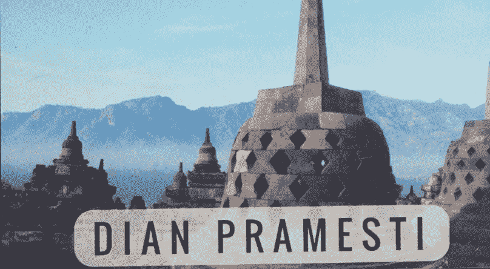

# Python 机器学习实战

> 游客

作者：Dian Pramesti 和 Hanum Gitarina

# 图书简介

你对计划下一次旅行感到兴奋吗？

你想在旅行时尝试一些新事物吗？

你想获得来自当地人的指导吗？

如果你对这些问题的任何一个回答是“是”，那么这本书就是为你准备的。

Dian Pramesti 和 Hanum Gitarina 写的《超越游客 – 爪哇岛，印度尼西亚》提供了关于爪哇岛的内部视角。大多数旅游书籍都会告诉你如何像游客一样旅行。虽然这也没有错，但作为“超越游客”系列，这本书将为你提供来自住在你下一次旅行目的地的人的建议和想法。

在这些页面中，你将发现有助于你度过停留期间的当地建议。“超越游客”系列是由当地人撰写的旅行书籍。像当地人一样旅行。获取内部信息。慢下来，留在一个地方，花时间去了解一个地方的人和文化。在指导下尝试一些小众路线。支持你旅途中的当地企业和商贩。愿意尝试新事物，拥有一生难忘的旅行体验。

当你读完这本书时，你将对前往下一个目的地感到兴奋。

所以，今天就买一份你自己的副本吧。你会感谢这么做的。

每购买一本书，将有十分钱捐赠用于教学学习。

# 作者简介

欢迎来到 > 游客

# > 游客

# 作者简介

作为印度尼西亚本地人，我们很高兴能写这个系列，爪哇岛是我们出生和成长的地方。在过去的几十年里那里变化了很多，但许多地方被当地人完好保留。我们只想向世界分享爪哇岛的一些。

# 欢迎来到 > 游客

> “只有在沙漠、城市或道路时，我才能谈论灵魂。”–保罗·柯艾

印度尼西亚作为一个群岛，拥有许多景点，不仅有自然景观，还有文化。作为一个群岛，印度尼西亚拥有许多传统、习俗、民族语言、美食和信仰。在万多个岛屿中，只有少数吸引了世界的目光，例如巴厘、爪哇和婆加罗。在这个特别版中，我们介绍爪哇岛，作为五个最大的岛屿之一，它长期以来一直迷着人们的眼睛。爪哇岛作为印度尼西亚人口最多的岛屿，分为六个省，它拥有许多值得探索的东西，从自然到文化，都将进行讨论。

## 3. 在潘加达兰海滩观看日出和日落

距离绿谷（Green Canyon）不远，你就能看到位于印度尼西亚西爪哇省的白沙滩。作为该省最好的海滩，你会被这里惊艳，因为你不仅可以享受日出或日落，两者都可以兼得！此外，潘加达兰海滩还提供其他活动，从在清澈安全的海水中游泳，尽享海洋之美，到见证第二次世界大战的遗迹洞穴。

## 4. 观汤库班帕胡火山的山口

汤库班帕胡（Tangkuban Perahu）是一座火山，是西爪哇另一个值得去的地方。它源于该省的一个传说，汤库班帕胡是爪哇岛最著名的景点之一，确切地说是西爪哇。除了传说之外，火山本身被称为 Tangkuban Perahu——在英语中这个词的意思是“倒扣船”——因为它的顶部看起来就像那样。对于这座活火山山口山，我建议你看看那些充满硫磺的山口以及山坡上的茶园。

## 西爪哇与万丹

### 必尝美食

### 5. 尝尝 Karedok 里的各种蔬菜

Karedok 是来自西爪哇的美味之一。对于热爱吃蔬菜的你，访问西爪哇时，Karedok 绝对是必尝菜。这种食物由各种生蔬菜组成，从黄瓜、茄子、豆芽、卷心菜到长豆都有。这些蔬菜并不是直接吃的，当你把它们与由花生酱、大蒜、花生、虾膏和其他配料制成的酱混合时，你一定会发现这些蔬菜的新味道。嗯，由于我偏好辣味，我通常会要求多加一些辣椒。

### 6. 品尝 Batagor，做万隆人

尽管这种食物现在遍布印度尼西亚，尤其是爪哇岛，但 Batagor 实际上源自西爪哇。Batagor 本身是 `bakso tahu goreng` 的缩写，英语翻译为“炸豆腐丸”。正如其名，这道菜实际上由切成方形的豆腐组成，裹上糊后炸制。有时，他们也会给你炸豆腐——没裹粉的那种——但我更倾向于只吃 batagor。

### 7. 尝试 Serabi Oncom

Serabi 是一种轻食，实际上不仅在西爪哇闻名，东爪哇也能找到。然而，这种来自西爪哇的 serabi 非常不同，因为配料赋予了它西爪哇特色。Serabi 本身是一种看起来像煎饼的零食，但是由米粉制成的。而上面的配料 `oncom`（发酵豆饼）类似于天豆。我并不喜欢 oncom，但对于那些非常想尝试独特食物的你来说，这种 serabi 是必不可少的。

### 8. 喝杯 Bandrek 暖暖

尽管印度尼西亚没有冬天，但当雨季来临时天气也会变冷。如果西方人通过饮用酒精来保持温暖，西爪哇人则倾向于喝一些 `bandrek`。`bandrek` 实际上是一种传统饮料，由姜、红糖（也称为爪哇糖）和胡椒等香料制成。通常当我感冒时会喝一些，因为它能缓解我的喉咙。

### 9. 观看木偶（Wayang Golek）开开怀

如果你问任何印度尼西亚人关于 Wayang Golek，他们脑海中浮现的通常是 Cepot。嗯，Cepot 是 Wayang Golek（来自西爪哇的传统木偶）中最著名的角色。Wayang Golek 本身像其他木偶一样，通常展示一些可能来自西爪哇的历史故事。表演会伴随着来自西爪哇的、被称为 Degung 的传统音乐。

### 10. 尝试学习 Jaipong 舞蹈

印度尼西亚的传统舞蹈与现在的任何现代舞蹈都有很大不同，包括来自西爪哇的舞蹈。西爪哇非常受欢迎的传统舞蹈例子是 Jaipong。我非常喜欢看这种舞蹈，因为它独特性，因为西爪哇的文化确实独特且富有魅力。

### 11. 弹奏你的 Angklung（安格隆）

当我还是孩子时，我对这种来自西爪哇的传统乐器着迷。它的形状非常独特，由特殊的竹子制成，不同尺寸会产生不同的声音。起初，Angklung 只在某些传统活动为人知，但随着全球化，Angklung 现在闻名全球。

### 12. 观看独特的马：Kuda Lumping

Kuda 是印度尼西亚语中“马”的意思。在之前，我可能会认为这种来自西爪哇的传统文化会使用马，比如某种骑马之类的活动。嗯，他们确实使用马，但他们使用的马非常不同。与具有 4D 外观的真马不同，他们使用的是由木头制成的独特人工 2D 假马。这种西爪哇文化的另一个独特之处在于它使用灵性，灵性会附身在骑假马的人身上。我的建议是，如果你不习惯别人吃玻璃或用武器刺自己的身体——呃，谁会习惯这些事儿呢——请先在心理上做好准备。

## 中爪哇

### 游玩景点

### 13. 从苏卡尔塔宫（Kraton Surakarta）了解索罗的历史

尽管印度尼西亚现在是一个共和国，但这个国家曾拥有许多王国。其中许多只能通过文学和残留的遗产来见证，但仍有一些王国作为共和国的一部分管理着宫殿，其中一个就位于苏卡尔塔（Surakarta）——人们习惯地称其为 Solo，位于印度尼西亚中爪哇。作为仍然存在的王国之一，这座宫殿（爪哇语称为 kraton）很可能是中爪哇的景点中心之一。苏卡尔塔宫不仅为你提供了大量关于过去索罗丰富的历史，还充满了大量的爪哇文化。同时，如果你想购物，苏卡尔塔宫位于一些购物中心附近，那里可以为你提供低价的巴迪（batik）——来自爪哇、具有美丽图案、符号和颜色的传统布料。

### 14. 在卡里满旺尽情释放

如果你热爱浮潜和潜水，我强烈建议你来这座位于爪哇岛北部的岛屿，从中爪哇的西拉（Jepara）乘船大约五到六小时。虽然到达卡里满旺岛很难，但那里的自然景观和海洋生物值得赞赞。每个去过那里的人告诉我他们想再去一次，我也是如此。它是爪哇的一颗宝石。其美丽程度可以与巴厘相比——只不过没有奢华的购物区。

### 15. 在桑格兰了解史前人类

如果你对史前时代感兴趣，来到中爪哇时你应该去桑格兰。位于中爪哇瓦根（Sragen）的考古发掘现场已被联合国教科文组织宣布为世界遗产。在这个博物馆中发现的化石也非常多样，你可以找到超过 13,800 件化石收藏。它是爪哇人的故乡，尽管有些收藏品展示了坦桑尼亚的奥杜威峡谷、澳大利亚的威尔兰拉湖和中国的周口店。

### 16. 感受迪登高原的新空气

从新鲜的空气、美丽的自然到历史景点，这个高原提供一切。迪登高原位于中爪哇的望索坡（Wonosobo），距离市区约 30 公里。这里有一个闻名的 `Telaga Tiga Warna`（三色湖），这是一个位于高原顶的湖泊，拥有三种不同的颜色。此外，周围还有几座印度教寺庙。然而，我最喜欢迪登高原的是 `carica`（蜜柠檬果），一种与木瓜同科的水果。

### 17. 在蜡染博物馆了解更多蜡染

蜡染博物馆位于佩卡隆根（Pekalongan），这里已成为蜡染之城。该博物馆被认为是一个新人，因为它于2006年才建成。蜡染博物馆不仅拥有大量的蜡染收藏，还成为了研究开发蜡染设计的场所。其实，蜡染本身是这个国家的骄傲，因为它代表了印度尼西亚的文化。你以前穿过蜡染吗？仅供你参考，印度尼西亚几乎每个省份都有自己版本的蜡染。有趣的是，在仅有6个省份的爪哇岛上，有几十甚至上百种不同的蜡染版本，每种背后都有自己的故事和历史。

## 中爪哇

### 值得尝试的食物

### 18. 享用 Nasi Liwet 晚餐

Nasi 在英语中是米饭的意思。然而，这种米饭和你尝试过的其他普通米饭不同，因为它加入了一些椰奶，所以味道更加咸香。这道菜来自索罗（Solo），如果你去索罗，傍晚时很容易在索罗的街边上找到 Nasi Liwet。是的，这道菜不是在餐厅出售——虽然有些餐厅将其作为菜单的一部分——但 Nasi Liwet是由街头小贩出售的。

### 19. 用 Wedang Ronde 暖暖身体

如果在西爪哇我们可以找到 Bandrek，那么在中爪哇很容易找到 Wedang Ronde，特别是在萨拉蒂加（Salatiga）。这种饮料也是由香料制成的——生姜是主要原料——但它的色彩更加丰富，因为它包含其他成分，如 `Arenga Pinnata` 的果实（印度尼西亚人通常称之为 `kolang-kaling`）、胶质、花生以及 `ronde 本身`。实际上，`ronde` 是用米粉制成的球状，里面含有花生。

### 20. 尝尝 Tempe Mendoan

Tempe Mendoan是我最喜欢的零食之一。这道菜是印度尼西亚一种名为 gorengan 的油炸零食。Tempe Mendoan 本身来自中爪哇的班尤马斯（Banyumas）和普沃克托（Purwokerto）。在普沃克托，mendoan 的意思是在热油中煎炸，使这道菜不经过完全加工。然而，尽管它看起来是生生的，但豆糕本身含有许多对我们身体有益的营养。

### 21. 另一种炸物，Tahu Petis

在吃了 Tempe Mendoan 之后，Tahu Petis 是我下一个喜欢的 gorengan。Tahu Petis 本身是一种炸豆腐，配上 petis 食用，petis 是一种用虾制成的酱料。我喜欢 Tahu Petis 的点在于它味道的独特组合，豆腐很可能是咸且鲜香的，而 petis 也有辣味可选。

## 中爪哇

### 值得学习的文化

### 22. 看另一场皮影戏，Wayang Kulit

如果说西爪哇拥有 Wayang Golek（木偶戏），那么中爪哇就有 Wayang Kulit（皮影戏）。Wayang Kulit 与 Wayang Golek 的不同在于材质和形状。如果 Wayang Golek 是木头制的，Wayang Kulit 就是用牛皮或水皮制成的，因为 `kulit` 的意思是“皮”。在故事方面，Wayang Kulit 通常讲述印度教故事，如《摩诃婆罗多》和《罗摩衍那》。

### 23. 观看并学习跳 Srimpi 舞

Tari Srimpi 或 Srimpi 舞是中爪哇的一种传统舞蹈。Tari Srimpi 由四个女孩跳舞——srimpi 本身的意思是“四”——每个女孩都有自己的头衔：水、火、风和土。这四个元素很好地代表了人类构成的四个元素。然而，尽管我不会跳这种舞蹈，但 Tari Srimpi 是一段非常美丽的舞蹈，值得一看。

### 24. 近距离观察 Keris（克里斯）

来自中爪哇的传统武器被称为 Keris。Keris 的形状像一把小刀，但是扭曲的形式。然而，让 Keris 成为中爪哇如此独特武器不仅是因为它的形状，还因为某些人相信 Keris 内部捕捉了一些灵魂。

### 25. 学习另一种舞蹈，Tari Sintren

与更经典的 Tari Srimpi 不同，Tari Sintren 或 Sintren 舞是一种来自神秘主义的传统舞蹈。这种舞蹈需要由处女来表演，她随后会被女神的灵魂附体。这种舞蹈的另一个独特之处，除了神秘感外，是舞者将穿着传统的服饰，头上戴着茉莉花，并戴着墨镜。

## 东爪哇

### 值得去的地方

### 26. 在布罗山见证日出

布罗山（Mount Bromo）是东爪哇最著名的景点之一。大多数人来到布罗山是为了在山顶见证美丽的日出。然而，尽管这座位于布罗莫腾格尔塞梅鲁国家公园的山不像其他火山那么，但它拥有如此美丽的风景，让每个游客都叹为观止。

### 27. 看看万汶县（Banyuwangi）美丽的伊真火山口（Kawah Ijen）

不仅是西爪哇拥有带有火口的 Tangkuban Perahu，东爪哇也拥有这座美丽的伊真火山口，它是印度尼西亚爪哇岛上最大的火口。这个硫磺山口非常漂亮，因为它有托斯卡绿色和蓝色的火焰。尽管你必须在午夜步行大约一个半小时，但我相信你会被位于东爪哇万汶县的这个火山口的美丽深深吸引。

### 28. 在巴鲁兰国家公园接触自然

印度尼西亚可能属于热带国家。然而，这个国家也被赐予了一些干燥生态系统，其中之一位于东爪哇，准确地说位于巴鲁兰国家公园（Baluran National Park）。你在公园里可能会发现草原，它占据了生态系统的 40%。国家公园提供的另一个景点是吉祥物——牛。

### 29. 为三宝纳之家（House of Sampoerna）震撼

爪哇岛确实以香烟生产地闻名。最老且最大的香烟工厂之一是三宝纳，位于东爪哇的泗罗（Surabaya）。然而，工厂现在提供一个景点，即三宝纳之家，这是一座具有殖民风格设计的博物馆，因为该建筑建于 1862 年。尽管它看起来很老，但博物馆的设计非常华丽，绝对会让你感觉如家一样，里面还有一个咖啡馆。

### 30. 尝试一些 Rujak Cingur

实际上，我并不喜欢吃混合了花生酱或 `petis` 酱汁的新鲜蔬菜或水果。但这个就不一样。来自东爪哇首府泗罗的 Rujak Cingur 味道很独特。它由许多水果和蔬菜组成，如黄瓜、生芒果、豆瓣菜、豆腐，以及 `cingur`——牛嘴——然后与 `petis` 酱混合在一起。一些不习惯吃奇怪东西（如 `cingur`）的人会犹豫，但我认为尝试是个好主意，因为那个味道会让你极其开心！

### 31. 尝试一下 Rawon

### 32. 尝尝马杜拉肉串（Satay Madura）

当你向任何印度尼西亚人询问肉串时，他们脑海中出现的很可能是来自马杜拉（靠近泗罗的一个岛屿）的肉串。这种肉串通常用鸡肉作为主要原料。吃肉串时，你需要给串好的烤鸡肉淋上花生酱。我更喜欢在上面淋一些酱油并撒上碎洋葱。

### 33. 尝试另一种配有花生酱的蔬菜——Gado-gado

我真的不知道为什么东爪哇人真的非常喜欢吃加加混合了花生酱的蔬菜。但这道 Gado-gado 也是一种你应该尝试的美食，尤其是如果你觉得 Rujak Cingur（牛皮沙）太极端了——也许你可以从 Gado-gado 开始。Rujak Cingur 和 Gado-gado 的区别在于，你得到的是煮过的蔬菜而不是生蔬菜。此外，你得到的不是牛皮，而是用白水煮蛋作为蔬菜的配菜。酱汁也不同，因为 gado-gado 使用花生酱而不是黑豆酱（petis sauce）。

## 东爪哇

# 值得学习的文化

### 34. 观看来自东爪哇的传统戏剧——Ludruk

每当你看戏时，男女演员在舞台上共同表演是很常见的事情。但，当你观看 Ludruk 演出时，如果你对演员感到好奇是很正常的，因为 Ludruk 通常由男性表演。Ludruk 演出的故事大多关于平民的日常生活，充满了幽默和批判。如果你想看 Ludruk 戏，最好在泗水、莫卓尔托和万中的寻找。

### 35. 观看波诺罗戈雷舞（Reog Ponorogo）感到震撼

美与文化的典范。这就是我对 Reog Ponorogo 的看法。这种被称为 Reog 的艺术舞蹈来自波诺罗戈，并自 2001 年起就获得了专利。这种作为东爪哇标志的舞蹈也表演了一些类似于 Kuda Lumping（骑马舞）的神秘现象。然而，最让你着迷的绝对是那个巨大的狮子面具，上面满了由孔雀羽毛制成的冠。

### 36. 观看来自马达拉的牛赛——Karapan Sapi

牛赛与任何赛马比赛之类的活动都不同。Karapan Sapi 是一场两牛拉着推车赛的比赛。通常，比赛在 8 月到 10 月之间举行，甚至还有总统杯作为奖励。

### 37. 尝试学习 Remo 舞（Tari Remo）

Tari Remo 或 Remo 舞是来自东爪哇泗水的传统舞蹈。这种舞蹈描绘了英雄的象征，因为它展示了勇气、阳气和英勇。有时被用来迎接客人，Tari Remo 也成为 Ludruk 演出的开场舞。

## 雅加达

### 值得游览的地方

### 38. 在马里奥波罗（Malioboro）购物

雅加达的市中心有一条长街，那里是购物狂者的天堂。Malioboro 是一个你可以找到许多廉价出售商品的地方——尽管你必须擅长还价才能获得更便宜的价格——从小装饰到蜡染（Batik）应有。街道附近还有一个传统市场，专门经营从蜡染到传统爪哇婚服的物品。我的建议是，因为这个地方每天都很拥挤，请看好自己的财物，因为我们永远不知道扒手藏在哪里。

### 39. 拍摄基杜尔县（Gunung Kidul）周边海滩的美照

这里是海迷的天堂。Gunung Kidul 距离雅加达中心相当远，拥有许多美丽的白沙海滩，而且充满了异域风情。最受欢迎——当然也是最挤的——Indrayanti 海滩。除此之外，还有 Drini 海滩、Kukup 海滩以及几处彼此非常近的海滩，尽管它们各有千秋。同时，如果你在寻找更私密的地方，我建议你去 Pok Tunggal 海滩。尽管位置被一些悬崖覆盖，但其美景依然令人赞往。

### 40. 访问普兰巴南神庙（Prambanan Temple）并欣赏舞蹈剧（Sendratari）

这座印度教庙也已被联合国教科文组织列为世界遗产。普兰巴南神庙实际上独特且形状非常美丽。虽然有些部分破损，但你可以在这里观看舞蹈剧（Sendratari）并享受乐趣。

### 41. 欣赏阿凡迪博物馆（Affandi Museum）的艺术之美

这座印度教庙也已成为世界遗产。普兰巴南神庙实际上非常独特，形状非常美丽。虽然有些部分已经破损，但它依然非常震撼。阿凡迪是印尼最著名的艺术家之一。他的技巧和风格广为人认可。他开始创作表现主义绘画。如果你对他的作品感兴趣，可以去博物馆看看。博物馆附近也有餐厅供你休息和用餐。

### 42. 在卡松松（Kasongan）购买艺术品

`Kasongan`是一个可以找到许多代表印尼、尤其是爪哇的工艺品的地方。你在那里找到的工艺品主要是陶器。

### 43. 别忘记尝试杜杜糕（Gudeg）

`Gudeg`是你来到雅加达时应该尝试的食物。这种美食在印尼闻名，尽管你在其他地方也能找到，杜杜糕是用石木瓜、棕糖和椰奶制成的。如果你想尝试，只需去威嘉兰（Kampung Wijilan）。剧透一下，它的味道是甜的。

### 44. 尝尝 Bakpia Pathuk

如果你来到雅加达，有一种你必须尝试的点心，叫做`Bakpia Pathuk`。这种小点心由面粉制成，里面有馅，然后烘烤。最初，`Bakpia Pathuk`以绿豆馅闻名，但现在它变得更加多样，你也可以吃到巧克力和奶士馅的。

### 45. 再尝尝杨果糕（Yangko）

`Yangko`是另一种来自雅加达的点心，通常带给家人吃。这种点心通常被切成小方块，也有不同的颜色。这种点心很像糯米糕，因为它口感软糯且甜，并带有粘性。

### 46. 品尝 Geplak 的甜味

不仅有`Bakpia Pathuk`和`Yangko`，雅加达还以`Geplak`闻名。这种点心非常甜且吸引人，因为它有许多不同的颜色，形状小巧独特。

### 47. 见证这一神圣的仪式——塞卡登（Sekaten）

就像泗水仍然拥有自己的苏丹国（王朝）一样，雅加达也有自己的苏丹国（王朝的另一个称呼）。这就是为什么雅加达仍然有各种传统仪式，包括塞卡登。这种仪式是为了纪念先知穆罕德的诞生。

### 48. 观看 Ketoprak

如果说东爪哇以`Ludruk`为其标志性戏目，那么日洛亚卡塔则倾向于`Ketoprak`。这是另一种源自爪哇岛的传统戏剧，故事通常是关于当地的一些历史事件。与`Ludruk`不同之处在于，演员阵容并不总是男性。通常，在表演期间，背景音乐来自名为甘美兰（`gamelan`）的传统乐。

### 49. 再次观看，罗摩衍那舞剧（Sendratari Ramayana）

正如我之前告诉过的，当你去普兰巴南（Prambanan）时，你可以观看名为`Sendratari Ramayana`的舞蹈表演——你也可以称之为罗摩衍那芭蕾。这个故事基于一首同名的梵文，讲述了斯里·罗摩（Sri Rama）的妻子辛塔（Shinta）被一个名叫罗湿那那（Rahwana）的巨人劫持的故事。芭蕾在普兰巴南寺区域的露天舞台表演，寺庙在满月下将成为舞台的背景。

### 50. 通过观看 Jatilan 学习士兵如何战斗

`Jatilan`实际上是一种舞蹈。这种传统舞蹈讲述了骑士在战斗中的故事。然而，与其他一些使用名为`kuda lumping`的假马的舞蹈不同，这种舞蹈也带有某种神秘色彩，因为舞者很可能会进入附神状态。

## 游客

## 比游客更懂（Greater than a Tourist）

请阅读其他“比游客更懂”系列书籍。

加入 >Tourist 邮件列表：

`http://eepurl.com/cxspyf`

Facebook:

`https://www.facebook.com/GreaterThanATourist`

请在 Amazon 和 Goodreads 上对这本书留下您诚恳的评价。谢谢您。

# 你对计划下一次旅行感到兴奋吗？

你愿意在旅行时尝试一些新奇事物吗？

你想要来自当地人的指导吗？

如果你对这些中任何一个问题的回答是“是”，那么这本书就是为你准备的。

《Greater Than a Tourist – 印尼西亚爪哇》由 Dian Pramesti 和 Hanum Gitarina 编写，提供了印度尼西亚爪哇的内部视角。大多数旅游书籍都在教你如何像游客一样旅行。虽然这并没有错，但“比游客更懂”系列的一部分，这本书将为你提供来自你下一个旅行目的地当地人的的建议和大量想法。

在这些页面中，你将发现帮助你度过停留期间的当地建议。“比游客更懂”系列是由当地人编写的一系列书籍。

像当地人一样旅行。获取内部信息。慢下来，留在一个地方，慢慢来，了解一个地方的人们和文化。在指导下尝试一些避开常径的路线。旅行时光顾当地企业和商贩。愿意尝试新事物，获得终生难忘的旅行体验。

当你读完这本书时，你将对前往下一个目的地旅行感到兴奋。

作为印度尼西亚当地人，我们很高兴有机会编写《畅游印度尼西亚》系列丛。对我们来说，爪哇不仅仅是一个岛，它是我们出生和成长的地方。在过去的几十年里，爪哇的很多地方发生了变化，但更多东西被当地人完好地保留，包括人们的友好、文化遗产、壮丽的自然风景等等——我们称之为“爪哇的丰富性”。我们只是想向世界分享一些爪哇的片段。

``
