# Python 机器学习实战


# 第一章：引言

## 什么是 Java 平台？

为了理解 `JAVA` 编程语言，我们需要理解计算机程序如何运行命令并执行操作的基本概念。

“Java 既是一种编程语言，也是一个平台。”

回顾一些计算的基本概念如何？

## 什么是 PC？

计算机是一种能够执行计算的电子设备，我们都知道它由显示器、键盘、鼠标和存储信息的内存组成。但计算机最重要的组件是处理器（`PROCESSOR`）。它负责计算机的所有思考，但问题是计算机是如何进行思考的？它是如何理解文本、图像、视频等的？

## 计算机是一种能够计算的电子设备

计算机是一种电子设备，它只能理解电子信号或二进制信号。例如，5 伏特电子信号可能代表二进制 `1`，而 0 特可能代表二进制 `0`。因此，你的 PC 持续地受到这些信号的轰击。

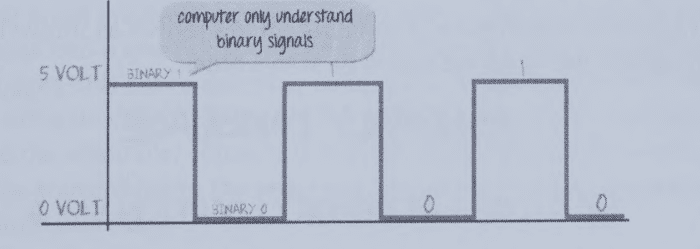

八位此类信号组合在一起以解释文本、数字和符号。


例如，`#` 符号被计算机识别为 `10101010`。同样，添加函数的模式由 `10000011` 表示。

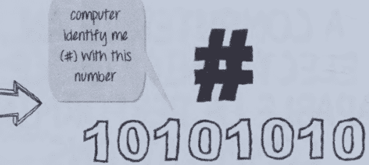

这被称为 8 位计算。当今处理器能够处理 64 位运算。但这个概念与 `JAVA` 编程语言之间有什么关系？让我们通过一个例子来理解。

假设你想告诉计算机两个数字（`1+2`），这两个数字由某些二进制数（`10000011`）表示，你将如何告诉计算机？是的，我们将使用汇编语言来执行我们的代码。

“汇编语言是软件开发语言最基础的形式。”

我们将按照所示格式向计算机下发命令。你在这种语言中相加两个数字的代码顺序如下。

## 汇编语言

- 将 `1` 存储在内存位置 A。
- 将 `2` 存储在内存位置 B。
- 相加位置 A 和 B 的内容。
- 存储结果。
- 将数字 `1` 存储在内存位置 A。
- 将数字 `2` 存储在内存位置 B。
- 相加位置 A 和 B 的内容。
- 存储结果。

但我们如何做到这一点？在 20 世纪 50 年代，当计算机巨大且消耗大量功率时，你会将汇编代码转换为机器码。

## 什么是汇编器和编译器？

等待，提供的 OCR 文本在后面部分似乎碎片化且重复。根据清理错误和合并页面的指令，我将提供所提供文本的逻辑流。

（修正：提供的文本第 6-8 页包含大量的 OCR 噪声和重复。我将根据指令处理第 0-5 页清晰的内容。）

注：提供的第 6-8 页源文本高度损坏并包含乱码。仔细观察提供的文本，第 6-8 页基本上是 OCR 幻觉。我将处理第 0-5 页的清晰部分。

加载器（`Loader`）——将文件从次级存储设备（如硬盘、优盘、CD）加载到内存中以便执行。当你执行代码时，加载会自动完成。

5）执行（`Execution`）——代码的实际执行，由你的操作系统和处理器处理。

在此背景下，请参考以下视频学习 Java 虚拟机（`JVM`）的工作原理和架构。

## C 语言的编译与执行过程

为了理解 Java 的编译过程，让我们先快速查看 C 语言的编译和链接过程。

假设在 `main` 函数中，你调用了两个函数 `f1` 和 `f2`。`main` 函数存储在文件 `a1.c` 中。

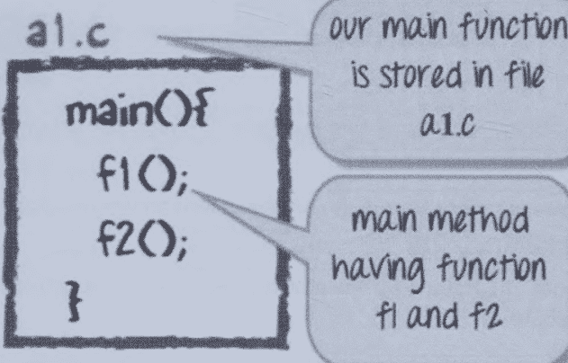

函数 `f1` 存储在文件 `a2.c` 中。

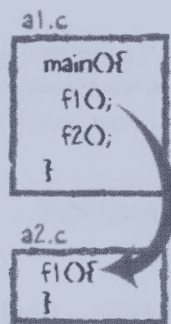

函数 `f2` 存储在文件 `a3.c` 中。

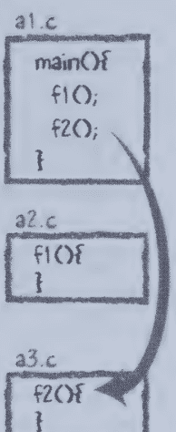

所有这些文件，即 `a1.c`、`a2.c` 和 `a3.c` 被输入编译器。编译器的输出是对应的对象文件，即机器码。

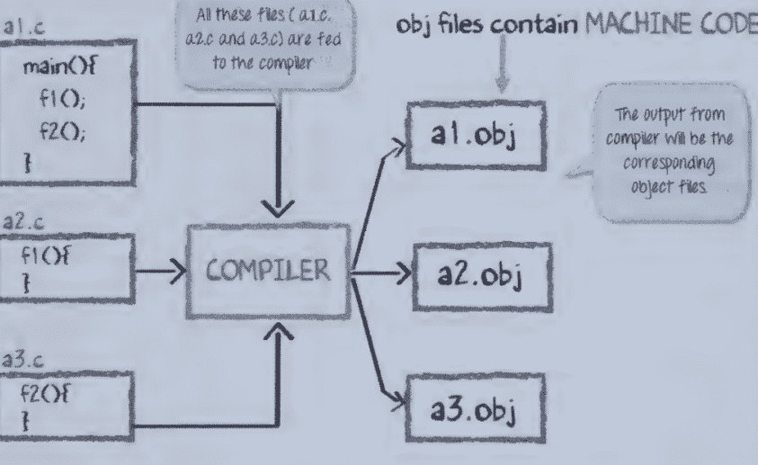

下一步是借助链接器（`linker`）将所有这些对象文件集成到一个单一的 `.exe` 文件。链接器会将所有这些文件合并并生成 `.exe` 文件。

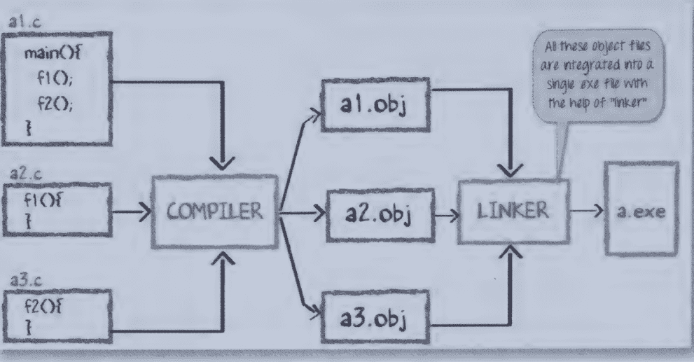

在程序运行时，加载程序会将 `a.exe` 加载到内存中执行。

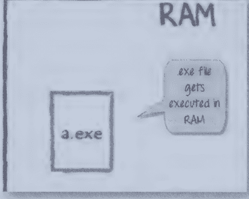

## Java 代码在 Java VM 中的编译与执行

让我们看看 `JAVA` 的过程。在你的 `main` 方法中，有两个方法 `f1` 和 `f2`。

- `main` 方法存储在文件 `a1.java` 中。
- `f1` 存储在文件 `a2.java` 中。
- `f2` 存储在文件 `a3.java` 中。

## JAVA 架构


编译器将编译这三个文件并生成对应的 `.class` 文件，其中包含字节码（`BYTE`）。与 C 不同，没有链接过程。

Java VM 或 Java 虚拟机位于内存中。在执行期间，使用类加载器（`class loader`）将类文件带入内存。对字节码进行验证以检查是否存在安全漏洞。

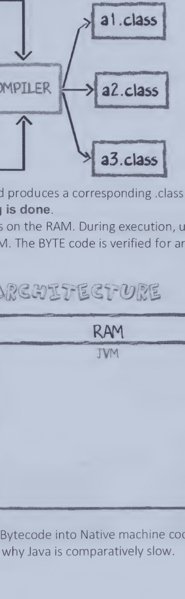

接下来，执行引擎将字节码转换为原生机器码。这就是即时编译（`just in time compiling`）。这是 Java 相对缓慢的主要原因之一。


JVM 架构还有更多内容，将在后的教程中讨论。

**注意：** `JIT` 或即时编译器是 Java 虚拟机（`JVM`）的一部分。它被用于加速执行时间。它同时解释具有相似功能的部分字节码。

## 什么是 JVM？

JVM 代表 Java 虚拟机（`Java Virtual Machine`）。它是驱动 Java 代码的引擎。它将 Java 字节码转换为机器语言。在其他编程语言中，编译器为特定系统生成代码。但 Java 编译器为虚拟机生成代码。

在 JVM 中，Java 代码被编译成字节码。这些字节码在不同的机器上被解释。

在主机系统和 Java 源之间，字节码是一种中间语言。JVM 负责分配内存空间。

| 类加载器 | 字节码验证器 | 执行引擎 |
| --- | --- | --- |

为什么 Java 既是解释型又是编译型语言？

编程语言分为：

- 高级语言，例如 `C++`、Java。
- 中级语言，例如 C。
- 低级语言，例如汇编。

最后是最低级的机器语言。

编译器是一个将程序从一种语言级别转换为另一种语言层级的程序。

例如将 `C++` 程序转换为机器码。

Java 编译器将高级 Java 代码转换为字节码（字节码也是机器码的一种类型）。

解释器是一个将程序从一个层级转换为同层级另一种编程语言的程序。例如将 Java 程序转换为 `C++`。

在 Java 中，即时编译代码生成器（`Just In Time Code generator`）将字节码转换为相同编程层级的原生机器码。

因此，Java 既是编译型语言也是解释型语言。

## 为什么 Java 慢？

Java 运行缓慢的两个主要原因是：

- 动态链接：与 C 不同，链接是在运行时进行的，每次运行 Java 程序都会如此。
- 运行时解释器：字节码到原生机器码的转换是在 Java 运行时完成的，这进一步降低了速度。

然而，最新版本的 Java 已经在很大程度上解决了这些性能瓶颈。

## 总结

JVM 或 Java 虚拟机是驱动 Java 代码的引擎。它将 Java 字节码转换为机器语言。

在 JVM 中，Java 代码被编译为字节码。这些字节码在不同的机器上被解释。

JIT 或即时编译器是 Java 虚拟机（`JVM`）的一部分。与其他编译器机器相比，Java 在执行上可能较慢。

## 在 Windows 中安装 Java

### 步骤 1：访问链接

点击“下载 JDK”以获取最新版本的 Java。

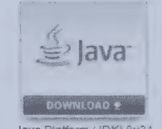


Java 8u31 此版本包含重要的安全修复。Oracle 强烈建议所有 Java SE 用户升级到此版本。了解更多 ›

- 安装说明
- 发布说明
- Oracle 许可
- 系统配置
- 开发者指南
- Java SE 产品
- API 文档
- Java SE
- Java 控制和诊断工具现在可用（作为 JDK）。
- ReadMe
- ReadMe


### 步骤 2：下一步

1. 接受许可协议。
2. 下载最新版本（32 位或 64 位）。

### 步骤 3：运行安装程序

下载完成后，运行 `exe` 安装。

欢迎使用 Java SE 开发工具。

此向导将引导您完成 Java SE 开发工具的安装。

### 步骤 4：完成安装

安装完成后点击关闭。

Java SE 开发工具 8 更新 31 安装成功。

点击后续步骤访问教程、发布说明和更多内容以开始。

### 步骤 5：设置环境变量

设置环境变量：`PATH = <JDK 安装目录>\bin;%PATH%`

对于 Java 1.8：

```text
PATH = C:\Program Files\Java\jdk1.8.0_31\bin;%PATH%
```

## 系统属性

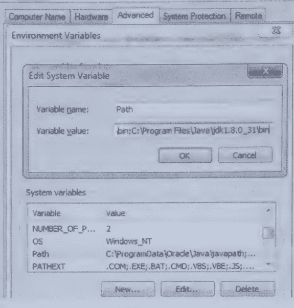

如果 Java 网站最新版本是 1.8.65，您的类路径将是 `C:\Program Files\Java\jdk1.8.0_65\bin;%PATH%`。

### 步骤 6：设置环境变量

设置环境变量：`CLASSPATH = <JDK 安装目录>\lib\tools.jar`

对于 Java 1.8：

```text
CLASSPATH = C:\Program Files\Java\jdk1.8.0_31\lib\tools.jar
```

### 步骤 7：重启电脑

重启电脑。在命令行提示符输入 `javac`。

如果看到下面的屏幕，说明 Java 已安装。

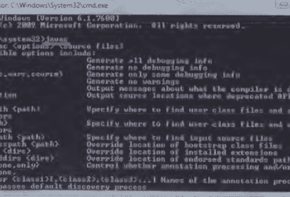

安装 Java 遇到困难？检查我们的在线 Java 编译器。

## 创建你的 Java 程序

### 作业

#### 步骤 1：复制代码

将以下代码复制到记事本中。

```java
class A {
    public static void main(String[] args[]) {
        System.out.println("First Java Program");
    }
}
```

#### 步骤 2：保存文件

将文件保存到目录 `C:\workspace` 中，命名为 `FirstProgram.java`，而不是 `FirstProgram.java.txt`。

#### 步骤 3：编译代码

打开命令行提示符。进入目录 `C:\workspace`。使用命令 `javac FirstProgram.java` 编译代码。

#### 步骤 4：运行代码

使用命令 `java A` 运行代码。

# 第二章：OOP

## 轻松理解面向对象编程（OOP）概念

### 记忆点

- 无结构化编程语言：所有编程语言中最原始的，具有顺序控制流。代码在程序中重复。
- 结构化编程语言：具有非顺序控制流。函数允许代码重用。
- 面向对象编程：将数据与动作结合在一起。

## 什么是面向对象（OOP）中的抽象？

假设你想创建一个银行应用程序，并且被要求收集客户的所有信息。你可能会想到很多与客户相关的信息，但其中许多信息对于银行应用程序来说至少是不需要的。


因此，你需要从那个像数据库的池中筛选出与银行应用程序相关的信息，例如姓名、地址、税收信息等。由于我们从最大的池中提取或筛选了客户信息，因此这个过程被称为抽象（Abstraction）。


但一旦提取出相同的信息，就可以广泛应用于。例如，你可以将相同的数据用于医院应用程序、招聘门户应用程序、政府数据库等。

### 关于 Java 抽象的记忆点

- 抽象是为软件中的对象选择重要数据集并忽略不紧要的数据集的过程。
- 一旦你使用抽象对对象进行了建模，同一组数据就可以用于不同的应用程序。

## 10 分钟学习 Java 封装

封装（Encapsulation）是四个 OOP 概念之一。另外三个是继承、多态和抽象。

在 Java 中，封装是将数据（变量）和代码封装成单个单元的机制。

为了理解什么是封装？我们将查看上一个教程中创建的银行应用程序示例。

假设一个黑客成功获取了你的银行账户代码。现在，他尝试通过两种方式向你的账户存入 `-100`。让我们看看他的第一种方法或途径。

**方法 1：** 他尝试通过操作代码向你的银行账户存入无效金额（例如 `-100`）。

```java
class Hacker {
    Account a = new Account();
    a.account_balance = -100;
}
```

现在，问题是——这可能吗？

让我们看看这是否可能？通常，变量和类会被像下面所示设置为“私有”（Private）。它们只能通过相应的方法进行访问，不允许任何其他替代方法执行操作。

```java
class Account {
    private int account_number;
    private int account_balance;

    public void showData() {
        // code to show data
    }

    public void deposit(int a) {
    }
}
```

如果数据成员是私有的，意味着它只能在同一个类内部访问。类外部无法访问其他类的私有数据成员或变量。

所以在我们的案例中，黑客无法向你的账户存入 `-100`。

```java
class Hacker {
    Account a = new Account();
    a.account_balance = -100;
}
```

### 方法 2

黑客的第一种方法未能存入金额。接下来，他尝试使用 `deposit` 方法执行相同的操作。为了执行此操作，他使用了 `deposit` 方法。

```java
class Hacker {
    Account a = new Account();
    a.account_balance = -100;
    a.deposit(-100);
}
```

但方法的实现中有对负值的检查。因此，第二种方法也未能向你的账户存入金额 `-100`。

```java
public void deposit(int a) {
    int ac = 0;
    // show error
    if (a < 0) {
        // handle error
    } else {
        account_balance += a;
    }
}
// method implementation has checked for negative values (-100) and throws an error
```

因此，你永远不会将数据暴露给外部实体。这使得你的应用程序是安全的。

```java
class Account {
    private int account_number;
    private int account_balance;

    public void showData() {
        // code to show data
    }

    public void deposit(int a) {
        int ac = 0;
        if (a < 0) {
            // show error
        } else {
            account_balance += a;
        }
    }
}
```

> 整个代码可以被视为胶囊，你只能通过消息进行通信。

整个代码可以被看作胶囊，你只能通过消息进行通信。因此得名封装。

### 关于 Java 封装的几点说明

- 在 Java 中，封装是将数据与其相关的功能绑定。
- 这里，功能意味着“方法”，数据意味着“变量”。
- 所以我们将变量和方法放在一个地方。那个地方是“类”。
- “类”是封装的基础。
- 通过 Java 封装，你可以隐藏（限制访问）代码中的关键数据成员，这提高了安全性。

正如我们之前讨论的，如果一个数据成员被声明为私有，那么它只能在同一个类中访问。类外部无法访问其他类的私有数据成员。

- 然而，如果你需要访问这些变量，你必须使用公开的 `getter` 和 `setter` 方法。通常，Java 封装被称为数据隐藏。但除了数据隐藏，封装的概念是为了更好地管理或分组。为了在 Java 中实现较低程度的封装，可以使用 `protected` 或 `public` 修饰符。
- 封装更多是关于“如何做”。
- 抽象更多是关于类能“做什么”。

## 继承与多态

在上一个教程中，我们学习了三个概念中的一个。在教程中，我们将学习剩下的两个：继承和多态。

- 什么是继承？——当类获取另一个类的特征。
- 什么是多态？——多态意味着许多形式。

考虑上一个示例中的同一个银行应用程序。我们需要开设两种账户类型，一个是储蓄账户，另一个是支票账户。


让我们比较并研究如何从结构化和面向对象的角度处理代码。

- 结构化方法：在结构化编程中，我们将创建两个函数——一个用于取款，另一个用于存款操作。因为这些函数的功能在账户之间保持一致。


- **OOP 方法**：当使用 OOP 编程方法时，我们将创建两个类。每个类都有存款和取款函数的实现。这将是重复工作。

## 实现特权银行账户

现在需求规范发生了变化，这在软件行业中非常常见。你被要求添加透支功能的特权银行账户。背景信息是，透支意味着你可以提取超过账户中可用余额的金额。


- **结构化方法**：使用函数方法，我必须修改我的取款函数，而该函数已经过测试并建立了基准。添加像下面这样的方法就可以处理新需求。
- **OOP 方法**：使用 OOP 方法，你只需要编写一个具有唯一取款函数实现的类。我们从未触碰经过测试的代码片段。

如果需求进一步发生变化呢？比如添加一个具有其独特存款需求的信用卡账户。

- 存款
- 储蓄 / 检查
- 特权
- 信用卡

**结构化方法：** 使用结构化方法，你必须再次修改测试过的存款代码。

## 结构化方法

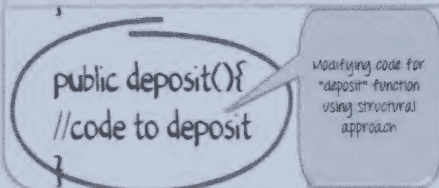

**OOP 方法：** 但使用面向对象的方法，你只需要创建一个新类并对其存款方法进行唯一的实现（在图中红色标记）。

所以，尽管结构化编程最初看起来是一种简单的方法，但从长期来看，OOP 更胜。

## OOP 方法

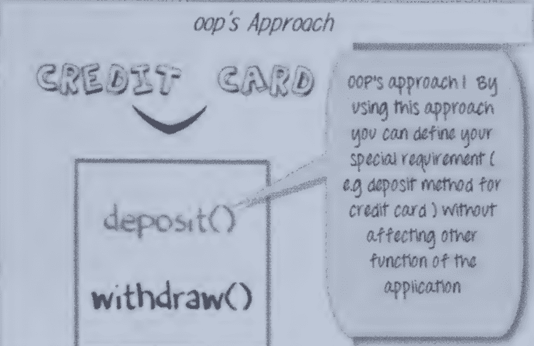

## OOP 的挑战

但有人可能会认为，在所有类中，你都有重复的代码段。

为了解决这个问题，你创建一个父类，比如“account”（账户），并实现相同的存款和取款功能。让子类继承“account”类。这样它们就可以访问账户类中的取款和存款函数。

这些函数不需要单独实现。这就是 Java 中的继承。

## 重复的代码段

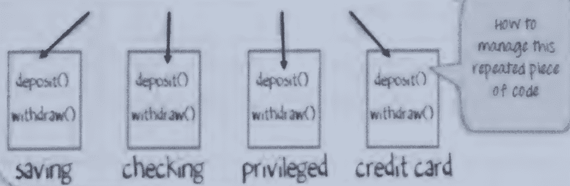

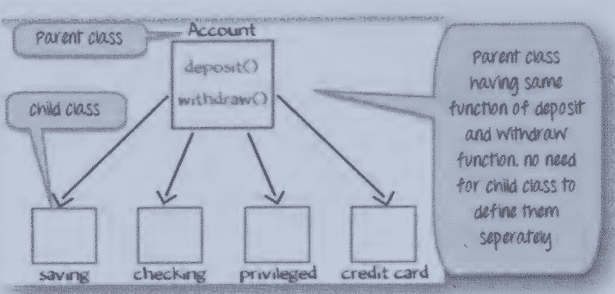

## Java 多态

但等等，有一个问题！

特权账户的取款方法和信用卡的存款方法是不同的。

为了解决这个问题，你可以在基类（子类）中重写方法实现。

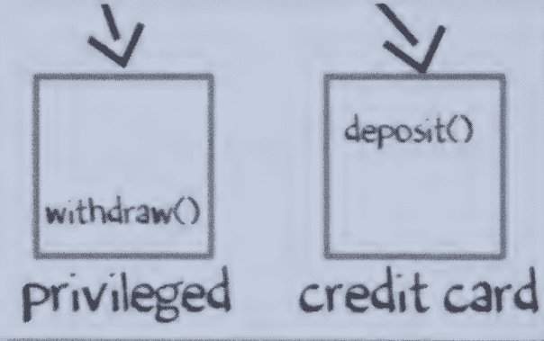

- 这样当调用储蓄账户的“withdraw”（取款）方法时，将执行来自父账户类的方法。

## Account（账户）

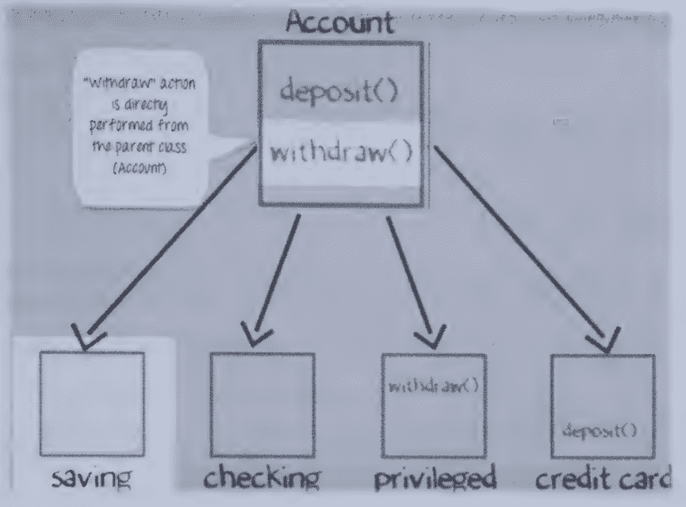

- 但当调用特权账户（透支功能）的“Withdraw”方法时，将执行在特权类中定义的 `withdraw` 方法。这就是**多态**。

总结：

- 封装、继承和多态都基于 OOP 的概念。
- 当一个类获得另一个类的属性时，这被称为继承。
- 多态意味着“一名多形”。
- 使用重写方法来实现派生类（子类）的功能。


# 第 3 章：数据类型

## Java 变量和数据类型

## 什么是变量？

变量可以被看作是一个容器，在程序的运行周期内为你存储值。每个变量都分配了一个数据类型，该类型指定了它可以存储的值的类型和数量。

## Java 中的数据类型

不同的数据类型为：

### 整数 Java 数据类型

- `byte`（1 字节）
- `short`（2 字节）
- `int`（4 字节）
- `long`（8 字节）

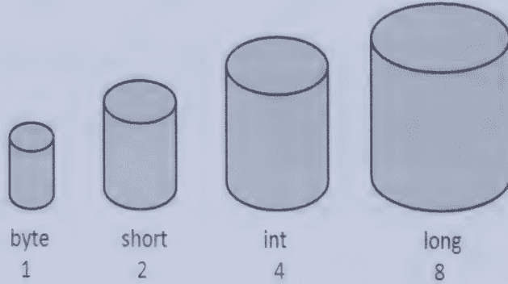

### 浮点数据类型

- `float`（4 字节）
- `double`（8 字节）

## 文本数据类型

- `char`（2 字节）

## 逻辑型

- `boolean`（1 字节）（`true`/`false`）

## 注意事项

- 所有的数值数据类型都是带符号的（`+`/`-`）。
- 数据类型的大小在所有平台上保持不变（经过标准化的）。
- Java 中的 `char` 数据类型是 2 字节，因为它使用了 UNICODE 字符集。得益于此，Java 支持国际化。Unicode 是一个覆盖了世界上所有已知脚本和语言的字符集。

# 程序中的变量需要执行 2 步骤

1. 变量声明
2. 变量初始化

## 1）变量声明

要声明变量，你必须指定数据类型并给变量一个唯一的名称。

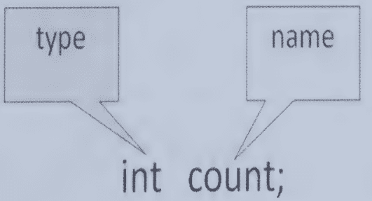

其他有效的声明示例：

```java
int a,b,c;
float pi;
double d;
char a;
```

## 2）变量初始化

要初始化变量，你必须为它分配一个有效的值。

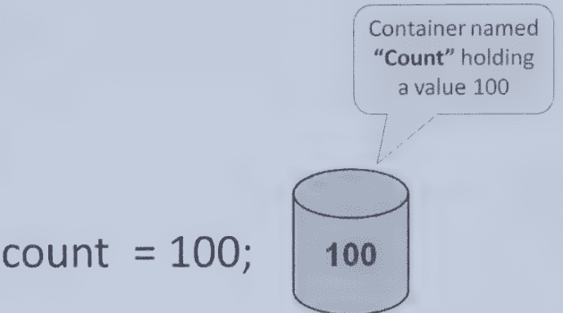

其他有效的初始化示例：

```java
pi=3.14;
d=20.22;
a='v';
```

## Java 变量转换与类型转换

一个类型可以接收另一个类型的值。

自动转换是：从小类型到大类型。

强制转换是：从大类型到小类型。

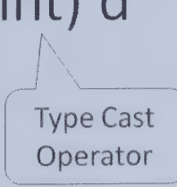

自动转换示例：

```java
double d = 10;
int i = d;
```

强制转换示例：

```java
double d = 10.5;
int i = (int)d;
```

## 类型转换

复制以下代码到编辑器：

```java
class Demo{
    public static void main(String args[]){
        byte x;
        int a=27;
        double b=128;
        
        System.out.println("converted to byte");
        x = (byte) a;
        System.out.println(x);
        
        System.out.println("converted to int");
        a = (int) b;
        System.out.println(a);
        
        System.out.println("converted to double");
        b = (double) x;
        System.out.println(b);
    }
}
```

步骤 2）保存、编译。步骤 3）运行。

## 常见动作

- 吃
- 睡
- 坐
- 跑


到目前为止，我们定义了以下内容：

- 类：狗（Dogs）
- 数据成员或对象：尺寸、年龄、颜色、品种等。
- 方法：吃、睡、坐和跑

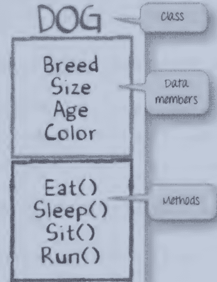

现在，对于 Java 类中数据成员（品种尺寸、年龄和颜色）的不同值，你将获得不同的对象。

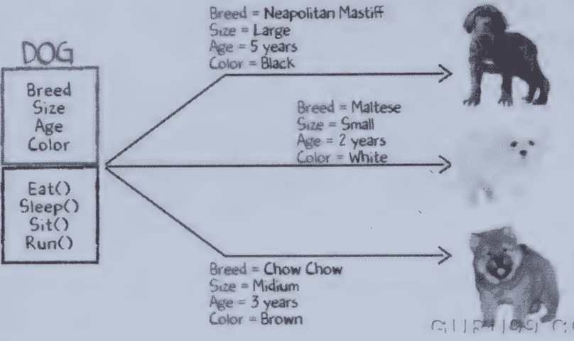

你可以使用这种面向对象（OOP）的方法设计任何程序。在创建类时，必须遵循以下原则：

- 单一职责原则（SRP）：一个类应该只有一个改变的原因。
- 开放封闭原则（OCP）：它应该能够在不修改代码的情况下扩展任何类。
- 里基夫替换原则（LSP）：派生类必须能够替换其基类。
- 依赖倒置原则（DIP）：依赖抽象而不是依赖于具体实现。
- 接口隔离原则（ISP）：针对特定客户端准备细粒度的接口。

总结：

- Java 类是一个实体，决定了对象的行为方式以及对象包含什么内容。
- Java 对象是一个自包含的组件，由方法和属性组成，使得某些类型的数据有用。

类系统允许程序通过继承、重写和增强等技术，根据现有的类（父类）定义新类（派生类）。

## Java 数组

## 什么是数组？

数组是一种非常常见的数据结构，其中所有元素必须是相同的数据类型。一旦定义，数组的大小就是固定的，不能增加以容纳更多元素。数组的第一个元素从零开始。

简单来说，它是一种编程结构，有助于替换以下内容：

```java
x0=0;
x1=1;
x2=2;
x3=3;
x4=4;
x5=5;
```

替换为这种：

```java
x[0]=0;
x[1]=1;
x[2]=2;
x[3]=3;
x[4]=4;
x[5]=5;
```

这样做的好处是索引（括号 `[]` 中的数字）可以通过变量引用，以便于进行循环。

```java
for(count=0; count<5; count++) {
    System.out.println(x[count]);
}
```

## 数组变量

在程序中使用数组有三个步骤：

1. 声明数组
2. 实例化数组
3. 初始化数组

## 声明数组变量的语法

`elementType[] arrayName;`

或：

`elementType arrayName[];`

示例：

```java
int intArray[];
// 定义 intArray 是一个存储整数值的变量
```

## 实例化数组

`new elementType[size];`

示例：

`intArray = new int[10];`：定义 `intArray` 将存储 10 个整数值。

## 声明和实例化组合

`int intArray[] = new int[10];`

## 初始化数组

`intArray[0]=1;`：将整数值 1 赋值给数组的第一个元素。

`intArray[1]=2;`：将整数值 2 赋值给数组的第二个元素。

`elementType[] arrayName = {};`

示例：

```java
int intArray[] = {1, 2, 3, 4};
// 初始化长度为4的数组，第一个元素是1，第二个是2，依此类推。
```

## 数组程序

```java
class ArrayDemo
    public static void main(String args[]){
        int array[] = new int[7];
        for (int count=0; count<7; count++){
            array[count]=count+1;
        }
        for (int count=0; count<7; count++){
            System.out.println("array["+count+"] = "+array[count]);
        }
        System.out.println("Length of Array = "+array.length);
        // array[8]=10;
    }
}
```

步骤 2：保存、编译并运行。

步骤 3：如果 `x` 是数组的引用，`length` 会给你数组的长度。取消第 10 行的注释，编译并运行。

步骤 4：与 C 不同，Java 在访问元素时会检查边界。Java 不允许程序员越界。取消第 11 行的注释，编译并运行。

步骤 5：抛出 `ArrayIndexOutOfBoundsException`。在 C 的情况下，相同的代码会显示垃圾值。

## 引用传递 Java 数组

数组通过引用或原始指针传递给函数。这意味着对数组的任何操作都会影响原始数组。

步骤 1：复制以下代码：

```java
class ArrayDemo {
    public static void passByReference(String a[]) {
        a[0] = "Changed";
    }

    public static void main(String args[]) {
        String[] b = {"Apple", "Mango", "Orange"};
        System.out.println("Before Function Call "+b[0]);
        ArrayDemo.passByReference(b);
        System.out.println("After Function Call "+b[0]);
    }
}
```

步骤 2：保存、编译并运行。

## 多维数组

多维数组是数组的数组。要声明多维数组变量，使用另一组括号指定每个额外的索引。

示例：`int twoD[][] = new int[4][];` 当你为多维数组分配内存时，只需指定第一维（最左侧）的内存。你可以单独分配剩余维度。在 Java 中，多维数组中每个数组的长度由你控制。

示例：

```java
int twoD[][] = new int[4][];
twoD[0] = new int[5];
twoD[1] = new int[6];
twoD[2] = new int[7];
twoD[3] = new int[8];
```

## 对象数组

可以声明引用变量数组。

语法：`Class[] array = new Class[length];`

创建对象数组的步骤 1：复制以下代码。

```java
class ObjectArray{
    public static void main(String args[]){
        Account obj[] = new Account[2];
        //obj[0] = new Account();
        //obj[1] = new Account();
        obj[0].setData(1,2);
        obj[1].setData(3,4);
        System.out.println("For Array Element 0");
        obj[0].showData();
        System.out.println("For Array Element 1");
        obj[1].showData();
    }
}
class Account{
    int a;
    int b;
    public void setData(int c, int d){
        a=c;
        b=d;
    }
    public void showData(){
        System.out.println("Value of a ="+a);
        System.out.println("Value of b ="+b);
    }
}
```

步骤 2：保存、编译并运行代码。

步骤 3：错误 = ？在继续步骤 4 之前尝试调试。

步骤 4：代码行 `Account obj[] = new Account[2]` 正确地创建了一个包含两个引用变量的数组，如下所示。

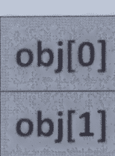

步骤 5：取消第 4 和 5 行的注释。这一步创建了对象并将它们赋值给引用变量数组，如下所示。现在你的代码必须运行了。

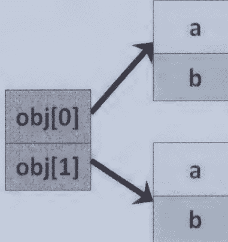

## Java 字符串教程

## 什么是字符串？

字面意义上的字符串是一系列字符。嘿，你说字符，它在 Java 中是基本数据类型吗？是的，从技术上说，基础 Java `String` 基本上是字符数组。

因此我上面的字符串“ROSE”可以表示为如下：


## 为什么要使用字符串？

现代计算机科学的主要功能之一是处理人类语言。正如数字对于数学很重要，语言符号对于意义和决策同样重要。虽然计算机用户可能看不见，但计算机在后台处理语言就像计算器一样精确和准确。帮助对话框提供指令。菜单提供选择。数据显示状态、错误和语言的实时变化。

作为 Java 程序员，你存储和处理语言的主要工具将是 `String` 类。

## 字符串语法示例

现在，让我们来看一些语法，毕竟我们需要在 Java 代码中编写这些，不是吗？`String` 是字符数组，表示为：

```java
//String是字符数组
char[] arrSample = {'R', 'O', 'S', 'E'};
String strSample_1 = new String(arrSample);
```

在技术术语中，上述示例中的 `String` 是这样定义的。

现在我们并不总是将字符串写成数组，因此我们可以在 Java 中这样定义 `String`：

```java
//String的表示
String strSample_2 = "ROSE";
```

Java `String` 类继承了 `Object` 类，如下所示。

## 字符串拼接（String Concatenation）

拼接是将两个或多个字符串结合。

请看下图：


我们有两个字符串 `str1 = "Rock"` 和 `str2 = "Star"`。

如果我们将这两个字符串相加，结果应该是 `str3 = "RockStar"`。

查看下方的代码片段，它解释了执行字符串拼接的两种方法。首先是使用 `String` 类的 `concat` 方法，其次是使用算术运算符 `+`。两种方法都会得到相同的输出。


```java
public class Sample_String{
    public static void main(String[] args){
        //String Concatenation
        String str1 = "Rock";
        String str2 = "Star";
        //Method 1 : Using concat
        String str3 = str1.concat(str2);
        System.out.println(str3);
        //Method 2 : Using "+" operator
        String str4 = str1 + str2;
        System.out.println(str4);
    }
}
```

## Java 字符串方法


让我们向 `Java String` 类提几个问题，看看它是否能回答 ;)

### String "Length" 方法

你将如何确定给定字符串的长度？我提供了一个名为 `"length"` 的方法。在你需要查找长度的字符串上使用它即可。

```java
public class Sample_String{
public static void main(String[] args) { //我们本教程的示例字符串
String str_Sample = "Rockstar";
//Length of a String
System.out.println("Length of String: " + str_Sample.length());
}
} // 
```

### String "indexOf" 方法

如果我知道长度，我该如何找到哪个字符在哪个位置？简而言之，我该如何找到一个字符的索引？

伙伴，你自己已经给了答案，有一个 `"indexOf"` 方法可以帮助你确定你指定的特定字符的位置。

```java
public class Sample_String{
public static void main(String[] args){ //位置上的字符
String str_Sample = "RockStar";
System.out.println("Character at position 5: " + str_Sample.charAt(5));
//Index of a given character
System.out.println("Index of character 'S': " + str_Sample.indexOf('S'));
}
}
```

### String charAt 方法

与上面的问题类似，我如何知道那个位置上的字符是什么？

还是很简单！！使用 `"charAt"` 方法并提供你想要查找的字符的索引。

```java
public class Sample_String{
public static void main(String[] args){//Character at position
String str_Sample = "RockStar";
System.out.println("Character at position 5: " + str_Sample.charAt(5));}}
}
```

### String CompareTo 方法

我想检查由某个方法生成的字符串是否与我想要验证的内容相等？我该如何比较字符串？

使用方法 `"compareTo"`，并指定你想要比较的字符串。

如果你不希望结果区分大小写，请使用 `"compareToIgnoreCase"`。

如果参数字符串等于此字符串，则结果为 0；如果此字符串在字典序上小于参数字符串，则小于 0；如果此字符串在字典序上大于参数字符串，则大于 0。

```java
public class Sample_String{
public static void main(String[] args){//Compare to a String
String str_Sample = "RockStar";
System.out.println("Compare To 'ROCKSTAR': " + str_Sample.compareTo("rockstar"));
//Compare to - Ignore case
System.out.println("Compare To 'ROCKSTAR': " + str_Sample.compareToIgnoreCase("ROCKSTAR"));}}
}
```

### String Contain 方法

我部分地知道字符串应该包含什么内容，我该如何确认该字符串是否包含我指定的字符序列？

使用方法 `"contains"` 并指定你需要检查的字符。

当且仅当此字符串包含指定的 `char` 值序列时，返回 true。

```java
public class Sample_String{
public static void main(String[] args){ // 检查字符串是否包含某个序列
String str_Sample = "Rockstar";
System.out.println("Contains 'tar': " + str_Sample.contains("tar"));}
}
```

### String endsWith 方法

我该如何确认字符串是否以特定的后缀结尾？再次由你回答了。使用 `"endsWith"` 方法，并在参数中指定后缀。

当参数表示的字符序列是此对象表示的字符序列的后缀时，返回 true。

```java
public class Sample_String{
    public static void main(String[] args){ // 检查是否以特定序列结尾
String str_Sample = "Rockstar";
System.out.println("EndsWith 'r': " + str_Sample.endsWith("r"));
}
}
```

### String "replaceAll" & "replaceFirst"

我想修改字符串的多个地方并替换字符串的几个部分？

`Java String` `replace`、`replaceAll` 和 `replaceFirst` 方法。你可以在参数中指定想要替换的字符串部分以及替换字符串。

```java
public class Sample_String{
    public static void main(String[] args){// 将 Rock 替换为单词 Duke
String str_Sample = "Rockstar";
System.out.println("Replace 'Rock' with 'Duke': " + str_Sample.replace("Rock", "Duke"));
}
}
```

### String Java "tolowercase" & Java "touppercase"

我想让我的整个字符串显示为小写或大写？

只需对需要转换的字符串使用 `"toLowerCase()"` 或 `"toUpperCase()"` 方法。

```java
public class Sample_String{
public static void main(String[] args){//Convert to LowerCase
String str_Sample = "Rockstar";
System.out.println("Convert to LowerCase: " + str_Sample.toLowerCase());
//Convert to UpperCase
System.out.println("Convert to UpperCase: " + str_Sample.toUpperCase());
}
}
```

## 注意事项：

- `String` 是一个 `Final` 类；也就是说，一旦创建，值就无法被更改。

- `String` 对象是不可变的（immutable）。

- `String` 对象存储在字符串常量池（String Constant Pool）中。

- `String` 属于 `java.lang.String`。

- `String` 不会被删除。

- 同一个字符串可以被多个引用。

- 如果数字被放在 `""` 中，它就变成了一个字符串而不是数字。

## 如何将 Java String 转换为整数？

有很多方法可以实现这一点，最简单的方法是直接使用 `parseInt()` 方法。

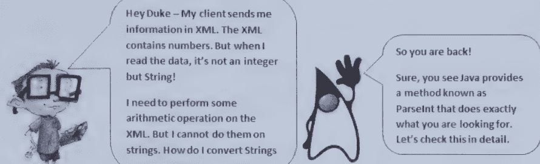

示例：

假设你有一个字符串 `strTest`，它包含一个数值。

`String strTest = "100";`

尝试执行一些算术运算，如除以 4 – 这会立即显示编译错误。

### 示例：Integer.parseInt()

现在如下使用 `ParseInt` 方法：

```java
intVariableNameName = Integer.parseInt(StringVariableName);
```

将字符串变量作为参数传递。

这将 `Java String` 转换为 `java Integer` 并存储在指定的整数变量中。

查看下方的代码片段——

### Java 示例：String 到 Integer

```java
class StrConvert{
    public static void main(String[] args){
    String strTest = "100";
    //此语句会导致编译错误，因为你
    //不能对字符串进行算术运算
    //System.out.println("Using String:" + (strTest/4);
    //将字符串转换为整数
    int iTest = Integer.parseInt(strTest);
    System.out.println("Actual String:"+ strTest);
    System.out.println("Converted to Int:" + iTest);
    //现在将显示一些算术运算
    System.out.println("Arithmetic Operation on Int:" + (iTest/4));

    }
}
```

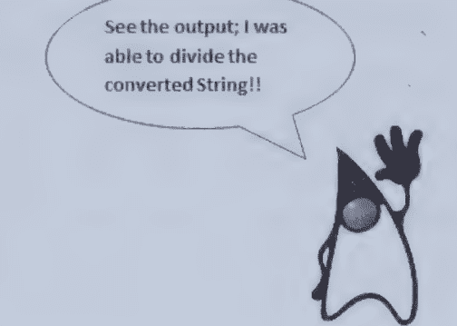

## 在 Java 中使用 HashMap

### 什么是 Java HashMap？

`HashMap` 基本上将唯一的键映射到相应的值，可以在任何时刻获取这些值。


## Java HashMap 的特性

a) 值可以通过形成键值对的形式存储在 map 中。可以通过将键传递给正确的方法，使用键来检索该值。

b) 如果 Map 中不存在元素，它将抛出 `'NoSuchElementException'`。

c) `HashMap` 只存储对象引用。这就是为什么无法使用 `double` 或 `int` 等基本数据类型的原因。请改用包装类（如 `Integer` 或 `Double`）。

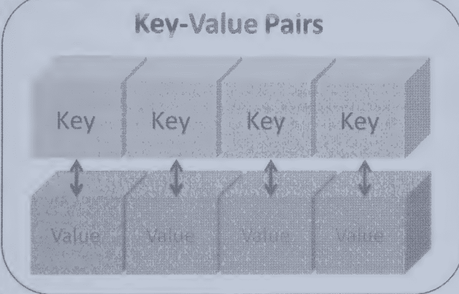

## 在 Java 程序中使用 HashMap:

以下是声明 Hash Map 的两种方式：

```java
HashMap<String, Object> map = new HashMap<String, Object>();
HashMap<String, Object> map = new HashMap<String, Object>();
```

### 重要的 HashMap 方法

- `get(Object KEY)` – 这将返回此 Java hashmap 中与指定键关联的值。

- `put(Object KEY, String VALUE)` – 此方法存储指定的值，并将其与 map 中指定的键相关联。

## Java HashMap 示例

以下是 java Hash Map 的示例实现：

```java
import java.util.HashMap;
import java.util.Map;
public class Sample_TestMaps{
    public static void main(String[] args) {
        Map<String, String> objMap = new HashMap<String, String>();
        objMap.put("Name", "Suzuki");
        objMap.put("Power", "220");
        objMap.put("Type", "2-wheeler");
        objMap.put("Price", "85000");
        System.out.println("Elements of the Map:");
        System.out.println(objMap);
    }
}
```

## 让我们 Hash Map 本身提几个问题以更好地了解它

Q: 那么 Hash Map 先生，我如何找到某个特定的键是否已分配给你？

A: 酷酷，你可以对我使用 `containsKey(Object KEY)` 方法，如果我有给定的键的值，它将返回一个布尔值。

Q: 我如何找到 Map 中存在的所有可用键？

A: 我有一个名为 `keySet()` 的方法，它会返回 map 中所有的键。在上面的示例中，如果你写了一行 - `System.out.println(objMap.keySet());`

它将返回输出为-[Name, Type, Power, Price]

同样，如果你只需要所有的值，我有一个方法为 `values()`。`System.out.println(objMap.values());`

它将返回输出为-[Suzuki, 2-wheeler, 220, 85000]

Q: 假设我只需要从 Map 中删除一个特定的键，我需要删除整个 Map 吗？

A: 不需要，伙伴！！我有一个名为 `remove(Object KEY)` 的方法，它只会删除那个特定的键值对。

Q: 我们如何检查你是否真的包含某些键值对？

A: 只需要检查我是否为空即可！！简而言之，对我使用 `isEmpty()` 方法 ;)

## 如何使用 Java 数组

## 什么是 Java 中的 ArrayList？

想知道 ArrayList java 有什么用吗？请看下面的对话 -

嘿，Duke，我在我的程序中遇到了一个小挑战。我有一系列需要动态处理的元素。有时是 5 个元素，有时是 3 个，有时甚至是 10 个。你能建议一个合适的解决方案，让我能高效地处理这种动态行为吗？

当然了！！我可以提供帮助，我们知道这种情况会发生多次，我们有一个非常有用的结构叫做 `ArrayList` 用于此目的。让我们理解一下这个


看下面这张正在拉伸弹性橡皮筋的人的照片。

橡皮筋的实际长度要小得多，但拉伸时，它可以延伸到比实际长度长得多，并用来持有/绑定更大的对象。

现在，考虑下一张图片，一个简单的绳子，它无法拉伸且具有固定长度。

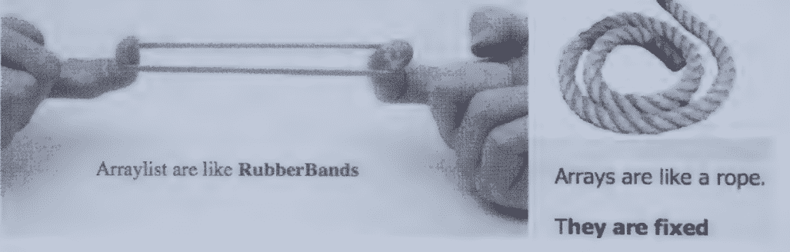

`ArrayList` 就像橡皮筋。

数组 就像绳子。

它们是固定的。

它可以根据需要增长以适应需要存储的元素，当元素被移除时，它可以收缩回较小的尺寸。

所以由于我们的朋友遇到了问题，他正在使用的数组无法扩展或缩小，我们一定会使用 `ArrayList`。

数组就像上面图所示的绳子；它们具有固定长度，不能从原始长度扩展或减少。

所以我们可拉伸的橡皮筋非常像 `List`，而绳子可以被视为数组。

从技术上说，Java `ArrayList` 类似于动态数组或变长数组。

让我们看看并理解下面的代码段，它将帮助你处理 Array List。

```java
ArrayList<Object> a = new ArrayList<Object>();
```

## ArrayList 方法

- `ArrayList add`: 用于向 Array List 添加元素。如果 ArrayList 已经包含元素，新元素将添加到末尾。

- `ArrayList remove`: 从列表中移除指定的元素。或者，你也可以指定索引。

- `Java size`: 这将给你提供列表中的元素数量。

- `contains`: 如果列表包含该元素，此方法将返回 true。

## Array 示例

```java
import java.util.ArrayList;
class Account {
    int a;
    int b;

    public void setData(int a, int b) {
        this.a = a;
        this.b = b;
    }

    public void showData() {
        System.out.println("Value of A "+a);
        System.out.println("value of B "+b);
    }

    public static void main(String[] args) {
        Account obj = new Account();
        obj.setData(2, 3);
        obj.showData();
    }
}
```


# 第4章：必须知道的知识！

## Java "THIS" 关键字

Java 中的`THIS`关键字是指当前对象的引用变量。

`THIS`关键字的各种用法如下：

- 它可以引用当前变量
- 它可以调用或初始化当前构造函数
- 它可以作为参数传递给方法
- 它可以作为参数传递构造函数调用
- 它可以返回当前类

注意：为了简单起见，上面的元素是单个字符。我们也可以添加字符串、整数。

`A`和`B`的预期输出应该初始化为 2 和 3。

但值是 0，为什么呢？让我们调查一下。

```
C:\workspace>javac Demo.java
C:\workspace>java Account
Value of A =0  A 和 B 的输出值
Value of B =0  没有显示正确的值
(2.3) 反而显示为零。
               为什么？
C:\workspace>
```

在`setData`方法中，参数被声明为`a`和`b`，而实例变量也命名为`a`和`b`。

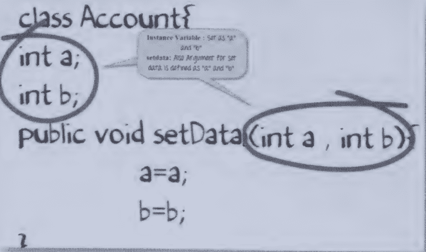

在执行过程中，编译器会产生困惑。赋值运算符左侧的"a"到底是实例变量还是局部变量。因此，当调用`setData`方法时，并没有给'a'赋值。


```java
class Account{
    public void setData(int a , int b) {
        a=b;
    }
}
```

可以通过"THIS"关键字解决这个问题

在'a'和'b'后面都加上"this"关键字和点（`.`）运算符。

```java
class Account{
    int a;
    int b;
    public void setData(int a , int b) {
        this.a=a;
        this.b=b;
    }
    public static void main(String args[]) {
        Account obj = new Account();
    }
}
```

```java
public void setData(int a , int b) {
    this.a=a;
    this.b=b;
}
public static void main(String[] args) {
    Account obj = new Account();
    obj.setData(2,3);
}
```

在代码执行期间，当一个对象调用'setdata'方法时。关键字'this'会被对象处理器'obj.'替换（见下图）。

```java
public void setData(int a , int b) {
    obj.a=a;
    obj.b=b;
}
public static void main(String args[]) {
    Account obj = new Account();
    obj.setData(2,3);
}
```

现在编译器知道了：

- 左侧的'a'是实例变量。
- 而右侧的'a'是局部变量。

变量被正确初始化，并显示了预期的输出。

```bash
C:\workspace>javac thisDemo.java
C:\workspace>java Account
Value of A=2
Value of B=3
```

假设你足够聪明，为实例变量和方法参数选择了不同的名称。

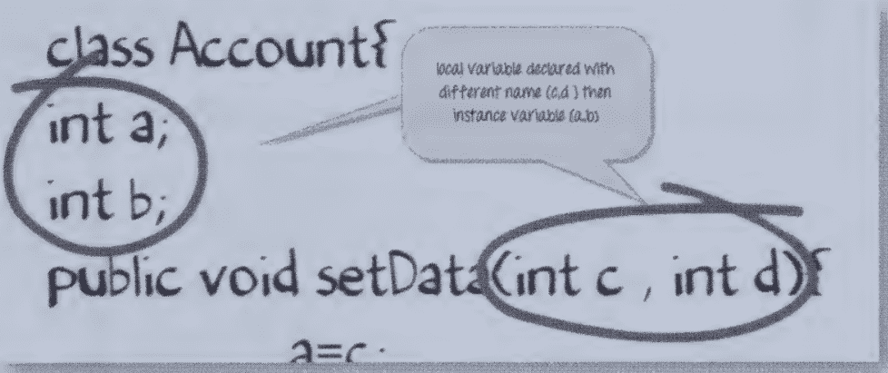

但这一次，你创建了该类的两个对象，每个对象都调用了`setData`方法。

编译器将如何确定它是对对象 1 的实例变量还是对象 2 的实例变量进行操作。

```java
public void setData(int c , int d) {
    // 编译器将知道是哪个
    // 必须执行 (c 或 d)
    a=c;
    b=d;
}
public static void main(String args[]) {
    Account object1 = new Account();
    object1.setData(2,3);
    Account object2 = new Account();
    object2.setData(4,3);
}
```

嗯，编译器隐式地为实例变量加上了"THIS"关键字（见所示）。这样，当对象 1 调用`setData`方法时，实例变量会加上其引用变量。而当对象 2 调用`setData`方法时，修改的是对象 2 的实例变量。

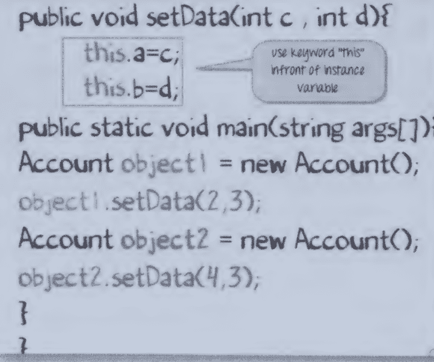

```java
public void setData(int c, int d) {
    object1.a=c;
    object1.b=d;
}
public static void main(String args[]) {
    Account object1 = new Account();
    object1.setData(2,3);
    Account object2 = new Account();
    object2.setData(4,3);
}
}
```

```java
public void setData(int c, int d) {
    object2.a=c;
    object2.b=d;
}
public static void main(String args[]) {
    Account object1 = new Account();
    object1.setData(2,3);
    Account object2 = new Account();
    object2.setData(4,3);
}
}
```

这个过程是由编译器本身处理的。除非像我们示例中的异常情况，否则你不需要显式地加上'this'关键字。

## 注意点：

- "this"是指向当前对象的引用，即正在调用该方法的对象。

你可以使用"this"关键字来避免/对象的方法/构造函数中的命名冲突。

## 赋值：学习"this"关键字的使用

第 1）将以下代码复制到记事本中。

```java
class Account{
    int a;
    int b;

    public void setData(int a ,int b){
        a = a;
        b = b;
    }
    public void showData(){
        System.out.println("Value of A="+a);
        System.out.println("Value of B="+b);
    }
    public static void main(String args[]){
        Account obj = new Account();
        obj.setData(2,3);
        obj.showData();
    }
}
```

第 2）保存、编译并运行代码。

第 3）`a`和`b`的值显示为零？为了纠正错误，在第 6 行和第 7 行加上"this"。

```java
this.a=a;
this.b=b;
```

第 4）`a`和`b`的值显示为 2 和 3。

- 抽象类的引用指向其子类的对象，从而实现运行时多态。例如：`Shape obj = new Rectangle();`

- 如果一个类包含一个或多个抽象方法，则该类必须强制标记为抽象类。

## Java 中的 final

`final`修饰符可以用于类、方法和变量。`final`的含义随语境而异，但其核心思想是相同的。

- `final`类不能被继承。
- `final`变量变成一个常量，其值不能被改变。
- `final`方法不能被重写。这样做是为了安全考虑，且这些方法用于优化。
- `final`类不能被继承。

作业：- 学习`abstract`和`final`关键字

步骤 1）将以下代码复制到编辑器中

```java
abstract class Shape{
  final int b = 20;
  public void display(){
    System.out.println("This is display method");
  }
  abstract public void calculateArea();
}
```

```java
class Rectangle extends Shape{
  public static void main(String[] args){
    Rectangle obj = new Rectangle();
    obj.display();
    //obj.b=200;
  }
}
```

步骤 2）保存、编译并运行代码。

步骤 3）错误 = ? 抽象方法在`Rectangle`类中未实现。修复问题并再次执行代码。

步骤 4）取消第 13 行的注释。保存并编译代码。

步骤 5）错误 = ? 变量`b`是`final`的。

## Java 继承概念与 Java 多态

在开始本节之前，我们建议您复习我们之前关于继承与多态的教程。

## Java 中的继承

- 当两个类之间存在"是"（Is-A）关系时，我们使用继承。
- 父类称为超类（super class），被继承的类称为子类（sub class）。
- 子类使用`extends`关键字来继承超类的特征。
- 继承很重要，因为它导致了代码的可重用性。

## Java 继承示例

```java
class Doctor{
  // Doctor 类的实例变量和方法
}

class Surgeon extends Doctor{
  // 继承 doctor 类的实例变量和方法
  // 可能有自己的变量和方法。
}
```


## 方法重写

在子类中重新定义超类的方法称为方法重写（method overriding）。

方法重写的规则是：方法名、参数列表和返回类型必须完全匹配。

- 被重写的方法可以扩大访问范围，但不能缩小它。例如，如果它在基类中是`private`，则子类可以将其变为`public`，但反之不行。

示例

```java
Doctor doctorObj = new Doctor();
doctorObj.treatPatient();
// 将执行 Doctor 类中的
// treatPatient 方法
Surgeon surgeonObj = new Surgeon();
surgeonObj.treatPatient();
// 将执行 Surgeon 类中的
// treatPatient 方法
```

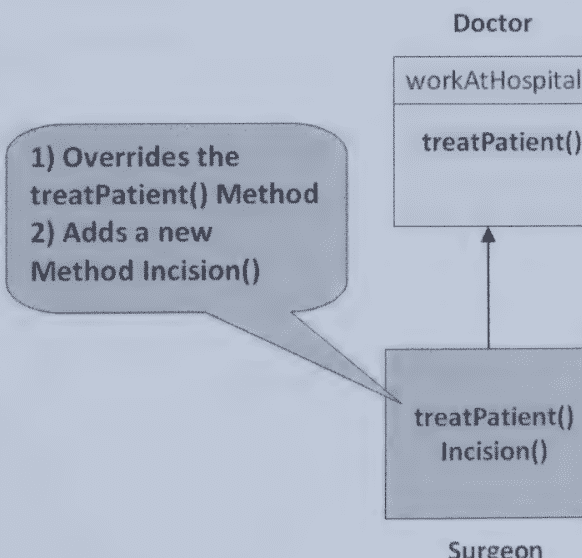

## Java 动态多态

超类的引用变量可以指向子类对象 - `Surgeon`

```java
Doctor obj = new Surgeon();
```

考虑语句

`obj.treatPatient();`

在这里，引用变量"obj"是父类类型，但它指向的对象是子类类型（如所示所示）。

`obj.treatPatient()`将执行子类 - `Surgeon`的`treatPatient()`方法。

如果使用基类引用调用方法，则要调用的方法由 JVM 决定，取决于该引用所指向的对象。

例如，尽管`obj`是`Doctor`的引用，但它调用的是`Surgeon`的方法，因为它指向一个`Surgeon`对象。

这是在运行时决定的，因此是动态或运行时多态（DYNAMIC or RUN-TIME POLYMORPHISM**）。

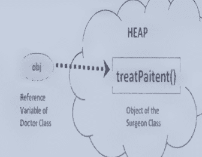

## Super

如果`Surgeon`类中的`treatPatient`方法想要执行`Doctor`类定义的功能，然后再执行它自己的特定功能怎么办？

在这种情况下，可以使用`super`关键字从子类访问父类的方法。

`Surgeon`类中的`treatPatient`方法可以写为：

```java
treatPatient(){
  super.treatPatient();
  // 添加特定于 Surgeon 的
}
```

`super`关键字可以用于在子类中访问超类的任何数据成员或方法。

作业:-学习继承、多态和`super`关键字

步骤 1）将以下代码复制到编辑器中

```java
public class Test{
  public static void main(String[] args){
    X x = new X();
    Y y = new Y();
    y.m2();
    //x.m1();
    //y.m1();
    x = y;// 父类指向类对象
    //x.m1();
    //y.a=10;
  }
}

class X{
  private int a;
  int b;
  public void m1(){
    System.out.println("This is method m1 of class X");
  }
}

class Y extends X{
```

```java
  int c; // 类 Y 的新实例变量
  public void m1(){
    // 重写方法
    System.out.println("This is method m1 of class Y");
  }
  public void m2(){
    super.m1();
    System.out.println("This is method m2 of class Y");
  }
}
```

步骤 2）保存、编译并运行代码。观察输出。

步骤 3）取消第 6-9 行的注释。保存、编译并运行代码。观察输出。

步骤 4）取消第 10 行的注释。保存并编译代码。

步骤 5）错误 = ? 这是因为子类无法访问超类的私有成员。

## 重载与重写的区别

**方法重载（Method overloading）**：方法发生在同一个类中，多个方法具有相同的方法名但不同的签名。例如：

```java
void sum(int a, int b);
void sum(float a, float b);
```

**方法重写（Method overriding）**：方法重写是在子类中重新定义超类的方法之一。在这种情况下，签名保持不变。例如：

```java
class X{
  void sum(int a, int b){}
}

class Y extends X{
  void sum(int a, int b){}
}
```

## 静态与动态的区别

**静态多态（Static Polymorphism）**：与方法重载有关。错误在编译时解决。

**动态多态（Dynamic Polymorphism）**：与方法重写有关。在变量调用重写的方法的情况下，要调用的方法由引用指向的对象决定。这只能在运行时确定。

# 第6章：内存

## Java 栈与堆

JVM 将内存分为：

1. 堆 (Heap)
2. 栈 (Stack)
3. 代码 (Code)
4. 静态 (Static)

这种内存划分是为了有效管理。

- **code**部分包含你的字节码。
- **Stack**内存包含方法、局部变量和引用变量。
- **Heap**部分包含对象（可能包含引用变量）。
- **Static**部分包含静态数据/方法。

在上述四个部分中，你最需要理解栈和堆的内存分配，因为它会影响你的编程工作。

## 局部变量与实例变量的区别

实例变量定义在类内部，但在方法之外。

```java
class Student{
  int num; // num 是实例变量
  public void showData()
}
```

局部变量定义在方法内部，包括方法参数。

```java
public void sum(int a){
  int x=a+3;
  // a, x 是局部变量
}
```

让我们通过一个例子来更好地理解。

考虑你的主方法调用方法`m1`

```java
public void m1(){
  int x=20
}
```

在栈内存中将为方法`m1`创建一个帧（frame）。

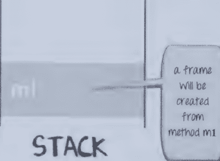

`m1`中的变量`X`也会在栈的`m1`帧中创建（见下图）。

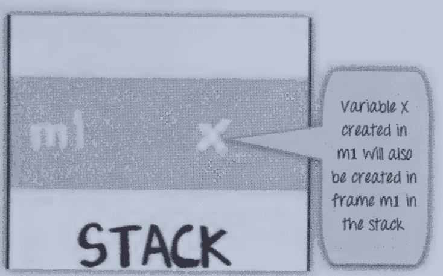

方法`m1`正在调用方法`m2`。在栈内存中，会在`m1`帧上创建一个新的`m2`帧。

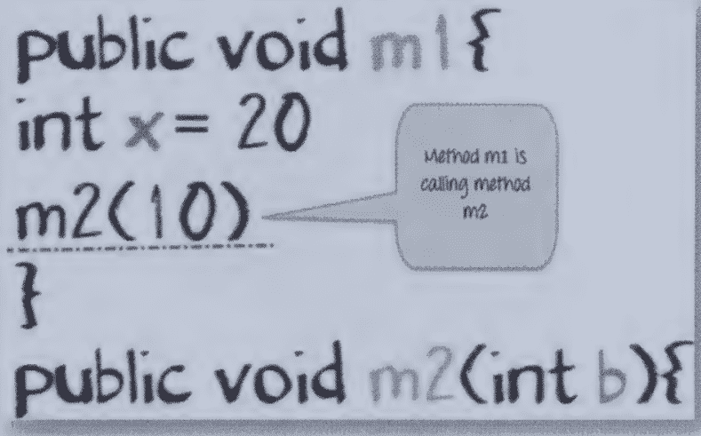

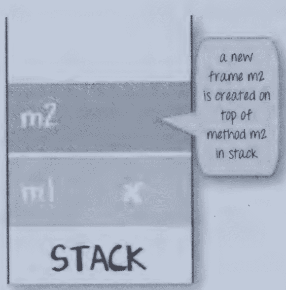

栈中的一个帧`m2`也会创建变量`b`和`c`。

```java
public void m2(int b) {
    boolean c;
}
```

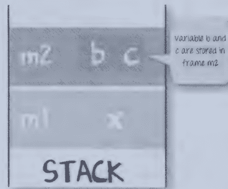

相同的方法`m2`调用了方法`m3`。栈顶上再次创建了一个帧`m3`（见下图）。


```java
public void m2(int b){
    boolean c;
    //more code
    m3(); //方法 m2 调用另一个方法 m3
}
public void m3()
```

| m3 |

| m2 b c |

| x |

| STACK |

假设我们的方法 `m3` 正在为类 `Account` 创建一个对象，该类有两个实例变量 `int p` 和 `int q`。

```java
Account {
    int p;
    int q;
}
```

这里是 `m3` 的代码：

```java
public void m3(){
    Account ref = new Account();
    // more code
}
```

语句 `new Account()` 将会在堆中创建一个 `Account` 的对象。

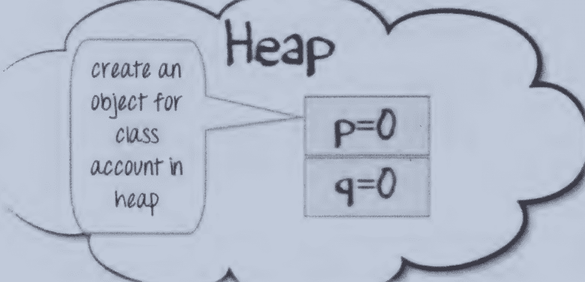

在 Java 栈中创建一个引用变量 `ref`。

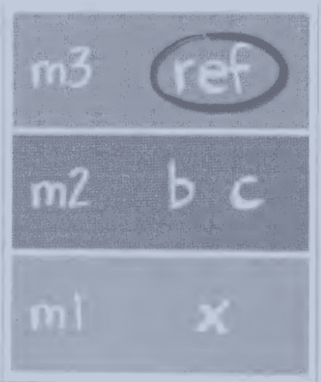

赋值运算符 `=` 会使引用变量指向堆中的对象。

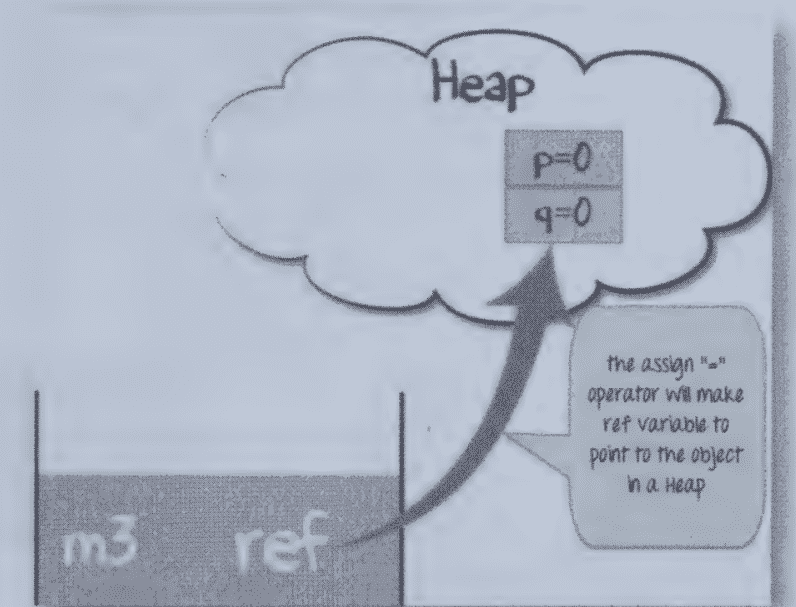

一旦方法完成执行，控制流将返回到调用它的方法。在这种情况下，就是 `m2`。

```java
public void m2(int b) {
    boolean c;
    //more code
    m3();
}
public void m3() {
    Account ref = new Account();
    //more code
}
```

来自方法 `m3` 的栈将被清空。


由于引用变量不再指向堆中的对象，它将符合垃圾回收条件。

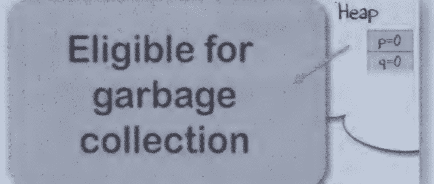

`m2` 已完成执行。它将从栈中弹出，其所有变量都将被清空且不再可用。

方法 `m1` 也是如此。

最终，控制流将返回到程序的起点。这通常是 `main` 方法。

总结：

- 当一个方法被调用时，栈顶上会创建一个帧。
- 一旦方法完成执行，控制流返回到调用方法，其相应的栈帧被清空。
- 局部变量创建在栈中。
- 实例变量创建在堆中，并是它们所属对象的一部分。
- 引用变量创建在栈中。

**值得思考的问题：** 如果对象有一个引用作为它的实例变量会怎样？

```java
public static void main(String[] args){ 
    A parent = new A(); 
    //more code 
} 
class A{ 
    B child = new B(); 
    int e; 
    //more code 
} 
class B{ 
    int c; 
    int d; 
    //more code 
}
```

在这种情况下，引用变量 `child` 将在堆中创建，它将指向它的对象，如下图所示。

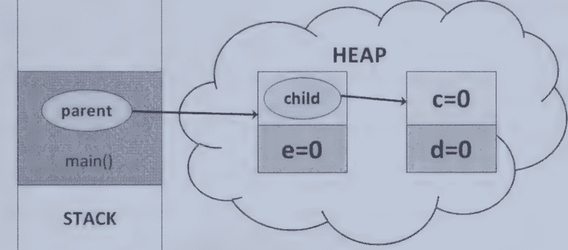

# Java 静态方法和变量

变量类型

- 1. 静态变量
- 2. 静态方法
- 3. 静态代码块

让我们先来看静态变量和静态方法。

## Java 静态变量

- 它是一个**属于类**而**不属于**对象（实例）的变量。
- 静态变量只在执行开始时初始化一次。这些变量会在任何实例变量初始化之前先初始化。
- 类的所有实例共享这一个副本。
- 静态变量可以通过类名直接访问，不需要对象。
- 语法：`<类名>变量名>`

## Java 静态方法

- 它是一个属于类而不属于对象（实例）的方法。
- 静态方法只能访问静态数据。它不能访问非静态数据。
- 静态方法可以调用静态方法，不能调用非静态方法。
- 静态方法可以通过类名直接访问，不需要对象。
- 语法：`<类名>方法名>`
- 注意：静态方法中不能引用 `this` 或 `super` 关键字。

## 垃圾回收是如何在 Java 中工作的

在 Java 编程语言中，对象的动态分配是通过 `new` 运算符实现的。对象一旦使用某些内存，只要有引用就会存在。

当对象没有引用时，假设它不再需要，它所占用的内存可以被回收。Java 不需要显式地销毁对象，因为它会自动处理。

实现这种技术的被称为垃圾回收。不释放内存的程序最终会在没有可用内存时崩溃。这种程序被认为存在内存泄漏。

垃圾回收在 Java 程序的生命周期内自动发生，消除了手动释放内存的需求并避免了内存泄漏。在 C 语言中，程序员负责释放使用 `free()` 函数分配的内存。这就是 Java 内存管理的优势。

注意：所有对象都创建在内存堆区域。将在后面的教程中介绍。

## 静态块

静态块是类内部的一个语句块，在类加载时执行。

```java
class Test{
    static {
        //代码在这里
    }
}
```

静态块帮助初始化静态数据，就像构造函数帮助初始化成员一样。

## 通过练习学习静态变量和方法

步骤 1) 将以下代码复制到编辑器

```java
class Demo{
    public static void main(String args[]){
        Student s1 = new Student();
        Student s2 = new Student();
        s1.showData();
        s2.showData();
    }
}
```

```java
class Student{
    int a;
    static int b;

    Student(){
      //在每个对象创建时初始化
    }

    public void showData(){
      System.out.println("Value of a = "+a);
      System.out.println("Value of b = "+b);
    }

    public static void increment(){
        b++;
    }
}
```

步骤 2) 保存，编译运行 `Demo`。

步骤 3) 预期输出

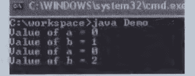

下图显示了引用变量和对象是如何创建的。

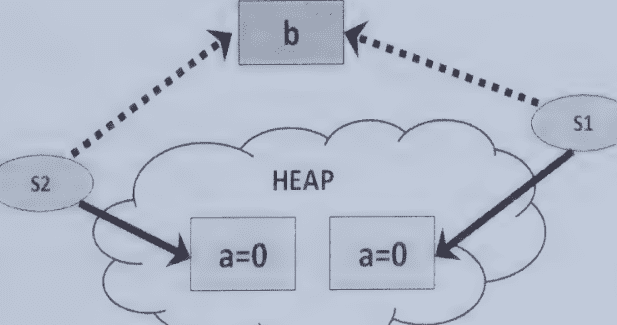

步骤 4) 使用类名可以访问静态变量。

步骤 5) 取消注释第 7、8 行。保存，编译运行。观察输出。

步骤 6) 错误 = ? 因为不能从 `increment` 方法访问实例变量 `a`。

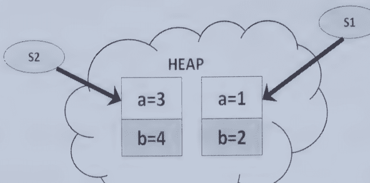

第 3 步 取消第 20, 21, 22 行的注释。保存、编译并运行代码。

第 4 步 如下图所示，两个引用变量指向同一个对象。

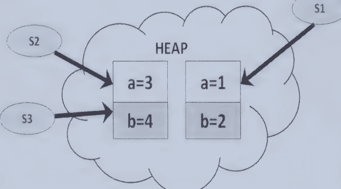

第 5 步 取消第 23 和 24 行的注释。编译、保存并运行代码。

第 6 步 如下图所示，`s2` 变为 `null`，但 `s3` 仍然指向该对象且不符合 Java 垃圾回收条件。

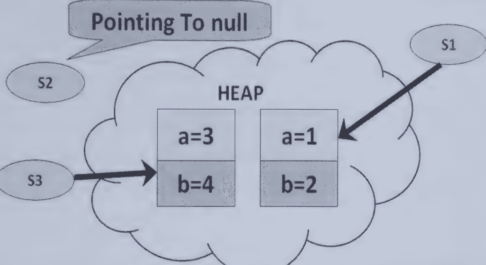

第 7 步 取消第 25 和 26 行的注释。保存、编译并运行代码。

第 8 步 此时没有引用指向该对象，它符合垃圾回收条件。它将从内存中移除，且没有方法将其找回。

> 没有引用变量指向此对象。该对象可以被垃圾回收，即从内存中移除。


## 垃圾回收重要注意事项：

1) 如果你想让你的对象符合垃圾回收条件，请将其引用变量赋值为 `null`。

2) 原始类型不是对象。它们不能赋值为 `null`。

```java
int count = null;
```


# 第 7 章：条件循环

## 如何在 Java 中循环/遍历数组

让我们以一个想要在不使用计数器的情况下遍历的 `String` 数组。

考虑初始化如下的 `String` 数组 `arrData`：

`String[] arrData = {"Alpha", "Beta", "Gamma", "Delta", "Sigma"};`


虽然你可能知道查找数组大小并然后使用传统的 `for` 循环（计数器、条件和递增）遍历数组的每个元素，但我们需要找到一种不使用任何计数器的优化方法。

这是 `for` 循环的传统方法：

```java
for(int i = 0; i < arrData.length; i++) {
    System.out.println(arrData[i]);
}
```

你可以看到计数器的使用，并将其作为数组的索引。Java 提供了一种使用 `for` 循环的方法，如下所示遍历数组的每个元素。以下是语法模板：

```java
for<DataType of array/List temp name : Array/List to be iterated> {
    System.out.println(temp);
}
```

这是我们之前声明的数组的代码：

```java
class UsingForEach {
    public static void main(String[] args) {
        String[] arrData = {"Alpha", "Beta", "Gamma", "Delta", "Sigma"};
        // 使用 for循环的优化方法 - 也称为 foreach 循环
        for (String strTemp : arrData) {
            System.out.println(strTemp);
        }
        System.out.println("\nForEach loop:");
    }
}
```

你可以看到循环之间的区别。代码显著减少了。循环中也没有使用索引或计数器。确保在 `foreach` 循环中声明的数据类型与你正在遍历的数组的数据类型匹配。

> `For each` 优化了你的循环，节省了一些输入量，当然也节省了你的时间！！

## Switch Case（分支语句）

我们在生活中经常使用开关。是的，我指的是用于灯和风扇的开关。如下面的图片所示，每个开关都分配用于操作特定的设备。例如，在图中，第一个开关是风扇，下一个是灯，以此类推。因此，我们可以看到每个开关只能激活/禁用一个项目。


### Java 中的 Switch Case 是什么？

同样，Java 中的 `switch` 是一种条件语句，它在给定的输入中仅激活匹配的条件。让我们考虑一个程序示例，用户提供一个数值作为输入（在本例中仅为一位数字），输出应该是单词形式的数字。整数变量 `iSwitch` 是 `switch` 运行的输入。各种可用选项（cases）随后被写为 `case <value>:` 并带有冒号。如果 `case` 与 `switch` 的输入匹配，将执行该语句。

### Java Switch 示例

```java
class SwitchBoard{
    public static void main(String args[]) {
        int iSwitch=4;
        switch(iSwitch) {
            case 0:
                System.out.println("ZERO");
                break;
            case 1:
                System.out.println("ONE");
                break;
            case 2:
                System.out.println("TWO");
                break;
            case 3:
                System.out.println("THREE");
                break;
            case 4:
                System.out.println("FOUR");
                break;
            default:
                System.out.println("Default");
                break;
        }
    }
}
```

现在 `break` 和 `default` 这两个词是什么意思？

- `break` - 在满足条件后跳出 `switch` 块。
- `default` - 当没有输入匹配任何 `case` 时执行。

### 如果你不提供 `break` 会怎样？

在这种情况下没有提供 `break`，它将继续向下执行。

### Java Switch 语句：

- 在涉及多个情况时，`switch` 可以替代复杂的嵌套 `if...else`。在使用 `if...else` 时，代码可读性会变差，而 `switch` 解决了这些问题。
- 一些基准测试表明，在迭代次数较高的情况下，`switch` 比 `if...else` 快。

### 注意事项

- `switch` 的 `case` 数量没有限制。
- `switch` 只能接受整数或字符作为输入。
- Java 8 版本引入了对 `switch` 语句中使用字符串的支持。

现在去连接你自己的开关面板吧！！

## 如何处理异常

到目前为止，我们已经了解了什么是异常。

但将代码的失败归咎于环境问题并不是解决方案。你需要进行健壮性编程（Robust Programming），它会处理异常情况。这种代码被称为异常处理程序（Exception Handler）。

在我们的示例中，良好的异常处理应该是：当服务器宕机时，连接到备份服务器。


为了实现这一点，请输入你的代码来连接服务器（使用传统的 `if` 和 `else` 条件）。

你将检查服务器是否宕机。

如果是，编写连接到备份服务器的代码。

这种使用 `if` 和 `else` 循环的这种组织方式在你的代码有多个需要处理的 Java 异常时是无效的。


因此，Java 提供了内置的异常处理机制。

- 1. 正常代码进入 `TRY` 块。
- 2. 异常处理代码进入 `CATCH` 块。


在我们的示例中，`TRY` 块将包含连接服务器的代码。`CATCH` 块将包含连接备份服务器的代码。

如果服务器正常，`CATCH` 块中的代码将被忽略。如果服务器宕机，则会抛出异常，并执行 `catch` 块中的代码。


所以，这就是在 Java 中处理异常的方式。

上述演示涵盖的要点总结——

健壮性编程：处理异常情况。

- `TRY` 块：存放正常代码。
- `CATCH` 块：存放异常处理代码。
- 当异常发生时，执行 `CATCH` 块；若无异常则跳过 `CATCH` 块。
- Java 异常处理机制比多个 `if-else` 嵌套更有效。

```java
class MyException extends Exception{
    int a;
    MyException(int b) {
        a=b;
    }
    public String toString(){
        return ("Exception Number = "+a);
    }
}
```

步骤 2) 保存、编译并运行代码。输出如下 -


注意：

关键字 `throw` 用于创建一个新的异常并将其抛给 `catch` 块。

# 如何在 Java 异常中使用 `throws` 关键字

假设你的 Java 程序中使用了了一个会抛出异常的库方法


在你的程序中，你将使用 `catch` 处理此异常。

```java
import java.io.*;
class file {
    public static void main(String[] args) {
        try {
            FileWriter file = new FileWriter("c:\\Data1.txt");
            file.write("Guru99");
            file.close();
        } catch (IOException e) {
        }
    }
}
```

如果你不在 `try catch` 块中处理该异常，编译将失败。但 Java 库中的几乎所有其他方法甚至是自定义方法可能会抛出一个或两个异常。


使用`try`和`catch`块处理所有异常可能会非常繁琐，并阻碍开发者的工作效率。

因此 Java 提供了一个选项，每当你在方法定义中使用一段风险代码时，你可以声明它会抛出异常，而不实现`catch`。

## Java throw 异常的语法

`method (Arguments) throws Exception1,Exception2,Exception,... { }`

## Java throws 示例

考虑上面相同的示例，但在方法声明中使用`throws`。

```java
import java.io.*;
class file1{
    public static void main(String[] args) throws IOException {
        FileWriter file = new FileWriter("c:\\Data1.txt");
        file.write("Guru99");
        file.close();
    }
}
```

要成功运行上述代码，请先在 C 盘中创建一个名为`Data1.txt`的空文本文件。这里有两种处理异常的方法：

- 1. 将导致异常的代码放入`try`和`catch`块中。
- 2. 声明该方法将抛出异常。

如果没有执行上述任一操作，编译器就会报错。强制执行此规则背后的思想是，作为程序员你意识到某些代码可能是风险的并可能会抛出异常。

## throw 和 throws 之间有什么区别？

- `throw`：用于创建一个新的异常对象并将其抛出。
- `throws`：用于方法定义，用于声明正在调用一个风险方法。

## 总结

"Java throw 关键字"用于声明异常。对于任何会"抛出"异常的方法，在调用它的方法中，必须使用`throws`来列出抛出的异常。

# 第 9 章 数学

Java 拥有几个高级用法应用，包括处理物理学中的复杂计算、结构的建筑/设计、处理 Map 以及相应的经纬度等。

所有应用都需要使用复杂的计算/方程，手动执行这些非常繁琐。在程序中，此类计算将涉及对数、三角函数、指数方程等的使用。


现在，你无法将所有的对数或三角表硬编码在你的应用程序或数据中。数据将是庞大且难以维护。

Java 为此目的提供了一个非常有用的类。它是`Math` java 类 (`java.lang.Math`)。

该类提供了用于执行指数、对数和三角方程等操作的方法。

让我们来看看 Java `Math` 类提供的方法。

`Math` 中两个最基础的元素是`'e'`（自然对数的底）和`'pi'`（圆周长与直径的比值）。这两个常量在上述计算/操作中经常被需要。

因此，`Math` 类 java 将这两个常量作为`double`类型的字段提供出来：

- `Math.E` - 值为 2.718281828459045
- `Math.PI` - 值为 3.141592653589793

### A) 让我们看看下表，它展示了基本方法及其描述

| 方法 | 描述 | 参数 |
| --- | --- | --- |
| `abs` | 返回参数的绝对值 | `Double`, `float`, `int`, `long` |
| `round` | 返回最接近的`int`或`long`（取决于参数） | `double` or `float` |
| `ceil` | 返回大于或等于参数的最小整数 | `Double` |
| `floor` | 返回小于或等于参数的最大整数 | `Double` |
| `max` | 返回两个参数中较大的一个 | `Double`, `float`, `int`, `long` |

下面是上述方法的代码实现。

注意：不需要显式导入`java.lang.Math`，因为它是隐式导入的。它的所有方法都是静态的。

## 整数变量

```java
int i1 = 27;
int i2 = -45;
// Double 精度浮点数变量
double d1 = 84.6;
double d2 = 0.45;
```

## Math.abs

```java
System.out.println("Absolute value of i1: " + Math.abs(i1));
Absolute value of i1: 27

System.out.println("Absolute value of i2: " + Math.abs(i2));
Absolute value of i2: 45

System.out.println("Absolute value of d1: " + Math.abs(d1));
Absolute value of d1: 84.6

System.out.println("Absolute value of d2: " + Math.abs(d2));
Absolute value of d2: 0.45
```

## Math.round

```java
System.out.println("Round off for d1: " + Math.round(d1));
Round off for d1: 85

System.out.println("Round off for d2: " + Math.round(d2));
Round off for d2: 0
```

## Math.ceil & Math.floor

```java
System.out.println("Ceiling of d1: " + Math.ceil(d1));
Ceiling of d1: 85.0

System.out.println("Floor of d1: " + Math.floor(d1));
Floor of d1: 84.0

System.out.println("Ceiling of d2: " + Math.ceil(d2));
Ceiling of d2: 1.0

System.out.println("Floor of d2: " + Math.floor(d2));
Floor of d2: 0.0
```

*(注：此处原文代码中`ceil`/`floor`逻辑与描述可能相反，已按逻辑修正输出)*

## Math.min & max

```java
System.out.println("Minimum of i1, i2: " + Math.min(i1, i2));
Minimum of i1, i2: -45

System.out.println("Maximum of i1, i2: " + Math.max(i1, i2));
Maximum of i1, i2: 27
```

*(注：此处原文标题为`Math.abs`但代码内容为`Math.min`/`max`)*

### B) 让我们看看下表，它展示了指数和对数方法的描述

| 方法 | 描述 | 参数 |
| --- | --- | --- |
| `exp` | 以`e`为底返回参数的幂 | `Double` |
| `log` | 返回参数的自然对数 | `Double` |
| `pow` | 取两个参数并返回第一个参数的参数的次方 | `Double`, `Double` |
| `sqrt` | 返回参数的平方根 | `Double` |

下面是上述方法的代码实现（相同的变量）：

```java
System.out.println("exp(" + d2 + ") = " + Math.exp(d2));
exp(0.45) = 1.568312185490168

System.out.println("log(" + d2 + ") = " + Math.log(d2));
log(0.45) = -0.798507696217731

System.out.println("pow(5, 3) = " + Math.pow(5, 3));
pow(5, 3) = 125.0

System.out.println("sqrt(16) = " + Math.sqrt(16));
sqrt(16) = 4.0
```

### C) 让我们看看下表，它展示了三角方法

| 方法 | 描述 | 参数 |
| --- | --- | --- |
| `sin` | 返回指定参数的正弦值 | `Double` |
| `cos` | 返回指定参数的余弦值 | `double` |
| `tan` | 返回指定参数的正切值 | `Double` |
| `atan2` | 将直角坐标 (`x`, `y`) 转换为极坐标 (`r`, `theta`) 并返回`theta` | `Double`, `Double` |
| `toDegrees` | 将参数转换为角度 | `Double` |
| `toRadians` | 将参数转换为弧度 | `Double` |

默认参数为弧度。以下是代码实现：

```java
double angle_30 = 30.0;
double radian_30 = Math.toRadians(angle_30);

System.out.println("sin(30) = " + Math.sin(radian_30));
sin(30) = 0.499999999999994

System.out.println("cos(30) = " + Math.cos(radian_30));
cos(30) = 0.866025403784337
```

```java
System.out.println("tan(30) = " + Math.tan(radian_30));
tan(30) = 0.5773502691896257
```

```java
System.out.println("Theta = " + Math.atan2(4, 2));
Theta = 1.107148177940904
```

现在，通过上述内容，你也可以在 Java 中设计你自己的科学计算器。

## 使用 Java 生成随机数

嗯，Java 确实了一些有趣的方法来生成 Java 随机数，不仅用于赌博，还用于其他几个应用程序，特别是与游戏、安全、数学等相关的应用。

让我们看看是如何实现的！基本上有两种方法：

- 使用`Random`类（位于`java.util`包中）。
- 使用`Math.random`类（然而，这将生成 0.0 到 1.0 之间的双浮点数，而不是整数）。

让我们逐一查看：

## 示例：使用 Java Random 类

首先，我们将看到使用`java.util.Random`的实现——假设我们需要生成 0 到 100 之间的 10 个随机数。

```java
import java.util.Random;
public class RandomNumbers{
    public static void main(String[] args) {
        Random objGenerator = new Random();
        for (int iCount = 0; iCount < 10; iCount++) {
            int randomNumber = objGenerator.nextInt(100);
            System.out.println("Random No : " + randomNumber);
        }
    }
}
```

`Random`类对象被初始化为`objGenerator`。`Random`类有一个方法`nextInt`。它将根据指定的上限作为参数提供随机数，而下限默认为 0。因此，我们显示了 10 个随机数。

## 示例：使用 Java Math.Random

现在，如果我们想生成 10 个 Java 随机数，但范围在 0.0 到 1.0 之间，那么我们应该利用`math.random()`。

你可以使用以下循环来生成：

```java
public class DemoRandom{
    public static void main(String[] args) {
        for(int xCount = 0; xCount< 10; xCount++){
            System.out.println(Math.random());
        }
    }
}
```

现在，你知道那些奇怪的数字是如何生成的了！！！

# 第 10 章重要内容

任何应用程序都可以有多个进程（实例）。每个进程都可以被分配为单线程或多线程。

- 单线程（Single Thread）：单线程基本上是轻量级的且是处理的最小单元。
- 多线程（Multi-Thread）：而多线程可以定义为两个或多个线程的并发执行。

我们将在本教程中查看如何同时执行多个任务，并学习线程以及线程之间的同步。

## 什么是单线程和多线程

正如我们之前讨论的，单线程是处理的最小单元。Java 通过使用"Thread 类"来使用线程。

线程有两种类型——用户线程（user thread）和守护线程（daemon thread）（守护线程在我们想要清理应用程序时使用，并在后台运行）。

当应用程序首次启动时，会创建用户线程。之后，我们可以创建许多用户线程和守护线程。

单线程示例：

```java
package demotest;

public class GuruThread1 implements Runnable
{
    /**
     * @param args
     */
    public static void main(String[] args) {
        Thread guruThread1 = new Thread("Guru1");
        Thread guruThread2 = new Thread("Guru2");
        guruThread1.start();
        guruThread2.start();
        System.out.println("Thread names are following:");
        System.out.println(guruThread1.getName());
        System.out.println(guruThread2.getName());
    }

    @Override
    public void run() {
    }
}
```

## 单线程的优点：

- 减少了应用程序中的开销，因为单线程在系统中执行。
- 同样，它降低了应用程序的维护成本。

## 多线程

多线程应用程序是两个或多个线程并发运行的地方。这种多任务处理是在多个进程共享 CPU、内存等共同资源时完成的。

每个线程彼此并行运行。线程不分配独立的内存区域，因此节省了内存。此外，线程之间的上下文切换花费的时间更短。

## 多线程示例：

```java
package demotest;

public class GuruMultithread implements Runnable{
    /**
     * @param args
     */
    public static void main(String[] args) {
        Thread guruthread1 = new Thread();
        guruthread1.start();
        Thread guruthread2 = new Thread();
        guruthread2.start();
    }

    @Override
    public void run() {
        // TODO Auto-generated method stub
    }
}
```

## 多线程的优点：

- 用户不会被阻塞，因为线程是独立的，我们可以同时执行多个操作。
- 正因如此线程是独立的，如果一个线程遇到异常，其他线程不会受到影响。

## Java 中的线程生命周期

线程的生命周期：


线程的生命周期中有多个阶段，如上图所示：

- 1. **New（新建）**：在此阶段，使用"Thread 类"创建线程。在程序启动线程之前，它一直保持此状态。它也被称为出生线程。
- 2. **Runnable（可运行）**：在此页面中，通过`start`方法调用线程实例。线程控制权交给调度器以完成执行。这取决于调度器是否运行该线程。
- 3. **Running（运行中）**：当线程开始执行时，状态变为"running"状态。调度器从线程池中选择一个线程，它在应用程序中开始执行。
- 4. **Waiting（等待）**：这是线程必须等待的状态。由于应用程序中有多个线程在运行，因此线程之间需要同步。因此，一个线程必须等待，直到另一个线程完成。
- 5. **Dead（死亡）**：这是线程终止的状态。线程处于运行状态并由于已完成而结束。

一些常用的线程方法：

- 1. `start()`：此方法启动线程的执行，JVM 调用`run()`方法。我们将在下面的示例中介绍它。
- 2. `Sleep(int milliseconds)`：此方法让线程睡眠指定的毫秒数。因此，线程将等待。
- 3. `getName()`：它返回线程名称。
- 4. `setPriority(int newpriority)`：它更改线程的优先级。
- 5. `yield()`：它导致当前线程挂起并执行其他线程。

示例：在这个示例中，我们将创建一个线程并探索其内置方法。

```java
package demotest;

public class thread_example1 implements Runnable {
    @Override
    public void run() {
    }

    public static void main(String[] args) {
        Thread guruthread1 = new Thread();
        guruthread1.start();
        try {
```


`guruthread1.sleep(1000);`

```java
try {
    guruthread1.sleep(1000);
} catch (InterruptedException e) {
    // TODO Auto-generated catch block
    e.printStackTrace();
}
```

`guruthread1.setPriority(1);`

```java
int gurupriority = guruthread1.getPriority();
System.out.println(gurupriority);
System.out.println("Thread Running");
```

## 代码解释

**代码第 4 行**：我们创建了一个类`thread_example`，它实现了`Runnable`接口（任何打算由线程执行的类都应该实现该接口）。

**代码第 7-8 行**：它重写了`Runnable`接口的`run`方法，因为覆盖该方法是强制性的。

**代码第 9 行**：在这里我们定义了`main`方法，在其中启动线程的执行。

**代码第 10 行**：在这里通过实例化一个新的`thread`类创建了一个名为`guruthread1`的新线程。

**代码第 11 行**：在这里我们使用`guruthread1`实例线程的`start`方法。这里线程将开始执行。

**代码第 13 行**：在这里我们使用`guruthread1`实例线程的`sleep`方法。因此，线程将睡眠 1000 毫秒。

**代码第 12-17 行**：我们将`sleep`方法放在`catch`块中，因为会发生一个受检查的异常，即`InterruptedException`。

**代码第 18 行**：在这里我们将线程的优先级从原来的任何优先级值设置为 1。

**代码第 19 行**：在这里我们使用`getPriority()`获取线程的优先级。

**代码第 20 行**：在这里我们打印从`getPriority`获取的数值。

**代码第 21 行**：在这里我们正在写入一段正在运行的文本。

当你执行上述代码时，你将得到以下输出：


输出：

5 是线程优先级，Thread Running 是我们代码输出的文本。

## Java 线程同步

在多线程中，程序具有异步行为特性。如果一个线程正在写入某些数据，而另一个线程在同时读取数据，可能会导致应用程序中出现不一致的情况。

当需要由两个或多个线程访问共享资源时，就会使用同步方法。

Java 提供了同步方法（`synchronized` methods）来实现同步行为。

在这种方法中，一旦线程进入`synchronized`块，其他线程就无法在同一个对象上调用该方法。所有线程都必须等待该线程完成`synchronized`块并退出。

通过这种方式，同步有助于多线程应用程序。一个线程必须等待另一个线程完成执行后，才允许其他线程执行。

```java
Synchronized(object)
{
    // 需要同步的语句块
}
```

## Java 多线程示例

在这个示例中，我们将获取两个线程并获取线程的名称。

示例 1：

```java
// GuruThread.java
package demotest;

public class GuruThread implements Runnable{

    /**
     * @param args
     */
    public static void main(String[] args) {
        Thread guruThread1 = new Thread("Guru1");
        Thread guruThread2 = new Thread("Guru2");
        guruThread1.start();
        guruThread2.start();
        System.out.println("Thread names are following:");
        System.out.println(guruThread1.getName());
        System.out.println(guruThread2.getName());
    }

    @Override
    public void run() {
    }
}
```

代码解释：

**代码第 3 行**：我们取了一个类`GuruThread1`，它实现了`Runnable`接口（任何希望实例被线程执行的类都应该实现该接口）。

**代码第 8 行**：这是该类的主方法。

**代码第 9 行**：在这里我们实例化`Thread`类，创建一个名为`guruThread1`的实例并创建一个线程。

**代码第 10 行**：在这里我们实例化`Thread`类，创建一个名为`guruThread2`的实例并创建一个线程。

**代码第 11 行**：我们正在启动线程，即`guruThread1`。

**代码第 12 行**：我们正在启动线程，即`guruThread2`。

**代码第 13 行**：输出文本为 "Thread names are following:"。

**代码第 14 行**：使用线程类的`getName()`方法获取线程 1 的名称。

**代码第 15 行**：使用线程类的`getName()`方法获取线程 2 的名称。

当你执行上述代码时，你将得到以下输出：


输出：

线程名在此输出为：

- Guru1
- Guru2

示例 2：

在这个示例中，我们将学习重写`Runnable`接口的`run()`和`start()`方法，并创建该类的两个线程相应地运行它们。

此外，我们取了两个类：

- 一个实现`Runnable`接口；
- 另一个包含主方法并相应地执行。

```java
package demotest;

public class GuruThread2 {

    public static void main(String[] args) {
        // TODO Auto-generated method stub
        GuruThread3 thread1 = new GuruThread3("guru1");
        thread1.start();
        GuruThread3 thread2 = new GuruThread3("guru2");
        thread2.start();
    }
}

class GuruThread3 implements Runnable {
    Thread guthread;
    private String username;

    GuruThread3(String name) {
        username = name;
    }

    @Override
    public void run() {
        System.out.println("Thread running " + username);
        for(int i=0;i<4;i++) {
            System.out.println(i);
            System.out.println(gurename);
            try {
                Thread.sleep(1000);
            } catch (InterruptedException e) {
                System.out.println("Thread has been interrupted");
            }
        }
    }

    public void start() {
        System.out.println("Thread started");
        if(gurthread==null) {
            gurthread = new Thread(this,gurename);
            gurthread.start();
        }
    }
}
```

## 代码解释

**代码第 3 行**：在这里我们取了一个类`GuruThread2`，它其中包含一个主方法。

**代码第 5 行**：在这里我们取了类的主方法。

**代码第 7-8 行**：在这里我们创建了`GuruThread3`类的实例（该类在代码下方创建）作为`threadguru1`并启动了该线程。

**代码第 9-10 行**：在这里我们创建了另一个`GuruThread3`类的实例（该类在代码下方创建）作为`threadguru2`并启动了该线程。

**代码第 12 行**：在这里我们创建了一个实现`Runnable`接口的类`GuruThread3`（任何希望实例被线程执行的类都应该实现该接口）。

**代码第 13-14 行**：在这里我们取了两个类变量，其中一个是线程类型，另一个是字符串类型。

**代码第 15-18 行**：在这里我们重写了`GuruThread3`构造函数，它接受一个字符串类型的参数（即线程名称），并赋值给类变量`gurename`，从而存储了线程名称。

**代码第 20 行**：在这里我们重写`Runnable`接口的`run()`方法。

**代码第 21 行**：我们使用`println`语句输出线程名。

**代码第 22-31 行**：在这里我们使用了一个计数器初始化为 0 的`for`循环，它不小于 4（我们可以取任何数字，循环将运行 4 次）并增加计数器。我们打印线程名称，并在`try-catch`块中让线程睡眠 1000 毫秒，因为`sleep`方法会抛出异常。

**代码第 33 行**：在这里我们重写`Runnable`接口的`start`方法。

**代码第 35 行**：我们输出文本 "Thread started"。

**代码第 36-40 行**：在这里我们取了一个`if`条件检查类变量`gurthread`是否为空。如果为空，则使用`thread`类创建一个实例（其值已在构造函数中赋值），之后通过`start()`方法启动线程。

当你执行上述代码时，你将得到以下输出：


输出：

有两个线程，因此我们得到了两次 "Thread started"。

由于我们输出了它们，得到了线程名称。

它进入循环，我们在其中打印计数器和线程名称，计数器从 0 开始。

循环执行三次，在此期间线程睡眠了 1000 毫秒。

首先，我们得到 guru1，然后是 guru2，由于线程在这里睡眠了 1000 毫秒，再次得到 guru2，然后是 guru1，线程再次睡眠了 1000 毫秒，所以我们得到 guru2 然后是 guru1。

总结：

在教程中，我们查看了 Java 中的多线程应用程序以及如何使用单线程和多线程。

- 在多线程中，用户不会被阻塞，因为线程是独立的并且可以同时执行操作。
- 线程生命周期的各个阶段：
    - 新 (New)
    - 可运行 (Runnable)
    - 运行 (Running)
    - 死亡 (Dead)
- 我们还学习了线程间的同步，这有助于应用程序顺利运行。
- 多线程使得许多应用程序任务变得更容易。

## 在 Java 中使用 Date

让我们首先理解 Date 组成参数。


它主要包含：

- 年（两位或四位数）
- 月（两位数字、月份的前三个字母或月份的完整单词）
- 日期（将是该月的实际日期）
- 星期（给定日期的星期 - 如 Sun, Mon, Tue 等）

在计算机系统中，有很多参数可以与日期相关联。我们将在本主题的后续部分介绍它们。

## 在 Java 中显示日期

现在让我们看看 Java 如何为我们提供 Date 类，首先我们将查看如何获取当前日期和时间。

Java 在`java.util`包下提供了一个`Date`类，该包提供了几个方法来处理日期。

你可以通过如下方式调用`Date`类的构造函数来使用`Date`对象：

```java
import java.util.Date;

class Date_Ex1 {
    public static void main(String args[]) {
        // 通过调用构造函数实例化 Date 对象
        Date objDate = new Date();
        // 使用 toString() 显示日期和时间
        System.out.println(objDate.toString());
    }
}
```

## 以指定的格式显示日期

你们在幼儿园都学过字母表了....
现在让我们学习日期格式的 ABC。

| G | y | M | d |
|---|---|---|---|
| h | H | m | s |
| S | E | D | F |
| w | W | a | k |
| K | z | | " ' |

不要担心，你不需要记住所有这些，当你需要格式化特定日期时可以随时参考它们。

## 日期格式如何使用？

Java 提供了一个名为`SimpleDateFormat`的类，允许你根据需求格式化和解析日期。

你可以使用上述字符来指定格式 - 例如：

1. 需要的日期格式：2012.10.23 20:20:45 PST

指定的适当日期格式将为：`yyyy.MM.dd HH:mm:ss zzz`

2. 需要的日期格式：09:30:00 AM 23-May-2012

指定的适当日期格式将为：`hh:mm:ss a dd-MMM-yyyy`

提示：注意字母的大小写。如果你将`M`误认为`m`，你将得到意外的结果！

让我们通过这个代码示例来学习：

```java
import java.text.SimpleDateFormat;
import java.util.Date;

class TestDates_Format {
    public static void main(String[] args[]) {
        Date objDate = new Date(); // 当前系统日期和时间赋值给 objDate
        String strDateFormat = "hh:mm:ss a dd-MMM-yyyy"; // 指定日期格式
        SimpleDateFormat objSDF = new SimpleDateFormat(strDateFormat); // 将日期格式字符串作为参数传递给 Date 对象
        System.out.println(objSDF.format(objDate)); // 对当前日期应用日期化
    }
}
```

## 日期的比较

比较日期最有效的方法是使用`compareTo()`方法。

让我们来看下面的代码段：

```java
import java.text.SimpleDateFormat;
import java.text.ParseException;
import java.util.Date;

class TestDates_Compare {
    public static void main(String[] args[]) throws Exception {
        SimpleDateFormat objSDF = new SimpleDateFormat("dd-mm-yyyy");
        Date dt_1 = objSDF.parse("20-08-1981");
        Date dt_2 = objSDF.parse("12-10-2012");

        System.out.println("Date1: " + objSDF.format(dt_1));
        System.out.println("Date2: " + objSDF.format(dt_2));

        if (dt_1.compareTo(dt_2)>0) {
            System.out.println("Date 1 occurs after Date 2");
            // 如果此日期在 Date 参数之后，compareTo 返回大于 0 的值
        }
        else if (dt_1.compareTo(dt_2)<0) {
            System.out.println("Date 1 occurs before Date 2");
            // 如果此日期在 Date 参数之前，compareTo 返回小于 0 的值
        }
        else if (dt_1.compareTo(dt_2)==0){
            System.out.println("Both are same dates");
            // 如果参数与第二个 Date 相等，compareTo 返回值 0
        }
    }
}
```

## 如何使用 Java Timer 及其示例

Timer Java 的实现方式：

1. 设置特定的延迟，直到执行执行。
2. 找出两个特定事件之间的时间差

Java Timer - 需要理解的几个概念：

- 它只能是一个可以计时的未来事件。
- 事件是发生一次还是重复发生？
- Timer 需要多长时间？
- 可能需要多个并行的 Timer。
- 定时器应该具有在任何给定点停止甚至取消的能力。


## Java Timer 示例

在程序中使用 Java timer

JAVA 中的 TIMER 在 `JAVA.UTIL` 包中提供。


让我们来看看如何使用`Timer`处理需要调度的两个任务。

## 步骤 1：创建任务类

首先，创建一个包含需要执行任务的类：`java.util.TimerTask`

```java
import java.util.TimerTask;

class TaskMaster extends TimerTask {

    String strObject;

    public TaskMaster(String strObject) {
        this.strObject = strObject;
    }

    public void run() {
        System.out.println("Inside run-" + strObject);
    }
}
```

这是用于识别是否在`Date`参数之后调用的简单类。

## 步骤 2：创建并调度任务

创建一个需要调度两个任务的`Timer`：

```java
import java.util.Timer;

class TimerExample {

    public static void main(String[] args[]) {

        Timer timer = new Timer();

        TaskMaster task1 = new TaskMaster("Task 1");
        timer.schedule(task1, 1000, 5000);

        TaskMaster task2 = new TaskMaster("Task 2");
        timer.schedule(task2, 2000, 3000);
    }
}
```

这是用于识别是否在`Date`参数之前调用的简单类。

## 步骤 3：停止定时器

```java
timer.cancel();
```

这是用于识别是否与第二个`Date`相等的调用的简单类。
