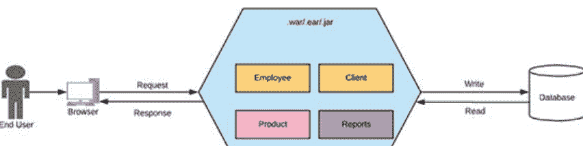
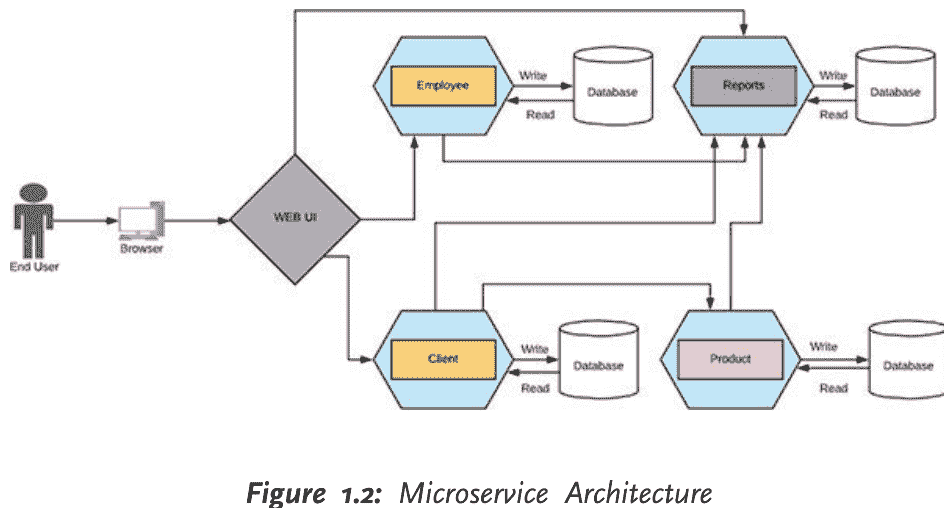
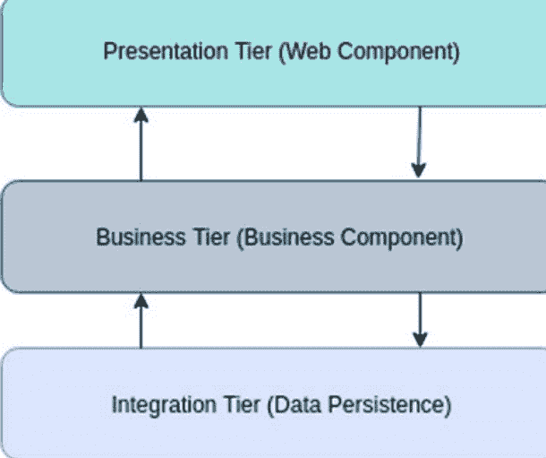
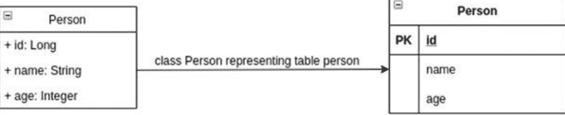

# Java 开发者 Jakarta EE：使用高性能企业级 Java 构建云原生和企业级应用构建指南

在我们 Telegram 频道中有更多关于 Java 的书籍：

https://t.me/javalib

# 献给

Ivonete Rocha

我的母亲，她一直相信我的梦想。

# 关于作者

Rhuan Rocha 是一位丰富的 Java Java EE 工程师，他使用 Java EE/Jakarta EE 规范创建了许多项目。他曾在一家名为 Red Hat 的大型 Jakarta EE 供应商工作，使用 Wildfly/JBoss EAP。在职业生涯中，他使用 Java EE/Jakarta EE 及其生态系统技术为巴西的私营公司和政府开发了许多企业 Java 应用。

现在，Rhuan Rocha 是 DigiBee 的首席软件工程师，负责开发其集成平台，是一位 Jakarta EE 专家，也是 Cloud Conference Day 的联合创始人。他还是开源贡献者，曾贡献于 JNoSQL、RestEasy、TomEE、Quarkus 等。

# 关于评审员

Bauke Scholtz 是 Oracle Java 冠军，Jakarta Faces 专家组成员，也是 Jakarta Faces 辅助库 OmniFaces 的主要创建。他在互联网上广为人知的身份是 BalusC，是 Stack Overflow 贡献者之一。他是一位 Web 应用专家，在 20 多年的经验中，曾为 Virtua.tech、Mercury1.co.uk、MyTutor.co.uk、LinkPizza.com、ZEEF.com、ITCA.com、RDC.nl 等更多来自金融科技、联盟营销、社交媒体等客户提供咨询服务。

# 致谢

写书是一项艰巨的任务，在输入章节的第一个字之前很久就开始了。积累知识和经验是一段需要许多牺牲的旅程。我非常感谢在这段旅程中帮助我的家人、朋友和老师。我想特别感谢 Bruna Grell 和 João Purificação，他们是在许多方面帮助我的好朋友。

我想感谢 SouJava 等社区，他们在提高我的知识方面提供了很大帮助，并感谢 Karina Varela 在我的职业生涯中提供的巨大帮助。

最后，感谢 BPB Publications 给我这个机会为他们写我的第一本书。

在我们 Telegram 频道中有更多关于 Java 的书籍：https://t.me/javalib

# 前言

Java 生态系统在工具和方法上发生了许多变化，这些变化源于云计算带来的新挑战。云计算迫使开发者重新思考其开发应用程序的过程、架构和方法，并产生了一个被称为“云原生应用”的新概念。因此，Java 生态系统也需要重新思考，社区和公司开始在 Java 生态系统中进行重大变革。这些更新之一是将 Java EE 重命名为 Jakarta EE，并建立了通过 Eclipse 基金会演进该规范的新流程。

在本书中，我们解释了 Java EE 到 Jakarta EE 的重命名，以及新的演进过程是如何运作的。理解 Jakarta EE 时刻以及了解该规范的预期非常重要。此外，我们还讨论了从 Oracle 版 Java EE 8 到 Eclipse 基金会版 Jakarta EE 9 之间的变化。

本书采用实战方法，你将每章创建一个项目。这使得你只需要阅读感兴趣的章节，因为章节之间没有依赖关系。每个章节都关注一个规范。因此，本书可以帮助你完成 Spring、Quarkus、Micronaut 或其他使用 Jakarta EE 规范的各种项目。

第 1 章介绍了 Jakarta EE 规范及其通过 Eclipse 基金会演进规范的新流程。在本章结束处，你将了解环境以及启动所需的条件。

第 2 章通过实践的方法展示了 Jakarta Servlet。在本章中，你将学习如何创建一个 Servlet、如何过滤请求和响应、RequestDispatcher 是什么以及如何使用它们、如何与同步过程一起工作、如何与非阻塞 I/O 工作以及如何使用 Server Push。

第 3 章通过实践的方法解释了 Jakarta 上下文和依赖注入 (CDI)。在本章中，你将学习如何使用 CDI 注入 Bean、CDI 生命周期是如何工作的、如何使用生产者方法（producer method）和生产者字段（producer field）来产生对象实例、如何使用销毁方法（dispose method）、如何创建 CDI 拦截器（Interceptor）以及如何使用装饰器（Decorator）。

第 4 章通过实践的方法解释了 Jakarta RESTful Web Service。在本章中，你将学习如何创建一个 RESTful 资源类、如何提取请求参数、如何在 Jakarta RESTful Web Service 中使用 Bean Validation、如何创建一个 RESTful 客户端、如何在客户端中进行异步调用以及如何使用。

第 5 章解释了 Jakarta Enterprise Bean，涵盖了主要概念和实践。此外，我们将解释如何实现无状态 Bean（stateless bean）、有状态 Bean（stateful bean）、单例 Bean（singleton bean）以及它们如何管理事务。在本章结束处，我们将向你展示如何创建任务调度以及什么是有状态集群（stateful clustered）。

第 6 章通过实践的方法解释了 Jakarta Persistence。在本章中，你将学习如何在关系型数据库中进行操作、如何将表映射到实体、如何使用 JPQL 进行查询、如何使用 EntityManager、如何控制对实体数据的并发访问以及如何使用实体图（entity Graphs）制作抓取计划。

第 7 章解释了 Jakarta Messaging 及其目标。此外，在本章中，我们将向你展示如何创建一个队列（Queue）、如何创建一个主题（Topic）、如何创建生产者和消费者，最后我们将向你展示如何实现消息驱动 Bean（Message-Driven Bean）。

第 8 章解释了 Jakarta Security，我们如何保护 Web 应用、如何通过编程实现用户身份验证、如何保护企业 Bean、如何实现自定义身份存储以及如何实现自定义的数据库身份存储。

第 9 章通过实践的方法解释了 Jakarta Bean Validation。在本章中，你将学习如何使用 Bean Validation 验证实体、如何在 RESTful 资源中使用它来验证来自请求的数据。此外，我们将解释如何验证构造函数和方法以及如何创建一个自定义约束。在最后，我们将解释如何定制化验证器消息。

## 下载代码包和彩色图片

请点击链接下载本书的**代码包**和**彩色图片**：

https://rebrand.ly/178bb3

## 勘误表

我们对 BPB Publications 的工作感到非常自豪，并遵循最佳实践以确保内容的准确性，为我们的订阅者提供极致的阅读体验。我们的读者是我们的镜子，我们利用他们的反馈来反思并改进出版过程中可能出现的人为错误（如果有的话）。为了让我们保持质量，并帮助我们联系任何可能因意外错误遇到困难的读者，请通过以下邮箱与我们联系：

errata@bpbonline.com

BPB Publications 全体非常感谢您的支持、建议和反馈。

您知道吗？BPB 出版的每本书都提供电子书版本，并提供 PDF 和 ePub 文件。您可以在 www.bpbonline.com 升级到电子书版本，而且作为纸质书客户，您有权享受电子书折扣。请联系 business@bpbonline.com 了解更多详情。

在 www.bpbonline.com，您还可以阅读免费的技术文章集，订阅一系列免费的新通讯，并接收 BPB 图书和电子书的专属折扣和优惠。

## BPB 正在寻找您这样的作者

如果您对成为 BPB 的作者感兴趣，请访问 www.bpbononline.com 并于今日申请。我们已经与成千上万像您这样的开发者和技术人员合作，帮助他们与全球技术社区分享见解。您可以提交通用申请，申请我们正在招募作者的特定热门话题，或者提交自己的想法。

本书的代码包也托管在 GitHub 上，如果代码有更新，它将在现有的 GitHub 仓库中更新。

我们还从丰富的书籍和视频目录中提供了其他代码包，快去查看吧！

## 盗版

如果您在互联网上遇到任何形式的我们作品的非法复制，如果您能向我们提供地址或网站名称，我们将不胜感激。请通过 business@bpbonline.com 联系我们并附上材料链接。

## 如果您对成为作者感兴趣

如果您擅长某个领域，并且对编写或为书籍贡献感兴趣，请访问 www.bpbononline.com。

## 评价

请留下评价。在您阅读并使用此书后，为什么不在您购买的网站上留个评价呢？潜在读者就可以看到并利用您的中立意见做出购买决策，我们 BPB 可以了解您对我们产品的看法，我们的作者也可以看到您对他们书籍的反馈。感谢！

了解更多关于 BPB 的信息，请访问 www.bpbonline.com。


- 结论
- 结论

索引

更多 Java 书籍请见我们的 Telegram 频道：https://t.me/javalib

# J2EE 与 Java EE

1999年，太阳微系统（Sun Microsystems）从 1.2 版本开始发布 J2EE，迈出了将 Java 引入网络的第一步。J2EE 的主要目标是创建一个基于规范的伞型项目，这些规范描述了用于企业系统的某些技术集如何工作的细节。通过这种方式，许多供应商可以创建这些规范的实现，而开发者可以开发不依赖于供应商的企业级 Java 应用，并选择任何遵循 J2EE 规范的供应商，也可以更换供应商。因此，J2EE 为企业世界创建 Java 应用程序提供了一个很好的解决方案，为业务提供了一系列健壮的技术和更高的安全性——现在公司可以创建健壮的解决方案，而无需对任何供应商产生依赖。

J2EE 专注于企业世界，其架构包含四个元素，按重要性顺序描述如下：

- J2EE：遵循 J2EE 规范的标准平台，是 J2EE 应用程序的宿主。它被称为应用程序服务器。
- J2EE 兼容性测试（J2EE Compatibility Test）：一组用于验证 J2EE 实现是否遵循 J2EE 规范的测试。
- J2EE 参考实现（J2EE Reference）：每个规范都应该有一个参考实现，以演示该规范如何工作。
- Sun 蓝图（Sun Blueprints）：描述了用于开发多层应用程序的标准编程模型。

第一个版本的 J2EE 包含了这些规范：Enterprise JavaBeans、Java Servlet、Java 命名和目录接口（JNDI）、JavaServer Pages、Java 事务数据库连接（JDBC）、JavaMail。所有这些规范现在仍然是 Jakarta EE 的一部分，但有了许多改进。

J2EE 在 J2EE 1.3 和 J2EE 1.4 版本中经历了多次演进，然后在 2006 年，从 Java EE 5 开始其名称更名为 Java EE，随后演进到 Java EE 6。Java EE 6 是太阳微系统下的最后一个 Java EE 版本，因为 2010 年，甲骨文（Oracle）收购了太阳微系统并获得了 Java EE 的权利。Java EE 6 非常重要，因为它在 EJB 经过多次演进之后出现，使其更加容易，并引入了上下文和依赖注入（CDI），这是 Java EE 依赖控制的机制。在甲骨文控制下的 Java EE 发布了两个版本——2013 年发布的 Java EE 7 和 2017 年发布的 Java EE 8。

如你所见，J2EE/Java EE 已经 20 年历史了，企业世界在这些年发生了巨大变化，企业环境中出现了新的挑战。

## 云计算

企业世界的复杂性增长非常快，随之出现了新的需求。作为核心需求，我们可以引用业务的容错能力和弹性。换句话说，业务需要能够有效地应对不断增长的需求，并且需要以尽可能低的风险来实现。今天，业务创新的基础是技术，技术领域致力于提供一系列模型、方法和技术来满足这些需求。云计算正是作为这些解决方案之一而生的。

云计算是一系列技术和方法，以一种更好、更简单的方式为最终用户提供计算资源服务。通过云计算，我们可以只拥有真正需要的计算资源——例如内存、磁盘、CPU、节点数量——并根据需要进行扩展或缩小。通过这种方式，业务可以节省资金，并对不断增长的需求产生更快、更有效的响应。使用云计算，我们可以拥有许多类型的服务，如平台即服务（PaaS）、基础设施即服务（IaaS）、软件即服务（SaaS）、函数即服务（FaaS）等。

云计算为业务带来了许多益处，如下：

- 按需付费：最终用户仅为使用的资源付费。这可以为业务节省大量资金。
- 环境可以在故障后恢复。
- **自服务**：可以使用接口根据需求以更简单、快速的方式扩展计算资源，消除了 IT 管理员配置和管理计算资源的需求。计算资源可以随时进行扩展或缩小。
- **容错**：由于环境可以在许多本地区域、跨许多全球区域运行，该环境具有更强的容错性。

显然，云计算为业务世界带来了许多益处，但要利用这些优势，应用程序需要准备好以云计算的方式工作。但这意味着什么呢？

技术领域长期使用的旧方法使用了单体架构（monolith architecture）——在同一个应用程序内部包含所有业务领域或多个业务领域——来开发应用程序。结果是一个具有许多职责的大型应用程序。图 1.1 如下所示：



## 图 1.1：单体架构

单体架构在过去运行良好，在今天也运行得很好，但在云计算环境之外。单体架构不足以利用云计算的优势，因为如果你需要扩展此应用程序，你将扩展整个单体，也就是说你将扩展单体内部所有的业务领域，这样“按需付费”的优势就会丧失。解决这个问题的办法是重新思考如何构建应用程序。

## 微服务架构

重新思考架构，软件工程师和架构师注意到，为了利用云计算的优势，他们必须将单体拆分为具有细粒度的最小部分，以便仅扩展那些真正需要扩展的部分。但应该如何拆分呢？定义每个部分边界的指标是什么？

微服务架构将单体拆分为许多称为微服务的各个部分，这些小部分通常是根据业务领域拆分的，即每个微服务负责关注某一个业务领域。因此，业务领域被用于定义微服务的边界。将业务领域作为定义微服务边界的基础是一种广泛的方法，但你可以根据自己的场景使用其他方法。但请记住，你应该通过解构来提高扩展能力。图 1.2 所示了这种架构：



在微服务架构中，每个微服务之间是低耦合的，并且是独立且可部署的。换句话说，微服务是一个不需要其他微服务即可运行的小型应用程序。这些微服务在需要时相互集成，以向最终用户提供响应。这很好，但现在软件工程师和架构师面临着其他问题。如何管理这些微服务，这些应用程序如何相互集成而不会变得混乱？当一个新的微服务诞生时，如何发现它？如何对这些微服务进行负载均衡，以及如何在不产生副作用的情况下对这些微服务进行扩展或缩小？

将应用作为一个或多个无状态进程执行。

- 通过端口绑定导出服务。
- 通过进程模型进行扩展。
- 通过快速启动和优雅停机最大化稳健性。

**开发/生产环境** 保持开发、测试和生产环境尽可能相似。

将日志视为事件流。

**管理（Admin）** 将管理/维护任务作为一次性进程运行。

在本章的阶段，你可能注意到，我们在软件架构方面发生了许多变化。应用程序需要彼此进行通信并改进其管理。但是，回到 Java EE，Java EE 在这些新场景中的表现又是如何呢？

Java EE 与这些变化之间存在许多差距，因为尽管 Java EE 拥有许多强大的规范，但它并不具备解决云计算和微服务问题的规范。因此，Java EE 需要改变。

## Jakarta EE 目标

Java EE 8 已迁移到 Eclipse 基金会（Eclipse Foundation），现在变为 Jakarta EE，拥有新的目标和新的演进流程。

Jakarta EE 的目标是加速云计算领域的业务应用程序开发，促进基于许多厂商所编写的规范的多种解决方案。基本上，Jakarta EE 是一组规范，并有一套**技术兼容性套件（TCK）**来测试实现是否符合规范。通过这一点，所有创建 Jakarta EE 实现的厂商只有在通过 TCK 测试并批准后，才能被授予 Jakarta EE 的合规认证。

应用于 Jakarta EE 的第一个更改是演进流程。Java EE 与**Java 社区进程（Java Community Process）**合作以改进其功能，但 JCP 无法适应云计算所推动的变化，因为云计算的变化非常快，而 JCP 的速度无法跟上。因此，Jakarta EE 与另一个名为 **Jakarta EE 规范进程（Jakarta EE Specification Process）**的流程合作。

## Jakarta EE 规范进程

Jakarta EE 8 在一个名为 Jakarta EE 规范进程的新流程启动了 Jakarta EE。JESP 是 Jakarta EE 工作组（负责管理 Jakarta EE 的更改和改进）用于演进 Jakarta EE 的流程。该流程基于 Eclipse 基金会规范进程（Eclipse Foundation Specification Process）并进行了一些更改。以下是这些更改，描述如下：

对此 Jakarta EE 规范进程的任何修改或修订（包括采用新版本的 EFSP），必须经过 Jakarta EE 工作组战略成员的绝对多数批准，并且还要符合 EFSP 中规定的任何其他投票要求。

所有规范委员会批准的投票期将具有最短时长，概述如下（尽管有 EFSP 定义的异常流程，这些期限不得缩短）：

**创建评审：** 7 个日历日

**计划评审：** 7 个日历日

**进度评审：** 14 个日历日

**发布评审：** 14 个日历日

服务发布评审：14 个日历日

JESP 更新：7 个日历日

如果规范团队撤回相应的评审，投票将被宣布无效并立即结束。

规范项目在活跃开发期间，每年必须参与一次进度评审或发布评审。


JESP 的目标是成为一个尽可能轻量化的流程，作为一个基于“代码优先”（code-first）概念的开源流程运行——演进基于实验以及从实验中获得的经验。这一流程驱动了 Jakarta EE 的演进，使 Jakarta EE 能够更快地响应企业领域的变化。

## Jakarta NoSQL

当我们编写新应用程序时，可能需要编写一个持久化模块，因为几乎所有的应用程序都会集成数据库以持久化数据。因此，集成到数据库是企业应用中的一个常见问题，Java EE 创建了 Java Persistence API（JPA），这是 Java EE 解决这一数据库集成常见问题的解决方案。在过去，几乎所有的应用程序都使用关系型数据库，因此 JPA 是针对关系型数据库构建的。

现在，在 Jakarta EE 中，Java persistence API 变成了 Jakarta persistence，但正如我们所，该规范是针对关系型数据库构建的。但是，随着云计算概念的兴起，NoSQL 数据库的使用也之增长，因为 NoSQL 数据库通常非常容易扩展，这对于云计算环境非常有用。因此，Jakarta EE 需要提供改进，为 NoSQL 数据库提供一种通用解决方案。

Jakarta NoSQL 是 Jakarta EE 对 NoSQL 数据库集成问题的回答，并且是在 Jakarta EE 内部诞生的第一个规范。但为什么不通过改进 Jakarta persistence 来尝试 NoSQL 数据库，而不是创建一个新规范呢？为了回答这个问题，我们需要更仔细地观察 NoSQL 数据库概念以及与其工作所需的挑战。在书中，我们不会深入探讨 NoSQL 数据库概念，但我们将对这些概念进行简要概述，以便理解 Jakarta NoSQL 的目标。

关于 NoSQL 数据库要了解的第一点是这些数据库没有标准。这意味着每个 NoSQL 数据库都可以以特定的方式运行，并可能拥有彼此异的特征。尽管 NoSQL 数据库没有标准，但它们被分为四类，如下：

| 列（Column） | 文档（Document） | 键值（Key-Value） | 图形（Graph） |
| :--- | :--- | :--- | :--- |

几乎所有 NoSQL 数据库的另一个特征是，它们不像关系型数据库那样支持事务，当应用程序需要事务时，开发者需要考虑这一点。

此时，我们已经可以看到 NoSQL 数据库与关系型数据库之间的巨大差异，并理解为什么需要创建一个新规范来处理 NoSQL 数据库。现在，我们可以详细说明 Jakarta NoSQL 的目标。

Jakarta NoSQL 的目标是提供一个 API，将 Java 应用程序集成到不同的 NoSQL 数据库，使用通用的 API 与不同的 NoSQL 数据库交互。通过这一点，在 Jakarta EE 中，你将有一种标准的方法来集成许多 NoSQL 数据库。对于每一类 NoSQL 数据库，Jakarta NoSQL 都将有一个用于处理该类别的模块。因此，Jakarta NoSQL 将拥有：

- 列通信 API
- 文档通信 API
- 键值通信 API
- 图形通信 API
- 映射 API（Mapping API）

注意我们有一个映射 API 模块。该模块与通信无关，而是一个基于注解和 CDI 的层，用于保持与其它 Jakarta EE 规范的集成。

每个模块将有自己的 TCK，这意味着我们可能有某个厂商完全符合一个模块，但不符合另一个模块。

Jakarta NoSQL 为开发者带来了巨大的优势，因为它创建了基于许多厂商工作成果的标准 API，促进了 NoSQL 数据库集成稳定解决方案的推广。此外，开发者不需要关心 NoSQL 数据库的特定细节，因为 Jakarta NoSQL 创建了一个抽象层，将 NoSQL 数据库的细节从开发者面前抽离出来。该规范预计在 Jakarta EE 10 中。

Jakarta EE 归 Eclipse enterprise for Java (EE4J) 管理，该组织负责管理 Jakarta EE 品牌以及所有用于创建构成 Jakarta EE 标准的项目。

EE4J 拥有 EE4J 项目管理委员会，负责维护顶级项目的整体愿景。该项目有这些公司作为活跃成员——Tomitribe、IBM、Red Hat Webtide、Oracle、Fujitsu、Payara、Liferay 等。正如你所见，该项目得到了许多大公司的支持，采用该解决方案是一个巨大的优势。

## 从 Java EE 到 Jakarta EE

Java EE 从 Oracle 迁移到 Eclipse Foundation 的过程并不简单，因为在这个阶段出现了许多问题，社区需要投入大量工作以以令人满意的方式回答这些问题。出现的主要问题是 "Java" 这个名称，因为 Oracle 将 Java EE 交给了社区，但 "Java" 商标仍属于 Oracle。这意味着 Eclipse Foundation 或社区不能在项目名称或命名空间中使用 "Java"，但 "Java EE" 的名称中包含了 "Java" 且其命名空间中也包含了 `javax`。因此，社区需要开展工作来解决这个问题，并更改所有包含 `javax` 的命名空间。

借此，Java EE 到 Jakarta EE 迁移的第一个变化是创建一个新的流程以如之前讨论的那样进行演进，并将命名空间从 `javax.*` 更新为 `jakarta.*`。Jakarta EE 8 在发布时没有更改命名空间，因为该版本仅关注流程的更新。命名空间的更新应用在了 Jakarta EE 9。

## Jakarta EE 9

Jakarta EE 9 以命名空间的更新作为主要变化而发布。第 9 版本兼容 Java 8，并且不支持 Java 11（Java 8 之后的下一个 LTS Java 版本）。然而，社区已经发布了另一个兼容 Java 11 的 Jakarta EE 版本。这就是 Jakarta EE 9.1，其唯一的变化是支持在 Java 11 版本上运行。

## 理解 Jakarta EE 分层（Tiers）

Jakarta EE 采用分布式多层应用模型，但它有三个广为人知且广泛使用的分层，即：表示层（presentation tier）、业务层（business tier）和集成层（integration tier）。在过去，将表示层和业务层放在不同的包（packages）中是非常常见的做法，并且大部分时间都花在了运行不同的主机上。随着时间的推移，这种方法不再被使用，这些分层被一起放在了 EAR 项目和 WAR 项目的同一个包中。如今，使用这种方法的应用通常是遗留项目。

Jakarta EE 是基于组件构建的，这些组件是自包含的单元，可以相互与其他组件进行通信。每个组件都与一个层相关，尽管某些组件会在多个层中工作，[例如 Jakarta Contexts and Dependency Injection（CDI）] 每个组件都原生属于某一层。因此，来自表示层的组件被称为 Web 组件（web components），来自业务层的组件被称为业务组件（business components）。图 1.3 如下所示了这些分层：



图 1.3：Jakarta EE 分层

在表示层，我们拥有 Web 规范，为企业级应用程序中与 Web 常见的需求提供解决方案。其中一些需求如下：

- 使用 HTTP 协议进行通信
- 富页面（Rich pages）
- 使用 Restful 进行通信
- 使用 WebSocket 进行通信
- 使用 SOAP 进行通信

我们可以列出更多内容，但这些是最主要且常见的需求。所有这些需求都通过表示层的某些规范得到解决。以下是 Jakarta EE 表示层的主要规范：

- Jakarta Servlet
- Jakarta Page
- Jakarta Faces
- Jakarta RESTful Web Services
- Jakarta WebSocket

在业务层，我们拥有业务规范，为企业级应用程序中与业务规则相关的常见需求提供解决方案。其中一些需求如下：

- 数据持久化（Data persistence）
- 事务（Transaction）
- 异步处理（Asynchronous processing）
- 定时任务（Scheduled tasks）

所有这些需求都通过业务层的某些规范得到解决。以下是 Jakarta EE 业务层的主要规范：

- Jakarta Enterprise Beans
- Jakarta Persistence
- Jakarta Transaction
- Jakarta Messaging

其中某些规范将在后文中详细介绍。本章仅作为介绍，我们不会在本章中涵盖任何规范。

此外，我们还有一些在所有层中起规范，作为跨层规范。主要的跨层规范是 CDI，但我们也可以引用其他的，如 Jakarta Concurrency 和 Jakarta Security。

过去，这些层（表示层和业务层）是分别打包的，每个层在不同的 JVM 中启动。表示层和业务层之间的集成通过远程 EJB 完成。随着时间的推移，这种方法发生了变化，这些层现在被打包在同一个 EAR 项目并在同一个 JVM 中启动。此外，远程 EJB 的使用越来越少，并创建了新的集成技术。如今，不再需要远程 EJB，它仅用于旧遗留应用程序。

## Jakarta EE 配置文件（Profiles）

Jakarta EE 是基于“配置文件（profiles）”的概念工作，如今它有两个配置文件可供使用，但在未来，我们可以看到新的配置文件在 Jakarta EE 中诞生。你可能会问，什么是 Jakarta EE 配置文件？

Jakarta EE 配置文件是针对特定应用程序类型的 Jakarta EE 技术和 API 集合。因此，开发者可以选择更适合应用程序的配置文件，并避免导入或启动应用程序不会使用的 Jakarta EE 技术和 API。Jakarta EE 配置文件如下：

- Web Profile（Web 配置文件）
- Full Profile（全量配置文件）

Web Profile 是适用于不需要使用业务层规范的 Web 应用程序配置。该配置包含了 Web 技术，并侧重于提供 Web问题的解决方案。

Full Profile 是用于创建重量级应用的配置，这些应用需要使用业务层的规范来解决许多问题。该配置包含了 Jakarta EE 的所有技术和 API，应仅在需要时使用。

注意，Jakarta EE 配置文件与层（tiers）不是一个概念，但它们之间存在关系。当我们谈论分层时，我们是在讨论应用程序是如何划分的，每个层可以位于一台机器上。而当我们谈论 Jakarta EE 配置文件时，我们是在讨论应用程序所需的依赖以及应用程序所使用的技术。

## 服务器应用程序（Server applications）

Jakarta EE 应用通常是一个通过 HTTP 访问的系统，并与其他应用程序（无论是 Jakarta EE 应用还是其他）进行集成。因此，Jakarta EE 拥有服务器应用程序，Jakarta EE 应用部署在服务器应用程序中以处理任务并能够被用户和系统访问。但是 Jakarta EE 的服务器应用程序有什么特别且于其他服务器的地方？

Jakarta EE 中的服务器应用程序是实现 Jakarta EE 平台并提供标准 Jakarta EE服务的服务器。换句话说，服务器应用程序提供了每个规范的实现，并通过了 TCK 测试。此外，服务器应用程序提供了 Jakarta EE 的核心——容器。

Jakarta EE 容器负责提供许多抽象，让开发者不需要担心许多事情，因为 Jakarta EE 容器已经为他们考虑好了。Jakarta EE 容器考虑的问题示例包括事务、Bean 生命周期等。

Jakarta EE 容器分为三种类型，如下：

- Jakarta EE Web 容器
- Jakarta EE 客户端容器
- Jakarta EE Enterprise Beans 容器（EJB 容器）

Jakarta EE 容器是 Web 组件与 Web 服务器之间的接口，它促进了许多抽象以处理 Web 组件和 Web 资源。CDI Bean 的周期由该容器管理。

Jakarta EE 客户端容器是 Jakarta EE 客户端与 Jakarta EE 服务器之间的接口。这种容器现在使用较少，因为它以前更多地用于消费 Enterprise Beans 服务的客户端。

Jakarta EE Enterprise Beans 容器是 Enterprise Beans 与 Jakarta EE 服务器之间的接口。该容器管理 Enterprise Beans 的执行、生命周期、事务以及其他功能。

当我们启动服务器应用程序时，服务器应用程序会启动每个 Jakarta EE 容器和资源，并供部署的应用程序使用。此外，服务器应用程序管理关于 Jakarta EE 应用集群的许多问题，并在我们想要构建 Jakarta EE 应用集群时提供相关支持。

市场上有很多服务器应用程序，由许多小型、中、大型供应商提供。作为服务器应用程序的示例，我们可以引用 Wildfly、GlassFish、Open Liberty 等。此外，我们还有诸如 Tomcat、TomEE 等嵌入式服务器，它们是嵌入在 jar 应用程序中的服务器。这类服务器将不会在书中介绍。

## 使用 Jakarta EE 的工作要求

基本上，我们需要安装一个 JDK 来编译和运行 Java 应用程序，一个用于编码的 IDE（集成开发环境），以及用于部署的服务器应用程序，但在本书中，我们将使用 Maven 来管理项目依赖。因此，我们的项目将是一个 Maven 项目，但这并不是强制性的，你可以创建 Eclipse 项目、Gradle 项目或其他项目。

创建本书中示例所需的 JDK 是 JDK 1.8 (Java 8)，你可以在 Oracle 网站上下载它。Jakarta EE 9.1 支持 JDK 11。

我使用的 IDE 是 IntelliJ，但你可以使用任何 IDE，因为它是一个 Maven 项目，并且与 IDE 解耦的。

所有示例中使用的服务器应用程序是 Wildfly 24，但你可以使用任何完全通过 Jakarta EE 9 认证的服务器应用程序。如果你使用其他服务器，书中所示的代码不需要更改，但在服务器上进行配置的方法可能会不同。不过，本书将不会重点关注服务器配置。

要开始使用 Jakarta EE 9，我们应该创建一个 WAR 项目或 EAR 项目，并定义 Jakarta EE 9 为依赖。但我们强烈建议你使用 WAR 项目，因为 EAR 具有当前项目不需要的复杂性。

以下是示例代码：

- 1. ...
- 2. ...
- ...
- 9.

在 IDE 中导入此项目后，你就可以开始使用 Jakarta EE 了。因此，你应该启动服务器应用程序并将此应用程序部署到服务器应用程序中。如果你的 IDE 支持与服务器应用程序集成，你可以通过 IDE 完成此操作，也可以在 IDE 之外完成。IDE 和服务器应用程序的细节不在本书的范围内，但我在这里列出是以便在需要时为你提供帮助。

## 总结

Jakarta EE 让企业级应用的开发变得简单，为著名的企业级问题提供了多种解决方案。此外，它是一种基于规范的解决方案，也就是说，它提供了与供应商解耦的解决方案，我们拥有由许多小型、中、大型公司合作完成的解决方案。

在本章节中，我们看到 Jakarta EE 在促进 API 以在企业环境中创建抽象方面拥有丰富的经验。此外，我们看到 Jakarta EE 现在具有愿景，利用其经验来促进云环境的解决方案。在这种被称为云原生应用的新方法中，我们看到了许多诸如 12 因子、微服务、无服务器（serverless）等概念的出现。因此，Jakarta EE 在未来几年内将基于这些概念提供许多规范。

本章介绍了其如何工作、其架构如何设计、Jakarta EE 的分层、Jakarta 配置文件（profiles）以及服务器应用程序的概述。从下一章开始，我们将进入实战内容，并学习如何使用 Jakarta EE的一些组件。

在下一章中，我们将探索 Jakarta Servlet 并学习如何使用该规范。

# 第二章

## Jakarta Servlet

### 简介

在本章节中，我们将解释什么是 Jakarta Servlet、如何创建 Servlet 类、如何过滤请求和响应、什么是转发（Forward）和请求调度器（RequestDispatcher）功能以及如何使用它们、如何在 Servlet 中处理异步过程、如何处理非阻塞 I/O（Nonblocking I/O）以及如何使用服务器推送（Server Push）。本章非常实用，阅读完本章后，你能够按照最佳实践在 Jakarta EE 应用程序中创建 Servlet。

## 结构

在本章节中，我们将讨论以下主题：

- 理解什么是 Jakarta Servlet
- 创建 Servlet
- 过滤请求和响应
- 理解请求调度器（RequestDispatcher）
- 异步处理
- 使用非阻塞 I/O
- 使用服务器推送

## 目标

本章的主要目标是让读者能够以更好的方式使用 Jakarta Servlet，以同步和异步的方式处理 Servlet。此外，读者将能够在 Servlet 中配合使用非阻塞 I/O 和服务器推送。

## 理解什么是 Jakarta Servlet

Jakarta Servlet 是一种以请求/响应方式提供网络通信支持的技术。换句话说，Servlet 允许进行此类通信：即请求者向服务器发送请求，而服务器发回响应。它可以支持任何协议，但 Servlet 规范要求支持 HTTP，因为 HTTP 是最常用的协议。因此，在本书中，我们仅在 HTTP 上使用 Servlet。

在 Jakarta Servlet 中，我们创建一个 Servlet 类，负责处理请求并向请求者发送响应。每个 Servlet 类都负责根据监听器配置（listener configuration）处理请求。监听器配置可以通过注解或部署描述符（deployment descriptor）提供。在本章节中，我们将看到什么是监听器配置以及我们如何创建它。现在，你不需要考虑它。


`Servlet`类继承自`jakarta.servlet.http.HttpServlet`类，并拥有处理每个 HTTP 方法的方法，当我们想要向相应的 HTTP 方法请求插入某种行为时，可以重写这些方法。以下是这些方法：

```
doGet(HttpServletRequest req, HttpServletResponse resp)
```

```
doHead(HttpServletRequest req, HttpServletResponse resp)
```

```
doPost(HttpServletRequest req, HttpServletResponse resp)
```

```
doPut(HttpServletRequest req, HttpServletResponse resp)
```

```
doDelete(HttpServletRequest req, HttpServletResponse resp)
```

```
doOptions(HttpServletRequest req, HttpServletResponse resp)
```

```
doTrace(HttpServletRequest req, HttpServletResponse resp)
```

## Servlet 生命周期

`Servlet`具有一个定义良好的生命周期，由 Jakarta EE 容器管理；因此，开发者不需要关心生命周期。此外，开发者可以在每个步骤中编写要执行的动作或行为。因此，当请求映射到某个 `Servlet` 时，Jakarta EE 容器执行以下步骤：

如果 `Servlet` 类的实例不存在，则容器将创建实例。`Servlet` 可以在容器启动时或容器检测到需要该 `Servlet` 时启动。

通过调用`init`方法来初始化`Servlet`。如果开发者想在初始化时插入某些动作或行为，可以重写`init`方法。

`Servlet`初始化后，`Servlet`能够处理请求。当请求被发送时，会调用`service`方法，它负责处理请求。`service`方法接收`ServletRequest`和`ServletResponse`实例分别代表请求和响应。`service`方法根据 HTTP 协议将执行委托给之前提到的 HTTP 方法或其他。如果开发者想为所有 HTTP 方法编写一个动作，可以重写`service`方法。

当`Servlet`被移除时，会调用`destroy`方法。因此，如果开发者想在移除时执行一个动作，可以重写`destroy`方法。

这些是`Servlet`生命周期的步骤，每个步骤都由 Jakarta EE Web 容器执行。

## 多线程

`Servlet`应该能够响应发送到它们的多个并发请求。为了实现这一点，Jakarta EE Web 容器为每个请求创建一个线程，这些线程共享存储在`Servlet`上下文中的对象、存储在 HTTP 会话中的对象以及`Servlet`实例变量中的任何资源。请求或响应实例内部的资源、对象或值不会在请求之间共享。因此，开发者应该注意并发问题以避免产生副作用。因此，如果我们在前文提到的任意`Servlet`的任何 HTTP 方法（例如`doGet`）中创建或访问`Servlet`的实例变量，我们必须意识到，在所有访问该`Servlet`的请求之间，同一个`Servlet`实例会被复用。作为一个最佳实践的提示，避免将请求或会话范围的变量赋值为`Servlet`的实例变量。

## 创建 Servlet

为了创建一个`Servlet`示例，首先我们将使用第 1 节《Jakarta EE 简介》中描述的架构创建一个名为`sampleservlet`的新项目。因此，要创建一个项目，可以使用以下 Maven 命令：

```bash
mvn archetype:generate -DGroupId=net.rhuancha -DArtifactId=sampleservlet -DarchetypeId=jakartaee9-war-archetype -DarchetypeVersion=1.0.SNAPSHOT -DgroupId=net.rhuancha -DartifactId=sampleservlet
```

注意你可以选择另一个`groupId`和`artifactId`。

作为第一个示例，我们将创建一个接收 GET HTTP 请求并响应简单消息的`Servlet`：以下是`HelloWorldServlet`类：

```java
1. package net.rhuancha.sampleservlet;
2.
3. import jakarta.servlet.ServletException;
4. import jakarta.servlet.http.HttpServlet;
5. import jakarta.servlet.http.HttpServletRequest;
6. import jakarta.servlet.http.HttpServletResponse;
7. import jakarta.io.IOException;
8.
9. public class HelloWorldServlet extends HttpServlet {
10.
11.    protected void doGet(HttpServletRequest req, HttpServletResponse resp) throws ServletException, IOException {
12.
13.     resp.getWriter().write("Hello World");
14. }
15. }
```

`resp.getWriter()`返回`Servlet`用于写入浏览器的`OutputStream`。注意该类扩展了`HttpServlet`类，由于我们只想响应 GET 方法，我们重写了`doGet`方法。但这个类将响应任何 URI？因为我们需要告诉 Jakarta EE Web 容器`Servlet`将响应哪个 URI。这可以通过两种方式实现——部署描述符或注解。要实现这一点，我们应该在`WEB-INF`文件夹中创建`web.xml`。以下是示例：

```xml
<?xml version="1.0" encoding="UTF-8"?>
<web-app>
```

关于`Servlet`的更多，我们需要声明一个唯一的名称并告诉`Servlet`类。查看以下代码片段：

```xml
<servlet>
    <servlet-name>HelloWorldServlet</servlet-name>
    <servlet-class>net.rhuancha.sampleservlet.HelloWorldServlet</servlet-class>
</servlet>
```

然后，我们需要将 URL 映射到声明的`Servlet`。`Servlet`响应的 URL 通过`url-pattern`标签完成。查看以下代码片段：

```xml
<servlet-mapping>
    <servlet-name>HelloWorldServlet</servlet-name>
    <url-pattern>/helloworld</url-pattern>
</servlet-mapping>
```

在这种，`Servlet`将响应`/helloworld`。由于我们使用的是 Wildfly，以下是测试的 URL：

```
http://localhost:8080/sampleservlet-1.0.SNAPSHOT/helloworld
```

使用 curl 测试它，可以如下执行：

```bash
curl http://localhost:8080/sampleservlet-1.0.SNAPSHOT/helloworld
```

以下是返回内容：

Hello World。

可以看到，`Servlet`的输出是 Hello World。

## 使用注解配置 Servlet

从 Servlet 3.0 开始，我们可以使用`@WebServlet`注解在不使用部署描述符的情况下进行配置。然后我们需要注解`Servlet`类。查看以下示例，我们将创建一个类似的`Servlet`类，但现在我们将使用注解而不是`web.xml`：

```java
1. package net.rhuancha.sampleservlet;
2.
3. import jakarta.servlet.ServletException;
4. import jakarta.servlet.annotation.WebServlet;
5. import jakarta.servlet.http.HttpServlet;
6. import jakarta.servlet.http.HttpServletRequest;
7. import jakarta.servlet.http.HttpServletResponse;
8. import jakarta.io.IOException;
9.
10. @WebServlet(name = "HelloWorldServlet", urlPatterns = "/helloworld")
11. class HelloWorldServlet extends HttpServlet {
12.
13.     protected void doGet(HttpServletRequest req, HttpServletResponse resp) throws ServletException, IOException {
14.
15.     resp.getWriter().write("Hello World");
16.     }
17. }
```

注意应用到`Servlet`类的唯一变化是注解，它定义了`servlet-name`和`patterns`。

与之前的示例相同，`Servlet`将响应`/helloworld`。由于我们使用的是 Wildfly，以下是测试的 URL：

```
http://localhost:8080/sampleservlet-1.0.SNAPSHOT/helloworld
```

测试它可以如下执行：

```bash
curl http://localhost:8080/sampleservlet-1.0.SNAPSHOT/helloworld
```

以下是返回内容：

Hello World。

`@WebServlet`还有其他参数，如下：

- `name`: 声明`Servlet`名称。
- `urlPatterns`: 声明`Servlet`的 URL 模式。通过它映射`Servlet`。
- `initParams`: 声明`Servlet`的初始化参数。
- `loadOnStartup`: 声明`Servlet`的启动顺序。
- `async`: 声明`Servlet`是否支持异步处理。

## URL 模式

与之前的示例相同，`Servlet`将响应`urlPatterns`。如果你使用多个模式，`Servlet`将响应其中任何一个。然而，如果你使用单个模式，请使用`urlPattern`。

表 2.1: Servlet 模式

| 参数 | 描述 |
|---|---|
| name | 声明`Servlet`名称。 |
| urlPatterns | 声明`Servlet`的 URL 模式。通过它映射`Servlet`。 |
| initParams | 声明`Servlet`的初始化参数。 |
| loadOnStartup | 声明`Servlet`的启动顺序。 |
| async | 声明`Servlet`是否支持异步处理。 |

## 请求参数

与之前的示例相同，`Servlet`将响应从客户端发送的请求参数。这些参数存储在`HttpServletRequest`对象内部的 map 中。你可以通过以下方法处理：在我们的示例中，我们将创建一个名为`DNSServ`的`Servlet`，它将拥有域名到 IP 的映射。稍后，我们将创建一个 GET 方法来根据域名读取这些 IP。你可以看到`DNSServ`类：

```java
1. package net.rhuancha.sampleservlet;
2.
3. import jakarta.servlet.ServletException;
4. import jakarta.servlet.annotation.WebServlet;
5. import jakarta.servlet.http.HttpServlet;
6. import jakarta.servlet.http.HttpServletRequest;
7. import jakarta.servlet.http.HttpServletResponse;
8. import jakarta.io.IOException;
9.
10. import java.util.concurrent.ConcurrentHashMap;
11. import java.util.concurrent.ConcurrentMap;
12.
13. @WebServlet(name = "DNSServ", urlPatterns = "/dns")
14. class DNSServ extends HttpServlet {
15.
16.     private ConcurrentMap<String, String> ipMap;
17.
18.     public void init() throws ServletException {
19.         ipMap = new ConcurrentHashMap<>();
20.     }
21.
22.     protected void doPost(HttpServletRequest req, HttpServletResponse resp) throws ServletException, IOException {
23.     String domainName = req.getParameter("domainName");
24.     String ip = req.getParameter("ip");
25.
26.     //如果任何值为空，向客户端返回 400 HTTP 状态。
27.     if (domainName == null || ip == null) {
28.         resp.sendError(400, "Missing parameters");
29.         return;
30.     }
31.
32.     ipMap.put(domainName, ip);
33.
34.     //向客户端返回 201 HTTP 状态
35.     resp.setStatus(201);
36.     }
37.
38.     protected void doGet(HttpServletRequest req, HttpServletResponse resp) throws ServletException, IOException {
39.     String domainName = req.getParameter("domainName");
40.     String ip = ipMap.get(domainName);
41.
42.     if (ip == null) {
43.         resp.sendError(404, "Domain not found");
44.         return;
45.     }
46.
47.     resp.getWriter().write(ip);
48.     }
49. }
```

查看以下代码段：

```
String domainName = req.getParameter("domainName");
String ip = req.getParameter("ip");
```

如你所见，你从`HttpServletRequest`对象获取了`domainName`和`ip`参数。为了在这个 servlet 中进行测试，你可以这样做。

与之前的示例一样，servlet 将对以下内容做出响应

请注意，所有前缀为`/dns`的请求都将匹配到`DNSServlet`类。以下是另一个有效 URL：

POST:

由于我们在本地使用了 Wildfly，以下是用于测试的 URL：

POST: http://localhost:8080/sampleservlet-1.o.SNAPSHOT/dns

使用`curl`进行测试，你可以按照如下方式执行：

```
curl http://localhost:8080/sampleservlet-1.o.SNAPSHOT/helloworldcurl -d
"domainName=rhuancha.net&ip=127.0.0.1" -X POST
http://localhost:8080/sampleservlet-1.o.SNAPSHOT/dns -v
```

以下是返回结果：

```
> POST /sampleservlet-1.o.SNAPSHOT/dns HTTP/1.1
> User-Agent: curl/7.29.o
> Host: localhost:808o
> Accept: *//*
> Content-Length: 38
> Content-Type: application/x-www-form-urlencoded
>
< HTTP/1.1 201 Created
< Connection: keep-alive
< Content-Length: o
```

现在我们将创建`doGet`方法来使用 GET 方法处理请求。在此方法中，我们将根据域名搜索 IP。查看如下的`doGet`方法：


进入`/path/to/xxx`目录，找到`xxx.json`。

在表达式`cvar = avar + bvar`中，加法运算符（`+`）将`avar`与`bvar`相加，得到它们的和`cvar`

在`List.of(arg0, arg1, arg2)`中，`List`接口的工厂方法`of()`接受一系列的元素，返回包含它们的只读列表。

之后我们这样调用`cmd`命令：`cmd arg0 arg1 arg2`。

```
if (condVar > someVal) {console.log("xxx")}
```


```java
import jakarta.servlet.AsyncContext;
import jakarta.servlet.ServletException;
import jakarta.servlet.annotation.WebServlet;
import jakarta.servlet.http.HttpServlet;
import jakarta.servlet.http.HttpServletRequest;
import jakarta.servlet.http.HttpServletResponse;
import java.io.IOException;
import java.io.PrintWriter;
import java.util.Optional;

@WebServlet(value = "/report", asyncSupported = true)
public class ReportServlet extends HttpServlet {
    protected void doGet(HttpServletRequest req, HttpServletResponse resp) throws IOException {
        final AsyncContext asyncContext = req.startAsync();
        asyncContext.setTimeout(90000);
        asyncContext.start(new Runnable() {
            public void run() {
                try {
                    Thread.sleep(60000); // 模拟长时间运行过程
                    PrintWriter writer = asyncContext.getResponse().getWriter();
                    writer.append("name: Report generated");
                } catch (Exception e) {
                    e.printStackTrace();
                } finally {
                    asyncContext.complete();
                }
            }
        });
    }
}
```

如果该 Servlet 被任何 Servlet Filter 过滤，我们需要将过滤器的 `asyncSupported` 属性也设置为 `true` 值。查看以下示例：

```java
@WebFilter(filterName = "HelloWorldFilter", urlPatterns = "/*", asyncSupported = true)
```

# 使用非阻塞 I/O

异步处理是 servlet 的一项极佳的特性，可以提高 servlet 线程的性能，并允许线程空出来响应其他请求。但是，想象一下你正在接收一个请求，而网络非常慢。接收端读取数据的速度会比请求端写入的速度快，导致接收端出现短暂的空闲状态。因此，即使使用了异步处理，servlet 线程会被长时间占用，从而降低性能。请注意，我们指的是客户端和服务器之间的输入/输出流。

为了解决这个问题，servlet 提供了非阻塞 I/O（Nonblocking I/O）功能，该功能允许在数据可用时异步向监听器读取和写入数据。这种机制创建了一个独立的、线程安全的线程来读写数据。结果是负责接收请求的 servlet 线程将无需等待读写完成，即可释放出来以处理其他请求。

要使用非阻塞 I/O，你应该在 servlet 和过滤器中启用异步请求处理，就像异步处理中一样。以下是非阻塞 I/O 的一个示例：

```java
import jakarta.servlet.*;
import java.io.IOException;
import java.util.ArrayList;
import java.util.List;
import java.util.Optional;
import java.util.logging.Logger;

public class ReportNonblockingServlet extends HttpServlet {

    static Logger logger = Logger.getLogger("");

    void doGet(HttpServletRequest req, HttpServletResponse resp) throws ServletException, IOException {

        AsyncContext asyncContext = req.startAsync();

        ServletInputStream inputStream = req.getInputStream();
        inputStream.setReadListener(new ReadListener() {

            byte[] buffer = new byte[1024];
            StringBuilder data = new StringBuilder();

            @Override
            void onDataAvailable() throws IOException {
                int length;
                while (inputStream.isReady()) {
                    length = inputStream.read(buffer);
                    data.append(new String(buffer, length));
                }
            }
            @Override
            void onError(Throwable throwable) {
                logger.severe(throwable.getMessage());
            }
        }

        @Override
        void on() {
            logger.info(data.toString());
        }
        });


        ServletOutputStream outputStream = resp.getOutputStream();
        outputStream.setWriteListener(new WriteListener() {
            @Override
            void onWriteAvailable() throws IOException {
                String name = Optional
                        .ofNullable((HttpServletRequest)asyncContext.getRequest()).
                        .orElse("");

                List<String> datas = new ArrayList<>();
                datas.add(generateReport(name.toString()));
                if (!datas.isEmpty()) {
                    for (String s : datas) {
                        outputStream.write(s.getBytes());
                    }
                }

                asyncContext.complete();
            }
            @Override
            void onError(Throwable throwable) {

            }
        });
    }

    String generateReport(String name) {
        StringBuilder sb = new StringBuilder();
        try {
            // thread to simulate a long-term process to generate report
            Thread.sleep(5000);
            sb.append(name);
        } catch (InterruptedException e) {
            e.printStackTrace();
        }
        return sb.toString();
    }
}
```

在前面的示例中，我们创建了一个 `ReadListener` 实例，它包含 `onDataAvailable` 方法（当有数据可读时执行）、`onDataRead` 方法（当所有数据读完时执行）以及 `onError` 方法（仅在发生错误时执行）。此外，我们还创建了 `WriteListener` 实例，它拥有 `onWriteAvailable` 方法（当有数据可写且客户端能够接收时执行）以及 `onError` 方法（仅在发生错误时执行）。

请注意，在 `onDataAvailable` 方法中，我们创建了一个 `List<String>`。看下面的代码片段：

```java
List<String> datas = new ArrayList<>();
```

它允许我们根据接收者的能力逐批发送数据。因此，我们消耗了该列表。看下面的代码片段：

```java
@Override
if (!datas.isEmpty())
{

}
```

以下是一个测试的示例：

请求：

`curl http://localhost:8080/sampleservlet-1.0.SNAPSHOT/nonBlockingReport`

1 分钟后的响应：

`name:`

## 使用服务器推送 (Server Push)

HTTP/2 有一项名为服务器推送（Server Push）的特性，servlet 允许你从 HTTP/2 使用此特性。但这项特性是什么呢？

想象你有很多静态内容（图像、css、javascript），你想在浏览器的 HTML 页面中渲染它们。服务器推送允许服务器在客户端请求这些资源之前就将它们发送出去。这种机制创建了一个独立的、线程安全的线程来读写数据。结果是，负责接收请求的 servlet 线程将无需等待读写完成，即可释放出来以处理其他请求。

要使用非阻塞 I/O，你应该在 servlet 和过滤器中启用异步请求处理，就像异步处理中一样。以下是非阻塞 I/O 的一个示例：

（此处由于原文 OCR 乱码，已根据前文逻辑对齐）

## 结构

在本章中，我们将讨论以下主题：

- 理解 Jakarta 上文与依赖注入（Context and Dependency Injection）

- 创建和注入 Bean

- CDI 生命周期

- 使用生产者方法（producer method）、生产者字段（producer field）和释放方法（dispose method）

- 创建 CDI 拦截器（interceptor）

- 创建 CDI 装饰器（decorator）

- 使用 CDI 事件

## 目标

在本章中，主要目标是让读者能够更好地使用 Jakarta Dependency Injection 来创建和注入 Bean，并创建生产者方法、生产者字段和释放方法。此外，读者将能够创建 CDI 拦截器、CDI 装饰器并使用 CDI 事件。

## 理解 Jakarta 上文与依赖注入

当我们使用 Java 开发应用程序时，我们会与类和实例打交道。借此，开发者应该拆分逻辑，例如每个类应该只负责一项。但非常常见的情况是，一个实例需要另一个类实例的逻辑执行结果来完成它的工作。因此，一个类依赖于另一个类是非常常见的。换句话说，一个类的一个实例将拥有另一个类或另一个类的实例。看下面的示例：

### Developer 类：

```java
public class Developer {

    Brain brain;


    brain = new Brain();
  }

  void problem(Object problem){

     // reasoning 前
     Object solve = brain.reason(problem);
     // reasoning 后
 }
}
```

### Brain 类：

```java
public class Brain {

    Object reason(Object problem){

     // reasoning逻辑
     return null;
 }
}
```

注意，`Developer` 类依赖 `Brain` 类来执行逻辑，但在上一个示例中，`Developer` 类实例化了它。因此，如果我们需要将实例类型从 `Brain` 更改为其他类型，我们需要更新 `Developer` 类，因为除了 `Developer` 类实例化 `Brain` 类之外，`Brain` 并不是一个抽象（接口或抽象类）。

依赖注入允许我们消除拥有依赖的类关心依赖将如何提供的必要性。因此，拥有依赖的类不知道该依赖将如何被提供；它们只知道它将从另一个点提供。这非常好，因为它促进了这些类之间的解耦。看下面的没有使用 CDI 的依赖注入示例：

```java
public class Developer {

    Brain brain;

    public Developer(Brain brain) {
        this.brain = brain;
    }


   void problem(Object problem){

     // reasoning 前
     Object solve = brain.reason(problem);
     // reasoning 后
 }
 }
```

Jakarta Context and Dependency Injection 允许我们使用依赖注入模式，但这不是该规范的唯一特性。CDI 允许我们根据使用的范围（scope）创建并注入具有定义周期的 Bean 实例，这些 Bean 实例是由上文管理的。此外，CDI 具有类型安全的依赖注入机制，允许我们以简单的方式在开发或部署时选择依赖。

CDI 具有允许我们对注入的实例进行装饰、使用拦截器并处理事件的功能，并且与许多 Jakarta 组件集成。在本章的目前，你不需要担心这些功能，因为我们将在整个章节中更详细地展示这些功能。在下面的代码段中，我们有一个使用 CDI 进行依赖注入的示例：

```java
public class Developer {

    @Inject
    Brain brain;

    void problem(Object problem){

      // reasoning 前
      Object solve = brain.reason(problem);
     // reasoning 后
 }
}
```

注意我们使用了 `@Inject`，这是一个 CDI 注解，用于通知 Jakarta 上文解决依赖。因此，上文将选择匹配依赖的实现。`Developer` 和 `Brain` 都由上文管理。`@Inject` 仅在由上文管理的实例内部使用时有效。如果实例不受上文管理——实例通过新构造函数或不是 CDI 的其他机制实例化——依赖将不会被注入。

# CDI 范围

当我们创建一个实例时，该实例获得了一个生命周期。在 CDI 中，我们可以配置实例的范围来定义它们的生命周期。以下是 Jakarta EE Web 容器中的 CDI 范围及其生命周期：

- **RequestScoped**：该范围定义实例的生命周期由 HTTP 请求界定，也就是说，实例将不会出现在下一个 HTTP 请求。它由 `@RequestScoped` 注解定义。

- **SessionScoped**：该范围定义实例的生命周期由 HTTP Session 界定，也就是说只要 HTTP Session 存在，实例就存在；当 HTTP Session 失效时，该 HTTP Session 关联的实例也会失效。它由 `@SessionScoped` 注解定义。

- **ApplicationScoped**：该范围定义实例的生命周期由应用程序的生命周期界定，也就是说只要应用程序运行，实例就会存在。它由 `@ApplicationScoped` 注解定义。

- **Dependent**：该范围定义实例的生命由客户端（注入它的 Bean）的生命周期界定，也就是说只要客户端存在，实例就存在。它由 `@Dependent` 注解定义。

- **ConversationScoped**：该范围定义实例的生命周期由会话界定，也就是说只要会话存在，实例就存在。它由 `@ConversationScoped` 注解定义。

看下面定义一个范围的示例：

```java
@ApplicationScoped
class Brain {

    public Object reason(Object problem){

        // reasoning逻辑
        return null;
    }
  }
```

## 限定器 (Qualifiers)

当我们开发应用程序时，非常常见会创建一个类型的多个实现（类或接口）。但通过使用这种场景时，CDI 如何定义正确的实现？为了解决这个问题，CDI 提供了限定器。

限定器是一种应用于 Bean 的注解——这些注解标记 Bean 相应的限定器。看下面的示例：


## 使用限定器注入

```java
@Qualifier
@Retention(RUNTIME)
@Target({TYPE, FIELD, PARAMETER})
@interface Dog {}
```

```java
@Qualifier
@Retention(RUNTIME)
@Target({TYPE, FIELD, PARAMETER})
@interface Cat {}
```

注意，作为限定器的注解需要标记为限定器。以下是 `Dog` 的实现：

```java
@Dog
class Dog extends Animal {
    ...
}
```

以下是 `Cat` 的实现：

```java
@Cat
class Cat extends Animal {
    ...
}
```

现在我们可以使用限定器进行注入，如下面的示例所示：

```java
@Inject
@Dog
private Animal dog; // 注入 dog
```

```java
@Inject
@Cat
private Animal cat; // 注入 cat
```

你可以定义一个默认实现。如果你在不使用限定器注入 Bean 时定义了默认实现，那么选中的实现将是默认的。看下面我们将 `Dog` 定义为默认实现的示例：

```java
@Default
public class Dog extends Animal {
    ...
}
```

```java
@Inject
private Animal dog; // 注入 dog
```

## 注入资源

在之前的示例中，我们注入许多 CDI Bean 是简单的 Java 实例，但有时我们需要注入 Jakarta EE 资源，即代表 Jakarta EE 资源的实例，例如 JMS 队列、数据源等。要使用 CDI 注入 Jakarta EE 资源，你应该使用 `@Resource`，这是一个用于注入它的 CDI 注解。看下面的示例：

```java
@Resource(lookup="java:MyDatasource")
datasource datasource;
```

注意，CDI 将使用 JNDI 查找数据源并将其注入到 `datasource` 属性中。`@Resource` 仅用于注入资源。

## 使用 @PostConstruct

当我们实例化一个实例时，有时我们需要初始化实例的某些属性并执行某些任务。通常情况下，在没有 CDI 的情况下，这些是在构造函数中完成的。当我们使用 CDI 时，不建议使用构造函数来执行任务，因为在 Java 中，无法在构造函数调用之前初始化字段，因此 CDI 无法在构造函数调用之前注入依赖；因此，在构造函数块内部，它们仍然是未初始化的（`null`）。为了解决这个问题，CDI 提供了 `@PostConstruct` 注解。

使用 `@PostConstruct` 可以标记一个方法，使其在构造函数运行后执行，也就是说在创建新实例后执行。我们也可以在父类方法中使用 `@PostConstruct`，如果该方法没有被子类重写，它将在父类构造函数运行后被调用。注意，父类的方法将在子类的方法之前执行。看下面的示例：

```java
public class Person {

    static Logger LOGGER = Logger.getLogger(Person.class);

    String name;

    @PostConstruct
    void initPerson() {
        LOGGER.info("Initializing Person");
    }

    public void setName(String name) {
        this.name = name;
    }

    public String getName() {
        return name;
    }
}
```

```java
public class Developer extends Person {

    static Logger LOGGER = Logger.getLogger(Developer.class);

    String language;

    @PostConstruct
    void initDeveloper() {
        LOGGER.info("Initializing Developer");
    }
}
```

如你所见，`Developer` 类继承自 `Person`，两者都有一个标记为在构造函数运行后执行的方法。将先调用 `Person.initPerson()`，然后调用 `Developer.initDeveloper()`。

## 使用 @PreDestroy

同样，我们可能想标记某些方法在 bean 销毁之前执行。这些方法可以用于准备 bean 实例的销毁。一个例子是，如果 bean 使用了某些临时文件，且该文件在 bean 销毁后不再需要，我们可以标记一个方法执行，以从文件系统中删除该文件。看下面的示例，它展示了如何使用 `@PreDestroy`：

```java
@PreDestroy
public void prepareToDestroy() {
    LOGGER.info("Preparing to destroy processing...");
}
```

我们可以在子类和父类中使用 `@PreDestroy`，如果标记为执行销毁前处理的方法被重写了，则父类的方法将不会执行。

## 配置 CDI 应用

CDI 提供了一种通过名为 `beans.xml` 的部署描述符来配置 CDI 应用的方法。部署描述符是可选的，CDI 可以在没有此文件的情况下工作。与 Jakarta EE 中使用的其他部署描述符类似，`beans.xml` 内部配置被作为注解配置的补充。如果注解与 `beans.xml` 之间发生配置冲突，后者将覆盖注解设置。CDI 应用可以是隐式 bean 归档（implicit bean archive），也可以是显式 bean。以下是对这两种 CDI 应用类型的解释：

**隐式 bean (Implicit bean)**：它是一个归档（JAR、WAR、EAR 等），它不包含 `beans.xml`，但包含某些带有 CDI 作用域注解的 bean，或者包含 `bean-discovery-mode` 设置为 `"annotated"` 的 `beans.xml`。在这种类型下，只有带有 CDI 作用域的注解 bean 会被管理和注入。

**显式 bean (Explicit bean)**：它是一个包含 `beans.xml` 的归档（`.JAR`、`.WAR`、`.EAR` 等），其中 `bean-discovery-mode` 属性设置为 `"all"`。该文件可以只包含一个根标签。在这种类型下，所有的 bean 都将被管理和注入，即使是非注解的 bean。

对于 Web 应用，`beans.xml` 必须位于 `WEB-INF` 文件夹中；对于 EJB 模块或 JAR 文件，它必须位于 `META-INF` 文件夹中。看下面的显式 bean 归档的 `beans.xml` 示例：

```xml
<?xml version="1.0" encoding="UTF-8"?>
<beans xmlns="https://jakarta.ee/xml/ns/jakartaee"
       xmlns:xsi="http://www.w3.org/2001/XMLSchema-instance"
       xsi:schemaLocation="https://jakarta.ee/xml/ns/jakartaee https://jakarta.ee/xml/ns/jakartaee/beans_3_0.xsd"
       bean-discovery-mode="all">
</beans>
```

## 创建并注入 bean

首先，为了创建和注入 bean 并使用 CDI 功能，我们将创建一个用于整个章节的新项目。因此，使用第 1 章“CDI 简介”中描述的架构创建一个名为 `samplecdi` 的新项目，我们将使用以下 Maven 命令：

```bash
mvn archetype:generate -DarchetypeGroupId=net.rhuancha -DarchetypeArtifactId=jakartaee-war-archetype -DarchetypeVersion=1.0.SNAPSHOT -DgroupId=net.rhuancha -DartifactId=samplecdi
```

注意，你可以选择另一个以及/或……

作为第一个示例，我们将创建一个名为 `HelloWorld` 的 CDI bean（带有 `@RequestScoped` 作用域）以及一个名为 `HelloWorldSession` 的 CDI bean，两者在 bean 初始化期间都包含“hello world”消息。`HelloWorld` 和 `HelloWorldSession` 将由 `TestServlet` 类根据名为 `type` 的请求参数打印到浏览器。看下面的代码：

使用以下的 bean：

```java
import jakarta.annotation.PostConstruct;
import jakarta.enterprise.context.RequestScoped;
import java.time.LocalDateTime;

@RequestScoped
public class HelloWorld {

    String message;

    @PostConstruct
    void init() {
        message = "Hello World - " + LocalDateTime.now();
    }

    public String getMessage() {
        return message;
    }

    public void setMessage(String message) {
        this.message = message;
    }
}
```

```java
import jakarta.annotation.PostConstruct;
import jakarta.enterprise.context.RequestScoped;
import java.time.LocalDateTime;

@RequestScoped
public class HelloWorldSession {

    String message;

    @PostConstruct
    void init() {
        message = "Hello Session - " + LocalDateTime.now();
    }

    public String getMessage() {
        return message;
    }

    public void setMessage(String message) {
        this.message = message;
    }
}
```

```java
import jakarta.inject.Inject;
import jakarta.servlet.annotation.WebServlet;
import jakarta.servlet.http.HttpServlet;
import jakarta.servlet.http.HttpServletRequest;
import jakarta.servlet.http.HttpServletResponse;
import java.io.IOException;

@WebServlet("/test")
public class TestServlet extends HttpServlet {

    @Inject
    HelloWorld helloWorld;

    @Inject
    HelloWorldSession helloSession;

    protected void doGet(HttpServletRequest req, HttpServletResponse resp) throws IOException {
        String type = req.getParameter("type");
        if ("session".equals(type)) {
            resp.getWriter().println(helloSession.getMessage());
        } else {
            resp.getWriter().println(helloWorld.getMessage());
        }
    }
}
```

参考以下示例，我有一个名为 `ShoppingCart` 的类，它用于记录类中的物品数量：

```java
class ShoppingCart implements Serializable {

    @Inject
    private Conversation conversation;

    private Long itemNumber;

    @PostConstruct
    public void init() {
        itemNumber = 0L;
    }

    public void increaseItemNumber() {
        itemNumber++;
    }

    public Long getItemNumber() {
        return itemNumber;
    }

    public void startConversation() {
        conversation.begin();
    }

    public void endConversation() {
        conversation.end();
    }

    public String getConversationId() {
        return conversation.getId();
    }
}
```

# `TestConversationScopeServlet` 类：

```java
class TestConversationScopeServlet extends HttpServlet {

    @Inject
    private ShoppingCart shoppingCart;

    private final String templateHtml = "<span>%s</span>";

    protected void doGet(HttpServletRequest req, HttpServletResponse resp) throws ServletException, IOException {
        resp.getWriter()
            .println(String.format(templateHtml, shoppingCart.getItemNumber()));
    }

    protected void doPost(HttpServletRequest req, HttpServletResponse resp) throws ServletException, IOException {
        String action = req.getParameter("action");
        if ("startConversation".equals(action)) {
            shoppingCart.startConversation();
        } else if ("endConversation".equals(action)) {
            shoppingCart.endConversation();
        }
        shoppingCart.increaseItemNumber();
        String cid = (shoppingCart.getConversationId() == null) ? "" : shoppingCart.getConversationId();
        resp.setHeader("cid", cid);
    }
}
```


在前面的示例中，我们有一个 servlet 响应 GET 请求，它返回购物车的物品数量；而一个 POST 请求可以用于增加物品数量、开始对话或结束对话。请注意我们返回了 `cid` 请求头。这并不是强制要求的，但我们返回这个头部是因为它可以帮助我们在 `curl` 请求中使用它。`cid` 用于帮助 Jakarta EE 上下文找到用户使用的对话，它应该作为 URL 参数发送。在接下来的部分中，我们将使用 `-X POST http://localhost:8080/samplecdi-1.0-SNAPSHOT/testconversations?action=startConversation -v -c cookie.txt` 进行测试。

注意我们使用了 `-c cookie.txt` 将 cookie 保存到文件中。它将在下一个请求中使用，以便使用相同的会话 ID。此外，`action` 参数的值为 `startConversation`，它表示启动一个长连接对话。它返回以下内容：

```http
POST /samplecdi-1.0-SNAPSHOT/testconversations?action=startConversation HTTP/1.1
User-Agent: curl/7.29.0
Host: localhost:8080
Accept: */*

HTTP/1.1 200 OK
cid: 1
Connection: keep-alive
* Added cookie JSESSIONID=7-jdBg56l8oNIYC48ocpaD_9xN2EYoIwWlmnyo.localhost for domain localhost, path /samplecdi-1.0-SNAPSHOT, expire 0
* Set-Cookie: JSESSIONID=7-jdBg56l8oNIYC48ocpaD_9xN2EYoIwWlmnyo.localhost;path=/samplecdi-1.0-SNAPSHOT
* Content-Length: 0
* Connection #0 to host localhost left intact
```

注意 CID 已返回。现在，我们将如下所示发送请求以增加物品数量：

```bash
curl -X POST http://localhost:8080/samplecdi-1.0-SNAPSHOT/testconversations?cid=1 -v -b cookie.txt
```

注意使用 `-b cookie.txt` 读取从上一次对话中保存的 cookie。此外，`cid` 参数用于传递对话 ID。它返回以下内容：

```http
POST /samplecdi-1.0-SNAPSHOT/testconversations?cid=1 HTTP/1.1
User-Agent: curl/7.29.0
Host: localhost:8080
Accept: */*
Cookie: JSESSIONID=7-jdBg56l8oNIYC48ocpaD_9xN2EYoIwWlmnyjo.localhost

HTTP/1.1 200 OK
cid: 1
Connection: keep-alive
* Content-Length: 0
* Connection #0 to host localhost left intact
```

现在我们可以通过向 `http://localhost:8080/samplecdi-1.0-SNAPSHOT/testconversations?cid=1 -v -b cookie.txt` 发送 GET 请求来检查物品数量。注意我们在所有请求中都使用了 `cookie.txt`。这是因为我们需要对所有请求使用相同的 session。它返回：

```http
GET /samplecdi-1.0-SNAPSHOT/testconversations?cid=1 HTTP/1.1
User-Agent: curl/7.29.0
Host: localhost:8080
Accept: */*
Cookie: JSESSIONID=7-jdBg56l8oNIYC48ocpaD_9xN2EYoIwWlmnyjo.localhost

HTTP/1.1 200 OK
Connection: keep-alive
Content-Length: 1
```

要结束该 bean，你可以应用以下 curl 命令：

```bash
curl -X POST "http://localhost:8080/samplecdi-1.0-SNAPSHOT/testconversations?action=endConversation&cid=1" -b cookie.txt
```

在前面的示例中，我们有一个类名为 `ShoppingCart` 的类，它记录了类中的物品数量：

```java
class ShoppingCart implements Serializable {
  @Inject
  private Conversation conversation;
  private Long itemNumber;

  @PostConstruct
  public void init() {
    itemNumber = 0;
  }

  public void increaseItemNumber() {
    itemNumber++;
  }

  public Long getItemNumber() {
    return itemNumber;
  }

  public void startConversation() {
    conversation.begin();
  }

  public void endConversation() {
    conversation.end();
  }

  public String getConversationId() {
    return conversation.getId();
  }
}
```

## TestConversationScopeServlet 类

```java
class TestConversationScopeServlet extends HttpServlet {
  @Inject
  private ShoppingCart shoppingCart;
  private final String templateHtml = "<span>%s</span>";

  protected void doGet(HttpServletRequest req, HttpServletResponse resp) throws ServletException, IOException {
    resp.getWriter()
      .println(String.format(templateHtml, shoppingCart.getItemNumber()));
  }

  protected void doPost(HttpServletRequest req, HttpServletResponse resp) throws ServletException, IOException {
    String action = req.getParameter("action");
    if ("startConversation".equals(action)) {
      shoppingCart.startConversation();
    } else if ("endConversation".equals(action)) {
      shoppingCart.endConversation();
    }
    shoppingCart.increaseItemNumber();
    String cid = (shoppingCart.getConversationId() == null) ? "" : shoppingCart.getConversationId();
    resp.setHeader("cid", cid);
  }
}
```

在前面的示例中，我们有一个 servlet 响应 GET 请求，它返回购物车的物品数量；而一个 POST 请求可以用于增加物品数量、开始对话或结束对话。请注意我们返回了 `cid` 请求头。这并不是强制要求的，但我们返回这个头部是因为它可以帮助我们在 `curl` 请求中使用它。`cid` 用于帮助 Jakarta EE 上下文找到用户使用的对话，它应该作为 URL 参数发送。在接下来的部分中，我们将使用 `-X POST http://localhost:8080/samplecdi-1.0-SNAPSHOT/testconversations?action=startConversation -v -c cookie.txt` 进行测试。

注意我们使用了 `-c cookie.txt` 将 cookie 保存到文件中。它将在下一个请求中使用，以便使用相同的会话 ID。此外，`action` 参数的值为 `startConversation`，它表示启动一个长连接对话。它返回以下内容：

```http
POST /samplecdi-1.0-SNAPSHOT/testconversations?action=startConversation HTTP/1.1
User-Agent: curl/7.29.0
Host: localhost:8080
Accept: */*

HTTP/1.1 200 OK
cid: 1
Connection: keep-alive
* Added cookie JSESSIONID=7-jdBg56l8oNIYC48ocpaD_9xN2EYoIwWlmnyo.localhost for domain localhost, path /samplecdi-1.0-SNAPSHOT, expire 0
* Set-Cookie: JSESSIONID=7-jdBg56l8oNIYC48ocpaD_9xN2EYoIwWlmnyo.localhost;path=/samplecdi-1.0-SNAPSHOT
* Content-Length: 0
* Connection #0 to host localhost left intact
```

注意 CID 已返回。现在，我们将如下所示发送请求以增加物品数量：

```bash
curl -X POST http://localhost:8080/samplecdi-1.0-SNAPSHOT/testconversations?cid=1 -v -b cookie.txt
```

注意使用 `-b cookie.txt` 读取从上一次对话中保存的 cookie。此外，`cid` 参数用于传递对话 ID。它返回以下内容：

```http
POST /samplecdi-1.0-SNAPSHOT/testconversations?cid=1 HTTP/1.1
User-Agent: curl/7.29.0
Host: localhost:8080
Accept: */*
Cookie: JSESSIONID=7-jdBg56l8oNIYC48ocpaD_9xN2EYoIwWlmnyjo.localhost

HTTP/1.1 200 OK
cid: 1
Connection: keep-alive
* Content-Length: 0
* Connection #0 to host localhost left intact
```

现在我们可以通过向 `http://localhost:8080/samplecdi-1.0-SNAPSHOT/testconversations?cid=1 -v -b cookie.txt` 发送 GET 请求来检查物品数量。注意我们在所有请求中都使用了 `cookie.txt`。这是因为我们需要对所有请求使用相同的 session。它返回：

```http
GET /samplecdi-1.0-SNAPSHOT/testconversations?cid=1 HTTP/1.1
User-Agent: curl/7.29.0
Host: localhost:8080
Accept: */*
Cookie: JSESSIONID=7-jdBg56l8oNIYC48ocpaD_9xN2EYoIwWlmnyjo.localhost

HTTP/1.1 200 OK
Connection: keep-alive
Content-Length: 1
```

要结束该 bean，你可以应用以下 curl 命令：

```bash
curl -X POST "http://localhost:8080/samplecdi-1.0-SNAPSHOT/testconversations?action=endConversation&cid=1" -b cookie.txt
```

## Producer 方法

要结束该 bean，我们可以看到一个类名为 `MessageWriter` 的类，它能够将消息写入文件：

```java
class MessageWriter implements Serializable {
  private File file;

  public MessageWriter(String path) {
    file = new File(path);
  }

  public void add(String message) {
    try (PrintWriter outputStream = new PrintWriter(new FileWriter(file, true))) {
      outputStream.write(message);
      outputStream.newLine();
    } catch (FileNotFoundException e) {
      e.printStackTrace();
    } catch (IOException e) {
      e.printStackTrace();
    }
  }

  public void clean() {
    file.delete();
  }
}
```

注意该类有一个构造函数接收一个路径并创建文件。`add(String message)` 方法向文件添加新消息。`clean()` 方法删除该文件。

现在我们将创建生产者方法来产生 `MessageWriter` 的实例。为了创建生产者，我们将创建一个 `MessageWriterProducer` 类和一个名为 `Message` 的注解：

```java
@Qualifier
@Retention(RetentionPolicy.RUNTIME)
@interface Message {
}
```

`MessageWriterProducer` 类：

```java
import net.rhuanrocha.samplecdi.beans.MessageWriter;
import net.rhuanrocha.samplecdi.qualifiers.Message;
import jakarta.enterprise.inject.Produces;
import java.sql.Timestamp;
import java.time.LocalDateTime;
import java.util.logging.Logger;

class MessageWriterProducer {
  private static Logger logger = Logger.getLogger(MessageWriterProducer.class.getName());
  private final String HOME_PATH = "/tmp/";
  private final String NAME_PATTERN = "conversation-%s.txt";

  @Produces
  @Message
  public MessageWriter build() {
    String fileName = String.format(NAME_PATTERN, Timestamp.valueOf(LocalDateTime.now()).getTime());
    logger.info("file message: " + fileName);
    return new MessageWriter(HOME_PATH + fileName);
  }
}
```

`build` 方法生成一个文件名，并使用接收到的路径创建 `MessageWriter` 的新实例。

现在我们可以使用 CDI 注入 `MessageWriter`。为了测试这种注入，我们将创建一个名为 `MessageServlet` 的 servlet，它将接收参数作为参数，并使用注入的 `MessageWriter` 将消息写入文件。

```java
import jakarta.inject.Inject;
import jakarta.servlet.ServletExceptionException;
import jakarta.servlet.annotation.WebServlet;
import jakarta.servlet.http.HttpServlet;
import jakarta.servlet.http.HttpServletRequest;
import jakarta.servlet.http.HttpServletResponse;
import java.io.IOException;
import java.util.Objects;
```


`class MessageServlet extends HttpServlet` 是一个 Servlet 类，它继承自 `HttpServlet`。该类包含一个 `MessageWriter` 类型的私有字段 `messageWriter`，以及一个 `req(HttpServletResponse resp)` 方法，该方法抛出 `IOException`。在方法内部，定义了一个空字符串变量 `message`，如果该字符串不为空，则调用 `messageWriter.add(message)` 将消息添加。

注意，我们使用了限定器（qualifier）来指示要执行的生产者方法。注入点和生产者方法应该具有相同的限定器。

要测试此代码，我们可以使用 `POST` 方法发送 HTTP 请求，并发送一个名为 `message` 的参数。查看以下使用示例：

```bash
curl -X POST "http://localhost:8080/samplecdi-1.0-SNAPSHOT/messages" -v -d "message=hi"
```

注意 `-d "message=hi"` 用于发送参数。以下是返回结果：

```text
* About to connect() to localhost port 8080 (#0)
* Trying ::1...
* Connection refused
* Trying 127.0.0.1...
* Connected to localhost (127.0.0.1) port 8080 (#0)
> POST /samplecdi-1.0-SNAPSHOT/messages HTTP/1.1
> User-Agent: curl/7.29.0
> Host: localhost:8080
> Accept: */*
> Content-Length: 11
> Content-Type: application/x-www-form-urlencoded
* upload completely sent off: 11 out of 11 bytes
< HTTP/1.1 200 OK
< Connection: keep-alive
< Content-Length: 19
Message added: hi
```

注意，将在处创建一个文件。

## 生产者字段 (Producer field)

使用 CDI 注入机制产生类实例另一种方法是使用生产者字段。

生产者字段是 CDI 的一项功能，允许我们标记某些类实例供 CDI 注入使用。通过这种方式，当 CDI 注入尝试注入该类时，将使用类的同一个实例。例如，我们将涵盖之前介绍的相同场景，但使用生产者字段。为了区分上一个示例和下一个示例的限定器，我们将创建一个名为 `MessageField` 的新限定器。请查看以下示例：

### `MessageField` 注解：

```java
import java.lang.annotation.Qualifier;
import java.lang.annotation.Retention;
import java.lang.annotation.RetentionPolicy;

@Qualifier
@Retention(RetentionPolicy.RUNTIME)
public @interface MessageField {}
```

### `MessageWriterProducer` 类：

```java
import javax.enterprise.inject.Produces;
import java.sql.Timestamp;
import java.time.LocalDateTime;
import java.util.logging.Logger;

public class MessageWriterProducer {
    static Logger logger = Logger.getLogger(MessageWriterProducer.class.getName());
    final String HOME_PATH = "/tmp/";
    final String NAME_PATTERN = "message_%s.txt";

    @Produces
    @MessageField
    MessageWriter createMessageWriter() {
        String fileName = String.format(NAME_PATTERN, Timestamp.valueOf(LocalDateTime.now()).getTime());
        logger.info("file message via producer field: " + fileName);
        return new MessageWriter(HOME_PATH + fileName);
    }
}
```

注意，实例是在构造函数内部创建的，并且每次我们需要注入相应的实例时都会使用它。为了测试此注入，我们将创建一个名为 `MessageServlet` 的 servlet，它将接收消息作为参数，并使用注入的 `MessageWriter` 将消息写入文件。查看以下示例：

```java
import jakarta.inject.Inject;
import jakarta.servlet.ServletException;
import jakarta.servlet.annotation.WebServlet;
import jakarta.servlet.http.HttpServlet;
import jakarta.servlet.http.HttpServletRequest;
import jakarta.servlet.http.HttpServletResponse;
import java.io.IOException;
import java.util.Objects;

public class MessageServlet extends HttpServlet {
    @Inject
    @MessageField
    private MessageWriter messageWriter;

    public void req(HttpServletResponse resp) throws IOException {
        String message = req.getParameter("message");
        if (!message.isEmpty()) {
            messageWriter.add(message);
        }
    }
}
```

注意，`MessageServlet` 中的变化仅仅是 `@MessageField` 限定器。

要测试此代码，我们可以使用 `POST` 方法发送 HTTP 请求，并发送一个名为 `message` 的参数。查看以下使用示例：

```bash
curl -X POST "http://localhost:8080/samplecdi-1.0-SNAPSHOT/messages" -v -d "message=hi"
```

注意 `-d "message=hi"` 用于发送参数。以下是返回结果：

```text
* About to connect() to localhost port 8080 (#0)
* Trying ::1...
* Connection refused
* Trying 127.0.0.1...
* Connected to localhost (127.0.0.1) port 8080 (#0)
> POST /samplecdi-1.0-SNAPSHOT/messages HTTP/1.1
> User-Agent: curl/7.29.0
> Host: localhost:8080
> Accept: */*
> Content-Length: 11
> Content-Type: application/x-www-form-urlencoded
* upload completely sent off: 11 out of 11 bytes
< HTTP/1.1 200 OK
< Connection: keep-alive
< Content-Length: 19
Message added: hi
```

## 销毁方法 (Dispose method)

我们已经看到如何使用 CDI 产生实例，但有时我们想要清理这些实例。`dispose` 方法允许我们标记需要移除的实例，并且它应该被以下注解。查看以下示例：

```java
import net.rhuancha.samplecdi.beans.MessageWriter;
import net.rhuancha.samplecdi.qualifiers.MessageField;
import jakarta.enterprise.inject.Disposes;
import jakarta.enterprise.inject.Produces;
import java.sql.Timestamp;
import java.time.LocalDateTime;
import java.util.logging.Logger;

class MessageWriterProducer {
    static Logger logger = Logger.getLogger(MessageWriterProducer.class.getName());
    final String HOME_PATH = "/tmp/";
    final String NAME_PATTERN = "message_%s.txt";

    @Produces
    @MessageField
    MessageWriter createMessageWriter() {
        String fileName = String.format(NAME_PATTERN, Timestamp.valueOf(LocalDateTime.now()).getTime());
        logger.info("file message via producer field: " + fileName);
        return new MessageWriter(HOME_PATH + fileName);
    }

    void dispose(@Disposes @Message MessageWriter messageWriter) {
        messageWriter.clean();
    }
}
```

创建一个作为拦截器的类。

使用 `@Interceptor` 和已创建的限定符（qualifier）注解 CDI 拦截器类。

创建一个在调用被拦截时执行的方法。该方法应该被注解为。

在 `beans.xml` 内部声明拦截器。

通过为目标方法注解它来配置目标方法。

这些步骤将在后续章节中详细介绍。CDI 拦截器的顺序可以使用 `@Priority` 注解进行配置，也可以使用在 `beans.xml` 内部的声明顺序。如果 CDI 拦截器使用了 `@Priority` 注解，则不需要在 `beans.xml` 内部中声明该拦截器。

为了向你展示如何使用 CDI 拦截器，我们将涵盖一个两个拦截器的示例：一个用于验证用户是否已身份验证，另一个用于对功能的访问进行审计。以下是示例中使用的类：

- `AuthenticationDatasource`：表示包含用户名和密码的数据源的类。
- `AuthenticationServlet`：负责接收身份验证请求并运行验证逻辑的类。
- `AuthenticationInterceptor`：负责拦截对某些安全区域的请求，并验证用户是否可以访问该区域的类。
- `Authentication`：一种作为 `@InterceptorBinding` 的注解。
- `AuditoringInterceptor`：负责拦截对某些定义区域请求的类。此类将打印关于谁正在访问方法以及该方法是什么日志。
- `Auditing`：一种作为 `@InterceptorBinding` 的注解。
- `SecuredServlet`：一个接收请求并调用受保护的 CDI bean 的 servlet。如果用户未通过身份验证，该 servlet 将返回 HTTP 状态 403。
- `SecuredBean`：受保护的 CDI bean。它应该只允许经过身份验证的用户访问。

首先，我们将创建 `AuthenticationDatasource` 和 `AuthenticationServlet` 类，帮助用户能够对应用程序进行身份验证。看以下示例：

```java
class AuthenticationDatasource implements Serializable {
    private Map<String, String> userDatasource;

    @PostConstruct
    public void init() {
        userDatasource = new ConcurrentHashMap<>();
    }

    public boolean validate(String username, String password) {
        if (username == null || password == null) {
            return false;
        }
        return password.equals(userDatasource.get(username));
    }
}
```

注意，仅仅为了测试，我们用硬编码的用户初始化了 `userDatasource` Map，即可以通过身份验证的用户。注意 `userDatasource` 代表一个数据库，但它持久在内存中。此外，此类有一个名为 `validate` 的方法，它根据...验证用户名和密码。现在我们可以创建了。看以下示例：

```java
public class AuthenticateServlet extends HttpServlet {
    @Inject
    private AuthenticationDatasource authenticationDataSource;

    protected void doPost(HttpServletRequest req, HttpServletResponse resp) throws ServletException, IOException {
        String username = req.getParameter("username");
        String password = req.getParameter("password");

        if (username == null || password == null) {
            resp.sendError(HttpServletResponse.SC_BAD_REQUEST);
            return;
        }

        if (authenticationDataSource.validate(username, password)) {
            // login logic
        } else {
            resp.sendError(HttpServletResponse.SC_FORBIDDEN);
        }
    }
}
```

注意，servlet 接收用户名和密码并验证这些参数。如果有效，则用户登录，否则 servlet 返回 HTTP 状态 403。好了，所以我们的应用程序能够执行身份验证。现在我们想要创建 `SecuredBean` 并让身份验证对该 servlet 有效。为了做到，我们将创建 `Authentication` 注解和 `AuthenticationInterceptor` 类。看以下示例：

```java
import jakarta.interceptor.InterceptorBinding;
import java.lang.annotation.ElementType;
import java.lang.annotation.Retention;
import java.lang.annotation.RetentionPolicy;
import java.lang.annotation.Target;

@InterceptorBinding
@Retention(RetentionPolicy.RUNTIME)
@Target({ElementType.TYPE})
@interface Authentication {
}
```

注意它被注解为...。我们的 `AuthenticationInterceptor` 如下：

```java
import jakarta.annotation.Priority;
import jakarta.inject.Inject;
import jakarta.interceptor.AroundInvoke;
import jakarta.interceptor.Interceptor;
import jakarta.interceptor.InvocationContext;
import jakarta.servlet.http.HttpServletRequest;
import java.io.Serializable;

public class AuthenticationInterceptor implements Serializable {
    @Inject
```


`HttpServletRequest request;`

```
@AroundInvoke
public Object intercept(InvocationContext invocationContext) throws Exception {
    String username = (String) request.getSession().getAttribute("username");
    if (username == null) {
        throw new AuthenticationException("Unauthorized");
    }
    return invocationContext.proceed();
}
```

前面的示例中，`AuthenticationInterceptor` 被注解为 `@Interceptor`，并且它是拦截器绑定。在拦截中执行的方法应该被注解为 `@AroundInvoke` 以继续执行到下一个拦截器或目标方法，我们应该调用 `invocationContext.proceed()`。

现在，我们应该在 `beans.xml` 中声明这个 CDI 拦截器，即 `WEB-INF` 内部。看以下示例：

```xml
<?xml version="1.0" encoding="UTF-8"?>
<beans>
    <interceptors>
        <class>net.rhuanrocha.samplecdi.AuthenticationInterceptor</class>
    </interceptors>
</beans>
```

现在，我们可以创建一些要被 `Interceptor` 拦截的方法。在我们的场景中，我们将创建 `SecuredBean` 并为其注解为...看以下示例：

```java
@ApplicationScoped
@Authentication
public class SecuredBean {
    public String getData() {
        return "Secret Data";
    }
}
```

注意 `AuthenticationInterceptor` 将拦截对...的调用，然后我们将创建...看以下代码：

```java
@WebServlet("/secured")
public class SecuredServlet extends HttpServlet {
    @Inject
    private SecuredBean securedBean;

    protected void doGet(HttpServletRequest req, HttpServletResponse resp) throws ServletException, IOException {
        try {
            resp.getWriter().write(securedBean.getData());
        } catch (AuthenticationException e) {
            resp.sendError(HttpServletResponse.SC_FORBIDDEN);
        }
    }
}
```

```java
import jakarta.interceptor.InterceptorBinding;
import java.lang.annotation.ElementType;
import java.lang.annotation.Inherited;
import java.lang.annotation.Retention;
import java.lang.annotation.RetentionPolicy;
import java.lang.annotation.Target;

@Inherited
@InterceptorBinding
@Retention(RetentionPolicy.RUNTIME)
@Target({ElementType.METHOD, ElementType.TYPE})
public @interface Auditing {
}
```

现在我们将创建如下内容：

```java
import jakarta.inject.Inject;
import jakarta.interceptor.AroundInvoke;
import jakarta.interceptor.Interceptor;
import jakarta.interceptor.InvocationContext;
import jakarta.servlet.http.HttpServletRequest;
import java.io.Serializable;
import java.util.logging.Logger;

@Auditing
@Interceptor
public class AuditingInterceptor implements Serializable {
    private Logger logger = Logger.getLogger(AuditingInterceptor.class.getName());
    private final String PATTERN_AUDIT = "username:%s ; class called:%s ; method called:%s";

    @Inject
    private HttpServletRequest request;

    @AroundInvoke
    public Object invocationContext(InvocationContext context) throws Exception {
        String username = (String) request.getAttribute("username");
        String className = context.getTarget().getClass().getName();
        String methodName = context.getMethod().getName();
        logger.info(String.format(PATTERN_AUDIT, username, className, methodName));
        return context.proceed();
    }
}
```

现在，我们应该将此拦截器添加到 `beans.xml` 配置中。注意，拦截器的执行顺序是它们在 `beans.xml` 中声明的顺序。以下是更新后的 `beans.xml` 示例：

```xml
<?xml version="1.0" encoding="UTF-8"?>
<beans xmlns="https://jakarta.ee/xml/ns/jakartaee"
       xmlns:xsi="http://www.w3.org/2001/XMLSchema-instance"
       xsi:schemaLocation="https://jakarta.ee/xml/ns/jakartaee https://jakarta.ee/xml/ns/jakartaee/beans_3_0.xsd">
    <interceptors>
        <interceptor>com.rhuanrocha.samplecdi.interceptors.AuditingInterceptor</interceptor>
    </interceptors>
</beans>
```

现在，我们应该在 `SecuredBean` 上使用 `@Auditing` 注解来将拦截器绑定到方法上。看下面的示例：

```java
@ApplicationScoped
public class SecuredBean {
    @Auditing
    @Authentication
    public String generateText(String username) throws AuthenticationException {
        // ...
    }
}
```

现在，我们可以通过访问 `/secured` 来重新测试，例如 `curl http://localhost:8080/samplecdi-1.0-SNAPSHOT/secured -b cookie.txt`。

现在它应该返回 HTTP 状态 200，如 `GET /samplecdi-1.0-SNAPSHOT/secured HTTP/1.1`

```
> User-Agent: curl/7.29.0
> Host: localhost:8080
> Accept: **
> Cookie: JSESSIONID=22PYGflR1PVWUQVbFq-vdXHHA4rrkUBalbCxo.localhost
> HTTP/1.1 200 OK
> Connection: keep-alive
> Content-Length: 14
```

现在，如果你检查日志文件或控制台，你应该能看到类似下面的日志：

```
INFO [net.rhuanrocha.samplecdi.interceptors.AuditingInterceptor(default task-1)] username:anonymous ; class called:net.rhuanrocha.samplecdi.beans.SecuredBean$Proxy$$_$$_Weldsubclass ; method called:generateText
```

如果你想在不更改代码的情况下定义优先级，可以使用 `@Priority` 注解并为其传递一个整数值。看下面的示例：

```java
@Interceptor
@Authentication
@Priority(200)
public class AuthenticationInterceptor implements Serializable {
    //....
}
```

优先级较小的拦截器先执行。如果在 CDI 拦截器中定义了 `@Priority`，则不需要在 `beans.xml` 中声明。

CDI 拦截器是使用 Jakarta EE 方案进行面向切面编程（AOP）的良好工具，利用了 Jakarta EE 的上下文。

# 创建 CDI 装饰器

在开发应用程序时，有时给某些类添加与业务逻辑相关的行为是有趣的，但又不想修改该类。如果进行分析，我们可以通过之前提到的 CDI 拦截器来实现，但这不是正确的方法。CDI 拦截器是为了处理横切关注点而创建的，而在这种情况下，我们想要添加的不是横切关注点，而是业务逻辑。

CDI 装饰器（`Decorator`）允许我们在不更改 Bean 的情况下向其添加新行为，而是通过创建一个拦截该 Bean 并执行该行为审计的类来实现。

为了展示 CDI 装饰器，我们将创建一个计算某些公司利润的场景。在这个场景中，我们将应用一个公式（收入 - 支出）。然而，在应用公式之前，我们应该从收入中扣除税金。以下是示例中涉及的类：

- **Calculator：** CDI Bean 和装饰器都应该实现的接口。
- **ProfitBean:** 包含计算利润逻辑的 CDI Bean。
- **TributeDecorator:** 用于在利润中添加税金计算的 CDI 装饰器。
- **ProfitServlet:** 用于测试 CDI 装饰器的 Servlet。

如所见，为了使用 CDI 装饰器，我们需要创建一个由 CDI Bean 和 CDI 装饰器共同实现的接口。此外，我们应该在 `beans.xml` 中声明 CDI 装饰器，并使用 `@Priority` 注解定义它们的执行顺序。以下是实现此方案的示例：

```java
import java.math.BigDecimal;

public interface Calculator {
    BigDecimal calculate(BigDecimal income, BigDecimal spent);
}
```

```java
import java.math.BigDecimal;
import jakarta.enterprise.context.ApplicationScoped;

@ApplicationScoped
public class ProfitBean implements Calculator {
    @Override
    public BigDecimal calculate(BigDecimal income, BigDecimal spent) {
        return income.subtract(spent);
    }
}
```

```java
import java.math.BigDecimal;
import jakarta.enterprise.decorator.Decorator;
import jakarta.enterprise.decorator.Delegate;
import jakarta.annotation.Priority;

@Decorator
@Priority(1000)
public class TributeDecorator implements Calculator {
    @Delegate
    private Calculator delegate;

    @Override
    public BigDecimal calculate(BigDecimal income, BigDecimal spent) {
        BigDecimal profit = delegate.calculate(income, spent);
        BigDecimal tribute = profit.multiply(new BigDecimal("0.1"));
        return profit.subtract(tribute);
    }
}
```

```java
import jakarta.inject.Inject;
import jakarta.servlet.ServletException;
import jakarta.servlet.annotation.WebServlet;
import jakarta.servlet.http.HttpServlet;
import jakarta.servlet.http.HttpServletRequest;
import jakarta.servlet.http.HttpServletResponse;
import java.io.IOException;

@WebServlet("/profit")
public class ProfitServlet extends HttpServlet {
    @Inject
    private Calculator calculator;

    @Override
    protected void doGet(HttpServletRequest req, HttpServletResponse resp) throws ServletException, IOException {
        BigDecimal income = new BigDecimal(req.getParameter("income"));
        BigDecimal spent = new BigDecimal(req.getParameter("spent"));
        BigDecimal profit = calculator.calculate(income, spent);
        resp.getWriter().write("Profit: " + profit);
    }
}
```

用于从 `Email` bean 中观察事件的观察者。

用于接收请求并启动事件的 servlet。

以下是 `Email` bean：

```java
import java.util.Optional;

public class Email {
    private String to;
    private String subject;
    private String message;

    public String getFrom() {
        return from;
    }

    public String getTo() {
        return to;
    }

    public void setTo(String to) {
        this.to = to;
    }

    public Optional<String> getSubject() {
        return Optional.ofNullable(subject);
    }

    public void setSubject(String subject) {
        this.subject = subject;
    }

    public Optional<String> getMessage() {
        return Optional.ofNullable(message);
    }

    public void setMessage(String message) {
        this.message = message;
    }
}
```


`public static Email of(String from, String to, String subject, String message) {`

```
Email email = new Email();
email.setFrom(from);
email.setTo(to);
email.setSubject(subject);
email.setMessage(message);
return email;
```

注意，`Email` 有一个名为 `of` 的静态方法，这是一个方法工厂。这里使用的参数和方法并不是本示例的重点。如果需要，你可以放置任何参数。现在我们需要创建观察者。以下是：

```java
import net.rhuanrocha.samplecdi.beans.Email;
import jakarta.enterprise.event.Observes;
import jakarta.enterprise.event.ObservesAsync;
import java.util.logging.Logger;

public class EmailObserver {
    private final Logger logger = Logger.getLogger(EmailObserver.class.getName());

    @Observes
    public void observe(@Observes Email email) {
        // 发送邮件的逻辑
        logger.info("Email sent from " + email.getFrom() + " to " + email.getTo());
    }

    @ObservesAsync
    public void observeAsync(@ObservesAsync Email email) {
        // 发送邮件的逻辑
        logger.info("Email sent asynchronously from " + email.getFrom() + " to " + email.getTo());
    }
}
```

要将方法标记为观察者，我们需要在方法的参数上加上 `@Observes` 或 `@ObservesAsync` 注解。`@Observes` 用于阻塞执行，而 `@ObservesAsync` 用于非阻塞执行。注意，在本例中，方法的参数类型应该是事件启动器的类型。现在我们想要创建 `EmailServlet` 并启动事件。以下是示例：

```java
import jakarta.enterprise.event.Event;
import jakarta.inject.Inject;
import jakarta.servlet.ServletException;
import jakarta.servlet.annotation.WebServlet;
import jakarta.servlet.http.HttpServlet;
import jakarta.servlet.http.HttpServletRequest;
import jakarta.servlet.http.HttpServletResponse;
import java.io.IOException;
import java.util.logging.Logger;

@WebServlet("/email")
public class EmailServlet extends HttpServlet {
    private final Logger logger = Logger.getLogger(EmailServlet.class.getName());

    @Inject
    private Event<Email> emailEvent;

    protected void doPost(HttpServletRequest req, HttpServletResponse resp) throws ServletException, IOException {
        String to = req.getParameter("to");
        String from = req.getParameter("from");
        String subject = req.getParameter("subject");
        String message = req.getParameter("message");

        if (to == null || from == null) {
            resp.sendError(HttpServletResponse.SC_BAD_REQUEST);
            return;
        }

        emailEvent.fire(Email.of(from, to, subject, message));
    }
}
```

每个功能都是一个资源，并且每个资源都有一个 URI。资源是自描述的，并且以多种格式（JSON、XML 等）暴露。在前端端和后端的通信中，当我们使用 REST 提供通信时，它使得后端和前端变得松耦合。当用于集成应用程序时，它也使得这些应用程序变得松耦合。在两种情况下，使用 REST 都是常见的。

好的，我们已经理解功能是资源，并且通过 URI 访问资源，提供了与访问者之间的松耦合，但我们尚未理解 Jakarta RESTful Web Service 是如何实现 REST 方法的，以及我们如何使用 Jakarta EE 的方法使用这种有趣的风格？

## RESTful 资源

在 Jakarta RESTful Web Service 中，RESTful 资源由一个带有 `@Path({some-uri})` 注解的类表示，它应该至少有一个方法配置为响应某些 HTTP 方法。此配置是通过注解完成的，以下是配置选项：

- 将方法配置为 HTTP 请求的注解。
- 将方法配置为 HTTP POST 请求的注解。
- 将方法配置为 HTTP PUT 请求的注解。
- 将方法配置为 HTTP DELETE 请求的注解。
- 将方法配置为 HTTP HEAD 请求的注解。
- 将方法配置为 HTTP OPTIONS 请求的注解。
- 将方法配置为 HTTP PATH 请求的注解。

以下是一个响应 HTTP GET 请求方法的 RESTful 资源示例：

```java
@GET
public Response list()
//Logic
...
```

注意，我们为此资源定义了 URI。因此，如果对此 URI 发起 HTTP GET 请求，将执行 `list()` 方法。我们将在接下来的章节中详细介绍它。

此外，Jakarta RESTful Web Service 提供了提取查询参数和路径参数的机制，并定义了用于消费和产生的格式。这些也是通过注解进行配置的，如下所示：

- 用于提取查询参数的注解。
- 用于提取路径参数的注解。
- 用于配置消费格式的注解。
- 用于配置响应格式的注解。

我们将在接下来的章节中详细介绍这些注解。

## 配置 RESTful 应用程序

要与 Jakarta RESTful web service 一工作，您应该配置 RESTful 资源使用的基础 URI。此配置可以通过两种方式完成：要么通过创建 `javax.ws.rs.core.Application` 的子类（基于子类的配置），要么通过在 `web.xml` 中进行配置（基于 web.xml 的配置）。

### 基于子类的配置

这种方法为开发者提供了更多的控制，因为它允许我们覆盖在项目上查找 RESTful 资源的方法。但查找 RESTful 资源的方法意味着什么？我们将在后续章节中查看。

要使用基于子类的配置进行配置，我们需要创建一个实现 `javax.ws.rs.core.Application` 并带有如下所示注解的子类：

```java
@ApplicationPath
public class MyApplication extends Application {
}
```

如您所见，基础 URI 定义在。在这种情况下，到 RESTful 资源的 URL 将是。我们将在接下来的章节通过通过实践创建 RESTful 资源时详细介绍。

默认情况下，所有带有该注解的类（即项目内部所有的 RESTful 资源）都将被处理，但正如我之前提到的，使用基于子类的配置，我们可以覆盖查找 RESTful 资源的方法。这可以通过重写 `getClasses` 实现，查看下面的示例：

```java
@Override
public Set<Class<?>> getClasses() {
    Set<Class<?>> classes = new HashSet<>();
    return classes;
}
```

如您所见，`getClasses` 方法返回一个包含要处理资源的 `Set<Class<?>>()`。只有集合中的资源会被处理。

## 基于 Web.xml 的配置

这种方法提供了一种在不需要创建子类的情况下配置 Jakarta RESTful web service 的方法，只需将配置放在 `web.xml` 文件中。在这种方法中，项目内部所有的 RESTful 资源都将被处理。以下是基础 URI 的 `web.xml` 配置示例。

（注：由于提供的原文存在大量重复和断裂片段，翻译已根据逻辑结构对核心内容部分进行了整理。）

尚未数据库。在本书中，我们有一个章节将展示如何使用 Jakarta Persistence 与关系型数据库配合。作为第一个示例，参数将通过 To 发送。为了展示这个示例，我们将创建一个类来表示数据源，并另一个类来表示用户。以下是使用的类列表：

- 一个表示用户信息的 Java Bean。
- 一个表示保存用户信息的数据源的类。该类将信息保存在内存中，位于一个内部。
- 这是在之前的示例中已经创建的类，但将在其中添加一个新的 POST 方法。该类表示一个 RESTful 资源。

我们在接下来的章节中提供了示例的实现。首先，我们将创建 `User` 类，它将包含 `id`、`name` 和 `email` 属性，如下所示：

```java
import java.util.Objects;

public class User {
    private String id;
    private String name;
    private String email;

    public String getId() {
        return id;
    }

    public void setId(String id) {
        this.id = id;
    }

    public String getName() {
        return name;
    }

    public void setName(String name) {
        this.name = name;
    }

    public String getEmail() {
        return email;
    }

    public void setEmail(String email) {
        this.email = email;
    }

    @Override
    public boolean equals(Object o) {
        if (o == null || getClass() != o.getClass()) {
            return false;
        }
        User user = (User) o;
        return Objects.equals(id, user.id);
    }

    @Override
    public int hashCode() {
        return Objects.hash(id);
    }

    public static User of(String name, String email) {
        User user = new User();
        user.setName(name);
        user.setEmail(email);
        return user;
    }
}
```

然后我们将创建 `UserDatasource` 类，并包含 `persist` 和 `listAll` 方法，如下：

```java
import jakarta.enterprise.context.ApplicationScoped;
import jakarta.annotation.PostConstruct;
import java.util.HashMap;
import java.util.List;
import java.util.Map;
import java.util.Optional;
import java.util.UUID;
import java.util.stream.Collectors;

@ApplicationScoped
public class UserDatasource {
    private Map<String, User> users;

    @PostConstruct
    public void init() {
        users = new HashMap<>();
    }

    public Optional<User> findById(String id) {
        return Optional.ofNullable(users.get(id));
    }

    public User persist(User user) {
        String id = UUID.randomUUID().toString();
        user.setId(id);
        users.put(user.getId(), user);
        return user;
    }

    public List<User> listAll() {
        return users
            .values()
            .stream()
            .collect(Collectors.toList());
    }

    public List<User> listByEmail(String email) {
        return users
            .values()
            .stream()
            .filter(user -> user.getEmail().equals(email))
            .collect(Collectors.toList());
    }
}
```

注意，在 `persist` 方法中，如果用户的 `id` 为空，则将使用 UUID 生成 id。

现在，最后将在 `UserResource` 类中添加一个名为 `save` 的 POST 方法，它将负责处理对资源的所有 POST 请求，如下：

```java
import jakarta.inject.Inject;
import jakarta.ws.rs.*;
import jakarta.ws.rs.core.MediaType;
import jakarta.ws.rs.core.Response;
import java.net.URI;

@Path("/users")
public class UserResource {
    @Inject
    private UserDatasource userDatasource;

    @GET
    @Produces(MediaType.APPLICATION_JSON)
    public Response list() {
        return Response.ok(userDatasource.listAll()).build();
    }

    @POST
    @Consumes(MediaType.APPLICATION_FORM_URLENCODED)
    public Response save(@FormParam("name") String name, @FormParam("email") String email) {
        User user = userDatasource.persist(User.of(name, email));
        // 返回带有 locator = /users/{id} 的 HTTP 201 状态
        return Response.status(Response.Status.CREATED)
                .location(URI.create("/users/" + user.getId()))
                .build();
    }
}
```

注意，为了配置 `save` 方法响应 POST 请求，我们应该用 `@POST` 注解它。`save` 方法有两个参数，即 `name` 和 `email`，两者都使用了 `@FormParam` 注解并传递表单参数名称。查看以下代码片段：

```java
```


`public Response save(@FormParam("name")String name, @FormParam("email") String email)`

因此，代码调用了 `UserDatasource.persist` 方法进行持久化，并返回一个带有新创建元素 URI 的 HTTP 201 码。注意 `Consumes` 应该配置为：

查看以下代码片段：

```java
@Consumes(MediaType.APPLICATION_FORM_URLENCODED)
```

为了测试新方法，我们可以使用此 `curl` 命令来发送 POST 请求，如下：

```bash
curl -X POST "http://localhost:8080/samplerful-1.0-SNAPSHOT/resources/users" -H "Content-Type: application/x-www-form-urlencoded" -d "name=Rhuan&email=rhuan@test.com" -v
```

以下是 `curl` 命令的返回：

```text
< HTTP/1.1 201 Created
< Location: http://localhost:8080/samplerful-1.0-SNAPSHOT/resources/users/[UUID]
< Content-Type: application/json
< Content-Length: 0
< Connection: keep-alive
```

```json
< Connection: keep-alive
< Content-Type: application/json
< Content-Length: 85
* Connection #0 to host localhost left intact
{"email":"rhuan@test.com","id":"a3666f8e-9eaad-4d5f-ac3e-daa29d60e3e3","name":"Rhuan"}
```

请注意 ID 在每次测试中都是不同的。

现在，我们将使用 `@QueryParam` 从 URL 中提取查询参数。在我们的场景中，我们将更改 GET 方法，使其能够通过电子邮件来列出用户。因此，我们将电子邮件参数作为查询参数发送；如果未发送该参数，后端将根据该参数返回结果；因此，后端会将所有用户作为一个列表返回。

借此，我们应该修改 `UserResource` 类内部的列表方法。查看以下代码段：

```java
@GET
```

```java
public Response email(@QueryParam String email){
```

```java
if (email != null){
```

```java
}
}
}
```

如你所见，我们包含了一个名为 `email` 的 String 参数，并对其应用了 `@QueryParam` 注解。这意味着如果发送了名为 `email` 的查询参数，`email` 属性将用参数的值填充。以下是修改列表方法后的 `UserResource` 类：

```java
import jakarta.inject.Inject;
```

```java
import javax.ws.rs.GET;
```

```java
import javax.ws.rs.Path;
```

```java
import javax.ws.rs.Produces;
```

```java
import javax.ws.rs.QueryParam;
```

```java
import javax.ws.rs.Consumes;
```

```java
import javax.ws.rs.FormParam;
```

```java
import javax.ws.rs.POST;
```

```java
import javax.ws.rs.PathParam;
```

```java
import jakarta.ws.rs.core.MediaType;
```

```java
import jakarta.ws.rs.core.Response;
```

```java
import java.net.URI;
```

```java
{
    @Inject
    private Userdatasource userDatasource;

    @GET
    @Produces(MediaType.APPLICATION_JSON)
    public Response email(@QueryParam String email){
        if (email != null){
            return Response
                .ok(userDatasource.listEmail(email))
                .build();
        }
        return Response.ok(userDatasource.listAll()).build();
    }

    @POST
    @Consumes(MediaType.APPLICATION_FORM_URLENCODED)
    public Response name(@FormParam String name, @FormParam String email){
        User user = userDatasource.persist(User.of(name,email));
        //返回带有 locator = /users/{id} 的 HTTP 201
        return Response
            .entity(user.getId())
            .build();
    }

    @GET
    @Produces(MediaType.APPLICATION_JSON)
    public Response id(@PathParam String id){
        User user = userDatasource.findById(id);
        if (user == null){
            return Response.status(Response.Status.NOT_FOUND).build();
        }
        return Response.ok(user).build();
    }
}
```

要测试新方法，您应该发送一个新的 POST 请求，因为它是在内存中持久化数据的，所有数据在服务器重启后会被清理，如下：

```bash
curl -X POST "http://localhost:8080/samplerful-1.0-SNAPSHOT/resources/users" -H "Content-Type: application/x-www-form-urlencoded" -d "name=Rhuan&email=rhuan@test.com" -v
```

然后，在 URL 中带有查询参数发送请求，如下：

```bash
curl http://localhost:8080/samplerestful-1.0-SNAPSHOT/resources/user?email=rhuan@test.com -v
```

以下是请求的返回结果：

```http
< HTTP/1.1 200 OK
< Connection: keep-alive
< Content-Type: application/json
< Content-Length: 87
< Date: Sun, 05 Jul 2020 02:24:03 GMT
<
* Connection #0 to host localhost left intact
[{"email":"rhuan@test.com","id":"a5c9b26b-7c28-4242-86c7-3ffb9f22296","name":"Rhuan"}]
```

如果您发送一个未匹配某个用户的 `email` 查询参数请求，后端将返回空列表。请注意，我没有返回 404（未找到）或 204（无内容），因为 404 用于资源未找到的情况，而在本例中，资源是一个列表——列表存在，但它是空的。204 用于表示某些操作已执行且不需要返回数据，但在我们的案例中，我们返回了一个空列表。因此，更合适的返回代码是 200。

查询参数有一种方式在未提供查询参数时定义默认值。要实现这一点，我们可以使用 `@DefaultValue` 注解，如下例所示：

```java
public Response email(@QueryParam @DefaultValue("default") String email){
```

```java
void send(String to, String subject, String message){
    //Logic to send email.
    // from %s to %s with a subject %s and message
}
```

以下是 `UserService` 类，它包含了 Jakarta RESTful 的示例：

```java
import jakarta.ws.rs.client.Client;
import jakarta.ws.rs.client.ClientBuilder;
import jakarta.ws.rs.core.MediaType;

public UserDto getUser(Long id){
    Client client = ClientBuilder.newClient();
    UserDto user = client...
```

为了进行测试，你可以使用以下 `curl` 命令：

```bash
curl -X POST "http://localhost:8080/samplerfulclient-1.0-SNAPSHOT/resources/emails/8e75c683-ca20-4aof-8dc3-de67f3898a5e"
-H "Content-Type: application/x-www-form-urlencoded" -d
"subject=test&message=test" -v
```

以下是返回结果：

```text
> POST /samplerfulclient-1.0-SNAPSHOT/resources/emails/8e75c683-ca20-4aof-8dc3-de67f3898a5e
HTTP/1.1
> User-Agent: curl/7.29.0
> Host: localhost:8080
> Accept: */*
> Content-Type: application/x-www-form-urlencoded
> Content-Length: 25
> upload completely sent off: 25 out of 25 bytes
< HTTP/1.1 200 OK
< Connection: keep-alive
< Content-Length: 0
```

你应该在 URL 中放置正确的用户 ID。

请注意，`.get(UserDto.class)` 返回一个 `UserDto` 对象，因为请求接收到的是 JSON 响应。如果没有返回用户，则 `.get(UserDto.class)` 将返回 `null`。此外，`.get` 方法发送 HTTP GET 请求，如果你想发送 HTTP 请求（例如），可以使用其他方法。`client.target(...)` 返回一个 `Builder` 实例，而 `Builder` 根据 HTTP 方法拥有以下方法：

- GET: `Builder.get()`
- POST: `Builder.post()`
- HEAD: `Builder.head()`
- PUT: `Builder.put()`
- DELETE: `Builder.delete()`
- OPTIONS: `Builder.options()`
- TRACE: `Builder.trace()`
- PATCH: `Builder.patch()`

我们将在接后的章节中介绍使用 HTTP POST 的示例。我们不会展示每个方法，但所有这些方法都遵循相同的逻辑。

在之前的示例中，我们获得了从 JSON 返回值解析出的 `UserDto`，但它没有提供返回的 HTTP 状态、HTTP Header 或任何其他信息。为了提取这些信息，我们可以使用返回 `Response` 对象的 `.get()` 方法。

现在，我们想要接收用户信息并通过调用另一个应用程序上的 User 资源来保存它，而不是在在那里查找，然后发送电子邮件。在这个示例中，我们不关心具体的场景，这是一个虚构场景，因此它只是向你展示如何使用 Jakarta RESTful 客户端发送 HTTP 请求。为了实现，首先我们在 `EmailResource` 类中创建一个新方法来处理请求。查看以下方法：

```java
@POST
public Response createUser(String name, String email, @DefaultValue String subject, String message){
    UserDto user = UserDto.of(name, email);
    return Response.ok().build();
}
// return Response.serverError().build();
}
```

将在 `UserService` 类中添加一个新方法。查看以下方法：

```java
public boolean saveUser(UserDto userDto){
    Form form = new Form();
    form.param("name", userDto.getName());
    form.param("email", userDto.getEmail());

    Client client = ClientBuilder.newClient();
    Response response = client.post(Entity.form(form));
    return response.getStatus() == 201; // 如果状态为 201 则返回 true。
}
```

注意，我们创建了 `Form` 实例并在 post 方法中使用它。由于另一个服务在成功时返回 HTTP 状态 201，我们将对其进行验证以检查用户是否已保存。以下是添加方法后的整个 `UserService` 类：

```java
import jakarta.ws.rs.client.Client;
import jakarta.ws.rs.client.ClientBuilder;
import jakarta.ws.rs.client.Entity;
import jakarta.ws.rs.core.Form;
import jakarta.ws.rs.core.MediaType;
import jakarta.ws.rs.core.Response;

public class UserService {

    public UserDto getUser(Long id){
        Client client = ClientBuilder.newClient();
        UserDto userDto = client... 
        return userDto;
    }

    public boolean saveUser(UserDto userDto){
        Form form = new Form();
        form.param("name", userDto.getName());
        form.param("email", userDto.getEmail());

        Client client = ClientBuilder.newClient();
        Response response = client.post(Entity.form(form));
        return response.getStatus() == 201;
    }
}
```

```java
if (response.getStatus() == Response.Status.CREATED.getStatusCode()) {
} else {
    User had some issue to
}
} catch (throwable) {
    User had some issue to
}
);
}
```

我们应该更新 `EmailResource` 以调用 `UserService` 中的 `saveAsync()` 方法。查看更新后的方法 `sendAndSaveUser()`：

```java
@POST
public Response name(@FormParam String name,
@FormParam String email,
@DefaultValue "" String subject,
@FormParam String message){
    UserDto user = UserDto.of(name, email);
    userService.saveAsync(user,subject,message);
    return Response.ok().build();
}
```


要测试该功能，可以使用以下 `curl` 命令：

```bash
curl -X POST "http://localhost:8080/samplerfulclient-1.0-SNAPSHOT/resources/emails" -H "Content-Type: application/x-www-form-encoded" -d "name=pedro&email=pedro@test.com&subject=test&message=test" -v
```

返回结果如下：

```text
> POST /samplerfulclient-1.0-SNAPSHOT/resources/emails
HTTP/1.1
> User-Agent: curl/7.29.0
> Host: localhost:8080
> Accept: */*
> Content-Type: application/x-www-form-urlencoded
> Content-Length: 57
* upload completely sent off: 57 out of 57 bytes
< HTTP/1.1 200 OK
< Connection: keep-alive
< Content-Length: 0
```

它可以应用于 Jakarta RESTful 客户端中的 `GET` 或其他 HTTP 方法。

## 使用 `CompletionStage`

如前所述，我们也可以使用 `CompletionStage`。这是一种比使用 `Future` 更新的方法，并提供了更多管理结果的功能。查看以下示例了解如何实现它：

```java
public void saveAsync(UserDto userDto, String subject, String message){
    Form form = new Form();
    form.param("name", userDto.getName());
    form.param("email", userDto.getEmail());
    Client client = ClientBuilder.newClient();
    CompletionStage completionStage = client
        .rx()
        .post(Entity.form(form));
    completionStage.thenAccept(response -> {
        if (response.getStatus() == Response.Status.CREATED.getStatusCode()) {
        } else {
            // User had some issue
        }
    });
}
```

注意，我们没有调用 `async()` 方法，而是调用了 `rx()` 方法，然后在 `thenAccept()` 方法上订阅了一个函数，以便在资源请求返回响应时执行该函数。

要测试该功能，可以使用以下 `curl` 命令：

```bash
curl -X POST "http://localhost:8080/samplerestfulclient-1.0-SNAPSHOT/resources/emails" -H "Content-Type: application/x-www-form-urlencoded" -d "name=pedro&email=pedro@test.com&subject=test&message=test" -v
```

返回结果如下：

```text
> POST /samplerestfulclient-1.0-SNAPSHOT/resources/emails
HTTP/1.1
> User-Agent: curl/7.29.0
> Host: localhost:8080
> Accept: */*
> Content-Type: application/x-www-form-urlencoded
> Content-Length: 57
* upload completely sent off: 57 out of 57 bytes
< HTTP/1.1 200 OK
< Connection: keep-alive
< Content-Length: 0
```

## 理解如何使用服务端发送事件 (Server-Sent Events)

HTTP 协议是无状态的。这意味着客户端发送请求，服务器响应请求，连接在响应结束时关闭。但我们如何保持连接开启？我们如何在不发送另一个请求的情况下从服务器接收消息？这个问题的一个场景是聊天应用。当用户发送消息时，所有注册的监听器都需要通知新消息。如何使用 HTTP 协议来实现？

过去，常见的解决方案是在服务器实现长轮询（long polling）并保持连接。后来，WebSocket 解决了这个问题，但它不是 HTTP 解决方案，并且会影响许多期望 HTTP 会话的点。当你的应用程序使用反向代理或负载均衡时，需要特殊配置才能使用 WebSocket。服务端发送事件（SSE）被创建了。SSE 允许客户端注册服务器的事件。SSE 允许客户端开启连接并保持开启以监听服务器的所有事件。通过这种方式，在聊天应用中，SSE 允许客户端在不发送新请求的情况下从服务器接收消息。这非常好，但我们如何在 Jakarta RESTful 服务中使用 SSE？

为了展示示例，我将在 `samplerrestful` 中创建一个 Jakarta RESTful 资源。只需 Jakarta RESTful 资源就足以与 SSE 工作，并且需要使用 Java 或其他语言连接客户端。因此，在我们的场景中，我们将向 `samplerrestful` 发送消息，它将保持 `samplerrestfulclient` 连接开启。图 4.1 显示了如下场景：


图 4.1：请求流

注意，此示例仅用于学术目的，因为我们在整个示例中使用 Java 和 Jakarta EE。

因此，我们首先在 `samplerrestful` 项目中创建 `ChatResource` 类，如下：

```java
import jakarta.inject.Singleton;
import jakarta.annotation.PostConstruct;
import javax.ws.rs.GET;
import javax.ws.rs.Path;
import javax.ws.rs.Produces;
import javax.ws.rs.QueryParams;
import javax.ws.rs.Consumes;
import javax.ws.rs.FormParam;
import javax.ws.rs.POST;
import javax.ws.rs.PathParam;
import jakarta.ws.rs.core.Context;
import jakarta.ws.rs.core.MediaType;
import jakarta.ws.rs.core.Response;
import jakarta.ws.rs.sse.Sse;
import jakarta.ws.rs.sse.SseBroadcaster;
import jakarta.ws.rs.sse.SseEventSink;

@Produces(MediaType.APPLICATION_JSON)
@Consumes(MediaType.APPLICATION_JSON)
@Singleton
public class ChatResource {

    @Context
    private Sse sse;

    private SseBroadcaster sseBroadcaster;

    @PostConstruct
    public void init() {
        sseBroadcaster = sse.newBroadcaster();
    }

    @GET
    @Produces(MediaType.SERVER_SENT_EVENTS)
    public void eventSink(SseEventSink eventSink) {
        sseBroadcaster.register(eventSink);
    }

    @POST
    @Consumes(MediaType.APPLICATION_FORM_URLCODED)
    public Response message(@FormParam String message) {
        sseBroadcaster.broadcast(sse.newEvent().data(message));
        return Response.ok().build();
    }
}
```

`ChatResource` 是单例，因为它有一个 `SseBroadcaster` 实例用于向所有注册的客户端发送消息。你可以拥有多个 `SseBroadcaster` 实例向某些组发送消息。

`startConnection()` 方法用于注册由 `SseEventSink` 对象表示的新客户端。该方法应该被配置，因为它是注册客户端监听事件的调用，如下：

```java
@GET
public void eventSink(SseEventSink eventSink) {
    // logic
}
```

`sendMessage()` 方法将新消息作为事件添加到 `SseBroadcaster` 对象中，并将事件发送给所有客户端，如下：

```java
@POST
public Response message(){
    // logic
}
```

现在我们将在 `samplerestfulclient` 中创建所需的类，通过 HTTP 使用 SSE 与 `samplerrestful` 通信。首先，我们需要创建该类，负责使用 Jakarta RESTful 客户端和 SSE 功能保持连接开启。`ChatService` 将是一个 CDI 会话作用域（session scoped）Bean，这意味着只要会话存在，SSE 连接就会保持开启。`ChatService` 类如下：

```java
import jakarta.annotation.PostConstruct;
import jakarta.enterprise.context.SessionScoped;
import jakarta.ws.rs.client.Client;
import jakarta.ws.rs.client.ClientBuilder;
import jakarta.ws.rs.client.Entity;
import jakarta.ws.rs.client.WebTarget;
import jakarta.ws.rs.core.Form;
import jakarta.ws.rs.core.Response;
import jakarta.ws.rs.sse.SseEventSource;
import java.io.Serializable;
import java.util.ArrayList;
import java.util.List;

@SessionScoped
public class ChatService implements Serializable {

    private String TARGET_SERVICE = "http://localhost:8080/samplerrestful";
    private SseEventSource sseEventSource;
    private List messages;

    @PostConstruct
    public void init() {
        messages = new ArrayList<>();
    }
}
```

```java
Client client = ClientBuilder.newClient();
WebTarget webTarget = client.target(TARGET_SERVICE);
sseEventSource = SseEventSource.target(webTarget).build();
sseEventSource.register(inboundSseEvent ->
    messages.add(inboundSseEvent.readData()));
sseEventSource.open();
```

```java
public boolean sendMessage(String message){
    Form form = new Form();
    form.param("message", message);
    Client client = ClientBuilder.newClient();
    Response response = client
        .target(TARGET_SERVICE).request()
        .post(Entity.form(form));
    return response.getStatus() == Response.Status.OK.getStatusCode();
}

public List<String> getMessages(){
    return messages;
}
```

注意 `ChatService` 有一个名为上述的方法，负责打开 SSE 连接并保持其开启，如下：

```java
Client client = ClientBuilder.newClient();
WebTarget webTarget = client.target(TARGET_SERVICE);
sseEventSource = SseEventSource.target(webTarget).build();
sseEventSource.register(inboundSseEvent ->
    messages.add(inboundSseEvent.readData()));
sseEventSource.open();
```

`sendMessage()` 方法是一个常见的 HTTP POST 请求，将要包含的消息作为事件发送，并发送到所有注册的客户端。此方法没有特殊之处。看下面的示例：

```java
public boolean sendMessage(String message){
    Form form = new Form();
    form.param("message", message);
    Client client = ClientBuilder.newClient();
    Response response = client
        .target(TARGET_SERVICE).request()
        .post(Entity.form(form));
    return response.getStatus() == Response.Status.OK.getStatusCode();
}
```

现在，为了测试，我们将使用以下 `curl` 调用 `samplerrestfulclient`：

```bash
curl http://localhost:8080/samplerrestfulclient-1.0-SNAPSHOT/resources/chat -v -c cookie.txt
```

注意我们将使用 `-c cookie.txt` 来保持会话。以下是输出：

```text
> GET /samplerrestfulclient-1.0-SNAPSHOT/resources/chat HTTP/1.1
> User-Agent: curl/7.29.0
> Host: localhost:8080
> Accept: */*
< HTTP/1.1 200 OK
< Connection: keep-alive
* Added cookie JSESESSIONID=2ZYheMjry1nLThchgymInnKy3MMSzt1bQf6bX6rZ.localhost for domain localhost, path /samplerrestfulclient-1.0-SNAPSHOT, expire
< Set-Cookie: JSESESSIONID=2ZYheMjry1nLThchgymInnKy3MMSzt1bQf6bX6rZ.localhost; path=/samplerrestfulclient-1.0-SNAPSHOT
< Content-Length: 0
```

现在你可以添加一条新消息。要做到这一点，执行以下 `curl` 命令：

```bash
curl -X POST http://localhost:8080/samplerfulclient-1.0-SNAPSHOT/resources/chat -d "message=Test curl" -v -b cookie.txt
```

以下是输出：

```text
> POST /samplerfulclient-1.0-SNAPSHOT/resources/chat
HTTP/1.1
> User-Agent: curl/7.29.0
> Host: localhost:8080
> Accept: */*
> Content-Length: 17
> Content-Type: application/x-www-form-urlencoded
>
```


* upload completely sent off: 17 out of 17 bytes

< HTTP/1.1 200 OK

< Connection: keep-alive

* Added cookie `JSESSIONID="o6sNXEBG8TnViyrqiihRO-I0JlI2OFScqeeU3mwdU.localhost"` for domain `localhost`, `/samplerfulclient-1.0-SNAPSHOT`, expire

< Set-Cookie: `JSESSIONID=o6sNXEBG8TnViyrqiihRO-I0JlI2OFScqeeU3mwdU.localhost`; path=`/samplerfulclient-1.0-SNAPSHOT`

< Content-Length: 0

现在我们可以通过运行以下 `curl` 命令来列出消息：

```bash
curl http://localhost:8080/samplerfulclient-1.0-SNAPSHOT/resources/chat -v -b cookie.txt
```

以下是输出：

```text
> GET /samplerfulclient-1.0-SNAPSHOT/resources/chat HTTP/1.1
> User-Agent: curl/7.29.0
> Host: localhost:8080
> Accept: */*
> Cookie: JSESSIONID=o6sNXEBG8TnViyrqiihRO-I0JlI2OFScqeeU3mwdU.localhost
< HTTP/1.1 200 OK
< Connection: keep-alive
< Content-Type: application/json
< Content-Length: 32
["welcome to chat!","Test curl"]
```

如你所见，消息广播到了所有注册的客户端。

## 结论

Jakarta RESTful Services 是 Jakarta EE 生态系统中非常重要的规范，主要因为 Jakarta RS 被用于集成微服务和暴露 API。正如我们所看到的，在这个章节，Jakarta RESTful Services 有许多功能。

# 引言

在本章节中，我们将介绍什么是 Enterprise Bean：
- 什么是 Enterprise Bean
- 什么是 Stateless Bean 和 Stateful Bean
- 什么是 Singleton Bean
- Enterprise Bean 如何管理事务

## 结构

在本章节中，我们将讨论以下主题：
- 理解 Enterprise Bean
- 理解 stateless bean、stateful bean 和 singleton bean
- 什么是 message-driven beans

## 目标

本章节的主要目标是让读者：
- 在项目中使用 Enterprise Bean
- 理解 stateless bean、stateful bean 和 singleton bean
- 理解 Enterprise Bean 如何管理事务
- 创建 message-driven beans

## 理解 Enterprise Bean

正如第 1 节所述，Jakarta EE 是多层的，通常它有三层：表示层、业务逻辑层和集成层。Enterprise Bean（以前称为 EJB）是关注业务规则的组件，它将业务规则与其他层分离。Jakarta EE Services 提供了许多功能来处理业务规则。例如，我们可以处理事务。当我谈论事务时，我不仅仅是指数据库事务，还包括消息等组件。另一个例子是我们需要调度任务的执行。如果没有 Enterprise Bean，我们需要使用像 `cron` 这样的调度，并使用文件系统处理并发。使用 Enterprise Bean，我们可以通过一个注解来创建调度，并将类创建为单例 bean。因此，Enterprise Bean 将管理调用和并发。正如你所见，Enterprise Bean 有许多有趣的特性，将在本章节中详细介绍。

## Session beans

Session beans 是由 Enterprise Bean 容器管理的类，封装了可以被客户端（另一个 Jakarta EE 组件或简单类）调用的业务逻辑。Session bean 有三种：stateless、stateful 和 singleton。

stateless session bean 不保持会话状态。因此，开发者不应该在这种类型的 bean 中保存状态，主要是因为 stateless 的实例是池化的，可能会导致一些问题。我们将在下一节中详细介绍 stateless。

stateful bean 与 stateless 不同，它用于希望在客户端和 session bean 之间保持会话状态。注意，这里的客户端概念是指调用 session bean 的 Jakarta EE 组件或简单类。只要客户端持有实例的引用，会话状态就会一直保持。我们将在后续章节介绍 stateful。

singleton 是一种有趣的 session bean，因为它实现了单例模式，这意味着整个应用程序中只有一个实例。在整个章节中，我们将看到 singleton 在功能上与 stateless 非常相似，但区别在于单例（singleton）对于整个应用程序只有一个 session bean 实例。

请注意，session bean 的作用范围由 Jakarta Enterprise Bean 容器管理，开发者并不持有它，但开发者应该了解这一点以便以更好的方式使用 session bean。

既然我们已经概述了 session bean，你可能会对消息驱动豆（message-driven beans）产生提问。我们为什么不把消息驱动豆也称作 session bean 呢？消息驱动豆是 session bean 吗？答案是否定的，它不是 session bean。与 session bean 不同，消息驱动豆不是由客户端调用的。我们将在整个章节中详细介绍这一点，但这里的主要信息是：使用 session bean 时，客户端通过程序方式调用它。因此，消息驱动豆是由容器调用的，且无法通过 Java 命名和目录接口（JNDI）或 CDI 进行查找。

## 理解无状态豆（stateless bean）、状态豆（stateful bean）和单例豆（singleton bean）

在本节中，我们将详细解释每个 session bean 以及它们的工作原理。了解这些 session bean 的工作原理对于使用 Jakarta Enterprise Bean 创建一个良好的项目非常重要。关于 session bean 需要知道的第一点是，它们由 Jakarta Enterprise Bean 容器管理，这意味着它们不应该由另一种机制管理。这就是为什么你不应该将 session bean 用作要持久化的类或作为实体（entity）使用。session bean 应该仅仅是业务逻辑的封装，并由 Jakarta Enterprise Bean 容器管理。

在开始解释每个 session bean 之后，我们将创建一个用于创建这里描述的示例的项目。首先，我们将使用第 1 节引言中描述的类型（archetype）创建一个名为 `samplejakartaenterprisebean` 的新项目。因此，创建一个可以使用 Maven 命令的项目的方法如下：

```
mvn archetype:generate -DarchetypeGroupId=net.rhuanrocha -DarchetypeArtifactId=jakartaee-war-archetype -DarchetypeVersion=1.0.SNAPSHOT -DgroupId=net.rhuanrocha -DartifactId=samplejakartaenterprisebean
```

注意：你可以选择另一个 `-DgroupId` 和/或 `-DartifactId`。

现在，让我们在接下来的章节中深入研究这些 session bean。

## 无状态豆（Stateless bean）

如前所述，无状态豆是为了处理不在类中保持状态的任务而创建的 session bean。你可以在 session bean 中创建一些属性并保持状态，但无状态豆并不保证对无状态豆的所有调用都会在同一个实例中处理。对于无状态豆，每次调用都可以由不同的实例处理，这些实例会被池化以供下次调用使用。此外，它不保证为同一个客户端提供相同的状态，无状态的状态可以被多个客户端共享。这是危险的。因此，永远不要在无状态豆中保持状态。

当我们创建一个无状态豆时，Jakarta Enterprise Bean 会根据需要由容器创建无状态的实例，并将它们放入池中以便复用。调用后，无状态豆会返回池中，被另一个客户端复用。这是合理的，因为应用程序不需要保持状态。此外，你确切知道将创建多少实例。因此，它往往不会产生性能问题，反而更少。

通常情况下，Jakarta EE 平台提供了一种检查性能问题的方法，可以升级池中实例的数量。创建一个无状态豆非常简单，你只需要在类上加上注解即可：

```java
@Stateless
public class StatelessBean {
    public String hello() {
        return "Hello World";
    }
}
```

在这里，该类可以通过 JNDI 查找或使用 CDI 注入，这是现代方法。Jakarta Enterprise Bean 与 CDI 有极佳的集成，它可以被注入或使用其他 CDI 特性。

现在我们将使用无状态豆创建一个示例，应用程序将把某些产品持久化到数据库中。注意这是业务逻辑，且该逻辑不需要在类中保持状态。为了持久化数据，我们将使用 Jakarta Persistence，但本章将不会详细解释，因为我们的重点在其他地方。

首先，为了使用 Jakarta Persistence，我们需要创建 `persistence.xml`。以下是使用的 `persistence.xml`：

```xml
<?xml version="1.0" encoding="UTF-8"?>
<persistence xmlns="https://jakarta.ee/xml/ns/persistence"
             xmlns:xsi="http://www.w3.org/2001/XMLSchema-instance"
             xsi:schemaLocation="https://jakarta.ee/xml/ns/persistence https://jakarta.ee/xml/ns/persistence/persistence_3_0.xsd"
             version="3.0">
    <persistence-unit name="samplePU">
        <data-source>java:jboss/datasources/ExampleDS</data-source>
        <properties>
    </persistence-unit>
</persistence>
```

由于我们在示例中使用 Wildfly，Wildfly 的默认数据源是一个名为 `ExampleDS` 的内存数据库。

现在我们将创建一个名为 `Product` 的实体，将产品映射到数据库中。以下是该实体：

```java
import jakarta.persistence.Column;
import jakarta.persistence.Entity;
import jakarta.persistence.GeneratedValue;
import jakarta.persistence.Id;
import java.math.BigDecimal;
import java.util.Objects;

@Entity
public class Product {
    @Id
    @GeneratedValue
    private Long id;

    @Column
    private String name;

    @Column(scale = 2)
    private BigDecimal price;

    public Long getId() {
        return id;
    }

    public void setId(Long id) {
        this.id = id;
    }

    public String getName() {
        return name;
    }

    public void setName(String name) {
        this.name = name;
    }

    public BigDecimal getPrice() {
        return price;
    }

    public void setPrice(BigDecimal price) {
        this.price = price;
    }

    @Override
    public boolean equals(Object o) {
        if (o == null || getClass() != o.getClass()) {
            return false;
        }
        Product product = (Product) o;
        return Objects.equals(id, product.id);
    }

    @Override
    public int hashCode() {
        return Objects.hash(id);
    }
}
```

现在我们可以创建无状态豆。无状态豆将通过调用，正如其名，它是封装了产品业务逻辑的类。它遵循业务对象模式（Business Object pattern）。我们的 `ProductBusiness` 如下：

```java
import jakarta.ejb.Stateless;
import jakarta.persistence.EntityManager;
import jakarta.persistence.PersistenceContext;
import java.util.List;

@Stateless
public class ProductBusiness {
    @PersistenceContext
    private EntityManager entityManager;

    public List<Product> findAll() {
        return entityManager.createQuery("SELECT p from Product", Product.class).getResultList();
    }

    public void persist(Product product) {
        entityManager.persist(product);
    }

    public Long findId() {
        return null;
    }
}
```

正如你看到的，要将一个类转换为 Jakarta Enterprise Bean，你只需要在类上加上 `@Stateless` 注解。这会将该类转换为无状态豆，这意味着它由 Jakarta Enterprise Bean 容器管理，并获得了其提供的功能。使用 CDI，它现在可以被注入使用。你可以使用 JNDI 查找无状态豆，但现在已不再常见。这在它与远程方法配合时很常见，但现在它是 Jakarta Enterprise Bean 的一个可选功能，供应商并不需要实现它。

如前所述，从 Jakarta Enterprise Bean 的角度来看它被视为客户端。以下是 Jakarta RESTful 资源的代码：

```java
import jakarta.inject.Inject;
import jakarta.ws.rs.GET;
import jakarta.ws.rs.Path;
import jakarta.ws.rs.Produces;
import jakarta.ws.rs.core.MediaType;
import jakarta.ws.rs.core.Response;

{
    @Inject
    private ProductBusiness productBusiness;

    @GET
    @Produces(MediaType.APPLICATION_JSON)
    public Response findAll(){
        return Response.ok(productBusiness.findAll()).build();
    }

    @POST
    @Consumes(MediaType.APPLICATION_JSON)
    public Response save(Product product){
        // 保证数据库上创建一个新项
        productBusiness.save(product);
        return Response.build();
    }

    @GET
    @Produces(MediaType.APPLICATION_JSON)
    public Response id(Long id){
        Optional<Product> product = productBusiness.findById(id);
```


如所示，它有两个方法，一个用于保存新产品，另一个用于列出所有产品。要测试查找所有产品的端点，可以使用以下 `curl` 命令：

```bash
curl http://localhost:8080/samplejakartaenterprisebean-1.0-SNAPSHOT/resources/products -v
```

以下是输出：

```
> GET /samplejakartaenterprisebean-1.0-SNAPSHOT/resources/products HTTP/1.1
> User-Agent: curl/7.29.0
> Host: localhost:8080
> Accept: */*
< HTTP/1.1 200 OK
< Connection: keep-alive
< Content-Type: application/json
< Content-Length: 2
* Connection #0 to host localhost left intact
```

要测试保存端点，可以使用以下 `curl` 命令：

```bash
curl -X POST http://localhost:8080/samplejakartaenterprisebean-1.0-SNAPSHOT/resources/products -H "Content-Type: application/json" --data '{"name":"notebook","price":1000}' -v
```

以下是输出：

```
> POST /samplejakartaenterprisebean-1.0-SNAPSHOT/resources/products HTTP/1.1
> User-Agent: curl/7.29.0
> Host: localhost:8080
> Accept: */*
> Content-Type: application/json
> Content-Length: 32
* upload completely sent off: 32 out of 32 bytes
> HTTP/1.1 201 Created
< Connection: keep-alive
< Location: http://localhost:8080/samplejakartaenterprisebean-1.0-SNAPSHOT/resources/products/1
< Content-Length: 0
```

如你所示，产品已被保存，而你不需要关心提交、回滚或无状态实例的生命周期。执行后，该实例将返回池中以供另一个请求重用。注意，我们没有在无状态 bean 中保留状态。

## 有状态的 (Stateful)

在现实世界中，许多时候应用需要跨请求保持状态以完成其任务。例如应该被保留的购物车。你可以将其保存在前端或后端。在后端的情况下，有状态 bean（stateful bean）是实现此点的良好选择。

通过有状态 bean，实例与客户端之间有一一对应的关系。这意味着实例不会被另一个客户端重用，并且当客户端保持实例存活时，状态会被保留。因此，有状态 bean 不与实例池一起工作，但在客户端丢弃实例后，该实例会被杀死/移除。因此，为了向你展示如何使用有状态 bean，我们将改进 `jakartaenterprisebean` 功能以包含它。在购物车内部，我们将拥有已经在我们的应用程序中表示的产品。购物车将具有添加、删除、清理和结账的选项。在结账阶段，购买记录将被保存到数据库中。因此，为了改进我们的测试以适应这种场景，我们首先创建一个实体类，它将购买记录映射到数据库的表，如下代码段所示：

```java
import jakarta.persistence.Entity;
import jakarta.persistence.GeneratedValue;
import jakarta.persistence.Id;
import jakarta.persistence.ManyToMany;
import java.util.List;
import java.util.Objects;

@Entity
public class Purchase {
    @Id
    @GeneratedValue
    private Long id;

    @ManyToMany
    private List<Product> products;

    public Long getId() {
        return id;
    }

    public void setId(Long id) {
        this.id = id;
    }

    public List<Product> getProducts() {
        return products;
    }

    public void setProducts(List<Product> products) {
        this.products = products;
    }

    @Override
    public boolean equals(Object o) {
        if (this == o) return true;
        if (o == null || getClass() != o.getClass()) return false;
        Purchase purchase = (Purchase) o;
        return Objects.equals(id, purchase.id);
    }

    @Override
    public int hashCode() {
        return Objects.hash(id);
    }
}
```

现在，我们将创建一个无状态 bean，将购买记录映射到数据库的表，如下所示：

```java
import jakarta.ejb.Stateless;
import jakarta.persistence.EntityManager;
import jakarta.persistence.PersistenceContext;

@Stateless
public class PurchaseService {
    @PersistenceContext
    private EntityManager entityManager;

    public void save(Purchase purchase) {
        entityManager.persist(purchase);
    }
}
```

现在，我们将创建一个有状态 bean，它负责购物车逻辑。注意这个类，它是有状态的：

```java
import jakarta.annotation.PostConstruct;
import jakarta.ejb.Stateful;
import jakarta.inject.Inject;
import java.io.Serializable;
import java.util.ArrayList;
import java.util.List;

@Stateful
public class ShoppingCartBean implements Serializable {
    @Inject
    private PurchaseService purchaseService;

    private List<Product> products;

    @PostConstruct
    public void init() {
        products = new ArrayList<>();
    }

    public void addProduct(Product product) {
        products.add(product);
    }

    public void removeProduct(Product product) {
        products.remove(product);
    }

    public Purchase finalizeCart() {
        Purchase purchase = new Purchase();
        purchase.setProducts(products);
        purchaseService.save(purchase);
        return purchase;
    }
}
```

现在，我们将创建一个名为 `PurchaseEndpoint` 的 Jakarta RESTful 资源，并用 `SessionScoped` 注解它。看下面的示例：

```java
import jakarta.enterprise.context.SessionScoped;
import jakarta.inject.Inject;
import jakarta.ws.rs.*;
import jakarta.ws.rs.core.MediaType;
import jakarta.ws.rs.core.Response;
import java.io.Serializable;
import java.util.Optional;

@Path("/purchase")
@SessionScoped
public class PurchaseEndpoint implements Serializable {
    @Inject
    private PurchaseService purchaseService;

    @Inject
    private ShoppingCartBean shoppingCartBean;

    @Inject
    private ProductBusiness productBusiness;

    @GET
    @Produces(MediaType.APPLICATION_JSON)
    public Response findAll() {
        return Response.ok(purchaseService.findAll()).build();
    }

    @PUT
    @Consumes(MediaType.APPLICATION_FORM_URLENCODED)
    public Response addProduct(@FormParam("productId") Long idProduct) {
        Optional<Product> product = productBusiness.findById(idProduct);
        if (product.isPresent()) {
            shoppingCartBean.addProduct(product.get());
            return Response.ok().build();
        }
        return Response.status(Response.Status.BAD_REQUEST).build();
    }

    @POST
    public Response finalizePurchase() {
        Purchase purchase = shoppingCartBean.finalizeCart();
        return Response.ok(purchase).build();
    }
}
```

```java
return
}

@GET
@Produces(MediaType.APPLICATION_JSON)
public Response id() {
    Optional purchase = purchaseBusiness.findById(id);
    return Response
        .status(Response.Status.NOT_FOUND)
        .build();
}

return Response
    .build();
}
```

如你所见，我们有 `addProduct` 方法来向购物车添加产品，以及 `finalizePurchase` 方法来完成购买。若要测试此示例，你可以应用以下 `curl` 命令。

**注意：** REST 资源本上应该是无状态的，但仅作为一个示例，我们创建了一个带有 `SessionScoped` 的资源并将状态保留在 REST 资源内部，但应该避免这样做，因为这违背了 REST 的概念。

要向购物车添加产品，请使用以下命令：

```
curl -X PUT http://localhost:8080/samplejakartaenterprisebean-1.0-SNAPSHOT/resources/purchases/shoppingcart -H "Content-Type: application/x-www-form-urlencoded" --data "idProduct=1" -v -c cookie.txt
```

以下是输出：

```
+   > PUT /samplejakartaenterprisebean-1.0-SNAPSHOT/resources/purchases/shoppingcart HTTP/1.1
+   > User-Agent: curl/7.29.0
> Host: localhost:8080
> Accept: **
> Content-Type: application/x-www-form-urlencoded
> Content-Length: 11
* upload completely sent off: 11 out of 11 bytes
< HTTP/1.1 200 OK
< Connection: keep-alive
* Added cookie
JSESSIONID="AZKdD4O7yQfBnFfxym-Rak9CwylgoSytEoMdv7U1.localhost" for domain localhost, path /samplejakartaenterprisebean-1.0-SNAPSHOT, expire 
< Set-Cookie:
JSESSIONID=AZKdD4O7yQfBnFfxym-Rak9CwylgoSytEoMdv7U1.localhost; path=/samplejakartaenterprisebean-1.0-SNAPSHOT
< Content-Length: 0
```

注意，你应该使用 `-c` 来保留 cookie 并发送 `idProduct` 参数，该参数代表产品的 ID。

现在，你可以使用以下命令完成购买：

```
-X POST http://localhost:8080/samplejakartaenterprisebean-1.0-SNAPSHOT/resources/purchases -v -b cookie.txt
```

以下是输出：

```
> POST /samplejakartaenterprisebean-1.0-SNAPSHOT/resources/purchases HTTP/1.1
> User-Agent: curl/7.29.0
> Host: localhost:8080
> Accept: */*
> Cookie:
JSESSIONID=AZKdD4O7yQfBnFfxym-Rak9CywlgoSYteEomMdv7U1.localhost
>
< HTTP/1.1 201 Created
< Connection: keep-alive
< Location: http://localhost:8080/samplejakartaenterprisebean-1.0-SNAPSHOT/resources/purchases/2
< Content-Length: 0
```

现在，你可以列出购买记录以检查它是否已持久化。要做到这一点，你可以使用以下 `curl` 命令：

```
curl http://localhost:8080/samplejakartaenterprisebean-1.0-SNAPSHOT/resources/purchases -v -b cookie.txt
```

以下是输出：

```
> GET /samplejakartaenterprisebean-1.0-SNAPSHOT/resources/purchases HTTP/1.1
> User-Agent: curl/7.29.0
> Host: localhost:8080
> Accept: */*
> Cookie:
JSESSIONID=AZKdD4O7yQfBnFfxym-Rak9CywlgoSYteEomMdv7U1.localhost
>
< HTTP/1.1 200 OK
< Connection: keep-alive
< Content-Type: application/json
< Content-Length: 66
< Date: Wed, 14 Oct 2020 22:40:41 GMT
* Connection #0 to host left intact
```


`{"id":2,"products":[{"id":1,"name":"notebook","price":1000.00}]}`

如你所见，购物车在跨请求保留了产品，并在我们完成购买时在数据库中创建了新的购买记录。有状态 bean（stateful bean）是有用的 bean，但建议仅在需要跨调用状态时使用，因为无状态 bean（stateless bean）倾向于使用更少的资源。

## 单例 (Singleton)

单例模式定义为整个应用程序创建一个实例。这是通过 Jakarta Enterprise Bean 实现的，它保证只有一个实例。单例 bean 在实例重用方面与无状态 bean 类似，区别在于无状态 bean 有许多实例，而单例只有一个实例。因此，我们可以用单例 bean 实现单例模式，而无状态 bean 实现多例模式（multiton pattern）。

由于单例只有一个实例，它非常适合保留在整个应用程序中共享的状态。例如，我们可以考虑想要统计访问次数的场景。因此，对于每次访问，我们都会增加计数变量（`count++`）。这对于单例 bean 来说完美，因为我们需要保证所有访问都调用同一个实例。注意，我们需要考虑增加变量时的并发访问问题。单例有一个简单的机制来控制并发访问并管理单例实例的锁。

为了测试单例 bean 功能，我们将为应用程序添加访问计数功能。因此，每次访问都会加 1，我们可以通过 HTTP 请求查询访问计数。要实现此功能，首先我们为应用程序创建 `AccessSingleton`。看下面的示例：

```java
@Singleton
@ConcurrencyManagement(ConcurrencyManagementType.CONTAINER)
public class AccessSingleton {

    private Integer count;

    @PostConstruct
    public void init() {
        count = 0;
    }

    @Lock(LockType.WRITE)
    public void increment() {
        count++;
    }

    @Lock(LockType.READ)
    public Integer getCount() {
        return count;
    }
}
```

因此，单例将被创建并可以用于注入。

```java
public class AccessCountEndpoint {

    @Inject
    private AccessSingleton accessSingleton;

    @GET
    public Response count(){
        return Response.ok(accessSingleton.getCount()).build();
    }
}
```

要测试它，你可以使用 `curl` 命令：

```
curl http://localhost:8080/samplejakartaenterprisebean-1.0-SNAPSHOT/resources/access -v
```

输出如下：

```
> GET /samplejakartaenterprisebean-1.0-SNAPSHOT/resources/access HTTP/1.1
> User-Agent: curl/7.29.0
> Host: localhost:8080
> Accept: */*
< HTTP/1.1 200 OK
< Connection: keep-alive
< Content-Type: text/plain;charset=UTF-8
< Content-Length: 1
< Date: Mon, 19 Oct 2020 17:00:20 GMT
* Connection #0 to host left intact
```

单例 bean 在第一次访问时启动，但你可以告诉应用程序在启动时启动它。当你有一个创建开销较大的单例 bean 时，这是一个非常有用的功能。为了在启动时启动单例 bean，你应该给单例 bean 加上注解。看下面的示例：

```java
@Singleton
@Startup
public class AccessSingleton {
    ....
}
```

因此，单例将被创建并可以用于注入。

## 理解 Jakarta Enterprise Bean 如何管理事务

在现实世界中，许多应用程序应该将过程视为事务，这意味着它们应该作为一个唯一且隔离的单元执行过程。如果发生任何错误，所有执行的步骤都应该撤销。关系型数据库提供了一种在事务内部执行写操作的方法，而数据库管理一致性和隔离性。关系型数据库通过 ACID 事务工作，这意味着原子性、一致性、隔离性和持久性。ACID 概念描述如下：

- 原子性 (Atomicity)：它是全有全无的概念。事务内部过程的所有步骤要么全部执行，要么都不执行。
- 一致性 (Consistency)：保证数据根据数据角色保持一致。如果检测到任何不一致，整个事务将进行撤销（或回滚）。
- 隔离性 (Isolation)：运行中的事务不应受到另一个事务干扰。在多个事务并发运行时，它们应该是被序列化的，一个事务不应干扰另一个事务。
- 持久性 (Durability)：已经验证的数据应该是持久化的，并且在发生故障时不会丢失。一旦数据持久化，它就应该被保留，即使在发生错误的情况下也是。

Jakarta EE 将此概念扩展到其他 Jakarta 资源，例如 Jakarta messaging，允许另一个 Jakarta 资源以更简单的方式参与事务。Jakarta Enterprise Bean 提供了一种方法，可以将事务管理从开发者手中抽象出来。这意味着开发者不需要自己管理事务，而是可以将其委托给 Jakarta 容器进行处理。

Jakarta Enterprise Bean 有两种管理事务的方法，即容器托管事务（CMT）或 Bean 托管事务（BMT）。在本章中，我们将关注 CMT，因为它更常用，但我们也会向你展示如何使用 BMT。

顾如其名，在 CMT 中，事务是由 Jakarta 容器管理的，开发者不需要执行提交（commit）或回滚（rollback），也不需要启动事务。在 BMT 中，事务由开发者管理，并执行提交或回滚。请注意，对我们来说，事务管理意味着定义事务的范围并决定是否应该持久化更改。

## 容器管理的事务

**容器管理的事务**是 Jakarta Enterprise Bean 默认的事务管理方式。这意味着无论开发者是否为会话 Bean（session bean）定义此配置，它都将被配置为 CMT。通过 CMT，事务由容器管理，容器根据为会话 Bean 定义的配置来确定事务范围。所有的配置都通过注解定义，这使得非常简单。正如我们所说，默认事务管理是 CMT，但如果你想自己配置，可以在会话 Bean 中使用 `@TransactionManagement` 注解。看下面的示例：

```java
@Stateless
@TransactionManagement(TransactionManagementType.CONTAINER)
public class PurchaseBusiness implements Serializable {
    //attributes and methods
}
```

因此，该会话 Bean 已配置为 CMT。现在我们应该配置容器如何定义事务范围。这是通过在标有注解的类或方法上定义事务属性来实现的。如果你在类和方法中都定义了它，则方法的配置将覆盖类的配置。事务属性有六种类型。默认值是 REQUIRED，这意味着如果没有定义，事务属性将是 REQUIRED。这些事务属性的每种解释如下：

- REQUIRED（必须）：方法调用应该在事务上下文中发生，这意味着事务应该已经启动。如果调用不在事务上下文中，则将抛出异常。
- MANDATORY（强制）：方法不应该在没有事务上下文中调用，意味着在调用方法时必须存在事务。如果调用在事务上下文中，则将抛出异常。
- SUPPORTS（支持）：当方法在事务上下文中调用时，事务会被挂起，方法在事务上下文之外执行。在方法执行结束时，事务将恢复。
- NOT_REQUIRED（可选）：当方法在事务上下文中调用时，它将在事务上下文中执行，不会有问题。如果在事务之外调用，则将启动一个新的事务。
- REQUIRES_NEW（需要新事务）：当方法在事务上下文中调用时，当前事务会被挂起，并启动一个新的事务。在方法结束时，事务将提交/回滚，被挂起的事务将恢复。如果在事务上下文之外调用，则将正常启动一个新事务。
- NOT_SUPPORTED（不支持）：当方法在事务上下文中调用时，该方法在激活的事务上下文中执行。如果在事务上下文之外调用，方法将在事务之外执行，且不会有问题。

因此，你可以为会话 Bean 配置上一节描述的任何事务属性。要做到这一点，你只需要根据你想要的事务属性配置 `@TransactionAttribute` 注解即可。以下是一个示例，展示了如何将事务属性配置为 REQUIRED：

```java
@Stateless
@TransactionManagement(TransactionManagementType.CONTAINER)
public class PurchaseBusiness implements Serializable {

    @TransactionAttribute(TransactionAttributeType.REQUIRED)
    public void save(Purchase purchase) {
        ...
    }
    ...
}
```

如你所注意的，方法 `save` 方法被配置为 REQUIRED。你也可以将其配置到类上。记住，方法的配置优先级高于类配置。

## 提交与回滚

当启动事务的方法结束处理时，事务将回滚或提交。因此，当方法结束时，Jakarta Enterprise Bean 上下文决定事务应该提交还是回滚。为了定义这一点，Jakarta Enterprise Bean 会检查执行过程中是否生成了某些异常，如果生成了，异常的类型是什么。

在 Java 中，我们有两种类型的异常，即检查异常（checked exceptions）和未检查异常（unchecked exceptions）。在实践中，未检查异常继承 `RuntimeException`，而检查异常不继承它。当系统产生未检查异常时，事务在方法执行结束时回滚。否则，它提交事务。回滚的另一种场景是提交时出现某些问题，例如超时或数据库或资源的问题或不可用。因此，所有的 `RuntimeException` 都会产生回滚。请注意，只有在产生未检查异常且未被处理时，才会应用回滚。如果异常被处理了，则应该提交事务。我们可以更改这种行为并在异常类上加上 `@ApplicationException` 注解。如果你在检查异常上加上此注解并将回滚属性配置为 `true`，该异常也会产生回滚。

## 创建调度任务

很多时候，应用程序需要定期执行某些任务（每小时、每天、每月或每年），而这些任务不是由用户启动的，而是由应用程序启动的。通过此，我们需要一种根据时间调度任务执行的方法，但执行任务时有许多开发者应该考虑的问题：如果失败了该怎么办？如何处理并发？

通常情况下，调度的任务是长时间运行的任务，可能在前一个任务完成之前就会启动另一个任务。这必须经过仔细考虑。

Jakarta Enterprise Bean 有一个名为 Timer（定时器）的功能，允许我们调度任务的执行，且执行由 Jakarta 容器管理。此外，它可以作为单例 Bean（singleton bean）执行，利用单例锁的优势。通过这种方式，Jakarta 容器也将管理并发。Jakarta Enterprise Bean 提供了一种使用注解方式或编程方式创建调度任务的方法。为了展示此功能，我们将创建一个每 10 分钟生成简单日志的调度任务。以下是 `HelloSchedule` 类，它包含 `logHello` 方法并调度为每 10 分钟执行一次：

```java
import jakarta.ejb.Schedule;
import jakarta.ejb.Singleton;
import java.util.logging.Logger;

@Singleton
public class HelloSchedule {

    private Logger logger = Logger.getLogger(HelloSchedule.class.getName());

    @Schedule(hour = "*", minute = "0,10,20,30,40,50")
    public void logHello() {
        logger.info("Hello");
    }
}
```

首先，为了调度任务，你需要将类配置为会话 Bean，可以是单例、无状态或有状态的。通常我们使用单例，因为它只需要一个对象实例，并且允许你配置锁模式。之后，你应该对要调度的方法进行注解。注意，我们将小时配置为 `"*"`，这意味着它将在所有小时执行，而我们将分钟配置为 `"0,10,20,30,40,50"`，意味着它将在每 10 分钟执行一次。如果我们将分钟配置为 `"*"`，它将在每小时每分钟执行一次。

## 持久化调度

Jakarta Enterprise Bean 定时器有两种类型：持久化和非持久化。在持久化定时器中（这是默认类型），定时器被持久化在磁盘或数据库中，并在重启后依然存在。因此，在持久化定时器中，如果调度了任务且服务器重启，该任务不会丢失并将执行。在非持久化定时器中，时间保存在内存中，一旦发生重启，任务将会丢失。

## 程序化调度

另一种通过编程而不是使用注解来调度任务的方法。当我们想要根据某些逻辑来调度任务时，这种方法非常好用。要通过程序化调度任务，我们将创建一个单例 bean（singleton bean）。以下是类示例：

```java
import jakarta.annotation.PostConstruct;
import jakarta.annotation.Resource;
import javax.ejb.ScheduleExpression;
import javax.ejb.Singleton;
import javax.ejb.Startup;
import javax.ejb.TimerService;
import javax.ejb.Timeout;
import javax.ejb.Timer;
import java.util.logging.Logger;
```

```java
@Singleton
@Startup
public class MyBean {

    private Logger logger = Logger.getLogger(MyBean.class.getName());

    @Resource
    private TimerService timerService;

    @PostConstruct
    public void init() {
        ScheduleExpression expression = new ScheduleExpression();
        timerService.createCalendarTimer(expression);
    }

    @Timeout
    public void timeout(Timer timer) {
        // programmatically
    }
}
```

因此，如前面的示例所示，我们创建了一个配置为启动时启动的单例 bean，在此过程中，被配置为 `@PostConstruct` 的 `init` 方法被执行，创建了表达式并调用了如下 `timerService.createCalendarTimer(expression)`：

```java
@PostConstruct
public void init() {
    ScheduleExpression expression = new ScheduleExpression();
    timerService.createCalendarTimer(expression);
}
```

当到达配置的时间时，带有 `@Timeout` 注解的方法会被执行。因此，以程序化方式在调度中执行的方法将是带有 `@Timeout` 注解的方法。你可以在下面的示例中看到它也会生成日志：

```java
@Timeout
public void timeout(Timer timer) {
    // programmatically
}
```

如你所见，你可以根据某些逻辑动态地定义使用的表达式。

## 理解我们如何创建消息驱动 Bean（Message-Driven Beans）

正如你将看到的，Jakarta Enterprise Bean 与 Jakarta 消息（messaging）有良好的集成，允许我们以更容易的方式消费队列（queue）或主题（topic）。然而，本章不会解释 Jakarta messaging，因为我们有一个专门介绍它的章节。因此，本节将向你展示如何使用消息驱动 Bean（MDB）。

有时，我们需要消费 Jakarta messaging 的某些队列或主题，但持续监听队列或主题对于开发者来说可能是一项复杂的任务。为了方便持续监听队列或主题，创建了 MDB。通过 MDB，你可以配置一个类来响应队列或主题中的新消息。对于每个新消息，该类都将被执行以处理该消息。为了向你展示如何创建一个 MDB，我们将创建一个名为 `HelloMDB` 的 MDB，它将从队列获取消息并将其记录。看以下示例：

```java
import jakarta.annotation.Resource;
import jakarta.ejb.ActivationConfigProperty;
```


```java
import jakarta.ejb.MessageDriven;
import jakarta.ejb.MessageDrivenContext;
import jakarta.jms.MessageListener;
import jakarta.jms.Message;
import java.util.logging.Logger;
```

```java
@MessageDriven(activationConfig = {
    @ActivationConfigProperty(propertyName = "destinationLookup", propertyValue = "java:/jms/queue/MyQueue"),
    @ActivationConfigProperty(propertyName = "destinationType", propertyValue = "jakarta.jms.Queue")
})
public class HelloMDB implements MessageListener {
    private Logger logger = Logger.getLogger(HelloMDB.class.getName());

    @Resource
    private MessageDrivenContext mdc;

    @Override
    public void onMessage(Message message) {
        logger.info(message.toString());
        // business logic
    }
}
```

注意，要创建 MDB，该类应该实现 `MessageListener` 并且带有 `@MessageDriven` 注解，该注解将包含 MDB 识别连接的队列或主题所需的配置。`@MessageDriven` 配置了两个属性：指向队列 JNDI 的 `destinationLookup` 以及指向目标类型（队列或主题）的 `destinationType`。当 `java:jms/queue/MyQueue` 队列有消息时，它会被递送到 `onMessage` 方法并执行逻辑。Wildfly 不在本书的范围内，这里教授的所有技术都适用于任何符合 Jakarta EE 标准的实现。正如这些使用 Wildfly 的示例所示，我将分享用于在 Wildfly 中添加队列的命令。以下是该命令：

```bash
jms-queue add --queue-address=MyQueue --entries=java:/jms/queue/MyQueue
```

注意，告知的条目与 MDB 使用的 JNDI 是相同的。Jakarta EE 使用 JNDI 查找队列和主题。因此，你应该配置正确的 JNDI。

## 总结

在本章中，我们展示了围绕 Jakarta Enterprise Bean 的核心概念以及如何使用它来为业务层提供良好的解决方案。Jakarta Enterprise Bean 是 Jakarta EE 中一个非常重要的 API 规范。在本章中，我们介绍了所有的会话豆（session beans）、事务管理、定时器和 MDB。通常，Jakarta 应用使用 Jakarta Enterprise Bean 来实现某些功能。

在下一章中，我们将讨论 Jakarta Persistence 以及如何使用它。在本章中，我们提到了 Jakarta Persistence，但并没有深入探讨。在下一章中，我们将深入研究。

# 引言

在本章中，我们将解释什么是 Jakarta Persistence，涵盖主要概念和实践。此外，我们还将解释如何在关系型数据库中进行操作、如何将表映射到实体（entity）、如何使用 JPQL、如何使用 `EntityManager`、如何控制对实体的并发访问，以及如何使用实体图（Entity Graphs）创建抓取计划。学习本章后，你将能够使用 Jakarta Persistence 将你的应用程序集成到某些数据库中。

## 结构

在本章中，我们将讨论以下主题：

- 理解 Jakarta Persistence
- 创建实体
- 创建实体关系
- 使用 JPQL
- 控制实体数据的并发访问
- 创建抓取计划和实体图

## 目标

本章的主要目标是让读者能够以更好的方式使用 Jakarta Persistence，将表映射到实体、创建实体关系并使用 JPQL 查询数据。此外，读者将能够控制对实体数据的并发访问，并创建抓取计划和实体图。

## 理解 Jakarta Persistence

在现实世界中，几乎所有的应用程序都会集成到某些数据库中。过去，这些数据库都是关系型数据库，虽然由于 NoSQL 在市场的增加有所减少，但关系型数据库仍然被广泛使用。我们知道关系型数据库通过表和表之间的关系工作，而 Java 应用程序在面向对象的编程范式中工作，这与关系型范式不同。这产生了对象-关系阻抗失配（object-relational impedance mismatch）。

因此，经常可以看到一类被称为对象关系映射（ORM）的框架类，它们作为这些范式之间的适配器，将表及其关系映射到对象。许多语言都有 ORM 框架来解决这个问题，而在 Jakarta 伞下，它有 Jakarta Persistence。

同样是语句，缓存了准备好的语句以供重用。虽然 Jakarta Persistence 是一个很好的解决方案，并在某些情况下可以提高性能，但开发者在使用它并创建映射时应该注意，因为映射中的问题会极大地降低性能。因此，我建议你仔细学习这一章。

Jakarta Persistence 是 JDBC 之上的一个层级，因此在后台，Jakarta Persistence 执行 JDBC，但它对开发者进行了抽象。因此，我们可以将 Jakarta Persistence 分为三个部分，如下：

- 实体（Entity）
- `EntityManager`
- JDBC 驱动

虽然 JDBC 不由 Jakarta Persistence 提供和维护，但在这里列出它是因为 Jakarta Persistence 使用了它，而且你应该根据数据库选择 JDBC 驱动。是 JDBC 驱动实现了与数据库的通信。

## 实体 (Entity)

正如之前讨论的，表应该映射到类，并且应该表达关系。为了实现这一点，Jakarta Persistence 提供了实体（entity），它是表及其关系的表示。图 6.1 是此概念的图形化表示：



图 6.1：类映射表

以下是 `Person` 实体的示例：

```java
@Entity
public class Person {
    @Id
    private Long id;

    @Column
    private String name;

    @Column
    private Integer age;
    //getter and setters
}
```

如你所见，类应该被注解，`id` 应该被注解，列也应该被注解。表 6.1 是实体的主要注解列表，如下所示：

| 注解 | 描述 |
| :--- | :--- |
| `@Entity` | 标记类为 JPA 实体。 |
| `@Id` | 标记实体的主键。 |
| `@GeneratedValue` | 指定主键生成策略。 |
| `@Column` | 将属性映射到特定的数据库列。 |
| `@OneToOne` | 定义一对一关系。 |
| `@ManyToOne` | 定义多对一关系。 |
| `@OneToMany` | 定义一对多关系。 |
| `@ManyToMany` | 定义多对多关系。 |
| `@JoinColumn` | 指定关系的连接列。 |
| `@Table` | 指定实体的表名。 |

表 6.1：关系

如你所见，Jakarta Persistence 通过注解来表示关系。以下是实体的另一个示例，但现在它表示多对多关系：

```java
@Entity
public class Author {
    @Id
    private Long id;

    @Column
    private String name;

    @ManyToMany
    private List<Book> books;
    //getter and setters
}
```

`Book` 实体如下：

```java
@Entity
public class Book {
    @Id
    private Long id;

    @Column
    private String title;
    ...
    //getter and setters
}
```

如你所见，将表映射到类是容易的。如果你尝试自己来做，你会发现在某些情况下是非常困难的。这只是一个介绍，我们将在本章中看到更多关于实体的内容。

## EntityManager

`EntityManager` 是应用数据库读写操作和管理实体的核心元素。`EntityManager` 拥有一个持久单元上下文（persistence-unit context），一组实体可以参与其中。持久化上下文可以通过持久单元进行配置，我们很快就会在本章中看到它。因此，每个 `EntityManager` 都与一个持久单元关联，该单元对持久化上下文有一组配置。这组配置由 `META-INF` 文件夹下的 `persistence.xml` 定义。非常重要的一点是，Jakarta Persistence 规范没有提供外部化此配置的方法。未来将会改变，因为配置的外部化对于云原生应用非常重要。目前，`persistence.xml` 应该位于 `META-INF` 中。因此，它应该放置在 `src/main/resources/META-INF`。

为了构建 Jakarta Persistence 的 `EntityManager` 实例，需要 `EntityManagerFactory` 读取持久单元并创建实例。以下是使用 `EntityManagerFactory` 构建 `EntityManager` 实例的示例：

```java
EntityManagerFactory factory = Persistence.createEntityManagerFactory("myPU");
EntityManager entityManager = factory.createEntityManager();
```

以下是 `persistence.xml` 示例：

```xml
<?xml version="1.0" encoding="UTF-8" ?>
<persistence xmlns="https://jakarta.ee/xml/ns/persistence"
             xmlns:xsi="http://www.w3.org/2001/XMLSchema-instance"
             xsi:schemaLocation="https://jakarta.ee/xml/ns/persistence https://jakarta.ee/xml/ns/persistence/persistence_3_0.xsd"
             version="3.0">
    <persistence-unit name="myPU" transaction-type="RESOURCE_LOCAL">
        <class>com.example.Entity</class>
        <properties>
            <property name="jakarta.persistence.jdbc.driver" value="org.h2.Driver"/>
            <property name="jakarta.persistence.jdbc.url" value="jdbc:h2:mem:test;DB_CLOSE=-1"/>
            <property name="jakarta.persistence.jdbc.user" value="sa"/>
            <property name="jakarta.persistence.jdbc.password" value=""/>
            <property name="jakarta.persistence.schema-generation.database.action" value="drop-and-create"/>
        </properties>
    </persistence-unit>
</persistence>
```

如你所见，`persistence.xml` 命名了持久单元并配置了数据源。注意，我使用 `transaction-type="RESOURCE_LOCAL"` 是因为我没有使用 JTA。但你可以将 JTA 和 `EntityManagerFactory` 配合使用。我们将在后续章节中看到。为了向你展示一个完整的 Jakarta Persistence 使用示例，我们将创建一个书籍和作者的场景。因此，在这个场景中，作者和书籍之间将存在多对多关系。我们将使用原型创建一个名为 `sampleartapersistence` 的新项目：

```bash
mvn archetype:generate -DarchetypeGroupId=net.rhuancha -DarchetypeArtifactId=jakartaee-war-archetype -DarchetypeVersion=1.0.SNAPSHOT -DgroupId=net.rhuancha -DartifactId=sampleartapersistence
```

由于我们正在使用 Wildfly，我们将使用 Wildfly 提供的使用 H2 数据库的数据源，这是一个内存数据库。但你可以创建另一个数据库来连接到其他类型的数据库。由于 Wildfly 不在本书的范围内，我们不会向你展示如何创建新的数据源，而是使用已经提供的。提供的数据源 JNDI 为 `java:jboss/datasources/ExampleDS`。因此，我们需要将其配置到 `persistence.xml` 中。通过此，我们将在 `WEB-INF/classes/META-INF` 中创建 `persistence.xml`，内容如下：

现在我们能够创建我们的场景了。因此，我们将从创建实体开始。

## 创建实体

正如之前讨论的，我们应该创建一个类来映射表，并且这个类被称为实体。因此，在作者和书籍的场景中，我们将首先创建 `Author` 实体，然后创建 `Book` 实体。以下是 `Author` 实体的示例：

```java
import jakarta.persistence.Column;
import jakarta.persistence.Entity;
import jakarta.persistence.GeneratedValue;
import jakarta.persistence.Id;

@Entity
public class Author {
    @Id
    @GeneratedValue
    private Long id;

    @Column
    private String name;
    //getter and setters
}
```

```java
@Column
private String name;
//getters and setters
}
```

可见，为了创建一个实体，我们应该在类上加上注解。因此，表是根据类名映射的，也就是说，类 `Author` 被映射到一个表。如果我们需要将另一个表映射到 `author` 类，可以使用 `@Table` 注解。以下是一个示例：

```java
@Entity
@Table(name = "MyAuthor")
public class Author {
...
}
```

如你所见，`@Table` 映射解构将 `Author` 类映射到 `MyAuthor` 表。

所有实体都应该有一个属性作为 ID，即表的主键的表示。该属性应该被标记为 `@Id` 注解。`@GeneratedValue` 告诉 Jakarta Persistence 自动生成 ID，通常该值是递增的。

要映射列，我们应该在属性上加上注解。因此，列是根据属性名称映射的。要在不使用默认值的情况下映射表的列，你可以通过 `@Column(name = "columnName")` 配置列的名称。

现在，我们应该在 `persistence.xml` 中声明实体。如果我们在 Jakarta EE 应用中使用 Jakarta Persistence，而不是在纯 Java SE 应用中用（如第 `Chapter_5_Jakarta_Enterprise` 章节所示），我们就不需要在 `persistence.xml` 中声明实体。以下是一个示例：

```xml
<persistence xmlns="https://jakarta.ee/xml/ns/persistence/persistence_3_0.xsd">
    ...
</persistence>
```

## 创建实体关系

Jakarta Persistence 有四个注解用于处理关系，即 `@ManyToOne`、`@ManyToMany`、`@OneToOne` 和 `@OneToMany`。以下是这些注解的描述：

- `@ManyToOne`: 用于声明多对一关系。被此注解标记的属性类型应该是一个实体。
- `@ManyToMany`: 用于声明多对多关系。被此注解标记的属性类型应该是一个实体的集合。
- `@OneToOne`: 用于声明一对一关系。被此注解标记的属性类型应该是一个实体。
- `@OneToMany`: 用于声明一对多关系。被此注解标记的属性类型应该是一个实体的集合。

现在，我们将创建一个名为 `Book` 的实体，它与 `Author` 有某种关系。以下是 `Book` 实体：

```java
import jakarta.persistence.Entity;
import jakarta.persistence.Id;
import jakarta.persistence.GeneratedValue;
import jakarta.persistence.Column;
```


```java
import jakarta.persistence.ManyToOne;
import jakarta.persistence.FetchType;
import java.util.Set;

@Entity
public class Book {
    @Id
    @GeneratedValue
    private Long id;

    @Column
    private String title;

    @Column
    private String description;

    @ManyToOne
    private Set<Author> authors;

    //getters and setters
}
```

如你所见，我们使用了与`Author`相同的注解，但在`Book`中我们使用了`@ManyToOne`注解来映射`Book`和`Author`之间的多对多关系。现在，我们应该在`persistence.xml`中声明`Book`实体。以下是一个示例：

```xml
<persistence xmlns="https://jakarta.ee/xml/ns/persistence/persistence_3_0.xsd">
    ...
</persistence>
```

现在，为了进行测试，我们将创建两个 CDI Bean，它们将作为处理业务规则的类。在 CDI Bean 内部，我们将使用`EntityManager`来向数据库读写数据。此外，我们还将创建两个 Jakarta RESTful 资源来测试 Jakarta Persistence。注意，本章不是关于 Jakarta RESTful 的，我们在这里不会过多讨论它。因此，以下是我们在此示例中使用的类描述：

- 包含作者业务逻辑的 CDI bean。
- 包含书籍业务逻辑的 CDI bean。
- 用于接收关于作者 HTTP 请求的 Jakarta RESTful 资源。
- 用于接收关于书籍 HTTP 请求的 Jakarta RESTful 资源。

因此，第一个类是`AuthorBusiness`。以下是该类：

```java
import net.rhuanrocha.entities.Author;
import jakarta.annotation.PostConstruct;
import jakarta.enterprise.context.ApplicationScoped;
import jakarta.persistence.EntityManager;
import jakarta.persistence.EntityManagerFactory;
import jakarta.persistence.Persistence;
import java.util.List;

@ApplicationScoped
public class AuthorBusiness {
    private EntityManagerFactory entityManagerFactory;

    @PostConstruct
    public void init() {
        entityManagerFactory = Persistence.createEntityManagerFactory("unit");
    }

    public List<Author> findAll() {
        EntityManager entityManager = entityManagerFactory.createEntityManager();
        List<Author> authors = entityManager.createQuery("select a from Author a").getResultList();
        entityManager.close();
        return authors;
    }

    public Author save(Author author) {
        EntityManager entityManager = entityManagerFactory.createEntityManager();
        entityManager.getTransaction().begin();
        entityManager.persist(author);
        entityManager.getTransaction().commit();
        entityManager.close();
        return author;
    }
}
```

如你所见，我们有一个`EntityManagerFactory`属性，它在后构造方法中初始化。在`findAll()`方法中我们创建了一个查询并将其命名为`findAll`，然后关闭了`EntityManager`。在`save()`方法中，我们开始了事务，执行了`persist()`方法，然后提交了事务。注意，在不使用 Jakarta Enterprise Bean 而使用 Jakarta Persistence 时，我们需要编写更多步骤来应用对数据库的读写。

**注意：** 此示例向你展示了如何使用`EntityManagerFactory`获取`EntityManager`。不使用 Jakarta Enterprise Bean 而使用 Jakarta Persistence 时，我们需要编写更多步骤来应用对数据库的读写。使用 Jakarta Enterprise Bean 向你展示了如何`EntityManager`映射。现在我们将创建`BookBusiness`类。以下是：

```java
import net.rhuanrocha.entities.Author;
import jakarta.annotation.PostConstruct;
import jakarta.enterprise.context.ApplicationScoped;
import jakarta.persistence.EntityManager;
import jakarta.persistence.EntityManagerFactory;
import jakarta.persistence.Persistence;
import java.util.List;

@ApplicationScoped
public class AuthorBusiness {
    private EntityManagerFactory entityManagerFactory;

    @PostConstruct
    public void init() {
        entityManagerFactory = Persistence.createEntityManagerFactory("unit");
    }

    public List<Author> findAll() {
        EntityManager entityManager = entityManagerFactory.createEntityManager();
        List<Author> authors = entityManager.createQuery("select a from Author a").getResultList();
        entityManager.close();
        return authors;
    }

    public Author save(Author author) {
        EntityManager entityManager = entityManagerFactory.createEntityManager();
        entityManager.getTransaction().begin();
        entityManager.persist(author);
        entityManager.getTransaction().commit();
        entityManager.close();
        return author;
    }
}
```

`BookBusiness`与`AuthorBusiness`非常相似，因为我们有一个方法来查找所有内容并保存书籍。然而，保存方法应该从数据库读取作者，因为`Author`对象需要附加到会话中。现在，我们将创建以下代码的`Book`实体：

```java
import jakarta.persistence.Entity;
import jakarta.persistence.Id;
import jakarta.persistence.GeneratedValue;
import jakarta.persistence.Column;
import jakarta.persistence.ManyToOne;
import jakarta.persistence.FetchType;
import java.util.Set;

@Entity
public class Book {
    @Id
    @GeneratedValue
    private Long id;

    @Column
    private String title;

    @Column
    private String description;

    @ManyToOne
    private Set<Author> authors;

    //getters and setters
}
```

`BookBusiness`与`AuthorBusiness`非常相似，因为我们有一个方法来查找所有内容并保存书籍。然而，保存方法应该从数据库读取作者，因为`Author`对象需要附加到会话中。现在，我们将创建以下代码的`BookBusiness`：

```java
import jakarta.persistence.Entity;
import jakarta.persistence.Id;
import jakarta.persistence.GeneratedValue;
import jakarta.persistence.Column;
import jakarta.persistence.ManyToOne;
import jakarta.persistence.FetchType;
import java.util.Set;

@Entity
public class Book {
    @Id
    @GeneratedValue
    private Long id;

    @Column
    private String title;

    @Column
    private String description;

    @ManyToOne
    private Set<Author> authors;

    //getters and setters
}
```

```java
import jakarta.persistence.EntityManager;
import jakarta.persistence.EntityManagerFactory;
import jakarta.persistence.Persistence;
import java.util.List;
import java.util.Set;
import java.util.stream.Collectors;

@ApplicationScoped
public class BookBusiness {
    private EntityManagerFactory entityManagerFactory;

    @PostConstruct
    public void init() {
        entityManagerFactory = Persistence.createEntityManagerFactory("unit");
    }

    public List<Book> findAll() {
        EntityManager entityManager = entityManagerFactory.createEntityManager();
        List<Book> books = entityManager.createQuery("select b from Book b").getResultList();
        entityManager.close();
        return books;
    }

    public Book save(Book book) {
        EntityManager entityManager = entityManagerFactory.createEntityManager();
        entityManager.getTransaction().begin();
        if (book.getAuthors() != null) {
            Set<Author> authors = book.getAuthors().stream().collect(Collectors.toSet());
            book.setAuthors(authors);
        }
        entityManager.persist(book);
        entityManager.getTransaction().commit();
        entityManager.close();
        return book;
    }
}
```

```java
import jakarta.inject.Inject;
import jakarta.ws.rs.GET;
import jakarta.ws.rs.POST;
import jakarta.ws.rs.Path;
import jakarta.ws.rs.Produces;
import jakarta.ws.rs.Consumes;
import jakarta.ws.rs.core.MediaType;
import jakarta.ws.rs.core.Response;
import java.net.URI;

@Path("/authors")
@Produces(MediaType.APPLICATION_JSON)
@Consumes(MediaType.APPLICATION_JSON)
public class AuthorResource {

    @Inject
    private AuthorBusiness authorBusiness;

    @GET
    public Response find() {
        return Response.ok(authorBusiness.findAll()).build();
    }

    @POST
    public Response save(Author author) {
        authorBusiness.save(author);
        return Response.ok().build();
    }
}
```

我们不会深入解释`AuthorResource`，因为它是一个 Jakarta RESTful 资源，我们有一个专门的章节来介绍它。只需注意我们将`AuthorBusiness`注入以执行操作。现在，我们将创建以下代码的`BookResource`：

```java
import jakarta.inject.Inject;
import jakarta.ws.rs.GET;
import jakarta.ws.rs.POST;
import jakarta.ws.rs.Path;
import jakarta.ws.rs.Produces;
import jakarta.ws.rs.Consumes;
import jakarta.ws.rs.core.MediaType;
import jakarta.ws.rs.core.Response;

@Path("/books")
@Produces(MediaType.APPLICATION_JSON)
@Consumes(MediaType.APPLICATION_JSON)
public class BookResource {

    @Inject
    private BookBusiness bookBusiness;

    @GET
    public Response find() {
        return Response.ok(bookBusiness.findAll()).build();
    }

    @POST
    public Response save(Book book) {
        bookBusiness.save(book);
        return Response.ok().build();
    }
}
```

现在我们将通过发送请求来测试它。要列出所有作者，我们可以使用以下命令：

```bash
curl http://localhost:8080/samplejakartapersistence-1.0-SNAPSHOT/resources/authors -v
```

以下是输出：

```
> GET /samplejakartapersistence-1.0-SNAPSHOT/resources/authors HTTP/1.1
> User-Agent: curl/7.29.0
> Host: localhost:8080
> Accept: */*
< HTTP/1.1 200 OK
< Connection: keep-alive
[]
```

要列出所有书籍，我们可以使用以下命令：

```bash
curl http://localhost:8080/samplejakartapersistence-1.0-SNAPSHOT/resources/books -v
```

以下是输出：

```
> GET /samplejakartapersistence-1.0-SNAPSHOT/resources/books HTTP/1.1
> User-Agent: curl/7.29.0
> Host: localhost:8080
> Accept: */*
< HTTP/1.1 200 OK
< Connection: keep-alive
[]
```

要添加新作者，我们可以使用以下命令：


使用以下命令添加新作者：

```bash
curl -X POST 'http://localhost:8080/samplejakartapersistance-1.0-SNAPSHOT/resources/authors' -H 'Content-Type: application/json' -d '{"name":"Rhuan Rocha"}' -v
```

以下是输出：

```
> POST /samplejakartapersistence-1.0-SNAPSHOT/resources/authors HTTP/1.1
> User-Agent: curl/7.29.0
> Host: localhost:8080
> Accept: */*
> Content-Type: application/json
> Content-Length: 22
>
* upload completely sent off: 22 out of 22 bytes
<
<
<
```

要添加新书籍，你可以使用以下命令：

```bash
curl -X POST 'http://localhost:8080/samplejakartapersistance-1.0-SNAPSHOT/resources/books' -H 'Content-Type: application/json' -d '{"title":"Jakarta EE Guide","description":"Book about Jakarta EE","authors":[{"id":1}]}' -v
```

以下是输出：

```
> POST /samplejakartapersistence-1.0-SNAPSHOT/resources/books HTTP/1.1
> User-Agent: curl/7.29.0
> Host: localhost:8080
> Accept: */*
> Content-Type: application/json
> Content-Length: 87
>
* upload completely sent off: 87 out of 87 bytes
<
<
<
<
```

注意，你需要在添加书籍之前添加一些作者，然后你就可以在 JSON 中告知作者。

## 使用 JPQL

在关系型数据库中，SQL 是执行读写操作的语言。它是一种声明式且强大的语言，因为你只需要声明你想要什么，机制就会创建执行计划来交付。然而，在 Java 中，我们工作的是面向对象编程（OOP），而 SQL 不是基于 OOP 的。因此，Jakarta Persistence Query Language（JPQL）是一种用于针对持久化实体进行数据的语言。主要的区别在于，数据库通过表工作，因此 SQL 对表进行搜索，而 Jakarta Persistence 通过实体工作。因此，SQL 不适合在 Jakarta Persistence 内部工作，因为它会产生更多的复杂性。在前面的示例中，我们看到了`findAll`方法，它包含 JPQL `a from Author`。你可以看到，你指定实体并为该实体提供别名，并请求选择你想返回的别名操作。以下是 JPQL 的通用解释：

```sql
select {alias_entity} from {entity} {alias_entity}
```

如果你想使用`where`子句，可以使用以下：

```sql
select {alias_entity} from {entity} {alias_entity} where {alias_entity}.{property}
```

看下面的示例：

```sql
select a from Author where a.name="Rhuan";
```

注意，在 JPQL 中，你遍历实体的方式就像在 Java 语言中遍历某些对象一样。这是 SQL 和 JPQL 之间的主要区别。当你遍历具有关系的实体时，情况也是一样。在 SQL 中，你应该使用`JOIN`从具有关系的多个表中读取数据，并且你想根据其他表的某些参数进行过滤。在 JPQL 中，你只需要根据关系进行导航。以下是示例：

```sql
select a from Author where a.name="Rhuan";
```

在前面的示例中，我们正在搜索某个作者的书籍。注意它非常易使用。但在在这个示例中，我们将添加一个新方法来根据名称查找特定作者的书。看下面的方法：

```java
public List<Book> findByAuthor(String name) {
    EntityManager em = entityManagerFactory.createEntityManager();
    Query query = em.createQuery("select b from Book join fetch b.authors a where a.name=:name");
    query.setParameter("name", name);
    List<Book> books = (List<Book>) query.getResultList();
    em.close();
    return books;
}
```

注意，我们在查询中使用了`join fetch`，因为我们希望一次性读取所有数据。对于多对多的关系，JPQL 使用`LAZY`模式读取关系数据。这意味着数据在被需要时才被读取。现在，我们将修改`BookResource`的`find`方法以接收名为`name`的查询参数。以下是修改后的`find`方法：

```java
@GET
public Response find(@Query("name") String authorName) {
    if (authorName != null && !authorName.isEmpty()) {
        return Response.ok(bookBusiness.findByAuthor(authorName)).build();
    }
    return Response.ok(bookBusiness.findAll()).build();
}
```

要添加新数据，请使用以下命令：

```bash
curl -X POST 'http://localhost:8080/samplejakartapersistence-1.0-SNAPSHOT/resources/books' -H 'Content-Type: application/json' '{"title":"Jakarta EE Guide","description":"Book about Jakarta EE","authors":[{{"id":1}}]}' -v
```

以下是输出：

```
> POST /samplejakartapersistence-1.0-SNAPSHOT/resources/books HTTP/1.1
> User-Agent: curl/7.29.0
> Host: localhost:8080
> Accept: */*
> Content-Type: application/json
> Content-Length: 87
* upload completely sent: 87 out of 87 bytes
```

要按作者名称筛选书籍，请使用以下命令：

```bash
curl 'http://localhost:8080/samplejakartapersistence-1.0-SNAPSHOT/resources/books?authorName=Rhuan'
```

以下是输出：

```http
GET /samplejakartapersistence-1.0-SNAPSHOT/resources/books?authorName=Rhuan HTTP/1.1
User-Agent: curl/7.29.0
Host: localhost:8080
```

```http
> Accept: */*
>
< HTTP/1.1 200 OK
< Connection: keep-alive
< Content-Type: application/json
< Content-Length: 111
<
```

* Connection #0 to host localhost left intact

关于 Jakarta EE

如你所见，使用 JPQL，我们可以使用使用 OOP 方法的声明式语言创建查询，允许我们基于实体（entities）而不是 SQL 那样基于表创建查询。

## 控制实体数据的并发访问

在现实世界中，应用程序可能会管理许多对数据库进行并发写入的事务。尽管它对操作进行了序列化并隔离，但你可能会遇到脏读（dirty reading）问题。这可能会给业务规则带来问题。表 6.2 显示了如下的脏读示例：

**表 6.2:** 并发事务

| 事务 | 操作 | 结果 |
| :--- | :--- | :--- |
| T1 | 读取 | 脏数据 |
| T2 | 写入 | 未提交 |

如你所见，回滚会将数据恢复到原始状态。因此，O3 中的操作读取了 João，但 O4 回滚了事务 2，作者再次变为 Rhuan。事务持有旧数据并产生了脏读。因此，Jakarta Persistence 提供了两种处理实体数据并发访问的方法——乐观锁（optimistic locking）和悲观锁（pessimistic locking）。在接下来的章节中，我们将详细介绍这些锁模式。

## 乐观锁

在乐观锁中，实体有一个属性用于保存实体的版本。因此，对于每个实体写入操作，版本的值都会更新。借此，当数据被更新时，Jakarta Persistence 会检查版本值，如果版本不同，则会抛出异常；如果版本值相同，则更新实体并增加版本值。版本值通过在属性上添加`@Version`注解来定义，如下所示：

```java
@Entity
{
  ...
  @Version
  Long version;
...
}
```

注意，该属性是`Long`类型，但也可以是`Integer`、`long`、`Long`、`short`、`Short`或`java.sql.Timestamp`类型。

乐观锁是默认锁模式，但你可以通过以下代码重新定义它：

```java
Query query = entityManager.createQuery(...);
query.setLockMode(LockModeType.OPTIMISTIC);
```

你还有其他定义方式，但这些是主要的方案。

以下是来自 Author 和 Book 实体的完整代码：

Author 实体：

```java
import jakarta.persistence.Entity;
import jakarta.persistence.Id;
import jakarta.persistence.GeneratedValue;
import jakarta.persistence.Column;

@Entity
{
  @Id
  @GeneratedValue
  private Long id;

  @Version
  private Long version;

  @Column
  private String name;

  public Long getId() {
    return id;
  }

  public void setId(Long id) {
    this.id = id;
  }

  public Long getVersion() {
    return version;
  }

  public void setVersion(Long version) {
    this.version = version;
  }

  public String getName() {
    return name;
  }

  public void setName(String name) {
    this.name = name;
  }
}
```

Book 实体：

```java
import jakarta.persistence.Entity;
import jakarta.persistence.Id;
import jakarta.persistence.GeneratedValue;
import jakarta.persistence.Column;
import jakarta.persistence.ManyToMany;
import jakarta.persistence.FetchType;
import java.util.Set;

@Entity
{
  @Id
  @GeneratedValue
  private Long id;

  @Column
  private String title;

  @Column
  private String description;

  @ManyToMany
  private Set<Author> authors;

  public Long getId() {
    return id;
  }

  public void setId(Long id) {
    this.id = id;
  }

  public String getTitle() {
    return title;
  }

  public void setTitle(String title) {
    this.title = title;
  }

  public String getDescription() {
    return description;
  }

  public void setDescription(String description) {
    this.description = description;
  }

  public Set<Author> getAuthors() {
    return authors;
  }

  public void setAuthors(Set<Author> authors) {
    this.authors = authors;
  }
}
```

如果你愿意，可以使用其他类型的乐观锁模式。表 6.3 显示了这些锁模式：

| 锁模式 | 描述 |
| :--- | :--- |
| OPTIMISTIC | 默认模式 |
| OPTIMISTIC_WRITE | 更新时检查版本 |

表 6.3: 锁模式

## 悲观锁

悲观锁是处理并发访问的一种良好方法。因为悲观锁会在事务提交或回滚之前锁定数据库行，防止其他事务修改数据。然而，它可能会导致性能问题和死锁。

```java
import jakarta.annotation.PostConstruct;
import jakarta.enterprise.context.ApplicationScoped;
import jakarta.persistence.EntityManager;
import jakarta.persistence.EntityManagerFactory;
import jakarta.persistence.LockModeType;
import jakarta.persistence.Persistence;
import net.rhuancha.entities.Author;
import java.util.List;

@ApplicationScoped
public class AuthorBean {

    private EntityManagerFactory entityManagerFactory;

    @PostConstruct
    public void init() {
        entityManagerFactory = Persistence.createEntityManagerFactory("myPU");
    }

    private EntityManager getEntityManager() {
        return entityManagerFactory.createEntityManager();
    }

    public List<Author> findAll() {
        EntityManager entityManager = getEntityManager();
        entityManager.getTransaction().begin();
        List<Author> authors = entityManager.createQuery("SELECT a FROM Author a", Author.class).getResultList();
        entityManager.getTransaction().commit();
        entityManager.close();
        return authors;
    }

    public List<Author> findByName(String name) {
        EntityManager entityManager = getEntityManager();
        entityManager.getTransaction().begin();
        List<Author> authors = entityManager.createQuery("SELECT a FROM Author a WHERE a.name = :name", Author.class)
```


# 创建 fetch_plans 和 entity_graphs

Jakarta Persistence 将实体属性——表示关系且其类型为另一个实体的属性——定义为懒性加载（fetch lazy）。这意味着这些属性仅在需要时才被获取，即当对该实体执行某个操作（get）时才会被获取。这有助于提高性能，因为在某些时刻，我们不需要这些数据，因此它们就不需要获取。然而，在某些时刻，将这些数据作为急进性加载（eager fetch）一起获取会更好，以避免 N+1 查询和某些性能问题。

## N+1 查询

在 Jakarta Persistence 中，N+1 查询是一个广为人知的场景，其中应用多个查询来加载所需的整个实体。之所以名字之所以是因为它应用一个查询来读取主实体，并且对于返回的每个实体，都会应用一个新查询来读取关系。请看下面的示例：

假设我们正在查询 `Book` 实体，对于每个 `Book` 实体，我们需要查看作者（authors）。因此，第一次查询检索了 10 个实体，这意味着总的来说，查询次数将是 11 次，这就是 N+1 查询。因此，我们应该能够为查询定义获取计划（fetch plan），并在运行时根据需要更改它。

N+1 查询是导致应用程序性能问题最常见的场景。解决它的方法是在一次查询中读取所有数据。

在某些场景下，决定获取哪些数据并不容易，特别是当实体有许多关系，且性能是应用程序的一个重要标准时。因此，实体图（entity graphs）提供了一种根据需求提供获取计划的好方法。

Jakarta Persistence 将表示简单列的属性定义为基础（basic），将表示关系的属性定义为关系（relationship）。然而，我们可以使用 `fetch` 将默认定义更改为简单属性，并使用 `fetch` 更改为关系属性。以下是一个示例：

```java
@Entity
public class Book {
    @Id
    @GeneratedValue
    private Long id;

    @Column
    private String title;

    @Column
    private String description;

    @ManyToMany(fetch = FetchType.EAGER)
    private Set<Author> authors;

    // getter and setters
}
```

由于我们使用的是 Wildfly 且其 Jakarta Persistence 实现是 Hibernate，我们应该配置 `hibernate.enhancer.enableLazyInitialization` 属性。注意，这不是 Jakarta Persistence 的属性，但 Hibernate 需要使用字节码增强（bytecode enhancement）来支持懒加载，而这默认是禁用的。以下是更新后的 `persistence.xml`：

`https://jakarta.ee/xml/ns/persistence/persistence_3_o.xsd`

## 使用 EntityGraph

要在 Jakarta Persistence 中使用 `EntityGraph`，首先我们需要调用 `EntityManager` 提供的工厂方法，并告诉 `EntityGraph` 需要获取哪些属性。请看下面的示例：

```java
EntityGraph entityGraph = entityManager.createEntityGraph(Book.class);
```

如你所见，我们为 `Book` 实体创建了 `EntityGraph` 并告诉要获取作者属性。因此，我们需要将 `EntityGraph` 传递给查询或...。以下是两种情况：

在查询中使用：

```java
List<Book> books = entityManager.createQuery("select b from Book", Book.class)
    .setHint("jakarta.persistence.fetchgraph", entityGraph)
    .getResultList();
```

在...中使用：

```java
Map<String, Object> properties = new HashMap<>();
properties.put("jakarta.persistence.fetchgraph", entityGraph);
```

注意，在两种情况下，你都应该传递...。

以下是更改为使用...的 `BookBusiness` 类：

```java
@ApplicationScoped
public class BookBusiness {
    @PersistenceUnit
    private EntityManagerFactory entityManagerFactory;

    public List<Book> getBooks() {
        EntityManager entityManager = entityManagerFactory.createEntityManager();
        EntityGraph entityGraph = entityManager.createEntityGraph(Book.class);
        List<Book> books = entityManager.createQuery("select b from Book", Book.class)
            .setHint("jakarta.persistence.fetchgraph", entityGraph)
            .getResultList();
        entityManager.close();
        return books;
    }
}
```

另一种使用 `EntityGraph` 的好方法是通过名称引用一些静态的 `EntityGraphs`。此功能被称为 `NamedEntityGraph`，我们可以通过注解在代码中创建静态 `EntityGraphs`。以下是一个示例：

```java
@NamedEntityGraph(
    name = "Book-graph",
    attributeNodes = {
        @NamedAttributeNode("authors")
    }
)
```

注意我们有一个 `@NamedEntityGraphs`，它应该定义在实体中。以下是 `Book` 实体：

```java
@Entity
public class Book {
    @Id
    @GeneratedValue
    private Long id;

    @Column
    @Basic(fetch = FetchType.LAZY)
    private String title;

    @Column
    @Basic(fetch = FetchType.LAZY)
    private String description;

    @ManyToMany(fetch = FetchType.LAZY)
    private Set<Author> authors;

    // getters and setters
}
```

因此，你应该在代码中创建 `EntityGraph`，描述如下：

```java
EntityGraph entityGraph = (EntityGraph) entityManager.getEntityGraph("Book-graph");
List<Book> books = entityManager.createQuery("select b from Book", Book.class)
    .setHint("jakarta.persistence.fetchgraph", entityGraph)
```

注意调用 `getEntityGraph` 因为 `EntityGraph` 已经创建了，我们只需要使用它。这样应用程序就不会花时间创建...以下是 `BookBusiness` 类：

```java
@ApplicationScoped
public class BookBusiness {
    @PersistenceUnit
    private EntityManagerFactory entityManagerFactory;

    public List<Book> getBooks() {
        EntityManager entityManager = entityManagerFactory.createEntityManager();
        EntityGraph entityGraph = (EntityGraph) entityManager.getEntityGraph("Book-graph");
        List<Book> books = entityManager.createQuery("select b from Book", Book.class)
            .setHint("jakarta.persistence.fetchgraph", entityGraph)
            .getResultList();
        entityManager.close();
        return books;
    }
}
```

## 结论

Jakarta Persistence 将实体属性——表示关系且其类型为另一个实体的属性——定义为懒性加载（fetch lazy）。这意味着这些属性仅在需要时才被获取，即当对该实体执行某个操作（get）时才会被获取。这有助于提高性能，因为在某些时刻，我们不需要这些数据，因此它们就不需要获取。然而，在某些时刻，将这些数据作为急进性加载（eager fetch）一起获取会更好，以避免 N+1 查询和某些性能问题。

## N+1 查询

在 Jakarta Persistence 中，N+1 查询是一个广为人知的场景，其中应用多个查询来加载所需的整个实体。这个名字是因为它应用一个查询来读取主实体，并且对于返回的每个实体，都会应用一个新查询来读取关系。请看下面的示例：

假设我们正在查询 `Book` 实体，对于每个 `Book` 实体，我们需要查看作者。因此，第一次查询检索了 10 个实体，这意味着总的来说，查询次数将是 11 次，这就是 N+1 查询。因此，我们应该能够为查询定义获取计划（fetch plan），并在运行时根据需要更改它。

N+1 查询是导致应用程序性能问题最常见的场景。解决它的方法是在一次查询中读取所有数据。

在某些场景下，决定获取哪些数据并不容易，特别是当实体有许多关系，且性能是应用程序的一个重要标准时。因此，实体图（entity graphs）提供了一种根据需求提供获取计划的好方法。

Jakarta Persistence 将表示简单列的属性定义为基础（basic），将表示关系的属性定义为关系（relationship）。然而，我们可以使用 `fetch` 将默认定义更改为简单属性，并使用 `fetch` 更改为关系属性。以下是一个示例：

```java
@Entity
public class Book {
    @Id
    @GeneratedValue
    private Long id;

    @Column
    private String title;

    @Column
    private String description;

    @ManyToMany(fetch = FetchType.EAGER)
    private Set<Author> authors;

    // getter and setters
}
```

由于我们使用的是 Wildfly 且其 Jakarta Persistence 实现是 Hibernate，我们应该配置 `hibernate.enhancer.enableLazyInitialization` 属性。注意，这不是 Jakarta Persistence 的属性，但 Hibernate 需要使用字节码增强（bytecode enhancement）来支持懒加载，而这默认是禁用的。以下是更新后的 `persistence.xml`：

`https://jakarta.ee/xml/ns/persistence/persistence_3_o.xsd`

## 使用 EntityGraph

要在 Jakarta Persistence 中使用 `EntityGraph`，首先我们需要调用 `EntityManager` 提供的工厂方法，并告诉 `EntityGraph` 需要获取哪些属性。请看下面的示例：

```java
EntityGraph entityGraph = entityManager.createEntityGraph(Book.class);
```

如你所见，我们为 `Book` 实体创建了 `EntityGraph` 并告诉要获取作者属性。因此，我们需要将 `EntityGraph` 传递给查询或...。以下是两种情况：

在查询中使用：

```java
List<Book> books = entityManager.createQuery("select b from Book", Book.class)
    .setHint("jakarta.persistence.fetchgraph", entityGraph)
    .getResultList();
```

在...中使用：

```java
Map<String, Object> properties = new HashMap<>();
properties.put("jakarta.persistence.fetchgraph", entityGraph);
```

注意，在两种情况下，你都应该传递...。

以下是更改为使用...的 `BookBusiness` 类：

```java
@ApplicationScoped
public class BookBusiness {
    @PersistenceUnit
    private EntityManagerFactory entityManagerFactory;

    public List<Book> getBooks() {
        EntityManager entityManager = entityManagerFactory.createEntityManager();
        EntityGraph entityGraph = entityManager.createEntityGraph(Book.class);
        List<Book> books = entityManager.createQuery("select b from Book", Book.class)
            .setHint("jakarta.persistence.fetchgraph", entityGraph)
            .getResultList();
        entityManager.close();
        return books;
    }
}
```

另一种使用 `EntityGraph` 的好方法是通过名称引用一些静态的 `EntityGraphs`。此功能被称为 `NamedEntityGraph`，我们可以通过注解在代码中创建静态 `EntityGraphs`。以下是一个示例：

```java
@NamedEntityGraph(
    name = "Book-graph",
    attributeNodes = {
        @NamedAttributeNode("authors")
    }
)
```

注意我们有一个 `@NamedEntityGraphs`，它应该定义在实体中。以下是 `Book` 实体：

```java
@Entity
public class Book {
    @Id
    @GeneratedValue
    private Long id;

    @Column
    @Basic(fetch = FetchType.LAZY)
    private String title;

    @Column
    @Basic(fetch = FetchType.LAZY)
    private String description;

    @ManyToMany(fetch = FetchType.LAZY)
    private Set<Author> authors;

    // getters and setters
}
```

因此，你应该在代码中创建 `EntityGraph`，描述如下：

```java
EntityGraph entityGraph = (EntityGraph) entityManager.getEntityGraph("Book-graph");
List<Book> books = entityManager.createQuery("select b from Book", Book.class)
    .setHint("jakarta.persistence.fetchgraph", entityGraph)
```

注意调用 `getEntityGraph` 因为 `EntityGraph` 已经创建了，我们只需要使用它。这样应用程序就不会花时间创建...以下是 `BookBusiness` 类：

```java
@ApplicationScoped
public class BookBusiness {
    @PersistenceUnit
    private EntityManagerFactory entityManagerFactory;

    public List<Book> getBooks() {
        EntityManager entityManager = entityManagerFactory.createEntityManager();
        EntityGraph entityGraph = (EntityGraph) entityManager.getEntityGraph("Book-graph");
        List<Book> books = entityManager.createQuery("select b from Book", Book.class)
            .setHint("jakarta.persistence.fetchgraph", entityGraph)
            .getResultList();
        entityManager.close();
        return books;
    }
}
```


`@Basic(fetch = FetchType.LAZY)`

`private String description;`

`@ManyToMany(fetch = FetchType.LAZY)`

`private Set<Author> authors;`

`// getters and setters`

`}`

因此，你应该在代码中创建 `EntityGraph`，描述如下：

```java
EntityGraph entityGraph = (EntityGraph) entityManager.getEntityGraph("Book-graph");

List<Book> books = entityManager.createQuery("select b from Book", Book.class)
    .setHint("jakarta.persistence.fetchgraph", entityGraph)
```

注意调用 `getEntityGraph` 因为 `EntityGraph` 已经创建了，我们只需要使用它。这样应用程序就不会花时间创建...以下是 `BookBusiness` 类：

```java
@ApplicationScoped
public class BookBusiness {

    @PersistenceUnit
    private EntityManagerFactory entityManagerFactory;

    public List<Book> getBooks() {

        EntityManager entityManager = entityManagerFactory.createEntityManager();

        EntityGraph entityGraph = (EntityGraph) entityManager.getEntityGraph("Book-graph");

        List<Book> books = entityManager.createQuery("select b from Book", Book.class)
            .setHint("jakarta.persistence.fetchgraph", entityGraph)
            .getResultList();

        entityManager.close();

        return books;
    }
}
```

# 引言

在本章中，我们将解释什么是 Jakarta Messaging 及其目标。此外，我们还将向你展示如何创建队列（queue）、主题（topic）、生产者和消费者，以及如何创建消息驱动 Bean（MDB）。学习本章后，你将能够使用 Jakarta Messaging 实现应用程序之间的集成。

## 结构

在本章中，我们将学习以下主题：

- 理解 Jakarta Messaging
- 创建队列的生产者
- 创建队列的消费者
- 创建主题的生产者
- 创建主题的消费者
- 使用消息驱动 Bean 创建消费者

## 目标

本章的主要目标是使读者能够在项目中使用 Jakarta Messaging，向队列发送消息、从队列接收消息、向主题发送消息、从主题接收消息，并使用消息驱动 Bean 创建消费者。

为了最小化 Java 语言程序员在使用企业级消息产品时必须学习的概念，为了最大化 Java 消息应用在不同消息产品之间的移植性。

Jakarta Messaging 定义了产生消息并将其发送到队列或主题的生产者（producer）。它也定义了从队列或主题消费消息的消费者（consumer）。在本章中我们将解释队列（queue）和主题（topic）之间的区别，但采用先进先出（FIFO）的方法。生产者和消费者可以在不同的应用程序中，也可以在同一个应用程序中。尽管在大多数情况下，它们位于不同的应用程序中。

Jakarta Messaging 与 Jakarta Enterprise Bean 和 Jakarta Transaction API 有良好的集成。这意味着 Jakarta Messaging 可以参与事务，并利用 Jakarta Messaging 的容器托管事务。这同时也意味着如果在 Jakarta Enterprise Bean 的会话豆（session bean）中使用 Jakarta Messaging，当发生任何未检查的异常时，可以在无需开发者干预的情况下调用发送消息的回滚。即使消息已经发送但事务尚未提交，消息也可以被回滚。

## 队列

队列方法允许应用程序将消息发送到队列，另一个客户端从队列中获取此消息。这被称为点对点（point-to-point）消息样式。如果一个客户端从队列获取了消息，另一个客户端将无法获取相同的消息，而是将获取下一条。队列会保留消息直到该消息被消费或过期。因此，如果我们有很多客户端从队列获取消息，它无法保证哪个客户端会获取该消息。每条消息只会被一个客户端消费。当消息应该只由一个客户端读取和处理时，应使用队列方法。

## 主题

在主题方法中（被称为发布/订阅（Publish/Subscribe）消息样式），消息由所有订阅了该主题的客户端读取并处理。正如名称所示，主题通过发布者工作，发布者将消息发送到主题，而订阅者从主题中读取并处理这些消息。队列和主题的主要区别在于，主题可以有多个消费者，且所有订阅的消费者都会接收消息。默认情况下，消费者只接收在订阅后发送的消息，但 Jakarta Messaging 提供了一种方法，允许消费者在订阅该主题之前消费发送到该主题的消息。要做到这一点，请为发布者使用 `PERSISTENT` 持久交付模式，并为订阅者使用持久订阅（durable subscription）。

注意，订阅和消费者不是同一个东西。主题拥有根据配置接收所有发送到主题消息的“订阅”，以及与订阅关联的“消费者”。一个订阅可以有多个消费者，这被称为共享订阅（shared subscription），你也可以拥有一个只有一个消费者的订阅，这被称为非共享订阅（unshared subscription）。在本章中，我们将探索更多此类订阅。

在 Jakarta Messaging 中，消息可以以同步或异步方式被消费。在同步方式下，消费者调用 `receive` 方法获取消息，它将阻塞直到消息到达或超时。在异步方式下，消息监听器（message listener）或消息驱动豆（Message-Driven Bean）被注册到消息监听器上。

Jakarta Messaging 包含两个部分——连接工厂（connection factory）和目的地（destinations）。连接工厂封装了创建连接的逻辑及其配置。连接工厂是 `TopicConnectionFactory` 接口的实例。可以使用 CDI 注入连接工厂，如下所示：

```java
@Resource(lookup = "java:jboss/Default/MSConnectionFactory")
private static ConnectionFactory connectionFactory;
```

Wildfly 提供了这些，但你也可以创建新的。

目的地是一个表示将发送的消息的目标的对象。在队列的情况下，对象将是 `Queue` 类型；在主题的情况下，对象将是 `Topic` 类型。目的地也可以使用 CDI 注入，如下所示：

```java
@Resource(lookup = "java:jms/queue/MyQueue")
private static Queue queue;

@Resource(lookup = "java:jms/topic/MyTopic")
private static Topic topic;
```

## 消息

消息由包含头部（header）、属性（properties）和正文（body）的对象表示。头部包含消息信息，属性是额外字段，正文包含内容。

当客户端想要向队列/主题发送消息时，它应该使用生产者和消费者。消息通过服务发送。该服务将是一个 Jakarta Enterprise Bean，因为 Jakarta Messaging 资源有能力处理事务。因此，下面表示消息类型的消息类。消息是只读的，这意味着它们在发送后无法被修改。

为了创建之前描述的示例，我们首先将创建一个生产者向队列发送消息。由于我们想使用 Jakarta Messaging 发送电子邮件，我们将创建一个类来表示电子邮件，另一个类来表示端点（endpoint），再创建一个类作为服务。该服务将是一个 Jakarta Enterprise Bean，因为 Jakarta Messaging 资源有能力处理事务。

### Email.java

```java
import java.io.Serializable;

public class Email implements Serializable {

    private String subject;
    private String to;
    private String message;

    public String getSubject() {
        return subject;
    }

    public void setSubject(String subject) {
        this.subject = subject;
    }

    public String getTo() {
        return to;
    }

    public void setTo(String to) {
        this.to = to;
    }

    public String getMessage() {
        return message;
    }

    public void setMessage(String message) {
        this.message = message;
    }
}
```

### 创建向队列生产者

```java
import jakarta.ejb.Stateless;
import jakarta.jms.JMSContext;
import jakarta.jms.JMSProducer;
import jakarta.jms.Queue;
import jakarta.inject.Inject;

@Stateless
public class EmailService {

    @Resource(lookup = "java:jms/queue/MyQueue")
    private Queue queue;

    @Inject
    private JMSContext jmsContext;

    public void sendEmail(Email email) {
        JMSProducer producer = jmsContext.createProducer();
        producer.send(queue, email);
    }
}
```

```java
import jakarta.jms.JMSException;
import jakarta.jms.MapMessage;
import jakarta.inject.Inject;
import jakarta.jms.*;
import net.rhuanrocha.bean.Email;

@Stateless
public class EmailBean {

    @Inject
    private JMSContext context;

    @Resource(mappedName)
    private Queue queue;

    public void sendEmail(Email email) {
        JMSProducer producer = context.createProducer();
        producer.send(queue, email);
    }
}
```

注意我们有一个 `JMSContext`，它使用了带有 JNDI 的 `ConnectionFactory`。它是通过 CDI 注入的。这个 `ConnectionFactory` 是由 Wildfly 提供的，如下：

```java
@Inject
@JMSConnectionFactory("java:jboss/DefaultJMSConnectionFactory")
private JMSContext context;
```

目标同样通过 CDI 和 JNDI 注入。该 JNDI 是我们之前创建的 `java/jms/queue/EmailQueue`。

```java
@Resource(mappedName = "java:jms/queue/EmailQueue")
private Queue queue;
```

因此，我们创建了 `JMSProducer` 实例并发送了消息。注意传递给 `send` 方法的参数是队列目标，即 `queue` 和作为消息的 `email`，如下：

```java
JMSProducer producer = context.createProducer();
producer.send(queue, email);
```

现在，我们将创建一个接收发送邮件请求的端点。在这个端点中，会 bean 将通过 CDI 注入。以下是作为 Jakarta RESTful 资源的 `EmailEndpoint`：

```java
public class EmailEndpoint {

    @Inject
    private EmailService emailService;

    @POST
    @Consumes(MediaType.APPLICATION_JSON)
    public Response sendEmail(Email email) {
    }
}
```

现在，我们想要测试这个功能。为了应用测试，我们将使用如下的 `curl` 命令向端点发送 HTTP 请求：

```bash
curl -X POST 'http://localhost:8080/samplejakartamessaging-1.0-SNAPSHOT/resources/email' -H 'Content-Type: application/json' -d '{"to":"teste@teste.com","subject":"My Subject","message":"Email test"}' -v
```

以下是输出：

```
> POST /samplejakartamessaging-1.0-SNAPSHOT/resources/email HTTP/1.1
> User-Agent: curl/7.29.0
> Host: localhost:8080
> Accept: */*
> Content-Type: application/json
> Content-Length: 70
>
* upload completely sent off: 70 out of 70 bytes
< HTTP/1.1 200 OK
< Connection: keep-alive
< Content-Length: 0
```

要检查消息是否已添加到队列，你可以在 Wildfly CLI 中执行以下命令：

```bash
jms-queue count-messages --queue-address=EmailQueue
```

如果你添加了一些消息且没有任何消费者，它应该返回一个大于 0 的数字。

既然我们已经创建了生产者，想要创建一个消费者来从队列中读取消息。

## 创建用于队列的消费者

为了消费消息，我们将创建一个名为 `EmailConsumer` 的类作为消费者，并在 `EmailEndpoint` 类中通过 HTTP 请求调用该消费者。由于我们使用了 Jakarta Enterprise Beans，事务会自动启动，因此我们需要注意，因为消费者是同步的，并且会一直等待新消息或超时。因此，我们这里有两个点需要注意——一个是长运行事务，另一个是方法末尾时的 Jakarta Enterprise Bean 提交/回滚事务。如果方法执行被阻塞，它将不会提交或回滚事务，如果由于超时导致异常，将会进行回滚。这有点复杂，我们将通过以下代码进行详细解释：

```java
import jakarta.annotation.Resource;
import jakarta.ejb.Stateless;
import jakarta.ejb.TransactionAttribute;
import jakarta.ejb.TransactionAttributeType;
import jakarta.inject.Inject;
import jakarta.jms.JMSConnectionFactory;
import jakarta.jms.JMSConsumer;
import jakarta.jms.JMSContext;
import jakarta.jms.Queue;
import net.rhuanrocha.bean.Email;
import java.util.logging.Logger;

@Stateless
public class EmailConsumer {

    private Logger logger = Logger.getLogger(EmailConsumer.class.getName());

    @Inject
    private JMSContext context;

    @Resource
    private Queue queue;

    public void consumeMessage(Email email) {
```


`JMSConsumer consumer = context.createConsumer(queue);`

```java
// 发送邮件逻辑
sendEmail(email);
```

如上所示，`consumeMessage` 方法创建消费者并调用了它。在此处，代码将等待队列某些消息或调用超时。`sendEmail` 方法是一个模拟发送邮件的方法。现在，将在`EmailEndpoint`类中创建一个方法来接收请求并消费队列，如下：

```java
public class EmailEndpoint {

    @Inject
    private EmailService emailService;

    @Inject
    private EmailConsumer emailConsumer;

    @POST
    @Consumes(MediaType.APPLICATION_JSON)
    public Response sendEmail(Email email) {
        // ...
    }
}
```

为了测试它，我们将使用如下`curl`命令：

```bash
curl -X POST 'http://localhost:8080/samplejakartamessaging-1.0-SNAPSHOT/resources/email' -H 'Content-Type: application/json' -d '{"to":"teste@teste.com","subject":"My Subject","message":"Email test"}' -v
```

现在我们已经创建了生产者，现在想要创建一个消费者来从主题（topic）中读取消息。

## 创建主题消费者

主题（topic）与队列（queue）之间的主要区别是从消费者的角度来看的。从生产者的角度来看，两者非常相似，开发者将使用相似的代码。正如我们之前提到的，主题通过订阅（subscription）来工作，且一个订阅可以拥有多个消费者。因此，首先创建订阅，然后将消费者与订阅关联。

订阅可以是非持久化的（nondurable）或持久化的（durable）。在非持久化订阅中，订阅的生命周期取决于某些活跃的消费者。这意味着只要只要有活跃的消费者，非持久化订阅就会存在。在持久化订阅中，即使没有活跃的消费者，订阅也会存在。这意味着当消费者与持久化订阅关联时，它能够读取在订阅存在期间向主题产生的所有消息。此外，订阅是非共享的（unshared）或共享的（shared）。在非共享订阅中，只允许一个消费者与订阅关联，而在共享订阅中，订阅可以与多个消费者关联。因此，现在我们将创建一个持久化的、非持久化的、共享的非共享的订阅。注意，我们这里的目标不是关于业务逻辑，但你可能会从业务角度看到一些奇怪的东西。这里的目标是向你展示如何创建主题消费者并探索此功能的可能性。

因此，为了向你展示如何创建这些订阅，我们将创建另一个名为`EmailConsumerTopic`的类，它为每种订阅提供一个方法。我们看到的第一个订阅是非持久化的非共享订阅。看以下代码：

```java
import net.rhuanrocha.bean.Email;
import jakarta.ejb.Stateless;
import jakarta.inject.Inject;
import jakarta.jms.JMSConnectionFactory;
import jakarta.jms.JMSConsumer;
import jakarta.jms.JMSContext;
import jakarta.jms.Topic;
import net.rhuanrocha.bean.Email;

@Stateless
{
  private Logger logger;

  @Inject
  private JMSContext context;

  @Resource(mappedName)
  private Topic topic;

  public void consumeMessageNondurableUnshared() {
    JMSConsumer consumer = context.createConsumer(topic);
    Email email = consumer.receive();
    sendEmail(email);
  }
}
```

现在我们将更新`EmailEndpoint`类，添加一个新方法来请求主题的消费者，这个新方法将根据一个查询参数来选择我们想要请求的订阅类型。看以下代码：

```java
@Inject
private EmailService emailService;

@Inject
private EmailServiceTopic emailServiceTopic;

@Inject
private EmailConsumer emailConsumer;

@Inject
private EmailConsumerTopic emailConsumerTopic;

@POST
@Consumes(MediaType.APPLICATION_JSON)
public Response sendEmail(Email email){
    emailService.sendEmail(email);
    return Response.ok().build();
}

@GET
public Response startConsumer(){
    emailConsumer.consumeMessage();
    return Response.ok().build();
}

@GET
public Response typeSubscription(@Query String typeSubscription){
    switch (typeSubscription){
        case "NONDURABLE_UNSHARED":
            emailConsumerTopic.consumeMessageNondurableUnshared();
            break;
        case "DURABLE_UNSHARED":
            emailConsumerTopic.consumeMessageDurableUnshared();
            break;
        case "DURABLE_SHARED":
            emailConsumerTopic.consumeMessageDurableShared();
            break;
        case "NONDURABLE_SHARED":
            emailConsumerTopic.consumeMessageNondurableShared();
            break;
    }
    return Response.ok().build();
}

@POST
@Consumes(MediaType.APPLICATION_JSON)
public Response sendEmailTopic(Email email) {
    emailServiceTopic.sendEmail(email);
    return Response.ok().build();
}
```

注意，其他情况将在我们为其他订阅类型添加新方法时实现。

因此，当我们对主题调用`context.createConsumer`方法时，将创建非持久且非共享的订阅。这意味着只有在消费者创建之前产生的消息会被读取。为了测试它，我们可以应用以下`curl`命令：

```bash
curl http://localhost:8080/samplejms-1.0-SNAPSHOT/typeSubscription=NONDURABLE_UNSHARED -v
```

注意，在没有消息的情况下，请求将等待直到某些消息产生，或者发生超时。因此，我们可以执行以下`curl`命令来产生消息：

```bash
curl -X POST 'http://localhost:8080/samplejakartamessaging-1.0-SNAPSHOT/resources/email/topic' -H 'Content-Type: application/json' -d '{"to":"teste@teste.com","subject":"My Subject","message":"Email test"}' -v
```

注意，如果你以另一种顺序执行`curl`命令，消息将不会被读取，因为它是非持久的。

现在我们将向你展示如何使用持久非共享的订阅来消费主题。为了做到这一点，我们将添加一个名为`consumeMessageDurableUnshared`的新方法。看以下代码片段：

```java
public void consumeMessageDurableUnshared(){
    JMSConsumer consumer = context.createDurableConsumer(topic, "Mysubscription");
    logger.info("Trying to read");
    Email email = consumer.receive();
    sendEmail(email);
}
```

如你所示，现在我们正在调用`context.createDurableConsumer`方法并传递订阅名称。看以下代码片段：

```java
public Response typeSubscription(@Query String typeSubscription){
    switch (typeSubscription){
        case "NONDURABLE_UNSHARED":
            emailConsumerTopic.consumeMessageNondurableUnshared();
            break;
        case "DURABLE_UNSHARED":
            emailConsumerTopic.consumeMessageDurableUnshared();
            break;
        case "DURABLE_SHARED":
            emailConsumerTopic.consumeMessageDurableShared();
            break;
        case "NONDURABLE_SHARED":
            emailConsumerTopic.consumeMessageNondurableShared();
            break;
    }
    return Response.ok().build();
}
```

为了测试它，我们可以应用以下`curl`命令：

```bash
curl http://localhost:8080/samplejakartamessaging-1.0-SNAPSHOT/resources/email/topic?typeSubscription=DURABLE_UNSHARED -v
```

注意，在没有消息的情况下，请求将等待直到某些消息产生，或者发生超时。因此，我们可以执行以下`curl`命令来产生消息：

```bash
curl -X POST 'http://localhost:8080/samplejakartamessaging-1.0-SNAPSHOT/resources/email/topic' -H 'Content-Type: application/json' -d '{"to":"teste@teste.com","subject":"My Subject","message":"Email test"}' -v
```

现在，我们将向你展示如何使用持久共享的订阅来消费主题。为了做到这一点，我们将在`EmailEndpoint`类中添加一个名为`consumeMessageDurableShared`的新方法。

```java
public void consumeMessageDurableShared(){
    JMSConsumer consumer1 = context.createDurableConsumer(topic, "Mysubscription");
    JMSConsumer consumer2 = context.createDurableConsumer(topic, "Mysubscription");
    Email email1 = consumer1.receive();
    sendEmail(email1);
    Email email2 = consumer2.receive();
    sendEmail(email2);
}
```

如你所示，我为同一个订阅创建两个消费者，这允许我们理解共享功能是如何工作的。

现在，我们将在`EmailEndpoint`类中添加对此方法的调用。查看下面的代码段：

```java
public Response String typeSubscription(){
    switch (typeSubscription) {
        case
            emailConsumerTopic.consumeMessageDurableUnshared();
        case
            emailConsumerTopic.consumeMessageDurable();
        case
            emailConsumerTopic.consumeMessageNondurableShared();
            emailConsumerTopic.consumeMessageNondurableUnshared();
    }
    return Response.ok().build();
}
```

为了测试它，可以使用以下`curl`命令：

```bash
curl http://localhost:8080/samplejakartessaging-1.0-SNAPSHOT/resources/topic?typeSubscription=NURABLE_SHARED -v
```

注意，如果没有消息，请求将等待消息产生。因此，我们可以执行以下`curl`命令来产生消息：

```bash
curl -X POST 'http://localhost:8080/samplejakartamaging-1.0-SNAPSHOT/resources/topic' -H 'Content-Type: application/json' -d '{"to":"teste@teste.com","subject":"My Subject","message":"Email test"}' -v
```

注意所有这些调用都是同步且阻塞的。Jakarta EE 提供了通过 Jakarta Enterprise Bean 与 Jakarta Messaging 集成创建异步消费者的功能。这被称为消息驱动节点（Message-Driven Bean），在第5章 Jakarta Enterprise 中已经展示过。在这里我们将更多讨论它，但会有更多关于 Jakarta Messaging 配置的细节。

# 使用消息驱动 Bean 创建接收者

在本节中，我们将创建两个 MDB：一个用于队列（Queue），另一个用于主题（topic）。对于队列，它与第5章中创建的 MDB 非常相似。

正如你所看到的，我们编写的代码使用了同步方式，这意味着队列调用是阻塞的。因此，在我们的测试中，向队列发送 POST 请求，并通过 GET 请求从队列读取消息。现在你看到的第一个区别是代码将会自动监听队列并消息。

要创建 MDB，我们需要创建一个扩展`jakarta.jms.MessageListener`的类，并使用`@MessageDriven`注解该类以配置属性。为此，我们将创建一个名为`Emaildb`的类来读取消息并发送邮件。查看以下代码：


```java
import jakarta.ejb.ActivationConfigProperty;
import jakarta.ejb.MessageDriven;
import jakarta.jms.JMSException;
import jakarta.jms.Message;
import jakarta.jms.MessageListener;
import net.rhuanrocha.bean.Email;
import java.util.logging.Logger;

@MessageDriven(activationConfig = {
    @ActivationConfigProperty(propertyName = "destinationLookup", propertyValue = "jms/EmailQueue"),
    @ActivationConfigProperty(propertyName = "destinationType", propertyValue = "jakarta.jms.Queue")
})
public class Emaildb implements MessageListener {
    private Logger logger = Logger.getLogger(Emaildb.class.getName());

    @Override
    public void onMessage(Message message) {
        try {
            Email email = message.getBody(Email.class);
            sendEmail(email);
        } catch (JMSException e) {
            logger.severe(e.getMessage());
        }
    }

    private void sendEmail(Email email) {
        // 发送邮件的逻辑
    }
}
```

你可以看到，使用了 `@MessageDriven` 注解并传递了以下配置：当应用程序启动时，MDB 开始监听队列。队列应该已经存在并且对应用程序可见。现在我们可以使用以下 `curl` 命令测试发送消息：

```bash
curl -X POST 'http://localhost:8080/samplejakartamessage-1.0-SNAPSHOT/resources/email' -H 'Content-Type: application/json' -d '{"to":"teste@teste.com","subject":"My Subject","message":"Email test"}' -v
```

你会看到消息打印到日志中，因为监听器会消费队列的消息。

## 监听主题

如你所知，消费主题有所不同，因为它具有共享（shared）或非共享（unshared）、持久（durable）或非持久（nondurable）的订阅，并且拥有与订阅相关的消费者。因此，我们将实践如何创建 MDB 并消费每种类型的主题。查看以下通过非共享非持久订阅消费主题的 DB 代码：

```java
import jakarta.ejb.ActivationConfigProperty;
import jakarta.ejb.MessageDriven;
import jakarta.jms.JMSException;
import jakarta.jms.Message;
import jakarta.jms.MessageListener;
import net.rhuanrocha.bean.Email;
import java.util.logging.Logger;

@MessageDriven(activationConfig = {
    @ActivationConfigProperty(propertyName = "destinationLookup", propertyValue = "jms/EmailTopic"),
    @ActivationConfigProperty(propertyName = "destinationType", propertyValue = "jakarta.jms.Topic"),
    @ActivationConfigProperty(propertyName = "subscriptionShared", propertyValue = "false"),
    @ActivationConfigProperty(propertyName = "subscriptionDurability", propertyValue = "nondurable")
})
public class EmailTopicMdb implements MessageListener {
    private Logger logger = Logger.getLogger(EmailTopicMdb.class.getName());

    @Override
    public void onMessage(Message message) {
        try {
            Email email = message.getBody(Email.class);
            sendEmail(email);
        } catch (JMSException e) {
            logger.severe(e.getMessage());
        }
    }

    private void sendEmail(Email email) {
        // 发送邮件的逻辑
    }
}
```

你可以看到，区别在于注解中的属性。以下是非共享非持久订阅的配置：

若要使用持久订阅，你应该配置 `subscriptionDurability`，参考下例：

```java
@MessageDriven(activationConfig = {
    @ActivationConfigProperty(propertyName = "destinationLookup", propertyValue = "jms/EmailTopic"),
    @ActivationConfigProperty(propertyName = "destinationType", propertyValue = "jakarta.jms.Topic"),
    @ActivationConfigProperty(propertyName = "subscriptionShared", propertyValue = "false"),
    @ActivationConfigProperty(propertyName = "subscriptionDurability", propertyValue = "durable")
})
```

当应用程序启动时，MDB 开始监听队列。队列应该已经存在并且对应用程序可见。现在我们可以使用以下 `curl` 命令测试发送消息：

```bash
curl -X POST 'http://localhost:8080/samplejakartamessage-1.0-SNAPSHOT/resources/email' -H 'Content-Type: application/json' -d '{"to":"teste@teste.com","subject":"My Subject","message":"Email test"}' -v
```

你会看到消息打印到日志中，因为监听器会消费发布到队列的消息。

注意，所有这些调用都是同步且阻塞的。Jakarta EE 提供了通过 Jakarta Enterprise Bean 与 Jakarta Messaging 集成创建异步消费者的功能。这被称为消息驱动节点（Message-Driven Bean），在第 5 章 Jakarta Enterprise 中已经展示过。在这里我们将更多讨论它，但会有更多关于 Jakarta Messaging 配置的细节。

Jakarta Messaging 规范是一项非常重要的规范，正如我们看到云原生概念的快速增长。Jakarta Messaging 允许应用程序之间实现低耦合，因为消费者不需要知道生产者，生产者也不需要知道消费者。在本章中，我们理解了 Jakarta Messaging 的基础，你能够使用该规范。

# 引言

在本章中，我们将解释什么是 Jakarta Security 及其目标是什么。此外，我们将展示如何保护 Web 应用程序、如何通过编程实现用户身份验证、如何实现自定义身份存储以及如何实现数据库身份存储。

## 结构

- 理解 Jakarta Security
- 安全 Web 应用程序
- 通过编程实现用户身份验证
- 安全 Jakarta Enterprise Bean
- 实现自定义身份存储

## 目标

本章的主要目标是使读者能够更好地使用 Jakarta Security、保护 Web 应用程序、通过编程实现用户身份验证、保护 Jakarta Enterprise Bean 以及实现自定义身份存储。

## 理解 Jakarta Security

安全是一个广泛的概念，并根据其使用的上下文有不同的实现方法。Jakarta Security 规范提供了一套解决方案，用于提供由 Jakarta 上下文管理的身份验证和授权解决方案。这意味着 Jakarta EE 有许多抽象，方便开发者进行身份验证和用户的授权。本规范为身份验证和身份存储提供了一个插件接口——身份存储包含有关用户的信息，用于验证用户——并且可以通过注解或编程方式使用。Jakarta Security API 提供了四个主要功能，如下：

- HTTP 身份验证机制
- 身份存储
- 凭据（Credential）
- 安全上下文

## HTTP 身份验证机制

现代应用程序使用 HTTP 协议提供通信接口。过去，Java 应用通常使用 EJB 客户端或 CORBA 进行通信，而不使用 HTTP 协议。然而，现在大不相同，HTTP 是被广泛使用的协议。为此，Jakarta Security 带来了 HTTP 身份验证机制，为需要使用 HTTP 协议进行认证的应用程序提供解决方案。

Jakarta Security 提供了 `HttpAuthenticationMechanism` 接口。它作为一个契约，应用程序可以使用该接口实现身份验证机制。此外，Jakarta Security 已经为三种机制类型提供了实现，即：基础 HTTP 认证、基于表单的认证以及自定义的基于表单的认证。这些实现可以通过注解和 `@CustomFormAuthenticationMechanismDefinition` 使用。我们将在本节中详细介绍。

这些注解用于为应用程序配置身份验证机制。因此，我们只需要在 CDI Bean 上添加其中一个注解，应用程序就会完成配置。这些机制的实现是一个具有作用域（scope）的内置 Bean。因此，它可以在 CDI Bean 中配置，但我建议你创建一个专门负责将 Jakarta Security 配置到应用程序中的 CDI Bean，并为该 CDI Bean 设置作用域。看下面的示例：

```java
@FormAuthenticationMechanismDefinition(
    loginPage = "/login",
    errorPage = "/error",
    useForwardToLogin = true)
@ApplicationScoped
public class AuthenticationConfig {
}
```

如你所示，前面的示例正在配置基于表单的身份验证机制。

其他身份验证机制的配置方式相同。我们很快就会看到。

## 身份存储（Identity store）

为了验证身份认证，我们需要一组应用程序已知的身份信息。为此，系统从请求中读取输入，并检查这些信息与信息集中的信息是否匹配。

这些集合可以存储在数据库、文件系统或内存中（仅用于测试场景）。

为了对其提供抽象并表示这组信息，我们引入了身份存储（Identity Store），正如其名所示，它代表了身份、组关系信息以及足以进行验证的信息存储。

Jakarta Security 提供了 `IdentityStore` 接口来表示它。该接口可以根据你想使用的存储进行实现。以下是 Jakarta Security 提供的接口：

```java
public interface IdentityStore {
    enum ValidationType { VALIDATE, PROVIDE_GROUPS }
    CredentialValidationResult validate(Credential credential);
    Set getValidationResult();
}
```

默认情况下，Jakarta Security 提供了 LDAP 和数据库的实现，但如果需要，你可以创建自定义实现。使用这些实现时，分别可以使用 `@LdapIdentityStoreDefinition` 或 `@DatabaseIdentityStoreDefinition` 注解。以下是示例：

```java
@DatabaseIdentityStoreDefinition(
    dataSourceLookup = "java:app/jdbc/MyDS",
    callerQuery = "select password from users where username = ?",
    groupsQuery = "select groupname from groups where username = ?")
@ApplicationScoped
public class AuthenticationConfig {
}
```

如你所示，我们使用了数据库身份存储来注解该 CDI Bean。

## 凭据（Credential）

为了在应用程序中验证用户身份，用户需要提供凭据信息。它可以是一个令牌（token），也可以是用户名和密码之类的用户信息。Jakarta Security 提供了一个名为 `Credential` 的接口来表示凭据信息。该接口的每个实现代表一种凭据。`IdentityStore` 可以与任何凭据实现配合。

凭据信息代表了 `IdentityStore` 使用该凭据实现来验证用户是否可以通过认证。

## 安全上下文（Context security）

如你所见，所有的安全配置都是基于注解以声明的方式展示的。然而，有时我们需要执行一些注解方式无法提供的操作。也就是说，有时我们需要通过编程方式来实现业务目标。Jakarta Security 为开发者提供了访问安全上下文的方法，并提供了相关方法帮助开发者应用业务规则所需的验证和操作。

为了实现这一点，Jakarta Security 提供了 `SecurityContext` 接口，它可以被某些 CDI Bean 注入，如下代码段所示：

```java
@Inject
SecurityContext securityContext;
```

我们将在本章节中看到更多关于编程方式的内容。

为了展示 Jakarta Security 的清晰示例，我们将使用第 1 章，Jakarta EE 简介中描述的骨架创建一个名为 `samplejakartasecurity` 的新项目。可以使用以下 Maven 命令来创建：

```bash
mvn archetype:generate -DarchetypeGroupId=net.rhuanrocha -DarchetypeArtifactId=jakartaee9-war-archetype -DarchetypeVersion=1.0.SNAPSHOT -DGroupId=net.rhuanrocha -DArtifactId=samplejakartasecurity
```

注意：你可以选择另一个 `-DGroupId` 和/或 `-DartifactId`。

本章的所有示例都将在此项目内部创建。

## Web 应用的安全

在我们的示例中，我们将创建一个名为 `HelloWorld` 的简单 Servlet，并配置它要求终端用户进行身份验证。因此，要访问此 Servlet，终端用户必须通过身份验证。我们将使用 `FormAuthenticationMechanism` 作为身份验证机制。此外，我们将使用 `IdentityStore` 指向 WildFly 提供的默认数据源。如果你愿意，可以创建一个新的数据源来代替默认数据源。

在我们的示例中，我们使用了默认数据源并使用了内存数据源；因此，我们需要创建一个启动器在启动时填充数据库。请注意，这并不是本章的主题，但我把它放在这里是为了你应用描述的测试。因此，我们有了 `User` 和 `Group` 实体，以及一个单例，它将在启动时运行。看下面的示例：

### User

```java
@Entity
public class User {
    @Id
    @GeneratedValue
    private Long id;

    private String userName;

    private String password;

    // Getters and Setters
}
```

### Group

```java
@Entity
public class Group {
    @Id
    @GeneratedValue
    private Long id;

    private String userName;

    private String groupName;

    // Getters and Setters
}
```

### DatabaseStarter


```java
@Singleton
@Startup
public class DatabaseStarter {
    @PersistenceContext
    private EntityManager entityManager;

    @Inject
    private Pbkdf2PasswordHash passwordHash;

    @PostConstruct
    public void init() {
        User user = new User();
        user.setUserName("admin");
        user.setPassword(passwordHash.hash("admin123"));
        entityManager.persist(user);

        Group group = new Group();
        group.setGroupName("admin");
        entityManager.persist(group);
    }
}
```

注意：我们创建了一个名为`admin`的用户，密码为`admin123`，位于`admin`组/角色中。

```java
callerQuery = "select password from users where username = ";
groupsQuery = "select groupname from groups where username = ";
```

```java
@ApplicationScoped
public class AuthenticationConfig {
}
```

如你所见，`@FormAuthenticationDefinition`定义了登录页面和错误页面。如果用户未通过身份验证，将会被重定向到登录页面。如果身份验证发生错误，用户将被重定向到错误页面。

`@DatabaseIdentityStoreDefinition`使用 Wildfly 的默认数据源。选择`callerQuery`用于读取用户的密码，选择`groupsQuery`用于读取用户的组/角色。

现在，我们可以在端点中进行配置。在这个示例中，我们将在一个名为`HelloWorld`的 Servlet 中进行配置。我们需要定义哪些角色可以访问该资源，如下代码段所示：

```java
@DeclareRoles({ })
public class HelloWorld extends HttpServlet {
    @Override
    public void doGet(HttpServletRequest request, HttpServletResponse response) throws ServletException, IOException {
    }
}
```

注意，该应用的角色是`admin`和`customer`，但只有`admin`可以访问该 Servlet。

如果你需要更具体的配置，例如只保护`POST`方法，你可以在`Look`中配置`httpMethodConstraint`。参考下面的示例：

```java
"customer" })
httpMethodConstraints = {
  value = {
    @HttpMethodConstraint(method = "POST", rolesAllowed = { "admin" })
  }
}
```

```java
public class HelloWorld extends HttpServlet {
    ....
}
```

注意，`GET`方法可以被`customer`访问，而`POST`方法可以被`admin`访问。

要进行测试，你可以访问以下 URL：

`http://localhost:8080/samplejakartasecurity-1.0-SNAPSHOT/servlet/hello`

## 安全 Jakarta RESTful 资源

正如我们之前看到的，Servlet 不是处理 HTTP 请求/响应的唯一资源，还有一个同样与 HTTP 协议一起工作的 Jakarta RESTful。因此，它也应该提供一种保护它的方法。为了保护 Jakarta RESTful 资源，我们可以使用和和。

现在，我们将创建一个名为`HelloWorldResource`的 Jakarta RESTful 资源，它只向允许的用户显示返回内容。参考下面的代码段：

```java
import jakarta.ws.rs.GET;
import jakarta.ws.rs.Path;
import jakarta.ws.rs.Produces;

@Path("/hello")
public class HelloWorldResource {
    @GET
    public String hello(){
        return "hello";
    }
}
```

注意，只有拥有`admin`角色的用户才能访问它。如果愿意，我们可以在方法上添加`@RoleAllowed`。方法级别的安全性优先于类级别配置的安全性。下面的代码段使用了方法级的方法：

```java
import jakarta.ws.rs.GET;
import jakarta.ws.rs.Path;
import jakarta.ws.rs.Produces;
import jakarta.annotation.security.RoleAllowed;

@Path("/hello")
@RoleAllowed("customer")
public class HelloWorldResource {
  @GET
  @RoleAllowed("admin")
  public String hello(){
    return "hello";
  }
}
```

注意，我们在两处都声明了应用的所有角色。

由于我们正在使用 Wildfly，我们应该通过`however`允许基于角色的安全性，但这并不是规范的特性，而是 Resteasy 的特性（Resteasy 是 Jakarta RESTful 规范的实现）。下面的代码段展示了。

## 以编程方式实现用户验证程序

使用注解配置身份验证是一种很好的方法，可以使过程更简单更快速，避免大量的代码。然而，有时业务规则具有复杂的逻辑，无法仅通过注解来表达。通常，当身份验证规则不随某些逻辑变化时，注解是一个很好的方法。但在某些情况下，我们需要根据某些逻辑具有动态行为的身份验证规则。

为了展示编程方式进行身份验证的示例，我们将创建一个名为`HelloWorldResource`的类，这是一个 Jakarta RESTful 资源，如果用户通过了身份验证并且有访问权限，它将返回 hello world 消息。参考下面的示例：

```java
import jakarta.inject.Inject;
import jakarta.security.enterprise.SecurityContext;
import jakarta.ws.rs.ForbiddenException;
import jakarta.ws.rs.core.GET;
import jakarta.ws.rs.Path;

@Path("/hello")
public class HelloWorldResource {
    @Inject
    SecurityContext securityContext;

    @GET
    public String hello() {
        if (securityContext.isCallerInRole("admin")) {
            return "hello";
        } else {
            throw new ForbiddenException();
        }
    }
}
```

## 使用自定义表单的身份验证

在某些情况下，你可能需要创建自定义的表单身份验证。Jakarta Security 提供了一个名为`@FormAuthenticationDefinition`的注解来告诉。要创建一个`AuthenticationMechanism`的实现，如下代码所示：

```java
import jakarta.enterprise.context.ApplicationScoped;
import jakarta.security.enterprise.AuthenticationStatus;
import jakarta.security.enterprise.AuthenticationException;
import jakarta.security.enterprise.authentication.http.AuthenticationMechanism;
import jakarta.security.enterprise.authentication.http.CustomFormAuthenticationDefinition;
import jakarta.security.enterprise.authentication.http.HttpMessageContext;
import jakarta.servlet.http.HttpServletRequest;
import jakarta.servlet.http.HttpServletResponse;
import java.util.LinkedHashSet;
import java.util.Set;

@ApplicationScoped
@CustomFormAuthenticationDefinition(
    loginPage = "/login.html",
    errorPage = "/error.html",
    loginFormName = "LOGIN"
)
public class MyAuthenticationMechanism implements AuthenticationMechanism {
    @Override
    public AuthenticationStatus validateRequest(HttpServletRequest request, HttpServletResponse response, HttpMessageContext httpContext) {
        String username = request.getParameter("username");
        String password = request.getParameter("password");

        if (username != null && password != null) {
            Set<String> roles = new LinkedHashSet<>();
            roles.add("admin");
            return httpContext.notifyLogin(username, roles);
        }
        return httpContext.responseUnauthorized();
    }
}
```

如你所见，我们实现了具有身份验证逻辑的`validateRequest`方法。

现在，我们想要创建一个具有登录逻辑的 CDI Bean。参考下面的代码段：

```java
import jakarta.enterprise.context.RequestScoped;
import jakarta.faces.context.FacesContext;
import jakarta.inject.Inject;
import jakarta.inject.Named;
import jakarta.security.enterprise.AuthenticationStatus;
import jakarta.security.enterprise.SecurityContext;
import jakarta.security.enterprise.credential.UsernamePasswordCredential;
import jakarta.security.enterprise.authentication.AuthenticationParameters;
import jakarta.servlet.http.HttpServletRequest;
import jakarta.servlet.http.HttpServletResponse;
import jakarta.validation.constraints.NotNull;

@Named
@RequestScoped
public class LoginBean {
    @NotNull
    private String username;

    @NotNull
    private String password;

    @Inject
    private SecurityContext securityContext;

    @Inject
    private FacesContext facesContext;

    public void login() {
        HttpServletRequest request = (HttpServletRequest) facesContext.getExternalContext().getRequest();
        HttpServletResponse response = (HttpServletResponse) facesContext.getExternalContext().getResponse();

        AuthenticationStatus authenticationStatus = securityContext.authenticate(
            request,
            response,
            AuthenticationParameters.withParams(
                new UsernamePasswordCredential(username, password)
            )
        );
    }
}
```

如你所见，登录方法从视图接收用户名和密码，并调用`securityContext.authenticate`方法来验证用户身份。

现在，我们需要创建一个新的表单来完成登录。在这一步中，我们将使用 JSF，但它不在本书的涵盖范围内。因此，如果你想了解更多关于 JSF 的知识，我建议你找一本专门介绍该领域的书籍。下面的代码片段显示了表单的代码：

```xml
<?xml version="1.0" encoding="UTF-8"?>
```

```xml
//>
//>
//>
```

现在，我们将使用`@CustomFormAuthenticationMechanismDefinition`对`AuthenticationConfig`进行注解，并如下所示使用自定义的基于表单的身份验证：

```java
@LoginToContinue(
    loginPage = "login",
    errorPage = "error",
    useForwardToLogin = true
)
@ApplicationScoped
public class AuthenticationConfig {
}
```

要进行测试，你可以访问以下 URL：

`http://localhost:8080/samplejakartasecurity-1.0-SNAPSHOT/resources/hello`

## 保护 Jakarta Enterprise Bean

正如我们在第 5 章中看到的，Jakarta Enterprise Bean 被用于封装业务逻辑。它为业务逻辑提供了许多有趣的机制，例如事务管理、定时器等。在现实世界中，对业务逻辑进行安全保护以避免未经授权的执行是非常常见的。Jakarta Security 可以与 Jakarta Enterprise Bean 一起使用，它的一些特殊特性将在本章中展示。

为了展示 Jakarta Security 与 Jakarta Enterprise Bean 的示例，我们将创建一个返回 hello world 消息的`HelloWorldService`。它将是一个独立的 Bean，并将受到保护，以允许具有`admin`角色的用户访问它。因此，作为第一步，我们将如下所示创建一个无状态 Bean：

```java
import jakarta.ejb.Stateless;

@Stateless
public class HelloWorldService {
    public String sayHello(){
        return "Hello world";
    }
}
```

如你所见，`sayHello`方法返回该消息。只有`admin`角色可以访问此方法。

现在，我们将更新`HelloWorldResource`以添加一个新方法来调用它。以下是我们创建的方法：

```java
@GET
@PermitAll
public String helloEjb(){
    return helloService.sayHello();
}
```


注意，我们将配置`@PermitAll`以避免在某些处进行身份验证校验，因为我们只想在特定处进行验证。以下是显示完整代码的代码片段：

```java
import jakarta.inject.Inject;
import jakarta.ws.rs.GET;
import jakarta.ws.rs.Path;
import net.rhuanrocha.ejb.HelloWorldService;

@Path("/hello")
public class HelloWorldResource {

    @Inject
    private HelloWorldService helloService;

    @GET
    public String hello(){
        return "hello";
    }

    @GET
    @PermitAll
    public String helloEjb(){
      return helloService.sayHello();
    }
}
```

可以使用以下 URL 进行测试：

`http://localhost:8080/samplejakartasecurity-1.0-SNAPSHOT/resources/hello/ejb`

正如我们之前看到的，Jakarta Enterprise Bean 拥有定时器功能。这意味着任务的第一部分可以在没有用户请求和用户验证的情况下完成。我们可以配置该方法以某些角色身份运行。因此，如果某个定时器执行了我们，我们可以将其配置为以 `admin` 身份运行。为了做到这一点，我们可以使用如下代码片段所示的`@RunAs`注解：

```java
...
return helloService.sayHello();
}
...
```

因此，方法定时器将以`admin`身份执行，且`helloService.sayHello`将不会出现未经授权的情况。

## 实现自定义身份存储 (Identity Store)

我们看到 Identity Store 用于验证凭据并检索组组（也称为角色）。然而，有时需要创建自定义的 Identity Store，因为 Jakarta EE 提供的 Identity Stores 无法解决提出的问题。要实现这一点，Jakarta EE 允许你创建`IdentityStore`接口的实现，编写凭据验证逻辑以及获取角色的逻辑。为了向你展示示例，我们将创建一个从内存中读取用户信息的 Identity Store。这意味着将在内存中创建一个 map，凭据和角色将放在此 map 中。

在我们的示例中，我们将创建两个类：一个称为`User`（用户信息的表示），另一个称为`InMemoryIdentityStore`（自定义的 Identity Store）。看下面的代码片段：

### User

```java
public class User {

    private String username;
    private String password;
    private Set<String> roles;

    public String getUsername() {
      return username;
    }

    public void setUsername(String username) {
      username = username;
    }

    public String getPassword() {
      return password;
    }

    public void setPassword(String password) {
      password = password;
    }

    public Set<String> getRoles() {
      return roles;
    }

    public void setRoles(Set<String> roles) {
      roles = roles;
    }

    public static User(String username, String password, List<String> roles) {
        User user = new User();
        user.setUsername(username);
        user.setPassword(password);
        user.setRoles(new HashSet<>(roles));
        return user;
    }
}
```

注意我们将角色定义为`List`，因为一个用户可以拥有多个角色，并且我们有一个工厂方法来创建`User`实例。以下是使用`User`类表示用户的`InMemoryIdentityStore`：

```java
import jakarta.annotation.PostConstruct;
import jakarta.enterprise.context.ApplicationScoped;
import jakarta.security.enterprise.credential.UsernamePasswordCredential;
import jakarta.security.enterprise.identystore.CredentialValidationResult;
import jakarta.security.enterprise.identystore.IdentityStore;
import java.util.HashMap;
import java.util.HashSet;
import java.util.Map;
import java.util.Set;
import java.util.Arrays;

@ApplicationScoped
public class InMemoryIdentityStore implements IdentityStore {

    private Map<String, User> credentials = new HashMap<>();

    @PostConstruct
    public void init() {
        // 从文件硬编码
        credentials.put("admin", User("admin", "password", Arrays.asList("admin", "user")));
    }

    @Override
    public CredentialValidationResult validate(UsernamePasswordCredential credential) {
        User user = credentials.get(credential.getCaller());
        if (user != null && user.getPassword().equals(credential.getPasswordAsString())) {
            return new CredentialValidationResult(credential.getCaller(), user.getRoles());
        }
        return CredentialValidationResult.INVALID_RESULT;
    }

    @Override
    public Set<String> getGroupNames(String username) {
        User user = credentials.get(username);
        if (user != null) {
            return user.getRoles();
        }
        return null;
    }
}
```

# 引言

在本章中，我们将解释什么是 Jakarta Bean Validation 及其目标。此外，我们还将向你展示如何验证实体（entity）、如何在 RESTful 资源中使用它来验证来自请求的数据、如何验证构造函数和方法、如何创建自定义约束，以及如何自定义验证器提示消息。

## 结构

在本章中，我们将讨论以下主题：

- 了解 Jakarta Bean Validation
- 使用 bean validation 验证实体
- 在 RESTful 资源中使用 bean validation
- 验证持久化（persistence）
- 创建自定义约束
- 自定义验证器提示消息

## 目标

本章的主要目标是让读者能够以更好的方式使用 Jakarta Bean Validation 来验证输入数据、验证进入 RESTful 资源的数据、验证构造函数和方法中的数据、创建自定义约束并自定义验证器的提示消息。

## 了解 Jakarta Bean Validation

在整本书中，我们向你展示了许多项目并关注了章节中的某些功能，但你可能会询问这些应用程序的输入。如果用户向这些应用程序输入了错误的内容怎么办？

在现实世界中，应用程序需要预测错误输入的场景——例如空输入或无效数据——并对这些情况提供处理方案。然而，通常情况下，这会用许多不一定来自业务逻辑的代码破坏业务代码。取决于验证逻辑，代码可能会变得非常大。一个例子是关于 CPF 编号（巴西文档的编号）的验证，它通过计算 11 模来判断其是否为有效数字。

Jakarta Bean Validation 允许我们通过注解（annotations）以声明式的方式为对象定义约束。这意味着你只需要在方法上标记代表你所需要的约束的注解，就可以对对象及其属性和方法定义约束。验证输入的代码可以从业务代码中抽象出来。此外，验证代码可以在许多对象中无问题地复用。你也可以通过编程方式调用验证，而无需使用注解。看下面的示例：

```java
{
  private String email;
  ...
}
```

如你所示，我们有一个`User`类，它有一个名为`email`的属性。该属性不应为 null，并且应该是一个有效的电子邮件。请注意，定义这些约束非常简洁且简单。如果没有 Jakarta Bean Validation，你可能需要编写大量的代码来验证电子邮件，因为有许多需要验证的细节。

## 验证方法

Jakarta Bean Validation 允许对方法和构造函数应用验证，并且对方法和构造函数有两种类型的验证：前置条件（preconditions）和后置条件（postconditions）。在前置条件验证中，验证发生在方法或构造函数执行之前。此时，验证发生在方法的参数上。看下面的示例：

```java
{
  ...
  public void setEmail(String email){
    //codes
    ...
  }
}
```

在前面的代码中，当 Jakarta Persistence、Jakarta Faces 和 Jakarta RESTful Web Services 等框架调用`setEmail`方法时，如果`email`参数不为 null 且是一个有效的电子邮件，则会被验证。

在后置条件验证中，验证发生在方法执行之后，并对返回值进行验证。看下面的示例：

```java
{
  ...
  @NotNull
  public List<@NotNull Address> getAddresses(){
    //codes
    ...
  }
}
```

在前面的代码中，地址列表不应为 null，也不应包含 null 元素。注意，代码更加简洁且易于理解。

## 验证注解

规范定义了一些可以在应用程序内部使用的内置约束。以下描述了在`jakarta.validation.constraints`包中一些常用的约束：

- 元素应该是 null。
- 元素不应为 null。
- 元素应该大于或等于指定值。
- 元素应该小于或等于指定值。
- 元素应该是负值。
- 元素应该是正值。
- 元素的大小应该在指定的边界之间。
- 元素不应为 null 且至少包含一个非空白字符。
- 元素不应为 null 且不为空。
- 元素应该符合有效的电子邮件地址格式。

如果需要，你可以创建新的约束。我们将在本章中看到更多内容。

## 在 RESTful 资源中使用 bean validation

RESTful 资源对数据应用某些验证并在数据不符合预期时返回 400 错误（Bad Request）是非常常见的。Jakarta Bean Validation 与 Jakarta RESTful 有很好的集成。这意味着意味着，如果数据不符合使用 Jakarta Bean Validation 配置的约束，Jakarta RESTful 资源将返回 Bad Request 错误。

为了展示如何在 RESTful 资源中使用 Jakarta Bean Validation，我们将创建一个场景：RESTful 资源接收一个用户 JSON，并且它需要检查名称和电子邮件是否已提供（即不为空白）以及电子邮件是否符合电子邮件模式。因此，我们将创建两个类，一个表示用户信息，另一个作为 RESTful 资源。看下面的代码：

```java
import jakarta.validation.constraints.Email;
import jakarta.validation.constraints.Max;
import jakarta.validation.constraints.Min;
import jakarta.validation.constraints.NotNull;
import jakarta.validation.constraints.NotBlank;
```

```java
class UserDto {

  @NotNull
  @NotBlank
  private String name;

  @Email
  @NotNull
  private String email;

  public String getName() { return name; }
  public void setName(String name) { this.name = name; }
  public String getEmail() { return email; }
  public void setEmail(String email) { this.email = email; }
}
```

```java
@Path("/users")
public class UserResource {

  @POST
  @Consumes(MediaType.APPLICATION_JSON)
  public Response save(@NotNull UserDto user) {
    // logic
    return Response.ok().build();
  }
}
```

如你所示，下面的类是一个数据传输对象（DTO），名称不接受 null 值，电子邮件也不接受 null 值且不符合电子邮件模式。

通过这种方式，测试代码时你可以发送不带数据或带错误数据的请求，服务器应该返回。看使用 curl 命令的示例：

`curl -X POST 'http://localhost:8080/sample-beanvalidation-1-SNAPSHOT/users' -H 'Content-Type: application/json' -v`

以下是输出：

```
> POST /sample-beanvalidation-1-SNAPSHOT/users HTTP/1.1
> User-Agent: curl/7.29.0
> Host: localhost:8080
> Accept: */*
> Content-Type: application/json
>
< HTTP/1.1 400 Bad Request
< Connection: keep-alive
< validation-exception: true
< Content-Type: text/plain;charset=UTF-8
< Content-Length: 47
```

注意没有传递数据且返回了 400

## 验证持久化

Jakarta Bean Validation 与 Jakarta Persistence 有良好的集成，允许我们在实体持久化时对实体声明约束。对于由 Jakarta Persistence 自动生成的表，这些表将根据实体中定义的约束生成数据库约束。例如，如果我们定义一个属性为非空，那么数据库中的该列也不会有空。

为了展示 Jakarta Bean Validation 与 Jakarta Persistence 的集成，我们将改进之前所示示例，并添加一个名为`User`的实体和一个名为`User`的无状态会话 bean。看下面的代码：

```java
import jakarta.persistence.Column;
import jakarta.persistence.Entity;
import jakarta.persistence.GeneratedValue;
import jakarta.persistence.Id;
import jakarta.validation.constraints.Email;
```

```java
import jakarta.validation.constraints.Max;
import jakarta.validation.constraints.Min;
import jakarta.validation.constraints.NotNull;
```


```java
import jakarta.validation.constraints.NotBlank;

@Entity

public class User {

    @Id

    @GeneratedValue

    private Long id;

    @NotNull

    @Min(value = 3)

    @Max(value = 15)

    @Column

    private String name;

    @Email

    @NotBlank

    @Column

    private String email;

    public Long getId() {

        return id;

    }

    public void setId(Long id) {

        this.id = id;

    }

}
```

注意，该实体与之前的非常相似，但现在它有一个表示 ID 的属性。然而，这里的重点是与`@NotBlank`使用的约束条件。

以下是`UserService`代码：

```java
@Stateless
public class UserService {

    @PersistenceContext
    private EntityManager entityManager;

    public void save(User user) {
        entityManager.persist(user);
    }
}
```

注意`save`方法中的`user`参数被标记了注解。

现在，我们需要更新`UserResource`来使用。查看下面的示例：

```java
import jakarta.inject.Inject;
import jakarta.validation.constraints.NotNull;
import jakarta.ws.rs.Consumes;
import jakarta.ws.rs.POST;
import jakarta.ws.rs.Path;
import jakarta.ws.rs.core.MediaType;
import jakarta.ws.rs.core.Response;
import net.rhuanrocha.dto.UserDto;
import net.rhuanrocha.entity.User;
import net.rhuanrocha.service.UserService;
import java.net.URI;

@Path("/users")
public class UserResource {

    @Inject
    private UserService userService;

    @POST
    @Consumes(MediaType.APPLICATION_JSON)
    public Response create(@Valid User user) {
        User userToSave = new User();
        userToSave.setName(user.getName());
        userToSave.setEmail(user.getEmail());
        userService.save(userToSave);
        return Response.ok().build(userToSave);
    }
}
```

注意我们现在注入了`UserService`并使用它来保存数据。

要测试新代码，你可以执行以下`curl`命令：`curl -X POST 'http://localhost:8080/samplejakartabeanvalidation-1.0-SNAPSHOT/resources/users' -H 'Content-Type: application/json' -d '{"name":"Rhuan Rocha"}' -v`

注意我们没有提供邮箱。它应该生成一个 Bad。

## 创建自定义约束

Jakarta Bean Validation 提供了一些很好的开箱即用约束，正如本章前面介绍的那样；然而，有时我们需要规范中没有提供的约束。这在现实世界中非常常见，对于某些人来说，该规范提供了一种创建自定义约束的方法。因此，我们可以创建自己的约束并在应用程序的任何部分复用它们。

要创建一个自定义约束，我们需要注解将约束绑定到属性或方法上，以及需要执行的代码，并应用验证。为了向你展示自定义约束的示例，我们将创建一个场景，即验证通过 POST 接收到的数字是偶数还是奇数。为了这一点，我们首先将创建一个用于声明约束的注解。查看下面的示例：

```java
import java.lang.annotation.ElementType;
import java.lang.annotation.Retention;
import java.lang.annotation.RetentionPolicy;
import java.lang.annotation.Target;
import java.lang.annotation.Documented;
import jakarta.validation.Constraint;
import jakarta.validation.Payload;

@Constraint(validatedBy = EvenValidator.class)
@Documented
@Retention(RetentionPolicy.RUNTIME)
@Target({ElementType.METHOD})
public @interface Even {
    String message() default "default";
    Class<?> groups() default {};
    Class<? extends Payload>[] payload() default {};
}
```

在前面的代码中，我们创建`Even`注解来告诉 Jakarta 上下文值应该是偶数。现在，我们需要代码来应用验证。以下是验证数字是否为偶数的代码：

```java
import jakarta.validation.ConstraintValidator;
import jakarta.validation.ConstraintValidatorContext;

public class EvenValidator implements ConstraintValidator<Even, Long> {

    @Override
    public void initialize(Even constraintAnnotation) {}

    @Override
    public boolean isValid(Long number, ConstraintValidatorContext constraintValidatorContext) {
        if (number == null) return true;
        return number % 2 == 0;
    }
}
```

在前面的代码中，我们定义了`Even`注解。现在，我们将创建一个名为`EvenResource`的 Jakarta RESTful 资源来接收 POST 请求并打印值，如下代码所示：

```java
import jakarta.ws.rs.POST;
import jakarta.ws.rs.Path;
import jakarta.ws.rs.core.Response;

@Path("/even")
public class EvenResource {

    @POST
    public Response print(@Even Long number){
        return Response.ok(number).build();
    }
}
```

要测试它，你可以使用以下`curl`命令：

`curl -X POST 'http://localhost:8080/samplejakartabeanvalidation-1.0-SNAPSHOT/resources/even' -v`

注意这个请求应该返回 Bad，因为数字值 3 是奇数。

## 自定义 validator_messages

正如我们看到的，约束有一个默认消息，规范规定所有约束在识别到无效值时都有默认消息。然而，有时我们需要根据业务规则定义自己的消息。Jakarta Bean validation 提供了一些有趣的机制来定义新消息，我们在这里将看到它。为了帮助我们看到新消息，我们将改进之前的示例，使用拦截器拦截消息并将其返回。查看下面的示例：

```java
public class MessageDto {
    public String messages;
}

public MessageDto getMessages(String messages) {
    MessageDto message = new MessageDto();
    message.messages = messages;
    return message;
}
```

在前面的代码中，我们有一个用于表示将作为回答的的消息错误，如下示例所示：

```java
import jakarta.validation.ConstraintViolationException;
import jakarta.ws.rs.core.Response;
import jakarta.ws.rs.ext.ExceptionMapper;
import jakarta.ws.rs.ext.Provider;
import java.util.List;
import java.util.stream.Collectors;

@Provider
public class ConstraintViolationMapper implements ExceptionMapper<ConstraintViolationException> {

    @Override
    public Response toResponse(ConstraintViolationException e) {
        List<String> messages = e.getConstraintViolations()
                .stream()
                .map(v -> v.getMessage())
                .collect(Collectors.toList());
        return Response.status(Response.Status.BAD_REQUEST).entity(messages).build();
    }
}
```

如所示，`ExceptionMapper`拦截了`ConstraintViolationException`并以 JSON 响应。

现在，我们需要在`resources`文件夹中创建`ValidationMessages.properties`并将属性放入其中。查看以下示例：

```
#My validation properties
number ${validatedValue} is not even
```


注意，我们使用了相同的文本，并且也可以在文件中使用表达式语言。

## 结论

`Jakarta Bean Validation`是`Jakarta EE`中一个非常实用的规范。它与`Jakarta EE`的许多其他规范（如`Jakarta Persistence`和`Jakarta RESTful`）集成了，这使得它们更加易用。提供验证可能是一项无聊的任务并会破坏代码结构。`Jakarta Bean Validation`避免了这些问题，并提供了一种验证数据的简易机制。该规范在 Java 生态系统中被广泛使用，包括`Jakarta`应用以及`Spring`、`Quarkus`等框架。

# 索引

# 符号

- `@Consumes`注解 102
- `@PathParameter`注解 102
- `@PostConstruct`注解 56
- `@PreDestroy`注解 57
- `@Produces`注解 102
- `@QueryParameter`注解 102
- `@Resource`注解 55
- `@WebServlet`注解 参数 23 使用，用于`Servlet`配置 22

# A

- `ACID`概念
原子性 (`Atomicity`) 166
一致性 (`Consistency`) 166
持久性 (`Durability`) 167
隔离性 (`Isolation`) 167
- 应用程序接口 (`API`) 100
- 面向切面编程 (`AOP`) 75
- 异步处理
- `Auditing`类 76
- `AuditingInterceptor`类 76
- `Authentication`类 76
- `AuthenticationDatasource`类 76
- `AuthenticationInterceptor`类 76
- `AuthenticationServlet`类 76

# B

`Bean`事务 (`BMT`) 167

# C

- `Calculator`类 87
- `CDI`应用配置 57
- 显式`Bean`存档 57
- 隐式`Bean`存档 57
- `CDI Bean`的创建
- `CDI`装饰器的创建
- `CDI`事件的使用
- `CDI`拦截器的创建 76
- `CDI`生命周期的使用
- `CDI`作用域应用 52
- 会话 (`conversation`) 定义 53
- 依赖 (`dependent`) 53 请求 52
- 会话 (`session`) 52
- 检查异常 (`checked exceptions`) 169
- 云计算 3
- 优势 4
- `CompletionStage`的使用 133
- 实体数据的并发访问控制 200
- 乐观锁
- 悲观锁
- 消费者 (`consumer`)
- 创建到队列
- 创建到主题
- 使用`MDB`创建
- 容器管理事务 (`CMT`) 167。
- 示例
- 上下文与依赖注入 (`CDI`) 10
- 上下文安全 249。
- 凭据 (`Credential`) 249
- 自定义约束的创建
- 使用自定义表单`HTTP`身份验证
- 实现自定义身份存储 (`Identity Store`)

# D

- 数据传输对象 (`DTO`) 275
- `dispose`方法的使用 74

# E

- `Eclipse Enterprise for Java` (`EE4J`) 9
- `Eclipse Foundation`规范流程 (`EFSP`) 7。
- `EE4J`项目管理委员会 (`PMC`) 9。
- `Email`类 91
- `EmailObserver`类 91
- `EmailResource`类 121
- `EmailService`类 121
- `EmailServlet`类 91
- `Enterprise JavaBeans` (`EJB`) 3
- 实体 (`entity`) 177。
- 创建 183
- `Person`实体 177
- `principal`注解 179
- `EntityManager` 179
- 示例 180
- 实例，构建 179
- 实体关系
`@ManyToMany` 184
`@ManyToOne` 184
`@OneToMany` 184
`@OneToOne` 184
创建

# F

- 先进先出 (`FIFO`) 方法 216
- 使用转发 (`forward`) 35
- 全配置 (`full profile`) 13
- 函数即服务 (`FaaS`) 3

# H

- `HTTP`身份验证机制 247
- `HTTP`头部 30
- 会话管理 31
- `HttpSession`接口主方法 31

# I

- `IdentifyStore`接口 248
- 使用`include`
- 基础设施即服务 (`IaaS`) 3

# J

- `J2EE` 2
- `J2EE`兼容测试套件 2
- `J2EE`平台 2
- `J2EE`参考实现 3
- `Sun Blueprints`设计指南 3
- `Jakarta Bean Validation` 272
使用，在`RESTful`资源验证注解 273 验证方法 273 `Jakarta`上下文与依赖注入 (`CDI`)
`@PostConstruct`注解，使用 57
`@PreDestroy`，使用 57 `CDI`应用，配置 58 `CDI`作用域 52 限定符 (`qualifiers`) 55 资源，注入 55 `Jakarta EE` 2 要求，用于工作 15 `Jakarta EE 9-10`要求，用于工作 14 `Jakarta EE`应用 13 `Jakarta EE`容器 13
`Jakarta EE`应用客户端容器 14
`Jakarta EE`企业级`Bean`容器 14
`Jakarta EE Web`容器 13
`Jakarta EE`目标 7
`Jakarta EE`配置 12 全配置 13 `web`配置文件 13
`Jakarta EE`规范流程 (`JESP`) 8 引用链接 7
`Jakarta EE`层 11 业务层 11 集成层 12 表示层 10
`Jakarta Enterprise Bean` 144 已提交事务 169
容器管理事务 (`CMT`)
持久化调度 171
回滚的事务 169
创建调度 169
安全保护
会话`Bean` (`session beans`) 145
任务，程序化调度 172
事务，管理 167
`Jakarta Messaging` 217
消息 (`message`) 219
目标 216
队列方法 217
主题方法 218
`Jakarta NoSQL` 9
`Jakarta Persistence` 177。
实体 177。
`EntityGraph`, 使用
`EntityManager` 179
创建获取计划 (`fetch plans`) 207。
`JDBC`驱动程序，配置 182
`N+1`查询
验证
`Jakarta Persistence Query Language` (`JPQL`)
参数
使用 194
`Jakarta RESTful`客户端
异步调用
创建
`Jakarta RESTful`资源
安全保护 256
`Jakarta RESTful`资源 100
`RESTful`应用 102
`RESTful`资源 102
`Jakarta Security` 246
上下文安全 249
凭据 249
`HTTP`身份验证机制 247
`IdentifyStore`接口 249
`Jakarta Servlet` 19
使用注解 23
创建
`HTTP`头部 30
生命周期 19
多线程 19
请求过滤
响应过滤
`URL`模式 23
`Java`社区进程 (`JCP`) 7
`Java`数据库连接 (`JDBC`) 3
`Java EE` 2
迁移到`Jakarta EE` 10
`Java`命名与目录接口 (`JNDI`) 145
`Java Persistence API` (`JPA`) 8
`JavaServer Pages` (`JSP`) 3
`Java Transaction` (`JTA`) 3

# M

消息驱动`Bean` (`MDB`) 217
创建 174
微服务架构 5
单体架构 4

# N

- 未检查异常 168
非阻塞`I/O`
使用

# O

- 面对象编程 (`OOP`) 76
- 对象关系映射 (`ORM`) 76
乐观锁 200

# P

- 悲观锁 204
- 平台即服务 (`PaaS`) 3
- 点对点 (`PTP`) 消息风格 217
- 优先级 268
生产者
创建到队列
创建到主题
生产者 字段
使用
生产者方法
`ProductBusiness` 151
`ProfitCalculator`类 87
`ProfitServlet`类 87

# Q

- 限定符 53
的`Cat`实现 55
的`Dog`实现 53
使用

# R

- 表述状态转换 (`REST`) 100
请求
`RequestDispatcher` 35
请求参数
`REQUIRED`方法 168
响应 168
`RESTful`应用配置 102
子类配置 103
`web.xml`配置 103
`RESTful`资源
`@DELETE` 101
`@GET` 101
`@HEAD` 101

# S

- 示例`jakamessaging` 218
示例`restful`项目 134
`Secured Bean`类 76
`SecuredServlet`类 76
服务器应用 13
服务器推送
使用
服务器发送事件 (`SSE`)
使用
`Servlet`类 18
会话`Bean` 144
会话`Bean` 145
共享订阅 217
单例`Bean` 163
创建
测试 164
软件即服务 (`SaaS`) 3

# U

- 未检查的
示例 24
用户身份验证
程序化实现 258
`User`类 107
`UserDatasource`类 107
`UserResource`类 107
`UserService`类 121

# V

- 验证 268
验证注解，`Jakarta Bean Validation` 274
验证方法，`Jakarta Bean Validation`
后置条件验证 273
前置条件验证 273
验证器消息
自定义

# W

- `web`应用程序
安全保护
`web`组件 10
`web`配置文件 13
