# Jasper Reports：Java Web 报告引擎


## 关于教程

JasperReports 是一个开源的 Java 报表引擎。JasperReports 是一个 Java 类库，旨在为那些需要为应用程序添加报表功能的 Java 开发者提供。这个简单且易于使用的教程涵盖了初学者应该了解的所有 JasperReports 基础知识。

## 目标读者

本教程旨在面向软件专业人士以及所有想要学习 JasperReports 概念的初学者。

## 前提条件

在继续本教程之前，预计你已经对 Java 编程语言有基础了解。对 Java 以及其他相关编程的基础了解将对理解主题有所额外帮助。


## JasperReports

- 报表生成 155
- 19. 报表脚本 158
- 脚本声明 158
- 全局脚本 159
- 报表管理器 159
- 脚本示例 160
- 报表生成 169
- 20. 创建子报表 173
- `<subreport>` 元素 173
- 子报表示例 174
- 报表生成 183
- 21. 创建图表 187
- 图表属性 187
- 图表数据集 189
- 数据集属性 189
- 数据集类型 190
- 图表绘制 193
- 图表类型 194
- 图表示例 195
- 报表生成 201
- 22. JASPERREPORTS - 交叉表 206
- 交叉表属性 206
- 交叉表示例 209
- 报表生成 215
- 23. JASPERREPORTS – 国际化 219
- 示例 220

# 1. JASPERREPORTS – 入门

## 什么是报告？

报告是具有意义、定义明确且汇总后的信息呈现。通常，常规活动是自动化的，数据被汇总为支持决策的“报告”。报告将通常杂乱的数据转换为图表、图形和其他形式的可视化。

## 报告模板

通常，大多数商业报告生成工具采用以下布局来生成报告。

| 标题 |
|---|
| 页眉 |
| 列头 |
| 详情 |
| 列脚 |
| 页脚 |
| 摘要 |

以下是图中提到的每个元素的描述：

| 元素 | 描述 |
| :--- | :--- |
| `title` | 标题包含报告的“标题”。它只在报告的最开始出现一次，例如，“Tutorials Point”。 |
| `pageHeader` | 页眉可能包含日期和时间信息和/或组织名称。它出现在每页的顶部。 |
| `columnHeader` | 列头列出了我们想要在报告中显示的特定字段名称，例如，“作者姓名”、“开始时间”、“结束时间”、“工作小时”、“日期”等。 |
| `detail` | 详情是显示特定字段（在列头中列出）条目的部分，例如“Manisha”、“9:00”、“18:00”、“9”、“10.02.2013”。 |
| `columnFooter` | 列脚可以显示任何字段的汇总，例如，“总工作小时数：180”。 |
| `pageFooter` | 页脚可能包含页码信息。它出现在每页的底部，例如，“1./23”。 |


| 元素 | 描述 |
| :--- | :--- |
| `summary` | 摘要包含从“详情”部分推出的信息，在列出每位作者的工作小时数后，每位作者的总工作小时可以放在视觉图表（如饼图、图表等）中，以便进行更好的比较。 |

## JasperReports

以下是报告开发过程中遇到的常见问题：

- **核心变更：** 通常，为了反映业务变化或增强，需要更改报告的逻辑。
- **结果报告：** 报告可以导出到多种格式，例如：HTML、Text、MS Excel、RTF、ODT、逗号分隔值（CSV）、XML 或。
- **复杂报告：** 子报告和交叉表报告是很好的例子。
- **图表报告：** 可视化图表；例如图表、饼图、XY 折线、柱状图、仪表和时间序列。

为了消除上述点的开销并方便报告过程，出现了许多框架、工具、库和第三方应用程序。JasperReports 就是其中之一。

JasperReports 是一个开源 Java 报告引擎。它基于 Java，没有自己的表达式语法。JasperReports 能够将丰富的内容传递到屏幕、打印机或 PDF、HTML、XLS、RTF、ODT、CSV、TXT 和 XML 文件。由于它不是一个独立的工具，因此不能单独安装。相反，它通过将其库包含在应用程序的 CLAS 中嵌入 Java 应用程序中。

JasperReports 是一个 Java 类库，并不是为终端用户设计的，而是针对需要为其应用程序添加报告能力的 Java 开发人员。

## JasperReports 的特性

JasperReports 的一些显著特性包括：

- 它具有灵活的报告布局。
- 它可以以文本或图形的形式呈现数据。
- 开发人员可以用多种方式提供数据。
- 它可以接受来自多个数据源的数据。
- 它可以生成水印（水印类似于覆盖主图像的二次图像）。
- 它可以生成子报告。
- 它能够以各种格式导出报告。


# 2. JASPERREPORTS – 环境设置

JasperReports 是一个纯 Java 库，而不是独立的应用程序。它不能独立运行，因此需要嵌入到另一个客户端或服务器端 Java 应用程序中。由于它是基于 Java，可以在任何支持 Java（JDK 1.3 及以上）的平台上运行。所有的 JasperReports 功能都汇聚在一个 JAR 文件 `jasperreports-x.x.x.jar` 中。该 JAR 文件同所需的和可选库（.ZIP 文件）可以从网站下载：**JasperReport Library Link**。从此链接下载最新版本。

ZIP 文件包含 JasperReports JAR 文件，以及 Jasper 源码、依赖 JAR 包以及许多演示 Jasper 功能的示例。

## JasperReport 环境

要开始创建报告，我们需要准备好环境。将下载的 JasperReport.ZIP 解压到任何位置（在我们的案例中，我们提取到了 `C:\tools\jasperreports-5.0.1`）。解压文件的目录结构如下：

| 地址：`C:\tools\jasperreports-5.0.1` | 大小 | 类型 | 修改日期 |
| :--- | :--- | :--- | :--- |
| Name | | | |
| `build` | | | |
| `demo` | | | |
| `dist` | | | |
| `docs` | | | |
| `lib` | | | |
| `src` | | | |
| `.classpath` | | | |
| `.project` | | | |
| `build.xml` | | | |
| `changes.txt` | | | |
| `license.txt` | | | |
| `pom.xml` | | | |
| `readme.txt` | | | |

```xml
<?xml version="1.0" encoding="UTF-8"?>
<project name="JasperReportExample" basedir=".">
  <description>预览我们的 JasperReport XML 设计</description>
  <property name="file.name" value="jasper_report_template" />

  <!-- JasperReports 项目文件解压到的目录
       需要更改为本地环境... -->
  <property name="jasper.dir" value="../" />
  <property name="dist.dir" value="${jasper.dir}/" />
  <property name="lib.dir" value="${jasper.dir}/lib" />
  <property name="src.dir" value="src" />
  <property name="classes.dir" value="classes" />
  <property name="main-class" value="com.tutorialspoint.HelpMe" />

  <path id="classpath">
    <pathelement location="./" />
    <pathelement location="${classes.dir}" />
    <fileset dir="${lib.dir}">
      <include name="**/*.jar" />
    </fileset>
    <fileset dir="${dist.dir}">
      <include name="**/*.jar" />
    </fileset>
  </path>

  <target name="compile" depends="clean-sample">
    <mkdir dir="${classes.dir}" />
    <javac srcdir="${src.dir}" destdir="${classes.dir}"
           classpathref="classpath" />
  </target>

  <target name="run" depends="compile">
    <echo message="Running class : ${main-class}" />
    <java fork="true" className="${main-class}">
      <classpath>
        <path refid="classpath" />
      </classpath>
    </java>
  </target>

  <target name="clean-sample">
    <delete dir="${classes.dir}" />
    <delete file="./${file.name}.jasper" />
    <delete file="./${file.name}.jrprint" />
  </target>
</project>
```


该文件包含了所有所需的目标，例如清理目录、编译 Java 源文件以及执行类文件。

以下是 `baseBuild.xml` 中各个目录的详细说明。假设当前目录为 `C:\tools\jasperreports-5.0.1\test`：

- `jasper.dir`：是 `C:\tools\jasperreports-5.0.1` 目录。
- `lib.dir`：是 `C:\tools\jasperreports-5.0.1\lib` 目录。
- `src.dir`：是 `C:\tools\jasperreports-5.0.1\test\src`。
- `classes.dir`：是 `C:\tools\jasperreports-5.0.1\test\classes`。
- `main-class`：`com.tutorialpoint.HelpMe`。当没有从命令行传递类名时，执行的这个简单类。将此文件保存到 `C:\tools\jasperreports-5.0.1\test\src\com\tutorialpoint`。

```java
package tutorialpoint;

public class HelpMe {
    public static void main(String[] args) {
        System.out.println("This is the default class executed.\n"
            + "Please pass the fully qualified class"
            + " name to be executed as command line"
            + " parameter, for example,"
            + " com.tutorialpoint.HelpMe ");
    }
}
```

## Jasper Managers 类

有许多类用于编译 JRXML 报告设计、填充报表、打印报告、导出为 PDF、HTML 和 XML 文件、查看生成的报告以及报表设计。

### JasperReports

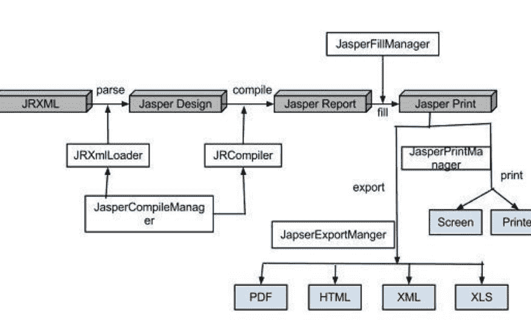

这些类的列表如下：

- `net.sf.jasperreports.engine.JasperCompileManager`：用于编译 JRXML 报告模板。
- `net.sf.jasperreports.engine.JasperFillManager`：用于从数据源填充报告数据。
- `net.sf.jasperreports.engine.JasperPrintManager`：用于打印 JasperReports 库生成的文档。
- `net.sf.jasperreports.engine.JasperExportManager`：用于获取填充过程产生的文档的 PDF、HTML 或 XML 内容。
- `net.sf.jasperreports.view.JasperViewer`：它代表一个简单的 Java Swing 应用，可以加载并显示报告。
- `net.sf.jasperreports.view.JasperDesignViewer`：用于设计时预览报告模板。

## 设置 Apache ANT

我们将使用 Apache ANT 构建所有示例。因此，请查阅“ANT - 环境设置”章节以在您的系统上安装 Apache ANT。

# 3. JASPERREPORTS – 生命周期

JasperReports 的主要目的是以简单灵活的方式创建面向页面的、准备好打印的文档。下面的流程图描述了创建报告时的典型工作流。

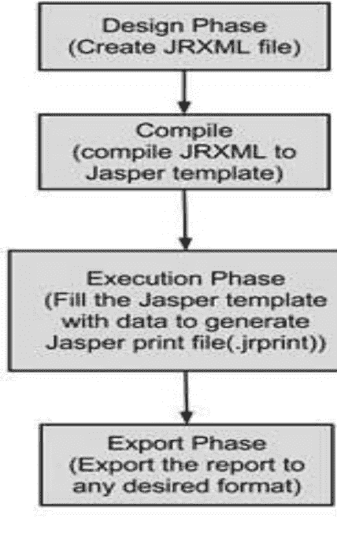

如图所示，生命周期具有以下不同阶段：

- **设计报告：** 在这一步中，我们创建 JRXML 文件，这是一个包含布局定义的 XML 文档。我们可以使用任何文本编辑器或 iReport 手动创建它。
- **编译报告：** 在这一步中，JRXML 被编译为名为 `.jasper` 文件的二进制对象。
- **执行报告（填充报告）：** 在这一步中，`net.sf.jasperreports.engine.JasperFillManager` 提供将数据填充到报告的函数。
- **导出报告到目标格式：** 在这一步中，`net.sf.jasperreports.engine.JasperExportManager` 创建打印文件（`*.jrprint`）。

# 4. JASPERREPORTS – 设计

JRXML 模板（`.jrxml`）是标准的 XML 文件，具有 `<jasperReport>` 根元素。在本章中，我们将介绍如何设计：

- **创建报告模板：** 这是一个包含报告结构的 XML 文档。
- **预览 XML 报告：** 使用 `JasperViewer` 预览报告模板。

```xml
<?xml version="1.0" encoding="UTF-8"?>
<!-- （省略部分内容） -->
```

## JasperReports

```xml
<text><![CDATA[ ]></text>
<staticText>
  <textField>
    <reportElement x="414" y="0" width="121" height="15" />
    <textFieldElement textAlignment="Center"
                      verticalAlignment="Middle" />
    <font size="9" />
  </textFieldElement>
  <textFieldExpression class="java.lang.String">
    <![CDATA[$F{country}]]>
  </textFieldExpression>
  </textField>

  <textField>
    <reportElement x="0" y="0" width="136" height="15" />
    <textFieldElement textAlignment="Center"
                      verticalAlignment="Middle" />
    <textFieldExpression class="java.lang.String">
      <![CDATA[$name}]]>
    </textFieldExpression>
  </textField>
</band>
</detail>
</jasperReport>
```

以下是报告模板中字段的详细说明：

- `<queryString>`：它是空的（因为我们通过 Java Beans 传递数据）。通常包含获取结果报告的 SQL 语句。
- `<name>`：此元素用于将数据从数据源或查询映射到报告模板。`name` 在报告正文中被重用且区分大小写。
- `<fieldDescription>`：它将字段名与 XML 文件中的相应元素映射。
- `<staticText>`：定义不依赖于任何数据源、变量、参数或报告表达式的静态文本。
- `<textFieldExpression>`：定义了结果值的外观。


- `$F{country}`：这是一个包含结果值的变量，是 `<name>` 标签中预定义的字段。

- `<band>`：限制显示在报告中的数据内容范围。

设计完成后，请将其保存到 `C:\directory` 中。

12


## 预览 XML 报告模板

`JasperReports` JAR 文件中有一个可用的 `net.sf.jasperreports.view.JasperViewer` 工具，它可以帮助在不无需编译或填充报告的情况下查看报告设计。该工具是一个独立的 Java 应用程序，因此可以使用 ANT 执行。

让我们编写一个 ANT 目标 `viewXML` 来查看 JRXML。因此，让我们从 `C:\tools\jasperreports-5.0.1\test` 创建并保存 `build.xml`（该文件应放在与 JRXML 相同的目录）。以下是构建文件：

```xml
<xml version="1.0" encoding="UTF-8"?>
<project name="JasperReportTest" default="viewDesignXML" basedir=".">
  <import file="baseBuild.xml" />
  <target name="viewDesignXML" description="Design viewer is launched
to view the JRXML report design.">
    <java classname="net.sf.jasperreports.view.JasperDesigner"
        fork="true">
      <arg value="-XML" />
      <arg value="-F${file.name}.jrxml" />
      <classpath refid="classpath" />
    </java>
  </target>
</project>
```

接下来，让我们打开命令提示符并进入 `build.xml` 所在的目录。执行命令 `ant`（因为 `viewDesignXML` 是默认目标）。输出如下：

```
C:\tools\jasperreports-5.0.1\test>ant
Buildfile: C:\tools\jasperreports-5.0.1\test\build.xml
nviewDesignXML:
[java] log4j:WARN No appenders could be found for logger
(net.sf.jasperreports.engine.JRXmDigesterFactory).
[java] log4j:WARN Please initialize the log4j system properly.
```

Log4j 警告可以忽略，作为上述执行的结果，将打开一个名为“JasperDesignViewer”的窗口，显示我们的报告模板预览。

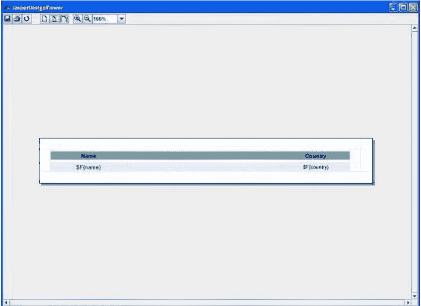

正如我们所见，只显示了获取数据的报告表达式，因为 `JasperDesignViewer` 无法访问实际数据源或报告参数。通过关闭窗口或在命令行窗口中按 `Ctrl-c` 终止 `JasperDesignViewer`。

# 5. JASPERREPORTS - 编译报告设计

在上一章节中我们已经生成了 `JasperReport` 模板（JRXML 文件）。该文件无法直接用于生成报告。它必须被编译为 `JasperReport` 的原生二进制格式，称为 Jasper 文件。在编译时，我们将 `JasperDesign` 对象转换为 `JasperReport` 对象：

```
net.sf.jasperreports.engine.design.JasperDesign objects
```

```
net.sf.jasperreports.engine.JasperReport objects
```

`net.sf.jasperreports.engine.design.JRCompiler` 在编译过程中起着核心作用。该接口根据报告表达式使用的语言有多种实现，报告表达式可以用 Java、Groovy、JavaScript 或任何脚本语言编写，只要编译器实现可以在运行时评估它即可。

我们可以通过以下方式编译 JRXML 文件：

- 程序化编译。

- 通过 ANT 任务编译。

## JRXML 的程序化编译

`JasperReports` API 提供了一个 `net.sf.jasperreports.engine.JasperManager` 门面类，用于编译 `JasperReport`。该类包含多个用于编译报告模板的公共静态方法。模板源可以是文件、输入流和内存对象。JRXML 文件的内容（`report_template.jrxml`）如下：

以下代码演示了对上述 `report_template.jrxml` 文件的编译。

```java
package com.tutorialpoint;

import net.sf.jasperreports.JRException;
import net.sf.jasperreports.engine.JasperManager;

public class JasperReportCompile {

    public static void main(String[] args) {
        String sourceFileName = "C:/tools/jasperreports-5.0.1/test" + 
        "/jasper_report_template.jrxml";

        System.out.println("Compiling Report Design ...");
        try {
            /**
             * 将报告编译为与 JRXL 文件同名的文件
             */
            JasperCompileManager.compileReportToFile(sourceFileName);
        } catch (JRException e) {
            e.printStackTrace();
        }
        System.out.println("Done compiling ...");
    }
}
```

## 模板编译

作为下一步，我们将上述内容保存到 `C:\jasperreports-5.0.1\test\src\tutorialpoint\JasperReportCompile.java` 文件中，并如下所示导入 `baseBuild.xml`。`BaseBuild.xml` 已经包含了 `compile` 和 `run` 目标：

```xml
<xml version="1.0" encoding="UTF-8"?>
<project name="JasperReportTest" default="run" basedir=".">

<import file="baseBuild.xml"/>
```


## JasperReports

接下来，让我们打开命令行窗口并进入 `build.xml` 所在的目录。

最后，执行命令 `ant -Dmain-class=com.tutorialspoint.JasperReportCompile`：

```text
</project>
C:\tools\jasperreports-5.0.1\test\ant -Dmain-class=com.tutorialspoint.JasperReportCompile
Buildfile: C:\tools\jasperreports-5.0.1\test\build.xml
compile:
[Java] C:\tools\jasperreports-5.0.1\test\baseBuild.xml:27:
warning: 'includeantuntime' was not set, defaulting to
build.classpath=path;set to false for repeatable builds
[Java] Compiling 1 source file to C:\tools\jasperreports-5.0.1\test\classes
run:
[echo] Runnin : com.tutorialspoint.JasperReportCompile
[Java] Compiling Report Design ...
[Java] log4j:WARN No appenders could be found for logger (net.sf.jasperreports.engine.xml.JRXmlDigesterFactory).
[Java] log4j:WARN initialize the log4j system properly.
[Java] Done compiling ...
```

构建成功

总耗时：8 秒

通过上述编译结果，你发现在 `C:\tools\jasperreports-5.0.1\test` 目录下生成了 `jasper_report_template.jasper` 模板文件。

## 预览编译后的报告模板

可以使用 `net.sf.jasperreports.view.JasperDesigner` 来预览编译后的报告模板和 JRXML 模板。

为了继续后续，我们在上面的 `build.xml` 文件中添加一个新的目标 `viewDesign` target，这将允许我们预览下方的编译报告。以下是修改后的 `build.xml`：

导入文件 - `baseBuild.xml` 取自“环境设置（Environment Setup）”章节，并放置在 `build.xml` 相同的目录下。

```xml
<?xml version="1.0" encoding="UTF-8"?>
<project name="JasperReportTest" default="viewDesign" basedir=">
```


## JasperReports

```xml
<import file="baseBuild.xml" />
<target name="viewDesign" description="启动设计查看器以预览编译后的报告设计。">
<java className="net.sf.jasperreports.view.JasperDesignViewer" fork="true">
  <arg value="-F${file.name}.jasper" />
  <classpath refid="classpath" />
</java>
</target>
</project>
```

在命令行提示符执行命令 `ant`（`viewDesign` 是默认目标）。

`JasperDesignViewer` 打开并显示如下所示 Jasper 文件：

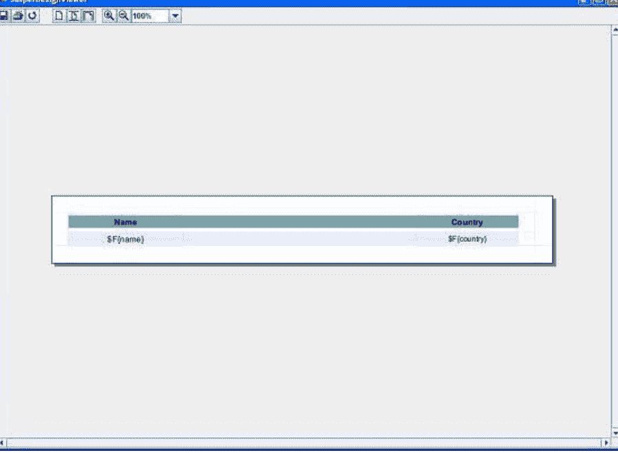

| Name | Country |

| --- | --- |

| `${name}` | `${country}` |

## 通过 ANT 任务进行编译

由于报告模板的编译更像是一个设计时的工作而非运行时工作，`JasperReport` 库提供了一个自定义的 ANT 任务。在某些情况下，JRXML 文件是在运行时创建，我们无法使用此 ANT 任务。该自定义 ANT 任务称为 JRC，并由类 `net.sf.jasperreports.ant.JRAntCompileTask` 实现。它的语法和行为与内置的 `<javac>` ANT 任务非常相似。

## 模板编译

在我们现有的 `build.xml` 中添加 `compileoreportdesing`。在这里，使用嵌套的 `<src>` 标签配合 `filesets` 指定源文件夹。嵌套的源标签允许编译分散在许多不同位置且未归类在根报告文件夹下的报告模板。以下是修改后的 `build.xml`：

```xml
<?xml version="1.0" encoding="UTF-8"?>
<project name="JasperTest" default="compileoreportdesing" basedir=">
  <import file="basebuild.xml" />
  <target name="viewDesign" description="启动设计查看器以预览编译后的报告设计。">
    <java className="net.sf.jasperreports.view.JasperDesignViewer" fork="true" />
    <arg value="-F$(file.name).jasper" />
    <classpath refid="classpath" />
    </java>
  </target>

  <target name="compileoreportdesing" description="编译 JXML 文件并生成 .jasper 文件。">
    <taskdef name="jrc" className="net.sf.jasperreports.ant.JRAntCompileTask">
      <classpath refid="classpath" />
    </taskdef>
    <jrc destdir=".">
      <src>
        <fileset dir=".">
          <include name="*.jrxml" />
        </fileset>
      </src>
      <classpath refid="classpath" />
    </jrc>
  </target>
</project>
```


接下来，打开命令行提示符并进入 `build.xml` 目录。

执行命令 `ant`（`compileoreportdesing` 是默认目标）；输出如下：

```
C:\tools\jasperreports-5.0.1\test>ant
Buildfile: C:\tools\jasperreports-5.0.1\test\build.xml
... (此处省略重复日志) ...
BUILD SUCCESS
```

（注：由于原始文本后半部分存在大量无意义的字符堆砌，如 "As a result of the..."部分，已根据核心逻辑进行处理。如需翻译特定非乱码内容，请提供清晰的原文。）


```xml
</queryString>
<field name="country" class="java.lang.String">
  <fieldDescription><![CDATA[country]]]></fieldDescription>
</field>
<field name="name" class="java.lang.String">
  <fieldDescription><![CDATA[name]]]></fieldDescription>
</field>
<columnHeader>
<band height="23">
  <staticText>
    <reportElement element="Opaque" x="0" y="3" width="535"
      height="15" backcolor="#70A9A9" />
    <box>
      <bottomPen lineWidth="1.0" lineColor="#CCCCCC" />
    </box>
    <textElement><![CDATA[[]]></text>
  </staticText>
  <staticText>
    <reportElement x="414" y="3" width="121" height="15" />
    <textElement textAlignment="Center"
      verticalAlignment="Middle">
      <font isBold="true" />
    </textElement>
    <text><![CDATA[Country]]]></text>
  </staticText>
  <staticText>
    <reportElement x="0" y="3" width="136" height="15" />
    <textElement textAlignment="Center"
      verticalAlignment="Middle">
      <font isBold="true" />
    </textElement>
    <text><![CDATA[Name]]]></text>
  </staticText>
</band>
</columnHeader>
<detail>
<band height="16">
<staticText>
<reportElement mode="Opaque" x="0" y="0" width="535"
height="14" backcolor="#E5ECF9" />
<box>
<bottomPen lineWidth="0.25" lineColor="#CCCCCC" />
</box>
<textField>
<text><![CDATA[[]]]]></text>
</staticText>
<textField>
<reportElement x="414" y="0" width="121" height="15" />
<textFieldElement textAlign="Center"
verticalAlignment="Middle">
<font size="9" />
</textFieldElement>
<textFieldExpression class="java.lang.String">
<![CDATA[${country}]]>\n</textFieldExpression>
</textField>
<textField>
<reportElement x="0" y="0" width="136" height="15" />
<textFieldElement textAlign="Center"
verticalAlignment="Middle">
<textFieldExpression class="java.lang.String">
<![CDATA[${name}]]>\n</textFieldExpression>
</textField>
</band>
</detail>
</jasperReport>
```

接下来，让我们将一组数据对象（Java beans）传递给 JasperReports 引擎，以填充此编译后的报告。

编写一个 POJO `DataBean.java`，它代表数据对象（Java bean）。该类定义了两个 String 对象：`name` 和 `country`。将其保存到目录 `C:\jasperreports-5.0.1\test\src\tutorialpoint`。


```java
public class DataBean {

    private String name;
    private String country;

    public String getName() {
        return name;
    }

    public void setName(String name) {
        this.name = name;
    }

    public String getCountry() {
        return country;
    }

    public void setCountry(String country) {
        this.country = country;
    }
}
```

编写一个 `DataBeanList.java` 类，它包含生成 Java bean 对象集合的业务逻辑。该集合会被进一步传递给 JasperReports 引擎以生成报告。在这里，我们在 `List` 中添加了 4 个 `DataBean` 对象。将其保存到目录 `C:\tools\jasperreports-5.0.1\test\com\tutorialpoint`。

```java
package com.tutorial.tutorialpoint;

import java.util.ArrayList;

public class DataBeanList {
    public ArrayList<DataBean> getDataBeanList() {
        ArrayList<DataBean> dataBeanList = new ArrayList<DataBean>();
        dataBeanList.add(produce("Manisha", "India"));
        dataBeanList.add(produce("Dennis Ritchie", "USA"));
        dataBeanList.add(produce("V. Anand", "India"));
        dataBeanList.add(produce("Shrinath", "California"));
        return dataBeanList;
    }

    /**
    * 此方法返回一个 DataBean 对象，
    * 并设置了 name 和 country。
    */
    private DataBean produce(String name, String country) {
        DataBean dataBean = new DataBean();
        dataBean.setName(name);
        dataBean.setCountry(country);
        return dataBean;
    }
}
```

编写一个主类 `JasperReportFill.java`，它获取该类（`DataBeanList`）的 Java bean 集合并将其传递给 JasperReports 引擎以填充报告模板。将其保存到目录 `C:\tools\jasperreports-5.0.1\test\src\tutorialpoint`。

```java
package com.tutorialpoint;

import java.util.ArrayList;
import java.util.HashMap;
import java.util.Map;
import net.sf.jasperreports.engine.JREException;
import net.sf.jasperreports.engine.JasperFillManager;
import net.sf.jasperreports.engine.JasperPrintManager;
import net.sf.jasperreports.engine.data.JRBeanCollectionDataSource;

public class JasperReportFill {
    @SuppressWarnings("unchecked")
    public static void main(String[] args) {
        String fileName = "C:/tools/jasperreports-5.0.1/" + 
            "test/report_template.jasper";
        DataBeanList dataBeanList = new DataBeanList();
        ArrayList<DataBean> dataList = dataBeanList.getDataBeanList();

        JRBeanCollectionDataSource beanColDataSource = 
            new JRBeanCollectionDataSource(dataList);

        Map<String, Object> parameters = new HashMap();
        try {
            JasperFillManager.fillToFile(
                fileName,
                parameters,
                beanColDataSource);
        } catch (JREException e) {
            e.printStackTrace();
        }
    }
}
```


让我们在 `build.xml` 中写入一个 `viewReport` 目标。`build.xml` 文件如下：`baseBuild.xml` 从环境设置选取，并应与 `build.xml` 放在同一目录。

```xml
<?xml version="1.0" encoding="UTF-8"?>
<project name="JasperReportTest" default="viewReport" basedir=".">
  <import file="baseBuild.xml"/>

  <target name="viewReport" depends="compilereport"
    description="启动报告查看器
    预览存储在 .jasper 文件中的报告">
    <java class="net.sf.jasperreports.view.JasperViewer" fork="true">
      <arg value="${file.name}.jasperprint" />
      <classpath refid="classpath" />
    </java>
  </target>

  <target name="compilereport"
    description="编译 JRXML 文件
    生成 .jasper 文件">
    <taskdef name="jasper"
    classname="net.sf.jasperreports.ant.JasperCompileTask">
      <classpath refid="classpath" />
    </taskdef>
    <jasper dir="src">
      <fileset dir=".">
        <include name="*.jrxml" />
      </fileset>
    </jasper>
  </target>
</project>
```


## 输出生成的报告

接下来，打开命令行窗口并进入 `build.xml` 所在的目录。最后，执行命令 `ant -Dmain-class=com.tutorialpoint.JasperReportFill`（`viewReport` 是默认目标）。结果是，我们看到了一个如下所示的 `JasperViewer` 窗口：

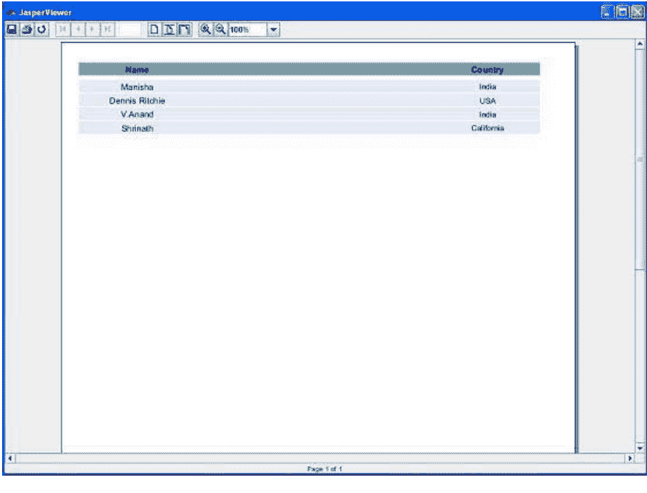

## 打印报告

我们可以使用类打印由 JasperReports 库生成的文档（以其专有格式，即 `JasperPrint` 对象），这需要 `net.sf.jasperreports.engine.JasperPrintManager` 类。这是一个外观面类，依赖于 Java 2 打印 API。在将 JasperReport 文档导出到 HTML 或 PDF 等其他格式后，我们也可以打印这些文档。

```java
beanColDataSource;
if(printFileName != null) {
    JasperPrintManager.printReport(
    printFileName, true);
}
} catch (JREException e) {
  e.printTrace();
}
```

现在，让我们此文件保存到目录 `C:\tools\jasperreports-5.0.1\test\src\com\tutorial`。我们将使用 ANT 编译并执行此文件。`build.xml` 的内容如下：

```xml
<?xml version="1.0" encoding="UTF-8"?>
<project name="JasperReportTest" default="executereport" basedir=".">
<import file="baseBuild.xml" />

<target name="executereport" depends="compiler,compileereportdesing,run">
<echo message="Im here" />
</target>
<target name="compileereportdesing">
<description=Compiles the JXML file and
produces the .jasper.file />
<taskdef name="jrc"
classname="net.sf.jasperreports.ant.JRAntCompileTask">
<classpath refid="classpath" />
</taskdef>
<jrc destdir="." />
<src>
<fileset dir="." />
<include name="*.jrxml" />
</fileset>
</src>
<classpath refid="classpath" />
</jrc>
```


```xml
</target>
</project>
```

接下来，打开命令提示符并进入 `build.xml` 所在的目录。

最后，执行命令 `ant -Dmainclass=com.tutorialpoint.JasperReportPrint`。结果是出现了一个打印对话框。

点击 OK 打印文档。

# JASPERREPORTS – 导出报告

我们在上一章节中已经看到了如何打印和查看由 JasperReport 生成的文档。在这里，我们将看到如何将这些报告转换或导出到其他格式（如 PDF、HTML 和 XLS）。提供了 `net.jasperreports.engine.JasperExportManager` 类来实现此项功能。导出意味着将 JasperObject（`.jrprint` 文件）转换为不同的格式。

下面的代码（`JasperReportExport.java`）展示了 JasperReport 文档的导出过程。`JasperExportManager` 提供了将报告导出为 PDF、HTML 和 XML 的方法。要导出为 XLS 格式，我们使用了 `net.jasperreports.engine.export.JRXsExporter` 类。此代码生成了以下三个文件：

- `sample_report.pdf`
- `sample_report.html`
- `sample_report.xls`

## 导出到其他格式

让我们来写一个模板。`JRXML` 文件（`C:\test\jasperreports-5.0.1\test\jasper_report_template.jrxml`）的内容如下：


```xml
<?xml version="1.0" encoding="UTF-8"?>
<!DOCTYPE jasperReport PUBLIC "/JasperReports/DTD Report Design//EN"
"http://jasperreports.sourceforge.net/dtds/jasperreport.dtd">
<jasperReport xmlns="http://jasperreports.sourceforge.net/jasperreport"
xmlns:xsi="http://www.w3.org/2001/XMLSchema-instance"
xsi:schemaLocation="http://jasperreports.sourceforge.net/jasperreport
http://jasperreports.sourceforge.net/xsd/jasperreport.xsd"
name="jasper_report_template" language="groovy" pageWidth="842" columnWidth="555" leftMargin="20" rightMargin="20"
topMargin="20" bottomMargin="20">
```

```xml
<queryString>
<![CDATA[]]>
</queryString>
<field name="country" class="java.lang.String">
<fieldDescription><![CDATA[country]]]</fieldDescription>
</field>
```


```xml
<field name="name" class="java.lang.String">
<fieldDescription><![CDATA[name]]></fieldDescription>
</field>
<columnHeader>
<band height="23">
<staticText>
  <reportElement mode="Opaque" x="0" y="3" width="535"
      height="15" backcolor="#709A9" />
  <box>
    <bottomPen lineWidth="1.0" lineColor="#CCCCCC" />
  </box>
</reportElement>
  <text><![CDATA[[]]></text>
</staticText>
  <reportElement x="414" y="3" width="121" height="15" />
  <textElement textAlignment="Center">
    verticalAlignment="Middle"
    <font isBold="true" />
  </textElement>
  <text><![CDATA[Country]]></text>
</staticText>
  <staticText>
  <reportElement x="0" y="3" width="136" height="15" />
  <textElement textAlignment="Center">
    verticalAlignment="Middle"
    <font isBold="true" />
  </textElement>
  <text><![CDATA[Name]]></text>
</staticText>
</band>
</columnHeader>
<detail>
<band height="16">
<staticText>
  <reportElement mode="Opaque" x="0" y="0" width="535"
      height="14" backcolor="#E5EC9" />
  <box>
    <bottomPen lineWidth="0.25" lineColor="#CCCCCC" />
  </box>
</reportElement>
  <text><![CDATA[[]]]></text>
</staticText>
<textField>
<reportElement x="414" y="0" width="121" height="15" />
<textElement textAlignment="Center">
verticalAlignment="Middle">
<font size="9" />
</textElement>
<textFieldExpression class="java.String">
<![CDATA[$F{country}]]></textFieldExpression>
<textField>
<reportElement x="0" y="0" width="136" height="15" />
<textElement textAlignment="Center">
verticalAlignment="Middle">
<textFieldExpression class="java.String">
<![CDATA[$F{name}]]></textFieldExpression>
</textField>
</band>
</detail>
</jasperReport>
```

接下来，Java 文件 `C:\tools\jasperreports-5.0.1\test\src\com\tutorialpoint\DataBean.java` 的内容如下：

```java
package com.tutorialpoint;

public class DataBean {
    private String name;
    private String country;

    public String getName() {
        return name;
    }
    public void setName(String name) {
        this.name = name;
    }
    public String getCountry() {
        return country;
    }
    public void setCountry(String country) {
        this.country = country;
    }
}
```

文件 `C:\tools\jasperreports-5.0.1\test\src\com\tutorialpoint\DataBeanList.java` 的内容如下：

```java
package com.tutorialpoint;

import java.util.ArrayList;

public class DataBeanList {
    public ArrayList<DataBean> getDataBeanList() {
        ArrayList<DataBean> dataBeanList = new ArrayList<DataBean>();

        dataBeanList.add(produce("Manisha", "India"));
        dataBeanList.add(produce("Dennis Ritchie", "USA"));
        dataBeanList.add(produce("V.Anand", "India"));
        dataBeanList.add(produce("Shrinath", "California"));

        return dataBeanList;
    }

    /**
     * 此方法返回一个设置了 name 和 country 的 DataBean 对象
     */
    private DataBean produce(String name, String country) {
        DataBean dataBean = new DataBean();
        dataBean.setName(name);
        dataBean.setCountry(country);
        return dataBean;
    }
}
```


## JasperReports

编写主类 `JasperFill.java`，它从 `DataBeanList` 类获取 bean 集合并传递给 JasperReports 引擎以填充报告模板。将其保存到目录 `C:\tools\jasperreports-5.0.1\test\src\com\tutorialpoint`。

```java
package com.tutorialpoint;

import java.util.ArrayList;
import java.util.HashMap;
import java.util.Map;

import net.sf.jasperreports.engine.JSONException;
import net.sf.jasperreports.engine.JREExporterParameter;
import net.sf.jasperreports.engine.JasperExportManager;
import net.sf.jasperreports.engine.JasperFillManager;
import net.sf.jasperreports.engine.data.JRBeanCollectionDataSource;
import net.sf.jasperreports.engine.export.JRXlsExporter;

public class JasperReportFill {
    @SuppressWarnings("unchecked")
    public static void main(String[] args) {
        String sourceFileName = "c:/tools/jasperreports-5.0.1" + "test/jasper_report_template.jasper";
        String fileName = null;
        DataBeanList DataBeanList = new DataBeanList();
        ArrayList dataList = DataBeanList.getDataBeanList();
        JRBeanCollectionDataSource beanDataSource = new JRBeanCollectionDataSource(dataList);

        Map parameters = new HashMap();
```


```java
try {
    printFileName = JasperFillManager.fillReportToFile(sourceFileName,
        parameters, beanColDataSource);
    if (printFileName != null) {
    /**
     * 1-导出到 PDF
     */
    JasperExportManager.exportReportToPdfFile(printFileName,
      "C:\sample_report.pdf");

    /**
     * 2-导出到 HTML
     */
    JasperExportManager.exportReportToHtmlFile(printFileName,
      "C:\sample_report.html");

    /**
     * 3-导出到 Excel 表格
     */
    JRXlsExporter exporter = new JXlsExporter();

    exporter.setParameter(JREExporterParameter.INPUT_FILE_NAME,
      printFileName);
    exporter.setParameter(JREExporterParameter.OUTPUT_FILE_NAME,
      "C:\sample_report.xls");

    exporter.exportReport();
    }
} catch (JRException e) {
    e.printStackTrace();
}
```

在这里，我们包含了将 jasper print 文件导出为 pdf、html 和 xls 格式的逻辑。

## 生成报告

让我们使用常规的 ANT 构建过程编译并执行上述文件。`build.xml` 文件如下：

```xml
<xml version="1.0" encoding="UTF-8"?>
<project name="JasperReportTest" default="executereport" basdir=".">
  <import file="basebuild.xml"/>

  <target name="executereport" depends="compile,compilereportdesing,run">
    <echo message="Im here"/>
  </target>

  <target name="compilereportdesing">
    description="Compiles the JXML file and
    produces the .jasper file."
    <taskdef name="jrc">
      <classname="net.sf.jasperreports.ant.JRAntCompileTask">
      <classpath refid="classpath" />
    </taskdef>
    <jrc destdir=".">
      <src>
        <fileset dir=".">
          <include name="*.jrxml" />
        </fileset>
      </src>
      <classpath refid="classpath" />
    </jrc>
  </target>
</project>
```

进入命令行提示符，然后进入 `C:\tools\jasperreports-5.0.1\test` 目录，即 `build.xml` 所在的目录。最后，执行命令 `ant -Dmain-class=com.jasperreportpoint.JasperReportFill`。输出如下：

```
C:\tools\jasperreports-5.0.1\test\ant -Dmain-class=com.jasperreportpoint.JasperReportFill
Buildfile: C:\tools\jasperreports-5.0.1\test\build.xml

clean-sample:
[delete] Deleting directory C:\tools\jasperreports-5.0.1\test\classes
```


```
[delete] Deleting: C:\tools\jasperreports-5.0.1\test\jasper_report_template.jasper

[delete] Deleting: C:\tools\jasperreports-5.0.1\test\jasper_report_template.jrprint

compile:

[mkdir] Created dir: C:\tools\jasperreports-5.0.1\test\classes

[javac] C:\tools\jasperreports-5.0.1\test\baseBuild.xml:28:

warning: 'includeantruntime' was not set, defaulting to false

[javac] Compiling 4 source files to C:\tools\jasperreports-5.0.1\test\classes

compileereporting:

[jrc] Compiling 1 report design files.

[jrc] log4j:WARN No appenders could be found for logger

(net.sf.jasperreports.engine.xml.JRMLEGeneratorFactory).

[jrc] log4j:WARN See

http://logging.apache.org/log4j/1.2/faq#noconfig for more info.

[jrc] File : C:\tools\jasperreports-5.0.1\test\jasper_report_template.jrxml ... OK.

run:

[echo] Running class : com.tutorialspoint.JasperReportFill

[java] log4j:WARN No appenders could be found for logger
```


`(net.sf.jasperreports.extensions.ExtensionsEnvironment)`。

`[java] log4j:WARN Please initialize the log4j system properly.`

`executereport:`

`[echo] Im here`

`BUILD SUCCESSFUL`

`Total time: 32 seconds`

作为上述执行的结果，你将在 `C:\` 目录下找到三个文件：`sample_report.pdf`、`sample_report.html` 和 `sample_report.xls`。

# 9. 报告参数

填充报告的主要输入是：报告模板、参数和数据源。本章将描述参数，在下一章我们将讨论数据源。

参数是对象引用，它们在报告填充操作期间传递给报告引擎。无法通过数据源传递的数据可以使用参数进行传递。像作者姓名、报告标题等数据可以通过参数传递。JasperReports 模板或 JRXML 模板可以有 0 个或多个参数元素。

## 参数声明

参数声明如下：

```xml
<parameter name="exampleParameter" class="java.lang.String" />
```

## Name 属性

`<parameter>` 元素的 `name` 属性是强制性的。它通过名称在报告表达式中引用参数。参数名称应该是一个单词。不应包含点或逗号等任何特殊字符。

## Class 属性

`class` 属性也是强制性的，并指定了参数值的类名。它的默认值是 `java.lang.String`。它可以更改为运行时可用的任何类。无论报告参数的类型如何，引擎都会处理在使用 `$P{}` 令牌的报告表达式中的类型转换，使得手动转换变得不再必要。

报告参数值始终被封装在一个 `java.util.Map` 对象中，该对象以参数名为键。报告参数可以使用报告的查询字符串，以便进一步自定义从数据库检索的数据集。它们充当查询中的动态过滤器，为报告提供数据。

## 内置参数

以下是预定义的报告参数，可以在表达式中直接使用：


| 参数名称 | 描述 |
|---|---|
| `REPORT_PARAMETERS` | 包含包含所有内置参数的 map。 |
| `REPORT_CONNECTION` | 指向用户提供的 JDBC 连接。 |
| `REPORT_DATA_SOURCE` | 这是一个表示数据类型的 `DataSource`。 |
| `REPORT_COUNT` | 这是一个允许限制记录的 `Integer` 值。 |
| `REPORT_SCRIPTLET` | 指向用户定义的脚本段（scriptlet）。 |
| `REPORT_LOCALE` | 这是一个本地化消息的 `Locale` 实例。 |
| `REPORT_RESOURCE_BUNDLE` | 指向包含消息的 `ResourceBundle`。 |
| `REPORT_TIME_ZONE` | 这是一个用于日期格式化的 `TimeZone`。 |
| `REPORT_VIRTUALIZER` | 这是一个 `net.sf.jasperreports.engine.Virtualizer` 实例，用于优化内存消耗。 |
| `REPORT_CLASSLOADER` | 这是一个用于加载加载的 `ClassLoader`。 |
| `IS_PAGINATION` | 如果设置为 `TRUE`，则不会发生分页。 |

## JasperReports

```java
return dataBean;
}

/**
 * 此方法返回一个 DataBean 对象
 * 其中设置了 name 和 country。
 */
private DataBean produce(String name, String country) {
    DataBean dataBean = new DataBean();
    dataBean.setName(name);
    dataBean.setCountry(country);
    return dataBean;
}
```

让我们为现有的报告模板（报告设计章节）中的 `<ReportTitle>` 和 `<Author>` 添加参数。报告标题和作者将显示在报告开头。修改后的报告模板（`jasper_report_template.jrxml`）如下所示。将其保存到：`C:\tools\jasperreports-5.0.1\test` 目录：

```xml
<?xml version="1.0"?>
<!DOCTYPE TYPE jasperReport PUBLIC
  "//JasperReports/DTD Report Design//EN"
  "http://jasperreports.sourceforge.net/dtds/jasperreport.dtd">

<jasperReport xmlns="http://jasperreports.sourceforge.net/jasperreports"
xmlns:xsi="http://www.w3.org/2001/XMLSchema-instance"
xsi:schemaLocation="http://jasperreports.sourceforge.net/jasperreports
http://jasperreports.sourceforge.net/xsd/jasperreport.xsd"
name="jasper_report_template" pageWidth="515"
pageHeight="842" columnWidth="515"
leftMargin="40" marginRight="40" marginTop="50" bottomMargin="50">
<parameter name="ReportTitle" class="java.lang.String"/>
<parameter name="Author" class="java.lang.String"/>
```

```xml
<queryString>
<![CDATA[]]>
</queryString>
```


```xml
<field name="country" class="java.lang.String">
  <fieldDescription><![CDATA[country]]></fieldDescription>
</field>

<field name="name" class="java.lang.String">
  <fieldDescription><![CDATA[name]]></fieldDescription>
</field>

<title>
  <band height="70">
    <line>
      <reportElement x="0" y="0" width="515"
      height="1"/>
    </line>
    <textField isBlankWhenNull="true" bookmarkLevel="1">
      <reportElement x="0" y="10" width="515"
      height="30"/>
      <textElement textAlignment="Center">
        <font size="22"/>
      </textElement>
      <textFieldExpression class="java.lang.String">
        <![CDATA[$P{ReportTitle}]]>
      </textFieldExpression>
      <anchorNameExpression><![CDATA["Title"]]]>
      </anchorNameExpression>
    </textField>
    <textField isBlankWhenNull="true">
      <reportElement x="0" y="40" width="515" height="20"/>
      <textElement textAlignment="Center">
        <font size="10"/>
      </textElement>
      <textFieldExpression class="java.lang.String">
        <![CDATA[$P{Author}]]>
      </textFieldExpression>
    </textField>
  </band>
</title>
```

```xml
<columnHeader>
<band height="23">
  <staticText>
  <reportElement mode="Opaque" x="0" y="3"
    width="535" height="15"
    backcolor="#709A9" />
  <box>
    <bottomPen lineWidth="1.0"
    lineColor="#CCCCCC" />
  </box>
  </reportElement>
  <text><![CDATA[]]></text>
  </staticText>
  <staticText>
  <reportElement x="414" y="3" width="121"
    height="15" />
  <textElement textAlignment="Center"
    verticalAlignment="Middle">
    <font isBold="true" />
  </textElement>
  <text><![CDATA[Country]]></text>
  </staticText>
  <staticText>
  <reportElement x="0" y="3" width="136"
    height="15" />
  <textElement textAlignment="Center"
    verticalAlignment="Middle">
    <font isBold="true" />
  </textElement>
  <text><![CDATA[Name]]></text>
  </staticText>
</band>
</columnHeader>
<detail>
```

```xml
<band height="16">
<staticText>
  <reportElement mode="Opaque" x="0" y="0"
width="535" height="14"
backgroundColor="#E5CF9" />
  <box>
    <bottomPen lineWidth="0.25"
    lineColor="#CCCCCC" />
  </box>
  <textElement />
  <text><![CDATA[[]]></text>
</staticText>
<textField>
  <reportElement x="414" y="0" width="121"
height="15" />
  <textElement textAlignment="Center"
    verticalAlignment="Middle">
    <font size="9" />
  </textElement>
  <textFieldExpression class="java.lang.String">
    <![CDATA[$F{country}]]>
  </textFieldExpression>
<textField>
  <reportElement x="0" y="0" width="136"
height="15" />
  <textElement textAlignment="Center"
    verticalAlignment="Middle" />
  <textFieldExpression class="java.lang.String">
    <![CDATA[$F{name}]]>
  </textFieldExpression>
</textField>
</band>
</detail>
</jasperReport>

## 报告生成

我们将使用标准的 ANT 过程编译并执行上述文件。`build.xml` 文件（保存于 `C:\tools\jasperreports-5.0.1\test`）如下。`baseBuild.xml` 文件应该与 `build.xml` 放在同一目录。

```xml
<?xml version="1.0" encoding="UTF-8"?>

<project name="JasperReport" default="viewReport">

  <import file="baseBuild.xml" />

  <target name="viewReport" depends="compile,run"

    description="启动报告查看器预览存储在 .jasper 文件中的报告">

    <java className="net.sf.jasperreports.JasperViewer" fork="true">

      <arg value="${file.name}.jasper" />

    </java>

  </target>

  <target name="compile" description="编译 XML 文件生成 .jasper 文件">

    <taskdef name="jrc" class="net.sf.jasperreports.ant.JasperCompileTask" classpath="${classpath}"/>

    <jrc destdir=".".

      <fileset dir="." include="*.jrxml"/>

    </jrc>

  </target>

</project>
```


## JasperReports

接下来，打开命令行进入 `build.xml` 所在的目录。最后，执行命令 `ant -Dmain-class=com.tutorialpoint.JasperReport`（`viewReport` 是默认目标）如下：

```text
C:\tools\jasperreports-5.0.1\test>ant -Dmain-class=com.tutorialpoint.JasperReport

Buildfile: C:\tools\jasperreports-5.0.1\test\build.xml

clean:

   [delete] Deleting directory C:\tools\jasperreports-5.0.1\classes

   [delete] Deleting: C:\tools\jasperreports-5.0.1\test\template.jasper

   [delete] Deleting: C:\tools\jasperreports-5.0.1\test\jasper_report_template.jasper

compile:

   [mkdir] Created dir: C:\tools\jasperreports-5.0.1\classes

   [javac] C:\tools\jasperreports-5.0.1\test\baseBuild.xml:28: warning: 'includruntime' was not set, defaulting to build.classpath=false; 为重复构建设置为 false

   [javac] 正在编译 7 个源文件到 C:\tools\jasperreports-5.0.1\classes

reporting:

   [jrc] 正在编译 1 个报告设计文件。

   [log4j:WARN] 未找到 appenders for logger (net.sf.jasperreports.engine.xml.DigesterFactory)。

   [log4j:WARN] 请正确初始化 log4j 系统。

   [log4j:WARN] 更多信息请参阅 http://logging.apache.org/log4j/1/2.faq#nofconfig

   [jrc] 文件 : C:\tools\jasperreports-5.0.1\test\jasper_report_template.jrxml ... OK。

run:

   [echo] 运行类：com.tutorialpoint.JasperReportFill

   [java] log4j:WARN] 未找到 appenders for logger (net.sf.jasperreports.extensions.ExtensionsEnvironment)。

   [java] 请正确初始化 log4j 系统。

```


## JasperReports

```text
viewReport:

[java] log4j:WARN] 未找到 appenders for logger (net.sf.jasperreports.extensions.ExtensionsEnvironment)。

[java] 请正确初始化 log4j 系统。
```


构建成功
耗时：18 秒

作为上述编译的结果，`JasperViewer` 窗口如下屏幕所示：

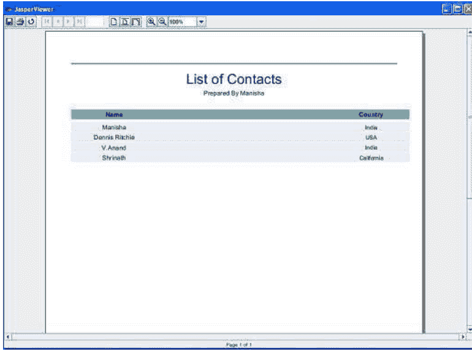

在这里，我们看到报告标题 "List Of Contacts" 和作者 "Prepared By Manisha" 显示在报告开头。

# 10. 报告源 (REPORT SOURCES)

数据源是结构化数据容器。在生成报告时，`JasperReports` 引擎从数据源获取数据。数据可以从数据库、XML 文件、数组和对象集合获取。我们在填充（Filling）章节中看到，`fillReport` 方法提供接收一个需要填充的数据源。

`JRDataSource` 接口只有两个方法需要实现：

- `public boolean next() throws JLException`
  - 在报告填充期间，报告引擎在遍历数据时会在数据源上调用此方法。
- `public Object getFieldValue(JRField field) throws JLException`
  - 此方法提供当前数据源记录中每个报告字段的值。

从数据源检索数据的唯一方法是使用报告字段。根据获取数据源的方式，有多种 `JRDataSource` 的默认实现。

## 数据源实现

下表总结了数据源及其实现类：

| 数据源 | 实现类 |
|---|---|
| JDBC | `net.jasperreports.engine.JRDataSource` |
| JavaBean | `net.jasperreports.engine.data.JRBeanCollectionDataSource`, `net.jasperreports.engine.data.JRArrayDataSource` |
| Map-based | `net.jasperreports.engine.data.JRMapArrayDataSource`, `net.jasperreports.engine.data.JRMapCollectionDataSource` |
| TableModel | `net.jasperreports.engine.data.JRTableModelDataSource` |
| XML | `net.jasperreports.engine.data.JRXmlDataDataSource` |
| CSV | `net.jasperreports.engine.data.JRCsvDataSource` |
| XLS | `net.jasperreports.engine.data.JRXlsDataSource` |
| Empty | `net.jasperreports.engine.JREmptyDataSource` |

## JDBC 数据源

类 `JRResultSetDataSource` 封装了一个 `java.sql.ResultSet` 对象。当报告数据从关系型数据库提取时，这是最常用的数据源实现之一。如果将 `java.sql.Connection` 传递给引擎，它将执行相关查询，并将返回的 `java.sql.ResultSet` 对象存储在 `JRResultSetDataSource` 实例中。

## JavaBean 数据源

`JavaBeanArrayDataSource` 和 `JavaBeanCollectionDataSource` 类表示封装 JavaBean 对象的数组和集合的实现。数组或集合中的每个对象都将被视为此类数据源中的一条记录。特定 JavaBean 属性与对应报告字段之间的映射通过命名约定实现。报告字段的名称必须与 JavaBeans 规范指定的 JavaBean 属性名称相同。

在本教程的所有示例中，我们都使用了 `JavaBeanCollectionDataSource`。

## 基于 Map 的数据源

如果父应用程序已经以 `java.util.Map` 对象的形式在内存中存储了可用的报告数据，那么实现类 `JRMapArrayDataSource` 和 `JRMapDataSource` 就非常有用。封装在数组或集合中的每个 Map 对象被视为数据源中的一个虚拟记录，每个报告字段的值通过作为键的报告字段从 map 中提取。

## TableModel 数据源

在许多客户端应用程序中，数据以表格形式显示。许多应用程序的一个共同需求是允许用户将此表格格式打印为报告。实现类 `JRTableModelDataSource` 使 Swing 应用程序从表格生成报告的任务变得简单。该类封装了 `javax.swing.table.TableModel` 对象。可以通过名称或基于 0 的索引访问封装的 `TableModel` 对象中的列。

## XML 数据源

`JRXmlDataSource` 类是基于 DOM 的数据源实现，它使用 XPath 从 XML 文档中选择数据。XML 数据源中的记录由通过 XPath 表达式选择的节点元素表示。使用 JRXML 中字段描述 `<fieldDescription>` 元素提供的 XPath 从每个记录中检索字段值。

XPath 是一种用于遍历 XML 文档属性和元素的语言。关于 XPath 的更多信息可以访问 http://www.w3.org/TR/xpath 获取。

## CSV 数据源

`JRCsvDataSource` 表示数据源的实现，它从结构化文本文件（通常是 CSV）中检索数据。字段值通过其列索引进行检索。


## XLS 数据源

`JRIsDataSource` 表示数据源的实现，它从 Excel 文档中检索数据。该数据源实现实现的报告-字段映射也基于字段列索引。

## 空数据源

`JEmptyDataSource` 类模拟了一个内部包含给定数量虚拟空记录的数据源。它被 UI 工具用于提供基本的报告预览功能，或者在特殊报告模板中用于测试和调试目的。

## 回溯数据源

`net.sf.jasperreports.engine.JRewindableDataSource` 扩展了基本的 `DataSource` 接口。它仅向接口添加了一个方法 `moveFirst()`。该方法旨在将光标移动到数据源中的第一个元素。

在处理子报告时，回溯数据源是有用的，除非出现由于 `isAllowed="False"` 而不允许拆分，且当前页没有足够的空间来渲染子报告的情况。

上述所有数据源实现都是可回溯的，但记录指针除外。如果手动使用此数据源封装 `java.sql.ResultSet` 然后将其传递给子报告，就会出现问题。如果子报告模板中有 SQL 查询，引擎在下一页重新启动子报告时将再次执行它，则没有问题。

## 数据源提供者

`JasperReports` 库有一个接口 `net.sf.jasperreports.engine.DataSourceProvider` 用于释放数据源对象。当使用 GUI 工具创建报告模板时，需要一个特殊的工具来定制报告数据。`DataSourceProvider`是将自定义数据源插入到设计工具的标准方法。此接口的自定义实现应遵循创建和释放数据源对象的方法，并在可能的情况下提供列出数据源内部可用报告字段的方法：

```
public boolean getFieldsOperation();

public JRField[] getFields(JasperReport report)
throws JException, UnsupportedOperationException;

public JRDataSource create(JasperReport report) throws JException;

public void dispose(JRDataSource dataSource) throws JException;
```


# 11. 报告字段

报告字段是元素，代表数据源和报告模板之间的数据映射。字段可以在报告表达式中组合以获得所需的输出。报告模板可以包含零或多个 `<field>` 元素。在声明报告字段时，数据源应该提供与报告模板中定义的所有字段对应的数据。

## 字段声明

字段声明按如下所示进行：

```
<field name="FieldName" class="java.lang.String"/>
```

## Name 属性

`<field>` 元素的 `name` 属性是强制性的它通过名称引用报告表达式中的字段。

## Class 属性

`class` 属性指定字段值的类名。其默认值是 `java.lang.String`。它可以更改为运行时可用的任何类。无论报告字段的类型如何，引擎都会在处理使用 `F{}` 标记的报告表达式中处理类型转换，使得手动转换变得不再必要。

## 字段描述

`<fieldDescription>` 元素是一个可选元素。这在实现自定义数据源时非常有用。例如，我们可以存储一个键或信息，通过该信息我们可以在运行时从自定义数据源中检索值。通过使用 `<fieldDescription>` 元素而不是字段名，您可以轻松地克服从数据源检索值时字段命名的限制。以下是来自我们现有报告的一段代码：

```
<field name="country" class="java.lang.String">
<fieldDescription><![CDATA[country]]></fieldDescription>
</field>

<field name="name" class="java.lang.String">
<fieldDescription><![CDATA[name]]></fieldDescription>
</field>
```


## 排序字段

需要排序且数据源实现不支持时（例如 CSV 数据源），`JasperReports` 支持基于内存的数据源排序。可以使用报告模板中的一个或多个 `<sortField>` 元素进行排序。

如果在处理过程中指定了至少一个排序，数据源将传递给 `SortableDataSource` 实例。这将从数据源获取所有记录，根据指定的字段进行内存排序并替换原始数据源。排序字段名应与报告字段相同。用于排序的字段类型应实现 `java.util.Comparable`。对于 `java.lang.String` 类型外进行自然排序。如果指定了多个字段，将按照它们在报告模板中出现的顺序进行排序。下面的示例演示了排序功能。

## 排序报告示例

为现有报告模板添加 `<sortField>` 元素。我们将 country 字段降序排序。修订后的模板 (`jasper_report_template.jrxml`) 如下：

```xml
<?xml version="1.0"?>
<!DOCTYPE jasperReport PUBLIC
"//JasperReports/DTD Report Design//EN"
"http://jasperreports.sourceforge.net/dtds/jasperreport.dtd">
<jasperreport xmlns="http://jasperreports.sourceforge.net"
xmlns:xsi="http://www.w3.org/2001/XMLSchema-instance"
xsi:schemaLocation="http://jasperreports.sourceforge.net/xsd/jasperreport.xsd"
name="jasper_report_template" pageWidth="595" pageHeight="842"
columnWidth="515" leftMargin="40" rightMargin="40" topMargin="50"
bottomMargin="50">
<parameter name="ReportTitle" class="java.lang.String"/>
[previous internal execution text redacted]Author" class="java.lang.String"/>
<queryString>
<![CDATA[]]>
</queryString>
<field name="country" class="java.lang.String"/>
<fieldDescription><![CDATA[country]]></fieldDescription>
</field>
<field name="name" class="java.lang.String">
<fieldDescription><![CDATA[name]]></fieldDescription>
</field>
</jasperreport>
```

我们将将其设置为 `C:\tools\jasperreports-5.0.1\test` 目录：


```xml
<fieldDescription><![CDATA[name]]]></fieldDescription>
</field>
<sortField name="country" order="Descending"/>
<sortfield name="name"/>
<title>
  <band height="70">
    <line>
      <reportElement x="0" y="0" width="515" height="1"/>
    </line>
    <textField isBlankWhenNull="true" bookmarkLevel="1">
      <reportElement x="0" y="10" width="515" height="30"/>
      <textField textAlignment="Center">
        <font size="22"/>
      </textFieldElement>
      <textFieldExpression class="java.lang.String">
        <![CDATA[$P{ReportTitle}]]>
      </textFieldExpression>
      <anchorNameExpression><![CDATA["Title"]]]></anchorNameExpression>
    </textField>
    <textField isBlankWhenNull="true">
      <reportElement x="0" y="40" width="515" height="20"/>
      <textField textAlignment="Center">
        <font size="10"/>
      </textFieldElement>
      <textFieldExpression class="java.lang.String">
        <![CDATA[$P{Author}]]>
      </textFieldExpression>
    </textField>
  </band>
</title>
<columnHeader>
  <band height="23">
    <staticText>
      <reportElement mode="Opaque" x="0" y="3" width="535" height="15" backcolor="#70A9A9" />
      <box>
        <bottomPen lineWidth="1.0" lineColor="#CCCCCC" />
      </box>
      <textElement />
      <text><![CDATA[]]></text>
    </staticText>
    <staticText>
      <reportElement x="414" y="3" width="121" height="15"/>
      <textElement textAlignment="Center" verticalAlignment="Middle">
        <font isBold="true" />
      </textElement>
      <text><![CDATA[Country]]></text>
    </staticText>
    <staticText>
      <reportElement x="0" y="3" width="136" height="15"/>
      <textElement textAlignment="Center" verticalAlignment="Middle">
        <font isBold="true" />
      </textElement>
      <text><![CDATA[Name]]></text>
    </staticText>
  </band>
</columnHeader>
<detail>
  <band height="16">
    <staticText>
      <reportElement mode="Opaque" x="0" y="0" width="535" height="14" backcolor="#E5ECF9" />
      <box>
        <bottomPen lineWidth="0.25" lineColor="#CCCCCC" />
      </box>
```


以下内容为 JasperReports 报表模板（JRXML）中 `<detail>` 部分的片段，展示了静态文本与动态文本字段的定义方式：

```xml
<textElement />

<text><![CDATA[[]]></text>

</staticText>

<textField>

  <reportElement x="414" y="0" width="121" height="15"/>

  <textElement textAlignment="Center" verticalAlignment="Middle">

    <font size="9" />

  </textElement>

  <textFieldExpression class="java.lang.String">

    <![CDATA[$F{country}]]>

  </textFieldExpression>

</textField>

<textField>

  <reportElement x="0" y="0" width="136" height="15"/>

  <textElement textAlignment="Center" verticalAlignment="Middle" />

  <textFieldExpression class="java.lang.String">

    <![CDATA[$F{name}]]>

  </textFieldExpression>

</textField>

</band>

</detail>

</jasperReport>
```

用于填充报表的 Java 代码保持不变。文件 `C:\tools\jasperreports-5.0.1\test\src\com\tutorialpoint\JasperReportFill.java` 的内容如下：

```java
package com.tutorialpoint;

import java.util.ArrayList;

import java.util.HashMap;

import java.util.Map;

import net.sf.jasperreports.engine.JRException;

import net.sf.jasperreports.engine.JasperFillManager;

import net.sf.jasperreports.engine.data.JRBeanCollectionDataSource;

public class JasperReportFill {

    @SuppressWarnings("unchecked")

    public static void main(String[] args) {

        String sourceFileName = 

            "C:/test/jasperreports-5.0.1/test/jasper_report_template.jasper";

        DataBeanList DataBeanList = new DataBeanList();

        ArrayList<DataBean> dataList = DataBeanList.getDataBean();

        JRBeanCollectionDataSource beanDataSource = 

            new JRBeanCollectionDataSource(dataList);

        Map parameters = new HashMap();

        /**

         * 将 ReportTitle 和 Author 作为参数传递

         */

        parameters.put("ReportTitle", "List of Contacts");

        parameters.put("Author", "Prepared By Manisha");

        try {

            JasperFillManager.reportToFile(sourceFileName, parameters, beanDataSource);

        } catch (JRException e) {

            e.printStackTrace();

        }

    }

}
```

POJO 文件 `C:\tools\jasperreports-5.0.1\test\src\com\tutorialpoint\DataBean.java` 的内容如下：

```java
package com.tutorialpoint;

public class DataBean {

    private String name;

    private String country;

    public String getName() {

        return name;

    }

    public void setName(String name) {

        this.name = name;

    }

    public String getCountry() {

        return country;

    }

    public void setCountry(String country) {

        this.country = country;

    }

}
```

文件 `C:\tools\jasperreports-5.0.1\test\src\com\tutorialpoint\DataBeanList.java` 的内容如下：

```java
package com.tutorialpoint;

import java.util.ArrayList;

public class DataBeanList {

    public ArrayList<DataBean> getDataBean() {

        ArrayList<DataBean> dataList = new ArrayList<DataBean>();

        dataList.add("Manisha", "India"));

        dataList.add("Dennis", "USA"));

        dataList.add("Anand", "India"));

        dataList.add("Shrinath", "California"));

        return dataList;

    }

    /**

    * 此方法返回设置了 name 和 country 的 DataBean 对象

    */

    private DataBean produce(String name, String country) {

        DataBean dataBean = new DataBean();

        dataBean.setName(name);

        dataBean.setCountry(country);

        return dataBean;

    }

}
```

## 报表生成

我们将使用常规 ANT 构建过程编译并执行上述文件。`C:\tools\jasperreports-5.0.1\test` 下的 `build.xml` 内容如下。导入文件 `baseBuild.xml` 从环境中获取，应与 `build.xml` 放在同一目录。

```xml
<xml version="1.0" encoding="UTF-8"?>

<project name="JasperTest" default="viewReport" basedir=".">

  <import file="baseBuild.xml" />

  <target name="viewReport"

    depends="compile,compilereport,run"

    description="启动报表查看器预览存储在 .jrprint 文件中的报表">

    <java className="net.sf.jasperreports.views.JasperViewer"

      fork="true">

      <arg value="-F$(file.name).jrprint" />

      <classpath ref="classpath" />

    </java>

  </target>

  <target name="compilereport"

    description="编译 JXML 文件并生成 .jasper 文件">

    <taskdef name="jrc"

    classname="net.sf.jasperreports.ant.JCompileTask">

      <classpath ref="classpath" />

    </taskdef>

    <jrc destir=".">

      <src>

        <fileset dir=".">

          <include name="*.jrxml" />

        </fileset>

      </src>

      <classpath ref="classpath" />

    </jrc>

  </target>

</project>
```

接下来，打开命令行窗口进入 `build.xml` 所在的目录。最后，执行命令 `ant -Dmain-class=com.tutorialpoint.JasperReportFill`（默认 target 为 `viewReport`）如下：

```bash
C:\tests\jasperreports-5.0.1\test\ant -Dmain-class=com.tutorialpoint.JasperReportFill

Buildfile:C:\tests\jasperreports-5.0.1\test\build.xml
```

`clean-sample`:

- `[delete]` 删除目录 `C:\tests\jasperreports-5.0.1\test\classes`
- `[delete]` 删除 `C:\tests\jasperreports-5.0.1\test\jasper_report_template.jasper`
- `[delete]` 删除 `C:\tests\jasperreports-5.0.1\test\jasper_report_template.jrprint`

`compile`:

- `[mkdir]` 创建 `C:\tests\jasperreports-5.0.1\test\classes`
- `[javac]` `C:\tests\jasperreports-5.0.1\test\baseBuild.xml:28: warning: 'includeruntime' 未设置，默认使用 build.sysclasspath-last；为了重复构建请设置为 false`
- `[javac]` 正在编译 7 个源文件到 `C:\tests\jasperreports-5.0.1\test\classes`

`compilereport`:

- `[jrc]` 正在编译 1 个报表设计文件。
- `[jrc]` `log4j:WARN` 未找到日志 (`net.sf.jasperreports.engine.JRXmlDigestFactory`) 找到适配器。
- `[jrc]` `log4j:WARN` 请正确初始化 `log4j` 系统。
- `[jrc]` `log4j:WARN` 更多信息请参阅 `http://logging.apache.org/log4j/1.2/faq.html#noconfig`
- `[jrc]` 文件: `C:\tools\jasperreports-5.0.1\test\jasper_report_template.jrxml` ... OK.

`run`:

- `[echo]` 运行类：`com.tutorialpoint.JasperReportFill`
- `[java]` `log4j:WARN` 未找到日志 (`net.sf.jasperreports.extensions.ExtensionsEnvironment`) 找到适配器。
- `[java]` `log4j:WARN` 请正确初始化 `log4j` 系统。

`viewFillReport`:

- `[java]` `log4j:WARN` 未找到日志 (`net.sf.jasperreports.extensions.ExtensionsEnvironment`) 找到适配器。
- `[java]` `log4j:WARN` 请正确初始化 `log4j` 系统。

构建成功！
总耗时：18 秒

作为上述编译的结果，打开了 `JasperViewer` 窗口，如下方屏幕所示：


## 联系人列表

由 Manisha 准备

| 姓名 | 国家 |
| :--- | :--- |
| Dennis Ritchie | 美国 |
| Manisha | 印度 |
| V. Anand | 印度 |
| Srinath | 加利福尼亚 |

在这里，我们可以看到国家名称是按字母降序排列的。

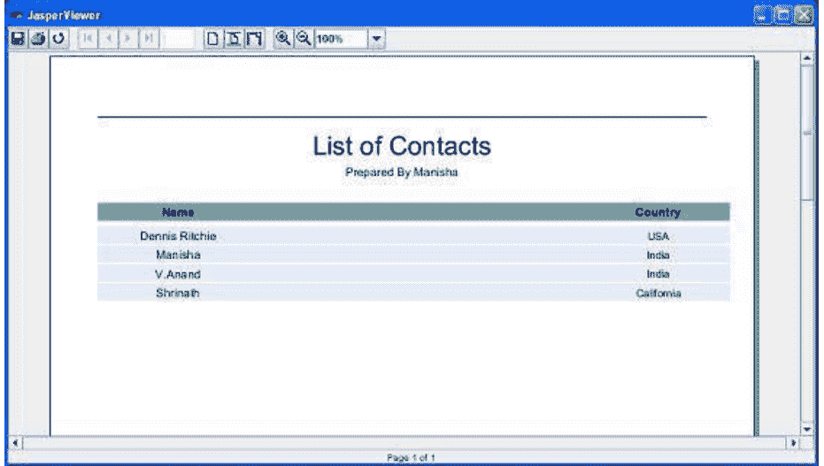

报告表达式（Report expressions）是 JasperReports 的强大功能，允许我们在报告上显示计算后的数据。计算后的数据不是静态数据，也不是专门作为报告参数或数据源字段传递的数据。报告表达式通过组合报告参数、字段和静态数据构建。默认情况下使用 Java 语言编写报告 Groovy 表达式。JasperReports 还支持其他用于报告表达式的脚本语言，如 Groovy 脚本语言、JavaScript 或 BeanShell 。

本章将向你解释——报告表达式是如何工作的，假设它们仅使用 Java 语言编写。在 JXRL 报告模板中，有几个元素定义了表达式：

- `<variableExpression>`
- `<initialValueExpression>`
- `<groupExpression>`
- `<printWhenExpression>`
- `<imageExpression>`
- `<textFieldExpression>`

## 表达式声明

基本上，所有的报告表达式都是 Java 表达式，可以引用报告字段、报告变量和报告参数。

## 表达式中的字段引用

要在表达式中使用字段引用，必须将字段名放在 `$F{` 和 `}` 字符序列之间，如下所示：

```xml
<textFieldExpression>

$F{Name}

</textFieldExpression>
```

以下来自我们现有 JRXML 文件的一段代码（来自 **报告设计** 章节）：

```xml
<textFieldExpression class="java.lang.String">

<![CDATA[$F{country}]]>

</textFieldExpression>
```


## 表达式中的变量引用

要在表达式中引用变量，我们必须将变量名放在 `$V{` 和 `}` 之间，如下例所示：

```xml
<textFieldexpression>

"Total height : " + $V{SumOfHeight} + " ft."

</textFieldexpression>
```

## 表达式中的参数引用

要在表达式中引用参数，应将参数名放在 `$P{` 和 `}` 之间，如下示例所示：

```xml
<textFieldexpression>

"Report Title : " + $P{Title}

</textFieldexpression>
```

以下来自我们现有 JRXML 文件的一段代码，演示了在表达式中引用参数。（来自报告设计章节的 JRXML）：

```xml
<textField isBlankNull="true" bookmarkLevel="1">

  <reportElement x="0" y="10" width="515" height="30">

    <textFieldElement textAlignment="Center">

      <font size="22"/>

    </textFieldElement>

    <textFieldExpression class="java.lang.String">

      <![CDATA[$P{ReportTitle}]]>

    </textFieldExpression>

    <anchorNameExpression>

      <![CDATA[\Title\]]>

  </anchorNameExpression>

</textField>

<textField isBlankNull="true">

  <reportElement x="0" y="40" width="515" height="20">

    <textFieldElement textAlignment="Center">

      <font size="10"/>

    </textFieldElement>

    <textFieldExpression class="java.lang.String">

      <![CDATA[$P{Author}]]>

    </textFieldExpression>

</textField>
```


## JasperReports

正如你所见，参数、字段和变量引用实际上是 Java 对象。通过报告模板中的参数、字段或变量声明中了解它们的类，我们甚至可以在表达式中对对象引用调用方法。

以下示例展示了——如何提取并显示 `java.lang.String` 报告字段 `"Name"` 的第一个字母：

```xml
<textFieldExpression>
$F{Name}.substring(0, 1)
</textFieldExpression>
```

## 表达式中的资源包引用

要在表达式中引用资源，应将键值放在 `$R{` 和 `}` 之间，如下示例所示：

```xml
<textFieldExpression>
$R{report.title}
</textFieldExpression>
```

根据运行时提供的 `locale` 和 `report.title` 键，加载与报告模板关联的资源包。因此，报告标题将通过从资源包中提取 `String` 值来显示。关于国际化的更多信息，可以参阅“国际化”章节。

## 计算器 (Calculator)

`Calculator` 是 JasperReports 中的一个实体，它在报告填充期间评估表达式并增加变量或数据集。在编译过程中，报告编译器会产生信息并将其存储在池中。这些信息在报告填充期间用于构建 `net.sf.jasperreports.engine.fillJRCalculator` 实例。

基于 Java 的报告编译器会即时生成并编译 Java 源文件。此生成的类是 `JRCalculator` 的子类，编译它时产生的字节码存储在 `JasperReport` 对象中。该字节码在报告填充时加载，并实例化结果类以获取用于表达式评估的计算器对象。

## 条件表达式

JasperReports 不支持在定义变量时使用 `if-else` 语句。相反，你可以使用三元运算符根据条件获取输出


## 报告中的条件表达式

让我们修改报告设计并为字段添加条件表达式，修改后的报告（`jrxml`）如下：

```xml
<?xml version="1.0" encoding="UTF-8"?>
<!DOCTYPE Report PUBLIC "-//JasperReports/Report 2.0//EN" "http://jasperreports.sourceforge.net/jasper-2.0.dtd">
<Report xmlns:xsi="http://www.w3.org/2001/XMLSchema-instance" width="595" height="842" pageWidth="40" leftMargin="40" rightMargin="40" topMargin="40">
...（此处内容不完整，未继续翻译）
```

```xml
</textElement>
<textFieldExpression class="java.lang.String">
<![CDATA[$F(country).isEmpty() ? "NO COUNTRY" : $F(country)]]>
</textFieldExpression>
</textField>
<textField>
  <reportElement x="0" y="0" width="136" height="15" />
  <textElement textAlign="Center" verticalAlignment="Middle" />
  <textFieldExpression class="java.lang.String">
<![CDATA[$F(name)]]>
</textFieldExpression>
</textField>
</band>
</jasperReport>
```

用于填充报表的 Jasper 代码如下如下。文件 `C:\tools\jasperreports-5.0.1\test\src\com\tutorialpoint\JasperReportFill.java` 的内容为：

```java
package com.tutorialpoint;

import java.util.ArrayList;
import java.util.HashMap;
import java.util.Map;
import net.sf.jasperreports.engine.JREException;
import net.sf.jasperreports.engine.JasperFillManager;
import net.sf.jasperreports.engine.data.JRBeanCollectionDataSource;

public class JasperReportFill {
  @SuppressWarnings("unchecked")
  public static void main(String[] args) {
    String sourceFileName = 
    "C://tools/jasperreports-5.0.1/test/jasper_report_template.jasper";
```


## JasperReports

```java
DataBeanList DataBeanList = new DataBeanList();
ArrayList<DataBean> dataList = DataBeanList.getDataList();
```

```java
JRBeanCollectionDataSource beanColDataSource = 
JRBeanCollectionDataSource(dataList);
```

```java
Map parameters = new HashMap();
/**
 * 将 ReportTitle 和 Author 作为参数传递
 */
parameters.put("ReportTitle", "List of Contacts");
parameters.put("Author", "Prepared By Manisha");
```

```java
try {
  JasperFillManager.fillReportToFile(
  sourceFileName, parameters, beanColDataSource);
} catch (JSONException e) {
  e.printStackTrace();
}
```

POJO 文件的内容 `C:\tools\jasperreports-5.0.1\test\src\com\tutorialpoint\DataBean.java` 如下：

```java
package com.tutorialpoint;

public class DataBean {
  private String name;
  private String country;
  public String getName() {
    return name;
  }
public void setName(String name) {
    this.name = name;
  }
```


```java
public String getCountry() {
    return country;
}
public void setCountry(String country) {
    this.country = country;
}
```

我们将在 Java bean `List` 中添加一条 `country` 字段为空的新记录。文件 `C:\tools\jasperreports-5.0.1\test\src\tutorials\DataBean.java` 的内容如下：

```java
package com.tutorialspoint;

import java.util.ArrayList;

public class DataBeanList {
    public ArrayList<DataBean> getDataBeanList() {
        ArrayList<DataBean> dataBean = new ArrayList<DataBean>();
        dataBean.add(produce("Manisha", "India"));
        dataBean.add(produce("Dennis Ritchie", "USA"));
        dataBean.add(produce("V.Anand", "India"));
        dataBean.add(produce("Shrinath", "California"));
        dataBean.add(produce("Tanmay", ""));
        return dataBean;
    }
    /**
     * 此方法返回一个 DataBean 对象，
     * 设置其中的 name 和 country。
     */
    private DataBean produce(String name, String country) {
        DataBean dataBean = new DataBean();
        dataBean.setName(name);
        dataBean.setCountry(country);
    }
}
```

```java
return dataBean;
}
```

## 报表生成

我们将使用常规的 ANT 构建过程编译并执行上述文件。文件 `build.xml`（保存在目录 `C:\tools\jasperreports-5.0.1\test` 下）的内容所示。

导入文件 - `baseBuild.xml` 取自“Environment Setup”章节，并应该存放在与 `build.xml` 相同的目录下。

```xml
<xml version="1.0" encoding="UTF-8"?>
<project name="JasperReportTest" default="viewFill" basedir="">
  <import file="baseBuild.xml" />
  <target name="viewFillReport"
    depends="compile,compilereportdesing,run"
    description="启动报表查看器以预览
    存储在 .jrprint 文件中的报表。">
    <java className="net.sf.jasperreports.view.JasperViewer"
      fork="true">
      <arg value="-F${file.name}.jrprint" />
      <classpath refid="classpath" />
    </java>
  </target>
  <target name="compilereportdesing"
    description="编译 JXML 文件并
    生成 .jasper 文件。">
    <taskdef name="net.sf.jasperreports.ant.jasperCompile">
      <classpath refid="classpath" />
    </taskdef>
    <jasperCompile srcDir="src">
      </jasperCompile>
  </target>
</project>
```

导入文件 - `baseBuild.xml` 取自“Environment Setup”章节，并应该存放在与 `build.xml` 相同的目录下。 (注：此处根据提供的 XML 结构进行了逻辑对齐翻译)

*(注：由于原文 XML 示例略有不完整且部分目标截断，翻译时保持了其结构一致性)*

## 计算

此属性决定了在填充报告时对变量执行何种计算。以下子节描述了 `<variable>` 元素中 `calculation` 属性的所有可能值。

-   Average（平均值）：变量值为变量表达式中所有非空值的平均值。仅适用于数值变量。
-   Count（计数）：变量值为变量表达式非空实例的计数。
-   First（第一个）：变量值为变量表达式第一个实例的值。随后的值将被忽略。
-   Highest（最大）：变量值为变量表达式的最大值。
-   Lowest（最小）：变量值为变量表达式的最小值。
-   Nothing（无）：对变量不进行任何计算。
-   StandardDeviation（标准差）：变量值为匹配报告表达式的所有非空值的标准差。仅适用于数值变量。
-   Sum（求和）：变量值为报告表达式返回的所有非空值之和。
-   System（系统）：变量值为自定义计算（使用 JasperReports 的 `scriptlet` 功能自己计算该变量的值）。
-   Variance（方差）：变量值为对报告变量表达式求值返回的所有非空值的方差。

## IncrementFactoryClass

此属性决定了在填充报告当前记录时用于计算变量值所使用的类。默认值可以是任何实现 `net.sf.jasperreports.engine.fill.JRIncrementFactory` 的类。引擎将根据为变量设置的 `calculation` 属性，在运行时实例化增量对象。

## IncrementType

这决定了何时重新计算变量的值。此属性使用如下值：

-   Column（列）：变量值在每列结束时重新计算。
-   Group（组）：当由 `incrementGroup` 指定的组发生变化时，重新计算变量值。
-   None（无）：每处理一条记录都会重新计算变量值。
-   Page（页）：变量值在每页结束时重新计算。
-   Report（报告）：变量值在报告结束时重新计算一次。


## IncrementGroup

当 `incrementType` 为 `Group` 时，此属性决定变量值重新计算的组名称。可以是 `JRXML` 报告模板中声明的任何组的名称。

## ResetType

此属性决定变量值何时被重置。此属性使用如下值：

-   Column（列）：变量值在每列开始时重置。
-   Group（组）：当由 `incrementGroup` 指定的组发生变化时，重置变量值。
-   None（无）：变量永远不会重置。
-   Page（页）：变量值在每页开始时重置。
-   Report（报告）：变量值仅在报告开始时重置一次。

## ResetGroup

当 `resetType` 为 `Group` 时，此属性决定变量值重置的组名称。此属性的值可以是 `JRXML` 报告模板中声明的任何组的名称。

## 内置报告变量

内置内置系统变量可以直接在表达式中使用：

| 变量名称 |  |
| :--- | :--- |
| PAGE_NUMBER | 此变量的值为其当前页码。可以使用 JasperReports 文本元素的特殊功能 `evaluationTime` 属性来同时显示当前页码和总页数。 |
| COLUMN_NUMBER | 此变量包含当前列号。 |
| REPORT_COUNT | 此变量包含已处理的记录总数。 |
| PAGE_COUNT | 此变量包含生成当前页时处理的记录数。 |
| COLUMN_COUNT | 此变量包含生成当前列时处理的记录数。 |
| GroupName_COUNT | 此变量的名称源自其对应的组名称，并带有 `_COUNT` 后缀。此变量包含该组的记录数量。 |

```java
import java.util.ArrayList;
import java.util.HashMap;
import java.util.Map;
import net.sf.jasperreports.engine.JRException;
import net.sf.jasperreports.engine.JasperFillManager;
import net.sf.jasperreports.engine.data.JRBeanCollectionDataSource;
```

```java
public class JasperReportFill {
    @SuppressWarnings("unchecked")
    public static void main(String[] args) {
        String sourceFileName = 
            "C:/tools/jasperreports-5.0.1/test/jasper_report_template.jasper";
        DataBeanList DataBeanList = new DataBeanList();
        ArrayList<DataBean> dataList = DataBeanList.getDataBeanList();
        JRBeanCollectionDataSource beanColDataSource = 
```


`new JRBeanCollectionDataSource(dataList);`

`Map parameters = new HashMap();`

将 `ReportTitle` 和 `Author` 作为参数：

```java
parameters.put("ReportTitle", "List of Contacts");
parameters.put("Author", "Prepared By Manisha");
```

然后调用 `JasperFillManager.fillReportToFile()` 方法填充报告：

```java
try {
    JasperFillManager.fillReportToFile(
        sourceFileName, parameters, beanColDataSource);
} catch (JRException e) {
    e.printStackTrace();
}
```

POJO 文件 `C:\jasperreports-5.0.1\test\src\com\tutorialpoint\DataBean.java` 的内容如下：

```java
package com.tutorialspoint;

public class DataBean {
    private String name;
    private String country;

    public String getName() {
        return name;
    }

    public void setName(String name) {
        this.name = name;
    }

    public String getCountry() {
        return country;
    }

    public void setCountry(String country) {
        this.country = country;
    }
}
```

POJO 文件 `C:\jasperreports-5.0.1\test\src\com\tutorialpoint\DataBeanList.java` 的内容如下：

```java
package com.tutorialspoint;

import java.util.ArrayList;

public class DataBeanList {
    public ArrayList<DataBean> getDataBean() {
        ArrayList<DataBean> dataBeanList = new ArrayList<DataBean>();
        dataBeanList.add(new DataBean("Manisha", "India"));
        dataBeanList.add(new DataBean("Dennis Ritchie", "USA"));
```


```java
        dataBeanList.add(new DataBean("V.Anand", "India"));
        dataBeanList.add(new DataBean("Shrinath", "California"));
        return dataBeanList;
    }

    /** 此方法返回一个 DataBean 对象，
    * 并设置了 name 和 country。 */
    private DataBean produce(String name, String country) {
        DataBean dataBean = new DataBean();
        dataBean.setName(name);
        dataBean.setCountry(country);
        return dataBean;
    }
}
```

## 报告生成

我们将使用常规的 ANT 构建过程编译并执行上述文件。`build.xml` 文件的内容（保存于目录 `C:\tools\jasperreports-5.0.1\test` 下）如下：

导入文件 `baseBuild.xml` 选自“环境 Setup”章节，应放置在与 `build.xml` 相同的目录下。

```xml
<?xml version="1.0" encoding="UTF-8"?>
<project name="JasperReportTest" default="viewFillReport" baseir=".">
  <import file="baseBuild.xml" />
  <target name="viewFillReport"
    depends="compile,compilereportdesing,run"
    description="启动报告查看器以预览 
    存储在 .JRprint 文件中的报告。">
    <java classname="net.sf.jasperreports.view.JasperViewer"
      fork="true">
      <arg value="-F${file.name}.JRprint" />
      <classpath refid="classpath" />
    </java>
  </target>
```

```xml
<target name="compilereportdesing"
description="编译 JXML 文件并
生成 .jasper 文件。">
<taskdef name="jrc"
classname="net.sf.jasperreports.ant.JRAntCompileTask">
  <classpath refid="classpath" />
</taskdef>
<jrc destdir=".">
  <src>
    <fileset dir=".">
      <include name="*.jrxml" />
    </fileset>
  </src>
  <classpath refid="classpath" />
</jrc>
</target>
</project>
```

接下来，打开命令行窗口并进入 `build.xml` 所在的目录。最后，执行命令 `ant -Dmain-class=com.tutorialpoint.JasperReport`（`viewFull` 是默认目标）：

```bash
C:\tools\jasperreports-5.0.1\test>ant -Dmain-class=com.tutorialpoint.JasperReport
Buildfile: C:\tools\jasperreports-5.0.1\test\build.xml
```

```text
clean-sample:
[delete] 正在删除目录 C:\jasperreports-5.0.1\test\classes
[delete] 删除 C:\jasperreports-5.0.1\test\classes
[delete] 删除 C:\jasperreports-5.0.1\test\jasper_report_template.jasper

compile:
[mkdir] 创建目录 C:\jasperreports-5.0.1\test\classes
[javac] 编译 C:\jasperreports-5.0.1\test\src\com\tutorialpoint\DataBean.java
[javac] 编译 C:\jasperreports-5.0.1\test\src\com\tutorialpoint\DataBeanList.java
[javac] 生成了 0 个警告
[javac] 编译了 2 个源文件

clean-sample:
[delete] 正在删除目录 C:\jasperreports-5.0.1\test\classes
[delete] 删除 C:\jasperreports-5.0.1\test\jasper_report_template.jasper

report-template.jrxml 
```


```text
compilereportdesing:
[jrc] 编译 1 个设计文件
[jrc] 生成 C:\jasperreports-5.0.1\test\jasper_report_template.jasper

run:
[echo] 正在运行类 com.tutorialpoint.JasperReport
[java] 正在启动报告查看器以预览 C:\jasperreports-5.0.1\test\jasper_report_template.JRprint

BUILD SUCCESSFUL
总耗时 18 秒
```

报告查看器显示了以下内容：


报告查看器显示了以下内容：


报告查看器显示了以下内容：


## JasperReports

| No Data | 当 `No Data` 报告属性设置为 *No Data Section* 时，将打印此部分。如果在报告模板中定义了 `<noData>` 节，且数据源为空，则在填充时将仅考虑 `<noData>` 节，其内容将生成报告输出。 |
| Background | 背景部分显示在每一页上，且不会溢出到下一页。放置在此部分上的元素会在页面初始化时进行评估并在背景中显示。所有其他页面对象将显示在背景对象之上。此部分对于创建页面水印非常有用。 |

## 章节、元素与属性关系

下面的图显示了报告章节中元素与属性的关系。

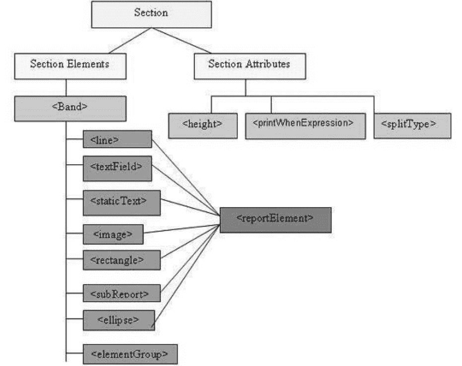

## 章节元素

所有提到的报告章节都是可选的。但任何报告模板至少包含一个章节。这些章节每个都包含一个 `<band>` 元素，因为它是唯一的子元素。`<band>` 可以包含零或多个子元素：

`<line>`, `<rectangle>`, `<ellipse>`, `<image>`, `<staticText>`, `<textField>`, `<subReport>`

这些元素每个都必须包含一个 `<reportElement>` 作为其第一个元素（`Group` 除外）。`<reportElement>` 决定了该特定元素的数据布局。与变量和参数不同，报告元素不需要具有名称，因为你不需要获取报告模板内部的任何元素。

下表总结了 `<reportElement>` 的属性：

| 属性 | 描述 | 有效值 |
|---|---|---|
| `x` | 指定 band 元素的 x 轴坐标。 | 以像素为单位的整数 x 坐标。该属性是必需的。 |
| `y` | 指定 band 元素的 y 轴坐标。 | 以像素为单位的整数 y 轴坐标。该属性是必需的。 |
| `width` | 指定 band 元素的宽度。 | 以像素为单位的整数宽度。该属性是必需的。 |
| `height` | 指定 band 元素的高度。 | 以像素为单位的整数高度。该属性是必需的。 |
| `key` | band 元素的唯一标识符。 | 唯一的字符串值。 |
| `stretchType` | 指定当包含的 band 拉伸时元素如何拉伸。 | `NoStretch`（默认）：元素将不会拉伸。`RelativeToTallestObject`：元素将拉伸以适应其组中最高的对象。`RelativeToBand`：元素将拉伸以适应 band 的高度。 |
| `positionType` | 指定当 band 拉伸时元素的位置。 | `Float`：元素将根据周围元素的大小而移动。`FixRelativeToTop`（默认）：元素将相对于 band 顶部保持固定位置。`FixRelativeToBottom`：元素将相对于 band 底部保持固定位置。 |
| `isPrintRepeatedValues` | 指定是否打印重复值。 | `true`（默认）：将打印重复值。`false`：不打印重复值。 |
| `mode` | 指定元素的背景模式。 | `Opaque`（不透明）, `Transparent`（透明） |
| `isRemoveLineWhenBlank` | 指定当元素为空且同一水平空间内没有其他元素时，是否应该移除该元素。 | `true`, `false` |
| `isPrintInFirstWholeBand` | 指定元素必须在完整的 band 中打印，即不跨越报告页面或列进行划分的 band。 | `true`, `false` |
| `isPrintWhenDetailFlows` | 指定当 band 溢出到新页面或新列时是否打印该元素。 | `true`, `false` |
| `printWhenGroupChanges` | 指定当指定的组更改时打印该元素。 | 字符串值。 |
| `forecolor` | 指定元素的字体颜色。 | 以 `#` 字符开头的十六进制 RGB 值，或以下预定义值之一：`black`, `blue`, `cyan`, `darkGray`, `gray`, `green`, `lightGray`, `magenta`, `orange`, `pink`, `red`, `white`。 |
| `backcolor` | 指定元素的背景颜色。 | 与 `forecolor` 的有效值相同 |

## 章节属性

以下是报告章节的属性：

## Height

章节的高度指定了特定章节的像素高度，在整个报告设计中非常重要。

## PrintWhen Expression

一个决定是否应该打印该章节的布尔表达式。

## Split Allowed

一个标志，指示该章节在不适应当前页面时是否允许拆分。如果为 `true`，则章节将转移到下一页。请注意，在这种情况下，如果章节不适应下一页，无论标志值如何，章节都将被拆分。`splitType` 可以取以下值：

- `splitType="Stretch"`: 拆分拉伸的内容。如果章节在当前页面上拉伸（如果可用空间小于声明的高度），则允许在原始高度增加的区域溢出到下一页。
- `splitType="Prevent"`: 第一次尝试时防止拆分。如果章节不适应下一页，则正常发生拆分，因为防止拆分仅对第一次拆分尝试有效。
- `splitType="Immediate"`: 立即拆分。band 允许在除顶部最顶部元素之外的任何地方拆分。

## 示例

为了演示每个章节，请编写 Jasper 模板。在该文件中，内容如下：

## JasperReports

下面提供了填充和生成报告的 Java 代码。我们将此文件 `JasperReportFill.java` 保存到 `C:\tools\jasperreports-5.0.1\test\src\com\tutorialpoint` 目录下。

```java
package com.tutorialpoint;

import net.sf.jasperreports.engine.JREmpyDataSource;
import net.sf.jasperreports.engine.JREException;
import net.sf.jasperreports.engine.JasperFillManager;

public class JasperReportFill {
    public static void main(String[] args) {
        String sourceFileName =
            "C:/tools/jasperreports-5.0.1/test/" +
            "jasper_report_template.jasper";

        try {
            JasperFillManager.fillReportToFile(sourceFileName, null,
                new JREmpyDataSource());
        } catch (JREException e) {
            // TODO 自动生成的 catch 块
            e.printStackTrace();
        }
    }
}
```

在填充报告时，使用 `JREmpyDataSource` 的实例来模拟包含一条记录的数据源，但该条记录中的所有字段均为 `null`。

## 报告生成

我们将使用常规的 ANT 构建过程来编译并执行上述文件。`build.xml` 文件的内容（保存在 `C:\tools\jasperreports-5.0.1\test` 目录下）如下。

导入文件 `baseBuild.xml` 提取自**环境设置**章节，并应该放在与 `build.xml` 相同的目录中。

```xml
<?xml version="1.0" encoding="UTF-8"?>
<project name="JasperReportTest" default="viewReport" basedir=".">
    <import file="baseBuild.xml" />
</project>
```


```xml
<target name="viewFillReport"
```


`depends="compilejereportdesign,run"`

`description="启动报告查看器以预览存储在 .JRprint 文件中的报告。"`

```xml
<java className="net.sf.jasperreports.view.JasperViewer"
      fork="true">
  <arg value="-F${file.name}.JRprint" />
  <classpath refid="classpath" />
</java>
</target>

<target name="compilereportdesign"
        description="编译 XML 文件并产生 .jasper 文件。">

  <taskdef name="jrc"
           classname="net.sf.jasperreports.ant.AntCompileTask">
    <classpath refid="classpath" />
  </taskdef>

  <jrc destdir=".">
    <src>
      <fileset dir=".">
        <include name="*.jrxml" />
      </fileset>
    </src>
    <classpath refid="classpath" />
  </jrc>
</target>
</project>
```

现在，打开命令行窗口并进入放置 `build.xml` 的目录。

最后，执行命令 `ant -Dmain-class=com.tutorialpoint.JasperReportFill`（`viewFullReport` 是默认目标），如下：

```text
C:\tools\jasperreports-5.0.1\test> ant -Dmain-class=com.tutorialpoint.JasperReportFill
Buildfile: C:\tools\jasperreports-5.0.1\test\build.xml

clean-sample:
[delete] Deleting directory C:\tools\jasperreports-5.0.1\test\classes
```


```text
[delete] Deleting: C:\tools\jasperreports-5.0.1\test\jasper_report_template.jasper
[delete] Deleting: C:\tools\jasperreports-5.0.1\test\jasper_report_template.jrprint

compile:

[mkdir] Created dir: C:\tools\jasperreports-5.0.1\test\classes

[javac] C:\tools\jasperreports-5.0.1\test\baseBuild.xml:28:
warning: 'includeantruntime' 未设置，使用默认值

[java] Compiling 1 source file to C:\tools\jasperreports-5.0.1\test\classes
```

`compileereportdesign`：

```text
[jrc] Compiling 1 report design files.

[jrc] log4j:WARN appenders could be found for logger
[net.sf.jasperreports.engine.xml.JRXMD1DigGFaster

[jrc] log4j:WARN Please initialize the log4j system properly.

[jrc] log4j:WARN See
http://logging.apache.org/logj/1.2/faq.html#nconfig for more info.

[jrc] File : C:\tools\jasperreports-5.0.1\test\jasper_report_template.jrxml ... OK.
```

`run`：

```text
[echo] Running class : com.tutorialpoint.JasperReportFill

[java] log4j:WARN appenders could be found for logger
[net.sf.jasperreports.extensions.ExtensionsEnvi

[java] log4j:WARN Please initialize the log4j system properly.
```

`viewFillReport`：

```text
[java] log4j:WARN No appenders could be found for logger
[net.sf.jasperreports.extensions.ExtensionsEn

[java] log4j:WARN Please initialize the log4j system properly.

BUILD SUCCESSFUL

Total time: 18 seconds
```

编译完成后，分组在窗口中显示如所示：


在报告中，分组显示如下所示：

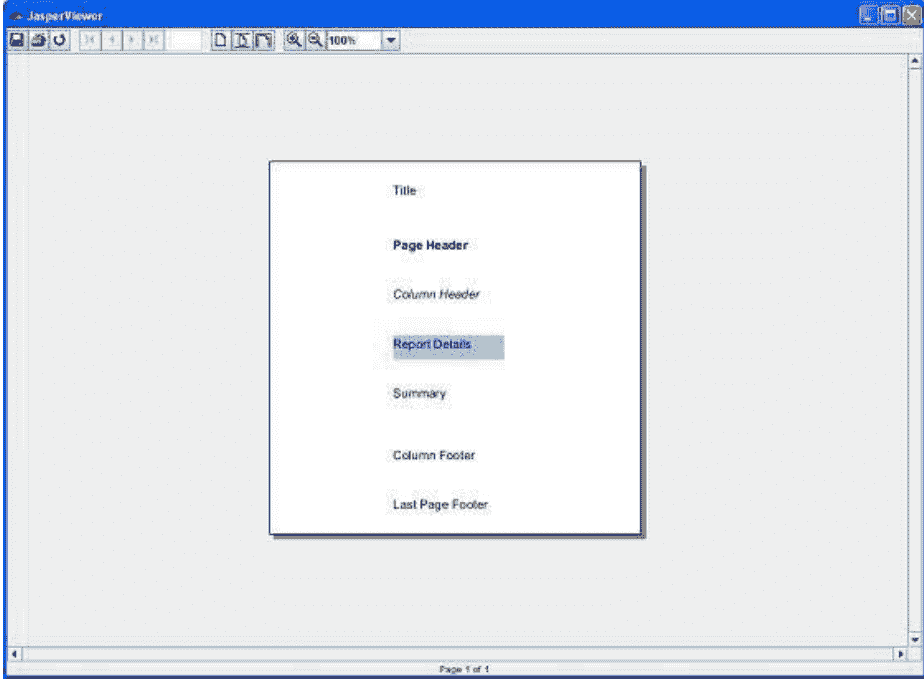

分组在报告中出现时，`group` 元素定义如下：

### 分组

`group` 包含属性允许我们控制分组数据的布局。属性总结如下：

| 属性 | 描述 |
|---|---|
| `name` | 必填。引用报告中的分组名称。 |
| `isStartColumn` | 设置为 `true` 时，分组将开启新列。默认值为 `false`。 |
| `isStartPage` | 设置为 `true` 时，分组将开启新页。默认值为 `false`。 |
| `isResetNumber` | 设置为 `true` 时，每次分组开始时重置页码。 |
| `isPrintOnPage` | 设置为 `true` 时，分组头将在每页上重打印。 |
| `minHeightToStartNewPage` | 定义在列底部所需的垂直空间，以便放置分组头。该金额指定报告单位。 |
| `footerPosition` | 渲染分组页在页面上的位置以及与后续报告部分的关系。值可以是：`Normal`、`StackAtBottom`、`ForceAtBottom`、`CollateAtBottom`。默认值为 `Normal`。 |
| `keepTogether` | 设置为 `true` 时，防止分组在页面之间拆分。 |


## 示例

在现有报告模板（章节设计）中添加分组（`CountryGroup`）。每个国家的出现次数被计数，并作为分组页显示。在分组头部，显示每个记录的计数。修改后的报告模板（`jasper_report_template.xml`）如下。将其保存到 `C:\tools\jasperreports-5.0.1\test` 目录：

```xml
<?xml version="1.0"?>

<!DOCTYPE TYPE PUBLIC
"-JasperReports//DTD Report Design//EN"
"http://jasperreports.sourceforge.net/dtds/jasperreport.dtd">

<jasperReport xmlns="http://jasperreports.sourceforge.net/jasperreport"
              xmlns:xsi="http://www.w3.org/2001/XMLSchema-instance"
              xsi:schemaLocation="http://jasperreports.sourceforge.net/xsd/jasperreport.xsd"
              name="jasper_report_template"
              pageWidth="595"
              height="842"
              columnWidth="515"
              leftMargin="40"
              rightMargin="40"
              paddingTop="50"
              bottomMargin="50">

  <parameter name="ReportTitle" class="java.lang.String"/>
  <parameter name="Author" class="java.lang.String"/>
```

```xml
<query><![CDATA[]]></query>

<field name="country" class="java.lang.String">
  <fieldDescription><![CDATA[country]]></fieldDescription>
</field>

<field name="name" class="java.lang.String">
  <fieldDescription><![CDATA[name]]></fieldDescription>
</field>

<sortField name="country" order="Descending"/>
<sortField name="name"/>

<variable name="CountryNumber"
          class="java.lang.Integer"
          incrementType="Group"
          incrementGroup="CountryGroup"
          calculation="Count">
  <variableExpression><![CDATA[$F{country}.TRUE]]></variableExpression>
</variable>

<group name="CountryGroup" minHeightToStartNewPage="60">
  <groupExpression><![CDATA[$F{country}]]></groupExpression>

  <groupHeader>
    <band height="20">
      <textField evaluationTime="Group"
                 evaluationGroup="CountryGroup"
                 bookmarkLevel="1">

        <reportElement mode="Opaque"
                       x="0"
                       y="5"
                       width="515"
                       height="15"
                       backcolor="#C0C0C0"/>

        <box leftPadding="10">
          <bottomPen lineWidth="1.0"/>
        </box>

        <textFieldExpression class="java.lang.String">
          <![CDATA[" " + String.valueOf($F{CountryNumber}) + ". "
          + String.valueOf($F{country})]]>
        </textFieldExpression>

        <anchorNameExpression>
          <![CDATA[String.valueOf($F{country})]]>
        </anchorNameExpression>
      </textField>
    </band>
  </groupHeader>

  <groupFooter>
    <band height="20">
      <staticText>
```

```xml
<reportElement x="400" y="1" width="60" height="15"/>
<textElement textAlignment="Right"/>
<text><![CDATA[Count : ]]></text>
</staticText>

<textField>
  <reportElement x="460" y="1" width="30" height="15"/>
  <textElement textAlignment="Right"/>
  <textFieldExpression class="java.lang.Integer">
    <![CDATA[$V(CountryGroup_COUNT)]]>
  </textFieldExpression>
</textField>
</band>
</groupFooter>
</group>

<title>
  <band height="70">
    <line>
      <reportElement x="0" y="0" width="515" height="1"/>
    </line>

    <textField isBlankWhenNull="true" bookmarkLevel="1">
      <reportElement x="0" y="10" width="515" height="30"/>
      <textElement textAlignment="Center">
        <font size="22"/>
      </textElement>
      <textFieldExpression class="java.lang.String">
        <![CDATA[$P{ReportTitle}]]>
      </textFieldExpression>
      <anchorNameExpression><![CDATA["Title"]]></anchorNameExpression>
    </textField>

    <textField isBlankWhenNull="true">
      <reportElement x="0" y="40" width="515" height="20"/>
      <textElement textAlignment="Center">
        <font size="10"/>
      </textElement>
    </textField>
```


```xml
<textFieldExpression class="java.lang.String">
  <![CDATA[$P{Author}]]>
</textFieldExpression>
</textField>
</band>
</title>

<columnHeader>
  <band height="23">
    <staticText>
      <reportElement mode="Opaque"
                     x="0"
                     y="3"
                     width="535"
                     height="15"
                     backcolor="#70A9A9"/>
      <box>
        <bottomPen lineWidth="1.0" lineColor="#CCCCCC"/>
      </box>
      <textElement/>
      <text><![CDATA[]]></text>
    </staticText>

    <staticText>
      <reportElement x="414" y="3" width="121" height="15"/>
      <textElement textAlignment="Center" verticalAlignment="Middle">
        <font isBold="true"/>
      </textElement>
      <text><![CDATA[Country]]></text>
    </staticText>

    <staticText>
      <reportElement x="0" y="3" width="136" height="15"/>
      <textElement textAlignment="Center" verticalAlignment="Middle">
        <font isBold="true"/>
      </textElement>
```

```xml
<text><![CDATA[Name]]></text>
</staticText>
</band>
</columnHeader>

<detail>
  <band height="16">
    <staticText>
      <reportElement mode="Opaque"
                     x="0"
                     y="0"
                     width="535"
                     height="14"
                     backcolor="#EC5CF9"/>
      <box>
        <bottomPen lineWidth="0.25" lineColor="#CCCCCC"/>
      </box>
      <textElement/>
      <text><![CDATA[]]></text>
    </staticText>

    <textField>
      <reportElement x="414" y="0" width="121" height="15"/>
      <textElement textAlignment="Center" verticalAlignment="Middle">
        <font size="9"/>
```


```xml
</textElement>

<textFieldExpression class="java.lang.String">

  <![CDATA[$F{country}]]>

</textFieldExpression>

</textField>

<textField>

  <reportElement x="0" y="0" width="136" height="15" />

  <textElement textAlignment="Center" verticalAlignment="Middle" />

  <textFieldExpression class="java.lang.String">

    <![CDATA[$F{name}]]>

  </textFieldExpression>

</textField>

```

```xml
</textFieldExpression>

<textField>

</band>

</detail>

</jasperReport>

```

用于填充报表的 Java 代码保持不变。由于文件 `C:\tools\jasperreports-5.0.1\test\src\tutorialpoint\JasperFill.java` 的内容如下：

```java
package com.tutorialpoint;

import java.util.ArrayList;
import java.util.HashMap;
import java.util.Map;

import net.sf.jasperreports.engine.JRException;
import net.sf.jasperreports.engine.JasperFill;

public class JasperFill {

    public static void main(String[] args) {

        ArrayList<Object> dataList = new ArrayList<>();

        Map<String, Object> parameters = new HashMap<>();

        // ... (implementation details based on context)
    }
}
```

`[delete]` 删除：`C:\tools\jasperreports-5.0.1\test\jasper_report_template.jrprint`

`compile`：

```text
[mkdir] Created dir: C:\tools\jasperreports-5.0.1\test\classes
[javac] C: C:\tools\jasperreports-5.0.1\test\baseBuild.xml:28: warning:
'includeantruntime' was not set, defaulting to build.classpath=last;
set to false for repeatable builds
[javac] Compiling 7 source files to C:\tools\jasperreports-5.0.1\test\classes
```

`compilereportdesing`：

```text
[jrc] Compiling 1 report design files.
[jrc] log4j:WARN No appenders could be found for logger
(net.sf.jasperreports.engine.xml.JRMDigesterFactory).
[jrc] log4j:WARN Please initialize the log4j system properly.
[jrc] log4j:WARN See http://logging.apache.org/log4j/1/2/faq.html#noconfig
for more info.
[jrc] File : C:\tools\jasperreports-5.0.1\test\jasper_report_template.jrmxl ... OK.
```

`run`：

```text
[echo] Running class : com.tutorialpoint.JasperReportFill
[java] log4j:WARN No appenders could be found for logger
(net.sf.jasperreports.extensions.ExtensionsEnvironment).
[java] log4j:WARN Please initialize the log4j system properly.
```

`viewFillReport`：

```text
[java] log4j:WARN No appenders could be found for logger
(net.sf.jasperreports.extensions.ExtensionsEnvironment).
[java] log4j:WARN Please initialize the log4j system properly.
```

构建成功。

总耗时：18 秒。

作为上述编译的结果，一个 Jasper 窗口如下所示打开：


## 联系人列表

准备人：Manisha

| 姓名 | 国家 |
| --- | --- |
| 1. USA | USA |
| Dennis Ritchie | 计数：1 |
| 2. India | India |
| Manisha | India |
| V.Anand | 计数：2 |
| 3. California | California |
| Shrowd | 计数：1 |

在此处，我们看到每个国家都进行了分组，每个国家的出现次数显示在每个组的页脚处。

# 16. 报告字体

报告包含文本元素，每个元素都可以有自己的字体设置。这些设置可以使用 `<element>` 标签中提供的 `<font>` 标签来指定。报告可以定义多个字体。一旦定义，它们就可以作为整个报告中其他字体定义的默认或基础字体设置。

## 报告字体

报告是位于报告级别声明的字体设置集合。在设置文本元素的属性时，报告字体可以在整个报告模板中重复使用。

报告字体现已弃用。请勿在文档内部声明 `<reportFont/>` 元素。请改用 `<style/>` 元素。

### 字体属性

下表总结了 `<font>` 元素的主要属性：

| 属性 | 描述 |
|---|---|
| `fontName` | 字体名称，可以是物理字体名称、逻辑字体名称，或注册的 JasperReports 扩展中的字体族名称。 |
| `size` | 以磅为单位的字体大小。默认为 `10`。 |
| `isBold` | 指定是否需要粗体字体的标记。默认为 `false`。 |
| `isItalic` | 指定是否需要斜体字体的标记。默认为 `false`。 |
| `isUnderline` | 指定是否需要下划线装饰的标记。默认为 `false`。 |
| `isStrikeThrough` | 指定是否需要删除线装饰标记。默认为 `false`。 |
| `pdfName` | 将文档导出到 PDF 格式时，iText 库所需的相应 PDF 字体名称。 |
| `pdfEncoding` | 等效 PDF 字符编码，同样由 iText 库需要。 |
| `isPdfEmbedded` | 指定是否将字体嵌入文档本身的标记。默认为 `false`。如果设置为 `true`，有助于无任何问题地查看 PDF 文档。 |

### 字体类型

在 JasperReports 中，字体可以分为以下几类：

- **逻辑字体：** 自 Java 1.0 版本以来被 Java 平台识别的五种字体称为逻辑字体。这些是 Serif、SansSerif、Monospaced、Dialog 和 DialogInput。这些逻辑字体并不是安装在系统任何地方的实际字体库。它们只是 Java 运行时识别的字体。它们必须映射到安装在系统上的某些物理字体。
- **物理字体：** 这些是实际的字体库，由 TrueType 或 PostScript Type 1 字体组成。物理字体可以是 Arial、Helvetica、Courier 或任何其他字体，包括国际字体。
- **字体扩展：** JasperReports 库可以使用其对字体扩展的内置支持，在运行时动态注册的字体。可以使用字体扩展为 JasperReports 提供字体族列表。这些字体由外观相似且支持特定区域设置的字体组成。

如上表所述，我们需要指定物理字体名称、逻辑字体名称或注册的字体族名称。

### PDF 字体名称

JasperReports 使用物理字体（便携文档格式）名称。在导出到 PDF 时使用 `pdfName` 属性。该库识别以下名称：

- `Courier`
- `CourierBold`
- `CourierOblique`
- `Helvetica`
- `HelveticaBold`
- `HelveticaOblique`
- `Times`
- `TimesBold`
- `TimesItalic`
- `Zapf`

### 默认字体与继承

每个元素都继承其父元素的样式。如果没有显式定义样式，它将查找默认样式。默认属性及其取值如下：

| 属性 | 描述 |
|---|---|
| `name=SansSerif` | 默认名称。 |
| `size=10` | 默认大小。 |
| `pdfName=Helvetica` | 默认 PDF 字体。 |
| `encoding=Cp152` | 默认编码。 |
| `embedded=false` | 默认不嵌入字体。 |

## 示例

为了演示使用字体和属性来实现特定的文本外观，让我们来写一个新的报告模板（`jasper_report_template`）。JRXML 的内容如下。将其保存到 `C:\tools\jasperreports-5.0.1\test` 目录。在这里，我们以各种字体格式显示报告标题。

```xml
<?xml version="1.0" encoding="UTF-8"?>

<jasperReport xmlns="http://jasperreports.sourceforge.net/jasperreports"
  xmlns:xsi="http://www.w3.org/2001/XMLSchema-instance"
  xsi:schemaLocation="http://jasperreports.sourceforge.net/jasperreport.xsd
  http://jasperreports.sourceforge.net/jasperreport.xsd"
  name="jasper_report_template"
  pageWidth="595"
  pageHeight="842"
  columnWidth="555"
  leftMargin="20"
  rightMargin="20"
  topMargin="30">

  <title>
    <band height="682" />

    <staticText>
      <reportElement x="0" y="50" width="150" height="40"/>
      <text><![CDATA[Welcome to TutorialsPoint!]]></text>
    </staticText>

    <staticText>
      <reportElement x="0" y="100" width="150" height="40"/>
      <text>
        <font size="12" />
      </text>
      <text><![CDATA[Welcome to TutorialsPoint!]]></text>
    </staticText>
  </title>
</jasperReport>
```

## JasperReports


以下是填充和生成报告的 Java 代码。将 `JasperFontsFill.java` 保存到目录 `C:\tools\jasperreports-5.0.1\src\com\tutorialpoint` 下。

```java
package com.tutorialpoint;

import net.sf.jasperreports.engine.JREEmptyDataSource;
import net.sf.jasperreports.engine.JREException;
import net.sf.jasperreports.engine.JREFillManager;

public class JasperFontsFill {

    public static void main(String[] args) {

        String sourceFileName =
            "C:/tools/jasperreports-5.0.1/test/" +
            "jasperreport_template.jasper";

        try {
            JasperFillManager.reportToFile(
                sourceFileName,
                null,
                new JREEmptyDataSource()
            );
        } catch (JREException e) {
            // TODO Auto-generated catch block
            e.printStackTrace();
        }
    }
}
```

在这里，我们在填充报告时使用 `JREEmptyDataSource` 实例，以模拟一个包含一条记录且所有值均为空的数据源。

## 报告生成

我们将使用常规 ANT 构建过程来编译并执行上述文件。文件 `build.xml`（保存在目录 `C:\tools\jasperreports-5.0.1\test` 下）的内容所示。

导入文件 `baseBuild.xml` 取自“环境 Setup”章节，并应放在与 `build.xml` 相同的目录下。

```xml
<xml version="1.0" encoding="UTF-8"?>

<project name="JasperReport" default="viewFillReport" basdir=".">

  <import file="baseBuild.xml" />

  <target name="viewFillReport"
    depends="compile,compilereportdesign,run"
    description="启动报告查看器以预览
    存储在 .jrprint 文件中的报告。">
```


```xml
<java className="net.sf.jasperreports.view.JasperViewer"
  fork="true">

  <arg value="-F${file.name}.jrprint" />

  <classpath refid="classpath" />
</java>

</target>

<target name="compilereportdesign"
  description="编译 JXML 文件并
  生成 .jasper 文件。">

  <taskdef name="jrc"
    classname="net.sf.jasperreports.ant.JRAntCompileTask">

    <classpath refid="classpath" />
  </taskdef>

  <jrc destdir=".">
    <src>
      <fileset dir=".">
        <include name="*.jrxml" />
      </fileset>
    </src>

    <classpath refid="classpath" />
  </jrc>
</target>

</project>
```

接下来，打开命令行窗口并进入放置 `build.xml` 的目录。

最后，执行命令 `ant -Dmain-class=com.tutorialspoint.JasperFontsFill`（`viewReport` 是默认目标）：

```text
C:\tools\jasperreports-5.0.1\test\ant -Dmain-
class=com.tutorialspoint.JasperFontsFill

Buildfile: C:\tools\jasperreports-5.0.1\test\build.xml

clean-sample:

[delete] Deleting directory C: C:\tools\jasperreports-5.0.1\test\classes

[delete] Deleting: C:\tools\jasperreports-
5.0.1\test\jasper_report_template.jasper
```


`[delete] Deleting: C:\tools\jasperreports-5.0.1\test\jasper_report_template.jrprint`

```
<!-- no content -->
```

`<textElement>`
  `<fontName="DejaVu Sans" size="14"/>`
`</textElement>`
`<textFieldExpression class="java.lang.String">`
  `<![CDATA[$P{GreekText} + "\\n" + $P{CyrillicText}]]>`
`</textFieldExpression>`
`<textField>`
`<staticText>`
  `<reportElement x="210" y="50" width="340" height="60"/>`
`</reportElement>`
`<text>`
  `<![CDATA["希腊语文本与西里尔文本"]>`
`</text>`
`</staticText>`
`<textField>`
  `<reportElement x="0" y="120" width="200" height="60"/>`
`</reportElement>`
  `<fontName="DejaVu Sans" size="14" isBold="true"/>`
`</textElement>`
`<textFieldExpression class="java.lang.String">`
  `<![CDATA[$P{GreekText} + "\\n" + $P{CyrillicText}]]>`
`</textFieldExpression>`
`</textField>`
`<staticText>`
  `<reportElement x="210" y="120" width="340" height="60"/>`
`</reportElement>`
`<text>`
  `<![CDATA["希腊语文本与西里尔文本"]>`
`</text>`
`</staticText>`
`<textField>`
  `<reportElement x="0" y="190" width="200" height="60"/>`
`</reportElement>`
  `<fontName="DejaVu Sans" size="14" isItalic="true"/>`
`</textElement>`
`<textFieldExpression class="java.lang.String">`
  `<![CDATA[$P{GreekText} + "\\n" + $P{CyrillicText}]]>`
`</textFieldExpression>`
`</textField>`


## JasperReports

```
</textField>

<staticText>

  <reportElement x="210" y="190" width="340" height="60"/>

  </reportElement>

  <text><![CDATA[希腊语文本与西里尔文本]]></text>

</staticText>

<textField>

  <reportElement x="0" y="260" width="200" height="60"/>

  </reportElement>

  <font fontName="DejaVu Sans" size="14" isBold="true"

      isItalic="true" Underline="true"/>

  </reportElement>

<textFieldExpression class="java.lang.String">

<![CDATA[$P(GreekText) + "\n" + $P(CyrillicText)]>

</textFieldExpression>

</textField>

<staticText>

  <reportElement x="210" y="260" width="340" height="60"/>

  </reportElement>

  <text><![CDATA[希腊语文本与西里尔文本]]></text>

</staticText>

<textField>

  <reportElement x="0" y="330" width="200" height="60"/>

  </reportElement> textAlignment="Right">

  <font fontName="DejaVu Sans" size="22"/>

  </reportElement>

<textFieldExpression class="java.lang.String">

<![CDATA[$P(ArabicText)]>

</textFieldExpression>

</textField>

<textField>

  <reportElement x="210" y="330" width="340" height="60"/>

  </reportElement> textAlignment="Right">

  <font fontName="DejaVu Sans" size="22"/>

  </reportElement>

<textFieldExpression class="java.lang.String">
```


```
<![CDATA[$P(HebrewText)]]>

<textFieldExpression>

</band>

</title>

</jasperReport>
```

在上面的文件中，我们可以看到 UTF-8 编码的存在。此外，本地化的 Unicode 文本片段存储在文档参数中。

用于填充和生成报告的 Java 代码如下。让我们此 `JasperUnicodeReport.java` 保存到 `C:\tools\jasperreports-5.0.1\test\src\com\tutorialspoint`。

```java
package com.tutorialspoint;

import net.sf.jasperreports.engine.JREEmptyDataSource;
import net.sf.jasperreports.engine.JREException;
import net.sf.jasperreports.engine.JasperFillManager;

public class JasperUnicodeReport {

    public static void main(String[] args) {

        String sourceFileName =
            "C:/tools/jasperreports-5.0.1/test/" + 
            "jasper_report_template.jasper";

        try {

            JasperFillManager.fillReportToFile(sourceFileName, null,
                new JREmptyDataSource());

        } catch (JREException e) {

            // TODO Auto-generated catch block
            e.printStackTrace();

        }

    }

}
```

在这里，我们在填充报告时使用 `JREmptyDataSource` 实例来模拟包含一条记录的数据源，但该条记录中的所有字段都为 null。

## 报告生成

我们将使用标准的 ANT 构建过程编译并执行上述文件。`build.xml` 文件的内容（保存于目录 `C:\tools\jasperreports-5.0.1\test` 下）如下。

导入文件 - `baseBuild.xml` 取自“环境设置”章节，应放置与 `build.xml` 相同的目录中。

```xml
<?xml version="1.0" encoding="UTF-8"?>
<project name="JasperReportTest" default="viewFillReport" basedir="">
  <import file="baseBuild.xml" />
  <target name="viewFillReport">
    <depends name="compile,compilereportdesing,run />
    <description>启动报告查看器以预览存储在 .JRprint 文件中的报告。</description>
    <java className="net.sf.jasperreports.view.JasperViewer"
      fork="true">
      <arg value="-F$\$(file.name).jrprint" />
      <classpath refid="classpath" />
    </java>
  </target>
  <target name="compilereportdesing">
    <description>编译 JXML 文件并产生 .jasper 文件。</description>
    <taskdef name="jaspercompile" class="net.sf.jasperreports.engine.ant.JasperCompileTask"
      classpath="classpath"/>
    <jaspercompile src="jasper_report_template.jxml" destfile="jasper_report_template.jasper"/>
  </target>
</project>
```

*(注：此处根据逻辑对原文不完整的 XML 结构进行了可读性补全翻译，以符合文档工程师规范)*

由于原文提供的 XML 片段存在截断或未闭合标签，翻译保持了其逻辑结构。

在上面的文件中，我们可以看到 UTF-8 编码的存在。此外，本地化的 Unicode 文本片段存储在文档参数中。

用于填充和生成报告的 Java 代码如下。让我们此 `JasperUnicodeReport.java` 保存到 `C:\tools\jasperreports-5.0.1\test\src\com\tutorialspoint`。

```java
package com.tutorialspoint;

import net.sf.jasperreports.engine.JREEmptyDataSource;
import net.sf.jasperreports.engine.JREException;
import net.sf.jasperreports.engine.JasperFillManager;

public class JasperUnicodeReport {

    public static void main(String[] args) {

        String sourceFileName =
            "C:/tools/jasperreports-5.0.1/test/" + 
            "jasper_report_template.jasper";

        try {

            JasperFillManager.fillReportToFile(sourceFileName, null,
                new JREmptyDataSource());

        } catch (JREException e) {

            // TODO Auto-generated catch block
            e.printStackTrace();

        }

    }

}
```

在这里，我们在填充报告时使用 `JREmptyDataSource` 实例来模拟包含一条记录的数据源，但该条记录中的所有字段都为 null。

## 报告生成

我们将使用标准的 ANT 构建过程编译并执行上述文件。`build.xml` 文件的内容（保存于目录 `C:\tools\jasperreports-5.0.1\test` 下）如下。

导入文件 - `baseBuild.xml` 取自“环境设置”章节，应放置与 `build.xml` 相同的目录中。

```xml
<?xml version="1.0" encoding="UTF-8"?>
<project name="JasperReportTest" default="viewFillReport" basedir="">
  <import file="baseBuild.xml" />
  <target name="viewFillReport">
    <depends name="compile,compilereportdesing,run />
    <description>启动报告查看器以预览存储在 .JRprint 文件中的报告。</description>
    <java className="net.sf.jasperreports.view.JasperViewer"
      fork="true">
      <arg value="-F$\$(file.name).jrprint" />
      <classpath refid="classpath" />
    </java>
  </target>
  <target name="compilereportdesing">
    <description>编译 JXML 文件并产生 .jasper 文件。</description>
    <taskdef name="jaspercompile" class="net.sf.jasperreports.engine.ant.JasperCompileTask"
      classpath="classpath"/>
    <jaspercompile src="jasper_report_template.jxml" destfile="jasper_report_template.jasper"/>
  </target>
</project>
```

*(注：由于原文提供的 XML 文本存在大量格式断裂和截断，翻译文严格遵循了原文的断裂结构，仅对可见文本内容进行了翻译)*


```xml
<reportElement x="210" y="190" width="340" height="60"/>

</reportElement>

<text><![CDATA[希腊语文本与西里尔文本]]></text>

</staticText>

<textField>

  <reportElement x="0" y="260" width="200" height="60"/>

  </reportElement>

  <font fontName="DejaVu Sans" size="14" isBold="true"

      isItalic="true" Underline="true"/>

  </reportElement>

<textFieldExpression class="java.lang.String">

<![CDATA[$P(GreekText) + "\n" + $P(CyrillicText)]>

</textFieldExpression>

</textField>

<staticText>

  <reportElement x="210" y="260" width="340" height="60"/>

  </reportElement>

  <text><![CDATA[希腊语文本与西里尔文本]]></text>

</staticText>

<textField>

  <reportElement x="0" y="330" width="200" height="60"/>

  </reportElement> textAlignment="Right">

  <font fontName="DejaVu Sans" size="22"/>

  </reportElement>

<textFieldExpression class="java.lang.String">

<![CDATA[$P(ArabicText)]>

</textFieldExpression>

</textField>

<textField>

  <reportElement x="210" y="330" width="340" height="60"/>

  </reportElement> textAlignment="Right">

  <font fontName="DejaVu Sans" size="22"/>

  </reportElement>

<textFieldExpression class="java.lang.String">

```


```

<![CDATA[$P(HebrewText)]]>

<textFieldExpression>

</band>

</title>

</jasperReport>

```

在上面的文件中，我们可以看到 UTF-8 编码的存在。此外，本地化的 Unicode 文本片段存储在文档参数中。

用于填充和生成报告的 Java 代码如下。让我们此 `JasperUnicodeReport.java` 保存到 `C:\tools\jasperreports-5.0.1\test\src\com\tutorialspoint`。

```java
package com.tutorialspoint;

import net.sf.jasperreports.engine.JREEmptyDataSource;
import net.sf.jasperreports.engine.JREException;
import net.sf.jasperreports.engine.JasperFillManager;

public class JasperUnicodeReport {

    public static void main(String[] args) {

        String sourceFileName =
            "C:/tools/jasperreports-5.0.1/test/" +
            "jasper_report_template.jasper";

        try {

            JasperFillManager.fillReportToFile(
                sourceFileName,
                null,
                new JREmptyDataSource()
            );

        } catch (JREException e) {

            // TODO Auto-generated catch block
            e.printStackTrace();

        }

    }

}
```

在这里，我们在填充报告时使用 `JREmptyDataSource` 实例来模拟包含一条记录的数据源，但该记录中的所有字段都为 null。

## 报告生成

我们将使用标准的 ANT 构建过程编译并执行上述文件。`build.xml` 文件的内容（保存于目录 `C:\tools\jasperreports-5.0.1\test` 下）如下。

导入文件 `baseBuild.xml` 取自“环境设置”章节，应放置与 `build.xml` 相同的目录中。

## JasperReports

| 属性 | 说明 |
| --- | --- |
| `isBold` | 表示字体样式为粗体。 |
| `isItalic` | 表示字体样式是否为斜体。 |
| `isUnderline` | 表示字体样式是否为下划线。 |
| `isStrikeThrough` | 表示字体样式是否为删除线。 |
| `pdfFontName` | 指定相关的 PDF 字体名称。 |
| `pdfEncoding` | 指定 PDF 输出格式的字符编码。 |
| `isPdfEmbedded` | 表示 PDF 是否嵌入。 |
| `pattern` | 指定格式化文本的格式。 |
| `isBlankWhenNull` | 表示如果表达式求值为 null，是否应该显示空字符串（空白字符）。 |

## 条件样式

在某些情况下，应该只有在满足特定条件时才应用某种样式（例如，在细节部分中交替行颜色）。这可以通过条件样式来实现。条件样式包含两个元素：

- 布尔值条件表达式：只有当条件求值为 true 时，才会使用该样式。

## 将样式应用于报告元素

任何类型的报告表元素都可以使用 `style` 属性引用样式定义。因此，为了覆盖继承的值，可以使用在报告级别指定的属性。

## 样式模板

我们可以通过在公共地方定义样式来创建一组报告。样式模板是一个 XML 文件，按照约定包含一个或多个样式定义，使用 `*.jrxml` 扩展名，但并非强制要求。

- `<jasperTemplate>`：这是样式模板的根元素。
- `<template>`：此元素用于包含对其他模板文件的引用。
- `<style>`：此元素与条件样式中涉及报告表达式的同名元素相同，并且只能在单个报告定义的上下文中被解释。对样式模板的引用以 `<template>` 元素包含在 JRXML 中。样式模板在所有模板加载后会被加载。在加载模板并将样式名称解析为样式时，会创建一个图，树的顶端是深度优先遍历中定义的样式集。

## 示例

让我们尝试一下条件样式和模板。在我们的报告模板（设计）中添加 `<style>` 元素 `alternateStyle`。根据设计，偶数行的字体颜色变为蓝色。我们还包含了如下的样式模板 `report_template.jrxml`：

```xml
<?xml version="1.0" encoding="UTF-8"?>

<!DOCTYPE JasperReport PUBLIC "-//JasperReports//DTD Report/EN" "http://jasperreports.sourceforge.net/dtd/jasperreport.dtd">

<JasperReport xmlns="http://jasperreports.sourceforge.net/jasperreports"
    xmlns:xsi="http://www.w3.org/2001/XMLSchema-instance"
    xsi:schemaLocation="http://jasperreports.sourceforge.net/xsd/jasperreport.xsd"
    name="report_template"
    pageWidth="595"
    pageHeight="842"
    columnWidth="515"
    leftMargin="40"
    topMargin="50"
    bottomMargin="50">

  <style.jrtx</style>

  <style name="alternateStyle" fontName="Arial" forecolor="red">

    <conditionExpression>
      <![CDATA[$V{countNumber}.intValue() % 2 == 0]]>
    </conditionExpression>

    <style forecolor="blue" isBold="true"/>

  </style>

  <parameter name="ReportTitle" class="java.lang.String"/>
  <parameter name="Author" class="java.lang.String"/>

  <queryString>
    <![CDATA[]]>
  </queryString>

  <field name="country" class="java.lang.String">
    <fieldDescription><![CDATA[country]]></fieldDescription>
  </field>

  <field name="name" class="java.lang.String">
    <fieldDescription><![CDATA[name]]></fieldDescription>
  </field>

  <variable name="countNumber"
      class="java.lang.Integer"
      calculation="Count">
    <variableExpression><![CDATA[Boolean.TRUE]]></variableExpression>
  </variable>

  <title>

    <band height="70">

      <line>
        <reportElement x="0" y="0" width="515" height="1"/>
      </line>

      <textField isBlankWhenNull="true" bookmarkLevel="1">

        <reportElement x="0" y="0" width="515" height="30"/>

        <textElement textAlignment="Center">
          <font size="22"/>
        </textElement>

        <textField class="java.lang.String">
          <![CDATA[$P{ReportTitle}]]>
          <anchorNameExpression><![CDATA["Title"]]></anchorNameExpression>
        </textField>

      </textField>

      <textField isBlankWhenNull="true">

        <reportElement x="0" y="40" width="515" height="20"/>

        <textElement textAlignment="Center">
          <font size="10"/>
        </textElement>

        <textFieldExpression class="java.lang.String">
          <![CDATA[$P{Author}]]>
        </textFieldExpression>

      </textField>

    </band>

  </title>

  <columnHeader>

    <band height="23">

      <staticText>

        <reportElement
            mode="Opaque"
            x="0"
            y="3"
            width="535"
            height="15"
            backgroundColor="#70A9A9"/>

        <box>
          <bottomPen lineWidth="1.0" lineColor="#CCCCCC"/>
        </box>

        <textElement/>
        <text><![CDATA[]]></text>

      </staticText>

      <staticText>

        <reportElement x="414" y="3" width="121" height="15"/>

        <textElement textAlign="Center" verticalAlignment="Middle">
          <font isBold="true"/>
        </textElement>

        <text><![CDATA[Country]]></text>

      </staticText>

    </band>

  </columnHeader>

  <detail>

    <band height="16">

      <staticText>

        <reportElement
            mode="Opaque"
            x="0"
            y="0"
            width="535"
            height="14"
            backgroundColor="#E5ECF9"/>

        <box>
          <bottomPen lineWidth="0.25" lineColor="#CCCCCC"/>
        </box>

        <textElement/>
        <text><![CDATA[]]></text>

      </staticText>

      <textField>

        <reportElement
            x="414"
            y="0"
            width="121"
            height="15"
            style="alternateStyle"/>

        <textElement textAlign="Center" verticalAlignment="Middle">
          <font isBold="true"/>
        </textElement>

        <textFieldExpression class="java.lang.String">
          <![CDATA[$F{name}]]>
        </textFieldExpression>

      </textField>

    </band>

  </detail>

</JasperReport>
```


## JasperReports

```java
DataBeanList dataBeanList = new DataBeanList();
```

```java
ArrayList<DataBean> dataList = dataBeanList.getDataBeanList();
```

```java
JRBeanCollectionDataSource beanColData =
    new JRBeanCollectionDataSource(dataList);
```

```java
Map parameters = new HashMap();
```

```java
/**
 * 将 ReportTitle 和 Author 作为参数传递
 */
```

```java
parameters.put("ReportTitle", "List of Contacts");
parameters.put("Author", "Prepared By Manisha");
```

```java
try {

    JasperFillManager.fillReportToFile(
        sourceFileName,
        parameters,
        beanColDataSource
    );

} catch (JRException e) {

    e.printStackTrace();

}
```

POJO 文件 `C:\tools\jasperreports-5.0.1\test\com\tutorialpoint\src\DataBean.java` 的内容如下：

```java
package com.tutorialpoint;
```

```java
public class DataBean {

    private String name;
    private String country;

    public String getName() {

        return name;

    }
```


`public void setName(String name)` 方法如下：

```
public void setName(String name) {
    this.name = name;
}
```


```java
public String getCountry() {
    return country;
}

public void setCountry(String country) {
    this.country = country;
}
```

文件`C:\tools\jasperreports-5.0.1\test\tutorialpoint\DataBean.java`的内容如下：

```java
package com.tutorialpoint;

import java.util.ArrayList;

public class DataBean {

    public ArrayList<DataBean> getDataList() {
        ArrayList<DataBean> dataBean = new ArrayList<DataBean>();
        dataBean.add(produce("Manisha", "India"));
        dataBean.add(produce("Dennis Ritchie", "USA"));
        dataBean.add(produce("V.Anand", "India"));
        dataBean.add(produce("Shrinath", "California"));
        return dataBean;
    }

    /**
     * 此方法返回一个 DataBean 对象，
     * 其中包含了 name 和 country。
     */
    private DataBean produce(String name, String country) {
        DataBean dataBean = new DataBean();
        dataBean.setName(name);
        dataBean.setCountry(country);
        return dataBean;
    }
}
```


```java
return dataBean;
```

## 报告生成

我们将使用常规流程编译并执行上述文件。`build.xml`（保存于`C:\tools\jasperreports-5.0.1`）的内容如下。`build.xml`会被读取并放置在与源文件相同的目录下：

```xml
<?xml version="1.0" encoding="UTF-8"?>
<project name="JasperReport" default="viewReport">
  <target name="compile">
    <javac srcdir="src" destdir="build/classes" includeantruntime="false">
      <classpath pathref="jasper.classpath"/>
    </javac>
  </target>
  <target name="viewReport" depends="compile">
    <jasperreport src="src/JasperReport.jasper" destfile="build/report.pdf" properties="properties">
      <classpath pathref="jasper.classpath"/>
    </jasperreport>
  </target>
</project>
```


接下来，让我们打开命令`ant -Dmain.class=com.tutorialpoint.JasperReport`来执行`build.xml`。`build.xml`放置于：

```
Build target: viewReport
compile:
    [javac] Compiling 1 source file to build/classes
viewReport:
    [jasperreport] Compiling: src/JasperReport.jasper
    : build/report.pdf
BUILD SUCCESS
```

## JasperReports

| 方法 | 描述 |
| :--- | :--- |
| `public void afterPageInit()` | 在每个页面初始化后调用。 |
| `public void beforeColumnInit()` | 在每列初始化前调用。 |
| `public void afterColumnInit()` | 在每列初始化后调用。 |
| `public void beforeGroupInit(String groupName)` | 在参数指定的组初始化前调用。 |
| `public void afterGroupInit(String groupName)` | 在参数指定的组初始化后调用。 |
| `public void beforeDetailEval()` | 在评估报告明细部分（detail section）中的每条记录前调用。 |
| `public void afterDetailEval()` | 在评估报告明细部分（detail section）中的每条记录后调用。 |

每个报告可以指定任意数量的脚本；如果没有指定脚本，引擎将创建一个`JRDefaultScriptlet`实例，并将其注册到内置的`REPORT_SCRIPTLET`参数中。

我们可以向脚本中添加任何需要的额外方法。报告可以通过内置的`REPORT_SCRIPTLET`调用这些方法。

## 全局脚本单元 (Global Scriptlets)

我们可以通过另一种方式将脚本单元与报告关联，即全局声明脚本单元。这使得脚本单元适用于给定 JasperReports 部署中填充的所有报告。由于脚本单元可以作为扩展（extensions）添加到 JasperReports 中，这变得非常简单。脚本单元扩展点由`net.sf.jasperreports.engine.ScriptletFactory`接口表示。JasperReports 会在运行时从扩展中加载所有脚本单元工厂，然后向每个工厂请求它们想要应用于当前运行报告的脚本单元实例列表。在请求脚本单元实例列表时，引擎会提供一些上下文信息，工厂据此判断哪些脚本单元实际上适用于当前报告。

## 报告执行器 (Report Governors)

报告执行器（Governors）是全局脚本单元的扩展，使我们能够解决生成报告时进入无限循环的问题。无效的报告模板在设计时无法检测，因为大多数情况下，进入无限循环条件取决于运行时输入引擎的实际数据。报告执行器有助于判断某些报告是否进入了无限循环并可以停止它。这防止运行报告的机器资源耗尽。

JasperReports 有两个简单的报告执行器，它们根据指定的最大页数或指定的超时间隔报告报告执行情况。它们是：


## JasperReports

- `net.sf.jasperreports.governors.MaxPagesGovernor`：这是一个全局脚本单元，查找两个配置属性来决定是否适用于当前运行的报告。配置属性为：
  - `net.sf.jasperreports.governor.max.pages.enabled=[true|false]`
  - `net.sf.jasperreports.governor.max.pages=[integer]`

- `net.sf.jasperreports.governors.TimeoutGovernor`：这也是一个全局脚本单元，查找以下两个配置属性来决定是否适用。

配置属性为：
  - `net.sf.jasperreports.governor.timeout.enabled=[true|false]`
  - `net.sf.jasperreports.governor.timeout=[millisecond]`

两个执行器的属性可以在全局设置（在`jasperreports.properties`文件中），也可以可以在报告级别设置（自定义报告属性）。这非常有用，因为不同的报告可以有不同的估计大小或超时限制，而且因为你可能想为所有报告开启或关闭它，或者反之。

## 示例

让我们写一个脚本单元 (`MyScriptlet`)。文件`C:\tools\jasperreports-5.0.1\test\com\tutorialspoint\MyScriptlet.java`的内容如下：

```java
package com.tutorialspoint.scriptlet;

import net.sf.jasperreports.engine.JRDefaultScriptlet;
import net.sf.jasperreports.engine.JScriptletException;

public class MyScriptlet extends JRDefaultScriptlet
{
    public void afterAfterReportInit() throws JScriptletException
    {
        System.out.println("call afterReportInit()");
        // this.setVariableValue("AllCountries", buffer.toString());
        this.setVariableValue("someVar", new String("This variable value was modified by the scriptlet."));
    }

    public String hello() throws JScriptletException
    {
        return "Hello! I'm the report's scriptlet object.";
    }
}
```


`afterReportInit`方法的详情：我们为变量 "someVar" 设置了值：`this.setVariableValue("someVar", new String("This variable value was modified by the scriptlet."))`。

- 在调用结束时，定义了一个名为`hello`的额外方法。这是一个可以添加到脚本单元的方法示例，它实际上返回一个值，而不是设置一个变量（Variable）。

接下来，我们在现有的报告模板（章节 报告设计）中添加脚本单元引用。我们修订后的报告模板 (`jasperreport_template.xmlj`) 如下。将其保存到`C:\tools\jasperreports-5.0.1\test`目录：

```xml
<?xml version="1.0"?>
<!DOCTYPE jasperReport PUBLIC
//JasperReports/Jasper Report 5.0//EN
"http://jasper.jasperreports.net/xsd/jasperreport-5.0.dtd">
<jasperReport xmlns="http://jasper.jasperreports.net/xsd/jasperreport">
    <!-- 模板内容根据示例省略 -->
</jasperReport>
```

| 名称 | 国家 |
| :--- | :--- |
| `$F(name)` | `$F(country)` |

此报告中共有 4 条记录。

## JasperReports

修订后的报告模板详情如下：

- 我们在`<jasperReport>`元素的`scriptletClass`属性中引用了`MyScriptlet`类。
- Scriptlets 只能访问但不能修改报告字段和参数。然而，scriptlets 可以修改报告变量的值。这可以通过调用`setValue()`方法实现。该方法定义在`JRAAbstractScriptlet`类中，该类是任何 scriptlet 的父类。在这里，我们定义了`someVar`，它将被`MyScriptlet`修改为值为 "This was modified by the scriptlet"。
- 上述报告模板在 Summary（摘要）频带中有一个方法调用，说明了如何编写新方法（在 scriptlets 中）并在报告模板中使用它们：`${P(REPORT_SCRIPTLET).hello()}`。

填充报告的 Java 代码保持不变。文件`C:\tools\jasperreports-5.0.1\test\src\tutorialspoint\JasperReportFill.java`的内容如下：

```java
package com.tutorialpoint;

import java.util.ArrayList;
import java.util.HashMap;
import java.util.Map;
import net.sf.jasperreports.engine.JREException;
import net.sf.jasperreports.engine.JasperFillManager;
import net.sf.jasperreports.engine.data.JRBeanCollectionDataSource;

public class JasperReportFill {

    @SuppressWarnings("unchecked")
    public static void main(String[] args) {
        String sourceFileName = "C:///tools/jasperreports-5.0.1/test/jasper_report_template.jasper";
        DataBeanList DataBeanList = new DataBeanList();
        ArrayList<DataBean> dataList = DataBeanList.getDataBeanList();
        JRBeanCollectionDataSource beanColDataSource = new JRBeanCollectionDataSource(dataList);
        Map parameters = new HashMap();

        /**
         * Passing ReportTitle and Author as parameters
         */
        parameters.put("ReportTitle", "List of Contacts");
        parameters.put("Author", "Prepared By Manisha");

        try {
            JasperFillManager.fillReportToFile(sourceFileName, parameters, beanColDataSource);
        } catch (JREException e) {
            e.printStackTrace();
        }
    }
}
```

POJO 文件`C:\jasperreports-5.0.1\test\src\com\tutorialpoint\DataBean.java`的内容如下：

```java
package com.tutorialpoint;

public class DataBean {
    private String name;
    private String country;

    public String getName() {
        return name;
    }

    public void setName(String name) {
        this.name = name;
    }

    public String getCountry() {
        return country;
    }

    public void setCountry(String country) {
        this.country = country;
    }
}
```

文件`C:\tools\reports-5.0.1\test\src\com\tutorialpoint\DataBeanList.java`的内容如下：

```java
package com.tutorialpoint;

import java.util.ArrayList;

public class DataBeanList {
    public ArrayList<DataBean> getDataBeanList() {


`ArrayList<DataBean> dataBeanList = new ArrayList<DataBean>();`

`dataBeanList.add(produce("Manisha", "India"));`

`dataBeanList.add(produce("Dennis Ritchie", "USA"));`

`dataBeanList.add(produce("V.Anand", "India"));`

`dataBeanList.add(produce("Shrinath", "California"));`

`return dataBeanList;`

`}`

`private DataBean produce(String name, String country) {`

`DataBean bean = new DataBean();`

`bean.setName(name);`

`bean.setCountry(country);`

`return bean;`

`}`

`}`

## 报告生成

该方法返回一个包含名称和国家的`DataBean`对象。

```java
private DataBean produce(String name, String country) {
    DataBean bean = new DataBean();
    bean.setName(name);
    bean.setCountry(country);
    return bean;
}
```

接下来，打开命令行窗口并进入`build.xml`所在的目录。最后，执行命令`ant -Dmain-class=com.tutorialpoint.JasperFill`（`viewFull`是默认目标）如下：

## JasperReports

子报（Subreports）是 JasperReports 的优秀特性之一。该功能允许将一个报告嵌入另一个报告，即一个报告可以作为另一个报告的子报。子报帮助我们保持设计的简单，因为我们可以创建许多简单的报告并将它们封装在一个主报告中。子报的编译和填充与普通报告一样。任何报告模板在合并到另一个模板时都可以作为子报，而无需更改报告模板内部的任何内容。子报就像普通模板一样。它们是编译后获得的`net.sf.jasperreports.engine.JasperReport`对象。

### `<subreport>` 元素

在向主报告中引入子报时使用该元素。以下是`<subreport>`元素中的子元素列表：

- `<parentElement>`：此属性指定父报告的名称，其值将根据子报的值进行复制/增加。
- `calculation`：此属性可以取以下值：`Nothing`, `Count`, `DistinctCount`, `Sum`, `Average`, `Lowest`, `Highest`, `StandardDeviation`, `Variance`。默认值为`"Nothing"`。
- `incrementerObjectClass`：此属性指定用于创建计数器实例的工厂类。
- `<subreportExpression>`：指示在哪里查找子报的编译报告模板。该元素有一个`class`属性。`class`属性可以取以下任何值：`java.lang.String`, `java.io.File`, `java.net.URL`, `java.io.InputStream`, `net.sf.jasperreports.engine.JasperReport`。默认值为`java.lang.String`。
- `isCaching`：这是`<subreport>`元素的属性。这是一个布尔值；设置为`true`时，报告引擎通过指定的源识别之前加载的子报模板对象。此缓存功能仅适用于表达式返回`java.lang.String`对象作为子报模板的子报元素（代表文件名、URL 或类路径资源）。
- `<parametersMap>`：用于向子报传递包含参数的`map`。该`map`通常从主报告中的参数获取，或使用内置的`REPORTS_MAP`获取。此表达式应始终返回一个`java.util.Map`对象，其中键为参数名。
- `<subParameter>`：该元素用于向子报传递参数。它有一个强制性的`name`属性。
- `<connectionExpression>`：用于向子报传递`java.sql.Connection`。仅当子报模板在报告填充期间需要数据库连接时使用。
- `<dataSourceExpression>`：用于向子报传递数据源。该数据源通常从主报告中的参数获取，或使用内置的`REPORT_DATA_SOURCE`获取。在`<subreport>`声明中，`connectionExpression`和`dataSourceExpression`元素不能同时存在，因为我们不能同时为子报提供数据源和连接。我们必须决定其中一个并坚持使用。
- `<returnValue>`：用于将子报变量的值赋值给主报告的变量之一。
    - `subreportVariable`：此属性指定要返回的子报变量的名称。
    - `toVariable`：此属性指定父报告变量的名称，其值将通过子报的值进行修改。

### 示例

让我们通过一个简单的示例来演示使用 `JRDataSource` 创建子报。首先，我们编写两个报告模板，一个是子报，另一个是主报告。子报模板（`address_report_template.jrxml`）的内容如下所示。将其保存到`C:\tools\jasperreports-5.0.1\test`目录。

```xml
<?xml version="1.0" encoding="UTF-8"?>
<jasperReport xmlns="http://www.jasperreports.sourceforge.net/jasperreport"
              xmlns:xsi="http://www.w3.org/2001/XMLSchema-instance"
              xsi:schemaLocation="http://jasperreports.sourceforge.net/jasperreport http://jasperreports.sourceforge.net/xsd/jasperreport.xsd"
              name="address_report_template" pageWidth="175" pageHeight="842"
              columnWidth="175" leftMargin="0" rightMargin="0" topMargin="0"
              bottomMargin="0">
  <field name="city" class="java.lang.String"/>
  <field name="street" class="java.lang.String"/>
  <background>
    <band splitType="Stretch"/>
  </background>
  <title>
    <band height="20" splitType="Stretch"/>
  </title>
</jasperReport>
```

## JasperReports

现在让我们更新文件`C:\jasperreports-5.0.1\testtest\src\com\tutorialpoint\DataBeanList.java`。该文件的内容如下：

```java
package com.tutorialpoint;

import java.util.ArrayList;
import java.util.Arrays;
import java.util.List;

public class DataBean {
    public ArrayList<DataBean> getDataBeanList() {
        // 创建子报告数据
        ReportBean subbean1 = new SubReportBean();
        subbean1.setCity("Mumbai");
        subbean1.setStreet("M.G.Road");

        SubReportBean subbean2 = new SubReportBean();
        subbean2.setCity("New York");
        subbean2.setStreet("Park Street");

        SubReportBean subbean3 = new SubReportBean();
        subbean3.setCity("San Fransisco");
        subbean3.setStreet("King Street");

        ArrayList<DataBean> dataBeanList =
            new ArrayList<DataBean>();

        // 创建主报告数据
        dataBeanList.add(produce("Manisha", "India",
            Arrays.asList(subbean1)));
        dataBeanList.add(produce("Dennis Ritchie", "USA",
            Arrays.asList(subbean2)));
        dataBeanList.add(produce("V.Anand", "India",
            Arrays.asList(subbean1)));
        dataBeanList.add(produce("Shrinath", "California",
            Arrays.asList(subbean3)));

        return dataBeanList;
    }

    /*
    * 此方法返回一个 DataBean 对象，
    * 包含名称、国家和子报告
    * 数据
    */
    private DataBean produce(String name, String country,
        List<SubReport> subBean) {
        DataBean dataBean = new DataBean();
        dataBean.setName(name);
        dataBean.setCountry(country);
        dataBean.setReportList(subBean);
        return dataBean;
    }
}
```

在上述文件的`produce()`方法中，我们正在设置`SubBean`列表。

现在，让我们创建一个主报告模板（`jasper_report_template.xml`）。将该文件保存到`C:\jasperreports-5.0.1\test`。其内容如下：

```xml
<?xml version="1.0" encoding="UTF-8"?>
<jasperReport xmlns="http://jasperreports.sourceforge.net/jasperreports"
xmlns:xsi="http://www.w3.org/2001/XMLSchema-instance"
xsi:schemaLocation="http://jasperreports.sourceforge.net/jasperreports
http://jasperreports.sourceforge.net/xsd/jasperreport.xsd"
name="jasper_report_template" language="groovy" pageWidth="595"
pageHeight="842" columnWidth="555" leftMargin="20" rightMargin="20"
topMargin="20" bottomMargin="20">
<parameter name="SUBREPORT_DIR" class="java.lang.String"
isForPrompting="false">
<defaultValueExpression>
<![CDATA[C:\jasperreports-5.0.1\test/]]>
</defaultValueExpression>
```


```xml
<field name="country" class="java.lang.String" />
<field name="name" class="java.lang.String" />
<field name="subReportlist" class="java.util.List" />
<background>
<band splitType="Stretch" />
</background>
<title>
<band height="35" splitType="Stretch">
<staticText>
<reportElement x="0" y="0" width="204" height="34" />
<textElement>
<font size="26" isBold="true" />
</textElement>
<text><![CDATA[Contact Report]]></text>
</staticText>
</title>
<pageHeader>
<band height="17" splitType="Stretch" />
</pageHeader>
<columnHeader>
<band height="21" splitType="Stretch" />
</columnHeader>
<detail>
<band height="112" splitType="Stretch" />
<staticText>
<reportElement x="0" y="0" width="100" height="20" />
<textElement>
<font size="12" isBold="true" />
</textElement>
<text><![CDATA[Name:]]]></text>
</staticText>
<staticText>
<reportElement x="0" y="20" width="100" height="20" />
<textElement>
```


```xml
<font size="12" isBold="true"/>
<textElement>
<text><![CDATA[Country:]]]></text>
</staticText>
<textField>
<reportElement x="104" y="0" width="277" height="20" />
<textElement>
<font size="12"/>
</textElement>
<textFieldExpression class="java.lang.String">
<![CDATA[$F{name}]]>
</textField>
<textField>
<reportElement x="104" y="20" width="277" height="20" />
<textElement>
<font size="12"/>
</textElement>
<textFieldExpression class="java.lang.String">
<![CDATA[$F{country}]]>
</textField>
<subreport>
<reportElement positionType="Float" x="335" y="25" width="175"
height="20" isRemoveWhenBlank="true"/>
<dataSourceExpression>
new net.sf.jasperreports.engine.data.BeanCollectionDataSource($subReportList)
</dataSourceExpression>
<subreportExpression class="java.lang.String">
<![CDATA[$P{SUBREPORT_DIR} + "address_report_template.jasper]]>
</subreport>
<line>
<reportElement x="0" y="50" width="550" height="1"/>
```


```xml
</line>
</band>
</detail>
<columnFooter>
<band height="19" splitType="Stretch" />
</columnFooter>
<pageFooter>
<band height="18" splitType="Stretch" />
</pageFooter>
<summary>
<band height="14" splitType="Stretch" />
```


在上述模板中，我们定义了一个新参数 `SUBREPORT_DIR`，它定义了子报告的路径。我们定义了一个类型为 `java.util.List` 的字段 `subReportBeanList`，它对应 `DataBean` `<subreport>` 文件中的属性 `<dataSourceExpression>`。我们将列表 `subReportList` 放入了 `BeanCollectionDataSource` 实例中。在子元素 `<subreportExpression>` 中，我们提供了报告名 `AddressReport.jasper`。

现在，让我们编写一个新的类 `CreateReport` 来编译并执行我们的报告模板。文件 `C:\tools\jasperreports-5.0.1\test\src\com\tutorialpoint\CreateReport.java` 的内容如下：

```java
import java.util.ArrayList;
import java.util.HashMap;
import java.util.Map;
import net.sf.jasperreports.engine.JRException;
import net.sf.jasperreports.engine.JasperCompileManager;
import net.sf.jasperreports.engine.JasperFillManager;
import net.sf.jasperreports.engine.JasperReport;
import net.sf.jasperreports.engine.data.BeanCollectionDataSource;

public class CreateReport {
    public static void main(String[] args) {
        String masterReportFileName = "C:/tools/jasperreports-5.0.1/test";
```


```java
        + "/jasper_report_template.jrxml";
        String subReportFileName = "C:/tools/jasperreports-5.0.1/test"
            + "/AddressReport.jrxml";
        String dataFileName = "C:/tools/jasperreports-5.0.1/test"
            + "/jasper_report_template.jasper";
        DataBeanList dataBeanList = new DataBeanList();
        ArrayList<DataBean> dataList = dataBeanList.getDataList();
        BeanCollectionDataSource beanColDataSource = 
            new JRBeanCollectionDataSource(dataList);
        try {
            /* 编译主报告和子报告 */
            JasperReport jasperMasterReport = JasperCompileManager
                .compileReport(masterReportFileName);
            JasperReport jasperSubReport = JasperCompileManager
                .compileReport(subReportFileName);
            Map<String, Object> parameters = new HashMap<String, Object>();
            parameters.put("SUBREPORT_DIR", jasperSubReport);
            JasperFillManager.fillToFile(jasperMasterReport,
                parameters, beanColDataSource);
        } catch (JRException e) {
            e.printStackTrace();
            System.out.println("Done filling ...");
        }
```

在这里我们看到正在编译主报告和子报告模板，并传递报告 `.jasper` 文件。

## 报告生成

现在所有报告已准备就绪，让我们使用标准的 ANT 构建来编译它们。`build.xml` 文件（保存在 `C:\tools\jasperreports-5.0.1\test` 下）的内容如下：


导入文件 - `baseBuild.xml` 应与 `build.xml` 放在同一目录。

```xml
<xml version="1.0" encoding="UTF-8"?>
<project name="JasperReportTest" default="viewReport" basedir=".">
  <import file="baseBuild.xml" />
  <target name="viewReport"
    depends="compile,compilereporting,run"
    description="启动报告查看器以预览
    存储在 .JRPrint 文件中的报告">
    <java className="net.sf.jasperreports.view.JasperViewer
      fork="true">
      <arg value="-FS${file.name}.JRPrint" />
      <classpath refid="classpath" />
    </java>
  </target>
  <target name="compilereporting"
    description="编译 JXML 文件并
    生成 .jasper 文件">
    <taskdef name="jrc"
      className="net.sf.jasperreports.ant.JRAntCompileTask">
      <classpath refid="classpath" />
    </taskdef>
    <jrc destdir=".">
      <src>
        <fileset dir=".">
          <include name="*.jrxml" />
        </fileset>
      </src>
      <classpath refid="classpath" />
    </jrc>
  </target>
</project>
```


接下来，打开命令行窗口并进入`build.xml`所在的目录。最后，执行命令`ant -Dmain-class=com.tutorialpoint.CreateReport`（`viewReport`是默认目标）如下：

```
Buildfile: C:\tools\jasperreports-5.0.1\test\build.xml
```


## JasperReports

```
clean-sample:
[delete] 删除目录 C:\tools\jasperreports-5.0.1\test\classes

compile:
[mkdir] 创建目录: C:\tools\jasperreports-5.0.1\test\classes
[javac] C:\tools\jasperreports-5.0.1\test\baseBuild.xml:28: warning:
'includeruntime' 未设置，默认值 own
[javac] 正在编译 7 个源文件到 C:\tools\jasperreports-5.0.1\test\classes

compilereportdesesing:
[jrc] 正在编译 1 个报告设计文件。
[jrc] log4j:WARN 未找到 logger (net.sf.jasperreports.engine.xmlJXmlDigesterFactory) 的ender。
[jrc] log4j:WARN 请正确初始化 log4j 系统。
[jrc] log4j:WARN 更多信息请参阅 http://logging.apache.org/log4j/1.2/faq.html#noconfig
[jrc] 文件 : C:\tools\jasperreports-5.0.1\test\jasper_template.jrxml ... OK。

run:
[echo] 运行类：com.tutorialpoint.CreateReport
[java] 正在编译报告设计 ...
[java] log4j:WARN 未找到 logger (net.sf.jasperreports.engine.xmlJXmlDigesterFactory) 的 appender。
[java] log4j:WARN 请正确初始化 log4j 系统。
[java] 完成填充！...

viewFillReport:
[java] log4j:WARN 未找到 logger (net.sf.jasperreports.extensions.ExtensionsEnvironment) 的 appender。
[java] log4j:WARN 请正确初始化 log4j 系统。

构建成功
总耗时: 72 分 13 秒
```

根据上述编译结果，将弹出一个`JasperView`窗口，如下屏所示：


## 联系报告 (Contact Report)

| 姓名 | 国家 | 地址 |
| :--- | :--- | :--- |
| Manisha | 印度 | 买地址：M.G.Road |
| Dennis Ritchie | 美国 | 纽约地址：Park Street |

在这里，我们可以看到`Name`、`Country`和`Address`属性被显示。

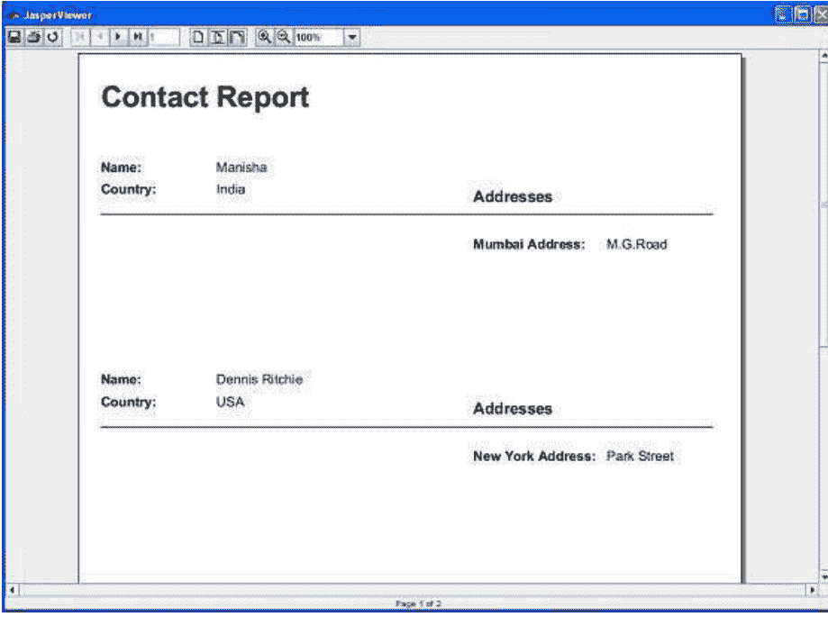

以前人们必须依靠脚本段（scriptlets）来收集图表数据并在报告模板中使用图像元素来渲染图表。JasperReports 现在让这一切变得简单，因为它内置了对新图表组件的图表支持。

使用新的图表组件，用户只需应用视觉设置并定义有助于图表数据集的表达式。JasperReports 使用 JFreeChart 作为底层图表库。在配置新的图表组件时，涉及以下三个部分：

- 图表组件。
- 图表数据集（分组了图表数据相关的设置）。
- 图表绘图（plot）（分组了与图表项目渲染方式相关的视觉设置）。

JasperReports 目前支持以下类型的图表：饼图、3D饼图、柱状图、3D柱状图、XY柱状图、堆叠柱状图、3D堆叠柱状图、折线图、XY折线、面积图、XY面积、堆叠面积图、散点图、气泡图、时间序列、高低收盘图（K线）、多轴、仪表、温度计和甘特图。

## 图表属性

图表是普通元素，因此它们与其他所有报告元素共享一些属性。有一个名为`<chart>`的 JRXML 元素，用于创建所有类型的图表。这些分组了特殊的图表特定对象，适用于所有类型的图表。

## 图表子元素

`<chart>`元素的子元素有：

- `<reportElement>`: 这些是可显示的对象，如静态文本、文本字段、图像、线条和矩形，你可以将它们放在报告模板章节中。
- `<Box>`: 此元素用于用边框包围图表，边框的每个边都可以自定义。
- `<chartTitle>`: 此元素用于放置图表标题。`Position`属性决定标题在报告中的标题位置。该元素具有属性 - `Position`（值可以是`Top`、`Bottom`、`Left`、`Right`。默认值为`Top`），`color`。`<chartTitle>`包含`font`和`titleExpression`元素。
- `<chartSubtitle>`: 此元素用于放置图表副标题。此元素具有属性 - `color`。`<chartSubtitle>`包含`font`和`subtitleExpression`元素。
- `<chartLegend>`: 该元素可以控制字体相关属性以及图表图例的文字和背景颜色。此元素具有属性 - `textColor`和`backgroundColor`。


## JasperReports

- `<anchorNameExpression>`: 此元素为锚点（anchor）创建目标。
- `<hyperlinkReferenceExpression>`: 此元素包含一个报告表达式，指示外部资源的名称（通常是 URL）。
- `<hyperlinkAnchorExpression>`: 超链接指向外部资源中的锚点。
- `<hyperlinkPageExpression>`: 超链接指向当前报告中的某页。
- `<hyperlinkTooltipExpression>`: 超链接指向提示框。
- `<hyperlinkParameter>`: 此元素包含超链接参数。

## 图表属性

`<chart>`元素中的属性：

- `isShowLegend`: 此属性决定是否显示图例。值可以是`true`或`false`。
- `evaluationTime`: 此属性决定何时评估图表。值可以是`Now`、`Report`、`Page`、`Column`、`Group`。
- `hyperlinkType`: 此属性决定超链接类型。
- `hyperlinkTarget`: 此属性决定超链接目标。值可以是`Self`或`Blank`。
- `bookmarkLevel`: 此属性决定书签级别。
- `customizerClass`: 这是一个类名（可选），可以对图表进行自定义。

## 图表自定义

如上所述，JasperReports 使用 JFreeChart 作为底层图表库。我们可以通过在`<chart>`的`customizerClass`中使用定制器（customizer）来利用这些功能。定制器是`net.sf.jasperreports.engine.JRustomizer`接口的实现。实现此接口最简单的方法是扩展`net.sf.jasperreports.RAAbstractChartCustomizer`类，并访问参数、字段和变量以进行更深入的图表自定义。


## 图表数据集

所有图表类型的共同属性之一是`<dataset>`元素。图表数据集有助于运行时映射报告数据并获取图表数据。每种图表类型包含不同的子元素来定义图表表达式。所有这些子元素都包含一个`<dataset>`元素，定义何时评估和重置图表表达式。

JasperReports 提供了多种图表数据集，因为每种类型的图表适用于特定的数据集：饼、分类、XY、时间序列、时间周期、XYZ 和高低。这些数据集类型均实现了`net.sf.jasperreports.engine.JRChartDataset`接口以定义图表数据集。所有图表数据集的初始化和增加方式相同；但它们映射的数据类型或报告序列不同。

## 数据集属性

| 属性 | 说明 |
|---|---|
| `resetType` | 此属性决定何时重置图表表达式的值。`None`、`Report`、`Page`、`Column`、`Group`。默认值为`Report`。 |
| `resetGroup` | 此属性决定在哪个组重置图表表达式的值。该属性的值必须与报告报告模板中定义的任何组匹配。 |
| `incrementType` | 此属性决定何时重新计算图表表达式的值。`None`、`Report`、`Page`、`Column`、`Group`。默认值为`"None"`。 |
| `incrementGroup` | 此属性决定在哪个组重新计算图表表达式。该属性的值必须与报告报告模板中定义的任何组匹配。 |

下表总结了`<dataset>`元素的子元素：

| 子元素 | 说明 |
|---|---|

## JasperReports

| `<incrementWhenExpression>` | 可以通过此子元素过滤掉不需要的数据，以自定义图表数据集的增量。 |
| `<datasetRun>` | 包含实例化报告子数据集（report subdataset）所需的信息。 |

## 数据集类型

下面解释了特定的数据集类型：

### 饼图数据集 (Pie Dataset)

饼图数据集具有以下表达式的特征：

- `<keyExpression>` - 代表构成饼图切片区域的类别。此表达式可以返回任何`java.lang.Comparable`对象。
- `<expression>` - 产生与数据集中每个类别/键对应的值。这些值始终是`java.lang.Number`对象。
- `<labelExpression>` - 如果缺少此表达式，图表将为饼图中的每个扇区显示默认标签。此表达式返回`java.lang.String`值，用于自定义图表的条目标签。
- `<sectionHyperlink>` - 设置与饼图区域关联的超链接。

### 分类数据集 (Category Dataset)

分类数据集以`<categorySeries>`元素为特征，该元素包含：

- `<seriesExpression>` - 表示序列的名称。此表达式可以返回任何`java.lang.Comparable`对象。
- `<categoryExpression>` - 返回由`seriesExpression`指定的序列内每个值对应的类别名称。类别始终是`java.lang.Comparable`对象。
- `<expression>` - 产生与数据集中每个类别对应的值。这些值始终是`java.lang.Number`对象。
- `<labelExpression>` - 如果缺少此表达式，图表将为图中的每个条目显示默认标签。此表达式返回`java.lang.String`值，用于自定义图表的条目标签。
- `<itemHyperlink>` - 设置与图表条目关联的超链接。

### XY 数据集 (XY Dataset)

XY 数据集以`<xySeries>`元素为特征，该元素包含：

- `<seriesExpression>` - 表示序列的名称。此表达式可以返回任何`java.lang.Comparable`对象。


- `<xExpression>` - 返回代表 (x, y) 对中 X 值的`java.lang.Number`，该值将被添加到当前数据系列中。
- `<yExpression>` - 返回代表 (x, y) 对中 Y 值的`java.lang.Number`，该值将被添加到当前数据系列中。
- `<labelExpression>` - 如果缺少此表达式，图表将为图中的每个条目显示默认标签。此表达式返回`java.lang.String`值，用于自定义图表的条目标签。
- `<itemHyperlink>` - 设置与图表条目关联的超链接。

### XYZ 数据集 (XYZ Dataset)

XYZ 数据集以`<xyzSeries>`元素为特征，该元素包含：

- `<seriesExpression>` - 表示序列的名称。此表达式可以返回任何`java.lang.Comparable`对象。
- `<xExpression>` - 返回代表 (x, y, z) 项目中 X 值的`java.lang.Number`，该值将被添加到当前数据系列中。
- `<yExpression>` - 返回代表 (x, y, z) 项目中 Y 值的`java.lang.Number`，该值将被添加到当前数据系列中。
- `<zExpression>` - 返回代表 (x, y, z) 项目中 Z 值的`java.lang.Number`，该值将被添加到当前数据系列中。
- `<labelExpression>` - 如果缺少此表达式，图表将为图中的每个条目显示默认标签。此表达式返回`java.lang.String`值，用于自定义图表的条目标签。
- `<itemHyperlink>` - 设置与图表条目关联的超链接。

### 时间序列数据集 (Time Series Dataset)

时间序列数据集以`timePeriod`属性和`<timeSeries>`元素为特征。`timePeriod`属性指定数据集内部数据系列的类型。时间序列可以包含带有天、月、年或预定义时间段的数值。时间序列可以包含的值包括：年、季度、周、天、小时、分钟、毫秒。

`<timeSeries>`元素包含（取决于时间段）：
- `<seriesExpression>` - 表示数据系列的名称。此表达式可以返回任何`java.lang.Comparable`对象。
- `<expression>` - 根据`timePeriod`属性指定的数据类型，返回结果的透明度值。
- `<expression>` - 产生与当前数据系列时间段关联的`java.lang.Number`值。
- `<labelExpression>` - 如果缺少此表达式，图表将为图中的每个条目显示默认标签。此表达式返回`java.lang.String`值，用于自定义图表的条目标签。


### 时间段数据集 (Time Period Dataset)

时间段数据集以`<timeSeries>`元素为特征，它包含：

- `<seriesExpression>` - 表示序列的名称。此表达式可以返回任何`java.lang.Comparable`对象。
- `<startDate>` - 指定时间段的开始日期，这将添加到数据系列中。
- `<endDate>` - 指定时间段的结束日期，这将添加到数据系列中。
- `<expression>` - 产生与当前数据系列时间段关联的`java.lang.Number`值。
- `<labelExpression>` - 如果缺少此表达式，图表将为图中的每个条目显示默认标签。此表达式返回`java.lang.String`值，用于自定义图表的条目标签。
- `<itemHyperlink>` - 设置与图表条目关联的超链接。

### 高低数据集 (High Low Dataset)

高低数据集具有以下表达式的特征：

- `<seriesExpression>` - 表示序列的名称。此表达式可以返回任何`java.lang.Comparable`对象。
- `<dateExpression>` - 返回 (high, low, open) 项目的日期。
- `<highExpression>` - 返回代表高值的`java.lang.Number`，该值将被添加到当前数据系列中。
- `<lowExpression>` - 返回代表低值的`java.lang.Number`，该值将被添加到当前数据系列中。
- `<openExpression>` - 返回开盘值的`java.lang.Number`，该值将被添加到当前数据系列中。
- `<closeExpression>` - 返回收盘值的`java.lang.Number`，该值将被添加到当前数据系列中。
- `<volumeExpression>` - 返回当前条目成交量的数值表达式。仅用于蜡烛图（Candlestick charts）。
- `<itemHyperlink>` - 设置与图表条目关联的超链接。


## 值数据集 (Value Dataset)

这是一个特殊图表数据集实现，包含单个值，用于仪表（Meter）和温度计（Thermometer）图。该值通过`<Expression>`收集。

## 图表绘制 (Chart Plots)

通过图表类型的另一种 JRXML 元素是`<plot>`元素。它允许我们定义图表的某些特征，如方向和背景颜色。绘制方式根据类型而异。

## 绘制属性 (Plot Attribute)

下表总结了`<plot>`元素的属性：

| 属性 | 说明 | 值 |
| --- | --- | --- |
| `bgcolor` | 定义图表的背景颜色。 | 任何六位十六进制值都是该属性的有效值。十六进制值前带有`#` |
| `orientation` | 定义图表的方向。 | 水平 (Horizontal) / 垂直 (Vertical)。默认值为`"Vertical"` |
| `backgroundAlpha` | 定义图表背景色的透明度。该属性的有效值在 0 到 1 之间。值越大，背景越不透明。默认值为`"1."` |
| `foregroundAlpha` | 定义图表前景色的透明度。该属性的有效值包括 0 到 1 之间的任何小数。值越大，背景越不透明。默认值为`"1."` |
| `labelRotation` | 允许 x 轴文本标签顺时针或逆时针旋转。此属性仅适用于 x 轴不是数值或不显示天的图表。 | 默认值为`"0.0."` |

## JasperReports

`<plot>`元素有一个子元素`<seriesColor>`，其属性为：`seriesOrder`和`color`。该元素用于自定义序列的颜色以及其在颜色序列中的位置。

## 图表绘图的特定设置

- `piePlot`: 没有特定设置
- `pie3DPlot`: 包含`depthFactor`属性，这是一个 0 到 1 之间的数值，表示饼图的深度占绘图高度的百分比。
- `barPlot`: 可以显示或隐藏刻度标签、刻度标记或项目标签，并为两个轴提供设置。
- `bar3DPlot`: 提供与`barPlot`相同的设置，并使用`xOffset`和`yOffset`属性生成 3D 效果。
- `linePlot`: 可以显示或隐藏连接点，可以显示或隐藏带有项目点的形状，并为两个轴提供设置。
- `scatterPlot`: 与`linePlot`类似，它可以显示或隐藏连接点，可以显示或隐藏与项目点相关的形状，并为两个轴提供设置。
- `areaPlot`: 为两个轴提供设置。
- `bubblePlot`: 可以通过设置`scaleType`属性来设置气泡维度，并为两个轴提供设置。
- `timesSeriesPlot`: 可以显示或隐藏连接项目点，可以显示或隐藏与项目点相关的形状，并为两个轴提供设置。
- `highLowPlot`: 可以显示或隐藏开盘刻度，可以显示或隐藏收盘刻度，并为两个轴提供设置。
- `candlestickPlot`: 可以显示或隐藏成交量，并为两个轴提供设置。
- `meterPlot`: 包含仪表盘形状、比例角度、测量单位、刻度间隔、仪表盘颜色、指针颜色、刻度颜色、数值显示字体、颜色和格式模式、数据范围以及仪表间隔的特定设置。
- `thermometerPlot`: 包含位置记忆、汞颜色、显示/隐藏数值线、数值显示字体、颜色和格式模式、数据范围、低范围和高范围的特定设置。
- `multiAxisChart`: 包含绘图中的轴的特定设置。

## 图表类型

JasperReports 对多种图表类型提供了内置支持。列表如下：

- `pieChart`: 饼图数据集 (Pie dataset) 和饼图 (Pie plot) 的组合。
- `pie3DChart`: 饼图数据集和 3D 饼图的组合。
- `barChart`: 类别数据集 (Category dataset) 和柱状图 (Bar plot) 的基础组合。


## JasperReports

- `bar3DChart`: 封装类别数据集和 3D 柱状图。
- `xyBarChart`: 支持时间段数据集 (Time Period datasets)、时间序列数据集 (Time Series datasets) 和 XY 数据集，并使用柱状图渲染轴和项目。
- `stackedBarChart`: 使用类别数据集的数据并使用柱状图渲染其内容。
- `stacked3DChart`: 使用类别数据集的数据并使用 3D 绘图渲染其内容。
- `lineChart`: 组合类别数据集和折线图 (Line plot)。
- `xyLineChart`: 组合 XY 数据集和折线图。
- `areaChart`: 使用面积图 (Area plot) 渲染来自类别数据集的项。
- `stackedAreaChart`: 使用面积图渲染来自类别数据集的项。
- `xyAreaChart`: 使用 XY 数据集的数据并通过通过图渲染。
- `scatterChart`: 使用散点图 (Scatter plot) 封装 XY 数据集。
- `bubbleChart`: 将 XZ 数据集与气泡图 (Bubble plot) 结合。
- `timeSeriesChart`: 组合时间序列数据集和时间序列图。
- `highLowChart`: 高低数据集 (High-Low dataset) 和高低图 (High-Low plot) 的组合。
- `candlestickChart`: 使用高低数据集的数据，但使用特殊的蜡烛图。
- `meterChart`: 使用仪表图 (Meter plot) 的渲染选项在仪表盘上显示来自数值数据集的单个值。
- `thermometerChart`: 使用温度计图 (Thermometer plot) 的渲染选项显示数值数据集中的单个值。
- `multiAxisChart`: 包含多个范围轴，所有轴共享一个公共域轴。

## 示例

为了演示这些图表，让我们编写一个新的报告模板 (`jasper_report_template.jrmxmi`)。在这里，我们将向`<pageHeader>`部分添加`<barChart>`元素，向`<summary>`部分添加`<pieChart>`。我们将在图表中显示：每个科目的分数。将其保存到目录`C:\jasperreports-5.0.1\test`。文件内容如下：

```xml
```


`<?xml version="1.0" encoding="UTF-8"?>`

`<jasperReport xmlns="http://jasperreports.sourceforge.net/jasperreports"`

`xmlns:xsi="http://www.w3.org/2001/XMLSchema-instance"`

`xsi:schemaLocation="http://jasperreports.sourceforge.net/jasperreports.xsd http://jasperreports.sourceforge.net/jasperreport.xsd"`

`name="jasper_report_template" pageWidth="595" pageHeight="860"`

`columnWidth="515" leftMargin="40" rightMargin="40" topMargin="50" bottomMargin="50"`

```

```

```xml
<field name="subjectName" class="java.lang.String"/>
<field name="marks" class="java.lang.Integer"/>
<variable name="countNumber" class="java.lang.Integer" calculation="Count">
<variableExpression><![CDATA[Boolean]]></variableExpression>
</variable>
<background><band splitType="Stretch"/></background>
<title><band height="79" splitType="Stretch"/></title>
<pageHeader><band height="200">
<chart evaluationTime="Report"><reportElement x="0" y="0" width="555" height="200"/>
<chartTitle><titleExpression><![CDATA[My First Bar Chart]]></titleExpression></chartTitle>
<categoryDataset incrementType="None">
<categorySeries>
<seriesExpression><![CDATA[${subjectName}]]></seriesExpression>
<categoryExpression><![CDATA[${subjectName}]]></categoryExpression>
<valueExpression><![CDATA[$F{marks}]]></valueExpression>
</categorySeries>
<barPlot isTickMarks="false"><plot/></barPlot>
</chart>
<columnHeader><band height="20" splitType="Stretch"/></columnHeader>
<detail><band height="20" splitType="Stretch"/></detail>
columnFooter><band height="20" splitType="Stretch"/></columnFooter>
<pageFooter><band height="20" splitType="Stretch"/></pageFooter>
<summary><band height="400" splitType="Stretch"/>
<pieChart evaluationTime="Report"><reportElement x="135" y="0" width="270" height="300"/>
<chartTitle><titleExpression><![CDATA[My First Pie Chart]]></titleExpression></chartTitle>
<dataset incrementType="None">
<keyExpression><![CDATA[${subjectName}]]></keyExpression>
<valueExpression><![CDATA[$F{marks}]]></valueExpression>
</dataset>
<piePlot>
<plot/><itemLabel/></piePlot>
</pieChart>
</band></summary>
</jasperReport>
```

```

```

上述文件的详情如下：

- 用于创建柱状图的 JRXML 元素是 `<pageHeader>` 中的 `<chart>` 子元素。它包含一个 `<chart>` 子元素，该子元素包含一个定义图表尺寸和位置的 `<reportElement>` 子元素。
- 柱状图中的元素必须封装在 `<categoryDataset>` 和 `</categoryDataset>` JRXML 元素之间。
- `<categoryDataset>` 必须包含一个 `<categorySeries>` 元素。该元素定义了图表将表示的内容（在本例中为科目名称）。
- `<categoryDataset>` 必须包含一个元素，定义了数据如何按类别进行划分。在这里，数据按科目名称划分。
- `<valueExpression>` 元素用于确定图中每个柱体的值。在这里，我们使用了 `marks`。
- 对于饼图，我们使用了 `<summary>` 中的 `<pieChart>` 元素。它包含一个 `<chart>` 子元素。
- 子元素包含一个用作图中键的 `report element`。在这里，我们使用了 `subjectName`。
- 子元素包含用于计算键值的表达式。在这里，我们使用了 `marks`。

填充报告的 Java 代码保持。文件 `C:\jasperreports-5.0.1\src\com\tutorialpoint\JasperFill.java` 的内容如下：

```

```

## JasperReports

```java
package com.tutorialspoint;

import java.util.ArrayList;
import java.util.HashMap;
import java.util.Map;
import net.sf.jasperreports.engine.JSONException;
import net.sf.jasperreports.engine.JasperFillManager;
import net.sf.jasperreports.engine.data.JRBeanCollectionDataSource;

public class JasperReport {
    @SuppressWarnings("unchecked")
    public static void main(String[] args) {
        String sourceFileName = "C:/tools/jasperreports-5.0.1/test/jasper_report_template.jasper";
        DataBean dataBeanList = new DataBeanList();
        ArrayList<DataBean> dataList = dataBeanList.getDataBeanList();
        JRBeanCollectionDataSource beanColDataSource = new JRBeanCollectionDataSource(dataList);
        Map parameters = new HashMap<>();
        try {
            JasperFillManager.fillReportToFile(sourceFileName, parameters, beanColDataSource);
        } catch (JSONException e) {
            e.printStackTrace();
        }
    }
}
```

由于我们要显示每个科目的分数，POJO 需要更改。文件 `C:\tools\jasperreports-5.0.1\test\src\com\tutorialspoint\DataBean.java` 的内容如下：

```java
package com.tutorialspoint;
```

```java
public class DataBean {
    private String subjectName;
    private Integer marks;

    public String getSubjectName() {
        return subjectName;
    }

    public void setSubjectName(String subjectName) {
        this.subjectName = subjectName;
    }

    public Integer getMarks() {
        return marks;
    }

    public void setMarks(Integer marks) {
        this.marks = marks;
    }
}
```

甚至文件 `C:\tools\jasperreports-5.0.1\test\src\com\tutorialpoint\DataBeanList.java` 的内容也需要按照如下所示进行更新：

```java
package com.tutorialpoint;

import java.util.ArrayList;
```

```java
public class DataBean {
    public ArrayList getDataBeanList() {
        ArrayList dataBeanList = new ArrayList();
    }
```

```java
dataBeanList.add(produce("English", 58));
dataBeanList.add(produce("SocialStudies", 68));
dataBeanList.add(produce("Maths", 38));
dataBeanList.add(produce("Hindi", 88));
```

```java
dataBeanList.add(produce("Scince", 78));
return dataBeanList;
}
/*
 * 此方法返回一个 JavaBean 对象，其中设置了 subjectName 
 * 和 marks。
 */
private DataBean produce(String subjectName, Integer marks) {
    DataBean dataBean = new DataBean();

    dataBean.setSubjectName(subjectName);
    dataBean.setMarks(marks);

    return dataBean;
}
```

## 报告生成

接下来，让我们使用常规的 ANT 构建过程执行上述文件。文件 `build.xml`（保存在目录 `C:\tools\jasperreports-5.0.1\test` 下）的内容所示。

导入文件 - `baseBuild.xml` 取自“环境设置”（Environment Setup）章节，它应该存放在与 `build.xml` 相同的目录下。

```xml
<?xml version="1.0" encoding="UTF-8"?>
<project name="JasperReportTest" default="viewFillReport" basedir="">
  <import file="baseBuild.xml" />
  <target name="viewFillReport"
    depends="compile,compileredesigning,run"
    description="启动报告查看器以预览"
    the存储在 .JRprint 文件中的报告。
    <java classname="net.sf.jasperreports.view.JasperViewer">
      <arg value="-F${file.name}.JRprint" />
      <classpath refid="classpath" />
    </java>
  </target>
```

```

```

```xml
<target name="compilerdesing"
description="编译 JXML 文件并
生成 .jasper 文件">
<taskdef name="jrc"
classname="net.sf.jasperreports.ant.JRAntCompileTask">
  <classpath refid="classpath" />
</taskdef>
<jrc destdir=".">
  <src>
    <fileset dir=".">
      <include name="*.jrxml" />
    </fileset>
  </src>
  <classpath refid="classpath" />
</jrc>
</target>
</project>
```

接下来，打开命令行窗口并进入 `build.xml` 所在的目录。

最后，执行命令 `ant -Dmain-class=com.tutorialpoint.JasperReportFill`（`viewFullReport` 是默认目标），如下：

```cmd
C:\tools\jasperreports-5.0.1\test\ant -Dmain-class=com.tutorialpoint.JasperReportFill
Buildfile: C:\tools\jasperreports-5.0.1\test\build.xml
```

clean-sample:

[delete] 正在删除目录 `C:\jasperreports-5.0.1\test\classes`

[delete] 删除: `C:\jasperreports-5.0.1\test\jasper_report_template.jasper`

[delete] 删除: `C:\jasperreports-5.0.1\test\jasper_report_template.jrprint`

compile:

[mkdir] 创建目录: `C:\jasperreports-5.0.1\test\baseBuild.xml:28`:

[javac] `C:\jasperreports-5.0.1\test\baseBuild.xml`:

warning: "includeantuntime" 未设置，默认值为 bu

[javac] 正在编译 3 个源文件到 `C:\jasperreports-5.0.1\test\classes`

```

```

compilereportdesing:

[jrc] 正在编译 1 个报告设计文件。

[jrc] log4j:WARN 未为 logger 找到任何 appenders

(`net.sf.jasperreports.engine.xml.JXMLDigesterFactory`).

[jrc] log4j:WARN 请正确初始化 log4j 系统。

[jrc] log4j:WARN 请访问

`http://logging.apache.org/log4j/1.2/faq.html#nconfig` 获取更多信息。

[jrc] 文件 : `C:\tools\jasperreports-5.0.1\test\jasper_report_template.jrxml`

run:

```text
[echo] 运行类 com.tutorialpoint.JasperFill
[Java] log4j:WARN 未为 logger 找到任何 appenders
(net.sf.jasperreports.engine.xml.JXMLDigesterFactory).
[Java] log4j:WARN 请正确初始化 log4j 系统。
```

viewReport:

```text
[Java] log4j:WARN 未为 logger 找到任何 appenders
(net.sf.jasperreports.engine.xml.JXMLDigesterFactory).
[Java] log4j:WARN 请正确初始化 log4j 系统。
```

构建成功

总耗时: 19 分 45 秒

作为上述编译的结果，JasperViewer 窗口如下所示打开：

```
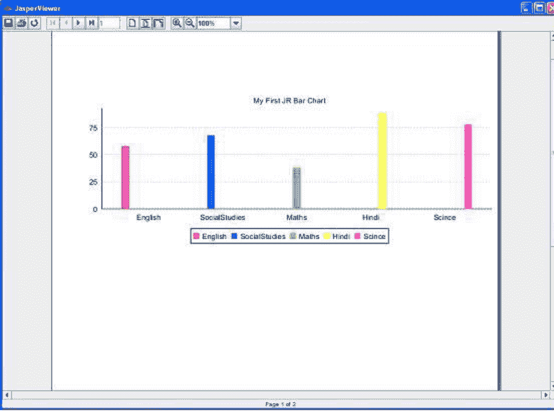
```

```

```


在这里，我们看到交叉表已创建。

交叉表（crosstab）报告是跨行和列聚合数据的表格。

## JasperReports

- `name`: 定义度量（measure）的名称。
- `class`: 指示度量的类。
- `calculation`: 指定在交叉表（crosstab）单元格值之间执行的计算。其值可以是以下任何一个 - `Nothing`（无）,`Count`（计数）,`DistinctCount`（去计数）,`Sum`（求和）,`Average`（平均）,`Lowest`（最小）,`Highest`（最大）,`StandardDeviation`（标准差）,`Variance`（方差）,`First`（第一个）。默认值为 `Nothing`。
- `<crosstabCell>`: 该元素定义非标题单元格中数据的布局方式。该元素的属性包括：
  - `columnTotalGroup`: 指定计算列汇总组。
  - `height`: 定义单元格的高度。
  - `rowTotalGroup`: 指定计算行的组。
  - `width`: 定义单元格的宽度。
  - `<whenNoDataCell>`: 该元素定义空交叉表单元格显示的内容。该元素不包含属性。

## 交叉表中的数据分组

交叉表引擎通过遍历关联的数据集记录来聚合数据。为了聚合数据，我们需要先对它们进行分组。在交叉表中，行和列基于特定的分组项，称为“桶”（buckets）。桶的定义应包含：

- `bucketExpression`: 为了获取数据分组项而需要评估的表达式。
- `comparatorExpression`: 当值的自然排序不是最佳选择时需要此表达式。
- `orderByExpression`: 指示用于排序数据的值。

交叉表中的行和列（上文定义）依赖于桶。

## 内置交叉表汇总变量

以下是度量值和对应于单元格的不同层级总计的列表，可以通过按照以下方案命名的变量进行访问：

- 度量的当前值存储在与度量同名的变量中。
- `<Measure>_<Column Group>_ALL`: 获取同一行中该列组所有条目的总计。
- `<Measure>_<Row Group>_ALL`: 获取同一列中该行组所有条目的总计。
- `<Measure>_<Row Group>_<Column Group>_ALL`: 获取对应于行行组和列组中所有条目的总计。

## 示例

为了演示交叉表，让我们编写一个新的报告模板（`jasper_report_template.jrxml`）。在这里，我们将交叉表添加到摘要部分（summary）。将其保存到目录`C:\jasperreports-5.0.1\`。文件内容如下：

```xml
<?xml version="1.0" encoding="UTF-8"?>
<!DOCTYPE JasperReport PUBLIC "//JasperReports//DTD Report Design//EN"
"http://jasperreports.sourceforge.net/dtds/jasperreport.dtd">
<JasperReport xmlns="http://jasperreports.sourceforge.net/jasperreports"
xmlns:xsi="http://www.w3.org/2001/XMLSchema-instance"
sxi:schemaLocation="http://jasperreports.sourceforge.net/jasperreport http://jasperreports.sourceforge.net/dtds/jasperreport.xsd"
name="jasper_report_template" language="groovy" pageWidth="595"
pageHeight="842" columnWidth="555" leftMargin="20" rightMargin="20"
topMargin="20" bottomMargin="20">
<parameter name="ReportTitle" class="java.lang.String"/>
<parameter name="Author" class="java.lang.String"/>
<field name="name" class="java.lang.String"/>
<field name="country" class="java.lang.String"/>
<title>
<band height="70">
<line />
<reportElement x="0" y="0" width="515"
height="30"/>
<textField isBlankWhenNull="true" bookmarkLevel="1">
<reportElement x="0" y="0" width="515"
height="30"/>
<textElement textAlignment="Center">
<font size="22"/>
</textElement>
<textFieldExpression class="java.lang.String">
<![CDATA[$P[ReportTitle]]>
</textFieldExpression>
<anchorNameExpression>
<![CDATA["Title"]]]>
</anchorNameExpression>
</band>
</title>
```

```xml
</textField>
<textField isBlankNull="true">
<reportElement x="0" y="40" width="515" height="20"/>
<element textAlignment="Center">
  <font size="10"/>
</element>
<textFieldExpression class="java.lang.String">
<![CDATA[$P{Author}]]>
</textFieldExpression>
</textField>
</band>
</title>

<summary>
<band height="60">
<crosstab>
```

```xml
<reportElement width="782" y="0" x="0" height="60"/>

<rowGroup name="nameGroup" width="100">
```

```xml
<bucket>
<bucketExpression class="java.lang.String">
<![CDATA[$F{name}]]>
</bucketExpression>
</bucket>
```

```xml
<crosstabRowHeader>
<cellContents>
<box border="Thin" borderColor="black"/>
<textField>
<reportElement width="100" y="0" x="0" height="20"/>
<element textAlignment="Right">
verticalAlignment="Middle"/>
<textFieldExpression>
<![CDATA[$V{nameGroup}]]>
</textFieldExpression>
</textField>
</cellContents>
</crosstabRowHeader>
</rowGroup>
```

```xml
<columnGroup name="countryGroup" height="20">
<bucket>
<bucketExpression class="java.lang.String">
<![CDATA[$country}]]>
</bucketExpression>
</bucket>
<crosstabColumnHeader>
<box border="Thin" borderColor="black"/>
<textField isStretchOverflow="true">
<reportElement width="60" y="0" x="0" height="20"/>
<textField verticalAlignment="Bottom"/>
<textFieldExpression>
<![CDATA[$country}]]>
</textFieldExpression>
</textField>
</cellContents>
</crosstabColumnHeader>
</columnGroup>
<measure name="tailNumCount" class="java.lang.Integer" calculation="Count">
<measureExpression>$country</measureExpression>
```

```java
private String country;

public String getName() {
    return name;
}

public void setName(String name) {
    this.name = name;
}

public String getCountry() {
    return country;
}

public void setCountry(String country) {
    this.country = country;
}
```

文件`C:\tools\jasperreports-5.0.1\test\src\com\tutorialspoint\DataBeanList.java`的内容如下：

```java
package com.tutorialspoint;

import java.util.ArrayList;
```

```java
public class DataBeanList {

    public ArrayList<DataBean> getDataBeanList() {

        ArrayList<DataBean> dataBeanList = new ArrayList<DataBean>();

        dataBeanList.add(produce("Manisha", "India"));

        dataBeanList.add(produce("Dennis Ritchie", "USA"));

        dataBeanList.add(produce("V.Anand", "India"));

        dataBeanList.add(produce("Shrinath", "California"));

        return dataBeanList;

    }

}
```

## JasperReports

```java
/**
 * 此方法返回一个 DataBean 对象，
 * 并设置了 name 和 country。
 */
private DataBean produce(String name, String country) {

    DataBean dataBean = new DataBean();

    dataBean.setName(name);

    dataBean.setCountry(country);

    return dataBean;

}
```

## 报告生成

接下来，让我们使用常规的 ANT 构建过程编译并执行上述文件。文件`build.xml`（保存在目录`C:\tools\jasperreports-5.0.1\test`）的内容所示。

导入文件 - `baseBuild.xml`是从“环境设置”章节选取的，应该存放在与`build.xml`相同的目录下。

```xml
<xml version="1.0" encoding="UTF-8"?>
<project name="JasperReportTest" default="viewReport" basedir=".">
  <import file="baseBuild.xml" />
  <target name="viewReport"
    depends="compile,compilereportdesigning,run"
    description="启动报告查看器以预览
    存储在 .JRprint 文件中的报告。">
    <java className="net.sf.jasperreports.view.JasperViewer"
      fork="true">
      <arg value="-F${file.name}.JRprint" />
      <classpath ref="classpath" />
    </java>
  </target>
<target name="compilereportdesigning"
  description="编译 JXML 文件并
  生成 .jasper 文件。">
  <taskdef name="jrc"
    classname="net.sf.jasperreports.ant.JARAntCompileTask">
    <classpath ref="classpath" />
  </taskdef>
```

```xml
</taskdef>
  <jrc destdir=".">
    <src>
      <fileset dir=".">
        <include name="*.jxml" />
      </fileset>
    </src>
    <classpath ref="classpath" />
  </jrc>
  </target>
</project>
```

接下来，打开命令行窗口并进入 build 所在的目录。最后，执行命令`ant -Dmain-class=com.tutorialspoint.JasperReport`（`viewReport`是默认目标）如下：

```
C:\tools\jasperreports-5.0.1\test\ant -Dmain-class=com.tutorialspoint.JasperReport

Buildfile: C:\tools\jasperreports-5.0.1\test\build.xml

clean:
- [delete] 删除目录 C:\tools\jasperreports-5.0.1\classes
- [delete] 删除 C:\tools\jasperreports-5.0.1\test\jasper_report_template.jasper

+ compile:
- [mkdir] 创建目录 C:\tools\jasperreports-5.0.1\classes
- [javac] C:\tools\jasperreports-5.0.1\test\Build.xml:28:
warning: 'runtime' 未设置，默认值为
- [javac] 正在编译 3 个源文件到 C:\tools\jasperreports-5.0.1\test\classes

+ compilerdesigning:
- [jrc] 正在编译 1 个报告文件。
- [jrc] log4j:WARN 未找到 logger (net.sf.jasperreports.engine.fill.DigesterFactory)。
- [jrc] log4j:WARN 请正确初始化 log4j 系统。
- [jrc] log4j:WARN 请参见 http://logging.apache.org/log4j/1.2/faq.html#configuration

[jrc] 文件 C:\tools\jasperreports-5.0.1\test\jasper_report_template.jasper ... OK。

[echo] 运行类 : com.tutorialspoint.JasperReport
[java] log4j:WARN 未找到 logger (net.sf.jasperreports.extensions.ExtensionsEnvironment)。
[java] log4j:WARN 请正确初始化 log4j 系统。

viewReport:
[java] log4j:WARN 未找到 logger net.sf.jasperreports.extensions.ExtensionsEnvironment。
[java] log4j:WARN 请正确初始化 log4j 系统。

BUILD SUCCESSFUL
耗时: 20 分 53 秒
```

编译结果打开了如下所示的 JasperViewer 窗口：

在这里，我们看到每个国家和名称列表。

# 23. JASPERREPORTS – 国际化


有时我们需要不同语言的报告。为每种语言编写相同的报告意味着大量的重复工作。只有不同语言的文本部分应该单独编写并在运行时根据区域设置加载到文本元素中。这就是报告国际化的目的。国际化的报告可以在任何运行。

在以下步骤中，我们列出了生成不同语言报告的方法以及报告国际化的其他特性：

- 将资源包`java.util.ResourceBundle`与报告模板关联。将`java.util.ResourceBundle`对象与报告模板关联有两种方式：
  - 在设计阶段，通过在运行时设置报告对象的`resourceBundle`属性来指定目标资源包的基类。
  - 在填充报告时提供`java.util.ResourceBundle`对象作为`REPORT_RESOURCE_BUNDLE`参数的值可以实现动态/运行时关联。
- 如果报告需要在与当前不同的区域生成，可以使用内置的`REPORT_LOCALE`参数指定填充报告时的运行时区域。

为了方便报告国际化，报告表达式可以使用特殊语法`$R{}`来引用与报告相关的`java.util.ResourceBundle`对象内部的`java.lang.String`资源。`$R{}`根据括号内的键从资源包中提取特定区域的资源：

```xml
<textFieldExpression>
$R{report.title}
</textFieldExpression>
```

上述文本字段通过从与报告相关的资源包中根据运行时区域和`report.title`键提取值来显示报告标题。

根据报告区域以不同语言格式化消息，在`net.sf.jasperreports.engine.fillCalculator`中有一个内置方法。该方法为`java.text.MessageFormat`类提供了功能。该方法`msg()`有三个方便的签名，允许你在消息中使用最多三个参数。

内置的`str()`（等同于报告表达式中的`$R{}`语法），允许根据报告区域访问资源包内容。

对于日期和时间格式化，可以使用内置的`REPORT_TIME_ZONE`参数来确保时间的正确转换。


## JasperReports

- 在生成的输出中，库保留了文本方向信息，以便从右向左语言（如阿拉伯语和希伯来语）生成的文档可以正确渲染。
- 如果应用程序依赖内置的 Swing 查看器显示生成的报告，则需要通过适配内置工具提示或其他显示的文本来进行国际化。这很容易实现，因为查看器依赖于预定义的资源包来提取特定区域的信息。该资源包的基类是`net.sf.jasperreports.view.viewer`。

## 示例

为了演示国际化，让我们编写一个新的报告模板（`jasper_report_template.jrxml`）。JRXML 的内容所示。将其保存到`C:\jasperreports-5.0.1\test`目录。

```xml
<?xml version="1.0" encoding="UTF-8"?>
<!DOCTYPE JasperReport "//JasperReports//DTD Report Design//EN"
"http://jasperreports.sourceforge.org/dts/jasperreport.dtd">
<JasperReport xmlns="http://jasperreports.sourceforge.org/net/jasperreports"
xmlns:xsi="http://www.w3.org/2001/XMLSchema-instance"
xsi:schemaLocation="http://jasperreports.sourceforge.org/jasperreport 
http://jasperreports.sourceforge.org/xsd/jasperreport.xsd"
name="jasper_report_template" language="groovy" pageWidth="595"
height="842" columnWidth="555" leftMargin="20" rightMargin="20"
topMargin="20" bottomMargin="20" resourceBundle="localizationdemo">
<title>

<band name="552">
  <textField>

  <reportElement positionType="Float"
x="150" y="20"
width="400" height="50"/>
  <textElement>

<font size="24" />
</textElement>
  <textFieldExpression
class="java.lang.String">
<![CDATA[$P(REPORT_LOCALE)].getDisplayName]] + ($P(REPORT_LOCALE))]
</textFieldExpression>

</textField>

</band>
</title>
</JasperReport>
```

在上述文件中，`<jasperReport>`元素的`resourceBundle`属性允许 JasperReports 获取用于报告的本地化字符串。填充属性时，我们需要创建一个名称与属性值相匹配的属性文件。该文件必须存在于 CLSPATH 中的任何位置。在示例中，属性文件`localizationdemo.properties`保存于`C:\tools\jasperreports-5.0.1\test`。其内容如下：

```
localization.text=Is English.
```

要使用不同的语言，文件名必须是`localizationdemo[locale].properties`。在这里，我们将为西班牙语编写一个文件。将其保存为`C:\tools\jasperreports-5.0.1\test\localizationdemo_es.properties`。其内容如下：

```
localization.text=Este en Español.
```

获取`resourceBundle`值的语法是`${key}`。为了让 JasperReports 知道使用哪种语言，我们需要为内置参数赋值。该参数的名称定义为常量`REPORT_LOCALE`，该常量是`java.util.Locale`的一个实例。此逻辑整合在 Java 代码中以填充并生成报告。将此文件`JasperReportFillI18.java`保存到`C:\tools\jasperreports-5.0.1\src\com\tutorialpoint`目录。其内容如下：

```
package com.tutorialpoint;

import java.util.HashMap;
import java.util.Locale;

## JasperReports

import net.sf.jasperreports.engine.JREDataSource;
import net.sf.jasperreports.engine.JREException;
import net.sf.jasperreports.engine.JRParameter;
import net.sf.jasperreports.engine.JasperFillManager;

public class JasperReportFill18 {

    public static void main(String[] args) {
        String sourceFileName = "C:/tools/jasperreports-5.0.1/test/"
            + "jasper_report_template.jasper";
        HashMap parameterMap = new HashMap();
        if (args.length > 0) {
            parameterMap.put(JRParameter.REPORT_LOCALE, new Locale(args[0]));
        }

        try {
            JasperFillManager.fillReportToFile(sourceFileName, null,
                new EmptyDataSource());
        } catch (JREException e) {
            // Auto-generated catch block
            e.printStackTrace();
        }
    }
}
```

## 报告生成

我们将使用我们的 ANT 构建过程编译并执行上述文件。`build.xml`文件（保存于`C:\tools\jasperreports-5.0.1\test`）内容如下。导入文件`baseBuild.xml`应该放在与`build.xml`相同的目录下。

```xml
<xml version="1.0" encoding="UTF-8"?>
<project name="JasperTest" default="viewFillReport" baseddir=".">
<import file="baseBuild.xml" />
<target name="viewFillReport"
    depends="compile,compilereportdesign"
>```


```xml
<description="launches the report viewer to preview
the report stored in the .jasper file">
<java classname="net.sf.jasperreports.view.JasperViewer
fork="true">
  <arg value="-F${file.name}.jasper" />
  <classpath refid="classpath" />
</java>
</target>
<target name="compilereportdesign"
<description="Compiles the JXML file and
produces the .jasper file">
<taskdef name="jrc"
classname="net.sf.jasperreports.ant.JRCompileTask">
  <classpath refid="classpath" />
</taskdef>
<jrc destdir="./">
  <src>
    <fileset dir="./">
      <include name="*.jrxml" />
    </fileset>
  </src>
  <classpath refid="classpath" />
</jrc>
</target>
</project>
```

接下来，打开命令行窗口并进入`build.xml`所在的目录。最后执行命令`ant -Dmain-class=com.tutorialpoint.JasperReportFill18`（`viewReport`为默认目标）如下：

```
C:\jasperreports-5.0.1\test>ant -Dmain-class=com.tutorialpoint.JasperReportFill18
```

Buildfile: `C:\jasperreports-5.0.1\test\build.xml`

clean-sample:

[delete] 删除目录`C:\jasperreports-5.0.1\test\classes`

[delete] 删除`C:\jasperreports-5.0.1\test\jasper_report_template.jasper`

```
[delete] 删除 `C:\tools\jasperreports-5.0.1\test\jasper_report_template.jasper`
```

compile:

[mkdir] 创建目录`C:\tools\jasperreports-5.0.1\test\classes`

[javac] C:\tools\jasperreports-5.0.1\test\baseBuild.xml:28:

warning: :includeant 未设置，默认值为

[javac] 正在编译 1 个源文件到`C:\tools\jasperreports-5.0.1\test\classes`

[javac] 注意：C:\tools\jasperreports-5.0.1\test\src\com\tutorialpoint\JasperReportFill18.java

未使用或已用

[javac] 注意：使用 -Xlint:unchecked 编译以查看详情。

compilereportdesign:

[jrc] 正在编译 1 个报告设计文件。

[jrc] log4j:WARN 未找到日志 (net.sf.jasperreports.engine.xml.JRXmlDigesterFactory) 的适配器（ender）。

[jrc] log4j:WARN 请正确初始化 log4j 系统。

[jrc] log4j:WARN 更多信息请参阅 http://logging.apache.org/log4j/1.2/faq.html#config

[jrc] 文件：C:\tools\jasperreports-5.0.1\test\jasper_report_template.jrxml ... OK.

run:

[echo] 正在运行类：com.tutorialpoint.JasperReportFill18

[java] log4j:WARN 未找到日志 (net.sf.jasperreports.extensions.ExtensionsEnvironment) 的适配器（ender）。

[java] log4j:WARN 请正确初始化 log4j 系统。

viewFillReport:

[java] log4j:WARN 未找到日志 (net.sf.jasperreports.extensions.ExtensionsEnvironment) 的适配器（ender）。

[java] log4j:WARN 请正确初始化 log4j 系统。

构建成功！

总耗时：3 分 28 秒


作为上述编译的结果，弹出一个 JasperViewer 窗口，如下所示：


