# Java 1：基础语法与语义软件开发

## 前言

本书是软件开发系列书籍中的第一本。编程语言是 `Java`，虽然该语言及其语法和语义显然占据了大量内容，但这些书在很大程度上也关注开发过程以及如何开发良好且健壮的应用程序。本书的主题是 `Java` 编程语言的介绍，重点是基础语言语法和语义，但它也是一本关于什么是通用编程，以及如何在实践中编写和测试简单程序的书。本书不需要任何关于编程或 `Java` 语言的知识，目标是展示如何开始编写计算机程序。在阅读本书并完成书中的练习和问题后，读者应该能够使用 `Java` 语言编写简单的控制台应用程序。

如标题所示，该系列书籍涉及软件开发，目标是教读者如何在 `Java` 中开发应用程序。可以通过阅读相关主题和学习完整的示例程序来掌握，但最重要的是亲自动手操作并从零开始编写自己的程序。因此，书中的重要部分是练习和问题，读者必须编写与书中处理的内容相对应的程序。该系列所有的书籍都围绕同一个骨架构建，将由文本、示例、练习和问题组成，这些内容被放置在文中自然的位置。练习和问题的区别在于，练习在很大程度上是对文中阐述内容的重复，并且对操作内容描述得相对准确。相比之下，问题的描述较为松散，通常规模大一些，而且很少有明确的最佳解决方案。这些书是应该从头读到尾的，但许多代码示例（包括练习和问题）起着核心作用，让读者详细地预测研究许多示例中的代码至关重要，并解决练习和问题，或者可能只是研究推荐的解决方案。

所有书籍都以一或两个较大的示例程序结束，这些程序主要关注过程以及对程序如何编写的解释。另一方面，代码仅在有限范围内出现——如果有的话——读者应该可能在测试程序时学习学习完成的程序代码。除了展示比文中所示例更大的程序开发过程外，结尾示例的目的还在展示来自不同应用领域的程序示例。

大多数书籍还以一个附录结束，处理书中未涉及的主题。这可能是关于软件安装问题或其他计算机技术主题，这些主题不属于软件开发，但有时需要入门知识。如果读者已经熟悉该主题，可以跳过当前的附录。

编程语言如前所述是 `Java`，除了书籍外，还使用了以下产品：

- `NetBeans` 作为应用程序开发的 IDE
- 在需要数据库服务器时使用 `MySQL`（从 `Java 6` 书籍开始）
- `GlassFish` 作为 Web 服务器和应用程序服务器（从 `Java 11` 书籍开始）

这些产品都是免费且免费安装的，甚至提到了某些产品，其安装过程是自动的，不需要付出巨大的努力和挑战。此外，网上有针对这三个产品的详细安装说明。这些产品适用于 `Windows` 和 `Linux` 系统，因此无论你使用 `Linux` 还是 `Windows` 并没有特殊区别。

所有示例程序都是在运行 `Linux` 的机器上开发和测试的。事实上，这并没有主要影响，因为无论平台是其中哪一个，`Java` 和其他产品的工作方式完全相同。书中某些地方你会看到平台是 `Linux`，这主要涉及文件系统的命令。否则，对于读者来说，程序在 `Linux` 机器上开发没有意义，它们也可以立即在 `Windows` 下运行，除非程序引用了文件系统，此时可能需要更改文件名。

最后简要介绍一下这些书不是什么。它们不是 `Java` 的“如何编写”指南或此类参考手册，而是如标题所示，是关于软件开发的书籍。我希望读者在阅读书籍并通过许多示例时，可以找到编写良好程序的灵感，也可以作为资源集，提供许多软件开发者经常面对的具体日常编程问题的解决方案示例。

## 1 引言

计算机程序是按顺序执行的一系列命令，它们共同解决一个特定的任务。程序被写为一个包含所有必要命令的文本文档。该文档被称为程序代码或源代码。单个命令必须以非常精确的方式编写，计算机才能理解，这就是编程语言用武之地。编程语言为如何输入命令制定了精确的规则。编程语言有很多，尽管它们不同且各有优缺点，但相似性大于差异，一旦你学会了一种语言，学习下一种就很容易。以下贯穿整个 `Java` 编程语言，这是一种许多平台上广泛使用的语言。单个命令和顺序具体必须如何编写被称为语言的 `语法`。单个命令正在做什么或执行什么被称为语言的 `语义`。

如上所述，程序被写为文本文档（在实践中是几个或多个），它简单是一个命令文档。命令也称为 `语句`。由于这些命令或语句只是文本，机器不能立即执行这些命令，而必须将其翻译成计算机理解的内部格式。这一过程被称为 `翻译` 或 `编译`，由一个程序执行，将特定编程语言编写的语句转换为计算机的内部命令。该程序通常被称为 `编译器`。在翻译期间，程序会检查错误，如果有错误，你将收到错误信息，在再次翻译之前必须修正这些错误。并不是所有错误都能在翻译期间发现，只会有语法错误，即涉及语句不符合编程语言规则的问题。要编写程序，你当然必须学习所选编程语言，但还必须学习如何用语句来表述任务的解决方案。后者是最困难的，而且很少有明确的解决方案。通过程序解决问题也称为 `算法`。编程很大程度上是编写算法的问题，我会多次回到这个主题。

当你需要编写软件时，你需要一个可以用于输入程序代码的工具。原则上，你可以使用一个简单的输入程序（文本编辑器）然后使用编译器，但在实践中，你总是会使用特定的开发工具，因为这会让工作变得简单得多。在下文中，我将处处使用 `NetBeans`，这是一个用于各种任务的开发工具，包括编写 `Java` 代码。它是一个集成软件软件包，包含了开发多种不同类型程序所必需的所有工具。

`Java` 是一种面向对象的编程语言。程序中的基本架构元素是 `class`（类），从程序员的角度来看，一个 `Java` 程序由一组类组成，这些类共同定义了应用程序的所有特性和功能。因此，编写程序就是对程序的 `classes` 进行定义——设计——并编写其代码。在 `Java` 中，没有任何东西是存在于 `class` 之外的。程序也会总是应用其他不是由程序员编写的类，而是来自 `Java API` 的类，它们作为完成的组件提供给程序员使用。程序的其中一个类具有特殊角色，作为程序的“入口点”以及程序启动的地方，且这个类应该使用特殊的命名来编写，但这几乎是 `Java` 程序架构中唯一的正式要求。

`Java` 在技术上既是一个平台也是一种编程语言。作为一种编程语言，它是一种高级语言语言，其特征是：

- 它是一种简单的语言
- 它是一种面向对象的语言
- 这种语言是架构中性的
- `Java` 程序是可移植的
- 它支持多线程应用程序 own
- 它支持分布式应用程序 own
- 它支持具有强安全性程序的开发
- 高效程序的开发
- 健壮程序的开发
- 易于维护和动态程序的开发

如提到的，所有的 `Java` 代码都是被写成纯文本文件——文件名必须具有扩展名 `*.java`——然后这些文件被翻译为 `*.class` 文件。翻译由名为 `javac` 的 `Java` 编译器执行。`Java` 类文件不包含针对特定平台的机器码，而是所谓的 `bytecode`（字节码），它是 `Java Virtual Machine`（Java 虚拟机）的机器码，虚拟机是一个虚拟计算机，通常被称为 `VM` 或 `JVM`。程序（由一组类文件组成）然后由虚拟机执行，虚拟机是运行在特定机器上的程序。由于 `Java` 及其虚拟机适用于许多操作系统，因此相同的类文件可以在许多机器上运行，例如 Windows、Solaris、Linux 等。

通过平台，我们理解程序运行的硬件和软件，与普通的 PC 相比，你可以认为 Windows、Linux 和 Mac 机器。相比之下，`Java` 平台是一个纯软件解决方案，它运行在不同的硬件基础平台之上。`Java Platform` 原则由两部分组成：

- `JVM`，`Java Virtual Machine`
- `API`，`Java Application Programming Interface`

后者是大量的现成软件组件集合，程序可以使用这些组件。它们被分组为名为 `packages`（包）的库，包由类和接口组成。

上述技术的结果是，`Java` 程序上比翻译成实际物理机器的程序慢一点。然而，自从 `Java` 诞生以来，编译器和虚拟机都经历了惊人的改进和优化，因此性能差异微忽略不计，如果真的可以测量的话。

# 2 Hello World

本章的主题是展示如何使用 `NetBeans` 编写和运行 `Java` 程序，目标仅仅是入门。程序有几种种类，或者说程序可以以几种方式分类，但在第一本书中我将查看三种类型的程序：

- `commands`（命令），通常从命令行窗口（`Terminal`）执行的程序，在其中输入程序名称，后面可能跟着一个或多个参数
- `consol applications`（控制台应用程序），也在命令行提示符处执行，但在这里程序与用户进行对话，用户在程序执行时必须输入值
- `GUI-programs`（GUI 程序），程序打开一个或多个窗口，带有按钮和输入框等组件，供用户与程序进行交互

这种划分仅出于实用考虑，因为我有时会根据此对程序示例进行描述，但这三种程序的共同点是，它们是运行在单机上的独立应用程序，且不使用其他机器上的资源。

我将从经典的 `Hello World` 程序开始，这是一个在屏幕上打印文本的程序。它是一个命令示例，但也是一个没有任何实用价值的程序示例。尽管这是一个简单的程序，但它将涉及适用于所有 `Java` 程序的若干基本原理。

## 2.1 NetBeans

正如提到的，`Java` 程序是文本文件，然后会被翻译。当文件翻译无误时，程序就可以由虚拟机执行。在实践中，总是使用开发工具，这是一种集成了开发者所需所有功能的程序或软件软件包。这种工具通常被称为 `IDE`（集成开发环境），有若干种，但我将处处使用 `NetBeans`，它包含了所需的一切，且接下来的内容要求 `Java` 和 `NetBeans` 都安装在机器上。如果没有安装，你可以先从阅读附录 A 开始，它解释了如何下载和安装 `Java` 和 `NetBeans`。

要编写第一个 `Java` 程序，打开 `NetBeans` 并创建一个新项目。在菜单中选择：

`File | New Project`

`NetBeans` 项目创建了开发和测试程序所需的所有文件，并消除了各种配置。使用 `NetBeans` 你只需点击菜单即可构建和运行程序。创建项目时，必须注意在此情况下：

- `Java` 在 `Categories` 中被选中
- `Java Application` 在 `Projects` 中被选中

但在第一个窗口中我没有做其他操作。

当你点击 Next 后，你会看到以下窗口：

在这里我：

- 输入 `HelloWorld` 作为 `Protect Name`
- 选择 `/home/pa/doc/noter/note01` 作为 `Project Location`

关于后者，只是我决定项目应该在 `/home/pa/doc/notes/note01` 目录下创建。我也决定项目名称应该为 `HelloWorld`。`NetBeans` 然后创建一个文件夹：

`/home/pa/doc/noter/note01/HelloWorld`

所有的项目文件都由 `NetBeans` 放在此文件夹中。你应该注意 `Create Main Class` 有一个勾选，这是重要的。

当你点击 Finish 后，项目被创建，`NetBeans` 显示多个窗口：

- `Projects` 窗口，所有所有组件按层次结构组织
- `Source Editor`，其中打开了一个名为 `HelloWorld.java` 的文件
- `Navigater`，可快速查找特定项目

源编辑器（`Source Editor`）包含了程序的代码，正如你所看到的，`NetBeans` 会自动为程序创建一个骨架。实际上，它是一个完整的程序——只是目前还没有执行任何功能。程序代码由 `Java` 语句和注释组成。注释会被编译器移除，不会影响最终的程序。插入注释纯粹是为了我们这些需要阅读和理解程序代码的人。

## 2.2 源代码

下面我展示了在修改或删除了 `NetBeans` 生成的注释并编写了一条语句后的最终程序：

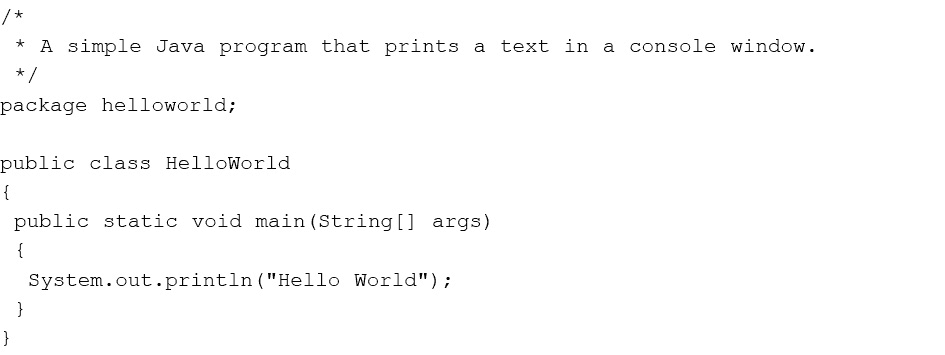

现在只剩了一个注释，位于顶部，说明了程序的功能。代码的其他部分都是 `Java` 语句。`Java` 程序由类（classes）组成，在这种情况下有一个名为 `HelloWorld` 的类，因此它的名称就是我选择的项目名称。该类包含一个名为 `main()` 的 `method`（方法），它包含一条语句——这不是由 `NetBeans` 创建的，而是我输入的。这是一条在屏幕上打印文本的语句。

代码非常简单，到目前为止你只需要接受它应该像上面那样被写，但有几点你需要注意。

`Java` 是区分大小大小的，因此在任何地方你必须区分大写字母和小写字母。

正如前面提到的，每个 `Java` 程序至少包含一个名为 `HelloWorld` 的类。一个类由 `variables`（变量）和 `methods`（方法）组成。在这种情况下，该类只有一个名为 `main()` 的方法，它是程序启动时调用的方法。方法由语句组成，这些语句可以被视为在机器上执行某些操作的命令。调用一个方法意味着执行该方法中的语句。注意，方法 `main()` 必须以 `public static void` 作为前缀。后面将进行解释。在这种情况下，`main()` 只有一条语句，即在屏幕上写入文本。`System.out.println()` 实际上是 `PrintStream` 类中的一个方法，它等其他代表代表屏幕。当程序运行时，只有执行 `main()` 中的 `println()` 语句，才会在屏幕上打印文本。

注意在 `Java` 中，每条语句都以分号（`;`）结束——上面 `System.out.println()` 之后有一个分号。它告诉编译器语句何处结束。

在 `Java` 中，类被分组在所谓的包（packages）中。一个类的全名由该类所属的包以及类名组成。`NetBeans` 会自动为程序定义一个包，包名是小写的应用程序名称，第一条语句是包语句，指示类所属的包。包语句必须是包含类的文件的第一条语句，但可以以前注释作为开头。注意在 `Java` 中，你通常必须将每个类放在它自己的文件中，关于这一点稍后会介绍。

## 2.3 运行程序

当程序像上面那样编写好（无错误）后，你可以从 `NetBeans` 菜单中选择：


`NetBeans` 会自动翻译程序，如果没有错误，程序将被执行：

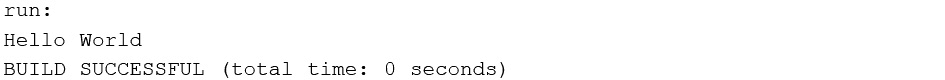

如果程序包含错误，结果可能是：

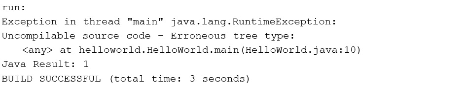

程序将不会执行，翻译器会提供错误信息，在尝试再次运行程序之前必须纠正错误。

## 2.4 NetBeans 项目

如果你打开 `Files`（文件），你可以像下面所示找到 `class` 文件，它是翻译后的程序：

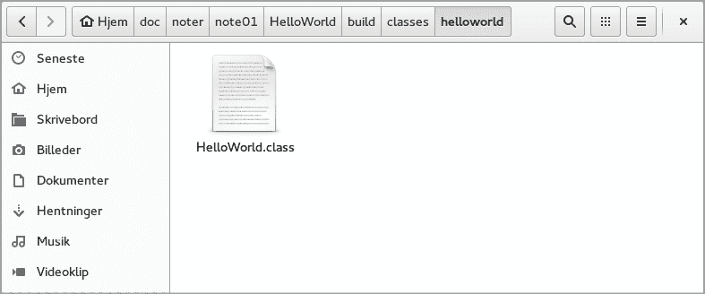

`HelloWorld.class` 是一个可以在特定机器上运行的完整 `Java` 程序的示例。显然，该程序与 `NetBeans` 紧密结合并使用 `NetBeans` 执行，但事实并非如此。在 `NetBeans` 菜单中选择：


程序会被再次翻译，如果你打开 `Files`，你会发现创建了另一个名为 `dist` 的文件夹，其中包含两个文件（见下文）。这里是 `HelloWorld.jar`，一个包（实际上是一个压缩的 zip 文件），包含了程序文件——只有翻译后的类文件以及程序运行所需的其他辅助文件。在这种情况下，实际上只有两个。

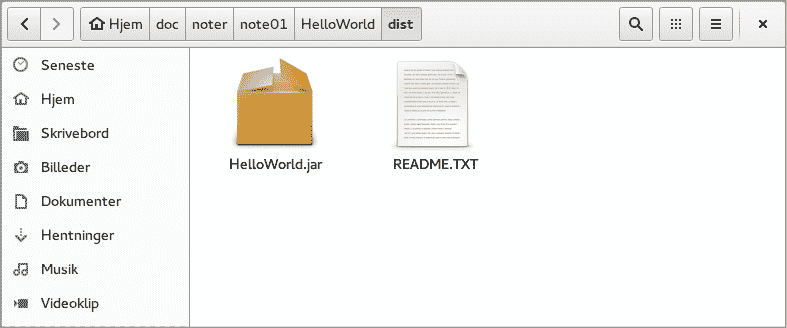

如果你将 `HelloWorld.jar` 文件复制到一个文件夹——例如 `temp`——并打开一个 `Terminal`（终端），进入该文件夹并执行以下命令：


程序将被执行：

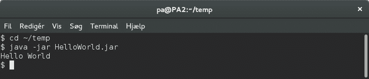

这里的命令 `java` 是给 `Linux` 启动 `Java runtime system`（Java 运行时）并执行程序 `HelloWorld` 的消息。

## 2.5 gedit

上面我使用 `NetBeans` 编写并执行了一个 `Java` 程序，以后所有的程序将以这种方式开发。`NetBeans` 是一个大型且复杂的程序，到目前为止你只看到了该程序功能的一小部分。该程序非常友好，到目前为止你只看到了它功能的一小部分。

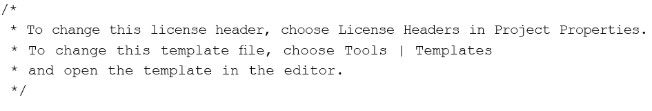

这是 `NetBeans` 在新源文件开头插入的注释。另一种类型的注释以字符 `/**` 开头并以 `*/` 结束，例如：

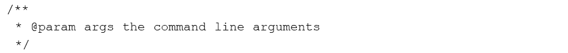

同样，起始和结束字符组合之间的所有内容注释，但可以插入特殊的符号，这些符号会被工具用来生成程序代码的 HTML 文档，关于这一点稍后会说。最后一种注释的形式如下：

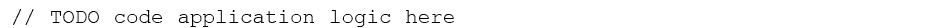

这种注释可以插入到任何地方，`//` 字符之后到行尾的所有内容都被视为注释。

这是在代码中插入注释的语法，但你应该写什么是另一回事。我稍后还会回到这个问题，但通常你必须写下你认为在以后阅读代码时可能有价值的内容。这些内容显然不是独有的，观察别人在程序中插入的注释是一个很好的启发。

## 2.7 示例：Kings

示例是一个名为 `Kings` 的程序，原则上，它的编写方式与 `HelloWorld` 相同，但程序打印以下文本：

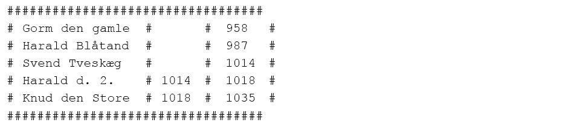

最终代码所示：


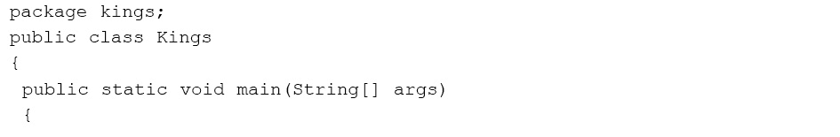
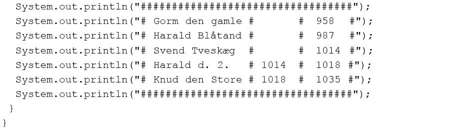

与`HelloWorld`的唯一区别是这次有多个`System.out.println()`语句。

### 练习 1

编写一个可以命名为`Digits`的程序，在屏幕上打印以下表格：

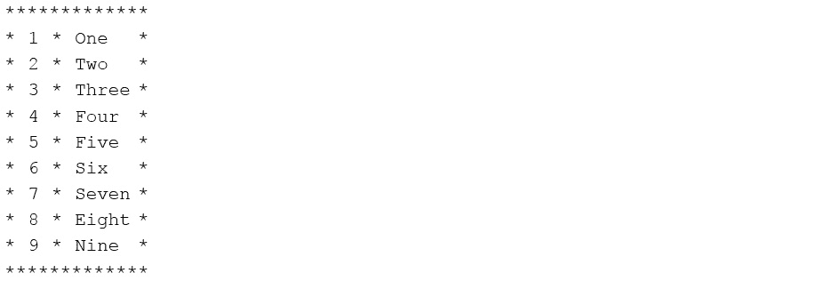

### 练习 2

编写一个可以命名为`Label`的程序，打印你的名字、地址和电子邮件地址，例如：


# 3 命令和控制台程序

在上一节中，我将程序分为三类，在本章中，我将介绍命令和控制台程序。原则上没有太大区别，分类仅取决于用户如何将数据传递给程序。`HelloWorld`和上一节的示例`Kings`都是命令的示例。

## 3.1 命令

每个 Java 程序必须有一个具有以下签名的`main()`方法：


目前，你应该忽略`public`、`static`和`void`单词的含义，只需接受它们应该出现在那里即可，但`main()`方法是程序启动的地方。方法名后面是括号内的参数，表示可以传递到程序的命令行参数。考虑以下程序：

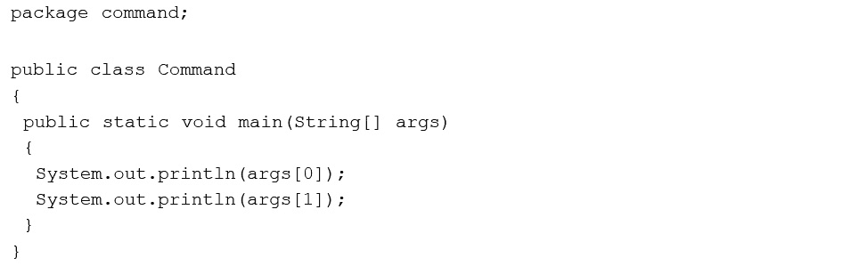

`args`是一个数组（正如我稍后解释的那样），但在命令行传递的参数在程序中被称为：

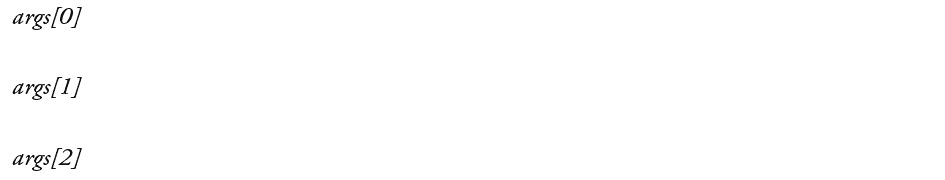

依此类推。参数是一个文本字符串，参数之间用空格分隔。例如，如果你将`Command.jar`文件复制到`temp`文件夹，可以如下方式执行程序：

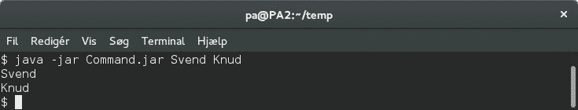

有两个参数，分别称为`Svend`和`Knud`，程序在屏幕上打印这两个参数。如果你以以下方式执行程序：

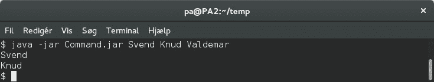

结果是相同的。这次有三个参数，但程序只使用了前两个。然而，如果应用程序在没有两个参数的情况下运行，你将得到一个错误：

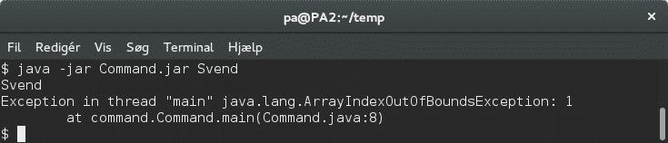

原因是第二个参数不存在，因此语句失败：

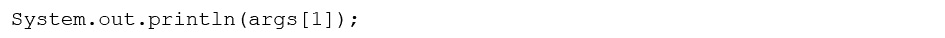

该示例展示了我所理解的“命令”。另一个问题是当你必须传递参数时，如何在 NetBeans 中测试应用程序。可以通过菜单选择：

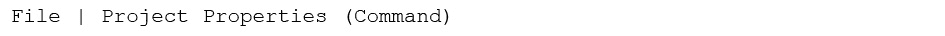

在这里你必须选择`Run`类别，你可以在此处输入参数：

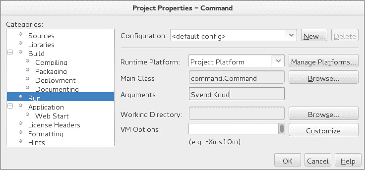

注意如果参数包含空格，则需要用引号指定。

## 3.2 示例：PrintAddress

以下程序将打印一个人的名字和地址，但要打印的值是通过命令行传递的。因此，该程序是一个命令。程序名为`PrintAddress`，必须在命令行传递四个参数。命令行参数用空格分隔，如果参数包含空格，则需要用引号指定。运行程序的示例如下：

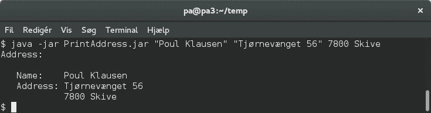

我在 NetBeans 中创建一个名为`PrintAddress`的项目。代码可以写作：

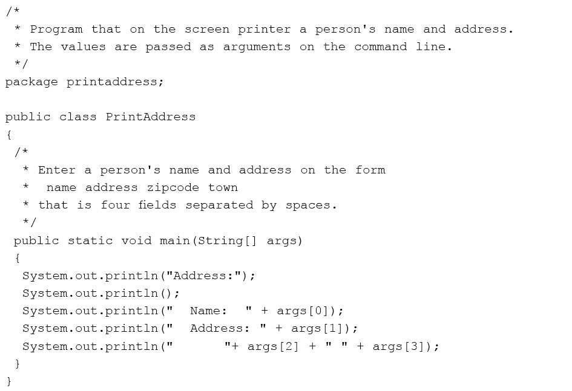

```java
public class PrintAddress {
    public static void main(String[] args) {
        System.out.println("Name: " + args[0]);
        System.out.println("Address: " + args[1]);
        System.out.println("City: " + args[2]);
        System.out.println("Email: " + args[3]);
    }
}
```

## 3.3 控制台程序

与命令相比，控制台程序（在本书中）是指一种与用户进行交互的程序，用户必须输入数据。

上面我展示了一个程序，当值作为命令行参数传递时，它会打印一个人的名字和地址。下面是同一个程序但这次用户必须在运行程序期间输入值。因此，它与用户交互。

在这里，用户输入的文本存储在变量`name`中。接下来的语句在原理上是相同的，用于输入其他值。最后几个语句用于打印结果，原理上与程序的之前的版本相似，但参数`args[0]`、`args[1]`等……被替换为了变量。如果你运行程序（通过 NetBeans），结果可能如下所示：


今天很少有——如果说有的话——开发控制台应用程序了，而当需要一个具有用户对话框的程序时（这当然很常见），你会编写一个 Windows 或 GUI 程序。然而，对于测试和学习来说，控制台程序可能是很有用的，因此了解如何编写简单的控制台程序是非常极好的。

### 问题 2

你必须解决与问题 1 相同的任务，但不是通过命令行参数传递值，而是你必须输入以下信息：

* 借款人姓名
* 借款人地址
* 借款人邮编和城市
* 图书的 ISBN
* 书名

当程序运行时与用户进行对话时。程序应该打印出与问题 1 相同的输出。

# 4 变量和数据类型

程序必须处理数据，为了这一点，它们需要一种保存或存储数据的方法。为了此目的，程序使用变量作为程序可以在其中存储值的项。你必须注意我已经使用了与数据输入相关的变量。变量的特征是：

* 名称
* 类型
* 运算符

变量必须有其名称，以便你可以在程序中引用它们。Java 在变量命名方面与其他现代编程语言类似，相对灵活，但必须（应该）满足以下条件：

* 变量名必须以字母、美元符号`$`或下划线`_`开头
* 变量名应该始终以小字母开头，人应该避免`$`并仅偶尔使用`_`
* 之后可以跟随任意数量由字母、数字、`$`和`_`组成的字符
* 名称不能包含空格
* 变量名不能是保留字，即在 Java 中具有特定含义的单词

此外，变量名应该能说明它的用途。应使用完整的单词而不是晦涩的缩写。这将使代码更易读和理解。如果你有由几个单词组成的长名称，可以通过让单词（第一个除外）大写字母开头来提高可读性，例如`customerAddress`。或者，是否有人写`customer_address`，但通常要避免非常长的名称。

如果不违反这些规则，你在变量命名上就不会有问题，但实际上某些其他字符是允许的。

变量有一种类型，指示其中可以存储哪些值，以及变量占据机器内存的多少空间。该类型同时决定了可以在变量上执行的操作，即对它做什么。

变量在使用之前必须创建或声明。这是通过如下形式的语句实现的：

```
type name = value;
```

也就是说，先写类型，然后是变量名，最后给它赋值，例如：

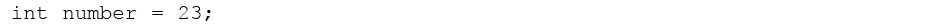

这里声明了一个名为`number`的变量，其类型为`int`，值为 23。变量应该始终初始化，否则你可能会得到编译错误。

变量必须声明时，是因为编译器必须在机器内存中分配空间，并且当名称在代码某处出现时，编译器必须知道该名称的含义，以检查变量是否在正确的语文中被使用。如果没有，编译器将产生错误信息。程序只有在无错误编译的情况下才能使用。

Java 有以下内置的原始类型或简单数据类型：

* `byte`，一种整数数据类型。变量占据 8 位，可以包含从 -128 到 127 的值（均包含边界）。
* `short`，一种整数数据类型。变量占用 16 位，可以包含从 -32,768 到 32,767 的值（均包含边界）。
* `int`，一种整数数据类型。变量占据 32 位，可以包含从 -2147483648 到 2147483647 的值（均包含边界）。它是整数的默认类型。
* `long`，一种整数数据类型。变量占据 64 位，可以包含从 -9,223,372,036,854,775,808 到 9223372036854775807 的值（均包含边界）。
* `float`，一种浮点数数据类型，因此可以用于小数。变量占据 32 位，可以表示具有 7–8 位有效数字的数字。重要的是，值始终是舍入后的结果。
* `double`，一种浮点数数据类型，因此可以用于小数。变量占据 64 位，可以表示具有 14 位有效数字的数字。重要的是，值始终是舍入后的结果。这种类型是浮点数的默认类型。
* `boolean`，用于两个值的数据类型：`false`或`true`。
* `char`，用于字符，占用 16 位。值的范围从 0 到 65535（均包含边界）。

数字设备上使用的最小单位是`bit`，整个计算机由 0 和 1 组成。在实践中，你不能直接引用位，但它们以 8 位为一组进行组织，这样的组被称为`byte`。

以以下程序作为示例，这是一个在命令行执行的命令，带有三个必须是整数的参数，程序将打印这三个数字的和：

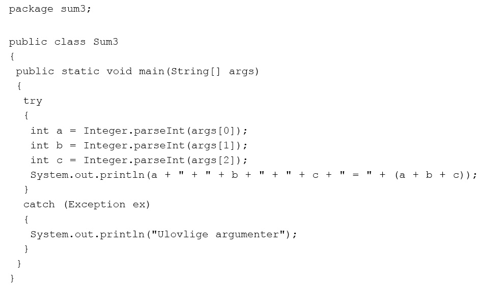

如果你使用参数 13, 17 和 19 运行程序，结果将是：


命令的参数或输入控制台应用的数据类型始终为`String`，它们不能直接用于计算。必须先将这些值（即文本）转换为数值。例如，可以通过以下方式完成：

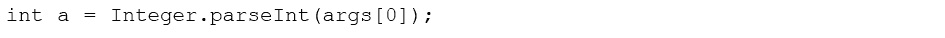

在这里，`args[0]`的值将被转换为一个整数——一个`int`类型——并存储在变量`a`中。为了实现这一点，`args[0]`必须包含一个合法的整数。如果不是（因为用户指定了非法值），则转换将抛出异常，这意味着转换将因错误中断。当你有可能会抛出异常的代码时，必须将其放在`try`块中。如果是这样并且发生了异常，运行时系统会中断`try`块，并将控制权转移到后续的`catch`块。在这种情况下，这意味着三个参数之一不能转换为`int`，程序将跳转到`catch`部分并打印错误信息。

如果三个参数都能正确转换，结果将如下所示：


这是一个相对复杂的表达式，可能并不容易阅读，但为了理解这个表达式，最好的方法是与结果对比：


数字 13, 17 和 19 是变量`a`、`b`和`c`的值。引号中的`+`符号只是文本，并作为字符串包含在结果中。例如，如果你考虑：


`+`符号意味着变量`a`的值与文本`" + "`的值的字符串拼接，这是一个两边都有空格的`+`符号。结果表达式中的最后一个括号：

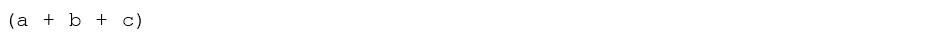

计算三个变量之和，并得出值 49。

### 练习 3

你应该编写一个与上面类似的程序，但必须有以下区别：

1. 程序应该计算四个数字之和，而不是三个数字。
2. 这次数字应该通过输入（在对话框中）输入，而不是作为命令行参数传递——因此它必须是一个控制台程序。
3. 这次数字应该是小数，而不是整数——即类型必须是`double`。

上面显示了如何使用`Integer.parseInt()`方法将文本转换为`int`。要将文本转换为`double`，你可以相应地应用`Double.parseDouble()`方法。

程序的示例可以是：

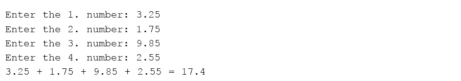

特别注意，小数点是点（dot）。

## 4.1 运算符

运算符是编译器已知的特殊符号，它们对一个、两个或三个操作数（通常是值或变量）执行特定的操作。上面我已经使用了`+`运算符，它作为字符串之间的运算符起着字符串拼接的作用，而数字之间的运算符则被解释为加法。此外，在给变量赋值的声明中，等号也是一个运算符。

运算符具有不同的优先级，这会影响如果表达式包含多个运算符时的求值顺序，下表显示了 Java 运算符按优先级从高到低排序的。如果表达式包含多个运算符，优先级最高的运算符先求值。相同优先级的运算符从左到右求值。这不适用于赋值运算符，赋值运算符是从右到左求值的。

| 优先级 | 运算符 |
| --- | --- |
| 后置 | `expr++` `expr--` |
| 一元 | `++expr` `--expr` `+expr` `-expr` `~` `!` |
| 乘法 | `*` `/` `%` |
| 加法 | `+` `-` |
| 移位 | `<<` `>>` `>>>` |
| 关系 | `<` `>` `<=` `>=` `instanceof` |
| 比较 | `==` `!=` |
| 按位与 | `&` |
| 按位异或 | `^` |
| 按位或 | `|` |
| 逻辑与 | `&&` |
| 逻辑或 | `||` |
| 问运算符 | `? :` |
| 赋值 | `=` `+=` `-=` `*=` `/=` `%=` `&=` `^=` `|=` `<<=` `>>=` `>>>>=` |

许多这些运算符不需要特殊解释，而其他的我稍后会处理，但下面是对某些运算符的说明。

### 赋值运算符

首先注意赋值是一个运算符，例如：

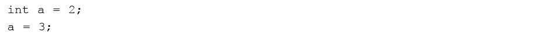

它是常用的运算符。

### 算术运算符

乘法和加法运算符通常统称为算术运算。此外，还有模运算符，它与除法密切相关。所有运算符都有两个操作数。如果操作数是整数，结果也是整数。模是取余数，并且像：

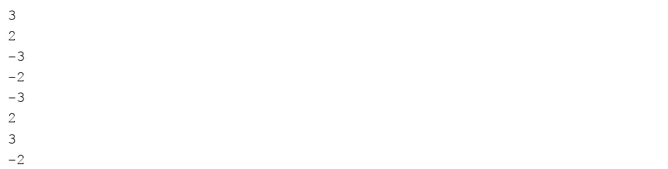

23 除以 7 得到余数。以下语句：

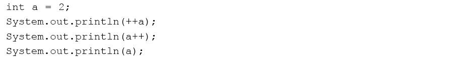

这里的符号并不明显，但对于两个整数`a`和`b`：


`(a / b)`意味着`a / b`并丢弃任何小数。从这个公式可以很容易得出上面的结果是正确的。模运算符也可以用于浮点数，公式是相同的，但结果在这种情况下不具有特殊意义。算术运算符可以与赋值运算符结合。例如：


等同于：


虽然它不是算术运算符，但应该注意`+`也用于字符串，例如意味着变量`s`的值为`HelloWorld`。这意味着如果至少一个操作数的类型是`String`，那么运算符`+`就意味着字符串拼接而不是加法。

### 一元运算符

有一组只接受一个操作数的运算符，它包括符号、取反以及两个特殊的`++`和`--`运算符。最后还有一个按位取反运算符，我在这里不会提到。这些运算符的一个共同特征是它们是优先级最高的运算符。考虑以下语句作为示例：


执行后，你会得到结果：


变量`a`的值为 2。执行`++a`，意味着变量的值加了 1，之后打印该值。因此，结果为 3（变量`a`的值为 3）。接着执行`a++`，这意味着会打印`a`的值，然后变量`a`再加 1。因此，该语句打印的是 3，但在语句执行后，`a`的值变为 4。这显示了最后一个`println()`语句。`--`操作符的工作原理类似，但将变量的值减了 1。

关于取反，你可以考虑以下语句：

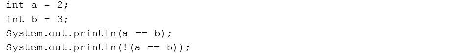

如果执行这些语句，你得到：

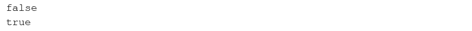

`a == b`是一个条件，第一个`System.out.println()`语句打印该条件的值，结果为`false`。下一个语句打印该条件的取反，结果为`true`。你应该注意条件`!(a == b)`中的括号。它们是必要的，因为`!`的优先级高于`==`。

### 条件的运算符

它包括关系操作符、比较操作符和逻辑操作符。通常，这些操作符不是大挑战，但你应该注意逻辑操作符。考虑以下语句：

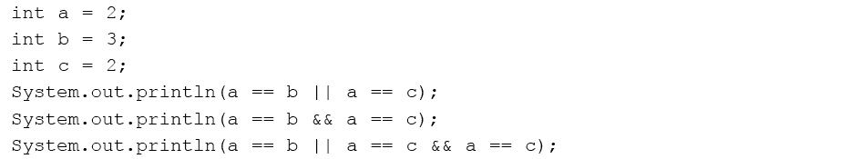

它打印：

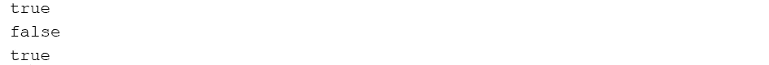

这并不奇怪，但请注意最后一条，由于优先级的原因，`&&`操作符在`||`之前执行。

### 三元运算符

作为最后一个操作符，我将提到三元运算符，它是唯一一个接受三个参数的操作符。它的形式为：

`condition ? arg1 : arg2;`

这里`arg1`和`arg2`是相同类型的表达式，如果`condition`为`true`，则操作符的结果为`arg1`，否则值为`arg2`。考虑以下语句：

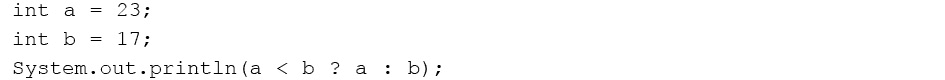

它们打印：


首先，`println()`语句评估条件：


因为它是`false`，该语句打印`b`的值，即两个数字`a`和`b`中的较小值。

### 练习 4

尝试确定以下语句打印的内容——使用纸笔和笔，并且不要编写类似的程序：

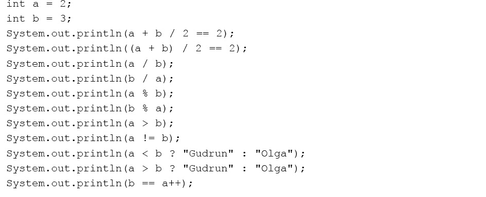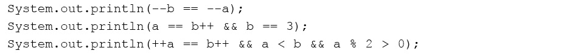

完成后，你可以通过编写一个带有上述语句的`main()`方法的程序来检查结果。

### 练习 5

编写一个程序，用户必须输入两个整数。该程序应该打印：

- 数字之和
- 数字之差
- 数字之积
- 数字之商
- 数字之模

结果可能如下：

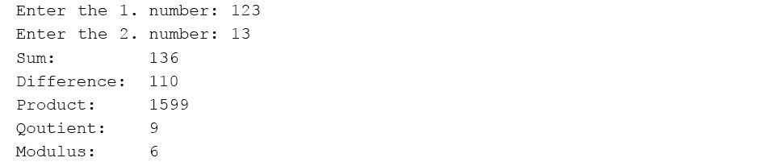

## 4.2 字面量

基本数据类型是内置在语言中的，基本数据类型的变量可以使用字面量进行赋值，例如：

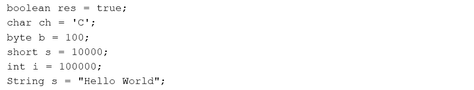

其中最后一个例子显示了一个字面量，但不是基本数据类型的。

定义字面量有一些语法规则，以下是最重要的。

### 整数字面量

通常，你使用数字 0–9 来指定一个整数，因此是一个来自 10 进制的数字。如果整数以字母`L`或`l`结尾，则它被解释为`long`。否则，类型为`int`。建议使用大写的`L`，因为小写的`l`很难与数字 1 区分。你还可以通过以`0x`开头来指定该整数应解释为十六进制，符号是数字和字母 A、B、C、D、E 和 F。最后，你可以通过以`0b`开头接符号 0 和 1 来指定该整数应解释为二进制。

示例如下，其中第一个语句将字面量定义为`long`，后三个语句都定义了一个值为 26 的`int`：

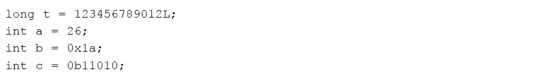

### 定义浮点数的字面量

如果浮点数或小数以字母`F`或`f`结尾，则被解释为`float`类型。否则，其类型为`double`，也可以用字母`D`或`d`显式设置。你还可以用字母指定指数。

### 定义字符和字符串的字面量

`char`和`String`类型可以包含任何 Unicode（UTF-16）字符，`char`使用单引号，`String`使用双引号：


Java 还支持用于特殊字符的转义序列：

- `\b`退格
- `\t`制表符
- `\n`换行
- `\f`分页符
- `\r`回车
- `\"`双引号
- `\\`反斜杠

考虑以下示例：


如果完成，你得到：


### 数字字面量中使用下划线

关于字面量的最后说明，我将提到在数字中使用`_`。例如，这样写是合法的：

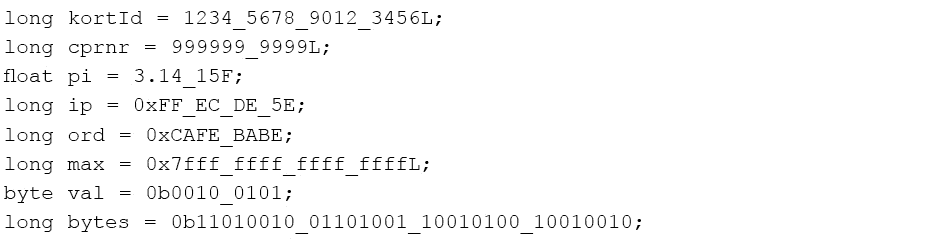

并且所有的`_`实例都会被忽略。其目的仅是增强大数字的可读性。有一些限制：

- 数字不能以字符`_`开头或结尾
- 字符`_`不能位于浮点数的小数点旁
- 字符`_`不能位于`F`或`L`之前

## 4.3 对象

Java 是一种面向对象的编程语言，在编写某些有趣的程序之前，你需要了解一些基本概念，以下是对对象、类、继承、接口和包的总体介绍，我将主要关注这些概念如何联系现实世界，同时提供 Java 语法的基础介绍。

对象是具有状态和行为的软件模块。软件对象通常用于建模现实世界对象。本节将解释表示状态和行为的对象，并引入数据封装的概念。重要的是解释以这种协作对象家族的方式设计软件的优势。

对象是理解面向对象技术的关键。环顾四周，你会发现许多现实世界对象的例子。它可以是桌子、你的妻子、某个特定的同事、客户、你的电视机、你的汽车等等。这些对象具有两个特征：它们都有状态和行为。客户有名字、地址、电话号码、余额。这是客户的状态。客户可以订单产品、可以退货、可以支付产品费用。这是客户的行为。

软件对象是概念性的，但看起来像真实世界中的对象。它们也拥有状态和相关的行为。对象在变量或字段中存储其状态，并通过方法执行其行为。作用于对象内部状态的方法是对象与对象之间通信的主要机制。隐藏对象的内部状态并要求所有交互必须通过对象的方法进行，这被称为数据封装，它是面向对象编程的一个基本原则。通过数据封装，由对象本身来控制其状态如何发生变化，因为是该对象通过其方法决定了外部世界可以对它做什么。

上面我已经处理了 Java 中的变量，但变量可以是多种形式，基本上有以下几种情况：

1. **实例变量**（非静态字段），对象用它们来存储自己的状态。类中定义为非静态的所有变量都是实例变量，该类的每个对象都有自己的实例变量，因为一个特定对象的状态独立于所有其他对象的状态，即使它们是同一类的对象。
2. **类变量**（静态字段）是定义为`static`的变量。除此之外，它们的创建方式与实例变量相同，但这些变量只会被创建一个副本，特定类的所有对象将共享所有的类变量。因此，静态变量设计用于存储类所有对象共同使用的值。
3. **局部变量**在原则上的创建方式与实例变量相同，但它们是在方法中创建的，并且仅该方法已知。我在上面使用的所有变量都是局部变量。它们通常用于存储方法完成其工作所需的所需的临时值。实例变量和类变量如果没有被程序员初始化，则有一个默认值。相比之下，局部变量必须用一个值进行初始化。局部变量在定义它的方法被调用时创建，当方法完成后，变量就会被自动删除。
4. **参数**是你在方法名后的括号中指定的变量。参数看起来有点像局部变量，但它们用于在调用方法时将值传递给方法。因此，可以将参数看作定义了方法应该操作的值的变量。`main()`有一个名为`args`的参数，用于从命令行将参数传递给程序。

将程序代码构建为一组软件对象提供了许多优势：

- **模块化**，其中一个对象的代码可以独立于其他对象的代码进行编写和维护。
- **信息隐藏**，其中与对象的所有交互都通过其方法进行。关于对象状态和内部实现的细节对外部世界保持隐藏。
- **代码复用**，其中已经开发的对象（可能由另一个软件人员编写）可以在当前程序中使用。它允许由专家进行对象的开发和测试，你可以信任它们并在自己的程序中使用它们。
- **可修改性**，其中如果由于原因发现某个对象不合适，可以在不影响程序其他部分的情况下用另一个替换。

在现实世界中，你经常会遇到许多相似且相同的个体对象。有成千上万辆汽车，它们是相同的型号，构造方式完全相同，且具有相同的组件。在面向对象的世界里，我们说某个特定的汽车是特定型号`cars`类的一个实例。类是对特定汽车如何行为的描述。

我们在软件方面也使用相同的原理。假设一个程序需要钞票对象。钞票的特征是一个值，这是钞票的状态，你对钞票唯一做的就是读取它的值并知道钞票的样子，以便将其与其他钞票区分开。因此，你可以这样定义钞票的概念：

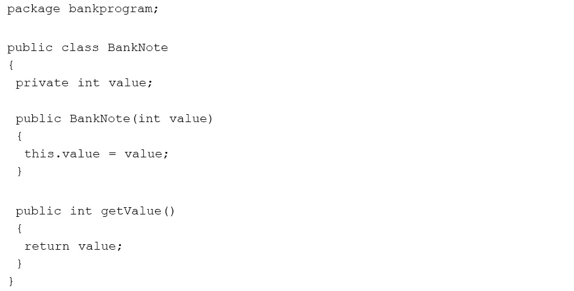

这是一个 Java `class` 的示例，这里它的名为`BankNote`。正如提到的，一张具体的钞票有一个值，即钞票的状态，这个值必须存储在某处。为此，类定义了一个名为`value`的变量。变量有一个类型，这里是`int`，意味着该变量可以包含一个整数。变量`value`是实例变量的示例。该变量被定义为`private`，这意味着它只能从类本身引用，这就是我所说的数据封装。类应该用于某些用途，你应该能够读取钞票的值。该类有一个名为`getValue()`的方法，它的值是钞票的值，即变量`value`的值。这个方法定义了对象的行为。注意该方法有一个类型，这里是`int`。我们说该方法返回一个值。类还有另一个与类名相同的方法。它是一个特殊方法，不定义对象的行为，而是用于在创建新对象时初始化对象的状态。这种方法被称为构造函数（constructor）。

你应该注意，该类没有`main()`方法，因为类不是程序，而仅仅定义可以被任何应用程序使用的概念。

有了`BankNote`类，程序就可以创建`BankNote`对象并对其进行某些操作。下面是一个创建两个`BankNote`对象的程序的`main()`方法。第一个的值值为 100，而下一个的值为 200：

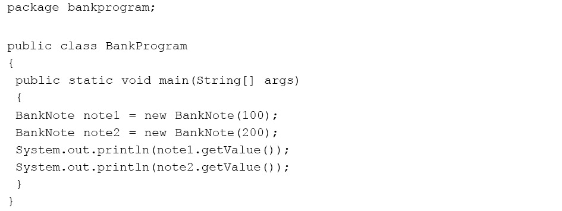

你需要特别注意如何创建一个对象。对象有一个名称，例如`note1`，这是一个变量。对象还有一个类型，这里是`BankNote`，当类型是一个类而不是基本类型时，必须使用`new`运算符创建对象。在这里你指定了钞票的值，这意味着类的构造函数被执行并将值传递给对象的实例变量`value`。如果执行`main()`方法，它将打印两个`BankNote`对象的值。为了实现这一点，你必须引用`BankNote`对象的值。由于数据封装，这是不可行的，但`BankNote`对象有一个`getValue()`方法的行为，所以你可以引用该值。

### 继承

不同类型的对象通常具有许多共同的特征。如果你考虑钞票，它们都有值，但在外观上有所不同。它们有不同的颜色，显示不同的图案。在面向对象编程中，类可以相互继承。这意味着你可以将共同属性收集在基类中，而将差异可以放在派生类中。下面是一个代表钞票的类，其值为 100（一张丹麦钞票）：

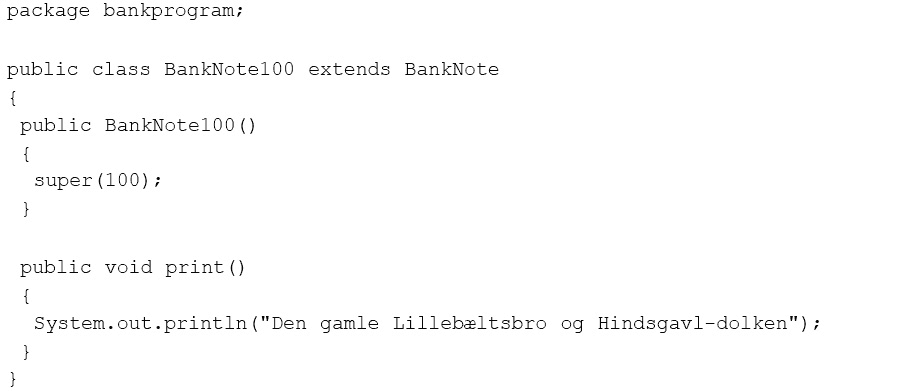

该类名为`BankNote100`，在类名之后你使用单词`extends`定义该类继承`BankNote`类。这意味着该类继承了`BankNote`的所有属性，并扩展了新的属性。在这种情况下，`BankNote100`扩展了`BankNote`并增加了一个`print()`方法来模拟钞票的样子。`BankNote`类有一个构造函数初始化变量`value`。`BankNote100`也必须初始化这个变量（值为 100）。这在类的构造函数通过`super(100)`实现，这意味着基类的构造函数被执行了。

很明显，你以同样的方式编写了一个类`BankNote200`，表示面值为 200 的钞票。

有了这些类后，你可以编写以下`main()`方法：

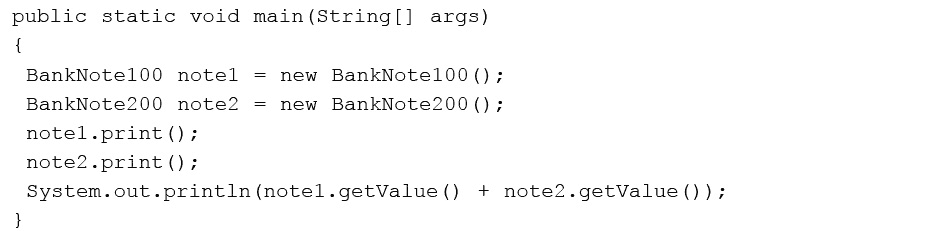

在这里，你分别创建了类型为`BankNote100`和`BankNote200`的两个对象。接着调用了对象的`print()`方法。注意语法，以及如何使用点运算符在对象上执行方法。最后一条语句打印了两个对象值的和。在这里，你应该注意方法`getValue()`的使用。它定义在类`BankNote`中，但被继承到了`BankNote100`和`BankNote200`类中。

我们通常按照如下方式说明继承：

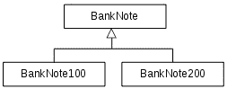

在这种语境下，基类`BankNote`也称为`superclass`（超类），而派生类`BankNote100`和`BankNote200`被称为`subclasses`（子类）。有时我们也说`BankNote`是`BankNote100`和`BankNote200`的泛化（generalization），而这些类被称为`BankNote`的特化（specializations）。

### 接口

对象的属性通过类定义的`public`方法对外部世界可见，并作为服务可用。方法构成了对象与外部世界的接口。为了定义对象的特征，你可以使用接口（interface），它定义了特定类对象的方法。例如，你可以如下定义一张钞票：

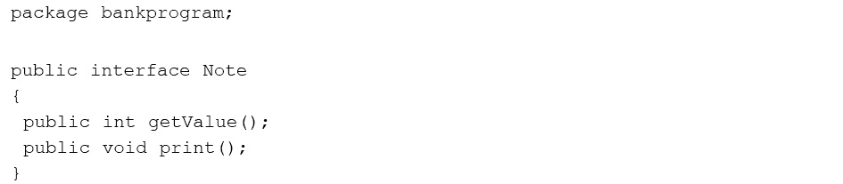

它看起来像是类的定义，但你应该注意到它仅仅是一个定义，而且接口不包含实现某些功能代码。

给定一个接口，你可以定义一个类必须实现该接口。因此，你指定了该类拥有接口定义的方法。例如，`BankNote`类可以如下所示实现接口`Note`：

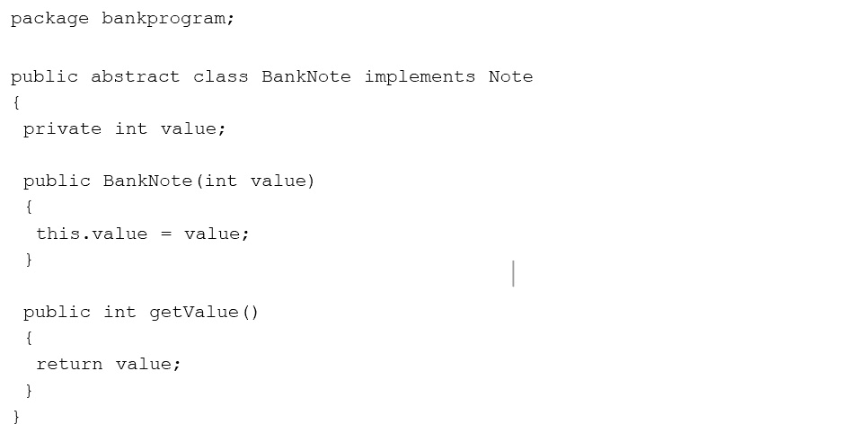

首先注意`implements`单词，它定义了该类实现了一个接口。这意味着该类应该有两个方法`getValue()`和`print()`——它必须实现接口定义的方法。现在并不是这样，因为它没有实现`print()`方法。它无法这样做，因为它不知道该方法应该如何编写。拥有这些知识的是派生类`BankNote100`和`BankNote200`。这个问题通过将类定义为`abstract`（抽象的）得到了解决。然后该方法必须在派生类中实现，而事实也确实如此。一个类是`abstract`导致了进一步的结果：你不能实例化类型为抽象类的对象——在本例中为`BankNote`。这也是合理的，否则你就可以实例化任意值的钞票，这并不能以有意义的方式对现实世界进行建模。以下是`main()`程序的新版本：

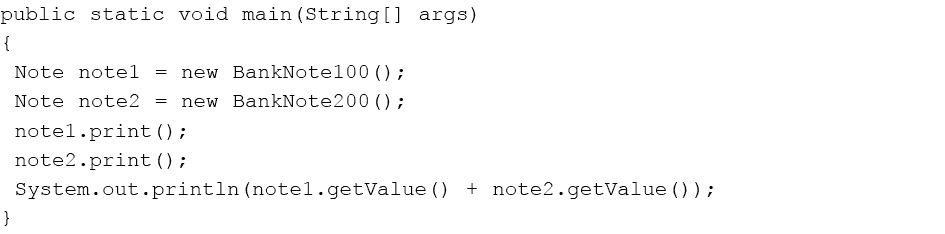


这里再次创建两个对象，分别是一个`BankNote100`对象和一个`BankNote200`对象，但它们的类型是`Note`。`BankNote100`特别是一个`BankNote`，而它又是一个`Note`。这意味着在程序的其余部分，仅从定义的接口就已知这两个对象，而在程序的其余部分，这些对象提供了`getValue()`和`print()`两个服务。

从上述内容，接口的优势并不显而易见，这一点稍后会变得清晰，但解释在于：程序中的`note1`和`note2`仅从定义的接口已知，这意味着这两个对象被视为是同等的，而与它们的具体类型无关。

项目`BankProgram`实现了上述的类和接口。

## 包（Packages）

包（package）是一种命名空间，用于组织一组相关的类和接口。从概念上说，你可以将包想象成文件夹，包包含以某种方式归在一起的类。由于用 Java 编写的程序可能由数百或数千个独立类组成，因此将相关的类和接口放在包中以保持它们分离是有意义的。

当 NetBeans 创建项目时，它也会创建一个包，并将项目的类和接口放在该包中，例如


这意味着接口在`bankprogram`包中。只要项目只包含一个包，你就不需要考虑它，但它恰意味着类型`Note`的名称是


`package`语句定义了类型所属的包。它必须是定义类型文件的第一条语句，但前面可以跟一个注释。

Java 平台包含一个巨大的库（包的集合），其中包含了程序员可以在自己的应用程序中使用的组件。这个库被称为`Application Programming Interface`（应用程序编程接口），通常缩写为`API`。它的包代表了与程序开发中通用问题最相关的任务，例如用于开发具有图形用户界面应用程序的包。

要引用包以外的其他类，必须使用`import`语句引用包。以下语句


打印文本，`System`实际上是`java.lang`包中的一个类名。这个包包含了所有常用的类，以及默认类。

## 练习 6

创建`BankProgram`项目的副本。在`BankNote100`类中，你应该如下修改`print()`方法：


测试程序并注意两个语句的文本在同一行。

同样地修改`BankNote200`类中的`print()`方法。

编写三个类`BankNote50`、`BankNote500`和`BankNote1000`，表示面值为 50、500 和 1000 的钞票。这三个类与`BankNote100`和`BankNote200`相似，但值不同，`print()`中的文本也不同。这些类代表丹麦钞票，票面分别为

1. Sallingsundbroen og Skaralling

2. Dning Alexandrines bro fra Keldby

3. Storeæltsbroen og Solvognen

在`main()`中，为每种钞票类型创建一个对象。你应该打印这五个对象以及这五个钞票值的和。

## 问题 3

你应该编写一个创建公司员工对象的程序。你应该按照以下步骤解决问题。

1) 在 NetBeans 中创建一个新项目，可以命名为`Employees`。在项目中添加以下接口：

[](image/Java_1_-_Basic_syntax_and_semantics_23-3-17_61.jpg)

该接口定义了员工，在练习中员工没有其他特征。

2) 添加一个抽象类`AbstractEmployee`，它实现接口`Employee`并代表员工，当

1. 该类应该有两个变量，分别表示名称和月薪

2. 该类应该有一个初始化这两个变量的构造函数

3. 该类应该实现两个方法`getName()`和`getSalary()`

3) 添加一个继承`AbstractEmployee`的类`Bookkeeper`。除了构造函数（必须有两个参数）外，该类必须实现`print()`方法，该方法将打印名称、职位和月薪。结果可以是，例如：


其中名称和月薪是传递给构造函数的值。

4) 添加一个代表清洁工的相应类`Janitor`。该类基本上与上述类完全相同，但`print()`方法的实现方式略有不同，因此结果可能是：


5) 最后，编写一个代表经理的类`Director`。经理的月薪将由约定的月薪和一个作为参数传递给构造函数的月奖组成。因此，该类必须有一个指向该值的变量：


该类还必须实现`getSalary()`方法，尽管它在基类中已经实现过了，但现在它必须以不同的方式运行。它的值应由基类方法的值、变量`bonus`的值组成，该方法可以写如下：


你只需要接受这种语法，但`super`关键字意味着你指的是基类中的`getSalary()`方法。

必须重写`print()`方法，以便结果可能如下所示，但月薪的值不应包含奖金：


6) 最后写一个程序——一个`main()`方法——执行以下操作：

1. 创建一个`Employee`类型的对象，即名为`Gudrun Jensen`的`Bookkeeper`，月薪为 45000。

2. 创建一个`Employee`类型的对象，即名为`Karlo Hansen`的`Janitor`，月薪为 35000。

3. 创建一个`Employee`类型的对象，即名为`Abelone Andersen`的`Director`，月薪为 55000，奖金为 15000。

4. 打印这三个对象。

5. 打印三个员工月薪的总和。

如果你执行该程序，结果应该如下所示：


## 4.4 示例：立方体

我将展示一个代表普通六面立方体的类。该类可以如下所示编写：


该类有两个字段：一个类变量和一个实例变量。类变量名为`rand`，是一个`Random`类型的对象。它是一个随机数生成器，可以生成随机数。它通过读取机器时钟，根据对象创建时时钟的值产生一系列值。由于你无法知道（假设）时钟在任何时刻显示的内容，因此起始时间是随机的，生成的数字序列似乎也是随机的。变量`rand`必须是一个类变量，否则`Cube`类型的对象将拥有自己的随机数生成器，这很容易导致它们用相同的时钟值进行初始化。结果是多个`Cube`对象将创建相同的随机数序列。类的实例变量名为`eyes`，用于跟踪每个`Cube`的值。由于两个`Cube`对象的值并不一定相同，因此此变量必须是实例变量，以便每个对象都有自己的副本。

该类有一个名为`roll()`的方法，模拟你掷骰子的动作。执行该方法时，使用了类变量`rand`。`Random`类有一个名为`nextInt()`的方法，返回一个随机的非负整数。在这种情况下，它是 0, 1, 2, 3, 4 和 5 之一，当加上 1 时，结果是 1 到 6 之间的随机值（均包含在内）。`Random`类定义在`java.util`包中。为了使用该包中的类，需要使用`import`语句。在这里，`*`意味着你可以使用该包中的所有类。

`Cube`类还有一个构造函数。由于变量`eyes`没有初始化，其默认值为 0。这很遗憾，因为这是一个非法值。因此，构造函数会掷骰子，从而确保立方体从开始的值就是合法的。

该类还有两个方法。`getEyes()`是一个返回立方体显示内容的方法。它看起来与你上面相同。然后是`toString()`方法，它以文本形式返回立方体的值。返回语句的语法并不显而易见，但它强制方法以文本形式返回变量`eyes`的值。

该类可以如下在`main()`方法中使用：

```

```

这里你创建了一个名为`arr`的数组，它有容纳 10 个`int`类型元素的空间。数组创建后，所有元素的值均为 0。接下来的 10 条语句为数组中的所有位置赋了值：


如果执行`main()`方法，你将得到结果：


数组的类型可以是任何类型，包括类类型。例如，上面的程序`Cubes`可以写如下所示：


其中`main()`方法创建了一个容纳 2 个`Cube`对象的数组。然而，当数组的类型是类类型时，有一个重要的区别，因为单个元素必须显式地创建。当编写


`main()`创建了一个容纳 2 个`Cube`对象的数组，但这两个位置是空的，这意味着它们的值为`null`，这表示该位置是空的（不引用任何对象）。单个对象必须显式地创建，如程序中以下两条语句所示。

你也可以让编译器从一个值列表创建一个数组：


在这里，编译器将根据列表中元素数量所指示的长度创建数组，并且数组中的元素将用列表中的值进行初始化。

对于`Cube`对象的数组，可以写成：


以下程序创建了一个容纳 5 个`int`类型（整型）的数组，并用随机数初始化元素，然后将这些数字打印在屏幕上：


该程序有一个随机数生成器，并创建了一个容纳 5 个`int`类型元素的数组。接下来，数组被随机整数填充。这是通过一个`for`循环实现的，这是一种我还没有提到的控制结构，但理解它的工作原理很容易。它包含三个部分。第一部分定义了一个初始化为 0 的变量。第二部分是一个条件，用于测试变量`i`的值是否小于数组元素的数量。你必须特别注意如何引用数组的元素数量，如


如果条件为真，则执行`for`语句后面的语句，在这里是：


这意味着数组中的第`i`个元素被赋予了一个值。接下来，执行`for`语句的第三部分，它将变量`i`加 1，然后语句再次测试条件，一切循环往复。由于每次迭代变量`i`都增加 1，数组中的所有位置都会被引用，直到没有为止。`main()`有另一个`for`语句，它的原理上工作方式相同。它逐个位置地遍历数组的所有元素。第一个`for`语句初始化元素，而另一个则打印它们。

作为另一个例子，以下程序定义了一个包含 3 个`String`类型元素的数组并打印了它们：


## 练习 8

在 NetBeans 中创建一个新项目，你可以将其命名为`ArrayDemo`。

添加一个静态方法`test1()`，它创建一个容纳 10 个`double`类型元素的数组。该方法随后应用`double`类型的随机数填充数组，最后打印数组的内容。在`main()`中调用该方法进行测试。

添加另一个方法`test2()`，从一个列表创建一个包含前 5 个大写字母的`char`类型数组。该方法随后应打印数组。在`main()`中测试该方法。

添加一个方法`test3()`，它创建一个容纳 10 个`boolean`类型元素的数组。该方法必须用随机值填充数组并最后打印数组的内容。

编写一个以数组作为参数的方法


该方法应该打印数组的内容，使得所有元素都在同一行内，并用空格隔开。

编写最后一个方法`test4()`，它创建一个容纳 10 个`int`类型元素的数组。该方法必须用随机的 2 位整数填充数组，最后该方法必须使用上述`print()`方法打印数组。

## 4.6 示例：CupProgram

在 4.4 节中，我展示了一个六面体的`Cube`。在本节中，我将展示一个可以表示骰子的类。它是一个容器，可以包含骰子，因此该类可以实现为`Cube`数组。该类必须有一个显示杯内容的方法。相应地，该类可以写如下：


变量`arr`是一个`Cube`数组，但它不是在声明中创建的，而是在构造函数中。构造函数有一个参数，告诉杯必须包含多少个`Cube`对象。你应该注意构造函数必须显式地创建`Cube`对象，这是在一个`for`循环中发生的。


创建一个容纳`n`个`Cube`对象的数组，而不是具体的`Cube`对象。`toss()`方法模拟掷骰子。这是通过使用一个`for`循环遍历数组`arr`中的所有`Cube`对象并调用`roll()`方法来实现的。与其用一个打印杯内容的方法，该类有一个`toString()`方法，以`String`类型返回杯的内容，即各个骰子的值，用空格隔开。

该类有一个`yatzy()`方法，返回`true`或`false`。该方法必须测试所有骰子是否相同，这是通过一个`for`循环遍历骰子，并通过`if`语句测试是否存在与第一个骰子不同的骰子（与第一个骰子的值相同）。在这种情况下，所有的骰子并不相同，方法返回`false`。

整个循环结束后，意味着所有的骰子都与第一个骰子相等，因此所有骰子都相等，方法返回`true`。

`if`也是控制结构的一个例子，将在下一章中进行解释，但它允许在程序中引入一个条件，使得语句仅在条件为真时执行。在这种情况下，该语句是


并且`if`后面有一个括号括起来条件。如果条件为真，这意味着两个骰子的点数不同，执行下一条语句，即返回语句。这意味着方法以`false`值结束。如果条件不为真，则随后的语句被忽略，在这种情况下意味着`for`语句继续执行。

包含`yatzy()`方法是为了用于接下来的示例，该示例使用了`Cup`类，但实际上该类不应该有这样一个方法，而且验证所有骰子是否相同应该以一种方式来解决。问题在于，类必须反映现实世界中的概念，在实践中，你不能问一个杯子“所有的骰子是否相同”，而是必须手动检查每个骰子。像`yatzy()`这样的方法使得`Cup`类变得更加特殊化，在其他语境下就不那么容易使用。

`Cup`类的使用示例是一个程序，它创建了一个包含 5 个骰子的杯子。然后程序模拟了一个游戏，即不断投掷杯子直到所有骰子都相同：


## 4.7 多维数组

上述描述的数组有时被称为一维数组，对应它是一个元素或元素序列，其中元素通过单个索引来标识。你也可以将元素组织在表格中：


在这里，单个元素通过由行索引和列索引组成的索引对来标识。例如，元素 17 被标识为索引 (1, 2) 的元素，即第 1 行第 2 列的元素。在这种情况下，人们称之为二维数组。

你可以继续增加维度，原则上讲可以根据需要增加所有维度，一个 3 维立方体就是一个三维数组，其中单个元素通过三元组 (i, j, k) 来标识。对于维度大于 3 的数组，我们没有直接的视觉表示，但在编程中你可以处理任意高维的数组。然而在实践中，使用维度大于 2 的数组很少见。


Java 不直接支持多维数组，但由于数组可以是任何类型，因此该类型可以是另一个数组。因此，人们可以使用数组的数组来实现一个二维数组。考虑以下方法：


该方法有一个名为`arr`的参数，其类型为`int[][]`。数组被定义为：


而`arr`是类型为`int[]`的数组，即一个元素为`int`类型元素的数组。方法`fill()`中的第一个`for`循环是数组的标准迭代，其中每个元素`arr[i]`都是一个带有`int`类型元素的数组。第二个`for`循环对这些数组中的每一个执行迭代，为每个元素分配一个 0 到 9 之间的随机整数（包含两端）。结果是`fill()`方法用随机整数初始化了一个二维数组。

接着考虑以下`print()`方法，它打印一个二维数组。这是通过使用练习 8 中一维数组的`print()`方法实现的：


参数`arr`是一个二维数组，因此`arr`中的每个元素都是一个普通一维数组。`for`循环将`arr`中的每个元素发送到第一个`print()`方法，该方法将元素（即一维数组）打印为单行，数字之间用空格隔开。

下面是如何创建一个具有 10 行 5 列的二维数组的示例：


你也可以从列表创建一个二维数组：


这创建了一个具有三行四列的数组。这些行的长度不需要相同，如下语句创建了一个具有 10 行的数组，每行的长度都是 1 到 10 之间的随机长度：


### 练习 9

本练习是练习 8 的延续。制作一份练习 8 解决方案的副本，并在 NetBeans 中打开该副本。

实现（即编写代码）上述的`fill()`和`print()`方法。编译项目以确保没有语法错误。

编写一个方法`test5()`，它创建一个元素类型为`int`的二维数组，该数组有 10 行 5 列。接下来，使用`fill()`方法填充数组并使用`print()`方法打印它。在`main()`中测试`test5()`。

编写一个方法`test6()`，它创建一个 4 行 5 列的二维数组。该数组应该从前 20 个质数的列表创建。该方法还必须使用`print()`方法打印数组。

编写一个方法`test7()`，它创建一个元素类型为`int`的二维数组。该数组必须有 5 行，列的长度应为 3, 5。接下来，使用`fill()`方法填充数组并使用`print()`方法打印它。

# 5 程序控制

在本章中，我将处理控制语句，实际上我已经使用了其中的三个：

- `if`
- `do`
- `for`

第一个用于编写条件，而后两个是循环。还有两种控制语句，有了这些可用语句，人们就能编写出执行任务的程序。当我们谈论控制语句时，是因为它们是语句块。通常，语句是按照它们在方法中编写的顺序执行的，但使用控制语句，可以偏离这个顺序，这对于编写能够解决问题的程序通常是必要的。块出现在 Java 的多个地方，例如，方法中的语句就是一个块。块可以被视为整体。

## 5.1 `if`语句

Java 有 9 种控制语句，我已经提到并用了`if`。作为一个示例，你可以编写类似下面的代码：


在`if`单词之后是括号中的条件，它的意思是随后的语句（在这里是一个赋值语句）只有在条件为*true*时才会执行。如果不是，该语句将被忽略。作为另一个示例，下面的代码显示了一个控制块的`if`语句：


块包含三个语句。通常，一个块可以包含任意数量的语句，特别是变量的声明。特别需要注意的是，如果变量在块中声明，那么它只在块内是知的。它是块局部的，并在程序进入定义它的块时创建。在程序退出块时再次被移除。注意，上面的`if`语句在`a`大于`b`时反转了变量`a`和`b`的值。

形式上，`if`语句的语法是：

`if (condition) block`

其中`block`是语句块。如果块只包含一个语句，允许省略块边界`{`和`}`——如上面的第一个示例所示。有些人出于可读性考虑，总是使用`{`和`}`，即使只有一个语句，这取决于你认为哪种方式最符合可读性。条件必须是一个类型为*boolean*的表达式，即一个求值结果为*false*或*true*的表达式。

### `if-else`语句

另一种控制语句被称为`if-else`语句，但它仅仅是`if`语句的扩展。例如，你可以编写以下代码：


它的意思是：如果条件为`true`（真），则执行括号后的语句，否则执行`else`之后的语句。区别在于`if-else`总是会执行某些操作。从形式上讲，它的语法为：

```java
if (condition) block_1 else block_2
```

`if`语句和`if-else`语句也被称为选择（或分支），因为它们使得语句的执行取决于一个条件是否满足。

在实践中，`if`语句和`if-else`语句是最常用的控制语句，很难想象一个不包含这些语句的程序。

### 练习 10

编写一个程序`Sort2`，其中用户必须输入两个整数。然后程序应该按升序打印这两个数字。

程序应按如下所示编写：

在 NetBeans 中创建一个新项目，命名为`Sort2`。然后你必须在主类中添加一个方法，用于输入数字：


然后你必须编写`main()`方法：


完成后，测试程序，以确保它的运行正确。结果例如：


### 问题 4

在这个示例中，你必须编写一个与上面类似的程序，但用户这次必须输入三个数字，然后程序必须按升序打印这三个数字。

三个数字而不是两个数字实际上极大地复杂了问题，但你可以按照以下步骤操作：

创建一个新项目，可以命名为`Sort3`。

你可以复制练习 10 中的输入方法，但应该对该方法进行修改，以便在发生错误（用户输入了非法数字）时，方法打印错误信息并停止程序。

在`main()`中，你可以使用该方法输入三个数字`a`、`b`和`c`。然后你可以使用以下算法对三个数字进行排序：


打印三个数字`a`、`b`和`c`。

下面是该程序的一个示例，我在 NetBeans 中运行了它：


### 问题 5

在学校的数学教育中，你学习求解二次方程，形式如下的方程：


其中`a`不等于 0。为了求解该方程，你必须计算判别式：


现在当`d < 0`时没有解，当`d = 0`时有一个解，该解由公式确定：


如果`d > 0`，则有两个解，由以下公式确定：


现在的任务是编写一个程序，用户必须输入二次方程的系数`a`、`b`和`c`。如果其中一个系数不是合法数字，程序应该带错误停止。如果`a`为 0，也应该发生同样的情况。下面是运行程序的示例：


为了完成这个练习，你需要知道 Java 如何确定一个数字的平方根。可以通过以下方式实现：


其中`d`是一个变量。你可以通过修改问题 4 中的输入方法来使代码更简单，即将文本作为参数传递：


注意这次输入的值应该转换为`double`，因此该方法需要返回一个`double`。

## 5.2 `do`和`while`语句

我之前使用过`do`语句，其语法为：

```java
do block while (b);
```

该结构执行块，然后评估条件。如果为`true`，则再次执行该块，并重复此过程直到条件变为`false`。你应该注意，块至少会被执行一次。`do`语句是迭代（或循环）的一个示例，这意味着一个块被执行多次。另一种循环被称为`while`语句，它的语法为：

```java
while (b) block
```

并且意味着只要条件为`true`，块就会一直执行。一个示例是：


计算所有小于或等于 1000 的正数的和。

### 练习 11

你必须编写一个可以从命令行执行的程序，使用如下语法：


两个参数都是整数。程序应该打印这两个参数之间的所有整数和（包含边界）。如果不是两个参数或者参数不是整数，程序应该打印错误信息。

你可以使用以下步骤：

创建一个名为`Sum`的 NetBeans 项目。在`main()`中，编写一个`if-else`语句来测试是否存在两个参数：


在`else`部分程序打印错误信息不再不再。如果是两个参数，它们都是字符串且必须转换为整数。这可能会抛出异常。这种异常应该被处理，为此你需要引入`try/catch`块，用于`if`部分：


这意味着如果`try`块中的语句返回错误，`try`块会被中断，控制转移到`catch`块。在这种情况下，`catch`块除了打印错误信息外什么都不做。两个参数可以如下转换为整数：


并再次注意，如果其中一个参数不是整数，程序将跳转到`catch`块。还要注意，当变量`sum`的类型定义为`long`时，这是因为一个范围内所有整数的和可能会变得很大。你必须完成`try`块，使用`while`语句计算从`a`到`b`的所有整数的和。

### 问题 6

你应该编写一个程序，用户必须输入一组整数。输入将持续到用户输入数字 0。然后程序必须打印：

- 输入了多少个数字
- 数字的和
- 最小值
- 最大值
- 以及输入数字的平均值

程序执行的一个示例如下：


为了输入数字，你可以使用问题 4 中的输入方法，但必须对其进行修改，以便在输入非法数字时打印错误信息，然后重复输入。

## 5.3 `for`语句

最后一种迭代语句被称为`for`，我在之前提到数组时已经多次使用了该语句。它是三种循环控制语句中最灵活的，也是最常用的。从形式上讲，语法为：

```java
for (initialisering; betingelse; udtryk) block
```

初始化只执行一次，通常会初始化一个或多个变量。在此处创建的变量在当前语句中是可见的。初始化之后，`for`语句会测试一个条件，如果条件为`true`，则执行下一个代码块。如果条件不为`true`，则语句结束，程序继续执行`for`语句之后的下一个语句。在执行代码块后，会执行表达式部分，并再次测试条件。在代码块只包含单个语句的情况下，与其他控制语句一样，允许删除大括号`{`和`}`。

### 示例：阶乘

示例显示了一个有一个单个参数的命令。如果它是一个合法的非负整数`n`，该命令将打印`n`的阶乘，其中：

0! = 1

1! = 1

2! = 2

3! = 6

4! = 24

5! = 120

…

也就是说，`n!`是所有小于或等于`n`的正整数的乘积。


首先注意，阶乘是通过方法`factorial()`计算的，该参数是需要确定阶乘的数字。否则，计算由一个`for`循环组成，该循环在局部变量`t`中计算结果。注意初始化是空的，这是允许的。事实上，`for`语句的所有三个部分都可以是空的。特别是，如果条件部分为空，则条件始终为`true`。

`main()`方法中的大部分代码用于验证来自命令行的参数。首先`main()`检查参数数量是否正确，如果不是，程序将带有错误信息并停止。如果有参数，程序将其转换为`int`，如果结果是非负数，则调用`factorial()`方法计算阶乘。如果数字是非法的，程序将打印错误信息。

### 示例：数字位之和

我想展示另一个使用`for`语句的示例，它也是一个带单个参数执行的命令。如果该参数是合法的非负整数，该命令计算数字`digets`的和，并重复该计算，直到和小于 10：


`main()`方法在原理上与上面相同，所以我只展示计算`digets`之和的方法：


这次有两个`for`语句——嵌套在另一个内部。在外层`for`语句中，初始化和表达式部分都是空的，循环重复，直到变量`t`多于一位数字。内层`for`语句确定数字`t`的各位数字和`s`。在这里你应该注意：


意味着最后一位，而：


则舍弃最后一位。还要注意，这次的表达式部分由逗号分隔的两个表达式组成，且代码块是空的。虽然这种语句可能不是可读性最高的，但它是合法的，它展示了`for`语句有多么灵活。

### `for`和数组

给定一个数组：


这可能是`for`循环遍历数组并对单个元素进行某种操作的最经典的用法。例如，一个确定数组中所有元素和的循环：


它与我之前介绍数组时所展示的完全对应。然而，`for`语句有一种变体写法如下：


并且执行的是完全相同的循环。这种`for`语句变体通过迭代器工作，但我们稍后讨论。到目前为止，以这种方式编写语句的唯一优势是符号较短，也许该语句也相当易读且易于理解。在文献中，这种`for`语句变体有时被称为`foreach`语句。

### 练习 12

编写一个程序，在`main()`方法中定义以下二维数组：


你必须添加一个方法：


该方法的参数是一个二维数组。该方法应该确定并返回数组元素的和，和必须通过两个嵌套的常用`for`循环来确定。写一个类似的方法：


执行相同的操作，但这次必须通过`foreach`语句确定。

### 练习 13


斐波那契数是一种序列，第一个 1 如下表所示：


前两个（第 0 和第 1）斐波那契数分别为 0 和 1。之后的数字定义方式为前两个数的和。你现在必须写一个程序，用户输入一个整数。程序必须打印小于或等于该数的斐波那契数。

### 问题 7

素数是一个大于 1 且只能被 1 和自身整除的整数。为了确定一个数字是否为素数，你可以尝试除以任何大于 1 且小于该数字。在这种情况下它不是素数。如果没有任何数字能整除，它就是素数。你可以改进算法：2 是唯一的偶数，并且除以小于或等于该数字平方根的数字即可。你应该编写一个带有参数的命令，参数必须是一个整数，如果参数是素数则打印。

## 5.4 switch 语句

`while`、`for` 和 `do` 是循环控制结构，而 `if` 是分支或选择控制结构。在大多数情况下，`if` 是分支的首选语句，但还有另一种名为 `switch` 的。通过示例说明最好。

在下面的程序中，用户输入一个整数。如果数字是 1、2、3、4 或 5，程序必须打印相应的日期名称；如果数字是 6 或 7，程序必须打印文本 `Weekend`；否则，程序打印错误信息。


当程序启动时，用户应该输入一个数字。随后是一个 `switch` 语句。在 `switch` 单词之后是一个表达式，在这里仅仅是一个 `String` 类型的变量：


该结构还有许多 `case` 条目，每个 `case` 之后都是一个常量和一个冒号。常量必须与表达式类型相同（在这里是 `String`）：


当该语句执行时，表达式会被求值，控制权将转移到与表达式的值相等的 `case` 入口。此后将继续执行后续语句，直到遇到 `break` 语句或 `switch` 语句结束。如果没有与表达式的值相对应的 `case` 入目，则有两种处理方式。如果 `switch` 语句具有 `default` 入目，控制权将转移到那里。否则，将跳过整个 `switch` 语句。注意，`switch` 不需要必须有 `default` 入目。如果在上面的示例中输入 6 或 7，程序在两种情况下都会打印：


例如，如果用户输入 6，程序将继续执行 `case 6` 之后的下一个语句，即 `case 7`，因为 `case 6` 之后没有 `break`。

`switch` 语句是一种多分支结构，它有时是一个合理的解决方案，但不像其他控制语句那样那么常用。你应该注意，`switch` 中表达式的类型可以是所有的整数类型、`char`、布尔型（`boolean`）和 `String`。

### 练习 14

你应该编写一个与上面类似的程序，但这次你需要输入月份数字（1, 2, 3, …, 12）。程序应该打印该月份对应的季节：

*   春 (spring)
*   夏 (summer)
*   秋 (fall)
*   冬 (winter)

## 5.5 return 语句

`return` 语句已经在使用多次，但它也可以被视为一种控制语句。通常情况下，该语句会中断方法，并将控制权传递到调用该方法的地方。特别注意，`main()` 方法中的 `return` 语句会中断 `main()` 从而停止程序。如果该方法是一个 `void` 方法，则在 `return` 之后不应该有任何内容，其效果只是方法终止。然而，如果方法有类型，那么在 `return` 之后必须是一个与方法类型相同的表达式。该方法将返回该表达式的值，该值随后可以传回调用代码。你应当特别注意，方法完全可能有多个 `return` 语句，通常由 `if` 语句控制。

## 5.6 break 和 continue

在结合 `switch` 语句时，我一直将 `break` 作为中断 `switch` 语句的语句。`break` 也可以用于中断循环。

考虑以下方法，其中 `rand` 是一个随机数生成器，在程序开始时创建（称为 `BreakContinue`）：


该方法创建了一个包含 10 个整数的数组，变量 `elem` 初始化为一个随机数。接下来的 `for` 循环检查该数字是否在数组中找到，如果是，则将元素的索引保存在变量 `n` 中。当找到该项时，没有必要继续向下搜索，因此我想要中断循环。这可以通过 `break` 实现，方法将继续执行循环后的第一个语句。

以这种方式跳出循环是非常合理的并且有许多用途。如果循环是 `do` 或 `while` 结构，`break` 以相同的方式使用。

接着考虑以下方法，它只是程序中的一个辅助方法：


该方法创建了一个随机字符串，其字符由小写字母和数字组成。字符串长度在 10 到 39 个字符之间。你必须特别注意 `charAt()` 方法，它是 `String` 类中的一个方法，允许你引用字符串中的单个字符。


因此是字符串中的一个任意字符


有一种名为 `continue` 的控制语句，它在许多方面都是 `break` 的替代方案。考虑以下方法：


该方法使用 `create()` 方法创建一个随机字符字符串。然后该方法通过 `for` 循环遍历字符串，以构建一个由所有数字字符组成的子字符串。再次注意 `charAt()` 方法的使用。当循环中遇到某个特定字符且它不是数字时：


你可以跳转到下一个字符，这里是通过 `continue` 实现的。这意味着控制权转移到块的末尾，从而跳过语句


`continue` 并不经常被使用，但它有自己的用途。同样注意，这种情况下的问题可以使用使用 `continue` 以外的方法解决。

如果一个循环嵌套在另一个循环内部并使用 `break`，只有内层循环会被中断。如果你希望中断多层，可以使用标签。考虑以下方法：


该方法再次创建了一个包含 10 个元素的数组。接下来，它以与 `test()` 相同确定一个随机数并在数组中搜索该数字。如果找到了数字，则将索引赋值给变量 `n`，但当找到数字时，我们想要结束搜索，这是通过带有标签的 `break` 实现的：


上面的代码绝非美观，仅作为使用 `continue` 的示例。有理由警告不要过度使用 `continue`，因为该语句很容易导致难以阅读和理解的代码。注意外层的 `for` 循环：


这是一个无限循环的示例。

此外，`continue` 也可以应用标签。这是一个很少使用的机会，但下面的方法展示了如何操作：

image/Java_1_-_Basic_syntax_and_semantics_23-3-17_104.jpg)

该方法首先创建一个由 10 个通过 `create()` 创建的子字符串和换行符组成的字符串。然后通过 `for` 循环从头到尾遍历字符串，在此之前有一个标签。循环包含一个内层循环，内层循环执行与 `test()` 相同的操作并确定一个由数字组成的部分字符串。你应该注意内层循环使用的索引与外层循环相同。如果内层循环遇到换行符，它打印确定的数字，然后执行到标签 `next` 的 `continue`。这意味着控制权转移到外层 `for` 循环块的末尾，在外层循环计数器加 1 后执行下次操作。这一切的结果是该方法打印出现在行中作为子字符串的任意数字（10 个数字）。

玩家投掷两个骰子，并记录点数总和。如果总和为 7 或 11，玩家胜。如果总和为 2、3 或 12，玩家输（赌场获胜）。相比之下，如果总和为 4,5、6、8、9 或 10，则将该总和记录为玩家的分数（points）。然后玩家继续投掷骰子，直到点数总和再次等于的分的分数，或者总和等于 7。如果总和等于玩家的分数，玩家胜；如果总和为 7，玩家输，赌场获胜。

程序必须按照这种方式运行：用户首先输入想玩多少游戏。然后程序模拟指定的游戏次数，最后打印玩家赢了多少次，赌场赢了多少次。这一过程将重复，直到用户输入的游戏次数为 0。

然而，该程序有一些设计要求，因为它必须由几个类组成。任务必须根据以下指南解决：

1.  首先创建一个名为 `Craps` 的 NetBeans 项目。
2.  向项目中添加一个 `Cube` 类 – 该类必须与第 3 章中对应的类完全相同，你可以直接从那里复制代码。
3.  添加一个 `Cup` 类来代表骰子杯。该类必须与 `Cubes` 项目中对应的类相等，你可以先从拷贝该类的代码开始。然后对该类进行如下修改：
    - 移除 `yatzy()` 方法。
    - 添加一个方法：
      ```java
      public int count()
      ```
      返回杯子中骰子的数量。
    - 添加一个方法：
      ```java
      public Cube getCube(int n)
      ```
      返回杯子中的第 n 个骰子。
4.  添加一个 `Game` 类，它代表游戏本身，用于模拟游戏玩若干次并打印结果。
5.  为 `main` 类编写代码，用户可以在其中输入玩游戏的次数。

完成后，很好地测试程序非常重要。除了多次运行程序并评估结果外，你做不了其他事情。

上面的游戏版本经过了简化，与游戏还存在更多规则。如果你按照上述描述玩游戏，玩家和赌场的获胜概率几乎相同，赌场略占优势——这在赌场不破产的情况下也应该是是这样的。

# 6 ArrayList

Java 有有一系列所谓的“集合类”，这些类可以被认为是对象的容器。这些类将在稍后讨论（在《Java 4》一书中），但我将介绍其中一个，因为你经常需要用到它。这个类被称为 `ArrayList`。确实，在实践中，没有这个类的情况下编写程序是非常困难的。

Java 以及任何其他编程语言中的一个核心概念是数组，它是一种可以包含若干特定类型对象的数据结构。数组的使用原则上非常简单，很少与之相关的大问题，但有一个问题，即在你创建数组时，必须说明它需要容纳多少个对象。这并非总是可能的，在许多情况下，你必须通过创建足够大的数组来解决这个问题。在其他上下文中，可能需要计算数组必须容纳多少元素，然后创建一个合适大小的数组。这会导致代码效率低下，而 `ArrayList` 类恰能解决这些困难。

从技术上讲，`ArrayList` 是封装了普通数组的类，该类拥有用于操作数组中数据的方法。应该像下面所示思考 `ArrayList`，其中箭头指示下一个可用位置：


基本方法是 `add()`，它将对象添加到箭头所指的地方，添加对象后，箭头向右移动一位。当你创建一个新的 `ArrayList` 时，箭头位于最左侧的位置，对应于列表为空。随着对象的添加，箭头向右移动并尝试添加对象，如果没有空间，数组会自动扩展。这正是该数据结构的优势所在，作为一名程序员，你可以直接向列表中填充对象，而不必考虑是否有空间。该类还有许多其他方法，例如，你可以通过 `get()` 方法引用列表中的单个对象，并可以通过索引在列表中间插入元素、删除项目等，但重要的是记住 `ArrayList` 是一个序列，它不能有空洞。这意味着在实践中，如果你在列表中间插入一个元素，新元素右侧的所有元素都会移动一位；同地，如果你删除一个元素，那么被删除元素右侧的所有元素都必须向左移动一位。总的来说，该类及其方法是有效的，特别是 `add()` 极其有效，作为一名程序员，你不应该考虑所有技术细节，而应该将该类视为一个动态数组。例如，下面的程序创建了一个 `ArrayList`：


你应该注意创建列表的语法，以及如何指定使用该列表。接下来，程序向列表添加了 5 个元素，但 `add()` 有一个索引来指示你想插入元素的位置。倒数第二个语句显示了如何通过 `get()` 元素。最后一条语句显示了如何遍历列表。你必须意识到 `size()` 方法，虽然示例中没有用到，但它返回列表中的元素数量，你可以这样遍历列表：


`ArrayList` 类易于使用，我将在需要的地方使用它，特别是在最后的示例中应用。

# 7 比较与排序

如果你执行以下方法


你会得到结果：


结果是 *false*，这很不是你预期的。解释是 `s1` 和 `s2` 是两个不同对象的引用，用等号比较两个对象时比较的是对象引用。如果你想比较两个对象的值，那么你必须在变量中使用 `equals()`，如最后一句所示。

考虑下面代表人名字的类：

(image/Java_1_-_Basic_syntax_and_semantics_23-3-17_109.jpg)(image/Java_1_-_Basic_syntax_and_semantics_23-3-17_110.jpg)

在这里对对象的比较——尽管使用了 `equals()`——结果为 *false*。这并不完全如上面所说，但解释是 `equals()` 默认工作方式与等号比较相同，如果 `equals()` 需要比较对象的值，你必须实现该方法：


之后，比较将得到正确的结果。`equals()` 方法应该如上面所示编写，你只需要在这里接受它，但会发生以下：

*   如果参数为 `null`，则两个对象不能 `equals()`
*   如果两个对象是同一种类的实例，则参数被转换为 `Name`，且如果两个对象具有相同的名字和姓氏，则它们相等
*   否则，两个对象不能 `equals()`

当 `firstname` 和 `lastname` 进行比较时（顺便 `test01()` 方法也能工作），这是因为 `String` 类实现了 `equals()` 方法，以便它比较的是值。

考虑以下方法：


如果你执行该方法，你将得到以下结果：


这个示例显示排序数组是非常简单的，因为 `Arrays` 类有一个 `sort()` 方法。执行以下方法：


然而，它将失败，程序会抛出异常并停止。原因是通常情况下，对象并不能进行比较并按顺序排列。它支持 `String` 类，但对于你自己的类，你必须定义比较规则——这也很合情，因为系统显然不知道如何排列自定义对象。如果应该能够比较 `Name` 类型的对象，该类必须实现一个接口：


该类必须实现一个名为 `Comparable<Name>` 的接口，这表示可以比较 `Name` 类型的对象。该接口定义了一个名为 `compareTo()` 的方法，该方法在类的末尾实现。该方法有一个类型为被比较对象的参数，并且该方法的实现要符合以下协议：


1. 如果当前对象小于参数，方法必须返回一个小于 0 的值

2. 如果当前对象大于参数，方法必须返回一个大于 0 的值

3. 如果当前对象等于参数，方法必须返回 0

`String` 类实现了这个接口，因此 `test03()` 方法可以正常工作。在这种情况下，我会比较 `Name` 对象，使得如果两个对象的姓相同，则由名决定顺序，否则由姓决定。

在 `Name` 类修改为实现 `Comparable<Name>` 之后，`test04()` 方法也可以工作了：


上面的示例显示了排序数组非常简单。唯一的要求是待排序的对象实现了 `Comparable` 接口。此外，`ArrayList` 中的对象也可以进行排序，以下方法将对 4 个 `Name` 对象进行排序：


你应该注意，唯一的区别是这次排序方法 `sort()` 是 `Collections` 类中的一个方法。

# 8 文件

文件在《Java 5》一书中首先得到了解释，但由于我在接下来的章节以及随后的书籍中都会用到文件，我将在这里简要介绍一下使用文件需要的内容——这并不一定很多。

从系统的角度来看，文件是一个字节序列，人们可以用许多方式将文件视为一个无限大的数组，第一个字节的索引为 0：


当然，文件不是无限的，存在由操作系统和磁盘空间的上限，但在实践中，这些限制是你几乎总是会忽略的。当数据保存到文件中时，尤其是当需要再次读取数据时，必须在字节序列与应用程序使用的数据对象之间进行转换，并且必须指定在文件的哪个位置写入或读取。这些都是 Java IO 类负责处理的，对于许多文件操作来说，一切都会自动完成——只要你知道要写什么。

在接下来，我将只展示如何写入和读取文本文件，以及如何将任何对象写入文件并再次读取。后者也称为对象序列化/反序列化。在这两种情况下，只需只需接受要写入内容的语法即可，但如果你能处理文本文件并将对象序列化到文件中，你就掌握了在程序中使用文件的大部分必要。

## 8.1 文本文件

文本文件是包含由回车分隔的普通文本行的文件。从 Java 的角度来看，你通过一次读写一行来使用此类文件。如果你必须写入文本文件，过程如下：

1. 打开文件

2. 创建要写入该文件的行

3. 将该行写入文件

4. 只要还有更多行，就重复这两个操作

5. 关闭文件

示例中显示了一个创建行的 `createLine()` 方法。该行由由分号分隔的随机整数（0 到 99 之间）组成。


下一个方法写入 10 行此类内容行：


该方法的工作原理如下：

* `BufferedWriter` 是一个代表文本文件的类。名称为 `numbers`。

* 第一条语句打开文件进行写入，在这种情况下，变量引用该文件。

* 你使用 `write` 方法在文件中写入一行，在这种情况下，该行是由 `createLine()` 创建的。

* `newLine()` 方法在文件中写入一个换行符。

* `close()` 方法关闭文件，这非常重要，因为这可能是数据第一次被物理写入磁盘。

* 整个部分被放在 `try/catch` 中，这是必要的，因为文件操作（方法）通常可能会抛出异常。

在磁盘上，该文件名为 `numbers`，并保存在应用程序的当前目录下。如果你多次运行程序，如果存在同名文件，它每次都会覆盖现有文件。如果你执行该方法，结果可能是一个包含以下内容的文件


创建文件后，下一步是展示如何读取文件内容。原则上，算法是：

1. 打开文件

2. 从文件中读取行

3. 在程序中处理该行

4. 只要文件中还有行，就重复这两个操作

5. 关闭文件

因此这与写入文件时的算法几乎相同。在这种情况下，我读取文件中所有的行并计算文件中数字的总和。当你读取一行时，结果是文本，因此该行应该被拆分并且每个元素必须转换为数字。此外，我写了以下方法——其参考算法类似于*在程序中处理该行*：


该方法非常简单，不包含新内容，但请注意 `split()` 方法，它是 `String` 类定义的一个方法，用于当字符串由分号分隔时将其拆分为子字符串。该方法返回单行数字的总和。

!(image/Java_1_-_Basic_syntax_and_semantics_23-3-17_119.jpg)

此外，该方法遵循该算法。这次文件由一个 `BufferedReader` 类型的对象表示，这是一个用于打开文件进行读取的对象。随后的 `for` 循环从初始化开始，读取文件的第一行。如果执行顺利——变量 `line` 不为 `null`——则对该行进行处理，这是通过调用 `parseLine()` 方法完成的。接下来读取下一行（表达式部分），并重复该过程，直到 `readLine()` 方法返回 `null`。这通常发生在你到达文件末尾时。当所有行都读取完毕后，文件会被关闭，虽然在读取文件时关闭文件并不像写入文件时那么重要，但这是一个良好的原则。

如果执行了该方法，结果可能是：


上面的示例被称为 `TextFiles`，它展示了写入和读取文本文件所需的步骤，尽管还有很多细节，但上述内容已足够在实践中使用简单的文本文件了。

### 练习 15

你应该编写一个与上面类似的程序。该程序必须同样地包含两个测试方法。

第一个方法必须打开一个文件进行写入。接下来，它必须执行一个循环，用户在每次迭代中必须输入一个名称，并将该名称写入文件。当用户在名称输入处直接按回车键时，迭代停止。

第二个方法应该读取文件内容，并仅在屏幕上打印名称。

## 8.2 对象的序列化

也可以将对象存储在文件中，实际上这并不简单。当文件本质只是一系列字节流时，这意味着对象及其数据必须流化到一个字节序列中，这个过程被称为 `serialization`（序列化）。这可能并不困难，但对象必须能够被再次读取，并且能够将字节序列转换为某种类型的对象。只有在保存对象的同时也保存了其类型信息时，这才是可能的，而且序列化不仅要流式传输对象的数据，还要传输类型信息。有了这些信息，就可以从字节序列恢复对象，我们称这个过程为 `deserialization`（反序列化）。听起来很复杂，事实也如此，但从程序员的角度来看，它是简单的，因为 Java 提供了必要的类来处理好一切。

我将编写一个程序，存储一个包含 `Name` 类型对象的 `ArrayList`，这个类就是你在第 7 章中看到的那个类，但有一处变化：


为了使一个对象被序列化，它的类必须实现 `Serializable` 接口。这是一个空接口，不定义任何方法也不包含任何其他内容，这种接口有时被称为 `marker interface`（标记接口）。事实上，这听起来可能很奇怪，它能做什么用呢？你在这书中只需要记住，如果对象需要被序列化，就需要实现该接口。

考虑以下方法，它创建了一个包含 4 个 `Name` 对象的 `ArrayList`：


该方法不需要解释，但目标是序列化该方法返回的 `ArrayList`。这是可能的，因为 `ArrayList` 类也被定义为 `Serializable`，并且由于列表包含 `Serializable` 对象，整个结构都可以作为一个对象被序列化。实现方法如下：


`ObjectOutputStream` 代表一个文件，你可以向其中写入对象，并使用 `writeObject()` 方法写入对象。没有比这更简单的了。在这种情况下，从 `createNames()` 返回的对象被写入，并被存储在一个名为 `names` 的文件中。你应该注意，这次文件的内容不是纯文本，如果你尝试打开它，会得到一个无法轻易理解的结果。

作为下一步，我将展示如何反序列化该对象。首先考虑以下这个在屏幕上打印 `ArrayList` 内容的方法：


然后可以按如下方式反序列化对象：


同样，没什么需要解释的，但你可以注意到，加载对象的源是由一个 `ObjectInputStream` 类型的对象表示的。通过 `readObject()` 方法读取对象。它返回一个 `Object`，因此有必要通过类型转换将对象转换为 `ArrayList<Name>`，然后再发送到 `printNames()` 方法。你必须特别注意类型转换的语法，要转换的类型放在括号中：


### 练习 16

你必须编写一个与上面类似的程序，包含一个序列化对象的测试方法和一个反序列化对象的测试方法。首先编写一个创建一个并返回 `int[]` 数字数组的方法。然后编写一个 `test1()` 方法将此类对象序列化到文件，即来自 `createNumbers()`的对象。编写一个 `test2()` 方法反序列化该对象并打印数字和。

# 9 最终示例

在书的最后，我将展示一个稍大的示例，正如前面提到的，我主要关注如何编写程序，而不是代码。对于代码，请参考成品程序，它附有完整的文档。

任务是编写一个可以在屏幕上打印彩票的程序，以及一个可以用于检查当周开票号码的程序。程序应该作为命令行运行，用户通过选项指定程序要执行的操作。程序的典型用法是用程序创建你想玩的彩票。当当周中奖号码开出后，你使用该程序确定游戏结果。有多种（很多）种彩票，示例包括 36 个数字和 48 个数字的彩票。程序的编写方式必须适用于所有此类性质的彩票游戏。

彩票游戏由若干彩票行组成，每行由若干个范围内的不同整数组成，在程序中，彩票游戏由以下参数描述：

- -a 最小允许数字 1

- -b 最大允许数字 36

- -r 每行彩票数量 7

- -n 要玩的行数

其中最后一列是对应丹麦彩票的默认值。这些值可以通过命令行选项获取。你还可以使用以下选项：

- -o 结果的输出文件，默认是屏幕

- -i 程序检查当周开票时使用的输入文件

- -u 用空格隔开的当周中票号码

最后两个选项用于检查当周开票号码，而其他五个选项用于创建彩票行，即一个新游戏。程序名为 `Lotto`，下面是合法命令的示例：


通常，命令行参数有以下要求：

* 所有具有默认值的选项（`a`、`b`、`r`、`o`）都可以省略。

* 选项可以以任何顺序出现。

* 在同一条命令行上不能有冲突的选项（例如 `-r` 和 `-i`）。

解决方案中没有包含彩票（lottery ticket）的概念，因为它在这个程序中没有意义——彩票游戏基本上是一张可以包含任意行的大型优惠券。

关于彩票结果，有以下要求：

1. 每行彩票号码中的数字应按升序排列。

2. 同一行不能出现多次。

3. 行应该按升序排列（先按第一个数字，再按下一个数字，依此类推）。

4. 结果的第一行定义游戏，并包含最小和最大的合法彩票号码、每行的数值个数以及周数。

关于验证结果，它是一个文件（默认是屏幕），其中包含所有行，但每行后面都增加了一个指示正确数值数量的数字。结果按该数字降序排列。

如果你输入了非法命令（例如因为选项错误、缺失或冲突、非法彩票号码、非法文件等），程序必须带有错误信息和程序语法并终止。如果在检查当周彩票时存在非法行，该行后的数字应替换为简短的错误信息，并可能将非法行添加在结果的最后。

程序参数的边界为：


程序参数的边界是：彩票号码最大可以有两个数字，一个彩票行最多可以包含 15 个数字。同样，也有一些最小要求。除了便于格式化结果和避免某些特殊情况（如游戏为空）之外，这些要求其实并没有其他理由。

## 9.1 设计

上述内容可以看作是编写程序的需求规范。程序可以用许多方式编写，对于使用程序的人来说，只要程序满足要求，编写方式并不重要；但在实践中，程序必须进行维护，因此程序的编写方式非常重要。重要的是编写代码时要易于阅读和理解，并且编写代码要使得某处的更改不意味着必须重写程序的大部分。为了实现这些目标，程序必须组织良好的类，问题在于这些类是什么以及如何找到并编写这些类。这并不简单，也没有唯一的解决方案，这在很大程度上是后面几本书的内容，但下面将简单解释一下该程序是如何组织成类的，从而说明程序的架构。

如果考虑彩票行（lottery row）的概念，那么它是范围内的一个不同整数（彩票号码）的序列。彩票号码仅仅是一个 `int`，但我仍然选择定义一个类来表示彩票号码。原因是，该类必须能够验证彩票号码，并检查它相对于当前彩票游戏是否合法，因此程序应该拥有以下类：


在系统开发中，你通常会这样阐明类。它表示程序必须有一个名为 `LottoNumber` 的类，该类必须有一个名为 `number` 的私有 `int` 变量。在这种情况下，这个数字代表彩票号码的值。图中还显示该类应该有两个构造函数，第一个是默认构造函数，应该创建一个具有随机合法值的 `LottoNumber` 对象，而另一个以以值为参数。当程序创建当周彩票时，必须使用它。此外，图中显示该类必须有一个方法 `getNumber()` 来返回彩票号码的值。

如所述，`LottoNumber` 类必须验证彩票号码，因此应该知道哪些是合法值。在这种情况下，通过定义以下类来解决：


该类应该有一个带有三个 `int` 参数的方法 `init()`，指示最小合法彩票号码、最大合法彩票号码以及每行的彩票号码数量。该类拥有可以返回这些值的方法。在图中，方法被下划线，这意味着它们是 `static` 方法，可以在没有对象的情况下使用。关于类中静态和非静态成员的细节在《Java 3》书中有所解释，这里只需要知道类中的静态方法可以在应用的任何地方使用而无需任何对象。静态方法仅使用类名引用。选择这种解决方案是因为具体彩票游戏的三个值在整个程序中必须可用。需要强调的是，这不是最好的解决方案，但在关于 Java 的话进行到这里，这是可行的解决方案。

有了这个类，很明显，`LottoNumber` 类及其方法可以验证彩票号码是否正确。

`LottoNumber` 和 `LottoGame` 两个类都是简单的，但下一个类更复杂：


该类代表一个彩票行，即一个彩票号码序列。该类有两个构造函数，第一个必须创建一个具有随机彩票号码的彩票行，另一个创建一个具有特定数字的彩票行并应用于表示当周的彩票。两个构造函数都必须确保创建的彩票行相对于当前彩票游戏是法的，因此必须使用 `LottoGame` 类。特别是第一个构造函数很复杂，因为它必须确保创建的行数字都不同，且数字按升序排列。该类应该有一个带有 `LottoRow` 参数的方法 `validate()`。该参数代表当周的彩票，该方法应用于确定当前行中有多少个正确数字。结果是该方法更新了 `result` 变量，当它是私有时，还有一个可以返回该值的方法。

`LottoRow` 类由若干 `LottoNumber` 对象组成，但我们没有在类的图中将其显示为变量，而是显示为两个类之间的链接：


这里表示 `LottoRow` 对象引用多个 `LottoNumber` 对象。

还需要一个可能代表多个彩票行从而代表特定彩票游戏的类。虽然我之前提到过程序没有使用类似于彩票券的概念，但我决定将下一个类命名为 `LottoCoupon`，可以将该类设为类似于任意尺寸的彩票票的概念：


该类只有两个方法，但它们彼此都非常复杂。第一个方法必须创建一个新的彩票游戏，它有这五个参数，其中前三个是游戏参数（最小乐票号码、最大乐票号码以及连续的乐票号码数量），接下来是需要绘制的行数，最后是包含结果的文件名。原则上，使用可用 `LottoRow` 类来创建所需数量的彩票行已经足够简单了，但该方法必须确保不会创建两个相同的行，并且这些行在写入文件之前必须进行排序。最后，`create()` 方法将这些行写入文件，这里决定第一行应该是游戏的参数和周数。`validate()` 方法用于验证彩票游戏与每周彩票中结果的匹配情况。该方法有三个参数，第一个是该周彩票的数字，下一个是待验证彩票游戏的文件名，最后一个是结果所在的文件名。然后，该方法既要从文件中读取数据，也要向文件写入数据。最困难的当然是对单行进行验证。`LottoCoupon` 类无疑是程序中最复杂的类。


最后是`Lotto`类，它是包含`main()`方法的类。原则上讲，这是一个简单的方法，因为它只需要创建一个`LottoCoupon`对象并调用其中一个方法。然而，它占据了大量代码，因为`main()`方法必须解析命令行，而这次参数有许多可能性。最后，在发生错误时也由`main()`方法来打印错误信息。

程序总共由 5 个类组成，其关系可以用下面的图所示：


## 9.2 编程与测试

我将在此处展示每个类的代码，而是参考最终解决方案。鼓励你详细研究代码，并关注方法是如何编写和运行的，这里有很多行代码需要处理。

程序完成后，必须进行测试。在其他书中，我通常会专门查看测试部分，这并不容易，但在这种情况下，你必须使用不同的选项组合来测试软件，并检查是否得到了预期的结果，测试所有组合以及会导致错误的组合组合是非常重要的。

如前所述，`Lotto`程序比我在书中其他处理过的示例要大得多，但仍然提到了关于程序错误的示例，而且这不是一个没有实际意义的程序。为了能够编写在现实世界中有价值的程序，你还需要学习更多 Java 知识，特别是缺少编写带有图形用户界面程序所需的要素。这是本系列下一本书的主题。当你学习`Lotto`程序时，你必须特别将该程序视为一个由多个类组成的示例，以及这些类如何共同解决当前问题。此外，你可以将此示例视为什么是命令的原型，以及如何编写一个命令。

# 附录 A

以下显示了如何安装 Java 和 NetBeans（如果机器上还没有的话）。从下载 Java jdk（Java 开发工具包）开始。可以从以下地址下载：

[`www.oracle.com/technetwork/java/javase/downloads/index.html`](http://www.oracle.com/technetwork/java/javase/downloads/index.html)

选择最新版本并选择适合你操作系统的版本。我运行 64 位的 Fedora，因此我选择了`jdk-8u92-linux-x64.rpm`：


我选择使用标准的软件安装程序打开文件，下载后我得到了所示的窗口。

然后点击 Install（安装）按钮，Linux 会自动将 Java 和`jdk`安装到正确的位置：


此后 Java 就安装好了。


下一步你应该安装开发工具 NetBeans。可以从下处下载：

[`netbeans.org/downloads/`](https://netbeans.org/downloads/)


这里有几个选项，但为了这本书和接几本书，第一个 Java SE 就足够了，我建议你下载它。在以后 Web 应用程序的下，你必须使用 Java EE，但我建议在那时先更新你的 IDE，因为需要安装应用程序服务器，在你有需求之前没有必要让它运行。

产品下载完成后，你将获得一个必须执行的安装脚本。然而，你必须先更改权限以便执行该脚本。在 Files（文件）中找到脚本。右键点击图标并选择 Properties（属性）。在这里，选择 Privileges（权限）选项卡并勾选 Execution（执行）。

然后打开 Terminal（终端），并将当前目录设置为包含脚本的文件夹。现在可以使用以下命令安装产品：

```
![](image/Java_1_-_Basic_syntax_and_semantics_23-3-17_135.jpg
```

或者你的文件名称。由于版本号的原因可能会有差异。该命令会安装程序并打开更多窗口，包括指示产品安装的位置。对于每个窗口，你只需接受默认设置，然后应用程序就会安装在机器上并创建一个桌面图标。

在 Java 和 NetBeans 安装后，你就可以执行书中描述的所有示例和练习。

然而，还有一个挑战需要解决，否则你在下一本书开发 GUI 程序时会遇到问题。从终端执行以下命令：

```
![](image/Java_1_-_Basic_syntax_and_semantics_23-3-17_1351.jpg
```

这可能需要一些时间，但之后一切都安装好了。
