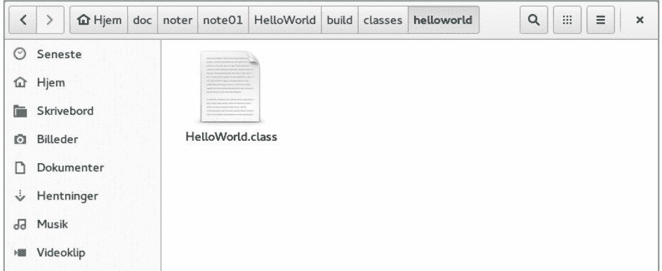
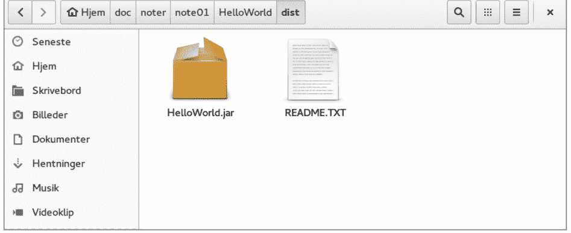
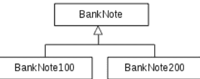
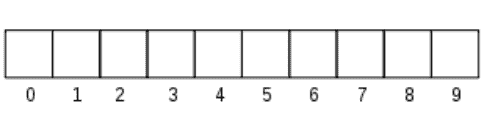
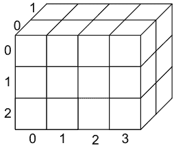

# Java 1：基础语法与语义


我们不是在发明轮子，我们是在重新发明光。

迷人的光影提供了无限可能：创新技术和新市场带来了机遇与挑战。在一个你的专业知识需求极大的环境中。享受我们全球集团内部支持性的工作氛围，并从国际化的职业路径中受益。与其他专家紧密合作实施可持续理念，并为影响我们的未来做出贡献。加入我们，每天重新发明光。

光，源于欧讯明

OSRAM SYLVANIA

- 问题 1 28
- 问题 2 32
- 练习 3 38
- 练习 4 44
- 练习 6 59
- 问题 3 59
- 4.4 示例：Cubes 63
- 练习 8 71
- 练习 9 78
- 练习 10 81
- 问题 4 82
- 问题 5 83
- 练习 11 85
- 问题 6 87
- 练习 12 92
- 练习 13 92
- 问题 7 94
- 练习 14 96
- 问题 8 101
- 问题 9 102
- 7 比较与排序 107
- 练习 15 118
- 练习 16 121

## 前言

本书是软件开发系列书籍的第一本。编程语言是 Java，虽然该语言及其语法和语义显然很大不同，但这些书很大程度上关注过程以及如何开发良好且健的应用程序。本书的主题是介绍 Java 编程语言，重点介绍基础语言语法和语义，但它也是一本关于广义编程以及如何实际编写和测试程序的书。本书不需要任何编程或 Java 语言的知识，目标是展示如何开始编写计算机程序。在阅读本书并完成书中的练习和问题后，读者应该能够用 Java 语言编写简单的控制台应用程序。

如标题所示，系列书籍涉及软件开发，目标是教读者如何用 Java 开发应用程序。可以通过阅读主题和研究完整程序来学习，但最重要的是亲自动手并从零开始编写自己的程序。因此，书中的重要部分是练习和问题，读者必须编写与书中介绍的内容相对应的程序。该系列的所有书籍都围绕着同一个骨架构建，由文本、示例和练习组成，这些内容被放置在文中自然所在的位置。练习和问题的区别在于，练习很大程度上是重复文中介绍的内容，并且对要做的操作描述得相对准确；而问题的描述较为松散，通常规模稍大，且很少有清晰的解决方案。这些书需要从头到尾阅读，但许多示例（包括练习和问题）起着核心作用，读者通过详细研究许多示例代码来预测预测，并解决练习和问题，或者学习推荐的解决方案。

所有书籍都以一两个示例程序结束，主要关注过程以及程序是如何编写的解释。另一方面，代码只在有限范围内出现——如果有的话——读者应该在测试程序时实际上研究完成的程序代码。除了开发比文中示例更大的程序外，结尾示例的目标也是展示来自不同领域的程序。

## 引言

当你编写软件时，你可以使用简单的输入程序（文本编辑器）来编写代码，但原则上你总是会使用开发工具，这会让工作变得容易得多。在下文中，我们将到处使用 NetBeans，这是一个用于各种任务的开发工具。这是一个集成软件包，包含了开发所需的所有工具。

Java 是一种面向对象的编程语言。程序的底层元素是类，从程序员的角度来看，Java 程序由一组类组成，它们共同定义了程序的特性和功能。编写程序在 Java 之外是不存在的，但程序员可以使用 Java API 来编写程序，这可以了程序的“入口”，即程序启动的地方。

Java 在技术上既是一个平台也是一种编程语言。作为一种编程语言，它是一种高级语言，其特点是：

- 它是简单的语言
- 它是面向对象的语言
- 语言是架构中性的
- Java 程序是可移植的
- 它支持多线程应用程序开发
- 它支持分布式应用程序开发
- 它支持安全程序的开发
- 它支持高效程序的开发
- 它支持易于维护的动态程序

所有的 Java 代码如前所述写为纯文本文件——文件名必须具有 `.java` 扩展，然后这些文件被转换为 `.class` 文件。转换由 Java 编译器 `javac` 执行。Java 文件不包含特定平台的机器码，而是所谓的字节码，这是 Java 虚拟机（通常称为 VM 或 JVM）的机器码。程序（由类文件组成）由虚拟机执行。由于 Java 和虚拟机适用于许多操作系统，类文件可以在许多机器上运行，例如 Windows、Solaris、Linux 等。

对于程序运行的硬件和软件，相对于普通的 PC（Windows、Linux 和 Mac），Java 平台是一个运行在不同平台上的软件解决方案。Java 平台原则上包含两个部分：

- JVM，Java 虚拟机
- API，Java 接口

后者是一个可以使用的软件组件集合，它们被分组为包，由类和接口组成。

上述技术的结果是，Java 程序原则上比转换为实际物理机器的程序慢一点。然而，自 Java 诞生以来，编译器和虚拟机都经历了大量的改进和优化，因此性能差异微忽略不计，甚至无法衡量。

## Hello World

本章的主题是展示如何使用 NetBeans 编写和运行 Java 程序，目标仅仅是入门。有多种程序，或者说程序可以以几种方式分类，但在第一书中，我将查看三种类型的程序：

- 命令：通常从命令行窗口（终端）执行的程序，你在其中输入程序名称，后面可以跟一个或多个参数。
- 控制台应用程序：同样在命令行提示符中执行，与用户对话，用户在程序执行时必须输入值。
- GUI 程序：程序打开一个或多个带有按钮和输入字段等组件的窗口，用户通过它们与程序交互。

这种划分仅出于实用考虑，因为我有时会对此描述程序示例，但三种程序的共同点是它们都是在单一机器上运行而不使用其他机器资源的独立应用程序。

我将从经典的 Hello World 开始，这是一个在屏幕上打印文本的程序。它是命令的一个示例，也是一个没有任何实际意义的程序示例。尽管这是一个简单的程序，但它将涉及适用于所有 Java 程序的若干原理。

如所述，Java 程序被写为文本文件，然后进行转换。当文件转换无误时，程序可以由虚拟机执行。在实践中，始终使用开发工具，这是一个集成开发者所需所有功能的程序或软件包。这种工具通常称为 IDE（集成开发环境），有多种工具，随处可见 NetBeans，它包含了所需的一切，并且要求机器上安装了 Java 和 NetBeans。可以通过阅读附录 A 开始，该部分解释了如何下载和安装 Java 和 NetBeans。

编写第一个 Java 程序，打开 NetBeans 并创建一个新项目。在菜单中选择 `File | New Project`（文件 | 新项目）

NetBeans 项目创建了开发和测试程序所需的所有文件，并消除了其他配置。使用 NetBeans 你只需点击即可构建和运行程序。创建项目时，你需要注意：

- 标记了 Java
- 选择了 Application

当你点击 `Next`（下一步）时，会看到以下窗口：

- 输入 `HelloWorld` 作为项目名称
- 选择了 `/path/to/note1` 作为项目位置

关于后者，我决定将项目创建在 `/path/to/note1` 目录下。我决定项目应该命名为 `HelloWorld`。NetBeans 将随后创建一个文件夹并将所有项目文件放在该文件夹中。你应该注意勾选了 `Create Main Class`（创建主类），这是重要的。当你点击 `Finish`（完成）时，项目被创建，NetBeans 显示多个窗口：

- `Projects` 窗口：项目组件按层次结构组织。
- 源编辑器：打开了名为 `HelloWorld.java` 的文件。
- `Navigator`：可以快速查找特定项目。

源编辑器包含程序代码，正如你所见，NetBeans 自动创建了一个程序的骨架。实际上，这是一个完整的程序——它还没有执行功能。程序代码由 Java 语句和注释组成。注释会被编译器移除，不会影响最终程序。插入注释仅仅是为了我们这些阅读和理解程序代码的人。

### 2.2 源代码

下面展示了修改或删除了 NetBeans 生成的注释并编写了语句后的最终程序：

```java
/**
 * 在控制台窗口打印文本的简单 Java 程序。
 */
package helloworld;

public class HelloWorld {
    public static void main(String[] args) {
        System.out.println("Hello World");
    }
}
```

程序只有一个注释，位于顶部，说明了程序的功能。代码的其余部分是一个由类组成的 Java 程序，在本文例中，它包含一个名为 `HelloWorld` 的类，该名称是我选择的项目项目名称。该类包含一个 `main()` 方法，该方法包含单条语句——不是由 NetBeans 创建的，而是我手动输入的。这是一条用于在屏幕上打印文本的语句。

代码非常简单，到目前为止你只需要接受它应该像上面那样被编写，但有几点你应该注意。

Java 是区分大小写的，在任何地方你都必须区分大写字母和小写字母。

如前所述，每个 Java 程序都至少包含一个类 `HelloWorld`。在这种情况下，该类只有一个名为 `main()` 的方法，这是程序启动时调用的方法。一个方法由语句组成，这些语句可以被视为在机器上执行某些操作的命令。调用一个方法意味着执行了这些方法。`main()` 方法必须以 `public static void` 单词作为前缀。后面将进行解释。在这种情况下，`main()` 只有一条语句，即在屏幕上写文本。`System.out.println()` 实际上是 `PrintStream` 类中的一个方法，该类代表屏幕。当程序运行时，执行 `main()` 中的 `println()` 语句时，会在屏幕上打印文本。

注意，在 Java 中，每条语句都以分号结束——上面在 `System.out.println()` 之前有一个分号。它告诉编译器语句在何处结束。

在 Java 中，类被分组在所谓的“包”（packages）中。一个类的全名由它所属的包以及类名组成。NetBeans 会自动为程序定义一个包，其为全小写的应用程序名称，第一条语句是 `package` 语句，指示该类所在的包。`package` 语句必须是包含类的文件的第一条语句，但可以以前注释作为前缀。注意，在 Java 中你通常需要将每个类放在它自己的文件中，但稍后会详细介绍。

### 2.3 运行程序

当程序像上面那样编写完成（无错误），你可以从 NetBeans 菜单中选择：

```
Run | Run Project (HelloWorld)
```

NetBeans 会自动翻译程序，如果它不包含错误，程序将被执行：

```
run:
Hello World
BUILD SUCCESSFUL (total time: 0 seconds)
```

如果程序包含错误，结果如下：

```
run:
Exception in thread "main" java.lang.RuntimeException:
Uncompilable source code - Erroneous type:
<any> at helloworld.HelloWorld.main(HelloWorld.java:10)
Java Result: 1
BUILD SUCCESSFUL (total time: 3 seconds)
```

程序将不会执行，翻译器会提供错误信息，在尝试重新运行程序之前必须修正错误。

如果你打开 `Files`（文件），你可以像下面所示显示类文件，这是翻译后的程序：



`HelloWorld.class` 是一个可以在特定机器上运行的完整 Java 程序示例。显然，该程序与 NetBeans 紧密结合并使用 NetBeans 执行，但并非如此。在 NetBeans 菜单中选择：

```
Run | Build Project (HelloWorld)
```

程序会被再次翻译，如果你打开 `Files`（文件），你会发现创建了另一个名为 `dist` 的文件夹，其中包含两个文件（见下文）。这里是 `HelloWorld.jar` 包（实际上是一个压缩的 zip 文件），它包含了程序。`HelloWorld.class` 包含了程序，其他文件是运行程序所必需的。



这是 NetBeans 在新源文件开头插入的注释。另一种类型的注释以字符 `/**` 开头并以 `*/` 结尾，例如：

```java
/**
 * @param args 命令行参数
 */
```

同样，在起始和结束字符组合之间的所有内容都是注释，但可以插入特殊的符号，这些符号会被工具解析以生成程序代码的 HTML 文档（位于之后）。最后一种类型的注释的形式如下：

```
// TODO 在此处编写应用程序逻辑
```

该类注释可以插入到任何地方，`//` 字符到行尾的所有内容均被视为注释。

这是在代码中插入注释的语法，但你应该写的是完整的内容。此外，我还会回到这一点，但通常情况下你必须写下以后阅读代码时可能有用的内容。这显然不是唯一的，查看他人在程序中插入的注释可以是一个很好的灵感。

该示例是一个名为 `Kings` 的程序，原则上，它的编写方式与 `HelloWorld` 相同，但程序输出以下内容：

```
################################
# Gorm den gamle               # 958 #
# Harald Blåtand               # 987 #
# Svend Tveskog                   # 1014 #
# Harald d. 2.                  # 1018 #
# Knud den Store                # 1035 #
################################
```

最终代码所示：

```java
package kings;
public class Kings
{
    public static void main(String[] args)
{
System.out.println("################################");
System.out.println("# Gorm gamle # # 958 #");
System.out.println("# Harald Blåtand # # 987 #");
System.out.println("# Svend Tveskæg # # 1014 #");
System.out.println("# Harald d. 2. # 1014 # # 1018 #");
System.out.println("# Knud den Store # 1018 # # 1035 #");
System.out.println("################################");
}
```

与 `HelloWorld` 唯一区别是，这次有多个 `System.out.println()` 语句。

编写一个程序（可以命名为 `Digits`），在屏幕上打印以下表格：

```
+   ****************
* 1 * One *
* 2 * Two *
* 3 * Three *
* 4 * Four *
* 5 * Five *
* 6 * Six *
* 7 * Seven *
* 8 * Eight *
* 9 * Nine *
****************
```

编写一个程序（可以命名为 `Label`），打印你的姓名、你的地址和你的电子邮箱地址，例如：

Poul Klausen

Tjørnevnæget 56

7800 Skive

poul.klausen@mail.dk

## 3 命令与控制台程序

在上一节中，我将程序分成了三类，在本章中，我将介绍命令和控制台程序。原则上它们之间没有太大区别，划分仅取决于用户如何向程序传递数据。`HelloWorld` 和上一章的 `Kings` 示例都是命令的示例。

### 3.1 命令

每个 Java 程序都必须具有以下签名的 `main()` 方法：

```java
public static void main(String[] args)
```

目前，你应该忽略 `public`、`static` 和 `void` 单词的含义，只需接受它们应当是这样写的，但 `main()` 方法是程序启动的地方。方法名后是括号中的参数，表示参数。考虑以下程序：

```java
package command;

public class Command
{
    public static void main(String[] args)
    {
        System.out.println(args[0]);
        System.out.println(args[1]);
        System.out.println(args[2]);
    }
}
```

`args` 是一个数组（稍后会解释），它是从命令行传递的参数。参数以空格分隔。如果你将 `Command.java` 复制到文件夹，可以如下运行：

`args[0]`

`args[1]`

`args[2]`

参数是字符串。例如，如果你传递 `Svend` 和 `Knud` 这两个参数，结果是相同的：

```
Svend
Knud
```

但是，如果我们在没有参数的情况下执行，会得到：


```text
Exception in thread "main" java.lang.ArrayIndexOutOfBoundsException: 1
    at command.Command.main(Command.java:8)
```

原因是第二个参数不存在，导致`System.out.println(args[1]);`语句失败。这说明了命令。另一个问题是在 NetBeans 中测试应用程序，这可以通过菜单`File | Project Properties (Command)`完成。在`Run`类别中，你将能够输入参数：

| Project Properties - Command |
| --- |
| Categories: |
| Run |
| Main Class: |
| Arguments: |
| Working Directory: |
| VM Options: |

如果你在命令行传递三个参数，程序可以执行。以如下方式运行该程序：

```bash
java -jar Command.java Svend Knud 1014 # # 1018 #
```

输出如下：

```text
Svend
Knud
1014 #
```

注意，如果参数包含空格，则必须使用引号。

### 3.2 示例：PRINTADDRESS

以下程序将打印一个人的姓名和地址，但这些值位于命令行。程序名为`PrintAddress`。运行该程序的示例所示：

```bash
java -jar PrintAddress.java "Poul Klausen" "Tjørnevnæget 56" 7800 Skive
Address:

Name: Poul Klausen
Address: Tjørnevnæget 56
7800 Skive
```

```java
/*
 * 在屏幕上打印一个人的姓名和地址的程序。
 * 值作为命令行参数传递。
 */
package printaddress;

public class PrintAddress
{
    public static void main(String[] args)
    {
        System.out.println("Address:");
        System.out.println();
        System.out.println(" Name: " + args[0]);
        System.out.println(" Address: " + args[1]);
        System.out.println("" + args[2] + " " + args[3]);
    }
}
```

上述程序并不健壮，因为如果传递的参数数量不对，它也会失败。你还应该注意到，该程序并没有测试参数（顺便说也是如此），而是简单地打印它们。

程序执行的一个示例可能：

```text
##########
## 催还 #
##########
```

致：

Poul Klausen

Tjørnevænget 56

7800 Skive

当我们看到以下书籍的借用期即将结束时，我们必须要求您尽快将书还给图书馆。

标题：

《计算机网络》

此致地

研究图书馆

与命令相比，控制台程序（在本书中）是一个与用户进行对话的程序，其中用户必须输入数据。

上面我展示了一个程序，当值作为命令行参数传递时，该程序会打印人的姓名和地址。下面是同一个程序，但这次用户必须在程序运行期间输入值。因此，它与用户进行了对话。

```java
package inputaddress;

import java.util.*;

public class InputAddress
{
    public static void main(String[] args)
{
        Scanner in = new Scanner(System.in);
        System.out.print("Enter name: ");
        String navn = in.nextLine();
        System.out.print("Enter address: ");
        String address = in.nextLine();
        System.out.print("Enter zipcode: ");
        String postnr = in.nextLine();
        System.out.print("Enter town: ");
        String bavnav = in.nextLine();
        System.out.println();
        System.out.println("Address: ");
        System.out.println();
        System.out.println(" Name: " + bavnav);
        System.out.println(" Address: " + address + " " + postnr + " " + bavnav);
    }
}
```

你可以看到，代码已经变长了很多，还有一些需要解释的新内容。


在格罗宁大学提供卓越经济学和商业课程：

格罗宁大学

> “成功的国际化职业的完美起点。”

[点击此处]

发现为什么格罗宁大学无论在社会还是学术上都是学生最理想的地方之一

www.rug.nl/feb/education

要输入文本，你必须有一个代表键盘并提供输入文本服务的对象。此外，我应用了一个`Scanner`，它使用代表键盘的`System.in`对象。`Scanner`是一个无法直接使用的类，因此添加了一个指向包含`Scanner`类的包的`import`语句。然后是一个可以用于输入文本的对象。下一行在屏幕上打印文本，告诉用户输入姓名。这是通过：

```java
in.nextLine()
```

用户输入的文本必须存储在某处，为了这个目的使用了变量。变量将在下一节介绍，但变量是可以存储值的地方。示例可以是：

```java
String name = in.nextLine();
```

在这里，用户输入的文本存储在变量`name`中。接下来的语句原理上是相同的，用于其他值。最后几个语句用于打印结果，与程序的之前的版本相似，但将参数`args[0]`、`args[1]`...等替换为变量。如果你运行程序（通过 NetBeans），结果可能如下：

- Enter name: Poul Klausen
- Enter address: Tjørnvænget 56
- Enter zipcode: 7800
- Enter town: Skive

Address:

- Name: Poul Klausen
- Address: Tjørnvænget 56
- 7800 Skive

开发控制台应用很少——如果真的话，当需要一个与用户对话的程序时（当然是需要的），你会编写一个 Windows 或 GUI 程序。然而，控制台程序对于测试和学习可能是很有用的，因此知道如何编写简单的控制台程序是极好的。

## 问题 2

你必须解决与问题 1 相同的任务，但不是通过命令行参数传递值，而是必须输入以下信息：

- 借阅人姓名
- 借阅人地址
- 借阅人邮编和城市
- 书籍的 ISBN
- 书名

当程序运行时与用户进行对话时。程序应该打印与问题 1 相同的催还单。


程序必须处理数据，为此它们需要一种保存或存储数据的方法。为了这个目的，使用变量作为程序可以在其中存储值的项。你必须注意我已经使用了与数据输入相关的变量。

即先写类型，然后是变量，最后赋值：

```java
double number = 23.0;
```

这里声明了一个变量，类型为：

```java
double number = 23.0;
```

Java 拥有以下原始类型或简单类型：

- `byte`，整数数据类型。变量占用 8 位，可以包含 -128 到 127 之间的值。
- `short`，整数数据类型。变量占用 16 位，可以包含 -32,768 到 32,767 之间的值。
- `int`，整数数据类型。变量占用 32 位，可以包含 -2147483648 到 2147483647 之间的值。它是整数的默认类型。
- `long`，整数数据类型。变量占用 64 位，可以包含 -9223372036854775808 到 9223372036854775807 之间的值。
- `float`，浮点数数据类型，可用于小数。变量占用 32 位，可以表示具有7–8 位有效数字的小数。需要注意的是，该值总是舍入后的结果。
- `double`，浮点数数据类型，可用于小数。变量占用 64 位，可以表示具有14 位有效数字的小数。需要注意的是，该值总是舍入后的结果。它是浮点数的默认类型。
- `boolean`，只有两个值的数据类型：`false`或`true`。该类型对于编写条件非常重要，并专门用于程序控制。
- `char`，用于字符，`char`类型的变量占用 16 位。值是 0 到 65535 之间的数字代码，每个字符由一个数字代码表示。例如大写字母 A 的代码是 65。

## 变量与数据类型

在数字计算机上可以使用的最小单位是位（bit），整个计算机内存由若干个可以存储 1 位的设备组成。一个位可以表示两个值中的一个，通常称为 0 和 1，计算机内存的内容始终大量的 0 和 1。在实践中，你不会引用单独的位，但它们是每 8 位为一组进行组织的，这样一组被称为一个字节（byte）。一个字节是一个由 8 位组成的模式，例如：

```text
00111001
```

其含义取决于程序如何使用该模式。由于一个字节中的 8 个位置中的每一个都可能有两个值，因此一个字节可以表示不同的值。如上文所示，简单数据类型的区别在于它们为该类型的变量使用了多少个位。例如，一个`int`使用 32 位（或 4 个字节），这意味着它可以表示不同的整数，这些被解释为从 -2147483648 开始的数字。

除了上述提到的原始数据类型外，正如已经提到的，还有一种`String`类型，它可以包含任何文本字符串。例如，你可以写：

```java
private String name = "Knud den Hedgehog";
```

该语句创建了一个`String`类型的变量。你应该注意你在引号中指定了值。`String`类型不是原始类型，而是一个类；但目前你可以忽略它，`String`类型的变量在原则上与其它变量的使用方式相同。

原始变量由编译器分配一个默认值。`boolean`类型的默认值为`false`，`char`类型的默认值是一个空格格，而其他原始类型的默认值为 0。`String`（它不是原始类型）没有值，其被定义为`null`。

作为一个示例，以下语句创建了三个变量，类型都是`int`类型：

```java
int number1 = 17;
int number2 = 23;
int sum = number1 + number2;
System.out.println("The sum of " + number1 + " + " + number2 + " is " + sum);
```

前两个变量用数字初始化，而最后一个初始化为前两个变量之和。最后一条语句打印这三个变量的值。

以以下程序作为示例，这是一个在命令行执行的命令，带有三个必须是整数的参数，程序打印这三个数字之和：

```java
package sum3;

public class Sum3
{
    public static void main(String[] args)
    {
        try {
            int a = Integer.parseInt(args[0]);
            int b = Integer.parseInt(args[1]);
            int c = Integer.parseInt(args[2]);
            System.out.println(a + " + " + b + " + " + c + " = " + (a + b + c));
        } catch (Exception ex) {
            System.out.println("Invalid arguments");
        }
    }
}
```


关于 e-Learning for Kids。e-Learning for Kids 成立于2004 年，是一个全球非营利基金会，致力于为 5-12 岁的儿童提供资金支持和免费互联网学习，课程涵盖数学、科学、语言艺术、计算机、健康和环境技能。自2005年以来，来自190多个国家的超过1500万名儿童受益于在线学习，这由 LU Ki An 志愿者团队提供支持，他们由世界各地的教育和在线学习专家以及商务人士组成，通过寻求资金、志愿者、赞助商和内容开发者的参与，致力于实现改变和全民教育的目标。更多信息，请访问 www.e-learningforkids.org。

- 小学教育第1号 MOOC
- 为 5-12 岁儿童提供的免费数字学习
- 覆盖 1500 万儿童

在 bookboom.com 下载免费电子书

```text
13 + 17 + 19 = 49
```

输入控制台应用程序的命令或数据的参数始终是`String`类型，且它们不能直接用于计算。首先，有必要将这些值（即文本）转换为数值。例如，可以通过以下方式完成：

```java
int a = Integer.parseInt(args[0]);
```

在这里，`args[0]`的值将被转换为整数 - `int` - 并存储在变量`a`中。为了实现这一点，`args[0]`必须包含一个法的整数。如果不是如此（因为用户使用了非法值），则转换将抛出异常，这意味着转换因错误中断。当你有这段代码时，代码必须在`try`块中转换。如果是这样并且发生了异常，运行时系统会中断`try`块，并将控制转移到随后的`catch`块。在这种情况下，如果三个参数之一无法转换为`int`，程序将捕获该部分并打印错误信息。

如果你使用参数 13, 17 和 19 执行程序，结果将是：

```text
13 + 17 + 19 = 49
```

输入控制台应用程序的命令或数据的参数始终是`String`类型，且它们不能直接用于计算。首先，有必要将这些值（即文本）转换为数值。例如，可以通过以下方式完成：

```java
int a = Integer.parseInt(args[0]);
```

在这里，`args[0]`的值将被转换为整数 - `int` - 并存储在变量`a`中。为了实现这一点，`args[0]`必须包含一个法的整数。如果不是如此（因为用户使用了非法值），则转换将抛出异常，这意味着转换因错误中断。当你有这段代码时，代码必须在`try`块中转换。如果是这样并且发生了异常，运行时系统会中断`try`块，并将控制转移到随后的`catch`块。在这种情况下，如果三个参数之一无法转换为`int`，程序将捕获该部分并打印错误信息。

（此处省略重复的文本内容）

## 练习 3

你应该编写一个与上面类似的程序，但必须有以下区别：

1. 程序应该计算四个数字之和，而不是三个。
2. 数字应该是被输入的（在对话框中），而不是作为参数传递。
3. 数字应该是小数而不是整数——即类型必须是`double`。

上述是`Integer.parseInt()`方法如何将文本转换为`int`。要将文本转换为`double`，你可以相应地应用`parseDouble()`方法。

运行程序的示例可以是：

```text
Enter the 1 number: 3.25
Enter the 2 number: 1.75
Enter the 3 number: 9.85
Enter the 4 number: 2.55
3.25 + 1.75 + 9.85 + 2.55 = 17.4
```

特别注意小数点是`.`。

运算符是编译器识别的特殊符号，对一个、两个或三个操作数执行特定操作，操作数通常是值或变量。我已经使用`+`作为字符串之间的运算符用于字符串连接，而数字之间的运算符被解释为加法。此外，在变量赋值值的声明中，等号是一个运算符。

运算符具有不同的优先级，这影响了表达式包含多个运算符时的执行顺序，下表显示了 Java 按优先级下降排列的运算符。如果表达式包含多个运算符，优先级最高的运算符先执行。具有相同优先级的运算符从左到右执行。这不适用于赋值运算符，赋值运算符是从右到左执行的。

| 优先级 | 运算符 |
| --- | --- |
| 后置 | `expr++` `expr--` |
| 前置 | `++expr` `--expr` `+expr` `-expr` `~` `!` |
| 乘法 | `*` `/` `%` |
| 加法 | `+` `-` |
| 移位 | `<<` `>>>` |
| 关系 | `<` `>` `>=` `instanceof` |
| 比较 | `==` `<=` |
| 位运算与 | `&` |
| 位异异 | `^` |
| 位运算或 | `|` |
| 逻辑与 | `&&` |
| 逻辑或 | `||` |
| 优先级 | 运算符 |
| --- | --- |
| 问号运算符 | `? :` |
| 赋值 | `= += *= /= % &= ^= |= <= >>> >>>` |

这些运算符中的许多不需要特殊解释，其他一些我将在稍后详细介绍，但下面是对某些单独运算符的简要说明。

首先注意，赋值是一个运算符，例如：

```java
int a = 2;
a = 3;
```

它是毫无疑问的最常用的运算符。


乘法运算符和加法运算符被称为算术运算符，涵盖了四种算术运算的运算符。此外，还有模运算符（取模），它与除法紧密相关。这五个运算符都有两个操作数。如果参数是整数，结果也将是整数。这意味着除法是整数除法。例如，它是：

```
23 / 7 = 3
```

因为除法执行了 3 次，剩余的部分被丢弃。取模是除法后的余数，因此：

```
23 % 7 = 2
```

当 23 除以 7 时得到余数 2。考虑以下语句：

```java
System.out.println(23 / 7);
System.out.println(23 % 7);
System.out.println(-23 / 7);
System.out.println(-23 % 7);
System.out.println(23 / -7);
System.out.println(23 % -7);
System.out.println(-23 / -7);
System.out.println(-23 % -7);
```

它们将打印：

```
3
2
-3
-2
2
3
-2
```

在这里，符号并不明显，但对于两个整数 `a` 和 `b`，满足：

```
a % b = round(a / b) * b
```

其中 `round(a / b)` 意味着 `a / b` 并丢弃任何小数部分。从这个公式可以很容易得出上述结果是正确的。如果操作数是浮点数，也可以使用模运算符，公式相同，但在这种情况下结果意义不大。算术运算符可以与赋值运算符结合使用。例如意味着：

```java
a += 2;
```

等于

```java
a = a + 2;
```

虽然它不是一个算术运算符，但应该注意 `+` 也用于字符串，例如意味着：

```java
String s = "Hello" + "World";
```

即字符串拼接，变量 `s` 的值为 `HelloWorld`。这意味着如果至少一个操作数的类型是 `String`，则运算符 `+` 意味着字符串拼接，而不是加法。

有一族运算符只接受一个操作数，包括符号运算符、取反运算符以及两个特殊的运算符 `++` 和 `--`。最后是二进制补码运算符，我在此不再提它。这些运算符的一个共同特点是它们是优先级最高的运算符。考虑以下示例：

```java
int a = 2;
System.out.println(++a);
System.out.println(a++);
```

如果执行，你将得到结果：

```
3
3
4
```


加入马斯特里希特大学商与经济学院的精英吧！

- 《金融时报》世界排名第33 位：国际商务硕士
- 第一名：国际商务硕士
- 第一名：金融经济学硕士
- 第二名：学习管理硕士
- 第二名：经济学硕士
- 第二名：计量经济学与运筹硕士
- 第二名：全球供应链管理与变革硕士

来源：Keyset Master ranking 2013; Elsevier 'Best Studies' ranking 2012 Financial Times Global Business in Management ranking 2012

访问我们，发现我们为什么是最好的！硕士课程开放日：2014年2月22日

变量 `a` 的值为 2。执行 `++a`，意味着在打印值后，变量的值加 1。结果是 3（变量 `a` 的值为 3）。执行 `a++`，意味着在变量 `a` 加 1 之前打印 `a` 的值。该语句打印 3，但语句执行后，`a` 的值为 4。这显示了最后一个 `println()` 语句。`--` 运算符将变量的值减 1。

关于取反，你可以考虑以下语句：

```java
int a = 2;
int b = 3;
System.out.println(a == b);
System.out.println(!a == b);
```

如果执行语句，你会注意到：

```
false
true
```

`a == b` 是一个条件，第一个 `System.out.println()` 语句打印该条件的值，即 `false`。下一个语句打印该条件的取反，即 `true`。

包括关系运算符、比较运算符和逻辑运算符。通常这些并不奇怪，但你应该了解。考虑以下语句：

```java
int a = 2;
int b = 3;
int c = 2;
System.out.println(a == b);
System.out.println(a == c);
System.out.println(a != b);
```

它们打印：

```
false
true
true
```

因为 `==` 的优先级高于 `||`

问号运算符是三元运算符，它接受三个参数。其形式为：

```
condition ? expression1 : expression2
```

在这里如果条件为真，返回 `expression1`，否则返回 `expression2`。它是 `if-else` 语句的简写。例如：

```java
int max = (a > b) ? a : b;
```

这个运算符非常有用。

编写一个程序，用户必须输入两个整数。程序随后应该打印

- 两个数字的和
- 差
- 积
- 商
- 模

## JAVA 1：基础语法与语义

变量与数据类型

结果可以是：

```
输入第一个数字：123
输入第二个数字：13
和：136
差：110
积：1599
商：9
模：6
```

## JAVA 1：基础语法与语义

变量与数据类型

## 4.2 字面量

基本类型构建在语言中，基本类型的变量可以使用字面量进行赋值，例如：

```java
boolean res = true;
char ch = 'C';
byte b = 100;
short s = 10000;
int i = 100000;
String s = "Hello World";
```

其中最后一个例子显示了字面量，但不是基本类型。

定义字面量有一些语法，下面是最重要的。

### 整数字面量

通常，你使用数字 0–9 指定整数，因此是十进制系统中的数字。如果整数以字母 `L` 或 `l` 结尾，则解释为 `long`。否则类型为 `int`。建议使用大写的 `L`，因为小写的 `l` 很难与数字 1 区分。

你还可以指定将整数解释为十六进制，以数字 `0x` 开头，符号是数字和字母 A、B、C、D、E 和 F。最后，你可以指定将整数解释为二进制，以 `0b` 开头整数，然后是符号 0 和 1。

## JAVA 1: 基础语法与语义

### 变量与数据类型

示例如下，其中第一句将字面量定义为 `long`，最后三句都定义了一个值为 26 或其他进制的 `int`：

```java
long t = 123456789012L;
int a = 26;
int b = 0x1a;
int c = 0b0111010;
```

### 定义浮点数的字面量

浮点数或小数如果以字母 `F` 或 `f` 结尾，则被解释为 `float` 类型。否则，其类型为 `double`，也可以用字母 `D` 或 `d` 显式指定。你还可以用字母 `E` 或 `e` 指定指数。以下变量的值均为 1234.56：

```java
double x = 1234.56;
double y = 1.23456E3;
float z = 123456F;
```

在这里需要特别注意的是，`1.23456E3` 意味着 `1.23456` 乘以 10 的三次方。

### 定义字符和字符串的字面量

定义 `char` 和 `String` 类型的字面量可以包含任何 Unicode（UTF-16）字符，只要字符存在，就可以直接使用。如果字符不在键盘上，可以以 Unicode 转义序列的形式添加，如 `'\u0108'`。`char` 字面量使用单引号，`String` 字面量使用双引号：

```java
char c = 't';
String s = "Gorm den Gamle";
```

Java 还支持特殊控制字符的单转义序列：

- `\b` 退格 (backspace)
- `\t` 制表符 (tabulator)
- `\n` 换行符 (line feed)
- `\f` 换页 (form feed)
- `\r` 回车 (carriage return)
- `"` 双引号
- `'` 单引号
- `\\` 反斜杠

### 变量与数据类型

考虑以下语句作为示例：

```java
System.out.println("1234567890");
System.out.println("\u0108");
System.out.println("\'");
System.out.println("abc\tde\\fg");
System.out.println("a\nb\nc");
System.out.println("\u0041\u0042\u0043");
```

执行后，你将得到结果：

```
1234567890
C
'
ab de\"fg
a
b
cABC
```


## 赋能人才。

## 商业。

挪威 BI 商学院（BI Norwegian Business School）是欧洲最大的商学院之一，欢迎超过 20,000 名学生。我们的课程提供了启发性且多元文化的学习环境，具有国际视野，最终为学生提供满足业务需求的专业技能。

BI 提供不同的两年制全日制英语教学科学硕士（MSc）课程，旨在提供满足企业日益增长需求的专业技能。MSc 课程提供启发性且多元文化的学习环境，为你的职业生涯提供最佳起点。

- 商业管理硕士
- 金融经济学硕士
- 战略营销管理硕士
- 领导力与组织心理学硕士

www.bi.edu/master

## JAVA : 基础语法与语义

### 数字字面量中下划线的使用

关于字面量的最后一点，我将提到在数字字面量中使用 `_`。例如，这种写法是合法的：

```java
long kortId = 1234_5678_9012_3456L;
long cprnn = 999999_9999L;
float pi = 3.14_15F;
long ip = 0xFF_EC_DE_5E;
long ord = 0xCAFE_BABE;
long max = 0x7ffff_ffff_ffff;
byte val = 0b01100101;
long bytes = 0b01100101_01100101_10100100_10100100;
```

所有的 `_` 实例都会被忽略。其目的仅是增强大数字的可读性。有几个限制：

- 数字不能以字符 `_` 开头或结尾
- 在浮点数中，字符 `_` 不能紧挨小数点
- 字符 `_` 不能排在 `F` 或 `L` 之前

## 4.3 对象

Java 是一门面向对象的编程语言，在编写编写执行某些有趣功能的程序之前，你需要了解一些基本概念。以下是对对象、类、继承、接口和包的概述介绍，我将主要关注这些概念如何与现实世界相关，同时对 Java 语法进行基础介绍。

对象是一个具有状态和行为的软件模块。软件对象通常用于模拟现实世界的对象。本解释说明了代表状态和行为的对象如何引入数据封装的概念。重要的是解释软件设计的优势。

## JAVA 1: 基础语法与语义

在现实世界中，你经常会遇到许多相似且相同的个体对象。有成千上万辆汽车，它们的品牌和型号相同，构造方式完全一样，组件也完全相同。我们看到的面向对象的世界认为，某个特定的汽车是特定品牌和型号的 `cars` 类的一个实例。类是对特定汽车行为的描述。

在处理软件时，我们也使用相同的原理。假设一个程序需要钞票对象。钞票的特征是数值，这是钞票的状态，你对钞票唯一需要做的就是读取它的数值并知道钞票的样子，以便将其与其他票区分开来。因此，你可以如下定义钞票的概念：

```
package bankprogram;

public class BankNote {
    private int value;

    public BankNote(int value) {
        this.value = value;
    }

    public int getValue() {
        return value;
    }
}
```

这是一个 Java 类的示例，在这里它的名字是 `BankNote`。如所述，一张具体的钞票有一个作为状态的数值，这个值必须存储在某处。为此，类定义了一个名为 `value` 的变量。变量有一个类型，这里是 `int`，意味着该变量可以包含一个整数。变量 `value` 是实例变量的一个实例。该变量被定义为 `private`，这意味着它只能从类内部被引用，这就是我说的的数据封装。类应该被用于某些用途，你应该能够读取它的值。该类有一个方法 `getValue()`，它的值是钞票的数值，即变量 `value` 的值。这个方法定义了对象的行为。注意，该方法有一个类型，这里是 `int`。我们说该方法返回一个值。类还有另一个与类名相同的方法。它是一个特殊方法，不定义对象的行为，而是用于在创建新对象时初始化对象的状态。这种方法被称为构造函数。

## JAVA 1: 基础语法与语义

你应该注意，该类没有 `main()` 方法，因为该类不是程序，而是一个可以被任何应用程序使用的概念。

有了 `BankNote` 类后，程序可以创建 `BankNote` 对象并对它们进行操作。以下是一个程序中的 `main()` 方法，它创建了两个 `BankNote` 对象。第一个值为 100，下一个值为 200：

```
package bankprogram;

public class BankProgram {
    public static void main(String[] args) {
        BankNote note1 = new BankNote(100);
        BankNote note2 = new BankNote(200);
        System.out.println(note1.getValue());
        System.out.println(note2.getValue());
    }
}
```

你必须特别注意如何创建对象。对象有一个名称，例如 `note1`，它是一个变量。对象也有一个类型，这里是 `BankNote`，当类型是一个类而不是基本类型时，必须使用 `new` 运算符来创建对象。在这里你指定了钞票的值，准确地意味着类的构造函数被执行，并将该值传递给对象的实例变量。如果执行了 `main()` 方法，它会打印两个 `BankNote` 对象的值。为了实现这一点，你可能引用 `BankNote` 对象的值。由于封装的原因，这样做是不可能的，但 `BankNote` 对象在 `getValue()` 方法上有一个行为，所以你可以引用该值。

## 继承

不同类型的对象之间有几个共同的特征。如果你考虑钞票，它们都有数值，但在外观上有所不同。它们有不同的颜色，并显示不同的图案。在面向对象编程中，类之间可以相互继承。这意味着你可以在基类中收集公共属性，而差异可以放在派生类中。以下是一个代表钞票且值为 100 的类（一张丹麦钞票）：

## JAVA 1: 基础语法与语义

```
package bankprogram;

public class BankNote100 extends BankNote {
    public BankNote100() {
        super(100);
    }

    public void print() {
        System.out.println("Den gamle Lilleæltsbro og Hindsgavl-dolken");
    }
}
```

该类是 `BankNote100`，在类名之后你使用 `extends` 关键字定义该类继承 `BankNote` 类。这意味着该类继承了 `BankNote` 的所有属性，并扩展了新属性。在这种情况下，`BankNote100` 继承 `BankNote` 并增加了一个 `print()` 方法，以模拟钞票的样子。`BankNote` 类有一个构造函数来初始化实例变量 `value`。`BankNote100` 也必须初始化这个变量（值 100）。这在类的构造函数通过 `super(100)` 实现，这意味着类的构造函数被执行了。


到2020年，风能可以提供我们地球电力需求的十分之一。今天，SKF 的创新对于运行大部分风力发电机至关重要。高达 25% 的发电成本与维护有关。得益于我们的在线状态监测和自动润滑系统，这些成本可以大幅降低。我们让能源更加环保，从空气中创造更清洁的能量。

通过分享我们的经验、专业知识和创造力，行业可以实现超出预期的性能。因此，我们是应对挑战的最佳员工！

知识工程的力量

接入知识工程的力量。访问 www.skf.com/knowledge

在 bookboom.com 下载免费电子书。点击广告阅读更多

## JAVA 1: 基础语法与语义

显而易见，同样你可以写一个 `BankNote200` 类来代表值为 200 的钞票。

有了这些类后，你可以编写以下 `main()` 方法：

```java
public static void main(String[] args)
{
  BankNote100 note1 = new BankNote100();
  BankNote200 note2 = new BankNote200();
  note1.print();
  note2.print();
  System.out.println(note1.getValue() + note2.getValue());
}
```


在这里，你分别创建了类型为`BankNote100`和`BankNote200`的两个对象。这里调用了两个对象的`print()`方法。接着是调用了对象的`print()`方法。注意语法，使用点操作符对对象执行方法。最后的语句执行两个对象的值的和。`getValue()`方法在`BankNote`类中定义，但继承自`BankNote100`和`BankNote200`。

我们经常如下说明继承：



在此语境下，基类`BankNote`也称为超类，而派生类`BankNote100`和`BankNote200`子类。有时我们也说`BankNote`是`BankNote100`和`BankNote200`的泛化，而这些类是`BankNote`的特化。

## 接口

对象的属性通过类定义并作为服务的公共方法对外部可见。方法构成了对象面向世界的接口。为了定义对象的特征，你可以使用接口，该接口定义了特定类的方法。例如，你可以如下定义钞票：

```java
package bankprogram;

public interface Note {
    public int getValue();
    public void print();
}
```

这看起来像类的定义，但你应该注意到仅仅是一个定义，接口并不包含实现功能的代码。

给定一个接口，你可以定义类必须实现此接口。因此你指定该类拥有接口定义的方法。例如，`BankNote`类可以实现`Note`接口：

```java
package bankprogram;

public abstract class BankNote implements Note {
    private int value;

    public BankNote(int value) {
        this.value = value;
    }

    public int getValue() {
        return value;
    }
}
```

注意`implements`关键字定义了该类实现一个接口。这意味着该类应该拥有`getValue()`和`print()`方法——它必须实现接口定义的方法。现在并非如此，因为它没有实现`print()`方法。这并不是因为不知道该方法应该如何编写。派生类`BankNote100`和`BankNote200`拥有这些知识。通过将类定义为抽象（abstract）解决了这个问题。方法随后必须在派生类中实现，事实确实如此。类是抽象的进一步后果是，你不能实例化类型为抽象类的对象——在本例中为`BankNote`。这也是合理的，否则你可以实例化具有任意值的钞票，这在对现实世界进行建模时没有意义。以下是`main()`程序的新版本：

```java
public static void main(String[] args)
{
    Note note1 = new BankNote100();
    Note note2 = new BankNote200();
    note1.print();
    note2.print();
    System.out.println(note1.getValue() + note2.getValue());
}
```

将会创建两个对象，分别是一个`BankNote100`对象和一个`BankNote200`对象，它们的类型都是`Note`。`BankNote100`特别地是一个`BankNote`，而`BankNote`再次是一个`Note`。这意味着在程序的其余部分，这两个对象仅仅是提供`getValue()`和`print()`服务的对象。

从上述内容，接口的优势显而易见，这稍后会明确，但解释必须从这里寻找：程序中的`note1`和`note2`仅通过定义的接口已知，这意味着这两个对象被视为是同等的，而不取决于它们的具体类型。

`BankProgram`项目实现了上述类和接口。


## 包 (PACKAGES)

包是一个所谓的命名空间，用于组织一组相关的类和接口。从概念上说，你可以将包想象成文件夹，其中包含以某种方式归在一起的类。由于用 Java 编写的程序可能由数百或数千个独立类组成，因此将相关的类和接口放在包中以保持它们相互分离是有意义的。

当 NetBeans 创建项目时，它也会创建一个包，并将项目的类和接口放在该包中，例如：

```java
package bankprogram;
```

```java
public interface Note
{
    public int getValue();
    public void print();
}
```

这意味着接口位于`bankprogram`包中。只要项目只包含一个包，你就不需要考虑它，但恰恰意味着类型`Note`的名称是：

`bankprogram.Note`

`package`语句定义了类型所属的包。它必须是定义该类型的文件中的第一条语句，但前面可以有注释。

Java 平台包含一个巨大的库（包的集合），其中包含了程序员可以在自己的程序使用的组件。这种应用程序编程接口（Application Programming Interface）通常简写为 API。该库代表了与程序开发中最常见的通用问题相关的任务，例如用于开发具有图形界面的应用程序的包。

要引用定义包之外的类，必须使用`import`语句引用包。以下语句：

```java
System.out.print("100 kr., ");
```

会打印一段文本，而`System`实际上存在于`java.lang`包中的一个类名。此包包含了 Java API 中所有常见的类，当不需要对此包使用`import`语句时，是因为编译器默认导入了该包。

## 练习 6

创建一个`BankProgram`项目的副本。在`BankNote100`类中，你应该按照如下方式修改`print()`方法：

```java
public void print()
{
  System.out.print("100 kr., ");
  System.out.println("Den gamle Lillebæltsbro og Hindsgavl-dolken");
}
```

测试程序并注意这两条语句都在同一行。

以同样的方式修改`BankNote200`类中的`print()`方法。

编写三个类`BankNote50`、`BankNote500`和`BankNote1000`，分别代表值为 50,500 和 1000 的钞票。这三个类与`BankNote100`和`BankNote200`类似，但它们代表的钞票值不同。这些类分别代表 50、500 和 1000 值的钞票：

- 1. 旧 Lillebælt桥和 Hindsgavl 塔
- 2. 丹麦的钞票
- 3. 这里的金额

在`main()`方法中，创建这些钞票的对象。你应该打印这些对象的总值。

你应该编写一个创建钞票的程序。按照以下步骤，在 NetBeans 中创建一个新项目，接口如下：

```java
package employees;

// 这里的了接口
public interface Employee
```

```java
    public String getName();
    public int getSalary();
    public void print();
```

该接口定义了员工。你应该通过以下步骤解决这个问题：

这三个类分别代表 50, 500 和 1000 值的钞票：

- 1. 这里的金额
- 2. 丹麦的钞票
- 3. 这里的金额

你应该打印这些钞票的总值。

## 4.4 示例：骰子

我将展示一个表示具有六面的普通立方体的类。该类可以写如下：

```java
package cubes;

import java.util.*;
// 表示普通正立方体的类
public class Cube {
    private static Random rand = new Random();
    private int eyes;

    public Cube() {
        roll();
    }

    public int getEyes() {
        return eyes;
    }
}
```


```java
public void roll() {
	eyes = rand.nextInt(6) + 1;
}

public String toString() {
	return "" + eyes;
}
```

该类有两个字段：一个类变量和一个实例变量。类变量是`rand`，是一个`Random`类型的对象。它是一个随机数生成器，可以生成随机数。它的工作原理是通过读取机器时钟并根据对象创建时的时钟值产生序列值。由于你无法知道（假设）任何给定时间时钟的内容，因此起始时间是随机的，生成的数字序列看起来似乎是随机的。变量`rand`必须是一个类变量，否则`Cube`类型的对象将拥有自己的随机数生成器，这很容易导致它们以相同的时钟值进行初始化。结果将是`Cube`对象创建相同的随机数序列。类的实例变量名为`eyes`，用于跟踪每个`Cube`的值。由于两个`Cube`对象的值并不一定相同，因此该变量必须是实例变量，以便每个对象都有自己的副本。

该类有一个方法`roll()`，用于模拟掷骰子。当执行该方法时，会使用类变量`rand`。`Random`类有一个名为`nextInt()`的方法，返回一个非负整数。在这种情况下，它是 0, 1, 2, 3, 4 和 5 之一，当加 1 后结果是 1 到 6 之间的值。`Random`类定义在`java.util`包中。为了使用该包中的类，需要使用`import`语句。在这里`*`表示你可以使用该包中的所有类。

`Cube`类有一个构造函数。由于变量`eyes`没有初始化，它的默认值为 0。这很遗憾，因为这是一个非法的值。因此，构造函数会掷一次骰子，并确保骰子从从开始就有值。

该类还有另外两个方法。`getEyes()`方法是一个返回骰子显示数值的方法。它看起来如上所示。然后是`toString()`方法，它以文本的形式返回骰子的值。`return`语句的语法并不直观，但它强制方法返回`eyes`的值作为文本。该类可以在`main()`方法中使用如下所示：

```java
public static void main(String[] args) {
    Cube c1 = new Cube();
    Cube c2 = new Cube();
    do {
        c1.roll();
        c2.roll();
        System.out.println(c1 + " " + c2);
    } while (c1.getEyes() != c2.getEyes());
}
```

对于尚未提到的`use`语句需要稍作解释。前两个语句创建了`Cube`对象，与上面说的一样没有新内容。下一个语句是`do`语句，是循环的一个示例。这意味着块`{ }`中的三条语句将一直执行，直到条件为假。条件使用了`!=`，意味着“不等于”，因此只要两个`Cube`对象显示的数字不同，条件就为真。包含三个语句的块会掷骰子并打印它们。在这里你应该注意，循环的每次迭代都会打印：

```
c1 + " " + c2
```

这里这里打印的是`Cube`类`toString()`方法的值。结果是程序不断投掷两个骰子并打印它们，直到它们显示相同的数字为止。`do`语句是程序控制语句的一个示例，当你看到这段代码时，并不难发现发生了什么。

### 练习 7

在这个练习中，你应该编写一个与上面类似的程序，但程序处理的不是骰子而是硬币。添加一个名为`Coin`的类来表示可以显示正面或反面的可以硬币的硬币。该类应该像`Cube`一样，并有一个随机数生成器。此外，它必须有一个表示硬币值的实例变量：

```java
private char value;
```

值必须是 H 或 T。该类必须包含一个构造函数和三个方法：

- `getValue()`
- `toString()`
- `roll()`

在这里，前两个的写法与`Cube`相同，但后者需要稍多一点，可以使用运算符如下所示编写：

```java
public void roll() {
    value = rand.nextBoolean() ? 'H' : 'T';
}
```


## 4.5 数组

数组是特定类型对象的容器，且数组本身也是对象。数组可以包含若干元素，数组可以包含的元素数量在数组创建时定义。你可以如下所示展示数组：



展示具有 10 个元素的数组。每个元素通过索引标识，索引从 0 开始。考虑以下`main()`方法：

```java
package array01;

public class Array01 {
    public static void main(String[] args) {
        int[] arr = new int[10];
        arr[0] = 100;
        arr[1] = 200;
        arr[2] = 300;
        arr[3] = 400;
        arr[4] = 500;
        arr[5] = 600;
        arr[6] = 700;
        arr[7] = 800;
        arr[8] = 900;
        arr[9] = 1000;
        System.out.println("Element at index 0: " + arr[0]);
        System.out.println("Element at index 1: " + arr[1]);
        System.out.println("Element at index 2: " + arr[2]);
        System.out.println("Element at index 3: " + arr[3]);
        System.out.println("Element at index 4: " + arr[4]);
        System.out.println("Element at index 5: " + arr[5]);
        System.out.println("Element at index 6: " + arr[6]);
        System.out.println("Element at index 7: " + arr[7]);
        System.out.println("Element at index 8: " + arr[8]);
        System.out.println("Element at index 9: " + arr[9]);
    }
}
```

在这里你创建了一个名为`arr`的数组，它有 10 个元素的空间。在数组创建后，所有元素的值均为 0。接下来的 10 条语句为数组中的所有位置赋值：

```java
while (c[0].getEyes() != c[1].getEyes());
}
}
```

其中`main()`方法为`Cube`对象创建了一个数组空间。然而，当数组的类型为类类型时，有一个重要的区别，因为单个元素必须显式地创建。在编写：

```java
Cube[] c = new Cube[2];
```

`main()`创建了一个可以纳两个`Cube`对象的数组，但这两个位置是空的，这意味着它们的值为`null`，表示该位置是空的（不引用任何内容）。必须像程序中以下两个语句所示显式地创建单个对象。

你也可以让编译器从值列表中创建一个数组：

```java
int[] arr = { 100, 200, 300, 400, 500, 600, 700, 800, 900, 1000 };
System.out.println("Element at index 0: " + arr[0]);
System.out.println("Element at index 1: " + arr[1]);
System.out.println("Element at index 2: " + arr[2]);
```


在 www.deloitte.com/careers 发现真理

© Deloitte & Touche LLP 及关联实体。

在 bookboom.com 免费下载电子书

点击广告阅读更多

在这里，编译器将根据列表中元素数量指定的长度创建数组，数组中的元素将用列表中的值初始化。

对于`Cube`对象数组，可以这样写：


```java
Cube[] c = { new Cube(), new Cube() };
do {
  c[0].roll();
  c[1].roll();
  System.out.println(c[0] + " " + c[1]);
} while (c[0].eyes() != c[1].eyes());
```

以下程序创建了一个包含 5 个 `int` 类型元素的数组，并用随机数初始化元素，数字将打印在屏幕上：

```java
package array05;

import java.util.*;

public class Array05 {
  private static Random rand = new Random();

  public static void main(String[] args) {
    int[] arr = new int[5];
    for (int i = 0; i < arr.length; i++) arr[i] = rand.nextInt();
    for (int i = 0; i < arr.length; i++) System.out.println(arr[i]);
  }
}
```

该程序包含一个随机数生成器，并创建一个可以容纳 5 个 `int` 类型元素的数组。数组被填充了随机整数。这是通过 `for` 循环实现的，我还没有提到这种控制结构，但很容易理解它的工作原理。它包含三部分：第一部分定义了一个初始化为 0 的变量；第二部分是一个条件，测试变量 `i` 的值是否小于数组元素的数量。你必须特别注意如何引用数组的元素数量：

```java
arr.length
```

如果条件为真，则执行 `for` 语句后的语句，在这里是：

```java
arr[i] = rand.nextInt();
```

这意味着为数组中的第 `i` 个元素赋了一个值。接下来，执行 `for` 语句的第三部分，将变量 `i` 加 1，然后语句再次测试条件并循环重复。由于每次迭代的变量都增加 1，数组中的所有位置都会被引用，直到没有为止。`main()` 有另一个语句，其原理上工作方式相同。它遍历数组的每个元素。第一个 `for` 语句初始化元素，而其他语句则负责打印。

作为另一个例子，以下程序定义了一个包含三个 `String` 类型元素的数组并打印了它们：

```java
package Array06;
public class Array06
{
    public static void main(String[] args)
    {
        String[] arr = { "Svend", "Knud", "Valdemar" };
        for (int i = 0; i < arr.length; i++) System.out.println(arr[i]);
    }
}
```

## 练习 8

- 在 NetBeans 中创建一个新项目，你可以命名为 `ArrayDemo`。
- 添加一个静态方法 `test1()`，它创建一个可以容纳 10 个 `double` 类型元素的数组。该方法应用 `double` 随机数填充数组，并最终打印数组的内容。在 `main()` 中调用该方法进行测试。
- 添加另一个方法 `test2()`，从列表创建一个包含前 5 个大写字母的 `char` 类型数组。该方法随后应打印数组。在 `main()` 中测试该方法。
- 添加方法 `test3()` 来创建一个可以容纳 10 个 `boolean` 类型元素的数组。该方法必须用随机值填充数组并最终打印数组的内容。

## JAVA 1：基础语法与语义

### 变量与数据类型

编写一个以数组作为参数的方法：

```java
static void print(int[] arr)
{
}
```

该方法应该打印数组的内容，使得所有元素都在同一行，并用空格分隔。

编写最后一个方法 `test4()`，它创建一个可以容纳 10 个 `int` 类型元素的数组。该方法必须用随机的两位整数填充数组，最后该方法必须使用 `print()` 方法打印数组。

## 4.6 示例：骰子程序

在 4.4 节中，我展示了一个表示普通六面立方体的 `Cube` 类。在本节中，我将展示一个表示骰子杯（cup）的类。它是一个容器，可能包含立方子，因此该类的内部可以实现为 `Cube` 类型的数组。该类必须有一个方法可以模拟掷杯子，并且必须有一个方法显示杯的内容。相应地，该类可以写如下：


在 www.deloitte.com/careers 发现真理

© Deloitte & Touche LLP 及关联实体。

在 bookboom.com 免费下载电子书

点击广告阅读更多

## JAVA 1：基础语法与语义

### 变量与数据类型

```java
package cupprogram;
import java.util.*;

class Cup {
    private Cube[] arr;

    public Cup(int n) {
        arr = new Cube[n];
    }

    public void toss() {
        for (int i = 0; i < arr.length; i++) {
            arr[i].roll();
        }
    }

    public boolean yatzy() {
        for (int i = 1; i < arr.length; i++) {
            if (arr[i].eyes() != arr[0].eyes()) {
                return false;
            }
        }
        return true;
    }

    public String toString() {
        String text = arr[0];
        for (int i = 1; i < arr.length; i++) {
            text += " " + arr[i];
        }
        return text;
    }
}
```

变量 `arr` 是 `Cube` 类型的数组，但它并没有在构造函数中创建。模拟掷杯子的 `toss()` 方法是通过使用遍历 `Cube` 对象的 `for` 循环实现的。该类没有打印杯内容的方法，而是有一个 `toString()` 方法，它以字符串形式返回杯的内容。

## JAVA I：基础语法与语义

### 变量与数据类型

示例展示了使用 `Cup` 类的一个程序，创建一个包含 5 个骰子的杯子。然后该程序模拟了一个游戏，不断掷骰子，直到所有骰子的点相同：

```java
package cupprogram;

public class CupProgram {
    public static void main(String[] args) {
        Cup cup = new Cup(5);
        do {
            cup.toss();
            System.out.println(cup);
        } while (!cup.yatzy());
    }
}
```


> “在丹麦，你可以找到极佳的工程工作并在专业领域提升自己。特别是在风电领域，你可以向行业内最优秀的人学习，并在稳定的就业市场上推进你的职业生涯。”
>
> Mireia Mare，来自西班牙的高级工程师。自 2010 年起在丹麦的风能行业工作。

在 bookboom.com 免费下载电子书。点击广告阅读更多

## JAVA 1：基础语法与语义

## 4.7 多维数组

上述描述的数组有时被称为一维数组，因为它对应于数字或元素序列，其中元素通过单个索引来标识。你也可以将元素组织成表格：

| 2 | 3 | 5 | 7 |
|---|---|---|---|
| 11 | 13 | 17 | 19 |
| 23 | 29 | 31 | 37 |

在这里，单个元素通过一个由行索引和列索引组成的索引对来识别。例如，元素 17 被识别为索引为 (1, 2) 的元素，即第 1 行第 2 列的元素。在这种情况下，我们称之为二维数组（矩阵）。

你可以继续增加更多维度，原则上可以根据需要增加所有维度，一个 3 维的立方体就是一个三维数组，其中单个元素通过三元组 (i, j, k) 来识别。对于维度大于 3 的数组，我们没有直接的视觉表示，但在编程中你可以处理任意高维的数组。然而，在实践中，使用维度大于 2 的数组非常罕见。



Java 不直接支持多维数组，但由于数组可以是任何类型，因此该类型特别可以是另一种数组。因此，你可以通过数组的数组来实现二维数组。考虑以下方法：

```java
static void free(int[][] arr)
{
  for (int i = 0; i < arr.length; ++i)
    for (int j = 0; j < arr[i].length; ++j) arr[i][j] = rand.nextInt(10);
}
```

## JAVA：基础语法与语义

### 变量与数据类型

该方法有一个名为 `arr` 的参数，其类型为 `int[]`。数组的定义为 `type[] array`；

`arr` 是一个 `int[]` 类型的数组，即元素为 `int` 类型的数组。`fill()` 方法中的第一个 `for` 循环是数组的标准迭代，其中每个元素 `arr[i]` 都是一个元素为 `int` 类型的数组。第二个 `for` 循环对这些数组中的每一个执行迭代，为每个元素分配一个 0 到 9 之间的随机整数（包含两者）。结果是 `fill()` 方法用随机整数初始化了一个二维数组。

考虑以下 `print()` 方法，它可以打印一个二维数组。这是通过使用练习题 8 中用于一维数组的 `print()` 方法来实现的：

```java
static void print(int[] arr)
{
  for (int i = 0; i < arr.length; ++i) print(arr[i]);
}
```

参数 `arr` 是一个二维数组，`arr` 中的每个元素都是一个普通一维数组。`for` 循环将 `arr` 中的每个元素发送到第一个 `print()` 方法，该方法将元素（即一个一维数组）作为单行打印，数字之间用空格隔开。

下面是如何创建一个 10 行 5 列的二维数组的示例：

```java
int[][] arr1 = new int[10][5];
```

你也可以从列表创建一个二维数组：

```java
int[][] arr = { 2, 3, 5, 7 }, { 11, 13, 17, 19 }, { 23, 29, 31, 37 } };
```

这创建了一个具有三行四列的数组。行的长度不需要相同，如下语句创建了一个具有 10 行的数组，每行的长度在 1 到 10 之间随机：

```java
int[][] arr = new int[10][];
for (int i = 0; i < arr.length; ++i) arr[i] = new int[rand.nextInt(10) + 1];
```

## JAVA 1：基础语法与语义

### 变量与数据类型

## 练习 9

这是练习题 8 的延续。

编写一个方法，创建一个元素为 `int` 类型的二维数组。`fill()` 方法中的第一个 `for` 循环是数组的标准迭代，其中每个元素 `arr[i]` 都是一个元素为 `int` 类型的数组。第二个 `for` 循环对这些数组中的每一个执行迭代，为每个元素分配一个 0 到 9 之间的随机整数（包含两者）。结果是 `fill()` 方法用随机整数初始化了一个二维数组。

考虑以下 `print()` 方法，它可以打印一个二维数组。这是通过使用练习题 8 中用于一维数组的 `print()` 方法来实现的：

```java
static void print(int[] arr)
{
  for (int i = 0; i < arr.length; ++i) print(arr[i]);
}
```

参数 `arr` 是一个二维数组，`arr` 中的每个元素都是一个普通一维数组。`for` 循环将 `arr` 中的每个元素发送到第一个 `print()` 方法，该方法将元素（即一个一维数组）作为单行打印，数字之间用空格隔开。

下面是如何创建一个 10 行 5 列的二维数组的示例：

```java
int[][] arr1 = new int[10][5];
```

你也可以从列表创建一个二维数组：

```java
int[][] arr = { 2, 3, 5, 7 }, { 11, 13, 17, 19 }, { 23, 29, 31, 37 } };
```

这创建了一个具有三行四列的数组。行的长度不需要相同，如下语句创建了一个具有 10 行的数组，每行的长度在 1 到 10 之间随机：

```java
int[][] arr = new int[10][];
for (int i = 0; i < arr.length; ++i) arr[i] = new int[rand.nextInt(10) + 1];
```

## JAVA 1：基础语法与语义

### 5.1 if 语句

Java 有控制语句，我已经提到过。作为一个示例，你可以写：

```java
if (a > b) a--;
```

在 `if` 单词之后的是括号中的条件，其意思是随后的赋值语句只有在条件为真时才执行。如果不是，则该语句被忽略。作为另一个示例，以下代码展示了一个控制块的 `if` 语句：

```java
if (a > b) {
    int c = a;
    a = b;
    b = c;
}
```

该块包含三个语句。通常，一个块可以包含任意数量的语句，特别是变量的声明。特别需要注意的是，如果变量在块中声明，它只在块内是已知的。它是块局部的，在程序进入定义的块时被创建，在程序退出块时被移除。

### if-else 语句

另一种控制语句被称为 `if-else`，它仅仅是 `if` 语句的扩展。作为一个示例，你可以写：

```java
if (a > b) a = b; else b = a;
```

它的意思是如果条件为真，则执行括号后的语句，否则执行 `else` 之后的语句。区别在于 `if-else` 总是会执行某些操作。形式上，语法为：

```java
if (condition) block_1 else block_2
```

# JAVA I：基础语法与语义

`if` 语句和 `if-else` 语句也被称为选择（或分支）语句，因为它们根据条件决定语句的执行。

在实践中，`if` 语句和 `if-else` 语句是最常用的控制语句，很难想象一个没有出现这些语句的程序。

## 练习 10

编写一个名为 `Sort2` 的程序，用户必须输入两个整数。程序应该按升序打印这两个数字。

程序的编写方式应如下：

在 NetBeans 中创建一个新项目，命名为 `Sort2`。然后你必须在主类中添加一个方法用于输入数字：

```java
private static int enter()
{
// 创建一个 scanner 用于输入
// 打印文本值以输入数字
// 将输入的值转换为 int 并返回该数字 - 转换逻辑
```


## JAVA 1：基础语法与语义

### 程序控制

```java
// 必须在 try/catch 中完成，如果发生异常，该方法应
// 返回 0
}
```

然后你必须编写 `main()` 方法：

```java
public static void main(String[] args)
{
    // 使用 enter() 方法输入数字
    // 如果第一个数字大于另一个，则必须交换数字的位置 -
    // 参考上方的 if 语句了解如何操作
    打印这两个数字
}
```

完成后，测试程序，以确保它的运行结果正确。结果可能是：

```
Enter a number: 29
Enter a number: 23
23 29
```

## 问题 4

在这个例子中，你必须编写一个与上面类似的程序，但用户改为输入三个数字，且程序必须按升序打印这三个数字。

三个数字而不是两个数字实际上增加了问题的复杂性，但你可以按照以下步骤操作。

创建一个新项目，可以命名为 `Sort3`。

你可以复制练习 10 中的输入方法，但应该修改该方法，以便在发生错误（用户输入了非法数字）时，方法打印错误信息并停止程序。

在 `main()` 中，你可以使用该方法输入三个数字 a、b 和 c。你可以使用以下算法对三个数字进行排序：

```
if a > b 则交换这两个数字
if b > c 则交换这两个数字
if a > b 则交换这两个数字
```

打印三个数字 a、b 和 c。

## JAVA 1：基础语法与语义

下面是程序应用的一个示例，我在 NetBeans 中运行它：

```
Enter a number: 19
Enter a number: 17
Enter a number: 13
13 17 19
```

## 问题 5

在学校的数学教育中，你学习解二次方程，形式如下的方程：

```
ax² + bx + c = 0
```

其中 a 不为 0。为了解方程，你必须计算判别式：

```
d = b² - 4ac
```

现在已知当 d < 0 时无解，当 d = 0 时有一个解，该解由公式确定：

```
x = -b
2a
```

如果 d > 0，则根据以下公式确定有两个解：


任务是编写一个程序，用户必须输入二次方程的系数`a`、`b`和`c`。如果任何系数不是合法的小数，程序应带上错误信息停止。如果`a`为`0`，也会发生这种情况。

下面是运行程序的示例：

```
The coefficient a : 2
The coefficient b : -10
The coefficient c : 12
The equation has the solutions:
2.0
3.0
```

## JAVA 1：基础语法与语义

为了完成这个练习，你需要知道`Java`如何确定数字的平方根。可以通过以下方式实现：

`Math.sqrt(d)`

其中`d`是一个变量。你可以通过修改问题 4 中的输入方法使代码更简单，将文本作为参数传递：

```java
private static double enter(String text)
{
```

注意，这次输入的值应该转换为`double`，因此该方法也需要返回一个`double`。

## 5.2 DO 和 WHILE 语句

我之前使用过`do`语句，其语法为：

- `do`
- 块（`block`）
- `while (else);`


该结构执行块，之后评估条件。如果条件为真，则再次执行块，并重复直到条件变为假。你应该注意，块至少会被执行一次。

`do`语句是迭代（或循环）的一个示例，这意味着块会被执行多次。另一种循环被称为`while`语句，也意味着只要条件为真，块就会一直执行。

```
int sum = 0;
int n = 2;
while (n <= 100) {
  sum += n;
}
```

## 练习 11

你必须撰写一个可以在命令行执行的程序。它应该打印小于或等于`1000`的所有偶数的和。

创建一个新项目，命名为`Sum`。在参数不是整数的情况下，程序应打印错误信息。在`main()`中，可以使用以下语法：

```java
if (args.length == 2) {
    try {
        int a = Integer.parseInt(args[0]);
        int b = Integer.parseInt(args[1]);
    } catch (Exception e) {
        System.out.println("Error");
    }
}
```

## 问题 6

你应该编写一个程序，用户必须输入数字。输入将持续到用户输入`0`。然后程序必须打印：

- 输入了多少数字
- 数字的和
- 最小数字
- 最大数字
- 数字的平均值

程序执行的一个示例：

```
Enter a number: 19
Enter a number: 3
Enter a number: 17
Enter a number: 29
Enter a number: 7
Enter a number: 0
Number entered: 10
The sum of numbers: 129
The smallest number: 2
The largest number: 29
The average of numbers entered: 12.9
```


### 程序控制

最后一个迭代语句是`for`，我已经在提到数组时多次使用了该语句。它是三种循环控制语句中最灵活的，也是最常用的。形式上，语法为：

```
for (初始化; 条件; 更新)
```

初始化只执行一次，通常会初始化一个或多个变量。在这里创建的变量在语句范围内是知的。在`for`语句初始化后测试条件，如果为真，则执行块。如果条件为假，语句结束，程序继续执行`for`语句之后的语句。在块执行后，执行表达式部分，然后再次测试条件。在块只包含单个语句的情况下，与其他控制语句一样，允许删除括号`{ }`。

## .3 FOR 语句

### 示例：阶乘

展示了一个带有参数的命令。如果它是合法的非负整数`n`，该命令将打印`n`的阶乘，其中：

```
0! = 1
1! = 1
2! = 2
3! = 6
4! = 24
5! = 120
...
```

也就是说，`n!`是所有小于或等于`n`的正整数的乘积。

```java
package factorial;

public class Factorial {
    public static void main(String[] args) {
        if (args.length == 1) {
            try {
                int n = Integer.parseInt(args[0]);
                if (n >= 0) System.out.println("fakultet(n)");
                else System.out.println("The argument must be non-negative");
                System.exit(0);
            } catch (Exception ex) {
                System.out.println("The argument must be an integer");
            }
        } else System.out.println("Illegal number of arguments");
    }

    private static long fakultet(int n) {
        long t = 1;
        for (; n > 1; --n) t *= n;
        return t;
    }
}
```

首先注意阶乘是通过`factorial()`方法计算的，该参数是需要确定阶乘的数字。否则，计算由一个`for`循环组成，该循环在局部变量`t`中计算结果。你应该注意初始化是空的，这是允许的。事实上，`for`语句必须包含三个部分。特别是，如果条件部分为空，则条件始终为真。

`main()`方法中的大部分代码用于验证参数的数量是否正确，如果不是如此，程序将带有错误消息并停止。如果有参数，程序将将其转换为`int`，如果结果是非负数，则调用`factorial()`方法计算阶乘。如果数字非法，程序将打印错误消息。

### 示例：数字之和

我想展示另一个关于使用`for`语句的示例，它也是一个带有单个参数执行的命令。该参数是一个合法的非负整数，该命令计算数字各位位之和，并重复该计算，直到和小于`10`：

```
DigitsSum(123) = 1 + 2 + 3 = 6
DigitsSum(123456) = 1 + 2 + 3 + 4 + 5 + 6 = 21 = 2 + 1 = 3
DigitsSum(123456789) = 1 + 2 + 3 + 4 + 5 + 6 + 7 + 8 + 9 = 45 = 4 + 5 = 9
```

`main()`方法在原理上与上面相同，所以我将只展示计算数字之和的方法：

```java
private static int digetssum(long t)
{
  for ( ; t > 9; )
{
    long s = 0;
    for ( ; t > 0; s += t % 10, t /= 10);
    t = s;
  }
  return (int)t;
}
```


这次有两个`for`语句——一个在另一个里面。在外部`for`语句中，初始化部分和表达式部分都是空的，循环一直重复到变量`t`有多位数字。内部`for`语句确定数字`t`的各位之和`s`。在这里你应该注意：

`t % 10`

意味着最后一位，而

`t /= 10`

舍弃最后一位。还要注意，这次的表达式部分由由逗号分隔的两个表达式组成，并且块是空的。虽然这个语句可能不是最可读的，但它是合法的，它展示了`for`语句有多么灵活。

## 数组

给定一个数组：

```java
int[] arr = { 2, 3, 5, 7, 11, 13, 17, 19, 23, 29 };
```

这是`for`语句遍历数组最经典的用法，用于遍历数组并对单个元素进行操作。例如，一个确定数组中所有元素之和的循环：

```java
int sum = 0;
for (int i = 0; i < arr.length; i++) sum += arr[i];
```

这与我之前介绍数组时看到的完全一致。然而，有一种`for`语句的变体写法如下：

```java
int sum = 0;
for (int t: arr) sum += t;
```

并且是一个执行完全相同的循环。这种`for`语句的变体通过迭代器工作，那是之后的事情。所以，以这种方式编写语句的唯一优点是符号更短，也许该语句也非常易读且易理解。在文献中，这种`for`语句的变体有时被称为`foreach`语句。

### 练习 12

编写一个程序，在`main()`方法中定义以下二维数组：

```java
int[][] tal = {
   {2, 3, 5, 7, 11, 13, 17, 19, 23, 29},
   {31, 37, 41, 43, 47, 53, 59, 61, 67},
   {73, 79, 83, 89, 97}
};
```

你必须添加一个方法

```java
private static int sum(int[][] tal)
{
```

作为二维数组。该方法应使用嵌套的`for`循环返回元素之和。使用`foreach`语句编写类似的方法。

```java
private static int sum2(int[][] tal)
}
```

### 练习 13

斐波那契数如下所示：

| 索引 | 数值 |
| :--- | :--- |
| 0 | 0 |
| 1 | 1 |
| 2 | 1 |
| 3 | 2 |
| 4 | 3 |
| 5 | 5 |
| 6 | 8 |
| 7 | 13 |
| 8 | 21 |
| 9 | 34 |
| 10 | 55 |
| 11 | 89 |

你现在编写一个程序，用户输入一个整数。如果数字是`1`, `2`, `3`, `4`或`5`，程序必须打印对应的名称；如果数字是`6`或`7`，程序必须打印“周末”；否则，程序将打印错误消息。

## 问题 7

质数是一个大于`1`的整数，只能被`1`和它本身除。为了确定一个数字是否为质数，你可以尝试除以大于`1`且小于该数字的数字以检查是否存在能整除的数字。在这种情况下，它就不是质数。如果没有数字能整除，它就是质数。

你可以通过注意这一点来改进算法：`2`是唯一的偶数，并且除以小于等于该数字平方根的数字即可。

你应该编写一个带有命令行参数执行的命令。该参数必须是整数，命令应打印该参数是否为质数。

## 5.4 switch 语句

`while`、`for`和`do`是循环的控制结构，而`if`是分支或选择的控制结构。在大多数情况下，`if`是分支的首选语句，但还有另一种替代方案叫做`switch`。通过示例解释效果最好。

在下面的程序中，用户必须输入一个整数。如果数字是`1`, `2`, `3`, `4`或`5`，程序必须打印对应的名称；如果数字是`6`或`7`，程序必须打印“周末”；否则，程序将打印错误消息。

```
case "3":
    System.out.println("Wednesday");
    break;
case "4":
    System.out.println("Thursday");
    break;
case "5":
    System.out.println("Friday");
    break;
case "6":
case "7":
    System.out.println("Weekend");
    break;
default:
    System.out.println("Illegal day...");
}
```

当程序启动时，用户应该输入一个日期数字。接下来是一个`switch`语句。在`switch`单词后面是一个表达式，在这里仅仅是一个`String`类型的变量。

```
switch(text)
```

该结构还有许多`case`条目，每个`case`后面紧跟着一个常量和一个冒号。该常量必须与表达式的类型相同（在这里是`String`）：

```
case "1":
```

当执行该语句时，会对表达式求值，并将控制转移到与表达式的值相同的`case`条目。此后将继续执行后续语句，直到遇到`break`语句或`switch`语句结束。如果没有与表达式值对应的`case`条目，则有两种选择：如果`switch`语句有`default`条目，控制将转移到那里；否则，将跳过整个`switch`语句。注意，`switch`不需要必须有`default`条目。如果在上面的示例中输入`6`或`7`，程序在两种情况下都会继续打印

`Weekend`

例如，如果用户输入`6`，程序将继续执行`case 6`之后的下一个语句，即`case 7`，因为`case 6`之后没有`break`。

`switch`语句是一种多分支结构，它有时是一个合理的解决方案，但不像其他控制语句那样频繁。你应当注意，`switch`表达式的类型可以是所有的整数类型、`char`、`boolean`和`String`。

## 练习 14

你应该编写一个与上面类似的程序，但这次你需要输入月份（`1`, `2`, `3`, ..., `12`）。程序应该打印该月份对应的季节：

- 春季 (`spring`)
- 夏季 (`summer`)
- 秋季 (`fall`)
- 冬季 (`winter`)


## 5.5 return 语句

`return`语句已经在使用多次，但它也可以被视为一种控制语句。通常，该语句会中断方法，并将控制传递到调用方法的地方。特别注意，`main()`方法中的`return`语句会中断`main()`并停止程序。如果方法是`void`方法，则`return`之后不应有任何内容，其效果仅仅是终止方法。然而，如果方法有类型，那么在`return`之后必须是一个与方法类型相同的表达式。方法将返回该表达式的值，该值随后可以传回调用代码。你应该特别注意，一个方法可能有多个`return`语句，通常由`if`语句控制。

## 5.6 break 和 continue

在`switch`语句中，我一直使用`break`作为中断`switch`语句的语句。`break`也可以用于中断循环。

例如，下面的方法中`rand`是一个随机数生成器，它在程序开始时创建（名为`BreakContinue`）：

```
private static void test() {
int[] arr = { 2, 3, 5, 7, 11, 13, 17, 19, 23, 29 };
int elem = rand.nextInt(29) + 1;
int n = -1;
for (int i = 0; i < arr.length; ++i) {
 if (arr[i] == elem) {
 n = i;
break;
}
 if (n >= 0) System.out.println(elem + " found on place number " + n);
else System.out.println(elem + " not found!");
}
}
```

该方法创建了一个包含`10`个整数的数组，变量`elem`初始化为一个随机数。下一个`for`循环检查该数字是否存在于数组中，如果是，则将`elem`的索引保存在变量`n`中。当找到元素时，就不需要继续搜索了，我想要中断循环。这可以通过`break`实现，方法将继续执行循环后的第一个语句。

以这种方式跳出循环是非常合理的，并且有许多用途。如果循环是`do`或`while`，`break`也可以同样的方式使用。

考虑下面的方法，它仅仅是程序中的一个辅助方法：

```
private static String create() {
{
    String text = "abcdefghijklmnopqrstuvwxyz1234567890";
    String line = "";
    for (int i = 0, n = rand.nextInt(30) + 10; i < n; ++i) {
        line += text.charAt(rand.nextInt(text.length()));
    }
    return line;
}
```

该方法创建一个随机字符串，其字符由小写字母和数字组成。字符串长度在`10`到`39`个字符之间。你必须特别注意`charAt()`，它是`String`类中的一个方法，允许你引用字符串中的单个字符。

```
text.charAt(rand.nextInt(text.length()));
```


因此是字符串中的任意字符

`"abcdefghijklmnopqrstuvwxyz1234567890"`

有一种被称为`continue`的控制语句，在很多情况下是`break`的替代。考虑下面的方法：

```
private static void test3() {
{
    String text = create();
    String tal = "";
    for (int i = 0; i < text.length(); ++i) {
        char c = text.charAt(i);
        if (c < '0' || c > '9') continue;
        tal += c;
    }
    System.out.println(tal);
}
```

该方法使用`create()`创建随机字符串。然后该方法通过`for`循环遍历字符串，构建一个由所有数字组成的子字符串。再次注意`charAt()`方法的使用。当循环中的某个特定字符不是数字时：

```
if (c < '0' || c > '9') continue;
```

## JAVA I: 基础语法与语义

### 程序控制

你可以进入下一个字符，在这里是通过`continue`实现的。这意味着控制将转移到块的末尾，从而跳过语句

`tal += c;`

`continue`并不频繁使用，但它有其用途。同样注意，这种情况下也可以使用其他方法通过`continue`来解决。如果一个循环内部嵌套另一个循环，且你使用`break`，只会中断内部循环。如果你希望中断多个层，可以使用标签（label）。考虑下面的方法：

```
private static void test2() {
int[] arr = { 2, 3, 5, 7, 11, 13, 17, 19, 23, 29 };
int n = -1;
int elem;
found:
for (;;) {
nelem = rand.nextInt(29) + 1;
for (int i = 0; i < arr.length; ++i)
if (arr[i] == elem)
{
  n = i;
  break found;
}
}
System.out.println(elem + " found on place number " + n);
}
}
```


- 33rd place Financial Times worldwide Business
- 1st place: MSc International Business
- 1st place: MSc Financial Economics
- 2nd place: MSc Management of Learning
- 2nd place: MSc Econometrics and Operations Research
- 2nd place: Global Supply Chain Management and Change

```
{
  n = i;
  break found;
}
```

## JAVA 1：基础语法与语义

### 题目 8

回文（Palindrome）是指正反读拼写完全相同的短语，但需要忽略空格和特殊字符，且不区分大小写。回文的示例有：

- Otto
- En af der med f
- Madam, I'm Adam
- Selmas lakserøde gardagøde skal samles

你必须编写一个带有一个参数的命令，该命令应该测试该参数是否为回文。

### 程序控制

## 题目 9

你必须编写一个程序来模拟一种名为“Craps”的简单骰子游戏：

玩家掷两个骰子，然后记录点数之和。如果点和为 7 或 11，玩家赢。如果点和为 2、3 或 12，玩家输了（赌场获胜）。相反，如果点和为 4、5、6、8、9 或 10，则将该点数记录为玩家的分数（points）。玩家继续掷骰子，直到点数之和等于玩家的分数或点数等于 7。如果点数等于玩家的分数，玩家赢；如果点数等于 7，玩家输了，赌场获胜。

程序必须能够如下运行：用户首先输入想玩的游戏次数。然后程序模拟指定次数的游戏，最后打印玩家赢了多少次以及赌场赢了多少次。此过程必须重复，直到用户在游戏次数处输入 0。


然而，该程序有一些设计要求，因为它必须由几个类组成。任务必须按照以下指南解决：

1. 首先，创建一个名为`Craps`的 NetBeans 项目。
2. 向项目中添加一个`Cube`类 —— 该类必须与第 3 章中对应的类完全相同，你可以从那里复制代码。
3. 添加一个`Cup`类来表示骰子筒。该类必须与项目 Cubes 中对应的类相等，因此你可以从拷贝该类的代码开始。该类必须按如下方式进行修改：

移除`yatzy()`方法。

添加一个方法：

```
public int count()
```

返回骰子中骰子的数量。

添加一个方法：

```
public Cube getCube(int n)
```

返回骰子筒中的第 n 个骰子。

4. 添加一个`Game`类，代表游戏本身，模拟游戏指定的次数并打印结果。
5. 编写主类代码，用户可以在其中输入要玩的游戏次数。

完成后，很好地测试程序非常重要。你唯一能做的就是多次执行程序并评估结果。

## JAVA 1：基础语法与语义

### 程序控制

Java 有了一系列所谓的集合类（collection classes），将在稍后进行讨论。

| | | |
|---|---|---|

## 7 比较与排序

如果你执行以下方法：

```java
private static void test01() {
    String s1 = new String("Knud");
    String s2 = new String("Knud");
    System.out.println(s1);
    System.out.println(s2);
    System.out.println(s1 == s2);
    System.out.println(s1.equals(s2));
}
```

你将得到如下结果：

```
Knud
Knud
false
true
```

这里的结果`false`往往不符合预期。解释是`s1`和`s2`是两个不同对象的引用，使用等号比较两个对象时，比较的是对象的引用。如果你想比较两个对象的值，则变量引用必须像最后一句中那样使用`equals()`。

以以下代表人姓名的类为例：

```java
package comparison;

public class Name {
    private String firstName;
    private String lastname;

    public Name(String firstName, String lastname) {
        this.firstName = firstName;
        this.lastname = lastname;
    }

    public String getFirstName() {
        return firstName;
    }
```

## JAVA 1: 基础语法与语义 比较与排序

```java
public String getLastName()
{
    return lastName;
}

public String toString()
{
    return firstName + " " + lastName;
}
```

如果你执行以下方法：

```java
private static void test02()
{
    Name n1 = new Name("Olga", "Jensen");
    Name n2 = new Name("Olga", "Jensen");
    System.out.println(n1);
    System.out.println(n2);
    System.out.println(n1.equals(n2));
}
```

## JAVA 1: 基础语法与语义 ## 比较与排序

你将得到结果：

```
Olga Jensen
Olga Jensen
false
```

其中对象的比较——尽管使用了`equals()`——却返回了`false`。这并不完全如上面所说的，但解释是`equals()`默认工作方式与相等性比较相同。如果让`equals()`比较对象的值，你必须实现该方法：

```java
public boolean equals(Object obj)
{
    if (obj == null) return false;
    if (obj.getClass() == getClass()) {

        Name n = (Name)obj;
        return firstName.equals(n.firstname) && lastname.equals(n.lastname);
    }
    return false;
}
```

在此比较后将给出结果。`equals()`方法应该如上面所示编写，你只需要在这里接受它，但会发生以下情况：

- 如果参数为`null`，则两个对象不相等
- 如果两个对象是同一个类的实例，则参数被转换为`Name`，如果两个对象具有相同的名字和相同的姓，则它们相等
- 否则，两个对象不相等

当对`firstname`和`lastname`进行比较时（顺便`test01()`方法也能工作），之所以成功是因为`String`类实现了`equals()`，以便它比较的是值。

考虑以下方法：

```java
private static void test03()
{
    String[] navne = { "Svend", "Knud", "Valdemar", "Harald" };
    for (String s : navne) System.out.print(s + " ", ");
    System.out.println();
    Arrays.sort(navne);
}
```

## JAVA : 基础语法与语义 比较与排序

```java
for (String s : navne) System.out.print(s + ", ");
System.out.println();
}
```

如果你执行该代码，你将得到以下结果：

```
Svend, Knud, Valdemar, Harald,
Harald, Knud, Svend, Valdemar,
```

这个示例表明对数组进行排序非常简单，因为`Arrays`类有一个`sort`方法。执行以下方法：

```java
private static void test04()
{
Name[] names = {new Name("Svend", "Gratehe"), new Name("Knud", "D. 5."),
new Name("Valdemar", "Den store"), new Name("Harald", "Blåtand")};
for (Name n : names) System.out.print(n + ",", ");
System.out.println();
Arrays.sort(names);
for (Name n : names) System.out.print(n + ",", ");
System.out.println();
}
```

然而，它会失败，程序抛出异常并停止。原因是对象通常不能被比较并按序列排列。它支持`String`类，但对于你的类，你必须定义比较规则——这也很自然，因为系统显然不知道如何排列自定义对象。如果需要能够比较`Name`类型的对象，该类必须实现一个接口：

```java
package comparison;

public class Name implements Comparable<Name>
{
private String firstname;
private String lastname;
public Name(String firstname, String lastname)
{
    this.firstname = firstname;
    this.lastname = lastname;
}
```

## JAVA 1: 基础语法与语义

```java
public String getFirstname()
{
  return firstName;
}
```

```java
public String getLastname()
{
  return lastname;
}
```

```java
public String toString()
{
  return firstName + " " + lastname;
}
```

```java
public boolean equals(Object obj)
{
  if (obj == null) return false;
  if (obj.getClass() == getClass()) {
    Name n = (Name)obj;
    return firstName.equals(n.firstName) && lastname.equals(n.lastname);
  }
```

 比较能力

在 2020 年，风力提供了我们的十分之一。风力发电机对我们至关重要。风力发电机可以显著降低成本。通过我们的风力发电机可以提高性能。风力工程

风力工程

访问 www.skf.com

 ## JAVA 1: 基础语法与语义 比较与排序

```java
return false;
}

public int compareTo(Name n) {
  if (lastname.equals(n.lastname)) return firstName.compareTo(n.firstName);
  return lastname.compareTo(n.lastname);
}
```

该类必须实现`Comparable<Name>`接口，这表示可以比较对象。接口定义了一个单一方法`compareTo()`，实现在类的末尾。该方法按照以下协议工作：

- 如果当前对象小于参数，返回小于 0 的值
- 如果当前对象大于参数，返回大于 0 的值
- 如果当前对象与参数相等，返回 0

`String`类实现了此接口，因此`test03()`方法可以工作。在这种情况下，我们将比较`Name`对象，如果两个对象具有相同的姓，则根据名字决定，否则根据姓。

上面的示例展示了排序数组是简单的。唯一的要求是需要排序的对象必须实现该接口。此外`ArrayList`中的对象也可以排序，以下方法将排序 4 个`Name`对象：

## JAVA 1: 基础语法与语义 比较与排序

```java
private static void test0()
{
ArrayList<Name> names = new ArrayList();
names.add(new Name("Svend", "Grathe"));
names.add(new Name("Knud", "D. 5."));
names.add(new Name("Valdemar", "Den store"));
names.add(new Name("Harald", "Blåtand"));
for (Name n : names) System.out.print(n + ", ");
System.out.println();
Collections.sort(names);
for (Name n : names) System.out.print(n + ", ");
System.out.println();
}
```

你应该注意，唯一的区别是这次的排序方法`sort()`是`Collections`类中的一个方法。


## 8 文件 (FILES)

文件在《Java 5》一书中已经介绍过，但由于我在接下来的章节以及后续的书书中都会用到文件，我将在这里简要介绍一下使用文件需要的内容——这并不一定很复杂。

从系统的角度来看，文件是一个字节序列，人们可以用许多方式将文件认为是一个无限大的数组，其中第一个字节的索引为 0：


当然，文件不是无限的，有一个由操作系统和磁盘空间决的上限限制，但在实践中，这些限制是你几乎总是会忽略的。当数据被保存到上述文件中时，以及当需要再次读取数据时，必须在字节序列与应用程序使用的数据对象之间进行转换，并且你必须指定在文件的哪个位置进行写入或读取。这些都是由 Java IO 类处理的，对于许多文件操作，只要你知道要写什么，一切就会自动完成。

在下文中，我将只展示如何写入和读取文本文件，以及如何将任何对象写入文件并再次读取。后者也称为对象序列化/反序列化。在这两种情况下，只需只需接受写入语法，但如果你能管理文件并将对象序列化到文件中，你也就知道了在程序中使用文件的大部分必要。

## 8.1 文本文件 (TEXT FILES)

文件是指包含由换行符分隔的普通文本行的文件。在 Java 中，你通过一次写入读取一行来使用此类文件。如果你需要写文本文件，过程如下：

1. 打开文件
2. 创建要写入文件的行
3. 将行写入文件


# JAVA I：基础语法与语义 (BASIC SYNTAX AND SEMANTICS)

示例展示了一个创建行的方法 `createLine()`，该方法创建一个行。该行由分号分隔的随机整数（0 和 99）组成。

```java
private static String createLine()
{
    String line = "" + rand.nextInt(100);
    for (int i = 0, n = rand.nextInt(10); i < n; ++i)
        line += ";" + rand.nextInt(100);
    return line;
}
```

每行的整数数量是随机的，每行将包含至少一个数字（最多 10 个），除此之外没有其他需要解释的。

下一个方法在文件中写入 10 行：

```java
private static void test1()
{
    try {
        BufferedWriter writer = new BufferedWriter(new FileWriter("numbers"));
        for (int i = 0; i < 10; ++i)
        {
            writer.write(createLine());
            writer.newLine();
        }
        writer.close();
    }
    catch (Exception ex)
    {
        System.out.println(ex);
    }
}
```

该方法按照上述算法描述的工作，除了注意这是写入的方法外，没有其他的，但你必须意识到以下几点：

- `BufferedWriter` 是一个表示名为 `numbers` 的文本文件的类。第一个语句打开文件进行写入，在程序中该文件被称为 `writer`（引用文件的变量）。

- 你使用 `write` 方法在文件中写入一行，在这种情况下，写入文件的行是由 `createLine()` 创建的行。

# JAVA：基础语法与语义文件 (BASIC SYNTAX AND SEMANTICS FILES)

- `newLine()` 方法在文件中写入一个换行符。

- `close()` 方法关闭文件，这是重要的，因为可能只有在此时数据才会被物理地写入文件。

- 整个部分放在 `try/catch` 块中，这是必要的，因为文件操作（处理文件的方法）通常可能会抛出异常。

你应该注意，原则上，每当你需要向文本文件写入行时，发生的情况都是相同的。只有 `createLine()` 方法会所变化。

在磁盘上，文件名为 `numbers`，保存在应用程序的当前目录中。你还需要注意，如果你多次执行该程序，如果存在同名文件，它每次都会覆盖现有文件。如果你执行该方法，结果可能是一个包含以下内容的文件：

```
49;42;38;69
34
43;85;60;77;91
49;60;16;36;9;3;41;62
72;90;34;50;69;37;18;27;80;90
71;69;42;51;21
47;42;67;35;19;52;54;17;74
```


# JAVA 1：基础语法与语义 (BASIC SYNTAX AND SEMANTICS)

```
62;77
87;94;39;94
69;32;29;79
```

创建文件后的下一步是展示如何读取文件内容。原则上，算法是：

1. 打开文件
2. 从文件中读取下一行
3. 在程序中处理该行
4. 只要文件中还有行，就重复此操作
5. 关闭文件

因此，与写入文件时的算法几乎相同。在这种情况下，我读取文件中所有的行，并计算文件中包含的数字和。

当你读取一行时，结果是文本，因此应该对该行进行分割，并且每个元素都必须转换为数字。此外，我写了以下方法——参考算法与*在程序中处理该行*类似：

```java
private static int parseLine(String line)
{
    int sum = 0;
    String[] elems = line.split(";:");
    for (String elem : elems) sum += Integer.parseInt(elem);
    return sum;
}
```

该方法足够简单且不包含新内容，但注意 `split()` 方法，它是 `String` 类中定义的一个方法，当子字符串被分号分隔时将字符串分割为子字符串。该方法返回单行中数字的和。

接下来的方法读取文件内容并确定数字和：

```java
private static void test2()
{
    try {
        int sum = 0;
        BufferedReader reader = new BufferedReader(new FileReader("numbers"));
        for (String line = reader.readLine(); line != null; line = reader.readLine())
            sum += parseLine(line);
        reader.close();
        System.out.println(sum);
    }
    catch (Exception ex) {
        System.out.println(ex);
    }
}
```

此外，该方法遵循算法。此时文件由 `BufferedReader` 类型的对象表示，这是一个打开文件的对象。后续循环从读取文件的第一行开始。如果结果不为空——则处理该行，这是通过调用 `parseLine()` 方法实现的。接下来读取下一行，直到 `readLine()` 返回 `null`，这意味着到达了末尾。

上面的示例（`TextFiles`）展示了使用文件需要的内容，尽管还有很多，但上述对于使用简单的文本文件已经足够。

# 练习 15 (EXERCISE)

你应该编写一个与上面类似的程序。该程序必须同样有两个测试方法。

第一个方法必须打开文件进行写入。接下来它必须执行一个循环，用户在每次迭代中输入一个名称，并将该名称写入文件。当用户仅输入名称时迭代停止。

第二个方法应该读取文件内容并仅在屏幕上打印。

## 8.2 对象的序列化 (SERIALIZATION OF OBJECTS)

也可以将对象存储在文件中，实际上这并不简单。当文件实际上只是字节序列时，这意味着对象及其数据必须被流到字节序列中，这个过程被称为序列化。这可能不是那么困难，但对象必须能够被再次读取，并且可能将字节序列转换为一种类型或另一种对象。只有当对象一起保存了其类型信息时，序列化不仅要流对象数据，还要流类型信息。有了这些信息，就可以从字节序列中恢复对象，这个过程我们称为反序列化。听起来很复杂，事实如此，但从程序员的角度来说，它是简单的，因为 Java 拥有必要的类。

我将写一个程序来存储一个包含 `Name` 类型对象的 `ArrayList`，其中它是你在第 7 章看到的同一个类，但有一处变化：

```java
import java.io.*;
public class Name implements Comparable<Name>, Serializable {
```

# JAVA：基础语法与语义文件

要对一个对象进行序列化，其类必须实现 `Serializable` 接口。这是一个空接口，没有定义任何方法也不包含任何其他内容，这种接口有时被称为标记接口（marker interface）。事实上，这听起来可能很奇怪，不知道它应该做什么，但在本书书中你必须注意，如果对象必须能够被序列化，则需要实现该接口。

考虑以下方法，它创建了一个包含 4 个 `Name` 对象的 `ArrayList`：

```java
private static ArrayList<Name> createNames()
{
    ArrayList<Name> list = new ArrayList();
    list.add(new Name("Karlo", "Jensen"));
    list.add(new Name("Gudrun", "Andersen"));
    list.add(new Name("Valdemar", "Hansen"));
    list.add(new Name("Olga", "Knudsen"));
    return list;
}
```

该方法不需要解释，但目标是序列化该方法返回的 `ArrayList`。这是可能的，因为 `ArrayList` 也定义了 `Serializable`，而且由于列表包含 `Serializable` 对象，整个结构都可以作为一个对象被序列化。实现如下：

```java
private static void test()
{
    try
    {
        ObjectOutputStream stream =
        new ObjectOutputStream(new FileOutputStream("names"));
        stream.writeObject(createNames());
        stream.close();
    }
    catch (Exception ex)
    {
        System.out.println(ex);
    }
}
```

`ObjectOutputStream` 代表一个文件，你可以在其中写入对象，使用 `writeObject()` 方法写入对象。没有没有更简单的了。在这种情况下，`createNames()` 返回的对象被写入，该对象被存储在名为 `names` 的文件中。你应该注意，此时该文件的内容不是明文，如果你尝试打开它，你将得到一个无法轻易理解的结果。

# JAVA I：基础语法与语义文件

下一步，我将展示如何反序列化该对象。首先考虑以下方法，它在：打印 `ArrayList` 的内容：

```java
private static void printNames(ArrayList<Name> list)
{
    for (Name n : list) System.out.println(n);
}
```

该对象可以如下进行反序列化：

```java
private static void test2()
{
    try {
        ObjectInputStream stream = new ObjectInputStream(new FileInputStream("names"));
        printNames((ArrayList<Name>) stream.readObject());
        stream.close();
    } catch (Exception ex) {
        System.out.println(ex);
    }
}
```

同样，没什么好解释的，但你可以注意到，加载对象的文件是由 `ObjectInputStream` 类型的对象表示的。使用 `readObject()` 方法读取对象。它返回一个 `Object`，因此必须通过类型转换（typecast）将对象转换为 `ArrayList<Name>`，在将其发送给 `printNames()` 方法之前。你必须特别注意类型转换的语法，要转换到的类型放在放在括号中：

```java
printNames((ArrayList<Name>)stream.readObject());
```

## 练习 16

你必须编写一个与上面类似的程序，包含一个用于序列化对象的测试方法和另一个用于反序列化对象的测试方法。从编写一个方法开始：

```java
private static int[] createNumbers()
{}
```

# JAVA I：基础语法与语义文件

该方法创建并返回一个类型为 `int[]` 且包含100个数字的数组，初始化时必须值为 1, 2, 3, ..., 100。

然后编写方法 `test1()` 将此类对象序列化到文件中，即从 `createNumbers()` 返回的对象。

编写一个方法：

```java
private static void printSum(int[] arr)
{
```

用于打印数组之和。然后编写方法 `test2()` 将此类对象反序列化到文件。注意此时文件的内容不是明文，如果你尝试打开它，你将得到一个无法轻易理解的结果。

# JAVA I：基础语法与语义文件

作为下一步，我将展示如何反序列化该对象。事实上，这听起来可能很奇怪，不知道它应该做什么，但在本书书中你必须注意，如果对象必须能够被序列化，则需要实现该接口。

# JAVA I：基础语法与语义文件

作为下一步，我将展示如何反序列化该对象。首先考虑以下方法，它在：打印 `ArrayList` 的内容：

```java
private static void printNames(ArrayList<Name> list)
{
    for (Name n : list) System.out.println(n);
}
```

该对象可以如下进行反序列化：

```java
private static void test2()
{
    try {
        ObjectInputStream stream = new ObjectInputStream(new FileInputStream("names"));
        printNames((ArrayList<Name>) stream.readObject());
        stream.close();
    } catch (Exception ex) {
        System.out.println(ex);
    }
}
```

同样，没什么好解释的，但你可以注意到，加载对象的文件是由 `ObjectInputStream` 类型的对象表示的。使用 `readObject()` 方法读取对象。它返回一个 `Object`，因此必须通过类型转换将对象转换为 `ArrayList<Name>`，在将其发送给 `printNames()` 方法之前。你必须特别注意类型转换的语法，要转换到的类型放在放在括号中：

```java
printNames((ArrayList<Name>)stream.readObject());
```

## 练习 16

你必须编写一个与上面类似的程序，包含一个用于序列化对象的测试方法和另一个用于反序列化对象的测试方法。从编写一个方法开始：

```java
private static int[] createNumbers()
{}
```

# JAVA I：基础语法与语义文件

该方法创建并返回一个类型为 `int[]` 且包含100个数字的数组，初始化时必须值为 1, 2, 3, ..., 100。

然后编写方法 `test1()` 将此类对象序列化到文件中，即从 `createNumbers()` 返回的对象。

编写一个方法：

```java
private static void printSum(int[] arr)
{
```

用于打印数组之和。然后编写方法 `test2()` 将此类对象反序列化到文件。注意此时文件的内容不是明文，如果你尝试打开它，你将得到一个无法轻易理解的结果。

# JAVA I：基础语法与语义文件

作为下一步，我将展示如何反序列化该对象。首先考虑以下方法，它在：打印 `ArrayList` 的内容：

```java
private static void printNames(ArrayList<Name> list)
{
    for (Name n : list) System.out.println(n);
}
```

该对象可以如下进行反序列化：

```java
private static void test2()
{
    try {
        ObjectInputStream stream = new ObjectInputStream(new FileInputStream("names"));
        printNames((ArrayList<Name>) stream.readObject());
        stream.close();
    } catch (Exception ex) {
        System.out.println(ex);
    }
}
```

同样，没什么好解释的，但你可以注意到，加载对象的文件是由 `ObjectInputStream` 类型的对象表示的。使用 `readObject()` 方法读取对象。它返回一个 `Object`，因此必须通过类型转换将对象转换为 `ArrayList<Name>`，在将其发送给 `printNames()` 方法之前。你必须特别注意类型转换的语法，要转换到的类型放在放在括号中：

```java
printNames((ArrayList<Name>)stream.readObject());
```

## 练习 16

你必须编写一个与上面类似的程序，包含一个用于序列化对象的测试方法和另一个用于反序列化对象的测试方法。从编写一个方法开始：

```java
private static int[] createNumbers()
{}
```

# JAVA I：基础语法与语义文件

该方法创建并返回一个类型为 `int[]` 且包含100个数字的数组，初始化时必须值为 1, 2, 3, ..., 100。

然后编写方法 `test1()` 将此类对象序列化到文件中，即从 `createNumbers()` 返回的对象。

编写一个方法：


```java
private static void printSum(int[] arr)
{
```

用于打印数组之和。然后编写方法`test2()`将此类对象反序列化到文件。注意此时文件的内容不是明文，如果你尝试打开它，你将得到一个无法轻易理解的结果。

## JAVA 1：基础语法与语义

### 9.1 设计

上述内容可以被视为对待编写程序的需求规格说明。程序可以用许多方式编写，只要程序满足要求，从程序本身来说，编写方式并不重要；但在实践中，程序必须经过维护，因此程序的编写方式至关重要。编写程序时必须确保代码易于阅读和理解，并且编写代码时要确保某处的更改不意味着必须重写程序的大部分。为了实现这些目标，程序必须组织成良好的类，问题在于这些类是什么以及如何找到这些类。这并不简单，也没有唯一的解决方案，这在很大程度上是后续书籍的内容，但下面将简要说明该程序是如何组织成类的，从而形成程序的架构。

如果考虑彩票行（`lottery row`）的概念，那么它是范围内一个不同整数（彩票号码）的序列。彩票号码无非是一个`int`，但我们仍然选择定义一个类来表示彩票号码。原因是该类必须能够验证彩票号码，并检查它相对于当前彩票游戏是否合法，因此程序应该拥有以下类：

| `LottoNumber` |
| :--- |
| - `int`: `number` |
| + `LottoNumber()` |
| + `LottoNumber(int)` |
| + `getNumber()`: `int` |

在系统开发中，你通常会阐明你需要的类。这说明程序必须有一个名为`LottoNumber`的类，该类必须有一个名为`number`的私有`int`变量。在这种情况下，它代表彩票号码的值。图中显示该类应该有两个构造函数，其中一个是默认构造函数，应该创建一个具有随机合法值的`LottoNumber`对象，而另一个以该值作为参数。当程序创建当周彩票时，必须使用它。此外，图中显示该类必须有一个方法`getNumber()`来返回彩票号码的值。

## JAVA：基础语法与语义

如所述，`LottoNumber`类必须验证彩票号码，因此它应该知道`LottoNumber`哪些是合法值。在这种情况下，通过定义以下类来解决：

| `LottoGame` |
| :--- |
| + `init(int, int, int)` |
| + `getMin()`: `int` |
| + `getMax()`: `int` |
| + `getSize()`: `int` |

该类应该有一个带有三个`int`参数的`init()`方法，分别表示最小彩票号码、最大彩票号码和一行中彩票号码的数量。该类拥有可以返回这些值的方法。在图中，方法用下划线表示，这意味着它们是静态方法（`static methods`），可以在不创建对象的情况下使用。关于类中静态和非静态成员的细节在《Java 3》一书中有解释，这里只需要知道类中的静态方法可以在应用程序的任何地方使用而无需任何对象。静态方法仅使用类名进行引用。选择这种解决方案是因为关于具体彩票游戏的三个值必须在整个程序中可用。必须强调的是，这不是最好的解决方案，但在关于 Java 的这部分内容中，这是目前为止唯一可行的解决方案。

有了这个类，很明显，`LottoNumber`类及其方法可以验证彩票号码是否正确。

`LottoNumber`和`LottoGame`两个类都很简单，但下一个类更复杂：

| `LottoRow` |
| :--- |
| - `int`: `result` |
| + `LottoRow()` |
| + `LottoRow(int)` |
| + `getResult()`: `int` |
| + `validate(LottoRow)`: `void` |

## JAVA 1：基础语法与语义

## 最终示例

该类表示一个彩票行，即一组彩票号码序列。该类有两个构造函数，其中第一个必须创建一个具有随机彩票号码的彩票行，另一个创建一个具有特定数字的彩票行，并用于表示当周的彩票。两个构造函数都必须确保创建的彩票行相对于当前彩票游戏是合法的，因此必须使用`LottoGame`类。特别是第一个构造函数是复杂的，因为它确保创建的彩票行中所有数字都是不同的，且行的数字是升序排列的。该类应该有一个方法`validate()`，其参数的类型为`LottoRow`。该参数代表当周的彩票，该方法应用于确定当前行中有多少个正确的数字。结果是该方法更新了`result`变量，当它是私有时，也有一个方法可以返回该值。

`LottoRow`类由`LottoNumber`对象成员组成，但我们没有在类的图中将其显示为变量，而是将其显示为两个类之间的连接：

```
LottoRow -> LottoNumber
```

这里的`*`表示一个`LottoRow`对象引用了多个`LottoNumber`对象。

## JAVA：基础语法与语义

还需要一个类来代表多个彩票行，从而代表特定的彩票游戏。虽然我提到过程序没有使用类似于彩票券的概念，但我决定将下一个类命名为`LottoCoupon`，你可以将该类视为任何尺寸的彩票：

| `LottoCoupon` |
| :--- |
| + `create(int, int, int, String)` |
| + `validate(int[], String)` |

该类只有两个方法，但它们又是复杂的。两个方法都必须创建一个新的彩票游戏，它有五个参数，前三个是游戏参数（最小彩票号码、最大彩票号码和一行中彩票号码的数量），下一个是待运行的行数，最后是包含结果的文件名。在简单原理上，可以使用`LottoRow`类创建所需的彩票行，但该方法必须确保文件。最后，相同的行在写入文件之前必须进行排序。最后，`create()`方法将行写入文件，这里决定第一行应该是游戏的参数和周数。`validate()`方法用于验证彩票。该方法有三个参数，前三个是游戏参数，下一个是待运行的行数，最后是包含结果的文件名。`LottoCoupon`类定义了程序。从原则上说，它是简单的，因为它必须创建一个`LottoCoupon`对象并调用其他对象。也是`main()`方法在出错时打印错误信息。

程序总共由 5 个类组成，其关系如下所示：

## JAVA 1：基础语法与语义

### 9.2 编程与测试

我们不会在这里显示每个类的代码，而是参考最终解决方案。我们鼓励详细研究代码并关注方法是如何工作的，这里有很多代码行需要处理。

当程序完成后，必须进行测试。我在其他书中会专门讨论测试，这并不简单，在这种情况下，你必须用不同的组合测试软件，并检查是否获得了预期结果，并且必须测试所有组合，包括导致错误的组合。

Lotto 程序提到的比我们在书中处理的其他示例要大得多，但仍然提到了一个程序本身的错误示例，它并不是没有实际意义的程序。还需要学习更多 Java 来编写现实世界中的程序，特别是编写带有图形用户界面的程序。这是该系列下一本书的主题。当你学习 Lotto 程序时，你会特别认为该程序是一个由多个类组成的示例，以及这些类如何共同解决当前问题。此外，你可以将示例视为命令的原型，以及如何编写命令。

## JAVA 1：基础语法与语义

## 附录 A

以下展示了如何安装 Java 和 NetBeans（如果你的机器上尚未安装）。首先，开始下载 Java jdk（Java 开发工具包 JDK）。你可以从以下地址下载：

`http://www.oracle.com/technet/java/javase/downloads/index.html`

选择最新版本并选择适合你操作系统的版本。我运行的是 64 位的 Fedora，因此我选择了`jdk-8u92-linux-x64.rpm`。

我选择使用标准的软件安装程序打开该文件，下载后会出现如下图所示的窗口。

## JAVA 1：基础语法与语义

## 最终示例

然后我点击“安装”（Install）按钮，Linux 会自动将 java 和 jdk 安装到正确的位置。

之后，Java 就安装好了。

下一步，你应该安装开发工具 NetBeans。你可以从以下地址下载：

`https://netbeans.org/downloads/`

# JAVA 1：基础语法与语义 最终示例

这里有几个选项，但为了本书及接下来的几本书，Java SE 就足够了，我建议你下载它。以后在 Web 应用程序的背景下，你必须使用 Java EE，但我建议你到时先更新你的 IDE，因为需要安装应用程序服务器，在你有需求之前，没有必要让它运行。

产品下载完成后，你会得到一个必须执行的安装脚本。但是，你必须先更改权限以便执行该脚本。在“文件”（Files）中找到该脚本。右键点击图标并选择“属性”（Properties）。在这里，选择“权限”（Privileges）选项卡并勾选“执行”（Execution）。

然后打开终端（Terminal），将当前目录设置为包含脚本的文件夹。现在可以使用以下命令安装产品：

```
sudo sh netbeans-8.1-javase-linux.sh --javahome /usr/java/jdk1.8.0_92/
```

或者根据你文件的实际名称。由于版本号的原因可能会存在差异。该命令会安装程序并打开更多窗口，包括产品安装位置的窗口。对于每个窗口，你只需接受默认设置，然后应用程序就会安装在机器上并创建一个桌面图标。

安装好 Java 和 NetBeans 后，你就可以执行书中描述的所有示例和练习了。

然而，这里有一个挑战需要解决，否则你将在下一本书开发 GUI 程序时会遇到问题。在终端中执行以下命令：

```
sudo dnf install java-1.8.0-openjdk
```

这可能需要一些时间，但之后一切都安装好了。
