# Java 10：Java2D 窗口绘图软件开发

## 前言

本书是软件开发系列书籍中的第十本。编程语言是 Java，虽然语言及其语法和语义显然涵盖了大量内容，但这些书籍也很大程度上关注开发过程以及如何开发良好且健壮的。在上一书中，我相对详细地探讨了 `Swing`，而本书的主题是 `Java2D`，它是 Java 用于开发具有图形用户界面（GUI）应用程序的另一部分。你也可以将 `Java2D` 视作 `Swing` 用于在窗口中绘制组件时使用的图形工具。本书内容相对详尽，涉及了一些在日常编程中并不经常使用的问题，但当然，这些示例和问题对于理解 GUI 如何工作非常重要。它与该系列中的其他几本书相似，即重点在于 Java 语言而非开发过程，只有最后一个示例关注了通过开发 Java 类库进行系统开发。本书假设读者已具备对应 `Java 3` 和 `Java 4` 的 Java 知识，并在某种程度上具备对应 `Java 2` 的 `Swing` 知识。

正如标题所示，系列书籍涉及软件开发，目标是教读者如何用 Java 开发应用程序。可以通过阅读相关主题和学习完整的示例程序来学习，但最重要的是亲自动实践并从零编写自己的程序。因此，书中的重要部分是练习和问题，读者需要在其中编写与书中讲解内容相对应的程序。系列中的所有书籍都围绕同一个骨架构建，由文本、示例、练习和问题组成，这些内容被自然地放置在正文中。练习与问题的区别在于：练习主要侧重于文中叙述内容的重复，并且对需要做什么描述得相对准确；相比之下，问题的描述较为松散，通常规模大一些，且很少有明确的最佳解决方案。这些书是要从头到尾读完的，但许多代码示例（包括练习和问题）起着核心作用，读者详细预测并学习许多示例代码至关重要，还要解决练习和问题，或者仅仅学习推荐的解决方案。

每本书都结束于一两个较大的示例程序，主要关注开发过程以及对程序如何编写的解释。另一方面，代码仅在有限范围内出现——如果有的话——读者应该在可能测试程序时学习已完成的程序代码。除了展示比其他示例更大的程序开发外，结尾示例的目的还在于展示不同应用领域的程序示例。

大多数书籍还以附录结束，处理书中未涉及的主题。可能是关于软件安装或其他计算机技术的主题，这些主题不属于软件开发，但需要相关的基础知识。如果读者已经熟悉该主题，可以跳过当前附录。

如提到的，编程语言是 Java，此外书籍还使用了以下产品：

- `NetBeans` 作为应用程序开发的 IDE
- `MySQL` 在需要数据库服务器的情况下（从 `Java 6` 书开始）
- `GlassFish` 作为 Web 服务器和应用程序服务器（从 `Java 11` 书开始）

这些产品都是免费提供且可免费安装的，甚至提到了某些产品的安装可以自动完成，无需付出费力的努力和挑战。此外，网上提供了针对这三个产品的详细安装说明。这些产品支持 Windows 和 Linux，因此无论使用 Linux 还是 Windows 并没有特殊区别。

所有示例程序均在运行 Linux 的机器上开发和测试。事实上，这并没有产生主要影响，因为无论平台是哪一个，Java 和其他产品的工作方式都是完全相同的。书中某些地方可能会看到平台是 Linux，这主要适用于涉及文件系统的命令。否则，对于读者来说，程序在 Linux 机器上开发并没有意义，它们也可以立即在 Windows 下运行，除非程序引用了文件系统，在此时可能需要更改文件名称。

最后，简单介绍一下这些书**不是**什么。它们不是关于“如何编写”的教程，或者说不是 Java 的参考手册，而是正如标题所示，是关于软件开发的书籍。我希望读者在阅读书籍并通过大量示例时，能够找到关于如何编写良好程序的灵感，也可以将其作为解决方案集，提供你作为软件开发者经常面对的许多日常编程问题的解决方案示例。

# 1 引言

当你编写带有图形用户界面的程序时，编程在很大程度上是基于对窗口、按钮、字体等现类的使用。从开始，这些类就被汇集在 `AWT` 及其子包中，API 可以被视为两层类，称为`用户界面工具包`和`绘图工具包`；第一层由组件及其属性的类组成，而第二层由基本几何工具类组成，可以绘制线条、方形并操作单个像素。后来（从 `Java 2` 开始），`AWT` 被拆分为两个 API，即 `Swing` 和 `Java2D`。本书涉及 `Java2D`，以及如何在 Java 中编写二维图形和操作图像。

与其他 API 一样，`Java2D` 包含了大量的类，但总的来说，这些类用于：

1. 形状（Shapes）：你可以组合直线、曲线、矩形、椭圆和弧来创建任意几何形状。
2. 描边（Stroking）：定义如何根据宽度、虚线或实线绘制线条。此外，你还可以指定如何绘制角部。
3. 填充（Filling）：指定如何填充形状。你可以指定颜色、图案或渐变填充，事实上，你也可以使用图像。
4. 变换（Transformations）：其中所有被绘制的内容（形状、图像、文本）都可以进行拉伸、缩放和旋转。
5. Alpha 混合（Alpha compositing）：这是将图形与背景结合的过程，以创建部分透明或全透明的图形。
6. 裁剪（Clipping）：是一种限制形状绘制部分的选项，以免在窗口不需要的区域进行绘制。
7. 抗锯齿（Anti-aliasing）：是一种避免不平整线条的技术，在这种情况下你可以看到单个像素。
8. 文本（Text）：你可以像操作几何形状一样操作文本。
9. 颜色（Color）：由表示颜色的类和方法组成，因此与硬件无关。
10. 图像（Images）：提供了以操作其他几何形状的方式操作图像的能力。它还包括从文件读取和保存图像类。
11. 图像处理（Image processing）：包括操作图像中单个像素的类。
12. 动画（Animation）：是提供服务的类，让你对几何形状、文本和图像制作动画。

本书的其余部分将通过大量的示例处理上述 12 个内容，但首先我想向大家展示一个程序。该程序名为 `HelloJava2D`，如果你运行该程序，它会打开一个如下所示的窗口。该窗口绘制了两条直线、一个矩形和一个大写字母 A。该窗口的代码如下：

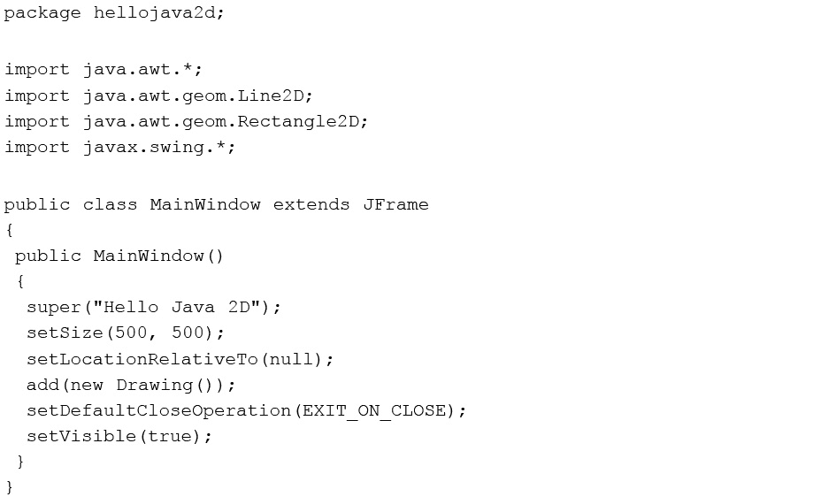!!(image/Image13575.jpg)

代码中发生且唯一的事情是添加了一个类型为 `Drawing()` 的单个组件。由于 `JFrame` 默认使用 `BorderLayout`，该组件会自动填充整个窗口。组件的定义如下：

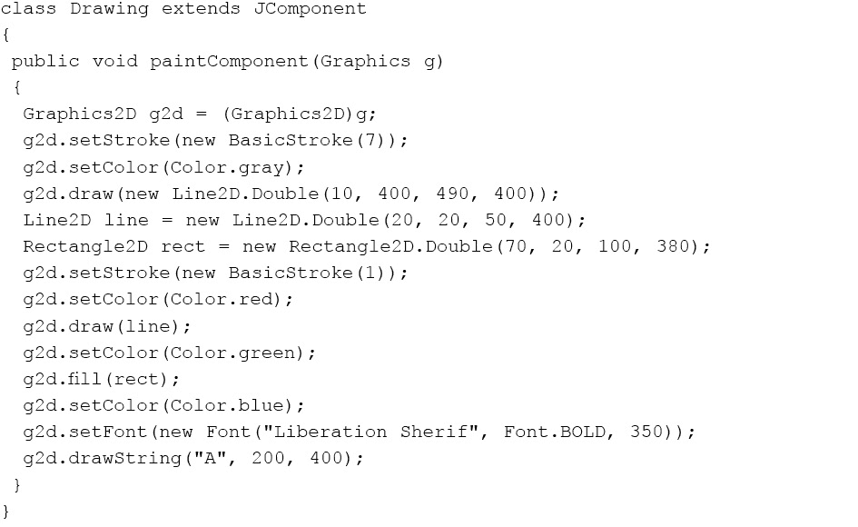

因此，这是一个自定义的 Swing 组件。组件有一个名为 `paintComponent()` 的方法，该方法负责绘制该组件。该方法的参数类型为 `Graphics`，它是一个提供可用绘图工具并代表程序图形的对象。该类型自 Java 存在以来一直存在，但随着 Java2D 的引入，定义了一个名为 `Graphics2D` 的派生类，它通过新的图形方法进行了扩展。因此，`paintComponent()` 方法开始将参数强制转换为 `Graphics2D` 对象。然后，该方法可以在图形对象上进行绘图，基本上发生了以下过程。

以下语句定义了使用宽度为 7 像素的灰色画笔进行绘制，第三条语句在两点之间绘制了一条直线：

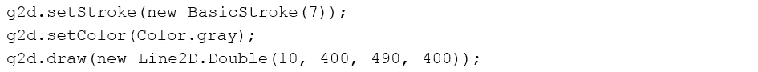

接下来的两个语句定义了两个几何形状，分别为一条线和一个矩形：

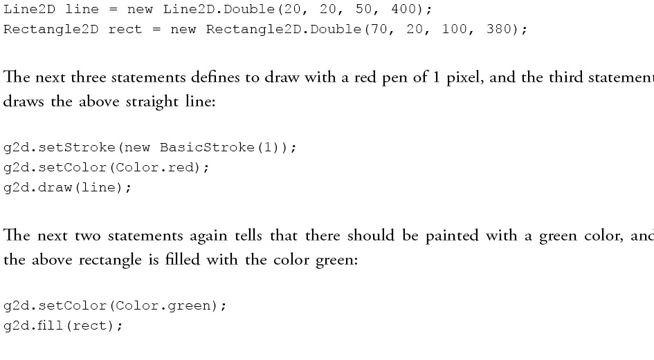

最后，最后三个语句说明颜色应为蓝色，文本应使用 350 点的粗体字体绘制，最后绘制了一个大写字母 A：

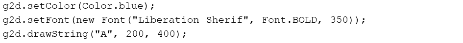

当然，人们无法预知语句应该那样写，但当你看到这些单独的语句时，它们是非常容易理解。

## 练习 1

编写一个你可以调用 `Java2DShapes` 的程序。该程序应该打开一个如下所示的窗口：

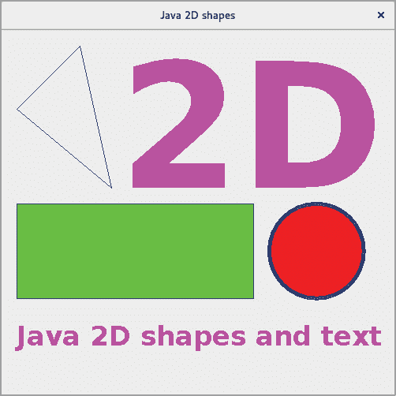

该程序可以用上述相同的方式编写。三角形是由三条直线绘制的。尝试自己动手（使用 Java 文档）找出如何画圆。该类型是 `Ellipse2D`。

## 1.1 `Graphics2D` 类

在处理示例之前，我将简单谈一下 `Graphics2D` 类，因此会稍微涉及相关技术。

在窗口中绘图的过程基于许多对象，如形状、图像、文本等，这些对象让你能够确定屏幕或打印机上的每个像素应该具有什么颜色，这个过程被称为 `rendering`（渲染），因此，渲染是在输出设备上显示图形原语（Primitives）结果的过程。`Graphics2D` 类可以被 Java2D 的渲染引擎。此外，`Graphics2D` 对象以像素集合的形式（每个像素都有一种颜色）表示一个图形表面。对象如何将图形原语转换为像素以及像素获得什么颜色，取决于对象的状态，该状态包含了七个概念：

1. `paint`：决定绘制和填充形状（包括文本）时使用哪些颜色。
2. `stroke`：指示通过 `draw()` 方法绘制形状的线条粗细。
3. `font`：指示文本应如何渲染。
4. `transformation`：指定原语图形对象在渲染之前应如何进行变换（移动、旋转、拉伸），包括逻辑坐标如何转换为物理坐标（默认情况下，72 个逻辑坐标转换为物理设备上的 1 英寸）。
5. `compositing`：用于确定颜色如何与绘图表面上的现有颜色组合。
6. `clipping`：定义渲染区域的限制（默认是 null，意味着整个绘图表面）。
7. `rendering hints`（渲染提示）：是告诉对象应如何被渲染的技术。

有四种用于渲染几何原语的通用方法：

1. `fill()`：填充形状的内部。
2. `draw()`：绘制形状的边界。
3. `drawString()`：绘制文本。
4. `drawImage()`：用于显示图像。

渲染过程由几个步骤组成，这些步骤原则上与上述四个方法独立并按以下顺序执行：

1. `transformation`（变换）
2. `rasterizing`（光栅化）
3. `clipping`（裁剪）
4. `paint`（绘制）
5. `compositing`（合成）

当给定的图形需要渲染（例如在屏幕上渲染）时，这是一种近似，形状并不一定能精确呈现。屏幕使用点（像素）来表示形状，例如，你无法用点产生精确的圆（人们可以看到边缘是由点组成的，而不是圆弧）。为了确定必须属于特定形状的点，计算机采用两种方法之一。默认是 `aliasing`（锯齿算法），即中心位于图形内部的像素被着色。也就是说，单个像素要么是图形的一部分，要么不是。结果是一个边缘呈锯齿状的形状。`aliasing` 的优点是它是绘制形状的一种有效且快速的方法，在大多数情况下，结果是完全满意的。第二种方法称为 `antialiasing`（抗锯齿），在这里计算机为每个像素确定图形与当前像素的交集。像素根据其属于图形的程度被赋予相应的饱和度着色。结果是一个线条和圆弧平滑程度不相同的图形。在底图中，左侧的圆是用锯齿算法渲染的，而右侧的圆是用抗锯齿渲染的。

同样注意文本的差异。`antialiasing` 的缺点当然是它是一个全面的渲染过程，需要执行大量的计算。下方窗口的代码如下，你主要需要注意如何指定 `Graphics2D` 对象必须使用抗锯齿：

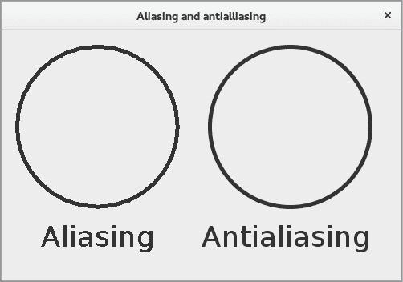!(image/Java_10_-_Java2D_6-11-17_17.jpg)

上面，我提到渲染过程包括光栅化和合成，它指示了图形像素覆盖绘图表面像素的程度。这个值被称为 `alpha value`（Alpha 值），是 0.0（不可见或透明）到 1.0（完全覆盖或不透明）之间的数字。例如，下面的窗口了两条直线和三个矩形，其中两条线先绘制：

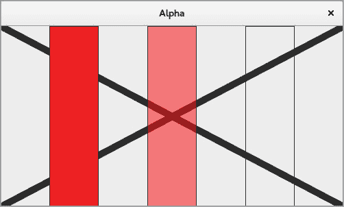

第一个矩形的绘制的 alpha 值为 1，因此会完全覆盖底层的像素。结果是两条线被矩形覆盖了。中间的矩形 alpha 值为 ½，因此它没有完全覆盖线条。结果是红色部分与黑色线条和灰色背景部分混合。最后一个矩形的 alpha 值为 0，因此完全透明，从而不可见。代码如下：

```text
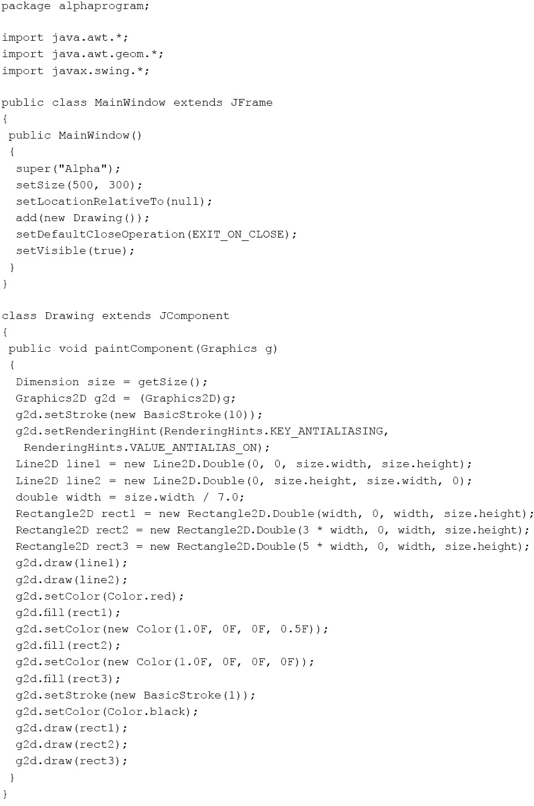
```

如果你测试该程序，请注意线条和矩形都随窗口的大小调整。

在处理 Java 2D 以及通用的计算机图形时，你将有一个坐标系。窗口的左上角为 (0,0)，x 轴向右延伸，而 y 轴向下延伸。这是一个被称为 `user space`用户空间）的逻辑坐标系，当要在物理显示器或打印机绘制对象时，你有一个不同的坐标系，被称为 `device space”（设备空间）。因此，渲染需要将坐标从用户空间转换为设备坐标，对于屏幕，这种转换通常是直接的，用户空间中的 1 个单位对应一个像素，但通常目标是将 72 个单位（用户空间中）转换为 1 英寸。

## 练习 2

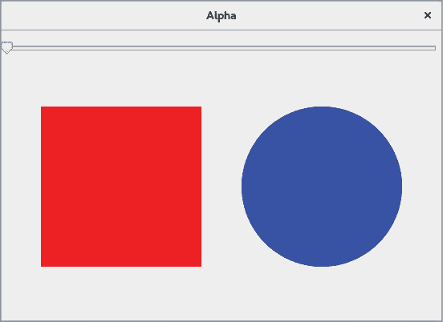

你必须编写一个程序（我的解决方案名为 `AlphaValue`），它打开一个如上面的窗口，其中画了一个方形和一个圆形。顶部有一个滑块，如果你移动滑块，图形应该被一个绿色矩形覆盖，该矩形最终完全覆盖图形：

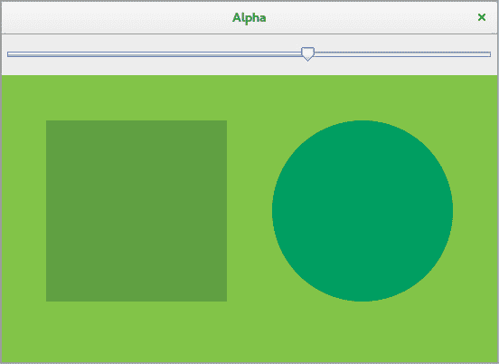

你必须为滑块关联一个事件处理器，当滑块移动时重绘该组件。如果 `Drawing` 指向带有图形的组件，则事件处理器可以定义为以下内部类的对象：

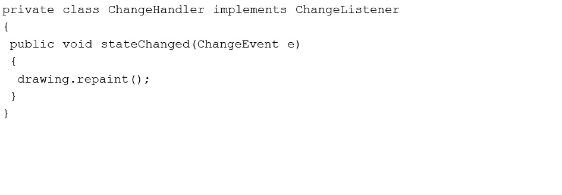

# 2 图形

在本章中，我将展示如何定义和绘制几何形状，就像我在上面的示例中做的那样，例如一个矩形。它的类型是 `Rectangle2D`，但它是一个抽象类，有两个具体的派生类，分别称为 `Rectangle2D.Float` 和 `Rectangle2D.Double`。区别在于图形的属性以及它们是使用 `float` 类型还是 `double` 类型定义的。这种模式用于所有原始的 `Shape` 对象。

有一个辅助类，名为 `Point2D`（以及 `Point2D.Float` 和 `Point2D.Double`），表示一个点。`Point2D` 对象没有大小且无法渲染，该对象仅用于为其他对象定义属性。基本的几何类如图所示，它们都由一个名为 `Shape` 的通用接口定义。该接口定义了几个重要方法，我将提到：

- `getBounds2D()`，返回一个外接矩形
- `contains()`，测试点或矩形是否包含在形状内
- `intersects()`，测试矩形何时与当前形状重叠

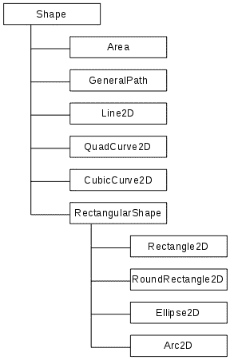

## 2.1 填充形状

最后四个使用起来简单，区别主要在于创建对象时必须输入的参数。通常，一个图形由一个矩形定义，即指示左上角、宽度和高度的外接矩形。程序 `Figures` 打开以下窗口：

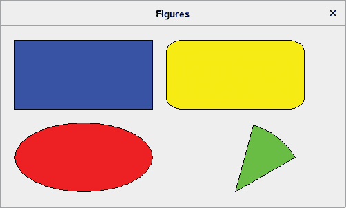

关于类型 `Rectangle2D` 和 `Ellipse2D`，没有多多要说的，但对于 `RoundRectangle2D`，除了外接矩形外，你还必须指定圆角是如何圆角的——实际上，是根据矩形的宽度和高度来指定的。然后是绿色形状，它是一个 `Arc2D`。首先你必须定义外接矩形，这里必须意识到该矩形是包含该形状的椭圆的外接矩形。除了矩形外，你必须指定范围开始的角度（以度为单位）以及范围跨越的角度大小。最后，你必须指定切片显示的形式，有以下选项：

- `Arc2D.PIE`，在此示例中显示形状
- `Arc2D.OPEN`，只显示弧
- `Arc2D.CHORD`，显示弧和弧端点之间的弦

上述窗口的代码为：

```text
image/Java_10_-_Java2D_6-11-17_24.jpg
```

```text
image/Java_10_-_Java2D_6-11-17_25.jpg
```

## 练习 3

复制上面的项目，该项目会打开带有四个图形的窗口。你必须修改程序，以便当你点击形状时，会弹出一个如下所示的消息框，告诉你点击了哪个图形。注意，你唯一做的是添加一个鼠标点击事件处理器，它来判断是否点击了图形，如果是，点击了什么。


## 2.2 线

我将查看三种类型 `Line2D`、`QuadCurve2D` 和 `CubicCurve2D`，每种代表一条线段。`Line2D` 表示两点之间的直线，没什么好解释的。要创建一个 `Line2D` 对象，你只需指示线段的端点。

`QuadCurve2D` 表示两点之间的路径，它有一个关联的控制点，使得从曲线端点的控制点的线是曲线的切线：

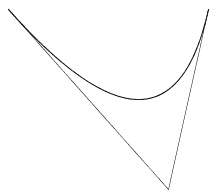

如果你需要创建一个 `QuadCurve2D`，则必须指示三个点。`CubicCurve2D` 原则上是一样的，但这里有两个控制点，每个端点各一个：

```text
image/Image13653.jpg
```

因此必须指定四个点来创建 `CubicCurve2D`。CubicCurve2D 的结果结果可能有点困难。以下程序打开一个窗口，蓝色曲线是 `CubicCurve2D`，而红色的是 `QuadCurve2D`。除了端点外，当你拖动时，这些形状会显示鼠标坐标。该窗口的代码如下：

```text
image/Java_10_-_Java2D_6-11-17_27.jpg
```

```text
image/Java_10_-_Java2D_6-11-17_28.jpg
```

## 练习 4

创建 `Curves` 项目的副本并修改程序，使得当你拖动时，窗口底部显示鼠标坐标，且曲线必须用粗线绘制。这意味着在绘制曲线时必须使用 `Stroke` 对象，例如：

```text
image/Java_10_-_Java2D_6-11-17_31.jpg
```

为了显示鼠标坐标，你可以在窗口底部添加一个 `JLabel` 组件并在每次拖动点时更新它。

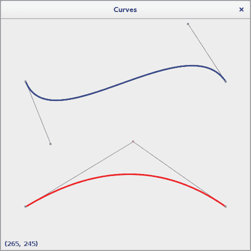

## 练习 5

编写一个名为 `StraightLines` 的程序，它打开所示窗口。滑块应代表 0 到 100，从 25 开始。窗口必须绘制滑块指示的直线数量并在六种颜色之间切换。线从左上角开始到底部的一个点，底部被划分为若干点。同样，线从右下角开始到左边缘的一个点，左边缘根据滑块的值划分为若干点。


## 2.3 GeneralPath

`Line2D`、`QuadCurve2D`、`CubicCurve2D`、`Rectangle2D`、`RoundRectangle2D`、`Ellipse2D` 和 `Arc2D` 是 Java2D 中的基本几何类型，但从上面的类图中可以看出还有两个类，它们可以用于定义更复杂的形状。

`GeneralPath` 类通过一系列点定义形状，在每两个点之间可以是类型为 `Line2D`、`QuadCurve2D` 或 `CubicCurve2D` 的线。`GeneralPath` 定义了一个任意形状，它不必须是闭合或连贯的。你可以这样理解这种形状，就像你用笔画它一样，你可以做两件事：

1. 抬起笔并移动到一个点。
2. 从笔的位置画一条线到另一个点。

为此你使用这些方法：`moveTo()`、`lineTo()`、`quadTo()`、`cubicTo()` 和 `closePath()`。

下面的窗口显示了三种类型的 `GeneralPath` 形状，其中红色部分由三个 `line` 线段、一个 `quad` 线段和一段 `cubic` 线段组成。另外两个形状完全由 `line` 线段组成：

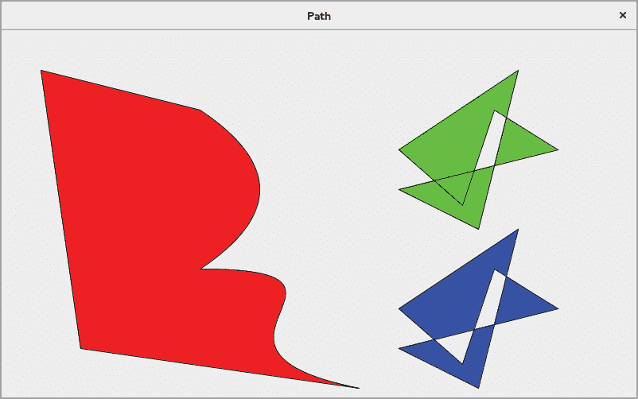

通常情况下，创建一个 `GeneralPath` 是足够简单的，只有一点是复杂的，即确定形状的内部区域。如果形状由一个简单闭合曲线边界（如红色部分），那么就没有什么可疑问的；但如果形状是由相交的线形成的，情况就会变得复杂，且它可以通过两种方式发生，你可以通过构造函数的参数来指定。如果你考虑蓝色图形，它被定义为 `GeneralPath.WIND_EVEN_ODD`。直线将形状分为若干个闭合区域（在本例中为五个）。如果你必须判断这些区域中哪些属于该图形，可以画一条穿过图形区域的直线：

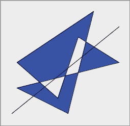

如果你从形状外部开始并沿着线条移动，每当通过一个线段时，计数器就加 1，那么规则是：如果计数器为奇数，则该区域属于图形；如果计数器为偶数，则不属于。绿色图形被定义为 `GeneralPath.WIND_NON_ZERO`（顺便提一下，这是默认值）。在这里必须判断图形的一部分是否属于，可以同样画一条交叉图形区域的线。当线穿过图形的某个线段时，规则是：如果线段是从左到右绘制的，计数器加 1；如果线段是从右到左绘制的，计数器减 1。属于图形的区域即计数器不为 0 的区域。

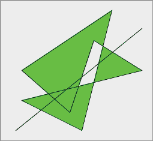

程序的代码为：

```
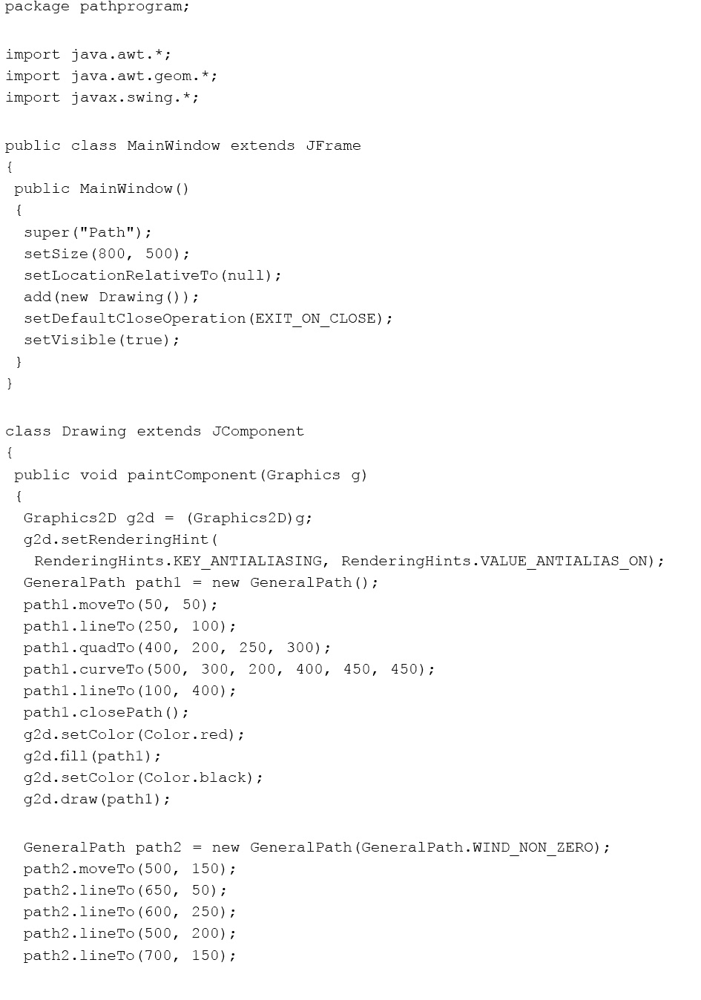[](image/Java_10_-_Java2D_6-11-17_36.jpg)
```

除了使用线段创建 `GeneralPath`，你还可以由其他形状创建一个 `GeneralPath`。下面的窗口显示了一个绘制三角形的 `GeneralPath`，但它由另一个 `GeneralPath`（同样代表一个三角形）和一个 `Rectangle2D` 组成。如果你点击这三个形状之一，就会弹出一个对话框，其目的是显示这三个图形都是同一个 `Shape` 对象的一部分。

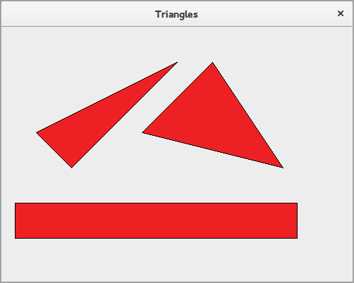

代码如下：

```
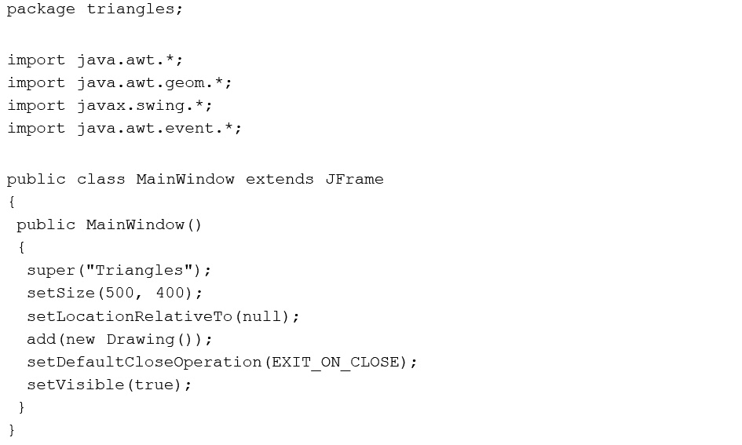[](image/Java_10_-_Java2D_6-11-17_38.jpg)
```

## 练习 6

编写一个名为 `Polygons` 的程序，它必须打开一个如下所示所示（其中下方的形状不是多边形）。这三个形状都应该定义为 `GeneralPath`，其中底部由两个 `quad` 线段定义。最后，如果你点击这三个图形之一，你应该得到一个对话框，告诉你点击的是哪一个形状：

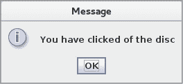[](image/Image13724.jpg)

## 2.4 区域

几何形状的最后一个类是 `Area`。它是一种结合了一个或多个形状的类型，但你可以指定它们如何相互重叠。

下面的窗口绘制了一个重叠的圆和一个正方形。这些图形被通过 `Area` 对象用于定义另外四个图形。在这里，你应该注意创建 `Area` 对象的四个方法，还要注意它们是如何通过平移图形对象放置在窗口中的。这是通过变换实现的，变换将在稍后讨论，但在本例中，图形是通过简单的平移放置的。

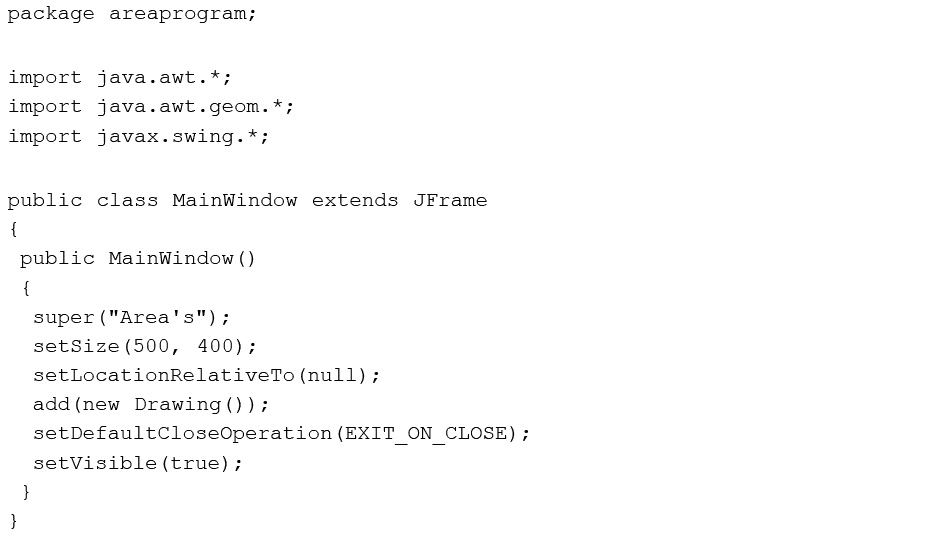[](image/Java_10_-_Java2D_6-11-17_41.jpg)[](image/Java_10_-_Java2D_6-11-17_42.jpg)[](image/Java_10_-_Java2D_6-11-17_43.jpg)[](image/Image13735.jpg)

# 3 填充与描边

在上一章中，我描述了 Java2D 如何定义几何形状以及如何在窗口中绘制它们。绘制一个形状包括：

1. 图形的轮廓应该如何绘制
2. 图形的内部应该如何填充（如果有内部的话）

这两者都是本章的主题。

如果你有一个闭合形状（例如矩形），你可以用 `draw()` 绘制它的轮廓，并用 `fill()` 填充形状。下面的窗口中绘制了两个矩形

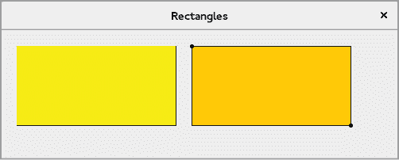

目标是展示如何绘制轮廓。第一个矩形的绘制方式如下：

```
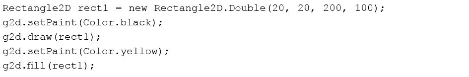
```

你应该注意到，我先绘制了轮廓，然后用黄色填充了矩形。结果是轮廓在顶部和左侧被覆盖了，但在右侧和底部可见。当线从 (220, 20) 到 (220, 120) 时，边缘为：

- (220, 20) 到 (220, 120) - 顶边
- (20, 20) 到 (20, 120) - 左边
- (20, 120) 到 (220, 120) - 底边
- (220, 20) 到 (220, 120) - 右边

程序的代码为：

```
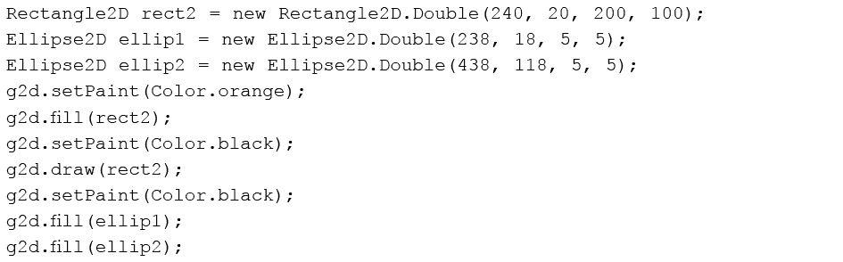
```

意识到这一点非常重要，`Graphics2D` 类有一个类型为 `Paint` 的变量。有三种选项：

1. `Color`
2. `GradientPaint`
3. `TexturePaint`

## 3.1 GradientPaint

你也可以用 `GradientPaint` 填充形状（甚至用它绘制线条）。你可以在沿一条直线混合两种颜色。考虑以下窗口：

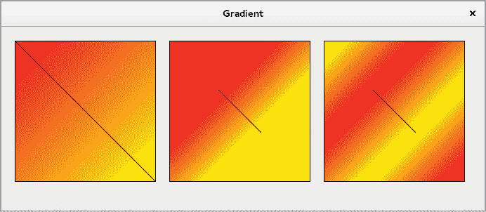

显示了三个带有直线的正方形。绘制这些直线仅是为了解释原理。第一个图形沿着所所示的直线混合了红色和黄色，使得你从左上角开始，到右下角结束。中间的图形混合了相似的红色和黄色，但这次直线没有跨越整个正方形。结果是线条开始之前的部分都是红色的，而线条之后都是黄色的。最后一个形状在原理上相似，但这次模式重复了。表示三个正方形的组件是：

```
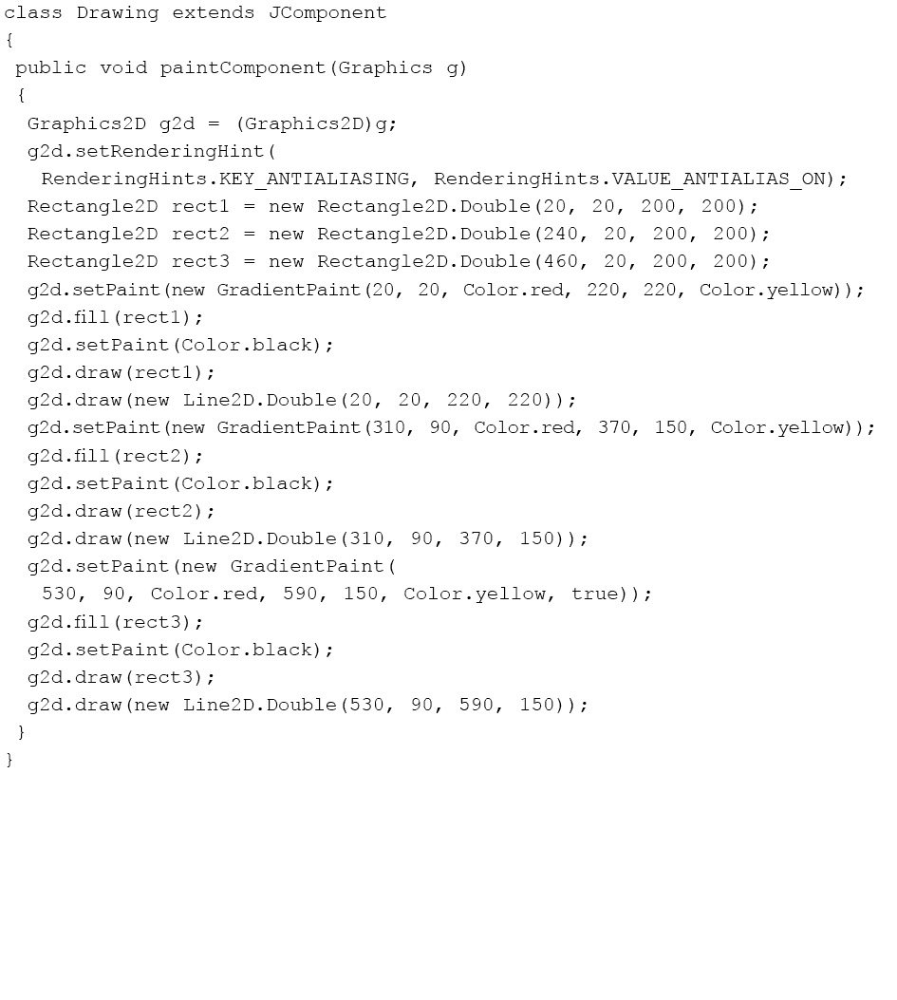
```

## 练习 7

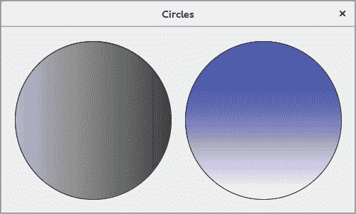

编写一个名为 `Circles` 的程序，绘制如上所示的窗口。这里左侧椭圆用 `GradientPaint` 填充，它沿水平直径混合了浅灰色和深灰色，而右侧椭圆沿垂直直径混合了蓝色和白色。椭圆必须遵循窗口大小，并在窗口大小改变时发生变化。

## 练习 8

在这个练习中，你必须编写一个程序，可以命名为 `GradientBackground`，它将打开以下窗口：

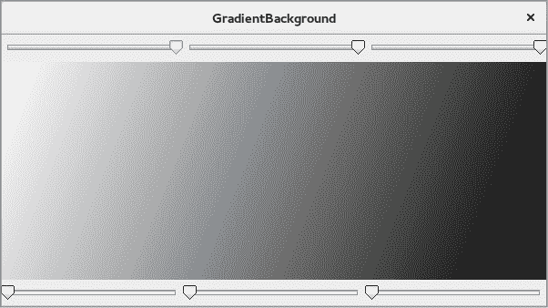

窗口显示了一个矩形（其大小随窗口变化），由一个 `GradientPaint` 填充，该填充沿左上角的对角线方向混合了白色和黑色。窗口顶部和底部分别有三个 `JSlider` 组件。它们分别被用于定义“白色”和“黑色”颜色。当你移动滑块时，结果可能如下所示。注意，当代表矩形的组件必须引用这六个 `JSlider` 组件时，你可以通过在 `MainWindow` 中将 `Drawing` 类定义为内部类来简化工作。

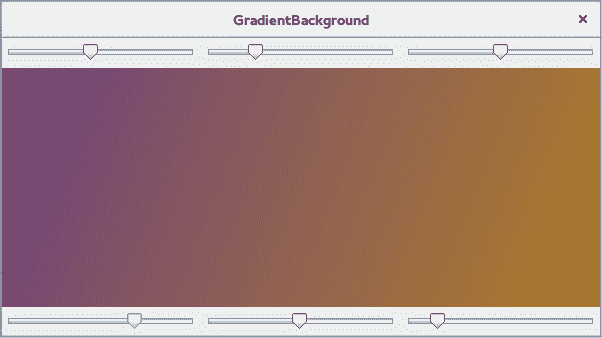

## 3.2 TexturePaint

也可以用图像来填充图形。以下程序绘制了一个矩形并填充了整个窗口，矩形由一个 64x64 像素的图标重复填充组成：

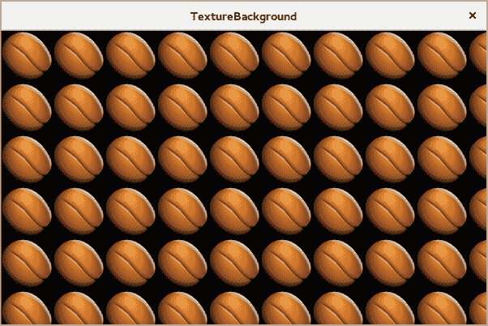

该项目有一个名为 `images` 的子包，其中包含了该图标（这是一个复制到此处的 png 文件，因此图片是资源，并与程序的类一起打包的）。窗口的代码如下：

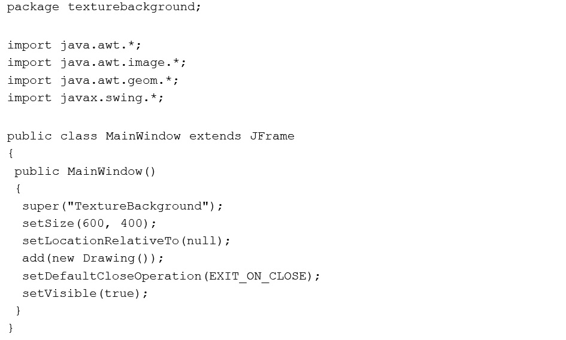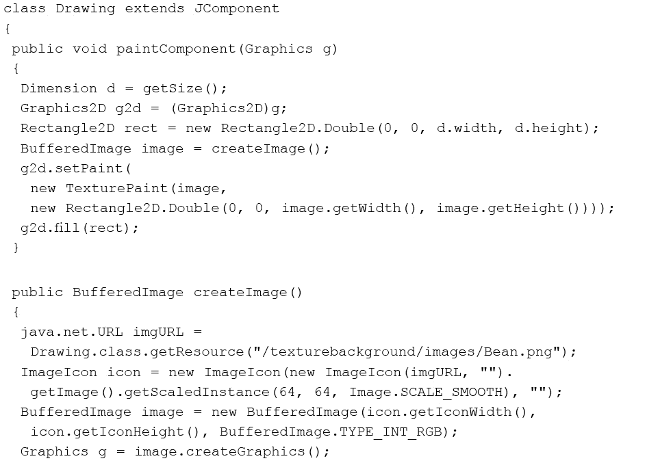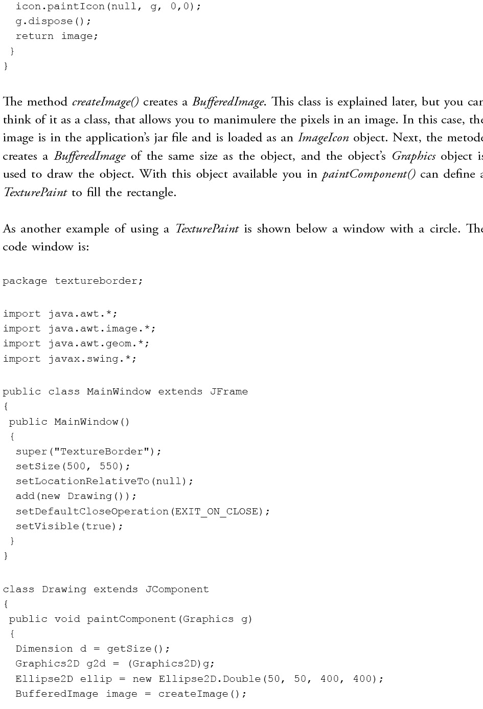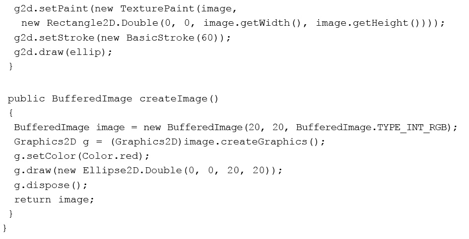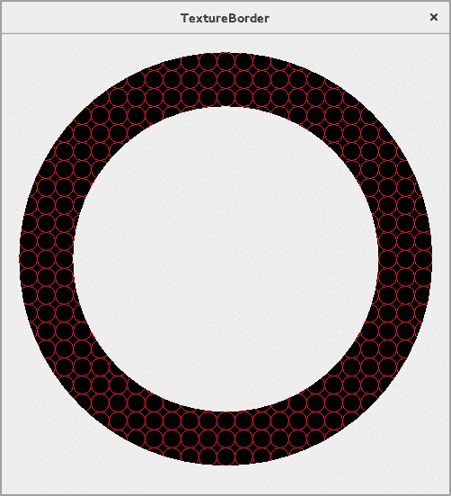

方法 `createImage()` 创建了一个 20×20 像素的 `BufferedImage`，其中绘制了一个红圆。你可以在不从文件中加载图像的情况下创建并操作 `BufferedImage`。`BufferedImage` 在 `paintComponent()` 中创建以创建一个 `TexturePaint`，然后使用 60 像素的描边画一个圆。

除了展示如何从零开始创建 `BufferedImage` 之外，示例还展示了图形的边界本身就是一个 `Shape`，可以通过 `draw()` 方法使用 `Paint` 对象进行填充。

## 3.3 Strokes（描边）

在上面的示例中，我展示了如何定义一个 `BasicStroke` 对象，从而指示了线条需要画有多厚。默认值为 1。然而，关于描边，有两点你必须了解：

* 线条的端点应该是什么样的
* 线段是如何组合在一起的，因此转角处应该是什么样的

这些概念仅在你需要画粗线时才有意义。最后，必须知道如何画虚线。下面的窗口显示了大部分可用选项：

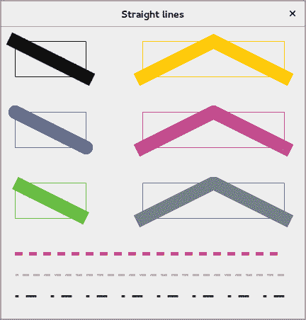

关于线条的端点有三种可能性：

1. `BasicStroke.CAP_SQUARE`（默认值）
2. `BasicStroke.CAP_ROUND`
3. `BasicStroke.CAP_BUTT`

第一条线（黑色）使用默认值绘制，否则使用宽度为 19 的描边。此外，还绘制了一个作为该线条外接矩形的框。关于端点，样式为 `CAP_SQUARE`，它通过一个长度为线宽一半的矩形来扩展线条。蓝线对应的端点是 `CAP_ROUND`，它通过一个半径为线宽一半的半圆来扩展线条。最后，绿色线使用了 `CAP_BUTT`，它简单不扩展线条。

右侧的三个图形类型均为 `GeneralPath`，并使用宽度为 19 的描边和端点选项 `CAP_SQUARE` 进行绘制，同时也定义了转角的绘制方式。同样有三种选项：

1. `JOIN_MITER`（默认值）
2. `JOIN_ROUND`
3. `JOIN_BEVEL`

橙色路径使用默认值绘制，因此样式为 `JOIN_MITER`。它通过延伸外边缘直到它们相交来组合线段。洋红色线使用 `JOIN_ROUND`，这简单意味着线段端点使用了 `CAP_ROUND`。最后，灰色路径使用了 `JOIN_BEVEL`。在这里，线段端点使用 `CAP_BUTT` 且外边缘连接在一起。

然后是三条虚线。红色的线按照如下定义的描边绘制：

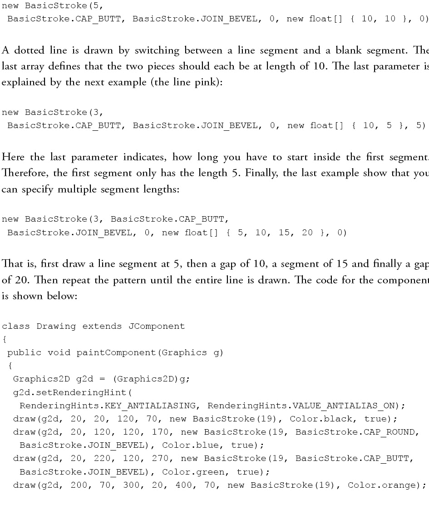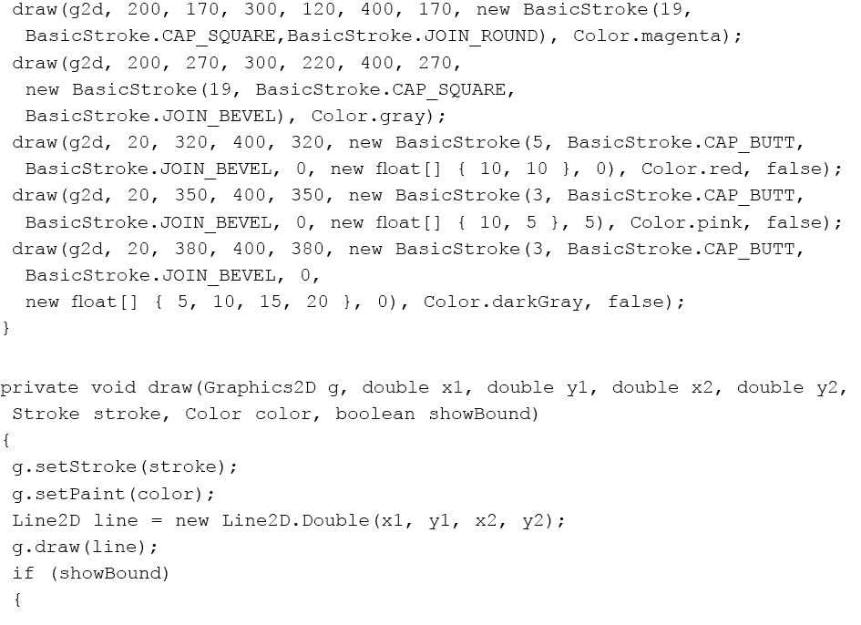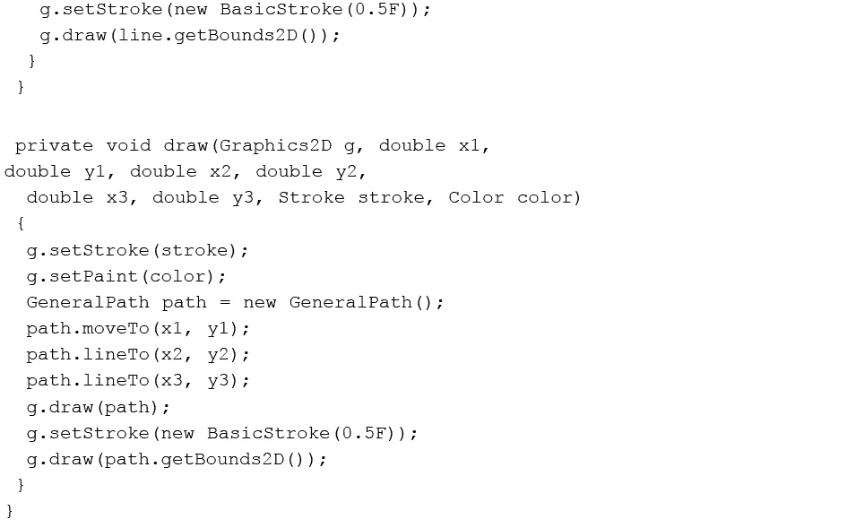

## 练习 9

编写一个程序，打开以下窗口：

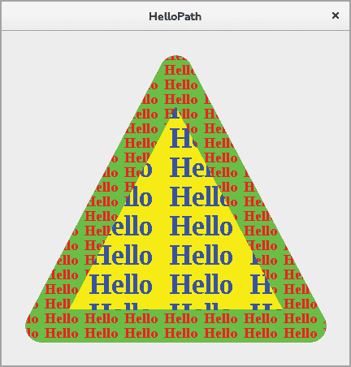

# 4 渲染

在数一章中，我讨论了如何定义几何形状。在本章中，我将查看 Java2D 是如何渲染图形的。具体如下：

1. 变换 (transformation)
2. 合成 (compositing)
3. 裁剪 (clipping)
4. 渲染提示 (rendering hints)

## 4.1 变换

变换由名为 `AffineTransform` 的类定义，仿射变换是一种保持平行线的变换。`Graphics2D` 类拥有一个 `AffineTransform` 实例，在渲染时适用于所有几何形状。这种变换可以通过两种方式更改。

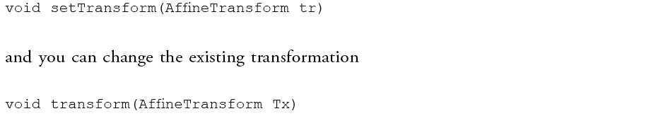

通常建议使用后一种方法。`Graphics2D` 类还拥有方法：

* `translation`（平移）
* `rotation`（旋转，绕某点旋转）
* `scaling`（缩放）
* `shearing`（倾斜）

#### 平移 (Translation)

`TranslateDemo` 程序打开了一个如下所示的窗口。窗口绘制了四个矩形，首先画黑色的。组件的代码如下：

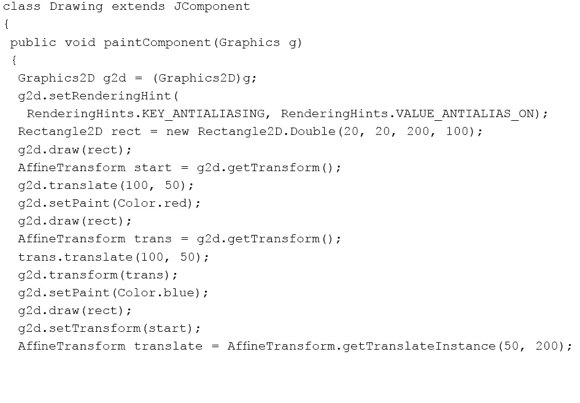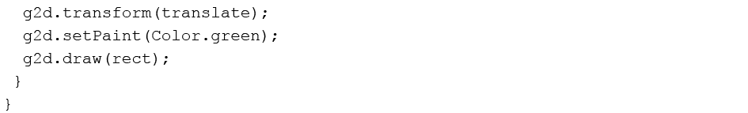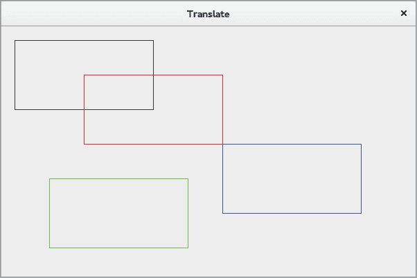

首先定义一个矩形 `rect`，使用默认设置绘制，结果是黑色矩形。接下来为当前变换添加一个引用 `start`。目标是在执行其他变换后，将绘制表面的变换重置为默认值。

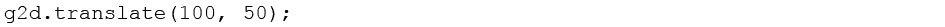

接下来，更改 `Graphics2D` 对象的 `AffineTransform`。下一步定义当前 `AffineTransform` 的引用 `trans`，然后进行平移 (100, 50)，这用于修改 `g2d` 对象的变换，并再次绘制矩形，但这次是蓝色的。在这里，由于是复合变换，结果并不显而易见。首先执行平移 (100, 50)，它将当前的起始点 (100, 50) 移动到 (200, 100)。接着执行第一个变换，也是一次平移 (100, 50)，它将起始点 (200,100) 移动到 (300, 150)。结果是蓝色矩形的左上角位于 (320,170)。在绘制蓝色矩形后，将变换重置为默认，并使用 `AffineTransform` 类中的静态方法定义一个新的平移。结果是绿色矩形。

## 练习 10

编写一个程序，创建如下窗口：

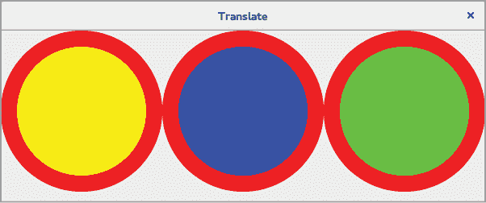

其中蓝色和绿色圆必须是黄色圆的变换（平移）。

#### 旋转 (Rotation)

旋转在原理上与平移相同，并且同样可以用三种不同的方式定义。在接下来的示例中，我只使用了一种方法，但另外两种方法的作用与平移完全一样。旋转是围绕一个点旋转坐标系，从而旋转绘图表面。默认情况下，它是点 `(0, 0)`，但你也可以围绕任何其他点进行旋转，其结果是平移后接旋转。旋转由以弧度为单位的角度指定。

下面是一个旋转两个矩形（黑色矩形）的窗口。其中一个矩形（蓝色）以 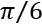 围绕零点（矩形的左上角）旋转，而另一个（红色矩形）则以  的角度围绕矩形的右下角旋转。洋红色矩形是另一个黑色矩形以  的角度围绕右下角旋转后得到的。

[](image/Java_10_-_Java2D_6-11-17_64.jpg)

### 缩放 (Scaling)

缩放是一种图形尺寸调整的变换——包括水平方向和垂直方向。接下来的示例缩放了一个矩形：

[](image/Java_10_-_Java2D_6-11-17_65.jpg)

被缩放的矩形是黑色矩形。你应该注意，当你缩放图形时，图形的形状和位置都会发生改变。位置发生改变是因为所有距离坐标系起始点的距离都经过了缩放。黑色矩形的左上角是 `(170, 70)`，蓝色矩形的左上角位于 `(340, 140)`，宽度为 `400`，高度为 `200`。同样，洋红色矩形的左上角坐标为 `(85, 35)`，宽度为 `100`，高度为 `50`；红色矩形仅进行了垂直缩放，其左上角为 `(170, 35)`，宽度保持 `200` 不变，高度变为 `50`。

### 练习题 11

创建项目 `ScaleDemo`（上面的程序）的副本。你必须修改程序，使得所有的缩放都基于黑色矩形的左上角进行。

### 伸展 (Stretching)

最后一种基本变换被称为切变，其中 x 轴、y 轴或两个轴都被拉伸。下面的窗口展示了如何拉伸矩形（黑色矩形）。在所有三种情况下，该变换都是对左上角在 `(0, 0)` 的矩形进行平移，然后进行一个切变变换。这意味着所有三种变换都是复合变换。在原理上，组合变换非常简单，但结果可能难以理解，且顺序至关重要。

[](image/Java_10_-_Java2D_6-11-17_67.jpg)[](image/Image13858.jpg)

## 4.2 合并 (Compositing)

合并是将两个图像组合在一起的过程，并在每次绘制形状或图像时出现。如前所述，`Graphics2D` 代表绘图表面，每当你在这个表面上绘制形状、某些文本或图像时，就会向绘图表面添加一个新元素。这在原理上通过三种操作完成：

1. *栅格化*(Rasterizing）从当前图形产生 *alpha 值*，你可以将其想象为一个像素网格，每个像素都有一个 alpha 值。原理上，这个网格对应整个绘图表面，在下文中被称为源（source）。相比之下，绘图表面被称为目标（destination）。
2. 对于源中的每个像素，根据 `Graphics2D` 对象使用的当前 `Paint` 对象或图像来确定颜色。
3. 源和目标（颜色和 alpha 值）逐像素组合，形成绘图表面上的图像。源和结果的组合是根据合并规则完成的，该规则精确规定了如何使用颜色和 alpha 值。


例如，如果你观察当一个黑色图形渲染在白色绘图表面上并使用默认合并规则时会发生什么，可以如下描述该过程。栅格化将图形转换为 alpha 值数组，完全在形状之外的像素被赋予值`0.0`（解释为透明），目标中相应的像素将保持不变。同样，图形内部的像素 alpha 值为`1.0`，目标中相应的像素将获得与源像素相同的颜色，在这种情况下结果将黑色。

然后是位于边缘的像素，它们会获得`0.0`到`1.0`之间的 alpha 值（假设使用了抗锯化）。它们的颜色是源和目标像素颜色的组合，在这种情况下将是黑色和白色的混合，因此是灰色。确切的颜色取决于源中的 alpha 值。例如，alpha 值为`0.9`的像素将给出非常深的灰色。

上述被称为合并默认规则，但实际上在特殊情况下可能会使用其他规则。它们被称为 *Porter-Duff 规则*，但此处不进行讨论。

## 4.3 裁剪 (Clipping)

有时人们并不关心是否在整个表面上绘制。当你构建复杂的形状时，通常需要确保不绘制整个表面。考虑以下内容：[](image/13865.jpg)

## 4.4 渲染提示 (Rendering Hints)

本章最后最后内容是提到渲染提示，正如我之前提到抗锯化时那样。它是对绘制图形质量的一种机会。`Graphics2D` 的渲染机制可以通过多种方式实现，而渲染提示是程序员对质量的需求，但不能确定该机制能够满足你的要求。你可以将渲染提示定义为键值对，可能性如下表所示：

| 键 | 值 |
| :--- | :--- |
| `KEY_ANTIALIAS` | `VALUE_ANTIALIAS_ON`, `VALUE_ANTIALIAS_OFF`, `VALUE_ANTIALIAS_DEFAULT` |
| `KEY_RENDERING` | `VALUE_RENDER_QUALITY`, `VALUE_RENDER_SPEED`, `VALUE_RENDER_DEFAULT` |
| `KEY_DITHERING` | `VALUE_DITHER_DISABLE`, `VALUE_DITHER_ENABLE`, `VALUE_DITHER_DEFAULT` |
| `KEY_COLOR_RENDERING` | `VALUE_COLOR_RENDER_QUALITY`, `VALUE_COLOR_RENDER_SPEED`, `VALUE_COLOR_RENDER_DEFAULT` |
| `KEY_FRACTIONALMETRICS` | `VALUE_FRACTIONALMETRICS_ON`, `VALUE_FRACTIONALMETRICS_OFF`, `VALUE_FRACTIONALMETRICS_DEFAULT` |
| `KEY_TEXT_ANTIALIASING` | `VALUE_TEXT_ANTIALIAS_ON`, `VALUE_TEXT_ANTIALIAS_OFF`, `VALUE_TEXT_ANTIALIAS_DEFAULT` |
| `KEY_INTERPOLATION` | `VALUE_INTERPOLATION_BICUBIC`, `VALUE_INTERPOLATION_BILINEAR`, `VALUE_INTERPOLATION_NEAREST_NEIGHBOR` |
| `KEY_ALPHA_INTERPOLATION` | `VALUE_ALPHA_INTERPOLATION_QUALITY`, `VALUE_ALPHA_INTERPOLATION_SPEED`, `VALUE_ALPHA_INTERPOLATION_DEFAULT` |

此外，文本必须被绘制，尽管通常在与 Swing 组件相关的文本工作中，你不需要做任何操作，但文本也必须在某处被绘制，这项任务由 Java2D 来处理。实际上，文本包含许多细节，这正是本章的主题，但基本上文本图形对象可以像其他图形对象和形状一样进行操纵。

文本包含编码为 Unicode 的字符，因此为了绘制文本，必须为每个字符找到并渲染代表该字符的图形。这样的图形被称为`glyph`（字形），而字体包含了该字体支持的所有字符的字形。在字体上还附带了字体度量（font metrics），指示了每个字符的大小。对于高度有三种尺寸。字符绘制在基准线（baseline）上（字符站在基准线上）。`descent`（下降部）表示字符在基线以下必须填充多少空间，而`ascent`（升部）表示它们在基线以上可以填充多少。最后通过`leading`（行间距）指定行之间的空间，这三个尺寸合起来称为字体高度。作为所有这些内容的示例，你可以考虑以下窗口：


这里的黑线是基准线，黑线与红线之间的距离是 $descent$，黑线与洋红色线之间的距离是 $ascent$，洋红色线与蓝色之间的距离是`leading`。

组件代码所示：


在这里你应该特别注意`FontMetrics`类，它包含了关于字体的信息，并且你应该注意`stringWidth()`方法，它被用于测量字符串在当前字体中占据了多少空间。

事实上，人们可以对文本进行更多操作，例如，你可以为文本关联一个迭代器，用它可以来操纵单个字符或字符串的一部分。`AttributedText`程序打开了一个如下所示的窗口：


`createImage()`方法是一个从 jar 文件加载`Bean.png`文件的方法，结果是一个 48×48 像素的图标。然后是`paintComponent()`，这次它是复杂的。首先，该方法定义了两个字体和一个字符串。你必须注意该字符串以两个逗号结尾。这里逗号并不是必不可的，但这两个字符随后会被替换为其他内容。下一步是为该字符串定义一个`AttributedString`（属性字符串），它是一个允许以多种方式操纵字符串的对象。首先为文本附带了一个衬线字体（serif font），然后文本通常会基于此字体进行绘制，但随后分配了一个等宽字体（mono font），但仅针对从第 6 位到第 13 位（包含在内）的字符，即`Fredegod`这个词。此外，该方法定义了该子字符串应该是红色并带有下划线的。接下来定义了一个作为`GeneralPath`的`Shape`，这是一个由两个三角形组成的图形。该图形被表示为`ShapeGraphicAttribute`，它指示了在文本中的位置（在这里在基准线处）以及它应该被作为一个填充图形绘制。它现在被插入到文本的第 14 个位置，以替换第一个逗号（`Fredegod`单词后的逗号）。下一步定义了一个矩形，并以相同的方式插入到倒数第二个位置。矩形不填充任何内容，它应该显示如何在文本中添加空间。最后，图标被插入到最后。发生方式相同，只是这次使用了另一个类型为`ImageGraphicAttribute`的对象。示例展示了如何构建一个非常复杂的字符串，除了上面显示的，还有许多其他选项。

## 练习 12

文本是一个与其他所有形状相同的图形对象，因此文本可以像其他`Shape`对象一样进行变换。编写一个程序，打开以下窗口：


## 练习 13

编写一个程序，显示如下所示的窗口，其中文本使用`TexturePaint`绘制，并用由 4 个小正方形组成的图像绘制：


## 5.1 字体

Java2D 包含了几个关于字体的类，我已经提到过`Font`和`FontMetrics`类。在本节中，我将展示一个打开如下所示窗口的程序。该应用程序显示一个带有所有可用字体列表的列表框。如果你双击某一行，就会得到一个包含字体信息的消息框。


代码如下，没什么好解释的，但你应该特别注意如何确定哪些字体是可用的。注意`FontRenderContext`类，它在使用特定字体绘制时测量字符串填充空间大小时可能有用：

```
image/Java_10_-_Java2D_6-11-17_80.jpg)
```

## 练习 14

编写一个程序，当以下情况打开

1. 正方形边是字体

2. 行与字体重合

3. 矩形是文本

4. 正方形包围文本

5. 矩形与之间的距离

```
14670.jpg
```

## 5.2 TextLayout

我将用`TextLayout`类结束关于文本的章节，它允许完全控制文本的渲染。在实践中，程序可以使用`JTextField`、`JTextArea`或`JEditorPane`显示文本，但如果你有非常特殊的需求，这些组件并不适用，`TextLayout`提供了额外的灵活性。在下面我将给出四个示例。`TextLayout`作为`drawString()`的替代方案，你可以将其认为一个对象

这里使用`TextLayout`绘制了第一个文本（黑色文本），而另一个是从黑色文本创建的`Shape`，由文本的所有字形组成。如果你点击文本的某个地方（例如大字母 H），你会得到如下所示的消息框，显示了你点击的字符：


组件代码如下：

```
image/Java_10_-_Java2D_6-11-17_83.jpg)
```

该类定义了一个`TextLayout`实例变量。它在构造函数封装了字符串`str`。`TextLayout`对象的构造函数需要一个`Font`和一个`FontRenderContext`。你应该注意如何创建`FontRenderContext`。第一个参数是一个`AffineTransform`，这里只是恒等变换，而最后一个参数指定了是否使用抗锯以及如何计算尺寸。最后，为构造函数分配一个鼠标点击监听器，我稍后会解释。

如果你有一个`TextLayout`，人们可以用以下方式绘制文本：

```
image/Java_10_-_Java2D_6-11-17_85.jpg
```

语法与你其他绘制形状或文本的方式略有不同。绘制图形后，你可以通过`getOutline()`方法获得一个由文本字形组成的`Shape`。该方法拥有一个变换，告诉对象如何进行变换，然后该`Shape`对象就可以像任何其他`Shape`对象一样被处理。在这种情况下，该图形被填充为黄色并用红色绘制。

该组件在构造函数中按照指定监听鼠标点击，而处理程序测试鼠标坐标是否落在`TextLayout`对象范围内。这种情况通过引用对象的`TextHitInfo`对象来实现，该对象返回一些重要信息，其中最重要是将鼠标坐标转换为被点击的字符。确定这一点并非易事，它是`TextLayout`提供的服务之一。

下一个示例将打开以下窗口，它再次显示了使用`TextLayout`绘制的文本：


程序将展示如何绘制光标（或光标/标记），以及如何使用方向键移动光标。这听起来很简单，但如果你仔细想一下，光标（通常）是绘制在两个字母之间的一条细线，计算这个字符串应该如何绘制并不简单。幸运的是，`TextLayout`类提供了必要的支持。组件的代码所示：


代码与之前的示例相似，但这次构造函数包含对主窗口的引用，以便为窗口关联键盘事件处理程序。事件处理程序由`KeyHandler`类定义，它是`Drawing`类中的内部类。该类这次有一个类型为`TextHitInfo`的实例变量。它将显示光标必须绘制的位置，并在构造函数中初始化，然后将下一次击中绘制在索引为 1 的字符左侧——即第一个字符处。

然后是`paintComponent()`，它这次定义了一个额外的渲染提示。它指示了如何进行字符边界的确定，以及其精度有多高。一旦文本绘制完成，就可以确定光标的位置：


`TextLayout`诞生时并不带有光标，但它有一个逻辑位置，附加在`hit`对象上，并且可以通过`getInsertionIndex()`方法引用。`getCaretShapes()`方法返回一个光标的形状。事实上，它返回两个形状，原因是 Java2D 支持双向（`bidirectional`）文本，即文本是从右向左写入的。因此，上述方法返回两个`Shape`对象。有了用于光标的`Shape`对象后，必须经过变换后像任何其他图形一样绘制。这里需要特别注意`createTransformedShape()`方法，它可以在不转换当前`Graphics2D`对象的情况下转换图形。

然后是键盘的事件处理程序，它处理涉及左、右方向键的事件。查看该处理程序很容易理解，它通过使用`getNextRightHit()`和`getNextLeftHit()`两个方法工作。

下一个示例与上述类似，并打开以下窗口：


程序将展示如何使用鼠标选择文本，例如。


如果你选择文本并释放鼠标，你将得到一个带有所选文本的消息框。


代码基本上足够简单，主要由使用两个`TextHitInfo`对象来确定所选文本的区域并填充相应的矩形组成。最困难的实际上是控制事件处理程序中的逻辑，即何时开始新选择以及勾选标记何时再次消失。

`TextLayout`基本上代表单行文本，如果文本必须填充几行，你必须做得更好，但幸运的是有可以使用辅助类。考虑以下窗口。程序所做的事情是在窗口中显示文本（当然用`JTextArea`做这很轻而易举），但在情况下，文本是使用`TextLayout`绘制的。


要绘制的文本定义为数组中的三个字符串，你可以将每个字符串认为是一个段落。最重要的是带有要绘制图形对象的`draw()`方法。该方法的参数包括：一个`AttributedString`形式的段落、绘制文本时使用的字体、绘制位置的 y 位置，以及一个指示文本外部应留多少空白的`Insets`对象。该方法的主要任务是将文本分行，为此使用了`LineBreakMeasure`类。此外，该方法应该控制每行的 y 位置。

该组件放置在主窗口构造函数的`JScrollPane`中。因此，`paintComponent()`必须定义组件的大小。

该方法的原理可以用于支持文本换行的组件。

## 5.3 字体形状

在前一节中，我暗示了`TextLayout`的可能性，尽管你很少需要它，但下面的程序将展示这是可能的。程序打开下一页。如果你有一个字符串，那么`Font`类有一个方法返回一个所谓的`GlyphVector`，它是`Glyph`对象的集合。这些对象（每个都是`Shape`）可以像其他图形一样进行操作。


# 6 颜色

在系列书籍的多个地方处理了颜色，作为程序员，你通常不需要知道比所说的更多的。颜色由红、绿、蓝三种颜色的值组合形成，这就是我们讨论 RGB 编码的原因。此外还关联了一个 alpha 值，它指示了颜色的透明程度。这四个值中的每个都由字节表示（因此可以有 256 个不同的值），内部颜色由一个 32 位整数表示：


表示颜色的基本类是`Color`，之前已经使用过多次。回顾所有的示例，颜色的使用通常是简单的，但现实是颜色与文本一样极其复杂，因此本节作为关于颜色问题的简要介绍。简而言之，这些问题可以解释为：某些颜色在不同的屏幕上看起来不同（通常确实如此），如果用彩色打印机打印则更糟。原因是计算机的颜色表示是相对的（一个颜色是 40% 红到底意味着什么？），以及不同的硬件设备（屏幕和打印机）显示相同颜色的方式不同。

`ColorProgram`打开以下窗口：


显示出 39 个彩色矩形。第一行显示了在`Color`类中定义的常量的颜色值，窗口上方显示了一个绿色和一个蓝色矩形，中间一行矩形显示了这两种颜色如何混合，使得左侧的矩形是绿色的，随着向右移动，绿色与蓝色混合，最后是蓝色的。底一行矩形（从右向左）显示了蓝色越来越透明，直到最左侧完全透明而变得不可见。

顶部有两个按钮，它们用于打开标准的颜色选择对话框（见下文），因此你可以更改程序所处理的两种颜色——即窗口顶部两个矩形的颜色。通过这种方式，你可以实验并观察混合混合以及颜色的 alpha 值（透明度）发生变化时会发生什么。该对话框相对复杂，有许多选项，但你可以创建一个`ColorChooser`对象，这是一个可以配置以显示所需选项的组件。


完整的代码也显示在下方，它并没有包含太多新内容：


然而，你应该特别注意如何混合两种颜色以及如何创建颜色对象。你还应该注意如何创建一个`JColorChooser`对象，从而打开颜色选择对话框，并且你应该研究文档以了解哪些选项可以自定义此对话框。你可以选择禁用许多选项，这样对话框会变得更易管理。

## 6.1 关于颜色

在物理世界中，颜色是由电磁波表示的光，而光的颜色由光的波长决定。人眼利用特殊的细胞来捕捉这些波长并将这些印象转换到大脑中——实际上，是通过捕获红、绿、蓝三种颜色的强度来实现的，这与计算机处理 RGB 颜色的方式相似。然而，我们的眼睛远比计算机优越。屏幕必须将三种颜色值转换为特定的颜色，这是通过使用特殊功能实现的，但这些功能无法形成所有的颜色，因此计算机屏幕或打印机上的颜色始终是真实颜色的近似值。

色彩空间（Color room）是在特定设备上显示的颜色族。例如，屏幕有一族它可以显示的颜色。这些颜色由红、绿、蓝三种颜色的强度组成，在实践中，每种颜色有 256 个值。由于红、绿、蓝光的变化以及制造商电子元件的差异，两个不同的屏幕并没有相同的色彩空间。尽管两个屏幕使用 RGB 形式的相同颜色编码，但颜色仍然会变化，且每个屏幕都有自己的色彩空间。某些打印机使用不同的颜色编码，结合了青色、品洋色、黄色和黑色，这使得情况变得更加复杂。这种编码被称为 CMYK，这样的打印机拥有的是 CMYK 色彩空间。因此，RGB 颜色必须转换为 CMYK 颜色才能在打印机上显示，换句话说，应该将当前显示的色彩空间转换为另一个设备的色彩空间。总而言之，不同的色彩空间显示颜色的方式不同。

为了解决这些问题，工业界致力于定义绝对色彩空间，以精确定义什么是红色、什么是绿色、什么是蓝色。其中一种被称为`sRGB`（标准 RGB），它是 Java 2D 默认使用的，它将颜色转换为这种色彩空间。

这有助于解决颜色问题，但它无法补偿硬件和所用色彩配置（color profiles）之间的差异。它是一个将颜色从`sRGB`等标准色彩空间转换为特定物理设备色彩空间的表格。因此，每个物理设备都有自己的色彩配置。例如，这适用于屏幕，为了让颜色看起来正确，你可以校准屏幕，这意味着调整色彩配置，使得从特定颜色空间到配置的转换是正确的。这并不容易，需要实践和知识，但从事打印工作的人花了大量精力正确校准他们的设备。

对于许多应用程序（大多数），与色彩空间和色彩配置相关都是无趣的。如果一个程序必须绘制一个图形，那么该图形在另一个屏幕上显示的颜色略有不同并不重要，但如果你必须显示照片，这就非常重要。在这里，颜色应该是正确的，如果你在为成像编写软件，那么上述内容就是重要的。尽管我不想进一步探讨该主题，但 Java 2D 类型同时适用于色彩空间和色彩配置，这些类型拥有用于处理颜色细节的方法。

为了结束关于颜色的这一节，我将展示一个用渐变画填充椭圆的程序，但与我之前展示的不同，它必须是一个从椭圆中心到边缘混合两种颜色的渐变画。该程序打开一个如下所示的窗口：


与之前的示例（练习 8）相同，你可以使用窗口顶部和底部的`JSlider`组件更改两种颜色。

Java 2D 并没有直接提供此此目的`Paint`对象，因此必须自己编写一个类。该类应该实现`Paint`接口，该接口定义了两个方法。最重要的一个名为`createContext()`，它将返回一个`PaintContext`对象，它也是一个接口，其中最重要的方法名为`getRaster()`，并向要绘制的图形返回一个`Raster`对象。它是所有像素被修改过的对象。

`Paint`对象的代码显示如下，我不想进一步描述代码，因为最重要的部分已经通过注释解释了：

```

```

你应该注意该类是通用的，可以用于其他上下文。注意中心点不需要是中心。此外注意两个值可以使用相同的颜色，但不同的 alpha 值。

下面是绘制图形的组件：

```

```

## 问题 1

你必须编写一个创建一个圆形按钮的程序。例如，如下所示的带有四个按钮的窗口：


这些按钮应该定义为自定义组件，并且必须支持换行。点击按钮时应该有一个效果，最后，组件被点击时自然会触发动作事件。

# 7 图像

图像是像素的二维数组。原理上它与其他图形相似，但有两个不同之处

1. 像素不直接响应

2. 图像具有以像素为单位的宽高度，以及一个与绘制区域独立的坐标系

基础类是`Image`，但后面还有其他的。第一步是显示如何加载图像以便在窗口中显示。实际上我已经展示过，例如通过加载图标或纸牌图片等。作为示例，以下方法从文件读取图像，参数是文件名（完整路径）：

```

```

没有什么需要解释的。`Graphics2D`有一个`drawImage()`方法可以显示图像。`image`对象是图像，而`trans`是一个在显示之前对图像进行变换的变换。在这种情况下，它只是一个恒等变换，没有任何影响，结果是图像按原始缩放比例显示。这意味着如果图像大于组件，则只会显示图像的一小部分，结果可能如下所示（点击左侧按钮）。


这是一张大图像（3306×1860 像素），你只能看到图像的左上角。你可以使用`trans`参数来缩放图像，我想展示三种方法。同样，程序定义了以下类型：


如下所示：

1. 图像应该按原始缩放比例显示

2. 图像应该在两个方向上缩放，以恰好填充窗口

3. 图像应该在两个方向上缩放，但保持比例并显示整个图像

4. 图像应该在两个方向上缩放，但保持比例并填充整个窗口

`STRETCHED`的问题是图像可能会发生`变形`，这对于照片来说是一个大问题。下面是选择了`SCALEDTOFIT`的窗口：


这里是缩放后的图像，所有内容都可以在窗口内，然后显示整张图片。结果是窗口的一部分可能未被使用。`paintComponent()`方法已被修改：


重要的是`PaGUI.scale()`方法，它改变了对应`action`值的对象`trans`：


我不想展示程序的其余部分，它们主要涉及用户界面和事件处理程序。

`drawImage()`方法绘制图像，原则上，它可以像处理任何其他`Shape`对象一样对其进行处理。考虑以下窗口，在图像上方写了文本：


该组件的代码如下：

```

```

另一个例子是，下面的程序绘制了相同的图像，但这次裁剪区域是使用文本定义的。结果是你只看到了水和少量的的鸟：


## 7.1 图像处理

像 GIMP 和 Photoshop 这样的图像编辑应用程序旨在处理数字照片，而 Java2D 实际上包含了图像处理功能，这些功能是后续内容的主题。现在没有新的竞争对手突然开发上述程序（它们是极其复杂的程序），而且提供了比 Java2D 直接提供的更多功能，但以下内容至少可以解释 Photoshop 和 GIMP 等专业程序是如何运作的。

图像处理描述了如何使用过程（通常称为滤波）来处理数字图像。其思想是将称为“源”（source）的图像通过一个过滤器，结果是一个称为“目标”（destination）的新图像。源和目标在 Java2D 中都由`BufferedImage`表示。过滤器由名为`BufferedImageOp`的接口定义，该接口定义的主方法是`filter()`。实现此接口的类通常被称为图像算子（image operator）。Java2D 定义了五种这样的算子：

1. `ConvolveOp`，用于模糊、锐化和边缘标记

2. `AffineTransformOp`，用于几何变换

3. `LookupOp`，用于色彩减少和色彩反转

4. `RescaleOp`，用于使图片变亮或变暗

5. `ColorConvertOp`，用于转换颜色空间

你当然也可以定义自己的图像算子，它只是一个实现`BufferedImageOp`的类。

### ConvolveOp

这是一种过滤器，它修改源中的每个像素，使得相应的像素根据邻近像素的值发生变化。这是通过所谓的“内核”（`Kernel`）实现的，内核定义了一个包含要使用的像素的矩阵。例如所示：


其中一个像素有 8 个邻居像素。矩阵的每个元素都有一个值，0 表示该像素对结果没有贡献，而 1 意味着该像素被原封不动地移动到目标。因此，上述内核是标识符，定义了一个不影响目标的过滤器。如果你想保持光照，矩阵元素之和必须为 1。如果之和小于 1，图像会变暗；如果之和大于 1，图像会变亮。创建`ConvolveOp`对象的语法为：

```
public ConvolveOp(Kernel kernel, int edgeHint)
```

最后一个参数是一个常量，指示在不一定找到所有邻居像素时（在边缘处）应该发生什么。有两个选项：

1. `public static final int EDGE_ZERO_FILL`，表示边缘像素被设置为 0

2. `public static final int EDGE_NO_OP`，表示边缘像素保持不变

这些操作通常用于使图像变锐或或相反，通常被称为模糊。结果取决于矩阵的值，也取决于其的大小，尽管在照片编辑中可以确定这些值，但有一些标准示例，例如：

### AffineTransformOp

这是一种对图像进行几何变换的操作，该操作作用于图像的每个像素。取决于变换的内容，图像可能会发生轻微变形（特别是旋转）——源和目标中的像素并不一定相同。使用了两种不同的算法，可以通过参数指定：

1. 最近邻（Nearest neighbor），目标中每个像素的颜色基于其邻居像素。这是两种算法中效率最高的。

2. 双线性插值（Bilinear interpolation），每个像素的颜色通过组合源像素的颜色来确定。这种算法效率较低，但效果更好。

### LookupOp

这种操作通常可以作为`ConvolveOp`的替代方案，定义更简单（效果更容易预测）。这里有一个所谓的查找表（lookup table），它以数组的形式包含目标像素的颜色。该数组的索引是源相应像素的值，因此目标像素的颜色通过查找来确定。红、绿、蓝三个值各有一个查找。由于每种颜色都有 256 种选择，各个数组必须容纳 256 个值。

创建查找表时，只需要指定一个数组，数组中的值将用于所有颜色，但你也可以指定三个数组。

### RescaleOp

这是一个非常简单的操作，它只是将所有颜色值乘以一个因子。应用可能不是很多，但该操作可以用于使图像变亮或相反。需要注意的是，这意味着所有值都乘以相同的因子，某些值可能会超过 256（或小于 0），从而导致颜色变为白色或黑色。还可以指定一个偏移量（offset），即加到颜色值上的值。

### ColorConvertOp

此处未演示最后的操作，但它用于将颜色从一种颜色空间转换到另一种颜色空间。

为了在实践中测试上述内容，你可以学习`ImageEditor`程序。如果你打开该应用程序，可以打开一张图片，然后使用上述描述的操作对其进行编辑：


在左侧是你可以执行的所有操作，而右侧是图像。图像是以下类型的组件：


它是`MainWindow`中的一个内部类。该类有两个变量，第一个是名称（显示在列表框中的名称），另一个是以`BufferedImageOp`对象形式存在的实际图像处理操作，因此，当用户点击列表框中的对象时，就会执行相应的操作。点击列表框中项的事件处理器如下：


这也是一个内部类。处理器决定点击了哪一个项。如果索引是 3 或 4，会打开一个标准的对话框，用户必须输入一个值（旋转角度或图像缩放的百分比）。无论哪种情况，都会为该图像处理返回一个`ImageOperation`对象。如果索引不是 3 或 4，则对点击的项进行强制类型转换为`ImageOperation`对象。有了该对象后，就可以确定`BufferedImageOp`对象并执行相应的图像处理。在这里你应该注意到两点：如何引用图像本身，以及图像处理是通过`filter()`方法执行的，但根据是哪种操作，有两种实现方式。

当时，必须创建所有单独的`BufferedImageOp`对象。例如，下面显示了创建使图像更锐利的对象（即`ConvolveOp`对象）的方法：


唯一需要注意的是如何创建`Kernel`对象。另一个例子是下面显示了如何向列表框添加一个`LookupOp`对象：


这里是一个移除红色的过滤器。两个数组`one`和`zero`（用于查找）是 256 个位置的数组，所有位置分别为 1 和 0。另一个例子是后续的`RescaleOp`过滤器示例，它可以将所有颜色值缩放为一半并调整亮度：


最后，显示了一个创建`AffineTransformOp`对象的方法，它可以将图像缩放为原始尺寸的 90%：


鼓励你测试程序并研究不同操作的效果。它远不是一个新的 GIMP，但它可以稍微解释一下程序是如何运行的。

## 练习 15

创建`ImageEditor`项目的副本。顶部的三个图像操作（模糊、锐化和高亮边缘）都是`ConvolveOp`类型，并使用 3×3 矩阵的过滤器。添加另一个操作（例如在`Scale`操作下方），它也是`ConvolveOp`，但是一个使用 5×5 矩阵的操作，你可以在对话框中输入。一旦添加了新操作，尝试不同的矩阵并研究其效果。


## 7.2 BufferedImage

在本节中，我想详细介绍一下`BufferedImage`类，该类提供了操作图像中单个像素所需的的服务。`BufferedImage`是核心处理类，继承自`Image`类，因此类型为`BufferedImage`的对象可以作为`drawImage()`的参数。图像（即`Image`对象）基本上只是不同颜色的像素数组。`BufferedImage`可以如下图所示：


它本质上由一个`raster`（栅图）和一个颜色模型组成。原始数据以数组的形式保存在栅图部分，而颜色模型决定了应如何解释数据。图像中的每个像素由一个或多个值定义，称为“样本”（samples）。例如，一张黑白图像每个像素有一个样本，而 RGB 图像每个像素有 3 个样本。缓冲区包含存储在`byte`或`int`数组中的样本，栅图部分还定义了缓冲区如何组织以及如何引用缓冲区中的特定像素。颜色模型将单个像素解释为颜色。每个像素一个样本的黑白图像被解释为黑与白之间的灰度，而在 RGB 图像中，颜色模型使用三个样本表示一个像素，并将其解释为红、绿、蓝的强度。特定颜色的所有样本被称为“带”（band）或“通道”（channel）。因此，RGB 图像通常有 3 个通道，也可以有一个用于 Alpha 值的第四通道。

例如，考虑一张 4920×2768 像素的图像。由于是 RGB 图像，像素有三个样本，存储在三个`byte`数组中，每个数组的空间容纳 13618560 字节。每个数组按 2768 行顺序组织，每行使用 4920 个位置。关于`BufferedImage`有很多细节，并且针对上述所有组件都有专门的类。通常没有必要直接操作这些类，我只想展示一个较小的示例，说明如何使用`BufferedImage`直接创建图片。完整代码如下：

```

```

如果你运行程序，你将看到下一页的窗口。窗口使用了`BorderLayout`，底部有一个有两个按钮的面板，而中心是一个绘制图像的`Drawing`组件。该图像是一个`BufferedImage`：


该类有更多构造函数，但在本例中使用了一个构造函数来描述图像的大小和颜色模型。在这种情况下，它是三通道模型，但 `BufferedImage` 类定义了许多其他颜色模型的常量。结果是在这种情况下创建了一张 500×300 像素的图像。图像在 `paintComponent()` 中绘制，当结果是黑色图像时，是因为所有样本数据均为 0，因此缓冲区由三个长度为 150000 的数组组成。


如果你点击 `Draw image` 按钮，将在 `Drawing` 类中执行 `draw()` 方法。它使用 `setPixel()` 方法修改像素。该方法有两个版本，一个修改单个像素，另一个修改数组中的矩形区域像素。结果所示：


当然，并不经常需要在这个层级处理图像，但示例展示了如何使用 `BufferedImage` 从头创建图像，以及部分如何修改单个像素。最后一个按钮用于将图像保存为 jpg 图像，然后该图像就可以像任何其他 jpg 图像一样使用。

## 7.3 屏幕

在本节中，我想更多介绍如何确定显示器的分辨率。可以通过多种方法实现，下面的程序展示了一个示例：


除了注意可以通过这种方式获取屏幕分辨率外，没有什么需要解释的。

# 8 动画

由于上一个主题涉及 Java2D，我将介绍如何在程序中处理动画。事实上，Java2D 并不支持动画，你所做的只是通过稍后绘制图形（并可能在新位置绘制它）来模拟图形的动画。频繁地执行此操作（每秒多次）会给你带来一种类似于动画的效果。`AnimationDemo` 程序展示了部分操作方法。如果你打开该程序，你将看到以下窗口：


我不会提到此窗口的代码，因为它只有三个按钮，每个按钮都会打开一个对话框。第一个对话框模拟几何图形的动画，下一个模拟文本的动画，而最后一个则模拟图像的动画。

点击顶部的按钮，你将得到下面的窗口，它显示了一个相对复杂的几何图形的动画：


顶部有一个工具栏，包含五个复选框，指示以下情况：

1. 绘制图形时是否使用了抗锯齿
2. 是否执行了变换（例如绕中心旋转）
3. 是否使用了渐变画笔（上面的情况正是如此）
4. 是否在图形周围绘制了圆周
5. 在何处使用裁剪区域（以文本形式显示）

右侧有两个按钮用于启动和停止动画，最后是一个用于调整动画速度的滑块。

除了此工具栏外，对话框还包含一个 `JComponent`，它是模拟动画的组件。我不想显示对话框的代码，但带有绘图的组件被定义如下一个内部类：


首先注意，该类继承了 `JComponent`，因此它是一个组件。类变量的含义应该是自而易懂的，但请注意计时器，它是动画的“引擎”。形状通过 `createShape()` 方法创建，该方法创建一个 `GeneralPath`，其分段是由 `point` 数组中的点定义的三次曲线。其原理是每当计时器跳动时，就会绘制图形，但首先会使用 `delta` 数组中的值对点进行微调。点和 `delta` 都在构造函数中初始化，但除了添加了用于更改窗口大小的事件处理器外，没有太多需要注意的。该处理器应该确保在尺寸更改后图形的坐标落在窗口内。

计时器的事件处理器被命名为 `tick()`，它修改图形的点并以 `repaint()` 结束。结果是，计时器每跳动一次，窗口就会重绘。这意味着执行了 `paintComponent()`。在这里你应该注意，它调用了许多辅助方法，这些方法为被选中的复选框设置图形对象。同样请注意，该方法通过调用 `createShap()` 来创建图形，从而用新坐标绘制图形。

点击主窗口中的另外两个按钮时，你将得到文本和图像的动画结果。我将不会显示这些组件的代码，因为它们在原则上与上述相同，但鼓励你尝试该程序，特别是在动画化图像时，你可能会发现程序绘制图像的速度不够快。这可能是由于当前显卡的原因，但主要因为 `drawImage()` 方法没有达到所需的性能。

# 9 打印

在本章中，我将描述如何从程序写入到打印机。在我们的无纸社会中，它的作用不再像以前那样，但某些程序你仍然希望在纸上打印结果，因此有了这一章。随着 Java 的发展，向物理打印机写入内容变得更容易，此外 Swing 的几个组件内置了打印功能，但如果你想完全控制数据的打印方式，某些细节与此任务相关。本章与本书的其他部分一样，由许多你需要编写的示例组成。

我想从一个打开以下窗口的简单应用程序开始：


点击按钮你将得到以下对话框：


这是 Java 选择打印机和设置的默认对话框。如果你点击 `Print`，你将打印带有带有“Hello world”文本的单页。程序 `MainView` 的代码如下：


关于创建窗口，没有什么新奇的，但你应该注意该类实现了 `Printable` 接口，你通常可以打印实现此接口的对象。该接口只定义了一个名为 `print()` 的方法，这就是写入到打印机的方法。

查看 `Print` 按钮的事件处理器，它创建了一个 `PrinterJob` 对象，正如名称所示，它是一个代表打印任务的对象。接下来，要打印的对象——在本例中为 `this`——与 `print()` 方法关联。该方法用于打开打印对话框。如果点击 `Print` 按钮并返回 `true`，则在任务上执行 `print()` 方法，这意味着执行：


第一个参数是要绘制的图形，第二个参数是页面格式（在对话框中定义），最后一个参数是页码。格式等内容还定义了裁剪区域，接下来的语句将图形转换到左上角：


之后在 `Graphics` 对象上绘制文本。

下一个示例名为 `PrintPages`，是打印多个页的示例。该程序的界面与第一个示例完全相同，因此我只显示与打印相关的代码，首先是以下方法：


它创建一个类型为 `ArrayList<String>` 的对象并模拟文本页的 `ArrayList`。两个参数分别表示总行数和每页行数。该方法非常简单，不需要特殊解释。

`Print` 按钮的事件处理器与第一个示例相同且未显示，所以重点是 `print()` 方法，这里有一些需要注意：


首先，确定所用字体的高度，从而确定行高，并将其用于调用 `createPages()` 方法以确定页面行数。`PageFormat` 对象定义了裁剪区域，这是一个名为 `Imageable` 的区域，为了确定行数，使用了该区域的高度。由于这次打印多个页面，`print()` 方法被相应地调用多次，你应该注意 `createPages()` 只被调用了一次。如果没有更多页面，`print()` 方法应返回 `NO_SUCH_PAGE`，否则该方法将返回 `PAGE_EXISTS`。

方法的其余部分由打印单页行组成，通过变量 `page` 指定（它指定了页码），但该方法主要由一个遍历所有行的循环，其中变量 `y` 跟踪打印位置。

另一个示例是 `PrintOptions`，它与第一个示例几乎相同，并打印文本“Hello world”。唯一的区别在于 `Print` 按钮的事件处理程序，它展示了你可以打开一个带有打印机设置的对话框，并在不通过常规打印机选择对话框的情况下打印。


下一个示例称为 `PrintWindow`，它会打开以下窗口：


因此它本质上与书中的第一个示例是同一个程序，该示例主要演示你可以在打印机上打印任何图形，而且其操作方法与你在屏幕上打印图形的方法相同。代码与 `HelloJava2D` 程序基本相同，不同在于按钮所需的 set 以及类实现了 `Printable` 接口。该图形同样是一个名为 `Drawing` 的 `JComponent`。按钮的事件处理程序与上述示例中的处理程序相同，因此你应该主要注意 `print()` 方法以及你如何立即打印一个 `JComponent`：


## 9.1 Swing 组件

观察上述示例，向打印机写入内容通常很简单，但最后打印的内容是否能显示在纸上以及如何正确分分页，是程序员的责任。这正是使文档打印变得复杂的原因，但 Swing 的几个组件内置了打印内容的功能，这里是两个主要的示例：`JTable` 和 `JTextComponent`。

程序 `AJTable` 打开以下窗口：


点击 `Print` 按钮将弹出打印对话框，你可以打印表格的内容。代码如下，其中我没有显示表格的数据模型：

```

```

事实上，这没什么解释的，设计非常简单。注意该类没有实现 `Printable` 接口，且按钮的事件处理程序仅执行以下语句：

```

```

该语句打开打印对话框并打印表格内容。`print()` 方法会自动创建所需的页数。该方法位于多个重写方法中，参数包括页头和页脚等，打印 `JTable` 非常简单。

作为另一个示例，我将展示一个名为 `AEditorPane` 的程序，它打开以下窗口：


该程序在 `JEditorPane` 中显示了《埃塞尔史诗》（Egil’s Saga）的开头。文档是一个 HTML 文档。点击 `Print` 按钮会打印文档，即打印 `JEditorPane` 组件的内容，并进行良好的格式化且分为所需的页数。这一切像上一个程序一样是自动完成的。我不想在这里显示代码，因为打印方面没有什么新内容。

## 9.2 打印服务 (PrintServices)

Java 的打印 API 在不断演进，早期的 Java 版本不支持打印，后来演变为具有许多启动打印任务设施的高级 API。如上述示例所示，今天向打印机写入内容非常简单，但在编写程序时，无法知道另一端是哪台打印机，而且可能还有多种具有不同功能的的打印机可用。为了处理这些选项，Java 扩展了 `PrintServices`，以下是对它的简要介绍。

打印任务中的原理具有新的可能性：

1. 选择由 `PrintService` 对象表示的打印机
2. 创建由 `DocPrintJob` 对象表示的任务
3. 创建一个表示要打印数据的 `Doc` 对象
4. 通过调用 `DocPrintJob` 对象的 `print()` 方法启动任务

要选择打印机，你可以使用 `PrintServiceLookup` 类中的静态方法：

```

```

`PrintServiceLookup` 类有一个 `lookupPrintServices()` 方法，返回可用的 `PrintService` 对象数组，它将包含找到的所有打印机。不带参数使用该方法可以简单获取计算机已知的所有打印机，但你可以使用两个参数来指定返回哪些打印机。这两个参数分别为 `DocFlavor` 和 `AttributeSet`，其中第一个指示 MIME 类型，即打印机应该能够打印什么种文档，而第二个指示打印机应该支持哪些其他功能。如上述代码示例所示，以下语句将返回所有可以打印 UTF8 编码 HTML 的打印机：

```

```

作为另一个示例，以下语句返回所有具有最后一个参数定义的属性的打印机：

```

```

在这种情况下，它将是 `LANDSCAPE`（横向）。

要选择打印机，也可以使用 `printDialog()`，它会打开常规对话框。前三个参数指示父窗口和对话框。还要注意最后一个参数，它是一个 `AttributeSet`，用于返回打印机支持的属性。鼓励你在自己的机器上测试该程序。

作为另一个示例，我将展示一个你可以选择图像并打印它的程序。程序的代码如下：

```

```

这一切发生在 `printImage()` 方法中，该方法打开一个 `JFileChooser` 对话框供你选择文件。文件通过 `loadImage()` 方法加载，该方法返回 `ImageIcon`。如果文件已加载，则为默认打印机确定一个 `PrintService` 对象：

```

```

并为该 `PrintService` 创建一个 `DocPrintJob`：

```

```

为了打印图像，定义了一个内部类 `Picture`，它实现了 `Printable` 一个页面。该类类似于之前的 `Printable` 类并必须实现 `print()` 方法，但由于整个图像应位于页面上，因此对图形进行了缩放以容纳整个图像。你应该注意缩放是如何实现的，因为这是一个经常需要的任务。有了这个类，你就可以定义要打印的文档：

```

```

在这里你应该特别注意 `flavor` 参数，其类型 `which` 表明必须以 `Printable` 对象的格式打印单页。

随后我将展示一个名为 `PrintBook` 的程序，它打印三个页面：

```

```

这三个页面被定义为内部类且都是 `Printable` 对象。第一页在页面中心绘制一个半径为 50 的实心圆。第二页在裁剪区域之外绘制一个框和两条对角线。最后，最后一页在页面中心绘制文本。

`main()` 为默认打印机创建了一个 `PrintSevice`，并为该打印机创建一个打印作业。接下来，创建一个默认的 `PageFormat`，它是一个边距为 1 英宽的 `PORTRAIT`（纵向）页面格式。下一步是创建一个 `Book` 对象，它实际上只是 `Printable` 对象的集合，但每个对象都拥有一个 `PageFormat`。对于这个集合，分配了三个页面，其中第一页使用默认的 `PageFormat` 对象，另一个页面使用边距为 20 磅的 `PageFormat`，最后一张则使用 `LANDSCAPE`（横向）`PageFormat`。在用三个页面初始化 `Book` 对象后，创建了一个 `Doc` 对象，这次它具有以下类型的口味


因此这是一个多页文档。


## 9.3 打印文本

我将通过一个示例来结束关于打印的章节，在这个示例中，由程序员从零开始格式化单个页面。这很少需要，但反之，它让你在向打印机打印方面具有完全的灵活性。该程序名为 `HelloEgil`。

任务是打印一个带有封面的文档，封面由一个名称和一张图片组成，文本由若干行组成，每行被视为一个段落。每行都以数字（1、2 或 3）开头，并指示程序中使用的段落类型，作为所用字体的代码。

程序开始加载名为 `icon` 的图像作为 `ImageIcon`，并将文本名为 `list` 的 `ArrayList<String>`，其中每个元素都是行（因此是一个段落）。接下来，执行以下方法：


该方法首先创建一个 `PrinterJob` 和一个该作业的默认 `PageFormat`。下一步是创建一个 `Book` 对象并添加一个 `FrontPage` 对象，这是一个作为封面的页面。`FrontPage` 是一个表示 `Printable` 对象的内部类，该对象在页面上缩放并居中绘制图像。另一个内部类称为 `TextPage`，它表示由若干行组成的文本，每行都是一个 `TextLayout` 对象。该类也实现了 `Printable`。程序的主要任务是将文档划分为 `TextPage` 对象并将文本页面发送到打印机。这发生在以下方法中：


我在这里不需要审查代码，但它使用了与我在本书之前的一个章节中提到的相同的文本处理技术，在该章节中，程序的任务是测量每行上可能包含多少文本，并将字体与文本相关联。然后，用`Printable`对象初始化`Book`对象，就可以将报告发送到打印机。

# 10 程序的维护

大多数程序必须随着时间的推移进行维护。这就是程序设计和程序质量起主要作用的原因之一，因为设计不可理解且代码难以阅读的程序几乎无法维护，即使在最好的情况下，维护一个设计糟糕的程序可能非常耗时。

许多程序会运行多年，这段时期需要定期对程序进行维护。维护的一个原因可能是程序包含错误，这些错误当然应该被修正。这些通常不是最困难的维护任务，因为错误通常在程序启动后不久就会被发现，而且错误通常应该由开发程序的同一批人员（即对程序代码有概述且理解的开发者）来修正。维护的其他原因是程序需要扩展新功能，或者现有功能应该以不同的方式工作；对于一个将使用几年或多年的大型程序，随着时间的推移，肯定会有此类更改请求。在这里，原始设计对维护任务具有更大的意义，因为任务通常将由最初开发程序的开发人员以外的任何人执行，尽管他们应该是同一批人，但完全不能保证他们能记得程序是如何编写的。事实上，你会惊讶于自己忘记程序是如何编写的快得有多快。最后，维护程序的原因可能是你仅仅是想让程序现代化，并将其作为新版本上市，这对于办公套件等各种标准程序来说非常常见。

当因为程序需要扩展或必须开发程序的新版本而产生维护任务时，这通常是一个新的开发项目。原则上，这样的项目与其他软件开发项目类似，但如果是一个设计良好的高质量程序，且如果需要扩展程序或修改程序的一部分，则项目可以限制在包含需要扩展或更改的部分，而程序的其他部分可以保持不变。相反，如果程序在开发时没有为未来的维护做好计划，那么存在巨大的风险，即更改可能会影响到整个代码大部分部分的副作用，在最坏的情况下，即使是微小的更改也意味着必须重写大量代码。

幸运的是，有了良好的设计，情况很少那么糟糕，但始终要注意程序的变化在其他地方引起意外错误。因此，程序的维护必须经过计划，以确保你已经识别了更改的后果并充分发现了随后需要测试的内容，如果可能，还需要文档，以便进行更改的开发者快速获取程序的概述。因此，任何维护任务的起点都是阅读程序文档（特别是设计文档）并获取完整代码的概述，以便了解各个项目文件的意义。这一切的结果是，无法强调设计和程序架构的重要性。否则，程序将无法维护，无法维护的程序原则上毫无价值。

作为示例，本章的剩余部分将包含两个说明程序维护的任务。在一个任务中，你需要对 Java 8 书中的日历应用程序进行一些扩展；在第二个任务中，你必须对 Java 9 书中的老虎机进行两处更改。

## 问题 2

首先创建 Java 8 书中`Calendar`项目的副本。花一些时间测试程序，以确保你记得程序是如何运行的。

现在的任务是为程序添加三个打印功能：

1. 工具栏必须有两个新图标，点击其中一个，程序应打印当前月份日历，而点击另一个图标，程序应打印当前年份日历。
2. 维护备注的对话框必须有一个额外的按钮，点击该按钮将允许你打印备注。

## 问题 3

首先，从《Java 9》书中创建一个`SlotMachine`项目的副本。花些时间测试该程序，以确保你记得程序是如何运行的。

任务是修改该程序：

1. 在现有版本中，没有轮盘的动画，但动画是通过在选择下一个图形之前短暂地显示单个图形来模拟的。你现在需要修改程序，改为像第 9 章那样通过相同的方式动画来模拟滚轮的旋转。
2. 该程序对机器管理员的管理方式并不理想，你可以通过点击工具栏上的图标来切换到管理员模式。应该对其进行更改，使得特定的用户（玩家）拥有管理员权限。如果该用户已登录，管理员工具的图标会自动显示，否则不显示。任务的一部分是确保始终有一个管理员，并且该管理员不能被删除。

# 11 图表库

通常情况下，你理解图表库是指一组可以在程序中使用的类，用于用图表来表示数字。例如直方图、柱状图、饼图等。使用此类工具的一个良好例子是电子表格，它提供了数字的不同图形化表示形式。后续项目的目标是开发这样一个库，并编写一个程序来演示如何使用该库。有许多这样的库，它们的区别在于包含哪些图表、图表的“美观”程度、可选选项，以及最重要的——库的易用性。

该项目的意义不在于该库本身的价值（这类库多如此），而是使用`Java2D`的一次非常好的练习，特别是如果目标是开发“美观”的图表（无论是什么）并且如果你专注于开发一个易于使用的库时。关于后者，请记住，用户友好性并不等同于最大的灵活性，而在很大程度上是指库易于理解和使用。最后，这样一个库必须是健壮的，并且在不完整或不适当的数据的基础上使用时图表行为正常是至关重要的，而这实际上并不容易。

在接下来，我不会重点关注过程，而是关注制作了什么以及如何使用该库。

## 11.1 库

基本上，图表应该可视化与类别（标签）关联的数字。一个经典的例子是年份，每个年份都关联一个数字。当前的库基本上应该提供以下图表：

* `Line`（折线图），图表由点之间的直线组成
* `Histogram`（直方图）或`bar chart`（柱状图），可能是最常用的图表
* `Circle`（圆形图）或饼图

这三个基本图表中的每一个都有几种变体。折线图有两种变体：

* `Curve`（曲线图），图表被绘制为平滑曲线
* `Plot`（散点图），图表以点绘制——每个类别（标签）一个点，这些点可以用细直线连接

柱状图默认以垂直条形形式绘制，但有一种变体是将条形绘制为水平的，最后是垂直和水平柱状图带有简单 3D 效果的变体。

最后，饼图还有一种变体，图表被绘制成速度计的形式——只是为了指出，只有想象力（以及绘制美观图表的能力）限制了库应该包含的图表。

因此，该库包含 9 基础（或简单）图表，它们由以下类型定义：


此外，对于散点图，你可以指定使用哪个图形来表示图表的点，这些选项由以下类型定义，其中名称表示使用哪个图形：


上述图表被称为简单（或单值）图表，这是因为它在原则上是由两个数组定义的：

1. `labels`是一个字符串数组，表示类别，即自变量或 x 轴。
2. `values`是一个与`labels`长度相同的数字数组，表示因变量或 y 轴。

因此，简单图表是数学函数的图表，除了这两个数组外，图表还附带其他参数，指示图表应如何被绘制。

图表也可以是多值的，这意味着每个标签有几个数字，区别在于`values`数组在原则上是一个二维数组。多值图表默认被绘制为若干个后续的简单图表（即作为一系列图表）。多值图表特别可以合并，这意味着各个图表绘制在同一个坐标系中——在有意义的范围内。这正是使开发后续库变得既复杂又全面的部分。

基本上，图表是通过两个数据结构定义的。第一个称为`SingleValues`，代表简单图表的 y 值：

[](image/Java_10_-_Java2D_6-11-17_165.jpg)

简而言之，变量含义如下：

* `label`定义此函数的标签，通常用作 y 轴标签，默认为空
* `header`如果是该图表的名称或描述，默认为空
* `type`是此图表的类型，默认为`VBAR`
* `begin`定义 y 轴上的最小值，默认为 0
* `end`定义 y 轴上的最大值值，默认为 0，如果`begin`和`end`均为 0，则库会自动计算
* `points`定义 y 轴上的间隔数，默认为 0，然后库会自动计算
* `dec`定义在 y 轴上使用的小数位数，默认为 0，然后库会自动计算
* `color`定义图表的颜色——如果未定义，则使用默认颜色
* `plot`定义用于散点图的图形（该值仅用于散点图）
* `param1`是特殊参数，其应用取决于图表类型（用于`LINE`、`CURVE`和`SPEED`图表），默认为 0
* `param2`是特殊参数，其应用取决于图表类型（用于`SPEED`图表），默认为 0
* `onoff`是特殊参数，其应用取决于图表类型（用于`PIE`和`PLOT`图表），默认为`false`
* `values`是图表的值

该类拥有必要的`get`和`set`方法，为了方便定义简单图表，该类比上面显示的更多的构造函数。

`SimpleValues`类只定义一个因变量。可以是单值或多值的图表定义如下：

[](image/Java_10_-_Java2D_6-11-17_167.jpg)

初始定义了一个默认颜色数组，在未定义颜色时使用它。否则，各个属性含义如下：

* `list`是一个带有`SingleValues`类型对象的列表，定义了此图表
* `labels`是一个`String`类型数组，带有自变量轴（x 轴或标签轴）的文本
* `label`是 x 轴的标签，默认为空
* `gitter`指定是否绘制网格线（默认`true`）或不绘制（`false`）
* `merge`指示是否将图表合并为一个图表（默认`false`）
* `same`指定所有图表（合并图表中的）必须使用相同的 y 轴（默认`true`）——该属性仅用于合并图表
* `stacked`：指定`BAR`和`BAR3D`图表应该是堆叠（`true`）还是并排绘制（`false`，默认值）——该属性仅用于合并图
* `scaleX`：定义 x 轴（水平）方向的缩放（1 为默认值，表示不缩放）
* `scaleY`：定义 y 轴（垂直）方向的缩放（1 为默认值，表示不缩放）
* `minimum`：用于合并图计算 y 轴的最小值
* `maximum`：用于合并图计算 y 轴的最大值

该类拥有必要的`get`和`set`方法，为了方便定义图表，该类拥有比上述更多的构造函数。

如前所述，有 9 种不同的图表，并且可以在同一个坐标系中合并多个图表。图表是通过`Drawer`类绘制的，这些类负责绘制特定的图表并捕获鼠标点击。如果你用鼠标点击图表，它必须抛出一个事件：

1. 如果点击标签（在 x 轴上），则将该名称与事件关联。
2. 如果点击图表本身，则事件同时关联 x 轴标签上的名称和对应的函数值。

事件的类型为`ChartEvent`，其参数的类型如下：


如果点击标签，则`value`为`null`。这是因为图表可能是多值的，因此一个特定标签可能关联有多个值。此类类型事件的监听器对象将实现`ChartListener`接口，该接口定义了单个事件处理器。

图表是一个自定义组件：


该组件基于`MultiValues`对象创建，因此取决于图的定义。此外，你必须指定使用的字体，并可以指定各个图表之间的间隙（如果是多值图表），以及是否要在图表周围绘制边框。该类拥有比上述更多的构造函数。使用图定义，构造函数会创建一个`Drawer`对象的列表，其中每个图都有一个`Drawer`。这些`Drawer`对象是使用`DrawerFactory`创建的，这是一个简单的工厂类。`paintComponent()`方法使用这些`Drawer`对象来绘制组件，同样由`paintComponent()`绘制组件的边框。如果绘制边框，将使用组件的首选尺寸，该尺寸也是通过`Drawer`对象确定的。鼠标处理也是类似的，用于确定图是否被点击。也就是说，`Drawer`类是核心类：


`Drawer`是一个接口，定义了三个方法来确定`ChartComponent`中第 n 个图的宽度和高度，还定义了一个当此`Drawer`被点击时返回`FunctionValue`对象的方法。通常情况下，图表被绘制为带有边距的矩形图形。边距用于例如坐标系的轴、页头文本，以及图形边距的实际用途，因此边距的大小是由当前图表决定的（并非所有图都有坐标系）。`SingleDrawer`是一个抽象类，它实现了接口的功能以及确定图表边距并绘制图的方法。该类还定义了缩放函数，这里你应该注意，它们只缩放图而不缩放边距。例如，下方显示了两个图，区别仅在于第二个经过了缩放：


上述图的类型是`VBAR`，有一个派自`SingleDrawer`的特定类`VbarDrawer`。绘制上述图表正是这个绘图器。相应地，还有 8 个其他派自`SingleDrawer`的特定`Drawer`类。另一个例子是，下方显示了一个多值图，第一个类型为`HBAR`并使用`HbarDrawer`绘制，而另一个类型为`PIE`，并使用`PieDrawer`绘制：


这 9 个具体`Drawer`类的代码彼此相似，原则上它们非常简单，尽管在实现绘制函数时可能会涉及许多细节。这些类使用了更多的辅助类，包括绘制轴的类。在这里，特别是绘制 y 轴的类非常复杂，因为它们通常依赖于数值以对轴进行合理的划分。

然后是`MergeDrawer`类，它也是一个具体类，但它使用其他`Drawer`对象来绘制图。如果你有一个多值函数，可以在同一个坐标系中绘制这些图，这就是我所说的合并图。例如，下方显示了`LINE`图和`VBAR`图的合并：


现在你并不能通用合并所有的图。例如，合并直方图（`VBAR`图）和饼图是没有意义的。`MergeDrawer`类首先将图分为若干类，并为每个类别定义一个`Drawer`类。这导致了不少于 14 个新的`Drawer`类，它们看起来与上述相似，但它们派生自抽象类`MultiDrawer`，该类作为单一图此时负责绘制多值图。具体而言，它对应于以下`MultiDrawer`类：

- `MSLCPBDrawer`：合并具有相同 y 轴的`LINE`和`VBAR`
- `MDLCPBDrawer`：合并具有不同 y 轴的`LINE`和`VBAR`
- `MSVBAR3DDrawer`：合并具有相同 y 轴的`VBAR3D`
- `MDVBAR3DDrawer`：合并具有不同 y 轴的`VBAR3D`
- `MSHBARDrawer`：合并具有相同 y 轴的`HBAR`
- `MDHBARDrawer`：合并具有不同 y 轴的`HBAR`
- `MSHBAR3DDrawer`：合并具有相同 y 轴的`HBAR3D`
- `MDHBAR3DDrawer`：合并具有不同 y 轴的`HBAR3D`
- `MSLCPDrawer`：当选择柱状图时，合并具有相同 y 轴的`LINE`、`CURVE`和`PLOT`
- `MDLCPDrawer`：当选择柱状图时，合并具有不同 y 轴的`LINE`、`CURVE`和`PLOT`
- `SVBARDrawer`：堆叠`VBAR`
- `SHBARDrawer`：堆叠`HBAR`
- `SVBAR3DDrawer`：堆叠`VBAR3D`
- `SHBAR3DDrawer`：堆叠`HBAR3D`

如果合并多值图时存在无法与其他合并的图，则使用相应的`Drawer`将其作为`SingleValues`图绘制。

这一切的结果是存在了大量关于图合并的代码，但工作主要主要是编写各自的`Drawer`类，所有这些类看起来都很相似。

## 11.2 测试程序

接着是一个测试程序，它会打开一个包含数字的`JTable`窗口——靠近第一列，该列包含了作为图表标签的文本。顶部有一个带有按钮的工具栏。点击第一个按钮允许你指定表格数字的间隔，然后程序将在该范围内向表格中填充随机数。接下来是 19 个测试按钮，它们会打开我在开发该库时为了测试而用过的窗口。最有趣的是最右侧的按钮。如果你在表格中选择一个矩形区域（不包含左侧列）并点击按钮，程序会创建一个`MultiValues`对象，你可以在其中编辑属性：


在这里，选择了三列，并为三张图表定义了一个多图表。双击这三个图表之一的列标题，会弹出以下对话框，你可以在此定义各个单个图表的设置：


因此，你可以使用该程序为单个图表定义不同的设置并测试效果。

请注意，在实际使用中，必须对最后一个对话框根据具体的图表类型进行调整，这样你就可以仅对当前图表有意义的属性输入并选择值。

## 11.3 不足与可以改进之处

图表无法以合理的结果显示所有数字，而且某些图表（例如）会被误认为负数，特别是当合并了图表时。例如，如果数字可能为负数，那么堆叠柱状图就没有意义。结论是，几个图表具有前提条件，带有`advantage`类的绘图函数可以验证这些条件，并在图表无法正确绘制时可能抛出异常。另一种替代方案是，当图表无法以足够良好的结果绘制时让`Drawer`类返回 0——这种策略已经部分实现。

实际组件`ChartComponent`可以在用户点击图表时抛出一个单一事件。该组件基于类型为`MultiValues`的对象进行绘制，如果`MultiValues`数据结构中某个属性的值发生变化，该组件可以通过触发`PropertyChangeEvent`来进行扩展。在实践中，这通常意味着组件应该重绘，而且对于包含该组件的布局管理器来说也具有重要意义。


另一个问题是如何通过新图表扩展该库的难易程度。如果是针对单值函数的全新图表，那是非常简单的。在这种情况下，工作主要包括编写一个派自`SingleDrawer`的新`Drawer`，向`GraphType`中添加新的图表类型，并扩展`DrawingFactory`类。此外，必须扩展`MergeDrawer`类（`merge()`方法）以识别新类型。如果新类型的图表也可以进行合并，则还必须编写一个派自`MultiDrawer`的`Drawer`，并且`MergeDrawer`类也需要获 own 这个`Drawer`。如果新图表类型可以与现有图表合并，那么任务将更加广泛，因为这可能导致现有的`Drawer`类型发生变化，并可能需要编写新的`Drawer`类。结论是，如果该库扩展了可以与现有图表合并的新图表，那么工作量可能会非常巨大。

针对上述情况改进该库，并可选地扩展新的图表类型，可能是一个良好的做法。
