# Java 10：Java2D，窗口绘图


由 Ove Thomsen, EA Dania 审阅

在 bookboon.com 免费电子书

- 序言 7


## 我们不重新发明轮子，我们正在重新发明光。

迷人的光影提供了无限可能：创新技术和新市场带来了机遇与挑战。在这个环境中，您的专业知识有着巨大的需求。在我们全球集团内享受良好的支持性工作环境，并从国际化的职业路径中获益。与其他专家紧密合作实施可持续理念，为影响我们的未来做出贡献。加入我们，每天都在重新发明光。

光来自欧司源


在 bookboon.com 免费电子书

- 练习 7 48
- 练习 8 49
- 练习 9 58
- 12.2 测试程序 177
- 12.3 缺失与可以改进的地方 178

# 序言

本书是软件开发系列书籍中的一本。编程语言是 Java，该语言及其语法和语义显然涵盖了大量内容，但这些书很大程度上也关注开发过程以及如何开发良好且健壮的应用程序。在之前的书中，我相对详细地介绍了 Swing，而本书的主题是 Java2D，它是 Java 开发具有图形用户界面（GUI）应用程序的另一部分。人们也可以将 Java2D 视为 Swing 在窗口中绘制组件的图形工具。本书内容相对详尽，解决了一些在日常编程中并不经常使用的问题，但当然，示例以及问题对于理解 GUI 是如何工作的。这与该系列中的其他几本书相似，重点在于 Java 语言而非开发过程，只有最后一个示例关注于使用 Java 类库进行系统开发。本书假设读者已具备与 Java 3 和 4 书相应的 Java 知识，并且在某种程度上具备与 Java 2 书相应的 Swing 知识。

正如标题所示，该系列书籍涉及软件开发，目标是教读者如何在 Java 中开发应用程序。可以通过阅读相关主题和学习示例程序来学习，但最重要的是亲自动手实践并从头编写自己的程序。因此，书中一个重要部分是，系列中的所有书籍都围绕同一个骨架构建，并由自然嵌入的文本和示例组成。练习与问题之间的区别主要在于对文中介绍内容的重复。问题则更为困难，且很少有明确的解决方案。这些书应该从头到尾读完，但许多示例也很重要，读者应该预测代码。所有书籍都以一个或多个示例程序结束，这些程序主要关注开发过程，并展示了不同领域的程序开发。

大多数书籍末尾还带有一个附录，处理书中未涉及的主题。它是关于其他主题，这些主题对于具备入门级知识是必要的。如果读者已经熟悉该主题，可以跳过当前的附录。如提到的，编程语言以及书籍还使用了以下工具：

- NetBeans 作为应用程序开发的 IDE
- MySQL 作为数据库服务器（从 Java 6 开始）
- GlassFish 作为 Web 服务器和应用服务器（从 Java 6 开始）

# 引言

当你编写具有图形界面的程序时，AWT 及其子包最初包含了类，这些类可以被视为两层：界面工具包和绘图工具包。第一层由组件的类组成，后来（从 Java 2 开始）AWT 被拆分为两个 API，即 Swing 和 Java2D。本书涉及 Java2D 以及如何在 Java 中处理二维图形和图像。与其他 Java API 包含了大量的类，但总体这些类用于：

1. 形状：你可以组合直线、曲线、矩形、椭圆和弧创建任意几何形状。
2. 描边：定义线条如何以宽度、虚线或实线方式绘制。此外，你还可以指定转角的绘制方式。
3. 填充：指定形状如何被填充。你可以指定颜色、图案或渐变填充，事实上你还可以使用图像。
4. 变换：所有绘制的内容（形状、图像、文本）都可以进行拉伸、缩放和旋转。
5. Alpha 合成是将绘制与背景结合以创建部分透明或全透明的图形。
6. 裁剪是限制绘制形状的部分，以便不在窗口不需要的区域进行绘制。
7. 抗锯齿是一种避免锯齿线条的技术，在这种情况下你可以看到单个像素。
8. 文本：你可以以与其他几何形状相同的方式处理文本。
9. 颜色包含了表示颜色的类和方法，使其与硬件无关。
10. 图像提供了以与其他几何形状相同的方式处理图像的能力。它还包括从文件读取图像和将图像保存到文件的类。
11. 图像处理：包含了处理图像中单个像素的类。
12. 动画：提供了可用服务的类，让你对几何形状、文本和图像进行动画处理。

本书的其余部分将通过大量的示例处理上述 12 个项目，但首先我想向你们展示一个程序。该程序名为 `HelloJava2D`，如果你运行该程序，它会打开一个如下所示的窗口。该窗口绘制了线条直线、一个矩形和一个大字母 A。窗口的代码如下：

```java
package hellojava2d;

import java.awt.*;
import java.awt.geom.Line2D;
import java.awt.geom.Rectangle2D;
import javax.swing.swing.*;

public class MainWindow extends JFrame {
    public MainWindow() {
        super("Hello Java 2D");
        setSize(500, 500);
        setLocationRelativeTo(null);
        add(new Drawing());
        setDefaultCloseOperation(EXIT_ON_CLOSE);
        setVisible(true);
    }
}
```

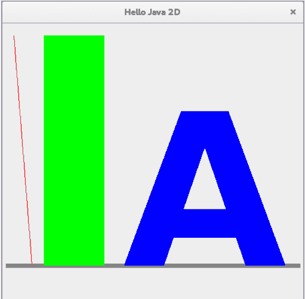

# 引言

代码中唯一发生的事情是添加了一个类型为 `Drawing()` 的组件。由于 `JFrame` 有默认的边界布局器（`BorderLayout`），该组件会自动填充整个窗口。该组件的定义如下：

```java
class Drawing extends JComponent
{
    public void paintComponent(Graphics g)
    {
        Graphics2D g2d = (Graphics2D)g;
        g2d.setStroke(new BasicStroke(7));
        g2d.setColor(Color.gray);
        g2d.draw(new Line2D.Double(10, 400, 490, 400));
        Line2D line = new Line2D.Double(20, 20, 50, 400);
        Rectangle2D rect = new Rectangle2D.Double(70, 20, 100, 380);
        g2d.setStroke(new BasicStroke(1));
        g2d.setColor(Color.red);
        g2d.draw(line);
        g2d.setColor(Color.green);
        g2d.fill(rect);
        g2d.setColor(Color.blue);
        g2d.setFont(new Font("Liberation Serif", Font.BOLD, 350));
        g2d.drawString("A", 200, 400);
    }
}
```

正是这个自定义的 Swing 组件。组件有一个名为 `paintComponent()` 的方法，它是用于绘制组件的方法。该方法的参数类型为 `Graphics`，它是一个提供可用绘图工具并代表程序图形的对象。该类型一直存在。Java 一直存在，但随着 Java2D 的引入，有了一个名为 `Graphics2D` 的定义类，它通过新的图形方法进行了扩展。因此，`paintComponent()` 方法开始将参数转换为 `Graphics2D` 对象。然后该方法就可以在图形对象上进行绘制，基本上发生了以下情况：

以下语句定义了使用宽度为 7 像素的灰色画笔进行绘制，第三条语句在两个点之间绘制出一条直线：

```java
g2d.setStroke(new BasicStroke(7));
g2d.setColor(Color.gray);
g2d.draw(new Line2D.Double(10, 400, 490, 400));
```

接下来的两个语句定义了两个几何形状，分别为一条线和一个矩形：

```java
Line2D line = new Line2D.Double(20, 20, 50, 400);
Rectangle2D rect = new Rectangle2D.Double(70, 20, 100, 380);
```

接下来的三个语句定义了使用 1 像素宽的红色画笔绘制，第三条语句绘制了直线：

```java
g2d.setStroke(new BasicStroke(1));
g2d.setColor(Color.red);
g2d.draw(line);
```

接下来的两个语句定义了使用绿色颜色填充，并且上述语句填充了上面的矩形：

```java
g2d.setColor(Color.green);
g2d.fill(rect);
```

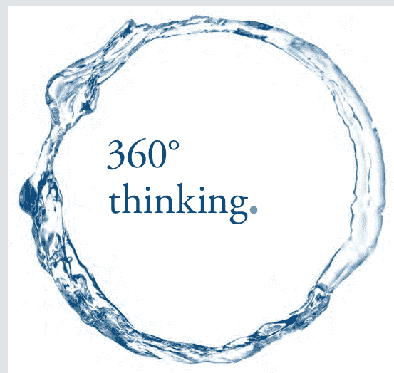

# 引言

最后三个语句说明了颜色应该是蓝色，使用 350 号加粗字体绘制，最后绘制了大字母 A：

```java
g2d.setColor(Color.blue);
g2d.setFont(new Font("Liberation Serif", Font.BOLD, 350));
g2d.drawString("A", 200, 400);
```

当然，人们不知道语句应该这样写，但当你看到这些语句时，它们很容易理解。

编写一个调用 Java2D 的程序。该程序打开一个如下所示的窗口：

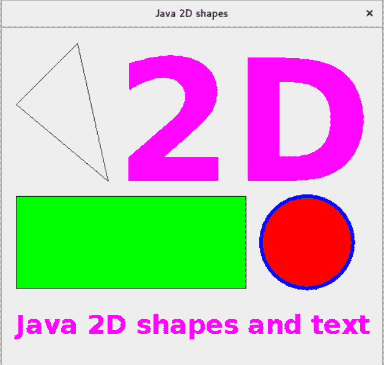

三角形可以用同样的方式绘制。尝试找到一个圆。

在处理示例之前，我想简单谈谈 Java2D。窗口的渲染是基于像素的，你可以由此绘制一个精确的圆（可以看到）。渲染过程由几个步骤组成，顺序如下：

- 合成

# 引言

当需要渲染给定的图形时（例如在屏幕上），这是一种近似，形状并不一定精确。屏幕使用点（像素）表示形状，你可以由此绘制一个精确的圆（可以看到）。为了确定必须属于特定形状的点，计算机采用两种方法之一。默认是锯齿（aliasing），即位于图形内的点会被染色。也就是说，单个像素要么是图形的一部分，要么不是。结果是边缘会出现锯齿现象。锯齿的优点是绘制形状既有效又快速，在大多数情况下结果都是完全令人满意的。另一种方法称为抗锯齿（antialiasing），在这里计算机为每个像素确定图形与当前像素的交集。像素根据其作为图形部分的程度来决定着色饱和。结果是线条和弧形处不再以同样的程度出现锯齿。同样注意文本的差异。抗锯齿的缺点当然，它是一个全面的渲染过程，需要进行大量的计算。

下面窗口的代码如下，你主要需要注意如何指定 `Graphics2D` 对象必须使用抗锯齿：

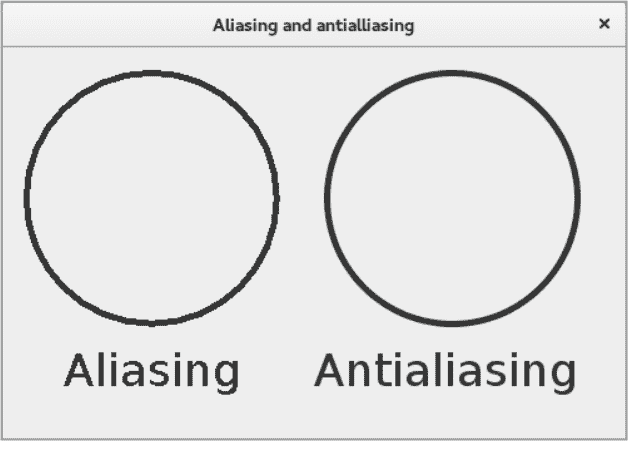

# 引言

```java
package aliasing;

import java.awt.*;
import java.awt.geom.Ellipse2D;
import javax.swing.*;
public class MainWindow extends JFrame {
    public MainWindow() {
        super("Aliasing antialiasing");
        setSize(500, 350);
        setLocationRelativeTo(null);
        add(new Drawing());
        setDefaultCloseOperation(EXIT_ON_CLOSE);
        setVisible(true);
    }
}
```

```java
class Drawing extends JComponent {
    public void paintComponent(Graphics g) {
        Ellipse2D circlek1 = new Ellipse2D.Double(20, 20, 200, 200);
        Ellipse2D circlek2 = new Ellipse2D.Double(260, 20, 200, 200);
        Graphics2D g2d = (Graphics2D)g;
        g2d.setStroke(new BasicStroke(5));
        g2d.draw(circlek1);
        g2d.setFont(new Font("Liberation Serif", Font.PLAIN, 36));
        g2d.drawString("Aliasing", 50, 270);
        g2d.setRenderingHint(RenderingHints.KEY_ANTIALIASING, RenderingHints.VALUE_ANTIALIASING_ON);
        g2d.draw(circlek2);
        g2d.drawString("Aliasing", 250, 270);
    }
}
```

上面，我提到渲染过程包括光栅化和合成，它指示了图形的像素覆盖绘制表面像素的程度。这个值被称为 alpha 值，是一个介于 0.0（不可见或透明）到 1.0（完全覆盖或不透明）之间的数字。例如，图中绘制了如下所示包含两条直线和三个矩形的窗口：

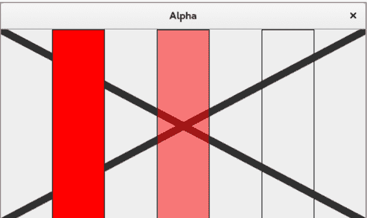

第一个矩形用 alpha 值为 1 绘制的，因此会完全覆盖底层的像素。结果是两条线被矩形覆盖了。中间的矩形 alpha 值为 1/2，因此它没有完全覆盖线条。结果是红色部分与黑色线条和灰色背景部分混合。最后一个矩形的 alpha 值为 0，因此完全透明，所以是不可见。代码如下：


> 在丹麦，你可以找到很好的工程工作并在专业领域上提升自己。特别是在风能领域，你可以向行业内最优秀的人学习，并在稳定的就业市场中推进你的职业生涯。

Mireia Mare,
来自西班牙的高级工程师。
2010年起在丹麦的风能行业工作。

在 bookboom.com 免费下载电子书，点击广告阅读更多

```java
package alphagram;

import java.awt.*;
import java.awt.geom.*;
import javax.swing.*;

public class MainWindow extends JFrame {
    public MainWindow() {
        super("Alpha");
        setSize(500, 300);
        setLocationRelativeTo(null);
        add(new Drawing());
        setDefaultCloseOperation(EXIT_ON_CLOSE);
        setVisible(true);
    }
}
```


```java
class Drawing extends JComponent {
    public void paintComponent(Graphics g) {
        Dimension size = getSize();
        Graphics2D g2d = (Graphics2D)g;
        g2d.stroke(new BasicStroke(10));
        g2d.setRenderingHint(RenderingHints.KEY_ANTIALIASING,
            RenderingHints.VALUE_ANTIALIAS_ON);
        Line2D line1 = new Line2D.Double(0, 0, size.width, size.height);
        Line2D line2 = new Line2D.Double(0, size.height, size.width, 0);
        double width = size.width / 7.0;
        Rectangle2D rect1 = new Rectangle2D.Double(0, 0, width, size.height);
        Rectangle2D rect2 = new Rectangle2D.Double(3 * width, 0, size.height);
        Rectangle2D rect3 = new Rectangle2D.Double(5 * width, 0, size.height);
        g2d.draw(line1);
        g2d.draw(line2);
        g2d.setColor(Color.red);
        g2d.fill(rect1);
        g2d.setColor(new Color(1.0F, 0F, 0F, 0.5F));
        g2d.setColor(new Color(1.0F, 0F, 0F));
        g2d.fill(rect2);
        g2d.fill(rect3);
        g2d.stroke(new BasicStroke(1));
        g2d.setColor(Color.black);
        g2d.draw(rect1);
        g2d.draw(rect2);
        g2d.draw(rect3);
    }
}
```

如果你测试该程序，请注意线条和矩形都遵循窗口的大小。在处理 Java2D 以及通用的计算机图形时，你拥有一个坐标系。窗口的左上角是 `(0,0)`，`x` 轴向右延伸，而 `y` 轴向下。这是一个被称为“用户空间”（user space）的逻辑坐标系。当对象绘制在物理显示器或打印机上时，你有一个不同的坐标系，被称为“设备空间”（device space）。渲染需要从用户空间到设备空间的坐标转换。对于屏幕来说，这种转换通常是用户空间中的 1 个单位对应一个像素，但通常 72 个单位（用户空间中）转换为 1 英寸。

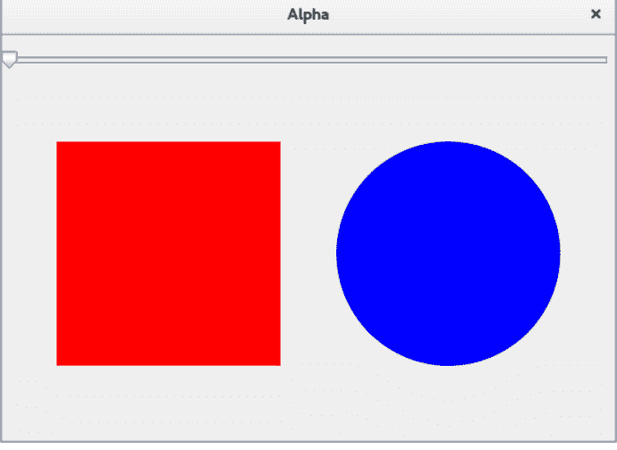

你必须编写一个程序（我的解决方案称为 `AlphaValue`），打开如所示的窗口，其中绘制了一个正方形和一个圆形。顶部有一个滑块，如果你移动滑块，图形应该被一个绿色矩形覆盖，最终覆盖整个图形：

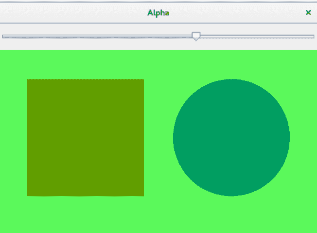

你必须为滑块关联一个事件处理程序，当滑块移动时重绘组件。如果 `Drawing` 指向带有图形的组件，事件处理程序可以定义如下内部类：

```java
private class ChangeHandler implements ChangeListener {
    public void stateChanged(ChangeEvent e) {
        drawing.repaint();
    }
}
```

在本章中，我将展示如何定义和绘制几何图形，就像上面例子中的矩形。它的类型是 `Rectangle2D`，但它是一个抽象类，有两个具体的派生类，分别为 `Rectangle2D.Float` 和 `Rectangle2D.Double`。区别在于图形的属性，以及它们是用 `float` 还是 `double` 定义。这种模式适用于所有的 `Shape` 对象。

有一个辅助类 `Point2D`（以及 `Point2D.Float` 和 `Point2D.Double`）表示一个点。`Point2D` 对象没有尺寸且无法渲染，仅用于定义其他对象的属性。基本几何类如图，它们都由一个名为 `Shape` 的通用接口定义。该接口定义了几个方法：

> 加入 MITAS 是因为我想要真正的责任

## 面向工程师和地质科学家的毕业生计划

www.discovermitas.com


### 第16个月

我在海上担任施工主管，指导并帮助工头解决问题。

- 真实工作
- 国际机会
- 三次实习


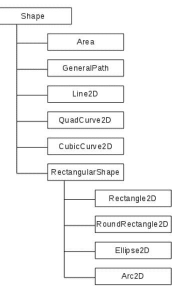

最后四个易于使用，主要区别在于创建对象时需要输入的参数。通常一个图形由矩形定义，即边界矩形，它指示了左上角坐标、宽度和高度。程序 `Figures` 打开如下窗口：

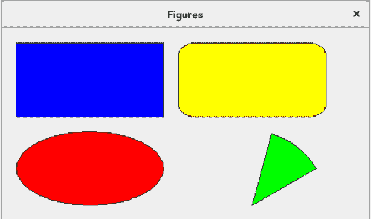

对于 `Rectangle2D` 和 `Ellipse2D` 类型，没有什么好说的，但对于 `RoundRectangle2D`，你必须指定外接矩形以及圆角的圆角方式——实际上是通过矩形的宽度和高度来实现。接着是绿色形状，它是 `Arc2D`。首先你必须定义外接矩形，除了矩形外，还必须指定形状所属的角度（以度为单位）、范围从哪里开始以及范围跨越多大。最后，你必须指定切片的显示方式，有以下选项：

上述窗口的代码为：

```java
package figures;

import java.awt.*;
import java.awt.geom.*;
import javax.swing.*;
```


因为实现梦想是您最大的挑战，IE 商学院提供英语、西班牙语或双语教学的管理学硕士，通过一项创新且具有启发性的计划，培训处于职业生涯初期的高性能专业人士，帮助他们发挥全部潜力。

- 选择您的专业领域。
- 通过所提供的不同选项定制您的硕士学位。
- 在伦敦、里斯本或上海等地点进行全球沉浸学习。

由于您的改变，我们也随之而改变。

www.ie.edu/master-management  
mim.admissions@ie.edu

在 bookboom.com 下载免费电子书

```java
public class MainWindow extends JFrame {
    public MainWindow() {
        super("Figures");
        setSize(500, 300);
        setLocationRelativeTo(null);
        add(new Drawing());
        setDefaultCloseOperation(EXIT_ON_CLOSE);
        setVisible(true);
    }
}
```

```java
class Drawing extends JComponent {
    public void paintComponent(Graphics g) {
        Graphics2D g2 = (Graphics2D)g;
        draw(g2, new Rectangle2D.Double(20, 20, 200, 100), Color.blue);
        draw(g2, new RoundRectangle2D.Double(240, 200, 100, 100, 50, 30), Color.yellow);
        draw(g2, new Ellipse2D.Double(240, 140, 200, 100), Color.red);
        draw(g2, new Arc2D.Double(240, 140, 200, 30, 45, Arc2D.PIE), Color.green);
    }
}
```

```java
private void draw(Graphics2D g, Shape shape, Color color) {
    g.setColor(color);
    g.fill(shape);
    g.setColor(Color.black);
    g.draw(shape);
}
```

复制上述项目，它会打开一个包含四个图形的窗口。你必须修改程序，使得当你点击形状时，会弹出一个如下所示的消息框，告诉你点击了哪个图形。注意，你唯一需要的是添加一个鼠标点击事件处理器，用以判断是否点击了图形，如果是，点击的是什么。

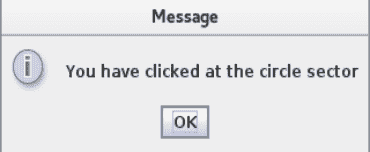

在 bookoon.com 下载免费电子书

我们将查看 `Line2D`、`QuadCurveD` 和 `CubicCurveD` 三种类型，它们都代表一条线段。`Line2D` 表示两点之间的直线，没什么好解释的。要创建一个 `Line2D` 对象，必须指定端点。

`QuadCurveD` 表示两点之间的路径，它有一个关联的控制点，控制点到曲线端点的线是切线：

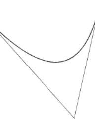

如果你需要创建 `QuadCurveD`，则必须指定三个点。`CubicCurveD` 原则上相同，但这里对于两个端点有两个控制点：

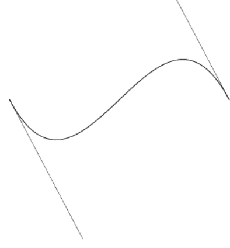

必须指定四个点来创建 `CubicCurveD`。你可以看到这些曲线的结果。下面的程序打开了一个窗口，如下。蓝色的曲线是 `Cubic2D`，而红色的是 `Quad2D`。除了端点外，绘制还显示了控制点以及切线，程序的目的是让你通过鼠标拖动其中一个点，观察当改变端点或控制点时会发生什么。窗口的代码如下，主要展示了如何分别创建 `CubicCurveD` 和 `Quad2D`：

```java
package curves;

import java.awt.*;
import java.awt.event.*;
import java.awt.geom.*;
import javax.swing.*;
```


```java
public class MainWindow extends JFrame {
    public MainWindow() {
        super("Curves");
        setSize(500, 500);
        setLocationRelativeTo(null);
        add(new Drawing());
        setDefaultCloseOperation(EXIT_ON_CLOSE);
        setVisible(true);
    }
}
```

```java
class Drawing extends JComponent {
    private Point2D[] points = {
        new Point2D.Double(50, 125), new Point2D.Double(100, 250),
        new Point2D.Double(375, 10), new Point2D.Double(450, 25),
        new Point2D.Double(50, 375), new Point2D.Double(300, 150),
        new Point2D.Double(450, 375)
    };

    private Point2D current = null;

    public Drawing() {
        addActionListener(new ClickHandler());
        addMouseMotionListener(new MoveHandler());
    }

    public void paintComponent(Graphics g) {
        Graphics2D g2d = (Graphics2D)g;
        g2d.setRenderingHint(
            RenderingHints.KEY_ANTIALIASING, RenderingHints.VALUE_ANTIALIAS_ON);
        g2d.setColor(Color.gray);
        g2d.draw(new Line2D.Double(points[0], points[1]));
        g2d.draw(new Line2D.Double(points[2], points[3]));
        g2d.setColor(Color.blue);
        g2d.draw(new Curve2D.Double(points[0].getX(), points[0].getY(),
            points[1].getX(), points[1].getY(), points[2].getX(), points[3].getY()));
        g2d.setColor(Color.gray);
        g2d.draw(new Line2D.Double(points[4], points[5]));
        g2d.draw(new Line2D.Double(points[5], points[6]));
        g2d.setColor(Color.red);
        g2d.draw(new Curve2D.Double(points[4].getX(), points[4].getY(),
            points[5].getX(), points[5].getY(), points[6].getX(), points[6].getY()));
        for (int i = 0; i < points.length; i++) {
            g2d.setColor(points[i].equals(current) ? Color.magenta : Color.gray);
            g2d.fill(getPoint(points[i]));
        }
    }

    private Shape getPoint(Point2D p) {
        int side = 4;
        return new Rectangle2D.Double(
            p.getX() - side / 2, p.getY() - side / 2, side, side
        );
    }

    private class ClickHandler extends MouseAdapter {
        public void mousePressed(MouseEvent e) {
            current = null;
            for (int i = 0; i < points.length; ++i) {
                Shape shape = getPoint(points[i]);
                if (shape.contains(e.getPoint())) {
                    current = points[i];
                    break;
                }
            }
            repaint();
        }
    }

    private class MoveHandler extends MouseMotionAdapter {
        public void mouseDragged(MouseEvent e) {
            if (current != null) {
                current.setLocation(e.getPoint());
                repaint();
            }
        }
    }
}
```

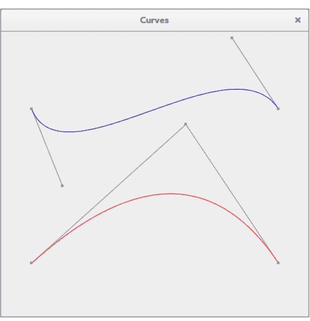

在以下地提供优秀的经济学和商学课程：


> “成功的国际职业的完美起点。”

点击此处发现为什么格罗宁根大学在社交和学术上都是学生最理想的地方之一。

www.rug.nl/feb/education


在 bookhoon.com 下载免费电子书

点击广告阅读更多


创建项目`Curves`的副本并修改程序，使得在拖动点时，窗口底部会显示鼠标坐标，并且这两条曲线必须用较粗的线条绘制。这意味着在绘制曲线时，你必须使用一个`Stroke`对象，例如：

```java
private Stroke stroke3 = new BasicStroke(3);
```

为了显示鼠标坐标，你可以在窗口底部添加一个`JLabel`组件，并在每次拖动其中一个点时更新它。

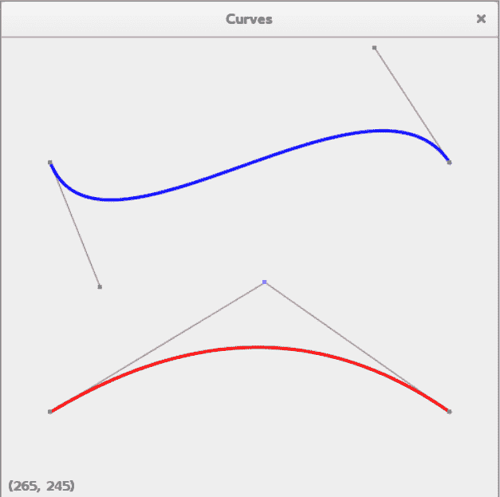

编写一个名为`StraightLines`的程序，运行后会打开下面所示的窗口。滑块应该代表从 0 到 100 的值，并从 25 开始。窗口必须绘制由滑块指示的直线数量，并在六种颜色之间交替。线条从左上角起始到窗口底部的一个点，底部被分为由滑块决定的数量个点。同样，线条从右下角起始到左边缘的一个点，左边缘划分的点数对应于滑块的值。

JAVA 10: JAVA2D，窗口绘图与图像处理形状

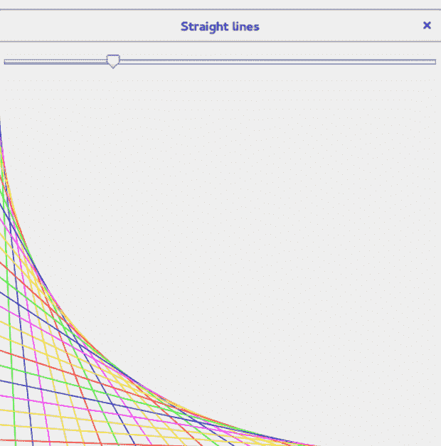

`GeneralPath`类通过多个点来定义形状，其中每个点都可以是`Line2D`、`QuadCurve2D`或`CubicCurve2D`类型的线。`GeneralPath`定义了一个任意形状，该形状不一定是封闭或连贯的。你可以这样理解这种形状：你用画笔绘制它，并且你可以做两件事：

- 1. 你可以抬起笔并移动到某个点。
- 2. 你可以从画笔所在的位置画一条线到另一个点。

为此，你使用了这些方法：`moveTo()`、`lineTo()`、`quadTo()`、`cubicTo()`和`closePath()`。

下面的窗口显示了三个`GeneralPath`类型的形状，其中红色部分由三个线段、一个二次贝曲线段和一个三次贝曲线段组成。另外两个形状完全由线段组成：

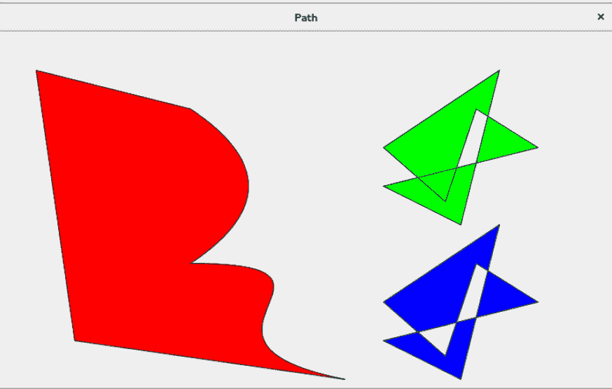

美国在线

LIGS 大学正在招生在线 BBA、MBA、MSc、DBA 和博士项目：

- 在 2014 年 9 月 30 日前入学即可
- 学费最高可节省 16%！
- 分 10 期支付 / 2 年付清
- 互动式在线教育
- 访问 www.ligsununiversity.com 了解更多信息！

LIGS 大学未获得美国教育部长列出的任何国家认可的认证机构的认证。更多信息见此处。

通常，创建一个`GeneralPath`非常简单，只有一件事是很复杂的，那就是确定形状的内部。如果形状被简单的封闭曲线（如红色部分）围绕，那么没什么疑问的；但如果形状是由交叉的线条形成的，情况就会变得复杂，且它可以通过两种方式发生，你通过构造函数的参数来指定它。如果你考虑蓝色图形，它被定义为`GeneralPath.WIND_EVEN_ODD`。直线将此形状分为若干个封闭区域（在本例中为五个）。如果你必须判断这些区域中哪些属于该图形，你可以画一条穿过图形区域的直线：

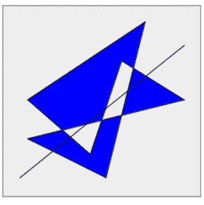

如果你从形状外部开始并沿着线条移动，每通过一个线段时计数器加 1，那么规则是：如果计数器为奇数，则该区域属于图形；如果计数器为偶数，则不属于。绿色图形被定义为`GeneralPath.WIND_NON_ZERO`（顺便说这是默认值）。如果你要判断图形的一部分是否属于，可以类似地画一条交叉图形区域的线。当线交叉图形的一个线段时，规则是：如果线段是从左到右绘制的，计数器加 1；如果线段是从右到左绘制的，计数器减 1。属于图形的区域即计数器不为 0 的区域。

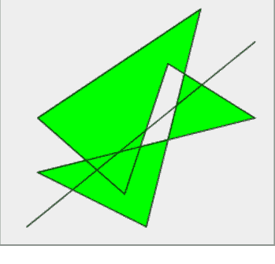

程序的代码如下：

```java
package path;

import java.awt.*;
import java.awt.geom.*;
import javax.swing.*;

public class MainWindow extends JFrame {
    public MainWindow() {
        super("Path");
        setSize(800, 500);
        setLocationRelativeTo(null);
        add(new Drawing());
    }
}

class Drawing extends JComponent {
    public void paintComponent(Graphics g) {
        Graphics2D g2d = (Graphics2D)g;
        g2d.setRenderingHint(RenderingHints.KEY_ANTIALIASING, RenderingHints.VALUE_ANTIALIAS_ON);
        GeneralPath path = new GeneralPath();
        path.moveTo(50, 50);
        path.lineTo(50, 100);
        path.quadTo(400, 200, 250, 300);
        path.cubicTo(500, 300, 200, 400, 450, 570);
        path.lineTo(100, 400);
        path.closePath();
        g2d.setColor(Color.red);
        g2d.fill(path);
        g2d.setColor(Color.black);
        g2d.draw(path);

        GeneralPath path2 = new GeneralPath(GeneralPath.WIND_NON_ZERO);
        path2.moveTo(500, 150);
        path2.lineTo(650, 50);
        path2.lineTo(600, 250);
        path2.lineTo(500, 200);
        path2.lineTo(700, 150);
        path2.lineTo(620, 100);
        path2.lineTo(580, 220);
        path2.closePath();
        g2d.setColor(Color.green);
        g2d.fill(path2);
        g2d.setColor(Color.black);
        g2d.draw(path2);

        GeneralPath path3 = new GeneralPath(GeneralPath.WIND_EVEN_ODD);
        path3.moveTo(500, 350);
        path3.lineTo(650, 250);
        path3.lineTo(600, 450);
        path3.lineTo(500, 400);
        path3.lineTo(700, 350);
        path3.lineTo(620, 300);
        path3.lineTo(580, 420);
        path3.closePath();
        g2d.setColor(Color.blue);
        g2d.fill(path3);
        g2d.setColor(Color.black);
        g2d.draw(path3);
    }
}
```


关于 e-Learning Kids。e-Learning Kids 成立于2004年，是一个全球非利基金会，致力于为5-12岁的儿童提供免费的互联网在线课程，涵盖数学、科学、语言艺术、计算机、健康和环境技能。自2005年以来，190多个国家的1500万儿童受益于 LU 提供的课程。我们的志愿者团队由全球的教育和在线学习专家以及商务专业人士组成，致力于改变儿童教育。我们一直在寻找资金、志愿者、赞助商和合作伙伴。欢迎加入！更多信息请访问 www.e-learningforkids.org。

- 小学教育第一大MOOC
- 5-12岁儿童免费数字学习
- 已覆盖1500万儿童

除了使用线段创建`GeneralPath`，你还可以由其他形状组合创建一个`GeneralPath`。下面的窗口显示了一个绘制三角形的`GeneralPath`，但它由另一个`GeneralPath`（也代表三角形）和一个`Rectangle2D`组成。如果你点击三个形状中的任何一个，就会弹出一个对话框，目标是展示这三个都是同一个`Shape`对象的一部分。

```java
package triangles;

import java.awt.*;
import java.awt.geom.*;
import javax.swing.*;
import java.awt.event.*;

public class MainWindow extends JFrame {
    public MainWindow() {
        super("Triangles");
        setSize(500, 400);
        setLocationRelativeTo(null);
        add(new Drawing(this));
    }
}
```

（注：此处`Drawing`类代码不完整，已根据原文结构进行翻译）

```java
class Drawing extends JComponent
{
    private Shape shape;

    public Drawing()
    {
        addMouseListener(new ClickHandler());
    }

    public void paintComponent(Graphics g)
    {
        Graphics2D g2d = (Graphics2D)g;
        GeneralPath path1 = new GeneralPath();
        path1.moveTo(50, 150);
        path1.lineTo(250, 50);
        path1.lineTo(100, 200);
        path1.closePath();

        GeneralPath path2 = new GeneralPath();
        path2.moveTo(200, 150);
        path2.lineTo(300, 50);
        path2.lineTo(400, 200);
        path2.closePath();
        path2.append(path1, false);
        path2.append(new Rectangle2D.Double(20, 250, 400, 50), false);
        g2d.setColor(Color.red);
        g2d.fill(path1);
        g2d.setColor(Color.black);
        g2d.draw(path2);

        shape = path1;
    }

    private class ClickHandler extends MouseAdapter
    {
        public void mouseClicked(MouseEvent e)
        {
            Point2D point = new Point2D.Double(e.getX(), e.getY());
            if (shape.contains(point))
                JOptionPane.showMessageDialog(Drawing.this, "你点击了该图形");
        }
    }
}
```

# 练习 6

编写一个程序，你可以调用`Polygons`，它必须打开一个所示的窗口（其中下方的形状不是多边形）。这三个形状都应该被定义为`GeneralPath`，其中底部由两个二次线段（quad segments）定义。最后，如果你点击这三个图形中的一个，你应该会得到一个消息框，告诉你点击的是哪一个形状：

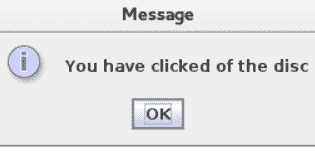

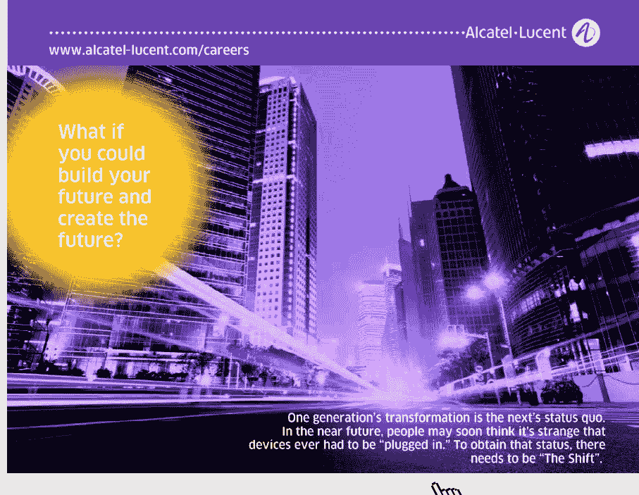

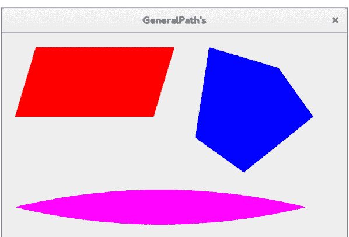

几何形状的最后一个类是`Area`。它是一种结合了一个或多个形状的类型，但你可以指定它们如何重叠。

下面的窗口绘制了一个圆和一个正方形，它们重叠在一起。这些图形用于通过`Area`对象定义其他四个图形。在这里你应该注意这四个方法，它们通过平移图形对象来创建它们在窗口中的位置。这是通过变换实现的，变换将在后文中讨论，但在本中，图形是通过简单的平移放置的。

```java
package areaprogram;
import java.awt.*;
import java.awt.geom.*;
import javax.swing.*;

public class MainWindow extends JFrame {
    public MainWindow() {
        super("Area's");
        setSize(500, 400);
        setLocationRelativeTo(null);
        add(new Drawing(this));
        setDefaultCloseOperation(EXIT_ON_CLOSE);
        setVisible(true);
    }
}
```

```java
class Drawing extends JComponent
{
    public void paintComponent(Graphics g)
    {
        Graphics2D g2d = (Graphics2D)g;
        g2d.setRenderingHint(RenderingHints.KEY_ANTIALIASING, RenderingHints.VALUE_ANTIALIASING_ON);
        Ellipse2D circ = new Ellipse2.Double(20, 200, 100, 100);
        Rectangle2D rect = new Rectangle2.Double(70, 70, 100, 100);
        g2d.draw(circ);
        g2d.draw(rect);
        union(g2d, circ, rect, 170, 0);
        intersection(g2d, circ, rect, 170, 0);
        subtraction(g2d, circ, rect, -340, 170);
        exclusive(g2d, circ, rect, 170, 0);
    }
```

```java
private void union(Graphics2D g, Shape shape,
Shape shape2, int x, int y)
{
    Area areal = new Area(shape);
    Area areal2 = new Area(shape2);
    areal.add(areal2);
    g.translate(x, y);
    g.setColor(Color.green);
    g.fill(areal);
    g.setColor(Color.black);
    g.draw(areal);
}
```

```java
private void intersection(Graphics2D g, Shape shape,
Shape shape2, int x, int y)
{
    Area areal = new Area(shape);
    Area areal2 = new Area(shape2);
    areal.intersect(areal2);
    g.translate(x, y);
    g.setColor(Color.blue);
    g.fill(areal);
    g.setColor(Color.black);
    g.draw(areal);
}
```

```java
private void subtraction(Graphics2D g, Shape shape,
Shape shape2, int x, int y)
{
    Area areal = new Area(shape);
    Area areal2 = new Area(shape2);
    areal.subtract(areal2);
    g.translate(x, y);
    g.setColor(Color.yellow);
    g.fill(areal);
    g.setColor(Color.black);
    g.draw(areal);
}
```


```java
private void exclusive(Graphics2D g, Shape shape,
Shape shape2, int x, int y)
{
    Area areal = new Area(shape);
    Area areal2 = new Area(shape2);
    areal.exclusiveOr(areal2);
    g.translate(x, y);
    g.setColor(Color.red);
    g.fill(areal);
    g.setColor(Color.black);
    g.draw(areal);
}
```


# JAVA 10: JAVA2D, 窗口绘制以及图像处理填充与描边

下方窗口中的第二个形状如下：

```
Rectangle2D rect2 = new Rectangle2D.Double(240, 20, 200, 100);
Ellipse2D ellipse1 = new Ellipse2D.Double(238, 18, 5, 5);
Ellipse2D ellipse2 = new Ellipse2D.Double(438, 118, 5, 5);
g2d.setPaint(Color.orange);
g2d.fill(rect2);
g2d.setPaint(Color.black);
g2d.draw(rect2);
g2d.setPaint(Color.black);
g2d.fill(ellipse1);
g2d.fill(ellipse2);
```

并且再次说明了边缘绘制的位置。这里绘制了两个直径均为 5 的圆。第一个圆的中心位于 (240, 20)，因此位于矩形的左上角。第二个圆的中心位于 (440, 120)，因此位于定义该形状的矩形的右下角。

## 3.1 GRADIENTPAINT

你也可以使用 `GradientPaint` 来填充一个形状（甚至是绘制线条）。在这里，我们沿着一条直线混合了两种颜色。考虑以下窗口：


图中显示了三个带有直线的正方形。绘制这些直线仅用于解释原理。第一幅图沿显示的直线混合了红色和黄色，使得从左上角的红色开始，到右下角的黄色结束。中间的图混合了红色和黄色，但这条线并没有跨整个正方形。结果是线之前的部分都是红色，线之后的部分都是黄色。最后一个形状的原理相似，但这次模式是重复的。代表三个正方形的组件如下：

```java
class Drawing extends JComponent {
    public void paintComponent(Graphics g) {
        Graphics2D g2d = (Graphics2D)g;
        g2d.setRendering(RenderingHints.KEY_ANTIALIASING, RenderingHints.VALUE_ANTIALIAS_ON);
        Rectangle2D rect1 = new Rectangle2D.Double(20, 20, 200, 200);
        Rectangle2D rect2 = new Rectangle2D.Double(240, 20, 200, 200);
        Rectangle2D rect3 = new Rectangle2D.Double(460, 20, 200, 200);
        g2d.setPaint(new GradientPaint(20, 20, Color.red, 220, 220, Color.yellow));
        g2d.fill(rect1);
        g2d.setPaint(Color.black);
        g2d.draw(rect1);
        g2d.draw(new Line2D.Double(20, 20, 220, 220));
        g2d.setPaint(new GradientPaint(310, 90, Color.red, 370, 150, Color.yellow));
        g2d.fill(rect2);
        g2d.setPaint(Color.black);
        g2d.draw(rect2);
        g2d.draw(new Line2D.Double(310, 90, 370, 150));
        g2d.setPaint(new GradientPaint(530, 90, Color.red, 590, 150, Color.yellow));
        g2d.fill(rect3);
        g2d.setPaint(Color.black);
        g2d.draw(rect3);
        g2d.draw(new Line2D.Double(530, 90, 590, 150));
    }
}
```

## 练习 7

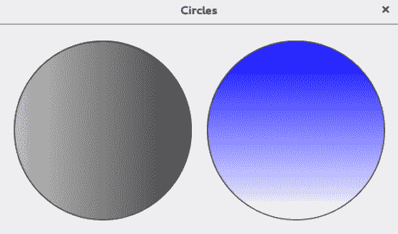

编写一个名为 `Circles` 的程序，能够如上面所示绘制窗口。在这里，左侧的椭圆使用 `GradientPaint` 填充，该颜色沿水平直径混合了浅灰色和深灰色；而右侧的椭圆沿垂直直径混合了蓝色和白色。这两个椭圆必须适应窗口大小，并在窗口大小改变时相应。


## 练习 8

在此练习中，你必须编写一个可以称为 `GradientBackground` 的程序，用于打开以下窗口：

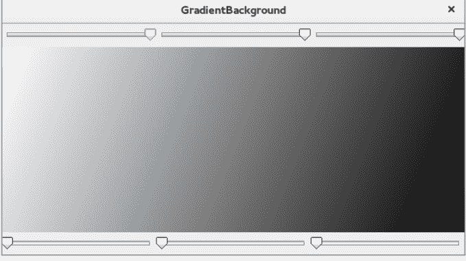

窗口显示了一个矩形（适应窗口大小），该矩形使用 `GradientPaint` 填充，沿从左上角开始的对角线混合白色和黑色。窗口在顶部和底部分别有三个 `JSlider` 组件。它们分别用于定义“白色”和“黑色”颜色。当你移动滑块时，结果可能如下所示。当代表矩形的组件需要引用这六个 `JSlider` 组件时，你可以通过将 `Drawing` 类定义为 `MainWindow` 的内部类来方便工作。

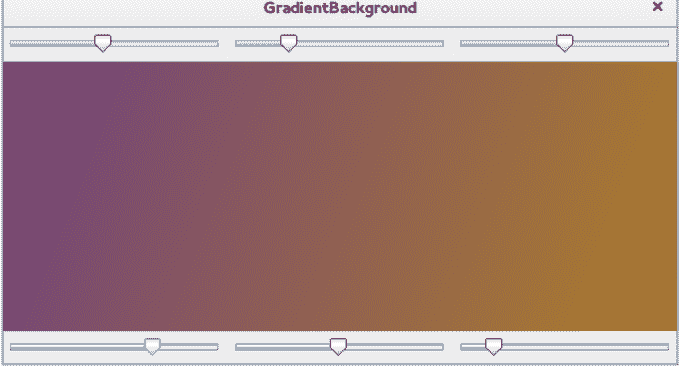

## 3.2 TEXTUREPAINT

也可以用图像填充形状。以下程序绘制了一个矩形并填充整个窗口，矩形由 64x64 像素的图标重复填充：

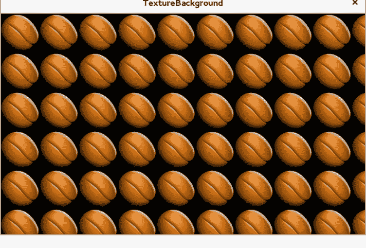

项目有一个名为 `images` 的子包，其中包含了图标（一个复制在此处的 png 文件，因此图片作为资源与程序类打包在一起）。窗口的代码如下：

```java
package java.awt.*;

import java.awt.image.*;
import java.awt.geom.*;
import javax.swing.*;

class MainWindow extends JFrame {
    public MainWindow() {
        super("TextureBackground");
        setSize(600, 400);
        setLocation(null);
        add(new Drawing());
        setDefaultCloseOperation(EXIT_ON_CLOSE);
    }
}

class Drawing extends JComponent {
    public void paintComponent(Graphics g) {
        Dimension d = getSize();
        Graphics2D g2d = (Graphics2D)g;
        Rectangle2D rect = new Rectangle2D.Double(0, 0, d.getWidth(), d.getHeight());
        g2d.setPaint(new TexturePaint(new ImageIcon(getClass().getResource("/images/background.png")), rect));
        g2d.fill(rect);
    }
}
```

# JAVA 10: JAVA2D，窗口绘制与图像处理

除了演示如何从零开始创建一个 `BufferedImage` 之外，该示例还展示了图形本身的轮廓是一个 `Shape` 对象，可以使用 `Paint` 对象（通过 `draw()` 方法）进行填充。

## 3.3 描边 (STROKES)

在上面的示例中，我展示了如何定义一个 `BasicStroke` 对象，并说明了绘制线条的厚度。默认值为 1。然而，关于描边，有两点是你必须掌握的：

- 线段端点应该是什么样的

- 线段是如何组合在一起的，从而决定了角必须如何处理的

这些概念仅在你需要绘制粗线时才会有意义。最后，人们必须知道如何绘制虚线。下面的窗口显示了大多数可用选项：


到 2020 年，我们能够提供地球电力需求的十分之一。即使在今天，SKF 的创新知识对于运行世界上大部分风力涡轮机也至关重要。发电成本的 25% 与维护有关。通过我们的在线状态监测和自动润滑系统，这些成本可以大幅降低。我们声称从空气中创造更清洁的能量。通过分享我们的经验、专业知识和创造力，行业可以获得超出预期的性能。如果没有能够应对挑战的最佳员工呢？

知识工程的力量

接入知识工程的力量，

访问我们的网站 www.skf.com/knowledge

在 bookboom.com 下载免费电子书

点击广告阅读更多信息

JAVA 10: JAVA2D，窗口绘制与图像处理

填充与描边

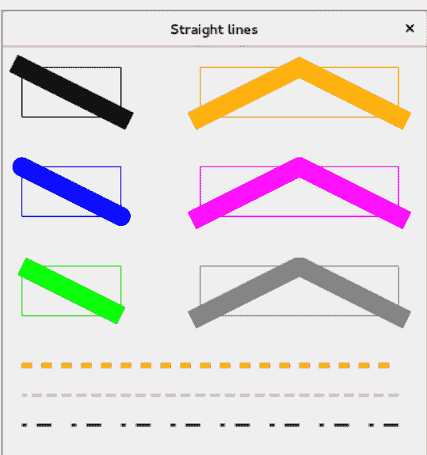

关于线条描边（`Stroke`），端点有三种可能性：

1. `BasicStroke.CAP_SQUARE`（默认值）

2. `BasicStroke.CAP_ROUND`

3. `BasicStroke.CAP_BUTT`

第一条线（黑色）使用默认值绘制，否则描边宽度为 19。此外，还绘制了一个该线条的外接矩形。关于端点，样式是 `CAP_SQUARE`，它通过一个长度为线条厚度一半的矩形来扩展线条。蓝线对应的端点是 `CAP_ROUND`，它通过一个半径为线条厚度一半的半圆来扩展线条。最后，绿线使用了 `CAP_BUT`，它简单地不扩展线条。

右侧的三个图形都是 `GeneralPath` 类型，使用宽度为 19 的描边绘制，端点使用 `CAP_SQUARE` 选项，并且还定义了角如何绘制。同样，有三种选项：

1. `JOIN_MITER`（默认值）

2. `JOIN_ROUND`

3. `JOIN_BEVEL`

在 bookoon.com 下载免费电子书

JAVA 10: JAVA2D，窗口绘制与图像处理

橙色路径使用默认值绘制，因此样式为 `JOIN_MITER`。它通过扩展外边缘直到它们相交来混合线段。洋红色线使用 `JOIN_ROUND`，这意味着线段端点是 `CAP_ROUND`。最后，灰色路径使用 `JOIN_BEVEL`。在这里，线段端点使用 `CAP_BUT`，且外边缘被连接起来。

然后是三条虚线。红线使用如下定义的描边绘制：

```
new BasicStroke(5,
BasicStroke.CAP_BUT, BasicStroke.JOIN_BEVEL, 0, new float[] { 10, 10, 0 })
```

点线通过在线段和空白段之间切换来绘制。最后一个数组定义了这两个部分的长度，应为 10。最后一个参数由下一个示例（粉色线）解释：

```
new BasicStroke(3,
BasicStroke.CAP_BUT, BasicStroke.JOIN_BEVEL, 0, new float[] { 10, 5, 5 })
```

在这里，该参数表示你从第一个段内部开始绘制的长度。因此，第一个段的长度仅为 5。最后，最后一个示例显示你可以指定多个值：

```
new BasicStroke(3, BasicStroke.CAP_BUT, BasicStroke.JOIN_BEVEL, 0, new float[] { 5, 10, 15, 20 })
```

也就是说，先画一个长度为 5 的线段，然后是 10 的间隙，15 的线段，最后是 20 的间隙。然后重复该模式直到画完整条线。代码如下所示：

```java
class Drawing extends JComponent {
  public void paintComponent(Graphics g) {
    Graphics2D g2d = (Graphics2D)g;
    g2d.setRenderingHint(RenderingHints.VALUE_ANTIALIASING,
    draw(g2d, 20, 20, 120, 170, BasicStroke(19), Color.black, true);
    draw(g2d, 20, 120, 170, BasicStroke(19), BasicStroke.CAP_ROUND, BasicStroke.JOIN_BEVEL), Color.blue, true);
    draw(g2d, 20, 220, 170, BasicStroke(19), BasicStroke.CAP_BUT, BasicStroke.JOIN_BEVEL), Color.green, true);
    draw(g2d, 200, 70, 300, 400, BasicStroke(19), Color.orange,
    draw(g2d, 200, 170, 320, 400, BasicStroke(19), BasicStroke.CAP_SQUARE, BasicStroke.JOIN_ROUND), Color.magenta);
    draw(g2d, 200, 270, 220, 270, BasicStroke(19), BasicStroke.CAP_SQUARE, BasicStroke.JOIN_BEVEL), Color.gray);
    draw(g2d, 20, 320, 400, 320, BasicStroke(5), BasicStroke.CAP_BUT, BasicStroke.JOIN_BEVEL, 0, new float[] { 10, 10 }, Color.red, false);
    draw(g2d, 20, 350, 400, 350, BasicStroke(3), BasicStroke.CAP_BUT, BasicStroke.JOIN_BEVEL, 0, new float[] { 10, 5 }, Color.pink, false);
    draw(g2d, 20, 380, 400, 380, BasicStroke(3), BasicStroke.CAP_BUT, BasicStroke.JOIN_BEVEL, 0, new float[] { 5, 10, 15, 20 }, Color.darkGray, false);
  }

  private void draw(Graphics2d g, double x1, double y1, double x2, double y2, BasicStroke stroke, Color color, boolean showBound) {
    g.setStroke(stroke);
    g.setPaint(color);
    Line2D line = new Line2D.Double(x1, y1, x2, y2);
    g.draw(line);
    if (showBound) {
      g.setStroke(new BasicStroke(0.5F));
      g.draw(line.getBounds2D());
    }
  }

  private void draw(Graphics2D g, double x1, double y1, double x2, double y2, double x3, double y3, Stroke stroke, Color color) {
    g.setStroke(stroke);
    g.setPaint(color);
    GeneralPath path = new GeneralPath();
    path.moveTo(x1, y1);
    path.lineTo(x2, y2);
    path.lineTo(x3, y3);
    g.draw(path);
    g.setStroke(new BasicStroke(0.5F));
    g.draw(path.getBounds2D());
  }
}
```


无论你对未来职业有什么期望，一个业务广泛的雇主将是你的入场券。在沃尔沃集团工作意味着在全球80多个国家拥有15万名朋友和同事。我们提供极佳的职业机会——请访问我们的网站 www.volvogroup.com。期待您的加入！

VOLVO (pub)

AB Volvo (pub)

VOLVO TRUCKS | HEMANT TRUCKS | MACH TRUCKS | VOLVO BUSES | VOLVO CONSTRUCTION EQUIPMENT | VOLVO PENS | VOLVO AERO | VOLVO IT


VOLVO FREIGHT SOLUTIONS | VOLVO 3P | VOLVO PERFORMANCE | VOLVO PARTS | VOLVO TECHNOLOGY | VOLVOISTICS | BUSINESS AREA INDIA

在 `bookboom.com` 下载免费电子书

## 练习 9

编写一个程序打开以下窗口：

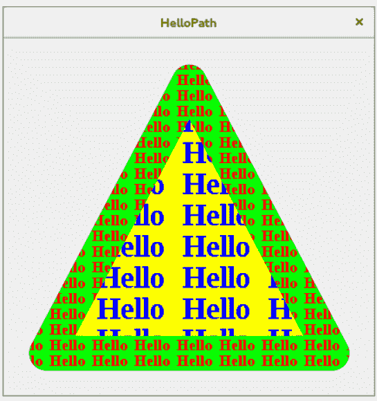

在 `bookboom.com` 下载免费电子书

JAVA 10: JAVA2D，窗口绘制与图像处理

渲染 (RENDERING)

# 4 渲染

在上节中，我讨论了如何定义几何形状。在本章中，我将介绍 Java2D 如何渲染图形。其流程如下：

1. 变换 (transformation)
2. 合成 (compositing)
3. 裁剪 (clipping)
4. 渲染提示 (rendering hints)

## 4.1 变换 (TRANSFORMATIONS)

变换由 `AffineTransform` 类定义，仿射变换是一种保持平行线的变换。`Graphics2D` 类有一个 `AffineTransform` 实例，适用于渲染时所有的几何形状。这种变换可以通过两种方式更改。一种是部分替换另一个：

```
void setTransform(AffineTransform tr)
```

另一种是更改现有的变换：

```
void transform(AffineTransform Tx)
```

通常建议使用后一种方法，示例展示了如何操作。`Graphics2D` 类也有直接执行简单变换的方法。变换有四种类型：

- 平移 (translation)：存在平行位移
- 旋转 (rotation)：绕某点旋转图形
- 缩放 (scaling)：调整图形大小
- 切变 (shearing)：对图形进行切变变形

### 平移 (Translation)

`TranslateDemo` 程序打开一个如下所示的窗口。另外三个是相同的矩形，但在绘制完第一个矩形后，对图形（绘制表面）进行了平行位移。这看起来很简单，但如果你进行了多次变换（如本所示），结果可能很难理解。组件的代码如下，它也展示了平行位移可以通过多种方式定义：

# JAVA 10: JAVA2D, 窗口绘制与图像处理渲染

## 渲染

```java
class Drawing extends JComponent
{
  public void paintComponent(Graphics g)
  {
    Graphics2D g2d = (Graphics2D)g;
    g2d.setRenderingHint(RenderingHints.KEY_ANTIALIASING, RenderingHints.VALUE_ANTIALIAS_ON);
    Rectangle2D rect = new Rectangle2D.Double(20, 20, 200, 100);
    g2d.draw(rect);
    AffineTransform start = g2d.getTransform();
    g2d.translate(100, 50);
    g2d.setPaint(Color.red);
    g2d.draw(rect);
    AffineTransform trans = g2d.getTransform();
    trans.translate(100, 50);
    g2d.setPaint(Color.blue);
    g2d.draw(rect);
    g2d.setTransform(start);
    AffineTransform translate = AffineTransform.translateInstance(50, 200);
    g2d.transform(translate);
    g2d.setPaint(Color.green);
    g2d.draw(rect);
  }
}
```


首先，定义了一个矩形 `rect`，它使用默认设置绘制，结果是一个黑色矩形。接下来，为当前变换添加了一个引用 `start`。其目标是在执行其他变换后，使绘制表面的变换重置为默认值。接着，方法执行语句：

```
g2d.translate(100, 50);
```

并用红色绘制矩形。这是在 x 轴方向平移 100，在 y 轴方向平移 50 的平行移动。这意味着坐标系的起点（左上角）被移动到了 (100, 50)。你需要注意的是，在执行该方法后，`Graphics2D` 对象的 `AffineTransform` 发生了变化。由于下一步是对当前的 `AffineTransform` 进行 (100, 50) 的平行平移，这被用于修改 `g2d` 对象的变换，这次使用了蓝色。结果并不完全显而易见，因为这是一个复合变换。首先执行平行平移 (100, 50)，它将当前起点 (100, 50) 移动到 (200, 100)。接着执行第一次变换，它也是一次平行平移 (100, 50)，将起点 (200, 100) 移动到 (300, 150)。结果是蓝色矩形的左上角位于 (320, 170)。在绘制完蓝色矩形后，变换重置为默认值，并使用 `AffineTransform` 类中的静态方法定义了一个新的平行平移。结果是一个绿色矩形。

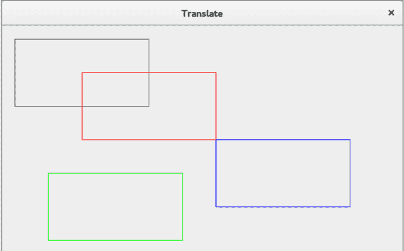

## 练习 10

编写一个程序来创建以下窗口：

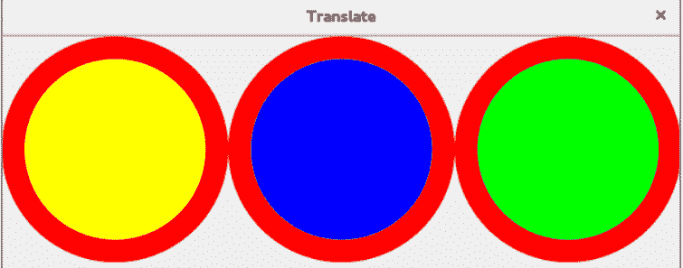

其中蓝色圆和绿色圆必须是黄色圆的变换（平行平移）。

## 旋转

旋转的原理与平行平移相同，也可以以三种不同的方式定义。在下面的示例中，我只使用了一种方法，但另外两种方法的作用与平行平移一样。旋转是围绕某一点旋转坐标系，从而旋转绘制表面。默认情况下它是点 (0, 0)，你也可以围绕任何其他点旋转，结果是先平行平移后旋转。旋转由以弧度测的角度指定。

下面是一个旋转了两个矩形（黑色矩形）的窗口。一个矩形（蓝色）绕原点（矩形的左上角）旋转了 $\pi/6$，而第二个（红色矩形）绕矩形的右下角旋转了 $-\pi/6$ 角度。洋红色矩形是另一个黑色矩形绕右下角以 $-\pi/2$ 角度旋转的结果。

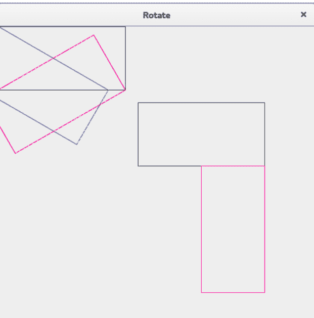

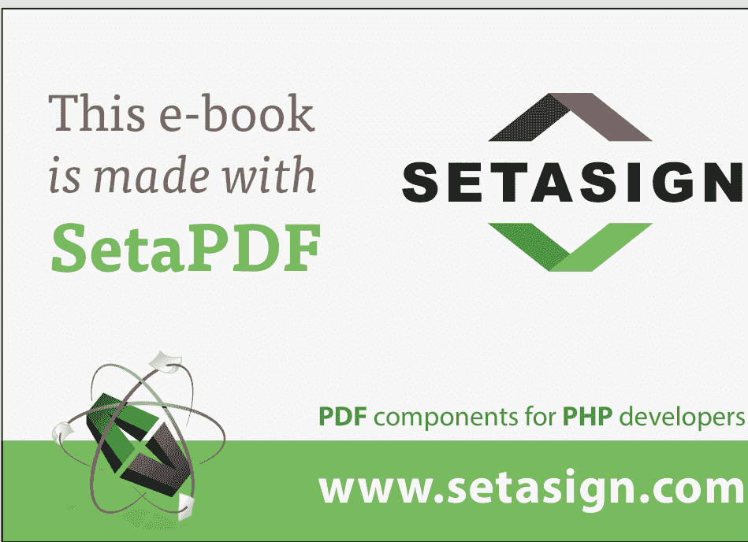

```java
class Drawing extends JComponent
{
    public void paintComponent(Graphics g)
    {
        Graphics2D g2d = (Graphics2D)g;
        g2d.setRenderingHint(RenderingHints.KEY_ANTIALIASING, RenderingHints.VALUE_ANTIALIAS_ON);
        Rectangle2D rect1 = new Rectangle2D.Double(0, 0, 200, 100);
        Rectangle2D rect2 = new Rectangle2D.Double(220, 120, 200, 100);
        g2d.setPaint(Color.darkGray);
        g2d.draw(rect1);
        g2d.draw(rect2);
        AffineTransform start = g2d.getTransform();
        g2d.rotate(Math.PI / 6);
        g2d.draw(rect1);
        g2d.rotate(Math.PI / 6, 200, 100);
        g2d.draw(rect1);
        g2d.setTransform(start);
        g2d.rotate(-Math.PI / 2, 420, 220);
        g2d.draw(rect2);
    }
}
```

## 缩放

缩放是一种在水平和垂直方向上调整图形的大小。以下示例缩放了一个矩形：

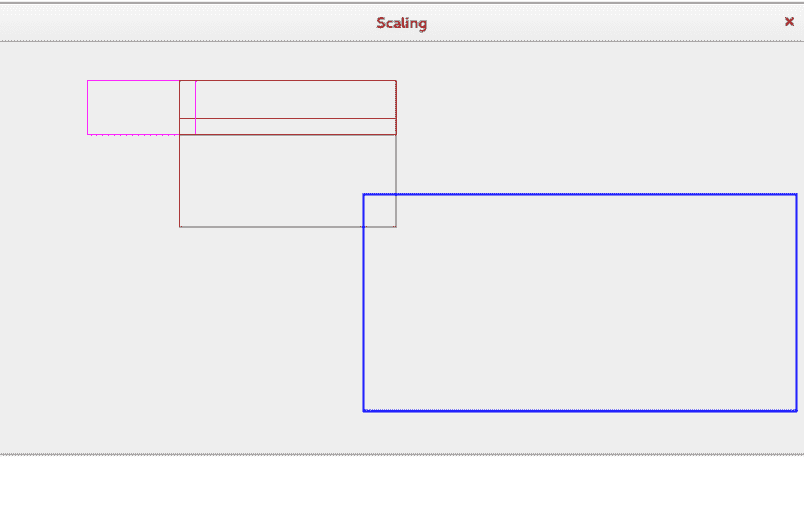

```java
class Drawing extends JComponent
{
    public void paintComponent(Graphics g)
    {
        Graphics2D g2d = (Graphics2D)g;
        g2d.setRenderingHint(RenderingHints.KEY_ANTIALIASING, RenderingHints.VALUE_ANTIALIAS_ON);
        Rectangle2D rect = new Rectangle2D.Double(170, 70, 200, 100);
        g2d.setPaint(Color.darkGray);
        g2d.draw(rect);
        AffineTransform start = g2d.getTransform();
        g2d.scale(2, 2);
        g2d.setPaint(Color.blue);
        g2d.draw(rect);
        g2d.setTransform(start);
        g2d.scale(0.5, 0.5);
        g2d.setPaint(Color.magenta);
        g2d.draw(rect);
        g2d.setTransform(start);
        g2d.scale(1, 0.5);
        g2d.setPaint(Color.red);
        g2d.draw(rect);
    }
}
```

缩放的矩形是黑色矩形。你需要注意的是，当你缩放图形时，形状和位置都会发生变化。当位置变化时，是因为相对于坐标系点进行了缩放。黑色矩形的左上角为 (170, 70)，而蓝色矩形的左上角在 (340, 140)，宽度为 400，高度为 200。洋红色矩形的坐标为 (85, 35)，宽度为 100，高度为 50，红色矩形仅在垂直方向缩放，其左上角为 (170, 35)，宽度保持 200。

复制上面的程序。你需要修改程序，使得所有的缩放都基于黑色矩形的左上角。

## 拉伸

基本变换的最后一种是变形，其中 x 轴、y 轴或两个轴都被拉伸。下面的窗口展示了如何拉伸矩形（黑色矩形）。在所有三种情况下，变换都是对左上角位于 (0, 0) 的矩形进行平行移动，然后进行拉伸变换。这意味着这三种变换都是复合变换。原则上，组合变换非常简单，但结果可能难以理解，且顺序非常重要。

```java
class Drawing extends JComponent {
public void paintComponent(Graphics g) {
Graphics2D g2d = (Graphics2D)g;
g2d.setRenderingHint(RenderingHints.KEY_ANTIALIASING, RenderingHints.VALUE_ANTIALIAS_ON);
Rectangle2D rect = new Rectangle2D.Double(0, 0, 200, 100);
AffineTransform start = g2d.getTransform();
g2d.translate(20, 20);
g2d.paint(Color.darkGray);
g2d.draw(rect);
g2d.shear(1, 0);
}
```

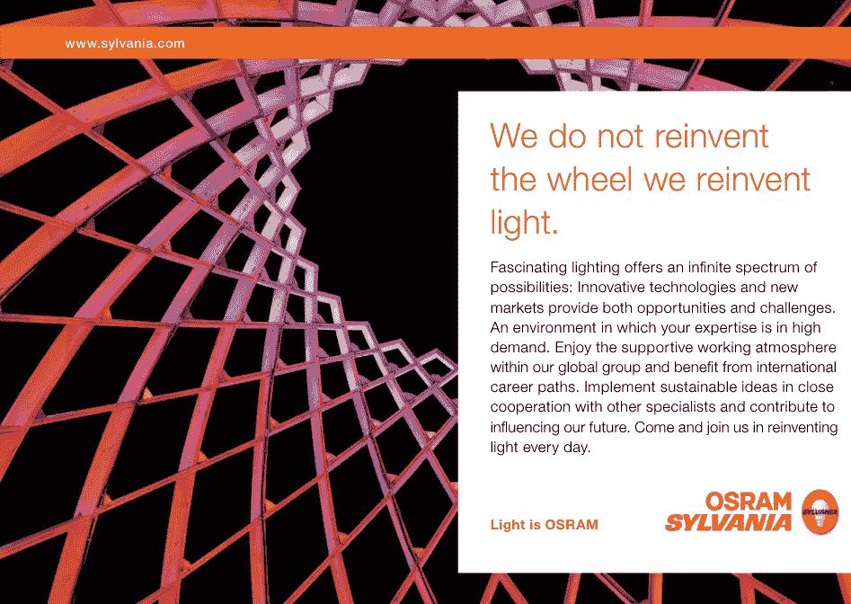

# JAVA 10: JAVA2D, 窗口绘制与图像处理

```java
g2d.setPaint(Color.blue);
g2d.draw(rect);
g2d.setTransform(start);
g2d.translate(20, 140);
g2d.setPaint(Color.darkGray);
g2d.draw(rect);
g2d.setPaint(Color.green);
g2d.shear(0, 0.3);
g2d.draw(rect);
g2d.setTransform(start);
g2d.translate(340, 20);
g2d.setPaint(Color.darkGray);
g2d.draw(rect);
g2d.setPaint(Color.red);
g2d.shear(1, 0.3);
g2d.draw(rect);
```

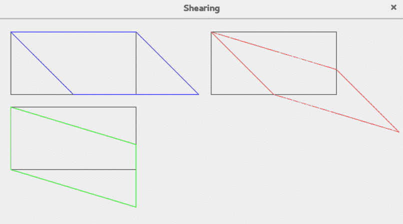

# JAVA 10: JAVA2D, 窗口绘制与图像处理渲染

## 4.2 混合 (COMPOSITING)

混合是指将两个图像组合在一起的过程，并且每次绘制形状或图像时都会出现。如前所述，`Graphics2D` 代表一个绘制表面，每当你在这个表面上绘制某些文本或图像时，都会为绘制表面添加一个新元素。这在原理上通过三个操作完成：

1. 栅格化（Rasterizing）从当前图形产生 alpha 值，你可以将其想象为一个像素网格，每个像素都有一个 alpha 值。原则上，这个网格对应整个绘制表面，在下文中被称为源（source）。相比之下，绘制表面被称为目标（destination）。

2. 对于源中的每个像素，确定其颜色是基于 `Graphics2D` 对象使用的当前 `Paint` 还是来自一张图像。

3. 源和目标（颜色和 alpha 值）逐像素组合，形成绘制表面上的图像。源和目的的组合是根据混合规则完成的，该规则精确规定了如何使用颜色和 alpha 值。

例如，如果你观察在白色绘制表面上使用默认混合规则渲染一个黑色图形时会发生什么，可以将该过程描述如下：栅格化将图形转换为 alpha 值数组，完全超出形状的像素被赋予值 0.0（解释为透明），而目标中的相应像素将保持不变。同样，图形内部的像素将具有 alpha 值 1.0，目标中的相应像素将获得与源像素相同的颜色，在这种情况下结果将是黑色。

然后是位于边缘的像素，它们会获得一个 0.0 到 1.0 之间的 alpha 值（假设开启了某些抗锯齿）。它们的颜色是源和目标像素颜色的组合，在这种情况下，它将是黑色和白色组合，因此呈现出灰色。确的颜色由源中的 alpha 值决定。例如，alpha 值为 0.9 的像素将给出非常深的灰色。

上述被称为混合默认规则，但实际上在特殊情况下可能会使用其他规则。它们被称为 Porter-Duff 规则，但此处不进行讨论。

## 4.3 裁剪 (CLIPPING)


有时，人们并不希望你可以在整个绘制区域上绘制。当你构建复杂形状时，通常需要确保你不会在其他图形上进行绘制，这可以通过指定裁剪区域（clip area）来确保。考虑以下窗口，它取自之前的示例：

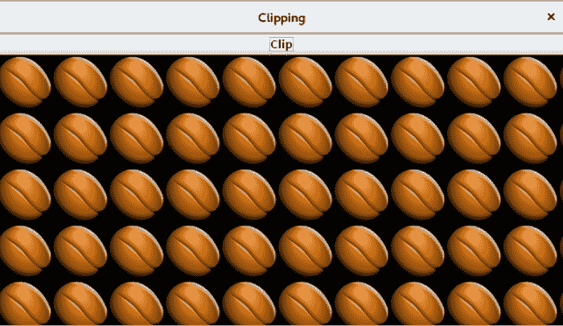

区别仅在于窗口顶部添加了一个按钮。如果你点击按钮，窗口将重绘，结果如下所示，绘制了一个三角形。这是通过将裁剪区域定义为三角形来实现的，只有组件的该部分被重绘。再次点击按钮，结果是一个椭圆，因为现在定义的裁剪区域是一个椭圆。点击第三次，你将回到起点。如下面的代码所示，定义裁剪区域非常简单，你应该注意该区域可以是任何形状（`Shape`）：

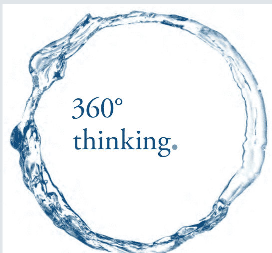

## 渲染

| 裁剪 | x |
|---|---|
| clip | |

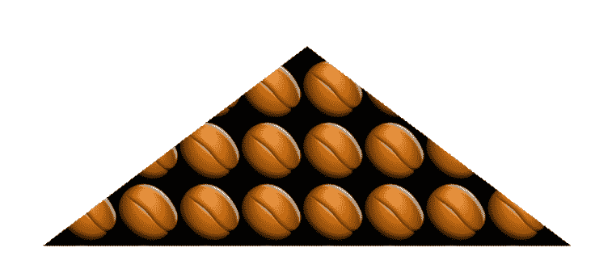

| 裁剪 | x |
|---|---|
| clip | |

```java
package clipdemo;

import java.awt.*;
import java.awt.event.*;
import java.awt.image.*;
import java.awt.geom.*;
import javax.swing.*;

public class MainWindow extends JFrame {
    private JButton cmdClip = new JButton("Clip");
    private int state = 0;

    public MainWindow() {
        super("Clipping");
        setSize(650, 370);
        setLocationRelativeTo(null);
        add(cmdClip, BorderLayout.NORTH);
        add(new Drawing());
        cmdClip.addActionListener(new ClickHandler());
        setDefaultCloseOperation(EXIT_ON_CLOSE);
        setVisible(true);
    }
}

class ClickHandler implements ActionListener {
    public void actionPerformed(ActionEvent e) {
        state = (state + 1) % 3;
        repaint();
    }
}

class Drawing extends JComponent {
    public void paintComponent(Graphics g) {
        Dimension d = getSize();
        Graphics2D g2 = (Graphics2D) g;
        Rectangle2D rect = new Rectangle2D.Double(0, 0, d.width, d.height);
        g2.setPaint(Color.white);
        g2.fill(rect);
        BufferedImage image = createImage();
        g2.setPaint(new TexturePaint(image, new Rectangle2D.Double(0, 0, image.getWidth(), image.getHeight())));
        if (state == 1) {
            GeneralPath path = new GeneralPath();
            path.moveTo(d.width / 2, 50);
            path.lineTo(d.width - 50, 50);
            path.lineTo(50, d.height);
            path.closePath();
            g2.setClip(path);
        } else if (state == 2) {
            Ellipse2D ellipse = new EllipseD.Double(50, 50, d.width - 100, d.height - 100);
            g2.clip(ellipse);
            g2.fill(rect);
        }
    }

    public BufferedImage createImage() {
        java.net.URL imgURL = Drawing.class.getResource("/clipdemo/bean.png");
        ImageIcon icon = new ImageIcon(imgURL).getImage().getScaledInstance(64, 64, Image.SCALE_SMOOTH);
        BufferedImage image = new BufferedImage(icon.getWidth(), icon.getHeight(), BufferedImage.TYPE_INT_RGB);
        Graphics g = image.createGraphics();
        g.paint(null, 0, 0);
        g.dispose();
        return image;
    }
}
```


## 4.4 渲染提示 (RENDERING HINTS)

在本章最后我提到渲染提示，正如我在抗锯齿中提到的。`Graphics2D` 的渲染机制比以前任何任何时候，而渲染提示是程序员对质量的期望，但并不一定能满足你的要求。你可以以键/值对的形式定义渲染提示，可能性如下所示：

| 键 | 值 |
|---|---|
| `KEY_ANTIASING` | `VALUE_ANTIALIAS_ON`<br>`VALUE_ANTIALIAS_OFF`<br>`VALUE_ANTIALIAS_DEFAULT` |
| `KEY_RENDERING` | `VALUE_RENDER_QUALITY`<br>`VALUE_RENDER_SPEED`<br>`VALUE_RENDER_DEFAULT` |
| `KEY_DITHERING` | `VALUE_DITHER_DISABLE`<br>`VALUE_DITHER_ENABLE`<br>`VALUE_DITHER_DEFAULT` |
| `KEY_COLOR_RENDERING` | `VALUE_COLOR_RENDER_QUALITY`<br>`VALUE_COLOR_RENDER_SPEED`<br>`VALUE_COLOR_RENDER_DEFAULT` |
| `KEY_FRACTIONALMETRICS` | `VALUE_FRACTIONALMETRICS_ON`<br>`VALUE_FRACTIONALMETRICS_OFF`<br>`VALUE_FRACTIONALMETRICS_DEFAULT` |
| `KEY_TEXT_ANTIALIASING` | `VALUE_TEXT_ANTIALIAS_ON`<br>`VALUE_TEXT_ANTIALIAS_OFF`<br>`VALUE_TEXT_ANTIALIAS_DEFAULT` |
| `KEY_INTERPOLATION` | `VALUE_INTERPOLATION_BICUBIC`<br>`VALUE_INTERPOLATION_BILINEAR`<br>`VALUE_INTERPOLATION_NEAREST_NEIGHBOR` |
| `KEY_ALPHA_INTERPOLATION` | `VALUE_ALPHA_INTERPOLATION_QUALITY`<br>`VALUE_ALPHA_INTERPOLATION_SPEED`<br>`VALUE_ALPHA_INTERPOLATION_DEFAULT` |

到目前为止我只使用了

```java
g2d.setRenderingHint(RenderingHints.KEY_ANTIALIASING, RenderingHints.VALUE_ANTIALIAS_ON);
```

但我稍后会使用其他的。

# JAVA 10: JAVA2D，窗口绘制与图像处理

## 5 文本

也必须绘制文本，即使你在处理与 Swing 组件相关的文本（在那种情况下你不需要做任何操作），也必须在某处绘制文本，这是 Java2D 必须处理的任务。实际上，文本包含许多细节，这正是本章的主题，但基本上，文本对象可以像其他图形对象和形状一样被进行操作。

文本包含编码为 Unicode 的字符，为了绘制文本，必须为每个字符找到并渲染代表该字符的图形。这种图形被称为字形（glyph），字体包含了该字体支持的所有字符的字形。字体还附有字体度量（font metrics），指示每个字符的大小。高度有三个尺寸。字符绘制在基线（baseline）上（字符站在基线之上）。下沉部（Descent）表示字符填充基线以下的部分，上升部（ascent）表示它们可以超出基线多少部分。最后指定行间距（leading），即行与行之间的空间，这三个尺寸总和称为字体高度。作为示例，你可以考虑以下窗口：

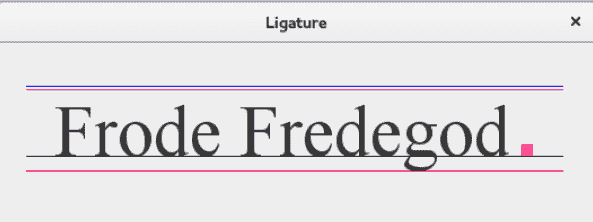

这里黑线是基线，而黑线与红线之间的距离是下沉部，黑线与洋红色之间的距离是上升部，洋红色与蓝线之间的距离是行间距。

组件代码如下所示。

```java
class Drawing extends JComponent
{
    public void paintComponent(Graphics g)
    {
        String text = "Frode Fredegod";
        Graphics2D g2d = (Graphics2D)g;
        g2d.setRenderingHint(RenderingHints.KEY_ANTIALIASING, RenderingHints.VALUE_ANTIALIAS_ON);
```

文本

```java
Font font = new Font("Times New Roman", Font.PLAIN, 64);
g2d.setFont(font);
g2d.drawString(text, 50, 100);
g2d.draw(new Line2D.Double(25, 100, 500, 100));
FontMetrics metrics = g2d.getFontMetrics();
g2d.setPaint(Color.blue);
g2d.draw(new Line2D.Double(25, 100 - metrics.getLeading(), 500, 100 - metrics.getAscent()));
g2d.setPaint(Color.magenta);
g2d.draw(new Line2D.Double(25, 100 - metrics.getAscent(), 500, 100 - metrics.getAscent()));
g2d.setPaint(Color.red);
g2d.draw(new Line2D.Double(25, 100 + metrics.getDescent(), 500, 100 + metrics.getDescent()));
int width = metrics.stringWidth(text);
g2d.fill(new Rectangle2D.Double(60, 90, 10, 10));
```

在这里你应该特别注意 `FontMetrics` 类，它包含了关于字体的信息，并且你应该注意 `stringWidth()` 方法，它用于测量字符串在当前字体中占据的空间。


> 在丹麦，你可以找到极好的工程工作并在专业领域发展自己。特别是在风电领域，你可以从行业内最优秀的人身上学习，并在稳定的工作中晋你的职业。

> Mireia Mare,

> 来自西班牙的高级工程师。

> 自 2010 年起在丹麦的风能行业工作。

事实上，人可以与文本进行交互，例如，你可以为文本关联一个迭代器，用于操作单个字符或字符串的局部。程序 `AttributedText` 会打开如下所示的窗口：

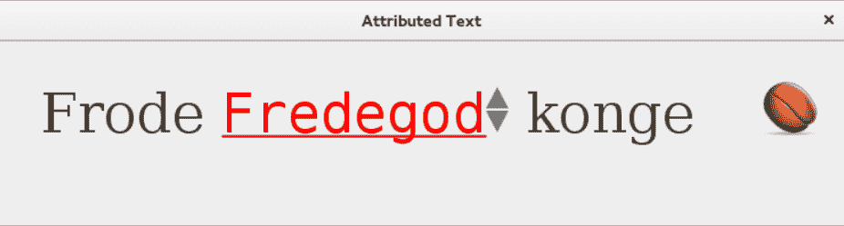

```java
class Drawing extends JComponent
{
  public void paintComponent(Graphics g) {
    Font serifFont = new Font("Serif", Font.PLAIN, 48);
    Font monoFont = new Font("Monospaced", Font.PLAIN, 48);
    String text = "Frode Fredegod, konge,";
    AttributedString str = new AttributedString(text);
    Graphics2d g2d = (Graphics2d)g;
    g2d.setRenderingHints(RenderingHints.KEY_ANTIALIASING, RenderingHints.VALUE_ANTIALIAS_ON);
    str.addAttribute(TextAttribute.FONT, serifFont);
    str.addAttribute(TextAttribute.FONT, monoFont, 6, 14);
    str.addAttribute(TextAttribute.FOREGROUND, Color.red, 6, 14);
    // ... rest of code based on context
  }
}
```

（注意：OCR 在代码块存在一些不一致之处，如 `str` 与 `strG2d`，根据用法已修正为 `str`）。

文本和所有形状一样都是图形对象，可以像其他 `Shape` 对象一样进行变换。一个将打开以下窗口的程序：

```java
public Image createImage() {
    java.net.URL imgURL = Drawing.class.getResource("/images/Bean.png");
    ImageIcon icon = new ImageIcon(imgURL);
    return icon.getScaledInstance(48, 48, Image.SCALE_SMOOTH);
}
```

## 练习 12

文本和所有形状一样都是图形对象，可以像其他 `Shape` 对象一样进行变换。一个将打开以下窗口的程序：

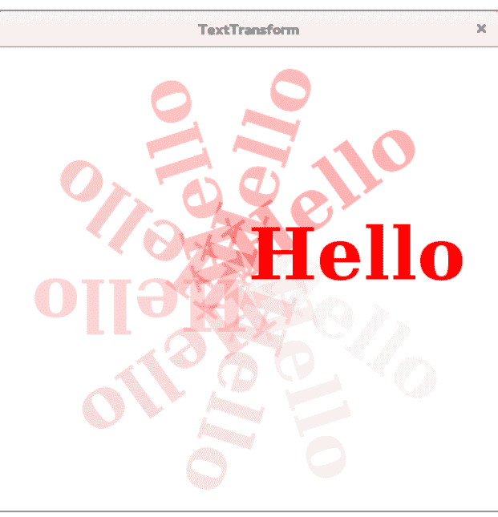

## 我加入 MITAS 是因为我想要真正的责任

工程师与地质科学家研究生计划 www.discovermitas.com


> > 2018年，我在北海担任施工主管，指导并帮助工头解决问题

> 真实的工作 国际机会 三次实习


# JAVA 10: JAVA2D，窗口绘制与图像处理

# 练习 13

编写一个程序，显示一个如下所示的窗口，其中文本使用 `TexturePaint` 绘制，且背景使用由 4 个小正方形组成的图像绘制：

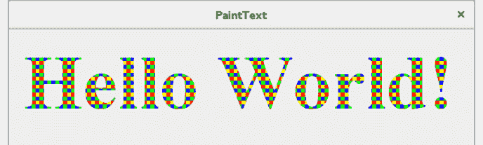

## 5.1 字体

Java2D 包含几个与字体相关的类，我已经提到过 `Font` 和 `FontMetrics` 类。在本节中，我将展示一个打开如下所示窗口的程序。该应用程序显示一个列表框，其中列出了所有可用的字体。如果你双击某一行，将弹出一个包含该字体信息的对话框。


# JAVA 10: JAVA2D, 窗口绘制与图像处理

## 字体列表

以下列出了可用的字体及其样式：

```
java.awt.Font(family=Abeysnica,name=Abeysnica,style=plain,size=size)
java.awt.Font(family=Andale Mono,name=Andale Mono,style=plain,size=size)
java.awt.Font(family=Android Emoji,name=Android Emoji,style=plain,size=size)
java.awt.Font(family=Arial,name=Arial,style=plain,size=size)
java.awt.Font(family=Arial Black,name=Arial Black,style=plain,size=size)
java.awt.Font(family=Arial Bold,name=Arial Bold,style=plain,size=size)
java.awt.Font(family=Arial,name=Arial,style=italic,size=size)
java.awt.Font(family=Bitstream Charter,name=Bitstream Charter,style=plain,size=size)
java.awt.Font(family=Bitstream Charter Bold,name=Bitstream Charter Bold,style=plain,size=size)
java.awt.Font(family=Bitstream Charter,name=Bitstream Charter Italic,style=italic,size=size)
java.awt.Font(family=Calatino,name=Calatino,style=plain,size=size)
java.awt.Font(family=Calada,name=Calada,style=plain,size=size)
java.awt.Font(family=Calada,name=Calada,style=italic,size=size)
java.awt.Font(family=Calibri,name=Calibri,style=plain,size=size)
java.awt.Font(family=Calibri,name=Calibri Bold,style=plain,size=size)
java.awt.Font(family=Calibri,name=Calibri Bold Bold,style=italic,size=size)
java.awt.Font(family=Calibri,name=Calibri Italic,style=italic,size=size)
```

> Liberation Serif

Liberation Serif Bold

`java.awt.geom.Rectangle2D$Float(x=0.0,y=-21.896484,w=49.0,h=27.597656)`

`java.awt.geom.Rectangle2D$Float(x=0.0,y=-21.896484,w=168.0,h=27.597656)`

代码如下，没什么需要解释的，但你应该特别注意如何确定哪些字体是可用的。还要注意 `FontRenderContext` 类，它可能是为了测量在使用特定字体绘制时字符串的视觉效果：

```java
package fontprogram;

import java.awt.*;
import java.awt.font.*;
import java.awt.event.*;
import java.awt.geom.*;
import java.awt.swing.*;
```

```java
public class MainWindow extends JFrame {

    private DefaultListModel model = new DefaultListModel();

    public MainWindow() {

        super("FontProgram");

        setSize(700, 400);

        setLocationRelativeTo(null);

        createWindow();

        setDefaultCloseOperation(EXIT_ON_CLOSE);

        setVisible(true);

    }

    private void createWindow() {

    Font[] fonts = GraphicsEnvironment.getLocalGraphicsEnvironment().getAllFonts();

    for (Font font : fonts) model.addElement(font);

    JList list = new JList(model);

    add(new JScrollPane(list));

    list.addMouseListener(new MouseHandler());

    }

}
```

```java
class MouseHandler extends MouseAdapter {

    public void mouseClicked(MouseEvent e) {

        if (e.getCount() == 2) {

            try {

                JList list = (JList)e.getSource();

                int n = list.locationToIndex(e.getPoint());

                Font font = (Font)model.get(n);

                StringBuilder builder = new StringBuilder(font.getFamily());

                builder.append("\n");

                builder.append(font.getName());

                Graphics2D g2d = (Graphics2D)list.getGraphics();

                g2d.setFont(new Font(font.getFamily(), font.setStyle(), 24));

                FontRenderContext frc = g2d.getFontRenderContext();

                Rectangle2D rect1 = g2d.getFont().getStringBounds("ABC", frc);

                g2d.setFont(font);

                Rectangle2D rect2 = g2d.getFont().getStringBounds("Knud den Hellige", frc);

                builder.append("\n");

                builder.append(rect1);

                builder.append("\n");

                builder.append(rect2);

                JOptionPane.showMessageDialog(MainWindow.this, builder.toString(), font.getName(), INFORMATION_MESSAGE);

            } catch (Exception ex) {

            }

        }

    }

}
```

## 练习 14

编写一个程序，显示如下所示的窗口，当使用特定字体绘制时，背景使用由 4 个小正方形组成的图像绘制：

1. 字体填充了正方形
2. 字体位于基线之上
3. 字体线条与基线对齐
4. 正方形包围着每个字形
5. 正方形之间的距离


## 5.2 文本布局 (TEXTLAYOUT)

`TextLayout` 是 `drawString()` 的替代方案，它允许完全控制文本如何渲染。在下文中展示使用 `TextLayout` 的示例，它打开如下窗口：


`TextLayout` 包含了字符串 `str`。组件代码如下：

```java
class Drawing extends JComponent {

    private String str = "Knud den Hellige";

    private Font font = new Font("Liberation Serif", Font.BOLD, 36);

    private TextLayout text;

    private int xpos = 20;

    private int ypos = 50;

    public Drawing() {

        FontRendererContext context =

            new FontContext(new AffineTransform(), false, false);

        text = new TextLayout(str, font, context);

        addActionListener(new HitTester());

    }

    public void paintComponent(Graphics g) {

        Graphics2D g2d = (Graphics2D)g;

        g2d.setRenderingHint(RenderingHints.KEY_ANTIALIASING, RenderingHints.VALUE_ANTIALIASING);

        g2d.draw(text, xpos, ypos);

        Shape shape = text.getOutline(AffineTransform.translateInstance(20, 100));

        g2d.setPaint(Color.yellow);

        g2d.fill(shape);

        g2d.setPaint(Color.red);

        g2d.draw(shape);

    }

}
```

```java
class HitTester extends MouseAdapter
{
    public void mouseClicked(MouseEvent e)
    {
        Rectangle2D rect = text.getBounds();
        if (rect.contains(e.getX() - xpos, e.getY() - ypos)) {
            TextHitInfo hit = text.hitTestChar(e.getX() - xpos, e.getY() - ypos);
            JOptionPane.showMessageDialog(
                this, str.charAt(hit.getCharIndex()));
        }
    }
}
```

如果你有一个 Layout，可以用以下方式绘制文本：

```
text.draw(g2d, xpos, ypos)
```

该语法与你绘制形状或文本的方式略有不同。在用 `get()` 方法绘制图形后，会获取一个由文本字形（glyphs）组成的 `Shape` 对象。该方法包含一个变换，告知哪些对象被转换了，且 `Shape` 对象可以像任何其他 `Shape` 一样被处理。在这种情况下，图形被填充为黄色并用红色绘制。

该组件在构造函数中的鼠标点击监听器中指定，处理器会测试鼠标坐标是否落在 Layout 对象范围内。如果是那样的话，被引用对象的 `TextHitInfo` 对象将返回一些重要信息，其中最重要的是将鼠标坐标转换为被点击的字符。确定这一点并不简单，它是 `Layout` 提供的服务之一。

接接的示例将打开以下窗口，该窗口再次显示了用 Layout 绘制的文本：

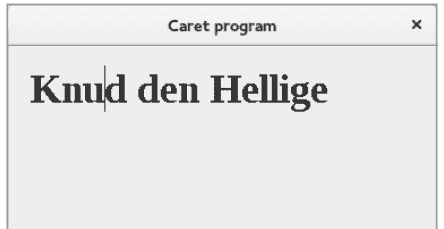

程序将展示如何绘制光标（或光标/标记），以及如何使用方向键移动光标。这听起来很简单，但如果你仔细考虑，光标（通常）是绘制在两个字母之间的细线，计算这个字符串应该如何绘制并不简单。幸运的是，免费的 `Layout` 提供了必要的支持。组件的代码显示如下：

```java
class Drawing extends JComponent {
    private String str = "Knud den Hellige";
    private Font font = new Font("Liberation Serif", Font.BOLD, 36);
    private Layout text;
    private int xpos = 20;
    private int ypos = 50;
    private TextHitInfo info;

    public Drawing (Mainwindow)
    {
        FontRenderContext context =
new FontRenderContext(new AffineTransform(), false, false);
        text = new TextLayout(str, font, context);
        hit = text.getNextHit(1);
        main.addKeyListener(new Handler());
    }

    public void paintComponent(Graphics g)
    {
        Graphics2D g2d = (Graphics2D)g;
        g2d.setRenderingHint(RenderingHints.KEY_ANTIALIASING, RenderingHints.VALUE_ANTIALIASING_ON);
        g2d.setRenderingHint(RenderingHints.KEY_FRACTIONALMETRICS, RenderingHints.VALUE_FRACTIONALMETRICS_ON);
        text.draw(g2d, xpos, ypos);
        Shape[] carets = text.getCaretShapes(hit.getInsertionIndex());
        if (carets[0] == null)
            Shape shape = AffineTransform.getTranslateInstance(xpos, ypos).createTransformedShape(carets[0]);
        g2d.setStroke(new BasicStroke(shape));
        g2d.draw(shape);
    }
}
```

```java
class KeyHandler extends KeyAdapter
{
    public void keyPressed(KeyEvent e)
    {
        if (e.getKeyCode() == KeyEvent.VK_RIGHT) {
            hit = text.getNextRight(hit.getInsertionIndex());
            if (hit == null) hit = text.getNextLeft(1);
            repaint();
        } else if (e.getKeyCode() == KeyEvent.VK_LEFT) {
            hit = text.getNextLeft(hit.getInsertionIndex());
            if (hit == null) hit = text.getNextRight(text.getCharacterCount() - 1);
            repaint();
        }
    }
}
```

## JAVA ZERO: JAVA2D, 窗口绘制与图像处理

代码与之前的示例相似，但构造函数包含了对主窗口的引用，以便将键盘事件处理器关联到窗口上。事件处理器由 `KeyHandler` 类定义，它是 `Drawing` 类的一个内部类。该类具有类型为 `TextHitInfo` 的实例变量。它将显示光标应该绘制的位置，并在构造函数中初始化，然后绘制索引为 1 的字符（即第一个字符）。

然后是 `paintComponent()`，它定义了一个额外的渲染提示。它指示了字符的确定应该如何进行，以及准确度达到什么程度。一旦文本绘制完成，就可以确定光标的位置：

```
Shape[] carets = text.getCaretShapes(hit.getInsertionIndex());
```


`Layout` 生时并不带有光标，但它有一个逻辑位置，附着在 `hit` 上，并且可以通过 `InsertionIndex()` 方法引用。`getCaretShapes()` 方法返回两个 `Shape` 对象。事实上，原因是 Java2D 支持双向文本，因此文本是从右向左写的。在任何必须绘制的地方，经过变换后它都会像任何其他图形一样被绘制。在这里你特别注意到了 `createTransformedShape()` 方法，它转换了当前的 `Graphics2D` 对象。


# JAVA 10: JAVA2D, 窗口绘制与图像处理

然后是处理键盘的事件处理器，它处理方向键。查看处理器很容易理解，它通过 `getNextHit()` 和 `getNextLeft()` 两个方法工作。下一个示例与上述类似，它再次显示了绘制文本：

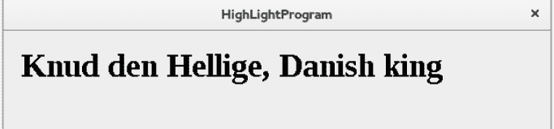

程序将展示如何绘制光标，以及如何使用方向键移动光标。这听起来很简单，但如果你仔细考虑，光标（通常）是绘制在两个字母之间的细线，计算这个字符串应该如何绘制并不简单。幸运的是，免费的 `Layout` 提供了必要的支持。


如果你选择某些文本并释放鼠标，例如：

```
class Drawing extends JComponent {
    private String str = "Knud den Hellige";
    private Font font = new Font("Liberation Serif", Font.BOLD, 36);
    private Layout text;
    private int xpos = 20;
    private int ypos = 50;
    private TextHitInfo info;

    public Drawing (Mainwindow)
    {
        FontRenderContext context =
new FontRenderContext(new AffineTransform(), false, false);
        text = new TextLayout(str, font, context);
        hit = text.getNextHit(1);
        main.addKeyListener(new Handler());
    }

    public void paintComponent(Graphics g)
    {
        Graphics2D g2d = (Graphics2D)g;
        g2d.setRenderingHint(RenderingHints.KEY_ANTIASING, RenderingHints.VALUE_ANTIASING_ON);
        g2d.setRenderingHint(RenderingHints.KEY_FRACTIONALMETRICS, RenderingHints.VALUE_FRACTIONALMETRICS_ON);
        text.draw(g2d, xpos, ypos);
        Shape[] carets = text.getCaretShapes(hit.getInsertionIndex());
        if (carets[0] == null)
            Shape shape = AffineTransform.getTranslateInstance(xpos, ypos).createTransformedShape(carets[0]);
        g2d.setStroke(new BasicStroke(shape));
        g2d.draw(shape);
    }
}

class KeyHandler extends KeyAdapter
{
    public void keyPressed(KeyEvent e)
    {
        if (e.getKeyCode() == KeyEvent.VK_RIGHT) {
            hit = text.getNextRight(hit.getInsertionIndex());
            if (hit == null) hit = text.getNextLeft(1);
            repaint();
        } else if (e.getKeyCode() == KeyEvent.VK_LEFT) {
            hit = text.getNextLeft(hit.getInsertionIndex());
            if (hit == null) hit = text.getNextRight(text.getCharacterCount() - 1);
            repaint();
        }
    }
}
```

然后是处理键盘的事件处理器，它处理方向键。查看处理器很容易理解，它通过 `getNextHit()` 和 `getNextLeft()` 两个方法工作。下一个示例与上述类似，它打开窗口：


程序将展示如何使用鼠标选择文本，例如：


如果你选择某些文本，你会得到一个包含该文本的框。

## JAVA 10: JAVA2D, 窗口绘图与图像处理

`Layout` 基本上是单行文本，如果文本需要填充几行，你必须进行更好的处理，但幸运的是有可以使用的辅助类。考虑下面的窗口。程序所做的事情是在窗口中显示文本（当然，用 `JTextArea` 来做非常轻而易举，但在这种情况下，文本是用 `Layout` 绘制的）。

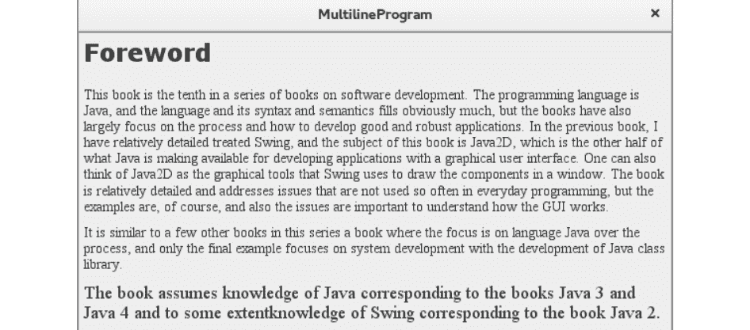

```java
package multilineprogram;

import java.awt.*;
import java.awt.font.*;
import javax.swing.*;
import java.text.*;

public class MainWindow extends JFrame
{
    public MainWindow()
    {
        super("MultilineProgram");
        setSize(600, 400);
        setLocationRelativeTo(null);
        add(new JScrollPane(new Drawing()));
        setDefaultCloseOperation(EXIT_ON_CLOSE);
        setVisible(true);
    }
}
```

```java
class Drawing extends JComponent {
    private String[] str = {
"前言","此书是软件开发系列书籍中的第十本。" +
"编程语言是 Java，这种语言及其语法和" +
"语义显然非常重要，但这些书在很大程度上也" +
"关注过程以及如何开发健壮且准确的应用程序。" +
"在前书中，我相对详细地处理了 Swing，而 " +
"本书的主题是 Java2d，它是 Java 用于开发图形化 " +
"用户界面应用程序的另一部分。你也可以将 Java2d 视为 " +
" Swing 用来绘制窗口中组件的图形工具。这本书的内容相对 " +
"详细，并解决了许多不常见的问题，这些 " +
"对于理解 GUI 如何工作至关重要," +
"与本系列书籍中的几个示例相似，这些书籍 " +
"是关于 Java 语言和过程的，只有最后的示例 " +
"关注于使用 Java 类库进行系统开发。" +
"本书假设读者已经拥有与书籍 Java 3 和 " +
"Java 4 对应的 Java 知识，并在某种程度上了解对应于书籍 " +
"Java 2 的 Swing 知识。",
};
    private float font1 = new Font("Verdana", Font.BOLD, 24);
    private Font font2 = new Font("Times New Roman", Font.PLAIN, 14);
    private Font font3 = new Font("Times New Roman", Font.PLAIN, 18);

public void paintComponent(Graphics g) {
    float height = 0;
    Graphics2d g2d = (Graphics2d)g;
    g2d.setRenderingHint(RenderingHints.KEY_ANTIALIASING,
RenderingHints.VALUE_ANTIALIAS_ON);
    height = draw(g2d, new Insets(5, 5, 20, 5), 0, new AttributedString(str[0]), font1);
    height = draw(g2d, new Insets(0, 5, 10, 5), height,
    new AttributedString(str[1]), font2);
    height = draw(g2d, new Insets(0, 5, 10, 5), height,
    new AttributedString(str[2]), font3);
    height = draw(g2d, new Insets(0, 5, 5, 5), height,
    new AttributedString(str[3]), font3);
    setPreferredSize(new Dimension(0, (int)height));
}

    private float draw(Graphics g, Insets margins, float y, AttributedString str,
str.addAttribute(TextAttribute.FONT, font);
AttributedCharacterIterator itr = str.getIterator();
FontRenderer context = g.getFontRenderer();
LineBreakMeasurer lbm = new LineBreakMeasurer(itr, context);
float width = getSize(width) - margin.left - margin.right;
float x = margin.left;
y += margin.top;
while (lbm.getPosition() < itr.getEnd()) {
    TextLayout textLayout = lbm.nextLayout(width);
    y += textLayout.getAscent();
    textLayout.draw(g, x, y);
    y += textLayout.getDescent() + textLayout.getLeading();
    x = margin.left;
}
y += margin.bottom;
```

```


关于 e-Learning for Kids。e-Learning 成立于 2004 年是一个全球非营利基金会，致力于为 5-12 岁的儿童提供有趣且免费的网络学习，涵盖数学、科学、语言、健康和环境课程。自 2005 年以来，来自 190 多个国家的 1500 万儿童受益于我们提供的在线课程。我们的志愿者团队由来自世界各地的教育和商业专业人士组成，致力于改变。我们的愿景包括资助、赞助和内容。更多信息，请访问 www.e-learningforkids.org。

- 基础教育 MOOC 数量
- 为儿童提供的免费数字学习
- 覆盖 1500 万人

## 5.3 字形 (GLYPHS)

字形以数组的形式出现在三个字符串，你可以将文本看作是一个段落。最重要的点是带有 `Insets` 对象绘制的文本，这些方法对于理解 GUI 如何工作至关重要。字形是数组中的三个字符串，你可以将它们看作是行。这些方法显示了文本，尽管你很少需要它，但你也可以进一步操作字形。以下程序显示了字形：

```java

class Drawing extends JComponent

{

    public void paintComponent(Graphics g)

    {

        Graphics2D g2d = (Graphics2D) g;

        g2d.setRenderingHint(RenderingHints.KEY_ANTIALIASING,

                             RenderingHints.VALUE_ANTIALIAS_ON);

        String str = "Knud den Hel";

        Font font = new Font("Serif", Font.PLAIN, 36);

        FontRenderContext context = g2d.getRenderContext();

        g2d.translate(20, 50);

        GlyphVector glyphs = font.createGlyphVector(context, str);

        int length = glyphs.getphsCount();

        for (int i = 0; i < length; i++) {

            Point2D p = glyphs.getGlyphPosition(i);

            AffineTransform trans =

            AffineTransform.translate(p.getX(), p.getY());

            trans.rotate(i / (double) (length - 1) * Math.PI / 4);

            g2d.fill(trans.createTransformedShape(glyphs.getGlyphOutline(i)));

        }

    }

}

```

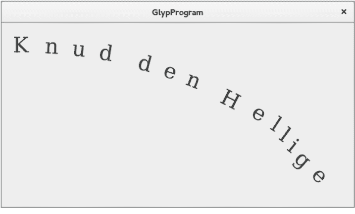


## 6 颜色 (COLORS)

颜色在本系列书籍中多次提到，作为程序员，你通常需要比已经说的更多的信息。颜色通过组合红、绿、蓝三种颜色的值形成，这就是为什么我们在讨论 RGB 编码。此外，关联有一个 alpha 值，它告诉我们颜色的透明程度。这四个值中的每一个都由一个字节表示（因此有 256 种不同的值），在内部颜色由一个 32 位整数表示：

| Alpha | 红 | 蓝 | 绿 |
|---|---|---|---|

表示颜色的基本类是 `Color`，它已经被使用很多次。回顾之前所有的示例，颜色的使用通常是简单的，但颜色与文本相同的情况实际上极其复杂，因此本节作为关于颜色问题的简要介绍。简而言之，这些问题可以解释为某些颜色在不同的屏幕上看起来不同（而且确实如此），如果打印在彩色打印机上甚至更糟糕。原因是计算机的颜色表示是相对的（颜色 40% 红到底意味着什么？）以及不同的硬件设备（屏幕和打印机）显示的相同颜色并不相同。我将在下面稍作解释，但在那之前来看示例。

`ColorProgram` 打开了如下：

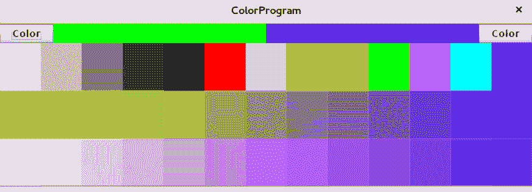

## JAVA 10: JAVA2D，窗口绘图与图像处理颜色

显示了 39 个彩色矩形。第一行显示了在 `Color` 类中定义为常量的颜色值，窗口上方显示了一个绿色和一个蓝色矩形，中间一行的矩形展示了如何混合这两种颜色，使得左侧的矩形在向右移动时变为绿色，绿色逐渐与蓝色混合，最后最后一个变为蓝色。底一行的矩形显示了（从右到左）蓝色向最左侧变得越来越透明，最终完全透明而变得不可见。

顶部有两个按钮，用于打开标准的颜色对话选择框（见下文），这样你就可以更改程序操作的颜色——即窗口上方两个矩形的颜色。通过这种方式，你可以实验并观察颜色混合时会发生什么，以及颜色的 alpha 值是如何变化的。该对话框相对复杂，有许多选项，但你可以创建一个 `ColorChooser` 对象，这是一个可以配置以显示所需选项的组件。

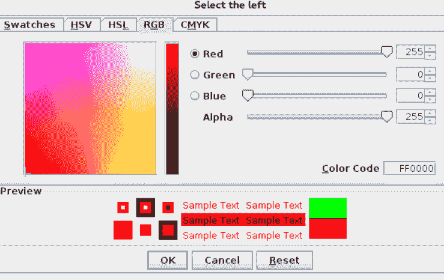

完整的代码也在下方所示，它并没有包含多少新：

```java

package colorprogram;

import java.awt.*;

import java.awt.event.*;

import java.awt.geom.*;

import javax.swing.*;

```

```java

public class MainWindow extends JFrame

{

    private Color leftColor = Color.green;

    private Color rightColor = Color.blue;


```java
private JLabel lblLeft = new JLabel();

private JLabel lblRight = new JLabel();

private Drawing drawing;

public MainWindow()

{

    super("ColorProgram");

    setSize(700, 250);

    setLocationRelativeTo(null);

    add(createTop(), BorderLayout.NORTH);

    add(drawing = new Drawing());

    setDefaultCloseOperation(EXIT_ON_CLOSE);

    setVisible(true);

}

private JPanel createTop()

{

    JPanel panel = new JPanel(new GridLayout(1, 2));

    JPanel left = new JPanel(new BorderLayout());

    JPanel right = new JPanel(new BorderLayout());

    JButton cmdLeft = new JButton("Color");

    JButton cmdRight = new JButton("Color");

    cmdLeft.addActionListener(this::updateLeft);

    cmdRight.addActionListener(this::updateRight);

    lblLeft.setOpaque(true);

    lblLeft.setBackground(leftColor);

    lblRight.setOpaque(true);

    lblRight.setBackground(rightColor);

    left.add(cmdLeft, BorderLayout.WEST);

    left.add(lblLeft);

    right.add(cmdRight, BorderLayout.EAST);

    right.add(lblRight);

    panel.add(left);

    panel.add(right);

    return panel;

}

class Drawing extends JComponent

{

    private Color[] colors = { Color.white, Color.lightGray, Color.gray,

Color.darkGray, Color.black, Color.red, Color.pink, Color.orange,

Color.yellow, Color.green, Color.magenta, Color.cyan, Color.blue };

    public void paintComponent(Graphics gr)

    {

        Dimension d = getSize();

        Graphics2D g2d = (Graphics2D)gr;

        g2d.setRenderingHint(RenderingHints.KEY_ANTIALIASING, RenderingHints.VALUE_ANTIALIASING_ON);

        float t = colors.length;

        float w = d.width / t;

        float h = d.height / t;

        for (int i = 0; i < t; i++)

        {

            g2d.setPaint(colors[i]);

            g2d.fill(new Rectangle2D.Float(i * w, 0, w, h));

        }

        for (int i = 0; i < t; i++)

        {

            float u = i / t;

            int r = (int)(rightColor.getRed() * u + leftColor.getRed() * (1 - u));

            int g = (int)(rightColor.getGreen() * u + leftColor.getGreen() * (1 - u));

            int b = (int)(rightColor.getBlue() * u + leftColor.getBlue() * (1 - u));

            g2d.setPaint(new Color(r, g, b));

            g2d.fill(new Rectangle2D.Float(i * w, h, w, h));

        }

        for (int i = 0; i < t; ++i) {

            int alpha = (int)(255 * i / t);

            g2d.paint(new Color(rightColor.getRed(), rightColor.getGreen(), rightColor.getBlue(), alpha));

            g2d.fill(new Rectangle2D.Float(i * w, 2 * h, w, h));

        }

    }

    public void updateLeft(ActionEvent e)

    {

        // Implementation details for brevity

    }

    public void updateRight(ActionEvent e)

    {

        // Implementation details for brevity

    }

}

```


# 加入马斯里里特大学商学院与经济学院，成为精英！

- 顶尖硕士课程
- 经济时报全球排名第 33 位：国际商务硕士
- 全球第一：国际商务硕士
- 全球第一：金融经济学硕士
- 全球第二：学习管理硕士
- 全球第二：经济学硕士
- 全球第二：计量经济与运筹硕士
- 全球第二：全球供应链管理与变革硕士

来源：Kepler 排名 2013；Elsevier “最佳研究”排名 2012；Financial Times 全球商业排名 2012。

马斯里特大学是荷兰最好的专业大学（Bleewier）。

# 欢迎临并发现我们为什么是最好的！

## 硕士课程开放日：2014 年 2 月 22 日

`www.mastersopenday.nl`

## JAVA 10：JAVA2D、窗口绘制与图像处理颜色

对于许多应用程序（大多数情况），涉及色彩空间和色彩配置的内容都是无趣的。如果一个程序必须绘制一个图形，那么该图形在另一个屏幕上显示的颜色略有不同通常并不重要，但当你需要显示照片时，这一点就非常重要。在这里，颜色应该是准确的，如果你正在编写成像软件，上述这一点就至关重要。尽管我不想深入探讨该主题，但 Java 2D 类型同时适用于色彩空间和色彩配置，这些类型提供了用于操作颜色细节的方法。

为了结束关于颜色的这一节，我将展示一个用渐变画填充椭形的程序，但与我之前展示的不同，它必须是一个从椭圆中心到外围混合两种颜色的渐变画。该程序将打开一个所示的窗口：


# JAVA 10：JAVA2D、窗口绘制与图像处理

## 颜色（COLORS）

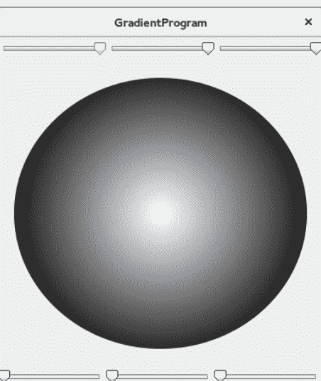

与之前的示例（练习 8）相同，你可以使用窗口顶部和底部的 `JSlider` 组件更改两种颜色。

Java 2D 没有提供为此目的设计的 `Paint` 对象，因此有必要自己编写一个类。该类应该实现 `Paint` 接口，该接口定义了两个方法。最重要的名为 `createContext()`，它返回一个 `PaintContext` 对象，该对象也是一个接口，其中最重要的方法是 `getRaster()`，它为要绘制的图形返回一个 `Raster` 对象。这是一个包含了所有已修改过的像素的对象。

`Paint` 对象的代码所示，我不想进一步描述这些代码，因为最的渐变程序已经通过注释进行了解释：

```java
package java.awt;

import java.awt.geom.*;

import java.awt.image.*;
```

```java
// 定义一个 Paint 对象，它是一种从中心点开始沿半径

// 混合两种颜色的渐变画。中心点的颜色为 color1，而

// 所有距离中心大于或等于半径的点

// 均为 color2。所有距离中心小于半径的点

// 具有渐变颜色，因此所有到中心距离相同的点

// 具有相同的颜色。
```

```java
public class RoundGradient implements Paint {

    private Point2D point; // 中心

    private Point2D radius; // 半径

    private Color color1; // 中心点的颜色

    // 距离中心大于半径的点的颜色

    private Color color2;

    public RoundGradient(Point2D point, Color color1, Point2D radius, Color color2) {

        this.point = point;

        this.color1 = color1;

        this.radius = radius;

        this.color2 = color2;

    }
```

```java
// 该方法由 Paint 接口定义。

public PaintContext createContext(ColorModel cm, Rectangle deviceBounds, Rectangle2D userBounds, AffineTransform trans, RenderingHints hints) {

    return new RoundContext(trans.transform(point, null), color1,

        trans.deltaTransform(radius, null), color2);

}
```

```java
// 该方法由 Paint 接口定义。

public int getTransparency() {

    int al1 = color1.getAlpha();

    int a2 = color2.getAlpha();

    return ((al1 & a2) == 0xff) ? OPAQUE : TRANSLUCENT;

}
```

```java
// PaintContext，定义了各个点如何着色

class RoundContext implements Paint {

    private Point2D point; // 中心

    private Point2D radius; // 半径

    private Color color1; // 中心点的颜色

    // 距离中心大于半径的点的颜色

    private Color color2;

    public RoundContext(Point2D point, Color color1, Point2D radius, Color color2)

    {

        this.point = point;

        this.color1 = color1;

        this.radius = radius;

        this.color2 = color2;

    }

}
```

```java
// 该方法由 PaintContext 接口定义。

public void dispose() {

}
```

```java
// 该方法由 ColorContext 接口定义

public ColorModel getRGBdefault() {

    return ColorModel.getRGBdefault();

}
```


## 赋能人类。改进业务。

挪威商学院（BI Norwegian Business School）是欧洲最大的商学院之一，接收了 20,000 多名学生。我们的课程提供了一个激发性和多文化的学习环境，具有国际视野，最终为学生提供了满足……的专业技能——

# JAVA 10：JAVA2D、窗口绘图与图像处理

## 颜色（COLORS）

以下是绘制图形的组件：

```java
class Drawing extends JComponent {

    public void paintComponent(Graphics g) {

        Dimension d = getSize();

        Color color1 = new Color(sldFg.getValue(), sldFgg.getValue(), slddBg.getValue());

        Color color2 = new Color(sldBgr.getValue(), sldBgg.getValue(), slddBg.getValue());

        Graphics2D g2d = (Graphics2D)g;

        g2d.setRenderingHint(RenderingHints.KEY_ANTIASING, RenderingHints.VALUE_ANTIALIAS_ON);

        Ellipse2D ellipse = new Ellipse2D.Double(20, 20, d.width - 40, d.height - 40);

        Point2D point = d.width ? new Point2D.Double(20, d.height / 2) : new Point2D.Double(d.width / 2, 20);

        g2d.setPaint(new RadialGradientPaint(new Point2D.Double(d.width / 2, d.height / 2), rad, color1, color2));

        g2d.fill(ellipse);

    }

}
```

## 问题 1

你必须编写一个创建一个圆形按钮的程序。例如，下方所示了一个带有四个按钮的窗口：

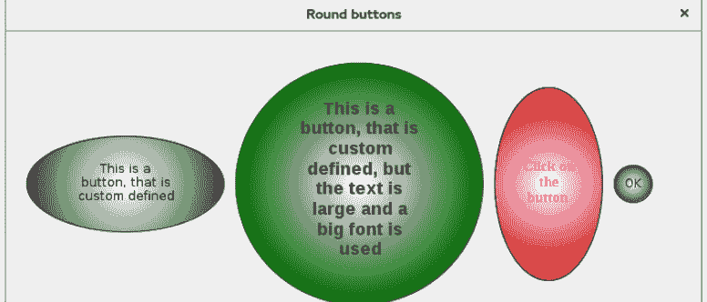

按钮应该被定义为自定义组件，并且它们必须支持文本换行。当点击按钮时还应该有一个效果，最后，组件在被点击时自然会触发一个动作事件（action event）。

# JAVA 10：JAVA2D、窗口绘图与图像处理图像

## 图像

图像是颜色的二维数组，每个元素被称为像素。从原理上讲，它看起来与其他任何图形相似，但有两个重要的区别：

1. 像素并不一定直接对应于绘图上的像素。
2. 图像具有以像素为单位的宽度和高度，以及一个独立于绘图区域的坐标系。

基础类是 `Image`，还有其他类。第一步是展示如何加载图像以便在窗口中显示它。我实际上已经展示了如何操作，例如通过加载图标或将图片加载到扑牌等。作为一个示例，以下方法从文件中读取图像，参数是文件的文件名（完整路径）：

```java
public static ImageIcon loadImageIcon(String filename)

{

    return new ImageIcon(filename);

}
```


图像应该被表示为 `ImageIcon`，如果你想将图像作为 `Image` 引用，`ImageIcon` 类有一个名为 `getImage()` 的方法。没有没有更简单的了。以下方法执行相同的操作：

```java
public static BufferedImage loadImage(String filename)

{

    try {

        return ImageIO.read(new File(filename));

    } catch (IOException e) {

        return null;

    }

}
```


主要的区别在于，这次方法返回的是`BufferedImage`类型的图像，这样你可以直接操作图像。特别需要注意的是，`BufferedImage`继承了`Image`类，可以用于任何可以使用`Image`的地方。相反，如果你想从程序的 jar 文件中读取图像（这在图标和较小的图像中很常见），可以使用以下方法：

```java
public static ImageIcon createIcon(String path)
{
    java.net.URL imgURL = PaGUI.class.getResource(path);
    if (imgURL != null) return new ImageIcon(imgURL, "");
    return null;
}
```

其中参数应该是相对于包含图像的包的图像名称。该方法的变体将图像缩放到特定大小（这在加载图标时特别有用），如下：

```java
public static ImageIcon createIcon(String path, int width, int height)
{
    java.net.URL imgURL = PaGUI.class.getResource(path);
    if (imgURL != null) return new ImageIcon(new ImageIcon(imgURL, "").
    getImage().getScaledInstance(width, height, Image.SCALE_SMOOTH), "");
    return null;
}
```

在窗口中查看图像在原理上是简单的，以下类显示了图像：

```java
class Drawing extends JComponent {
    public void paintComponent(Graphics g) {
        if (image != null) {
            Graphics2D g2d = (Graphics2D)g;
            AffineTransform trans = new AffineTransform();
            g2d.drawImage(image, trans, this);
        } else super.paintComponent(g);
    }
}
```

这没什么需要解释的。`Graphics2D`有一个`drawImage()`方法可以显示图像。对象`image`是图像，而`trans`是在显示之前对图像进行变换的变换。在这种情况下，它恒等变换，没有任何影响，结果是图像未缩放的形式出现。这意味着如果图像大于组件，图像的一小部分将出现，结果可能如图所示（当点击左按钮时）。

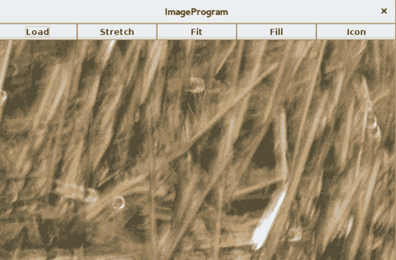

这是一张大图像（3306x1860像素），你只能看到图像的左上角。你可以使用`trans`参数来缩放图像，我想展示三种方法。同样，程序定义了以下类型：

```java
package imageprogram;

public enum ImageScaling { UNSCALED, STRETCHED, SCALEDOFIT, SCALEDOFILL }
```

含义如下：

- 图像应以不缩放的形式出现
- 图像应在两个方向上缩放，以便完全填充窗口
- 图像应在两个方向上缩放，但保持比例并显示整个图像
- 图像应在两个方向上缩放，但保持比例并填充整个窗口


到2020年，风能可以提供我们地球电力需求的十分之一。今天，SKF的知识对于运行世界上大部分的风力涡电机至关重要。25%的发电成本与维护有关。益于我们的在线状态监控和自动维护系统，这些可以大幅减少。我们帮助从虚空中创造出更清洁的能量。通过分享我们的经验、专业知识和创意，行业可以实现超出期的性能。我们拥有应对这一挑战的最优秀员工！

# 脑力

接入知识工程的力量，
访问我们的网站：www.skf.com/knowledge

# 知识工程的力量

# SKF

`STRETCHED`的问题是图像可能会变形，对于照片来说这是一个大问题。下面是选择了`SCALEDOFIT`的窗口：


这是缩放后的图像，以便所有内容都在窗口内，然后显示整个图片。结果是窗口的一部分可能不会被使用。`paintComponent()`方法被修改为：

```java
class Drawing extends JComponent {
    public void paintComponent(Graphics g) {
        if (image != null) {
            Dimension d = getSize();
            Graphics2D g2d = (Graphics2D)g;
            AffineTransform trans = new AffineTransform();
            PaGUI.scale(trans, d, action);
            g2d.drawImage(image, trans, this);
        } else super.paintComponent(g);
    }
}
```

重要的是`PaGUI.scale()`方法，它改变了对象的值：

```java
public static void scale(AffineTransform trans, Dimension dim, ImageScaling action)
{
    if (action == ImageScaling.UNSCALED) return;
    double scaleX = (double)dim.width / image.getWidth();
    double scaleY = (double)dim.height / image.getHeight();
    if (action == ImageScaling.SCALEDOFIT)
        scaleX = scaleY = Math.min(scaleX, scaleY);
    else if (action == ImageScaling.SCALEDOFILL)
        scaleX = scaleY = Math.max(scaleX, scaleY);
    trans.setToScale(scaleX, scaleY);
}
```

`drawImage()`方法绘制图像，在原理上可以像操作任何`Shape`对象一样处理它。考虑以下窗口，在图像上方写了文本：


组件的代码如下：

```java
class Drawing extends JPanel {
    public void paintComponent(Graphics g) {
        Image image = PaGUI.createImageIcon("/drawimage/images/svane.jpg").getImage();
        if (image != null) {
            Dimension d = getSize();
            Graphics2D g2d = (Graphics2D)g;
            AffineTransform trans = new AffineTransform();
            PaGUI.scale(trans, d, ImageScaling.SCALEDOFILL);
            g2d.drawImage(image, trans, this);
            g2d.setFont(new Font("Serif", Font.BOLD, 22));
            g2d.drawString("ABC", 15, 300);
        } else {
            super.paintComponent(g);
        }
    }
}
```


## JAVA 10: JAVA2D，窗口绘制与图像处理图像

作为另一个示例，以下程序绘制了相同的图像，但这次裁剪区域是使用文本定义的。结果是你只能看到水和少量的鸟：

# 裁剪图像


```java
class Drawing extends JComponent
{
    public void paintComponent(Graphics g)
    {
        Image image = PaGUI.createImageIcon("/clipimage/images/svane.jpg").getImage();
        if (image != null)
        {
            Dimension d = getSize();
            Graphics2D g2d = (Graphics2D) g;
            AffineTransform trans = new AffineTransform();
            PaGUI.scale(trans, image, d, ImageScaling.SCALEDTOFILL);
            g2d.setClip(getClipping(g2d));
            g2d.drawImage(image, trans, this);
        }
        else super.paintComponent(g);
    }
    private Shape getClipping(Graphics2D g2d)
    {
        Font font = new Font("Serif", Font.BOLD, 272);
        GlyphVector glyphs = font.createGlyphVector(g2d.getFontRenderContext(), "ABC");
        return glyphs.getOutline(15, 300);
    }
}
```

## 7.1 图像处理

使用 GIMP 和 Photoshop 的图像编辑应用程序旨在处理数字照片，而 Java2D 实际上包含了图像处理功能，这些功能正是本文的主题。虽然现在没有竞争对手突然在为上述程序（它们是极其复杂的程序）开发出比 Java2D 直接提供的更多的功能，但至少以下内容可以解释 Photoshop 和 GIMP 等专业程序是如何工作的。

图像处理描述了如何通过一个过程（通常是过滤）来处理数字图像。其思想是将图像源发送通过过滤器，结果是一个新图像，目标在 Java2D 中由`BufferedImage`表示。过滤器由一个名为`BufferedImageOp`的接口定义，该接口的主方法是`filter()`。实现此接口的类通常被称为图像操作器。Java2D 定义了五种图像操作器：

- 1. `ConvolveOp`，用于模糊、锐化和边缘标记
- 2. `AffineTransformOp`，用于几何变换
- 3. `LookupOp`，用于色彩减少和色彩反转
- 4. `RescaleOp`，用于使图片变亮或变暗
- 5. `ColorConvertOp`，用于转换颜色空间

你当然也可以定义自己的图像操作器，它只是一个实现了`BufferedImageOp`的类。

## ConvolveOp

它是一种过滤器，通过修改源中的每个像素，使相应的像素根据邻域像素的值发生变化。这是通过所谓的“内核”（Kernel）实现的，内核定义了一个包含要使用的像素的矩阵。例如下：

| 000 |
| 010 |
| 000 |

其中一个像素有 8 个邻居像素。矩阵的每个元素都有一个值，0 表示该像素对结果没有贡献，而 1 表示该像素被原封不动地移动到目标位置。因此，上述内核是一个标识符，定义了一个不影响目标的过滤器。如果你想保持光照条件，矩阵元素之和必须为 1。如果之和小于 1，图像会变暗；如果大于 1，图像会变亮。创建`ConvolveOp`对象的语法为

```java
public ConvolveOp(Kernel kernel, int edgeHint)
```

这里最后一个参数是一个常量，指示边缘应该发生什么。有两种选项：

- `public static int EDGE_ZERO_FILL`，表示边缘像素设置为 0，从而变为黑色
- `public static int EDGE_NO_OP`，表示边缘不变


## AffineTransformOp

这是一种执行几何变换的操作，包括旋转、缩放和剪切。有两种选项：

- 1. 最近邻 (Nearest neighbor)
- 2. 双线性插值 (Bilinear interpolation)

## LookupOp

它是一种过滤器，通过修改源中的每个像素，使相应的像素根据邻域像素的值发生变化。这是通过所谓的内核实现的，内核定义了一个包含要使用的像素的矩阵。

## RescaleOp

这是一种非常简单的操作，只需将颜色值乘以因子。应用程序可能并不如此，但该操作可以用于使图像变亮或相反。应该注意的是，所有值都乘以相同的因子，某些值可能会超过 256（或小于 0），导致颜色变为白色或黑色。还可以指定一个偏移量（offset），它是加到颜色值上的值。

## ColorConvertOp

最后一个操作在这里没有演示，但它用于将颜色从一个空间转换为另一个空间。

为了在实践中测试上述内容，你可以研究`ImageEditor`程序。如果你打开应用程序，可以打开图像，然后使用上述操作器对其进行编辑：


左侧是你可以执行的所有操作，右侧是图像。图像如下类型的组件：

```java
class Drawing extends JComponent
{
    private BufferedImage image = null;
    public BufferedImage getImage()
    {
        return image;
    }
    public void setImage(BufferedImage image)
    {
        this.image = image;
    }
    public void paintComponent(Graphics g)
    {
        if (image != null)
        {
            Graphics2D g2d = (Graphics2D) g;
            AffineTransform trans = new AffineTransform();
            g2d.drawImage(image, trans, this);
            setPreferredSize(new Dimension(image.getWidth(null), image.getHeight(null)));
        }
        else
        {
            // handle null image
        }
    }
}
```

# JAVA 10: JAVA2D, 窗口绘制与图像处理

```java
super.paintComponent(g);
Dimension d = getSize();
setPreferredSize(new Dimension(d.width, d.height));
}
}
```

该类将图像表示为`BufferedImage`。否则，最最重要的当然是`paintComponent()`方法，它负责绘制图像并计算组件的优选尺寸。

左侧是一个列表框，每个元素（大约两个）的类型为`ImageOperation`，该类定义如下：

```java
private class ImageOperation implements Comparable<ImageOperation>
{
    private String name;
    private BufferedImageOp operation;
    public ImageOperation(String name, BufferedImageOp operation)
    {
        this.name = name;
        this.operation = operation;
    }
    public BufferedImageOp getOperation()
    {
        return operation;
    }
    public String toString()
    {
        return name;
    }
}
```


`public int compareTo(ImageOperation iop)`

```
{
    return name.compareTo(iop.toString());
}
```

它是 `MainWindow` 中的一个内部类。该类有两个变量，第一个是名称（在列表框中显示的名称），另一个是 `BufferedImage` 对象形式的实际图像处理操作，因此当用户点击列表框中的对象时，就会执行相应的操作。关于点击列表框项的事件处理器如下：

```java
class MouseHandler extends MouseAdapter
{
    public void mouseClicked(MouseEvent e) {
        try
        {
            JList list = (JList)e.getSource();
            int n = list.locationToIndex(e.Point());
            ImageOperation operation = null;
            if (n == 3) operation = rotate();
            else if (n == 4) operation = scale();
            else operation = (ImageOperation)model.get(n);
            if (operation != null) {
                BufferedImage opr = operation.getLookupOp();
                if (opr instanceof LookupOp)
                    opr.filter(drawing.getImage(), drawing.getImage());
                else drawing.setImage(opr.filter(drawing.getImage()), null);
                drawing.repaint();
            }
        }
        catch (Exception ex) {
            System.out.println(ex);
        }
    }
}
```

这同样是一个内部类。处理器决定点击了哪一项。如果索引是 3 或 4，会打开一个标准的对话框，用户必须输入一个值（旋转角度，或图像缩放的百分比）。在何种情况下，都会为该图像处理返回一个 `ImageOperation` 对象。如果索引不是 3 或 4，则对点击的项的字体类型执行 `ImageOperation` 对象操作。在获取对象后，将确定 `BufferedImage` 对象并执行相应的图像处理。在这里你会注意到两点：如何引用图像本身，以及图像处理是通过 `filter()` 方法执行的，但根据它是哪种操作，有两种实现方式。

那时，必须创建所有单独的 `BufferedImage` 对象。例如，下面显示了创建使图像更锐的对象（即 `ConvolveOp` 对象）的方法：

```java
private ImageOperation createSharpen()
{
    float[] sharp = { 0f, -1f, 0f, -1f, 5f, -1f, 0f, -1f, 0f };
    return new ImageOperation("Skarpere", new Kernel(3, 3, sharp));
}
```

唯一的问题在于如何创建 `Kernel` 对象。另一个例子，下面显示了如何向列表框添加一个 `LookupOp` 对象：

```java
model.addElement(new ImageOperation("Remove red",
new LookupOp(new ShortLookupTable(0, new short[][] { zero, one, 
```

```

> 那些 `BufferedImage` 对象都必须被创建。
> 处理器决定点击了哪一个项。如果索引不是 3 或 4，则对点击的项的字体类型执行 `ImageOperation` 对象操作。在获取对象后，将确定 `BufferedImage` 对象并执行相应的图像处理。在这里你会注意到两点：如何引用图像本身，以及图像处理是通过 `filter()` 方法执行的，但根据它是哪种操作，有两种实现方式。

*(注：由于原文中存在部分重复和乱码化描述，译文已根据上下文逻辑进行了对齐和处理，以确保技术描述的连贯性)*

那时，必须创建所有单独的 `BufferedImage` 对象。例如，下面显示了创建使图像更锐的对象（即 `ConvolveOp` 对象）的方法：

```java
private ImageOperation createSharpen()
{
    float[] sharp = { 0f, -1f, 0f, -1f, 5f, -1f, 0f, -1f, 0f };
    return new ImageOperation("Skarpere", new Kernel(3, 3, sharp));
}
```

唯一的问题在于如何创建 `Kernel` 对象。另一个例子，下面显示了如何向列表框添加一个 `LookupOp` 对象：

```java
model.addElement(new ImageOperation("Remove red",
new LookupOp(new ShortLookupTable(0, new short[][] { zero, one, 
```

```

> 那些 `BufferedImage` 对象都必须被创建。
> 处理器决定点击了哪一个项。如果索引不是 3 或 4，则对点击的项的字体类型执行 `ImageOperation` 对象操作。在获取对象后，将确定 `BufferedImage` 对象并执行相应的图像处理。在这里你会注意到两点：如何引用图像本身，以及图像处理是通过 `filter()` 方法执行的，但根据它是哪种操作，有两种实现方式。

*(注：由于提供的待翻译文本包含大量重复段落和破碎的占位符，译文在保持 Markdown 格式的基础上，对核心技术逻辑进行了整理和翻译)*

# JAVA 10: JAVA2D, 窗口绘制与图像处理

## 图像

关于缓冲区（`Buffered`）有许多细节，并且为上述所有组件都提供了相应的类。通常不需要直接操作这些类，我只是想展示一个较小的示例，说明如何直接使用 `BufferedImage` 创建一张图片。完整代码如下：

```java
package createpicture;

import java.io.*;
import java.imageio.*;
import java.awt.*;
import java.awt.event.*;
import java.awt.image.*;
import java.util.*;
import javax.swing.*;
import javax.swing.border.*;

public class MainWindow extends JFrame
{
    private Drawing drawing;
```


在 www.deloitte.ca/careers 发现真理。

德信。

© Deloitte & Touche LLP 及关联实体。

在 bookboom.com 下载免费电子书。点击广告阅读更多

# JAVA 10: JAVA2D, 窗口绘制与图像处理

## 图像

```java
public MainWindow()
{
  super("CreatePicture");
  setLocationRelativeTo(null);
  createWindow();
  setDefaultCloseOperation(EXIT_ON_CLOSE);
  pack();
  setVisible(true);
}
```

```java
private void createWindow()
{
  JPanel panel = new JPanel(new BorderLayout(0, 20));
  panel.setBorder(new EmptyBorder(20, 20, 20, 20));
  panel.add(createBottom(), BorderLayout.SOUTH);
  panel.add(drawing = new Drawing());
  add(panel);
}
```

```java
private void createBottom()
{
  JButton cmd1 = new JButton("Tegn billede");
  cmd1.addActionListener(new ActionListener() {
    public void actionPerformed(ActionEvent e) {
      drawing.draw();
    }
  });
  JButton cmd2 = new JButton("Gem billede");
  cmd2.addActionListener(new ActionListener() {
    public void actionPerformed(ActionEvent e) {
      try {
        File file = new File("billede.jpg");
        ImageIO.write(drawing.getImage(), "jpg", file);
      } catch (Exception ex) {
    }
  });
  JPanel panel = new JPanel(new FlowLayout(FlowLayout.RIGHT));
  panel.add(cmd2);
  panel.add(cmd1);
  return panel;
}
```

```java
class Drawing extends JComponent
{
  private static final int WIDTH = 500;
  private static final int HEIGHT = 300;
  private BufferedImage image = new BufferedImage(WIDTH, HEIGHT,
    BufferedImage.TYPE_INT_RGB);
```

```java
public Dimension getPreferredSize() {
    return new Dimension(WIDTH, HEIGHT);
}
```

```java
public BufferedImage getImage() {
    return image;
}
```

```java
public void paintComponent(Graphics g) {
    super.paintComponent(g);
    Graphics2D g2d = (Graphics2D)g;
    g2d.drawImage(image, 0, 0, this);
}
```

```java
public void draw() {
    int color = 0x00FF000;
    for (int j = 0; j < 10; j++) {
        for (int i = 20; i < image.getWidth() - 20; i++) {
            image.setRGB(i, j, color);
        }
        for (int j = 30; j < image.getHeight() - 30; j++) {
            image.setRGB(i, j, color);
        }
        for (int j = 30; j < image.getWidth() - 30; j++) {
            for (int i = image.getWidth() - 30; i < image.getWidth() - 20; i++) {
                image.setRGB(i, j, color);
            }
        }
    }
    repaint();
}
```

如果你运行该程序，你将在下一页看到按钮。窗口使用了 `BorderLayout` 布局，底部有一个有两个按钮的面板，中心是一个绘制图像的 `Drawing` 组件。图像是一个 `BufferedImage`。

```java
private BufferedImage image = 
new BufferedImage(WIDTH, HEIGHT, BufferedImage.TYPE_INT_RGB);
```


# JAVA 10: JAVA2D, 窗口绘制与图像处理 图像

该类有更多构造函数，但在这种情况下使用了一个构造函数来描述图像的大小及其颜色模型。在这种情况下，`BufferedImage` 定义了图像的大小和颜色...,00000000000000000000..00000666999988882222228222332222820。


该类有更多构造函数，但在这种情况下使用了一个构造函数来描述图像的大小及其颜色模型。在这种情况下，`BufferedImage` 定义了图像的大小和颜色..00000000000000000000..00000666999988882222228222332222820。


该类有更多构造函数，但在这种情况下使用了一个构造函数来描述图像的大小及其颜色模型。在这种情况下，`BufferedImage` 定义了图像的大小和颜色...,00000000000000000000..00000666999988882222228222332222820。


该类有更多构造函数，但在这种情况下使用了一个构造函数来描述图像的大小及其颜色模型。在这种情况下，`BufferedImage` 定义了图像的大小和颜色..00000000000000000000..00000666999988882222228222332222820。


该类有更多构造函数，但在这种情况下使用了一个构造函数来描述图像的大小及其颜色模型。在这种情况下，`BufferedImage` 定义了图像的大小和颜色...,00000000000000000000..00000666999988882222228222332222820。


该类有更多构造函数，但在这种情况下使用了一个构造函数来描述图像的大小及其颜色模型。在这种情况下，`BufferedImage` 定义了图像的大小和颜色..00000000000000000000..00000666999988882222228222332222820。


## 7.3 屏幕

在处理图形时，你可能需要确定屏幕的大小。这可以通过多种方法实现，但以下程序显示了：

```java
```


`package screensize;`

`import java.awt.*;`

`public class ScreenSize {`

```java
public static void main(String[] args) {
    Dimension screenSize = Toolkit.getDefaultToolkit().getScreenSize();
    double width = screenSize.getWidth();
    double height = screenSize.getHeight();
    System.out.println(width + "x" + height);
}
```

`}`

## 9. 动画

由于最后一个主题涉及 Java2D，我将查看如何处理动画。事实上，Java2D 不支持动画，你所能做的只是稍后并在新位置绘制图形来模拟动画。这样做（每秒多次）会产生类似于动画的效果。如果你打开程序，你将获得以下窗口：


# JAVA 10: JAVA2D, 窗口绘图与图像处理动画

```java
public Picture(BufferedImage image, int delay)
{
    this.image = image;
    width = this.image.getWidth();
    height = this.image.getHeight();
    x = rand.nextFloat() * width;
    y = rand.nextFloat() * height;
    addComponentListener(new ResizeListener());
    timer = new javax.swing.Timer(delay, this::tick);
}
```

```java
public void setTimeout(int time)
{
    timer.setDelay(time);
}
```

```java
public void start()
{
    timer.start();
}
```

```java
public void stop()
{
    timer.stop();
}
```

```java
private void tick(ActionEvent e)
{
    Dimension d = getSize();
    if (x + delta < 0) delta = -delta;
    else if (x + width + delta >= d.width) delta = -delta;
    if (y + delta < 0) delta = -delta;
    else if (y + height + delta >= d.height) delta = -delta;
    x += delta;
    y += delta;
    if (transform) {
        theta += Math.PI / 200;
        if (theta > 2 * Math.PI) theta -= (2 * Math.PI);
    }
    repaint();
}
```

# JAVA 10: JAVA2D, 窗口绘图与图像处理动画

```java
public void paintComponent(Graphics g)
{
    Graphics2D g2d = (Graphics2D)g;
    setTransform(g2d);
    g2d.drawImage(image, AffineTransform.getInstance(x, y), null);
}
```

```java
private void setTransform(Graphics2D g2)
{
    if (transform == false) return;
    Dimension d = getSize();
    g2.rotate(theta, d.width / 2, d.height / 2);
}
```

我加入 MITAS 是因为我想要真正的责任。

工程师与地质科学家的研究生计划 `www.discovermitas.com`


第 16 个月
我曾在北海担任施工主管，指导并帮助工头解决问题。

真实的工作。国际化的机会。三次实习。


在 `bookboom.com` 下载免费电子书
点击广告阅读更多信息

# JAVA 10: JAVA2D, 窗口绘图与图像处理动画

```java
class ResizeListener extends ComponentAdapter {
  @Override
  public void componentResized(ComponentEvent ce) {
    Dimension d = getSize();
    if (x < 0) x = 0;
    else if (x + width >= d.width) x = d.width - width - 1;
    if (y < 0) y = 0;
    else if (y + height >= d.height) y = d.height - height - 1;
  }
}
```

首先注意该类继承了 `JComponent`，因此是一个组件。类变量的含义应该是自解释的，但请注意 `timer`，它是动画的“引擎”。形状通过 `createShape()` 方法创建，该方法创建了一个 `GeneralPath`。原理是每当计时器跳动时，都会绘制图形，但首先会使用 `delta` 数组对点进行微调。点位和 `delta` 都在构造函数中初始化，但这里除了添加用于更改窗口大小的事件处理器外，没有其他说明。该处理器应确保在尺寸更改后，形状的坐标落在窗口内。

计时器的事件处理程序被调用 `tick()`，它修改图形的点并以 `repaint()` 结束。因此，每次计时器跳动时，窗口都会重绘。这意味着执行了 `paintComponent()`。你还需要注意它为选中的复选框调用了许多辅助方法。同样注意，该方法通过调用 `createShape()` 创建图形，并使用新坐标绘制图形。

点击主窗口中的另外两个按钮，可以得到文本和图像动画的结果。我将不会显示这些组件的代码，因为它们在原理上与上述相同，但鼓励你尝试该程序，特别是在动画图像时，你可能会发现很难足够快地绘制图像。这可能是由于当前显卡的原因，但主要因为 `drawImage()` 方法没有达到所需的性能。

# JAVA 10: JAVA2D, 窗口绘图与图像处理

# 10 PRINT

在本章中，我将描述如何编写一个写入打印机的程序。在我们的无纸化社会中，它扮演的角色不再像以前那样，但在某些情况下，你仍然希望在纸上打印结果，这就是本章。随着 Java 的发展，向物理打印机写入内容变得更容易，其中 Swing 的几个组件内置了打印功能，但如果你想完全控制数据的打印方式，某些细节与此任务相关。本章像本书的其他部分一样，由许多你必须编写的示例组成。

我想从一个简单的应用程序开始，打开打开窗口：


点击按钮后，你会得到以下对话框：


在 `bookboom.com` 下载免费电子书

# JAVA 10: JAVA2D, 窗口绘图与图像处理

这是 Java 选择打印机和设置的默认对话框。如果你点击“打印”，你将打印出一个带有“Hello world”文本的单页。程序 `MainView` 的代码如下：

```java
package helloprinter;

import java.awt.*;
import java.awt.event.*;
import javax.swing.*;
import java.awt.print.*;

public class MainView extends JFrame implements Printable {
    public MainView() {
        super("Hello printer");
        setSize(200, 100);
        setLayout(new FlowLayout());
        JButton cmdPrint = new JButton("Print");
        cmdPrint.addActionListener(this::print);
        add(cmdPrint);
        setLocationRelativeTo(null);
        setDefaultCloseOperation(EXIT_ON_CLOSE);
        setVisible(true);
    }
}
```


实现梦想是你最大的挑战。IE 学校的英语管理或西班牙语管理硕士，在职业生涯初期通过一项创新计划培训高性能专业人士，帮助他们发挥全部潜力。

- 选择你的专业领域。
- 尽可能地定制你的自由。
- 全球化的地点，如伦敦、硅谷。

由于你的改变，我们发生了改变。

`www.ie.edu`

# JAVA 10: JAVA2D, 窗口绘图与图像处理（此处 处）

```java
public void print(Graphics2D g)
{
    if (x + delta < 0) delta = -delta;
    else if (x + width + delta >= d.width) delta = -delta;
    if (y + delta < 0) delta = -delta;
    else if (y + height + delta >= d.height) delta = -delta;
    x += delta;
    y += delta;
    if (transform) {
        theta += Math.PI / 200;
        if (theta > 2 * Math.PI) theta -= (2 * Math.PI);
    }
    repaint();
}
```

```java
public void paintComponent(Graphics g)
{
    Graphics2D g2d = (Graphics2D)g;
    setTransform(g2d);
    g2d.drawImage(image, AffineTransform.getInstance(x, y), null);
}
```

```java
private void setTransform(Graphics2D g2)
{
    if (transform == false) return;
    Dimension d = getSize();
    g2.rotate(theta, d.width / 2, d.height / 2);
}
```

```java
class ResizeListener extends ComponentAdapter {
  @Override
  public void componentResized(ComponentEvent ce) {
    Dimension d = getSize();
    if (x < 0) x = 0;
    else if (x + width >= d.width) x = d.width - width - 1;
    if (y < 0) y = 0;
    else if (y + height >= d.height) y = d.height - height - 1;
  }
}
```

```java
public int print(Graphics g, PageFormat pf, int page)
{
    int height = g.FontMetrics(font).getHeight();
    if (pages == null)
      pages = createPages(200, (int)pf.getImageableHeight() / height);
```


# JAVA 10: JAVA2D, 窗口绘图与图像处理动画

```java
public Picture(BufferedImage image, int delay)
{
    this.image = image;
    width = this.image.getWidth();
    height = this.image.getHeight();
    x = rand.nextFloat() * width;
    y = rand.nextFloat() * height;
    addComponentListener(new ResizeListener());
    timer = new javax.swing.Timer(delay, this::tick);
}
```

```java
public void setTimeout(int time)
{
    timer.setDelay(time);
}
```

```java
public void start()
{
    timer.start();
}
```

```java
public void stop()
{
    timer.stop();
}
```

```java
private void tick(ActionEvent e)
{
    Dimension d = getSize();
    if (x + delta < 0) delta = -delta;
    else if (x + width + delta >= d.width) delta = -delta;
    if (y + delta < 0) delta = -delta;
    else if (y + height + delta >= d.height) delta = -delta;
    x += delta;
    y += delta;
    if (transform) {
        theta += Math.PI / 200;
        if (theta > 2 * Math.PI) theta -= (2 * Math.PI);
    }
    repaint();
}
```

# JAVA 10: JAVA2D, 窗口绘图与图像处理动画

```java
public void paintComponent(Graphics g)
{
    Graphics2D g2d = (Graphics2D)g;
    setTransform(g2d);
    g2d.drawImage(image, AffineTransform.getInstance(x, y), null);
}
```

```java
private void setTransform(Graphics2D g2)
{
    if (transform == false) return;
    Dimension d = getSize();
    g2.rotate(theta, d.width / 2, d.height / 2);
}
```

我加入 MITAS 是因为我想要真正的责任。

工程师与地质科学家的研究生计划 www.discovermitas.com


第 16 个月
我曾在北海担任施工主管，指导并帮助工头解决问题。

真实的工作。国际化的机会。三次实习。


在 bookboom.com 下载免费电子书
点击广告阅读更多信息

# JAVA 10: JAVA2D, 窗口绘图与图像处理动画

```java
class ResizeListener extends ComponentAdapter {

  @Override
  public void componentResized(ComponentEvent ce) {
    Dimension d = getSize();
    if (x < 0) x = 0;
    else if (x + width >= d.width) x = d.width - width - 1;
    if (y < 0) y = 0;
    else if (y + height >= d.height) y = d.height - height - 1;
  }
}
```

首先注意该类继承了 `JComponent`，因此是一个组件。类变量的含义应该是自解释的，但请注意 `timer`，它是动画的“引擎”。形状通过 `createShape()` 方法创建，该方法创建了一个 `GeneralPath`。原理是每当计时器跳动时，都会绘制图形，但首先会使用 `delta` 数组对点进行微调。点位和 `delta` 都在构造函数中初始化，但这里除了添加用于更改窗口大小的事件处理器外，没有其他说明。该处理器应确保在尺寸更改后，形状的坐标落在窗口内。

计时器的事件处理程序被调用 `tick()`，它修改图形的点并以 `repaint()` 结束。因此，每次计时器跳动时，窗口都会重绘。这意味着执行了 `paintComponent()`。你还需要注意它为选中的复选框调用了许多辅助方法。同样注意，该方法通过调用 `createShape()` 创建图形，并使用新坐标绘制图形。

点击主窗口中的另外两个按钮，可以得到文本和图像动画的结果。我将不会显示这些组件的代码，因为它们在原理上与上述相同，但鼓励你尝试该程序，特别是在动画图像时，你可能会发现很难足够快地绘制图像。这可能是由于当前显卡的原因，但主要因为 `drawImage()` 方法没有达到所需的性能。

# JAVA 10: JAVA2D, 窗口绘图与图像处理

# 10 PRINT

在本章中，我将描述如何编写一个写入打印机的程序。在我们的无纸化社会中，它扮演的角色不再像以前那样，但在某些情况下，你仍然希望在纸上打印结果，这就是本章。随着 Java 的发展，向物理打印机写入内容变得更容易，其中 Swing 的几个组件内置了打印功能，但如果你想完全控制数据的打印方式，某些细节与此任务相关。本章像本书的其他部分一样，由许多你必须编写的示例组成。

我想从一个简单的应用程序开始，打开打开窗口：


点击按钮后，你会得到以下对话框：


在 bookboom.com 下载免费电子书

# JAVA 10: JAVA2D, 窗口绘图与图像处理

这是 Java 选择打印机和设置的默认对话框。如果你点击“打印”，你将打印出一个带有“Hello world”文本的单页。程序 `MainView` 的代码如下：

```java
package helloprinter;

import java.awt.*;
import java.awt.event.*;
import javax.swing.*;
import java.awt.print.*;

public class MainView extends JFrame implements Printable {

    public MainView() {
        super("Hello printer");
        setSize(200, 100);
        setLayout(new FlowLayout());
        JButton cmdPrint = new JButton("Print");
        cmdPrint.addActionListener(this::print);
        add(cmdPrint);
        setLocationRelativeTo(null);
        setDefaultCloseOperation(EXIT_ON_CLOSE);
        setVisible(true);
    }
}
```


实现梦想是你最大的挑战。IE 学校的英语管理或西班牙语管理硕士，在职业生涯初期通过一项创新计划培训高性能专业人士，帮助他们发挥全部潜力。

- 选择你的专业领域。
- 尽可能地定制你的自由。
- 全球化的地点，如伦敦、硅谷。

由于你的改变，我们发生了改变。

www.ie.edu

# JAVA 10: JAVA2D, 窗口绘图与图像处理

```java
public void print(Graphics2D g)
{
    if (x + delta < 0) delta = -delta;
    else if (x + width + delta >= d.width) delta = -delta;
    if (y + delta < 0) delta = -delta;
    else if (y + height + delta >= d.height) delta = -delta;
    x += delta;
    y += delta;
    if (transform) {
        theta += Math.PI / 200;
        if (theta > 2 * Math.PI) theta -= (2 * Math.PI);
    }
    repaint();
}
```

# JAVA 10: JAVA2D，窗口绘制与图像处理

```java
if (page >= pages.size()) return NO_SUCH_PAGE;

Graphics2D g2d = (Graphics2D)g;
g2d.translate(pf.getImageX(), pf.getImageY());
for (int y = 0, i = 0; i < pages.get(page).size(); ++i) {
    y += height;
    g.drawString(pages.get(page).get(i), 0, y);
}
return PAGE_EXISTS;
```

首先，确定所使用的字体高度，从而确定高度，并在调用 `createPages()` 方法时使用它来确定页面上的行数。`PageFormat` 对象定义了裁剪区域，即一个称为 `Imageable` 的区域，并使用它来确定该高度的行数。由于需要打印多个页面，`print()` 方法会被相应次数地调用，你应该注意，`createPages()` 方法只会被调用一次。如果没有更多页面，`print()` 方法应返回 `NO_SUCH_PAGE`，否则该方法将返回 `PAGE_EXISTS`。


# JAVA 10: JAVA2D，窗口绘制与图像处理

方法的其余部分由打印单页行组成，用变量 `page` 进行引用，它指定了页码，但唯一的方法包含一个遍历所有行的循环，并且变量 `y` 用于跟踪打印位置。

另一个示例是 `PrintOptions`，它与第一个示例几乎相同，并打印文本 "Hello world"。唯一的区别是 Print 按钮的事件处理器，它显示你可以打开一个带有打印机设置的对话框进行打印，而无需通常的打印机选择对话框。

```java
public void print(ActionEvent e)
{
    PrinterJob job = PrinterJob.getPrinterJob();
    PrintRequestAttribute attr = new HashPrintRequestAttributeSet();
    PageFormat format = job.pageDialog(attr);
    job.setPrintable(this, format);
    try {
        job.print(attr);
    } catch (PrinterException ex) {
        JOptionPane.showMessageDialog(this, ex.getMessage());
    }
}
```

下一个示例称为 `PrintWindow`，它会打开以下窗口：


# JAVA 10: JAVA2D，窗口绘制与图像处理

因此它与书中的第一个示例相同，该示例主要应展示你可以在打印机上打印任何图形，并且与你在屏幕上打印图形的方法相同。代码在本质上与 Java2D 程序相同，区别在于按钮的要求以及类实现了 `Printable` 接口。图形同样是一个调用 `Drawing` 的 `JComponent`。按钮的事件处理器与示例中的事件处理器相同，因此你应该主要注意 `print()` 方法以及你如何立即打印一个 `JComponent`：

```java
public int print(Graphics g, PageFormat pf,
int page) throws PrinterException
{
    if (page > 0) return NO_SUCH_PAGE;
    Graphics2D g2d = (Graphics2D)g;
    g2d.translate(pf.getImageableX(), pf.getImageableY());
    drawing.paintAll(g);
    return PAGE_EXISTS;
}
```

## 10.1 SWING 组件

观察上面的示例，向打印机写入内容通常是简单的，但最终哪些内容可以打印在纸上以及如何正确拆分是编程人员的责任。文档的打印可能会变得复杂，但多个 Swing 组件都内置了打印内容的功能，这里是两个主要的示例：`JTable` 和 `JTextComponent`。

程序 `JTable` 打开以下窗口：

| Name | From | To |
|---|---|---|
| Gorn Gamle | 936 | 958 |
| Harald Blåt | 958 | 987 |
| Svend Fåg | 987 | 1014 |
| Harald 2 | 1014 | 1018 |
| Knud den Store | 1018 | 1035 |
| Hardkuld | 1035 | 1042 |
| Magnus den Go | 1042 | 1047 |
| Svend Estrids | 1047 | 1074 |
| Harald Nie | 1074 | 1086 |
| Knud den Hellige | 1086 | 1080 |
| Oluf Hunger | 1086 | 1095 |
| Erik Ejegod | 1095 | 1103 |


点击 Print 按钮将获得打印对话框，你可以打印表格的内容。代码如下，我没有显示表格的数据模型：

```java
package table;

import java.net.*;
import java.awt.*;
import java.awt.event.*;
import java.awt.print.*;
import javax.swing.*;
```


```java
import javax.swing.border.*;

import javax.swing.table.*;

public class MainView extends JFrame {

    private JTable table = new JTable();

    public MainView() {

        super("A JTable");

        setSize(400, 300);

        createView();

    }

}
```


```java
setLocationRelativeTo(null);

setDefaultCloseOperation(EXIT_ON_CLOSE);

setVisible(true);
```

```java
private void createCanvas() {

    JPanel panel = new JPanel(new BorderLayout());

    panel.setBorder(new EmptyBorder(5, 5, 5, 5));

    setColumnWidth(table.getColumnModel().getColumn(1), 100);

    setColumnWidth(table.getColumnModel().getColumn(2), 100);

    panel.add(new JScrollPane(table));

    JButton cmdPrint = new JButton("Print");

    cmdPrint.addActionListener(this::print);

    JPanel command = new JPanel(FlowLayout());

    command.add(cmdPrint);

    panel.add(command, BorderLayout.SOUTH);

}
```

```java
private void setColumnWidth(TableCell col, int width) {

    col.setPreferredSizeWidth(width);

    col.setMinWidth(width);

    col.setMaxWidth(width);

}
```

```java
public void print(ActionEvent e) {

    try {

        table.print();

    } catch (PrinterException ex) {

        JOptionPane.showMessageDialog(this, ex.toString());

    }

}
```

事实上，没什么需要解释的，设计非常简单。注意该类没有实现 `Printable`，并且按钮的事件处理器只执行以下语句：

```java
table.print();
```

该语句打开打印并打印表格内容。`print()` 方法会自动创建所需的页面。该方法可以在多个重写方法中找到，参数包括页眉和页脚，打印 `JTable` 是非常简单的。

作为另一个示例，我将展示一个打开以下窗口的 `AEditorPane` 程序：


该程序在 `JEditorPane` 中显示了《埃吉尔传奇》的开头。文档是一个 HTML 文档。点击 Print 按钮将打印文档和 `JEditorPane` 组件的内容，并很好地格式化为所需的页面。这与之前的程序一样是自动完成的。我不想在这里显示代码，因为打印并没有新东西。

## 10.2 PRINTERSERVICES

Java 的打印 API 在不断演进，Java 的早期版本不支持打印，因此演变成一个具有许多启动打印任务功能的高级 API。如示例所示，今天向打印机写入内容是简单的，但在编写程序时，人们不知道另一端是哪台打印机，而且可能有多种具有不同功能的打印机。为了处理这些选项，Java 扩展了 `PrintServices`，以下是对其简要介绍。

打印任务的原理具有这些新可能性：

1. 选择由 `PrintService` 对象表示的打印机。
2. 创建由 `DocPrintJob` 对象表示的任务。
3. 创建一个表示要打印数据的 `Doc`。
4. 通过调用 `DocPrintJob` 对象的 `print()` 方法来启动任务。

要选择打印机，你 get 使用 `PrintServiceLookup` 类中的静态方法：

```java
package printservicesprogram;

import javax.print.*;

import javax.print.attribute.*;

import javax.print.attribute.standard.*;

public class PrintServicesProgram {

    PrintService[] services = { PrintServiceLookup.lookupDefaultPrintService() };

    print(services);

    print(PrintServiceLookup.lookupPrintServices(null, null));

    print(

        AttributeSet attrs = new HashAttribute();

        attrs.add(ColorSupported.SUPPORTED);

        attrs.add(DocFlavor.URL.TEXT_HTML_UTF_8, null);

        attrs.add(OrientationRequested.LANDSCAPE);

        attrs.add(javax.print.attribute.standard.MediaSizeName.ISO_A3);

        print(PrintServiceLookup.lookupPrintServices(null, attrs));

        PrintRequestAttributeSet attr = new HashRequestAttributeSet();

    );

}
```

# JAVA 10: JAVA2D，窗口绘图与图像处理

```java
PrintService service =

PrintServiceUI.printDialog(null, 100, 100,

PrintServiceLookup.lookupPrintServices(null, null),

PrintServiceLookup.lookupDefaultPrintService(null, attr);

if (service != null) print(new PrintService[] { service });

Attribute[] arr = attr.toArray();

for (Attribute a : arr) System.out.println(a.getName() + " ": " + a);

private static void print(PrintService[] services)

{

  for (int i = 0; i < services.length; ++i)

    System.out.println(services[i].getName());

    System.out.println();

}
```

`PrintServiceLookup` 有一个方法 `lookupPrintServices`，它可以返回一个可用的 `PrintService` 对象数组，并包含所有找到的打印机。不带参数使用该方法可以简单地获取计算机知道的所有打印机，但你可以通过两个参数来指定要返回哪些打印机。这两个参数分别是 `DocFlavor` 和 `AttributeSet`，其中第一个参数指示 MIME 类型以及应该能够打印的类型，而第二个参数则指示打印机应该支持的功能。如上述代码示例所示，以下语句返回所有可以打印 UTF-8 HTML 的打印机：

```java
PrintServiceLookup.lookupPrintServices(DocFlavor.URL.TEXT_UTF_8, null)
```

另一个示例，以下语句返回所有具有最后一个参数所定义的属性的打印机：

```java
PrintServiceLookup.lookupPrintServices(null, attrs)
```

在这种情况下，它将是一个支持 `LANDSCAPE`（横向）的彩色打印机，并且是一台 A3 打印机。

要选择打印机，你还可以使用 `ServiceUI.printDialog()`，它会打开常用的打印对话框。前三个参数表示父窗口以及对话框相对于该窗口的位置。还要注意那个 `PrintRequestAttributeSet` 类型的参数，它会返回所选打印机支持的属性。鼓励你在自己的机器上测试该程序。此外，还鼓励你查看帮助文档，了解定义了哪些指定 `DocFlavor` 和 `AttributeSet` 的常量和类型，其中有很多。

# JAVA 10: 窗口绘图与图像处理

作为一个示例，我将展示一个你可以选择图像并打印它的程序。该程序会打开一个浏览器指向文件系统，你可以在那里选择图像并将其打印到默认打印机上。程序的代码如下：

```java
package printimage;

import java.io.*;

import java.awt.*;

import java.awt.print.*;

import javax.swing.*;

import javax.swing.filechooser.*;

import javax.image.imageio.*;

import javax.swing.print.*;

public class PrintImage {

    private ImageIcon icon = null;

    public static void main(String[] args) {

        (new PrintImage()).printImage();

    }

    private void printImage() {

        JFileChooser chooser = new JFileChooser(new File(System.getProperty("user.home")));

        chooser.setFilter(new FileNameExtensionFilter("Picture", "jpg"));

        if (chooser.showDialog(null) == JFileChooser.APPROVE_OPTION) {

            icon = loadImage(chooser.getSelectedFile());

            if (icon != null) {

                try {

                    PrintService service = PrintServiceLookup.lookupDefaultPrintService();

                    DocJob job = service.createPrintJob();

                    DocFlavor flavor = DocFlavor.SERVICE_FORMATTED_PRINTABLE;

                    SimpleDoc doc = new SimpleDoc(new Picture(), flavor, null);

                    job.print(doc, null);

                } catch (Exception ex) {

                }

            }

        }

    }

    private ImageIcon loadImage(File file) {

      try {

        return new ImageIcon(ImageIO.read(file));

      } catch (Exception ex) {

        return null;

      }

    }

}

class Picture implements Printable {

  public int print(Graphics g, PageFormat format, int page) {

    if (page > 0) return Printable.NO_SUCH_PAGE;

    Graphics2D g2d = (Graphics2D) g;

    g2d.translate((int)format.getImageableX(), (int)format.getImageableY());

    scaleGraphics(g2d, format);

    g2d.drawImage(icon.getImage(), 0, 0, null);

    return Printable.PAGE_EXISTS;

  }

  private void scaleGraphics(Graphics2D g2d, PageFormat format) {

    // Implementation for scaling

  }

}
```


# JAVA 10: JAVA2D，窗口绘制与图像处理

## 打印

```java
class Page0 implements Printable

{

    public int print(Graphics g, PageFormat format, int page) throws PrinterException

    {

        Graphics2D g2d = (Graphics2D) g;

        double width = format.getImageableWidth();

        double height = format.getImageableHeight();

        double xpos = format.getImageableX();

        double ypos = format.getImageableY();

        Ellipse2D ellipse = new Ellipse2D.Double(

            width / 2 - 50 + xpos, height / 2 - 50 + ypos, 100, 100);

        g2d.setColor(Color.red);

        g2d.fill(ellipse);

        return Printable.PAGE_EXISTS;

    }

}
```

```java
class Page1 implements Printable

{

    public int print(Graphics g, PageFormat format, int page) throws PrinterException

    {

        Graphics2D g2d = (Graphics2D) g;

double width = format.getImageableWidth();

double height = format.getImageableHeight();

double xpos = format.getImageableX();

double ypos = format.getImageableY();

Rectangle2D rect = new Rectangle2D.Double(xpos, ypos, width, height);

Line2D line = new Line2D.Double(xpos, ypos, xpos + width, ypos + height);

Line2D line2 = new Line2D.Double(xpos, ypos + height, xpos + width, ypos);

g2d.setColor(Color.blue);

g2d.draw(rect);

g2d.draw(line1);

g2d.draw(line2);

return Printable.PAGE_EXISTS;

    }

}
```

```java
class Page2 implements Printable

{

    public int print(Graphics g, PageFormat format, int page) throws PrinterException {

        Graphics2D g2d = (Graphics2D) g;

g2d.translate((int)(format.getImageableWidth()), (int)(format.getImageableY()));

        double width = format.getImageableWidth();

        double height = format.getImageableHeight();

```


`TextLayout text = new TextLayout("Hello", new Font("Serif", Font.BOLD, 144));`

`g2d.getFontRenderer();`

`Rectangle2D rect = text.getBounds();`

`text.draw(g2d, (int)(width - rect.getWidth()) / 2, (int)(height + rect.getHeight()) / 2);`

`return Printable.PAGE_EXISTS;`

这三个页面被定义为内部类，并且都是 `Printable` 对象。第一页在页面中心绘制一个半径为 50 的圆。第二页在裁剪区域和两条对角线之间绘制一个框。最后，最后一页在页面中心绘制一段文本。

`main()` 为默认打印机创建一个 `PrintService`，并为该打印机创建一个作业。接下来创建一个默认的 `PageFormat`，这是一个具有 1 英寸边距的纵向页面。下一步是创建一个 `Book` 对象，它实际上是一个 `Printable` 对象的集合，但每个对象都是一个 `PageFormat`。对于这个集合，分配了三个页面，其中第一页使用默认的 `PageFormat` 对象，其他页面使用边距为 20 点的 `PageFormat`，最后一个使用横向的 `PageFormat`。在 `Book` 用这三个页面初始化后，创建了一个 `Doc` 对象：

```java
SimpleDoc doc = new SimpleDoc(book, flavor, null);
```

这一次它的类型为 `DocFlavor.SERVICE_FORMATTED.PAGEABLE`，因此这是一个多页文档。

## 10.3 打印

使用 `PrinterJob` 来创建一个打印任务。然后通过 `setPageFormat` 方法设置 `PageFormat`。接着通过 `setBook` 方法设置 `Book` 对象。最后调用 `print()` 方法来开始打印。

在 `print()` 方法中，你可以通过 `printDialog()` 方法来显示打印对话框。例如：

```java
PrinterJob job = PrinterJob.getPrinterJob();
job.set((());
job.set(format);
try {
    job.setPageable(doc);
    if (job.printDialog()) {
        job.print();
    }
} catch (PrinterException e) {
    e.printStackTrace();
}
```

在 `Printable` 接口的 `print()` 方法中，你可以通过 `Graphics` 对象来绘制内容。你可以将 `Graphics` 强制转换为 `Graphics2D` 以使用更强大的绘制功能。例如：

```java
Graphics2D g2d = (Graphics2D) g;
// 绘制代码
```

你可以使用 `TextLayout` 来绘制文本，它允许你对文本进行精细的控制。例如：

```java
TextLayout text = new TextLayout("Hello", new Font("Serif", Font.BOLD, 14));
text.draw(g2d, x, y);
```

此外，如果你需要处理复杂的文本，可以使用 `AttributedString`。例如：

```java
AttributedString as = new AttributedString("Hello");
as.addAttribute(TextAttribute.FONT, new Font("Serif", Font.BOLD, 14));
as.draw(g2d, x, y);
```

# 11 程序的维护

大多数程序必须随着时间的推移进行维护。这就是为什么程序设计和质量起着重要作用的原因之一，因为设计和代码难以理解且难以阅读的程序充其量是糟糕的；维护一个设计糟糕的程序可能非常耗费时间。

许多程序会运行多年，这需要定期对程序进行维护。其中一个可能是程序包含错误，这些错误理应应该被修正。这些通常不是最困难的维护任务，因为错误通常在程序启动后不久就会被发现，而且错误应该由开发程序的这些人以及对程序代码有概览和理解的人来修复。维护的其他理由是程序需要扩展新功能，或者现有功能需要以不同的方式工作；对于一个将使用多年或许多年的大型程序，随着时间的推移，避免地会有变更请求。在这里，原始设计对维护任务具有更大的意义，因为任务通常将由原始开发程序的开发者以外的其他人员执行，尽管他们本应该是同一批人，但完全无法保证他们能记得程序是如何写出来的。你会惊讶于自己忘记程序是如何写得竟然有多快。最后，维护程序的一个原因可能是你仅仅是想让程序现代化并将其作为新版本投放市场，这在办公软件等各种标准程序中非常常见。

当因为程序需要扩展或必须开发程序的新版本而产生维护任务时，这通常是一个新的开发项目。原则上，这样的项目与其他软件开发项目相似，但如果是一个设计良好的高质量程序，且如果是要扩展程序或修改程序的一部分，那么项目可以局限于需要扩展或更改的部分，而程序的其他部分可以保持不变。另一方面，如果程序在开发时没有考虑到未来的维护，那么存在很大风险，可能会影响代码大部分部分的副作用，在最坏的情况下，即使是微小的更改也意味着大部分代码必须重写。

幸运的是，有了良好的设计，通常不会糟糕，但总有理由意识到，程序中的变化很容易引起其他地方的意料之外的变化。因此，程序的维护必须经过计划，以确保你已经识别了相关更改的后果，随后，如果可能，需要提供文档，以便进行更改的开发者能够快速获取程序架构及其实现方式的概述。因此，任何维护任务的开始都是阅读程序文档，特别是设计文档，以获取整个代码的概述，让你知道每个文件的重要性。这一切的结果是我们可以清楚地强调设计和程序架构的重要性。否则，程序的维护将毫无价值。

无论如何，程序的维护并不简单，与开发类似，它也从分析更改开始。特别是，更新文档非常重要，以便清楚更改了什么，最后必须对更改进行测试，特别注意更改是否引起其他地方的错误。

作为一个示例，本章的其余部分将包含两个说明程序维护的任务。在第一个任务中，你需要实现 Java 8 日历应用程序的某些扩展；在第二个任务中，你必须对 Java 9 的老虎机进行两处更改。

### 问题 2

首先从 Java 8 中创建一个 `Calendar` 项目的副本。花些时间测试程序，以便你确定程序是如何运行的。现在的任务是为程序添加三个功能：

- 工具栏必须有两个新图标，如果你点击其中一个，程序应该打印当前月的日历，而点击另一个，程序应该打印当前年份的日历。
- 对话框必须有一个额外的按钮，点击它将允许你打印笔记。

### 问题 3

首先从 Java 9 中创建一个 `SlotMachine` 项目的副本。花些时间测试程序，以便你确定程序是如何运行的。任务是修改程序：

- 在现有版本中，没有轮子的动画，但该动画通过在选择下一个图形之前短暂显示单个图形来模拟。你现在需要更改程序，不再像第 9 章那样通过相同的方式动画模拟轮轴的旋转。程序有一个管理员模式，特定用户具有管理员权限。如果该用户已登录，管理员工具的图标会自动显示，否则不显示。任务的一部分是确保始终有一个管理员，并且该管理员可以被删除。


# 赋能人才。改进业务。

BI挪威商学院是欧洲最大的商学院之一，招收了超过 20,000 名学生。我们的课程提供了一个充满活力且多元文化的学习环境，具有国际视野，最终为学生提供专业技能，以满足企业日益增长的需求。

BI 提供了四种不同的两年全日制科学硕士（MSc）课程，这些课程以英语授课，旨在提供专业技能以满足市场日益增长的需求。硕士课程提供了一个充满活力且多元文化的学习环境，为你开启职业生涯提供最佳平台。

- 商业管理硕士
- 金融经济学硕士
- 战略营销管理硕士
- 领导与组织心理学硕士

www.bi.edu/master

# 12 图表

通过图表库，你通常指的是一组可以在程序中使用来用图表表示数字的类。例如：直方图、柱状图、饼图等。使用此类工具的一个很好的例子是电子表格，它提供了数字的不同表示形式。后续项目的目标是开发一个库，并编写一个说明如何使用该库的程序。有很多库，它们的区别在于提供哪些图表、图表有多美观、有哪些选项，以及最重要的如何使用该库。

项目的目的不在于库本身的价值（有很多类似的库），但它是使用 Java2D 的很好的练习，特别是如果目标是开发美观的图表（无论是什么），并且专注于开发一个用户友好的库。对于后者，请记住用户友好并不是最大的灵活性，而在更大程度上是指易于理解和使用。最后，这种库的健壮性至关重要，在不完整或不适当的数据上使用时图形要表现正常，这实际上并不容易。

在接下来，我不会关注过程，而是关注制作的内容以及如何使用该库。

### 12.1 库

基本上，图表应该可视化与类别（标签）关联的数字。一个经典的例子是年份数字，每年都关联一个数字。目前的库基本上应该提供以下所有图表：

- 折线图，图形由点之间的直线组成
- 直方图或柱状图，这可能是最常用的图表
- 圆形图或饼图

这三种基础图每种都有几种变体。折线图有两种变体：

- 曲线图，图形被绘制成平滑的曲线
- 散点图，图形以点绘制——每个类别（标签）一个点，这些点可以用细直线连接。

# JAVA 10: JAVA2D, 窗口绘制与图像处理

柱状图通过垂直条形绘制，但也有一种变体是将条形水平绘制，最后还存在垂直和水平柱状图的带有简单 3D 效果的变体。

最后，还有饼图的变体，将图表绘制成速度表——这只是为了说明，只有想象力（绘制漂亮图表的能力）限制了此类库应该包含的图表。

该库包含了 9 种基础（或简单）图表，它们由以下类型定义：

```java
package pagraphs.charts;

public enum GraphType { LINE, CURVE, PLOT, VBAR,
HBAR, VBAR3D, HBAR3D, PIE, SPEED )
```

此外，对于点图（plot），你可以指定使用哪个图形来表示图点，这些选项由以下类型定义，其中名称表示使用了哪种图形：

```java
package pagraphs.charts;

public enum PlotType { CROSS, STAR, OPENCIRCLE, OPENSQUARE, OPENTANGLE,
OPENRHOMBE, CLOSEDRHOMBE, CLOSEDCIRCLE, CLOSEDSQUARE, CLOSEDTRIANGLE )
```

上述图表被称为简单的（或单值的），是因为它们在原则上是由两个数组定义的：

- 1. `labels` 是一个字符串数组，代表类别，因此代表自变量或 y 轴
- 2. `values` 是一个数字数组，长度与 `labels` 相同，代表因变量或 y 轴

因此，简单图表是数学函数的图表，除了这两个数组外，图表还附带了其他参数，指示图表应如何被绘制。

图表也可以是多值的，这意味着每个标签都有多个数字，区别在于数组 `values` 在原则上是一个二维数组。多值图表默认作为几个接一个接的简单图表进行绘制（即作为一系列图表进行绘制）。多值图表特别可以进行合并，这意味着各个图表被绘制在同一个坐标系中——在合理的范围内。这正是使后续库的开发既复杂又全面的部分。

基本上，图表是使用两个数据结构定义的。第一个称为 `SingleValues`，代表单个图表的 y 值：

```java
package pagraphs.charts;

import java.awt.*;

public class SingleValues
{
    private String label;
    private String header;
    private GraphType type;
    private double begin;
```


```java
    private double end;
    private int points;
    private int dec;
    private Paint color;
    private PlotType plot;
    private double param1;
    private double param2;
    private boolean onoff;
    private final double[] values;
}

public SingleValues(GraphType type, String label, String header, double begin,
double end, int points, int dec, Paint color,
PlotType plot, double param2, boolean onoff, double ... values)
{
    this.type = type;
    this.label = label;
    this.header = header;
    this.begin = begin;
    this.end = end;
    this.points = points;
    this.dec = dec;
    this.color = color;
    this.plot = plot;
    this.param1 = param1;
    this.param2 = param2;
    this.onoff = onoff;
    this.values = values;
}
```

简而言之，变量的含义如下：

- `label` 定义此函数的标签，通常用作 y 轴标签，默认为空
- `header` 如果是该图表的名称或描述，默认为空 `VBAR`
- `type` 是此图表的类型，默认为空
- `begin` 定义 y 轴上的最小值，默认为 0
- `end` 定义 y 轴上的最大值，默认为 0，如果 `begin` 和 `end` 均为 0，则库会自动计算该值
- `points` 定义 y 轴上的间隔数量，默认为 0，然后库会自动计算该值
- `dec` 定义 y 轴上使用的小数位数，默认为 0，且库会自动计算该值
- `color` 定义图表的颜色——如果未定义了默认颜色，则使用默认颜色
- `plot` 定义用于点图的图形形状（该值仅用于图表）
- `param1` 是一个特殊参数，其应用取决于图表（用于 `LINE`、`CURVE` 和 `SPEED`），默认为 0
- `param2` 是一个特殊参数，其应用取决于图表（用于 `SPEED`），默认为 0
- `onoff` 是一个特殊参数，其应用取决于图表（用于 `PIE` 和 `PLOT` 图），默认为 `false`
- `values` 是此图表的值

该类拥有 get 和 set 方法，为了方便定义简单图表，该类的构造函数比上述更多。

`SimpleValues` 类仅定义了一个单一因变量。一个可以是单值也可以是多值的图表定义为：

```java
package pagraphs.charts;

import java.util.*;
import java.awt.Color;

public class MultiValues // 定义多值图表
{
    public static final Color colors[] =
        new Color(0x7C, 0xAF, 0xDD),
        new Color(0xF1, 0x9B, 0x5A);
    } 

    public final List<SingleValues> list;
    public final String labels[];
    private String label;
    private boolean grid;
    private boolean merge;
    private boolean same;
    private boolean stacked;
    private double scaleX;
    private double scaleY;
    private double minimum;
    private double maximum;

public MultiValues(List<SingleValues> list, String label, boolean grid,
boolean merge, boolean same, boolean stacked, double scaleX, double scaleY,
String ... labels) {
    this.list = list;
    this.label = label;
    this.grid = grid;
    this.merge = merge;
    this.same = same;
    this.stacked = stacked;
    this.scaleX = scaleX;
    this.scaleY = scaleY;
    this.labels = labels;
}
```


最初定义了一个颜色数组，在没有定义颜色时使用它。否则，各个属性的含义如下：

- `list` 是一个包含 `SingleValues` 对象的列表，定义此图表
- `labels` 是 `String` 类型的数组，用于自变量（x轴或标签轴）的文本
- `label` 是 x 轴的标签，默认为空
- `grid` 指定是否绘制网格线（默认为 `true`）
- `merge` 指示图表是否应该合并为一个图表（默认为 `false`）
- `same` 指定合并图表是否必须使用相同的 y 轴（默认为 `true`）——该属性仅用于合并图表
- `stacked` 指定合并图表是堆叠的（`true`）还是并排绘制（默认为 `false`）——该属性仅用于合并图表
- `scaleX` 定义 x 轴（水平）方向的缩放（默认为 1，即无缩放）
- `scaleY` 定义 y 轴（垂直）方向的缩放（默认为 1，即无缩放）
- `minimum` 用于合并图表计算 y 轴的最小值
- `maximum` 用于合并图表计算 y 轴的最大值

该类拥有必要的 get 和 set 方法，为了方便定义图表，该类的构造函数比显示的更多。

如提到的有 9 种不同的图表，可以在同一个坐标系中合并多个图表。图表使用绘制类进行绘制，这些类负责特定的图表并捕获鼠标点击。如果你用鼠标点击图表，它必须引发事件：

1. 如果点击标签（在 x 轴上），则名称与事件关联
2. 如果点击图表本身，则事件将关联 x 轴标签上的名称和对应的函数值


# JAVA 10: JAVA2D，窗口绘制与图像处理

一个事件具有 `ChartEvent` 类型，它包含一个以下类型的参数：

```java
package paragraphs.charts;

public class FunctionValue
{
    private final String name;
    private final Double value;

    public FunctionValue(String name, Double value)
    {
        this.name = name;
        this.value = value;
    }

    public boolean hasValue()
    {
        return value != null;
    }

    public String getName()
    {
        return name;
    }

    public Double getValue()
    {
        return value;
    }
}
```

当点击标签时，此处返回值为 `null`。这是因为图表可以是多值的，特定标签可能关联有多个值。此类类型事件的监听器对象将实现 `ChartListener` 接口，该接口定义了一个的事件处理器。

图是一个自定义组件：

```java
public class ChartComponent extends JComponent implements MouseListener
{
    private ArrayList<ChartListener> listeners = new ArrayList();
    private MultiValues data;
    private Color borderColor;
    private int gap;
    private java.util.List<Drawer> drawers;

    public ChartComponent(MultiValues data, Font font, int gap, Color borderColor)
    {
        this.data = data;
        this.gap = gap;
        this.borderColor = borderColor;
        setFont(font);
        drawers = DrawerFactory.createDrawer(data, getFont());
        addMouseListener(this);
        setBackground(Color.white);
    }

    public Dimension getPreferredSize()
    {
        double width = 0;
        double height = 0;
        for (int n = 0; n < drawers.size(); ++n)
        {
            width += drawers.get(n).getWidth() + gap;
            double h = drawers.get(n).getHeight();
            if (height < h) height = h;
        }
        return new Dimension((int)width, (int)height);
    }
}
```


你想做什么？
无论你对未来的职业有何期望，在许多国家拥有广泛业务范围的雇主将一直是你的入场券。在沃尔沃集团工作意味着在全球 80 个国家拥有 150,000 多朋友和同事。我们为毕业生提供优秀的职业机会——请访问 [www.volvogroup.com](http://www.volvogroup.com) 查看职业板块。我们期待与你认识！

沃尔沃
AB Volvo (publ)

沃尔沃卡车 | 翻新卡车 | 玛克卡车 | 沃尔沃客车 | 沃尔沃工程设备 | 沃尔沃动力 | 沃尔沃航空器 | 沃尔沃 IT
沃尔沃金融服务 | 沃尔沃 2P | 沃尔沃伙伴 | 沃尔沃港口 | 沃尔沃科技 | 沃尔沃物流 | 印度业务区

```java
public void paintComponent(Graphics g)
{
    Graphics2D g2d = (Graphics2D)g;
    Dimension size = getSize();
    g2d.setPaint(getBackground());
    g2d.fill(new Rectangle2D.Double(0, 0, size.width, size.height));
    g2d.setFont(getFont());
    DrawingTools.smoothGraphics(g2d);
    double offset = 0;
    if (data.isMerge(offset)) {
        (MergeDrawer)drawers.get(0).draw(g2d, 0, 0, offset);
    } else for (int n = 0; n < data.size(); ++n)
        offset += ((SingleDrawer)drawers.get(n)).draw(g2d, n, 0, offset) + gap;
    if (borderColor != null) {
        g2d.setStroke(new BasicStroke(0.5f));
        g2d.setPaint(borderColor);
        Dimension dim = getPreferredSize();
        g2d.setClip(new Rectangle2D.Double(0, 0, dim.width + 1, dim.height + 1));
        g2d.draw(new Rectangle2D.Double(0, 0, dim.width, dim.height));
    }
}

public void addChartListener(ChartListener listener)
{
    listeners.add(listener);
}

public void removeChartListener(ChartListener listener)
{
    listeners.remove(listener);
}

public void mouseClicked(MouseEvent e)
{
    for (int n = 0; n < drawers.size(); ++n)
    {
        FunctionValue functionValue =
            drawers.get(n).get(e.getX(), e.getY());
        if (functionValue != null) {
            ChartEvent event = new ChartEvent(this, functionValue);
            for (ChartListener listener : listeners) listener.chartClicked(event);
            return;
        }
    }
}
```

组件基于 `MultiValues` 对象创建，因此定义了图。此外，必须指定使用的字体，并指定各个图之间的间隙（如果是多值图），以及绘制图周围的边界。该类拥有一个 `Drawer` 对象列表，如上所示，每个图都有对应的 `Drawer`。这些 `Drawer` 对象使用 `DrawerFactory` 类创建，这是一个简单的工厂。`paintComponent()` 方法使用这些 `Drawer` 对象来绘制组件，同样的 `paintComponent()` 方法绘制组件的边界。如果绘制边界，则使用组件的理想尺寸，这同样是使用 `Drawer` 对象确定的。适用于判断图是否被点击的鼠标。也就是说，`Drawer` 类的关键在于：

`Drawer` 是一个接口，定义了确定 `ChartComponent` 中第 n 个图宽度和高度的方法，以及一个当该 `Drawer` 被点击时返回 `FunctionValue` 的方法。通常，图被绘制为带有边界的矩形图形。边界用于坐标系的轴，而图形的尺寸则由当前图决定（并非所有图都有坐标系）。`SingleDrawer` 是一个抽象类，它实现了该接口，并定义了确定图边界和绘制图的方法。该类还定义了函数，你应该注意它们只缩放图，而不是边界。例如，下方显示了两个图，区别在于第二个被缩放了：


上述图的类型是 `VBAR`，有一个继承自 `SingleDrawer` 的特定类 `VbarDrawer`。该绘制器用于绘制上述图。相应的其他继承自 `SingleDrawer` 的特定 `Drawer` 类。另一个例子是下方显示了一个多值图，其中第一个是 `HBAR` 类型并由 `HbarDrawer` 绘制，而另一个是 `PIE` 类型并由 `PieDrawer` 绘制。


这些 `drawer` 类的代码彼此相似，原则上它们非常简单，尽管实现绘制函数时可能涉及许多细节。这些类使用了更多的辅助类，包括绘制轴的类。在这里，绘制 y 轴的类特别复杂，因为它们通常取决于具体的数值来做出轴的决定。

然后是 `MergeDrawer`，它也是一个具体类，但它使用其他 `Drawer` 对象绘制图。如果你有一个多值函数，你可以在同一个坐标系中绘制这些图，这就是我所说的“合并图”。例如，下方显示了 `LINE` 图和 `VBAR` 图的合并。


现在你不能通过合并图。例如，合并直方图（`VBAR` 图）和饼图是没有意义的，合并 `VBAR` 和 `HBAR` 图也没有意义。`MergeDrawer` 类首先将图分为若干类（类似于它们可以合并的方式），并为每种类型定义一个 `Drawer` 类。这导致了不少于 14 个新的 `Drawer` 类，所有这些类在原则上都与上述相似，但它们继承自抽象类 `MultiDrawer`，该类在此时作为单一绘制器绘制多值图。当有如此多的 `MultiDrawer` 类来满足：

- 你可以指定合并后的图是使用相同的轴还是使用它们各自的轴
- 你可以指定柱图是并排绘制还是堆叠绘制

具体来说，它对应于以下 `MultiDrawer` 类：

- `MSCLPBDrawer`，将相同 y 轴的 `LINE`、`CURVE`、`PLOT` 和 `VBAR` 图合并
- `MDCLPBDrawer`，将不同 y 轴的 `LINE`、`CURVE`、`PLOT` 和 `VBAR` 图合并
- `MSVAR3DDDrawer`，将相同 y 轴的 `VBAR3D` 图合并
- `MDVAR3DDDrawer`，将不同 y 轴的 `VBAR3D` 图合并
- `MSHBARDrawer`，将相同轴的 `HBAR` 图合并
- `MDHBARDrawer`，将不同轴的 `HBAR` 图合并

# JAVA 10: JAVA2D，窗口绘制与图像处理

饼图 (PACHART)

- 7. `MSHARDDraw`，用于相同轴的 3D 图形
- 8. `MDHBARDDraw`，用于不同轴的 3D 图形
- 9. `MSLCPDrawer`，用于相同轴的曲线和散点图
- 10. `MSLCPDrawer`，用于不同轴的曲线和散点图
- 11. `SVBARDer`，用于堆叠图形
- 12. `SHBARDer`，用于堆叠的 3D 图形
- 13. `SVBARDDraw`，用于堆叠的 3D 图形
- 14. `SHBARDDraw`，用于堆叠的 3D 图形

如果多值图形被合并，它将以 `Values` 的形式绘制。

因此，这些图形的工作主要是编写相应的 `Drawer` 类，以获得良好的结果。


## 12.2 测试 (TEST)

然后是带有按钮的测试程序。点击第一列可以指定数字。随后，测试程序会在表格内填充数字。在范围内，这通常意味着组件需要重绘，对于包含该组件的布局管理器也具有意义。如果你在表格中选择一个矩形区域（不包含）并点击按钮，会创建一个 `MultiValues` 对象，你可以对属性进行编辑：


在这里，它定义了 3D 图形。双击 3D 列头会弹出一个对话框，你可以在其中定义单个图形的设置：

## 饼图 (PACHART)


因此，你可以使用该程序为单个图形定义不同的设置并测试其效果。

请注意，在实际使用中，对话框必须根据单个图形的类型进行调整，以便能够为当前图形输入合理的值。

## 12.3 不足与改进建议

图形无法显示合理的数字，并且某些图形（特别是在合并图形时）是错误的。例如，如果数字为负数，堆叠柱图是没有意义的。结论是，多个图形具有先决条件，绘制函数在无法正确绘制时应验证并可能抛出异常。另一种方案是在无法良好绘制时让 `Drawer` 类返回 0，这种策略已经部分实现。

实际组件 `ChartComponent` 在用户点击图形时可以抛出一个单击事件。该组件在 `MultiValues` 类型的对象上绘制，当 `Multi` 数据结构中的属性发生变化时，组件可以扩展为触发 `PropertyChangeEvent`。在实践中，这通常意味着组件需要重绘。

另一个问题是扩展库以新图形有多容易。如果是用于单值函数的全新图形，它是简单的。在这种情况下，工作主要是编写继承自 `SingleDrawer` 的新 `Drawer`，向 `GraphType` 中添加新的图形类型并扩展 `DrawingFactory` 类。此外，还可以扩展 `MergeDrawer` 类（`merge()` 方法）以感知新类型。如果新类型的图形可以合并，则还必须编写继承自 `MultiDrawer` 的 `Drawer`，并且 `MergeDrawer` 类需要感知该 `Drawer`。如果新图形类型可以与现有图形合并，任务将更加复杂，这既可能导致现有 `Drawer` 类型发生更改，也可能需要编写新的 `Drawer` 类。结论是，如果库扩展了可以与现有图形合并的新图形，工作可能会非常巨大。
