# Java 11：Web 应用与 Java EE 软件开发

© 2018 Poul Klausen & bookboon.com

ISBN 978-87-403-1948-4

Ove Thomsen, EA Dania 同行评审

## 前言

本书是软件开发系列书籍中的第十一本。编程语言是`Java`，该语言及其语法和语义显然占据了大量内容，但这些书籍在很大程度上也关注开发过程以及如何开发良好健壮的应用程序。本书涉及 Web 应用程序的开发，重点是服务端以及如何开发动态网页。书从介绍`servlets`开始，随后简要地介绍了`Java Server Pages`（JSP）。书的其余部分将介绍如何使用`Java Server Faces`（JSF）编写 Web 应用程序，读完本书后，你应该能够编写经典的 Web 应用程序。然而，书中关于客户端的内容较少，这部分将在下一本书中首先介绍。本书并不是`JSF`元素的参考手册，其目的是通过示例向你展示你在做什么，而你有必要查阅在线文档以获取现有许多`JSF`元素的概览。

正如标题所示，这一系列书籍涉及软件开发，目标是教读者如何在`Java`中开发应用程序。可以通过阅读相关主题内容和学习完整的示例程序来学习，但最重要的是亲自动手并从零开始编写自己的程序。因此，书中的一个重要部分是练习和问题，读者必须编写与书中处理的内容相对应的程序。该系列的所有书籍都围绕着同一个骨架构建，由文本、示例、练习和问题组成，这些内容被放置在文中自然的位置。练习和问题的区别在于，练习在很大程度上是对文中所介绍内容的重复，并且对要做什么描述得相对准确。相比之下，问题的描述较为松散，通常规模稍大一些，且很少有明确的最佳解决方案。这些书应该从头到尾读完，但许多代码示例（包括练习和问题）起着核心作用，读者详细地研究许多示例中的代码是至关重要的，并且解决练习和问题，或者可能只是研究推荐的解决方案。

所有书籍都以一或两个较大的示例程序结束，这些程序主要关注过程以及对程序如何编写的解释。另一方面，代码只在有限范围内出现——如果有的话——读者应该应该学习完成的程序代码，可能是在测试程序时。除了展示比其他介绍的示例更大的程序开发外，总结示例的目的还在于展示来自不同应用领域的程序示例。

大多数书籍还以一个附录结束，处理一个书中未涉及的主题。这可能是软件安装问题或其他计算机技术中的其他主题，这些主题不关于软件开发，但有必要具备基础知识。如果读者已经熟悉该主题，可以跳过当前附录。

如前所述，编程语言是`Java`，此外，书中还使用了以下产品：

1. `NetBeans`作为应用程序开发的 IDE（集成开发环境）
2. `MySQL`在需要数据库服务器时（从`Java 6`书开始）
3. `GlassFish`作为 Web 服务器和应用程序服务器（从`Java 11`书开始）

这些产品都是免费且免费安装的，甚至提到了某些产品的安装过程可以完全自动完成，不需要费大的努力和挑战。此外，网上有针对这三个产品的详细安装说明。这些产品可在`Windows`和`Linux`上运行，因此你使用`Linux`还是`Windows`并没有特殊的区别。

所有示例程序都是在运行`Linux`的机器上开发和测试的。事实上，这并没有什么主要影响，因为无论平台是哪一个，`Java`和其他产品的工作方式完全相同。书中会有某些地方你可能会看到平台是`Linux`，这主要适用于涉及文件系统的命令。在其他情况下，对于读者来说，程序在`Linux`机器上开发并没有特殊意义，它们也可以立即在`Windows`下运行，除非程序引用了文件系统，在那种情况下可能需要更改文件名。

最后，简单介绍一下这些书不是什么。它们不是`Java`的“如何编写”指南，或者说不是参考手册，而是正如标题所示，是关于软件开发的书。我希望读者在阅读这些书籍时，通过许多示例，可以找到如何编写良好程序的灵感，也可以将其作为素材集，提供许多解决你作为软件开发人员经常面对的具体日常编程问题的示例。

## 1 引言

在之前的书籍中，关于系统开发、编程和`Java`的所有论述都是针对运行在单台计算机上的应用程序——也称为桌面应用程序。在接下来的书籍中，我将处理运行在多台机器上并通过网络（通常是 Internet）交换数据的应用程序开发，事实上，这样的程序在实践中是最常见的——至少如果你看公司或公共机构使用的程序是的话。除了在网络上运行程序外，它们的特点是有许多并发用户，并且通常包含在一个 IT 解决方案中，该方案包含几个协同工作以解决所需任务的程序。开发此类程序需要新的解决方案，另一方面它们对系统开发过程本身提出了新的要求，但幸运的是到目前为止所的一切仍然有效，只是需要扩展新的概念。

在文献中，此类程序通常被称为企业级应用，在没有精确定义其情况下，它涵盖了大型公司和组织的程序，但也许你应该这样理解：程序不仅仅是一个程序，它是公司内部某种工作情况或任务的解决方案。我将首先介绍 Web 应用程序的开发，即通过 Internet 运行的应用，尽管它不是企业级应用的唯一类型，甚至可能已经无法分不清什么是 Web 应用程序什么是不是了，但至少这里讨论的是以非传统办公软件方式开发的一些技术和应用程序。

客户端通常是一个带有浏览器的普通工作站。浏览器与任何其他 PC 程序类似的程序，但通过浏览器，用户可以在浏览器的地址栏中输入 Web 地址向 Web 服务器发送`request`（请求）。Web 服务器也是运行在某处机器上的程序。它是一个持续运行并监听请求的程序。`request`意味着客户端浏览器想要返回一个 HTML 文档，然后 Web 服务器将加载该文档并将其作为`response`（响应）发送给客户端浏览器。一旦客户端获取文档，浏览器就会对其进行渲染并显示在屏幕上。这意味着浏览器会解释 HTML 代码，并根据代码决定文档在屏幕上的呈现方式。

这至少是基本原理，而且它在`World Wide Web`（万维网）之初就是这样运行的，但今天情况要复杂得多。请求不仅关于返回一个 HTML 文档，通常还会随请求发送数据（这些数据可能是关于要添加到购物车的项目的数据），还可能包含给服务器以查找特定数据的信息（例如根据搜索标准查找商品）。这意味着服务器必须执行许多其他工作，例如，在数据库中保存数据、从数据库中检索数据并动态构建发送给客户端的响应。换句话说，在客户端请求的基础上，Web 服务器必须执行软件程序，这些程序基本上像任何其他程序一样被开发和执行，但它们仅是运行在托管 Web 服务器的机器上的程序。

因此，Web 应用的特征是：程序代码在服务器上执行，然后以动态生成的 HTML 文档的形式将结果返回给客户端。然而，`client-side`（客户端侧）程序也可以包含由浏览器执行的代码。有几种选项，但最重要的是`JavaScript`，它是脚本代码（仅仅是文本），作为 HTML 文档的一部分被发送。当然，这要求浏览器能够解释并执行`JavaScript`代码，但所有现代浏览器都能胜任。另一个选项是向浏览器发送实际翻译后的代码，例如用相同方式编写并翻译的`Java applet`，其编写和翻译方式与`Swing`程序完全相同。人们可以将`Java applet`认为是运行在浏览器窗口中的 Java 应用程序。当然，这要求浏览器支持 Java applet 的执行，并且通常需要为浏览器安装插件（扩展程序）。然而，由于 Java applet 被翻译成二进制代码并在客户端机器上下载和执行，这种技术涉及了许多人感到不悦的安全风险。因此，Web 应用可以同时包含在服务器端执行的代码和在客户端执行的代码，但代码的大部分是服务器代码。因此，它们被称为用于`client-server`（客户端-服务器）应用程序。

如上所述，Web 应用构建在网络流量之上，每当用户发出请求时，在获得响应之前存在延迟。因此，Web 应用的运行方式与传统的桌面应用程序不同。尽管如此，以前由运行在特定客户端机器上的程序解决的许多任务现在由 Web 应用接管。原因有几个。最重要的一显而易见的优势是无论你位于何处都可以访问数据，不需要在用户的机器上安装程序。然后是延迟带来的影响，但它与以前不同了，一方面是因为我们今天的互联网速度比以前快得多，另一方面是因为我们已经习惯了 Web 应用的这种工作方式。最后，在技术上，已经采取了措施来确保延迟不会那么明显，主要通过确保发送的数据不少于所需。可以说，Web 应用一直的目标一直是让它在用户看来就像安装在用户计算机上的普通程序一样。

本书的目标是展示如何用 Java 开发 Web 应用。然而，这需要对 HTML 有适度的了解，我不想涉及这一点，尽管你可能还没有具备这些基础，但可能也能跟上示例的开发过程，因为我使用的示例相对较小，而且开发工具（`NetBeans`）提供了很好的帮助。

最后，应该提到的是，Web 应用并不是万能解决方案，仍然有一些程序应该开发为经典的 PC 应用，主要是因为它们无法接受上述延迟。现在，常见的 PC 应用也可以通过 Internet 与服务器通信，从而成为企业级应用的一部分，但这需要另一种技术，我在后续的书中会提到。还应该提到，如今手机等手持计算机起着非常重要的作用，并再次为程序员设定了新要求，这个主题在`Java 15`一书中会有涉及。

## 1.1 开发工具

为了开发和测试 Web 应用，你必须有一个 Web 服务器。有很多选项，但在这种情况下，我需要一个支持 Java 开发的 Web 应用的 Web 服务器。到为止，所有程序都是使用`NetBeans`编写的，当你下载该产品时，可以从几个包中选择：

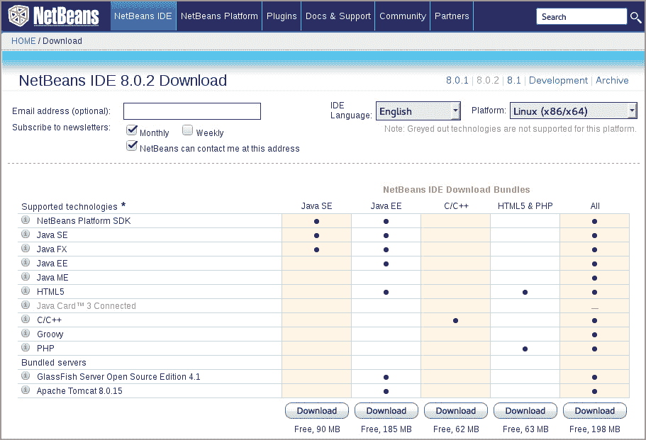

到为止，我一直第一个，但现在我`Java EE`，它代表`Java Enterprise Edition`（Java 企业版）。它通过`Java EE`进行扩展，包含了许多用于企业级应用（包括 Web 应用）的开发工具，以及支持使用`HTML5`开发 Web 应用的`HTML5`。最后，包含了两个 Web 服务器。区别在于，后者是一个支持 Java Web 应用的通用 Web 服务器，对于本文来说足够了，但它不是应用服务器。那是`GlassFish`服务器，由于它是后续书籍必要的，我将处处使用它。两个服务器都包含了，但你可以决定是否安装两个（除非你想尝试`Tomcat`）。

当你下载带有`Java EE`的`NetBeans`组合包时，你会得到一个自解脚本，通常安装`Java EE`和`GlassFish`很容易，但书中有一个附录显示了如何操作。

## 2 Servlet

Web 应用的基本概念是 Servlet，它是一个以 HTML 形式向客户端生成的 Java 类。由于它是普通的 Java 类，其方法在服务器上执行，因此它可以执行任何类可以执行的操作，例如从数据库读取数据。因此，Servlet 可以动态生成取决于情况的 HTML 文档。实际上，在实践中很少直接查看这些 Servlet，因为你通常开发像`JSP`页面或`Facelets`（后文介绍）这样的动态网站，但在两种情况下，页面都会转换成 Servlet，所以本节关于什么是 Servlet，以及如何使用`NetBeans`编写 Servlet。在打开`NetBeans`后，选择`File | New Project`：

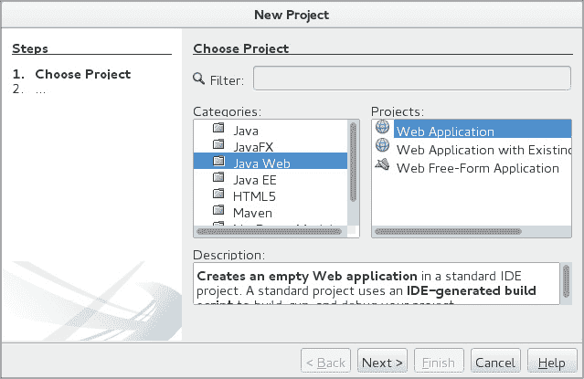

但这次，`Categories`必须是`Java Web`，而`Projects`应该是`Web Application`。点击`Next`后，你会进入熟悉的窗口，需要在其中输入项目名称并选择创建项目的文件夹。我将项目命名为`TimeServer`。点击`Next`后，你会看到一个选择托管应用程序服务器的窗口：

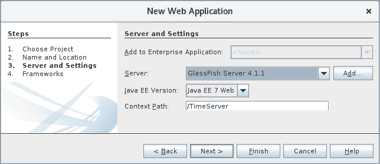

它可能已经为`GlassFish`服务器准备好了，因此无需进行任何操作，只需点击`Finish`即可。之后，创建了一个 Web 应用程序项目（见下文），其中包含了项目可能包含的不同类型文件的文件夹，但目前只有一个名为`index.html`的单文件，这是一个通用的 HTML 文档，可以被视为应用程序的首页：

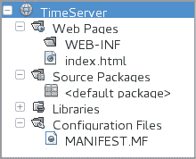

我稍后会添加一些更改，但它是一个功能完整的 HTML 文档，尝试运行`NetBeans`项目将打开浏览器并显示以下页面：

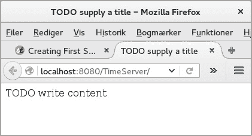

关于浏览器窗口，请注意标题栏显示的是文档`title`元素的文本，而页面本身的内容是文档`body`部分文本。最后，注意地址栏：


`localhost`是本地机器名称，因此是安装 Web 服务器的物理服务器。如所述，Web 服务器是一个持续运行的程序，这种程序在世界上被称为服务器（实际上是一个 Web 地址）和一个`port number`（端口号）。Web 服务器可以配置为使用特定的端口号，`GlassFish`使用默认端口 8080。在这种情况下，调用了`TimeServer`应用程序，由于没有指定其他程序，服务器将使用应用程序的首页（发送首页作为响应），即`index.html`。

目前该应用程序没有 servlet，现在我将添加一个 servlet。这通过右键点击`<Default package>`并选择`New | Servlet`来。在接下来的窗口中，我将 servlet 命名为`TimeServlet`（窗口显示了一个在此处可以忽略的警告），当你点击`Next`时，就会看到所示的窗口：

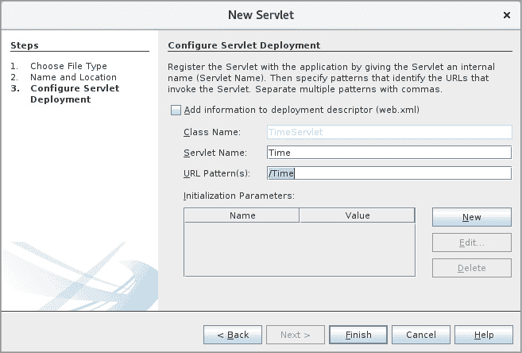

在这里你应该注意，我同时更改了`Servlet Name`（Servlet 标识）和`URL Pattern (s)`（URL 模式）。这并非必须的，这样做是为了展示这是被允许的。然后点击`Finish`，NetBeans 会创建一个 servlet（我删除了一些注释）：

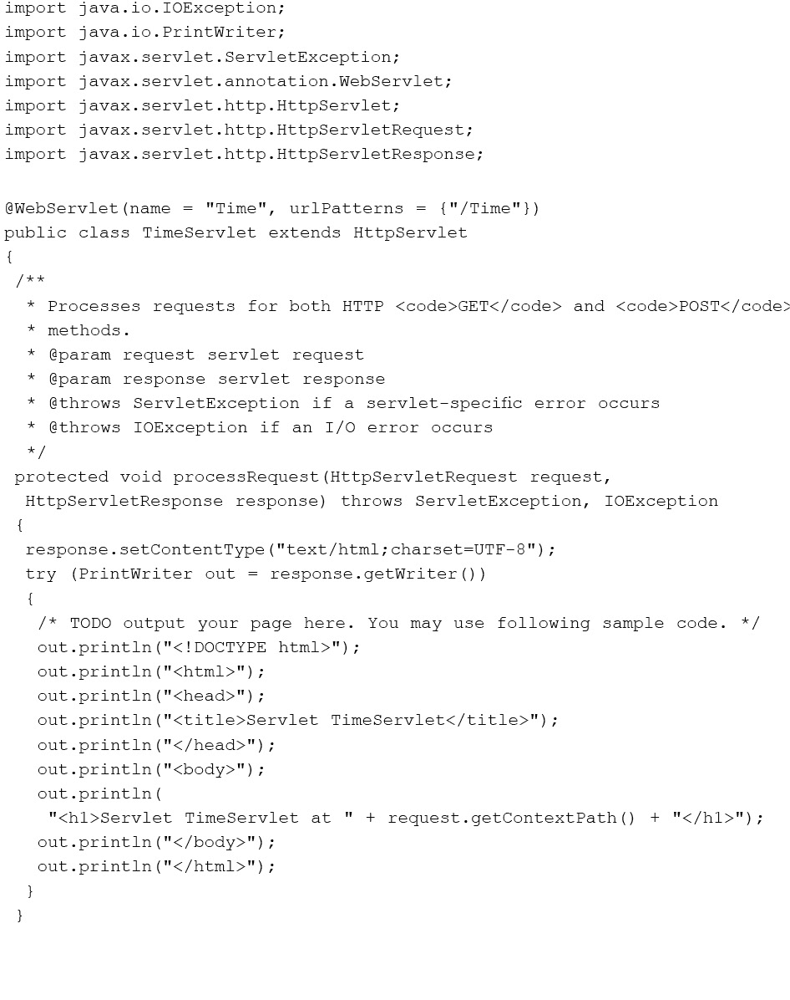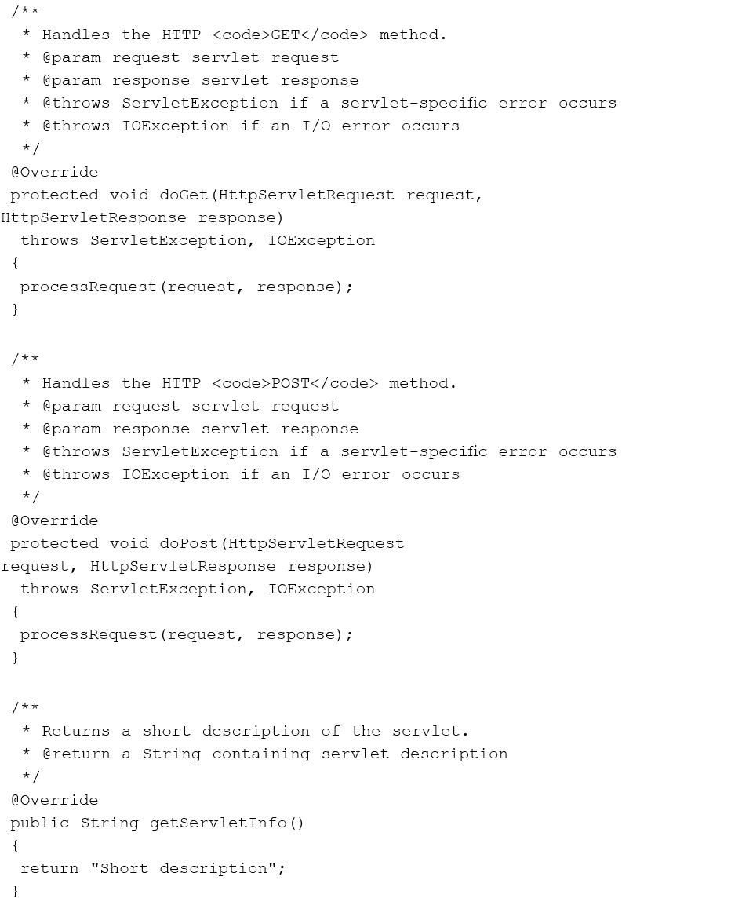

注释在某种程度上解释了各个方法的作用，但我稍后会做更详细解释。不过，你必须注意在类定义中有一个注解：


它告诉我这是一个 servlet，它的名称和 URL 是什么，在这里你应该特别注意，这些是我创建该 servlet 时选择的名称。最初，我将回到`index.html`（首页），将其更改为以下内容：

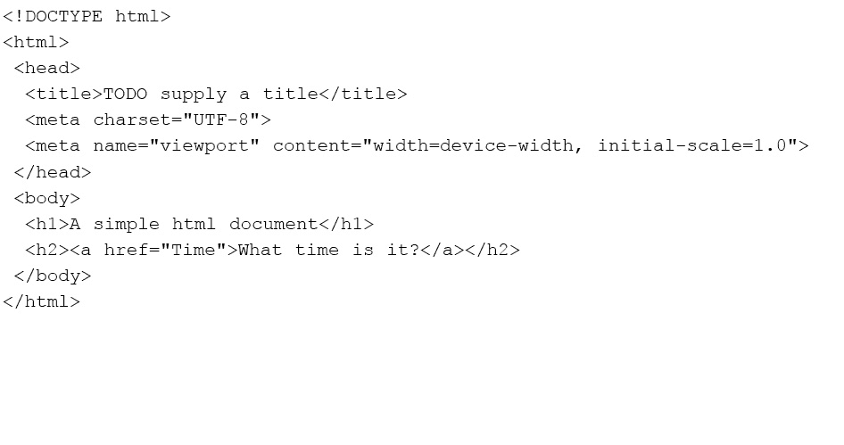

你应该注意到`h2`元素，它包含一个指向我那个 servlet 的链接。如果你现在运行该应用程序，它会打开浏览器：

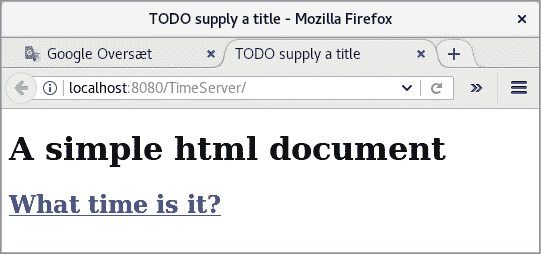

这并不奇怪，但点击该链接你将获得另一个窗口：

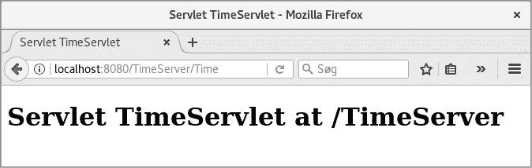

你必须注意地址栏，它告诉你当前显示的是 servlet 的结果。

现在我将仔细查看 servlet 类代码。首先，注意该类继承了`HttpServlet`，它是 servlet 的基类。如果你考虑`processRequest()`方法，很明显它创建了一个 HTML 文档。该方法有两个参数，分别代表一个`request`（来自浏览器）和一个`response`（响应）。客户端与服务器之间的通信发生在`HTTP`协议之上，HTTP 是一种基于文本的简单协议。当浏览器执行请求时，有两种方式实现，称为`GET`和`POST`，主要区别在于浏览器如何随请求发送数据。当浏览器向 servlet 发送请求时，会执行`doGet()`或`doPost()`方法之一，这两个方法都有两个参数，分别是代表请求和响应的对象的引用。在这种情况下，没有发生其他事情，只是这些对象被发送到`processRequest()`方法中。

它将响应对象初始化为 HTML 文档，之后确定一个指向对象写入器的引用`out`。该引用被用于打印文档文本，在本文情况下，这些文本构成了一个 HTML 文档。当`try`块超出作用范围时，该引用被删除，这意味着文档结束并向客户端发送响应。

现在我将按如下更改`processRequest()`方法：

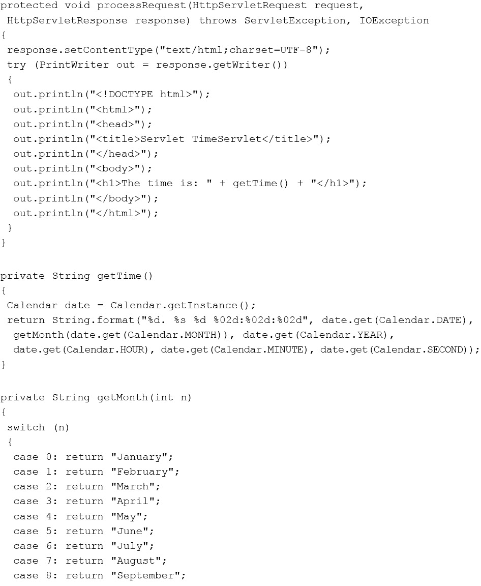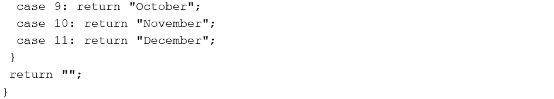

事实上，只更改了一条语句，但它现在调用了`getTime()`，该方法返回一个带有当前日期和时间的字符串。目标是展示该应用程序是动态的。以下是点击首页链接后的示例：


如果你点击“提交”（Submit）按钮，表单数据将发送到服务器，服务器可能会返回如下消息：

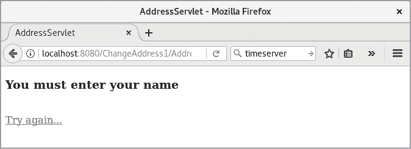

因为用户没有输入完整的地址。你将需要点击该链接，然后就可以重新填写表单。

如果你如下所示填写了所有字段，其中电子邮件地址字段未填写，且表单上的日期格式为`DD-MM-YYYY`（即字段之间使用连字符`-`），然后点击`Submit`，你将收到一个作为响应的收据（见下文）。

当然，这是一个非常简单的应用程序，但它是一个将数据从客户端发送到服务器进行处理的应用程序，之后客户端获得响应。在许多方面，这就是许多 Web 应用的原理。

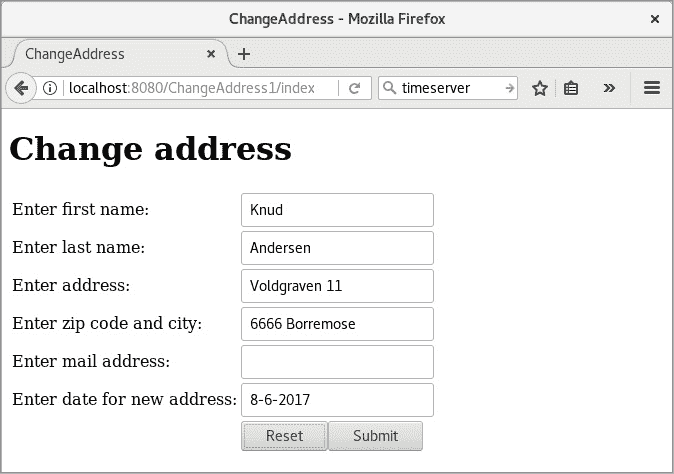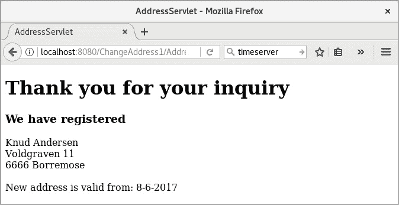

基础是一个名为`ChangeAddress1`的 NetBeans 项目，作为本章的第一个项目，它是一个 Web 应用项目（Web Application）。NetBeans 创建了一个名为`index.html`的首页，我将其修改为如下内容：


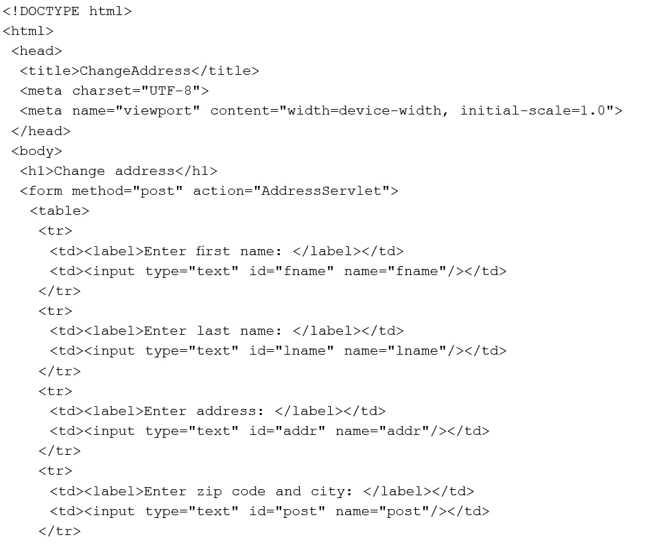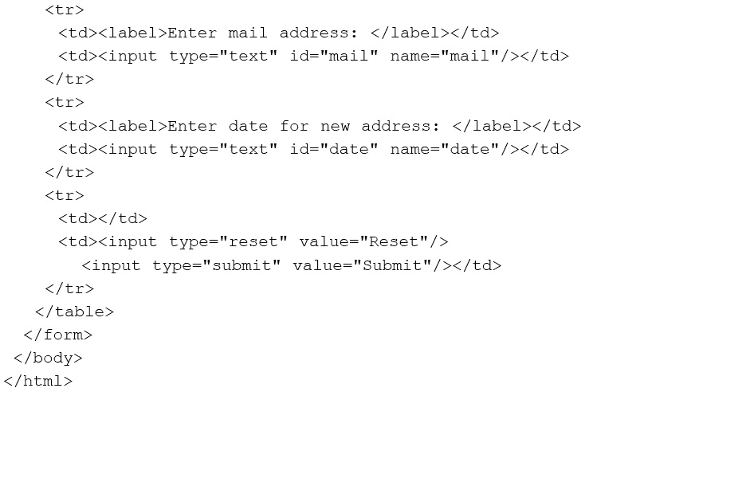

该页面显示表单。`form` 在 HTML 中通过 `form` 元素定义。在这种情况下，表单字段被放置在表格中，这样可以使字段整齐地在两列中上下对齐。表格有 7 行，前 6 行包含一个标签（`label`）和一个 `input` 元素。`label` 显示文本，而此例中类型为 `text` 的 `input` 元素是一个输入字段。每个输入字段都有一个 `name`，并分别通过 `id` 和 `name` 属性定义了标识符。在这种情况下，只有后者是必要的，但当通过 `id` 或 `name` 标识元素时，二者略有不同；而当元素的值作为表单的一部分发送到服务器时，使用的是 `name` 属性。然而，如果你需要从样式表中引用元素，则使用的是 `id` 属性。因此，同时标出两者可能是一个好主意。表格的最后一行也有两个输入组件，但它们的类型不同。这两个组件都被浏览器渲染为按钮，`value` 属性指定了按钮显示的文本。第一个组件用于清除表单的输入字段，而另一个（`submit` 组件）则将表单提交到服务器。

如果你考虑 `form` 元素，它有两个属性。`action` 指明请求应该发送到服务器上的哪个页面。在本例中，它是 `AddressServlet`，这是一个 servlet。另一个方法（属性）指示请求的类型，这里是 `POST`。这意味着表单的元素将以键值对的形式随请求一起发送，其中键是 `name` 属性的值，而值是 `value` 属性的值（对于输入字段来说，值就是输入的文本）。

如所述，`AddressServlet` 指的是一个 servlet。它的创建方式与上一个示例相同，我将其命名为 `AddressServlet`。在“配置部署部署”（Configure Servlet Deployment）屏幕上，这次我没有更改 `Servlet Name` 和 `URL Pattern (s)` 的值，但我为该 servlet 创建了一个包（package）。完整的代码所示，其中我删除了所有注释以及最后一个方法 `getServletInfo()`：

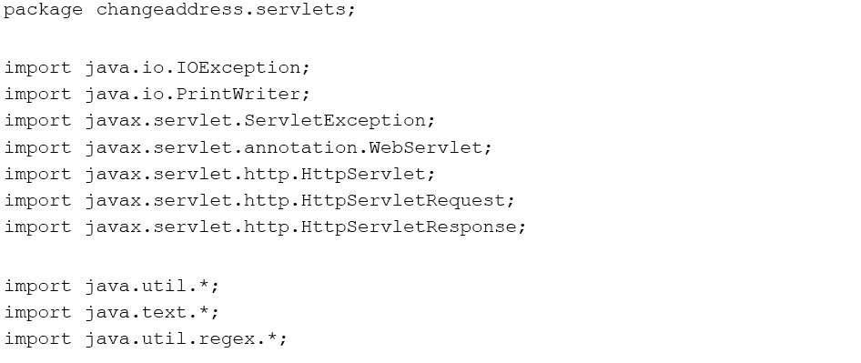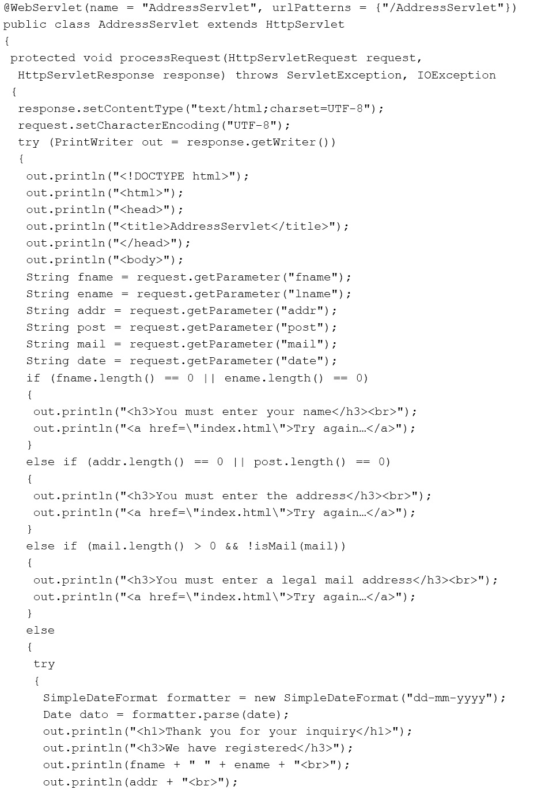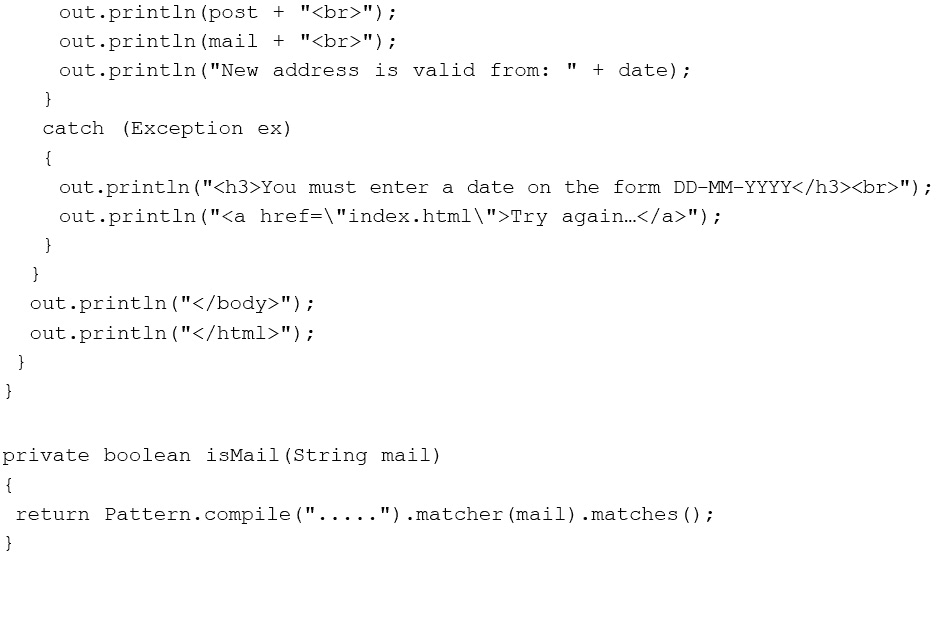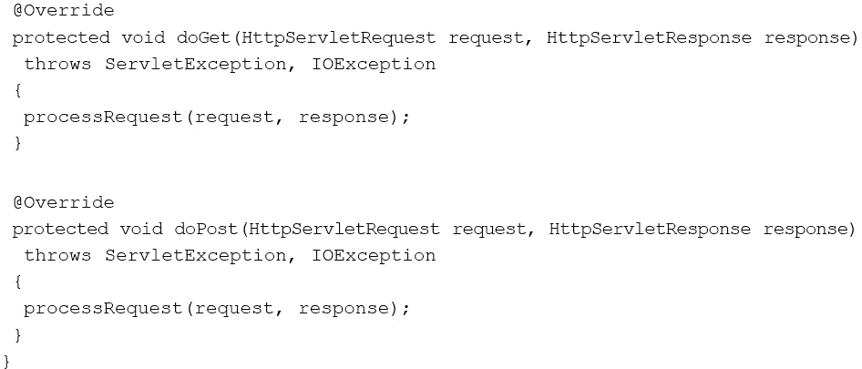

原则上，它与第一个示例相比没有新内容，几乎整个 `processRequest()` 方法也是由 NetBeans 生成的。注意，我添加了一个 `isMail()` 方法，这是之前用过的方法，用于使用正则表达式验证电子邮件地址（我没有显示代码）。`processRequest()` 方法原理上的工作方式与第一个示例相同，并动态创建作为响应发送的 HTML。首先，注意以下语句


丹麦语字母需要被正确解码。接下来，你应该注意如何获取表单的值，例如：


这决定了输入的第一个名字的值。其余部分原则上只是常规操作，包括对表单发送的字段进行验证，并在发生错误时发送错误消息作为响应。因此，服务器响应是动态的，因为它取决于发送的数据。

很显然，servlet 还可以做很多其他事情，例如将数据保存到数据库中。

## 练习 2

你必须编写一个类似于 `ChangeAddress1` 的 Web 应用。应用程序启动后，必须显示如下内容：

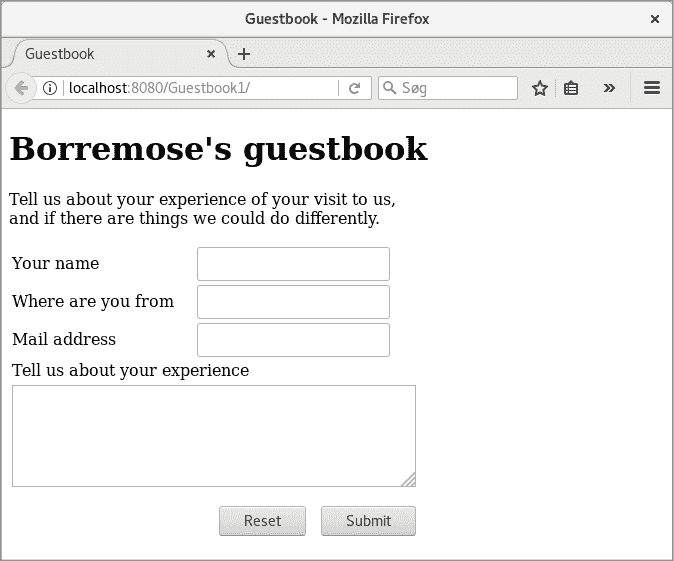

用户可以在此处输入姓名。在你填写表单并点击 Submit 按钮后，如果表单未填写，你将收到错误消息：


如果表单填写正确，用户将收到如下内容：


## 3 参数与会

从上面的示例可以看出，通过使用 HTML 文档和 servlet，动态网站和 Web 应用可以取得很远进展，但同样看出，对于复杂的站点，编写 servlet 并使其真实化是非常复杂的。这是 JSP 和 JSF 需要解决的问题，但在展示它们之前，我先给你展示一些 servlet 的示例。

## 3.1 参数传递 servlet

我将开始名为 `Parameters` 的新 Web 应用，结果再次是一个带有 `index.html` 主页的应用。我将首先展示如何在初始化时传递参数。我添加了一个名为 `InitServlet` 的 servlet，并在配置窗口中定义了如下内容（注意“添加到部署描述符 web.xml”）：


创建相应的 servlet 后，NetBeans 在 `WEB_INF` 文件夹下创建了一个 XML 文档：

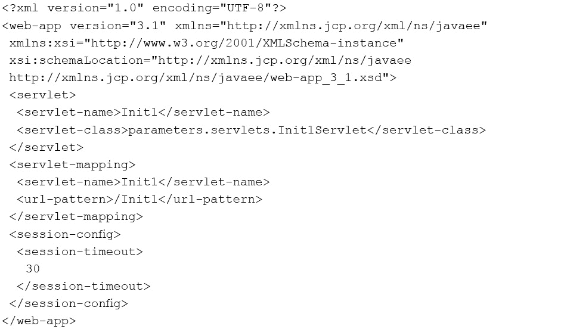

这是一个与应用程序部署相关的配置文件。你必须注意我的 servlet 名字是上面窗口中选择的 `Init1`，它是指向 `parameters.servlets.InitServlet` 类的名称。你还应该注意应用程序中的地址（URL）为 `/Init1`。

我接下来扩展了 XML 文档，如下所示：

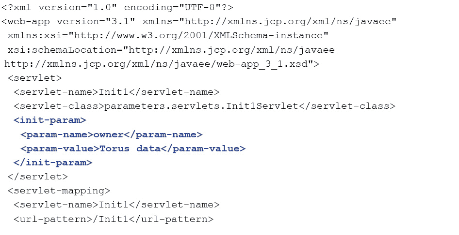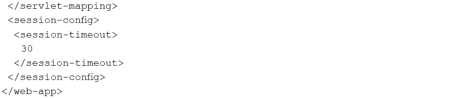

这意味着我定义了一个键为 `owner`、值为 `Torus data` 的键值对。然后我将 `Init1Servlet` 的代码更改为如下内容，其中我只显示了类的第一部分：

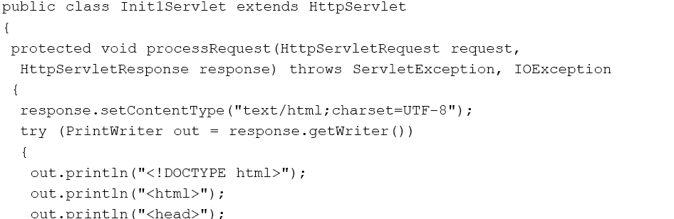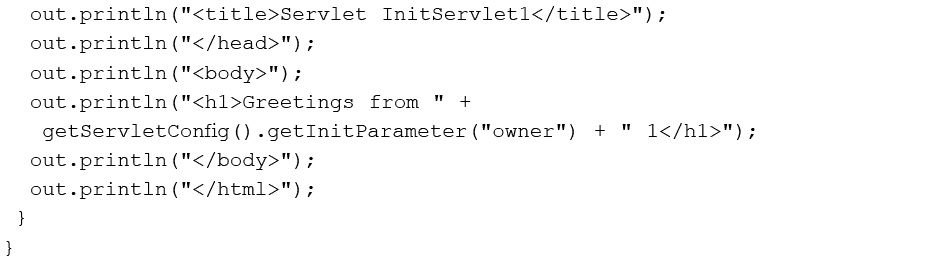

在这里你需要注意，该类没有使用 `@WebServlet` 注解进行装饰。原因是因为这次 servlet 是在配置文件中定义的。使用注解是配置文件的替代方案，它让编写 servlet 变得更加简单（你不需要维护 xml 配置文件），但相反，更改意味着代码可能需要重新编译，而配置文件可以在不修改 servlet 代码的情况下进行维护。你还应该注意，在 `processRequest()` 中，我只修改了一行代码（倒数第三条语句），它获取了在 XML 文档中定义的参数。

随后，我将起始页改为以下内容：

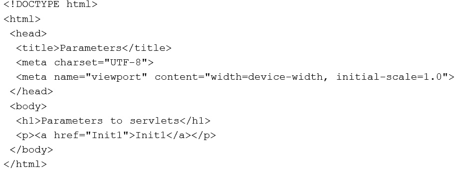

运行应用程序并点击链接，你将得到窗口：

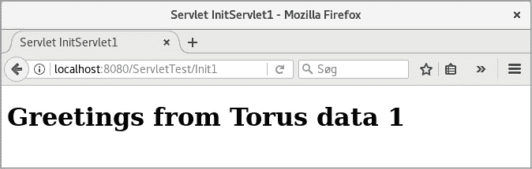

在这里你应该注意如何使用 xml 配置文件将参数传递到 servlet。

如果你查看上面 NetBean 的 `Configure Servlet Deployment` 窗口，底部的选项是为 servlet 指定初始化参数。这可以用来代替上面那样手动编辑 XML 文档。我添加了另一个 servlet，这次称为 `Init2Servlet`，并按照如下配置了部署：

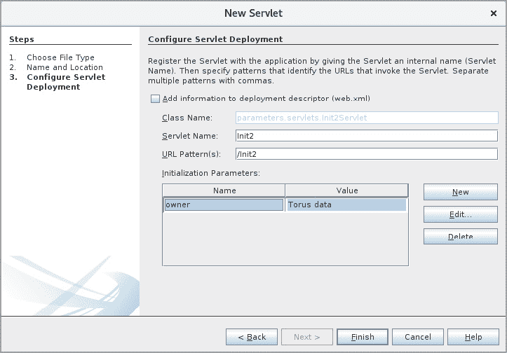

重要的是，没有勾选 `Add information to deployment descriptor (web.xml)`，并且已添加了一个 `Initialization Parameter`。这意味着 `web.xml` 没有更新，但如果你查看代码，该类定义被装饰了：

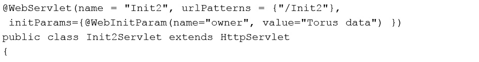

它在部署期间作为 `web.xml` 的替代方案使用，你可以看到名称和 URL 是如何定义的。最后，我添加了一个参数。`processRequest()` 的代码基本上是相同的，在起始页上添加了另一个链接后，你可以向新 servlet 发起请求，结果如下：

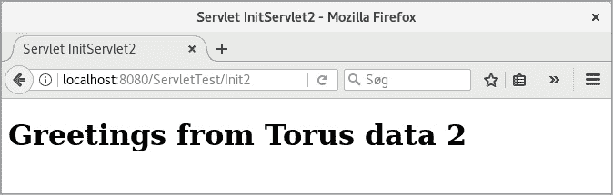

## 3.2 Sessions（会话）

当你从浏览器请求一个页面且服务器返回响应时，该过程将如前所述，按照 HTTP 协议进行。该协议基本上是无状态的，这意味着在服务器返回响应后，服务器就“忘记”了所有关于请求的信息，下次收到对同一页面的请求时，服务器会将其视为新请求。这种模型与现代 Web 应用程序格格不入，你可以通过 `session`（会话）概念等方法解决这个问题。

当用户打开浏览器并向新页面发送请求时，服务器会检查是否包含 `session ID`。无论这是否是对浏览器地址栏中输入的新页面的请求，服务器都会生成一个 `session ID` 并将其随响应一起返回给客户端。如果客户端随后执行提交，或者例如点击指向同一 Web 应用程序中某个页面的链接，浏览器将带上 session ID，服务器将其包含在响应中。这样，就引入了名为 `session` 的术语，只要服务器还引用同一个 Web 应用程序内的页面，会话就会一直存在。

这可以用于定义在整个会话期间存在的数据。当服务器创建 `session ID` 时，也会创建一个会话对象，该对象包含一个 `Object` 对象的集合。因此，服务器可以在此集合中创建并保存对象，这些对象的生命周期与会话对象一样长，因此它们可以被该会话内的所有页面使用。需要注意的是，这些对象仅在服务器端已知，不会发送到客户端。唯一发送到客户端的是 `session ID`，它在每个请求/响应对中往返传输。

单个会话对象一直保存在服务器上，直到它们被显式移除，或者由于超时被移除（例如，可能是 30 分钟）。这意味着，服务器可能拥有许多不再使用的会话对象，从而占用空间；而且如果停止工作，会话对象（如购物车）可能会消失。

为了说明会话的使用，我创建了一个名为 `Sessions` 的 Web 应用程序。对于此应用程序，我将添加三个 servlet。在向 Web 应用程序添加 servlet 时，不应将其放在项目的默认包中（在上面的第一个例子中已经那样做了了）。通常，我会创建一个名为 `projectname.servlets` 的包（在本例中为 `sessions.servlets`），并将我的 servlet 放在那里。在这种情况下，我还创建了一个名为 `sessions.data` 的包，并添加了以下类，它可以表示一个带有名称和头衔的人：

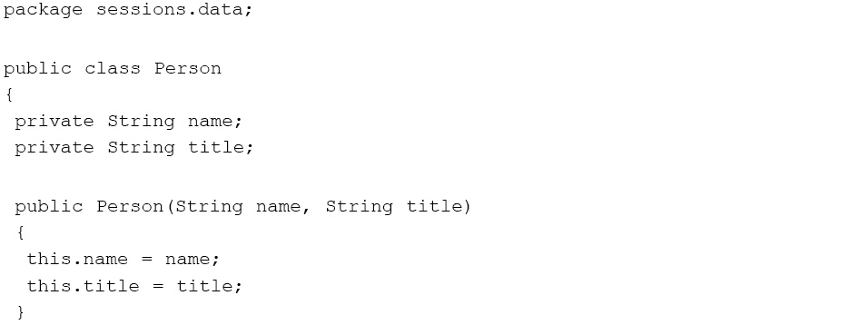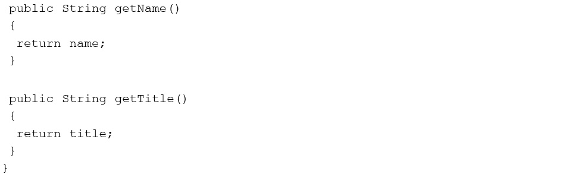

你应该注意这是一个相当常见的模型类。作为下一步，我添加了以下 servlet：

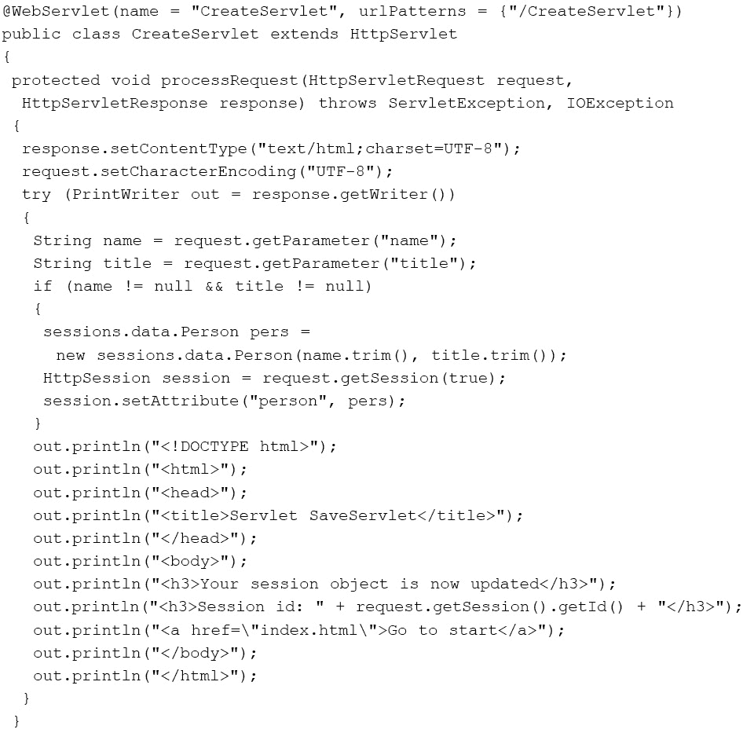

`processRequest()` 方法首先确定从向此 servlet 发送请求的页面两个表单字段的值。如果可能，且它们都不为 `null`，则将它们用于创建一个 `Person` 对象。接下来，添加对会话对象的引用：


这意味着如果对象不存在，则必须创建它。下一步，将 `Person` 对象添加到会话集合中，键为 `person`。最后，返回一个响应，其中包含会话对象。

起始页的代码如下：

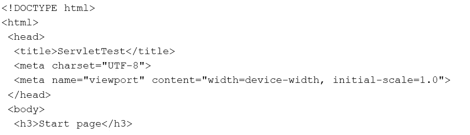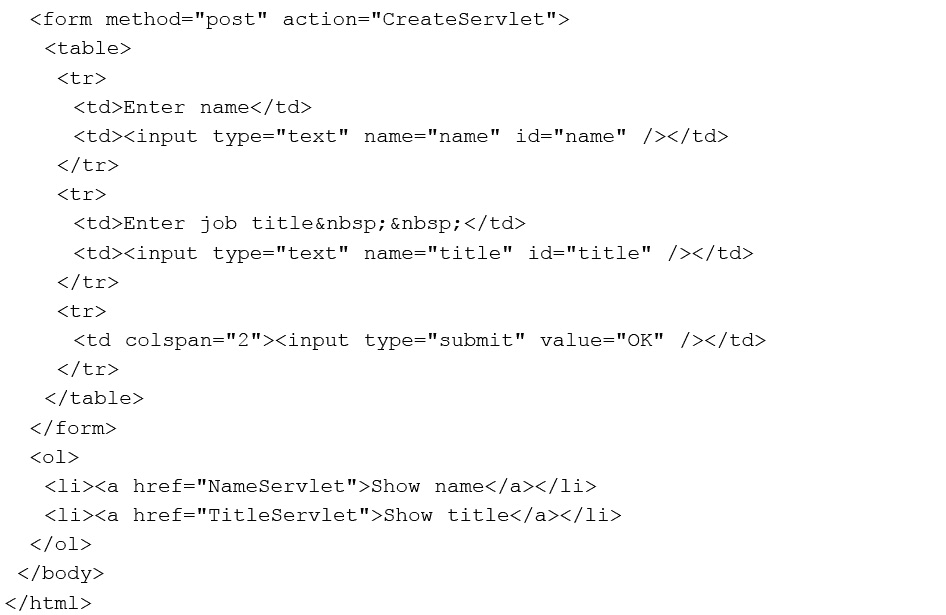

如果你运行应用程序，将得到以下窗口：


如果你在此处输入名称和头衔并点击 *OK*，将得到以下结果：


它告诉会话对象已更新，以及 session ID 是什么。你应该注意它表示为一个大的十六进制数，你通常无法对它做什么，但在这种情况下可以使用它查看何时启动了新会话。

作为下一步，添加了一个 servlet，它显示创建的人的名字：

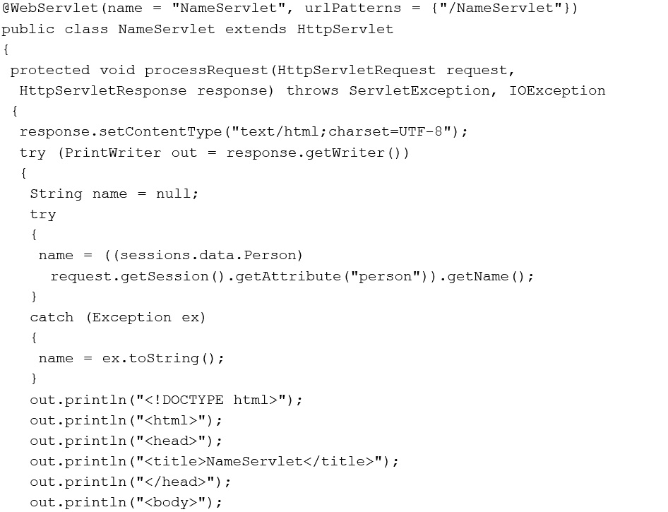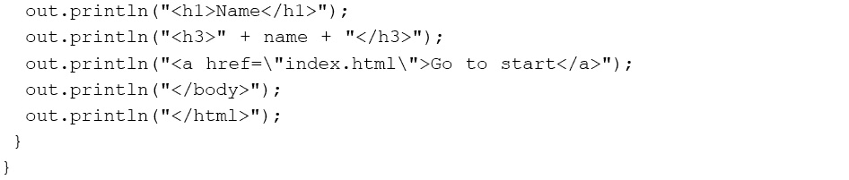

这里没什么好解释的，但你应该注意如何引用会话对象以及存储在 `person` 下的对象。结果是一个 `Object`，因此需要进行类型转换。

同样，创建了一个名为 `TitleServlet` 的 servlet，它发送一个带有 `Person` 对象头衔的响应。如果你在起始页输入：

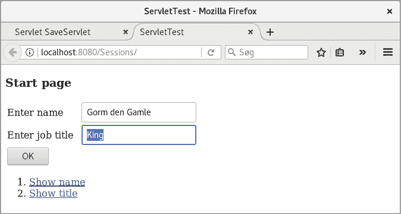

并点击 *OK*，然后从起始页点击 *Show name* 链接，你将得到窗口：

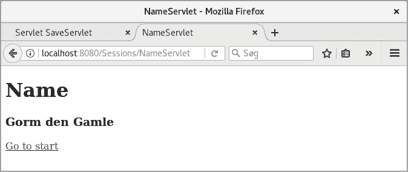

## 3.3 Redirection（重定向）

如果你向 servlet（Servlet）发送请求，它可以执行数据处理，然后将请求发送到另一个 servlet（或另一个网页）。这可以通过 `redirect`（重定向）或 `forward`（转发）来实现。在第一种情况下，服务器会在 HTTP Header 中插入一段代码以及新 URL（在 `Location` 字段中），并向浏览器发送响应。随后浏览器会对新 URL 发起请求。在第二情况下，服务器将直接将相同的请求发送到另一个 URL，包括来自 `form` 字段的所有键/值对属性。因此，`forward` 不涉及浏览器，且浏览器的地址栏不会改变，因为所有操作都发生在服务器端。我将分别向你展示如何执行重定向和转发。其起点是以下 HTML 文档，名为 `index.html`，它是应用程序 `Calculations` 的起始页：

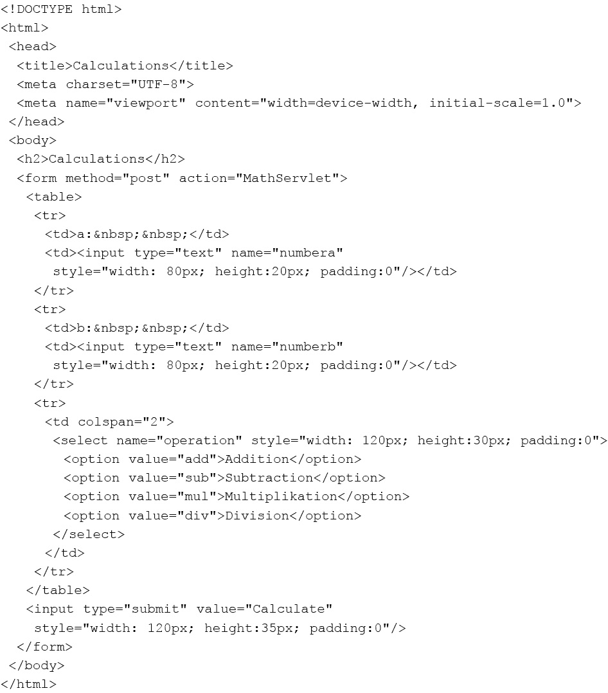

如果你运行该程序，将得到如下所示的页面。在这里你可以输入两个数字，还有一个列表可以让你从中选择四种计算之一。如果你点击按钮，表单将提交到 servlet `MathServlet`。这个 servlet 仅负责决定执行哪种操作，然后将请求传递给四个额外的 servlet 之一（`AddServlet`、`SubServlet`、`MulServlet` 和 `DivServlet`），但前两种情况是通过 `redirect` 实现的，而另外两种情况是通过 `forward` 实现的。这四个用于计算的 servlet 将以简单页的形式发送响应显示结果。原则上，它们都是相同的，例如，`AddServlet` 的 `processRequest()` 如下所示：

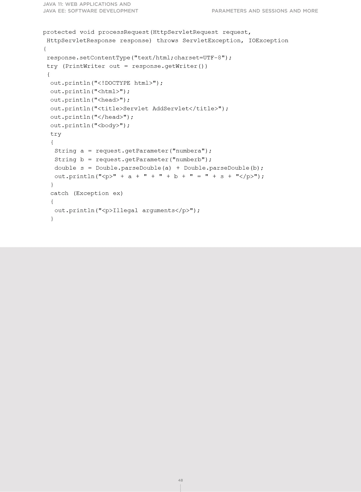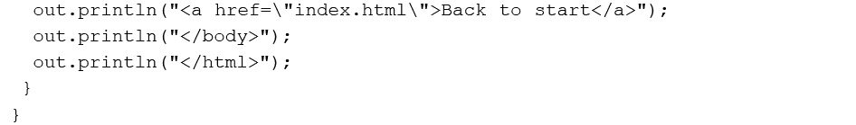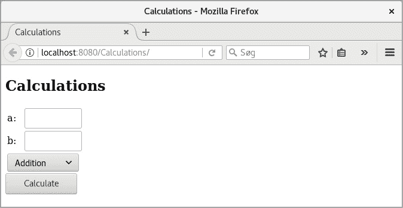

最有趣的是 `MathServlet`：

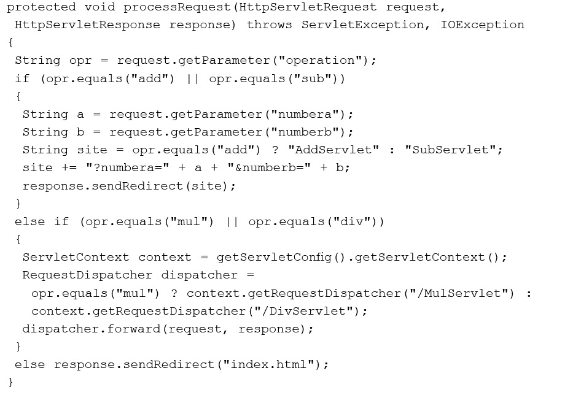

它首先确定列表的值，即名为 `operation` 的表单字段 `select`。如果是 `add` 或 `sub`，则必须重定向到 `AddServlet` 或 `SubServlet`。然而，这会导致一个问题，因为浏览器将以 `GET` 请求重定向到该 servlet，这意味着表单字段不会发送。因此，我必须手动将它们作为参数添加到 URL 中，这通过初始化一个变量来实现，例如其值可以是：


设置好地址后，使用 `sendRedirect()` 方法执行重定向，这对应将上述地址返回给浏览器，然后浏览器对该地址执行 HTTP GET。

如果操作不是 `add` 或 `sub`，则会确定一个 `ServletContext` 对象，用于为 `MulServlet` 或 `DivServlet` 创建一个 `RequestDispatcher` 对象。该对象有一个 `forward()` 方法，用于将请求转发到该 servlet。当此发生时，请求会被转发，包括所有形式的字段，且不涉及浏览器。

鼓励你测试该应用程序，并在相同的语境下，注意浏览器地址栏的变化。

## 3.4 Cookies

作为关于 servlet 的最后一个内容，我将向你展示如何创建和使用 cookie。cookie 是在服务器和浏览器之间往返的文本，可以像 session 变量一样用于维护状态信息。以下是一个创建 cookie 的 servlet：

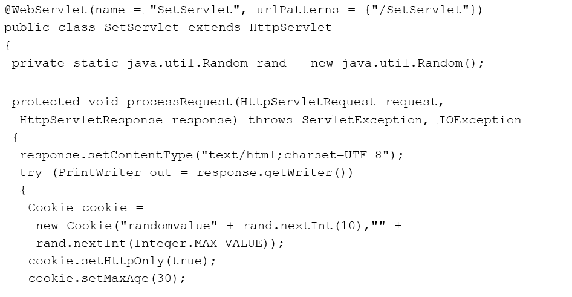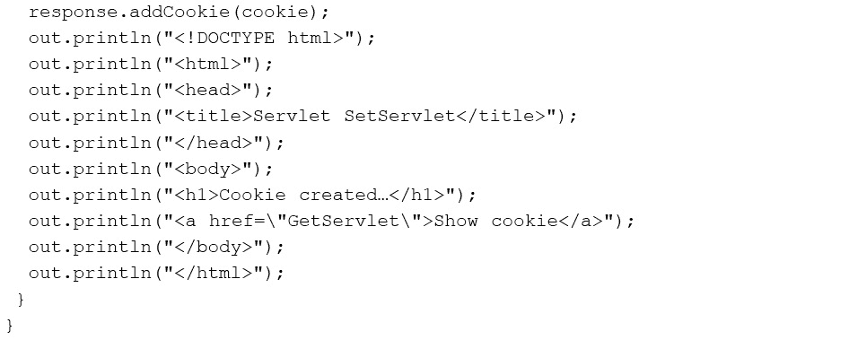


`cookie` 由一个`Cookie`对象表示。在这种情况下，创建了一个名为`randomValue`加上数字（例如`randomValue5`）的`cookie`，并分配了一个随机值。随后，它被定义为浏览器已知的临时`cookie`，最后被定义为 30 秒超时。如果数字为负数，意味着它将随当前`session`被移除。

以下是另一个读取`cookie`的`servlet`：

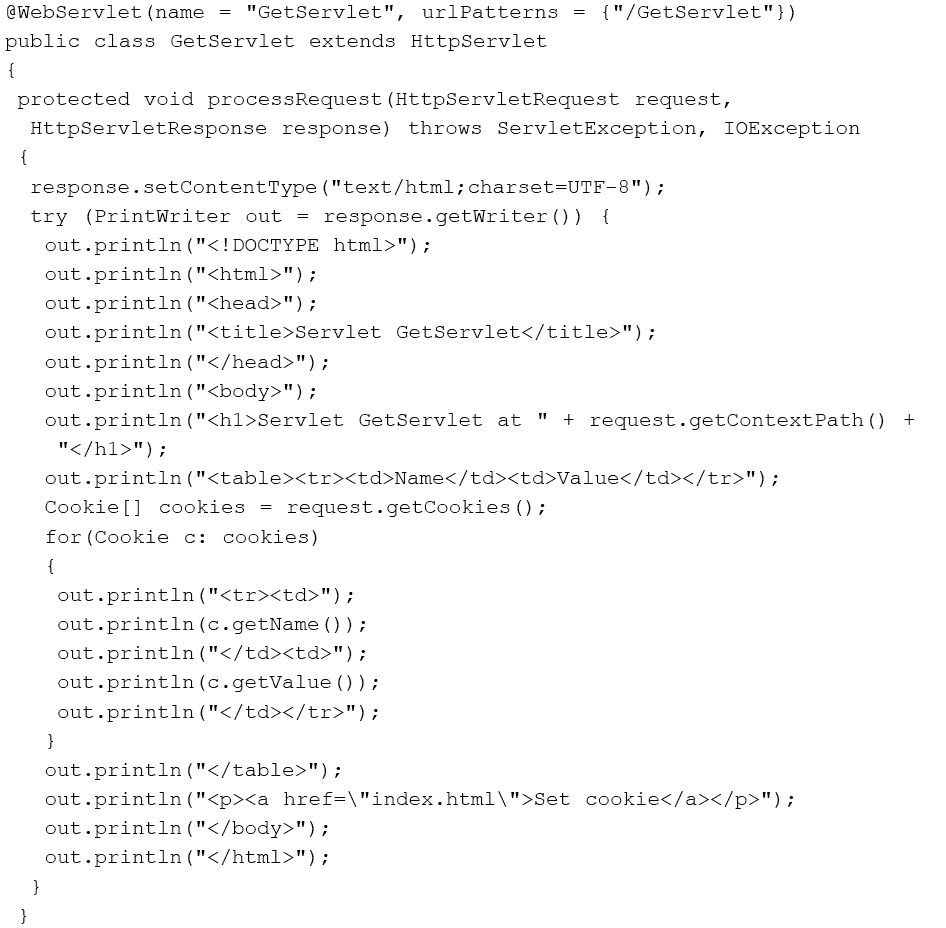

这里没什么好解释的，但你应该注意如何循环遍历当前`session`的所有`cookie`。最后是起始页：


如果你运行程序，你会发现创建了更多`cookie`，但如果你创建一个已存在名称的`cookie`，该`cookie`的值会改变。你还会发现单个`cookie`消失，因为有 30 秒的超时。

## 练习 3

你必须编写一个可以模拟非常简单购物车的 Web 应用程序。主要目的是展示`session`变量使用的示例。

从一个新的 Web 应用程序项目开始，你可以将其命名为`Shopping`。首页`index.html`应该是一个带有单个条目的简单表单：


如果你输入一个产品（文本）并按下按钮，该文本将发送到一个将其保存到`ArrayList<String>` `session`中的`servlet`，之后用户被返回首页。如果你点击底部，必须请求一个显示购物的`servlet`。以下是添加项目后的购物车：


## 4 JavaBeans

在后续我经常提到`Java Bean`，关于它见之前的书籍。事实上，它只是一个普通的类，但必须满足以下条件：

1. Java Bean 必须是可序列化的（serializable）。
2. Java Bean 必须有一个默认构造函数。
3. 所有实例变量必须是私有的（private）。
4. 实例变量可以拥有`get-`和`set-`方法，并且必须遵循命名规则，以便有一个`getName()`方法，对应的`set`方法必须命名为`setName(...)`。

此外，Java Bean 可以是任何，和其他类一样，它可以拥有各种其他方法等。例如，下面是一个 Java Bean：


选择这个示例是因为我想稍后应用它，但也为了展示 bean 就是一个普通的类，可以包含类所包含的一切。这是一个表示日期时间的 bean。

## 5 JSP

上面我介绍了`servlet`并展示了如何使用它们（以及如何使用）编写动态网站，但也很明显，使用`servlet`开发复杂的 Web 应用程序是一项巨大且困难的任务。因此引入了 JSP 页面，你可以将其简要描述为 HTML 和 Java 代码的混合体。Java 代码将在文档发送到客户端浏览器之前在服务器上执行。通过示例来解释这一点最好。

我在 NetBeans 中创建了一个新的 Web 应用程序，将其命名为`DateServer`，结果如之前一样，有一个名为`index.html`的首页。接下来，我右键点击 Web Pages 文件夹并选择`New`然后`JSP`添加了一个新的 JSP 页面，我将其命名为`start`，结果是项目中了一个名为`start.jsp`的文件，其内容几乎是一个初始注释：


正如你所看到的，它看起来像一个普通的 HTML 文档，只有两个不同：第一行以及扩展名`.jsp`。后者非常重要，因为它告诉 Web 服务器在将文档发送到浏览器之前需要对其进行翻译。如果你右键点击`Projects`选项卡上的名称并选择`Run File`（运行文件），该文档将自动翻译并在浏览器中打开。

目前还没有 Java 代码，但作为下一步，我右键点击`Source Packages`文件夹并添加了一个名为`DateBean`的类。该代码就是`Java bean`，正如我在上一章所示。这个 Java bean 可以按照如下方式在 JSP 页面中使用：


代码通过`jsp:bean`元素进行了扩展，正如你所看到的，它定义了对类`dateserver.DateBean`的引用，并为`dateBean`调用了该引用。最后，它定义了一个范围（scope），告诉我们`DateBean`对象可以使用的地方。此外，还定义了两行来在页面中插入相关的 bean 值。例如，插入了


HTML 代码中的属性`date`。你应该注意这个引用，并且你写了作为属性名的`date`，这意味着正在执行的是`getDate()`方法，并且其返回值被插入到了页面中。如果你在浏览器中打开该 JSP 页面，结果是：


你可以看到 bean 类被实例化了，并且对象的值（当前日期和时间被插入到文档中）。特别是，如果你点击 F5（刷新浏览器），浏览器将更新时钟，然后对象将重新实例化。你可以以同样的方式使用 Java bean 中的其他公共方法，但在这种情况下没有其他方法了。关于属性范围（attribute scope）的值，有四种选项：

1. `page`：默认值，表示 bean 对象仅可以在当前页面上使用。
2. `request`：表示 bean 对象可以在所有涉及同一个请求的 JSP 页面中使用。
3. `session`：意味着 bean 对象可以在所有关于同一个会话的 JSP 页面中使用——然而，创建对象的页面必须带有`session = “true”`的页面指令。
4. `application`：表示 bean 对象可以在应用程序中的所有 JSP 页面中使用。

当接收到 JSP 页面的请求时，如果它还没有翻译成`servlet`，则会自动翻译成`servlet`。在这里，Web 服务器将自动检查 JSP 页面是否比任何`servlet`都新，如果是，页面将再次翻译。这意味着 JSP 页面仅在需要时才会翻译成`servlet`。

你还可以使用所谓的脚本片段（scriplets）在 JSP 页面中插入 Java 代码。我按照以下方式扩展了页面：


代码通过`jsp:bean`元素进行了扩展，正如你所看到的，它定义了对类`dateserver.DateBean`的引用，并为`dateBean`调用了该引用。最后，它定义了一个范围，告诉我们`DateBean`对象可以使用的地方。此外，还定义了两行来在页面中插入相关的 bean 值。例如，插入了


HTML 代码中的属性`date`。你应该注意这个引用，并且你写了作为属性名的`date`，这意味着正在执行的是`getDate()`方法，并且其返回值被插入到了页面中。如果你在浏览器中打开该 JSP 页面，结果是：


你可以看到 bean 类被实例化了，并且对象的值（当前日期和时间被插入到文档中）。特别是，如果你点击 F5（刷新浏览器），浏览器将更新时钟，然后对象将重新实例化。你可以以同样的方式使用 Java bean 中的其他公共方法，但在这种情况下没有其他方法了。关于属性范围（attribute scope）的值，有四种选项：

1. `page`：默认值，表示 bean 对象仅可以在当前页面上使用。
2. `request`：表示 bean 对象可以在所有涉及同一个请求的 JSP 页面中使用。
3. `session`：意味着 bean 对象可以在所有关于同一个会话的 JSP 页面中使用——然而，创建对象的页面必须带有`session = “true”`的页面指令。
4. `application`：表示 bean 对象可以在应用程序中的所有 JSP 页面中使用。

当接收到 JSP 页面的请求时，如果它还没有翻译成`servlet`，则会自动翻译成`servlet`。在这里，Web 服务器将自动检查 JSP 页面是否比任何`servlet`都新，如果是，页面将再次翻译。这意味着 JSP 页面仅在需要时才会翻译成`servlet`。

你还可以使用所谓的脚本片段（scriplets）在 JSP 页面中插入 Java 代码。我按照以下方式扩展了页面：


代码通过`jsp:bean`元素进行了扩展，正如你所看到的，它定义了对类`dateserver.DateBean`的引用，并为`dateBean`调用了该引用。最后，它定义了一个范围，告诉我们`DateBean`对象可以使用的地方。此外，还定义了两行来在页面中插入相关的 bean 值。例如，插入了


HTML 代码中的属性`date`。你应该注意这个引用，并且你写了作为属性名的`date`，这意味着正在执行的是`getDate()`方法，并且其返回值被插入到了页面中。如果你在浏览器中打开该 JSP 页面，结果是：


你可以看到 bean 类被实例化了，并且对象的值（当前日期和时间被插入到文档中）。特别是，如果你点击 F5（刷新浏览器），浏览器将更新时钟，然后对象将重新实例化。你可以以同样的方式使用 Java bean 中的其他公共方法，但在这种情况下没有其他方法了。关于属性范围（attribute scope）的值，有四种选项：

1. `page`：默认值，表示 bean 对象仅可以在当前页面上使用。
2. `request`：表示 bean 对象可以在所有涉及同一个请求的 JSP 页面中使用。
3. `session`：意味着 bean 对象可以在所有关于同一个会话的 JSP 页面中使用——然而，创建对象的页面必须带有`session = “true”`的页面指令。
4. `application`：表示 bean 对象可以在应用程序中的所有 JSP 页面中使用。

当接收到 JSP 页面的请求时，如果它还没有翻译成`servlet`，则会自动翻译成`servlet`。在这里，Web 服务器将自动检查 JSP 页面是否比任何`servlet`都新，如果是，页面将再次翻译。这意味着 JSP 页面仅在需要时才会翻译成`servlet`。

## 5.1 计算

在 JSP 的介绍示例中，我展示了如何简单地将例如 JSP 页面中的输入字段与 Java bean 中的属性相关联。这也是接下来的示例（称为`BeanFields`）的主题，但还将展示如何在 JSP 页面中使用 Java bean 的其他方法，以及如何处理会抛异常的方法（包括 setter 方法）。该项目再次是一个 Web 应用程序项目，但这次我删除了主页`index.html`。然而，我添加了一个名为`index.jsp`的 JSP 页面。为了让应用程序使用此页面作为起始页，可能需要添加一个`web.xml`配置文件。如果没有，右键点击`WEB-INF`文件夹并选择`Standard Deployment Descriptor (web.xml)`。该文件的内容如下：

```

```

当你在浏览器中打开应用程序时，你会得到如下窗口：

```

```

如果你在两个顶部字段中输入整数并点击顶部的`OK`按钮，结果可能如下所示。也就是说，这两个数字进行了一些计算，结果出现在五行结果中。然后，在底部的输入字段中输入 107（一个质数）并点击底部的`OK`按钮，除了所有字段都保留其原有值外，什么都没有发生，但你可以看到窗口正在更新并且有一个提交操作。如果你现在输入 108 并点击`OK`，你将看到下面的窗口。这是因为 108 不是质数，应用程序抛出了异常。当你点击`Repeat`时，你会返回主窗口，并注意所有值仍在那里。你应该特别注意底部的输入字段仍然具有值`107`。最后，有两个链接。如果你点击其中一个，底部的输入字段将分别更新为下一个或上一个质数。

这是其功能所在，程序应该展示了如何使用 Java beans 将用户界面 HTML 与 Java 代码（在 Java beans 和其他类中实现）分开。认为这一点很重要，你就能获得一个更容易维护的 Web 应用程序。


程序使用了两个 Java beans，它们位于`beanfields.beans`包中。第一个代表两个顶部输入字段，如下：


该类填充了一些行，但非常简单。你应该注意，该类是按照 Java bean 的要求编写的，在这里你应该特别注意两个变量的名称以及遵循 Java bean 标准的 get 和 set 方法。还要注意该类还有其他方法（5 个计算方法）。在这里你应该特别注意最后两个方法，如果无法计算，它们将返回 0。事实上，它们应该抛出异常，但由于 JSP 页面始终使用函数的返回值，这种解决方案无法使用。

另一个 Java bean 如下：


这里也有一些代码，目标之一是展示 Java bean 可以包含与任何其他类类似的复杂代码。只有一个属性必须代表质数。因此，如果你尝试给它分配一个非质数值，它的 set 方法可以抛出异常。除了这个属性外，还有两个方法分别将值分配给下一个和上一个质数——如果可能的话。

程序还有另一个 Java 类，是一个`servlet`，名为`PrimesServlet`。该类位于`beanfields.servlets`包中，`processRequest()`方法如下：


这是一个非常简单的`servlet`。它首先确定一个会话对象的引用（该一个`PrimeBean`），然后根据参数的值执行`next()`或`prev()`。最后，执行重定向到起始页。

这些是 Java 代码，后面有两个 JSP 页面。第一个是`index.jsp`，其中有几点你应该注意的：


页面以两个指令开始。第一个是由 NetBeans 添加的，但你应该注意我添加了一个属性：


这意味着任何 Java beans 都可以创建为会话对象。下一个指令引用一个 JSP 错误页面，并指示在发生异常时会自动重定向到的页面。在这里你可以进行适当的错误处理。

在 body 部分，第一件事是创建两个 Java bean 对象。在这里你应该特别注意它们的范围是`session`，这意味着这些对象的值在提交页面的上下文中被保留；页面值在提交后保留是说明的一个重要部分，但实际的原理是页面底部的两个链接。在声明两个 beans 之后，它们被定义为使用输入字段的值进行更新。也就是说必须执行类的 set 方法。你应该注意，使用`*`可以表示所有属性，或者你可以精确指定应该更新哪个属性。`prim`就是这种情况，尽管在这种情况下没有理由这么做，因为只有一个属性。你必须必须注意如何将 bean 中的属性绑定到输入字段：


特别地，你应该注意如何引用单个属性。

在这种例中，名称为`functions.tld`，它有一个名为`f`的所谓短名称。它被用于引用一个方法。定义了一个单独函数，该定义包含了函数名、函数类及其签名。文档必须包含对每个 JSP 页面可用的静态方法进行描述。以下是 JSP 页面的代码：


!!(image/Java_11_-_Web_applications_and_Java_EE_6-11-17_80.jpg)

首先，注意两个 TLD 的定义：


标签库描述符（TLD）以 Java 特性的形式为 JSP 扩展了新元素，这些元素随后可以在页面上使用。这里是第一系列扩展，使得在 JSP 页面上引入条件和循环成为可能，后者是上述定义的描述符，它是项目的一部分。这两个 TLD 在页面上使用前缀引用，它们分别为`c`和`f`。

如果你考虑主体部分，你可以看到定义了一个 bean，其属性必须被更新。接下来是一个带有输入字段和提交按钮的表单，与之前的示例相比，这里没有新内容。接下来是一个条件：


`choose`是在标签库中定义的结构，该库由前缀`c`定义，对应于`switch`语句。每个`when`元素由一个条件控制，在这种情况下，当从 bean 对象返回的值是一个质数。`isPrime()`方法定义在前缀为`f`的库中，你应该注意如何编写该条件。你还需要注意如何为`isPrime()`指定参数。如果满足条件，则会将以下 HTML（此处只是文本）插入到文档中。否则执行随后的`otherwise`元素。在这种情况下，`choose`充当 if/else 的角色，但可能需要所有的`when`元素。

## 问题 1

你必须解决与《Java 2》书中的问题 1 相同的任务，但这次应该是一个 Web 应用。这意味着你必须编写一个贷款计算程序，用户必须输入贷款参数（贷款成本、贷款金额、利率、年限和每年期）。程序随后应计算还款额。程序应该从如下表单开始。如果输入了非法值：

- 成本不能为负数
- 贷款金额不能为负数
- 年限必须在 1 到 60 年之间
- 每年期必须在 1 到 12 期之间
- 利率必须大于 0 且小于 25

你应该被重定向到错误页面。

如果你点击`Clear`按钮，表单字段必须为空。

如果输入了法的贷款参数并进行了贷款计算，必须显示一个额外的按钮，点击此按钮应重定向到一个显示摊还计划的页面。

各个页面（首页和摊还计划页面）必须写成 JSP 页面，贷款应该由一个 Java bean 表示。


## 5.3 JSP 文档

当你在 NetBeans 中创建 jsp 页面时，你会得到所示的窗口，其中`Options`默认选择了`JSP File (Standard Syntax)`（JSP 文件，标准语法），在大多数情况下你可能会坚持使用，但你也可以选择`JSP Document (XML Syntax)`（JSP 文档，XML 语法）。结果是一个扩展名为`jspx`的 JSP 页面，它类似于标准的 JSP 页面，但要求页面必须是良好的 XML（welformed XML）。由于上面的示例实际上已经是良好的，所以除了这一要求外，没有太大区别。最重要的是，JSP 文档不允许使用脚本段（scriptlets），从而迫使程序员将所有 Java 代码放置在 Java bean 和类类，这正是这种变体 JSP 页面的精确目标。


作为一个示例，我将展示本章中的第一个程序（Web 应用`DateServer`），其中`start.jsp`页面被页面`start.jspx`替换。该程序名为`DateTimeServer`，其执行的操作与`DateServer`应用完全相同。它使用了相同的 Java bean`DateBean`，此外添加了以下简单的 bean：


然后，可以如下编写 jspx 页面：

!(image/Java_11_-_Web_applications_and_Java_EE_6-11-17_85.jpg)

如你所示，它大部分是上一个示例的复制粘贴，但你应该注意到三点。首先，它是关于良好的 XML。其次，没有脚本段，如果你尝试使用脚本段，就会得到错误。第三，有几个新元素`jsp:`，它们可能出现在这个示例中。

如上所述，JSP 文档的目的是不使用脚本段。使用脚本段会导致代码更难阅读和维护，但我通常更倾向于标准的 JSP 页面。首先，使用像 NetBeans 这样的工具可以确保代码格式良好，其次你可以减少其使用。

## 5.4 地址 2

我将此示例命名为`Address2`，因为它与`Address1`示例相似，但它实际上展示了一个 Web 应用，模拟员工输入并维护姓名、地址、电子邮件等个人信息。此外，你应该能够获得所有员工数据的概览。该示例比书中的之前的示例稍大，并且展示了一个使用数据库的应用。因此，我将从描述数据库开始，它使用了名为`person`的`person`表。除了这个表，还使用了`zipcode`表。`person`表定义如下：

!(image/Java_11_-_Web_applications_and_Java_EE_6-11-17_86.jpg)

列的含义可以通过名称看出——可能是最后两个。`date`列必须包含行最后更新的日期，而最后一列可能包含密码，密码应该是加密的。你还需要注意，除了键外，只有列`firstname`、`lastname`、`zipcode`和`email`，并注意`zipcode`列是`zipcode`表的外键。

当你启动应用程序时，你会看到浏览器：


这被视为欢迎页。这是一个名为`index.jsp`的 JSP 页面，它包含指向三个其他 JSP 页面的链接，这些页面对应于应用程序可以执行的三个功能。该页面看起来并不多，但仍然有很多新内容，因为页面有一个页眉（彩色区域）。它是另一个 JSP 页面部分的 JSP 页面。

查看第一行，它包含一个页眉以及关于页面管理员的文本。后者是自定义 Web 元素的示例。在这种情况下这个示例可能需要搜索，但自定义 Web 元素被定义为`SimpleTagSupport`类的派生类。


在这种情况下，该元素必须具有两个字符串类型的属性，分别称为`master1`和`master2`。这两个属性都有设置方法（set methods），除此之外，`doTag()`方法定义了如何在浏览器中渲染该项目。为了在应用程序中使用自定义 Web 元素，必须在一个`Tag Library Description`（标签库描述符）文件中对其进行注册（我之前曾用它来定义一个函数），在这种情况下，其内容如下：


注意，作为简短名称，我使用了字母`t`。该文件定义了一个名为`webmaster`的单一元素，除了类名之外，你必须定义元素的属性，在这种情况下有两个属性。属性通过名称和是否为必填来定义。`rtexprvalue`名称指定了该属性是否必须用`${}`服务器值进行初始化。

设置好这个自定义项目后，头部可以定义为如下 JSP 页面，命名为`header.jsp`：


你应该注意，上述描述的标签库是由一个指令（directive）定义的，但除此之外你会注意到它没有正文（body）。它不是真正的 JSP 页面，而是旨在插入到另一个 JSP 页面中的 JSP 代码。

Web 应用开发的主要挑战之一是视觉表示，即页面在浏览器中的显示方式。这一点我只会简单提到，但通常你通过样式（styles）来定义细节。也就是说，对于上述两个`TD`元素，都定义了一个指示字体大小和颜色的样式。更一般，你可以在样式表（style sheet）中定义样式，样式表是应用程序页面可以应用的样式文档。作为应用程序的一部分，我定义了以下样式表：


当然，关于样式表有许多语法细节，但当你阅读单个样式时，它们非常易理解，而且 NetBeans 识别样式表并能为单个样式提供帮助。在实践中，样式表可以非常全面，其核心思想是将单个 HTML 元素的显示方式定义从 HTML 和 JSP 文档中移动出来。这意味着，一方面这些文档变得更简单、易于理解，另一方面，维护网站的外观变得更容易，因为你只需要修改样式表。这种思想是：HTML 和 JSP 文档应该只定义内容，而样式表则定义如何在浏览器中渲染内容。因此，样式表是随页面一起发送的文本文档，浏览器使用它来渲染文档。样式表不在服务器端使用。

在这种情况下，定义了 9 种样式。前三个非常简单，定义了`body`元素（以及整个文档）的字体（应作为默认应用），并定义了段落有多宽（这样的文本行并不一定填充整个屏幕），以及`li`元素必须有 10 的上边距。接两个定义了一个可以与特定元素关联的所谓`class`（类），例如上述头部使用的`header-class`：


最后三个样式更复杂，定义了可以在 HTML 表格中使用的样式。我稍后回到它们。这些样式被所有使用该样式表的文档使用。如果你查看主页的代码，你可以看到如何通过头部的`link`元素定义使用相关的样式表：


你还需要注意上述头部是如何通过`jsp:include`元素作为 body 部分的第一行插入的。你必须注意，这是在服务器端执行的，由服务器负责创建完整的文档。在这个应用程序中，所有页面都以此头部开头，它可以帮助确保 Web 应用程序中的所有页面具有共同的外观和感受，并且很容易更改，因为你可以轻松地更改头部。你还需要注意，原则上，一个 JSP 页面可以拥有所有需要的`jsp:include`项目，并且它们可以出现在任何地方。

如果你点击主页顶部的链接，将得到下面的浏览器界面：


它应该展示了一个简单的登录页面。在这种情况下，用户在点击按钮时必须输入其工号和密码，这些信息会被发送到服务器。如果用户只输入密码（没有工号），服务器必须创建一个新员工并分配一个自动生成的编号。如果输入了工号，服务器必须验证该编号，如果它是合法的，服务器必须检查数据库是否有具有该编号和密码的员工，并在必要时加载该员工。如果表单数据非法，程序必须返回登录页并显示错误信息，且表单字段应保留内容以便用户编辑。如果数据可以被接受，服务器则跳转到编辑页面，以便用户编辑数据。

然而，最重要的是表单元素，其`action`属性表明表单应该发送到`PersonServlet`，这是处理表单的 Java 对象，最后表单元素指明在提交之前必须执行 JavaScript 函数`encryptPassword()`。用户的密码必须以加密的形式存储在数据库中，我之前在（Java 7）一书中展示过如何做这一点。Java 有相应的类来处理它，它可以确定密码的消息摘要并将其存储在数据库中。然而，这产生了一个问题，因为它只能发生在服务器端，因此密码必须以明文发送到服务器，导致他人可以拦截。因此，加密必须在客户端完成，而我目前只有 JavaScript 可用。消息摘要是通过复杂的算法确定的，有几种算法可以使用，它们在强度以及因此破解的难度上有所不同。该算法在互联网上有详尽的描述，你可以轻松地找到用 JavaScript 实现的示例。`scripts.js`文件实现了这样一种算法（SHA-1 算法）。它不是最强大的算法，但对于许多实际用途来说足够强大了。我不想在这里回顾该算法或展示代码，但简之，其思想是修改文本使其无法被识别，并且你无法从该消息摘要中还原密码。然而，存在一个问题，因为它发生在客户端，所以每个人都能看到发生了什么，因此人们讨论了使用脚本代码加密密码是否安全，因为这种代码并不是无懈可击的，对于本示例而言，它足够了。如果加密应该是安全的，人们通常会要求比本示例不同的方法（另一种实现方式）。

### PersonBean

在查看`PersonServlet`之前，我将先查看`PersonBean`类，这是一个定义人的 Java Bean。该类非常详尽，我只展示了代码的一部分：


观察该类的变量，很清楚它反映了数据库中的某行，因此可以代表一个人。然而，该类进一步定义了几个变量，如`city`和`error`。在这里，最后一个应该用于编辑人员数据时的错误信息。与数据库的定义类似，以下字段必须经过验证：

- `useris`
- `firstname`
- `lastname`
- `code`
- `email`

这些变量的`set`方法在出错时会抛出异常。例如，`setFirstname()`方法确保名字有值。`email`变量通过`Tools`类中的`isMail()`方法进行验证，该方法在类中可以找到。这就是我之前展示过的相同方法。最后是`code`变量，由于数据库中对应的列是外键，`setCode()`方法必须测试是否存在该邮政编码。为了让该方法不需要总是连接数据库并执行`SELECT`，邮政编码一次性加载到一个`ArrayList<Zipcode>`中。在这里，`Zipcode`是一个简单的类，通过两个字段表示邮政编码。读取邮政编码是在静态构造函数中进行的，原则上不需要任何特殊解释。然而，它需要数据库连接，而`DB`类有一个可以创建此数据库连接的方法。我将稍后再描述这个类，但它会在多个地方被使用。一旦列表初始化，`setCode()`方法就可以很容易验证邮政编码是否合法。如果有必要，它还会初始化变量`city`。

### PersonServlet

然后是`PersonServlet`，即 JSP 页面`login.jsp`在点击提交按钮时将表单提交到的那个 servlet：


我只展示了解释发生了什么的代码部分，主要是`processRequest()`。首先注意这一行：


```
有必要确保在提交表单时正确处理丹麦语字母。也许在这个示例中这并不重要，但在与下一个表单结合时很重要。
```

发生的第一件事是添加对 bean 对象的引用：


注意该对象是存在的，因为它被定义为会话范围（session scope）。接下来，确定员工编号和密码（现在已加密）的值，并测试密码是否已提交。如果没有提交，则附加一个错误消息。由于该对象被定义为会话范围，它仍然存在。如果提交了密码，则会验证是否存在了邮政编码。为了让该方法不需要总是连接数据库并执行`SELECT`，调用`loadPerson()`方法从数据库读取相应人员。如果可能，`PersonBean`使用所有数据进行初始化，否则返回`login.jsp`并带有错误消息。相反，如果员工编号为空，`PersonBean`使用输入的密码初始化。如果密码和员工编号可以访问，则`PersonBean`被保存为会话对象，同时移除`loginBean`对象。有必要在下次打开登录页面时确保该项不存在。最后，跳转到`edit.jsp`页面，那里可以编辑`PersonBean`对象。

作为`login.jsp`的最后一个注释有一个取消链接。如果你点击该链接，你需要返回首页，但不是直接返回，而是调用`StartServlet`。它的`processRequest()`如下：


目标是结束会话，以便`loginBean`对象（如果有其他会话对象）不再存在。

### edit.jsp

然后是`edit.jsp`，新员工打开下面的页面。该页面基本上是一个表单，原则上与`login.jsp`无异。它填充了很多，我只展示了 HTML 代码的一部分：

与`login.jsp`相比，没有新需要解释的内容，原则上工作原理相同。你应该注意这里有一个`personBean`对象的引用，并且在提交表单时，向名为`StoreServlet`的 servlet 发起请求。它的`processRequest()`如下：

# 会话初始化与数据库操作

首先通过表单数据初始化会话对象。多个`set`方法在值非法时可能会抛出异常，如果发生这种情况，服务器将执行正向跳转（forward）回`edit.jsp`并携带错误消息。通过正确初始化对象，`date`字段被用于判断是更新还是向数据库中添加新行。

这些操作通过我在此未展示的两个方法实现，但区别在于其中一个执行 SQL `INSERT`，而另一个执行 SQL `UPDATE`。如果这些方法没有执行得当，它们会抛出异常，该异常将作为错误消息发送回`edit.jsp`。相反，如果数据库更新正确，在更新情况下你将返回到主页；但如果是新员工，你将被引导到`employee.jsp`页面，该页面将显示你分配的员工编号。

如果你点击起始页面上的中间链接，将获得数据库中所有员工的概览。结果如下所示，创建了两个员工：

表格的外观和感觉由样式表决定，其中最后三个类用于表格的样式设置。JSP 页面内容如下：

该页面使用一个名为`PersonsBean`的 Java Bean。我不想在此显示代码，但它创建了一个`List<PersonBean>`，并用数据库中的所有员工进行初始化。这里最重要的重要的是注意如何使用此列表来动态创建表格，并为每个员工创建行。在这里你应该特别注意在 JSP 页面上插入元素`c:forEach`循环的语法。

起始页面上还有另一个链接，成员可以在此处更改密码。我不想在此展示它，因为它没有添加任何新内容。这是一个表单，用户必须在其中输入员工编号、密码和新密码，页面使用 servlet 来验证这些数据并可能更新数据库。

这个 Web 应用非常简单，并且在更多地方被简化为实际应用。当然，它还可以有更多功能，例如员工搜索，但它是一个典型的 Web 应用，用户可以在此中编辑存储在数据库中的数据。在实践中，许多 Web 应用都是数据库应用，例如，经典的购物购物车。

# 配置与数据库连接

然而，在我完全离开应用程序之前，有一个非常突出的部分。如前提到的，我使用类`DB`来创建与数据库的连接。它至少需要以用户名和密码形式存在的数据库用户。这些信息通常保存在配置文件中，我使用了`web.xml`：

这被认为是一个安全的地方，因为它不会发送给客户端，且 Web 容器不允许从外部访问该文件。然而，这意味着 Java 类应该能够检索这些参数，可以通过监听器类在应用程序启动时检索信息来实现。

请注意，`web.xml`将此监听器定义为`ParamsFactory`类，服务器将实例化该类的对象，该对象创建一个以上下文参数为键/值对的`Properties`对象。此项由以下类表示：

它只有静态成员。`Properties`对象是在`ParamsFactory`（监听对象）中创建的：

此方法由 Glassfish 服务器自动执行，因此后续类可以连接到数据库：

## 练习 4

从创建 Web 应用`ChangeAddress2`的副本开始。你必须扩展应用程序以在编辑页面添加一个`Delete`（删除）按钮：

该按钮只有在编辑现有员工时才存在。当你点击按钮时，必须从数据库中删除该员工。简单的方法是让按钮提交（一个新的 servlet，然后由它删除该员工。

# 6 JSF

JSP 背后的核心思想是将展示部分与应用程序的业务逻辑分离，这样 Web 应用的单个页面就可以写成 JSP 页面，这些页面通过向 servlet 发送请求来执行数据处理。正如提到的，JSP 页面本身会被翻译成 servlet。

JSP 页面要处理的数据由 Java Bean 表示，这是一个 Java 类，其属性可以立即链接到 JSP 页面的字段。通过这种模型，你能够开发高效的动态网站。

该技术自此以后得到了完善，今天我们谈论 JSF，全称为`Java Server Faces`，其目标是让开发现代 Web 应用变得更容易，并更容易使用许多新的 Web 技术。JSF 页面取代了 JSP 页面，且 JSF 页面链接到一个特殊的 servlet，该 servlet 称为`Faces`。

JSF 页面取代了 JSP 页面，且 JSF 页面链接到……我将开始演示使用 NetBeans 编写 JSF 应用。应用程序与之前所示，用户必须输入两个数字，之后程序可以进行计算：

计算是类型之一，有两个按钮，一个是清除字段（两个输入字段和结果），另一个执行计算。项目名为`CalculationPage`，在 NetBeans 中与其他 Web 应用一样创建，但在`Server Settings`窗口中，我点击`Next`然后进入`Frameworks`窗口。在这里你必须勾选`JavaServer Faces`字段（见下方）。其余部分保持原样，当点击`Finish`时，创建了一个 JSF 应用，它包含一个名为`index.xhtml`的单文件：

你可以看到这是一个带有 HTML 语法的 XML 文档，实际上这是一个完整的 Web 应用，可以翻译并在浏览器中打开。任务当然是修改此页面以便显示如上所示窗口。

JSP 页面的数据由 Java Bean 表示，任何 JSP 页面通常都会有一个 Java Bean。JSF 页面也是如此，但现在你谈论的是一个命名 Bean（确切说是 CDI 命名 Bean）或控制器，但基本上它只是一个在类前面有两个注解的普通 Java Bean。为了将此类命名 Bean 与项目关联，我像之前一样添加了包`calculationpage.beans`。然后我右键点击并选择了`JSF Managed Bean`（见下方）。当我点击 OK 时，会弹出一个创建所需类的窗口（见下方）。名称为`CalulationController`，你应该注意选中了上面的包。同样注意`Name`字段，它是类在 JSF 页面中的标识名称。默认情况下，NetBeans 选择小写字母字母类名，很少有理由更改它。最后，注意`Scope`字段，我选择了`session`。当你点击 OK 时，NetBeans 将创建一个一个命名 Bean：

基本上，它只是一个类的简单骨架，但你应该注意到该类像其他 Java Bean 一样是可以序列化的，当然还有那两个注解。在这里你需要注意，这些值是你在上一个屏幕中选择的内容。

在向项目附加了一个具名 Bean（named bean）后，必须编写代码，其实现方式与其他 Bean 相同。结果如下所示，我没有显示`get`和`set`方法的代码（这些都是显而易见的）：

该类有四个简单属性，其意义应该是不言自明的（后者用于要执行的计算操作），此外还有一个类型为`SelectionItem`的对象列表，它代表 JSF 页面可以在下拉列表中显示的项。除了属性外，该类还有两个方法：第一个将所有属性设置为 0，而最后一个执行计算。由于不能除以 0，`DIVISION`操作可能会抛出异常。如果发生这种情况，将创建一个表示错误信息的`FacesMessage`对象。我在下方展示了它的用法。

然后是 JSF 页面，这里有最需要注意的：

当你看到代码时，很容易理解，并且立即注意到它是一个 XML 文档，大部分代码与 HTML 相似。然而，使用了许多新元素，它们不是标准的 HTML 元素，而是两个标签库中定义的元素，通常被称为 JSF 元素：

此类元素定义了可以初始化的不同属性，并且会被转换为标准的 HTML。例如，有一个元素

它通常不会产生任何代码，但如果计算中出现错误（除以 0），则以下文本会被添加到文档中：

重要的是，要意识到这些新元素并不意味着你不能使用标准的 HTML。这和以前一样是可以可能的。这只是新元素提供了新的机会，并且比从头开始编写更容易生成所需的 HTML。注意这个示例，下拉列表是如何定义的：

特别注意如何引用 bean 属性，原则上，它的实现方式与 JSP 页面中的相同，只需使用字符`#`而不是`$`。查看上面的定义，结果将产生如下的 HTML：

该页面还定义了一个表单元素，但没有定义 action。相反，该 action 与按钮的定义相关，例如：

下面是该 JSF 页面生成的 HTML 示例：

大部分内容是可以识别的。然而，有几个隐藏字段的值很难解释，但在这里你必须记住 HTML 文档是如何形成的：JSF 页面被翻译成一个 servlet，而该 servlet 将上述 HTML 文档作为响应发送。

作为结论，JSF 应用由许多 XHTML 页面组成，这些页面主要包含 JSF 元素以及一个或多个具名 Bean，以及可选的名为`faces-config.xml`的配置文件。正如接下来的示例所示，可能还有其他 Java 类，它们通常代表模型类。

作为项目的一部分，NetBeans 添加了一个`web.xml`配置文件：

没什么特别需要注意的，这个文件很少维护，但最初插入了一个`context-param`元素，它定义了一个参数`value`，其值为`Development`，这意味着向项目添加了一些调试信息。它对完成的应用程序并不感兴趣，随后可以将该值更改为`Production`。此外，注意`web.xml`定义了。

## 6. ChangeAddress

我想展示如何编写一个 JSF 应用，类似于`ChangeAddress`。我从一个新项目开始，选择了`JavaServer`和 session 范围。结果再次是一个命名为`index.xhtml`的 JSF 页面。如果你打开应用程序，会看到窗口（如下所示）。如果你输入日期并点击`Send`按钮，结果是窗口。原因是程序验证了字段的内容，当日期有值时，它的验证方式与其他字段不同。当 Email 和 Job title 字段旁边没有错误信息时，是因为第一个是空的。

一旦你输入了有效的地址，它会被保存在列表中，并且字段会被清空，你可以输入另一个地址。如果你点击底部链接，将请求一个显示已输入地址的页面。结果可能是：

然后是代码。在`Source Packages`下创建了三个包：

1. `changeaddress.beans`包含应用程序的 bean，其中有一个具名 bean。

2. `changeaddress.models`包含其他 Java 类，其中代表地址。

3. `changeaddress.validators`包含用于验证用户界面字段的类

我想从该类开始，它代表一个地址。该类名为`Person`，是一个典型的模型类，实际上是一个 Java Bean：

没什么好解释的，我没有显示类的`get`和`set`方法，它们都是显而易见的。你必须注意最后一个方法，它说明如果`Person`对象具有名、姓和日期，则它就是合法的。该类的主要目的是展示 Web 应用如何像其他 Java 应用程序一样使用模型类，特别是在从 JSF 页面使用该类时。

作为下一个示例，我将展示一个`Validator`类，它在这种情况下被用于验证输入字段，在这里该字段的值必须是合法的日期：

首先，请注意该类被一个注解装饰，说明它是一个`Validator`类。同时请注意该类实现了`Validator`接口，该接口定义了一个单一方法`validate()`，该方法用于验证参数`value`的字段值。`uiComponent`是必须对其值进行验证的组件，该方法通过确定该组件的属性值（其`ID`或`label`）开始执行。接下来，使用一个名为`isDate()`的私有辅助方法对值进行测试。我没有显示代码，因为它包含的内容与我在其他书中展示的内容并无二。如果值无法被正确验证，将创建一个`FacesMessage`对象并以该对象为参数抛出异常。结果是，错误消息显示在窗口中。

有一个对应的`Validator`类，名为`EmailValidator`。它在原则上与上述相同，我不想在这里展示代码。

最后，应用程序中有一个命名的豆（named bean）。该类非常简单，主要由`get`和`set`方法组成，我只展示了几个示例：

从`index.xhtml`来看，最重要的方法是`add()`，它是点击`Send`按钮时执行的方法。它测试某人是否合法，如果是的话，该方法会将一个`Person`对象添加到列表中，之后会创建一个新的`Person`对象。

我选择该 bean 应该具有会话范围（session scope），有以下几种选项：

1. `Request`：意味着该 bean 只存在于当前的 HTTP 请求。也就是说，必须为每个请求创建一个它。

2. `Session`：意味着该 bean 对象存在于单个用户的 HTTP 会话中。


3. `Conversation`：意味着该 bean 跨多个 HTTP 请求存在。

4. `Application`：意味着同一个 bean 对跨多个用户会话的所有应用程序用户可用。

5. `Dependent`：意味着该 bean 在每次需要时都会创建。

然后是 `index.xhtml`，这是一个典型的表单示例：


当你看到代码时，大部分内容都容易理解，但有些地方你需要注意。该应用程序使用位于以下目录的样式表：


你应该注意如何在页头中引用此样式表。否则，表单主要由布局在 `h:panelGrid` 中的字段组成，它会被转换成 HTML 表格，每个字段占一行，共有三列。第一列是文本，第二列是输入字段，第三列是可能的错误消息。第一行用于姓，定义如下：


第一条语句定义了文本，同时声明了带有 `for` 属性的文本被绑定到输入字段 `firstname` 上。当该字段具有 `label` 属性时，是因为它与错误消息结合使用。还要注意字段的值是如何绑定到 `indexController` 中的属性的。最后，最后一条语句用于错误消息，你应该注意带有 `for` 属性的元素被绑定到了输入字段。如果你考虑该输入字段，它有一个属性


这意味着字段上挂载了一个验证器，这简单来说意味着必须输入姓的值。否则，消息字段将显示错误消息。这是一个预定义 `Validator` 的示例，这类验证器有很多。例如，如果你查看邮政编码字段，它也有一个 `Validator` 用于验证字段值的长度是否在某个范围内。这实际上是一个非常有用的验证器。如果你考虑日期的输入字段，它使用自定义的 `Validator`，即一个 `DateValidator` 对象：


通常情况下，验证是在你点击提交按钮时执行的——在执行方法之前。重要的是，验证是在服务器端进行的，并且会向服务器发送请求。如果所有字段无法通过验证，则执行方法不会执行，而是返回到 `index.xhmtl` 并显示错误消息。你应该注意在这种情况下，输入字段有两个新属性：


这意味着字段的内容必须在字段失去焦点后立即进行验证。

## 6.2 页面导航

一个典型的 Web 包含许多页面（或视图），用户通常通过执行 `h:commandButton` 或 `h:commandLink` 元素的动作在不同页面之间进行导航。在这两种情况下，都意味着调用一个命名的 bean。对于大型应用程序，控制这实际上非常复杂，特别是因为页面跳转可能取决于某些条件。由于这些原因，引入了一个特殊的描述文件，指定了如何进行导航。`ViewNavigation` 示例具有以下 `index.xhtml`：


其中有三个按钮，每个按钮的类型均为 `h:commandButton` 并都有一个动作。如果你点击第一个按钮，将获得以下窗口，它是另一个视图（称为 `info.xhtml`）：


点击此处的按钮，你将返回 `index.xhtml`。如果你点击启动屏幕中间的按钮，将获得以下窗口：


名为 `login.xhtml`，点击按钮后进入 `data.xhtml` 窗口：


点击此按钮将返回起始页（`index.xhtml`）。如果你再次点击中间的按钮，将直接进入 `data.xhtml`，而无需经过 `login.xhtml`。起始页上的最后一个按钮用于注销，如果你点击它后再点击中间按钮，你必须再次回到 `login.xhtml`。

为了控制这一行为，使用了一个名为 `NavigationController` 的命名 Bean：


它定义了返回字符串并可以作为动作（action）调用的方法。该类有一个变量来模拟用户是否登录。导航有两种类型：第一种称为**显式导航**（explicit navigation），其中动作方法引用一个字符串（键），该键指向 `faces-config.xml` 配置文件，然后由该文件指示应该显示哪个视图。另一种称为**隐式导航**（implicit navigation），其中动作方法直接返回当前视图的名称（但不带扩展名）。例如，如果你考虑 `toStart()` 和 `toInfo()` 方法，它们返回在 `faces-config.xml` 中使用的字符串，是显式导航的示例。另一个例子是 `nextPage()` 方法是隐式导航的示例，因为它简单地返回了视图的名称（取决于条件）。还要注意最后两个方法，第一个也被用作显式导航的动作方法，但它首先修改了 `loggedIn` 变量以模拟用户已登录。最后一个实际上是一个动作方法，但它不返回任何内容，这意味着不会跳转到另一个视图。

然后是配置文件（添加到 `WEB-INF` 中）：


在这种情况下，定义了三个导航规则。第一条规则的解释如下：如果你来自 `index.xhtml`（动作已执行），则有一个导航案例，说明如果值（键）为 `INFO`，则你必须导航到 `info.xhtml` 页面。你应该注意，一个导航规则可能会有更多（许多）导航案例条目。

通过使用 `faces-config.xml` 文件，你可以完全控制 Web 应用程序中各个视图之间的导航，但这可能意味着一个非常大的文件，你需要编写大量内容。因此，引入了隐式导航的概念，它不需要使用配置文件。

以下是 `index.xhtml` 的代码：


没什么好解释的，但你应该注意该视图有三个命令。第一个将始终跳转到 `info.xhtml`（通过显式导航）。另一个将在隐式导航的帮助下跳转到 `login.xhtml` 或 `data.xhtml`。最后一个将不会进行跳转，因为 `logout()` 方法没有返回。最后，我想展示 `data.xhtml`：


在这里你应该注意使用了隐式导航，但不是调用方法，而是直接将视图名称作为参数列出。

## 问题 2

在这项任务中，你必须为简单的留言板编写一个 Web 应用程序，类似于练习 2。程序根本上应该打开同一个表单，但与练习 2 不同，数据必须存储在数据库中。从创建一个名为 `guestbook` 的数据库开始。数据库应该只有一个表，可以通过以下脚本创建：


其中日期在写入留言板时会自动分配。程序必须使用 `JavaServer` 编写是一项要求。除了写入留言板的表单外，还必须有一个显示留言板内容的 JSF 页面。

## 6.3 模板 (Templates)

正如所述，Web 应用程序在实践由许多页面或视图组成，通常它们彼此相似并且具有共同的设计。此外，可以使用模板，下面的应用展示了如何实现。具体来说，我将逐步展示应用程序的开发，包括如何使用模板。示例还展示了关于 Web 应用程序开发的许多细节，特别是可以使用可以在多个视图中使用的复合组件的能力。此外，示例展示了如何应用名为 `PaWeb` 的应用程序，它将说明一个个人（在这里是作者）希望使用公共网站共享信息的简单网站。

应用程序像本章中的所有 Web 应用程序一样被创建，并创建一个名为 `index.xhtml` 的 `Facelet` 作为启动器。注意，在应用程序创建后，还创建了一个描述符 `web.xml`，它基本上标明了这是一个 JSF 应用程序。我编辑了 `index.xhtml`，所以最终的代码如下，它只显示了一个欢迎页：


没什么好解释的，但你应该注意该视图有三个命令。第一个将始终跳转到 `info.xhtml`（通过显式导航）。另一个将在隐式导航的帮助下跳转到 `login.xhtml` 或 `data.xhtml`。最后一个将不会进行跳转，因为 `logout()` 方法没有返回。最后，我想展示 `data.xhtml`：


在这里你应该注意使用了隐式导航，但不是调用方法，而是直接将视图名称作为参数列出。


如果你再次打开该页面，结果如下：


这是因为模板现在使用了两个样式表，并且它们随后可以被所有使用该模板的视图所使用。我在这里不想显示这两个样式表，但鼓励你检查这两个文件的内容，如果你将其与上面的窗口进行比较，就可以很容易地解读其内容。

从上文所示，模板（在此情况下）将视图划分为四个部分，这些部分由如下形式的元素定义：


这些项目可以修改为更具意义的内容，但其他视图应该在四个区域中的一个或多个区域内包含代码。

现在我将为应用程序添加另一个名为 `gallery.xhtml` 的视图，但它应该被创建为 `Facelet Template Client`（Facelet 模板客户端）：


当你点击 `Next` 时，你会得到以下窗口，在其中你输入名称并选择要使用的模板：


此外，你还可以选择视图要在模板的哪些部分插入代码。结果是如下视图：


你应该注意，这是一个 JSF 页面，因此是一个视图，但它使用了模板并在顶部和中心插入了代码。如果你运行应用程序，打开首页（`index.xhtml`）并点击链接，将打开 `gallery.xhtml` 视图，它将显示与上面所示相同的窗口。

现在的任务是在四个区域中获取更有意义的内容。我将从模板开始。首先，我在 `resources` 下创建了一个子目录 `images`，并为此复制了一张名为 `thy.jpg` 的图片。然后，我将 `mainTemplate.xhtml` 修改为以下内容：


也就是说，我在四个区域中的三个区域插入了代码。如果你打开应用程序并点击首页上的链接，将得到以下结果（即 `gallery.xhtml`）：


在左侧区域有一个表单，其中包含一个带有 `commandLink` 元素的菜单。第一个链接指向视图本身，而其他链接指向一个尚未创建的视图。你应该注意底部以及如何插入图像。特别注意如何设置图像样式以填充整个窗口。最后，顶部只包含一个 `h1` 元素，但显然这个项目没有被使用。原因是顶部被 `gallery.xhtmp` 覆盖了，它在顶部区域插入了默认内容，从而覆盖了来自模板的结果。

下一个任务是使 `galley.xhtml` 视图变得完整完备。内容必须是一个指向图像的链接列表，你可以通过点击链接查看图片。该视图与其他视图一样，有一个控制器，但首先我想定义一个可以表示图像的类：


该类位于 `paweb.models` 包中。这是一个相当简单的模型类，也是一个标准的 Java 类。`Text` 是要在屏幕上显示的值，而 `name` 是该类应该表示的图片（或其他）名称。在实践中，图像可能会附带更多属性，为了说明这一点，我定义了以下派生类：


然后，我为画廊视图编写了一个控制器类：


这是一个非常简单的控制器，只有一个属性，即 `Photo` 对象的列表。然后，我更改了 `gallery.xhtml`，使其现在中心区域插入代码：


内容是一个带有 `dateTable` 元素的表单，该表包含由控制器类确定的数量的 `commandLink` 元素。带参数的动作示例，其中使用了 `param`。

任务是创建一个复合组件（composite component）。首先，我们在 `resources` 下创建一个名为 `search` 的文件夹。在其中，创建一个名为 `search.xhtml` 的文件。该文件将定义我们组件的接口：

```xml
<composite:component xmlns:cc="http://xmlns.jcp.org/xml/jsf/composite" 
                    xmlns:composite="http://xmlns.jcp.org/xml/jsf/composite" 
                    xmlns:h="http://xmlns.jcp.org/xml/jsf/core">
    <cc:interface>
        <cc:attribute name="searchList" type="java.util.List" />
        <cc:attribute name="searchAction" type="java.lang.String" />
        <cc:attribute name="search" type="java.lang.String" default="" />
    </cc:interface>
    
    <h:form>
        <h:inputText value="#{cc.attrs.search}" />
        <h:commandButton value="Search" action="#{cc.attrs.searchAction(cc.attrs.search)}" />
    </h:form>

    <h:dataTable value="#{cc.attrs.searchList}">
        <h:column>
            <h:outputText value="#{item.name}" />
        </h:column>
    </h:dataTable>
</composite:component>
```

接下来，我们在 `search.xhtml` 中创建实现部分以处理逻辑。然而，在本示例中，我们关注的是如何在 `gallery.xhtml` 中使用该组件。

在 `gallery.xhtml` 中，我们这样包含该组件：

```xml
<my:search searchList="#{galleryController.photos}" 
           searchAction="#{galleryController.search}" 
           search="#{galleryController.searchQuery}" />
```

1. `searchText`，类似于搜索的内容。

2. `errorText`，在未找到任何内容时的错误消息。

3. `imageText`，找到的对象的文本。

4. `foundText`，找到的对象名称。

否则，主方法是 `searchData()`，它是从复合组件调用的方法。该方法有一个参数，类型为 `Data` 对象的列表，即要搜索的列表。找到对象会初始化 `imageText` 和 `foundText` 两个属性，否则会给 `errorText` 赋值。

组件完成后，必须在 `gallery.xhtml` 中使用它：


在这里，你应该注意如何使用该组件，具体来说是如何使用组件接口部分定义的属性来指定要搜索的列表。

然后应用程序的第一部分完成了，我必须实现与左侧区域第一个菜单项对应的部分。原则上这是对上述许多内容的重复，但进行了以下操作。

我创建了一个与 `Photo` 完全相同的模型类：


当然，这个类没有理由，包含它仅仅是为了说明在实践中，该类的内容会与 `Photo` 不同。

还添加了一个 `CarController` 类，它对应 `GalleryController`，这两个类基本上相同，所以我不想在这里显示代码。还添加了一个 `FaceLet` 类型的 `carview.xhtml`，它与 `photoview.xhtml` 几乎相同。然后有一个 Facelet 类型的 `cars.xhtml`，但在查看它之前，我会给复合组件添加一个小的更改：


我扩展了两个新属性，其中一个指向 `SearchController` 中的一个方法。目标是当你点击链接时对要执行的操作进行参数化。`SearchController` 中的方法是：


修改之后，必须更新 `gallery.xhtml` 视图以初始化组件的属性。最后，`cars.xhtml` 可以写如下：


注意使用了另一个循环。这没有特别的原因，此外，如果你想处理表格的构建方式（例如由于样式）。

最后，`resources/images` 目录更新了三张图片，并运行应用程序，如果你选择左侧菜单 `My cars`，你将得到窗口：


## 6.4 主题


如果你有一个 Web 应用程序，可以应用主题，使应用程序的视图根据所选的主题进行渲染。例如，应用程序可能会根据登录用户的不同而显示不同的内容。主题基于模板，我将在本节中展示它是如何运作的。如果你打开 `Contracts` 应用程序，你会得到上面的窗口。即一个带有文本的简单窗口。如果你在下拉列表中选择 `dark` 主题并点击 `Select`，窗口将变为：


起点是一个名为 `Contracts` 的普通 JSF 应用程序。此外，我添加了一个 `Resource Library Contract`：


当点击 `Next` 时，我分配了一个名称（`default`）并选择了一个模板（见下文 `template`）。NetBeans 然后创建一个带有模板（以及两个样式表）的目录 `contracts/default`。然后我重复了所有操作，创建了另一个 `Resource Library Contract`，但这次命名为 `dark`。其他没有区别。


创建了两个合约后，项目内容如下，其中还添加了一个名为 `ThemeSelector` 的命名 bean：


两个模板是相同的，但主意是可以根据需要进行修改。在这种情况下并非如此，但内容是：


然后我修改了 `index.xhtml`（你也可以创建一个新的 `FaceLets Template Client`）：


## 6.5 上传图片

完成本章和 *Java Faces*，我将展示一个 Web 应用程序的小示例，你可以在其中上传图片到服务器。（等待，我会保留提供的文本）。

它通过一个简单的 JSF 元素 `h:inputFile` 完成，它绑定到 bean 中的属性。通过此组件，你可以浏览本地文件系统并上传图片（以及任何文件）。现在，图片必须被保存，这是通过 `ajax` 命令完成的。*Ajax* 将在书中处理，这里你只需要注意语法，但结果是，bean 类中调用了一个方法，该方法负责保存图片。bean 类如下：


一个需要解决的应用程序相关问题是图像（文件）必须保存在何处。显然，应用程序必须知道存储位置，并且服务器上必须有一个可写入的目录。在这个示例中，在我的主目录下了选择了一个目录，但在实践中，显然需要另一种解决方案。例如，你可以学习最后一个示例中是如何解决这个问题的。

该类有一个名为 `file` 的变量，在这里你应该特别注意它的类型：


除此之外，除了 `save()` 方法外没有没什么需要注意的，该方法会在选定的目录中为上传的文件创建一个副本。

# 7 最后一个示例

任务是为一个老兵车俱乐部编写一个 Web 应用程序，俱乐部成员可以在那里向公众展示他们的汽车。因此，这是一个具有两个展示部分的典型 Web 应用程序：

1. 公共页面，即实际网站，可以供所有用户使用。

2. 管理页面，只能由负责管理网站的人员（网站管理员）使用，应用程序的这部分通常需要登录。

在这种情况下，必须有一位或多个网站管理员，他们能够（特别是）维护有关俱乐部成员的信息。俱乐部的其他成员也应该能够使用管理部分，但只能维护有关他们自己汽车的信息。

关于公共端，每个人都必须能够访问，并且网站基本上应该提供有关成员汽车的信息，通常还有一张或多张图片。此外，网站必须附带一个留言板，每个人都有机会发表评论。

## 7.1 分析

公共页面通常很简单，由以下视图组成，箭头显示了如何在网站中导航：


1. `index` 是首页或欢迎页，对网站进行简要介绍。

2. `cars` 是搜索页面，用户可以此在成员的汽车中进行搜索。

3. `car` 是展示页面，显示单辆汽车的详细信息，包括车主的信息。

4. `guests` 是留言板，你可以在那里看到一个按日期排序的目录。

5. `guest` 显示特定访客写了什么。

6. `edit` 是用户可以在留言板中书写内容的页面。

关于管理部分，它必须包含以下页面：


1. `logon` 是给网站管理员和成员使用的登录页。

2. `start` 是管理部分的首页。

3. `password` 用于更改密码。

4. `showcars` 显示各个成员汽车的概览，对于网站管理员则显示所有汽车。

5. `editcar` 用于编辑汽车信息，包括创建新汽车和删除已有的汽车。

6. `members` 显示俱乐部成员的概览——该功能只能由管理员使用。

7. `member` 用于编辑成员信息，包括创建新成员以及删除已有的成员——该功能只能由管理员使用。

8. `delguest` 用于删除留言板中的某些页面，如果有人写了俱乐部不接受的内容——该功能只能由管理员使用。

网站管理员可以专门维护不属于任何成员的汽车。如果是这样，它应该出现在公共页面上。

### 数据字典

#### 成员

- `number`（一个唯一的 5 位整数）
- `name`（名称）
- `address`（地址）
- `zip code`（邮政编码）
- `mail`（用作用户名）
- `phone`（电话）
- `password`（密码）
- `description`（描述）
- `user role`（用户角色：0 = 默认管理员，1 = 网站管理员，2 = 成员）

默认管理员是在创建数据库时创建的标准管理员（超级用户），无法被删除。其他管理员原则上只是普通成员，但拥有管理员权限。

`description`（描述）旨在作为成员提供其介绍或其汽车介绍。

#### 留言板

- `name`（名称）
- `zip code`（邮政编码）
- `mail`（邮箱）
- `date`（写在留言板的时间）
- `text`（文本）

#### 汽车

- `country code`（产地）
- `producer`（厂家，例如欧宝、福特……）
- `name`（名称）
- `model designation`（型号标识）
- `variant designation`（型号内的变体标识）
- `motor`（发动机，例如 V8）
- `effect`（HK/马力中的发动机功率及可能的单位）


* `production year`（生产年份）
* `owner`（车主，成员）
* `description`（描述）
* `picture`（一张或多张图片）

## 7.2 设计

`index.xhtml` 页面显示以下视图，这是一个简单的欢迎页。底部有一个指向公共页面（即 `cars.xhtml`）的链接，而在右上角有一个指向管理部分的链接（即指向 `login.xhtml` 的链接）：


应用程序的数据必须存储在数据库中，上传到服务器目录的图像除外。数据库主要包含三个表：

1. `members`（成员表）
2. `cars`（汽车表）
3. `guestbook`（留言板表）

完整的数据库设计如下所示：


`image` 表包含图片的名称（相对于图像目录）。创建此表的原因是同一辆汽车可能对应多张图片。同样，还有一个品牌表。创建此表的原因是许多汽车拥有相同的制造商，并且在搜索汽车时需要使用品牌。

整体设计如下：


其中 `admin` 包含所有关于管理部分的 Facelets。

一个特殊的问题是安全性，如何确保未经授权的人无法更改网站的内容。在这种情况下，安全性必须赋予较低的优先级。部分是因为页面内容不需要特殊保护，并且预计不会有人花费精力攻击该页面，部分是因为（主要是因为）我尚未处理安全性问题。要访问管理部分，成员（车主）必须输入其成员编号和密码。成员有责任创建合适的密码，密码在数据库中是加密存储的。除了不要求密码强度以及成员有责任创建密码之外，最大的漏洞是密码从客户端到服务器是明文（未加密）传输的，因此可能被攻击者拦截。

## 7.3 编程

完成网站由 15 个 facelet 以及控制器（命名 Bean）、模型类和其他辅助类组成。15 个 facelet 与上述导航图并不完全对应（图表仅显示了 14 个视图），通常在编程过程中会对完成方案包含的视图进行更改。尽管如此，我发现花时间绘制图表很有帮助，即使最终结果不同，而且分析得越仔细，编程时进行微调的可能性就越大。

与许多实际 Web 应用程序相比，当前的应用程序很小，我通常不会显示 facelet 或 Java 类的代码，但我会解释如何开发该应用程序。然而，鼓励你研究代码，与书中其他讨论的 Web 应用程序问题相比，许多细节得到了解决。

### 管理部分

我将从开发此类 Web 应用程序典型的管理部分开始。在向数据库中添加数据之后，才能开发公共页面。

模型层添加了以下类：

* `Brand`
* `Car`
* `Photo`
* `Owner`
* `Guest`

它模型了数据库的表。它们都是简单的模型类，可能类似于 `Car`，包含了对其他对象的引用：


此外，还有一个 `Repository` 类，它是一个单例，并具有维护数据库的方法。该类相对复杂（全面），但与其他程序中的相应类相比，并没有任何新内容。数据库的参数（用户名和密码）存储在 `web.xml` 中，包含上传图片的目录名称也是：


对于图片，它们必须上传到具有写权限的目录。每当上传一张图片时，`image` 表中就会创建一行，并为该行分配一个自动编号。这个数字同时被用作图像文件名，例如，如果一张图片被数据库服务器分配了数字 123，则该图片将以 `123.jpg` 的名称保存。因此决定程序仅支持 jpg 图片（照片）。

所有关于管理的视图都位于 `admin` 文件夹中，几乎每一个视图都与一个控制器关联。当你从欢迎页选择管理时，你会看到 `logon.xhtml`，你必须在那里输入成员编号和密码。然后你将进入管理部分的欢迎页，称为 `start.xhtml`。该页面顶部有一个功能菜单。根据需求规范，管理部分必须具备以下功能：

1. 维护汽车品牌
2. 维护汽车
3. 维护所有者（成员）
4. 维护留言板
5. 修改密码

第一个功能非常简单，只能由具有管理员权限的用户执行。它包含两个视图：

1. `brands.xhtml`，显示所有已创建汽车品牌的概览，你可以通过点击它来编辑汽车品牌
2. `brand.xhtml`，用于创建和维护汽车品牌

下一个功能是最全面的，每个人都可以执行，但如果你没有被创建管理员权限，则只会显示你自己的汽车。该功能有三个视图：

1. `cars.xhtml`，显示按汽车品牌分组的所有汽车概览，所以如果你点击某个汽车品牌，就会获得该品牌的所有汽车；点击某辆汽车，就会获得所有的汽车详情，并且有一个链接让你可以编辑关于汽车的信息
2. `car.xhtml`，用于创建和维护汽车信息
3. `showcar.xhtml`，显示汽车的详情，包括任何图片

当这个功能变得复杂时，部分是因为图片的上传，在其中应该能够编辑标题，并且 `showcar.xhtml` 能够显示图像（文件的内容）。最后一个问题通过一个 servlet 解决。

第三个功能让人想起第一个功能，由所有具有管理员权限的用户执行。该功能有两个视图：

1. `owners.xhtml`，显示所有所有者的概览
2. `owner.xhtml`，用于创建和编辑所有者（成员）信息

在实现这些功能后，我编写了公共页面的代码。

### 公共部分

从欢迎页你可以进入 `main.xhtml`，这是网站的中心页面。在这里，你可以通过左侧菜单点击汽车，菜单按汽车品牌对汽车分组。你还可以使用任何文本搜索汽车，搜索将搜索汽车品牌、名称、型号和文本。匹配的汽车将显示在下拉框中，你可以从中选择一辆汽车。

顶部还有一个指向留言板的链接，它由两个视图组成：

1. `guests.xhtml`，允许搜索留言板，你可以按日期搜索或输入搜索文本以按名称和文本本身进行搜索
2. `guest.xhtm`，允许你在留言板中写入

### 管理部分的完成

最后，我完成了管理部分。修改密码的功能非常简单，只包含一个带控制器的单个视图。最后一个功能也只有一个视图，并且实际上与 `guests.xhtml` 相同并使用相同的控制器。唯一的区别是可以删除留言板中的一个页面。

## 7.4 部署

为了执行 Web 应用程序（在浏览器中打开），应用程序必须安装在 Glassfish 服务器上，这个过程被称为部署。目前，我忽略了所有关于它的，因为 NetBeans 在本地运行的 Glassfish 服务器上非常自动地完成了这一点。现在我将作为一个示例展示如何在另一台机器上部署当前应用程序。前提是该机器上也运行着 Glassfish 服务器以及运行着的数据库服务器。该过程需要两个文件：

1. `veteran.sql`，创建数据库的 SQL 脚本
2. `VeteranCars.war`，包含 Web 应用程序的 war 文件（在项目的 `dist` 目录中找到）

第一步是创建数据库，简单来说就是运行上述脚本。接下来，必须为图片创建一个目录。注意，如果你需要数据数据库，可以从开发机备份数据库并创建它的恢复，同时记得从开发机复制图片。

要进行部署，请在浏览器中打开管理程序：


在这里你需要点击左侧的 `Applications`，然后点击 `Deploy` …… 然后你就可以浏览 war 文件（见下）。


最后只需确保 `web.xml` 中数据库服务器和图片目录的参数是正确的。你可以点击应用程序名称并选择 `Descriptor` 选项卡来编辑文件（见下）。这里有一个 `web.xml` 的链接，你可以在那里编辑文件。


在此语境下，考虑到维护问题，我并没有过多考虑程序的 beans 和其他 Java 类（关于这些内容与本系列之前的书籍中对类的描述并没什么可以补充的），相反，我关注的是单个 facelet 的维护。让我在此确认，该应用程序在很多方面都有待改进空间。也许这个示例是可以的，因为它是一个小型应用程序，但如果按照上述方式开发一个大型应用程序，将变得无法维护。问题在于样式的使用，样式在单个视图周围的许多元素中被使用。样式本身没有问题，这正是样式的意义，即 Web 应用视图的布局、外观和感受应该通过使用样式来实现，但应该使用样式表中定义的类来完成，而且不仅如此，它必须基于对用户界面应该如何外观和如何工作的良好计划。在当前的示例中，各个项目是根据需要临时定义（ad hoc）样式的。这意味着一方面在元素样式化上缺乏一致性，另一方面是改变单个元素的外观方式是徒劳的（而且至少是耗费时间的），因为你必须遍历所有的视图并找到这些单个元素。

事实上，我还没有提到样式或样式表，只是在需要时使用了样式且没有加注释。这是接下来的书中将讨论的主题之一，通常我将重点关注 Web 应用的客户端。

### 吸引人的用户界面

观察专有的 Web 应用程序可以很快发现，投入大量的精力是为了让 Web 应用变得伟大（无论是什么）且易于使用，以便用户想要访问该网站。如何实现并不是这些书的主题，尽管它基于个人主义和幸运的信念，但确实存在理论关于如何开发网站以使其易于使用、易于理解和操作。这些包括颜色的使用、字体和字体大小、图形以及导航的便利。

当前的示例在这一点上缺失了许多内容，另一个问题是，应用程序被硬编码为大屏幕（单个视图元素具有固定尺寸），这并不可行。还可以提到，尚未做任何工作来确保应用程序具有浏览器无关性，这些也是在实践中必须考虑的因素。

### 客户端编程

通常，你会对客户端的某些动态内容感兴趣，而不需要向服务器请求。这需要浏览器执行程序代码，而这里是首选的 `JavaScript`，它是解释型代码。如今的 Web 应用如果不使用客户端代码是无法开发的，因此下一本书将包含对 `JavaScript` 的介绍，它是一种与 Java 语法相同的简单编程语言。

如果你看我在本章中提到的内容，它只涉及客户端，因此涉及浏览器。当前示例的目的是展示服务器端的编程，但如所示，Web 应用还有另一面，这个应用程序要么没有使用，要么没有以特别好的方式使用。那就是下一本书的主题。

### 身份验证与安全

开发 Web 应用中一个非常核心的问题是安全。正如设计部分提到的，这也是该应用程序在很多方面有待改进的地方，仅仅因为我还没有处理需要什么，但这也是稍后会处理的主题。

基本上，它是关于保护 Web 应用所维护的数据，以及确保在客户端机器上执行的程序代码不会造成损坏。由于原则上每个人都可以向 Web 服务器发送请求，所以确保未经授权的用户无法获取不需要的数据至关重要，这通过身份验证来实现（例如用户必须登录），并且他们还必须确保在服务器和客户端之间传输的数据，这是通过加密实现的。这听起来很简单，但针对这些解决方案的许多攻击告诉我们事实如此。第二个问题是确保没有恶意程序代码下载到客户端机器，这通过使用特殊的软件（防病毒程序）监控数据流量来解决，但也通过通过限制浏览器允许执行的代码范围来使其无法造成伤害。这也不容易，再次，有很多例子表明客户端机器受到恶意软件的攻击。

结论是，与 Web 应用相关的安全发挥着日益增长且极其重要的作用。然而有一种解决方案，即不使用互联网，但按照我们今天世界的样子，这不是可行的方法。这就像是停止它一样。

### 分布式编程

像 `Veteran` 这样的程序不是专有程序，因为它运行在不同机器的数据库上。这意味着 Web 应用完全不同的视角，不同的机器通过网络（实际上通常是互联网）提供服务。开发此类应用程序对开发者提出了新需求，更不用说安全要求。开发此类程序是 Java 13 的主题。

总之，Web 应用和分布式应用程序的开发需要了解多种技术和 Java API，接下来的书中大部分将涉及这些内容。

## 附录 A：安装 Glassfish

要安装带有 Java EE 和 Glassfish 的 NetBeans 组合，你需要访问 NetBeans 下载页面：


在这里，选择第 2 列中的版本并按通常方式下载：


包下载后，你必须赋予执行权限，之后使用命令安装程序（假设你的当前目录是包下载目录）：


剩下的会自动完成（Fedora 23）。然而，你必须指定 Java 的位置（见下文）。安装完成后，`NetBeans` 和 `Glassfish` 都已安装。

在某些 Fedora 发行版中，我遇到过问题（Fedora 25），安装程序以异常终止。如果你遇到了它，请以 *root* 身份尝试以下命令：


回到只有 Glassfish 服务器的启动。打开终端并将当前目录设置到 glassfish 服务器，例如


之后，可以使用命令启动服务器：


你可以通过在浏览器中输入地址来测试服务器正在运行：


同样地，你可以通过输入地址来测试管理服务器正在运行：


如果你想停止服务器，可以使用以下命令


如果你想将服务器安装为服务，可以使用以下命令：


## 附录 B：HTTP

在继续之前，我将对 HTTP 协议添加几点备注。正如描述过的，Web 应用由位于 Web 服务器上的许多文件（网页）组成。这些文件（网页、图像等）供客户端使用，客户端下载这些文件并在浏览器中显示它们。也就是说，客户端是一台带有浏览器的普通 PC，而 Web 服务器是一台运行着名为 Web 服务器的程序（服务）的计算机（服务器）。Web 服务器持续在某个端口（例如 `8080`）上监听来自客户端的请求，在发生请求时（针对特定页面的请求），Web 服务器将以 HTML 文档的形式发送响应到与客户端请求相关的地址。具体来说，客户端会在其浏览器中输入网页的地址，例如：

`www.torus.dk`

然后浏览器将使用 DNS 系统将该名称转换为 IP 地址，之后浏览器将通过端口（默认是 `80`）向服务器打开一个套接字。然后，Web 服务器就可以以 HTML 的形式回复响应，浏览器随后可以解释并将其显示为网页。

在服务器端，还会发生更多事情。在最简单的情况下，客户端是关于静态 HTML 页面的请求，如果是这样，服务器所做的只是从机器磁盘加载页面并将其发送到客户端浏览器。然而，在今天，它通常是一个动态网页——例如一个 servlet，客户端对它的请求实际上是一个程序的请求。Web 服务器加载该应用程序并执行它。它通常会包含数据库操作，可能是因为应用程序需要数据库的数据，也可能是因为客户端在请求中发送了数据，这些数据必须存储在数据库中。在任何情况下，Web 服务器执行的程序都会生成 HTML（其内容可能根据数据库的内容动态生成）并将此 HTML 发送给客户端。

为了这种客户端/服务器架构能够工作，需要精确确定客户端请求和服务器响应格式的协议或规则，这就是 HTTP 出现场的地方，HTTP 是该协议的名称（协议是一组规则），它指示了客户端和服务器之间的通信应该如何进行。

HTTP 代表 `HyperText Transfer Protocol`（超文本传输协议），是一种属于应用层的协议，通常实现在 `TCP / IP` 之上。它是一种无状态协议，如所述，它基于请求和响应，客户端应用程序向服务器发送请求，服务器用响应回复客户端。该协议是无状态的，意味着在服务器发送响应后，它忘记了关于客户端的所有信息。因此，服务器不存储任何关于客户端的信息，每当客户端请求服务器时，服务器都会将其视为新请求。HTTP 协议因此是无状态的，这在 Web 应用方面带来了许多挑战，并且有几种技术可以应对这些挑战，我已经提到了 cookies 和 session 对象。当前版本的 http 称为 `1.1`。

URL 是指向互联网上特定资源（文件）的引用，通常具有以下格式：

`http://Servernavn/Filenavn`

URL 的示例可以是：


在这里，`www.eadania.dk` 是服务器名，而 `education/it/index.xhtml` 是服务器上相对于服务器确定的目录的文件名。准确的 URL 格式是：

`http://Servernavn:port/Filenavn`

其中 port 是 Web 服务器使用的 `port number`（端口号），但如果没有指定，浏览器将使用端口 `80`，这是互联网上的标准端口。

在 HTTP 中，客户端请求和服务器响应由三部分组成：

* 请求行或响应行
* 头部信息（header）
* 数据（data）

一个 Web 事务包含：

* 客户端请求
* 服务器响应


它由客户端通过在预定义的端口上与服务器建立连接来发起。如所述，默认是端口`80`。客户端随后发送一个 HTTP 命令，后面跟着文档地址和所使用的协议版本。例如，可以是：

```
GET /index.htm HTTP/1.1
```

接下来发送头部信息，由若干行如下格式的内容组成：

```
Keyword: Value
```

其中每行都以回车符和换行符结束。例如，可以是：


在头部信息之后发送一个空行，随后可能会跟随数据。与请求关联的命令也称为方法，有 7 种方法：

| 方法 | 描述 |
| --- | --- |
| OPTIONS | 用于询问服务器提供哪些选项。 |
| GET | 请求服务器返回指定的文档。 |
| HEAD | 原则上类似于 GET，但服务器不返回文档的实际内容。用于测试自上次请求以来文档是否变化。 |
| POST | 用于向服务器发送数据块。 |
| PUT | GET 的相反命令，将数据块存储在文档地址上。 |
| DELETE | 删除服务器上的文档。 |
| TRACE | 用于跟踪请求通过不同防火墙和代理服务器的路径，用于调试复杂的网络问题。 |

如所述，服务器的响应也由三部分组成。第一行格式为：

```
Protocol Statuscode Description
```

例如：


然后，服务器头部包含有关服务器和正在发送文档的信息。头部由与请求相同的行组成，并以同样的方式空行结束。头部之后是数据块，可以是文档、程序的输出或错误消息。

HTTP/1.0 和 HTTP/1.1 区别之一在于在 1.1 中，服务器完成响应后连接不会终止。原因是 HTML 文档包含了对其他文件（如图像等）的引用，因此客户端请求此类资源无需重新建立连接。

HTTP 协议定义了许多头部，但最重要的如下，Q 代表请求而 S 代表响应：

| 头部 | Q | S | 描述 |
| --- | --- | --- | --- |
| Accept: | x | | 指定客户端接受的类型。 |
| Accept-Charset: | x | | 指定浏览器可以接受的字符集。 |
| Accept-Encoding: | x | | 指定客户端知道的编码类型。如果省略此头部，客户端将接受所有编码。 |
| Accept-Language: | x | | 指定客户端接受的语言。 |
| Age: | | x | 与缓存控制结合。 |
| Allow: | | x | 指定文档地址上的资源可以响应的方法。 |
| Authorization: | x | | 与数字签名结合。 |
| 头部 | | | 说明 |
| :--- | :--- | :--- | :--- |
| `Cache-Control` | x | x | 代理服务器使用，描述如何处理请求和响应。 |
| `Code` | x | | | 定义数据块的编码。标准是`Base64`。 |
| `Content-Base` | | x | 用于解决返回文档中的相对 URL。此标头部会覆盖`Content-Location`。 |
| `Content-Encodning` | | | x | 表示在传输之前应用于文档的编码。 |
| `Content-Language` | | | x | 表示内容的自然语言。 |
| `Content-Length` | | | x | 数据块的字节长度。 |
| `Content-Location` | | | x | 指定所发送文档的位置。 |
| `Content-MD5` | | | x | 用于数据块的校验和。 |
| `Content-Type` | | | x | 指定所发送的数据类型。 |
| `Expires` | | | x | 指定数据被认为过期的日期。 |
| `From` | x | | | 客户端的电子邮件地址。 |
| `Host` | x | | | 来自 URL 的主机名。 |
| `Last-Modified` | | | x | 指定上一次发送的文档更改的位置。 |
| `Location` | | | x | 用于重定向到另一个地址，例如在发生错误时。 |
| `Referrer` | x | | | 当前请求的来源。 |
| `User-Agent` | x | | | 浏览器签名，用于测试请求来自哪个浏览器。 |
| `Warning` | | | x | 用于与响应相关的额外信息。 |

如上所述，HTTP 定义了七种方法，其中`GET`和`POST`是最重要的。`GET`是最简单的，它仅包含向服务器发送请求，要求其根据给定的文档地址发送一个文档。这意味着`GET`连接中没有数据块。`GET`所指的文档可能是一个程序——例如`servlet`——你可以将数据传输到此类程序。这发生在 URL 的一部分中：


你会在浏览器的地址栏中输入


这里有两个数据元素被传输到页面`index.xphtml`。文档地址后的问号表示以成对的形式发送参数

```
keyword=value
```

如果发送了更多参数，每对参数之间必须用`&`隔开。

`POST`则不同，数据被封装在数据块中，该方法用于向服务器发送更大、更复杂规模的数据。使用`POST`时，可以在同一次请求中包含不同类型的数据，并可向服务器发送二进制数据。`GET`和`POST`之间的另一个重要区别是，当`GET`数据被添加到 URL 时，用户在浏览器的地址栏中也能看到它们，这并不总是所希望的。`POST`方法则不然。此外，应该注意的是，服务器对 URL 的长度可能有限制，从而限制了通过`GET`可以发送的数据量。
